# Unix and Linux：快速启动指南 (第4版)

学习 Unix 和 Linux 的简单快速方法！

987654321

# 献辞

给我们自己、Ashleigh 和 Alex。

# 致谢

本书的完成离不开许多才华横溢的支持者的宝贵帮助。感谢 Clifford Colby 的持续信任和支持。与 Rebecca Gulick 工作非常愉快，她在整合各个部分方面提供了巨大的帮助。Elle Yoko Suzuki 不仅校对得很好，还提供了极佳的技术反馈。Liz Welch 作为文字编辑非常有帮助。Myrna Vladic 和 Deb Roberti 在制作方面非常出色，即使面对我们的特殊需求。再次感谢 Steve Talley 对细节的仔细关注以及对 Unix 特性的深厚知识，这帮助解决了技术难题。谢谢大家！

## 目录

- 选择编辑器 ........................ 70
- 使用 `jobs` 检查任务状态 ................................................................................................................................................................. 182
- 在脚本中接受命令行参数 ............................................................................................................................................................................ 205
- 在脚本运行时接受输入 ............................................................................................................................................................................ 206
- 使用 `units` 转换 ............................................................................................................................................................................ 281
- 启动、停止和重启守护进程 ................................................. 292
- 修改系统配置 ............................................................... 294
- 监控系统 ....................................................................... 296
- 使用 `watch` 持续关注 ........................................................................ 299
- 使用 `dmesg` 检查启动消息 .......................................... 300
- 设置日期和时间 ....................................................................... 302
- 使用 `tidy` 清理 HTML 文档 ................................... 304
- 使用 `sed` 在多个文件中进行搜索和替换 ................................................ 307
- 使用 `awk` 生成报告 ........................................................ 310

# 第15 章：成为 root 用户

# 第16 章：惊叹的 Unix 技巧 303

# 引言

你好，欢迎来到 Unix 和 Linux！

在本书中，你将找到入门该操作系统所需的信息，提升你的技能，并让 Linux 或 Unix 为你完成繁重的工作。本书重点关注最常用的 Unix 和 Linux 命令，但也为你提供了智能、高效工作的思路。

对于本书而言，Unix 和 Linux 几乎是可以互换的——它们的命令和用法是相同的。你可能会在不同的 Unix 版本之间或在特定的 Unix 或 Linux 版本之间发现细小的差异，但这些差异确实非常微不足道。

## 如何使用这本书？

我们设计这本书既是作为教程，也是作为参考书。如果你是 Unix 新手，应该从开始开始学习前几章。随着章节的进行，你将在之前章节中学到的概念基础上不断学习。然后，当你变得更加精通时，可以根据你想做的事情开始选择主题。请务必参考目录、索引和附录以快速查找信息。

如果编号步骤中的代码行特别长，代码可能会折行到第二行。只需输入显示的字符，在命令结束前不要按 `Enter`。此外，在全书的示例列表中，屏幕上的单行代码在书中可能会折行成两行。如果发生这种情况，连续的行将以 `~` 开头，因此它可能像这样：

代码的开始在这里 → 但在此行继续。

有时你必须按下特殊键或组合键（如 `Ctrl-C`）取消按键。我们将使用这种特殊的键盘格式来表示按键，而不是你可能输入的多个字母或符号。

本书中使用的命令适用于你可能使用的任何版本的 Unix（或 Linux），包括你使用的 OpenSolaris、通过本地互联网提供商获得的 Solaris、工作中的 Linux、AIX 或 HP-UX、你的 Mac OS X Linux 系统，或者你所找到的任何变体（这是技术术语）。你可以通过 Cygwin 或 VirtualBox 在你的 Windows 系统上运行 Unix。你将在第 1 章找到更多关于变体以及获取 Unix 访问的信息。

最后，大多数章节的结尾都有几个提示。在此处寻找组合 Unix 命令的方法、高效使用命令的建议以及获取更多信息的方法。

## 在线额外章节

每章都涵盖不同的主题，每个主题都单独介绍。

通常，我们会要求你按下键盘上的某个组合键，例如 `Ctrl V`。在这里，你确实需要按下 `Ctrl` 键（而不是小写的 `v` 键），两个键要同时按下（按顺序按下也可以）。尽管键盘使用的是大写字母（因此本书中的小按键图标也是如此），但在应用组合键时，你不需要特意将 `V`（或其他任何字母）写成大写。

- 某些命令带有相关的标志（flags）（你可以将标志想象成命令的选项）。例如，你可能会看到 `ls -l` 或 `ls -a`。在每情况下，`ls` 列出目录中的文件，可选的 `-l` 标志指定你想使用长格式，而可选的 `-a` 标志指定所有文件，包括隐藏文件（别担心，我们会再次介绍这一点！）。只需记住，标志本质上是你可以可以使用给定命令时使用的选项即可。

- 你也可以在同一行中放置多个命令。你只需要用分号（;）将命令隔开即可；例如 `ls; pwd` 会列出当前目录下的文件（`ls`）并找到你所在的目录（`pwd`）——这一切只需一步完成！

所以，考虑到这些点，我们第 1 章见！

## 还有什么你需要知道的吗？

有的！请随时通过 books@raycomm.com 向我们发送信息。我们欢迎你提供与本书有关的意见、建议和问题。感谢，期待你的回信！

### 给 Mac 用户的说明

为了简单起见，我们统一写作 `Enter`（而不是 `Return`）、`Ctrl`（而不是 `Control`）、`Alt`（而不是 `Option`），并且我们（虽然并不经常）会提到“回收站 Recycle Bin”（而不是垃圾桶 Trash Can）。我们并不是忽视那些不使用 PC 或 Windows 的用户——我们只是试图将指令的复杂性降至最低。

# 开始 Unix之旅

为了开启你的 Unix 之旅，我们将快速查看几个基本概念和命令。在本章中，我们将开始学习基础 Unix 技能，例如访问 Unix 账户、登录以及列出文件和目录等。我们向你展示如何探索 Unix、查看它的功能并发现你可以用它做什么。

## 章节目录

- 访问 Unix 系统
- 连接到 Unix 系统
- 登录
- 修改密码
- 列出目录和文件
- 目录
- 查找你在目录树中的位置
- 管道输入和输出
- 重定向输出
- 使用通配符
- 查看文件内容
- 显示文件内容
- 探索系统
- 获取帮助
- 注销

# 第 1 章

本章对于所有想成为 Unix 大师的人来说至关重要。如果你是 Unix 新手，应该从本章开始学习，并按顺序完成每个章节。在掌握这些基础技能后，你就可以跳读本书，学习对你来说有用或有趣的新技能。如果你以前用过 Unix，可以浏览一下本章以复习基础知识，并清除你可能存在的陈旧记忆。

本章涵盖的技能适用于你可能使用的任何版本的 Unix，包括通过你的本地互联网服务提供商（ISP）使用的 Linux、Solaris 或 BSD；工作中的 Solaris、AIX、Linux 或 HP-UX；家中的 Mac OS X 或 Linux 系统；通过 VMware 或家用系统上的可启动光盘使用的 CygWin 或 Unix；或者你能找到的任何其他变体（这是技术术语）。请记住，你在屏幕上看到的精确输出和提示符与书中插图的略有不同。这些差异可能不会影响你正在完成的步骤，尽管你应该意识到差异是可能存在的。（尽可能地，我们的示例将让你看到 Unix 系统的多样性样本。）

## 访问 Unix 系统

使用 Unix 系统与在 PC 上操作不同。使用 PC 时，电脑的硬盘是你的个人空间，而且——通常情况下——你无法访问他人硬盘上的内容。在 Unix 中，你拥有一个位于更大系统内的个人空间。你可以将 Unix 想象成一栋公寓楼，有很多独立的公寓空间、一个中央办公室，可能还有其他公共空间（如维修办公室）。在 Unix 中，你拥有整个系统，它容纳了数十、数百甚至数千个个人空间，以及私人空间（供系统管理员、老板或 IT 信息信息技术部门人员使用）。你只能访问自己的公寓，但系统管理员（或授权的指定人员）可以访问任何公寓。

人们选择使用 Unix 有许多原因：

- 控制：Unix 用户在法律和许可方面以及在“完成工作”方面提供了更多的控制权和定制化。
- 经济性：许多 Unix 变体提供免费或近乎免费的许可。
- 强大：丰富的 Unix 极客在 Unix 上花费的精力比在 Windows 上少，却做得更多——至少对于许多事情而言如此。

但最终分析，大多数 Unix 人最终坚持使用 Unix 是因为他们尝试过，熬过了最初的学习曲线，然后决定他们喜欢它。

### 不同类型的 Unix 访问方式

所以，第一个问题是你如何访问 Unix 系统来开始这一切。鉴于这是 Unix，你恰好有 1.2 亿种选择。让我们来看看这些选项：

- 连接到 shell 账户
- 访问你公司的系统
- 使用启动版 CD（如 Ubuntu）
- 在旧电脑或备用电脑上安装仅限 Unix
- 在虚拟机中安装 Unix
- 在日常电脑上安装 Unix/Windows 双系统

### 访问 shell 账户

传统方法（在很久以前，当我们写写这本书的第一个版本时）是连接到你的 ISP 提供的 shell 账户。如果你的 ISP 提供 shell 账户，尽管使用它吧；它仍然是一个很好的选择。也尝试在 Google 上搜索一下“Unix shell account”。

### 访问你公司的系统

如果没有（也就是说，如果你通过任何提供互联网接入的大公司拥有电缆调制解调器、DSL 连接或拨号连接），你仍然有一堆选择。在公司里看看；许多公司以多种方式使用 Unix，如果你能为系统管理员提供足够数量的 Cookie 或其他礼物，你可能就能获得 Unix 访问权限。

## 开始使用 Unix

### 在旧电脑或备用电脑上安装 Unix

或者，如果你更想让你的 Unix 探索更近生活，你也可以管理这一点。如果你有一台闲置的旧电脑（比如，任何奔腾 III 或更高型号的），你只需安装 Unix（Linux、Solaris、任何或其他），而且很可能没有烦恼或问题。你可以让它在旧电脑上运行，但考虑到新旧电脑是多么廉价的，这可能不值得费事。无论如何，你都会从网上下载 CD 或 DVD，将其刻录到光盘上，并在系统带有光盘的情况下启动系统。安装将开始，经过几个问题和几分钟后，你就准备就绪。

### 并排安装 Unix 和 Windows

你也可以下载 CD 或 DVD 并安装在你的日常桌面电脑上。在大多数情况下（实际上几乎所有时候，但我们不作任何保证），你可以将 Unix 安装在你的 Windows 环境旁，而不会破坏任何内容。你完成安装，重启系统，并在启动时选择 Unix（Linux、OpenSolaris、或其他）或 Windows。这个选项并不糟糕，但它要求你停止 Windows 或 Unix 中的操作以切换到另一个。如果你的桌面电脑相对老旧，这可能比下面的选项要好。

如果你有一台性能相当不错的桌面电脑（较新且内存和磁盘空间充足），你可以尝试微软件的 VirtualBox 或 VMware VirtualPC，或其他虚拟化环境，它们提供了计算机仿真（想象成电脑的“画中画”，但在一个操作系统中运行另一个操作系统）。

本书中的许多示例和截图取自我们某台桌面系统上运行在 VirtualBox 中的 Unix 系统。

Cygwin 为你提供了一个实际上是你 Windows 系统部分的 Unix 环境。它需要一点时间适应，但 Cygwin 是稳定且可靠的。使用 Cygwin 最困难的部分在于，在任何时刻，要确定你是在处理 Unix 还是 Windows 可能会让人困惑。

## 不同的 Unix 变体

那么，既然有这么多访问 Unix 的选择，那么选择哪种 Unix（哪种 Unix 变体）应该是清晰直观的——对吧？当然不是。

如果你是刚开始接触 Unix，我们建议选择你最懂技术的朋友或公司同事正在使用的变体。这将为你提供潜在的内置技术支持选项。

如果你是完全从零开始，请研究最流行和评分最高的 Linux 发行版。（目前，网站 www.distrowatch.com 提供了一组非常棒的建议，但正如你所知，网站会变化，所以你可能想在网络上搜索一下推荐的 Linux 发行版。）

一个新流行的（或再次流行的）选项是来自太阳微系统公司的 OpenSolaris。因为 Solaris 在普通桌面系统上的安装和运行一直有点棘手（嗯，是非常棘手）；然而，它现在像 Linux 系统一样简单，并且提供了强大的功能和灵活性，此外包含了一些尖端技术。

> **提示**
>
> 如果你使用的是 Mac OS X 或更高版本，你已经在使用 Unix 了——你只需要打开一个终端窗口就能跟上本书的进度了。

尽管如此，就本书而言，你选择的任何选项都会非常相似。不同选项之间的差异主要体现在更高级的应用中。

## 开始使用 Unix

### 连接到 Unix 系统

### 关于连接

很久以前，当恐龙在地球上漫步时，Unix 用户使用 telnet 连接到他们的系统。使用 telnet，你的密码和你所做的一切都直接通过电缆传输，同一网络部分的任何人都可以轻松读取。糟糕！这就是为什么越来越多的 ISP（互联网服务提供商）和系统管理员要求使用所谓的 ssh（安全外壳）来连接他们的系统。使用 ssh，所有内容都经过了加密，这正是为什么当你使用电子商务网站并看到浏览器中的锁关闭时，你的网络连接是加密的。

使用 Unix 的第一步是连接到 Unix 系统。具体的连接方式取决于你使用的哪种 Internet 连接，但以下步骤将带你入门。

## 连接到 Unix 系统：

1. 如果必要，连接到 Internet。

   如果你必须手动启动 Internet 连接，请现在启动它。如果你在家里、工作或学校使用全天候连接，或者你在家里使用 Mac 或 Linux 系统，请忽略此步骤。

2. 如果你想连接到远程系统，启动你的 ssh 程序并连接到 Unix 系统。

   是的，我们知道你没有秘密，但如果黑客登录了你的 SSH 系统，那么该黑客在接管该系统以进行任何非法活动的战斗中赢得了一半。而且，如果你是一个 19 岁的少年，通过电缆调制解调器连接嗅探（技术术语）你的用户标识（通常称为用户或用户 ID）和密码（这是可能的），他可能可以猜出你的 eBay 密码、经纪人密码等都是相同或相似的。

   使用 ssh，你可以连接到远程计算机（作为你 ISP 的计算机），如果那台远程电脑坐在你的桌子上，你就可以在那里工作。ssh 将远程计算机的能力带到你的指尖，无论你物理位于何处。（查看“关于连接”侧边栏获取更多关于连接技术的信息）。

   具体如何连接到你使用的特定程序。对于 Windows 用户，我们推荐 PuTTY，这是一个可以在 www.chark.greenend.org/~gtathom/putty/ 获取的免费 ssh 客户端。对于 Macintosh 用户（OS X 之前），MacSSH 同样免费，地址为 http://sourceforge.net/projects/macssh。

   在整本书中，我们将展示使用 ssh 的示例。如果由于某种原因，你的系统管理员不需要 ssh，我们仍然建议使用它；完全没有理由不使用，因为与 telnet 相比，ssh 没有缺点。如果你的系统不支持 ssh，你可以使用 telnet 或 login/rsh 程序作为替代方案。

   而且，当然，在你登录到类 Unix 系统后，你可以使用 ssh 命令访问其他计算机。每个程序的工作方式略有不同，你必须参考特定文档来获取有关使用它们的详细信息。

   在这个示例中，我们正在连接到 PuTTY。图 1.1 显示了配置对话框，在其中我们指定了主机名 (fraz.raycom.com)、端口 (22) 和协议 (ssh)。

   如果你在寻找快速上手，只需填写图 1.2 所示的字段并点击 Open（打开）。

3. 如果你已经在 Mac 或 Unix 系统上，只需打开终端，一切准备好了——而且你不需要登录。

4. 检查类别（或许多其他程序中的偏好设置对话框）并熟悉你的选项。起初你不需要更改任何内容，但以后你可能想自定义颜色或其他设置。通常情况下，PuTTY 提供了可用的设置。


**图 1.1** 这里我们正在使用 `PuTTY` 连接到 `fraz.raycom.com`。其他的 `ssh` 程序看起来可能略有不同，但它展示了总体思想。

| 通过主机名或 IP 地址指定你的连接 | |
| :--- | :--- |
| 主机名（或 IP 地址） | 端口 |
| `fraz.raycom.com` | 22 |
| 协议 | |
| `SSH` | |

**图 1.2** 为了快速启动，填写这些字段，然后点击 `Open`。

**图 1.3** `PuTTY` 显示登录提示：`fraz.raycom.com`。

### 开始之前

### 提示

- 如果你修改了设置，可能需要断开连接并重新连接使设置生效。查看关于断开连接的文档。

在开始之前，准备好你的连接信息，例如用户名和密码。

如果你还没有这些，请联系你的系统管理员。在整本书中，我们将“系统管理员”指的是可以管理你账户的人。

- 除了通过缓冲区查看使用过的命令（如本章“SSH 偏好设置”侧边栏所示），你还可以使用命令查看你发出的命令。更多信息，请参阅第 3 章的“查看会话历史”部分。

## 记录你的特定登录过程细节

当你执行登录程序时，花点时间记录一些细节供以后参考。

你的用户名或登录名（但不是密码）：

| | |
| :--- | :--- |
| 你的 Unix 名称 | |
| IP 地址 | |

## 登录

在你登录到类 Unix 系统后，你的下一步是登录。登录有几个用途，让你访问文件和配置。要登录：

1. 准备好你的用户名（标识）和密码。

如果你没有这些，请联系系统管理员。

2. 在登录提示处输入你的用户名。

3. 在密码提示处输入你的密码。

4. 阅读弹出的信息——每日消息（message of the day）可能像图 1.4 所示只是幽默轻松，也可能像图 1.5 所示包含系统策略、停机警告。如果你的系统管理员无话可说，它可能两者兼有。

# Unix 入门

## 使用 `passwd` 更改密码

```
$ passwd
Changing password for ejr
(current) Unix password:
New UNIX password:
Retype new UNIX password:
passwd: all authentication tokens updated
$ successfully
```

几乎所有的 Unix 系统都需要密码，以确保你的文件和数据归你所有，并确保系统免受黑客和破解者（恶意黑客）的攻击。**代码 1.1** 显示了如何更改密码。

列表 1.1 使用 `passwd` 命令定期更改密码。

在你的 Unix 探险之旅中，你可能会多次更改密码：

- 在第一次登录系统后，你可能想要由系统管理员更改密码。提示：

- 你可能会定期更改密码。许多 Unix 系统要求你每隔一段时间更改一次密码——每隔 30 或 60 天一次。

- 如果你认为可能有人知道了你的密码，或者你把密码告诉了任何人，你可能也会自愿更改密码（尽管你根本就不应该这样做）。

# SSH 偏好对话框

在 `SSH` 偏好对话框中，你可以修复由于 `ssh` 程序与 Unix 系统通信方式而引起的某些特殊问题。在你开始使用 Unix 系统之前，你无法识别这些问题，但请记住你可以在这里修复大部分问题。例如：

- 如果你的 `Backspace` 键不起作用，在你的 `ssh` 或 `telnet` 程序中寻找定义这些键盘功能的选项。

- 如果你开始输入但屏幕上没有任何反应，请关闭本地回显（`local echo`）。

- 如果你开始输入但屏幕上显示了两次，请关闭本地回显。

- 如果你想在 Unix 会话期间能够在屏幕上向上滚动，请将缓冲区大小更改为更大的数字。

具体会有哪些选项取决于程序而异，但这些是常用的可用选项。设置完成后，点击 `OK`。

## 更改你的密码：

1. `passwd`

2. `oldpassword`

输入你的密码——你当前正在使用的那个。（当然，是你的旧密码，而不是我们之前使用的示例密码！）注意，在你输入密码时，屏幕上不会显示密码内容，以防有人躲在你肩膀后窥视，看你输入并问道：“你在干什么？”

3. `yournewpassword`

输入你的新密码。请查看“密码详解”侧边栏获取有关选择密码的详细说明。

4. `yournewpassword`

在这里通过再次输入来验证密码。

更改生效后，系统将报告密码已成功更改（具体术语取决于系统）。这在代码列表 1.1 中也有显示。

# ✔ 

- 在退出系统之前，通过在提示符输入 `su - yourid` 来双击你的新密码。当然，将 `yourid` 替换为你的真实用户名（或名称）。此命令（切换用户）让你无需注销即可重新登录；如果你在更改密码时出错错并收到登录失败信息，你可以在断开系统连接之前发现。如果你遇到问题，请在退出之前联系你的系统管理员，以便解决问题。

- 在某些环境中，你将使用 `passwd` 而不是 `passwd` 来更改密码，或者在系统管理员要求你这样做时甚至使用 Web 页面或其他手段。（“使用这个其他命令的方法”可能会让我们所有人都陷入麻烦。）

| 密码详解 |
| :--- |
| 除了遵循系统管理员强制要求的任何密码指南外，你应该选择具有以下特征的密码： |
| - 至少六个字符 |
| - 易于记忆 |
| - 不是任何语言中任何字典中的单词或名称 |
| - 大写字母、小写字母、数字和符号的组合 |
| - 与你的用户名不同 |
| - 与你最近使用的密码相同或相似 |
| - 你的电话号码、出生日期、孩子的生日、纪念日（即使你记得）、母亲的名字或任何其他人可能与你关联的信息 |

## 使用 `ls` 列出目录和文件

你的 Unix 系统由目录和文件组成，存储各种信息，包括系统设置、配置、程序、选项以及其他文件和目录。你可以将你的 Unix 系统想象成一棵树，子目录从高级目录延伸。如图 1.6 所示，所有的文件和目录都位于根目录，它包含了系统中的所有内容。

使用 `ls` 命令，你可以确切地知道你的 Unix 系统中有什么，从而发现你可以使用的内容。你可以列出当前所在目录或指定目录的文件和目录。

要列出当前所在目录的列表和目录：

- `ls`

在提示符输入 `ls` 以列出当前目录的文件和目录，在本例中是我们的主目录（代码列表 1.1）。

要列出指定目录的文件和目录：

- `ls [directory]`

在提示符输入 `ls [directory]` 以列出指定目录的文件和目录。（代码列表 1.2）。

### 技巧

- 如果你不记得想要切换的目录名称，可以使用 `ls` 来列出当前目录下的目录和文件，然后像之前显示的那样使用 `cd`。更多信息请参阅上一节“使用 `ls` 列出目录和文件”。

- 在 Unix 系统的任何地方，你都可以通过输入不带指定目录参数的 `cd` 回到你的主目录。

- 你通常可以使用波浪号 (`~`) 作为通往主目录的方便快捷方式。例如，如果你想切换到主目录中 `Projects` 目录下的 `Urgent` 目录，你可以使用 `cd /home/users/yourid/Projects/Urgent`，或者直接使用快捷方式 `cd ~/Projects/Urgent`。

- 请记住，你的主目录与系统根目录不是同一个。你可以把主目录想象成“我拥有的 Unix 系统中的一小块区域”。每个使用 Unix 系统的人都有他们自己的一小块区域。

当前目录始终用 `~` 表示，而父目录（包含当前目录的目录）则用 `..`（两个点）表示。这就是为什么你使用 `cd ..` 来移动到当前目录。在第 10 章中，你将看到运行脚本或程序时使用 `.` 指定当前目录的特定用途。

- 请访问第 2 章获取更多关于目录和文件的信息。

# Unix 入门

## 使用 `pwd` 找到自己

```
$ jdoe@frazz$ pwd
/home/jdoe
$ jdoe@frazz$ ls ; pwd
codelisting1.2 codelisting1.4 mail/
-> public_html/ testlink$
codelisting1.3 limerick Project/
testfile
-> tmp/
/home/jdoe
$ jdoe@frazz$ cd
$ jdoe@frazz$ cd /
$ jdoe@frazz /$ pwd$
```

当你开始学习 Unix并在目录和文件之间移动时，你可能会有点迷路——即不知道自己在哪个目录或子目录中。你可以使用 `pwd` 命令来获取位置的提醒，如**代码列表 1.5** 所示。

你可以只请求目录名称，也可以更高级地请求目录名称及其内容，方法如下：

### 查找当前目录的名称：

**代码列表 1.5** `pwd` 显示当前目录的名称，这在你探索系统时特别方便。通过组合命令，你可以一次性请求目录的名称和内容。

- `pwd`

此命令显示你当前所在目录的路径和名称。该路径列出了当前目录“上方”的每个目录的名称，让你对你相对于系统根目录的位置有一个完整全景。

### 查找当前目录的名称及其内容：

- `ls ; pwd`

通过组合 `ls` 和 `pwd` 命令，你可以请求目录的内容和名称，如代码列表 1.5 所示。

### 技巧

- 登录后立即输入 `pwd`。你将看到你的主目录在整个系统中的位置（即主目录的完整路径名）。

- 在某些 Unix 系统上，你不需要使用 `pwd` 来查找你所在的位置。系统默认会在 shell 提示符处显示当前目录——类似于 `/home/ejr>`。如果你喜欢添加或移除此显示，或者如果你想了解更多关于 shell 和自定义 shell 的信息，请参阅第 8 章。

# 第 1 章

## 输入与输出的管道

通常情况下，你可以将每个 Unix 命令（`ls`、`cd` 等）视为 Unix 执行的独立程序。例如，如果你在提示符后输入 `cat /etc/motd`，Unix 将显示 `/etc` 目录下 `motd` 文件的内容。每个程序都需要输入（在本例中，程序 `cat` 将 `/etc/motd` 的内容作为输入）和输出（即显示的结果）。

你经常想按顺序运行程序。例如，你可以告诉 Unix 读取你的简历，然后对其进行拼写检查。在此过程中，你将两个命令连接在一起并让它们顺序运行。这种将一个程序的输出传递给另一个程序的过程被称为**管道**（piping）。取决于你想做什么，你可以管道任意数量的命令——每个命令的输出都作为下一个命令的输入。

图 1.7 显示，你使用管道符号（即 `|` 字符）来管道命令。在接下来，我们将 `ls` 命令的输出（列出目录内容）管道到 `more` 命令（允许你一次阅读一屏）。关于 `more` 的详细信息，请参阅本章稍后的的“使用 `more` 查看文件内容”。

### 如何管道命令：

- `ls | more`

在这里，你在两个命令之间包含一个管道符号，或者在管道符号的两侧都不留空格。此代码产生当前目录下的文件列表，然后将结果管道给 `more`，由 `more` 一次列出一屏结果（见图 1.7）。

```
$ jdoe@frazz.raycm.com:~bin
[jdoe@frazz bin $]$ ls | more
arch*
awk*
basename*
bash*
bash2*
cat*
chgrp*
chmod*
chown*
consoleclears*
cp*
pio*
cd*
cut*
date*
ddt*
df*
dmesy*
domainname=
doexec
domainname=
echo
More
```

图 1.7 为了顺序执行多个命令，使用管道符号 (`|`) 将它们管道化。

### 技巧

- 如果你管道两个以上的命令，你可以这样做。只需按照你执行的顺序添加命令（每个命令带有一个管道符号，如 `| this`）即可。

- 记住每个命令的输出都会管道到下一个命令。因此，管道命令（如 `ls | sort`）会列出目录内的文件，然后对列表进行拼写检查，然后对拼写错误的单词进行排序并在屏幕上显示。系统字典中找到的文件名不会出现。

- 前往第 15 章了解如何运行拼写检查，前往第 6 章了解如何排序。

## 重定向输出

假设你已经编写了简历并进行了拼写检查。正如你在上一节中学习到的，你在屏幕上看到的结果将是最后一个命令的输出——在这种情况下，是一个拼写错误的单词列表。很多时候，你可能想将最终输出重定向到另一个位置，例如文件或打印机（如果打印机可用），而不是在屏幕上查看。你可以使用**重定向**来实现这一点，它将最终输出发送到屏幕以外的地方。

如代码列表 1.6 所示，你经常会重定向输出结果。你可以使用重定向，它将最终输出发送到屏幕以外的地方。注意大于符号 (`>`)，它表示重定向到文件。

在后续示例中，我们将展示如何将输出重定向到新文件以及如何将其追加到现有文件。

```
[doe@frazz jdoe]$ ls /usr/bin > local.txt
[doe@frazz jdoe]$ ls*
localize localono local.txt
[doe@frazz jdoe]$ ls /usr/bin >> other.txt
[doe@frazz jdoe]$
```

代码列表 1.6 在这种情况下，`ls` 的输出被重定向到 `local.txt`，如大于符号 (`>`) 所示。星号作为占位符。最后，`/usr/bin` 的列表被追加到 `other.txt`。

### 第1 章

### 如何将输出重定向到新文件：

1. `ls /usr/bin > local.txt`

在这种情况下，我们从相同的目录开始，添加大于符号 (`>`)然后指定文件名。这将 `ls` 的输出重定向到名为 `local.txt` 的文件。

使用此命令要小心！如果文件已存在，它将被程序的输出替换。

2. `ls*`

在这里，我们只是检查新的 `local.txt` 文件是否已完全创建。星号通配符 (`*`) 指定我们想要所有以 `local` 开头的文件列表，例如 `localize`、`localoker` 或 `localano`（见代码列表 1.6）。请参阅下一节“使用通配符”获取有用信息。

### 如何将输出追加到现有文件：

- `ls | wc -l >> directoryinfo`

将输出追加到现有文件与将其重定向到新文件相似，但它不是创建一个新文件来存储输出（或替换现有文件的内容），而是将内容添加到现有文件的末尾。注意你使用的是两个大于符号，而不是一个。

### 技巧

- 你可以同时进行管道和重定向。例如，你可能会列出目录，将其管道给 `wc` 计数项，然后将结果追加到 `directoryinfo` 文件，如下：`ls | wc -l >> directoryinfo`。你可以在第 6 章学习更多关于使用 `wc` 统计文件及其内容。

# Unix 入门

## 使用通配符

```
[jdoe@frazz Project]$ ls
keep keeper.jpg kept kidder.txt
- kiddo kidnews kidneypie
- kids kidupdate
[jdoe@frazz Project]$ ls ki*
kidder.txt kiddo kidnews kidneypie
- kids kidupdate
[jdoe@frazz Project]$ ls kid*
kidder.txt kiddo kidnews kidneypie
- kids kidupdate
[jdoe@frazz Project]$ ls ??*
keep kept kids
[jdoe@frazz Project]$ ls *date
kidupdate
[jdoe@frazz Project]$ ls *d*
kidupdate
[jdoe@frazz Project]$ ls kid?*
kidder.txt kiddo kidnews kidneypie
- kids kidupdate
```

你可能将通配符视为省略的字母或数字的占位符。例如，如果你正在寻找一个文件，但不确定它是 `kidnews` 还是 `kidupdate`，可以使用通配符来代表你不确定的部分。也就是说，你可以使用 `ls kid*`（代码列表 1.7）列出目录的文件，这将列出所有包含 `kid` 字符的文件。在结果中，你会找到名为 `kid` 的文件（如果有的话），以及以 `kid` 开头但结尾不同的文件，例如 `kidneas`、`kiddo` 或 `kidneypie`。

你可以在 Unix 中出于任何目的使用通配符，尽管列文件目录可能是常见的用途。只需遵循以下指南：

- 你使用 `?` 作为单个字符或数字的占位符。

- 你使用 `*` 作为零或多个字符或数字的占位符。如果你好奇的话，零字符表示搜索结果包含 `kid` 的所有变体，包括没有后缀的单词本身。

- 你可以在文件名称的任何位置包含通配符：在开头（`*kid`）、在中间某处（`k*d`）、甚至在多个位置（`*kid*`）。

**代码列表 1.7** 你使用通配符（`?` 或 `*`）作为缺失字符的占位符。


# 第1章

## 查看文件内容

使用 `more`

随着你对 Unix 的熟悉，你将想要探索文件的内容，包括你最终创建的一些程序和脚本文件。

查看文件内容最简单的方法之一是使用 `more` 命令，它会一次显示一页。如图 1.8 所示，长文件会在每个屏幕底部显示“More”字样。

**使用 `more` 查看文件：**

1. `more fortunes`

在提示符处，输入 `more` 加上你想查看的文件名。你会看到请求的文件内容，从顶部开始（图 1.8）。

2. `Spacebar`

按下空格键查看下一页信息。在翻阅文件时，你可以按 `B` 回到之前的屏幕。

3. `Q`

完成后，按 `Q` 回到 shell 提示符。

### 提示

如果你在使用 `more` 时只想查看额外的一行（而不是整个屏幕），请按回车键或空格键。

你也可以使用 `less` 来查看文件。`less` 与 `more` 类似，但它更强大、更灵活。为什么 `less` 能比 `more` 更多呢？正如你在附录 C：“命令与选项”中看到的，`more` 命令有大约 10 个选项；而 `less` 命令有大约 40 个。


你也可以使用 `cat` 命令查看文件。请查看下一节，而不是全文。

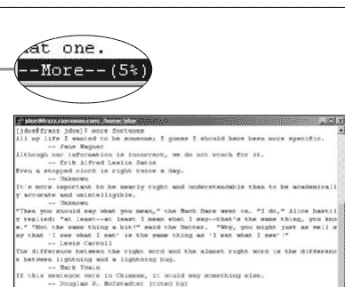

图 1.8 `more` 命令允许你一次移动一屏文件，并在每个屏幕底部提供“More”指示器。

## 显示文件内容

### 使用 cat

你可以不使用 `more` 显示文件，而是使用 `cat`（“连接”），它会显示文件但不会暂停让你阅读信息。它会显示一个或多个文件——取决于屏幕显示——并让你看到文件的最后几行（代码列表 1.8）。

`cat` 命令还允许你重定向一个或多个文件，提供了某些 `more` 版本不具备的功能。

使用 `cat` 显示文件内容：

- `cat newest.programs.txt`

首先，输入 `cat` 加上文件名（可能不是 `newest.programs`，除非你像我们一样命名文件）。

内容会出现在屏幕上；然而，如果文件超过一个屏幕，内容将飞速闪过，你只会停留在最后几行——即屏幕上结束的约 24 行。

- `cat newer.programs.txt newest.programs.txt`

你也可以为 `cat` 指定多个文件，按指定的顺序显示每个文件。在这个例中，`newer.programs` 的内容会闪过，然后 `newest.programs` 的内容会闪过。

```
[jdoe@frazz jdoe]$ cat newest.programs.txt
...
xpmtoppm*
xpp*
xxpstat*
xrfbviewer*
xcreensaver.kss*
xvmminoppm*
wxdotopm*
xd*
[jdoe@frazz jdoe]$ cat newest.programs.txt
...
[jdoe@frazz jdoe]$
```

**代码列表 1.8** `cat` 命令显示文件内容。

# 第一章

## 使用 man 获取帮助

有时，你可能需要一些帮助来记住特定命令的作用。使用 `man`（它是 "manual" 手册的缩写），你可以查询命令及其指针，以便高效地使用它们。图 1.9 显示了一个 Unix 帮助页面（显而易见，也称为 man page）。在接下来的步骤中，我们将向你展示如何查找 Unix 命令并找到相关主题。

访问 man 页面：

- `man password`

在提示符处，你可以在其后加上命令名称（在本例中为 password）。你将获得该命令的 man 页面。使用空格键（或后退键 Back）在文件中进行导航，就像你使用 `more` 命令时一样。

查找特定的 man 页面：

- `man -k password`

输入 `man -k` 加上你想要帮助的命令名称或主题（在本例中为 password）。如代码列表 1.9 所示，你将看到可能的 man 页面列表：命令名称、man 页面和描述。请注意 man 页面名称（如果存在多个页面，请记住编号），以便你可以在下一步中引用它。

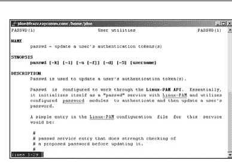

图 1.9 使用 `man password`，你可以访问关于 password 程序的标准 man 文件。

```
man -k password
chpasswd (8) - 批量更新密码文件
gpasswd (1) - 管理 /etc/group 文件
mkpasswd (1) - 生成新密码，可选地将其应用于用户
mkpasswd (8) - 更新密码和组数据库文件
passwd (1) - 更新用户的认证令牌(s)
passwd (5) - 密码文件
userpasswd (1) - 允许用户更改密码的图形化工具
```

**代码列表 1.9** `man -k password` 为你提供了这些结果，显示了特定的密码相关的 man 页面。

## 开始使用 Unix

- `man 1 password`

在这里，你输入 `man`、你想要查看的 man 页面（在本例中通过 `1` 指定第 1 节——这是必要的，因为在上一步中列出了多个名为 password 的 man 页面）以及命令名称（password）。图 1.9 显示了生成的 man 页面。

### 提示

- 你可以为 man 页面创建一个副本，以便对其进行编辑或注释，为你的信息添加额外说明或删除无关内容。只需输入 `man commandname | col -b -x > somefilename`。例如，使用 `man password | col -b -x > ~/.password.command.notes` 在你的主目录中创建一个名为 `.password.command.notes` 的不带格式的 man 页面副本。然后你将使用编辑器（见第 4 章）对重要要点进行编辑、添加和调整。(`col -b -x` 命令可以修复某些格式异常；如果没有它，所有带下划线的单词可能都会显示为 `u_n_d_e_r_l_i_ne`，这取决于系统。)

- 你可以使用 `apropos` 代替 `man -k` 标志。例如，你可能会使用：`apropos password`。

- 某些 Unix 系统可能在节号之前需要 `-s`，例如 `man -s 1 password`。


## 注销

当你完成会话时，你需要注销系统，以确保没有人在冒充你的身份时访问你的文件。

注销：

- `logout`

就这些！只需输入 `logout`，系统将清理所有内容并断开连接，`ssh` 程序可能就会完全消失。

### 提示

- 在某些 Unix 系统上，你可以输入 `quit` 代替 `logout`，或者在键盘上按下 `Ctrl+D`。

# 第 2 章

## 使用目录和文件

正如你在第一章中所学到的，目录和文件是 Unix 的核心；它们包含了设置信息、配置设置、程序和选项，以及你创建的任何内容。每当你输入 Unix 命令时，你都会访问目录和文件，正由于这个原因，你需要熟悉对它们可以执行的各种操作。

在本章中，我们涵盖的技能和命令适用于任何 Unix 变体。你看到的内容（特别是系统提示符和响应）可能与书中所示插图略有不同。然而，通用概念和特定命令在所有 Unix 系统上都是相同的。

### 本章内容

- 创建目录
- 创建文件
- 复制目录和文件
- 列出目录和文件
- 移动目录和文件
- 删除文件
- 删除目录
- 查找文件
- 定位程序文件
- 使用硬链接链接
- 使用软链接链接

## 使用 mkdir 创建目录

你可能把目录比作文件柜中的抽屉；每个抽屉包含一组某种相关的文件。例如，你可能会为你不使用的旧杂志准备几个文件抽屉，一个用于待办事项列表，可能还有一个用于你工作项目的抽屉。

同样，你 Unix 系统中的目录充当着其他目录和文件的容器：每个子目录都包含更多相关的目录或文件，以此类推。每当你启动一个项目或有想要存储在单一位置的相关文件时，你都会创建一个新目录。你使用 `mkdir` 命令创建新目录，如代码列表 2.1 所示。

```
$ ls
Projects all.programs.txt   local.programs.txt      schedule
Xrootenv.0  files  newer.programs  short.fortunes
all.programs fortunes    newest.programs  temp
$ mkdir Newdirectory
$ ls -l
total 159
drwxr-xr-x 2 ej users       1024 Jun 29 11:40 Newdirectory
drwxr-xr-x 2 ej users       1024 Jun 28 12:48 Projects
-rw-r--r  1 ejr  users       7976 Jun 28 14:15 all.programs
-rw-r--r  1 ejr  users       7479 Jun 28 14:05 all.programs.txt
-rw-r--r  1 ejr  users       858 Jun 28 12:45 files
-rw-r--r  1 ejr  ejr       128886 Jun 27
...（此处省略重复的行）...
-rw-r--r  1 ejr  ejr       128886 Jun 27 09:05 fortunes
```

**代码列表 2.1** 使用 `mkdir` 创建目录。

### 命名目录（文件）

当你开始创建目录（文件）时，请记住以下准则：

- 目录和文件具有唯一的名称。例如，你不能有一个名为 `golf` 的目录和一个名为 `gof` 的文件。但是，你可以有一个名为 `golf` 的目录和一个名为 `gof` 的文件。大小写的区别使得每个名称都是唯一的。
- 目录和文件名不能包含以下字符：`<`、`{}`、`[]`、`()`、双引号 `"`、星号 `*`、问号 `?`、管道符号 `#`、斜杠 `/`、脱字符 `^`、美元符号 `$`、`&` 以及波浪 `~`。不同的 shell 对这些字符的处理方式不同，通常情况下特殊字符带来的麻烦大于收益。
- 通常避免使用包含空格的名称。程序无法正确处理它们，所以为了使用空格你必须使用变通方法。相反，使用点 `.` 和下划线 `_` 来分隔单词、字符或数字。
- 使用描述目录内容的名称。
- 如果你尝试使用已存在的文件或目录名称创建目录。Unix 不会覆盖现有目录。相反，你会收到文件名已存在的提示。尝试另一个名称。

## 使用 touch 创建文件

另一项你经常使用的技能是创建文件。你可能把创建文件想象成获取一个空桶，稍后可以向里面装水……或沙子……或石头……或者任何东西。当你创建一个文件时，你指定了一个空空间，你可以在其中填充程序、活动日志、你的简历或配置——基本上是你想要的任何内容，或者什么都不放。

当然，你始终可以如第 4 章所述，通过在编辑器中编写内容并保存来创建文件，但你也会遇到只需要一个空文件作为以后使用的占位符的情况。你可以使用 `touch` 命令创建空文件，如代码列表 2.2 所示。

### 创建文件：

1. `touch file.to.create`

   要创建一个文件，请输入 `touch` 后紧跟文件名。这将创建一个空文件。

```
$ ls
$ touch file.to.create
$ ls -1 file*
-rw-rw-r-      1 ejr users      0 Jun 29 11:53 file.to.create
$ touch -t 121322359 oldfile
$ ls -l
total 0
-rw-rw-r-      1 ejr users      0 Jun 29 11:53 file.to.create
-rw-rw-r-      1 ejr users      0 Dec 31 2009 oldfile
$ touch -t 201012312359 new.years.eve
$ ls -l
total 0
-rw-rw-r-      1 ejr users      0 Dec 31 2010 new.years.eve
-rw-rw-r-      1 ejr users      0 Dec 31 2009 oldfile
$
```

**代码列表 2.2** 使用 `touch` 命令创建文件、更新它们的修改时间，或两者兼顾。

2. `ls -l file*`

   可选地，通过输入 `ls -l file*` 来验证文件是否已创建。如代码列表 2.2 所示，你将看到新文件名以及它的长度（0）以及创建的日期和时间（如果你跟得上的话，可能是当前时间之前的几秒）。

### 提示

- 你也可以使用 `touch` 来更新现有文件的日期和时间。例如，在提示符下输入 `touch -t 12312359 oldfile` 将更新 `oldfile` 的日期为今年 12 月 31 日 23 小时 55 分。或者，`touch -t 201012322359 new.years.eve` 将名为 `new.years.eve` 的文件更新为 2010 年的同一时间。
- 每当你保存文件中的更改时，系统会自动更新日期和时间。有关编辑和保存文件的详细信息，请参阅第 4 章。
- 请参考本章侧边栏的“命名目录（和文件）”以获取文件命名指南。

## 使用 cp 复制目录和文件

在 Unix 中工作时，你经常想要复制目录和文件。例如，你可能想复制你正在处理的文件，以便留一份未缓存的原始版本备。或者你可能想保留重要目录和文件的副本，以防你不经意删除了它们或覆盖了它们。根据墨菲定律，意外总会发生。

无论出于什么原因，你都可以使用 `cp` 命令复制目录和文件，如代码列表 2.3 所示。当你复制目录和文件时，你只是在另一个位置放置了一个副本；原始文件保持不变。

### 复制目录：

1. `cp -r /home/ejr/Projects /home/shared/deb/Projects`

   在 shell 提示符下，输入 `cp -r`，然后是旧目录和新的（要创建的）目录名称，以复制整个目录。`r` 代表“recursive”（递归），如果这有助于你记住它的话。

2. `ls /home/shared/deb/Projects`

   你可以使用 `ls` 加上新目录名来验证副本目录及其内容位于预定位置（代码列表 2.3）。

```
$ cp -r /home/ejr/Projects
-> /home/shared/deb/Projects
$ ls /home/shared/deb/Projects
current new.ideas schedule
$
```

**代码列表 2.3** 使用 `cp -r` 复制目录。

### 复制文件：

1. `cp existingfile newfile`

   在提示符下，输入 `cp`，然后是旧的和新的（要创建的）文件名。

2. `ls -l`

   可选地，用 `ls -l` 查看结果。（长格式）标志会标记文件大小和日期，这样你可以看到复制的文件与新文件完全相同（代码列表 2.4）。

3. `cp -i existingfile oldfile`

   如果使用 `-i` 标志使用 `cp`，它会在覆盖之前提示你，如代码列表 2.4 所示。

```
$ cp existingfile newfile
$ ls -l
total 7
-rw-rw-r-      1 ejr users      1475 Jun 29 12:18 existingfile
-rw-rw-r-      1 ejr users      1475 Jun 29 12:37 existingfile
-rw-rw-r-      1 ejr users      2876 Jun 29 12:17 oldfile
$ cp -i existingfile oldfile
cp: overwrite 'oldfile'?
$
```

**代码列表 2.4** 使用 `cp` 复制文件。

### 提示

- 你可以将目录和文件复制到别人的目录。使用 `-i` 标志强制系统在覆盖之前询问你。如果你喜欢这样，请访问第 8 章以了解别名。
- 复制目录和文件时，可以使用绝对（完整）名称，它们是从根目录（`/home/ejr/Projects`）衡量的；相对（部分）名称。使用绝对名称可以操作任何地方的目录和文件。使用相对名称只能操作当前位置。
- 你可以使用 `cmp` 比较两个文件的内容。例如，输入 `cmp filename1 filename2` 将比较指定的文件。使用 `diff` 查看文件之间的差异。更多信息请参阅第 6 章。

## 使用 ls 列出目录和文件（小技巧）

如果你一直在学习，你可能已经是 `ls` 方面的专家了。特别地，你还可以使用它来验证目录已按预期复制（图 2.1）。

### 列出所有文件和信息：

在提示符下，输入 `ls -l` 你将看到目录中每个文件的以下信息（代码列表 2.6）：

- 文件名。
- 文件大小。
- 修改日期。
- 权限信息。
- 所有者和组。

| 权限 | 链接数 | 所有者 | 组 | 大小 | 修改日期 | 文件名 |
| :--- | :--- | :--- | :--- | :--- | :--- | :--- |
| drwxr-xr-x | 2 | root | root | 4096 | Jun 18 15:02 | all |
| drwxr-xr-x | 2 | root | root | 4096 | Jun 18 00:35 | backup |
| -rw-r--r- | 1 | root | root | 0 | Jun 18 00:00 | empty |
| -rw-r--r- | 1 | root | root | 2128 | Jun 18 04:30 | features |
| -rw-r--r- | 1 | root | root | 0 | Jun 18 00:00 | hidden |
| -rw-r--r- | 1 | root | root | 2151 | Jun 19 12:26 | notes |
| -rw-r--r- | 1 | root | root | 0 | Jun 18 00:00 | old |
| -rw-r--r- | 1 | root | root | 4096 | Jun 17 05:18 | image |

**代码列表 2.6** 使用 `ls -l` 列出文件详细信息。


# 第 2 章

## 使用目录和文件

最后修改时间（如果文件最近修改过）或最后修改年份（如果文件最后一次修改是在六个月以前）。请参阅本章早前的 `touch` 命令，了解文件未来如何发生修改。

| 文件的权限和信息 | 大小 | 修改时间或修改年份 |
| :--- | :--- | :--- |
| -rw-r--r- 1 root root | 4096 Jun 17 10:11 | readme |
| -rw-r--r- 1 root root | 4096 Jun 17 10:18 | personal |
| -rw-r--r- 1 root root | 4096 Jun 18 15:23 | password.txt |
| -rw-r--r- 1 root root | 4096 Jun 17 08:58 | program |
| -rw-r--r- 1 root root | 4096 Jun 18 09:57 | script |
| -rw-r--r- 1 root root | 4096 Jun 19 13:15 | temp |
| -rw-r--r- 1 root root | 4096 Jun 19 10:22 | test.txt |
| -rw-r--r- 1 root root | 4096 Jun 18 11:11 | unix |
| -rw-r--r- 1 root root | 4096 Jun 18 00:45 | vacation |
| -rw-r--r- 1 root root | 4096 Jun 18 10:14 | video.mp4 |
| drwxr-xr-x 2 root root | 4096 Jun 18 20:19 | work |

图 2.1 `ls -l` 获取特定目录中目录和文件的额外信息。

```
$ ls -a
  .stats deb.schedule other
  current new.ideas schedule
```

代码列表 2.5 如果你想查看隐藏文件，使用 `ls -a`。

| $ ls -l | | | |
| :--- | :--- | :--- | :--- |
| total 13 | | | |
| -rw-r--r- 1 ej users 2151 Jun 19 12:26 | current | | |
| -rw-r--r- 2 ej users 1475 Jun 29 13:35 | deb.schedule | | |
| -rw-r--r- 1 ej users 4567 Jun 29 12:26 | new.ideas | | |
| drwxrwx-x 2 ej users 1024 Jun 29 13:06 | other | | |
| -rw-r--r- 1 ej users 1475 Jun 29 12:22 | schedule | | |

代码列表 2.6 使用 `ls -l` 以长格式列出目录内容。

### 列出目录中的所有文件：

- 在 shell 提示符下输入 `ls -la` 以列出目录中的所有文件（包括隐藏文件）及其完整信息，如代码列表 2.7 所示。

### 提示

- 你可以通过以点（`.`）开头命名来隐藏文件。例如，`.profile` 不会被隐藏，但 `.bashprofile` 会被隐藏。
- 记住，你可以组合任何标志来指定多个选项。例如，如果你想以长格式（`-l`）列出所有文件（`-a`），可以使用 `ls -la`。
- 尝试使用 `ls -lt` 获取当前目录及其包含的目录的完整列表，直到没有更多子目录可以进入为止。

| ls -la | | |
| :--- | :--- | :--- |
| total 22 | | |
| drwxrxr-x | 2 ej users | 1024 Jun 29 13:07 . |
| drwxrxr-x | 7 ej users | 1024 Jun 29 12:16 . |
| -rw-r--r-- | 1 ej users | 6718 Jun 29 13:00 .stats |
| -rw-r--r-- | 1 ej users | 2151 Jun 29 12:26 current |
| -rw-r--r-- | 2 ej users | 1475 Jun 29 12:35 deb.schedule |
| -rw-r--r-- | 1 ej users | 4567 Jun 29 12:26 new.ideas |
| drwxrxr-x | 2 ej users | 1024 Jun 29 13:06 other |
| -rw-r--r-- | 1 ej users | 1475 Jun 29 12:22 schedule |

**代码列表 2.7** 如果你想看到所有内容，请使用 `ls -la`。

## 使用 mv 移动文件

移动目录和文件意味着将它们从系统中的一个位置（将位置视为绝对文件路径，例如 `/home/ejr/ofFile`）移动到另一个位置（例如 `/tmp/home/ejr/AnotherFile`）。本质上，你只有一个文件版本，你更改的是该版本的内容。例如，当你重新组织目录和文件时，可能会移动一个目录。或者，你可能会移动一个文件来重命名它——即将文件从一个名称移动到另一个名称。

```
$ ls
completed existingfile oldfile
$ mv existingfile newfile
$ ls
completed newfile oldfile
$
```

**代码列表 2.8** 若要查看当前文件，请使用 `mv` 重命名其中一个文件。

你使用 `mv` 移动目录和文件，如代码列表 2.8 所示。

### 移动文件或目录：

1. `ls`

首先，使用 `ls` 验证你想要移动的文件名。如果你正在更改文件名，需要确保新文件名尚未被占用。使用 `mv` 将一个文件移动到已存在的文件名，旧文件的内容将被新文件的内容替换。

2. `mv existingfile`

输入 `mv` 加上现有文件名和新文件名。与旧文件告别，迎接新文件（代码列表 2.8）。

3. `ls`

验证该文件现在是否已位于你预期的位置。

### 提示

- 你也可以使用 `mv` 将文件移入或移出目录。例如，`mv Projects/testfile /home/deb/testfile` 将 `testfile` 从当前目录的 Projects 子目录移动到 Bob 的家目录，并使用 `testfile` 作为名称。
- `mv -i oldfilename filename` 要求系统在覆盖（销毁）现有文件之前提示你。`-i` 代表“交互式”（interactive），它也适用于 `cp` 命令。
- 请参阅第 8 章，学习如何在 `mv` 中配合使用别名，这样系统在覆盖文件之前会提醒你，你就不需要记住 `-i` 标志了。
- 如果你使用 `mv` 并指定一个现有目录作为目标（如 `mv something ExistingDirectory`），在这种情况下，“something”将会被放入 `ExistingDirectory` 中。“something”既可以是文件也可以是目录。

## 使用 rm 删除文件

你可以轻松地——也许太容易了——从你的 Unix 系统中删除文件。正如墨菲定律所告诉你的那样，在这样做之前考虑两次是个好主意：一旦你删除了文件，它就消失了（除非你恳求系统管理员从备份带中恢复它——那是另一回事）。无论如何，它是永久的，不像 Windows 或 Mac OS 中的删除，甚至不像像 GNOME 或 KDE 等许多 Unix 桌面环境，其回收站或垃圾桶可以给你第二次机会。

| ls | oldfile |
| :--- | :--- |
| completed | soon.to.be.gone.file |
| $ rm -i soon.to.be.gone.file | |
| rm: soon.to.be.gone.file | |
| $ ls | |
| completed | oldfile |

**代码列表 2.9** 使用 `rm -i` 交互式删除文件。

## 使用 rmdir 删除目录

另一个你可以使用的实用功能是使用 `rmdir` 删除目录。将删除目录想象成修剪树木上的树枝。也就是说，你不能坐在你想剪掉的那根树枝上。你必须坐在它最近的另一根树枝上；否则，你会随着被剪掉的树枝一起掉到地上。哎哟！同样，当你删除一个目录时，你不能正位于想要删除的目录之中。

在删除目录本身之前，你必须删除该目录的内容（所有子目录和文件）。通过这样做，你可以验证你正在删除的内容，避免误删除重要文件。在接下来的步骤中（代码列表 2.10 所示），我们将向你展示如何删除目录的内容，然后删除目录本身。

```
$ cd /home/Yourdirectory
$ ls -la
total 7
dr-xr-xr-x 2 ejr users 1024 Jun 29 20:59
dr-xr-xr-- 8 ejr users 1024 Jun 29 20:59 .
-rw-rw-r-- 1 ejr users 1475 Jun 29 20:59 cancelled.project.notes
-rw-rw-r-- 1 ejr users 2876 Jun 29 20:59 outdated.contact.info
$ *
$ cd ..
$ rmdir Yourdirectory
$ ls
Newdirectory all.programs.txt newer.programs short.fortunes
Projects files newest.programs temp
Xrootenv.0 fortunes touching
all.programs local.programs.txt schedule
```

代码列表 2.10 使用 `rmdir` 删除目录可能有点麻烦——但**患于未然**。

### 要删除目录：

1. `cd /home/ejr/Yourdirectory`

开始之前，输入 `cd` 后跟你想删除的目录名称以进入该目录。

2. `ls -a`

列出目录中的所有（`-a`）文件，包括可能存在的隐藏文件，并确保你不需要其中的任何文件。如果你看到 `.` 和 `..`（分别表示当前目录及其父目录），你可以直接跳到第 4 步。

3. 执行以下操作之一：

   - 如果目录中有文件，输入 `rm * *` 来删除这些文件以及所有剩余文件。
   - 如果目录中有子目录，输入 `cd` 和子目录名称，本质上是重复第 1 步的过程。重复此过程直到删掉所有子目录。

当你完成这一步后，你应该得到一个完全空的目录，可以删除了。

4. `cd ..`

使用切换目录命令向上移动一级，到达你想删除的目录的父目录。

5. `rmdir Directory`

搞定——向整个目录挥挥手吧！具体顺序请参见代码列表 2.10。

### 提示

- 你可以一次删除多个目录。假设你从空目录开始操作，可以这样列出它们：`rmdir Directory Yourdirectory OtherDirectory`
- 作为 `rm` 的替代方案，你可以使用 `rm -r` 标志一次删除目录及其所有内容；例如，`rm -rf Directoryname`。**小心！**这种方法会删除目录及其内部的所有内容，因此你没有机会在删除文件之前检查路径。如果系统要求你确认，且你绝对完全确定自己在做正确的事，使用 `rm -rf Directoryname` 来强制立即删除。
- 如果你对命令字符串已经熟悉，可以带有目录路径指定命令，例如 `ls /home/ejr/Directory` 或 `rm /home/ejr/Directory*`。这种技术特别适用于当你想要绝对确定删除的是正确的目录，而不是系统中其他地方同名的目录时。

## 使用 find 查找遗忘的文件

哎，那个文件去哪儿了？有时查找一个文件不仅仅是搜索电脑或用 `ls` 列出目录内容。相反，你可以使用 `find` 命令，它允许通过几十种方式进行搜索，包括整个树（代码列表 2.11）或特定的目录（代码列表 2.12）。

```
$ find . -name lostfile
./Projects/schedule/lostfile
$
```

代码列表 2.11 使用 `find` 查找丢失的文件。

### 要查找文件：

- `find . -name lostfile -print`

配合 `find` 命令，指定从当前目录开始（`. -name lostfile`），并指定将结果打印在屏幕上（`-print`）。参见代码列表。

```
$ find /home/deb -name 'pending' -print
/home/deb/Projects/schedule/pending.tasks
$ find /home/deb/home -name 'pending*' -print
/home/deb/pending/jobs.to.do
$
```

代码列表 2.12 使用通配符并指定多个目录可以更强大地查找。

### 查找以特定目录开头的文件：

- `find /home/deb -name 'pending*' -print`

此命令查找 deb 目录下所有以 `pending` 开头的文件和目录。如果你要包含通配符，必须使用单引号。

或者，你可以同时查找多个目录下的文件，如下：

- `find /home/deb /home/eric -name 'pending*' -print`

此命令查找 deb 和 eric 目录下或其任何子目录下以 `pending` 开头的文件（代码列表 2.12）。

### 查找并处理文件：

- `find ~ -name '*'`

输入带有通配符的 find，后面接 `-ok`（确认执行命令）、`rm`（执行命令）以及 `{} \;` 将每个文件作为命令的附加信息。如果你想在不经确认的情况下压缩匹配的文件，可能可以使用 `find ~ -name '*.backup' -exec compress {} \;` 来完成。

### 提示

- 在某些 Unix 系统上，可能不需要 `-print` 标志。尝试输入不带 `-print` 的 find。如果你在屏幕上看到了结果，就不需要添加它。
- 避免从根目录启动 find 命令。
- 如果你知道文件名的一部分，可以在 find 中使用通配符，如 `find . -name '*info*' -print`。
- `find` 提供了大量的选项。如果你想根据任何特征查找特定文件或文件，可以使用 `find` 查找。例如，你可以使用 `find /home/shared -mtime -3` 来查找过去三天内修改过的 shared 目录下的所有文件。参见附录 C 中大量的选项列表。

## 使用 locate 查找丢失的文件

如果你正在寻找系统文件——即 Unix 系统本身的一部分程序或文件，而不是你家目录下的个人文件——你会得到比你能处理的结果，但它是定位系统文件的一种快速方法。

`locate` 命令在所有系统中都可用，但值得一试。参见代码列表 2.13。

### 定位一个文件：

- `fortune`

如果你尝试定位 fortune，将获得所有包含 "fortune" 的系统文件列表。这包含了 fortune 程序、fortune 程序的数据文件以及相关内容。

### 提示

- 可能，将 `locate` 与 `grep`（第 6 章“使用正则表达式”）结合使用以缩小列表。
- 许多人使用 `locate` 查看包含相关文件的目录（`/usr/share/games/fortune` 包含文件），然后使用其他工具查看。
- 并不是所有系统都使用 fortune——它确实很有趣，但并非必不可少。如果你没有“locate”到它，尝试查找 bash 或 zsh（称为 shell）以查看 locate 如何工作。（查看第 8 章获取更多关于不同 shell 及其优缺点的信息。）

```
[jdoe@fraz jdoe]$ locate fortune
/usr/share/man/man/6.bz2
/usr/share/doc/fortune-mod-1.0
/usr/share/doc/fortune-mod-1.0/cs
/usr/share/doc/fortune-mod-1.0/cs/HISTORY
/usr/share/doc/fortune-mod-1.0/cs/LICENSE
/usr/share/doc/fortune-mod-1.0/cs/README
/usr/share/doc/fortune-mod-1.0/fr
/usr/share/doc/fortune-mod-1.0/fr/
  - COPYING.linux
  - COPYING.glp
/usr/share/doc/fortune-mod-1.0/fr/fr
/usr/share/games/fortunes/songs-poems
/usr/share/games/fortunes/sports.dat
/usr/share/games/fortunes/sports
/usr/share/games/fortunes/startrek.dat
/usr/share/games/fortunes/translate-me
/usr/share/games/fortunes/translate-me
/usr/share/games/fortunes/wisdom.dat
/usr/share/games/fortunes/wisdom
/usr/share/games/fortunes/work.dat
/usr/share/games/fortunes/work
/usr/share/games/fortunes/zippy.dat
/usr/share/sol-games/fortunes.scm
/usr/share/games/fortune
```

代码列表 2.13 使用 `locate` 查找系统文件。


# 代码列表 2.13 使用 locate 查找与大多数系统文件相关的所有内容

## 使用 ln 链接（硬链接）

假设你的老板刚为你雇佣了一位助手（确实是时候了，对吧？）。你需要确保你的新助手可以访问你的文件，这样你就可以把工作推给他了。而且，你还需要访问修改后的文件，以便跟上助手的工作进度——也许还能在下一次员工会议上把他的工作归功于自己。

让你的助手轻松访问你文件的极佳方法是从你的主目录创建一个硬链接。在创建硬链接时，你是从一个现有文件开始并创建一个链接，这（在某种程度上）将现有文件放置在了你助手的主目录中。该链接并没有创建文件的副本；相反，你正在为磁盘上的同一个物理文件创建第二个指针。这个额外的指针并不像 Macintosh 或 Windows 计算机中的别名或快捷方式，两个指针都指向同一个实际文件，因此从 Unix 系统的角度来看，文件实际上存在于两个位置（代码列表 2.14）。

由于使用硬链接通常需要你有访问另一个用户的主目录，你可能需要参考第 5 章，了解如何使用 `chmod`、`chgrp` 和 `chown` 来访问其他用户的目录和文件。

```
$ ls /home/deb/Projects/schedule/our/* /home/helper/our/*
ls: /home/helper/our*: No such file or directory
/home/deb/Projects/schedule/our.projects.latest
/home/deb/Projects/schedule/our.projects.other
$ ln /home/deb/Projects/schedule/our.projects.latest /home/helper/our.projects
$ ls -l /home/helper/our*
-rw-r-r--  users  1055 Jun 26 11:00 /home/helper/our.projects
$
```

**代码列表 2.14** 硬链接让两个用户轻松共享文件。

### 创建硬链接

1. `ls -l /home/deb/Projects/schedule/our* /home/helper/our*`

首先，列出两个目录中的文件，以确保要链接的文件存在，并且目标目录中没有同名文件。在这里，我们列出了位于 `/home/deb/Projects/schedule` 和 `/home/helper` 中的起始文件。在这个例子中，我们正在验证文件确实存在 Deb 的目录中，并且在助手的目录中没有找到匹配的文件（代码列表 2.14）。

2. `ln /home/deb/Projects/schedule/our.projects.latest /home/helper/our.projects`

在这里，`ln` 在助手的主目录下创建一个名称相似的新文件并将这两个文件链接在一起，本质上让同一个文件存在于两个目录中。

3. `ls -l /home/helper/our*`

通过这段代码，你的助手可以通过列出以该字符开头的文件来验证文件是否存在。现在文件存在于两个地方，内容完全相同。任何用户都可以修改该文件，两个位置的内容都会随之。

> **提示**
>
> - 你可以像删除文件一样使用 `rm` 加上文件名来删除硬链接。请参阅本章较早的“使用 rm 删除文件”部分。
> - 如果一个用户删除了文件，另一个用户仍然可以从自己的目录访问该文件。
> - 硬链接仅适用于同一个文件系统之间的文件。若要跨不同的文件系统进行链接，你必须使用软链接，这将在下一节介绍。
> - 如果你很狡猾，可以使用硬链接来链接目录而非文件。在你想要放置目录的地方创建一个新目录，然后使用 `ln /home/whoever/existingdirectory/* /home/newdirectory/` 将旧目录中的所有文件硬链接到新目录。新文件不会自动链接，但你可以使用 cron 任务定期刷新链接——例如每天一次。详见详情。

## 使用 ln -s 链接（软链接）

现在假设你想把整个工作量都推给你的新助手。与其仅仅让他获得访问单个文件的权限，你还希望让他方便地访问你的项目目录。你可以使用软链接（通过 `ln -s` 创建）来实现，这本质上是为其他用户提供指向你指定的文件或目录的快捷方式。

硬链接和软链接有时需要你有访问另一个用户的目录和文件。参考第 5 章了解更多关于文件权限和所有权信息，参考第 7 章了解文件系统的底层。


### 创建软链接

1. `ls /home/deb /home/helper`

首先，列出两个用户的主目录内容。在这里，我们正在验证想要链接的目录是否存在于 Deb 的目录中，并且在助手的目录中不存在匹配的目录或文件。参见代码列表 2.15。

2. `ln -s /home/deb/Projects /home/helper/Projects`

此命令创建了一个软链接，使得 Deb 的 Projects 目录的内容也可以从助手的主目录轻松访问。

3. `ls -la /home/helper`

列出 `/home/helper` 内容显示了指向目录的软链接。注意代码列表 2.15 中显示链接的箭头。

> **提示**
>
> 如果你只需要在同一系统内的两个文件之间创建链接，请考虑使用“使用 ln 链接（硬链接）”节中讨论的硬链接。

```
$ ls /home/deb /home/helper
/home/deb:
/home/helper:
$ ln -s /home/deb/Projects /home/helper/Projects
$ ls -la /home/helper
列出 /home/helper 的内容显示了指向目录的软链接。注意代码列表 2.15 中显示链接的箭头。
```

# 第 3 章 你的 SHELL

当你首次登录 Unix 系统时，看到的是提示符，这是你交互的地方。shell 决定了你如何输入命令。Unix 的酷之处在于你并不局限于一种 shell——在本章中，我们将查看你的 shell，演示如何切换并开始使用几种常见的 shell。

## 发现 Shell

发现你正在使用的 shell：

- `echo $SHELL`

系统的响应将是 shell 的完整路径——类似于 `/bin/zsh`、`/bin/bash` 或 `/bin/ksh`。

- `finger userid`

你也可以使用 `finger userid`（用用户名替换 userid）来获取你的 shell 设置。（某些系统不支持 finger，参见第 7 章更多关于 finger 的信息，因为它可能是一个安全漏洞）。

```
xmission> echo $SHELL
/bin/csh
xmission> finger ejray
Real life: "RayComm"
Directory: /home/users/ejray Shell:
-> /bin/csh
On June 23 06:58:48 on p16/16
-> calvin.raycom.
1 minute 28 seconds Idle Time
No unread
No Plan.
xmission>
```

**代码列表 3.1** 此 ISP 账户默认使用 `/bin/csh` shell。

```
[ej@hobbes ejr]$ echo $SHELL
/bin/bash
[ej@hobbes ejr]$ finger ejr
Login: ejr Name: Eric J. Ray
Directory: /home/ejr Shell: /bin/bash
On Wed Jul 22 07:42 (MDT) on tty1
3 hours 15 minutes idle
On Thu Jul 23 08:17 (MDT) on tty0
from calvin
No mail.
Project:
 on Unix VQS.
Plan:
This is my plan-work all day, sleep all night.
[ej@hobbes ejr]$
```

**代码列表 3.2** 在 Hobbes 这一 Linux 系统上，默认 shell 是 `/bin/bash`。

## 理解 Shell 和选项

取决于你所使用的特定 Unix 系统，你可能有多个可用的 Shell 可选择。表 3.1 描述了其中一些常见的 Shell。这些 Shell 中的每一个都有略有不同的功能和特性。请记住，Shell 之间的差异不会影响你在 Unix 中可以执行的操作；相反，它们会影响你与系统交互的易用性和灵活性。

你可能使用 `bash` 作为你的 Shell，但你也可以很容易地切换到许多其他 Shell 之一。如代码列表 3.3 和 3.4 所示，你可以从查找哪些可用的 Shell 开始。图 3.1 显示了某些 Shell 以及它们彼此之间的关系。

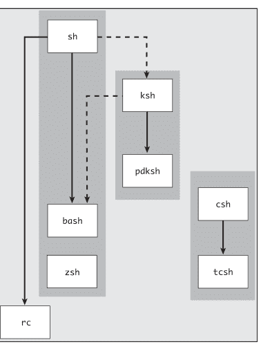

**图 3.1** 除少数落后者外，Shell 严密地归分为几个“家族”。同一个家族中的每个 Shell 都与该家族内的其他 Shell 共享许多特性。

### 表 3.1 常用 Shell 及其特性

| 常用 Shell | 特性 |
|---|---|
| sh | 该 Shell 是原始的 Unix Shell（通常称为 Bourne），适用于脚本编写，但在交互式使用时缺乏许多灵活性和功能。例如，它不具备命令补全、检查邮件或别名等功能。 |
| csh 和 tcsh | 这一家族的 Shell 增加了极大的交互式用途，但放弃了 sh 相关 Shell 提供的流行的脚本支持，转而采用类似 C 语言的语法。由于使用了 C 语法，它通常被称为 C shell。除非你是一个 C 语言程序员，否则这些可能不是你的最佳选择。 |
| ksh, bash 和 zsh | 这些提供了脚本编写和交互式能力的良好平衡，但它们源自不同的来源（bash 与 sh 最相似，因此名为 Bourne Again SHell）。 |

## 查看可用的 Shell

要查看你系统中有哪些 Shell 可用：

- `cat /etc/shells`

在 Shell 提示符处，输入 `cat /etc/shells` 来查找哪些 Shell 是可用的。代码列表 3.3 和 3.4 显示了该命令在两个不同系统上的结果。

> **提示**
>
> - 在跳转到后续章节并更改 Shell 之前，你可能可以咨询你的系统管理员或帮助台，以了解他们支持并许可的哪些 Shell。
> - 如果在系统管理员或帮助台的支持方面都相同，且你没有明确的偏好，我们建议将 zsh 作为首选，bash 紧随其后。从长远来看，你会更喜欢 zsh。
> - 并非所有系统都使用 `/etc/shells` 列出可接受的 Shell——你可能必须寻找特定的 Shell，正如本章稍后所示。

```
[ejr@hobbes]$ cat /etc/shells
/bin/bash
/bin/sh
/bin/tcsh
/bin/csh
[ejr@hobbes]$
```

**代码列表 3.3** Unix 系统上可用 Shell 的极简列表，包含了基础内容但没有提供过多的选择方式。

```
xmission> cat /etc/shells
/usr/local/bin/tcsh
/bin/csh
/usr/local/bin/csh
/bin/ksh
/usr/bin/ksh
/bin/sh
/usr/local/bin/bash
/usr/local/bin/zsh
/usr/local/bin/login
/usr/local/bin/terminated
/usr/local/bin/xmmenu.email
/usr/lib/uucp/uucico
xmission>
```

**代码列表 3.4** 这些 Shell 通过 ISP 提供。请注意该 ISP 使用的额外自定义 Shell，包括提供特殊功能（如不允许登录）的 Shell。


## 使用 chsh 更改你的 Shell

```
[ejr@hobbes]$ cat /etc/shells
/bin/bash
/bin/sh
/bin/tcsh
/bin/csh
/bin/zsh
[ejr@hobbes]$ chsh
Changing shell for ejr.
Password:
New shell [/bin/bash]: /bin/zsh
Shell changed.
jer@hobbes ~ $
jer@hobbes ~ su - ejr
Password:
jer@hobbes ~ $
```

如果你决定想更改 Shell，取决于你的系统管理员如何设置，你可能可以这样做。如代码列表 3.5 所示，你会使用 chsh 来操作。我们通常切换到 bash。

### 使用 chsh 更改你的 Shell 步骤

1. `cat /etc/shells`

   在提示符处，使用 `cat /etc/shells` 列出系统上可用的 Shell。

2. `chsh`

   输入 chsh（代表“change shell”）。代码列表 3.5 显示了系统的响应。某些系统提示密码，某些则不会。

3. `/bin/zsh`

   输入你新 Shell 的路径和名称。

4. `su - yourid`

   输入 `su -` 和你的用户名重新登录，以验证一切是否正常工作。如果不正常，再次使用 chsh 并切换回原始 Shell 或其他。如果你无法切回，请邮件给你的系统管理员寻求帮助。

**代码列表 3.5** 你必须记得更改 Shell 时所需的 Shell 路径。


# 理解 Shell 和选项

取决于你所使用的特定 Unix 系统，你可能有多个可用的 Shell 可选择。**表 3.1** 描述了其中一些常见的 Shell。这些 Shell 中的每一个都有略有不同的功能和特性。请记住，Shell 之间的差异不会影响你在 Unix 中可以执行的操作；相反，它们会影响你与系统交互的易用性和灵活性。

你可能使用 `bash` 作为你的 Shell，但你也可以很容易地切换到许多其他 Shell 之一。如**代码列表 3.3** 和 **3.4** 所示，你可以从查找哪些可用的 Shell 开始。**图 3.1** 显示了某些 Shell 以及它们彼此之间的关系。


**图 3.1** 除少数落后者外，Shell 严密地归分为几个“家族”。同一个家族中的每个 Shell 都与该家族内的其他 Shell 共享许多特性。

## 表 3.1 常用 Shell 特性

| 常用 Shell | 特性 |
|---|---|
| `sh` | 该 Shell 是原始的 Unix Shell（通常称为 Bourne），适用于脚本编写，但在交互式使用时缺乏许多灵活性和功能。例如，它不具备命令补全、检查邮件或别名等功能。 |
| `csh` 和 `tcsh` | 这一家族的 Shell 增加了极大的交互式用途，但放弃了 `sh` 相关 Shell 提供的流行的脚本支持，转而采用类似 C 语言的语法。由于使用了 C 语法，它通常被称为 C shell。除非你是一个 C 语言程序员，这些可能不是你的最佳选择。 |
| `ksh`、`bash` 和 `zsh` | 这些提供了脚本编写和交互式能力的良好平衡，但它们源自不同的来源（`bash` 与 `sh` 最相似，因此名为 Bourne Again SHell）。 |

## 查看可用 Shell

要查看你系统中有哪些 Shell 可用：

- **`/etc/shells`**

  在 Shell 提示符处，输入 `cat /etc/shells` 来查找哪些 Shell 是可用的。**代码列表 3.3** 和 **3.4** 显示了该命令在两个不同系统上的结果。

### 提示

- 在你跳转到后续章节并更改 Shell 之前，你可能可以咨询你的系统管理员或帮助台，以了解他们支持并许可的哪些 Shell。
- 如果在系统管理员或帮助台的支持方面都相同，且你没有明确的偏好，我们建议将 `zsh` 作为首选，`bash` 紧随其后。从长远来看，你会更喜欢 `zsh`。
- 并非所有系统都使用 `/etc/shells` 列出可接受的 Shell——你可能必须寻找特定的 Shell，正如本章稍后所示。

```
[ejr@hobbes]$ cat /etc/shells
/bin/bash
/bin/sh
/bin/tcsh
/bin/csh
[ejr@hobbes]$
```

**代码列表 3.3** Unix 系统上可用 Shell 的极简列表，包含了基础内容但没有提供过多的选择方式。

```
xmission> cat /etc/shells
/usr/local/bin/tcsh
/bin/csh
/usr/local/bin/csh
/bin/ksh
/usr/bin/ksh
/bin/sh
/usr/local/bin/bash
/usr/local/bin/zsh
/usr/local/bin/login
/usr/local/bin/terminated
/usr/local/bin/xmmenu.email
/usr/lib/uucp/uucico
xmission>
```

**代码列表 3.4** 这些 Shell 通过 ISP 提供。请注意该 ISP 使用的额外自定义 Shell，包括提供特殊功能（如不允许登录）的 Shell。


## 使用 `chsh` 更改你的 Shell

```
[ejr@hobbes]$ cat /etc/shells
/bin/bash
/bin/sh
/bin/tcsh
/bin/csh
/bin/zsh
[ejr@hobbes]$ chsh
Changing shell for ejr.
Password:
New shell [/bin/bash]: /bin/zsh
Shell changed.
jer@hobbes ~ $
jer@hobbes ~ su - ejr
Password:
jer@hobbes ~ $
```

如果你决定想更改 Shell，取决于你的系统管理员如何设置，你可能可以这样做。如**代码列表 3.5** 所示，你会使用 `chsh` 来操作。我们通常切换到 `bash`。

### 使用 `chsh` 更改你的 Shell 步骤：

1.  **`/etc/shells`**

    在提示符处，使用 `cat /etc/shells` 列出系统上可用的 Shell。

2.  **`chsh`**

    输入 `chsh`（代表“change shell”）。**代码列表 3.5** 显示了系统的响应。某些系统提示密码，某些则不会。

3.  **`/bin/zsh`**

    输入你新 Shell 的路径和名称。

4.  **`su - yourid`**

    输入 `su -` 和你的用户名重新登录，以验证一切是否正常工作。如果不正常，再次使用 `chsh` 并切换回原始 Shell 或其他。如果你无法切回，请邮件给你的系统管理员寻求帮助。

**代码列表 3.5** 你必须记得更改 Shell 时所需的 Shell 路径。

```bash
bash-2.00$ ls
Complete NewProject bogus2
  -> fppuppy
Completed News dead.letter
  -> mail temp
Mail access files
  -> public_html testme
bash-2.00$ cd public_html/
bash-2.00$
```

## 在 `bash` Shell 中使用自动补全

`bash` Shell 的酷功能之一是命令参数自动补全。通过此功能，你只需要输入命令的一部分，按下 `Tab` 键，`bash` 就会为你完成该命令（见**代码列表 3.8**）。

### 如需在 `bash` Shell 中使用自动补全：

1.  **`ls`**

    使用 `ls` 列出你目录中的文件。

2.  **`cd pub` + `Tab`**

    如所示，输入一个部分命令，然后按下 `Tab` 键。在这个示例中，我们输入了 `cd` 命令和 `public_html` 目录的一部分（在示例中被截断），然后按下 `Tab` 键来完成它（参见**代码列表 3.8**）。

### 提示

- 只有在你按下 `Tab` 键之前，输入的字母只有一种可能的匹配项时，自动补全才会起作用。例如，如果你输入 `cd pu`（为了 `public_html`）并且有另一个名为 `puppy` 的子目录，shell 会发出响声并等待你输入足够的字母来区分这两个子目录。
- 你可以使用自动补全功能来完成命令、命令中的目录名，以及你可能输入的任何足够唯一的内容。

## 在 `bash` Shell 中查看会话历史

### 要在 `bash` Shell 中查看会话历史：

1.  使用 shell 一会儿，比如切换目录、重定向输出或其他任务。慢慢来。我们会等候。
2.  按一次 `↑` 键。

    注意，你应用的（上一个）命令显示在命令行上，如**代码列表 3.9** 所示。要重新执行该命令，请按回车。
3.  继续按 `↑` 或 `↓` 在历史记录中向前向后滚动。当你找到想要使用的命令时，按回车。

    如果你看到一个与你想要使用的接近但并不完全相同的命令，可以对其进行编辑。使用方向键在行内移动，通过输入来插入文本，并使用 `Backspace` 或 `Delete` 删除文本。

    当你修复好命令后，按回车（不需要在行末尾也可以）。
4.  **`history`**

    在 shell 提示符处输入 `history` 查看你之前输入的命令的编号列表。

```bash
[ejr@hobbes clean]$ ls
background.htm info.htm logo.gif
[ejr@hobbes clean]$ ls
background.htm info.htm logo.gif
[ejr@hobbes clean]$ history
1 free
2 id deb
3 id ejr
4 uname -a
5 ls
40 cd
41 cp .bash_history oldhistory
42 vi .bash_history
43 elm
44 ls -la
45 ls -la.*
46 elm
47 lynx
48 history
49 vi .bash*$
50 history
51 cd clean
52 ls
53 ls
54 history
[ejr@hobbes clean]$ !40
cd
[ejr@hobbes clean]$
```

**代码列表 3.9** 在此示例中，我们得到了第一个命令，然后按 `↑` 键来复用上一个 `ls` 命令，从列表中回收了第 40 条命令。

### 提示

- 当前会话的命令保存在内存中以便滚动，而之前会话的命令保存在 `~/.bash_history` 文件中。你可以用任何编辑器编辑 `.bash_history` 以删除不需要的命令，或直接删除该文件来移除历史文件，它会在你发布下一个命令时重新创建。（命令历史是编写自动执行命令脚本的绝佳起点。第 10 章提供了具体细节。）
- 当你查看历史时，可以通过输入感叹号 (`!`) 和你想再次运行的命令的行号来回收命令。例如，你会输入 `!40` 来运行第 40 条命令。
- 使用 `history` 后跟数字指定要列出的项目数量。例如，`history 10` 显示最后 10 条命令。

## 在 `zsh` Shell 中使用自动补全

`zsh` Shell 同样提供了比 `bash` Shell 更多花样的自动补全功能。基本上，你只需要输入命令的一部分，按 `Tab`，`zsh` 就会为你完成命令（**代码列表 3.10**）。

### 如需在 `zsh` Shell 中使用自动补全：

1.  **`ls`**

    使用 `ls` 列出当前目录下的文件。

2.  **`cd pub` + `Tab`**

    如所示，输入一个部分命令，然后按下 `Tab` 键来完成命令。在这个示例中，我们输入了 `cd` 命令和 `public_html` 目录的一部分（在示例中被截断为 `pub`），然后按下 `Tab` 键来完成它（参见**代码列表 3.10**)。

```bash
bash-2.00$ ls
Complete NewProject bogus2
  -> fppuppy
Completed News dead.letter
  -> mail temp
Mail access files
  -> public_html testme
bash-2.00$ cd public_html/
bash-2.00$
```

**代码列表 3.10** 在此示例中，我们输入了 `cd` 命令并按下 `Tab` 键，`zsh` 完成了它。

### 提示

- 自动补全只有在你按下 `Tab` 键之前，输入的字母只有一种可能的匹配项时有效。例如，如果你输入 `cd pu`（为了 `public_html`）并且有另一个名为 `puppy` 的子目录，shell 会发出响声并等待你输入足够的字母来区分这两个子目录。
- 你可以使用自动补全功能来完成命令、命令中的目录名，以及你可能输入的任何足够唯一的内容。
- 你只需要输入命令的一部分，按 `Tab`，`zsh` 就会为你完成它。

## 在 `zsh` Shell 中查看会话历史

`zsh` 同样允许你复用会话历史中的命令，这是你在会话期间或之前会话中的命令列表（**代码列表 3.11**）。这些功能用于回顾会话、复用命令（而不是重新输入）以及修改（而不是完全重做）复杂的命令。

### 如要在 `zsh` Shell 中查看会话历史：

1.  像往常一样使用 `zsh`，重定向输出或其他任务。例如，回顾上一个命令并练习已经学过的命令。
2.  按 `↑` 一次。

    注意，你应用的（上一个）命令显示在命令行上，如**代码列表 3.11** 所示。要重新执行该命令，请按回车。
3.  继续按 `↑` 或 `↓` 在历史记录中向前向后滚动。当你找到想要使用的命令时，按回车。

    如果你看到一个与你想要使用的接近但并不完全相同的命令，可以对其进行编辑。使用方向键在行内移动，通过输入来插入文本，并使用 `Backspace` 或 `Delete` 删除文本。

    当你修复好命令后，按回车（不需要在行末尾也可以）。
4.  在提示符处输入 `history` 查看你之前输入的命令的编号列表。

**代码列表 3.11** 在此示例中，我们得到了第一个命令，然后按 `↑` 键来复用上一个 `ls` 命令，从列表中回收了第 40 条命令。

## 更改你的身份

with `su`


偶尔，你可能需要使用并非你自己的 userid 登录，或者需要用自己的 userid 重新登录。例如，你可能想在注销之前检查修改过的配置设置，以确保它们运行正常。或者，如果你更改了 shell，你可能想在注销之前检查一下（顺便说一句，你应该这样做）。

你可以使用 `su`（切换用户）命令来登录另一个用户（代码列表 3.12）或启动一个新的登录 shell。

```
[ejr@hobbes asr]$ ls
Projects testing
[ejr@hobbes asr]$ su asr
Password:
[asr@hobbes asr]$ ls
Projects testing
[asr@hobbes asr]$ su - ejr
Password:
[ejr@hobbes ejr]$ ls
Mail
editime                 script2.sed
Projects                fortunes.copy   scripttext.sed
Xrootenv.0              fortunes1.txt  sedtest
above.htm               fortunes2.txt  sorted.address.temp
address.book           groups           temp.htm
address.temp           history.txt      tempsort
axome                  html.htm        test
bogus                   html.mail        test2
clean                   manipulate      testing.gif
compression            nmail           testing.wp
[ejr@hobbes asr]$ exit
[asr@hobbes asr]$ exit
[ejr@hobbes ejr]$ exit
```

**代码列表 3.12** 在不同用户之间来回切换（退出多个 shell）可能会有点困惑，但提示符通常会告诉你你是是谁以及你处于哪个目录。

# 第 3 章

## 使用 su 登录不同的用户

- `su as`

在 shell 提示符处，输入 `su` 加上你想要登录的用户的 userid。系统会提示你输入密码，就像你第一次登录系统时一样（代码列表 3.12）。如果你没有指定用户名，系统将假设你指的是 root 用户。如果你最初已是以 root 身份登录的，将不会提示你输入密码。你将登录为新用户，并能够像该用户一样工作，尽管你仍处于之前执行 `su` 命令之前的相同目录，并拥有相同的设置。

## 使用 su 启动新的登录 shell

- `su - your_id`

在 shell 提示符处，输入 `su - your_id`（当然，使用你的 userid 或你想切换的用户的 userid）。添加连字符 (`-`) 将强制启动一个新的登录 shell，并根据用户的设置设置所有的环境变量和默认值。

### 提示

- 如果你有 root 权限并通过 ssh 登录系统进行管理，你应该使用 `su` 来提供额外的安全保障。与其直接以 root 身份登录并留下密码在本地系统上被窃取（嗅探）的风险，不如先以自己的身份登录，然后使用 `su`（不带其他额外信息）切换到 root。

- 如果你使用 `su`（不带连字符）切换到另一个用户，而新用户对当前目录没有读取执行权限，你将看到 shell 错误信息。你可以忽略这些信息。关于读取和执行权限的更多信息，请参见第 5 章。

## 返回上一个 shell

- `exit`

在 shell 提示符处输入 `exit` 离开当前 shell 并返回上一个。如果你在原始登录 shell 中使用 `exit`，你将完全退出 Unix 系统。

## 使用你的 shell

### 使用 stty 修复终端设置

```
xmission> ls ^?^?^
: No file or directory
xmission> stty erase '^?'
xmission> ls
```

**列表 3.13** 你可以通过使用 `stty` 命令来修复混乱的 nettext 或 Unix 系统。这可以修复错误的按键。

你通过 shell 可以做的另一个方便操作是修复终端程序中出现的那些恼人问题。在第 1 章中，我提到你可能会遇到如 `Backspace` 和 `Delete` 键无法正常工作的问题。你可以使用 `stty` 来修复这些问题（代码**列表 3.13**）。

#### 使用 `stty` 修复 `Backspace` 和 `Delete` 键的异常

- `stty erase '^?'`

```
xmission> j^H^H
jf^H^H: Command not found
xmission> ls ^H^H
: No file or directory
xmission> stty erase '^'
xmission>
```

**列表 3.14** 此处的 `stty` 命令修复 `Delete` 键使其像 `Backspace` 一样工作。

如果你使用 `Backspace` 删除光标左侧的字符，但在尝试时屏幕上只显示了一堆 `^H` 符号，你需要了解 `erase`。输入 `stty erase` 来修复它（代码列表 3.13）。

在某些情况下，取决于你的终端程序，你可能需要设置 `stty erase '^H'` 然后按 `Ctrl H` 来退格。要输入此命令，输入 `stty erase` 并按 `Ctrl V`，然后按 `Ctrl H`（代码列表 3.14）。

#### 提示

- 如果 `stty sane` 无法修复显示异常，请尝试 `reset` 或注销并重启你的终端程序。

- 你可以通过向配置文件中添加适当的 `stty` 命令或通过更改终端客户端设置来修复 `Backspace` 异常。详情请参见第 8 章，并参考第 1 章获取关于 ssh 和 telnet 等终端程序的更多有用细节。

### 使用 stty 修复通用的终端异常

- `stty sane`

在提示符处输入 `stty sane` 可以修复许多异常。例如，如果不小心执行了错误的命令导致屏幕上什么都不显示，或者你看到屏幕上出现了一码乱码，`stty sane` 可能会让终端会话恢复正常。

`reset` 命令通常也能有效修复损坏的终端。


## 退出 shell

当你完成 Unix 操作后，退出。所有命令都是可见的，你可以轻松地打开、修改和关闭文件。

- `exit`

在 shell 提示符处输入 `exit` 离开当前 shell 并返回上一个。顺便说一下，还有几十种其他编辑器，例如

- `ed`、`ex` 和 `red`，它们是功能简单（但使用不一定简单）的逐行编辑器

- `joe` 和 `jed`，它们是相当简单的编辑器，在很多方面与 `pico` 相似

# 第 4 章

## 创建和编辑文件

就本书的目的是，我们将 `vi` 和 `nano` 视为等同——如果你有 `nano`，在看到 `vi` 的地方脑中将其替换为 `nano` 即可。

`vi` 是随 `pine` 程序一起分发的，如果你可以使用 `pine`，那么你可能也拥有 `vi`。（请参阅第 1 章了解如何检查你是否可以使用 `vi` 和 `nano`。）如果你的系统中没有 `vi`，也找不到 `nano`，请要求你的系统管理员安装其中之一。

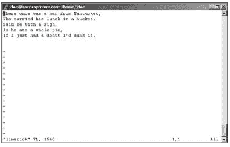

图 4.2 `vi` 为你提供了一个整洁的屏幕，并让你记住它所有晦涩难懂的命令。

## 关于 vi

尽管 `vi` 可能是 Unix 以复杂和令人困惑闻名的很大原因之一，但此外，`vi` 是随处可用的（不像某些编辑器），所以由于这两个原因，你应该考虑花时间来学习它。你可能会发现 `vi` 非常晦涩、反直觉且吹毛求疵，因此，如果你不需要 `vi` 的功能，你可能想要选择不同的编辑器。正如**图 4.2**所示，如果你使用 `vi`——你必须习惯使用你可以调用的菜单——命令如 `Esc`;q 或 `Esc`:%s/vi is arcane/vi is powerful/ 等。

是的，延续几个段落前的话题，`vi` 有一个等价物叫做 `vim`，它的许可方式不同，功能也强大得多。对于基础使用——此书中的所有内容以及更多功能——两者是完全相同的。不过，在这种情况下，你总能找到 `vi`，即使它实际上是 `vim`（`vi` 实际上可能是指向 `vim` 的符号链接或快捷方式）。但是，如果你找到了 `vim`，那么它确定是 `vim`。所有命令都是相同的，所以尽管去尝试并享受吧。

## 关于 emacs

通过 `emacs`，你将开始理解 Unix 令人惊叹的可定制性。它可以“仅仅”是一个编辑器——尽管是一个带有各种功能的强大编辑器——它也可以是一个电子邮件程序、文件管理器，或者该死的任何其他东西。我们将专注于它的功能，但如果你有兴趣，不要犹豫在网络上探索该编辑器的其他选项和功能。图 4.3 显示了你对 `emacs` 的预期，包括实用的（且相当熟悉的）菜单。

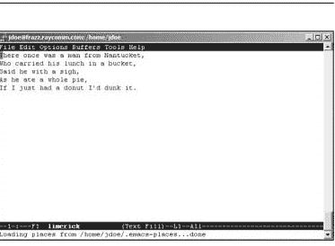

图 4.3 `emacs` 同时提供了菜单和威力。

### 提示

- 你并不受限于某一个编辑器。你可以在任何时候使用任何编辑器。我们经常使用 `pico` 发送邮件或纯文本写作，因为我们可以不思考地打字。当我们确实需要威力或只是想在没有 `pico` 菜单的情况下进行快速编辑时，我们会切换到 `vi`（对某些人来说显得笨重）。

- 你可以指定默认编辑器，它将在启动编辑器的程序中自动运行。第 8 章提供了关于设置编辑器环境变量的详细信息。

- 关于配置文件的更多信息请参阅第 8 章，第 10 章更多 shell 脚本，第 11 章更多电子邮件内容。

- 如果你输入 `pico` 并收到提示找不到命令的错误消息，请使用 `find`、`whereis` 或 `ls` 搜索可能的目录（`/usr/bin` 或 `/usr/local/bin`），检查程序是否存在但不在你的 shell 能够找到的地方。参阅第 1 章进行快速回顾。

- 在建立文件并开始输入内容后，使用下一节中的指令保存你的更改。

- 你可以通过访问本章后部分的“在 pico 中获取帮助”部分获取关于 `pico` 功能的有用信息。

## 启动并尝试 pico

你可以通过以下步骤启动并尝试使用 `pico`。注意 `pico` 的界面直观且易于导航，如图 4.4 所示。

### 启动 pico 并尝试它

- 在 shell 提示符下输入 `pico`。程序启动后，你会看到类似图 4.4 的界面，顶部是文本区域，底部是命令提示。如果你知道要编辑的文件名，在 shell 提示符下输入 `pico` 后加上路径和文件名（例如）。

- 继续进行。输入任何内容——试一下。

- 使用 `Del` 和 `Backspace` 帮助编辑文本。

- 使用方向键向上、向下、向右或向左移动。

- 使用 `-w` 选项启动 `pico` 以禁用自动换行。在编辑配置文件时（第 8 章介绍），你会发现这非常有用。

- 在整个过程中，你会看到 `^C`、`^J` 以及其他几十个悬挂在底部菜单的字符。`^C` 代表 `Ctrl`，`^J` 是 `Ctrl J`，以此类推。

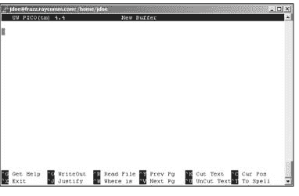

启动 PICO 并尝试它

## 在 pico 中保存

每当你编辑文件时通常都会保存——记住，有人在看着你！

### 在 pico 中保存

定期使用 `Ctrl O` 写入你正在编辑的文本。

- 指定文件的文件名（**图 4.5**）。

- 第一次保存文件后想保存新更改，按 `Ctrl O` 然后按 `Enter` 确认文件名并保存。

- 当你退出 `pico` 时，你有最后保存更改的机会。参阅本章的“退出 pico”部分。

- 如果你尝试将新文件保存到现有文件（这将覆盖原文件），`pico` 会仔细询问你是否覆盖。是，你将不再拥有原文件；否，你将选择一个新的文件名。

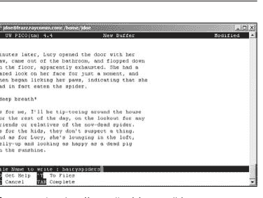

图 4.5 在 `pico` 术语中，“writing out”意味着“保存”。

## 切割和编辑文件

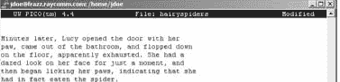

## 在 pico 中剪切文本

在输入时，可能需要剪切和粘贴文本块，如图 4.6 所示。

### 在 pico 中剪切并粘贴文本

- 在 shell 提示符下输入 `pico` 后加上文件名。

- 将光标移动到要剪切文本的第一行。

- 按 `Ctrl ^` 标记要剪切文本的开头。（注意 `Ctrl ^` 实际上是 `Ctrl Shift 6`——取决于你的终端程序，可能有效也可能无效。尝试看看会发生什么。）

- 使用方向键将光标移动到要剪切文本的末尾。注意选择时文本会被高亮。

- `Ctrl K` 会“剪切”文本。

- 使用方向键将光标移动到你想插入剪切内容的地方。

- 使用此组合键将剪切的内容粘贴到文件中。

#### 提示

- 你可以选择并剪切文本块并将其粘贴回文件。只需跳过第 6 和第 7 步。

- 你可以根据需要多次粘贴文本块。

- 如果不选择，`Ctrl K` 只剪切单行。


## 在 pico 中检查拼写

在 `pico` 中可以做的另一个方便方法是检查拼写，如图 4.7 和 4.8 所示。

### 在 pico 中检查拼写

- 在提示符处输入 `pico` 和要编辑的文件名。

- 按这些键开始检查文件的拼写。`pico` 会停在每个拼错误的单词处（图 4.7）。

- 为任何标记为拼错误的单词输入修正，或按 `Enter` 接受当前拼写并移动到下一个单词。

#### 提示

- 你可以随时按 `Ctrl+C` 取消拼写检查。

- 因为 `pico` 中的拼写检查器功能不全，考虑在命令行中指定替代的拼写检查程序，如 `pico -s`，以便你可以获得更多帮助。参阅第 15 章获取更多信息。

- 当整个文档完成拼写检查后，`pico` 会告诉你拼写检查已完成，你可以继续编辑文件（图 4.8）。

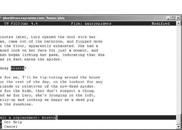

图 4.7 `pico` 提示你修正拼错误的单词。

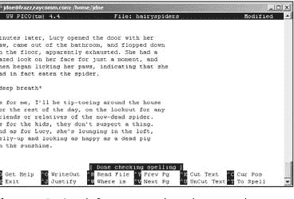

图 4.8 `pico` 通知你程序已完成。

# 在 pico 中获取帮助

了解 `pico` 的极佳方法是访问 `pico` 的帮助系统。除了找到你问题的答案外，你还可以发现你可能尚未了解的 `pico` 功能和能力（图 4.9）。

## 在 pico 中获取帮助

- `Ctrl G` - 在 `pico` 中，按下 `Ctrl G` 即可访问帮助。

- 翻阅帮助页面：

  - `Ctrl V` 帮助你向下移动帮助页面。

  - `Ctrl Y` 帮助你向上移动帮助页面。

- `Ctrl X` - 使用此组合键退出帮助。

## 获取 pico 启动选项的帮助

- `man pico`

在提示符处，输入 `man pico` 可以学习更多关于启动选项的信息，包括控制 `pico` 工作方式的各种选项。

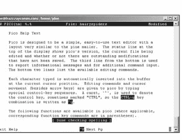

### 提示

- 关注 `pico` 状态行，以获取当前信息、错误消息以及关于使用 的 的提示。状态行是屏幕倒数第三行，就在菜单上方，如图 4.9 所示。

- 请记住，`pico` 实际上是一个非常基础的程序。如果你正在寻找一个无法提供的命令或函数，那里可能没有。你可以尝试查看 `vi` 或 `emacs`。并记住 `nano` 类似于 `pico`，但它有一些补充功能（而且你不需要学习另一个编辑器）。它值得一试。

## 退出 pico

当你在 `pico` 中编辑文件时，将通过以下步骤退出。

### 退出 pico

- `Ctrl X` 在 `pico` 内部，按下 `Ctrl X`。如果你自上次保存文件以来没有对文本进行任何更改，你将直接回到 shell 提示符。如果你已做出更改，系统会提示“Save modified buffer”（保存修改过的缓冲区）（图 4.10）。

- 在“Save modified buffer”提示符处：

  - 如果你想保存更改，按 `Y`。继续第 3 步。

  - 如果你不想保存更改，按 `N`。你将回到 shell 提示符。

- 如果是第一次保存，请为文件指定文件名。在此之前，按 `Enter` 确认当前文件名，或更改名称以保存副本而不更改原始文件。

#### 提示

- 缓冲区是计算机用于临时存储信息的地方，如果它被修改，意味着它正在临时存储你尚未保存到磁盘的内容。

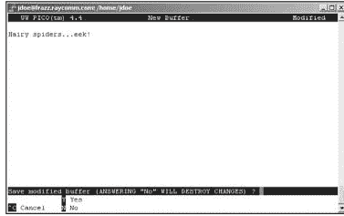

```
pico@linux.example.com ~/  New Buffer
-V pico 4.4  Modified
baily_spiders...ext

SAVE MODIFIED BUFFER? ("No" WILL DESTROY) [2]
Yes
Cancel:
```

**图 4.10** `pico` 给了你“保存修改过的缓冲区”的机会。不用技术术语来说，这意味着在退出之前保存你刚刚编写或编辑的文本。

## 创建和编辑文件

## 启动 vi 并尝试使用

在使用 `vi` 之前，请先理解它有两种模式（两种模式看起来都非常像**图 4.11**：

- 插入模式（有时称为输入模式），在该模式下，你按下的键会实际显示在你正在编辑的文件中。使用此模式添加或更改文本。

- 普通模式（有时称为命令模式），在该模式下，每一次击键都会被解释为一个命令。你使用此模式执行除输入以外的所有操作。


许多人对 vi 感到困惑的地方在于它以命令模式启动，这意味着如果你直接开始打字，可能会看到一些空格、字符以及你输入的单词片段——本质上，是一堆并不能准确代表你输入内容的垃圾——而且你会听到很多哔哔声。所以，正如我们在接下来的步骤中所展示的，你一旦启动 vi，就需要进入输入模式。

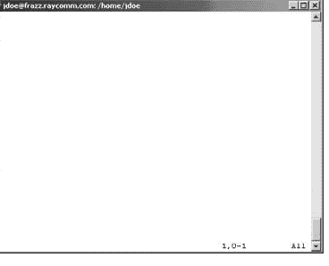

**图 4.11** vi 编辑器向你提供了大量的屏幕帮助和建议，如所示。嗯，文档是可用的，但 vi 界面本身完全没有用处！

### 启动 vi

1. `vi`

   在 shell 提示符处输入 `vi`。程序启动，你会看到类似图 4.11 的界面。`~` 符号表示文件末尾下方的空行。

2. `i`

   输入 `i` 进入输入模式。这本身是一个在命令模式下发布的命令，它不会显示在屏幕上。

# 第 4 章

## 3. 毛毛蜘蛛潜伏

在插入模式下，输入任何你想的内容。你输入的所有都会显示在屏幕上，直到你按下 `Esc` 返回命令模式。当你处于命令模式时，可以使用方向键按行在文件中导航，并使用 `Ctrl+F` 和 `Ctrl+B` 分别向前向后滚动屏幕。

### 提示

- 要获取 vi 的帮助，输入 `man vi`。更多关于 man 页的信息请参阅第 1 章。
- 如果你不确定自己处于什么模式，按 `Esc` 进入命令模式。如果你在插入模式，你会听到哔哔声。
- 许多类 Unix 系统（包括 Linux）都提供了一个名为 vi 的程序。如果你想保存更改，按 `Esc` 切换到命令模式。

## 创建和编辑文件

## 在 vi 中保存

在 vi 中保存文件需要遵循以下步骤。在 vi 中保存文本比在 pico 要复杂得多。

### 在 vi 中添加或删除文本

1. `vi`

   在 shell 提示符处输入 `vi`。

2. `i`

   进入输入模式。

3. 在插入模式下输入任何你想的内容。

4. `Esc`

   按下 `Esc` 进入命令模式。

5. 根据你想执行的操作选择命令。

   表 4.1 列出了添加文本的命令。
   表 4.2 列出了删除文本的命令。
   表 4.3 列出了杂项编辑命令。

6. `dd`

   输入命令。在这里我们正在删除当前行。

### 表 4.1 添加文本命令

| 命令 | 功能 |
| :--- | :--- |
| `a` | 在光标后添加文本 |
| `A` | 在行末尾添加文本 |
| `i` | 在光标前插入文本 |
| `I` | 在行开头插入文本 |
| `o` | 在当前行后插入一个空行 |
| `O` | 在当前行前插入一个空行 |

### 表 4.2 删除文本命令

| 命令 | 功能 |
| :--- | :--- |
| `x` | 删除一个字符（光标下） |
| `X` | 删除光标前一个字符 |
| `dd` | 删除当前行 |
| `5dd` | 从当前行开始删除五行 |
| `dw` | 删除当前单词 |
| `cw` | 修改当前单词（删除并进入输入模式） |
| `r` | 将光标下的字符替换为下一个按下的字符 |
| `R` | 用你输入的文本替换现有文本（类似于覆盖模式） |

### 表 4.3 杂项编辑命令

| 命令 | 功能 |
| :--- | :--- |
| `yy` | 复制当前行 |
| `p` | 在光标或当前行后粘贴任何文本 |
| `J` | 合并当前行和下一行 |
| `u` | 撤销上次更改 |
| `U` | 撤销当前行上的所有更改 |
| `.` | 重复上一个命令 |

## 将文件导入 vi

你可以通过将额外文件读取到当前文件中在 vi 中合并多个文件，如**图 4.13** 所示。基本上，这意味着你将一个文件插入到当前正在编辑的文件中。

### 在 vi 中导入文件

1. `vi hairyspider`

   在 shell 提示符处输入 `vi` 后跟文件名来启动 vi，在本例中，即为 `hairyspider` 文件。

2. `Esc` `:r filename`

   在文件中想要导入文本的位置，按下 `Esc`，然后输入 `:r` 以及你想要读取到文件的文件名。

✔ **提示**

- vi 还允许你将命令的输出读取到文件中。例如，如果你想将特定目录下的文件列表读取到文件中，可以在命令模式下使用 `Esc` `:r !ls`。

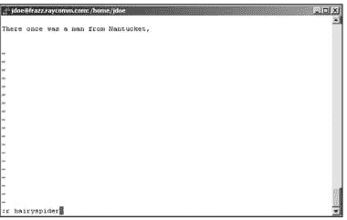

向 vi 导入文件

## 在 vi 中搜索和替换

vi 的优秀功能之一（优于 pico 的优势）是它允许你搜索和替换整个文件。正如上节所示，你只需要找到特定的文本字符串（在 Unix 类系统中，为正则表达式：请参见图 4.14），或者你也可以找到文本并将其替换为其他文本，如图 4.15 所示。

### 在 vi 中查找文本字符串

1. `vi hotrisypers`

   首先，访问 vi 和一个特定文件。

2. `Esc` `/`

   进入命令模式，然后输入 `/` 后跟你正在查找的文本。在这里，我们正在寻找 "spider"，但你可能在寻找 "fly" 或 "wiggled and jiggled inside her"。无论如何。

3. `Enter`

   按下回车键查找该词的第一次出现。输入 `n` 查找下一个。

### 在 vi 中搜索并替换

1. `vi hotrisypers`

   首先，访问 vi 和一个特定文件。

2. `Esc` `:%s/swallowed the fly/swallowed a spider to catch the fly/`

   输入 `Esc` `:%s` 加上要查找的文本，另一个 `/`，后跟替换文本，如图 4.15 所示。在这里，我们将 "swallowed a fly" 替换为 "swallowed a spider to catch the fly," 但你可能放弃那只蜘蛛，直接吃些抗酸药。

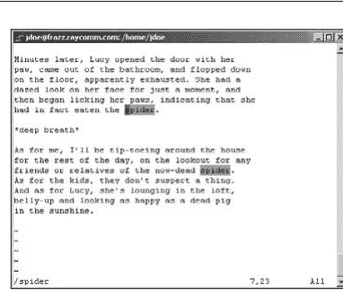


### 提示

- 搜索和替换功能的一个绝佳用途是如果你在 Unix 账户中有了 DOS 文本文件（很可能是从 Windows 机器作为二进制文件上传的文本文件）。如果你通过 Unix shell 查看 DOS 文件，文件中的所有行都会以 `^M` 结尾。但如果你在搜索和替换时尝试输入 `^M`，`^M` 不显示。该怎么办？按下 `Ctrl+V`，然后按 `Ctrl+M`。只需使用 `:%s/^M/g` 进行搜索和替换。`Ctrl+V` 命令会“转义”后续字符，因此你可以精确地输入命令原本会执行的内容。如果你不转义 `Ctrl+M`，它会认为你只是按了回车并尝试执行未完成的命令。
- 参见第 6 章关于 **grep** 的章节获取有关使用正则表达式进行搜索的信息。
- 在命令末尾添加一个 `g`，可以使其适用于文件中的所有出现处。否则，它仅适用于每行的第一次出现处。

## 退出 vi

呼！是时候退出 vi 了（图 4.16）。

### 退出 vi

- `Esc` `:q`

  通过输入 `Esc` 进入命令模式，然后输入 `:q` 退出 vi。如果你保存了最新的更改，vi 将不会退出并提示你覆盖。要在不保存更改的情况下退出，使用 `:q!`，如图 4.16 所示。

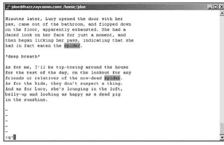

**图 4.16** 使用 `Esc` `:q!` 退出 vi 而**不**保存更改。

### 提示

- 如果你并不想退出，而是想编辑另一个文件，输入 `:filename` 打开一个新文件。
- 我们建议你在整个 vi 体验过程中花几分钟尝试一些命令。如果你认为你不需要这些命令，可以考虑使用 pico 或 nano 而不是 vi。

### emacs 常用快捷键

| 命令 | 功能 |
| :--- | :--- |
| `Ctrl+X` `Ctrl+F` | 保存 |
| `Ctrl+G` | 获取帮助 |
| `Esc` | 取消选择 |
| `Ctrl+V` | 向下翻 |
| `Alt+V` | 向上翻 |
| `Alt+<` | 移动到开头 |
| `Alt+>` | 移动到末尾 |

## 创建和编辑文件

## 使用 emacs 菜单进行拼写检查

拼写检查是好事。学习使用 emacs 菜单也是好事。在 emacs 中，拼写检查还允许你熟悉 emacs 菜单。使用 `F10` 以及每个菜单、菜单项和子菜单的键字母来导航菜单。（你将在屏幕底部看到提示，如图 4.19 所示）。按照操作使用菜单对你的工作进行拼写检查。

### 使用 emacs 菜单进行拼写检查

1. `emacs hairyspiders`

   首先，访问 emacs 和一个特定文件。

2. 按下 `F10` 进入菜单。

3. `t`

   接下来，输入你想要的菜单的首字母——此示例现在使用 `t` 代表 Tools。

4. `0`

   尝试 `0`（零）进行拼写检查。

5. 按下回车键并享受你的拼写检查。

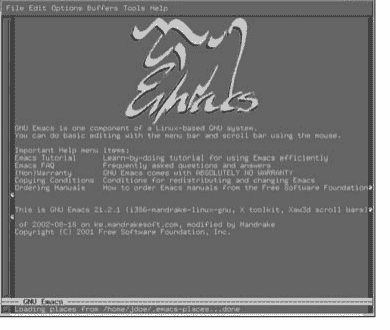

**图 4.19** 使用 emacs 菜单进行拼写检查。

## 在 emacs 中保存

通过频繁保存来保存你潜在的标题。要在 emacs 中保存文件（**图 4.20**），请遵循以下步骤。

### 在 emacs 中保存文本

- `Ctrl+X` `Ctrl+S` `hairyspiders`

  按 `Ctrl+X` 让 emacs 知道另一个命令即将到来，然后按 `Ctrl+S` 保存。最后，输入你想要使用的文件名（示例中为 `hairyspiders`），然后输入 `e`。如果你已经保存过该文件，只需按 `Ctrl+X` 接着按 `Ctrl+S` 即可。

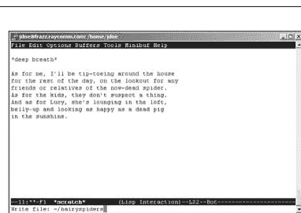

**图 4.20** 保存非常重要——至少你希望保留你努力的成果。

### 提示

- 如果你在尝试 emacs 之后查看你的主目录（或你正在工作的任何目录），你可能会注意到大量以 `~` 结尾的文件。这些是 emacs 备份文件，是为了你的方便和保持理智而创建的。如果你不需要它们，只需使用 `rm -i *~` 删除它们。如果你需要它们，使用 `mv oopsie~ oopsie` 即可恢复正常工作。
- 如果你想覆盖一个现有文件，请使用 `Ctrl+X` `Ctrl+W`，然后输入现有文件名以覆盖原始文件。

## 退出 emacs

哇！已经到了退出 emacs 的时候（图 4.21）。

### 退出 emacs

- `Ctrl+X` `Ctrl+C`

  让 emacs 知道另一个命令即将到来，然后按 `Ctrl+C` 关闭。如果你没有保存最近的更改，emacs 会要求你决定是想保存还是丢弃未保存的更改，如图 4.21 所示。

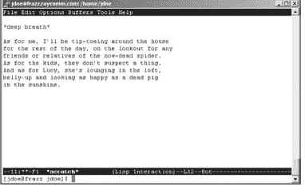

### 提示

- 如果你回到了命令行界面但不想保存或进行任何操作——你只想回到你的文件——请使用 `Ctrl+G` 取消。

# 第 5 章

## 控制所有权权限

Unix 和类 Unix 操作系统是多用户系统，其中你的文件与 Jane 的文件分开，Jane 的文件与 Joe 的文件分开，以此类推。你创建的任何文件都与其他用户的文件分开，并且通常无法被 Jane、Joe 或任何其他用户直接访问。

尽管如此，你有时需要共享文件。例如，你可能与 Jane 合作一个项目，其中共享文件（而不是创建和维护文件）是至关重要的。

本章提供了 Unix 文件权限和所有权的概述。对于许多系统，只有 root 用户可以更改所有权，因此你可能需要寻求系统管理员的帮助来完成此操作。

### 章 目录

- 理解文件所有权和权限
- 查找谁拥有什么文件
- 查找你属于哪个组
- 修改文件和目录的组关联
- 修改文件和目录的所有权
- 修改权限
- 将助记权限转换为数字权限
- 修改默认权限

## 理解文件所有权和权限

Unix 提供了三个级别的文件所有权：

- **用户（User）**。指主要负责该文件的单个用户 ID。你对创建的文件拥有此级别的所有权。
- **组（Group）**。指与特定文件关联的组（用户）。组内的所有用户在交互文件时具有相同的权限。
- **其他（Other）**。指任何未被标识为该文件用户或组的用户。

在这些级别中，你可以针对以下三类指定文件访问权限和权利：

- **读（Read）**。拥有读取权限的用户只能查看文件；不能对文件进行更改。
- **写（Write）**。拥有写入权限的用户可以更改或删除文件。
- **执行（Execute）**。拥有执行权限的用户可以运行文件（程序或脚本）并查看目录。

在本章中，我们将向你展示一些可以用来（有时由你使用，通常由 root 用户使用）设置所有权和权限的命令。请记住，你可以为你自己创建的文件以及可能还包括他人创建的文件设置或更改任何权限；然而，具体的权限和所有权取决于系统。即使你现在不需要更改文件所有权或权限，也应该快速阅读本章，看看可能有哪些可用的选项。

### 提示

- 关于整个所有权问题，一个有趣的转折是并不是所有的“所有者”都是人类。程序或进程以特定用户的身份运行，如果它们创建了文件，这些文件将反映该程序的个人和组成员的权限。更多信息请参见第 9 章。
- 某些类 Unix 操作系统具有控制特定文件的额外或补充手段。通常情况下，你会知道是否正在使用此类系统。目前，只需知道此类存在即可；本章中的步骤将处理你 95% 的需求。

## 查找谁拥有什么

更改所有权和权限的第一步是找出谁拥有哪些文件。你需要这些信息来判断你是否可以更改。要查找谁拥有：

1. `cd`

   在 shell 提示符下，输入 `cd` 返回你的目录。

2. `ls -l`

   查看文件的长列表。

```
xmission> cd
total 60
drwxr-xr-x 2 ejray users 4096 Jan 21 13:32 home
drwxr-xr-x 2 ejray users 4096 Jun 24 09:23 www
-rw-r--r-- 1 ejray users 512 Sep 15 20:07 access
-rw-r--r-- 1 ejray users 512 Jun 24 09:35 complete
-rw-r--r-- 1 ejray users 512 Sep 15 20:07 mail
-rw-r--r-- 1 ejray users 512 Jun 22 08:30 dead
-rw-r--r-- 1 ejray users 512 Sep 13 20:24 test
-rw-r--r-- 1 ejray users 512 Jun 10 19:44 conf
-rw-r--r-- 1 ejray users 512 Sep 13 20:10 letter
-rw-r--r-- 1 ejray users 512 Jan 21 13:32 bogus
-rw-r--r-- 1 ejray users 512 Jun 28 12:44 chat
-rw-r--r-- 1 ejray users 512 Sep 14 20:30 completed
-rw-r--r-- 1 ejray users 512 Jun 19 11:49 file
-rw-r--r-- 1 ejray users 512 Sep 14 20:31 dead
-rw-r--r-- 1 ejray users 512 Jun 25 15:25 ftp
-rw-r--r-- 1 ejray users 512 Sep 14 20:31 shared
-rw-r--r-- 1 ejray users 512 Jun 13 15:32 pub
-rw-r--r-- 1 ejray users 512 Sep 15 20:31 temp
-rw-r--r-- 1 ejray users 512 Jun 27 10:40 user
-rw-r--r-- 1 ejray users 512 Sep 14 20:31 work
```

3. `ls -l /etc`

   你也可以在系统目录（如 `/etc`）上使用 `ls -l` 命令。在这里，你会看到大多数文件都属于 root，具有不同的组组成。

```
ejr@hobbes permissions]$ ls -l
total 152
drwxr-xr-x 2 ejray users 4096 Jan 21 13:32 home
drwxr-xr-x 2 ejray users 4096 Jun 24 09:23 www
-rw-r--r-- 1 ejray users 512 Sep 15 20:07 access
...（为了简洁已省略）
```

左侧列包含十个字符，其中最后九个指定了每个文件的权限：

- `r` 表示读取权限，`w` 表示写入权限，`x` 表示执行权限。
- 第一组 `rwx` 针对用户，第二组针对组，最后一组针对其他。
- 连字符（`-`）代替字母表示用户/组没有权限。

在这个系统中，个人创建的文件是使用 `users` 组创建的，而少数目录与 `www` 关联。在其他系统中，默认组可能是与用户 ID 同名的组，如图 5 所示。

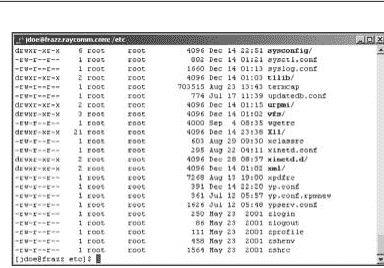

**图 5** /etc 中的大多数文件都属于 root。

### 提示

- 有时你会看到“世界可读”或“全局权限”。这与“其他”相同。“其他”仅指任何不是你或组内的人。


- 你可能还听过 `s` 或 `setuid` 权限，这表示程序或文件以文件所有者（root）的有效用户 ID 运行。例如 `/usr/bin/passwd` 拥有 `s` 权限，因为你可以运行 `passwd` 来更改密码，但命令需要以 root 身份运行才能修改密码数据库。

- 你可能在权限列表末尾看到 `t`，这表示设置了粘位（sticky bit）。设置“粘位”主要意味着在共享目录中，你只能删除自己的文件（而不会意外删除他的文件）。

```
[ejr@hobbes permissions]$ ls -l
total 152
drwxr-xr-x 2 ejray users 4096 Jan 21 13:32 home
drwxr-xr-x 2 ejray users 4096 Jun 24 09:23 www
-rw-r--r-- 1 ejray users 512 Sep 15 20:07 access
-rw-r--r-- 1 ejray users 512 Jun 24 09:35 complete/
-rw-r--r-- 1 ejray users 512 Sep 15 20:07 mail/
...
```

代码列表 5.2 有时组名和用户名是相同的，取决于系统的如何设置。

## 控制所有权与权限

### 查找你所属的组

如果你想对某个项目进行协作并共享文件（例如），你需要与团队中的其他人处于同一个组中。你的第一步是找出你处于哪个组，如代码列表 5.3 所示。

```bash
[ejr@hobbes permissions]$ grep ejr /etc/passwd
ejr:x$2.U0CyJKWME:500:500:Eric J.-Ray=/home/ejr:/bin/bash
[ejr@hobbes permissions]$
```

**代码列表 5.3** 你会在 `/etc/passwd` 中找到大量信息，包括你的默认组名。

```bash
[ejr@hobbes permissions]$ more /etc/group
kmem::
wheel::10:root,ejr
mail::mail
news::news
uucpc::14:uucp
man::20:
gopher::30:
dip::40:
tftp:50:
nobody::99:
users::100:ejr,deb,asr,awr
floppy:x:19:
ppusers:x:230:
popusers:x:231:
slipusers:x:232:
postgres:x:233:
ejr:x:500:
bash:x:501:
csh:x:502:
asr:x:503:
awr:x:504:
deb:x:505:
[ejr@hobbes permissions]$
```

**找出你所属的组：**

1. **`grep /etc/passwd`**

在这里，你从 `/etc/passwd` 文件（存储用户信息的地方）中 `grep` 出你的用户，并如代码列表 5.3 所示显示出来。从左到右你可以看到：

- 用户名
- 编码后的密码（或为空，如果系统配置为“shadow”密码则显示为 `x`）
- 你的 userid（每个用户在系统中都有一个唯一的数字）
- 组的数字。

你需要将其与第 3 步中的组名匹配。在这种情况下，组 ID 为 500。

2. **`more /etc/group`**

在这里，我们正在使用 `more` 探索 `/etc/group` 文件的内容，查看系统上定义了哪些组。如**代码列表 5.4** 所示，第一列包含组名，第三列包含组号，最后一列包含系统管理员添加到组的额外名称。用户可以属于多个额外的组，这就是额外组成员身份的标示方式。

**代码列表 5.4** 组文件列出了额外的成员（如 users 组所示）。

3. 将你 ID 的组号与组名匹配。我们的数字是 500，它对应这里的组名。

> **提示**
>
> - 如果你正在协作项目，请要求你的系统管理员为项目创建一个特殊组。这样，你和团队伙伴就可以轻松地共享文件。
> - 你也可以使用 `groups` 或 `id` 命令，它们提供了查找组身份更快速的方法。这些命令会提供关于组身份的关键详细信息（以及 uid），但它们不会向你大量其他关于系统的有趣且可能有用的细节。
> - 请查看第 7 章获取更多信息。
> - 请查看第 6 章获取关于 `grep` 的完整介绍。

### 使用 `chgrp` 修改文件和目录的组关联

假设你有一个名为 `project` 的文件，目前正由 `users` 组使用，你想更改文件的权限，以便 `project` 组可以访问。要做到这一点，你需要更改文件所属的组——在这种情况下，将关联从 `users` 组更改为 `project` 组。你可以使用 `chgrp` 更改目录所属的组，如代码列表 5.5 所示。

**使用以下命令更改组关联：**

1. **`ls -l`**

在 shell 提示符处输入 `ls -l` 以验证文件名及其所属的组。记住，列表中间的第二列（紧接在文件大小之前）列出了组成员身份。

2. **`chgrp project project`**

输入 `chgrp`，后跟你想要关联的现有组名和文件名。在这里，`chgrp` 命令将名为 `project` 的文件的组关联更改为 `project` 组。

```bash
[ejr@hobbes permissions]$ ls -l
total 178
-rw-rw-r-- 1 ejr users 500 Jul 24 14 project
-rw-rw-r-- 1 ejr ejr 889 Jul 24 33 project
-rw-rw-r-- 1 ejr ejr 290 Jul 24 33
[ejr@hobbes permissions]$ chgrp project project
[ejr@hobbes permissions]$ ls -l
total 178
-rw-rw-r-- 1 ejr project 500 Jul 24 14 project
-rw-rw-r-- 1 ejr ejr 889 Jul 24 33 project
-rw-rw-r-- 1 ejr ejr 290 Jul 24 33
```

代码列表 5.5 文件和目录都可以拥有一个组，但同一时间只能有一个。

> **提示**
>
> - 如果你尝试更改组所有权并收到诸如“Not owner”或类似的晦涩的错误信息，说明你的 userid 没有足够的权限进行更改。你将需要向你的系统管理员寻求帮助。
> - 仅在有特定需求时才更改组关联；你不希望不必要地将文件开放给其他人。除非你是系统管理员，否则你无法精确控制谁属于你授予了文件访问权限的组。
> - 如果你更改了特定目录的组关联，还需要检查包含该目录的父目录的权限。除非用户对父目录也具有读取和执行权限，否则无论他们的组身份如何，都无法进入特定目录。
> - 如果你需要更改组权限但发现无法操作，考虑使用 `sudo` 来帮助。第 5 章涵盖了 `sudo`，它允许某些用户在有限的情况下以系统管理员的权限操作。去看看。
> - 仅通过第 2 章介绍的 `cp` 和 `mv` 命令，你就可以配合 `chgrp` 使用 `-R` 标志来递归地对目录及其所有子目录和文件应用更改。例如，要将 `LatestProject` 的组关联改为 `project`，请在目录上方。

### 使用 `chown` 修改文件和目录的所有权

假设你一直在处理一个名为 `sailboat` 的文件，老板决定让同事 Merilee 接手。在这种情况下，为了将项目交给同事，你需要将所有权从你改为她。取决于系统管理员如何设置系统，你通常可以使用 `chown` 更改所有权（代码列表 5.6）。

**使用 `chown` 更改所有权：**

1. **`ls -l`**

首先，在 shell 提示符处输入 `ls -l` 以验证文件名和所有权，如代码列表 5.6 所示。记住所有权位于权限之后。

2. **`chown merilee sailboat`**

输入 `chown`，后跟你想传输所有权的人和文件名。在这里，`chown` 命令将 `sailboat` 的所有权更改为 `merilee`。生活变得美好。

```bash
[ejr@hobbes permissions]$ ls -l
total 26
-rw-rw-r-- 1 ejr users 500 Jul 24 14 sailboat
[ejr@hobbes permissions]$ chown merilee sailboat
[ejr@hobbes permissions]$ ls -l
total 26
-rw-rw-r-- 1 merilee users 500 Jul 24 14 sailboat
```

代码列表 5.6 更改所有权转移了控制权。

> **提示**
>
> - 更改文件所有权后，你对文件的操作取决于组和其他权限。然而，新所有者可以对文件做任何事情。
> - 在更改目录的所有权时，你可以为 `chown` 添加 `-R` 标志，使其适用于该目录下的所有文件和目录。
> - 如果系统不允许你使用 `chown` 交付文件，考虑使用 `cp` 制作文件的副本来实现相同效果。如果你将他人的文件（你有读取权限的文件）复制到另一个名称或位置，该副本完全属于你。（在赠送文件的示例中，接收者应该使用 `cp`。）
> - 即使你无法使用 `chown`，你仍然可以请求系统管理员为你更改文件所有权：“你能把我的 `sailboat` 所有权更改给 Merilee 吗？使用 `chown merilee /home/shared/me/sailboat`。谢了！”（这可能是因为许多 Unix 版本不允许非 root 用户更改文件所有权。）

## 使用 `chmod` 更改权限

```bash
[ejr@hobbes permissions]$ ls -l r*
-rwxr-x--- 1 ejr users 152779 Jul 24 15:10 rowspeedboat
[ejr@hobbes permissions]$
```

**代码列表 5.7** 使用 `ls -l` 查看文件的权限。

假设你一直在处理一个名为 `rowspeedboat` 的文件，并想让你的同事审阅它。为了做到这一点，你需要给其他人访问该文档的权限。你可以给特定组的人员访问权限，也可以给 Unix 系统上的每个人访问权限。具体来说，你可以为 `u`（user—用户）、`g`（group—组）、`o`（others—其他人）和 `a`（all—所有）指定权限。

除了指定权限外，你还可以指定个人或组对你的文件拥有多大的访问权限。例如，你可以指定 `r`（read—读）、`w`（write—写）和 `x`（execute—执行）权限，取决于你有多信任他们破坏你的 `rowspeedboat` 杰作。

如**代码列表 5.7** 所示，你的第一步是检查当前的权限是什么。然后，你可以设置权限、添加权限或根据需要删除权限。

### 检查当前权限

- **`ls -l r*`**

开始，输入 `ls -l r*` 来获取当前目录下 `rowspeedboat` 的详细列表。代码列表 5.7 显示权限为 `rwxr-x---`。这实际上是三组权限：

- 对于用户（在本例中为 `rwx`）
- 对于组（这里是 `r-x`）
- 或者对于全人类（这里是 `---`）

在这个例子中，用户拥有读取、写入和执行权限；组只有读取和执行权限；所有其他用户都没有权限。


### 设置权限

- **`chmod u=rwx,g=rx,o=r *`**

输入 `chmod` 并指定谁拥有访问权限。在这种情况下，用户具有读取、写入和执行权限；组具有读取和执行权限；而其他人对目录中所有以 `row` 开头的文件具有读取权限（代码列表 5.8）。等号指定命令中授予的权限是唯一生效的权限。任何之前的权限都将被删除。这里的通配符表达式 (`*`) 指定了该命令适用于当前目录下所有以“row”开头的文件和目录。

> **提示**
>
> - 你也可以在使用 `chmod` 时使用 `-R` 标志，将你对权限所做的更改递归地应用于目录中的所有文件和子目录。例如，`chmod -R go-rx *` 会撤销除用户之外所有人对当前目录下所有文件、当前目录下的所有子目录以及所有子目录下所有文件的权限。
> - 表达权限的方法大约有一万零一种。例如，你可以使用 `chmod ugo= *`（注意 `*` 前面有一个空格）或 `chmod u-rwx,g-rx,o-*` 来撤销目录文件中所有权限（注意，如果你尝试这样做，你必须先为文件加回你的权限，才能对它们进行任何操作）。
> - 如果你想更改多个文件的权限，请使用通配符。

```bash
[ejr@hobbes permissions]$ ls -l
total 332
-rw-rw-r-- 1 ejr users 24850 Jul 24 14:59 black
-rwxr-xr-x 1 ejr users 152779 Jul 24 15:10 rowyboat
-rw-rw-r-- 1 ejr users 128889 Jul 24 14:33 sage.sayings
-rw-rw-r-- 1 ejr users 23890 Jul 24 14:33 sayings
[ejr@hobbes permissions]$ chmod u=rwx,g=rx,o=r *
[ejr@hobbes permissions]$ ls -l
total 329
-rw-rw-r-- 1 ejr users 24850 Jul 24 14:59 black
-rwxr-xr-x 1 ejr users 152779 Jul 24 15:10 rowyboat
-rw-rw-r-- 1 ejr users 128889 Jul 24 14:33 sage.sayings
-rw-rw-r-- 1 ejr users 23890 Jul 24 14:33 sayings
[ejr@hobbes permissions]$
```

**代码列表 5.8** 你可以设置权限以确保所有文件具有相同的权限。

### 添加权限

- **`chmod g+w rowyourboat`**

在 shell 提示符下，输入 `chmod`，后面跟着：

- 类别。在这种情况下，我们使用了 `g` 代表组（group），你也可以使用 `o` 代表其他人（others），或者当然 `u` 代表用户（user），但你已经拥有它的访问权限。你也可以使用 `a` 代表所有用户（包括 `u`、`g` 和 `o`）。
- 加号（`+`）表示你正在向现有权限添加权限，而不是设置绝对权限。
- 要授予的权限。在这里，我们使用了 `w` 表示写入权限，但你也可以根据需要使用 `r` 表示读取或 `x` 表示执行权限。
- 文件名（`rowyourboat`）。

### 删除权限

- **`chmod go-w rowyourboat`**

在 shell 提示符下，输入 `chmod`，后面跟着：

- 类别。这里表示撤销除了用户之外所有人的权限。
- 减号（`-`）表示你正在从现有权限中删除权限。
- 要删除的权限。这里使用 `w` 表示写入权限。
- 文件名（`rowyourboat`）。


## 使用 `umask` 设置默认文件创建权限

- **`umask 022`**

将 `umask` 加上你在本节之前的步骤中计算出的数字（**代码列表 5.9**）。

> **提示**
>
> - 使用 `umask` 进行的任何更改仅对当前 shell 会话有效。如果你想恢复默认权限但记得它们之前是什么了，只需注销并重新登录即可恢复正常。
> - 如果你想永久地更改默认权限——或者至少在当前 shell 会话之后依然有效——请像第 8 章讨论的那样，在配置文件中进行更改。
> - 你无法将默认权限设置为包含执行权限；这是一项安全特性，而不是 Unix 功能的缺失。例如，假设你创建了一个新文件，并将你喜欢的命令（或你经常忘记的命令）复制进去。如果你不小心输入了文件名且该文件是可执行的，你就会运行该命令列表，后果可能会非常糟糕。因此，你必须显式地授予文件执行权限。
> - 是的，666 被认为是“野兽之数”。我们认为这只是一个巧合，但考虑到本节可能引起的混淆，我们不确定。
> - 输入 `umask` 或 `umask -s`（取决于你特定的 shell 和环境设置）来显示你当前的 `umask` 设置。

```bash
[ejr@hobbes permissions]$ umask 022
[ejr@hobbes permissions]$ touch tryit
[ejr@hobbes permissions]$ ls -l try*
-rw-r--r-- 1 ejr users 0 Jul 26 16:35 tryit
```


代码列表 5.9 使用 `umask` 为未来的文件设置默认权限。

## 操作文件

正如你在第 4 章中学到的，你可以通过打开编辑器并进行所需的更改来相当轻松地处理文本。但你可以做的不仅仅是在文件中复制、粘贴、剪切或移动文本。正如我们在本章将讨论的，你可以操作整个文件并查看它们的特定部分、获取文件信息、在文件中查找文本、比较文件以及对文件进行排序。

在本章中，我们将使用许多标志（flags）来增强命令。如果你以后需要进一步的解释或快速回顾，可以在附录 C 中找到最常用命令及其标志的完整列表。

## 目录

- 统计文件和文件内容
- 查看文件开头
- 查看文件结尾
- 查找文本
- 使用正则表达式
- 进行全局更改
- 更改文件
- 比较文件
- 查找文件差异
- 排序文件
- 消除重复
- 将文件重定向到两个位置
- 更改大小
- 格式化文件
- 拆分文件

## 使用 wc 统计文件及其内容

Unix 最方便的功能之一允许你统计文件及其内容。例如，你可以统计目录中的文件数量，或者统计一个文件中的单词数或行数。你使用 `wc` 命令进行计数，如代码列表 6.1 所示。

### 使用 wc 统计单词

- `wc -w honeyydo`
在提示符处输入 `wc -w`（代表单词）以及你想统计单词的文件名。`wc` 将会执行，如代码列表 6.1 所示。

### 使用 wc 统计行数

- `wc -l honeyydo`
后接文件名来统计文件中的行数（代码列表 6.2）。这对于诗歌或列表类事项有用（例如，“家务清单”始终至少有 73 个项目）。

### 提示

- 你可以使用 `ls -l` 统计普通文件和目录的数量，或者使用 `ls -A | wc -l` 统计所有文件和目录的数量（包括 `.` 和 `..` 目录）。
- 你还可以使用 `wc -c` 查看特定文件占用了多少字节。或者，你可以使用不带任何参数的 `wc` 来获取行、单词和字节数。

```
[ejr-hobbes manipulate]$ wc -w honeyydo

235 honeyydo
```

代码列表 6.1 使用 `wc -w` 统计文件中的单词。示例中的“家务清单”距离小说的长度还很远。

```
[ejr-hobbes manipulate]$ wc -l honeyydo

85 honeyydo
```

代码列表 6.2 尽管列表中有 85 个独立项目，但也已经足够了。

## 使用 head 查看文件开头

使用 `head`，如代码列表 6.3 所示，你可以通过查看文件的前几行来在瞬间了解文件内容。这在你浏览文件列表或尝试在几个内容相似的文件中查看某个特定文件时特别有用。

### 使用 head 查看文件开头

- `head honeyydo`
在提示符处输入 `head` 后接文件名。如代码列表 6.3 所示，你将在屏幕上看到前十行。

### 查看特定数量的行数

- `head -20 honeyydo`
在这里，你可以添加想要查看的特定行数（`-20`）。

### 查看多个文件的开头

- `head honeyydo * | more`
将 `head` 命令和文件（用 `*` 表示多个文件）通过管道交给 `more`（代码列表 6.4）。

```
[ejr@hobbes permissions]$ head honeyydo

tryit
```

代码列表 6.3 使用 `head` 查看文件的开头。

## 使用 tail 查看文件结尾

有时，你可能还需要使用 `tail`，它显示文件的行。`tail` 在检查页脚或更新信息时特别有用（见代码列表 6.5）。

### 使用 tail 查看文件结尾

- `tail honeyydo`
在 shell 提示符处输入 `tail` 后接文件名。你将在屏幕上看到最后十行。

### 查看特定数量的行数

- `tail -15 honeyydo`
在这里，你可以添加想要查看的特定行数（`-15`）。

### 查看多个文件的结尾

- `tail honeyydo * | more`
将 `tail` 命令和文件（用 `*` 表示多个文件）通过管道交给 `more`（代码列表 6.6）。

```
[ejr@hobbes permissions]$ tail honeyydo

tryit
```

代码列表 6.5 使用 `tail` 查看文件的结尾。

```
[ejr@hobbes permissions]$ tail -15 honeyydo

tryit

85 honeyydo
```

代码列表 6.6 使用 `tail` 配合 `more` 查看多个文件的结尾。

## 使用 grep 查找文本

你可以在多个文件中搜索特定的字符字符串，并在屏幕上显示匹配的文件列表。你可以使用 `grep` 命令（它是“global regular expression print”的缩写，这是一个曾经很有用但现在较罕见的奥术或 vi 命令），正如代码列表 6.7 所示。我们将向你展示如何，你可以为 `grep` 添加几个标志来获得略有不同的结果。

```
[ejr@hobbies manipulate]$ grep bucket limericks
曾经有一个来自南塔基特的男人，
他用桶子装午餐，
他叹了口气说，
一边吃着整个派，
“只要有一个甜甜圈，我就把它浸进去。”
[ejr@hobbies manipulate]$
```

代码列表 6.7 使用 grep 查看文件中特定字符串的所有出现处。

```
[ejr@hobbies manipulate]$ grep -5 bucket limericks
他弹拨着，他哼唱着，
唱着 dumedeed，
但他是个音乐家……谁能想到呢？

曾经有一个来自南塔基特的男人，
他用桶子装午餐，
他叹了口气说，
一边吃着整个派，
“只要有一个甜甜圈，我就把它浸进去。”

一位名叫 Debbie 的好女士，
[ejr@hobbies manipulate]$
```

代码列表 6.8 grep 也可以显示该字符串的上下文实例。

注意，`-5` 选项在所有版本的 `grep` 中都可用，但它适用于大多数版本。

### 使用 grep 查找文本

- `grep string file`
在提示符处，输入 `grep`、你想要定位的文本（在本例中是 `string`）以及要搜索的文件（这里是 `file`），`grep` 将返回文件中所有包含指定字符串的行，如代码列表 6.7 所示。

- `grep -5 string file`
你可以指定在找到的字符串两侧显示的行数（5行）。有时，仅通过包含搜索字符串的行你无法确定所需要的信息，在其周围添加几行可以帮助你理解上下文（参见代码列表 6.8）。

- `grep -c Nantucket limericks`
通过添加 `-c` 标志，你可以找出一个字符串在文件中出现的次数。

- 你可以对多个文件名使用 `grep`，例如 `grep Nantucket lim*` 或 `grep Nantucket lim* poetry humor`。

- `grep -v Nantucket limericks`
使用 `-v` 标志，你可以找到所有不包含指定字符串的行。

- 如果你想查找空格，你也可以查找空格，但你需要使用引号，例如 `grep "from Nantucket" limerick*`。

- `grep -i Nantucket limericks`
使用 `-i` 标志，你可以进行不区分大小写的搜索。在这里，任何带有 Nantucket 或 nAntUCket 的行都会被找到。

- 通过了解 `grep` 的历史赢得极客的酒吧赌注。

### 技巧

- 使用 `-n` 标志（例如 `grep -n string file`）可以为每个找到的行打印行号。

## 在 grep 中使用正则表达式

除了使用 `grep` 搜索文本字符串外，你还可以使用 `grep` 搜索正则表达式。正则表达式类似于通配符，你使用一个符号来表示字符、数字或其他符号。通过表达式，你可以搜索文件的不同部分，例如行的末尾或另一个指定文本旁文本字符串。表 6.1 列出了一些较常见的正则表达式。

### 在 grep 中使用正则表达式

- `grep .logan limerick`
输入 `grep` 后紧跟正则表达式和文件名。在这里，我们使用了正则表达式 `.logan` 来查找所有前面有一个单个字符的 "logan" 实例（代码列表 6.9）。注意，这种使用 `.` 匹配单个字符的用法类似于 `?` 通配符。
你也可以使用多个点来匹配特定数量的字符。例如，为了找到 "Dogbert" 和 "Dilbert"，你可能使用 `grep D..bert plagiarized.sayings`。
某些情况下，取决于你使用的表达式和正在查找的信息，你可能需要略有不同的搜索字符串。查看表 6.1 中的额外示例以获取更多信息。

```
[ejr@hobbes manipulate]$ grep .logan limerick
Worked hard all day on a slogan,
You see, the slogan's still broken.
[ejr@hobbes manipulate]$
```

代码列表 6.9 使用正则表达式配合 grep 创建花哨的通配符命令。

### 技巧

- “正则表达式”在 Unix 文档和互联网讨论中缩写为 "regexp" 或 "regex"。
- 命令 `egrep` 与 `grep` 密切相关，它为扩展正则表达式增加了更多的灵活性，但从根本上说 `grep` 命令就是 `egrep`——当你输入其中任何一个时，实际上运行的都是 `egrep`。
- 如果要在大文件中搜索整个单词，使用 `fgrep` 进行快速搜索。它使用与 `grep` 相同的通用语法，但只搜索单词（而不是正则表达式），因此速度快得多。
- 有关通配符的详情见第 1 章。

### 表 6.1 正则表达式、示例和解释

| 正则表达式 | 功能 | 示例 | 解释 |
|---|---|---|---|
| `.` | 匹配任意单个字符。 | `grep b.rry` | 这会找到所有的 "berry" 或 "barry"。 |
| `*` | 匹配前一个项目的零次或多次，因此 `a*b` 会找到 "ab" 也会找到 "aaab"，但不会找到 "abc"。 | `grep 's*day'` | 在这里，`*` 匹配紧接在 `*` 之前的项目的零或多次，在这种情况下是字母 's'。 |
| `^` | 仅匹配行开头的字符串。 | `grep '^Some'` | 使用 `^`，你可以搜索行开头的 "Some"。 |
| `$` | 仅匹配行末尾的字符串。 | `grep 'ach$'` | 这找到文件中所有以 "ach" 结尾的行。 |
| `\` | 转义后面的字符——所以你可以搜索像 `*` 或 `$` 这样的运算符字符。 | `grep '\*'` | `grep '\*'` 告诉 grep 将星号视为字面量而不是通配符。 |
| `[]` | 匹配集合中的任何成员。 | `[a-z]` | 匹配任意小写字母。 |

## 正则表达式的其他示例

在上一节中，我们展示了如何使用 `grep` 搜索正则表达式。在本节中，我们将向你展示更多示例。

## 使用 sed 进行全局更改

```
[ejr@hobbes manipulate]$ sed 's/oldaddr@raycom.com/newaddr@raycom.com/g' address.htm > address-new.htm
```

```
[ejr@hobbes manipulate]$ head address-new.htm
<BODY BACKGROUND="#FFFFFF" TEXT="#000000">
<P>
请将所有意见发送至 <A HREF="mailto:newaddr@raycom.com">newaddr@raycom.com</A>
</P>
```

## 使用 awk 修改文件

虽然 `sed` 是面向行的，并且允许你随心所欲地调整，但 `awk` 是面向字段的，非常适合处理数据库或逗号分隔的文件。如果你有一个地址簿文件，可以使用 `awk` 查找并更改你指定字段中的信息，如代码列表 6.11 所示。在接下来的步骤中，我们将向你展示使用 `awk` 修改文件的一些示例；此示例将使用地址簿文件。

### 如何使用 awk 修改文件

1. `awk '{ print $1 }' address.book`
在命令提示符下，使用 `awk '{ print $1 }' address.book` 查看地址簿文件，并选择（发送到标准输出）每条记录（行）的第一个字段。具体来说，从内层向外看：
- `$1` 指的是每行的第一个字段。除非另有指定，否则 `awk` 假设空白符分隔字段，因此第一个字段从行开始，一直到第一个空格结束。
- `{ }` 包含 `awk` 命令，引号是必须的，用于将 `awk` 命令组合（这样 shell 就不会将第一个空格解释为命令的结束）。参见代码列表 6.11。

2. `awk -F, '{ print $1 }' address.book`
`-F` 标志告诉 `awk` 使用其后的字符——在本例中是逗号——作为字段分隔符。这一变化使得命令的输出更加整洁准确。如果你正在处理 `/etc/passwd`，可以使用 `-F:` 来指定冒号 `:` 是字段分隔符。

```
[ejr@hobbes manipulate]$ awk '{ print $1 }' address.book
Schmidt,
Feldman,
Brown,
Smith,
Jones,
[ejr@hobbes manipulate]$
```


# 代码列表 6.11 awk 允许你访问文件中的单个字段

## 什么是分隔（De-what）？

分隔文件使用特定字符来显示一段信息的结束和另一段信息的开始。每段信息都是字段分隔符。例如，包含 "John, Thornton, Colorado" 的是通过逗号分隔的，在字段之间有逗号。其他文件（如 `/etc/passwd` 文件）使用冒号（:）来分隔字段。几乎任何未在内容中使用的符号都可以作为分隔符。

## 操作文件

```
[ejr@hobbes manipulate]$ awk -F, '{print $2 " " $1 " " $7}' address.book > phone.list
[ejr@hobbes manipulate]$ more phone.list
Sven Schmidt 555-555-8382
Fester Feldman
John Brown 918-555-1234
Sally Smith 801-555-8938
Kelly Jones 408-555-7253
[ejr@hobbes manipulate]$
```

3. `awk -F, '{print $2 " " $1 " " $7}' address.book > phone.list`

通过这段代码，你可以按照任意顺序从数据库中指定字段。尽管看起来很复杂，但它比上一个示例只多了一个步骤。我们不是打印地址簿中的单个字段，而是打印字段 2，然后是一个空格，然后是字段 1，然后是一个空格，最后是字段 7。最后将输出重定向到一个新文件。这个示例将提供一个姓名和电话号码列表，如代码列表 6.12 所示。

**代码列表 6.12** 经过少量调整，awk 允许你对文件进行大量处理以获取你所需的信息。

4. `awk -F, '/CA/{print $2 " " $1 " " $7}' address.book > phone.list`

你也可以指定一个模式。在这里，我们添加了 `/CA/` 进行搜索，仅匹配包含 CA 的行，因此这些行才会出现在 phone.list 中。

### 提示

- 你可以使用 `awk -f script.awk filename` 从文件加载 awk 脚本。与 sed 一样，这可以使重复输入最少化，对于这些长且复杂的命令非常有帮助。有关脚本的更多细节，请参考第 10 章。
- 查看本章稍后部分的“使用 sort 排序文件”，并考虑将你的 awk 输出通过管道传给 `sort`。让 Unix 为你完成繁琐的工作吧！

## 使用 cmp 比较文件

假设你一直在处理 dearliza 文件，并想知道它与 dearhenry 文件有什么不同。使用 `cmp`，你可以比较**代码列表 6.13** 中的两个文件。

### 使用 cmp 比较文件：

- `cmp dearhenry`

在 shell 提示符下，输入 `cmp` 后跟文件名。如代码列表 6.13 所示，这两个文件是不相同的。如果文件是相同的，你会发现自己回到了 shell 且没有 `cmp` 的任何提示。如果两个文件直到其中一个结束为止都是相同的——例如，前 100 行相同而另一个已经结束了——那么你将看到一个 EOF（文件结束）消息，如**代码列表 6.14** 所示。

### 提示

- 你可以使用 `diff` 找到文件差异的其他方法，见下一节“使用 diff 查找文件差异”。
- Unix 提供了一个退出状态，你可以用它来检查文件是否相同。更多信息请参见“高级重定向”。
- 你也可以查看本章稍后部分的“使用 diff 查找文件差异”。

## 使用 sort 排序文件

如果你想偷懒一点——呃，是聪明一点——就让 Unix 为你排序文件或文件内容。例如，你可以使用 `sort` 对你的地址录按字母顺序排序，而不是按照你输入地址的顺序（参见**代码列表 6.17**）。

### 使用 sort 排序文件：

- `sort address.book > sorted.address.book`

开始时，输入 `sort`，后面输入你想要排序的文件内容。Unix 会对文件中的行进行排序，并将排序后的结果呈现在你指定的文件中（这里是 `sort address.book`），如代码列表 6.17 所示。

```
Schmidt, Sven, 1 Circle Drive, Denver, CO, 80221, 555-555-8382
Feldman, Fester, RR1, Billings, MT 62832, 285-555-0281
Brown, John, 1453 South Street, Tulsa, OK, 74114, 918-555-1234
Smith, Sally, 452 Center Ave., Salt Lake City, UT, 84000, 801-555-8982
Jones, Kelly, 14 Main Street, Santa Clara, CA, 95051, 408-555-7253
```

```
[ejr@hobbes manipulate]$ sort address.book > sorted.address.book
Brown, John, 1453 South Street, Tulsa, OK, 74114, 918-555-1234
Feldman, Fester, RR1, Billings, MT 62832, 285-555-0281
Jones, Kelly, 14 Main Street, Santa Clara, CA, 95051, 408-555-7253
Smith, Sally, 1 Circle Drive, Denver, CO, 80221, 555-555-8382
Smith, Sally, 452 Center Ave., Salt Lake City, UT, 84000, 801-555-8982
[ejr@hobbes manipulate]$ sort address.book > sorted.address.book
Brown, John, 1453 South Street, Tulsa, OK, 74114, 918-555-1234
Feldman, Fester, RR1, Billings, MT 62832, 285-555-0281
Jones, Kelly, 14 Main Street, Santa Clara, CA, 95051, 408-555-7253
Schmidt, Sven, 1 Circle Drive, Denver, CO, 80221, 555-555-8382
Smith, Sally, 452 Center Ave., Salt Lake City, UT, 84000, 801-555-8982
[ejr@hobbes manipulate]$
```

**代码列表 6.17** 一个无序的地址录在 sort 的帮助下得到了排序。

# 第 6 章

### 提示

- 如果你有多个文件需要排序，可以使用 `sort file1 file2 file3 > complete.sorted.file`，输出将包含所有三个文件的内容——当然，是排序后的。
- 你可以通过在命令中添加 `-t` 来对逗号分隔的文件进行字段排序。例如，`sort -t, +1 address.book` 告诉 Unix 按以下字符 `,` 排序，`,` 表示分隔字段的字符——在本例中是逗号。如果没有给出字符，`sort` 会认为空格是字段之间的边界。`+1` 表示跳过第一个字段并对第二个字段进行排序。
- 你也可以使用 `sort -n filename` 进行数值排序。如果你不使用 `-n` 标志，输出将根据数字中最左侧的数字进行排序——例如“1, 203, 50”，因为字母排序是从字段的左侧开始的。

## 使用 SORT 排序文件

## 操作文件

### 使用 uniq 去重

如果你使用了好用的 `sort` 命令对文件进行了排序，你得到的结果可能包含重复项。老天，你甚至可能文件本身就带有重复项。按照你的进度，这里是找到并处理它们的方法。如代码列表 6.18 所示，你可以结合 `sort` 使用 `uniq` 命令（“unique”的缩写）删除重复行。

### 提示

- `uniq` 仅查找相同且相邻（已排序的）行。例如，如果你的地址录中同时有 Jones 和 jones，`uniq` 不识别其中任何一个，因为它们的大小写不同。
- 你可以使用 `-d` 标志来指定只查看重复行。例如，你想查看出现在拼车文件（carpool）和今晚文件（tonight）中的所有人。你只需使用 `sort carpool overnight`。
- 你可以使用 `sort -u uniq.book` 一步完成排序并去重。

### 使用 uniq 去重：

- `sort long.address | uniq`

在提示符处，输入 `sort` 和文件名，通过 `| uniq` 将输出传递给 `uniq`，输出将不包含任何重复条目（代码列表 6.18）。

```
[ejr@hobbes manipulate]$ more long.address.book
Schmidt, Sven, 1 Circle Drive, Denver, CO, 80221, 555-555-8382
feldman, Fester, RR1, Billings, MT 62832, 285-555-0281
Brown, John, 1453 South Street, Tulsa, OK, 74114, 918-555-1234
Smith, Sally, 452 Center Ave., Salt Lake City, UT, 84000, 801-555-8982
Jones, Kelly, 14 Main Street, Santa Clara, CA, 95051, 408-555-7253
Schmidt, Sven, 1 Circle Drive, Denver, CO, 80221, 555-555-8382
feldman, Fester, RR1, Billings, MT 62832, 285-555-0281
Brown, John, 1453 South Street, Tulsa, OK, 74114, 918-555-1234
Smith, Sally, 452 Center Ave., Salt Lake City, UT, 84000, 801-555-8982
Jones, Kelly, 14 Main Street, Santa Clara, CA, 95051, 408-555-7253
[ejr@hobbes manipulate]$ sort long.address.book | uniq
Brown, John, 1453 South Street, Tulsa, OK, 74114, 918-555-1234
feldman, Fester, RR1, Billings, MT 62832, 285-555-0281
Jones, Kelly, 14 Main Street, Santa Clara, CA, 95051, 408-555-7253
Schmidt, Sven, 1 Circle Drive, Denver, CO, 80221, 555-555-8382
Smith, Sally, 452 Center Ave., Salt Lake City, UT, 84000, 801-555-8982
[ejr@hobbes manipulate]$
```

**代码列表 6.18** 使用 sort 和 uniq 去重。

# 第 6 章

## 使用 tee 重定向到多个位置

假设你刚刚更新了地址录文件，除了放入你的文件外，还想发送它。你可以使用 `tee` 实现，它可以将输出重定向到两个不同的地方（参见代码列表 19）。

### 使用 tee 将输出重定向到两个位置：

你可以将 `tee` 命令想象成水管的 T 型头——即它从一个位置获取内容并发送到两个不同的地方。

- `sort address.book new_addresses | tee sorted.all | mail raycomm.com -s "Here's the address book, boss"`

在提示符处，在管道行中间使用 `tee` 命令加上文件名，将排序后的信息发送到该文件名以及标准输出（当然可以重定向到另一个文件名）。在这里，我们将 `sort` 的结果发送到 `sorted all` 文件和标准输出，由 `mail` 接管并将文件发送给老板。更多高级邮件技巧请参见第 11 章。

```
$ejr@hobbes]$ sort address.book new_addresses | tee sorted.all | mail raycomm.com -s "Here's the address book, boss"
ejr@hobbes]$
```

**代码列表 6.19** 使用 tee 同时将输出发送到两个不同的地方。

## 操作文件

### 使用 tr 修改

有时你必须对文件进行更改，将一个术语或字符的所有出现替换另一个。例如，你可能反转了文件的大小写（因为不小心开启了大写锁定！）需要将其改回来。或者你可能想将文档转换为单词列表（每行一个），以便你进行计数或排序。`tr` 工具正是你所需要的（参见代码列表 20）。

### 使用 tr 翻译：

- `cat limERICK | tr a-zA-Z A-Za-z`

在提示符处，使用 `cat` 命令和管道将文件发送给 `tr`，它会将小写转换为大写，反之亦然。

### 使用 tr 换行：

- `cat limERICK | tr -c a-zA-Z "\n"`

将任何不是字母（大写或小写）的内容转换为换行，将这首五行诗（limERICK）拆分为单词列表。`-c` 表示任何不匹配第一个字符集（这些字符的补集）都应更改新字符。

```
$joe@frazz joe$ cat limERICK
There once a man from Nantucket,
Who carried his lunch in a bucket,
Said he with a sigh,
As he a whole pie,
If I just had a donut I'd dunk it.
$joe@frazz joe$ cat limERICK | tr a-zA-Z A-Za-z
THERE WAS A MAN FROM nANTUCKET,
WHO CARRIED HIS LUNCH IN A BUCKET,
sAID HE WITH A SIGH,
AS HE A WHOLE PIE,
if I JUST HAD A DONUT I'D DUNK IT.
$joe@frazz joe$ cat limERICK | tr -c a-zA-Z "\n"
once
was
a
man
from
Nantucket
Who
carried
his
lunch
in
a
bucket
Said
he
with
a
sigh
as
he
ate
a
whole
pie
If
just
had
a
donut
dI
dunk
it
```

**代码列表 6.20** 使用 tr 翻译文件中的字符。

**代码列表 6.20** continued

# 第 6 章

## ✓ 提示 (Tips)

- 与其使用 `cat` 将文件发送给 `tr`，你可以使用精巧的 Unix 重定向工具（在本情况下）来完成。转换大小字母的等效命令是 `tr a-zA-Z A-Za-z < limerick`。
- 通过 `tr`，你可以完成各种翻译。例如，你可以编写一些代码来让秘密信息保持某种程度的秘密，通过将字母转换为乱码来扰乱你的文本，然后在需要时重新翻译。例如，使用 `cat limerick | tr a-mA-Mn-Zn-z n-zN-ZA-Ma-m > limerick.rot13` 来编码，使用 `tr n-zN-ZA-Ma-m a-mA-Mn-Zn-z` 以解码。这与第 16 章讨论的 ROT13 相同，但如果你使用 `tr` 来操作，会更加灵活和精巧。
- 查看 `tr` 的 man 页（`man tr`）以获取有关它可以执行的其他酷炫翻译和转换的详情。

## 使用 fmt 处理文件

在你一直在打字之后——也许是在写一部伟大的美国小说——你可能会发现自己正遭受着日益严重的边缘美丑化，正如代码列表 6.21 所示。不要担心，`fmt` 可以提供帮助。只需输入即可。

```
jdoe@frazz jdoe$ cat spiderstory.unformatted
This morning I
got up, went
downstairs, and found a HUMONGOUS spider
in the bathroom where the little bug potty is.
After I
quietly composed myself
from the shock (I didn't want
to alert the kids),
I looked around the
house for
some to put him in...the
kids' bug catcher him
nowhere to found)...a jar...tupperware... a lidded
cup...
sad spinner (BwaaaHaaHaa!)...
I went back and checked on the spider and decided that I couldn't face putting him in
something.
i mean, what if he got close to me...or TOUCHED
me?!!
And, since I hate the crunching sound and feel of
squashing bugs,
I knew I couldn't kill him.
```


This spider had `bones`, I'm tellin' ya'. So, I hunted for bug spray. And hunted. But

```
jdoe@frazz jdoe$ fmt spiderstory.unformatted
This morning I got up, went I quietly composed myself from the shock (I didn't want to alert the kids), I looked around the house for something to put him in...the kids' bug catcher him (nowhere to found)...a jar...tupperware...a lidded cup...the salad spinner (BwaaaHaaHaa!)...
I went back and checked on the spider and decided that I couldn't face putting him in something. I mean, what if he got close to me...or TOUCHED me?!! And, since I hate the crunching sound and feel of squashing bugs, I knew I couldn't kill him. This spider had `bones`, I'm tellin' ya'. I'm hunted for bug spray. And hunted for nothing.
```

**代码列表 6.21**: 通过 `fmt`，你可以清理文档格式中各种奇特的怪癖。

### 使用 fmt 进行格式化

- `fmt spiderstory.unformatted`
  在 shell 提示符处，只需告诉 `fmt` 执行它的工作，你就能大事了。

- 提示
  你可以用方便的标志来补充 `fmt`，以提高行的可读性。例如，你经常可以使用 `fmt -u` 来使间距均匀：单词之间一个空格，句子之间两个空格。或者，尝试 `fmt -w` 来指定格式化文本的宽度；例如，`-w 60` 将指定一个 60 字符宽的行。

## 使用 split 分割文件

假设你正在用数码相机拍照，并通过电子邮件给朋友和家人分享一张新电脑的照片（还有什么比这更酷到拍照呢？）。访问文件，将其附加到电子邮件消息中，然后——砰——ISP 无法发送文件，因为文件太大了。尽管你可以修改文件本身——减小物理尺寸、减少使用的颜色数量或裁剪非本质部分——但你也可以直接用 `split` 分割文件。例如，如果 ISP 告诉你不接受大于 0.51 MB 的文件，你可以使用 `split` 将文件分成若干块——只需一个简单的命令（代码列表 6.22）。

```
$ jdoe@frazz]$ ls -lh
total 1.1M
-rw-r--r 1 jdoe jdoe 1.0M Jan 12:42 mongopicture.jpg*
$ jdoe@frazz]$ ls -l
total 1060
-rw-r--r 1 jdoe jdoe 1079300 Jan 12:42 mongopicture.jpg*
$ jdoe@frazz]$ split -b 500M mongopicture.jpg
$ jdoe@frazz]$ ls -lh
total 2.1M
-rw-r--r 1 jdoe jdoe 1.0M Jan 12:42 mongopicture.jpg*
-rw-r--r 1 jdoe jdoe 500K Jan 13:03 xaa
-rw-r--r 1 jdoe jdoe 500K Jan 13:03 xab
-rw-r--r 1 jdoe jdoe 54K Jan 13:03 xac
$
```

（注：原文示例代码块中存在部分内容重复或格式错误，翻译时已保持其逻辑结构）

### 获取系统信息

## 使用 df 查看文件系统

如果你习惯了 Windows 或 Macintosh 操作系统，你可能习惯于看到独立的硬盘（Windows 用户看到的 C:、D:、E:，或 Mac 的真实名称），这些只是不同的存储空间。在 Unix 系统中，不同的存储空间被挂接到整个树形结构上——被附加在已有的结构上，而没有明确的区分来指示实际磁盘驱动器的位置。例如，如果你在 Windows 计算机上有一个文件夹，你知道其中所有的子文件夹和文件都位于同一个驱动器上。在 Unix 中，一切都位于根目录下，但任何不同的目录都可能位于不同的物理驱动器。你可以将其想象成在你的仿真圣诞树上接了一根新枝。

这些附加的存储空间被称为文件系统。特别是当你运行 Unix 系统（而不仅仅是一个系统）时，你可能需要找出系统中哪些文件系统（用术语说就是挂载在系统中），它们拥有多少空间，以及它们连接到 Unix 系统的位置（或它们的挂载点在哪里）。你可以使用 `df` 命令来获取这些信息，见代码列表 **7.3** 和 **7.4**（在下一页）。

| 文件系统 | 已用 | 可用 | 容量 | 挂载到 |
|---|---|---|---|---|
| /dev/hda1 | 515161 | 316297 | 172255 | 65% | / |
| /dev/hdb4 | 66365 | 4916 | 58022 | 8% | /home |
| /dev/hdb1 | 416656 | 324633 | 70504 | 82% | /usr/local |
| /dev/sbpcd | 596704 | 596704 | 0 | 100% | /mnt/cdrom |

```
ejr@hobbes ejr$ df
Filesystem  1024-blocks  Used        Available  Capacity  Mounted on
/dev/hda1   515161      316297     172255     65%       /
/dev/hdb4   66365       4916       58022      8%        /home
/dev/hdb1   416656      324633     70504      82%       /usr/local
/dev/sbpcd   596704      596704      0          100%      /mnt/cdrom
ejr@hobbes ejr$
```
**代码列表 7.3** 该 Linux 系统的文件系统相对简单。

# 第 7 章

## 使用 df 了解文件系统

- 在 shell 提示符下输入 `df`。你通常会得到如下输出：
  - 设备名称，指的是存储数据的物理部分，例如硬盘、CD-ROM 或其他设备。在代码列表 7.3 中，第一个是 `/dev/sda1`，表示系统中的第一块硬盘。
  - 块数，以 KB 为单位的单元（在这种情况下，某些系统报告其为 512 字节）。
  - 设备上已用块数和可用块数。
  - 设备上已用空间占百分比。
  - 文件系统名称，即 Unix 系统的完整路径。它也被称为挂载点。

| 挂载点 | 设备 | 块 | 文件 |
|---|---|---|---|
| / | (/dev/disk/c0d0s) | 154632 | 7121 |
| /usr | (/dev/disk/c0d6s) | 225886 | 14820 |
| /proc | (/proc) | 7830 | |
| /dev/ | (/dev/) | 0 | 0 |
| /var | (/dev/disk/c0d1s) | 100142 | 96258 |
| /tmp | (swap) | 1236032 | 95277 |
| /usr/local | (/dev/disk/c0d5s) | 603636 | 457211 |
| /archive | (/dev/disk/c0d3s) | 178948 | |
| /var/mail | (mail.example.com:/var/) | 2776657 | 143815 |
| /home | (user.example.com:/home/) | 20091072 | 1306932 |
| /var/spool/newlib | (news.example.com:/spool/newlib) | 19372664 | 1248 |
| /.web | (user.example.com:/web/) | 1019408 | 470095 |
| /var/mailists | (lists.example.com:/var/mailists) | 2937424 | 89732 |

**代码列表 7.4** 这些大型 ISP 的文件系统要复杂得多。

### 提示

- 你可以使用 `df` 配合特定目录来获取该目录所在系统的报告。例如，你可以使用 `df /user/local/src` 来找出该目录挂载在哪里以及那里有多少可用空间。
- 使用 `df -k` 确保以 KB 块报告使用，而不是 512 字节块。添加 `-k` 标志也会得到像代码列表 7.3 那样的输出。
- 使用 `df -h` 获取人类可读的输出。这适用于许多命令（如 `ls`），可以输出易于理解的信息。
- 代码列表 7.5 显示了不同系统的输出。如果你是系统管理员，可以使用这些信息来诊断系统中出现的问题。如果你是一个普通用户，可以使用这些信息来满足好奇心。如果你在运行特定程序时遇到错误或不可预测的结果，使用 `df` 可能会揭示 `/home` 文件系统满了，或者你认为的 `/dev/cdrom` 文件系统已经挂载。额！

| 文件系统 | 大小 | 已用 | 可用 | 挂载到 |
|---|---|---|---|---|
| /dev/disk/c0d0s | 19G | 4.5G | 15G | 24% | / |
| /devices | 0K | 0K | 0K | 0% | /devices |
| /dev | 0K | 0K | 0K | 0% | /dev |
| /ctfs | 0K | 0K | 0K | 0% | /system |
| /proc | 0K | 0K | 0K | 0% | /proc |
| /mmntab | 0K | 0K | 0K | 0% | /etc/mmntab |
| swap | 1.5G | 856K | 1.5G | 1% | /etc/volatile |
| objfs | 0K | 0K | 0K | 0% | /system/object |
| /usr/lib/libc.so | 19G | 4.5G | 15G | 24% | /lib/libc.so |
| /dev | 0K | 0K | 0K | 0% | /dev |
| swap | 1.5G | 164K | 1.5G | 1% | /tmp |
| swap | 1.5G | 32K | 1.5G | 1% | /var |
| /dev/disk/c0d0s | 51G | 18G | 36G | 3% | /export |
| /pooldata | 226G | 106M | 296G | 1% | /pooldata |
| /pooldata/family | 226G | 140G | 69G | 68% | /pooldata/family |
| /pooldata/raycomb | 226G | 5.9G | 69G | 8% | /pooldata/raycomb |
| poolscratch | 228G | 46G | 181G | 21% | /poolscratch |

**代码列表 7.5** 使用 `df -h` 获取“人类可读”的输出。

## 磁盘占用

你可以访问另一个信息是 Unix 系统内部的磁盘空间。你可以使用 `du` 来，如代码列表 7.6 所示。

### 使用 du 确定磁盘占用

- 在 shell 提示符下输入 `du`。如代码列表 7.6 所示，你会得到关于当前目录和所有子目录的磁盘占用信息。数字通常以块为单位（同 `df`）。你可以通过 `du -h` 实际读取输出。
- 如果你在强制磁盘配额的系统中（许多 ISP 都如此），你可以找出你的配额以及距离配额有多远。只需在提示符下输入 `quota`。
- 你可以使用路径 `du` 来检查单个目录的磁盘占用（见代码列表 7.7），`du` 在打印结果时会按子目录汇总用法。
- 使用 `du -s` 配合特定目录，仅打印使用空间的摘要。

```
ejr@hobbes ejr$ du
./Mail 2
./nsmail 1
./network/cache/3
./network/cache/22
./network/archive 172
./network 1
./Projects 28
./wprc 3
./axhome 5
./manipulate/empty 154
./manipulate 1
./mail 1
./unixvqs/ch 2
./unixvqs 6
./dugroups 255
./compression/Folder 670
./compression/temp/BackupFolder 670
./compression/temp 670
./compression/Folder 4657
./clean 5
./elm 15
./editors 519
ejr@hobbes ejr$
```
**代码列表 7.6** 该命令报告当前目录及其子目录的磁盘占用情况。

```
ejfrazz $ du /home/ejr/compression
255 /home/ejr/compression/Folder
670 /home/ejr/compression/temp/BackupFolder 1921 /home/ejr/compression/temp
670 /home/ejr/compression/BackupFolder 4657 /home/ejr/compression
ejfrazz $
```
**代码列表 7.7** 使用特定目录 `du` 聚焦结果。

### 获取系统信息

## 使用 file 查看文件类型

```
ejr@hobbes ejr$ file /usr/bin/pico
/usr/bin/pico: ELF 32-bit LSB executable, - Intel 80386, version 1, dynamically loaded
ejr@hobbes ejr$ file temp.htm
temp.htm: ASCII text
ejr@hobbes ejr$
```

如果你来自 Windows 或 Macintosh 背景，你可能习惯于访问文件并看到它们是什么类型——HTML 文件、GIF、文档等等等。在 Unix 中，你通常无法通过列出文件来判断类型。这就是 `file` 命令派上用场的地方，如代码列表 7.8 所示。

**代码列表 7.8** `file` 命令提供了关于特定文件类型的信息。

## 使用 finger 查找用户信息

通过 `finger` 命令，你可以查出当前谁登录了 Unix 系统，他们正在做什么，登录了多久，以及其他令人好奇的、虽不一定与你有关的信息（代码列表 7.9）。

### 要使用 finger 查找谁登录了系统

1. `finger`
   在 shell 提示符下输入 `finger`，可以查看还有谁登录了系统，并获取关于他们的少量信息（代码列表 7.9）。
2. `finger @example.com`
   输入 `finger`、`@` 和主机名（在此例中为 example.com），查找谁登录了另一台主机。`fingering` 不同的主机并不总是生效的，这取决于其他计算机的安全设置。如果主机不允许访问，你将收到类似代码列表 7.9 中的消息。

| 登录名 (Login) | 姓名 (Name) | 空闲 (Idle) | 登录时间 (Login Time) | 办公室 (Office) | 办公室电话 (Office Phone) |
|---|---|---|---|---|---|
| asr | | * | 1 | 7月24日 13:32 | |
| deb | | 5 | | 7月24日 13:32 | | |
| ejr | Eric Roy | | 3:20 | 7月22日 07:42 | | |
| ejr | Eric Roy | p1 | 1:12 | 7月24日 12:14 (calvin) | | |
| ejr | Eric Roy | p0 | | 7月24日 13:02 (calvin) | | |
| root | root | *2 | 1d | | 7月22日 15:13 | | |

```
[ejr@Hobbes ejr]$ finger @example.com
[example.com]
No one logged on
[ejr@Hobbes ejr]$ finger osuunx.ucc.okstate.edu
finger: connect: Connection refused
[ejr@Hobbes ejr]$
```
**代码列表 7.9** `finger` 命令通常提供关于谁登录不同系统的有趣信息。

### 使用 finger 查找用户信息

- `finger ejr`
  在提示符下，输入 `finger` 后跟上你想要了解的用户的 ID。你将获得大量信息，包括用户的部分或全部名称、主目录目录和默认 shell；他们何时、从何处以及登录了多久；以及他们选择提供的任何其他信息。代码列表 7.10 显示了两个活动情况不同的用户：`deb` 显然一直在闲逛，而 `ejr` 一直在埋命工作。

```
ejr@hobbes ejr$ finger deb
Login: deb
Directory: /home/deb
```


Shell: `/bin/bash`

Never logged in.

No mail.

No Plan.

ejr@hobbes ejr$ finger deb

Login: ejr

Directory: `/home/ejr`

Shell: `/bin/bash`

On since Wed Jul 22 07:42 (MDT) on tty1 2 hours 32 minutes idle

On since Wed Jul 22 06:58 (MDT) on tty1 from calvin

No mail.

Project:

Working on VQS.

Plan:

This is my plan---work all day, sleep all night.

ejr@hobbes ejr$ finger ejray@mission.com

[mission.com].

Login      Name        TTY      Idle            When                Where

eejray       RayComm  pts/57  <Jul 22 09:39> calvin.raycomm.c

ejr@Hobbes ejr$

```
代码列表 7.10 `finger` 命令也可以提供关于特定用户的深层信息。
```

### 提示

- 你也可以使用 `who` 命令（见下一节）来探测用户信息。
- 你可以通过创建描述你的“计划”（plan）和“项目”（project）的文件（如 ejr 在代码列表 7.10 中所示），向任何通过 `finger` 获取你用户信息的人提供额外信息。使用你喜欢的编辑器在主目录下创建 `.plan` 和 `.project` 文件。然后，更改权限使文件都是可读的（`chmod go+r .plan; chmod go+r .project`），并确保目录是可执行的（`chmod +rx ~`）。有关 `chmod` 的具体细节请参见第 5 章。
- 通过 `finger` 获取的信息在诊断连接困难时非常有用。特别是系统管理员或帮助台人员可能会询问你连接到了哪里（例如 ejray@xmission.com 的 `pts/57`）以及你正在使用哪种软件。

### 获取系统信息

## 使用 `who` 学习还有谁登录了

```
ejr@hobbes ej$ who

ejr tty1 Jul 22 07:42

root tty2 Jul 24 15:13

asr tty4 Jul 24 13:32

deb tty5 Jul 24 13:32

ejr tty1 Jul 24 12:14 (calvin.raycomm.com)

ejr tty0 Jul 24 13:02 (calvin.raycomm.com)

[ejr@Hobbes ejr]$
```

如果你对 `finger` 获取的所有细节不感兴趣，可以使用 `who` 来获取基本信息。`who` 提供的是用户名、登录时间、主机名等。在提示符下输入 `who`，可以看到哪些用户登录了系统。

- `who` 的输出通常包含用户名、登录时间、主机名。代码列表 7.11
- `who` 提供的基本信息：
- 如果你对 `who` 的所有细节不感兴趣，你可以使用 `who` 来获取更详细的信息。
- 在提示符下输入 `who`，你可以看到类似代码列表 7.11 的输出。

## 使用 `w` 学习还有谁登录了

另一种查找其他已登录用户的方法是使用 `w`，它会告诉你他们正在做什么。以及登录 7.12：`w` 命令显示系统负载平均值：

| 用户 (USER) | 终端 (TTY) | 登录 (LOGIN) | 空闲 (IDLE) | CPU时间 (JCPU) | CPU时间 (CPU) |
|---|---|---|---|---|---|
| ejr | tty1 | Jul 22 07:42 | * | 1 | Jul 24 13:32 |
| root | tty2 | Jul 24 15:13 | *2 | 1d | | Jul 22 15:13 |
| asr | tty4 | Jul 24 13:32 | | | | |
| deb | tty5 | Jul 24 13:32 | | 5 | | |
| ejr | tty1 | Jul 24 12:14 (calvin.raycomm.com) | | | | |
| ejr | tty0 | Jul 24 13:02 (calvin.raycomm.com) | | | | |

```
[ejr@Hobbes ejr]$ finger @example.com

[example.com]

No one logged on

[ejr@Hobbes ejr]$ finger osuunx.ucc.okstate.edu

finger: connect: Connection refused

[ejr@Hobbes ejr]$
```

代码列表 7.12 `w` 命令通常提供关于谁登录不同系统的有趣信息。

### 获取系统信息

`w` 命令提供了关于系统及其用户的大量信息。每行代表一个登录用户，显示：

- 登录名
- 终端名（连接到主机）
- 远程主机名
- 登录时间
- 空闲时间（即自按下键盘以来的时间）
- JCPU（当前连接上作业的总 CPU 时间）
- CPU（当前进程的 CPU 时间）
- 当前进程的命令行

哇！从代码列表 7.12 和代码列表 7.13 可以看出，不同系统的 `w` 命令输出略有不同（但相似）。

### 提示

- 使用 `w` 配合 `grep` 可以查找关于特定用户的（更简要的信息）。例如，`w | grep ejr` 提供的信息有限，但针对特定用户。关于管道命令的更多信息请参见第 1 章。

```
ejr@hobbes ejr$ w | 4:21, | 6 users, | load average: 0.08, 0.02, 0.01

xmission> w

1:47pm up 38 day(s), 23:35, 36 users -csh
```

## 使用 `id` 获取你的 userID

有时，你可能需要查找你的 userID 的数值以及你属于哪些组（通过名称和数值 userID 值）。当你共享文件时（如第 5 章所述），这些信息至关重要，因为你需要它们来允许别人访问你的文件以及他们的。

```
[ejr@Hobbes ejr]$ id

uid=500(ejr) gid=500(ejr) groups=500(ejr),10(wheel),100(users)

[ejr@Hobbes ejr]$ id deb

uid=505(deb) gid=505(deb) groups=100(users)

[ejr@Hobbes ejr]$ groups ejr

ejr ejr wheel users
```

代码列表 7.14 用于获取关于 userID 和组组成的信息。

# 配置你的 UNIX 环境

在第 3 章中，我们向你介绍了 Unix shell——它们是什么以及你可以用它们做些什么。在本章中，我们将更进一步，介绍如何使用 `zsh` 和 `bash` shell 来配置你的环境。通过配置你的环境，你可以让 Unix 系统适应你的需求，而不是让你去适应一个可能并不适合你的现有环境。这些配置对于不同的 shell 会有（略微）不同，因此请确保你遵循适用于你所使用的 shell 的相应说明。

| 章节内容 |
| :--- |
| 理解你的 Unix 环境 |
| 发现你当前的环境 |
| 添加或更改变量 |
| 查看你的 zsh 配置文件 |
| 更改你的 zsh 路径 |
| 更改你的 zsh 提示符 |
| 查看你的 bash 配置文件 |
| 更改你的 bash 路径 |
| 更改你的 bash 提示符 |
| 设置别名 |

# 理解你的 Unix 环境

环境变量是 Unix 系统中的设置，它们指定了你、你的 shell 以及 Unix 系统之间如何交互。当你登录到 Unix 系统时，它会设置你的标准环境变量——你想要使用的 shell 提示符、默认搜索路径以及其他帮助程序运行的信息等。你可以把你的环境变量想象成在熟肉店订了一份长期订单，每天给你送送相同的东西。你设置了你的“常驻环境”，除非另有指定，否则 Unix 系统会一个会话一个会话地交付。

从技术上讲，你正在使用的“shell”变量与存在于你的环境中且独立于你特定 shell 的“环境”变量之间是有区别的。关键区别在于，shell 变量只在当前 shell 中保留其取值，而环境变量会传播到 shell 的所有子进程。不过，对于大多数用途（包括本书），你可以像我们现在这样做的那样，方便地模糊这种区别。只要你知道它们不是同义词，就没问题。

基本上，就像在午餐熟肉店一样，你可以通过两种方式之一配置你的环境：

- 更改当前会话的变量——就像为今天点了一份特殊订单（例如在今天的三明治里加了洋葱和额外的奶酪）。你可以在 shell 提示符执行此操作，如本章稍后的“添加或更改变量”部分所示。
- 更改所有后续会话的变量——就像更改你的标准订单（例如，当医生告诉你要减少蛋酱，并建议在长期熟肉订单中使用芥末时）。你可以在配置文件中进行此操作，如在“添加或更改变量”章节中所讨论的。

如果你想更改环境变量，应该首先尝试在当前会话的 shell 提示符中进行。这样，你就可以在配置文件中将更改永久化（至少直到你再次更改它们之前）之前尝试这些更改。

关于何时在配置文件中更改环境，请记住配置文件通常是按照特定顺序运行的：

- 系统级配置文件（例如 `/etc/profile`）在登录时首先运行。`/etc` 中的系统级配置文件（如果存在）有助于设置你的环境，但你无法更改它们。
- 针对你 Unix 账户的配置文件（如 `~/.profile` 和 `~/.bashrc`）如果可用，将运行。如果你想更改最初在系统级文件中设置的环境变量，可以在你自己的个人文件中重置这些值。

这种顺序对你的意义是，你自己的配置将覆盖系统配置。在修改配置文件时，务必确保你修改的是最后运行的配置。我们将在本章的相关章节中告诉你需要查找哪些特定文件。

- 你可以使用 `echo $SHELL` 来提醒自己正在使用什么 shell。更多详情请参阅第 3 章。
- 根据你使用的 shell，在本章的其他章节中了解如何在系统配置文件中更改环境变量。

在本章接下来的两个章节中，了解你当前的环境变量以及如何手动添加或更改环境变量。

# 贴士

## 发现你当前的环境

改变环境的一个良好的第一步是确定你拥有什么环境。通过本节中的步骤，你可以发现设置了哪些环境以及哪些变量——包括在配置文件中指定的你为当前会话设置的变量（代码列表 8.1）。

在执行这些步骤时，你可能需要查看“环境中的不应触碰的变量”节，以获取你应该保持原样的变量列表。然后，在下一节中，查看“你可以摆弄的变量”以找到你可以更改的变量。

要在 `zsh` 或 bash 中显示当前环境：

- `set`

在 shell 提示符处输入 `set`。你将看到当前环境和 shell 变量列表，如代码列表 8.1 所示。某些变量可能看起来很熟悉（例如显示你的 shell 或用户名的变量），其他的可能更晦涩（例如显示你运行的最后一个命令的行，在此例中为 `_cd`）。

```
[ejr@hobbes ejr]$ set

ASH=/bin/bash

ASH_VERSION=1.14.7(1)

COLUMNS=80

ENV=/home/ejr/.bashrc

UID=500

HISTFILE=/home/ejr/.bash_history

HISTSIZE=1000

SIZE=1000

HOME=/home/ejr

HOSTNAME=hobbes

IFS=

LINES=1000

LOGNAME=ejr

MAIL=/var/mail

PPID=1943

PS1=[\u@h \W]\$

PS2=

PWD=/home/ejr

SHELL=/bin/bash

SHLVL=3

TERM=vt220

UID=500

USER=ejr

_cd

[ejr@hobbes ejr]$
```

代码列表 8.1 你可以通过 `set` Find zsh 或 bash 中存在哪些变量。

## 配置你的 Unix 环境

# 贴士

- 如果你像我们经常这样做的那样并尝试使用 `show` 来显示环境变量（显示变量看起来很逻辑对吧？），你可能会遇到关于标准目录的问题。只需按 Ctrl+C 返回 shell 提示符。
- 如果环境变量列表很长，将 `set` 管道到 `more` 以便一次阅读屏幕变量。尝试 `set | more`。参见第 1 章关于管道命令的提醒。

# 环境中的不应触碰的变量

在你去更改环境之前，请注意有些事情是你应该保持原样的。这些变量会自动影响你的 Unix 系统工作方式（如果你尝试更改某些变量，就会失效！）。某些变量无法更改，但某些可以，且会产生不可预测的结果。如果这样做，请查看下一节中的侧边栏“你可以摆弄的变量”获取你可以更改的变量列表。

| ZSH 和 BASH | 描述 |
| --- | --- |
| HISTCMD | 跟踪历史中的当前命令。 |
| HOSTYPE | 保存描述运行 shell 的硬件类型的字符串。 |
| IFS | 指定指示单词结束的字符。 |
| LINENO | 包含 shell 或 shell 脚本中的行号。 |
| OLPWD | 包含上一个工作目录。 |
| OSTYPE | 保存描述运行 shell 的操作系统的字符串。 |
| PPID | 包含 shell 父进程的进程 ID。 |
| PWD | 包含当前工作目录。 |
| RANDOM | 包含生成随机数的特殊值。 |
| SECONDS | 包含自 shell 启动的秒数。 |
| SHELL | 包含当前 shell 的名称。 |
| SHLVL | 包含指示子 shell 层级的数字（如果 SHLVL 为 3，则存在两个父 shell，你需要退出总三个 shell 才能完全注销）。 |
| UID | 包含当前用户的 userid。 |

# 第 8 章

## 添加或更改变量

在对环境进行一些尝试后，你可能会发现你想要设置一个当前不可用的变量，或者更改某个现有变量以满足你的需求。通常情况下，你不会随机指定变量；你这样做是因为某个程序运行需要特定的变量。

## 你可以修改的变量

下表包含了一些你可以安全更改的变量。请记住，shell 本身可能不使用特定的变量（例如 `NNTPSSERVER`），但在 shell 下运行的程序可能会使用。有时 shell 会分配默认变量，而在其他情况下，你必须手动设置值。

| ZSH AND BASH | 说明 |
|---|---|
| CDPATH | 指定 `cd` 命令搜索目录的路径。这类似于 `PATH`。 |
| COLUMNS | 指定编辑窗口的宽度（字符数）。 |
| EDITOR | 指定默认编辑器。 |
| ENV | 指定查找配置文件的位置。 |
| HISTFILE | 指定包含命令历史的文件名。 |
| HISTSIZE | 指定历史文件中保留的最大行数。 |
| HOSTFILE | 指定用于扩展的主机名别名的文件名。 |
| IGNOREOFF | 指定 Ctrl-D 不应退出 shell。使用 `IGNOREOFF=.`。 |
| LINES | 指定屏幕上的行数。 |
| MAIL | 指定入站邮箱的位置，以便你可以接收邮件。 |
| MAILCHECK | 指定检查邮件的频率（秒）。 |
| MAIL_WARNING | 如果你已读但未再次阅读，则显示的消息。 |
| noclobber | 指定在重定向输出时 shell 不应覆盖现有文件。 |
| PATH | 指定命令的路径，包括用冒号分隔的多个路径。 |
| PROMPT_COMMAND | 指定显示每个提示符之前运行的命令。 |
| PS1 | 指定主提示符。 |
| PS2 | 指定默认的选择提示符（select-prompt）。 |
| PS3 | 指定脚本中 select 命令的提示符。 |
| PS4 | 跟踪脚本执行时使用的提示符。 |
| TMOUT | 指定关闭 shell 前等待输入的秒数。 |
| VISUAL | 指定默认的视觉化编辑器——通常与 EDITOR 相同，但被不同的程序引用。 |

## 配置你的 Unix 环境

```bash
[ejr@hobbes ejr]$ NNTPSSERVER=news.xmission.com

[ejr@hobbes ejr]$ export NNTPSSERVER

[ejr@hobbes ejr]$ echo $NNTPSSERVER

news.xmission.com

[ejr@hobbes ejr]$
```


通过遵循本节中的步骤，你可以为当前会话添加或更改环境变量。例如，代码列表 8.2 所示，你可以指定一个新闻环境变量（称为 `NNTPSSERVER`），某些 Usenet 新闻阅读器访问新闻（nntp）服务器需要该变量。

在 `zsh` 和 `bash` shell 中，你可以通过指定变量及其值，并将变量导出到系统来添加新的环境变量。

### 在 zsh 或 bash 中添加或更改变量：

1. `NNTPSSERVER=news.xmission.com`
   在提示符处，输入变量名（在此例中为 `NNTPSSERVER`），后跟着 `=` 和你想要为变量设置的值（此处为 `news.xmission.com`），如代码列表 8.2 所示。在这一步中，你正在设置该变量及其值，并使其对在当前 shell 会话中运行的所有程序和脚本可用。
   如果值包含空格或特殊字符，请将值括在引号中。

2. `export NNTPSSERVER`
   输入 `export` 后跟变量名。通过导出该变量，你使其对在当前 shell 会话中运行的所有程序和脚本可用（再次参见代码列表 8.2）。
   在导出之前，它是一个 shell 变量，对该 shell 启动的其他进程不可用。

3. `echo $NNTPSSERVER`
   可选地，输入 `echo` 后跟 `$` 和变量名，让 shell 告诉你该变量设置的值是什么。

**提示**

- 在 `bash` 或 `zsh` 中，通过输入 `export NNTPSSERVER=news.xmission.com` 可以节省一个步骤。

## 查看你的 zsh 配置文件

在配置文件中修改或添加 zsh 环境变量的第一步是查看配置文件，它们显示了你显式定义的变量。如代码列表 8.3 所示，你可以使用 `more` 或你喜欢的编辑器来操作。

记住 zsh 配置文件存在两个地方：

- 全局配置文件（例如 `/etc/zprofile` 或 `/etc/zshenv`）
- 针对你 Unix 账户的配置文件（例如 `~/.zprofile` 或 `~/.zshrc`）

```bash
jdoe@sulley $ echo ~/.* /etc/z* /etc/zprofile /etc/zsh*

::::::::

:
/home/jdoe/.zprofile
::::::::
:
# /etc/zprofile and ~/.zprofile are run for login shells
#
::::::::
:
/home/jdoe/.zshenv
::::::::
:
export XSHHOME=/usr/share/zsh

if (( UID == 0 )); then
    path=/sbin:/bin
fi

typeset -U path
path=($path:$XSHHOME/bin /usr/local/bin)
PATH=$HOME/jdoe/scripts
::::::::
:
/home/jdoe/.zshrc
::::::::
:
```

**代码列表 8.3** 你的配置文件设置了你的环境变量以及你 Unix 体验的其他功能。

```bash
## 重置提示符
PROMPT="%n@%m %# " # 默认提示符
PROMPT+=' ' # 屏幕右侧的提示符
# bindkey -v # vi 键绑定
bindkey -e # emacs 键绑定

if [[ ! -r ${ZDOTDIR:-$HOME}/.zshrc ]]; then
    if [[ -f /usr/share/zsh/$ZSH_VERSION/zshrc_default ]]; then
        source /usr/share/zsh/$ZSH_VERSION/zshrc_default
    fi
fi

/etc/zlogin
# /etc/zlogin and .zlogin 在登录 shell 中被加载。

/etc/zlogout
# /etc/zlogout and ~/.zlogout 在交互式会话结束时运行

/etc/zprofile
/etc/zshenv
export XSHHOME=/usr/share/zsh

if (( UID == 0 )); then
    typeset -U path
    path=($path:$XSHHOME/bin /bin /usr/local/bin)
```

## 向你的 zsh Path 添加内容

你可以对环境所做的最有用的更改之一就是向默认路径添加内容，该路径由 `path` 语句决定。`path` 语句告诉 shell 在哪里查找命令、脚本和程序。也就是说，当你发布一个命令时，`path` 语句会告诉系统按照特定的顺序在每个命名目录中查找该命令。

除非你确定自己在做什么，否则务必不要从路径中删除任何内容，但可以根据意愿向其添加任何额外的目录。例如，如果你开始编写脚本（在第 10 章），你可以将它们放在 `scripts` 子目录中，并将其添加到你的路径中。

按照以下步骤，你通过首先确定 `path` 语句的位置，然后编辑包含它的文件（**代码列表 8.4**）来更改 zsh 路径。

### 更改 zsh 路径：

1. `ls ~/.zshenv ~/.zprofile ~/.zshrc`
   首先，按照执行顺序查看你的配置文件（仅你可以编辑的那些）。
   在系统配置文件中查找 `path` 语句。如代码列表 8.4 所示，它看起来会像 `PATH=/usr/bin:/opt/bin`。如果你有多个 `path` 语句，找到最后一个执行的。
   记住，不同的系统会有不同的配置，因此你可能需要花一点时间寻找你个人的 `path` 语句。

```bash
jdoe@surley ~ tail .zshrc
# See comment at top.
if [[ -r ${ZDOTDIR:-$HOME}/.zshrc_default ]]; then
  if [[ -f /usr/share/zsh/$ZSH_VERSION/.zshrc_default ]]; then
    source /usr/share/zsh/$ZSH_VERSION/.zshrc_default
  fi
fi
PATH=/usr/bin:/opt/bin
jdoe@surley ~
```

**代码列表 8.4** 你应该在配置文件中使用 `path` 语句。

### 配置 Unix 环境

```bash
jdoe@sulley ~ su - jdoe
Password:
jdoe@sulley ~ echo $PATH
/bin:/usr/bin:/opt/bin:/home/jdoe/scripts/
jdoe@sulley ~
```

2. `cp .zshrc .zshrc_backup`
   为包含 `path` 语句的文件创建一个备份，以便在发生问题或错误时进行恢复。如果需要更多关于复制文件的信息，请参考第 2 章。

**代码列表 8.5** 测试你对配置文件的修改。

3. `vi .zshrc`
   使用你喜欢的编辑器打开文件并修改你想要更改的内容。

```bash
# /home/jdoe/.zshrc - bash_history
export HISTSIZE=10000
export HISTFILE=10000
export HISTMODE=SHORT
# vi bind bindings
## accept key bindings
short___home
## No comment out
if [ -f "$HOME/.zshrc" ]; then
  export PATH="$PATH:/usr/local/bin"
  VERBOSITY=default
fi
# /home/jdoe/.zsh /usr/bin/zsh
export PATH="$PATH:$HOME/bin"
```

4. `PATH=$PATH:$HOME/scripts`
   在 `path` 语句下方立即添加新的 `path` 语句。例如，将 `PATH` 设置为当前值（`$PATH`）加上你想添加到路径的目录（`$HOME/scripts`）（图 8.1）。


5. 保存文件并退出编辑器。
   如果需要，请参考第 4 章。

6. `su -l`
   正如你在第 3 章中学到的，此命令启动一个新的登录 shell，以便你在注销之前测试你的更改。

7. `echo $PATH`
   显示当前的 `path` 环境变量。这可能包含你刚刚添加的内容。它在那儿，对吧？（参见代码 8.5.5）。

### 提示

- 如果你查看各种配置文件中的 `path` 语句，你可能会发现一个只包含一个点 `.` 的 `path` 语句。例如，你可能会看到类似 `PATH=$PATH:/usr/local/bin:.` 的内容。
- 在末尾添加冒号会将你的当前目录（无论是什么）添加到你的路径中。但记住，将当前目录留在路径中通常这样做，这样你就不会无意中运行与你预期不同的程序。

## 更改 zsh 提示符

你的默认提示符（输入命令的地方前方屏幕上的文本）可能会根据你的 Unix 系统有所不同；你可能会看到美元符号 (`$`)、美元符号以及“设置你的 zsh 提示符”侧边栏中列出的其他信息。你可以将提示符设为包含对你有帮助的信息。

你实际上有多个提示符：

- 你通常认为 shell 提示符的主提示符。这个提示符被称为 `PS1` 或简单的 `PROMPT`。
- 当系统需要额外信息来完成命令时看到的次提示符。逻辑上，这个提示符被称为 `PS2`。

你可以使用以下步骤更改这些提示符之一。首先找到你的提示符语句（代码列表 8.6），并在编辑器中修改它（图 8.2）。

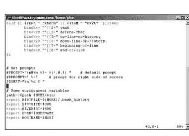

```bash
jdoe@sulley ~ prompt=%u@%h %1#
jdoe@sulley ~
```

**代码列表 8.6** 使用你的提示符语句。

### 更改你的提示符：

1. `export PROMPT="%u@%m %1# "`
   设置提示符以包含用户名、主机名和你正在输入的命令。

2. `source ~/.zshrc`
   重新加载配置文件以应用更改。

3. `echo $PROMPT`
   显示当前的提示符环境变量。这可能包含你刚刚添加的内容。它在那儿，对吧？

# 第 8 章

```bash
# 用户特定环境和启动程序
PATH=$PATH:$HOME/bin
ENV=$HOME/.bashrc
USERNAME=""
export USERNAME ENV PATH
/home/ejr.profile: No such file or directory
:::::::
:::::::::::::
/etc/bashrc
:::::::
:::::::::::::\
# 系统级函数和别名
# 环境内容放在 /etc/profile 中
# 设置 PS1 可以确保它每次都会被加载
PS1="(\u\h \W)\$ $$
alias which="type -path"
/etc/profile
:::::::
:::::::::::::\
## /etc/profile
# 全局环境和启动程序
# 函数和别名放在 /etc/bashrc 中
PATH=$PATH:/usr/X11/bin
PS1="(\u\h \W)\$ $$
ulimit -c 10000000
if [ 'id -gn' = 'id -un' -a 'id -u' -gt 14 ]; then
    umask 002
else
    umask 002
fi
USER=$(id -un)
LOGNAME=$USER
MAIL="/var/spool/$USER"
HOSTNAME="/bin/hostname"
HISTSIZE=1000
HISTFILESIZE=1000
export PATH PS1 HOSTNAME HISTFILESIZE USER LOGNAME
for i in /etc/profile/*.sh; do
    if [ -x $i ]; then
        $i
    fi
done
unset i
[ejr-hobbes ejr]$
```

为了供你参考，请记录系统配置文件及其运行顺序。（请记住，最后运行的文件中的设置将覆盖之前所有的设置。）我们的系统配置文件包括：

- `/etc/profile`（如果存在，系统会自动调用）
- `~/.bash_profile`（如果存在，系统会自动调用）
- `~/.bashrc`（如果存在，系统会自动调用）
- `/etc/bashrc`（通常由 `~/.bashrc` 调用）

请记住，你可能拥有的文件与我们拥有的文件有所不同。

### 提示

- `bash` shell 有时会将多个配置文件串联在一起，并在上一个文件中引用后一个文件。在编辑配置文件时，请务必保留引用关系和顺序，否则你可能会导致意外的结果。
- 所有以 `#` 开头的行都是注释，它们包含了帮助你理解文件的备注。注释本身不会执行任何操作，但它们能帮助你了解文件中每个部分的作用。
- 执行配置文件或脚本的专业术语（你可能会在这些文件中看到）是 `source`（加载）。也就是说，当你登录时，你的 `.profile` 可能会 `source` `.bashrc`。

# 第 8 章

## 将路径添加到你的 bash Path 中

你对环境可以做的最有用的更改之一是向默认路径添加内容，路径由 `path` 语句决定。`path` 语句告诉 shell 去哪里查找命令、脚本和程序。也就是说，如果你发布一个命令，`path` 语句会告诉系统按顺序在每个命名目录中查找该命令。

除非你确定自己在做什么，否则请不要从你的路径中删除任何内容，但你可以根据需要添加任意数量的目录。

按照以下步骤，你首先通过识别路径语句所在的位置，然后编辑包含它的文件（代码列表 8.9）。

### 更改你的 bash 路径：

1. `cat ~/.bash_profile ~/.bashrc`
   首先，按照执行顺序查看你的配置文件（仅限你可以编辑的）。
   检查你的系统配置文件以查找 `path` 语句。如代码列表 8.9 所示，它看起来像 `PATH=/bin:/usr/local/bin`。如果你有多个 `path` 语句，请找到最后一个执行的。
   记住不同的系统会有不同的配置，因此你可能需要稍微挖掘才能找到你的个人路径语句。

2. `cp .bash_profile .bash_profile_backup`
   对包含 `path` 语句的文件进行备份，以便在你出错时恢复它。如果需要更多关于复制文件的信息，请参阅第 2 章。

```bash
[ejr-hobbes ejr]$ more ~/.bash_profile ~/.bashrc
::::::::
/home/ejr/.bash_profile
# .bash_profile
# 获取别名和函数
if [ -f ~/.bashrc ]; then
  source ~/.bashrc
fi
PATH=/bin:/usr/bin:/usr/local/bin
ENV=$HOME/.bashrc
USERNAME=""
export USERNAME ENV PATH
::::::::
> 更多-(下一个文件：/home/ejr/.bashrc)
```

**代码列表 8.9** 你的第一步是找到你的路径语句的位置。

### 配置你的 Unix 环境

```bash
$ ejr@hobbes ej$ echo $PATH
/bin:/usr/bin:/usr/local/bin:/usr/bin/X11:/usr/X11R/bin:/usr/local/games/home/ejr/bin
$ ejr@hobbes ej$
```

3. `vi .bash_profile`
   使用你的编辑器打开你要修改的文件。

4. `PATH=$PATH:$HOME/bin`
   将新目录添加到你的 `path` 语句中。

5. 保存文件并退出编辑器。

6. `su -l`
   使用你更改后的提示符重新登录以尝试。

# 设置你的 bash 提示符

- 在 `PS1` 中使用换行符来创建多行提示符。

```bash
PS1="\u@\h \W\n\$ "
```

# 第 8 章

## 使用 alias 设置别名

别名（Aliases）是某种昵号，让你能够更方便地输入命令。例如，如果你频繁使用命令 `mail -s "Lunch today" deb ~signature`，你可以为此命令设置一个别名并命名为 `lunch`。从以后，你只需要输入 `lunch`，结果就与输入那个长命令完全相同。

### 使用 alias 设置别名：

1. 根据你正在使用的类型，选择合适的文件进行编辑：
   - `zsh` 用户应该使用 `~/.zshrc`
   - `bash` 用户应该使用 `~/.bashrc`
   如果没有合适的文件，欢迎使用不同的配置文件。许多人将所有别名存储在一个单独的 `.alias` 文件中并通过引用该新 `.alias` 文件的行来更新标准配置。

2. `vi ~/.bashrc`
   编辑你选择的配置文件。

3. `alias quit="logout"`
   输入 `alias`，后面跟上你想要作为别名的术语、`=` 以及你正在创建别名的命令（用引号括起来）。在这里，我们将单词 `quit` 设置为命令 `logout` 的别名，这样我们就可以输入 `quit` 而不是 `logout`（图8.5）。

## 配置你的环境

```bash
alias echo='echo'
alias cd='cd'
alias clr='clear'
alias copy='cp'
alias delete='rm'
alias dir='ls'
alias home='cd'
alias ls='ls -F'
alias md='mkdir'
alias move='mv'
alias pwd='pwd'
alias type='more'
```


- 可以根据需要添加许多其他别名。更多信息请参见“值得设置的良好别名”。
- 保存文件并退出编辑器。关于在 `vi`、`pico` 和 `nano` 中保存和退出的详情，请参第 4 章。
- 启动一个新的 shell 来测试别名。
- 在提示符处输入 `alias` 列出你定义的所有别名（列表 8.2）。在提示符处输入 `alias` 查看你设置的别名。

## 值得设置的良好别名

这里是一些你可能觉得在系统上值得设置的别名：

- `alias rm="rm -i"` 使系统对所有删除操作向你提示。
- `alias quit="logout"` 让你可以使用 `quit` 作为 `logout` 的同义词。
- `alias homepage="lynx http://www.ray.com/"` 让你可以使用 `homepage` 启动 `lynx` 浏览器并连接到主页（根据需要替换 homepage）。

或者，如果你习惯了 DOS，你可能会发现以下别名非常方便：

- `alias dir="ls -l"` 让你可以使用 `dir` 列出文件。
- `alias copy="cp"` 让你可以使用 `copy` 复制文件。
- `alias rename="mv"` 让你可以使用 `rename` 移动文件。
- `alias md="mkdir"` 让你可以使用 `md` 创建目录。
- `alias rd="rmdir"` 让你可以使用 `rd` 删除目录。

### 提示

- 你可以将别名放在其他文件中，但按照惯例会将它们放在 `.bashrc`（针对 `bash`）或 `.zshrc`（针对 `zsh`）中，这样在登录时会自动设置，而不需要手动设置。
- 你也可以从 shell 提示符处使用 `alias` 命令来为当前会话设置别名。
- 在更改任何配置文件之前，务必对其进行备份复制。这样，如果你搞砸了，仍然有一个原始文件可以使用。

# 第 9 章

## 运行命令

在整本书中，你一直在运行单个命令。Unix 并不在乎你运行的是系统内置命令、安装的命令还是朋友编写的脚本——对 Unix 来说全是一样的。列表 9.1 显示了运行命令的一些选项。

运行命令：

- `ls`

在 shell 提示符处，输入命令并按回车。

运行特定脚本：

- `/home/jdoe/scripts/ls`

你完全可能想写一个脚本以特殊方式列出目录中的文件——例如，一个列出文件并将列表保存到新文件中供备后参考的脚本（如果你想的话，可以将其命名为 `ls`）。要运行特定脚本，请输入脚本的完整路径（这样 Unix 就不会只运行路径中找到的第一个）。关于路径语句的更多信息，请参阅第 8 章。

### 提示

- 你可以在同一行中组合命令，正如你在书前面的部分看到的那样。只需使用 `;` 分隔命令即可完成。例如，你可以执行 `ls; pwd` 来列出文件并显示当前目录。
- 如果你使用 `&&` 组合命令，系统将按顺序运行两个命令，但只有在第一个命令成功时才运行第二个。例如，你可以使用 `mv todolist todolist.&& touch todolist` 将你的列表移动到另一个文件并创建一个新的待办事项列表。如果第一个命令失败（例如，因为你没有创建新文件的权限），则第二个命令将不会运行。

```bash
$ [jdoe@Project]$ ls
keep keeper.jpg kept kidder
```

```bash
$ [jdoe@Project]$ /home/jdoe/scripts/ls
keep keeper.jpg kept kidder
```

```bash
$ [jdoe@Project]$ /home/jdoe/scripts/ls
keep keeper.jpg kept kidder
```

```bash
$ [jdoe@Project]$ ls; pwd
keep keeper.jpg kept kidder
```

## 运行脚本和程序

### 调度一次性作业

偶尔你可能需要调度作业。例如，你可以调度给同事发送电子邮件，如图 8.6 所示。使用以下命令调度一次性作业：

- 1. `midnight`
  使用 `at` 指定你想运行作业的时间（列表 8.4）。
- 2. `at 12:00am`
  指定时间。
- 3. `at now`
  指定时间。
- 4. `at +10 minutes`
  指定时间。
- 5. `at +1 hour`
  指定时间。
- 6. `at +1 day`
  指定时间。
- 7. `at +1 week`
  指定时间。
- 8. `at +1 month`
  指定时间。
- 9. `at +1 year`
  指定时间。
- 10. `at next Tuesday`
  指定时间。
- 11. `at next Friday`
  指定时间。
- 12. `at tomorrow`
  指定时间。

```bash
$ [jdoe@Project]$ at midnight
job 12 scheduled for Mon Aug 29 00:00
```

```bash
$ [jdoe@Project]$ at 12:00am
job 13 scheduled for Mon Aug 29 00:00
```

```bash
$ [jdoe@Project]$ at now
job 14 scheduled for Mon Aug 29 10:45
```

```bash
$ [jdoe@Project]$ at +10 minutes
job 15 scheduled for Mon Aug 29 10:55
```

```bash
$ [jdoe@Project]$ at +1 hour
job 16 scheduled for Mon Aug 29 11:45
```

```bash
$ [jdoe@Project]$ at +1 day
job 17 scheduled for Tue Aug 30 10:45
```

```bash
$ [jdoe@Project]$ at +1 week
job 18 scheduled for Mon Sep 04 10:45
```

```bash
$ [jdoe@Project]$ at +1 month
job 19 scheduled for Thu Sep 29 10:45
```

```bash
$ [jdoe@Project]$ at +1 year
job 20 scheduled for Sat Aug 28 10:45
```

```bash
$ [jdoe@Project]$ at next Tuesday
job 21 scheduled for Tue Sep 01 10:45
```

```bash
$ [jdoe@Project]$ at next Friday
job 22 scheduled for Fri Sep 04 10:45
```

```bash
$ [jdoe@Project]$ at tomorrow
job 23 scheduled for Tue Aug 30 10:45
```

### 调度定期发生的作业

要调度定期运行的任务作业使用 `cron` 守护进程。`cron` 守护进程是一个持续运行并执行调度作业的后台进程。每个用户都有自己的 `crontab` 文件。你可以使用 `crontab -e` 命令编辑 crontab。crontab 文件有五个字段：

| 字段 | 描述 | 范围 |
| :--- | :--- | :--- |
| minute | 分钟 | 0-59 |
| hour | 小时 | 0-23 |
| day | 日 | 1-31 |
| month | 月 | 1-12 |
| dow | 星期 | 0-6 (0 是周日) |

crontab 的格式为：

`* * * * * command`

例如：

- `0 0 * * /path/to/script.sh` 每天午夜运行。
- `0 12 * * /path/to/script.sh` 每天中午运行。
- `0 0 1 * * /path/to/script.sh` 每月1号运行一次。
- `0 0 * * 1 /path/to/script.sh` 每年运行一次。
- `0 0 * * 5 /path/to/script.sh` 每周五午夜运行。

你还可以使用通配符、范围和步长：

- `*/15 9-17 * Mon-Fri /path/to/script.sh` 周一至周五上午9点到下午5点每15分钟运行一次。
- `0 0 1,15 * * /path/to/script.sh` 每月运行两次，在1号和15号。
- `0 0 * * */2 /path/to/script.sh` 每两天运行一次。

### 挂起作业

当作业在前台运行时，你可以通过 `Ctrl+Z` 将其挂起。这会将作业发送到后台并挂起它。你可以使用 `jobs` 命令查看挂起的作业。

```bash
$ [jdoe@Project]$ sleep 100
^Z
[1] Stopped                 sleep
```

要在后台恢复挂起的作业，请使用 `bg` 命令后跟上作业号。

```bash
$ bg 1
[1] sleep 100 &
```

要将后台作业带回前台，使用 `fg` 命令后跟上作业号。

```bash
$ fg 1
```

### 在后台运行作业

要在初始后台运行作业，在命令末尾添加 `&`。

```bash
$ [jdoe@Project]$ sleep 100 &
[1] 100 &
```

你可以使用 `jobs` 命令查看正在运行的后台作业。

```bash
$ [jdoe@Project]$ jobs
[1] Running                sleep 100 &
```

如果后台作业完成，它会在终端打印消息。要捕捉后台作业的输出，你可以将其重定向到文件。

```bash
$ [jdoe@Project]$ sleep 100 > output.txt &
```

### 在前台运行作业

默认情况下，所有作业在前台运行。如果作业在后台运行，使用 `Ctrl+Z` 挂起它，然后使用 `fg` 将其带回前台。

### 控制作业优先级

你可以在启动运行作业时使用 `nice` 命令更改其优先级。进程的优先级范围从 -20（最高优先级）到 19（最低优先级）。

```bash
$ [jdoe@Project]$ nice -n 10 sleep 100
```

要更改已运行进程的优先级，使用 `renice` 命令。

```bash
$ [jdoe@Project]$ renice +10 -p 1234
```

## 删除定时任务

要删除定时任务：

| 命令 | 输出 |
| :--- | :--- |
| ejr@hobbes ejr$ atq | |
| 4 | 2010-08-28 12:01 a |
| 9 | 2011-01-01 12:01 a |
| 13 | 2010-08-27 16:00 a |
| 12 | 2010-08-28 00:00 a |
| ejr@hobbes ejr$ atrm 12 | |
| ejr@hobbes ejr$ atq | |
| 4 | 2010-08-28 12:01 a |
| 9 | 2011-01-01 12:01 a |
| 13 | 2010-08-27 16:00 a |
| ejr@hobbes ejr$ | |

- 1. `atq`
  首先，使用 `atq` 显示队列中等待执行的任务列表（代码列表 9.3）。第二列显示计划时间，这可以帮你回忆哪个任务是哪一个。第一列指定了每个任务的编号，让你在下一步中识别要删除哪个任务。
- 2. `atrm 12`
  通过输入 `atrm` 和任务编号来移除队列任务——在本例中，任务编号为 12。

### 提示

- `atq` 对于查看你已计划的任务也非常方便。
- 使用 `at` 给自己发送提醒。
- 如果你有一组想要定期运行的命令，考虑将它们写成简短的 shell 脚本，然后使用 `at` 运行该脚本。从长远来看这样做更省力，而且你不需要像告诉 `at` 要做什么那样集中精力确保命令完全正确。关于 shell 脚本的完整信息请参第 10 章。
- 不同版本的 Unix 对 `at` 显示信息的方式有所不同。你会获得所需的所有信息，但排列方式可能有所不同。

代码列表 9.3 通过指定任务编号删除定时任务。

## 使用 cron 调度定期执行的任务

假设你希望在一天结束下班回家之前发送一条提醒消息——例如，提醒关掉咖啡壶；或者你希望每周对特定文件进行备份。你可以通过使用 `crontab` 命令来调度任务或脚本，使其在你喜欢的时间定期运行。通过这种方式，你可以安排任务在特定时间发生，并确保任务会在无需人工干预的情况下执行（图 9.2）。

### 使用 cron 调度定期执行的任务：

- 1. `crontab -e`
  在提示符处，输入 `crontab` 后紧跟 `-e` 标志，这允许你编辑你的 cron 文件。如图 9.2 所示，你的 cron 文件将在你的默认编辑器中打开。它可能是空的（如果你之前没有设置过任务），但里面可能有一些内容。
- 2. `55 16 * * 1-5 mail -s "Go home now!" - ejray@raycomm.com`
  在 cron 文件的第一行，输入分钟、小时、日期、月份和星期几的值，然后输入你想运行的命令。有关指定时间和日期的更多细节，请参阅“那些奇特的数字是什么？”侧边栏。在这个示例中，我们会在每个工作日的下午 4:55 向 ejray 发送电子邮件，提醒他回家了。

图 9.2 cron 文件是你指定 cron 任务的地方，它会在你的默认编辑器中打开。如果你之前指定过 cron 任务，它们将出现在编辑器中。

```
55 16 * * 1-5 mail -s "Go Home Now"
- ejray@raycomm.com < /dev/null
```

```bash
"/tmp/crontab.16206" 3 lines,
- 192 characters written
crontab: installing new crontab
[ejray@hobbes ej]#
```

代码列表 9.4 此任务每天提醒 ejray 回家。末尾的消息表示 cron 任务已成功输入。

- 3. 保存并关闭文件。
  第 4 章将快速提醒你如何使用 `pico` 和 `vi` 保存并关闭文件。
  如果你正确设置了时间和日期（即，你没有不小心将它们设置在每天第 59 小时或其他错误时间），你将看到类似代码列表 9.4 边缘的消息，确认你已准备就绪。（如果你将任务安排在每周第 9 天的 55 小时 12 分，将收到相应的错误消息）。

### 那些奇特的数字是什么？

在输入 cron 任务时，你需要指定：

- 分钟（0–59）
- 小时（0–23）
- 日期（1–31）
- 月份（1–12）
- 星期（0–6，星期日为 0）

### 提示

- 在调度 cron 任务时，你需要指定……（注：此处文本似乎有碎片/重复，已保持逻辑流）。

*（注：提供的 OCR 文本在提示后半部分包含大量重复和伪影。我已根据提供的清晰章节清理了结构流。）*

## 使用 bg 在后台运行作业

如果你正在运行一个不需要你输入的作业，可以考虑使用 `bg` 将其在后台运行（代码列表 9.7）。这样做，你可以在处理其他 Unix 活动的同时，保持程序运行。

### 要使用 bg 在后台运行作业：

- 1. `jobs`
  在提示符处输入 `jobs` 来查看所有正在运行或已停止的作业列表。请注意左侧的作业编号。
- 2. `bg %`
  输入 `bg` 后跟 `%` 和你想要在后台运行的作业编号（代码列表 9.7）。

### 提示

- 如果你想将最近一次挂起的作业放入后台，只需在提示符处输入 `bg`（不带数字）即可。
- 你也可以直接将作业放入后台，而无需先将其挂起。只需输入运行命令加上 `&`（例如 `bgdog`）。`&` 会直接将作业移动到后台。

```bash
[ejr@hobbes ejr$ jobs
[3]- lynx http://www.raycom.com/ &
- calvin.raycom.com/
[2] Stopped (tty input) telnet
[3] Stopped (signal) lynx
- http://www.raycom.com/
[4]+ Stopped man telnet
[ejr@hobbes ejr$ bg %3
[3]- lynx http://www.raycom.com/ &
[ejr@hobbes ejr$]
```

代码列表 9.7 在后台重启挂起的作业让你同时做两件事（或更多事）。要将一个作业移动到后台，只需输入 `bg %` 和作业编号。

## 使用 fg 在前台运行作业

```bash
ejr@hobbes ejr$ jobs
[1]+ Stopped ftp ftp ftp.cdrom.com
ejr@hobbes ejr$ fg %1
ftp ftp.cdrom.com
```


**代码列表 9.8** 输入 `fg` 加上作业会将作业带回前景。当你将挂起的作业带回前景时，有时会在屏幕上看到作业活动。其他时候，你只会看到一个提示符，需要召唤帮助来查看程序的任何内容。

当你准备好恢复挂起或后台作业时，可以使用 `fg`。记住，当你挂起一个作业时，你实际上是将该作业移动到了中间状态。`fg` 只是将作业再次移动到前景（**代码列表 9.8**），这样你就可以看到它在做什么或提供输入。

## 要使用 fg 在前台运行作业：

1. `jobs`
   在 shell 提示符处，输入 `jobs` 列出所有已停止或运行的作业。注意左侧的作业编号。

2. `fg %1`
   输入 `fg` 后跟你想带回前景的作业编号（代码列表 9.8）。

取决于你带回前景的作业，你可能看到也可能无法在屏幕上看到运行中的作业。有时，你会被“拉回”作业的前景，并能够按照提示输入信息。其他时候，你只会看到返回到前景的程序提示符。如果是这种情况，请尝试输入 `?`（获取帮助），这通常会强制程序在屏幕上显示某些内容并刷新显示。

> **提示**
> - 你可以通过在 shell 提示符处输入 `fg`（不带作业编号）将最后一个挂起的作业带回前景。

---

# 第 9 章

## 使用 nice 控制作业优先级

假设你需要从互联网下载一个巨大的文件，下载它几乎需要占用一整个下午。通过下载它，你会占用系统资源，并导致其他用户的系统响应时间变慢得多。好吧，这是一个糟糕的例子。假设你的同事需要下载一个巨大的文件，并将占用整个下午的系统资源。希望她能礼貌地不要占用你需要的资源。

幸运的是，她可以使用 `nice`，这让她能够控制作业的优先级。如**代码列表 9.9** 所示，你使用 1 到 19 的数字对作业优先级进行排序，其中 `1`（优先级较高）而 `19` 表示非常“礼貌”（优先级较低）。Unix 系统使用你提供的数字来决定投入该作业的注意力：

## 要使用 nice 控制作业顺序：

- `nice -n 19 scriptlow`
  在提示符处，输入 `nice`、标记 `-n`、然后是相应的调整值（19）以及要运行的程序或脚本名称（代码列表 9.9）。在本例中，`scriptlow` 以低投入的优先级运行。

### 提示

- 为了找到你需要多大的“nice”，你可能检查 Unix 系统上当前运行了多少进程（以及哪些种类）。你可以使用本文后面描述的 `ps` 命令来实现这一点。
- 如果你是系统管理员并以 root 身份登录，可以使用 `nice` 的负数（低至 -20）来增加优先级（`nice -16` 优先级作业）。
- 使用 `nice` 更改运行作业的 nice 程度。例如，运行 `nice -n 18 2058`（作业编号）。如果你是系统管理员，你可以增加或减少任何作业的 nice 程度；如果你只是同事——意味着你公司的普通计算机用户——你只能降低你自己的作业的优先级，而不能增加它。在急情况下，你可以请求系统管理员增加你作业的优先级。
- 可以使用 `nice` 并在后台运行作业——例如，使用 `nice -n 12 funscript &` 以 12 的 nice 级别在后台运行 `funscript`。

```bash
ejr@hobbes ejr$ nice -n 19 scriptlow
```

**代码列表 9.9** 通过使用 `nice` 作为调整，你可以让 Unix 决定对你的作业投入多大的工作。

---

## 运行脚本和程序

```bash
[ejr@hobbes running]$ time slowscript
0.05user 0.06system 0:50.12elapsed 0%CPU

[ejr@hobbes running]$ time ls
bigdog.tar.gzslowscript testing.gif
0.03user 0.03system 0:00.03elapsed 78%CPU

[ejr@hobbes running]$ time nice -19 19 ls
foo
bigdog.tar.gzslowscript testing.gif
0.03user 0.03system 0:00.06elapsed 93%CPU

[ejr@hobbes running]$ time -p nice -n 19 ls
real 0.00
user 0.00
sys 0.00

[ejr@hobbes running]$
```

有时，你可能想知道作业完成需要多长时间。你可以使用 `time` 命令，它根据 Unix 内置计时器对作业进行计时。如**代码列表 9.10** 所示，你只需要输入 `time` 后跟要执行的命令即可。

## 使用 time 运行作业：

- `time slowscript`
  在提示符处，输入 `time` 后跟命令，系统将根据 Unix 内置计时器对作业计时，如代码列表 9.10 所示。

## 使用 time 比较作业时间：

1. `time ls`
   输入 `time` 后跟一个作业（这里是 `ls`）。

2. `time nice -n 19 ls /usr`
   然后输入 `time` 后跟另一个作业。我们将比较两个带回前景的作业。在本例中，我们正在比较 `ls` 命令和 `nice 1` 命令。如代码列表 9.10 所示，`nice 1` 命令的运行时间比普通命令长。

**代码列表 9.10** 输入 `time` 加上完整命令获取作业时间。

### 提示

- 请记住，作业运行所需的时间可能会根据系统的负载情况而变化。例如，作业在凌晨 2 点（无人在使用系统时）的运行时间可能比下午 2 点（许多人在使用系统时）短。
- 不同系统的计时输出略有不同。在某些系统上，你会得到实际时间（时钟时间）、用户时间和系统时间。实际时间是程序运行期间时钟经过的秒数，而用户时间和系统时间指的是系统运行该作业所需时间的不同衡量标准。在其他系统上，你可能会获得大量的补充信息，如**代码列表 9.11** 所示，但信息的本质是相同的。
- 在 `ls` 例子中，你并不关心输出或错误——只需要时间——所以你可以巧妙地丢弃它们。尝试 `time ls /usr > /dev/null 2>&1` 将标准输出发送到 `/dev/null`（垃圾桶），并将错误消息发送到标准输出（然后发送到垃圾桶）。详情见第 16 章。
- 尝试 `time -p` 获取更符合人类习惯的输出。

```bash
$ time slowysccript
0.07user 0.05system 0:50.13elapsed 0%CPU
- (avgtext+avgdata @maxresident)k
- $outputs
- (219major+59minor)pagefaults 0swaps
$
```

**代码列表 9.11** 时间输出随系统而异。在这里，我们在时间信息中获得了一堆需要破译的内容。


---

## 使用 ps 查找正在运行的进程

我们目前为止讨论的任务实际上是各种类型的进程，*进程*（Processes）——程序、脚本或命令——你在 Unix 系统中执行的任何操作。任务都是进程，但并非所有进程都是任务。

偶尔，你可能想找出 Unix 系统上正在运行哪些进程。你可以使用 **ps** 来实现，如**代码列表 9.12** 所示。

## 要使用 ps 查找正在运行的进程：

- `ps`
  在提示符处，输入 `ps` 可以查看你在当前 shell 中运行的当前进程列表，包括当前 shell 的进程以及任何其他任务（代码列表 9.12）。

具体信息会因系统而异。通常，你会在最左侧找到 *PID*（进程标识符）数字，在右侧找到进程名称。

**代码列表 9.12** 使用 ps，你可以找出当前正在运行的进程。

```bash
[jdoe@frazz jdoe]$ ps
PID TTY TIME CMD
21016 pts/22 00:00:00 bash
21707 pts/22 00:00:00 ps

[jdoe@frazz jdoe]$ ps -a
PID TTY TIME CMD
21407 pts/3 00:00:00 su
21411 pts/3 00:00:00 bash
21441 pts/3 00:00:00 su
21444 pts/3 00:00:00 bash
19274 pts/11 00:00:00 xterm
23357 pts/12 00:00:04 xterm
13369 pts/5 00:00:00 zsh
23815 pts/9 00:00:00 su
23818 pts/9 00:00:00 bash
23878 pts/9 00:00:00 csh
23942 pts/9 00:00:00 ssh
23972 pts/18 00:00:00 su
23975 pts/18 00:00:00 bash
24103 pts/5 00:00:00 su
4658 pts/15 00:00:11 ssh
24318 pts/8 00:00:01 xterm
21988 pts/4 00:00:00 rxvt-rxvt
23968 pts/4 00:00:00 rxvt
29440 pts/8 00:00:00 vi
23883 pts/20 00:00:02 xterm
27257 pts/16 00:00:01 ssh
6004 pts/20 00:00:00 ps
20531 pts/20 00:00:02 xterm
21013 pts/22 00:00:00 su
21016 pts/22 00:00:00 bash
21708 pts/22 00:00:00 ps
[jdoe@frazz jdoe]$
```

### 提示

- 你可以通过在 shell 提示符处输入 `ps -a` 来找出其他人正在运行的进程，通过 `ps -ef` 变体找出系统正在运行的进程（也称为守护进程），这对我们通常非常有用。
- 有时，取决于系统，可以通过输入 `ps -a f`（即 `-a`、空格和 `f`）来更广泛地查看当前运行的进程。该标志表示“森林”（forest）视图，让你不仅能看到进程，还能看到它们之间的关系，如**代码列表 9.13** 所示。
- ps 提供的结果很大程度上取决于你使用的 Unix 变体。在提示符处使用 ps 可以了解你特定的 ps 功能。

**代码列表 9.13** 森林视图让你对运行进程有更广泛的了解。

```bash
$ ps -a f
| PID | TTY | STAT | TIME | COMMAND |
| :--- | :--- | :--- | :--- | :--- |
| 15911 | p | S | 0:00 | /bin/login -h calvin@raycomm.com -p |
| 15914 | p | S | 0:01 | -bash |
| 16216 | p | T | 0:00 | - telnet |
| 16217 | p | T | 0:00 | - lynx |
```

```bash
http://raycomm.com/
$ kill 16217
$ ps -a f
| PID | TTY | STAT | TIME | COMMAND |
| :--- | :--- | :--- | :--- | :--- |
| 15911 | p | S | 0:00 | /bin/login -h calvin@raycomm.com -p |
| 15914 | p | S | 0:01 | -bash |
| 16216 | p | T | 0:00 | - telnet |
```

## 使用 kill 删除进程

除了挂起任务和让它们在后台运行外，你可以使用 `kill` 删除进程。

---

# 第 10 章

## 编写基础脚本

```bash
[ejr@hobbes scripting]$ sh myscript
friendsjustfriends
```

4. `echo friendsjustfriends`
   在脚本的下一行，输入 `echo` 然后跟上你想在屏幕上显示的文本。在这里，输入 `echo unix` 在屏幕上显示 friendsjustfriends——一条朋友之间的消息。

5. `echo`
   再添加一行 `echo` 且不加任何内容，以显示一个空行。

**代码列表 10.1** 使用 `echo`，你可以获得良好的理解——或者，也许只是朋友之间的一种良好理解。

6. `echo "standing"`
   添加另一个 `echo` 命令。注意，如果你像我们在这里这样做一样使用空格或制表符，你必须使用引号，如图 10.1 所示。

7. `echo -e "\t"`
   使用 `-e` 标志加上 `\t`，你可以插入一个制表符。查看“echo 的进阶用法”获取更多 `echo` 选项。

## echo 的进阶用法

8. **保存并关闭你的脚本。**
   如果你需要帮助保存文件和关闭编辑器，请检查第 4 章。

除了 `echo` 提供的基础屏幕打印功能外，你还可以配合 `echo -e` 使用这些格式标志（`-e` 启用了这些特殊的格式特性）：

- `\b` 将光标向后移动一个空格。
- `\c` 指令 echo 在打印完文本后不要换行。
- `\f` 允许随后的文本在指定的水平位置出现在下一行。
- `\n` 允许随后的文本在新的一行出现。
- `\t` 将随后的文本缩进一个制表符。

例如，`echo -e "\tGreetings! \c"` 会将 "Greetings!" 向右移动一个制表空格（由 `\t` 指定），并且不会为其后的任何文本插入新行（由 `\c` 指定）。

> **提示**
> 除非你有迫切需要使用不同的 shell 的理由（例如，如果你只在 zsh 中），否则目前请坚持使用 sh 脚本。

9. `sh myscript`
   使用 `sh myscript` 运行你的新脚本。这样，你就能获得良好的理解（字面意思），如代码列表 10.1 所示。哒！你刚刚写了你的第一个脚本！（查看该章节获取有关运行脚本的更多信息和细节。）

## 运行 Shell 脚本

在编辑器中创建脚本并保存脚本文件后，你的下一步是运行它，这意味着按照脚本中的顺序执行脚本中的每一个命令（是的，你已经在上一节中做过这一点，但我们将对其进行扩展）。如图 10.2 所示，你通过 `sh` 命令（或你正在使用的 shell 名称）后跟想要运行的 shell 脚本名称来实现。

## 运行脚本：

- `sh myscript`
  在 shell 提示符处，输入 `sh`（或你想运行脚本的 shell 名称，如 `ksh` 或 `csh`）后跟脚本名称。在这种情况下，你实际上是在告诉 `sh` 去运行并使用 `myscript` 文件中的命令列表。你将看到脚本的结果——在这种情况下，文字出现在屏幕上，如图 10.2 所示。

### 提示

- 注意，在例子中，你显式地告诉 Unix 要运行的脚本名称 (myscript)。当你这样做时，上一节中脚本顶部的 `#!/bin/sh` 行在技术上是多余的。它只有在脚本是可执行的情况下才是必需的，如下节所示。

## 使脚本变为可执行

```bash
[ejr@hobbes scripting]$ head -2 myscript
```


# 第 10 章

## 嵌入命令

假设你创建了一个每天登录时都会自动运行的脚本。例如，该脚本可以在屏幕上打印“问候！”并发送一条机智的信息：“嘿，你今天看起来精神真好！”你可以根据本章目前为止学到的知识轻松地实现这一点。

这里非常实用的方法是在脚本中添加一行，告诉 Unix 添加所有这些内容加上最近使用的文件——对于那些可能需要提醒自己上次在忙什么的人来说。你可以直接使用 `ls` 命令，但这只会列出文件名，而不会将问候与你早晨的其他部分结合。相反，一个更好（也更有趣）的想法是将几个命令组合并配合 `echo` 使用（图 10.4），将信息直接嵌入问候中。

要嵌入命令：

1. `vi myscript`

首先，在你喜爱的编辑器中打开 `myscript` 或另一个脚本。你的脚本可能像图 10.4 所示，屏幕上显示问候。

```bash
user@example.com:~/home/user

#!/bin/bash

# this is my first shell script

echo -e "Greetings!"

echo -e "You're looking sharp today: $(ls -t | head -1)"

# echo "You were most recently working on is"
```

**图 10.4** 嵌入命令只需要在脚本中额外添加几行。

### 编写基础脚本

| [ejr@hobbes scripting]$ myscript |
| 好！嘿，你今天看起来精神真好！你上次在忙的是 figlet。 |
| [ejr@hobbes scripting]$ |

2. `echo "You were most recently working on \`ls -1Ft | head -1\`"`

在 `echo` 后面输入你想看到的描述性文本。在描述文本中嵌入 `ls` 命令 `ls -1F ~ | head -1`。注意嵌入代码在这里开始并结束（使用反引号）——这里（句点）。这里嵌入的命令仅列出主目录中最近更改的文件或目录。`-1` 表示每行一个条目，`F` 为目录加上 `/` 格式，以便我们判断是在子目录还是文件中工作，并且（或 `t`）按修改日期排序。我们将输出通过管道传递给 `head -1`，它显示文件列表的第一行。

**代码列表 10.3** 嵌入命令的结果可能令人印象深刻。

### 使用智能日期

你可以使用 `date` 命令以任何格式交付任何内容。通常，你可以使用 `date +"Today is %A"`，但你可以使用以下任何或所有部分：

- `%d` 包含月份的两位日期。
- `%y` 包含两位年份。
- `%Y` 包含四位年份。
- `%m` 包含数字月份。
- `%b` 包含缩写的月份。
- `%B` 包含完整的月份名称。
- `%d` 包含缩写的星期。
- `%A` 包含完整的星期。
- `%R` 包含小时和分钟的时间。
- `%D` 包含月/日/格式的日期。

### 提示

- 你也可以将日期嵌入脚本中。如果你工作太忙忘记了星期几，请尝试 `echo -e "date +%A"`。更多细节请参见侧栏“使用智能日期”。
- 当嵌入使用目录的命令（如 `ls` 或 `find`）时，务必指定完整路径。否则你将得到脚本所在位置的路径，而不是运行脚本时的相对路径。
- 嵌入命令在许多方面都有用。每当你想要根据一个程序的输出运行另一个程序时，都可以使用它们，就像 `echo` 根据程序的输出显示内容一样。

查看 man 页获取剩余的几十个选项。

## 脚本循环

假设你创建了一个想要应用于多个文件的脚本。例如，假设在一天结束时，你需要为目录中的所有 `.html` 文件制作备份。你可以单独复制每个 `.html` 文件，但那工作量太大。更简单的方法是创建一个短脚本来复制 `.html` 文件，然后循环（重复）该脚本应用于目录中所有的 `.html` 文件（图 10.5）。你创建一个短脚本；Unix 会替你完成这些枯燥的工作。

要创建一个循环：

1. `vi head_ache`

在 shell 中，启动你的编辑器并打开想要循环的脚本。在这种情况下，我们使用 `vi` 和 `head_ache` 文件。（当然，你也可以将其命名为 `html_backup` 或类似的平凡名称。）

2. `/bin/sh`

告诉你的 Unix 系统使用哪个 shell 来运行脚本。在这个示例中，我们告诉它（通过 `#!`）用 `/bin/sh` 运行脚本。

3. `cd ~/`

确保你处于循环发生的目录中。在示例中，我们的脚本位于主目录，但要循环的文件也位于 `~` 目录。

4. 
```bash
for i in *.html
echo "Backing up $i..."
cp "$i" "$i.bak"
done
```

## 编写基础脚本

### 编写一个 if-then 条件语句：

1. `vi deef`

首先，访问编辑器和脚本文件。在这里，我们使用 `vi` 调整一个现有的脚本（用于反馈）。

2. `if [ -f feedback ]`

以 `if` 开始循环，然后紧跟一个条件语句，在这种情况下是 `if [ -f feedback ]`，它检查当前目录下是否存在名为 `feedback` 的文件。如果文件存在，则表达式为真。

### 关于 If-Then 的更多内容

使用此测试提供的步骤，还有其他一些 if-then 的可能性：

- `[ -f filename ]` 检查文件是否存在。
- `[ ! -f filename ]` 检查文件是否存在。`!`符号（非）会在上一个示例为“假”时让测试报告“真”。
- `[ -d name ]` 检查 name 是否为目录。
- `[ first -nt second ]` 检查第一个文件或目录的修改日期是否比第二个新。
- `[ first -ot second ]` 检查第一个文件或目录的修改日期是否比第二个旧。
- `[ -n string ]` 检查字符串长度是否大于 0。
- `[ -z string ]` 检查字符串长度为 0。
- `[ string1 = string2 ]` 检查第一个字符串是否等于第二个字符串。
- `[ \( condition1 \) -a \( condition2 \) ]` 检查两个条件是否都真（可以包含其他条件）。
- `[ \( condition1 \) -o \( condition2 \) ]` 检查 condition1 或 condition2 是否为真。

输入 `man test` 获取更多关于创建条件语句的信息。

3. `then echo "There's feedback on the latest project"`

在 `if` 语句后的下一行，输入当语句为真时要执行的命令或显示的消息。在这个示例中，一个真的 `if` 语句将导致屏幕上打印“There's feedback on the latest project”。

4. `else echo "Nope, no feedback yet"`

在下一行，使用 `else` 后跟一个语句，指定当语句为假时应该发生什么。在这里，指定如果没有找到反馈文件，将在屏幕上打印“Nope, no feedback yet”。

5. `fi`

在 `else` 语句之后立即使用 `fi` 你已结束。

6. 保存脚本并尝试。

在这个示例中，脚本将检查 `feedback` 是否存在，并根据找到的结果打印不同的消息**（代码列表 10.5）。**

```bash
[ejr@hobbes scripting]$ ./beef

Greetings! Say, you're looking mighty sharp
to today!

You were most recently working on scripting/
Nope, no feedback yet

[ejr@hobbes scripting]$ touch feedback

[ejr@hobbes scripting]$ ./beef

Greetings! Say, you're looking mighty sharp
to today!

You were most recently working on scripting/
There's feedback on the latest project

[ejr@hobbes scripting]$
```

**代码列表 10.5** 反馈脚本产生的最后一行有所不同，取决于找到的文件。

## 在脚本中接受命令行参数

假设每个月底你都需要向老板发送一份进度报告。你可能会设置一个脚本给老板写电子邮件，而包含进度报告的文件可能会让此脚本自动向老板发送消息并填写主题行，但将使用命令行输入来告诉脚本你想发送哪个文件。通过使用命令行输入，你可以为脚本提供更多的灵活性，并让许多过程为你自动化。你在 shell 提示符处运行脚本并指定输入，如图10.7 所示。


```bash
doe@frank.com$ cat status-report

#!/bin/sh

mail boss@example.com -s "Status report for $1" < /reports/$1

doe@frank.com$ ./status-report August

doe@frank.com$ 
```

图10.7 使用命令行输入，你可以为脚本增加灵活性，并让脚本为你完成繁杂工作。

```bash
[ej@hobbes scripting]$ more status-report

#! /bin/sh

mail -s "Status report for $1" boss@example.com < ~/reports/$1

[ej@hobbes scripting]$ ./status-report August

[ej@hobbes scripting]$
```

### 在脚本中接受命令行参数：

1. `status-report`

使用你的编辑器编辑你的脚本。

2. `mail -s "Status report for $1" boss@example.com < ~/reports/$1`

输入一个命令，在每个你想使用来自源的第一个输入项都出现 `$1`。

3. 保存脚本并尝试。


Greetings! Say, you're looking mighty sharp to today!

You were most recently working on scripting/
Nope, no feedback yet

```
[ejr@hobbes scripting]$ touch feedback
[ejr@hobbes scripting]$ ./beef
```

Greetings! Say, you're looking mighty sharp to today!

You were most recently working on scripting/
There's feedback on the latest project

```

[ejr@hobbes scripting]$
```

**代码列表 10.5** 反馈脚本产生的最后一行有所不同，取决于找到的文件。

## 在脚本运行时接受输入

在上一节中，我们展示了你可以要求配合脚本运行，但很容易忘记输入而导致没有结果。

在脚本运行时接受输入：

1. `pico retentive`
   使用你的编辑器编辑你的脚本。

2. `-e "Which file do you want to analyze?"`
   指定屏幕上显示的提示文本。

3. `read choice`
   在脚本需要接受信息的任何点，输入 `read` 后跟要接收的变量名。

4. `echo "Choice has cat choice | wc -1 words"`
   打印短语（以及嵌入命令）以检查拼写，单词单词。

5. `echo -e "and was last changed \c"`
   打印另一行文本（由于 `\c`，行末没有换行符）。

6. `ls -l $choice awk '{ "print @\n-> $8 " on " $6 $7 }'`
   这行非常长且复杂的 `awk` 命令从给定的 `$choice` 的 `ls` 列表中提取时间、月份和日期字段（如图 10.8 所示）。

7. 保存并退出。
   你现在已经掌握了这一点。

8. `./retentive`
   运行脚本（在赋予可执行权限并在必要时指定当前目录后），并在提示时提供文件名，如代码列表 10.7 所示。

```
[ejr@hobbes scripting]$ ./.retentive

Which file do you want to analyze?

testfile

testfile has 11 words

was last changed at 05:08 on Jan 12

[ejr@hobbes scripting]$
```

代码列表 10.7 在脚本运行时接受输入可以帮助你不忘记输入，并提供自定义结果。

## ✔ 提示

- 提示输入的一个极佳示例是配置文件。详见第 16 章中“使用输入自定义你的环境”的详细说明和特定示例。

- 参见第 8 章了解更多关于设置配置文件和登录时启动脚本的信息。

- 你可以使用一组行 `echo -e "Please enter the name: \c"` 和 `read name`，让输入行和它的引导语都出现在同一行。

## 第 10 章

## 脚本调试

在开发脚本时，你可能会遇到一些让它们无法正常运行的问题。如图 10.9 所示，你可以通过在脚本运行时打印脚本来帮助调试。这样，你可以跟踪脚本的运行过程并查看问题可能出现的地方。

要在脚本运行时在屏幕上打印脚本：

- `sh -x retentive`

在 shell 提示符下，输入 `sh -x` 后跟脚本名称（以及你提供的任何额外信息）。`-x` 告诉 shell 同时执行脚本（像往常一样）并打印出每一行命令，如图 10.9 所示。

- 提示
- 对于此类调试输出，请使用适当的 shell 名称，后跟 `-x`，最后是脚本名称。例如，尝试使用 `bash -x retentive`。

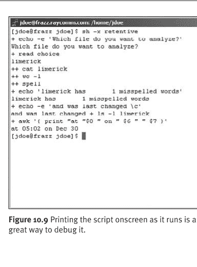

图 10.9 脚本运行时在屏幕上打印脚本是调试的极佳方法。

```
$ [doe@frazz-doe] $ sh -x retentive

+ echo 'Which file do you want to analyze?'

+ echo 'What do you want to analyze?'

+ read option

limerick

+ cat limerick

+ we -l

+ sp

+ echo 'limerick 1 misspelled words'

limerick 1 misspelled words

+ echo -n and was last changed -l -1 limerick

+ and last changed - "0" on "$ "

+ at 05:02 Dec 30

[doe@frazz-doe] $
```

## 发送和接收电子邮件

如果你和我们一样，你的一整天可能都围绕着从电子邮件收件箱接收各种好东西以及发送“非常重要”的消息转转（当然，它们确实很重要，对吧？）。无论如何，发送和接收电子邮件可能可能是你 Unix 体验中最少见的任务之一。

在本章中，我们将向你介绍几个 Unix 电子邮件程序，并教你如何开始使用它们。（当然，只需使用适用于你所用程序的指令即可！）然后，我们将向你展示一些你可以使用 Unix 完成的巧妙操作，例如创建签名文件和发送自动休假邮件回复。

在本章中，我们将引用一个名为 `pine` 的程序。根据你的系统，你可能拥有 `pine`，也可能有一个名为 `alpine` 的更新类似程序。`alpine` 程序仅仅是 `pine` 的新版本（嗯，某些许可变更与第 4 章中的 `pinenano` 类似，但这些不会影响你的日常邮件使用）。对于你的需求，只需使用可用的程序——`pine` 或 `alpine`——并知道每个指令都适用于两者。

## 目录

- 选择电子邮件程序并开始
- 使用 pine（或 alpine）读取电子邮件
- 使用 pine（或 alpine）发送电子邮件
- 定制化 pine（或 alpine）
- 使用 mutt 读取电子邮件
- 使用 mutt 发送电子邮件
- 使用 mail 读取电子邮件
- 使用 mail 发送电子邮件
- 创建签名文件
- 自动转发入站消息
- 缺席通知
- 配置 procmail
- 使用 procmail 管理电子邮件


209

## 第 11 章

## 选择电子邮件程序并开始

通常情况下，在 Unix 系统上发送和接收电子邮件，你有三个程序供选择：

- 安装在你的本地计算机或网络上的电子邮件程序，它会为你与 Unix 系统进行交互。你可能将这些程序称为邮件客户端，并可能用过像 Thunderbird 或 Outlook Express 这样的程序。这些程序非常方便，因为它们通常有精美的界面，并且可以让你无需费费精力就能处理附件，但它们实际上是 Unix 电子邮件程序。这些程序还允许你将邮件存储在桌面系统（Windows 或 Macintosh）甚至 Unix 桌面上，但那些超出了本书的范范围。

- 你通过本地计算机上的 Web 浏览器访问的 Web 版电子邮件程序。这些包括 Gmail、Yahoo! Mail 等。这些也超出了本书的范范围（尽管大多数运行 Web 程序的服务器实际上运行在 Unix 或 Linux 上）。

- 可以直接在 Unix 系统上使用的电子邮件程序。这些程序如 `pine`、`mutt` 和 `mail`，让你以不同程度的便利性发送和接收邮件。此外，`pine` 和 `mutt` 让你无需很费力就能发送附件。由于邮件保留在 Unix 系统上，你可以在任何可以访问互联网的地方访问邮件。

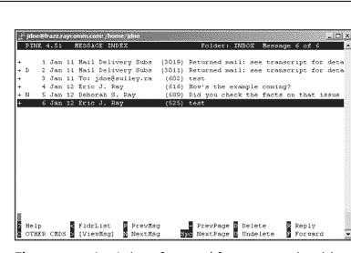

图 11.1 pine 的界面和功能直观的

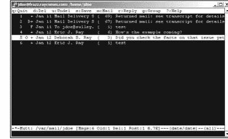

图 11.2 mutt 的界面和功能相当容易使用，但没有 pine 那么简单。

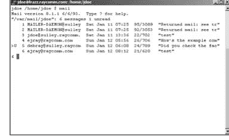

图 11.3 mail 的界面和功能非常简单。

210

## 选择电子邮件程序

## 发送和接收电子邮件

在本章中，我们将关注可以直接在 Unix 系统上访问电子邮件的程序。有几种选择，但我们将关注最常用的几种：

- `pine`：一个强大的文本电子邮件客户端。
- `mutt`：一个支持附件和分组的功能丰富的电子邮件客户端。
- `mail`：经典的 Unix 工具。

对于大多数用户来说，`pine` 或 `mutt` 是更好的选择。`Alpine` 仅仅是 `pine` 的新版本。

无论你选择哪种程序，基本概念都是相同的：如何检查邮件、如何回复以及如何配置个人偏好。

## 使用 pine 读取电子邮件

你使用 pine 的第一步很可能是读取电子邮件。图 11.4 到 11.7 展示了输入 pine 命令后你可以做什么。

使用 pine 读取电子邮件：

1. `pine`
   在提示符处输入 `pine` 启动程序。第一次使用 pine 时，它会要求你是 pine 用户（见图 11.4）。之后你将看到主界面，如图 11.5。如果你收到未找到命令的错误消息，请在系统中查找。

2. `L`
   按下 `L` 查看文件夹列表，其中包括收件箱文件夹以及（最终）其他文件夹。

3. 使用方向键导航文件夹列表（如果你有的话）。

4. `V`
   按下 `V` 选择文件夹。注意菜单中的默认选择用括号 `[]` 显示（见图 11.6）。然后使用方向键选择它，你可以按回车。

5. 使用上、下键在列表中移动。默认情况下，你的未读消息出现在列表底部。

6. 回车
   按回车键选中的消息。

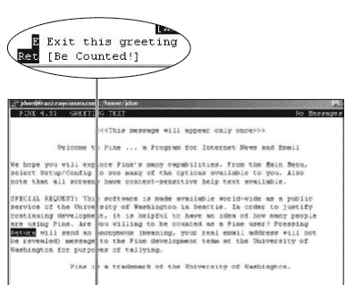

图 11.4 当你首次启动 时，它会要求你是 pine 用户才能开始。

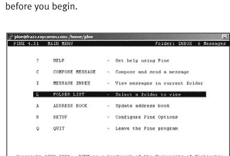

图 11.5 你将在 pine 的主界面上看到未读消息。

图 11.6 你只需要按回车即可选择默认选择，它显示在底部的括号中。

## 发送和读取电子邮件

7. 嗯。额。哇。太棒了。
   阅读你的消息。按 `C` 退出当前消息并返回当前文件夹的邮件索引。

8. `Q`
   当你准备好退出 pine 时按此键。
   系统将提示你确认是否真的要退出，如图 11.7 所示。
   按 `Y` 退出，如果真的不想退出，则按 `N`。

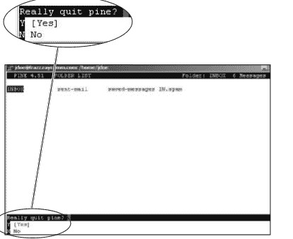

图 11.7 你真的要退出 pine 吗？只是确认一下。

### 提示

- 注意 pine 屏幕底部的菜单命令。你可以通过按下相应的键来选择这些选项中的任何一个，pine 方便地不区分大小写，因此使用小写或大写命令均可。

- 使用 `-i` 可以从你的收件箱开始，而不是从主菜单开始。

- 在阅读邮件时，可以使用 Tab 键到文件夹中的下一条消息。

- 当消息在邮件列表中高亮或在屏幕上打开时，按 `D` 键删除消息。当你退出程序时，pine 将验证你是否想要丢弃已删除的消息。按 `Y` 确认，如果真的不想删除这些消息，则按 `N`。（注意，pine 不会把它们发送到回收站，就像 Windows 邮件程序中使用 `D` 键时的那样。在 Unix 中，按 `Y` 真的会删除消息……它们就消失了！）

- 在选定消息或阅读消息时，按 `R` 回复消息。

- 使用 pine 时，请留意屏幕底部菜单中的 `O`，它表示有其他选项可用。

## 使用 pine 打印

尽管许多 Unix 邮件程序不允许你打印到本地打印机，但 pine 可以。你只需要选择 `%`，然后根据 pine 的建议选择默认打印机“attached to ansi”，这样你的打印内容可能就会出现在普通打印机上。这种方式打印到本地打印机的方法在某些通信中（特别是 Windows telnet）是有效的，但它适用于许多情况。如果你坐在 Linux 或 Mac OS 系统前，还可以使用系统上的其他打印实用——“attached to ansi”选项是为通过 ssh 连接到 Unix 系统的用户设计的

## 第 11 章

## 使用 pine 发送电子邮件

我们使用 pine 的下一个喜爱好是发送新消息。通常，你会在启动 pine 后发送消息（图 11.8），但你也可以直接从 shell 提示符启动消息（参见随附的提示）。

使用 pine 编写并发送消息：

1. `pine`
   在 shell 提示符处输入 pine 启动 pine，如果它尚未运行。

2. `C`
   按 `C` 编写新消息。

3. `Tab`
   按 Tab 键在消息头部字段之间移动。填写收件人列 (cc:) 和主题 (Subject:) 行。关于包含主题的详情，请查看名为“Two Cents on the Subject of Subjects”的侧边栏。
   如果你正在发送附件，在 Attch: 行输入 Unix 文件名（如果适用，还有路径）。例如，输入 `~myfile`，这包含了完整路径名和文件名。

4. 嗨，John，我们应该什么时候安排那个高尔夫赛——呃，嗯——业务会议？
   在消息窗口中输入你的消息内容。图 11.8 显示了我们的消息，包含头部信息和消息正文。

5. `Ctrl X`
   当你准备好发送时，按 `Ctrl X`，系统也会要求你确认是否真的想发送消息。按 `Y`（或按 Enter）发送，如果不想发送，则按 `N`。


```
doe@fraz.raycom.com/~

PINE 1.51 COMPOSE MESSAGE

To : john@raycom.com

Attachment :

Subject : Game?

-- Message Text --

Hi, John,

when should we schedule golf game

er, um -- business meeting?

J. Doe

Cute saying here.
```

图 11.8 在 pine 中准备消息就像填空题一样简单。

214

使用 pine 发送电子邮件

### 提示

- 如果你处于 shell 提示符处并想在不打扰 pine 主界面的情况下发送电子邮件，输入 `pine` 后紧跟你想要发送邮件的电子邮件地址（例如，`pine bigputz@raycomm.com`）。如果你想向多个地址发送电子邮件，只需用逗号或空格分隔它们即可，如在 `pine books@raycomm.com, bigputz@raycomm.com`。

## 自定义 pine

尽管 pine 使用相当直观，但它也非常强大，为你提供了大量的自定义选项。**图 11.9** 显示了 pine 的自定义界面，以及你可以选择的几个选项。

自定义 pine：

1. `pine`
   在 shell 提示符处输入 pine 启动程序。

2. `M`
   进入主菜单。

3. `S`
   唤起设置菜单。

4. `C`
   访问配置菜单，如图 11.9 所示

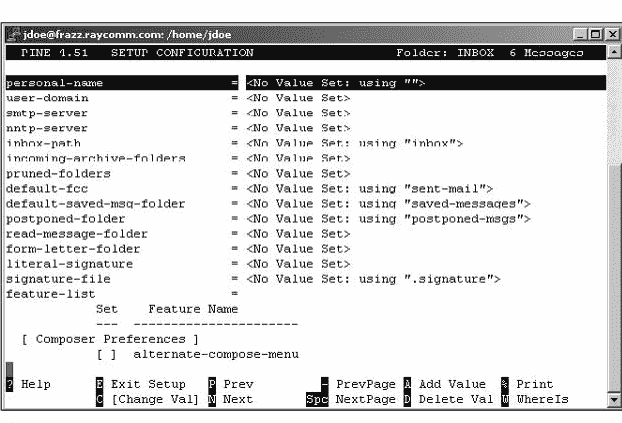

图 11.9 显示了 pine 的自定义

## 发送和读取邮件

5. 使用 `↑` `↓` 键滚动列表。
6. 按 Enter 选择你想更改的选项。
7. 完成选择。
8. 按 Enter 退出配置菜单并返回设置菜单。

### 提示

- 提示
- 你可以自定义 pine，让它每次启动时都打开收件箱。

| 选项 | 说明 |
| --- | --- |
| initial-keystroke | 指定 pine 使用的键。 |
| signature-at-bottom | 将签名放在消息末尾。 |
| saved-msg-rule | 设置保存消息文件夹。 |
| fcc-name-rule | 设置发送邮件文件夹。 |
| use-only-domain-name | 设置发送邮件文件夹。 |
| domain-name | 设置所有域的消息。 |

## 第 11 章

## 使用 mutt 读取邮件

如果你使用 mutt，可能会发现阅读邮件非常直接。如图 11.10 所示，你应该使用 `↑` `↓` 键滚动列表，并按 Enter 打开你想阅读的消息。

使用 mutt 读取邮件：

- `mutt`
  在提示符处输入 mutt 启动。系统可能会要求为你创建文件夹，不需要则输入 `[no]`。

代码列表 11.2 mutt 将创建一个邮件目录。

```
[awr-hobbes]$ mutt

/home/joe/Mail does not exist. Create

: it? ([Yes)/no):
```


# 发送和读取电子邮件

## 键盘快捷键表

| 按键 | 命令 | 说明 |
| :--- | :--- | :--- |
| B | restrict U out of mco | |
| B | delete-thread | 删除线程中的所有消息 |
| | edit-type | 修改附件内容类型 |
| | format-passphrase | 使用内存中的密码 |
| `<Tab>` | display-message | 跳到下一条消息 |
| `<Return>` | sort-thread | 显示帮助弹出键 |
| `<Tab>` | next-thread | 跳到下一个线程 |
| `<Tab>` | previous-thread | 跳到上一个线程并标记为已读 |
| T | untag-pattern | 取消线程中所有消息标记 |
| `<Tab>` | -next | 跳到新消息 |
| `<Tab>` | delete-next | 正确的 (text/plain)拷贝 |
| `<Esc>` | code-copy | 检查经典语法 |
| `<Esc>` | collapse-all | 折叠/展开消息正文中所有线程 |
| `<Esc>` | -b | folder-create-readonly.以只读模式打开默认文件夹 |
| `<Esc>` | delete-thread | 删除子线程中的所有消息 |
| `<Esc>` | resend-message | 使用当前消息作为新消息的模板 |
| | 索引帮助 -- (16) | |

## mutt 基础操作

3. **Enter**  
按 Enter 键打开一条消息进行阅读。

4. **I**  
按 I 键返回到消息列表（索引），或按空格键（Spacebar）向下滚动当前消息。  
图 11.10 显示了命令菜单，这应该帮助你记住 mutt 的一些基础知识。

5. **Q（退出）**，然后向 mutt 挥手告别。系统可能会提示你回答一些问题（例如，关于丢弃已删除的邮件或将邮件移动到已读邮件文件夹）。只有在你将来打算将 mutt 作为你的主要邮件客户端时，才回答 yes。

## ✔ 小贴士

- 你仅需编辑 `~/.mutrc` 配置文件即可定制 mutt 的几乎每一个方面。如果你喜欢 mutt 的灵活性，可以在互联网上搜索 `.mutrc` 文件，以了解你可以用它做什么。
- 你可以在查看消息时或在消息索引屏幕选中消息时按 `D` 键删除消息。当你退出 mutt 时，系统会询问 mutt 是否应该“将未读消息移动到 `/home/your/id/mbox`”。此时，按 `N` 将其保留在收件箱中，或按 `Y` 进行移动。
- 你可以在消息列表中选中消息或在阅读消息时按 `R` 键回复。
- 你可以在几乎任何界面通过按 `?` 访问 mutt 帮助文档。
- 你可以通过输入消息编号跳转到消息索引中的某条特定消息。

## 使用 mutt 发送电子邮件

使用 mutt 发送消息与使用 pine 类似。最常见的情况是，你会在操作 mutt 的时候直接编写消息（图 11.11）。

使用 mutt 编写并发送消息：

1. **mutt**  
   开始时，在 shell 提示符输入 `mutt` 启动 mutt。
2. **M**  
   按 `M` 开始编写新消息。
3. **Enter**  
   在输入 mutt 要求的每项信息后都按 Enter 键（见图 11.11）。填写 `To:`（收件人）和 `Subject:`（主题）行（参见本章侧边栏“关于主题的几点”）。

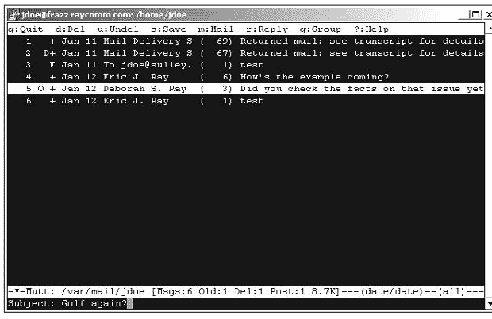  
**图 11.11** 通过回答问题或填写空白（在此情况下为 Subject.）来填写消息头信息，并使用 Enter 键继续。

4. **向 vi 问好。**  
   哈？在你输入完消息头内容（填写你想写的内容）后，你会被直接掉进 vi，面对一个非常空白的消息顶部。关于使用 vi 的快速回顾，请参第 4 章。

5. **John，我做了一个梦，把闹钟装在了肚子里。我记得这个是因为，当闹钟响起时，我发现自己正按着肚脐试图关掉声音。天哪……我需要休假！**  
   输入你的消息，无论内容是什么。

6. **Esc**  
   完成后，按 `[Esc]` 进入命令模式。

7. **:wq**  
   然后输入 `:wq` 保存你的工作并退出编辑器。

8. **[Y]**  
   按 `[Y]` 发送消息。如果你决定还是不想分享关于肚脐的细节，可以按 `[E]` 编辑你的消息，或按 `[Q]` 退出并忘记整件事。

## 小贴士

- 你可以将 Unix 系统上的默认编辑器从 vi 更改为其他编辑器。你只需要编辑你的 `~/.muttrc`（如果不存在则创建一个），并在文件中添加 `set editor="emacs"`（或其他任何编辑器）。
- 若要从 shell 提示符发送快速消息，输入 `mutt` 后接收件人的电子邮件地址，例如 `mutt winchester@raycomm.com`。如果你想向多个地址发送电子邮件，只需用逗号或空格分隔它们，例如 `mutt unixvqs@raycomm.com, info@raycomm.com`。

---

# 第 11 章

## 使用 mail 读取电子邮件

通常情况下，使用 mail 比使用 pine 或 mutt 没那么直观；然而，使用 mail 读取电子邮件特别具有挑战性。尽管我们建议尽可能使用其他程序读取邮件，但如果你足够胆大或没有其他选择，这里是读取邮件的步骤。**图 11.12** 展示了这项棘手的任务。

使用 mail 读取邮件：

1. **mail**  
   在 shell 提示符输入 `mail`。你会得到消息列表和一个提示符（图 11.12）。
2. **3**  
   输入你想阅读的消息编号并按 Enter。
3. **妙极了……他真是个混蛋……噢，那真不错……**  
   阅读你的消息。按 `N`+Enter 移动到下一条消息，或逐一屏地继续阅读当前消息。
4. **Q**  
   准备好后按 `Q` 退出 mail。

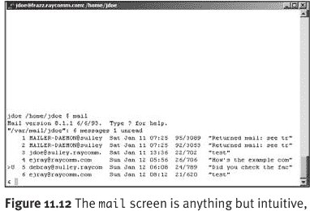

- 如果有人真的给你发了一封非常冗长的邮件，你的 Unix 系统可能会直接跳过该消息。要完整阅读该消息，请逐一屏输入 `more`。
- 若要跳过某消息，输入消息编号。
- 如果你想退出，按 `Q`。

---

## ✔ 提示

- 如果你想让你的签名更加花哨，可以使用 figlet，这是一种字母的文本表示形式，如**代码列表 11.5** 所示。访问 www.yahoo.com 或你喜欢的网络搜索引擎并搜索“figlet”或“figlet generator”，以获取有关如何创建自己的签名的更多信息。
- 许多电子邮件纯主义者认为，四行是任何人应该拥有的最长签名。如果你创建了一个更长的，要准备好被某些人责备的。
- mutt 和 pine 都会在发出的邮件中自动包含一个 `.signature` 文件。

```
ejr@hobbes ejr$ more figlet

```
-----      -----
|  \    /  _  _  |  _  _ 
| |__)  )  / __ \ |/ __| || | |
| | |  ` // / _`' _`' / _`' _`' /  \ 
| |_\\\/ / \_\ \/ \_\ / \_\_/ 
|  \\,  /  \\,  |_||_| ( > ||_||_|(__)
      //
```

**代码列表 11.5** Figlets 既有趣又花哨。

---

# 自动转发入站消息

假设你是一个大项目的负责人，所有人都在使用所有重要的相关邮件消息。你可以告诉 Unix 自动将这些入站消息转发给那些真正会对它们采取行动的人。嘿，你是老板，对吧？或者你只是换了一个电子邮件帐户，想把发送到你旧地址的入站邮件发送到新地址。如图 11.14 所示，你只需要创建一个 `.forward` 文件。

## 转发入站邮件消息：

1. **vi ~/.forward**  
   开始时，在 shell 提示符处输入 `vi ~/.forward`（或你使用的任何编辑器的相应命令），指定你的主目录 (`~/`)，然后输入 `.forward` 作为文件名。

2. **mynew@raycomm.com**  
   在文件的第一行添加你希望转发邮件的地址（图 11.14）。除了向转发到单个地址外，你还可以在 `.forward` 文件中使用多行多个地址，以便将入站邮件同时发送到多个地址。

3. **保存并关闭文件。**  
   查阅第 4 章有关使用 pico 或 vi 保存和关闭文件的详情。

### 提示

- 咨询系统管理员，查看 `.forward` 文件是否真的能实现你的需求。许多较新的 Linux 和 Unix 系统会自动将邮件发送到 procmail（忽略 `.forward` 文件），因此你可能需要使用 procmail 文件来转发你的邮件。效果同样，但方法不同。详情请参阅本章后部分的“使用 procmail 管理电子邮件”。
- 如果你想这样做，可以保留所有入站消息的副本（在你的邮箱中，并将其转发给毫无防备的收件者）。只需输入 `\your@address.com`（用当前系统上的你的用户 ID 替换你的地址，并转发给 `other@address.com` 的邮件）。
- 如果更改了 ISP（服务提供商），转发消息也非常方便。你可以将发送到旧地址的所有消息转发到新地址，这对于确保在朋友和同事更新地址簿时你仍收到所有重要消息有巨大的帮助。

---

# 使用 vacation 宣布缺席

如果你正计划度假并将离开邮件一段时间，请让 Unix 为你宣布你的缺席（**图 11.15**）。使用 vacation 程序，你可以让 Unix 向每个给你发邮件的人发送回复，说你不在办公室。

请记住，vacation 在不同的 Unix 系统和 ISP 之间差异很大。你拥有的可能与这里使用的“标准”形式不同。如果你有任何问题，务必咨询系统管理员获取特定说明，并请查看本章中的“配置 procmail”，因为许多较新的 Linux 和 Unix 系统使用 procmail 而不是 `.forward` 文件来告诉 vacation 响应你的消息。

## 使用 vacation 发送“我在度假”的消息：

1. **`~/vacation.msg`**  
   在 shell 提示符处输入 `vi ~/vacation.msg`。你需要编辑一个消息（实际上是一个模板），作为人们在给你发邮件时他们应该收到的回复，如图 11.15 所示。

2. **Subject: away from my mail**  
   感谢你给我发邮件 `$SUBJECT`。对我来说的是，我正在享受一个美妙的假期：修剪草坪、洗衣服，并赶上其他我因为平时工作太忙而没能做的事情。如果你希望我继续保持度假状态，请发送邮件给你的老板（boss@example.com）并告诉她。谢谢！  
   创建并编辑文本来说出你想的内容。  
   文本中的 `$SUBJECT` 术语将被替换为发送给你的实际主题。

  
**图 11.15** 使用模板，你可以自定义度假消息——甚至可以深度定制，正如我们所做的那样。

---

```
ejr@hobbes ejr$ cat ~/.forward
ejr@hobbes ejr$ vacation -I
```

**代码列表 11.6** 你的 `.forward` 文件

3. **保存并关闭文件。**  
   查阅第 4 章有关使用 pico 或 vi 保存和关闭文件的详情。

4. **vacation -I**  
   在提示符处使用 `vacation -I`。这告诉系统处理邮件。

5. **cat ~/.forward**  
   检查你的 `.forward` 文件以验证它是否正常工作。

### 提示

- 记住在开始之前从列表中取消订阅。如果不这样做，可能会导致邮件循环。

---

# 配置 procmail

让生活变得更轻松的最棒方法之一是使用 procmail（一个过滤程序）自动处理某些入站邮件。在本节中，我们将向你展示如何配置 procmail 以管理邮件。

## 为 procmail 指定设置

（图 11.16）。例如，入站邮件通常直接进入邮箱；然而，procmail 在进入你的邮箱之前进行过滤，你需要告诉 procmail 你的文件夹在哪里，以及一些其他事情。图 11.16 和 11.17 显示了你需要做什么。

- 告诉 procmail 执行工作（图 11.17）。本质上，你创建一个 `.forward` 文件，将入站邮件发送到 procmail 进行处理，然后再让你看到它们。这一步对于许多系统（特别是 Linux 和 Unix 系统）并不是必要的。

### 设置步骤

3. **PATH=/usr/bin:/usr/local/bin:**  
   指定可执行程序的路径。现在这样做是一个好主意，以防你以后使用 procmail 对消息进行更多的过滤或自动回复。

4. **DEFAULT=/var/spool/mail/yourid**  
   指定收件箱的位置。记住，过滤器会在邮件到达收件箱之前对其拦截，因此你需要告诉 procmail 你的收件箱在哪里。请咨询系统管理员以确认 DEFAULT 值。(`/var/spool/mail/yourid` 通常是（但并非总是）位置，但显然需要替换为你真实的用户 ID。)

5. **MAILDIR=$HOME/mail**  
   指定 procmail 应该在哪里找到你的邮件程序以及它创建的所有文件夹和信息。如果你使用 pine，你可能需要完全按照所示内容输入此行。如果你使用 mutt，你可能需要使用 `Mail` 而不是它。

## 要开启 procmail 过滤：

1. **pico ~/.forward**  
   使用你喜欢的编辑器在主目录下创建一个 `.forward` 文件。

2. **"IFS=' ' exec /usr/bin/procmail -f- || exit 75 yourid**  
   按照所示输入文本，但将 `yourid` 替换为实际 ID（图 11.17）。如果 procmail 不位于 `/usr/bin`，那么实际位置 `/usr/local/bin` 可能是另一个目录。


3. **保存并关闭文件。**  
   对于入站消息，你只需要做这些，如果它们按预期被过滤（你将在下一节中设置）。使用不同的电子邮件账户给自己发邮件，并确认你的更改符合预期。

### 提示

- 不要忘记较新的 Unix 和 Linux 系统配置为自动通过 procmail 发送你的电子邮件，无需手动开启。我建议先尝试“为 procmail 指定设置”任务中的步骤，看看是否有效，只有在仅指定设置不足够时，才尝试“开启 procmail 过滤”中的步骤。

---

# 使用 procmail 管理电子邮件

procmail 可以帮助你自动——或选择性——回复电子邮件。正如你所看到的，procmail 与转发电子邮件和使用 vacation 程序类似，但你可能会发现 procmail 灵活得多。

## 要指定如何过滤消息（即“编写规则”）：

1. **vi ~/.procmailrc**  
   在 vi 中，访问你的 `.procmailrc` 文件。

2. **移动到文件末尾，在设置信息下方。**

3. **:0:**  
   使用 `:0:` 开始新规则，如图 11.18 所示。（不要问为什么要用 `:0:`。事实如此。）

4. **\* ^TO_FBuddies**  
   设置 procmail 过滤的标准。在这里：
   - `\* ^TO` 通知 procmail 检查所有入站消息的 TO 行（实际上也包括 CC 行）

5. **$MAILDIR/FriGolFBuddies**  
   指定过滤后的邮件去向。在这种情况下，过滤邮件将进入 `FriGolFBuddies` 文件夹，但你可能将来自邮件列表的邮件过滤到 `listmail` 文件夹。

6. **保存并关闭文件。**


```
激活 Vacation 程序
:0 {
| /usr/bin/vacation jdoe

* ^TO_FBuddies
$MAILDIR/FriGolFBuddies
```

**图 11.18** 将你的规则添加到 `.procmailrc` 文件中。

---

## 使用 procmail 转发邮件

1. **pico ~/.procmailrc**  
   开始时，访问你的编辑器并编辑你之前在主目录下创建的 `.procmailrc` 文件。

2. **:0:**  
   在文件底部的新的一行添加 `:0:`，这会启动一个 procmail 规则。这基本上是告诉 procmail 在处理邮件时“锁定”你的邮件目录。

3. **!myother@example.com**  
   提供一个感叹号 (`!`) 和要发送邮件的地址。

4. **保存并关闭文件。**  
   现在你收到的所有电子邮件都将自动转发到 `myotheremail@example.com`。

---

## 使用 procmail 丢弃垃圾邮件

以下规则：

```
:0:
* !^TO.*aw@.*raycomm\.com
$MAILDIR/spam
```

使用正则表达式过滤那些并非明确发送给以 `aw@` 和 `raycomm.com` 结尾的用户的消息，并将它们放入名为 `spam` 的特殊文件夹。将垃圾邮件过滤器放在规则列表的末尾，这样所有来自邮件列表和其他重要消息就会首先归类。在测试此并确保你喜欢它且它没有丢弃价值邮件后，你可以将最后一行改为 `/dev/null` 以直接丢弃垃圾。

对于更复杂的垃圾邮件解决方案，请在 www.google.com 通过 Google 搜索“procmail spam filter”查看选项。

---

## 使用 procmail 调用 vacation

1. **pico ~/.procmailrc**  
   开始时，访问你的编辑器并编辑你之前在主目录下创建的 `.procmailrc` 文件。

2. **:0:**  
   在文件底部的新的一行添加 `:0:`，这会启动一个 procmail 规则。这基本上是告诉 procmail 在处理邮件时“锁定”你的邮件目录。

3. **| /usr/bin/vacation yourid**  
   提供一个管道符 (`|`) 和 vacation 程序路径及你的用户 ID（而非感叹号和邮件地址）。

4. **保存并关闭文件。**


现在你收到的所有电子邮件都将自动转发到 `myotheremail@example.com`。

| 使用 procmail 丢弃垃圾邮件 |

以下规则：

```
:0:
* !TO.*aw@, *raycomm.com
$MAILDIR/spam
```

使用正则表达式过滤那些并非明确发送给以 `aw@` 和 `raycomm.com` 结尾的用户的消息，并将它们放入名为 `spam` 的特殊文件夹。将垃圾邮件过滤器放在规则列表的末尾，这样所有来自邮件列表和其他重要消息就会首先归类。在测试此并确保你喜欢它且它没有丢弃价值邮件后，你可以将最后一行改为 `/dev/null` 以直接丢弃垃圾。

对于更复杂的垃圾邮件解决方案，请在 `www.google.com` 通过 Google 搜索“procmail spam filter”查看选项。

# 访问互联网

到为止，你一直在 Unix 系统上处理文件和脚本。在本章中，我们将向你展示如何超越 Unix 系统并利用互联网。

## 目录

- 熟悉术语
- 登录远程系统
- 与其他用户通信
- 从互联网获取文件
- 在互联网上共享文件
- 浏览网页
- 下载网站
- 检查连接
- 追踪连接
- 匹配域名

# 熟悉互联网术语

在利用本章的信息进入互联网之前，你应该熟悉一些概念和术语。

服务器是存储数据并在请求时“提供”服务的计算机。例如，你可以将 Web 服务器想是 `.html` 文件的巨大仓库。它的工作是存储请求文件，等待另一台计算机找到请求的文件并将其“提供”给请求的计算机。是的，你的 Unix 系统可以是 Web 服务器，但不必是。

客户端是运行在你 Unix 系统上的程序，用于访问服务器上的数据。例如，你的 `lynx` 浏览器就是一个客户端——也就是说，它运行在你 Unix 系统上并用于访问 Web 服务器上的文件。

IP（互联网协议）地址是特定计算机的地址。该地址识别它，就像你的街道地址识别你的家一样。你每次访问网页时都会使用 IP 地址。你可能会输入 `www.ray.com`（这被称为主机名），但在后台，它会被翻译成特定的 IP 地址，例如 `192.168.141.2`。你会更频繁使用主机名（如 `www.oracle.com` 或 `www.sun.com`），因为它们比数字字符串更容易记忆。无论你输入的是字符地址还是数字地址，你做的只是访问特定计算机的特定地址。

## 互联网端口与协议

表 12.1

| 端口 | 协议 |
|---|---|
| 21 | ftp |
| 22 | ssh |
| 23 | telnet |
| 70 | gopher |
| 80 | http |
| 119 | nntp |
| 8080 | http (通常用于测试服务器) |

协议是计算机之间相互通信的语言。例如，FTP（文件传输协议）用于从一台计算机传输文件到另一台计算机。HTTP（超文本传输协议）用于在 Web 上传输数据。

端口就像计算机的地址——它们是计算机监听连接的“地方”。大多数 Web 服务器运行在端口 80，例如 `com: 80/`；如果你连接到 `http://www.ray.com:80`，你是在明确表示你想使用 HTTP 在端口 80 上与 `www.ray.com` 计算机通信。如表 12.1 所示，你可以指定不同的协议（例如 FTP）或不同的端口（例如 8080）以不同的方式与同一台计算机通信。

## 使用 ssh 登录到远程系统

你可能已经在使用 `ssh` 连接到你的 Unix 系统了。不过，你可以用它连接并使用互联网上的任何其他计算机系统（假设你有登录该系统的权限），**代码列表 12.1**。

```
[jdoe@frazz jdoe]$ ssh server.example.com
jdoe@server's password:
jdoe /home/jdoe $ whoami
jdoe
jdoe /home/jdoe $ uname -a
Linux server.example.com 2.4.19-ac4 #13 SMP
- Sat Nov 16 05:30:56 MST 2002 i2686-
- unknown unknown GNU/Linux
jdoe /home/jdoe $ logout
[jdoe@frazz jdoe]$
```

**使用 ssh 连接到另一台计算机：**

1. `server.example.com`

   在提示符处，输入 `ssh` 后跟你想连接的系统名称。

2. 使用你访问该系统的远程登录名登录。

   推测，如果你通过互联网访问系统，你会有某种理由和权限这么做。在某些情况下，你将输入应用程序名称，或者你可能像使用你连接所在的系统一样使用远程系统。

3. 完成远程系统的使用后，根据远程系统的说明和策略注销。

**代码列表 12.1** 使用 ssh 安全地连接互联网上的其他系统。

### 提示

- 如果需要 `ssh` 的帮助，请在 shell 提示符处输入 `ssh` 查看选项列表，或输入 `man ssh` 获取更多帮助。当你有一个活动会话时，使用 `Enter` 获取当前会话的帮助。

- 如果你在远程系统上有不同的登录名，可以通过 `ssh server.example.com -l username` 指定该名称，以便更容易登录。或者，如果这样更容易记忆，尝试 `username@server.example.com`。

- 你可以使用 `wall`（写入所有）命令向所有登录到系统的用户发送 `write` 消息。系统管理员在需要提醒系统即将关闭时通常会使用 `wall`。

- 使用 `who` 查找谁登录了系统。更多信息请参阅第 7 章中的“通过 who 学习其他人的登录情况”和“通过 w 学习其他人的登录情况”章节。

## 使用 telnet 登录到远程系统

你可能已经在使用 `telnet` 连接到你的 Unix 系统了。不过，你可以用它连接并使用互联网上的几乎任何其他计算机系统（假设你有登录权限，并且系统管理员允许 telnet 而非要求 SSH），如图 12.1 所示。

Telnet 12.1 注意闪烁的转义字符。

```
telnet hobbers.racomm.com
Connect Cdl Telnet Help
[ejrHobbers ejr] telnet ibm.ukstate.edu
Trying 79.108.66...

Connected to ibm.ukstate.edu.
Escape character is "'"

[ejrHobbers ejr] $
```

图 12.2 连接后，你可以像使用自己的系统一样使用远程系统。

## 使用 telnet 连接到另一台计算机

1. `telnet ibm.ukstate.edu`

   在提示符处，输入 `telnet` 后跟你想连接的系统名称。在这个示例中，我们正在连接到俄克拉荷马州立大学的图书馆目录。

2. 注意登录时公布的转义字符——快看，因为它会出现在屏幕上。当你的 `telnet` 连接卡住或系统死机时，你需要按下转义字符。在我们的示例中，转义字符是 `Ctrl-\`，它会将我们返回 `telnet` 提示符以便退出连接（图 12.1）。

3. 使用你访问该系统的说明登录。

   推测，如果你通过互联网访问系统，你会有某种理由（和权限）这样做。在某些情况下，你将输入应用程序名称。在我们的示例中，我们输入 `pete`，这是卡片目录的。在大多数其他系统中，你将使用用户名和密码登录，就像登录你的 Unix 系统一样（图 12.2）。

4. 完成远程系统的使用后，根据远程系统的说明和策略注销。

### 提示

- 如果需要 `telnet` 的帮助，请在 shell 提示符处输入 `telnet`，并在 `telnet>` 提示符处输入 `?`。`open`、`close` 和 `exit` 将是对你最有用的工具。

- 你会发现到图书馆和其他主机的 `telnet` 连接通常因为键盘模拟的特殊性而难以使用。最好的办法是联系站点所有者索要一份 FAQ 列表。

  你会在互联网的任何地方都找不到它。

- 用于与主机通信的 `telnet` 相关程序通常用于图书馆目录。

  如果你正在与主机通信，情况会更好。

## 使用 write 与他人通信

当你连接到 Unix 系统时，大多数时候，你可以用它连接到任何登录到系统的任何人。

## 使用 write 进行通信

1. `write`

   在提示符处，输入 `write` 后跟你想连接的系统名称。你会看到一个带有光标的空行。

2. 想见面？

   输入任何内容。每次按键都会显示在另一个人的屏幕上。

3. `Ctrl D`

   完成后，按 `Ctrl D` 发送消息。

4. 完成远程系统的使用后，根据远程系统的说明和。

### 提示

- 如果你不想接收消息，可以在 shell 提示符处输入 `msg` 来关闭当前会话。

## 使用 talk 与他人通信

你还可以与登录系统的另一个用户进行实时的双向对话（非常像即时聊天）。如图 12.5 所示，你输入消息，对方也输入，你们都可以看到交流过程。

## 使用 talk 进行通信

1. `talk`

   在提示符处，输入 `talk` 后跟你想连接的系统名称。另一个用户将被提示输入你的用户名。然后，你会看到 talk 屏幕，如 12.5 所示。

2. 你不会相信的！

   我刚追了狗六个街区，这时一个邻居告诉我有些孩子在翻我们的垃圾。就像，他们指望能找到什么？不，我很久以前就不再用丝袜做咖啡过滤器了。那让我的皮肤变黑了。

   总之，在门廊上气喘吁吁时，那里。

3. `Ctrl C`

   完成后，断开连接。

### 提示

- 你还可以与登录在其他 Unix 系统的人聊天。只需使用 `talk userid@where.com`。当然，填入该人的实际用户名和地址，这与该人的电子邮件地址相同。防火墙——但并非总是——会阻止这些聊天。如果有人请求与你聊天，只需 `talk` 和该人的用户名（如果该人的主机与你不同，则使用 `userid@where.com`）。

- 与 `write` 一样，你可以在 shell 提示符处输入 `msg g` 和 `mes y` 来关闭当前会话。

## 通过 ftp 从互联网获取文件

互联网一些优秀的信息资源是 FTP 站点，它们包含了来自各地的数十万个文件。FTP 站点与网站类似，但它们以目录为导向并使用不同的协议。它们通常没有网站那么有趣，但往往更具实用。

访问 FTP 站点信息的简单方法之一是使用匿名 ftp（anonymous ftp），这允许你访问站点并将文件下载到你的计算机上（**代码列表 12.2**，见下一页）。

## 通过匿名 ftp 获取单个文件：

1. `ftp calvin.raycomm.com`

   在 shell 提示符下，输入 `ftp` 后跟你想要连接的 FTP 站点名称。当然，如果计算机有 IP 地址但没有名称，请输入 IP 地址。系统将提示你登录，如代码列表 12.2 所示。

2. `anonymous`

   对于用户名，输入 `anonymous`。（如果你厌倦了输入 `anonymous`，可以输入 `ftp` —— 它几乎总是都有效。）

3. `you@wherever.com`

   使用你的电子邮件地址作为密码。向提供 FTP 服务的人员说明你的身份是礼貌的。通常只需 `you@` 就足够了。

4. `cd /pub/files`

   使用标准的 Unix `cd` 命令在目录树中找到你想要的文件。

```
[ejr@hobbes ejr]$ ftp calvin.raycom.com
Connected to calvin.raycom.com.
220 calvin Microsoft FTP Service (Version 2.0).
Name (calvin.raycom.com:ejr): anonymous
331 Anonymous access allowed, send identity (e-mail name) as password.
Password:
230 Anonymous user logged in.
Remote system type is Windows_NT.
ftp> cd /pub/files
250 CWD command successful.
ftp> binary
200 Type set to I.
ftp> hash
Hash mark printing (1024 bytes/hash mark).
ftp> get jokearchive.gz
local: jokearchive.gz remote: jokearchive.gz
200 PORT mode data successful.
150 Opening BINARY mode data connection for jokearchive.gz(1481035 bytes).
####################################################################################
####################################################################################
####################################################################################
####################################################################################
####################################################################################
####################################################################################
####################################################################################
####################################################################################
####################################################################################
####################################################################################
####################################################################################
####################################################################################
####################################################################################
####################################################################################
#####
226 Transfer complete.
1481035 bytes received in 4.07 secs (3.6e+02 Kbytes/sec)
ftp> quit
221
```

代码列表 **12.2** 使用匿名 ftp 从整个互联网的存档中获取文件。

5. `binary`

   指定文件类型——在这种情况下是二进制（binary），因为我们正在下载一个 gzipped 压缩存档文件。对于 README 文件、文本文件和 HTML 文件，指定 `ascii`。

6. `hash`

   接下来，你可以选择输入 `hash` 告诉 ftp 客户端在每传输 1,024 字节数据时显示一个哈希标记（#）。如果你正在传输小文件或使用快速连接；然而，这可能不是必需的；对于大文件和慢连接，哈希标记会让你知道传输正在进行。如果你将下载多个文件，在继续之前，请查看本节侧边栏的“获取多个文件”。在处理过程的此阶段，获取单个文件和多个文件的指令有所不同。

7. `get jokearchive.gz`

   在 `ftp>` 提示符下，输入 `get` 和文件名，即可从远程系统获取文件并推送到你自己的账户中。

8. `quit`

   完成后，只需输入 `quit` 即可。

### ✔ 贴士

- 如果 FTP 连接在登录后似乎卡住了，请尝试使用 `-yourid@where.com` 作为密码。该字符可以禁用系统公告并帮助你的 ftp 客户端保持正常。

- 某些防火墙——特别是家庭网络上的防火墙——无法很好地处理 FTP 协议的某些复杂细节。如果你可以连接并登录，但不能列出文件或获取任何内容，可能是防火墙的问题。一旦登录，输入 `pass`（代表被动模式 passive），问题就会消失。

- `-` 的另一个用途是在屏幕上显示文本文件。例如，输入 `get filename -` 让文本在屏幕上滚动。

- 不要使用 `get`，而是使用较新的 `newer`（如 `new goodokes .g2`）来获取与你现有文件同名的最新文件。

- 如果你开始下载文件时 FTP 连接断开，输入 `repeat` 和文件名即可从中断的地方继续传输。（当然，你必须先重新建立连接）。

- 你可以使用 `run` 代替 `get` 让 ftp 确保所有传输的文件都有唯一的名称。

## 获取多个文件


如果你将获取多个文件，请使用 `prompt` 告诉 ftp 客户端不要询问你想要的每个文件。你也可以使用 `mget` 获取所有以 `start` 开头的文件，例如 `.gz` 扩展的文件。

## 访问互联网

```
[ejr@hobbes ejr]$ ftp.raycom.com
Connected to www.raycom.com.
220 ftp.raycom.com FTP server (NcFTPd)
2.1.2, ready.
Name (ftp.raycom.com:ejr): ejr
331 User okay, need password.
Password: ejray
230 You are user #8 of 100 simultaneous users allowed.
230 Logged in.
Remote system type is UNIX.
Using binary mode to transfer files.
ftp> cd incoming
250 "/home/users/ejray/incoming"
is cnew.
ftp> binary
200 Type okay.
ftp> put myjokes.gz
local: myjokes.gz remote: myjokes.gz
200 PORT command successful.
150 Opening BINARY data connection.
226 Transfer completed.
12889 bytes sent in 15.5 secs (8.1 Kbytes/sec)
ftp> quit
221 C-ya!
ejr@hobbes ej]$
```

## 通过 ftp 在互联网上共享文件

通过 ftp 共享文件与获取文件相似：不同之处是将文件提供给其他人（代码列表 12.3）。

通过 ftp 在互联网上共享文件：

1. `ftp.raycom.com`
   如前节所示打开 FTP 连接。
2. `youruserid`
   使用你的用户名登录。
3. `password`
   输入你的密码。
4. `cd incoming`
   使用标准目录命令（`ls`、`cd` 等）移动到你想放入文件的目录（代码列表 12.3）。`incoming` 通常是正确的名称，特别是在公共 FTP 站点上。
5. `binary`
   设置文件类型。对于文本或 HTML 以外的任何文件，你应该使用二进制文件类型；对于文本或 HTML 使用 ascii。
6. `put myjokes.gz`
   输入 `put` 后跟你要提供的文件名。
7. `quit`
   完成后输入 `quit`。

代码列表 **12.3** 使用 ftp，你可以与互联网上的其他人共享你的文件。

## 第 12 章

## ✔ 提示

- 在接受传入文件的公共 FTP 节点上，你可能无法列出传入目录中的文件或无法看到其中的任何内容。在这种情况下，你实际上是把你的文件丢进了一个巨大的开放式房间并关上门。这允许 FTP 管理员在将文件提供供下载之前对其进行筛选。
- 你可以使用 `mput` 命令让多个文件变得可下载。
- 如果你一次性传输大量文件——例如，你正在将所有文件从旧的 ISP 移动到新的 ISP——请考虑使用 `tar` 和 `gz` 收集并压缩所有文件，然后只传输单个文件。关于这些命令的更多信息，请参阅第 13 章。
- 使用普通的 Unix 命令 `ls` 和 `cd`（在前面加上 `l`）在本地系统中进行导航（例如，切换到包含要放置文件的目录）。
- 使用 `!` 在 `ftp` 应用程序内部在你的本地系统上执行命令。例如，`pwd` 将显示远程系统当前目录的路径和名称，而 `!pwd` 将显示本地系统当前目录的路径和名称。

## 使用 links 浏览网页

使用 `links` 这种非常高级的文本 Web 浏览器，你可以像使用 Firefox 或 Internet Explorer 一样浏览网页，只是没有图形界面。这其实并不是什么坏事：想一下你不需要处理弹窗广告、横幅广告或垃圾信息。始终只有内容。`links` 甚至支持表格和复杂的 Web 页面设计，这对于文本浏览器来说是不寻常的（图 12.6）。使用 `links` 的相关优势是你不再需要处理图形下载缓慢、烦人的音频文件或其他炫酷的 Web 页面功能的问题。

| Google | | | | | |
| --- | --- | --- | --- | --- | --- |
| Web | 图像 | 群组 | 目录 | 新闻 |
| [ Google 搜索 ] | [ 我运气不错 ] | 高级搜索 |
| | | 选项 |
| | | 语言工具 |
| 全新！让你的搜索更进一步。开启 Google 游。 |
| 联系我们广告 - 搜索解决方案 - 服务与工具 - 招聘、新闻与帮助 |
| (c)2003 Google - 正在搜索 3,083,324,652 个网页 |

图 12.6 links 浏览器提供了强大的浏览能力，即使没有图像。

## 如何使用 links 浏览网页：

1. `links http://www.google.com/`
   在 shell 提示符下，输入 `links` 后跟 `.html` 文件名或 Web 站点。在这里，我们正在访问该网站（图 12.6）。
2. 浏览网页或针对你的主题进行 Google 搜索。
   详情参阅本节的侧边栏“使用 links 导航”和“实用快捷键”。
3. 输入 `q` 退出并返回 shell 提示符。就这样！

### 提示

- ■ 按 `Esc` 在屏幕顶部调出一个——非常熟悉的——菜单。使用方向键在菜单中导航，按 `Esc` 退出菜单。

## 有用的 links 快捷键

- `/` `findme` 在文件内查找文本。（将 `findme` 替换为你要查找的文本。）这对于快速浏览页面也非常有用。
- `?` 在文件中反向查找（从光标处移动）文本。
- `D` 下载地址或文件。你在提示符处输入地址。
- `Shift+G` 让你查看当前地址。
- `Esc` 通常让你从当前菜单退出（返回）。
- `S` 带你进入管理书签，包括为当前页添加书签。
- `1` 让你在查看格式化页面和查看 HTML 源代码之间切换。
- `Ctrl+R` 重新加载页面并刷新屏幕。

## 使用 links 导航

- `→` (Enter) 跟随当前高亮的链接跳转到新页面。
- `←` 返回上一个页。
- `↓` 将高亮移动到文档中的下一个链接。
- `↑` 将高亮移动到文档中的上一个链接。
- 空格键或 `Page Down` 向滚动到下一页。
- `Page Up` 或 `B` 向上滚动到上一页。
- `Q` 退出 links。

## 访问互联网

## 使用 lynx 浏览网页

你也可以使用文本浏览器 `lynx` 浏览网页。它不像 `links` 那么华丽，处理许多页面时也不够优雅，但它在你的工具箱中有一席之地。通常，你可以访问 Web 上丰富的信息（图 12.7），并可以使用 `lynx` 轻松下载并重格式参数。

## 如何使用 lynx 浏览网页：

1. `lynx http://www.yahoo.com/`
   在提示符下，输入 `lynx` 后跟 `.html` 文件名或 Web 地址。在这里，我们正在访问 Yahoo 网站（图 12.7）。
   如果你只输入 `lynx`，你将获得你系统的默认页面，那很可能是 Yahoo 主页或你 ISP 的主页。
2. 浏览、浏览、浏览！
   详情参阅本节的侧边栏“使用 lynx 导航”和“实用的 lynx 快捷键”。
3. `Q`
   按 `Q` 退出并返回 shell 提示符。就这样！

## 使用 lynx 导航

- `*` (Enter) 跟随当前高亮的链接跳转到新页面。
- `*` 返回上一页。
- `* Tab` 将高亮移动到文档中的下一个链接。
- `* Shift` 将高亮移动到文档中的上一个链接。
- `* M` 返回到会话中访问的第一个屏幕——你看到的那个。
- `*` 空格键向下滚动到下一页。
- `* B` 向上滚动到上一页。
- `*` 退出链接。

图 12.7 你可以使用 lynx 浏览任何网页。

### 提示

- 在像图 12.8 所示的页面上，按空格键滚动到 `lynx` 页面。
- 这种方法允许你访问 Web 上丰富的信息（图 12.7），并下载8。
- 使用 `lynx` 轻松下载并重格式参数。
- 这种方法允许你在没有连接互联网、在飞机上或在室室使用 Web 112.8。
- `lynx` 是一种下载下载下载下载 文件。
- 网站并不像 `links` 那么灵活。

| 有用的 `lynx` 快捷键 | |
| --- | --- |
| `/` `findme` 在文件内查找文本。（将 `findme` 替换为你要查找的文本。） | `?` 让你访问 |
| 在文件中反向查找（从光标处移动） | `D` 下载地址或文件。你在提示符处输入地址。 |
| `Shift+G` 让你查看当前地址。 | `Esc` 通常让你从当前菜单退出（返回）。 |
| `S` 带你进入管理书签，包括为当前页添加书签。 | `1` 让你在查看格式化页面和查看 HTML 源代码之间切换。 |
| `Ctrl+R` 重新加载当前页面并刷新屏幕。 | |

## 访问互联网

```
jdoe /home/jdoe $ wget http://www.cnn.com/
18:07:51 http://www.cnn.com/
=> 'index.html' saved
jdoe /home/jdoe $
```

## 使用 wget 下载网站

```
Resolving www.cnn.com... done
Connecting to www.cnn.com[64.236.24]:80...
  ... connected.
HTTP request sent, awaiting response...
  <- 200 OK
Length: unspecified [text/html]
<< >> 51,290 53.8KB/s
18:07:53 (53.28 KB/s) - 'index.html'
```

## 下载网站

`wget` 实用程序允许你下载——以及网站——到本地。你只需要指定 URL 和要下载的层级（距离起始页的），然后让 `wget` 执行工作（如代码 12.4）。你可以在没有连接互联网、在飞机上或在候诊室时使用这些 Web 页面。

`wget --recursive --level=2 http://www.example.com/` 让你下载几个（在这种情况下）网站的链接。要小心，容易贪多蛇尾。

`wget` 也适用于 FTP 站点。

如何使用 wget 下载网站：

1. `wget http://www.cnn.com/`
   在提示符下，输入 `wget` 后跟 Web 或 FTP 站点的 URL。在这里，我们正在访问 CNN 网站（代码 12.4）并首页。
2. 提取！
3. `links index.html`
   然后使用你喜欢的 Web 浏览器查看你的作品。

### 提示

- 我们建议使用独立的目录来包含不同网站的内容。否则，`wget` 将重命名链接以避免破坏（或覆盖）现有文件（从而破坏链接）或导致只有最后下载的网站是完整的。如果你在使用 `wget` 时配合 `-x` （例如 `wget -x http://www.example.com/`），它会自动执行。关于使用目录的更多信息请参阅第 2 章。

代码 12.4 你可以使用 `wget` 下载你能处理的所有 Web。

- `wget --recursive --level=2 http://www.example.com/` 让你下载几个（在这种情况下）网站的链接。如果你使用 `wget -r http://www.example.com/`，`wget` 将尝试递归下载整个站点。从 `www.cnn.com` 的第一个命令就得到了超过 20 MB。
- `wget` 适用于 FTP 站点。只需使用 `wget ftp://ftp.example.com` 或使用 `wget jdoe:Amasecret@ftp.example.com`（如果需要指定密码）。
- 查看 `wget` 的手册 `man wget` 以了解更广泛的选项。

# 第 12 章

## 使用 ping 检查连接

将 ping 想象成向远程计算机说“你在那里吗？”。例如，假设你正尝试连接一个网页，但没有收到计算机的响应。与其浪费时间并猜测发生了什么，不如输入 `ping` 来检查计算机是否已启动且功能正常（**代码列表 12.5**）。

### 使用 ping 检查计算机：

- `ping www.raycomm.com`
- 在提示符处，输入 `ping` 和主机名以连接到特定主机，如代码列表 12.5 所示。
- 根据你所使用的 Unix 系统，它可能只检查一次连接并报告结果。或者，它可能会每秒持续 ping 另一台计算机，直到你告诉它停止为止。如果是这种情况，只需按 [Ctrl+C] 停止即可。

### 提示

- 如果你在连接特定计算机时遇到问题，可以考虑使用 `traceroute`，它会 ping A 和 B 之间路径上的所有计算机。`ping` 只能告诉你主机是否有响应，而 `traceroute` 会让你了解问题可能所在的位置。关于 `traceroute` 的更多细节，请参见下一节。
- `ping` 命令无法为远程计算机的状态提供确定答案。出于安全考虑，某些系统被配置为不对 ping 响应。如果你收到 `ping` 的响应，说明系统确实已启动，你可以与其进行通信；然而，`ping` 无响应并不意味着该系统状态有问题。

```
[ejr@hobbes ejr]$ ping www.raycomm.com
PING www.raycomm.com (204.228.141.112): 56
- data bytes
64 bytes from 204.228.141.112: icmp_seq=0
- ttl=251 time=190.3 ms
64 bytes from 204.228.141.112: icmp_seq=1
- ttl=251 time=197.7 ms
64 bytes from 204.228.141.112: icmp_seq=2
- ttl=251 time=166.5 ms
64 bytes from 204.228.141.112: icmp_seq=3
- ttl=251 time=157.5 ms
- www.raycomm.com ping statistics
4 packets transmitted, 4 packets received
- 0% loss
round-trip min/avg/max = 157.5/178.0/197.7 ms
```

**代码列表 12.5** 使用 ping，你可以查出自己是否可以连接到特定的计算机。

## 使用 traceroute 追踪连接

当你连接到远程计算机时，实际上是经过了一系列计算机（路由器和其他互联网设备）。也就是说，你的计算机连接到另一台计算机，该计算机再连接到另一台，以此类推，直到你的计算机连接到你尝试访问的那台。

你发送或接收的数据实际上以数据包（小数据块）的形式在路径中曲折，并在终端重新组合成正确的顺序。但并不是所有数据包都从发送计算机到目标计算机采取完全相同的路线。互联网通信更像是发送大量的信，而不是打电话。是一系列传递的消息，而不是连续的连接。

使用 `traceroute`，你可以满足好奇心，或者可能识别出瓶颈。如何做到？你可以找出数据包到达目标计算机所经过的路由，如代码列表 12.6 所示。例如，你可以看到通往你喜爱的（但）

```
ejay> traceroute we.yahoo.com
toute to www1.yahoo.com (204.71.200.75), 30 hops max, 40 byte packets
 1 198.60.22.1 8 ms 3 ms
 2 903.Hss5-0-0.GW1.SLT1.ALTER.Net (157.130.141) 18 ms 13 ms
 3 124.ATM-0-CR1.SFO1.Alter_Net (137.39.68) 68 ms 52 ms
 4 311.atm-0-gw1.sfo1.alter.net (137.39.49) 60 ms 39 ms
 5 Hss1-0-bri1.NUQ.global.center (157.193) 40 ms 39 ms 28 ms
 6 pos8-1-155M.mr.NUQ.global.center (206.132.50) 30 ms 48 ms 42 ms
 7 pos1-0-G62M.mr1.SNV.global.center (206.251.0.74) 50 ms 67 ms 61 ms
 8 pos5-0-0155M.cr1.SNV.global.center (206.251.0.105) 48 ms 40 ms 41 ms
 9 wwww10.yahoo.com - 43 ms 50 ms 53 ms
ejay>
```


继续见下一页

代码列表 12.6 traceroute，查看数据如何在你的计算机和远程计算机之间曲折。

## 使用 traceroute 追踪连接

- `traceroute www.google.com`
  在提示符处，输入 `traceroute` 以及另一计算机的地址。你会看到类似于代码列表 12.6 所示的内容，网站在特定的计算机处结束。traceroute 输出中的每行都代表互联网上的一个接收你的数据包并将其传递给下一台计算机的计算机或其他设备。

- 如果你遇到连接问题，尝试对多个地理分散的主机使用 traceroute。如果你在中西部，可以追踪到 `stan.edu`（物理位于加利福尼亚州），但追踪 `mit.edu`（位于马萨诸塞州），那么可能是你与东岸之间的互联网存在问题。

- 你可以使用 `-n` 标记来指定 traceroute 过程，例如 `traceroute -n hostname`。这仅使用 IP 地址检查路径，而不将 IP 地址翻译为你熟悉的主机。

- 许多防火墙不通过 traceroute 使用的 ICMP（互联网消息协议，或数据包的术语）。如果你看到很多带有 `*` 的行，如代码列表 12.7 所示，那可能问题所在。

**代码列表 12.7** 有时，traceroute 在你和目标系统之间存在过滤。

## 访问互联网：域名与 IP 地址的匹配

```
jdoe /home/jdoe $ nslookup www.raycomm.com

Note: nslookup 已弃用，并可能在未来的版本中删除。考虑使用 'dig' 或 'host' 程序。运行 nslookup 时使用 '-silent' 选项以防止此消息出现。

Server:       ns1.netrack.net

Address:     206.168.112.653
```

访问互联网上的计算机时，你通常输入域名（如 `www.raycomm.com`），你的系统将其转换为 IP 地址（如 `204.228.141.12`）。按照规定，从域名到 IP 地址的转换顺利进行。大多数时候，你甚至不会注意到它的发生。偶尔你会遇到类似“DNS 查询失败”的错误消息。这意味着域名服务器（可能在你的 Unix 系统上）无法匹配你提供的域名到 IP 地址。

那么，你应该怎么办？

- 耐心一天或直到问题解决。（期间，确保问题不是你的拼写错误。）
- 使用 `nslookup` 或 `dig`。这些命令手动将域名转换为匹配的 IP 地址（**代码列表 12.8**）。然后你可以直接连接到 IP 地址，而不是使用域名。

### 使用 nslookup 进行域名与 IP 地址的匹配

- `nslookup www.raycomm.com`
  在 shell 提示符处，输入 `nslookup`，后面跟着你想查询的域名以及你想让执行操作的服务器（代码列表 12.8）。记住，如果你收到其中一个“DNS 查询失败”消息，问题出在你的名称服务器上；因此，你需要指定不同的名称服务器来匹配域名。

- `dig @ns1.netrack.net`
  你也可以进行反向查询（识别未知电子邮件的地址）等任务。注意，许多服务器只有一个 IP 地址，所以此处的答案并不像看起来那么确定。使用 `lookup` 来匹配地址。

```
jdoe /home/jdoe $ dig @ns1.netrack.net

+ www.raycomm.com

;; Dig 9.2.1 << @ns1.netrack.net

+ www.raycomm.com

;; global answer: printcmd

;; Got answer:

;; >>HEADER<< OPCODE: status:

;; NOERROR, id: 32957

;; flags: ar rd; QUERY: 1, ANSWER: 1,

;; AUTHORITY: 2, ADDITIONAL: 0

;; QUESTION SECTION:

IN A

www.raycomm.com

;; ANSWER SECTION:

3585 IN A

www.raycomm.com.

- 206.168.112.83

;; AUTHORITY SECTION:

3585 IN NS

raycomm.com.

- ns2.raycomm.com.

3585 IN NS

raycomm.com.

- ns1.raycomm.com.

;; Query time: 60 msec

;; SERVER:

;; 206.168.112.16#53(ns1.netrack.net)

;; WHEN: Sun Jan 26 18:20:47 2003

;; MSG SIZE rcvd: 85

jdoe /home/jdoe $
```

代码列表 12.9 你可以使用 dig 查询域名和 IP 地址。

# 第 13 章 处理编码和压缩文件

在使用 Unix 时，你可能会遇到编码或压缩的文件，并且必须对这些文件进行提取、解码、编码或其他处理，以便查看或使用它们。本章将讨论文件编码和压缩文件的方法。

## 章节目录

- 编码文件
- 解码文件
- 归档文件
- 解归档文件
- 压缩文件
- 解压缩文件
- 单个文件压缩
- 单个文件解压缩
- 多个文件和目录压缩
- 多个文件和目录解压缩
- 组合命令

## 使用 uuencode 编码文件

每当你通过电子邮件发送二进制文件（非文本文件）时，你都会用到编码。虽然许多电子邮件程序会自动为你处理编码（因此，你可能不需要担心这里的信息），但你有时可能需要手动进行。

文件必须经过编码，以便你能够完好无损地通过互联网电子邮件网关。如果你不对文件进行编码，且你的程序没有为你完成，那么文件将以一堆无法使用的乱码形式到达。这是因为网关假设所有通过的文本都使用 7 位字，而二进制文件使用 8 位（1 字节）字；因此，二进制文件会被乱码。为了防止乱码，只需在发送之前对文件进行编码，如代码 13.1 所示。

```
[ejr@hobbes compression]$ ls

Folder bigfile.uue folder.zip home.gz.ue

Zippeddata file1.html fortunes1.txt newzip.zip

bigfile.gz file2.html fortunes1.zip ourhomepage.zip

bigfile.new.gz folder gzip temp

[ejr@hobbes compression]$ uuencode ourhomepage.zip ourhouse.jpg > house.uu

[ejr@hobbes compression]$ head house.uu

begin 64 ourhouse.jpg

M@H*C"@#"@"@@"@"@"@@"@"@"@"@"@"@"@"@C

M@"&#FN0KD[36.25_E81]=I#R-W-S97,A#H@"*#I9B1]Y46&F4]F'C'I1A

M@G;V88&A6-&O;=ST; 6;Y7@DAF4&F4&&*=19B8!#A&4&=]=8VEEP

M=71A=A6&#H@"*#14@*YI-Z1R9S66L]F&D09@*I&CC92;R1B=7D

M'S9F8R5C5&K&ST&A*=&F44&&AE&(UI;G)=6&#IHT8,8069

M@26D9195S&R&U-I*=&F087188-H906&]J97H197&]6X*&AE&90

M*FT;V98B9G5F,FET=7;*IF: 6Y=VAE9P@#86CD]*'U-11;;G-19&8FJ]X

M97,N*8B9G5F*@#"@"@"@"@"@"@@1*I1A*M*2!$E759E(A)>G-Y)*#B5AE&I1A,6EN

M9R109B!#&4A-R97-B#H@*H81E58V&=7;&=;7,555;6,VAA=*!%

[ejr@hobbes compression]$
```

**代码 13.1** 使用 uuencode 编码文件，并可选地将输出重定向到磁盘。

### 使用 uuencode 编码文件

- `uuencode ourhouse.jpg ourhouse.jpg > house.uue`
  在 shell 提示符下，输入 `uuencode`，后接：
  - 编码文件的名称（在这种情况下为 `ournewhouse.jpg`）。
  - 你希望（最终）uuencode 文件的名称（`ourhouse.jpg`）。
  - 将输出重定向到新文件名的命令（`> house.uue`）。添加此部分可以将文件保存到磁盘而不是显示在屏幕上。我们使用了 .uue 扩展名，这样更容易记住该文件是经过 uuencode 的。

代码列表 13.1 列出了目录中的文件（以验证名称），然后对文件进行 uuencode。此外，注意它显示了 uuencode 文件的开头是什么样的。

### 同时使用 uuencode 和电子邮件进行编码

- `uuencode ourhouse.jpg house.jpg | mail -s "Here's the new picture" debroy@raycomm.com`
  在 shell 提示符下，使用 `uuencode`，后接：
  - 编码文件的名称（在这种情况下为 `ourhouse.jpg`）。
  - 你希望（最终）uuencode 文件的名称（`house.jpg`）。
  - 一条命令 `-s` 管道输出（`mail -s "Here's the new picture" debroy@raycomm.com`）。这会将文件发送到特定的电子邮件地址，并在主题行带有特定的文本，这由 `-s` 标志设置。有关发送文件和从 shell 提示符发送邮件的更多信息，请参第 11 章。

代码列表 13.2 显示此命令，代码列表 13.1 提供了 uu 编码文件的概览。

#### 提示

- 另请第 11 章关于会自动处理附件的电子邮件程序的信息。
- 在发送之前，你必须（手动或自动）编码所有二进制文件（图形、程序、压缩文件等）。纯文本（文本文件、脚本或 HTML 文档）不需要编码。

```
[ejr@hobbes compression]$ uuencode

> ournewhouse.jpg house.jpg | mail -s

> "Here's the new picture"

> raycom
```

代码列表 13.2 你可以同时进行 uuencode 和发送以提高效率。

## 使用 uudecode 解码文件

```
[ejr@hobbes compression]$ uudecode

→ rowboat.ue

[ejr@hobbes compression]$ ls -l

→ -rw-r-- 1 ejr users 12886 Jul 27 09:52 rowboat.jpg

-rw-r-- 1 ejr users 177608 Jul 27 09:51 rowboat.ue

[ejr@hobbes compression]$
```

每当你通过电子邮件接收二进制文件时，你都会解码文件——这是使用编码文件的唯一方法。虽然许多电子邮件程序会自动为你处理解码（因此，你可能需要手动进行）。如果你打开文件或电子邮件看到某些需要解码的内容，请如代码 13.4 所示对文件进行解码。

**代码列表 13.3** 解码很简单。

### 使用 uudecode 解码文件

- 如果你怀疑文件是编码的，使用该命令查看文件头部。如果真的是编码的，你会看到一行内容，如代码 13.4 所示。行中的 64 是文件的权限，`rowboat.jpg` 是提取后的文件名。关于权限的详细信息请参阅第 5 章。
- `rowboat.ue`
- 在 shell 提示符下，输入 `uudecode` 加文件名进行解码（代码列表 13.3）。
- 当你接收到一个编码文件时，你可能需要对其解压缩或解压缩。参见本章后面的相关章节。

```
[ejr@hobbes compression]$ head rowboat.ue

begin 64 rowboat.jpg

M@H*C"@#"@"@@"@"@"@@"@"@"@"@"@"@"@"@C

M@"&#FN0KD[36.25_E81]=I#R-W-S97,A#H@"*#I9B1]Y46&F4]F'C'I1A

M@G;V88&A6-&O;=ST; 6;Y7@DAF4&F4&&*=19B8!#A&4&=]=8VEEP

M=71A=A6&#H@"*#14@*YI-Z1R9S66L]F&D09@*I&CC92;R1B=7D

M'S9F8R5C5&K&ST&A*=&F44&&AE&(UI;G)=6&#IHT8,8069

M@26D9195S&R&U-I*=&F087188-H906&]J97H197&]6X*&AE&90

M*FT;V98B9G5F,FET=7;*IF: 6Y=VAE9P@#86CD]*'U-11;;G-19&8FJ]X

M97,N*8B9G5F*@#"@"@"@"@"@"@@1*I1A*M*2!$E759E(A)>G-Y)*#B5AE&I1A,6EN

M9R109B!#&4A-R97-B#H@*H81E58V&=7;&=;7,555;6,VAA=*!%

[ejr@hobbes compression]$
```

**代码列表 13.4** 使用该命令查看文件头部。`begin` 行提示这是一个编码文件，有 64 行且名为 `rowboat.jpg`。


## 使用 tar 归档

有时，你可能想将一组文件合并为一个文件，例如当你正在归档信息时。你可能将其比作把一堆玩具放进箱子里——也就是说，将它们都存储在一个地方。使用 `tar`（源自磁带），你可以将一组文件提取并存储为单个未压缩的文件（参见代码列表 13.5）。你不仅将使用 `tar` 来存储，还将用于创建压缩文件的单一源，这些将在本章后后部分讨论。

```
[ejr@hobbes compression]$ ls -l

total 2290

drwx-r-x 2 ejr users 1024 Jul 23 Feather

drwx-r-x 2 ejr users 1024 Jul 23 Zipdata

--rw-r-- 1 ejr users 53678 Jul 23 bigfile.gz

--rw-r-- 1 ejr users 53678 Jul 23 bigfile.new.gz

--rw-r-- 1 ejr users 73989 Jul 23 bigfile.uue

--rw-r-- 1 ejr users 128886 Jul 23 file1.htm

--rw-r-- 1 ejr users 128886 Jul 23 file2.html

drwx-xr-x 6 ejr users 686080 Jul 23 folder.tar

--rw-r-- 1 ejr users 268156 Jul 23 folder.zip

--rw-r-- 1 ejr users 128886 Jul 23 fortunes1.txt

--rw-r-- 1 ejr users 55124 Jul 23 fortunes1.zip

--rw-r-- 0 ejr users 0 Jul 23 gzip

--rw-r-- 1 ejr users 73978 Jul 23 home.uue

--rw-r-- 1 ejr users 177607 Jul 23 house.uue

--rw-r-- 1 ejr users 53792 Jul 23 newzip.zip

--rw-r-- 1 ejr users 128886 Jul 23 ournnewhouse.jpg

--rw-r-- 1 ejr users 128886 Jul 23 rowboat.uue

--rw-r-- 1 ejr users 177606 Jul 23 rowboat.uue

drwx-r-x 3 ejr users 1024 Jul 23 temp

[ejr@hobbes compression]$ tar -cf tarfiledname.tar Feather

[ejr@hobbes compression]$
```


**代码列表 13.5** Tarring 文件将所有文件绑定到一个文件中。

## 使用 tar 归档目录

1. `ls -l`
首先，在 shell 提示符处输入 `ls -l` 以验证你要归档的目录名称。

2. `tar -cf tarfilename.tar Feather`
输入 `tar` 后跟：
- `-cf` 标记（创建文件并指定所需的文件名）
- 你希望归档（存档）文件的名称（在本例中为 `tarred.tar`）
- 要归档的目录或文件的名称（此处为 `Feather`）

### 提示

- 请参考本章节稍后的“组合命令”部分，了解如何一次性合并并压缩文件的节省时间技巧。
- 某些版本的 tar 还支持 gzip，因此你可以使用 `tar -czf tarfilename.tgz Feather` 同时进行归档和 gzip 压缩。
- 你可以在 tar 命令标记中添加 `v` 标记（`-vcf`），以获取正在归档内容的详细描述。
- 如果你想听起来像个真正的 Unix 极客，可以将归档文件称为“tarballs”（tar 包）。

## 第 13 章

## 使用 tar 解归文件

你还会使用 tar 来解归文件，即从单个归档文件中提取所有单独的文件——就像从 tar 玩具箱里倒出一堆玩具一样，代码列表 13.6 所示。

### 使用 tar 解归文件

- `tar -xf labrea.tar`

在提示符处，输入 `tar -xf`（此处 `x` 表示提取）后跟上要解归的 tar 文件名。这组曾经被归档的文件将分离为原始文件或目录，如代码列表 13.6 所示。

## 使用 tar 选择性解压（提取特定文件）

- `tar -xf labrea.mammoth`

你也可以从 tar 文件中提取指定的文件。例如，你可以这样做从备份归档中恢复几个文件。此命令从 `labrea tar` 中提取名为 `mammoth` 的文件，并将其放回原位置（代码列表 13.7）。

### 提示

- 考虑在解归文件之前将它们移动到临时目录。当你解归文件时，tar 会覆盖所有与提取出的文件同名的文件。使用临时目录可以防止这种情况。
- 使用 `tar -tf filename` 列出文件（也许是为了检查你的工作，或寻找备份文件），而无需实际解归文件。
- 使用 `tar -xvf filename` 在文件从归档中提取时查看文件名。

```
$ej@hobbes compression]$ tar -xf
→ labrea.tar
$ej@hobbes compression]$ ls -l Labrea/
total 483
-rw-r-r- 1 ejr 53678 Jul 27 10:05 bigfile.gz
-rw-r-r- 1 ejr 128886 Jul 27 10:06 mammoth.jpg
-rw-r-r- 1 ejr 177607 Jul 27 10:05 house_ue
```

**代码列表 13.6** 解归文件重构了原始目录结构。

```
$ej@hobbes compression]$ tar -xf
→ labrea.mammoth
$ej@hobbes compression]$ ls -l Labrea/*
-rw-r-r- 1 ejr 128886 Jul 27 10:06 Labrea/mammoth
$ej@hobbes compression]$
```

**代码列表 13.7** 提取单个文件以替换丢失或损坏的文件。

## 处理编码和压缩文件

## 使用 compress 压缩文件

```
[ejr@hobbes compression]$ ls -l l*
-rw-r-r- 1 ejr users 501760 Jul 27 10:06 labrea.tar
[ejr@hobbes compression]$ compress
labrea.tar.Z
[ejr@hobbes compression]$ ls -l l*
-rw-r-r- 1 ejr users 297027 Jul 27 10:06 labrea.tar.Z
[ejr@hobbes compression]$
```

压缩文件意味着让它变小，以便占用更少的磁盘空间。这就像给玩具箱盖上盖子，然后平整内容，使其适应更小的空间。每当你创建一个要通过 FTP 发送或让人通过 Web 访问的文件时，你都会希望压缩文件，以缩短发送和下载的时间。

**代码列表 13.8** 列出压缩前后的文件，可以看到新文件小了多少。

**代码列表 13.8** 显示了你使用 `compress` 命令压缩文件。

### 使用 compress 压缩文件

- `compress labrea.tar`
在 shell 提示符处，输入 `compress` 后跟文件名。在这里，我们正在压缩一个包含多个文件的 tar 文件。你可以从代码列表 13.8 中，压缩后的文件有一个新的扩展名（.Z），表示它已压缩，并且它替换了原始的未压缩文件。

### 提示

- 你一次只能压缩一个文件。如果你有多个文件想要压缩，考虑使用 tar 将它们归档。请参见本章节稍后的“组合命令”部分，了解如何一次性合并并压缩文件的节省时间技巧。
- 某些版本的 tar 还支持 gzip，因此你可以使用 `tar -czf tarfilename.tgz Feather` 同时进行归档和 gzip 压缩。
- 你可以在 tar 命令标记中添加 `v` 标记（`-vcf`），以获取正在归档内容的详细描述。
- 如果你想听起来像个真正的 Unix 极客，可以将归档文件称为“tarballs”（tar 包）。

## 使用 gunzip 解压 gzip 文件

要访问 gzipped 文件，你需要对它们进行解压。如**代码列表 13.11**所示，你可以使用 gunzip 来操作。

### 使用 gunzip 解压 `gzip` 文件

1. `ls -l *.gz`
在提示符下，使用 `ls -l` 验证 gzipped 文件名（代码列表 13.11）。

2. `gunzip zipipedeoodah.tar` 以及要解压的文件名。`gunzip` 将解压文件（s）并返回到 shell 提示符。

### 提示

- 当你使用 gzip 解压文件时，不需要输入文件扩展名。`gunzip zipipedeoodah` 的效果与 `gunzip zipipedeoodah.gz` 相同。
- 你可能会遇到带有 `.tgz`（tar 压缩后的 gzip）、`.tar.gz` 或 `.gz` 扩展名的 gzipped 文件。它能够很好地处理任何一种格式。
- 某些系统不识别 gzip 命令，因此你可能需要使用 `gzip -d` 来解压文件。
- 如果你有一个已知是文本的压缩文件——例如 `oldfunnysaysfhent.gz`——你可以通过单个命令将其解压（而不删除原始文件）并查看它：`zcat oldfunnysaysfhent | more`。
- gzip 理解如何解压大多数（压缩过的）文件，包括使用 compress 压缩的文件或 Windows 系统的 `.zip` 文件。

```
[ejr@hobbes compression]$ ls -l *.gz
-rw-r-r- 1 users       53678 Jul 23 06:42 bigfile.gz
-rw-r-r- 1 users       53678 Jul 23 10:16 bigfile.new.gz
-rw-r-r- 1 users       239811 Jul 27 10:22 zipipedeoodah.gz
[ejr@hobbes compression]$ gunzip zipipedeoodah.tar
[ejr@hobbes compression]$ ls -l *.gz
-rw-r-r- 1 users       501768 Jul 27 10:22 zipipedeoodah.tar
[ejr@hobbes compression]$ ls -l *.gz
-rw-r-r- 1 users       53678 Jul 23 06:42 bigfile.gz
-rw-r-r- 1 users       53678 Jul 23 10:16 bigfile.new.gz
]$
```

**代码列表 13.11** 使用 gunzip 解压压缩过的文件。

## 使用 zip 压缩文件和目录

如果你处理要在 Windows 平台上访问的文件和目录，你可能需要使用 zip（而不是 gzip）。这种 zip 类似于 Windows 的 zip，因此是一个比 gzip 更安全的选项，gzip 也可以用，取决于 Windows 系统上可用的软件。zip 文件被压缩以节省磁盘空间，并且有时包含多个文件（见代码列表 13.12）。

### 使用 zip 压缩文件和目录

1. `ls -l *`
在提示符下，使用 ls -l 确认你想要压缩的文件或目录名称。

2. `zip -r zipped zipadeedoo`
输入 -r 后跟你正在创建的 zip 文件名（不带扩展名），然后是要压缩的文件或目录名，其中 -r 表示递归。接着在使用 Unix 压缩文件时，可以动动你的手指（代码列表 13.12）。

### 提示

- 某些 Unix 系统不提供 zip 命令。在这种情况下，如果你需要与 Windows 用户共享文件，请使用 gzip 或 compress，并告诉同事他们可以使用 WinZip 等其他程序来提取文件。
- 如果在看完这些示例后，你的脑子里还是挥不去 "Zip-A-Dee-Doo-hah" 的旋律，尝试哼唱《Candy Man》或《I'd Like to Teach the World to Sing》，或者口哨吹《桂林进行曲》（Colonel Bogey March，《大河大桥》主题曲）。

```
[ej]@hobb compression]$ ls -l z *
-rw-r-r- 1 ej users 501760 Jul 27 10:22 zipadeedoodah
[ej]@hobb compression]$ zip -r zipped zipadeedoodah
adding: zipadeedoodah (deflated 52%)
[ej]@hobb compression]$ ls -l z *
-rw-r-r- 1 ej users 501760 Jul 27 10:22 zipadeedoodah
-rw-r-r- 1 ej users 239943 Jul 27 10:41 zipped.zip
```

**代码列表 13.12** 使用 zip 压缩文件，特别是你将与 Windows 用户共享的文件。

## 使用 unzip 解压 zip 文件

你可以使用 unzip 解压 zip 文件，这是合逻辑的，因为你显然不会用 un-Velcro 或 unsnap 来解压 zip 文件 **（代码列表 13.13）**。

### 使用 unzip 解压 zip 文件

1. `ls -l *.zip`
在 shell 提示符下，使用 `ls *.zip` 验证 zip 文件名。

2. `unzip zipped.zip`
输入 zip 文件（带或不带扩展名）。unzip 将解压文件（s）并返回 shell 提示符。

### 提示

- 如果你尝试解压一个文件且该文件已经解压，unzip 会提示你是否要覆盖（destroy）该文件。或者，使用 -n（不覆盖）或 -o（始终覆盖）标记来避免这种情况。
- gzip 也理解如何解压 .zip 文件，所以你可以使用 gzip 代替 unzip，如果喜欢的话。在 Unix 世界，随你方便。要查看 zip 文件的内容，使用 unzip -l。

```
[ejr@hobbes compression]$ ls -l *.zip
-rw-r-r- 1 users 26816 Jul 23 06:53 file.zip
-rw-r-r- 1 users 55124 Jul 23 06:38 fortunes1.zip
-rw-r-r- 1 users 53792 Jul 23 06:52 newzip.zip
-rw-r-r- 1 users 239943 Jul 27 10:41 zipped.zip
[ejr@hobbes compression]$ unzip zipped.zip
[ejr@hobbes compression]$ ls -l *.gz
-rw-r-r- 1 users 501768 Jul 27 10:22 zipipedeoodah.tar
-rw-r-r- 1 users 53678 Jul 23 06:42 bigfile.gz
-rw-r-r- 1 users 53678 Jul 23 10:16 bigfile.new.gz
]$
```

**代码列表 13.13** 使用 unzip 列出内容并解压。

## 组合命令

在本章中，我们展示了如何使用 tar、compress 和 zip 来管理文件和目录。通过管道组合命令，你可以将这些工具组合成单行命令。例如，你可以 tar 一个目录并将输出直接传递给 gzip：

1. `tar -cf - directory | gzip > directory.tar.gz`
这将创建一个目录的 gzip 压缩 tar 包。要提取它，你可以使用：

2. `gunzip -c directory.tar.gz | tar -xf -`
这会解压文件，然后从 tar 包中提取它。这些技术对于在 Unix 中自动化文件管理和压缩非常强大。

# 使用实用工具

正当你认为 Unix 已经很棒了……它变得变得更棒了！Unix 提供了许多实用的工具——一些小型程序——它们可以让你的生活变得轻松一点。例如，你可能想使用日历、计算器或交互式拼写检查器。这些工具中可能没有一个是对你日常 Unix 操作是必不可少的；但拥有并使用它们是非常方便的。询问你的系统管理员你可以使用哪些工具，或者返回第 1 章探索你的系统并看看那里有什么。在本章中，我们将查看其中几个最实用的工具。

- 章节目录
- 使用日历工具
- 使用计算器工具
- 评估表达式
- 转换单位
- 交互式检查拼写
- 查找单词
- 保留会话记录

## 使用 cal 查看日历

Unix 最实用的工具之一是 `cal`，它——逻辑上——就是一个日历。查看今天是几号、12 月 31 日是星期几，或者公历年的全貌。如代码列表 14.1 所示，你只需要输入 `cal` 以及你想要的任何特定选项即可。

### 使用 `cal` 工具

1. `cal`
在 shell 提示符下输入 `cal` 查看当前月的日历，如代码列表 14.1 所示。然后按照接下来的几个步骤尝试不同的选项。

2. `cal -j`
使用 `cal -j` 查看儒略历，它显示从年初开始的每一天的编号。（此参数在所有系统上均有效。）

3. `cal 2010 | more`
将 `cal 2010` 管道至 `more` 以查看全年的日历。

4. `cal 12 1941`
输入 `cal` 加上特定日期以查看特定年份的日期。

### 提示

- 注意 `cal` 符合 Y2K 标准。如果你请求 `cal 98`，你将得到 98 年的日历——即 1998 年，十多年前。
- 将 `cal` 放入你的启动配置文件中，这样你每次登录时都能收到日期提醒。详情请参阅第 8 章。

```
[jdoe@frazz$] cal

May 2009

S M Tu W Th F S

1 2

3 4 5 6 7 8 9

10 11 12 13 14 15 16

17 18 19 20 21 22 23

24 25 26 27 28 29 30

31
```

```
[jdoe@frazz$] cal -j 3 2010

March 2010

Su Mo Tu We Th Fr Sa

60 61 62 63 64 65

66 67 68 69 70 71 72

73 74 75 76 77 78 79

80 81 82 83 84 85 86

87 88 89 90
```


## 代码列表 14.1 输入 `cal` 查看当前月的日历，或通过标志检查其他选项

```
[jdoe@frazz$] cal 2010 | more

2010

| January February March |
| Su Mo Tu We Th Fr Sa | Su Mo Tu We Th Fr Sa | Su Mo Tu We Th Fr Sa |
| 2 | 1 2 3 4 5 6 | 1 2 3 4 5 6 | 1 2 3 4 5 6 |
| 3 4 5 6 7 8 9 | 7 8 9 10 11 12 13 | 7 8 9 10 11 12 13 |
| 10 11 12 13 14 15 16 | 14 15 16 17 18 19 20 | 14 15 16 17 18 19 |
| 17 18 19 20 21 22 23 | 21 22 23 24 25 26 27 | 21 22 23 24 25 26 27 |
| 24 25 26 27 28 29 30 | 28 | 28 29 30 31 |
| | 30 | |

| April May June |
| Su Mo Tu We Th Fr Sa | Su Mo Tu We Th Fr Sa | Su Mo Tu We Th Fr Sa |
| 1 2 3 | 1 | 1 2 3 4 5 |
| 4 5 6 7 8 9 10 | 2 3 4 5 6 7 | 6 7 8 9 10 11 12 |
| 11 12 13 14 15 16 17 | 9 10 11 12 13 14 15 | 13 14 15 16 17 18 19 |
| 18 19 20 21 22 23 24 | 16 17 18 19 20 21 22 | 20 21 22 23 24 25 26 |
| 25 26 27 28 29 30 | 23 24 25 26 27 28 29 | 27 28 29 30 31 |
| | 30 | |

| July August September |
| Su Mo Tu We Th Fr Sa | Su Mo Tu We Th Fr Sa | Su Mo Tu We Th Fr Sa |
| 1 2 3 | 1 2 3 4 5 6 7 | 1 2 3 4 |
| 4 5 6 7 8 9 10 | 8 9 10 11 12 13 14 | 5 6 7 8 9 10 11 |
| 11 12 13 14 15 16 17 | 15 16 17 18 19 20 21 | 12 13 14 15 16 17 18 |
| 18 19 20 21 22 23 24 | 22 23 24 25 26 27 28 | 19 20 21 22 23 24 25 |
| 25 26 27 28 29 30 | 28 29 30 | 26 27 28 29 30 |
| | | 31 |

| October | November | December |
| Su Mo Tu We Th Fr Sa | Su Mo Tu We Th Fr Sa | Su Mo Tu We Th Fr Sa |
| 1 2 3 4 5 6 7 | 1 2 3 4 5 6 | 1 2 3 4 5 6 |
| 8 9 10 11 12 13 14 | 7 8 9 10 11 12 13 | 5 6 7 8 9 10 11 |
| 15 16 17 18 19 20 21 | 14 15 16 17 18 19 20 | 12 13 14 15 16 17 18 |
| 22 23 24 25 26 27 28 | 21 22 23 24 25 26 27 | 19 20 21 22 23 24 25 |
| 29 30 31 | 28 29 30 | 26 27 28 29 30 |
| | | 31 |
```

**代码列表 14.1** 继续

```
[jdoe@frazz$] cal 12 1941

December 1941

Su Mo We Th Fr Sa

1 2 3 4 5 6

7 8 9 10 11 12 13

14 15 16 17 18 19 20

21 22 23 24 25 26 27

28 29 30 31

[jdoe@frazz$]
```

## 使用 bc 进行计算

Unix 提供了一个实用的计算器工具可以让你进行计算。只需如代码列表 14.2 所示使用 `bc`。

使用 `bc` 计算：

1. `bc`

在提示符下输入 `bc`。你会发现自己处于一个空行，等待数学计算。

2. `6*5`

输入数字、运算符或任何你想计算的内容。使用 `+` 加法，`-` 减法，`*` 乘法，`/` 除法。答案将出现在下一行（代码列表 14.2）。

3. `Ctrl+D`

完成后退出 `bc`。

### 提示

- 你可以告诉 `bc` 计算文件中的表达式。（当然，将文件名替换为实际文件名。）然后 `bc` 会等待来自命令行更多输入。
- 输入 `man bc` 获取有关 `bc` 能力的更多详情。

```
bc> 6*5

30

bc>
```

**代码列表 14.2** 使用 `bc` 工具，你可以计算……

## 使用 expr 评估表达式

Unix 还提供了 `expr`，你可以用它来评估表达式。（在这里，“表达式”一词指的是它的数学、逻辑、科学含义。）除了评估数学表达式外，你还可以评估任何其他内容。`expr` 工具用于 shell 脚本——你可能会在该语境下发现 `expr` 的值——但它在命令行同样运行，如代码列表 14.3 所示。

使用 `expr` 进行评估：

1. `expr 3 * 4`

在 shell 提示符下，输入 `expr` 后跟上它要评估的表达式。在这个例子中，我们是 3 乘以 4。（我们必须使用 `\` 来转义 `*` 防止 shell 解释为通配符）。

2. `expr 5 % 3`

确定 5 除以 3 的模（余数）。答案将出现在下一行（代码列表 14.3）。

3. `a=$PWD; b=$HOME; expr $a = $b`

此表达式将 a 设置为当前目录，b 设置为主目录，然后比较两者。如果它返回 1（真），说明你在主目录。如果它返回 0（假），说明不是。

### 提示

- shell 脚本中的比较允许你检查某些内容是否为真，并采取相应行动。更多请看第 10 章。
- `expr` 的 man 页并不特别有用；可以通过上网获取 `expr` 的帮助。

```
[jdoe@frazz$] expr 3 * 4

12

[jdoe@frazz$] expr 5 % 3

2

[jdoe@frazz$] a=$PWD; b=$HOME; expr $a = $b

1

[jdoe@frazz$] cd bin

[jdoe@frazz$] a=$PWD; b=$HOME; expr $a = $b

0

[jdoe@frazz$]
```

**代码列表 14.3** 使用 `expr`，评估表达式的真假是非常直接的。

## 使用 units 进行转换

你是否总是忘记一个盎司有多少令？别担心。`units` 工具让转换变得轻而易举。查看代码列表 14.4 学习如何使用 `units` 转换。

```
[jdoe@frazz$] units

1948 units, 21 prefixes, 28 functions

You have: inch

You want: feet

* 0.083333333

  / 12

You have:

[jdoe@frazz bin$]
```

使用 `units` ：

1. `units`

在提示符下输入 `units`。Unix 系统将提示你“You have:”，如代码列表 14.4 所示。

2. `inch`

输入你开始使用的单位。然后你会被提示“You want:”。

3. `feet`

输入你想要的单位类型，并惊讶地看着 Unix 数着手指和脚趾来算出答案。

4. `Ctrl+D`

完成后退出 `units`。

### 提示

- 如果你愿意，可以创建自己的 `units` 文件，定义单位与常数值之间的关系。这样，如果圆周率的值改变了，你可以创建一个包含新值的自己的文件。输入 `man units` 获取更多信息。
- 多多尝试 `units`，你会对它能转换的许多单位感到惊叹。

**代码列表 14.4** 使用该工具可以发现如何将任何东西转换为其他东西——真的！

## 第 14 章 查词

提到拼写，你也可以让 Unix 直接在系统字典中为你查找单词。这就像是在说：“嘿，亲爱的，‘unforgivably’这个词怎么拼写？就像‘unforgivably lazy’里的那样？”只需输入你想查找单词的开头即可（代码列表 14.5）。

使用 `look` 查找单词：

- `look info`
- 在 shell 提示符下，输入 `look` 后紧跟你想要查找的单词的首几个字母。你将看到所有以这些字母开头的单词列表，如代码列表 14.5 所示。

### 提示

- 你可以在 vi 内部使用 `look`，按下 Esc 键：`!look unfo`，如图 14.1 所示。

```
[jdoe@frazz jdoe]$ look unfo

unfold

unfolded

unfolding

unfolds

nunforeseen

unforgeable

unforgiving

unformatted

unfortunate

unfortunately

unfortunates

unfoed

[jdoe@frazz jdoe]$
```

**代码列表 14.5** 使用 `look` 查找单词。

**图 14.1** 使用 `look` 查找单词，甚至是在 vi 内部。

## 使用便捷实用工具

### 使用 script 记录你的会话

```
[ejr@hobbes ch14]$ more covermybutt

Script started on Fri May 15 14:30:16 2009

[ejr@hobbes ch14]$ pwd

/home/ej/ch14

[ejr@hobbes ch14]$ who

root     tty1     May 15 14:18

ejr     ttyp0     May 15 14:20

-(calvin.raybigg.com)

ejr     tty1     May 15 14:28

-(calvin.raybigg.com)

[ejr@hobbes ch14]$ ps ax

PID TTY STAT TIME COMMAND

1 ?       S    0:02 [init]

2 ?       SW   0:00 (kflush)

3 ?       S    0:00 (kswpad)

48 ?      S    0:00 /sbin/kernel

229 ?      S    0:00 syslog

238 ?      S    0:00 klogd

260 ?      S    0:00 crond

272 ?      S    0:00 inetd

283 ?      S    0:00 lpd

298 ?      S    0:00 sendmail: accepting connections on port 25

310 ?      S    0:00 gpm -ms

321 ?      S    0:00 httpd

355 ?      S    0:00 nmbd -D

368 1S    0:00 /bin/login - root

369 2S    0:00 /sbin/mintty tty2

370 3S    0:00 /sbin/mintty tty3

371 4S    0:00 /sbin/mintty tty4

372 5S    0:00 /sbin/mintty tty5

373 6S    0:00 /sbin/mintty tty6

375 ?      S    0:00 update (bflush)

381 1S    0:00 -bash

402 ?      S    0:00 in.telnetd

436 ?      S    0:00 in.telnetd

249 ?      S    0:00 /usr/sbin/atd

327 ?      S    0:00 httpd

328 ?      S    0:00 httpd

329 ?      S    0:00 httpd

330 ?      S    0:00 httpd

（代码继续见下一页）
```

偶尔，你可能需要对 Unix 会话进行记录——例如，如果你正在将 Unix 作为课程作业的一部分，或者需要向导师提交一份会话记录。这个脚本会记录你从 shell 提示符下输入的每一个命令（代码如 `script as`）。你可以将输入 `script` 想象成按下磁带录音机上的“录制”按钮。

**代码列表 14.6** 使用 `script` 是记录的极佳方法。

使用 `script` 记录会话：

1. `script covermybutt`

在 shell 提示符下，输入 `script` 来记录你的操作。你可以将转录保存到指定的文件，如 `script covermybutt`。如果你不指定文件，Unix 将把转录保存在当前目录下并命名为 `typescript`。

2. 执行你的操作。几小时后见。

3. `Ctrl+D`

完成后，按下 `Ctrl+D` 停止会话。

4. `more covermybutt`

使用 `more` 或你选择的编辑器来查看该脚本。代码列表 14.6 显示了一个示例转录。

```
331 ? S 0:00 httpd

332 ? S 0:00 httpd

333 ? S 0:00 httpd

334 ? S 0:00 httpd

335 ? S 0:00 httpd

403 p0 S 0:00 /bin/login -h calvin

-> raycomm.com -p

404 p0 S 0:00 /bin/login -h calvin

437 p1 S 0:00 -bash

-> raycomm.com -p

438 p1 S 0:00 ispell

449 p1 S 0:00 script covermybutt

450 p0 S 0:00 script covermybutt

451 p0 S 0:00 bash -i

452 p3 S 0:00 bash -i

455 p3 R 0:00 ps ax

[ejr@hobbes ch14]$ exit

Script done on Fri May 15 15:30:44 2009

[ejr@hobbes ch14]$
```

**代码列表 14.6** 延续

### 提示

基于屏幕的程序（如 `vi`、`pico`、`mutt` 或 `less`）往往会破坏 `script` 的输出造成混乱。你仍然可以阅读内容，但格式通常会变得非常糟糕，如图 14.2 所示。如果你想同时记录你做了什么以及发生了什么，就会使用 `script`。

```
基于屏幕的程序的程序（如 vi、pico、mutt 或 less）往往会破坏 script 的输出造成混乱。你仍然可以阅读内容，但格式通常会变得非常糟糕，如图 14.2 所示。如果你想同时记录你做了什么以及发生了什么，就会使用 script。

箭头键：上、下、右、左
```

**图 14.2**

基于屏幕的程序（如 `vi`、`pico`、`mutt` 或 `less`）往往会破坏 `script` 的输出造成混乱。你仍然可以阅读内容，但格式通常会变得非常糟糕，如图 14.2 所示。如果你想同时记录你做了什么以及发生了什么，就会使用 `script`。

箭头键：上、下、右、左

24%

基于屏幕的程序（如 `vi`、`pico`、`mutt` 或 `less`）往往会破坏 `script` 的输出造成混乱。你仍然可以阅读内容，但格式通常会变得非常糟糕，如图 14.2 所示。如果你想同时记录你做了什么以及发生了什么，就会使用 `script`。

箭头键：上、下、右、左

基于屏幕的程序（如 `vi`、`pico`、`mutt` 或 `less`）往往会破坏 `script` 的输出造成混乱。你仍然可以阅读内容，但格式通常会变得非常糟糕，如图 14.2 所示。如果你想同时记录你做了什么以及发生了什么，就会使用 `script`。

箭头键：上、下、右、左

24%

基于屏幕的程序（如 `vi`、`pico`、`mutt` 或 `less`）往往会破坏 `script` 的输出造成混乱。你仍然可以阅读内容，但格式通常会变得非常糟糕，如图 14.2 所示。如果你想同时记录你做了什么以及发生了什么，就会使用 `script`。

箭头键：上、下、右、左

## 第 15 章 以 root 权限操作


## 使用便捷实用工具

### 使用 `look` 查找单词

**代码列表 14.5** 使用 `look` 查找单词。

**图 14.1** 使用 `look` 查找单词，甚至是在 vi 内部。

```
[jdoe@frazz jdoe]$ look unfo
unfold
unfolded
unfolding
unfolds
nunforeseen
unforgeable
unforgiving
unformatted
unfortunate
unfortunately
unfortunates
unfoed
[jdoe@frazz jdoe]$
```

说到拼写，你也可以让 Unix 直接在系统字典中为你查找单词。这就像是在说：“嘿，亲爱的，‘unforgivably’这个词怎么拼写？就像‘unforgivably lazy’里的那样？”只需输入你想查找单词的开头即可（代码列表 14.5）。

**使用 `look` 查找单词：**

- `look info`
- 在 shell 提示符下，输入 `look` 后紧跟你想要查找的单词的首几个字母。你将看到所有以这些字母开头的单词列表，如代码列表 14.5 所示。

**提示：**

- 你可以在 vi 内部使用 `look`，按下 Esc 键：`!look unfo`，如图 14.1 所示。

### 使用 `script` 记录你的会话

**代码列表 14.6** 使用 `script` 是记录的极佳方法。

```
[ejr@hobbes ch14]$ more covermybutt
Script started on Fri May 15 14:30:16 2009
[ejr@hobbes ch14]$ pwd
/home/ej/ch14
[ejr@hobbes ch14]$ who
root     tty1     May 15 14:18
ejr     ttyp0     May 15 14:20
-(calvin.raybigg.com)
ejr     tty1     May 15 14:28
-(calvin.raybigg.com)
[ejr@hobbes ch14]$ ps ax
PID TTY STAT TIME COMMAND
1 ?       S    0:02 [init]
2 ?       SW   0:00 (kflush)
3 ?       S    0:00 (kswpad)
48 ?      S    0:00 /sbin/kernel
229 ?      S    0:00 syslog
238 ?      S    0:00 klogd
260 ? S    0:00 crond
272 ? S    0:00 inetd
283 ? S    0:00 lpd
298 ? S    0:00 sendmail: accepting connections on port 25
310 ? S    0:00 gpm -ms
321 ? S    0:00 httpd
355 ? S    0:00 nmbd -D
368 1S    0:00 /bin/login - root
369 2S    0:00 /sbin/mintty tty2
370 3S    0:00 /sbin/mintty tty3
371 4S    0:00 /sbin/mintty tty4
372 5S    0:00 /sbin/mintty tty5
373 6S    0:00 /sbin/mintty tty6
375 ? S    0:00 update (bflush)
381 1S    0:00 -bash
402 ? S    0:00 in.telnetd
436 ? S    0:00 in.telnetd
249 ? S    0:00 /usr/sbin/atd
327 ? S    0:00 httpd
328 ? S    0:00 httpd
329 ? S    0:00 httpd
330 ? S    0:00 httpd
（代码继续见下一页）
```

偶尔，你可能需要对 Unix 会话进行记录——例如，如果你正在将 Unix 作为课程作业的一部分，或者需要向导师提交一份会话记录。这个脚本会记录你从 shell 提示符下输入的每一个命令（代码如 `script as`）。你可以将输入 `script` 想象成按下磁带录音机上的“录制”按钮。

**使用 `script` 记录会话：**

1. `script covermybutt`

   在 shell 提示符下，输入 `script` 来记录你的操作。你可以将转录保存到指定的文件，如 `script covermybutt`。如果你不指定文件，Unix 将把转录保存在当前目录下并命名为 `typescript`。

2. 执行你的操作。几小时后见。

3. `Ctrl D`

   完成后，按下 `Ctrl D` 停止会话。

4. `more covermybutt`

   使用 `more` 或你选择的编辑器来查看该脚本。代码列表 14.6 显示了一个示例转录。

```
331 ? S 0:00 httpd
332 ? S 0:00 httpd
333 ? S 0:00 httpd
334 ? S 0:00 httpd
335 ? S 0:00 httpd
403 p0 S 0:00 /bin/login -h calvin
-> raycomm.com -p
404 p0 S 0:00 /bin/login -h calvin
437 p1 S 0:00 -bash
-> raycomm.com -p
438 p1 S 0:00 ispell
449 p1 S 0:00 script covermybutt
450 p0 S 0:00 script covermybutt
451 p0 S 0:00 bash -i
452 p3 S 0:00 bash -i
455 p3 R 0:00 ps ax
[ejr@hobbes ch14]$ exit
Script done on Fri May 15 15:30:44 2009
[ejr@hobbes ch14]$
```

**代码列表 14.6 延续**

### 提示

基于屏幕的程序（如 `vi`、`pico`、`mutt` 或 `less`）往往会破坏 `script` 的输出造成混乱。你仍然可以阅读内容，但格式通常会变得非常糟糕，如图 14.2 所示。如果你想同时记录你做了什么以及发生了什么，就会使用 `script`。

**图 14.2**

```
基于屏幕的程序（如 vi、pico、mutt 或 less）往往会破坏 script 的输出造成混乱。你仍然可以阅读内容，但格式通常会变得非常糟糕，如图 14.2 所示。如果你想同时记录你做了什么以及发生了什么，就会使用 script。
箭头键：上、下、右、左
24%
```

## 第 15 章

### 以 root 权限操作


# 使用便捷实用工具

## 使用 `script` 记录你的会话

```
[ejr@hobbes ch14]$ more covermybutt
Script started on Fri May 15 14:30:16 2009
[ejr@hobbes ch14]$ pwd
/home/ej/ch14
[ejr@hobbes ch14]$ who
root     tty1     May 15 14:18
ejr     ttyp0     May 15 14:20
-(calvin.raybigg.com)
ejr     tty1     May 15 14:28
-(calvin.raybigg.com)
[ejr@hobbes ch14]$ ps ax
PID TTY STAT TIME COMMAND
1 ?       S    0:02 [init]
2 ?       SW   0:00 (kflush)
3 ?       S    0:00 (kswpad)
48 ?      S    0:00 /sbin/kernel
229 ?      S    0:00 syslog
238 ?      S    0:00 klogd
260 ? S    0:00 crond
272 ? S    0:00 inetd
283 ? S    0:00 lpd
298 ? S    0:00 sendmail: accepting connections on port 25
310 ? S    0:00 gpm -ms
321 ? S    0:00 httpd
355 ? S    0:00 nmbd -D
368 1S    0:00 /bin/login - root
369 2S    0:00 /sbin/mintty tty2
370 3S    0:00 /sbin/mintty tty3
371 4S    0:00 /sbin/mintty tty4
372 5S    0:00 /sbin/mintty tty5
373 6S    0:00 /sbin/mintty tty6
375 ? S    0:00 update (bflush)
381 1S    0:00 -bash
402 ? S    0:00 in.telnetd
436 ? S    0:00 in.telnetd
249 ? S    0:00 /usr/sbin/atd
327 ? S    0:00 httpd
328 ? S    0:00 httpd
329 ? S    0:00 httpd
330 ? S    0:00 httpd
（代码继续见下一页）
```

偶尔，你可能需要对 Unix 会话进行记录——例如，如果你正在将 Unix 作为课程作业的一部分，或者需要向导师提交一份会话记录。这个脚本会记录你从 shell 提示符下输入的每一个命令（代码如 `script as`）。你可以将输入 `script` 想象成按下磁带录音机上的“录制”按钮。

**代码列表 14.6** 使用 `script` 是记录的极佳方法。

### 使用 `script` 记录会话：

1. `script covermybutt`

   在 shell 提示符下，输入 `script` 来记录你的操作。你可以将转录保存到指定的文件，如 `script covermybutt`。如果你不指定文件，Unix 将把转录保存在当前目录下并命名为 `typescript`。

2. 执行你的操作。几小时后见。

3. `Ctrl D`

   完成后，按下 `Ctrl D` 停止会话。

4. `more covermybutt`

   使用 `more` 或你选择的编辑器来查看该脚本。代码列表 14.6 显示了一个示例转录。

```
331 ? S 0:00 httpd
332 ? S 0:00 httpd
333 ? S 0:00 httpd
334 ? S 0:00 httpd
335 ? S 0:00 httpd
403 p0 S 0:00 /bin/login -h calvin
-> raycomm.com -p
404 p0 S 0:00 /bin/login -h calvin
437 p1 S 0:00 -bash
-> raycomm.com -p
438 p1 S 0:00 ispell
449 p1 S 0:00 script covermybutt
450 p0 S 0:00 script covermybutt
451 p0 S 0:00 bash -i
452 p3 S 0:00 bash -i
455 p3 R 0:00 ps ax
[ejr@hobbes ch14]$ exit
Script done on Fri May 15 15:30:44 2009
[ejr@hobbes ch14]$
```

**代码列表 14.6 延续**

## 使用 `look` 查找单词

说到拼写，你也可以让 Unix 直接在系统字典中为你查找单词。这就像是在说：“嘿，亲爱的，‘unforgivably’这个词怎么拼写？就像‘unforgivably lazy’里的那样？”只需输入你想查找单词的开头即可（代码列表 14.5）。

### 使用 `look` 查找单词：

- `look info`
- 在 shell 提示符下，输入 `look` 后紧跟你想要查找的单词的首几个字母。你将看到所有以这些字母开头的单词列表，如代码列表 14.5 所示。

> **提示**：你可以在 vi 内部使用 `look`，按下 Esc 键：`!look unfo`，如图 14.1 所示。

```
[jdoe@frazz jdoe]$ look unfo
unfold
unfolded
unfolding
unfolds
nunforeseen
unforgeable
unforgiving
unformatted
unfortunate
unfortunately
unfortunates
unfoed
[jdoe@frazz jdoe]$
```

**代码列表 14.5** 使用 `look` 查找单词。

**图 14.1** 使用 `look` 查找单词，甚至是在 vi 内部。

## 提示

基于屏幕的程序（如 `vi`、`pico`、`mutt` 或 `less`）往往会破坏 `script` 的输出造成混乱。你仍然可以阅读内容，但格式通常会变得非常糟糕，如图 14.2 所示。如果你想同时记录你做了什么以及发生了什么，就会使用 `script`。

> **图 14.2** 基于屏幕的程序（如 `vi`、`pico`、`mutt` 或 `less`）往往会破坏 `script` 的输出造成混乱。你仍然可以阅读内容，但格式通常会变得非常糟糕。如果你想同时记录你做了什么以及发生了什么，就会使用 `script`。
> 箭头键：上、下、右、左
> 24%

# 第 15 章

## 以 root 权限操作


# 使用便捷实用工具

## 使用 script 记录你的会话

偶尔，你可能需要对 Unix 会话进行记录——例如，如果你正在将 Unix 作为课程作业的一部分，或者需要向导师提交一份会话记录。这个脚本会记录你从 shell 提示符下输入的每一个命令（代码如 `script as`）。你可以将输入 `script` 想象成按下磁带录音机上的“录制”按钮。

**代码列表 14.6** 使用 `script` 是记录的极佳方法。

### 使用 script 记录会话：

1. `script covermybutt`

   在 shell 提示符下，输入 `script` 来记录你的操作。你可以将转录保存到指定的文件，如 `script covermybutt`。如果你不指定文件，Unix 将把转录保存在当前目录下并命名为 `typescript`。

2. 执行你的操作。几小时后见。

3. Ctrl D

   完成后，按下 Ctrl D 停止会话。

4. `more covermybutt`

   使用 `more` 或你选择的编辑器来查看该脚本。代码列表 14.6 显示了一个示例转录。

```
[ejr@hobbes ch14]$ more covermybutt
Script started on Fri May 15 14:30:16 2009
[ejr@hobbes ch14]$ pwd
/home/ej/ch14
[ejr@hobbes ch14]$ who
root     tty1     May 15 14:18
ejr     ttyp0     May 15 14:20
-(calvin.raybigg.com)
ejr     tty1     May 15 14:28
-(calvin.raybigg.com)
[ejr@hobbes ch14]$ ps ax
PID TTY STAT TIME COMMAND
1 ?       S    0:02 [init]
2 ?       SW   0:00 (kflush)
3 ?       S    0:00 (kswpad)
48 ?      S    0:00 /sbin/kernel
229 ?      S    0:00 syslog
238 ?      S    0:00 klogd
260 ? S    0:00 crond
272 ? S    0:00 inetd
283 ? S    0:00 lpd
298 ? S    0:00 sendmail: accepting connections on port 25
310 ? S    0:00 gpm -ms
321 ? S    0:00 httpd
355 ? S    0:00 nmbd -D
368 1S    0:00 /bin/login - root
369 2S    0:00 /sbin/mintty tty2
370 3S    0:00 /sbin/mintty tty3
371 4S    0:00 /sbin/mintty tty4
372 5S    0:00 /sbin/mintty tty5
373 6S    0:00 /sbin/mintty tty6
375 ? S    0:00 update (bflush)
381 1S    0:00 -bash
402 ? S    0:00 in.telnetd
436 ? S    0:00 in.telnetd
249 ? S    0:00 /usr/sbin/atd
327 ? S    0:00 httpd
328 ? S    0:00 httpd
329 ? S    0:00 httpd
330 ? S    0:00 httpd
（代码继续见下一页）
```

```
331 ? S 0:00 httpd
332 ? S 0:00 httpd
333 ? S 0:00 httpd
334 ? S 0:00 httpd
335 ? S 0:00 httpd
403 p0 S 0:00 /bin/login -h calvin
-> raycomm.com -p
404 p0 S 0:00 /bin/login -h calvin
437 p1 S 0:00 -bash
-> raycomm.com -p
438 p1 S 0:00 ispell
449 p1 S 0:00 script covermybutt
450 p0 S 0:00 script covermybutt
451 p0 S 0:00 bash -i
452 p3 S 0:00 bash -i
455 p3 R 0:00 ps ax
[ejr@hobbes ch14]$ exit
Script done on Fri May 15 15:30:44 2009
[ejr@hobbes ch14]$
```

代码列表 14.6 延续

## 提示

基于屏幕的程序（如 `vi`、`pico`、`mutt` 或 `less`）往往会破坏 `script` 的输出造成混乱。你仍然可以阅读内容，但格式通常会变得非常糟糕，如图 14.2 所示。如果你想同时记录你做了什么以及发生了什么，就会使用 `script`。

## 使用 `look` 查找单词

说到拼写，你也可以让 Unix 直接在系统字典中为你查找单词。这就像是在说：“嘿，亲爱的，‘unforgivably’这个词怎么拼写？就像‘unforgivably lazy’里的那样？”只需输入你想查找单词的开头即可（代码列表 14.5）。

### 使用 `look` 查找单词：

- 在 shell 提示符下，输入 `look` 后紧跟你想要查找的单词的首几个字母。你将看到所有以这些字母开头的单词列表，如代码列表 14.5 所示。

### 提示：

- 你可以在 vi 内部使用 `look`，按下 Esc 键：`!look unfo`，如图 14.1 所示。

```
[jdoe@frazz jdoe]$ look unfo
unfold
unfolded
unfolding
unfolds
nunforeseen
unforgeable
unforgiving
unformatted
unfortunate
unfortunately
unfortunates
unfoed
[jdoe@frazz jdoe]$
```

代码列表 14.5 使用 `look` 查找单词。

图 14.1 使用 `look` 查找单词，甚至是在 vi 内部。


# 第 14 章 使用便捷实用工具

## 使用 `look` 查找单词

说到拼写，你也可以让 Unix 直接在系统字典中为你查找单词。这就像是在说：“嘿，亲爱的，‘unforgivably’这个词怎么拼写？就像‘unforgivably lazy’里的那样？”只需输入你想查找单词的开头即可（代码列表 14.5）。

- 在 shell 提示符下，输入 `look` 后紧跟你想要查找的单词的首几个字母。你将看到所有以这些字母开头的单词列表，如代码列表 14.5 所示。

> **提示**：你可以在 vi 内部使用 `look`，按下 Esc 键：`!look unfo`，如图 14.1 所示。

```
[jdoe@frazz jdoe]$ look unfo
unfold
unfolded
unfolding
unfolds
nunforeseen
unforgeable
unforgiving
unformatted
unfortunate
unfortunately
unfortunates
unfoed
[jdoe@frazz jdoe]$
```

**代码列表 14.5** 使用 `look` 查找单词。

**图 14.1** 使用 `look` 查找单词，甚至是在 vi 内部。

## 使用 `script` 记录你的会话

偶尔，你可能需要对 Unix 会话进行记录——例如，如果你正在将 Unix 作为课程作业的一部分，或者需要向导师提交一份会话记录。这个脚本会记录你从 shell 提示符下输入的每一个命令。你可以将输入 `script` 想象成按下磁带录音机上的“录制”按钮。

**代码列表 14.6** 使用 `script` 是记录的极佳方法。

### 使用 `script` 记录会话：

1.  `script covermybutt`

    在 shell 提示符下，输入 `script` 来记录你的操作。你可以将转录保存到指定的文件，如 `script covermybutt`。如果你不指定文件，Unix 将把转录保存在当前目录下并命名为 `typescript`。

2.  执行你的操作。几小时后见。

3.  `Ctrl D`

    完成后，按下 `Ctrl D` 停止会话。

4.  `more covermybutt`

    使用 `more` 或你选择的编辑器来查看该脚本。代码列表 14.6 显示了一个示例转录。

```
[ejr@hobbes ch14]$ more covermybutt
Script started on Fri May 15 14:30:16 2009
[ejr@hobbes ch14]$ pwd
/home/ej/ch14
[ejr@hobbes ch14]$ who
root     tty1     May 15 14:18
ejr      ttyp0    May 15 14:20 -(calvin.raybigg.com)
ejr      tty1     May 15 14:28 -(calvin.raybigg.com)
[ejr@hobbes ch14]$ ps ax
PID TTY STAT TIME COMMAND
1   ?       S    0:02 [init]
2   ?       SW   0:00 (kflush)
3   ?       S    0:00 (kswpad)
48  ?       S    0:00 /sbin/kernel
229 ?       S    0:00 syslog
238 ?       S    0:00 klogd
260 ?       S    0:00 crond
272 ?       S    0:00 inetd
283 ?       S    0:00 lpd
298 ?       S    0:00 sendmail: accepting connections on port 25
310 ?       S    0:00 gpm -ms
321 ?       S    0:00 httpd
355 ?       S    0:00 nmbd -D
368 1       S    0:00 /bin/login - root
369 2       S    0:00 /sbin/mintty tty2
370 3       S    0:00 /sbin/mintty tty3
371 4       S    0:00 /sbin/mintty tty4
372 5       S    0:00 /sbin/mintty tty5
373 6       S    0:00 /sbin/mintty tty6
375 ?       S    0:00 update (bflush)
381 1       S    0:00 -bash
402 ?       S    0:00 in.telnetd
436 ?       S    0:00 in.telnetd
249 ?       S    0:00 /usr/sbin/atd
327 ?       S    0:00 httpd
328 ?       S    0:00 httpd
329 ?       S    0:00 httpd
330 ?       S    0:00 httpd
（代码继续见下一页）
```

```
331 ? S 0:00 httpd
332 ? S 0:00 httpd
333 ? S 0:00 httpd
334 ? S 0:00 httpd
335 ? S 0:00 httpd
403 p0 S 0:00 /bin/login -h calvin -> raycomm.com -p
404 p0 S 0:00 /bin/login -h calvin
437 p1 S 0:00 -bash -> raycomm.com -p
438 p1 S 0:00 ispell
449 p1 S 0:00 script covermybutt
450 p0 S 0:00 script covermybutt
451 p0 S 0:00 bash -i
452 p3 S 0:00 bash -i
455 p3 R 0:00 ps ax
[ejr@hobbes ch14]$ exit
Script done on Fri May 15 15:30:44 2009
[ejr@hobbes ch14]$
```

**代码列表 14.6 延续**

> **提示**：基于屏幕的程序（如 `vi`、`pico`、`mutt` 或 `less`）往往会破坏 `script` 的输出造成混乱。你仍然可以阅读内容，但格式通常会变得非常糟糕，如图 14.2 所示。如果你想同时记录你做了什么以及发生了什么，就会使用 `script`。

# 第 15 章

## 以 root 权限操作


## 使用便捷实用工具

### 使用 `look` 查找单词

代码列表 14.5 使用 `look` 查找单词。

图 14.1 使用 `look` 查找单词，甚至是在 vi 内部。

### 使用 `script` 记录你的会话

```
[ejr@hobbes ch14]$ more covermybutt
Script started on Fri May 15 14:30:16 2009
[ejr@hobbes ch14]$ pwd
/home/ej/ch14
[ejr@hobbes ch14]$ who
root     tty1     May 15 14:18
ejr     ttyp0     May 15 14:20
-(calvin.raybigg.com)
ejr     tty1     May 15 14:28
-(calvin.raybigg.com)
[ejr@hobbes ch14]$ ps ax
PID TTY STAT TIME COMMAND
1 ?       S    0:02 [init]
2 ?       SW   0:00 (kflush)
3 ?       S    0:00 (kswpad)
48 ?      S    0:00 /sbin/kernel
229 ?      S    0:00 syslog
238 ?      S    0:00 klogd
260 ? S    0:00 crond
272 ? S    0:00 inetd
283 ? S    0:00 lpd
298 ? S    0:00 sendmail: accepting connections on port 25
310 ? S    0:00 gpm -ms
321 ? S    0:00 httpd
355 ? S    0:00 nmbd -D
368 1S    0:00 /bin/login - root
369 2S    0:00 /sbin/mintty tty2
370 3S    0:00 /sbin/mintty tty3
371 4S    0:00 /sbin/mintty tty4
372 5S    0:00 /sbin/mintty tty5
373 6S    0:00 /sbin/mintty tty6
375 ? S    0:00 update (bflush)
381 1S    0:00 -bash
402 ? S    0:00 in.telnetd
436 ? S    0:00 in.telnetd
249 ? S    0:00 /usr/sbin/atd
327 ? S    0:00 httpd
328 ? S    0:00 httpd
329 ? S    0:00 httpd
330 ? S    0:00 httpd
（代码继续见下一页）
```

偶尔，你可能需要对 Unix 会话进行记录——例如，如果你正在将 Unix 作为课程作业的一部分，或者需要向导师提交一份会话记录。这个脚本会记录你从 shell 提示符下输入的每一个命令（代码如 `script as`）。你可以将输入 `script` 想象成按下磁带录音机上的“录制”按钮。

**代码列表 14.6** 使用 `script` 是记录的极佳方法。

#### 使用 `script` 记录会话：

1. `script covermybutt`

   在 shell 提示符下，输入 `script` 来记录你的操作。你可以将转录保存到指定的文件，如 `script covermybutt`。如果你不指定文件，Unix 将把转录保存在当前目录下并命名为 `typescript`。

2. 执行你的操作。几小时后见。

3. `Ctrl D`

   完成后，按下 `Ctrl D` 停止会话。

4. `more covermybutt`

   使用 `more` 或你选择的编辑器来查看该脚本。代码列表 14.6 显示了一个示例转录。

```
331 ? S 0:00 httpd
332 ? S 0:00 httpd
333 ? S 0:00 httpd
334 ? S 0:00 httpd
335 ? S 0:00 httpd
403 p0 S 0:00 /bin/login -h calvin
-> raycomm.com -p
404 p0 S 0:00 /bin/login -h calvin
437 p1 S 0:00 -bash
-> raycomm.com -p
438 p1 S 0:00 ispell
449 p1 S 0:00 script covermybutt
450 p0 S 0:00 script covermybutt
451 p0 S 0:00 bash -i
452 p3 S 0:00 bash -i
455 p3 R 0:00 ps ax
[ejr@hobbes ch14]$ exit
Script done on Fri May 15 15:30:44 2009
[ejr@hobbes ch14]$
```

代码列表 14.6 延续

### 提示

基于屏幕的程序（如 `vi`、`pico`、`mutt` 或 `less`）往往会破坏 `script` 的输出造成混乱。你仍然可以阅读内容，但格式通常会变得非常糟糕，如图 14.2 所示。如果你想同时记录你做了什么以及发生了什么，就会使用 `script`。

---

## 第 15 章 以 root 权限操作

说到拼写，你也可以让 Unix 直接在系统字典中为你查找单词。这就像是在说：“嘿，亲爱的，‘unforgivably’这个词怎么拼写？就像‘unforgivably lazy’里的那样？”只需输入你想查找单词的开头即可（代码列表 14.5）。

#### 使用 `look` 查找单词：

- `look info`

- 在 shell 提示符下，输入 `look` 后紧跟你想要查找的单词的首几个字母。你将看到所有以这些字母开头的单词列表，如代码列表 14.5 所示。

#### 提示：

- 你可以在 vi 内部使用 `look`，按下 Esc 键：`!look unfo`，如图 14.1 所示。

```
[jdoe@frazz jdoe]$ look unfo
unfold
unfolded
unfolding
unfolds
nunforeseen
unforgeable
unforgiving
unformatted
unfortunate
unfortunately
unfortunates
unfoed
[jdoe@frazz jdoe]$
```

代码列表 14.5 使用 `look` 查找单词。

图 14.1 使用 `look` 查找单词，甚至是在 vi 内部。


**代码列表 14.6** 使用 `script` 是记录的极佳方法。

### 使用 `script` 记录会话

1. `script covermybutt`

在 shell 提示符下，输入 `script` 来记录你的操作。你可以将转录保存到指定的文件，如 `script covermybutt`。如果你不指定文件，Unix 将把转录保存在当前目录下并命名为 `typescript`。

2. 执行你的操作。几小时后见。

3. Ctrl D

完成后，按下 Ctrl D 停止会话。

4. `more covermybutt`

使用 `more` 或你选择的编辑器来查看该脚本。代码列表 14.6 显示了一个示例转录。

```
331 ? S 0:00 httpd
332 ? S 0:00 httpd
333 ? S 0:00 httpd
334 ? S 0:00 httpd
335 ? S 0:00 httpd
403 p0 S 0:00 /bin/login -h calvin
-> raycomm.com -p
404 p0 S 0:00 /bin/login -h calvin
437 p1 S 0:00 -bash
-> raycomm.com -p
438 p1 S 0:00 ispell
449 p1 S 0:00 script covermybutt
450 p0 S 0:00 script covermybutt
451 p0 S 0:00 bash -i
452 p3 S 0:00 bash -i
455 p3 R 0:00 ps ax
[ejr@hobbes ch14]$ exit
Script done on Fri May 15 15:30:44 2009
[ejr@hobbes ch14]$
```

代码列表 14.6 延续

## 使用便捷实用工具

### 提示

基于屏幕的程序（如 `vi`、`pico`、`mutt` 或 `less`）往往会破坏 `script` 的输出造成混乱。你仍然可以阅读内容，但格式通常会变得非常糟糕，如图 14.2 所示。如果你想同时记录你做了什么以及发生了什么，就会使用 `script`。

```
基于屏幕的程序（如 vi、pico、mutt 或 less）往往会破坏 script 的输出造成混乱。你仍然可以阅读内容，但格式通常会变得非常糟糕，如图 14.2 所示。如果你想同时记录你做了什么以及发生了什么，就会使用 script。
箭头键：上、下、右、左
```

## 成为 root

```
1001 jdoe@foo sudo ls
Password:
My mind is going. I can feel it.
Password:
Take a stress pill and think things over.
Password:
He has fallen in the water!
sudo: 3 incorrect password attempts
1002 jdoe@foo $
```

请注意，所有的 `sudo` 使用记录都会被记录。如果你的系统管理员不喜欢你对 root 进行实验，请不要在你自己的系统以外的任何系统上使用 `sudo`。

**代码列表 15.1** 我们展示了普通用户与使用 `sudo` 权限操作之间的区别。

1. `cd /var/log; tail messages`

如往常一样，你尝试查看 `/var/log` 下的系统日志文件。在 Linux 系统上，它通常是 `/var/log/messages`；在 Solaris 系统上，它通常是 `/var/adm/messages`。其他 Unix 变体有其他位置。

注意，这些文件中的某些需要 root 权限才能查看，而另一些则不需要。如果你以普通身份就能查看某个文件，请选择另一个文件来观察 `sudo` 是否有帮助。

**代码列表 15.2** 更令人惊讶的是，`sudo` 很有幽默感。

2. `sudo tail messages`

在你的尝试被拒绝后，在命令前加上 `sudo`，以便以 root 权限执行相同的命令。

******

在兴趣警告后输入密码，并注意这次命令成功了（参见代码列表 15.1）。

### 提示

- 在使用过一次 `sudo` 后，你可以在特定时间内（通常为五分钟内）再次使用它，而无需输入密码。
- 如果你被赋予了使用 `sudo` 的权限（不仅是技术上的权限，而是实际的、“你可以这样做”的许可），请不要滥用。使用 `sudo` 发生的一切事情都会被记录，你必须对自己的行为负责。
- 任何时候，最好只在需要变成 root 时使用 `sudo`。任何拼写错误都可能导致问题，因此在你想要以 root 权限操作时，考虑 `sudo` 是一件好事。
- Solaris 和 OpenSolaris 系统支持 `pfexec`，它通常与 `sudo` 相当，并可以同时使用。在底层实现上它是不同的，但这些差异对你现在来说可能并不显著。
- 某些版本的 `sudo` 在你输错密码时会有非常完全的提示（代码列表 15.2）。不过，如果你特意为了看这些，可能会极大地激怒你的系统管理员。

## 使用 `su` 成为 root

成为 root（假设你知道 root 密码）实际上非常简单。做到这一点，你只需应用命令（在第 3 章“使用 `su` 切换身份”节中介绍），切换到 root 身份（**代码列表 15.3**）。

我们再次强调，在 Unix 系统上成为 root 承担着巨大的责任。首先，你必须对你输入的内容和所做的事情极其小心。那里的每一位系统管理员都有过一个由于粗心使用 root shell 而导致系统（在不同程度上）被毁掉的恐怖故事。我们也曾经历过。其次，你必须对你所做的事情非常负责。你可以读取任何内容、查看任何内容并修改任何内容。因此，你可以很容易侵犯用户的隐私。

## 要成为 root：

1. `su`

输入 `su` 成为 root。

******

2. `***`

在提示时输入 root 密码。注意，在成功后，你将看到一个不同的提示符 (`#`)。这是你已成功并现在是 root 的确认（代码列表 15.3）。

3. `exit`

输入 `exit` 或 Ctrl D 退出 root shell 并变回你自己。

```
jdoe /home/jdoe $ su
Password:
[root@sulley jde]# exit
jdoe /home/jdoe $ su -
Password:
[root@sulley root]#
```

**代码列表 15.3** 成为 root 异常简单。

### 提示

- 与使用 `su` 变成你自己（或其他用户）一样，你可以使用 `su -` 来确保所有的 root 环境变量都正确设置。如果你只使用 `su` 而不带连字符，环境变量等将仅为 root 身份设置，而不是针对你。哪种更合适取决于你的情况。如果你使用某种方法得到意之外的错误消息（例如，找不到文件），请尝试另一种。
- 如果你正通过 `telnet` 连接到系统（而不是 `ssh`），不要成为 root。root 密码可能会被恶意用户“嗅探”，如果黑客获取了你的 root 密码，你可能会陷入大麻烦。最好的选择是直接使用 `ssh`，或者在无法使用 `ssh` 时使用 `sudo`。
- 通常，你必须先以你的身份登录系统，然后成为 root。很少有系统允许你远程以 root 身份登录。再次，这是一种安全措施，有助于尽力减少入侵的可能性。即使有人获取了系统的 root 密码，如果他们无法作为普通用户登录，也无法执行 root 权限。
- Unix 系统上没有真正的秘密。如果你有必须保密的内容，你必须对其进行加密，否则 root 用户（以及其他用户）可能会知道。

# 第 15 章：启动、停止和重启守护进程

作为 root，你可以做任何事。在 Unix 系统上成为 root 承担着巨大的责任。首先，你必须对你输入的内容和所做的事情极其小心。那里的每一位系统管理员都有过一个由于粗心使用 root shell 而导致系统（在不同程度上）被毁掉的恐怖故事。我们也曾经历过。其次，你必须对你所做的事情非常负责。你可以读取任何内容、查看任何内容并修改任何内容。因此，你可以很容易侵犯用户的隐私。

话虽如此，你需要启动守护进程。作为 root，你可以做任何事。在 Unix 系统上成为 root 承担着巨大的责任。首先，你必须对你输入的内容和所做的事情极其小心。那里的每一位系统管理员都有过一个由于粗心使用 root shell 而导致系统（在不同程度上）被毁掉的恐怖故事。我们也曾经历过。其次，你必须对你所做的事情非常负责。你可以读取任何内容、查看任何内容并修改任何内容。因此，你可以很容易侵犯用户的隐私。

### 启动

1. `ps aux | grep`

验证守护进程是否正在运行。如果守护进程没有运行，你可能需要启动它。

2. `service daemon start`

启动守护进程。注意，服务名称通常是你想要启动的守护进程名称。

### 停止

1. `ps aux | grep`

验证守护进程是否正在运行。

2. `service daemon stop`

停止守护进程。注意，服务名称通常是你想要停止的守护进程名称。

### 重启

1. `ps aux | grep`

验证守护进程是否正在运行。

2. `service daemon restart`

重启守护进程。注意，服务名称通常是你想要重启的守护进程名称。

### 成为 root

1. `ps aux | grep`

验证守护进程是否正在运行。如果守护进程没有运行，你可能需要启动它。

2. `service daemon start`

启动守护进程。注意，服务名称通常是你想要启动的守护进程名称。

代码列表 15.4 有时你需要手动启动系统守护进程。

# 第 15 章

## 修改系统配置

（几乎所有）Unix 系统的配置文件都包含在 `/etc` 目录中。如果是针对特定用户的配置设置，该设置将位于用户的家目录中；否则，配置设置都位于 `/etc` 目录中。

我们在这里不会涉及太多的更改——在开始折腾系统配置之前，你真的应该已经知道该做什么了。不过，如果你是 root 用户，你应该玩玩它，毕竟这里有些东西可以操作。在接下来的内容，你将看到如何更改“每日消息”（Message of the Day，简称 `motd`），这是用户登录系统时看到的界面（图 **15.1** 和 **15.2**）。

### 要更改 `motd`：

1. `sudo vi /etc/motd`

使用 `sudo` 获取 root 权限并编辑 `/etc/motd` 文件。

2. 嘿，你的丝袜有皱纹！噢……抱歉，你没穿丝袜！

额，大喊一声！将你最喜欢的口号、格言或评论添加到文件中。请记住，每个登录系统的用户都会看到这条消息，请保持内容整洁……并友善！（见图 15.2）。

3. `logout`

注销，这样你可以重新登录并查看你的作品。

4. `ssh yoursystem.example.com`

重新登录查看新消息。

```
doe@frass.kaywow.com:/home/doe

login as doe

Set username "doe"

doefrass.kaywow.com's password:

If you're not authorized to use this system, please disconnect

now. Failure to do subjects you to prosecution.

Welcome to Frast!

[doe@frass~doe]$
```

**图 15.1** 任何用户在登录时都会看到 `motd`。

```
doe@frass.kaywow.com:/home/doe

login as doe

Set username "doe"

doefrass.kaywow.com's password:

If you're not authorized to use this system, please disconnect

now. Failure to do subjects you to prosecution.

Welcome to Frast!

Hey, you have wrinkles in your stockings:

Oh... sorry, you're not wearing stockings!

[doe@frass~doe]$ #
```

**图 15.2** 在具有 root 权限的用户编辑它后，它……变得不同了。

## 成为 Root

### 提示

## 安装软件

- `/etc/motd` 文件非常适合为系统用户提供警告、备注和注释。特别是当你计划为了维护而系统停机时，在 `/etc/motd` 中设置一条消息来提醒用户是非常棒的。

作为 root，你还可以安装自己的软件。旧方法有时会有些挑战性，这在我们在线的章节“编译和安装你自己的软件”中有所概述（更多信息请参阅引言）。

- 你在 `/etc` 中可能做的几乎每种更改也会影响系统上的每一个人。请小心。

不过，新方法更简单。在大多数较新的 Unix 和 Linux 系统中，你可以使用一个特殊的程序，它会去互联网下载你需要的程序（以及运行该程序所需的任何辅助程序）并自动安装。嘿！

- 取决于你选择更改 `/etc` 中的哪些内容，你可能需要重启相应的守护进程（如上一节所述）才能让更改生效。如果看起来你的更改生效了，请重启守护进程。

例如，在 Ubuntu Linux 上，如果你想安装 `fortune` 应用以便看到比平时更多更聪明的格言，你只需输入 `sudo apt-get fortune` 然后等待即可。

- 手册页（man pages）通常也会描述在 `/etc` 中的配置文件。使用 `man`（例如 `man exports`）来查找该配置的作用。

在 OpenSolaris 上对应的方法是 `pfexec install fortune`。

在 CentOS、RedHat、SuSE 等系统上，你使用 `sudo rpm --install fortune`。

对于所有这些情况，我们鼓励你探索所选命令的手册页——你使用这些命令可以做很多事情，花几分钟研究一下选项是值得的。

在所有这些情况下，你都可以使用 Unix 桌面上的精美 GUI 来完成相同的操作。这不仅可以安装软件，还会告诉你哪些可选。翻一翻桌面菜单（如果你对系统的连接不仅仅是 `ssh` 连接），看看你能找到什么。找到像“包管理器”（Package Manager）之类的程序，你就大搞定了。

## 监控系统

监控系统是系统管理员的主要职责之一。你需要确保系统中的一切都如预期，或者告诉人们报警、订购新硬盘或进行任何必要的操作。在单用户系统中，真的没什么要做，但在拥有许多用户的较大型系统中，监控是系统管理员工作的重要部分。

除其他外，你还可以监控系统日志（位于 `/var/log` 或 `/var/adm`）、登录的用户以及整个系统负荷。

### 要监控日志：

- `sudo tail -1000 /var/log/messages`
- `more`

使用 `sudo` 获取 root 权限并查看消息的末尾（最后 1000 行）。

- 如果你正在寻找特定的事件，可以使用 `tail -f` 保持运行，如图 15.3 所示。

```
root@example:# tail -f /var/log/messages

Jan 1 12:00:01 server systemd[1]: Starting System Manager...

Jan 1 12:00:02 server systemd[1]: Added Session root.

Jan 1 12:00:05 server sshd[1234]: Accepted password for root from 192.168.1.10
```

**图 15.3** 监控日志是一项重要的职责。

### 要监控用户：

- `last`

`last` 工具可以告诉你谁在什么时候登录（和注销），如下一页所示。你运行这个工具甚至不需要 `sudo`，但你想关注一下登录的用户。

### 要监控系统负荷：

- `top`

使用 `top` 监控系统负荷。不同的系统会显示明显不同的模式，但在图 15.4 中，如果你已经习惯在一切正常时进行检查，你就能更好地判断是否存在异常，甚至判断哪里出了问题。

- 使用 `top` 进行系统运行状态检查。
- 开发脚本，以便在你登录时自动运行并执行系统检查。通过这样做，你就不需要手动运行例行检查，并且可以快速掌握情况。
- 按 Q 退出。

# 第 15 章

```bash
[jdoe@frazz init.d]$ who

5:05am up 42 days, 18:42, 22 users, load average: 0.44, 0.40, 0.38

USER     TTY FROM             LOGIN@      IDLE    CPU    CPU    WHAT

root     vc/1               15Dec09  42days  0.06s 0.06s -bash

ejray   pts/0               16Dec09  41days  0.00s ??

ejray   pts/1               Sat 6am   12:28m  0.88s 0.77s ssh mike

ejray   pts/2               28Dec09  28days  0.25s 0.25s /bin/zsh

jdoe    pts/6               192.168.1.104 4:58a 1:12m 0.11s 0.02s tail -f /var/log/httpd/

ejray   pts/19              mike.raycomm.c Sat 12m   12:28m  1.05s 0.94s ssh sulley

root     vc/1                               Dec 15 10:25

ejray   :0                               Dec 16 16:10

ejray   pts/0                               Dec 16 16:11
```


# 惊叹的 Unix 技巧

## 监控用户登录

```text
jdoe    pts/6                               Jan 27 04:58 (192.168.1.104)
ejray   pts/8                               Jan 23 19:49
ejray   pts/17                              Jan 7 18:29
ejray   pts/20                              Jan 4 08:31
jdoe    pts/6                               Jan 13 19:39 (192.168.1.104)
ejray   pts/19                              Jan 25 12:03 (mike.raycomm.com)
ejray   pts/22                              Jan 25 12:03
```

```bash
[jdoe@frazz init.d]$ last
```

```text
jdoe    pts/6               192.168.1.104  Mon 27 04:58 still logged in
jdoe    pts/6               192.168.1.104  Mon 27 04:57 - 04:58 (00:01)
jdoe    pts/6               192.168.1.104  Mon 27 04:55 - 04:57 (00:01)
jdoe    pts/6               192.168.1.104  Sun 26 18:05 - 20:16 (02:11)
jdoe    pts/6               mike.raycomm.c  Sat 25 12:12 - 06:52 (18:40)
ejray   pts/19              mike.raycomm.c  Sat 25 12:02 - 12:02 (00:00)
ejray   pts/19              mike.raycomm.c  Sat 25 12:03 still logged in
ejray                                 Jan 25 12:02
jdoe    pts/6               mike.raycomm.c  Sat 25 10:35 - 12:11 (01:36)
jdoe    pts/19              192.168.1.104  Tue 21 20:59 - 00:11 (03:12)
jdoe    pts/19              192.168.1.104  Mon 13 20:59 - 23:56 (02:57)
jdoe    pts/16              192.168.1.104  Mon 13 19:39 - 23:34 (03:54)
jdoe    pts/23              192.168.1.104  Sun 12 06:02 - 08:14 (02:12)
jdoe    pts/14              192.168.1.104  Mon 6 20:54 - 23:42 (02:47)
ejray   pts/17              frazz.raycomm.co  Thu Jan 2 20:50 - 06:27 (1:09:36)
ejray   pts/4                                 Wed 21 04:55  gone no logout
```

```text
wtmp 开始于 Wed@Jan 1 04:55:40 2010
```

**代码 15.5** 你可以使用 `w` 和 `last` 命令来监控登录的用户以及他们的来源。

## 熟悉使用 watch

作为系统管理员，你实际上必须“长有后眼”，并察觉所有可能正在发生的活动。`watch` 命令是你的好朋友，它可以监控你想要关注的（用户、系统或文件）。

要监控：
- `watch last`：使用 `watch` 监控特定命令的输出。当发生变化时，你会在 `watch` 输出中看到（图 15）。
- `watch --differences`：有时比输入类似 `tail -f /var/log/httpd/access_log` 来跟踪 Web 服务器或写脚本更容易。
- `watch -n 5`：例如，`watch` 每五秒显示一次新结果。

## 使用 dmesg 检查启动消息

有时你可能需要运行系统之外的信息。系统在启动时会生成所有有用信息，使用 `dmesg` 来获取这些……
- `dmesg | more`：配合 `more` 命令深入了解系统。
- `dmesg | mail -s "Help me understand"`：如果你真的困住了，把 `dmesg` 的输出发给朋友。

**提示**：参见第 11 章获取关于 `mail` 命令的更多信息。

## 成为 Root

```bash
[jdoe@frazz]$ dmesg | more
```

```text
Serial driver version 5.0c (2001-07-08) with HUB MANY_PORTS enabled
ttyS0 at 0xb3f8 (irq = 4) is a 16550A-Platform 33MHz bus for PIO modes; override
ide: Assuming 33MHz bus for PIO modes
PIIX4: IDE controller on PCI bus 00 00 39
PIIX4: chipset version 1
PIIX4: not 100% mode: will probe irqs
ide0: BM-DMA at 0x1440-0x1447, BIOS settings: hda:pio, hdb:DMA
ide1: BM-DMA at 0x1448-0x14f, BIOS settings: hdc:DMA, hdd:pio
hda: QUANTUM FIREBALL LM30.0, ATA DISK drive
hdb: Maxtor 3204H2, ATA DISK drive
hdc: SAMSUNG DVD-ROM SD-612, ATAPI CD/DVD-ROM drive
dd: at 0xf1f0-0xf1f7, x36 on irq 14
dd: at 0x1770-0x1776, x37 on irq 16
hda: 5663344 sectors (28020 MB) /19800k Cache, CHS=3649/255/63, UDMA(33)
hdb: 4092162 sectors (20491 MB) /20480k Cache, CHS=2491/255/63, UDMA(33)
```

```text
分区部分:
/dev/ide/host0/bus0/target/lun0: p1 p4 < p5 p6 =
/dev/ide/host0/bus0/target/lun6: [EZD] [remap 0-1] [241/255/63] p1
p1: <solaris> [s0] [p5] [p6] [s2] [p7] [s3] [p8] [s4] [p9] [p10] [s6] p2
RAMDISK 驱动初始化：16 个大小为 32768 字节的1024 块 RAM disk
md: driver 90.0.0 MAX_DEVS=256, MD_SRB_DISKS=27
md: 自动检测 RAID 阵列。
...
挂载到 /dev
释放未使用内核内存：136k
实时时钟驱动 v1.0e
usb-c: 注册新驱动 usdevfs
usb-c: 注册新驱动 hub
sub-uhci: 回归：1.275 $ time 18:49
```

```bash
[jdoe@frazz]$ dmesg | more
```

## 设置日期

设置日期（确保它是最新的）很重要。如果你需要更改日期，输入类似 `tail -f /var/log/httpd/access_log` 来跟踪 Web 服务器或编写 shell 脚本要容易得多。实际上，`watch -n 5` 每五秒显示一次新结果。

```bash
[jdoe@frazz]$ date
Mon Jan 27 05:30:35 MST 2010
[jdoe@frazz]$ sudo date -s "Tues"
Tue Jan 25 05:30:21 MST 2010
[jdoe@frazz]$ sudo date -s "Mon Jan
- 27 5:30:21 2010"
[jdoe@frazz]$ date
Mon Jan 27 05:30:35 MST 2010
[jdoe@frazz]$ sudo date -s "20100127053000"
[jdoe@frazz]$ date
Mon Jan 27 05:30:38 MST 2010
[jdoe@frazz]$ sudo date -s "20100127053044"
[jdoe@frazz]$ date
Mon Jan 27 05:30:44 MST 2010
```

**代码 15.7** 设置日期（确保它是最新的）是 root 的一项重要责任。

![img/6b5a7d9e490d4d2c7a13fc35dda61fae_316_0.png)

## 惊叹的 Unix 技巧

在整本书中，我们为你提供了 Unix 的构建模块——单个 Unix 命令、脚本技术以及你可以单独使用或组合在一起的其它见解。在本章中，我们将向你展示一些使用 Unix 的巧妙方法。你可能会认为这是一个“高级”章节，但我们在这里展示的大部分内容仅仅是你在之前章节中所学过的内容的组合。

### 章节目录

- 清理 HTML 文档
- 在多个文件中进行搜索和替换
- 生成报告
- 使用输入自定义你的环境
- 使用 ROT13 编码
- 在 shell 脚本中嵌入 ROT13 编码
- 备份
- 使用高级重定向

## 第 16 章

## 使用 tidy 清理 HTML 文档

如果你经常需要开发 HTML 文档——无论是开发个人网站、完成课程项目，还是在工作中创建网页——`tidy` 实用程序成为你非常有帮助的资源。如果你是手动创建 HTML 页面，可能会偶尔出现错误。这些错误可能不会导致页面使用出现重大问题，但它们可能会让页面更难阅读、更难维护，并且难以通过同行的审查。别担心；`tidy` 可以提供帮助！

使用 `tidy` 清理 HTML 文档：

1. `sampledoc.html`

使用你选择的编辑器创建一个 HTML 文档。我们的示例文档名为 `sampledoc.html`（图 16.1）。不用担心标记或语法是否完全正确；`tidy` 会处理细节。保存并关闭你的文档。

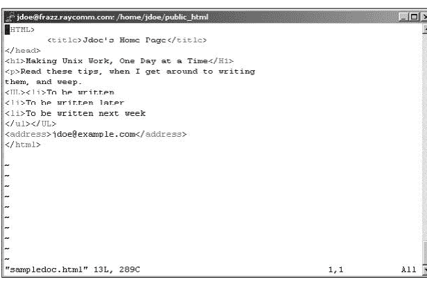

**图 16.1** 即使是像这样有缺陷 HTML 文档也可以被 `tidy` 修复。

### 2. `tidy sampledoc.html`

`tidy` 实用程序将应用 HTML 格式规则，然后输出一个处理过的文档版本，它在技术上是正确的（**代码列表 16.1**）。很酷，对吧？

### 3. `tidy sampledoc.html > fixedupdoc.html`

如果你喜欢结果，可以将文档重定向到新文件名，或者使用 `tidy -m sampledoc.html` 来替换原始文档。

```bash
$jdoe@frazz public_html$ tidy
-> sampledoc.html
```

```text
Tidy (vers 4th August 2000) Parsing
-> "sampledoc" line 10 column 6 -
-> Warning: discarding unexpected </ul>
sampledoc.html: Document content looks
-> like HTML 2.0
-> 1 warnings/errors were found!
```

```html
<!DOCTYPE html PUBLIC "//IETF//DTD
<html
<head>
<meta name="generator" content="HTML">
-> Tidy, see www.w3.org>
<title>Jdoe's Home Page</title>
</head>
<body>
<h1>Making Unix Work, One Day at a
-> Time!</h1>
<p>Read these tips, when I get around to
-> writing them, and weep.</p>
<ul>
<li>To be written</li>
<li>To be written later</li>
<li>To be written next week</li>
</ul>
<address>jdoe@example.com</address>
</body>
</html>
```

```bash
$jdoe@frazz public_html$
```

**代码列表 16.1** `tidy` 命令对于清理 HTML 文档非常方便。

## 第 16 章

## ✔ 提示

- 为了获得更漂亮的结果，我们喜欢使用 `tidy -indent -quiet -doctype loose -modify sampledoc.html`，它会抑制 `tidy` 的提示信息，将输出设置为 HTML 4 文，整齐地缩进输出，并用修改后的文件替换原始文件（代码列表 16.2）。这一切只需要一个命令。
- 考虑结合 `sed` 脚本（在下一节描述）使用来一次性完成大量清理。

```bash
[jdoe@frazz public_html] tidy -indent
  -> -quiet -doctype loose sampledoc.html
```

```text
line 10 column 6 - Warning: discarding
  -> unexpected </ul>
<!DOCTYPE html PUBLIC "//W3C//DTD HTML
  -> 4.0 Transitional/EN">
<html>
<head>
  <meta name="generator" content="HTML
  -> Tidy, see www.w3.org">
  <title>
Doe's Home Page
</title>
</head>
<body>
<h1>
Making Unix Work, One Day at a Time
</h1>
<p>
Read these tips, when I get around
  -> to writing them, and weep.
</p>
<ul>
<li>
To be written
</li>
<li>
To be written later
</li>
<li>
To be written next week
</li>
</ul>
<address>
jdoe@example.com
</address>
</body>
</html>
```

```bash
[jdoe@frazz public_html] $
```

**代码列表 16.2** 带有适当标志的 `tidy` 命令可以创造奇迹——几乎是如此。

## 惊叹的 Unix 技巧

```text
jdoe@frazz.raycomm.com:~home/jdoe/bin
```

```sh
#!/bin/sh

for i in `ls -1 *.htm`
do
  cp $i.bak $i.bak
  sed "s/</LINK>//g" $i > $i.new
  mv $i.new $i
  echo "$i is done!"
done
```

## 使用 sed 在多个文件中进行搜索和替换

在第 6 章中，我们讨论了 `sed` 以及如何使用它在整个文件中进行搜索和替换，一次处理一个文件。虽然我们还沉浸在那种操作带来的快感中，但我们将向你展示如何将 `sed` 与 shell 脚本和循环结合。通过这样做，你可以将搜索-替换准则应用到多个文档。例如，你可以搜索目录中所有的 `.html` 文件并对它们进行更改。在例例（图 16.2）中，我们删除了所有的 `<LINK>` 标签，这些标签对某些 HTML 输出来说是干扰的。

**图 16.2** 创建一个脚本在多个文件中进行搜索和替换。

在开始之前，你可能想查看第 6 章以复习 `sed`，查看第 10 章以复习脚本。

1. `#!/bin/sh` 以程序名称启动脚本。
2. `for i in \`ls -1 *.htm\`` 启动循环。
3. `cp $i.bak` 在更改之前为每个文件创建一个备份副本。
4. `sed "s/</LINK>//g" $i > $i.new` 规定你的搜索准则并替换文本。
5. `mv $i.new $i` 将文件移回旧文件。
6. `echo "$i is done!"` 可选地，在屏幕上打印状态消息，当有大量文件需要处理时这可以让人放心。
7. `done` 表示循环结束。
8. 保存并关闭你的脚本。
9. 尝试一下。记得使用 `chmod u+x` 和文件名让你的脚本具有执行权限，并使用 `./thestinkinlinkag` 运行。

```bash
[jdoe@frazz public_html]$ more /thestinkinlinkag
```

```sh
# /bin/sh

for i in `ls -1 *.htm`;
do
  cp $i.bak $i.bak
  sed "s/</LINK>//g" $i > $i.new
  mv $i.new $i
  echo "$i is done!"
done
```

```bash
[jdoe@frazz public_html]$ chmod u+x /thestinkinlinkag
```


[jdoe@frazz public_html]$ ./thestinkinlinkag

```
above.htm is done!
file1.htm is done!
file2.htm is done!
html.htm is done!
temp.htm is done!
```

**代码列表 16.3** 正如所示，你甚至使用 `sed` 删掉坏的 HTML 标签。

## 使用 awk 生成报告

在第 6 章中，我们展示了如何使用 `awk` 编辑由分隔符的文件，这很酷，因为它允许你从这些分隔符文件中提取特定信息，例如名称和数字。如代码列表 16.4 所示，你也可以使用 `awk` 来生成报告。我们从 `ls -la` 命令的信息开始，然后使用 `awk` 生成一份关于谁拥有什么的报告。

### 使用 awk 生成报告的方法：

- `ls -la | awk '{print $9 owned by " $3 }'`

呼！通常情况下，将 `ls -la` 通过管道传输给冗长的 `awk` 命令（是的，这就是 `awkward`（笨拙/别扭）一词的起源）。`awk` 随后打印第九字段 (`$9`)、单词 'owned by'，然后是第三字段 (`$3`)，最后在输出的末尾打印处理的记录总数（`print NR "Total Files" }`）。代码列表 16.4 显示了打印报告。

### 提示

- 记住，如果 `awk` 脚本经常使用，你可以将其嵌入到 shell 脚本中，参考之前的 `sed` 示例。

```bash
[ejr@hobbes/home]$ ls -la | awk '{print $9 owned by " $3 } END { print NR "Total Files" }'
```

```
owned by

owned by root

owned by root

admin owned by admin

anyone owned by anyone

asr owned by asr

awr owned by awe

bash owned by bash

csh owned by csh

deb owned by deb

debray owned by debray

ejr owned by ejr

ejray owned by ejray

ftp owned by root

httpd owned by httpd

last owned by root

merrie owned by merrielee

oldstuff owned by 1000

pguest owned by pcguest

raycomm owned by pcguest

samba owned by root

shared owned by root

22 Total Files

[ejr@hobbes/home]$
```

**代码列表 16.4** 使用 awk 生成快速报告。

## 惊叹的 Unix 技巧

```bash
[ejr@hobbes ejr$ su - ejr

Password:

Which editor do you want as the default?

- (vi or pico)

vi

You choose vi!

[ejr@hobbes ejr$ ]
```

## 使用输入自定义你的环境

早在第 8 章中，我们讨论了通过自定义登录时运行的配置文件来设置环境变量。你可以通过在启动脚本中要求输入来进一步自定义你的环境变量。例如，你可以设置你的配置文件（实际上是脚本），让它们要求你指定会话的默认编辑器（代码列表 16.5）。

**代码列表 16.5** 当系统询问你的偏好时，你就知道自己在什么状态了。

使用输入自定义你的环境：

1. `vi .bash_profile` 使用你喜欢的编辑器编辑你的脚本，并移动到文件末尾。
2. `echo -e "Which editor do you want as the default? (vi or pico)"`
使用 `echo -e` 指定提示你输入信息的文本（**图 16.3**）。

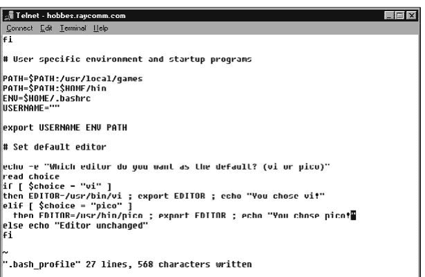

**图 16.3** 将此微脚本添加到你的 `.zprofile`、`.bash_profile` 或 `._profile` 配置文件的最后。

3. `read choice`

在下一行，添加 `read` 后跟要读入的变量名。我们选择 `choice` 是因为我们要使用这个输入来设置首的 `EDITOR` 环境变量。

4. `if [ $choice = "vi" ]`

开始一个 `if` 语句——在这种情况下，这是一个测试 `vi` 选项的语句。

5. `then EDITOR=/usr/bin/vi ; export EDITOR; echo "You chose vi!"`

在这里，语句将 `EDITOR` 环境变量设置为 `vi`，导出该环境变量并宣布你的选择。

6. `elif [ $choice = "pico" ]`

使用 `elif` (else if) 检查你的另一个选项。该语句涵盖了 `pico` 选项。

7. `then EDITOR=/usr/bin/pico ; export EDITOR; echo "You chose pico!"`

该语句将 `EDITOR` 环境变量设置为 `pico`，导出该环境变量并宣布你的选择。

8. `else echo "Editor unchanged"`

设置 `else` 语句，如果在 `read` 提示处没有输入任何选项，则将使用它。在示例中，如果既没有输入 `vi` 也没有 `pico`，它只会说编辑器未更改。

9. `fi`

结束 `if` 语句。

10. `su - yourid`

在 shell 提示符下，输入 `su -` 后跟你的用户名重新登录并测试修改后的登录脚本（代码列表 16.5）。

> **提示**
>
> 如果从具有不同能力的远程位置访问系统，这种技术对于设置 `TERM` 环境变量非常有用。

## 使用 sed 使用 ROT13

在互联网的各个地方，文本通常使用所谓的“ROT13（“字母表旋转 13 位”的缩写）”进行编码。也就是说，A 变成 N，B 变成 O，以此此类推。如果文本经过编码，人们必须采取额外步骤来解码消息。例如，如果消息包含一个攻击性笑话，不想看到它的人就不需要看。（注：由于原文此处存在大量重复的 OCR 错误，此处已根据逻辑流进行了去重处理）。

## 第 16 章

- 3. `/bin/sed y/abcdefghijklmnopqrstuvwxyz
-> ZABCQRSTUVWXYZ/nopqr
-> stuvwxyzabcdefghijklmnOPQRSTQRSTUVWXYZ
-> ZABCDEFGHIJKLM/`

指定 `sed` 程序（使用完整路径使程序更具灵活性）以及编码和解码 ROT13 文本的命令。最好让 shell 脚本是自包含的，因此我们不再在此处通过 `sed` 脚本中引用外部文件，而是直接将其放在命令行中。

- 4. `/bin/sed y/abcdefghijklmnopqrstuvwxyz
-> ZABCQRSTUVWXYZ/nopqr
-> stuvwxyzabcdefghijklmnOPQRSTQRSTUVWXYZ
-> ZABCDEFGHIJKLM/ "$1"`

在这里，我们添加了 `$1` 以将从命令行传递的文件（例如 `rot13 thisfile`）给 `sed`。

- 5. `/bin/sed y/abcdefghijklmnopqrstuvwxyz
-> ZABCQRSTUVWXYZ/nopqr
-> stuvwxyzabcdefghijklmnOPQRSTQRSTUVWXYZ
-> ZABCDEFGHIJKLM/ "$1" | more`

接下来，将输出通过管道到 `more`，这样你就可以一次查看一屏文件了。

- 6. 保存并退出文件。

- 7. `chmod +x rot13`

赋予 shell 脚本可执行权限，这样你只需要输入 `rot13` 而不是 `sh rot13` 了。

- 8. `./rot13 limerick`

测试脚本。由于我们是在非路径中的目录中开发此脚本的，我们必须使用 `./rot13` 来执行脚本。如果你在路径中的目录中开发脚本，你应该就可以直接输入 `rot13`。

### 提示

- 你可以构建一个选项，将脚本的输出重定向到文件中并保存备后使用。基本上，你做的就是创建一个 `if-then` 语句，并给自己一个自动重定向输出到文件的选项，如代码列表 16.7 所示。请查看第 10 章关于 `if-then` 语句。

```bash
ejr@hobbes creative]$ more rot13

#! /bin/sh

# 如果命令行上的第一个项（脚本名之后）

# 是 save，且第二个项是可读文件，

# 那么我们就执行第一种情况。

if [ "$1" = "save" -o "$1" = "s" -o -r "$2" ]; then

then

  # 此情况将 ROT13 输出保存到相同文件名下，

# 并带有 rot13 扩展名。

/bin/sed abcdefghijklmnopqrstuvwxyzABCDEFGHIJKLMNOPQRSTUVWXYZ/nopqrstuvwxyzabcdefghijklmnopOPQRSTUVWXYZ

- UVUVWXYZABCDEFGHIJKLMNOPQRSTUVWXYZ/ < "$2" > "$2.rot13"

else

  # 此情况将 ROT13 输出重定向到 more，因为

# 没有指定保存。

/bin/sed abcdefghijklmnopqrstuvwxyzABCDEFGHIJKLMNOPQRSTUVWXYZ/nopqrstuvwxyzabcdefghijklmnopOPQRSTUVWXYZ

- UVUVWXYZABCDEFGHIJKLMNOPQRSTUVWXYZ/ "$1" | more

fi

ejr@hobbes creative]$
```

**代码列表 16.7** 如果你想让脚本变得高级，可以将其他章节中一些实用的部分组合在一起，创建一个杰作。

## 使用 rsync 备份

`rsync` 实用是一种在本地或跨网络同步文件和目录的方法。我们喜欢使用它来制作备份，这样当我们搞砸某些时就不必担心。是的，我们可以使用 `cp` 或同样无聊的东西，但我们喜欢 `rsync` 的速度和灵活性。在这个示例中，我们正在本地复制文件，但我们可以轻松地将备份到其他地方的服务器。

## 使用 rsync 进行备份：

- 1. `mkdir ~/BACKUPDIR`

创建一个目录来存放你的备份。理想情况下，你会在与备份内容不同的物理磁盘上创建该目录，但你能做什么呢？我们正在主目录的子目录中创建一个备份目录，这有助于防止由于磁盘故障造成的自我损坏（我们信任系统管理员来防止磁盘故障……Eric，你对我们的备份情况了如指吧？）

- 2. `rsync -v -a /home/jdoe/data ~/BACKUPDIR`

指定 `rsync` 命令、`-v`（详细模式）和 `-a`（归档模式）选项作为源目录和目标目录（代码列表 1.8）。

等待它完成初始备份（在处理每个文件时向你显示）。第一次备份需要一些时间，但并不会比 `cp` 长。

```bash
[joe@frazz bin$] rsync -v -a
/home/jdoe/data ~/.BACKUPDIR

building file list ... done

data/

data*/scratch#

data/all.programs

data/local.programs.txt

data*/scratch*

data/1

data/2

data/Mail/

data/News/

data/Project/

data/Project/keep

data/Project/keeper.jpg

data/Project/kept

data/Project/kidder.txt

data/Project/kiddo

data/Project/kidnews

data/Project/kids

data/Project/kidupdate

data/address.book

data/address.book-

data/all.programs

data/b

data/backup-files/

data/backup-files/.authority

data/backup-files/.bash_history

data/backup-files/.bashlog

data/backup-files/.profile

data/backup-files/.bashrc

data/backup-files/.mailcap

data/backup-files/.screenrc

data/backup-files/.ssh/

write 2844142 bytes read 14708 bytes sent 2154.00 bytes/s speed on-... total size is
```

**代码列表 16.7** 如果你想让脚本非常花哨，可以将其他章节中一些最实用的部分结合在一起制作出一个杰作。


## 第16 章

### 使用 sed 实现 ROT13 编码

- 3. `/bin/sed y/abcdefghijklmnopqrstuvwxyzABCDEFGHIJKLMNOPQRSTUVWXYZ/nopqrstuvwxyzabcdefghijklmNOPQRSTUVWXYZABCDEFGHIJKLM/`

指定 `sed` 程序（使用完整路径使程序更具灵活性）以及编码和解码 ROT13 文本的命令。最好让 shell 脚本是自包含的，因此我们不再在此处通过 `sed` 脚本中引用外部文件，而是直接将其放在命令行中。

- 4. `/bin/sed y/abcdefghijklmnopqrstuvwxyzABCDEFGHIJKLMNOPQRSTUVWXYZ/nopqrstuvwxyzabcdefghijklmNOPQRSTUVWXYZABCDEFGHIJKLM/ "$1"`

在这里，我们添加了 `"$1"` 以将从命令行传递的文件（例如 `rot13 thisfile`）给 `sed`。

- 5. `/bin/sed y/abcdefghijklmnopqrstuvwxyzABCDEFGHIJKLMNOPQRSTUVWXYZ/nopqrstuvwxyzabcdefghijklmNOPQRSTUVWXYZABCDEFGHIJKLM/ "$1" | more`

接下来，将输出通过管道到 `more`，这样你就可以一次查看一屏文件了。

- 6. 保存并退出文件。

- 7. `chmod +x rot13`

赋予 shell 脚本可执行权限，这样你只需要输入 `rot13` 而不是 `sh rot13` 了。

- 8. `./rot13 limerick`

测试脚本。由于我们是在非路径中的目录中开发此脚本的，我们必须使用 `./rot13` 来执行脚本。如果你在路径中的目录中开发脚本，你应该就可以直接输入 `rot13`。

### 提示

- 你可以构建一个选项，将脚本的输出重定向到文件中并保存备后使用。基本上，你做的就是创建一个 `if-then` 语句，并给自己一个自动重定向输出到文件的选项，如代码列表 16.7 所示。请查看第10章关于 `if-then` 语句。

```
ejr@hobbes creative]$ more rot13
#! /bin/sh

# 如果命令行上的第一个项（脚本名之后）
# 是 save，且第二个项是可读文件
# 那么我们就执行第一种情况。
if [ "$1" = "save" -o "$1" = "s" -o -r "$2" ]; then
then
  # 此情况将 ROT13 输出保存到相同文件名下，
  # 并带有 rot13 扩展名。
  /bin/sed y/abcdefghijklmnopqrstuvwxyzABCDEFGHIJKLMNOPQRSTUVWXYZ/nopqrstuvwxyzabcdefghijklmnopqrstuvwxyzABCDEFGHIJKLMNOPQRSTUVWXYZ/ < "$2" > "$2.rot13"
else
  # 此情况将 ROT13 输出重定向到 more，因为
  # 没有指定保存。
  /bin/sed y/abcdefghijklmnopqrstuvwxyzABCDEFGHIJKLMNOPQRSTUVWXYZ/nopqrstuvwxyzabcdefghijklmnopqrstuvwxyzABCDEFGHIJKLMNOPQRSTUVWXYZ/ "$1" | more
fi
ejr@hobbes creative]$
```

代码列表 16.7 如果你想让脚本变得非常高级，可以将其他章节中一些最实用的部分结合在一起制作出一个杰作。

## 使用 rsync 备份

`rsync` 实用程序是一种在本地或跨网络同步文件和目录的方法。我们喜欢使用它来制作备份，这样当我们搞砸某些事情时就不必担心。是的，我们可以使用 `cp` 或同样无聊的东西，但我们喜欢 `rsync` 的速度和灵活性。在这个示例中，我们正在本地复制文件，但我们可以轻松地将备份到其他地方的服务器。

## 使用 rsync 进行备份

1. `mkdir ~/BACKUPDIR`

创建一个目录来存放你的备份。理想情况下，你会在与备份内容不同的物理磁盘上创建该目录，但你能做什么呢？我们正在主目录的子目录中创建一个备份目录，这有助于防止由于磁盘故障造成的自我损坏（我们信任系统管理员来防止磁盘故障……Eric，你对我们的备份情况了如指掌吧？）。

2. `rsync -v -a /home/jdoe/data ~/BACKUPDIR`

指定 `rsync` 命令、`-v`（详细模式）和 `-a`（归档模式）选项作为源目录和目标目录（代码列表 1.8）。

等待它完成初始备份（在处理每个文件时向你显示）。第一次备份需要一些时间，但并不会比 `cp` 长。

```
[joe@frazz bin$] rsync -v -a /home/jdoe/data ~/.BACKUPDIR
building file list ... done
data/
data/Project/kidnews
data/Project/kids
data/Project/kidupdate
data/address.book
data/address.book-
data/all.programs
data/b
data/backup-files/
data/backup-files/.authority
data/backup-files/.bash_history
data/backup-files/.bashlog
data/backup-files/.profile
data/backup-files/.bashrc
data/backup-files/.mailcap
data/backup-files/.screenrc
data/backup-files/.ssh/
write 2844142 bytes read 14708 bytes sent 2154.00 bytes/s speed on-... total size is
```


# 附录 A：UNIX 参考

## 表 A.a：附录内容概览

| 表格编号 | 描述 |
|---|---|
| 表 A.1 | Unix 入门 |
| 表 A.2 | 使用目录和文件 |
| 表 A.3 | 运行你的 Shell |
| 表 A.4 | 创建和编辑文件 |
| 表 A.5 | 控制文件所有权和权限 |
| 表 A.6 | 操作文件 |
| 表 A.7 | 获取你的系统信息 |
| 表 A.8 | 配置你的 Unix 环境 |
| 表 A.9 | 运行脚本和程序 |
| 表 A.10 | 编写基础脚本 |
| 表 A.11 | 发送和读取电子邮件 |
| 表 A.12 | 访问互联网 |
| 表 A.13 | 处理编码和压缩文件 |
| 表 A.14 | 使用实用工具 |

在本附录中，你将找到关于 Unix 命令和标志的相当详尽参考，以及每个命令的示例和描述。我们对附录的组织通常与本书保持并行，这样你就可以参考关键命令和标志，而不会被长长的命令列表所淹没。

**表格 A.a** 总结了你将在附录中找到的内容。

**表格 A.1–A.15** 包含了与对应编号章节（第 16 章和第 17 章）相关的命令和标志。它们没有引入新命令，因此这些章节中的命令已与其他附录中的相似命令包含在一起。除了章节中讨论的命令和标志外，你还会发现在 Unix 冒险中可能实用的相关命令和选项、能够唤起记忆的参考信息，以及帮助你启动额外项目的想法。如果你正在寻找详尽的命令标志参考，请查看附录 C。

---

## 表 A.1：Unix 入门

| 命令 | 描述 |
|---|---|
| `apropos keyword` | 为关键字查找合适的帮助页。 |
| `cat file` | 在屏幕上显示文件内容或将文件内容提供给标准输出。 |
| `cat file1 file2` | 显示 `file1` 和 `file2`。 |
| `cd` | 从 Unix 系统中的任何地方返回你的主目录。 |
| `cd ..` | 在目录树中向上移动一级。 |
| `cd /etc` | 切换到相对于系统根目录的 `/etc` 目录。 |
| `cd --subdir` | 使用波浪号 (`-`) 作为主目录的快捷方式。 |
| `cd Projects` | 将当前目录移动到 `Projects` 目录。 |
| `col -b` | 过滤退格符并删除输出的换行符。用于使帮助页变得可编辑。 |
| `exit` | 关闭当前进程（通常是 shell），如果你关闭了登录 shell 则关闭你的 Unix 会话。 |
| `less file` | 用于在屏幕上查看文件。 |
| `logout` | 关闭你的 Unix 会话。 |
| `ls` | 列出文件和目录。 |
| `ls directory` | 列出根目录下的文件和目录。 |
| `ls -a` | 列出所有文件和目录，包括隐藏文件。 |
| `ls -ls -t` | 按修改日期列出文件和目录。 |
| `ls -l` | 长格式列出文件和目录，带有额外信息。 |
| `ls -lh` | 长格式列出文件和目录，带有额外信息和人类可读的大小。 |
| `man 5 command` | 查看命令的第 5 节帮助页。有时用作 `man -s 5 command`。 |
| `man command` | 查看命令的手册（帮助）页。 |
| `man -k keyword` | 为关键字查找合适的帮助页。 |
| `more filealeview` | 通过屏幕查看文件内容。 |
| `password` | 修改你的密码。 |
| `pwd` | 显示当前所在目录的路径和名称。 |
| `reset` | 重置 shell 以修复显示问题。 |
| `stty sane` | 尝试修复意外且奇怪的显示问题。 |
| `su - yourid` | 在注销后重新登录。 |
| `su` | 变成 root 用户。 |
| `sudo command` | 以 root 用户权限运行命令。 |

---

## 表 A.2：使用目录和文件

| 命令 | 描述 |
|---|---|
| `cp existingfile new` | 将 `existingfile` 复制为名为 `new`。 |
| `cp -i existingfile new` | 将 `existingfile` 复制为名为 `new`，在覆盖现有文件之前提示你。 |
| `cp -r /Projects /shared/Projects` | 将目录 `/Projects` 复制到新名称 `/shared/Projects`，指定递归复制。 |
| `find -name lostfile -print` | 在当前目录及其子目录下查找名为 `lostfile` 的文件。 |
| `find /home -name "pending*" -print` | 在主目录或子目录下查找所有以 `"pending"` 开头的文件或目录。 |
| `find /home/shared -mtime -3 -print` | 查找共享目录下在过去三天内修改过的文件或目录。 |
| `find ~ -name '*.backup' -exec compress {} \;` | 压缩主目录及其子目录下所有以 `".backup"` 结尾的文件。 |
| `find ~ -name '*.backup*' -ok rm {} \;` | 查找并经确认删除主目录及其子目录下所有以 `".backup"` 结尾的文件。 |
| `ln /home/* /home/b` | 将目录中的所有文件硬链接到 `b` 目录。 |
| `ln afile alike` | 链接文件和 `alike`，在两个不同的目录中本质上创建同一个文件。 |
| `ln -s /home/deb/Projects /home/helper/Project` | 从 `/home/deb/Projects` 创建 `/home/helper/Project` 的符号链接。 |

---

## 表 A.3：运行你的 Shell

| 命令 | 描述 |
|---|---|
| `bash` | 启动 Bourne Again Shell。 |
| `csh` | 启动 C shell。 |
| `clear` | 清除屏幕。 |
| `export` | 设置环境变量。 |
| `exit` | 退出当前 shell。 |
| `history` | 显示命令历史。 |
| `alias` | 创建命令别名。 |
| `unalias` | 移除命令别名。 |
| `set` | 显示所有 shell 变量和函数。 |
| `source` | 在当前 shell 环境中执行脚本。 |
| `unset` | 移除环境变量。 |

---

## 表 A.4：创建和编辑文件

| 命令 | 描述 |
|---|---|
| `ed` | 选择一个行的编辑器。 |
| `emacs` | 选择一个极其强大且易用的编辑器。 |
| `emacs -nw` | 在终端模式下打开 `emacs`。 |
| `emacs filename` | 打开 `emacs` 并编辑文件名。 |
| `joe` | 选择一个友好的编辑器。 |
| `nano` | 选择面向菜单、用户友好的编辑器。 |
| `nano filename` | 在 `nano` 中打开并编辑文件名。 |
| `nano -W` | 在 `nano` 中禁用自动换行。这对于配置文件特别有用。 |
| `pico` | 选择面向菜单、用户友好的编辑器。 |
| `pico filename` | 在 `pico` 中打开并编辑文件名。 |
| `pico -W` | 为 `pico` 禁用自动换行。这对于配置文件特别有用。 |
| `vi` | 选择一个功能强大但不易用的编辑器。 |
| `vi filename` | 在 `vi` 中打开并编辑文件名。 |

---

## 表 A.5：控制文件所有权和权限

| 命令 | 描述 |
|---|---|
| `chgrp` | 更改文件或目录的组。 |
| `chgrp groupname filename` | 将 `filename` 的组更改为 `groupname`。 |
| `chgrp -R group directory` | 递归更改目录及其所有子目录和文件的组为 `group`。 |
| `chmod` | 更改文件或目录的权限。 |
| `chmod a-w file` | 移除所有对文件的写入权限。 |
| `chmod g+w file` | 为所属组添加文件的写入权限。 |
| `chmod -R go-rw,*` | 移除当前目录及所有子目录内容中用户以外的所有权限。 |
| `chmod u=rwx,g=rx,o=r file` | 设置文件权限为读、写、执行，组读和其他读。 |
| `chmod ugo=*` | 移除所有人对当前目录下所有内容的权限。 |
| `chown` | 更改文件或目录的所有者。 |
| `chown -R user Directory` | 递归更改目录及其所有内容的所有者为 `user`。 |
| `chown user file` | 将文件的所有者更改为 `user`。 |
| `umask 022` | 指定所有创建文件的默认权限。 |

---

## 表 A.6：操作文件

| 命令 | 描述 |
|---|---|
| `awk` | 将文件作为数据库进行处理。 |
| `awk '/CA/' { print $2 $1 $7 }' file` | 在包含 `"CA"` 的行中选择（并显示）每个记录文件的三个字段。 |
| `awk '{ print $1 $7 }' file` | 选择（并显示）每个记录文件的第一个字段。 |
| `awk -f script.awk file` | 运行名为 `script.awk` 的脚本在文件上运行 `awk` 命令。 |
| `awk -F, '{ print $1 }' file > newfile` | 选择每个记录文件的第一个字段，指定以 `","` 为字段分隔符，并将输出重定向到 `newfile`。 |
| `awk -F: '{ print $2 " $1 in " $7 }' file` | 使用冒号 (`:`) 作为分隔符，为每个文件选择（并显示）多个字段和文本。 |
| `basename` | 从文件名中删除路径，仅保留正式名称。适用于脚本中显示文件名。 |
| `cmp newfile oldfile` | 比较 `newfile` 和 `oldfile`。 |
| `crypt` | 加密受密码保护的文件。 |
| `diff -b newfile oldfile` | 查找 `newfile` 和 `oldfile` 之间的差异（忽略空格）。 |
| `diff Directory Newdirectory` | 查找 `Directory` 和 `Newdirectory` 之间的差异。 |
| `diff -i newfile oldfile` | 查找 `newfile` 和 `oldfile` 之间的差异（不区分大小写）。 |
| `diff -ibw file1 file2` | 查找 `file1` 和 `file2` 之间的所有差异，但不包括涉及空行、空格、制表符或大小写字母的差异。 |
| `diff newfile oldfile` | 查找 `newfile` 和 `oldfile` 之间的差异。 |
| `diff -w newfile oldfile` | 查找 `newfile` 和 `oldfile` 之间的差异（忽略空格）。 |
| `fmt -w 60` | 重新格式化文件以使行对齐且外观更美。重新格式化文件使每行不超过指定长度（60 个字符）。 |
| `grep expression file` | 在文件中查找表达式并查看包含该表达式的行。 |
| `grep -c expression file` | 统计表达式在文件中出现的次数。 |
| `grep -i expression file` | 在文件中查找所有包含表达式的行，不区分大小写。 |
| `grep -n expression file` | 显示找到的每行及其行号。 |
| `grep 'Nucket' limerick*` | 查找 `limerick` 文件中以 `"Nucket"` 结尾的行。 |
| `grep -v expression file` | 查找文件中不包含表达式的所有行。 |
| `grep '^[A-Za-z]' limerick` | 查找 `limerick` 中以任何字母开头但不是数字或符号开头的行。 |
| `grep '^[A-Z]' limerick` | 查找 `limerick` 中以大写字母开头的所有行。 |
| `grep '^There' limerick` | 查找 `limerick` 中以 `"There"` 开头的所有行。 |
| `grep -5 '^word[234]'` | 在文件中查找 `word`、`word2`、`word3` 或 `words`，并查看单词周围的五行以及包含单词的行。 |
| `head -20 file` | 查看文件的前 20 行。 |
| `head file` | 查看文件的前 10 行。 |
| `pr file` | 为打印重新格式化文件，带有页眉和页脚。 |
| `pr --columns=2 file` | 为打印重新格式化文件，带有页眉、页脚和两列。 |

### 文件操作（续）

| 命令 | 描述 |
|---|---|
| `sdiff newfile oldfile` | 查看 `newfile` 和 `oldfile` 之间的差异。 |
| `sdiff -s newfile oldfile` | 查看 `newfile` 和 `oldfile` 之间的差异，不显示相同。 |
| `sed` | 根据命令行输入或 `sed` 脚本对整个文件进行更改。 |
| `sed 's/old/new/g' file > file.new` | 搜索 `file` 并将所有的 `"old"` 替换为 `"new"`。 |
| `sed -f script.sed file > file.new; mv file.new newfile` | 运行 `script.sed` 中的命令，将其应用于文件，并用修改后的内容替换它。 |
| `split -b 500K file` | 将文件分成 500 KB 的块。 |
| `sort file \| uniq` | 对文件排序并发送给 `uniq` 以消除重复。 |
| `sort file > sortedfile` | 按字母顺序对文件中的行进行排序，并将排序结果显示在 `sortedfile` 中。 |
| `sort file \| tee sorted \| mail boss@proxy.com` | 对文件排序，并将结果发送到文件 `sorted` 和标准输出（随后发送到邮箱）。 |
| `sort file1 file2 \| uniq -d` | 对文件进行合并排序并找到所有重复的行。 |
| `sort file1 file2 file3 > bigfile` | 排序并合并 `file1`、`file2` 和 `file3` 的内容，并将排序后的输出放入 `bigfile`。 |
| `sort -n file` | 对文件进行数值排序。 |
| `sort -t, +2 file` | 对逗号分隔的文件进行排序；`-t(,)` 之后的字符表示分隔符。 |
| `sort -t, +2 file` | 对逗号分隔的文件中的第三（实际的）字段进行排序。 |
| `spell file` | 检查文件中所有单词的拼写。返回一个可能拼写错误的单词列表。 |
| `tail -15 file` | 查看文件的最后 15 行。 |
| `tail file` | 查看文件的最后 10 行。 |
| `tidy file.html` | 清理 `file.html` 以使其更易读和维护。 |
| `tr 'A-Za-z' 'a-zA-Z' < file` | 将大写转换为小写，反之亦然。 |
| `uniq` | 与 `sort` 使用消除重复行。 |
| `wc -b file` | 统计字节数。 |
| `wc file` | 统计行数、单词数、字节数。 |
| `wc -l file` | 统计行数。 |
| `wc -w file` | 统计单词数。 |

---

## 表 A.7：获取系统信息

| 命令 | 描述 |
|---|---|
| `df` | 查看文件系统挂载在何处，以及用和可用空间。 |
| `df /usr/local/src` | 查看 `/usr/local/src` 的挂载位置以及可用空间。 |
| `df -k /home` | 以 KB 为单位查看 `/home`。 |
| `df -h /home` | 以人类可读的格式查看 `/home`。 |
| `du` | 显示文件目录的磁盘使用情况。 |
| `du -sh` | 显示目录的总大小。 |
| `free` | 显示系统中的空闲和已用内存。 |
| `hostname` | 显示或设置系统主机名。 |
| `ifconfig` | 配置或显示网络接口参数。 |
| `ip addr` | 显示和配置 IP 地址。 |
| `lsof` | 列出打开的文件。 |
| `lsblk` | 列出所有块设备。 |
| `mount` | 挂载文件系统。 |
| `netstat` | 打印网络统计信息。 |
| `dfstat` | 显示文件系统使用统计信息。 |
| `swapon` | 显示交换文件的可用空间。 |
| `free` | 显示交换使用的量。 |
| `ps` | 报告进程状态。 |
| `readfs` | 从文件系统读取信息。 |
| `remount` | 重新挂载文件系统。 |
| `uptime` | 显示系统运行时间。 |
| `vmstat` | 报告虚拟内存系统统计信息。 |
| `whoami` | 显示当前用户名。 |

---

## 表 A.8：配置你的 Unix 环境

*(原文中此表内容缺失，此处保留标题占位)*

---

## 表 A.9：运行脚本和程序

| 命令 | 描述 |
|---|---|
| `at 01:01 1 Jan 2010` | 计划任务在 2010 年 1 月 1 日 01:01 运行。 |
| `at 01/01/10` | 计划任务在 1/1/10 运行。 |
| `at 3:42am` | 计划任务在凌晨 3:42 运行。 |
| `at noon tomorrow` | 计划任务在明天中午运行。 |
| `at now + 3 weeks` | 计划任务在三周后运行。 |
| `at teatime` | 计划任务在下午 4 点运行。 |
| `atq` | 查看队列中的任务。 |
| `atrm 3` | 删除指定的任务（在本例中为任务 3）。 |
| `batch` | 计划任务在系统负载允许时运行。 |
| `bg` | 在后台运行最近挂起或控制的任务。 |
| `bg %2` | 在后台运行任务 `%2`。 |
| `crontab -e` | 使用默认编辑器编辑你的 crontab 以调度定期进程或任务。 |
| `Ctrl+Z` | 挂起正在运行的任务、程序或进程。 |
| `fg` | 在前台运行最近挂起或控制的任务。 |
| `fg 1` | 在前台运行任务 1。 |
| `jobs` | 查看当前控制的任务列表。 |
| `kill %ftp` | 通过名称或任务号杀死任务。 |
| `kill 16217` | 杀死进程 16217。 |
| `kill -9 16217` | 杀死进程 16217；`-9` 标志允许你杀死普通 `kill` 无法影响的进程。 |
| `nice` | 以“友好”的方式运行任务——速度较慢，且对系统和其他用户的影响较小。数字越大越友好，默认最大值为 19。 |
| `nice -n 19 slowscript` | 以 19 的优先级以友好方式运行脚本。 |
| `pkill badjob` | 杀死名为 `badjob` 的进程。 |
| `ps` | 查看你正在运行的当前进程列表。 |
| `ps e` | 查看所有进程，包括其他用户的进程。 |
| `ps f` | 查看进程及其关系（树状视图）。 |
| `ps x` | 查看系统本身运行的进程（也称为守护进程）。 |
| `renice 19 processid-of-script` | 以 19 的优先级以更友好的方式运行脚本（更改 nice 值）。 |
| `time script` | 运行脚本所需的时间（包括实际时间和系统时间）。 |
| `top` | 实时监控系统负载和进程。 |

---

## 表 A.10：编写基础脚本

| 命令 | 描述 |
|---|---|
| `break` | 在 shell 脚本中使用，跳过循环中的剩余命令并从循环开始处重新开始。 |
| `case ... in ... esac` | 在 shell 脚本中使用，对各种情况执行不同的操作。 |
| `clear` | 清除屏幕。 |
| `continue` | 在 `for` 循环中使用。 |

---

## 表 A.11：发送和读取电子邮件

| 命令 | 描述 |
|---|---|
| `alpine` | 启动 `alpine` 邮件程序并读取、回复或发送电子邮件，或阅读 Usenet 新闻。 |
| `alpine books@raycom.com,info@raycom.com` | 启动发送 `books@raycom.com` 和 `info@raycom.com` 的 `alpine` 邮件。 |
| `alpine user@raycom.com` | 启动发送 `user@raycom.com` 的 `alpine` 邮件。 |
| `mail` | 启动邮件程序。（可能尽可能使用 `pine` 而不是 `mail`）。 |
| `mail books@raycom.com < file` | 将文件发送到 `books@raycom.com`。 |
| `mail -s "For you!" books@raycom.com < file` | 将主题为“For you!”的文件发送到 `books@raycom.com`。 |
| `mail books@raycom.com` | 启动向 `books@raycom.com` 发送简单邮件。 |
| `mail books@raycom.com,info@raycom.com` | 向 `books@raycom.com` 和 `info@raycom.com` 发送简单邮件。 |
| `mutt` | 启动 `mutt` 邮件程序并读取、回复或发送。 |
| `mutt books@raycom.com -a file.tgz` | 启动发送 `books@raycom.com` 的新 `mutt` 邮件并附加 `file.tgz`。 |
| `mutt books@raycom.com,info@raycom.com` | 启动向 `books@raycom.com` 和 `info@raycom.com` 发送的新 `mutt` 邮件。 |
| `pine` | 启动 `pine` 邮件程序并读取、回复或发送电子邮件，或阅读 Usenet 新组。 |
| `pine books@raycom.com,info@raycom.com` | 启动发送 `books@raycom.com` 和 `info@raycom.com` 的 `pine` 邮件。 |
| `pine user@raycom.com` | 启动发送 `user@raycom.com` 的 `pine` 邮件。 |
| `procmail` | 根据“配方”过滤和排序邮件。从重定向文件运行由系统自动运行。 |
| `vacation` | 初始化 `vacation` 并编辑消息模板。 |
| `vacation -I` | 启动 `vacation` 并告诉它回复入站消息。 |
| `vacation -j` | 启动 `vacation` 并自动回复所有消息。 |

---

## 表 A.12：访问互联网

| 命令 | 描述 |
|---|---|
| `dig nameserver.some.net www.raycom.com` | 从服务器 `nameserver.some.net` 查找 `raycomm.com` 的名称。 |
| `dig -x 192.168.1.52` | 查找 IP 地址 `192.168.1.52` 对应的名称。 |
| `ftp.raycom.com` | 使用 FTP 协议向或从 `ftp.raycom.com` 传输文件。 |
| `irc.netcom.com` | 连接到 `netcom.com` 的 IRC 并使用昵称。 |
| `links` | 启动 `links` 浏览器。 |
| `links http://www.google.com/` | 在 `www.google.com/` 启动 `links` 浏览器。 |
| `lynx -dump http://url.com/filename.txt` | 从 `http://url.com` 获取名为 `filename.txt` 的 HTML 文档文件。 |
| `lynx` | 启动 `lynx` 浏览器。 |
| `lynx http://www.yahoo.com/` | 在 `www.yahoo.com/` 启动 `lynx` 浏览器。 |
| `mesg n` | 拒绝写入消息。 |
| `mesg y` | 接受写入消息。 |
| `nslookup raycom.com nameserver.some.net` | 从 `nameserver.some.net` 查找 `raycom.com` 的名称。 |
| `nslookup 192.168.1.52` | 查找 IP 地址 `192.168.1.52` 对应的名称。 |
| `ping raycom.com` | 测试到 `raycom.com` 的连接。 |
| `tracepath raycom.com` | 查看到 `raycom.com` 的路径。 |
| `ssh user@raycom.com` | 安全地连接到 `raycom.com`。 |
| `scp file user@raycom.com:/` | 将文件安全拷贝到 `user@raycom.com` 的根目录。 |
| `ftp user@raycom.com` | 使用 `user@raycom.com` 登录 FTP。 |
| `telnet user@raycom.com` | 使用 `user@raycom.com` 连接 telnet。 |
| `curl http://www.google.com/` | 使用 `curl` 获取 `www.google.com` 的内容。 |
| `wget http://www.google.com/` | 使用 `wget` 下载 `www.google.com` 的内容。 |
| `host raycom.com` | 查看 `raycom.com` 的主机记录。 |
| `whois raycom.com` | 查询 `raycom.com` 的注册信息。 |
| `nslookup raycom.com` | 查询 `raycom.com` 的 DNS 记录。 |
| `dig raycom.com` | 查询 `raycom.com` 的 DNS 记录。 |
| `dig any raycom.com` | 查询 `raycom.com` 的所有类型记录。 |
| `dig ns raycom.com` | 查询 `raycom.com` 的 NS 记录。 |
| `dig mx raycom.com` | 查询 `raycom.com` 的 MX 记录。 |
| `dig txt raycom.com` | 查询 `raycom.com` 的 TXT 记录。 |
| `dig a raycom.com` | 查询 `raycom.com` 的 A 记录。 |
| `dig aaaa raycom.com` | 查询 `raycom.com` 的 AAAA 记录。 |
| `dig cname raycom.com` | 查询 `raycom.com` 的 CNAME 记录。 |
| `dig soa raycom.com` | 查询 `raycom.com` 的 SOA 记录。 |
| `traceroute raycom.com` | 查看到 `raycom.com` 的路径。 |
| `nmap raycom.com` | 扫描 `raycom.com` 的端口。 |
| `netstat raycom.com` | 查看与 `raycom.com` 的连接。 |
| `tcping raycom.com` | 测试 `raycom.com` 的特定端口。 |
| `ssl_client raycom.com` | 测试 `raycom.com` 的 SSL 连接。 |
| `openssl s_client -connect raycom.com:443` | 测试 `raycom.com` 的 443 端口的 SSL。 |
| `openssl x509 -in raycom.com` | 查看 `raycom.com` 的证书。 |

---

## 表 A.13：处理编码和压缩文件

*(原文中此表内容为重复数据，已去除)*

---

## 表 A.14：使用实用工具

| 命令 | 描述 |
|---|---|
| `bc` | 使用计算器进行加法、减法、乘法、除法等操作。 |
| `bc bcfile` | 执行 `bcfile` 中指定的计算，然后从标准输入继续后续计算。 |
| `expr` | 评估数学或逻辑表达式。 |
| `cal` | 查看当前月的日历。 |
| `cal 12 1941` | 查看 1941 年 12 月的日历。 |
| `cal 1999` | 查看 1999 年的日历。 |
| `cal -j` | 查看儒略历。 |
| `calendar` | 从文件 `~/calendar` 读取并查看当前日期提醒。 |
| `fortune` | 显示幸运语、格言或任何随机的内容。 |
| `look` | 在系统字典中查找单词。 |
| `lp` | 打印文件。 |
| `rsync file backupfile` | 远程同步（复制）文件到备份文件。 |
| `script` | 在当前目录下的名为 `typescript` 的文件中记录你的操作。 |
| `script covermybutt` | 在文件 `covermybutt` 中记录你的操作。 |
| `units` | 将一种单位转换为另一种单位。 |

---

# 附录 B：什么是什么以及在哪里

当你在使用 Unix 时，无疑会遇到一些看起来很重要的文件或看起来很有趣的目录，但通常很难知道哪些文件属于哪个程序，更难以确定某些目录的用途。因此，我们正试图通过本附录中的信息为你提供一些帮助。

**表 B.1** 列出了重要的 Unix 文件和目录。

**表 B.2** 列出了常用 Unix 目录的内容。在实践中，这些目录的内容（以及它们是否存在）随系统而异很大，但此处描述的配置是相当标准的。

---

## 表 B.1：重要的 Unix 文件和目录

| 文件名 | 描述 |
|---|---|
| `~/.forward` | 包含转发邮件的地址，或将邮件重定向到休假程序或 `procmail`。 |
| `~/.newsrc` | 包含新闻阅读器使用的已读、未读和订阅的新闻组记录。 |
| `~/.procmailrc` | 包含 `procmail` 的配置信息。 |
| `~/.pinerc` | 包含 `pine` 的配置信息。 |
| `~/.muttrc` | 包含 `mutt` 的配置信息。 |
| `~/.signature` | 包含你的签名，邮件程序和新闻阅读器会将其附加到消息中。 |
| `/etc/bashrc` | 所有 `bash` 用户共享的系统级 `bash` 资源文件。 |
| `/etc/csh.cshrc` | 系统级 `csh` 资源文件。 |
| `/etc/group` | 系统组记录。 |
| `/etc/ksh.kshrc` | `ksh` 用户的系统级配置文件。 |
| `/etc/passwd` | 系统密码和用户记录。 |
| `/etc/profile` | `bash` 和 `ksh` 使用的系统级配置文件。 |
| `~/.profile` | 新用户目录下的原始配置文件。 |
| `~/.bash_profile` | `bash` 用户的主要个人配置文件。 |
| `~/.cshrc` | `csh` 用户的资源文件。 |
| `~/.kshrc` | `ksh` 用户的配置文件。 |
| `~/.login` | 登录 shell 中 `csh` 用户的配置文件。 |
| `~/.profile` | `ksh` 用户的主要配置文件；如果不存在 `.bash_profile`，则 `bash` 会使用它。 |
| `~/.vimrc` | 包含 `vim` 的配置信息。 |
| `~/.zlogin` | 登录 shell 中 `zsh` 用户的配置文件。 |
| `~/.zshrc` | `zsh` 用户的资源文件。 |
| `~/.zprofile` | `zsh` 用户的配置文件。 |
| `~/.zshenv` | `zsh` 用户的环境变量文件。 |
| `~/mail` | `pine` 习惯使用的邮件目录。 |
| `~/Mail` | 系统邮件发送程序和 `mutt` 习惯使用的邮件目录。 |
| `Makefile` | 包含 `make` 用于编译和安装新软件的配置信息。 |
| `README` | 包含通常随新程序或脚本分发的、关于安装和使用的重要信息。 |

---

## 表 B.2：常用 Unix 目录及其内容

| 目录 | 内容 |
|---|---|
| `/bin` | 所有用户使用的基本程序和命令。 |
| `/boot` | 系统引导加载器使用的文件。 |
| `/dev` | 设备（CD-ROM、串口端口等）和特殊文件。 |
| `/etc` | 系统配置文件和全局设置。 |
| `/etc/skel` | 个人用户的模板配置文件。 |
| `/etc/X11` | X 窗口系统的配置文件和信息。 |
| `/home` | 用户的家目录。 |
| `/lib` | 基本共享库和内核模块。 |
| `/mnt` | 临时挂载文件系统的挂载点。 |
| `/opt` | 附加应用程序软件包的目录。 |
| `/proc` | 内核和进程信息的位置（虚拟文件系统）。 |
| `/root` | root 用户/系统管理员的家目录。 |
| `/sbin` | 系统启动所需的程序和命令。 |
| `/tmp` | 临时文件。 |
| `/usr/bin` | 比 `/bin` 中的命令对基础 Unix 系统功能不重要，但随系统安装的命令。 |
| `/usr/include` | C 程序的标准 C 头文件。 |
| `/usr/lib` | 用于编程和已安装包的库。 |
| `/usr/local` | 系统上开发或自定义的大多数文件和数据。 |
| `/usr/local/bin` | 本地开发或安装的程序。 |
| `/usr/local/man` | 本地程序的手册（帮助）页。 |
| `/usr/local/src` | 本地程序的源码。 |
| `/usr/sbin` | 额外的系统命令。 |
| `/usr/share` | 共享数据。 |
| `/usr/share/dict` | 词表。 |
| `/usr/share/man` | 手册（帮助）页。 |
| `/usr/share/misc` | 杂项共享数据。 |
| `/usr/src` | 源码版本。 |
| `/var/X11R6` | X Window 系统，版本 6。 |
| `/var/X11` | X Window 系统，版本 11。 |
| `/var/account` | 统计日志。 |
| `/var/adm` | 管理日志。 |
| `/var/cache` | 应用程序特定的缓存。 |
| `/var/cache/fonts` | 本地生成的字体。 |
| `/var/cache/man` | 格式化的手册页。 |
| `/var/crash` | 系统崩溃存储的信息。 |
| `/var/games` | 变量游戏数据。 |
| `/var/lock` | 各种程序创建的锁文件。 |
| `/var/log` | 日志文件和目录。 |
| `/var/mail` | 用户邮箱。 |
| `/var/run` | 运行时变量文件。 |
| `/var/spool` | 通用应用程序溢出数据。 |
| `/var/spool/cron` | 包含 `cron` 和 `at` 任务调度。 |
| `/var/spool/lpd` | 打印守护进程队列。 |
| `/var/spool/mail` | 用户的传入邮件。 |
| `/var/state` | 系统变量状态信息。 |
| `/var/state/editor` | 编辑器备份文件和状态信息。 |
| `/var/state/misc` | 杂项变量数据。 |
| `/var/tmp` | 系统重启期间保留的临时文件。 |
| `/var/yp` | 网络信息服务 (NIS) 使用的数据库文件。 |

---

# 附录 C：命令与标志

本附录列出了许多（并非所有）Unix 命令和程序，以及许多相关的命令行标志。

通常，标志为仅通过命令行输入操作的程序提供了丰富的选项选择，并为许多其他程序提供了功能概述。请记住，命令行标志仅触及交互式程序（如 `pico`、`vi`、`links` 或 `pine`）或依赖于特殊表达式（如 `grep` 或 `tr`）或使用多个文件或源获取信息（如 `procmail`）的特别复杂程序的表面。

**表 C.1** 应该能为你进一步了解这些 Unix 命令提供简要的回顾和起点。虽然我们在我们的系统上包含了这些标志，但它们在不同的系统、不同的 Unix 版本或不同的 shell 中可能会有所不同。请查看本地的手册页以获取详情。

注意，多个等效的命令或标志出现在同一行，并用逗号分隔。此外，所有命令都可以使用多个标志（除非这些标志相互冲突）。`[]` 括号表示括号内的选项之一可用。

---

## 表 C.1：命令与标志

### alias
| 标志 | 描述 |
|---|---|
| (无标志) | 用于创建命令别名。 |

### alpine
| 标志 | 描述 |
|---|---|
| `-d debug-level` | 显示从 0（无）到 9（完整）的级别的诊断信息。 |
| `-f folder` | 指定打开文件夹而不是收件箱。 |
| `-F file` | 使用 `alpine` 打开指定的文件。 |
| `-h` | 显示帮助信息。 |
| `-i` | 指定从文件夹索引启动。 |
| `-I keystrokes` | 指定启动时执行的一组初始逗号分隔的按键序列。 |
| `-k` | 指定使用功能键执行命令。 |
| `-n number` | 指定从指定的消息号开始。 |
| `-o` | 以只读模式打开第一个文件。 |
| `-p config-file` | 指定使用的配置文件而非默认配置文件。 |
| `-P config-file` | 指定使用的系统范围配置文件而非全局配置文件。 |
| `-r` | 需要演示模式。 |
| `-z` | 允许挂起 `alpine` 进程。 |
| `-conf` | 输出系统范围配置的一个新副本。 |
| `-pinerc file` | 输出一个新的 `alpine` 配置。 |
| `-sort order` | 指定文件中的排序顺序，如到达时间、主题、发件人、日期、大小、排序主题、线程、分数、收件人、抄送或反转。 |

### at
| 标志 | 描述 |
|---|---|
| (无标志) | 用于调度、检查或删除队列执行的任务。 |
| `-V` | 显示版本信息。 |
| `-q queue` | 指定目标队列（字母形式）。字母越大越好。 |
| `-m` | 指定在任务完成后向用户发送邮件通知。 |
| `-f file` | 从文件读取任务。 |
| `-l` | 列出队列，类似于 `atq`。 |
| `-r` | 删除已调度的任务，类似于 `atrm`。 |

### atq
| 标志 | 描述 |
|---|---|
| (无标志) | 用于显示已调度任务的队列。 |

### atrm
| 标志 | 描述 |
|---|---|
| (无标志) | 用于从队列中移除任务。 |

### awk
| 标志 | 描述 |
|---|---|
| `-F fs` | 指定字段分隔符。 |
| `-v var=value` | 将变量设置为值。 |
| `-f scriptfile` | 指定包含 `awk` 程序源码的文件或文件。 |
| `--help` | 打印帮助信息。 |
| `--version` | 打印版本信息。 |
| `--` | 指定选项列表的结束。 |

### bash
| 标志 | 描述 |
|---|---|
| `-c string` | 从字符串中读取命令。 |
| `-i` | 在 shell 脚本中使 shell 交互式而非非交互式。 |
| `-s` | 指定除给出的选项外，从标准输入读取额外的选项。 |
| `--` | 表示选项结束并停止进一步处理选项。 |
| `--norc` | 指定不读取 `~/.bashrc`。 |
| `--noprofile` | 指定不读取系统范围或个人的配置文件。 |
| `--rcfile file` | 指定备用配置文件。 |
| `--version` | 显示 `bash` 版本号。 |
| `--login` | 指定以登录 shell 启动 `bash`。 |
| `--posix` | 指定 Posix 兼容性，有助于使内容在系统之间更具可移植性。 |

### batch
| 标志 | 描述 |
|---|---|
| (无标志) | 用于在系统低负载时调度任务。 |

### bg
| 标志 | 描述 |
|---|---|
| (无标志) | 用于将任务移到后台。 |

### cal
| 标志 | 描述 |
|---|---|
| `-j` | 显示从 1 月 1 日开始编号的全年儒略历日期。 |
| `-y` | 显示今年的日历。 |
| `month year` | 指定月份（1 到 12）和年份（到 9999）。 |

### cat
| 标志 | 描述 |
|---|---|
| `-b, --number-nonblank` | 指定所有非空输出行进行编号。 |
| `-n, --number` | 指定所有输出行进行编号。 |
| `-s, --squeeze-blank` | 指定将空行替换为单个空行。 |
| `-v, --show-nonprinting` | 指定在控制字符前加上 `"^"` 并显示它们。 |
| `-A, --show-all` | 指定显示所有字符。 |
| `-E, --show-ends` | 指定在每行末尾显示 `"$"`。 |
| `-T, --show-tabs` | 指定将制表符显示为 `"^I"`。 |
| `--help` | 显示帮助信息。 |
| `--version` | 显示版本号。 |

### cd
| 标志 | 描述 |
|---|---|
| (无标志) | 用于更改工作目录。 |

### chgrp
| 标志 | 描述 |
|---|---|
| `-c, --changes` | 指定列出所有权发生变化的文件。 |
| `-f, --silent, --quiet` | 抑制无法更改文件的错误信息。 |
| `-v, --verbose` | 指定描述更改的所有权。 |
| `-R, --recursive` | 指定递归更改目录及其内容的所有权。 |
| `--help` | 显示帮助信息。 |
| `--version` | 显示版本信息。 |

### chmod
| 标志 | 描述 |
|---|---|
| `-c, --changes` | 指定列出权限发生变化的文件。 |
| `-f, --silent, --quiet` | 抑制错误信息。 |
| `-v, --verbose` | 指定描述更改的权限。 |
| `-R, --recursive` | 指定递归更改目录及其内容的权限。 |
| `--help` | 显示帮助信息。 |
| `--version` | 显示版本信息。 |

### chown
| 标志 | 描述 |
|---|---|
| `-c, --changes` | 指定所有权实际发生变化的文件。 |
| `-f, --silent, --quiet` | 抑制无法更改文件的错误。 |
| `-v, --verbose` | 指定描述所有权。 |
| `-R, --recursive` | 指定递归更改目录及其内容的所有权。 |
| `--help` | 显示帮助信息。 |
| `--version` | 显示版本信息。 |

### chsh
| 标志 | 描述 |
|---|---|
| `-s, --shell` | 指定新的登录 shell。 |
| `-l, --list-shells` | 显示 `/etc/shells` 中的 shells。 |
| `-u, --help` | 打印帮助信息。 |
| `--version` | 打印版本信息。 |

### cmp
| 标志 | 描述 |
|---|---|
| `-l` | 以十进制显示字节数（从文件字节开始）以及每个差异的字节偏移量。 |
| `-s` | 对于不同的文件除显示状态外不显示其他内容。 |

### compress
| 标志 | 描述 |
|---|---|
| `-c` | 指定压缩/解压写入输出（通常是你的屏幕）并保持文件不变。 |
| `-r` | 指定递归处理目录。 |
| `-V` | 显示版本信息。 |

### cp
| 标志 | 描述 |
|---|---|
| `-a, --archive` | 指定保留文件结构和属性。 |
| `-b, --backup` | 指定在覆盖之前对文件进行备份。 |
| `-d, --no-dereference` | 指定复制符号链接而非它们指向的文件。 |
| `-f, --force` | 指定覆盖所有现有文件。 |
| `-i, --interactive` | 在覆盖之前需要提示。 |
| `-l, --link` | 指定创建文件的硬链接而非副本。 |
| `-P, --parents` | 通过在目标目录名后附加源文件名来完成目标文件名。 |
| `-p, --preserve` | 指定保留原始文件特性，包括权限和所有权。 |
| `-r, -R, --recursive` | 指定递归复制目录。 |
| `-s, --symbolic-link` | 指定创建符号链接而非文件的副本。 |
| `-u, --update` | 指定不覆盖较新的文件。 |
| `-v, --verbose` | 在复制前显示文件名。 |
| `-x, --one-file-system` | 将操作限制在单个文件系统中。 |
| `--help` | 打印帮助信息。 |
| `--version` | 打印版本信息。 |
| `-S suffix, --suffix=suffix` | 指定备份文件的后缀。 |

### crontab
| 标志 | 描述 |
|---|---|
| `-l` | 显示当前 crontab。 |
| `-r` | 删除当前 crontab。 |
| `-e` | 在默认编辑器中打开 crontab。 |

### df
| 标志 | 描述 |
|---|---|
| `-a, --all` | 指定处理所有文件系统，包括特殊系统（例如 CDROM、MSDOS）。 |
| `-i, --inodes` | 显示 inode（磁盘元素）使用情况信息。 |
| `-k, --block-size=1K` | 以 KB 块而非 512 字节块显示大小。 |
| `-h` | 提供人类可读格式的文件大小。 |
| `-P, --portability` | 使用 Posix 标准输出格式。 |
| `-T, --print-type` | 显示每个文件系统的类型。 |
| `-t, --type=` | 显示命名的文件系统类型。 |
| `-x, --exclude-type=` | 显示非命名的文件系统类型。 |
| `--help` | 打印帮助信息。 |
| `--version` | 打印版本信息。 |

### diff
| 标志 | 描述 |
|---|---|
| `-b` | 指定忽略末尾空白（空格和制表符）并视为等同。 |
| `-i` | 指定不区分大小写比较。 |
| `-t` | 指定在输出中将制表符扩展为空格。 |
| `-w` | 指定忽略所有空白。 |
| `-C` | 指定带有三行上下文的差异列表。 |
| `-C number` | 指定上下文行数。 |
| `-e` | 指定用于 `ed` 编辑器的脚本，从第一个文件重建第二个文件。 |
| `-f` | 指定从第二个文件创建第一个文件的脚本。不支持 `ed`。 |
| `-h` | 指定快速且完全的比较。 |
| `-n` | 指定从第二个文件创建第一个文件的脚本，并带有每个命令的更改行总数。 |
| `-D string` | 输出带有 C 预处理器控制的第一两个文件的合并版本，以编译第一个或第二个。 |
| `-r` | 递归比较子目录。 |
| `-s` | 输出相同（而非不同）文件的匹配。 |
| `-S name` | 在指定的文件内开始比较。 |

### dig
| 标志 | 描述 |
|---|---|
| `-b ip-address` | 指定设置查询的源 IP 地址。 |
| `-f filename` | 指定从文件（文件名）读取查找请求。 |
| `-p portnumber` | 指定使用的端口号而非标准 53 端口。 |
| `-t type` | 指定查询类型。 |
| `-x address` | 指定反向（地址到名称）。 |

### du
| 标志 | 描述 |
|---|---|
| `-a, --all` | 显示所有文件的信息。 |
| `-b, --bytes` | 以字节为单位显示大小。 |
| `-c, --total` | 显示所有参数的总计。 |
| `-k, --block-size=1K` | 以千字节为单位显示大小。 |
| `-h, --human-readable` | 以人类可读的格式提供文件大小。 |
| `-l, --count-links` | 显示所有文件的大小，包括其他处的链接计数。 |
| `-s, --summarize` | 仅显示每个参数的总计。 |
| `-x, --one-file-system` | 指定不处理其他文件系统上的目录。 |
| `-L, --dereference` | 显示链接文件或目录使用的空间，而不仅仅是链接使用的空间。 |
| `-S, --separate-dirs` | 分别计算目录。 |
| `--help` | 打印帮助信息。 |
| `--version` | 打印版本信息。 |

### emacs
| 标志 | 描述 |
|---|---|
| `file` | 指定要编辑的文件名。 |
| `+number` | 指定到文件的指定行。 |
| `-q` | 指定不加载初始化文件。 |
| `-u user` | 指定加载用户的初始化文件。 |
| `-t file` | 指定使用文件作为终端。 |

### expr
| 标志 | 描述 |
|---|---|
| `--help` | 指定显示帮助信息。 |
| `--version` | 指定显示版本信息。 |

### fg
| 标志 | 描述 |
|---|---|
| (无标志) | 用于将作业移动到前台。 |

### file
| 标志 | 描述 |
|---|---|
| `-m list` | 指定带有魔数的备用文件列表（有助于识别文件类型）。 |
| `-z` | 尝试查看压缩文件。 |
| `-b` | 指定简短输出模式。 |
| `-c` | 检查魔数文件。 |
| `-f file` | 指定从文件中读取要检查的文件名。 |
| `-L` | 指定跟随符号链接。 |

### find
| 标志 | 描述 |
|---|---|
| `-daystart` | 指定从今天起（24 小时前）开始测量所有时间。 |
| `-depth` | 指定在处理目录之前处理目录内容。 |
| `--help` | 打印帮助信息。 |
| `-maxdepth levels` | 指定从起始目录层级向下的最大层数。 |
| `-mindepth levels` | 指定从起始目录层级向下开始处理的层数。 |
| `-mount, --xdev` | 指定不进入其他文件系统的目录。 |
| `-noleaf` | 指定不针对 Unix 系统进行优化（例如 CD-ROM 目录需要这样做）。 |
| `-version, --version` | 打印版本信息。 |
| `-amin n` | 查找 n 分钟前访问的文件。 |
| `-anewer file` | 查找比文件修改时间更晚访问的文件。 |
| `-atime n` | 查找 n 天前访问的文件。 |
| `-cmin n` | 查找 n 分钟前状态更改的文件。 |
| `-cnewer file` | 查找状态更改比文件修改时间更晚的文件。 |
| `-ctime n` | 查找 n 天前状态更改的文件。 |
| `-empty` | 查找空文件和目录。 |
| `-fstype type` | 查找特定类型文件系统的文件。 |
| `-gid n` | 查找数字 ID 为 n 的文件。 |
| `-group name` | 查找组名为 `name` 或相应组 ID 的文件。 |
| `-ilname pattern` | 查找名称包含模式文本的符号链接，不区分大小写。 |
| `-iname pattern` | 查找名称中包含模式的文件，不区分大小写。 |
| `-inum n` | 查找索引为 n 的文件。 |
| `-ipath pattern` | 查找路径中的文件，不区分大小写。 |
| `-iregex pattern` | 查找全路径匹配正则表达式的文件，不区分大小写。 |
| `-links n` | 查找有 n 个链接的文件。 |
| `-lname pattern` | 查找名称包含模式的符号链接。 |
| `-mmin n` | 查找 n 分钟前修改的文件。 |
| `-mtime n` | 查找 n 天前修改的文件。 |
| `-name pattern` | 查找名称符合模式的文件。 |
| `-newer file` | 查找比文件更晚修改的文件。 |
| `-nouser` | 查找没有对应数字 userid 用户名的文件。 |
| `-nogroup` | 查找没有对应组 ID 组名的文件。 |
| `-path pattern` | 查找路径匹配的文件。 |
| `-regex pattern` | 查找符合正则表达式的文件，区分大小写。 |
| `-size n[cwbkMG]` | 查找使用 n 字节、字、块、千字节、兆字节或吉字节空间的文件。 |
| `-type type` | 查找类型的文件，其中 `b` 是块设备，`c` 是字符设备，`d` 是目录，`p` 是命名管道（FIFO），`f` 是普通文件，`l` 是符号链接，或 `s` 是套接字。 |
| `-uid n` | 查找数字 uid 的文件。 |
| `-used n` | 查找在状态更改 n 天后最后访问的文件。 |
| `-user name` | 查找用户或数字用户 ID 拥有的文件。 |
| `-exec command \;` | 为每个找到的文件执行命令。 |
| `-fprint file` | 将完整文件名打印到文件。 |
| `-ok command \;` | 为每个找到的文件带确认地执行命令。 |
| `-print` | 将结果打印到标准输出。 |

### finger
| 标志 | 描述 |
|---|---|
| `-s` | 显示登录名、真实名、终端、写状态、空闲时间、登录时间、办公室位置、办公室电话。 |
| `-l` | 显示多行格式。 |
| `-p` | 禁止显示 `.plan`、`.project` 和 `.pgpkey` 文件。 |
| `-m` | 匹配用户名（不匹配真实名）。 |

### fmt
| 标志 | 描述 |
|---|---|
| `-w width` | 指定目标宽度。 |
| `-c` | 仅格式化首行缩进的段落。 |
| `-p prefix` | 仅格式化以 prefix 开头的行。 |
| `-s` | 仅拆分行，不合并。 |
| `-t` | 保留首行缩进。 |
| `-u` | 统一间距。 |

### ftp
| 标志 | 描述 |
|---|---|
| `-d` | 启用调试。 |
| `-g` | 禁用文件名通配。 |
| `-i` | 关闭交互式提示。 |
| `-n` | 禁止自动登录。 |
| `-v` | 显示服务器响应。 |

### grep
| 标志 | 描述 |
|---|---|
| `-c` | 统计匹配行数。 |
| `-i` | 忽略大小写。 |
| `-n` | 显示行号。 |
| `-v` | 反向匹配。 |
| `-w` | 匹配整词。 |
| `-x` | 匹配整行。 |
| `-A num` | 显示匹配行后的 num 行。 |
| `-B num` | 显示匹配行前的 num 行。 |
| `-C num` | 显示匹配行前后的 num 行。 |
| `-e pattern` | 指定模式。 |
| `-f file` | 从文件读取模式。 |
| `-E` | 使用扩展正则表达式。 |
| `-P` | 使用 Perl 正则表达式。 |
| `-r, -R` | 递归搜索目录。 |
| `--help` | 显示帮助信息。 |
| `--version` | 显示版本信息。 |

### gzip
| 标志 | 描述 |
|---|---|
| `-c, --stdout` | 写入标准输出，保留原文件。 |
| `-d, --decompress` | 解压缩。 |
| `-f, --force` | 强制压缩/解压。 |
| `-h, --help` | 显示帮助。 |
| `-l, --list` | 列出压缩文件信息。 |
| `-n, --no-name` | 不保存原文件名/时间戳。 |
| `-N, --name` | 保存原文件名/时间戳。 |
| `-q, --quiet` | 安静模式。 |
| `-r, --recursive` | 递归处理目录。 |
| `-S, --suffix=SUF` | 使用后缀 SUF。 |
| `-t, --test` | 测试压缩文件完整性。 |
| `-v, --verbose` | 详细模式。 |
| `-1 ... -9` | 压缩级别（快到好）。 |
| `--best` | 最佳压缩（等同 -9）。 |
| `--fast` | 最快压缩（等同 -1）。 |

### head
| 标志 | 描述 |
|---|---|
| `-n num` | 显示前 num 行。 |
| `-c num` | 显示前 num 字节。 |
| `-q` | 不显示文件名。 |
| `-v` | 总是显示文件名。 |

### kill
| 标志 | 描述 |
|---|---|
| `-l` | 列出信号名称。 |
| `-s sig` | 指定发送信号。 |
| `pid` | 进程 ID。 |
| `%job` | 作业号。 |

### less
| 标志 | 描述 |
|---|---|
| `-N` | 显示行号。 |
| `-S` | 截断长行。 |
| `-i` | 忽略大小写搜索。 |
| `-M` | 详细提示。 |
| `-R` | 显示原始控制字符。 |
| `+F` | 跟踪文件末尾（类似 tail -f）。 |

### ln
| 标志 | 描述 |
|---|---|
| `-b, --backup` | 在删除文件之前对其备份。覆盖目标文件。 |
| `-f, --force` | 强制删除已存在的目标文件。 |
| `-i, --interactive` | 提示是否覆盖文件。 |
| `-n, --no-dereference` | 尝试替换符号链接。 |
| `-s, --symbolic` | 指定在可能时创建符号链接。 |
| `-v, --verbose` | 指定在链接之前显示文件名。 |
| `--help` | 打印消息。 |
| `--version` | 打印版本信息。 |
| `-S suffix, --suffix=suffix` | 指定备份文件的后缀。 |

### locate
| 标志 | 描述 |
|---|---|
| `-u` | 指定从根目录开始创建数据库。 |
| `-U path` | 指定从路径开始创建数据库。 |
| `-e dir,dir,...` | 指定从 locate 数据库中排除目录。 |
| `-f` | 指定从数据库中排除命名文件系统上的文件。 |
| `-c` | 指定安全级别为 0（不检查）或 1（检查，较慢）。 |
| `-i` | 指定进行不区分大小写的搜索。 |
| `-q` | 指定使用模式并抑制所有错误消息。 |
| `-n n` | 指定限制显示的结果数量为 n。 |
| `-r regex, --regexp=regex` | 使用正则表达式搜索数据库。 |
| `-o name, --output=name` | 指定要创建的数据库。 |
| `-d path, --database=path` | 指定要搜索的数据库路径。 |
| `-h, --help` | 指定打印帮助信息。 |
| `-v, --verbose` | 指定创建数据库时使用详细模式。 |
| `-V, --version` | 指定显示版本号。 |

### look
| 标志 | 描述 |
|---|---|
| `-d` | 指定使用字典（字母数字）字符集和顺序。 |
| `-f` | 指定使用不区分大小写的搜索。 |
| `-a` | 指定使用备选字典 `/usr/share/dict/web2`。 |
| `-t` | 指定比较字符串的结束。 |

### lp
| 标志 | 描述 |
|---|---|
| `-c` | 指定在打印前将文件复制到打印池目录。 |
| `-d name` | 指定将文件打印到打印机名称。 |
| `-i n` | 指定要修改的现有作业号 n。 |
| `-m` | 指定在作业完成后发送电子邮件。 |
| `-n copies` | 指定打印的副本数。 |
| `-q priority` | 指定从 1 到 99（最高）的优先级。 |
| `-s` | 指定不报告作业 ID。 |
| `-t name` | 指定提交作业的名称。 |
| `-H handling` | 指定立即、挂起或 hh:mm 以决定作业何时打印。 |
| `-P page-list` | 指定打印哪些页面。 |

### ls
| 标志 | 描述 |
|---|---|
| `-a, --all` | 列出所有文件。 |
| `-b, --escape` | 使用反斜线序列打印图形字符的八进制代码。 |
| `-c` | 按状态更改时间排序。 |
| `-d, --directory` | 列出目录名，而不是内容。 |
| `-f` | 不排序内容。 |
| `--full-time` | 提供完整而非缩写的时间列表。 |
| `-g` | 显示文件名、文件权限、硬链接数、组、大小和时间。 |
| `-h, --human-readable` | 提供人类可读格式的文件大小。 |
| `-i, --inode` | 显示每个文件的索引号。 |
| `-k, --block-size=1K` | 以 KB 为单位显示文件大小。 |
| `-l, --format=long` | 显示文件名、文件权限、硬链接数、所有者、组、大小和时间。 |
| `-m, --format=commas` | 用逗号分隔名称。 |
| `-n, --numeric-uid-gid` | 显示数字 uid 和组 ID。 |
| `-p, --indicator-style=slash` | 为每个文件名显示额外字符以显示文件类型。 |
| `-q, --hide-control-chars` | 显示标记而非图形字符。 |
| `-r, --reverse` | 按反序排序名称。 |
| `-s, --size` | 以块显示文件大小。 |
| `-t, --sort=time` | 按修改时间对目录排序，最新的在前。 |
| `-u, --time=atime` | 按最后访问时间而非修改时间排序。 |
| `-x, --format=across` | 水平显示名称。 |
| `-A, --almost-all` | 列出除 `"."` 和 `".."` 以外的所有名称。 |
| `-B, --ignore-backups` | 不显示以 `"~"` 结尾的名称。 |
| `-C, --format=vertical` | 垂直显示名称。 |
| `-G, --no-group` | 不显示组信息。 |
| `-L, --dereference` | 列出链接指向的文件。 |
| `-N, --literal` | 不引用名称。 |
| `-Q, --quote-name` | 用双引号引用名称。 |
| `-R, --recursive` | 显示所有目录的内容。 |
| `-S, --sort=size` | 按大小排序，最大的在前。 |
| `-U, --sort=none` | 不排序。 |
| `-X, --sort=extension` | 按扩展名排序名称。 |
| `-1, --format=single` | 每行一个。 |
| `-w, --width=cols` | 设置显示宽度。 |
| `-T, --tabsize=cols` | 设置制表符宽度。 |
| `-I, --ignore=pattern` | 不显示匹配模式的名称。 |
| `--color[=when]` | 根据文件类型和终端显示颜色。 |
| `--help` | 显示帮助消息。 |
| `--version` | 显示版本信息。 |

### lynx
| 标志 | 描述 |
|---|---|
| `-anonymous` | 限制为匿名账户。 |
| `-assume_charset=MIMEname` | 当字符集不可识别时使用的字符集。 |
| `-assume_local_charset=MIMEname` | 指定本地字符集。 |
| `-auth=ID:PASS` | 指定受保护文档的授权 ID 和密码。 |
| `-base` | 如果可能，使用 HTML 标签使用背景颜色。 |
| `-bookmark=file` | 指定书签页为初始文件。 |
| `-buried_news` | 指定嵌入链接自动转换。 |
| `-cache=n` | 在内存中缓存文档。 |
| `-case` | 区分大小写。 |
| `-cfg=file` | 指定 `lynx` 配置文件。 |
| `-child` | 指定不保存到磁盘并使用第一个文档退出。 |
| `-color` | 如果可能，指定颜色模式。 |
| `-cookies` | 处理 cookie。 |
| `-core` | 在崩溃时触发核心转储。 |
| `-crawl` | 将每个浏览过的页面输出到文件。 |
| `-dump=URL` | 将指定页面的格式化输出到标准输出。 |
| `-editor=editor` | 使用指定的编辑器编辑。 |
| `-emacs_keys` | 启用 emacs 风格按键。 |
| `-enable_scrollback` | 如果程序支持时启用滚动。 |
| `-error_file=FILE` | 指定保存错误的位置。 |
| `-force_html` | 指定起始文档视为 HTML。 |
| `-force_secure` | 使用 SSL cookie 安全标志。 |
| `-from` | 切换 From 头。 |
| `-ftp` | 指定不访问 FTP。 |
| `-get_data` | 从标准输入和虚拟结果检索数据。 |
| `-head` | 请求 MIME 头。 |
| `-help` | 显示帮助消息。 |
| `-hiddenlinks=option` | 指定隐藏链接。 |
| `-historical` | 使用 `-->` 作为注释终止符。 |
| `-homepage=URL` | 设置会话的主页。 |
| `-image_links` | 切换所有图像链接显示。 |
| `-index=URL` | 将默认索引设置为指定的 URL。 |
| `-ismap` | 切换客户端图像映射的链接显示。 |
| `-link=NUMBER` | 指定爬取的起始编号。 |
| `-localhost` | 指定仅在本地主机浏览。 |
| `-local_exec` | 允许从本地文件执行本地程序。 |
| `-mime_header` | 显示带文档的 MIME 头。 |
| `-minimal` | 切换最小或有效内容解析。 |
| `-newschunksize=n` | 在分块新闻列表中指定 n 篇文章。 |
| `-newsmaxchunk=n` | 指定分块前的最大新闻数量。 |
| `-nobrowse` | 禁用目录浏览。 |
| `-nocc` | 禁用发送邮件的用户副本提示。 |
| `-nocolor` | 禁用颜色模式。 |
| `-noexec` | 禁用本地程序执行。 |
| `-nofilereferer` | 禁用文件 URL 的引用头。 |
| `-nolist` | 禁用格式化输出（dump）中的列表项。 |
| `-nolog` | 禁用向文档所有者发送错误消息。 |
| `-nopause` | 禁用状态消息的暂停。 |
| `-noprint` | 禁用打印。 |
| `-noredir` | 禁用自动重定向。 |
| `-noreferer` | 禁用所有 URL 的引用头。 |
| `-nosocks` | 禁用 SOCKS 代理使用。 |
| `-nostatus` | 禁用检索状态消息。 |
| `-number_links` | 链接编号。 |
| `-pauth=ID:PASS` | 为保护的服务器设置 ID 和密码。 |
| `-popup` | 切换单选 SELECT 选项作为弹出窗口或单选按钮列表的处理。 |
| `-post_data` | 从标准输入发送数据并带有 POST 转储结果。 |
| `-preparsed` | 指定在查看时对 HTML 源代码进行准备和重新格式化。 |
| `-print` | 启用打印。 |
| `-pseudo_inlines` | 为没有 ALT 字符串的内联图像切换伪 ALT 文本。 |
| `-raw` | 切换初始字符的 8 位字符翻译或 CJK 模式的默认设置。 |
| `-realm` | 指定仅访问代理服务器缓存并重新加载文档。 |
| `-reload` | 指定清空代理服务器缓存。 |
| `-resubmit_posts` | 在重新访问返回的文档时，切换强制重新提交表单。 |
| `-restrict=option` | 限制功能。 |
| `-selective` | 将字典限制为 `.www_browsable` 指定项。 |
| `-show_cursor` | 指定在当前链接开始处显示光标。 |
| `-source` | 将输出作为 HTML 源代码发送到标准输出。 |
| `-telnet` | 禁用 Telnet。 |
| `-term=TERM` | 指定 `lynx` 的终端类型。 |
| `-tlog` | 启用 `lynx` 跟踪日志。 |
| `-trace` | 启用 WWW 跟踪模式。 |
| `-traversal` | 遵循从起始文件的链接。 |
| `-underscore` | 切换演示中使用下划线。 |
| `-useragent=Name` | 指定替代 `lynx` User-Agent 头部名称。 |
| `-validate` | 仅接受 HTTP URL 进行验证。 |
| `-version` | 显示版本信息。 |
| `-vikeys` | 启用类似 `vi` 的移动操作。 |
| `-width=n` | 指定转储格式的列数。 |

### man
| 标志 | 描述 |
|---|---|
| `-M path` | 指定搜索 man 页的目录。 |
| `-P pager` | 指定使用哪种分页器。 |
| `-S section_list` | 指定要搜索的手册章节列表（用冒号分隔）。 |
| `-a` | 指定显示所有 man 页，而不仅仅是第一页。 |
| `-d` | 指定不显示 man 页；而是显示调试信息。 |
| `-f` | 等同于 `whatis`。 |
| `-h` | 打印帮助信息。 |
| `-k` | 在所有 man 页中搜索字符串（等同于 `apropos`）。 |
| `-m system` | 指定系统的备用 man 页。 |
| `-s section` | 指定显示给定章节的 man 页。 |
| `-w` | 指定不显示 man 页；而是打印文件路径。 |
| `-W` | 指定不显示 man 页；而是打印不带额外信息的文件名。 |

### mail
| 标志 | 描述 |
|---|---|
| `-v` | 指定详细模式并显示投递详情。 |
| `-i` | 指定忽略中断信号。 |
| `-I` | 即使输入不是来自终端，也指定交互模式。 |
| `-n` | 启动时禁用读取 `.mailrc`。 |
| `-N` | 读邮件时禁用消息标头的初始显示。 |
| `-s subject` | 在命令行上指定主题。 |
| `-c addresses` | 指定抄送（CC）的地址。 |
| `-b addresses` | 指定密抄（BCC）的地址。 |
| `-f file` | 读取文件内容进行处理，并将未删除的消息返回到此文件。 |

### mkdir
| 标志 | 描述 |
|---|---|
| `-m mode, --mode=mode` | 如 `chmod`，设置创建目录的模式。 |
| `-p, --parents` | 创建目录以及任何必要的父目录。 |
| `--help` | 显示帮助信息。 |
| `--version` | 显示版本信息。 |

### more
| 标志 | 描述 |
|---|---|
| `-num` | 指定屏幕上的行数。 |
| `-d` | 指定在文件中按 `Ctrl+L` 后不暂停。 |
| `-l` | 指定计算逻辑行而非屏幕行。 |
| `-f` | 指定不滚动，而是清除并显示新文本。 |
| `-p` | 指定不滚动，而是从顶部开始绘制每个屏幕。 |
| `-s` | 指定将多行压缩在一起。 |
| `-u` | 指定抑制下划线。 |
| `+string` | 指定要查找的字符串并从该处开始显示文件。 |
| `+num` | 指定从行号开始。 |

### mutt
| 标志 | 描述 |
|---|---|
| `-a file` | 指定为您的消息附加文件。 |
| `-b address` | 指定密抄（BCC）收件人。 |
| `-c address` | 指定抄送（CC）收件人。 |
| `-e command` | 指定在初始化文件后运行的配置命令。 |
| `-f mailbox` | 指定加载哪个邮箱。 |
| `-F muttrc` | 指定读取初始化文件而非 `~/.muttrc`。 |
| `-h` | 指定帮助信息。 |
| `-H draft` | 指定用于创建消息的草稿文件。 |
| `-i include` | 指定在消息中包含的文件。 |
| `-m type` | 指定默认邮箱类型。 |
| `-n` | 指定忽略系统配置文件。 |
| `-p` | 指定恢复延迟的消息。 |
| `-R` | 指定以只读模式打开邮箱。 |
| `-s subject` | 指定消息的主题。 |
| `-v` | 指定显示版本信息。 |
| `-x` | 指定使用类似 `lynx` 的模式。 |
| `-z` | 指定使用类似 `lynx` 的模式。 |

### mv
| 标志 | 描述 |
|---|---|
| `-b, --backup` | 指定备份。 |
| `-f, --force` | 指定强制。 |
| `-i, --interactive` | 指定交互。 |
| `-v, --verbose` | 指定详细输出。 |
| `--help` | 显示帮助信息。 |
| `--version` | 显示版本信息。 |
| `-S suffix, --suffix=suffix` | 指定后缀。 |

### nano
| 标志 | 描述 |
|---|---|
| `+num` | 指定从行号开始。 |
| `-d` | 指定光标处删除。 |
| `-k` | 指定使用功能键。 |
| `-n` | 启用无换行。 |
| `-o dir` | 指定目录。 |
| `-s` | 启用平滑滚动。 |
| `-v` | 显示版本。 |
| `-w` | 禁用自动换行。 |

### nice
| 标志 | 描述 |
|---|---|
| `-n adjustment` | 指定 nice 值调整。 |
| `--help` | 显示帮助信息。 |
| `--version` | 显示版本信息。 |

### pgrep
| 标志 | 描述 |
|---|---|
| `-f` | 指定对完整命令行进行匹配。 |
| `-g pgrp,...` | 指定匹配位于指定进程组 ID 下的进程。 |
| `-G gid,...` | 指定匹配真实组 ID 在列表中的进程。 |
| `-n` | 指定列出最新的匹配进程。 |
| `-o` | 指定列出最旧的匹配进程。 |
| `-P ppid,...` | 指定匹配父进程 ID 在列表中的进程。 |
| `-s sid,...` | 指定匹配进程会话 ID 在列表中的进程。 |
| `-t term,...` | 指定匹配控制终端在列表中的进程。 |
| `-u uid,...` | 指定匹配有效用户 ID 在列表中的进程。 |
| `-U uid,...` | 指定匹配真实用户 ID 在列表中的进程。 |
| `-v` | 指定匹配与给定特征相反的项。 |
| `-x` | 指定精确匹配。 |

### pkill
| 标志 | 描述 |
|---|---|
| `-f` | 指定对完整命令行进行匹配。 |
| `-g pgrp,...` | 指定匹配位于指定进程组 ID 下的进程。 |
| `-G gid,...` | 指定匹配真实组 ID 在列表中的进程。 |
| `-n` | 指定列出最新的匹配进程。 |
| `-o` | 指定列出最旧的匹配进程。 |
| `-P ppid,...` | 指定匹配父进程 ID 在列表中的进程。 |
| `-s sid,...` | 指定匹配进程会话 ID 在列表中的进程。 |
| `-t term,...` | 指定匹配控制终端在列表中的进程。 |
| `-u uid,...` | 指定匹配有效用户 ID 在列表中的进程。 |
| `-U uid,...` | 指定匹配真实用户 ID 在列表中的进程。 |
| `-v` | 指定匹配与给定特征相反的项。 |
| `-x` | 指定精确匹配。 |
| `-signal` | 指定要发送给匹配进程的信号（数字或名称）。 |

### procmail
| 标志 | 描述 |
|---|---|
| `-p` | 指定保留现有环境。 |
| `-t` | 指定稍后重试失败的投递。 |
| `-f name` | 指定根据 `name` 重新分离消息的 `From` 字段。 |
| `-o` | 指定覆盖 `From` 行。 |
| `-Y` | 指定忽略任何 `Content-Length:` 字段。 |
| `-a argument` | 指定传递 `procmail` 的参数。 |
| `-d recipient ...` | 指定投递模式。 |
| `-m` | 指定 `procmail` 应作为通用邮件过滤器运行。 |

### ps
| 标志 | 描述 |
|---|---|
| `-l` | 指定长格式。 |
| `-j` | 指定作业格式。 |
| `-o s` | 指定信号格式。 |
| `-o v` | 指定 vm（虚拟内存）格式。 |
| `-m` | 显示线程信息。 |
| `-H` | 指定“森林”树格式。 |
| `-f` | 显示完整列表。 |
| `-a` | 显示同一终端上其他用户的进程。 |
| `-x` | 显示没有控制终端的进程（守护进程）。 |
| `-S` | 显示累计 CPU 时间和页错误。 |
| `-w` | 指定宽输出且不截断命令行。 |
| `-h` | 禁用页眉。 |
| `-r` | 仅显示运行进程。 |
| `-n` | 指定用户和 wchan 字段使用数字输出。 |
| `-t tty` | 指定仅匹配控制 tty 的进程。 |
| `pids` | 列出指定的进程。 |
| `--help` | 显示帮助信息。 |
| `--version` | 显示版本信息。 |

### pr
| 标志 | 描述 |
|---|---|
| `-n, --columns=n` | 指定列数。 |
| `-c, --show-control-chars` | 指定使用 `^` 和八进制反斜杠表示。 |
| `-d, --double-space` | 指定输出双倍行距。 |
| `-D, --date=FORMAT` | 指定使用 FORMAT 作为页眉日期。 |
| `-f, -F, --form-feed` | 指定使用换页符而不是换行符分页。 |
| `-h, --header=STRING` | 指定在页眉中使用居中页眉而非文件名。 |
| `-T, --omit-pagination` | 指定省略页脚和所有分页标记。 |
| `-V, --show-nonprinting` | 指定使用八进制反斜杠表示显示非打印字符。 |
| `-w, --page-width=w` | 指定页宽为 w（默认 72）字符。 |
| `--help` | 显示帮助信息。 |
| `--version` | 显示版本信息。 |

### pwd
| 标志 | 描述 |
|---|---|
| `--help` | 显示帮助信息。 |
| `--version` | 显示版本信息。 |

### quota
| 标志 | 描述 |
|---|---|
| `-g` | 显示执行用户组的组配额。 |
| `-v` | 显示未分配存储的文件系统上的配额。 |
| `-q` | 仅显示超过配额的文件系统信息。 |

### renice
| 标志 | 描述 |
|---|---|
| `-g` | 指定将参数解释为进程组 ID。 |
| `-u` | 指定将参数解释为用户名。 |
| `-p` | 指定要求参数为进程 ID。 |

### rm
| 标志 | 描述 |
|---|---|
| `-f, --force` | 指定忽略不存在的文件，不提示。 |
| `-i, --interactive` | 在删除前需要提示。 |
| `-r, -R, --recursive` | 指定递归删除目录。 |
| `-v, --verbose` | 在删除前显示文件名。 |
| `--help` | 显示帮助信息。 |
| `--version` | 显示版本信息。 |

### reset
| 标志 | 描述 |
|---|---|
| `-q` | 指定仅显示终端类型。 |
| `-e ch` | 指定擦除字符。 |
| `-I` | 指定不设置初始化字符串。 |
| `-Q` | 指定显示值并中断。 |
| `-V` | 指定版本号。 |
| `-i ch` | 指定中断字符。 |
| `-k ch` | 指定删除字符。 |
| `-m mapping` | 指定映射类型。 |
| `-r` | 指定显示标准错误。 |

### rmdir
| 标志 | 描述 |
|---|---|
| `dir` | 指定删除空目录。 |
| `-p, --parents` | 指定在指定目录后删除任何父目录。 |
| `--help` | 显示帮助信息。 |
| `--version` | 显示版本信息。 |

### rsync
| 标志 | 描述 |
|---|---|
| `-v, --verbose` | 指定增加详细性。 |
| `-q, --quiet` | 指定减少详细性。 |
| `-c, --checksum` | 指定计算校验和。 |
| `-a, --archive` | 使用归档模式（等同于 `-rlptgoD`）。 |
| `-r, --recursive` | 指定递归复制。 |
| `-R, --relative` | 指定相对路径。 |
| `-b, --backup` | 使用默认后缀备份。 |
| `--backup-dir=DIR` | 指定备份目录。 |
| `-u, --update` | 指定仅更新较新的文件。 |
| `-l, --links` | 指定将符号链接作为链接复制。 |
| `-L, --copy-links` | 指定复制符号链接指向的文件。 |
| `--copy-unsafe-links` | 指定复制树外的链接。 |
| `--safe-links` | 指定忽略目标树外的链接。 |
| `-H, --hard-links` | 指定保留硬链接。 |
| `-p, --perms` | 指定保留权限。 |
| `-o, --owner` | 指定保留所有者（限 root）。 |
| `-g, --group` | 指定保留组。 |
| `-D, --devices` | 指定保留设备（限 root）。 |
| `-t, --times` | 指定保留时间。 |
| `-S, --sparse` | 高效处理稀疏文件。 |
| `-n, --dry-run` | 指定将传输的内容但不实际传输。 |
| `-W, --whole-file` | 指定不进行增量检查进行复制。 |
| `--no-whole-file` | 禁用整文件复制。 |
| `-x, --one-file-system` | 指定不跨文件系统边界。 |
| `-B, --block-size=SIZE` | 指定校验和块大小。 |
| `-e COMMAND, --rsh=COMMAND` | 指定替换远程 shell 命令（可能是 `ssh`）。 |
| `--rsync-path=PATH` | 指定远程机器 `rsync` 的路径。 |
| `-C, --cvs-exclude` | 指定忽略相同的 CVS 文件。 |
| `--existing` | 仅更新已存在的文件。 |
| `--ignore-existing` | 指定忽略已存在的文件。 |
| `--delete` | 删除接收端不存在的文件。 |
| `--delete-excluded` | 在接收端也删除被排除的文件。 |
| `--delete-after` | 在传输后删除。 |
| `--ignore-errors` | 即使有 I/O 错误也删除。 |
| `--max-delete=NUM` | 指定删除的文件不超过 NUM 个。 |
| `--partial` | 保留部分传输的文件。 |
| `--force` | 如果目录不为空则强制删除。 |
| `--numeric-ids` | 指定在目标上使用数字 ID 设置权限。 |
| `--timeout=SECONDS` | 指定 I/O 超时时间（秒）。 |
| `-I, --ignore-times` | 指定不跳过时间和长度匹配的文件。 |
| `--size-only` | 仅在文件大小不同时复制文件。 |
| `--modify-window=NUM` | 指定视为相等的时间范围（秒）。 |
| `-T, --temp-dir=DIR` | 指定在目录路径创建临时文件。 |
| `--compare-dest=DIR` | 指定相对于路径比较目标文件。 |
| `-z, --compress` | 传输时压缩文件。 |
| `--exclude=PATTERN` | 指定排除匹配模式的文件。 |
| `--exclude-from=FILE` | 指定排除文件中列出的模式。 |
| `--include=PATTERN` | 指定包含匹配模式的文件。 |
| `--include-from=FILE` | 指定包含文件中列出的模式。 |
| `--version` | 指定版本号。 |
| `--daemon` | 作为 `rsync` 守护进程运行。 |
| `--no-detach` | 指定不从父进程分离。 |
| `--address=ADDRESS` | 指定绑定到指定地址。 |
| `--config=FILE` | 指定备用的 `rsyncd.conf` 文件。 |
| `--port=PORT` | 指定备用的 `rsync` 端口。 |
| `--blocking-io` | 指定为远程 shell 使用阻塞 I/O。 |
| `--no-blocking-io` | 指定关闭 `--blocking-io`。 |
| `--stats` | 显示某些文件传输统计信息。 |
| `--progress` | 在传输期间显示进度。 |
| `--log-format=FORMAT` | 使用指定的格式记录传输。 |
| `--password-file=FILE` | 指定从文件中获取密码。 |
| `--bwlimit=KBPS` | 指定限制 I/O 带宽为 KBPS KB/s。 |
| `--read-batch=FILE` | 指定读取批处理文件。 |
| `--write-batch=FILE` | 指定写入批处理文件。 |
| `-h, --help` | 指定显示帮助信息。 |

### sed
| 标志 | 描述 |
|---|---|
| `-e script` | 指定作为下一个参数执行的编辑操作。 |
| `-f script-file` | 指定从命名文件中获取的编辑操作。 |
| `-n, --quiet, --silent` | 抑制默认输出。 |
| `--help` | 显示帮助信息。 |
| `--version` | 显示版本信息。 |

### set
| 标志 | 描述 |
|---|---|
| (无标志) | 用于设置或查看变量的值。 |

### setenv
| 标志 | 描述 |
|---|---|
| (无标志) | 用于更改或查看环境变量的值 (`csh`)。 |

### screen
| 标志 | 描述 |
|---|---|
| `-a` | 指定在每个窗口中包含所有功能。 |
| `-A` | 指定将所有窗口的大小调整为当前终端的大小。 |
| `-c file` | 指定用文件覆盖默认配置文件 (`~/.screenrc`)。 |
| `-d, -D` | 指定将另一个运行中的会话从控制终端分离。 |
| `-r` | 指定重新连接会话，在必要时先进行分离。 |
| `-R` | 指定重新连接会话，在必要时先进行分离或创建。 |
| `-d -RR` | 指定在必要时先分离或创建后重新连接会话。 |
| `-D -r` | 指定在必要时先分离并远程注销后重新连接会话。 |
| `-D -R` | 指定在通知其他用户后立即连接。 |
| `-D -RR` | 指定在对其他会话进行任何必要操作后立即连接。 |
| `-e xy` | 指定命令字符（默认是 `Ctrl+a`），指定为 `^Aa`。 |
| `-f, -fn, -fa` | 指定流控制设置为关闭、开启或自动。 |
| `-h n` | 指定历史记录的大小为 n 行。 |
| `-l, -ln` | 指定开启或关闭登录模式。 |
| `-ls, -list` | 指定显示现有会话列表。 |
| `-m` | 指定强制创建新会话。 |
| `-d -m` | 指定以分离模式启动 `screen`。 |
| `-D -m` | 指定在现有进程中以分离模式启动 `screen`。 |
| `-q` | 指定抑制错误消息显示并编码。 |
| `-r` | 指定恢复已分离的会话。 |
| `-R` | 指定尝试恢复找到的第一个可用分离会话。 |
| `-s shell` | 指定默认 shell 为字符串。 |
| `-S name` | 指定使用 name 作为新会话。 |
| `-t name` | 指定默认 shell 或指定程序的标题。 |
| `-v` | 指定显示版本号。 |
| `-wipe` | 指定删除已死的会话。 |
| `-x` | 指定以多用户模式连接会话。 |
| `-X` | 指定将指定的命令发送到运行中的 `screen` 会话。 |

### ssh
| 标志 | 描述 |
|---|---|
| `-a` | 指定不强制连接身份代理。 |
| `-A` | 指定转发身份代理连接。 |
| `-b bind_address` | 在有多个接口可用时，指定传输的接口。 |
| `-c cipher_spec` | 指定使用的加密方法。 |
| `-e escape_char` | 指定带有 pty 的会话的转义字符（默认：`~`）。 |
| `-f` | 指定 `ssh` 在命令运行前进入后台。 |
| `-g` | 指定远程主机可以连接到本地转发的端口。 |
| `-i identity_file` | 指定从文件中读取密钥。 |
| `-l login_name` | 指定在远程机器上登录的用户名。 |
| `-n` | 指定忽略输入。 |
| `-N` | 指定不执行命令。 |
| `-o option` | 指定按照配置文件中呈现的选项。 |
| `-p port` | 指定连接到远程主机的端口。 |
| `-P` | 指定用于输出连接的非特权端口 (>1024)。 |
| `-q` | 指定抑制警告和诊断消息。 |
| `-s` | 指定请求在远程系统上调用子系统。 |
| `-t` | 指定分配伪终端。 |
| `-T` | 指定不分配伪终端。 |
| `-v` | 指定提供详细输出。 |
| `-x` | 指定禁用 X11 转发。 |
| `-X` | 指定启用 X11 转发。 |
| `-C` | 指定对所有数据进行压缩。 |
| `-L port:host:hostport` | 指定从本地到远程的端口转发。 |
| `-R port:host:hostport` | 指定从远程到本地的端口转发。 |
| `-D port` | 指定动态端口转发。 |
| `-1` | 指定仅使用协议版本 1。 |
| `-2` | 指定仅使用协议版本 2。 |
| `-4` | 指定仅使用 IPv4 地址。 |
| `-6` | 指定仅使用 IPv6 地址。 |

### split
| 标志 | 描述 |
|---|---|
| `-b SIZE` | 指定每个输出片段的大小，单位为 `b` (512 字节)、`k` (1 KB) 或 `m` (1 MB)。 |
| `-l, --lines=NUMBER` | 指定每个输出片段的行数。 |
| `-v, --verbose` | 指定提供详细输出。 |
| `--help` | 显示帮助信息。 |
| `--version` | 显示版本信息。 |

### sort
| 标志 | 描述 |
|---|---|
| `-b` | 忽略前导空白。 |
| `-m` | 合并排序的文件。 |
| `-d` | 忽略字母、数字和空白外的字符排序。 |
| `-n` | 按数字排序。 |
| `-r` | 反序。 |
| `-o FILE` | 输出到指定的文件。 |
| `-t SEP` | 指定字段分隔符。 |
| `-u` | 仅显示唯一行。 |
| `-f` | 不区分大小写。 |
| `-M` | 按月份排序。 |
| `-k POS` | 指定排序键位置。 |
| `--help` | 显示帮助信息。 |
| `--version` | 显示版本信息。 |

### su
| 标志 | 描述 |
|---|---|
| `-c, --command=COMMAND` | 以其他用户运行命令。 |
| `--help` | 显示帮助信息。 |
| `-l, --login` | 指定登录 shell。 |
| `-m, -p, --preserve-environment` | 指定保留环境变量。 |
| `-s, --shell=SHELL` | 使用指定的 shell。 |
| `--version` | 显示版本信息。 |

### sudo
| 标志 | 描述 |
|---|---|
| `-V` | 显示版本号。 |
| `-l` | 列出发行用户的可用和禁止命令。 |
| `-L` | 列出可配置默认参数。 |
| `-h` | 显示帮助信息。 |
| `-v` | 指定更新时间戳并延长超时。 |
| `-k` | 指定时间戳为过去的时间，强制重新验证。 |
| `-K` | 指定移除当前用户的时间戳。 |
| `-b` | 指定在后台运行指定的命令。 |
| `-p prompt` | 指定用自定义提示符替换默认密码提示符。 |
| `-u user` | 指定运行命令的用户 ID。 |
| `-s` | 使用指定的 shell。 |
| `-H` | 指定将 `HOME` 环境变量改为目标用户。 |
| `-P` | 在运行命令时保留用户的组 ID。 |
| `-S` | 指定从标准输入读取密码。 |
| `--` | 指定停止处理命令行选项。 |
| `-i` | 指定强制使用登录 shell。 |

### tail
| 标志 | 描述 |
|---|---|
| `-c, --bytes=N` | 显示文件的最后 N 字节。 |
| `-f, --follow` | 指定持续运行并尝试从末尾读取更多。 |
| `-n, --lines=N` | 显示文件的最后 N 行。 |
| `-q, --quiet, --silent` | 指定不显示文件名。 |
| `-v, --verbose` | 指定始终显示文件名。 |
| `--help` | 显示帮助信息。 |
| `--version` | 显示版本信息。 |

### talk
| 标志 | 描述 |
|---|---|
| `user` | 要对话的用户。 |
| `ttyname` | 终端名。 |

### tar
| 标志 | 描述 |
|---|---|
| `-A, --concatenate` | 指定将 tar 文件追加到归档。 |
| `-c, --create` | 创建新归档。 |
| `-d, --diff, --compare` | 识别归档与文件系统之间的差异。 |
| `--delete` | 从归档删除文件。 |
| `-r, --append` | 将文件追加到归档。 |
| `-t, --list` | 列出归档的内容。 |
| `-u, --update` | 用更新的文件更新归档。 |
| `-x, --extract, --get` | 从归档中提取文件。 |
| `--atime-preserve` | 指定不更改访问时间。 |
| `-b, --block-size=N` | 指定块大小为 N x 512 字节。 |
| `-C DIR, --directory=DIR` | 切换目录。 |
| `--checkpoint` | 处理时显示目录名称。 |
| `-f, --file=ARCHIVE` | 使用指定的文件或设备。 |
| `--force-local` | 无论文件名如何，强制使用本地文件。 |
| `-h, --dereference` | 处理链接文件，而非符号链接。 |
| `-i, --ignore-zeros` | 指定忽略归档中的零块。 |
| `-k, --keep-old-files` | 指定保留旧文件，不覆盖。 |
| `-K FILE, --starting-file=FILE` | 从归档中的 FILE 处开始。 |
| `-l, --one-file-system` | 指定保留在当前文件系统中。 |
| `-m, --modification-time` | 指定不提取文件的修改时间。 |
| `-M, --multi-volume` | 指定处理多卷归档。 |
| `-N DATE, --after-date=DATE, --newer=DATE` | 存储比日期新的文件。 |
| `-o, --old-archive, --portability` | 指定旧的归档格式。 |
| `-O, --to-stdout` | 指定将文件提取到标准输出。 |
| `-p, --same-permissions, --preserve-permissions` | 指定提取所有权限数据。 |
| `-P, --absolute-paths` | 指定保持绝对路径。 |
| `--remove-files` | 指定删除已添加到归档的文件。 |
| `-s, --same-order, --preserve-order` | 指定用于匹配归档的文件名列表。 |
| `--same-owner` | 指定以相同所有权提取文件。 |
| `-T FILE, --files-from=FILE` | 从文件中检索要提取或创建的文件名。 |
| `--totals` | 显示创建文件的总字节数。 |
| `-v, --verbose` | 显示有关处理文件的详细信息。 |
| `-V LABEL, --label=LABEL` | 创建卷名为 LABEL 的归档。 |
| `--version` | 显示版本信息。 |
| `-w, --interactive, --confirmation` | 操作时需要确认。 |
| `-W, --verify` | 在创建归档后对归档进行验证。 |
| `--exclude=PATTERN` | 指定从归档中排除文件。 |
| `-X FILE, --exclude-from=FILE` | 指定从归档中排除 FILE 中列出的文件。 |
| `-Z, --compress, --uncompress` | 指定压缩或解压缩归档。 |
| `-z, --gzip, --gunzip, --use-compress-program=PROG` | 指定用 gzip 处理归档。指定压缩程序的名称为 PROG。 |

### tee
| 标志 | 描述 |
|---|---|
| `-a, --append` | 追加到文件而非覆盖。 |
| `-i, --ignore-interrupts` | 指定忽略中断信号。 |
| `--help` | 打印帮助信息。 |
| `--version` | 打印版本信息。 |

### telnet
| 标志 | 描述 |
|---|---|
| `-8` | 指定 8 位操作，这不是 telnet 的默认设置。 |
| `-E` | 禁用转义字符。 |
| `-L` | 在输出上指定 8 位操作。 |
| `-a` | 尝试使用当前用户名自动登录。 |
| `-d` | 启用调试。 |
| `-e char` | 指定控制命令模式访问的转义字符。 |
| `-l user` | 指定远程登录的用户。 |
| `-n tracefile` | 开始追踪到 tracefile。 |

### tidy
| 标志 | 描述 |
|---|---|
| `--config FILE` | 指定从文件选择选项。 |
| `-i, --indent` | 指定元素内容的缩进。 |
| `-o, --omit` | 指定省略可选细节。 |
| `-w, --wrap=N` | 指定在列 N 处换行输出。 |
| `-u, --upper` | 指定输出为大写。 |
| `-c, --clean` | 指定将格式字符替换为 CSS 样式属性。 |
| `--raw` | 指定值大于 127 的字符输出不变。 |
| `--ascii` | 指定使用 Latin-1 (ISO 8859-1) 字符集作为输入，ASCII 字符集作为输出。 |
| `--latin1` | 输入和输出均指定 Latin-1 (ISO 8859-1) 字符集。 |
| `--iso2022` | 输入和输出均指定 ISO-2022 字符集。 |
| `--utf8` | 输入和输出均指定 UTF-8 字符集。 |
| `--mac` | 指定使用 Mac 字符集。 |
| `-n, --numeric` | 指定不解析文件名。 |
| `-m, --modify` | 指定修改文件。 |
| `-e, --errors` | 指定显示错误。 |
| `-q, --quiet` | 指定静默输出。 |
| `-f` | 指定错误文件。 |

### touch
| 标志 | 描述 |
|---|---|
| `-a` | 仅更改访问时间。 |
| `-m` | 仅更改修改时间。 |
| `-d STRING` | 使用指定时间字符串。 |
| `-r FILE` | 使用参考文件的时间。 |
| `-t STAMP` | 使用指定时间戳。 |
| `-c, --no-create` | 不创建不存在的文件。 |
| `--help` | 显示帮助信息。 |
| `--version` | 显示版本信息。 |

### tr
| 标志 | 描述 |
|---|---|
| `-c, -C, --complement` | 使用 SET1 的补集。 |
| `-d, --delete` | 删除 SET1 中的字符。 |
| `-s, --squeeze-repeats` | 将 SET1 中重复字符压缩为单个字符。 |
| `-t, --truncate-set1` | 将 SET1 截断为 SET2 的长度。 |
| `--help` | 显示帮助信息。 |
| `--version` | 显示版本信息。 |

### traceroute
| 标志 | 描述 |
|---|---|
| `-f TTL` | 指定初始跳数 TTL。 |
| `-F` | 指定不分片。 |
| `-d` | 启用套接字调试。 |
| `-g GATEWAY` | 指定网关。 |
| `-i INTERFACE` | 指定使用的网络接口。 |
| `-I` | 指定使用 ICMP。 |
| `-m MAX_HOP` | 指定最大跳数。 |
| `-n` | 指定不查找域名。 |
| `-p PORT` | 设置 UDP 端口号。 |
| `-r` | 指定忽略路由直接发送到主机。 |
| `-s SRC_ADDR` | 指定 IP 地址为源。 |
| `-v` | 指定详细输出和所有列表。 |
| `-w SECONDS` | 指定等待响应的秒数。 |

### umask
| 标志 | 描述 |
|---|---|
| `-S` | 以符号形式显示掩码。 |
| `mode` | 设置掩码。 |

### unalias
| 标志 | 描述 |
|---|---|
| `-a` | 删除所有别名。 |

### uname
| 标志 | 描述 |
|---|---|
| `-m` | 显示机器硬件类型。 |
| `-n` | 显示主机名。 |
| `-r` | 显示操作系统发布版本。 |
| `-s` | 显示操作系统名称。 |
| `-v` | 显示操作系统版本。 |
| `-a` | 显示上述所有信息。 |
| `--help` | 显示帮助信息。 |
| `--version` | 显示版本信息。 |

### uniq
| 标志 | 描述 |
|---|---|
| `-u, --unique` | 仅输出唯一行。 |
| `-d, --repeated` | 仅输出重复行。 |
| `-c, --count` | 输出每行的出现次数及其该行文本。 |
| `-f N, --skip-fields=N` | 指定在检查唯一性之前忽略的字段数。 |
| `-s N, --skip-chars=N` | 指定在检查唯一性之前跳过的字符数。 |
| `-w N, --check-chars=N` | 指定比较的字符数。 |
| `--help` | 显示帮助信息。 |
| `--version` | 显示版本信息。 |

### units
| 标志 | 描述 |
|---|---|
| `-c, --check` | 指定检查 units 数据文件是否有效。 |
| `--check-verbose` | 指定检查 units 数据文件是否有效，并输出详细输出。 |
| `-o FORMAT, --output-format=FORMAT` | 指定数值输出的格式（使用 printf 语法）。 |
| `-f FILE, --file=FILE` | 指定使用 FILE 作为单位数据文件。 |
| `-h, --help` | 指定显示帮助信息。 |
| `-q, --quiet, --silent` | 指定安静输出并抑制提示。 |
| `-s, --strict` | 指定不转换为倒数单位。 |
| `-v, --verbose` | 指定更详细的输出。 |
| `-V, --version` | 指定显示版本号。 |

### unzip
| 标志 | 描述 |
|---|---|
| `-f` | 指定提取比磁盘上新的文件。 |
| `-l` | 以简短格式列出归档。 |
| `-p` | 将文件提取到标准输出。 |
| `-t` | 测试归档文件的准确性和完整性。 |
| `-T` | 将时间戳设置为与归档中较新的文件相同。 |
| `-u` | 更新归档中的现有文件，并在需要时创建新文件。 |
| `-v` | 显示详细或诊断版本信息。 |
| `-z` | 显示归档注释。 |
| `-j` | 丢弃路径并将所有文件放在当前目录。 |
| `-n` | 指定永远不覆盖现有文件。 |
| `-o` | 在不提示的情况下覆盖现有文件。 |
| `-P PASSWORD` | 需要密码解密 zip 条目文件。 |
| `-q` | 快速执行操作，不显示状态信息。 |
| `-qq` | 更快地执行操作。 |

### uudecode
| 标志 | 描述 |
|---|---|
| `-o FILE` | 将输出重定向到文件。 |

### uuencode
| 标志 | 描述 |
|---|---|
| `-m` | 指定 MIME (Base64) 编码。 |

### vacation
| 标志 | 描述 |
|---|---|
| `-I` | 初始化 `.vacation.db` 文件并启动 `vacation`。 |
| `-a ALIAS` | 为 `vacation` 用户指定别名，因此发送给该用户的邮件将生成回复。 |
| `-j` | 指定始终回复，无论 `To:` 或 `CC:` 地址如何。 |
| `-t DAYS` | 指定对同一发送者重复回复之间的间隔天数。 |
| `-r` | 指定在可用时使用 `Reply-To:` 头部。 |
| `-?` | 显示简短帮助信息。 |

### vi
| 标志 | 描述 |
|---|---|
| `-s` | 指定无交互式反馈。 |
| `-l` | 指定 LISP 程序编辑设置。 |
| `-L` | 列出崩溃后保存的文件名。 |
| `-R` | 强制只读模式。 |
| `-r FILE` | 恢复 `FILE`：编辑崩溃后保存的文件。 |
| `-t TAG` | 启动编辑器并将光标放在 `TAG` 位置。 |
| `-V` | 指定详细输出并将输入回显到标准错误。 |
| `-x` | 指定类似 `ex` 的加密选项并提示输入密钥。 |
| `-w NUM` | 指定默认窗口大小。 |
| `+COMMAND, -c COMMAND` | 启动编辑器并执行指定的命令。 |

### w
| 标志 | 描述 |
|---|---|
| `-h` | 禁用头部。 |
| `-s` | 指定短格式，省略日志中的 CPU 和 PCPU 时间。 |
| `-f` | 切换远程主机名的显示。 |
| `-V` | 显示版本信息。 |

### watch
| 标志 | 描述 |
|---|---|
| `-h, --help` | 指定显示帮助信息。 |
| `-v, --version` | 指定显示版本号。 |
| `-n, --interval=SEC` | 指定用 SEC 覆盖默认的 2 秒间隔。 |
| `-d, --differences` | 指定连续更新之间的差异。 |
| `-c, --cumulative` | 指定保持所有更改高亮。 |

### wc
| 标志 | 描述 |
|---|---|
| `-c, --bytes` | 显示字节数。 |
| `-m, --chars` | 显示字符数。 |
| `-w, --words` | 仅显示单词数。 |
| `-l, --lines` | 仅显示行数。 |
| `--help` | 显示帮助信息。 |
| `--version` | 显示版本信息。 |

### wget
| 标志 | 描述 |
|---|---|
| `-V, --version` | 指定显示版本号。 |
| `-h, --help` | 指定显示帮助信息。 |
| `-b, --background` | 指定作为后台进程启动。 |
| `-e COMMAND, --execute=COMMAND` | 指定在启动过程结束时执行命令。 |
| `-o LOGFILE, --output-file=LOGFILE` | 指定将所有消息记录到指定的文件。 |
| `-a LOGFILE, --append-output=LOGFILE` | 指定将所有消息追加到指定的文件。 |
| `-d, --debug` | 显示调试信息。 |
| `-q, --quiet` | 指定抑制输出。 |
| `-v, --verbose` | 指定提供详细输出（默认设置）。 |
| `-nv, --no-verbose` | 指定提供非详细输出。 |
| `-i FILE, --input=FILE` | 指定从文件读取 URL。 |
| `-F, --force-html` | 指定强制使用 HTML。 |
| `-B URL, --base=URL` | 指定基础 URL。 |
| `-t N, --tries=N` | 指定重试次数。 |
| `-O FILE, --output=FILE` | 指定输出到文件。 |
| `-nc, --no-clobber` | 指定不覆盖文件。 |
| `-c, --continue` | 指定断点续传。 |
| `--progress=TYPE` | 指定进度指示为 `"dot"` 或 `"bar"`。 |
| `-N, --timestamping` | 指定时间戳。 |
| `-S, --server-response` | 指定服务器发送的头部。 |
| `--spider` | 指定验证但不下载页面。 |
| `-T SECONDS, --timeout=SECONDS` | 指定读取超时时间。 |
| `--limit-rate=RATE` | 限制下载速度为 RATE 字节（或 KB、MB）。 |
| `-w SECONDS, --wait=SECONDS` | 指定请求之间的等待时间。 |
| `--retry-wait` | 指定重试前的等待。 |
| `--random-wait` | 指定随机等待。 |
| `-Y ON/OFF, --proxy=ON/OFF` | 指定开启或关闭代理。 |
| `-Q QUOTA, --quota=QUOTA` | 指定配额。 |
| `-nd, --no-directories` | 指定不创建目录。 |
| `-x, --force-directories` | 指定始终创建目录。 |
| `-nH, --no-host-directories` | 指定不创建主机前缀目录。 |
| `--cut-dirs=NUMBER` | 指定展平目录层级。 |
| `-P PREFIX, --directory-prefix=PREFIX` | 指定使用的前缀。 |
| `-E, --html-extension` | 为文件名追加 `.html`。 |
| `--http-user=USER, --http-password=PASS` | 指定 HTTP 服务器的用户名和密码。 |
| `-C ON/OFF, --cache=ON/OFF` | 指定避免服务器缓存。 |
| `--cookies=ON/OFF` | 指定使用或禁用 cookie。 |
| `--load-cookies=FILE` | 指定首次检索前从文件加载 cookie。 |
| `--save-cookies=FILE` | 指定会话结束后将 cookie 保存到文件。 |
| `--ignore-length` | 指定忽略 `Content-Length` 头部。 |
| `--header=STRING` | 指定传递给 HTTP 服务器的额外头部。 |
| `--proxy-user=USER` | 指定代理服务器的用户名。 |
| `--proxy-password=PASS` | 指定代理服务器的密码。 |
| `--referer=URL` | 指定在 HTTP 请求中包含 `Referer: URL` 头部。 |
| `-s, --save-headers` | 指定将服务器发送的头部保存到文件。 |
| `-U AGENT, --user-agent=AGENT` | 指定向 HTTP 服务器发送 AGENT。 |
| `-nr, --dont-remove-listing` | 指定不删除 FTP 检索产生的临时文件。 |
| `-g ON/OFF, --glob=ON/OFF` | 指定开启或关闭 FTP glob（通配符）。 |
| `--passive-ftp` | 指定使用被动 FTP 检索方法用于防火墙后。 |
| `--retr-symlinks` | 指定检索符号链接指向。 |
| `-r, --recursive` | 指定开启递归检索。 |
| `-l DEPTH, --level=DEPTH` | 指定递归检索的最大深度。 |
| `--delete-after` | 指定在检索后立即删除下载的文件。 |
| `-k, --convert-links` | 指定为本地查看转换文档中的链接。 |
| `-K, --backup-converted` | 指定用 `.orig` 后缀备份原始版本。 |
| `-m, --mirror` | 指定开启适用于镜像的选项。 |
| `-p, --page-requisites` | 指定下载显示页面所需的所有文件。 |
| `-A LIST, --accept=LIST` | 指定接受的文件名列表。 |
| `-R LIST, --reject=LIST` | 指定拒绝的文件名列表。 |
| `-D LIST, --domains=LIST` | 指定要跟随的域名。 |
| `--exclude-domains=LIST` | 指定不跟随的域名。 |
| `--follow-ftp` | 指定从 HTML 文档跟踪 FTP 链接。 |
| `--follow-tags=LIST` | 指定使用指示链接的标签列表。 |
| `-G LIST, --ignore-tags=LIST` | 指定忽略指示链接的标签。 |
| `-H, --span-hosts` | 指定从多个主机递归检索。 |
| `-L, --relative` | 指定仅跟踪相对链接。 |
| `-I LIST, --include-directories=LIST` | 指定下载时包含的目录列表。 |
| `-X LIST, --exclude-directories=LIST` | 指定下载时排除的目录列表。 |
| `-np, --no-parent` | 指定不从父目录下载。 |

### whereis
| 标志 | 描述 |
|---|---|
| `-b` | 指定仅搜索二进制文件。 |
| `-m` | 指定仅搜索 man 帮助页。 |
| `-s` | 指定仅搜索源文件。 |
| `-u` | 指定搜索异常条目。 |
| `-B DIR` | 指定限制搜索二进制文件的范围。 |
| `-M DIR` | 指定限制搜索帮助页的范围。 |
| `-S DIR` | 指定限制搜索源文件的范围。 |
| `-f` | 指定结束目录列表并存储文件名。 |

### who
| 标志 | 描述 |
|---|---|
| `-m` | 在 `"who am i"` 中指定 `"me"`。 |
| `-q, --count` | 显示登录用户及其总数。 |
| `-u, --users` | 列出当前登录的用户。 |
| `-H, --heading` | 显示列标题。 |
| `-T, -w, --mesg, --writable` | 显示用户消息状态。 |
| `--help` | 显示帮助信息。 |
| `--version` | 显示版本信息。 |

### write
| 标志 | 描述 |
|---|---|
| `user` | 向另一个用户发送消息。 |
| `ttyname` | 终端名。 |

### zsh
| 标志 | 描述 |
|---|---|
| `-c` | 指定将第一个参数作为要执行的命令。 |
| `-i` | 指定强制交互式 shell。 |
| `-s` | 指定强制 shell 从标准输入读取命令。 |
| `--version` | 指定打印版本号。 |
| `--help` | 指定打印帮助信息。 |

### zip
| 标志 | 描述 |
|---|---|
| `-A` | 调整自解压可执行归档。 |
| `-b PATH` | 指定临时文件的路径。 |
| `-c` | 为归档中的每个文件提供单行注释。 |
| `-d` | 删除归档中的条目。 |
| `-D` | 指定不在 zip 归档中为目录创建条目。 |
| `-e` | 使用密码加密 zip 归档的内容。 |
| `-f` | 如果新文件比 zip 归档中的版本更新，则刷新归档中的现有条目。 |
| `-F` | 修复 zip 归档。 |
| `-g` | 追加到指定的归档。 |
| `-h` | 显示帮助信息。 |
| `-i FILES` | 包含指定的文件。 |
| `-j` | 忽略路径并仅存储文件名。 |
| `-J` | 忽略归档开头的数据（用于自解压归档）。 |
| `-l` | 将 Unix 文本文件转换为 MS-DOS 文本文件。 |
| `-ll` | 将 MS-DOS 文本文件转换为 Unix 文本文件。 |
| `-L` | 显示 zip 许可协议。 |
| `-m` | 将指定的文件移动到归档并删除原始文件。 |
| `-n SUFFIXES` | 指定不压缩具有给定后缀的文件。 |
| `-o` | 将 zip 归档修改时间设置为归档中最旧文件的时间。 |
| `-q` | 指定静默模式以消除消息和提示。 |
| `-r` | 递归包含文件和目录。 |
| `-t MMDDYYYY` | 忽略在该日期之前修改的文件。 |
| `-T` | 测试新归档，如果发现错误则恢复旧归档。 |
| `-u` | 仅当现有文件比归档中的副本更新时，更新归档中的现有条目。 |
| `-v` | 指定详细模式以打印诊断和版本信息。 |
| `-x FILES` | 排除指定的文件。 |
| `-z` | 要求整个归档使用多行注释。 |
| `-@` | 从标准输入获取文件列表。 |

---

# 索引

## 符号
- `*` (星号) 作为正则表达式，115；作为占位符，19, 21
- `\` (反斜杠)，115
- `^` (脱字符) 在 `pico` 中作为 `Ctrl`，73；作为正则表达式，115
- `$` (美元符号) 作为正则表达式，115；设置提示符单独出现，162
- `.` (点) 作为正则表达式，115；隐藏以其开头的文件，37；在路径语句中，159；配合 `find` 命令使用，44
- `&&` (双与符号)，174
- `=` (等号)，104
- `/` (斜杠)，45
- `>` (大于符号)，19
- `#` (井号) 注释指示符，165；文件传输，245；根目录提示符，290
- `|` (管道符号)，18
- `?` (问号)，21
- `;` (分号)，13
- `"` (双引号)，162
- `[]` (方括号)，115，343
- `~` (波浪号)，5

## A
- 权限的缩写，96
- 关于本书，xii
- 绝对名称，35
- 访问 man 页，26–27
- `alias` 命令，170–172，344
- 电子邮件的别名设置，215，推荐，170–172，配合标志使用，344，`pine` 的新版本，209
- 替代编辑器，70
- `&` (与符号)，174
- 匿名 `ftp`：243–245
- 追加到现有文件，220
- 应用程序，295
- 文件归档，264，用于 `while`，264–265
- 压缩，274
- `*` (星号) 作为正则表达式，115，作为占位符，19, 21

## at 命令
- 删除任务，177，配合标志使用，344
- 单次调度，175–176，顺序任务调度，176
- `atq` 命令，344
- `atrm` 命令，344
- 电子邮件附件，210，224，262
- `awk` 命令修改文件，118–119，配合标志使用，344，生成报告，310

## B
- 后台任务，182
- `\` (反斜杠)，115
- 循环脚本，200–201，配合 `cp` 命令使用，41，`rsync` 命令使用，318–319
- `bash` shell 环境变量，153，别名设置，170–172，更改路径到，166–167，命令补全，59，在链中，165，功能，53，命令标志，344–345，重定向 `stderr`，321–322，会话历史，60–61，设置提示符，168–169，显示当前环境，150–151，查看配置文件，163–165
- `.bashrc` 文件，172
- `bg` 命令，工具，279，命令，182，345
- 二进制文件 `cat` 命令，24，下载，245，编码，260，262，在线章节，xii
- 启动消息，300–301
- Bourne Again。*参见 `bash` shell*
- Bourne shell。*参见 `sh` shell*
- 换行，127

## 浏览器
- `links`，249–250，352–353
- `lynx`，251–252，355–357
- 缓冲区，78
- `bzip2` 命令，269

## C
- `cal` 工具，276–284，345
- 计算器工具，279
- `clear`，276，345
- `^` (脱字符) 在 `pico` 中作为 `Ctrl`，73，作为正则表达式，115
- 大小写敏感性，xiii
- 大小写转换，127，128
- `cat` 命令显示文件内容，23–24，配合标志使用，345，列出可用 shell，54
- `cd` 命令，15–16，345，更改目录，15–16，密码，11–12，shell，55–56
- 字符 Escape，配合 `telnet` 使用，239，目录/文件名限制，31，使用分隔符，118
- 检查新密码，12
- `chgrp` 命令，99–100，345
- `chmod` 命令，102–105，345
- `chown` 命令，101–102，346
- `chsh` 命令，55–56，346
- 清理 HTML 文档，304–306

## 命令
- 配置文件
  - 关于标志以及 343
  - 使用 `grep` 查找，157，160，167
  - 命令行补全，59，62
  - 运行顺序，149，163
  - 基础 Unix，324
  - 来源，151
  - 大小写敏感性，xiii
  - 编辑配置文件
  - 合并，174
- 配置
  - 配置 Unix 环境，332
    - `alias`，170–172
    - 输入规范，iii–xiv
  - `bash`
    - 添加到路径，166–167
    - 创建和编辑文件，327
    - 更改提示符，168–169
    - 目录和文件管理，325
    - 查看配置，163–165
  - `emacs`，88
    - 命令和标志，331
  - 邮件，334
  - 环境变量
    - 添加或更改，152–153
    - 在脚本中嵌入，198–199
    - 保持不变，151
  - 文件的编码与压缩，336
    - 概述，148–149
    - 相关的标志，xiv
  - `mutt`，219
    - 使用获取系统信息，330
  - `pine`，216–217
  - 互联网，335
  - `procmail`，230–231
  - 提示符另起一行，162
  - 按主题列出，323–337
  - 显示当前环境，150–151
  - 操作文件，328–329
  - `sh`
    - 添加到路径，158–159
    - 管道，118
    - 更改提示符，160–162
    - 查看配置，154–157
    - 运行，174
    - 编辑配置文件
  - 脚本与程序，332
  - 连接
    - 按行分离，xiv
    - 使用 `ping` 检查，254
    - shell，326
    - 登录信息，9
    - 使用 `traceroute` 追踪，255–256
    - 标志摘要表，344–376
    - 工具，337
    - 编写脚本，333
  - `vi`，编辑，82
    - 另请查看标志配置
    - 另请查看标志；工具；以及特定命令
- 注释 (`#`)，165
- 故障排除，`apt`，246
- 比较
  - 与 Unix 系统，7–9
  - 另请查看 SSH 连接
- 目录，35
  - 转换单位，281
  - 文件，320
- 复制
  - 任务时间，185–186
  - 目录和文件，34–35
- 编写和发送邮件
  - man 页，27
  - 使用 `sed`，223–224
  - 统计文件和内容，110
  - 使用 `mutt`，220–221
- `cp` 命令
  - 复制目录及，34–35
  - 使用 `pine`，214–215
  - 使用的标志，346
  - 假期消息，228–229
  - 使用进行备份，41
- `compress` 命令，267，346
  - CPU 信息，145
- 压缩文件
  - 破解器，11
  - 关于，267
  - 用于 `compress` 的，267
- `cron` 命令，178–179
  - `crontab` 命令，178–179，347
  - 用于 `gzip` 的，269
  - `csh` shell，53
  - 命令和标志表，336
- 在 `pico` 中剪切/粘贴文本，75
  - 用于 `zip` 的，271
- `cygwin`，xiii，6
  - 计算机仿真，5
  - 计算机要求，xiii
  - 条件语句，202–204

## D
- 守护进程
  - 定义，188，292
  - 启动和停止，292–293
  - 菊花链，165
- `date`
  - 格式化选项，199
  - 手动设置，302
  - 使用 `ntpdate` 设置，302
  - 更新文件时间和，33
- `dc` 命令，199
  - 调试脚本，208
- 解码文件
  - 解压及，273
  - 用于 `uudecode` 的，263
- 默认权限，107–108
- 删除
  - `mutt` 中的邮件，219
  - 文件，39–41
  - 进程，189–190
  - 调度任务，177
  - `vi` 中的文本，82
  - 另请查看移除
- 分隔符文件，118
- 分隔符，118
- `df` 命令，135–137
  - 字典查找，282
- `diff` 命令，120，121，347
- 文件差异，121–122
- `dig` 命令，258，341
- `dircmp` 命令，35
- 目录
  - 归档，265
  - 备份，41，318–319
  - 更改，15–16
  - 命令和标志，325
  - 常用 Unix，25，341–342
  - 比较，35
  - 压缩，269，271
  - 复制，34
  - 创建，30–31
  - 确定磁盘用量，138
  - 显示当前名称，17
  - 在其中查找文件，44
  - 获取文件系统状态，137
  - 组关联，99–100
  - 硬链接，48
  - 列出，13–14
  - 待备份的循环，200–201
  - 移动，38
  - 命名，31
  - 导航，15
  - 所有权和权限
    - 更改，101–102
    - 查找，95–96
  - 另请查看
  - 磁盘使用
    - 使用 `du` 确定，138
    - 压缩文件的空间，268
    - 设备上的块，136
  - `dmesg` 工具，300–301
- 文档
  - 清理 HTML，304–306
  - 在多个文件中搜索和替换，307–309
  - 美元符号 (`$`)
    - 正则表达式，115
    - 设置提示符另起一行，162
  - 域名，257–258
- 别名，171
- 点 (`.`)
  - 正则表达式，115
  - 以点开头的文件，37
  - 包含在路径中的，159，167
  - 使用 `find` 命令，44
- 下载
  - `ftp` 多个文件，246
    - 单个文件，243–246
    - 网站，253
- `du` 命令，348
- 重复文件，125

## E
- `echo $SHELL` 命令，52，149
- `echo` 命令，193
- 编辑配置文件
  - `alias` 设置，170–172
  - 更改路径
    - `bash`，166–167
    - `zsh`，158–159
  - 更改提示符
    - `bash`，168–169
    - `zsh`，160–162
- 环境变量
  - 添加或更改，152–153
  - 保持不变，151
  - 更改，152
  - 默认，311–312
  - root 用户，294–295
- 运行顺序，149，163
- 来源配置，151
- 查看文件，163–165
- `bash` shell，166–167
- `zsh` shell，154–157
- 编辑器
  - 备选，27
  - 选择，70
- `emacs`
  - 关于，88
  - 命令和标志，331
  - 邮件，334
  - 解码，208
  - 删除，39–41
  - `vi` 中的文本，82
  - 文件
    - 归档，264
    - 备份，41，318–319
    - 二进制，24，245，260，262
    - 更改所有权，101–102
    - 更改权限，102–105
    - 检查当前权限，103
    - 压缩，267–274
    - 配置，148–149
    - 复制，34–35，41
    - 创建，30–31
    - 解码，263，273
    - 默认权限，107–108
    - 删除，39–41
    - 显示内容，22–24
    - 编辑，70–90
    - 编码，260–262
    - 查找，44–45
    - 格式化，129–130
    - 硬链接，47–48
    - 隐藏，36–37
    - 导入到 `vi`，83
    - 列出，13–14
    - 移动，38
    - 命名，31
    - 所有权，94–102
    - 权限，94–108
    - 读取，22–24
    - 删除，39–41
    - 配置的顺序，149，163
    - 保存
      - 在 `emacs` 中，90
      - 在 `pico` 中，74，78
      - 在 `vi` 中，81
    - 搜索与替换
      - shell 中的 DOS 文本，85
      - `vi` 中的文本字符串，84–85
    - 设置权限，104
    - 通过 `ftp` 共享，247–248
    - 签名，225–226
    - 排序，123–124
    - 分割，131–132
    - 同步，318
    - 系统级配置，149
    - 使用 `tar` 解包，266，274
    - 解压缩，268，272，274
    - 查看
      - 开头，111
      - 带有 `more`，22
      - 结尾，112
      - 压缩，269，271
  - 另参见目录
- 标志
  - 关于，xiv，343
  - 基于命令的列表，343–376
  - 按主题列表，323–337
  - 基础 Unix，224
  - 配置 Unix 环境，331
  - 创建和编辑文件，327
  - 目录和文件管理，325
  - 电子邮件，334
  - 编码和编译文件，336
  - 文件所有权和权限，327
  - 获取系统信息，330
  - 互联网，335
  - 操作文件，328–329
  - 运行脚本和程序，332
  - shell 管理，326
  - 工具类，337
  - 编写脚本，333
  - 另参见特定命令
- Unix 版本，xii，6
- `fmt` 命令，129–130
- 前台作业，183
- 格式化
  - 日期，199
  - 文件，129–130
- 过滤电子邮件
  - 配置 `procmail`，230–231
  - 丢弃垃圾邮件，233
  - 编写 `procmail` 规则，232
- `find` 命令，44–45，348–349
- 查找
  - 可用的 shell，54
  - 使用 `grep` 查找配置文件，157，160，167
  - 默认组，97–98
  - 文件，44–45
  - 具有特定特征的行，116
  - 登录用户名，140–142
  - 路径名，17
  - 权限，95
  - 临时 shell，57
  - 文本和文本字符串，113
  - 你属于哪个组，97–98
  - 另参见搜索与替换
- `finger` 命令，52，140–142，349
- 防火墙
  - `ftp` 连接，246
  - `talk` 聊天，242
  - 带有问题的 `traceroute`，256
- 幸运语，10，46
- 转发文件，227，229，230
- 正斜杠 (`/`)，45
- 转发电子邮件
  - 自动地，227
  - 使用 `procmail`，233
- FTP (文件传输协议)，237
- `ftp` 命令
  - 使用下载文件
    - 多个文件，246
    - 单个文件，243–246
  - 使用的标志，247–248
  - 连接故障排除，246

## G
- `get` 命令，246
- 入门，1–28
  - 访问 Unix，3–4
  - 基础命令和标志，324
  - 切换目录，15–16
  - 选择 Unix 类型，6
  - 连接到 Unix 系统，7–9
- 入门（续）
  - 显示文件内容
    - 使用 `cat`，23–24
    - 使用 `more`，22
  - 探索本地程序，25
  - 获取帮助，25，26–27
  - 安装 Unix，5–6
  - 列出目录和文件，13–14，36–37
  - 登录 Unix，10
  - 退出 Unix，28
  - 概览，1–2
  - 更改密码，11–12
  - 管道输入和输出，18
  - 重定向输出，19–20
  - 查看目录，17
  - 通配符，21
- 文件的全局更改，117
- 大于符号 (`>`)，19
- `grep` 命令
  - 查找
    - 查找配置文件，157，160，167
    - 查找具有特定特征的行，116
    - 查找文本字符串，113
  - 使用的标志，350
  - 使用正则表达式，114–116
  - 使用 `w` 命令，145
- 组
  - 更改和目录关联，99–100
  - 通过 userid 确定，146
  - 通过文件所有权，94
  - 查找默认，97–98
- `groups` 命令，98
- GUI 工具，295
- `gunzip` 命令，268，270，272
- `gz` 命令，248
- `gzip` 命令，265，269，274，350–351
  - 使用 `man` 命令，25，26–27
- `mutt`，219
- `pico`，77
- `ssh`，238
- `telnet`，240
- `vi`，80
- 隐藏文件
  - 创建，37
  - 查看，36
- `history` 命令
  - 重新创建脚本，197
  - 查看历史，60–61
- home 目录
  - 存储的文件，10
  - 快捷方式，16
  - 系统根目录，16
- 主机名，236
- HTML (超文本标记语言)
  - 文档清理，304
- 人类可读输出，137

## I
- `id` 命令，98，146，351
- `if-then` 语句，202–204
- 将文件导入 `vi`，83
- 入站目录，247
- 信息，36
- 输入
  - 运行脚本时，206–207
  - 命令行参数，205
  - 自定义环境，311–312
  - 管道，18
  - `vi` 中的插入模式，79
- 安装软件，295
- Unix，5–6
- 互联网
  - 使用 `ping` 检查连接，254
  - 命令和标志，335
  - 与他人通信，242
  - 使用 `talk`，241
  - 下载文件
    - 使用 `ftp`，243–246
    - 使用 `wget` 网站，253
  - 通过 `ftp` 共享文件，247–248

## H
- 黑客，115
- 硬盘信息，135–137
- 硬链接，47–48
- 哈希标记 (`#`)，165
- 文件指示，245
- 根提示符，290
- `head` 命令，111，263，351
- 帮助
  - `expr` 工具，280

## L
- `links` 浏览器，249–250
- `lynx` 浏览器，251–252
- 与 IP 地址匹配的域名，236
- 使用 `nslookup`，257
- 使用 `ssh`，238
- 使用 `telnet`，239–240
- 浏览网站，249–252
- 使用 `traceroute` 跟踪连接，255–256
- `last` 工具，297
- `less` 命令，22，351–352
- 使用 `tr` 命令的行，127
- 统计文件数量，110
- 查看文件中指定的数量，111，112
- 链接文件
  - 硬链接，47–48
  - 软链接，49–50
- `links` 浏览器标志，352–353
- 对应的快捷键，250
- IP (互联网协议) 地址
- ISP (互联网服务提供商)
- 检查 shell 的接口，56
- Linux，6，295
- 列出目录和文件，13–14，36–37
- 按类型文件，139
- 按时间作业，186

## J
- 作业
  - 运行中的进程，187–188
  - 控制优先级，184
  - 定义，173
  - 删除计划的作业，177
  - 后台，182
  - 前台，183
  - 顺序执行，176–176
  - 定期设置，178–179
  - 挂起，180
  - 定时，185–186
- 儒略历，276

## K
- 快捷键
  - `links` 浏览器，250
  - `lynx` 浏览器，252
- `kill` 命令，181，189–190，351
- 杀死作业，181，189
- `ksh` shell，53

## M
- Macintosh 电脑
  - 访问 Unix，6
  - 给用户的注，xiv
  - 查看驱动内容，135
- MacSSH，7
- `mail`
  - 关于，211
  - 编写电子邮件，223
  - 使用的标志，357–358
  - 读取电子邮件，222
  - 发送电子邮件，223–224
  - 带有文本的文件，224
  - 在 Unix 系统上，210
- 邮件客户端，210–211
- `mutt`
  - 关于，211
  - 编写电子邮件，220–221
  - 使用的标志，358–359
  - 读取电子邮件，218–219
  - 发送电子邮件，220–221
  - 在 Unix 系统上，210
- `mv` 命令，38，359
- 邮件循环，229
- `man` 命令
  - 编辑页面，27
  - 使用的标志，357
  - 获取帮助，25，26–27
- 管理邮件
  - 配置 `procmail`，230–231
  - 编写 `procmail` 规则，232
- 手动设置日期/时间，302
- 测量命令，281
- 内存检查，297
- 当日消息 (`motd`) 文件，294–295
- 消息
  - `talk` 命令，242
  - `write` 命令，241
- 元按键，88
- `mkdir` 命令，30–31，358
- 数值权限，106
- 模式，79，80
- 监控
  - 日志，296
  - 脚本，297
  - `sudo` 活动，289
  - 系统负载，297
  - 用户，297，298
- `watch` 工具，299
- `more` 命令，22，358

## N
- 命名
  - 目录和文件，31
  - 使用绝对或相对名称，35
- `nano` 编辑器，70–75
- 导航
  - 在目录中，15
  - 使用 `links` 浏览器，250
  - 使用 `lynx` 浏览器，251
- 数字
  - 数值排序，124
  - 为 `cron` 作业指定，179
  - 数值权限，106

## O
- OpenSolaris，6
- 输出
  - 可读的，137
  - 管道，18
  - 重定向
    - 到文件，19–20
    - 到多个位置，126
    - 脚本的，317
    - 到 `stderr`，320–322
  - 标准，320

## P
- 数据包，255
- 传递命令，11–12，359
- 密码
  - 更改，11–12
  - 检查新密码，12
  - 选择，12
  - `telnet` 安全，7，291
- 路径系统，158，166
- 路径
  - 更改 `bash` 路径，166–167
  - `zsh`，158–159
  - 查找名称，17
  - 在可执行脚本中指定，196
- 性能
  - 检查运行进程，187–188
  - 控制作业优先级，184
  - 删除进程，189–190
  - 监控系统负载，297
  - 系统容量和当日时间，186
  - 追踪瓶颈，255–256
  - 参见 故障排除
- PID (进程标识符) 号，187，189，190
- `pgrep` 命令，360–361
- 覆盖文件，35

## 权限
- 添加，105
- 类别，94
- 更改默认值，107–108
- 检查当前，103
- 相关命令和标记，327
- 查找文件和目录，289
- 解释缩写符号，96
- 列出，95–96
- 移除，105
- `s` 或 `SetUID`，96
- 设置，104
- 设置粘滞位，96
- 将助记符转换为数字，289
- `pgrep` 命令，360–361
- 覆盖文件，35

## 所有权与权限
- 关于，94
- 添加权限，105
- 更改文件和目录的组关联，99–100
- 文件和目录的所有权，101–102
- 权限默认，107–108
- 检查当前权限，103
- 相关命令和标记，327
- 查找你属于哪个组，97–98
- 谁拥有文件，95–96
- 级别和类别，94
- 移除权限，105
- 设置权限，104
- 将助记符转换为数字：权限，106

## Q
- 数据包，255
- 传递命令，11–12，359

## R
- 密码
  - 更改，11–12
  - 检查新密码，12
  - 选择，12
  - `telnet` 安全，7，291
- 路径系统，158，166
- 路径
  - 更改 `bash` 路径，166–167
  - `zsh`，158–159
  - 查找名称，17
  - 在可执行脚本中指定，196
- 性能
  - 检查运行进程，187–188
  - 控制作业优先级，184
  - 删除进程，189–190
  - 监控系统负载，297
  - 系统容量和当日时间，186
  - 追踪瓶颈，255–256
  - 参见 故障排除
- PID (进程标识符) 号，187，189，190
- `pgrep` 命令，360–361
- 覆盖文件，35

## S
- `sdiff` 命令，102
- 搜索与替换：参见 搜索与替换
- 保存文件
  - 在 `emacs` 中，90
  - 在 `pico` 中，74–78
  - 在 `vi` 中，81
- 定时作业，175–176
- `screen` 命令，365
- `script` 实用工具，283–285
- 脚本
  - 运行期间接受输入，206–207
  - 检查运行进程，187–188
  - 状态，181
  - 命令行参数，205
  - 写入相关命令和标记，333
  - 控制优先级，184
  - 创建 shell，192–193
  - 安全
    - `telnet` 与 SSH 连接，7
    - 使用 `su` 更改访问权限，66
- `sed` 命令
  - 与 `sed` 使用标记，365
  - 循环用于，201
  - 使用进行全局更改，117
  - 使用 `sed` 进行 ROT13 编码，313–314
  - 使用 `sed` 搜索并替换多个文档，307–309
  - 使用 `sed` 整理，306
- 分号 (`;`)，xiv
- 发送邮件
  - 使用 `mail`，222
  - 使用 `mutt`，218–219
  - 使用 `pine`，212–213
  - 从提示符，215
  - 在 `mutt` 中，221
  - 在 `pine` 中，215
- 会话
  - 结束时，68
  - 使用 `script` 记录，283–285
  - 查看历史
    - `bash`，60–61
    - `zsh`，63–64
- `set` 命令，365
- `sh`
  - 创建脚本，192–193
  - 特性，53
  - 制作可执行脚本，195–196
  - 使用 `sh` 编写，194
- shell 提示符，10，51
- 参见
- 壳
  - 运行期间接受输入，206–207
  - 通过账户访问，4
  - 添加或更改环境变量，153
  - `alias` 状态，170–172
  - 基础命令和标记，326
  - 更改，55–56
- shell 变量，148
- 命令补全
  - `bash`，59
  - `zsh`，62
  - 脚本中的命令行参数，205
  - 创建脚本，192–193
  - 脚本调试，208
  - 确定正在使用的，149
- 嵌入
  - shell 中的 `awk`，310
  - 脚本中的命令，198–199
  - shell 中的 ROT13 编码，315–317
  - 使用示例，191
  - 脚本中的 `if-then` 语句，202–204
  - 循环，200–201
  - 变为可执行，195–196
  - `cron` 作业，179
  - 运行期间屏幕打印，208
  - 使用 `script` 实用工具记录，283–285
  - 使用历史创建，197
  - 重定向输出的，317
  - 运行
    - 在后台，182
    - 在前台，183
    - shell，194
    - 定时执行，175–176
    - 使用 `sed` 搜索并替换，307–309
    - 定期设置，178–179
    - 挂起，180
    - 使用 `sed` 整理，306
    - 计时，185–186
    - 验证第一行，196
  - 参见 运行脚本和程序
- 在...杀死进程，190
- 邮件公告，211
- 重定向 `stderr`，321–322
- 运行脚本，194
- 签名文件，225–226
- 单引号 (`'`)，162
- 嗅探，7
- 软链接，49–50
- 软件
  - 安装，295
  - 参见 实用工具
- `sort` 命令，123–124，125，366–367
- 排序
  - 消除重复文件，125
  - 使用 `sort` 处理文件，123–124
- 标准错误 (`stderr`) 定义，320
- Shell 中的重定向，321–322
- 标准输入 (`stdin`)，320
- 标准输出 (`stdout`)，320
- 开始
  - 守护进程，292–293
  - `emacs`，87–88
  - `pico`，73
  - `vi`，79–80
  - `pico` 中的状态行，77
- 粘滞位，96
- 停止的作业，180
- 停止
  - 守护进程，293
  - 假期邮件，229
- 字符串，113
- `stty` 命令，67
- `su - yourid` 命令，12
- `su` 命令，65–66，290–291
- `mail` 中的主题行，224
- 子 shell，57–58
- `sudo` 工具，102，288–289
- 挂起作业，180
- 切换文件/目录，318–319
- 系统管理员
  - 询问替代方案，56
  - 更改系统配置，294–295
  - 检查启动消息，300–301
  - 使用 `df` 诊断系统问题，137
  - 监控系统，296–298
  - 密码安全性，7，291
  - 使用 `rm` 命令，40
  - 设置时间和日期，302
  - 启动和停止守护进程，292–293
  - 使用 `sudo` 工具，288–289
  - 用于 `wall` 命令，238
  - 用于 `watch` 工具，299
- 谁使用了 `whoami` 命令，143
- 系统信息
  - 检查 userid 信息，146
  - 相关的命令和标志，330
  - 运行中的守护进程，188
  - 确定磁盘占用，138
  - 查找文件类型，139
  - 使用 `uname` 获取，134
  - 获取登录用户信息
    - 使用 `finger`，140–142
    - 使用 `w`，144–145
    - 使用 `who`，143
  - 设置 `zsh` 提示符为，161
  - 查看文件，135–137
  - 系统负载，297
  - 系统根目录，166
  - 全局配置文件，149

## T
- `tac` 命令，24
- `tail` 命令，112，367
- `talk` 命令，242，368
- `tar` 命令
  - 文件归档，264–265
  - 用的标志，368–369
  - 配合 `gzip` 使用，274
  - 传输多个文件，248
  - 使用解压文件，266
- `tcsh` shell，53
- `tee` 命令，126，369
- `telnet` 命令
  - 使用连接，7
  - 用的标志，239–240
  - 登录
    - 密码安全性，7，291
- 临时 shell，57–58
- `TERM` 环境变量，312
- 终端设置，67
- 文字
  - 在 `vi` 中添加和删除，82
  - 在 `pico` 中剪切和粘贴，75
  - 在文件中查找，113
  - 查找单词，282
  - 在 `vi` 中搜索/替换，84–85
- `tidy` 工具，304–306，369–370
- 波浪号 (`~`)，16
- 时间
  - 手动设置，302
  - 实际时间 vs. 用户和系统时间，186
  - 使用 `ntpdate` 设置，302
  - 更新文件的日期和，33
- `time` 命令，185–186，321，322，370
- 作业计时，185–186
- `tin`，370
- `tn3270`，240
- `touch` 命令，33，370
- `tr` 命令，127–128，370
- 解压文件，274
- `traceroute` 命令，254，255–256，371
- `unzip` 命令，272，372
- 提示符后的尾空格，162，169
- 解压缩文件，270，272，273
- 转换转换，127，128
- 用户和系统时间，186
- 故障排除
- 用户
  - 文件和目录删除，40
  - 使用 `su` 更改身份，65–66
  - `ftp` 连接，246
  - 检查 userid 信息，146
  - 终端显示，67
  - 与他人通信，241–242
  - 带有防火墙的 `traceroute` 命令，256
  - 当前登录，140–145
  - 参见性能
  - 文件所有权，94
  - 监控，297，298
  - 参见 root 用户

## U
- 工具
  - Ubuntu Linux，295
  - `bc`，279
  - `umask` 命令，107–108，371
  - `cal`，276–278，345
  - `unalias` 命令，371
  - 命令和标志，337
  - 归档文件，275
  - `tar` 命令，266
  - `dmesg`，300–301
  - `expr`，280，348
  - `last`，297
  - 解压缩，274
  - `uncompress` 命令，268，274
  - `unzip` 命令，272，372
  - `uudecode` 命令，273，372
  - `uuencode` 命令，260–262，372
  - `sync`，318–319，363–365
  - 配合 `gzip`，270
  - `script`，283–285
  - `sudo`，102，288，367
  - `tidy`，304–306，369–370
  - `units`，281，371–372
  - `watch`，299，373
  - `uniq` 命令，125，371
  - 单位工具，281，371–372
  - 用户
  - 登录，10
  - 注销，28
  - 密码，11–12
  - 在文件中保存，81
  - 在文件中搜索/替换，84–85
  - 开始，79–80
  - 软件安装，295
  - 标志和命令摘要表，344–376
  - `uudecode` 命令，273，372
  - `uuencode` 命令，260–262，372
  - Unix
    - 访问，3–4
    - 选择版本，6
    - 通用目录，25，341–342
    - 连接，7–9
    - 输入规范，xiii–xiv
    - 识别默认 shell，52
    - 安装，5–6
    - 获取帮助，26–27
    - 导入文件，83
    - 模式，79，80
    - 删除行号，197
    - 原因，3
    - root 用户中，40，287，288，290
    - shell 中，53

## V
- `vi`
  - 关于，71
  - 在 `vi` 中添加和删除文字，82
  - 编写邮件，221
  - 退出，86
- 查看
  - 文件开头，111
  - 文件末尾，112
  - 使用 `more` 查看内容，22
  - 文件系统，135–137
  - 隐藏文件，36
  - 会话历史
    - `bash` shell 中，60–61
    - `zsh` shell 中，63–64
  - 文件中的指定行数，111
  - `zsh` 配置文件，154–157
- VirtualBox，xiii，5–6

## W
- WinZip 程序，271
- 文件计数，110
- 查找单词，282
- `write` 命令，241，375
- 写入权限，94

## Y
- `ydecode` 命令，375
- `yencode` 命令，375
- `ypasswd` 命令，12

## Z
- `zip` 命令，269，271，376
- 压缩文件
  - 关于，269
  - 配合 `gzip`，269
  - 配合 `zip`，271
- `zsh` shell
  - 理解多个表达式的能力，157
  - 添加或更改环境变量，153
  - 更改路径，158–159
  - `alias` 设置，170–172
  - 命令参数补全，62
  - 特性，53
  - 中命令的标志，376
  - 重定向 `stderr`，在 321–322
  - 在会话历史中，63–64
  - 设置提示符，160–162
  - 在其中显示当前环境，150–151
  - 在其中查看配置文件，154–157
- `.zshrc` 文件，172
