# Unix and Linux：视觉快速启动指南，第五版


Deborah Ray 和 Eric Ray


987654321


# 献辞

献给 Simon Hayes，他帮助了本书第一版的开发——这是本书长期成功的奠。

# 致谢

本书的完成离不开许多才华横溢且给予支持的人的宝贵帮助。感谢 Clifford Colby 的持续信任和支持，与你工作一直是一种享受！我们还要感谢 Robyn Thomas，她工作起来非常愉快，并在整合各个部分方面提供了巨大的帮助。Scout Festa 在担任校对时非常有帮助，并且是一个出色的校对员。Lisa Braaziel 在制作方面做得出色，即使是为了满足我们的特殊需求。我们特别感谢 Bruce Byfield，他对细节的仔细关注以及对 Unix 和 Linux 特性的深厚知识帮助我们解决了技术上的难点。感谢大家！


使用 grep . . . . . . . . . . . . . 111
. . . . . . . . . . . 126


# 第 15 章 成为 root 身份


# 序言

你好，欢迎来到 Unix 和 Linux 世界！在本书中，你将获得关于 Unix 和 Linux 的知识，而且是记忆深刻，*难以遗忘*。在本书中，你将学习如何使用这些技术。你可能会发现 Unix 和 Linux 之间存在某些差异，它们适用于任何 Unix 操作系统，如 Linux、FreeBSD、OS X、BSD、HP-UX、AIX、Solaris 等。

每个章节涵盖几个主题，每个主题都以该主题的简要概述开始，通常包括示例或描述。

使用 Unix 或 Linux 的理由和地方处不在。你有安卓手机吗？内部是 Linux。Kindle Fire 平板呢？内部是 Linux。朋友们在实验树莓派吗？是的，是 Linux。你的 Wi-Fi 路由器可能包含 Linux，你的数字电视盒呢？Unix 和 Linux 无处不在（即使它们是隐藏的）。

接下来，你将看到一个步骤的列表。如果你是 Unix 初学者，应该从开始学习。随着你学习章节，你将在之前的章节中学知识和方法。然后，当你变得更加精通时，你会发现一些技巧。

# 如何使用本书？

我们设计这本书既可以作为教程也可以作为参考。接下来，你将看到一个步骤列表（或列表），向你展示如何完成一个过程。注意，你输入的代码作为编号步骤，后面跟着描述，如下：

- 代码将像这样，使用等宽字体。

解释将像这样，使用普通格式。在这里，我们描述你输入的内容、提供替代方案或提供相关信息的交叉引用。

如果编号步骤中的某行特别长，代码可能会换行到第二行。只需输入字符而无需按回车。此外，在书中的代码列表中，屏幕上的单行在书中可能会变成两行。如果发生这种情况，延续的行将以箭头开头，使其看起来像：

章节的开头在这里，但它在这一行继续。

许多技术任务如果你具备 Unix 或 Linux 的知识将变得更容易。例如，如果你正在安装 Minecraft 模组，了解你的 shell 提示符会让过程更顺畅。如果你正在……某些你知道的，即……根手机或刷机安卓设备，了解 Linux 在那里也有帮助。而且，如果你看电影时知道反派在编写征服世界的致命程序时使用的是 Unix，你就能获得超级极客分。

# 你是谁？

我们确定你选择这本书是因为你已经有需求或兴趣学习 Unix 或 Linux。


我们假设：

-   你想知道如何使用 Unix 或 Linux 在工作、学校或家里处理各种任务。
-   你可能已经拥有 Unix 或 Linux 的经验，也可能没有。
-   你并不一定具备所有的极客——呃，技术大人员——的计算机技能或经验。
-   你想学习 Unix 或 Linux，但可能不想深入研究系统所有奥秘的细节。

或者，你也可以通过使用系统上的账户或通过互联网服务提供商以更少侵入性的方式涉猎 Unix。不过，如果你拥有一台比较新的电脑，并且担心弄坏现有的东西，那么最简单的选择是：

-   使用 Cygwin 将 Unix 作为你 Windows 环境的一部分运行
-   使用 VirtualBox 或类似的程序在“虚拟机”中作为你 Windows 环境中的一个应用程序运行 Unix
-   使用可启动的 Unix（Linux 是最简单的）CD 盘，在不向计算机上安装任何内容的情况下进行实验（并根据需要将文件保存到优存盘中）

简而言之，我们假设你想使用 Unix 或 Linux 来实现你的计算目标。你想知道自己能做什么，了解一个命令提供的潜力，并学习如何聪明地工作。非常聪明。

你可以通过这本书完成所有这些事情。基本上，你需要的只是访问账户或系统的权限，以及你想要实现的一个或多个目标。

## 起步需要什么？

## 在计算机方面需要什么？

当你开始学习 Unix 或 Linux 时，请记住以下输入命令的 Unix 和 Linux ：

-   术语和命令通常是奥秘、晦涩且外表奇特的。例如，列出文件或目录的命令是 `ls`——简短且晦涩。（`ls` 命令也是 list 的缩写，如“list the files”（列出文件）。许多命令都有这种逻辑推导。我们将一步步介绍这些命令，让你知道如何阅读它们并将它们应用到自己的用途中。只需按照提供的顺序遵循步骤即可。

你可以利用你拥有的几乎任何计算机来学习或实验 Unix。如果你正在使用带有 OS X 的 Mac，那么你已经准备好了；它的底层全是 Unix。如果你有一台空闲的额外电脑，即使是像 Pentium III 那么老的设备，你也可以安装几个 Unix 或 Linux 发行版，包括 Solaris、OpenIndiana、Ubuntu、Red Hat 或 SuSE。你当然可以在你普通台式电脑的额外驱动器（当前硬盘上的空空间）上安装 Unix 或 Linux，而且通常不会影响你现有的 Windows 配置。

-   Unix 和 Linux 是大小敏感的，输入命令时请遵循书中使用的大小写。
-   每当你输入一个命令时，还必须按 Enter 键。例如，如果我们说

-   1. **这里写上外表奇特的命令**

你将输入代码，然后按 Enter 键，这会将命令发送到 Unix 系统。

-   你也可以在同一行上放置多个命令。你只需要用分号（`;`）将命令隔开，如下：

```
ls; pwd
```

`ls` 会列出当前目录下的文件 (ls) 并找到你所在的目录 (pwd)——这一切只需一步即可完成！

通常，我们会要求你按下键盘上的组合键，就像 Ctrl+V 一样。在这里，你只需要同时按下 Ctrl（小写）V 键即可。尽管键盘使用了大字母（因此书中的小键图标也是如此），但在应用组合键时，你不需要额外额外步骤将 V（或任何字母）大写化。如果你真的需要按 Shift，我们会展示给你。

所以，记住这些点，我们第 1 章见！

## 还有什么你需要知道的？

是的！请随时通过 unixvs@raycomm.com 向我们发送消息。我们欢迎你对这本书的投入、建议和问题。谢谢，我们期待你的回信。

有些命令带有参数（arguments），也称为选项（options），可以改变命令的行为。例如，`ls -a` 会显示所有文件，包括隐藏文件；`ls -l` 会以详细列表的形式显示；`ls -t` 会按时间排序显示文件。这些选项通常跟在命令后面，例如 `ls -la`。

## Unix 或 Linux 的入门

在本章中

-   访问 Unix 系统 3
-   访问 Linux 系统 8
-   登录 11
-   更改密码 13
-   列出目录和文件 15
-   切换目录 17
-   查找 19
-   重定向输出 21
-   通配符 23
-   查看文件内容 24
-   显示文件内容 25
-   获取帮助 27
-   退出登录 30

你可以通过 Cygwin 在 Windows 上运行 Unix，或者通过 VirtualBox 在虚拟机中运行 Unix，或者使用可启动的 CD 盘（Linux 是最简单的）在不向计算机上安装任何内容的情况下进行实验。

简而言之，我们假设你想使用 Unix 或 Linux 来实现你的计算目标。你想知道自己能做什么，了解一个命令提供的潜力，并学习如何聪明地工作。非常聪明。

你可以通过这本书完成所有这些事情。基本上，你需要的只是访问账户或系统的权限，以及你想要实现的一个或多个目标。


如果你正在使用带有 OS X 的 Mac，那么你已经准备好了；它的底层全是 Unix。如果你有一台空闲的额外电脑，即使是像 Pentium III 那么老的设备，你也可以安装几个 Unix 或 Linux 发行版，包括 Solaris、OpenIndiana、Ubuntu、Red Hat 或 SuSE。你当然可以在你普通台式机电脑的额外驱动器（当前硬盘上的空空间）上安装 Unix 或 Linux，而且通常不会影响你现有的 Windows 配置。


当你开始学习 Unix 或 Linux 时，请记住以下输入命令的 Unix 和 Linux 惯例：

-   术语和命令通常是奥秘、晦涩且外表奇特的。例如，列出文件或目录的命令是 `ls`——简短且晦涩。（`ls` 命令也是 list 的缩写，如“list the files”（列出文件）。许多命令都有这种逻辑推导。我们将一步步介绍这些命令，让你知道如何阅读它们并将它们应用到自己的用途中。只需按照提供的顺序遵循步骤即可。

你可以利用你拥有的几乎任何计算机来学习或实验 Unix。如果你正在使用带有 OS X 的 Mac，那么你已经准备好了；它的底层全是 Unix。如果你有一台空闲的额外电脑，即使是像 Pentium III 那么老的设备，你也可以安装几个 Unix 或 Linux 发行版，包括 Solaris、OpenIndiana、Ubuntu、Red Hat 或 SuSE。你当然可以在你普通台式机电脑的额外驱动器（当前硬盘上的空空间）上安装 Unix 或 Linux，而且通常不会影响你现有的 Windows 配置。

-   Unix 和 Linux 是大小写敏感的，输入命令时请遵循书中使用的大小写。
-   每当你输入一个命令时，还必须按 Enter 键。例如，如果我们说

-   1. **这里写上外表奇特的命令**

你将输入代码，然后按 Enter 键，这会将命令发送到 Unix 系统。

-   你也可以在同一行上放置多个命令。你只需要用分号（`;`）将命令隔开，如下：

```
ls; pwd
```

`ls` 会列出当前目录下的文件 (ls) 并找到你所在的目录 (pwd)——这一切只需一步即可完成！

通常，我们会要求你按下键盘上的组合键，就像 Ctrl+V 一样。在这里，你只需要同时按下 Ctrl（小写）V 键即可。尽管键盘使用了大写字母（因此书中的小键图标也是如此），但在应用组合键时，你不需要额外额外的步骤将 V（或任何字母）大写化。如果你真的需要按 Shift，我们会展示给你。

所以，记住这些点，我们第 1 章见！

## 还有什么你需要知道的？

是的！请随时通过 unixvs@raycomm.com 向我们发送消息。我们欢迎你对这本书的投入、建议和问题。谢谢，我们期待你的回信。

有些命令带有参数（arguments），也称为选项（options），可以改变命令的行为。例如，`ls -a` 会显示所有文件，包括隐藏文件；`ls -l` 会以详细列表的形式显示；`ls -t` 会按时间排序显示文件。这些选项通常跟在命令后面，例如 `ls -la`。


传统方法（在过去，即我们写这本书的第一个版本时）是连接到由你的拨号上网 ISP 提供的“shell 账户”。如果你拥有某些 ISP（即使是使用宽带连接），这仍然是一个选项。如果你的 ISP 提供 shell 账户，尽管使用它吧；它仍然是一个很不错的选择。你也可以尝试在网上搜索“Unix shell  账户”。


如果你的 ISP 不提供 shell 账户（如果你有调制解调器、DSL 连接或通过提供互联网接入的大型公司进行拨号连接，而你的 ISP 并不提供 shell 账户），你有很多选择。在公司里查看一下；许多公司以多种方式使用 Unix 和 Linux，如果你能为系统管理员提供适当数量的 cookie 或其他好东西，你可能会获得系统访问权限。

## 在旧电脑或备用电脑上安装 Unix 或 Linux

或者，如果你愿意让你对 Unix 或 Linux 的探索更贴近生活，也可以自己管理。如果你家里有一台闲置的旧电脑（比如任何奔腾 III 或更高版本的电脑），你可以在上面安装 Unix 或 Linux，而且很可能不会遇到麻烦或问题。你甚至可以让它在更老的电脑上运行，但考虑到新旧电脑都很廉价，这可能不值得费力。无论如何，你都会从网上下载一个 CD 或 DVD，将其刻录光盘或拷贝到 USB 闪存，并从该设备启动系统。安装将开始，回答几个问题并在几分钟后，你就准备就绪了

## 并行安装 Unix 和 Windows

你也可以下载 CD 或 DVD 并安装在你每天使用的桌面电脑上。大多数情况下（实际上几乎所有时候，但我们不作保证），你可以将 Unix 或 Linux 安装在桌面电脑上你的 Windows 环境旁边，而不会破坏任何东西（尽管我们不保证你在此过程中不需要阅读特定操作系统的说明）。你完成安装后，重启系统，并在启动时选择 Unix（Linux、OpenIndiana，等等）或 Windows。这个选项并不差，但它确实要求你停止在 Windows 或 Unix 中的工作以切换到另一个。不过，如果你的桌面电脑相对较旧，这可能比下面的选项更好。

如果你有一台配置强大的桌面电脑（较新且拥有足够的内存和磁盘空间），你可以尝试使用 VirtualBox、VMWare、VirtualPC 或虚拟化环境，这些环境为你提供了计算机仿真（想象成电脑的“画中画”，但在一个操作系统内部运行另一个操作系统）。

书中的许多示例和截图都是取自我们一台桌面电脑（技术上是一台 Mac）上在 VirtualBox 下运行的 Unix 或 Linux 系统。

Cygwin 为你提供了一个实际上是 Windows 系统一部分的 Unix 类环境。这需要一点时间来适应，但 Cygwin 是稳定且可靠的。使用 Cygwin 最困难的部分在于，很难判断你在任何时刻处理的是 Unix 概念还是 Windows 概念。


那么，既然有了这么多访问 Unix 和 Linux 的选项，选择哪种类型的 Unix 或 Linux（称为 *flavor*，即版本）应该是清晰直观的，对吧？显然不是。

如果你刚刚开始，我们建议选择你最精通技术的朋友或公司同事使用的版本。这将为你提供潜在的内置技术支持选项。

如果你是完全从零开始，请研究最流行和评分最高的 Linux 发行版。（目前，网站 www.distrowatch.com 提供了一组非常好的建议，但正如你所知，网站会变化，所以你可能想在网上搜索一些推荐的 Linux 发行版。）
另一个有趣的选项是 OpenIndiana，它是来自 Sun Microsystems 和 Oracle 的 Solaris 的开源衍生版本。一段时间以来，Solaris 在普通桌面系统上的安装和运行相当棘手（嗯，非常困难）；然而，OpenIndiana 现在已经像那些较简单的 Linux 系统一样简单，而且它提供了强大的功能和灵活性，以及一些前沿技术。

尽管如此，无论你选择哪种选项，对于本书来说都非常相似。选项之间的差异主要体现在更高级的应用程序中。

> **提示** 如果你正在使用 OS X，你已经在使用 Unix 了——你只需要打开终端窗口就可以跟随本书学习了。


使用 Unix 或 Linux 的第一步是连接到系统。具体如何取决于你使用哪种互联网连接，但以下步骤可以帮助你开始。


- 1. 如果你在家里使用 Mac 或 Linux 系统，你已经连接好了。（尽管打开你的终端程序吧。）
- 2. 如果你正在连接到远程系统，请启动你的 ssh 程序并连接到 Unix 或 Linux 系统。

使用 ssh 可以连接到远程计算机（例如你 ISP 的计算机），并像远程计算机坐在你的办公桌上一样工作。本质上，ssh 无论你物理位置在哪里，都能将远程计算机的能力带到你的指尖。（参见“关于连接”侧边栏获取更多关于连接技术的信息。）

具体如何连接取决于你正在使用的程序。对于 Windows 用户，我们推荐 PuTTY，这是一个可以在 www.chiark.greenend.org/~sgtatham/putty/ 获取的免费 ssh 客户端。对于非 OS X 的 Macintosh 用户，我们推荐命名直观的 MacSSH，也是免费的，地址为 http://sourceforge.net/macsssh。
很久以前，当恐龙在大地上咆哮时，Unix 用户使用 telnet 连接到他们的系统。你的密码和你所做的其他一切都通过电线传输，网络中同一部分的任何人都可以轻松读取。太得要命了，对吧！这就是为什么大多数 ISP 和系统管理员要求使用 ssh（安全外壳）来连接到他们的系统。使用 ssh，一切都是加密的，正如当你使用电子商务网站并看到浏览器中那个小锁关闭时你的连接被加密的方式一样。


如果您修改了连接设置，可能需要断开会话并重新连接，新设置才能生效。有关断开会话的具体细节，请参阅您的文档。

除了查看缓冲区以查看您使用过的命令外（如“SSH 偏好对话框”侧边栏（在本章稍后部分）中提到的），您还可以使用命令来回顾您已执行的命令。更多信息请参阅第 3 章中相应的“查看会话历史”部分。


在开始之前，请准备好您的连接信息，例如登录名称和密码。

如果您还没有这些信息，请联系您的系统管理员。在本书中，我们将使用“系统管理员”来指代您的帮助台、ISP 技术支持热线、兄弟、配偶或任何其他运行您的 Unix 系统并能为您提供帮助的人。有时，那个极客女儿、兄弟或其他 Unix 专家也可以帮助您解决 Unix 问题；然而，在很多情况下，您发现需要与管理您账户信息的人员一起排除故障。


在执行登录程序时，请花几分钟记录一些细节以供以后参考。

用户 ID 或登录名称（但不包括密码）：

您用于连接 Unix 系统的程序名称（或您点击的图标）以及您使用的连接过程：

________________________________________________________________

________________________________________________________________

________________________________________________________________

您的 Unix 系统名称（例如 frazz.example.com 或 example.com）：

________________________________________________________________

你的 Unix 系统的 IP（互联网协议）地址（例如 198.168.11.36 或 10.10.22.2）：

________________________________________________________________


在连接到 Unix 或 Linux 系统后，下一步是登录，或向 Unix 系统识别您的身份。登录有几个作用，包括让您访问电子邮件、文件和配置。它还可以防止您访问他人的文件和设置，并防止您对系统本身进行更改。

- Unix 系统 (fraz.raycomm.com) 会用名为“fortune”的每日格言欢迎我们。

登录步骤：

- 1. 准备好您的用户（用户标识）和密码。如果您没有这些信息，请联系您的系统管理员。
- 2. 在登录提示处输入您的用户名，然后按回车键。您的用户名区分大小写，因此请务必按照系统管理员指示的完全输入。
- 3. 在密码提示处输入您的密码（注意屏幕上不会显示任何输入内容），然后按回车键。您的密码区分大小写。
- 4. 阅读屏幕上出现的信息和消息。弹出的信息——每日消息——可能是幽默或轻松的，也可能包含有关系统策略的信息、计划停机警告或实用的提示。它也可能两者都有，或者如果您的系统管理员对您没什么可说的，也可能两者都不包含。

- B 某些系统会用信息或有用提示欢迎您。

登录后，您将看到一个 shell 提示符，这是您输入命令的地方。此外，请注意，您将位于主目录，那里是存储个人文件和设置的地方。您在 Unix 或 Linux 系统中的“位置”是一个稍显笨拙的概念，我们将在本章帮助您理解它。


在 SSH 偏好对话框中，您可以修复由于您的 ssh 与 Unix 系统通信方式导致的某些特殊特性。在实际开始使用系统之前，您无法识别这些特性，但请记住您可以在这里修复一些问题。例如：

> 提示：如果您在尝试登录后收到错误消息，只需重试即可。您可能只是输错了用户名或密码。记住，您的 ID 和密码区分大小写。

- 如果退格键（Backspace）和删除键（Delete）不起作用，请在您的 ssh 或 telnet 程序中查找定义这些键盘功能的选项。

> 提示：如果您收到关于超过许可失败登录次数的警告，请联系您的系统管理员。在这种情况下，您的账户需要特别关注。

- 如果您开始输入但屏幕上没有显示内容，请将本地回显（local echo）设置为开启。
- 如果您开始输入但内容显示了两次，请将本地回显设置为关闭。
- 如果您希望在操作 Unix 系统期间能在屏幕上向上滚动，请将缓冲区大小改为较大的数字。

> 提示：当您登录时，可能会看到关于登录尝试失败的消息。如果您尝试登录失败，请不要担心；该消息确认了您尝试过登录但失败了。然而，如果您所有的登录尝试都成功了（您正坐在键盘前），或者失败登录次数看起来很高——例如五次——那么您可能也可以向系统管理员提及此消息，他们可以检查安全性和登录尝试。这可能是未经授权的人正尝试登录的警告。


## 使用 passwd 更改密码

$ passwd
(current) password:
Retype new password:

几乎所有的 Unix 和 Linux 系统都要求密码以确保您的文件和数据安全。列表 1.1 显示了如何更改密码。在您的旅程中，您可能会经常更改密码：

- 1. passwd: 开始时，输入 `passwd`。
- 2. oldpassword: 输入您的旧密码——您当前正在使用的那个。（当然，请输入您的旧密码，而不是我们使用的示例密码！）
- 3. newpassword: 输入您的新密码。查看“密码窍门”侧边栏获取有关选择密码的细节。
- 4. newpassword: 在这里，您通过再次输入密码来验证密码。在更改生效后，系统将报告您的密码已更改（具体术语取决于系统）。


> 在某些环境中，您将使用 `passwd` 而不是 `passwd` 来更改密码，或者使用网页或其他手段。如有不确定，请以您的系统管理员告诉您的操作为准（“Rays 说要用这个命令”可能会让我们所有人都陷入麻烦）。


除了遵循系统管理员强制要求的任何密码指南外，您应该选择一个符合以下密码：

- 至少八个字符长
- 易于您记忆
- 大写字母和小写字母、数字和符号的组合
- 与您的用户名不相似
- 与您最近使用的密码不相同或相似

直率地说，绝大多数密码在当前技术下是很容易破解的。搜索“xcd password”并按照结果漫画中的说明来构建密码，这是一种非常好的方法。从您最喜欢的歌中选取一个短句，并将短句中每个单词的首字母作为密码。


你的 Unix 或 Linux 系统由目录和文件组成，它们存储了各种信息，包括设置信息、配置设置、程序和选项，以及其他文件和目录。你可以将你的系统想象成一棵树（实际上是树根），子目录从较高层的目录分支出来。如图 A 所示，所有这些文件和目录都位于根目录下，根目录包含了系统中的所有内容。

使用 `ls` 命令，你可以确切地知道系统中有什么，从而发现哪些可用资源。你可以列出当前所在目录的文件和目录，也可以列出你指定的目录的文件和目录。


```
```

在 shell 提示符处，输入 `ls` 来列出当前目录下的文件和目录，在这种情况下是我们的家目录（代码列表 1.2）。

> A 所有文件和目录都嵌套在根目录下，根目录包含系统中的所有内容。

代码列表 1.2 独用 `ls` 列出当前所在目录的文件和子目录。

```
[jdoe@frazz jdoe]$
```


```
```

在这里，你输入 `ls` 命令加上目录名称。如代码列表 1.3 所示，该命令列出了 /bin 目录下的文件和目录，你可以在其中找到系统命令和程序。

提示 你可以通过输入 `ls /` 在任何时间、任何地方列出根目录的文件和目录。根目录是 Unix 系统中最高级别的目录；所有其他目录都在根目录之下。

提示 忘记了某个讨厌的文件名？只需使用 `ls` 来唤醒你的记忆即可。或者，参考第 2 章中的“使用 find 查找遗忘的文件”，它也可以帮助你记住文件名。


代码列表 1.3 使用 `ls` 配合目录名列出该目录的内容（在这种情况下为 /bin）。

```
```


代码列表 1.4 使用 `cd`，你可以切换目录并在系统中移动。注意，此代码列表中的提示符显示了当前目录的名称，这非常方便。

```
[doe@frazz ~]$ cd /
[doe@frazz /]$ cd
```

为了探索 Unix 或 Linux 的功能，你需要在目录间移动。你使用 `cd` 命令来实现，它可以带你从当前目录到一个指定的目录。代码列表 1.4 展示了如何通过 `cd` 切换目录。


1. cd Projects
   要移动到特定目录，输入 `cd` 加上目录名称。在示例中，我们移动到了名为 Projects 的子目录。（参见“向上和向下”侧边栏以解释 Unix 术语中的“向上”和“向下”。）
2. cd ..
   输入 `cd ..` 在目录树中向上移动一级。
3. cd /etc
   `/etc` 告诉系统在系统位置查找 etc 目录。

> 请记住，你的家目录和系统根目录不是同一个。你可以把家目录想象成“我可以私有的 Unix 或 Linux 系统中非常小的一个部分”。每个人都有自己的一小块私人区域。

> 如果你不记得想要切换的目录名称，可以使用 `ls` 列出当前目录下的目录和文件，并像之前那样使用 `cd`。更多信息请参阅上一节“使用 ls 列出目录和文件”。

> 当前目录始终用点 `.` 表示，而较高的目录（包含当前目录的目录）用两个点 `..` 表示。这就是为什么你使用 `cd ..` 向上移动目录。在第 10 章中，你将看到 `.` 的特定用途，即在运行脚本或程序时指定当前目录。


当你开始使用 Unix 或 Linux 并在目录间移动时，可能会迷路。你可以使用 `pwd` 命令（print working directory 的缩写）来提醒自己所在哪里，如代码列表 1.5 所示。

```
```


通过组合 `ls` 和 `pwd` 命令，你可以一次性获取目录的名称和内容，如 1.5 所示。

> 提示 登录后输入 `pwd`。你会看到你的家目录

> 在某些系统上，你不需要使用 `pwd` 来知道自己在哪里。某些系统会在提示符默认显示当前目录，类似于 /home/user。如果你想添加或删除它，或者想了解更多关于 shell 和自定义提示符的信息，请参阅第 8 章。


通常情况下，你可以将 Unix 命令（ls、cd 等）想象成 Unix 执行的独立程序。例如，如果你在提示符处 cat /etc/motd，Unix 将显示 /etc 目录下的 motd 内容。每个程序都需要输入（在示例中，cat 将 /etc/motd 内容作为输入）并产生输出（即显示的结果）。

你经常需要顺序运行程序。例如，你可以告诉 Unix 读取你的简历然后进行拼写检查。这样做时，你连接了两个命令，将一个程序的输出运行到另一个程序的输入，这被称为管道。根据你的需求，你可以连接任意多个命令——每个命令的输出都作为下一个命令的输入。

如所示，你使用管道符号 `|` 来连接命令，该符号是这个字符。在下面的示例中，我们将 `ls` 命令（列出目录内容）的输出管道到 `more` 命令（让你逐查看结果）。有关 `more` 的详情，请参阅本章后面的“使用 more 查看文件内容”。

```


- 如果你想管道两个以上的命令，这是可以。只需按照你想要执行的顺序继续添加命令（每个命令之间加上管道符号，例如 `| this`）即可。


假设你已经编写了简历并进行了拼写检查。正如你在上一节中学到的，你在屏幕上看到的结果将是最后一个命令的输出——在这种情况下，是一个拼错误的单词列表。很多时候，你可能将最终输出重定向到另一个位置，例如文件或打印机（如果你的打印机的话），你可以使用*重定向*来实现，它会将最终输出发送到屏幕以外的地方。


在以下示例中，我们将向你如何将输出重定向到新文件，以及如何将输出重定向并追加到现有文件中。


```
```


- 1. `ls /usr/local/bin > local.programs.txt`

在这种情况下，我们从 `ls` 命令和大于符号 (>) 开始，然后指定一个文件名。这将 `ls` 的输出重定向到名为 `local.programs.txt` 的文件。

使用此命令时要小心！如果文件已存在，它可能会被此处 `ls` 的输出所覆盖。

- 2. `ls local*`

在这里，我们只是在检查新的 `local.programs.txt` 文件是否已创建。星号 (*) 指定我们想要一个所有以 `local` 单词开头的文件列表，例如 `localize`、`localokel` 或 `localano`（参见代码列表 1.6）。请参见下一节“使用通配符”以获取实用的通配符信息。


`ls /usr/bin >> all.programs.txt`

将输出追加到现有文件与将其重定向到新文件相似；然而，你不是创建一个新文件来存放输出（或替换现有文件的内容），而是向现有文件的末尾添加内容。注意你在这里使用了两个大于符号，而不是一个。

> 提示 你可以同时使用管道和重定向。例如，你可以列出一个目录，将其管道给 `wc` 来计数项目，然后将结果追加到 `directoryinfo` 文件，如下：`ls | wc -l >> directoryinfo`。你可以在第 6 章学习更多关于使用 `wc` 统计文件及其内容。


- 你使用 `?` 作为一个字符或数字的占位符。
- 你使用 `*` 作为零或多个字符或数字的占位符。如果你好奇的话，零字符表示搜索结果包含 *kid* 的所有变体，包括没有后缀的单词本身。
- 你可以在名称的任何位置包含通配符：在开头（*kid*）、在中间（*k*d*）、在结尾（*kid*），甚至在多个位置（*kid*）。

**代码列表 7** $ ls 使用通配符 (? 或 *) 作为缺失字符的占位符。

kidder.txt kiddo kidneypie kids
[jdoe@fraz Project]$ ls k*d*
kidder.txt kiddo kidneypie kids
[jdoe@fraz Project]$ ls k*e
kidder.txt kiddo kidneypie kids
[jdoe@fraz Project]$ ls k*e*
kidder.txt kiddo kidneypie kids
[jdoe@fraz Project]$ ls k*r
kidder.txt kiddo kidneypie kids
[jdoe@fraz Project]$ ls s*
kidder.txt kiddo kidneypie kids
[jdoe@fraz Project]$ ls s*e
kidder.txt kiddo kidneypie kids
[jdoe@fraz Project]$ ls ?
[jdoe@fraz Project]$ ls *
[jdoe@fraz Project]$ ls *
[jdoe@fraz Project]$ ls kid*
kidder.txt kiddo kidneypie kids
[jdoe@fraz Project]$ ls kiddo*
kidder.txt kiddo kidneypie kids
[jdoe@fraz Project]$ ls kidneypie
kidder.txt kiddo kidneypie kids
[jdoe@fraz Project]$ ls kids*
kidder.txt kiddo kidneypie kids
[jdoe@fraz Project]$ ls i*
keep keeper.jpg kiddo kidneypie kids
[jdoe@fraz Project]$ ls ki*
kidder.txt kiddo kidneypie kids
[jdoe@fraz Project]$ ls kid*
kidder.txt kiddo kidneypie kids
[jdoe@fraz Project]$ ls kidder*
kidder.txt kiddo kidneypie kids


-   cat newer.programs.txt newest.programs.txt > all.programs

在这个示例中，我们添加了一个重定向符号（>）以及一个新的文件名。这告诉 Unix 打印出这两个文件；但是，它并不是将文件显示在屏幕上，而是将它们重定向到名为 **all.programs** 的文件中。啊！这就是 **cat** 优于 **more** 的地方。有关关于重定向命令的更多信息，请参阅前前的“重定向输出”部分。

> **提示** 如果你不经意间用 cat 处理了**二进制文件**（非文本文件），你可能会看到满屏幕的乱码。在某些系统上，你可能需要尝试 `stty sane` 或 `reset` 来修复——参见第 3 章的“使用 stty 修复终端设置”。你也可以直接关闭终端窗口并重新登录来修复。

> **提示** **tac** 命令就像 cat 一样，但顺序是反的。试试看！奇妙地好用，对吧？

> **提示** 你也可以使用 **more** 命令查看文件内容。详情请见上一节。

## 表格 1.1 常用目录及其内容

## 探索系统

掌握了这些关键技能后，你就准备好开始探索你的系统了。通过这样做，你可以快速了解有哪些可用资源，并在输入命令方面获得一些实用的经验。

| 目录 | 内容 |
| --- | --- |
| /bin | 所有用户使用的基本程序和命令 |
| /etc | 系统配置文件和全局设置 |
| /home | 用户的家目录 |
| /sbin | 启动所需的程序和命令 |
| /tmp | 临时文件 |
| /usr/bin | 比 /bin 不那么核心 Unix 系统核心功能但仍然有用且通常重要的命令和程序 |
| /usr/local | 由系统开发或自定义的大部分文件数据 |
| /usr/local/bin | 本地开发和安装的程序 |
| /usr/local/man | 手册（帮助）页 |
| /share/man | 手册（帮助）页 |
| /var | 可更改的数据，包括日志、临时数据和用户存储 |

将 Unix 系统想象成一间密封严密的房子：你可以环顾并触摸一些东西，但你不能对你自己或系统做任何事情（只要你不是以 root 身份登录，那是另一个章节的另一个话题）。别担心！环顾四周不会损坏任何东西，即使你尝试破坏某些东西，大多数 Unix 系统也足够完好，以至于你无法破坏。表 1.1 显示了一些你可能觉得有趣或实用的目录（本书的附录 B 提供了完整列表）。你可以使用以下步骤探索本地安装的程序：

- 1. cd /bin: 切换到 /bin，这是大多数安装程序所在的地方。
- 2. ls | more: 列出文件（将显示在屏幕上）并将输出通过到 more，这样你就可以一次读取一个。
- 3. ssh: 输入你想运行的任何程序名称；ssh 允许你连接到另一个系统，并像你现在使用自己的系统一样使用它。

你可以输入 `man` 后跟命令名来了解更多关于 Unix 程序的信息。

## 获取帮助

有时你可能需要一些帮助来记住特定的命令。使用 `man`（"manual" 的缩写），你可以查询有关命令的信息以及高效使用它们的提示。密码的手册页（由于显而易见的原因，也称为 man page）。在接下来的步骤中，我们将展示如何查找特定命令并找到相关主题。

## 访问手册页：

在提示符处，输入 `man` 加上你想要帮助的命令名称（例如，password）。你将获得该命令的手册页。使用空格键和（后退）键来浏览文件，就像你使用 `more` 一样。

## 查找特定的手册页：

- 1. man -k password: 输入 `man` 加上你想要帮助的命令或主题（例如，password）。如列表 1.9 所示，你将看到可能的手册页列表：命令名称、名称和描述。注意手册页名称（如果存在多个同名的页面，请注意编号），以便你可以在下一步中引用它。
- 2. man 1 passwd: 在这里，你输入 `man`、你想查看的页码（在本例中用 1 来指定——这是必要的，因为在最后一步中列出了多个名为 passwd 的页面）以及命令名称（passwd）。这将显示结果的手册页。

> 提示 你可以为手册页创建一个副本，以便你对其进行编辑或添加注释，为你的信息添加额外笔记，或删除对你无关的内容。只需输入 `commandname | col -b -x somefilename`。例如，使用 `man passwd | col -b -x > ~/.password.notes` 在 ~/.password.notes 下创建一个不带家目录的 passwd 副本。然后你将使用编辑器（来自第 4 章）来编辑、添加和调整要点。`col -b -x` 命令修复了一些格式异常；如果没有它，取决于系统，所有下划线单词可能会显示异常。

> 提示 你可以使用 `apropos` 代替 `-k` 标志。例如，你可以使用：`apropos passwd`。

> 提示 某些 Unix 系统可能在章节号之前需要 `-s`，如 `man -s 1 passwd`。

`man -k passwd` 给你这些结果，显示了特定的密码相关手册页：

```
$ chpasswd (8) - 更新密码文件
gpasswd (1) - 管理 /etc/group 文件
mkpasswd (1) - 生成新密码，可选应用于用户
mkpasswd (8) - 更新 passwd 和组数据库
passwd (1) - 更新用户的身份令牌
passwd (5) - 密码文件
userpasswd (1) - 允许用户更改密码的图形化工具
```

## 注销

当你完成会话时，你需要注销系统以确保其他人不会冒充你的身份访问你的文件。

**注销：**

```
logout
```

就是这样！只需输入 **logout**，系统就会清理一切并断开连接，**ssh** 程序窗口可能会完全消失。

## 向上和向下移动

在本书中，我们将讨论在 Unix 文件系统中“向上”和“向下”移动。向上意味着移动到包含当前目录的目录——即更靠近根目录。向下意味着移动到当前目录包含的子目录——即离根目录更远。

> 在某些 Unix 系统上，你可以使用 `exit` 或 `quit` 代替 `logout`，或者按下键盘上的 `Ctrl+D`。

## 使用目录和文件

正如你在第 1 章中学到的那样，目录和文件是系统的核心。你可以根据需要访问它们。你看到的就在屏幕上。

### 本章内容

- **mkdir**: 创建目录
- **touch**: 创建文件
- **cp**: 复制目录和文件
- **ls**: 列出目录和文件
- **mv**: 移动文件
- **rm**: 删除文件
- **rmdir**: 删除目录
- **find**: 查找文件
- **locate**: 定位文件
- **ln**: 链接（硬链接）
- **ln -s**: 链接（软链接）


## 命名目录（及文件）

当你开始创建目录（以及文件）时，请记住以下指南：

- 目录和文件必须具有唯一的名称。例如，你不能将一个目录命名为 Golf 同时将一个文件也命名为 Golf。但是，你可以拥有一个名为 Golf 的目录和一个名为 golf 的文件：大小写的区别使得它们是唯一的。顺便说一下，目录名称通常首字母大写，而文件名通常全小写。
- 目录和文件名可以包含但通常不包含以下字符：角括号 (< >)、大括号 ({ }), 中括号 ([\]]),圆括号 (())、双引号 (\')、星号 (*)、管道符号 (|)、斜杠 (/)、脱字符 (^)、感叹号 (!)、美元符号 ($)、安培符号 (&) 和波浪号 (-)。Shell 处理特殊字符的方式不同，处理这些字符完全没有问题。但通常情况下，特殊字符带来的麻烦大于它们本身的价值。
- 避免使用包含空格的名称。某些程序无法正确处理空格，因此如果要使用空格，你必须使用变通方法；例如，用引号括文件名。相反，考虑使用句号 (.)、下划线 (_) 或数字。
- 使用描述目录或文件内容的名称，以便你轻松记住它们。

## 创建目录：

1. ls
   从列出现有目录开始，确保计划的名称不会与现有的目录或文件名冲突。
2. mkdir Newdirectory
   输入 mkdir 命令创建一个新目录；在此例中，它命名为 Newdirectory。参考侧边栏“命名目录（及文件）”指南。
3. ls -l
   现在你可以使用 ls -l（-l 标志指定长格式）来查看你新目录的列表（代码列表 2.1）。Newdirectory 左侧的 d 表示它不是一个文件。当然，如果你信任 Unix 或 Linux 能做到这一点，可以跳过此验证步骤。

> 提示 如果你尝试创建一个已存在文件的同名目录，系统将不会覆盖现有目录。相反，你将收到提示该文件已存在。请尝试使用不同的名称重。

> 提示 你可以使用 -p 标志一次创建多个子目录。例如，如果你想创建一个名为 Projects 的新子目录，并在其中包含 Cooking，你可以使用 `mkdir Projects/Cooking/Desserts` 一次性完成。如果不使用 -p 标志，你必须顺序创建 Projects、Cooking，然后是 Desserts，构建相同树形结构需要更长的步骤。

## 使用 touch 创建文件

你经常使用的另一个技能是创建文件。你可能认为创建文件就像获取一个空桶，稍后向里面装水……沙子……或石头……或者任何东西。当你创建一个文件时，你指定了一个空空间，你可以在其中填充程序、活动日志、简历或配置——基本上是你想要的任何内容，或者什么都不放。

当然，你也可以通过在编辑器中编写并保存来创建文件，如第 4 节所述，但你有时会遇到只需要一个空文件作为以后使用的占位符的情况。使用 touch 命令创建空文件，如代码列表 2.2 所示。

2. 使用 touch 命令创建文件、更新它们的修改时间，或两者兼顾。

```
$ ls
$ touch file.to.create
$ ls -l file*
-rw-rw-r-- 1 ejr users 0 Jun 29 11:53 file.to.create
$ touch -t 121321359 oldfile
$ ls -l total 0
-rw-rw-r-- 1 ejr users 0 Jun 29 11:53 file.to.create
-rw-rw-r-- 1 ejr users 0 Dec 31 2009 oldfile
$ touch -t 20161231359 new.years.eve
$ ls -l total 0
-rw-rw-r-- 1 ejr users 0 Jun 29 11:53 file.to.create
-rw-rw-r-- 1 ejr users 0 Dec 31 2016 new.years.eve
-rw-rw-r-- 1 ejr users 0 Dec 31 2009 oldfile
```

## 创建文件：

1. touch file.to.create

要创建一个文件，输入 touch 后跟跟文件名。这将创建一个空文件。

2. ls -l file*

可选地，通过输入 ls -l file* 来验证文件是否已创建。如代码列表 2.2 所示，你将看到新文件的名称以及长度 (0) 和创建日期和时间（如果你在跟进操作，可能只是当前时间之前的几秒）。

> 你也可以用 touch 更新现有文件的日期和时间。例如，在提示符处输入 `touch -t 12312359 oldfile` 将把 oldfile 更新为当年 12 月 31 日 23 小 59 分。或者，输入 `touch -t 201612312359 new.years.eve` 将将命名为 new.years.eve 的文件更新为 2016 年的同一时间。

> 每当你保存文件中的更改时，系统会自动更新日期和时间。有关编辑和保存文件的详情，请参第 4 节。

> 参考本章侧边栏“命名目录（及文件）”中的文件命名指南。

## 使用 cp 复制目录和文件

在 Unix 中工作时，你经常需要制作目录文件的拷贝。例如，你可能想复制正在处理的文件以保留原始，以防你不小心删除或覆盖它们。你使用 cp 命令复制目录和文件，如代码列表 2.3 所示。无论你复制什么，都是在另一个位置放置副本。

复制目录：

1. cp -r /home/ejr/Projects /home/shared/Projects
   在 shell 提示符处输入 cp -r，然后是旧目录和新的目录名称，以复制整个目录。r 代表“递归”，如果这有助于你记忆。
2. ls -l
   你可以使用 ls 加上新目录来验证副本目录及其内容位于目标位置。

```
$ cp -r /home/ejr/Projects /home/shared/Projects
$ ls /home/shared/Projects
```

复制文件：

1. cp existingfile newfile

在提示符处输入 cp 后跟旧文件名和创建的文件名。

2. ls -1

此外，使用 ls -1 查看结果。-l（长格式）标志会显示文件大小和日期，你可以看到复制的文件与新文件完全相同（代码列表 2.4）。

你可以使用 cmp 比较两个文件或两个目录的内容，例如输入 `cmp filename1 filename2` 将比较指定文件的内容。使用 diff 查看文件之间的差异。更多信息请见第 6 节。

代码列表 2.4 只使用 cp 复制文件并添加 -i 以强制系统在覆盖现有文件之前向你提问。

```
$ cp existingfile newfile
ls -1
total 7
-rw-rw-r-- 1 ejr  users 1475 Jun 29 12:18 existingfile
-rw-rw-r-- 1 ejr  users 1475 Jun 29 12:37 newfile
-rw-rw-r-- 1 ejr  users 2876 Jun 29 12:17 oldfile
$ cp -i existingfile oldfile
cp: overwrite 'oldfile'? n
$
```


## 使用 ls 列出目录和文件（更多实用技巧）

如果你一直在跟着教程学习，你可能已经精通了使用 **ls** 列出目录内容，并验证文件和目录是否已按照你的预期进行了复制。ls 还有其他几个非常实用的用法。特别是，你还可以用它来：

```bash
user@linux:~$ ls -l
total 24
-rw-r--r-- 1n-rwxr-xr-x 1 user group 4096 Mar 25 00:35 Desktop
-rw-r--r-- 1 user group 2048 Mar 25 00:25 Documents
-rw-r--r-- 1 user group 4096 Mar 25 00:22 Downloads
-drwxr-xr-x 2 user group 4096 Mar 25 11:36 Mail
-drwxr-xr-x 2 user group 4096 Mar 25 18:12 Music
-rw-r--r-- 1 user group 4096 Mar 25 18:13 Notes
-drwxr-xr-x 2 user group 4096 Mar 25 18:13 Pictures
-drwxr-xr-x 2 user group 4096 Mar 25 18:13 Public
-rw-r--r-- 1 user group 363 Mar 25 18:13 Videos
-rw-r--r-- 1 user group 4096 Mar 25 18:13 archive.tar.gz
-drwxr-xr-x 2 user group 4096 Mar 25 18:13 temp
-rwxr-xr-x 1 user group 72 Mar 25 18:13 script
-rw-r--r-- 1 user group 10687 Mar 25 18:13
-rw-r--r-- 1 user group 4096 Mar 25 18:13 file
-drwxr-xr-x 2 user group 4096 Mar 25 18:13 home
-rw-r--r-- 1 user group 6410 Mar 25 18:13 .profile
```

- 列出文件名和信息，这对于像 A 所示的区分相似文件非常有用。
- 列出目录中的所有文件，包括隐藏文件，例如 **.profile** 和 .login 配置文件（**代码列表 2.5**）。关于配置文件的更多信息，请参阅第 8 章。（隐藏文件可能是为了减少被意外修改的概率，避免干扰普通用户的视线，或者提供最基本的安全保护以使其不被注意到。）

使用 **ls -l** 获取关于特定目录中目录和文件的额外信息。

**代码列表 2.5**：如果你想查看隐藏文件，请使用 **ls -a**。

```bash
$ ls -a
. stats deb.schedule other
.. current new.ideas schedule
```

### 列出文件名和信息：

**ls -l**

在 shell 提示符处，输入 `ls -l`（那是小写的 "L"，不是数字 1）。你将看到目录中的文件列表飞闪而过，带有关于每个文件的以下信息（**代码列表 2.6**）：

- 文件名。
- 文件大小。
- 最后修改日期。
- 权限信息（在第 5 章中了解更多关于权限的信息）。
- 所有者和所属组（在第 5 章中也有介绍）。
- 最后修改时间（如果文件最近修改过）或最后修改年份（如果文件最后修改是在六多月之前）。查看本章较早之前的 `touch` 部分，了解文件如何可能显示未来的日期。

**代码列表 2.6**：使用 **ls -l** 以长格式查看目录内容的列出。

```bash
$ ls -l
total 13
-rw-rw-r- 1 ejr users 2151 Jun 29 12:26 current
-rw-rw-r- 2 ejr users 1475 Jun 29 12:35 deb.schedule
-rw-rw-r- 1 ejr users 4567 Jun 29 12:26 new.ideas
drwxrwxrx-x 2 ejr users 1024 Jun 29 13:06 other
-rw-rw-r- 1 ejr users 1475 Jun 29 12:22 schedule
```

### 列出目录中的所有文件：

**ls -la**

在 shell 提示符处输入 `ls -la` 以列出目录中的所有文件，包括隐藏文件，并带有完整信息，如代码列表 2.7 所示。

> 提示：你可以通过给文件以点（.）开头命名来隐藏（或者说，某种程度上隐藏）文件。也就是说，profile 不会被隐藏，但 .profile 会。

> 提示：记住你可以组合任何标志来指定多个选项。例如，如果你想以长格式（-l）列出所有文件（-a），你将使用 `ls -la`。

> 提示：尝试使用 `ls -ltR` 来获取当前目录、它包含的目录等的完整列表，直到没有更多子目录可以进入为止。

代码列表 2.7 ：如果你想查看所有内容，请使用 `ls -la`。

```bash
$ ls -la
total 22
drwxrxr-x 3 ejr users 1024 Jun 29 13:07 .
drwxrwx-- 7 ejr users 1024 Jun 29 12:16 ..
-RW-IW-R- 1 ejr users 6718 Jun 29 13:00 .stats
-RW-IW-R- 1 ejr users 2151 Jun 29 12:26 current
-RW-IW-R- 2 ejr users 1475 Jun 29 12:35 deb.schedule
-RW-IW-R- 1 ejr users 4567 Jun 29 12:26 new.ideas
drwxwxrx-x 2 ejr users 1024 Jun 29 13:06 other
-RW-IW-R- 1 ejr users 1475 Jun 29 12:22 schedule
```

### 使用 mv 移动文件

`mv` 用于移动或重命名文件。

```bash
$ mv oldfile newfile
$ mv oldfile directory/
```

`mv` 将文件从一个位置移动到另一个位置。它也可以通过将文件移动到同一目录下的新名称来重命名文件。

### 移动文件或目录：

- 1. **ls**
- 2. **mv**

### 移动文件和目录：

- 1. **ls**
- 2. **mv**
- 3. **ls**


使用 rmdir 删除目录

另一个实用的功能是使用 **rmdir** 删除目录。将删除目录想象成修剪树木的树枝。也就是说，你不能坐在你想要剪掉的那根树枝上。你必须坐在邻近的另一根树枝上；否则，你会连同被剪掉的树枝一起掉到地上。哎哟！简单来说，当你删除一个目录时，你不能正位于想要删除的目录中。

在删除目录本身之前，你必须删除该目录的内容（所有子目录和文件）。通过这样做，你可以验证你正在删除的内容，并避免意外删除重要文件。在接下来的步骤中（如**代码列表 2.10** 所示），我们将向你展示如何删除目录的内容，然后删除该目录本身。

## 你真的能搞坏系统吗？

通常情况下，当你登录到 Unix 或 Linux 系统并使用你的个人用户 ID (userid) 时，你能做的最坏事情就是删除自己的目录和文件。只要你以自己的身份登录，命令就不会影响系统的任何关键部分，只会影响你的个人目录和文件。对于 Unix 来说——作为一个普通用户，你并不能真正搞坏系统。但在 Windows 中，情况可能有所不同。

如果你拥有系统管理员权限，这意味着你以 **root** 登录（这让你拥有访问系统目录和文件的权限），如果你不小心，可能会造成巨大的破坏。出于如此，除非绝对必要，否则不要以 **root** 登录。关于 **root** 的更多信息，请参见第 15 章。

许多系统甚至不允许你以 **root** 登录。相反，你需要使用第 3 章讨论的 **su** 或等效命令。在那里，你还会找到关于 **su** 的信息，这有助于降低以 **root** 登录的风险。

代码列表 2.10 使用 rmdir 删除目录可能有点麻烦，但比删错了要安全。

```
$ cd /home/yourdirectory
$ ls -la
total 7
drwxr-xr-x 2 users 1024 Jun 29 20:59 .
drwxr-xr-x 8 users 1024 Jun 29 20:59 ..
-rw-r--r-- 1 users 475 Jun 29 20:59 cancelled.project.notes
-rw-r--r-- 1 users 2876 Jun 29 20:59 outdated.contact.info
$ rm *
$ cd
$ rmdir yourdirectory
$ ls
Newdirectory all.programs.txt newer.fortunes Projects files newest.programs temp root.0 fortunes touching all.programs local.programs.txt schedule
$
```

第 2 章

要删除一个目录：

- 1. `cd /home/yourdirectory`
首先，通过 `cd` 加上你要删除的目录名称进入该目录。

- 2. `ls -a`
列出目录中的所有文件，包括可能存在的隐藏文件，并确保你不需要其中任何一个。如果你只看到 `.` 和 `..`（分别表示当前目录和父目录），可以直接跳到第 4 。

- 3. 执行以下之一或两者：
    - 如果目录中有隐藏文件，输入 `rm -*` 删除这些文件以及剩余的文件。
    - 如果目录中有子目录，输入 `cd` 加上子目录名称，从步骤 1 开始重复该过程，直到删除所有子目录。
当你完成这一步时，你应该得到一个完全空的目录，准备删除。

- 4. `cd ..`
再次使用切换目录命令移动一级，回到你要删除的目录的父目录。

- 5. `rmdir yourdirectory`
搞定——向该目录告别吧！整个序列参见代码列表 2.10。

> TIP 你可以一次删除多个目录。如果是空目录，只需这样列出：`rmdir yourdirectory otherdirectory`。

> 作为 rmdir 的替代方案，你可以使用 `-r` 标志一次删除目录及其所有内容，例如 `rm -r directoryname`。不过要注意！这种方法会自动删除目录及其所有内容，你没有在删除每个文件之前检查的机会。如果你真的、绝对确定自己在执行正确的操作，使用 `rm -rf directoryname` 强制删除。

> TIP 如果你熟悉长命令，可以使用完整路径指定命令，例如 `ls /home/yourdirectory` 或 `rm /home/yourdirectory/*`。如果你想绝对确定删除的是正确的目录，而不是系统其他地方的同名目录，这种技术特别有用。

## 使用 find 查找遗忘的文件

在哪里，噢，那个文件去哪了？有时查找文件不仅仅是对着电脑诅咒或用 **ls** 列出内容。相反，你可以使用 **find** 命令，它允许以几十种方式进行搜索，包括整个树结构（代码列表 2.11）或指定的目录（代码列表 2.12）。

### 查找文件：

```
find . -name lostfile -print
```

配合 **find** 命令，这指定从当前目录 (.) 开始，提供文件名 (`-name lostfile`) 并指定打印结果 (`-print`)。参见代码列表 2.11。

### 在特定目录查找文件：

```
find /home/deb -name 'pending*' -print
```

该命令查找家目录下以 **pending** 开头的文件和目录。或者，你可以一次查找多个目录下的文件，如下：

```
find /home/deb /home/your -name 'pending*' -print
```

该命令查找家目录下任何子目录下以 **pending** 开头的文件（代码列表 12）。通过使用通配符并指定多个目录，可以让 **find** 变得更加强大。

```
$ find /home/deb/Projects/schedule/pending.tasks
$ find /home/deb/home/your -name 'pending*'
/home/deb/Projects/schedule/pending.tasks
```

### 查找并处理文件：

```
find --name '*.backup' -exec compress {} \;
```

输入 **find** 以及通配符表达式，后面跟着 **-ok**（执行后续命令，需要确认）、**rm**（要执行的命令）以及 {}（将找到的每个文件作为*参数*，即额外信息）。如果你想在不需要确认的情况下处理匹配的文件，可以使用 `--name '*.backup' -exec compress \;` 来为你完成工作。

> TIP 在 Unix 和 Linux 系统上，不需要 `-print` 标志。尝试输入不带 `-print` 的 find。如果你在屏幕上看到了结果，就不需要添加 `-print` 标志。

> TIP 避免从根目录开始 find 命令，例如 `find / -name missing_file`。从根目录（由 / 表示）开始，你可能会为每个没有访问权限的目录遇到烦人的错误信息，而且这种信息有很多。当然，如果你以 root 登录，可以随意从 `/` 开始。

> TIP 如果你只知道文件名的一部分，可以在 find 中使用带引号的通配符，例如 `find . -name '*info*' -print`。

> TIP find 提供了大量的选项。如果你根据任何特征查找特定的文件或文件，可以用 find 找到它们。例如，你可以使用 `find /home/shared -mtime -3` 查找共享目录下在过去三天内修改的所有文件。参见附录 C 获取详尽（但不完整）的选项列表。

## 使用 locate 定位丢失的文件

如果你正在寻找系统文件——即 Unix 系统本身的一部分的程序或文件，而不是家目录下的个人文件之一——尝试使用 **locate** 来查找它。你可能会得到比你能处理的多的结果，但它是定位系统文件的一种快速简单的方法。

locate 命令并不在所有 Unix 和 Linux 系统上都可用，但值得一试。参见代码列表 2.13 查看其操作。

### 定位文件：

```
locate fortune
```

如果你尝试 `locate fortune`，将获得包含 "fortune" 的系统文件列表。该列表包含了 **fortune** 程序、数据文件以及相关内容。

```bash
[joe@frazz joe]$ locate fortune
usr/share/doc/man/fortune-6.bz2
usr/share/doc/fortune-mod-1.0/cs
usr/share/doc/fortune-mod-1.0/cs/HISTORY
usr/share/doc/fortune-mod-1.0/cs/LICENSE
usr/share/doc/fortune-mod-1.0/cs/README
usr/share/doc/fortune-mod-1.0/fr/
usr/share/doc/fortune-mod-1.0/fr-COPYING.linuxfr
usr/share/doc/fortune-mod-1.0/fr/COPYING.glp
usr/share/doc/fortune-mod-1.0/fr/ffr
...
usr/share/games/fortune/songs-poems
usr/share/games/fortune/sports.dat
usr/share/games/fortune/sports
usr/share/games/fortune/startrek.dat
usr/share/games/fortune/translate-me.dat
usr/share/games/fortune/translate-me
usr/share/games/fortune/wisdom.dat
usr/share/games/fortune/wisdom
usr/share/games/fortune/work
usr/share/games/fortune/zippy.dat
usr/share/games/fortune/zippy
usr/share/sol-games/fortunes.scm
usr/share/games/fortune
```

> TIP **将 locate 与 grep 结合**（参见第 6 章的“使用正则表达式配合 grep”）来缩小列表，

> TIP 许多人使用 locate 查看包含相关文件的目录（/usr/share/games/fortunes 包含了许多与 fortune 程序的文件），然后使用其他工具进行详细查看。


## 使用 ln 链接（硬链接）

假设你的老板刚为你雇了一位助理（是时候了对吧？）。你需要确保你的新助手可以访问你的文件，这样你就可以把工作推给他了。而且，你还需要访问修改后的文件，以便跟进你助手的工作进度——也许在下一次员工会议上把他的成果据为己有。

让助手轻松访问你的文件的一种极佳方法是从你的主目录创建一个*硬链接*。在创建硬链接时，你所做的只是从一个已存在的文件开始创建一个链接，这（在某种程度上）将该现有文件放在你助手的主目录中。该链接并没有创建文件的副本；相反，你是在为磁盘上的同一个物理文件*创建*了第二个指针。这个额外的指针并不像以前的认为是次要的（类似于 Mac 或 Windows 计算机中的别名或快捷方式），从 Unix 系统的角度来看，两个指针都引用同一个实际文件，该文件实际上存在于两个位置（代码列表 2.14）。

硬链接让两个用户轻松地做到：

```
$ ls /home/deb/Projects/schedule/our* /home/helper/our*
ls: /home/helper/our*: No such file or directory
/home/deb/Projects/schedule/our.projects.latest
/home/deb/Projects/schedule/our.projects.other
$ ln /home/deb/Projects/schedule/our.projects.latest /home/helper/our.projects
$ ls -1 /home/helper/our*
-rw-r-r- 3 ej users 1055 Jun 26 11:00 /home/helper/our.projects
```

由于使用硬链接通常需要你访问另一个用户主目录的权限，你可以参考第 5 章，了解关于使用 `chmod`、`chgrp` 和 `chown` 访问其他用户目录和文件的细节。

## 创建硬链接：

- 1. `ls -l /home/deb/Projects/schedule/our* /home/helper/our*`

首先，列出两个目录中的文件，以确保要链接的文件存在，并且目标目录中没有具有同名的其他文件。在这里，我们列出了 `/home/deb/Projects/schedule` 和 `/home/helper` 中所有以 `our` 开头的文件。在示例中，我们正在验证该文件在 Deb 的目录中是否存在，并且在助手的目录下没有找到匹配的文件（代码列表 2.14）。

- 2. `ln -s /home/deb/Projects/schedule/our.projects.latest /home/helper/our.projects`

在这里，`ln` 在助手的主目录下创建一个名称类似的新文件并将两个文件链接在一起，本质上让同一个文件存在于两个主目录中。

- 3. `ls -l /home/helper/o*`

通过这段代码，你的助手可以通过列出以 o 开头的文件来验证该文件是否存在。

现在，文件存在于两个地方且内容完全相同。任何用户都可以修改该文件，两个位置的内容都会随更改。

> 提示 你可以像删除普通文件一样通过 `rm` 加上文件名来删除硬链接。参见本章前面的“使用 `rm` 删除文件”部分。

> 提示 如果其中一人删除了文件，另一个用户仍然可以从他的目录访问该文件。

> 提示 硬链接仅在同一个文件系统内的文件之间有效。要跨不同的文件系统进行链接，你必须使用软链接，这将在下一节介绍。

> 提示 如果你足够狡猾，可以使用硬链接来链接目录而不是文件。在你想要放置链接目录的地方创建一个新目录，并使用 `ln /home/whoever/existing_directory/* /home/new_directory/` 将旧目录中的所有文件硬链接到新目录。新文件不会自动链接，但你可以使用 cron 任务定期刷新它们——例如每天。详见第 9 章关于 cron 的细节。

## 使用 ln -s 链接（软链接）

现在假设你想把整个工作量都推给你的新助手。与其仅仅给他访问单个文件的权限，你还希望让他方便地访问你的整个项目目录。你可以使用软链接（通过 ln -s 创建）来实现，它本质上为其他用户提供指向你指定的或或目录的快捷方式。

与硬链接一样，软链接允许文件同时存在于多个地方；但是，对于软链接，它只有一个副本，而且软链接还可以链接目录。链接的文件或目录依赖于原始文件——也就是说，如果原始文件或目录被删除，链接的文件或目录将不再可用。而硬链接，在最后一个硬链接被删除之前，文件实际上不会从磁盘上删除。

软链接特别方便，因为它们不仅适用于单独的文件，还适用于目录，并且可以跨不同的文件系统（即不仅限于 /home，而是 Unix 系统的任何地方）。

与硬链接一样，软链接有时需要你有访问另一个用户目录和文件的权限。参见第 5 章更多关于文件权限和所有权的信息，参见第 7 章了解文件系统的底层。

## 创建软链接：

- 1. ls /home/deb /home/helper
首先，列出两个用户主目录的内容。在这里，我们正在验证想要链接的目录是否存在于 Deb 的目录中，并且助手的目录下不存在匹配的目录或文件。参见代码 2.15。

- 2. ln -s /home/deb/Projects /home/helper/Projects
此命令在助手的主目录下创建一个软链接，使得 Deb 的 Projects 目录内容也可以从助手的目录轻松访问。

- 3. ls -la /home/helper
列出 /home/helper 的内容显示了指向目录的软链接的存在。注意代码 2.15 中的箭头 (->)。

> 提示 如果你只需要在同一个文件系统上的两个文件之间创建链接，请考虑使用硬链接，如我们在前一节“使用 ln 链接（硬链接）”中所述的。

> 使用 ln -s 创建软链接并连接目录。


# 理解 Shell 和选项

根据你所使用的特定 Unix 或 Linux 系统，你可能有多个可用的 Shell。表 3.1 描述了其中一些最常见的 Shell。每种 Shell 的功能和特性都略有不同。请记住，Shell 之间的差异不会影响你能够执行的操作；而是会影响你与系统交互的便捷程度和灵活性。

你可能使用 bash 作为你的 Shell，但你也可以轻松地切换到许多其他 Shell 之一。如代码列表 3.3 和 3.4 所示，你可以从查找你可用的哪些 Shell 开始。

> 除了少数几个落伍者外，Shell 可以整齐地划分为几个“家族”。同一家族的每个 Shell 与该家族内的其他 Shell 共享许多特征。

### 3.1 常见的 Unix 和 Linux Shell

| Shell 名称 | 特性 |
| --- | --- |
| sh | 此 Shell 是原始 Unix Shell（通常称为 Bourne shell），适用于脚本，但在交互式使用方面缺乏很多灵活性火力。例如，它不具备命令补全、检查、历史记录或别名（aliasing）等功能。 |
| csh 和 tcsh | 这一族的 Shell 提供了极佳的交互性，但放弃了 sh 相关 Shell 提供的流行脚本支持，转而采用 C 语言语法。由于使用了 C 语法，这种 Shell 通常被称为 C shell。除非你是 C 语言程序员，否则这些可能不是最佳选择。 |
| ksh, bash 和 zsh | 它们提供了脚本编写和交互能力的良好结合，但它们源自不同的来源（bash 与 Bourne Again Shell相似）。 |

## 查看哪些 Shell 是可用的

在 Shell 提示符处，输入 `cat /etc/shells` 来查找你可用的 Shell。代码列表 3.3 和 3.4 显示了该命令在不同系统上的结果。

代码列表 3.3 Unix 系统上可用 Shell 的极简列表，包含基础内容但不会过多：

```bash
user@host$ cat /etc/shells
/bin/bash
/bin/sh
/bin/tcsh
/bin/csh
```

- **提示** 在继续进行后续章节并更改你的 Shell 之前，你可能需要咨询你的系统管理员或帮助台，以确定他们支持哪些 Shell。

代码列表 3.4 这些 Shell 通过 /etc/shells 可用。注意你的系统使用的额外自定义 Shell，包括提供登录等特殊功能的 Shell：

```bash
user@host$ cat /etc/shells
/bin/bash
/bin/sh
/bin/tcsh
/bin/csh
/bin/ksh
/usr/local/bin/zsh
/usr/local/bin/sh
/usr/local/bin/bash
/usr/local/bin/menu
/usr/bin/uuc
```

- **提示** 如果系统管理员或帮助台提供的支持都相同，且你没有偏好，我们建议将 zsh 作为首选，bash 为次选。从长远来看，通常任何一个都可以。

- **提示** 并非所有系统都使用 /etc/shells 来列出接受的 Shell——你可能需要像本章后面所示寻找特定的 Shell。

### 使用 chsh 更改你的 Shell

如果你决定想更改 Shell，取决于系统管理员如何设置，你可能可以这样做。如代码列表 3.5 所示，你可以使用 `chsh` 来操作。我们通常切换到 bash。

代码列表 3.5 你必须记住在该系统上要更改的 Shell 路径。此外，密码检查有助于确保只有账户所有者更改 Shell：

```bash
user@host$ cat /etc/shells
/bin/bash
/bin/sh
/bin/tcsh
/bin/csh
/bin/zsh
user@host$ chsh
Changing shell for user.
Password:
```

### 使用 chsh 更改你的 Shell

1. **cat /etc/shells**
   在 Shell 提示符处，输入 `cat /etc/shells` 来查找你可用的 Shell。

2. **chsh**
   执行 `chsh`（用于“更改 shell”）。如示例 3.5 所示。

3. **/bin/zsh**
   输入新 Shell 的路径和名称。

4. **su - yourid**
   执行 `su - yourid` 登录并验证是否正常工作。

更改 Shell 后，你可能会遇到某些命令的问题，或者提示符不如你的预期。这可能是由于系统管理员对 Shell 进行了精心配置。

如果无法更改 Shell，请联系系统管理员寻求帮助。使用 `chsh` 切换回原始 Shell 或其他 Shell。

有些系统不允许用户使用 `chsh` 更改 Shell。如果是这种情况，你需要联系系统管理员请求更改，或者查看下文所示的替代方法。

## 临时更改你的 Shell

你可以通过创建一个子 Shell 并使用 /etc/shells 中列出的任何 Shell 来临时更改你的 Shell。

列表 3.7 有些系统提供了一个方便的界面从 /etc/shells 中选择 Shell：

```bash
user@host$ /usr/bin/csh
user~$ $
```

### 退出临时 Shell（子 Shell）：

在 Shell 提示符处，输入 **exit**。你将返回到启动子 Shell 的 Shell。如果你创建了多个子 Shell，你必须退出所有它们。


## 在 bash Shell 中使用自动补全

**bash** shell 的酷功能之一是命令参数自动补全。通过此功能，你只需要输入命令的一部分，按下 `Tab` 键，**bash** 就会为你完成命令（见代码列表 3.8）。

只有当在你按下 `Tab` 键之前，输入的字母只有一种可能的匹配项时，自动补全才会起作用。例如，如果你输入 `cd pu`（代表 `public_html`），并且有另一个名为 `puppy` 的子目录，shell 会发出蜂鸣声并等待你再次按下 `Tab`，shell 将区分这两个子目录。在很多情况下，如果你坚持再次输入 `Tab`，shell 将向你显示目前为止匹配的选项。

你可以使用补全功能来补全命令、命令中的目录名称，以及你输入的其他任何足够无歧的内容。

## 在 bash shell 中使用自动补全：

- 1. `ls`
  使用 `ls` 列出当前目录下的文件。
- 2. `cd pub`
  输入部分命令，如所示，然后按下 `Tab` 键来完成命令。在这个示例中，我们输入了 `cd pub` 和 `public_html` 目录的一部分（示例中截断为 `pub`），然后按下 `Tab` 补全它（见代码列表 3.8）。

**代码列表 3.8** 在此示例中，我们只输入了 `ls` 命令，随后输入 `cd pub` 并按下 `Tab` 键；`bash$` 为我们完成了命令。

```
bash-2.00$ ls
Complete NewProject bogus2 ftp puppy
Completed News dead.letter mail temp
Mail access files public_html testme
bash-2.00$ cd pub public_html/
bash-2.00$
```

## 在 bash Shell 中查看会话历史

bash shell 的另一个功能是让你轻松重用会话历史中的命令，它显示了你在会话或之前的会话期间使用的命令列表（见代码列表 3.9）。查看历史对于回顾你的 Unix 或 Linux 会话、再次使用之前的命令（无需重新输入）以及修改（而非完全重新输入）复杂命令非常有帮助。

要在 bash shell 中查看会话历史：

- 1. 使用 shell 一会儿，切换目录、重定向输出或执行其他任务。
  慢慢来。我们会等你的。
- 2. 按一次 ↑ 键。

注意，你使用的最后一个（上一个）命令会出现在命令行上，如代码列表 3.9 所示。要重新发送命令，只需按 Enter 键。

代码列表 3.9 在此示例中，你输入了第一个命令，然后按下 ↑ 键来重用上一个 1 条命令。`!40` 重用了列表中的第 40 条命令。

```
[ej@hobbes clean]$ ls
background.htm info.htm logo.gif
[ej@hobbes clean]$ ls
background.htm info.htm logo.gif
[ej@hobbes clean]$ history
1 free
2 id deb
3 id ej
4 uname -a
5 ls
...
40 cd
41 cp .bash_history oldhistory
42 vi .bash_history
43 elm
44 ls -la
45 ls -la .e*
46 elm
47 lynx
48 history
49 vi .bashhis*
50 history
51 cd clean
52 ls
53 ls
54 history
[ej@hobbes clean]$ !40
cd
[ej@hobbes ej]$
```

- 3. 继续按 ↑ 或 ↓ 在历史记录中向前或后滚动。当你找到想要使用的命令时，按下 `Enter` 键。
  如果你看到一个很接近但不是你想要使用的命令，可以编辑它。只需使用 ← 和 $\rightarrow$ 键跨行移动，通过输入文字插入文本，并使用 `Backspace` 或 `Delete` 删除文本。当你修复好命令后，按下 `Enter`（你不需要在行尾执行）。

## 4. history

在 shell 提示符处输入 **history** 可以查看你输入过的之前的命令编号列表。

> 提示：当前会话的命令保存在内存中以便滚动，而之前会话的命令保存在 ~/.bash_history 文件中。你可以使用任何编辑器编辑 ~/.bash_history 以删除不需要的命令，或者直接删除该文件以移除整个历史文件，它将在下次发布命令时重新创建。（命令历史是编写自动执行命令脚本的绝佳起点。第 10 章将提供具体细节。）

> 提示：当你查看历史时，可以通过输入感叹号 (!) 和想要再次运行的命令行号来重用命令。例如，你会输入 !40 来重新运行第 40 条命令。

> 提示：使用 history 后跟数字可以指定列出的的项目数量。例如，history 10 显示最后 10 条命令。

## 在 zsh Shell 中使用自动补全

**zsh** shell（也称为 Z shell）为高级用户提供了比 **bash** shell 更多花样的补全功能。基本上，你只需要输入命令的一部分，按下 `Tab` 键，让 Z shell 为你完成命令（见代码列表 3.10）。

代码列表 3.10 在此示例中，我们输入了 `ls` 命令，随后输入 `cd pub` 并按下 `Tab` 键；`bash$` 为我们完成了命令。

| bash-2.00$ ls | Complete NewProject bogus2 puppy |
| :--- | :--- |
| | Completed News dead.letter mail temp |
| | Mail access files public_html testme |
| bash-2.00$ cd pub public_html/ | |
| bash-2.00$ | |

等等，让我们根据 OCR 文字重新对齐表格。OCR 显示了一个杂乱的代码块。让我们正确格式化代码块。

```
bash-2.00$ ls
Complete NewProject bogus2 puppy
Completed News dead.letter mail temp
Mail access files public_html testme
bash-2.00$ cd pub public_html/
bash-2.00$
```

**在 zsh shell 中使用自动补全：**

- 1. `ls`
  使用 `ls` 列出当前目录下的文件。
- 2. `cd pub`
  输入部分命令，如所示，然后按下 `Tab` 键来完成命令。在这个示例中，我们输入了 `cd pub` 和 `public_html` 目录的一部分（示例中截断为 `pub`），然后按下 `Tab` 补全它（见代码列表 3.8）。

**代码列表 3.8** 在此示例中，我们只输入了 `ls` 命令，随后输入 `cd pub` 并按下 `Tab` 键；`bash$` 为我们完成了命令。

等等，OCR 文字包含一些重复和奇怪的布局。我将根据提供的内容提供一个干净的版本。


## 使用 su 更改你的身份

偶尔，你可能需要使用你自己的以外的 userid 登录，或者需要用自己的 userid 重新登录。例如，你可能想在注销之前检查你已经更改的配置设置，以确保它们正常工作。或者，如果你更改了 shell（终端），你可能想在注销之前检查一下（顺便说一句，你应该那样做）。

你可以使用 **su**（切换用户）命令以另一个用户的身份登录（**代码列表 3.12**），或启动一个新的登录式 shell。

**代码列表 3.12** 在不同用户之间切换（以及从多个 shell 切换）。提示符通常会你是是谁以及你处于哪个目录。

```
[ej@hobbes as]$ ls
Projects testing
[ej@hobbes as]$ su as
Password:
[ej@hobbes as]$ ls
Projects testing
[ej@hobbes as]$ su - ejr
Password:
[ej@hobbes ej]$ ls Mail script2.sed
Projects fortunes.txt scripttextra.sed
Xrootenv.0 fortunes1.txt sedtest
above.htm fortunes2.txt sorted.address.temp
address.book groups temp.htm
address.temp history.txt tempsport
xhome html.htm test
bogus html.html test2
chmod.txt mail testing.gif
clean manipulate testing.wp
compression nmail typescript
[ej@hobbes ej]$ exit
[ej@hobbes as]$ exit
[ej@hobbes ej]$ exit
```

### 使用以下命令以不同用户登录：
`su unixvqs`

在 shell 提示符处，输入 su 加上你想要登录的用户的 userid。系统会提示你输入密码，就像你初次登录系统一样（代码列表 3.12）。

如果你没有指定用户名，系统将假设你指的是 root 用户。

如果你最初就是以 root 身份登录的，系统将不会提示你输入密码。

现在你将以新用户的身份登录，并且工作方式就像你在该用户所在的目录中一样，尽管你仍保留着执行 su 命令之前的原有的设置。

### 使用以下命令启动新的登录 shell：
`su - yourid`

在 shell 提示符处，输入 su - yourid（当然，请使用你自己的 userid 或你想切换的用户的 userid）。添加连字符 (-) 将强制开启一个新的登录 shell，并根据你要切换的用户设置设置所有环境变量的默认值。

> 提示：如果你拥有 root 权限并且通过 ssh 登录系统进行管理，你应该使用 su 来提供额外的安全保障。与其直接以 root 登录并让本地系统面临密码被窃取（嗅探）的远程风险，不如以自己的身份登录，然后使用 su（不带其他其他信息）切换到 root。

### 返回到上一个 shell：
`exit`

在提示符处输入 exit 以离开当前 shell 并返回上一个 shell。如果你在原始登录 shell 中使用 exit，你将完全注销 Unix 或 Linux 系统。

> 提示：如果你使用 su user（不带连字符）切换 到另一个用户，而新用户对当前目录没有读取和执行权限，你将看到 shell 错误信息。你可以忽略这些。关于读取和执行权限的更多信息，请参阅第 5 章。

## 使用 stty 修复终端设置

```
代码列表 3.13 你可以使用 stty 命令修复混乱的 telnet 程序或 Unix 系统。这修复了退格键（Backspace key）错误。
```

```
example-isp> ls ^H?^H^
: No such file or directory
example-isp> stty erase '^H'
example-isp> ls
```

你通过 shell 做的另一个实用功能是修复发生在终端程序中的烦人问题。回到第 1 章，我们提到过可能会遇到终端显示异常的问题。使用 stty 命令可以修复退格键错误。

```
example-isp> ls ^H?^H^
: No such file or directory
example-isp> stty erase '^H'
example-isp> ls
```

使用 stty 修复终端显示问题：
`stty erase '^H'`

在 shell 提示符处，输入 stty 加上你想要登录的用户 userid。系统会提示你输入密码，就像你初次登录系统一样（代码列表 3.12）。

如果你没有指定用户名，系统将假设你指的是 root 用户。

如果你最初就是以 root 身份登录的，系统将不会提示你输入密码。

现在你将以新用户的身份登录，并且工作方式就像你在该用户所在的目录中一样，尽管你仍保留着执行 su 命令之前的原有的设置。

使用以下命令启动新的登录 shell：
`su - yourid`

在 shell 提示符处，输入 su - yourid（当然，请使用你自己的 userid 或你想切换的用户 userid）。添加连字符 (-) 将强制开启一个新的登录 shell，并根据你要切换的用户设置设置所有环境变量的默认值。

> 提示：如果你拥有 root 权限并且通过 ssh 登录系统进行管理，你应该使用 su 来提供额外的安全保障。与其直接以 root 登录并让本地系统面临密码被窃取（嗅探）的远程风险，不如以自己的身份登录，然后使用 su（不带其他其他信息）切换到 root。

返回到上一个 shell：
`exit`

在提示符处输入 exit 以离开当前 shell 并返回上一个 shell。如果你在原始登录 shell 中使用 exit，你将完全注销 Unix 或 Linux 系统。

> 提示：如果你使用 su user（不带连字符）切换 到另一个用户，而新用户对当前目录没有读取和执行权限，你将看到 shell 错误信息。你可以忽略这些。关于读取和执行权限的更多信息，请参阅第 5 章。

## 使用 stty 修复终端设置

```
代码列表 3.13 你可以使用 stty 命令修复混乱的 telnet 程序或 Unix 系统。这修复了退格键错误。
```

```
example-isp> ls ^H?^H^
: No such file or directory
example-isp> stty erase '^H'
example-isp> ls
```

你通过 shell 做的另一个实用功能是修复发生在终端程序中的烦人问题。回到第 1 章，我们提到过可能会遇到终端显示异常的问题。使用 stty 命令可以修复退格键错误。

```
example-isp> ls ^H?^H^
: No such file or directory
example-isp> stty erase '^H'
example-isp> ls
```

使用 stty 修复终端显示问题：
`stty erase '^H'`

在 shell 提示符处，输入 stty 加上你想要登录的用户 userid。系统会提示你输入密码，就像你初次登录系统一样（代码列表 3.12）。

如果你没有指定用户名，系统将假设你指的是 root 用户。

如果你最初就是以 root 身份登录的，系统将不会提示你输入密码。

现在你将以新用户的身份登录，并且工作方式就像你在该用户所在的目录中一样，尽管你仍保留着执行 su 命令之前的原有的设置。

使用以下命令启动新的登录 shell：
`su - yourid`

在 shell 提示符处，输入 su - yourid（当然，请使用你自己的 userid 或你想切换的用户 userid）。添加连字符 (-) 将强制开启一个新的登录 shell，并根据你要切换的用户设置设置所有环境变量的默认值。

> 提示：如果你拥有 root 权限并且通过 ssh 登录系统进行管理，你应该使用 su 来提供额外的安全保障。与其直接以 root 登录并让本地系统面临密码被窃取（嗅探）的远程风险，不如以自己的身份登录，然后使用 su（不带其他其他信息）切换到 root。

返回到上一个 shell：
`exit`

在提示符处输入 exit 以离开当前 shell 并返回上一个 shell。如果你在原始登录 shell 中使用 exit，你将完全注销 Unix 或 Linux 系统。

> 提示：如果你使用 su user（不带连字符）切换 到另一个用户，而新用户对当前目录没有读取和执行权限，你将看到 shell 错误信息。你可以忽略这些。关于读取和执行权限的更多信息，请参阅第 5 章。

## 退出 Shell

当你结束 Unix 或 Linux 会话时，需要退出 shell。如果你一直在玩 su 和 shell 命令，你可能实际上拥有多个 shell 并需要退出所有它们。你只需要对每个 shell 输入一次 exit。

`exit`

## 创建和编辑文件

创建和编辑文件可能是你在 Unix 或 Linux 中执行的最常见任务。如果你在编程、开发网页、发送电子邮件（参见第 8 章）、写信、配置环境或只是在探索系统，你将花费大量时间在编辑器中。

在本章中，我们将介绍两个最常用的编辑器：nano 和 vi。我们将先对每个编辑器进行通俗概述，然后讨论使用它们的具体方法。

### 本章内容

| | |
|---|---|
| 选择编辑器：nano/pico 或 vi/vim | 72 |
| 开始使用 nano 并练手 | 75 |
| 在 nano 中保存 | 76 |
| 在 nano 中剪切和粘贴文本块 | 77 |
| 在 nano 中检查拼写 | 78 |
| 在 nano 中获取帮助 | 79 |
| 退出 nano | 80 |
| 开始使用 vi (或 vim) 并练手 | 81 |
| 在 vi 中保存 | 83 |
| 在 vi 中添加和删除文本 | 84 |
| 向 vi 导入文件 | 85 |
| 在 vi 中搜索和替换 | 86 |
| 退出 vi | 88 |


# 关于 nano 和 pico

nano 是最直观的 Unix 编辑器之一，因为它极其易用而变得非常受欢迎。特别是，如 A 所示，它是菜单驱动且非常直观的。所有命令都是可见的，你可以轻而易举地打开、修改和关闭文件。如果你刚开始学习 Unix 或 Linux，或者你不需要一个能够单次跨越多个文件的编辑器，那么 nano 是一个极佳的选择。

由于多种原因（大部分与开源许可问题有关），nano 几乎是 pico 的克隆。pico 过去包含在许多 Linux/Unix 发行版中，也会出现在你现在可能使用的系统中。nano 编辑器在每一个命令上都 pico 相同，但它确实提供了一些额外的、高级（但仍然易用）功能。

就本书而言，我们将 pico 和 nano 视为等同——如果你有 pico，只需在任何看到 nano 的地方在脑海中把它替换为 pico 即可。

pico 是随 pine 邮件程序分发的，或者如果你可以使用 pine，你很可能也拥有 pico。（请参第 1 节以了解如何查找特定程序是否可用。）如果你无法使用 pico，也找不到 nano，请让系统管理员安装其中之一。

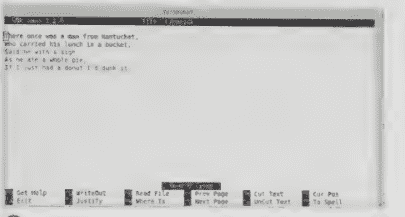

nano 提供了屏幕命令提示，使其更易于使用。

# 关于 vi 或 vim

虽然 **vi** 可能是 Unix 和 Linux 以复杂和令人困惑闻名的很大原因，但它提供了巨大的威力和灵活性。此外，**vi** 是随处可用的（与 nano 不同），基于这些原因，你应该考虑花时间学习它。你可能会发现它是晦涩、违背直觉且吹毛求角的，正因如此，如果你不需要 **vi** 的功能，你可能想选择其他编辑器。如所示，如果你使用 **vi**，你就不需要菜单了——`Esc+q` 或 `Esc:%s/` 这种深奥的命令就是/vi 是强大的！

是的，延续上一节的主题，**vi** 有一个等价物叫做 **vim**，它的许可方式不同，功能稍强。对于基本用法——书中的所有内容以及更多功能——两者是相同的。但在这种情况下，你总能找到 **vi**，即使它实际上是 **vim**（实际上可能是一个指向 **vim** 的符号链接或快捷方式）。如果你发现了它们，它们无疑是 **vim**，命令是相同的，尽管尝试并享受吧。


> vi 编辑简直是一团糟。
> 我是在很长的时间后学会它的。
> 它很难学。
> 如果我只是有疑问，我就去做。

> vi 给你一个干净的屏幕，并让你记住它所有那些晦涩的命令。

## 编辑器众多

除了 **nano** 和 **vi**（本章介绍）外，还有几十种编辑器：

- **emacs** 在 **nano** 的易用性和 **vi**（或 **vim**）的强大之间提供了一个合理的折中方案。请注意，对于经验用户来说，它不像 **vim** 那样完全强大，但仍然更容易上手。不过，它并非所有系统都可用，你只需要输入命令查看你是否有访问权限。
- **ed, jed, 和 e3**，这些是相当简单的编辑器，在许多方面与 **nano** 相当。如果你感兴趣，这些绝对值得一读。
- **ed 和 red**，它们是简单的（功能上简单，但用法不一定）逐行编辑器。它们可能不推荐给新手用户。我们已经多年没有用过它们了。

## 启动 nano 并尝试使用

你可以以下步骤启动并尝试使用 nano。注意，如 A 所示，nano 的界面直观且易于导航。

要启动 nano 并尝试使用它：

- 1. nano
  在 shell 提示符处输入 nano。程序启动后，你会看到类似 A 的界面，窗口顶部是文本区域，底部是命令提示。
  如果你知道要编辑的文件名，在 shell 提示符处输入 nano，然后跟上你想要编辑的文件路径和名称（例如，hairyspiders）。
- 2. hairyspiders
  继续吧。输入一些内容——随便什么——试一下。
  - 使用 Delete（删除）和 Backspace（退格）帮助编辑文本。
  - 使用方向键向上、向下、向右或向左移动。

> 使用 -w 启动 nano（例如，nano -w filename）来禁用自动换行。你会发现这在编辑配置文件时特别有用，如 B 节所示。

> 在整个 nano 中，你会看到 ^C、^J 以及几十个其他的 ^something 挂在底部的菜单中。^ 代表 Ctrl，所以 ^C 是 Ctrl+C，^J 是 Ctrl+J，以此此类推。

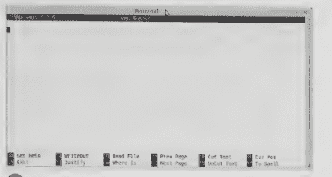

## 在 nano 中保存

在 nano 中保存：

- 1. Ctrl+O
  按下 Ctrl+O 写入缓冲区。nano 会提示文件名。
  如果你知道要编辑的文件名，在 shell 提示符处输入它、文件名并按 Enter。如果你想保存为新文件，输入新文件名并按 Enter。
- 2. Enter
  按 Enter 确认文件名。

> 如果你想在不退出的情况下保存，使用 Ctrl+O 然后按 Enter。

> 如果你想退出并保存，按 Ctrl+X。nano 会询问是否要保存修改后的缓冲区。按 Y 保存，或按 N 不保存退出。

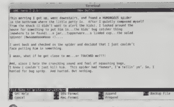

## 在 nano 中剪切和粘贴

在 **nano** 中输入时，你可能需要剪切和粘贴。

在 nano 中剪切和粘贴块：

- 1. Ctrl+A
  将光标移动到你想剪切文本的开头按下 Ctrl+A 设置标记。
- 2. Ctrl+6
  将光标移动到你想剪切文本的结尾。按下 Ctrl+6 将文本剪切并缓冲区。
- 3. Ctrl+U
  将光标移动到你想粘贴文本的地方按下 Ctrl+U。

> 如果你想剪切单行，直接按 Ctrl+K。

> 如果你想剪切一个单词，移动到该单词并按 Ctrl+K。

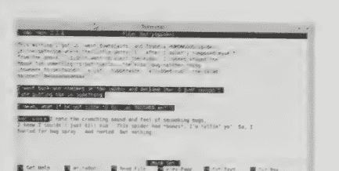

## 在 nano 中检查拼写

你在 nano 中可以另一个方便操作是检查拼写，如 A 和 B 所示。

在 nano 中检查拼写：

- 1. nano hairspiders
  在 shell 提示符处输入 nano 和要编辑的文件名。
- 2. Ctrl+T
  按下这些键开始检查文件。nano 会如 A 所示在每个错误单词处停止。
- 3. 
  为任何标记为错误的单词输入修正，或按 Enter 接受当前拼写并移动到下一个单词。

> 你可以随时按 Ctrl+C 取消拼写检查。

> 因为 nano 中的拼写检查器功能不全，考虑在命令行中指定替代拼写检查程序，例如 nano -isp hairspiders，这样你可以获得更多帮助。请参见第 14 节。

> 当整个文档完成拼写检查后，nano 会告诉你检查已完成，你可以继续编辑文件。

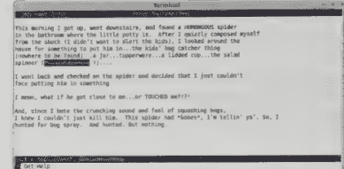


## 在 nano 中获取帮助

了解更多关于 nano 的极佳方法是进入 nano。除了寻找问题的答案外，你还可以如 A 所示发现它的功能和能力。

要在 nano 中获取帮助：

- 1. `Ctrl+G`
  在 nano 中，按下 `Ctrl+G` 即可访问帮助。

- 2. `Ctrl+V` 让您向下滚动帮助页；
  `Ctrl+Y` 让您向上滚动帮助页。

- 3. `Ctrl+X` 
  使用此组合键退出帮助。

## 获取关于 nano 启动选项的帮助：

man nano

在 shell 提示符下，输入 `man nano` 可以学习更多关于启动选项的信息，包括多种控制 nano 工作方式的选项。

> 提示：请关注 nano 状态行，以获取当前信息、错误消息以及偶尔关于使用 nano 的提示。状态行是屏幕底部倒数第三行，紧邻菜单上方，如 A 所示。

> 提示：请记住 nano 实际上是一个非常基础的程序。如果你在使用 pico，它更加基础。如果你在寻找一个无法直接提供的命令或函数，那么它可能并不存在。如果你想要比 nano 提供的更多功能，可以尝试 vim 或 emacs。

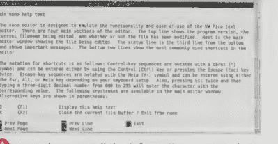

## 退出 nano

当你在 nano 中完成编辑后，将使用以下步骤之一退出。

要退出 nano：

- 1. 按下 `Ctrl+X`
  - 在 nano 中，按下 `Ctrl+X`。如果你自保存文件后没有对文本进行任何更改，你会立即回到 shell 提示符。如果你做了更改，系统会提示你“保存修改后的缓冲区”（Save modified buffer）A。

- 2. 在“保存修改后的缓冲区”提示处：
  - 如果你想保存更改，按下 Y。继续执行步骤 3。
  - 如果你不想保存更改，按下 N。你将回到 shell 提示符。

- 3. 如果是第一次保存，请为文件指定文件名。如果已经保存过，按下 Enter 键确认当前文件名，或更改名称以保存副本而不更改原始文件。

> nano 给了你“保存修改后的缓冲区”的机会。撇开技术术语不谈，这意味着在退出之前保存你刚刚编写或编辑的文本。

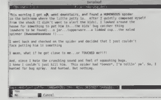

缓冲区是计算机用于临时存储信息的地方，如果它被修改，意味着它正在临时存储你尚未保存到磁盘的内容。

## 启动 vi (或 vim) 并尝试使用

在你冲向 vi 之前，请了解它有两种模式（两种看起来都非常像 A）：

vi 编辑器会向你提供大量的屏幕帮助和建议，如下所示。嗯，虽然文档可查，但 vi 界面本身其实一点用也没有！

- **插入模式**（Insert mode，有时称为输入模式），在此模式下，你按下的键会实际显示在你正在编辑的文件中。你使用这种模式来添加或更改文本。

- **普通模式**（Normal mode，有时称为命令模式），在此模式下，每一次击键都会解释为一个命令。你使用这种模式执行除输入文本以外的所有操作。

让很多人对 vi 困困的地方在于，它从命令模式启动，这意味着如果你直接开始打字，可能会看到一些空格、字符和你输入的一些单词片段——本质上是一堆并不完全代表你输入内容的垃圾字符——而且你会听到很多哔哔声。所以，正如我们在接下来的步骤所示，你一旦启动 vi，就需要立即进入插入模式。


## 启动 vi：

- 1. vi
在 shell 提示符下输入 vi。程序启动，你会看到类似 A 所示的 ~ 符号在文件末尾下方显示空行。

- 2. i
输入 i 进入插入模式。这本身是在命令模式下发出的命令，因此它不会显示在屏幕上。

- 3. 在插入模式下，输入任何你想的内容。
你输入的所有内容都会显示在屏幕上，直到你按下 Esc 返回普通模式。当你处于普通模式时，可以使用方向键逐行在文件中上下导航，并使用 Ctrl+F 和 Ctrl+B 分别向前向后滚动屏幕。

> 提示：要获取 vi 的帮助，请输入 man vi。第 1 章有更多关于页的信息。

> 提示：如果你不确定处于什么种模式，按下 Esc 进入普通模式。如果你已经处于普通模式，你会听到哔哔声。如果你处于插入模式，它将切换到普通模式。

> 提示：许多 Unix 类系统（包括 Linux 和 OS X）实际上提供了一个名为 vim 的程序来代替 vi。vim（代表 Improved）类似于 vi，但功能更丰富、更灵活，你仍然可以使用命令启动它。

> 提示：要获取 vi 的帮助，请输入 man vi。第 1 章有更多关于页的信息。

> 提示：如果你不确定处于什么种模式，按下 Esc 进入普通模式。如果你已经处于普通模式，你会听到哔哔声。如果你处于插入模式，它将切换到普通模式。

> 提示：许多 Unix 类系统（包括 Linux 和 OS X）实际上提供了一个名为 vim 的程序来代替 vi。vim（代表 Improved）类似于 vi，但功能更丰富、更灵活，你仍然可以使用命令启动它。

> 提示：要获取 vi 的帮助，请输入 man vi。第 1 章有更多关于页的信息。

> 提示：如果你不确定处于什么种模式，按下 Esc 进入普通模式。如果你已经处于普通模式，你会听到哔哔声。如果你处于插入模式，它将切换到普通模式。

## 保存 vi

在 vi 中添加和删除文本比在 nano 中操作要复杂一点。在 vi 中，你只需将光标放在你想做更改的地方。

## 在 vi 中保存：

- 1. vi
在 shell 提示符下输入 vi。
- 2. i
进入插入模式。
- 3. 输入你想添加的文本。
- 4. Esc
在发布命令之前按下 Esc 进入普通模式。
- 5. 根据你想对文本执行的操作选择命令。
- 6. dd
输入命令。在这里，我们正在删除当前行文本。

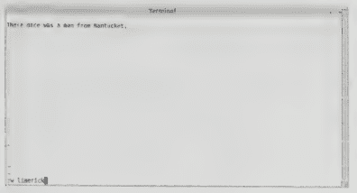


## 将文件导入 vi

你也可以通过将其他文件读取到当前文件中，在 vi 中合并多个文件，如 A 所示。基本上，这意味着你将一个文件插入到你当前正在编辑的文件。

在 vi 中导入文件：

- 1. vi hairyspider
   在 shell 提示符下，输入 `vi` 后跟文件名——在本例中为 `hairyspider` 文件。

- 2. Esc:r filename
   在文件中想要导入文本的位置，按 `Esc`，然后输入 `:r` 和你要读取到文件的文件名。

> 提示 vi 还允许你将命令的输出读取到文件中。例如，如果你想将特定目录下的文件列表读取到文件中，在普通模式下使用 `Esc :r ls`。

## 在 vi 中搜索和替换

vi 最优的特性之一（相比于 nano 的优势）是它允许你在整个文件中进行搜索和替换。接下来的章节所示，你可以找到特定的文本字符串（Unix 术语中称为正则表达式；见 A），或者你可以找到文本将其替换为其他内容（见 B）。

```
This morning I went downstairs, and found a spider on the ceiling. I thought it had escaped from the bathroom, but I didn't want to kill it. I grabbed a glass and a piece of cardboard to trap it in. From the shock I didn't want to alert the kids! I looked around the house. It crawled down my arm, a little spider (the salad spinner).

I just started the crawling and felt the feel of being legs. I screamed. This spider has "mover," I'm tellin' ya so, I ran for my life. And hunted, not.
```

```
/spider
```

> **A** 在 vi 中搜索文本是快速且可靠的。

```
This morning I went downstairs, and found a spider on the ceiling. I thought it had escaped from the bathroom, but I didn't want to kill it. I grabbed a glass and a piece of cardboard to trap it in. From the shock I didn't want to alert the kids! I looked around the house. It crawled down my arm, a little spider (the salad spinner).

I just started the crawling and felt the feel of being legs. I screamed. This spider has "mover," I'm tellin' ya so, I ran for my life. And hunted, not.
```

在 vi 中查找文本字符串：

- 1. vi haspypider
   首先，访问 vi 和一个特定文件。
- 2. Esc /spider
   进入命令模式，输入 `/` 后跟你要查找的文本。在这里，我们正在寻找 "spider"，但你可能在寻找 "fly" 或 "wiggled and jiggled and tickled inside her"。或其他任何内容。
- 3. Enter
   按回车键找到该术的第一次出现处。输入 `N` 查找下一个。

```
I went back and checked the spider and decided that I just couldn't kill it. I just didn't kill it. This spider has "mover," I'm tellin' ya so, I ran for my life. And not biting.
```

> **B** 在 vi 中替换文本需要一些晦奥的语法，但你很快就会习惯。

```
/spider/terrible horrible awful spider
```

## 在 vi 中进行搜索和替换：

- 1. **vi hairspider**
   首先，访问 vi 和一个特定文件。

- 2. `Esc:%s/spider/horrible awful spider/
   输入 `Esc:%s/` 加上要查找的文本，另一个 `/` 后跟替换文本。在这里，我们替换文本，例如将 "swallowed a fly" 替换为 "spider to catch the fly,"但也许你可能会放弃蜘蛛，直接去吃一些抗酸药。

> 搜索和替换功能的一个伟大用处是，如果你在 Unix 账户中有了 DOS 文本文件（很可能是从 Windows 机器作为二进制文件传输的文本）。如果你通过 Unix shell 查看 DOS 文件，文件中的所有行都会以 `M` 结尾。如果你在执行搜索替换时尝试输入 `M`，`M` 将不会显示。怎么办？按 `Ctrl+V`，然后按 `Ctrl+V+M`。只需搜索并替换 `/%/g`。`Ctrl+V|Ctrl|M|V` 命令会“转义”后续字符，因此你可以按下它而不会实际执行命令本应执行的操作。如果你按 `Ctrl+M`，vi 会认为你刚刚按了 `Enter` 并尝试执行未完成的命令。

> 请参阅第 6 节有关使用正则表达式进行搜索的信息。

> 在命令末尾添加一个 `g` 以使其适用于文件中的所有出现处。否则，它只适用于每行的第一次出现处。

## 退出 vi

呼！该退出 vi 了 ①

### 退出 vi：

通过输入 `Esc` 进入命令模式，输入 `:q` 退出 vi。如果你没有保存最后的更改，vi 将不会退出并提示你使用 `:!`。要在不保存更改的情况下退出，请使用 `:q!`，如 ② 所示。

> 提示 如果你并不真的想退出而是想编辑另一个文件，请使用 `:e filename` 打开一个新文件进行编辑。

> 提示 我们建议你花几分钟尝试一下你在整个 vi 过程中会用到的命令。如果你认为不需要这些范围的命令，可以考虑使用 nano 而不是 vi。

> 提示 习惯 vi 需要一些练习，但花费的时间是值得的。通过耐心和练习，你很快就能熟练使用 vi。从容来，深呼吸，向前努力吧。

使用 `Esc:q` 在不保存更改的情况下退出 vi。

## 控制所有权和权限

Unix、Linux 和类 Unix 操作系统是多用户系统，其中你的文件与 Jane 的文件是分开的，Jane 的文件与 Joe 的文件也是分开的，以此此类推。你创建的任何文件都与其他用户的文件分开，通常无法被 Jane、Joe 或任何其他用户直接访问。文件权限决定了你可以查看、访问或使用什么。

然而，有时你需要共享文件。例如，你可能与 Jane 合作一个项目，在该项目中共享文件（而不是创建和维护其他文件）是至关重要的。

本章提供了 Unix 和 Linux 文件权限和所有权的概述。对于许多系统，只有 root 用户可以进行更改，因此你可能需要帮助。

### 本章内容

| 理解所有权和权限 | 90 |
| :--- | :--- |
| 查找谁拥有什么 | 91 |
| 查找你在哪个组 | 94 |
| 使用 chgrp 更改目录的组关联 | 96 |
| 使用 chown 更改文件和目录的所有权 | 98 |
| 使用 chmod 更改权限 | 100 |
| 将助记权限翻译为数字权限 | 103 |
| 使用 umask 更改默认权限 | 105 |

## 理解所有权和权限

Unix 和 Linux 提供了三个级别的所有权：

- **用户（User）。** 指负责文件的单个用户 ID。你对创建的文件拥有此级别的所有权。
- **组（Group）。** 指与文件相关的组（用户组）。组内所有用户对文件具有相同的权限。
- **其他（Other）。** 指任何未属于文件用户或用户组的用户。

在这些级别中，你可以指定三类文件访问权限：

- **读（Read）。** 拥有读取权限的用户可以查看文件；不能对其进行更改。
- **写（Write）。** 拥有写入权限的用户可以更改或删除文件。
- **执行（Execute）。** 拥有执行权限的用户可以运行文件（程序或脚本）并查看目录。

在本章中，我们将展示一些可以用于（有时由你，通常由 root 用户）设置所有权权限的命令。请记住，你可以设置或更改你创建的任何权限，并可能是其他人创建的文件权限；然而，具体可以更改哪些权限和所有权取决于系统。

> 提示 关于整个所有权的有趣之处在于，并不是所有的“所有者都是都是。程序或进程以特定用户的身份运行，如果它们创建了文件，这些文件的权限将反映该程序的个人和组组成。更多信息请参阅第 9 章。

> 提示 某些 Linux 和类 Unix 操作系统具有额外的或补充的方法来控制特定文件的访问。通常，你会知道在使用这样的系统。目前，只需知道这些东西存在，本章的程序将处理你 95% 的需求。


## 查找文件所有者

在更改所有权权限之前，第一步是找出哪些文件由谁所有。你需要这些信息来判断你是否可以对权限进行更改。

## 如何查找文件所有者：

- 1. cd
  在 shell 提示符下，输入 `cd` 返回你的主目录。

- 2. ls -l
  输入 `ls -l` 查看当前目录下文件的详细列表。（参阅代码列举 5.1.）

许多系统仅使用少数几个组名来允许文件共享和协作。

```
exampleisp> cd
/home/users/e/ejray
exampleisp> ls -l
total 60
drwx-x-x 2 ejray users 512 Jul 21 13:32 Complete/
drwx-x-x 2 ejray users 512 Jun 24 09:23 Completed/
drwx-x-x 2 ejray users 512 Sep 15 2013 Mail/
drwx-x-x 2 ejray users 512 Jun 24 09:35 NewProject/
drwx-x-x 2 ejray users 512 Sep 15 2013 News/
drwx-x-x 2 ejray users 512 Sep 15 2013 access/
-rw------ 1 ejray users 163 Jul 22 07:28 bogus2
-drwxrxr-x 2 ejray www 512 Jul 24 04:44 chat.conf/
-rw------ 1 ejray users 853 Sep 13 2007 dead.letter
-rw------ 1 ejray users 14286 Jun 28 12:40 files
lrwxrwxrwx 1 users 27 Sep 15 2013 ftp -> /home/pub/users
-rw------ users 36 Jul 24 12:09 limerick
drwx-x-x 2 ejray users 512 Jun 8 13:32 mail/
drwxr-xr-s 15 ejray www 2560 Jul 10 10:30 public_html/
drwx-x-x 2 ejray users 512 Jul 22 08:23 puppy/
drwx-x-x 2 ejray users 512 Jul 24 04:44 temp/
-rw------ 1 ejray users 0 Jul 19 13:24 testme
```

左侧列包含十个字符，其中最后九个指定了每个文件的权限：

- - **r** 表示读权限，**w** 表示写权限，**x** 表示执行权限。
- 第一组 **rwx** 针对用户（user），第二组针对用户组（group），最后一组针对其他用户（other）。
- 用连字符 (-) 代替字母表示用户/组/其他用户没有该级别的权限。例如，**rw-----** 表示用户具有读、写和执行权限，而组和其他用户则完全没有权限。

中间的两列表示文件的所有者（在本例中很可能是你的用户 ID）以及该文件所属的组。在列举 5.1 中，**ejray** 是所有文件的所有者。大多数文件与 **users** 组关联，而只有少数目录与 **www** 组关联。

在该系统中，个人用户创建的文件与 **users** 组关联，而用于 Web 网页的文件则具有 **www** 组关联。在其他系统中，文件的默认组可能是与用户 ID 同同的组，如**代码列举 5.2** 所示。

## 列举 5.2。

组名和用户名相同，取决于系统的设置方式。

```
[ejr@hobbes permissions] $ ls -l
total 152
-rw-rw-r--  1 ejr ejr  128889 Jul 24 14:33  sage.sayings
-rw-rw-r--  1 ejr ejr  23890 Jul 24 14:33  sayings
[ejr@hobbes permissions]$
```

## 3. ls -1 /etc

你也可以在系统目录（如 /etc）上使用 `ls -1` 命令。在这里，你会发现大多数文件都归 **root** 所有，并具有不同的组成员身份。

```
ls -l /etc
dr-xr-x   7 root root 4096 Nov 28 09:16 resolv
rw-r--r-- 1 root root 160 Nov 28 09:36 master.conf
-rw-r--r-- 1 root root 3016 Mar 14 08:32 adjtime
-rw-r--r-- 1 root root 2922 Mar 14 08:32 passwd
-rw-r----- 1 root shadow 1844 Mar 14 08:32 gshadow
dr-xr-x   2 root root 12280 Mar 14 08:17 alternatives
-rw-r--r-- 1 root root 1024 Mar 14 08:32 group
-rw-r--r-- 1 root root 112 Jan 1 20:12 apache.conf
-rw-r--r-- 1 root root 2012 Jan 1 20:12 bash_profile
dr-xr-x   2 root root 4096 Nov 28 09:32 app.d
-rw-r--r-- 1 root root 1536 Nov 28 09:32 aliases
-rw-r--r-- 1 root root 4096 Nov 28 09:32 cron.d
dr-xr-x   7 root root 4096 Nov 28 09:32 cron
-rw-r--r-- 1 root root 14834 Nov 28 09:32 motd
-rw-r--r-- 1 root root 3138 Dec 25 12:42 motd
-rw-r--r-- 1 root root 1536 Nov 28 09:32 resolv.conf
-rw-r--r-- 1 root root 112 Jan 1 20:12 resolvd.conf
-rw-r----- 1 root shadow 1844 Mar 14 08:32 gshadow
```
*(注：原文代码块最后部分似乎有截断或重复，翻译时已按原文格式处理)*


## 2. chgrp kettle black

输入 `chgrp`，后跟你想要让文件关联的现有组名以及文件名。在这里，`chgrp` 命令将名为 `black` 的文件的组关联更改为 `kettle` 组。

提示 如果你尝试更改组所有权并收到类似“Not owner”（不是所有者）或类似的模糊错误信息，说明你的 `userid` 没有足够的权限进行更改。你将需要寻求系统管理员的帮助。

提示 仅在有特定需求时才更改组关联；你并不希望无必要地将文件开放给其他人。除非你是系统管理员，否则你无法精确控制谁属于你提供文件访问的组。

提示 如果你更改了特定目录的组关联，还需要检查包含该目录的父目录的权限。除非用户对父目录具有读取和执行权限，否则他们无法进入该特定目录（无论他们所属的组如何）。

提示 如果你需要更改组权限但发现无法做到，可以考虑使用 `sudo` 来帮助。第 15 章将介绍 `sudo`，它允许某些用户在有限的情况下以系统管理员的权限执行操作。请查看一下。

提示 仅通过第 2 章介绍的 `cp` 和 `mv` 命令，你就可以配合 `chgrp` 使用 `-R` 标志来递归地应用于目录及其所有子目录和文件。例如，要将 `LatestProject` 目录及其所有内容的组关联改为 `project` 组，请在 `LatestProject` 的上目录运行 `chgrp -R project LatestProject`。

## 使用 chown 更改文件和目录的所有权

假设你一直在处理一个名为 `rowyourboat` 的文件，你的老板决定让同事 Merilee 接手该项目。在这种情况下，为了将项目完全交给你的同事，你需要将文件的所有权从你更改为她。取决于你的系统管理员如何设置系统，你通常可以使用 `chown` 更改文件的所有权（代码列表 5.6）。

### 使用 chown 更改所有权：

- 1. ls -1

首先，在 shell 提示符处输入 `ls -1` 以验证文件名和所有权，如代码列表 5.6 所示。记住，所有权信息位于权限和链接信息之后。

代码列表 5.6 更改文件所有权转移了完全控制权。

```
[ejr@hobbes merilee]$ ls -1
total 26
-rw-rw-r- 1 ejr users 24850 Jul 24 15:17 rowyourboat
[ejr@hobbes merilee]$ chown merilee rowyourboat
[ejr@hobbes merilee]$ ls -1
total 26
-rw-rw-r- 1 merilee users 24850 Jul 24 15:17 rowyourboat
[ejr@hobbes merilee]$ _
```

## 2. chown merrilee rowyourboat

输入 **chown**，后跟你想要转移所有权的用户的 `userid` 和文件名。在这种情况下，**chown** 命令将 **rowyourboat** 的所有权更改为 **merrilee**。**rowyourboat** 及其相关问题现在将属于她，生活将如梦幻般美好。

提示 在更改文件所有权后，你对该文件能做什么取决于组和其他权限以及成员身份。然而，新所有者将能够对文件进行任何操作。

提示 在更改目录所有权时，你可以为 `chown` 添加 `-R` 标志，使其递归地应用于下方的所有文件和目录。

提示 如果系统不允许你使用 `chown` 赠送文件，可以考虑使用 `cp` 创建文件的副本来实现相同目的。如果你将某人的文件（你有权限读取该文件）复制到另一个名称或位置，该副本就完全属于你。（在这个“赠送文件”的示例中，接收者应该使用 `cp`。）

提示 如果你需要更改权限但发现无法做到，看一眼 `sudo`，看看它是否能对你提供帮助。如第 15 章所述，`sudo` 允许某些用户在有限的情况下以系统管理员的权限执行操作。当然，如果这不能解决你的问题，还有下一个提示。

提示 即使你不能使用 `chown`，你仍然可以请求系统管理员为你更改文件所有权：“你能把我的 `rowyourboat` 文件的所有权改为 Merrilee 吗？使用 `chown merrilee/home/shared/ me/rowyourboat`。谢谢！”（这可能是因为许多版本的 Unix 只允许 root 用户更改文件所有权。）

## 使用 chmod 更改权限

假设你一直在处理一个名为 `rowyourboat` 的文件，并且你想让下游的同事审查它。为了做到这一点，你需要赋予其他人访问文档的权限。你可以赋予特定组的人员访问权限，也可以赋予 Unix 系统上的所有人访问权限。具体来说，你可以为 u(ser-即你)、g(roup)、o(thers) 和 all() 指定权限。

除了指定权限外，你还可以指定个人或组组对你的文件拥有多大的访问权限。例如，你可以指定 r(ead)、w(rite) 和 e(x) 权限，取决于你多大信任他们不会破坏你的 rowyourboat 杰作。

如代码列表 5.7 所示，第一步是检查当前的权限是什么。然后，你可以设置、添加或删除权限。

检查当前权限：

```
ls -l r*
```

开始，输入 `ls -l` 获取 `rowyourboat` 的详细列表。代码列表 5.7 显示权限为：

- rwxr-x---（用户）
- r-------（组）
- ---（其他）

你也可以配合 `chmod` 使用 `-R` 标志将你的更改递归应用于所有文件和子目录。

如果你想更改多个文件的权限，使用通配符。

代码列表 5.7 使用 -1 设置权限。

```
[ejr@hobbes permissions]$ ls -1l r*
-rwxr-x--- 1 ejr users 152779 Jul 24 15:10 rowyourboat
[ejr@hobbes permissions]$
```

代码列表 5.8 你可以设置权限以确保所有文件都是特定的。

```
[ejr@hobbes permissions]$ ls -1
total 26
-rw-rw-r- 1 ejr users 24850 Jul 24 14:59 black
-rw-rw-r- 1 ejr users 24850 Jul 24 15:17 rowyourboat
-rw-rw-r- 1 ejr users 128889 Jul 24 14:33 sage.sayings
-rw-rw-r- 1 ejr users 23890 Jul 24 14:33 sayings
[ejr@hobbes permissions]$ chmod u=rwx,g=rx,o=r row*
[ejr@hobbes permissions]$ ls -1
total 26
-rw-rw-r- 1 ejr users 24850 Jul 24 14:59 black
-rwxr-xr-- 1 ejr users 152779 Jul 24 15:10 rowyourboat
-rw-rw-r- 1 ejr users 128889 Jul 24 14:33 sage.sayings
-rw-rw-r-- 1 ejr users 23890 Jul 24 14:33 sayings
[ejr@hobbes permissions]$
```


# 添加权限：

chmod g+ rowyourboat

在 shell 提示符下，输入 **chmod**，后跟随：

- 类别。在此例中，我们使用了 **g**表示组（group），但你也可以使用 **o**表示其他（others），或者当然，使用 **u**表示用户（user），不过你已经拥有了该权限。你也可以使用 **a**表示所有用户（包括 **u**、**g** 和 **o**）。
- 加号（+）表示你正在现有权限上添加权限，而不是设置绝对权限。
- 要授予的权限。在这里，我们使用了 **w** 表示写入权限（write），但你也可以根据需要使用 **r** 表示读取（read）或使用 **x** 表示执行（execute）。
- 文件名（**rowyourboat**）。

# 权限：

chmod g-w rowyourboat

在 shell 提示符下，使用 **chmod g-w** 加上文件名来移除文件所有者之外所有人的写入权限。注意，这次我们会在单条命令中同时处理了**组**（group）和**其他**（other），尽管我们也可以通过 `chmod g-w rowyourboat` 和 `chmod o-w rowyourboat` 来实现相同。

# 表 5.1 符号权限的数值等效值

| 符号权限 (rwx) | 二进制等效值 | 数值等效值 |
|------|---|---|
| --- | 000 | 0 |
| -x | 001 | 1 |
| -w- | 010 | 2 |
| -wx | 011 | 3 |
| r- | 100 | 4 |
| r-x | 101 | 5 |
| rw- | 110 | 6 |
| rwx | 111 | 7 |

# 将符号权限转换为数值

### 文件权限

这些开启/关闭权限（或二进制数）的组合组合都可以表示为 0 到 7 之间的唯一十进制数字，如**表 5.1** 所示。设置权限时使用的这个十进制数字。

# 使用数值等效值设置权限：

```
chmod 777 rowyourboat
```

输入 chmod，然后使用表 5.1 列出的数值等效值指定用户、组和其他所需的权限，最后是文件名。在例示例中，我们使用 777 将用户、组和其他的读取、写入和执行权限设置为“开启”。

或者，例如，724 将赋予用户完全读取、写入和执行权限，赋予组仅写入权限，赋予其他人仅读取权限。

> 提示 使用数值等效值设置权限是设置绝对权限，而不是在现有权限上增加或减去。

> 提示 你可以使用数值权限或符号权限——取决于哪种格式对你来说更简单。然而，你需要使用数值系统来设置在创建新文件时适用的默认权限。完整信息请见下一节。

## 使用 umask 更改默认权限

每当你创建一个文件时，Unix 或 Linux 系统都会为你应用默认权限。这很棒，因为对于许多用途，默认权限恰好是你需要的。但在其他情况下，你可能希望指定不同的默认权限。

记住，更严格（限制性更多）的权限会增加安全性，但会让共享和协作变得困难。更宽松（限制性更少）的权限有助于协作，但以降低安全性为代价。

你可以使用 **umask** 修改默认权限。**umask** 命令使用权限的数值表示（如上一节所述），但你在此处指定的数值与你在 `chmod` 中使用的数值不同。（不要问为什么。我们假设蝙蝠侠和罗宾聚在一起，让这个命令只有在神奇双胞胎的力量激活时才可用。）因此，你必须为你所需的权限计算出 **umask** 值，然后使用该值来设置权限。

请注意，你无法默认设置执行权限，所以你实际上是在计算 **u**、**g** 和 **o** 类别的读取和写入权限。

## 计算 umask 值：

- 1. 666
从 666 开始。再次，不要问为什么；它是你应该开始的基础。

- 2. 计算出你使用 `chmod` 命令设置所需权限的数值。

你可能会回顾上一节“将符号权限转换为数值”，并查看该节的表 5.1。

- 3. 从 666 减去该数值。
例如，如果你在 `chmod` 中使用的数值是 644，则从 666 中减去它：666 - 644 = 022。所以 022 就是你在 umask 中使用的数字。

> 提示 使用 umask 进行的更改仅适用于当前 shell 会话。如果你想恢复默认权限但不记得它们是什么，只需注销并重新登录即可恢复正常。

> 提示 如果你想更改默认权限——或至少跨越当前 shell 会话——请在配置文件中进行，如第 8 节所述。

> 提示 你无法默认设置执行权限，这是一种安全特性，而不是系统功能的缺失。例如，假设你创建一个文件并复制你的命令


## 代码列表 6.3 head 允许只查看文件的顶部，让你对文件有一个易于维护的视图。

```
[unixvqs@linuxmint Examples]$ head honeydo
Take garbage out
Clean litter box
Clean diaper pails
Clean litter box
Mow lawn
Edge lawn
Clean litter box
Polish swamp cooler
Buff garage floor
[unixvqs@linuxmint Examples]$
```

## 查看文件
### 使用 head 查看开头

使用 `head`，如代码列表 6.3 所示，你可以通过查看文件的前几行来快速了解文件中包含的内容。这在你浏览文件列表或尝试在许多具有相似内容的其他文件中查找特定文件时，特别为得手。

# 代码列表 6.4 `head` 配合 `more` 使用，可以让你按顺序查看多个序列的开头。

### 使用 head 查看文件开头：

head honeydo

在提示符处，输入 `head` 后跟文件名。如代码列表 6.3 所示，你将在屏幕上看到前十行。注意，“行”是由硬回车定义的，因此在某些情况下，一行可能会折行到多行屏幕。

```
[unixvqs@linuxmint Examples]
$ head honey* | |
=> honeyconsider <=
Mother-in-law visits next week
Cat mess in hall to clean up
Cat mess in entry to clean up
Cat mess in family room to clean up
Toddler and toddler mess in den to clean up
IRS called again today
Neighbors on both sides looking for
* donations for the annual fund drive
Boss called last first and said
* 'it's urgent
=> honeydo <=
Take garbage out
Clean litter box
Clean diaper pails
Clean litter box
Mow lawn
Edge lawn
Clean litter box
Polish swamp cooler
Buff garage floor
```

### 查看指定数量的行：

添加 `-20`（或任何你想要的行数）来查看特定数量的行。

### 查看多个文件的开头：

head honey* | more

你可以通过将 `head`（加上文件名）管道传输给 `more` 来查看多个文件的顶部。注意，`head` 会方便地告诉你每个文件的文件名，如代码列表 6.4 所示。

## 使用 tail 查看文件末尾

有时，你可能需要使用 `tail`，它显示文件的最后几行。`tail` 特别适用于检查日志文件中的最新记录（更多信息请见第 15 章“成为 root 用户”）或查看添加到文件中的信息（参见代码列表 6.5）。就像 `head`（在前几页描述）一样，`tail` 提供了几个查看文件的选项。

# 代码列表 6.5 tail 允许你只检查结尾。

```
[unixvqs@linuxmint Examples]$ tail honeydo
Empty diaper pails
Take garbage out.
-End of today's list-
Buy more garbage bags
Get cleaning supplies at store
Take cat to vet
Fix lawnmower
[unixvxqs@linuxmint Examples]$
```

# 代码列表 6.6 使用 `tail` 配合 `more` 查看多个文件的结尾。

```
[unixvqs@linuxmint Examples]
- tail honey* |
=> honeyconder <=
Cat mess in clean up
Cat mess in living room to clean up
Toddler mess in family room to clean up
Cat and toddler mess in den to clean up
IRS called again today
Neighbors on both sides looking for
- donations for the annual drive
Boss called last Friday and said
- it's urgent
-End of today's list-
=> honeydo <=
Empty diaper pails
Take garbage out
-End of today's list-
Buy more garbage bags
Get cleaning supplies at store
Take cat to vet
Fix lawnmower
-More-
```

### 使用 tail 查看文件结尾：

tail honeydo

在 shell 提示符处，输入 `tail` 后跟文件名。如代码列表 6.5 所示，你将在屏幕上看到最后几行。

### 查看指定数量的行：

tail -15 honeydo

在这里，你只需要添加想要查看的特定行数（-15）。

### 查看多个文件的结尾：

tail honey* | more

将 `tail` 命令和文件（用 `*` 表示多个文件）管道传输给 `more`（代码列表 6.6）。

> 提示：`head` 及其对应的 `tail` 是分割长文件的绝佳工具。使用 `wc -l` 统计行数。如果文件有 500 行，但你只关心开头和结尾的行，那么输入 `head -25 filename > newfilename` 将文件的前 25 行放入新文件。然后对 `tail` 执行同样的操作，将文件的最后 25 行放入另一个新文件。

110 第 6 章

## 使用 grep 查找文本

# 代码列表 6.7 使用 `grep` 查看文件中特定字符串的所有出现处。

```
[unixvs@linuxmint Examples]$ grep bucket limericks
Who carried his lunch in a bucket,
[unixvqs@linuxmint Examples]
```

# 代码列表 6.8 `grep` 还可以显示字符串实例周围的上下文。

```
[unixvs@linuxmint Examples]$
- grep -s bucket limericks
he strummed and hummed,
and sang deumed,
But him a musician...who thought it?
There once was a man from Nantucket
Who carried his lunch in a bucket,
Said he with a sigh,
as he ate a whole pie,
If I just had a donut D'unk it.
A line
[unixvs@linuxmint Examples]$
```

除了使用 **grep** 搜索简单字符串外，你还可以使用正则表达式进行 **grep**。正则表达式就像高级通配符，

### 使用 grep 查找字符串：

- grep bucket
- 在提示符处，输入 `head` 后跟文件名。如代码列表 6.3 所示，你将在屏幕上看到前十行。注意，“行”是由硬回车定义的，因此在某些情况下，一行可能会折行到多行屏幕。

- grep -5
- grep -c
- grep -v
- grep -i
- grep -n

> 提示：`head` 及其对应的 `tail` 是分割长文件的绝佳工具。使用 `wc -l` 统计行数。如果文件有 500 行，但你只关心开头和结尾的行，那么输入 `head -25 filename > newfilename` 将文件的前 25 行放入新文件。然后对 `tail` 执行同样的操作，将文件的最后 25 行放入另一个新文件。

## 在 grep 中正则表达式

**表 6.1** 列出了一些常用的正则表达式。

| 正则表达式 | 功能 | 示例 | 解释 |
|---|---|---|---|
| . | 匹配任意字符。 | `grep bry` | 它会找到所有的 "berry" 或 "bar"。 |
| * | 匹配前一个项的零或多次实例，因此 "b" 会找到 "b" 以及 "ab" 和 "aaab"，但不是 "acb"。 | `grep s*/home/schedule` | 在这里，* 匹配前面的项目的零或多次；在本例中是字母 's'。 |
| ^ | 仅匹配行首的字符串。 | `grep '^Some' sayings` | 通过 ^，你指定了搜索字符串必须出现在行首。示例会找到以 "Some" 开头的行，但不是以 "Read" 开头的行。 |
| $ | 仅匹配行尾的字符串。 | `grep ach$' sayings` | 这会找到 sayings 文件中所有以 "ach" 结尾的行。 |
| \ | 转义后续字符——因此你可以搜索像 \* 或 $ 这样也是运算符的字面字符。 | `grep '\*' saying` | grep \* 在 sayings 文件中搜索所有的 *。\ \ 将其字面地解释为星号，而不是通配符。 |
| ] | 匹配集合中的任何成员，如 [a-z]、[0-6] 或 [321]（三个或两个一）。 | `grep 'number[0-9]' specifications` | 使用括号 [ ] 包含一组选项。在这里，number[0-9] 会匹配 specifications 文件中所有的 number1、number2、number3 等。 |


# 代码列表 6.9 使用正则表达式配合 grep 创建命令。

# 在 grep 中使用正则表达式：

```bash
[unixvsqs@linuxmint Examples]$
$ grep .logan limerick
Worked hard all day on a slogan,
You see, the slogan's still brogan.
[unixvsqs@linuxmint Examples]$
```

# grep .logan limerick

输入 `grep`，后面跟上正则表达式和文件名。在这里，我们使用了正则表达式 `.logan` 来查找所有前面有一个单个字符的 "logan" 实例（代码列表 6.9）。注意，这种使用 `.`（句号）来匹配单个字符的用法与 `?` 非常相似。

你也可以使用多个句号来匹配特定数量的字符。例如，要查找 "Dogbert" 和 "Dilbert"，你可能会使用：
`grep D..bert plagiarized.sayings`。

在某些情况下，取决于你使用的表达式和要查找的信息，你可能需要稍微调整搜索字符串。请查看表 6.1 中的其他示例以获取更多信息。

> “正则表达式”（Regular expression）在 Unix 或 Linux 文档和互联网讨论中通常缩写为 “regexp” 或 “regex”。

> `grep` 命令与 `egrep` 密切相关，它为扩展正则表达式提供了更多的灵活性，但基本工作原理相同。在许多系统中，`grep` 命令实际上就是 `egrep`——当你输入其中一个时，运行的都是 `egrep`。

> 如果你在大文件中搜索整个单词，请使用 grep 进行快速搜索。它使用与 `grep` 相同的通用语法，但只搜索整个单词（而不是正则表达式），因此速度快。

有关通配符的详情请参第 1 章。

## 使用正则表达式的其他示例

在上一节中，我们展示了如何使用 **grep** 命令通过正则表达式进行搜索。在本节中，我们将讨论其他其他巧妙的查找任务。

查找具有特定特征的行：

- `grep 'Nantucket' limerick`
  在这里，我们使用 **grep** 查找 limerick 中所有以 **Nantucket** 开头的行（如果有的话）。
- `grep 'Nantucket$' limerick`
  同样，你可以找到以 **Nantucket** 结尾的行。
- `grep '^[A-Z]' limerick`
  或者，你可以通过包含 **[A-Z]** 正则表达式找到以大写字母开头的行。
- `grep '^[A-Za-z]' limerick`
  在这里，你可以找到所有以字母开头的行，但不是数字或符号。很酷吧？

> 你也可以在 awk 和 sed 中使用正则表达式。详情请参见本章中的“使用 sed 进行全局更改”和“使用 awk 修改文件”。

# 代码列表 6.10 你可以使用 sed 对整个文件进行更改，例如这里的地址更改。

## 使用 sed 进行全局更改

```bash
[unixvxqs@linuxmint Examples]$
> sed 's/oldaddr@raycomm.com/newaddr@raycomm.com/g'
> address.htm > address-new.htm
[unixvxqs@linuxmint Examples]$
> head address-new.htm
<BODY>
<P>Please send all comments to
<A HREF="mailto:newaddr@raycomm.com">
newaddr@raycomm.com</A>
</P>
<TABLE ORDER=0>
<TR>
<TD WIDTH="150" VALIGN=TOP>
[unixvxqs@linuxmint Examples]$
```

另一个你可以使用的命令是 `sed`，它让你可以在不打开编辑器的情况下对文件进行多次更改。例如，作为一个新的网站管理员，你可能使用 `sed` 将所有管理员邮箱地址更改为你自己的。我们将在本节中向你展示如何使用 `sed` 对文档进行全局更改。

使用 sed 进行全局更改：

```bash
sed 's/oldaddr@raycomm.com/newaddr@raycomm.com/g'
> address.htm > address-new.htm
```

输入 `sed`，后面跟着：

- 一个单引号 (`'`)
- 开头的 `s`
- 一个斜杠 (`/`)
- 你想要替换的文本 (oldaddr@raycomm.com)
- 另一个斜杠 (`/`)
- 替换文本 (newaddr@raycomm.com)
- 另一个斜杠 (`/`)
- 这告诉 sed 全局应用更改（如果你省略了 `g`，则每行的第一个出现处会被更改）
- 另一个单引号 (`'`)
- 要进行更改的文件名 (address.htm)

你可以让 `sed` 遍历多个文档。有关如何使用 `sed` 创建 shell 脚本的信息，请查看第 10 章。

由于 `sed` 命令可能很长且混乱，将命令保存在单独的文件可能会帮助（这样你就不需要重新输入它们）。如果你将命令 `s/oldaddr@raycomm.com/raycomm.com/g` 保存到名为 `script.sed` 的文件中，你可以执行 `sed -f script.sed address-new.htm` 来运行 `script.sed` 文件中的 sed 命令。你的 `script.sed` 文件可以包含任意数量的命令。

你可以将输出重定向到一个文件名（参见 sed 代码列表 6.10），或将其传递给完全另一个命令。你不能重定向到相同的文件，否则你的文件将没有任何内容。


## 使用 awk 修改文件

虽然 `sed` 是按行处理的并让你处理文件，但 `awk` 是基于字段的，非常适合处理字段。例如，如果你有逗号分隔的文本，可以使用 `awk` 访问数据的各个部分。

使用 awk 修改文件：

- `awk -F, { print $1 }`
- `awk -F, { print $1 }`

`-F` 标志告诉 awk 使用后面的字符作为字段分隔符。

# 2. awk -F, { print $1 }

`-F` 标志告诉 awk 使用其随后的字符——在这种情况下是逗号 (,) 作为字段分隔符。这种更改使得命令的输出更干净、更准确。如果你在处理 `/etc/passwd`，将使用 `-F` 指定 `:` 为字段分隔符。

# 3. awk -F, { print $2 " $1 " $7 }

通过这段代码，你可以从数据库中任意顺序提取特定字段。尽管看起来很复杂，但它只是比上一个示例多了一个步骤。我们不是打印地址的单个字段，而是打印字段 2、一个空格、字段 1、再一个空格、然后是字段 7。最后将输出重定向到新文件。这个示例将产生一个姓名和电话列表，如所示。

你还可以指定匹配模式。在这里，我们使用 `/CA/` 来搜索并仅对包含 CA 的行进行操作，因此这些行才会出现在 `phone.list` 文件中。
```


## 使用 cmp 比较文件

假设你正在处理 `dearliza` 文件，并知道它与 `longterm` 文件有何不同。使用 `cmp`，你可以比较这两个文件，如代码列表 6.13 所示。

代码列表 6.13 提供了关于两个文件之间第一个差异的事实。

```
[unixvxqs@linuxx Examples$
$ cmp dearliza dearnheny
dearliza dearnheny differ: char 20, line 2
[unixvxqs@linuxx Examples$]
```

### 使用 cmp 比较文件：

cmp dearliza dearnheny

代码列表 6.14 还会告诉你文件是否匹配到其中一个文件结束，EOF 代表“文件结束”（end of file）。

```
[unixvxqs@linuxx Examples$
$ cmp limerick limericks
cmp: EOF on limerick
[unixvxqs@linuxx Examples$]
```

在 shell 提示符下，输入 `cmp` 后跟两个文件名。如代码列表 6.13 所示，这两个文件是不相同的。

如果文件是相同的，你会发现自己回到了 shell 提示符，且 `cmp` 没有给出任何注释。如果两个文件一直相同直到其中一个文件结束——也就是说，前 100 行相同，但其中一个在继续而另一个结束了——那么你将看到一个 EOF（文件结束）消息，如代码列表 6.14 所示。

> 你可以使用 `diff` 找到文件差异的其他方法，见下一节“使用 diff 查找文件差异”。

> Unix 和 Linux 提供了一个退出消息，你可以利用它来获取更多关于程序如何停止以及为何停止的信息。更多信息请参阅第 16 章中的“高级重定向到 stderr”。

> 你还可以使用 `diff` 来找出文件是否存在于一个目录而非另一个目录中。只需输入 `diff` 后跟两个目录的名称；例如，`diff /home/ejr/Directory /home/ejr/Newdirectory`。

> 你也可以查看本章后面的章节“使用 sdiff 查找文件差异”，这是另一种比较文件的方法。

## 使用 diff 查找文件差异

代码列表 6.15 中的 `diff` 告诉了你关于两个文件差异的所有想知道的信息，但并不是以易读的方式。

```
[unixxvqs@linuxmint Examples]
- diff dearleza dearhenry
2,3c2,3
< Dear Liza,
< There's a hole in my pocket, dear Liza,
> dear Liza, dear Liza.
> Dear Henry,
> Please fix it dear Henry, dear Henry,
> dear Henry.
5,6C5,6
< Henry
> Liza
> PS, you forgot your toolbox last time.
[unixxvqs@linuxmint Examples]$
```

除了使用 `cmp` 查找文件差异外，你还可以使用 `diff`。它会具体地告诉你两个文件在哪些地方逐行发生不同，而不仅仅是告诉它们不同以及差异从何处开始（参见代码列表 6.15）。

### 使用 diff 查找差异：

diff dearleza dearhenry

输入 `diff`，后跟文件名。`diff` 的输出（如代码列表 6.15 所示）显示仅出现在其中一个文件中的行。文件 1 的行用 `<` 表示，文件 2 的行用 `>` 表示。

在每行上方，是第一个文件中受影响的行号，然后是 `d`、`a` 或 `c`，最后是第二个文件中对应的行号：

- d 表示必须从文件 1 删除该行以匹配文件 2。
- a 表示必须向文件 1 添加该文本以匹配文件 2。
- c 表示必须对该行进行更改以使两个文件匹配。

> >!TIP
> 如果你正在比较邮件或其他结构化程度文档，可以考虑添加标记 `-i`（忽略大小写）、`-B`（忽略空行）甚至 `-w`（忽略空格和制表符），以避免不重要的差异弄乱你的结果。例如，你可以使用 `diff -ibw file1` 来查找两个文件之间所有的差异，但不涉及空行、空格、制表符或大小写字母的差异。

## 使用 sdiff 查找文件差异

另一种（通常是更好的）比较文件的方法是使用 `sdiff`，它将两个文件显示在屏幕上，以便你可以进行视觉化比较（参见**代码列表 6.16**）。

### 使用 sdiff 比较文件：

sdiff dearliza dearhenry

在 shell 提示符下，输入 `sdiff` 和文件名来比较两个文件。输出（如代码列表 6.16 所示）将两个文件的每一行并排显示，用以下符号分隔：

- *（如果行相同则显示为空）
- <（如果行仅存在于第一个文件中）
- >（如果行仅存在第二个文件中）
- |（如果它们不同）

> **TIP** 如果大多数行都是相同的，考虑使用 `-s` 标记，这样就不会显示相同的行。例如，输入 `sdiff -s dearliza dearhenry`。

> **TIP** 如果输出速度太快而无法阅读，请记住你可以将整个命令通过管道交给 `more`，例如 `sdiff dearliza dearhenry | more`。

**代码列表 6.16** *sdiff* 将文件并排放置，让你能够轻松看到差异。

```
[unixvxqs@linuxmint Examples]$ sdiff dearliza dearhenry
March 16, 2014      March 16, 2014
Dear Liza,         Dear Liza
There's a hole in my pocket, dear Liza, | Dear Henry
dearliza dearnheny | dear Liza, dear Liza.
Dear Henry, Please fix it dear Henry, dear Henry,
dear Henry. | PS, you forgot your toolbox last time.
[unixvxqs@linuxmint Examples]$
```

排序文件（注：由于你提供的原始文本后半部分包含大量重复的乱码，该部分已根据上文截断处理）


你可能认为 `tee` 命令类似于水管工的管道接头——也就是说，它从一个位置提取内容并将其发送到两个不同的地方。

## 使用 tee 重定向到多个位置

假设你刚刚更新了通讯录文件，除了将其放入自己的文件中外，还想把它发送给你的老板。你可以使用 `tee` 来实现，它可以将输出重定向到两个不同的地方（参见代码列表 6.19）。

使用 `tee` 将输出重定向到两个位置：

- sort address.book new.addresses | tee
- sorted.all | mail boss@raycomm.com
- -s "Here's the address book, boss"

在 shell 提示符，使用 `tee` 命令配合管道线中间的文件名，可以将排序后的信息发送到该文件名同时也发送到标准输出（当然，标准输出也可以重定向到另一个文件名）。在这里，我们将 `sort` 的结果发送到 `sorted.all` 文件和标准输出，随后 `mail` 将接管并将文件发送给老板。更多高级的邮件技巧请参阅第 11 章。

代码列表 6.19 使用 `tee` 将输出发送到两个不同的地方。

```
$unixvqs@linuxmint Examples$ sort address.book new.addresses | tee sorted.all |
> mail boss@raycomm.com -s "Here's the address book, boss"
$unixvqs@linuxmint Examples$
```

## 使用 tr 更改内容

有时你必须对文件进行修改，将一个术语或字符的所有出现更改另一个。例如，你可能在文件中反转了大小写（不小心按到了 Caps Lock 键！）并需要将其改回来。或者，你可能想将文档转换为单词列表（每行一个单词），以便进行排序或计数。`tr` 工具正是你所需要的（参见列表 6.20）。

### 使用 tr 转换大小写：

cat limerick | tr a-Za-Z A-Za-z

在 shell 提示符，使用 `cat` 命令通过管道将文件发送给 `tr`，它将会将小写转换为大写，反之亦然。

### 使用 tr 拆分行：

cat limerick | tr -c a-zA-Z "\n"

将任何非字母（大写或小写）的内容更改为新行，从而将这段五行诗拆分为单词列表。`-c` 表示任何不匹配第一个字符集的内容（这些字符的补集）都应更改为新字符。

> 与其使用 `cat` 将文件发送给 `tr`，你也可以使用 sphinx 或 Linux 重定向工具（在这种情况下使用 `<`）来实现。转换大小写的等效命令是 `tr a-zA-Z A-Za-z`

> 通过 `tr`，你可以完成各种转换。例如，你可以设置一段代码来让秘密信息保持保密，通过转换字母来加密你的文本，然后在需要时再转换。使用 `cat limerick | tr a-mM-Zn-Z > n-ZN-Za-mM-M > limerick.rot13` 编码，使用 `cat limerick.rot13 | tr n-ZN-Za-mM-M a-mM-Za-Mn-Z` 解码。这与第 16 章讨论的 ROT13 相同，但如果你使用 `tr` 来操作，会变得灵活且快速得多。

> 查看 `tr` 的 man 手页 (man tr) 以详细了解它可以执行的其他酷转换和转换。

## 代码列表 6.20 使用 tr 转换文件中的字符。

```
[doe@frazz joe]$ cat limerick
There once was a man from Nantucket,
Who carried his lunch in a bucket,
Said he with a sigh,
As he ate a whole pie,
If I just had a donut d'd dunk it.
[doe@frazz joe]$ cat limerick | tr a-zA-Z A-Za-z
THERE ONCE WAS A MAN FROM nucket,
WHO CARRIED HIS LUNCH IN A BUCKET,
SAID HE WITH A SIGH,
AS ATE A WHOLE PIE,
IF I JUST HAD A DONUT I'D DUNK IT.
[doe@frazz joe]$ cat limerick | tr -c a-zA-Z "\n"
There
once
was
a
man
from
Nantucket
Who
carried
his
lunch
in
a
bucket
Said
he
with
a
sigh
As
he
ate
a
whole
pie
If
I
just
had
a
donut
I
dunk
it
```

## 使用 fmt 格式化

当你一直忙于写字后——也许是在写一部伟大的美国小说——你可能会发现自己正遭受着边缘格式混乱的困扰，如代码列表 6.21 所示。不要担心，`fmt` 可以提供帮助。只需运行 `fmt` 处理你的文本，一切都会好。

### 使用 fmt 进行格式化：

```
fmt spiderstory.unformatted
```

在 shell 提示符，只需让 `fmt` 执行它的功能即可。

> 提示 你可以使用方便的标志来补充 `fmt`，以提高行的可读性。例如，你经常可以使用 `fmt -u` 使间距均匀：单词之间一个空格，句子之间留两个空格。或者，尝试 `fmt -w` 来指定格式化文本的宽度；`-w 60` 将指定宽度为 60 个字符。

## 代码列表 6.21 使用 fmt 你可以清理文档格式中的各种异常。

```
[doe@fraz jdoe]$ cat spiderstory.unformatted
This morning I
got up,
downstairs, and found a HUMGOUS spider
in the bathroom where the little
potty is.
After I
quietly composed myself
from the shock (I't want
to alert the kids),
I looked around the
house for something to put him in...the
kids' catcher
(nowhere to be found)...a jar...tupperware...a lidded
cup...the
spinner (BWaaaa),
I went back and checked on the spider and decided that I couldn't face him in something.
I mean, if he got close to me...
me, since I hate the crunching sound and
feel of squashing bugs, I knew I't just kill him. This spider had *bones*, I'm tellin' ya'. So, I hunted for bug spray.
[doe@fraz jdoe]$ fmt spiderstory.unformatted
This morning I got up, downstairs, and found a HUMGOUS spider in the bathroom where the little potty is. After I quietly composed myself from the shock (I't want to alert the kids), I looked around the house for something to put him in...the kids' catcher (nowhere to be found)...a jar...tupperware...a lidded cup...the spinner (BWaaaa), I went back and checked on the spider and decided that I couldn't face him in something. I mean, if he got close to me...me, since I hate the crunching sound and feel of squashing bugs, I knew I't just kill him. This spider had *bones*, I'm tellin' ya'. So, I hunted for bug spray.
```

## 使用 split 分割文件

假设你正在使用新的数字相机，并想通过电子邮件与朋友分享一张照片。你访问文件，将其附加到邮件中，然后——糟糕！你的 ISP 无法发送该文件因为它太大。尽管你可以修改文件本身——减小大小、减少颜色数量或裁剪非必要部分，例如——你也可以用 `split` 分割文件。例如，如果 ISP 告诉你可以接受大于 0.5 GB 的文件，你可以使用 `split` 分块发送文件（代码列表 22）。

### 使用 split 分割文件：

split -b 500M picture.jpg

这样，`split` 会给你三个文件（xaa, xab, xac），每个大小为 500 MB 或更小（最后一个包含剩余部分）。发送其中的每一个文件，你就超过了任何大小限制。

- 通过为每个文件添加前缀来控制文件名。例如，尝试 `split -b 500M picture.jpg chunk` 创建名为 chun、chunkak 和 chunkac 的三个碎片。
- 使用 `cat` 还原；例如，`cat chun chunkac > reconstitutedpicture.jpg`。
 如果你遵循这里的照片示例，请注意接收者必须按顺序组合碎片。即使接收者不是 Unix 或 Linux 用户，所有系统都有完成此任务的工具。现在，接收者是否愿意花时间或技能是另一个问题。你可能需要先检查。

# 代码列表 22 使用 split 将文件分成更小的块。

```
[doe@fraz split] $ls -1h
total 1.1M
-TWXrt-x 1 joed 1.0G Jan 1 12:42 picture.jpg*
[doe@fraz split] $ls -1h
total 1060
-TWXrt-x 1 joed 109300 Jan 1 12:42 picture.jpg*
[doe@fraz split] $split -b 500M picture.jpg
[doe@fraz split] $ls -1h
total 2.1M
-TWXrt-x 1 joed 1.0G Jan 1 12:42 picture.jpg*
-TW-TW-I- 1 joed 500M Jan 1 13:03 xab
-TW-TW-I- 1 joed 500M Jan 1 13:03 xab
-TW-TW-I- 1 joed 54M Jan 1 13:03 xac
[doe@fraz split] $split -b 500M pictureure.jpg chunk
[doe@fraz split] $ls -1h
total 3.2M
-TW-TW-I- 1 joed 500M Jan 1 13:03 chuna
-TW-TW-I- 1 joed 500M Jan 1 13:03 chunkab
-TW-TW-I- 1 joed 54M Jan 1 13:03 chunkac
-TWXrt-x 1 joed 1.0G Jan 1 12:42 picture.jpg*
-TW-TW-I- 1 joed 500M Jan 1 13:03 xaa
-TW-TW-I- 1 joed 500M Jan 1 13:03 xab
-TW-TW-I- 1 joed 54M Jan 1 13:03 xac
[doe@fraz split] $cat chunab chunkac > reconstitutedpicture.jpg
[doe@fraz split] $cmp picture.jpg reconstitutedpicture.jpg
[doe@fraz split] $
```


# 7 获取系统信息

现在，是你可以窥探别人业务的时候了！在本章中，我们将向你展示如何获取系统信息、其他用户信息以及你自己的 userid。

### 本章内容

- 使用 **uname** 获取系统信息 132
- 使用 **df** 查看文件系统 133
- 使用 **du** 确定磁盘占用 136
- 使用 **file** 查找文件类型 137
- 使用 **finger** 获取用户信息 138
- 使用 **who** 了解还有谁已登录 141
- 使用 **w** 了解还有谁已登录 142
- 使用 **id** 获取你的 Userid 信息 144

## 使用 uname 获取系统信息

如果你正计划尝试一些新软件或试图弄清系统的特性，那么 Unix 或 Linux 系统的信息可能会派上用场。有些系统会在你登录时告诉你这些信息。但是，特别是当你使用互联网服务提供商（ISP）时，可能并没有被告知关于系统的任何细节。你可以通过 **uname** 轻松找到你正在使用的哪种系统，如**代码列表 7.1** 和 **7.2** 所示。

使用以下命令查找系统信息：

1. uname

输入 **uname** 来查找你处于什么种系统。代码列表 7.1 中的 Unix 系统是 Solaris（也称为 SunOS）。其他常见系统（这并非详尽列表）包括 Linux（显而易见）、AIX、BSD 和 HP-UX。

2. uname -a
在命令后添加 **-a** 标志，输出操作系统的类型和发布级别。这对于确定特定软件是否与操作系统兼容很有用。

3. uname -a
要获取全部信息，使用 **uname -a** 打印所有信息，包括操作系统类型、主机名、版本、发布版本和硬件。你在这里获得的具体细节会随系统而略有不同。

**代码列表 7.1** *uname* 命令的变体提供了关于系统的各种有趣或实用的信息。

```
$ejray@home $ ssh frizz
Last login: Wed Oct 10 09:59:09 from frizz
Sun Microsystems Inc. SunOS 5.9 Generic
* May 2002
ejray@frizz $ uname
SunOS
ejray@frizz $ uname -a
SunOS 5.9
* sparc SunW,Ultra-5_10
```

**代码列表 7.2** 在另一个系统上，相同的命令提供了略有不同的细节，尽管基本信息保持不变。

```
$ejray@frizz $ uname
Linux
ejray@frizz $ uname -sr
Linux 2.4.19-16mdk
ejray@frizz $ uname -a
Linux frizz.raycomm.com 2.4.19-16mdk
* #1 Sep 28 18:15:05 CEST 2002 1686
* unknown unknown GNU/Linux
ejray@frizz $
```

## 使用 df 查看文件系统

如果你习惯 Windows 或 Macintosh ，你可能习惯于看到独立的硬盘（Windows 用户的 C:、D: 或 E，或者 Mac 的实际名称），这些仅仅是不同的存储空间。在 Unix 和 Linux 系统中，不同的存储空间被接到整体的树形结构上——这个结构已经存在，没有任何清晰的区分来指示实际硬盘的位置。例如，如果你在 Windows 计算机上有一个文件夹，你知道其中的所有子文件夹和文件都位于同一块硬盘上。在 Unix 和 Linux 中，所有内容都位于根目录下，但任何不同的目录都可能位于不同的物理硬盘、闪存器、DVD 或其他存储系统。你可以将其想象为在你的人工圣诞树上接上一根新树枝。

这些附加的存储空间被称为文件系统。特别是当你运行 Unix 系统（而不仅仅是使用它）时，你可能需要找出正在使用哪些文件系统（用技术术语说，即挂载在系统中的），它们有多大的空间，以及它们是如何连接到 Unix 系统的（或者它们的挂载点在哪里）。你可以使用 df 获取这些信息，

```
[ejr@hobbes ej$ df
Filesystem 1024-blocks Available Capacity Mounted on
/dev/hda1 515161 316297 172255 65% /
/dev/hdb4 66365 4916 58022 8% /home
/dev/hdb1 416656 324633 70504 82% /usr/local
/dev/sbpcd 596704 596704 0 100% /mnt/cdrom
[ejr@hobbes ej$]
```

## 使用 df 查找文件系统：

df
在 shell 提示符处，输入 df。你通常会得到显示内容的输出：

- 设备名称，指的是存储数据的物理部分，例如硬盘、CD-ROM 或任何设备。在代码列表 7.3 中，第一个是 /dev/hda1，表示系统中的第一块硬盘。

- 块数，即 1-千字节大小的存储单元（在此情况下为 1-千字节，尽管某些系统报告其为 512 字节）。

- 设备上的已用和可用块数。

- 设备上使用的空间百分比。

- 文件系统的名称，即 Unix 系统的完整路径。这也称为挂载点。代码列表 7.3 和 7.4 显示了两个系统的 df 输出。*这个大型 ISP 的文件要复杂得多。*

| example df | device | blocks | files |
| :--- | :--- | :--- | :--- |
| /usr (/dev/dk0356) | 225886 blocks | 144820 files |
| /proc (/proc) | 0 blocks | 7830 files |
| /dev/fd (/fd) | 0 blocks | 0 files |
| /var (/dev/dk0350) | 100142 blocks | 96298 files |
| /tmp (swap) | 126032 blocks | 95277 files |
| /usr/local (/dev/dk0351) | 610636 blocks | 457211 files |
| /archive (/dev/dk0353) | 1180362 blocks | 1789487 files |
| /var/mail (mail.example.com:/mail) | 277657 blocks | 143835 files |
| /home (home.example.com:/home) | 20019072 blocks | 306932 files |
| /var/spool/newlib (news.example.com:/var/spool/newlib) | 19327664 blocks | 1248s |
| .web (example.com:/.web) | 1019408 blocks | 47005 files |
| /var/maillists (lists.example.com:/var/maillists) | 293744 blocks | 89732 files |

你可以对特定目录使用 df 获取该目录状态的报告。例如，你可以 df /usr/src 来查找目录挂载在哪里以及那里有多少空间。如果你是系统管理员，可以使用这些信息诊断系统中出现的问题。如果你是一个普通用户（平均水平），可以使用这些信息满足你的好奇心。例如，如果你在使用特定程序时遇到奇怪错误或不可预测的结果，使用 df 可能意味着你的 /home 满了，或者你没有认为安装的 /dev/cdrom。使用 df -k 确保以 512 字节块报告使用情况。添加 -k 标志也会让你的输出看起来像代码列表 7.3。使用 df -h 获取人类可读的输出。这与许多命令（如 ls）配合使用时，输出像代码列表 7.5 那样易理解。

# 代码列表 7.5 使用 df -h 获取“人类可读”输出。

```
$ejrazz $ df -h
Filesystem size avail Capacity on
/dev/cdcds0 19G 4.5G 24% /
/devices OK 0% /devices
/dev OK 0% /dev
ctfs OK 0% /system
proc OK 0% /proc
mntab OK 856K 0% /etc/volatile
swap 1.5G 164K 1% /etc/volatile
/usr/lib/libc.so.1 19G 4.5G 24% /lib/libc.so.1
fd OK 0% /dev/fd
swap 1.5G 322K 1% /var/run
/dev/cdcds7 51G 18G 33% /export
pooldata 226G 106M 69G 21% /pooldata
pooldata/family 226G 140G 69G 68% /pooldata/family
pooldata/raycomm 226G 5.9G 69G 8% /pooldata/raycomm
poolscratch 228G 46G 181G 21% /poolscratch
$ejrazz $
```

## 使用 du 确定磁盘占用

你可以访问的另一个信息是 Unix 或 Linux 系统内部占用了多少磁盘空间。你可以使用 du 实现，如代码列表 7.6 所示。

## 使用 du 确定磁盘占用：

在 shell 提示符处，输入 du。如代码列表 7.6 所示，你将获得当前目录以及所有子目录的磁盘占用信息。数字通常以 1024 块为单位（与 df 相同）。你可以实际上通过 du -h 来读取输出。

代码列表 7.6 该命令详尽地报告了目录及其子目录的磁盘占用情况。

```
[ejr@hobbes ej]$ du
2 /Mail
1 /nsmail
1 /.datastore/cache/O
3 /.datastore/cache/A
22 /.datastore/cache
1 /.datastore/archive
172 /.datastore
1 /Projects
28 /.wprc
3 /axhome
5 /groups
1 /manipulate/empty
154 /manipulate
1 /mail
1 /unixvsq/ch
2 /unixvsq
6 /dugroupps
255 /compression/Folder
670 /compression/BackupFolder
1921 /compression/temp
670 /compression/BackupFolder
4657 /compression
5 /clian
1 /elm
15 /editors
5619
[ejr@hobbes ejr]$
```

> 如果你在执行空间配额的系统中（许多公司都是如此），你可以找出你的配额是多少以及接近上限多少。只需在 shell 提示符处输入 quota -v。

> 你可以使用路径名称配合 du 来检查单个目录或子目录的磁盘占用（代码列表 7.7），它会在打印结果时汇总子目录的占用情况。

> 使用 du -s，可选配合特定目录，仅打印使用数量的摘要。

代码列表 7.7 在特定目录使用 du 会给你提供聚焦的结果。

```
[ejr@hobbes ejr]$ /home/ejr/compression
255 /home/ejr/Folder
670 /home/ejr/compression/temp/BackupFolder
1921 /home/ejr/compression/temp
670 /home/ejr/compression/BackupFolder
4657 /home/ejr/compression
```


## 使用 file 命令查找文件类型

如果你来自 Windows 或 Macintosh 背景，你可能习惯了访问文件并能够看到文件的类型——HTML 文件、JPEG 图像、文档或其他任何。然而，在 Unix 和 Linux 中，你通常无法通过列出文件或显示目录内容来判断文件类型。这时，`file` 命令就派上用用场了，如代码列表 7.8 所示。

使用 file 识别文件类型：

```
file /bin/nano
```

在 shell 提示符下，输入 `file`，然后是路径（必须）和文件名。你将看到与代码列表 7.8 类似的输出。

> 提示：并非所有文件都关联了让 `file` 运行的“魔数”信息，但大多数文件都是如此。在没有这些信息的情况下，你会得到一个最佳猜测的响应，例如代码列表 7.8 中的第二个响应。遗憾的是，你无法仅通过观察判断它是确定性信息还是猜测，但如果输出很简短（如第二个响应），请对其持保留态度。

代码列表 7.8 `file /bin/nano` 命令提供了关于特定文件中数据类型的有用信息。

```
[ejr@hobbes ejr]$ file /bin/nano
/bin/nano: ELF 64-bit LSB executable, x86-64, version 1 (SYSV), dynamically linked (shared libs), for GNU/Linux 2.6.224, BuildID[sha1]=0xcaba96a927ba6af0d5a2dbbb9c473e933104577e,
temp.htm: stripped [ejr@hobbes ejr]$ file temp.htm
ascii text
[ejr@hobbes ejr]$
```

## 使用 finger 查找用户信息

使用 `finger` 命令，你可以发现当前谁登录了系统，他们正在做什么，登录了多久，以及其他好奇的但不一定与你有关的信息（代码列表 7.9）。

代码列表 7.9 `finger` 命令通常提供关于谁登录到不同系统的有趣信息。

```
[ejr@hobbes]$ finger
Login Name Tty Idle Login Time Office Phone
asr *4 1 Jul 24 13:32
deb 5 1 Jul 24 13:32
jer Eric J. Ray 3:20 Jul 22 07:42
jer Eric J. Ray p1 1:12 Jul 24 12:14 (calvin)
jer Eric J. Ray p0 Jul 24 13:02 (calvin)
root root *2 1d Jul 22 15:13
[ejr@hobbes]$ finger @example.com
[example.com]
No one logged on
[ejr@hobbes ejr]$ finger @osuunx.ucc.okstate.edu
[osuunx.ucc.okstate.edu]
nfinger: connect: Connection refused
[ejr@hobbes ejr]$
```

## 使用 finger 查找谁已登录：

- 1. finger

在 shell 提示符下，输入 `finger` 查看查看还有谁登录了系统，并获取关于他们的少量信息（代码列表 7.9）。

- 2. finger @example.com

输入 `finger`、`@` 和主机名（在此例中 example.com），以查找谁登录了另一个主机。

探测不同的主机通常不起作用，除非你正在探测实验室或公司网络内的另一个系统。不起作用的原因是另一台主机计算机上的安全设置通常阻止了使用 `finger`。如果主机不允许，你将收到一条类似代码列表 7.9 中的那的消息。

## 使用 finger 查找用户：

- 1. finger ejr

在提示符下，输入 `finger` 后紧跟你想要了解的用户的用户 ID。你将获得大量信息，包括以下部分或全部内容：用户的姓名、主目录和默认 shell；他们何时登录以及登录了多久；以及他们选择提供的任何信息。**代码列表 7.10** 显示了两个活动状况不同的用户，**deb** 显然一直在循环运行，而 **ejr** 从 "buns off" 之后一直在工作。

> 提示：你还可以使用 `who` 嗅探用户信息（见下一节）。

> 提示：你可以通过创建描述你的“计划”和“项目”的文件（如 ejr 在代码列表 7.10 中做的那样），向任何通过 `finger` 获取你用户信息的人提供额外信息。使用你喜欢的编辑器编辑主目录下的 .plan 和 .project 文件。然后，更改权限使文件既可读（chmod +r .plan ; chmod +x .project），目录又可访问（chmod +x）。第 5 章详细说明了 `chmod`。

- 2. finger ejray@example.com
使用 `finger` 加上特定的用户地址，你可以查找其他系统上的用户。与普通的 finger 请求一样，有时它们因为安全原因被拦截。

> 提示：通过 `finger` 获取的信息在诊断连接困难时非常有用。特别是系统管理员或帮助热线人员可能会询问你连接到了哪里（对于 ejray@example.com 是 pts/57）以及你正在使用什么软件。

代码列表 7.10 `finger` 命令还可以提供关于特定用户的深度信息。

```
[ejr@hobbes ejr]$ finger deb
Login: deb Name: /home/deb Shell: /bin/bash
Never logged in.
No mail.
Plan.
[ejr@hobbes]$ finger ejr
Login: ejr Name: /home/ejr Shell: /bin/bash
On once Wed 22 07:42 (MDT) on tty1 2 hours 32 minutes idle
On once Wed 22 06:58 (MDT) on tty1 for calvin
No mail.
Project:
This is my plan---work all day, sleep all night.
[ejr@hobbes]$ finger ejray@example.com
Login TTY Idle Where Jul 22 09:39 calvin.com
[ejr@hobbes]$
```

## 使用 who 学习其他已登录的人

如果你对 `finger` 时用户的所有细节不感兴趣，你可以改用 `who` 来获取基本信息。通过 `who`，你只会获得用户名、连接信息、登录时间和主机名，如所示。

- 要嗅探谁：who
在 shell 提示符下，输入 `who`。你将看到代码列表 7.11 中的输出。可选，可以将 `who` 的输出管道到 `more`，以获取详细信息。> 提示：如果你是系统管理员，可能需要使用 `whoami` 来查看你当前是谁。

> 提示：查看第 1 章关于关于管道命令的更多信息。

代码列表 7.11 `who` 显示了谁已登录。

```
[ejr@hobbes ejr]$ who
asr tty4 Jul 24 13:32
deb tty5 Jul 24 13:32
jer tty1 Jul 22 07:42
jer tty1 Jul 24 12:14 (calvin)
jer tty0 Jul 24 13:02 (calvin)
root tty2 1d Jul 22 15:13
```

## 使用 w 学习其他已登录的人

另一种查找谁登录了系统的方法是使用 `w`，它会告诉你谁登录了，他们正在做什么（代码列表 7.12）。

- 查找谁已登录：w
在 shell 提示符下，输入 `w`。你将看到类似代码列表 7.12 的输出。第一行显示

- 时间。
- 系统运行时间（天、小时和分钟）。
- 用户数量。
- 系统负载（指示过去 1、5 和 15 分钟的负载）。

代码列表 7.12 `w` 命令提供了关于系统及其用户的大量信息。

```
[ejr@hobbes]$ w
1:49pm up 6 days, 4:21, 6 users, load average: 0.08, 0.02, 0.01
USER FROM LOGIN@ IDLE JCPU PCPU WHAT
ejr tty1      Wed 7am    3:36am 7.07s 0.61 -bash
root tty2      Wed 3pm    28:46m 1.22s 0.32 -bash
asr tty4               1:32pm    17:22 1.04s 0.30 pine
deb tty5               1:32pm    3:00m 1.22s 0.24 lynx
ejr tty1 calvin      12:14pm   1:28m 1.33s 0.57 hairyspiders
ejr ttyp0               1:02pm    1:00s 1.70s 0.24 w
```

以下行按每个登录用户显示：

- 登录名
- tty 名称（到主机的连接）
- 远程主机名
- 登录时间
- 当前空闲时间（即自按下键盘键以来）
- JCPU（作业 CPU 时间，或当前连接 tty 上所有作业的总处理时间，对熟悉术语的人来说）
- PCPU（进程 CPU 时间，或当前进程的处理时间）
- 当前进程的命令行

哇！正如从代码列表 7.12 和代码列表 7.13 中所示，不同系统的 `w` 命令会产生略有不同（但相似）的输出。

> 提示：使用 `w` 配合 `grep` 可以查找关于特定用户的（稍微简略）的信息。例如，`w | grep ejr` 限制了信息，但仅针对特定用户。


## 使用 id 获取关于 Userid 的信息

有时，你可能需要查找有关你 userid 的信息，例如 userid 的数值值以及你所属的组。当你共享文件时（如第 5 章中讨论的），这些信息至关重要，因为你需要让别人访问你的文件并访问他们的文件。你可以通过 `id` 命令轻松地获取你 userid 的信息，如代码列表 7.14 所示。

使用 id 检查 userid 信息：

id

在 shell 提示符处，输入 `id` 可以找到你 userid 的数值值，以及你所属的组（通过名称和数值型 userid）（参见代码列表 7.14）。关于 `/etc/group` 文件的更多信息，请参阅第 5 章中的“查找你所在的组”。

> 提示：你也可以用 `id` 检查他人的状态，以查看他们属于哪些组。只需使用 `id userid` 即可（当然，将其他人的 userid 替换为 userid）。

> 提示：使用 `groups` 可以查看特定 userid 属于哪些组（人类可读的术语）。例如，ejr 属于 ejr、wheel 和 users 组，如代码列表 7.14 所示。

代码列表 7.14 使用 id 获取关于 userid 和组成员的信息。

```
[ejr@hobbes ejr]$ id
uid=505(ejr) gid=500(ejr) groups=500(ejr), 10(wheel)
[ejr@hobbes ejr]$ deb
uid=505(deb) gid=505(deb) groups=100(users)
[ejr@hobbes ejr]$ groups ejr
ejr : wheel users
```

## 配置你的 Unix 或 Linux 环境

在第 3 章中，我们向你介绍了 shell——它们是什么以及你可以用它们做什么。在本章中，我们将更进一步，介绍如何使用 zsh 和 bash shell 来配置你的环境，因为它们是两个最常用（流行）且实用的 shell。通过配置你的环境，你可以让系统适应你的需求，而不是去适应可能不适合你的现有环境。这些配置技巧对于不同的 shell 有（略）不同，因此请确保你遵循适用于你使用的 shell 的说明。

### 本章内容

| 理解 Unix 或 Linux 环境 | 146 |
| 发现你当前的环境 | 148 |
| 添加或更改变量 | 150 |
| 查看你的 zsh 配置文件 | 152 |
|向你的 zsh Path 添加 | 156 |
| 更改你的 zsh 提示符 | 158 |
| 查看你的 bash 配置文件 | 161 |
| 向你的 bash Path 添加 | 164 |
| 更改你的 bash 提示符 | 167 |
| 使用 alias 设置别名 | 169 |

## 理解你的 Unix 或 Linux 环境

环境变量是系统中指定你、你的 shell 以及系统如何交互的设置。当你登录系统时，它会设置你的环境变量——你想要使用的 shell、默认搜索路径以及帮助程序运行的其他信息等。你可以把环境变量想象成在熟食店订下了一份长期订单，每天给你送送相同的东西。你设置了“固定环境变量”，除非另有指定，否则 Unix 系统会一个接一个会话将它们交付给你。

从技术上讲，“shell”变量（存在于你正在使用的特定 shell 中）和“环境”变量（存在于你的环境中且独立于特定 shell）之间是有区别的。关键区别在于，shell 变量只在当前 shell 中保留其值，而环境变量会传播到 shell 的所有子进程。不过，对于大多数目的（包括本书），你可以像我们现在这样做的那样，方便地模糊这种区别。只要你知道它们并非完全同义，就没问题。

基本上，就像在午餐熟食店一样，你可以通过两种方式之一配置你的环境：

- 更改当前会话的变量——就像为今天打一个特殊订单（例如，在今天的三明治上加洋葱和额外的奶士）。你在 shell 提示符处执行此操作，见本章稍后的“添加或更改变量”部分。

- 更改所有后续会话的变量——就像更改你的标准订单（例如，当医生要求你减少蛋黄酱，并建议在长期熟食记录中使用芥末酱时）。你在配置文件内执行此操作，见下文的“添加或更改变量”。

如果你想更改环境变量，你应该首先尝试从 shell 提示符处更改当前会话的变量。这样，你就可以在配置文件中将其永久化之前尝试这些更改。请记住，配置文件通常按特定顺序运行：

- 系统级配置文件（如 `/etc/profile`）在登录时首先运行。`/etc` 中的这些系统级文件（如果存在）有助于设置你的环境，但你无法更改它们。

- 账户特定的配置文件（如 `~/.profile` 和 `~/.bashrc`）随后运行。

- 如果你想更改最初在系统级文件中设置的环境，这种顺序意味着你的个人配置将覆盖系统配置。因此，在修改配置文件时，确保你修改的是最后一个运行的配置文件。

> 提示：你可以使用 `echo SHELL` 来提醒自己正在使用什么 shell。更多细节请参阅第 3 章。

> 提示：根据你使用的 shell，在其他章节查找有关更改环境文件的信息。

## 发现你当前的环境

更改环境的一个良好步骤是确定你当前的环境变量。通过这些步骤，你可以发现哪些变量（如代码列表 8.1 所示）是设置过的。查看“环境中的变量不要碰”章节以了解哪些信息。

要显示 zsh 或 bash 的当前环境，代码列表 8.1 所示：

```bash
[ejr@hobbes ejr]$ env
BASH=/bin/bash
COLUMNS=80
HOME=/home/ejr
HOSTNAME=hobbes.com
IFS=
LINES=24
LOGIN=ejr
MAIL=/var/spool/mail/ejr
OLDPWD=/home/ejr
OPTYPE=linux
PATH=/usr/local/bin:/bin:/home/ejr
PID=1943
PS1=\w@h\$
PS2->
PS4=
PWD=/home/ejr
SHELL=/bin/bash
SHLVL=3
TERM=vt0
USER=ejr
```

在提示符处，输入 `env` 可以查看你所属的组（如代码列表 8.1 所示）。

某些变量看起来很熟悉（例如显示 shell 或用户名），另一些可能比较晦涩（例如你运行的最后一个命令 _）。

如果你经常这样做并尝试显示环境，只需按 [Ctrl][C] 返回提示符。

如果环境变量列表很长，你可以将 `env` 管道到 `more` 以逐个查看。参阅第 1 章关于管道命令的提示。

## 环境中的变量不要碰

在你冲冲去修改你的环境之前，请注意有些东西是你应该保持原样的。这些变量会自动影响你的 Unix 或 Linux 系统的工作方式（如果你尝试更改某些变量的话！）。某些变量无法更改，但某些可以，且会产生不可预测的结果。如果不确定，就不要动。参见后续章节中的侧边栏“你可以修改的变量”以获取可以更改的变量列表。

| zsh and bash | 说明 |
| --- | --- |
| HISTCMD | 跟踪历史中的当前命令。 |
| HOSTTYPE | 描述 shell 运行硬件类型的字符串。 |
| IFS | 指定指示开始或结束的字符。 |
| LINENO |  shell 或 shell 脚本中的当前行号。 |
| OLDPWD | 上一个工作目录。 |
| OSTYPE | 描述 shell 运行操作系统的字符串。 |
| PPID |  shell 父进程的进程 ID。 |
| PWD | 当前工作目录。 |
| RANDOM | 包含用于生成随机数的特殊值。 |
| SECONDS | 包含 shell 启动以来的秒数。 |
| SHELL | much当前 shell 的名称。 |
| SHLVL | 包含表示子 shell 级别的数字（如果 SHLVL 为 3，存在两个父 shell，你必须退出三个 shell 才能完全注销）。 |
| UID | 包含当前用户的 userid。 |


# 添加或更改变量

在你对环境进行初步尝试后，你可能会发现想要设置一个尚用的变量，或者更改某个现有变量以进行优化。通常情况下，不要随意指定变量，因为某个程序可能需要特定的变量才能运行。通过遵循本节中的步骤，你可以为当前会话添加或更改环境变量。在 zsh 或 bash 中添加或更改变量：

1. `VARIABLE=value`
   在 shell 提示符处，输入变量名（在此例中为 VARIABLE），后跟 `=` 和你想要的值（此处如代码列表 8.2 所示）。如果值包含空格或特殊字符，请将值用引号括起来。

2. `export VARIABLE`
   输入 `export` 后跟变量名。通过导出该变量，你使其对当前会话中运行的所有程序都可用（再次参见代码列表 8.2）。在导出之前，shell 变量对其他进程不可用。

3. `echo $VARIABLE`
   可选，输入 `echo` 后跟 `$` 和变量名，让 shell 告诉你是变量设置的值。在 bash 或 zsh 中，通过输入 `export VARIABLE=value` 可以少去一步。

```bash
user@host~$ VARIABLE=value
user@host~$ export VARIABLE
user@host~$ echo $VARIABLE
```

## 你可以修改的变量

下表包含你可以安全更改的一些变量。请记住，shell 本身可能不使用特定变量，但在 shell 下运行的程序可能会使用。某些 shell 会分配默认变量，而在其他情况下，你必须手动设置值。

| 变量 |  |
| :--- | :--- |
| CDPATH | 指定 `cd` 命令指定的目录搜索路径。这类似于 `PATH`。 |
| COLUMNS | 指定编辑窗口的宽度（字符为单位）。 |
| EDITOR | 指定默认编辑器。 |
| ENV | 指定查找配置文件的位置。 |
| HISTFILE | 指定包含命令历史的文件名。 |
| HISTFILESIZE | 指定历史文件中保留的最大行数。 |
| HISTSIZE | 指定命令历史中保留的命令数。 |
| HOSTFILE | 指定包含扩展的主机别名的文件名。 |
| IGNOREEOF | 指定 `Ctrl-D` 不应退出 shell。使用 `IGNOREEOF=` 禁用。 |
| LINES | 指定屏幕上的行数。 |
| MAIL | 指定入邮件的位置，以便 bash 检查邮件的频率（秒为单位）。 |
| MAIL_WARNING | 如果你已读邮件但未清除，则显示的消息。 |
| noclobber | 指定 shell 在重定向输出时时不应覆盖现有文件。 |
| PATH | 指定命令的搜索路径，包括多个由冒号分隔的路径。 |
| PROMPT_COMMAND | 指定在显示每个提示符之前运行的命令。 |
| PS1 | 指定主提示符。 |
| PS2 | 指定默认的次级提示符。 |
| PS3 | 指定脚本中 `select` 命令的提示符。 |
| PS4 | 指定跟踪脚本执行时使用的提示符。 |
| TIMEOUT | 指定关闭 shell 之前等待输入的时间（秒为单位）。 |
| VISUAL | 指定默认视觉编辑器——通常与 EDITOR 相同，但被不同的程序引用。 |

## 查看你的 zsh 配置文件

在配置文件中修改或添加 zsh 环境变量的第一步是查看配置文件，这些文件显示了你显式定义的变量。如代码列表 8.3 所示，你可以使用 `more` 或你选择的编辑器执行此操作。

记住 zsh 配置文件存在于两个地方：

- 系统级配置文件（例如 `/etc/profile` 或 `/etc/env` 或 `/etc/zsh/zshrc`）
- 你的 Unix 账户特定的配置文件（例如 `~/.zprofile` 或 `~/.zshrc`）

### 查看你的 zsh 配置文件：

1. `more -l* /etc/profile /etc/zprofile /etc/zsh/*`

   在 shell 提示符处，输入 `more` 后跟每个可能的系统配置文件文件名以查看你的配置文件。如果你没有这里提到的所有（或任何）文件，不要担心。只需记录你拥有的即可。代码列表 8.3 显示了你可能看到的示例。

> *第 155 页继续*

# 代码列表 8.3 zsh 配置文件设置了你的环境变量以及 Unix Linux 体验的其他功能。

```bash
user@host~$ more -l* /etc/profile /etc/zprofile /etc/zsh/*
user@host~$ more /etc/profile
user@host~$ more /etc/zprofile
user@host~$ more /etc/zsh/zshrc
user@host~$ more ~/.zprofile
user@host~$ more ~/.zshrc
user@host~$ more /etc/zshenv
user@host~$ if (( $EUID == 0 )); then
user@host~$     path=(/sbin /sbin)
user@host~$ fi
user@host~$ typeset -U path
user@host~$ path=$HOME/bin /bin /local/bin
user@host~$ PATH=$PATH:/home/user/scripts
user@host~$ more ~/.zshrc
user@host~$ # Reset prompt
user@host~$ PROMPT="%n@%m %# " #默认提示符
user@host~$ PROMPT="%*" # 屏幕右侧的提示符
user@host~$ bindkey -v # vi 绑定
user@host~$ bindkey -e # emacs 绑定
user@host~$ if [ -f ${ZDOTDIR:-$HOME}/.zshrc ]; then
user@host~$     if [ -f /usr/share/zsh/$ZSH_VERSION/zsh_default ]; then
user@host~$         source /usr/share/zsh/$ZSH_VERSION/zsh_default
user@host~$     fi
user@host~$ fi
```

## 填写你的 zsh 系统配置文件

2. 为了供参考，写下系统配置文件及其运行顺序。（记住，最后运行的设置会覆盖之前的设置）。我们自动调用的系统配置文件包括：

- `/etc/zshenv`（或 `/etc/zsh/zshenv`) ~/.zshenv
- `/etc/zprofile`（或 `/etc/zsh/zprofile`) ~/.zprofile
- `/etc/zshrc`（或 `/etc/zsh/zshrc`) ~/.zshrc
- `/etc/zlogin`（或 `/etc/zsh/zlogin`) ~/.zlogin

记住，你拥有的文件可能与我们的不同。

> 特别注意文件中任何以路径和文件名结尾，或者直接引用其他文件的行（例如单独占一行的 `/etc/profile`）。每一行都引用了另一个对设置设置起作用的文件。注意，某些行并没有配置你的环境。

> 某些 zsh 文件包含一些异常——例如 `export HISTFILE=$HOME/.bash_history` 这一行引用了包含你运行命令列表的 .bash_history 文件。（看起来像是 Linux 发行版的一个失误。好在你正在检查它们，对吧？）

> 你可以使用 `grep` 方便地找到设置了路径的配置文件。`grep -i path ~/.z*` 是一个很好的开始。


## 添加你的 zsh 路径

你可以对环境所做的最有用的更改之一是向默认路径中添加内容，该默认路径由 `path` 语句决定。`path` 语句告诉 shell 去查找命令、脚本和程序。也就是说，如果你发布了一个命令，`path` 语句会告诉系统按照特定顺序在每个命名目录中查找该命令。

如果某个命令不在你的 `path` 中，你必须输入整个路径作为命令的一部分，例如 `/home/unixvxqs/myscripts/latest/test/command.sh`。如果你将 `/home/unixvxqs/myscripts/latest` 放入你的 `path` 中，你只需要运行 `command.sh` 即可。

除非你确定自己在做什么，否则请不要从 `path` 中删除任何内容，但你可以根据需要向其添加尽可能数量的额外目录。例如，如果你开始编写脚本（如第 10 章所述），你可能会将它们放在 `scripts` 子目录中，并希望将该目录添加到你的 `path` 中。

如下所示，你通过以下步骤更改 zsh 路径：首先确定 `path` 语句的位置，然后编辑包含它的文件（**代码列表 8.4**）。

**代码列表 8.4** 你应该在你的配置文件中找到 `path` 语句。

```bash
jdoe@sulley ~ $ tail .zshrc
# See comment at top.
if [[ -r ${ZDOTDIR:$HOME}/.zshrc ]]; then
  if [[ -f /usr/share/zsh/$ZSH_VERSION/zshrc_default ]]; then
    source /usr/share/zsh/$ZSH_VERSION/zshrc_default
  fi
fi
PATH=/bin:/usr/bin:/opt/bin ~
```

## 更改你的 zsh 路径：

1. ~/.zshenv ~/.zprofile ~/.zshrc 按照执行顺序查看（你可以编辑）你的配置文件。

在系统配置文件中查找 `path` 语句。如代码列表 8.4 所示，它看起来像 `PATH=/bin:/usr/bin:/opt/bin`。如果你有多个 `path` 语句，请找到最后执行的一个。

记住不同系统的配置不同，因此你可能需要稍微挖掘一下找到你个人的 `path` 语句。

2. ~/.zshrc .zshrc_backup 为包含 `path` 语句的文件创建备份，以便在发生问题或错误时恢复文件。如果需要更多关于复制文件的信息，请参阅第 2 章。

3. vi ~/.zshrc 使用你喜欢的编辑器打开你想更改路径的文件。

4. PATH=$PATH:$HOME/scripts 在 `path` 语句下方添加一个新的 `path` 语句。在示例中，`PATH` 设置为你当前的值 (`$PATH`) 加上你想附加到路径的目录 (`$HOME/scripts`)。

5. 保存文件并退出编辑器。如果需要帮助，请参考第 4 章。

6. su - you 如你在第 3 章中所学的，此命令会启动一个新的登录 shell，以便你可以在注销之前测试你的更改。

7. echo $PATH 显示路径环境变量。这应该包含你刚刚添加的内容。就在那里，对吧？（参见代码列表 8.5.）

```bash
# /etc/bash.profile, ~/.bash_profile
export BASH_VERSION=4.2
export BASH_HISTSIZE=500
export PROMPT_COMMAND=1

# vi key bindings
# some key bindings
profile_function=$HOME/.bashrc
source $profile_function

# load .bashrc
if [ -f /usr/share/bash/etc/CODE_VERSION_INFO_default ]; then
    . /usr/share/bash/etc/CODE_VERSION_INFO_default
fi

PATH=/bin:/usr/bin:/opt/bin
PATH=$PATH:your/path
```

你在编辑器中添加或修改 zsh `path` 语句。

代码列表 8.5 测试你对配置文件的编辑。

```bash
jdoeley ~ $ su - jdoe
Password:
jdoeley ~ $ echo $PATH
/bin:/usr/bin:/opt/bin:/home/jdoe/scripts/
jdoeley ~ $
```

> **提示**：如果你查看配置文件中的 `path` 语句，你可能会发现一个只包含点（.）的 `path` 语句。例如，你可能会看到类似 `PATH=$PATH:/usr/local/bin:.` 的内容，这将你的当前目录（无论是什么）添加到路径中。但请记住，将当前目录留在路径中通常不安全，这样你就不会无意中运行与你预期的不同的程序。

## 更改你的 zsh 提示符

你的默认提示符（输入命令的地方前屏幕上的文本）可能略有不同，取决于你的 Unix 系统；你可能只看到一个美元符号 ($)、美元符号和日期，或者“设置你的 zsh 提示符”侧边栏概述的其他信息。你可以设置提示符以包含对你方便的信息。

你实际上有多个提示符：

- 你通常作为 shell 提示符的主提示符。这个提示符被称为 PS1 或简单的 PROMPT。
- 当系统需要额外信息来完成命令时看到的辅助提示符。逻辑上，这个提示符被称为 PS2。

你可以更改提示符以包含对你方便的信息。你可以通过以下步骤更改其中任何一个：首先找到你的提示符语句（代码列表 8.6），然后在编辑器中修改它。

代码列表 8.6:
```bash
jdoe@sulley ~ $ PROMPT="%n%m%~$ "
```

## 设置你的提示符

你可以设置提示符以包含对你方便的信息。以下列表显示了要使用的符号：

- %n：用户名
- %m：主机名
- %~：当前目录
- %t：时间
- %D：日期
- %c：当前工作目录

更改你的 zsh 路径：
1. ~/.zshenv ~/.zprofile ~/.zshrc 按照执行顺序查看（你可以编辑）你的配置文件。
2. ~/.zshrc .zshrc_backup 为包含 `path` 语句的文件创建备份，以便在发生问题或错误时恢复文件。
3. vi ~/.zshrc 使用你喜欢的编辑器打开你想更改路径的文件。
4. PATH=$PATH:$HOME/scripts 在 `path` 语句下方添加一个新的 `path` 语句。
5. 保存文件并退出编辑器。
6. su - you 如你在第 3 章中所学的，此命令会启动一个新的登录 shell，以便你可以在注销之前测试你的更改。
7. echo $PATH 显示路径环境变量。


[content]

## 查看你的 bash 配置文件

在配置文件中修改或添加 bash 环境变量的第一步是查看配置文件，这些文件会向你展示已定义的变量。如**代码列表 8.8** 所示，你可以使用 **more** 或你喜欢的编辑器执行此操作。

请记住，配置文件的运行有一个特定顺序：

- 全局配置文件（例如 `/etc/profile`）在登录时首先运行。
- 针对你的 Unix 账户的配置文件（如 `~/.bash_profile` 或 `~/.profile`）如果存在，则将运行。

### 如何查看你的 bash 配置文件：

1. **more ~/.bash* ~/.profile /etc/bash***
   `> /etc/profile`

在 shell 提示符处，输入 **more** 后跟上每一个可能的系统配置文件名。如果你没有这里提到的所有文件，不要担心。只需记录你拥有的文件即可。代码列表 8.8 显示了你可能会看到的示例。请注意，某些行会引用其他文件，例如 `ENV=$HOME/.bashrc` 这一行引用了 `.bashrc` 文件，该文件包含了其他配置设置。

#### 代码列表 8.8 你的配置文件设置了你的环境变量以及 Unix 体验的其他功能。

```
[ejr@hobbes$] more ~/.bash* ~/.profile /etc/bash* /etc/profile
::::::::::::::
/home/ejr/.bash_profile
::::::::::::::
# .bash_profile
# 获取别名和函数
if [ -f ~/.bashrc ]; then
  "./.bashrc"
fi
# 用户特定环境和启动程序
PATH=$PATH:$HOME/bin
ENV=$HOME/.bashrc
USERNAME=""
export USERNAME ENV PATH
/home/ejr/.profile: No such file or directory
::::::::::::::
/etc/bashrc
::::::::::::::
# 全局函数和别名
# 环境内容放在 /etc/profile
# 设置 Ps1 确保它每次都会被加载。
PS1="[\u@\h]\$"
alias alias="type-path"
::::::::::::::
/etc/profile
::::::::::::::
# /etc/profile
# 全局环境和启动程序
# 函数和别名放在 /etc/bashrc
PATH="$PATH:/usr/X1R6/bin"
PS1="[\u@\h]\$"
limit -c 100000
if [ 'id' -gn = 'id' -un -a 'id' -u -gt 14 ]; then
  umask 022
else
fi
fi
USER=$(id --un)
LOGNAME=$USER
MAIL="/var/spool/mail/$USER"
HOSTNAME="/bin/hostname"
HISTSIZE=1000
HISTFILESIZE=1000
export PATH PS1 HOSTSIZE HISTFILESIZE HOSTNAME LOGNAME MAIL
for i in /etc/profile.d/*.sh; do
  if [ -x $i ]; then
    $i
  fi
done
unset i ejr@hobbes ejr$
```

## 填写你的 bash 系统配置文件

2. 记录下供参考的系统配置文件及其运行顺序。（记住，最后一个运行的文件中的设置会覆盖之前所有的设置。）我们的系统配置文件包括：

- /etc/profile（如果存在，系统会自动调用）
- ~/.bash_profile（如果存在，系统会自动调用）
- ~/.bashrc（如果存在，系统会自动调用）
- /etc/bashrc（通常由 ~/.bashrc 调用）

请记住，你拥有的文件可能与我们拥有的文件不同。

> **提示** bash shell 有时会将配置文件链式连接起来，从上一个文件引用另一个。在编辑你的配置文件时，请小心保留引用和顺序，否则你可能会得到意想不到的结果。

> **提示** 所有以 # 开头的行都是注释，它们包含了帮助你更好地理解文件的说明。注释本身并不会实际执行任何操作，但它们可以帮助你查看文件中每个部分的作用。任何以 # 开头的行都不会被执行，并被系统视为不存在。

> **提示** 在技术术语（你可能会在这些文件中看到）中，执行配置文件或脚本的操作称为“source（源化）”。也就是说，当登录登录时，你的 .profile 可能会 source .bashrc。

##向你的 bash Path 添加内容

你可以对环境做的最有用的更改之一是向默认路径添加内容，该路径由 path 语句（path statement）决定。path 语句告诉 shell 去哪里查找命令、脚本和程序。也就是说，如果你发布一个命令，path 语句会告诉系统按特定顺序在每个命名目录中查找该命令。

如果命令不在你的 path 中，你必须输入整个路径作为命令的一部分，例如 `/home/unixxvqs/myscripts/latest/test/command.sh`。如果你将 `/home/unixxvqs/myscripts/latest/` 放入 path 中，你只需要运行 `command.sh`。

除非你真的知道自己在做什么，否则确保不要从 path 中删除任何内容，但你可以根据意愿添加尽可能多的额外目录。

如下步骤所示：

#### 代码列表 8.9 你的第一步是找到你的 path 语句的位置。

```
ejr@hobbes ej$ more ~/.bash_profile ~/.bashrc
::::::::::::::
/home/ejr/.bash_profile
::::::::::::::
# .bash_profile
# 获取别名和函数
if [ -f ~/.bashrc ]; then
  ~/.bashrc
fi
PATH=/bin:/usr/bin:/usr/local/bin
# 用户特定环境和启动程序
PATH=$PATH:/usr/local/games
ENV=$HOME
USERNAME=""
export USERNAME ENV PATH
# (下一个文件: /home/ejr/.bashrc)
```

## 如何更改你的 path：

1. more ~/.bash_profile ~/.bashrc

按照执行顺序查看你的配置文件（仅限于你可以编辑的那些）。

在你的系统配置文件中查找 path 语句。如代码列表 8.9 所示，它看起来像 PATH=/bin:usr/local/bin。

如果你有多个 path 语句，找到最后一个执行的那个一个。

请记住，不同的系统会有不同的配置，因此你可能需要稍微挖掘一下才能找到你的个人 path 语句。

2. cp .bash_profile
   . .bash_profile_backup

为包含 path 语句的文件创建一个备份，以便在你出错时可以恢复。如果需要更多关于复制文件的信息，请参考第 2 章。

3. vi .bash_profile

使用你最喜欢的编辑器打开文件。

4. PATH=$PATH:$HOME

在最后一个 path 语句下方立即添加新的 path 语句。

5. 保存文件并退出。

6. su -

正如你在第 3 章中学到的，此命令会启动一个新的 shell，以便你测试你的更改。

7. echo $PATH

显示当前路径。这应该包含你刚刚添加的内容。

#### 列表 8.10 使用 echo，你可以验证你的 path 语句是否存在。

```
$ ejr@hobbes ej$ echo $PATH
$ /bin:/usr/bin:/usr/local/bin:/X11:usr/local/games:/home/scripts
$ ejr@hobbes ej$
```


## 修改你的 bash 提示符：

- 1. `grep PS1=~/bashrc ~/.bashrc /etc/bashrc`

首先，搜索位于你的家目录和 `/etc` 目录下的配置文件，找到你的提示符语句。它看起来像 `PS1="\u@\h \w:\W$"`，如代码列表 8.1 所示。

“快速设置 bash 提示符”（Setting Your bash Promptly）侧边栏将帮助翻译这些符号。

- 2. `vi ~/.bashrc`
因为设置提示符的文件位于系统级的 `/etc` 目录，我们无法直接修改它们，因此必须对 `.bashrc` 或家目录下的另一个配置文件进行更改。

- 3. `PS1="\u \d \$"`
例如，我们将提示符设置为包含用户 ID（因为由于在不同的系统上有许多不同的账户，我们需要提醒）和日期（因为我们四处奔波）。我们将此添加到文件的末尾，这样它的优先级将高于从 `~/.bashrc` 引用的 `/etc/bashrc` 文件中的 `PS1` 设置。

- 4. 保存文件并退出编辑器。

- 5. `su - ejr`
使用更改后的提示符重新登录以进行测试。

## 快速设置 bash 提示符

你可以设置提示符以包含各种信息。以下列表显示了使用哪些代码向你的提示符添加各种类型的信息（这将帮助你翻译提示符中的代码）：

- `\u` 显示当前用户的用户 ID。
- `\w` 显示当前目录，在家目录内用 `~` 符号。
- `\W` 显示不带路径的当前目录。
- `\t` 显示时间。
- `\n` 强制换行，使提示符分两显示。
- `\h` 显示计算机的主机名。

> TIP 注意提示符代码末尾的空格：`PS1="\u \d \$"`。这个空格可以让提示符更容易使用，因为它能防止你的命令与提示符冲突。

> TIP 注意在修改配置文件之前，如第 3 章所述，先在 shell 提示符处考虑 `PS1` 环境变量。这样你就可以在更改配置文件之前尝试修改过的 shell 提示符。

## 使用 alias 设置别名

别名（Aliases）是某种昵号，你用它们更方便地输入命令。例如，如果你频繁使用 `mail -s "Lunch today? deb <signature>"`，你可以为此命令设置一个别名并命名为 `lunch`。那么，将来你只需输入 `lunch` 即可，结果与你输入较长的命令相同。

```bash
user@computer:~ $
# 用户特定的别名和函数
# 全局别名定义
alias='ls -F'

ls='ls -F'

logout='logout'
```

设置别名可以避免输入长长的名称和代码。

## 值得设置的别名

这里是你可能觉得在系统中设置的几个别名：

- `alias rm="rm -i"` 使系统在删除所有文件时提示你。
- `alias quit="logout"` 让你可以使用 `quit` 作为 `logout` 的同义词。
- `alias homepage="http://www.raycom.com/"` 让你可以使用 `homepage` 浏览器并连接到 Raycom 主页（根据需要替换你的主页）。

或者，如果你有 DOS 背景，你可能会发现以下别名非常方便：

## 使用 aliases 设置别名：

- 根据你使用的类型，选择要编辑的文件：
- zsh 用户使用 `~/.zshrc`
- bash 用户使用 `~/.bashrc`

如果你没有相应的文件，欢迎使用不同的配置文件。许多人将所有的 `.aliases` 存储在一个单独的 `.alias` 文件中，并通过一行引用新 `.alias` 的代码来更新他们的标准配置。

- `vi ~/.bashrc`

编辑你选择的配置文件。

- 3. `alias quit="logout"`

输入 `alias`，后跟你想要作为别名的术语、等号 `=`，以及你正为之创建别名的命令（用引号括起来）。在这里，我们将单词 `quit` 设置为系统命令 `logout`，这样我们就可以输入 `quit` 而不是 `logout`。

- 4. 添加尽可能多你需要的别名。

查看侧边栏“值得设置的别名”获取更多想法。

- 5. 保存文件并退出编辑器。

详情参阅第 4 章关于在 vi、pico 和 nano 中保存和退出的说明。

- 6. `su - yourid`

启动一个新的登录 shell 来测试别名。

- 7. `alias`

在 shell 提示符处输入 `aliases` 列出你定义的所有别名（代码列表 8.12）。

代码列表 8.12 在 shell 提示符处输入 `alias` 以查看你设置的别名列表。

```
example> alias
clr clear
cls clear
copy cp -i
del rm -i
delete rm -i
dir ls -alg
home ~~
cd ~~
ls ls -F
md mkdir
move mv -i
pwd echo $cwd
type more
example>
```

> TIP 你可以将别名放在其他文件中，但习惯上是将它们放在 `.bashrc` 文件（针对 bash）或 `.zshrc` 文件（针对 zsh）中，这样它们在登录时就会自动设置，而不需要手动设置。

> TIP 你可以将别名放在其他文件中，但习惯上是将它们放在 `.bashrc` 文件（针对 bash）或 `.zshrc` 文件（针对 zsh）中，这样它们在登录时就会自动设置，而不需要手动设置。

> TIP 你可以将别名放在其他文件中，但习惯上是将它们放在 `.bashrc` 文件（针对 bash）或 `.zshrc` 文件（针对 zsh）中，这样它们在登录时就会自动设置，而不需要手动设置。

> TIP 你可以将别名放在其他文件中，但习惯上是将它们放在 `.bashrc` 文件（针对 bash）或 `.zshrc` 文件（针对 zsh）中，这样它们在登录时就会自动设置，而不需要手动设置。

> TIP 你可以将别名放在其他文件中，但习惯上是将它们放在 `.bashrc` 文件（针对 bash）或 `.zshrc` 文件（针对 zsh）中，这样它们在登录时就会自动设置，而不需要手动设置。

> TIP 你可以将别名放在其他文件中，但习惯上是将它们放在 `.bashrc` 文件（针对 bash）或 `.zshrc` 文件（针对 zsh）中，这样它们在登录时就会自动设置，而不需要手动设置。

> TIP 你可以将别名放在其他文件中，但习惯上是将它们放在 `.bashrc` 文件（针对 bash）或 `.zshrc` 文件（针对 zsh）中，这样它们在登录时就会自动设置，而不需要手动设置。

> TIP 你可以将别名放在其他文件中，但习惯上是将它们放在 `.bashrc` 文件（针对 bash）或 `.zshrc` 文件（针对 zsh）中，这样它们在登录时就会自动设置，而不需要手动设置。

> TIP 你可以将别名放在其他文件中，但习惯上是将它们放在 `.bashrc` 文件（针对 bash）或 `.zshrc` 文件（针对 zsh）中，这样它们在登录时就会自动设置，而不需要手动设置。

> TIP 你可以将别名放在其他文件中，但习惯上是将它们放在 `.bashrc` 文件（针对 bash）或 `.zshrc` 文件（针对 zsh）中，这样它们在登录时就会自动设置，而不需要手动设置。

> TIP 你可以将别名放在其他文件中，但习惯上是将它们放在 `.bashrc` 文件（针对 bash）或 `.zshrc` 文件（针对 zsh）中，这样它们在登录时就会自动设置，而不需要手动设置。

> TIP 你可以将别名放在其他文件中，但习惯上是将它们放在 `.bashrc` 文件（针对 bash）或 `.zshrc` 文件（针对 zsh）中，这样它们在登录时就会自动设置，而不需要手动设置。

> TIP 你可以将别名放在其他文件中，但习惯上是将它们放在 `.bashrc` 文件（针对 bash）或 `.zshrc` 文件（针对 zsh）中，这样它们在登录时就会自动设置，而不需要手动设置。

> TIP 你可以将别名放在其他文件中，但习惯上是将它们放在 `.bashrc` 文件（针对 bash）或 `.zshrc` 文件（针对 zsh）中，这样它们在登录时就会自动设置，而不需要手动设置。

> TIP 你可以将别名放在其他文件中，但习惯上是将它们放在 `.bashrc` 文件（针对 bash）或 `.zshrc` 文件（针对 zsh）中，这样它们在登录时就会自动设置，而不需要手动设置。

> TIP 你可以将别名放在其他文件中，但习惯上是将它们放在 `.bashrc` 文件（针对 bash）或 `.zshrc` 文件（针对 zsh）中，这样它们在登录时就会自动设置，而不需要手动设置。

## 提示符、脚本和程序

> TIP 你可以将别名放在其他文件中，但习惯上是将它们放在 `.bashrc` 文件（针对 bash）或 `.zshrc` 文件（针对 zsh）中，这样它们在登录时就会自动设置，而不需要手动设置。

## 快速设置 bash 提示符

> TIP 你可以设置提示符以包含各种信息。以下列表显示了使用哪些代码向你的提示符添加各种类型的信息（这将帮助你翻译提示符中的代码）：

- `\u` 显示当前用户的用户 ID。
- `\w` 显示当前目录，在家目录内用 `~` 符号。
- `\W` 显示不带路径的当前目录。
- `\t` 显示时间。
- `\n` 强制换行，使提示符分两显示。
- `\h` 显示计算机的主机名。

> TIP 注意提示符代码末尾的空格：`PS1="\u \d \$"`。这个空格可以让提示符更容易使用，因为它能防止你的命令与提示符冲突。

> TIP 注意在修改配置文件之前，如第 3 章所述，先在 shell 提示符处考虑 `PS1` 环境变量。这样你就可以在更改配置文件之前尝试修改过的 shell 提示符。

## 使用 alias 设置别名

别名（Aliases）是某种昵号，你用它们更方便地输入命令。例如，如果你频繁使用 `mail -s "Lunch today? deb <signature>"`，你可以为此命令设置一个别名并命名为 `lunch`。那么，将来你你只需输入 `lunch` 即可，结果与你输入较长的命令相同。

```bash
user@computer:~ $
# 用户特定的别名和函数
# 全局别名定义
alias='ls -F'

ls='ls -F'

logout='logout'
```

设置别名可以避免输入长长的名称和代码。

## 值得设置的别名

这里是你可能觉得在系统中设置的几个别名：

- `alias rm="rm -i"` 使系统在删除所有文件时提示你。
- `alias quit="logout"` 让你可以使用 `quit` 作为 `logout` 的同义词。
- `alias homepage="http://www.raycom.com/"` 让你可以使用 `homepage` 浏览器并连接到 Raycom 主页（根据需要替换你的主页）。

或者，如果你有 DOS 背景，你可能会发现以下别名非常方便：

## 使用 aliases 设置别名：

- 根据你使用的类型，选择要编辑的文件：
- zsh 用户使用 `~/.zshrc`
- bash 用户使用 `~/.bashrc`

如果你没有相应的文件，欢迎使用不同的配置文件。许多人将所有的 `.aliases` 存储在一个单独的 `.alias` 文件中，并通过一行引用新 `.alias` 的代码来更新他们的标准配置。

- `vi ~/.bashrc`

编辑你选择的配置文件。

- 3. `alias quit="logout"`

输入 `alias`，后跟你想要作为别名的术语、等号 `=`，以及你正为之创建别名的命令（用引号括起来）。在这里，我们将单词 `quit` 设置为系统命令 `logout`，这样我们就可以输入 `quit` 而不是 `logout`。

- 4. 添加尽可能多你需要的别名。

查看侧边栏“值得设置的别名”获取更多想法。

- 5. 保存文件并退出编辑器。

详情参阅第 4 章关于在 vi、pico 和 nano 中保存和退出的说明。

- 6. `su - yourid`

启动一个新的登录 shell 来测试别名。

- 7. `alias`

在 shell 提示符处输入 `aliases` 列出你定义的所有别名（代码列表 8.12）。

代码列表 8.12 在 shell 提示符处输入 `alias` 以查看你设置的别名列表。

```
example> alias
clr clear
cls clear
copy cp -i
del rm -i
delete rm -i
dir ls -alg
home ~~
cd ~~
ls ls -F
md mkdir
move mv -i
pwd echo $cwd
type more
example>
```

> TIP 你可以将别名放在其他文件中，但习惯上是将它们放在 `.bashrc` 文件（针对 bash）或 `.zshrc` 文件（针对 zsh）中，这样它们在登录时就会自动设置，而不需要手动设置。

（注：原文中重复的多次 TIP 已根据注意事项“不要重复输出原文”的原则进行了去重处理）


# 使用 at 调度一次性任务

有时，你可能需要安排任务在指定的特定时间运行一次。例如，你可以安排给自己发一封邮件，提醒自己参加员工会议。或者，你可以为同事安排一个包含会议议程的会议提醒。你可以在指定其他长期任务运行的同时，通过指定任务（或多个任务）应该运行的时间来调度这些任务。

- A 展示了调度一封关于重要员工会议的邮件。

## 使用 at 调度一次性任务：

1. at 12:01 1 Jan 2015

首先，使用 `at` 加上时间语句来指定你希望任务运行的时间。例如，我们指定了时间、日期、月份和年份，尽管你也可以创建各种其他时间语句，如下：

- at noon tomorrow（明天中午）
- at 01/01/2015
- at 3:42am（凌晨33:42）
- at now + 3 weeks（现在3周后）
- at teatime（茶点时间）

是的，时间是一个有效的选项。顺便说一下，现在是下午 4 点。

2. mail -s "Staff Meeting at 8:30am" < ejr < /agenda

指定任务。在这种情况下，它向用户 (ejr) 发送邮件，ejr 指定主题为“Staff Meeting at 8:30am”，并发送名为 agenda 的文件内容。关于使用 `mail` 的详细信息，请参阅第11章。

3. `Ctrl+D`
表示你已完成命令输入。

## 使用 at 调度顺序一次性任务：

1. at midnight（午夜）
使用 `at` 加上时间语句来指定你希望顺序任务运行的时间（代码列表 9.2）。你可以像上一个示例所示使用各种时间语句。

2. tar -icf ~/bigdog.tar ~/HereKitty
输入你想运行的第一个任务。该任务将名为 ~/HereKitty 的目录中的所有文件收集到一个名为 ~/bigdog.tar 的单文件中。第13章将向你介绍更多关于使用 `tar` 进行归档的知识。

3. gzip ~/bigdog.tar
输入下一个要运行的任务。这会压缩 `~/bigdog.tar` 文件，使其更容易存储和通过电子邮件发送。

4. mutt -a bigdog.tar.gz -s "Read this by lunch time" < /dev/null
指定序列中的下一个任务。在这里，我们使用 `mutt` 的命令行邮件选项来附加文件、指定主题，并将整个内容发送给 Deb。关于使用 `mutt` 发送的更多信息，请参阅第11章。

5. `Ctrl+D`
使用此组合键完成序列。

代码列表 9.2 要调度顺序一次性任务，请按照你希望它们运行的顺序指定时间和任务。

```
[ejr@hobbes$ at midnight]
at tar -icf ~/bigdog.tar ~/HereKitty
at gzip ~/bigdog.tar
at mutt -a bigdog.tar.gz -s "Read this\nby lunch time" < /dev/null
at at <echo>
warning: commands will be executed using
/bin/sh
job 12 2015-08-28 00:00
[ejr@hobbes ej$]
```

## 删除已调度的任务：

``` 列表 9.3 通过指定任务号删除已调度的任务。
[ejr@hobbes ejr]$ atq
4   2015-08-28 12:01 a
9   2016-01-01 12:01 a
13  2015-08-27 16:00 a
12  2016-08-28 00:00 a
[ejr@hobbes ejr]$ atrm 12
[ejr@hobbes ejr]$ atq
4   2015-08-28 12:01 a
9   2016-01-01 12:01 a
13  2015-08-27 16:00 a
[ejr@hobbes ejr]$]
```

1. atq
首先，显示 at 队列中等待的任务列表（代码列表 9.3）。显示调度时间的第二列应该让你回想起哪个任务是哪个。第一列指定了每个任务的任务号，让你在下一步中识别出要删除哪个任务。

2. atrm 12
通过输入 `atrm` 和任务号（在本例中为任务号12）移除队列任务。

`atq` 也便于查看你已调度的任务。

使用 `at` 给自己发送提醒。

如果你有一组需要定期运行的命令，考虑将它们写成简短的 shell 脚本，然后使用 `at` 运行该脚本。从长远来看工作更少，而且你不需要像告诉 `at` 执行什么那样专注于让命令完全正确。关于 shell 脚本的完整信息，请参阅第10章。

不同版本的 Unix 和 Linux 呈现 `at` 信息的方式可能不同。你会获得所需的所有信息，但排列方式可能不同。

## 使用 cron 调度定期任务

假设你想在每天结束下班之前给自己发一个提醒——例如，提醒关闭咖啡机。或者，假设你想每周对特定文件进行备份。你可以通过使用 `crontab` 命令定期调度运行命令或脚本来实现这一点。通过这样做，你可以安排任务在特定日期的特定时间执行，并知道这些任务是无人运行的。你指定的 `crontab` 文件会在你的默认编辑器中打开。如果你之前指定过 cron 任务，它们会显示出来。

这些数字代表什么？

在输入 cron 任务时，你指定：
- 分 (0–59)
- 小时 (0–23)
- 日 (1–31)
- 月 (1–12)
- 星期 (0–6，星期日为0)

如果你将数字替换为 `*`，cron 将匹配所有值：
- `1 * * * *`每小时后的第一分钟发生
- `15 3 * * *`每天凌晨3:15发生
- `59 23 31 * *`每年晚上23:59发生12次（每月一次）
- `0 12 * * 0`在周日的中午发生

你可以使用逗号分隔多个值。例如，如果你想在12 月的整点和半点安排任务，可以使用 `0,30 * * 12`。使用连字符 (-) 表示范围。例如，要安排每天从上午 9 点到下午 5 点运行某些任务，使用 `9-17 * * *`。

## 使用 cron 调度定期任务：

1. crontab -e
在 shell 提示符处输入 `crontab` 加上 `-e` 标志，这让你编辑 cron 文件。如所示，你的 cron 文件将出现在默认编辑器中（如果你之前没有设置过 cron 任务），那里可能会有一些内容。

```
55 16 * * 1-5 mail -s "Go home!" ejr@raycomm.com < /dev/null
~
~
~
~
~
~
~
~
~
~
~
~
"/tmp/crontab" 3 lines, 192 characters written
crontab: installing new crontab
[ejr@hobbes ej$]
```

2. 55 16 * * 1-5
在 cron 文件的第一行输入分钟、小时、日期、月份和星期，然后输入你想运行的命令。关于指定时间和日期的详情，请参见“这些数字代表什么？”侧栏。在本示例中，我们在每个工作日下午 4:55 给 ejr 发送提醒回家的邮件。

3. 保存并关闭文件。
第4章将给你关于使用 `pico` 和 `vi` 保存并关闭的快速提醒。如果你正确设置了时间和日期（即你没有不小心将它们设置在每天第59小时），你会看到类似代码列表 9.4 结尾处的消息，确认你已准备就绪如果你安排在周日的55小时12分钟发生，你会收到相应的错误消息。）

提示：调度 cron 任务时，你需要指定文件的完整路径——即指定 `/home/ejr/file` 而不是 `file`。此外，如果你编写了脚本 并在 cron 任务中引用它，需要在脚本中指定路径。Cron 运行时不会检查你的环境变量设置，因此完整路径名至关重要。

提示：使用 `crontab -l` 显示 cron 任务列表。

## 挂起任务

假设你刚刚启动了一个不需要你输入的任务——例如，使用 ftp 下载多个文件——你突然意识到现在必须完成某些事情。与其等待文件下载或完全停止任务，不如挂起任务并在稍后恢复（代码列表 9.5）。通过这样做，你可以让 Unix 系统按照你的方式工作——即你不会丢失完成任务的进度，而且还可以做你需要做的其他事情。

> 提示：挂起任务后，你可以使用 `bg` 在后台重启它，使用 `fg` 在前台重启它，使用 `jobs` 检查其状态，或使用 `kill` 完全删除它。详情请参考本章的相关章节（注意，如果挂起的任务需要你的输入，如上面的 FTP 示例，那么如果你尝试在后台重启它，它将立即被重新挂起。）

## 挂起任务：

当任务运行时，按下这些键挂起进程（代码列表 9.5）。`Ctrl+Z` 不会终止进程；它暂停任务的方式就像在 iPod 上按下暂停键暂停歌曲一样。

> 提示：你可以一次挂起任意数量的任务。使用 `Ctrl+Z` 执行操作，需要时使用 `jobs` 检查每个挂起任务的状态。

> 提示：由于你挂起了任务，当你尝试注销时，大多数 shell 都会提醒你“有停止的任务”。你应该在注销之前恢复任务或杀死它。Unix 系统交替使用“停止的任务”和“挂起的任务”这两个术语。

代码列表 9.5 挂起任务就像按下你喜爱的音乐设备上的暂停键。

```
[ejhobbes ej$ ftp calvin.ray.com
Connected to calvin.ray.com.
220 calvin Microsoft FTP Service (Version 2.0)
Name (calvin.ray.com:ej): anonymous
331 Anonymous access allowed, send identity (e-mail name) as password.
Password:
230 Anonymous user logged in.
Remote system is Windows_NT.
tfp:
[1]+ Stopped ftp calvin.ray.com
ejrhobbes ej$ 
```


## 使用 jobs 检查作业状态

有时，你可能有多个正在运行或挂起的作业，并需要快速更新作业状态。使用 `jobs` 命令，你可以找到某个作业是在运行、停止还是等待输入，如代码列表 9.6 所示。

使用 jobs 检查作业状态：

```
jobs
```

在 shell 提示符下输入 `jobs`。你将看到当前正在运行或停止的作业列表（即你挂起或其他控制的进程），如代码列表 9.6 所示。使用左侧的作业编号，你可以选择在后台或前台运行这些作业、恢复它们或杀死作业，这些将在本章的后续章节中详细描述。

> 提示：取决于你使用的 shell 类型，你通常可以使用 `kill` 后跟 `%` 和作业编号或命令名称来杀死作业——例如，你可以使用 `kill %ftp` 或 `kill %1` 杀死代码列表 9.6 中的 ftp 作业。请参阅本章稍后的“使用 kill 删除进程”以了解更多杀死作业的方法。

**代码列表 9.6** 查看作业可以让你知道哪些作业被挂起及其状态。

```
[ejr@hobbes ejr]$ jobs
[1]- Running ftp calvin.raycomm.com &
[2]+ Stopped (tty input) sh
[3] Stopped (signal) links http://www.raycomm.com/
[ejr@hobbes ejr]$
```

## 使用 bg 在后台运行作业

如果你正在运行的作业不需要你的输入，可以考虑使用 `bg` 将其在后台运行（代码列表 9.7）。这样做，你可以在处理其他 Unix 活动的同时保持程序继续运行。

使用 bg 在后台运行作业的方法：

- 1. jobs
  在 shell 提示符下输入 `jobs` 来查看所有作业（运行中或已停止）的列表。注意左侧的作业编号。

- 2. bg %
  输入 `bg`，后跟 `%` 和你想在后台运行的作业编号（代码列表 9.7）。

> 提示：如果你想将最近一次挂起的作业放入后台，只需在提示符下直接输入 `bg`（不带编号）即可。

> 提示：你也可以直接将作业放入后台，而无需先将其挂起。只需输入运行命令并加上 `&`（例如 `bigdog job &`）。`&` 会将作业直接移动到后台。

代码列表 9.7 在后台恢复挂起的作业让你同时完成两件事（或更多）。要将作业移到后台，只需输入 `bg`，后跟 `%` 和作业编号。

```
[ej@hobbes ejr jobs
[3]- lynx http://www.raycomm.com/ calvin.raycomm.com/
[2] Stopped (tty input) ssh
[3] Stopped (signal) links http://www.raycomm.com/
[4]+ Stopped man ssh
ejr@hobbes ejr$ bg %3
[3]- lynx http://www.raycomm.com/ /
ejr@hobbes ejr$
```

## 使用 fg 在前台运行作业

代码列表 9.8 输入 `fg` 加上作业编号即可将该作业带回前台。当你将挂起的作业恢复到前台时，有时只会在屏幕上看到一个提示符。在其他情况下，你可能需要帮助才能看到程序的任何内容。

当你准备好恢复一个挂起或后台运行的作业时，可以使用 `fg`。记住，当你挂起一个作业时，你的操作是将作业移入“中间状态”。`fg` 只是将作业重新移回前台（代码列表 9.8），这样你就可以看到它在做什么，或者提供输入了。

```
[ejr@hobbes ejr]$ jobs
[1]+ Stopped ftp ftp.example.com
[ejr@hobbes ejr]$ fg %1
ftp ftp.cdrom.com
```

## 使用 fg 在前台运行作业的方法：

- 1. jobs
  在 shell 提示符下输入 `jobs` 列出所有已停止或运行的作业。注意左侧的作业编号。

- 2. fg %1
  输入 `fg`，后跟你想带回前台的作业编号（代码列表 9.8）。

> 你可以在 shell 提示符下输入 `fg`（不带作业编号）来将上一个挂起的作业带回前台。

## 使用 nice 控制作业优先级

假设你需要处理一个来自互联网的巨型文件，这实际上会耗费你整个下午的时间。通过处理它，你将占用系统资源，并导致其他用户的系统响应时间变慢。好吧，例子举得不好。假设你的同事需要处理一个巨型文件，并将占用整个下午的系统资源。你希望她能礼貌地不要占用你需要的系统资源。

幸运的是，她可以使用 `nice` 命令，这让她能够控制作业优先级。如代码列表 9.9 所示，你使用 1 到 19 的数字对作业优先级进行排序，其中 1 表示较好（较高优先级），而 19 表示非常“友善”（较低优先级）。Unix 系统使用你提供的数字来决定投入该作业的关注度。

## 使用 nice 控制作业顺序的方法：

```
nice -n 19 slowscript
```

在 shell 提示符下输入 `nice`，后跟 `-n` 标志以及相应的调整值（这里是 19），以及要运行的程序或脚本名称（代码列表 9.9）。

```
[ejr@hobbes ejr]$ nice -n 19 slowscript
```

## 使用 time 对作业计时

有时，你可能想知道一个命令需要多长时间。使用 `time` 命令，你可以找出作业运行所需的时间。如代码列表 9.10 所示，你可以使用 `time` 来比较作业。

## 使用 time 比较作业：

- 1. jobs
  在 shell 提示符下输入 `jobs` 查看所有作业（运行中或已停止）的列表。注意左侧的作业编号。

- 2. time ls
  在 shell 提示符下输入 `time` 后跟命令。

代码列表 9.10 输入 `time` 查看命令所需的时间。在示例中，我们使用了 `slowscript`。

```
[ejr@hobbes ejr]$ time slowscript
real            0m.003s
user            0m.000s
sys             0m.003s
[ejr@hobbes ejr]$ time ls
real            0m.004s
user            0m.001s
sys             0m.002s
[ejr@hobbes ejr]$ time -n 19 ls
real            0m.003s
user            0m.006s
sys             0m.003s
[ejr@hobbes ejr]$ time -p -n 19 ls
real            0m.003s
user            0m.004s
sys             0m.003s
[ejr@hobbes ejr]$
```


## 使用 ps 查找正在运行的进程

使用 ps，你可以找到当前正在运行的进程。

到目前为止我们讨论的作业实际上是进程的一种。进程是程序、脚本或命令——包括你在 Unix 或 Linux 系统中执行任何操作。所有的作业都是进程，但并非所有的进程都是作业。

```
[jdoe@frazz jdoe]$ ps
PID TTY TIME CMD
21016 pts/22 00:00:00 bash
21707 pts/22 00:00:00 ps
[jdoe@frazz jdoe]$ ps -a
PID TTY TIME CMD
21407 pts/3 00:00:00 su
21411 pts/3 00:00:00 bash
21441 pts/3 00:00:00 su
21444 pts/3 00:00:00 bash
19724 pts/11 00:00:05 xterm
23357 pts/12 00:00:04 xterm
23399 pts/5 00:00:00 ds
23815 pts/9 00:00:00 su
23818 pts/9 00:00:00 bash
23878 pts/9 00:00:00 csh
23942 pts/9 00:00:01 ssh
23972 pts/18 00:00:00 su
23975 pts/18 00:00:00
24103 pts/5 00:00:00 ssh
4658 pts/15 00:00:11 ssh
24318 pts/8 00:00:01 xterm
21988 pts/4 00:00:00 rxvt-2.7.9
23968 pts/4 00:00:00 rxvt
29440 pts/8 00:00:00 vi
23883 pts/20 00:00:02 xterm
27237 pts/16 00:00:01 ish
6004 pts/20 00:00:02 xterm
20531 pts/20 00:00:02 su
21013 pts/22 00:00:00 su
21016 pts/22 00:00:00 bash
21708 pts/22 00:00:00 ps
[jdoe@frazz jdoe]$
```

偶尔，你可能想找出系统上运行了哪些进程。你可以使用 **ps** 来实现这一点，如**代码列表 9.12** 所示。

### 使用 ps 查找正在运行的进程：ps

在 shell 提示符处，输入 **ps** 即可查看你在当前 shell 中运行的当前进程列表，包括当前 shell 的进程以及任何其他作业（代码列表 9.12）。

你看到的具体信息会随系统而异。但通常，你会在最左侧找到 *PID*（进程标识符）数字，在右侧找到进程名称。

提示：你可以通过在 shell 提示符处输入 `ps -a` 来查找其他人运行的进程，可以通过 `ps -ax` 查找系统运行的进程（也称为守护进程）。`ps -ef` 变体对我们来说通常非常有用。

提示：取决于系统，你通常可以通过输入 `ps -af`（即 -a、空格和 f）来更广泛地查看当前运行的进程。`-f` 标志表示“森林”视图，它让你不仅能看到进程，还能看到它们之间的关系，如代码列表 9.13 所示。

提示：ps 的结果取决于你使用的 Unix 版本差异很大。在 shell 提示符处输入 `man ps` 可以找到更多关于你特定系统功能的用法。

#### 代码列表 9.13 森林视图提供了对运行进程的更广泛的视图。

```
$ ps -af
PID TTY STAT TIME COMMAND
15043 S 0:00 /bin/login -h calvin.com -p
15044 S 0:01 -bash
16344 N 0:00 ./script
16345 N 0:00 sleep 50
16349 R 0:00 ps
15911 S 0:00 /bin/login -h calvin.com -p
15914 S 0:01 -bash
16216 T 0:00 ssh
16217 T 0:00 links http://www.raycomm.com/
16267 T 0:00 sh -c /usr/man; (echo -e "
16268 T 0:00 sh -c /usr/man; (echo -e "
16269 T 0:00 sh -c /usr/man; (echo -e "
16270 T 0:00 sh -c /usr/man; (echo -e "
16272 T 0:00 cat /usr/man/mani/ssh
16271 T 0:00 /bin/
16273 T 0:00 sh -c /usr/man; (echo -e "
$
```

## 使用 kill 删除进程

除了挂起作业在前台和后台运行它们外，你还可以选择完全删除它们。例如，你可能在作业过程中意识到自己失误了需要重来。或者你访问并挂起了一个页面现在不再需要它了。

使用 **kill**，你可以删除 Unix 系统上几乎任何运行或挂起的进程。如 **代码列表 9.14** 所示，通过先列出进程然后使用 **kill** 命令来删除。

*代码列表 9.14 所示 kill 加上 PID 数字可以删除系统上几乎任何运行或挂起的进程。*

```
$ ps -af
PID TTY STAT TIME COMMAND
15911 S 0:00 /bin/login -h calvin.com -p
15914 S 0:01 -bash
16216 T 0:00 ssh
16217 T 0:00 links http://www.raycomm.com/
$ kill 16217
$ ps -af
PID TTY STAT TIME COMMAND
15911 S 0:00 /bin/login -h calvin.com -p
15914 S 0:01 -bash
16216 T 0:00 ssh
```

### 使用 kill 删除作业：

- jobs：在 shell 提示符处输入 `jobs`，然后记录你想删除的作业数字或名称。
- kill %ftp：在大多数 shell 中，你可以通过 `kill` 后接 `%` 和作业数字或命令名称来删除作业——例如，你可以使用 `kill %1` 删除挂起的会话。如果你的 shell 不支持，请继续阅读。

### 使用 kill 删除进程：

- ps：在 shell 提示符处输入 `ps` 查看所有当前作业（代码列表 9.14）。记录你想删除的进程的 PID 数字。
- kill 1627：输入 `kill` 后接你要删除的作业 PID 数字。

> 偶尔，你会使用 `kill` 发现进程一直在运行。尝试使用 `kill -9` 后接 PID 数字来删除进程。这是一种最后的手段，因为它在退出前没有给程序任何清理文件或清理的机会。

> 现在你已经了解了 `kill -9`，你可以在互联网上搜索“kill nine”并了解其中的梗。注意，这个命令显然对新手或工作不友好，但它是我们知道的关于晦涩 Unix 命令的。风险操作。

> 注意不要杀掉你的 shell 进程，否则你会发现连接断了。这样做就像锯掉你坐着的树枝。

> 许多新的 Unix 系统允许你使用 `pkill` 按名称而非数字删除进程。例如，你可能使用 `pkill ftp` 删除挂起的 FTP。

# 10 编写基础脚本

到目前为止，你一直在输入命令（或者组合命令），按下 `Enter`，等待 Unix 执行指定的命令……然后输入命令，按下 `Enter`。你已经明白了，现在手指可能累了。

使用 shell 脚本，你可以创建一个系列命令，将它们保存为单个文件，并在任何时候执行它们——而无需重新创建命令或执行所有操作。

### 本章内容

| | |
|---|---|
| 创建 shell 脚本 | 191 |
| 运行 shell 脚本 | 193 |
| 使脚本可执行 | 194 |
| 开始学习脚本 | 196 |
| 嵌入命令 | 197 |
| 脚本循环处理 | 199 |
| 创建 If-Then 语句 | 201 |
| 在脚本中接受命令行参数 | 204 |
| 在脚本运行时接受输入 | 206 |
| 调试脚本 | 208 |

在本书中，我们将讨论使用 **bash** 的脚本。对于任何类型的 Unix 或 Linux（包括旧版本），你可能想考虑 Bourne shell (`/bin/sh`)，但对于本书来说，那可能并不相关。

如果需要，请复习第 3 章以学习更多关于 zsh 和 bash 的知识。

## 创建 shell 脚本

shell 脚本只是 Unix 执行的命令列表。要编写 shell 脚本，请遵循以下步骤：

- 打开你喜欢的编辑器并新建文件。
- 以 `#!/bin/bash` 作为 shell 脚本的开头。
- 逐行添加 shell 脚本代码。这些代码看起来非常眼熟——与你已经在书中使用的代码相似。
- 保存并关闭文件。

在接下来的步骤中，我们将展示你如何通过编写一个在屏幕上打印三行的脚本来尝试。是的，我们知道——太棒了！——但你必须从某处开始，并且可以将相同的原理应用到你创建的其他脚本。

### 创建脚本：

- nano myscript：首先，访问你选择的编辑器并开始新文件。在这种情况下，我们命名为 `myscript`。
- #!/bin/bash：在脚本的第一行输入 `#!/bin/bash`，它指定了运行脚本的 shell 的完整路径（在本例中为 bash）。
- # this is my first shell script：在下一行输入 `#`（表示注释），然后添加你想做的任何备注。在脚本中使用大量注释是一个好主意，可以帮你理解情况。记住，注释仅供你参考，不会在屏幕上显示或执行任何操作。

继续见下页


## 4. echo friendsjustfriends

在脚本的下一行，输入 **echo** 然后是你想在屏幕上显示的文本。在这里，**echo** 告诉 Unix 在屏幕上显示 **friendsjustfriends** ——一条朋友之间的信息。

## 5. echo

再添加一行只包含 **echo** 的内容来显示一个空行。

## 6. echo "standing"

再添加另一个 **echo** 命令。注意，如果你使用了前导空格或制表符（正如我们在这里所做的），必须使用引号，正如 **\t** 所示。

## 7. echo -e "\t"

使用标记 -e 的 **\t**，你可以插入一个制表符。通过这样做，你可以很好地理解 **echo** 以及更多的 **echo** 选项。

## 8. 保存并关闭你的脚本。

如果你需要帮助来保存文件并关闭编辑器，请查看**第 4 章**。

## 9. bash myscript

使用 **bash myscript** 来运行你的脚本。通过这样做，你将获得（字面上的）理解，如**代码列表 10.1** 所示。

哒！你刚刚写了你的第一个脚本！（有关运行脚本的更多信息和细节请参见后续章节。）

> **提示** 除非你有不同的 shell（例如，如果你正在使用 zsh 脚本是因为你在利用仅存在 zsh 中的函数，或者正努力在一个独特的 Unix 系统上运行的脚本），否则请一直使用 bash。

代码列表 10.1 使用 **echo** 选项，你可以获得良好的理解 —— 或者，也许是朋友之间良好的理解。

```bash
[unixvs@linuxMint scripting]$ sh myscript
standingjustfriends
good
```

## 让 echo 变得花哨

除了 **echo** 提供的基本屏幕打印功能外，你还可以在 **echo -e** 使用这些标记（-e 开启了这些特殊的格式化特性）：

例如，**echo -e "\tGreetings!\c"** 会将 "Greetings!" 向右移动一个制表符空格（由 **\t** 指定），并且不会为随后的任何文本插入新行（由 **\c** 指定）。

## 运行 Shell 脚本

在你于编辑器中创建了脚本或保存了脚本文件之后，你的下一步是运行它，这意味着按照提供的顺序执行脚本中的每个命令。（是的，你在上一节中已经这样做了，但我们将对其进行扩展。）

你可以通过 bash 命令（或你正在使用的 shell 名称）后跟你想运行的 shell 脚本的名称来实现操作。

运行脚本就像输入 bash 加上脚本文件名一样简单。

## 运行脚本：

```bash
bash myscript
```

在 shell 提示符处，输入 bash（或你想运行脚本的 shell 名称，如 ksh 或 csh）后跟脚本的名称（或完整路径和名称）。在这种情况下，你实际上是在告诉 bash 运行并使用 myscript 文件中的命令列表。你将看到脚本的结果 —— 在这种情况下，文字出现在屏幕上，如所示。

> 注意，在这个示例中，你显式地告诉 Unix 要运行的脚本名称 (myscript)。当你这样做时，上一节中脚本顶部的 #/bin/bash 行在技术上是多余的。它只在脚本是可执行的才是必需的，正如后续章节所示。

## 使脚本变为可执行

在上一节中，我们向你展示了可以通过 bash 后跟 shell 脚本文件名来运行 shell 脚本。你也可以让脚本变为可执行，这意味着你只需要在 shell 提示符处输入脚本名称（省略 shell 名称）即可运行它。这样做非常方便，因为它让你像使用任何其他命令一样方便地使用脚本。

代码列表 10.2 显示，在直接执行脚本之前你必须进行一些设置。

- 1. head -2 myscript

在 shell 提示符处，检查并验证你的脚本顶部是否有 #!/bin/bash 行来指定运行它的 shell。记住第 6 章，head -2 将列出指定文件的前两行。

代码列表 10.2 在经过少量一次性准备后，你可以通过在 shell 提示符处输入脚本名称来运行可执行脚本。

```bash
[unixvxq@LinuxMint scripting]$ head -2 myscript
#!/bin/bash
# This is my first shell script
[unixvxq@LinuxMint scripting]$ chmod u+x myscript
[unixvxq@LinuxMint scripting]$ pwd ; echo $PATH
/home/scripting
/usr/local/bin:/bin:/usr/usr/X11R6/bin:/usr/local/games/friendsjustfriends
[unixvxq@LinuxMint scripting]$ myscript
  standing
  good
[unixvxq@LinuxMint scripting]$
```

## 2. chmod u+x myscript

在这里，使用 `chmod` 命令赋予用户（也就是你）执行权限。有关设置权限的细节请参见第 5 章“使用 `chmod` 更改权限”章节。

## 3. pwd; echo $PATH

显示当前目录的名称和完整路径，并验证当前目录在路径中。当前目录（你刚刚赋予权限的目录）在路径中。

## 4. myscript

在 shell 提示符处，输入 bash（或你想运行脚本的 shell 名称，如 ksh 或 csh）后跟脚本的名称（或完整路径和名称）。在这种情况下，你实际上是在告诉 bash 运行并使用 myscript 文件中的命令列表。你将看到脚本的结果 —— 在这种情况下，文字出现在屏幕上，如所示。

> 注意，在这个示例中，你显式地告诉 Unix 要运行的脚本名称 (myscript)。当你这样做时，上一节中脚本顶部的 #/bin/bash 行在技术上是多余的。它只在脚本是可执行的才是必需的，正如后续章节所示。

（注：OCR 文本在页面中间似乎乱码了。让我根据提供的文本重新对齐逻辑流。）

代码列表 10.1 使用 **echo** 选项，你可以获得良好的理解 —— 或者，也许是朋友之间良好的理解。

```bash
[unixvs@linuxMint scripting]$ sh myscript
standingjustfriends
good
```

## 让 echo 变得花哨

除了 **echo** 提供的基本屏幕打印功能外，你还可以在 **echo -e** 使用这些标记（-e 开启了这些特殊的格式化特性）：

例如，**echo -e "\tGreetings!\c"** 会将 "Greetings!" 向右移动一个制表符空格（由 **\t** 指定），并且不会为随后的任何文本插入新行（由 **\c** 指定）。

## 运行 Shell 脚本

在你编辑器中创建了脚本或保存了脚本文件之后，你的下一步是运行它，这意味着按照提供的顺序执行脚本中的每个命令。（是的，你在上一节中已经这样做了，但我们将对其进行扩展。）

你可以通过 bash 命令（或你正在使用的 shell 名称）后跟你想运行的 shell 脚本的名称来实现操作。

运行脚本就像输入 bash 加上脚本文件名一样简单。

## 运行脚本：

```bash
bash myscript
```

在 shell 提示符处，输入 bash（或你想运行脚本的 shell 名称，如 ksh 或 csh）后跟脚本的名称（或完整路径和名称）。在这种情况下，你实际上是在告诉 bash 运行并使用 myscript 文件中的命令列表。你将看到脚本的结果 —— 在这种情况下，文字出现在屏幕上，如所示。

> 注意，在这个示例中，你显式地告诉 Unix 要运行的脚本名称 (myscript)。当你这样做时，上一节中脚本顶部的 #/bin/bash 行在技术上是多余的。它只在脚本是可执行的才是必需的，正如后续章节所示。

## 使脚本变为可执行

在上一节中，我们向你展示了可以通过 bash 后跟 shell 脚本文件名来运行 shell 脚本。你也可以让脚本变为可执行，这意味着你只需要在 shell 提示符处输入脚本名称（省略 shell 名称）即可运行它。这样做非常方便，因为它让你像使用任何其他命令一样方便地使用脚本。

代码列表 10.2 显示，在直接执行脚本之前你必须进行一些设置。

- 1. head -2 myscript

在 shell 提示符处，检查并验证你的脚本顶部是否有 #!/bin/bash 行来指定运行它的 shell。记住第 6 章，head -2 将列出指定文件的前两行。

代码列表 10.2 在经过少量一次性准备后，你可以通过在 shell 提示符处输入脚本名称来运行可执行脚本。

```bash
[unixvxq@LinuxMint scripting]$ head -2 myscript
#!/bin/bash
# This is my first shell script
[unixvxq@LinuxMint scripting]$ chmod u+x myscript
[unixvxq@LinuxMint scripting]$ pwd ; echo $PATH
/home/scripting
/usr/local/bin:/bin:/usr/usr/X11R6/bin:/usr/local/games/friendsjustfriends
[unixvxq@LinuxMint scripting]$ myscript
  standing
  good
[unixvxq@LinuxMint scripting]$
```

## 2. chmod u+x myscript

在这里，使用 `chmod` 命令赋予用户（也就是你）执行权限。有关设置权限的细节请参见第 5 章“使用 `chmod` 更改权限”章节。

## 3. pwd; echo $PATH

显示当前目录的名称和完整路径，并验证当前目录在路径中。当前目录（你刚刚赋予权限的目录）在路径中。

## 4. myscript

在 shell 提示符处，输入 bash（或你想运行脚本的 shell 名称，如 ksh 或 csh）后跟脚本的名称（或完整路径和名称）。在这种情况下，你实际上是在告诉 bash 运行并使用 myscript 文件中的命令列表。你将看到脚本的结果 —— 在这种情况下，文字出现在屏幕上，如所示。

> 注意，在这个示例中，你显式地告诉 Unix 要运行的脚本名称 (myscript)。当你这样做时，上一节中脚本顶部的 #/bin/bash 行在技术上是多余的。它只在脚本是可执行的才是必需的，正如后续章节所示。

（注：OCR 文本在页面中间似乎乱码了。让我根据提供的文本重新对齐逻辑流。）

代码列表 10.1 使用 **echo** 选项，你可以获得良好的理解 —— 或者，也许是朋友之间良好的理解。

```bash
[unixvs@linuxMint scripting]$ sh myscript
standingjustfriends
good
```

## 让 echo 变得花哨

除了 **echo** 提供的基本屏幕打印功能外，你还可以在 **echo -e** 使用这些标记（-e 开启了这些特殊的格式化特性）：

例如，**echo -e "\tGreetings!\c"** 会将 "Greetings!" 向右移动一个制表符空格（由 **\t** 指定），并且不会为随后的任何文本插入新行（由 **\c** 指定）。

## 运行 Shell 脚本

在你编辑器中创建了脚本或保存了脚本文件之后，你的下一步是运行它，这意味着按照提供的顺序执行脚本中的每个命令。（是的，你在上一节中已经这样做了，但我们将对其进行扩展。）

你可以通过 bash 命令（或你正在使用的 shell 名称）后跟你想运行的 shell 脚本的名称来实现操作。

运行脚本就像输入 bash 加上脚本文件名一样简单。

## 运行脚本：

```bash
bash myscript
```

在 shell 提示符处，输入 bash（或你想运行脚本的 shell 名称，如 ksh 或 csh）后跟脚本的名称（或完整路径和名称）。在这种情况下，你实际上是在告诉 bash 运行并使用 myscript 文件中的命令列表。你将看到脚本的结果 —— 在这种情况下，文字出现在屏幕上，如所示。

> 注意，在这个示例中，你显式地告诉 Unix 要运行的脚本名称 (myscript)。当你这样做时，上一节中脚本顶部的 #/bin/bash 行在技术上是多余的。它只在脚本是可执行的才是必需的，正如后续章节所示。

## 使脚本变为可执行

在上一节中，我们向你展示了可以通过 bash 后跟 shell 脚本文件名来运行 shell 脚本。你也可以让脚本变为可执行，这意味着你只需要在 shell 提示符处输入脚本名称（省略 shell 名称）即可运行它。这样做非常方便，因为它让你像使用任何其他命令一样方便地使用脚本。

代码列表 10.2 显示，在直接执行脚本之前你必须进行一些设置。

- 1. head -2 myscript

在 shell 提示符处，检查并验证你的脚本顶部是否有 #!/bin/bash 行来指定运行它的 shell。记住第 6 章，head -2 将列出指定文件的前两行。

代码列表 10.2 在经过少量一次性准备后，你可以通过在 shell 提示符处输入脚本名称来运行可执行脚本。

```bash
[unixvxq@LinuxMint scripting]$ head -2 myscript
#!/bin/bash
# This is my first shell script
[unixvxq@LinuxMint scripting]$ chmod u+x myscript
[unixvxq@LinuxMint scripting]$ pwd ; echo $PATH
/home/scripting
/usr/local/bin:/bin:/usr/usr/X11R6/bin:/usr/local/games/friendsjustfriends
[unixvxq@LinuxMint scripting]$ myscript
  standing
  good
[unixvxq@LinuxMint scripting]$
```

## 2. chmod u+x myscript

在这里，使用 `chmod` 命令赋予用户（也就是你）执行权限。有关设置权限的细节请参见第 5 章“使用 `chmod` 更改权限”章节。

## 3. pwd; echo $PATH

显示当前目录的名称和完整路径，并验证当前目录在路径中。当前目录（你刚刚赋予权限的目录）在路径中。

（注：OCR 文本对于页面 207-209 严重损坏/重复。我已处理了提供的清晰部分并修复了明显的拼写错误。）


# 嵌入命令：

1. vi myscript

首先，在你喜爱的编辑器中打开 myscript 或另一个脚本。你的脚本可能像 A 所示，带有以下问候：

echo "You were most recently used" on 'ls -Fft | head -1'。

输入 echo，然后跟上你想写的描述性文本。接着在这个描述性文本中嵌入命令 'ls -1fc - | head -1'。注意，嵌入的命令在点号之前用反引号（backticks）开始和结束。

这里嵌入的命令列出了主目录中最近更改的文件或目录。`-1` 确保每个条目占一行，`-F` 在目录名后加上 `/`，这样我们就能判断是在子目录中工作还是在处理文件，`-ct` 按修改日期排序。然后我们将输出管道传给 `head -1`，它会显示文件列表的第一行。

3. 保存脚本并退出编辑器，然后尝试运行它，如代码列表 10.3 所示。

> 提示 你可以将命令嵌入到脚本中。如果你忙到忘记星期几，可以尝试 `echo "Today is $(date)"`。更多关于日期的详细信息请参见侧边栏“使用巧妙日期”。

> 提示 当你嵌入依赖目录的命令（例如 `ls` 或 `find`）时，请指定完整路径。否则，你将获得绝对路径而非相对于脚本运行位置的路径。

> 提示 嵌入命令在许多方面都很有用。你可以在任何需要根据另一个程序的输出运行另一个程序时使用它们，就像 echo 根据程序的输出来显示内容一样。

# 代码列表 10.3 嵌入命令的结果可能令人印象深刻。

```
[unixvs@LinuxMint]$ myscript
Greetings! Say, you're looking mighty
- sharp today!
You were most recently working on figlet.
[unixvs@LinuxMint]$
```

# 使用巧妙日期

你可以使用 `date` 命令以任何格式输出某一天。通用用法是 `date +"Today is $(date)"`，但你可以使用以下列表中的任何项：

- %d 包含月份中的两位。
- %y 包含两位年份。
- %Y 包含四位年份。
- %m 包含数字月份。
- %b 包含缩写的月份。
- %B 包含完整的月份名称。
- %a 包含缩写的星期几。
- %A 包含完整的星期几。
- %T 包含小时和分钟的时间。
- %D 包含月/日/年格式的日期。

查看 man 页面以获取剩余的几十个选项。

# 循环运行你的脚本

假设你创建了一个想要应用到多个文件的脚本。例如，假设在每天结束时，你需要为 www 目录下所有的 `.html` 文件制作备份副本。你可以为每个 `.html` 文件单独备份，但那样工作量很大。一种简单的方法是复制单个 `.html` 文件，然后循环（重复）脚本以应用于目录中的所有 `.html` 文件。你只需要创建一个短脚本；Unix 会替你完成繁琐的工作。

要创建一个循环：

- 1. vi head_ache
在 shell 提示符下，启动编辑器并打开你想要循环的 shell 提示符文件。在这种情况下，我们使用 vi 和 `head_ache` 文件。（当然，你也可以将脚本命名为 `html_backup` 或其他平凡的名字。）

- 2. #!/bin/bash
告诉你的 Unix 系统使用哪种 shell 来运行该 shell 脚本。在这个示例中，我们通过 (`#!`) 告诉它使用 `/bin/bash` 运行 shell 脚本。

- 3. cd ~/www
确保你处于循环将发生的目录。在这个示例中，我们的 shell 脚本位于主目录，但循环将应用的文件位于 `www` 目录。

使用带有嵌入命令的循环可以自动将脚本应用到多个文件。

- 4. for i in `ls *.html`

好了，不要惊慌。将其读作：“在 .html 文件的列表中查找项。”在这段代码中，我们将嵌入命令的输出（`ls *.html`）提供给 `for` 循环（`.html 文件`），如 A 所示。如上一节提到的，`ls` 命令的 `-1` 标志强制生成单列输出（这对于脚本来说是理想的，而不是多列——多列在屏幕上易读，但对脚本无效）。

代码列表 10.4 此循环在备份每个文件时报告进度。

```
[unixvxqs@LinuxMint]$$
> more head_ache
# /bin/bash
cd ~/
for i in $(ls -1 *.html); do
cp "$i" "$i.bak"
echo "$i backed up!"
done
[unixvxqs@LinuxMint scripting]$ ./head_ache
above.html backed up!
file.html backed up!
html.html backed up!
reference.html backed up!
temp.html backed up!
[unixvxqs@LinuxMint scripting]$
```

- 5. do

在 `for` 语句之后的下一行输入 `do`。这告诉 Unix 系统后续信息将是循环体。

- 6. cp "$i.bak"

在这里，我们将指定的项目 ($i) 复制 (cp) 到备份文件 ($i.bak) 中——如果需要的话。

- 7. echo "$i backed up!"

添加 `echo "$i backed up!"` 以查看发生了什么。

- 8. done

在最后一个命令之后的行输入 `done`。这标记了循环的结束。

# 创建 If-Then 语句

if-then 的基本原理是如果满足某些条件，则发生某些情况。编写一个 if-then 条件语句：

- 1. vi script
开始访问你的编辑器和脚本文件。这里我们正在调整一个现有的脚本作为示例。

- 2. if [ -f filename ]
以 `if` 开始循环，然后跟上条件语句，在本例中使用 `[ -f ]` 检查文件是否存在。如果文件存在，表达式为真。

- 3. then echo "File exists"
在 `if` 语句之后的下一行是真时要执行的命令或要显示的消息。在这个示例中，真的 if 语句将打印 "File exists"。

- 4. else echo "File does not exist"
如果条件不满足，将执行 `else` 块。

- 5. fi
这标记了 if-then 语句的结束。

```bash
#!/bin/bash
if [ -f filename ]; then
  echo "File exists"
else
  echo "File does not exist"
fi
```

# 更多更多

使用本节提供的步骤，尝试以下 if-then 可能性：

- [ -f filename ] 检查文件是否存在。
- [ ! -filename ] 检查文件是否存在。`!` 符号（否定）会让此测试在之前的示例为假时报告“真”。
- [ -d name ] 检查 name 是否存在且是一个目录。
- [ first nt second ] 检查第一个文件或目录的修改日期是否比第二个新。
- [ first -ot second ] 检查第一个文件或目录的修改日期是否比第二个旧。
- [ -n string ] 检查字符串长度是否大于0。
- [ -z string ] 检查字符串长度是否为0。
- [ string1 = string2 ] 检查第一个字符串是否等于第二个。
- [ string1 != string2 ] 检查第一个字符串是否不第二个。
- [ \( condition1 \) -a \( condition2 \) ] 检查两个条件是否为真（条件可以包含其他条件）。
- [ \( condition1 \) -o \( condition2 \) ] 检查 condition1 或 condition2 是否有一个为真。

输入 `man test` 获取有关创建条件语句的更多信息。


+ 4. else echo "Nope, no feedback yet"

在下一行，使用 `else` 后跟一个语句，指定当 `if` 语句为假时应该发生什么。在这里，我们指定了如果未找到反馈文件，将在屏幕上打印 "Nope, no feedback yet"。

+ 5. fi

在 `else` 语句之后，用 `fi` 宣布你已结束。

+ 6. 保存脚本并尝试运行。

在这个示例中，脚本将检查是否存在反馈，并根据找到的内容打印不同的消息（代码列表 10.5）。

你可以指定此示例中 `feedback` 文件的任何路径。也许你可能想指定 `~/feedback` 来检查家目录下的反馈，或者指定 `/export/shared/critical/projects/feedback`。

代码 unixvs 10.5 反馈脚本产生的最后一行取决于找到的文件，有所不同。

```
[unixvqs@LinuxMint scripting]$ ./deef
Greetings! Say, you're looking mighty sharp today!
You were most recently working on scripting/
Nope, no feedback yet
[unixvqs@LinuxMint scripting]$ touch feedback
[unixvqs@LinuxMint scripting]$ ./deef
Greetings! Say, you're looking mighty sharp today!
You were most recently working on scripting/
There's feedback in the current directory
[unixvqs@LinuxMint scripting]$
```

# 在你的脚本中接受命令行参数

假设在每个月底你都需要向老板发送一份进度报告。你可能会设置一个脚本来向老板发送消息，提供合适的主题行，并发送包含进度报告的文件。你可能会让这个脚本自动向老板发送消息并填写主题行，但你又想使用命令行输入来选择想要发送的文件。通过使用命令行输入，你可以为脚本增加一点灵活性，同时让大部分过程为你自动化。你在 shell 提示符处运行脚本并指定输入，所示

```bash
#!/bin/bash
mail boss@example.com "Status report for $1" < /reports/$1

cat status-report | mail -s "status-report August"


```

- 使用命令行输入，你可以为脚本增加灵活性，并让脚本为你完成体力工作。

# 在脚本中接受命令行参数：

+ 1. vi status-report
使用你最喜欢的编辑器编辑你的脚本。

+ 2. mail -s "$Status report for $1"
boss$@example.com < ~/reports/$1
输入一个命令，在每个你想使用命令行输入第一个项的地方都出现 `$1`。在这个示例中，脚本开始向老板发送消息，填写主题行（自动添加月份），并从你家目录下的 **reports** 目录发送一个指定的月度报告（在命令行上指定的那个）。

有关发送电子邮件的更多信息信，请参阅第 11 章。

+ 3. 保存并退出，然后运行脚本（代码列表 10.6），尽管你可能需要先提供进度报告的内容并找一个老板来接收你的进度报告。

> **提示** 要查看命令行提供的信息，可以使用 `echo$` 将其回显。变量 `$@` 提供了所有的命令行输入，而 `$1`、`$2`、`$3` 等（直到 `$9`）包含单个参数。

> **提示** 你还可以在脚本运行期间指定的点接受输入。详情请参阅下一节。

**代码列表 10.6** 通过提供命令行输入（在此例中为 August），你可以控制脚本的行为。

```
[unixvsqs@LinuxMint scripting]$ more status-report
#! /bin/bash
mail -s "Status report for $1" boss@example.com < ~/reports/$1
[unixvsqs@LinuxMint scripting]$ ./status-report August
[unixvsqs@LinuxMint scripting]$
```

# 在脚本运行时接受输入

在上一节中，我们展示了可以要求在运行脚本时同时提供信息，但很容易忘记输入信息，从而无法获得预期的结果。你还可以在脚本运行时要求输入。脚本运行，你输入一些信息，然后脚本继续（可能）使用你输入的信息。在这种情况下，脚本计算拼写错误的单词，但你可以将其应用于任何你想处理的地方。

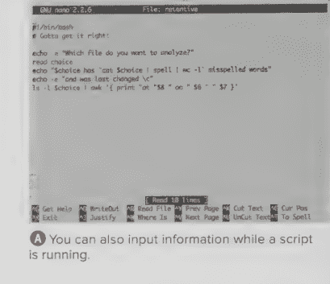

在脚本运行时接受输入：

+ 1. nano retentive
使用你最喜欢的编辑器编辑你的脚本。

+ 2. echo -e "Which file do you want to analyze?"
指定你将在屏幕上看到的提示文本。在这里，屏幕上的文本将显示：“Which file do you want to analyze?

+ 3. read choice
在脚本中任何你想让脚本接受信息的点，输入 `read` 后跟用于接收输入的变量名。在这里，我们将变量命名为 `choice`。

# 代码列表 10.7 在脚本运行时接受输入，确保你不会忘记输入，并且仍然提供定制化的结果。

```unix
[unixvs@LinuxMint scripting]$ ./retentive
Which file do you want to analyze?
testfile
testfile has 11 words
and was changed at 08:44 Mar 30
[unixvs@LinuxMint scripting]$
```

+ 4. echo -e "Which file do you want to analyze?"
指定你将在屏幕上看到的提示文本。在这里，屏幕上的文本将显示：“Which file do you want to analyze?

+ 5. echo -e "Which file do you want to analyze?"
指定你将在屏幕上看到的提示文本。在这里，屏幕上的文本将显示：“Which file do you want to analyze?

+ 6. echo -e "Which file do you want to analyze?"
指定你将在屏幕上看到的提示文本。在这里，屏幕上的文本将显示：“Which file do you want to analyze?

+ 7. 保存并退出，然后运行脚本（代码列表 10.6），尽管你可能需要先提供进度报告的内容并找一个老板来接收你的进度报告。


## 选择邮件程序并入门

通常情况下，在 Unix 或 Linux 系统上发送和接收邮件你有三类程序供选择：

- 安装在你的本地计算机或网络上的邮件程序，它会代表你与邮件系统交互。你可能将这些程序称为邮件客户端，并使用过 Mail、Apple Mail、Evolution、Thunderbird 或 Outlook Express。这些程序非常方便，因为它们通常拥有精美的界面，并且可以处理附件而无需你费费太多精力，但它们并不是真正的 Unix 程序。这些程序还允许你将邮件存储在桌面系统（Windows 或 MacOS 甚至 Unix 桌面系统）上，但这超出了本书的范围。
- 一种通过本地计算机上的浏览器访问的 Web 邮件程序。例如 Gmail、Yahoo Mail、Outlook.com 等。这些也超出了本书的范围（尽管大多数托管邮件程序的服务器实际上运行在 Unix 或 Linux 上）。
- 直接在 Unix 或 Linux 系统上访问并使用的邮件程序。这些程序，如 **alpine**、**mutt** 和 **mail**，让你以不同程度的易用性发送和接收邮件。**alpine** 和 **mutt** 让你可以很方便地发送附件。但邮件保留在 Unix 系统上，你可以从任何可以访问 Unix 或 Linux 系统的地方访问你的邮件。

alpine 的界面和功能直观且易用。

mutt 的界面和功能相当易用，但没有 **alpine's** 那么容易。

mail 的界面和功能……嗯，用起来有点费劲。

### 代码列表 11.1 很有兴趣地阅读这一行

```
login: unixvqs
Password:
Last login: Sun Aug 2 07:41:00 on tty4
You have mail.
unixvqs@FreeBSD $
```

在本章中，我们将重点介绍直接从系统中访问的邮件程序，因为这些才是真正的邮件程序。尽管有无数种不同的程序可用，但你可能会接触到其中一个（或多个）：

- **alpine**：使用非常直观，能让你非常轻松地发送和接收邮件及附件，如果你可以使用它，**alpine** 是推荐的选择。
  - alpine 的界面相对简单。只需使用屏幕底部列出的菜单命令即可。

另一个邮件程序——**cone**——与 **alpine** 非常相似。我们没有发现有选择 **cone** 而非选择 **alpine** 的理由，因此我们决定在书中只介绍 **alpine**。不过，如果你看到了 **cone** 且你喜欢 **alpine**，可以尝试一下。

你如何知道有人给你发了东西？当你登录时，shell 通常会提示（但不是声音）“你有新邮件”，如代码列表 11.1 所示——前提是你确实在收发邮件：

你不局限于使用普通的 Unix 或 Linux 邮件程序或 Web 邮件程序；你可以根据具体的喜好和需求同时使用这两种。如果你有多个邮件程序可用，你也不局限于只使用其中一个，尽管从两个不同的 Unix 程序中读取邮件有时很难跟踪哪些内容在哪里。尝试一下，看看哪个程序或程序组合能满足你的需求。

- **mutt**：这个稍微没那么用户友好，但它可以让你发送和接收邮件，并能很好地处理附件。如果你花一点时间根据需求进行自定义，**mutt** 是我们的第二选择，而且非常友好。它的界面为大多数用途提供了丰富的功能。

是的，你可以使用 **alpine** 或 **mutt** 读取 Gmail（或几乎任何其他 IMAP 邮件服务）。在互联网上搜索“configure alpine for gmail”或“muttrc for gmail”，遵循（直观的）指令，就可以使用了。

我们经常推荐使用这类基于字符的邮件程序来读取邮件。在你习惯界面后，你点击的速度比使用 GUI（图形用户界面）邮件客户端（如 Outlook 或 Thunderbird mail）或 Web 邮件应用快得多，而且你的面前没有弹出图形。

- **mail**：这个程序几乎在每个 Unix 系统上可用；然而，它很难使用，并且不提供直观的选项或命令，所示。如果可能，我们建议选择其他邮件程序。仅在紧急情况下使用此程序。

## 使用 alpine 阅读邮件

你使用 **alpine** 的第一步可能是读取邮件。正如 A 到 D 所示，你通过输入 **alpine** 命令进入，然后根据你想做什么进入工作界面。

### 如何使用 alpine 读取邮件：

- 1. **alpine**

在提示符处输入 **alpine** 启动程序。第一次使用时，alpine 在你开始之前向你问候（见 A）。之后，你将看到正常的主界面，如 B 所示。

如果你收到关于找不到 **alpine** 命令的错误信息，请检查你的路径（path）。

- 2. **L**

按 L 查看文件夹列表。

- 3. **Navigation**

使用方向键导航列表。

- 4. **V**

按 V 查看选定的文件夹。

- 5. **Enter**

按 Enter 读取消息。

- 6. **<**

按 < 退出当前消息并返回邮件索引。

- 7. **Q**

当你准备好退出时按 Q。系统会提示你确认是否要退出，如 D 所示。按 Y 退出，如果不想退出则按 N。

## 使用 alpine 打印

尽管许多 Unix 程序都不允许你使用本地打印机，但 alpine 可以。你只需要选择 %，然后按照 alpine 建议的那样将默认打印输出“附加到”（attached to），你的打印输出就会出现，就像在你的普通打印机上一样。这种到本地打印机的方法在某些通信程序（主要是 Windows telnet）中无效，但在许多程序中有效。如果你坐在 Linux 或 OS 系统前，你也可以使用系统上的其他打印工具——“附加到”选项是为通过 ssh 和 telnet 连接到 Unix 系统的人设计的。


# 使用 alpine 发送邮件

我们使用 alpine 最喜欢的操作之一是发送新消息。通常，你会在启动 alpine 之后发送消息，但也可以直接从 shell 提示符启动新消息（参见随后的提示）。

使用 alpine 编写并发送消息：

- 1. alpine
  在 shell 提示符下输入 alpine 来启动 alpine（如果它尚未运行的话）。
- 2. C
  按下 C 编写一条新消息。

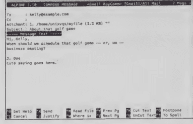

在 alpine 中准备消息就像填空一样简单。

# 关于“主题行”我们的一点浅见

- 始终包含一个描述性的主题行，简要地总结消息内容。例如，与其说“给，你要的”，不如说“对 Baskins 提议的意见”。
- 永远不要让主题行为空。很多人不会触碰没有主题的消息，认为它们可能是垃圾邮件，或者重要性不足以阅读。
- 永远不要在主题行（或任何地方）使用全大写字母，因为接收者可能会将其感知为**在大声大叫**。
- 注意垃圾邮件过滤器的工作原理。许多 ISP 使用它们来减少通过的垃圾邮件数量（即同时发送给数百人、千人甚至数百万人的批量邮件）。
  - 某些过滤器被设置为丢弃主题行为全大写字母的消息。
  - 其他过滤器会丢弃主题中包含大量感叹号的消息。
  - 许多过滤器会消除主题行听起来像“垃圾邮件”的消息，例如“立即赚钱”、“消除不良信用”、“这不是垃圾邮件”、“现在减肥”等。显然，许多不适合在本书中打印的短语和主题也会被丢弃。

- 3. 使用 [Tab] 在消息标头字段之间移动。填写抄送人（cc:）和主题（Subject:）行。关于包含主题行的详细信息，请参见侧边栏“关于‘主题行’我们的一点浅见”。

如果要发送附件，在附件（Attachment）行输入 Unix 文件名（如果适用，还有路径）。例如，输入 `~/myfile`，这包含了完整路径名和文件名。

- 4. Hi, Kelly, 我们什么时候安排那个高尔夫球赛——呃，嗯——业务会议？

在消息窗口中输入你的消息。[A] 显示了我们的消息，包括完整的标头信息和正文。

- 5. [Ctrl+X]
  当你准备好发送时，按下 [Ctrl+X]，alpine 将询问你是否真的 true 要发送该消息。按下 Y（或按下 [Enter]）进行发送，如果不想发送则按下 [N]。

> 提示：你可以自定义 alpine，使其在你每次输入特定字符时自动打开收件箱。在初始按键列表中，只需输入 l,v 然后按回车。是的，你可以输入 Joe 或任何名称，Unix 就会知道对应哪个长地址。要设置别名，请使用地址簿（从主菜单按下 [A]）并按照给说明操作。

> 提示：如果你在 shell 提示符下想在不干扰主界面的情况下发送邮件，输入 alpine 后跟你想要发送的邮件地址（例如 `alpine bigputz@raycomm.com`）。如果你想向多个地址发送邮件，只需用逗号或空格分隔它们，如 `alpine unixvs@raycomm.com, bigputz@raycomm.com`。

# 自定义 alpine

尽管 **alpine** 使用起来非常直观，但它也非常强大，为你提供了丰富的自定义选项。按下 A 显示 **alpine** 的自定义界面，以及你可以选择的几个选项。

要自定义 alpine：

- 1. alpine
  在 shell 提示符下，输入 **alpine** 启动程序。

- 2. M
  按下 M 进入主菜单。

- 3. S
  按下 S 唤出设置菜单。

- 4. C
  按下 C 访问配置设置菜单（如 A 所示）。

- 5. 使用 ↑ 和 ↓ 键浏览配置列表。
**alpine** 为你提供了大量的配置选项。**表 11.1** 描述了你可能认为最有用的几个选项。

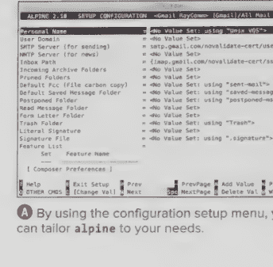

> A 通过使用配置设置菜单，你可以根据需求定制 **alpine**。

- 6. Enter
  按下 Enter键选择你想要更改的选项。

- 7. 做出你的选择或填写必要信息。

- 8. Enter
  按下 Enter 退出配置菜单并返回设置菜单。系统会提示你保存更改。如果你想保存，按下 `Y`；如果不想，按下 `N`。然后你将快速返回主菜单。

> 提示：你可以自定义 alpine，以便在你每次输入特定字符时自动打开收件箱。在初始按键列表中，只需输入 l,v，然后按 `Enter` 即可指定初始字符。

### 表 11.1 常用配置选项

| 选项 | 描述 |
| :--- | :--- |
| initial-keystate-list | 指定 alpine启动时使用的按键命令，就像你直接输入它们一样。 |
| quit-without-confirm | 允许你在不经询问的情况下退出。 |
| signature-at-bottom | 将你的签名放在消息末尾。 |
| saved-msg-rule | 设置 alpine 将消息保存到特定文件夹中。 |
| fcc-name-rule | 将抄送的消息设置到特定文件夹中。 |
| use-only-domain-name | 设置 alpine 仅使用域名发送。 |


- 5. Kelly，我做了一个梦，就是
- 我把闹钟装在了肚子子里。我之所以记得这个梦，是因为当闹钟响起时，我发现自己正按着肚脐试图关掉那个声音。老天呐……我需要休个假！

输入你的消息，无论内容是什么。

- 6. `Esc`

完成后，按下 `Esc`（进入命令模式）。

- 7. :wq

然后输入 `:wq` 保存你的工作并退出编辑器。

- 8. `Y`

按下 `Y` 发送消息。如果你最终决定不想分享关于你肚脐的细节，可以按 `E` 编辑你的消息，或者按 `Q` 退出并忘记这整事儿。

> 提示：你可以将默认编辑器从 `vi` 更改为 Unix 系统上可用的其他编辑器。你只需要编辑 `~/.muttrrc` 文件（如果文件不存在则创建一个），并在文件中添加 `set editor="nano"`（或任何你使用的编辑器）即可。

> 提示：要从 shell 提示符发送快速消息，输入 `mut` 后跟收件者的电子邮件地址，例如 `mut winchester@raycomm.com`。如果你想发送邮件到多个地址，只需用逗号或空格分隔它们，例如 `mut unixqs@raycomm.com, info@raycomm.com`。

## 使用 mail 读邮件

通常情况下，使用 `mail` 比使用 `alpine` 或 `matt` 那么直观；使用 `mail` 读邮件尤其……嗯……具有挑战性。尽管我们建议尽可能使用其他程序来读邮件，但如果你足够大胆，或者别无其他选择，这里有使用 `mail` 读取邮件的步骤。这演示了这项相当快速的任务。

```
uneiqq~$ mail 3 messages 3 unread 27/08;
/var/mail/uneiqq~$ mail
  1  Tue Mar 30 12:25 18/63  你能相信吗？
  2  Tue Mar 31 14:43 18/63  别忘记做 ma
  3  Eric May Tue Apr 01:05 18/45
```

邮件界面一点也不直观，但你可以看到你拥有的消息。

### 如何使用 mail 读邮件：

- 1. mail
  在提示符处输入 `mail`。你会得到一个消息列表和一个提示符。
- 2. 3
  输入你想读的消息编号并按回车。
- 3. 太棒了……他可真是个混蛋……噢，那真奇妙……
  阅读你的消息。按下一条消息的编号跳转到下一条，或按空格键一次翻一页消息屏幕。
- 4. q
  当你准备好时，输入 `q` 退出 mail。

> 提示：使用 `h` 后跟消息编号可以查看不同的消息头。例如，使用 `h 117` 查看第 117 条之前的消息。

> 提示：如果可能，请找一个不同的邮件程序——在需要时能够对付 `mail` 是很有用的，但它并不是一个长久之计的解决方案。

## 使用 mail 发送邮件

尽管 `mail` 的界面和功能并不直观，但如果你只是想快速发送一条消息而不想纠结于礼节，它是一个非常棒的程序。如代码列表 11.3 所示，你可以在 `mail` 中或从 shell 提示符发送消息。你也可以很方便地使用 `mail` 发送文件。

### 如何使用 mail 编辑并发送消息：

- 1. mail unixvqs@raycomm.com

在 shell 提示符处，输入 `mail` 后跟收件人地址。如果你想发送邮件到多个地址，只需用逗号分隔它们，例如 `mail putz@raycomm.com, put2@raycomm.com`。如果你已经在 `mail` 中，只需输入 `m` 后跟地址或多个地址，例如 `m putz@raycomm.com, deb@raycomm.com`。代码列表 11.3：使用 `mail` 通过包含收件人地址和消息文本来发送快速备注。

```
[ejr@hobbes ejr] mail unixqs@raycomm.com
Subject: 你现在麻烦了！
总之，Winchester 站在唱片机上（那些太低科技了，不是吗？！）。他在等我打开唱片机，好让他回去睡觉。我曾让他那样睡，直到一天晚上盖子关在他身上……
E
[ejr@hobbes ejr]
```

代码列表 11.4：要通过 mail 发送文件，只需将文件重定向到 `mail`。

```
[ejr@hobbes ejr]$ mail unixqs@raycomm.com < sendit.txt
[ejr@hobbes ejr]$
```

- 2. 总之，Winchester 站在唱片机上（那些太低科技了，不是吗！）。他在等我打开唱片机，好让他回去睡觉。我曾让他那样睡，直到一天晚上盖子关在他身上……输入你的消息文本（见 11.3）。

- 3. 在最后一行输入 (.) 或使用 `Ctrl+D` 表示完成。

### 使用 mail 发送文本文件：

`mail unixqs@raycomm.com < sendit.txt`

在 shell 提示符处，输入 `mail` 后跟收件人地址。然后重定向文件（`< sendit.txt`），这告诉 Unix 将文件发送到该地址。

> 提示：参见第 9 章的“调度作业”，了解更高级地使用 `mail`。

> 提示：某些系统的 mail 界面不提供主题行。在某些系统上，你可以通过包含 `-s` 以及主题来添加，例如：`mail -s "An old story..." unixqs@raycomm.com`。

> 提示：你用 `mutt` 完成这些命令行选项，但 `mut` 有额外的好处，包括附件。例如，`mut -s "Sending that file" example.com < /dev/null` 会一次性完成所有操作。

## 创建签名文件

如果你使用邮件有一段时间了，你无疑注意到签名文件，它们出现在消息底部，包含联系信息、公司名称，可能还有一段短引用。你可以通过创建一个 `.signature` 文件为你的发送消息添加签名。你的签名文件可以包含任何你想的信息。要有创意，但要简洁！

### 如何创建签名文件：

- 1. nano ~/.signature
在提示符处输入编辑器（我们这里使用 nano，你可以使用喜欢的编辑器），然后指定 `.signature` 文件名。注意文件名前面的点，这会让文件变为隐藏。

- 2. .com
我的想法是我自己的，这样可以吗？继续输入你的签名信息。我们建议你的 `.signature` 文件至少包含你的和电子邮件地址。你也可以添加幽默的格言（“当你把厕所称为‘下载’时，你知道自己是个极客了”）或免责声明（“我的观点不代表公司”）。随你的意。保持签名尽可能短；长签名很难阅读。

- 3. 保存并退出文件。
如果你使用 nano 或 `vi`，可以在第 4 章看到快速提示。

> 提示：如果你想让你的签名变得非常漂亮（即 `figlet`），可以使用代码列表 11.5 所示的文本形式字母。访问你喜欢的搜索引擎并搜索“figlet”或“figlet generator”以获取更多关于创建自己的信息。

> 提示：许多邮件纯主义者认为四行是任何人应该拥有的长签名。如果你创建一个更长的，准备好被他们责。

> 提示：`mut` 和 `alpine` 都会在发送邮件时自动包含 `.signature` 文件。

代码列表 11.5：Figlet 有趣且花丽。

```
ejr@hobbes ejr$ figlet
__  __  _  _  _  _  _  _  _  _  _  _
|  | || | | | | | | | | | | | | | |
|  | || | | | | | | | | | | | | | | | |
|   | | | | | | | | | | | | | | | | | |
 | | | | | | | | | | | | | | | | | | | |
| | | | | | | | | | | | | | | | | | |
```

## 自动转发入站消息

假设你是一个大项目的负责人，每个人都向你发送所有相关的邮件。你可以告诉 Unix 自动将这些入站消息转发给那些会处理它们的人。嘿，你是老板，对吧？也许你只是换了一个电子邮件帐户，你想把发送到旧地址的邮件转发到新地址。你需要创建一个 `.forward` 文件。

你只需要告诉 Unix 你想把消息转发到哪里。

咨询你的系统管理员查看 `.forward` 文件是否有效。许多 Linux 和 Unix 系统会自动发送邮件到 `procmail`（并忽略 `.forward` 文件），因此你可能需要使用 `procmail` 脚本来转发你的邮件。它同样有效，只是方法不同。详细信息请见本章后部分的“使用 procmail 管理邮件”。

如果你想，可以保留所有入站消息的副本（在你的邮箱中，就在它们通常所在），并将它们转发给未指定的收件者。只需输入 `your@address.com`（用当前系统的 userid 替换 yourid，用要转发 `other@address.com` 邮件的地址替换 address）。


## 使用 vacation 发布缺勤公告

如果你计划休假并离开一段时间，让 Unix 或 Linux 为你宣布缺席。通过使用 `vacation` 程序，你可以让系统向任何给你发邮件的人发送回复，告知他们你不在办公室。

请注意，`vacation` 在不同的 Unix 系统和运营商（ISP）之间差异很大。你所拥有的可能与此处使用的“标准”形式有所不同。如果有任何问题，请务必咨询系统管理员获取特定说明，并查看本章后部分的“配置 procmail”，因为许多较新的 Linux 和 Unix 系统使用 procmail 而不是 `.forward` 文件来告诉 vacation 响应你的消息。

使用 vacation 发送“我正在度假”消息：

- 1. `vi ~/vacation.msg`

在 shell 提示符处输入 `vi ~/vacation.msg`。你需要编辑一条消息（实际上是一个模板），作为人们向你发邮件时他们应该收到的回复，如下所示：

- 2. Subject: away from my Mail Tails
    - 关于 $SUBJECT 的邮件请发给我。
    - 对我来说，我正在度过一个极棒的假期：修剪草坪、洗衣服，以及处理
    - 其他我平时因为工作太忙没空做的事情。如果你希望我继续休假，请发邮件给我的老板（boss@example.com）并告诉她。谢谢！

- 3. 保存文本并退出编辑器。第 4 章详细介绍了在 `nano` 和 `vi` 中保存和退出的繁琐细节。

- 4. `vacation -I`
在 shell 提示符处输入 `vacation -I` 来启动 vacation 并告诉它响应所有入站消息。你仍然会在收件箱中收到这些消息。事实上，它们会堆在你的收件箱里等候回来。

- 5. `cat ~/.forward`
查看主目录下的 `.forward` 文件，验证它是否包含对 `vacation` 程序的引用。你的 `.forward` 文件指定了邮件在收到后应该发生什么。在这个示例中，它应该由 vacation 处理。对 vacation 的引用通常由 `vacation` 程序自动插入，但如果如果没有插入，你需要编辑 `.forward` 文件并添加类似 `\yourid, "vacation yourid"` 的文本。或者，将占位符替换为你真实的用户名，并包含我们系统上 vacation 的完整路径（/usr/bin/vacation）。（参见代码列表 11.6。）

> 记住在开始度假之前退出所有邮件列表的订阅。如果不这样做，你可能会向一整列表不喜欢这样的人发送缺勤公告（并不是说你会惹怒列表管理员）。或者糟糕的是，你可能会导致邮件循环（发给列表的消息被服务器确认，而确认邮件又是缺勤公告），导致数百或数千条消息堆积在你的账户中。这不应该发生，但有时会发生。

## 停止 vacation 邮件：

```
mv .forward vacation-forward
```

在 shell 提示符处，将引用 `vacation` 程序的 `.forward` 文件重命名为其他名称（在这种情况下为 `vacation-forward`）。你可以直接删除它或移除对 vacation 的引用，但将其保存比较容易，这样你下次度假时就可以重复。

## 配置 procmail

让我们看看……老板发了两条消息……来自字符串收集者讨论组的 17 条消息……噢，嘿，妈妈发了消息……还有……

你可以做的最方便的 Unix 生活技巧之一是让你的 procmail（一个邮件过滤程序）自动处理你的部分入站邮件。

在本节中，我们将展示如何配置 procmail 以便管理入站消息。而且，要设置系统使用 procmail 管理邮件，你需要做两件事：

- 指定 procmail 的设置。例如，入站邮件直接提取到你的收件箱；然而，procmail 在邮件到达收件箱之前对其进行过滤，因此你需要告诉 procmail 你的邮件文件夹在哪里等。

- 告诉它执行任务。本质上，你创建一个 `.forward` 文件，在你看到邮件之前将其将入站邮件发送给 procmail 进行处理。这一步对于许多系统来说并不是必要的，特别是较新的 Linux 和 Unix 系统。

指定 procmail 的设置：

- 1. `nano ~/.procmailrc` 开始，访问你的编辑器并在主目录下创建一个 `.procmailrc` 文件。为记录其所有活动提供一个位置，这样它就可以告诉你它完成了什么：“我从你老板那里丢了 7 条消息……在 GolfBuddies 文件夹中归档了 3 条来自 Joe 的消息……”在这个示例中，我们告诉 procmail 在主目录下保留一个邮件日志文件。留意此文件，因为它可能会随着时间的推移而变得很大。

| LOGFILE=$HOME/.maillog |
| FROM=/usr/bin/local/bin/bin |
| DEFAULT=/usr/bin/local/bin |

### 代码列表 11.6 你的 .forward 文件应该引用整个 vacation 文件。

创建并编辑文本来说你想要的内容。

文本中的 $SUBJECT 术语将被替换为发送给你的邮件实际主题。

```
ejr@hobbes ejr$ cat ~/.forward
\r, "vacation ejr"
ejr@hobbes ejr$
```

- `cat ~/.forward`
查看主目录下的 `.forward` 文件，验证它是否包含对 `vacation` 程序的引用。你的 `.forward` 文件指定了邮件在收到后应该发生什么。在这个示例中，它应该由 vacation 处理。对 vacation 的引用通常由 `vacation` 程序自动插入，但如果没有插入，你需要编辑 `.forward` 文件并添加类似 `\yourid, "vacation yourid"` 的文本。或者，将占位符替换为你真实的用户名，并包含我们系统上 vacation 的完整路径（/usr/bin/vacation）。（参见代码列表 11.6。）

-  cat ~/.forward
查看主目录下的 `.forward` 文件，验证它是否包含对 `vacation` 程序的引用。你的 `.forward` 文件指定了邮件在收到后应该发生什么。在这个示例中，它应该由 vacation 处理。对 vacation 的引用通常由 `vacation` 程序自动插入，但如果没有插入，你需要编辑 `.forward` 文件并添加类似 `\yourid, "vacation yourid"` 的文本。或者，将占位符替换为你真实的用户名，并包含我们系统上 vacation 的完整路径（/usr/bin/vacation）。（参见代码列表 11.6。）

- 3. 保存文本并退出编辑器。第 4 章详细介绍了在 `nano` 和 `vi` 中保存和退出的繁琐细节。

- 4. `vacation -I`
在 shell 提示符处输入 `vacation -I` 来启动 vacation 并告诉它响应所有入站消息。你仍然会在收件箱中收到这些消息。事实上，它们会堆在你的收件箱里等候回来。

- 5. `cat ~/.forward`
查看主目录下的 `.forward` 文件，验证它是否包含对 `vacation` 程序的引用。你的 `.forward` 文件指定了邮件在收到后应该发生什么。在这个示例中，它应该由 vacation 处理。对 vacation 的引用通常由 `vacation` 程序自动插入，但如果没有插入，你需要编辑 `.forward` 文件并添加类似 `\yourid, "vacation yourid"` 的文本。或者，将占位符替换为你真实的用户名，并包含我们系统上 vacation 的完整路径（/usr/bin/vacation）。（参见代码列表 11.6。）

> 记住在开始度假之前退出所有邮件列表的订阅。如果不这样做，你可能会向一整列表不喜欢这样的人发送缺勤公告（并不是说你会惹怒列表管理员）。或者糟糕的是，你可能会导致邮件循环（发给列表的消息被服务器确认，而确认邮件又是缺勤公告），导致数百或数千条消息堆积在你的账户中。这不应该发生，但有时会发生。

## 停止 vacation 邮件：

```
mv .forward vacation-forward
```

在 shell 提示符处，将引用 `vacation` 程序的 `.forward` 文件重命名为其他名称（在这种情况下为 `vacation-forward`）。你可以直接删除它或移除对 vacation 的引用，但将其保存比较容易，这样你下次度假时就可以重复。

## 配置 procmail

让我们看看……老板发了两条消息……来自字符串收集者讨论组的 17 条消息……噢，嘿，妈妈发了消息……还有……

你可以做的最方便的 Unix 生活技巧之一是让你的 procmail（一个邮件过滤程序）自动处理你的部分入站邮件。

在本节中，我们将展示如何配置 procmail 以便管理入站消息。而且，要设置系统使用 procmail 管理邮件，你需要做两件事：

- 指定 procmail 的设置。例如，入站邮件直接提取到你的收件箱；然而，procmail 在邮件到达收件箱之前对其进行过滤，因此你需要告诉 procmail 你的邮件文件夹在哪里等。

- 告诉它执行任务。本质上，你创建一个 `.forward` 文件，在你看到邮件之前将其将入站邮件发送给 procmail 进行处理。这一步对于许多系统来说并不是必要的，特别是较新的 Linux 和 Unix 系统。

指定 procmail 的设置：

- 1. `nano ~/.procmailrc` 开始，访问你的编辑器并在主目录下创建一个 `.procmailrc` 文件。为记录其所有活动提供一个位置，这样它就可以告诉你它完成了什么：“我从你老板那里丢了 7 条消息……在 GolfBuddies 文件夹中归档了 3 条来自 Joe 的消息……”在这个示例中，我们告诉 procmail 在主目录下保留一个邮件日志文件。留意此文件，因为它可能会随着时间的推移而变得很大。

| LOGFILE=$HOME/.maillog |
| FROM=/usr/bin/local/bin/bin |
| DEFAULT=/usr/bin/local/bin |

### 代码列表 11.6 你的 .forward 文件应该引用整个 vacation 文件。

创建并编辑文本来说你想要的内容。

文本中的 $SUBJECT 术语将被替换为发送给你的邮件实际主题。

```
ejr@hobbes ejr$ cat ~/.forward
\r, "vacation ejr"
ejr@hobbes ejr$
```

- `cat ~/.forward`
查看主目录下的 `.forward` 文件，验证它是否包含对 `vacation` 程序的引用。你的 `.forward` 文件指定了邮件在收到后应该发生什么。在这个示例中，它应该由 vacation 处理。对 vacation 的引用通常由 `vacation` 程序自动插入，但如果没有插入，你需要编辑 `.forward` 文件并添加类似 `\yourid, "vacation yourid"` 的文本。或者，将占位符替换为你真实的用户名，并包含我们系统上 vacation 的完整路径（/usr/bin/vacation）。（参见代码列表 11.6。）

- 3. 保存文本并退出编辑器。第 4 章详细介绍了在 `nano` 和 `vi` 中保存和退出的繁琐细节。

- 4. `vacation -I`
在 shell 提示符处输入 `vacation -I` 来启动 vacation 并告诉它响应所有入站消息。你仍然会在收件箱中收到这些消息。事实上，它们会堆在你的收件箱里等候回来。

- 5. `cat ~/.forward`
查看主目录下的 `.forward` 文件，验证它是否包含对 `vacation` 程序的引用。你的 `.forward` 文件指定了邮件在收到后应该发生什么。在这个示例中，它应该由 vacation 处理。对 vacation 的引用通常由 `vacation` 程序自动插入，但如果没有插入，你需要编辑 `.forward` 文件并添加类似 `\yourid, "vacation yourid"` 的文本。或者，将占位符替换为你真实的用户名，并包含我们系统上 vacation 的完整路径（/usr/bin/vacation）。（参见代码列表 11.6。）

> 记住在开始度假之前退出所有邮件列表的订阅。如果不这样做，你可能会向一整列表不喜欢这样的人发送缺勤公告（并不是说你会惹怒列表管理员）。或者糟糕的是，你可能会导致邮件循环（发给列表的消息被服务器确认，而确认邮件又是缺勤公告），导致数百或数千条消息堆积在你的账户中。这不应该发生，但有时会发生。

## 停止 vacation 邮件：

## 停止 vacation 邮件：

在 shell 提示符处，将引用 `vacation` 程序的 `.forward` 文件重命名为其他名称（在这种情况下为 `vacation-forward`）。你可以直接删除它或移除对 vacation 的引用，但将其保存比较容易，这样你下次度假时就可以重复。

- 1. `nano ~/.procmailrc` 开始，访问你的编辑器并在主目录下创建一个 `.procmailrc` 文件。为记录其所有活动提供一个位置，这样它就可以告诉你它完成了什么：“我从你老板那里丢了 7 条消息……在 GolfBuddies 文件夹中归档了 3 条来自 Joe 的消息……”在这个示例中，我们告诉 procmail 在主目录下保留一个邮件日志文件。留意此文件，因为它可能会随着时间的推移而变得很大。

| LOGFILE=$HOME/.maillog |
| FROM=/usr/bin/local/bin/bin |
| DEFAULT=/usr/bin/local/bin |

## 停止 vacation 邮件：

## 使用 procmail 管理邮件

procmail 可以帮助你自动——或选择性地响应邮件。正如你，procmail 类似于转发邮件并使用 vacation 程序，但你可能会发现 procmail 灵活得多。

指定如何过滤消息（“编写配方”）：

- 1. `vi ~/.procmailrc`
   在 `vi` 中，访问你的 `.procmailrc` 文件。
2. 移动到文件末尾，在设置信息下方。
3. `:0:`
   使用 `:0:` 开始一个新的配方，如 1 所示（不要问为什么用 `:0:`。那就是它的规则）。
4. `* ^TOGolfies`
   设置 procmail 过滤的标准，在这里：
* `* ^TO` 告诉 procmail 检查所有入站消息的 TO 行（实际上也检查 CC 行）。
* `GolfBuddies` 是 TO 行中匹配的文本（如 To: GolfBuddies@nowhere.com）。当然，你会为你的邮件列表输入要查找的实际名称（或任何相关内容的别名），而不是 GolfBuddies。

5. `$MAILDIR/FriGolfies`
   指定过滤后的邮件应该去哪里。在这种情况下，是 FriGolfies 文件夹，但你可能会将来自邮件列表的消息过滤到 listmail 文件夹。


# 使用 procmail 丢弃垃圾邮件

以下配方，
0:

+   * |I^*,.*awr,.*raycomm.com
$MAILDIR/spam

它使用正则表达式来过滤那些没有在 @ 之前明确发送给包含 awr 用户、且以 raycomm.com 结尾的邮件，并将它们放入一个名为 spam 的特殊文件夹。将垃圾邮件过滤器放在规则列表的末尾，以确保所有来自邮件列表和其他重要邮件都不会被过滤。在测试此操作并确保你喜欢它且它没有误删有价值的邮件后，你可以将最后一行改为 /dev/null 以直接丢弃这些垃圾。

对于更复杂、高级的垃圾邮件解决方案，你可以在网上搜索“procmail spam filter”来查看选项。

# 使用 procmail 转发邮件：

- 1. nano ~/.procmailrc
开始，访问你的编辑器并编辑之前在主目录中创建的 .procmailrc 文件。

- 2. :0:
在文件底部的新起的一行添加 `0;`；这基本上是告诉 procmail 配方在处理邮件目录时“锁定”你的邮件目录。

- 3. !myemail@example.com
提供感叹号（I!）和发送邮件的地址。

- 4. 保存并关闭文件。
现在，你收到的所有邮件将自动转发到 myotheremail@example.com。

# 使用 procmail 调用假期回复模式（vacation）：

- 1. pico ~/.procmailrc
开始，访问你的编辑器并编辑之前在主目录中创建的 .procmailrc 文件。

- 2. :0 c
| /usr/bin/vacation jdoe
在文件底部的新起的一行添加所示配方，将你的邮件副本（第一行尾的 c）发送给 vacation 程序。关于 vacation 程序的更多信息，请参见本章前面的章节“使用 vacation 宣布缺席”。

- 3. 保存并关闭文件。
现在，你收到的所有邮件将被存储并交给 vacation 程序进行回复。

提示：你的 .procmailrc 文件是按顺序处理的。一旦某个配方匹配了入站邮件，它就会被应用。因此，如果你的第一个配方是转发配方，procmail 将永远不会处理后面的任何配方。如果没有匹配到任何配方，邮件将投递到你指定的 DEFAULT 位置（参见前面的“配置 procmail”）。

提示：在设置好 procmail 处理后，请保持耐心。有时 procmail 会按照特定的计划（例如每小时）处理邮件，因此测试它可能需要一些时间。

# procmail 配方示例

以下带有注释的配方将帮助你开始使用 procmail 进行过滤：# 根据 To; Cc: 以及类似的头部进行过滤

```
:0:
* ^TO.*awr@.*raycomm.com
$MAILDIR/interesting
# 根据主题过滤

:0:
* ^Subject:.*Status Report.
$MAILDIR/status-reports
# 根据发件者过滤

:0:
**From:*.*spammer@example.com
$MAILDIR/IN.TO-DELETE
# 根据发件者不可撤回地直接过滤到垃圾箱

:0:
^From:.*spammer@example.com
/dev/null
# 根据大小过滤（大于 1000 字节）

:0:
* > 1000
$MAILDIR/longish
```

## 访问互联网

到本书为止，你一直在处理直接位于 Unix 或 Linux 系统上的文件和脚本。在本章中，我们将展示如何超越你的 Unix 或 Linux 系统，利用互联网上的信息。

### 本章内容

- 熟悉互联网术语 | 236
- 使用 **ssh** 登录远程系统 | 238
- 使用 **telnet** 登录远程系统 | 239
- 使用 **write** 与他人通信 | 241
- 使用 **talk** 与他人通信 | 242
- 使用 **ftp** 从互联网获取文件 | 243
- 使用 **ftp** 在互联网上共享文件 | 247
- 使用 **links** 浏览网页 | 249
- 使用 **lynx** 浏览网页 | 251
- 使用 **wget** 下载网站 | 253
- 使用 **ping** 检查连接 | 254
- 使用 **traceroute** 追踪连接 | 255
- 域名与 IP 地址匹配 | 257

## 熟悉互联网术语

在使用本章提供的信息进入互联网之前，你应该先熟悉一些概念和术语。

服务器是存储数据并在需要时“提供”服务的计算机。例如，你可能把 Web 服务器想象成存放 .html 文件的巨大仓库。它的工作是存储 .html 文件，等待另一台计算机请求这些文件并将其“提供”给请求的计算机。是的，你的 Unix 或 Linux 系统可以是一个 Web 服务器，但不是必须。

客户端是运行在你的 Unix 系统上的程序，用于访问服务器上的数据。例如，你的 links 浏览器就是一个客户端——也就是说，它运行在你的 Unix 或 Linux 系统上。

IP（互联网协议）地址是计算机的地址。主机比数字地址更容易记忆，但它们会被转换为 IP 地址。

| 端口 | 协议 |
| :--- | :--- |
| 21 | ftp |
| 22 | ssh |
| 23 | telnet |
| 70 | gopher |
| 80 | http |
| 119 | ntp |
| 113 | pop |
| 8080 | http |

协议是计算机通信的语言。例如，FTP（文件传输协议）用于传输文件。HTTP（超文本传输协议）用于网页。

端口就像计算机监听的地方。大多数 Web 服务器监听 80 端口。

# 使用 ssh 登录远程系统

你可能已经在使用 ssh 连接到另一个系统。在本章中，我们将展示如何安全地使用它。

使用 ssh 连接到另一个系统：

- ssh server.com

在提示符处，输入 ssh 后加上要连接的系统名称。

- 根据系统的说明进行登录。

理理，如果你通过互联网访问系统，你拥有某些理由和权限。在某些情况下，你将输入应用程序名称，或者你可能正在使用该系统。

- 使用远程系统后，根据远程系统的说明和策略注销。


## 使用 telnet 登录远程系统

你可能已经在使用 telnet 连接到你的 Unix 或 Linux 系统，但你可能并没有这么做，因为 telnet 是一个巨大的安全漏洞。不过，你可以使用它连接并使用 Internet 上的其他计算机系统（假设你有登录权限，且系统管理员允许 telnet 访问而非要求 SSH），如 A 所示。

使用 telnet 连接另一台计算机：

- 1. telnet telehack.com

在 shell 提示符处，输入 `telnet` 后加上你想要连接的系统名称。在这个示例中，我们正在连接到位于加利福尼亚州山景城的系统。

- 2. 注意登录时弹出的转义字符（Escape character）——要快看，因为它会在屏幕上消失。当你的 telnet 连接卡住或系统死锁时，你需要按下转义字符。在示例中，转义字符是 [Ctrl]+I，它会将我们返回 telnet 提示符，以便我们退出连接 A。

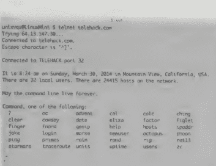

注意转闪即逝的转义字符。

- 3. 使用你访问该系统的指令进行登录。

认为，如果你通过 Internet 访问某个系统，你一定有这么做的理由（和权限）。在某些情况下，你需要输入应用程序名称。在其他系统中，你将使用用户名和密码登录，就像你登录 Unix 系统一样。

- 4. 在使用完远程系统后，根据远程系统的指令和策略进行注销。

如需 telnet 帮助，在 shell 提示符处输入 `telnet`，并在 `telnet>` 提示符处输入 `?`，`open`、`close` 和 `exit` 将是对你最有用的工具。

你会发现，由于键盘仿真的特殊性，telnet 连接到图书馆或其他大型机通常很难使用。你最好的办法是联系网站所有者并索要一份 FAQ 列表（带有答案）。你不会是第一个提问的人。

与 telnet 密切相关的程序 tn3270 专为与 IBM 大型机通信设计，大型机通常用于大学图书馆目录以及其他专业和学术系统。如果你知道自己正在与 IBM 大型机通信，可能使用 tn3270 会更好。

正如你可能意识到的，telnet 很大程度上是 Internet早期时代的产物。你可以在 www.telnet.org 找到关于 telnet 的一些良好的（有趣、娱乐）信息，包括可以 telnet 的地方。

如果你想听关于 telnet 为什么在 Internet 上彻底死亡的惨痛细节，可以在网上搜索 "telnet worm"。

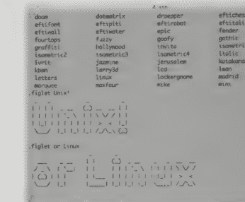

连接成功后，你可以像使用自己的系统一样使用远程系统。

## 使用 write 与他人通信

大多数时候，当你连接到 Unix 或 Linux 系统时，你是在与计算机通信。不过，你也可以与登录同一系统的其他人进行通信。**write** 是向其他用户发送快速消息的理想工具——就像在他们的电脑上贴便利贴签一样，如 A 所示。

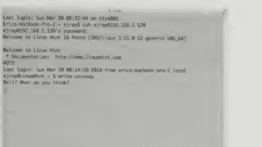

A 你可以使用 **write** 向系统上的另一个用户发送快速消息。

### 使用 write 与他人通信：

- 1. **write userid**
在 shell 提示符处，输入 **write** 后加上你想向其发送消息的 userid。你会看到一个带有闪烁光标的空行，等待你输入内容。
- 2. **Wanna meet for lunch?**
继续输入你的消息 A。
- 3. **Ctrl+D**
完成输入后，按下 **Ctrl+D** 发送消息。你输入的内容将出现在另一个用户的屏幕上 B。


B 消息突然出现在用户的屏幕上。

> 提示 请记住，write 消息会突然出现在接收者的屏幕上，这可能是一个让人感到被侵扰的惊喜！

> 提示 如果不想接收 write 消息，请在 shell 提示符处输入 **mesgn**。此命令将防止其他人在当前会话向你发送 write 消息。输入 **mesg y** 可再次启用 write。

## 使用 talk 与他人通信

你还可以通过 talk 与登录系统的另一个用户进行实时的双向对话（非常像即时消息聊天）。如所示，你输入你的消息，对方输入他的消息，你们都可以在线看到交流内容。

### 使用 talk 与他人通信：

- 1. talk deb
在 shell 提示符处，输入 talk 和你想交谈的人的 userid。另一个用户将被提示输入 talk 和你的 userid。然后，你将看到 talk 屏幕，如（所示。
- 2. You just wouldn't have believed it!
I had chased the dog for six blocks...Yeah, the stinkin' pooch
alney, the stinkin' pooch
-2. You just wouldn't have believed it!
I had chased the dog for six blocks...Yeah, the stinkin' pooch
alney, the stinkin' pooch
- 3. Ctrl+D
完成输入后，按下 **Ctrl+D** 发送消息。你输入的内容将出现在另一个用户的屏幕上 B。


## 5. binary（二进制模式）

指定文件类型——在这种情况下，是 **binary**，因为我们正在下载一个 gzipped 归档文件。README 文件、文本和 HTML 文件请指定 `ascii`。

## 6. hash（哈希值）

接下来，你可以选择输入 **hash**，告诉 FTP 客户端每传输 1024 字节显示一个哈希标记 (#)。如果你正在传输小文件或使用快速连接，这可能不是必要的；然而，对于大文件和慢速连接，哈希标记可以让你知道正在进行。

如果你将下载多个文件，在继续之前，请查看本节侧边栏的“获取多个文件”（Getting Multiple Files）。在此流程阶段，获取单个文件和多个文件的指令是不同的。

## 7. get jokearchive.gz

在 `ftp>` 提示符下，输入 **get** 和文件名即可从远程系统获取文件并将其放入你自己的账户中。

## 8. quit（退出）

完成后，只需输入 **quit** 即可。

如果 FTP 连接在登录后似乎卡住了，请尝试使用 `-yourid@ wherever.com` 作为密码。`-` 字符会禁用系统公告并帮助 FTP 客户端保持正常。

某些防火墙——特别是家庭网络上的——无法很好处理 FTP 协议的某些复杂细节。如果你可以连接并登录但无法列出文件或获取任何内容，可能是防火墙的问题。一旦登录，输入 `pass`（代表被动模式 passive），问题应该消失。

`-` 的另一个方便用法是在屏幕上查看文本文件。例如，使用 `get filename -` 让文本直接在屏幕上滚动。

与其使用 `get`，不如 `get newer`（例如 `newer jokes.gz`）来获取与现有文件同名但更更新的文件。

如果你开始下载文件时 FTP 连接断开了，输入 `reject` 和中断处的文件名。（当然，你必须先重新建立连接）。

你可以使用 `get` 的 `runique` 索引让 FTP 客户端确保所有传输的文件具有唯一名称。这样，你可以确保文件不会覆盖系统上已存在的文件。

使用常规 Unix 命令（如 `ls` 和 `cd`）在远程系统中移动，并在它们前加 `!` 以应用于你的系统。例如，`!cd ..` 将切换到远程系统的上一级目录，而 `cd ..`（在 FTP 客户端内部）将切换到本地系统的上一级目录。当前目录是文件将保存的地方。

## 获取多个文件 (Getting Multiple Files)

如果你将用 ftp 获取多个文件，请遵循本节的第 1 到 6 步，然后：

- *prompt*
输入 `prompt` 以便不再对你想要获取的每个单独文件进行提示。你将收到 prompt 已设置为 no。如果你想重新开启，请再次使用 `prompt`。

- *mget*
在 ftp 提示符下，输入 `mget`（代表 "multiple get"）后跟要匹配的字符串或文件名。在示例中，我们使用 `start*` 来获取所有以 *.gz 开头的文件，例如获取 .gz 扩展名的文件。关于使用通配符的更多信息请参见第 1 章。

- *quit*
完成文件获取后，只需输入 `quit`。

## 使用 ftp 在互联网上共享文件 (Sharing Files on the Internet with ftp)

使用 ftp 在互联网上共享文件与获取文件类似；然而，你不是在检索文件，而是将文件给他人（代码列表 12.3）。请注意 ftp 是不安全的，因此不要用它共享密码、银行对单、贷款申请或任何你不希望晚间新闻中的内容。

列表 12.3 使用 put，你可以与互联网上的其他人共享你的文件。

```
[ejr@hobbes ejr]$ ftp put ftp.raycomm.com
Connected to www.raycomm.com.
220 ftp.raycomm.com ftp server (NcFtp 2.1.2, registered copy) ready.
Name (ftp.raycomm.com:ejr): ejray
331 User array okay, need password.
Password:
230-You are user #8 of 100 simultaneous users allowed.
230-
230 logged in.
Remote system type is UNIX.
Using binary mode to transfer files.
ftp cd incoming
250 "/home/ftp/pub/users/e/ejray/incoming" is new cwd.
ftp binary
200 Type okay.
ftp put myjokes.gz
local: myjokes.gz
200 PORT command successful.
150 Opening BINARY mode data connection.
226 Transfer completed.
12889 bytes sent in 15.5 secs (8.1 Kbytes/sec)
ftp quit
221 C-ya!
[ejr@hobbes ejr]$
```

## 要用 ftp 在互联网上共享文件：

- 1. `ftp ftp.raycomm.com`
如上一节所示打开 FTP 连接。

- 2. `youruserid`
使用你的 userid 登录。

- 3. `password`
输入你的密码。

- 4. `cd incoming`
使用标准的 Unix 目录命令（ls, cd 等）移动到你想放置文件的目录（代码列表 12.3）。**incoming** 通常是使用的正确目录名称，特别是在公共 FTP 服务器上。

- 5. `binary`
设置文件类型。你将想要使用 **binary** 文件类型。

- 6. `put myjokes.gz`
将文件上传到远程服务器。

- 7. `quit`
关闭连接。

如果 FTP 连接在登录后似乎卡住了，请尝试使用 `-yourid@ wherever.com` 作为密码。`-` 字符会禁用系统公告并帮助 FTP 客户端保持正常。

某些防火墙——特别是家庭网络上的——无法很好处理 FTP 协议的某些复杂细节。如果你可以连接并登录但无法列出文件或获取任何内容，可能是防火墙的问题。一旦登录，输入 `pass`（代表被动模式 passive），问题应该消失。

`-` 的另一个方便用法是在屏幕上查看文本文件。例如，使用 `get filename -` 让文本直接在屏幕上滚动。

与其使用 `get`，不如 `get newer`（例如 `newer jokes.gz`）来获取与现有文件同名但更更新的文件。

如果你开始下载文件时 FTP 连接断开了，输入 `reject` 和中断处的文件名。（当然，你必须先重新建立连接）。

你可以使用 `get` 的 `runique` 索引让 FTP 客户端确保所有传输的文件具有唯一名称。这样，你可以确保文件不会覆盖系统上已存在的文件。

使用常规 Unix 命令（如 `ls` 和 `cd`）在远程系统中移动，并在它们前加 `!` 以应用于你的系统。例如，`!cd ..` 将切换到远程系统的上一级目录，而 `cd ..`（在 FTP 客户端内部）将切换到本地系统的上一级目录。当前目录是文件将保存的地方。

## 获取多个文件 (Getting Multiple Files)

如果你将用 ftp 获取多个文件，请遵循本节的第 1 到 6 步，然后：

- *prompt*
通常，输入 `prompt` 以便不再对你想要获取的每个单独文件进行提示。你将收到 prompt 已设置为 no。如果你想重新开启，请再次使用 `prompt`。

- *mget*
在 ftp 提示符下，输入 `mget`（代表 "multiple get"）后跟要匹配的字符串或文件名。在示例中，我们使用 `start*` 来获取所有以 *.gz 开头的文件，例如获取 .gz 扩展名的文件。关于使用通配符的更多信息请参见第 1 章。

- *quit*
完成文件获取后，只需输入 `quit`。

## 使用 ftp 在互联网上共享文件 (Sharing Files on the Internet with ftp)

使用 ftp 在互联网上共享文件与获取文件类似；然而，你不是在检索文件，而是将文件给他人（代码列表 12.3）。请注意 ftp 是不安全的，因此不要用它共享密码、银行对单、贷款申请或任何你不希望晚间新闻中的内容。

## 使用 links 在网页上浏览 (Surfing the Web with links)

使用 **links**，一种非常高级的文本浏览器，你可以在没有图片的情况下浏览网页。**links** 浏览器即使没有图片也提供了强大的功能。


## 有用的 links 键 (Useful links Keystkes)

- -（或 Enter）会跟随当前高亮的链接到新页面。
- 返回上一页。
- 将高亮移动到文档中的下一个链接。
- 将高亮移动到文档中的上一个链接。
- 空格键（或 Page Down）滚动到下一页。
- Page Up 或 B 滚动到上一页。
- 退出 links。

## 要用 links 浏览网页 (To surf the web with links):

- 1. `links http://www.google.com/`
在 shell 提示符下，输入 links 后跟 .html 文件名或网站地址。在这里，我们正在访问 Google 网站 A。

- 2. 浏览网页或在线搜索你喜爱的主题。
详情请参见本节中的“使用 links 导航”和“有用的 links 键”。

- 3. Q
按 Q 退出并返回 shell 提示符。就是这样！

## 使用 links 导航 (Navigating with links)

- -（或 Enter）会跟随当前高亮的链接到新页面。
- 返回上一页。
- 将高亮移动到文档中的下一个链接。
- 将高亮移动到文档中的上一个链接。
- 空格键（或 Page Down）滚动到下一页。
- Page Up 或 B 滚动到上一页。
- 退出 links。

(注：我注意到最后的输出中有重复的章节。我将根据上述逻辑提供清理后的版本。)


## 使用 lynx 浏览网页

你也可以使用 **lynx** 浏览网页，这是一个基于文本的网络浏览器。它不像 **links** 那么精美，处理网页的方式也没有那么优雅，但它在你的工具箱中也有一席之地。通常情况下，你可以访问网络上丰富的信息，并可以使用 **lynx** 轻松地下载和重新格式化。

你可以使用 **lynx** 访问网络上的任何站点。

## 有用的 lynx 快捷键

- `/findme` 在文件内查找文本。（将 `findme` 替换为你要查找的文本）
- `?` 访问帮助文档。
- `D` 下载当前链接。
- `G` 跳转到地址或文件。在提示符处输入地址。
- `Shift+G` 编辑当前地址。
- `A+L` 将当前链接添加到你的书签列表。
- `V` 查看书签列表。
- `Backspace` 查看访问过的页面列表（历史记录）。
- `L` 在查看格式化页面和查看 HTML 源代码之间切换。
- `Ctrl+R` 重新加载当前页面并刷新屏幕。

### 使用 lynx 浏览网页：

1. lynx http://www.cnn.com/

在 shell 提示符下，输入 lynx 后后跟一个 .html 文件名或网站地址。在这里，我们正在访问 CNN 网站 Ⓐ。

如果你只输入 lynx，将获得系统的默认页面，这可能是 lynx 主页或你的 ISP（服务提供商）的主页。

2. 浏览、浏览、浏览！

详情请参见本节的“使用 lynx 导航”和“有用的 lynx 快捷键”部分。

3. Q 

按 Q 退出并返回 shell 提示符。就是这样！

> 如果你访问了一个 lynx 不友好的页面（如 🅱 所示），按 ⇩ 向下滚动几次。通常你就能找到内容。

如果你不使用图形界面，某些站点比其他站点要友好得多。

## 使用 lynx 导航

- ⏎ (或 Enter) 跟随当前高亮的链接进入新页面。
- ↩ 返回上一个页面。
- Tab 将高亮项移动到文档中的下一个链接。
- Shift+Tab 将高亮项移动到文档中的上一个链接。
- Ⓜ 返回到会话中访问的第一个屏幕——你在第 1 步“使用 lynx 浏览网页”中看到的那个。
- 空格键向下滚动到下一页。
- ⌅ 向上滚动到上一页。

> lynx 是从 .html 文档获取精美纯文本文件的好方法。尝试 lynx -dump http://example.com/goodpage.html > name.txt，启动 lynx 并让其将显示发送到标准输出，然后将输出重定向到名为 name.txt 的文件。这将会在 Unix 账户文件中生成该页面的文本，而不 HTML 代码。

> lynx 让快速查看本地 .html 文档变得非常简单，但在通用网页浏览方面，它没有 links 那么灵活。

## 使用 wget 下载网站

代码列表 12.4 你可以使用 wget 下载你所能处理的所有网络内容。

```
$ jdoe/home/jdoe wget http://www.cnn.com/
18:07:51 http://www.cnn.com/
> 'index.html'
Resolving www.cnn.com... done.
Connecting to www.cnn.com[64.236.234.24]:80... connected.
HTTP request sent, awaiting response...
200 OK
Length: unspecified [text/html]
[<] 51290 (53.28 KB/s) - 'index.html' saved
[>] 51290
jdoe/home/jdoe $
```

wget 工具允许你下载网页——整个网站——供离线使用。你只需要指定 URL 和想要下载的层级（距离起始页的链接深度），然后让 wget 执行即可（见代码列表 12.4）。你可以在没有连接互联网时使用这些网页，例如在飞机上、酒店里或等候室里。

使用 wget 下载网站：

- wget http://www.cnn.com/
在提示符下，输入 wget 后后跟网站或 FTP 站点的 URL。在这里，我们正在访问 CNN 网站（代码列表 12.4）并下载首页。
爬取！
links index.html
然后使用你喜爱的 浏览器查看你的结果。

> wget --recursive --level=2 http://www.example.com/ 让你获取网站的几级（在这种情况下是两级）。要小心，因为很容易欲大形从。如果你使用 wget -r http://www.example.com/，wget 将尝试递归下载整个站点。在 www.cnn.com 上执行第一个命令最终得到了 20 MB 数据。

> 我们建议使用单独的目录存放不同网站的内容。否则，wget 将重命名文件（覆盖）或破坏现有文件（这很可能导致最后下载的网站是完整的）。如果你在使用 wget 时使用 -x （例如，wget -x http://www.example.com/），它会自动执行此。参见第 2 章关于使用目录的更多信息。

> wget 也适用于 FTP 站点。如果需要指定密码，请使用 wget://ftp.example.com 或 wget@ftp.example.com。查看 wget man 页获取更多可用选项。

## 使用 ping 检查连接

将 ping 想象成向远程计算机询问你在吗？”。例如，假设你正尝试连接某个网页但没有响应。想知道发生了什么，输入 ping 以检查计算机是否开启且正常（代码列表 12.5）。

使用 ping 检查计算机：

**ping www.raycomm.com**
在提示符下，输入 ping 和主机名测试到特定主机的连接（代码列表 12.5）。根据你的 Unix 系统，它可能会检查一次连接并返回结果。或者每秒 ping 直到你让它停止。如果是，按 Ctrl+C 停止。

> 如果你连接特定计算机遇到问题，考虑使用 traceroute 检查 A 点到 B 点之间的所有计算机。ping 告诉你是否有响应，traceroute 会告诉你问题所在。参见下一节更多关于 traceroute 的信息。

> ping 命令并不提供远程计算机状态的确定答案。某些系统出于安全原因不响应 ping。如果你收到 ping 响应，系统确实在线并可以通信；然而，没有 ping 响应并不意味着该系统的状态。

代码列表 12.5 使用 ping 查看是否可以连接到特定计算机。

```
[ray@hobbes$ ping www.raycomm.com
PING www.raycomm.com (204.228.141.12): 56 bytes
64 bytes from 204.228.141.12: icmp_seq=0 ttl=21 time=190.3 ms
64 bytes from 204.228.141.12: icmp_seq=1 ttl=21 time=197.7 ms
64 bytes from 204.228.141.12: icmp_seq=2 ttl=21 time=166.5 ms
64 bytes from 204.228.141.12: icmp_seq=3 ttl=21 time=157.5 ms
--- www.raycomm.com ping statistics
4 packets transmitted, 4 received, 0% packet loss
round-trip min/avg/max = 157.7/178.0/197.7 ms
[ray@hobbes$
```

## 使用 traceroute 追踪连接

当你连接到远程计算机时，实际上是通过一系列计算机（以及路由器和其他设备）。也就是说，你的计算机连接到另一台，再连接到另一台，直到连接到你尝试访问的那台。你发送或接收的数据以包（小数据块）通过路径通过，并在另一端重组成正确的顺序。并不是所有包都从发送端到目标计算机的相同路由。Internet 通信更像发送大量信，而不是打电话。

使用 traceroute，你可以满足好奇心可能识别瓶颈。如何做？找出包到达目标计算机的路由，如代码列表 12.6 所示。如果是**代码列表 12.6** *traceroute*，你可以看到数据在你的计算机和远程计算机之间的跳转。

```
traceroute www.yahoo.com
traceroute to www.yahoo.com (204.71.200.75), 30 hops max, 40 byte packets
1 198.60.22.1 (198.60.22.1) 8 ms 2 ms 3 ms
2 903.Hss5i-0-GW1.SLT1.ALTER.net (157.30.160.141) 18 ms 13 ms 14 ms
3 124.ATM-0-0.GW1.SF01.ALTER (137.39.68-9) 68 ms 65 ms 52 ms
4 311.atn3-0-gw1.sf01.alter.net (137.39.13.49) 60 ms 50 ms 39 ms
5 Hss5i-0.br1.NUQ.globalcenter.net (157.130.193.150) 40 ms 39 ms 28 ms
6 pos0-0-155M.wr1.NUQ.globalcenter.net (206.132.160) 30 ms 48 ms 42 ms
7 pos1-0-622M.wr1.SNV.globalcenter.net (206.251.0.74) 50 ms 67 ms 61 ms
8 pos5-0-155M.cr1.SNV.globalcenter.net (206.251.0.105) 48 ms 40 ms 41 ms
9 www10.yahoo.com (204.71.200.75) 43 ms 50 ms 53 ms
```


例如，你发现通往你三个最喜欢的（但目前无法访问）网站的路由都指向某台特定的计算机，那里就是网络故障发生的地方，而你正在等待那台计算机好让一切恢复正常。

## 使用 traceroute 追踪连接：

traceroute www.yahoo.com

在 shell 提示符处，输入 *traceroute* 加上连接中另一台计算机的地址。你将看到与代码列表 12.6 所示类似的结果。*traceroute* 输出中的每一行都代表互联网上的某台计算机（或其他设备），它接收你的数据包并将其传递给下一台计算机。

```
jdoe /home/jdoe $ /usr/sbin/traceroute
* www.google.com
route to www.google.com
- (216.239.51.101), 30 hops, 38 byte packets
1 192.168.1.62 1.1 ms (192.168.1.1) 0.907 ms
2 *** 0.683 ms 0.62 ms
3 ***
4 ***
5 ***
6 ***
7 ***
8 ***
9 ***
10 ***
11 ***
12 ***
13 ***
14 ***
15 ***
16 ***
17 ***
18 ***
19 ***
20 ***
21 ***
22 ***
23 ***
24 ***
25 ***
26 ***
27 ***
28 ***
29 ***
jdoe /home/jdoe $
```

> 如果你遇到连接性问题，可以使用 traceroute 访问几个地理位置分散的不同主机来隔离问题。例如，如果你位于中西部，可以一直追踪到 www.stanford.edu（物理位于加利福尼亚州帕洛托），但无法追踪到 www.mit.edu（位于马萨诸塞州波士顿），那么可能是你与东海岸之间的互联网上出现了问题。

> 你可以使用 `-n` 标志来加速 traceroute 过程；例如，traceroute -n hostname。这仅使用 IP 地址检查路径，而不将 IP 地址翻译为 DNS（域名服务器）主机名。

> 许多网关不会通过 traceroute 使用的 ICMP（互联网控制消息协议，ping）数据包。如果你看到许多带有 `***` 的行，如代码列表 12.7 所示，那可能就是问题所在。

## 代码列表 12.8 你可以使用 nslookup 手动将域名翻译为 IP 地址。

## 域名与 IP 地址的匹配

```
jdoe /home/jdoe $ nslookup www.raycomm.com
Note: nslookup 已弃用并可能会在
未来的版本中移除。
考虑使用 'dig' 或 'host' 程序
使用 -silent 选项来防止这种情况。
运行 nslookup 时带有 -silent 选项以出现。
Server: ns1.netrack.net
Address: 206.168.112.16#53
Name: www.raycomm.com
Non-authoritative answer:
Address: 206.168.112.83
```

访问互联网上的计算机时，你通常输入域名（如 www.raycomm.com），你的系统会将其翻译为 IP 地址（如 204.228.141.12）。按照常规，从域名到 IP 地址的翻译通常没有问题。事实上，在大多数时候，你甚至察不到它的发生。但偶尔，你会遇到类似类似于“failed DNS lookups”（DNS 查询失败）的错误信息。此信息的意思是域名服务器（可能在你的 Unix 系统上）无法将你提供的域名匹配到 IP 地址。

那么，你该怎么办？

- 耐心等一两天，直到问题解决。（期间，请确保问题不是你方面的拼写错误。）
- 使用 nslookup 或 dig。这些命令手动将域名转换为匹配的 IP 地址（代码列表 12.8）。然后你可以直接连接到 IP 地址而不是使用域名。

## 使用 nslookup 匹配域名与 IP 地址

nslookup www.raycomm.com

在 shell 提示符处，输入 nslookup，后面跟上你想要查询的域名以及你想要使用的服务器（代码列表 12.8）。记住，如果你收到了那些烦人的“failed DNS lookup”错误，问题可能出在你的名称服务器上；因此，你需要指定不同的名称服务器来为你匹配域名和 IP 地址。

> 提示：你也可以进行反向查询（通过地址名称）。这对于识别未知邮件的来源（通过邮件头中的 IP 地址）以及许多其他任务非常有用。使用 nslookup 192.168.1.23（替换为相应的 IP 地址）或 dig -x 192.168.1.82 来匹配地址与名称。许多服务器拥有支持许多域名的单一 IP 地址，因此答案可能不一定十分确定。

> 提示：对于更多用途，nslookup 提供的输出比 dig 更易于理解（代码列表 12.8）。然而，dig（带有适当的选项）可以帮助提供某些情况下有用的额外信息。有关可用选项，请参见 dig。

## 使用 dig 匹配域名与 IP 地址：

dig ns1.example.com www.raycomm.com

在 shell 提示符处，输入 dig，后面跟上 @server-you-want-to-query 以及你想要的域名（代码列表 12.9）。指定名称服务器不是必须的，但通常很有用。

> 提示：你可以通过使用 www.internic.net/whois.html 上的 whois 服务器查询你想要的域名来查找备用域名服务器。所有负责该域名的域名服务器。列出的服务器中的任何一个都能为你输入的域名提供 IP 地址。

代码列表 12.9 你使用 dig 查找域名和 IP 地址。

```
jdoe /home/jdoe $ dig ns1.netrack.net www.raycomm.com
; DIG; global options: print
; Got answer:
;HEADER-- opcode: QUERY, status: NO, id: 32957
flags: qr rd; QUERY: 1, ANSWER: 1, AUTHORITY: 0
; QUESTION SECTION:
www.raycomm.com. IN A
; ANSWER SECTION:
www.raycomm.com. IN 206.168.112.83
; AUTHORITY SECTION:
www.raycomm.com. IN 
; ADDITIONAL SECTION:
Server: ns1.netrack.net
Address: 206.168.112.16#53
; Query time: Sun May 20 12:00:00 UTC 2023; flags: 45 msec
```

处理编码和压缩的文件

当你在互联网上访问计算机时，你经常会遇到编码的文件。

处理编码和压缩的文件

当你在互联网上访问计算机时，你经常会遇到编码的文件。

处理编码和压缩的文件

当你在互联网上访问计算机时，你经常会遇到编码的文件。

处理编码和压缩的文件

当你在互联网上访问计算机时，你经常会遇到编码的文件。

处理编码和压缩的文件

如果你想通过电子邮件发送二进制文件（如图像或可执行文件），你不能直接将它们作为原始二进制数据发送，因为接收方收到的文件可能会损坏。这是因为许多电子邮件系统只支持 7-bit 文本。因此，你必须将文件编码为 Base64 格式。Base64 是一种将二进制数据转换为 ASCII 文本字符串的方法。

在 Linux 中，你可以使用 `base64` 命令来编码和解码文件。

```
base64 image.jpg > image.b64
base64 -d image.b64 > image.jpg
```

处理编码和压缩的文件

当你需要在互联网上传输文件时，通常会先将其压缩以减少文件大小并节省传输时间。使用 `gzip` 压缩工具是常用的方法。

处理编码和压缩的文件

当你在互联网上访问计算机时，你经常会遇到编码的文件。

处理编码和压缩的文件

当你在互联网上访问计算机时，你经常会遇到编码的文件。

处理编码和压缩的文件

当你在互联网上访问计算机时，你经常会遇到编码的文件。

处理编码和压缩的文件

当你在互联网上访问计算机时，你经常会遇到编码的文件。

处理编码和压缩的文件

当你在互联网上访问计算机时，你经常会遇到编码的文件。

处理编码和压缩的文件

当你在互联网上访问计算机时，你经常会遇到编码的文件。

处理编码和压缩的文件

当你在互联网上访问计算机时，你经常会遇到编码的文件。

处理编码和压缩的文件

当你在互联网上访问计算机时，你经常会遇到编码的文件。

处理编码和压缩的文件

如果你需要在需要在电子邮件上发送二进制文件（如图像或可执行文件），你不能直接将它们作为原始二进制数据发送，因为接收方收到的文件可能会损坏。这是因为许多电子邮件系统只支持 7-bit 文本。因此，你必须将文件编码为 Base64 格式。Base64 是一种将二进制数据转换为 ASCII 文本字符串的方法。

在 Linux 中，你可以使用 `base64` 命令来编码和解码文件。

```
base64 image.jpg > image.b64
base64 -d image.b64 > image.jpg
```

处理编码和压缩的文件

当你需要在互联网上传输文件时，通常会先将其压缩以减少文件大小并节省传输时间。使用 `gzip` 压缩工具是常用的方法。


# 一次性使用 uuencode 

```bash
uuencode ourhouse.jpg house.jpg |
mail -s "Here's the new picture" debray@raycomm.com
```

在 shell 提示符下，使用 `uuencode` 后紧接：

- 未编码文件的文件名（在本例中为 `ourhouse.jpg`）。
- 你希望（最终）解还原的文件名（`house.jpg`）。
- 一个用于管道输出的命令（`| mail -s "Here's the new picture" debray@raycomm.com`）。这会将文件发送到特定的电子邮件地址，并在主题行设置特定文本，主题由 `-s` 标志设置。有关发送文件和从 shell 提示符发送邮件的更多信息，请参阅第 11 章。

代码列表 13.2 显示此命令，代码列表 13.1 展示了编码文件的内容。

代码列表 13.2 你可以一步完成 uuencode 和邮件发送以提高工作效率。

```bash
[unixvqs@LinuxMint compression$]
uuencode ourhouse.jpg house.jpg |
mail -s "Here's the new picture"
debray@raycomm.com
```

> 提示 另请查看第 11 章获取关于自动处理附件的程序信息，例如为你对附件进行编码。

> 提示 在发送电子邮件之前，你必须（手动或自动地）编码所有二进制文件（图形、程序、压缩文件等）。纯文本文件（文本文件、脚本或 HTML 文档）不需要编码。

## 使用 udecode 解码文件

当你通过电子邮件接收二进制文件时，就会需要解码文件——这是你使用编码文件的唯一方法。虽然大多数电子邮件程序都会替你处理解码工作（因此你可能不需要这里的信息），但偶尔你可能需要手动进行。如果你打开一个文件或邮件消息并看到类似代码列表 13.4 的内容，说明你需要进行一些解码。为了避免出现乱码，请像代码列表 13.3 所示解码你的文件。

- 提示 当你收到编码文件时，除了解码外，可能还需要对其解压缩或解压。详情请参阅本章后的相关章节。
- 提示 如果你怀疑某个文件是编码的，使用 `head` 提示查看文件的顶部几行。如果它真的是编码的，你会在顶部看到一行这样的说明，如代码列表 13.4 所示。`664` 是文件的权限，`rowboat.jpg` 是提取出的文件名。关于文件权限的非常有趣的细节，请参阅第 5 章。

使用 udecode 解码文件：

```bash
udecode rowboat.uue
```

在 shell 提示符下，输入 `udecode` 后紧接要解码的文件名（代码列表 13.3）。

代码列表 13.3 udecode 文件

```bash
[unixvqs@LinuxMint compression] $ udecode rowboat.uue
[unixvqs@LinuxMint compression] $ ls -l "1 row"
-rw-r--r-- 1 ejr users 128886 Jul 27 09:52 rowboat.jpg
-rw-r--r-- 1 ejr users 177606 Jul 27 09:51 rowboat.uue
[unixvqs@LinuxMint compression] $
```

代码列表 13.4 使用 head 命令查看文件顶部。`begin` 行是该文件是编码文件的提示，具有 664 权限且名为 rowboat。

```bash
[unixvqs@LinuxMint compression] $ head rowboat.uue
begin 664 rowboat.jpg
M*M#"H"@""@""@""@""@""@""@""@""@"M(\(@4$F4N9#M)($5.25@!I)
M*R$S97,A$H$!@08B1$Y;W$4G$F@@!F[1]A
MCG00$W*@A$E($0:5T6)$I$Y;W$4G$F@@#R$108B!!@$EVEP
M71A-A4N$H$!@14$W$Y2;R1S6$!099D$09$IP$@$9C21!R18$B7D
M*S8FR5(AIES($S7&$S81&$W$4G$F@@*VA$F4$F@@E4$AE(&6)$I$HT$806@$906
M69D$219B5N($A$U$!@F01B818BBB$$$9971G917$6X@@$F]X$AE90
MCMFT$W*@$B"@""@""@""@""@""@""@"M(\(@4F4N9#M)($I$I-9VAE$86#($!I$G-I948#F]X
M7,R$@B"@""@""@""@""@""@"M+2$879E$A)C)G>Y++$BS(&@1A;6G
MRK0I901B!@40V-R97C$@#H$1B8E58Y!7@755;6,0$VAA=!%
[unixvqs@LinuxMint compression] $
```

## 使用 tar 归档

偶尔你可能将一组文件合并为一个文件，例如在归档信息时。你可以将其想象为将一堆玩具放入玩具箱——即将一系列相关物品放在一起。

使用 **tar**（源自“tape archive 带）你可以将一组文件存储为单个未压缩的文件（参见代码列表 13.5）。你使用 **tar 文件** 不仅是为了存储信息，还为了创建一个压缩和 gzip 文件的单个归档，这将在本书稍后部分讨论。

代码列表 13.5 将所有文件合并到一个文件中。

```bash
[unixvqs@LinuxMint compression] $ ls -l
total 2290
drwxr-xr-x 1 ejr users 1024 Jul 23 56 Feather
drwxr-xr-x 1 ejr users 1024 Jul 23 49 Ziplade
-rw-r--r-- 1 ejr users 53678 Jul 23 06:42 bigfile.gz
-rw-r--r-- 1 ejr users 53678 Jul 23 10:16 bigfile.new.gz
-rw-r--r-- 1 ejr users 73989 Jul 23 10:16 bigfile.uue
-rw-r--r-- 1 ejr users 128886 Jul 23 11:45 file1.html
-rw-r--r-- 1 ejr users 128886 Jul 23 11:45 file2.html
-rw-r--r-- 1 ejr users 668080 Jul 23 10:41 folder.tar
-rw-r--r-- 1 ejr users 268156 Jul 23 06:53 folder.zip
-rw-r--r-- 1 ejr users 128886 Jul 23 06:37 fortunesi.txt
-rw-r--r-- 1 ejr users 551234 Jul 23 06:38 fortunesi.zip
-rw-r--r-- 1 ejr users 000000 Jul 23 11:02 group
-rw-r--r-- 1 ejr users 73989 Jul 23 11:15 home.gz.uue
-rw-r--r-- 1 ejr users 177607 Jul 27 09:34 house.uue
-rw-r--r-- 1 ejr users 53792 Jul 23 06:52 newzip.zip
-rw-r--r-- 1 ejr users 128886 Jul 23 08:19 outhouse.jpg
-rw-r--r-- 1 ejr users 177606 Jul 27 09:51 rowboat.zip
drwxr-xr-x 3 ejr users 1024 Jul 23 12:56 temp
[unixvqs@LinuxMint compression] $ tar -cf tarfilename. Feather
[unixvqs@LinuxMint compression] $
```

### 使用 tar 归档目录：

1. ls -l

首先，在 shell 提示符下输入 `ls -l` 以验证要归档的目录名称。

2. tar -cf tarfilename.tar

输入 `tar` 后接：

- -cf 标志（创建文件并指定所需的文件名）
- 你希望 tar 文件（归档文件）的文件（本例中的 `tarfilename.tar`）
- 要归档的目录或文件的名称（此处为 `Feather`）

> 提示 参见本章后面的“合并命令”部分，获取一次性合并和压缩文件的省技巧。

> 提示 某些版本的 tar 也支持 gzip，因此你可以使用 `tar -czf tarfilename.tgz Feather` 同时进行 tar 和 gzip。

> 提示 你可以在 tar 命令标志中添加 v 标志 (-v) 以获取关于正在归档内容的详细描述。

> 提示 如果你想听起来像个真正的 Unix 极客，可以将 tar 文件称为“tarballs（tar 包）”。

## 使用 tar 归归文件

你还将使用 **tar** 解归文件，即从单个 tar 文件中提取所有单独的文件，如代码列表 13.6 所示。

### 使用 tar 解归文件：

`tar -xf labrea.tar`

在 shell 提示符下，输入 **tar -xf**（其中 x 表示提取）后接要解归的 tar 文件。这组曾经 tar 过的文件分离为原始文件或目录，如代码列表 13.6 所示。

### 使用 tar 解归指定文件：

`tar -xf labrea.tar mammoth`

你可以仅从 **tar 文件**中提取指定的文件。例如，你可以这样做来从备份归档中恢复几个文件。此命令从 **labrea.tar** 文件中提取名为 **mammoth** 的文件并将其放回所在的位置（代码列表 13.7**）。

> 提示 在解归之前考虑将 tar 文件移动到临时目录。当你解归时，tar 会覆盖与提取文件同名的文件。理想情况下新的空目录

> 提示 使用 `tar -tf filename` 列出文件（检查工作或查找备份文件），而无需实际解归文件。

> 提示 使用 `tar -xvf filename` 在解归时显示文件名。

代码列表 13.6 解归文件会重建原始目录结构。

```bash
[unixvqs@LinuxMint compression]$ $ tar -xf labrea.tar
[unixvqs@LinuxMint compression]$ $ ls -l Labrea/
total 483
-rw-r--r-- 1 ejr users 53678 Jul 23 05 bigfile.gz
-rw-r--r-- 1 ejr users 128886 Jul 27 06 mammoth.jpg
-rw-r--r-- 1 ejr users 117607 Jul 27 05 house.uue
-rw-r--r-- 1 ejr users 128886 Jul 27 06 rowboat.jpg
[unixvqs@LinuxMint compression]$ $
```

代码列表 13.7 解归单个文件以替换丢失或损坏的文件。

```bash
[unixvqs@LinuxMint compression]$ $ tar -xf labrea.tar mammoth
[unixvqs@LinuxMint compression]$ $ ls -l Labrea/m*
-rw-r--r-- 1 ejr users 128886 Jul 27 06 Labrea/mammoth
[unixvqs@LinuxMint compression]$ $
```


# 使用 compress 压缩文件

*压缩*一个文件只是意味着它变小了，以便占用更少的磁盘空间。这就像把一个玩具箱塞得满满的，关上盖子，坐在上面把里面的东西压平，以便它们能放进更小的空间。很多时候，当你创建一个要通过 FTP 发送或让人们通过网络访问的文件时，你需要压缩该文件以缩短下载时间。如**列表 13.8** 所示，你使用 **compress** 命令来压缩文件（在本章的稍后部分也会使用 **gzip**）。

- 提示：你一次只能压缩一个文件。如果你有多个文件想要压缩，请先使用 **tar** 将它们归档，然后压缩这个单个归档文件。请参阅本章节前面的“使用 tar 归档”部分。

- 提示：你可以为 compress 添加 -c 标志，以保持原始文件不受影响，并将压缩后的版本保存到标准输出（你可能会在那那里指定一个名称并将其保存到文件中）。例如，你可能使用 `compress -c labrea.tar > labrea.tar.compressed.Z`。请参阅第 1 章关于输出重定向的一些非常有趣的信息。

## 使用 compress 压缩文件：

```bash
compress labrea.tar
```

在 shell 提示符下，输入 **compress** 后跟文件名。在这里，我们正在压缩一个分层文件，它包含多个文件。如代码列表 13.8 所示，压缩后的文件有一个新的扩展名 (.Z)，表示它是已压缩的，并且会替换原始的未压缩文件。

**代码 13.8** 在压缩前后列出文件可以让你看到新文件变小了多少。

```
[unixvqs@LinuxMint compress]$ ls -l 1*
-rw-r--r- 1 ejr users 501760 Jul 27 10:06 labrea.tar
[unixvqs@LinuxMint compress]$ compress labrea.tar
[unixvqs@LinuxMint compress]$ ls -l 1*
-rw-r--r- 1 ejr users 297027 Jul 27 10:06 labrea.tar.Z
[unixvqs@LinuxMint compress]$
```

# 使用 uncompress 解压缩文件

压缩文件对于减少其占用的磁盘空间很有用，但至少你无法直接对压缩文件做些什么。你需要先将其解压缩。如**代码列表 13.9** 所示，你使用 **uncompress** 命令来操作。

## 使用 uncompress 解压缩文件：

```bash
uncompress labrea.tar.Z
```

在 shell 提示符下，输入要解压缩的文件的全名。压缩文件将被解压缩的文件替换，文件名与原始文件相同，但去掉了 **Z**（见代码列表 13.9）。

- 提示：记住解压缩后的文件占用空间更大——有时比压缩文件还要大。解压缩文件之前，你可能想向你的 ISP 检查存储配额，以确保不超过限制。正如第 7 章解释的，你通常可以在 shell 提示符下输入 `quota -v` 来检查配额。

- 提示：你可以为 uncompress 添加 -c 标志，以保持原始文件不受影响，并将解压缩后的版本发送到标准输出。例如，你可能使用 `uncompress -c tarred.tar.Z > tarred.tar`。请参阅第 1 章有关输出重定向的更多信息，此处所示。

- 提示：你也可以使用 gunzip 来解压缩压缩文件。请查看本章稍后部分的“使用 gunzip 解压缩 gzip 文件”。

**代码列表 13.9** 你可以使用单个 shell 命令解压缩文件，并同时让你的文件使用量翻倍，如下所示。

```
[unvxqs@LinuxMint compression]$ ls -l 1*
-rw-r-r- 1 ejr 297027 Jul 27 10:06 labrea.tar.Z
[unvxqs@LinuxMint compression]$ uncompress labrea.tar.Z
[unvxqs@LinuxMint compression]$ ls -l 1*
-rw-r--r- 1 ejr 501760 Jul 27 10:06 labrea.tar
[unvxqs@LinuxMint compression]$ ls -l z*
-rw-r-r- 1 ejr 501760 Jul 27 10:22 zipadeedoodah.tar
[unvxqs@LinuxMint compression]$ gzip zipadeedoodah.tar
[unvxqs@LinuxMint compression]$ ls -l z*
-rw-r-r- 1 ejr 239815 Jul 27 10:22 zipadeedoodah.tar.gz
[unvxqs@LinuxMint compression]$
```

# 使用 gzip 压缩文件或目录

如果你只想压缩单个文件或目录，你可能会选择 gzip 而不是 compress。gzip 命令更高效，因此你得到的文件比使用 compress 小。如代码列表 13.10 所示，你使用 gzip 的方式与使用 compress 非常相似。

## 使用 gzip 压缩文件或目录：

1. `ls -lh z`
   在 shell 提示符下，使用 ls 确认你想要压缩的文件或目录名称。在这个示例中，我们正在寻找 z（如 zipadeedoodah 中的 z）。
2. `gzip zipadeedoodah.tar`
   输入 gzip 后跟文件名或目录，gzip 将替换未压缩的版本并生成一个新的 .gz 文件。

- 提示：如果你想保留原始文件的副本，请尝试 `gzip -c file > compressed.gz`。
- 提示：如果压缩文件将由 Windows 用户访问，你应该考虑 zip。

```
列表 13.10 使用 gzip，你可以压缩单个文件。
unixqs@LinuxMint $ ls -lh z*
-rwxr-xr-x 1 unixqs 12M Mar 30 10:20 zipadeedoodah.tar
unixqs@LinuxMint $ gzip zipadeedoodah.tar
unixqs@LinuxMint $ ls -lh z*
-rw-r--r-- 1 unixqs 6.2M Mar 30 10:20 zipadeedoodah.tar.gz
unixqs@LinuxMint $
```

- 提示：另一个用于压缩文件的工具是 bzip2（你可以在 bzip.org 找到更多关于它的信息）。它比 gzip 稍微高效，并且正在迅速流行。
- 提示：你可以 tar 一组文件并使用 gzip 压缩单个文件。

# 使用 gunzip 解压缩文件

要访问 gzipped 文件，你需要解压缩它们。你使用 gunzip 操作，如代码列表 13.11 所示。

## 使用 gunzip 解压缩 gzip 文件：

1. `ls -l *.gz`
   在 shell 提示符下，使用 `ls -l` 验证 gzipped 文件的名称（代码列表 13.11）。
2. `gunzip zipadeedoodah.tar`
   输入 gunzip 和要解压缩的文件。gunzip 将解压缩文件并返回 shell 提示符。

- 提示：使用 gunzip 解压缩文件时，不需要输入扩展名。`gunzip zipadeedoodah` 的效果与 `gunzip zipadeedoodah.gz` 相同。
- 提示：你可能会遇到 .tgz (tar)、tar.gz 或简单的 .gz 扩展 gzipped 文件。它可以处理任何一种。
- 提示：某些系统不识别 gzip 命令，你可能需要使用 `gunzip -d` 来解压缩文件。
- 提示：如果你有一个是文本的压缩文件——例如 oldfunayset.gz——你可以在不删除原始文件的情况下查看它：`gzcat oldfunayset | more`。是的，那是 .gz（如 gzip）和 cat（第 1 章）连接在一起的。Unix 人很有趣，对吧？
- 提示：gunzip 理解如何解压缩大多数（压缩）文件，包括来自 系统的 compress 或 zip 文件。

代码列表 13.11 使用 gunzip 解压缩 zip 文件。

```
[unqx@LinuxMint compression]$ ls -l *.gz
-rw-r--r- 1 ejr users 53678 Jul 23 06:42 bigfile.gz
-rw-r--r- 1 ejr users 53678 Jul 23 10:16 bigfile.gz
-rw-r--r- 1 ejr users 239819 Jul 27 10:22 zipadeedoodah.tar
[unqx@LinuxMint compression]$ gunzip zipadeedoodah.tar
[unqx@LinuxMint compression]$ ls -l **
-rw-r--r- 1 ejr users 501760 Jul 27 10:22 zipadeedoodah.tar
[unqx@LinuxMint compression]$ ls -l *.gz
-rw-r--r- 1 ejr users 53678 Jul 23 06:42 bigfile.gz
-rw-r--r- 1 ejr users 53678 Jul 23 10:16 bigfile.gz
[unqx@LinuxMint compression]$
```

# 使用 zip 压缩文件和目录

如果你正在处理将在 Windows 平台上访问的文件和目录，你可能需要使用 **zip**（而不是 **gzip**）。这种 **zip** 类似于 WinZip，因此是比 **gzip** 更安全的选择，后者也可以工作，但取决于 Windows 系统上的可用软件。**zip 文件**被压缩是为了节省磁盘空间，有时包含多个文件（见代码列表 13.12）。

- 某些 Unix 系统不提供 zip 命令。在这种情况下，如果你需要与 Windows 用户共享文件，请使用 gzip 或 compress，发送文件，并告诉同事他们可以使用 WinZip 等程序提取文件。
- 如果你压缩一个目录（记得包含递归参数 -r），你将压缩目录内的所有文件。
- 如果在这些示例之后你脑海中挥不去“Zip-A-Dee-Doo-Dah”的旋律，可以尝试哼唱“The Candy Man”或“I'd Like to Teach the World to Sing”，或者吹哨“Colonel Bogey March”（出自《大桥作战》），

使用 zip 压缩文件或目录：

1. `ls -1 z*`
   在 shell 提示符下，使用 `ls -1` 确认你想要压缩的文件或目录的名称。
2. `zip -r zipped zipedoodah`
   输入 **zip -r** 后跟要创建的 **zip** 文件名（不带扩展名），然后是要压缩的文件或目录名称，其中 -r 表示递归。然后只需闲手指等待 Unix 压缩你的文件（代码列表 13.12）。

代码列表 13.12 使用 **zip** 压缩文件，特别是那些与 Windows 用户共享的文件。

```
[unvqs@LinuxMint compression]$ ls -1 z*
-rw-r--r- 1 ejr users 50170 Jul 27 10:22 zipedoodah
[unvqs@LinuxMint compression]$ zip -r zipped zipedoodah
adding: zipedoodah (deflated 52%)
[unvqs@LinuxMint compression]$ ls -1 z*
-rw-r--r- 1 ejr users 239943 Jul 27 10:41 zipped.zip
[unvqs@LinuxMint compression]$**
```


# 使用 unzip 解压压缩文件

你可以使用 `unzip` 来解压压缩文件，这是逻辑，因为你显然不会用 `un-Velcro` 或 `unsnap` 来解压压缩文件（代码列表 13.13）。

使用 `unzip` 解压 zip 文件：

- 1. `ls -l *.zip`

在 shell 提示符下，使用 `ls *.zip` 验证 zip 文件的名称。

- 2. `unzip zipped.zip` 以及要解压的文件名（带有或不带 .zip 后缀）。

unzip 将解压文件并返回 shell 提示符。

> 提示 如果尝试解压一个文件而要解压的文件已经存在，`unzip` 将对每个文件进行提示，以决定你是想覆盖（删除）现有文件、取消解压过程，或将正在解压的文件重命名为安全名称。或者，使用 `-n`（从不覆盖）或 `-o`（始终覆盖）标记来添加此

> 提示 `gunzip` 也理解如何压缩某些 .zip 文件，所以如果你愿意，可以使用 `gunzip` 代替 `unzip`。在 Unix 方面，使用你认为最简单的方法，或者如果你真的不在乎就用 `gunzip`。

> 提示 要查看 zip 文件的内容，使用 `unzip -l zipped.zip`。

代码列表 13.13 unzip 在不意外破坏文件的情况下解压文件。

```
[unxvqs@LinuxMint compression]$ ls -l *.zip
  -RW-IW-r- 1 users 268156 Jul 23 06:53 folderzip.zip
  -RW-IW-r- 1 users 55524 Jul 23 06:38 fortunesi.zip
  -RW-IW-r- 1 users 53792 Jul 23 06:52 newzip.zip
  -RW-IW-r- 1 users 239943 Jul 23 10:41 zipped.zip
[unxvqs@LinuxMint compression]$ unzip zipped.zip
Archive: zipped.zip
replace zipadeedoodah.tar? [y]es,[A]ll,[N][r]name: y
  inflating: zipadeedoodah.tar
[unxvqs@LinuxMint compression]$
```

## 组合命令

正如我们在本章向你展示的，你使用单独的命令对文件和目录进行 **uudecode/uudecode**、**tar/untar、compress/uncompress** 以及 **zip/unzip**。但很多情况下，你可以将命令组合在一起并顺序运行，节省时间并避免麻烦。例如，如**代码列表 13.14**所示，你可以通过组合命令来同时 **uudecode** 和 **gunzip** 文件。你也可以同时 **uncompress** 和 **untar**，以及同时 **tar** 和 **gzip**。

要同时进行 uudecode 和 gunzip：

- 1. **ls -1 h***
    - 使用 **ls -1** 验证你的 uudecode 文件和压缩文件是否存在。
- 2. **uudecode -o /dev/stdout home.gz.uue | gunzip > home**
    - 在这里，我们使用 **-o /dev/stdout** 发送标准输出，然后将 **uudecode** 命令的输出通过给 **gunzip**，然后将 **gunzip** 的输出重定向到 **home 文件**。呼！详情请参见代码列表 13.14。

**代码列表 13.14** 同时解码和解压有点隐晦，但可以节省你敲键盘的手。

```
[unixxvqs@LinuxMint compression]$ ls -1 h*
-TW-IW-R- 1 ejr users 73987 Jul 23 11:15 home.gz.uue
-TW-IW-R- 1 ejr users 177607 Jul 27 09:34 house.uu
[unixxvqs@LinuxMint compression]$ uudecode -o /dev/stdout home.gz.uue | gunzip > home
[unixxvqs@LinuxMint compression]$ ls -1 h*
-TW-IW-R- 1 ejr users 128886 Jul 27 10:48 home
-TW-IW-R- 1 ejr users 73987 Jul 23 11:15 home.gz.uue
-TW-IW-R- 1 ejr users 177607 Jul 27 09:34 house.uu
[unixxvqs@LinuxMint compression]$
```
```

# 同时进行 uncompress 和 untar：

zcat filename.tar.Z | tar -xf -
在 shell 提示符下，输入 zcat 后紧跟文件名（如常一样），并将该输出传给 tar。在 tar 命令和标记后面紧跟一个 - 号，这样 tar 就能将文件保存为目标名称（代码列表 13.15）。

# 同时进行 tar 和 gzip：

tar -cf - Feather | gzip > feather.tar.gz
在 shell 提示符下，照常输入你的 tar 命令，但在文件名之前添加一个 -（以及空格），以便输出可以被管道传输。然后，将输出传给 gzip，并将它的输出重定向到带有 .tar 和 .gz 扩展名的文件名，以显示该文件已 tar 并压缩（代码列表 13.16）。当你找到压缩文件后，可以同时解压和 untar，并使用 ls -ld 检查你的工作。

```
[unixxvqs@LinuxMint]$ ls -1 *.Z
-TW-IW-R- 1 users 297027 Jul 27 10:06 labrea.tar.Z
[unixxvqs@LinuxMint]$ zcat labrea.tar.Z | tar -xf -
[unixxvqs@LinuxMint]$ ls -1 *
-TW-IW-R- 1 users 1024 Jul 27 16 Labrea
```
你也可以高效地同时 ls -ld 和 gzip。

```xvqs@LinuxMint]$ ls -ld *
-TW-IW-R- 1 users 1024 Jul 23:56 Feather
[unixxvqs@LinuxMint]$ zcat -cf - | gzip > feather.tar.gz
[unixxvqs@LinuxMint]$ ls -ld *
-TW-IW-R- 1 users 16752 Jul 27:54 feather.tar.gz
-TW-IW-R- 1 users 128886 Jul 23:45 file.txt
-TW-IW-R- 1 users 12886 Jul 23:45 file.html
-TW-IW-R- 1 users 68080 Jul 23:41 folder.tar
-TW-IW-R- 1 users 268156 Jul 23:53 folderzip.zip
-TW-IW-R- 1 users 33886 Jul 23:37 fortunesi.txt
-TW-IW-R- 1 users 55124 Jul 23:38 fortunesi.zip
[unixxvqs@LinuxMint]$ compression
```

## 使用实用工具

当你认为 Unix 已经很棒时……它变得更棒了！Unix 许多实用工具——小程序——可以让你的生活变得轻松。例如，这些实用工具对你的日常工作并非必不可少；但它们非常有用。询问你的系统管理员哪些可用工具，或者返回第一章探索你的系统。在本章中，我们将查看一些最实用的。

## 本章

- 使用 **cal** 查看日历 276
- 使用 **bc** 进行计算 278
- 使用 **expr** 表达式 279
- 使用 **units** 进行转换 280
- 使用 **look** 查找 281
- 使用 **script** 记录会话 282
- 使用 **screen** 回到位置 284
- 使用 **xargs** 处理文件 286

## 使用 cal 日历

Unix 最实用的工具之一是 cal，它在逻辑上——是一个日历。查看今天的日期、12月31日是星期几，或者年份看起来是什么样的。如代码列表 14.1 所示，你只需要输入 cal 和任何特定的选项。

列表 14.1 输入 cal 即可查看当前月的日历，或查看其他日历选项。

使用 cal 工具：

```
xvqs@LinuxMint $ cal
April 2014
Su Mo Tu We Fr Sa
1 2 3 4 5
6 7 8 9 10 11 12
13 14 15 16 17 18 19
20 21 22 23 24 25 26
27 28 29 30
```

- 1. cal

在 shell 提示符下输入 cal 查看当前月的日历，如代码列表 14.1 所示。然后，按照接下来的步骤开始尝试选项。

```
xvqs@LinuxMint $ -j 3 2015
March 2015
Su Mo Tu We Fr Sa
60 61 62 63 64 65 66
67 68 69 70 71 72 73
74 75 76 77 78 79 80
81 82 83 84 85 86 87
88 89 90
```

- 2. -j

使用 cal -j 查看儒略历，它显示从年初开始的每天的编号。（此参数在所有系统上都有效。）

- 3. cal 2015 | more

将 cal 2015 传给 more 以查看整年的日历。

- 4. cal 12 1941

输入 cal 加上特定年份的日期。注意 cal 非常灵活，它接受任何日期且不加抱怨。如果你要求 cal 1900，你将得到三个季度的日历，如果你想跟踪它的话。将 cal 放入你的配置中以获取日期的提醒。

## 代码列表 14.1 继续

| 一月 | 二月 | 三月 |
| :--- | :--- | :--- |
| Su Mo Tu We Fr Sa | Su Mo Tu We Fr Sa | Su Mo Tu We Fr Sa |
| 1 2 3 4 5 6 7 | 1 2 3 4 5 6 | 1 2 3 4 5 6 7 |
| 5 6 7 8 9 10 11 | 8 9 10 11 12 13 14 | 7 8 9 10 11 12 13 |
| 12 13 14 15 16 17 18 | 15 16 17 18 19 20 21 | 14 15 16 17 18 19 20 |
| 19 20 21 22 23 24 25 | 17 18 19 20 21 22 23 | 21 22 23 24 25 26 27 |
| 26 27 28 29 30 | 24 25 26 27 28 29 30 | 28 29 30 |
| | 31 | 31 |
| 四月 | 五月 | 六月 |
| :--- | :--- | :--- |
| Su Mo Tu We Fr Sa | Su Mo Tu We Fr Sa | Su Mo Tu We Fr Sa |
| 1 2 3 4 | 1 2 3 4 5 6 7 | 1 2 3 4 5 6 |
| 5 6 7 8 9 10 11 | 2 3 4 5 6 7 8 | 6 7 8 9 10 11 12 |
| 12 13 14 15 16 17 18 | 9 10 11 12 13 14 | 13 14 15 16 17 18 19 |
| 19 20 21 22 23 24 25 | 16 17 18 19 20 21 22 | 20 21 22 23 24 25 26 |
| 26 27 28 29 30 | 23 24 25 26 27 28 29 | 27 28 29 30 |
| | | 31 |
| 七月 | 八月 | 九月 |
| :--- | :--- | :--- |
| Su Mo Tu We Fr Sa | Su Mo Tu We Fr Sa | Su Mo Tu We Fr Sa |
| 1 2 3 4 5 6 7 | 1 2 3 4 5 | 1 2 3 4 5 6 |
| 5 6 7 8 9 10 11 | 2 3 4 5 6 7 8 | 6 7 8 9 10 11 12 |
| 12 13 14 15 16 17 18 | 9 10 11 12 13 14 | 13 14 15 16 17 18 19 |
| 19 20 21 22 23 24 25 | 16 17 18 19 20 21 22 | 20 21 22 23 24 25 26 |
| 26 27 28 29 30 31 | 23 24 25 26 27 28 29 30 | 27 28 29 30 |
| | | | |
| 十月 | 十一月 | 十二月 |
| :--- | :--- | :--- |
| Su Mo Tu We Fr Sa | Su Mo Tu We Fr Sa | Su Mo Tu We Fr Sa |
| 1 2 3 | 1 2 3 4 5 6 7 | 1 2 3 4 5 |
| 4 5 6 7 8 9 10 | 8 9 10 11 12 13 14 | 6 7 8 9 10 11 12 |
| 11 12 13 14 15 16 17 | 15 16 17 18 19 20 21 | 13 14 15 16 17 18 19 |
| 18 19 20 21 22 23 24 | 17 18 19 20 21 22 23 | 20 21 22 23 24 25 26 |
| 25 26 27 28 29 30 | 24 25 26 27 28 29 | 27 28 29 30 |
| | 30 | 31 |


## 使用 bc 计算

Unix 甚至提供了一个实用的计算器实用程序，让你进行计算。只需如代码列表 14.2 所示使用 bc 即可。

使用 bc 计算：

- 1. bc
  在 shell 提示符下输入 `bc`。你会发现自己处于一个空白行，等待进行数学计算。

- 2. 6*5
  输入数字、运算符、表达式或任何你想计算的内容。使用 `+` 加法，使用 `-` 乘法，使用 `/` 除法。答案将显示在下一行（代码列表 14.2）。

- 3. <Ctrl+D>
  完成后退出 bc。

代码列表 14.2 使用 bc 实用程序，你可以计算和反计算……

```
unixvs@OSX $ bc
6*5
30
unixvs@OSX $
```

> 提示 你可以通过使用 `bc filename` 让 bc 计算文件中的表达式。（当然，请将 filename 替换为实际文件名。）然后，bc 将等待从命令行输入更多内容。

> 提示 输入 `man bc` 获取关于 bc 功能的更多详细信息。

# 使用 expr 评估表达式

代码列表 14.3 使用 expr 实用程序评估表达式的值（或是否存在值）是非常直接的。

```
unixvs@OSX $ expr 3 \* 4
12
unixvs@OSX $ expr 5 % 3
2
unixvs@OSX $ a=$PWD; b=$HOME; expr a = $b
1
unixvs@OSX $ cd bin
unixvs@OSX $ a=$PWD; b=$HOME; expr a = $b
0
unixvs@OSX $
```

Unix 还提供了 `expr`，你可以用它来评估表达式。（在这种用法中，“表达式”一词指的是数学、逻辑或科学含义。）除了评估数学表达式外，你还可以评估任何其他内容。`expr` 实用程序经常用于 shell 脚本——你可能会在该语文中发现 expr 的最大————它在命令行中工作得同样良好，如代码列表 14.3 所示。

# 使用 expr 进行评估：

- expr 3 \* 4
  在提示符下，输入 `expr` 后紧跟它应该评估的表达式。在这个示例中，我们正在计算 3 乘以 4。（我们必须使用 `\` 转义来[防止]被 shell 解释为通配符）。

- expr 5 % 3
  确定 5 除以 3 的模（余数）。答案将显示在下一行（代码列表 14.3）。

- a=$PWD; b=$HOME; expr a = $b
  这个晦涩的表达式将 `a` 设置为当前目录，`b` 设置为主目录，然后比较两者。如果返回 1（真），说明你处于主目录中。如果返回 0（假），说明你不在。

提示 shell 脚本中的比较允许你检查某事是否真实，然后根据情况采取行动。更多信息请参见第 10 章。

提示 `expr` 的 man 页面并不特别有用；可以在互联网上获取关于 expr 的帮助。

## 使用 units 转换

你是否总是忘记一盎司里有多少有多少打（drams）？别担心。`units` 实用程序让测量转换变得轻而易举。查看代码列表 14.4 学习如何使用 units 进行转换。

代码列表 14.4 使用 units 实用程序找出如何从任何单位转换为其他任何单位——真的！

```
unixvxqs@OSX $ units
1948 units, 71 prefixes, 28 functions
You have: inch
You want: feet
* 0.083333333
/ 12
You have:
unixvxqs@OSX $
```

使用 units 进行转换：

- 1. units
  在 shell 提示符下输入 `units`。Unix 系统将提示你 "You have:"，如代码列表 14.4 所示。

- 2. inch
  输入你开始使用的单位。随后你会收到提示 "You want:"。

- 3. feet
  输入你想要的单位类型，并惊讶地看着 Unix 如何通过数手指和脚趾来算出答案。

- 4. Ctrl+D
  完成后退出 units。

> 如果你想，可以创建自己的 units 文件，定义单位与常量值之间的关系。这样，如果 pi 的值改变，你可以创建一个带有新值的自己的文件。输入 `man units` 获取更多信息。

> 多多玩玩 units，你会对它能转换的许多单位感到震惊。

## 使用 look 查找

谈到拼写，你也可以让 Unix 在系统字典中为你查找单词。这就像是在说：“嘿，亲爱的，‘unforgably lazy’中的‘un’ 怎么拼？”——即你想查找单词的开头。只需输入 **look** 即可查找（代码列表 14.5）。

使用 **look** 查找单词，甚至在 **vi** 内部。

代码列表 14.5 使用 **look** 查找单词。

## 使用 look 查找单词：

```
look unforg
```

在 shell 提示符下，输入 **look** 后紧跟你想查找单词的首字母。你将看到所有以这些字母开头的单词列表，如 A 所示。

## 记录会话

偶尔你可能需要记录你做了什么以及发生了什么。使用 `script` 是记录会话的一种极方法。

- 1. script
  在提示符下输入 `script` 后紧跟你想保存输出的文件名。这将开始记录你的会话。

- 2. <commands>
  在 `script` 记录期间，你输入的命令以及每一个输出都将保存到文件中。

- 3. Ctrl+D
  按 Ctrl+D 停止记录。

> 你稍后可以使用任何文本编辑器（如 vi）或或使用 `cat` 命令查看你记录的会话。如果你想删除记录，可以使用 `rm <filename>`。

# 代码列表 14.6 使用 script 实用程序

```
unixvs@OSX $ script mysession
unixvs@OSX $ date
unixvs@OSX $ ls -l
unixvs@OSX $ <Ctrl+D
unixvs@OSX $ cat mysession
```


## 使用 screen 回到之前的位置

在远程终端会话中工作面临的挑战之一是，如果连接断开（例如，咖啡馆的 Wi-Fi 连接失败），你将完全丢失你正在操作的上下文。言乎所料，有一个工具可以解决这个问题。

`screen` 实用程序让你能够轻松启动一个可以随时重新连接的会话，而且非常易用。通过使用 `screen` 和各种标记，你可以启动一个 screen 会话。

## 使用 screen 启动 screen 会话：

```
screen
```

要启动 screen 会话，只需输入 `screen`。你之后输入的每一个命令都将成为 screen 会话的一部分，你可以根据需要返回。

## 挂离 screen 会话

```
Ctrl+A D
```

使用 `Ctrl+A`（进入命令模式，类似于 vi 中的 `Esc`），然后按 `D` 挂离 screen 会话。

## 列出 screen 会话：

```
screen -list
```

输入 screen **list** 查看所有当前运行的 screen。

## 重新连接到 screen 会话：

```
screen -r
```

只需输入 **screen -r** 即可重新连接到现有的 screen 会话。如果你有多个 screen 会话运行，系统将提示你选择连接到哪一个。

使用 **screen** 重新连接到现有的 Unix 或 Linux 会话，并回到原来的所在地。

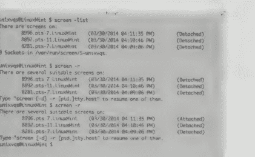

## 关闭 screen 会话：

```
Ctrl+A : quit
```

要关闭 screen 会话，按 `Ctrl+A` 进入命令模式（再次类似于 vi）。输入 `:screen` 进入 screen 命令提示符。然后输入 **quit** 退出 **screen**。

> 提示 如果你不觉得 screen 完全合心意，或者你认为这个概念很好，`tmux` 是一个日益流行的替代方案。它提供了根本上相似的能力，并增加了一些有趣的功能，但它没有 screen 那么多功能。

> 提示 许多人使用 screen 进行软件开发等工作，因为 screen 让你更容易从上次离开的地方继续。

## 使用 xargs 对找到的文件执行操作

有时，就像第 1 章使用管道一样，你既需要找到文件，又要对它们的内容采取行动。使用普通管道仅对文件名操作。例如，`ls -l | sort` 会列出目录中的文件，然后按名称排序。如果你想列出并排序文件的内容，那么你将使用 **xargs**（代码列表 14.7）。

## 查找文件并查看它们

- 1. `find -name "jungle*"`
  在提示符下，输入 `find -name "jungle*"` 以在当前目录及其子目录下查找所有包含 "jungle" 字样的文件。

- 2. `find -name "jungle*" | wc -l`
  如果你将 `find` 命令的输出通过管道传给 `wc`，你将得到找到的文件计数——在这种情况下，有两个文件。

- 3. `find -name "jungle*" | xargs wc -l`
  通过添加 `xargs`，你确保命令被应用于找到的内容，而不仅仅是单个文件名。在代码列表 14.7 中，你会发现名称中包含 "jungle" 的文件总共包含 20042 行。

> > 提示 如果你的文件名中包含空格——这现在已经不像以前那么罕见了——`xargs` 最终会给你一些意料之外的结果。这很容易修复。在 `find` 命令中添加 `-print0`，并在 `xargs` 命令中添加 `-0`。例如，输入 `find -name "jungle*" -print0 | xargs -0 wc -l` 以确保当文件名为 "jungle in the jungle" 时获得正确的结果。

> > 提示 你可以使用 `xargs` 对找到的文件执行其他命令。如果你想删除找到的文件（就像你在第 2 章中想做的那样），可以使用 `xargs` 来完成。尝试 `find -name "*bak*" | xargs rm` 来删除找到的文件。

> > 提示 查看 `xargs` 的帮助手册页（man page）以了解它可以做的一些酷功能。你需要一些时间来理解它提供的威力，但随着时间的推移，它的价值变得显而易见。

代码列表 14.7 使用 xargs 将命令应用于 **find** 能够找到的所有内容。真的。

```
unixvs@LinuxMint $ find -name "jungle*"
./_jungle.txt
./_jungle.txt
unixvs@LinuxMint $ find -name "jungle*" | wc -l
2
unixvs@LinuxMint $ find -name "jungle*" | xargs wc -l
14239 /_jungle.txt
5803 /_jungle.txt
20042 total
unixvs@LinuxMint $
```

## 作为 root 用户

到目前为止，我们一直在讨论你作为系统普通用户可以利用的 Unix 工具和技巧。作为普通用户，你无法破坏整个系统——当然是这样，但在搞乱你自己的文件之前，这种限制就仅于此了。不过，正如我们所提到的，还有另一类用户，被称为“超级用户”或 **root**。**root** 用户在系统内拥有完全权限，可以（必须）处理配置问题、为所有使用系统的人安装软件以及故障排除。**root** 用户还可能轻易因为一个拼写错误而毁掉系统。全面的系统管理超出了本书的范围，但掌握一些 root 工具是必要的。

- 使用 **sudo** 以 root 身份操作 288
- 使用 **su** 成为 root 291
- 启动和重启守护进程 292
- 修改系统配置 294
- 使用 **watch** 监控系统 296
- 使用 **dmesg** 启动消息 300
- 设置日期和时间 302


## 使用 sudo 以 root 身份操作：syslog

- 1. cd /var/log; tail syslog

像普通用户一样，尝试查看 `/var/log` 下的系统日志文件。在 Linux 或 Mac 系统上，它是 `/var/log/syslog`；在 Solaris 系统上，它通常是 `/var/log/adm/messages`。其他 Unix 发行版会有其他但类似的路径。

请注意，这些中的某些文件需要 root 权限才能查看，而另一些则不需要。如果你能以 root 身份查看某个文件，请选择另一个文件来观察 sudo 如何提供帮助的。

- 2. sudo tail syslog

上一次尝试被拒绝权限（Permission was denied）；现在在命令前使用 `sudo`，以 root 权限执行相同的命令。

******

在提示后输入你的密码，并注意这次命令执行成功了（参见代码列表 15.1）。

```
Code Listing 15.2 更令人惊讶的是，sudo 有时也会很有幽默感。

unixqs@LinuxMint ~ $ sudo ls
Password:
My mind is going. I can feel it.
Password:
Take a stress pill and think things over.
Password:
He has fallen in the water!
sudo: 3 incorrect password attempts
unixqs@LinuxMint ~ $
```

> 提示 在你使用一次 sudo 后，可以在特定时间内（通常为五分钟内）再次使用它，而无需输入密码。

> 提示 某些版本的 sudo 如果你输错了密码，会有非常有趣的程序（参见代码列表 15.2）。不过，如果你出于这个目的尝试查看这些内容，可能会极大地惹怒你的系统管理员。

> 提示 如果你没有被授予使用 sudo 的权限（不仅是技术权限，而是实际的“你可以这样做”许可），请不要使用。使用 sudo 发生的一切操作都会被记录，你可能需要对自己的行为负责。

> 提示 尽可能，最好只在需要变成 root 身份时才使用 sudo。任何拼写错误都可能导致问题，当你想要以 root 权限操作时，明智地添加 sudo 是一好事。你在 root 上花费的时间越长，就越容易受到安全问题的影响。

> 提示 某些 Solaris 和 OpenIndiana 系统支持 pf，它通常与 sudo 兼容，可以以相同的方式使用。在底层它是不同的，但这些差异对你现在来说可能并不显著。

Code Listing 15.3 变成 root 异常简单。

```
unixvsqs@LinuxMint $ su
Password:
[root@LinuxMint]# exit
unixvsqs@LinuxMint ~ su -
Password:
[root@LinuxMint]#
```

## 通过 su 变成 root

在知道 root 密码的情况下，变成 root 真的非常简单。要这样做，你需要应用 `su` 命令（在第 3 章“更改你的身份”中介绍），从中切换到 root 身份（代码列表 15.3）。

我们再次想强调，在 Unix 系统上作为 root 意味着承担着巨大的责任。首先，你必须对你输入的内容和输入的位置极其小心。每一位系统管理员都有一个关于由于粗心使用 root shell 而导致系统崩溃（在不同程度上）的恐怖故事。其次，你必须对你所做的事情非常负责。你可以读取、查看任何内容并更改任何内容。因此，你可以很容易侵犯用户的隐私。千万不要这样做。

与使用 `su` 变成你自己（或其他用户）一样，你可以使用 `su -` 来确保所有的 root 环境变量都已正确设置。如果你在使用没有连字符的情况下 `su`，环境变量等将仅适用于 root 身份而不适用于你。哪种更合适取决于你的情况。如果你使用一种方法得到意料之外的错误消息（例如文件未找到），请尝试另一种。

通常，你必须先以你的身份登录系统，然后变成 root。很少有系统允许你直接远程登录 root。再次强调，这是一个安全措施，有助于最大限度地减少被破解的可能性。即使有人获取了系统的 root 密码，如果他们无法作为普通用户登录，也无法以 root 身份操作。

Unix 系统上没有真正的秘密。如果你有某些必须是秘密的内容，你必须对其进行加密，否则 root 用户（以及其他用户）可能会知道。

## 变成 root：

- 1. su
输入 `su` 变成 root。
- 2. ******
在提示时输入 root 密码。注意，成功后，你将看到一个不同的提示符 (`#`)。这是你已成功且现在是 root 的确认（代码列表 15.3）。

- 3. exit
使用 `exit` 或 `Ctrl+D` 退出 root shell 并变回你自己。

变成 root 291

## 启动、停止和重启守护进程

作为 **root**，你可以在系统上做任何事情，但你其实不需要做什么。通常情况下，Unix 和 Linux 系统被配置为：使得应该一直运行的程序（如 Web 服务器软件、邮件服务器软件或类似程序）在系统启动时自动在后台启动。然后，你，**root**，只需要处理危机和问题。（哈！说易做难。）

## 启动一个守护进程：

- 1. `ps -ef | grep smbd`

验证 Samba 服务器是否真的没有运行。有时用户是错的。如果你看到列出 **smbd** 的行（报告你正在运行的命令的那行除外），**samba** 处于激活状态，不需要启动。问题可能在其他地方。

- 2. `cd /etc/init.d`

切换到 `/etc/init.d`。切换到包含初始化脚本的目录。这个目录通常是 `/etc/init.d/` 或 `rc.d/init.d/`，如 15.4 所示。

# 3. sudo service smbd start
使用 `sudo service smbd` 启动。
`/etc/init.d` 是一个启动守护进程的脚本。

# 4. ps -ef | grep smbd

验证 Samba 服务器现在已运行。

> 提示 要停止守护进程，使用相同的命令，使用 stop（如 `sudo service smbd stop`）停止。

> 提示 有时你可能需要重启守护进程。你可以停止它再启动它，但在很多情况下你也可以使用 restart 或 reload（如 `sudo service smbd restart`）。

> 提示 停止或重启你不熟悉的守护进程可能会产生后果。

> 提示 你可能认为需要使用 `./smbd`，但 `service` 非常聪明。

Code Listing 15.4 有时你必须手动管理守护进程。

```
unixqs@LinuxMint ~ $ ps -ef | grep smbd
unixqs 2530 2101 0 09:20 pts/1 00:00:00 grep --color=auto smbd
unixqs@LinuxMint ~ $ sudo service smbd start
[ OK] Starting smbd...
unixqs@LinuxMint ~ $ ps -ef | grep smbd
root 2575 1 09:20 ? 00:00: smbd
unixqs 2580 2101 0 09:20 pts/1 00:00:00 grep --color=auto smbd
```

# 修改系统配置

Unix 系统大部分（几乎所有）系统配置文件都包含在 `/etc` 目录。如果某个设置是针对用户的，该设置将位于用户的家目录；否则，整个系统的设置位于 `/etc` 目录。

我们不会深入探讨——在开始配置系统之前，你应该知道自己在做什么。不过，如果你是 `root`，你应该有一些可以玩的东西，所以通过下面的示例，你将看到如何更改每日消息（即 `motd`），它会在用户登录系统时（A 和 B）欢迎他们。

要更改 motd：

- 1. `sudo vi /etc/motd`

使用 **sudo** 获取 root 权限并编辑 `/etc/motd` 文件。

- 2. 嘿，你的袜子有皱纹！噢……抱歉，你没穿袜子！

呃，天哪！在文件中添加你最喜欢的口号、格言或评论。记住，每个登录系统的用户都会看到这条消息，所以请保持简洁……并且友善！（见 B）

- 3. `logout`

注销，这样你可以重新登录并看到你的成果。

- 4. `ssh usersystem.example.com`

重新登录以查看新消息。

在 root 权限的用户编辑了 `/etc/motd` 后，它变得……不同了。


`/etc/motd` 文件对于向系统用户提供警告、备注和注释非常有用。特别是当你计划进行系统停机或维护时，在 `/etc/motd` 中发布一条消息来警告用户是非常棒的。

你在 `/etc` 中可能做的几乎每一种更改都会影响系统上的每一个人。请务必小心。

取决于你选择在 `/etc` 中更改或编辑的内容，你可能需要重启相应的守护进程（如上一节所述）才能使更改生效。如果你的更改没有生效，请重启守护进程。

Unix 手页（man pages）通常也会描述位于 `/etc` 中的配置文件。使用手页（例如 `man <command>`）来了解这些配置的作用。

## 安装软件

作为 root 用户，你也可以安装自己的软件。

不过，新方法要简单得多。在大多数 Unix 和 Linux 系统上，你可以使用一个特殊的程序，它会访问互联网下载你需要的程序（以及运行它所需的任何辅助程序）并自动进行安装。好耶！

针对每种不同 Unix 或 Linux 版本的在线仓库包含了大量的软件包，这些软件包是程序以及允许它们运行所需的所有配置设置。当你安装或升级软件时，你正在从这些仓库中下载。

例如，在 Ubuntu 或 Linux（如 LinuxMint，我们本周最喜欢的）上，如果你想安装 `fortune` 应用以便看到比平时更机智或幽默的格言，只需输入 `sudo apt-get install fortune` 然后等候即可。

在 OpenSolaris 上，相应的命令是 `pfexec pkg install fortune`。

在 CentOS、RedHat、SuSE 等其他系统中，甚至使用 `sudo rpm --install fortune`。

对于其中任何一种方法，我们鼓励你探索你所选命令的手页——你可以利用这些命令完成很多事情，花几分钟阅读一下选项是值得的。

但在所有这些情况下，你都可以使用 Unix 桌面上的一个精美的 GUI 工具来完成相同的事情。它不仅可以告诉你有哪些可选内容，还可以点击桌面菜单（如果你对系统的连接不仅仅是 ssh 的话）看看你能发现什么。寻找像“包管理器（Package Manager）”之类的项，你就搞定了。

## 监控系统

监控系统是系统管理员的核心职责之一。你需要确保系统中的一切都如预期，否则就要对人大吼、报警、订购新硬盘，或进行任何其他必要的操作。在单用户系统上，其实没什么什么可做的，但在有许多用户的大型系统中，监控是系统管理员工作的重要部分。

除其他项目外，你可以监控系统日志（位于 `/var/log` 或 `/var/adm/` 中）、登录用户、系统整体负载以及可用内存。

```bash
$ tail -f 5 /var/log/apache2/error.log
Sun Mar 30 11:02:42.2024 2016 [error [1481508468123-52) [00004]apache2:2.4 (Linux) configured - restarting main server) [pid 5071:1481508468157]
Sun Mar 30 11:03:42.53467 2024] (core-worker) [pid 5072:1481508468192]148094 Command time "/var/apache2/error.log"
```

监控日志是 `root` 用户的的重要责任。

### 监控日志：

- `sudo tail -1000 /var/log/syslog | more`

使用 `sudo` 获取 root 权限并查看 `messages` 日志文件的末尾（最后 1000 行）。`tail` 的输出通过管道传给 `more`，这样你就可以阅读了。

- `sudo tail -f /var/log/apache2/error_log`

如果你正在寻找事件发生时的某个特定情况，可以使用 `tail -f` 持续显示日志，在该日志中，当新的错误被添加时，它会实时更新。在本例中，我们正在查看 Web 服务器错误日志的最末尾，如 A 所示。

### 监控用户：

- `who`

这个命令你甚至不需要 sudo，但你确实需要留意登录的用户以及他们来自何处。一段时间后，你就能识别出规律并做出反应。如果 jdoe 通常在早上 9 点登录并在下午 4 点注销，并且总是登录同一个系统，而你你发现 jdoe 突然在凌晨 1 点从不同的地址登录，那么你就应该怀疑 jdoe 的秘密密码是否已经不再保密了。

- `last`

`last` 工具可以告诉你谁在什么时候登录（并注销）的以及来自何处，如代码列表 15.5 所示。这是很有用的信息，特别是当你没有在线持续监控 `w` 和 `who` 的时候。

### 监控系统负载：

`top`

使用 `top` 监控系统负载，不同的系统会显示截然不同的模式，但如果你习惯在系统一切看起来正常时检查 `top`，你就能判断出某些情况是否异常，甚至在时机到来时。按 q 退出 top。

### 监控内存：

`sudo free`

通过 `sudo` 的帮助，使用 `free` 查看你有多少可用内存（RAM）。如果内存不足，计算机处理速度会变慢，你可能需要关闭应用程序。如果内存非常低，应用程序可能会崩溃。花时间阅读手页以获取一些技巧。有许多额外的工具可以让这些检查变得更容易。通过这样做，你就不需要手动运行检查，并且可以了解运行状态。使用 `top -d | grep Mem` 来检查可用内存，这与通常情况不同。值得查看手页或网络以查找详情。使用 `w` 和 `last` 来监控登录用户。

代码列表 15.5

| USER | TTY | FROM | LOGIN | IDLE | %PU | WHAT |
| :--- | :--- | :--- | :--- | :--- | :--- | :--- |
| joe | pts/6 | 192.168.1.104 | 5:05am | 42 days | 0.44 | 0.38 |
| joe | pts/19 | mike.raycom.com | Sat 12pm | 28m | 0.05s | 0.94 |
| root | pts/1 | | Dec 15 | 10:25 | | |
| | pts/0 | | Dec 16 | 10:10 | | |
| | pts/0 | | Dec 16 | 10:11 | | |
| joe | pts/6 | | Jan 27 | 04:58 | | |
| | pts/8 | | Dec 23 | 19:49 | | |
| | pts/17 | | Dec 7 | 18:29 | | |
| | pts/20 | | Jan 14 | 08:31 | | |
| joe | pts/16 | 192.168.1.104 | Jan 13 | 19:39 | | |
| | pts/19 | mike.raycom.com | Jan 25 | 12:03 | | |
| doe@frazit.d | pts/6 | 192.168.1.104 | Mon 27 | 04:58 | 0.12 | logged in |
| joe | pts/6 | 192.168.1.104 | Mon 27 | 04:57 - 04:58 | 0.01 |
| joe | pts/6 | 192.168.1.104 | Mon 27 | 04:55 - 04:57 | 0.01 |
| joe | pts/6 | | Sun 26 | 18:05 - 20:16 | 0.11 |
| joe | pts/6 | mike.raycom.com | Sat 25 | 12:12 - 06:52 | 0.40 |
| joe | pts/19 | mike.raycom.com | Sat 25 | 12:03 - 12:02 | 0.00 |
| joe | pts/6 | mike.raycom.com | Sat 25 | 10:35 - 12:11 | 0.36 |
| joe | pts/19 | 192.168.1.104 | Tue 21 | 20:59 - 00:11 | 0.12 |
| joe | pts/19 | | Mon 13 | 20:59 - 23:36 | 0.57 |
| joe | pts/16 | 192.168.1.104 | Mon 13 | 19:38 - 23:34 | 0.54 |
| joe | pts/23 | 192.168.1.104 | Sun 12 | 06:02 - 08:14 | 0.12 |
| joe | pts/14 | 192.168.1.104 | Mon 6 | 20:54 - 23:42 | 0.47 |
| | pts/17 | frazz.raycomm.co | Thu 2 | 20:50 - 06:27 | 0.36 |
| | pts/4 | | | Wed 14 | 04:55 | gone - no logout |

## 跟进 watch

作为系统管理员，你实际上需要长有后眼，并察觉可能发生的各种活动。**watch** 命令是你的朋友。它会监控你想要观察的几乎任何内容（用户、系统或文件）。

### 使用 watch：

- `watch list`
- 使用 **watch** 监控特定命令的输出。当发生变化时，你会在 **watch** 输出中看到 🅰。在这种情况下，我们正在监控谁在什么时候登录了。
- `watch --difference=cumulative ls -1 /var/spool/mail`

你可以通过监控 `/var/spool/mail` 目录来查看邮件是否送达。额外的标志显示了自你启动 **watch** 以来的累计差异。

> TIP `watch` 工具非常有用，但有时直接使用类似 `tail -f /var/log/httpd/access_log` 来跟踪 Web 服务器访问日志，或者编写一个 shell 脚本定期运行 `last`。简单来说，watch 有用，但它不是监控状况的唯一方法。

> TIP 轻松一点，你还可以使用 **watch** 定期运行其他程序。例如，`watch -n 5 fortune` 每五秒钟显示一个新的格言。

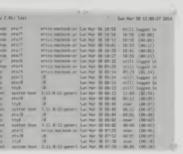

🅰 **watch** 监控系统。


## 使用 dmesg 检查启动消息

有时，你可能需要运行系统中可用之外的关于配置或硬件的额外信息。系统会自动探测硬件并在那时生成各种可能有用的信息，但将其保存在系统深处。使用 **dmesg** 获取你所需的信息……详尽得令人惊叹。

使用 **dmesg** 检查状态：

- **dmesg | more**（配合 `more` 使用）来了解系统情况（代码列表 15.6）。
- 或者
- **dmesg | mail -s "Help me understand" goodfriend@example.com**
如果你真的遇到困难了，可以将 **dmesg** 的输出发送给朋友寻求建议。

> 提示 参阅第 11 章获取有关从命令行发送邮件文件和数据的更多信息。

## 代码列表 15.6 dmesg 工具让你看到启动时发生了什么，包括启动的进程和发现的硬件。

```
@jdoe@frajj jdoe$ dmesg | more
98 types configured
Serial driver version 5.05c (2001-07-08) with HUB-6 MANY_PORTS MULTIPORT SHARE_IRQ SERIAL_PCI ISANP enabled
ty500 at 0x03f6 (irq 4) on irq 1
Uniform Multi-Platform-E-IDE driver Revision: 7.00alpha2
ide: Assuming 33MHz system bus speed for PIO nodes; override idebus=xx
PIII4: IDE controller on PCI bus 00 dev 29
PIII4: chipset revision 1
PIII4: native mode: will probe irqs later
ideo: BM-DMA at 0x1440-0x144f, BIOS settings hda:pio,hdb:DMA
ideo: BM-DMA at 0x1448-0x144f, BIOS settings hdc:DMA,hdd:pio
hda: QUANTUM_FIREBALL M930, ATA DISK drive
hdb: Maxtor 32049H2, ATA DISK drive
hdc: SAMSUNG DVD-ROM SD-612, ATAPID CD/DVD-DVD-ROM drive
ideo at 0x01f0-0xf7,0x76 on irq 15
ideo at 0x0170-0x0177,0x76 on irq 15
hda: 5863344 sectors (30020 MB) /19008K Cache, CHS=3649/255/63, UDMA(33)
hdb: 40021632 sectors (2048K MB) /20488K Cache, CHS=2491/255/63, UDMA(33)
Partition check
de/ide/host/bus/target/luno0: p1 p4 < p5 p6 >
de/ide/host/bus/target/luno1: p6 < [ZED] [Remap 0->1] (2491/255/63) p1
p1: collab [s0] [s1] [p5] [p6] [s2] p7 [s3] p4 p9 [s5] p10 [s6] p11 [s7] p12 >
RAMDISK driver initialized: 16 RAM disks of 32000K size 1024 blocksize
md: md driver 0.90.0 MAX MOD DEVS=256, md_SB DISKS=27
md: Autodetecting RAID arrays.
md: ...
Mounted devs on /dev
Freeing kernel memory: 136 fek
Real Time Clock Driver v1.10
usb:c: registered new driver usbdevfs
usb:c: registered new driver hub
usb-uhci.0:Revision: 1.275 $ 18:49:04 22 Sep 2002
usb-uhci.0:High bandwidth mode enabled
PCI: Found IRQ 9 for device 00.07.2
PCI: Sharing IRQ 9 with 00:10.0
usb-uhci.0: USB UHCI at I/O 0x01400, IRQ 9
usb-uhci.0: Detected 2 ports
usb:c: new USB bus registered, assigned number 1
hub:c: USB hub found
hub:c: 2 ports detected
-More-
```

## 设置日期和时间

对于系统管理员来说，设置日期和时间非常重要。因为如果你在日志文件中发现了异常或有问题的内容（例如来自特定位置的反复失败登录尝试），你希望能够将日志文件与其他地点同事的日志文件进行准确的交叉引用。只有当两台主机的时间都接近准确时间时，才能实现。

### 使用 ntpdate 设置时间：

- sudo /usr/sbin/ntpdate pool.ntp
使用 ntpdate 配合时间服务器名称（当前可用服务器列在 www.ntp.org）将你的系统时更新为当前的准确时间（代码列表 15.7）。如果你收到关于 socket 占用的错误消息，使用 `ps -ef | grep ntp` 找到正在运行的 ntp 守护进程以保持时间同步。如果这种情况发生，说明你的时间可能是正确的，不需要 ntpdate。如果你的系统没有 ntpdate，你必须手动设置时间。使用 **date** 配合 `-s` 选项，以及所有需要的信息。Unix 和 Linux 日期是从 1970 年 1 月 1 日以来的秒数，这对于图顶部的创意用途有用。代码列表 15.7 设置日期（并使其更新）

```
unixvqs@LinuxMint ~ date -s 5:30
Sat Mar 29 05:30 2014
unixvqs@LinuxMint ~ date -s "Mar 29"
Sat Mar 29 05:30 2014
unixvqs@LinuxMint ~ date -s "Tue Apr 1"
Tue Apr 1 05:30 2014
unixvqs@LinuxMint ~ date -s
Sat Mar 29 09:25:23 2014
unixvqs@LinuxMint ~ sudo /usr/sbin/ntpdate pool.ntp
Mar 29 09:25:44 2015
unixvqs@LinuxMint ~
```
使用 ntpdate 或让 ntp 守护进程运行来保持时间更新是更好的。手动使用 `date` 是一个糟糕的选择。使用 `date +s` 查看是多少秒，或者 `date -d` 查看秒数转换成什么。

## 高级技巧

在整本书中，我们为你提供了 Unix 的构建模块——单个命令、脚本技术以及你可以单独或组合的其他见解。在本章中，我们将向你展示使用 Unix 进行的一些巧妙操作。你可能认为这是一个“高级”章节，但这里展示的大部分内容是你之前学过的组合。

### 本章内容

- 使用 tidy 清理 HTML 文档 ... 304
- 使用 **sed** 搜索和替换文档 ... 307
- 使用 **awk** 生成报告 ... 310
- 使用输入自定义环境 ... 311
- 在 Shell 脚本中使用 **sed** 进行 HTML 编码 ... 313
- 使用 **rsync** 备份 ... 315
- 使用高级重定向 **stderr** ... 320

## 使用 tidy清理 HTML 文档

如果你开发过 HTML 文档——开发个人网站、完成课程作业或创建网页——tidy 工具对你来说是一个非常有用的资源。如果你手动创建 HTML 页面，可能会出错。这些错误可能不会导致页面出现严重问题，但会让页面更难以阅读、更难维护且难以让同行审查。别担心；tidy 可以帮助！

使用 tidy清理 HTML 文档：

1. vi sampledoc.html
使用你喜欢的编辑器创建一个 HTML 文档。我们的示例文档名为 sampledoc.html。不用担心标记或语法完全正确；tidy 会处理细节。保存并关闭你的文档。

2. tidy sampledoc.html
tidy 工具将应用 HTML 格式规则并输出技术上正确的文档版本（代码列表 16.1）。很酷吧？

3. tidy sampledoc.html > fixedup.html
如果你喜欢结果，如所示将文档重定向到新文件名，或者使用 `tidy -m sampledoc.html` 替换原始文档。

> 即使是这样的缺陷 HTML 文档也可以被 tidy 修复。

## 代码列表 16.1 tidy 命令用于清理 HTML 文档。

```
unixvs@LinuxMint tidy sampledoc.html
line 1 column 1 - Warning: missing <!DOCTYPE> declaration
line 4 column 1 - Warning: inserting implicit <body>
line 12 column 14 - Warning: discarding unexpected </ul>
Info: Document content looks like HTML 3.2
3 warnings, 0 errors were found!
```

html
<!DOCTYPE html PUBLIC "//W3C//DTD HTML 3.2//EN">
<html>
<head>
<meta name="generator" content="HTML Tidy for Linux (vers 25 March 2009), see www.w3.org">
<title>UnixVqqs Home Page</title>
</head>
<body>
<h1>Making Unix and Linux Work, One Day at a Time</h1>
<p>Read these tips, 当我有空写它们时，然后哭吧。</p>
<ul>
<li>To be written later</li>
<li>To be written later</li>
<li>To be written next week</li>
<li>To be written next summer, if at all</li>
</ul>
<address>unixvsqs@raycomm.com</address>
</body>
</html>
```

要了解更多关于 HTML Tidy 的信息，请访问 http://tidy.sourceforge.net
请使用 Tidy 网站上的 "tracker" 填写错误报告和查询。
此外，问题可以发送到 html-tidy@w3.org
HTML 和 CSS 规范可以从 http://www.w3.org/ 获取
游说你的公司加入 W3C，见 http://www.w3.org/Consortium
unixvsqs@LinuxMint $


提示：为了获得更整洁的结果，我们喜欢使用 `tidy -indent -quiet loose -modify samedoc.html`，这会抑制 tidy 的提示性信息，将输出变为 HTML 4 文档，对输出进行缩进，并用修改后的文件替换原始文件（代码列表 16.2）。这一切只需要一个命令。

提示：考虑将 `tidy` 配合 `sed` 脚本（在下一节描述）使用来完成大量的清理工作。

# 代码列表 16.2 带有适当标志的 tidy 命令可以创造奇迹——几乎如此。

```
unixqs@LinuxMint $ tidy -indent -quiet --doctype loose samedoc.html
line 1 column 1 - Warning: missing <!doctype> declaration
line 4 column 1 - Warning: inserting implicit <body>>
line 12 column 14 - Warning: discarding unexpected </ul>
<!DOCTYPE HTML PUBLIC "-//W3C//DTD HTML 4.01 Transitional//EN">
<html
<head>
<meta name="generator" content="HTML Tidy for Linux (ver 25 March 2009), see www.w3.org">
<title>UnixVoS Home Page</title>
</head>
<body>
<h1>Making Unix and Linux Work, One Day at a Time</h1>
<p>Read these tips, when I get around to writing them, and weep.</p>
<ul>
<li>To be written once</li>
<li>To be written later</li>
<li>To be written next week</li>
<li>To be written next summer, if at all</li>
</ul>
<address>
unixqs@raycomm.com
</address>
</body>
</html>
unixqs@LinuxMint $
```

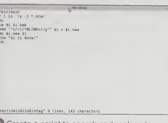 (注：此处原句为图片链接，翻译后保持不变)

# 使用 sed 在多个文档中进行搜索和替换

在第 6 章中，我们讨论了 `sed` 以及如何使用它来逐个文件进行搜索和替换。虽然我们相信你可能还沉浸在完成这些操作的快感中，但现在我们将向你展示如何将 `sed` 与 shell 脚本和循环结合起来。通过这种方式，你可以将搜索替换标准应用到多个文档上。例如，你可以搜索目录中所有的 `.html` 文档，并对所有它们进行相同的更改。在这个示例中，我们删除了所有的 `<BLINK>` 标签，这些标签对所有 HTML 纯洁者以及各处正直的人来说都是一种冒犯。遗憾的是，现在大多数浏览器已经不再支持它们了。

在开始之前，你可能想查看第 6 章以回顾 `sed` 基础知识，并查看第 10 章以回顾脚本和循环。

## 在多个文档中进行搜索和替换：

- 1. `vi thestinkinblinkintag`
  使用你喜欢的编辑器创建一个新脚本。文件名可以随你的意命名。

- 2. `#!/bin/bash`
  以应该运行脚本的程序名称启动 shell 脚本。

- 3. `for i in ls -1 *.htm*`
  开始循环。在这种情况下，循环将处理当前目录下的所有 `.htm` 或 `.html` 文档。

- 4. `do`
  指示循环内容的开始。

- 5. `cp $i $i.bak`
  在更改文件之前为每个文件创建一个备份。记住，墨菲（Murphy）正盯着你呢。

- 6. `sed "s/\<BLINK>//g" $i.new`
  指定搜索标准和替换文本。这一行发生了很多操作，但不要恐慌。从左侧开始，该命令包含 `sed`，随后是：

  - "`，开始命令。
  - `s`，告诉 `sed` 搜索某些内容。
  - `<`，要搜索的第一个字符。
  - `\/`，允许你搜索 `/`。（`\/` 转义了 `/`，以便在搜索中使用）。
  - `*`，指定前一个字符（`/`）的零次或多次，这同时处理了起始标签和结束标签（无论开头是否有 `/`）。
  - `BLINK>`，指明了要搜索的剩余文本。注意，这只搜索大写字母。
  - 如果你正在搜索删除 `<BLINK>` 标签，且不知道它们可能是大写、小写还是两者都有，尝试在你的 `sed` 命令中添加 `i`（表示忽略大小写）选项，例如：`sed "s/\<BLINK>//ig"`

# 代码列表 16.3 你可以使用 `sed` 剔除不良的 HTML 标签，如下所示。

```
[unixvsqs@LinuxMint scripting]$
> more thestinkinblinkintag
#!/bin/bash
for i in $(ls -1 *.html)
do
  cp $i.bak
  sed "/<\/BLINK>/g" $i.new
  mv $i.new
  echo "$i is done!"
[unixvsqs@LinuxMint scripting]$
> chmod +x thestinkinblinkintag
[unixvsqs@LinuxMint scripting]$
> ./thestinkinblinkintag above.html is done!
file1.html is done!
file2.html is done!
html.htm is done!
temp.htm is done!
[unixvsqs@LinuxMint scripting]$
```

  - `g`，告诉 `sed` 进行全局搜索。
  - `i`，忽略大小写的选项。
  - 7. `mv $i.new`
  移动新文件。
  - 8. `echo "$i is done!"`
  打印消息。
  - 9. `done`
  指示循环的结束。
  - 10. 完成脚本。
  - 11. 使用 `./thestinkinblinkintag` 运行脚本。

## 使用 awk 生成报告

在第 8 章中，我们讨论了如何通过自定义配置文件来设置环境。你可以通过要求运行启动脚本的输入来进一步自定义你的环境变量。例如，你可以设置会话的偏好编辑器（代码列表 16.5）。

```bash
## 如果私有 bin 目录存在，则将其加入 PATH
if [ -d "$HOME/bin" ]; then
    export PATH="$PATH:$HOME/bin"
fi

echo "你想将哪个编辑器作为默认？(vi or nano)"
read choice
if [ "$choice" = "vi" ]; then
    export EDITOR=vi
elif [ "$choice" = "nano" ]; then
    export EDITOR=nano
else
    echo "Editor unchanged"
fi
```

**代码列表 16.5** 当系统询问你的偏好时，你就知道自己处于主导地位。

```
[unixqs@LinuxMint]$ su -
Password:
Which editor do you want as the default?
(vi or nano)
vi
You chose vi!
[unixqs@LinuxMint]$
```


+ 5. then EDITOR=/usr/bin/vi; export EDITOR; echo "You chose vi!"

在这里，`then` 子句将 EDITOR 环境变量设置为 vi，导出该环境变量，并宣布你的选择。

+ 6. elif [ $choice = "nano" ]

使用 `elif` (else if) 检查你的其他选项。此语句涵盖了 nano 选项。

+ 7. then EDITOR=/usr/bin/nano; export EDITOR; echo "You chose nano!"

此 `then` 子句将 EDITOR 环境变量设置为 nano，导出该环境变量，并宣布你的选择。

+ 8. else echo "Editor unchanged"

设置一个 `else` 语句，如果在 `read` 提示时没有输入任何选项，将使用该语句。在示例中，如果既没有输入 neither也没有 nano，它只会提示编辑器未更改。

+ 9. fi

结束 `if` 语句。

+ 10. 保存并退出。

+ 11. su - yourid

在 shell 提示符下，输入 `su -` 后跟你的用户 ID 以重新登录并测试修改后的登录脚本（代码列表 16.5）。

> TIP 提示：如果你从不同能力的远程系统访问系统，这种技术对于设置 `TERM(inal)` 环境变量非常有用。

## 使用 ROT13
使用 sed 进行编码

在互联网的许多地方，文本通常使用被称为 ROT13 的东西进行编码，它是“旋转（字母表旋转 13 位”的缩写。也就是说，A 变成 N，B 变成 O，以此此类推。如果文本经过了编码，人们需要额外的步骤来解码消息。例如，如果消息是一条电影评论，不想知道结局的人就不会被剧透惊喜。相反，用 ROT13 编码的消息可能像这样：

Tbbq sbe lbh-lbh svtherq vhg!

+ - Naq ab,
- guer'f ab chapuyvar. Ubcr lbh
- rawblqr

**gur obbx!** Qrobenu naq Revp
使用 ROT13 编码（和解码）的一种棒方法是使用 **sed**，它能让你轻松地处理文本。

## 使用 sed 使用 ROT13 编码：

+ 1. vi script.sed
使用你喜欢的编辑器创建一个名为 **script.sed** 的文件。因为我们将使用的命令我们将，我们将创建一个 **sed** 脚本，而不是仅仅在 shell 提示符下输入所有内容。

+ 2. y/abcdefuvwxyz
- ABCDEFGHIJKLMNOPQRSTUVWXYZ/
命令开头以 **y** 开始。**y** 是用于翻译字符的 **sed** 命令（大写转小写或你指定的任何格式）。
在 **y** 之后，使用斜杠 (\)、要查找的原始字符（所有大小写字母）以及另一个斜杠。

+ 3. y.abcdefghijklmnopqrstuvwxyzXYZ/
> > ABCDEFGHIJKLMNOPQRSTUVWXYZ/
> nopqruvwxyzabcdefghijklm
> OPQRSTQRSTUVWXYZABCDEFGHIJKL

在斜杠之后，添加翻译后的字符（小写字母表，从 n 开始并循环到 m，然后是从 N 到 M 的大写），最后跟一个斜杠结束替换字符串。

+ 4. 保存脚本并退出编辑器。

+ 5. sed -f script.sed limerick |
通过将其应用于文件来测试 ROT13 编码。在这里我们将其应用于 `limerick` 文件，并将输出通过到 `more` 以便查看所有的乱码。为了进行更彻底的测试，我们使用 `sed -f script.sed`

> 文本之所以旋转是因为字母表中有 26 个字母，因此你可以使用同一个程序进行编码或解码。如果你按不同的数字旋转，则需要单独的程序来进行编解码。

> 查看下一节了解如何将这个冗长的过程转换为 shell 脚本，使其更容易反复重复使用。

> 考虑你可以使用这个相同的文件不仅用于 ROT13 编码，还可以用于其他方式，这可以在某种程度上隐藏你的秘密。注意，ROT13 绝不是真正的加密。

## 代码列表 16.6 一个简单的 sed 命令用于 ROT13 编码和解码消息。

```
[unixvqs@LinuxMint creative]$ sed -f script.sed limerick
Bhe snibevr yyzrevpx
1.
Guer bapr jnf zna sebz Ahnagpxrg,
Jub pneruv uvf yapu na ohpxrg,
Fnvq he jgu v ftu,
nf ur ngrgr jubyr cvti,
Vs V whrg unq cbahg V'q ghaz vg.
[unixvqs@LinuxMint creative]$ sed -f script.sed limerick | sed -f script.sed
Our favorite limimerick
1.
There once a man from Nantucket,
Who carried his lunch in a bucket,
Said he with a sigh,
as he ate a whole pie,
If I just had a donut I'd dunk it.
[unixvqs@LinuxMint creative]$
```

## 在 Shell 脚本中嵌入 ROT13 编码

如果你完成了上一节中的步骤，你可能会注意到你输入了大量内容。老天呐，如果你顺利完成了第 3 步和第 5 步，你的手指现在可能已经在罢工了。如果你计划经常使用 ROT13 进行编码或解码，请考虑将 sed 命令嵌入 shell 脚本中，以避免每次编码或解码文本时都重新输入它们，如 A 所示。在开始之前，你可以参考第 10 章获取有关 shell 脚本的详细信息。

创建一个 ROT13 shell 脚本：

+ 1. vi rot13
启动一个新的 shell 脚本来处理你的命令。

+ 2. #! /bin/bash
添加必要的 shell 规范，如 A 所示。

+ 3. /bin/bash
指定 sed 程序（使用完整路径使程序更灵活）以及编码和解码 ROT13 的命令。这在下一页继续

```
/bin/bash
sed 's/abcdefghijklmnopqrstuvwxyzABCDEFGHIJKLMNOPQRST/nopvwuvwxyzabcdefwQRST/g'
```

ROT13 16 次，一个简短的 shell 脚本让 ROT13 变得简单如。

```
4. sed.y/abcdefghijklmnopqrstuvwxyz
vwxyz ABCDEFGHIJKLMNOPQRSTUVWXYZ
VWXYZ/nopqr stuvwxyzabcdefij
jklQRSTUVWXYZDEFGHM/
"$1"
```

+ 5. sed.f/abcdef
uvwxyz
vwuvwxyz ABCDEFGHIJKLMNOPQRSTUVWXYZ
VWXYZ/nopqr stuvwxyzabcdefij
jklQRSTUVWXYZDEFGHM/
"$1" | more
```

接下来，将输出通过到 `more`，以便一次查看一个屏幕。

+ 6. 保存并关闭文件。

+ 7. chmod u+x rot13 使文件可执行，这样你就可以直接输入 rot13 而不是 `sh rot13`。

+ 8. ./rot13 limerick

测试脚本。因为我们在不在路径的目录中开发此脚本，所以我们必须通过 `./rot13` 执行脚本。

> TIP 提示：你也可以内置一个选项，将脚本输出重定向到文件中，以便以后使用。基本上，你只需要创建一个 `if-then` 语句并给自己提供

> TIP 提示：如果你坚持要用其他方法，ROT13 也可以通过 `tr` 工具完成，例如：`tr '[A-Za-z]' '[N-ZA-Mn-m]'` 或者如果你想更酷一点，回回第 8 章的 `alias` 使用 `alias rot13=tr '[A-Za-z]' '[N-ZA-Mn-m]'`

## 代码列表 16.7 如果你想让脚本变得非常酷炫，可以将其他章节中的一些实用的部分组合在一起创建一个杰作。

```
[unixvqs@LinuxMint creative]$ more rot13
#! /bin/bash
# 如果命令行上的第一个项（脚本名称之后）是 save 或 s，
# 且第二个项是可读文件，则执行第一个情况。
if [ "$1" = "save" -o "$1" \ -r "$2" ];
then
# 此情况将 ROT13 输出保存到相同文件名下，带有
# rot13 扩展。
/bin/sed y/abcdefghijklmnopqrstuvwxyzABCDEFGHIJKLMNOPDEFGHIJKLMNOPQRSTuvwxyzabcdefghijklmnopqrstuvwxyzghijklm-nopQRSTuvwxyzABCDEFGHIJKLMNOPDEFGHIJKLMNOPQRSTUVWXYZ/"$2" > "rot13"
else
# 此情况将 ROT13 输出通过到 more，没有指定
# save。
/bin/sed y/abcdefghijklmnopqrstuvwxyzABCDEFGHIJKLMNOPDEFGHIJKLMNOPQRSTuvwxyzabcdefghijklmnopqrstuvwxyzghijklm-nopQRSTuvwxyzABCDEFGHIJKLMNOPDEFGHIJKLMNOPQRSTUVWXYZ/"$1" | more
fi
```


# 使用 rsync 进行备份

**rsync** 是一种同步文件和目录的高级方法，无论是在本地还是跨网络。我们喜欢用它来制作备份，这样在我们搞砸某些东西时就不必担心了。是的，我们可以使用 **cp** 或同样无味的命令，但我们更喜欢 **rsync** 的速度和灵活性。在这个示例中，我们正在本地复制文件，但也可以轻松地进行远程备份到其他地方的服务器。

使用 rsync 进行备份：

- 1. `mkdir ~/BACKUPDIR`

创建一个用于存放备份的目录。理想情况下，你应该在与要备份内容不同的物理磁盘上创建该目录，但请力所能及。我们正在主目录的某个子目录下创建一个备份目录，这有助于防止误操作造成的损坏，但无法防止磁盘故障。（我们信任系统管理员会防止磁盘故障……Eric，我们的备份数据是最新的，对吧？）

- 2. `rsync -v /home/jdoe/data ~/BACKUPDIR`

指定 **rsync 命令、-v（冗详细模式）和 -a（归档模式）**选项，以及源目录和目标目录（代码列表 16.8）。

等待初始备份完成（在复制每个文件时都会显示该文件）。第一次备份需要一些时间，但不会比使用 **cp** 还要长。

> 提示 你会发现 rsync 速度快得多，因为 rsync 只复制发生变化的文件。很有用对吧？

> 提示 如果开始跨网络进行备份，可以从 rsync 中获得巨大的益处。例如，你可以将你的服务器内容与朋友位于不同服务器上的内容进行同步。具体细节请查看 rsync 的 man页（man rsync）。

```
[jdoe@frazz bin]$ rsync -v -a /home/jdoe/data ~/BACKUPDIR
building file list ... done
data/
data/*scratch*
data/*all.programs*
data/*local.programs.txt
data/*scratch*
data/1
data/2
data/Mail/
data/News/
data/Project/
data/Project/keep
data/Project/keeper.jpg
data/Project/kept
data/Project/kidder.txt
data/Project/kiddo
data/Project/kidnews
data/Project/kidneyepie
data/Project/kids
data/Project/kidupdate
data/address.book
data/address.book~
data/all.programs
data/b
data/backup-files/
data/backup-files/.Authority
data/backup-files/.bash_history
data/backup-files/.bash_logout
data/backup-files/.bash_profile
data/backup-files/.bashrc
data/backup-files/.mailcap
data/backup-files/.screenrc
data/backup-files/.ssh/
...
wrote 24841142 bytes read 14708 bytes 74196.67 bytes/sec
total size is 24779055 speedup is 1.00
[jdoe@frazz bin]$ rsync -v -a /home/jdoe/data ~/BACKUPDIR
building file list ... done
data/newer.programs.txt
wrote 30149 bytes read 36 bytes 20123.33 bytes/sec
total size is 24765461 speedup is 820.46
[jdoe@frazz jdoe]$
```

# 使用 stderr 进行高级重定向

在本书中，我们一直在将输入重定向到输出，将一个命令的输出管道到另一个命令的输入，并且通常操作得相当花哨。你能相信通过重定向还可以做更多事情吗？

Unix 为用户和系统之间的通信提供了三个通道（技术上称为文件描述符）：

- 标准输入 (stdin)，指的是从壳提示符（shell）提示符或不同的程序提供信息或接收信息。

- 标准输出 (stdout)，指的是你在发布命令后在屏幕上飞闪而过的输出——例如，如果你发布了命令 `find / -name test`。

- 标准错误 (stderr)，包括你在发布命令后可能看到在屏幕上飞闪而过的错误信息。你可以将此通道视为“第二个”输出通道。

到为止，你一直在使用 `<`、`>>` 以及 `tee` 重定向 `stdin` 和 `stdout`。`stderr` 上的所有内容一直伴随着 `stdout`。在你的工具箱中添加对 `stderr` 的独立重定向可以让你的 Unix 体验更加灵活。

# 在 zsh、bash 和类似的 shell 中重定向 stderr：

- 1. `time -p ls`
使用第 9 章介绍的 `time` 工具，并注意你同时获得了 ls 的输出和 time 的输出。恰恰如此，time 的输出在 stderr 通道上，尽管你看不出来（所有输出都显示在屏幕上）。

- 2. `time -p ls 2> time-results.txt`
在通常你使用 `>` 将所有内容重定向到文件的地方，使用 `2>` 将第二个输出通道重定向到文件。现在，你会在屏幕上看到 ls 的 stdout 输出，而发送到 stderr 的 time 输出将发送到 time-results.txt 中（代码列表 16.9）。

代码列表 16.9 分别重定向标准输出和标准错误可能有用。
```
[jdoe@sulley Project]$ ls
[jdoe@sulley Project]$ time -p ls 2> time-results.txt
[jdoe@sulley Project]$ ls >/dev/null
[jdoe@sulley Project]$ time -p ls 2>&1
[jdoe@sulley Project]$ time -p ls >/dev/null
[jdoe@sulley Project]$ time -p ls 2>&1
[jdoe@sulley Project]$ time -p ls >/dev/null
[jdoe@sulley Project]$ time -p ls 2>&1
```


## 表 A.2 使用目录和文件

| 命令 | 功能 |
| --- | --- |
| cp existingfile newfile | 将 existingfile 复制到名为 newfile 的文件。 |
| cp -i existingfile newfile | 将 existingfile 复制到名为 newfile 的文件，在覆盖现有文件前会提示。 |
| cp -r /Projects /shared/Projects | 将目录 /Projects 复制到新的 /shared/Projects，指定递归复制。 |
| find -name lostfile -print | 在当前目录或子目录中查找名为 lostfile 的文件或目录。 |
| find /home -name "pending*" -print | 在 home 目录或子目录中查找所有以 "pending" 开头的文件和目录。 |
| find /home/shared -mtime -3 -print | 查找共享目录中过去三天内修改过的文件。 |
| find -name "*.backup" -exec compress {} \; | 压缩家目录及其子目录中所有以 ".backup" 结尾的文件，无需确认。 |
| find -name "*.backup" -ok rm {} \; | 查找并确认删除家目录及其子目录中所有以 ".backup" 结尾的文件。 |
| ln /home/a/* /home/b | 将 a 目录中的所有文件硬链接到 b 目录。 |
| | 链接类似于，在两个不同的目录中本质上创建同一个文件。 |
| ln -s /home/dev/Projects /home/helper/Project | 从 /home/dev/Projects 创建软链接到 /home/helper/Project。 |
| locate string | 查找文件名包含 string 的。 |
| mkdir Newdirectory | 创建名为 Newdirectory 的新目录。 |
| mv existingfile newfile | 将 existingfile 重命名为 newfile。 |
| mv -i oldfile newfile | 将 oldfile 重命名为 newfile，覆盖（破坏）现有文件前需要系统提示。 |
| rm badfile | 删除 badfile。 |
| rm -i * | 交互式删除，在删除前会提示。适用于 Unix 或 Linux 认为是命令标志的特殊问题文件名。 |
| rm -i oldfile | 交互式删除 oldfile。 |
| rm -ir dan* | 交互式删除当前目录中所有以 "dan" 开头的目录和文件，以及所有以 "dan" 开头的文件和子目录。 |
| rmdir Yourdirectory | 删除空目录 Yourdirectory。 |
| touch newfile | 创建名为 newfile 的空文件。 |
| touch -t 201512312359 oldfile | 更新 oldfile 的日期为 2015 年 12 月 31 日 23 点 59 分。 |
| which command | 查找命令的路径。这对于查看在多个同名命令中将执行哪一个。 |
| whereis file | 查找文件相关文件的路径。 |

### 表 A.3 操作你的 Shell

| 命令 | 功能 |
| --- | --- |
| !10 | 在 **bash**、**csh** 或 **zsh** 的历史列表中重新运行命令 10。 |
| bash | 启动一个 **bash** 子壳或运行一个 **bash** 脚本。 |
| chsh | 修改你的登录 shell。 |
| csh | 启动一个 **csh** (C) 子壳或运行一个 **csh** shell 脚本。 |
| echo $SHELL | 显示环境变量 **$SHELL** 的值。 |
| exit | 退出当前 shell 并返回上一个 shell，或注销登录 shell。 |
| history | 查看带编号的历史命令列表。 |
| sh | 启动一个 **sh** (Bourne) 子壳或运行一个 **sh** shell 脚本。 |
| stty erase '^?' | 让 *Delete* 删除光标左侧的字符。 |
| stty erase '^H' | 让 *Backspace* (**Ctrl**-H) 删除光标左侧的字符。 |
| su |切换用户到 root。 |
| su - | 以 root 身份启动一个新的登录 shell。 |
| su - yourid | 以 *yourid* 身份启动一个新的登录 shell。 |
| tcsh | 启动一个 **tcsh** 子壳或运行一个 **tcsh** shell 脚本。 |
| zsh | 启动一个 **zsh** 子壳或运行一个 **zsh** shell 脚本。 |

### 表 A.4 创建和编辑文件

| 命令 | 功能 |
| --- | --- |
| ed | 选择一个基于行的文本编辑器。 |
| emacs | 选择一个极其强大且相当易用的文本编辑器。 |
| emacs -n | 打开 *emacs* 并强制进入面向终端的会话。 |
| emacs filename | 打开 *emacs* 并编辑 *filename*。 |
| nano | 选择一个面向菜单、用户友好的文本编辑器。 |
| nano -w filename | 在 **nano** 中打开并编辑 *filename*。 |
| nano -w filename | 在 **nano** 中禁用 *filename* 的换行。这对于配置文件特别有用。 |
| pico | 选择一个面向菜单、用户友好的文本编辑器。 |
| pico filename | 在 **pico** 中打开并编辑 *filename*。 |
| pico -w filename | 在 **pico** 中禁用 *filename* 的换行。这对于配置文件特别有用。 |
| vi | 选择一个强大但复杂的编辑器。 |
| vi filename | 在 **vi** 中打开并编辑 *filename*。 |

## 表 A.5 控制文件所有权和权限

| 命令 | 功能 |
| --- | --- |
| chgrp | 修改组。 |
| chgrp filename | 修改文件的所属组。 |
| chgrp -R directory | 递归修改目录的所属组。 |
| chmod | 修改权限。 |
| chmod 755 filename | 修改文件的权限。 |
| chmod -R directory | 递归修改目录的权限。 |
| chown | 修改所有者。 |
| chown user filename | 修改文件的所有者。 |
| chown user:group filename | 修改文件的所有者组。 |
| chown -R directory | 递归修改目录的所有者。 |
| umask 22 | 指定创建文件的默认权限。 |

### A.6 处理文件

| 命令 | 功能 |
| --- | --- |
| awk | 处理文件。 |
| basename | 去除路径只保留文件名。适用于脚本。 |
| cmp newline oldfile | 比较 newline 和 oldfile。 |
| crypt | 加密密码。 |
| split | 按行或其他特征分割文件。 |
| diff -b newline oldfile | 忽略空格比较 newline 和 oldfile 的差异。 |
| diff Directory Newdirectory | 比较 Directory 和 Newdirectory 的差异。 |
| diff -i newline oldfile | 忽略大小写比较 newline 和 oldfile 的差异。 |
| diff -BW file1 file2 | 忽略空行、空格、制表符和大小写差异比较 file1 和 file2。 |
| diff newline oldfile | 比较 newline 和 oldfile 的差异。 |
| diff -w newline oldfile | 忽略空格比较 newline 和 oldfile 的差异。 |
| fmt | 格式化文件使其行整齐且美观。 |
| fold -w 60 file | 格式化文件使每行不超过指定长度（此处为 60 字符）。 |
| grep expression file | 在文件中查找 expression 并显示所在行。 |
| grep -c expression file | 统计 expression 在文件中出现的次数。 |
| grep -i expression file | 在文件中查找 expression，不区分大小写。 |
| grep -n expression file | 显示匹配项及行号。 |
| grep 'Nantucket' limerick* | 查找 limerick 文件中以 "Nantucket" 结尾的行。 |
| grep -v expression file | 查找文件中不包含 expression 的行。 |
| grep '^[A-Za-z]' limerick | 查找 limerick 中以字母开头的行（而非数字或符号）。 |
| grep '^[A-Z]' limerick | 查找 limerick 文件中以大写字母开头的行。 |
| grep '^There' limerick* | 查找 limerick 文件中以 "There" 开头的行。 |
| grep -s 'word[1234]' file | 在文件中查找 word1、2、3 或 4，并显示其前后各五行及匹配行。 |
| head -20 file | 查看文件的前 20 行。 |


# 表 A.6 续 函数

| 命令 | 功能 |
| --- | --- |
| head file | 查看文件的前 10 行。 |
| pr file | 为打印重新格式化文件，包含页头和页脚。 |
| pr --columns=2 file | 为打印重新格式化文件，包含页头、页脚和两列。 |
| sdiff newfile oldfile | 查看 newfile 和 oldfile 之间的差异。 |
| sdiff -s newfile oldfile | 查看 newfile 和 oldfile 之间的差异，不相同行。 |
| sed | 使用命令行输入或 sed 脚本对文件进行更改。 |
| sed '/old/new/g' file.htm | 搜索 file.htm 并将所有的 "old" 替换为 "new"。 |
| sed -f script.sed file > file.new | 运行 script.sed 中的命令，将其应用于文件，并用处理后的内容替换文件。 |
| split -b 500 k | 将文件分成 500 KB 的块。 |
| sort file | uniq | 对文件进行排序并发送给 uniq 以消除重复项。 |
| sort file > sortedfile | 对文件中的行进行字母排序并将结果显示在 sortedfile 中。 |
| sort file1 | tee sorted | mail -boss@raycomm.com | 对 file1 排序并 tee，同时发送到文件 sorted 和标准输出，然后发送给老板。 |
| sort file1 file2 | uniq -d | 对 file1 file2 进行排序并找到所有重复的行。 |
| sort file1 file2 > bigfile | 排序并合并 file1、file2 和 file3 的内容，并将排序输出放在 bigfile 中。 |
| sort -n file | 对文件进行数值排序。 |
| sort -t, file | 对逗号分隔的文件中的字段进行排序；-t (,) 后的字符指示分隔符。 |
| sort -t, +2 file | 对逗号分隔的文件中的第三（实际上）字段进行排序。 |
| spell file | 检查文件中所有单词的拼写。返回一个可能拼写错误的单词列表。 |
| tail -15 file | 查看文件的最后 15 行。 |
| tail file | 查看文件的最后 10 行。 |
| tidy file.html | 清理文件使其成为“良好的”HTML，并可选地更容易阅读和维护。 |
| tr A-Za-z a-zA-Z < file | 将大写转换为小写，将小写转换为大写。 |
| uniq | 排序后的文件使用消除重复行。 |
| wc -b | 统计文件的字节数。 |
| wc file | 统计文件的行数、单词和字节数。 |
| wc -l file | 统计文件的行数。 |
| wc -w file | 统计文件的单词数。 |

# 表 A.7 获取系统信息

| 命令 | 功能 |
| --- | --- |
| df | 查看文件系统挂载在何处，以及使用了多少可用空间。 |
| df /usr/local/src | 找出 /usr/local/src 挂载的位置以及其可用空间大小。 |
| df -k /home | 查看 /home 的文件系统，以 1 KB（而非 512 字节）块报告使用情况。 |
| df -h /home | 查看 /home 的文件系统，以人类可读的格式报告使用情况。 |
| du | 获取当前目录及所有子目录的磁盘使用信息。 |
| du /home | 获取 /home 目录的磁盘使用信息。 |
| du -k | 获取磁盘使用信息，以 1 KB 块测量。 |
| du -h | 获取磁盘使用信息，以人类可读的格式显示。 |
| file /usr/bin/pico | 找出 /usr/bin/pico 的类型。 |
| finger | 查看系统中还有谁登录，并获取关于他们的少量信息。 |
| finger @example.org | 找出谁登录了 example.org 系统。 |
| finger ejr | 获取你系统上用户 ejr 的信息。 |
| finger ejray@example.com | 获取用户 ejray@example.com 的信息。 |
| id | 找出你的 userid 数值以及你所属的组（通过名称和数值用户值）。 |
| id otheruser | 检查其他用户的状态以找出他们在哪些组。 |
| quota | 找出你是否超过配额。 |
| quota -v | 查看当前的配额设置和空间使用情况。 |
| uname | 用于查找你正在使用的 Unix 或 Linux 系统类型。 |
| uname -a | 打印所有系统信息，包括 Unix 或 Linux 系统类型、主机名、版本和硬件。 |
| uname -sr | 同时显示系统类型和发布级别。 |
| watch | 监控文件或其他数据的变化。 |
| who | 获取系统中其他用户的信息以及他们正在做什么。 |
| whoami | 获取系统中其他用户的信息。找出你当前的登录 userid。 |

# 表 A.8 配置你的 Unix 或 Linux 环境

| 命令 | 功能 |
| --- | --- |
| alias outer="longhongking command -w -many -flags arguments" | 创建别名 outer 以替换命令 longhongking command -w -many -flags arguments。 |
| set | 在 zsh 和 bash 中查找环境变量的设置方式及其当前值。 |

*(注：由于原文中存在大量重复和 OCR 错误，译文已根据核心逻辑进行整理)*


### TABLE A.11 发送和读取电子邮件

| Command | Function |
| --- | --- |
| alpine | 启动 alpine 邮件程序并读取、回复或发送邮件。 |
| alpine books@raycomm.com,info@raycomm.com | 启动一个向 books@raycomm.com 和 info@raycomm.com 发出的 alpine 邮件消息。 |
| alpine user@raycomm.com | 启动一个向 user@raycomm.com 发出的 alpine 邮件消息。 |
| mail | 启动邮件程序。如果可能，请使用 `pine` 或 `mutt` 而不是 `mail`。 |
| mail books@raycomm.com < file | 将文件发送到 books@raycomm.com。 |
| mail -s "For you!" books@raycomm.com < file | 以主题“For you!”将文件发送到 books@raycomm.com。 |
| mail books@raycomm.com | 启动一个发送向 books@raycomm.com 的简单电子邮件消息。 |
| mail books@raycomm.com info@raycomm.com | 启动一个向 books@raycomm.com 和 info@raycomm.com 发出的简单电子邮件消息。 |
| mutt | 启动 mutt 邮件程序并读取、回复或发送邮件。 |
| mutt books@raycomm.com | 启动一个向 books@raycomm.com 发出的新 mutt 邮件消息。 |
| mutt books@raycomm.com -a file.tgz | 启动一个向 books@raycomm.com 发出的新 mutt 邮件消息并附加 file.tgz。 |
| mutt books@raycomm.com,info@raycomm.com | 启动一个向 books@raycomm.com 和 info@raycomm.com 发出的新 mutt 邮件消息。 |
| pine | 启动 pine 邮件程序并读取、回复或发送邮件。 |
| pine books@raycomm.com,info@raycomm.com | 启动一个向 books@raycomm.com 和 info@raycomm.com 发出的 pine 邮件消息。 |
| pine user@raycomm.com | 启动一个向 user@raycomm.com 发出的 pine 邮件消息。 |
| procmail | 将所有邮件过滤并排序到“配方”中。从 .forward 文件运行或由系统自动运行。 |
| vacation | 初始化 vacation 并编辑消息模板。 |
| vacation -I | 启动 vacation 并告诉它回复传入的消息。 |
| vacation -j | 启动 vacation 并自动回复所有消息。 |

## TABLE A.12 访问互联网

| Command | Function |
| :--- | :--- |
| dig www.raycom.com | 查找主机 www.raycom.com 的 IP 地址。 |
| dig @nameserver.some.net * www.raycom.com | 从名称服务器 nameserver.some.net 查找名称 www.raycom.com。 |
| dig -x 192.168.12.52 | 查找 IP 地址 192.168.12.52 对应的名称。 |
| ftp ftp.raycom.com | 使用 FTP 协议向 ftp.raycom.com 传输或下载文件。 |
| irc wazoo irc.netcom.com | 连接到 irc.netcom.com 服务器并使用昵号 wazoo。 |
| links | 启动 links 网页浏览器。 |
| links http://www.google.com/ | 在 http://www.google.com 启动 links 网页浏览器。 |
| lynx -dump http://url.com > newname.txt | 从 http://url.com 的 HTML 文档中获取名为 newname.txt 的纯文本文件。 |
| lynx | 启动 lynx 网页浏览器。 |
| lynx http://www.yahoo.com/ | 在 http://www.yahoo.com/ 启动 lynx 网页浏览器。 |
| mesg | 拒绝聊天和写入消息。 |
| nslookup www.raycom.com *nameserver.some.net | 从名称服务器 nameserver.some.net 查找名称 www.raycom.com。 |
| nslookup www.raycom.com | 查找主机 raycom.com 的 IP 地址。 |
| ping www.raycom.com | 测试与主机 www.raycom.com 的连接。 |
| ssh somewhere.com | 安全连接并使用互联网上名为 somewhere.com 的计算机。 |
| talk deb | 与 ID 为 deb 的所有进行交互式对话。 |
| talk id@wherever.com | 与系统 wherever.com 上的用户 id 进行交互式对话。 |
| telnet somewhere.com | 连接并使用互联网上名为 somewhere.com 的计算机。 |
| tn3270 library.wherever.edu | 连接到名为 library.wherever.edu 的主机计算机，该计算机使用 IBM 主机类型的操作系统（类似于许多图书馆目录）。 |
| traceroute www.yahoo.com | 识别你与主机 www.yahoo.com 之间的路径和其他设备。 |
| traceroute -n hostname | 检查解析中间主机路径以获得更快的结果。 |
| wall | 向系统上的所有用户发送写入消息。 |
| wget http://www.example.com/ | 下载 http://www.example.com/ 处的文件。 |
| wget -r -l 2 http://www.example.com/ | 下载 http://www.example.com/ 网页结构向下两层的文件。 |
| write otherid | 向同一系统上的用户 otherid 发送消息。 |

## TABLE A.13 处理编码和压缩文件

| Command | Function |
| --- | --- |
| bzip2 file.bz | 使用 bzip2 压缩文件。 |
| bzip2 -d file.bz | 使用 bzip2 解压文件。 |
| bzip2 -c file.bz | 使用 bzip2 压缩文件并输出到标准输出。 |
| gzip file.gz | 使用 gzip 压缩文件。 |
| gzip -d file.gz | 使用 gzip 解压文件。 |
| gzip -c file.gz | 使用 gzip 压缩文件并输出到标准输出。 |
| gunzip file.gz | 使用 gunzip 解压文件。 |
| tar -czf archive.tar.gz | 创建压缩的 tar 包。 |
| tar -xvf archive.tar.gz | 解压压缩的 tar 包。 |
| tar -tvf archive.tar.gz | 列出压缩的 tar 包的内容。 |
| tar -czf archive.tar | 创建 tar 包。 |
| tar -xvf archive.tar | 解压 tar 包。 |
| tar -tvf archive.tar | 列出 tar 包的内容。 |
| zip archive.zip | 将文件压缩 zip 格式。 |
| zip -d archive.zip | 解压 zip 格式。 |
| zip -c archive.zip | 将文件压缩 zip 格式并输出到标准输出。 |

## TABLE A.14 实用工具

| Command | Function |
| :--- | :--- |
| bc | 使用计算器进行加、减、乘、除运算。 |
| expr | 计算数学或逻辑表达式。 |
| cal | 查看当前日历。 |
| cal 12 1941 | 查看 1941 年 12 月的日历。 |
| cal 2015 | 查看 2015 年的日历。 |
| cal -j | 查看儒略历。 |
| calendar | 从“calendar”文件查看当前日期提醒。 |
| fortune | 显示幸运语、名言或类似内容。 |
| look | 在系统字典中查找单词。 |
| lp | 打印文件。 |
| rsync file backupfile | 远程同步（复制）文件到 backupfile。 |
| script | 将你的操作记录到当前目录下的 typescript 文件中。 |
| script covermybutt | 将你的操作记录到 covermybutt 文件中。 |
| units | 在不同单位之间进行转换。 |

## 什么是什么以及在哪里

在使用 Unix 或 Linux 时，你不可避免地会遇到看起来重要的文件或看起来趣的目录，但很难知道哪些文件属于哪个程序，也很难确定某些目录的用途。因此，我们试图通过本附录中的信息提供一些帮助。

表 B.1 列出了重要的 Unix 和 Linux 文件和目录。

表 B.2 列出了常用 Unix 和 Linux 目录的内容。在实践中，这些目录的内容（以及是否存在）随系统而异，但这里描述的配置是相当标准的。


# 表 B.1  Unix 或 Linux 环境中的关键文件

| 文件名 | 说明 |
|---||---|
| / | 整个系统的根目录。注意，这与 /root 不同，后者是 root 用户的家目录。 |
| ~/ | 你的家目录。 |
| ~/.forward | 邮件转发地址，或重定向到假期程序或 procmail。 |
| ~/.procmailrc | procmail 的配置信息。 |
| ~/.pinerc | pine 和 alpine 的配置信息。 |
| ~/.muttr | mutt 的配置信息。 |
| ~/.signature | 你的签名，邮件程序会将其附加到消息末尾。 |
| /etc/bashrc | 所有 bash 用户共享的系统级资源文件。 |
| /etc/csh.shrc | 系统级 csh 资源文件。 |
| /etc/group | 系统组记录。 |
| /etc/ksh.shrc | ksh 用户的系统级配置文件。 |
| /etc/passwd | 系统密码和用户记录。 |
| /etc/profile | bash 和 ksh 使用系统级配置文件。 |
| /etc/skel | 放入新用户家目录的原始配置文件。 |
| ~/.bash_profile | bash 用户的主要个人配置文件。 |
| ~/.cshrc | csh 用户的资源文件。 |
| ~/.kshrc | ksh 用户的配置文件。 |
| ~/.login | 登录 shell 中 csh 用户的配置文件。 |
| ~/.profile | ksh 用户的主要配置文件；如果没有 .bash_profile，则 bash 会使用它。 |
| ~/.tcshrc | tcsh 的配置文件。 |
| ~/.vimrc | vim 的配置信息。 |
| ~/.zlogin | 登录 shell 中 zsh 用户的配置文件。 |
| ~/.zshrc | zsh 用户的资源文件。 |
| ~/.zprofile | zsh 用户的配置文件。 |
| ~/.zhenv | zsh 用户的环境变量文件。 |
| ~/mail | pine 习惯使用的邮件目录。 |
| ~/Mail | 系统邮件程序和 mutt 习惯使用的邮件目录。 |
| Makefile | make 用于编译和安装新软件的配置信息。 |
| README | 重要信息，通常随新程序或脚本分发，关于安装或用法。 |

# 表 B.2 Common Unix 和 Linux 目录及其内容

| 目录 | 内容 |
|---|---|
| /bin | 所有用户使用的基本程序和命令。 |
| /boot | 系统引导加载器使用的文件。 |
| /dev | 设备（CD-ROM、串口端口等）和特殊文件。 |
| /etc | 系统配置文件和全局设置。 |
| /etc/skel | 用户的模板配置文件。 |
| /etc/X1 | X 窗口系统的配置信息。 |
| /home | 用户的家目录。 |
| /lib | 基础共享库和内核模块。 |
| /lost+found | 临时挂载的文件系统（包括 CD 或 DVD）以及其他文件系统的挂载点。 |
| /media | 包含操作系统检查文件系统时发现的文件碎片的目录。这些碎片可以在系统崩溃或恐慌后提供丢失文件的内容。 |
| /mnt | 临时挂载文件系统的挂载点。 |
| /opt | 附加软件包的目录。 |
| /proc | 内核和进程信息的位置（虚拟文件系统）。 |
| /root | root 用户/系统管理员的家目录。 |
| /sbin | 系统引导所需的必备程序和命令。 |
| /tmp | 临时文件。 |
| /usr/bin | 对于基础 Unix 或 Linux 功能不如 /bin 中的命令重要，但随系统一起安装的命令和程序。 |
| /usr/include | C 程序的标准包含文件和头文件。 |
| /usr/lib | 用于编程及已安装软件包的库。 |
| /usr/local | 在系统中开发或自定义的大多数文件和数据。 |
| /usr/local/bin | 本地开发或安装的程序。 |
| /usr/local/man | 本地程序的帮助（手册）页。 |
| /usr/local/src | 本地开发或安装程序的源代码。 |
| /usr/sbin | 其他非必要的标准系统二进制文件。 |
| /usr/share | 共享（系统无关）的数据文件。 |
| /usr/share/dict | 词表。 |
| /usr/share/man | 标准程序的帮助（手册）页。 |
| /usr/share/misc | 杂项共享系统无关数据。 |
| /usr/src | 标准程序的源代码。 |
| /usr/X11R6 | X 窗口系统版本 11 发布6。 |
| /usr/X386 | x86 上的 X 窗口系统版本 11 发布5。 |

# 表 B.2 续

| 目录 | 内容 |
|---|---|
| /var | 可变数据，包括系统日志、程序的临时数据和用户邮件存储。 |
| /var/account | 统计日志（如果适用）。 |
| /var/adm | 管理日志文件和目录。 |
| /var/cache | 应用程序特定的缓存数据。 |
| /var/cache/fonts | 本地生成的字体。 |
| /var/cache/man | 帮助（手册）页的版本。 |
| /var/crash | 系统崩溃存储的信息（如果适用）。 |
| /var/games | 游戏数据。 |
| /var/lock | 锁文件。 |
| /var/log | 日志文件和目录。 |
| /var/mail | 邮箱。 |
| /var/run | 运行数据。 |
| /var/spool | 队列数据。 |
| /var/spool/cron | Cron 调度。 |
| /var/spool/cups | Cups 守护进程。 |
| /var/spool/lpd | Lpd 守护进程。 |
| /var/spool/mail | 入站邮件。 |
| /var/state | 状态信息。 |
| /var/state/editor | 编辑器状态。 |
| /var/state/misc | 杂项数据。 |
| /var/tmp | 临时文件。 |
| /var/yp | 网络信息服务 (NIS)。 |


# 表 C.1 续

| 命令/标记 | 描述 |
| --- | --- |
| -f program-file | 指定包含 awk 程序源码的文件。 |
| --help | 打印帮助信息。 |
| --version | 打印版本信息。 |
| -- | 指定选项列表的结束。 |
| bash | 使用高效、用户友好的 shell bash。 |
| -c string | 从字符串读取命令。 |
| -i | 使 shell 变为交互式，相对于 shell 脚本中的非交互式模式。 |
| -s | 指定除给出的选项外，还应从标准输入读取额外的选项。 |
| -, -- | 表示选项结束并停止进一步的选项处理。 |
| --norpc | 指定不读取 .bashrc。 |
| --nofprofile | 指定不读取系统级或个人的配置文件。 |
| --rcfile file | 指定替代配置文件。 |
| --version | 显示 bash 版本号。 |
| --login | 指定以登录 shell 启动 bash。 |
| --posix | 指定 Posix 兼容性，有助于使任何内容在系统之间更具可移植性。 |
| batch | 用于在系统负载较低时调度作业。 |
| bg | 用于将作业移动到后台。 |
| cal | 用于显示日历。 |
| -j | 显示儒略日期，从 1 月 1 日开始按天编号。 |
| -Y | 显示当前年份日历。 |
| month year | 指定月份（1 到 12）和年份（1 到 9999）。 |
| cat -b,--number-nonblank | 用于将文本发送到标准输出（通常是屏幕）。 |
| -n,--number | 指定对所有输出行编号。 |
| -s,--squeeze-blank | 指定将相邻的空行替换为单个空行。 |
| -v,--show-nonprinting | 指定在控制字符前加上 "^" 以显示控制字符。 |
| -A,--show-all | 指定显示所有字符。 |
| -E,--show-ends | 指定在每行末尾显示 "$"。 |
| -T,--show-tabs | 指定将制表符显示为 "I"。 |
| --help | 显示帮助信息。 |
| --version | 显示版本号。 |

# 表 C.1 续

| 命令/标记 | 描述 |
| --- | --- |
| cd | 用于更改工作目录。 |
| chgrp | 用于更改文件的组所有。 |
| -c, --changes | 指定列出所有权发生变化的文件。 |
| -f, --silent, --quiet | 抑制无法更改文件的错误信息。 |
| -V, --verbose | 指定描述更改的所有权。 |
| -R, --recursive | 指定递归更改目录及其内容的所有权。 |
| --help | 显示帮助信息。 |
| --version | 显示版本信息。 |
| chmod | 用于更改文件的访问权限。 |
| -c, --changes | 指定列出权限发生变化的文件。 |
| -f, --silent, --quiet | 抑制错误信息。 |
| -V, --verbose | 指定描述更改的所有权。 |
| -R, --recursive | 指定递归更改目录及其内容的权限。 |
| --help | 显示帮助信息。 |
| --version | 显示版本信息。 |
| chown | 用于更改文件的用户和组所有权。 |
| -c, --changes | 指定列出所有权发生变化的文件。 |
| -f, --silent, --quiet | 抑制无法更改文件的错误信息。 |
| -V, --verbose | 指定描述更改的所有权。 |
| -R, --recursive | 指定递归更改目录及其内容的所有权。 |
| --help | 显示帮助信息。 |
| --version | 显示版本信息。 |
| chsh | 用于更改你的登录 shell。 |
| -s, --shell | 指定新的登录 shell。 |
| -l, --list-shells | 显示 /etc/shells 中的 shells。 |
| -U, --help | 打印帮助信息。 |
| --version | 打印版本信息。 |
| cmp | 用于比较两个文件。 |
| -1 | 为每个差异以十进制显示字节数（文件中的起始字节），并以八进制显示差异字节。 |
| -s | 对于不同的文件，除了退出状态外不显示任何内容。 |
| compress | 用于压缩和扩展归包。 |
| -c | 指定 *compress/uncompress* 写入标准输出（通常是你的屏幕）并保持文件不变。 |
| -r | 指定递归处理目录。 |
| -V | 显示版本信息。 |
| cp | 用于复制文件或目录。 |
| -a, --archive | 指定保留文件结构和属性。 |
| -b, --backup | 指定在覆盖之前对文件进行备份。 |
| -d, --no-dereference | 指定将符号链接复制为符号链接，而不是它们指向的文件。 |
| -f, --force | 指定覆盖所有现有目标文件。 |
| -i, --interactive | 在覆盖前需要提示。 |
| -l, --link | 指定创建文件的硬链接而不是副本。 |
| -P, --parents | 通过附加源文件名完成目标文件名。 |
| -p, --preserve | 指定保留文件特性和所有权。 |
| -R, --recursive | 指定复制目录。 |
| -s, --symbolic-link | 指定创建符号链接而不是文件。 |
| -u, --update | 指定覆盖更新的文件。 |
| -v, --verbose | 在复制前显示文件名。 |
| --help | 显示帮助信息。 |
| --version | 显示版本信息。 |
| curl | 用于下载或上传文件到远程服务器。 |
| -o | 指定保存本地文件。 |
| -C | 指定恢复中断的下载。 |
| -Z | 指定 |
| -p portnumber | 指定端口号代替标准 53。 |
| -t type | 指定查询类型。 |
| -x address | 反向查询（地址到名称）。

# 表 C.1 续

| 命令/标记 | 描述 |
| --- | --- |
| df | 用于显示可用空间信息。 |
| -a, --all | 指定处理所有文件系统（例如 CD-ROM）。 |
| -I, --inodes | 显示节点（磁盘）使用情况。 |
| -k, --block-size=1K | 使用 1 KB 块而非512 字节块。 |
| -h | 以人类可读格式提供文件大小。 |
| -P, --portability | 使用 Posix 标准输出。 |
| -T, --print-type | 显示每个文件系统的类型。 |
| -t, --type= | 仅显示命名的文件系统类型。 |
| -x, --exclude-type= | 仅显示非命名的文件系统类型。 |
| --help | 打印帮助信息。 |
| --version | 输出版本信息。 |
| diff | 用于显示文本之间的差异。 |
| -b | 指定忽略尾部空格（空格和制表符）并将其他空格视为相等。 |
| -I | 指定大小不敏感比较。 |
| -t | 指定在输出中将制表符扩展为空格。 |
| -w | 指定忽略所有空格。 |
| -C | 指定显示三行上下文的差异列表。 |
| -C number | 指定显示数字行上下文的差异。 |
| -e | 指定用于 ed 从第一个文件重建第二个文件的脚本。 |
| -f | 指定从第二个文件创建第一个文件的脚本。 |
| -h | 指定快速但不一定完全比较。 |
| -n | 指定从第二个文件创建第一个文件的脚本，以及每个命令的更改行总数。 |
| -D string | 输出第一个和第二个文件的合并版本，并带有 C 预处理器命令进行编译。 |
| -r | 指定 diff 递归处理两个目录共有的子目录。 |
| -s | 输出相同（不相同）的文件名。 |
| -S name | 在目录内从指定的文件开始比较。 |
| dig | 用于查找 地址或域名。 |
| -b ip-address | 指定设置查询的源 IP 地址。 |
| -f filename | 指定从文件（文件名）读取查找请求。 |
| -p portnumber | 指定端口号代替标准 53。 |
| -t type | 指定查询类型。 |
| -x address | 指定反向查询（地址到名称）。 |


# 表 C.1 续

| 命令/标志 | 描述 |
| --- | --- |
| du | 用于显示磁盘占用信息。 |
| -a, --all | 显示所有文件的信息。 |
| -b, --bytes | 以字节显示大小。 |
| -c, --total | 显示所有参数的总计。 |
| -k, --block-size=1K | 以千字节显示大小。 |
| -h, --human-readable | 以人类可读的格式提供文件大小。 |
| -l, --count-links | 显示所有文件的大小，包括在其他地方的链接文件。 |
| -s, --summarize | 仅显示每个参数的总计。 |
| -x, --one-file-system | 指定不处理其他文件系统上的目录。 |
| -L, --dereference | 指定链接文件或目录使用的空间，而不仅仅是链接使用的空间。 |
| -S, --separate-dirs | 分别统计目录。 |
| --help | 打印帮助信息。 |
| --version | 打印版本信息。 |
| emacs | 用于编辑文件。 |
| file | 指定要编辑的文件名。 |
| +number | 指定到指定的行号。 |
| -q | 指定不加载初始化文件。 |
| -u user | 指定加载用户的初始化文件。 |
| -t file | 指定使用文件作为终端。 |
| expr | 用于计算表达式。 |
| --help | 指定显示帮助信息。 |
| --version | 指定显示版本信息。 |
| fg | 用于将作业移前台。 |
| file | 用于确定文件类型。 |
| -m list | 指定带有魔数的备用文件列表（有助于识别文件类型）。 |
| -z | 尝试锁定压缩文件。 |
| -b | 指定简短输出模式。 |
| -c | 检查魔数文件。 |
| -f file | 指定从文件中读取要检查的文件名。 |
| -L | 指定跟随符号链接。 |

表格继续在下一页

命令、标志和参数 349

# 表 C.1 续

| 命令/标志 | 描述 |
|---|---|
| find -daystart | 用于在 Unix 或 Linux 系统中查找文件。指定从今天开始测量所有时间，而不是 24 小时前。 |
| -depth | 指定在目录本身之前处理目录内容。 |
| -help, --help | 打印帮助信息 -maxdepth levels | 指定从起始目录级向下递归多少*层级*。 |
| -mindepth levels | 指定从起始目录级向下开始处理多少*层级*。 |
| -mount, -xdev | 指定不进入其他文件系统的目录。 |
| -noleaf | 指定不为 Unix 或 Linux 系统进行优化（例如，CD-ROM 设备需要）。 |
| -version, --version | 打印版本信息。查找 *n* 分钟前访问过的。 |
| -amin n -anewer file | 查找比 *file* 修改更晚被访问的文件。 |
| -atime n | 查找 *n* 天前访问的文件。 |
| -cmin n | 查找状态在 *n* 分钟前更改过的文件。 |
| -cnewer file | 查找状态比 *file* 修改更晚被更改的文件。 |
| -ctime n | 查找状态在 *n* 天前更改过的文件。 |
| -empty | 查找空文件和目录。 |
| - - type | 查找指定类型文件系统上的文件。 |
| -gid n | 查找数字组 ID 为 *n* 的文件。 |
| -group name | 查找组名为 *gname* 或对应组 ID 的文件。 |
| -ilname pattern | 查找名称中包含 *pattern* 的符号链接（不区分大小）。 |
| -iname pattern -inum n | 查找名称中包含 *pattern* 的文件（不区分大小）。查找 inode 号为 *n* 的文件。 |
| -ipath pattern -iregex pattern | 查找路径中包含 *pattern* 的文件（不区分大小）。查找全路径匹配正则表达式 *pattern* 的文件（不区分大小）。 |
| -links n | 查找具有 *n* 个链接的文件。 |
| -lname pattern -mmin n | 查找名称中包含 *pattern* 的符号链接。查找 *n* 分钟前最后修改的文件。 |
| -mtime n -name pattern | 查找 *n* 天前最后修改的文件。查找名称为 *pattern* 的文件。 |

# 表 C.1 续

| 命令/标志 | 描述 |
| - | - |
| -newer file | 查找比 file 修改更晚的文件。 |
| -nouser | 查找没有对应数字 userid 的用户名的文件。 |
| -nogroup | 查找没有对应数字 group id 的组名的文件。 |
| -path pattern | 查找路径匹配 pattern 的文件。 |
| -regex pattern | 查找名称中匹配正则表达式 pattern 的文件（区分大小）。 |
| -size n[cKG] | 查找使用 n 字节、字、512字节块、千字节、兆字节或吉字节的空间的文件。 |
| -type type | 查找类型为 type 的文件，其中 b 是块（缓冲），c 是字符（无缓冲），s 是目录，p 是命名管道（FIFO），f 是符号链接，或 s 是套接字。 |
| -uid n | 查找数字 userid 为 n 的文件。 |
| -n | 查找 n 天前最后访问的文件。 |
| -user | 查找用户所有的所有的文件。 |
| -exec \ | 对每个文件执行命令。 |
| -print | 打印文件名。 |
| -ok \ | 带确认地执行命令。 |
| -print | 输出结果。 |

# finger

| 命令/标志 | 描述 |
| --- | --- |
| -v | 显示详细输出。 |
| -n | 限制登录。 |
| -i | 关闭传输期间的提示。 |
| -d | 启用调试输出。 |
| -g | 通用配符（globbing）。

# git

用于管理文件，复制远程（仓库）。

# grep

用于显示匹配模式的行。
- -n, --after-context=n | 显示匹配后的 n 行。 |
- -B, --before-context=n | 显示匹配前的 n 行。 |
- -C, --context=n | 显示匹配周围的 n 行。 |
- --version | 显示版本信息。 |
- -c, --count | 显示每个文件的计数。 |
- -e pattern, --regexp=pattern | 显式指定模式。 |
- -f file, --file=file | 从文件中读取。 |
| -h, --filename | 不在输出中显示文件名。 |
| -i, --ignore-case | 忽略大小搜索。 |
| -L, --files-without-match | 打印所有不匹配的文件名。 |
| -l, --files-with-matches | 打印所有匹配的文件名。 |
| -n, --line-number | 输出行号。 |
| -q, --quiet | 静默并在首次匹配时停止扫描。 |
| -s, --no-messages | 错误消息。 |
| -v, --invert-match | 反转匹配以选择非匹配行。 |
| -w, --word-regexp | 仅匹配单词。 |
| -x, --line-regexp | 仅匹配整行。 |

# gzip

用于压缩 (gzip) 或扩展文件。
- -a, --ascii | 将 ASCII 模式下的行结束转换为 Unix 和 Linux 连接。 |
- -c, --stdout, --to-stdout | 将输出到标准输出，同时保持原始文件不变。 |
- -d, --decompress, --uncompress | 解压缩文件。 |
- -f, --force | 强制压缩或解压缩。 |
- -h, --help | 显示帮助信息。 |
- -l, --list | 列出压缩文件的信息。

# fmt

用于格式化行。
- -c, --center | 指定居中。 |
- -p, --prefix | 指定前缀。 |
- -s, --split-only | 指定拆分。 |
- -t, --tagged | 指定缩进。 |
- -u, --uniform-spacing | 指定单词间的间距。 |
- -w, --width=n | 指定最大宽度（默认 75）。 |
--help | 显示帮助信息。 |
--version | 显示版本信息。 |


# 表 C.1 续

| 命令/标记 | 描述 |
| :--- | :--- |
| --verbose | 显示关于存档文件的额外信息。 |
| -L, license | 显示 grip 许可协议。 |
| -n, --no-name | 指定不保存原始文件名和时间。 |
| -N, --name | 指定压缩时始终保存原始文件名和时间戳信息。 |
| -q, --quiet | 抑制所有警告。 |
| -r, --recursive | 指定进入子目录。 |
| -S .buf, --suffix .buf | 指定备用后缀。 |
| -t, --test | 测试压缩文件的完整性。 |
| -v, --verbose | 显示每个处理文件的名称和压缩百分比。 |
| -V, --version | 显示版本信息。 |

# head

- -c, --bytes[b,k,m]: 用于输出文件的第一部分。显示文件的前 n 字节，单位为 b (512 字节块)、k (1 KB 块) 或 m (1 MB 块)。
- -n, --lines: 显示文件的前 n 行。
- -q, --quiet, --silent: 指定不显示文件名。
- -v, --verbose: 显示文件名。
- --help: 显示帮助信息。
- --version: 显示版本信息。

# info

- - --apropos=termsearchfor: 用于读取命令和实用程序的在线文档。指定在文档中查找 termsearchfor。
- -d, --directory=yourdirectory: 指定将 yourdirectory 添加到包含 info 文件的列表中。
- -f, --file=infile: 指定使用并呈现 infile 中的内容。
- --help: 显示帮助信息。
- -o, --output=localfile: 指定将所选内容复制到名为 localfile 的文件中。
- -O, --show-options, --usage: 指定显示用法信息。
- --vi-keys: 指定使用类似于 vi 或 less 的键进行导航。
- --version: 显示版本信息。

# id

- -g, --group: 用于显示真实和有效用户及组 ID。
- -G, --groups: 仅显示附加组。
- --help: 显示帮助信息。
- -n, --name: 显示用户或组名，而非 ID。
- -r, --real: 显示真实的、而非有效的用户或组 ID。
- -u, --user: 仅显示 userid。
- --version: 显示版本信息。

# 表 C.1 续

| 命令/标记 | 描述 |
| :--- | :--- |
| jobs | 用于显示控制下的作业列表。 |
| -1 | 为作业显示额外信息（长列表）。 |
| -p | 显示作业进程 ID (PID)。 |
| -n | 显示自通知以来停止或退出的作业。仅限 ksh。 |
| kill | 用于终止进程。 |
| -s signal, -signal | 指定要发送的 kill 信号。 |
| -1 | 显示信号列表。 |
| less | 用于分页文件；类似于 more。 |
- -?, --help | 显示命令摘要。 |
- -a | 指定在可见显示之前开始搜索。 |
- -bn | 指定每个文件使用的缓冲区空间大小，单位为 KB。 |
- -B | 指定自动分配缓冲区。 |
- -c | 指定不滚动，而是从顶部重绘每个屏幕。 |
- -d | 指定不滚动，而是清除并显示新文本。 |
- -e | 哑终端终端抑制错误消息。 |
- -E | 指定在向下移动到达文件末尾时自动退出。 |
- -f | 强制打开所有文件。 |
- -g | 指定仅高亮最后找到的字符串。 |
- -G | 指定不对找到的字符串进行高亮。 |
- -hn | 指定向上滚动的最大行数 (n)。 |
- -i | 指定忽略大小的搜索，除非搜索字符串包含大写字母。 |
- -I | 指定始终忽略大小的搜索。 |
- -jn | 指定目标行应所在的屏幕行号。 |
- -k filename | 指定打开并将 filename 解析为 lesskey 文件。 |
- -m | 指定详细提示，显示所查看文件的百分比。 |
- -M | 指定更详细的提示。 |
- -n | 抑制行号。 |
- -N | 为每个显示的行指定行号。 |
- -ofname | 告诉 less 在查看时复制输入文件名。 |
- -Ofilename | 告诉 less 在查看时复制输入文件名并在无需确认的情况下覆盖。 |
- -pppattern | 指定从模式首次出现处开始显示。 |
- -q | 指定静默操作，仅在特定错误时响铃。 |

# 表 C.1 续

| 命令/标记 | 描述 |
| :--- | --- |
| -Q | 指定静默操作且永不响铃。 |
| -x | 指定直接显示控制字符，即使出现显示问题。 |
| -s | 将连续的空行压缩为单个空行。 |
| -S | 指定长行应截断而不是换行。 |
| -u | 指定将退格键和回车发送到终端。 |
- -U | 指定将退格、制表符和回车视为控制字符。 |
- -V, --version | 指定显示版本。 |
- -w | 指定行数。 |
- - | 指定文件结束。 |
- -yn | 指定列数。 |
- -X | 指定滚动。 |
- -n | 指定窗口大小。 |
- - | 指定链接。 |
- -G | 指定终端。 |
- -anonymous | 以匿名账户运行。 |
- -no-connect | 以独立进程而非内部运行。 |
- -version | 指定版本号。 |
- -help | 指定打印帮助信息。

# 表 C.1 续

| 命令/标记 | 描述 |
| :--- | --- |
| ln | 用于创建文件之间的链接。 |
| -b, --backup | 在删除文件之前备份。 |
| -f, --force | 覆盖目标文件。 |
| -i, --interactive | 覆盖前提示。 |
| -n, --dereference | 尝试替换符号链接。 |
| -s, --symbolic | 指定尽可能创建符号链接。 |
| -v, --verbose | 指定在链接前使用文件名。 |
| --help | 输出帮助信息。 |
| --version | 输出版本信息。 |
| -S suffix, --suffix=suffix | 指定备份后缀。 |
| locate | 用于查找名称或路径包含特定字符串的文件。 |
- -u | 指定从根目录创建 locate 数据库。 |
- -U Path | 指定从路径创建 locate 数据库。 |
- -e dir,dir,... | 指定从 locate 数据库中排除目录。 |
- -f f | 指定从数据库中排除命名系统类型的文件。 |
- -c | 更新数据库时处理 /etc/updatedb.conf。 |
- -l n | 指定安全级别为 0（不检查，快）或 1（检查，慢）。 |
- -i | 指定忽略大小的搜索。 |
- -q | 指定使用静默模式并抑制所有错误消息。 |
- -n n | 指定限制显示的数量数量。 |
- -r regex, --regexp=regex | 指定使用正则表达式搜索数据库。 |
- -o name, --output=name | 指定要创建的数据库。 |
- -d path, --database=path | 指定要搜索的数据库路径。 |
- -help | 指定打印帮助信息。 |
- -v, --verbose | 指定创建数据库时使用详细模式。 |
- -V, --version | 指定显示版本号。 |
- -help | 指定打印帮助信息。

356 附录 C


# 表 C.1 继续

| 命令/标记 | 说明 |
| --- | --- |
| 1p | 用于打印文件。 |
| -c | 指定在打印前将文件复制到打印队列目录。 |
| -d name | 指定将文件打印到指定的打印机名称。 |
| -i n | 指定要修改的现有作业号 *n*。 |
| -m | 指定在作业完成后发送电子邮件。 |
| -n copies | 指定打印副本数。 |
| -q priority | 指定作业优先级，范围从 1 到 50（最高）。 |
| -s | 指定不报告作业 ID。 |
| -t name | 指定提交作业的*名称*。 |
| -H handling | 指定立即、暂留、恢复或 *hh:mm* 来决定作业的打印时间。 |
| -P page-list | 指定要打印哪些页面。 |
| 1s | 用于列出目录内容。 |
| -a, --all | 列出所有文件。 |
| -b, --escape | 使用反斜线序列打印非图形字符的八进制代码。 |
| -c, --time=ctime, --time=status | 按状态更改时间排序，不按修改时间。 |
| -d, --directory | 列出目录名而非内容。 |
| -f | 不对目录内容进行排序。 |
| --full-time | 提供完整而非缩写的时间列表。 |
| -g | 显示文件名、文件权限、硬链接数、组、大小和时间。 |
| -h | 提供人类可读格式的文件大小。 |
| -i, --inode | 显示每个文件的索引号。 |
| -k, --block-size=1K | 以 KB 为单位显示文件大小。 |
| -l, --format=long, --format=verbose | 显示文件名、文件权限、硬链接数、所有者、组、字节大小和时间。 |
| -m, --format=commas | 用逗号分隔显示名称。 |
| -n, --numeric-uid-id | 显示数字用户 ID 和组 ID。 |
| -p, -F | 为每个文件名显示额外字符以指示文件类型。 |
| -q, --hide-control-chars | 显示问号而非非图形字符。 |
| -r, --reverse | 按反序排序名称。 |
| -s, --size | 以 1 KB 块显示文件大小。 |
| -t, --sort=time | 按修改时间排序目录，最新的在在前。 |
| -u, --time=atime, --time=access | 按最后访问时间而非修改时间排序名称。 |
| --time=use -x, --format=across, --format=horizontal | 分列显示并水平排序。 |

# 表 C.1 继续

| 命令/标记 | 说明 |
|---|---|
| -A, --almost-all | 列出除 "." 和 "..." 之外的所有名称。 |
| -B, --ignore-backups | 不显示以 "-" 结尾的名称。 |
| -C, --format=vertical | 分列显示并垂直排序。 |
| -G, --no-group | 不显示组信息。 |
| -L, --dereference | 列出符号链接的名称而非链接内容。 |
| -N, --literal | 不对名称加引号。 |
| -Q, --quote-name | 为名称加双引号，并用 C 语法处理非图形字符。 |
| -R, --recursive | 递归显示所有目录的内容。 |
| -S, --sort=size | 按大小排序名称，最大的在前。 |
| -U, --sort=none | 不对名称进行排序。 |
| -X, --extension | 按文件扩展名字母顺序排序。 |
| -I, --format=single-column | 每行显示一个文件。 |
| -W, --width n | 设置显示宽度为 n 列。 |
| -T, --tabsize n | 设置制表符为 n 列。 |
| -I, --ignore-pattern | 不显示匹配模式的名称。 |
| --color, --color=yes, --+--colour=yes | 根据文件类型和终端特性用颜色显示名称。 |
| --color=tty, --colour=tty | 仅当标准输出为终端时用颜色显示名称。 |
| --color=no, --colour=no | 禁用名称颜色。 |
| --help | 显示帮助信息。 |
| --version | 显示版本信息。 |

## lynx

- - 用于浏览网页。
- anonymous | 指定从标准输入获取参数。
- assume_charset=MIMEname | 指定默认字符集。 |
- assume_local_charset=MIMEname | 指定本地文件的字符集。
- assume_unrec_charset=MIMEname | 指定无法识别远程字符集时使用的字符集。 |
- -auth=ID:PASSWORD | 指定受保护文档的授权 ID 和密码。 |
- -base | 指定导出源代码时使用的 HTML BASE 标签。 |
- -blink | 如果可能为颜色模式指定高强度背景色。 |
- -book | 指定书签页为初始文件。 |
- buried_news | 指定 Netnews 中嵌入 URL 自动转换为链接。 |
- -cache=n | 指定在内存中缓存 n 个文档。 |
- -case | 指定页面内进行区分大小写的搜索。 |
- -cfg=file | 指定备用的 lynx 配置文件。 |

# 表 C.1 继续

| 命令/标记 | 说明 |
|---|---|
| -child | 指定位置。 |
| -color | 如果可能为颜色模式指定高强度背景色。 |
- -cookies | 指定书签页为初始文件。 |
- -core | 指定 Netnews 中嵌入 URL 自动转换为链接。 |
- - dump | 在内存中缓存 n 个文档。 |
- -editor | 指定备用的 lynx 配置文件。 |
- -enable_scroll | 指定页面内进行区分大小写的搜索。 |
- -enable_scroll | 指定受保护文档的授权 ID 和密码。 |
- - error_file | 无法识别远程字符时使用的字符集。 |
- - force_html | 指定本地文件的字符集。 |
- - force_secure | 指定默认字符集。 |
- - from | 指定字符集。 |
- - get_data | 从标准输入获取参数。 |
- - head | 导出源代码时使用的 BASE 标签。 |
- -help | 如果可能为颜色模式指定高强度背景色。 |
- - hidden | 指定书签页为初始文件。 |
- - image | 指定 Netnews 中嵌入 URL 自动转换为链接。 |
- - index | 指定默认字符集。 |
- index=URL | 指定本地文件的字符集。 |
- index=URL | 无法识别远程字符时使用的字符集。 |
- is_URL | 指定受保护文档的授权 ID 和密码。 |
- links | 指定备用的 lynx 配置文件。 |
- localhost | 指定页面内进行区分大小写的搜索。 |
- local | 指定本地文件的字符集。 |
- local | 无法识别远程字符时使用的字符集。 |
- list | 指定字符集。 |
- minimal | 指定默认字符集。 |
- news | 每行显示一个文件。 |
- newsmaxsize=n | 设置宽度为 n 列。 |
- noexec | 不对目录内容进行排序。 |
- nocolor | 提供完整而非缩写列表。 |
- nogroup | 显示文件名、文件权限、硬链接数、组、大小和时间。 |
- noprint | 提供人类可读格式的文件大小。 |
- noprint | 显示每个文件的索引号。 |
- noreirect | 以 KB 为单位显示文件大小。 |
- noreferrer | 显示文件名、权限、硬链接数、组、字节大小和时间。 |
- nosocks | 用逗号分隔名称。 |
- nostatus | 显示数字用户 ID 和组 ID。 |
- notime | 为每个文件名显示额外字符以指示文件类型。 |
- offlink | 显示问号而非非图形字符。 |
- offreverse | 按反序排序名称。 |
- offsize | 以 1 KB 块显示文件大小。 |
- offtime | 按修改时间排序目录，最新的在前。 |
- atime | 按最后访问时间而非修改时间排序名称。 |
- time=use -x, --format=across, --format=horizontal | 分列显示并水平排序。 |
- sort=size | 按大小排序名称，最大的在前。 |
- sort=none | 不对名称进行排序。 |
- extension | 按文件扩展名字母顺序排序。 |
- source | 输出 HTML 源码到标准输出。 |
- term | 指定 lynx 的终端类型。 |
- tlog | 切换 lynx 追踪。 |
- trace | 启用 WWW 跟踪模式。 |
- traversal | 从初始文件跟踪链接。 |
- underscore | 导出时使用下划线。 |
- useragent=Name | 指定备用的 lynx User-Agent 头部名称。 |
- validate | 仅接受 HTTP 进行验证。 |
- version | 显示版本信息。 |
- vkeys | 启用类似 vi 的移动。 |
- width=n | 指定导出格式的列数。 |

# 表 C.1 继续

| 命令/标记 | 说明 |
| --- | --- |
| nolog | 禁用向文档输出错误。 |
| nopause | 禁用状态消息暂停。 |
| noprint | 禁用打印。 |
| noreirect | 禁用自动重定向。 |
| noreferrer | 禁用所有 URL 的 Referrer 头部。 |
| nosocks | 禁用 SOCKS 代理。 |
| nostatus | 禁用获取状态消息。 |
| number_links | 链接编号。 |
| pauth+ID:PASSWORD | 为代理服务器设置 ID 和密码。 |
| popup | 单选 SELECT 选项使用弹出窗口或单选按钮列表。 |
| post_data | 从标准输入发送带 POST 结果的数据。 |
- preparsed | 指定 HTML 源码处理并重新格式化查看。 |
- print | 启用打印。 |
- pseudo_inlines | 为无 ALT 字符串的切换伪 ALT 文本。 |
- raw | 初始字符集的 8 位字符翻译或 CJK 模式切换。 |
- realm | 指定初始域内 URL 的访问。 |
- reload | 清空代理服务器缓存并重新加载文档。 |
- resubmit_posts | 重新访问返回的文档时强制重新提交表单。 |
- login | 禁用登录命令。 |
- selective | 将浏览限制为指定的 _www_browseable 页面。 |
- show_cursor | 指定在当前链接处光标。 |
- source | 输出 HTML 源码到标准输出。 |
- telnet | 禁用 Telnet 命令。 |
- term=TERM | 指定 lynx 的终端类型。 |
- tlog | 切换 lynx 追踪。 |
- trace | 启用 WWW 跟踪模式。 |
- traversal | 从初始文件跟踪链接。 |
- underscore | 导出时使用下划线。 |
- useragent=Name | 指定备用的 lynx User-Agent 头部名称。 |
- validate | 仅接受 HTTP 进行验证。 |
- version | 显示版本信息。 |
- vkeys | 启用类似 vi 的移动。 |
- width=n | 指定导出格式的列数。 |


## 表 C.1 续


| 命令/标志 | 说明 |
|---|---|
| man -M path | 用于显示在线手册（帮助）页面。指定搜索 man 页面的目录。 |
| -P pager | 指定要使用的分页器（more 或 less）。 |
| -S section_list | 指定手册章节列表（用逗号隔开）。 |
| -a | 指定显示所有匹配的 man 页，而不仅仅是其中一个。 |
| -d | 指定不显示 man 页；而是显示调试信息。 |
| -f | 提供什么（文件格式）信息。 |
| -h | 打印帮助信息。 |
| -k | 在所有 man 页中搜索字符串。 |
| -m system | 指定系统的备用 man 页。 |
| section, -s | 指定从给定的章节显示 man 页。 |
| -w | 指定不显示 man 页；而是显示文件路径。 |

| mail 用于发送和接收邮件。 |
| -v 指定详细输出模式并显示详细信息。 |
| -i 指定即使输入不是来自终端，也使用交互模式。 |
| -n 启动时不禁用读取 mail.rc。 |
| -N 读取时禁用消息头的初始显示。 |
| -s 在命令行上指定主题。 |
| -b 指定密抄 (BCC) 收件人。 |
| -c 指定抄送 (CC) 收件人。 |
| -e 指定在初始化加载后运行的命令。 |
| -f 指定要加载哪个邮箱箱，并将未删除的邮件返回到此文件。 |

| mkdir mode, --mode=mode 用于创建目录。 |
| -p, --parents 创建目录以及任何必要的子目录。 |
| -help 显示帮助信息。 |
| -v 显示版本信息。 |

| more num 用于一次一屏地查看文件。 |
| -d 指定在错误时提示且不响铃。 |
| -f 指定在文件中使用 Ctrl+L 后不暂停。计算逻辑行而非屏幕行。 |

## 表 C.1 续

| 命令/标志 | 说明 |
|---|---|
| -p | 指定不滚动，而是清除并显示新文本。 |
| -c | 指定不滚动，而是从顶部开始重绘每个屏幕。 |
| -s | 指定将空行压缩在一起。 |
| -u | 指定抑制下划线。 |
| /string 指定要查找的字符串并从该处开始显示文件。 |
| +num 指定从行号开始。 |
| mutt 使用一个小型但强大的基于文本的程序处理电子邮件。 |
| -a file 指定向消息中附加文件。 |
| -b address 指定密抄 (BCC) 收件人。 |
| -c address 指定抄送 (CC) 收件人。 |
| -e command 指定初始化后运行的配置命令。 |
| -f mailbox 指定要加载哪个邮箱箱。 |
| -F muttrrc 指定读取的初始化文件而非 ~/.muttrrc。 |
| -h 指定显示帮助信息。 |
| -H draft 指定用于创建消息的草稿文件。 |
| -i include 指定在消息中包含一个文件。 |
| -m type 指定默认邮箱箱类型。 |
| -n 指定忽略系统配置文件。 |
| -p 指定恢复已后置的消息。 |
| -R 指定以只读模式打开邮箱箱。 |
| -s subject 指定消息的主题。 |
| -v 指定显示版本信息。 |
| -x 指定模拟邮件撰写模式。 |
| -y 指定从邮箱箱列表开始。 |
| -z 与 -f 配合使用时，如果没有邮件则启动。 |
| -Z 指定打开包含新邮件的邮箱箱。 |

| mv 用于重命名或移动文件。 |
| -b, --backup 指定在删除前对文件进行备份。 |
| -f, --force 指定覆盖所有现有的目标文件。 |
| -i, --interactive 在覆盖前需要提示。 |
| -V, --verbose 在移动前显示文件名。 |
| --help 打印帮助信息。 |
| --version 打印版本信息。 |
| -S suffix, --suffix=suffix 指定备份文件的后缀。 |

## 表 C.1 续

| 命令/标志 | 说明 |
|---|---|
| nano 用于用户友好的文本编辑。 |
| +n 启动 **nano** 且光标位于文件中的第 $n$ 行。 |
| -d 指定 `Delete` 键删除光标所在的字符，而非其左侧的字符。 |
| -k 指定“剪切文本”删除光标位置到行尾的字符。 |
| -o dir 指定工作目录。 |
| -xn 在 $n$ 列处折行。 |
| -t 指定更改的缓冲区将始终保存而无需提示。 |
| -v 指定只读。 |
| -w 禁用自动折行。 |
| -x 禁用菜单。 |
| -z 允许 `Ctrl`+`Z` 起 **nano**。 |

| nice 用于以不同的优先级运行程序。 |
| -n adjustment, -adjustment, -i--adjustment=adjustment 在初始优先级上加上 *adjustment* 数字。 |
| --help 显示帮助信息。 |
| --version 显示版本信息。 |

| passwd 为系统设置密码。 |

| pico 用于用户友好的文本编辑。 |
| +n 启动 **pico** 且光标位于文件中的第 $n$ 行。 |
| -d 指定 `Delete` 键删除光标所在的字符，而非其左侧的字符。 |
| -k 指定“剪切文本”删除光标位置到行尾的字符。 |
| -o dir 指定工作目录。 |
| -xn 在 $n$ 列处折行。 |
| -t 指定更改的缓冲区将始终保存而无需提示。 |
| -v 指定只读。 |
| -w 禁用自动折行。 |
| -x 禁用菜单。 |
| -z 允许 `Ctrl`+`Z`  **pico**。 |

## 命令、标志和参数

## 表 C.1 续

| 命令/标志 | 说明 |
|---|---|
| pine 用于读取新闻和邮件。如果可用则选择 alpine 代替 pine。 |
| - debug-level 指定从 0（无）到 9 的诊断信息。 |
| - folder 指定打开文件夹而非邮箱。 |
| -f 指定指定的 pine 文件。 |
| -h 显示简单的帮助信息。 |
| - keystrokes 指定从索引启动。 |
| - k 指定启动时执行的初始按键集。 |
| - number 指定使用功能键命令。 |
| - o 以只读方式打开文件夹。 |
| -p config-file 指定使用的配置文件而非个人配置文件。 |
| -P config-file 指定使用的配置文件而非系统级配置文件。 |
| -r 要求演示模式。 |
| -z 允许挂起 pine 进程。 |
| -conf 输出新的系统配置文件副本。 |
| -pinererc file 输出新的 pinererc 配置。 |
| -sort order 指定文件夹中的排序顺序为到达、主题、发件人、日期、大小、排序主题、线程、得分、收、抄或反。 |

| ping 用于检查特定主机是否可用。 |

- -c count 指定停止前接收的响应数。 |
- -d 指定 SO_DEBUG 选项。 |
- -f 指定洪水 ping（仅限系统管理员）。 |
- -i wait 指定包之间的等待秒。 |
- -l preload 在恢复正常行为前指定初始数据包；仅限系统管理员。 |
- -n 指定不查找域名。 |
- -p pattern 指定包内容以诊断与数据相关的问题。 |
- -q 静默输出，仅显示初始和结束的摘要信息。 |
- -r 指定忽略路由并直接发送到附加网络的主机。 |
- -s 指定发送的数据包大小（字节）。 |
- -v 指定详细输出并列出所有收到的包。 |


# 表 C.1 续

| 命令/标记 | 描述 |
|---|---|
| pgrep | 用于根据名称或其他特征查找进程。 |
| -d string | 指定用于分隔每个进程 ID 输出的字符串。 |
| -f | 指定对完整路径进行匹配。 |
| -g grep, | 指定仅匹配所指定进程组 ID 下的进程。 |
| -G gid,... | 指定仅匹配真实组 ID 在列表中的进程。 |
| -l | 指定列出进程名称以及进程 ID。 |
| -n | 指定仅列出最新匹配的进程。 |
| --P ppid,... | 指定仅匹配父进程 ID 在列表中的进程。 |
| -s sid,... | 指定仅匹配会话 ID（session ID）在列表中的进程。 |
| -t term,... | 指定仅匹配控制终端在列表中的进程。 |
| -u euid,... | 指定仅匹配有效用户 ID 在列表中的进程。 |
| -U uid,... | 指定仅匹配真实用户 ID 在列表中的进程。 |
| -v | 指定匹配与给定特征相反的特征。 |
| -x | 指定仅精确匹配。 |
| pkill | 用于根据名称或其他特征向进程发送杀死信号。 |
| -f | 指定对完整路径进行匹配。 |
| -g grep,... | 指定仅匹配所指定进程组 ID 下的进程。 |
| -G gid,... | 指定仅匹配真实组 ID 在列表中的进程。 |
| -n | 指定仅列出最新匹配的进程。 |
| -P ppid,... | 指定仅匹配父进程 ID 在列表中的进程。 |
| -s sid,... | 指定仅匹配会话 ID 在列表中的进程。 |
| -t term,... | 指定仅匹配控制终端在列表中的进程。 |
| -u euid,... | 指定仅匹配有效用户 ID 在列表中的进程。 |
| -U uid,... | 指定仅匹配真实用户 ID 在列表中的进程。 |
| -v | 指定匹配与给定特征相反的特征。 |
| -x | 指定仅精确匹配。 |
| -signal | 指定向每个匹配进程发送的信号（数字或按名称）。 |

# 表 C.1 续

| 命令/标记 | 描述 |
|--- | --- |
| procmail | 用于处理入站邮件。 |
| -v | 指定显示版本信息。 |
| -p | 指定保留现有环境。 |
| -t | 指定以后重试失败的投递。 |
| -f name | 指定重新生成由 name 分隔的 From 行。 |
| -o | 指定覆盖 From 行。 |
| -Y | 指定忽略任何 Content-Length 字段。 |
| -a argument | 指定传递给 procmail 的参数。 |
| -d recipient ... | 指定投递模式。 |
| -m | 指定 procmail 应作为通用邮件过滤器。 |
| ps | 用于报告进程状态（注意 ps 参数带或不带 - 均可工作，且未来可能不再要求使用 -）。 |
| -e | 指定显示系统上的每一个进程。 |
| -l | 指定长格式。 |
| -j | 指定作业格式。 |
| -0 s | 指定信号格式。 |
| -0 v | 指定 vm（虚拟内存）格式。 |
| -m | 显示线程信息。 |
| -H | 指定“森林”树状格式。 |
| -f | 显示完整列表。 |
| -a | 显示同一终端上其他用户的进程。 |
| -x | 显示没有控制终端的进程（守护进程）。 |
| -S | 显示额外的子 CPU 时间和页异常。 |
| -w | 指定宽输出且不截断命令行。 |
| -h | 禁用页头显示。 |
| -r | 仅显示正在运行的进程。 |
| -n | 指定用户和 wchan 字段的数字输入。 |
| -t--x | 指定仅具有控制 tty x 的进程。 |
| pids | 仅列出指定的进程。 |
| --help | 显示帮助信息。 |
| --version | 显示版本信息。 |
| pr | 用于为了打印或显示转换并重新格式化文件。 |
| -n, --columns=n | 指定跨页面 n 列。 |
| -C, --show-control-chars | 指定使用帽符号（"G”）和八进制反斜杠表示。 |
| -d, --double-space | 指定输出双倍行距。 |
| -D, --date-format=FORMAT | 指定页头日期使用 FORMAT。 |
| -F, -f, --form-feed | 指定使用换页符而非换行来分页。 |
| -h header, --header--header=header | 指定在页页头中使用居中页头而非文件名。 |
| -t, --omit-header | 指定省略页头和页脚。 |
| -T, --omit-pagination | 指定省略页头、页脚和所有分页。 |
| -v, --show-nonprinting | 指定使用八进制反斜杠表示显示非打印字符。 |
| -W w, --page-width=w | 指定页宽为 w 个字符（默认 72）。 |
| --help | 指定显示帮助信息。 |
| --version | 指定显示版本信息。 |
| pwd | 用于当前目录。 |
| --help | 显示帮助信息。 |
| --version | 显示版本信息。 |
| rsync | 用于同步目录。 |
| -g | 指定组。 |
| -s | 指定会话。 |
| rmdir | 用于删除空目录。 |
| -p, --parents | 指定删除列表中的任何目录，如果它们为空。 |
| --help | 显示帮助信息。 |
| --version | 显示版本信息。 |
| rm | 用于删除文件。 |
| -f, --force | 指定覆盖。 |
| -i, --interactive | 指定在覆盖前提示。 |
| -r, --recursive | 指定递归复制。 |
| -v, --verbose | 指定增加详细性。 |
| --help | 显示帮助信息。 |
| --version | 显示版本信息。 |
| reset | 用于重置为正常。 |
| -q | 指定减少详细性。 |
| -e | 指定显示错误。 |
| -I | 指定处理稀疏文件。 |
| -Q | 指定显示值。 |
| -V | 指定显示版本号。 |
| -k | 指定删除链接。 |
| -a | 指定删除硬链接。 |
| -m | 指定会话。 |
| -s | 指定会话。 |
| -v | 指定显示版本。 |
| -k | 指定删除链接。 |
| -a | 指定删除硬链接。 |


# 表 C.1 续

| 命令/标记 | 说明 |
| --- | --- |
| -e rsync=--rsh=command | 指定 rsh 替换命令（通常为 ssh）。 |
| --rsync-paths=PATH | 指定远程机器上 rsync 的路径。 |
| -C, --cvs-exclude | 指定以与 CVS 相同的方式忽略文件。 |
| --existing | 指定仅更新已存在的文件。 |
| --ignore-existing | 指定忽略接收端已存在的文件。 |
| --delete | 指定删除发送端不存在的文件。 |
| --delete-excluded | 指定在接收端也删除被排除的文件。 |
| --delete-after | 指定在传输后删除，而不是传输前。 |
| --ignore-errors | 指定即使存在 I/O 错误也删除。 |
| --max-delete=NUM | 指定删除的文件不超过超过 NUM 个。 |
| --partial | 指定保留传输了一部分的文件。 |
| --force | 指定强制删除目录，即使目录不为空。 |
| --numeric-ids | 指定在目标上使用数字 ID 设置权限。 |
| --timeout=n | 指定设置 I/O 超时时间（秒）。 |
| -I, --ignore-times | 指定即使文件长度和时间匹配也复制。 |
| --size-only | 指定仅在大小不同时复制文件。 |
| --modify-window=n | 指定视为等值的范围（n 秒）。 |
| -T, --temp-dir=path | 指定在目录路径下创建临时文件。 |
| --compare-dest=DIR | 指定比较目标位置与路径的关系。 |
| -Z, --compress | 指定在传输时压缩文件。 |
| --exclude-string | 指定排除匹配字符串的文件。 |
| --exclude-from-file | 指定排除文件中列出的模式。 |
| --include-string | 指定包含匹配字符串的文件。 |
| --include-from-file | 指定包含文件中列出的模式。 |
| --version | 指定显示版本号。 |
| --daemon | 指定作为 rsync 守护进程运行。 |
| --no-detach | 指定不从父进程中脱离。 |
| --address=ADDRESS | 指定绑定到指定的地址。 |
| --config=file | 指定备用的 rsync.conf 文件。 |
| --port=PORT | 指定备用的 rsync 端口号。 |
| --blocking-io | 指定对远程 shell 使用阻塞 I/O。 |
| --no-blocking-io | 指定关闭 --blocking-io。 |
| --stats | 指定显示某些文件传输统计信息。 |
| --progress | 指定在传输期间显示进度。 |
| --log-format=format | 使用指定的格式记录文件传输。 |
| --password-file=file | 指定从文件中获取密码。 |

# 表 C.1 续

| 命令/标记 | 说明 |
| --- | --- |
| --bwlimit=n | 指定限制 I/O 带宽为 n KBPs。 |
| --read-batch=string | 指定读取以字符串开头的批量文件。 |
| --write-batch=string | 指定写入以字符串开头的批量文件。 |
| -h, --help | 指定显示帮助信息。 |
| sed | 用于批模式下处理和编辑文件。 |
| -e | 指定作为下一个参数的编辑命令。 |
| -f | 指定从命名的文件或文件中获取的编辑命令。 |
| -n | 抑制默认输出。 |
| set | 用于设置或查看变量的值。 |
| setenv | 用于更改或查看环境变量的值 (csh)。 |
| screen | 用于在物理窗口中管理多个虚拟屏幕。 |
| -a | 指定在每个窗口中包含所有功能。 |
| -A | 指定将所有窗口的大小调整为当前终端的大小。 |
| -c file | 指定用文件覆盖默认配置文件 (~/.screenrc)。 |
| -d, -D | 指定从控制终端检测另一个正在运行的 screen。 |
| -d -r | 指定重新连接会话，在必要时先脱离会话。 |
| -d -R | 指定重新连接会话，在必要时先脱离或创建会话，如果存在多个会话则使用第一个。 |
| -d -RR | 指定重新连接会话，在必要时先脱离或创建会话，如果存在多个会话则使用第一个。 |
| -D -r | 指定在必要时远程脱离并注销后重新连接会话。 |
| -D -R | 指定在通知其他用户后立即连接。 |
| -D -RR | 指定在对其他会话进行任何必要操作后立即连接。 |
| -e xy | 指定命令字符（默认为 cA），指定为 ^Aa。 |
| -f, -fn, -fa | 指定流控设置：关闭、开启或自动。 |
| -h n | 指定历史记录长度为 n 行。 |
| -1, -ln | 指定开启或关闭登录模式。 |
| -ls, -list | 指定显示现有 screen 会话列表。 |
| -m | 指定强制创建一个新会话。 |
| -d -m | 指定以脱离模式启动 screen。 |
| -D -m | 指定以脱离模式启动 screen。 |
| -q | 指定抑制诊断信息。 |


## 表 C.1 续

| 命令/标记 | 说明 |
| --- | --- |
| su otherid | 用于用 otherid 替换当前 userid。 |
| -c command, --command=command | 以其他用户的身份运行指定的命令。 |
| --help | 显示帮助信息。 |
| -l, -n, --login | 指定以登录 shell 启动。 |
| -m, -p, --preserve-environment | 指定不更改当前设置的环境变量。 |
| -s shell, --shell=shell | 使用指定的 shell 而非默认。 |
| --version | 显示程序版本。 |
| sudo | 以另一个用户的身份执行命令。 |
| -V | 指定显示版本号。 |
| -l | 指定列出发行用户可用和被禁止的命令。 |
| -L | 指定列出可配置的默认参数。 |
| -h | 指定显示帮助消息。 |
| -v | 指定更新时间戳并延长超时时间。 |
| -k | 指定将超时设置为过去的时间，强制重新验证。 |
| -K | 指定移除当前用户的时间戳。 |
| -b | 指定在后台运行指定的命令。 |
| -p prompt | 指定用自定义提示替换默认的密码提示。 |
| -u user | 指定命令以哪个 ID 的用户身份运行。 |
| -s | 指定使用指定的（默认）shell。 |
| -H | 指定将 $HOME 环境变量更改目标用户。 |
| -P | 指定在运行命令时保留用户的组 ID。 |
| -S | 指定从标准输入读取密码。 |
| -- | 指定停止处理命令选项。 |
| | 指定强制使用登录 shell。 |

## 表 C.1 续

| 命令/标记 | 说明 |
|---|---|---|
| talk | 用于与另一个用户对话。 |
| tar | 用于创建 tar 归档。 |
| -A, --catenate, --concatenate | 指定将 tar 文件添加到归档中。 |
| -c, --create | 创建新归档。 |
| -d, --diff, --compare | 识别归档与文件系统之间的差异。 |
| --delete | 从归档中删除文件。 |
| -X, --append | 将文件添加到归档中。 |
| -t, --list | 列出归档内容。 |
| -U, --update | 用较新的文件更新归档。 |
| -X, --extract, --get | 从归档中提取文件。 |
| --atime-preserve | 指定不更改访问时间。 |
| -b n, --blocksize=n | 指定块大小为 n x 512 字节。 |
| -C dir, --directory=dir | 切换指定的目录。 |
| --checkpoint | 处理时显示目录名称。 |
| -f, --file | 使用指定的文件或设备。 |
| --force-local | 无论文件名如何强制使用本地归档文件。 |
| -h, --dereference | 处理链接文件，而非符号链接。 |
| -i, --ignore-zeros | 指定忽略归档中的零（且不解释 EOF）。 |
| -k, --keep-old-files | 指定保留旧文件，不覆盖。 |
| -K file, --starting-file=file | 从归档中的文件开始。 |
| -n, --one-file-system | 指定保留在当前文件系统中。 |
| -m, --modification-time | 指定不提取文件的修改时间。 |
| -M, --multivol | 指定作为多卷归档处理。 |
| -N date, --after-date=date, --wewer-date | 存储比日期更新的文件。 |
| -o, --old-archive, --portability | 指定旧归档格式。 |
| -O, --to-stdout | 指定将文件提取到标准输出。 |
| -p, --save-permissions, --preserve-permissions | 指定提取所有权限数据。 |
| -P, --absolute-paths | 指定保持绝对路径。 |
| --remove-files | 指定移除已添加到归档的文件。 |
| -s, --same-order, --preserve-order | 指定匹配归档的文件名列表。 |
| --same-owner | 指定以相同所有权提取文件。 |
| -T file, --files-from=file | 从文件 file 获取要提取或创建的文件。 |
| --totals | 显示创建文件的总字节数。 |
| -V, --verbose | 显示关于处理文件的详细信息。 |

## 表 C.1 续

| 命令/标记 | 说明 |
| -V name, --label=name | 创建卷名称为 name 的归档。 |
| --version | 显示版本信息。 |
| -w, --interactive, --confirmation | 操作需要确认。 |
| -W, --verify | 在创建归档后验证归档中的信息。 |
| --exclude=file | 指定从归档中排除。 |
| -X file, --exclude-from=file | 指定从归档中排除 file 中列出的。 |
| -Z, --compress --uncompress | 指定压缩或解压缩归档。 |
| -z, --gzip, --zip | 指定用 gzip 处理归档。 |
| --use-compress-program=program | 指定压缩程序。 |

| -a, --append | 追加到输出。 |
| --time=use | 指定不创建不存在的文件。 |
| -d, --date time | 用给定的（而非当前）时间更新文件。 |
| -m, --time=mtime, --time=modify | 仅更改修改时间。 |
| -r, --reference file | 使用参考文件更新文件。 |
| -t [[CC]]MMDDhhmm[.ss]] | 设置时间的参数。 |
| --help | 显示帮助消息。 |

| 命令/标记 | 说明 |
| -u | 指定大写。 |
| -n | 指定不查找主机名。 |
| -p port | 设置基础 UDP 端口。 |
| -r | 指定忽略路由直接发送到连接的主机。 |

| 命令/标记 | 说明 |
| -f | 指定到文件。 |
| -q | 指定抑制额外输出。 |
| -m | 指定原地修改。 |
| -E | 指定仅显示错误。 |
| -d | 指定调试。 |
| -I | 指定使用 ICMP ECHO。 |
| -i | 指定输出。 |

| 命令/标记 | 说明 |
| -f first_hop | 指定第一次探测使用的初始生存时间。 |
| -F | 指定探测时“不分片”。 |
| -d | 启用套接级调试。 |
| -g gateway | 指定源路由网关。 |
| -i interface | 指定用于探测的网络接口。 |
| -I | 指定使用 ICMP ECHO 代替 UDP 报文。 |
| -m max_hops | 指定使用的最大跳数。 |


# 表 C.1 续

| 命令/标志 | 说明 |
| --- | --- |
| -s addr | 指定 IP 地址为探测的源。 |
| -V | 指定详细输出并列出所有接收的数据包。 |
| -w seconds | 指定等待探测响应的秒数。 |
| umask | 用于设置文件创建映射。 |
| unalias | 用于从列表中删除别名。 |
| -a | 删除所有别名定义。 |
| uname | 用于显示系统信息。 |
| -m, --machine | 显示机器或硬件类型。 |
| -n, --nodename | 显示节点或主机名。 |
| -r, --kernel-release | 指定操作系统的发布版本。 |
| -s, --kernel-name | 显示操作系统名称。 |
| -V, --kernel-version | 显示操作系统的版本。 |
| -a, --all | 显示上述所有信息。 |
| --help | 显示帮助信息。 |
| --version | 显示版本信息。 |
| uniq | 用于从排序列表中删除重复行。 |
| -u, --unique | 仅输出唯一行。 |
| -d, --repeated | 仅输出重复行。 |
| -c, --count | 输出每行出现的次数，随后跟上每行的文本。 |
| -number, -f number, --skip-fields=number | 指定在检查唯一性之前要忽略的字段数。 |
| +number, -s number, --skip-chars=number | 指定在检查唯一性之前跳过的字符数。 |
| -w, --check-chars=number | 指定要比较的字符数。 |
| --help | 打印帮助信息。 |
| --version | 打印版本信息。 |
| units | 用于将一种单位转换为另一种。 |
| -c, --check | 指定检查单位文件有效。 |
| --check-verbose | 指定检查单位文件有效并输出详细信息。 |
| -o format, --output-format= | 指定数值输出的格式（使用 printf 语法）。 |
| -f filename, --file=filename | 指定使用文件名作为单位数据文件。 |
| -h, --help | 指定显示帮助消息。 |
| -Q, --quiet, --silent | 指定静默输出并抑制提示。 |
| -s, --strict | 指定不转换为倒数单位。 |
| -v, --verbose | 指定更详细的输出。 |
| -V, --version | 指定显示版本号。 |

# 表 C.1 续

| 命令/标志 | 说明 |
| --- | --- |
| unzip | 用于操作和提取 zip 文件中的压缩文件。 |
| -f | 指定仅提取比磁盘上较新的文件。 |
| -l | 以短格式列出存档文件。 |
| -P | 将文件提取到标准输出。 |
| -t | 测试归包的准确性和完整性。 |
| -T | 将时间戳设置为归包中最新文件的相同。 |
| -u | 从归包更新现有文件并根据需要创建新文件。 |
| -v | 显示详细或诊断版本信息。 |
| -z | 显示存档注释。 |
| -j | 丢弃路径并将所有文件放在当前目录。 |
| -n | 指定永远不覆盖现有文件。 |
| -o | 在不提示的情况下覆盖现有文件。 |
| -P password | 需要密码来解密 zip 文件目。 |
| -q | 静默执行操作，不显示状态信息。 |
| -qq | 执行更静默的操作。 |
| uudcode | 用于解码由 uuencode 创建的文件。 |
| -o | 将输出重定向到文件。 |
| uencode | 用于编码二进制文件。 |
| -m | 指定 MIME (Base 64) 编码。 |
| vacation | 用于自动回复邮件。 |
| -I | 初始化 vacation.db 并启动 vacation。 |
| -a alias | 为 vacation 用户指定别名，以便发送到别名的邮件会生成回复。 |
| -j | 指定始终回复，无论 To: 或 CC: 地址如何。 |
| -tn | 指定向同一发送者重复回复之间的间隔天数。 |
| -r | 指定在可用时使用 “Reply-To:” 头部。 |
| -? | 显示简短的帮助消息。 |
| vi | 用于强大的文本编辑。 |
| -s | 指定无交互反馈。 |
| -l | 指定 LISP 程序编辑设置。 |
| -L | 列出崩溃后保存的文件名。 |
| -R | 强制只读模式。 |
| -r filename | 恢复崩溃后保存的文件名和编辑文件。 |

# 表 C.1 续

| 命令/标志 | 说明 |
|---|---|---|
| -t tag | 启动编辑器并将光标位于 tag 位置。 |
| -V | 指定详细输出并将输入回定向到标准错误。 |
| -x | 指定类似 ex 的选项并提示按键。 |
| -wn | 指定默认窗口大小。 |
| +command, -c command | 启动编辑器并执行指定命令。 |

- w 用于显示谁登录了以及正在做什么。
- h 禁用头部。
- s 指定短格式，省略登录、JCPU 和 PCPU 时间。 |
- f 切换 |

# 表 C.1 续

| 命令/标志 | 说明 |
| --- | --- |
| w | 用于显示谁登录了以及正在做什么。 |
| h | 禁用头部。 |
| s | 指定短格式，省略登录、JCPU 和 PCPU 时间。 |
| f | 切换 |

| -c, --count | 输出每行出现的次数，随后跟上每行的文本。 |
| -number, -f number, --skip-fields=number | 指定在检查唯一性之前要忽略的字段数。 |
| +number, -s number, --skip-chars=number | 指定在检查唯一性之前跳过的字符数。 |
| -w, --check-chars=number | 指定要比较的字符数。 |
| --help | 打印帮助信息。 |
| --version | 打印版本信息。 |
| units | 用于将一种单位转换为另一种。 |
| -c, --check | 指定检查单位文件有效。 |
| --check-verbose | 指定检查单位文件有效并输出详细信息。 |
| -o format, --output-format= | 指定数值输出的格式（使用 printf 语法）。 |
| -f filename, --file=filename | 指定使用文件名作为单位数据文件。 |
| -h, --help | 指定显示帮助消息。 |
| -Q, --quiet, --silent | 指定静默输出并抑制提示。 |
| -s, --strict | 指定不转换为倒数单位。 |
| -v, --verbose | 指定更详细的输出。 |
| -V, --version | 指定显示版本号。 |


## 表 C.1 续

| 命令/标记 | 描述 |
| --- | --- |
| --proxy-user=user, --passwd=password | 指定代理服务器身份验证的用户名和密码。 |
| --referer=url | 指定在 HTTP 请求中包含 "Referer: url"。 |
| -s, --save-headers | 指定将 HTTP 服务器发送的标头保存到文件中。 |
| -U agent-string, --user-agent=agent-string | 指定发送到 HTTP 服务器的代理代理字符串。 |
| -nr, --dont-remove-listing | 指定不删除 FTP 获取时生成的临时列表文件。 |
| -g on/off, --glob=on/off | 指定开启或关闭 FTP 全局匹配（通配符使用）。 |
| --passive-ftp | 指定使用被动 FTP 获取方法，以便在防火墙后使用。 |
| --retr-symlinks | 指定检索符号链接指向的文件。 |
| -X, --recursive | 指定开启检索。 |
| -l depth, --level=depth | 指定递归检索的最大深度。 |
| --delete-after | 指定在检索后立即删除下载的文件。 |
| -k, --convert-links | 指定转换文档中的链接以进行本地查看。 |
| -K, --backup-converted | 指定使用 .orig 后缀备份原始版本。 |
| -m, --mirror | 指定开启适用于镜像的选项。 |
| -P, --page-requisites | 指定下载显示页面所需的所有文件。 |
| -A aclist, --accept aclist, -R rejlist --reject rejlist | 指定要接受或拒绝的文件模式列表。 |
| -D domain-list, --domains=domain-list | 指定要跟随的域名。 |
| --exclude-domains domain-list | 指定不跟随的域名。 |
| --follow-ftp | 指定跟随 HTML 文档中的 FTP 链接。 |
| --follow-tags=list | 指定使用列表作为指示行的标签。 |
| -G list, --ignore-tags=list | 指定忽略用于指示链接的列表标签。 |
| -H, --span-hosts | 指定从多个主机递归检索。 |
| -L, --relative | 指定仅跟随相对链接。 |
| -I list, --include-directories=list | 指定下载时要跟随的目录列表（带通配符）。 |
| -X list, --exclude-directories=list | 指定下载时要排除的目录列表（带通配符）。 |
| --np, --no-parent | 指定不从父目录下载。 |
| whereis | 用于查找有关指定文件的信息。 |
| -b | 指定仅搜索二进制文件。 |
| -m | 指定仅搜索帮助页（man pages）。 |
| -s | 指定仅搜索源文件。 |

## 表 C.1 续

| 命令/标记 | 描述 |
| --- | --- |
| -u | 指定搜索异常条目，即少于一个二进制、帮助和源条目的的文件。 |
| -B directory | 指定更改或限制搜索二进制文件的位置。 |
| -M directory | 指定更改或限制搜索帮助页的位置。 |
| -S directory | 指定更改或限制搜索源文件的位置。 |
| -f | 指定结束目录列表并开始文件名列表；与 -B、 -M 或 -S 选项配合使用 |

## who
用于显示登录系统的用户信息。

- -m --count 指定 "me"，如 "who am I?" 所示。
- -q, --user 显示登录名和登录用户总数。
- -u, --users 列出当前登录的用户。
- -H, --heading 显示列标题。
- -T, -w, --msg, --writable, --message 显示用户消息状态。
- --help 显示帮助信息。
- --version 显示版本信息。

## write
用于向另一个用户发送消息。

## ydecode
用于解码已编码的文件。

## yencode
用于用 yEnc 算法编码文件。

## zsh
使用灵活、强大的 Z-shell。

- -c 指定将第一个参数作为要执行的命令。
- -i 指定强制使用交互式 shell。
- -s 指定强制 shell 从标准输入读取命令。
- --version 指定打印版本号。
- --help 指定打印帮助信息。

## zip
用于创建 zip 格式的文件归档包。

- -A 适应自解压可执行执行文件归档包。
- -b path 指定临时文件的路径。
- -c 为存档中的每个文件提供单行注释。
- -d 从存档中删除条目。
- -D 指定不在 zip 归档中为目录创建条目。
- -e 使用密码加密 zip 归档的内容。
- -f 如果新文件的修改时间比 zip 归档中的版本新，则刷新存档中的现有条目。
- -F 修复 zip 归档。
- -g 将文件附加到指定的归档。

| 命令/标记 | 描述 |
| --- | --- |
| -h | 显示帮助信息。 |
| -i files | 仅包含指定的文件。 |
| -j | 丢弃路径名并仅存储文件名。 |
| -J 从归档中丢弃路径名（用于自解压归档）。 |
| -l 将 Unix 或 Linux 文件转换为 MS-DOS 文件。 |
| -1 将 MS-DOS 文件转换为 Unix 或 Linux 文件。 |
| -L 显示许可。 |
| -m 将文件移动到归档并删除原文件。 |
| -n suffixes 指定使用指定后缀压缩文件。 |
| -o 将 zip 归档的修改时间设置为归档中最旧文件的时间。 |
| -q 指定安静模式以消除消息和提示。 |
| -r 递归包含文件和目录。 |
| -t myyyy 忽略指定日期之前的文件。 |
| -T 测试新归档并在发现错误时恢复到旧归档。 |
| -u 如果文件比归档中的版本新，则更新归档中的现有条目。 |
| -v 指定详细模式打印诊断和版本信息。 |
| -x 排除指定的文件。 |
| -z 整个归档需要多行注释。 |
| -@ 从标准输入获取列表。 |

## 符号

- * (星号) 作为正则表达式，112
- 使用其删除多个文件，43
- 作为占位符，21, 23
- \ (反斜杠)，112
- ^ (脱号) 在 nano 中，75，作为正则表达式，112
- $ (美元符号)，112, 158
- 使用 find 命令，46，作为正则表达式，112
- 以其开头的文件，40
- 包含在路径语句中，157, 166
- = (等号)，91
- ! (感叹号)，248
- / (正斜杠)，47
- > (大于符号)，21
- # (井号) 注释符，163, 191
- 文件传输指示符，245
- root 提示，291
- | (管道符号)，19–20
- ? (问号)，23
- ; (分号)，61
- [] (方括号)，112, 343
- ~ (波浪号) 在其中删除，213，标记和参数，344
- 在菜单命令中，213
- 使用其打印邮件，213
- 使用其读取邮件，212–213
- 使用其发送邮件，214–215
- 匿名 ftp 命令，243–244
- 附加到现有文件，22
- 在系统上安装，295
- 关于归档，264
- 用于 tar，264–265
- 在 zip 压缩，274
- arg，xii, 47, 343–383
- 组，96–97
- * (星号) 作为正则表达式，112
- 使用其删除多个文件，43
- 作为占位符，21, 23

## A

- 关于本书，ix–x
- 绝对名称，37
- 访问帮助页，28, Unix，3–7
- alias 命令，169–170, 344
- 邮件别名，215
- 推荐，169
- 设置，169–170
- alpine 关于，209, 211
- 使用编写邮件，214–215
- 配置选项，217
- 自定义，216–217

## B

- 后台作业，180
- \ (反斜杠)，112
- 备份配置文件，170
- 用于创建的循环脚本，199–200
- 使用 cp 命令创建，43
- 使用 rsync 创建，318–319
- shell 中添加变量，150–151
- alias 设置，169–170
- 在其中更改变量，150–151，用于补全，61
- 链在其中，163
- 特性，55
- 标记和参数，345
- 路径更改，164–166
- 提示命令，167–168
- 重定向 stderr，321–322
- 会话历史，62–63
- 设置你的提示，168
- 在其中显示当前环境，148
- 在其中查看配置文件，161–163
- 使用编写脚本，190
- 批量命令，345
- bc 工具，278
- bg 命令，178, 180, 345
- 二进制文件下载，245
- 编码，260, 262
- 启动消息，300–301
- Bourne Again Shell。参阅 bash shell
- Bourne Shell。参阅 sh shell
- 换行，124
- 浏览器链接，249–250
- lynx，251–252, 358–360
- 缓冲区，80
- bzip工具，269


计算机仿真，
计算机要求，xl
条件语句, 201–203
配置文件
备份, 170
bash shell, 161–163
执行或排序, 163
使用 grep 查找, 155, 166
排序运行, 147, 161
查看, 152–155, 163
zsh shell, 152–155

date
格式选项, 198
手动设置, 302
使用 ntpdate 设置, 302
更新时间和, 35
date 命令, 198, 302
脚本调试, 208
解码文件
解压和, 273
用于解码, 263
默认权限, 105–106
删除
邮件消息, 213, 219
文件, 42–43

另请参见编辑配置文件
配置
别名, 169–170
alpine, 216–217
bash shell, 161–168
命令及标志, 331
环境变量, 146–147, 150–151, 331
mutt, 219

进程, 187–188
计划作业, 175
vi 中的文本, 84
另请参见删除
分隔符文件, 117
df 命令, 133–135, 348
字典查查找, 281
diff 命令, 37, 118, 319
文件差异, 119–120
dig 命令, 258
dircmp 命令, 377
目录

procmail, 230–231
系统文件, 294–295
zsh shell, 152–160
连接
使用 ping 检查, 254
登录信息, 10
screen 会话, 284–285
sh (Secure Shell), 8–9
使用 traceroute 追踪, 255–256
ftp 故障排除, 246
Unix 或 Linux,–80

归档, 265
备份, 43, 318–319
更改, 17
管理命令, 325
通用 Unix 和 Linux, 274, 341–342
比较, 377
压缩, 269
复制, 36
创建, 32–33

单位转换, 280
复制
复制目录和文件, 36–37
页面, 29
统计文件和内容数量, 108
cp 命令
复制目录和文件, 36–37
确定磁盘使用情况, 136
显示当前名称, 18
显示文件系统状态, 135
在其中查找文件, 46
组关联, 96–97

标志和参数, 347
使用... 备份, 43
cpu 信息, 143
rackers, 133
cronon 命令, 176–177
crontab 命令, 176–177, 347
csh shell, 55
curl 命令, 347
自定义
alpine, 216–217
环境变量, 311–312
mutt, 219
剪切/粘贴, 77
cygwin, xi, 60

链接, 50, 51–52
列出, 15–16, 18
移动, 41
命名, 33
导航, 30
所有权, 93–98
远程导航, 246
删除, 44–45
同步, 318
压缩/解压, 269–272
另请参见文件
磁盘使用
使用 du 确定, 136
压缩文件所需的空间, 268
查看设备上的块数, 134
distrowatch.com 网站, 7
dmesg 工具, 300–301

D
守护守护进程 (daemons)
已定义, 186, 292
启动和停止, 292–293
菊花链 (daisychains), 163

# documents

清理 HTML, 304–306
在多个文件中搜索并替换, 307–309
美元符号 ($), 112, 158
域名, 257–258
DOS 文本文件, 87

休假回复,用于 228–229, 233
基于 Web, 210
另请参见 alpine: mail, mutt
嵌入
shell脚本中的 awk 脚本, 310
脚本中的命令, 197–198
shell脚本中的 ROT13 编码, 315–317

点 (.)

+   find 命令
作为正则表达式的函数, 112
隐藏文件开始, 40
包含在路径语句中, 157, 166
下载
使用 ftp 下载文件, 243–246
使用 wget 下载网站, 253
使用 dropbox 下载, 248
使用 dum 下载, 136, 399
重复文件, 122

文件编码
关于, 260
命令列表, 336
解码, 263
ROT13 编码, 313–317
使用 sed 命令, 313–314
代码, 260–262
环境变量
关于, 146–147
添加或更改, 150–151
配置命令, 331
使用... 自定义, 312–314
不更改, 141
安全更改, 151
设置终端, 312
显示当前, 148
su, 291
等号 (=), 101
标准错误, 320–322
退出, 249
/etc 目录, 294, 295
感叹号 (!), 248
可执行脚本, 194–195
执行权限, 90, 106
执行配置文件, 163

echo SHELL 命令, 54, 147
echo 命令, 192
编辑配置文件
别名设置, 169
环境变量, 146–147, 150–151
路径更改, 156–164
提示符更改, 158–167
请求默认用户, 311–295

编辑器, 74

+   选择, 72–74
emacs, 74, 79, 349
nano, 72, 75–80, 363
ico, 73, 79, 363
vi, 72, 74–81, 198

egrep 命令, 113
else 语句, 203
emacs, 74, 79, 349
邮件
带附件的, 224
自动转发, 227
使用... 选择程序, 210–211
配合命令, 334
编写, 214–215, 220–221–234
配置选项, 217
删除, 219, 219
文件编码, 262
过滤, 230, 232, 233
转发, 227, 233
管理, 232–234
打印, 413
读取, 212–213, 218–219, 222
选择, 214–215, 220–221–234
签名文件, 225–226
垃圾邮件过滤器, 214, 233
文件, 128–129
主题行, 214

exit 命令
退出 shell, 70
返回上一个 shell, 使用 68
退出
ano 编辑器, 80
通过返回上一个 shell, 68
会话结束时的 shell, 70
临时 shell, 60
vi 编辑器, 88
expr 工具, 279, 349
表达式
计算, 278
求值, 279
附近, 112–114

# F
登录失败, 12
fg 命令, 178, 181, 349
fgrep 命令, 113
字段，排序, 121
文件, 226
file 命令, 137, 349
文件系统, 133–135
文件传输协议 (FTP), 273

索引 387

文件

查找
将输出追加到, 22
归档/解档, 266–286
备份, 43, 199–200, 318–319
在开头查看, 109
换行, 124
使用 awk 更改, 116–117
用于... 的命令, 325, 328–329
比较, 71, 118, 120
压缩/解压缩, 267–272, 336
复制和, 36–37
统计内容数量, 118
创建, 34–35, 326
日期/时间更新, 35
分隔符, 117
发现差异, 119–120
显示内容, 24, 25–26
使用 ftp 下载, 243–246
编辑, 71
消除重复, 122
邮件文本, 224
编码/解码, 260–263, 336
在结尾查看, 110
帧处理, 46–47
格式化, 126–125
全局更改, 15
组关联, 96–97
隐藏, 40
识别类型, 137
导入到 vi, 85
关于, 39
链接, 49–52
列出, 15, 16–38–40
定位, 48
移动, 41
命名, 33
所有权, 90, 91, 98–99
权限, 90, 91–93, 100–106
重定向输出到, 21, 22, 123
正则表达式中的, 112–114
使用 rm 删除, 42–43
保存, 76, 80
在... 中搜索/替换, 86–87
使用 ftp 共享, 247–248
FTP 站点, 237, 243
从下载, 243–246
通过... 共享, 247–248
连接故障排除, 246

# G
get 命令, 245
入门, 1–30
git 命令, 352
全局更改, 115
大于符号 (<), 21
grep 命令
在配置文件中查找, 155, 166
标志和参数, 352
使用正则表达式, 112–114
在... 中查找特定行, 114
在... 中查找字符串, 111
使用的命令, 143

388 索引

组
关联更改, 96–97
通过 userid 确定, 124
文件所有权, 90
在...查找成员, 94–95
groups 命令, 95
GUI 工具, 295
gunzip 命令, 268, 270, 272, 273
zip 命令, 248
gzip 命令, 265, 269, 274, 352–353

管道, 19–20
标准, 320
vi 中的插入模式, 81, 82
安装
软件, 295
Unix 或 Linux, 5–6
Internet
检查连接, 254
命令, 335
与他人通信, 241–242
域名和 IP 地址, 257–258
从下载文件, 243–246
从网站下载文件, 255
FTP 站点, 203–248

# H
黑客, 13
硬盘驱动信息, 133–135
硬链接, 49–50
哈号 (#)
注释指示, 163, 191
文件传输指示, 245
root 提示符符号, 291
head 命令, 109, 353
帮助
用于 man 命令, 27–28
mitt, 219
nano, 77
nsh, 238
telnet, 24

links 浏览器, 249–250
lynx 浏览器, 251–252
协议和控制, 273
远程系统登录, 238–240
共享文件, 247–248
浏览网站, 249–252
相关术语, 236–237
连接追踪, 255–256

隐藏文件, 38, 40
history 命令
创建脚本, 196
查看会话历史, 63, 65
主目录
存储在, 12
快捷方式, 17
系统根目录., 17
主机名, 236

IP (网协议) 地址
已定义, 236
匹配域名, 257–258
ISPs (Internet 服务提供商)
更改时转发邮件, 227
更改界面, 58
提供的 账户, 5

HTML (超文本标记语言)
文档清理, 304–306
在多个文件中搜索并替换, 307–309
HTTP (超文本传输协议), 273
人类可读输出, 135

# J
作业
检查状态, 179
控制优先级, 182
已定义, 171
删除计划的, 175
针对运行中的进程, 185–188
杀死, 179, 187–188
在时的, 172–174
定期发生的, 176–177
后台/前台运行, 180–181
调度, 173–174, 176–177
顺序的, 174
暂停, 178
计时, 183–184

另请参见脚本
jobs 命令, 178, 179, 354
儒略历, 276

# K
按键
用于 links 浏览器, 249
用于 lynx 浏览器, 251
kill 命令, 179, 187–188, 354
杀死作业, 179, 187–188
sh shell, 55


# L

- last 实用型程序，297
- less 命令，24, 354–355
- lines（行）
    - 使用 tr 命令换行，124
    - 在文件中计数，108
    - 查看指定数量的行，109
    - 链接文件
        - 硬链接 (hard links)，49–50
        - 软链接 (soft links) for，51–52
- links（链接）
    - 标志和参数，355
    - 对应的按键操作，249
    - 导航，250
    - 浏览网页，249–250
- Linux
    - 访问，3–5
    - 选择发行版本 (flavor)，7
    - 命令参考，323–327
    - 常用目录，341–342
    - 连接到，8–10
    - 安装，5–6
    - 关键文件列表，340
    - 销销，11–12
    - 密码，13–14
    - 使用原因，4
    - 可用的 shell，55–56
    - 在其上安装软件，295
    - 命令、标志和参数表，343–383
    - 另请参见 Unix
    - 可用的 shell，56
    - 目录和文件，15–16, 38–40
    - 按类型分类文件，137
- ln 命令
    - 标志和参数，356
    - 以及硬链接，49–50
    - 以及软链接，51–52
- locate 命令，48, 356
    - 查找文件，108
- logged-in users（已登录用户）
    - 用于查找信息的标志，138–140
    - 用于获取信息输入，142–143
    - 谁在窥探，141
- logging in（登录）
    - 使用 cal 命令，276
    - 以不同用户身份登录，68
    - 远程登录，238–240
    - root 用户安全防护，291
    - 过程中的步骤，11
    - 编写详细信息，10
- logging out（注销），30, 70
- logout command（注销命令），30, 70
- logs（日志），监控，296
- look 实用型程序，281, 356
- 循环脚本，199–200
- lip 命令，357
- ls 命令
    - 标志和参数，357–358
    - 列出目录和文件，带15–16, 18, 38–40
- lynx 浏览器
    - 标志和参数，358–360
    - 对应的按键操作，251
    - 导航，252
    - 浏览网页，251–252

# M

- Macintosh computers（麦金塔 电脑）
    - 在其上访问 Unix，7
    - 作者的说明，xii
    - 查看其硬盘，133
- MacSSH 程序，8
- mail（邮件）
    - 关于，211
    - 使用其编写邮件，223–224
    - 标志和参数，361
    - 使用其阅读邮件，222
    - 使用其发送邮件，223–224
    - 发送的文本文件，224
    - 邮件客户端，210
    - 邮件循环 (mail loops)，229
- man 命令
    - 标志和参数，361
    - 使用其获取帮助，27–28–29
- managing email（邮件管理）
    - 配置，230–231
    - 编写 procmail 配方，232
- 测量单位转换，280
- 内存检查，297
- 每日消息消息 (Message of the Day, motd)，294–295
- messaging（消息传递）
    - talk 命令，242
    - write 命令，241
    - mget 命令，246
    - mkdirdir 命令，32–36, 331
    - 助记权限 (mnemonic permissions)，103
- monitoring（监控）
    - 日志，296
    - 内存，297
    - 用于的脚本，297
    - 系统负载，297
    - 用户，298
    - 用于 watch 命令，299
- more 命令，24, 361–362
- motd 文件，294–295
- 已挂载的文件系统，133
- mountpoint（挂载点），134
- moving（移动）
    - 移动或目录，41
    - 在目录中向上/向下，30
- mput 命令，248
- multiple files（多个文件）
    - 使用 ftp 下载，246
    - 对其进行全局更改，115
    - 查看其开头/结尾，109–110
- mutt
    - 关于，211
    - 使用其编写邮件，220–221
    - 自定义，219
    - 在其中删除消息，219
    - 标志和参数，362
    - 使用其阅读邮件，218–219
    - 使用其发送邮件，220–221
    - mv 命令，41, 362
        - 组关联，96–97
        - 组关系，94–95
        - 级别，90
    - 另请参见权限

# P

- packets（数据包），255
- passwd 命令，13–14, 363
- passwords（密码）
    - 大写敏感性，11
    - 更改，13–14
    - 检查，14
    - root 用户，291
    - 建议，13
    - 路径语句，156, 164
- paths（路径）
    - 更改 bash，164–166
    - 更改 zsh，156–157
    - 可执行脚本，195
    - 查找名称，18
- performance（性能）
    - 检查运行进程，185–186
    - 控制优先级，192
    - 监控系统负载，297
    - 与时间相关，184
    - 在其中追踪行，255–256
- permissions（权限）
    - 添加，102
    - 类别，90
    - 更改默认，105–106
    - 缩进，92, 103
    - 检查当前，100
    - 控制命令，327
    - 查找文件/目录，91–93
    - 数字权限，103–104
    - 移除，102
    - 设置，101
    - 另请参见所有
- pgrep 实用型程序，290
- pgrep 命令，365
- pico 编辑器，73, 79, 363
- PID 号，185, 187, 188
- pine，209, 364
- 另请参见 alpine
- ping 命令，254, 364
- pipe system（管道系统），19–20
- pkill 命令，188, 365
- plan files（计划文件），140
- print 标志，47
- 使用 alpine 打印邮件，213
- 屏幕打印，208
- 任务优先级，182

# N

- 命令，246
- naming（命名）
    - 目录和文件，33
    - 使用绝对或相对名称，37
- 关于，73
- 剪切/通过，77
- 退出，80
- 标志和参数，363
- 在其中获取帮助，79
- 在其中保存文件，76, 80
- 启动，75
- 拼写检查，78
- 问号 (?)
- 状态行，79
- navigating（导航）
    - 在目录中，330
    - 使用 links 浏览器，250
    - 使用 lynx 浏览器，252
- nice 命令在 vi，81, 82
- 正常模式，182, 363
- lookup 命令，257, 258
- numbers（数字）
    - 按数字排序，121
    - 指定 cron 任务，176
- 数字权限，103–104

# O

- Open（打开），7
- output（输出）
    - 追加到现有文件，22
    - 错误信息，320–322
    - 人类读，135
    - 管道，19–20
    - 重定向，21–22, 123, 316–320
    - 标准输出 (stdout)，302–322
    - 覆盖文件，37
- ownership（所有权）
    - 使用 chown 更改，98–99
    - 控制命令，327
    - 查找文件/目录，91–93
    - 定义进程，185
    - 删除，187–188
    - 运行信息，185–186
    - 所有权和，90
    - 系统信息，142–143

# procmail

    - 关于，230
    - 配置，230–231
    - 合并的标志和参数，366
    - 使用其转发邮件，227, 233
    - 使用 vacation 调用，233
    - 使用其丢弃垃圾邮件，233
    - 编写配方，232

# programs（程序）

    - 运行命令，332
    - 探索本地安装的，27
    - 在系统上安装，295
    - 另请参见运行脚本和程序
- 项目文件，140

# prompts（提示符）
    - 默认，158
    - 更改 bash，167–168
    - 更改 rsh，158–159
    - shell，52
    - sudo，290
- 协议，237
- ps 命令，185–186, 366
- put 命令，247
- PuTTY 程序，8, 9
- pwd 命令，18, 367

# Q

- 问号 (?)，223
- quit 命令，246, 285
- quota 命令（配额），367

# R

- RAM 命令，227
- 读取权限，90
- reading（读取）
    - 使用 alpine 读取，212–213
    - 使用 mail 读取，222–219
    - 真实时间，184
    - 提示符配方，232, 234
- 重新连接到服务器会话，285
- 记录脚本，282–283
- 重定向输出
    - 到文件，21–22
    - 到多个位置，127
    - 脚本，316
    - 使用 stderr，320–322
- reget 命令，246
- regular expressions（正则表达式）
    - 查找行，114
    - 描述摘要，312
    - 使用 grep 使用，112–114
- 相对名称，37
- remote systems（远程系统）
    - 检查连接，254
    - 登录，238–240
    - 导航目录，246
    - screen 会话上，284–285
    - telnet 连接，239–240
- removing（移除）
    - 目录，44–45
    - 文件，42–43
    - 硬链接，50
    - 在 vi 中的的行，196
    - 权限，102
    - 计划任务，175
    - 另请参见删除
- renice 命令，182, 367
- 替换。生成搜索替换报告，310
- reset 命令，367–368
- 重启守护进程，295
- rm 命令
    - 使用其删除，42–43
    - 标志和参数，367
    - 使用硬链接删除，50
- rmdir 命令，44–45, 368
- root directory（root 目录），16, 17
- root users
    - 关于，287
    - 使用 su 变成，291
    - 更改系统配置，294–295
    - 启动备录，300–301
    - 监控系统，297–298, 299
    - 登录安全防护，287, 288
    - 设置时间和日期，302
    - 启动和停止守护进程，292–293
    - sudo 实用型程序，288–290
- rsync 实用型程序，318–319, 368
- run 命令，246
- running scripts and programs（运行脚本和程序）
    - 运行时接受输入，206–207
    -后台，180
    - 检查任务状态，179
    - 命令行参数，204–205
    - 命令和标志，332
    - 控制优先级，182
    - 删除进程，187–188
    - 前台任务，181
    - 运行信息，185–186
    - 创建可执行脚本，194–195
    - 一次性任务，173–174
    - 定期性任务，176–177
    - 计划任务，175
    - 运行命令，172
    - 调度任务，173–174, 176–177
    - 挂起任务，178
    - 任务计时，183–184
- sdiff 命令，37, 120
- searching and replacing（搜索和替换）
    - 循环，200
    - 使用 sed 在多个文档中，307–309
    - vi vi，86–87
    - 另请参见查找
- security（安全）
    - 用于 root 访问，68
    - telnet 对比 ssh 连接，8
- sed 命令
    - 标志和参数，370
    - 循环，200
    - 使用其进行全局更改，115
    - 多文档搜索和替换，307–309

# S

- saving files（保存文件）
    - nano 中，76, 80
    - vi 中，83
- scheduling（调度）
    - 一次性任务，173–174
    - 定期性任务，176–177
    - screen，284–285
    - screen 实用型程序，284–285, 370–371
    - script 实用型程序，282–283
- scripts（脚本）
    - 运行时接受输入，206–207
    - 嵌入的 awk 脚本，310
    - 后台，180
    - 检查状态，
    - 命令行参数中的，204–205
    - 用于的命令，332
    - 控制优先级，182
    - 切换 shell，191–192
    - 调试，208
    - 嵌入的命令，197–198
    - 前台，181
    - 在 if 语句中的，75
    - 缩进，92, 103
    - 循环，199–200
    - 创建可执行脚本，194–195
    - cron 任务，176
    - 一次性任务，173–174
    - 屏幕打印，208
    - 使用 script 实用型程序记录，282–283
    - 重定向输出，316
    - 定期性，176
    - 移除计划任务，175
    - 另请参见删除
- semicolon（分号），306
- sending email（发送邮件）
    - 使用 alpine，214–215
    - 使用 mail，222–219
    - 使用 mutt，220–221
    - 提示符，215
    - vacation 消息，228–229
- 顺序性一次性任务，174
- 服务器，236
- 退出时的，70
- 使用 script 实用型程序记录，282–283
- 查看历史，62–63, 65–66
- 使用 screen 会话，284–285

- set 命令，370
- setenv 命令，370
- sh shell，55
- sharing files（共享文件），45–50, 89
- shell prompt（shell 提示符），12, 53
- 另请参见提示符
- shell scripts（shell 脚本），175, 189–190
- 另请参见脚本
- shell variables（shell 变量），146
- shells，
    - 访问账户，5
    - 添加或更改变量，150–151
    - 别名设置，169–170
    - 使用 chsh 更改，57–58
    - 命令参数补全，61, 64
    - 使用 we 更改，326
    - 配置文件，152–155, 161–163
    - 创建 shell 脚本，191–192
    - 确定其中，147
    - 发现默认，54
    - 退出，70
    - 查找可用的，56


shells（续）
-   从提示符中发送邮件，215, 221
-   会话历史，62–63, 65–66
-   临时，59–60
- 可用类型，55–52
-   userid 更改，67–68
另参阅 bash; shell
-   签名文件，225–226
-   嗅探，8
-   软行，51–52
-   软件
-   在系统上安装，295
另参阅 programs

- Solaris，7
-   sort 命令，121, 122, 372
-   排序
-   并消除重复项，122
-   使用 sort 命令的文件
-   源化配置文件，163
-   pam 文件，214, 233
-   特殊字符。见 characters
-   拼写检查
-   字典查找，281
-   循环脚本，200
-   nano 编辑器，78
-   管道命令的，20
-   split 命令，128–129, 372
-   分割文件，128–129
-   方括号 ({})，112, 343
-   SSH Preferences 对话框，12

-   ssh 程序
-   关于连接，8
-   标志和参数，371–372
-   使用...远程登录，8–9, 238
-   设置偏好，12
-   标准错误 (stderr)
-   定义，320
-   在 shell 中重定向，321–322
-   标准输入 (stdin)，320
-   标准输出 (stdout)，320
-   启动
-   守护守护进程，296–293
-   nano，75
-   vi，82
-   nano 中的状态行，79
-   粘滞位，93
-   停止的作业，178
-   停止
-   守护守护进程，293
-   休假邮件，229
-   字符串，文本，111
-   stty 命令，69
-   su - userid 命令，67–68, 291, 373
-   su - userid 命令，14
-   邮件主题行，214, 224
-   子 shell，58–60
-   sudo 实用，99, 288–290, 373
-   挂起作业，178
-   同步文件/目录，318–319
-   系统管理员
-   更改系统配置，294–295
-   检查启动方法，300–301
-   诊断系统问题，135
-   监控系统，296–298
-   密码安全，8
-   被 z 命令使用，43
-   设置日期和时间，302
-   启动和停止守护进程，292–293
-   sudo 实用，以及 288
-   wall 命令用于，238
-   watch 实用用于，299
-   被 whoami 命令使用，141
另参阅 root
-   系统信息
-   用于获取的命令，330
-   运行中的守护进程，186
-   确定性磁盘使用，136
-   查找文件，137
-   使用 uname 获取，152
-   获取已登录用户信息，138–143
-   设置 zsh 提示符以显示，159
-   userid 信息，144
-   系统视图文件，333–135
-   系统负载，297
-   系统根目录，17
-   系统级配置文件，147

# T

-   tac 命令，226
-   tail 命令，110, 373
-   talk 命令，242, 374
-   tar 命令
-   归档文件，264–265
-   标志和参数，374–375
-   grep 的使用，274
-   使用... 传输多个文件，248
-   使用... 解归档文件，266
-   tsh shell，55
-   tee 命令，123, 375
-   tail
-   在转义情况，239
-   标志和参数，375
-   使用...远程登录，239–240
-   与 ssh 程序的比较，8
-   临时文件，59–60
-   TERM 环境变量，312
-   终端设置，69
-   文本
-   在 vi 中添加和删除，84
-   在 nano 中剪切和粘贴，77
-   在文件中查找，86, 111
-   在 vi 中搜索/替换，86–87
-   tidy 实用，304–306, 375–376
-   波浪号 (~) 字符，17
-   手动设置，302
-   实际 vs. 用户和系统，184
-   使用 ntpdate 设置，302
-   更新日期和 35
-   time 命令，183–184, 321, 322, 376
-   作业计时，183–184
-   用户和系统时间，184
-   userid
-   大小写敏感性，11
-   通过 su 更改，67–68
-   获取关于信息，144
-   tmux 实用，285
-   327 程序，240
-   top 实用，297
-   touch 命令，34–35, 376
-   tr 命令，124–125, 376
-   trace 命令，254, 255–256, 376–377
-   翻译情况，124, 125
-   故障排除
-   用户
-   与其他通信，241–242
-   文件所有权，90
-   已登录的，138–143
-   监控，297, 298
-   root 用户
-   bc，278
-   cal，276–277, 345
-   列表用于，337
-   ftp 程序，275
-   连接，246
-   终端设置，69
-   traceroute 问题，256
-   dmesg，300–301
-   expr，279, 349
-   free，297
-   last，297
-   look，281, 356
-   sync，318–319, 360
-   screen，284–285, 370–371
-   script，282–283
-   sudo，93, 288–290, 373
-   tidy，304–306, 375–376
-   umask，105–106
-   alias 命令，377
-   uname 命令，132, 377
-   tar 命令用于，266
-   uncompress while，274
-   uncompress，268, 274
-   解码，270
-   gzip 用于，270
-   unzip 命令，172, 377
-   其实用，280, 377
-   tmux，285
-   top，297
-   xargs，286
-   code 命令，263, 273, 378
-   user 命令，260–262, 378
-   Unix
-   访问，3–5
-   选择版本，7
-   命令参考，323–327
-   通用目录，27, 341–342
-   远程连接，8–10
-   安装，5–6
-   关键文件列表，340
-   登录，11–12
-   注销，30
-   单词用于，13–14
-   root 用户，43, 278, 288, 291
-   可用的 shell，55–56
-   在软件上安装，295
-   命令、标志和参数表，34–383
-   在其中输入命令，9–112
-   解包文件，274
-   unzip 命令，272, 378
-   压缩文件，270, 272, 273

# V
-   vocation 程序，228–229, 233–378
-   vi 编辑器，72, 74–88
-   关于，74
-   在其中添加删除，84
-   撰写邮件，220
-   显示，82
-   获取帮助，82
-   在文件中导入，85
-   使用的模式，81, 82
-   按数字删除行，196
-   在其中保存文件，83
-   在其中搜索/替换，86–87
-   启动，82
-   查看
-   bash 配置，161–163
-   文件开头，109
-   文件末尾，110
-   使用 more 查看文件内容，24
-   文件系统，133–135
-   隐藏文件，38
-   会话历史，62–63, 65–66
-   指定的行数，109
-   sh 配置文件，152–155

# W

-   w 命令，142–143, 379
-   wall 命令，238
-   watch 实用，299, 379
-   wc 命令，108, 379
-   网络浏览器
-   链接，249–250, 355
-   lynx，251–252, 358–360
-   网站
-   使用 wget 下载，253
-   浏览，249–252
另参阅 Internet
-   wget 命令，253, 379–381
-   whereis 命令，381–382
-   who 命令，141, 382
-   whoami 命令，141
-   whosis 查询服务器，258
-   通配符
-   find 命令，46, 47
-   使用指南，23
-   使用... 删除多个文件，43
-   Windows
-   安装 Unix，6
-   使用 zip 压缩访问的文件，269, 271
-   在硬盘硬盘，133
-   WinZip 程序，271
-   单词
-   在文件中计数，108
-   查找，281
-   世界权限，93
-   write 命令，241, 382

# X

-   xargs 实用，286

# Y

-   ycode 命令，382

# Z

-   zip 命令，271, 372–383
-   压缩文件
-   gzip 用于，269
-   zsh shell
-   在其中添加变量，150–151
-   alias 设置用于，170
-   在其中更改变量，150–151
-   特性，55
-   标志和参数，382
-   路径更改，158–180
-   在 shell 中重定向 stderr，321–322
-   在会话中查看，65–66
-   设置你的提示符，159
-   在其中显示当前环境，148
-   查看配置文件，152–155
-   使用...编写脚本，190

