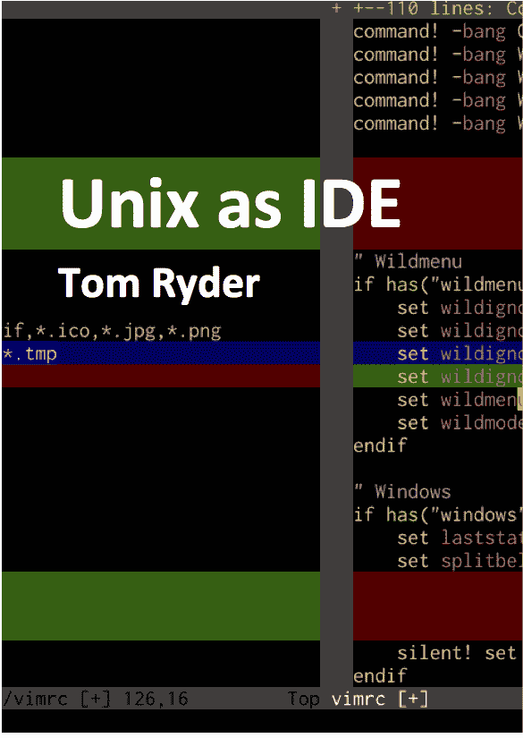

# Unix IDE 指南



## 引言

无论是新手还是经验丰富的专业程序员都赞同 IDE（或[集成开发环境](http://en.wikipedia.org/wiki/Integrated_development_environment)）的概念。在一个集成了所有不同工具通用接口的应用程序中，拥有组织、编写、维护、测试和调试代码的主要工具，无疑是一项非常有价值的资产。此外，专门为各种语言编程而设计的环境还提供如自动补全、语法检查和高亮等优势。

随着包括 Linux 和 BSD 在内的所有主流桌面操作系统上的开发者可以使用此类工具，而且其中许多是免费的，实际上没有什么理由用 Windows 记事本或通过 `nano` 或 `cat` 来编写代码。

然而，在 Unix 及其现代衍生品的支持者中，流传着一个小梗，即“Unix 就是一个 IDE”，这意味着开发者在终端上可用的工具可以轻松地涵盖尖端桌面 IDE 的主要功能。人们对此意见相当分歧，但无论你认为将 Unix 称为与 Eclipse 或 Microsoft Visual Studio 同等意义的 IDE 是否合理，这个简陋的 Bash shell 所能提供的多么全面的开发环境，可能会让你感到惊讶。

### Unix 如何成为 IDE 的？

使用 IDE 的首要理由是它将所有工具聚集在同一个地方，你可以用大致相同的用户界面范式协同使用它们，而无需花费过多精力让不同的应用程序相互配合。这种需求在 GUI 应用程序中变得格尤为迫切，因为要让窗口化应用程序使用同一种语言或良好地协同工作非常困难；除了剪贴文本之外，它们并不共享`共同接口`。

对于 shell 用户来说，这个问题的有趣之处在于，设计良好且经久考验的 Unix 工具已经通过`文本流`和`文件作为持久化对象`共享了通用的用户界面，换句话说，就是“万物皆文件”这一公理。Unix 中的几乎一切都是围绕这这两个概念构建的，而正是这种通用的用户界面，结合拥有四十年历史的高性能工具（其用户和开发者特别看重互操作性），使得 Unix 变得像完整的 IDE 一样强大。

### 正确的想法

这种态度并不是那些饱经沙场的 Unix 老兵的专利；你可以从另一种形式看到，两个古老文本编辑器 Emacs 和 Vi（GNU Emacs 和 Vim）的现代变体拥有如此活跃的社区来开发插件，使其支持几乎任何类型的编辑任务。在这两个编辑器中，插件可以完成你在编程中真正想做的几乎任何事情，而且像任何 Vim 狂迷一样，我可以列出至少六七个我认为“必不可少”的插件。

然而，当我读到这些努力时，我经常明显感觉到，相关的开发者正试图将这些文本编辑器变成它们自己的 IDE。有关于[永远不需要离开 Vim](http://kevinw.github.com/2010/12/15/this-is-your-brain-on-vim/)或[永远不需要离开 Emacs](http://news.ycombinator.com/item?id=819447)的帖子。但我认为，试图将 Vim 或 Emacs 硬挤成它们本身不是的东西，并不是以正确的方式思考问题。Vim 的作者 Bram Moolenaar 似乎在某种程度上同意这一点，你可以通过阅读[`:help design-not`](http://vimdoc.sourceforge.net/htmldoc/develop.html#design-not) 看到。shell 只有一个 Ctrl+Z 的距离，它成熟且高度可组合的工具集将为你提供比任何编辑器都无法提供的力量。

### 关于本系列

在这一系列文章中，我将介绍 IDE 的六个主要功能，并示例说明 Linux 中提供的常用工具如何让你轻松地一起使用它们。这绝不是一个全面的调查，我演示的工具也不是唯一的选择。

* **文件和项目管理** — `ls`, `find`, `grep`/`ack`, `bash`
* **文本编辑器和编辑工具** — `vim`, `awk`, `sort`, `column`
* **编译器和/或解释器** — `gcc`, `perl`
* **构建工具** — `make`
* **调试器** — `gdb`, `valgrind`, `ltrace`, `lsof`, `pmap`
* **版本控制** — `diff`, `patch`, `svn`, `git`

### 我不是想说的

我不认为 IDE 是坏的；我认为它们很棒，这就是为什么我试图说服你 Unix 可以被当作 IDE 使用，或者至少被视为 IDE。我不会说 Unix 总是任何编程任务的最佳工具；可以说，对于 C、C++、Python、Perl 或 Shell 开发，它比 Java 或 C# 等更“行业”语言更合适，尤其是在编写依赖 GUI 的应用程序时。特别是，我不会试图说服你放弃辛苦苦得的 Eclipse 或 Microsoft Visual Studio 知识，转进入有时晦涩的命令行世界。我只想向你展示我们在围栏的另一侧在做什么。

## 文件

IDE 的一个显著特性是内置的用于管理的系统，包括移动、重命名、删除以及编译和语法检查等。在第一篇文章中，我将探索一些 Linux 用户熟悉的工具使用方法。

### 列出文件

使用 `ls` 可能是管理员学习的第一个命令，用于获取内容的简单列表。大多数管理员也会 `-a` 和 `-l` 选项，用于显示所有文件以及显示详细数据。GNU `ls` 还有其他较少使用的选项，其中某些在编程中被证明非常有用：

* `-t` — 按最后修改日期列出文件，最新的在前。这对于想要获取最近更改的文件列表的大型目录非常有用，可能配合 `head` 或 `sed` 使用。
* `-X` — 按扩展名分组；对于多语言代码非常方便，可以将头文件和源文件分开，或者将源文件与目录或构建文件分开。
* `-v` — 自然排序文件名中的版本号。
* `-S` — 按文件大小排序。
* `-R` — 递归列出文件。这个配合 `less` 等分页器效果良好。

由于列表与其他任何文本一样，例如你可以将此命令的输出管道到 `vim` 进程，这样就可以添加每个文件的用途并将其保存为 `inventory` 文件或添加到 README 中：

```
$ ls -XR | vim -
```

这种事情通过少量工作就可以通过 `make` 实现，我将在系列后续文章中介绍。

### 查找文件

有趣的是，只需输入不带参数的 `find` 即可获得包含相对路径的完整文件列表，尽管将其管道到 `sort` 通常是个好主意：

```
$ find | sort
.
./Makefile
./README
./build
./client.c
./client.h
./common.h
./project.c
./server.c
./server.h
./tests
./tests/suite1.pl
./tests/suite2.pl
./tests/suite3.pl
./tests/suite4.pl
```

如果你想要 `ls -l` 风格的列表，可以在 `find` 结果中添加 `-ls` 作为动作。

```
$ find -ls | sort -k 11
1155096    4 drwxr-xr-x   4 tom      tom          4096 Feb 10 09:37 .
1155152    4 drwxr-xr-x   2 tom      tom          4096 Feb 10 09:17 ./build
1155155    4 -rw-r--r--   1 tom      tom          2290 Jan 11 07:21 ./client.c
1155157    4 -rw-r--r--   1 tom      tom          1871 Jan 11 16:41 ./client.h
1155159   32 -rw-r--r--   1 tom      tom         30390 Jan 10 15:29 ./common.h
1155153   24 -rw-r--r--   1 tom      tom         21170 Jan 11 05:43 ./Makefile
1155154   16 -rw-r--r--   1 tom      tom         13966 Jan 14 07:39 ./project.c
1155080   28 -rw-r--r--   1 tom      tom         25840 Jan 15 22:28 ./README
1155156   32 -rw-r--r--   1 tom      tom         31124 Jan 11 02:34 ./server.c
1155158    4 -rw-r--r--   1 tom      tom          3599 Jan 16 05:27 ./server.h
1155160    4 drwxr-xr-x   2 tom      tom          4096 Feb 10 09:29 ./tests
1155161    4 -rw-r--r--   1 tom      tom           288 Jan 13 03:04 ./tests/suite1.pl
1155162    4 -rw-r--r--   1 tom      tom          1792 Jan 13 10:06 ./tests/suite2.pl
1155163    4 -rw-r--r--   1 tom      tom           112 Jan  9 23:42 ./tests/suite3.pl
1155164    4 -rw-r--r--   1 tom      tom           144 Jan 15 02:10 ./tests/suite4.pl
```

请注意，在这种情况下，我必须指定 `sort` 按照输出的第 11 列（即文件名）进行排序；这是通过 `-k` 选项实现的。

`find` 有一套自己复杂的过滤语法；以下示例展示了你可以用于检索特定文件列表的一些的一些最实用的过滤器：

- `find -name '*.c'` — 查找文件名匹配 Shell 风格模式的文件。使用 `-iname` 进行不区分大小写的搜索。
- `find -path '*test*'` — 查找路径匹配 Shell 风格模式的文件。使用 `-ipath` 进行不区分大小写的搜索。
- `find -mtime -5` — 查找过去 5 天内编辑过的文件。你可以使用 `+5` 来查找 5 天前编辑的文件。
- `find -newer server.c` — 查找修改时间比 `server.c` 更新的文件。
- `find -type d` — 查找目录。对于文件，使用 `-type f`；对于符号链接，使用 `-type l`。

特别注意，所有这些操作都可以组合使用，例如查找过去两天内编辑过的 C 源文件：

```
$ find -name '*.c' -mtime -2
```

在默认情况下，`find` 对搜索结果采取的操作仅仅是将它们列出到标准输出，但还有其他几种实用的操作：

- `-ls` — 提供如上所示 `ls -l` 风格的列出
- `-delete` — 删除匹配的文件
- `-exec` — 在每个文件上运行任意命令行，将 `{}` 替换为相应的文件名，并以 `\;` 结束；例如：

```
$ find -name '*.pl' -exec perl -c {} \;
```

如果你想将所有结果放在一次命令调用中，可以使用 `+` 作为终止字符。我发现自己经常使用的一个技巧是使用 `find` 生成文件列表，然后在垂直分屏 Vim 窗口中编辑它们：

```
$ find -name '*.c' -exec vim {} +
```

早期的 Unix 版本作为 IDE 建议在 `find` 结果上使用 `xargs`。在大多数情况下，这实际上并不真的需要，使用 `-exec` 或 `while read -r` 循环来处理带有空格的文件名会更健壮。

### 搜索文件

然而，相比于一组文件的属性，你可能更想根据其内容查找文件，因此 `grep`（特别是 `grep -R`）在此处非常有用也并不奇奇。它会递归地搜索当前目录树中任何匹配 `someVar` 的内容：

```
$ grep -FR someVar .
```

也别忘记不区分大小写的标志，因为：

```bash
$ grep -FRi someVar .
```

## 编辑

文本编辑器是任何程序员的核心工具，这就是为什么对编辑器的选择会在程序员之间引发此类带有玩笑意味的狂热争论。Unix 是与两个经久不衰的喜爱——Emacs 和 Vi——联系最紧密的操作系统，以及它们的现代版本 GNU Emacs 和 Vim，这两个拥有完全不同编辑哲学但功能相当的编辑器。

作为一名 Vim 狂信徒，在这里我将讨论 Vim 编程中不可少的功能，特别是通过 Vim 内部调用 Linux Shell 工具来补充编辑器的内置功能。这里讨论的一些原则也适用于使用 Emacs 的人，但可能不适用于 Nano 这样功能简单的编辑器。

这将是一个非常通用的概述，因为 Vim 为程序员提供的工具集是巨大的，而且仍然会变得很长。我将关注基础知识以及我认为最有帮助的内容，并尽力提供对该主题有更全面处理的文章链接。别忘记 Vim 的 `:help` 以其高质量和实用性让许多新接触编辑器的人感到惊讶。

### 文件类型检测

Vim 有内置设置，可以根据加载的文件类型调整其行为（特别是语法高亮），它会乐意检测这些类型，并且通常做得很好。特别是，这允许你设置符合特定语言通常编写方式的缩进风格。这应该是你 `.vimrc` 文件中的初始内容之一。

```
if has("autocmd")
  filetype on
  filetype indent on
  filetype plugin on
endif
```

即使你使用的只是 16 色的终端，如果你的配置尚未包含，也请在你的 `.vimrc` 中包含以下内容：

```
syntax on
```

默认 16 色终端的主题方案（colorschemes）在很大程度上由于需要并不好看，但它们可以完成任务，而且对于大多数语言，都有运行非常良好的语法定义文件可用。这里有[极其丰富的主题方案](http://code.google.com/p/vimcolorschemetest/)可供选择，调整它们以适应你的需求甚至编写你自己的方案并不困难。使用[256 色终端](http://vim.wikia.com/wiki/256_colors_in_vim) 或 `gVim` 将为你提供更多选项。良好的语法高亮文件会用显眼的红色背景为你显示明确的语法错误。

### 行号

如果你在传统的 IDE 中频繁使用行号，可以开启行号：

```
set number
```

如果你至少安装了 Vim 7.3，并且想要尝试使用相对于当前行的行号而不是绝对行号，你可能也会喜欢这个：

```
set relativenumber
```

### Tags 文件

Vim 与 `ctags` 工具的输出[配合得非常好](http://amix.dk/blog/post/19329)。这允许你快速搜索整个项目中某个特定标识符的所有使用处，或者从其中一个使用处直接跳转到变量定义处，无论它是否在同一个文件中。对于包含多个文件的大型 C 项目，这可以节省大量原本浪费的时间，并且可能是 Vim 对主流 IDE 中类似功能的最优回答。

你可以在许多流行语言的项目根目录下运行 `:!ctags -R`，以生成一个 `tags` 文件，其中填充了整个项目中标识符的定义和位置。一旦生成了项目的 `tags` 文件，你就可以像这样在整个项目中搜索适当标签的使用情况：

```
:tag someClass
```

命令 `:tn` 和 `:tp` 允许你在项目其他地方遍历该标签的连续使用处。Vim 内置的 tags 功能已经涵盖了你可能需要的大部分基础，但对于标签列表窗口等功能，你可以尝试安装非常流行的 [Taglist 插件](http://vim-taglist.sourceforge.net/)。Tim Pope 的 [Unimpaired 插件](https://github.com/tpope/vim-unimpaired) 也包含几个实用的相关映射。

### 调用外部程序

在 Vim 会话期间，调用外部程序有两种主要方法：

* `:!<command>` — 有用于在 Vim 上下文中发布命令，特别是在你打算将输出记录到缓冲区（buffer）中时。
* `:shell` — 以 Vim 子进程的形式掉到 shell。适用于交互式命令。

第三种方法（我在这里不会深入讨论）是使用如 [Conque](http://code.google.com/p/conque/) 等插件在 Vim 缓冲区中模拟 shell。我曾尝试过这种方法并发现它几乎不可用，因此得出结论这完全是糟糕的设计。根据 `:help design-not`：

> Vim 不是 shell 也不是操作系统。你无法在 Vim 内部运行 shell，或使用它来控制调试器。这种关系应该是反过来的：将 Vim 作为 shell 或 IDE 中的一个组件来使用。

### Lint 程序和语法检查器

通过外部程序调用（例如 `perl -c`、`gcc`）检查语法或进行编译，是在编辑器内部使用 `:!` 命令进行调用的非常棒的用法之一。如果你正在编辑一个 Perl 文件，可以像这样运行：

```
:!perl -c %

/home/tom/project/test.pl syntax OK

按回车键或输入命令继续
```

`%` 符号是当前缓冲区中加载文件的简写。运行此会将命令的输出（如果有的话）打印在命令行下方。如果你想频繁调用此检查，也许可以将其映射为一个命令，甚至在你的 `.vimrc` 文件中映射为组合键组合。在这种情况下，我们定义了一个命令 `:PerlLint`，你可以在普通模式下通过 `\l` 调用它：


```vim
command PerlLint !perl -c %
nnoremap <leader>l :PerlLint<CR>
```

对于许多语言，还有一种更好的实现方法，它允许我们利用 Vim 内置的快速修复列表窗口（quickfix window）。我们可以通过为文件类型设置合适的 `makeprg` 来实现，在这种情况下，包括一个提供 Vim 可用于快速修复列表输出的模块，以及对其两种格式的定义：

```vim
:set makeprg=perl\ -c\ -MVi::QuickFix\ %
:set errorformat+=%m\ at\ %f\ line\ %l\.
:set errorformat+=%m\ at\ %f\ line\ %l
```

你可能需要先通过 CPAN 或 Debian 包 `libvi-quickfix-perl` 安装此模块。完成后，你可以在保存文件后输入 `:make` 来检查语法，如果发现错误，你可以使用 `:copen` 打开快速列表窗口来检查错误，并使用 `:cn` 和 `:cp` 在缓冲区内跳转到这些错误。

 Perl 文件上的快速修复

对于许多语言，还有一种更好的实现方法，它允许我们利用 Vim 内置的快速修复列表窗口。我们可以通过为文件类型设置合适的 `makeprg` 来实现，在这种情况下，包括一个提供 Vim 可用于快速修复列表输出的模块，以及对其两种格式的定义：

```vim
:set makeprg=perl\ -c\ -MVi::QuickFix\ %
:set errorformat+=%m\ at\ %f\ line\ %l\.
:set errorformat+=%m\ at\ %f\ line\ %l
```

你可能需要先通过 CPAN 或 Debian 包 `libvi-quickfix-perl` 安装此模块。完成后，你可以在保存文件后输入 `:make` 来检查语法，如果发现错误，你可以使用 `:copen` 打开快速列表窗口来检查错误，并使用 `:cn` 和 `:cp` 在缓冲区内跳转到这些错误。

 Perl 文件上的快速修复

你可以直接在 Vim 内部调用版本控制方法，这在大多数时候可能是你唯一需要的。这里需要记住，`%` 总是缓冲区当前文件的快捷方式：

```vim
:!svn status
:!svn add %
:!git commit -a
```

最近，Vim 的 Git 功能方面出现了一个明确的优胜者，即 Tim Pope 的 [Fugitive](https://github.com/tpope/vim-fugitive)，我强烈向任何使用 Vim 进行 Git 开发的人员推荐它。在本系列文章的第 7 部分，我将对 Unix 中版本控制的基础和历史进行更全面的阐述。

# 区别

许多习惯于 GUI 版 IDE 的程序员将 Vim 视为玩具或遗迹，部分原因之一是它被仅仅视为一个在服务器上编辑文件的工具，而不是一个本身就非常强大的 Shell 编辑组件。在类 Unix 友好的系统中，它内置的特性与外部工具之间具有极强的组合性，这使其成为文本编辑的利器，有时甚至让经验丰富的用户也感到惊讶。

# 编译

Unix 平台上有很多可用于编译和解释代码的工具，它们通常以不同的方式使用。然而，从概念上讲，许多步骤是相同的。在这里，我将讨论使用 GNU 编译集的 `gcc` 编译 C 代码，并简要介绍 `perl` 作为解释器的用法。

## GCC

[GCC](http://gcc.gnu.org/) 是一个非常成熟的、基于 GPL 的编译器集合，可能因处理 C 和 C++ 程序而广为人知。它的免费软件许可证以及在 Linux 和 BSD 等自由类 Unix 系统中几乎无处不在，使其在这些用途上经久不衰，尽管使用 [LLVM](http://llvm.org/) 基础设施的编译器提供了更现代的替代方案，例如 [Clang](http://clang.llvm.org/)。

GNU 编译集的前端二进制文件最好不要被看作是独立的编译器，而应被看作一组离散编程工具的驱动程序，执行解析、编译和链接等步骤。这意味着，虽然你可以使用相对简单的命令行通过 `gcc` 直接从 C 源码编译为可执行二进制文件，你也可以更详细地检查它在此过程中所采取的步骤，并对其进行相应的调整。

我在这里不会讨论 `make` 文件的使用，尽管对于任何超过一个文件的 C 项目，你几乎肯定会想要它们；那将在后续关于构建自动化工具的文章中讨论。

## 编译和汇编对象代码

你可以像如下所示从 C 源文件编译对象代码：

```bash
$ gcc -c example.c -o example.o
```

假设这是一个有效的 C 程序，这将在当前目录下生成一个名为 `example.o` 的未链接二进制对象文件，或者通过报错告诉你无法生成的原因。你可以使用 `objdump` 工具检查它的汇编内容：

```bash
$ objdump -D example.o
```

或者，你也可以通过 `-S` 参数让 `gcc` 直接为对象输出相应的汇编代码：

```bash
$ gcc -c -S example.c -o example.s
```

这种汇编输出在与源代码本身内联打印时可以特别具有启发性，或者至少有趣，你可以通过以下方式实现：

```bash
$ gcc -c -g -Wa,-a,-ad example.c > example.lst
```

## 预处理器

C 预处理器 `cpp` 通常用于包含头文件和定义宏等。它是 `gcc` 编译的正常组成部分，但你可以通过直接调用 `cpp` 查看它生成的 C 代码：

```bash
$ cpp example.c
```

这将打印出将被编译的完整代码，并应用了包含文件和相关的宏。

## 链接对象

一个或多个对象可以如下链接到适当的二进制文件中：

```bash
$ gcc example.o -o example
```

在这个示例中，`gcc` 做的事情并不比抽象了对 `ld`（GNU 链接器）的调用。该命令产生了一个名为 `example` 的可执行二进制文件。

## 编译、汇编和链接

上述所有操作都可以通过一步完成：

```bash
$ gcc example.c -o example
```

这稍微简单一点，但事实证明独立编译对象在避免不必要的重复编译方面具有某些实际的性能优势，我将在下一篇文章中讨论这一点。

## 包含和链接

在编译调用中，可以使用 `-I` 参数显式地包含 C 文件和头文件：

```bash
$ gcc -I/usr/include/somelib.h example.c -o example
```

同样，如果代码需要动态链接到位于 `/lib` 或 `/usr/lib` 等常见位置的编译系统库（例如 `ncurses`），可以使用 `-l` 参数包含它：

```bash
$ gcc -lncurses example.c -o example
```

如果你在编译过程中有很多必要的包含和链接，那么将这些放入环境变量是有意义的：

```bash
$ export CFLAGS=-I/usr/include/somelib.h
$ export CLIBS=-lncurses
$ gcc $CFLAGS $CLIBS example.c -o example
```

这个非常常见的步骤是 `Makefile` 设计用于为你抽象的另一个东西。

## 编译计划

要更详细地检查 `gcc` 在任何调用中做了什么，你可以添加 `-v` 选项来提示它在标准错误流上打印其编译计划：

```bash
$ gcc -v -c example.c -o example.o
```

如果你不想让它实际生成对象文件或链接二进制文件，使用 `-###` 有时更整洁：

```bash
$ gcc -c -o example.o -###
```

## 更丰富的错误检查

你可以在 `gcc` 调用中添加 `-Wall` 和/或 `-pedantic` 选项来警告你可能的问题：

```bash
$ gcc -Wall -pedantic example.c
```

## 编译编译性能分析

你可以向 `gcc` 传递 `-time` 标志来生成每个步骤耗时的输出：

```bash
$ gcc -time -c example.c -o example.o
```

## 优化

你可以向 `gcc` 传递通用优化选项以尝试构建更高效的对象文件和链接二进制文件，是以编译时间为代价的。对于进入生产的代码，我 `-O2` 通常是一个折中方案：

- `gcc -O1`
- `gcc -O2`
- `gcc -O3`

与其他任何 Bash 命令一样，这一切都可以[从 Vim 中调用](http://blog.sanctum.geek.nz/unix-as-ide-editing/)：

```vim
:!gcc % -o example
```

## 解释器

Unix 系统上解释代码的方法非常不同。在这些示例中我将使用 Perl，但大多数原理适用于解释型的 Python 或 Ruby 代码。

### 内联

你可以通过以下任何一种方式将字符串代码直接运行到解释器中，在这种情况下屏幕上打印单行“Hello, world.”，随后是一个换行符。第一种可能是处理 Perl 最整洁、最标准的方法；第二种使用了这里（heredoc）字符串，第三种使用了经典的 Unix Shell 管道。

```bash
$ perl -e 'print "Hello world.\n";'
$ perl <<<'print "Hello world.\n";'
$ echo 'print "Hello world.\n";' | perl
```

当然，通常是将代码保留在文件中，可以直接运行：

```bash
$ perl hello.pl
```

在任何情况下，你都可以使用 `-c` 切换在不实际运行代码的情况下检查代码语法：

```bash
$ perl -c hello.pl
```

但为了将脚本作为一个 `logical binary`（逻辑二进制文件）使用，以便你可以直接调用它而无需知道或关心脚本内容，你可以在文件开头添加特殊的行，称为“shebang”（解释字节），它会通过一些魔法操作来指定运行该文件的解释器。

```perl
#!/usr/bin/env perl
print "Hello, world.\n";
```

然后需要通过调用 `chmod` 来将脚本设为可执行。将它重命名以移除扩展名也是一个良好的习惯，因为现在它呈现出逻辑二进制文件的形式了：

```bash
$ mv hello{.pl,}
$ chmod +x hello
```

此后就可以直接调用它，就像它是编译后的二进制文件一样：

```bash
$ ./hello
```

这种方法非常有效，以至于现代 Linux 系统上的许多常用工具（例如 `useradd` 的前端工具 `adduser`）实际上都是 Perl 甚至是 Python 脚本。

在下一篇文章中，我将描述如何使用 `make` 来定义和自动化构建项目，其方式可以与 IDE 相比，并顺带提到 Ruby 的 `rake` 对这一理念的新新实现。

# 构建（Building）

由于编译项目可能是一个非常复杂且重复的过程，一个良好的 IDE 提供了一种抽象、简化甚至自动化软件构建的手段。Unix 及其后代通过 `Makefile` 实现这一过程，`Makefile` 是一种标准格式的规定配方，用于从源文件和对象文件生成可执行文件，它只针对变化的部分重新构建需要的内容，以防止昂贵的重复编译。

关于 `make` 需要注意的一个有趣点是，虽然它通常用于编译型软件的构建自动化并有许多快捷方式，但它实际上可以有效地用于任何需要从一组文件生成另一组文件的情况。可能的用途是从源文件生成用于网站部署的 Web 友好型优化图形；另一种用途是从代码生成静态 HTML 页面，而不是动态地生成页面。正是基于这种对软件“构建”更灵活的理解，现代对该工具的变体（如 [Ruby 的 `rake`](http://rake.rubyforge.org/)）才变得流行，它们自动化了生产和安装各种代码和文件的通用任务。

## `Makefile` 的结构

`Makefile` 的通用模式是变量列表、`targets`（目标）列表，以及提供这些目标的源文件和/或对象。目标并不一定是链接后的二进制文件；它们也可以构成使用生成文件来执行的操作，例如 `install` 将构建好的文件安装到系统中，以及 `clean` 从源码树中移除构建好的文件。

正是这种目标的灵活性使得 `make` 能够自动化任何与组装软件生产构建相关的任务；不仅是编译器执行的典型解析、预处理、正式编译和链接步骤，还运行测试（`make test`）、将文档源文件编译成一个或多个适当格式，或者自动化将代码部署到生产系统（例如通过 `git push` 或类似的内容跟踪方法上传到网站）。

一个简单软件项目的 `Makefile` 示例可能如下：

```make
all: example

example: main.o example.o library.o
    gcc main.o example.o library.o -o example

main.o: main.c
    gcc -c main.c -o main.o

example.o: example.c
    gcc -c example.c -o example.o

library.o: library.c
    gcc -c library.c -o library.o

clean:
    rm *.o example

install: example
    cp example /usr/bin
```

上面的并不是该项目最优的 `Makefile`，但它提供了一种通过输入 `make` 来构建和安装链接二进制文件的方法。每个 `target` 定义都包含后续命令所需的 `dependencies`（依赖项）列表；这意味着定义可以以任何顺序出现，而 `make` 的调用将按相应的顺序调用相关命令。

上述许多内容是多余的冗长或重复的；例如，如果对象文件是直接从同名的单个 C 文件构建的，那么我们不需要包含该目标，`make` 会为我们处理好。同样，将一些更重复的调用放入变量中是有意义的，这样当我们选择编译器或标志发生变化时，就不需要逐个修改它们。一个更简洁的版本可能如下：

```make
CC = gcc
OBJECTS = main.o example.o library.o
BINARY = example

all: example

example: $(OBJECTS)
    $(CC) $(OBJECTS) -o $(BINARY)

clean:
    rm -f $(BINARY) $(OBJECTS)

install: example
    cp $(BINARY) /usr/bin
```

## `make` 更通用的用途

然而，出于自动化的考虑，将其更宽泛地思考为不仅仅是代码编译和链接是有启发的。一个例子可以是涉及将 PHP 部署到实时 Web 服务器的简单 Web 项目。这通常不是人们与使用 `make` 关联起来的任务，但原理是相同的；只要源码就位并准备就绪，我们就有构建需要满足的某些目标。

当然，PHP 文件不需要编译，但 Web 资产通常需要。Web 开发者熟悉的一个示例是从矢量源文件生成缩放并优化的位图图像，以便部署到网络。你保留并版本化你的原始源文件，当需要部署时，你为其生成一个 Web 友好的版本。

假设对于这个特定项目，有一组全站使用的四个图标，大小为 64x64 像素。我们有 SVG 格式的源文件安全地存储在版本控制中，现在需要为网站生成位图。因此，我们可以定义一个 `icons` 目标，设置依赖项，并写出执行的命令。这就是 Unix 命令行工具在 `Makefile` 中开始大发光热的地方：

```make
icons: create.png read.png update.png delete.png

create.png: create.svg
    convert create.svg create.raw.png && \
    pngcrush create.raw.png create.png

read.png: read.svg
    convert read.svg read.raw.png && \
    pngcrush read.raw.png read.png

update.png: update.svg
    convert update.svg update.raw.png && \
    pngcrush update.raw.png update.png

delete.png: delete.svg
    convert delete.svg delete.raw.png && \
    pngcrush delete.raw.png delete.png
```

完成上述操作后，输入 `make icons` 将遍历每个图标文件，使用 ImageMagick 的 `convert` 将其转换为 PNG，并使用 `pngcrush` 进行优化，从而产生用于上传的图像。

类似的方法也可以用于生成各种格式的帮助文件，例如从 Markdown 生成 HTML 文件：

```make
docs: README.html credits.html

README.html: README.md
    markdown README.md > README.html

credits.html: credits.md
    markdown credits.md > credits.html
```

最后通过 `git push web` 部署网站，但要在图标光栅化和文档转换*之后*：

```make
deploy: icons docs
    git push web
```


对于将一种后缀的文件转换为另一种文件的更紧凑、抽象的公式，可以使用 `.SUFFIXES` 指令通过特殊符号来定义这些。转换图标的代码可能如下；在这种情况下，`$<` 指向源文件，`$*` 指向不带扩展的文件名，而 `$@` 指向目标。

```
icons: create.png read.png update.png delete.png

.SUFFIXES: .svg .png

.svg.png:
    convert $< $*.raw.png && \
    pngcrush $*.raw.png $@
```

在 GNU Autotools 工具链中存在多种工具，用于为大型软件项目在更高层次构建 `configure` 脚本和 `make` 文件，特别是 [`autoconf`](http://en.wikipedia.org/wiki/Autoconf) 和 [`automake`](http://en.wikipedia.org/wiki/Automake)。使用这些工具可以生成涵盖庞大源码库的 `configure` 脚本和 `make` 文件，减少了手动构建详尽 makefiles 的必要性，并自动化了确保源码在各种操作系统上保持兼容性与可编译性的步骤。

要涵盖这一复杂的过程本身将是一系列文章，并且超出了本调查的范畴。

感谢用户 samwyse 在评论中提供的 `.SUFFIXES` 建议。

# 调试

当在程序中发现意料之外的行为时，Linux 提供了多种命令行工具来诊断问题。使用 `gdb`（GNU 调试器）以及相关工具（如较少为人知的 Perl 调试器），对于那些习惯使用 IDE 在代码中设置断点并在程序运行时检查程序状态的人来说将是熟悉的。然而，还有其他感兴趣的工具可以更详细地观察程序如何与系统交互以及使用其资源。

## 使用 `gdb` 进行调试

你可以以非常类似于 Eclipse 和 Visual Studio 等现代 IDE 内置调试器的方式使用 `gdb`。如果你正在调试一个刚刚编译的程序，那么在编译二进制文件时添加其调试符号（debugging symbols）进行编译是有意义的，你可以通过包含 `-g` 选项的 `gcc` 调用来实现。如果你在某些代码上遇到问题，使用 `-Wall` 显示你可能可能遗漏的任何错误也会有帮助：

```
$ gcc -g -Wall example.c -o example
```

使用 `gdb` 的经典方法是为用 C 或 C++ 编译的运行程序提供 shell，允许你在程序向崩溃发生的过程中检查其程序状态。

```
$ gdb example
...
Reading symbols from /home/tom/example...done.
(gdb)
```

在 `(gdb)` 提示符下，你可以输入 `run` 来启动程序，它可能会为你提供有关错误原因（如段错误）的更详细信息，包括发生问题的源文件和行号。如果你能像上面那样带有调试符号编译代码并像这样检查其运行状态，那么查明特定 bug 的原因将容易得多。

```
(gdb) run
Starting program: /home/tom/gdb/example 

Program received signal SIGSEGV, Segmentation fault.
0x000000000040072e in main () at example.c:43
43     printf("%d\n", *segfault);
```

当错误在 `(gdb)` shell 中终止程序后，你可以输入 `backtrace` 来查看调用函数是什么，这可能包含传递的特定参数，这些参数可能与导致崩溃的原因有关。

```
(gdb) backtrace
#0  0x000000000040072e in main () at example.c:43
```

你可以使用 `break` 为 `gdb` 设置断点，以便在程序达到匹配的行号或函数调用时停止运行：

```
(gdb) break 42
Breakpoint 1 at 0x400722: file example.c, line 42.
(gdb) break malloc
Breakpoint 1 at 0x4004c0
(gdb) run
Starting program: /home/tom/gdb/example 

Breakpoint 1, 0x00007ffff7df2310 in malloc () from /lib64/ld-linux-x86-64.so.2
```

之后，使用 `step` 逐行执行后续代码是有帮助的。你可以像任何其他 `gdb` 命令一样重复此，通过反复按回车来逐行执行：

```
(gdb) step
Single stepping until exit from function _start,
which has no line number information.
0x00007ffff7a74db0 in __libc_start_main () from /lib/x86_64-linux-gnu/libc.so.6
```

你甚至可以通过找到进程 ID 并将其传递给 `gdb` 来将 `gdb` 附加到已经在运行的进程上：

```
$ pgrep example
1524
$ gdb -p 1524
```

这对于运行时间异常长的任务，[重定向输出流](http://stackoverflow.com/questions/593724/redirect-stderr-stdout-of-a-process-after-its-been-started-using-command-lin) 非常有用。

## 使用 `valgrind` 进行调试

较新的 [valgrind](http://valgrind.org/) 可以以类似的方式作为调试工具。该程序可以运行许多不同的检查和调试方法，但其中最有用的之一是它的 `Memcheck` 工具，用于检测缓冲区溢出等常见的内存错误：

```
$ valgrind --leak-check=yes ./example
==29557== Memcheck, a memory error detector
==29557== Copyright (C) 2002-2011, and GPL'd, by Julian Seward.
==29557== Valgrind-3.7.0, rerun with -h for info
==29557== Command: ./example
==29557== 
==29557== Invalid read of size 1
==29557== at 0x40072E: main (example.c:43)
==29557== Address 0 is not stack'd, malloc'd or (recently) free'd
==29557== 
```

`gdb` 和 `valgrind` 工具[可以结合使用](http://valgrind.org/manual/core) 以对程序的运行进行彻底调查。Zed 的 [Learn C the Hard Way](http://codetheway.org/) 包含一个通过故意损坏的程序对 `gdb` 基础使用的非常好的介绍。

## 使用 `ltrace` 跟踪系统调用和库调用

`strace` 和 `ltrace` 工具设计用于分别观察运行程序的系统调用和库调用，并将它们记录到屏幕上，或者有用地记录到文件中。你可以通过 `ltrace` 运行你想要监控的程序，它将为你提供程序在退出前所做的所有库调用列表，而只需提供程序作为参数即可查看导致崩溃的调用。

 带 `ltrace` 输出的 Vim 会话

我发现 `ltrace` 对于调试那些怀疑是链接不当、或者在 `chroot` 环境中缺少某些所需的问题非常有用，因为在它的输出中，显示了动态链接时对库的搜索、对 `/etc` 中配置文件的打开，以及对 `/dev/random` 或 `/dev/zero` 等设备的使用。

## 使用 `lsof` 跟踪打开的文件

如果你想查看运行进程打开了哪些设备、文件或流，可以使用 `lsof` 来实现：

```
$ pgrep example
5051
$ lsof -p 5051
```

例如，在我家主服务器上运行的 `apache2` 进程的前几行如下：

```
## lsof -p 30779
COMMAND   PID USER   FD   TYPE DEVICE SIZE/OFF    NODE NAME
apache2 30779 root  cwd    DIR    8,1     4096       2 /
apache2 30779 root  rtd    DIR    8,1     4096       2 /
apache2 30779 root  txt    REG    8,1   485384  990111 /usr/lib/apache2/mpm-prefork/apache2
apache2 30779 root  DEL    REG    8,1          1087891 /lib/x86_64-linux-gnu/libgcc_s.so.1
apache2 30779 root  mem    REG    8,1    35216 1079715 /usr/lib/php5/20090626/pdo_mysql.so
...
```

有趣的是，列出进程打开文件的另一种方法是检查动态 `/proc` 目录中对应的进程条目：

```
## ls -l /proc/30779/fd
```

这在处理文件锁的困惑情况，或识别进程是否持有了它不需要的打开文件时非常有用。

## 使用 `pmap` 查看内存分配

作为最后一个调试技巧，你可以使用 `pmap` 查看特定进程的内存分配：

```
## pmap 30779 
30779:   /usr/sbin/apache2 -k start
00007fdb3883e000     84K r-x--  /lib/x86_64-linux-gnu/libgcc_s.so.1 (deleted)
00007fdb38853000   2048K -----  /lib/x86_64-linux-gnu/libgcc_s.so.1 (deleted)
00007fdb38a53000      4K rw---  /lib/x86_64-linux-gnu/libgcc_s.so.1 (deleted)
00007fdb38a54000      4K -----    [ anon ]
00007fdb38a55000   8192K rw---    [ anon ]
00007fdb392e5000     28K r-x--  /usr/lib/php5/20090626/pdo_mysql.so
00007fdb392ec000   2048K -----  /usr/lib/php5/20090626/pdo_mysql.so
00007fdb394ec000      4K r----  /usr/lib/php5/20090626/pdo_mysql.so
00007fdb394ed000      4K rw---  /usr/lib/php5/20090626/pdo_mysql.so
...
total           152520K
```

这将向你展示运行进程正在使用哪些库，包括共享内存中的库。底部给出的总数有点误导性，因为对于加载的共享库，运行进程并不是唯一使用该内存的进程；[确定给定进程的“实际”内存占用](http://stackoverflow.com/questions/118307/a-way-to-determine-a-processs-real-memory-usage-i-e-private-dirty-rss) 在引入共享库后，比看起来要复杂得多。

# 修订

版本控制现在被视为专业软件开发中不可或缺的一部分，像 Eclipse 和 Visual Studio 这样的 GUI IDE 已经接受了它，并在产品中包含了对行业标准版本控制系统的支持。然而，现代版本控制系统的谱源可以追溯到 `diff` 和 `patch` 等程序的 Unix 概念，而且有许多人坚持使用版本控制系统的最佳方法仍然是在 shell 提示符下。

在[Unix as an IDE 系列](http://blog.sanctum.geek.nz/series/unix-as-ide/)的最后一篇文章中，我将遵循常见开源版本控制系统的演变，从最早的版本控制工具之一 `diff` 和 `patch` 的基本概念开始。

## `diff`、`patch` 和 RCS

版本控制系统的核心概念是统一差异（unified diff），该文件以人类和计算机可读的术语表示对一个或多个文件所作的更改。`diff` 命令由 Douglas McIlroy 在 1974 年首次为 Unix 第 5 版发布，因此它是现代系统中仍然在使用的最古老的命令之一。

统一差异是最常见且互操作性最好的格式，可以通过以下语法比较文件的两个版本来生成：

```
$ diff -u example.{1,2}.c
--- example.c.1    2012-02-15 20:15:37.000000000 +1300
+++ example.c.2    2012-02-15 20:15:57.000000000 +1300
@@ -1,8 +1,9 @@
 #include <stdio.h>
+#include <stdlib.h>
 
 int main (int argc, char* argv[]) {
-    printf("Hello, world!\n");
-    return 0;
+    printf("Hello, world!\n");
+    return EXIT_SUCCESS;
 }
```

（注：上面的代码块是根据文中描述的 `unified diff` 逻辑重建的，因为原始输入中的代码块是不完整的。）

```
$ rcsdiff -u -r1.1 -r1.2 ./example.c 
===================================================================
RCS file: ./example.c,v
retrieving revision 1.1
retrieving revision 1.2
diff -u -r1.1 -r1.2
--- ./example.c 2012/02/15 07:36:23 1.1
+++ ./example.c 2012/02/15 07:39:16 1.2
@@ -4,6 +4,7 @@
 int main (int argc, char* argv[])
 {
     printf("Hello, world!\n");
+    printf("Extra line!\n");
     return EXIT_SUCCESS;
 }
```

如果暗示简单的补丁（patches）现在不再作为版本控制的方法被使用，那是误导性的；它们仍然以上述的形式广泛使用，并且在集中式和去中心化的版本控制系统中都占重要地位。

## CVS 和 Subversion

为了处理多个开发者对代码库做出更改的冲突问题，开发了集中式版本系统（centralized version systems），其中[并发版本系统（CVS）](http://en.wikipedia.org/wiki/Concurrent_Versions_System) 先后，随后是稍先进的 [Subversion](http://en.wikipedia.org/wiki/Apache_Subversion)。这些系统的核心特性是使用包含存储库的中央服务器（central server），可以从中检索特定时间或修订版本的代码库权威版本。这些被称为代码的工作副本（working copies）。

对于这些系统，系统的基本单元仍然是更改集（changeset），向用户表示这些更改的最常见方式是使用早期系统中使用的典型 `diff` 格式。这两个系统的工作原理都是保留这些更改集的记录，而不是文件本身在不同状态之间的演变记录。

这一代系统引入的其他概念包括项目的分支（branching），以便并发地处理同一项目的不同实例，然后经过适当的测试和审查将其合并到主线或 `trunk` 中。同样，还引入了标签（tagging）的概念，以标记某些版本代表软件发布时代码库的状态。还引入了合并（merge）的概念；用于手动调和对文件所做的冲突更改。

## Git 和 Mercurial

下一代版本控制系统是分布式或去中心化系统，在系统中，代码的工作副本本身包含了项目的完整历史，因此不再依赖中央服务器即可贡献项目。在开源、对 Unix 友好的环境中，突出的系统是 Git 和 Mercurial，它们的客户端程序分别为 `git` 和 `hg`。

对于这两个系统，通信更改集的概念通过 `push`、`pull` 和 `merge` 操作完成；一个存储库的更改会被另一个接受。这种去中心化的系统允许极其复杂但受控的开发生态系统；Git 最初由 Linus Torvalds 开发，旨在提供一个能够管理 Linux 内核开发的分布式版本控制系统（DVCS）。

Git 和 Mercurial 与 CVS 以及 Subversion 的区别在于，它们的操作基本单元不是更改集，而是使用压缩保存的完整文件（blobs）。这使得查找单个文件的日志历史或文件两个修订版本之间的差异开销略大，但 `git log --patch` 的输出仍然保留了每个版本熟悉的统一 `diff` 输出，而这在 `diff` 首次被使用后已经过去了四十年多：


```diff
commit c1e5559ddb09f8d02b989596b0f4100ad1aab422
Author: Tom Ryder <tom@sanctum.geek.nz>
Date:   Thu Feb 2 01:14:21 2012

Changed my mind about this one.

diff --git a/vim/vimrc b/vim/vimrc index cfbe8e0..65a3143 100644
--- a/vim/vimrc
+++ b/vim/vimrc
@@ -47,10 +47,6 @@
 set shiftwidth=4
 set softtabstop=4
 set tabstop=4

-" Heresy
-inoremap <C-a> <Home>
-inoremap <C-e> <End>
-
 " History
 set history=1000
```

这两个系统在功能甚至在命令集上有相当重叠，关于使用哪一个的问题引发了[激烈的讨论](http://stackoverflow.com/questions/35837/what-is-the-difference-between-mercurial-and-git)。我过的关于这两个最好的介绍是 Scott Chacon 写的 [Pro Git](http://progit.org/) 和 Joel Spolsky 写的 [Hg Init](http://hginit.com/)。

## 结论

这是[Unix 作为 IDE 系列](http://blog.sanctum.geek.nz/series/unix-as-ide/)的最后一篇文章；我尝试对 Linux 中 shell 内部即可提供的基本工具进行快速综述，以涵盖专业 IDE 提供的所有基本功能。在某些地方，解释某些功能时我无法像希望的那样详尽，但对于不熟悉在 Linux 机器上开发的人来说，希望这些内容能让他们了解简单的 shell 开发环境可以是多么全面，而且这一切都是通过免费、高度成熟且标准的软件工具实现的。
