# UNIX 故障管理：系统管理指南


由 Internet Archive 在 2024 年数字化
https://archive.org/details/unixfaultmanagem0000ston


# 前言

本书面向负责维护关键任务 UNIX® 系统完整性和可用性的系统管理员和操作员。本书介绍了可用于 UNIX 服务器的故障监控工具和技术，包括配置为高可用性集群的系统。因此，对于试图在客户环境中排障的操作员来说，本书可以是一本方便的快速参考书，它指出了在哪里可以找到关键的诊断消息，并描述了如何执行恢复操作。

负责 UNIX 系统初始配置和管理系统管理员也会发现本书有用，因为它描述了设置适当级别系统监控所需遵循的程序。产品描述还可以帮助客户在确定其环境中所需的事件监控量时做出购买决策。

书中提供了一个操作员执行任务概述，并详细说明了事件是如何接收和处理的。本书其余部分专注于可以接收的事件类型、如何检测它们、操作员如何接收事件通知，以及如何调查问题并执行恢复。目标是介绍必要的工具，而不是展示如何解决所有可能的问题。

本书提供了许多关于如何使用故障管理工具和解决各种问题的说明。许多章节专注于特定的计算机组件，如磁盘或数据库，以帮助具有特定角色的操作员。以下是各章的简要介绍：

- 第 1 章，“分析系统操作员的角色”，描述了系统操作员执行的任务以及故障管理的演变。
- 第 2 章，“枚举可能的事件”，描述了在 UNIX 系统上值得监控的各种事件类型。


## 第 3 章，“使用监控框架”

第 3 章，“使用监控框架”，描述了监控框架以及在使用它们之前必须完成的行政任务。

## 第 4 章，“监控系统”

第 4 章，“监控系统”，描述了用于监控 UNIX 服务器的工具和产品。

## 第 5 章，“监控磁盘”

第 5 章，“监控磁盘”，描述了用于监控外部磁盘设备的工具和产品。

## 第 6 章，“监控网络”

第 6 章，“监控网络”，概述了许多可用于检测与网络使用相关的问题和事件的工具。

## 第 7 章，“监控应用程序”

第 7 章，“监控应用程序”，描述了监控关键应用程序响应时间和可用性的方法。

## 第 8 章，“监控数据库”

第 8 章，“监控数据库”，专门聚焦于用于检测与数据库使用相关的问题和事件的工具。

## 第 9 章，“企业管理”

第 9 章，“企业管理”，探讨了在处理大型客户企业的故障管理时所面临的问题。

## 第 10 章，“UNIX 的未来”

第 10 章，“UNIX 的未来”，讨论了一些主要 UNIX 系统供应商在故障管理领域的未来计划。

## 附录 A，“标准”

附录 A，“标准”，描述了已涌现的故障管理标准以及你如何从中受益。

# 术语表

术语表包含本书中使用的重要术语及其定义。

尽管假设大多数关注故障管理的客户将会实施高可用性解决方案，但本书并未描述如何创建高可用计算环境。需要有关高可用性的更多信息的读者可以查看惠普（Hewlett-Packard）关于高可用性的外部网站 (http://www.hp.com/go/ha) 或阅读 Peter Wegant 所著的 *高可用集群*（Clusters for High Availability）。

通常，本书不讨论 UNIX 系统中硬件和软件组件的配置和安装。对于这方面内容，你应当依赖供应商的产品手册。

本书中使用的大多数示例是在 HP-UX 服务器上创建的。其他 UNIX 平台的行为类似，当某些工具仅支持特定 UNIX 平台时，我们会予以注明。

# 致谢

我们要感谢为本书做出贡献的许多人。

本书涵盖了多种主题，我们向许多不同领域的专家借用了他们的宝贵时间。Peter Weygant 为本书的整体结构提供了一些指导。Barb Craig、Scott Rhine、David Miller、John Payne 和 Maria Fisk 在磁盘管理和硬件监控材料的审阅方面提供了帮助。Mike Traynor、Pat Mahoney 和 Winson Lau 协助完成了网络监控章节。Bob Sauers 提供了一些性能信息，Tom Murray 提供了一些使 MIB 数据对读者呈现更美观的工具。

来自 Sun Microsystems 的 Srilakshmi Sitaraman、Mike Grote 和 Ninga Singireddy 在收集 SyMON 产品信息方面投入了大量时间和精力。

我们要感谢 Hewlett-Packard 的 Stephen Campbell，他对 SMART Plug-Ins 产品的描述以及帮助重写数据库章节以解决许多不准确之处。

我们还要感谢 BMC Software 的 Sara Robinson 提供了 BMC PATROL 应用程序的演示副本。IT Masters 的 Judy Posey 在提供 MasterCell 的信息和屏幕截图方面也提供了极大的帮助。

Pam Saverthal 和 Birgitte Ishak 在处理我们发给出版商的最后一刻邮件方面也提供了极大的帮助。

Informatica Corporation 的 Lillian Lim 是少数能够审阅许多章节的人之一。她还督促我们将书完成。

我们要感谢 Mark Orvek 和 Julie 项目团队的其余成员，感谢他们的耐心和支持。

最后，我们要向 Pam Mujica 和 Joe Green 表达我们的感激之情。如果没有他们在 Hewlett-Packard 的高层支持，这本书就不可能问世。

# 分析系统操作员的角色

系统操作员负责维护公司数据中心计算机系统的完整性和可用性。操作员的职责范围可以涵盖广泛的任务。大多数人将大部分时间花在排查和解决用户报告的问题上。其他主要任务包括系统健康监控、性能监控以及系统备份。操作员还经常被要求执行额外任务，如升级操作系统和应用程序、恢复文件、安装补丁或进行系统维护。在一个环境中，操作员需要维护超过 100 个系统的情况并不罕见。

大型组织将拥有多名系统操作员。平均而言，每十台 UNIX 服务器约有一名操作员。系统管理职责可能按地区、应用程序、问题领域（性能、备份等）或时区进行划分。在某些情况下，操作员可能需要将问题处理的责任移交给公司在另一家数据中心或其他国家的操作员。系统、应用程序、数据库和网络管理可能涉及不同部门的不同的人。作为故障排查的一部分，操作员可能会征求更有经验的系统管理员的建议。大型公司可能拥有许多专家，包括数据库管理员和网络管理员，他们专门处理某些领域。

本书应成为简化操作员主要任务——即排查用户问题——的有用工具。故障排查涉及检查系统的当前健康状况，并研究可能相关最近的的事件和故障。目标是找到问题的根本原因。许多系统停机是由操作员在试图解决问题时犯的错误造成的。事实上，惠普（Hewlett-Packard）和诸如 Gartner Group 等行业顾问的研究表明，操作员错误是计划外停机最常见的原因。后续章节旨在简化监控和恢复任务。

监控章节按系统组件分类，并且是自包含的，因此你应该能够在不翻阅前后章节的情况下解决一个问题。然而，由于独特问题情况的数量巨大，不可能列出你可能遇到的所有可能问题的解决方案。相反，本书试图解释一套具有代表性的可用监控工具，以及每种工具如何用于解决问题。你应该阅读每章末尾的恢复部分，以了解问题解决的通用技术，并把握何时应用每种工具的感觉。

# 系统运营的趋势

随着计算机技术的快速变化和互联网的发展，系统操作员的职责变得越来越复杂。新的硬件平台、新的软件产品以及需要管理的更多系统和网络使得系统操作员难以依赖手动工具来完成工作。显然需要自动化。对于许多任务，操作员已经依赖软件自动化。例如，系统备份过去使用原始命令完成；现在它们使用复杂的软件包，如 Hewlett-Packard 的 OmniBack II 和 Legato 的 NetWorker，这些软件包通常用于简化和自动化备份系统或一组系统的任务。

计算机行业的一系列趋势使得系统监控变得更加关键。对于一些公司而言，企业数据必须每周 7 天、每天 24 小时可用，停机造成的损失可以用损失的收入来衡量。在这些环境中，操作员不仅要检测当前的问题，还必须能够预测何时会发生故障。本书描述了一些可以识别可能导致停机的趋势或事件的工具。

另一个行业趋势是，信息技术（IT）部门现在根据系统正常运行时间的百分比、系统性能以及操作员解决用户问题的速度来进行考核。管理软件不仅需要指出问题是什么，还需要指出如何修复它。系统管理现在是 UNIX 服务器总拥有成本中最大的贡献因素。

尽管客户对运营人员的需求正在迅速增加，但管理工具的演变却难以跟上步伐。曾经基于文本和用户启动的工具现在变成了图形化和事件驱动的工具。操作员可以从单个集中式控制台监控多个系统。系统可以作为带有显示状态颜色的图标显示。这为操作员提供了数据中心的快速概览。越来越多的问题可以被检测到并报告给控制台。

然而，问题报告工具让典型的操作员不堪重负。一些帮助来自于企业管理产品，这些产品在第 3 章，“使用监控框架”中介绍，并在书中其他地方被引用。如果许多系统共享的一个组件发生故障，结果可能是管理台的事件风暴。此外，组件故障可能会产生连锁反应，导致其他组件或产品也发生故障。同样，大量事件到达系统或集中式控制台。操作员需要能够在这些事件中摸索前行，以找到根本原因。第 9 章，“企业管理”，描述了一些处理此问题的新兴技术。

在描述故障管理工具之前，我们必须首先定义我们对“故障管理”的理解，这将在下一章进行。我们还将描述你需要准备好接收的事件类型，以便充分保护你的 UNIX 服务器。


## 枚举可能的事件

故障管理是系统管理的关键组成部分，对于维持环境中应用程序的可用性至关重要。本章定义了故障管理，并列举了您在服务器上可能检测到的故障类型。

### 定义故障管理

检测并报告异常或不可接受的行为通常被称为故障管理（或事件管理）。故障是指任何与指定或预期行为不同的行为，通常用于指代硬件组件或软件产品的完全失效。

故障状况可以通过多种不同的方式加以表征。故障可能是由环境中的硬件组件故障引起的，也可能是由运行在环境中系统上的软件故障引起的。计算机不仅依赖于 CPU 和内存；例如，电源和风扇也可能发生故障。数据中心停电、自然灾害以及空调设备的故障只是环境导致系统故障的几个例子。

故障隔离是硬件和软件供应商努力要实现的目标。这意味着系统内部软件或硬件中的故障不应影响该系统中其他组件的正确操作，也不应影响该系统正在与之交互的网络中其他系统。当无法实现故障隔离时，操作人员在出现问题时就更难找到问题的根本原因。

事件是一个更通用的术语，包括故障以及系统异常，例如性能问题。事件包括在计算环境中发生的任何可能引起某些人关注的情况。事件可以自动发送，或者用户（操作员）可以请求被通知事件。例如，备份开始可能是一个值得记录的有趣事件。

在计算机环境中可能会发生各种各样让系统管理员或计算机操作员感兴趣的事件。许多事件涉及环境中的故障状况，但其他重要类型的事件也会发生。在关键任务环境中，对硬件或软件的任何配置更改可能都需要记录在案。例如，管理员可能想要记录软件补丁安装在系统上的时间。此信息可以在后续对系统进行故障排除时供参考。此外，关键服务器上的 CPU 使用率达到某个预定义的阈值也可能被视为一个重要事件。自动监控工具可以检测其他活动，例如试图突破系统安全的尝试。多次失败的“root”登录尝试可能是安全问题的征兆。

可以通过多种方式接收事件。Hewlett-Packard OpenView 是一套企业管理产品，提供了高级的事件管理能力，允许将事件消息存储在日志中，同时可选地根据状态变化改变与事件相关的图形图标的颜色（参见第 4 章）。恢复或故障排除操作可以自动触发，或者可以提交故障工单，以便通知相关人员问题并维护问题历史。

故障管理包括检测、报告以及应对在计算环境中发生的故障或事件的过程。第 3 章描述了用于报告事件的可用通知方法以及可以接收事件的企业管理工具。本章的其余部分描述了可以检测到的不同类型的事件。根据可能事件的列表，您可以选择适合您环境的监控级别。后续章节介绍了检测各种事件的工具。

## 事件分类

为了有效管理与 UNIX 服务器相关的事件，您首先需要了解可能发生的事件类型。本章给出了大量可能发生的各种事件的示例，并提供了一种对这些事件类别进行分组的可能方式。通过了解可能发生的可能事件集合，您将理解在故障排除时应关注哪些方面。

对事件进行分类的一种方式是根据受影响的软件或硬件组件。这些类别包括：系统、磁盘、网络、应用程序和数据库事件。事实上，我们在确定本书结构时就采用了这种方法。每类事件将在本书后续的各自章节中专门讨论。例如，系统事件在第 4 章中描述。

第 4 章至第 8 章将事件分为以下附加类别：

- 配置
- 故障
- 资源和性能管理
- 安全入侵

以下各节将依次详细描述每个类别。环境变化，例如停电，也很重要，但本书中仅简要提及，因此在本章末尾进行概述性描述。

### 配置事件

您应该了解服务器上发生的硬件和软件配置更改。在故障发生前几天刚安装的软件包可能是首要嫌疑对象。配置更改可能很复杂，管理工具通常无法提供足够的协助。操作员错误是非计划停机时间的常见来源，因此记录配置更改以及每次更改的时间非常重要。如果出现问题，可以稍后检查此日志，为回滚更改提供审计跟踪。当多名操作员在同一系统上进行更改时，这一点尤为重要。

配置更改涵盖一个广泛的光谱，可能涉及应用程序或数据库、操作系统，或系统硬件或外设。

#### 应用程序更改

应用程序更改包括更改软件参数，例如允许使用某产品的最大用户数。重构数据库是另一个例子。保留应用程序参数更改的历史记录可能很困难，通常最常见的方法是通过配置文件本身的修订注释来完成。对应用程序的补丁或错误修复更容易跟踪，因为软件包含版本号，软件供应商应在发布新版本时更新该版本号。现在有许多可用的工具来跟踪安装在系统上的软件版本。您应定期运行其中一种工具并存储结果，以维护适当的更改历史。

在服务器上安装新应用程序是一个应记录的关键事件。在将其迁移到生产环境之前，您应在测试环境中使用该应用程序。然而，应用程序的行为仍可能不佳。您可能希望将此时作为一个数据点，在查看性能数据时参考，以观察新应用程序的影响。

#### 操作系统更改

操作系统更改通常更容易跟踪，因为它们通常需要在生效前重启系统。企业管理产品，如 HP OpenView，会自动在事件日志中将系统重启记录为事件。操作系统配置更改包括内核参数更改、补丁以及操作系统升级。所有这些更改都应记录下来。

#### 硬件更改

硬件配置更改包括添加新的处理器或新的磁盘设备。您可能还希望移除或替换未正常工作的组件。其他硬件配置更改包括更改固件版本或打补丁驱动软件。

由于这些配置更改通常涉及系统重启，您应计划停机时间，并安排系统在非使用时段进行更改。计划停机包括计划维护所需的停机时间，例如软件升级，以及配置更改所需的停机时间，例如添加磁盘、重构数据库或将客户端移动到其他系统以实现负载均衡。


更新系统硬件或软件的最佳方式是在线进行。高可用性集群产品，如惠普的 MC/ServiceGuard，支持滚动硬件和操作系统升级，并允许你在升级完成之前将应用程序迁移到另一个系统。尽管集群产品可以帮助你自动化升级过程，但拥有额外的在线替换能力仍然是有益的，以避免滚动升级带来的服务中断。系统供应商正在让在不重启系统的情况下修改硬件组件变得更加容易。Sun 和惠普都已经为他们的 UNIX 服务器发布了这些功能，并且双方都将在这一领域增加更多功能。在引入在线替换之前，你可以通过监控系统重启来跟踪硬件配置更改，然后只需跟踪当前配置即可。现在你需要更频繁地检查配置更改。

配置更改历史应存储在中央管理站点，并应定期备份。将其存储在中央站点可让你即使在中服务器故障或不可用时也能访问信息，这在尝试从系统故障中恢复时可能非常重要。

## 故障

*故障* 广泛地指在计算环境中发生的任何意外行为。故障可能报告硬件或软件组件的失效，如数据库故障，或者它可能是导致故障的条件警告，如一系列磁盘错误。

故障是发送到事件管理产品中最常见的事件之一，部分是排除法的结果。配置更改、安全入侵和环境警报很难作为事件捕获。性能监控通常是在用户投诉后进行的，因为很难配置正确的性能阈值条件以生成事件。

故障可能发生在服务器本身、连接到服务器的外设上，或系统外部的某个组件上。

### 系统硬件或软件组件故障

系统硬件组件包括 CPU、内存和 I/O 卡。随着业务服务器变得更为关键，硬件供应商改进了其设计，使这些组件更可靠。高可用性解决方案提供额外的保护，可以防止某些问题导致系统故障。

尽管有这些改进，你仍然需要为硬件故障做好准备。虽然每个组件的可靠性都在提高，但需要管理的组件数量也大大增加。一家公司可能有 100 台或更多服务器，每台都有多个处理器、许多磁盘阵列、磁带库等等。高可用性系统通常包括冗余组件，如镜像磁盘、额外的电源或额外的冷却风扇。在高可用性环境中需要报告故障，以便在发生双重故障之前修复组件。

硬件故障指示应报告有关故障组件的具体信息，如序列号或硬件路径。这可以帮助网络支持人员定位服务器中的故障组件。当冗余组件发生故障时，可以使用较低严重性级别，以表明问题很重要但并非一定急需修复。硬件监控在第 4 章和第 5 章中讨论。

硬件故障过去会导致系统失效，但今天的服务器更具韧性。在硬件故障后，服务器现在可以经常继续运行，尽管可能处于功能受限状态。例如，服务器可以检测坏的内存页并将其取消分配，但这使得可用于应用程序的内存减少。组件故障可能不明显这一事实再次指出了持续监控系统的重要性。然后可以在计划停机期间进行修复。

你还需要监控服务器软件的状态。软件可以划分为以下类别：

- 操作系统或固件
- 系统供应商应用程序或中间件
- 数据库和企业资源计划应用程序
- 用户应用程序

如果操作系统发生故障，你会在服务器控制台上看到故障（恐慌）消息。服务器状态在像 HP OpenView 这样的企业管理产品中显示为“DOWN”。你需要重启系统并查看系统日志文件或核心文件以诊断问题。

关键软件应用程序的故障对系统操作员来说也可能是关键事件。通常，每台 UNIX 服务器只配置一个关键应用程序，因此应用程序的故障基本上等同于服务器的故障。如果你知道构成应用程序的进程，你可以使用 UNIX 命令定期检查进程状态。一些监控工具可以自动通知你重要进程的故障。

一些供应商提供高可用性软件来帮助保护你的服务器。该软件也需要监控，以确保其正常工作。其他重要应用程序包括数据库应用程序和企业资源计划应用程序。后续章节将描述可用于这些应用程序的一些高级监控产品。管理应用程序，如备份软件应用程序，也需要监控。备份期间遇到的错误应该报告，因为这些错误表明关键数据未得到充分保护。

最容易检测到的应用程序故障是应用程序进程的故障。应用程序还可能陷入进程循环或死锁状态。虽然对最终用户的影响是相同的，即应用程序不可用；但这种情况要难得多才能检测出来。你不太可能看到这些情况作为外部事件报告，尽管在尝试使用服务时可能会收到一些外部指示，如超时错误。通常，要检测这些问题类型，你需要测量性能和资源使用情况，并将其与基线进行比较。

## 外设故障

除了内部计算机组件外，其他重要组件也连接到系统。这些外设包括磁带驱动器、磁盘设备、打印机和 CD-ROM 驱动器。

各种错误可能会影响磁带驱动器。磁带设备应主动监控，因为备份通常有很小的时间窗口来完成。在备份窗口开始之前检测故障并恢复有助于确保备份成功。你还应在备份过程中监控挂载请求，以防止备份应用程序被阻塞太长时间。

磁盘错误和故障是一个日益严重的问题，因为存储的信息量持续增长。许多高可用性环境现在使用 RAID 设备，这些设备通过将数据分布在一组磁盘上提供数据冗余。因此，在磁盘故障的情况下，可以从存活的磁盘中重建数据。甚至可以在线修复阵列。除了监控磁盘故障外，你可能还想监控逻辑卷状态、物理卷状态、I/O 错误以及镜像数据副本的丢失。每种这类故障条件都可以通过监控软件检测。

监控各种打印机事件可能很有趣。例如，打印机可能卡纸、故障或被设置为离线。此外，打印 spooler 可能故障，队列可能已满。打印机需要警惕的监控，因为它们经常进入无法正常工作的状态。检测问题并迅速修复非常重要，以避免收到用户投诉。

CD-ROM 驱动器可能是监控兴趣最低的外设。你可能对驱动器挂载或卸载的时间感兴趣，但通常仅接收驱动器故障通知就足够了。

## 外部服务故障或丢失

硬件或软件故障并不是系统中可能发生的唯一关键事件。监控你的公司网络同样关键。随着从大型机向分布式客户机/服务器环境的转变，对局域网（LAN）和广域网（WAN）的依赖正在增加。如果在设计公司数据中心时未采取适当的预防措施，单一网络的丢失可能导致所有试图访问关键服务器机器的客户机服务拒绝。你还需要了解每个网络的目的，以便知道故障的后果。例如，在高可用性环境中，你有用于在系统间发送数据的网络、专门用于高可用性状态检查的网络以及备份网络。

你可以检查各种网络故障和统计数据，以进一步分析网络状态。你应关注连接问题和“Node Unreachable”错误。你还可以检查以太网冲突率并使用性能工具检查网络带宽利用率。

UNIX 服务器依赖于外部服务，如网络服务。例如，服务器可能处于活动状态，但其域名系统（DNS）服务器可能已停机，阻止客户端成功连接。电子邮件服务器是此类机器的另一个例子。


同样，托管系统外部的硬件也可能非常重要。网络路由器的故障可能导致任何数据都无法到达托管系统。

以下是一些需要在您的环境中监控的重要外部服务示例：

- 名称服务器，例如 DNS 和网络信息服务（NIS）服务器
- 文件服务器
- 电子邮件服务器
- 目录服务，例如 Novell 目录服务
- 引导服务器
- 软件许可服务器
- Web 代理服务器
- 新闻组服务器

如果您了解构成应用程序的进程，可以设置对这些服务的监控。如前所述，可以检测到进程故障。更主动的方法包括实际尝试使用服务，以查看其是否正常工作。还有许多其他同等重要的情况，但检测起来要困难得多，例如过期的软件许可，这可能会意外地导致您无法访问关键应用程序。

这些网络服务的冗余性是保持服务器可用性的关键。然而，仅靠这一点并不足够。配置问题和软件许可等状况仍可能阻碍重要服务的使用。

## 资源和性能事件

除了查找故障事件外，监控资源使用情况和性能也很重要。如果用户无法访问关键系统资源，您可能必须认为系统已宕机。当资源利用率达到特定阈值时，需要通知系统操作员，以便采取措施避免危机。网络、CPU、进程表、文件系统和内存都是应该监控的关键系统资源示例。

仅高利用率不足以表明存在问题。它可能仅仅表明您正在充分发挥服务器的性能。您还需要确定是否存在系统瓶颈，以及是否存在被延迟的应用程序。

本书区分了资源使用率和性能。特定类型的系统资源有限制。例如，您可能用完文件系统空间、交换空间、进程表中的进程、文件表中的文件、系统信号量或共享内存。通过监控资源使用率，您可以了解系统使用率何时接近这些配置的限制。性能描述了 CPU、内存和 I/O 使用率以及不同应用程序之间使用率的平衡。您希望避免 CPU、内存和 I/O 瓶颈，并确保高优先级应用程序没有被低优先级工作负载阻塞。应用程序的响应时间和吞吐量也是重要的跟踪指标，因为它们是应用程序用户最直观的性能度量。

为了监控资源使用率或性能，您通常监控的是阈值条件，而不是故障事件。例如，为了监控 CPU 瓶颈，您可以启用一个事件，每当 CPU 利用率超过 85% 且运行队列中有三个或更多进程时发送该事件。您可能需要花一些时间研究系统，以确定要监控的适当阈值。

如前所述，并非所有重要组件都在服务器上。打印机队列可能会满，磁带可能会满，网络可能会过载。过载的网络可能会阻止对服务器的访问。

这些事件都可以通过设置适当的阈值来进行监控。有可用的工具可以提供实时信息，或者提供历史信息以识别趋势。

## 安全入侵

您还需要监控可疑活动。对数据中心的威胁可能来自内部或外部，可能是有意或无意的滥用所致。作为管理员，您希望确保系统资源可用于其预定目的。

以下事件有助于管理员在业务系统上进行审计，以防止服务器被滥用：

- 成功和失败的登录和注销事件
- 向个人用户授予额外权限
- 对系统配置文件或系统库的修改
- 管理操作（如添加用户、更改主机和更改密码）
- 系统级事件（如重启和软件或硬件更改）

通过监控失败的登录尝试，特别是尝试以超级用户身份登录，您可以潜在地识别出某人正在尝试猜测密码以获得对系统的未授权访问。入侵者可能会修改现有配置文件以赋予其特殊权限，因此为这些文件保留详细的变更历史非常重要。成功登录系统后，入侵者可以重新配置或损坏系统组件，因此您需要保留系统变更历史，以便以后能够成功恢复。

您永远无法完全确定您的系统得到了足够的保护，因此必须不断监控系统，并安全地离线存储系统备份磁带。

## 环境变化

环境变化也会影响服务器的可用性。以下是一些环境事件或变化的示例：

- 空调单元故障导致温度突然升高
- 自然灾害，如火灾、洪水或地震，导致系统停机
- 数据中心断电
- 破坏行为导致服务器损坏

对于没有紧急备用电源的公司来说，停电是故障的主要来源之一。美国国家电力实验室 1995 年的一项研究数据显示，美国的每个计算机房每天至少会遇到一次与建筑物电源相关的问题，通常是尖峰、浪涌或断电。

解决电源问题的一种方法是使用不间断电源（UPS）。UPS 允许在断电后优雅地关闭系统。电池可以维持系统运行一小段时间，直到柴油发电机启动。如果使用冗余组件，系统还可以从电源和风扇故障中透明恢复。

许多大型公司开始将灾难恢复计划作为其计算机维护策略的一部分。大多数公司至少都拥有在灾难后如何从备份磁带恢复的政策。对于停机意味着巨额收入损失的公司来说，现在正在考虑备用数据中心，以便在灾难性故障发生时接管工作。Hewlett-Packard 的 MetroCluster 产品就是可供这些客户使用的一种灾难恢复产品。

如图 2-1 所示，本书涵盖了系统中事件的监控，特别是涉及磁盘、网络、数据库和应用程序的事件。这些领域中任何出现故障或关键事件都可能使命令关键的应用程序无法使用。

**图 2-1** 应用程序堆栈的组件。

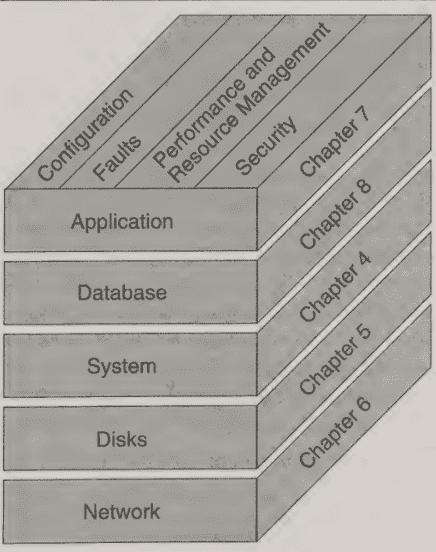

## 使用监控框架

第 2 章专注于 UNIX 系统中可能发生的事件集合。本书其余章节描述了用于监控这些事件的可用工具，包括用于不同组件（如系统、磁盘或网络）的工具；每个都在单独的章节中讨论。本章侧重于监控框架，它可以通过通用接口监控许多不同的组件和系统。

一些公司通过每天检查日志文件的大小来监控系统，例如系统日志文件。如果文件大于特定大小，则发生了不寻常的事情，操作员可以通过查看特定文件内容进一步调查。问题是，这可能非常耗时费力。可能存在大量重复消息，使得分析和修复每个单独问题变得困难。此外，这种技术可能无法确定问题的根本原因。最后，尽管每个记录的事件可能都有一个关联的严重性级别，但优先处理大量记录的消息可能很困难。

操作员花费大量时间监控系统控制台。小型数据中心可能通过 Microsoft Windows 计算机进行管理，定期（如每天）执行脚本以检查资源使用情况和计算机系统可用性。系统故障通过控制台上窗口的丢失或用户投诉来检测。较大的数据中心可能通过运行监控软件的工作站或服务器进行管理，例如 HP IT/Operations、Computer Associates 的 Unicenter 下一代（TNG），或 IBM 的 Tivoli 管理环境。这些产品可以在单个屏幕上图形化地显示许多系统的状态。

一些全面的监控产品可用于监控多个组件，通常提供开发工具包，以便您可以添加额外的监控器。这些产品被称为*监控框架*。如果产品具有额外的功能以帮助其在多个系统上进行部署，则被称为*企业管理框架*。由于学习第二个框架的成本、复杂性和所需时间，数据中心不太可能使用多个企业管理框架。


## 区分监控框架

客户们正在认识到管理工具的必要性，而企业管理框架提供商——例如拥有 IT/Operations (IT/O) 的惠普 (Hewlett-Packard)，以及拥有 Unicenter TNG 的计算机联合公司 (Computer Associates)——正面临提供低成本替代方案的压力。惠普和计算机联合公司都已宣布，计划将其软件的低成本版本与 HP-UX 服务器捆绑销售。企业 SyMON 是 Sun 系统上可用的一种低成本管理站，但由于它目前缺乏开发工具包，因此不是一个真正的监控框架。

根据《网络计算评论》 (Network Computing Review) 对最近企业框架的回顾，这些产品“……与其试图解决的问题一样复杂”。监控框架的设置可能很困难且非常昂贵，但好处是，你可以通过公共接口监控异构组件和系统。

本章介绍了可用于 UNIX 故障管理的一些框架。它列出了每个框架提供或可用的某些监控能力。希望这些描述能帮助你确定哪个框架（如果有的话）最适合你的环境。

在你的环境中，你可能需要使用多个监控框架。第 9 章简要描述如何整合这些工具的不同组合。

我们选择了多种框架在本章中进行讨论。每个框架都有其独特的优点和缺点。描述所有可用的产品会很难，但本章应该能让你了解任何你选择评估的产品所应具备的能力。本章旨在提供非常高层的功能概览；后续章节将更详细地讨论产品之间的差异。

对于每个产品，我们将描述其受监控组件的广度、通用监控功能与能力、设置便捷性、可扩展性方法（开发工具包）、通知灵活性以及诊断能力。这些属性通常在本开头部分进行描述。

## 受监控组件

本章中描述了每个产品的覆盖范围。在你选择框架之前，应确保所有你需要监控的组件都是可用的。一些产品，如计算机联合公司的 Unicenter TNG，可用的指标集比其他产品小，例如 BMC PATROL 及其知识模块 (KMs) 集合。

## 监控功能

关于监控功能的这部分描述了框架的通用监控能力，特别指出了任何不寻常的能力，例如 IT/O 的事件关联能力。

## 监控发现与配置

实际使用监控框架的第一步是确定其可用的资源监控器集合。执行此操作的方法因所使用的框架而异。

你可以通过多种途径获取资源监控器。有些在你购买计算机时免费提供，而其他一些则包含在企业框架中。监控器也可以作为框架的附加组件出售。另一种可能性是产品的监控器包含在产品本身中。例如，惠普在其许多网络产品中包含事件监控服务 (Event Monitoring Service) 监控器。

不同的框架采用不同的方法来帮助你找到可用的指标和要监控的组件。使用 MeasureWare 时，你利用惠普的在线帮助功能来探索可用的指标。其他工具则提供图形用户界面 (GUI) 来选择要安装或使用的监控器。

在确定可用的监控器之后，你需要选择并配置想要使用的那些。某些监控器在安装时自动配置，而其他监控器要求你手动定义通知标准和其他信息后才能使用。

## 监控开发工具包

框架的优势在于通过一致的接口监控所有资源。然而，框架不太可能涵盖所有你可能感兴趣的方面，特别是如果你有自定义应用程序的话。在这种情况下，你需要一种简单的方法来创建自定义监控器，以便与框架的其余部分无缝集成。

框架的一个定义特征在于它们提供了某种方法允许客户添加监控器，但这些方法各不相同。一些框架允许你通过脚本添加监控器，而其他框架则需要更多的编程工作。

## 通知方法

为了简化管理，你应该将所有事件发送到公共位置。例如，这可能是一个集中控制台或系统日志文件。从主控制台监控多个系统减少了对专门用于监控的额外硬件的需求。将消息发送到单一位置可以加快诊断速度并减少错误，因为操作员无需记住关键日志文件的名称，也无需记住检查各个日志。

控制台或日志文件需要随处可访问。当然，如果事件导致系统停机，系统日志文件将无法访问。在公司内部，系统操作员可能需要从远程网络访问日志。当需要远程访问时，网络可访问性和安全性可能成为关注点。

寻呼是一种日益常见的问题通知技术。根据系统管理员公会 (SAGE，一个 USENIX 技术小组) 最近的一项研究，大多数管理员现在在非工作时间都携带寻呼机。系统操作员可能会在家中收到寻呼以诊断问题，因此防火墙外的访问可能是一个问题。寻呼可能需要框架本身不提供的软件。此外，通过调制解调器进行远程访问可能需要终端接口。

理想情况下，系统操作员拥有一个具有网络和系统图形表示的管理工具以及事件日志文件。如果没有集中控制台来管理环境，操作员将被迫登录到系统（如果可访问的话），并使用本地日志文件进行故障排除。许多软件产品将错误信息写入系统日志文件，/var/adm/syslog/syslog.log。

通知可以简单得只是系统前面板显示的颜色变化。通知也可以更复杂，例如在操作员控制台上出现 ASCII 消息，颜色反映严重性，并建议或自动执行操作以尝试从问题中恢复。

行业标准通知方法包括简单网络管理协议 (SNMP) 陷阱 (traps) 和桌面管理接口 (DMI) 通知。SNMP 陷阱常用于 UNIX 操作系统，包括 HP-UX，用于事件通知。对 DMI 的支持仅在最近才添加到 HP-UX 中。

一些工具，如第 4 章和第 6 章中讨论的网络节点管理器 (NNM)，依赖从 UNIX 系统发送的 SNMP 陷阱来保持其网络拓扑和映射的更新。它们也可能使用 SNMP 定期轮询系统。

许多企业管理框架提供 SNMP 陷阱处理器，以便它们可以将事件作为陷阱接收，并在事件浏览器中记录和显示事件。管理站需要模板将 SNMP 陷阱转换为 ASCII 可读格式。用户可以配置这些模板。一些惠普和第三方产品分别提供 OpenView 模板。

由于 SNMP 使用不可靠的网络协议，一些管理框架提供了额外的可靠机制。例如，IT/O 使用一种名为 opcmsg 的专有远程过程调用 (RPC) 机制。使用 opcmsg，你可以确保收到通知。

在某些情况下，当发生事件时你可能不希望被通知，因为恢复操作可能已经发生。例如，当 MC/ServiceGuard 软件检测到网络接口卡 (NIC) 故障时，它会自动配置备用 NIC，网络流量透明地切换到新接口。然而，即使在这个简单的例子中，你可能仍然希望被通知，以确保故障 NIC 及时修复。

事件还可以发送到事件关联引擎，这些引擎可以为操作员执行一些事件处理和过滤。第 9 章对此进行了更详细的描述。

如果你有支持合同，你可能希望在出现问题时自动通知你的客户支持中心。惠普预测支持软件具有通过调制解调器向惠普响应中心发送事件的能力。

你需要确定你想要使用的框架是否有足够的一组可用通知方法。

## 诊断能力

比较框架的另一种方式是通过它们的诊断能力。例如，在你收到问题通知后，使用每个框架故障排除和解决问题的难易程度如何？一些产品，如 IT/O，可以为每个事件提供详细的指导信息。


除了确定哪里出了问题，您可能还需要采取纠正措施。对于某些产品，这些措施可以预先定义，并在事件到达时自动执行。在某些情况下，这些措施是可用的，但需要由操作员执行。您还需要能够轻松记录所采取的任何措施的结果，以有助于跟踪问题解决状态。

#### IT/Operations

IT/Operations (IT/O) 是一个 HP OpenView 应用程序，提供集中操作和问题管理。IT/O 是一个软件包，不仅包括用于网络管理的 NNM，还提供系统管理领域的功能。通过 IT/O，提供了使操作员能够共享管理站软件，并对不同的受管系统组或事件类型承担个别职责的设施。

IT/O 使用运行在每个受管系统上的智能代理来监控和收集管理信息、消息和警报，并将这些信息发送到集中控制台。代理还可以在不与管理站通信的情况下执行本地操作。在接收到事件后，IT/O 可以启动自动纠正措施，或提示操作员运行预定义的操作员发起的操作。当操作员阅读单条消息时，会提供指导，并可能建议进一步的措施以解决问题或恢复。

IT/O 有四个主要窗口：

- **Node Bank：** 以图标形式显示操作员管理的系统，并允许将图标组织成节点组，然后可以从节点组窗口查看。
- **Message Groups：** 显示逻辑消息组，例如性能、Oracle 和备份。消息组作为在消息浏览器窗口中组织消息的一种方式。
- **Message Browser：** 显示管理服务器接收到的事件，包括说明、注释、自动操作的结果、执行的操作和确认。
- **Application Bank：** 提供访问常用诊断和管理应用程序的功能。

这四个主要的 IT/O 窗口如图 3-1 所示。

消息浏览器可以过滤掉您不关心的系统的消息。如果您只负责特定的系统功能，如性能，您可以配置消息浏览器以仅显示来自特定消息组的那些消息。

## 受监控组件

如前所述，IT/O 在系统监控的多个方面提供协助，特别是故障以及资源和性能管理。IT/O 还可以通过其预定义的监控根登录尝试的模板来帮助安全监控。

**图 3.1 IT/O 主窗口。**

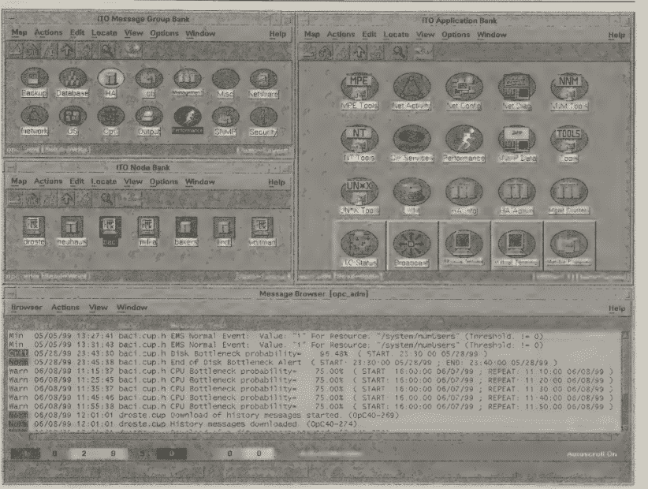

IT/O 附带预定义的监控器和模板。模板用于配置监控器，定义消息条件，并匹配接收到的事件上的模式。模板还定义事件浏览器消息文本、严重级别、消息组、说明和操作。监控器针对电子邮件、CPU 利用率、交换区利用率和文件树利用率等进行了预定义。日志文件模板监控系统日志文件中的系统错误、su（切换用户）事件、登录、注销和内核消息。可以修改模板和消息条件，以便在特定条件下向操作员发送寻呼。

许多其他工具嵌入 IT/O 以提供额外的监控和管理功能。IT/O 有用于受管节点的附加模块，称为 SMART Plug-Ins (SPIs)。这些模块通过模板和监控器提供数据库和应用程序的定制知识。例如，有适用于 SAP R/3、Baan、Oracle 和 Informix 的 SPI。ClusterView 是一个 HP OpenView 应用程序，提供高可用性集群的监控。结合进行网络和系统监控的能力，IT/O 可以为监控所有组件提供一致的界面。

IT/O 提供多平台支持。IT/O 控制台可用于 HP-UX 和 Sun 平台。IT/O 可以管理 HP-UX、Sun Solaris、IBM AIX 和其他平台，包括 Windows NT。

## 监控功能

每个被监控的系统都必须安装 IT/O 受管节点软件。此软件包括 IT/O 的智能代理，用于监控和收集数据，执行操作，并将消息发送到 IT/O 管理控制台。

受管节点显示在节点银行窗口中。系统状态通过节点银行中节点图标的颜色反映。传播规则可在 IT/O 中配置。例如，节点图标的颜色可以代表消息浏览器中最严重的未确认事件的严重性。

IT/O 代理是区分 IT/O 产品的关键。代理被认为是智能和自治的，因为它可以在不需要操作员干预的情况下采取操作。IT/O 代理对被监控资源执行本地轮询，并可以在将事件转发到管理站之前过滤掉冗余或不必要的事件。这可以减少一些网络流量，并帮助避免操作员的信息过载。代理还可以进行事件关联，进一步减少网络流量。可以通过合并来自多个事件的数据来创建新事件。IT/O 关联引擎还可以基于事件的缺失得出结论。

如果 IT/O 代理失去与管理站的连接，它可以继续自主监控并采取自动化措施。代理将存储事件，以便当管理站恢复时，不丢失任何事件。代理还使用安全可靠的远程过程调用（RPC）机制 opcmsg 与管理站通信。

当操作员需要一致地管理大量系统时，IT/O 很有用。模板可以修改然后下载到一组系统，使操作员能够以相同的方式监控许多系统。换句话说，可以为所有系统以一致的方式设置监控。

IT/O 接收传入事件（如 SNMP 陷阱），执行过滤，并将事件交付给已注册通知的其他进程。

IT/O 接收的事件存储在一个中央存储库中，提供永久历史，并允许未来分析和审计。事件按时间顺序排列并按严重性标记。发送消息的系统名称和时间戳与每个事件一起存储。附加信息包括事件类型和发送事件的应用程序。当提供自动化措施时，会给出操作是否成功的指示。注释可用于显示操作的输出。

可以在管理站上使用过滤来减少在消息浏览器中可见的事件数量。过滤器可以基于严重性、源系统、消息组或其他类别。

消息浏览器中的事件可能是 SNMP 陷阱、由 IT/O 代理进行的日志文件监控或 IT/O 监控应用程序发出的 opcmsg 调用的结果。事件可能指示故障、状态变化、配置变化、性能阈值超出等。事件保留在消息浏览器中，直到被确认。事件也可以转发到其他管理站或故障工单系统。

IT/O 允许您将角色分配给操作员，以便每个人可以负责不同的事件、节点、消息组或应用程序。

能够确保您启用的任何监控保持启用状态很重要。您不希望丢失关键事件。因为 IT/O 代理负责定期获取监控数据，您需要确保代理始终运行，可以通过使用 IT/O 监控任意进程的能力来实现。代理也可以自动重启。

### 监控器发现和配置

安装智能、自治代理后，它们根据分配给本地系统的模板监控资源。IT/O 附带一组用于定义监控条件、阈值和事件消息的模板。模板可以包括配置的操作，无论是自动的还是操作员发起的。这是您可能希望配置像寻呼这样操作的地方。

消息模板窗口显示当前在 IT/O 中配置的消息模板。模板被分组。例如，为 HP-UX 10.x 系统存在一个模板组。

从节点银行窗口，您可以将模板分配给您的受管节点或节点组。分配所有模板后，您需要安装或更新受管节点上的 IT/O 软件和配置。这可以在一个或多个受管节点上完成，以便您可以快速为多个系统设置监控。通过 IT/O，模板被推送到每个受管节点，以便 IT/O 代理然后可以监控、过滤信息、转发消息并在不需要与管理站通信的情况下执行本地操作。

用于接收 SNMP 陷阱的消息模板可用。消息条件被定义以指定在消息浏览器中显示哪些消息、显示消息的格式，以及当 SNMP 陷阱匹配定义的消息条件时应执行的操作。

可以在模板中指定消息组。当匹配消息条件时，事件被分配给配置的消息组。当委派操作员职责时，这很有用。在配置操作员时，同时分配节点组和消息组职责。例如，您可以将所有 HA（MC/ServiceGuard）消息分配给负责监控 MC/ServiceGuard 集群的操作员。

配置监控时，您还可以在模板中包含说明或配置要执行的操作，无论是自动还是由操作员手动触发。

如图 3-2 所示，您可以从消息源模板窗口将模板分配给节点银行中的节点，以配置监控和事件管理。

## 监控器开发工具包

IT/O 为 CPU 利用率、磁盘空间和其他资源提供默认监控器。IT/O 还允许用户创建自己的监控脚本。基于脚本的监控器依赖于 IT/O 代理来轮询信息，但代理然后可以代表它们发送通知。


## 图 3-2 IT/O 模板分布

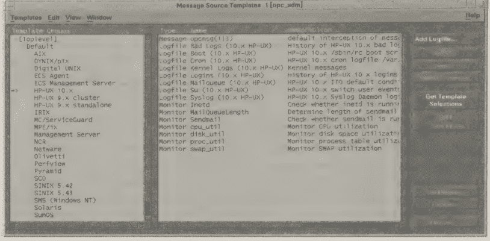

IT/O 还允许您创建自己的监视器（monitors）和模板。例如，您可以创建一个模板来监视任意的 MIB 变量，如网络接口状态。然后，IT/O 代理程序会定期查询 MIB 对象，以确定是否应生成消息。或者，您可以创建由 IT/O 代理程序定期调用的自定义监视器程序或脚本。这些监视器或脚本可以发送由 IT/O 代理程序发出的通知，或者通过 opcom API 发送 IT/O 通知。监视器还可以发送异步事件，这通常比轮询机制更高效。IT/O 用户界面还可以用于设置对指定日志文件的监视，例如系统日志文件。因此，集成新监视器的一种简便方法是先将有趣的事件写入日志文件。

## 通知方法

IT/O 能够接收来自 SNMP 陷阱（SNMP traps）的事件。IT/O 还使用 opcomsg 将事件从 IT/O 代理程序转发到管理站。如果管理站暂时不可用，本地代理程序可以缓冲事件。

opcom API 可用于将监视对象的当前值转发给 IT/O 代理程序。然后，代理程序将该值与配置的阈值进行检查。如果满足阈值，则事件会被转发到 IT/O 管理站。在消息转发之前，会执行本地操作，这可能包括记录日志或抑制消息。此外，消息模板可以配置自动操作，例如生成电子邮件消息或寻呼机通知。

IT/O 还提供了一种称为“跟随太阳”（follow the sun）的功能，该功能可以根据时间将事件转发到全球环境中适当的 IT/O 管理站。例如，如果您在亚洲（日本）、欧洲和北美拥有配备管理站的数据中心，每个数据中心都可以负责每天 8 小时的监控系统，从而共同提供全天候的覆盖。

## 诊断能力

IT/O 提供了通过模板配置自动操作和操作员发起操作的能力。您可以配置 IT/O，使其在接收到符合配置消息条件的事件时自动执行操作。例如，当 IT/O 接收到 MC/ServiceGuard 事件时，针对该事件的 ClusterView 模板可以运行自动操作，从 /var/adm/syslog/syslog.log 和 MC/ServiceGuard 日志文件中提取有关该事件的额外数据。这些数据对于操作员来说是可用的，可以通过消息浏览器（Message Browser）获取注释（annotation）来访问。

消息模板还可以包含指令文本，提供关于操作员在接收到特定事件时应采取哪些措施的更详细信息。

IT/O 在应用程序库（Application Bank）中提供了多种可用于诊断问题的工具，包括用于监视本地系统的工具以及用于诊断问题的远程访问工具。应用程序库包括来自 HP 产品、其他集成产品以及用户生成的工具。

应用程序库中的应用程序以图标的形式表示。操作员选择代表目标系统的图标，然后选择要在该系统上运行的工具的图标。您可以调出 telnet 窗口，或者对于 HP-UX 系统，可以在存在问题的系统上运行系统管理管理器（System Administration Manager, SAM）。您可以从中央管理站检查任何 UNIX 系统的打印状态或 CPU 负载。

应用程序库具有两级层次结构，其中相似的应用程序被分组在一个应用程序组中，表示为顶级图标。打开应用程序组图标会显示一个窗口，其中包含该组中的所有应用程序库工具。

IT/O 还将性能管理与故障管理紧密集成。您可以从 IT/O 内部启动 GlancePlus 或 PerfView。这些性能管理产品在后续章节中将有更详细的描述。可以收集、关联并展示来自多个节点上多个 IT/O 代理程序（如 SMART 插件）的数据，这些展示体现在从 IT/O 管理站启动的单个 PerfView 图表中。这些图表可以在 IT/O 消息浏览器中选择的事件上下文中启动。

Hewlett-Packard 还将其 GlancePlus Pak 2000 产品与预配置的 IT/O 单系统版本相结合。基于 Java 的 GUI 提供诊断应用程序和事件浏览器。只要每次连接一个系统，该产品就允许您连接到来自多个系统的信息。

GlancePlus Pak 2000 包含其企业版的智能代理技术，使其能够从各种来源收集事件并执行自动化操作。在事件浏览器接收到事件后，操作员可以触发一些预定义的恢复操作。

## 附加信息

欲了解更多信息，请访问 HP OpenView 网站：http://www.openview.hp.com/。

#### Unicenter TNG

Computer Associates 的 Unicenter 下一代（The Next Generation, TNG）是一个企业管理平台，提供图形状态监视。它为异构系统企业提供服务和管理网络管理。Unicenter TNG 为您环境中的所有资源提供监视和管理，包括系统资源、网络、数据库和应用程序。

Unicenter TNG 提供了一个集成管理解决方案的框架，通过通用基础设施管理所有 IT 资源。TNG 框架本身包括以下组件：自动发现、对象存储库、现实世界（Real World）接口、事件管理、日历管理、报告、病毒检测和桌面支持。配合供应商、第三方和定制应用程序，Unicenter TNG 为企业提供了增强的管理和维护能力。

通用对象存储库（Common Object Repository）存储了用于创建现实世界图形视图的信息。您可以使用类浏览器（Class Browser）、对象浏览器（Object Browser）或拓扑浏览器（Topology Browser）浏览存储库。使用对象视图（ObjectView），您可以获取设备性能的详细信息，甚至对数据绘图。

现实世界接口提供可基于业务功能、地理位置或任何逻辑分组进行组织的图形视图。这些视图可以以二维或三维方式显示企业的拓扑结构。这些视图可用于查看环境中系统和资源的状况。

Unicenter TNG 采用分布式管理方法进行管理。分布式代理负责监视和控制。集中式管理器在整个企业中提供核心管理，包括来自一个或多个代理的数据关联、工作负载管理和作业管理。代理根据管理器提供的策略进行监视和控制。

### 被监视组件

Unicenter TNG 提供了可用的代理来监视 CPU 和内存、交换区（swap）使用情况以及文件系统空间。您还可以监视文件大小和修改。日志文件中的消息也可以定期进行检查。

代理在受管节点上运行并收集数据，应用过滤器，并在必要时报告。有些代理代表管理器提供控制或执行功能。代理发送通知并可被轮询。它们还可以收集性能数据，或配置为基于阈值发送事件并执行操作。

### 监视功能

核心 Unicenter TNG 产品包含用于多种系统管理功能的模块：网络管理、日历管理、软件分发、事件管理、用户/安全管理、工作负载管理、磁带/文件管理、打印/后台作业管理以及报告。Unicenter TNG 客户最常使用的管理组件是数据库、事件和性能管理。

有可用的代理可以执行阈值监视并采取自动或手动操作。可以基于在指定时间段内测量的指标发送警报。也可使用用于事件关联的分布式状态机。

CA Unicenter/DB Alert 是数据库和数据库应用程序的系统监视器。CA Unicenter/System Alert 是一个客户端/服务器应用程序，提供某些系统和应用程序级的监视。CA Unicenter/AP（Automation Point）和 CA Unicenter/AHD（Advanced Help Desk）有助于问题升级、通知和事件跟踪。

Unicenter TNG 构建在 Unicenter 系统管理工具套件之上。它允许您配置业务视图，以便操作员可以基于业务流程（如采购、库存或工资）来监视系统，而无需显示未涉及的相关资源和系统。

Unicenter TNG 的一个独特功能是其现实世界接口，它是计算环境中被监视对象的三维视图。受管对象也可以以二维、树状视图或文本形式显示。

关于受管对象的信息存储在对象存储库中。提供了搜索和查询工具，以便管理应用程序从数据库中提取信息。

Unicenter 的工作负载管理（Workload Management）功能可用于调度和监视作业。失败的作业可以自动重新启动。工作负载管理还可以确保作业不会超出其配置的时间限制运行。

Unicenter 的后台作业管理（Spool Management）功能可用于监视 UNIX 后台作业守护进程或打印设备的状态。它可以启动和停止守护进程，或更改已排在打印机队列中的打印作业。

## 监视器发现和配置

Unicenter TNG 提供对网络化对象（包括企业内部系统和其他资源）的自动发现。信息存储在通用对象存储库中，并可以在现实世界接口中以拓扑方式显示。还可以使用发现过滤器将发现限制在特定子网内，或指定 Unicenter TNG 应发现的资源类型。除了网络发现外，如果系统在系统上安装了 Unicenter 智能代理，则可以发现更多内容。

Unicenter TNG 中提供了集中的事件控制台日志（Event Console Log）GUI，用于接收来自整个企业的事件，包括写入系统日志的任何系统或应用程序消息。用户可以配置来自其他日志文件的额外消息发送到事件控制台。事件显示时包含时间戳、发送消息的系统、消息文本和其他信息。可以为每个事件配置自动操作。操作可以基于接收到的消息的模式匹配。消息也可以转发给其他事件管理器。

为了查看代理并获取有关代理的信息，Unicenter TNG 提供了 MIB-II 代理视图以查看 MIB-II 信息、节点视图、分布式状态机（Distributed State Machine, DSM）视图以及事件浏览器。DSM 视图跟踪跨越网络的物体状态。它从存储库和代理收集信息，以维护物体的状态


## 开发人员套件监控

提供了一个代理工厂，使软件开发人员能够将他们自己的监控器集成到 Unicenter TNG 中。这与 EMS 开发人员套件类似，后者用于将新监控器集成到 EMS 环境中。还提供了一套软件开发人员工具包，以帮助其他供应商将应用程序集成到 Unicenter TNG 中。

## 通知方法

管理代理可以检测事件条件并将其转发到管理站。这些事件以 SNMP 陷阱的形式发送。

## 诊断功能

Unicenter TNG 不提供其他产品（如 IT/O）中可用的高级事件关联功能。事件控制台可以与其他功能（如问题管理）集成，用于自动识别和升级某些问题。当事件到达管理站时，可以自动生成故障工单。

事件管理是 Unicenter TNG 提供的核心功能之一。事件管理的核心位于 Unicenter TNG 事件控制台。在这里，您可以配置策略以自动响应特定事件、转发事件、过滤不重要事件、关联来自多个代理的事件，并将事件馈送到 DSM。

Unicenter TNG 不提供性能数据的持续收集，也不提供通过集成 IT/O、PerfView 和 MeasureWare 所发现的高级深入诊断功能。

## 附加信息

有关 Computer Associates 的更多信息可在其网站 http://www.cai.com/unicenter/ 上找到。

#### 事件监控服务

事件监控服务（EMS）是 HP-UX 的监控框架。它为监控器配置和事件通知提供了通用接口。使用 EMS 开发人员工具包，监控器以通用方式开发。虽然框架本身免费可用，但某些 EMS 监控器是单独出售的、随其支持的产品一起提供的，或与系统捆绑提供的。

EMS 监控器主要在故障和资源管理方面提供帮助。性能监控通常需要更复杂的工具。一些系统故障和资源监控功能由 HA 监控器产品和 EMS 硬件监控器提供。其他 EMS 监控器使您能够检测系统资源（如文件描述符、共享内存和系统信号量）何时变得不足。

### 监控组件

多个 HP 产品包含特定的 EMS 资源监控器，因此可供监控的资源因客户安装软件产品而异。由于硬件配置不同，可供监控的资源也因系统而异。

EMS 硬件监控器随在线诊断捆绑包提供，该捆绑包在 HP-UX 支持介质（也称为 HP-UX 诊断/IPR 介质）上可用。EMS 硬件监控器提供了检测和报告系统硬件资源（如设备错误和组件故障）问题的能力。系统硬件组件和各种 HP 存储产品（包括系统内存、SCSI 磁盘和磁带设备、AutoRAID 磁盘阵列、高可用性磁盘阵列和存储系统、快速/宽 SCSI 磁盘阵列、各种光纤通道组件、磁带自动装载机和数字线性磁带）均可使用监控器。

HA 监控器包含多个用于监控文件系统空间、网络接口状态、磁盘状态和 MC/ServiceGuard 集群状态的 EMS 监控器。HA 监控器还提供 CPU 负载和系统用户数量的监控。监控器还包括数据库监控。

HP 的 ATM 适配器和 HyperFabric 适配器也可以使用 EMS 进行监控。每个这些产品都包含一个 EMS 监控器。这些资源还与 MC/ServiceGuard 集成。例如，HA ATM 在发生故障时首先尝试执行本地恢复，但如果无法提供本地恢复，它会通知 MC/ServiceGuard 触发到备用节点的故障转移。

所有可以监控的不同资源都包含在一个单一的 EMS 资源层次结构中。包含系统硬件和内核资源的层次结构部分如图 3-3 所示。在 EMS GUI 中配置监控器请求时，您会看到整个资源层次结构。

## 监控功能

EMS 旨在用于高可用性环境。用户只能选择要监控的关键组件，因此资源监控器不会延迟轮询非关键组件的信息。这与 IT/O 等其他工具不同，后者通常从所有组件收集数据。IT/O 代理执行系统级命令，然后解析输出。因此，如果非关键组件挂起，IT/O 代理可能会不必要地延迟等待其响应。相比之下，EMS 监控器只查询关键组件。

HP-UX 上的多个系统组件已使用 EMS 事件管理库来提供监控。IBM 最近宣布了一套类似的称为 Phoenix 的事件管理例程，用于其 AIX 环境，希望其软件开发合作伙伴采用。Sun 未为 Sun Solaris 提供事件管理库。

EMS 是允许资源监控器向 MC/ServiceGuard 发送事件的唯一方法，这再次反映了其对高可用性的重视。EMS 还可以通过 SNMP、opcmq、TCP、UDP 和电子邮件发送通知，并可以写入控制台、指定文本文件或另一个应用程序。

EMS 提供了一些关键功能。它旨在为用户提供一种一致的方法来启用不同系统组件的监控，这是通过 EMS SAM GUI、MC/ServiceGuard SAM GUI、硬件请求管理器（monconfig）和一组 EMS 库例程完成的。

在配置监控条件时，您可以选择在每个轮询间隔、值更改或达到某个配置阈值时请求通知。轮询间隔可以从 30 秒到 1 天不等。

您可以配置随事件一起发送的附加信息，为使用 EMS 的特定环境提供定制。此外，当事件发生时，资源监控器可以包含额外的资源特定信息以帮助问题诊断。

EMS 是考虑到系统性能而创建的。只有当用户要求监控至少一个资源实例时，EMS 资源监控器才会运行。此外，同一监控器进程可以并发监控多个资源实例。提供 EMS API 以便监控器在适当的时间间隔检查资源。异步接收资源信息的监控器不需要使用这些 API，因此可以更高效地运行。这使得可以在微秒内接收事件通知，而无需承受频繁轮询的系统性能惩罚。

EMS 警报是为每个客户端单独配置的。其他产品（如 MeasureWare）的警报是系统范围的。EMS 比其他需要等待汇总时间间隔到期的工具能更快地检测问题。然而，EMS 没有持续时间或复合条件的概念，这些概念可以与警报相关联。

EMS 请求是按客户端进行的。目标“用户”可以接收定制的事件数据，而另一个“用户”可以为同一事件接收不同的数据。EMS 监控器数据使监控器能够为事件提供定制数据。

为了确保受监控的资源继续被监控，EMS 提供了“持久性客户端”。EMS 持久性客户端检测监控器失败并自动重启它。

### 监控器发现和配置

EMS 为可监控资源的发现和配置提供了一致的 GUI。可从 SAM 获取的 EMS GUI 可以自动发现系统上可用的资源监控器集合。资源实例可能因硬件和软件配置不同而因系统而异。使用 EMS，您可以定义指示何时应发送通知事件的的条件。通知可以在定期间隔、组件状态更改或满足阈值条件时发送。EMS 还允许您配置应发送事件的位置。

#### 图 3-3 EMS 资源层次结构

```
/system/numUsers
/system/jobQueue1Min
/system/jobQueue5Min
/system/jobQueue15Min
/system/events/memory/<instance>
/system/status/memory/<instance>
/system/filesystem/availMb/<filesystem_name>
/system/kernel_resource/process_management/nproc
/system/kernel_resource/file_system/nfiles
/system/kernel_resource/file_system/nfile
/system/kernel_resource/misc/ncllout
/system/kernel_resource/system_v_ipc/shared_memory/shmni
/system/kernel_resource/system_v_ipc/semaphore/semni
/system/kernel_resource/system_v_ipc/semaphore/semns
/system/kernel_resource/system_v_ipc/message/msgmni
/system/kernel_resource/system_v_ipc/message/msgseg
/system/kernel_resource/system_v_ipc/message/msgtql
/storage/events/disks/default/<path>
/storage/events/tape/SCSI_tape/<path>
/storage/events/disk_arrays/High_Availability/<path>
/storage/events/disk_arrays/FW_SCSI/<path>
/storage/events/enclosures/ses_enclosure/<path>
/storage/status/disks/default/<path>
/storage/status/tape/SCSI_tape/<path>
/storage/status/disk_arrays/High_Availability/<path>
/storage/status/disk_arrays/AutoRAID/<ID>
/storage/status/disk_arrays/FW_SCSI/<path>
/storage/status/enclosures/ses_enclosure/<path>
/adapters/status/FC_adapter/<path>
/adapters/events/FC_adapter/<path>
/net/interfaces/lan/status/<interface_name>
/net/interfaces/switched/atm/<emulated_lan_name>
/net/interfaces/clic/status/<instance>
/net/subnetwork/osi/x25subnet/status/<x25_instance>
```


## EMS 要求在每个本地节点上发起监控请求

EMS 要求监控请求必须在每个本地节点上发起；然而，这也允许针对本地系统定制监控请求，从而只需监控关键资源。由于缺乏轻松实现跨多个系统监控的能力，不应将 EMS 视为一个企业级框架。

使用 EMS GUI 来配置每个被监控的资源实例可能会耗费大量时间。EMS 配置 GUI 支持使用通配符以简化配置。此外，随在线诊断工具（Online Diagnostics）提供的 EMS 硬件监控器已预先配置好。如果您正在使用 IT/O，有一个名为 `monvols` 的工具可以帮助您配置所选系统的所有逻辑或物理卷。当从 Web 上的 [http://www.software.hp.com/products/EMS](http://www.software.hp.com/products/EMS) 下载 EMS 开发人员工具包（Developer's Kit）时，`monvols` 工具以及其他 EMS 工具和模板均可免费获取。但请注意，`monvols` 仅适用于 HP-UX 10.20。

要配置大多数 EMS 监控器，您需要使用 SAM。从其资源管理（Resource Management）功能区域，您可以选择事件监控服务（Event Monitoring Service）以启动 EMS GUI，然后添加一个新的监控请求。初始配置界面如图 3-4 所示。

### 图 3-4 初始 EMS 配置界面

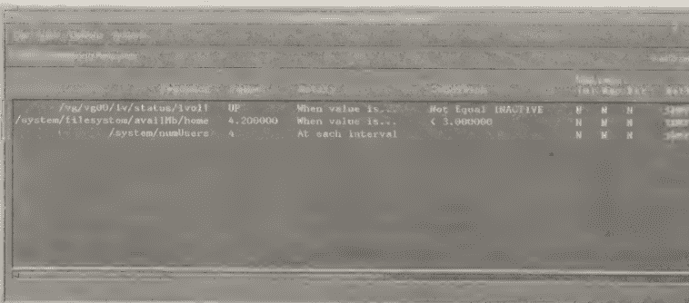

MC/ServiceGuard 提供了一个 GUI，以及命令行和配置文件选项，用于将包配置为依赖于 EMS 资源。在这种情况下，事件通知直接从资源监控器发送到 MC/ServiceGuard。

EMS 配置工具允许用户配置要监控的资源或资源组。用户根据客户环境中可用的应用程序选择所需的通知类型。例如，如果事件应发送到 OpenView 管理站，用户可以选择 SNMP 通知。SNMP 也可用于将事件发送到其他管理站，如 IBM NetView、Tivoli 或 CA Unicenter TNG。如果使用 IT/O，则在 IT/O 管理的节点上可提供 `opcmsg` 通知。虽然 EMS 常与 HP OpenView 等管理平台一起使用，但并不要求必须使用 HP OpenView。例如，如果客户编写了自定义故障恢复应用程序，该应用程序可以使用 TCP 或 UDP 直接接收事件通知。

EMS 配置工具还允许您浏览可动态监控的资源列表。这使得资源监控器能够监控不同系统上的不同资源实例，并为操作员提供查找可用监控器的标准接口。然后，您可以为每个系统定制监控。虽然 EMS 提供了更多的灵活性，但配置起来也更困难，因为配置通常每个系统只做一次。

首先，操作员浏览可用资源。然后，他或她选择要监控的资源并指定监控参数，如阈值和轮询间隔。在发出监控请求后，操作员将返回到 EMS 主屏幕，在那里显示所有活跃的 EMS 监控请求。

EMS 硬件监控器配置通过使用硬件监控请求管理器（Hardware Monitoring Request Manager）`monconfig` 来完成。通知条件可以以一致的方式为系统上所有支持的硬件资源进行配置。当向系统添加硬件时，可以自动启用监控，并以与类似硬件监控方式保持一致的状态。

如果请求 SNMP trap 或 `opcmsg` 通知，通常需要在管理站上进行额外配置。EMS 提供了模板，可在 OpenView NNM 或 IT/O 中使用，以识别和格式化 traps 和 `opcmsg` 通知，以便在其各自的事件浏览器中查看。

## 监控开发人员工具包

EMS 提供了一套开发人员工具包（Developer's Kit），以便客户和第三方轻松集成或编写自己的 EMS 监控程序。客户可以定义自己重要的资源进行监控。使用 EMS 开发人员工具包还能确保监控器以标准方式运行。

EMS 开发人员工具包含编写自定义资源监控器所需的头文件和库。为监控器提供了监控 API，用于接收请求、在轮询间隔期间等待以及发送通知。还提供了一个示例监控器。实际检查资源值的机制取决于资源，但提供了 API 来确定是否应基于资源值发送通知。监控器提供者无需编写代码来发送不同类型的通知（如 SNMP traps 或电子邮件）；这些由 EMS 框架处理。

本章介绍的所有产品都提供了某种机制，允许您添加自己的资源监控器。EMS 监控器更难以开发，因为它们要求您编写程序，而不仅仅是编写一些脚本。然而，EMS 提供了更多的灵活性，因为其监控器不必依赖 HP-UX 命令来收集数据。

关于如何使用 EMS 开发人员工具包的信息包含在从 HP 软件网站可下载的其他软件中。您可以在 [http://www.software.hp.com](http://www.software.hp.com) 的高可用性软件（High Availability Software）产品类别下找到开发人员工具包、HP OpenView 模板和其他工具。EMS 手册可在 [http://docs.hp.com/hpux/ha](http://docs.hp.com/hpux/ha) 上获取。

## 通知方法

EMS 专门设计用于支持高可用性资源的监控。因此，它支持使用 HP 专有接口向 MC/ServiceGuard 发送通知。然而，EMS 可以在没有 MC/ServiceGuard 的情况下使用，并且支持异常多样化的通知选项，包括：

- SNMP traps
- IT/O 的 RPC 机制（`opcmsg`）
- 电子邮件
- 日志记录到系统日志文件、控制台或特定日志文件
- UDP 或 TCP 消息

通知是基于每个请求发送的，这提供了额外的灵活性。可以同时处理多个 EMS 事件，如以下示例所示：

- 客户端 A 通过 SNMP 请求事件 1
- 客户端 A 通过 `opcmsg` 请求事件 2
- 客户端 B 通过 TCP 请求事件 1
- 客户端 B 通过 TCP 请求事件 3
- 客户端 C 通过 `opcmsg` 请求事件 3

当事件发生时，通知将发送给指定的客户端。

## 诊断功能

EMS 允许监控器在事件通知中提供任意数据，最多 10,000 字节。此信息可以针对每个事件通知而独一无二，并且可以包含关键的诊断信息。例如，磁盘故障事件可以在其监控数据区域中包含故障磁盘设备的序列号。额外的文本可以描述如何修复故障组件。利用此功能的监控器提供者必须记录操作员应如何解读此信息。

EMS 硬件监控器提供有关事件原因的详细信息，并给出建议的操作。

与其他产品（如 Unicenter TNG）不同，EMS 不提供对事件进行自动响应操作的能力。但是，通过配置 TCP 或 UDP 通知方法，您可以将事件发送到您自定义的故障恢复应用程序。如果 EMS 与 IT/O 一起使用，您也可以在 IT/O 中配置模板和恢复操作。

## 附加信息

EMS 框架可免费从 HP 获取，包含在支持媒体和应用程序 CD-ROM 上的在线诊断工具（Online Diagnostics）中。

有关 EMS 的最新信息，请访问 HP 高可用性网站 [http://www.datacentersolutions.hp.com/2_3_index.html](http://www.datacentersolutions.hp.com/2_3_index.html)。EMS 手册和发布说明可在 [http://docs.hp.com](http://docs.hp.com) 的高可用性（High Availability）部分获取。

您可以在网络 [http://docs.hp.com/hpux/systems](http://docs.hp.com/hpux/systems) 上了解更多关于 Hewlett-Packard 诊断工具（包括 EMS 硬件监控器）的信息。

## PLATINUM ProVision

PLATINUM technology, Inc. 有一套名为 ProVision（最初名为企业性能管理）的产品套件。ProVision 产品套件收集服务器、数据库和网络性能信息，并包含四个组件：DBVision、ServerVision、WireTap 和 TransTracker。数据可以通过在受管系统上本地运行或通过远程网络运行的代理进行收集。除 TransTracker 外，所有这些组件共享同一个 ProVision 控制台，这是一个 NT 或 X Windows GUI。

ProVision 有收集性能数据的代理，然后将其存储在数据库中。配置参数确定何时归档、删除和压缩数据。这些参数可以针对每个单独的指标有所不同。提供实用程序来导出和导入归档数据。

PLATINUM 还提供软件分发和远程执行（AutoXfer）、问题解决（Apriori）、安全（AutoSecure）、数据仓库、灾难恢复和容量规划方面的解决方案。

PLATINUM 工具通过一个名为 PLATINUM Director 的接口访问，该接口通过不同的用户可配置视角提供监控。操作员可以使用图形视图（显示系统资源或应用程序的状态）或类似 Windows 资源管理器的视图（以分层树格式列出系统）。从 Director 控制台，管理员首先可以看到事件和系统状态的高层视图，然后深入细节以采取操作。警报窗口显示事件的状态和描述，并提供来自下拉菜单的事件特定操作。

从 Director 资源管理器视图，管理员可以选择一个系统，然后启动其他工具（如作业调度器）来查看系统的作业状态。可以启动 AutoXfer 工具来分发软件。

AutoSecure 和 AutoSys 已获得 MC/ServiceGuard 认证。AutoSys 和 Apriori 已与 HP OpenView 集成。与 Tivoli TME 进行了更完整的集成。

### 被监控的组件

DBVision 是 PLATINUM 用于数据库监控的产品。DBVision 收集数据库统计信息，并支持 Oracle、Sybase、Informix 和 DB2。诸如资源阈值之类的事件可以从不同的数据库发送到中央控制台，在那里可以采取纠正措施。DBVision 可以检测到诸如可用表空间耗尽、进程等待锁以及失控进程等问题。


ServerVision 收集服务器性能数据。指标包括 CPU 使用率和交换空间使用情况。该产品还可用于查看哪些用户占用了系统资源。ServerVision 支持 Sun Solaris、HP-UX、IBM AIX、NT 和其他操作系统。它监控和管理 UNIX 和 NT 服务器的性能，并为其他工具（如 PLATINUM 的作业调度器 AutoSys）提供系统级指标。AutoSys 提供动态负载平衡和批处理队列控制。

WireTap 显示网络段的利用率。标准产品按传输协议、网络协议、应用程序等对网络利用率进行分类。可选模块可以为 Oracle 和 Sybase 请求以及 Web 流量提供额外的统计数据。

TransTracker 是一个用于测量事务的系统、数据库和网络使用情况的预部署工具。TransTracker 无需对应用程序进行插桩，即可通过从网络数据包中收集数据来识别事务。

WireTap 也可用于测量事务响应时间。WireTap 通过捕获数据包级别的数据并按协议（如 HTTP 或 TCP）进行分类来进行网络监控。用户可以识别需要查找的 SQL 语句，并定义报警阈值，以便在事务响应时间未达到要求时发送通知。可以提供 HTML 请求的 Web 性能数据，以及 Web 服务器的“命中”率。报警信息可以发送到 ProVision 控制台，或通过事件适配器发送到 Tivoli 事件控制台。

PLATINUM 提供多种数据库产品。提供用于数据库监控、数据库管理和数据库性能瓶颈识别的解决方案。

诸如 Enterprise DBA 和 TSReorg 等数据库工具提供用户管理、模式、内容管理以及数据库重组功能。Enterprise DBA 的管理任务可以跨越不同的数据库执行，支持 Oracle、Informix 和 DB2 数据库。使用远程代理执行对数据库的更改。TSReorg 同时支持 Oracle 和 Sybase 数据库。它可用于重组数据库表、索引和表空间。TSReorg 与 DBVision 集成，以便针对事件自动采取纠正措施。可以监控表空间并自动触发数据库重组。可以在数据库保持在线的状态下重组表空间。TSReorg 还可用于图形化查看数据库结构，显示数据库碎片所在的位置。

## 监控功能

ProVision 包含用于收集性能数据的代理程序和用于显示性能图表的 GUI。ProVision 可以与此书中稍后讨论的产品 MeasureWare 和 PerfView 的组合进行比较。

可以通过 GUI 控制台或基于字符的接口访问性能数据。可以呈现实时数据和历史数据。控制台可以显示来自多个数据库实例和服务器的性能数据。信息可以显示为条形图、基于时间的图表、图表和表格显示。您还可以创建自己的显示，并使用自定义的图形组合。

ProVision 允许您使用多个阈值和不同严重程度配置报警。可以在每个严重程度级别配置操作。操作包括多种通知选项，如寻呼、电子邮件和 SNMP 陷阱。还可以配置纠正操作。ProVision 允许配置多个操作，这些操作可以安排为同时执行或按顺序执行。

## 监控发现和配置

需要监控的 DBVision 和 ServerVision 实例在 ProVision 的安装和安装后阶段定义。从控制台，您可以获取每个实例的摘要统计信息。

ProVision 提供一些预定义的报警。您还可以通过指定指标和阈值条件创建自己的报警。报警配置可从控制台的“控制”菜单中获得。需要手动输入指标名称，但您可以使用“显示”菜单查找可用指标。与图表关联的菜单列出了可用指标。还提供了通配符功能。在指定阈值信息和操作后，您可能需要指定额外的信息，如邮件收件人或寻呼机号码。

在配置报警之前，您可能想查看哪些报警已经被定义。从控制台，您可以查看所有受监控实例的活动报警摘要。

## 监控开发工具包

PLATINUM Open Enterprise Management Services (POEMS) 是一个用于插入额外监控功能的框架。使用 POEMS 的工具可以利用通用服务，包括 PLATINUM Director、事件管理和通信。

## 通知方法

性能代理（扫描器）收集数据并将其存储在共享内存段中，归档和报警后台进程可以访问该内存段。报警进程检查共享内存段中的数据以确定是否满足报警条件。

检测到问题时，警报可以发送到寻呼机、通过电子邮件发送，或发送到从多个数据库或服务器接收信息的集中控制台。可以针对事件采取预定义的纠正措施。这些操作可以在自动执行的定制脚本中定义。

当事件在报警窗口中显示时，可以将颜色与每个报警严重程度关联。经历报警的实例也会在 GUI 中突出显示。当报警到达时，控制台还会提供声音报警。通知可以通过电子邮件或寻呼机发送。报警可以使用预定义的 SNMP 通知脚本发送到管理控制台或使用 SNMP 的管理站。

提供了一组可用于响应报警的预定义纠正操作，并且您可以定义额外的操作。通过寻呼机或电子邮件转发报警是一种支持的操作。如果为报警提供了多个操作，它们将按照配置中指定的顺序执行。

单个报警可以有多个关联的操作。ProVision 等待指定时间，然后执行下一个纠正操作。如果操作解决了该状况，报警将被清除。

针对指标的报警可以有多个关联的阈值。每个阈值都与不同的严重程度级别相关，并且可以具有不同的故障排除或纠正操作。

## 诊断能力

ProVision 控制台具有从图表下钻以获取额外信息的功能。您还可以从控制台内部启动 UNIX 命令。从 ProVision 控制台，您可以在收到报警后获得故障排除帮助。在线参考指南 *Advisor* 提供问题的摘要以及解决报警状况的说明或建议。

可以从控制台访问的 *Alarm Log* 显示事件历史记录以及已为该报警采取的操作。*Advisor* 还可以建议显示其他图表以获取更多信息。此说明文本可以在通过电子邮件转发报警时包含在内。

提供多种工具用于数据库管理。DBVision 与 PLATINUM 的 TSReorg 产品集成，后者可用于重组表空间或修复碎片问题。除了 TSReorg，还可以访问 Enterprise DBA，它提供管理用户、数据库模式和数据库内容的功能。

## 更多信息

有关 PLATINUM ProVision 的更多信息可在 http://www.platinum.com/products/provis/index.html 获取。

## BMC PATROL

BMC Software 通过其 PATROL 软件套件提供监控功能。PATROL 是一个面向系统和数据库管理员的系统、应用程序和事件管理套件。PATROL 提供了定义阈值、发送和转换事件以及执行其他此类任务的基础框架。PATROL 由控制台、智能代理和知识模块（KMs）组成。KMs 是包含监控特定组件功能的附加产品。有三种类型的控制台可用：

- **操作员控制台**：提供系统和应用程序的图形显示和管理，如图 3-5 所示。从这里执行手动纠正操作
- **开发者控制台**：提供配置和自定义远程代理及 KMs 的功能
- **事件管理器控制台**：增加事件过滤、关联、排序和升级功能

BMC PATROL 运行在多种操作系统上，包括 UNIX、NT、OS/390 和 NetWare。BMC 还为大型机环境提供额外的管理软件。


## 受监控组件

PATROL 中的监控功能由 KM（知识模块）提供，其中包含了 PATROL 用于识别监控内容及在出现问题时如何响应的专业知识。KM 用于监控一组参数，这些参数可以包括被监控属性的描述、轮询间隔、测量属性的方法以及异常值的阈值。KM 提供了检测事件并执行纠正措施的规则。当出现错误或警告状况时，事件会被发送到操作员控制台。

PATROL 提供多种操作系统、中间件、数据库和应用程序的 KM。可以购买不同的 KM 组合，以便您可以根据自身环境定制解决方案。

针对 UNIX、NT 和其他操作系统提供了操作系统 KM。UNIX 平台包括 Sun Solaris、HP-UX 和 IBM AIX。中间件 KM 包括 Tuxedo 和 DCE。

数据库 KM 包括 Oracle、Sybase、Informix、DB2、Red Brick、Ingres 等。BMC PATROL 的数据库 KM 提供的指标比本章描述的其他产品可用指标更多。例如，BMC PATROL 为 Oracle 提供超过 70 个指标。对于 Informix，大约监控 50 个指标。指标包括用户连接信息、活动锁、I/O 统计、字典命中率以及 CPU 利用率。服务器性能也会被监控。BMC 此前曾与 HP 达成技术协议，以提供 MeasureWare 的数据库 KM。PATROL 提供了强大的数据库管理解决方案，因为它涵盖了监控和数据库管理工具。

BMC 将其数据库产品捆绑成了一个针对 Oracle 的 PATROL 可用性套件。该捆绑产品包括 Oracle 的 PATROL KM、Oracle 的 PATROL DB-Stats、Oracle 的 PATROL DB-Reorg 以及 PATROL DB-Integrity 产品。

应用程序 KM 包括 SAP R/3、Baan 和 PeopleSoft。还应将这些应用程序 KM 与系统和数据库 KM 一起使用。

有关系统、应用程序、中间件和数据库的具体 KM 的详细信息将在单独的章节中介绍。

## 监控功能

PATROL 的操作员控制台提供集中的图形显示，其中图标代表系统组件或其他受监控组件。图标的颜色会根据组件的状态发生变化。在控制台上，图标代表系统组件或其他受监控组件，并随状态改变颜色。详细信息可以以仪表盘形式显示，或在图形或文本窗口中显示。

BMC PATROL 拥有自己的配置接口和用于接收事件的消息浏览器。可以配置警报，使得事件被发送到控制台，通过图形方式指示，并显示在事件浏览器中。事件还可以被发送到 IT/O 中的消息浏览器。此外，事件也可以通过 SNMP 发送到其他管理平台，如 Uncenter TNG 或 Tivoli TME。

PATROL 可以同时对单个系统的多个指标进行图形化显示，以协助性能监控。如果数据已记录，也可以显示历史图表。

智能代理具有发现企业内系统、数据库和应用程序组件的能力。代理驻留在每个服务器上。代理会持续查找问题。当遇到问题时，它们要么执行预配置的操作，要么发送通知以便手动恢复。

受监控系统上的 KM 提供了检测事件和执行恢复操作的规则。当出现错误或警告状况时，事件会被发送到操作员控制台。管理员可以自定义恢复操作。PATROL 代理轮询信息，并根据其性能影响调整采样率。每个系统有一个 PATROL 代理，但可能有许多 KM。

PATROL 已通过认证，可在 MC/ServiceGuard 环境中运行，但存在不一致问题。例如，PATROL 可能会向其操作员控制台报告 SAP 进程故障，而 MC/ServiceGuard 可能已经重启了该进程或将其迁移到另一台系统。

与 MC/ServiceGuard 不同，PATROL 不提供任何故障转移功能。然而，提供了一组有限的自动化恢复操作。

PATROL 可以在 PATROL 控制台中显示应用程序视图。IT/O 仅提供节点视图，尽管在 MC/ServiceGuard 环境中使用时，ClusterView 会为 IT/O 添加应用程序视图。

Hewlett-Packard 过去依赖 BMC PATROL 为其 MeasureWare 代理提供数据库信息。数据库 KM 通过特别许可协议转售。HP 现在使用其数据库 SMART 插件为 MeasureWare 收集数据库信息。

## 监控发现与配置

您需要将 PATROL 代理和 KM 安装到每个要监控的系统上。安装此软件后，您需要加载（或激活）每个系统上打算使用的 KM。这可以通过 PATROL 的操作员控制台完成。

PATROL 代理在启动时会发现所有数据库、应用程序和关键资源。这使得快速开始监控变得容易。管理员还可以定义额外的应用程序和数据库，以便将来可以发现它们。

图 3-5 展示了名为“bakers”的系统上 PATROL 正在监控的资源示例。该系统加载了 UNIX 和 Oracle 的 KM。您可以向下钻取这些资源类中的每一个，以查看正在监控的指标，绘制数据图表并检查状态。

除了监控，PATROL 还可以自动化针对错误或故障状况采取的恢复操作。用户必须将所需的恢复操作分配给事件。IT/O 中可用的操作员启动操作的概念在 PATROL 中不支持。

PATROL 可以配置为自动响应特定问题，并可以帮助调整数据库以获得最佳性能。代理可以在本地执行恢复操作，而无需与控制台通信。

用户可以设置阈值。事件由 PATROL 事件管理器发送到 PATROL 控制台。所有指标同时采样，这可能会对不太关键或很少变化的资源造成不必要的系统开销。

## 监控开发工具包

BMC PATROL 具有 API，允许非 PATROL 程序向 PATROL 事件管理器发送事件。这与 IT/O 类似，IT/O 具有向事件浏览器发送 RPC 消息的 API。非 PATROL 程序也可以从 PATROL 接收事件。

PATROL 脚本语言（PSL），作为 PATROL 开发控制台的一部分，可用于创建脚本，由受管节点上的 PATROL 代理执行恢复操作。PSL 也可用于为 PATROL 代理编写参数、命令、任务和发现程序。

## 通知方式

PATROL 警报管理器可用于通过寻呼机、电子邮件或第三方消息系统发送通知。用户定义要监控的资源以及通知标准。配置完成后，警报策略可以分发到预定义的一组系统。PATROL 警报管理器跟踪附加信息，例如由主机发送的事件数量，以及应发送通知的时间段。PATROL 还可以将事件副本发送到多个控制台。

PATROL 事件翻译器（PET）可以翻译各种协议的消息。BMC 为 IT/O 提供了 PET，使用 OpenView API，但它只转发事件。操作员必须切换到 BMC PATROL 控制台来启动纠正措施。

## 诊断能力

PATROL 可以同时对单个系统的多个指标进行图形化显示，以协助性能监控。如果数据已记录，也可以显示历史图表。

除了监控，PATROL 还可以自动化针对错误或故障状况采取的恢复操作。用户必须将所需的恢复操作分配给事件。IT/O 中可用的操作员启动操作的概念在 PATROL 中不支持。

PATROL 可以配置为自动响应特定问题，并可以帮助调整数据库以获得最佳性能。代理可以执行恢复操作，而无需与控制台通信。

除了提供帮助诊断和问题恢复外，BMC 还提供 PATROL DB，其中包括数据库管理工具，如 Pathfinder、DB-Alter、DB-Reorg、DB-Change Manager、DB-Integrity、DB-Voyager 和 SQL-Explorer。这些工具集成到 PATROL 框架中，并可以从 PATROL 控制台启动。相比之下，IT/O 仅提供监控，依赖其他软件供应商提供管理工具。

为了根据问题更改 UNIX 内核参数，BMC 使用 Opportune 工具。

## 更多信息

有关 BMC Software 的更多信息可以在 Web 上 http://www.bmc.com 找到。BMC PATROL 软件可以从其网站下载。

BMC Software 于 1998 年初宣布计划收购 BGS Systems, Inc.。BMC 打算将 BGS 的用于性能分析和趋势分析的 Best/1 产品集成到 PATROL 软件套件中。这包括集成其独立的代理、收集和数据存储技术。BGS 为 UNIX、NT 和大型机系统提供性能管理解决方案。有关 BGS Systems, Inc. 的信息可以在 http://www.bmc.com 找到。

##### MeasureWare

MeasureWare 代理是一款 Hewlett-Packard 产品，用于收集和记录资源和性能指标。MeasureWare 代理在受监控的单个服务器系统上运行并收集数据。代理存在于许多平台和操作系统中，包括 HP-UX、Solaris 和 AIX。

MeasureWare 是一个监控框架，因为 MeasureWare 代理以一致的方式在多个不同平台上收集和记录性能数据。它还有两个接口，应用程序资源测量（ARM）和数据源集成（DSI），用于添加额外的仪表。可以使用诸如 PerfView 等通用分析工具来分析和绘制数据图表。

MeasureWare 代理收集、汇总、加盖时间戳、记录数据，并在适当时发送警报。代理收集和报告各种各样的系统资源、性能指标和用户定义数据。然后，可以将信息导出到 ASCII 文件、电子表格或 PerfView 等性能分析程序。这些数据可以被这些


## 受监控组件

  MeasureWare 代理在三个不同层面收集数据：全局系统指标、应用程序指标和进程指标。全局数据和应用程序数据以五分钟为间隔进行汇总，而进程数据则以一分钟为间隔进行汇总。重要应用程序可由管理员通过在配置文件中列出构成该应用程序的进程来定义。

  此外，还提供用于数据库和网络支持的可选模块。MeasureWare 还提供了 DSI 接口，允许您将自定义数据传递给 MeasureWare 代理。

  MeasureWare 拥有用于收集 Oracle、Sybase 和 Informix 数据库指标的数据模块。这些模块可以利用 MeasureWare 的所有标准监控功能，例如数据时间戳、日志记录以及将告警转发至 HP PerfView。然而，该产品与另一款提供数据库性能信息的 HP 产品——OpenView 数据库 SMART 插件（SPIs）相似。SPIs 也将信息传入 MeasureWare，为其他 IT/O 产品提供一致的接口。

  关于每个类别中更详细的指标列表，可以在接下来几章关于系统、磁盘、网络、应用程序和数据库的内容中找到。尽管 MeasureWare 提供了广泛的性能和资源信息，但其配置信息有限，且不包含系统故障数据。

## 监控功能

  HP MeasureWare 代理软件安装在每个受管系统上。这些代理保持系统资源利用历史的记录，然后可以将信息导出到电子表格或性能分析程序中，例如 HP PerfView。这些程序可以使用这些数据生成告警，以警告潜在的性能问题。通过使用历史数据，可以发现趋势，这有助于在资源问题影响系统性能之前解决它们。

  MeasureWare 允许您定义告警条件。您可以基于涉及多个指标组合的条件发送告警。例如，CPU 瓶颈告警可以基于 CPU 使用率和 CPU 运行队列长度。

  MeasureWare 代理将告警提供给 PerfView 进行分析，并发送给 IT/O 管理控制台。当阈值条件满足时，MeasureWare 代理还可以发送 SNMP 陷阱。可以执行自动操作，或者操作员可以选择采取建议的操作。

  您可以基于多个指标的组合和持续时间来配置告警。通过这种方式，可以使用规则确保仅在发生真实问题时向操作员发送消息。

  可以使用 MeasureWare 的 extract 命令将数据导出到其他工具，例如电子表格程序。

  MeasureWare 服务报告器是一个基于 Web 的指标工具，用于生成网络性能报告。可以将网络性能与服务级别协议进行比较。报告可以显示特定应用程序的实际响应时间。

  MeasureWare 可以显示应用程序信息，但首先必须定义应用程序。应用程序定义可用于汇总为应用程序定义的所有进程的进程级数据。

  借助 PerfView，系统管理员可以分析、告警、预测并报告 MeasureWare 指标。然后，HP OpenView IT/O 可以接收 MeasureWare 代理关于告警条件的事件消息。实际上，MeasureWare 代理会检测到正在系统上运行的 HP OpenView IT/O 代理，并自动开始向其发送告警。然后，例如，通过点击发送到 IT/O 的数据库消息，您可以调出 PerfView 来绘制相关的数据库和系统信息图表。

  MeasureWare 数据收集大约需要 1MB 内存，并建议每月存储的数据占用 40MB 磁盘空间。为确保 MeasureWare 代理在系统重启后自动重启，请确保文件 `/etc/rc.config.d/mwa` 配置为参数 `MWA_START` 等于 1。

  MeasureWare 是 EMS 和 IT/O 的补充，提供性能数据，而 EMS 和 IT/O 专注于可用性信息。当您需要查看随时间变化的资源值历史时，应使用 MeasureWare。

  MeasureWare 代理以一分钟和五分钟的间隔收集信息。其他工具，例如 EMS，可以每秒获取信息。EMS 监视器还可以在不等待轮询的情况下转发重要信息。

  MeasureWare 代理可在 HP-UX、IBM AIX、Sun Solaris 和 NCR WorldMark 系统上使用。

## 监控发现与配置

  当 MeasureWare 启动时，数据会自动以固定间隔收集和分析。管理员配置通知的告警阈值。

  一个 ASCII 文件包含告警定义。要添加或修改告警，您需要编辑此文件；没有可用的图形用户界面。会执行验证以确保语法正确。在 HP-UX 系统上，此文件位于 `/var/opt/perf/alarmdef`。要创建告警，您需要知道可用的指标以进行选择。在线帮助功能可以显示可用的数据，并描述每个指标。

  管理员也可以通过编辑位于 `/var/opt/perf/parm`（默认位置）的 parm 文件来定义应用程序。然后，您可以监视应用程序的特定指标。

  为确保告警适当，您可以使用 MeasureWare 实用程序中的 `analyze` 命令来测试告警条件。analyze 查看历史数据并报告何时会发送告警。通过这种方式，您可以确定您是否拥有适当的告警条件。

  如果您编辑了 parm 或 alarmdef 文件，您需要使用 mwa 命令指示 MeasureWare 代理重新读取该文件。

  您可以运行 perfstats 实用程序来检查 MeasureWare 代理的状态。

## 监控开发人员工具包

  有几种不同的方法可以将您自己的性能仪表与其他 MeasureWare 数据一起包含进来。通过 DSI API，自定义应用程序可以向 MeasureWare 发送信息以进行存储。MeasureWare 还可以为该数据提供时间戳和摘要。

  此外，ARM API 可以与仪器应用程序一起使用，以测量事务响应时间。此信息可以传递给 MeasureWare 代理进行分析。ARM API 在第 7 章中有更详细的描述。

## 通知方法

  MeasureWare 代理收集有关系统性能的信息。阈值事件可以作为警报发送到 PerfView，或作为 opmsg 发送到 IT/O。您还可以配置告警以执行 UNIX 命令，例如 mail，以发送通知。

  可以使用 SNMP 陷阱将告警通知发送到 PerfView、IT/O 或任何基于 SNMP 的管理平台（例如 Ucenter TNG）。告警可以发送到多个目标。MeasureWare 也可以配置为在达到告警阈值时执行任意 UNIX 命令。需要接收告警信息的自定义应用程序可以以这种方式集成。

  如果 MeasureWare 代理检测到系统正在由 IT/O 管理，它会自动向 IT/O 发送告警。

## 诊断功能

  MeasureWare 与 IT/O 和 PerfView 集成。MeasureWare 告警可以由 IT/O 接收。深入查看事件可以启动 PerfView 进行进一步分析。

## 附加信息

  MeasureWare 指标列表因版本而异。要验证您想要的指标是否可用，您可以检查安装了 MeasureWare 的系统上 `/opt/perf/paperdocs/mwa/C` 下的文件。

  MeasureWare 代理作为独立产品提供，也包含在 GlancePlus Pak 软件包中。

  有关进一步的信息，请访问位于 http://www.openview.hp.com/solutions/application/ 的 HP 资源和性能管理网站。


# 第 4 章
## 系统监控

计算机系统由处理器、内存和 I/O 设备组成。用户登录到系统并运行业务任务或应用程序。网络软件和接口卡通过网络将用户连接到计算机系统。本章重点讨论对处理器和内存组件的监控，以及对系统上用户活动的监控。磁盘、网络、数据库和应用程序将在其他章节中涵盖。

### 识别重要的系统监控类别

本章识别了需要监控的重要系统资源，以便您能够检测故障、避免问题并最终确保持续可用性。许多重要的系统资源都可以监控其事件和故障，并且有许多系统管理工具可用于监控它们。本章没有基于特定的硬件组件进行分类，而是将这些工具的描述与监控系统不同方式联系起来。例如，作为操作员，您的关注点可能是监视系统故障和失败、软件或硬件配置更改、系统资源使用情况、性能管理或安全性。本章试图展示每个监控类别中工具的角色（如果有的话）。

### 监控系统配置更改

此类别包括监控由操作系统升级、应用于系统的补丁、内核参数更改或新软件应用程序安装等原因引起的硬件和软件配置更改。系统问题的根本原因通常可以追溯到不适当的硬件或软件配置更改。因此，准确记录这些更改非常重要，因为更改引发的问题在表面化之前可能会潜伏很长一段时间。

添加或移除硬件设备通常需要重启系统，因此配置更改可以间接跟踪（换句话说，远程监控工具会注意到系统状态的变化）。然而，软件配置更改或新应用程序的安装不能以这种方式跟踪，因此需要报告工具。此外，越来越多的系统能够在线添加硬件组件，因此硬件配置跟踪变得越来越重要。

## 监控系统故障

在确保配置正确之后，首先要监控的是系统的整体状况。系统是否正在运行？你能否与之通信、进行 ping 测试、运行命令？如果不能，则可能发生了故障。检测系统问题的范围从确定系统是否正在运行到确定其是否正常工作。如果系统未运行，或者系统已运行但未正常工作，则必须确定哪个系统组件存在问题。

本章讨论了监控系统各个组件的故障或事件。故障类别通常涵盖系统硬件组件，包括中央处理单元 (CPU)、内存和系统总线，以及外围设备，例如磁带驱动器和打印机。（磁盘在第 5 章中涵盖。）CPU 和内存故障可能会导致系统失败或性能下降。磁带故障可能导致备份失败、备份损坏或在按时完成备份时出现延迟。通过主动监控，您可以在备份实际计划开始之前发现磁带驱动器存在问题。

## 监控系统资源利用率

为了使应用程序正确运行，它可能需要固定数量的系统资源。一些资源是可再生的，例如应用程序在时间间隔内有权使用的 CPU 或 I/O 带宽量。资源类别是指应用程序以自身意愿获取然后释放的系统资源。例如，应用程序可以分配共享内存段或启动一组进程。资源类别中的其他示例包括应用程序拥有的打开文件或套接字数量、消息段和系统信号量。系统对这些资源都有固定限制，因此监控它们的使用情况非常重要。如果这些系统表耗尽，系统可能无法正常工作。您可能需要设置警报，当给定系统表中的可用资源低于特定阈值时通知您，这将在问题变得严重之前给您反应时间。

资源利用率的另一个方面是研究应用程序已使用的资源量。您可能不希望给定工作负载使用超过特定数量的 CPU 时间或固定数量的磁盘空间。一些资源管理工具，如配额，可以帮助解决此问题。

## 监控系统安全

系统可用性受到影响的一种方式是未经授权使用。如果系统被用于错误的目的，性能和资源控制将毫无用处。您需要通过使用密码文件、网络防火墙等来防止系统资源被未经授权使用。除了设置访问权限和策略外，您还需要监控系统，以便在安全受到侵犯时得知情况。本章简要介绍了一些可用的安全工具。

## 监控系统性能

了解系统资源可用且应用程序表现良好非常重要。消除瓶颈，或者更好的是防止瓶颈，可以确保系统提供其预期服务。监控系统资源的性能可以帮助指示系统操作中的问题。一个领域的瓶颈通常会影响另一个领域的系统性能。CPU、内存和磁盘 I/O 带宽是性能瓶颈需要关注的重要资源。您应该在典型使用期间进行监控以建立基线。了解什么是“正常”操作有助于识别系统资源表现不佳的时刻。有资源管理工具可以帮助您在应用程序和用户之间分配系统资源。

在本章和接下来的四个章节中，性能问题包含在单独部分中，并在讨论其他工具之后进行描述。

检查系统问题的一种方法是查看系统前面板上的指示灯。任何从正常状态的变化（例如颜色从绿色变为红色或指示灯开始闪烁）都可能是硬件或固件问题的迹象。当然，要以这种方式监控系统，您需要一名操作员手动监视系统前面板。如果操作员并非始终可以监视前面板，检测问题可能会出现延迟。还有许多其他更复杂的工具可用于帮助您检测系统中可能出现的问题。这些工具（在以下部分中涵盖）从标准 UNIX 命令到复杂的附加监控软件套件不等。

### 使用标准命令和工具

许多 UNIX 命令可用于检查配置、状态和资源信息。这些工具通常只报告某一时间点的快照。您可以编写或使用包含这些或其他命令的自定义脚本，并定期运行它们，以便您可以跟踪配置更改或随时间测试系统资源的状况。

本节描述了更常用的命令。请注意，它们按字母顺序排列。您可能还需要查看在线 *man* 页面以获取有关每个命令的更多信息。除非另有说明，本节中列出的命令在多个 UNIX 平台上可用。（特定于网络的工具，例如 *netstat* 和 *rsstat*，将在第 6 章中讨论。）

除了这些命令，如果系统正在经历问题，您可能需要检查系统日志文件 */var/adm/syslog/syslog.log* 中的错误消息。写入此日志文件的包含模块信息和事件发生时间的信息在故障排除时非常有价值。


### bdf 和 df

`bdf` 和 `df` 命令通常用于显示磁盘和交换空间的使用量及可用量。`bdf -i` 报告内核中已使用文件和文件结构（inode）的数量以及空闲数量。

默认情况下，`bdf` 显示所有已挂载文件系统的信息。如果这些信息过于冗长，你也可以运行该命令并指定一个文件系统作为命令行选项。示例见列表 4-1。

#### ioscan

`ioscan` 命令用于发现并显示系统硬件、可用的 I/O 系统设备或内核 I/O 系统数据结构。显示的结果列出了到设备的默认硬件路径、硬件类别以及简要描述。`ioscan` 包含以下硬件的信息：处理器、内存、网卡和 I/O 设备。列表 4-2 展示了如何使用 `ioscan` 检查系统中处理器的数量。

`ioscan` 是获取系统硬件布局完整视图的好工具。它报告已安装软件的状态，指示是否正确加载了相应的驱动程序。通过将命令输出存储到文件中，你可以维护系统硬件配置变更的历史记录。

## iostat

`iostat` 报告磁盘和终端的 CPU 统计数据和 I/O 统计数据。对于磁盘，它列出设备名称、每秒传输的字节数 (bps)、每秒的寻道次数 (sps) 以及平均每次寻道的毫秒数 (mps)。对于终端，它显示读取的字符数和写入的字符数。对于 CPU，它显示系统花在用户模式、nice 模式（低优先级用户进程）和系统模式的时间百分比。列表 4-3 展示了一个仅有一个物理磁盘的系统的示例输出。

### 列表 4-1 特定文件系统的 bdf 输出。

```
# bdf /dev/vg00/lvol3
Filesystem   kbytes   used   avail   %used Mounted on
/dev/vg00/lvol3  126976 33003 93912   26%   /
#
```

### 列表 4-2 双处理器 HP-UX 系统的 ioscan 输出。

```
# ioscan |grep processor
32   processor   Processor
34   processor   Processor
#
```

### 列表 4-3 iostat 命令输出，显示磁盘、终端和 CPU 的性能指标。

```
# iostat -t

tty cpu
 tin tout us ni sy id
  0    1   1  0  2  97

device bps sps msp
 c0t5d0  0  0.0 1.0
```

你可能希望使用 `iostat` 来比较不同磁盘上的活动，以查看是否存在负载不平衡。系统磁盘拥有更多的活动是正常的。

## ipcs

`ipcs` 命令显示活动消息队列、共享内存和系统信号量的状态。列表 4-4 展示了使用 `ipcs` 的示例输出。你可能需要查阅在线手册页以查看该命令的所有可用选项。

## mailstats

如果你的系统被用作邮件服务器，你可能希望使用 `mailstats` 来检查邮件统计信息。`mailstats` 命令显示系统上运行的每个邮件代理发送或接收的消息数量和数据量。

## ps

`ps` 命令用于显示系统中所有进程的信息。`ps` 提供的指标包括：进程标识符 (PID)、父进程 PID、进程启动时间、累计执行时间、进程状态、优先级、物理大小（以页为单位）以及带有其命令行选项的命令。

`ps` 是获取系统中进程配置概况的快捷方式。它对于检查特定应用程序或进程是否正在运行非常有用。例如，列表 4-5 展示了一种在系统上显示正在运行的网络文件系统 (NFS) 守护进程的简单方法。此列表可用于识别失控进程，无论是 CPU 时间还是大小方面。大量处于等待状态的进程可能是系统瓶颈的迹象。

## sar

`sar` 是系统活动报告器。它对于监控系统活动非常有用，可用于识别内存、CPU 和内核瓶颈。它允许你指定轮询间隔，并能够将数据记录到文件（二进制格式）中。它可以报告许多系统资源的活动，包括处理器 CPU 利用率、缓冲区缓存、交换、磁盘和磁带、运行和交换队列以及若干系统表。有关命令行选项，请参见在线手册页。

对于 CPU 活动，`sar` 显示用户模式、系统模式、等待 I/O 完成时的空闲时间以及 CPU 利用率的空闲时间，这些可以按每个处理器级别显示或对所有处理器进行平均。示例输出见列表 4-6。

### 列表 4-4 `ipcs` 的输出，显示活动的消息队列、共享内存和信号量。

```
#ipcs
IP status from /dev/kmem as of Sun Mar 14 17:47:20 1999
T ID KEY MODE OWNER GROUP
Message Queues:
q 0 0xc3c1c0330 -Rrw--w--w- root root
q 1 0x3e1c0330 --rw-r-r-- root root
Shared Memory:
m 0 0x2f180002 --rw------ root sys
m 201 0x411c031b --rw-rw-rw- root sys
m 402 0x4e0c0002 --rw-rw-rw- root sys
m 403 0x41201219 --rw-rw-rw- root sys
Semaphores:
s 0 0x2f180002 -ra-ra-ra- root sys
s 65 0x411c031b --ra-ra-ra- root sys
s 130 0x4e0c0002 --ra-ra-ra- root sys
s 131 0x4120121a --ra-ra-ra- root sys
s 4 0x0046f66e --ra-r---- root root
s 5 0x0046f6d --ra-r---- root root
s 6 0x01090522 --ra-r---- root root
s 7 0x411c1f3a --ra-ra-ra- root sys
s 8 0x410c319a --ra-ra-ra- root sys
#
```

### 列表 4-5 查找你的 NFS 守护进程。

```
#ps -ef |grep -E 'nfs|PPID'
UID PID PPID C STIME TTY TIME COMMAND
root 681 1 0 Dec 22 ? 0:00 /usr/sbin/nfsd 4
root 682 681 0 Dec 22 ? 0:00 /usr/sbin/nfsd 4
root 686 681 0 Dec 22 ? 0:00 /usr/sbin/nfsd 4
root 688 681 0 Dec 22 ? 0:00 /usr/sbin/nfsd 4
root 16761 16718 1 12:14:48 pts/0 0:00 grep nfs
#
```

通过使用 `sar -q`，你可以查看运行队列和交换队列的平均长度，以及队列被占用的百分比。这在列表 4-7 中有所展示。高 CPU 利用率和大的运行队列可能指示 CPU 瓶颈。大的交换队列是内存争用的一种迹象。

`sar` 可用于检查缓冲区缓存使用的有效性。它报告磁盘和缓冲区缓存之间读写速率。它还报告缓冲区缓存的逻辑读写速率以及缓冲区缓存命中率。

对于交换活动，你可以监控换入速率、每秒换出次数和上下文切换速率。

`sar -v` 报告各种系统表（包括进程表、inode 表和系统文件表）的当前大小、最大大小和溢出次数。

### 列表 4-6 显示系统活动的 sar 输出。

```
# sar 5 5
HP-UX cadbury B.10.20 A 9000/871 03/15/99

20:36:32 %usr %sys %wio %idle
20:36:37 0 1 0 98
20:36:42 0 1 0 99
20:36:47 1 1 0 99
20:36:52 0 1 0 99
20:36:57 0 1 0 99

Average 0 1 0 99
```

### 列表 4-7 显示队列长度的 sar 输出。

```
# sar -q 5 5
HP-UX cadbury B.10.20 A 9000/871 03/15/99

20:44:03 runq-sz %runocc swapg-sz %swpocc
20:44:08 1.0 20 0.0 0
20:44:13 0.0 0 0.0 0
20:44:18 0.0 0 0.0 0 * 
20:44:23 1.0 10 0.0 0
20:44:28 0.0 0 0.0 0

Average 1.0 6 0.0 0
```

## swapinfo

`swapinfo` 报告系统分页或交换活动，以及内存利用率。在某些 UNIX 实现中，它被称为 `swap`。此命令对于显示交换空间的使用情况和配置非常有用。它为每种交换类型和设备显示可用的千字节 (K)、已使用的千字节、空闲的千字节以及使用百分比。如果内存不足，你可能会看到大量页面被交换或交换设备的高利用率。使用 `swapinfo` 的示例见列表 4-8。

对于设备交换区域，`reserve` 是为普通用户保留用于文件系统使用的 1K 块的数量。对于设备交换区域，此值始终为“-”。定期查看 `swapinfo` 可能有助于你安排增加交换容量。

## sysdef

`sysdef` 命令在 HP-UX 上可用，用于报告系统的可调节内核参数。对于每个内核参数，该命令显示当前值、启动时的值以及允许该参数的最小值和最大值，如列表 4-9 所示。该命令可用于监控系统内核是否配置得当，以及跟踪某些内核资源使用是否达到或接近其配置限制。你还可以使用此命令与 `ioscan` 一起跟踪内核配置变更。

### 列表 4-8 swapinfo 命令的输出显示系统分页活动。

```
## swapinfo
       Kb     Kb      Kb    PCT  START/    Kb
TYPE  AVAIL  USED    FREE  USED LIMIT  RESERVE PRI NAME
dev   524288 12488   511800 2%   0      -     1 /dev /vg00/lvol2
reserve     -        246876 -246876
memory 404396 207844  196552  51%  v
```

### 列表 4-9 显示内核可调节参数的当前值。

```
#sysdef
NAME                VALUE     BOOT      MIN-MAX     UNITS         FLAGS
acctresume          4         -         -100-100                    -
acctsuspend         2         -         -100-100                    -
allocate_fs_swapmap 0         -         -                         -
bufpages            10714     -         0-          Pages         -
create_fastlinks    0         -         -                         -
dbc_max_pct         50        -         -                         -
dbc_min_pct         5         -         -                         -
default_disk_ir     0         -         -                         -
```
*继续*


## 列表 4-9（续）

- dksless_node: 0（范围：0-1）
- eisa_io_estimate: 768
- eqmensize: 15
- file_pad: 10（范围：0-）
- fs_async: 0（范围：0-1）
- hpux_aes_override: 0
- maxdsiz: 16384（范围：256-655360 页）
- maxfiles: 120（范围：30-2048）
- maxfiles_lim: 1024（范围：30-2048）
- maxssiz: 2048（范围：256-655360 页）
- maxswapchunks: 256（范围：1-16384）
- maxtsiz: 16384（范围：256-655360 页）
- maxuprc: 75（范围：3-）
- maxvgs: 10
- msgmap: 2555904（范围：3-）
- nbuf: 5772（范围：0-）
- ncallout: 316（范围：6-）
- ncdnode: 150
- ndilbuffers: 30（范围：1-）
- netissr_priority: -1（范围：-1-127）
- netmemmax: 14356480
- nfile: 1034（范围：14-）
- nflocks: 200（范围：2-）
- ninode: 500（范围：14-）
- no_lvm_disks: 0
- nproc: 300（范围：10-）
- npty: 60（范围：1-）
- nstrpty: 60
- nswaddev: 10（范围：1-25）
- nswapfs: 10（范围：1-25）
- public_shlibs: 1
- remote_nfs_swap: 0
- rtsched_numpri: 32
- sema: 0（范围：0-1）
- semmap: 4128768（范围：4-）
- shmem: 0（范围：0-1）
- shmmni: 200（范围：3-1024）
- streampipes: 0（范围：0-）
- swapmem_on: 1
- swchunk: 2048（范围：2048-16384 KB）
- timeslice: 10（范围：1-2147483648 Ticks）
- unlockable_mem: 2158（范围：0- Pages）

## timex

**timex** 命令可用于以秒为单位测量并报告执行给定命令所花费的流逝时间、用户 CPU 时间和系统 CPU 时间。要执行的命令在 **timex** 命令行中给出。该命令报告该命令及其所有子进程的过程核算数据，以及命令执行期间的总系统活动。**timex** 命令可以让你粗略地了解某个命令对系统其余部分的影响。

#### top

**top** 命令对于监控系统 CPU 和内存负载非常有用。它还列出了系统上最活跃的进程。**top** 的输出显示在终端窗口中，并默认每 5 秒更新一次。

**top** 显示 CPU 资源统计信息，包括负载平均值（过去 1 分钟、5 分钟和 15 分钟内的作业队列），处于每种状态的进程数量（睡眠、等待、运行、启动、僵尸、停止），系统中每个处理器在每种处理器状态（用户、nice、系统、空闲、中断和 swapper）中花费的时间百分比，以及多处理器系统中每个处理器的平均值。

对于内存利用率，**top** 显示使用的虚拟内存和实际内存、活动内存量以及空闲内存量。

在进程级别，**top** 根据 CPU 使用率列出顶级进程。**top** 显示的进程数据包括 PID、进程大小（文本、数据和堆栈）、进程的驻留大小（K）、进程状态（睡眠、等待、运行、空闲、僵尸或停止）、进程消耗的 CPU 秒数以及进程的平均 CPU 利用率。可以使用该命令来识别可能大量使用 CPU 或内存的进程。请注意，**top** 也是检查系统中处理器数量的快捷方式。列表 4-10 显示了一个四处理器系统的输出。

### 列表 4-10 **top** 命令的输出，显示进程活动。

```
System:  gsvieww1                    Fri Feb 12 13:40:24 1999
Load averages: 0.08, 0.11, 0.16
616 processes: 614 sleeping, 2 running
Cpu states:
CPU LOAD USER NICE SYS  IDLE  BLOCK SWAT INTR SSYS
  0  0.30 0.0%  0.0%  1.3% 98.7%  0.0%   0.0%  0.0%  0.0%
  1  0.00 0.0%  0.0%  0.7% 99.3%  0.0%   0.0%  0.0%  0.0%
  2  0.01 0.0%  0.0%  0.2% 99.8%  0.0%   0.0%  0.0%  0.0%
  3  0.02 0.4%  0.0%  7.9%  91.8%  0.0%   0.0%  0.0%  0.0%
---  --   --    --    --    --      --    --     --     --
avg 0.08 0.0%  0.0%  2.6% 97.4%  0.0%   0.0%  0.0%  0.0%

Memory: 25754K (2356K)real, 27864K (6144K)virtual, 27838K free Page# 1/42

CPU TTY PID USERNAME PRI NI SIZE RES STATE TIME %WCPU %CPU COMMAND
3 pts/4 12555 jsymons 187 20 25992K 568K run 0:02 7.84 5.48 top
0 root 19 root 100 20 0K 0K sleep 1449:04 1.05 1.05 netisr
1 root 494 root 154 20 216K 284K sleep 1479:50 1.03 1.02 syncer
0 root 3 root 128 20 0K 0K sleep 960:56 1.00 0.99 statdemon
0 root 1432 root 20 20 8120K 6956K sleep 842:38 0.61 0.61 cmcld
3 root 38 root 138 20 0K 0K sleep 336:22 0.32 0.31 vx_if_flush
1 root 7 root -32 20 0K 0K sleep 321:07 0.25 0.25 tistisr
3 root 934 root 154 20 6100K 1436K sleep 297:15 0.22 0.22 rpcd
1 root 40 root 138 20 0K 0K sleep 193:38 0.16 0.16 vx_inacti
0 root 26626 root 154 20 868K 880K sleep 245:15 0.15 0.15 opcle
2 root 26587 root 154 20 2580K 1348K sleep 125:22 0.07 0.07 opcmsga
1 root 39 root 138 20 0K 0K sleep 88:15 0.07 0.07 vx_isfree_
3 root 22 root 100 20 0K 0K sleep 159:58 0.06 0.06 netisr
1 root 26586 root 154 20 8468K 1752K sleep 53:47 0.06 0.06 opctila
```

## uname

uname 命令可用于显示关于你系统的配置信息。这些信息包括操作系统名称、机器型号和操作系统版本。

你可能希望收集这些信息并存储以备后用。例如，如果你试图让所有系统保持在同一版本的操作系统上，这可能很有用。

## uptime

uptime 命令可能是用于检查系统资源最常用的命令。该命令显示当前时间、系统已运行的时长、登录的用户数以及过去 1、5 和 15 分钟内运行队列中作业的平均数量。

使用带 -w 选项的 uptime 会显示每个用户在系统当前活动的摘要。如列表 4-11 所示，你可以看到每个用户的登录时间、CPU 使用情况和命令活动。

#### vmstat

vmstat 命令提供了有关系统资源的良好信息，包括虚拟内存和 CPU 使用情况，对于检测内存或交换空间不足非常有用。

### 列表 4-11 uptime 命令的输出，显示分页活动。

```
uptime -w
12:49pm up 3 days, 2:19, 5 users, load average: 0.49, 0.56, 0.56
User tty login@ idle JCPU PCPU what
jsymons console 12:32pm 74:17 /usr/sbin
jsymons ttyp7 12:18pm uptime -w
```

为了监控实际内存和虚拟内存，vmstat 显示页面错误和分页活动，包括回收的页面和交换速率。

对于 CPU，通过 vmstat 你可以看到比 iostat 提供的更详细的信息。vmstat 显示故障，包括设备中断、系统调用和上下文切换。vmstat 还包括 CPU 利用率按用户、系统和空闲时间的细分。

对于进程，vmstat 显示处于各种状态的进程数量，包括：当前在运行队列中、阻塞在 I/O 操作上以及已交换到磁盘上的进程。

你所看到的统计数据会根据你指定的命令选项而变化。通过指定时间间隔，你可以让 vmstat 持续运行，以便你可以观察数值如何随时间变化。如列表 4-12 所示，使用 -s 选项会打印与分页相关的活动。

## who

who 命令告诉你谁登录了系统，以及每个用户连接了多长时间。如果发生性能问题，这个命令可能很有用，因为你可以快速确定是否发生了并发用户数量的增加。它在检查安全入侵方面也可能很有用，因为你可能会注意到意外的用户。

### 列表 4-12 vmstat 命令的输出，显示分页活动。

```
$ vmstat -s
5431 swap ins
5431 swap outs
1376 pages swapped in
426 pages swapped out
9704169 total address trans. faults taken
2159795 page ins
9236 page outs
136606 pages paged in
21451 pages paged out
2064504 reclaims from free list
2097094 total page reclaims
773 intransit blocking page faults
6040874 zero fill pages created
3925703 zero fill page faults
1457303 executable fill pages created
76804 executable fill page faults
0 swap text pages found in free list
735656 inode text pages found in free list
185 revolutions of the clock hand
105428 pages scanned for page out
16850 pages freed by the clock daemon
50286274 cpu context switches
90662460 device interrupts
2732863 traps
229976779 system calls
```

## 使用系统仪表

网络和系统管理标准，如简单网络管理协议（SNMP）和桌面管理接口（DMI），旨在帮助使管理更容易。它们分别提供行业标准的方式来构建仪表和接口到仪表中。SNMP 用于访问管理信息库（MIB），而 DMI 用于访问管理信息格式（MIF）。

标准 MIB 和 MIF 定义了任何供应商的仪表都可以使用的指标。特定供应商的 MIB 和 MIF 提供特定供应商的仪表。本节介绍了通过这些标准可用的某些系统仪表。

许多用于访问此仪表的工具已经存在。多家供应商提供使用常见接口来访问来自不同硬件平台和操作系统中的仪表对象的浏览器和监控功能。例如，常见的企业级管理框架，如 HP 网络节点管理器，包含用于访问 MIB 数据的 MIB 浏览器工具。它们还可能包含可用于从企业管理平台监控远程系统上 MIB 数据的工具。有工具包提供接口，以便人们编写自己的工具来监控或跟踪这些信息。此外，还存在用于创建你自己仪表的工具包。

通过这些标准接口可以监控许多有价值的系统资源，以检测系统事件或故障。本节回顾了你可能感兴趣的一些资源。

### SNMP

MIB 是表示某类信息的标准方式。例如，MIB-II 提供有关系统的有用信息，如活动 TCP 连接数、系统硬件和版本信息等。本章后面讨论的 OpenView IT/Operations (IT/O) 提供 MIB 浏览器。MIB 浏览器工具帮助你发现哪些 MIB 可用，并查看每个 MIB 提供的信息。MIB 浏览器工具可以检查 MIB 中包含的任何内容的值。如果你发现包含一些有用字段的 MIB，你可以使用 MIB 浏览器从目标系统收集该数据。结果数据在屏幕上的 MIB 浏览器输出窗口中显示。通过浏览可用的 MIB 并查询选定 MIB 字段的值，你可以收集监控系统和排除故障所需的特定信息。

SNMP 接口提供对存储在各种 MIB 中的对象的访问。MIB-II 是在大多数 UNIX 系统上实现的标准 MIB。在 HP-UX 系统上，HP-UNIX MIB 定义用于监控系统资源的各项指标。其他供应商，如 Sun，具有提供类似信息的特定供应商 MIB。附录 A 包含完整的 MIB 定义。


MIB-II，即“系统 MIB”，是关于计算机系统的信息标准存储库，并支持多种平台，包括 UNIX 和 Windows NT。MIB-II 包含计算机系统的信息，例如系统名称、系统联系人以及系统运行时长。它还包含来自关键网络协议（如 TCP、UDP 和 IP）的统计数据。这些统计数据包括数据包传输计数和错误计数。表 4-1 列出了 MIB-II 中有助于有效监控系统资源的若干变量。每个变量都提供了实际的 MIB 变量名称和描述。

HP-UNIX MIB 包含关于系统的用户、作业、文件系统、内存和进程的重要信息。登录到系统的用户数和正在运行的作业数都是系统繁忙程度的指示。交换空间或文件系统空间的减少可以作为潜在问题的警告。可以检查进程状态，以确定特定应用程序是否仍在目标系统上正常运行。表 4-2 包含了一些用于监控系统资源的 HP-UNIX MIB 中有趣的指标。

## 表 4-1 需要监控的重要 MIB II 字段

| MIB 变量名称 | 描述 |
| --- | --- |
| sysDescr | 系统描述 |
| sysObjectID | 系统的唯一标识符 |
| sysUpTime | 自上次系统重启以来的时间量 |
| sysContact | 系统联系人 |
| sysName | 系统名称 |
| sysLocation | 系统位置 |
| sysServices | 由该系统执行的网络服务 |

## 表 4-2 需要监控的重要 HP-UNIX 变量

| MIB 变量名称 | 描述 |
| --- | --- |
| computerSystemUsers | 系统上的当前用户数 |
| computerSystemAvgJobs1 | 过去一分钟内的平均作业队列长度 |
| computerSystemAvgJobs5 | 过去五分钟内的平均作业队列长度 |
| computerSystemAvgJobs15 | 过去十五分钟内的平均作业队列长度 |
| computerSystemMaxProc | 系统中允许的最大进程数 |
| computerSystemFreeMemory | 空闲内存量 |
| computerSystemPhysMemory | 物理内存量 |
| computerSystemMaxUserMem | 最大用户内存 |
| computerSystemSwapConfig | 配置的交换空间量 |
| computerSystemEnabledSwap | 通过 swapon 启用的交换空间量 |
| computerSystemFreeSwap | 空闲交换空间量 |
| computerSystemUserCPU | 用户使用的 CPU 量 |
| computerSystemSysCPU | 系统使用的 CPU 量 |
| computerSystemIdleCPU | 空闲 CPU 量 |

系统资源信息也可以通过使用桌面管理接口（DMI）获取，DMI 是另一种存储和访问管理信息的标准。管理信息以管理信息格式（MIF）中的文本文件形式表示。管理信息被划分为组件。每个组件都有一个服务提供器（SP），负责向请求该信息的管理应用程序提供 DMI 信息。

包括 HP-UX 在内的多个系统平台为系统 MIF 和软件 MIF 提供了仪表化功能。附录 A 包含了这些 MIF 的完整列表。

与 MIB-II 类似，系统 MIF 可用于获取通用系统信息，例如已运行时间长度和系统联系信息。它包括系统名称、启动时间、联系信息、正常运行时间、用户数量，以及有关文件系统和磁盘的一些信息。

软件 MIF 提供有关系统中安装的软件产品和产品捆绑包的信息。在发现产品存在问题后，软件 MIF 可能是一个有用的工具。通过使用 MIF 浏览器，您可以检查软件 MIF，以查看问题是否可能由糟糕的补丁安装或修改过的文件引起。MIF 包含每个产品的修订信息及其创建和修改时间。可以检查版本信息以确定是否存在兼容性问题。最后，如果联系产品服务人员，则会提供产品的供应商信息。

## 使用图形状态监视器

本章中描述的图形状态监视工具也称为*企业管理框架*。这些工具从中心位置监视多个系统，并以图形方式显示状态信息。

由于您可能无法坐在控制台前或注视您负责的每个系统的前面板，因此您需要能够从外部（或远程）系统的工具中监视系统故障。此外，即使控制台或前面板未指示任何问题，网络问题也可能使系统对最终用户无法访问。图形状态监视器可以检测连接问题，因为它们依赖于网络轮询来收集状态信息。

您的服务器可能依赖于其他系统提供的服务。例如，域名服务（DNS）、动态主机配置协议（DHCP）、网络文件系统（NFS）和电子邮件等网络服务对服务器至关重要，但很可能不会在正在监视的服务器上运行，因此不会由任何本地监视器跟踪。这是关键信息，因为如果 DNS 宕机，其他系统可能无法访问被监视的系统。由于企业框架产品在中心站点收集关于多个系统的状态信息，因此更有可能同时监视服务器及其服务提供器。

图形状态监视器提供许多有助于检测系统故障（尤其是硬件或软件故障）的功能。大多数图形状态监视器提供分层地图或可视化显示，以指示状态信息。这为您节省了从日志中关联事件数据以确定状态所需的时间。图形状态监视器提供远程管理能力，因此您无需为每个系统配备物理控制台。此外，它们可以自动发现企业中的系统，因此您无需记住系统名称并手动配置它们。通常可以通过设置过滤器来自定义图形视图，以便您只看到您负责管理的那些系统。

本节仅描述了几种可用的图形状态监视器。其他具有类似系统监控功能的产品，如 HP 的 IT/O、Sun 的 Enterprise SyMON 或 BMC PATROL，在本书的其他部分中有所提及。

### OpenView 网络节点管理器

网络节点管理器（NNM）是基于 HP OpenView 平台的管理产品。NNM 主要用于查看和监视网络及系统资源的状况。信息通过基于窗口的显示以图形方式呈现。可用的分层子地图集使客户能够导航并深入复杂的网络拓扑。网络和系统组件在地图中以图标形式图形化表示，并通过颜色编码来指示所表示对象的健康状况。事件基于严重性传播到更高层级的子地图，以指示较低层级的故障等事件。通过 NNM 中可用的下拉菜单，操作员可以运行工具以获取额外的实时状态信息，或远程登录到系统并执行诊断命令。

NNM 的一个关键功能是能够自动发现网络可寻址组件，如路由器、集线器和计算机系统。由于网络发现活动使用明显的网络资源，您可能希望将其限制在仅管理到的网络上。这可以通过使用 NNM 中可配置的发现过滤器选项来完成；或者，您可以安排发现过程在低峰时段运行。

发现完成后，网络拓扑信息显示在子地图上，并使用颜色指示状态。操作员可以遍历子地图以找到要监视的特定局域网段。除了查看系统外，操作员还可以深入查看系统信息，例如配置的网络接口。图 4-1 显示了带有图标指示段中每个系统健康状况的段地图。

NNM 提供机制来收集统计数据并生成有关单个网络设备（包括系统）的报告。NNM 通过发送 ICMP 回显请求（ping）定期检查系统和设备的状态。如果未收到回复，则会发送节点宕机事件作为 SNMP 陷阱并记录在事件浏览器中。NNM 还监听来自支持 SNMP 的设备的 SNMP 陷阱。例如，如果 NNM 收到节点宕机陷阱，它会更改表示刚刚宕机的节点的图标颜色。

NNM 事件浏览器是来自网络中系统接收到的事件的图形化显示。事件作为 SNMP 陷阱发送到管理站。陷阱处理程序接收这些陷阱并将其存储在数据库中。事件可以通过事件浏览器查看，并且可以使用过滤器防止操作员被非关键信息淹没。可以基于发送系统或事件严重性配置过滤器，用于


图 4-1 网络节点管理器（Network Node Manager）段子图显示了段内系统的健康状况。

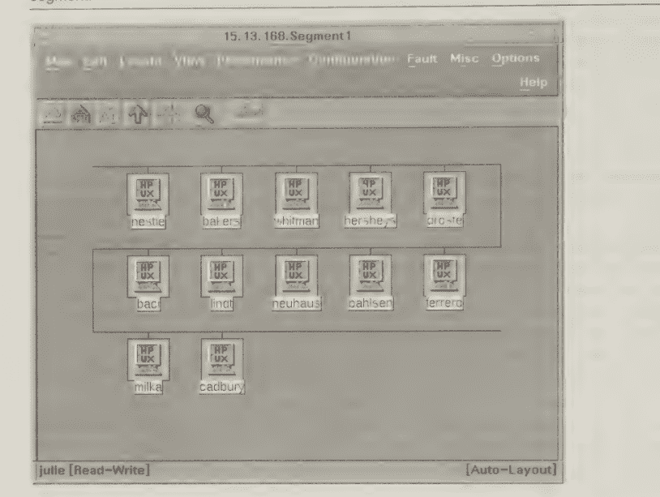

例如，NNM 还可以处理通用管理信息协议（CMIP）事件，以实现多厂商互操作性。在故障排查时，你可以使用过滤功能获取特定系统的历史事件。事件处理完成后，你可以使用事件浏览器确认该事件。

通过使用 NNM 事件配置实用工具，你可以配置如何处理特定的 SNMP 陷阱（traps），包括以下内容：

- 日志记录和显示选项
- 事件严重性
- 事件浏览器中的消息显示格式
- 自动操作

事件可配置为自动显示弹出通知，或在管理站上运行命令以发送电子邮件、呼叫寻呼机、更改图标颜色或生成听觉警报。

在你确认问题存在后，NNM 菜单界面提供了许多工具来排查问题或更详细地监控系统。NNM 提供了一个性能菜单，你可以用它来检查网络活动、CPU 负载和磁盘空间，或绘制 SNMP 数据图表。还提供了一个配置菜单，以便你可以检查网络配置、系统统计信息或 SNMP 陷阱配置。从故障菜单中，你可以尝试通过网络连通性轮询、从管理站发起的 ping 或从另一远程系统发起的 ping 来访问系统。如果你怀疑到某个系统的路径已中断，你也可以从故障菜单进行测试。终端窗口、SAM 界面（仅适用于 HP-UX）和 MIB 浏览器都可以从下拉菜单中找到。

NNM 还提供了若干实用工具，帮助你收集和处理 MIB 中提供的数据。你可以配置 MIB 对象的数据收集，并定义何时生成事件的阈值。你可以构建自己的 MIB 应用程序，以收集用于绘制图表或生成表格输出的 MIB 对象。

如本节所述，OpenView NNM 可以为众多系统监控类别提供帮助。故障可以被检测并以图形方式显示，故障事件会被发送到消息浏览器。你可以使用性能菜单来监控网络性能。你可以使用预定义工具或 MIB 浏览器来检查某些系统资源限制。然而，NNM 通常仅在你需要监控大量系统时使用。

NNM 是其他 HP OpenView 应用程序的构建模块。应用程序集成通过开发工具包和注册文件提供。目前已有超过 300 个应用程序与 HP OpenView 集成。稍后讨论的 HP IT/O 是一款扩展 NNM 功能的产品。最常用的合作伙伴应用程序包括 CiscoWorks、Bay Networks Optivity、3Com Transcend、Remedy ARS 和 HP NetMetrix。

OpenView NNM 运行在 NT 和 UNIX 平台上。这两个版本都可以用于监控 UNIX 系统。

#### ClusterView

ClusterView 是一个与 OpenView NNM 和 IT/O 集成的图形监控工具。它提供对 MC/ServiceGuard 环境中系统和其他资源的监控。MC/ServiceGuard 是惠普的高可用性软件产品，可检测系统故障、网络或局域网（LAN）卡故障以及关键应用程序故障。虽然可以将 MC/ServiceGuard 配置为自动处理这些故障，但通过 ClusterView，你可以捕获这些高可用性事件，并以图形方式查看属于 MC/ServiceGuard 集群的系统的健康状况。MC/ServiceGuard 仅支持运行 HP-UX 10.x 或更高版本操作系统的 HP 9000 Series 800 系统。

MC/ServiceGuard 最常于集群环境中使用。每个系统上的软件都会监控其他系统。当系统发生故障时，MC/ServiceGuard 软件可以检测问题并自动在备用节点上重启关键应用程序。故障监控是自动进行的，但如果没有 ClusterView，你可能需要使用 MC/ServiceGuard 命令来验证集群软件本身是否正在运行。

MC/ServiceGuard 会检测多种集群事件，例如关键应用程序故障。这些事件可以使用 SNMP 陷阱或 openmsg（IT/O 使用的一种专有通信机制）转发到管理站。关于 MC/ServiceGuard 集群的信息存储在 HP Cluster 和 HP MC/ServiceGuard Cluster MIB 中。这些集群 MIB 列于附录 A 中。以下是触发 MC/ServiceGuard 子代理发送 SNMP 陷阱的 MC/ServiceGuard 事件列表：

- MC/ServiceGuard 子代理已启动
- MC/ServiceGuard 集群正在重新形成
- MC/ServiceGuard 集群在此节点上已启动
- MC/ServiceGuard 集群在此节点上已停止
- MC/ServiceGuard 集群配置已更改
- MC/ServiceGuard 包正在启动
- MC/ServiceGuard 包正在运行
- MC/ServiceGuard 包正在停止
- MC/ServiceGuard 包已停止
- MC/ServiceGuard 服务已停止
- MC/ServiceGuard 包切换标志已更改
- MC/ServiceGuard 可重定位 IP 地址已添加
- MC/ServiceGuard 可重定位 IP 地址已移除
- MC/ServiceGuard 网络接口本地切换
- MC/ServiceGuard 子网已启动
- MC/ServiceGuard 子网不可用
- MC/ServiceGuard 节点已加入集群
- MC/ServiceGuard 节点已停止
- MC/ServiceGuard 节点已失败

MC/ServiceGuard 软件可以检测各种错误条件，但它没有复杂的机制来让客户了解发生了什么。错误通常会被写入系统日志，可用于帮助追溯所发生的情况。

虽然 MC/ServiceGuard 可以监控系统、网络和进程并提供自动恢复，但 ClusterView 为你提供这些恢复事件的事件通知。例如，如果 MC/ServiceGuard 检测到本地 LAN 卡故障，它可以在本地系统上透明地重新配置备份 LAN 卡上的 IP 连接性。使用 ClusterView，你将看到一个事件，表明 MC/ServiceGuard 已执行到备份 LAN 卡的本地切换。应当更换故障的 LAN 卡，以消除 LAN 卡作为单点故障的可能性。

ClusterView 可用于帮助你在 MC/ServiceGuard 环境中进行诊断。ClusterView 是一个具有针对 MC/ServiceGuard 和 MC/LockManager 集群的自定义监控功能的 OpenView 应用程序。MC/ServiceGuard 和 MC/LockManager 产品包含一个 SNMP 子代理，可用于向 OpenView 管理站发送事件。这些作为 SNMP 陷阱发送的事件实际上可以由任何理解 SNMP 的管理站接收（例如 Computer Associates 的 Ucenter 产品）。这些事件在 OpenView 的事件浏览器中接收。

ClusterView 提供通过事件浏览器以及 MC/ServiceGuard 集群、系统和包的图形显示来实现自动发现和实时状态与事件通知。提供了模板，用于将集群事件映射为可读文本。如果没有这些模板，事件将在 OpenView 中表现为未识别或未匹配的陷阱。有了这些模板，在安装 ClusterView 后，这些陷阱会在 NNM 事件浏览器或 IT/O 消息浏览器中格式化。

当 MC/ServiceGuard 检测到系统故障时，它会将所有关键资源移动到备用节点。随着事件的发生，MC/ServiceGuard 子代理会生成一系列 SNMP 陷阱。图 4-2 显示了在系统“bakers”失败后 NNM 事件浏览器中的事件。MC/ServiceGuard 首先检测到故障，并在备用系统 lindt 上启动两个包 ems1 和 ems2。NNM 检测到系统“bakers”宕机时，生成了节点宕机（Node Down）陷阱。

ClusterView 与 IT/O 一起使用时提供额外功能。SNMP 事件被发送到事件浏览器，在那里 ClusterView 提供专门的故障排除说明和建议操作以协助解决问题。一些数据收集活动是自动进行的。例如，响应包故障，ClusterView 会自动检索从故障时间开始的系统日志文件条目，以辅助诊断。ClusterView 将常见的 HP-UX 监控工具（如 netstat 和 lanscan）以及 MC/ServiceGuard 专用工具（如 cmviewid）包含在 IT/O 的应用程序桌面中。

除了高可用性集群外，ClusterView 还可以监控用户定义的集群。ClusterView 提供一个配置工具，使管理员能够创建集群，然后在该集群的子图上显示该集群。操作员可以一目了然地监控所有集群系统，因为它们都在同一个 OpenView 窗口中。此外，操作员可以在集群上启动监控工具，如 HP PerfView，避免在运行每个工具时手动选择每个系统。

如果你正在管理 MC/ServiceGuard 集群、MC/LockManager 集群或系统组，ClusterView 可以是 NNM 功能的有用扩展。你可以查看详细

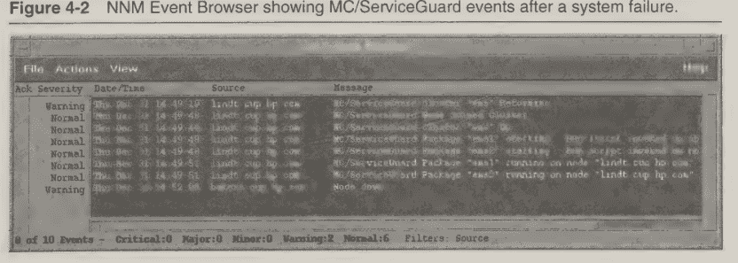


显示包含您集群的高可用性配置信息的屏幕。除了处理故障外，ClusterView 还为这些事件提供恢复操作和故障排除帮助。

ClusterView 运行在 HP-UX 和 NT 系统上，并需要 OpenView NNM 或 IT/O。任一平台的 ClusterView 软件都可以用于监控 Microsoft 的 NT Cluster Servers，即其高可用性集群。NT 集群和 MC/ServiceGuard 集群都可以从同一个 ClusterView 软件中同时监控。

#### Unicenter TNG

Computer Associates 的 Unicenter TNG 是一个企业级管理平台，提供图形化状态监控，并为异构企业提供系统和网络管理。Unicenter TNG 提供对环境中所有资源的监控和管理，包括系统资源、网络、数据库和应用程序。

Unicenter TNG 提供了一套集成化管理解决方案的框架，通过通用基础设施管理所有 IT 资源。TNG 框架本身包括以下组件：自动发现、对象库、Real World 接口、事件管理、日历管理、报告、病毒检测以及桌面支持。结合供应商、第三方及定制开发的应用程序，Unicenter TNG 为企业提供了更强的管理和维护能力。

Unicenter TNG 提供网络对象的自动发现功能，包括企业内的系统和其他资源。信息存储在通用对象库中，并可以通过 Real World 接口以拓扑方式显示。也可以使用发现过滤器，将发现范围限制在特定的子网络内，或指定 Unicenter TNG 应发现的资源类型。

通用对象库存储用于创建 Real World 图形视图的信息。您可以使用类浏览器、对象浏览器或拓扑浏览器来浏览该库。使用 ObjectView，您可以获取设备性能的详细信息，甚至可以将数据绘制成图表。

Real World 接口提供可基于业务功能、地理位置或任何逻辑分组进行组织的图形视图。这些视图可以以二维或三维方式显示企业的拓扑结构。这些视图可用于查看环境中系统和资源的状态。

Unicenter TNG 通过采用分布式管理方法提供管理功能。分布式代理负责监控和控制。集中式管理器在整个企业中提供核心管理功能，包括来自一个或多个代理的数据关联、工作负载管理和作业管理。代理根据管理器提供的策略进行监控和控制。

代理运行在被管节点上，收集数据，应用过滤器，并在必要时报告。某些代理代表管理器执行控制或执行操作。代理可以发送通知，也可以被轮询。代理还可以收集性能数据，或配置为基于阈值发送事件并执行操作。

为了查看代理并获取相关信息，Unicenter TNG 提供了一个 MIB-II 代理显示界面以查看 MIB-II 信息，一个节点视图，一个分布式状态机（DSM）视图，以及一个事件浏览器。DSM 跟踪网络中对象的状态。它从库和代理收集信息，并根据配置的策略维持对象的状态。节点视图显示由 DSM 监视的系统对象的详细状态信息。

最后，事件管理是 Unicenter TNG 提供的核心功能之一。事件管理的中心位于 Unicenter TNG 事件控制台。您可以配置策略以自动响应特定事件、基于事件发送 SNMP 陷阱、转发事件、过滤掉不重要的事件、关联来自多个代理的事件，或将事件输入 DSM。结合 Unicenter TNG 提供的日历管理功能，您可以基于时间更改或设置事件策略。例如，您可能希望在周末应用不同的策略。

## 使用事件监控工具

本节介绍了可用于监控系统资源的各种事件监视器。您可以配置事件监视器，以便在状态发生变化或满足预定义的阈值条件时生成消息。这与命令不同，命令只在被询问时提供状态报告；这也与性能监控不同，性能监控通常是在较长时间内研究的。事件监视器会在故障和事件发生后尽快生成通知消息。

#### 事件监控服务

本节中讨论的几个监视器已集成到事件监控服务（EMS）框架中。EMS 框架仅在 HP-UX 系统上可用，它以一种一致的方式为系统提供监视器。虽然 EMS 框架本身是免费提供的，但一些监视器随 HP-UX 在线诊断工具交付，一些单独销售，另一些则与提供监控的个人产品捆绑在一起。

EMS 提供了用于发现和配置可监控资源的一致 GUI。使用 EMS，您可以定义指示何时应发送通知事件的 condition，这可以是按周期性间隔、当组件状态变化时，或当满足阈值条件时。EMS 还允许您配置事件的发送位置。您可以配置 EMS 将事件发送到 OpenView IT/O、直接发送到任何支持 SNMP 的管理站、监听 TCP 或 UDP 端口的网络应用程序、电子邮件地址，或者本地控制台中、系统日志文件或常规日志文件中。此外，您可以配置 MC/ServiceGuard 使软件包依赖于这些 EMS 资源。

EMS 监视器主要协助故障和资源管理。性能监控通常需要更复杂的工具。一些系统故障和资源监控功能由下一节讨论的 EMS HA Monitors 产品提供。其他 EMS 监视器允许您检测系统资源（如文件描述符、共享内存和系统信号量）是否即将耗尽。

用于将 EMS SNMP 陷阱格式化为各种企业管理平台事件浏览器（包括 OpenView、CA Unicenter 及其他免费可用的 EMS 工具）的模板可从互联网 http://www.software.hp.com 的 High Availability Software 产品类别下下载。还可以提供开发人员工具包，以便客户和系统管理软件提供商集成其自己的 EMS 监视器。EMS 手册可在 http://docs.hp.com/unix/ha 获取。

## EMS 高可用性监视器

HA Monitors 产品包含多个用于监控文件系统空间、网络接口状态、磁盘状态和 MC/ServiceGuard 集群状态的 EMS 监视器。HA Monitors 还检测用户数和作业数的变化。该产品已扩展以包含数据库监控功能。

任何已挂载的文件系统都可以监控其可用文件系统空间。每个配置的网络设备的操作状态都会被监控。对于磁盘，您可以监控物理卷状态、逻辑卷状态、镜像副本数量以及摘要信息。

包含在 HA Monitors 中的 MC/ServiceGuard 集群监视器会报告集群事件（如集群节点故障），并提供与 ClusterView 中报告的事件类似的监控。ClusterView 产品提供对 MC/ServiceGuard 集群更完整的监控，但它需要购买 HP OpenView。以下是集群监视器监控的资源：

- 集群状态
- 节点状态
- 软件包状态
- 服务状态

使用 EMS 监控节点状态可以在 MC/Service-Guard 检测到系统问题时提供通知。尽管 MC/ServiceGuard 的工作是检测系统故障并将配置的应用程序软件包移动到备用系统，但 EMS 集群监视器的工作是通知您此类事件。

### EMS 硬件监视器

EMS 硬件监视器提供了检测和报告系统硬件资源问题的能力，包括系统内存、磁带设备（如 SCSI、数字线性磁带（DLT）和数字数据存储（DDS））、磁带库以及自动装载器。这些监视器检测设备错误、组件故障、页面解除分配错误以及其他故障。它们以定期间隔轮询硬件，大多数会实时通知硬件错误。这些监视器随 HP-UX 在线诊断工具交付，该工具对 HP-UX 免费可用。EMS 硬件监视器为以下系统组件和 Hewlett-Packard 产品提供监控：

- 系统内存
- SCSI 磁带设备


- DDS-2 自动加载器 (A3400A)
- DDS-3 自动加载器 (A3716A)
- DLT 4000 4/48 磁带库；HP-UX；差分 SCSI (A3544A)
- DLT 4000 2/48 磁带库；HP-UX；差分 SCSI (A3545A)
- DLT 4000 2/28 磁带库；HP-UX；差分 SCSI (A3546A)
- DLT 4000 和 7000；2/28；驱动器为差分；机械手为 SE/差分 (A4850A)
- DLT 4000 和 7000；15 槽；桌面/机架；差分 (A4851A)
- DLT 4000 和 7000；4/48；驱动器为差分；机械手为 SE/差分 (A4855A)
- DLT 4000 和 7000；588 槽；驱动器为差分；机械手为 SE (A4845A)
- DLT 4000 和 7000；100 槽；驱动器为差分；机械手为 SE (A4846A)
- DLT 4000 和 7000；30 槽；差分通道适配器

这些 EMS 硬件监控器旨在为配置界面、事件检测以及提供问题详细描述和建议恢复措施的消息格式提供一致性。

EMS 硬件监控器可以报告在与设备进行 I/O 会话期间遇到的低级设备错误。它们能够检测并报告组件和现场可更换单元（FRU）故障，包括风扇和电源问题。协议错误也一会被检测到。

对于磁带设备的监控，事件包括读写数据问题、坏磁带、错误磁带、温度问题、磁带加载器错误、磁带驱动器问题以及固件错误。对于系统内存的监控，监控器会检查页面分配表，并在该表达到 60%、90% 或 100% 满时报告事件。这表明需要添加一个新的内存 SIMM（单列直插式内存模块）来替换故障的内存芯片。这些阈值是可配置的。

监控器为硬件事件分配严重级别，以反映事件对系统运行的潜在影响。表 4-3 描述了每个严重级别的含义。

EMS 硬件监控器的配置是通过使用硬件监控请求管理器（Hardware Monitoring Request Manager）完成的。通知条件可以针对系统中所有支持的硬件资源进行一致性配置。随着硬件添加到系统，监控可以自动启用。图 4-3 展示了使用硬件监控请求管理器发送所有关键和严重磁带及内存事件的 SNMP 陷阱（traps）的示例。若要通过 MC/ServiceGuard 进行配置，您需要使用 MC/ServiceGuard 配置界面。

EMS 硬件监控器仅提供故障信息。不包含与性能相关的事件。

当 EMS 硬件监控器检测到事件时，通知消息会被发送到指定的目标位置。该消息包含完整的描述，包括发生事件所在的系统、事件检测到的日期和时间、发生事件的硬件设备、问题描述、可能的原因以及建议的操作。事件消息包含详细信息，包括产品/设备识别信息、I/O 日志事件信息、原始硬件状态、SCSI 状态等。

### 表 4-3 硬件事件严重级别描述

| 严重级别 | 描述 |
| :--- | :--- |
| 关键 (Critical) | 已经或将会导致数据丢失、系统停机或其他服务中断的事件。必须立即采取措施以纠正问题。在问题解决之前，系统运行将受到影响，且不应继续正常使用该硬件。如果配置了 MC/ServiceGuard，包（package）将发生故障切换。 |
| 严重 (Serious) | 若不纠正，可能会导致数据丢失、系统停机或其他服务中断的事件。应尽快修复该问题。系统运行和硬件的正常使用情况可能受到影响。如果配置了 MC/ServiceGuard，包（package）将发生故障切换。 |
| 主要警告 (Major Warning) | 若不纠正，可能会恶化为更严重状况的事件。应在方便时修复该问题。系统运行不应受到影响，硬件可继续正常使用。如果配置了 MC/ServiceGuard，包（package）不会发生故障切换。 |
| 次要警告 (Minor Warning) | 即使不纠正，也不大可能恶化为更严重状况的事件。可在方便时修复该问题。系统运行不会中断，硬件可继续正常使用。如果配置了 MC/ServiceGuard，包（package）不会发生故障切换。 |
| 信息 (Information) | 作为硬件正常操作一部分而发生的事件。无需采取行动。如果配置了 MC/ServiceGuard，包（package）不会发生故障切换。 |

大多数 EMS 硬件监控器是“无状态”的。换句话说，指定严重级别的事件一旦检测到就会立即转发；不涉及历史方面或与其他数据的关联，除了监控器通过重复频率限制重复消息外。确定设备的当前状态是困难的，因为只有在事件发生时才会发送消息。

若要监控硬件设备状态变化，您可以使用外设状态监控器（PSM），它维护受监控硬件设备的状态并报告状态变化。PSM 从其他 EMS 硬件监控器收集事件，但除非发生状态变化，否则不发送自己的通知。默认情况下，关键或严重事件会导致 PSM 将设备状态更改为“宕机”（Down）。

例如，磁带监控器的关键磁带事件会导致 PSM 将设备状态更改为“宕机”（Down）。如果管理员要求通知此类事件，PSM 随后将发送单条“Tape device status = Down”（磁带设备状态 = 宕机）事件。这可能是管理员看到的唯一消息。额外的磁盘故障消息将不会被转发，因为它们不是状态变化的结果（也就是说，状态保持为宕机）。这减少了用户需要处理的事件数量。最后接收到的事件应反映当前的设备状态。

### 图 4-3 使用硬件监控请求管理器配置 EMS 硬件监控器。

```text
hpsterm

=================================== Add Monitoring Request ============
Start of edit configuration:

A monitoring request consists of:
    - A list of monitors to which it applies
    - A severity range (A relational expression and a severity. For example,
      < "MAJOR WARNING" means events with severity "INFORMATION" and
      "MINOR WARNING")
    - A notification mechanism.

Please answer the following questions to specify a monitoring request.

Monitors to which this configuration can apply:
    1) /storage/events/disk_arrays/AutoRAID
    2) /storage/events/disks/default
    3) /adapters/events/FC_adapter
    4) /connectivity/events/hubs/fc_hub
    5) /connectivity/events/multiplexors/FC_SCSI_mux
    6) /system/events/memory
    7) /storage/events/enclosures/ses_enclosure
    8) /storage/events/tapes/SCSI_tape
    9) /storage/events/disk_arrays/PW_SCSI
    10) /storage/events/disk_arrays/High_Availability

Enter monitor numbers separated by commas
        {or (A)ll monitors, (Q)uit, (H)elp} [a] 6,8

Criteria Thresholds:
    1) INFORMATION       2) MINOR WARNING     3) MAJOR WARNING
    4) SERIOUS          5) CRITICAL

Enter selection {or (Q)uit,(H)elp} [4] 4

Criteria Operator:
    1) <       2) <=      3) >       4) >=      5) =       6) !=

Enter selection {or (Q)uit,(H)elp} [4] 4

Notification Method:
    1) UDP       2) TCP       3) SNMP      4) TEXTLOG
    5) SYSLOG    6) EMAIL     7) CONSOLE   8) OPC

Enter selection {or (Q)uit,(H)elp} [6] 3

New entry:
    Send events generated by monitors
    /system/events/memory
    /storage/events/tapes/SCSI_tape
    with severity >= SERIOUS to SNMP

Are you sure you want to keep these changes?
    {{Y}es,(N)o,(H)elp} [n] y
```

大多数监控器无法自动检测设备已修复。当问题解决时，必须手动使用 `set_fixed` 命令通知 PSM 将设备状态重置为“正常”（Up）。

当使用诸如 IT/O 等从多个系统接收消息的企业管理工具时，您应该使用 PSM 以减少信息过载。但是，请确保无状态事件也被配置为发送到某个位置（例如系统日志文件），因为在组件发生故障时，它们提供有价值的诊断信息。

通过 EMS 配置 GUI 监控硬件设备状态。

您可以在惠普网站 http://docs.hp.com/htpx/systems/ 上了解有关惠普诊断工具的更多信息。

#### Enterprise SyMON

Sun 的 Enterprise SyMON 是一个用于监控和管理企业内 Sun 系统的系统管理平台。Enterprise SyMON 为管理员提供了通过通用界面远程管理其所有 Sun 系统的能力。Enterprise SyMON 可以自动发现环境中的 Sun 系统。在每个系统上运行的智能 SyMON 代理提供监控和远程管理功能。

Enterprise SyMON 的控制台层提供所有受管理对象的可视化表示。控制台层提供企业视图的几种形式，包括逻辑视图和拓扑视图。逻辑视图窗口提供被管理系统的分层表示。在系统图标上使用指示器来显示系统的告警状态。如图 4-4 所示，可以看到 payroll 域中系统的状态。每个系统图标上的徽章（Badges）指示节点的告警。窗口顶部的域状态摘要显示每个类别中有多少个未决告警。图 4-4 显示没有宕机告警，两个关键告警，一个警报，一个注意，没有禁用。因此，Comptroller 工作站有一个注意级别的未决告警。

当发生关键事件，如硬件组件故障时，会在逻辑视图窗口中显示。随着事件发生，故障的硬件组件也会在物理视图窗口中高亮显示。您可以使用这种照片式的系统视图来检测和隔离故障或即将故障的组件。如图 4-5 所示，物理视图指示 3 号板卡已断开连接，并高亮显示服务器的背板以显示板卡的位置。

Enterprise SyMON 提供事件和告警管理。可以配置告警和操作，使得当满足特定条件或阈值时，通过 SNMP 陷阱将事件发送到 SyMON 控制台。还可以配置基于事件的操作和通知，如电子邮件。恢复操作可以与事件相关联。通过将一个特殊目录中编写在 TCL 脚本语言中的规则放入其中，可以定义和生成额外的事件。SyMON 提供基于优先级和严重级别进行事件关联和过滤的功能。

SyMON 提供运行在被监控系统上的智能代理。这些代理被配置有智能以检测异常状况，基于默认或自定义阈值生成告警，并基于特定预定义事件自动执行操作。


## 图 4-4 在 SyMON 控制台查看薪资域中各系统的状态。

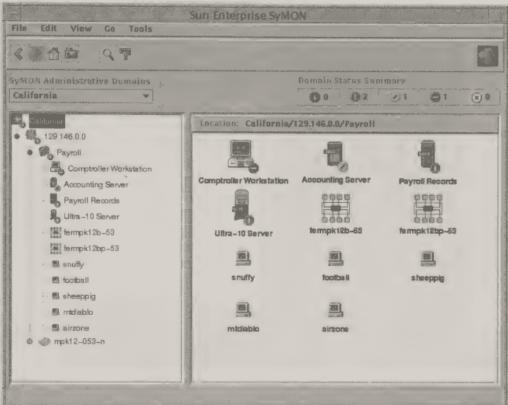

代理架构由多个模块组成。例如，Config-Reader 模块负责监控所有硬件组件。这些代理是可扩展的，因此可以在不打断服务的情况下，从控制台动态加载新模块。如果你不需要某些模块，可以卸载它们以节省资源。

如图 4-6 所示的浏览器窗口，在左侧面板中展示了可以监控的不同统计信息。右侧面板显示当前的系统负载统计信息。本节中提到了许多可监控的资源。

硬件 Config-Reader 模块通过跟踪系统上配置的硬件和固件（直至序列号）来提供配置管理。该信息用于创建逻辑视图和物理视图。SyMON 代理提供硬件故障监控，以及对内存和磁盘的预测性故障分析。Config-Reader 模块监控硬件，并在控制台提示你注意现有问题。如果预测到内存故障，你可以配置操作以执行动态重新配置来移除坏内存。Config-Reader 会报告多种硬件故障，包括温度问题和电源状态。它监控 CPU 和内存板状态、控制器、I/O 设备以及磁带设备。

## 图 4-5 使用 SyMON 物理视图识别故障硬件组件。

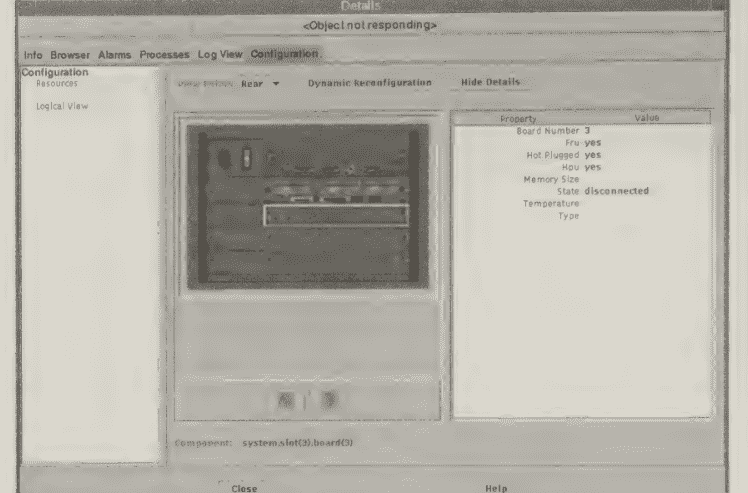

对于操作系统，代理包含用于监控 CPU 利用率、内存使用情况、目录大小、文件大小及文件修改时间、MIB-II 对象、NFS 活动、inode 使用情况、交换统计信息、文件系统使用情况以及磁盘速率和服务时间的模块。还有一个文件扫描模块可用，可用于检查日志文件（如系统日志）中的错误 or 特定模式。

健康监控器主要基于性能指标的规则将指标进行关联，以检测何时存在警报条件。当出现警报条件时，它会发出警报，并附带改进系统性能的建议步骤。健康监控器包含用于检测交换空间状况、内核争用、CPU、磁盘或内存瓶颈、打印机问题以及文件系统状况的规则。

SyMON 代理提供主动管理，包括用于动态重新配置的主动配置管理控制、系统域管理，以及在控制器故障时重定向磁盘 I/O 的“备用路径”功能。借助此功能，管理员可以处理维修工作（例如更换故障内存板），而不会造成服务中断。

Sun Enterprise 服务器型号 E3000 至 UE10000（配备 Solaris 2.6 或更高版本）支持动态重新配置。此功能允许你在线更换板卡，而无需关闭系统。你可以让备用板处于待命状态，以便立即使用。或者，如果 CPU 或内存板发生故障，你可以通过 SyMON 在线取消配置并断开故障板，更换板卡，然后连接并配置新板，从而使资源可用，且无需重启系统。此功能也适用于热插拔磁盘设备。

## 图 4-6 SyMON 浏览器显示各种可监控的系统资源

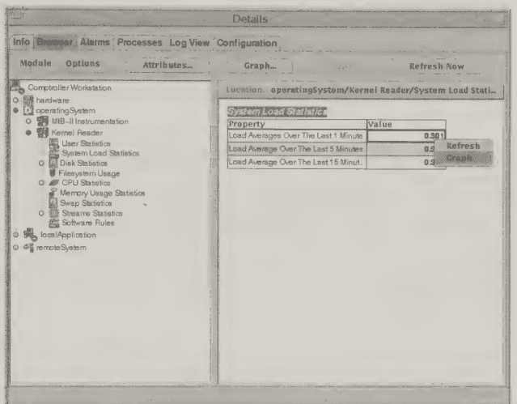

如前所述，SyMON 可以帮助你对系统进行配置、故障和资源监控。然而，SyMON 仅可用于监控 Sun 系统。

## OpenView IT/Operations

IT/Operations (IT/O) 是一个 OpenView 应用程序，提供集中操作和问题管理。NNM 作为 IT/O 产品的一部分包含在内。IT/O 使用运行在每个受管系统上的智能代理来收集管理信息、消息和警报，并将这些信息发送到集中式控制台。在接收事件后，IT/O 可以启动自动纠正措施。当操作员阅读个别消息时，系统会给出指导，并可能建议进一步解决问题或恢复的操作。

IT/O 附带预定义的监控器和模板，包括电子邮件、CPU 利用率和交换利用率等监控器。使用日志文件模板，你可以监控系统日志文件中的系统错误、用户切换事件、登录、登出以及内核消息。

IT/O 允许你定义和自定义自己的监控器和模板，以便监控任意 MIB 变量，例如本章前面提到的系统运行时间 MIB 变量。IT/O 定期查询 MIB 对象，以确定是否应生成消息。你可以编写可由 IT/O 代理定期调用的程序或脚本，并且可以修改模板和消息条件，以便在特定条件下向操作员发送寻呼。

许多其他工具可集成到 IT/O 中，以提供额外的监控和管理功能。当操作员需要一致地管理大量系统时，IT/O 非常有用。模板可以被修改，然后下载到一组系统中，从而实现对多个系统的一致监控。这样，可以为所有系统以一致的方式设置监控。

IT/O 有四个主要窗口：

- **节点库**：以图标形式显示操作员管理的系统，并允许将它们组织成节点组。
- **消息组**：显示逻辑消息组，如性能、Oracle 和备份。消息组作为在消息浏览器窗口中组织消息的一种方式。
- **消息浏览器**：显示管理服务器接收到的事件。
- **应用程序桌面**：提供对常用诊断和管理应用程序的访问。

你可以在图 4-7 中看到节点库窗口的示例。在此窗口中，节点的颜色反映已接收但尚未确认的最关键事件的颜色。

消息浏览器可以过滤掉你不关心的系统的消息。如果你只负责特定的系统功能（如性能），你可以配置消息浏览器以仅显示来自特定消息组的消息。

IT/O 应用库提供其他一些用于监控系统的工具，还提供远程访问工具以进一步诊断问题。从应用库中，你可以打开一个 telnet 窗口，或者对于 HP-UX 系统，可以在有问题系统上运行 SAM。你可以运行 PerfView 或 GlancePlus（本章稍后将讨论），检查打印状态，或检查任何 UNIX 系统上的 CPU 负载。

如前所述，IT/O 在系统监控的多个方面提供协助，尤其是故障、资源和性能管理。IT/O 还可以协助安全监控，其预定义模板用于监控 root 登录尝试。

##### GlancePlus Pak 2000

Hewlett-Packard 还随其 GlancePlus Pak 2000 产品包含预配置的单一系统版本 IT/O。除了显示性能数据外，该产品还包括一个基于 Java 的 GUI，用于展示诊断应用程序和事件浏览器。该产品允许你连接到多个系统的信息，前提是你一次只连接到一个系统。

GlancePlus Pak 2000 包含其企业版的智能代理技术，使其能够从多种来源收集事件并执行自动化操作。在事件浏览器接收到事件后，操作员可以触发一些预定义的恢复操作。

## 安全监控

整个安全领域是一个巨大的主题。整本书都专门致力于安全。安全通常分为两个类别：网络安全和基于主机的安全。本节专注于基于主机（或系统）的安全，以便你可以监控和检测可能危及系统、应用程序或数据可用性的活动。基于主机的安全入侵通常是最具问题的。作为系统管理员，你应该监控系统，以发现阻碍系统执行其既定功能的活动。

## 安全概览

你的系统所需的安全级别取决于你试图保护什么。美国政府和欧洲信息技术安全评估准则 (ITSEC) 都定义了安全级别集。最常见的级别是 C2，它是安全 UNIX 系统的既定标准。比 C2 更安全的 B1 级别安全，通常在政府、军事和商业应用中是必需的。例如，HP-UX 在两种安全模式下运行：无安全性的标准模式和符合 C2 级别的可信模式。每个安全级别都有不同的要求。

无论你在环境中试图提供何种级别的安全，几个系统安全类别适用于所有级别。随着你提高安全级别，每个类别中的要求更加严格。这些类别是身份验证、授权、访问控制、数据安全以及物理安全。

在描述这些类别之前，你需要知道实施基于主机的安全计划将包括定义防止入侵的策略以及用于检测入侵的监控策略。密码策略是许多应定义策略的一个示例。


## 安全监控工具

审计是一种按用户级别记录与安全相关事件的方法。它可以设置为监控系统调用、特定用户、密码策略、登录、超级用户登录、失败的登录尝试等。由于审计会带来大量的系统开销，因此应将其限制在最关键的安全相关事件上。在 HP-UX 上，审计仅在可信模式下可用。可以使用 SAM 在 HP-UX 上启用审计。尽管系统本身提供了用于审计的库例程，但数据缩减和分析工具对于从审计日志中提取相关信息非常有用。

一些用于查看审计日志的常见工具包括：

- **OmniGuard/TTA**（Axent Technologies）：用于检测入侵者和滥用行为。它使用日志文件中的数据，并监听 SNMP 陷阱，以在检测入侵者时馈入其规则引擎。它还可以监控文件级别的访问。
- **Stalker**（Haystack Labs）：分析并将审计日志与其数据库进行比较，以检测系统误用、攻击和已知的系统漏洞。它可以在集中式服务器上收集和存储来自多个 UNIX 系统的审计日志。

MEMCO Software 提供 SeOS 访问控制，它提供更具细粒度的 root 权限。可以授予用户受限的权限以执行特定任务。这意味着，例如，为了执行系统备份，你不需要授予用户完整的 root 权限，因为这样做可能存在危险。

你可以进行一些简单的检查来帮助保护你的系统。检查 `/etc/hosts.equiv` 和 `/.rhosts` 文件，以确保列出的远程主机系统有权访问该系统。此外，可选文件 `/var/adm/inetd.sec` 可用于明确拒绝或允许访问特定的网络服务，因此你应该验证该文件是否正确配置。

## 使用诊断工具

各种支持工具监控错误和故障、配置信息以及硬件组件（包括 CPU、系统内存和磁带设备）的故障排除。这些支持工具中的一些还监控软件配置，以跟踪变更。

### 支持工具管理器

HP 的支持工具管理器（STM）提供了一组用于验证和排除 HP-UX 系统硬件故障的工具的访问权限。这些在线诊断工具提供了确定设备状态、获取配置信息和诊断硬件问题的能力。这些工具可以通过 GUI 或命令使用，并具有灵活性，可以定期自动调用。

STM 发现系统中的硬件设备，并且可以诊断内存错误、低优先级机器检查（LPMC）错误、I/O 驱动程序错误、逻辑卷管理器（LVM）错误和高温事件。内存错误包括单比特错误和页面取消分配事件。

STM 包含自动配置映射器，如图 4-8 所示，它使用颜色编码的图标提供硬件配置的图形视图，显示设备状态以及逻辑关系，例如连接到 I/O 卡的周边设备。映射上的每个图标代表一个硬件设备。这些图标显示设备类型、设备标识符、设备路径、最后活动的工具和测试状态（来自最后活动的工具）。你也可以从这个视图启动其他 STM 工具。

信息工具提供产品标识符信息、产品描述、硬件路径、供应商名称、固件修订版和错误日志统计信息，包括读错误，可用于趋势分析和预测问题。该工具还检查嵌入式日志信息，并可用于跟踪配置更改。

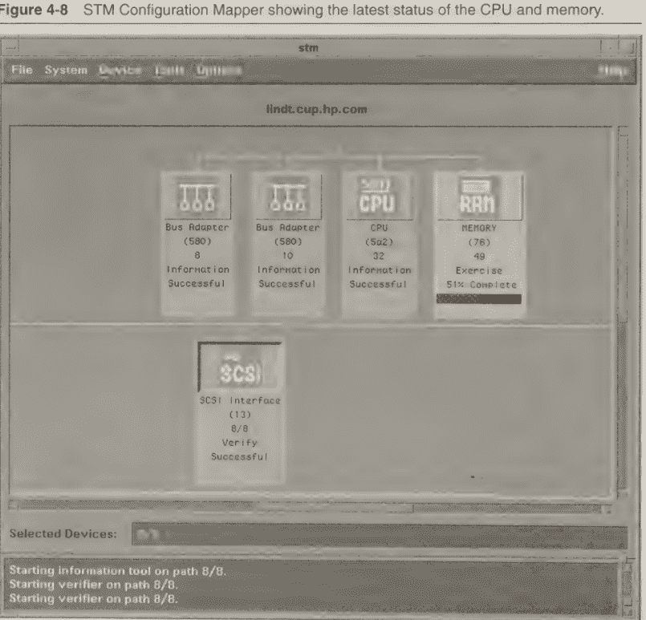

STM 下的其他几个工具执行不同级别的测试以压力测试设备或确定和诊断问题：

- **验证器工具**：可以在特定设备上调用，以快速验证其连接和正常工作。
- **应力测试器工具**：对设备进行压力测试，以通过按客户环境中预期的最大点对硬件进行压力测试，帮助复现和排除间歇性问题。
- **诊断工具**：执行硬件的完整测试，以帮助将故障隔离到组件或 FRU 级别。
- **专家工具**：是面向专家用户的复杂故障排除工具。
- **日志工具**：帮助你格式化、过滤和提取系统日志中原始数据包含的错误信息。你可以监控计算机检测到的可恢复错误，例如 *I/O 设备错误*。这些数据可用于故障排除和趋势历史信息，以便在故障变得关键之前修复它们。你在此看到的错误会自动转发到 EMS 硬件监控器，如果错误足够严重，监控器将生成事件。
- **固件更新工具**：提供一种客户可用的方式来更新硬件设备上的固件。

STM 允许操作员同时在多个设备上运行模块。此外，操作员可以在用户界面内启动在多个系统上运行的诊断测试。

STM 为系统提供配置和故障监控功能。STM 工具检测与 EMS 硬件监控器相同的错误，但 EMS 硬件监控器会实时报告它们。在获取 EMS 事件后，你可以运行 STM 以进一步诊断问题。

STM 用于诊断本地或远程系统。它适用于 HP-UX 10.01 及更高版本。STM 取代了 Sherlock 诊断工具。该软件（产品编号为 B4708AA）正在通过 HP-UX 诊断/IPR 介质分发。

### HP 预测性支持

HP 预测性支持检测和预测系统相关的故障。当检测到问题状况时，通知将发送到 HP 响应中心。这种级别的护理旨在服务于与 Hewlett-Packard 签有特殊支持合同的客户。预测性支持软件主动监控系统，并通过调制解调器访问自动将信息报告回 HP 响应中心。由于 HP 响应中心每周 7 天、每天 24 小时可用，此流程可以导致对问题的快速响应。

预测性支持软件专注于内存和 I/O 设备的系统事件信息。错误日志每天进行分析，潜在问题得到诊断。通过主动发出警告


对于潜在问题，计划内维护可以取代因组件故障导致的非计划停机。

预测性支持（Predictive Support）在托管节点上使用一组规则来决定何时将事件发送至 HP 响应中心。这些条件可以通过从 HP 下载新规则来定期更新。事件关联确保重复消息被抑制，且响应中心不会就同一根本问题反复发出警告。

预测性支持会分析板载日志、系统日志和内存日志。该软件可以自动拨号联系 HP 响应中心以传输错误数据和日志，或者由系统管理员启动调制解调器传输。同样，包含用于生成预测性事件的新规则的预测性支持软件更新，可以自动触发或由管理员控制。配置和管理通过菜单驱动界面进行控制。

系统日志会被扫描以查找 I/O 错误和 LPMC（本地处理器内存控制器）。记录的数据会被分析，以查找与特定磁盘或磁带设备相关的趋势，例如可纠正错误。LPMC 记录会被分析以查找内部缓存错误。还会扫描内存日志，以查找超过指定阈值的错误率。

响应中心确定故障设备的位置、型号、制造商和序列号，以便进行维修。此信息包含在故障通知消息中。

HP 预测性支持不协助处理系统监控的其他领域，例如资源和性能管理。此外，该软件仅在 HP-UX 系统上运行。

## HA 观测器

HA 观测器是一组用于检测和快速诊断系统问题的工具。这些产品包括配置跟踪器（Configuration Tracker），它跟踪服务器的软件配置；网络节点管理器（Network Node Manager）；以及 HP 预测性支持。客户现场还维护着一个支持系统和网络路由器。

HA 观测器依赖于 HP 预测性支持来报告硬件故障。此外，还可以获取由配置跟踪器收集的配置信息。配置跟踪器生成并维护配置的快照，以便检测软件配置的变化。

HA 观测器通过客户现场的一个专用系统，使用安全网络连接至 HP 的高可用性支持中心。该支持系统是一台 HP 9000 Series 700 工作站，它从关键服务器收集系统配置信息，可用于查看网络状态和拓扑信息。硬件故障通知和配置信息可以发送至 HP。在客户允许的情况下，HP 支持工程师可以通过安全链接访问客户服务器以收集更多信息。

HA 观测器仅在 HP-UX 系统上受支持，并且仅适用于拥有 BCS 和 CCS 支持合同的客户。

## 监控系统外围设备

在监控您的 UNIX 服务器时，不应忽略系统外围设备，如磁盘、磁带和打印设备。

### 磁盘

磁盘设备存储您的企业数据，因此确保其正确运行至关重要。磁盘监控应作为系统监控工作的一部分。鉴于该主题的重要性和复杂性，第 5 章专门介绍了用于监控磁盘设备的工具。

### 磁带

通过定期检查磁带硬件故障，可以在需要磁带驱动器之前发现问题。例如，早期检测和修复可以确保晚间备份应用无延迟地运行。

您应使用硬件监控器，如 EMS 硬件监控器，以确保您的磁带驱动器处于健康状态，从而按计划执行备份。如前所述，可以检测到各种与磁带相关的错误，例如指向磁带的 I/O 操作失败、磁带加载器错误和磁带更换器错误。

### 打印机

本章前面讨论了如何使用 MIB 仪表来查找重要的系统信息。打印机 MIB 规范通常由现代网络打印设备支持。打印机 MIB 存储打印机的状态（在线、离线等），以及关于打印机子组件的信息，例如空打印机纸盒。可以使用诸如 IT/O 之类的工具来启用对 MIB 中各个字段的监控，例如打印机状态。

使用 `lpstat` 命令，您可以检查打印队列中作业的状态，并验证打印调度程序是否正在运行。不带选项使用 `lpstat` 会显示连接到系统的所有打印机的信息。

还有一些打印机管理软件可用。一个例子是 HP JetAdmin 软件，它可以用于管理打印机并监控远程打印作业的状态。这个基于宿主机的应用程序提供实时打印机和作业状态信息，以及状态更新、远程诊断和故障排除、可选的状态日志和远程前面板。这些实用程序可通过图形界面访问。Web JetAdmin 软件增加了额外功能，例如从 Web 浏览器查看显示打印机位置和状态信息的自定义地图的能力。

Web JetAdmin 4 是一个 HP 软件应用程序，用于从 Web 浏览器监控网络上的所有外围设备。维护和故障排除可以在任何符合 MIB 标准的打印设备上完成，包括 ScanJet 5 扫描仪和 HP SureStore CD-ROM。

### 收集系统性能数据

当用户访问数据或应用出现延迟时，他们会联系 IT 部门。需要好的工具来帮助操作员定位问题根源。本节介绍了一些有趣的性能和资源利用率指标，以及可用于收集这些指标数据的工具。

多种状况可能会导致资源和性能问题。可用内存耗尽可能是由于内存组件故障或应用程序内存泄漏引起的。CPU 使用率的突然上升可能是处理器故障或系统中引入了 CPU 密集型应用的迹象。需要分析以确定资源问题是否可以通过配置更改、硬件修复或其他技术来解决。

许多重要的系统资源具有配置限制。以下系统资源指标对监控至关重要：

- 命名管道的数量
- 消息和消息队列的数量
- 系统信号量的数量
- 共享内存的容量
- 打开文件的数量
- 进程的数量

前面，本章讨论了一些可用于检查系统资源使用的工具。**sar** 和 **sysdef** 命令可以将当前使用情况与配置限制进行比较。有一种 EMS 监控器可用于检测以下资源阈值被超出的情况：

- 呼叫表（Callout table）
- 进程表
- 文件描述符表
- 文件锁表
- 共享内存
- 系统信号量
- 消息队列和消息段

本节讨论的性能工具也可以检测资源使用问题。

可以通过 **SAM 性能监控器** 提供一些系统性能监控，管理员可以从中获取系统、磁盘和虚拟内存活动等信息，例如。当选择所需指标时，文本形式的信息会在 Motif 窗口中显示。

拥有历史信息很重要，以便了解系统性能随时间的变化情况。了解系统在正常条件下的行为有助于在尝试排除系统性能问题时提供便利。请注意，性能工具本身会影响系统性能，因此您需要选择开销较低的工具。

本节描述了一些用于测量和监控系统性能的常见工具。以下是本节讨论的一些关键指标：

- **缓冲缓存队列长度**：指等待缓冲缓存更新的阻塞进程数量。如果此值较高，可能是内存瓶颈的迹象。
- **上下文切换**：进程从运行队列中换出的频率。
- **CPU 利用率**：以在不同执行状态下花费的时间百分比表示。低利用率表明 CPU 大部分时间处于空闲状态。
- **CPU 运行队列长度**：处于运行状态等待被调度的进程的平均数量。
- **内存利用率**：通常表示为使用内存量与可用总内存量的比率。
- **分页（Paging）**：指虚拟内存（磁盘）和物理内存之间数据的传输。
- **交换（Swapping）**：指物理内存和为交换保留的特殊虚拟内存区域之间数据的传输。

诸如 BMC PATROL 和 MeasureWare 之类的性能工具并不总在所有平台上提供相同的指标集。为简单起见，本节仅关注 Sun Solaris 和 HP-UX 平台。此外，这些产品正在不断增强，因此您在环境中实际可用的指标可能并不完全符合本节中呈现的信息。

##### MeasureWare

HP MeasureWare Agent 是惠普（Hewlett-Packard）的一款产品，用于收集和记录资源和性能指标。MeasureWare 代理在被监控的单个服务器系统上运行并收集数据。存在适用于许多平台和操作系统的代理，包括 HP-UX、Solaris 和 AIX。

MeasureWare 代理收集数据、对其进行汇总、打上时间戳、记录日志，并在适当时发出警报。代理收集和报告各种系统资源、性能指标和用户定义数据。随后，信息可以导出到电子表格或性能分析程序中，例如 PerfView。这些程序可以使用这些数据生成警报，以警告潜在的性能问题。通过使用历史数据，可以发现趋势。这有助于在资源问题影响系统性能之前解决这些问题。

MeasureWare 代理在三个不同级别收集数据：全局系统指标、应用和进程指标。全局和应用数据每五分钟汇总一次，而进程数据每分钟汇总一次。管理员可以通过在配置文件中列出构成应用程序的进程来定义重要应用程序。


## 表 4-4 MeasureWare Agent 信息类别

| 类别 | 指标类型 |
| :--- | :--- |
| 系统 | CPU、磁盘、网络、内存、进程队列深度、用户/进程信息以及摘要信息 |
| 应用程序 | CPU、磁盘、内存、进程数、平均进程等待状态以及摘要信息 |
| 进程 | CPU、磁盘、内存、平均进程等待状态、进程总生命周期以及摘要信息 |
| 事务 | 事务数、平均响应时间、响应时间指标分布以及中止的事务 |

MeasureWare 数据的基本类别如表 4-4 所示。还包括用于数据库和网络支持的可选模块。MeasureWare 代理还收集通过 DSI 接口提供的数据。

以下列出了从 HP-UX 和 Sun Solaris 上的 MeasureWare 中可用的全局系统指标。MeasureWare 提供的其他指标将在其他章节中介绍。

- 间隔内的 CPU 使用率
- 物理磁盘输入/输出的数量和速率
- 所有磁盘文件集的最大满容量百分比
- 间隔内的系统 CPU 使用率
- 间隔内的用户 CPU 使用率
- 具有 nice 优先级的 CPU 使用率
- 间隔内的 CPU 空闲时间
- 间隔内系统过程调用的速率
- 主内存使用量
- 磁盘上的交换空间使用量
- 间隔内内存缺页的数量和速率
- 间隔内进程交换的次数
- 当前处于活动使用状态的虚拟内存百分比
- 间隔内运行队列中的进程数
- 间隔内等待磁盘的进程数
- 间隔内等待内存的进程数
- 间隔内处于睡眠状态的进程数
- 间隔内因其他原因等待的进程数
- 间隔内用户会话的数量
- 间隔内存活的进程数
- 间隔内活跃的进程数
- 间隔内启动的进程数
- 间隔内完成的进程数
- 间隔内完成进程的平均运行时间
- 操作系统版本
- 系统中的处理器数量
- 磁盘设备的数量及其设备 ID
- 主内存大小
- 已分配的交换空间
- 磁盘 I/O 信息（参见第 5 章）
- 网络统计信息（参见第 6 章）

请注意，除了性能指标外，MeasureWare 还提供了有用的配置信息，例如处理器数量和磁盘设备数量。

以下是在 HP-UX 上可用的额外全局系统指标：

- 具有实时优先级的 CPU 使用率
- 间隔内用于上下文切换的 CPU 使用率
- 间隔内用于中断处理的 CPU 使用率
- 间隔内等待进程间通信的进程数
- 间隔内等待网络传输的进程数
- 间隔内终端事务的数量和速率
- 平均终端事务“思考”时间
- 平均终端事务首次响应时间
- 平均终端对提示的响应时间
- 事务首次响应时间的分布
- 事务对提示响应时间的分布

您可以设置基于涉及多个指标组合的条件触发的警报。例如，CPU 瓶颈警报可以基于 CPU 使用率和 CPU 运行队列长度。

MeasureWare 代理将这些警报提供给 PerfView 进行分析，并提供给 IT/O 管理控制台。在满足阈值条件时，还可以发送 SNMP 陷阱（traps）。可以自动执行操作，或者操作员可以选择执行建议的操作。

MeasureWare 的 extract 命令可用于将数据导出到其他工具，如电子表格程序。此外，应用程序资源测量（ARM）API（在第 7 章中详细介绍）可用于对应用程序进行仪器化，以便测量响应时间。应用程序响应时间信息可以传递给 MeasureWare 代理进行分析。

尽管 MeasureWare 提供了广泛的性能和资源信息，但它提供的配置信息有限，且不包含有关系统故障的数据。有关更多信息，请访问 HP 资源和性能管理网站：http://www.openview.hp.com/solutions/application/。

##### GlancePlus

GlanchePlus 是 Hewlett-Packard 的一款实时图形化性能监控工具。它用于监控单个系统的性能和系统资源使用情况。提供基于 Motif 和基于字符的界面。该产品可用于 HP-UX、Sun Solaris 以及许多其他操作系统。

GlanchePlus 收集与 MeasureWare 类似的信息，并以比 MeasureWare 更频繁的间隔采样数据。GlanchedPlus 可用于以图形方式查看以下内容：

- 当前 CPU、内存、交换空间和磁盘的活动情况和使用率（参见图 4-9）
- 应用程序和进程信息
- 事务信息（如果安装了 MeasureWare 代理且处于活动状态）
- 警报信息，通过颜色编码反映严重程度
- CPU 利用率，对于多处理器系统可提供每个处理器的信息
- 内存利用率，分为缓存、用户和系统内存
- 磁盘利用率，并指示顶级磁盘用户的 I/O 路径
- 按文件系统或逻辑卷划分的 I/O 活动

GlanchePlus 还具备设置和接收性能相关警报的能力。可自定义的规则确定何时将系统性能问题作为警报发送。这些规则由 GlanchedPlus Adviser 管理。Adviser 菜单为您提供编辑


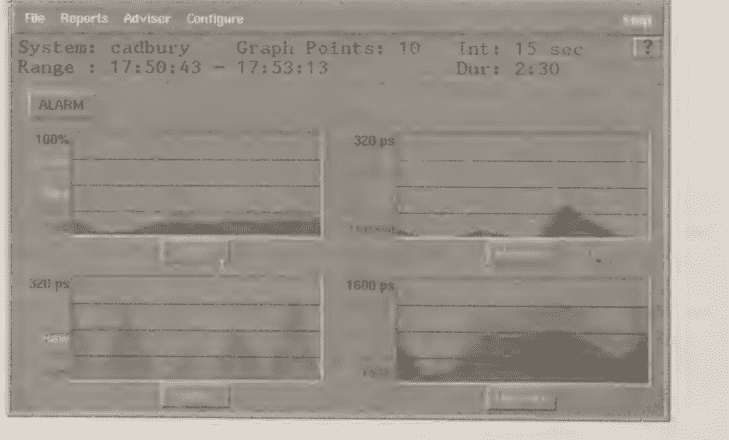

### 列表 4-13 在 GlancePlus 中定义警报。

```
alarm CPU_Bottleneck > 50 for 2 minutes
start
if CPU_Bottleneck > 90 then
red alert "CPU Bottleneck probability=  ", CPU_Bottleneck, "%"
else
yellow alert "CPU Bottleneck probability=  ", CPU_Bottleneck, "%"
repeat every 10 minutes
if CPU_Bottleneck > 90 then
red alert "CPU Bottleneck probability=  ", CPU_Bottleneck, "%"
else
yellow alert "CPU Bottleneck probability=  ", CPU_Bottleneck, "%"
end
reset alert "End of CPU Bottleneck Alert"
```

Adviser 语法。当选择此选项时，会显示所有警报条件，然后您可以修改它们。

警报会导致屏幕通知，颜色代表警报的严重程度。警报还可以触发自动执行命令或脚本。除了发送警报外，GlancePlus 还可以通过使用其 EXEC 功能打印消息或执行 UNIX 命令（如 mailx）来通知您。

要配置事件，您需要编辑配置文件。GlancePlus Adviser 语法文件（/var/opt/perf/adviser.syntax）包含症状和警报配置。也可以使用额外的语法文件。发送警报的条件可以基于涉及不同症状的规则。列表 4-13 展示了如何为基于 CPU 利用率和运行队列大小的 CPU 瓶颈设置警报的示例。

您还可以在命令模式下执行脚本。要执行脚本，请输入：

```
glance -adviser_only --syntax <script file name>
```

在此示例中，如果怀疑存在 CPU 瓶颈，则向 GlancePlus 警报屏幕发送黄色警报。随着瓶颈可能性增加，警报变为红色。您可以定义发送警报的阈值。每个时间间隔都会重新评估症状。

以下是可以使用 GlancePlus 监控的一些有用系统指标示例：

- CPU 利用率
- CPU 运行队列长度
- 处理器数量
- 文件系统缓冲区缓存队列长度
- 磁盘利用率及队列长度
- 物理内存容量
- 可用物理内存量
- 内存缺页率
- 总交换空间
- 可用交换空间量
- 文件系统 I/O 速率
- 可用缓冲区缓存量
- 可用共享内存
- 可用文件表项
- 可用进程表项
- 最活跃的进程
- 等待状态
- 系统表资源
- 打开文件信息

GlancePlus 可访问 600 多项指标。其中一些指标在其他章节中有讨论。完整的指标列表可通过在线帮助功能找到。这些信息也可以在目录 /opt/perf/paperdocs/gp/C 中找到。

GlancePlus 允许使用过滤器来减少显示的信息量。例如，您可以在进程视图中设置过滤器，仅显示更活跃的系统进程。

GlancePlus 还可以显示短期的历史信息。当被选中时，主 GlancePlus 屏幕上可见的警报按钮会显示已发生的警报历史。

如果安装了 PRM，GlancePlus 还会显示 Process Resource Manager 的行为，并允许更改 PRM 进程组权限。

有关更多信息，请访问 HP 资源和性能管理网站：http://www.openview.hp.com/solutions/application/。

### PerfView

PerfView 是 Hewlett-Packard 的一款图形化性能分析工具。它用于图形化显示一个或多个系统的性能和系统资源使用情况，以便进行比较。可以显示多种性能图形。与 GlancePlus 的实时图形不同，这些图形是基于一段时间内收集的数据生成的。该工具运行在 HP-UX 或 NT 系统上，并与 MeasureWare 代理收集的数据配合使用。

PerfView 包含以下三个主要组件：

- **PerfView Monitor：** 提供接收警报的能力。可以显示警报的文本描述。警报可以按严重程度、类型或源系统进行过滤。此外，接收到警报后，可以选择该警报以显示相关指标的图形。操作员可以监控导致故障的趋势，然后采取主动措施避免问题。图形可用于系统之间的比较，并显示历史


资源消耗。系统内部维护了一个数据库，用于保存告警通知消息的历史记录。

- **PerfView 分析器（PerfView Analyzer）：** 提供针对磁盘和其他资源的资源与性能分析。系统指标可以以三种不同的层级展示：进程级、应用级（由用户配置的一组进程）以及全局系统信息。它依赖于从受管节点上的 MeasureWare 代理接收的数据。可以同时分析多达八个系统的数据。支持所有 MeasureWare 数据源。PerfView 分析器是 PerfView 监视器和 PerfView 规划器的必需组件。
- **PerfView 规划器（PerfView Planner）：** 提供预测功能。图表可以向外推演至未来。可以为预测数据显示多种图表（如线性、指数、S 曲线和平滑曲线）。

PerfView 可用于监视关键系统资源。图 4-10 展示了 PerfView 分析器生成的内存使用率和分页率图表。还存在其他预定义的图表，用于展示历史、CPU、内存和队列信息。例如，历史图表展示了 CPU、活动进程、磁盘使用率、内存换出速率和交换换出速率。

**图 4-10** 显示内存使用率和分页率的 PerfView 图表。

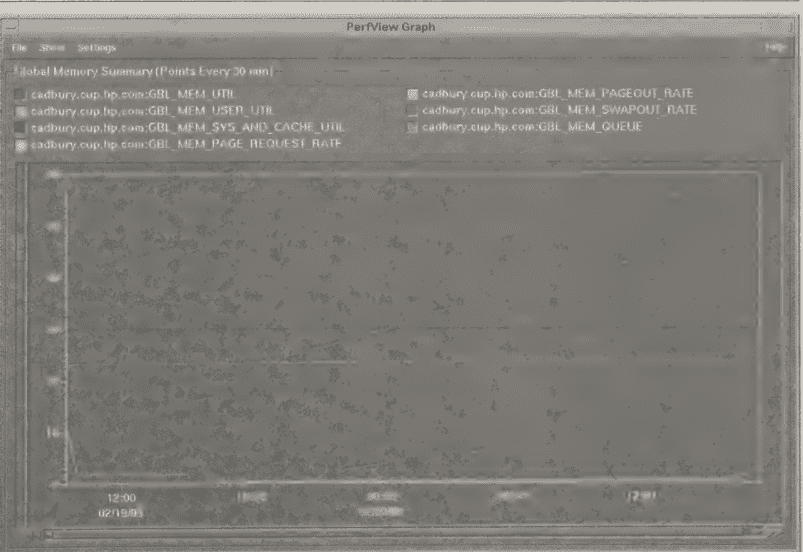

图 4-11 中显示的 PerfView 分析器图表同时比较了两个系统的性能。一张图表中最多可以比较八个系统。在确定新应用程序的部署位置或添加新用户时，比较系统利用率会很有用。

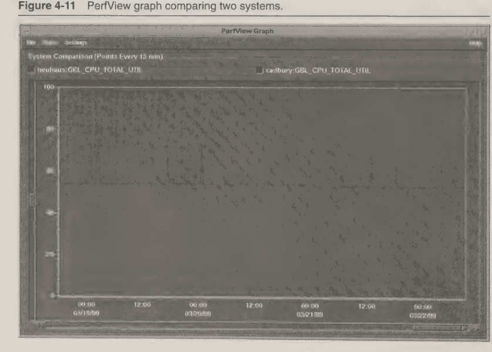

PerfView 展示历史和趋势信息的能力有助于诊断系统问题。对性能信息进行图表化展示有助于你理解是否存在持久性问题，或者异常仅仅是一次短暂的活动高峰。

为了进一步诊断问题，PerfView 监视器允许用户更改时间间隔，以尝试找到问题发生的具体时间。图表将重新绘制以显示新的时间段。

PerfView 与几个其他监视工具进行了集成。你可以通过访问“工具”菜单从 PerfView 内部启动 GlancePlus。也可以从 IT/O 应用程序银行启动 PerfView。在 IT/O 消息浏览器窗口中排除事件故障时，你可以启动 PerfView 以查看相关的性能图表。

PerfView 监视器不用于 IT/O。相反，使用的是 IT/O 消息浏览器。当 IT/O 接收到告警时，操作员可以单击该告警，并显示相关的 PerfView 图表。

PerfView 可以在单个性能图表中显示从多个系统收集的信息。PerfView 和 ClusterView 产品也已集成，使操作员能够在 HP OpenView 子图上选择集群符号并启动 PerfView 应用程序。这可以快速显示集群中所有系统之间的性能对比。

有关更多信息，请访问 HP 资源与性能管理网站：http://www.openview.hp.com/solutions/application/。

#### BMC PATROL for UNIX

BMC Software 通过其 PATROL 软件套件提供监视功能。PATROL 是一套面向系统和数据库管理员的系统、应用程序和事件管理套件。PATROL 提供了定义阈值、发送和转换事件等基本框架。可选产品称为知识模块（KMs），能够对特定组件进行监视。例如，BMC PATROL 包含用于 UNIX、SAP R/3、Oracle、Informix 和其他应用程序的 KM。实际上，BMC 提供超过 40 个可用于 PATROL 的 KM。

使用 UNIX 的 PATROL KM，受管组件包括 CPU、内存、用户、内核、进程、打印机、安全性和文件系统。这些组件会自动被发现，并在 PATROL 控制台上以状态图标表示。系统利用率可以以图表形式显示以捕获趋势，数据可以实时显示或保存在日志文件中。

与其他图形监视工具类似，PATROL 提供了一个事件管理器窗口，可以显示接收到的事件。图 4-12 高亮显示了在控制台上接收到的磁盘和 NFS 事件。

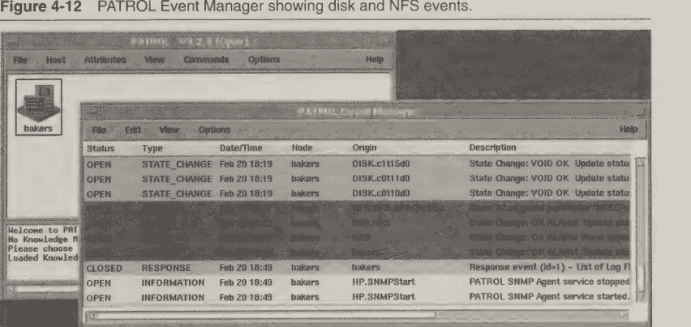

对于内存和交换资源，PATROL 可以显示可用的总实际内存、可用的总虚拟内存、交换设备列表、已交换的进程数以及交换空间利用率。

对于 CPU，PATROL 可以显示瓶颈和使用率信息，以及各种统计数据，如 CPU 空闲时间、运行队列长度和交换队列长度。还维护有关操作系统本身的信息，例如名称、版本和创建日期。

PATROL 可以显示总进程数、僵尸进程数以及高 CPU 使用者。通过 PATROL 控制台，你可以执行管理任务，如重新确定进程优先级。

PATROL 还可以显示总用户数和会话数，并通过监视失败的用户和特权登录次数来检查安全性。你可以检查打印机队列，查看队列中有多少作业并确定打印机状态。

PATROL 可以监视文件系统，并自动确定缓冲缓存的有效性。可以生成定期报告以检查每个用户的磁盘使用情况，创建最大文件列表，或列出长时间未访问的文件。还可以配置纠正措施，如删除核心文件。

除了 PATROL 监视的系统指标外，UNIX 的 KM 还包含一组提供额外系统监视的工具，包括用于监视 CPU 使用率、分页活动、I/O 缓存、交换活动和系统日志文件的工具，用于检查文件系统和内核文件资源的工具，以及用于监视打印机队列的工具。

以下列表显示了一些可用于从 UNIX 的 PATROL KM 监视的参数：

- CPUCpuUtil
- CPUIdleTime
- CPUInt
- CPULoad
- CPUProcsWaiting
- CPUProcSwch
- CPURunQSsize
- CPUSysTime
- CPUUserTime
- KERSysCall
- MEMActiveVirPage
- MEMFreeMem
- MEMPageAnticipated
- MEMPageFreed
- MEMPageIn
- MEMPageOut
- MEMPageScanned
- PRNQLength
- PROCAvgUsrProc
- PROCCpuHogs
- PROCCNoZombies
- PROCCNumProcs
- PROCCProcWait
- PROCCUserProcs
- SWPSwapFreeSpace
- SWPSwapIn
- SWPSwapOut
- SWPSwapSize
- SWPSwapUsedPercent
- USRNoSession
- USRNoUser

BMC PATROL UNIX KM 支持 Bull、DG AViiON、DEC Alpha、DEC Ultra、Hewlett-Packard、NCR、Olivetti、OSF/1、Pyramid、RS/6000、SCO、Sequent、SGI、Sun Solaris、SunOS、Unisys 和 UNIXWare 系统。

## Candle

Candle Corporation 为主机和分布式系统提供软件。可用性指挥中心（Availability Command Center）是一套集成的性能监视器和可用性管理解决方案。用于分布式系统的 Candle 指挥中心用于管理计算机系统和应用程序的性能和可用性。指挥中心解决方案适用于 UNIX、NT、IBM AIX 和 MVS 平台。分布式系统指挥中心可以从单个控制台监视多个系统。

Candle 的管理代理提供详细的性能和可用性指标。用于 UNIX 的 OMEGAMON 监视代理提供跨多个 UNIX 平台（IBM AIX、HP-UX、Sun Solaris 和 SunOS）标准化的系统信息。可用的指标包括操作系统和 CPU 性能、进程状态以及磁盘性能。磁盘性能以每秒千字节、繁忙百分比和每秒传输次数表示。可以从指挥中心控制台启动磁盘性能和其他工具。

指挥中心提供了一些预定义的阈值条件以发送警报。你还可以更改这些条件。如果你决定更改阈值条件，它们会自动重新分发到适当的系统。可以使用不同的告警严重程度级别。

指挥中心的**事件关联引擎**和**可视策略编辑器**可用于创建规则，自动识别问题症状并制定自动化响应。

Candle 对指挥中心进行了额外的测试，以确保其分布式系统指挥中心产品能在 MC/ServiceGuard 环境中运行。关于 Candle Corporation 产品的更多信息可以在网络上的 http://www.candle.com 找到。


## 使用系统性能数据

本节简要介绍了如何使用性能监控工具来避免、识别和解决系统性能问题。关于系统性能的详尽教程超出了本书的范围。

一个系统资源中的*瓶颈*可能导致其他系统资源无法使用。您需要确保所有系统组件都有足够的容量，以便在其最佳水平下运行。您可以利用性能数据来避免瓶颈，通过检测趋势为每个应用程序建立适当的资源分配，并在问题出现时帮助消除问题。

本节不讨论如何排查网络性能问题，该内容将在第 6 章中介绍。

请注意，性能监控本身也可能在您所处的环境中造成问题。对于中型公司而言，将每个系统的定期性能数据传输到中心位置，每天可能导致数百兆字节的网络流量和数据存储。您应确保正在收集的所有数据都会被使用。不要发送所有数据，而只应发送不寻常或例外信息。然而，应发送足够的数据，以便能够识别容量规划所需的趋势。您应该在每个系统的本地存储固定数量的详细性能数据，以便在问题出现时进行排查。

#### 避免性能问题

为避免性能问题，您可以采取的第一步是为您的环境建立基线。当系统运行良好时，收集足够长时间的绩效数据，以获取系统工作负载的有效代表，从而拥有一个基准来与性能较差的系统进行对比。

接下来，您应查看 CPU、内存和 I/O 资源是否平衡良好。您还应进行容量规划，以确保您的系统有足够的余量来支持您可能会遇到的额外用户和应用程序。如果没有多余的容量，您应制定一个应对未来增长的计划。

需要检查的另一个领域是系统资源的分配。例如，使用 `sar` 和 `sysdef` 命令查看是否有任何资源达到了其配置的限制。检查可用的交换空间和文件及进程表中的条目，看看这些大小是否合适。使用 EMS 设置早期警告，以便在其他系统资源的使用量增加时发出警报。由于更改这些限制通常要求重启系统，早期检测可以使您规划系统不可用的时间。

保护系统资源的另一种方法是使用进程资源管理器（PRM），这是一种用于在 PRM 组之间平衡系统资源的资源管理工具。PRM 组由管理员配置，由一组 HP-UX 用户或应用程序组成。然后，PRM 用于将系统上可用的 CPU、实际内存或磁盘 I/O 带宽的一定百分比分配给每个 PRM 组。PRM 确保即使在重负载期间，每个 PRM 组也能获得系统资源的最小百分比。

PRM 可以配合 HP GlancePlus 一起使用以调整系统配置。例如，如果管理员检测到某个 PRM 组出现不期望的系统负载，GlancePlus 可用于动态降低该组的资源分配。

通常情况下，如果一个 PRM 组不需要其系统资源，PRM 会将这些资源分配给可能需要它们的组。然而，PRM 还可以通过指定资源最大值来帮助容量规划。因此，如果管理员知道系统很快将增加 25% 的用户，管理员可以分配系统资源的最大 80% 来模拟即将到来的负载。

虽然 PRM 可以确保用户获得一定百分比的 CPU 资源，但它无法防止所有的系统性能问题。例如，一个发送大型网络数据包但使用极少 CPU 资源的应用程序可能会使一个更关键的应用程序陷入资源饥饿状态，因为网络带宽不受 PRM 控制。

在高可用性环境中，PRM 还可以用于动态调整工作负载。例如，如果三个 MC/ServiceGuard 软件包均以相似的 PRM 资源配额运行，且其中一个软件包故障转移至另一个系统，这可以被自动检测，并可以应用新的 PRM 配置，为剩余的两个软件包赋予更高的资源配额。

尽管做出了这些努力，您可能仍然会有一些性能问题需要调查。接下来的几节描述了如何使用各种性能监控工具收集的数据来解决性能问题。

### 检测 CPU 争用

UNIX 命令（如 `top` 和 `uptime`）以及性能监控工具（如 GlancePlus）提供 CPU 利用率信息。CPU 利用率和运行队列长度可以结合使用来确定是否存在 CPU 瓶颈。单独的 CPU 高利用率可能并不一定表示存在问题；批处理任务可能正在消耗交互用户剩余的 CPU。然而，如果交互用户遇到较差的响应时间，则表明存在问题，如系统瓶颈。

如果运行队列大于一，随着 CPU 利用率接近 100 百分比，存在 CPU 瓶颈的可能性就会增加。请确保高利用率和大的运行队列是持续了一段时间的。

如果识别出 CPU 瓶颈，恢复可能取决于消耗大量 CPU 的应用程序和进程。这可以通过使用 GlancePlus 等性能监控工具来确定。将大部分时间花在系统代码中的应用程序可能需要修改。在某些情况下，可以通过重新编译、优化或重构应用程序来提高其性能。如果批处理是导致问题的原因，可以使用作业调度器将作业路由到利用率较低的系统。不那么重要的应用程序，如批处理进程，也可以重新配置为使用 `nice` 以更低的优先级运行。如果应用程序持续与其他应用程序发生抖动（thrashing），可能需要中止该应用程序或将其移动到另一个系统。可以启用或重新配置 PRM 等工具来处理应用程序或用户之间的资源分配。PRM 可以将应用程序保持在配置的 CPU 限制内。

### 检查系统资源使用情况

本章描述了多种监控系统资源使用情况的工具。系统表利用率可以使用 GlancePlus 等工具进行检查。使用 EMS 监视器设置阈值是另一种有用的方法。

允许的过程数和允许的同时打开文件数是两个应检查且可使用 SAM 重新配置的参数。

纠正此类问题的许多操作都需要重启系统，但如果问题是由失控的应用程序引起的，您或许能够在其他应用程序受到影响之前检测到问题。您可以在系统资源耗尽之前中止该应用程序。

### 检测内存和交换争用

要检查网络服务器上的实际内存瓶颈，您可以首先检查空闲内存的量。它不应低于可用总量的 5 百分比。如果系统无法跟上内存需求的速度，它将开始分页和交换。从 GlancePlus 中观察到的过度分页和交换可能是内存瓶颈的迹象。另外两个可能指示内存瓶颈的征兆是大量进程阻塞在虚拟内存上，以及交换设备上的大型磁盘队列。

为了降低交换率，您可能希望为交换配置更高百分比的可用磁盘空间。通过增加更多内存或磁盘空间来提高系统容量，也可能消除瓶颈。PRM 可用于确保最重要的应用程序获得足够百分比的内存。

如果正在使用的内存量看起来异常高，您可以使用性能工具来确定哪些进程正在使用最多的内存。可能需要重新设计程序以更高效地使用内存。程序可能也需要检查是否存在内存泄漏。

### 检测磁盘和文件系统瓶颈

需要共同研究系统、应用程序和磁盘信息以解决磁盘性能问题。MeasureWare 提供了大量关于应用程序磁盘利用率的信息，这些信息可能需要与系统数据进行关联。

为避免磁盘瓶颈，您需要平衡文件系统、磁盘主轴和磁盘控制器上的 I/O，以减少不均匀的排队和延迟。GlancePlus 等性能监控工具可用于查找 I/O 速率最高的进程，以及最繁忙的物理磁盘。仅检查 I/O 速率是不够的，因为较慢的设备与具有相同 I/O 速率的较快磁盘相比，利用率更高。如果单个磁盘在很长一段时间内的利用率超过 50 百分比，这可能是 I/O 瓶颈的迹象。该百分比应与其他磁盘进行比较，以查看是否存在严重的负载不平衡。然而，高利用率不足以识别问题。磁盘可能仍有能力处理更多的 I/O。持续较长的磁盘队列长度也是指示问题的必要条件。 heavily used 磁盘可能也会具有较大的磁盘队列长度。


BMC PATROL 和 MeasureWare 都收集读缓存命中比（Read Cache Hit Ratio）信息。确定多少逻辑读是由系统缓冲区满足的，是判断缓存大小是否配置正确的一个指标。由于增加缓存大小会负面影响系统其他用途的可用内存，因此合适的缓存命中比取决于系统上运行的工作负载类型。对于 I/O 密集型应用程序，您可能希望配置系统使该比率尽可能高，达到 90% 或 95%。同样，您可能希望确保写缓存命中比至少为 75%。如果您的命中率过低，则系统缓冲区可能太小。

在确定系统缓冲区太小之后，您可以使用 SAM 在 HP-UX 上增加其大小。从内核配置功能区域中选择“可配置参数”选项。需要修改的合适参数取决于使用的是静态缓冲区缓存还是动态缓冲区缓存，这也可以在该屏幕上检查。如果环境和负载是静态的，固定大小的缓冲区缓存最有效。动态缓冲区缓存的大小会根据 I/O 或虚拟内存的需求而波动，在负载变化时非常有用。如果系统参数 `nbuf` 和 `nswapges` 设置为 0，则正在使用动态缓冲区缓存。在具有大于 1GB 物理内存的系统上使用动态缓冲区缓存时，您应该将最大尺寸降低到 50% 以下，因为大于 500MB 的缓存实际上会导致性能下降。

检测磁盘争用在第 5 章中有讨论。如果 CPU、内存或磁盘似乎不存在问题，其他可能性包括网络或系统表利用率。检查网络利用率在第 6 章中有讨论。

## 避免系统问题

为了避免与错误配置相关的系统问题，您需要具备适当的产品文档和业务策略。进行更改的管理员应能够访问警示信息和过去更改的历史日志。更改应被记录，并且应使用版本控制系统，以便您可以快速恢复旧配置。

系统组件会失效，但您可以通过投资高可用性或弹性产品及功能来减少后续问题。在 1997 年 D. H. Brown 对高可用性提供商的调查中，Hewlett-Packard 在检测和从故障中恢复方面的能力被评为高于平均水平。HP-UX 提供动态内存弹性、动态处理器弹性和可动态加载的内核模块。单比特 CPU 缓存错误可以自动纠正。内存纠错码（ECC）和校验和减少了内存问题，但并未消除监控内存子系统的需要。HP 支持内存和磁盘的错误阈值，其内存页解配（Memory Page Deallocation）功能允许对故障内存位置进行动态内存去选择。

随着供应商提高其操作系统的弹性，CPU 故障导致系统失效的可能性变得更小。在某些情况下，如果诊断工具检测到 CPU 问题，可以在操作系统继续运行的同时解除处理器的分配。例如，如果已纠正的单比特 CPU 缓存错误率超过预定义的阈值，就可以执行此操作。如果在启动期间自检中发现任何问题，也可以解除处理器的分配。

对于拥有 HP 支持合同的公司，可以使用 HP 预测性支持来检测可能导致系统问题的趋势。然后可以派遣工程师到客户现场，在问题变得严重之前进行修复。

您还必须定期备份数据，以备任何问题发生。应定期测试备份以确保其正常运行。

您还应该通过密切监控系统的使用情况，来避免性能和资源管理问题。实现这一点的技巧在前一节中有描述。

## 从系统问题中恢复

当服务器失效且无法立即修复时，可以使用高可用性集群软件（如 MC/ServiceGuard）来减少与此情况相关的停机时间，并保持服务可用。MC/ServiceGuard 检测应用程序故障，并自动在另一个系统上重启该应用程序。这种自动检测和恢复可以为节省停机时间。MC/ServiceGuard 可以在不到一分钟内检测到故障并在另一个系统上重启应用程序。

然而，即使内核具有掩盖某些故障的能力，高可用性软件具有将应用程序移动到冗余服务器的能力，最终您仍然需要修复故障组件。对于硬件问题，Support Tool Manager 可以为 HP-UX 系统提供快速诊断。SyMON 可用于 Solaris 环境。

您可能需要找到软件或固件补丁来修复您的问题。对于 HP-UX，您可以通过点击支持信息链接，从 HP 网站获取补丁信息。拥有 HP 软件支持协议的客户可以使用定制补丁捆绑。对于 Sun Solaris，您可以通过名为 SunSolve Online 的服务在网上访问补丁信息。

从恶意入侵者造成的安全违规中恢复可能更为困难。系统管理员可能需要回退到来自已知良好系统状态的系统备份磁带。

## 比较系统监控工具

本节提供了本章中讨论的工具的简要摘要和比较。摘要按照系统监控的关键关注领域进行组织：配置、故障，以及资源和性能管理。

可用的监控配置变更的工具非常有限。运行诸如 iostat 和 STM 等工具以收集配置数据，然后存储这些数据的负担主要落在您身上，以便日后在自定义区域进行比对。DMI 软件 MIF 包含一些软件配置信息，但 DMI 管理工具尚不可用。配置跟踪器（Configuration Tracker）是一种可用于监控软件配置变更的工具。

ClusterView 可以跟踪对高可用性集群配置所做的更改。需要更多的工具来跟踪硬件和软件配置信息的变更。随着系统保持活动状态下添加或移除组件变得越来越容易，这一点将变得更加重要。

HP-UX 的系统组件故障可以通过 EMS 报告，Sun Solaris 系统则通过 SyMON 报告。这些产品及其自动故障通知，优于手动使用工具探测硬件组件的状态。两种产品都提供硬件监视器和监视器开发者套件。两者都可以通过多种方法发送通知，包括 SNMP，但 EMS 与 NNM 和 IT/O 的集成更紧密。SyMON 提供与其产品集成的恢复操作。请注意，检测系统故障需要远程监控工具，如 NNM。

如果您没有性能管理产品，可以通过 UNIX 命令进行一些低成本的性能监控，主要是 iostat、vmstat、top、uptime、sar 和 swapinfo。

GlanicePlus 为单个系统上的大量指标提供实时性能监控。相比之下，SyMON 几乎没有性能数据。对于较长时间段内采样的历史性能数据，您应该使用诸如 MeasureWare 或 BMC PATROL 这样的工具。如果希望工具能与性能管理产品集成，那么您可能希望使用 MeasureWare，它提供与 PerfView 的紧密集成。这两个产品都可以通过 SNMP 报告信息。

可以使用性能监控工具或 EMS 进行一定程度的资源监控。额外的资源使用数据可从 ipcs、syssdef 和 HP-UNIX MIB 获取。

## 案例研究：从内存故障中恢复

在这个案例研究中，系统管理员 Bill Landis 负责维护硅谷医院（Silicon Valley Hospital）计费系统每周七天、每天 24 小时的系统可用性。根据过去的经验，他需要一个系统，其系统组件（如 CPU 和内存）可以在不需要关闭系统的情况下进行替换。Bill 拥有一台 Sun Enterprise 10000 服务器，它具有动态重构功能。为了利用 Sun 的动态重构，Bill 正在配置他的系统内存，以便在板卡故障时能够将其离线并替换。

### 验证配置

系统的物理内存分为内存银行（memory banks），当它们包含内核页面时，它们变得不适合动态重构。利用 Sun 的动态重构功能，您可以配置内核页面以使用特定的内存银行。一旦配置完成，您使用 SyMON 中的动态重构屏幕（如图 4-13 所示）来验证这些银行不是“永久性”的，并且可用以解除配置。

如图 4-13 所示，插槽 2 中的内存板已配置，但未分配给永久性内存银行。因此，Bill 可以使用 SyMON 中的此屏幕来使内存


## 图 4-13 使用 SyMON 动态重新配置功能更换故障内存板。

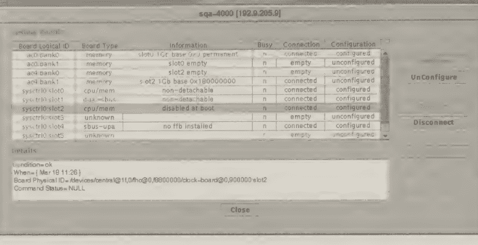

离线状态。相比之下，插槽 0 与永久性内存库相关联，因此在系统运行时无法断开连接。

## 设置监控与重新配置

在企业级 SyMON 控制台中，Bill 加载了 Config-Reader 和 Dynamic Reconfiguration 模块，以确保在发生硬件故障时能收到通知，从而他可以在无需关闭系统的情况下处理故障。Config-Reader 模块位于 Hardware（硬件）下，而 Dynamic Reconfiguration 模块位于 local applications（本地应用程序）下（如本章前面图 4-7 所示）。

## 内存板故障发生

当发生严重内存故障时，SyMON 控制台上的系统图标会显示警报。Bill 查看 Alarm（警报）窗口以了解该事件的更多详细信息。他注意到一块内存板已故障。通过使用逻辑视图（如图中 4-14 所示），他定位了故障内存板。通过物理视图（如前面图 4-5 所示），他确定了该物理板在系统中的确切位置。

## 修复故障并恢复服务

Bill 从 SyMON 控制台访问 Dynamic Reconfiguration（动态重新配置）屏幕。首先，他选择故障内存插槽并点击 Disconnect（断开）按钮，以取消配置并断开该板。接下来，他更换故障板，然后通过点击 Connect（连接）按钮连接该板；然而，他在执行内存测试期间暂时不对其进行配置，使用 Test Memory（测试内存）按钮以确保新板功能正常。最后，Bill 点击 Configure（配置）按钮，使这些内存资源可供系统使用。

## 图 4-14 使用 SyMON 逻辑视图定位故障内存板。

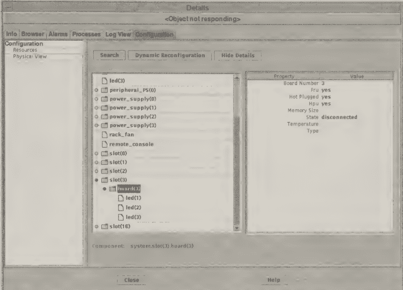

在此环境中，Bill 能够以极小的系统影响处理故障内存板。Sun 的从 SyMON 可用的动态重新配置功能提供了强大的特性，允许在不关闭系统的情况下修复故障的内存、CPU 和 I/O 资源。

# 第 5 章
## 监控磁盘

磁盘技术提供了一定程度的故障保护。为了减少或消除因磁盘故障导致的系统停机时间，必须使用如冗余磁盘阵列（RAID）或镜像等技术来提供数据冗余。RAID 技术使用奇偶校验数据，以确保在磁盘故障事件发生时能够恢复。镜像允许维护数据的多个副本。特别是三向镜像，在备份期间提供了额外的数据保护，因为镜像会在未正在备份的磁盘上继续运行。

借助数据冗余，如果在初始故障发生时，数据将得到保护，但初始故障可能会导致冗余丢失，或单点故障（SPOF）。因此，后续故障可能会导致数据丢失。因此，尽管这些技术可以防止单一故障，但对此类故障的通知对于降低停机风险至关重要。在下次故障发生之前修复故障并恢复数据冗余是保持可用性的关键。数据冗余和故障监控不能替代定期备份策略的需求。

尽管 RAID 和镜像可能会防止单一硬件故障，但存在许多其他可能影响磁盘上数据可用性并增加停机风险的事件。消除故障和停机风险的关键在于监控关键磁盘资源。您必须知道要监控哪些资源以及有哪些工具可用于执行该监控。本章从硬件设备级别到文件系统资源，解决磁盘资源监控问题。它不涵盖备份、恢复或磁带存储设备。

## 识别重要的磁盘监控类别

如前所述，冗余是防止初始故障的最佳方式。高可用性的关键在于始终维护冗余，以便磁盘故障不会不利影响系统和数据可用性。然而，有时这并不够。如果资源未正常运行，可用性也可能受到性能下降的影响。

无论您的磁盘是否配置为高可用性，监控都有助于防止故障。虽然冗余有助于防止初始硬件故障，但需要进行监控，不仅为了防范第二次故障，还为了防范可能影响可用性的其他故障。

您可以用于保持可用性的事件和度量指标分为几个系统监控类别：

- 磁盘配置：包括监控磁盘资源的添加或移除，并确保安装了正确的软件版本和固件版本。跟踪配置更改有助于以后排查问题。确保设备使用正确版本的固件也可以消除问题。
- 故障管理：包括监控可能在硬件、物理磁盘设备上发生的任何错误或事件。此类别涵盖设备错误，如介质错误、读取错误、寻道时间错误和坏块，以及组件故障，如 FRU 故障、控制器故障、RAID 故障、风扇故障等。
- 资源管理：包括监控提供磁盘存储空间资源。文件系统空间、挂载点、逻辑卷、镜像副本和物理卷链接都是重要的磁盘资源，需要监控。在文件系统级别，必须确保有足够的文件系统空间供应用程序成功运行。所有文件系统必须已挂载并对用户可用。文件系统通常使用逻辑卷进行配置。当数据被镜像时，被镜像的是逻辑卷。监控数据镜像对于维护冗余和提高可用性可能至关重要。物理卷及其链接被视为磁盘资源。
- 性能管理：包括监控磁盘性能指标，如磁盘读取和写入吞吐量。换页率也很重要，因为它们可用于识别资源争用，这可能影响可用性。可以监控磁盘性能资源，以确保 I/O 流量在可用磁盘资源之间平衡。

以下部分列出了您可以用于监控上述类别中列出的磁盘资源的各种工具。这些工具包括基本命令、通过标准接口可用的系统仪表化、事件监视器、诊断工具和性能监视器。

### 使用标准命令和工具

有许多 UNIX 命令用于检查配置、状态和资源信息。这些工具通常仅报告时间快照。您可以通过编写和使用包含这些（及其他）命令的自定义脚本，定期跟踪配置更改或测试磁盘设备或资源的状况。

### bdf 和 df

bdf 和 df 命令不仅可以查看已挂载的文件系统配置，还可以报告文件系统使用情况和容量信息。您可以使用此命令执行以下操作：

- 监控文件系统空间，以避免文件系统容量限制
- 检查必要的文件系统是否已挂载
- 查看文件系统挂载点与关联逻辑卷之间的关系

列表 5-1 显示了 bdf 的输出。

### diskinfo

diskinfo 命令可用于获取 CS/80、Subset/80 和 Hewlett-Packard 小型计算机标准接口（SCSI）磁盘设备的设备信息。使用此命令，操作员可以检查磁盘访问。这样，会对磁盘进行 ping 测试以查看其是否状态正常。您可以使用 diskinfo 获取设备状态和配置信息。列表 5-2 显示了一些示例输出。

### fsck

fsck 命令执行文件系统一致性检查和交互式修复。如果发现不一致，它提供修复文件系统中不一致性的机制。如果您怀疑文件系统损坏，或者仅为预防性维护，您应该运行此工具。

使用 -m 选项运行 fsck 可检查文件系统是否有需要修复的错误。如果没有，它会报告文件系统已经挂载，如列表 5-3 所示。

使用 -n 选项运行 fsck 会生成更详细的报告。会检查块、路径名和引用计数。列表 5-4 显示了一个 fsck 报告的一部分，其中包含多个文件系统的相关信息。注意它显示了 /dev/vg00/rvo15 的一个错误。

列表 5-1 bdf 命令的输出，用于监控文件系统空间。

```
Filesystem             kbytes     used   avail %used Mounted on
/dev/vg00/rvo13     102400   18723   78457  19% / 
/dev/vg00/rvo11     47829    6438   36608  15% /stand
/dev/vg00/rvo18    155648   51011   98168  34% /var
/dev/vg00/rvo17    307200  228550   73747  76% /usr
/dev/vg00/rvo16     49152   1214   45007   3% /tmp
/dev/vg00/rvo15    102400   84310   16981  83% /opt
/dev/vg00/rvo14    921600  446758  445205  50% /home
```

列表 5-2 diskinfo 命令的输出。

```
# diskinfo /dev/rdsk/c0t5d0
SCSI describe of /dev/rdsk/c0t5d0: 
        vendor:  SEAGATE 
        product id: ST34572WC 
        type: direct access 
        size:  4194157 Kbytes 
        bytes per sector: 512
```


### 清单 5-3 显示文件系统已挂载的 fsck 输出。

```
# fsck -m
fsck: sanity check, /dev/vg00/lvol3 is already mounted
fsck: sanity check, /dev/vg00/lvol1 is already mounted
fsck: sanity check, /dev/vg00/lvol4 is already mounted
fsck: sanity check, /dev/vg00/lvol5 is already mounted
fsck: sanity check, /dev/vg00/lvol6 is already mounted
fsck: sanity check, /dev/vg00/lvol7 is already mounted
fsck: sanity check, /dev/vg00/lvol8 is already mounted
#
```

### 清单 5-4 显示文件系统问题的 fsck 输出。

```
** /dev/vg00/lvol4 (NO WRITE)
** Last Mounted on /home
** groups
1479 files, 0 icont, 68427 used, 31242 free (338 frags, 3863 blocks)
** /dev/vg00/lvol5 (NO WRITE)
** Last Mounted on /opt
** Phase 1 - Check Blocks and Sizes
** Phase 2 - Check Pathnames
** Phase 3 - Check Connectivity
UNREF DIR I=28054
 OWNER=root MODE=40777
 SIZE=0 MTIME=Dec 2 14:03 1998
** Phase 4 - Check Reference Counts
UNREF DIR I=28054
 OWNER=root MODE=40777
 SIZE=0 MTIME=Dec 2 14:03 1998
CLEAR? no
** Phase 5 - Check Cyl groups
9033 files, 0 icont, 439919 used, 58726 free (1830 frags, 7112 blocks)
** /dev/vg00/lvol6 (NO WRITE)
** Last Mounted on /tmp
** Phase 1 - Check Blocks and Sizes
** Phase 2 - Check Pathnames
** Phase 3 - Check Connectivity
** Phase 4 - Check Reference Counts
** Phase 5 - Check Cyl groups
269 files, 0 icont, 23451 used, 7146 free (98 frags, 881 blocks)
```

在获得指示存在问题的报告后，您可能希望交互式地运行 fsck 以修复该问题。这在清单 5-5 中有所展示。

### 清单 5-5 显示文件系统修复的 fsck 输出。

```
### fsck
fsck: /dev/vg00/lvol3: root file system
continue (y/n)? n
fsck: /dev/vg00/lvol1: mounted file system
continue (y/n)? n
fsck: /dev/vg00/lvol4: mounted file system
continue (y/n)? n
fsck: /dev/vg00/lvol5: mounted file system
continue (y/n)? y
** /dev/vg00/lvol5
** Last Mounted on /opt
** Phase 1 - Check Blocks and Sizes
** Phase 2 - Check Pathnames
** Phase 3 - Check Connectivity
UNREF DIR I=28054
    OWNER=root MODE=40777
    SIZE=0 MTIME=Dec  2 14:03 1998
** Phase 4 - Check Reference Counts
UNREF DIR I=28054
    OWNER=root MODE=40777
    SIZE=0 MTIME=Dec  2 14:03 1998
CLEAR? y

FREE INODE COUNT WRONG IN SUPERBLK
FIX? y

** Phase 5 - Check Cyl groups
SUMMARY INFORMATION (INODE FREE) BAD
BAD CYLINDER GROUPS
FIX? y

** Phase 6 - Salvage Cylinder Groups
9032 files, 0 icont, 439919 used, 58726 free (1830 frags, 7112 blocks)
**** MARKING FILE SYSTEM CLEAN ****

**** FILE SYSTEM WAS MODIFIED ****
fsck: /dev/vg00/lvol6: mounted file system
continue (y/n)? n
fsck: /dev/vg00/lvol7: mounted file system
continue (y/n)? n
fsck: /dev/vg00/lvol8: mounted file system
continue (y/n)? n
#
```

#### ioscan

ioscan 命令对于查看系统的硬件配置非常有用。对于磁盘资源，这包括接口卡以及 I/O 设备。该命令显示硬件模块的硬件路径、硬件模块的类别以及简要描述。这有助于跟踪系统的磁盘配置。

清单 5-6 显示了 ioscan 命令的输出；-l 选项生成完整列表。

### lvdisplay

lvdisplay 命令可用于获取磁盘资源管理信息。它显示逻辑卷管理器 (LVM) 的逻辑卷配置信息和逻辑卷状态。如果您正在使用 MirrorDisk/UX，则包含关于镜像副本的信息。清单 5-7 显示了 lvdisplay 输出中的逻辑卷状态和镜像副本以及其他信息。

### 清单 5-6 显示系统上配置的硬件设备信息的 ioscan 命令输出。

```
# ioscan -l

Class H/W Path Driver S/W State H/W Type Description

===

bc 0 root CLAIMED BUS_NEXUS

bc 1 8 ccio CLAIMED BUS_NEXUS I/O Adapter

bc 2 8/0 bc CLAIMED BUS_NEXUS Bus Converter

tty 0 8/0/0 mux2 CLAIMED INTERFACE MUX

ext_bus 0 8/4 c720 CLAIMED INTERFACE GSC add-on F/W SCSI

target 0 8/4.5 tgt CLAIMED DEVICE

disk 0 8/4.5.0 sdisk CLAIMED DEVICE SEAGATE ST34572WC

target 1 8/4.6 tgt CLAIMED DEVICE

ctl1 4 8/4.6.0 sctl CLAIMED DEVICE Initiator

target 2 8/4.12 tgt CLAIMED DEVICE

disk 2 8/4.12.0 sdisk CLAIMED DEVICE SEAGATE ST32272WC

target 3 8/4.13 tgt CLAIMED DEVICE

disk 3 8/4.13.0 sdisk CLAIMED DEVICE SEAGATE ST32272WC

target 4 8/4.14 tgt CLAIMED DEVICE

disk 4 8/4.14.0 sdisk CLAIMED DEVICE SEAGATE ST32272WC

target 5 8/4.15 tgt CLAIMED DEVICE

disk 5 8/4.15.0 sdisk CLAIMED DEVICE SEAGATE ST32272WC
```

### 清单 5-7 显示逻辑卷信息的 lvdisplay 命令输出

```
# lvdisplay /dev/vg00/lvol1
-- Logical volumes --
LV Name /dev/vg00/lvol1
VG Name /dev/vg00
LV Permission read/write
LV Status available/syncd
Mirror copies 0
Consistency Recovery MW C
Schedule parallel
LV Size (Mbytes) 48
Current LE 12
Allocated PE 12
Stripes 0
Stripe Size (Kbytes) 0
Bad block off
Allocation contiguous strict/contiguous/
```

关于所显示各个字段的信息，可以在该命令的在线手册页中找到。

### pvdisplay

pvdisplay 命令提供磁盘资源管理的状态和配置信息，特别是针对 LVM 卷组中的物理卷。对于每个物理卷，您可以显示在物理卷上分配有区的逻辑卷，以及所有物理区的使用情况。清单 5-8 显示了 pvdisplay 的输出。

### 清单 5-8 显示 LVM 卷组中物理卷信息的 pvdisplay 命令输出。

```
# pvdisplay /dev/dsk/c0t5d0
-- Physical volumes --
PV Name /dev/dsk/c0t5d0
VG Name /dev/vg00
PV Status available
Allocatable yes
VGDA 2
Cur LV 8
PE Size (Mbytes) 4
Total PE 1023
Free PE 607
Allocated PE 416
Stale PE 0
IO Timeout (Seconds) default
```

### vgdisplay

vgdisplay 命令用于获取系统中配置的 LVM 卷组信息。该命令可用于获取磁盘资源状态和配置信息。您可以获取系统中每个活动卷组的每个逻辑卷、物理卷和物理卷组的配置信息。您可以如清单 5-9 所示获取卷组、逻辑卷和物理卷的状态。来自 lvdisplay 和 pvdisplay 的一些信息也由该命令提供。例如，使用 verbose 选项，您不仅可以获取卷组状态，还可以获取卷组内所有逻辑卷的状态。

您可以使用 lvdisplay 或 pvdisplay 分别获取逻辑卷或物理卷的更详细信息。

## 使用系统仪表化

诸如简单网络管理协议 (SNMP) 和桌面管理接口 (DMI) 等网络和管理标准已被开发出来，以帮助简化管理工作。这些标准提供了构建仪表化的行业标准方式，以及接入仪表化的行业标准方式。SNMP 用于访问管理信息库 (MIBs)，而 DMI 用于访问管理信息格式 (MIFs)。

标准 MIB 和 MIF 定义了任何供应商都可以提供的指标。所提供的信息通常被称为仪表化信息。私有 MIB 和 MIF 提供特定于供应商的仪表化信息。本节探讨了通过这些标准之一可用的一些磁盘仪表化信息。

已存在许多用于访问仪表化信息的工具。多家供应商提供浏览器和监控功能，使用通用界面访问来自不同硬件平台和操作系统的仪表化对象。例如，每个常见的企业管理框架，包括 HP OpenView Network Node Manager、HP OpenView IT/Operations 和 CA Unicenter TNG，都提供 MIB 浏览器工具来访问 MIB 数据。图 5-1 中展示了一个示例。存在工具包以提供接口，使开发人员能够编写自己的工具来监控或跟踪此信息。也存在用于进行自定义仪表化的工具包。

两种标准均提供磁盘类型信息，并且随着时间推移，越来越多的信息正在被仪表化。

## 简单网络管理协议

MIB 是表示特定类别信息的一种标准方式。例如，MIB-II 提供了系统的有用信息，例如活动 TCP 连接的数量，系统

图 5-1 在 OpenView IT/O 中使用 MIB 浏览器访问磁盘相关信息。

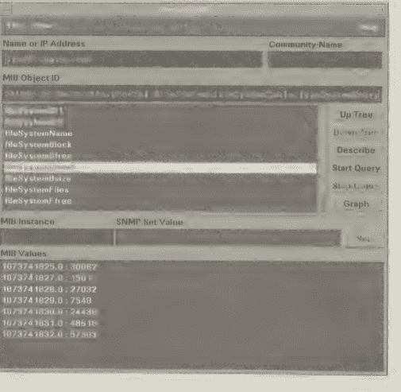

### 清单 5-9 显示卷组信息的 vgdisplay 命令输出。

```
# vgdisplay -v /dev/vg00
-- Volume groups --
VG Name /dev/vg00
VG Write Access read/write
VG Status available
Max LV 255
Cur LV 8
Open LV 8
Max PV 16
Cur PV 1
Act PV 1
Max PE per PV 2000
VGDA 2
PE Size (Mbytes) 4
Total PE 1023
Alloc PE 416
Free PE 607
Total PVG 0
-- Logical volumes --
LV Name /dev/vg00/lvol1
LV Status available/syncd
LV Size (Mbytes) 48
Current LE 12
Allocated PE 12
```


硬件和版本信息等。本章后面讨论的 OpenView IT/O 提供了一个 MIB 浏览器，可帮助您发现可用的 MIB，并查看每个 MIB 提供的信息。MIB 浏览器工具可以检查 MIB 中包含的任何项的值。如果您发现某个 MIB 包含一些有用的字段，您可以使用 MIB 浏览器从目标系统中收集这些数据。生成的数据显示在 MIB 浏览器的输出窗口中。通过浏览可用的 MIB 并查询选定 MIB 字段的值，您可以收集监控系统和排查问题所需的具体信息。

SNMP 接口提供对各种 MIB 中存储的对象的访问。在 HP-UX 系统中，HP-UNIX MIB 定义了用于监控磁盘资源的各种指标，例如文件系统使用情况。其他供应商，如 Sun，拥有提供类似信息的供应商特定 MIB。完整的 MIB 定义列在附录 A“使用标准”中。

HP-UNIX MIB 文件系统表中的对象可以被监控，以检测文件系统使用率何时达到特定阈值，从而使您能够避免文件系统故障，例如空间不足。以下是文件系统表中每个条目可用的对象列表：

- fileSystemName
- fileSystemBlocks
- fileSystemBfree (可用块)
- fileSystemBavail (非超级用户可用的块)
- fileSystemBsize
- fileSystemFiles
- fileSystemFree
- fileSystemDir

请注意，每个挂载的文件系统都有一个表条目。

## 桌面管理接口

HP-UX MIF（也称为系统 MIF）提供了 DMI 仪器化。对于磁盘监控，DMI 仪器化为磁盘硬件设备以及配置、状态和事件提供。系统 MIF 中也提供文件系统资源信息。带有 DMI 仪器化的磁盘相关指标如下列所示。完整的系统 MIF 和软件 MIF 定义见附录 A。

主机存储表包含关于逻辑存储区域的信息。它适合监控磁盘使用情况和分配失败事件。它包含以下字段：

- 类型
- 描述
- 分配单元
- 大小
- 已用
- 存储分配失败

主机设备表包含关于系统中硬件设备的信息。它适合监控硬件配置和故障。它包含以下字段：

- 设备类型
- 描述
- 设备 ID
- 设备状态 (运行中, 警告, 停机, 测试中, 保留, 未知)
- 设备错误

还可以为主机设备表中的设备生成事件，包括设备状态更改、初始化失败和配置错误。事件包含分配的严重级别，例如 信息 (Information)、正常 (OK) 或 严重 (Critical)。

主机磁盘存储表包含主机设备表中设备的存储信息。它包含以下字段：

- 访问方式 (只读, 读/写)
- 介质类型 (例如，硬盘, 软盘等)
- 可移动
- 容量 (以千字节为单位)

文件系统表包含以下字段：

- FSMountPoint
- RemoteFSMount
- FSAccess
- FSBootable
- FSLastFullBackupDate
- FSLastPartialBackupDate

许多供应商正在为磁盘资源以及设备特定信息开发更多的 DMI 仪器化。

## 使用事件监控工具

事件监控涉及在检测到故障和其他有趣的状态时生成通知消息。这与 UNIX 命令不同，UNIX 命令仅在要求时报告状态信息。您可以配置事件监控器，以便在状态发生变化或满足预定义阈值条件时生成事件。一些事件监控器在磁盘设备级别发生故障或错误时生成事件。

本节中讨论的几个监控器已集成到事件监控服务 (EMS) 框架中。EMS 框架仅在 HP-UX 系统上可用，它使系统能够以一致的方式提供监控器。虽然 EMS 框架本身是免费提供的，但监控器通常作为单独的产品提供，或者随其提供监控的个别产品捆绑在一起。

EMS 为可监控资源的发现和配置提供一致的图形用户界面 (GUI)。可以配置 EMS 监控器将事件发送到 OpenView IT/O。此外，EMS 事件可以直接发送到任何支持 SNMP 的管理站，发送到监听 TCP 或 UDP 端口的网络应用程序，发送到电子邮件地址，或本地发送到控制台、系统日志文件或用户日志文件。MC/ServiceGuard 也可以让包依赖于这些 EMS 资源。

HA Monitors 是一个 EMS 监控器软件包。它包括用于监控文件系统空间、用户和作业信息、网络接口状态、MC/ServiceGuard 集群状态以及磁盘卷状态的监控器。

## 事件监控服务磁盘卷监控器

EMS 磁盘卷监控器 (DVM) 包含在 HA Monitors 产品中。它可以用于监控使用 LVM 配置的磁盘资源，包括镜像逻辑卷的副本。

EMS DVM 可以与 MirrorDisk/UX 结合使用。使用 MirrorDisk/UX 对应用程序是完全透明的。然而，有时这可能成为一个问题。磁盘可能会故障，镜像可能会接管，但操作员可能不知道故障的发生，因此故障的磁盘不会得到修复。最终，会发生另一次故障，而数据没有备份。EMS DVM 为此类情况提供帮助。

EMS DVM 负责监控多种属性：

- 物理卷摘要
- 物理卷和物理卷链接状态
- 逻辑卷摘要
- 逻辑卷状态
- 逻辑卷副本

这些属性（或资源）结构化为资源层次结构。图 5-2 显示了 EMS DVM 的资源层次结构。资源实例，如卷组名称或逻辑卷名称，根据配置因系统而异。EMS DVM 需要在每个本地节点上启动监控请求；然而，这也允许将监控请求定制到本地系统，因此只需要监控关键的磁盘资源。

物理卷摘要提供卷组中所有物理卷的状态摘要。在确定状态摘要时，EMS DVM 记录哪些物理卷未启动及其关联的物理卷组。物理卷摘要状态的可能值如表 5-1 所示。

### 图 5-2 EMS DVM 资源层次结构

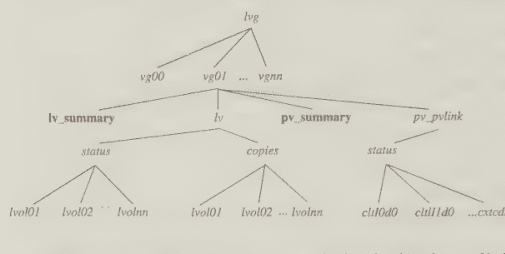

当 EMS DVM 尝试通过特定物理路径与设备通信时，会检查物理卷状态和物理卷链接状态。卷组不需要处于活动状态。有效值为 **UP**、**DOWN** 和 **BUSY**。如果您为物理卷配置了冗余链接，并且主链接故障，LVM 将透明地切换到设备的替代路径。这将导致单点故障 (SPOF)。如果您监控物理卷链接状态，您将收到通知，并可以采取行动通过重新建立替代路径来恢复冗余。

逻辑卷摘要汇总卷组中所有逻辑卷的 LVM 状态值。逻辑卷摘要状态的可能值如表 5-2 所示。

逻辑卷状态报告所选逻辑卷的 LVM 子系统状态。非活动逻辑卷具有 **INACTIVE** 状态。活动逻辑卷具有 **UP** 或 **DOWN** 状态，这取决于是否至少有一份所有数据的副本可用。

EMS DVM 使用逻辑卷副本来报告逻辑卷内可用的数据副本数量。这样，就可以检测到镜像故障。监控器返回的值是可用完整数据副本的数量。在图 5-3 所示的屏幕中，DVM 正在配置以监控所有逻辑卷的镜像副本。

| **表 5-1** | 物理卷摘要的 DVM 状态值 |
| :--- | :--- |
| **状态** | **物理卷摘要解释** |
| UP | 此卷组中的所有物理卷均处于运行状态 |
| PVG_UP | 至少存在一个 PVG，其中所有物理卷均处于运行状态 |
| SUSPECT | 某些 PV 未运行；无法确定所有数据是否可用 |
| DOWN | 某些数据不可用 |

| **表 5-2** | 逻辑卷摘要的 DVM 状态值 |
| :--- | :--- |
| **状态** | **逻辑卷摘要解释** |
| UP | 活动且所有逻辑卷均处于运行状态 |
| DOWN | 活动且至少一个逻辑卷停止 |
| INACTIVE | 非活动；如果 /etc/lvmtab 更改，状态将从 INACTIVE_DOWN 变为此状态 |
| INACTIVE_DOWN | 非活动，并且卷组最后一次激活时，状态为停止 |


...逻辑卷的卷组 vg00 中的所有实例。通知被指定为在副本数量低于三个时，通过一种专有方法（称为 opmsg）发送给 IT/O（系统管理员）。

在高端 HP-UX 系统上，可能会配置大量的卷组和逻辑卷。使用 EMS 配置 GUI 来配置监视每个卷可能非常耗时。EMS 配置 GUI 支持一些通配符功能，以便更轻松地配置。此外，一种名为 monovols 的 IT/O 工具有助于为选定的系统配置所有逻辑卷或物理卷。monovols 工具以及其他用于 EMS 的工具和模板可以免费在 Web 上获取，地址为 http://www.software.hp.com。但请注意，monovols 仅适用于 HP-UX 10.20。

### EMS 硬件监视器

EMS 硬件监视器提供了检测和报告系统硬件资源（如磁盘组件）问题的能力。EMS 硬件监视器有助于监视故障，如设备错误和组件故障。它们不仅以定期间隔轮询硬件，还能实时通知您硬件错误。EMS 硬件监视器随 HP-UX 在线诊断工具一起提供，后者可免费下载用于 HP-UX。EMS 硬件监视器为以下 Hewlett-Packard 产品提供监视：

- AutoRAID 磁盘阵列
- 高可用性磁盘阵列
- 高可用性存储系统
- Fast/Wide SCSI 磁盘阵列
- 独立 SCSI 和光纤通道磁盘
- 光纤通道 SCSI 多路复用器
- 光纤通道适配器
- 光纤通道仲裁环集线器

这些 EMS 硬件监视器旨在提供配置接口、事件检测和消息格式的通用性，其中包括详细描述问题及修复方法的详细消息。

EMS 硬件监视器可以报告在设备 I/O 过程中遇到的低级设备错误。它们检测和报告组件和 FRU（现场可更换单元）故障，包括风扇和电源问题。也会检测到协议错误。

硬件监视对于维持系统的高可用性至关重要。例如，在使用 AutoRAID 磁盘阵列时，可能使用两个控制器以实现高可用性。AutoRAID 监视器报告可能指示控制器故障的事件。这些事件可能导致硬件冗余丢失。其他事件指示潜在的数据冗余丢失，例如磁盘组件故障或在组件故障后无法恢复数据冗余。许多事件可能指示单点故障（SPOF）和高可用性的丧失。通知这些事件至关重要，以便可以修复故障，消除停机风险。

硬件事件由监视器分配严重性级别。这些严重性级别反映了事件对系统运行的潜在影响。表 5-3 提供了对每个严重性级别的描述。

#### 表 5-3 硬件事件严重性描述

| 严重性 | 描述 |
| :--- | :--- |
| 严重（Critical） | 该事件将或已经导致数据丢失、系统停机或其他服务损失。需要立即采取行动以纠正问题。在问题解决之前，系统运行将受到影响，且不应继续正常使用硬件。如果配置了 MC/ServiceGuard，包将经历故障转移。 |
| 紧急（Serious） | 如果不纠正，该事件可能导致数据丢失、系统停机或其他服务损失。应尽快修复问题。系统运行和硬件的正常使用可能会受到影响。如果配置了 MC/ServiceGuard，包将经历故障转移。 |
| 主要警告（Major Warning） | 如果不纠正，该事件可能会升级为更严重的状况。应在方便时修复问题。系统运行不应受到影响，且可以继续使用硬件。如果配置了 MC/ServiceGuard，包不会经历故障转移。 |
| 次要警告（Minor Warning） | 即使不纠正，该事件也不太可能升级为更严重的状况。可以在方便时修复问题。系统运行不会中断，且可以继续使用硬件。如果配置了 MC/ServiceGuard，包不会经历故障转移。 |
| 信息（Information） | 该事件作为硬件正常操作的一部分而发生。无需采取行动。如果配置了 MC/ServiceGuard，包不会经历故障转移。 |

EMS 硬件监视器的配置是使用硬件监视请求管理器完成的。通知条件可以以一致的方式配置系统中所有受支持的硬件资源。随着硬件添加到系统中，监视可以自动启用。图 5-4 展示了使用硬件监视请求管理器发送所有严重和紧急硬件事件电子邮件通知的示例。为了配置 MC/ServiceGuard，您需要使用 MC/ServiceGuard 配置界面。

当 EMS 硬件监视器检测到事件时，通知消息会被发送到指定的目标位置。消息包含完整描述，包括发生事件所在的系统、检测事件的时间和日期、发生事件的硬件设备、问题描述、可能原因以及建议采取的措施。图 5-5 显示了 SCSI 磁盘上介质故障事件的详细消息。虽然未显示，但消息包含更详细的信息，包括产品/设备识别信息、I/O 日志事件信息、原始硬件状态、SCSI 状态等。

**图 5-4 使用硬件监视请求管理器配置硬件监视。**

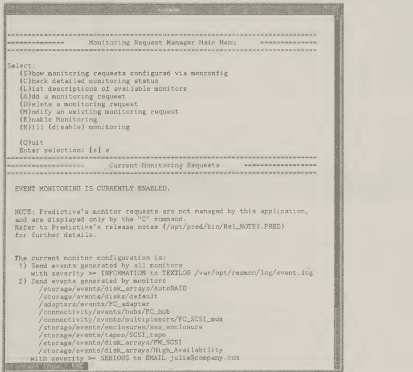

**图 5-5 EMS 硬件监视器报告的介质故障事件。**

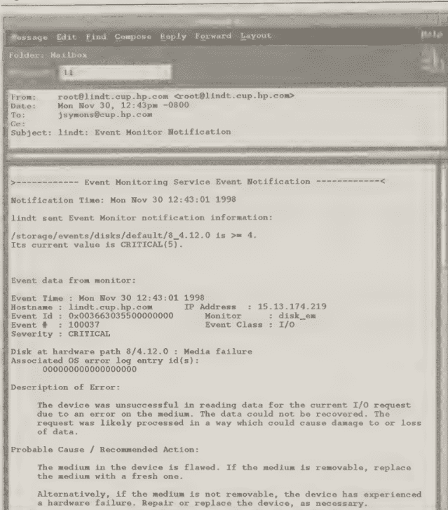

大多数 EMS 硬件监视器是“无状态”的。换句话说，指定严重性的事件一旦检测到就会立即转发：除了监视器使用重复频率限制重复消息外，不会提供任何历史或其他数据关联方面的信息。因此，确定设备的当前状态很困难，因为消息仅在事件发生时发送。

要监视硬件设备状态变化，您可以使用外围状态监视器（PSM），它维护被监视硬件设备的状态并报告状态变化。PSM 从其他 EMS 硬件监视器收集事件，但除非发生状态变化，否则不会发送自己的通知。默认情况下，严重或紧急事件会导致 PSM 将设备状态更改为 DOWN。

例如，来自磁盘 EMS 硬件监视器的严重磁盘事件会导致 PSM 将设备状态更改为 DOWN。然后，如果用户请求了该事件，PSM 将发送单个“磁盘设备状态 = down”事件。这可能是用户唯一可见的消息。其他磁盘故障消息将不会被转发，因为它们没有导致状态变化（换句话说，状态保持 DOWN）。这减少了用户需要处理的事件数量。接收到的最后一个事件应反映当前的设备状态。

大多数硬件监视器无法自动检测设备何时被修复。当问题解决后，必须使用 set_fixed 命令手动通知 PSM 将设备状态重置为 UP。

当使用如 IT/O 等企业管理工具（接收来自多个系统的消息）时，应使用 PSM 以减少信息过载。但是，请确保无状态事件也被配置发送到某处（如系统日志文件），因为它们提供组件故障时有价值的诊断信息。

您可以访问其网站 http://docs.hp.com/hpux/systems/ 了解更多关于 Hewlett-Packard 诊断工具的信息。

### HARAYMON 和 ARRAYMOND

高可用性磁盘阵列监视器（HARAYMON），可在 HP-UX 9.x 上使用，通知系统控制台高可用性磁盘阵列产品中磁盘阵列 FRU 的所有故障。AutoRAID 磁盘阵列有一个类似的监视器，称为 ARRAYMOND。故障被报告到系统控制台以及用户识别的电子邮件地址列表（配置在 ASCII 文件中。每条错误消息可选择包括连接到宿主系统的阵列位置、连接到宿主系统的阵列事件历史以及系统管理员的电话号码或邮件收件箱。

列表 5-10 和 5-11 显示了 HARAYMON 针对各种错误条件显示的一些消息。HARAYMON 可以检测磁盘故障、风扇单元故障、控制器模块故障、电源单元故障和电池备份单元故障。

列表 5-10 显示了一个磁盘模块故障。请注意，除了显示时间戳和故障类型外，包含故障设备的阵列和槽位号（在阵列内）也被报告。包含故障磁盘模块的阵列是 48.0.1，包含故障磁盘的槽位号是 B2。

**列表 5-10 HARAYMON 显示磁盘模块故障的输出。**

```
===========================================
Mon Nov 23 10:58:50 PST 1998
High Availability Array Monitor
===========================================
Drive Failure
Product ID HP A3232A_RAID_5
Physical Device 48.0.1
Disk Position: B2
```


列表 5-11 显示了风扇单元模块故障。文中展示了具体的产品信息，以便能够更换相应的部件。

### 列表 5-11 显示风扇单元模块故障的 HARAYMON 输出。

```text
================================================================
Mon Nov 23 11:32:44 PST 1998
High Availability Array Monitor
================================================================
Fan Unit Failure
Product ID HP A3232A_RAID_5
Physical Device 48.0.1
Fan Number B
================================================================
```

在较新的 HP-UX 系统（Release 10.20 或更高版本）上，HARAYMON 和 ARRAYMOND 已被 EMS 硬件监视器取代。如果你正在使用 EMS 硬件监视器，建议禁用 HARAYMON 和 ARRAYMOND 守护进程。

## OpenView IT/Operations

IT/Operations (IT/O) 是一个 OpenView 应用程序，提供集中式操作和问题管理。NNM 包含在 IT/O 产品中。IT/O 使用在每个受管系统上运行的智能代理来收集管理信息、消息和警报，并将这些信息发送到集中控制台。在接收到事件后，IT/O 可以启动自动纠正措施。当操作员阅读单条消息时，会提供指导，并可能建议采取进一步的问题解决或恢复行动。

IT/O 具有以下四个主要窗口：

- **节点银行 (Node Bank)**：以图形方式显示操作员管理的系统，并允许将它们组织成节点组。
- **消息组 (Message Groups)**：显示逻辑消息组，例如性能、Oracle 或备份。消息组是消息浏览器窗口中组织消息的一种方式。
- **消息浏览器 (Message Browser)**：显示管理服务器接收到的事件。
- **应用程序桌面 (Application Desktop)**：提供访问常用诊断和管理应用程序的途径。

IT/O 附带预定义的监视器和模板。对于磁盘资源监控，它拥有针对惠普、Sun 和其他平台的根文件系统监视器。预定义的消息模板定义消息条件，以便当根文件系统使用率超过 90% 时，向 IT/O 消息浏览器发送警告。定义此条件的消息条件如图 5-6 所示。

## 图 5-6 监控根文件系统使用率的 IT/O 消息条件模板。

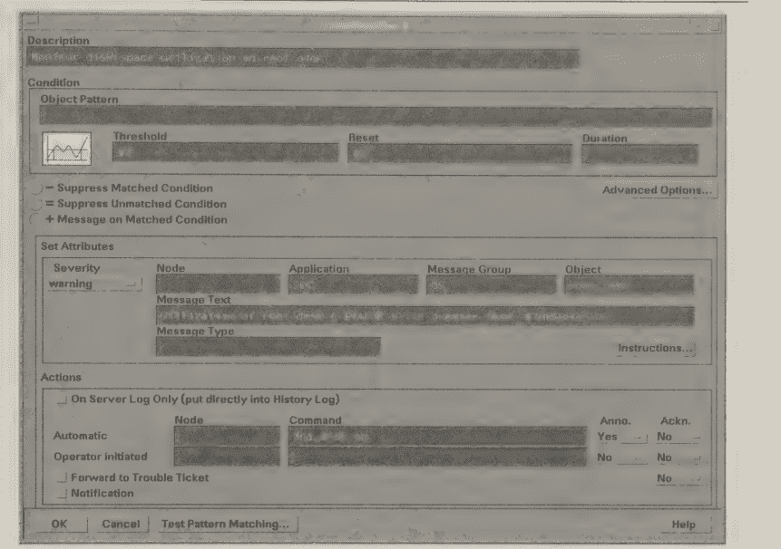

IT/O 允许你定义和自定义自己的监视器和模板。根文件系统监视器可以修改以用于其他关键文件系统。或者，你可以定义自己的监视器和模板来监控 MIB 变量，例如本章前面提到的文件系统 MIB 变量。IT/O 定期查询 MIB 对象以确定是否应生成消息。你可以编写定期由 IT/O 代理调用的程序或脚本。模板和消息条件可以修改，以便在特定条件下分页通知操作员。

许多其他工具可插入 IT/O 以提供额外的监控和管理功能。一个关键示例是本章前面提到的 monovls EMS 实用程序。该实用程序集成到 IT/O 应用程序银行中。它启用对特定系统上所有卷组中所有物理或逻辑卷的监控。

当操作员需要一致地管理大量系统时，IT/O 非常有用。磁盘监控模板可以修改，然后下载到一组系统中。这样，多个系统可以以相同的方式进行监控。

#### Enterprise SyMON

Sun Microsystems 有一款企业级管理产品称为 Enterprise SyMON，这是一种包含 Sun 平台监控工具的管理解决方案。可以将其视为 IT/O 的缩小版。SyMON 提供事件浏览器以及系统和硬件的详细显示。可以显示物理系统布局的图形视图。SyMON 可用于监控磁盘资源的健康状况并隔离硬件和软件故障。它分析健康信息以预测潜在的磁盘硬件故障。在诊断方面，SyMON 可以启动 SunVTS 诊断系统或查看系统日志。还提供了性能监控功能。

可以配置 SyMON 以针对事件发送 SNMP 陷阱 (traps)。仅包含硬件事件，例如磁盘、内存或磁带故障。但是，通过在特殊目录中放置用工具命令语言 (TCL) 脚本语言编写的各种规则，可以生成额外的事件。恢复操作可以与事件相关联。

## 使用诊断工具

各种支持工具提供错误和故障监控、配置信息以及硬件组件（包括磁盘）的故障排除。

### 支持工具管理器

HP 支持工具管理器 (STM) 是用于 HP-UX 系统的一组工具，用于验证和故障排除系统硬件。这些工具提供了确定设备状态、获取配置信息和诊断硬件问题的能力。这些工具可通过 GUI 或命令使用，并具有在周期性间隔内自动调用的灵活性。

STM 包括自动配置映射器 (Automatic Configuration Mapper)，它使用颜色编码的图标提供硬件配置的图形视图，显示设备状态以及逻辑关系，例如连接到 I/O 卡的外围设备。映射上的每个图标代表一个硬件设备。这些图标显示设备类型、设备标识符、设备路径、上次活动的工具以及测试状态（来自上次活动的工具）。从此视图中，你可以启动其他 STM 工具。图 5-7 显示了自动配置映射器，这是 STM 的主屏幕。

信息 (Information) 工具提供产品身份信息、产品描述、硬件路径、供应商名称、固件版本以及错误日志统计，包括读错误，可用于趋势分析和预见问题。此工具也可用于跟踪配置更改。

STM 下的其他几个工具执行不同级别的测试以测试设备或确定和诊断问题：

- **验证器 (Verifier)**：可在特定设备上调用，以快速验证设备是否已连接并正常工作。
- **执行器 (Exerciser)**：对设备进行压力测试以帮助故障排除间歇性问题。

## 图 5-7 STM 自动配置映射器显示磁盘硬件设备。

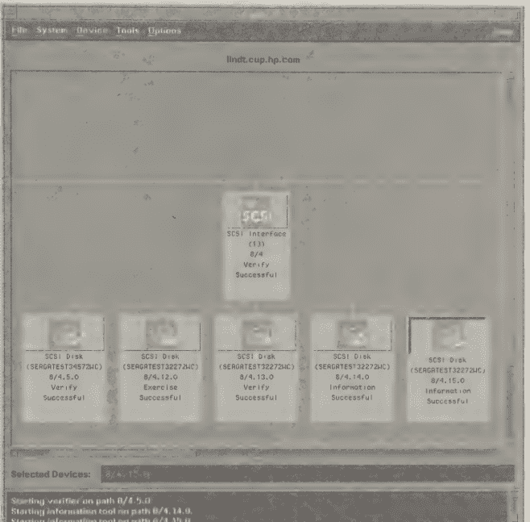

- **诊断器 (Diagnose)**：有助于将故障隔离到 FRU 级别，以便你可以确定所选 FRU 是否故障。

请注意，信息、验证器和执行器工具是免费的，但诊断器工具可能需要购买特殊许可证。

STM 中的日志工具实用程序 (Logtool Utility) 帮助你格式化、过滤和提取系统日志中包含的原始数据中的错误信息。日志工具收集的原始数据包括操作系统生成的许多可恢复错误，包括总线错误、内存错误和低优先级机器检查。你可以使用此数据来排除故障并查找历史信息中的趋势，以便在故障变得严重之前修复它们。

你应将 STM 与 EMS 硬件事件监视器结合使用，因为在你收到关于系统硬件的 EMS 事件后，可以运行 STM 下的一些诊断工具进一步诊断问题。

### HP 预测性支持

HP 预测性支持是惠普客户支持团队的高级支持。它提供故障监控、趋势分析和 HP 响应中心通知。预测性支持包括对系统硬件设备进行故障监控。

借助预测性支持，你可以让惠普主动为你监控 HP-UX 系统。预测性支持提供在系统可用性受到明显影响之前检测系统中潜在问题的能力。预测性支持包括硬件监控软件和到 HP 响应中心的链接。预测性支持监视器检测故障并预测潜在问题。随后，预测性支持通过电子邮件或调制解调器（如果允许）通知 HP 响应中心，以便采取必要措施防止客户计划外停机。

预测性支持监视器通过分析与磁盘驱动器相关的记录错误模式（例如坏块和可恢复 I/O 错误）来确定潜在问题。错误定期从系统日志文件和其他日志中提取。根据规则集，可能会向响应中心发送通知，这可能导致 HP 支持工程师进行服务呼叫，以在具有零星错误的设备实际故障之前更换它。

预测性支持现在使用 EMS 接收光纤通道磁盘设备的警报。使用 EMS 硬件监视器在检测到错误和故障时发送警报。这些事件由预测性支持监视器记录和相关性分析。

### 收集磁盘性能数据

本节描述一些用于测量和监控磁盘性能的常见工具。以下是本节需要了解的一些关键术语：

- **块 I/O (Block I/O)**：保留在缓冲区高速缓存（*缓冲*）中然后以固定大小块传输的读写操作。
- **文件 I/O (File I/O)**：对物理磁盘的 I/O 访问，不包括虚拟内存。它包括文件系统 I/O、系统 I/O、原始 I/O 和块 I/O。
- **逻辑 I/O (Logical I/O)**：应用程序向文件系统发起的读或写系统调用。如果数据不在缓冲区高速缓存中，该调用将导致物理 I/O。
- **物理 I/O (Physical I/O)**：从内存到磁盘或反之的数据传输。物理 I/O 包括文件 I/O 和虚拟内存 I/O。
- **原始 I/O (Raw I/O)**：用户应用程序和物理磁盘之间绕过文件系统缓冲区高速缓存（也称为*字符模式*）的非缓冲 I/O。
- **虚拟内存 I/O (Virtual memory I/O)**：从磁盘读取和写入内存映射文件以及从交换区调出页面。

诸如 BMC PATROL 和 HP MeasureWare Agent 等性能工具并不总是在所有平台上提供相同的指标集。为简化起见，本节仅关注 Sun Solaris 和 HP-UX 平台。此外，这些产品正在不断增强，因此实际的


您所在环境中可用的指标可能无法与本节介绍的信息完全匹配。

##### MeasureWare

HP MeasureWare 智能代理是一款由 Hewlett-Packard 开发的产品，用于收集和记录资源及性能指标。MeasureWare 智能代理安装在需要监控的各个服务器系统上。目前，已有适用于众多平台和操作系统的 MeasureWare 智能代理。

MeasureWare 智能代理可在系统级、应用程序级和进程级收集数据。许多系统指标已在第 4 章“监控系统”中进行了描述。本节列出了用于监控磁盘设备的其他系统级指标。

以下是 HP-UX 和 Sun Solaris 上可用的系统级磁盘相关指标列表：

- 系统中配置的磁盘驱动器数量
- 时间间隔内最繁忙磁盘的平均使用率
- 时间间隔内物理磁盘读的次数和速率
- 时间间隔内物理磁盘写的次数和速率
- 时间间隔内物理磁盘传输的次数和速率
- 时间间隔内文件系统磁盘读的次数和速率
- 时间间隔内用于内存管理的磁盘写次数和速率
- 由内存缓存满足的逻辑读百分比
- 时间间隔内每个磁盘驱动器的文件系统读次数和速率
- 时间间隔内每个磁盘驱动器的文件系统写次数和速率
- 时间间隔内每个磁盘驱动器的磁盘使用率

HP-UX 上可用的其他系统级磁盘相关指标包括：

- 时间间隔内逻辑磁盘 I/O 的次数和速率
- 时间间隔内逻辑磁盘读的次数和速率
- 时间间隔内逻辑磁盘写的次数和速率
- 逻辑磁盘传输读的次数和速率
- 逻辑磁盘传输写的次数和速率
- 时间间隔内文件系统磁盘写的次数和速率
- 时间间隔内用于内存管理的磁盘读次数和速率
- 时间间隔内用于系统的磁盘读次数和速率
- 时间间隔内用于系统的磁盘写次数和速率
- 时间间隔内原始读的次数和速率
- 时间间隔内原始写的次数和速率
- 时间间隔内每个磁盘驱动器的逻辑磁盘读次数和速率
- 时间间隔内每个磁盘驱动器的逻辑磁盘写次数和速率
- 时间间隔内每个磁盘驱动器的原始读次数和速率
- 时间间隔内每个磁盘驱动器的原始写次数和速率
- 时间间隔内每个磁盘驱动器的内存管理器传输次数和速率
- 时间间隔内每个磁盘驱动器的系统传输次数和速率
- 每个磁盘驱动器队列中请求的平均数量

MeasureWare 还可以提供有关交换空间使用率以及“最大使用文件系统”的信息，后者是指磁盘空间使用率最高的文件系统。

##### GlancePlus

GlancePlus 是一款实时图形性能监控工具。它用于监控单个系统的性能和系统资源使用率。该系统提供基于 Motif 的界面和基于字符的界面。该产品可用于 HP-UX、Sun Solaris 以及许多其他操作系统。

GlancePlus 可用于查看和绘制系统的当前 CPU、内存、交换和磁盘活动。GlancePlus 为每个主要资源提供了专用界面。

GlancePlus 可以显示对磁盘监控有用的多种数据：

- 每个磁盘设备的磁盘使用率和队列长度
- 按文件系统划分的磁盘 I/O 速率
- 按进程划分的磁盘 I/O 速率
- 已配置的磁盘数量
- 每个磁盘和每个文件系统的物理读和写
- 每个逻辑卷的读和写
- 已配置的 LVM 卷组数量
- 文件系统容量和使用率
- 交换空间容量和使用率
- 系统表资源

要查看具体可用的指标列表，请在运行 GlancePlus 时通过其在线帮助功能查找。

GlancePlus 还具备设置和接收性能相关警报的功能。自定义规则决定何时将系统性能问题作为警报发送。这些规则由 GlancePlus Adviser 管理。Adviser 菜单选项允许您“编辑 Adviser 语法”。选择此选项后，所有警报条件都会显示出来，并且可以像图 5-8 中演示的那样进行修改。

请注意图 5-8，其中与交换相关的警报是如何与网络相关的警报整合在同一个定义文件中的。当发生警报时，它们可以直接反映在 GlancePlus 界面中。


```pascal
{Alarm Network_Bottleneck > 90 for 2 minutes
start
    if Network_Bottleneck > 90 then
        red alert "Network Bottleneck possibility: Network_Bottleneck %"
        yellow alert "Network Bottleneck possibility %: Network_Bottleneck %"
repeat every 10 minutes
if Network_Bottleneck > 90 then
    red alert "Network Bottleneck probability %: Network_Bottleneck %"
    yellow alert "Network Bottleneck probability %: Network_Bottleneck %"
end
reset alert "End of Network Bottleneck Alert"

# The following alarm system that a red activated only for error percent
 alarm CBL_NET_ERROR_1_MIN_RATE > 10
 start
    white alert "Network error rate is over 10% for one minute"
end
reset alert "End of non-zero network error rate condition"

# The following are system table alarms. If swap overhead is a concern, and
# you find you will not have enough table utilization, you can use these.
# To delete these alarms

# Global swap space utilization alarm
 alarm CBL_SWAP_SPACE_UTIL > 95
 start
    red alert "Global swap space is nearly full"
end
...
```

GlancePlus 可以从命令行启动，也可以在 HP-UX 上的 SAM 的“性能监视器”功能区域中启动它。

### PerfView

PerfView 是一款图形性能监控工具，用于监控环境中多个系统的性能和系统资源使用率。它可以显示各种性能图表。与 GlancePlus 的实时图表不同，这些图表是基于一段时间内收集的数据生成的。PerfView 可以同时显示来自多个系统的图表，以便进行比较。

PerfView 与其他监控工具集成在一起。例如，您可以通过访问“工具”菜单从 PerfView 内部启动 GlancePlus。此外，可以从 IT/O 应用程序库启动 PerfView。在 IT/O 消息浏览器窗口中排查事件时，您可以启动 PerfView 以查看相关的性能图表。

PerfView 依赖于 MeasureWare 数据，因此它只能显示支持 MeasureWare 智能代理的系统性能信息。请参阅前面关于 MeasureWare 的章节，查看可用的磁盘指标列表。

PerfView 由三个主要组件组成：

- **PerfView Monitor**：提供接收警报的功能。可以显示警报的文本描述。警报可以根据严重性、类型或源系统进行过滤。此外，在收到警报后，可以选中该警报以显示相关指标的图表。操作员可以监控导致故障的趋势，然后采取主动措施以避免问题。图表可用于系统间比较以及显示资源消耗的历史记录。系统会维护一个内部数据库，用于保存警报通知消息的历史记录。

- **PerfView Analyzer**：提供磁盘和其他资源的资源及性能分析。系统指标可以在三个不同级别显示：进程、应用程序（由用户作为进程集进行配置）和全局系统信息。它依赖于从受管节点上的 MeasureWare 智能代理接收的数据。可以同时分析多达八个系统的数据。支持所有 MeasureWare 数据源。PerfView Monitor 和 PerfView Planner 都需要使用 PerfView Analyzer。

- **PerfView Planner**：提供预测功能。图表可以外推至未来。预测数据可以显示各种图表（如线性、指数、S 形曲线和平滑曲线）。

PerfView 显示历史和趋势信息的能力有助于诊断磁盘问题。通过绘制性能信息图表，可以帮助您确定问题是持续存在的还是异常现象（仅仅是活动量的短暂激增）。图 5-9 展示了一个 PerfView 图表，说明了应用程序随时间变化的 I/O 性能。图表中还包含了额外的系统性能指标。

为了进一步诊断问题，PerfView Monitor 允许用户更改时间间隔，以尝试找到问题发生的具体时间。图表会重新绘制以显示新的时间段。

## BMC PATROL

BMC 通过其 PATROL 软件套件提供监控功能。PATROL 提供了定义阈值、发送和转换事件等基本框架。名为知识模块（KM）的可选产品包含监控特定组件的功能。例如，BMC PATROL 包含用于 UNIX、SAP R/3、Oracle、Informix 和其他应用程序的 KM。实际上，BMC 提供了 40 多个 KM 供 PATROL 使用。

BMC 为其 UNIX KM 提供了一款工具，用于提供有关磁盘和磁盘使用的信息。HP-UX 和 Sun Solaris 上可用的磁盘和文件系统指标如下：

- 时间间隔内每个磁盘驱动器的系统数据传输次数和速率
- 每个磁盘驱动器的平均服务时间
- 每个磁盘驱动器的平均磁盘寻道时间
- 驱动器忙于执行传输请求的时间百分比


## 图 5-9 PerfView 可以显示应用程序 I/O 访问速率的历史记录。

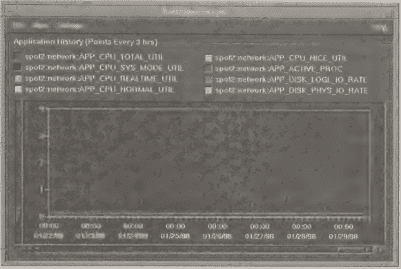

- 每个磁盘驱动器在队列中等待的平均时间
- 每个磁盘驱动器的物理磁盘读取速率
- 每个磁盘驱动器的原始读取速率
- 每个磁盘驱动器的逻辑磁盘读取速率
- 缓冲区缓存中逻辑读取的百分比
- 每个磁盘驱动器的物理磁盘写入速率
- 写入系统缓冲区的逻辑写入数量
- 写入到缓冲区缓存的逻辑块百分比
- 每个磁盘驱动器队列中请求的平均数量
- CPU 等待 I/O 操作完成所占时间的百分比

BMC 还可以监控已使用的交换空间百分比，以及每个文件系统已使用的文件系统空间量。

BMC PATROL 的磁盘监控功能类似于 MeasureWare。它提供了一些最基本的配置信息，但其主要价值在于跟踪资源和性能信息。间接地，BMC PATROL 也可以提供一些故障信息。例如，如果某个特定磁盘驱动器上的磁盘利用率突然降至零，这可能表明磁盘已发生故障。当然，这也可能表明某个应用程序已终止并且不再使用该磁盘。

## 使用磁盘性能数据

为了解决磁盘性能问题，您首先需要收集适当的数据。MeasureWare 和 BMC PATROL 是收集必要性能指标的两种工具的示例。本节简要概述了解释数据以确定是否存在磁盘性能问题的方法。

本章仅显示与磁盘直接相关的指标。然而，您也应该研究与系统和应用相关的性能信息，因为仅靠磁盘信息可能不足以解决问题。MeasureWare 提供了关于应用程序磁盘利用率的许多信息，这些信息可能需要与系统数据进行关联。例如，磁盘性能问题的根本原因可能是一个 I/O 密集型应用程序，而该应用程序本不应在生产时段运行。结合查看应用程序和系统数据与磁盘数据有助于找到罪魁祸首。

所有性能监控工具都可以提供系统 CPU 利用率信息。如果应用程序的响应时间较低，且系统的 CPU 利用率低于 95 百分比，这可能表明存在磁盘瓶颈。其他重要指标包括磁盘利用率、磁盘队列长度以及系统等待 I/O 完成所花费的时间。

为避免磁盘瓶颈，您需要平衡跨文件系统、磁盘轴和磁盘控制器的 I/O，以减少不均衡的排队和延迟。性能监控工具（如 GlancePlus）可用于查找 I/O 速率最高的进程，以及最繁忙的物理磁盘。仅检查 I/O 速率是不够的，因为较慢的设备与具有相同 I/O 速率的较快速盘相比，其利用率会更高。如果单个磁盘在长时间内的利用率超过 50 百分比，这可能表明存在 I/O 瓶颈。应将此百分比与其他磁盘进行比较，以查看是否存在严重的负载不平衡。然而，高利用率并不足以识别问题。磁盘可能仍能够处理更多的 I/O。只有存在持续很长的磁盘队列长度才能表明存在问题。经常大量使用的磁盘也很可能存在很长的磁盘队列长度。

BMC PATROL 和 MeasureWare 都会收集读取缓存命中率信息。确定有多少逻辑读取由系统缓冲区缓存满足，是缓存大小是否配置正确的一个指标。由于增加缓存大小会对系统可用于其他用途的内存产生负面影响，因此适当的缓存命中率取决于在系统上运行的工作负载类型。对于 I/O 密集型应用程序，您可能希望配置系统，使该比率高达约 90 或 95 百分比。同样，您可能希望确保写入缓存命中率至少为 75 百分比。如果您的命中率太低，系统缓冲区缓存可能太小。

确定系统缓冲区缓存太小后，您可以通过使用 SAM 在 HP-UX 上增加其大小。从内核配置功能区域选择“可配置参数”。要修改的适当参数取决于使用的是静态缓冲区缓存还是动态缓冲区缓存，但也可以在此屏幕上检查这一点。*固定大小的缓冲区缓存*在环境和负载是静态的情况下最为有效。*动态缓冲区缓存*的大小根据对 I/O 或虚拟内存的需求而变化，在负载变化时有用。如果 *nbuf* 和 *bufpages* 系统参数设置为零，则使用的是动态缓冲区缓存。在使用具有大于 1GB 实际内存的系统上的动态缓冲区缓存时，应将最大尺寸降低至 50 百分比以下，因为大于 500MB 的缓存实际上会导致性能下降。

进程资源管理器 (PRM) 可用于控制用户在应用程序之间分配的系统 CPU、实际内存和 I/O 带宽。用户或应用程序被分配给 PRM 组，并且每个组都配置了所需的系统资源权限。这有助于提供应用程序隔离，防止一个应用程序影响另一个应用程序的性能。仅靠 CPU 控制通常就足够了，但有时，I/O 密集型应用程序可能使用很少的 CPU。需要占用相同 I/O 接口的其他应用程序可能会受到饥饿。如果多个应用程序共享访问卷组，PRM 可用于为每个应用程序分配适当的最低磁盘带宽权限。PRM 可以通过对逻辑 I/O 请求进行排序来控制 PRM 组的磁盘吞吐量，从而延迟较低优先级进程的请求，允许较高优先级进程的请求通过。I/O 带宽没有资源上限设置，因此如果没有其他应用程序需要它，应用程序可以使用所有可用带宽。

PRM 仅对 LVM 下的磁盘控制磁盘带宽。确定要配置的最佳权限可能很困难，可能需要一些实验。在启用 PRM 中的磁盘带宽配置之前，您可以收集不同 PRM 组当前使用量的数据。这可以通过首先在 PRM 中配置 CPU 权限而不指定磁盘记录来完成。然后可以使用 *prmonconfig* 和 *prmonitor* 命令来收集指定卷组的当前使用量统计信息。PRM 仅在 HP-UX 上可用。

如果 GlancePlus 可用，PRM 行为可以在 GlancePlus 屏幕上显示。例如，可以显示每个 PRM 组实际使用的 I/O 带宽。此外，GlancePlus 还可以用于更改 PRM 资源组权限。

这只是几个磁盘信息如何用于解决性能问题的示例。

## 避免磁盘问题

上一节讨论了如何使用性能数据来修复磁盘性能问题。适当的配置可以帮助您避免性能问题。诸如 *newsfs* 和 *tunefs* 等命令可用于高性能文件系统 (HFS) 以设置块大小并减少 inode 数量。

避免磁盘故障的最佳方法是配置冗余并主动监控关键磁盘资源。硬件级别存在的产品既提供数据冗余，又提供冗余硬件组件。监控硬件故障可提供冗余组件的故障通知。尽管这些故障可能导致数据不可用，但应立即修复这些问题。否则，随后的故障可能导致数据或可用性的丢失。

诸如 HP 预测性支持等工具有助于指示磁盘何时可能发生故障。您还可以监控硬件设备事件，以便在生产时间之外（计划停机时间）更换磁盘，而不是等待其故障。同样，使用 EMS DVM 检测镜像丢失，然后在另一个驱动器故障之前更换磁盘。


在资源层面，您需要确保文件系统可访问。监控配置和资源状态有助于确保文件系统正常运行，并可由需要使用的人员访问。监控文件系统的使用情况至关重要。如果文件系统被填满，应用程序可能会发生故障。通过使用诸如 Online JFS 之类的工具，您可以在线增加文件系统容量，而不影响可用性。通过使用三向镜像，您可以在一个镜像上进行备份，同时仍保持数据冗余。

您应该监控所有磁盘驱动器上的空闲空间，以检查是否接近配置的限额。EMS 文件系统监控器可用于此目的。归档长期未使用的文件，并将其从系统中移除。您可以使用诸如 `du` 之类的命令查看每个目录的使用情况并定位大文件。

工具的可用性可能取决于所使用的文件系统。日志文件系统可以跟踪文件的更新，因此如果文件损坏，则可以恢复该文件。Online JFS 是一个可选产品，可与日志文件系统配合使用。Online JFS 可以创建大型文件范围以避免碎片化，在文件系统接近配置限额时执行在线文件系统调整大小，并提供正在发生的碎片化数据。Online JFS 还具有碎片整理功能。可以使用 `fsadm` 命令重新组织目录和范围。

## 从磁盘问题中恢复

如果您无法避免磁盘问题，根据您面临的问题，各种工具可以帮助您恢复。本节讨论了从系统配置错误、负载不均衡和磁盘故障中恢复的方法。

有许多工具和技术可用于帮助纠正发现磁盘负载不均衡后的问题。经常访问的文件和交换区域可以分布在不同的文件系统、主轴和磁盘控制器上。可以使用磁盘条带化和 LVM 来将访问分散到多个磁盘上。LVM 条带大小在创建逻辑卷时定义。您需要理解 I/O 访问模式，以便设置适当的条带大小。可能需要添加更多磁盘，以便有效地分散负载。

您可能希望将磁盘专门用于单个应用程序，以避免争用问题。解决性能问题的更 drastic 的方法可能是将应用程序及其数据迁移到另一个系统，在那里它可以更专用地访问系统资源，包括 CPU 和内存。在某些情况下，您可能会研究并重新设计应用程序以减少磁盘 I/O。

只要您一直进行常规系统备份，您应该能够在不丢失数据的情况下恢复。

## 比较磁盘监控产品

跟踪磁盘配置的最佳方法是使用操作系统提供的 UNIX 命令，例如 `ioscan -d` 和 `vgdisplay`。STM 中的信息工具可以提供额外的配置信息，例如固件修订版号和序列号。您可能希望保存所有这些输出以便日后进行比较。然后，如果发生磁盘问题，配置历史可以帮助追踪何时进行了更改。System Administration Manager 为 HP-UX 系统提供磁盘配置的文本摘要。在 Sun Solaris 系统上，可以使用 Enterprise SyMON 以图形方式显示物理系统布局。

如果需要从各种系统中收集配置信息，使用 MIB 浏览器查询系统 MIB 可能更高效，特别是在多平台环境中，因为您只需要记住使用一种工具来获取信息。

初始的磁盘故障可以通过使用 EMS DVM 或适用于相应硬件设备的 EMS 硬件监控器来检测。EMS DVM 的独特之处在于它还可以用于检测磁盘镜像的丢失。报告问题后，您可能使用 STM 进行进一步诊断。这些产品仅在 HP-UX 上可用。Enterprise SyMON 为 Sun Solaris 环境提供一些基本的硬件诊断功能，包括发送磁盘故障事件的能力。

为了无需监控和修复磁盘设备，您可能希望与惠普建立支持合同。在这种情况下，磁盘问题将直接报告给惠普响应中心，并且基于 HP Predictive 收集的趋势信息，支持工程师可能会被派去在故障实际发生之前更换磁盘。

MeasureWare 和 BMC PATROL 具有可比的磁盘监控功能，并且主要提供磁盘性能指标。工具的选择可能取决于您正在进行的其他活动。例如，PerfView 仅从 MeasureWare 智能代理接收信息。BMC PATROL 和 MeasureWare 都可以向 IT/O 发送信息。提供磁盘指标的 BMC PATROL UNIX KM 可与各种其他 KM 一起使用。这两种工具都收集大量数据，因此您可能希望在选择其中一个之前分析每个工具在您环境中的性能。

## 案例研究：配置和监控镜像磁盘

在硅谷医院，南希·耶格森（Nancy Jergens）负责维护医院记录计算机系统中的患者记录。为了提供额外的数据保护和高可用性，她决定使用 MirrorDisk/UX 来镜像包含患者记录的 `/patient` 文件系统。

南希在包含患者记录的逻辑卷上设置双向镜像。逻辑卷 `lvol_patients` 挂载在 `/patient`。

### 验证配置

南希配置镜像后，使用 `lvdisplay` 命令验证配置。如清单 5-12 所示，南希验证逻辑卷 `lvol_patients` 可用，并且有一个镜像副本。

### 设置监控

南希知道，如果她的某个镜像副本失效，她的患者数据将受到保护，因为她还有另一个副本。但是，她希望在只剩下一个副本时得到通知。除非她监控这种情况，否则当镜像副本失效时她不会得到通知。

**清单 5-12** 使用 `lvdisplay` 验证镜像状态和副本。

```bash
# lvdisplay /dev/vg_hospital/lvol_patients
-- Logical volumes --
LV Name               /dev/vg_hospital/lvol_patients
VG Name               /dev/vg_hospital
LV Permission           read/write
LV Status               available/syncd
Mirror copies           1
Consistency Recovery    MWC
Schedule                parallel
LV Size (Mbytes)        100
Current LE              25
Allocated PE            50
Stripes                 0
Stripe Size (Kbytes)    0
Bad block               on
Allocation              strict
```

使用 EMS 配置 GUI，南希配置 EMS DVM 以监控包含患者记录的逻辑卷的镜像副本。如图 5-10 所示，她设置监控请求，以便当 `lvol_patients` 逻辑卷的镜像副本数量降至两个以下时，通过 SNMP 在她 OpenView IT/O 管理站上通知她。南希将通知事件配置为 Major 严重级别。


您可能会注意到 `lvdisplay` 显示镜像副本数量为 1，但 EMS 显示当前副本数为 2。EMS DVM 查看副本总数。`lvdisplay` 报告镜像副本数量。

### 镜像失效

其中一块保持数据镜像的磁盘上发生了一些事情。MirrorDisk/UX 不再能镜像数据。数据不再受到故障保护。幸运的是，南希正在监控此情况，并且事件已发送到 IT/O 消息浏览器。如图 5-11 所示，消息浏览器中显示了一个 Major (Maj) 严重级别的 EMS 事件。

**图 5-11** IT/O 消息浏览器显示指示镜像磁盘故障的 EMS 事件。


### 恢复镜像

运行 STM 中的诊断工具后，南希确定了故障组件。换上新驱动器后，她同步副本，使每个数据副本完全相同。

### 验证配置

现在南希已修复故障磁盘，她使用 `lvdisplay` 命令验证逻辑卷再次可用，并且她拥有数据的镜像副本。

南希继续使用 EMS DVM 监控副本，知道如果镜像再次失效，她将得到通知。


## 监控网络

随着客户机/服务器计算模式的引入以及近年来互联网使用的爆发式增长，维护企业网络的重要性急剧上升。讨论网络管理的内容足以写满整本书，因此本章仅侧重于网络管理的监控方面，具体展示如何研究网络性能以及检测和恢复网络组件故障。

### 识别需要监控的重要网络组件

除了监控系统及其组件外，监控连接系统与最终用户的网络也至关重要。如果没有与最终用户的连接以及足够的性能，系统提供的服务将毫无用处。本章展示了如何监控网络化环境的所有方面。

网络是一个广泛的类别，可以细分为多种组件。这些网络组件如图 6-1 所示。图中的客户机是指通过用户的桌面计算机连接到企业网络的最终用户，而服务器则是 UNIX 计算机系统，它提供对企业数据库的访问，执行网络文件系统 (NFS) 等网络服务，等等。请注意，其中任何组件的故障都可能影响服务的可用性，因此在整个企业骨干网中提供高程度的冗余非常重要。网络问题可能源于应用程序、操作系统中网络协议软件的缺陷、局域网（LAN）网卡或电缆的硬件问题等。

为了隔离网络问题，你需要监控工具。本章中的工具讨论按网络组件（如路由器和网络接口）进行组织，以便你更容易查看每个组件可用的特定监控工具。一些具有多种功能的工具将在本章的多个部分中进行讨论。现有工具可以图形化地显示网络状态，并检测故障以及配置、资源和性能问题。最常见的问题是性能相关问题，包括暂时的和持续的性能过载。本章主要关注 TCP/IP 网络，因为 TCP/IP 协议套件推动了大多数互联网使用。

### 使用图形化网络状态监视器

如前所述，网络涉及许多不同的组件，如路由器、集线器、网桥以及系统的网卡（NIC）和操作系统。你将在本章中看到，有工具可用于单独解决这些每个组件的问题。在介绍这些工具之前，本节展示了一些网络管理产品如何降低监控企业网络的复杂性。本节讨论的产品被称为*图形化网络状态监视器*，它们通过在一个中心位置提供关于设备的摘要信息来降低复杂性。你不需要远程登录到每个网络设备，而可以一目了然地查看状态。

流行的网络管理产品包括惠普的 Network Node Manager、Computer Associates 的 Unicenter TNG、太阳微系统（Sun）的 Net Manager、IBM 的 NetView 以及 HP 的 Net-Metrix。这些产品提供各种独特的功能，例如自动发现计算环境中所有网络设备并在网络拓扑图上以图形方式显示其实时状态的能力。本节提供了这些产品的示例。Sun Enterprise SYMON 也在本节中讨论，因为它是其他产品的低成本替代方案。NetMetrix 将在本章后续部分与其他性能工具一起讨论，因为它主要侧重于网络性能。

#### Network Node Manager

Network Node Manager (NNM) 是基于 HP OpenView 平台的管理产品。它主要用于查看和监控网络和系统资源的状态。信息通过基于窗口的显示以图形方式呈现。一组分层窗口或子地图可供用户导航网络拓扑。

从初始网络视图开始，你可以深入到显示特定网络段上系统的子地图，如图 6-1 所示。通过使用不同的颜色表示系统图标来描绘系统的特定状态。按网络段对系统进行分组的能力有助于将问题隔离到特定网络。

与其他网络管理产品一样，NNM 可以通过管理协议（如简单网络管理协议 (SNMP)）自动发现并监控可寻址网络组件的状态，例如路由器、集线器和计算机系统。任何可寻址 IP 且可从管理系统访问的设备都可以显示。然后，网络拓扑信息将显示在子地图上，如图 6-1 所示。在较大的计算环境中，你可能希望使用*发现过滤器*来减少发现过程的网络开销，这些过滤器允许你指定要探索的子网。这也有助于限制组织内从单个管理站管理的系统范围。

**图 6-1** NNM 显示网络段。

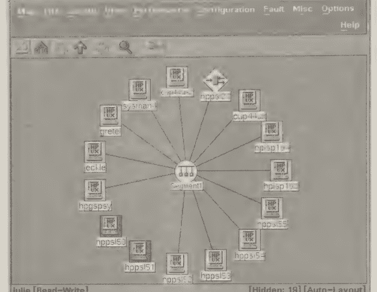

操作员可以浏览子地图以找到包含重要待监控系统特定局域网段。除了查看网络设备的总体状态外，操作员还可以深入查看系统信息，例如配置的网络接口。系统的备用网络接口（即未配置 IP 地址的接口）也可以显示。图标可以帮助你区分配置接口和备用接口，如图 6-2 所示。没有 "IP" 符号的图标是备用接口。

NNM 包含一个图形事件浏览器，显示从网络上的系统接收到的事件。事件作为 SNMP 陷阱（traps）发送到管理站。陷阱守护程序接收这些陷阱并将它们存储在数据库中，以维护事件历史。可以通过事件浏览器查看这些事件，并可以使用过滤器防止操作员被非关键信息淹没。过滤器可以基于多个属性，包括发送系统、事件的关键性或时间。NNM 还可以处理通用管理信息协议 (CMIP) 事件以实现多供应商互操作性。

NNM 定期轮询网络设备以验证其是否正在工作。如果未收到回复，则会发送节点故障（Node Down）事件作为 SNMP 陷阱，并记录在 NNM 事件浏览器中。这导致 NNM 中代表该设备的图形图标颜色发生变化。NNM 依赖网络连接来确定状态信息，如果并非所有网络都能全局访问，可能会造成问题。如果管理站没有到私有子网的路由，那么从管理站查看时，该子网将显示为宕机状态。

**图 6-2** NNM 显示系统的网络接口状态。

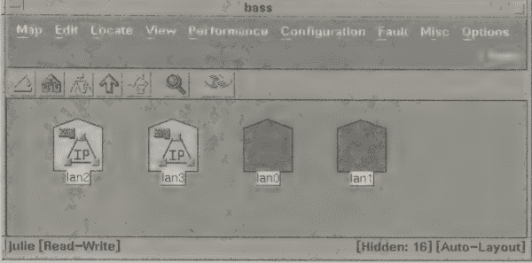

下拉菜单使操作员能够运行工具以获取额外的实时信息。这些工具可用于检查系统的网络配置，包括地址、路由表、ARP 缓存条目和系统服务。故障菜单包含用于测试系统网络连接的工具，从管理站 ping 系统，在两个远程系统之间进行远程 ping，以及定位到系统的 SNMP 路由。本章后续部分将更详细地解释其中一些工具。最后，NNM 提供用于通过 SNMP 收集、设置阈值并显示 MIB 数据的工具。NNM 还提供 xnmgraph 实用程序，它允许用户输入收集的任何历史数据并以图形形式查看。

为了获取更多诊断信息，你可以从 NNM 远程登录到系统并执行诊断命令。NNM 工具栏通过 telnet 提供此功能，并允许在远程系统上启动系统管理员（System Administration Manager，SAM）。

OpenView 的 MIB 浏览器工具也提供诊断功能。管理信息库（MIB）是表示特定类别信息的标准方式。例如，MIB-II 提供关于系统的有用信息，如活动 TCP 连接数、系统硬件详情和版本信息。通过 MIB 浏览器，你可以发现哪些 MIB 可用并查看每个 MIB 提供的信息。MIB 浏览器工具可以检查远程系统中 MIB 所包含的任何值。当你找到包含某些有用字段的 MIB 时，可以使用此工具或其他 MIB 工具从目标系统收集该数据。MIB 数据在屏幕上的 MIB 浏览器输出窗口中显示。通过浏览可用的 MIB 并查询选定 MIB 字段的值，你可以收集监控系统和排查问题所需的具体信息。图 6-3 说明了如何使用 MIB 浏览器检查给定系统上网卡的状态。


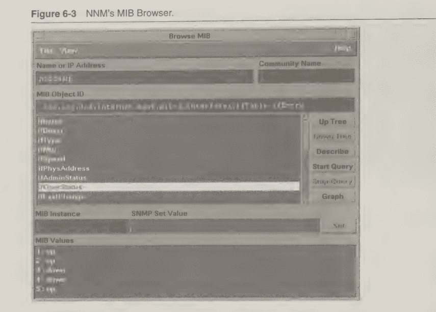

附录 A 中提供了 MIB 的更详细描述，以及 UNIX 服务器中一些重要 MIB 的定义。

NNM 软件可以运行在 UNIX 和 NT 管理站上，它是其他 HP OpenView 应用的基础构建模块。通过开发工具包和注册文件可以实现应用集成。目前有许多应用程序已与 HP OpenView 集成，其中最常用的合作伙伴应用程序包括 CiscoWorks、Bay Networks Optivity、3Com Transcend、Remedy ARS 和 HP NetMetrix。

#### IT/Operations

Hewlett-Packard 有一款名为 OpenView IT/Operations (IT/O) 的产品，它是一个软件捆绑包，不仅包含用于网络管理的 NNM，还扩展了其功能，在系统管理领域提供更多能力。IT/O 提供的功能使操作员能够共享管理站软件，同时保留对不同被管系统集合的责任。

IT/O 包含一个应用程序库，允许将 HP 产品或客户生成的工具图标化，供操作员使用。操作员选择目标系统，然后选择要在该系统上运行的工具。可以定义两级工具层次结构。可用的工具示例包括 GlancePlus 和 PerfView。这些工具随后可用于从中央管理站监视任意目标系统的性能。

IT/O 应用程序库包含三个具有网络工具的应用组：Net Activity、Net Config 和 Net Diag。每个组都有若干工具。如图 6-4 所示的 Net Activity 组包含用于监视网络活动的工具，包括接口流量、以太网错误、以太网流量、SNMP 流量、SNMP 操作、SNMP 错误、接口统计、SNMP 授权失败以及 TCP 连接。Net Config 和 Net Diag 组提供了本节前面提到的 NNM 下拉菜单中提供的许多相同工具。

#### Unicenter TNG

Computer Associates 的 Unicenter TNG 产品与 HP 的 IT/O 产品相当。它能够发现可通过 IP 寻址的组件，并可以将它们作为图标显示在地图上。地图可以反映网络拓扑。它还包含一个事件浏览器，可用于保存从被监视系统接收到的 SNMP 事件的历史记录。该事件浏览器如图 6-5 所示。

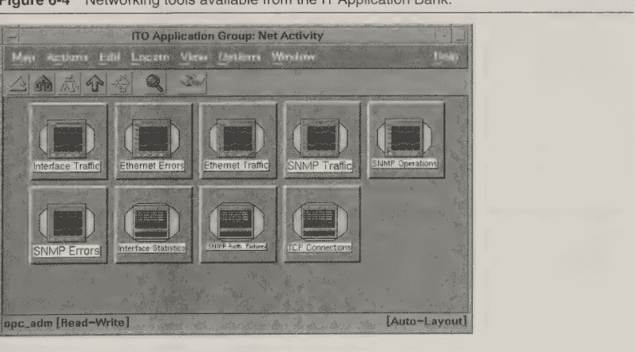

计算机系统状态以不同颜色显示在地图上。与 NNM 类似，Unicenter TNG 在正确显示私有网络状态方面也存在困难。

Computer Associates (CA) 将其部分监视和发现功能重新封装到其 Unicenter TNG Framework 中，并在某些平台（如 HP-UX）上免费分发。此外，CA 还与 HP 的事件监控服务 (EMS) 产品（本章稍后讨论）进行了一些特殊集成，以便以图形方式显示系统中被监视资源的状态。

#### Enterprise SyMON

Sun Enterprise SyMON 是一款用于网络监控的低端产品。它能够发现从管理站可达的计算机系统，并将系统分组为“域”以便于管理。图 6-6 展示了如何配置此发现功能。SyMON 根据从系统接收到的事件的严重性提供系统状态。SyMON 还可用于生成性能图表。

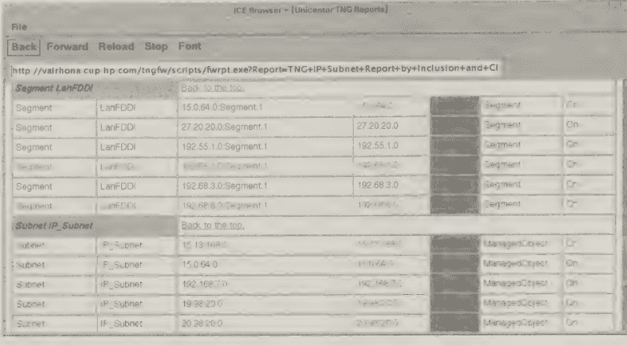

**图 6-5** Unicenter TNG 事件浏览器。

Sun Enterprise SyMON 可用于通过其图形显示报告网络警报。通过配置 Tool Command Language (TCL) 脚本语言中的规则可以生成事件。SyMON 在被管节点上提供了一个智能代理，该代理可以访问大量的系统数据，包括 MIB-II。可以配置针对 MIB-II 网络部分的规则，例如，当接口卡状态发生变化时发送警报。

SyMON 还包括诊断功能。响应于事件，您可以向下钻取到系统的物理视图，该视图包含基于每个系统型号预加载的 GIF 文件生成故障组件的照片视图。

被管系统上的智能代理可以支持加载附加模块。例如，存在一个模块可以报告 NFS 的事件。用户可以选择加载哪些附加模块。

SyMON 仅可用于监视 Sun 系统。

### 监视网卡和电缆故障

单个网卡 (NIC) 的平均故障间隔时间 (MTBF) 可能是多年。然而，在大型计算环境中，您仍然可能会遇到局域网卡故障。本节展示了如何监视局域网卡故障，验证物理电缆是否正确设置，以及发现相关问题，如链路断开。您还可以了解如何识别所使用的网络链路类型。

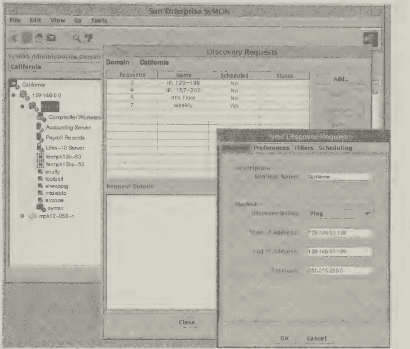

**图 6-6** SyMON 中的发现配置。

本节指的是大致对应于开放系统互连 (OSI) 模型的物理层和数据链路层的网络组件的监视。本节还展示了如何获取局域网的状态和统计信息、每个 UNIX 服务器使用的局域网站地址，以及关于局域网数据包错误的信息。本节最后介绍了一些特定于某些网络链路（如 X.25、异步传输模式 (ATM) 和光纤分布式数据接口 (FDDI)）的监视工具。

### 使用 SNMP 仪表

如本章前面所述，重要的监视信息可以存储在标准 MIB 中，然后可以使用 MIB 浏览器进行查询。MIB 浏览器是公开可用的，也包含在 NNM、IT/O 和其他网络管理产品中。也可以通过使用自定义 SNMP 应用程序获取 MIB 数据，但您需要知道您感兴趣的查询字段的对象标识符 (OID)，这些在 MIB 规范中提供。标准 MIB 文档作为互联网工程任务组 (IETF) 的请求意见 (RFCs) 提供，可在网络上的 http://www.ietf.org 上获取。

MIB-II（定义于 RFC 1213 和 1214）包含许多用于监视网络链路的有用字段。可以获得有关每个网络接口的信息，包括其当前状态。您可以比较输入数据包总数与接收到的错误输入数据包数量。对于输出数据包，也有类似的字段。这些字段共同可以指示网络表现的好坏。

您可能还想检查尽管在没有错误的情况下接收但被丢弃的入站数据包数量。如果数据包正在被丢弃，这可能表明系统内存中预留给网络缓冲区不足。

MIB-II 中定义了每个网络接口的管理状态和操作状态。管理状态为 up（启用）、down（禁用）或 testing（测试）。它指的是接口的期望状态。操作状态也是 up、down 或 testing，它对应于接口的当前操作状态。

网络统计信息从系统启动时开始累积，或者自上次手动重置统计信息以来累积。由于这通常是一段很长的时间，单个 MIB 查询可能没有太大用处。您可能希望设置持续监视，并计算数值随时间的变化，以了解 NIC 上的网络流量和当前错误率。输出错误很可能表明从本地系统到达链路存在问题。

### 使用标准命令和工具

每个 UNIX 操作系统都包含各种有助于确定网络接口状态的命令。本节描述了更常用的 HP-UX 命令。您可能想要查阅在线 man 页面以获取有关每个命令的更多信息。

除了这些命令，如果您的系统正在经历网络问题，您也可能想要检查系统日志文件 /var/adm/syslog/syslog.log 中的与局域网相关的错误消息。

#### ioscan

ioscan 命令用于提供有关系统上所有 I/O 路径的信息。它可以显示到局域网卡的硬件路径，并帮助您区分内置局域网卡和额外的局域网卡。您还可以看到正在使用的特定类型的局域网卡。如果硬件或软件未正确安装，ioscan 将显示错误。错误可能源于安装了错误的网络驱动程序，这意味着您需要使用正确的驱动程序重建内核。列表 6-1 显示了一个具有一个内置局域网卡和三个 EISA 卡的 HP-UX 系统。

**列表 6-1** 带有 grep 的 ioscan 命令，仅显示网络信息。

```
chacha#ioscan |grep lan
8/16/6        lan        Built-in LAN
8/20/5/1      lan        EISA card HWP1990
8/20/5/7      lan        EISA card HWP1990
8/20/5/8      lan        EISA card HWP1990
chacha#
```


#### lanscan

*lanscan* 命令显示每个 LAN 设备的主板硬件路径、站点地址、链路状态、网络管理 ID 以及正在使用的链路技术（例如，以太网或 FDDI）。*站点地址*是 LAN 卡唯一标识符，也称为物理地址或媒体访问控制（MAC）地址。你可以将 lanscan 显示的信息（如列表 6-2 所示）与 ioscan（列表 6-1 所示）提供的信息进行比较。通过此额外信息，你可以唯一地标识你的 LAN 卡，以便将其配置为适合公司的网络。另外，如果你正使用分析器查看 LAN 上的网络数据包，lanscan 有助于你将数据包中的站点地址映射到系统上的网络接口。

请注意，一个接口既有硬件状态，也有网络接口状态。硬件状态对应于设备的配置状态，而网络接口状态对应于当前的操作状态。在列表 6-2 的例子中，lan1 被配置为 *UP*，但并未正常运行。

#### lanadmin

lanadmin 命令可用于显示或修改每个已配置网络接口的站点地址、最大传输单元（MTU）或速率设置。它也可用于显示或重置 MIB-II 网络接口统计信息。统计信息包括接口名称、管理状态、运行状态、错误数据包数量及其他信息。对于以太网链路，lanadmin 还显示来自 RFC 1284（类以太网接口信息）的统计数据，这些数据可以表明链路上的碰撞次数。

它与其他命令存在部分重叠。例如，站点地址也可以从 lanscan 获取，MTU 也可以从 netstat（后面详述）获得。

lanadmin 可用于重新初始化 LAN 卡。例如，如果系统在启动过程中网络失败，你可以使用 lanadmin 重置 LAN 卡来启用网络，然后使用 *ifconfig*（后面详述）用正确的 IP 地址将该卡启动。

如列表 6-3 中所示，通过 lanadmin 的菜单驱动界面可以使用大量统计信息。请注意，使用 lanadmin 命令时，需要指定 LAN 卡的**网络管理 ID 号**，这可以从 lanscan 命令获取。

**列表 6-2 lanscan 命令输出的输出，显示 LAN 卡列表。**

```bash
#### lanscan
Hardware Station    Crd Hardware Net-Interface NM MAC  HP DLPI Mjr
Path     Address      In# State  Name/Unit State  ID Type  Support Num
8/16/6   0x080009C3FAYD 0      UP    lan1      UP    4  ETHER Yes   52
8/20/5/1 0x080009ACC83C 1      UP    lan1      DOWN  5  ETHER Yes   176
8/20/5/7 0x080009ACD860 2      DOWN  lan2      DOWN  6  ETHER Yes   176
8/20/5/8 0x080009ACF11E 3      DOWN  lan3      DOWN  7  ETHER Yes   176
#
```

**列表 6-3 lanadmin 执行输出。**

```text
canlan#lanadmin
        LOCAL AREA NETWORK ONLINE ADMINISTRATION, Version 1.0
                     Sun, Oct 4, 1998 16:49:08
              Copyright 1994 Hewlett-Packard Company.
                  All rights are reserved.

Test Selection mode.
    lan    = LAN Interface Administration
    menu   = Display this menu
    quit   = Terminate the Administration
    terse  = Do not display command menu
    verbose = Display command menu

Enter command: lan

LAN Interface test mode. LAN Interface Net Mgmt ID = 4
    clear   = Clear statistics registers
    display = Display LAN Intf status and statistics registers
    end     = End LAN Interface Admin, return to Test Selection
    menu    = Display this menu
    nmid    = Network Management ID of the LAN Interface
    quit    = Terminate the Administration, return to shell
    reset   = Reset LAN Interface to execute its selftest

Enter command: display

                LAN INTERFACE STATUS DISPLAY
                 Sun, Oct 4, 1998   16:49:12

Network Management ID               = 4
Description          = lan0 Hewlett-Packard LAN Interface Hw Rev 0
Type (value)         = ethernet-csmacd(6)
MTU Size             = 1500
Speed                = 10000000
Station Address      = 0x80009e72436
Administration Status (value)        = up(1)
Operation Status (value)            = up(1)
Last Change            = 14829
Inbound Octets        = 30754920
Inbound Unicast Packet = 0
Inbound Non-Unicast Packets       = 0
Inbound Discards         = 0
Inbound Errors             = 0
Inbound Unknown Protocols         = 0
Outbound Octets          = 46132380
Outbound Unicast Packets = 202335
Outbound Non-Unicast Packets      = 0
Outbound Discards        = 5
Outbound Errors              = 0
Outbound Queue Length      = 0
Specific                   = 655367

Press <Return> to continue
Ethernet-like Statistics Group
Index = 4
Alignment Errors = 0
FCS Errors = 0
Single Collision Frames = 0
Multiple Collision Frames = 0
Deferred Transmissions = 0
Late Collisions = 0
Excessive Collisions = 0
Internal MAC Transmit Errors = 0
Carrier Sense Errors = 67445
Frames Too Long = 0
Internal MAC Receive Errors = 0
LAN Interface test mode. LAN Interface Net Mgmt ID = 4
clear = Clear statistics registers
display = Display LAN Interface Admin and statistics registers
end = End LAN Interface Admin, return to Test Selection
menu = Display this menu
nmid = Network Management ID of the LAN Interface
quit = Terminate the Administration, return to shell
reset = Reset LAN Interface to execute its selftest
Enter command: quit
canlan#
```

请注意，lanadmin 命令已使早期 HP-UX 版本中可用的 landiaq 命令不再使用。另外请注意，不应使用 lanadmin 命令处理异步传输模式（ATM）适配器。ATM 提供了与 ATM 适配器配合使用的其他命令。这些在本章后面列出。

#### linkloop

linkloop 命令用于验证 LAN 连接性。指定本地网络管理 ID 和本地或远程站点地址，然后发送测试数据包以检查连接性。在列表 6-4 所示的例子中，lan2（网络管理 ID 为 6）与远程系统上的网络接口之间的连接性受到检查。

由于 linkloop 仅测试物理层和数据链路层，所以远程站点必须位于同一个网络段上。测试数据包无法使用 IP 地址进行路由：你必须指定目的地系统的站点地址。

如果不确定远程主机的站点地址，你可以使用的一个命令是 arp，它显示当前的地址解析协议（ARP）缓存条目。ARP 提供 IP 地址与站点地址之间的映射。arp 命令还显示与每个 IP 地址关联的主机名。仅当之前已建立连接性或正在使用静态 ARP 条目时，该命令才有帮助。你可能需要在远程系统上运行 lanscan 以确定其站点地址。arp 命令在本章后面将进一步详细讨论。

**列表 6-4 显示 lanscan 和 linkloop 的输出，它们用于测试连接性。**

```bash
cancan#lanscan
Hardware Station Crd Hardware Net-Interface NM MAC HP DLPI Mjr
Path Address In# State Name/Unit State ID Type Support Num
8/16/6 0x080009E72436 0 UP lan0 DOWN 4 ETHER Yes 52
8/20/5/1 0x0800096BBED4 1 UP lan1 DOWN 5 ETHER Yes 176
8/20/5/7 0x0800096BEE5A 2 UP lan2 UP 6 ETHER Yes 176
8/20/5/8 0x0800096BBEDE 3 DOWN lan3 DOWN 7 ETHER Yes 176
cancan#
cancan#linkloop -1 6 0x0800094A1861
Link connectivity to LAN station: 0x0800094A1861
--OK
cancan#
```

### 使用额外产品监控网络链路

随 UNIX 操作系统提供的标准命令提供了监控网络链路的强大功能。然而，你也可以购买扩展这些功能的产品。本节给出了一些例子。

#### EMS HA 监控器

事件监控服务（EMS）是一个免费的软件包，用于监控 HP-UX 系统的硬件组件。EMS 提供库，以便可以添加其他硬件和软件监控器。Hewlett-Packard 提供 HA Monitors 产品，可用于检测 LAN 接口状态变化。HA Monitors 可发现所有网络接口。监控可以对一个或所有网络接口启用。该状态信息与 MIB-II 或 lanscan 提供的类似，但 EMS 允许信息通过多种通知方法自动通信。例如，EMS 可以发送电子邮件消息，将事件记录到系统日志或任意文本文件，或向 MC/ServiceGuard（HP 的高可用性集群软件）报告问题。只要不需要使用故障网卡，事件还可以通过 TCP、用户数据报协议（UDP）、SNMP、opcmsg（IT/O 使用的专有通信协议）或电子邮件报告。

配置 EMS 网络监控时，你使用 SAM。从资源管理功能区域，你选择事件监控服务，然后选择添加新的监控请求的操作。资源被归类为组，通过选择 /net，你可以查看可监控的接口。你可以选择一个要监控的接口，或选择所有接口，然后输入监控参数。图 6-7 显示了部分 EMS 配置。

也可以使用 EMS 监控 ATM 和 HyperFabric 适配器。这些产品都包含一个 EMS 监控器。


#### MC/ServiceGuard

MC/ServiceGuard 是一种高可用性软件产品，用于检测系统故障、网络或 LAN 卡故障以及关键应用程序故障。可以配置 MC/ServiceGuard 自动处理这些故障。例如，可以重新启动发生故障的关键应用程序。LAN 卡故障可能会导致自动配置备用 LAN 卡接管网络负载。

MC/ServiceGuard 不仅仅是一个监控产品，因为它还能在检测到故障时提供透明的应用程序重启功能。如果您负责监控网络，并且您的环境中使用了 MC/ServiceGuard，那么您应该熟悉 MC/ServiceGuard 产品如何使用网络。

尽管 MC/ServiceGuard 可用于单个系统以提供透明的 LAN 故障转移，但它更常用于集群环境中。在这种情况下，如果发生系统故障，可以在另一个系统上重启应用程序。此功能要求 MC/ServiceGuard 通过网络发送数据包，以确保其集群成员仍然存活。您可能希望为此高可用性通信拥有一个专用网络，以确保高网络利用率不会导致应用程序的不必要迁移。MC/ServiceGuard 监控子网，并可以在子网上线或下线时发送 SNMP 陷阱。如果您使用基于 SNMP 的管理应用程序，这可以快速了解您是否存在网络问题。

MC/ServiceGuard 利用了将多个 IP 地址绑定到单个网卡的能力。这使得应用程序可以迁移到另一个系统，而客户端无需学习新地址；IP 地址随应用程序一起移动。MC/ServiceGuard 区分“静态”IP 地址（与一台计算机系统关联）和“浮动”IP 地址（与应用程序关联，并随应用程序迁移到其他系统）。

当 MC/ServiceGuard 向系统添加或移除 IP 地址时，它会发送 SNMP 陷阱。要了解这些浮动 IP 地址是否正在您的系统上使用，您可以使用 `netstat_in`，它显示所有已配置的 IP 地址。`ifconfig` 命令仅显示指定网络接口的静态 IP 地址。这些命令在本章后面会详细讨论。

请注意，MC/ServiceGuard 仅支持运行 HP-UX 10.x 或更高版本操作系统的 HP 9000 Series 800 系统。然而，其他系统供应商提供类似的高可用性网络产品。

##### MeasureWare

MeasureWare 是一种收集系统性能信息的软件产品。收集的数据可被性能工具（如 HP PerfView）使用。

MeasureWare 监控 HP-UX、Sun Solaris 和其他平台上的众多指标。虽然收集这些信息主要是出于性能原因，但它们也有助于推断网络组件的状态。例如，如果繁忙网络接口上入站 LAN 数据包的速率突然降至零，这可能意味着存在链路问题。检测到潜在问题后，您应使用其他工具诊断问题可能发生的位置。

MeasureWare 在本章后面的“收集网络性能数据”部分中进行了详细讨论。

#### 使用链路特定命令

您应该能够仅使用已描述的工具来诊断以太网和令牌环链路的健康状况。还有其他命令可用于其他网络链路，如 FDDI、X.25 和 ATM。本节剩余部分介绍了可用于辅助故障诊断和排除故障的一些链路特定命令。

##### 使用 FDDI 状态命令

光纤分布式数据接口 (FDDI) 是一种高速 LAN 技术，数据传输速率可达 100 兆位/秒。FDDI 支持双光纤环，提供一定程度的冗余。系统可以通过称为*集中器*的 FDDI 设备连接到 FDDI 网络，该设备可以通过确保网络不受故障系统影响来提供一定的容错能力。具有双连接能力的网卡可以直接连接到独立的集中器，以提供额外的保护。

您可以通过执行 lanscan 命令来检查您的系统是否正在使用 FDDI。每个 LAN 卡都会显示其链路类型。除了 lanscan，还可以使用其他常见命令来配合 FDDI 链路，如 ioscan、linkloop 和 lanadmin。

您可以使用 fddiinit 命令并指定您的 FDDI 适配器的设备文件来初始化适配器并将系统连接到网络。如果此命令失败，可能是电缆未正确连接、卡未运行或集中器未启动。

如果适配器成功初始化，您可以使用 fddistat 获取有关该卡的更多信息，它也需要设备文件（例如，/dev/lan1）。如果卡配置正确，输出应表明环路处于运行状态，并且站点连接的线路状态为 WRAP_S。

还有一个额外的命令 fddinet，可用于显示本地环路、指定的远程节点或连接到同一 FDDI 环路的所有节点的连接信息。

##### X.25 状态命令

X.25 是由 CCITT 标准化的分组交换网络。可以使用 x25stat 来检测 X.25 链路的问题。它提供 X.25 设备和卡的状态、配置信息以及虚拟电路统计信息。执行 `x25stat -f -d /devicefile` 会显示 X.25 链路上的错误数量。如果链路状态未列为 NORMAL，则存在问题。

通过 x25stat 显示的统计信息包括当前配置的虚拟电路数量以及每个子网上传输的字节数。x25stat 还可以显示特定虚拟电路的统计信息，如发送或接收的数据包数量。

如果 IP 未在 X.25 上工作，您可以使用 `x25stat -a` 检查您的网络地址是否正确配置，并查看 IP 和 X.25 地址之间的映射。您可能需要使用 x25init 重新初始化 X.25。

x25check 和 x25server 命令一起用于测试 X.25 网络。x25server 是一个等待 x25check 发起呼叫请求的后台进程。x25check 向运行 x25server 的远程系统发送数据包，数据包会被回显回来。这可用于测试您到网络或 X.25 交换机的 X.25 链路。如果成功，x25check 还会显示建立虚拟电路所花费的时间。

##### ATM 状态命令

异步传输模式 (ATM) 是一种高速网络技术。一些网络命令，如 lanscan 和 netstat，是通用的，可用于 ATM 链路。例如，`netstat -i` 显示 ATM 网络接口的统计信息。然而，也有一些 ATM 特定的状态命令，下面将进行描述。

要获取关于 ATM 适配器、其 MAC 地址以及关联虚拟电路的信息，可以使用 atmgr 命令。该命令需要指定一个卡实例号。根据指定的命令选项，还可以显示更多信息。例如，`atmgr 0 show -p` 显示状态、统计信息和 MAC 地址。

要进行外部环回测试，可以使用 atmloop 命令。您必须首先使用 atmstop 停止 ATM 适配器，然后使用环回罩替换电缆。测试后，您可以再次发出 atmstop，然后在移除罩后使用 atminit 初始化适配器。atminit 命令可用于复位或初始化适配器，但所有交换虚拟电路 (SVC) 都将丢失。

要获取有关 ATM 网络接口和 ARP 缓存条目的信息，请分别使用 elstat 和 elarp 命令。这些命令需要指定一个网络接口名称，如 el101。

要检查 ATM 适配层 (AAL) 接口统计信息，请使用卡实例号 0，如清单 6-5 所示。

##### 清单 6-5 显示 AAL5 统计信息的 atmmgr 输出。

```
cancan: atmmgr 0 show -a

AAL5 statistics

CRC-32 errors in received SDUs        : 0
SDUs lost due to reassembly timeout    : 0
SDUs too big                           : 0
```

如果 AAL5 接口工作正常，错误数量应该很低。

其他 ATM 命令包括 atmcheck 和 atmserver，可用于检查 ATM 硬件和端到端连接性，以及 atminit_net，用于复位或初始化 ATM 适配器上的特定网络接口。这不会停止 ATM 适配器，因此其他网络接口的活动不受影响。

# HA ATM

HA ATM 是惠普的一款产品，在发生故障时保护 ATM 链路。HA ATM 与 EMS 和 MC/ServiceGuard 集成。通过其与 EMS 的集成，辅助本地恢复，而远程恢复则涉及 EMS 和 MC/ServiceGuard。

HP ATM 适配器允许您同时运行一个经典 IP (CIP) 接口和多达 32 个仿真 LAN (ELAN) 接口。高可用性仅针对具有 LAN 仿真的 ATM 提供。

HA ATM 保护 ATM 网络中的单个故障。它检测本地 ATM ELAN 接口故障，并通过切换到另一个本地 ELAN 接口执行本地恢复。HA ATM 可以检测核心 ATM 软件、ATM 适配器、链路或 ATM 交换机的问题，并本地恢复。检测到故障时，可以发送 EMS 事件。当 HA ATM 无法提供本地恢复时，通过 EMS 通知 MC/ServiceGuard。

当发生系统故障或系统失去所有适配器、交换机或电缆时，使用 MC/ServiceGuard 远程恢复。为了处理远程故障转移，MC/ServiceGuard 将所有定义为软件包的 ATM 应用程序移动到远程系统，并在远程系统的 ATM 适配器上的 ELAN 接口上配置任何软件包 IP 地址。

### 监控网络和传输协议

网络问题可能难以诊断，因为网络涉及各种硬件和软件组件。上一节关注物理电缆和


网卡。本节展示了用于检查网络协议行为的工具，主要涉及 TCP/IP 协议族中的那些协议。

本节描述了 OSI 七层网络模型中网络层和传输层的监控。这些层包括用于数据传输、路由、排序和流量控制的各种协议。在局域网（LAN）环境中，错误检测和恢复是传输层的责任。在这些层需要监控多种关键资源，例如每个客户端和服务器正在使用的 IP 地址、与服务器活动的连接数以及每个协议的错误统计信息。

#### 使用 SNMP 仪表化

之前讨论过 MIB-II，因为它能够报告每个网络接口的状态信息。MIB-II 还包含了一些关键网络协议的信息，例如 IP、ICMP（互联网控制报文协议）、TCP、ARP 和 UDP。

如果你可以访问 MIB 浏览器，那么你可能想要浏览此 MIB 以查看你可以访问的有趣统计数据。例如，对于 IP，你可以检查被发送或丢弃的数据量，以及被接收的数据量，并了解正在发生的片段化、重组或交付错误。对于 ICMP，你可以确定目标不可达的次数。对于 TCP，你可以查看连接尝试的数量并查看当前的连接。对于 UDP，你可以看到打开的套接字数量。

本节篇幅较短，因为 netstat 命令提供了非常类似的信息，该命令将在本节后面详细讨论。除非你正在通过网络管理产品监控多个系统的 MIB 变量，否则你可能更希望使用 netstat 命令。

### 使用标准命令和工具

本节包括用于获取网络和传输协议信息的常见 UNIX 命令。

### ping

ping 命令使用 ICMP 回显来测试到远程节点的连接性，并记录网络数据包的往返时间和路由。也会显示丢失的数据包百分比。因为 ICMP 使用 IP 进行数据传输，所以 ping 不仅测试链路本身，还测试正确的网络协议行为。诸如 TCP 和 UDP 等传输协议不参与 ping。列表 6-6 展示了 ping 命令的一个示例。请注意，ping 可以与 IP 地址或系统名称一起使用。如果使用名称，ping 可以确定名称解析服务是否正常工作。

如果 ICMP 序列号不按数字顺序排列，则可能存在硬件问题。如果没有对 ping 做出响应，则可能存在多种问题。如果其他系统可以被 ping 通，特别是具有相同路由的系统，则远程系统可能已故障。如果没有任何系统可以被 ping 通，这可能表明本地系统未连接到网络。

###### 列表 6-6 ping 命令的输出。

```
cancan#ping chacha
PING chacha.cup.hp.com: 64 byte packets
64 bytes from 15.13.173.94: icmp_seq=0. time=0. ms
64 bytes from 15.13.173.94: icmp_seq=1. time=0. ms
64 bytes from 15.13.173.94: icmp_seq=2. time=0. ms
64 bytes from 15.13.173.94: icmp_seq=3. time=0. ms
----chacha.cup.hp.com PING Statistics----
4 packets transmitted, 4 packets received, 0% packet loss
round-trip (ms) min/avg/max = 0/0/1
cancan#
```

ping 命令可能因其他原因失败，例如中间系统故障或路由表配置错误。

ping 命令的一个缺点是通信的一端必须是当前登录的系统。通信问题可能存在于其他两个系统之间。使用 NNM 的远程 Ping 工具，你可以指定任意一对系统让它们互相 ping。

##### ifconfig

ifconfig 命令用于配置网络接口，也可以用来确定 IP 是否已正确设置。如列表 6-7 所示的输出，提供了诸如与接口关联的 IP 地址和子网掩码等信息。

运行状态包含在输出中。

###### 列表 6-7 ifconfig 命令的输出。

```
cancan#ifconfig lan2
lan2: flags=863<UP,BROADCAST,NOTRAILERS,RUNNING,MULTICAST>
    inet 15.13.173.93 netmask ffff8000 broadcast 15.13.175.255
cancan#
```

##### arp

当发送系统知道目标的 IP 地址，但不知道站点地址时，使用地址解析协议（ARP）。ARP 请求在网络上广播，要求目标或中间路由器回复其站点地址。最近使用的从 IP 地址到站点地址的映射存储在 ARP 缓存中。

arp 命令可用于显示 ARP 缓存中的当前条目。如果你认为两个系统可能正在使用相同的 IP 地址，这将是一个有用的工具。你可以检查远程系统上的 MAC 地址，并将其与本地系统 ARP 缓存中的值进行比较。你可能还想使用局域网分析器来查看本地系统是否收到了多个 ARP 回复。请注意，在列表 6-8 的 arp 输出中，一个站点地址（0:60:3E:81:E:A0）出现了多次。这个系统是一个支持多个网络接口的路由器。

###### 列表 6-8 arp 命令的输出，显示远程站点地址。

```
# arp -a
hpovsg.cup.hp.com (15.13.169.163) at 8:0:9:78:2d:eb ether
cup44ux.cup.hp.com (15.27.217.36) at 0:60:3e:81:e:a0 ether
hpssc16.cup.hp.com (15.13.169.233) at 8:0:9:4:18:61 ether
hphamc1.cup.hp.com (15.13.174.176) at 8:0:9:84:71:94 ether
hphamc2.cup.hp.com (15.13.174.177) at 8:0:9:84:21:e8 ether
c3p0.ehp.hp.com (15.13.171.249) at 8:0:9:e3:92:69 ether
wayne.cup.hp.com (15.13.171.185) at 8:0:9:87:bb:6d ether
chewy.cup.hp.com (15.13.172.249) at 0:60:b0:59:ae:14 ether
perseus.cup.hp.com (15.61.200.218) at 0:60:3e:81:e:a0 ether
hpssc02.cup.hp.com (15.13.169.219) at 8:0:9:82:2d:e8 ether
c1ue.cup.hp.com (15.13.168.123) at 8:0:9:92:e9:7f ether
cup44ux.cup.hp.com (15.13.168.124) at 8:0:9:5a:f9:e5 ether
chacha.cup.hp.com (15.13.173.94) at 8:0:9:c3:fa:7d ether
#
```

另一种查找与给定站点地址关联的计算机系统的方法是使用 NNM，它有一个定位菜单选项。通过使用此菜单选项指定站点地址，NNM 会搜索其对象数据库以找到对应的系统。

arp 命令也可以用于向 ARP 缓存添加或删除条目。如果你想使用 ping 来诊断 IP 和 ARP 故障，这将很有用。

#### netstat

netstat 命令可用于显示有关网络接口和协议的信息。可以显示 TCP、UDP、IP、ICMP、ARP 和其他协议的统计数据。netstat 可用于显示所有活动的 TCP 连接及其当前的 TCP 状态。使用 netstat，你可以显示当前配置在系统上的所有 IP 地址。例如，你可以确定请求和接受的 TCP 连接的总数。可以显示在配置的网络接口及其配置的 IP 地址上发送的网络流量的信息。也可以显示内部数据结构，如套接字结构和路由表。

列表 6-9 展示了如何使用 netstat 获取有关网络接口的统计数据。这些统计数据也可以通过 lanadmin 命令获取，但 lanadmin 不提供 IP 地址信息。在正常运行期间，这里显示的错误率应该非常低（远低于 1%）。请注意，在此示例中，系统正在使用 MC/ServiceGuard，并且多个 IP 地址绑定到同一个网络接口。

在 HP-UX 上，使用 `netstat -in` 确保两个网络接口没有使用相同的网络地址（或子网络地址），因为这在 HP-UX 上是不支持的。

使用 netstat，你可以查看每个关键网络协议的协议统计数据。列表 6-10 到 6-13 分别展示了 IP、ICMP、TCP 和 UDP 的示例输出。

ICMP 提供许多有用的错误统计数据。目标不可达错误可能由许多原因引起，包括未知的目标名称、路由问题或硬件故障。


###### 列表 6-9 netstat 输出，显示已配置的 IP 地址。

```
bass:/>netstat -in

| 名称 | Mtu | 网络 | 地址 | Ikpnts | Ierrs | Okpnts | Oerrs | Coll |
| :--- | :--- | :--- | :--- | :--- | :--- | :--- | :--- | :--- |
| lo0 | 4136 | 127.0.0.0 | 127.0.0.1 | 4693211 | 0 | 4693219 | 0 | 0 |
| lan3 | 1500 | 15.13.168.0 | 15.13.168.61 | 30925479 | 0 | 7106611 | 0 | 0 |
| lan2 | 1500 | 192.5.1.0 | 192.5.1.61 | 873225 | 15 | 1555027 | 382 | 20374 |
| lan2:1 | 1500 | 192.5.1.0 | 192.5.1.3 | 16 | 0 | 0 | 0 | 0 |
| lan2:2 | 1500 | 192.5.1.0 | 192.5.1.9 | 16 | 0 | 0 | 0 | 0 |
| lan2:3 | 1500 | 192.5.1.0 | 192.5.1.7 | 16 | 0 | 0 | 0 | 0 |
| lan2:4 | 1500 | 192.5.1.0 | 192.5.1.5 | 16 | 0 | 0 | 0 | 0 |
| lan2:5 | 1500 | 192.5.1.0 | 192.5.1.19 | 16 | 0 | 0 | 0 | 0 |
| lan2:6 | 1500 | 192.5.1.0 | 192.5.1.15 | 16 | 0 | 0 | 0 | 0 |
| lan2:7 | 1500 | 192.5.1.0 | 192.5.1.13 | 16 | 0 | 0 | 0 | 0 |
| lan2:8 | 1500 | 192.5.1.0 | 192.5.1.17 | 16 | 0 | 0 | 0 | 0 |
| lan2:9 | 1500 | 192.5.1.0 | 192.5.1.29 | 16 | 0 | 0 | 0 | 0 |
| lan1* | 1500 | none | none | 0 | 0 | 0 | 0 | 0 |

bass:/>
```

###### 列表 6-10 使用 netstat 显示 IP 统计数据。

```
# netstat -p ip
ip:
	112231915 total packets received
	0 bad header checksums
	0 with size smaller than minimum
	0 with data size < data length
	0 with header length < data size
	0 with data length < header length
	0 illegal ip source address
	178 ip version unsupported
	193 fragments received
	0 fragments dropped (dup or out of space)
	1 fragment dropped after timeout
	0 packets forwarded
	2382091 packets not forwardable
	0 redirects sent
```

###### 列表 6-11 使用 netstat 显示 ICMP 统计数据。

```
# netstat -p icmp
icmp:
	7368 calls to generate an ICMP error message
	0 errors not generated because old message was ICMP
	0 errors not generated 'cuz old message was broadcast
	Output histogram:
	echo reply: 215963
	destination unreachable: 7368
64 messages with bad code fields
21 messages < minimum length
0 messages with a bad checksum
0 messages with bad length
Input histogram:
echo reply: 12231
destination unreachable: 182468
source quench: 35
routing redirect: 108
echo: 215963
time exceeded: 18
address mask request: 124
215963 responses sent
```

源抑制（source quench）是向系统发出的请求，要求其因拥塞而降低传输速率。路由重定向（Routing redirect）消息用于请求系统使用替代路径到达目标网络。

###### 列表 6-12 使用 netstat 显示 TCP 统计数据。

```
#netstat -p tcp
tcp:
275906 packets sent
7346 data packets (948597 bytes)
0 data packets (0 bytes) retransmitted
12967 ack-only packets (1627 delayed)
0 URG only packets
22 window probe packets
1 window update packet
255570 control packets
523932 packets received
14736 acks (for 912101 bytes)
3299 duplicate acks
0 acks for unsent data
12785 packets (854136 bytes) received in-sequence
3 completely duplicate packets (0 bytes)
0 packets with some dup. data (0 bytes duped)
2837 out-of-order packets (0 bytes)
2 packets (0 bytes) of data after window
0 window probes
55 window update packets
0 packets received after close
0 discarded for bad checksums
0 discarded for bad header offset fields
0 discarded because packet too short
249910 connection requests
2842 connection accepts
5677 connections established (including accepts)
255585 connections closed (including 14 drops)
247075 embryonic connections dropped
15772 segments updated rtt (of 265683 attempts)
0 retransmit timeouts
		0 connections dropped by rexmit timeout
0 persist timeouts
0 keepalive timeouts
		0 keepalive probes sent
		0 connections dropped by keepalive
```

您可以随时间监控 TCP 统计数据，以查看是否正在建立新的连接，例如。

`netstat -a` 可用于显示 TCP 连接和 UDP 套接字的状态。例如，您可以确定连接是否已完全建立，或者服务器是否仍在等待客户端的连接请求。如果网络服务已在 `/etc/services` 中注册，输出将显示该服务的名称。

`netstat` 命令还可以用于显示正在使用以及专门用于网络数据包的记忆数量。如果在目的地或中间系统上用于 IP 分片重组的可用内存不足，网络性能可能会受到影响。数据将需要重新传输。您可以使用 `netstat -sp ip` 检查被丢弃的分片数量。`ndd` 命令可用于显示和更改 `ip_reass_mem_limit` 值。

##### nettl

`nettl` 是 HP-UX 的主机端设施，用于跟踪进出系统的网络数据包。可以跟踪 IEEE802.3 和 FDDI 等链接，以及 TCP/IP 和 OSI 传输层等上层协议。`nettl` 还会记录有关网络事件的信息。

要使用 `nettl`，您首先需要启动跟踪设施。然后，您需要使用 `nettl -tn` 启动特定跟踪。您可以列出希望包含在跟踪中的特定网络子系统，例如网络层或传输层。

###### 列表 6-13 使用 netstat 显示 UDP 统计数据。

```
# netstat -p udp
udp:
	0 incomplete headers
	0 bad data length fields
	0 bad checksums
	2217 socket overflows
	0 data discards
```

在启动跟踪时指定跟踪文件。根据输出的大小，`nettl` 会创建两个跟踪文件。最新的跟踪文件会添加 `.TRC0` 后缀，而较旧的文件将具有 `.TRC1` 扩展名。列表 6-14 展示了如何启动和停止对用于 ping 请求的 ICMP 流量进行的跟踪。

收集跟踪数据后，您可以使用 `netfmt` 格式化输出。格式化后的数据也可以写入文件。列表 6-15 展示了由前述跟踪生成的格式化文件的一部分。

由于对系统性能的影响，您应仅在无法通过其他工具诊断问题或系统具有显著过剩容量时使用 `nettl`。

###### 列表 6-14 ICMP/ping 跟踪示例。

```
# nettl -start
# nettl -tn pduin pduout -e ns_ls_icmp -f pingtrc
# ping hoffman
PING hpssc16.cup.hp.com: 64 byte packets
64 bytes from 15.13.169.233: icmp_seq=0. time=2. ms
64 bytes from 15.13.169.233: icmp_seq=1. time=2. ms
64 bytes from 15.13.169.233: icmp_seq=2. time=2. ms

---hpssc16.cup.hp.com PING Statistics----
3 packets transmitted,  3 packets received, 0% packet loss
round-trip (ms)   min/avg/max = 2/2/2
# nettl -tf -e all
# netfmt -Nnl -f pingtrc.TRC0 > pingfmt
# nettl -stop
```

###### 列表 6-15 ICMP/ping 格式化跟踪输出。

```
^^^^^^^^^^^^^^^^^^^^^^^^^^^^^ARPA/9000 NETWORKING^^^^^^^^^^^^^^^^^^@#%
 Timestamp          : Tue Jan 26 PST 1999 10:41:05.634676
 Process ID         : [ICS]                     Subsystem        : NS_LS_ICMP
 User ID ( UID )   : -1                        Trace Kind       : PDU IN TRACE
 Device ID          : -1                        Path ID          : -1
 Connection ID      : 0
 Location           : 00123
------------------------ ICMP Header ------------------------------
type: ECHOREPLY          cksum: 0xffe3          .id: 10715        seq: 1
code: none
------------------------- User Data --------------------------------
        0: 36 ae 0c 41 00 09 a8 44 08 09 0a 0b 0c 0d 0e 0f  6..A..D........
       16: 10 11 12 13 14 15 16 17 18 19 1a 1b 1c 1d 1e 1f  ................
       32: 20 21 22 23 24 25 26 27 28 29 2a 2b 2c 2d 2e 2f  !"#$%&'()*+,-./
       48: 30 31 32 33 34 35 36 37 -- -- -- -- -- -- -- --  01234567.........
```

### 监控网络服务

各种应用程序可以通过互联网或企业内网进行访问。例如，客户端应用程序可能使用网络访问服务器系统上的应用程序。在服务器系统上运行的应用程序被称为网络服务。

用户关心的是网络服务的可用性和响应时间。本节讨论用于监控网络服务的工具。讨论了一些更常见的网络服务，如域名系统（DNS）、网络信息服务（NIS）和网络文件系统（NFS）。其他应用程序将在第 7 章中讨论。

许多网络服务是由*守护进程*在响应客户端请求时启动的。该守护进程被称为*inetd*。您可以使用*ps*查看该守护进程是否正在运行。如果没有运行，您应尝试通过以*超级用户*身份执行 `/usr/sbin/inetd` 来重新启动它。您可以使用*netstat* –a 列出当前在系统上运行的网络应用程序。与每个服务相关的 TCP 或 UDP 套接字端口列在文件 `/etc/services` 中。如果某个服务没有运行，您可能需要检查此文件以查看该服务是否已配置。该服务还应列在文件 `/etc/inetd.conf` 中。*inetd* 守护进程在新服务启动或停止时会将错误和信息消息写入 `/var/adm/syslog/syslog.log`。

还有其他重要的网络服务始终处于激活状态（或应该处于激活状态）。这些服务包括 NFS 和 HTTP。本节其余部分列出了特定于每个网络服务的监控工具。

#### 监控 DHCP/BOOTP 服务器

引导协议（BOOTP）允许系统从远程服务器系统获取其网络配置信息，例如其 IP 地址。BOOTP 服务 *bootpd* 可能使用 trivial file transfer protocol（TFTP）将数据传回客户端。确保两者都已在 `/etc/services` 和 `/etc/inetd.conf` 中配置为 Internet 服务。

在收到 BOOTP 请求时，服务会检查其数据库中是否包含客户端的信息。如果包含，它会回复该信息；否则，它可能会将请求转发到另一台系统。您可能需要一个分析器来确保客户端在 BOOTP 请求中设置的关键参数是正确的。

客户端信息放在文件 `/etc/bootptab` 中。如果 BOOTP 总体上工作正常，但对特定系统不起作用，您应检查此文件以确保配置信息是正确的。您可能想要通过服务器使用 *bootquery* 发出测试，它可以用于向 BOOTP 服务器发送测试 BOOTP 请求。这样，您可以验证该服务是否在响应查询时启动。通过在查询中指定客户端地址，并启用向此客户端广播回复——这是 `/etc/bootptab` 中的一个配置选项——您可以看到由该 BOOTP 服务器发送的实际回复。

动态主机配置协议（DHCP）是 BOOTP 的一个超集。*bootpd* 和 DHCP 都可以将一些错误消息写入系统日志文件。如果您正在排查问题，请确保 *bootpd* 是带 `–d 2` 命令选项启动的，以便将信息性日志消息写入系统日志文件。


##### 监控 DHCP

DHCP 允许客户端从可用地址池中获取 IP 地址。/etc/bootptab 文件用于 BOOTP 客户端以及具有固定 IP 地址的 DHCP 客户端。属于某个池的客户端在 /etc/dhcpdtab 中配置。

在 HP-UX 上，可以使用 dhcpools 来跟踪 DHCP 数据包或检查 DHCP 守护程序的内部状态。例如，这可用于查找配置问题。操作员可以确定是否有 IP 地址可供分配给客户端，以及可用的 IP 地址总数。dhcpools 还有一个选项，允许对 DHCP 请求和响应进行数据包跟踪。

请注意，监控服务器状态是困难的，因为当 DHCP 无事可做时，它可能会自行关闭。

#### 监控 DNS/NIS 名称服务器

域名系统（DNS）和网络信息服务（NIS）是提供名称解析的两个服务。NIS 具有额外的功能，例如在多个系统之间维护一致的配置信息。

检查这些服务的一种简单方法是向服务器应用程序发送查询。除了检查服务可用性外，你还可以获得响应时间的快照。请注意，在此例及其他示例中，服务监控是从客户端系统进行的。

配置文件 /etc/resolv.conf 包含本地系统正在使用的名称服务器的 IP 地址。示例如图 6-16 所示。如果你在名称解析方面遇到问题，可能需要 ping 该文件中列出的服务器。

##### 名称服务切换

名称服务切换允许你指定使用哪种名称服务进行名称解析和其他查询。你可能需要检查 /etc/nsswitch.conf 文件，以查看系统中名称解析是如何进行的。nsquery 命令可用于测试名称服务切换的行为。

##### nslookup

nslookup 可用于确定某个名称服务器是否知道某个特定的主机名。图 6-17 显示名称服务器成功将系统名称解析为 IP 地址。

#### 监控 FTP

文件传输协议（FTP）用于在系统之间高效地传输文件。检查 FTP 是否正常工作的一种简单方法是使用 ftp 传输任意文件。除了指示请求是否成功外，ftp 还会告诉你传输速率。在连接期间，你可以使用 status FTP 命令来检查远程 FTP 会话的状态，如图 6-18 所示。

**图 6-16** 检查 /etc/resolv.conf 中的名称服务器。

```
# more /etc/resolv.conf
domain cup.hp.com
nameserver 15.27.217.36  # cup44ux
nameserver 15.13.168.63  # hpperfl
```

**图 6-17** 使用 nslookup 获取系统的 IP 地址。

```
# nslookup gsyview1
Name Server: cup44ux.cup.hp.com
Address: 15.27.217.36

Name: gsyview1.cup.hp.com
Address: 15.13.174.132
```

ftp 会拒绝访问 /etc/ftpusers 中列出的本地用户账户，因此如果 ftp 对某些用户不起作用，请确保检查此文件。

#### 监控 NFS

网络文件系统旨在为用户提供远程文件系统的透明视图，并使这些远程文件系统看起来像是本地挂载的。NFS 可以是共享文件系统以节省磁盘空间并简化管理的有用工具。所有 NFS 客户端共享存储在 NFS 服务器上的单个文件副本。透明性的缺点是，客户端可能意识不到通过读取简单文件所引起的网络流量。此外，客户端可能不知道其他人正在同时访问这些文件。

NFS 可能会出现许多问题。进程可能会死亡或挂起。NFS 的关键进程包括 nfsd、automount、lockd、statd 和 portmap。这些进程的状态可以使用 ps 命令检查。

NFS 请求由 NFS 服务器守护程序（nfsd）处理。这些守护程序从单个 UDP 套接字读取请求。守护程序的数量是可调整的，最佳数量取决于系统负载和 NFS 活动。如果没有运行足够的守护程序，内核可能会在请求到达时丢弃一些 NFS 请求，以避免溢出为这些数据包保留的存储区域。你可以通过使用 netstat -s 检查 UDP 套接字溢出数量来检测此问题。增加守护程序数量应能减少套接字溢出并提高 NFS 性能。然而，目前尚无工具帮助你确定需要增加多少守护程序。过多的 NFS 守护程序可能通过服务器负载平均值的增加来识别。此外，由于溢出数量是一个系统范围内的统计数据，问题可能是由另一个 UDP 应用程序引起的。在假设任何问题都是由 NFS 引起之前，你可能希望使用 netstat 显示当前的 UDP 活动。

**图 6-18** 来自 FTP status 命令的输出，显示远程机器的状态。

```
ftp> status
Connected to hpssc16.cup.hp.com.
No proxy connection.
Mode: stream; Type: binary; Form: non-print; Structure: file
Verbose: on; Bell: off; Prompting: on; Globbing: on
Store unique: off; Receive unique: off
Case: off; CR stripping: on
Ntrans: off
Nmap: off
Hash mark printing: off; Use of PORT cmds: on
ftp>
```

如果你负责监控 NFS，你还应该检查导出文件系统和磁盘的状态，查看它们是否已满或不可用。应检查 NFS 统计数据，以查看是否已报告 NFS 超时。MeasureWare 收集有关时间间隔内 NFS 请求数量和速率的统计数据。BMC PATROL 提供与其 UNIX KM 一起使用的工具，用于监控 NFS 活动和远程过程调用（RPC）。

##### nfstat

nfstat 的输出可以让你了解环境中发生的 NFS 负载类型。如果你想建立基准来测量典型的服务器负载，这会很有用。

nfstat 可以报告 NFS 客户端、NFS 服务器或两者的信息。图 6-19 中的示例显示了 NFS 客户端的统计数据。

坏事务标识符（XID）指标表示在未发出请求的情况下收到响应的次数。这可能表明客户端请求超时过快并被重发。如果客户端有大量坏 XID 数据包和超时，你应该使用 mount 实用程序增加超时值。

服务器上大量的符号链接解析可能表明客户端将不合适的名称配置为挂载点。

图 6-19 显示客户端 NFS 统计数据的输出。

```
# nfstat -c

Client rpcs:

calls   badcalls retrans  badxid   timeout   wait   newcred
200     0        0        0        0        0     0

Client nfs:

calls   badcalls ncget   nclsleep
200     0      200    0
null   getattr  setattr  root   lookup  readlink read
0 0%   133 66% 0 0%    0 0%   0 0%    0 0%   0 0%
wrache  write    create   remove  rename  link  symlink
0 0%   0 0%     0 0%    0 0%   0 0%    0 0%   0 0%
mkdir  rmdir    readdir  statfs
0 0%   0 0%     0 0%    67 33%
#
```

##### NFS 的 NetMetrix

NetMetrix 提供扩展用于监控 NFS 服务。监控器用于捕获网络流量，然后可以计算 NFS 服务性能。图表可以显示负载、响应时间、重传次数和错误数量等信息。

##### HA NFS

HA NFS 工具包作为 MC/ServiceGuard 产品的附加组件提供。可以检测并报告 NFS 服务器故障，并在另一个节点上重新启动 NFS 服务。故障转移期间不维护 NFS 锁。

#### 监控远程连接

rlogin 和 telnet 提供远程登录功能，使客户端能够访问 UNIX 系统。对于 rlogin，由 inetd 启动的应用程序称为 logind，而对于 telnet，守护程序是 telnetd。who 命令可以显示已登录到系统的用户。使用 ps -f | grep logind 来查看有多少用户远程连接，以及他们已连接了多长时间。

#### 监控 Web 服务器

监控互联网服务是一种新现象，监控 Web 服务器的工具才刚刚开始出现。Netscape 的 SuiteSpot 服务器软件与 HP OpenView 技术捆绑在一起，为高端、企业级 HP-UX 用户提供互联网监控和故障管理。

HP OpenView Internet Service Manager 提供工具来管理 Web 资源利用率和性能。监控是从 IT/O 管理站进行的。为以下基于 UNIX 的互联网服务提供管理：

- Netscape Enterprise Server
- Netscape Fasttrack Server
- Netscape News
- Netscape Proxy Server
- Netscape Mail
- NCSA Web Server
- Apache Web Server

Internet Service Manager 还可以识别损坏的 HTML 链接。

CompuWare 也有一些工具，如 EcoScope 和 Single View，可用于监控 Web 服务器。可以在协议级别分析网络流量以捕获 HTTP 数据包。然后 Single View 可以报告流量负载，并包含针对 Web（HTTP）、安全 Web（HTTPS）和其他协议的专门互联网利用率报告。

#### 监控网络主机

在共享网络介质上，仅监控客户端和服务器系统是不够的。其他网络设备可能对网络连通性至关重要。前面已经讨论了名称服务器；如果名称服务不可用，你的应用程序可能无法连接到服务器，因为它无法确定服务器的 IP 地址。负责将你的数据包传输到服务器 LAN 段的 routers 也可能已宕机。

除了网络故障外，还可能出现性能问题。共享 LAN 上的拥塞可能会阻止你的数据传输。性能监控工具将在下一节中讨论。


其他网络设备或主机也可能是监控的重点，例如网络打印机。本节讨论如何确保这些额外网络主机的正常运行。

#### 网络节点管理器

如本章前文所述，图形化网络状态监控工具（如网络节点管理器，Network Node Manager）可以自动发现从管理站可访问的任何具有 IP 地址的设备，包括路由器、交换机、集线器和网络打印机。如果你正在排查网络故障，你可能需要检查客户端和服务器之间的完整路径。NNM 是帮助你完成这一任务的工具之一。通过从全局网络子地图向下钻取，你可以检查各个网络段。

图 6-8 展示了一个局域网段中的设备。这些设备包括 NT 和 HP-UX 计算机，以及路由器和打印机。颜色指示每个设备的状态，基于 NNM 轮询系统并获取响应的能力。

解决连接性问题可能涉及遍历多个网络段。你的环境中可能有多个路由器，在这种情况下，你需要知道数据包应该采取的路径。这就要求你理解系统的路由表。

#### netstat

了解网络拓扑对于解决通信问题至关重要。如果网关或中继器两侧的主机能够成功通信，但无法与另一侧的系统通信，这很可能表明转发设备存在问题。

**图 6-8** NNM 拓扑结构。

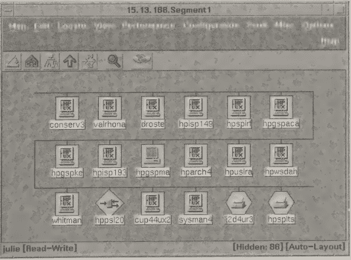

`netstat -rn` 命令可用于显示当前从本地系统到远程网络的路由配置，如清单 6-20 所示。如果你在向远程网络传输数据包时遇到较长延迟，你可能需要检查网络上使用的路由算法。许多网络使用最小化数据包必须经过的跳数（hops）的路由算法，因为这既能改善延迟，又能减少网络带宽的使用，从而提升网络吞吐量。

`netstat -rs` 命令可以显示与系统使用远程路由相关的统计信息，如清单 6-21 所示。如果指示存在无效路由，你应该检查路由器是否正常运行。

如果两个系统之间的连接存在问题，请检查每个系统是否都能访问其他网络。路由表中可能没有包含到所有局域网的正确路由。你可能希望将此配置与正常工作的系统的路由表进行比较。如果路由信息错误，你可以使用 `route` 命令来添加和删除路由表条目。

#### 互连与路由器管理器

路由器和网桥是将你的局域网段连接在一起的网络设备。这些设备持续正常工作至关重要。你可以使用一些与监控 UNIX 服务器相同的工具来监控路由器。你可以从 NNM 等工具中一目了然地看到路由器的状态。请注意，你的 UNIX 服务器也可以配置为 IP 转发器。

路由器提供与其他计算机系统类似的仪表监控功能。例如，MIB-II 被所有主要路由器支持。如果你的路由器行为异常且频繁重启，你可以通过监控自上次重启以来的时间长短来检查这种行为。该信息存储在 MIB-II 的 sysUpTime 字段中。

惠普提供了专门用于监控路由器、网桥和集线器的管理软件。HP 互连与路由器管理器使用 SNMP 监控 AdvanceStack 集线器、AdvanceStack 网桥和 AdvanceStack 路由器的状态。此产品与 NNM 集成。

其他供应商也为其网络设备提供管理解决方案。例如，许多交换机现在提供 Web 界面以监控设备状态并获取统计信息。

##### 清单 6-20 netstat 的输出，显示路由信息。

```
cancan#netstat -rn

Routing tables
Destination Gateway Flags Refs Use Interface Pmtu
15.13.173.93 127.0.0.1 UH 1 27985 lo0 4608
127.0.0.1 127.0.0.1 UH 0 494200 lo0 4608
192.7.27.93 127.0.0.1 UH 0 0 lo0 4608
default 15.13.173.93 U 1 415198 lan2 1500
15.13.168.0 15.13.173.93 U 3 82816 lan2 1500
192.7.27 192.7.27.93 U 0 0 lan0 1500
cancan#
```

##### 清单 6-21 netstat -rs 的输出，显示路由统计信息。

```
# netstat -rs
routing:
108 bad routing redirects
0 dynamically created routes
0 new gateways due to redirects
1 destination found unreachable
0 uses of a wildcard route
0 routes marked doubtful
0 routes cleared of being doubtful
0 redirects deleted
#
```

### 收集网络性能数据

本节介绍了一些可用于收集网络性能信息的工具。网络性能管理和系统性能管理之间存在一定的重叠。例如，由于网络应用无法获得足够的 CPU 时间来发送数据，其网络传输速率可能较低。因此，用于系统和网络性能管理的工具之间也存在重叠。

#### 使用 RMON 和 RMON-II 仪表

RMON I 和 RMON II（分别定义在 RFC 1757 和 2021 中）共同构成了网络性能管理的标准。监控器或探针被放置在特定的局域网段上，然后收集这些段的数据。可以存储数据包统计信息和性能历史记录。RMON 管理应用程序可以从远程 RMON 探针收集数据，并在中心站点呈现。还可以基于指定条件触发警报并发送到管理站。

RMON 定义包括以下可选部分或组：

- 统计信息
- 历史记录
- 警报
- 主机
- 主机 TopN
- 矩阵
- 过滤器
- 捕获
- 事件

统计信息部分提供关于特定以太网接口上发送数据量的信息，包括广播、错误和冲突的数量。你还可以看到不同大小数据包的分布。

历史记录组允许以指定的轮询间隔对统计数据进行采样，并随时间进行汇总。RMON 统计信息以太网为中心，但支持令牌环的扩展在 RFC 1513 中定义。

警报和事件组用于报告何时满足配置的阈值。定期检查统计信息以确定是否已满足阈值。发送事件后，在满足相反阈值之前，不会发送额外的事件。

RMON 探针可以通过监视在局域网段上传递的数据包中的源和目的站点地址来发现新的系统或主机。主机组存储在该接口上看到的每个地址。关于每个系统都会保留各种重要的统计信息，例如发送和接收的数据包数量、发送的错误数据包数量以及发送的广播数量。对于捕获在局域网段上占用主要网络带宽的行为异常的系统，这是非常有价值的信息。

HostsTopN 组跟踪段上特定统计信息的前若干系统，例如接收的数据包、发送的错误数据包或发送的广播数据包。列表中的系统数量是可配置的。

矩阵组可用于确定流量问题。保留两个地址之间网络对话的统计信息。收集的信息包括两个方向上发送的数据包数量，以及发送的错误数据包数量。

过滤器和捕获组协同工作以捕获在段上发送的数据包。管理站随后可以下载这些数据包。

RMON 关注网络栈的数据链路层和网络层。RMON-II 将规范扩展以包含传输层、会话层、表示层和应用层协议。RMON-II 提供的额外组包括：

- 协议目录
- 协议分布
- 地址映射
- 网络层主机
- 网络层矩阵
- 应用层主机
- 应用层矩阵

协议目录列出监控器支持的所有协议。监控器可以添加更多协议，但可扩展性有限。

协议分布组保留每个协议在局域网段上发送的数据量和数据包数量的统计信息。根据这些信息，你可以计算每个协议的带宽利用率，并有望隔离出有问题的应用程序。


#### NetMetrix 站点管理器

地址映射组用于将网络地址映射到其绑定的站点地址。网络层主机组随后显示每个网络地址的流量量。网络层矩阵组显示成对网络地址之间的网络流量统计。您还可以查看流量最大的生产者。

应用层主机显示特定网络地址的网络流量统计，并按协议细分。类似地，应用层矩阵显示成对网络地址之间流量的网络流量统计。

如前所述，以太网和令牌环都使用 RMON 标准。其他链路类型也在考虑其他标准。例如，为了考虑 ATM 中的交换技术，惠普提出了一种名为 AMON 的新规范。其他厂商也有支持 ATM 的额外提案。

正如前面提到的，NetMetrix 站点管理器可用于监控网络设备的状态和利用率。之前讨论了一些报告的不同错误。也可以生成利用率报告，例如网络段上的前几名用户以及发送数据包最多的设备。

NetMetrix 还包含一个 MIB 浏览器，使您可以查询选定网络设备的 MIB 值。

##### MeasureWare

MeasureWare 代理是一款惠普产品，用于收集和记录资源及性能指标。MeasureWare 代理在被监控的各个服务器系统上运行并收集数据。许多平台和操作系统（包括 HP-UX、Solaris 和 AIX）都存在相应的代理。

MeasureWare 代理收集数据、对其进行摘要、时间戳标记、记录，并在适当时发送警报。代理收集和报告各种各样的系统资源、性能指标和用户定义的数据。然后，信息可以导出到电子表格或性能分析程序中，例如 PerfView。这些数据可被这些程序用于生成警报，以警告潜在的性能问题。通过使用历史数据，可以发现趋势。这有助于在资源问题影响系统性能之前解决这些问题。

MeasureWare 代理在三个不同的级别收集数据：全局系统指标、应用指标和进程指标。全局数据和应用程序数据每五分钟汇总一次，而进程数据则每分钟汇总一次。管理员可以通过在配置文件中列出组成应用程序的进程来定义关键应用程序。

MeasureWare 数据的基本类别包括系统、应用程序、进程和事务。针对数据库和网络支持也存在可选模块。MeasureWare 代理还收集通过数据源集成（DSI）接口提供的数据。例如，NetMetrix 的数据由网络响应设施（NRF）通过 DSI 集成提供。

MeasureWare 提供以下网络指标。MeasureWare 提供的其他指标将在其他章节中介绍。

- 已配置的 LAN 接口数量
- 间隔期间的 NFS 请求数量和速率
- LAN 错误速率
- LAN 碰撞速率
- 间隔期间每个 LAN 接口的入站 LAN 数据包数量和速率
- 间隔期间每个 LAN 接口的出站 LAN 数据包数量和速率
- 间隔期间每个 LAN 接口的 LAN 错误数量和速率
- 间隔期间每个 LAN 接口的 LAN 碰撞数量和速率

MeasureWare 代理向 PerfView 提供数据和警报以进行分析，同时也向 IT/O 管理控制台提供。当满足阈值条件时，可以发送 SNMP 陷阱。可以自动执行操作，或者操作员可以选择执行建议的操作。

可以使用 MeasureWare 的 extract 命令将数据导出到其他工具，例如电子表格程序。

应用程序资源测量（ARM）API 可用于检测应用程序，以测量响应时间。应用程序响应时间信息可以传递给 MeasureWare 代理以进行分析。ARM API 在第 7 章中有更详细的描述。

##### GlancePlus

GlansePlus 是惠普提供的一种实时图形性能监控工具。它用于监控单个系统的性能和系统资源利用率。提供基于 Motif 和基于字符的界面。该产品可用于 HP-UX、Sun Solaris 和许多其他操作系统。

GlansePlus 收集与 MeasureWare 收集的信息类似的数据，并且比 MeasureWare 更频繁地采样数据。GlansePlus 可用于以图形方式查看当前系统和网络资源的活动和利用情况。它还可以显示应用程序和进程信息。如果安装了 MeasureWare 代理且处于活动状态，则可以显示事务信息。除了系统指标外，GlansePlus 还可以显示警报信息，并通过颜色编码反映严重程度。

GlansePlus 还能够设置和接收与性能相关的警报。自定义规则确定何时将系统性能问题作为警报发送。规则由 GlansePlus 顾问管理。顾问菜单包括“编辑顾问语法”选项，您可以选择此选项查看并可选地修改所有警报条件。

警报会导致屏幕通知，颜色表示警报的关键性。警报还可以自动触发命令或脚本的执行。相反于发送警报，GlansePlus 可以打印消息，或者通过使用其 EXEC 功能执行 UNIX 命令（例如 mailx）来通知您。

要配置事件，您需要编辑一个配置文件。GlansePlus 顾问语法文件（`/var/opt/perf/adviser.syntax`）包含症状和警报配置。也可以使用额外的语法文件。发送警报的条件可以基于涉及不同症状的规则。

您还可以在命令模式下执行脚本。要执行脚本，请输入：

```
glance -adviser_only -syntax <script file name>
```

GlansePlus 可用于显示系统的总体网络性能特征。例如，GlansePlus 可以显示传入网络数据包的速率，以及所有数据包中作为错误或以太网碰撞的百分比。这可以全局显示，也可以针对每个网络接口显示。图 6-9 展示了 GlansePlus 网络图的一个示例。您可以在该图中看到数据包传输速率和错误速率。

GlansePlus 还可以用于专注于特定的网络问题领域，例如网络接口。此外，专注于特定的网络接口可以使操作员忽略非关键的网络组件，例如正在开发中的子网络的接口。

对于 NFS，GlansePlus 跟踪性能统计数据，例如每秒读取操作次数、每秒写入操作次数以及与服务器通信的所有客户端或服务器的每秒 I/O 操作次数。

超过 600 个指标可从 GlansePlus 访问。其中一些指标在其他章节中有讨论。使用在线帮助功能可以找到完整的指标列表。此信息也可以在目录 `/opt/perf/paperdocs/gp/C` 中找到。

GlansePlus 允许您使用过滤器来减少显示的信息量。例如，您可以在进程视图中设置过滤器，仅显示更活跃的系统进程。GlansePlus 还可以显示短期历史信息。当选中时，主 GlansePlus 屏幕上可见的警报按钮会显示已发生的警报历史。

如果安装了 PRM，GlansePlus 还将显示进程资源管理器（PRM）的行为，并允许您更改 PRM 进程组授权。PRM 是一款惠普产品，用于在用户或应用程序之间分配系统的 CPU、内存或 I/O 带宽资源。

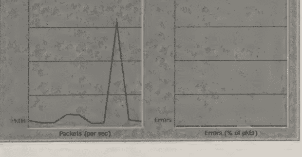

### PerfView

PerfView 是惠普提供的一种图形性能分析工具，用于同时以图形方式显示一个或多个系统的性能和系统资源利用率，以便进行比较。可以显示各种性能图表。这些图表基于在一段时间内收集的数据，而不同于 GlansePlus 的实时图表。此工具在 HP-UX 或 NT 系统上运行，并与 MeasureWare 代理收集的数据配合使用。

PerfView 具有以下三个主要组件：

- **PerfView 监控器：** 提供接收警报的能力。可以显示警报的文本描述。警报可以根据严重程度、类型或源系统进行过滤。此外，在接收到警报后，可以选择该警报以显示相关指标的图表。操作员可以监控导致故障的趋势，然后采取主动措施以避免问题。图表可用于系统之间的比较，并显示资源消耗的历史。维护一个内部数据库，保留警报通知消息的历史记录。
- **PerfView 分析器：** 为系统资源提供资源和性能分析。系统指标可以显示在三个不同的级别：进程、应用程序（由用户配置为进程集）和全局系统信息。它依赖于从受管节点上的 MeasureWare 代理接收的数据。可以同时分析多达八个系统的数据。支持所有 MeasureWare 数据源。PerfView 监控器和 PerfView 规划器都需要 PerfView 分析器。
- **PerfView 规划器：** 提供预测能力。图表可以外推到未来。可以为预测数据显示各种图表（如线性、指数、S 曲线和平滑）。

PerfView 显示历史和趋势信息的能力有助于诊断系统问题。对性能信息进行制图可以帮助您了解是否存在持续的问题，或者异常仅仅是活动的瞬时峰值。图 6-10 展示了 PerfView 网络性能统计图表的一个示例。每个网络统计量都列在图表顶部并进行了颜色编码。

为了进一步诊断问题，PerfView 监控器可以允许用户更改时间间隔，以尝试找到问题发生的具体时间。图表将重新绘制以显示新的时间段。


#### PerfView 网络性能图形

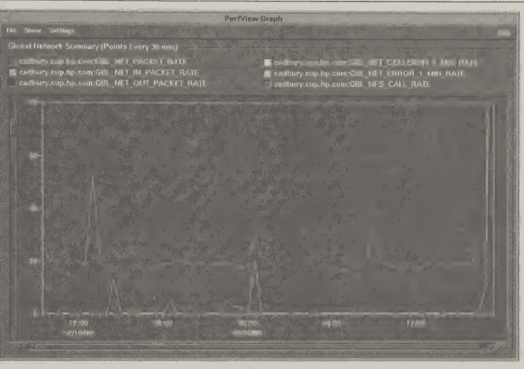

PerfView 已与多个其他监控工具集成。你可以通过访问“工具”菜单在 PerfView 中启动 GlancePlus。PerfView 也可以从 IT/O 应用程序库中启动。在 IT/O 消息浏览器窗口中排查事件时，你可以启动 PerfView 以查看相关的性能图形。

PerfView 监视器不用于 IT/O。相反，使用的是 IT/O 消息浏览器。当在 IT/O 中接收到警报时，操作员可以单击该警报，并显示相关的 PerfView 图形。

在单个性能图形中，PerfView 可以显示从多个系统收集的信息。PerfView 和 ClusterView 产品也已集成，使操作员能够在 HP OpenView 子映射上选择集群符号并启动 PerfView 应用程序，从而快速显示集群系统之间的性能比较。

有关 MeasureWare、GlancePlus 和 PerfView 的更多信息可以在 HP 资源与性能管理网站 http://www.openview.hp.com/solutions/application/ 上找到。

#### BMC PATROL for UNIX

BMC PATROL 没有提供独立的网络知识模块（KM）。相反，BMC 系统 KM 包含用于网络指标监视器。系统 KM 可以识别网络过载。从控制台，它可以显示 TCP/IP 相关进程并列出 NIS 账户和组。可以使用 Patrolink 通过 SNMP 将警报发送到其他管理站。

#### Network General Sniffer Pro

局域网（LAN）分析器可以显示网络上正在传输的流量类型。识别正在使用的协议可以提供环境中运行的应用程序类型的一些指示。利用这些信息，你可以确定是否需要协议过滤。分析器可能是检测未正确终止的局域网电缆的唯一可靠方法。Network General 的 Sniffer Pro 产品可以查看、捕获和分析网络流量，而不会影响服务器性能或引入网络流量。

然而，许多厂商现在正在提供纯软件解决方案的分析器。Sniffer Pro 是一种软件解决方案，可以在管理站上运行并收集不同 LAN 段的数据。图 6-11 展示了一个示例网络性能图形。

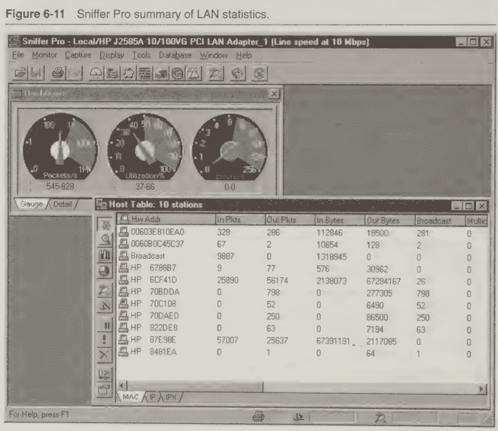

### 使用网络性能数据

本节简要介绍如何使用网络性能监控工具来检测和解决网络性能问题。可能出现各种类型的网络性能问题。潜在问题可能是过载的服务器、拥塞的网络，或伪装成过载网络的故障网络。如果可能，你可以使用性能工具来避免这些问题，或者至少在这些问题发生时快速纠正它们。

#### 避免性能问题

为避免网络性能问题，应定期监控关键网络以寻找趋势。首先，你应该使用 PerfView 和 NetMetrix 等工具在计算环境正常运行时收集基线数据。你可能希望将一些 NFS 命令放入脚本中以创建自己的基准。确保你的 NFS 命令组合反映你环境的典型使用情况。除了基准化利用率外，你还应使用 lanadmin 或 MeasureWare 来确定典型的冲突率是多少。数据应在一段时间内收集，以获得网络负载的准确视图。随着负载增加，你应该准备好隔离网络流量、添加更多局域网卡，或限制网络上使用的新应用程序数量。

网络性能问题可能由用户数量增加或生产环境中引入新应用程序引起。通过主动收集性能信息，你可以识别出使用量何时发生跳跃，并且可能能够追踪到新应用程序或用户对网络的不当使用。网络分析器和 NetMetrix 等工具可用于识别主导网络流量的应用程序和用户。新的网络应用程序最初应在测试环境中部署，以表征其网络负载。如果其网络使用率意外地高，可以在部署到生产环境之前重新设计它，或者修改生产环境以支持新的工作负载。

##### 检测过载的网络服务器

如果执行网络服务（如 NFS）的服务器过载，它将无法有效处理网络流量。问题可能是 CPU、内存或磁盘 I/O 瓶颈，或者是服务器的网卡无法处理负载。

要检查网络服务器上的 CPU 瓶颈，请检查 CPU 利用率和运行队列长度。GlancePlus/UX 可以提供此信息。CPU 利用率大于 95% 且处理器运行队列长度较高可能表示 CPU 瓶颈。一个选项是通过添加更多处理器来增加服务器容量，但这并不总是可行。此外，如果服务是单线程的，这可能不足以解决问题。

要检查网络服务器上的实际内存瓶颈，你可以首先检查可用内存的空闲量。它不应低于总可用内存的 5%。如果系统无法跟上对内存的需求，它将开始分页和交换。从 GlancePlus 观察到的过度分页和交换可能是内存瓶颈的迹象。通过增加内存来增加系统容量可以消除瓶颈。

你可以使用 iostat 等工具来检查网络服务器上的 I/O 不平衡。系统磁盘上的高活动是正常的，但非系统磁盘之间的延迟应该大致相同。如果存在不平衡，你可能希望移动文件以平衡磁盘负载。你还可能希望检查系统的缓冲区缓存命中率，看看你的缓冲区缓存大小是否太小。MeasureWare 和 BMC PATROL 等工具可以提供有关系统缓冲区缓存的信息。如果你的所有磁盘利用率都超过 75%，那么你就是受磁盘限制，可能需要更快或额外的磁盘。

#### 检测网络拥塞

对于以太网链路，你可以使用冲突率来确定性能问题是否由拥塞引起。可以使用 lanadmin 计算冲突率。你可以将冲突数除以出站数据包数来计算比率。冲突率持续大于 5 到 10 个百分比表明网络拥塞。你还可以通过汇总网络上所有系统的出站数据包总数，然后除以冲突总数，来计算网络的平均冲突率。如果此平均冲突率大于 10 个百分比，这是你需要采取一些行动的另一个迹象。

在共享介质上，网络利用率平均超过容量的 35 到 40 个百分比是网络拥塞的另一个迹象。如果利用率持续存在，它很可能导致网络上的冲突。

如上所述，可以使用 lanadmin 来识别网络拥塞。将当前的冲突率与在正常运行期间你基准化的比率进行比较。指定 `netstat -a` 显示每个打开连接的统计信息，包括发送队列，它指示等待发送的数据包数量。对于大多数连接，这应该是 0。如果它是一个很大的数字，它可能是网络拥塞的迹象。你应该在一段时间内检查这一点，以查看问题是否持续。

如果你确定网络拥塞，且网络被适当使用，那么你可能需要将网络划分为子网并使用网关隔离独立的数据流。（识别局域网桥或网关的适当位置的技术超出了本书的范围。）如果配置得当，这可以减少共享介质上的冲突，从而提高网络性能。你应该利用任何计划好的停机时间重新配置网络、添加额外的局域网卡，或将应用程序移动到其他网络上的其他系统。

使用 `nfsstat` 可以显示有关 NFS 使用的信息。指定 `nfsstat -c` 显示客户端的 NFS 统计信息。如果坏的 XID 数据包数量大约等于重传数量，则客户端的某个 NFS 服务器在跟上工作负载方面遇到困难，并迫使客户端重新发送请求。检查每个 NFS 服务器，查看是否存在系统资源瓶颈，如本节前面所述。磁盘是


NFS 服务器最常见的资源瓶颈。如果 `nfstat` 输出显示只有重传次数较高，则网络可能处于拥塞或故障状态。

#### 避免网络问题

根据 1998 年由 Computer Associates 赞助的 MERIT Project 的一项调查，网络管理被认定为最需要通过管理自动化来减少停机的领域。通过关注可能导致过载的性能趋势，并提供冗余，可以防止网络停机，从而确保单一网络组件的故障不会让用户察觉。

网络中断通常是由于网络带宽问题引起的。通过使用 NetMetrix 和 PerfView 等工具，可以在网络使用量增加成为问题之前识别并解决这些问题。用户可以在使用文件通过网络传输之前使用诸如 compress 之类的工具来压缩文件，从而减少网络带宽需求。上一节讨论了避免网络性能问题的方法。

你无法防止网络组件发生故障，但你可以配置系统，使用户不受故障的影响。为了防止因 NIC（网卡）故障导致的停机，可以使用高可用性软件和冗余局域网。MC/ServiceGuard 可以检测到故障的 LAN 卡，并自动配置备用 LAN 卡接管工作。MC/ServiceGuard 还支持自动在以太网、FDDI、令牌环、100VG 和 ATM 局域网之间迁移 TCP/IP 地址。HP 提供的高可用性网络产品可提供额外的保护，例如 HA NFS 和 HA ATM。

你可能还想使用 MC/ServiceGuard 来保护你的网络应用程序。它可以检测到应用程序故障，并在本地重启应用程序，或者如果问题持续存在，将其迁移到另一个系统。

你应该利用各种网络服务对冗余的支持。例如，域名服务（DNS）允许你配置主服务器和备用服务器。如果 DNS 服务器不可用，名称解析也可以配置为依赖于配置文件或备用名称服务。通过设置这种冗余，你可以避免因名称服务器故障而导致的连接问题。

之前提到高可用性软件是掩盖网络故障的一种方法。然而，在额外的故障导致非计划停机之前，需要检测并纠正故障。EMS 可用于报告 NIC 的故障。利用任何计划停机时间作为更换 LAN 卡的机会。

#### 从网络问题中恢复

本节讨论如何诊断并纠正网络问题。网络是一个广阔的领域，跨越地理距离以及各种软件和硬件组件。故障可能是由 NIC、收发器、连接器、电缆或其他网络设备引起的。网络通信问题可能是由软件配置错误或表现不佳的网络软件引起的。你需要使用本章中讨论的工具的组合来隔离问题。

之前在“使用网络性能数据”一节中讨论了与性能相关的问题。区分性能问题和网络故障通常很困难。例如，故障的网络设备停止对数据包做出响应，这可能导致大量重传。使用网络性能工具可以检测到多种网络故障。`netstat` 和 `rstat` 是可用于性能监控和故障诊断的命令示例。

故障排除的一个早期步骤应该是尝试确定问题的独特之处。例如，如果只有一名用户遇到问题，那么该用户的配置或访问权限可能存在问题。如果问题仅涉及特定的网络服务，你可能需要检查该服务最近是否已更新。类似地，如果通信问题涉及特定的计算机系统，你应该检查该系统最近是否进行了软件或硬件配置更改。

以下各节提供了一些故障排除步骤，可以帮助你定位网络问题。

##### 隔离故障

如果用户无法使用网络服务，你首先要做的可能是使用 `ping` 来查看是否可以到达用户的系统和网络服务器。`ping` 是一个容易记住的命令，可以将问题隔离到网络栈的适当部分。`ping` 测试网络栈的物理层、数据链路层和网络层。如果 `ping` 成功，那么你应该检查传输层或更高层是否存在问题。如果失败，则已将问题隔离到网络层或更低的层。

根据你的计算环境中的网络拓扑，一种可能的情况是，你可以从管理站访问用户的系统和网络服务器，但用户无法直接访问网络服务器。如果用户的拓扑与你自己的不同，你可能需要从用户的系统执行 `ping`，或者使用 NNM 的远程 `ping` 功能。如果 `ping` 行为不同，这可能表示路由问题。

如果发生 `ping` 失败，在继续之前应验证名称解析。你可以使用 `nslookup` 查看名称是否解析为正确的 IP 地址。另一个选项是使用 `ping` 并指定 IP 地址而不是系统名称。你可以尝试从不同的子网络进行 `ping`，以排除一些网络设备作为问题来源。你还可以检查 ARP 缓存，查看 IP 地址是否解析为正确的 MAC 地址。

##### 网络及更高层

如果你怀疑较低的网络协议层存在问题，应首先使用 `iocan`、`lanscan` 和 `ifconfig` 验证网络配置。`lanscan` 命令应显示通过 `iocan` 显示的所有 LAN 卡的状态。`ifconfig` 显示 IP 地址是否已正确绑定到网络接口，以及子网掩码是否正确设置。

如果这些命令未返回正确信息，则可能存在链路或软件配置错误。你应该检查系统日志文件中的链路级错误。

你可以通过检查卡上的 LED 来确认 LAN 卡错误。通常，绿色表示正常，红色或黄色表示异常。请查阅相应的硬件用户手册以了解这些 LED 的详细含义。

你可以使用 `linkloop` 来测试源系统和目标系统的数据链路层。如果此命令失败，则链路层似乎存在问题，你应该检查 LAN 电缆、收发器和其他网络硬件。`lanadmin` 可以显示 LAN 统计信息，以查看是否发生了过多的数据包错误或冲突。如果 `linkloop` 测试成功，下一步应该使用 `netstat -in` 检查网络配置。

如果网络问题是在向 LAN 添加新系统后开始的，新系统可能使用了重复的 IP 地址。你可以使用 `netstat -in` 在每个 LAN 系统上查看是否存在重复项。

如果你怀疑数据包路由不当，可以使用 `traceroute` 来识别 UDP 数据包从源系统到目标系统所走的路径。该命令显示网关之间的路由和所花费的时间。这可以帮助你确定路由器是否故障或路由表配置是否正确。

如果 `netstat` 显示 IP、ICMP、TCP 或 UDP 协议下有坏的校验和，这表明数据包正在损坏，可能是在通过网关的路径上。如果服务器连接到多个网关，你可能需要通过每个网关发送测试数据包来隔离罪魁祸首。只需检查通过每个网关发送数据包后坏校验和的数量，以确定哪一个是故障的。然后你需要修复故障的网关设备。

除非最近发生过电力故障，否则 `netstat` 报告的输入和输出错误数量应该非常低。如果 `netstat` 报告输入错误数量不断增加，这可能表明接收自网络上另一个系统的损坏数据包，或者 LAN 电缆损坏。尝试隔离远程数据包的来源以识别罪魁祸首。如果你看到输出错误数量不断增加，那么你的系统的 NIC 可能有故障。

当怀疑网络电缆问题时，可以使用 LAN 分析仪来隔离问题。分析仪连接到有问题的网络，可以确定到故障组件的距离。电缆可能终止不当，或者可能需要替换网络段。

##### 传输及更高层

如果网络层和链路层似乎工作正常，接下来你应该使用 `telnet` 或 FTP 等网络应用程序检查到目标系统的传输层。可以在服务器上使用 `netstat` 命令来查看当前正在运行的网络应用程序。如果所需的服务已失败，可能需要重新启动。你可能需要在 `/var/adm/syslog/syslog.log` 中查找失败的可能原因。`netstat` 还可以显示有用的协议统计信息。

如果与网络服务器的连接似乎正常，但服务没有响应，服务器或服务可能存在性能问题，或者服务可能已失败。你可能


您正在运行错误版本的服务。请对比正常系统中的服务版本与故障系统中的服务版本。若要检查 FTP 等服务版本，请键入 `what ftppd`。

虽然服务存在于系统中，但由于安全原因可能并未运行。如果服务未启动，请检查是否使用了可选文件 `/var/adm/inetd.sec`。此文件可用于拒绝或允许访问每个网络服务。如果用户已获授权，请确保此文件未被配置为拒绝访问。某些服务拥有其特定的安全文件。例如，FTP 会拒绝访问 `/etc/ftpusers` 中列出的本地账户。

# 第 7 章

## 监控应用程序

前面的章节重点介绍了连接最终用户与应用程序的系统、网络和磁盘。本章介绍了可用于监控应用程序的工具。虽然名称表明系统管理员主要负责监控系统操作，但实际上，业务应用程序才是最重要的。如果应用程序本身不可用，那么系统是否正常运行并不重要。维护应用程序可用性意味着维护应用程序所依赖的所有组件的可用性和性能，包括数据库、网络、存储以及系统本身。

### 需要监控的重要应用程序组件

可以从多个不同角度监控应用程序。本章将应用程序监控分为配置管理、故障管理以及资源和性能管理。

应用程序可能因多种原因而失败。软件逻辑问题、硬件故障、极限条件（如内存耗尽或计数器溢出）以及竞态条件（如忘记请求信号量）都可能导致应用程序失败。在这些情况中，管理员可以通过其他系统事件（如可用内存降至阈值以下）来确定发生了什么。但是，让监控器监视特定应用程序通常很有用。定制的应用程序监控器可能能够识别导致应用程序问题的数百种不同原因，从而节省部分故障排除的工作量。为确保服务可用，需在业务小时内进行持续监控。根据 Gartner Group 1996 年的一项研究，“应用程序软件故障是停机时间中占比最大的一部分”。

配置管理包括确保应用程序初始配置没有错误，以及监控对配置文件所做的任何更改。此更改历史记录可用于检测并从不适当的配置更改中恢复。

除了监控应用程序是否正在运行外，监控其性能也很重要。如果应用程序挂起或性能不佳，最终用户就会认为服务不可用。检查系统性能可以衡量应用程序运行状况的一个有用指标。Unix 环境通常每个系统只有一个重要应用程序。然而，诊断和恢复应用程序问题需要更具体的工具。

对于重要应用程序，即使应用程序未运行，监控其所需的资源也可能很有用。例如，应定期查看磁带，以便在备份应用程序开始运行之前检测到磁带硬件故障。这有助于确保备份在期望的时间窗口内完成。

监控应用程序的另一个原因是确定其随时间的资源使用情况。这可用于向客户端退还其使用服务的费用。您可能出于多种原因想要检查应用程序使用的资源数量。应用程序可能接近配置限制或占用系统资源的适当份额。

企业 IT/O 部门的一个趋势是实施“服务级别协议”。IT/O 部门不再仅仅维护关键系统和网络骨干的可用性，而是根据其为最终用户提供特定可用性水平和响应时间的能力来衡量。重点在于应用程序提供的服务。在衡量计算环境中的性能或可用性时，以最终用户服务或应用来衡量最为重要。

### 识别应用程序类型

不同类型的应用程序需要不同级别的监控。本章中描述的一些工具主要用于特定类型的应用程序。

以下是一些重要应用程序的类型：

-   MC/ServiceGuard 包
-   数据库应用程序
-   企业资源规划 (ERP) 应用程序
-   系统服务应用程序
-   管理应用程序

某些应用程序对公司业务至关重要。故障可能导致公司遭受重大收入损失。您可能希望使用高可用性软件来保护这些应用程序。HP 的 MC/ServiceGuard 是一款高可用性软件产品，可检测系统故障、网络或局域网卡故障以及关键应用程序故障。可以配置 MC/ServiceGuard 自动处理这些故障。例如，失败的关键应用程序可以被重新启动。局域网卡故障可自动配置备份局域网卡来接管网络负载。MC/ServiceGuard 通过使用系统管理管理员 (SAM) 将关键任务应用程序配置为“包”。这些包随后由 MC/ServiceGuard 监控和控制。

监控数据库应用程序很重要，因为它们引用了关键业务数据。Oracle、Sybase 和 Informix 是最常见的数据库管理系统供应商。数据库服务器将在第 8 章中讨论。

ERP 软件应用程序用于集成公司不同部门的数据，例如制造、工资、人力资源和会计。通过高效地与组织不同部门共享信息，公司可以更快速地检测并应对不断变化的业务状况。ERP 目前是一个价值 10 亿美元的软件行业。常见的 ERP 应用程序包括 SAP R/3、Baan 和 PeopleSoft。

这些类别之间存在一些重叠。例如，数据库应用程序可能被配置为 MC/ServiceGuard 包，一些 Oracle 应用程序用作 ERP 解决方案的一部分。本章区分了可用于任何应用程序的工具和专为特定 ERP 应用程序定制的工具。

一些应用程序随操作系统一起提供，用于执行基本服务。这些应用程序中的许多，如 sendmail、NFS、telnet 和 rlogin，在系统和网络章节中已有介绍，因此此处不再讨论。

尽管本章重点介绍 ERP 和通用应用程序监控，但请记住管理应用程序也需要仔细关注。如果未监控管理应用程序（如系统监控器），您如何知道系统仍受到监控？备份应用程序是另一个例子。如果备份每晚都失败，但无人察觉怎么办？有一些商业产品可用于帮助确保您的备份成功。许多系统应用程序，如 OmniBack 和 OpenSpool，随 IT/O 模板和过滤器一起提供。OmniBack 提供高级监控，除了 IT/O 外，还可以由任何基于 SNMP 的产品进行监控。在备份作业执行期间，提供网络范围的合并通知。

### 使用标准命令和工具

本节介绍可用于监控任何应用程序的标准命令和系统测量工具。一些 Unix 命令可以帮助您确定应用程序的状态。第 4 章描述了报告系统整体状态的命令。

除了这些命令外，如果系统遇到问题，您可能需要检查系统日志文件 `/var/adm/syslog/syslog.log` 中的错误消息。写入此日志文件的信息包括遇到问题的模块以及事件发生的时间，这在故障排除时非常有价值。

`ps`

`ps` 命令可用于显示系统中正在运行的进程。如果知道进程名称，这是确定应用程序是否正在运行的快速方法。


在拥有大量活动进程的大型系统上，您可能希望使用各种选项来限制 `ps` 的输出。`ps -p` 将列表限制为特定的进程列表，而 `ps -u` 仅显示与特定用户 ID 匹配的进程。

进程名称在系统中可能不是唯一的，因此您可能需要查看额外信息，例如用户 ID。`ps` 命令可以提供以下信息：

- 进程所有者的用户 ID
- 进程标识符 (PID)
- 父进程的 PID
- 进程启动时间
- 进程的控制终端
- 进程的累计执行时间
- 命令名称和参数

#### top

`top` 命令对于监控进程信息以及系统 CPU 和内存负载非常有用。默认情况下，`top` 的输出显示在终端窗口中，并每五秒刷新一次。

`top` 显示 CPU 资源统计信息，包括负载平均值（过去 1、5 和 15 分钟内的任务队列）、每种状态（睡眠、等待、运行、启动、僵尸和停止）的进程数量、系统中每个处理器在各种处理器状态（用户、nice、系统、空闲、中断和换页进程）中花费时间的百分比，以及多处理器系统中每个处理器的平均值。

在进程级别，`top` 根据 CPU 使用情况列出系统中活动度最高的进程。`top` 显示的进程数据包括 PID、进程大小（txt、data 和 stack）、进程的驻留大小（以 K 为单位）、进程状态（睡眠、等待、运行、空闲、僵尸或停止）、进程消耗的 CPU 秒数以及进程的平均 CPU 利用率。`top` 可用于识别可能正在使用大量 CPU 或内存的进程。

列表 7-1 展示了运行 `top` 时看到的输出示例。请注意，系统信息和进程信息显示在同一屏幕上，以便您可以快速了解当前发生的情况。

#### vmstat

`vmstat` 命令提供有关系统资源的良好信息，包括虚拟内存和 CPU 使用率。`vmstat` 有助于检测内存或交换空间不足的情况。CPU 利用率通过用户时间、系统时间和空闲时间来表示。

对于进程，`vmstat` 显示处于各种状态的进程数量。这些状态包括：当前在运行队列中、阻塞在 I/O 操作上以及已交换到磁盘。这有助于判断进程是否正常运行。

##### 列表 7-1 显示活动度最高的进程的 top 输出。

```text
System: hpgss1ha              Sat  Apr 24 10:27:04 1999
Load averages:  0.15,  0.08,  0.04
174 processes: 172 sleeping, 1 running, 1 zombie
Cpu states:
  LOAD  USER  NICE   SYS IDLE  BLOCK SWAIT  INTR SSSY
  0.15   0.2%   0.0%  1.2% 98.6%  0.0%  0.0%  0.0%   0.0%

Memory: 55028K (8924K) real, 56188K (15136K) virtual, 60528K free  Page# 1/13

 TTY   PID USERNAME  PRI  NI   SIZE   RES STATE     TIME %WCPU %CPU COMMAND
  ?   1729 root      20  20 6676K 5488K sleep   871:04  1.12  1.12 cmcld
  ?      3 root     128  20    0K    0K sleep   555:03  0.68  0.68 statdaem
p2  10779 bstone   178  20  580K  316K run      0:00  0.77  0.51 top
  ?      7 root     -32  20    0K    0K sleep   231:40  0.30  0.30 ttisr
  ?    262 root     154  20  280K   24K sleep   169:33  0.23  0.23 syncer
  ?   1439 root     154  20   80K   84K sleep    51:43  0.06  0.06 instl_bootd
  ?   1718 root     168  20  64K  128K sleep     20:55  0.05  0.05 spsrver
  ?   1424 root     154  20  104K  120K sleep     14:05  0.05  0.05 inetd
  ?   1455 root     154  20  304K  184K sleep     29:29  0.05  0.05 nmbl
  ?   1641 root     154  20  510K 1224K sleep    40:50  0.05  0.04 swagentd
  ?   1347 root     127  20  104K   76K sleep     30:50  0.03  0.03 netfmt
  ?   1562 root     154  20   80K  128K sleep     12:00  0.03  0.03 hnpd
  ?  15563 jim      154  20  460K  140K sleep      6:59  0.03  0.03 xload
  ?   2005 root     154  20 2760K   68K sleep     23:51  0.02  0.02 ns-admin
```

您看到的统计数据会根据指定的命令选项而变化。通过指定时间间隔，您可以让 vmstat 连续运行，以便查看数值随时间的变化情况。

### 使用系统测量

简化的网络管理协议 (SNMP) 和桌面管理接口 (DMI) 等网络和系统管理标准的制定旨在简化管理工作。它们提供了构建测量接口和接入测量系统的行业标准方法。SNMP 用于访问管理信息库 (MIB)，而 DMI 用于访问管理信息格式 (MIF)。

标准 MIB 和 MIF 定义了任何供应商都可以度量的指标。供应商特定的 MIB 和 MIF 提供供应商特定的度量功能。本节介绍了通过这些标准可用的某些系统测量功能，这些功能可用于获取有关您的应用程序的信息。

已经有许多工具可以访问这些测量功能。多家供应商提供了浏览器和监控功能，这些功能使用通用界面来访问不同硬件平台和操作系统中的被度量对象。例如，常见的企业级管理框架（如 HP 网络节点管理器 (NNM)）包含一个 MIB 浏览器工具，用于访问 MIB 数据。它们还可能包含可用于从企业级管理平台监控远程系统上 MIB 数据的工具。还存在提供界面的工具包，用户可以使用这些界面编写自己的工具来监控或跟踪此信息。其他工具包允许用户创建自己的测量功能。

### SNMP

MIB 是表示某类信息的标准方式。例如，MIB-II 提供有关系统的有用信息，如活动的 TCP 连接数、系统硬件和版本信息等。本章后面讨论的 OpenView IT/O 提供了一个 MIB 浏览器，可帮助您发现可用的 MIB 并查看每个 MIB 提供的信息。使用 MIB 浏览器工具，您可以检查包含在 MIB 中的任何内容的值。如果您发现某个 MIB 包含一些有用的字段，您可以使用 MIB 浏览器从目标系统收集该数据。收集到的数据在 MIB 浏览器的输出窗口中显示在屏幕上。通过浏览可用的 MIB 并查询所选 MIB 字段的值，您可以收集监控系统和排查问题所需的具体信息。

SNMP 接口提供了访问存储在各种 MIB 中的对象的功能。MIB-II 是大多数 Unix 系统上实现的标准 MIB。在 HP-UX 系统上，HP-UNIX MIB 定义了用于监控系统资源的各项指标。其他供应商，如 Sun，拥有提供类似信息的供应商特定 MIB。您可以在附录 A 中找到完整的 MIB 定义。

HP-UNIX MIB 包含有关在系统上运行的每个进程的信息。有用的信息包括 PID、CPU 利用率、优先级和驻留集大小。如果系统上有大量活动进程，搜索 MIB 中的进程表可能很困难。如果您只想查找特定进程的信息，您可能会更喜欢编写一个使用 psstat 接口的小型程序（在本节后面详细介绍），该接口提供与 MIB 进程表相同的信息以及额外字段。但是，MIB 是收集多个进程数据的一个有用来源，特别是如果您不想编写自己的应用程序时。

如果您使用 MC/ServiceGuard 来保护您的应用程序，那么您可能还需要使用 HP MC/ServiceGuard MIB，其中包含有关每个配置的 MC/ServiceGuard 应用程序或包的信息。关于包的信息包括名称、描述、当前状态、当前运行的系统、组成该包的进程以及该包的备用节点。请注意，MIB 不显示包的 EMS 资源依赖项。您需要使用 MC/ServiceGuard 命令 crviewcl -v 来获取此附加信息。

网络服务 MIB 和关系数据库管理系统 MIB 用于数据库应用程序。通过这些 MIB，您可以了解数据库版本、数据库状态，


应用运行的时长，以及当前用户数。还可以获取一些资源与性能信息。

#### DMI

通过使用 DMI（桌面管理接口）也可以获取系统资源信息，DMI 是另一种用于存储和访问管理信息的标准。管理信息以 MIF（管理信息框架）中的文本文件形式表示。它被划分为若干组件，每个组件都有一个服务提供商（SP），负责向请求 DMI 信息的管理应用提供这些信息。

包括 HP-UX 在内的多个系统平台都为系统 MIF 和软件 MIF 提供了度量机制。附录 A 包含了这些 MIF 的完整列表。

与 MIB-II 类似，系统 MIF 可用于获取通用的系统信息（例如已运行了多长时间）和系统联系人信息。它包含系统名称、启动时间、联系信息、正常运行时间、用户数，以及一些关于文件系统和磁盘的信息。

软件 MIF 提供有关系统中安装的软件产品和产品捆绑包的信息，在发现应用存在问题后，它可以作为一个有用的工具。通过使用 MIF 浏览器，你可以检查软件 MIF，以查看问题是否可能由坏的补丁或修改过的文件引起。MIF 包含每个产品的版本信息，包括创建时间和修改时间。可以检查版本信息以确定是否存在兼容性问题。最后，提供产品供应商信息，以便你联系产品的支持人员。

惠普（Hewlett-Packard）等厂商正在努力提供企业范围内的软件配置信息库。需要工具来比较不同系统上的应用版本，并将系统更新到相同的修订级别。

#### pstat

有时，你可能会希望编写自己的应用程序来获取关于特定进程的信息。该接口被称为 *pstat*。你的程序可以仅为感兴趣的进程生成输出，这比在 *top* 或 *ps* 的输出中翻找重要信息要容易得多。

*列表 7-2* 和 *列表 7-3* 分别展示了一个获取 *pstat* 统计信息的程序以及运行该程序的输出。该程序显示匹配你输入名称的进程的信息。*pstat* 接口还可以显示整体系统信息，如 *列表 7-2* 中所示。

对于 *列表 7-3* 中的示例，关注点是一个名为 *memhog* 的应用使用过多的内存，因此程序被用于在不同时间点检查 *memhog* 的内存使用情况，并跟踪整体系统负载。这比运行 *top* 或 *GlancePlus* 等其他工具并筛选输出更方便。

##### 列表 7-2 使用 pstat 的程序代码。

```c
/* pstat example */
#include <stdio.h>
#include <stdlib.h>
#include <sys/time.h>
#include <sys/types.h>
#include <sys/socket.h>
#include <netinet/in.h>
#include <sys/errno.h>
#include <sys/pstat.h>

convert_status (status,stat)
char *status;
long stat;
{
    switch (stat) {
        case 1: strcpy (status,"sleeping");
                break;
        case 2: strcpy (status,"running");
                break;
        case 3: strcpy (status,"stopped");
                break;
        case 4: strcpy (status,"dead (zombie)");
                break;
        case 5: strcpy (status,"other");
                break;
        case 6: strcpy (status,"idle");
                break;
    }
}

main()
{
    struct pst_status pst;
    struct pst_dynamic dyn;
    struct pst_static mystatic;
    struct timeval temp;
    struct timezone dummy;
    char target[80];
    char status[14];
    int index = 0;
    int duration;
    long prm_id;
    unsigned long now;
    gettimeofday(&temp,&dummy);
    printf ("Enter process name:");
    scanf ("%s",target);
    now = temp.tv_sec;
    while ( pstat_getproc(pst,sizeof (struct pst_status),
	1,index) > 0) {
	if (strcmp(target,pst.pst_ucomm)==0) {
	duration = now - pst.pst_start;
	convert_status(status,pst.pst_stat);
	printf ("PID %8d Status: %s\n",pst.pst_pid,status);
	printf ("Started %d seconds ago\n",duration);

	printf ("Real pages(DATA %d TEXT %d STACK %d)\n",
		pst.pst_dsize,pst.pst_tsize,pst.pst_ssize);
	printf ("RSS %d MAX RSS(hwm) %d\n",
		pst.pst_rssize,pst.pst_maxrss);
	printf ("Number of swaps: %d\n",pst.pst_nswap);
	}
	index = pst.pst_idx+1;
} /* end while loop */

printf ("Overall System Info:\n");
pstat_getstatic(mystatic,sizeof(struct pst_static),
	0,0);
pstat_getdynamic(dyn,sizeof(struct pst_dynamic),
	0,index);
printf ("Run queue len(1- %1f,",
	dyn.psd_avg_1_min);
printf ("5- %1f,",
	dyn.psd_avg_5_min);
printf ("15- %1f)\n",
	dyn.psd_avg_15_min);
printf ("Physical Memory: %d\n",mystatic.physical_memory);
printf ("Active Real Memory: %d Free pages: %d bytes\n",
	dyn.psd_arm,dyn.psd_free*mystatic.page_size);
}
```

##### 列表 7-3 显示 pstat 信息的程序输出。

```
# ./pstate
Enter process name:memhog
PID	24549 Status: running
Started 247 seconds ago
Real pages(DATA 1955 TEXT 3 STACK 3)
RSS 1979 MAX RSS(hwm) 1979
Number of swaps: 0
Overall System Info:
Run queue len(1- 0.000000,5- 0.000000,15- 0.000000)
Physical Memory: 393216
Active Real Memory: 0 Free pages: 0 bytes
#
```

*列表 7-3* 中的示例仅显示了内存信息，但还可以获取多种其他度量指标。以下是每个进程可用信息的摘要：

- 用户 ID、PID、有效用户 ID、真实和有效组 ID，以及父进程 PID
- 用于数据、文本或堆栈的实际页面数
- 用于共享内存、内存映射文件等的实际页面数
- 用于数据、文本、堆栈、共享内存等的虚拟页面数
- 优先级和 nice 值
- 终端设备 ID
- 进程组号和 PRM 组 ID
- 进程中内存的地址
- 执行过程花费的用户时间和系统时间
- 进程启动时间
- 进程状态和状态标志
- 最后使用进程的处理器的标识
- 进程的命令行和执行文件基本名称
- 使用的 CPU 时间
- 驻留集大小的当前值和高水位标记
- 换页次数、页面错误和页面回收次数
- 接收的信号或套接字消息数量
- 发送的套接字消息数量
- 进程调度策略
- 会话 ID
- 进程根目录、当前目录和执行文件的文件 ID
- 当前打开的最高文件描述符
- 读取和写入的字符数

有关此接口可用的进程和系统度量指标的更多信息，可以在系统包含文件 /usr/include/sys/psstat.h 中找到。

### 故障检测工具

本节描述可用于检测应用故障的产品。本章后面还将讨论用于监控应用性能的其他工具。

#### IT/Operations

IT/Operations（IT/O）是一款面向系统操作员的高级管理产品。企业中的系统可以显示在屏幕地图上，颜色代表其当前状态。其中包括应用程序库，可用于启动默认或自定义工具。可以从整个企业的系统中发送事件，并配置相应的恢复操作。

IT/O 还可以用于监控受管系统上的指定组件。提供了一些预定义的监控器，其中一个能够监控特定进程。如果进程失败，事件将被发送到 IT/O 控制台。可以配置恢复操作以重启应用程序。

虽然 IT/O 可以检测应用程序故障并重启应用程序，但它不具备足够的高可用性功能，无法将应用迁移到其他系统或确保只有一个副本在运行。更广泛的高可用性功能由 MC/ServiceGuard 提供，接下来将对其进行讨论。

#### MC/ServiceGuard

MC/ServiceGuard 是惠普（Hewlett-Packard）的一款高可用性产品，用于保护您的关键应用程序和服务器。MC/ServiceGuard 最常用于多系统（集群）环境中。每个系统上的 MC/ServiceGuard 软件监控集群中的其他系统。MC/ServiceGuard 可以检测系统、网络和应用故障。例如，MC/ServiceGuard 可以透明地从 LAN 故障中恢复。

在确定需要保护哪些应用程序后，使用 MC/ServiceGuard 命令或可从 SAM 访问的图形界面将它们配置为包。需要定义应用程序的众多属性，例如：

- 应用程序名称
- 用于启动和停止应用程序的脚本
- 组成应用程序的进程或服务
- 应用程序使用的子网
- 应用程序可运行的备用系统
- 额外的资源依赖关系

然后，MC/ServiceGuard 监控这些服务和依赖关系。如果发生故障，该包将在本地重启，或迁移到另一个系统并重启。同样，当发生系统故障时，MC/ServiceGuard 软件可以检测问题并自动在备用节点上重启关键应用程序。

MC/ServiceGuard 软件检测各种错误条件，但没有复杂的机制来通知你发生了什么。错误通常写入系统日志文件，这有助于追溯发生了什么。

由于 MC/ServiceGuard 可以自动将应用程序迁移到其他系统，因此你可能很难了解应用程序的当前状态。MC/ServiceGuard 命令（如 cmviewcl）可以告知集群及其包的当前状态。HP MC/ServiceGuard MIB 也包含此信息。但是，包可能因多种原因被迁移，而 MC/ServiceGuard 不会告知原因。你可能需要检查每个集群系统上的系统日志文件（/var/adm/syslog/syslog.log）以查看其特定的 MC/ServiceGuard 活动。下面是包故障转移期间记录到系统日志文件中的事件示例


如清单 7-4 所示。在该示例中，`cake` 是系统名称，而 `cmdld` 是 MC/ServiceGuard 产品的一部分。由于某个依赖服务失败，导致该包（package）失败。

并非所有应用程序都能在 MC/ServiceGuard 环境中良好运行。例如，使用 `gethoshname()` 系统调用的应用程序在迁移到另一个节点后可能无法正常工作。MC/ServiceGuard 提供了一份应遵循的应用程序指南列表。大约 100 个应用程序已经过 HP 机构或应用程序提供商针对 MC/ServiceGuard 的专门测试。这些应用程序包括本书中描述的许多关键应用程序，例如 BMC PATROL、Unicenter TNG、PeopleSoft、SAP R/3 和 Baan Triton。除了认证应用程序外，MC/ServiceGuard 还为特定应用程序提供可选的应用程序工具包，例如 HA NFS 和 HA DCE。

请注意，MC/ServiceGuard 仅支持运行 HP-UX 10.x 或更高版本操作系统的 HP 9000 Series 800 系统。

#### ClusterView

您可以使用 ClusterView 产品协助在高可用性环境中进行诊断。ClusterView 是一个 OpenView 应用程序，具备针对 MC/ServiceGuard 和 MC/LockManager 集群的自定义监控功能。ClusterView 需要 NNM 或 IT/O。

ClusterView 依赖一个高可用性 SNMP 子代理，该子代理包含在 MC/ServiceGuard 和 MC/LockManager 产品中。它可用于向 OpenView 管理站发送事件。这些 SNMP 陷阱（traps）实际上可以由任何理解 SNMP 的管理站接收（例如 Computer Associates 的 Unicenter 产品）。这些事件在 NNM 的事件浏览器中接收。如果子代理运行在由 IT/O 管理的系统上，它会自动检测 IT/O 软件并通过专有 IT/O 远程过程调用 (RPC) 机制发送事件，这比 SNMP 陷阱更可靠。

ClusterView 可用于图形化显示应用程序状态。颜色*用于*表示状态，并且使用线条将应用程序与其运行所在的系统连接起来。由于应用程序可以手动或自动移动，因此此链接对于查找应用程序的当前位置非常重要。ClusterView 不会显示应用程序可能存在的任何资源或性能问题。必须使用其他工具来提供该功能。

图 7-1 展示了 ClusterView 如何显示在 MC/ServiceGuard 集群中配置的应用程序包。线条将包连接到它们所在的系统上。

##### 清单 7-4 显示包故障切换的 syslog 输出。

```
Apr 23 15:17:48 cake cmdld[983]: Service PKG*4172 terminated due to an exit(0).  
Apr 23 15:17:48 cake cmdld[983]: Halted package ems1 on node cake.  
Apr 23 15:17:48 cake cmdld[983]: Package ems1 cannot run on this node because  
switching has been disabled for this node.  
Apr 23 15:17:54 cake cmdld[983]: (tart) Started package ems1 on node tart.
```

##### 图 7-1 ClusterView 显示应用程序包。

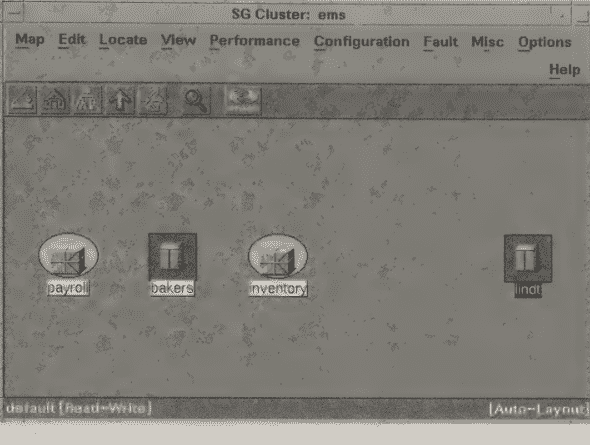

当与 IT/O 一起使用时，ClusterView 提供额外功能。SNMP 事件被发送到事件浏览器，在那里 ClusterView 提供特殊的故障排除说明并建议行动以帮助解决问题。一些数据收集活动是自动完成的。例如，响应包故障，ClusterView 会自动检索故障时间点的系统日志文件条目，以辅助诊断。ClusterView 将常见的 HP-UX 监控工具（如 `netstat` 和 `lanscan`）包含在 IT/O 的应用程序库中，同时也包含 MC/ServiceGuard 专用工具，例如 `cmviewcl`。

对于在 OpenView 子地图上显示的每个集群、节点或包，操作员可以查看额外的详细信息屏幕。详细信息是通过查询集群上的 HP MC/ServiceGuard MIB 获取的。图 7-2 显示了一个包详细信息屏幕的示例。包详细信息可以告诉您该包配置为其运行的备用系统。

除了高可用性集群外，ClusterView 还可以监控用户定义的集群。ClusterView 提供一个配置工具，使管理员能够创建一个集群，然后 ClusterView 会在集群子地图上显示它。例如，您可能希望将所有运行 Informix 的系统分组成一个 Informix 集群。操作员可以一眼监控所有集群系统，因为它们都在同一个 OpenView 子地图中。此外，操作员可以在集群上启动监控工具，例如 HP PerfView，从而避免在运行每个工具时手动选择每个系统。

ClusterView 运行在 HP-UX 和 Windows NT 系统上。针对任一平台的 ClusterView 软件也可以用于监控 Microsoft 的 NT 集群服务器及其高可用性集群。NT 和 MC/ServiceGuard 集群可以从相同的 ClusterView 软件中同时监控。

##### 图 7-2 ClusterView 包详细信息屏幕的输出。

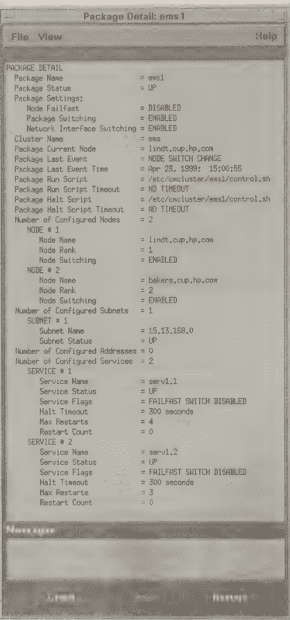

#### 事件监控服务

如前所述，MC/ServiceGuard 可以监控和迁移应用程序包。然而，其应用程序监控仅限于确定应用程序是正在运行还是已经失败。MC/ServiceGuard 依赖事件监控服务 (EMS) 来监控对应用程序重要的其他组件。应用程序包可能依赖于某种资源，例如磁盘卷。任何包依赖项都在包初始配置时指定。当包由 MC/ServiceGuard 启动时，EMS 开始持续监控每个资源。

EMS 可以向 MC/ServiceGuard 报告资源问题，以便重启应用程序。EMS 还可以将重要事件报告到日志文件或管理站。这有助于故障排除，因为操作员可以接收关于特定故障组件的信息（而不仅仅是得知应用程序被重启，没有解释性文本）。

EMS 可以报告多种事件。几个网络链接具有自定义监视器。可用一个数据库监视器来监控 Oracle 服务器状态。磁盘监视器可以报告逻辑卷和物理卷的状态信息。所有 EMS 监视器都可以独立使用或结合 MC/ServiceGuard 产品使用。

EMS 还提供软件开发工具包，使您能够编写自己的监视器并将其与其他监视器一起使用。通过这种方式，您可以为自己的自研应用程序提供自定义监控。

EMS 仅适用于 HP-UX 平台。

#### EcoSNAP

Compuware 的 EcoSNAP（前称为 Fault-XPERT）是另一种用于检测应用程序故障的工具。EcoSNAP 用于检测和排除应用程序故障，无论是在生产环境还是在产品开发期间。与 MC/ServiceGuard 类似，EcoSNAP 能够监控和检测故障而不需要修改应用程序。故障会报告给控制台，并且可以提供额外的详细信息以帮助诊断，随故障通知一起提供。

EcoSNAP 也可以配置为在应用程序故障时采取某些操作。通常，应用程序由 EcoSNAP 启动器程序启动。如果应用程序已在运行，可以通过执行特殊的 EcoSNAP 命令来开始监控。

EcoSNAP 由四个模块组成：

- **故障代理：** 检测应用程序故障。当发出 Unix 信号或 CICS 异常结束调用 (abend) 时被激活。代理捕获关键信息后，控制权返回给操作系统。捕获的信息包括应用程序名称、故障类型和程序偏移量、系统信息（如服务器名称）以及 CICS for AIX 和 HP-UX 事务信息。
- **故障信使：** 发生故障时发送通知。故障事件会被发送到已配置的控制台和系统日志文件。也可以通过寻呼机或电子邮件发送。
- **故障管理器：** 提供已发生故障的视觉显示。显示的内容包括程序名称、故障代码、程序偏移量、服务器名称、用户 ID 以及故障的日期和时间。该显示列出了已发生的所有故障，并且可以使用历史信息来识别趋势。
- **故障分析器：** 在查看故障管理器显示中的故障后，可用于深入挖掘更多诊断细节。可用的额外信息包括程序


故障发生时的堆栈跟踪、操作系统名称和版本、所使用的共享库、已访问文件列表、文件系统信息、故障发生时的程序变量状态，以及 C 和 C++ 程序的故障源语句。可以显示故障发生时的计算机屏幕。故障分析器还可以提供可能的问题原因列表。

通过提供故障信息（例如堆栈跟踪），EcoSNAP 有助于诊断应用程序问题。可以同时监控多个应用程序。

EcoSNAP 通过检测导致应用程序失败的 Unix 信号来工作。这些信号随后被捕获，在应用程序实际终止之前捕获程序诊断信息。稍后，可以通过图形用户界面（GUI）获取此信息，该界面允许用户深入了解单个故障。EcoSNAP 可以检测以下一组 Unix 信号和异常终止错误：

- 信号或异常错误
- 死锁超时条件
- RPC 期间操作失败
- 无法同步
- 通信操作失败
- 无效命令
- 无法初始化应用程序服务器
- 非法指令
- 总线错误
- 段违规
- 写入管道错误
- 浮点异常
- 软件终止信号
- 退出（由终端生成）
- 挂起（由终端生成）

EcoSNAP 运行在 Sun Solaris、HP-UX、IBM AIX 和其他平台上。可以从 Compuware Corporation 的网站 http://www.compuware.com 获取有关 EcoSNAP 的更多信息。

# ERP 应用程序监控工具

ERP 应用程序用于组织内的供应链管理。顶级的 ERP 应用程序包括 SAP R/3、Baan、PeopleSoft 和 Oracle 应用程序。本节描述为 ERP 应用程序定制的监控工具，重点介绍 SAP R/3，因为它是该市场领导者。

某些 ERP 应用程序供应商提供监控功能，例如 SAP 的计算中心管理系统（CCMS）管理工具和 EarlyWatch 程序，它们会定期检查 SAP 的性能。然而，其他供应商提供更完整的监控能力。本节重点介绍 Envite Corporation 针对 SAP 的监控功能，以及三家监控供应商：BMC Corporation、Hewlett-Packard 和 Computerware Corporation，它们为多种应用程序提供定制化的监控产品。重点是 HP-UX 解决方案，因为 HP 9000 是 PeopleSoft、Baan、SAP 和其他许多关键应用程序的 ERP 应用程序的主要 Unix 平台。

与其他 ERP 应用程序一样，SAP R/3 的可用性不仅取决于应用程序本身，还取决于底层的数据库、网络和操作系统。SAP R/3 是一个多层应用程序，包含应用程序服务器、打印服务器和数据库服务器。正确监控 SAP R/3 需要监控所有这些组件。SMART Plug-Ins 和 BMC PATROL 等产品因其可用的监控范围广泛而具有优势。

# Envite

Envite 提供了几种用于监控 SAP R/3 的工具：

- **R/3 Inspector：** 管理 SAP R/3 的性能和可用性，提供根本原因分析和预测分析，并建议恢复操作。该产品分析 40 到 50 个不同的性能问题类别，并将其信息收集存储在专用 NT 服务器的数据库中。
- **R/3 Service-Level Manager：** 报告全局 SAP R/3 使用、性能和可用性信息。可以生成报告，将实际服务级别与已定义的服务级别协议进行比较。提供预定义报告，可以安排定期生成。响应时间、事务速率和传输的总字节数是可以包含在这些报告中的统计类型的例子。
- **StopWatch：** 提供 SAP R/3 的终端用户响应时间信息。对于每个 SAP R/3 事务，StopWatch 收集总往返响应时间，其中包括网络时间、SAP R/3 时间和客户端空闲时间。报告按用户、事务或网络段提供。StopWatch 安装在与 SAP R/3 应用程序服务器相同的 LAN 段上，以便它可以捕获 LAN 流量并关联逻辑事务统计信息。

Envite 声称能够检测到 1500 种不同的 SAP R/3 症状，包括死锁和挂起的应用程序。这些应用程序已获得 HP MC/ServiceGuard 的认证。

# SMART 插件

本章前面讨论了 IT/O 检测应用程序或服务器可用性问题的能力。IT/O 旨在为管理系统、应用程序和网络提供一致的接口。HP 的 SMART 插件（SPIs）的目标是通过为应用程序和数据库提供预配置的监控器来扩展 IT/O 的监控能力。SMART 插件解决方案旨在与 IT/O 一起使用，配置最少或无需配置。许多 SPI 事件也预定义了纠正操作。诸如 BMC PATROL 等工具具有类似的能力，但与其与 IT/O 的集成不如 SPI 紧密。

IT/O 可以简化在多个系统上部署监控器。监控模板从中央 IT/O 管理站分发。监控器还可以与 MeasureWare 和 PerfView 集成，以便您可以将性能数据与系统和数据库性能数据相关联。

SAP R/3 和 Baan ERP 应用程序都有可用的 SMART 插件。SAP SPI 可以监控以下条件：

- 日志和跟踪文件中的错误
- R/3 实例中进程的状态
- 对话任务的频率、响应时间和等待时间
- 更新任务的频率、响应时间和等待时间
- 批处理任务的频率、响应时间和等待时间
- Spool 任务的频率、响应时间和等待时间

SAP SPI 还可以为已中止、运行时间超过预期或未能启动的任务发送批处理作业警报。它还可以发送以下 CCMS 警报：

- ABAP/4（SAP R/3 的编程语言）数据库事件
- R/3 实例缓冲区问题
- 跟踪信息
- Enqueue 服务器消息
- R/3 一般消息
- 滚动和分页活动
- 内部 R/3 数据库事件
- 配置状态信息
- 系统日志文件消息的详细信息

SAP R/3 SPI 与 SAP CCMS 管理工具紧密集成。CCMS 可以响应报告的问题启动。其他管理工具也可以从 IT/O 控制台启动。SAP 服务器支持 HP-UX 和 Windows NT 系统。该产品可以与 HP OpenView Manager for SAP R/3 一起使用，该管理器可以生成关于应用程序服务器和数据库正常运行时间的报告。

Baan IV 的 SPI 可以监控 Baan 应用程序的状态。除了监控每个 Baan 实例的状态外，Baan IV 的 SPI 还可以监控日志文件、许可证使用和共享内存使用。可以根据警报采取纠正措施，例如重启 Baan 实例或打印机守护进程。可以生成关于 Baan 服务可用性或许可证使用的报告。Baan 管理节点必须是 HP-UX 服务器。Baan 已特别认证此 SPI 为与 Baan 应用程序集成良好的产品。

除了 ERP 应用程序外，还有用于 Oracle、Informix 和 NT Internet 服务器的插件。Hewlett-Packard 计划增加可用的 SPI 数量。

##### BMC PATROL 知识模块

BMC Software 通过其 PATROL 软件套件提供监控能力。PATROL 是面向系统和数据库管理员的系统、应用程序和事件管理套件。PATROL 提供了定义阈值、发送和转换事件等的基本框架。称为知识模块（KMs）的可选产品包含监控特定组件的能力。例如，BMC PATROL 包括用于 Unix、SAP R/3、Oracle、Informix、PeopleSoft 和其他应用程序的 KMs。实际上，BMC 提供 40 多个 KMs 用于 PATROL。

PATROL 由控制台、智能代理和 KMs 组成。控制台提供集中的图形显示，其中图标代表系统组件或其他被监控的组件。图标颜色随状态变化。PATROL 控制台还提供事件浏览器，您可以在此过滤、关联、排序和升级事件。可以配置警报，使得事件被发送到控制台，图形化指示，并在事件浏览器中显示。

智能代理提供发现企业中的系统、数据库和应用程序组件的能力。代理驻留在每个服务器上。持续地，代理寻找问题，当它们定位到问题时，要么采取预配置的操作，要么发送通知以便手动进行恢复。

KMs 包含 PATROL 用于了解监控什么以及问题发生时如何反应的专业知识。KMs 用于监控一组“参数”，这些参数可以包括被监控属性的描述、轮询间隔、测量属性的方法以及异常值的阈值。KMs 提供检测事件并执行纠正操作规则。当发生错误或警告条件时，事件被发送到操作员控制台。

BMC 在其 Unix KM 中提供有助于监控应用程序的工具。例如，ACTIVEPROCESS 工具监控活动进程。PROCESS 工具显示活动和僵尸进程的统计信息。USER 工具监控用户会话和用户进程。这些工具中的每一个都在 PATROL GUI 中以特殊图标显示。除了其通用的应用程序监控能力外，BMC 为关键的 ERP 应用程序提供专门的 KMs。应用程序 KMs 包括 SAP R/3、Baan 和 PeopleSoft。

PATROL 的 SAP KM 取代了 SAP CCMS 管理工具的监控方面。KM 显示 CCMS ABAP 警报、缓冲区警报、调度程序队列警报、enqueue 警报、操作系统警报和其他 CCMS 警报消息。

对于 SAP 来说，监控 R/3 系统和应用程序服务器很重要。网关服务也很重要。系统、数据库和 SAP R/3 应用程序 KMs 应一起使用以监控 SAP 应用程序，因为每个 KM 监控重要的指标。之后


配置完成后，BMC 将发现 R/3 实例，并允许操作员查看 SAP 实例及其关联的数据库和系统。BMC 与 SAP AG 紧密合作，通过一组 ABAP 函数获取额外的 SAP R/3 信息。BMC PATROL 还为 SAP R/3 提供管理操作。

安装 SAP R/3 KM 后，PATROL 控制台将为每个 R/3 系统、R/3 实例、CCMS 警报信息、打印 saplpd 进程、R/3 用户、表空间以及性能信息显示自定义图标。同时也会提供数据库和系统图标。

SAP 故障通常是由于可用空间耗尽造成的。系统 KM 可以检查文件系统空间和可用内存。系统 KM 还提供重要的性能指标，例如网络 I/O 和磁盘 I/O 速率。

监控的关键 SAP R/3 属性包括以下内容：

- R/3 实例的状态
- R/3 实例用户活动的历史趋势
- 活动批处理进程数
- 活动对话进程数
- 活动更新进程数
- 活动打印进程数
- 活动锁入队进程数
- 当前登录到 R/3 实例的用户
- 打印机状态和队列长度
- 缓冲区性能信息
- R/3 缓冲区存储利用率
- 工作进程频率、响应时间和平均等待时间
- 系统日志信息
- 调度器队列大小
- 事务处理时间
- 锁入队错误

SAP R/3 构建于 RDBMS 之上，因此监控数据库也很重要。提供的主要数据库指标包括：

- 表空间可用空间
- 分配给目标数据库表空间的段
- 可用空间赤字
- 归档日志可用空间
- 缓存命中率
- 数据字典缓存命中率
- 打开的游标
- 事务处理速率
- 已使用的进程
- 活动事务处理
- 块更改速率

可用的数据库指标，如事务处理速率和缓存命中率，将在第 8 章中详细描述，系统信息（如文件系统容量、CPU 利用率和内存分页信息）也在该章节中描述。重要的系统指标在第 4 章中描述。

PATROL 呈现各种应用程序“视图”，以帮助监控每个 R/3 功能。例如，打印机视图显示目标 R/3 系统的所有打印机。状态通过不同颜色的图标指示。第一个视图显示所有已发现的目标 R/3 系统。从此视图，您可以确定正在使用的数据库类型以及当前访问 R/3 系统的用户数量。还有其他视图用于打印机、内存、CPU、交换空间、数据库信息、R/3 实例和用户信息、CCMS 警报以及性能。在每个视图中，您可以点击图标以获取更多信息。

BMC 已获准在 MC/ServiceGuard 环境中运行，但出现了一些不一致的问题。例如，PATROL 可能向 BMC 控制台报告 SAP 进程故障，而 MC/ServiceGuard 可能已经重启了该进程或将其移动到另一个系统。

SAP R/3 的 PATROL KM 支持 Sun Solaris、IBM AIX 和 HP-UX 等多种平台。

## 生态系统

Compuware Corporation 提供 EcoSYSTEMS 管理工具套件，其中包括用于系统和网络管理的 EcoTOOLS、用于监控应用程序性能的 EcoSCOPE 以及用于管理应用程序故障的 EcoSNAP。这些产品支持 NT 和 Unix 平台，支持的 Unix 平台包括 HP-UX、IBM AIX、SunOS 和 Sun Solaris。

EcoSCOPE 可以自动发现网络上正在运行的数百个预定义应用程序中的哪些，用户可以向 EcoSCOPE 数据库添加应用程序定义。然后，EcoSCOPE 可以监控访问应用程序的用户数、应用程序的响应时间、每个应用程序的字节计数以及每个应用程序的流量负载。

EcoSCOPE 的一个关键功能是监控应用程序响应时间的能力。无需对应用程序进行更改即可获取响应时间信息。EcoSCOPE 提供应用程序级或会话级的响应时间，包括 Oracle 事务处理信息。可以监控 Oracle 或 Sybase SQL 语句中单个动词的响应时间，以帮助诊断数据库长时间响应问题。可以显示最小响应时间、最大响应时间、标准差和平均响应时间信息。

Compuware 的 EcoSCOPE 可以在协议级别分析应用程序流量。您可以按应用程序和按协议查看网络流量。您可以识别多播和广播数据包，并确定发送这些数据包的应用程序。两个节点之间的流量负载可以按应用程序显示。

EcoTOOLS 用于网络和系统管理。它监控资源利用率和系统可用性，并提供历史和实时分析。警报可以通过控制台消息、寻呼或电子邮件发送。提供纠正措施，例如重启服务器、重新建立网络连接或重启关键应用程序或数据库。EcoTOOLS 还可以提供导致故障的事件历史记录。

EcoTOOLS 从驻留在每个服务器上的软件代理集中收集数据。支持 600 多个代理。可以从主控制台查看警报。事件和数据存储在中或分布式存储库中。从中央控制台，用户还可以查看硬件和软件清单。GUI 允许用户选择要监控的新资源并设置阈值。

监控信息在应用程序、数据库、网络和操作系统级别提供。监控的系统信息包括 CPU 利用率、磁盘利用率和内存使用情况（如可用交换空间）。EcoTOOLS 可以识别顶级内存消耗者、失控进程或关键系统资源（如进程表项、信号量和 inode 项）的短缺。还可以检测挂起的打印机或外围设备。通过验证用户密码已安装、检查对资源的未授权访问尝试以及检查系统文件和目录的修改，提供系统安全性。

EcoTOOLS 为以下对象提供特定的监控分析：

- SAP R/3
- PeopleSoft
- Oracle 应用程序

SAP R/3 服务因其内存性能、CPU 性能和可用性而被监控。在 HP-UX Oracle 环境中，可以进行额外的监控。EcoTOOLS 可以监控 SAP 用户数量、应用程序响应时间和吞吐量、缓冲区使用情况、配置状态、服务器负载和 CCMS 警报。

对于 PeopleSoft，EcoTOOLS 可以监控数据库的健康状况。当 PeopleSoft 应用程序用户关闭其系统时创建的孤儿进程可以被检测和终止。EcoTOOLS 还可以监控 Tuxedo 的调度队列，Tuxedo 通常与 PeopleSoft 一起使用。

可以监控可用的 Oracle 表空间。此外，当接近限制时，可以增加额外空间。EcoTOOLS 通过查找用户指定的字符串并在找到时发送警报来监控 Oracle 警报日志和并发请求日志。关键的 Oracle 后台进程也被监控。可以监控性能信息，如 Oracle 并发管理器中挂起的作业数量和长时间运行的作业。

可以生成有关资源利用率、流量负载和响应时间的报告。用户还可以定义自己的报告。例如，关于资源使用模式的报告可用于容量规划。通过允许定义应用程序和数据库性能要求，然后监控这些要求以确保其得到满足，可以实施服务水平协议。还可以生成例外报告。

EcoTOOLS 已与 Tivoli 和 CA Unicenter 管理框架进行了特定的集成工作。用于 Tivoli TME 10 的 EcoTOOLS Plus 模块将事件转发到 Tivoli Enterprise 控制台。整合了 Tivoli 模板和过滤器，这使得运行 EcoTOOLS GUI 并分发代理软件变得更容易。针对 CA Unicenter 也进行了类似的集成。

### 资源和性能监控工具

本节描述用于监控应用程序整体性能和系统资源利用率的工具。它不涵盖其他领域，例如应用程序的系统调用优化或代码性能分析。

收集应用程序性能指标是困难的，因为定义构成应用程序的组件很困难。某些进程可能是多个应用程序使用的实用程序。即使进程已知且是应用程序独有的，性能工具在将共享资源（如网络缓冲区）的使用映射到特定进程时也可能遇到困难。

不同的产品有定义应用程序的不同方法。例如，MeasureWare 和 PRM（Process Resource Manager）配置应用程序的方法各不相同。这些方法将在本章后面简要描述。PLATINUM 的 ServerVision 也可以基于用户配置将一组进程作为一个应用程序进行监控。您必须意识到，您可能需要协调这些产品独特定义之间的差异，以正确分析应用程序性能数据。

#### 应用程序资源测量

由于测量应用程序的性能很困难，Hewlett-Packard 和 Tivoli Systems 联合开发了一组用于测量应用程序响应时间的开放 API。这组标准 API 称为应用程序资源测量（ARM）。如果应用程序在关键点处修改以使用新的 API，最终用户就可以测量和控制这些应用程序的端到端性能。在应用程序中进行 API 调用以标记事务处理的开始和结束。为了简化此过程，Tivoli 或 Hewlett-Packard 免费提供了 ARM 的软件开发工具包（SDK）。只有少数 ARM API 存在，它们列在表 7-1 中。

| 名称 | 功能 |
| :--- | :--- |
| arm_init | 初始化应用程序的 ARM 环境 |
| arm_getid | 为应用程序中使用的每个事务处理类命名 |
| arm_start | 标记事务处理实例执行的开始 |
| arm_update | 更新关于事务处理实例的信息 |
| arm_stop | 标记事务处理的结束 |
| arm_end | 清理 ARM 使用的应用程序内存 |


Baan 宣布，其 ERP 应用的下一个版本将采用 ARM API 进行测量，这将使 Baan 的应用性能数据收集变得更加简单。

##### MeasureWare

MeasureWare 代理是惠普（Hewlett-Packard）的一款产品，用于收集和记录资源及性能指标。MeasureWare 代理在正在被监控的各个独立服务器系统上运行并收集数据。适用于许多平台和操作系统（包括 HP-UX、Solaris 和 AIX）的代理均已提供支持。

MeasureWare 代理收集数据、对其进行汇总、添加时间戳、记录日志，并在适当的时候发送警报。代理可收集并报告多种系统资源、性能指标和用户自定义数据。随后，该信息可以导出到电子表格或性能分析程序（如 PerfView）。这些数据可被这些程序用于生成警报，以警告潜在的性能问题。通过使用历史数据，可以发现趋势，从而有助于在资源问题影响系统性能之前予以解决。

MeasureWare 代理在三个不同级别收集数据：全局系统指标、应用和进程指标。全局和应用数据以五分钟为间隔进行汇总，而进程数据则以一分钟为间隔进行汇总。进程信息仅记录在关键时间段，例如当进程启动、终止，或 CPU 或磁盘利用率超过定义的阈值时。

MeasureWare 数据的基本类别列在表 7-2 中。数据库和网络支持模块也可选。数据源集成（DSI）功能用于将您的自定义数据与 MeasureWare 代理收集的其他数据进行整合。

对于使用前面提到的 ARM API 的应用，可以提供事务数据。为每个类别创建独立的日志文件，此外还有一个用于单个设备数据的文件。然而，默认情况下仅记录系统和进程数据。MeasureWare 收集的许多系统指标在第 4 章中有描述。本节介绍可为应用和进程提供的额外指标。

###### 表 7-2 MeasureWare 代理信息类别

| 类别 | 指标类型 |
| :--- | :--- |
| 系统 | CPU、磁盘、网络、内存、进程队列深度、用户/进程信息以及汇总信息 |
| 应用 | CPU、磁盘、内存、进程数、平均进程等待状态以及汇总信息 |
| 进程 | CPU、磁盘、内存、平均进程等待状态、进程整体生命周期以及汇总信息 |
| 事务 | 事务计数、平均响应时间、响应时间指标分布以及中止的事务 |

虽然 MeasureWare 提供了大量的性能和资源信息，但它提供的配置信息有限，且没有关于系统故障的数据。将 MeasureWare 与故障监控工具（如 EMS）结合使用可能更有益。

为了使 MeasureWare 能将进程级数据聚合到应用中，必须先定义该应用。管理员将一个应用名称与一组进程关联起来。要定义新应用，请编辑文件 `/var/opt/perf/parm`。在此示例中，为名为 ORACLE 的应用记录指标，该应用将是针对所有名称以 `ora` 开头的进程所收集的进程指标的聚合结果：

```
application = ORACLE
file=ora*
```

请注意，可以使用通配符，这在预先不知道所有独立进程或存在大量进程时非常方便。额外的配置选项允许您根据进程优先级或用户名或组名将进程与应用关联。请注意，一个进程只能属于一个应用，且 MeasureWare 会查找进程的第一个匹配项，因此在配置文件中请务必将最重要的应用列在前面。

如果您希望当记录的 MeasureWare 数据达到某些阈值时接收消息，您可以在 `/var/opt/perf/alarmdef` 配置文件中指定这些警报条件。也可以使用额外的警报定义文件。警报条件在数据记录时进行检查。警报可以发送到 PerfView、IT/O 或任何支持 SNMP 的管理站。目标配置信息在警报生成器数据库（agdb）中指定。

响应警报时，可以在本地系统上执行操作。本地操作是提供您自定义通知方式的一种方法。例如，您可以执行一条 Unix 命令向管理员发送消息。请注意，如果警报正在发送到 IT/O 代理，MeasureWare 默认不会执行任何本地操作，假设 IT/O 将配置为代替 MeasureWare 执行本地操作。

您可以基于涉及指标组合的条件发送警报。例如，CPU 瓶颈警报可以基于 CPU 使用率和 CPU 运行队列长度。警报条件可以指定持续时间。该条件必须在规定的时间段内为真，然后才会发送警报。还可以指定警报严重程度。

如果您希望将 MeasureWare 警报发送到 PerfView，需要通过 PerfView 接口进行配置。MeasureWare 工具 agsysdb 用于为 SNMP 警报添加新的陷阱目标系统。

清单 7-5 中的示例展示了一个警报定义，用于在 finance_app 应用的 CPU 使用率超过限制时发送警报。首先，发送一个警告级警报。如果问题持续存在，则发送一个严重级警报。根据警报生成器的配置方式，警报将发送到 PerfView 警报窗口、IT/O 消息浏览器或基于 SNMP 的管理站。请注意，该应用还必须在 parm 文件中定义。

MeasureWare 包含一个名为 utility 的程序，它可以执行多种任务。utility 程序中的 analyze 命令用于根据警报定义配置文件中的警报定义分析日志文件中的数据。然后您可以决定警报定义生成的警报是否过多或过少。您可以查看将会打印哪些消息以及将会执行哪些程序。警报摘要报告显示警报数量以及每个警报原本会处于激活状态的时间长短。

MeasureWare 的 utility 程序中的 extract 命令可用于将数据导出到其他工具（如电子表格程序）。extract 命令还可以使原始日志文件能够被 PerfView 使用。

以下应用级指标在 HP-UX 和 Sun Solaris 上可用：

- 区间内的 CPU 使用率
- 区间内物理磁盘传输的数量和速率
- 应用中进程的平均数量
- 应用中活跃进程的平均数量
- 区间内完成的应用进程数量
- 完成的应用进程的运行时
- 应用中进程的平均优先级
- 进程优先级的标准差
- 区间内用户进程的 CPU 使用率
- 系统处理的 CPU 使用率
- 主内存使用量
- 磁盘上的交换空间使用量

以下额外的应用级指标在 HP-UX 上可用：

- 到所有设备的 I/O 传输数量和速率
- 区间内的事务数量
- 终端平均首次响应时间
- 终端平均响应到提示符的时间
- 区间内用户定义的事务数量

###### 清单 7-5 应用 CPU 使用率的 MeasureWare 警报定义

```
ALARM finance_app:app_cpu_total_util > 30 FOR 5 MINUTES
START
{
    WARNING ALERT "Your app is busy."
    EXEC "echo 'finance app is very busy'|mailx root"
}
REPEAT EVERY 15 MINUTES
    CRITICAL ALERT "finance app continues to be busy."
END
    RESET ALERT "finance app no longer busy."
```


## 性能指标

MeasureWare 代理（Agent）还会收集各个进程的数据。这些进程级指标可在 HP-UX 和 Sun Solaris 上获取：

- 平均用户事务响应时间
- 进程等待 CPU 的时间
- 进程等待磁盘 I/O 的时间
- 进程等待内存的时间
- 进程等待软件延迟的时间
- 进程等待终端输入的时间
- 进程等待 LAN I/O 的时间
- 进程等待其他 I/O 的时间
- 进程被指示等待的时间
- nice 优先级下的 CPU 使用率
- 实时优先级下的 CPU 使用率
- 间隔期间的逻辑磁盘读取数量及速率
- 间隔期间的逻辑磁盘写入数量及速率
- 间隔期间的物理磁盘读取数量及速率
- 间隔期间的物理磁盘写入数量及速率
- 间隔期间内存管理器读写次数及速率
- 间隔期间系统读写次数及速率
- 间隔期间原始读写次数及速率
- 间隔期间文件系统读写次数及速率
- 进程私有内存与共享内存总和（单位为千字节）
- PID（进程标识符）
- 应用程序编号
- 程序名称
- 登录用户名
- 登录设备名称或编号
- 父进程和组标识符
- 执行优先级/调度队列
- 最后一次停止执行的原因
- 间隔期间的 CPU 使用率
- 间隔期间物理磁盘传输次数及速率
- 进程运行总时长
- 系统处理过程中的 CPU 使用率
- 用户处理过程中的 CPU 使用率
- 间隔期间的逻辑磁盘读取数量及速率
- 间隔期间的逻辑磁盘写入数量及速率
- 常驻内存集大小
- 文本+数据+栈内存的大小
- 内存缺页中断次数
- 磁盘缺页中断次数
- 进程生命周期内的逻辑磁盘传输次数及速率
- 终端事务总数
- 总体平均终端首次响应时间
- 总体平均终端响应至提示符时间
- 用户事务总数
- 总体平均用户响应至提示符时间

以下额外的进程级指标可在 HP-UX 上获取：

- 间隔期间所有设备的总 I/O 传输速率和次数
- nice 优先级下的 CPU 使用率
- 实时优先级下的 CPU 使用率
- 上下文切换中的 CPU 使用率
- 中断处理中的 CPU 使用率
- 间隔期间文件系统读取次数及速率
- 间隔期间文件系统写入次数及速率
- 间隔期间内存管理传输次数及速率
- 间隔期间系统传输次数及速率
- 间隔期间终端事务次数
- 平均终端首次响应时间
- 平均终端响应至提示符时间
- 间隔期间用户自定义事务次数
- 平均用户事务思考时间
- 平均用户事务响应时间
- 进程被指示等待的时间
- 进程等待磁盘的时间
- 进程等待终端输入的时间
- 进程等待软件延迟的时间
- 进程等待虚拟内存的时间
- 进程等待 LAN 传输的时间
- 进程等待无磁盘工作站的时间
- 进程等待网络文件系统的时间
- 进程等待进程间通信的时间
- 进程等待系统的时间
- 进程等待其他 I/O 的时间
- 进程等待其他原因的时间

通过 ARM 收集的数据可以与其他 MeasureWare 数据集成。使用 ARM 的应用程序将通过 MeasureWare 事务跟踪器（Transaction Tracker）技术来提供指标。以下指标在 HP-UX 和 Sun Solaris 上均可用：

- 事务名称
- 事务计数
- 事务平均响应时间
- 响应时间指标分布
- 中止事务的数量
- 中止事务的响应时间

该实用程序包括生成日志文件报告的功能。通过这种方式可以发现系统范围内的变化，例如新增磁盘设备。也可以生成提供每个应用程序的 CPU 和磁盘使用情况摘要的报告。

为了验证 MeasureWare 是否正常工作，您可以使用 `perstat -t` 命令，该命令会显示近期的状态和错误信息。

##### GlancePlus

GlancePlus 是惠普（Hewlett-Packard）推出的一款实时图形化性能监控工具。它用于监控单个系统的性能及系统资源利用率。该产品既提供基于 Motif 的界面，也提供基于字符的界面。该产品可用于 HP-UX、Sun Solaris 以及许多其他操作系统。

GlancePlus 收集与 MeasureWare 类似的信息，但采样数据更为频繁。GlancePlus 可用于以图形方式查看系统当前 CPU、内存、交换区和磁盘的活动情况及利用率。它还可以显示应用程序和进程信息。如果已安装并启用了 MeasureWare 代理（Agent），则还可以显示事务信息。

对于监控应用程序，必须定义该应用程序。要定义一个关键应用程序，请使用位于 `/var/opt/perf/parm` 的配置文件，该文件也被 MeasureWare 和 PerfView 产品使用。

GlancePlus 还能够设置和接收与性能相关的警报。可自定义的规则决定何时将系统性能问题作为警报发送。这些规则由 GlancePlus Adviser 管理。当您从 Adviser 菜单中选择“编辑 Adviser 语法”（Edit Adviser Syntax）选项时，将显示所有警报条件，随后您可以对其进行修改。GlancePlus Adviser 语法文件（`/var/opt/perf/adviser.syntax`）包含症状和警报配置。也可以使用额外的语法文件。发送警报的条件可以基于涉及不同症状的规则。

警报会导致屏幕通知，颜色代表警报的严重性。警报还可以触发自动执行命令或脚本。GlancePlus 还可以使用其 EXEC 功能执行 Unix 命令（例如 `mailx`）来打印消息或通知您，而不是发送警报。

列表 7-6 展示了 *ora_app* 应用程序的一个警报。如果您知道应有多少个进程处于活动状态，可以使用 GlancePlus 来监控它们的运行状况。`APP_ALIVE_PROC` 指标测量在该时间间隔内该组中存活的进程数量。该指标可能包含在间隔期间终止的进程的分数值。如果 `APP_ALIVE_PROC` 低于该应用程序的预期值，则可以发出警报，如列表 7-6 所示。

您也可以在命令模式下通过键入以下内容来执行脚本：

```
glance -adviser_only -syntax <script file name>
```

在此示例中，如果 *ora_app* 的进程数降至五个以下，将向 GlancePlus 警报屏幕发送黄色警报。症状将在每个时间间隔重新评估。

GlancePlus 允许使用过滤器来减少显示的信息量。例如，您可以在进程视图中设置一个过滤器，仅显示较活跃的系统进程。GlancePlus 还可以显示短期历史信息。选中时，主 GlancePlus 屏幕上可见的警报按钮将显示已发生的警报历史记录。

如果正在使用进程资源管理器（PRM），GlancePlus 将显示 PRM 应用程序组在多大程度上保持在它们的资源配额内。从 GlancePlus 中，您还可以更改 PRM 进程组的配额。

以下是 GlancePlus 中可用的一些特定应用程序指标：

- 每个应用程序的 CPU 利用率（用户和系统）
- 每个应用程序的 I/O 利用率
- 每个应用程序的虚拟内存利用率
- 每个进程的 CPU 利用率
- 每个进程的磁盘利用率
- 每个进程的内存利用率
- 每个进程的打开文件数

如果同时使用 MeasureWare 代理（Agent），则可获得事务级信息。事务必须由使用 ARM API 的应用程序定义。以下是可用的一些指标：

- 事务平均响应时间
- 事务响应时间分布

###### 列表 7-6 在 GlancePlus 中定义警报。

```
 alarm ora_app:app_alive_proc < 5
 start
     yellow alert "Oracle app died"
 end
     reset alert "end of Oracle alert"
```


- 中止的事务数量
- 中止事务的响应时间

图 7-3 展示了如何显示事务信息与服务级别目标。管理员希望实现事务响应时间在五秒以内。该图表显示了满足或超过此目标的事务的数量和分布。

GlancePlus 可访问超过 600 项指标。其中一些指标在其他章节中有讨论。可以使用在线帮助功能找到完整的指标列表。此信息也可以在目录 `/opt/perf/paperdocs/gp/C` 中找到。欲了解更多信息，请访问 HP 应用与系统管理网站 `http://www.openview.hp.com/solutions/application/`。

### PerfView

PerfView 是惠普（Hewlett-Packard）提供的一款图形化性能分析工具。它用于以图形方式同时显示单个或多个系统的性能和系统资源利用率，以便进行比较。可以显示多种性能图表。这些图表基于一段时间内收集的数据，不同于 GlancePlus 的实时图表。该工具运行在 HP-UX 或 NT 系统上，并与 MeasureWare 代理收集的数据协同工作。

**图 7-3** GlancePlus 显示事务数据。

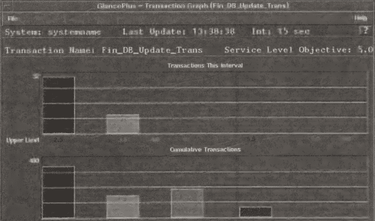

PerfView 由三个主要组件组成：

- **PerfView 监控器**：提供接收警报的功能。可以显示警报的文本描述。可以根据严重性、类型或源系统过滤警报。此外，在收到警报后，可以选择该警报，从而显示相关指标的图表。操作员可以监控导致故障的趋势，然后采取主动措施以避免问题。图表可用于系统之间的比较以及显示资源消耗的历史记录。内部维护了一个数据库，用于保存警报通知消息的历史记录。
- **PerfView 分析器**：提供磁盘及其他资源的资源和性能分析。系统指标可以在三个不同的层级显示：进程、应用（由用户配置为一组进程）和全局系统信息。它依赖于从被管理节点上的 MeasureWare 代理接收的数据。可以并发分析多达八台系统的数据。支持所有 MeasureWare 数据源。PerfView 分析器是 PerfView 监控器和 PerfView 规划器的必要条件。
- **PerfView 规划器**：提供预测功能。图表可以外推到未来。对于预测数据，可以显示多种图表（如线性、指数、S 曲线和光滑曲线）。

除了对系统资源进行图形化显示和分析外，还可以使用 PerfView 对进程和应用资源进行图形化显示和分析。PerfView 可以使用 MeasureWare 创建的应用定义。然后，PerfView 可用于显示指定应用的利用率历史。PerfView 显示历史和趋势信息的能力有助于诊断系统问题。对性能信息进行图形化显示可以帮助理解是否存在持续性问题，或者异常仅仅是活动的短暂峰值。

为了进一步诊断问题，PerfView 监控器可以允许用户更改时间间隔，以尝试找到问题发生的具体时间。图表将重新绘制，显示新的时间段。

##### 进程资源管理器

进程资源管理器（Process Resource Manager）是惠普提供的一款资源管理工具，用于在 PRM 组之间平衡系统资源。PRM 组由管理员配置，由一组 HP-UX 用户或应用程序组成。然后，PRM 用于赋予每个 PRM 组一定比例的系统可用 CPU、实时内存或磁盘 I/O 带宽。PRM 确保即使在重负载下，每个 PRM 组也能获得系统资源的最小百分比。PRM 还可以确保某个组获得的 CPU 不超过配置的百分比。

PRM 可与 HP GlancePlus 结合使用以调整系统配置。例如，如果管理员检测到某个 PRM 组存在不需要的系统负载，可以使用 GlancePlus 动态降低该组的授权。

PRM 配置文件是 /etc/prmconf。在此文件中，您指定 PRM 组及其期望的资源授权。HP-UX 用户和应用程序都可以属于 PRM 组。应用程序通过其可执行文件路径名进行引用。在指定进程启动时替代进程名称的情况下，这些替代进程名称也可以进行配置。如果事先不知道确切的替代进程名称，可以使用通配符。这样，PRM 提供了对 Oracle 应用程序更精细的控制，因为 Oracle 数据库服务器有一个可执行文件，但会为每个数据库实例生成进程，实例名称嵌入在进程名称中。

通常，如果一个 PRM 组不需要其系统资源，PRM 会将这些资源分配给可能需要它们的其他组。然而，PRM 还可以通过指定资源最大值来协助容量规划。因此，如果管理员知道很快将有额外 25% 的用户登录系统，管理员可以分配系统资源的最大 80% 来模拟即将增加的负载。

PRM 还可以用于在高可用性环境中动态调整工作负载。例如，如果三个 MC/ServiceGuard 包都在运行着类似的 PRM 授权，并且其中一个包故障转移到另一个系统，则可以自动检测到此情况，并应用新的 PRM 配置，使剩余的两个包获得更高的授权。

要检查每个 PRM 组的实际资源使用情况，请使用 prmonitor 命令。GlancePlus 也可以图形化地显示这些信息。

### 控制应用性能

如果存在系统性能问题，可以使用 GlancePlus 等性能监控工具来找出主要使用系统资源的应用或进程。问题可能源于卡住的应用程序持有主要信号量、结构不良的应用程序进行不必要的系统调用或内存泄漏等。临时解决方案可能涉及停止并重启该应用程序。长期解决方案可能涉及重构应用程序、重新编译或优化程序。

如果性能问题是多个应用程序争用系统资源导致的，您可能希望使用 PRM 等产品来控制资源分配。PRM 可以确保关键应用程序获得适当的资源授权。在创建最佳的 PRM 配置之前，您可能需要研究系统中争用应用程序的资源使用情况。

### 从应用问题中恢复

一些应用问题可能由对应用配置文件的意外或不适当更改引起。EMS 提供监控这些配置文件的能力，并在发生更改时报告事件。文件文本可以随事件一起包含，从而可以用于提供配置更改的历史记录，以便快速撤销错误的更改。

当服务器发生故障且无法立即修复时，可以使用高可用性集群软件（如 MC/ServiceGuard）来减少与故障相关的停机时间并保持服务可用。MC/ServiceGuard 可以检测到应用程序故障，并在另一台系统上自动重启该应用程序，时间不到一分钟。对于一些重要应用程序（如 BEA Tuxedo、CICS 和 NFS），已经存在一些预配置解决方案。

BMC 的应用服务保证产品可用于提供应用恢复。应用程序的所有组件都可以恢复到特定的时间点。该产品支持许多应用程序，包括 SAP R/3、PeopleSoft、Baan 和 Oracle。

然而，即使拥有内核屏蔽某些故障的能力以及高可用性软件将应用程序迁移到冗余服务器的能力，最终您仍然需要修复故障组件。对于硬件问题，支持工具管理器（Support Tool Manager, STM）可以在 HP-UX 系统上提供快速诊断。SyMON 可用于 Solaris 环境。为修复操作系统问题，系统供应商通常会在其各自的网站上提供支持信息。

### 应用监控产品比较

为了正确监控应用程序，能够以图形方式显示它们是最好的。BMC PATROL 可以在 PATROL 控制台中显示进程信息。通过使用其专用的 KMS，PATROL 还可以显示应用程序实例的图标，但显示任意应用程序可能很困难。IT/O 仅在其窗口中提供系统视图，尽管在与 NNM 或 IT/O 在 MC/ServiceGuard 环境中一起使用时，Clusterview 会增加一个应用程序视图。

ClusterView 可以自动检测到应用程序故障并更改应用程序图标的颜色。然而，其诊断信息有限。EcoSNAP 可以检测到应用程序故障并通过多种机制发送通知。EMS 支持更多通知方法，但无法访问 EcoSNAP 提供的所有诊断信息。除了检测故障外，MC/ServiceGuard 还可以重启应用程序。

将 MC/ServiceGuard 与 EMS 结合使用，使您能够在应用程序及其依赖资源之间建立明确的链接。然后监控这些依赖资源，故障会直接导致 MC/ServiceGuard 包故障。虽然需要资源配置步骤，但这种努力在后续故障排查中节省了时间，因为根本原因已经提供。

应用性能数据可从多种产品获得，包括 MeasureWare、BMC PATROL 和 SMART 插件。BMC PATROL 为特定应用（如 SAP R/3）提供最多的指标，但 SMART 插件与 IT/O 和 PerfView 的集成效果最好，能够实现事件关联和详细的性能图表。


## 监控数据库

数据库通常是公司环境中关键的*应用程序*。公司对数据库的要求更为严格，要求高可用在线事务处理（OLTP）以及对决策支持查询的快速响应。数据库和数据库服务器基于复杂的架构，并包含一系列配置选项，这使得它们成为一项艰巨的管理挑战。

需要工具来减少检测和隔离数据库问题所花费的时间。数据库依赖于底层系统、磁盘和网络。本书的其他章节讨论了这些组件中的每一个。本章提供了关于特定于数据库的监控工具的信息。

### 确定重要的数据库监控类别

根据公司的组织结构，不同的人可能负责控制数据库的不同方面。数据库管理员、数据库和系统操作员、应用程序管理器、系统管理员和网络管理员，每个人都可能在监控或配置公司数据库方面扮演角色。在较小的公司中，多个角色可能由一个人担任。数据库操作员负责保持数据库运行和可用，解决性能问题，并备份数据。数据库管理员负责处理安全事务、负载均衡和容量规划问题，并部署新的数据库应用程序。每个人对数据库监控工具的需求可能也不同。

这些不同的监控活动可以归入以下类别：

- 配置管理
- 故障管理
- 性能和资源管理
- 安全
- 备份

接下来将更详细地描述这些组。在这些领域中每个领域的适当监控级别取决于您具体的数据库职责。

### 配置数据库

在能够有效监控数据库之前，您应该验证数据库配置是否正确。应检查系统和数据库配置文件是否正确。无效的数据库配置可能会阻止数据库访问。每个数据库都依赖于几个配置文件。例如，Oracle 依赖以下配置文件：

- tnsnames.ora
- init.ora
- listener.ora
- sqlnet.ora

如果手动配置或没有一致地分发到使用数据库的计算环境中的所有系统，这些文件可能会损坏。数据库管理员应确保初始配置和后续配置是正确的。应设置适当的事件通知，以便操作员能够意识到任何配置更改。这些事件可以用作审计历史，以便在稍后试图追查问题原因时发挥作用。

Network General 的 Oracle7 数据库模块是一个可以监控配置信息的工具示例。该模块用作网络分析器的附加组件来研究数据库流量。SQL 数据包被解码，使分析器能够扫描连接数据包中包含的配置信息，以查看是否存在配置问题。另一种方法是定期检查系统和数据库配置文件的修改日期，以查看是否已进行更改。应保留配置的旧副本以便进行比较。

请注意，正确的数据库配置取决于数据库将如何被使用。例如，在线事务处理应用程序与决策支持应用程序的工作负载特征不同。

### 监控数据库故障

数据库操作员必须持续监控数据库环境中的故障。这包括除数据库之外的系统和网络组件。系统故障可能会阻止访问数据库，系统组件的损失可能会严重降低性能。仅监控数据库服务器系统是不够的，因为连接客户端和服务器的网络也可能发生故障。监控系统、磁盘和网络的技巧在其他章节中有讨论。

各种数据库软件或硬件组件可能会故障，进而导致数据库故障。操作员可能只需定期登录到数据库应用程序，以确保其仍在运行。例如，需要检查的关键 Oracle 组件包括 Oracle 命名服务器、Oracle 服务器、SQL\*NET 监听器以及 Oracle 多协议互连（MPI），后者用于在不同网络传输堆栈（如 TCP/IP 和 IPX/SPX）之间进行转换。

### 管理数据库资源和性能

监控数据库资源和性能可以确保数据库被有效利用。最常见的数据库问题与资源管理有关。一些常见的错误包括：

- 磁盘空间不足
- 日志文件已满
- 性能过载

应定期研究和系统数据库资源以检测趋势。操作员应检查表、表空间和索引的空闲空间。对数据库的持续修改和更新可能导致数据库碎片化，这意味着数据库的可用存储是分散的。每个可用存储区域都太小而无法使用，因此被浪费。最终，数据库碎片化的增加可能导致性能问题甚至数据库故障。一些数据库监控工具有助于检测数据库碎片化，以便可以采取纠正措施，例如重构数据库对象。

性能问题可能难以诊断。许多数据库性能问题是由设计不良的数据库或编码效率低的程序引起的。对于这些情况，简单的解决方案不太可能奏效。因此，数据库操作员需要能够预测性能问题并在适当时提供纠正措施的监控工具。

### 确保数据库服务器安全

您还应该能够检测与数据库服务器相关的安全入侵或访问违规。监控工具可以跟踪失败的登录、特权语句执行以及维护数据库安全所需的其他事件。

您还可能希望使用第 6 章中讨论的网络监控工具来帮助保护系统安全。网络防火墙可以在入侵者访问计算机系统之前阻止他们。

### 确保数据库备份成功

您还需要备份系统并确保备份成功运行。根据数据库的使用方式，可能需要不同类型的备份工具。负责数百个系统的备份和恢复程序的系统操作员可能没有处理数据库供应商备份工具相关程序的专业知识。用于管理和监控数据库备份的自动化工具可以帮助降低工作所需的技能水平。

如前所述，数据库管理员负责趋势分析和容量规划。理想情况下，管理员专注于这些战略性规划活动，但经常花时间为操作员解决数据库问题提供帮助。用于数据库操作的自动化工具帮助管理员从这些较长期的规划任务中解放出来。管理员可能会使用与操作员相同的用于性能和资源管理的部分工具。例如，PerfView 可用于预测未来的性能瓶颈，也可以帮助分析现有的资源问题。

本章的其余部分介绍了可用于提供数据库监控功能的各种工具和产品。重点放在故障和性能以及资源管理类别上；在其他重要领域可用的工具不多。本章涵盖了通用系统和应用程序工具，以及特定于数据库的工具。

Oracle 是 UNIX 数据库服务器的主导供应商，因此在本章中得到了最多的关注。Informix 是另一个重要的 UNIX 数据库供应商，用于进行比较目的。

### 使用标准数据库命令和工具

本节描述了随数据库产品附带或属于操作系统一部分的命令和工具。

#### UNIX 命令

可以使用 UNIX 命令和工具（如 ps 和 pstat）来检查一些重要的数据库进程。数据库监听器和命名服务器是这些关键数据库进程的一些示例。列表 8-1 展示了使用 ps 在系统中查找 Oracle 进程的示例。请注意，Oracle 在进程名称的末尾附加了数据库实例名称。

`who` 命令可用于列出登录到系统的 UNIX 用户。这让您了解谁在使用该系统，但不一定有助于确定谁在使用数据库。本节中描述的其他工具可用于显示当前数据库用户的信息。

#### SQL 命令

SQL 命令可用于检查数据库状态或可用空间。有时，知道数据库是否工作正常的最佳方法是尝试使用它。除非将命令放入脚本中，否则这是一个手动过程。

如果存在数据库问题，确定谁正在使用数据库可能会有用。列表 8-2 展示了如何在 Oracle 环境中进行 SQL 查询以获取此信息。

列表 8-3 展示了在具有多个活动数据库用户的 Oracle 7.3 系统上使用此 SQL 查询的示例。


#### 列表 8-1 显示 Oracle 数据库进程的 Output。

```
# ps -efa | grep oracle
oracle 21488     1 0 Dec 13  ?       7:36 ora_lgwr_CINDY
oracle 23446     1 0 Dec 13  ?       62:44 dbsnmp
oracle 21492     1 0 Dec 13  ?       0:32 ora_smon_CINDY
oracle 23165     1 0 Dec 13  ?       0:50 ora_smon_ora2
oracle 23154     1 0 Dec 13  ?       6:56 ora_pmon_ora2
oracle 21494     1 0 Dec 13  ?       0:04 ora_reco_CINDY
oracle 23459     1 0 Dec 13  ?       0:43 ora_ora2 (LOCAL=NO)
oracle 21912     1 0 09:50:42 ?      0:00 ora_ora2 (LOCAL=NO)
oracle 21483     1 0 Dec 13  ?       10:34 ora_dbwr_CINDY
oracle 23438     1 0 Dec 13  ?       0:00 /rd bms/oracle/8.0.3/bin/t nslsnr
oracle 23156     1 0 Dec 13  ?       14:17 ora_dbwr_ora2
oracle 21490     1 0 Dec 13  ?       6:42 ora_ckpt_CINDY
oracle 28717 28614 0 Dec 15 pts/2   0:00 ksh
oracle 21481     1 0 Dec 13  ?       6:27 ora_pmon_CINDY
oracle 23161     1 0 Dec 13  ?       7:30 ora_lgwr_ora2
oracle 23163     1 0 Dec 13  ?       6:04 ora_ckpt_ora2
oracle 21908 23446 0 09:50:41 ?      0:04 dbsnmp
oracle 23167     1 0 Dec 13  ?       0:04 ora_reco_ora2
root 21974 21936 2 10:12:42 pts/4   0:00 grep oracle
#
```

解释 SQL 语句超出了本书的范围。如需更多信息，您可能希望阅读 Allen G. Taylor 撰著的《SQL For Dummies, Third Edition》（IDG Books Worldwide, 1998）。

### SNMP MIB 监控

如果您正在使用 HP OpenView Network Node Manager，则可以使用 OpenView MIB Browser 获取关于数据库和数据库服务器的附加信息。由于您的数据库服务器依赖于底层系统和网络，您可能需要访问 MIB-II 和 HP-UNIX MIB，其中包含通用系统信息，例如文件系统信息和网络接口状态。HP OpenView IT/O 允许您设置对 MIB 变量的持续监控。诸如 Ucenter TNG 等管理框架也提供 MIB Browser。公共领域的 MIB Browsers 也可用。

诸如 Oracle、Sybase 和 Informix 等数据库供应商都支持关系型数据库管理系统（RDBMS）MIB，该 MIB 提供数据库状态等信息。（该 MIB 的全部内容提供在附录 A 中。）由于数据库供应商对其某些关键信息的表示进行了标准化，操作员可以以相同的方式访问这些信息，而不管使用哪种数据库。然后可以将这些信息与从 MIB-II 和 HP-UNIX MIB 中了解的信息相结合，以更深入地了解数据库的状态。Gartner 集团估计，每个财富 1000 强企业平均拥有五个数据源，因此使用标准 MIB 进行监控可以提供一些急需的一致性，并减少数据库操作员的培训量。

#### 列表 8-2 使用 SQL SELECT 查找当前数据库用户。

```
SELECT nvl(S.OSUSER,S.type) OS_Usercode,
	S.USERNAME 			Oracle_Usercode,
	S.sid 			Oracle_SID,
	S.process 			F_Ground,
	P.spid 			B_Ground
FROM sys.V_$SESSION S,
	sys.V_$PROCESS p
WHERE s.paddr = p.addr
ORDER BY s.sid
```

#### 列表 8-3 显示活动 Oracle 数据库用户的输出。

```
SQL> SELECT nvl(S.OSUSER,S.type) OS_Usercode,
2 S.USERNAME Oracle_Usercode,
3 S.sid Oracle_SID,
4 S.process F_Ground,
5 P.spid B_Ground
6 FROM sys.V_$SESSION S,
7 sys.V_$PROCESS p
8 WHERE s.paddr = p.addr
9 ORDER BY s.sid
10 ;
```

| OS_USERCODE | ORACLE_USERCODE | ORACLE_SID | F_GROUND | B_GROUND |
| :--- | :--- | :--- | :--- | :--- |
| oradb | 1 | 1322 | 1322 | |
| oradb | 2 | 1324 | 1324 | |
| oradb | 3 | 1331 | 1331 | |
| oradb | 4 | 1334 | 1334 | |
| oradb | 5 | 1338 | 1338 | |
| oradb | 6 | 1342 | 1342 | |
| george | JUNGLE | 7 | 277:412 | 3056 |
| sam | SAMS | 10 | 181:245 | 28975 |
| sam | SAM | 12 | 187:282 | 1686 |
| lily | LILY | 13 | 29902 | 21430 |
| sam | SAM | 16 | 292:197 | 28959 |
| sam | SAM | 19 | 187:282 | 28989 |

12 rows selected.

```
SQL>
```

虽然 RDBMS MIB 定义了九个表，但只有五个是真正的供应商独立的。这些表显示在表 8-1 中。`rdbmsSrvParamTable` 也由主要数据库供应商提供，但此表中包含的服务器配置信息是特定于数据库的，并可能包含自定义参数。Informix 和 Oracle 不支持 MIB 中定义的其他三个表：`rdbmsDbParamTable`、`rdbmsDbLimitedResourceTable` 和 `rdbmsSrvLimitedResourceTable`。

在 RDBMS MIB 中定义了两种 SNMP 陷阱，`rdbmsStateChange` 和 `rdbmsOutOfSpace`，但只有 `rdbmsStateChange` 得到了一致的实现。当数据库或数据库服务器的状态更改为受限或不可用时，会发送该陷阱。您可能需要修改管理站上的陷阱配置文件以接收新的陷阱。

RDBMS MIB 主要用于监控，而不是管理。然而，其中的许多信息是静态配置信息，对于操作监控没有用处。主要数据库供应商还支持在 RFC 2248 中定义的 Network Services MIB，作为数据库进程信息的仓库。Network Services MIB 通常被简称为“Application MIB”，尽管互联网工程任务组（IETF）已经定义了具有该名称的不同 MIB。表 8-2 列出了 RDBMS MIB 中有用的字段，以及 Network Services MIB 中的应用表（appTable）。此表中仅包含 Oracle 和 Informix 均可用的 MIB 变量。

表 8-2 中列出的许多变量用于监控数据库或数据库服务器的状态。`appOperStatus` 字段可用于指示数据库服务器的操作状态：up、down、congested 或 restarting。`appInBoundAssociations` 变量可用于确定到数据库的当前活动连接数。`rdbmsRelState` 指示数据库的状态：active、available、restricted、unavailable 或 other。

一些数据库监控变量也可用于资源控制。`rdbmsDbInfoSizeAllocated` 和 `rdbmsDbInfoSizeUsed` 变量可用于确定数据库可用的空闲磁盘空间量，指示是否应分配更多空间。`appInboundAssociations` 可以与服务器信息表中的最大允许入站关联数进行比较。

您可以将这些变量与 Hewlett-Packard 的 Process Resource Manager (PRM) 结合使用，当活动用户过多时增加或限制系统资源授权。服务器信息表包括关于处理的事务数以及服务器执行的读和写次数的几个有趣统计。例如，逻辑读与物理读的比例可用于确定适当的缓存大小。然而，服务器信息表中的信息是聚合到数据库服务器层面的，因此这里不提供特定于数据库的统计信息（除非数据库服务器仅处理一个数据库）。数据库关系表用于将数据库与其服务器相匹配。

如果您希望监控 Informix，rdbmsSrvLimitedResource 表很有用，因为它包含当前已达成的资源限制和阈值。该表在 Oracle 中不受支持。RDBMS MIB 中其他有趣的变量通常对 Oracle 不可用，但对 Informix 可用，包括：

- `rdbmsDbInfoLastBackup`：指示上次数据库备份的时间戳。
- `rdbmsSrvInfoOutOfSpaces`：指示数据库服务器无法获取其所需磁盘空间的次数。
- `rdbmsRelActiveTime`：指示该数据库由数据库服务器激活的时间。

由于 MIB 定义很少改变，在您配置一些 MIB 变量进行监控后，该配置很可能适用于多个数据库版本。这有助于减轻对新的数据库软件版本重新认证的负担。

#### 表 8-1 供应商独立的 RDBMS MIB 表

| 表名 | 描述 |
| :--- | :--- |
| rdbmsDbTable | 关于系统中安装的数据库的信息 |
| rdbmsDbInfoTable | 关于系统中数据库的更多（动态）信息 |
| rdbmsSrvTable | 系统中正在运行或安装的数据库服务器表 |
| rdbmsSrvInfoTable | 数据库服务器统计表 |
| rdbmsRelTable | 显示数据库到服务器的关系（或映射）的表 |

#### 表 8-2 有用的 RDBMS MIB 字段

| 变量 | MIB 表 | 描述 |
| :--- | :--- | :--- |
| appUptime | appTable | 数据库已运行时间 |
| appOperStatus | appTable | 数据库服务器状态 |
| appInboundAssociations | appTable | 当前活动的本地和远程对话数 |
| rdbmsSrvInfoStartupTime | rdbmsSrvInfoTable | 上次服务器重启的时间戳 |
| rdbmsSrvInfoFinished-Transactions | rdbmsSrvInfoTable | 已提交或中止的事务数 |
| rdbmsSrvInfoDiskReads | rdbmsSrvInfoTable | 服务器执行的物理读次数 |
| rdbmsSrvInfoLogicalReads | rdbmsSrvInfoTable | 服务器执行的逻辑读次数 |
| rdbmsSrvInfoDiskWrites | rdbmsSrvInfoTable | 服务器执行的物理写次数 |
| rdbmsSrvInfoLogicalWrites | rdbmsSrvInfoTable | 服务器执行的逻辑写次数 |
| rdbmsSrvInfoHighWater-InboundAssociations | rdbmsSrvInfoTable | 服务器处理的最大同时入站关联数 |
| rdbmsSrvMaxInbound-Associations | rdbmsSrvInfoTable | 允许的最大同时入站关联数 |
| rdbmsDbInfoSizeAllocated | rdbmsDbInfoTable | 为该数据库分配的磁盘空间 |
| rdbmsDbInfoSizeUsed | rdbmsDbInfoTable | 该数据库实际使用的磁盘空间 |
| rdbmsRelState | rdbmsRelTable | 数据库状态 |


这些 MIB 提供了有助于配置管理、资源管理和故障管理的信息。对于性能管理，可以通过监控 RDBMS MIB 中的性能指标来计算 I/O 速率。随时间收集 I/O 速率提供了一种跟踪 I/O 性能的简单方法。

尽管 MIB 数据易于访问，但浏览 MIB 是一个手动过程，通常需要你轮询所需的信息。手动查询仅捕获快照。与许多指标一样，你真的需要在一段时间内收集信息，以便进行比较。

### 数据库供应商工具

本节介绍了数据库供应商提供的一些监控功能。后面的章节将讨论由第三方提供的复杂数据库监控工具。

#### Oracle Enterprise Manager

Oracle 开发了一个名为 Oracle Enterprise Manager (OEM) 的数据库管理平台，用于数据库管理。OEM 包含用于监控网络和数据库对象、在多个系统上安排任务以及分发软件的工具。Oracle Diagnostics Pack、Oracle Tuning Pack 和 Oracle Change Management Pack 是提供额外功能（如数据库调优和容量规划）的可选软件包。OEM 有许多不同的组件，包括以下内容：

-   **控制台**：包含映射和事件管理功能。导航器窗口显示对象层次结构，例如监听器、命名服务器和数据库，你可以选择并在地图上显示它们。你可以使用过滤来减少显示的物体数量。你可以通过将对象从导航器层次结构拖入 Map 窗口来创建 Map 窗口，以仅显示你需要监控的重要对象。创建并定制地图后，你可以通过菜单选项随时保存和调用它们。控制台还可用于监控活动任务及任务历史。事件窗口显示发生在数据库、监听器和节点上的事件。你可以确认事件或查看事件历史，其中包含确认该事件的管理员姓名。
-   **存储库**：一组数据库表，用于存储与特定管理员相关的任务信息以及已定义的定制视图。存储库数据库可以位于 OEM 控制台可访问的任何节点上。要使用 OEM，你需要连接到控制台或登录，然后控制台会找到与你的用户名关联的存储库。
-   **智能代理**：在远程节点上运行的进程。要监控远程服务器上的事件或安排并运行远程任务，该服务器上必须正在运行智能代理。智能代理可以检测到已配置的事件是否发生。当代理检测到事件时，它可以自动启动恢复操作并向管理员发送通知。
-   **通信守护程序**：控制台用于与智能代理通信。事件由代理发送回控制台。在控制台接收到事件后，事件会显示在事件窗口中。如果你当前未登录，事件将被排队，直到你下次登录控制台。

为了维护数据库对象的状态，需要在控制台注册它们。状态以图形方式显示，颜色表示严重程度。对象可以用特殊的容器图标分组。任何成员的最差状态都会传播到组图标。可以创建组的层次结构，并且你可以对组执行操作。

对象还具有属性表。数据库属性表可以显示状态，或者用于启动或停止数据库。工具应用程序菜单中显示的数据库管理工具可以通过先选择对象然后选择工具来在对象上启动。OEM 数据库管理工具可用于管理模式对象、备份、恢复和还原数据库以及分发软件。

事件窗口中显示的事件包含各种信息，包括事件名称、事件严重程度、源节点、事件类型和时间戳。事件严重程度以不同的颜色显示。事件还会影响地图窗口中对象的颜色。阈值参数决定事件是显示为严重警报还是仅仅作为警告。可以确认事件，然后可以将注释与事件关联。

OEM 包含一组预定义的事件，可以报告节点、数据库和监听器的状态。你选择事件，然后设置轮询间隔和决定何时生成事件的阈值条件。你在 OEM 控制台的事件菜单中执行此操作。创建事件集后，你需要注册它，以便能够监控特定系统上的事件。注册期间，你指定要通知谁以及通知应如何发送。为了允许不同的管理员根据他们的职责接收不同的事件，需要配置每个管理员的邮件地址或寻呼机号码、系统职责和可用性。电子邮件和寻呼是两种通知选项。通知也可以直接发送到控制台或转发到基于 SNMP 的管理站。

OEM 也是可扩展的。你可以编写自己的应用程序，这些应用程序可以从控制台启动。可以使用脚本功能创建定制事件。

任务由本地系统上的智能代理执行，因此只有在最初安排任务时才需要与 OEM 控制台连接。如果代理不可用，任务请求将被排队，直到代理可用。任务可以安排在一组数据库或节点上运行，或在用户定义的对象组上运行。

当发生事件时，可以配置恢复操作作为任务运行。这些被称为“修复”任务。可以使用任务调度器创建这些任务。这种类型的任务作为响应事件的恢复操作运行，而不是像任务调度器的通常任务那样被安排执行。任务提交给监控事件的远程节点上的代理。例如，任务可以执行预定义的 SQL*Plus 脚本文件或你创建的 UNIX 命令或自定义脚本。

前面提到的随 OEM 提供的预定义故障管理事件提供数据库、监听器和计算机系统的状态信息。预定义的资源管理和性能管理事件需要额外购买 Oracle Diagnostics Pack，该包包含以下 Oracle 组件：

-   **性能管理器**：用于收集和显示系统和数据库性能信息，并以图表或图形形式在 OEM 控制台上显示数据。用户可以控制采样间隔。可用数据包括 CPU 利用率、库和字典缓存性能以及内存排序性能。
-   **容量规划器**：用于分析和数据库容量信息。你可以使用这些信息来规划未来的增长。
-   **跟踪管理器**：用于启动和停止使用 Oracle Trace API（在本章后面描述）的应用程序的数据收集。使用 Trace API，跟踪管理器可以发现控制台管理的系统上的所有应用程序。
-   **跟踪数据查看器**：使你能够检查来自跟踪管理器数据收集的信息。
-   **TopSessions**：用于识别使用系统或数据库资源最多的数据库会话。列表可以基于资源使用、打开的光标、用户事务或块更改。可以识别失控会话并将其终止。
-   **高级事件**：提供额外的预定义事件集，用于与 OEM 一起使用，例如额外的故障管理事件以及资源和性能管理事件。
-   **锁定管理器**：用于图形化监控数据库锁的使用。你还可以看到谁正在等待或使用单独的锁。

OEM 代理发现的所有事件也可以作为 SNMP 陷阱（在 Oracle 的 OEM MIB 中定义）发送。以下是 OEM 代理可以作为 SNMP 陷阱发送的事件列表：

-   未知事件
-   数据库已宕机
-   数据库警告日志中有新消息
-   OEM 无法建立到数据库的新连接
-   进程被用户会话持有的锁阻塞
-   数据库归档日志已满
-   数据库转储设备已满
-   表空间段接近最大范围
-   表空间段无法分配额外的范围
-   数据库数据文件数量接近最大允许值
-   当前数据库锁接近最大允许值
-   当前数据库进程接近最大允许值


#### 数据库监控阈值

- 当前数据库会话数接近最大允许值
- 当前数据库用户数接近最大允许值
- 缓冲区缓存命中率低于配置的阈值
- 数据库中的表或集群存在链式行
- 数据字典缓存未命中率高于配置的阈值
- 物理磁盘 I/O 速率高于配置的阈值
- 库缓存未命中率高于配置的阈值
- 网络 I/O 速率高于配置的阈值
- 数据库响应时间高于配置的阈值
- V$SYSSTAT 的值超过配置的阈值
- V$SYSSTAT 值的变化超过配置的阈值
- 监听程序已停止
- 系统 CPU 负载超过配置的阈值
- 系统 CPU 使用率超过配置的阈值
- 系统换页速率超过配置的阈值
- 系统可用交换空间低于配置的阈值
- 一个或多个磁盘上的磁盘空间低于配置的阈值

Oracle 调优包包含用于性能分析和调优以及工作负载分析的 Oracle Expert，以及可以监控和管理表空间使用的 Oracle 表空间管理器。

在 OEM 2 中，该产品已紧密集成 HP IT/O。每个产品都可以向另一个产品发送事件。OEM 可以启动 IT/O，而 IT/O 可以基于其应用程序库中报告的问题在上下文中启动 OEM。

##### Oracle 私有 MIB

Oracle 还提供了一些非标准的数据库 MIB 来管理其 RDBMS。Oracle 支持用于 Oracle7 及更高版本服务器的私有数据库 MIB、OEM MIB，以及 Oracle 网络监听器、Oracle 多协议互操作和 Oracle 名称组件的 MIB。OEM 智能代理可以提供对这些数据库 MIB 变量的直接访问。

Oracle 的私有数据库 MIB 包含用于性能监控的几个有用指标。以下是此 MIB 中一些更重要的变量：

- 到磁盘的排序请求数量
- 到内存的排序请求数量
- 用户调用数量
- 一致性获取数量
- 块获取数量
- 物理读取数量
- 用户提交数量
- 重做日志空间请求数量
- 重做日志条目数量
- 库缓存固定请求数量
- 库缓存重新加载数量

这些指标在经过时间测量以计算速率，或与其他指标作为比率比较时非常有用。有关如何使用这些指标的信息，可以在本章后面“使用数据库性能数据”一节中找到，或者在 Oracle 的 Oracle Server 调优指南中找到。

#### Informix 私有数据库 MIB

Informix 为其 Informix-Online 动态服务器产品提供了一个私有数据库 MIB。它旨在补充 RDBMS MIB。以下某些字段对资源或性能管理非常有用：

- 到磁盘的排序请求数量
- 到内存的排序请求数量
- 每个会话执行的上一个 SQL 语句
- 缓冲区等待数量
- 已分配的表页数量
- 已使用的表页数量
- 锁请求
- 锁请求上的等待或超时
- 每个会话的状态
- 分配给分区的页数量
- 正在使用的分区页

此 MIB 还包含一些故障管理信息，例如服务器的模式（状态）、表空间的恢复和备份状态，以及每个 chunk 的状态。

### 使用故障检测和恢复工具

本节提供了一些用于数据库故障管理的工具示例。通过了解对数据库至关重要的进程，你可以进行一些基本的故障监控。你可以设置脚本来执行 ps 并解析输出，以确保你关心的进程仍然处于活动状态。可以使用 Compuware 的 EcoSNAP 进行更复杂的应用程序监控，它可以检测应用程序故障并报告问题，同时包含诊断信息。本节其余部分描述专门用于数据库的工具。

#### MC/ServiceGuard

MC/ServiceGuard 是 Hewlett-Packard 的一款高可用性产品，用于保护关键应用程序和服务器。MC/ServiceGuard 最常用于多系统或集群环境中。每个系统上的 MC/ServiceGuard 软件监控集群中的其他系统。MC/ServiceGuard 可以检测系统、网络和应用故障。例如，如果 LAN 卡故障，MC/ServiceGuard 会通过激活备用 LAN 卡从故障中透明恢复。

在确定需要保护的应用程序后，使用 MC/ServiceGuard 命令或可从 SAM 访问的 GUI 将其配置为包。需要定义应用程序的几个属性，例如：

- 应用程序名称
- 用于启动或停止应用程序的脚本
- 组成应用程序的进程或服务
- 应用程序使用的子网
- 应用程序可以运行的备用系统
- 附加资源依赖关系

MC/ServiceGuard 监控这些服务和依赖关系。如果发生故障，该包将在本地重启，或者移动到另一个系统上重启。同样，当发生系统故障时，MC/ServiceGuard 软件可以检测问题并自动在备用节点上重启关键应用程序。

MC/ServiceGuard 软件可以检测多种错误条件，但没有复杂的通知机制让客户了解发生了什么。错误通常被写入系统日志文件（`/var/adm/syslog/syslog.log`）或特定于应用程序的日志，这有助于追溯发生的情况。

由于 MC/ServiceGuard 可以自动将应用程序移动到其他系统，你可能很难知道应用程序的当前状态。MC/ServiceGuard 命令，如 `omview`，可以告诉你集群及其包的当前状态。此信息也包含在 MC/ServiceGuard MIB 中。要了解包失败的原因，请检查集群中每个系统上的系统日志文件，查找特定的 MC/ServiceGuard 消息。

MC/ServiceGuard 通过将数据库应用程序封装到包中，可以为数据库可用性提供一定程度的保护。冗余硬件组件有助于确保数据库在某些故障场景中幸存。一些故障可能需要重新启动数据库，但这可以由 MC/ServiceGuard 自动处理。作为对灾难性系统故障的响应，MC/ServiceGuard 可以在另一个系统上重新启动数据库。

MC/ServiceGuard 是一种通用工具，其唯一的数据库特定知识来自用户配置的软件包定义。MC/ServiceGuard 提供数据库模板以简化此配置，但这只能使其监控数据库进程是否处于活动状态。你可能还想监控数据库表的状态并检查潜在的死锁情况。这需要其他工具的使用，这些工具与 MC/ServiceGuard 产品不集成。

MC/ServiceGuard 监控应用程序时无需对数据库应用程序进行任何更改。

MC/LockManager 产品以 MC/ServiceGuard 为模型，通过使用 Oracle Parallel Server 提供支持 Oracle 数据库的并发访问。此集群解决方案即使丢失一个服务器也能提供对数据库的持续访问。MC/LockManager 依赖于 MC/ServiceGuard 的通用监控功能，并且还监控分布式锁管理器。

MC/ServiceGuard 仅提供数据库故障管理方面的帮助。它不帮助你管理数据库资源和性能，也不提供用于监控服务响应时间以检测性能问题或揭示可能导致问题的趋势的帮助。

请注意，MC/ServiceGuard 仅支持运行 HP-UX 10.x 或更高版本操作系统的 HP 9000 Series 800 系统。其他平台也有类似的高可用性集群产品，例如用于 Sun Solaris 环境的 Solstice HA。

#### ClusterView

ClusterView 是一个 HP OpenView 应用程序，可用于监控 MC/ServiceGuard 或 MC/LockManager 集群。ClusterView 为公司环境中的每个高可用性集群提供窗口。在每个窗口中，你可以看到包的状态以及应用程序正在运行的系统。如果它们被配置为 MC/ServiceGuard 包，ClusterView 可以显示数据库服务器及其状态。

#### EMS 高可用性监控器

事件监控服务（EMS）是一组用于 HP-UX 系统的免费监控功能。除了用于创建自定义监控器的免费库例程外，EMS 在购买系统时还提供一组免费监控器。这些包括硬件诊断监控器。更复杂的监控器随 EMS 高可用性监控器产品提供，其中包括磁盘监控器和数据库监控器以及其他监控器。

EMS 高可用性监控器产品中包含的数据库监控器目前仅支持 Oracle 环境。提供数据库和数据库服务器信息。为每个配置的数据库提供一组数据库资源（参见表 8-3），为每个活动的数据库服务器提供一组数据库服务器资源（参见表 8-4）。

EMS 数据库监控器可以检测数据库状态的变化，并可以在数据库用完关键数据库资源之前发送事件。使用此监控器，MC/ServiceGuard 可以在故障发生之前检测到数据库问题，并更早开始恢复操作，例如在备用节点上重启包。

状态字段可用于确定数据库是否正常运行。表格中的其他字段提供有关数据库可用磁盘空间的信息。

如前所述，从 ps 或其他命令获取的进程信息可以指示数据库实例是正在运行还是已失败。从 EMS 获取的状态信息可以提供更详细的信息，例如服务器是否拥塞或事务速率是否低于可接受的值。EMS 数据库监控器专注于故障管理，


##### 表 8-3 EMS 数据库资源

| 资源实例 | 描述 |
| :--- | :--- |
| status | 数据库状态 |
| allocated | 为数据库分配的磁盘空间 |
| used | 数据库实际使用的磁盘空间 |
| usage | 数据库实际使用的磁盘空间百分比 |

##### 表 8-4 EMS 数据库服务器资源

| 资源实例 | 描述 |
| :--- | :--- |
| status | 数据库服务器状态 |
| connects | 当前活动的本地和远程连接数 |
| allowed_max_connects | 允许的最大同时连接数 |
| usage | 当前活动的最大连接数的百分比 |
| started | 数据库服务器开始执行的时间 |
| uptime | 服务器已运行的时长 |
| disk_reads | 物理读取次数 |
| disk_reads_per_sec | 每秒物理读取速率 |
| logical_reads | 逻辑读取次数 |
| logical_reads_per_sec | 每秒逻辑读取次数 |
| read_cache_hit_rate | 缓存中读取的百分比 |
| disk_writes | 物理写入次数 |
| disk_writes_per_sec | 每秒物理写入次数 |
| logical_writes | 逻辑写入次数 |
| logical_writes_per_sec | 每秒逻辑写入次数 |
| write_cache_hit_rate | 缓存中写入的百分比 |
| commits | 提交或中止的事务数量 |
| commits_per_sec | 每秒提交或中止的事务数量 |

尽管它提供了一些性能信息，例如每个数据库服务器的事务速率。

所有 EMS 监视器都支持多种通知方法，包括 SNMP、电子邮件、TCP 或 UDP 消息，或写入任意日志文件。EMS 监视器还可以直接通知 MC/ServiceGuard 发生的事件，从而可以立即启动适当的恢复操作。

EMS 还允许不同的操作员接收不同的事件或使用不同的通知标准。这些信息使用 EMS 配置 GUI 进行配置，该 GUI 是 SAM 的一部分。因此，系统操作员可以获得基本状态信息，而数据库管理员则接收更详细的性能警报。

图 8-1 显示了用于添加 bak1 数据库实例的数据库状态监控的 EMS GUI 屏幕。bak1 的状态为 ACTIVE。此资源的资源名称为 /rdms/database/status/bak1。

##### 图 8-1 使用 EMS GUI 配置数据库状态监控。

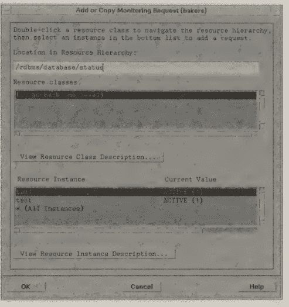

### 资源和性能监控工具

如前所述，大多数数据库性能问题是糟糕的数据库设计或编码不良的数据库查询的结果。导致性能问题的其他原因包括数据访问竞争（“热点”）、不足的硬件资源或配置不良的数据库服务器。本节介绍了各种用于定位数据库性能问题的工具和技术。

#### 应用程序资源测量

由于测量应用程序的性能很困难，Hewlett-Packard 和 Tivoli Systems 联合开发了一套用于测量应用程序响应时间的开放 API。这套标准 API 称为应用程序资源测量（ARM）。如果应用程序已在关键位置修改以使用新的 API，则您可以测量和控制应用程序的端到端性能。在应用程序中调用 API 以标记事务的开始和结束。可以从 Tivoli 或 Hewlett-Packard 免费获得 ARM 的软件开发工具包（SDK），以简化此过程。表 8-5 列出并描述了可用的少数 ARM API。

Baan 已宣布其 ERP 应用的下一个版本将使用 ARM API 进行仪表化，这将使收集 Baan 的应用程序性能数据更加简单直接。

| **名称** | **功能** |
| :--- | :--- |
| arm_init | 为应用程序初始化 ARM 环境 |
| arm_getid | 命名应用程序中使用的每个事务类 |
| arm_start | 标记事务实例执行的开始 |
| arm_update | 更新关于事务实例的信息 |
| arm_stop | 标记事务的结束 |
| arm_end | 清理应用程序中 ARM 使用的内存 |

在收集应用程序数据后，可以通过性能管理工具（如 MeasureWare 和 HP PerfView）进行呈现。

##### Oracle Trace

Oracle 有一个名为 Oracle Trace 的 API，它与 ARM API 相似，但 Oracle Trace 仅适用于 Oracle 环境。Oracle7 服务器版本 7.3.2 和 SQL*NET 版本 2.3 已经包含了 Oracle Trace 调用。Oracle Trace 可用于对 Oracle 应用程序进行仪表化以获取性能数据。这组 API 还可用于检测应用程序中发生的以下两种类型的事件：

- **持续时间或事务事件**：具有与之相关的开始和停止时间。
- **异步事件**：指特殊情况，如错误。

表 8-6 和 8-7 分别展示了为 Oracle Trace 仪表化的 Oracle Server 7.3 的持续时间和异步事件。

操作员可以使用异步事件来创建数据库访问的审计跟踪，例如。可以研究各种数据库事务的持续时间随时间的变化，以查找趋势。

修改以包含对 Oracle Trace 例程调用的应用程序称为*设施*。用户配置设施定义文件，以定义在跟踪应用程序时要收集哪些指标或*项目*。表 8-8 显示了默认情况下每个事件可用的项目。

还可以使用额外的跨设施项目，例如 Oracle7 服务器事务 ID，来关联从多个应用程序收集的数据。

在对应用程序进行仪表化后，可以从 OEM 控制台启用性能分析。实际上，Oracle Trace 管理器可以自动发现使用 Oracle Trace API 进行仪表化的应用程序。可以启动或停止跟踪，并且可以查看过去或当前活动跟踪的数据。应用程序还可以从内部开始和停止跟踪。可以在同一跟踪中包含多个设施。当跟踪（称为*集合*）停止时，数据将写入集合文件。

除了从 GUI 查看跟踪信息外，还可以针对集合文件运行报告。otrcrep 命令生成详细的跟踪报告，显示与集合中涉及的每个设施的每个事件的所有出现相关的所有项目的统计数据。例如，可以针对特定事件或特定进程生成报告。数据还可以导出到 Oracle7 服务器数据库，其中可以使用 SQL 脚本查询数据。Oracle 提供了一组示例脚本来说明如何执行此操作。

###### 表 8-6 Oracle Trace 持续时间事件

| 事件 | 描述 |
| :--- | :--- |
| Parse Start | 包含 SQL 查询信息（查询的实际文本）的事件的开始 |
| Parse End | 包含 SQL 查询信息的事件的结束 |
| Execute Start | 包含执行 SQL 查询计划信息的事件的开始 |
| Execute End | 包含执行 SQL 查询计划信息的事件的结束 |
| Fetch Start | 包含实际行检索信息的事件的开始 |
| Fetch End | 包含实际行检索信息的事件的结束 |
| LogicalTX Start | 标记第一次执行可能更改数据库状态的数据库更新的事件的开始 |
| LogicalTX End | 标记第一次执行可能更改数据库状态的数据库更新的事件的结束 |
| PhysicalTX Start | 标记数据库状态发生确定性变化的事件的开始 |
| PhysicalTX End | 标记数据库状态发生确定性变化的事件的结束 |

###### 表 8-7 Oracle Trace 异步事件

| 事件 | 描述 |
| :--- | :--- |
| Connection | 记录到数据库的每个连接 |
| Disconnect | 记录与数据库的每个断开连接 |
| ErrorStack | 核心转储的代码堆栈 |
| Migration | 共享服务器进程之间的会话迁移 |
| ApplReg | 应用程序上下文信息 |
| RowSource | 行信息 |
| SQLSegment | SQL 语句的文本 |
| Wait | 记录通用的 WAIT 事件；上下文在事件字符串中提供 |

###### 表 8-8 Oracle Trace 标准项目

| 名称 | 描述 |
| :--- | :--- |
| UCPU | 用户模式下的 CPU 时间量 |
| SCPU | 系统模式下的 CPU 时间量 |
| INPUT_IO | 文件系统执行输入的次数 |
| OUTPUT_IO | 文件系统执行输出的次数 |
| PAGEFAULTS | 硬错误和软错误的缺页次数 |
| PAGEFAULT_IO | 硬缺页次数 |
| MAX_RSSIZE | 使用的最大驻留集大小 |


Oracle 提供了一个用于计算持续时间事件经过时间的函数。还可以生成关于不同类型事件发生频率的报告，例如连接事件。可用的统计数据包括执行不同事件所花费的最短时间、最长时间和平均时间。Oracle Trace API 在表 8-9 中列出并附有简要描述。

## Oracle VS 表

Oracle 提供了一组可用于访问共享全局区域（SGA）内内存结构的虚拟表。其中许多表包含持续更新的数据库性能信息。表 8-10 列出并描述了一些更有趣的 VS 表的内容。

###### 表 8-9 Oracle Trace API

| 名称 | 功能 |
| --- | --- |
| epc_init | 初始跟踪调用；用于向 Oracle Trace 注册设施 |
| epc_add_reg_id | 为设施添加注册 ID |
| epc_remove_reg_id | 移除设施的注册 ID |
| epc_start_event | 记录持续时间事件的开始 |
| epc_end_event | 记录持续时间事件的结束 |
| epc_event | 记录异步事件 |
| epc_collect | 在设施内部启动收集 |
| epc_cancel | 停止由 epc_collect 启动的收集 |
| epc_bind | 将进程绑定到已激活的收集 |
| epc_flush | 将收集数据缓冲区写入磁盘 |
| epc_context | 按线程基础存储收集数据 |
| epc_delete_context | 指示线程结束 |
| epc_set_cf_items | 向另一个进程发送跨设施项目 |
| epc_cf_value | 为跨设施项目赋值 |
| epc_get_cf_items | 从另一个进程获取跨设施项目 |

###### 表 8-10 Oracle VS 表

| VS 表 | 包含内容 |
| --- | --- |
| V$DATABASE | 来自控制文件的数据库信息 |
| V$FILESTAT | 文件读写统计 |
| V$INSTANCE | 当前实例的状态信息 |
| V$LIBRARYCACHE | 库缓存性能信息 |
| V$LICENSE | 许可限制信息 |
| V$PROCESS | 进程信息 |
| V$ROWCACHE | 数据字典性能信息 |
| V$SESSION | 会话信息 |
| V$SESSTAT | 每个当前会话的内存使用情况信息 |
| V$SGA | 系统全局区域摘要信息 |
| V$SGASTAT | 系统全局区域详细信息 |
| V$SYSSTAT | V$SESSTAT 中每个变量的当前系统范围值 |

要获取所有可用的 Oracle V$ 性能监控表列表，请执行以下 SQL 查询：`SELECT * FROM X$KQFVI;`

有关 V$ 表的更多信息，请查阅 Oracle 的《Oracle 服务器调优指南》和《Oracle 服务器参考手册》。

##### GlancePlus Pak 2000

GlancePlus Pak 2000 是惠普（Hewlett-Packard）的一款产品。它包括性能管理、故障管理以及实时性能监控。它包含三个组件：

- MeasureWare
- GlancePlus
- ITO/Special Edition

MeasureWare 是一款 HP 产品，用于收集和记录资源及性能指标。MeasureWare 代理在正在监控的各个服务器系统上运行并收集数据。许多平台和操作系统都有相应的代理，包括 HP-UX、Solaris 和 AIX。

MeasureWare 代理收集数据，对其进行汇总、添加时间戳、记录日志，并在适当时发出警报。代理收集和报告各种各样的系统资源、性能指标和用户定义数据。随后，这些信息可以导出到电子表格或性能分析程序（如 PerfView）。这些数据可被这些程序用于生成警报，以预警潜在的性能问题。通过使用历史数据，你可以发现趋势，这有助于你在资源问题影响系统性能之前解决它们。

MeasureWare 收集系统、应用程序、进程和事务数据。MeasureWare 代理在三个不同级别收集数据：全局系统指标、应用程序和进程指标。全局和应用程序数据每五分钟汇总一次，而进程数据则每 分钟汇总一次。

GlancePlus 是惠普提供的一款实时、图形化性能监控工具。它用于监控单个系统的性能和系统资源使用情况。你应该使用 GlancePlus 来判断性能问题是否可以孤立地归属于系统或数据库。既提供基于 Motif 的界面，也提供基于字符的界面。该产品可用于 HP-UX、Solaris 以及许多其他操作系统。

GlancePlus 收集与 MeasureWare 类似的信息，但采样频率更高。GlancePlus 可用于图形化查看当前 CPU、内存、交换（swap）和磁盘活动，以及系统级别的使用情况。它还可以显示应用程序和进程信息。如果 MeasureWare 代理已安装并处于活动状态，则可以显示事务信息。

ITO/Special Edition 是 ITO 的单系统版本。基于 Java 的图形用户界面允许你在事件浏览器中查看单个系统的事件。GUI 还提供了诊断工具。ITO/Special Edition 使用 ITO 的智能代理技术，该技术包括从各种来源收集数据和执行自动操作的能力。

要在 GlancePlus 或 MeasureWare 中监控应用程序，首先必须定义该应用程序。要定义关键应用程序，首先必须定义组成该应用程序的进程。这是通过在 `parrn` 文件中完成的（位于 `/var/opt/perf/parrn`），在其中列出构成应用程序的进程名称。如果确切名称有所不同，可以使用通配符。例如，可以使用 `ora*` 来定义基于所有以 `ora` 开头的进程的应用程序。GlancePlus 和 MeasureWare 对应用程序定义中列出的进程进行进程信息汇总。

可自定义的规则决定何时应作为警报发送系统性能问题。在 GlancePlus 中，这些规则由 GlancePlus Adviser 管理。在 Adviser 菜单上选择“Edit Adviser Syntax”选项后，你可以查看和修改所有警报条件。GlancePlus Adviser 语法文件（`/var/opt/perf/adviser.syntax`）包含症状和警报配置。也可以使用额外的语法文件。对于 MeasureWare，警报在位于 `/var/opt/perf/alarmdef` 的 `alarmdef` 文件中定义。

在 GlancePlus 中，警报会导致屏幕通知，其中颜色代表警报的严重程度。警报还可以触发自动执行的命令或脚本。除了发送警报外，GlancePlus 还可以通过使用其 EXEC 功能执行 UNIX 命令（如 `mailx`）来打印消息或通知你。

你还可以根据基于指标组合的条件发送警报。例如，CPU 瓶颈警报可以基于 CPU 使用率和 CPU 运行队列长度。MeasureWare 代理将这些警报提供给 PerfView 进行分析，并提供给 ITO 管理控制台。当达到阈值条件时，也可以发送 SNMP 陷阱。可以采取自动操作，或者操作员可以选择执行建议的操作。

可提供应用程序和事务级别的信息。事务必须由应用程序使用 ARM API 定义。以下是部分可用指标：

- 事务平均响应时间
- 事务响应时间分布
- 中止的事务数量
- 中止事务的响应时间

可以从 GlancePlus 和 MeasureWare 访问超过 600 个指标。使用产品的在线帮助功能可以查看指标完整列表。在安装了 GlancePlus Pak 2000 的系统上，这些信息也可以在目录 `/opt/perf/paperdocs/gp/C` 中找到。

Hewlett-Packard 还提供了另一款独立产品，即进程资源管理器（PRM），可用于控制用户或应用程序之间的 CPU、内存和磁盘使用率。PRM 还进行了一些针对 Oracle 的特殊集成。如果正在使用 PRM，GlancePlus 将显示 PRM 应用程序组在多大程度上保持在他们的资源权益范围内。从 GlancePlus 中，你还可以更改 PRM 进程组的权益。

虽然 MeasureWare 提供广泛的性能和资源信息，但其配置信息有限，且没有关于系统故障的数据。有关更多信息，请访问


位于 http://www.openview.hp.com/solutions/application/ 的 HP 资源与性能管理网站。

##### Oracle 管理包

来自惠普（Hewlett-Packard）的 Oracle 管理包可用于监控 Oracle 数据库，并与 GlancePlus Pak 2000 配合使用。您可以简单地将智能代理添加到 IT/O 中，从而将此单服务器环境解决方案迁移到企业解决方案。

有许多数据库指标可供选择。Oracle 管理包可以报告数据库实例、独立表空间及回滚段以及配置的 Oracle 后台进程的状态。还可以报告快照刷新错误的数量。

以下是包含的 Oracle 资源管理指标的摘要：

- 自服务器上次启动以来的最大会话数
- 空闲表空间占总可用空间的比例
- 表空间中的空闲块数
- 无法添加区段的段数
- 接近最大区段限制的段数
- 打开游标占已配置总游标数的比例
- 已使用的 DML 锁比例
- 已使用进程占最大进程数的比例
- 已使用的 enque 资源比例
- 当前用户登录数
- 归档空闲空间百分比
- 转储设备上的剩余空间

除了资源管理之外，还提供以下 Oracle 性能指标：

- 读取块数与物理读取数的比率
- 磁盘排序速率
- 内存排序占总数量的比例
- 每次排序的平均行数
- 块缓冲区命中率（当前和总计）
- 字典缓存命中率
- 库缓存重载百分比
- 空闲内存占总共享池内存的比例
- 事务提交速率
- 事务回滚速率
- 回滚占提交的比例
- 后台检查点完成速率
- 用户调用速率
- 递归调用与用户调用的比率
- 获取链式行占总数的比例
- 全表扫描发生频率
- 缓冲区繁忙速率
- 等待 redo 日志缓冲区空间的次数
- 回滚缓冲区等待占获取的比例

GlancePlus Pak 2000 中包含的所有阈值监控和实时图表都可以应用于这些数据库指标。

### PerfView

PerfView 是惠普推出的一种图形化性能分析工具。它用于以图形方式显示单个系统或多个系统的性能和系统资源利用率，以便进行对比。可以显示多种性能图表。这些图表基于一段时间内收集的数据，而 GlancePlus 的实时图表仅显示最近的历史记录。PerfView 在 HP-UX 或 NT 系统上运行，并使用由 MeasureWare 代理收集的数据。

PerfView 有三个主要组件：

- **PerfView Monitor**：提供接收警报的功能。可以显示警报的文本描述。可以按严重级别、类型或源系统过滤警报。此外，收到警报后，可以选择该警报，从而显示相关指标的图表。操作员可以监控导致故障的趋势，然后采取主动措施以避免问题。图表可用于系统之间的比较以及展示资源消耗的历史记录。内部维护了一个数据库，用于保存警报通知消息的历史记录。
- **PerfView Analyzer**：为磁盘和其他资源提供资源和性能分析。系统指标可以在三个不同级别显示：进程、应用程序（由用户配置为进程集）和全局系统信息。它依赖于从受管节点上的 MeasureWare 代理接收的数据。可以并发分析来自多达八个系统的数据。支持所有 MeasureWare 数据源。PerfView Monitor 和 PerfView Planner 都需要 PerfView Analyzer。
- **PerfView Planner**：提供预测功能。图表可以外推至未来。可以为预测数据显示多种图表（例如线性、指数、s 曲线和平滑图）。

除了对系统资源进行图形化和分析之外，还可以使用 PerfView 对进程和应用程序资源进行图形化和分析。使用 PerfView，用户可以定义组成应用程序的进程集合。然后，PerfView 可用于显示指定应用程序利用率的历史记录。PerfView 显示历史和趋势信息的能力有助于诊断系统问题。对性能信息进行图形化可以帮助您理解是存在持续性问题，还是异常仅仅是活动的短暂峰值。

使用 PerfView，您可以分析、设置警报、预测和报告 Oracle 管理包指标，并将它们与系统、网络和应用程序指标进行比较。图 8-2 中的图表显示了随时间变化的提交或事务速率。

为了进一步诊断问题，PerfView Monitor 允许您更改时间间隔，以尝试查找问题发生的具体时间。图表将重新绘制以显示新的时间段。

PerfView 与几种其他监控工具集成。您可以通过访问“工具”菜单在 PerfView 中启动 GlancePlus。可以从 IT/O 应用程序银行中启动 PerfView。在 IT/O 消息浏览器窗口中排查事件故障时，您可以启动 PerfView 以查看相关的性能图表。

将 IT/O 与 PerfView 一起使用时，PerfView Monitor 被禁用。应使用 IT/O 消息浏览器来查看警报。当在 IT/O 中收到警报时，您可以点击该警报以显示相关的 PerfView 图表。

在单个性能图表中，PerfView 可以显示从多个系统收集的信息。PerfView 和 ClusterView 产品也已集成，允许您在 HP OpenView 子图中选择集群符号并启动 PerfView 应用程序，以快速显示集群中所有系统之间的性能对比。

###### 图 8-2 在 PerfView 中绘制事务速率。

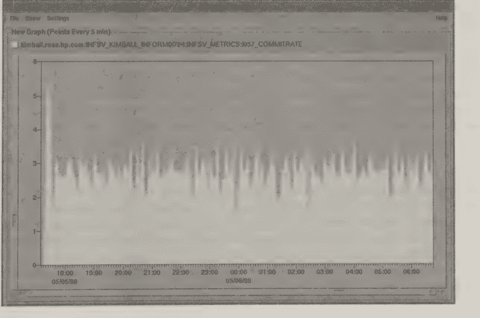

如需更多信息，请访问位于 http://www.openview.hp.com/solutions/application/ 的 HP 资源与性能管理网站。

##### 数据库的 SMART 插件

IT/Operations 旨在为管理系统和网络提供一致的接口。惠普的 SMART 插件（SPI）的目标是扩展对应用程序和数据库的支持。SPI 是预配置的解决方案，旨在与 IT/O 一起使用，尽管并非必须使用 IT/O。目前，针对 SAP R/3、Baan、Oracle、Informix 和 Sybase 都有 SPI。

数据库 SPI 提供与 Oracle 管理包相同的指标集，此外还支持通过 IT/O 的可靠 RPC 机制（而不是通过 SNMP 陷阱）报告信息的能力。

SPI 与 IT/O 之间的紧密集成意味着 SPI 可以使用其他功能，例如事件过滤和关联，以及任务升级。事件包含有助于诊断和恢复的内置说明和操作员文本。许多 SPI 事件已预定义纠正措施。

图 8-3 显示了 Informix 的 SPI 如何集成到 IT/O 中。您可以看到 Informix SPI 为 Informix 添加的新消息组。应用程序组窗口显示了为 Informix SPI 添加的所有数据库工具。消息浏览器允许您查看关于 Informix 数据库的消息。

与专注于故障管理的 EMS 不同，数据库 SPI 专注于数据库配置和资源管理。IT/O 模板可以为不同的数据库实例指定不同的阈值。SPI 可以验证在 Oracle 的 init.ora 配置文件中定义的数据库进程是否实际在运行，并且可以在 GlancePlus 和 PerfView 中将它们的性能作为单个应用程序进行监控。

##### BMC PATROL 知识模块

BMC Software, Inc. 通过其 PATROL 软件套件提供监控功能。使用 PATROL，您可以定义阈值并将事件发送到控制台或其他管理应用程序。PATROL 由控制台、智能代理以及超过 40 种不同的监控程序（或称为知识模块（KM））组成。每个 KM 都是可选的，因此您可以选择最适合您环境的监控器。

控制台提供集中式图形显示，图标代表系统组件或其他受监控组件。图标颜色会随其状态而变化。例如，图标可能会变为红色，以表示其节点或组件上的严重事件。PATROL 控制台还提供事件浏览器，您可以在其中过滤、关联、排序和升级事件。可以配置警报，使事件发送到控制台并显示在事件浏览器中。事件也可以配置为发送到 HP OpenView IT/O 或其他基于 SNMP 的管理站。

智能代理提供发现企业中的系统、数据库和应用程序组件的能力。代理驻留在每个服务器上。持续地，代理


寻找问题；当发现问题时，它们要么执行预配置的操作，要么发送通知以便进行手动恢复。

知识管理器（KMs）包含 PATROL 用于了解监控内容以及问题发生时如何反应的专业知识。KMs 用于监控一组“参数”，这些参数可以包括被监控属性的描述、轮询间隔、测量属性的方法以及异常值的阈值。KMs 提供检测事件并执行纠正操作所需的规则。当出现错误或警告状况时，事件会被发送到操作员控制台。BMC PATROL 包含用于 UNIX、SAP R/3、Oracle、Informix 以及其他应用软件的 KMs。

BMC 的主营业务是数据库和应用监控。它提供用于 Oracle、Sybase 和 Informix 数据库的 KMs。BMC 还针对 DB2、Red Brick 和 Ingres 提供了 KMs。可以说，PATROL 提供的数据库指标比本章描述的其他可用产品更多，尽管你可能需要包含多个 KMs。

对于 Oracle 环境，PATROL 监控 Oracle 服务器、表空间和用户超过 70 个指标。这些指标包括用户连接信息、活动锁、I/O 统计、字典命中率以及 CPU 利用率。即使服务器未运行 PATROL 代理软件，也可以通过使用 SQL*NET 来监控远程服务器。加载 Oracle KM 后，PATROL 会确定系统上的所有 Oracle 数据库实例。PATROL 管理员手动启动和停止实例的监控。

PATROL 为 Oracle 提供以下类别的监控信息：

- 整体数据库性能
- 服务器实例信息
  - 日志缓冲区
  - 共享池
  - 内部结构
- 多线程服务器信息
- 数据库信息
  - 一般统计
  - 跟踪与归档
  - 空间管理
- 用户和应用信息
- 事务信息
  - 一般统计
  - 块级别
  - 行级别
  - 用户与应用
  - 回滚
- 用户会话信息
  - 备份和恢复
  - 其他

PATROL 控制台提供了多种数据库性能图表，可将其作为图标使用。图 8-4 显示了 KM 为 Oracle 维护的一些指标。你可以双击这些图标来查看图表或仪表。

BMC 还提供数据库管理工具。PATROL DB 包括数据库管理工具，如 Pathfinder、DB-Alter、DB-Reorg、DB-Change Manager、DB-Integrity、DB-Voyager 和 SQL-Explorer。这些工具集成到 PATROL 框架中，并可以从 PATROL 控制台启动。相比之下，IT/O 仅提供监控，依赖数据库供应商提供这些管理工具。

BMC 已将其数据库产品打包为适用于 Oracle 的 PATROL 可用性套件。该產品捆绑包包括适用于 Oracle 的 PATROL KM、适用于 Oracle 的 PATROL DB-Stats、适用于 Oracle 的 PATROL DB-Reorg 以及 PATROL DB-Integrity。

与 MC/ServiceGuard 不同，PATROL 不提供任何故障转移功能。但是，有一组有限的自动恢复操作可用。代理可以执行恢复操作，无需与控制台通信。

图 8-4 BMC PATROL 性能图表图标。

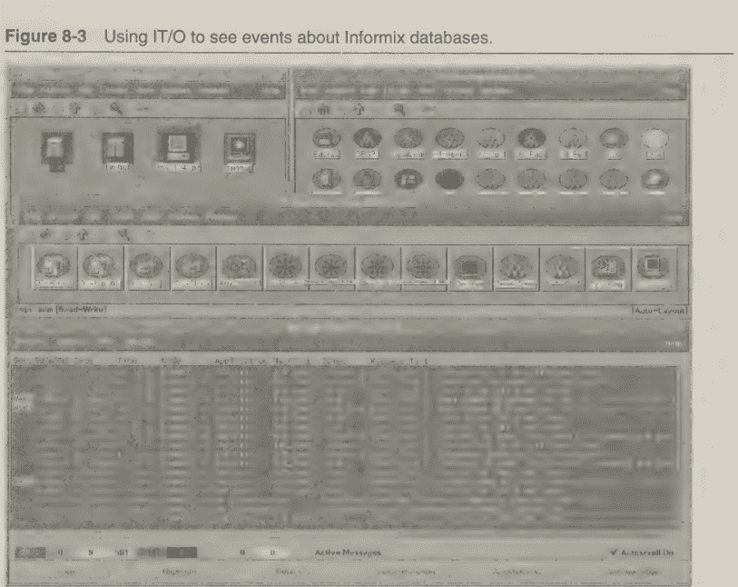

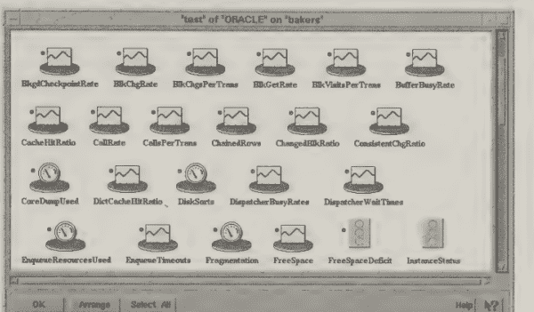

HP 过去依赖 PATROL 向其 MeasureWare Agent 提供数据库信息，但由于数据库 KMs 是通过特殊许可协议转售的，HP 现在使用其面向数据库的 SPI 或 Oracle 管理包来收集 MeasureWare 的数据库信息。

##### PLATINUM DBVision

PLATINUM Technology, Inc. 提供 ProVision 产品套件，用于监控服务器、数据库、应用和网络的运行状况。ProVision 由四个产品组成：

- **ServerVision**：提供关于计算机系统的性能信息，包括负载平均值、当前用户数、磁盘速率、最活跃的 CPU 进程，以及每个进程的 CPU 和磁盘使用率。
- **DBVision**：PLATINUM 用于数据库监控的产品，它可以监控 Oracle、Sybase、Informix 和 DB2 数据库。支持 Motif GUI 和 Windows NT GUI。重点在于资源和性能监控。DBVision 可以检测诸如可用表空间不足、高 CPU 利用率、低交换空间、进程等待锁以及失控进程等问题。该产品还可以用于查看哪个用户占用了系统资源。
- **TransTracker**：一种部署前工具，用于衡量事务对系统、数据库和网络的使用情况。TransTracker 能够通过网络数据包收集数据来识别事务，从而无需对应用程序进行插桩。
- **WireTap**：也用于衡量事务响应时间，它通过捕获数据包级数据并按协议（如 HTTP 和 TCP）对数据分类来进行网络监控。用户可以识别要查找的 SQL 语句，并定义告警阈值，以便在事务响应时间不可接受时发送通知。WireTap 提供针对 HTML 请求的 Web 性能数据，以及 Web 服务器的“命中”率。

当检测到问题时，可以向寻呼机、通过电子邮件或向接收来自多个数据库信息的集中控制台发送警报。响应事件时，可以采取预定的纠正操作，这些操作可以在自动执行的自定义脚本中定义。

DBVision 提供的数据库性能数据包括以下统计信息：

- 每个数据库实例每秒的平均物理写入次数
- 每秒平均总物理读取次数
- 每秒平均总物理写入次数
- 每秒平均块读取次数
- 每秒平均块写入次数
- 每秒平均逻辑读取次数
- 总活动事务
- 每个会话的活动事务数
- 块更改比率

DBVision 还包括数据库资源信息，例如：

- 空闲表空间
- 当前登录数
- 表空间碎片
- 表的扩展区数量
- 每个块的空闲空间

除了数据库监控外，PLATINUM 还提供用于数据库管理和识别数据库性能瓶颈的工具。数据库管理工具包括 Enterprise DBA 和 TSReorg。

Enterprise DBA 提供用户管理、模式和内容管理。管理任务可以在不同的数据库之间执行，支持 Oracle、Informix 和 DB2 数据库。使用远程代理来更改数据库。

TSReorg 支持 Oracle 和 Sybase 数据库。它可以用于重新组织数据库表、索引和表空间。结合使用 DBVision 和 TSReorg，你可以配置纠正操作，以便在响应 DBVision 事件时由 TSReorg 自动执行。可以监控表空间，从而自动触发数据库重新组织。表空间可以在数据库保持在线的情况下重新组织。TSReorg 还可以用于以图形方式显示数据库结构，展示数据库碎片所在之处。

可以使用数据库分析器工具以图形方式显示表空间和数据库使用情况信息，这些信息可用于容量规划。还可以使用 Oracle 服务器管理器来监控 Oracle 数据库。日志分析器可以作为 Sybase 和 DB2 数据库环境的额外故障排除工具。

### 使用数据库性能数据

数据库性能问题的可能原因包括数据模型设计不佳或数据库应用程序编程编写不当。在投入生产之前，应首先在开发环境中对程序进行大量测试。然而，解决设计和编程问题超出了本书的范围。你可能需要查阅数据库供应商的文档，例如 Oracle 的 *Oracle Server Concepts*，以获取有关这些主题的更多信息。

性能问题的其他原因可能是系统配置不当或数据库资源使用效率低下。为了识别这些情况，你需要收集性能统计数据，使用本章前面讨论的指标和工具。在数据库处于生产状态时，应使用性能监控工具来监控负载并收集性能数据。通过收集性能统计数据，你可以建立一个基线，以便在存在重大性能问题时进行比较。由于应用程序工作负载会变化且使用情况各异，因此重要的是在一段时间内收集数据，而不是依赖单次的快照数据。

#### 避免性能问题

针对既定基线进行主动监控可以帮助你识别可能导致性能问题的资源使用趋势。这样做可以让你在终端用户体验到缓慢响应时间之前纠正问题。

其他类型的性能问题涉及无法对不同工作负载进行优先级划分并为每个负载分配指定数量的系统资源。两款产品可以帮助对数据库工作负载进行优先级划分：进程资源管理器（PRM）和 Oracle 数据库资源管理器。

进程资源管理器（PRM）可用于控制用户和应用程序的系统资源分配。可以指定最低和最高授权额度。PRM 可以控制 CPU、实际内存和磁盘 I/O 带宽。然而，PRM 仅在 HP-UX 上可用。

你可以在 HP-UX 上使用 PRM 将数据库应用程序与其他应用程序隔离。可以为数据库管理系统分配 CPU、内存和 I/O 的资源授权额度，以帮助减少来自其他应用程序的干扰。如果系统繁忙，PRM 确保数据库应用程序获得其配置的系统资源份额。如果应用程序不需要其有权使用的所有资源，可以配置 PRM 将其资源分配给其他应用程序。对于容量规划目的，还可以配置 PRM 以限制应用程序的最大资源使用量。

除了将数据库管理系统与系统中的其他应用程序隔离外，PRM 还具有特殊的 Oracle 支持，允许将资源分配给特定数据库。Oracle 在其创建的处理数据库访问的进程中嵌入了数据库名称。通过为每个数据库实例配置进程并使其处于单独的 PRM 组中，你可以单独管理每个数据库。如果某些数据库应用比其他应用具有更高的优先级，这将特别有用。例如，如果长时间运行的数据库作业优先级较低，但需要


访问与交互式用户相同的磁盘，则可以使用 PRM I/O 带宽控制来确保任务持续取得进展，同时不会严重干扰其他用户。一种较为简单的方案是制定策略，确保长时运行的任务不在数据库或系统使用高峰期间执行。另一种方案是简单地以比系统上其他应用程序更低的优先级运行这些任务。

Oracle 还通过其 Oracle8i 版本提供了资源管理功能。Oracle 数据库资源管理器可用于在不同用户之间优先处理数据库工作负载。例如，可以赋予运行 OLTP 应用程序的用户比决策支持用户更多的 CPU 资源。只有与 Oracle 相关的 CPU 使用量受到操控；服务器上运行的其他应用程序的 CPU 配额不应受到影响。然而，如果 Oracle 是服务器上运行的唯一应用程序，数据库资源管理器的表现最佳。

##### 检查系统争用

如果用户抱怨存在性能问题，你可能希望先检查用户调用速率或数据库事务速率，以了解实际上做了多少有用的工作（如果有的话）。这些信息在标准数据库的 RDBMS MIB 中可用。此外，Oracle 在其私有数据库 MIB 中提供了用户调用次数和用户提交次数的指标。通过监测一段时间内的这些数据，你可以计算这些指标的速率。事务速率可以与已知基线进行比较，以帮助你判断是否存在性能问题。然而，事务速率可能是一个不可靠的指标，因为较低的数值也可能表示最终用户活动减少。理想情况下，你会检查数据库响应时间，但目前没有直接跟踪此指标的好方法。

如果报告了性能问题，你需要确定原因是系统瓶颈、磁盘瓶颈，还是数据库参数配置不当。系统资源瓶颈的潜在原因包括未调优的操作系统、无法容纳数据库工作负载的系统规模过小，或系统上运行的其他应用程序。你可能需要通过增加内存或处理器来提高系统容量。如前所述，PRM 可以帮助你在应用程序之间优先分配资源。

要检查实际内存瓶颈，你可以先检查可用内存量。它不应降至总可用内存的 5% 以下。如果系统无法满足内存需求，它将开始分页和交换。过度的分页和交换可能是内存瓶颈的迹象。GlancePlus、MeasureWare 和 BMC PATROL 是可用于显示分页速率的一些工具。

CPU 资源争用可以通过高利用率和长时间队列来识别。这种情况应在一段时间内持续存在，以表明存在严重的 CPU 瓶颈。在数据库环境中，首先检查内存争用，因为 CPU 的大量时间都用于在磁盘和主存之间分页和交换数据。高 CPU 使用量可能是应用程序问题的指示，例如缺少数据库索引。你还应查找主导 CPU 使用量的失控进程。

网络瓶颈可以通过共享介质上的高利用率和大量冲突来识别。可以通过重新设计应用程序以减少其网络流量来解决这些问题。其他选项是使用更高容量的网络连接，或将客户端和服务器系统放置得更近。

##### 检查磁盘瓶颈

磁盘相关指标可用于识别不平衡的 I/O 活动。如果这是问题所在，你可能需要重新构建数据库并将数据文件重新定位到不同的磁盘上，以避免磁盘和控制器瓶颈。你不应该将数据库文件放在用于交换的磁盘上。数据库表及其索引应位于不同的磁盘上，因为它们是被并发访问的。如果数据库经常更新，重做日志也应放在不同的磁盘上，因为日志的更新频率也很高。你还应尝试将经常一起使用的表放置在不同的磁盘上。确保适当使用操作系统磁盘条带化和 Oracle 条带化。你还应检查是否存在系统内存瓶颈，以确定向系统添加更多实际内存是否可能解决该问题。

数据库表、索引和回滚段在创建时都有初始磁盘分配。如果这些分配被超出，则必须动态分配更多空间，这可能会分布在磁盘的各个位置。这种磁盘碎片化会减慢 I/O 操作并可能导致磁盘瓶颈。管理员可能需要定期重构数据库以修复问题，例如大量的数据库碎片。PLATINUM 的 TSReorg 工具可以图形化地显示数据库碎片，从而你可以快速评估问题的规模。TSReorg 可以与 DBVision 一起使用，以便针对数据库问题事件采取数据库重组等行动。

##### 检查数据库缓冲区和池大小

对于 Oracle 数据库，init.ora 配置文件中的一些参数可以调整，以减少系统资源争用并改善内存性能。另一个选项是由数据库管理员限制或控制用户登录。可以控制并发用户数量，以帮助确保足够的响应时间。可以实施策略以断开非活跃会话。

排序可能是数据库查询中非常耗时的一部分。Oracle 在 init.ora 文件中提供了多个可配置参数，例如 SORT_AREA_SIZE、SORT_WRITE_BUFFERS 和 SORT_WRITE_BUFFER_SIZE。这些参数决定排序在多大程度上在主存中完成。拥有较大的排序区域可以使数据库查询更快；但是，由于资源参数应用于每个用户会话，这会影响系统内存的争用。拥有较小的排序区域可能在排序期间需要写入磁盘。

如果存在用户登录较少的任务运行时段，例如在晚上，你可能希望在一组配置参数之间切换。在下班时间之后，你可以利用更多的空闲内存来增加排序区域大小，然后在峰值使用期间切换到较小的尺寸，以应对更多用户的数量。Oracle 在其私有数据库 MIB 中跟踪写入磁盘的排序数量。将此与排序总数进行比较会产生排序溢出比率，对于 OLTP 应用程序，该比率应为零。

如前所述，许多资源是按用户分配的。如果存在性能问题，你可能希望检查当前登录的用户，以确定是否有未经授权的用户登录，或某些用户是否多次登录。你可以使用 who 或使用 RDBMS MIB 检查入站关联的数量，以了解系统活动。本章前面，列表 8-2 展示了如何使用 SQL SELECT 语句显示当前数据库用户进程。监测随时间变化的并发会话数量有助于识别任何使用峰值。Oracle7 和 Oracle8 具有为用户的 CPU 时间和磁盘 I/O 量建立资源限制的能力。这些参数在用户的数据库配置文件中定义。

Oracle 具有单个缓冲区缓存和共享池区域，由所有数据库用户共享。init.ora 文件中的 DB_BLOCK_BUFFERS 和 SHARED_POOL_SIZE 参数控制这些资源的大小。来自数据库表、索引、簇和回滚段的数据可能存储在缓冲区缓存中。Oracle 的缓冲区缓存命中率可以使用存储在 Oracle 私有数据库 MIB 中的一致性获取数量、块获取数量和物理读取数量指标来计算。其他工具，如 BMC PATROL 的 KM for Oracle，也跟踪缓冲区缓存命中率。通过检查缓冲区缓存命中率，你可以查看缓冲区缓存的大小是否合适。命中率应为 70% 到 85%。如果命中率低且存在空闲内存，考虑增加缓冲区缓存的大小，因为这可能会提高性能。只要空闲内存可用且不存在 CPU 瓶颈，你可以增加缓存大小，直到命中率停止增加。在存在 CPU 瓶颈且没有空闲内存的情况下，减小缓冲区缓存的大小可能是合适的，以便将部分工作从 CPU 转移到磁盘。以这种方式平衡系统资源可以为数据库用户带来更好的整体响应时间。

共享池区域用于存储字典信息以及共享的 SQL 和 PL/SQL 代码。大量的 SQL 语句重新加载可能表明共享池区域太小。对于 Oracle，计算库缓存未命中率所需的指标位于 Oracle 私有数据库 MIB 的库缓存表中。

数据库检查点影响磁盘性能，因为它增加了磁盘的 I/O 活动。Oracle init.ora 文件中的 LOG_CHECKPOINT_INTERVAL 参数决定缓冲区缓存中已更改数据写入数据库的频率。确保 LOG_CHECKPOINT_INTERVAL 等于或大于重做日志的大小。

Oracle 的 LOG_BUFFER 参数用于确定在写入重做日志文件之前应该缓冲多少已修改的数据。增加缓冲量可以通过写入更大的数据块来减少所需的磁盘写入次数。如果对数据库进行了许多更改，这可能很有用。如果系统内存是瓶颈且没有进行大量数据库更新，这可能表明日志缓冲区太大。你可以通过监控包含重做日志的磁盘的 I/O 速率以及用户等待重做日志缓冲区空间的次数来观察日志缓冲区的有效性，理想情况下


#### 避免数据库问题

你可以采取几种主动措施来避免数据库问题。系统和数据库服务器故障可能难以预测，但某些根本原因是可以监控的。你可以监控表格随时间增加的行数，以监控数据库增长。性能逐渐下降或可用表空间低于临界阈值，可能预示着故障即将发生。通过使用数据冗余可以避免数据丢失。有多种技术可用，例如磁盘镜像。然而，除非例如磁盘镜像的故障被快速检测到并修复，否则这并不足够。EMS HA Monitors 产品是检测镜像故障的工具之一。

数据库操作员还应定期检查系统和数据库日志文件（如 Oracle 的 alert 文件），以查找故障信息或异常事件。

第 4 章中提供了用于监控系统性能的工具。PerfView 等工具可用于发现任何资源利用率和性能趋势。数据库管理员可以使用这些信息来预测数据库增长并规划增加的容量。可以使用各种监控工具（如 BMC PATROL 或 SMART 插件）来收集资源阈值信息。如果数据库没有可用空间，你需要归档或删除不必要的数据，或者分配更多空间。

有一些工具可用于帮助你正确调整系统。Oracle 提供了一款附加产品 Oracle Expert，它是一个专家系统，使用专门针对 Oracle 数据库的配置和调整规则。BMC PATROL 具有内置的自我调整和负载均衡功能，例如压缩日志文件和调整表格大小。

监控备份和安全是你可采取的两个额外的主动步骤。应定期验证数据库备份，以确保在需要时能够恢复数据。通过维护系统访问的审计日志，你可以更容易地检测到安全入侵，并在经历数据库停机之前做出响应。

##### 从数据库问题中恢复

BMC PATROL 等工具可以检测关键数据库进程的故障并自动重启它们。MC/ServiceGuard 提供类似的功能，并且能够在另一系统上重启应用程序。

假设存在成功的备份，Oracle 等数据库可以在不丢失数据的情况下从磁盘故障中恢复。这需要受过训练的数据库管理员，因为该过程通常不是自动化的。Oracle Recovery Manager 产品可用于管理备份、恢复和恢复过程。

在系统故障后，Oracle 可以通过执行完全恢复自动将数据恢复到一致状态。这是通过确保已提交的更改应用于数据库，并撤消未提交的更改来实现的。这可能是一个耗时的工作。如果系统问题持续存在，可能需要将工作负载移至另一系统。对于 HP-UX 系统，MC/ServiceGuard 提供了自动移动工作负载的能力。为了避免与单节点故障相关的停机时间，可以使用 Oracle Parallel Server。HP 的 MC/LockManager 为 HP-UX Oracle Parallel Server 环境提供高可用性。

除了系统故障，人为错误（如删除数据库表中错误的行）也可能导致停机。成功的数据库备份至关重要，以确保系统可以恢复到良好、一致的状态。

要确定如何从 Oracle 数据库问题中恢复，请参考 Oracle 的以下文档：《*Oracle7 服务器管理员指南、Oracle7 服务器调整、Oracle7 服务器参考*》以及《*Oracle7 服务器 SQL 参考*》。对于 Oracle 的后续版本，也存在类似的文档。

#### 数据库监控产品比较

你对数据库监控产品的选择可能取决于你的数据库职责和计算环境的细节。例如，EMS 仅适用于 HP-UX 环境，并在 MC/ServiceGuard 集群中的服务器上使用时具有特殊功能。MC/ServiceGuard 和 Solstice HA 等高可用性集群产品仅在一个单一的操作系统平台上可用。其他数据库监控工具（如 MIB 浏览器、SP1s 和 BMC PATROL）适用于多种 UNIX 平台。

对于配置管理，Network General 的数据库模块产品有助于检测数据库连接问题是否由配置错误引起。EMS 提供文件状态更改监视器，可用于确保没有人意外更改数据库配置文件。

对于故障管理，你可以根据所使用的平台，使用 Sun 的 Solstice HA 或 Hewlett-Packard 的 MC/ServiceGuard 产品来保护你的数据库。如果使用 MC/ServiceGuard，你可以使用 ClusterView 以图形方式查看发生的任何数据库故障。EMS HA Monitors 可以提供额外的数据库和服务器状态信息。除了支持多种通知方法外，EMS 是唯一可以将故障信息发送到 MC/ServiceGuard 的工具。EMS 还可以将警报发送到 HP Predictive Support 以进行系统的主动维护，但目前 Predictive 仅监控硬件事件。

BMC 的 PATROL KMs 和 HP 的 SPIs 提供了最完整的数据库资源和性能管理解决方案。两者都提供几种性能指标，并为多个数据库提供解决方案。SPIs 可以与 MeasureWare 和 PerfView 一起使用，并且与 IT/O 紧密集成。由于其与 IT/O 代理的紧密集成，SPIs 可以提供比 BMC PATROL 更复杂的事件关联和过滤。SPIs 还具有更多的资源粒度，使你能够选择要监控的数据库对象。例如，在监控表空间空闲空间时，你不需要包含只读表空间。

对于注重预算的用户，EMS HA Monitors 可以提供一些表空间的资源监控。如果有时间，通过浏览数据库 MIB，你可以获取大量有用的性能数据。MIB 浏览功能在小数据库环境中可能非常有用。操作员必须启动 MIB 浏览器并轮询个别数据库值，而不是以异常处理为基础来响应问题。即使是中等规模的安装，这也很快就会变得劳动密集。然而，在报告数据库问题后，它可以作为获取额外信息的有用机制。MIB 数据有助于诊断性能问题的原因。例如，你可以前往 Informix Private MIB 查看由会话执行的最后一条 SQL 查询。

因此，获取数据库性能信息的方法多种多样。GlancePlus 和 MeasureWare 增加了查看事务级别性能数据的能力。高可用性集群产品提供了检测和从数据库问题中恢复的能力，无需用户干预。例如，在系统故障的情况下，MC/ServiceGuard 可以在另一系统上重启数据库服务器。BMC PATROL 和 PLATINUM ProVision 除了检测功能外，还提供数据库管理工具。SMART 插件提供关于如何从问题中恢复的文本指导，但依赖于其与数据库供应商工具（如 OEM）的集成来执行管理任务。

对于数据库安全和备份管理，工具相对较弱。Network General 的数据库模块可以检测到试图突破安全的尝试，因为它监控所有数据库网络流量。IT/O 可以在系统级别检测失败的超级用户登录。Informix 在其 Private MIB 中存储了一些关于过去备份的信息。

这些工具的组合可以使用。例如，BMC PATROL、SP1s 和 EMS 都可以将事件发送到 IT/O。因此，BMC PATROL 数据库 KM 可以检测问题并向 IT/O 的消息浏览器发送消息，IT/O 管理员可以已经启用自动采取的操作。

EMS、BMC PATROL 和 SP1s 各自提供额外的系统、磁盘和网络监控解决方案。你对数据库监控的选择可能取决于你的环境中已经使用的产品。


## 企业管理

本书的大部分内容都集中在监控单个 UNIX 系统的工具上。然而，你可能负责监控数十甚至数百个系统。此外，你很可能正在管理一个异构环境，在这种环境中，保持一致地监控异构系统至关重要。例如，一家公司可能已经决定从 UNIX 迁移到 NT，但并不希望替换其现有的 UNIX 应用程序，如 SAP。公司可能选择将部分应用程序（例如数据库服务器）保留在 UNIX 上，同时将应用服务器迁移到 NT。使用一致的工具来监控不同的平台可以使你的工作更轻松。像 SNMP 这样的标准对于这种类型的环境尤为重要。

本章重点介绍了管理多个系统时会出现的一些问题。这包括跨企业监控系统的问题。关于使用事件关联工具的一节讨论了如何减少企业环境中可能生成的消息量。我们将探讨监控多个系统（包括集群）时的一些问题。在异构环境中，可能还存在跨平台监控问题。最后，由于没有单一工具能够解决你所有的监控需求，我们将探讨一些可以联合使用的工具。

### 跨企业监控

试图管理大量系统会存在问题。通常，IT 部门将负责管理多个系统，很可能是在多个平台上。大型公司拥有大量需要管理的系统。

在多个平台上跟踪多个系统可能是一项复杂的任务。一些公司希望实施一种“无人值守”环境，在这种环境中，企业中的每个计算位置都不需要操作员。其他公司则要求系统每周 7 天、每天 24 小时可用。大多数公司还制定了灾难恢复计划，以保护其关键数据和应用程序资源。这些是你在管理计算机系统和应用程序的企业时面临的一些问题。

有多种解决方案可供使用，以辅助企业管理。例如，HP OpenView IT/Operations (IT/O) 是一款旨在帮助进行企业管理的产品。它提供事件浏览器和拓扑图，使用不同的图标来表示环境中的所有各种系统。IT/O 使用地图上的不同图标来表示不同的平台。例如，有独特的图标准识 NT 系统和 HP-UX 系统。

通过 IT/O 使用 SNMP 等标准，你可以使用通用接口接收事件并轮询企业中的异构系统。IT/O 允许你将监控和消息模板分发到多个系统。它具有可扩展性，因此你可以轻松添加更多待管理的系统。为了辅助事件管理，你可以集成多种事件关联工具中的一种，以协调并减少来自企业系统传入的消息数量。IT/O 还支持一种复杂的架构，在该架构中，事件可以附带注释转发到另一个 IT/O 管理站。

对于灾难恢复，许多公司已制定了复杂的程序并每年演练灾难恢复。需要考虑的一件事是企业管理平台本身的备份计划。本书中讨论的许多企业管理框架已获准在 MC/ServiceGuard 环境中运行，这意味着在发生系统故障时，整个企业管理框架可以在备用节点上启动。

在企业管理多个系统时，使用通用工具和标准可以大幅减少你需要学习的工具数量。使用集中式控制台减少了你需要查找问题的位置数量。企业监控框架对于降低企业中系统监控的复杂性至关重要。

### 识别事件

如果你配置了你的企业，使所有事件都发送到一个集中式事件浏览器，你可能需要一种方法来区分彼此不同的事件。事件浏览器通常会在事件消息中包含事件源。许多企业管理框架提供某种分组机制来将事件分组。

例如，在 *IT/O* 中，有消息组。当事件通过代理或管理站接收到 IT/O 时，会根据模板中定义的匹配条件分配消息组。消息组名称会与事件一起显示在消息浏览器中。此外，你可以查看消息组窗口，它显示每个消息组的状态。消息组图标的颜色代表该类别中最严重事件的状态。

IT/O 使用五种不同的颜色来表示事件严重级别。以下是颜色及其含义的列表：

- **绿色：** 正常/运行中
- **青色（浅蓝）：** 警告/边缘
- **黄色：** 轻微警告
- **橙色：** 重大警告
- **红色：** 严重/停止

图 9-1 显示了配置到 IT/O 中的消息组。在这个例子中，OpenView SMART 插件添加了一整套数据库消息组，包括配置事件、故障和性能相关的组。

### 使用事件关联工具

随着公司企业规模扩大，包含更多的系统和设备，公司可能也希望减少管理该企业所需的人员数量。单纯的事件数量可能令人难以承受。

为了避免在多节点管理环境中出现信息洪流，需要某种形式的事件关联。例如，在集群环境中，每个节点都可能注意到共享磁盘设备的故障。如果没有智能事件过滤，管理站可能会从每个集群节点接收一个严重事件。事件关联工具提供事件简化和整合，排除不必要且无意义的信息，并识别根本原因。

除了 IT/O、EMS 和其他工具提供的通知灵活性外，你还需要对接收到的消息进行更多控制。网络打印机故障提供了一个很好的例子。虽然你可能希望在网络打印机故障时得知该信息，但如果该事件被打印机的所有用户检测和报告，它可能会淹没消息浏览器。类似地，如果同一事件被报告多次，你可能会错过更关键的事件。过滤可以使这类场景的管理变得更加容易。关联工具也可以用于帮助解决问题。例如，网络打印机可能对部分用户停机，但对其他用户正常。工具可用于精确定位问题。

我们选择了一些事件关联工具在本节中讨论。市面上还有许多其他事件关联产品。以下列出了一些未在此讨论的产品：

- Micromuse 的 NetCool/OMNibus 提供事件关联功能。NetCool/Reporter 可以基于特定用户感兴趣的事件生成报告。
- Tivoli 企业控制台（Tivoli TME 的一部分）可以配置为执行简单的事件关联。
- Boole & Babbage Inc. 的 COMMAND/POST 执行事件关联。它与 Tivoli TME、BMC PATROL 和 OpenView 协同工作。
- System Management Arts (SMARTS) 的 InCharge 执行事件关联。它预配置了关于常见网络问题的信息。InCharge 与 Tivoli TME 集成。

#### OpenView 事件关联服务

HP OpenView 提供事件关联服务 (ECS) 工具，该工具与 OpenView NNM 和 IT/O 集成。ECS 可用于简化和整合事件。它也可用于抑制和减少事件风暴。该工具可以配置为过滤掉不必要的信息，并帮助你识别问题的根本原因。使用 ECS，你只需要接收关键事件的 notification。ECS 能够接收作为 SNMP traps、CMIP notifications、opcm sg messages 和 ASCII events 的事件。它可以用于管理网络、系统、数据库和应用程序，并且是扩展性的，因此易于添加新的事件/源。

OpenView ECS 产品有两个主要组件：ECS 设计器和 ECS 引擎。ECS 引擎是一个运行时关联引擎。它是实时组件，针对定义的关联规则进行操作。ECS 设计器是一个图形工具，用于简化和设计关联规则。它还提供仿真功能，以便在部署之前测试规则。

ECS 中的*关联电路*是一个由节点组成的集合，这些节点被配置为执行关联和过滤。ECS 可以关联事件，而不论其接收顺序如何。你还可以配置 ECS，使用时间基于的过滤器来抑制重复事件。

通过 IT/O 中的 ECS 集成，事件的关联可以由代理在本地从多个设备执行，或在管理服务器端集中执行。这不仅减少了网络流量，还允许更快、更接近源头地确定根本原因，从而提供更高效的问题解决。

关联模板很容易分发到被管理的节点。它们与其他 IT/O 模板的分发方式相同。即使管理服务器宕机，自动和人工发起的操作也可以在本地配置和执行。

#### 图 9-1 使用 IT/O 消息组对事件进行分类。

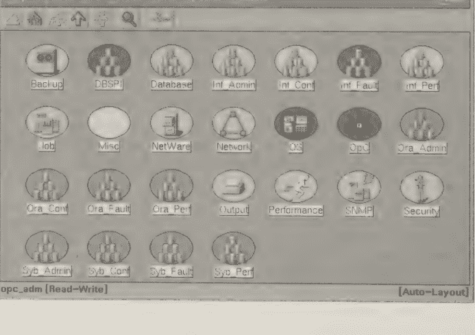


ECS 还与 NNM 进行了集成。ECS 可以从 NNM 中获取网络拓扑，并将其用于关联。它还附带了一些即开即用的网络事件关联电路。

#### Seagate NerveCenter

Seagate NerveCenter 为 UNIX 和 NT 系统提供网络事件关联和行为管理。它使用基于规则的过滤和高级关联来定位根本原因，并帮助您管理企业中关键网络问题和事件的体积。NerveCenter 还可以配置为执行自动纠正操作。

NerveCenter 有三个主要组件：NCServer、AdminTool 和 NC Client。NCServer 维护一个事件数据库。它检测事件，将信息分发给客户端，并与网络管理平台进行通信。AdminTool 用于维护和配置 NerveCenter 域。

NerveCenter 附带了一个图形化警报界面。它提供了一个显示窗口，让您一眼即可了解环境的健康状态。有一个警报和流量摘要窗口，显示现有警报及其严重程度。

规则也可以通过拖放式图形用户界面进行用户自定义。用户可以指定特定事件并定义纠正操作。

行为模型用于定义关键条件与特定纠正操作之间的关系。NerveCenter 附带了多个预定义模型，用于监控网络流量、性能、状态、安全性和错误条件。

您可以为特定事件配置许多不同类型的自动操作。以下是 NerveCenter 提供的自动操作列表：

- 向管理站或另一个 NCServer 发送通知。
- 执行 UNIX 或 NT 命令或 Perl 脚本。
- 将数据记录到文件或数据库。
- 发送寻呼或电子邮件。
- 发送 SNMP 陷阱。
- 执行 SNMP 设置。

NerveCenter 跨网络设备、UNIX 系统和 NT 系统进行关联。关联可以在集中式管理站进行，也可以使用分布式管理模型进行。在分布式模型中，每个 NCServer 负责管理不同的域。

NerveCenter 通过 SNMP 轮询和监听 SNMP 陷阱来关联事件。可以配置其监控特定的 MIB 变量。由于可以轻松添加新的 MIB，因此可以配置 NerveCenter 以轮询额外的 MIB 对象。

NerveCenter 与大多数网络管理平台集成，包括 OpenView NNM 和 IT/O、IBM NetView for AIX、Tivoli TME 以及 Unicenter TNG。它也可以独立运行。通过与 IT/O 集成，NerveCenter 可以将消息转发给 IT/O，IT/O 也可以将消息转发给 NerveCenter。

#### IT Masters MasterCell

IT Masters 提供了一种名为 MasterCell 的事件关联工具。它为分布式环境中的任务关键型应用程序提供事件管理功能。

MasterCell 使用分布式架构，该架构采用代理和中央服务器。代理执行有限的过滤，可以执行操作，也可以将事件转发到服务器。通过使用智能代理，MasterCell 可以通过添加更多单元来分配负载，从而消除瓶颈。此外，使用这种多层结构可以将智能功能尽可能靠近源头。事件可以通过中间查询进行分析，然后有选择地进行传播。这种架构还消除了事件管理环境中的单点故障（SPOF）。

MasterCell 有四个主要组件：事件处理器/单元、事件浏览器、知识库编辑器和适配器。运行在被管理节点上的适配器将事件输入单元。单元收集和分析事件。连接到单个或多个单元的事件浏览器和知识库编辑器是用 Java 编写的，因此您可以从任何地方运行它们。

单元是 MasterCell 环境中的事件处理器。这些轻量级关联引擎分布在企业中。它们收集和分析事件，然后根据定义规则和动作对事件做出响应、存储、传播或分组。您可以拥有由单元组成的网络，称为域。单元可以按地理、功能或组织边界进行分组。操作员可以被分配到特定的单元域。可以在安装了单元的工作站上执行本地操作。

可以使用 MasterCell 事件浏览器浏览来自一个或多个单元的事件。单元将事件分组到收集器中。分组后的事件在浏览器中显示为图标，并带有颜色编码指示器。您可以向下钻取以查看每个收集器的事件。图 9-2 显示了在 demo1 下定义的收集器及其状态指示器的示例。您还可以在浏览器中交互地触发纠正操作。

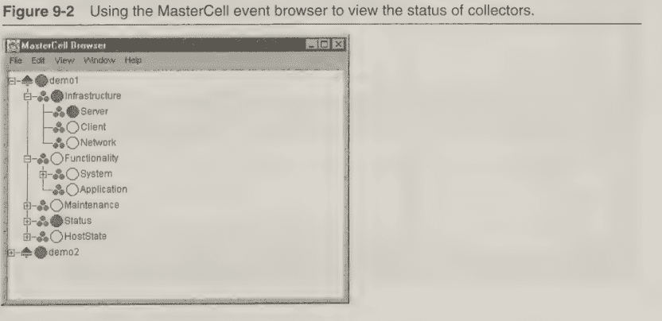

知识库编辑器，或称 KB 编辑器，用于定义类和事件实例。它也用于定义配置规则。提供了一个向导，引导您完成各个步骤。您可以离线编辑知识库，然后将它们分发到单元中。图 9-3 显示了一些使用 KB 编辑器定义的应用程序事件实例，例如 APP_DOWN。

MasterCell 的 2.0 版本添加了多项新功能，用于动态维护企业中各单元和浏览器的最新配置。知识库中的配置更改在配置服务器上进行维护，并自动分发到单元。调用浏览器时，会自动从服务器检索配置数据。

适配器将事件输入单元。运行在受监控系统上的适配器是负责检测事件、将事件转换为 BAROC 并通知 MasterCell 的后台进程。MasterCell 使用 BAROC 语言理解事件。该语言也被 Tivoli Enterprise Console 所理解。适配器将事件转换为 BAROC 并将事件发送到单元。MasterCell 附带用于 SNMP、NT 事件日志以及通用文本日志（如 syslog）的适配器。如果适配器无法将事件传播到单元，则事件将被缓冲。

MasterCell 规则引擎对每个由单元收集的事件执行九个不同的处理步骤。它通过收集有关事件的更多信息或在事件处理之前执行命令来限定事件，从而细化事件。它过滤事件，根据知识库规则决定事件是被丢弃还是传递。它调节事件，重复事件的发生直到满足基于时间的阈值才将其保留。它根据新事件更新现有事件。它执行抽象，通过组合低级事件来创建高级别事件。它还关联事件与其他事件，以建立因果关系。

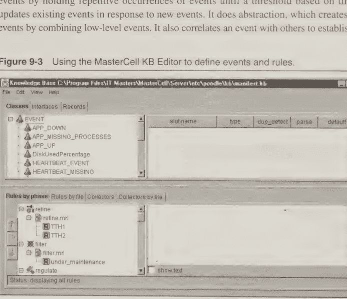

关系。执行阶段是操作员被通知并根据规则执行纠正操作的阶段。计时器阶段根据规则中的时间因素安排操作。它还传播事件，将事件转发到其他单元。

MasterCell 还具有性能节流功能，用于控制事件处理速率。此功能可用于控制事件风暴对服务器资源的影响。

MasterCell 运行在 Solaris、AIX、HP-UX 和 Windows NT 上。此外，它与 Tivoli 的 TME Enterprise Console、BMC PATROL 和 Remedy AR System 集成。

### 监控系统集群

如果您有一组需要以相似方式管理的系统，则能够对系统组而不是单个系统执行操作，可以减少您执行重复任务的工作量。有多种工具允许您将系统聚集或分组在一起，这有助于您在单次操作中应用管理策略或监控配置。

#### IT/O

IT/O 的被管理节点可以分组为 *节点组*。在配置 IT/O 被管理节点的监控时，您可以将模板分配给整个节点组。然后，当您更新被管理节点时，模板将分发到节点组中定义的所有系统。这使得以一致的方式配置多个系统变得更加容易，并减少了出错的可能性。但是，如果您将模板分配给节点组，则很难为每个系统进行定制监控。定制需要单独的模板，根据需要单独应用于每个节点。

#### ClusterView

一些公司将关键系统组合在一起，形成一种称为 *集群* 的高可用性配置。ClusterView 具有针对 HP-UX 和 Windows NT 高可用性集群的特殊监控功能。它可以报告集群的整体状态。在某些情况下，只要集群中至少有一个系统处于启动状态，该集群就被认为是可用的。

ClusterView 还允许您将管理集群定义为 HP-UX 系统的组。然后，从 IT/O，您可以在单一步骤中对一组系统应用管理操作，例如应用模板或在 PerfView 中对指标进行图形化展示。

在单系统环境中，您知道应用程序在哪里运行。当在 MC/ServiceGuard 环境中运行应用程序时，您可能并不总是知道应用程序在哪里运行。ClusterView 显示您的应用程序在哪里运行，或者上次尝试运行的位置及其状态。

### 企业管理框架

企业管理框架旨在通过监控系统集群实现集中操作。代理通常部署在多个系统上。大多数框架


提供开发者工具包，允许你扩展代理的监控能力，从而让你能够使用框架提供的一致界面来进行监控。

许多企业管理框架提供平台特定的代理，以监控异构环境中的系统。它们在管理站上提供集中式事件浏览器。这样一来，运维操作可以以一致的方式运行。

IT/O 可以监控 HP-UX、IBM AIX、Sun Solaris、Windows NT 以及其他平台。CA Unicenter TNG 和 Tivoli TME 也提供代理，这些代理可以从针对许多不同平台的集中式控制台进行管理。

#### ClusterView

ClusterView 可以监控 HP-UX 和 NT 系统上的 HA 集群。无论集群位于 NT 还是 HP-UX 系统上，它都提供一致界面来接收事件并获取有关 HA 集群的信息。这对管理员非常有用，因为他们不需要为每个平台学习单独的工具。

#### 监控代理

BMC PATROL 代理和 MeasureWare 代理可以在许多平台上运行。这些代理收集的数据随后可以使用通用工具以通用且一致的方式进行分析。它们都在大多数 UNIX 平台以及 NT 上提供代理。这两个产品都提供开发者工具包，用于扩展可监控和跟踪的功能及指标。

#### 使用多种工具

厂商认识到，没有任何单一产品能提供符合企业所有需求的完整解决方案。而且，因为你不太可能找到一个满足你所有故障管理需求的工具或企业管理平台，许多厂商提供集成工具。此功能为你在选择最适合监控需求的工具时提供了更大的灵活性。这意味着你可以选择同类最佳监控工具，并从你选择的企业管理框架平台管理它们。

许多监控工具与企业管理框架（如 IT/O、Unicenter TNG 和 Tivoli TME）集成。本节涵盖了一些集成工具，但并非全部。

还有其他许多集成工具的组合。例如，Oracle 的 OEM 产品与 IT/O 集成，使得每个工具都可以从另一个工具启动，IT/O 可以按上下文启动 OEM。此外，OpenView SMART 插件可与 MeasureWare、PerfView 和 IT/O 协同工作。

##### IT/Operations 与网络节点管理器

OpenView IT/O 包含网络节点管理器（NMM）。然而，NMM 可以单独使用，但集成后可以在 IT/O 环境中使用所有 NMM 功能，并且还包括更多的系统和故障管理功能。

IT/O 提供了更多受管节点功能，而 NNM 主要通过 SNMP 等标准提供监控功能。使用 IT/O 代理，你可以做的不仅仅是监控受管节点，还可以管理它们。使用 IT/O，你可以设置更复杂的消息条件，并配置在受管节点上自动运行或由操作员发起的操作。IT/O 还为你在受管节点上添加额外监控提供了更多灵活性。

在 NNM 和 IT/O 中，图形地图上的彩色图标用于反映节点状态。在 NNM 中，节点状态通常由系统的网络状态决定，包括网络接口卡的状态。在 IT/O 中，节点状态不仅由系统的网络状态决定，还由该节点的 IT/O 警报状态决定。

##### IT/O 与 PerfView

PerfView 可以集成到 IT/O 应用程序库中。通过此集成，你可以轻松选择受管节点，然后使用 PerfView 绘制所选节点上收集的指标图表。此外，可以配置模板，使得当你在 IT/O 消息浏览器中收到 PerfView 警报条件时，可以运行操作员发起的操作，调用 PerfView 生成显示与警报条件相关的指标图表。

如果你在 IT/O 受管节点上安装了 MeasureWare 代理，它会检测到正在运行的 IT/O 代理，并自动开始向其发送警报。

##### BMC PATROL 与 IT/O

PATROL 不需要特殊的管理控制台。相反，其基于服务器的 PATROL 代理可以通过 SNMP 陷阱将监控信息发送到 HP OpenView NNM 和 IT/O、CA Unicenter TNG 和 Tivoli TME 等管理平台。此级别的集成需要一个名为 PATROLVIEW 的额外产品，并且 OpenView、Cabletron SPECTRUM、Remedy AR、Sun 的 Solstice Domain Manager 和 Tivoli TME 有专用版本。PATROL 产品可以通过名为 PatrolLink 的特殊产品与 Unicenter TNG 集成。

你需要在 IT/O 管理站上安装 PATROLVIEW。此过程安装并配置消息组、消息模板、节点组、阈值监控器和应用程序图标。

PATROL 与 IT/O 集成的独特之处之一是，来自许多系统的 PATROL 代理（不仅仅是 IT/O 受管节点）都可以向 IT/O 发送事件。PATROLVIEW 包含一个 PATROL 事件翻译器服务器（PET 服务器），它将 PATROL 事件翻译为 IT/O 事件。PATROL 代理向 IT/O 受管节点上的 PET 服务器发送事件。PET 服务器处理并转发事件到 IT/O 代理。

PET 服务器运行在一个或多个 IT/O 受管节点上。它接收并处理来自一个或多个 PATROL 代理的事件，然后将数据转发给处理事件并在必要时转发到 IT/O 控制台的 IT/O 代理。你还可以在多个受管节点上安装 PET 服务器。如果你的某个 PET 服务器宕机，这将非常有用。如果你只配置了一个 PET 服务器并且它宕机，你将失去与所有向 PET 服务器和 IT/O 发送事件的 PATROL 代理的连接。

如果你希望从 IT/O 管理站访问 PATROL 控制台或代理配置工具，这些工具也必须在那里安装。

##### PLATINUM ProVision 与 IT/O

PLATINUM 为 HP OpenView 提供 ProVision 适配器。这为你提供了到 ProVision 的单一集成点。该适配器在 IT/O 环境中自动启用所有 ProVision 工具。适配器附带在安装时配置到 IT/O 的 IT/O 模板和监控器。

使用 PLATINUM IT/O 事件适配器，ProVision 工具通过 POEMS 事件管理器向 IT/O 受管节点上的 IT/O 代理发送事件。

PLATINUM 还提供可用于任何 SNMP 就绪管理框架的 MIB，以作为 SNMP 陷阱接收来自 ProVision 工具的事件。MIB 可以加载到 NNM、IT/O 或 AIX NetView 中。

PLATINUM ProVision 还与 Tivoli TME 紧密集成。PLATINUM 已将其产品集成到 TME，以提供从 TME 环境访问 PLATINUM 产品的通用界面。

##### EMS 与 OpenView NNM 或 IT/O

EMS 提供用于接收进入 OpenView NNM 和 IT/O 的事件模板。使用 EMS，你可以配置事件以 SNMP 陷阱的形式发送。如果配置 EMS 监控器的系统是 IT/O 受管节点，你可以配置事件以 opmsg 形式发送。除了配置 EMS 通知目标外，你还必须配置管理站以接收、识别和显示事件。

对于 NNM，你需要加载 EMS 专用的陷阱配置文件。你还需要确保管理站列在受监控系统中的陷阱目的地列表中。

对于 IT/O，你需要将模板配置到 IT/O 中。模板包括消息条件、用于收集额外事件数据的自动操作以及关于每个事件的说明。在管理站配置后，需要向受管节点分配并分发 EMS 模板。

IT/O 还有一个名为 monvols 的应用程序库工具可用。使用 monvols，你可以在单个操作中配置 HP-UX 受管节点上所有逻辑或物理磁盘卷的监控。事件通知将发送到 IT/O 消息浏览器。

用于接收 EMS 事件的 OpenView NNM 和 IT/O 模板可免费下载，连同 EMS 开发者工具包和其他工具位于惠普软件网站 http://www.software.hp.com 的高可用性部分。monvols 也在此网站上提供。


## UNIX 的未来

系统供应商将在未来几年内对故障管理进行多方面的改进。系统本身正变得更具韧性。人们正在编写更多的监控工具以检测事件，并且系统供应商正在提供设施，使故障排查和从问题中恢复变得更加容易。本章描述了两个主要的 UNIX 服务器供应商——Sun 和 Hewlett-Packard——正在添加的一些功能。

### 故障管理的未来趋势

服务器正在集成更多的恢复和修复功能。服务器供应商正在努力降低单个硬件组件的故障率。目前，在许多服务器上，处理器的丢失会导致系统失败。在未来，在multiprocessor（多处理器）系统上，检测问题、分配处理器并以降低的性能继续操作的能力将成为标准。问题仍将被报告，以便稍后进行修复。您还可以添加和移除所有关键的服务器组件，如 CPU、内存和 I/O，而不会导致系统宕机。

由于系统在这种情况下将不再失败，您获取单个组件故障事件的能力将比以往任何时候都更重要。否则，您可能会难以意识到出了什么问题——直到为时已晚。

Sun 和 Hewlett-Packard 都有高可用性集群产品，并且这些产品仍在不断增强。高可用性产品提供对某些问题的自动恢复，并为您提供更多时间来修复原始故障。如今，HP 凭借其关键任务服务器套件（Mission Critical Server Suites），提供 99.95% 的正常运行时间保证。这意味着每年的停机时间少于五小时。到 2000 年底，HP 计划作为其“5 个 9：5 分钟高可用性（HA）”计划的一部分，提供 99.999% 的正常运行时间保证。HP 计划通过与关键应用程序供应商合作以及改进 HP-UX 操作系统的检测和恢复功能来实现这一目标。应用程序、数据库和网络也将包括在 HA 保证中。

您可以在 HP 网站 http://www.hp.com/go/ha 上找到关于 HA 意图的更多信息。

Sun 和 HP 都认识到完整的系统故障监测的重要性。Sun 正在添加新的监控代理以向 SyMON 发送事件，而 HP 正在添加更多的 EMS 监控器。Sun 和 HP 都提供开发者工具包，使第三方更容易添加监控组件。随着系统监测变得更加广泛，供应商将把他们的监控能力扩展到应用软件，如数据库和企业资源计划（ERP）应用。

系统供应商意识到他们需要为不仅仅是故障事件提供监控器。为了完整的故障管理解决方案，系统操作员需要改进的监控器以检测以下内容：

- 配置更改
- 额外的安全入侵条件
- 系统资源使用的阈值被超过

使用阈值非常重要，以检测趋势并在实际问题发生之前提供更多反应时间。Sun 和 HP 都计划具备更多的预测能力。

目前，有各种通知方法可用于向管理站报告事件。需要添加新的方法以支持新兴标准，如桌面管理接口（DMI）。

故障排查将变得更加容易，因为事件粒度的增加将使定位问题的根本原因变得更加容易。然而，如果没有相应的事件过滤和关联能力改进，事件数量的增加仍可能使系统操作员不堪重负。关联将变得更加普遍，因此操作员将只需要查看他们必须采取某些行动的事件。

未来，事件中将会包含更详尽的帮助信息。目前，操作员获得的是事件消息，但关于如何应对的建议并不多。HP 正在寻求提供纠正问题的额外方式。

Sun 和 HP 都希望为受管系统提供更多的自主恢复能力。Sun 将这些能力称为“智能、自主代理”；HP 则称其为“自愈系统”。无论名称如何，其概念本质上是相同的：本地代理将尝试在不涉及系统操作员的情况下采取适当的恢复措施。行动可以基于系统管理员预定义的策略。

在线功能（本章前面提到过）将导致更快的恢复时间。系统操作员将不需要等待下一个计划的停机时间来修复服务器。操作员还将能够更频繁地增加容量。

资源管理和故障管理在未来几年将更加紧密地整合。Sun 和 HP 都在审查将其资源管理工具与事件管理设施整合的方法。Sun 计划将其资源管理器与 SyMON 产品整合。Sun 已经能够动态重新配置保护域并响应与性能相关的事件重新分配系统资源。HP 已宣布计划将其进程资源管理器与事件管理整合，使进程资源管理器能够通过响应系统瓶颈来重新分配资源，从而满足服务级别目标。

这些只是未来几年将出现的一些新功能。许多供应商认为故障管理具有战略意义，并将其视为区分产品提供的一个重要方式。

# 附录 A

## 标准

### 使用 SNMP 和 MIB

简单网络管理协议（SNMP）是一种用于被管理系统的系统和管理应用程序之间通信的标准协议。SNMP 引入于 20 世纪 80 年代，现在是管理信息通信的事实标准。虽然最初 SNMP 仅用于管理网络组件，如路由器、网桥和集线器，但它现在也用于系统、软件应用程序和中间件产品。

SNMP *子代理*是负责管理不同系统组件的进程。来自管理站的 SNMP 通信由被管理系统上的*主代理*进程转发到适当的子代理。SNMP 通信通过用户数据报协议（UDP）发送。主代理在众所周知的 UDP 端口（161）上监听请求，解码请求并将其转发到适当的子代理。每个子代理在启动时向主代理注册，并指示应转发到其的请求。主代理还代表子代理发送陷阱（traps）。图 A-1 显示了所有通过主代理到系统中子代理或来自子代理的 SNMP 流量。在 HP-UX 上，主代理通过从 SNMP Research International, Inc. 获得许可的 EMANATE 技术提供。有关 EMANATE 的更多信息可以在 http://www.snmp.com 找到。

SNMP 子代理以称为*管理信息库（MIB）*的分层结构形式表示其提供的管理信息。图 A-2 显示了各个 MIB，即 MIB-II 和 RDBMS MIB，如何融入整体 MIB 层次结构。MIB 浏览器通常随企业管理框架一起提供，例如 HP OpenView Network Node Manager。这些图形工具可以允许操作员导航 MIB 树结构，以查找特定的管理信息。除了显示 MIB 对象标识符（OID）外，MIB 浏览器通常还显示 MIB 对象的值。MIB 浏览器使用 SNMP 请求查询被管理系统中子代理的 MIB 值。

MIB OID 的每个组件都分配了名称以及数值值。例如，MIB-II 是一个用于系统信息的标准 MIB，其根 OID 为


#### 图 A-1 SNMP 架构。

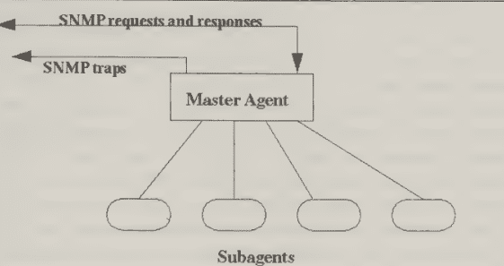

1.3.6.1.2.1. 这对应于助记 OID iso.org.dod.internet.mgmt.mib_2。请注意，尽管某些 SNMP 工具要求 OID 前加一个点（“.”），但为了易读性，本附录中省略了该点。

SNMP Research International 提供了一个 EMANATE 子代理开发工具包（SADK），以便编写额外的子代理。配置新的待监控 SNMP 对象的另一种方式是通过 HP OpenView 可扩展 SNMP 代理产品。可以通过描述新管理对象及需执行的操作的配置文件来扩展该代理。MIB 值可以是命令的输出，或者是用户指定文件的内容。可扩展 SNMP 代理可以根据配置的条件生成用户定义的 SNMP 陷阱。当与 HP OpenView 网络节点管理器（NNM）或 IT/Operations（IT/O）一起使用时，在接收到陷阱时也可以执行自动操作。

#### 图 A-2 MIB 层次结构。

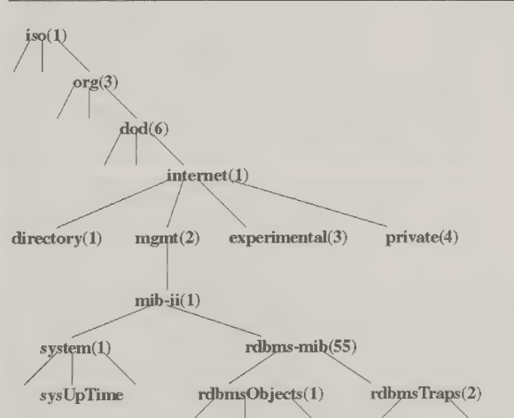

MIB 通常起源于互联网草案文档。任何人 can 创建这些草案规范，但在成为标准之前，它们由互联网工程任务组（IETF）进行审查。审查后，这些文档作为请求评论（RFC）发布。可以在 Web 站点 http://www.ietf.org 上找到 RFC 规范，以及其他 IETF 文档。

除了标准 MIB 外，许多厂商为其自己的硬件或软件产品提供独特的 MIB。例如，Hewlett-Packard 为其 MC/Service-Guard 产品提供了 MIB。Oracle 在其私有分支下提供其专有的 MIB 规范。这些私有文档仅受发布机构相应审查的约束。

管理应用程序可以通过发出 SNMP Get 请求来接收 MIB 信息，该请求可以是阻塞或非阻塞调用。子代理的回复包括 OID、变量类型和值。SNMP 还支持 SNMP Set 请求，但子代理通常未实现此功能。

除了响应 SNMP 信息请求外，子代理还可以通过 SNMP 陷阱机制发起事件通知。SNMP 陷阱是与其他管理框架集成的重要工具，因为管理站上通常提供用于监听这些陷阱的进程。子代理可以使用这一种机制将关键事件信息转发到不同的管理应用程序。

SNMP 陷阱配置信息存储在配置文件 /etc/SnmpAgent.d/snmpd.conf 中，在此处可以指定 SNMP 共同体名称。如果已配置，SNMP 代理仅允许带有指定共同体名称的请求。可以为 SNMP Set 和 Get 请求指定不同的共同体名称配置。陷阱应发送到的目标地址也在此配置文件中指定。您应确保列出您的管理站的 IP 地址。

事件监控服务（EMS）使用 SNMP 陷阱作为将资源事件转发到目标应用程序的方法之一。EMS 有定义的 MIB，其中包含了可发送的各种陷阱。EMS 陷阱的企业 OID 为 1.3.6.1.4.1.11.2.3.1.7。使用 EMS 提供的 SNMP 陷阱通知，监控程序可以通过 SNMP 陷阱向多个应用程序和平台生成事件，而无需直接进行 SNMP 函数调用。

与大多数企业级管理平台一样，Hewlett-Packard 的 OpenView IT/O 和 NNM 提供监听 SNMP 陷阱的事件处理程序，可以显示事件、记录事件，并在接收到事件时生成自动操作。提供了模板以定义对特定 SNMP 陷阱的处理。模板定义了要显示的事件消息、事件的严重性、发送事件的系统名称、事件的消息组或类别，以及事件的自动或操作员发起的操作。可以轻松地将新的陷阱定义添加到模板中，以便事件被识别并正确格式化。

每个陷阱由其 OID 以及通用和特定陷阱编号标识。陷阱包括发送事件的代理地址和变量列表。使用模板，事件处理程序将事件分配到一个类别，然后分配在模板中配置的严重性。消息根据模板中的格式字符串进行格式化。陷阱消息中包含的变量可用于在消息浏览器中显示的格式化事件消息中。

管理平台，如 OpenView NNM，提供了多种用于访问 MIB 信息的工具。MIB 浏览器对于探索 MIB 和查询 MIB 值非常有用。图 A-3 显示了从 MIB-II 中查询 LAN 接口卡操作状态的结果。

NNM 不仅提供了简单的 MIB 浏览器，还提供了数据收集器工具，用于收集 MIB 数据以进行历史趋势分析和问题监控。您可以定义阈值，当超过指定阈值时生成事件。NNM Application Builder MIB 工具使您能够快速开发一个应用程序来监控 MIB 变量。Application Builder 使您能够以表格、表单或图表的形式报告 MIB 数据。IT/O 还包括 MIB *监控模板*，使您可以为任何 MIB 变量设置监控。监控模板与 IT/O 消息浏览器提供紧密集成，并提供了根据事件指定自动操作的功能。

SNMP 摘要以及 SNMP 版本 2 的最新修订版可以在 Marshall T. Rose 的 *The Simple Book: An Introduction to Internet Management*（Prentice Hall，1994 年）中找到。关于 SNMP 的更多信息也可以在 RFC 1441 和 1442 中找到，可在 `http://www.ietf.org` 的 Web 上获取。

以下部分描述了一些利用 SNMP 标准的重要 MIB 规范。这些文档包含关于您的系统、外设和数据库以及其他软件应用程序的信息。这些信息在为您的 Unix 系统提供适当级别的监控方面是无价的。请注意，在以下 MIB 规范中，星号（*）后缀表示该变量用作表条目的索引。

#### MIB-II

MIB-II 通常被称为 *系统 MIB*。它是一个关于计算机系统的标准信息存储库，支持多种平台，包括 Unix 和 Windows NT。MIB-II 包含关于计算机系统的信息，例如其名称、系统联系人以及运行时长。它还包含来自关键网络协议（如 TCP、UDP 和 IP）的统计数据。统计数据包括数据包传输计数和错误计数。

##### MIB 定义

清单 A-1 显示了 MIB-II 的完整定义，如 RFC 1213 和 1214 中定义的那样。

**清单 A-1 MIB-II 规范。**

```
mgmt
  mib_2
    system
      sysDescr
      sysObjectID
      sysUpTime
      sysContact
      sysName
      sysLocation
      sysServices
    interfaces
      ifNumber
      ifTable
        ifEntry
          ifIndex*
          ifDescr
          ifType
          ifMtu
          ifSpeed
          ifPhysAddress
          ifAdminStatus
          ifOperStatus
          ifLastChange
          ifInOctets
          ifInUcastPkts
          ifInNUcastPkts
          ifInDiscards
          ifInErrors
          ifInUnknownProtos
          ifOutOctets
          ifOutUcastPkts
          ifOutNUcastPkts
          ifOutDiscards
          ifOutErrors
          ifOutQLen
          ifSpecific
    at
      atTable
        atEntry
          atIfIndex*
          atPhysAddress
          atNetAddress*
    ip
      ipForwarding
      ipDefaultTTL
      ipInReceives
      ipInHdrErrors
      ipInAddrErrors
      ipForwDatagrams
      ipInUnknownProtos
      ipInDiscards
      ipInDelivers
      ipOutRequests
      ipOutDiscards
      ipOutNoRoutes
      ipReasmTimeout
      ipReasmReqds
      ipReasmOKs
      ipReasmFails
      ipFragOKs
      ipFragFails
      ipFragCreates
```


# 列表 A-1（续）

```text
[20] ipAddrTable
      [1 ] ipAddrEntry
           [1 ] ipAdEntAddr*
           [2 ] ipAdEntIfIndex
           [3 ] ipAdEntNetMask
           [4 ] ipAdEntBcastAddr
           [5 ] ipAdEntReasmMaxSize
[21] ipRouteTable
      [1 ] ipRouteEntry
           [1 ] ipRouteDest*
           [2 ] ipRouteIfIndex
           [3 ] ipRouteMetric1
           [4 ] ipRouteMetric2
           [5 ] ipRouteMetric3
           [6 ] ipRouteMetric4
           [7 ] ipRouteNextHop
           [8 ] ipRouteType
           [9 ] ipRouteProto
           [10] ipRouteAge
           [11] ipRouteMask
           [12] ipRouteMetric5
           [13] ipRouteInfo
[22] ipNetToMediaTable
      [1 ] ipNetToMediaEntry
           [1 ] ipNetToMediaIfIndex*
           [2 ] ipNetToMediaPhysAddress
           [3 ] ipNetToMediaNetAddress*
           [4 ] ipNetToMediaType
[23] ipRoutingDiscards
[5 ] icmp
      [1 ] icmpInMsgs
      [2 ] icmpInErrors
      [3 ] icmpInDestUnreachs
      [4 ] icmpInTimeExcds
      [5 ] icmpInParmProbs
      [6 ] icmpInSrcQuenchs
      [7 ] icmpInRedirects
      [8 ] icmpInEchos
      [9 ] icmpInEchoReps
      [10] icmpInTimestamps
      [11] icmpInTimestampReps
      [12] icmpInAddrMasks
      [13] icmpInAddrMaskReps
      [14] icmpOutMsgs
      [15] icmpOutErrors
      [16] icmpOutDestUnreachs
      [17] icmpOutTimeExcds
      [18] icmpOutParmProbs
      [19] icmpOutSrcQuenchs
      [20] icmpOutRedirects
      [21] icmpOutEchos
      [22] icmpOutEchoReps
      [23] icmpOutTimestamps
      [24] icmpOutTimestampReps
      [25] icmpOutAddrMasks
      [26] icmpOutAddrMaskReps
[6 ] tcp
    [1 ] tcpRtoAlgorithm
    [2 ] tcpRtoMin
    [3 ] tcpRtoMax
    [4 ] tcpMaxConn
    [5 ] tcpActiveOpens
    [6 ] tcpPassiveOpens
    [7 ] tcpAttemptFails
    [8 ] tcpEstabResets
    [9 ] tcpCurrEstab
    [10] tcpInSegs
    [11] tcpOutSegs
    [12] tcpRetransSegs
    [13] tcpConnTable
        [ 1 ] tcpConnEntry
            [ 1 ] tcpConnState
            [ 2 ] tcpConnLocalAddress*
            [ 3 ] tcpConnLocalPort*
            [ 4 ] tcpConnRemAddress
            [ 5 ] tcpConnRemPort
    [14] tcpInErrs
    [15] tcpOutRsts
[7 ] udp
    [1 ] udpInDatagrams
    [2 ] udpNoPorts
    [3 ] udpInErrors
    [4 ] udpOutDatagrams
    [5 ] udpTable
        [ 1 ] udpEntry
            [ 1 ] udpLocalAddress*
            [ 2 ] udpLocalPort*
[8 ] egp
    [1 ] egpInMsgs
    [2 ] egpInErrors
    [3 ] egpOutMsgs
    [4 ] egpOutErrors
    [5 ] egpNeighTable
        [1 ] egpNeighEntry
            [1 ] egpNeighState
            [2 ] egpNeighAddr*
            [3 ] egpNeighAs
            [4 ] egpNeighInMsgs
            [5 ] egpNeighInErrs
            [6 ] egpNeighOutMsgs
            [7 ] egpNeighOutErrs
            [8 ] egpNeighInErrMsgs
            [9 ] egpNeighOutErrMsgs
            [10] egpNeighStateUps
            [11] egpNeighStateDowns
            [12] egpNeighIntervalHello
            [13] egpNeighIntervalPoll
            [14] egpNeighMode
            [15] egpNeighEventTrigger
    [6 ] egpAs
[10] transmission
[11] snmp
    [1 ] snmpInPkts
    [2 ] snmpOutPkts
    [3 ] snmpInBadVersions
    [4 ] snmpInBadCommunityNames
    [5 ] snmpInBadCommunityUses
    [6 ] snmpInASNParseErrs
    [7 ] snmpInTooBigs
    [8 ] snmpInNoSuchNames
    [9 ] snmpInBadValues
    [10] snmpInReadOnlys
    [11] snmpInGenErrs
    [12] snmpInTotalReqVars
    [13] snmpInTotalSetVars
    [14] snmpInGetRequests
    [15] snmpInGetNexts
    [16] snmpInSetRequests
    [17] snmpInGetResponses
    [18] snmpInTraps
    [19] snmpOutTooBigs
    [20] snmpOutNoSuchNames
    [21] snmpOutBadValues
    [22] snmpOutGenErrs
    [23] snmpOutGetRequests
    [24] snmpOutGetNexts
    [25] snmpOutSetRequests
    [26] snmpOutGetResponses
    [27] snmpOutTraps
    [28] snmpEnableAuthenTraps
```

##### 监控说明

使用 HP OpenView MIB 浏览器等工具导航 MIB 层次结构时，您会看到 MIB 变量的助记符名称。MIB-II 的助记符是 iso.org.dod.internet.mgmt.mib-2。但是，如果您打算编写自己的 SNMP 应用程序，您需要了解 MIB-II 的数值根 OID，即 1.3.6.1.2.1。操作员可以查询此信息并将其关联起来以跟踪错误率。

此 MIB 包含一些故障信息。例如，Hewlett-Packard 的 EMS HA Monitors 产品使用此 MIB 来监控每个网络接口的状态。

MIB-II 还包含网络性能信息，包括每种协议发送和接收的数据量。但是，数据并不相关或转换为速率。因此，为了准确了解网络性能，您必须在一段时间内收集这些数据，然后自行记录变化。

#### RMON MIB

RMON MIB 旨在提供一种收集网络性能数据的标准方法。监视器或*探针*放置在特定的 LAN 段上，然后收集这些段的数据。MIB 中可存储网络数据包统计信息和网络性能历史记录。RMON 还提供主要网络用户列表，例如发送包含错误的数据包最多的系统。

##### MIB 定义

列表 A-2 显示了在 RFC 1757 中定义的完整 RMON 规范。

# 列表 A-2 RMON MIB 规范。

```text
mib_2
|   [16]  rmon
|   |   [1 ]   statistics
|   |   |   [1 ]   etherStatsTable
|   |   |   |   [1 ]   etherStatsEntry
|   |   |   |   |   [1 ]   etherStatsIndex*
|   |   |   |   |   [2 ]   etherStatsDataSource
|   |   |   |   |   [3 ]   etherStatsDropEvents
|   |   |   |   |   [4 ]   etherStatsOctets
|   |   |   |   |   [5 ]   etherStatsPkts
|   |   |   |   |   [6 ]   etherStatsBroadcastPkts
|   |   |   |   |   [7 ]   etherStatsMulticastPkts
|   |   |   |   |   [8 ]   etherStatsCRCAlignErrors
|   |   |   |   |   [9 ]   etherStatsUndersizePkts
|   |   |   |   |   [10]  etherStatsOversizePkts
|   |   |   |   |   [11]  etherStatsFragments
|   |   |   |   |   [12]  etherStatsJabbers
|   |   |   |   |   [13]  etherStatsCollisions
|   |   |   |   |   [14]  etherStatsPkts64Octets
|   |   |   |   |   [15]  etherStatsPkts65to127Octets
|   |   |   |   |   [16]  etherStatsPkts128to255Octets
|   |   |   |   |   [17]  etherStatsPkts256to511Octets
|   |   |   |   |   [18]  etherStatsPkts512to1023Octets
|   |   |   |   |   [19]  etherStatsPkts1024to1518Octets
|   |   |   |   |   [20]  etherStatsOwner
|   |   |   |   |   [21]  etherStatsStatus
|   |   |   [ 2 ]  history
|   |   |   |   |   [ 1 ]  historyControlTable
|   |   |   |   |   |   [ 1 ]  historyControlIndex*
|   |   |   |   |   |   [ 2 ]  historyControlDataSource
|   |   |   |   |   |   [ 3 ]  historyControlBucketsRequested
|   |   |   |   |   |   [ 4 ]  historyControlBucketsGranted
|   |   |   |   |   |   [ 5 ]  historyControlInterval
|   |   |   |   |   |   [ 6 ]  historyControlOwner
|   |   |   |   |   |   [ 7 ]  historyControlStatus
|   |   |   |   [ 2 ]  etherHistoryTable
|   |   |   |   |   [ 1 ]  etherHistoryEntry
|   |   |   |   |   |   [ 1 ]  etherHistoryIndex*
|   |   |   |   |   |   [ 2 ]  etherHistorySampleIndex*
|   |   |   |   |   |   [ 3 ]  etherHistoryIntervalStart
|   |   |   |   |   |   [ 4 ]  etherHistoryDropEvents
|   |   |   |   |   |   [ 5 ]  etherHistoryOctets
|   |   |   |   |   |   [ 6 ]  etherHistoryPkts
|   |   |   |   |   |   [ 7 ]  etherHistoryBroadcastPkts
|   |   |   |   |   |   [ 8 ]  etherHistoryMulticastPkts
|   |   |   |   |   |   [ 9 ]  etherHistoryCRCAlignErrors
|   |   |   |   |   |   [10]  etherHistoryUndersizePkts
|   |   |   |   |   |   [11]  etherHistoryOversizePkts
|   |   |   |   |   |   [12]  etherHistoryFragments
|   |   |   |   |   |   [13]  etherHistoryJabbers
|   |   |   |   |   |   [14]  etherHistoryCollisions
|   |   |   |   |   |   [15]  etherHistoryUtilization
|   |   |   |   [ 3 ]  alarm
|   |   |   |   |   [ 1 ]  alarmTable
```


## **清单 A-2**

```text
[1] alarmEntry
[1] alarmIndex*
[2] alarmInterval
[3] alarmVariable
[4] alarmSampleType
[5] alarmValue
[6] alarmStartupAlarm
[7] alarmRisingThreshold
[8] alarmFallingThreshold
[9] alarmRisingEventIndex
[10] alarmFallingEventIndex
[11] alarmOwner
[12] alarmStatus

[4] hosts
[1] hostControlTable
[1] hostControlEntry
[1] hostControlIndex*
[2] hostControlDataSource
[3] hostControlTableSize
[4] hostControlLastDeleteTime
[5] hostControlOwner
[6] hostControlStatus
[2] hostTable
[1] hostEntry
[1] hostAddress*
[2] hostCreationOrder
[3] hostIndex*
[4] hostInPkts
[5] hostOutPkts
[6] hostInOctets
[7] hostOutOctets
[8] hostOutErrors
[9] hostOutBroadcastPkts
[10] hostOutMulticastPkts
[3] hostTimeTable
[1] hostTimeEntry
[1] hostTimeAddress
[2] hostTimeCreationOrder*
[3] hostTimeIndex*
[4] hostTimeInPkts
[5] hostTimeOutPkts
[6] hostTimeInOctets
[7] hostTimeOutOctets
[8] hostTimeOutErrors
[9] hostTimeOutBroadcastPkts
[10] hostTimeOutMulticastPkts
[5] hostTopN
[1] hostTopNControlTable
[1] hostTopNControlEntry
[1] hostTopNControlIndex*
[2] hostTopNHostIndex
[3] hostTopNRateBase
[4] hostTopNTimeRemaining
[5] hostTopNDuration
[6] hostTopNRequestedSize
[7] hostTopNGrantedSize
[8] hostTopNStartTime
[9] hostTopNOwner
[10] hostTopNStatus
[2] hostTopNTable
[1] hostTopNEntry
[1] hostTopNReport*
[2] hostTopNIndex*
[3] hostTopNAddress
[4] hostTopNRate
[6] matrix
[1] matrixControlTable
[1] matrixControlEntry
[1] matrixControlIndex*
[2] matrixControlDataSource
[3] matrixControlTableSize
[4] matrixControlLastDeletionTime
[5] matrixControlOwner
[6] matrixControlStatus
[2] matrixSDTable
[1] matrixSDentry
[1] matrixSDSourceAddress*
[2] matrixSDDestAddress
[3] matrixSDIndex*
[4] matrixSDPkts
[5] matrixSDOctets
[6] matrixSDErrors
[3] matrixDSTable
[1] matrixDSentry
[1] matrixDSSourceAddress
[2] matrixDSDestAddress*
[3] matrixDSIndex*
[4] matrixDSPkts
[5] matrixDSOctets
[6] matrixDSErrors
[7] filter
[1] filterTable
[1] filterEntry
[1] filterIndex*
[2] filterChannelIndex
[3] filterPktDataOffset
[4] filterPktData
[5] filterPktDataMask
[6] filterPktDataNotMask
[7] filterPktStatus
[8] filterPktStatusMask
[9] filterPktStatusNotMask
[10] filterOwner
[11] filterStatus
[2] channelTable
[1] channelEntry
[1] channelIndex*
[2] channelIfIndex
[3] channelAcceptType
[4] channelDataControl
[5] channelTurnOnEventIndex
[6] channelTurnOffEventIndex
[7] channelEventIndex
[8] channelEventStatus
[9] channelMatches
[10] channelDescription
[11] channelOwner
[12] channelStatus
[8] capture
[1] bufferControlTable
[1] bufferControlEntry
[1] bufferControlIndex*
[2] bufferControlChannelIndex
[3] bufferControlFullStatus
[4] bufferControlFullAction
[5] bufferControlCaptureSliceSize
[6] bufferControlDownloadSliceSize
[7] bufferControlDownloadOffset
[8] bufferControlMaxOctetsRequested
[9] bufferControlMaxOctetsGranted
[10] bufferControlCapturedPackets
[11] bufferControlTurnOnTime
[12] bufferControlOwner
[13] bufferControlStatus
[2] captureBufferTable
[1] captureBufferEntry
[1] captureBufferControlIndex*
[2] captureBufferIndex*
[3] captureBufferPacketID
[4] captureBufferPacketData
[5] captureBufferPacketLength
[6] captureBufferPacketTime
[7] captureBufferPacketStatus
[9] event
[1] eventTable
[1] eventEntry
[1] eventIndex*
[2] eventDescription
[3] eventType
[4] eventCommunity
[5] eventLastTimeSent
[6] eventOwner
[7] eventStatus
[2] logTable
[1] logEntry
[1] logEventIndex*
[2] logIndex*
[3] logTime
[4] logDescription
```

### **监控说明**

如果您打算编写自己的 SNMP 应用程序，RMON MIB 的数值根 OID 为 1.3.6.1.2.1.16。

RMON MIB 分为以下几个部分：statistics（统计）、history（历史）、alarm（告警）、hosts（主机）、hostsTopN（主机 TopN）、matrix（矩阵）、filter（过滤）、capture（捕获）和 event（事件）。

统计部分提供有关在特定以太网接口上发送的数据量的信息，包括广播、错误和冲突的数量。您还可以看到不同大小数据包的分发情况。

历史组使您能够以指定的轮询间隔对统计数据进行采样，并随时间进行汇总。

告警和事件组用于报告何时越过配置的阈值。统计信息会被定期检查，以查看是否已越过阈值。在发送事件后，直到越过相反方向的阈值之前，不会发送任何额外的事件。

RMON 探针可以通过观察通过局域网段传输的数据包中的源和目标站点地址来发现新系统或主机。主机组存储在该接口上看到的每个地址。关于每个系统都会保存各种重要统计数据，例如发送和接收的数据包数量、发送的错误数据包数量以及发送的广播数量。这对于捕获在局域网段上占用主要网络带宽的故障系统具有不可估量的价值。

hostsTopN 组会跟踪某个特定统计指标（例如接收的数据包数量、发送的错误数据包数量或发送的广播数据包数量）在某段网络中的前几名系统。列表中的系统数量是可配置的。

矩阵组可用于确定流量问题。它会对两个地址之间的网络通信保持统计记录。收集的信息包括任一方向发送的数据包数量以及错误数据包的数量。

过滤组和捕获组协同工作以捕获在某个段上发送的数据包。然后，管理站可以下载这些数据包。

请注意，此 MIB 还支持两种陷阱（traps），当告警条目高于或低于阈值时，可以发送这些陷阱。

## **RMON II MIB**

RMON II 扩展了 RMON 规范，以包括传输层、会话层、表示层和应用层协议的其他网络性能信息。这些网络层在第 6 章中有定义。

### **MIB 定义**

清单 A-3 展示了 RMON II 的完整规范，该规范定义于 RFC 2021 中。

#### 清单 A-3 RMON II MIB 规范

```text
mib_2
   [16] rmon
      [11] protocolDir
         [1] protocolDirLastChange
         [2] protocolDirTable
            [1] protocolDirEntry
               [1] protocolDirID*
               [2] protocolDirParameters*
               [3] protocolDirLocalIndex*
               [4] protocolDirDescr
               [5] protocolDirType
               [6] protocolDirAddressMapConfig
               [7] protocolDirHostConfig
               [8] protocolDirMatrixConfig
               [9] protocolDirOwner
               [10] protocolDirStatus
      [12] protocolDist
         [1] protocolDistControlTable
            [1] protocolDistControlEntry
               [1] protocolDistControlIndex*
               [2] protocolDistControlDataSource
               [3] protocolDistControlDroppedFrames
               [4] protocolDistControlCreateTime
               [5] protocolDistControlOwner
               [6] protocolDistControlStatus
         [2] protocolDistStatsTable
            [1] protocolDistStatsEntry
               [1] protocolDistStatsPkts
               [2] protocolDistStatsOctets
      [13] addressMap
         [1] addressMapInserts
         [2] addressMapDeletes
         [3] addressMapMaxDesiredEntries
         [4] addressMapControlTable
            [1] addressMapControlEntry
               [1] addressMapControlIndex*
               [2] addressMapControlDataSource
               [3] addressMapControlDroppedFrames
               [4] addressMapControlOwner
               [5] addressMapControlStatus
         [5] addressMapTable
            [1] addressMapEntry
               [1] addressMapTimeMark*
               [2] addressMapNetworkAddress
               [3] addressMapSource
               [4] addressMapPhysicalAddress
               [5] addressMapLastChange
      [14] nlHost
         [1] nlHostControlTable
            [1] nlHostControlEntry
               [1] nlHostControlIndex*
               [2] nlHostControlDataSource
               [3] nlHostControlNlDroppedFrames
               [4] nlHostControlNlInserts
               [5] nlHostControlNlDeletes
               [6] nlHostControlNlMaxDesiredEntries
               [7] nlHostControlAlDroppedFrames
               [8] nlHostControlAlInserts
               [9] nlHostControlAlDeletes
               [10] nlHostControlAlMaxDesiredEntries
               [11] nlHostControlOwner
               [12] nlHostControlStatus
         [2] nlHostTable
            [1] nlHostEntry
               [1] nlHostTimeMark*
               [2] nlHostAddress
               [3] nlHostInPkts
```


## 附录 A-3 续

- [4] nlHostOutPkts
- [5] nlHostInOctets
- [6] nlHostOutOctets
- [7] nlHostOutMacNonUnicastPkts
- [8] nlHostCreateTime
- [15] nlMatrix
  - [1] nlMatrixControlTable
    - [1] nlMatrixControlEntry
      - [1] nlMatrixControlIndex*
      - [2] nlMatrixControlDataSource
      - [3] nlMatrixControlNlDroppedFrames
      - [4] nlMatrixControlNlInserts
      - [5] nlMatrixControlNlDeletes
      - [6] nlMatrixControlNlMaxDesiredEntries
      - [7] nlMatrixControlAlDroppedFrames
      - [8] nlMatrixControlAlInserts
      - [9] nlMatrixControlAlDeletes
      - [10] nlMatrixControlAlMaxDesiredEntries
      - [11] nlMatrixControlOwner
      - [12] nlMatrixControlStatus
  - [2] nlMatrixSDTable
    - [1] nlMatrixSDEntry
      - [1] nlMatrixSDTimeMark*
      - [2] nlMatrixSDSourceAddress
      - [3] nlMatrixSDDestAddress
      - [4] nlMatrixSDPkts
      - [5] nlMatrixSDOctets
      - [6] nlMatrixSDCreateTime
  - [3] nlMatrixDSTable
    - [1] nlMatrixDSEntry
      - [1] nlMatrixDSTimeMark*
      - [2] nlMatrixDSSourceAddress
      - [3] nlMatrixDSDestAddress
      - [4] nlMatrixDSPkts
      - [5] nlMatrixDSOctets
      - [6] nlMatrixDSCreateTime
  - [4] nlMatrixTopNControlTable
    - [1] nlMatrixTopNControlEntry
      - [1] nlMatrixTopNControlIndex*
      - [2] nlMatrixTopNControlMatrixIndex
      - [3] nlMatrixTopNControlRateBase
      - [4] nlMatrixTopNControlTimeRemaining
      - [5] nlMatrixTopNControlGeneratedReports
      - [6] nlMatrixTopNControlDuration
      - [7] nlMatrixTopNControlRequestedSize
      - [8] nlMatrixTopNControlGrantedSize
      - [9] nlMatrixTopNControlStartTime
      - [10] nlMatrixTopNControlOwner
      - [11] nlMatrixTopNControlStatus
  - [5] nlMatrixTopNTable
    - [1] nlMatrixTopNEntry
      - [1] nlMatrixTopNIndex*
      - [2] nlMatrixTopNProtocolDirLocalIndex
      - [3] nlMatrixTopNSourceAddress
      - [4] nlMatrixTopNDestAddress
      - [5] nlMatrixTopNPktRate
      - [6] nlMatrixTopNReversePktRate
      - [7] nlMatrixTopNOctetRate
      - [8] nlMatrixTopNReverseOctetRate
- [16] alHost
  - [1] alHostTable
    - [1] alHostEntry
      - [1] alHostTimeMark*
      - [2] alHostInPkts
      - [3] alHostOutPkts
      - [4] alHostInOctets
      - [5] alHostOutOctets
      - [6] alHostCreateTime
- [17] alMatrix
  - [1] alMatrixSDTable
    - [1] alMatrixSDEntry
      - [1] alMatrixSDTimeMark*
      - [2] alMatrixSDPkts
      - [3] alMatrixSDOctets
      - [4] alMatrixSDCreateTime
  - [2] alMatrixDSTable
    - [1] alMatrixDSEntry
      - [1] alMatrixDSTimeMark*
      - [2] alMatrixDSPkts
      - [3] alMatrixDSOctets
      - [4] alMatrixDSCreateTime
  - [3] alMatrixTopNControlTable
    - [1] alMatrixTopNControlEntry
      - [1] alMatrixTopNControlIndex*
      - [2] alMatrixTopNControlMatrixIndex
      - [3] alMatrixTopNControlRateBase
      - [4] alMatrixTopNControlTimeRemaining
      - [5] alMatrixTopNControlGeneratedReports
      - [6] alMatrixTopNControlDuration
      - [7] alMatrixTopNControlRequestedSize
      - [8] alMatrixTopNControlGrantedSize
      - [9] alMatrixTopNControlStartTime
      - [10] alMatrixTopNControlOwner
      - [11] alMatrixTopNControlStatus
  - [4] alMatrixTopNTable
    - [1] alMatrixTopNEntry
      - [1] alMatrixTopNIndex*
      - [2] alMatrixTopNProtocolDirLocalIndex
      - [3] alMatrixTopNSourceAddress
      - [4] alMatrixTopNDestAddress
      - [5] alMatrixTopNAppProtocolDirLocalIndex
      - [6] alMatrixTopNPktRate
      - [7] alMatrixTopNReversePktRate
      - [8] alMatrixTopNOctetRate
      - [9] alMatrixTopNReverseOctetRate
- [18] usrHistory
  - [1] usrHistoryControlTable
    - [1] usrHistoryControlEntry
      - [1] usrHistoryControlIndex*
      - [2] usrHistoryControlObjects
      - [3] usrHistoryControlBucketsRequested
      - [4] usrHistoryControlBucketsGranted
      - [5] usrHistoryControlInterval
      - [6] usrHistoryControlOwner
      - [7] usrHistoryControlStatus
  - [2] usrHistoryObjectTable
    - [1] usrHistoryObjectEntry
      - [1] usrHistoryObjectIndex*
      - [2] usrHistoryObjectVariable
      - [3] usrHistoryObjectSampleType
      - [3] usrHistoryTable
    - [1] usrHistoryEntry
      - [1] usrHistorySampleIndex*
      - [2] usrHistoryIntervalStart
      - [3] usrHistoryIntervalEnd
      - [4] usrHistoryAbsValue
      - [5] usrHistoryValStatus
- [19] probeConfig
  - [1] probeCapabilities
  - [2] probeSoftwareRev
  - [3] probeHardwareRev
  - [4] probeDateTime
  - [5] probeResetControl
  - [6] probeDownloadFile
  - [7] probeDownloadTFTPServer
  - [8] probeDownloadAction
  - [9] probeDownloadStatus
  - [10] serialConfigTable
    - [1] serialConfigEntry
      - [1] serialMode
      - [2] serialProtocol
      - [3] serialTimeout
      - [4] serialModemInitString
      - [5] serialModemHangUpString
      - [6] serialModemConnectResp
      - [7] serialModemNoConnectResp
      - [8] serialDialoutTimeout
      - [9] serialStatus
  - [11] netConfigTable
    - [1] netConfigEntry
      - [1] netConfigIPAddress
      - [2] netConfigSubnetMask
      - [3] netConfigStatus
  - [12] netDefaultGateway
  - [13] trapDestTable
    - [1] trapDestEntry
      - [1] trapDestIndex*
      - [2] trapDestCommunity
      - [3] trapDestProtocol
      - [4] trapDestAddress
      - [5] trapDestOwner
      - [6] trapDestStatus
  - [14] serialConnectionTable
    - [1] serialConnectionEntry
      - [1] serialConnectIndex*
      - [2] serialConnectDestIpAddress
      - [3] serialConnectType
      - [4] serialConnectDialString
      - [5] serialConnectSwitchConnectSeq
      - [6] serialConnectSwitchDisconnectSeq
      - [7] serialConnectSwitchResetSeq
      - [8] serialConnectOwner
      - [9] serialConnectStatus
- [20] rmonConformance
  - [1] rmon2MIBCompliances
    - [1] rmon2MIBCompliance
    - [2] rmon2MIBApplicationLayerCompliance
  - [2] rmon2MIBGroups
    - [1] protocolDirectoryGroup
    - [2] protocolDistributionGroup
    - [3] addressMapGroup
    - [4] nlHostGroup
    - [5] nlMatrixGroup
    - [6] alHostGroup
    - [7] alMatrixGroup
    - [8] usrHistoryGroup
    - [9] probeInformationGroup
    - [10] probeConfigurationGroup
    - [11] rmon1EnhancementGroup
    - [12] rmon1EthernetEnhancementGroup
    - [13] rmon1TokenRingEnhancementGroup

##### 监控说明

如果您打算编写自己的 SNMP 应用程序，RMON MIB 的数字根 OID 为 1.3.6.1.2.1.16。RMON II 是该 MIB 的扩展。

协议目录列出了监视器支持的所有协议。监视器可以添加更多协议，但扩展性有限。

协议分布组显示了局域网段上正在发送的数据量和数据包量的每协议统计数据。通过此信息，您可以计算每协议的带宽利用率，并有望隔离出存在问题的应用程序。

地址映射组用于将网络地址映射到其绑定的站点地址。网络层主机组随后显示每个网络地址的流量大小。网络层矩阵组显示网络地址对之间的网络流量统计数据。您还可以看到流量最大的前几名生成者。

应用层主机显示特定网络地址的网络流量统计数据，并按协议细分。类似地，应用层矩阵显示网络地址对之间流量的此类信息。

#### 主机资源 MIB

主机资源 MIB 是一个用于表示主机信息的 IETF 建议标准。该 MIB 要求实现 MIB-II 的部分内容。主机资源 MIB 包含的信息包括系统当前的最大进程数和最大进程数，以及系统运行时间。此 MIB 可用于表示有关计算机系统或设备（如网络打印机）的信息。

##### MIB 定义

附录 A-4 展示了 RFC 1514 中定义的主机资源 MIB 的完整规范。

#### 附录 A-4 主机资源 MIB 规范。

- mib_2
  - [25] host
    - [1] hrSystem
      - [1] hrSystemUptime
      - [2] hrSystemDate
      - [3] hrSystemInitialLoadDevice
      - [4] hrSystemInitialLoadParameters
      - [5] hrSystemNumUsers
      - [6] hrSystemProcesses
      - [7] hrSystemMaxProcesses
    - [2] hrStorage
      - [1] hrStorageTypes
        - [1] hrStorageOther
        - [2] hrStorageRam
        - [3] hrStorageVirtualMemory
        - [4] hrStorageFixedDisk
        - [5] hrStorageRemovableDisk
        - [6] hrStorageFloppyDisk
        - [7] hrStorageCompactDisc
        - [8] hrStorageRamDisk
      - [2] hrMemorySize
      - [3] hrStorageTable
        - [1] hrStorageEntry
          - [1] hrStorageIndex*
          - [2] hrStorageType
          - [3] hrStorageDescr
          - [4] hrStorageAllocationUnits
          - [5] hrStorageSize
          - [6] hrStorageUsed
          - [7] hrStorageAllocationFailures
    - [3] hrDevice
      - [1] hrDeviceTypes
        - [1] hrDeviceOther
        - [2] hrDeviceUnknown
        - [3] hrDeviceProcessor
        - [4] hrDeviceNetwork
        - [5] hrDevicePrinter
        - [6] hrDeviceDiskStorage
        - [10] hrDeviceVideo
        - [11] hrDeviceAudio
        - [12] hrDeviceCoprocessor
        - [13] hrDeviceKeyboard
        - [14] hrDeviceModem
        - [15] hrDeviceParallelPort
        - [16] hrDevicePointing
        - [17] hrDeviceSerialPort
        - [18] hrDeviceTape
        - [19] hrDeviceClock


##### 监控说明

如果您打算编写自己的 SNMP 应用程序，Host Resources MIB 的数值根 OID 为 1.3.6.1.2.1.25。

hrDeviceTable 中 hrDeviceStatus 字段的有效状态包括 unknown（未知）、running（运行中）、warning（警告）、testing（测试中）和 down（停止）。当用于打印机时，该状态可与打印机状态字段结合，以确定打印机设备更具体的状态，例如 active（活动）、busy（忙碌）或 unavailable（不可用）。

#### 打印机 MIB

打印机 MIB 是提议中的 IETF 标准，用于定义打印机的属性和当前状态。该 MIB 专注于打印机本身的管理，而不是打印作业的排队或调度。打印机 MIB 可以报告诸如“缺纸”等关键警报。许多打印机供应商已经采用了此 MIB。例如，惠普（Hewlett-Packard）使用此 MIB 来记录其 LaserJet 5Si 及许多其他打印机型号的信息。

##### MIB 定义

列表 A-5 展示了打印机 MIB 的完整规范，该规范定义于 RFC 1759 中。

### 列表 A-5 打印机 MIB 规范。

**mib_2**
- **[43] printmib**
    - **[5] prtGeneral**
        - **[1] prtGeneralTable**
            - **[1] prtGeneralEntry**
                - **[1] prtGeneralConfigChanges**
                - **[2] prtGeneralCurrentLocalization**
                - **[3] prtGeneralReset**
                - **[4] prtGeneralCurrentOperator**
                - **[5] prtGeneralServicePerson**
                - **[6] prtInputDefaultIndex**
                - **[7] prtOutputDefaultIndex**
                - **[8] prtMarkerDefaultIndex**
                - **[9] prtMediaPathDefaultIndex**
                - **[10] prtConsoleLocalization**
                - **[11] prtConsoleNumberOfDisplayLines**
                - **[12] prtConsoleNumberOfDisplayChars**
                - **[13] prtConsoleDisable**
        - **[2] prtStorageRefTable**
            - **[1] prtStorageRefEntry**
                - **[1] prtStorageRefSeqNumber\***
                - **[2] prtStorageRefIndex**
        - **[3] prtDeviceRefTable**
            - **[1] prtDeviceRefEntry**
                - **[1] prtDeviceRefSeqNumber\***
                - **[2] prtDeviceRefIndex**
    - **[6] prtCover**
        - **[1] prtCoverTable**
            - **[1] prtCoverEntry**
                - **[1] prtCoverIndex\***
                - **[2] prtCoverDescription**
                - **[3] prtCoverStatus**
    - **[7] prtLocalization**
        - **[1] prtLocalizationTable**
            - **[1] prtLocalizationEntry**
                - **[1] prtLocalizationIndex\***
                - **[2] prtLocalizationLanguage**
                - **[3] prtLocalizationCountry**
                - **[4] prtLocalizationCharacterSet**
    - **[8] prtInput**
        - **[1] prtInputTable**
            - **[1] prtInputEntry**
                - **[1] prtInputIndex\***
                - **[2] prtInputType**
                - **[3] prtInputDimUnit**
                - **[4] prtInputMediaDimFeedDirDeclared**
                - **[5] prtInputMediaDimXFeedDirDeclared**
                - **[6] prtInputMediaDimFeedDirChosen**
                - **[7] prtInputMediaDimXFeedDirChosen**
                - **[8] prtInputCapacityUnit**
                - **[9] prtInputMaxCapacity**
                - **[10] prtInputCurrentLevel**
                - **[11] prtInputStatus**
                - **[12] prtInputMediaName**
                - **[13] prtInputName**
                - **[14] prtInputVendorName**
                - **[15] prtInputModel**
                - **[16] prtInputVersion**
                - **[17] prtInputSerialNumber**
                - **[18] prtInputDescription**
                - **[19] prtInputSecurity**
                - **[20] prtInputMediaWeight**
                - **[21] prtInputMediaType**
                - **[22] prtInputMediaColor**
                - **[23] prtInputMediaFormParts**
    - **[9] prtOutput**
        - **[1] prtOutputTable**
            - **[1] prtOutputEntry**
                - **[1] prtOutputIndex\***
                - **[2] prtOutputType**
                - **[3] prtOutputCapacityUnit**
                - **[4] prtOutputMaxCapacity**
                - **[5] prtOutputRemainingCapacity**
                - **[6] prtOutputStatus**
                - **[7] prtOutputName**
                - **[8] prtOutputVendorName**
                - **[9] prtOutputModel**
                - **[10] prtOutputVersion**
                - **[11] prtOutputSerialNumber**
                - **[12] prtOutputDescription**
                - **[13] prtOutputSecurity**
                - **[14] prtOutputDimUnit**
                - **[15] prtOutputMaxDimFeedDir**
                - **[16] prtOutputMaxDimXFeedDir**
                - **[17] prtOutputMinDimFeedDir**
                - **[18] prtOutputMinDimXFeedDir**
                - **[19] prtOutputStackingOrder**
                - **[20] prtOutputPageDeliveryOrientation**
                - **[21] prtOutputBursting**
                - **[22] prtOutputDecollating**
                - **[23] prtOutputPageCollated**
                - **[24] prtOutputOffsetStacking**
    - **[10] prtMarker**
        - **[1] prtMarkerTable**
            - **[1] prtMarkerEntry**
                - **[1] prtMarkerIndex\***
                - **[2] prtMarkerMarkTech**
                - **[3] prtMarkerCounterUnit**
                - **[4] prtMarkerLifeCount**
                - **[5] prtMarkerPowerOnCount**
                - **[6] prtMarkerProcessColorants**
                - **[7] prtMarkerSpotColorants**
                - **[8] prtMarkerAddressabilityUnit**
                - **[9] prtMarkerAddressabilityFeedDir**
                - **[10] prtMarkerAddressabilityXFeedDir**
                - **[11] prtMarkerNorthMargin**
                - **[12] prtMarkerSouthMargin**
                - **[13] prtMarkerWestMargin**
                - **[14] prtMarkerEastMargin**
                - **[15] prtMarkerStatus**
        - **[1] prtMarkerSuppliesTable**
            - **[1] prtMarkerSuppliesEntry**
                - **[1] prtMarkerSuppliesIndex\***
                - **[2] prtMarkerSuppliesMarkerIndex**
                - **[3] prtMarkerSuppliesColorantIndex**
                - **[4] prtMarkerSuppliesClass**
                - **[5] prtMarkerSuppliesType**
                - **[6] prtMarkerSuppliesDescription**
                - **[7] prtMarkerSuppliesSupplyUnit**
                - **[8] prtMarkerSuppliesMaxCapacity**
                - **[9] prtMarkerSuppliesLevel**
        - **[1] prtMarkerColorantTable**
            - **[1] prtMarkerColorantEntry**
                - **[1] prtMarkerColorantIndex\***
                - **[2] prtMarkerColorantMarkerIndex**
                - **[3] prtMarkerColorantRole**
                - **[4] prtMarkerColorantValue**
                - **[5] prtMarkerColorantTonality**
    - **[13] prtMediaPath**
        - **[1] prtMediaPathTable**
            - **[1] prtMediaPathEntry**
                - **[1] prtMediaPathIndex\***
                - **[2] prtMediaPathMaxSpeedPrintUnit**
                - **[3] prtMediaPathMediaSizeUnit**
                - **[4] prtMediaPathMaxSpeed**
                - **[5] prtMediaPathMaxMediaFeedDir**
                - **[6] prtMediaPathMaxMediaXFeedDir**
                - **[7] prtMediaPathMinMediaFeedDir**
                - **[8] prtMediaPathMinMediaXFeedDir**
                - **[9] prtMediaPathType**
                - **[10] prtMediaPathDescription**
                - **[11] prtMediaPathStatus**
    - **[14] prtChannel**
        - **[1] prtChannelTable**
            - **[1] prtChannelEntry**
                - **[1] prtChannelIndex\***
                - **[2] prtChannelType**
                - **[3] prtChannelProtocolVersion**
                - **[4] prtChannelCurrentJobCntLangIndex**
                - **[5] prtChannelDefaultPageDescLangIndex**
                - **[6] prtChannelState**
                - **[7] prtChannelIfIndex**
                - **[8] prtChannelStatus**
    - **[15] prtInterpreter**
        - **[1] prtInterpreterTable**
            - **[1] prtInterpreterEntry**
                - **[1] prtInterpreterIndex\***
                - **[2] prtInterpreterLangFamily**
                - **[3] prtInterpreterLangLevel**

### 附录：Host Resources MIB 元素

- **[2] hrDeviceVolatileMemory**
- **[21] hrDeviceNonVolatileMemory**
- **[9] hrFSTypes**
    - **[1] hrFSOther**
    - **[2] hrFSUnknown**
    - **[3] hrFSBerkeleyFFS**
    - **[4] hrFSSys5FS**
    - **[5] hrFSFat**
    - **[6] hrFSHPFS**
    - **[7] hrFSSHFS**
    - **[8] hrFSMFS**
    - **[9] hrFSNTFS**
    - **[10] hrFSSVNODE**
    - **[11] hrFSJournaled**
    - **[12] hrFSSiso9660**
    - **[13] hrFSRockRidge**
    - **[14] hrFSSNFS**
    - **[15] hrFSSNetware**
    - **[16] hrFSSAFS**
    - **[17] hrFSDFS**
    - **[18] hrFSSApplesshare**
    - **[19] hrFSSRFS**
    - **[20] hrFSSDGCF**
    - **[21] hrFSSBFS**
- **[2] hrDeviceTable**
    - **[1] hrDeviceEntry**
    - **[1] hrDeviceIndex\***
    - **[2] hrDeviceType**
    - **[3] hrDeviceDescr**
    - **[4] hrDeviceID**
    - **[5] hrDeviceStatus**
    - **[6] hrDeviceErrors**
- **[3] hrProcessorTable**
    - **[1] hrProcessorEntry**
    - **[1] hrProcessorFwID**
    - **[2] hrProcessorLoad**
- **[4] hrNetworkTable**
    - **[1] hrNetworkEntry**
    - **[1] hrNetworkIfIndex**
- **[5] hrPrinterTable**
    - **[1] hrPrinterEntry**
    - **[1] hrPrinterStatus**
    - **[2] hrPrinterDetectedErrorState**
- **[6] hrDiskStorageTable**
    - **[1] hrDiskStorageEntry**
    - **[1] hrDiskStorageAccess**
    - **[2] hrDiskStorageMedia**
    - **[3] hrDiskStorageRemoveble**
    - **[4] hrDiskStorageCapacity**
- **[7] hrPartitionTable**
    - **[1] hrPartitionEntry**
        - **[1] hrPartitionIndex\***
        - **[2] hrPartitionLabel**
        - **[3] hrPartitionID**
        - **[4] hrPartitionSize**
        - **[5] hrPartitionFSIndex**
- **[8] hrFSTable**
    - **[1] hrFSEntry**
        - **[1] hrFSIndex\***
        - **[2] hrFSMountPoint**
        - **[3] hrFSRemoteMountPoint**
        - **[4] hrFSType**
        - **[5] hrFSAccess**
        - **[6] hrFSBootable**
        - **[7] hrFSStorageIndex**
        - **[8] hrFSLastFullBackupDate**
        - **[9] hrFSLastPartialBackupDate**
- **[4] hrSWRun**
    - **[1] hrSWOSIndex**
    - **[2] hrSWRunTable**
        - **[1] hrSWRunEntry**
            - **[1] hrSWRunIndex\***
            - **[2] hrSWRunName**
            - **[3] hrSWRunID**
            - **[4] hrSWRunPath**
            - **[5] hrSWRunParameters**
            - **[6] hrSWRunType**
            - **[7] hrSWRunStatus**
- **[5] hrSWRunPerf**
    - **[1] hrSWRunPerfTable**
        - **[1] hrSWRunPerfEntry**
            - **[1] hrSWRunPerfCPU**
            - **[2] hrSWRunPerfMem**
- **[6] hrSWInstalled**
    - **[1] hrSWInstalledLastChange**
    - **[2] hrSWInstalledLastUpdateTime**
    - **[3] hrSWInstalledTable**
        - **[1] hrSWInstalledEntry**
            - **[1] hrSWInstalledIndex\***
            - **[2] hrSWInstalledName**
            - **[3] hrSWInstalledID**
            - **[4] hrSWInstalledType**
            - **[5] hrSWInstalledDate**


##### 监控说明

如果您打算编写自己的 SNMP 应用程序，打印机 MIB 的数值根 OID 为 1.3.6.1.2.1.43。

打印机 MIB 要求实现 MIB-II 和主机资源 MIB 的部分内容。打印机 MIB 中的许多表均以主机资源 MIB 中的 hrDeviceIndex 为索引。

hrDeviceTable 中的 hrDeviceStatus 字段与 hrPrinterTable 中的 hrPrinterStatus 和 hrPrinterDetectedErrorState 字段结合使用，以确定打印机设备的具体状态。例如，如果 hrPrinterStatus 指示空闲状态且 hrDeviceStatus 指示运行状态，则相应的打印机运行正常。然而，如果 hrPrinterStatus 为空闲而 hrDeviceStatus 指示警告状态，则打印机的状态为非关键警报激活。

prtAlertTable 可以记录打印机设备发生的警报列表。prtAlertCode 指示具体的打印机问题，例如卡纸、缺纸盒或墨粉不足。

#### HP-UNIX MIB

HP-UNIX MIB 是由惠普提供的私有 MIB。它是 MIB-II 的扩展。HP-UNIX MIB 包含有关系统用户、作业、文件系统、内存和进程的重要信息。登录系统的用户数量和正在运行的作业数量都是系统繁忙程度的指标。空闲交换空间或文件系统空间的大小可以潜在地警告可能出现的问题。可以通过检查进程状态来查看特定应用程序是否仍在目标系统上正常运行。

##### MIB 定义

列表 A-6 展示了由惠普定义的 HP-UNIX MIB 的完整规范。

### 列表 A-6 HP-UNIX MIB 规范

```text
enterprises
   [11] hp
       [2] nm
       [3] system
          [1] general
             [1] computerSystem
             [2] computerSystemUpTime
             [3] computerSystemUsers
             [4] computerSystemAvgJobs1
             [5] computerSystemAvgJobs5
             [6] computerSystemAvgJobs15
             [7] computerSystemMaxProc
             [8] computerSystemFreeMemory
             [9] computerSystemPhysMemory
             [10] computerSystemMaxUserMem
             [11] computerSystemSwapConfig
             [12] computerSystemEnabledSwap
             [13] computerSystemFreeSwap
             [14] computerSystemUserCPU
             [15] computerSystemSysCPU
             [16] computerSystemIdleCPU
             [17] computerSystemNiceCPU
          [2] fileSystem
             [1] fileSystemMounted
             [2] fileSystemTable
                [1] fileSystemEntry
                   [1] fileSystemID1*
                   [2] fileSystemID2*
                   [3] fileSystemName
                   [4] fileSystemBlock
                   [5] fileSystemBfree
                   [6] fileSystemBavail
                   [7] fileSystemBsize
                   [8] fileSystemFiles
                   [9] fileSystemPfree
                   [10] fileSystemDir
          [4] processes
             [1] processNum
             [2] processTable
                [1] processEntry
                   [1] processPID*
                   [2] processIdx
                   [3] processUID
                   [4] processPPID
                   [5] processDsize
                   [6] processTsize
                   [7] processSsize
                   [8] processNice
                   [9] processMajor
                   [10] processMinor
                   [11] processPgrp
                   [12] processPrio
                   [13] processAddr
                   [14] processCPU
                   [15] processUtime
                   [16] processStime
                   [17] processStart
                   [18] processFlags
                   [19] processStatus
                   [20] processWchan
                   [21] processProcNum
                   [22] processCmd
                   [23] processTime
                   [24] processCPUTicks
                   [25] processCPUTicksTotal
                   [26] processFss
                   [27] processPctCPU
                   [28] processRssize
                   [29] processSUID
                   [30] processUname
                   [31] processTTY
          [5] cluster
             [1] isClustered
             [2] clusterTable
                [1] clusterEntry
                   [1] clusterID*
                   [2] clusterMachineID
                   [3] clusterType
                   [4] clusterCnodeName
                   [5] clusterSwapServingCnode
                   [6] clusterKcsp
                   [7] clusterCnodeAddress
                   [3] clusterCnodeID
             [2] hpxx
                [2] hp9000s300
                [3] hp9000s800
                [5] hp9000s700
             [10] hpsun
                [1] sparc
             [1] sun4
             [2] sun5
             [8] hp386
          [4] interface
             [1] ieee8023Mac
                [1] ieee8023MacTable
                   [1] ieee8023MacEntry
                      [1] ieee8023MacIndex*
                      [2] ieee8023MacTransmitted
                      [3] ieee8023MacNotTransmitted
                      [4] ieee8023MacDeferred
                      [5] ieee8023MacCollisions
                      [6] ieee8023MacSingleCollisions
                      [7] ieee8023MacMultipleCollisions
                      [8] ieee8023MacExcessCollisions
                      [9] ieee8023MacLateCollisions
                      [10] ieee8023MacCarrierLostErrors
                      [11] ieee8023MacNoHeartBeatErrors
                      [12] ieee8023MacFramesReceived
                      [13] ieee8023MacUndeliverableFramesReceived
                      [14] ieee8023MacCRCErrors
                      [15] ieee8023MacAlignmentErrors
                      [16] ieee8023MacResourceErrors
                      [17] ieee8023MacControlFieldErrors
                      [18] ieee8023MacUnknownProtocolErrors
                      [19] ieee8023MacMulticastsAccepted
             [7] icmp
                [1] icmpEchoReq
             [13] snmp
                [1] trap
                   [1] trapDestinationNum
                   [2] trapDestinationTable
                      [1] trapDestinationEntry
                         [1] trapDestination*
                [2] snmpdConf
                   [1] snmpdConfRespond
                   [2] snmpdReConfigure
                   [3] snmpdFlag
                   [4] snmpdLogMask
                   [5] snmpdVersion
                   [6] snmpdStatus
                   [7] snmpdSize
                   [9] snmpdWhatString
                [4] authfail
                   [1] authFailTable
                      [1] authFailEntry
                         [1] authIpAddress*
                         [2] authTime
                         [3] authCommunityName
             [17] openView
                [2] openViewTrapVars
                   [1] openViewSourceId
                   [2] openViewSourceName
                   [3] openViewObjectId
                   [4] openViewData
                   [5] openViewSeverity
                   [6] openViewCategory
                   [7] openViewFilter
                   [8] openViewEntity
                   [9] openViewAddress
                   [10] openViewPpid
             [1] hpOpenView
```

##### 监控说明

HP-UNIX MIB 的助记符根 OID 为 iso.org.dod.internet.private.enterprises.hp.nm。如果您打算编写自己的 SNMP 应用程序，您需要知道 HP-UNIX MIB 的数值根 OID 为 1.3.6.1.4.1.11.2。

HP 的 EMS HA Monitors 产品使用此 MIB 来监控系统上当前的用户和作业数量以及空闲文件系统空间的大小。

此 MIB 是查找有关系统上运行的特定进程的信息的有用场所，例如它们的 CPU 利用率、优先级和驻留集大小。但是，您可能很难使用 MIB 浏览器遍历大量的进程表条目；最好从自定义 SNMP 应用程序查询此信息。

请注意，此 MIB 包含有关 NFS 无盘集群的信息，但不包含有关 HP 高可用性集群或 EPS 集群的信息。有关这些集群的信息将在以下各节中提供。

#### HP 集群 MIB

HP 集群 MIB 是由惠普提供的私有 MIB。它定义了高可用性和 EPS 集群的集群成员信息。

##### MIB 定义

列表 A-7 展示了由惠普定义的 HP 集群 MIB 的完整规范。


## 列表 A-7 HP 集群规范。

```text
enterprises
[11] hp
[2] nm
[3] system
[1] general
[6] hpmpCluster
[1] hpmpClusterObjects
[1] hpmpGenInfo
[1] hpmpNumClusters
[2] hpmpClusterTable
[1] hpmpClusterEntry
[1] hpmpClusterIndex*
[2] hpmpClusterName
[3] hpmpClusterType
[4] hpmpClusterDescr
[5] hpmpClusterSWVersion
[6] hpmpClusterState
[7] hpmpClusterLastStateChange
[8] hpmpClusterLastReconfig
[9] hpmpClusterPrimaryNode
[10] hpmpNodeStatus
[11] hpmpNodeLastEvent
[12] hpmpNodeLastEventTime
[13] hpmpClusterUpTime
[2] hpmpMemberInfo
[1] hpmpCNodeTable
[1] hpmpCNodeEntry
[1] hpmpNodeID*
[2] hpmpNodeName
[3] hpmpNodeRole
[2] hpmpClusterTypes
[1] hpmpServiceGuard
[2] hpmpNFSDiskless
[3] hpmpMCSE
[4] hpmpLockManager
[3] hpmpTypeSpecific
```

##### 监控说明

如果您打算编写自己的 SNMP 应用程序，HP Cluster MIB 的根 OID 为 1.3.6.1.4.1.11.2.3.1.6。您可以使用此 MIB 来确定哪些系统属于集群的一部分，以及集群软件已运行了多长时间。

与 MC/ServiceGuard 和 MC/LockManager 集群相关的特定字段在下节中描述。EPS 集群没有任何独特的 MIB 变量。请注意，此 MIB 不包含关于 NFS 或“无盘”集群的信息。

#### HP MC/ServiceGuard MIB

HP MC/ServiceGuard MIB 是 HP Cluster MIB 的扩展，提供了特定的 MC/ServiceGuard 高可用性产品的额外 MIB 变量。也许更好的名称是 HP HA MIB，因为它也支持 HP MC/LockManager 高可用性产品。

##### MIB 定义

列表 A-8 显示了由 Hewlett-Packard 定义的 HP MC/ServiceGuard MIB 的完整规范。

**列表 A-8** HP MC/ServiceGuard 规范。

```text
enterprises
    [11]  hp
        [2]  nm
            [3]  system
                [1]  general
                    [6]  hpmcCluster
                        [3]  hpmcTypeSpecific
                            [1]  hpmcSGCluster
                                [0]  hpmcSGTraps
                                    [1]  hpmcSGSubagentUp
                                    [2]  hpmcSGReconfig
                                    [3]  hpmcSGClusterUp
                                    [4]  hpmcSGClusterDown
                                    [5]  hpmcSGConfigChange
                                    [6]  hpmcSGPkgStart
                                    [7]  hpmcSGPkgUp
                                    [8]  hpmcSGPkgHalt
                                    [9]  hpmcSGPkgDown
                                    [10] hpmcSGSvcDown
                                    [11] hpmcSGPkgFlags
                                    [12] hpmcSGIPAddrUp
                                    [13] hpmcSGIPAddrDown
                                    [14] hpmcSGLocalSwitch
                                    [15] hpmcSGSubnetUp
                                    [16] hpmcSGSubnetDown
                                    [17] hpmcSGNodeUp
                                    [18] hpmcSGNodeHalted
                                    [19] hpmcSGNodeFailed
                                    [1]  hpmcSGObjects
```

续

```text
[1]   hpmcSGGenInfo
[1]   hpmcSGClusterIndex
[2]   hpmcSGClusterID
[3]   hpmcSGHeartbeatInterval
[4]   hpmcSGNodeTimeout
[5]   hpmcSGAutoStartTimeout
[6]   hpmcSGNetworkPollingInterval
[2]   hpmcSGLockInfo
[1]   hpmcSGLockTable
[1]   hpmcSGLockEntry
[1]   hpmcSGVolumeIndex*
[2]   hpmcSGPhysicalVolume
[3]   hpmcSGIfInfo
[1]   hpmcSGNetTable
[1]   hpmcSGNetEntry
[1]   hpmcSGNetIfIndex*
[2]   hpmcSGNetIfName
[3]   hpmcSGNetBridgedNet
[4]   hpmcSGNetIfFlags
[5]   hpmcSGNetLastEvent
[6]   hpmcSGNetLastEventTime
[7]   hpmcSGNetIfHwPath
[4]   hpmcSGPkgInfo
[1]   hpmcSGPkgTable
[1]   hpmcSGPkgEntry
[1]   hpmcSGPkgIndex*
[2]   hpmcSGPkgName
[3]   hpmcSGPkgDescr
[4]   hpmcSGPkgStatus
[5]   hpmcSGPkgCurrNode
[6]   hpmcSGPkgLastEvent
[7]   hpmcSGPkgLastEventTime
[8]   hpmcSGPkgRunScriptPath
[9]   hpmcSGPkgHaltScriptPath
[10]  hpmcSGPkgRunScriptTimeout
[11]  hpmcSGPkgHaltScriptTimeout
[2]   hpmcSGPkgSubnetTable
[1]   hpmcSGPkgSubnetEntry
[1]   hpmcSGPkgSubnet*
[2]   hpmcSGPkgSubnetStatus
[3]   hpmcSGPkgOverrideMACAddr
[3]   hpmcSGPkgAddrTable
[1]   hpmcSGPkgAddrEntry
[1]   hpmcSGPkgAddr*
[2]   hpmcSGPkgID
[4]   hpmcSGPkgSvcTable
```

续

**列表 A-8**
续

```text
[1]  hpmcSGPkgSvcEntry
[1]  hpmcSGPkgSvcIndex*
[2]  hpmcSGPkgSvcName
[3]  hpmcSGPkgSvcStatus
[4]  hpmcSGPkgSvcFlags
[5]  hpmcSGPkgSvcHaltTimeout
[6]  hpmcSGPkgSvcMaxRestarts
[7]  hpmcSGPkgSvcRestartCount
[5]  hpmcSGPkgNodeTable
[1]  hpmcSGPkgNodeEntry
[1]  hpmcSGPkgNodeRank*
[2]  hpmcSGPkgNode
[3]  hpmcSGPkgLocalSwitchEnable
```

##### 监控说明

如果您打算编写自己的 SNMP 应用程序，HP Cluster MIB 的根 OID 为 1.3.6.1.4.1.11.2.3.1.6。集群类型 hpmcClusterTypes 应指示为 MC/ServiceGuard 或 MC/LockManager，附加的 MIB 变量则指代高可用性集群。

您可以检查此 MIB，以确保高可用性配置参数（例如心跳间隔）设置正确。您还可以使用此 MIB 来确定集群中运行的关键应用程序及其状态。但请注意，包状态仅在集群的协调节点上是准确的。

HP 的 EMS HA Monitors 产品使用此 MIB 来监控 MC/ServiceGuard 和 MC/LockManager 集群、节点、包和服务的状态。

#### Network Services MIB

Network Services MIB 包含旨在适用于所有网络服务器应用程序的通用信息。数据库厂商使用此 MIB 来存储数据库服务器数据。例如，Oracle 利用此 MIB 来存储 Oracle7 Server、Oracle MultiProtocol Interchange 和 Oracle Names 产品的信息。

##### MIB 定义

列表 A-9 显示了在 RFC 2248 中定义的 Network Services MIB 的完整规范。

**列表 A-9**
Network Services MIB 规范。

```text
mib_2
| [27] application
|
| |
| |
| [3] applConformance
| |
| [1] applGroups
```

```text
[ 1 ] applGroup
    [ 2 ] assocGroup
[ 2 ] applCompliances
    [ 1 ] applCompliance
    [ 2 ] assocCompliance
[ 4 ] applTCPProtoID
[ 5 ] applUDPProtoID
[ 1 ] applTable
    [ 1 ] applEntry
    [ 1 ] applIndex*
    [ 2 ] applName
    [ 3 ] applDirectoryName
    [ 4 ] applVersion
    [ 5 ] .applUptime
    [ 6 ] applOperStatus
    [ 7 ] applLastChange
    [ 8 ] applInboundAssociations
    [ 9 ] applOutboundAssociations
    [10] applAccumulatedInboundAssociations
    [11] applAccumulatedOutboundAssociations
    [12] applLastInboundActivity
    [13] applLastOutboundActivity
    [14] applRejectedInboundAssociations
    [15] applFailedOutboundAssociations
    [16] applDescription
    [17] applURL
[ 2 ] assocTable
    [ 1 ] assocEntry
    [ 1 ] assocIndex*
    [ 2 ] assocRemoteApplication
    [ 3 ] assocApplicationProtocol
    [ 4 ] assocApplicationType
    [ 5 ] assocDuration
```

##### 监控说明

如果您打算编写自己的 SNMP 应用程序，Network Services MIB 的根 OID 为 1.3.6.1.2.1.27。

此 MIB 中的重要字段包括应用程序的名称、正常运行时间、版本和当前状态。您还可以使用此 MIB 来确定连接到应用程序的当前连接数。

Informix 和 Oracle 都支持此 MIB，但并不支持所有的 MIB 变量。applTable 中的以下字段受到这两家厂商的支持：

- applName
- applVersion
- applUptime
- applOperStatus
- applLastChange
- applInboundAssociations

请注意，虽然 Oracle 和其他数据库厂商使用此 MIB，但它并不用于更传统的网络服务，例如 telnet。

#### RDBMS MIB

关系数据库管理系统 (RDBMS) MIB 包含旨在适用于所有 RDBMS 系统的通用信息。所有主要数据库厂商都支持此 MIB。它提供可用性信息，例如数据库状态和服务器正常运行时间，以及性能信息，例如逻辑数据库读取次数。

##### MIB 定义

列表 A-10 显示了在 RFC 1697 中定义的 RDBMS MIB 的完整规范。

**列表 A-10** RDBMS MIB 规范。

```text
mib_2
    [39]  rdbmsMIB
      [1]  rdbmsObjects
        [10]  rdbmsWellKnownLimitedResources
          [1]  rdbmsLogSpace
        [1]  rdbmsDbTable
          [1]  rdbmsDbEntry
            [1]  rdbmsDbIndex*
            [2]  rdbmsDbPrivateMibOID
            [3]  rdbmsDbVendorName
            [4]  rdbmsDbName
            [5]  rdbmsDbContact
          [2]  rdbmsDbInfoTable
            [1]  rdbmsDbInfoEntry
              [1]  rdbmsDbInfoProductName
              [2]  rdbmsDbInfoVersion
              [3]  rdbmsDbInfoSizeUnits
              [4]  rdbmsDbInfoSizeAllocated
              [5]  rdbmsDbInfoSizeUsed
              [6]  rdbmsDbInfoLastBackup
            [3]  rdbmsDbParamTable
              [1]  rdbmsDbParamEntry
                [1]  rdbmsDbParamName*
                [2]  rdbmsDbParamIndex
                [3]  rdbmsDbParamID
```


### 附录 A-10（续）

```text
[5] rdbmsSrvLimitedResourceHighwater
[6] rdbmsSrvLimitedResourceFailures
[7] rdbmsSrvLimitedResourceDescription
[9] rdbmsRelTable
    [1] rdbmsRelEntry
    [1] rdbmsRelState
    [2] rdbmsRelActiveTime
[2] rdbmsTraps
    [1] rdbmsStateChange
    [2] rdbmsOutOfSpace
[3] rdbmsConformance
    [1] rdbmsCompliances
        [1] rdbmsCompliance
    [2] rdbmsGroups
        [1] rdbmsGroup
```

##### 监控说明

如果您打算编写自己的 SNMP 应用程序，RDBMS MIB 的根 OID 为 1.3.6.1.2.1.39。

RDBMS MIB 包含故障信息和性能信息。MIB 包含每个数据库的状态。通过交叉引用服务器表和“网络服务”MIB 中的应用条目，可以获得数据库实例的状态。这样，您就可以看到进程状态（applOperStatus）。为了验证服务器是否正在响应，您可以检查 applAccumulatedInboundAssociations，以查看连接数是否仍在增加。Informix 支持此字段，但 Oracle 不支持。

性能信息包括已提交的数据库事务数以及数据库 I/O 和缓存命中率。

您还可以使用此 MIB 来确定数据库表是否已达到其配置的限制。

数据库供应商并未实现此 MIB 的所有组件。例如，Oracle 和 Informix 未实现 RDBMS MIB 中的以下表：

- rdbmsDbParamTable
- rdbmsDbLimitedResourceTable

此外，Oracle 未实现 RDBMS MIB 中的 rdbmsSrvLimitedResourceTable。

#### Oracle 专有数据库 MIB

Oracle 的专有数据库 MIB 包含特定于 Oracle7 架构的额外 RDBMS 统计信息。它旨在作为 RDBMS MIB 的补充。此 MIB 中的大部分信息都与性能相关。

##### MIB 定义

附录 A-11 展示了 Oracle 定义的 Oracle 专有数据库 MIB 的完整规范。

### 附录 A-11 Oracle 专有数据库 MIB 规范。

```text
enterprises
    [111] oracle
        [4] oraDbMIB
            [1] oraDbObjects
                [1] oraDbSysTable
                    [1] oraDbSysEntry
                    [1] oraDbSysConsistentChanges
                    [2] oraDbSysConsistentGets
                    [3] oraDbSysDbBlockChanges
                    [4] oraDbSysDbBlockGets
                    [5] oraDbSysFreeBufferInspected
                    [6] oraDbSysFreeBufferRequested
                    [7] oraDbSysParseCount
                    [8] oraDbSysPhysReads
                    [9] oraDbSysPhysWrites
                    [10] oraDbSysRedoEntries
                    [11] oraDbSysRedoLogSpaceRequests
                    [12] oraDbSysRedoSyncWrites
                    [13] oraDbSysSortsDisk
                    [14] oraDbSysSortsMemory
                    [15] oraDbSysSortsRow
                    [16] oraDbSysTableFetchRowid
                    [17] oraDbSysTableFetchContinuedRow
                    [18] oraDbSysTableScanBlocks
                    [19] oraDbSysTableScanRows
                    [20] oraDbSysTableScansLong
                    [21] oraDbSysTableScansShort
                    [22] oraDbSysUserCalls
                    [23] oraDbSysUserCommits
                    [24] oraDbSysUserRollbacks
                    [25] oraDbSysWriteRequests
                [2] oraDbTablespaceTable
                    [1] oraDbTablespaceEntry
                    [1] oraDbTablespaceIndex*
                    [2] oraDbTablespaceName
                    [3] oraDbTablespaceSizeAllocated
                    [4] oraDbTablespaceSizeUsed
                    [5] oraDbTablespaceState
                    [6] oraDbTablespaceLargestAvailebleChunk
                [3] oraDbDataFileDataTable
                    [1] oraDbDataFileEntry
                    [1] oraDbDataFileIndex*
                    [2] oraDbDataFileName
                    [3] oraDbDataFileSizeAllocated
                    [4] oraDbDataFileDiskReads
                    [5] oraDbDataFileDiskWrites
                    [6] oraDbDataFileDiskReadBlocks
                    [7] oraDbDataFileDiskWrittenBlocks
                    [8] oraDbDataFileDiskReadTimeTicks
                    [9] oraDbDataFileDiskWriteTimeTicks
                [4] oraDbLibraryCacheTable
                    [1] oraDbLibraryCacheEntry
                    [1] oraDbLibraryCacheIndex*
                    [2] oraDbLibraryCacheNameSpace
                    [3] oraDbLibraryCacheGets
                    [4] oraDbLibraryCacheGetHits
                    [5] oraDbLibraryCachePins
                    [6] oraDbLibraryCachePinHits
                    [7] oraDbLibraryCacheReloads
                    [8] oraDbLibraryCacheInvalidations
                [5] oraDbLibraryCacheSumTable
                    [1] oraDbLibraryCacheSumEntry
                    [1] oraDbLibraryCacheSumGets
                    [2] oraDbLibraryCacheSumGetHits
                    [3] oraDbLibraryCacheSumPins
                    [4] oraDbLibraryCacheSumPinHits
                    [5] oraDbLibraryCacheSumReloads
                    [6] oraDbLibraryCacheSumInvalidations
                [6] oraDbSGATable
                    [1] oraDbSGAEntry
                    [1] oraDbSGAFixedSize
                    [2] oraDbSGAVariableSize
                    [3] oraDbSGADatabaseBuffers
                    [4] oraDbSGARedoBuffers
                [7] oraDbConfigTable
                    [1] oraDbConfigEntry
                    [1] oraDbConfigDbBlockBuffers
                    [2] oraDbConfigDbBlockCkptBatch
                    [3] oraDbConfigDbBlockSize
                    [4] oraDbConfigDbFileSimWrites
                    [5] oraDbConfigDbMultiBlockReadCount
                    [6] oraDbConfigDistLockTimeout
                    [7] oraDbConfigDistRecoveryConnectHold
                    [8] oraDbConfigDistTransactions
                    [9] oraDbConfigLogArchiveBufferSize
                    [10] oraDbConfigLogArchiveBuffers
                    [11] oraDbConfigLogBuffer
                    [12] oraDbConfigLogCheckpointInterval
                    [13] oraDbConfigLogCheckpointTimeout
                    [14] oraDbConfigLogFiles
                    [15] oraDbConfigMaxRollbackSegments
                    [16] oraDbConfigMTSMaxDispatchers
                    [17] oraDbConfigMTSMaxServers
                    [18] oraDbConfigMTSServers
                    [19] oraDbConfigOpenCursors
                    [20] oraDbConfigOpenLinks
                    [21] oraDbConfigOptimizerMode
                    [22] oraDbConfigProcesses
                    [23] oraDbConfigSerializable
                    [24] oraDbConfigSessions
                    [25] oraDbConfigSharedPool
                    [26] oraDbConfigSortAreaSize
                    [27] oraDbConfigSortAreaRetainedSize
                    [28] oraDbConfigTransactions
                    [29] oraDbConfigTransactionsPerRollback
```

##### 监控说明

Oracle 专有数据库 MIB 助记符根 OID 为 iso.org.dod.internet.private.ent-prises.oracle.oraDbMIB。如果您打算编写自己的 SNMP 应用程序，Oracle 专有数据库 MIB 的数字根 OID 为 1.3.6.1.4.1.111.4。

此 MIB 中的许多表条目使用“网络服务”MIB 中的 appIndex 作为索引。

此 MIB 包含若干对性能监控很有用的字段。它们提供诸如块更改次数、用户调用、一致性 Get、块 Get、物理读取、递归调用、用户提交和一致性更改等统计信息。需要定期查询这些数据以建立基线，并能够确定是否存在持续的性能问题。

oraDbSysTable 中的每个条目对应系统上的一个当前数据库实例。该表使用 RDBMS MIB 中的 rdbsDbIndex 作为索引。

oraDbTablespaceTable 中的每个条目代表当前数据库实例内的指定表空间。该表使用 RDBMS MIB 中的 rdbsDbIndex 和 oraDbTablespaceIndex 作为索引。


一个 oraDbmsDbTable 条目很可能对应于多个表空间表条目。例如，除了指示已分配和正在使用的空间量之外，状态变量 oraDbTablespaceState 还指示该表空间是离线状态还是可访问状态。

oraDbDataFileTable 记录针对数据文件执行的磁盘读和写操作次数。oraDbConfigTable 存储重要的数据库配置参数，例如 **DB_BLOCK_BUFFERS**，该参数用于确定缓冲区缓存的大小。

oraDbLibraryCacheTable 记录有关库缓存的性能数据。该表中的变量（如 oraDbLibraryCachePins 和 oraDbLibraryCacheReloads）可用于计算库缓存未命中率。每个表条目代表系统中当前数据库实例内的一个特定库缓存。oraDbLibraryCacheSumTable 提供数据库中所有库缓存的汇总信息。

#### Oracle 网络监听器 MIB

Oracle 网络监听器 MIB 是一个协议独立的应用程序，用于接收来自远程数据库用户的连接请求。Oracle 提供了一个私有的网络监听器 MIB，其中包含有关监听器进程当前状态的附加信息。

##### MIB 定义

列表 A-12 展示了 Oracle 定义的 Oracle 私有网络监听器 MIB 的完整规范。

**列表 A-12** Oracle 网络监听器 MIB 规范。

```text
enterprises
   |
      [111] oracle
      |
         [5 ] oraListenerMIB
         |
            [1 ] oraListenerObjects
            |
               [1 ] oraListenerTable
               |
                  [1 ] oraListenerEntry
                  |
                     [1 ] oraListenerIndex*
                     [2 ] oraListenerName
                     [3 ] oraListenerVersion
                     [4 ] oraListenerStartDate
                     [5 ] oraListenerUptime
                     [6 ] oraListenerTraceLevel
                     [7 ] oraListenerSecurityLevel
                     [8 ] oraListenerParameterFile
                     [9 ] oraListenerLogFile
                     [10] oraListenerTraceFile
                     [11] oraListenerState
                     [12] oraListenerNumberOfServices
                     [13] oraListenerContact
               [2 ] oraSIDTable
               |
                  [1 ] oraSIDEntry
                  |
                     [1 ] oraSIDListenerIndex*
                     [2 ] oraSIDName*
                     [3 ] oraSIDCurrentConnectedClients
                     [4 ] oraSIDReservedConnections
               [3 ] oraDedicatedSrvTable
               |
                  [1 ] oraDedicatedSrvEntry
                  |
                     [1 ] oraDedicatedSrvIndex*
                     [2 ] oraDedicatedSrvEstablishedConnections
                     [3 ] oraDedicatedSrvRejectedConnections
               [4 ] oraDispatcherTable
               |
                  [1 ] oraDispatcherEntry
                  |
                     [1 ] oraDispatcherIndex*
                     [2 ] oraDispatcherEstablishedConnections
                     [3 ] oraDispatcherRejectedConnections
                     [4 ] oraDispatcherActiveConnections
                     [5 ] oraDispatcherMaximumConnections
                     [6 ] oraDispatcherState
                     [7 ] oraDispatcherProtocolInfo
               [5 ] oraPrespawnedSrvTable
               |
                  [1 ] oraPrespawnedSrvEntry
                  |
                     [1 ] oraPrespawnedSrvIndex*
                     [2 ] oraPrespawnedSrvEstablishedConnections
                     [3 ] oraPrespawnedSrvRejectedConnections
                     [4 ] oraPrespawnedSrvCurrentConnections
                     [5 ] oraPrespawnedSrvMaximumConnections
                     [6 ] oraPrespawnedSrvState
                     [7 ] oraPrespawnedSrvProtocolInfo
                     [8 ] oraPrespawnedSrvProcessorID
               [6 ] oraListenAddressTable
               |
                  [1 ] oraListenAddressEntry
                  |
                     [1 ] oraListenAddressIndex*
                     [2 ] oraListenAddress
               [2 ] oraListenerTraps
               |
                  [1 ] oraListenerStateChange
```

##### 监控说明

如果您打算编写自己的 SNMP 应用程序，Oracle 网络监听器 MIB 的根 OID 为 1.3.6.1.4.1.111.5。

oraListenerTable 中的每个条目代表系统中当前数据库实例的网络监听器。您应该监控监听器的状态（oraListenerState），以确保进程仍在运行。如果监听器未运行，则无法处理新的客户端连接请求。您可以通过让管理站监听 oraListenerStateChange 陷阱来监控这一情况，该陷阱指示监听器状态已发生变化。这是当前 MIB 提供的唯一陷阱。请注意，Oracle 的 OEM MIB 还包含一个陷阱，当 OEM 代理检测到监听器宕机时会发送该陷阱。

针对监听器所监控的每个数据库实例，都存在一个 oraSIDEntry。您应该比较当前连接的客户端数量与最大保留数量，以查看是否接近限制。当达到限制时，新请求将被重定向到专用服务器，这需要更多的系统资源。

调度器（Dispatchers）和预生成服务器（prespawned servers）是帮助客户端连接数据库的可选进程。同样，为了检查问题是否即将发生，请检查当前连接数是否接近允许的最大连接数。

#### Oracle Names MIB

Oracle Names 产品为数据库信息提供了企业目录服务。有关 Oracle Names 的更多信息，请参阅 Oracle 出版的 *Oracle Names 管理员指南*。这个私有的 Oracle MIB 提供了有关 Oracle Names 产品当前状态的附加信息。

##### MIB 定义

列表 A-13 展示了 Oracle 定义的 Oracle Names MIB 的完整规范。

**列表 A-13** Oracle Names MIB 规范。

```text
enterprises
   |
      [111] oracle
      |
         [6 ] oraNamesMIB
         |
            [1 ] oraNamesObjects
            |
               [1 ] oraNamesTNSTable
               |
                  [1 ] oraNamesTNSEntry
                  |
                     [1 ] oraNamesTNSStartDate
                     [2 ] oraNamesTNStraceLevel
                     [3 ] oraNamesTNSsecurityLevel
                     [4 ] oraNamesTNSparameterFile
                     [5 ] oraNamesTNSlogFile
                     [6 ] oraNamesTNStraceFile
                     [7 ] oraNamesTNSstate
                     [8 ] oraNamesTNScontact
                     [9 ] oraNamesTNSlistenAddresses
                     [10] oraNamesTNSfailedListenAddresses
                     [11] oraNamesTNSreload
                     [12] oraNamesTNSrunningTime
               [2 ] oraNamesConfigTable
               |
                  [1 ] oraNamesConfigEntry
                  |
                     [1 ] oraNamesConfigAdminRegion
                     [2 ] oraNamesConfigAuthorityRequired
                     [3 ] oraNamesConfigAutoRefreshExpire
                     [4 ] oraNamesConfigAutoRefreshRetry
                     [5 ] oraNamesConfigCacheCheckpointFile
                     [6 ] oraNamesConfigCacheCheckpointInterval
                     [7 ] oraNamesConfigConfigCheckpointFile
                     [8 ] oraNamesConfigDefaultForwarders
                     [9 ] oraNamesConfigForwardersOnly
                     [10] oraNamesConfigDomainCheckpointFile
                     [11] oraNamesConfigDomainHints
                     [12] oraNamesConfigDomains
                     [13] oraNamesConfigForwardingAvailable
                     [14] oraNamesConfigForwardingDesired
                     [15] oraNamesConfigLogDirectory
                     [16] oraNamesConfigLogStatsInterval
                     [17] oraNamesConfigLogUnique
                     [18] oraNamesConfigMaxOpenConnections
                     [19] oraNamesConfigMaxOpenForwards
                     [20] oraNamesConfigMessagePoolStartSize
                     [21] oraNamesConfigNoModifyRequests
                     [22] oraNamesConfigNoRegionDatabase
                     [23] oraNamesConfigResetStatsInterval
                     [24] oraNamesConfigServerName
                     [25] oraNamesConfigTopologyCheckpointFile
                     [26] oraNamesConfigTraceDirectory
                     [27] oraNamesConfigTraceFunc
                     [28] oraNamesConfigTraceMask
                     [29] oraNamesConfigTraceUnique
               [3 ] oraNamesServerTable
               |
                  [1 ] oraNamesServerEntry
                  |
                     [1 ] oraNamesServerQueriesReceived
                     [2 ] oraNamesServerLastNamesNotFound
                     [3 ] oraNamesServerQueriesTotalTime
                     [4 ] oraNamesServerDeletesReceived
                     [5 ] oraNamesServerDeletesRefused
                     [6 ] oraNamesServerDeletesTotalTime
                     [7 ] oraNamesServerRenamesReceived
                     [8 ] oraNamesServerRenamesRefused
                     [9 ] oraNamesServerRenamesTotalTime
                     [10] oraNamesServerUpdatesReceived
                     [11] oraNamesServerUpdatesRefused
                     [12] oraNamesServerUpdatesTotalTime
                     [13] oraNamesServerCorruptMessagesReceived
                     [14] oraNamesServerResponsesSent
                     [15] oraNamesServerErrorResponsesSent
                     [16] oraNamesServerAliasLoopsDetected
                     [17] oraNamesServerLookupsAttempted
                     [18] oraNamesServerCreatedOnLookup
```


## 清单 A-13（续）

[19] oraNamesServerLookupFailures（名称服务器查找失败）
[20] oraNamesServerExactMatches（名称服务器精确匹配）
[21] oraNamesServerForwardFailures（名称服务器转发失败）
[22] oraNamesServerForwardTimeouts（名称服务器转发超时）
[23] oraNamesServerResponsesReceived（名称服务器收到的响应）
[24] oraNamesServerErrorResponsesReceived（名称服务器收到的错误响应）
[25] oraNamesServerRequestsForwarded（名称服务器转发的请求）
[26] oraNamesServerLastReload（名称服务器上次重载）
[27] oraNamesServerReloadCheckFailures（名称服务器重载检查失败）
[28] oraNamesServerLastCheckpoint（名称服务器上次检查点）
[29] oraNamesServerName（名称服务器名称）
[30] oraNamesServerAdminRegion（名称服务器管理区域）

##### 监控说明

如果您打算编写自己的 SNMP 应用程序，Oracle 名称 MIB 的根 OID 为 1.3.6.1.4.1.111.6.

此 MIB 中的表项使用网络服务 MIB 中的 applIndex 进行索引。

oraNamesTNSTable 表中的运行时间可用于了解服务器已运行的时长。此表中的多个字段在 Oracle 名称中不受支持，包括启动日期、安全级别、状态、侦听地址和失败的侦听地址。

oraNamesConfigTable 包含重要的配置信息，例如服务器名称和管理区域名称。表中的多个字段在 Oracle 名称中不受支持，包括配置的 checkpoint 文件、默认转发器、与域相关的字段、配置日志文件目录、配置唯一日志标志、最大打开连接数、消息池初始大小、区域数据库标志、拓扑 checkpoint 文件以及与跟踪相关的字段。

oraNamesServerTable 包含重要的性能信息，例如收到的查询数量和发送的响应数量，以及处理查询所花费的时间。有多个字段不受支持：最近未找到的名称；有关删除、重命名和更新的信息；错误响应的统计信息；上次重载时间；以及上次 checkpoint 时间。

#### Oracle Enterprise Manager MIB

Oracle Enterprise Manager (OEM) 提供数据库管理和监控功能。OEM 支持私有的 Oracle Enterprise Manager MIB，其中包含有关由 OEM 代理发现的数据库事件的信息。

##### MIB 定义

清单 A-14 展示了 Oracle 定义的 Oracle Enterprise Manager MIB 的完整规范。

### 清单 A-14 Oracle Enterprise Manager MIB 规范。

```text
enterprises
    [111] oracle
        [12] oraAgent
            [1] oraAgentObjects
                [1] oraAgentEventTable
                    [1] oraAgentEventEntry
                        [1] oraAgentEventIndex*
                        [2] oraAgentEventName
                        [3] oraAgentEventID
                        [4] oraAgentEventService
                        [5] oraAgentEventTime
                        [6] oraAgentEventSeverity
                        [7] oraAgentEventUser
                        [8] oraAgentEventAppID
                        [9] oraAgentEventMessage
                        [10] oraAgentEventArguments
                        [11] oraAgentEventResults
            [2] oraAgentTraps
                [1] oraAgentEventOcc
                [2] oraAgentEventDbUpdown
                [3] oraAgentEventDbAlert
                [4] oraAgentEventDbProbe
                [5] oraAgentEventDbUserBlock
                [6] oraAgentEventDbArchFull
                [7] oraAgentEventDbDumpFull
                [8] oraAgentEventDbMaxExtent
                [9] oraAgentEventDbChunkSmall
                [10] oraAgentEventDbDatafileLimit
                [11] oraAgentEventDbLockLimit
                [12] oraAgentEventDbProcessLimit
                [13] oraAgentEventDbSessionLimit
                [14] oraAgentEventDbUserLimit
                [15] oraAgentEventDbBuffCache
                [16] oraAgentEventDbChainRow
                [17] oraAgentEventDbDataDictionaryCache
                [18] oraAgentEventDbDiskIORate
                [19] oraAgentEventDbLibraryCache
                [20] oraAgentEventDbFreeIORate
                [21] oraAgentEventDbResponseTime
                [22] oraAgentEventDbSysStat
                [23] oraAgentEventDbSysStatDelta
                [24] oraAgentEventSQLNetUpdown
                [25] oraAgentEventHostCPULoad
                [26] oraAgentEventHostCPUUtil
                [27] oraAgentEventHostPaging
                [28] oraAgentEventHostSwapFull
                [29] oraAgentEventHostDiskFull
```

##### 监控说明

如果您打算编写自己的 SNMP 应用程序，Oracle Enterprise Manager MIB 的根 OID 为 1.3.6.1.4.1.111.12。

OEM 代理发现的所有事件也可以作为 SNMP 陷阱发送。可能的陷阱包括达到可用文件空间或并发锁和会话的限制、低于配置的缓存命中率限制，以及达到系统性能阈值（如 CPU 利用率）。

#### Oracle 多协议互连 MIB

Oracle 多协议互连（MPI）是一款通过在不同网络传输栈之间进行转换来提供应用程序连接的产品。它支持私有的 Oracle 多协议互连 MIB，其中包含有关多协议互连（MPI）及其组件当前状态的信息。

##### MIB 定义

清单 A-15 展示了 Oracle 定义的多协议互连 MIB 的完整规范。

### 清单 A-15 Oracle 多协议互连 MIB 规范。

```text
enterprises
    [111] oracle
        [7] oraInterchangeMIB
            [1] oraInterchangeObjects
                [1] oraInterchgTable
                    [1] oraInterchgEntry
                        [1] oraInterchgConfigDirectory
                        [2] oraInterchgContactInfo
                [2] oraNavigatorTable
                    [1] oraNavigatorEntry
                        [1] oraNavigatorRunningTime
                        [2] oraNavigatorLogging
                        [3] oraNavigatorLogLevel
                        [4] oraNavigatorLogFile
                        [5] oraNavigatorTraceLevel
                        [6] oraNavigatorTraceFile
                        [7] oraNavigatorStoppable
                        [8] oraNavigatorAccumulatedSuccessfulRequests
                        [9] oraNavigatorAccumulatedFailedRequests
                        [10] oraNavigatorState
                        [11] oraNavigatorErrors
                        [12] oraNavigatorErrorMessage
                    [3] oraNavigatorListenAddressTable
                        [1] oraNavigatorListenAddressEntry
                            [1] oraNavigatorListenAddressIndex*
                            [2] oraNavigatorListenAddress
                    [4] oraNavigatorFailedAddressTable
                        [1] oraNavigatorFailedAddressEntry
                            [1] oraNavigatorFailedAddressIndex*
                            [2] oraNavigatorFailedAddress
                    [5] oraNavigatorRouteAddressTable
                        [1] oraNavigatorRouteAddressEntry
                            [1] oraNavigatorRouteAddressIndex*
                            [2] oraNavigatorRouteAddress
                [6] oraCmanagerTable
                    [1] oraCmanagerEntry
                        [1] oraCmanagerStartTime
                        [2] oraCmanagerRunningTime
                        [3] oraCmanagerLogging
                        [4] oraCmanagerLogFile
                        [5] oraCmanagerTraceLevel
                        [6] oraCmanagerTraceFile
                        [7] oraCmanagerStoppable
                        [8] oraCmanagerMaximumPumps
                        [9] oraCmanagerMaximumConnectionsPerPump
                        [10] oraCmanagerPumpStrategy
                        [11] oraCmanagerActivePumps
                        [12] oraCmanagerMaximumConnections
                        [13] oraCmanagerCurrentConnectionsInUse
                        [14] oraCmanagerAccumulatedSuccessfulConnections
                        [15] oraCmanagerAccumulatedFailedConnections
                        [16] oraCmanagerImmediateAverageBytes
                        [17] oraCmanagerMaximumConnectTime
                        [18] oraCmanagerMinimumConnectTime
                        [19] oraCmanagerAverageConnectTime
                        [20] oraCmanagerMaximumConnectDuration
                        [21] oraCmanagerState
                        [22] oraCmanagerErrors
                        [23] oraCmanagerErrorMessage
                    [7] oraCmanagerListenAddressTable
                        [1] oraCmanagerListenAddressEntry
                            [1] oraCmanagerListenAddressIndex*
                            [2] oraCmanagerListenAddress
                    [8] oraCmanagerFailedAddressTable
                        [1] oraCmanagerFailedAddressEntry
                            [1] oraCmanagerFailedAddressIndex*
                            [2] oraCmanagerFailedAddress
                [9] oraPumpTable
                    [1] oraPumpEntry
                        [1] oraPumpIndex*
                        [2] oraPumpActiveTime
                        [3] oraPumpTraceLevel
                        [4] oraPumpTraceFile
                        [5] oraPumpActiveConnections
                        [6] oraPumpSuccessfulConnections
                        [7] oraPumpFailedConnections
                        [8] oraPumpAccumulatedBytesSent
                        [9] oraPumpCurrentBytesPerSecond
                        [10] oraPumpMaximumAverageBytes
                        [11] oraPumpImmediateAverageBytes
                        [12] oraPumpMaximumConnectTime
                        [13] oraPumpMinimumConnectTime
                        [14] oraPumpAverageConnectTime
                        [15] oraPumpMaximumConnectDuration
                        [16] oraPumpMaximumBuffers
                        [17] oraPumpBufferUtilization
                        [18] oraPumpErrors
                        [19] oraPumpErrorMessage
                    [10] oraPumpListenAddressTable
                        [1] oraPumpListenAddressEntry
                            [1] oraPumpListenAddressIndex*
                            [2] oraPumpListenAddress
                    [11] oraPumpFailedAddressTable
                        [1] oraPumpFailedAddressEntry
                            [1] oraPumpFailedAddressIndex*
                            [2] oraPumpFailedAddress
                [12] oraConnectionTable
                    [1] oraConnectionEntry
                        [1] oraConnectionIndex*
                        [2] oraConnectionPumpID
                        [3] oraConnectionIdleTime
                        [4] oraConnectionDuration
                        [5] oraConnectionSourceAddress
                        [6] oraConnectionDestinationAddress
            [2] oraInterchgTraps
```

##### 监控说明

如果您打算编写自己的 SNMP 应用程序，Oracle 多协议互连 MIB 的根 OID 为 1.3.6.1.4.1.111.7。

此 MIB 中的许多表项使用网络服务 MIB 中的 applIndex 进行索引。

此 MIB 包含有关 MPI 多个组件的信息，例如 Navigator（导航器）和 Connection Manager（连接管理器）。还提供了每个连接的持续时间和空闲时间。


#### Informix 私有数据库 MIB

Informix-Online 动态服务器除了支持 RDBMS MIB 外，还有一个私有数据库 MIB。可获取的信息包括锁请求、检查点状态和死锁数量。

##### MIB 定义

列表 A-16 展示了由 Informix 定义的 Informix-Online 私有数据库 MIB 的完整规范。

### 列表 A-16 Informix-Online 私有数据库 MIB 规范。

```text
enterprises
[893] informix
  [1 ] servers
    [1 ] onlineMIB
      [1 ] onlineObjects
        [1 ] onServerTable
          [1 ] onServerEntry
            [1 ] onServerMode
            [2 ] onServerCheckpointInProgress
            [3 ] onServerPageSize
            [4 ] onServerThreads
            [5 ] onServerVPs
            [6 ] onServerVirtualMemory
            [7 ] onServerResidentMemory
            [8 ] onServerMessageMemory
            [9 ] onServerIsamCalls
            [10] onServerLatchWaits
            [11] onServerLockRequests
            [12] onServerLockWaits
            [13] onServerBufferWaits
            [14] onServerCheckpoints
            [15] onServerCheckpointWaits
            [16] onServerDeadLocks
            [17] onServerLockTimeouts
            [18] onServerLogicalLogRecords
            [19] onServerLogicalLogPageWrites
            [20] onServerLogicalLogWrites
            [21] onServerBufferFlushes
            [22] onServerForegroundWrites
            [23] onServerLRUWrites
            [24] onServerChunkWrites
            [25] onServerReadAheadPages
            [26] onServerReadAheadPagesUsed
            [27] onServerSequentialScans
            [28] onServerMemorySorts
            [29] onServerDiskSorts
            [30] onServerMaxSortSpace
            [31] onServerNetworkReads
            [32] onServerNetworkWrites
            [33] onServerPDQCalls
        [2] onDatabaseTable
          [1] onDatabaseEntry
            [1] onDatabaseDbSpace
            [2] onDatabaseCreated
            [3] onDatabaseLogging
            [4] onDatabaseOpenStatus
            [5] onDatabaseUsers
          [2] onTableTable
            [1] onTableEntry
              [1] onTableIndex
              [2] onTableName
              [3] onTableOwner
              [4] onTableType
              [5] onTableLockLevel
              [6] onTableCreated
              [7] onTableFirstDbSpace
              [8] onTableRowSize
              [9] onTableRows
              [10] onTableColumns
              [11] onTableIndicies
              [12] onTableExtents
              [13] onTablePagesAllocated
              [14] onTablePagesUsed
              [15] onTableFragments
              [16] onTableFragmentStrategy
              [17] onTableActiveFragments
          [3] onActiveTableTable
            [1] onActiveTableEntry
              [1] onActiveTableStatus
              [2] onActiveTableIsBeingAltered
              [3] onActiveTableUsers
              [4] onActiveTableLockRequests
              [5] onActiveTableLockWaits
              [6] onActiveTableLockTimeouts
              [7] onActiveTableIsamReads
              [8] onActiveTableIsamWrites
              [9] onActiveTableBufferReads
              [10] onActiveTableBufferWrites
          [4] onFragmentTable
            [1] onFragmentEntry
              [1] onFragmentIndex
              [2] onFragmentType
              [3] onFragmentDbSpace
              [4] onFragmentExpression
              [5] onFragmentIndexName
              [6] onFragmentExtents
              [7] onFragmentPagesAllocated
              [8] onFragmentPagesUsed
              [9] onFragmentIsamReads
              [10] onFragmentIsamWrites
          [5] onDboSpaceTable
            [1] onDboSpaceEntry
              [1] onDboSpaceIndex*
              [2] onDboSpaceName
              [3] onDboSpaceOwner
              [4] onDboSpaceCreated
              [5] onDboSpaceChunks
              [6] onDboSpaceType
              [7] onDboSpaceMirrorStatus
              [8] onDboSpaceRecoveryStatus
              [9] onDboSpaceBackupStatus
              [10] onDboSpaceMiscStatus
              [11] onDboSpacePagesAllocated
              [12] onDboSpacePagesUsed
              [13] onDboSpaceBackupDate
          [6] onChunkTable
            [1] onChunkEntry
              [1] onChunkIndex
              [2] onChunkFileName
              [3] onChunkFileOffset
              [4] onChunkPagesAllocated
              [5] onChunkPagesUsed
              [6] onChunkType
              [7] onChunkStatus
              [8] onChunkMirroring
              [9] onChunkReads
              [10] onChunkPageReads
              [11] onChunkWrites
              [12] onChunkPageWrites
              [13] onChunkMirrorFileName
              [14] onChunkMirrorFileOffset
              [15] onChunkMirrorStatus
          [7] onLogicalLogTable
            [1] onLogicalLogEntry
              [1] onLogicalLogIndex*
              [2] onLogicalLogID
              [3] onLogicalLogDbSpace
              [4] onLogicalLogStatus
              [5] onLogicalLogContainsLastCheckpoint
              [6] onLogicalLogIsTemporary
              [7] onLogicalLogPagesAllocated
              [8] onLogicalLogPagesUsed
              [9] onLogicalLogFillTime
          [8] onPhysicalLogTable
            [1] onPhysicalLogEntry
              [1] onPhysicalLogDbSpace
              [2] onPhysicalLogBufferSize
              [3] onPhysicalLogBufferUsed
              [4] onPhysicalLogPageWrites
              [5] onPhysicalLogWrites
              [6] onPhysicalLogPagesAllocated
              [7] onPhysicalLogPagesUsed
          [9] onSessionTable
            [1] onSessionEntry
              [1] onSessionIndex*
              [2] onSessionUserName
              [3] onSessionUserProgramVersion
              [4] onSessionUserProcessId
              [5] onSessionUserTime
              [6] onSessionState
              [7] onSessionDatabase
              [8] onSessionCurrentMemory
              [9] onSessionThreads
              [10] onSessionLockRequests
              [11] onSessionLocksHeld
              [12] onSessionLockWaits
              [13] onSessionLockTimeouts
              [14] onSessionLogRecords
              [15] onSessionIsamReads
              [16] onSessionIsamWrites
              [17] onSessionPageReads
              [18] onSessionPageWrites
              [19] onSessionLongTxs
              [20] onSessionLogSpace
              [21] onSessionHighwaterLogSpace
              [22] onSessionSqlStatement
              [23] onSessionSqlIsolation
              [24] onSessionSqlLockWaitMode
              [25] onSessionSqlEstimatedCost
              [26] onSessionSqlEstimatedRows
              [27] onSessionSqlError
              [28] onSessionSqlIsamError
              [29] onSessionTransactionStatus
              [30] onSessionTransactionBeginLog
              [31] onSessionTransactionLastLog
          [10] onLockTable
            [1 ] onLockEntry
              [1 ] onLockIndex
              [2 ] onLockDatabaseName
              [3 ] onLockTableName
              [4 ] onLockType
              [5 ] onLockGranularity
              [6 ] onLockRowId
              [7 ] onLockWriters
              [8 ] onLockGrantTime
          [11] onBarTable
            [1 ] onBarEntry
              [1 ] onBarActivityIndex*
              [2 ] onBarObjectIndex
              [3 ] onBarObjectName
              [4 ] onBarObjectType
              [5 ] onBarBackupLevel
              [6 ] onBarActionStatus
              [7 ] onBarTimeStamp
          [12] onSqlHostTable
            [1 ] onSqlHostEntry
              [1 ] onSqlHostIndex*
              [2 ] onSqlHostName
              [3 ] onSqlHostNetType
              [4 ] onSqlHostServerName
              [5 ] onSqlHostServiceName
          [13] onSmlpTable
            [1 ] onSmlpEntry
              [1 ] onSmlpIndex*
              [2 ] onSmlpName
              [3 ] onSmlpOID
              [4 ] onSmlpRefreshType
              [5 ] onSmlpRefreshInterval
              [6 ] onSmlpNextRefresh
              [7 ] onSmlpRefreshes
              [8 ] onSmlpHoldInterval
              [9 ] onSmlpRows
              [10] onSmlpColumns
              [11] onSmlpRetries
              [12] onSmlpFailures
```

##### 监控说明

如果您打算编写自己的 SNMP 应用程序，Informix-Online 私有数据库 MIB 的根 OID 是 **1.3.6.1.4.1.893.1.1**。

此 MIB 中的许多表条目是使用网络服务 MIB 中的 *applIndex* 和 RDBMS MIB 中的 *rdbmsDbIndex* 作为索引的。

您可以使用服务器模式 *onServerMode* 来确定服务器是在线、正在关闭还是正在备份。MIB 变量 *onServerCheckpointInProgress* 可以提供有关服务器活动的更多信息。Informix MIB 还提供了所有打开的表、数据库恢复过程和日志文件的状态信息。

此 MIB 中包含各种性能和资源管理信息。例如，要确定排序区域是否太小，您可以检查 *onServerDiskSorts*，以查看有多少排序需要磁盘空间。

### 使用 DMI 和 MIF

桌面管理接口（DMI）是一种用于存储和访问管理信息的标准。DMI 是由桌面管理任务组（DMTF）创建的，DMTF 是一个行业联盟，专注于提高个人计算机及相关产品的可管理性。

管理信息以管理信息格式（MIF）中的文本文件表示。管理信息按组件划分。每个组件的信息由一个或多个组组成，每个组有一个或多个属性。如果一个组有多个实例化，则被称为表。每个受管组件必须提供一个单独的 MIF 文件来描述其可管理属性。

每个组件都有一个接口向 DMI 服务层提供信息。DMI 服务提供程序（SP）负责向请求信息的托管应用程序提供组件信息。托管应用程序通过 DMI 功能（统称为 *过程式管理接口*）与 SP 通信，以获取有关组件的信息。这些模块之间的交互如图 A-4 所示。类似于 SNMP，DMI 也有 Get 和 Set 命令来读写组件信息。

在被查询后，SP 使用额外的 API 来获取其信息并向请求的托管应用程序发送回复。托管应用程序还可以使用 list 命令来获取有关 MIF 定义本身的信息。

SP 使应用程序能够注册与组件相关的事件。*指示*（indication）是指 DMI SP 向事件消费者发出的任何通知，包括事件通知以及 SP 数据库中变化的通知，例如数据库中的组的添加或修改。SP 将该指示传递到所有已为其注册的应用程序。该事件包含在一个指示数据结构中，旨在看起来与 DMI Get 请求的回复消息完全相同。

以下列表显示了与指示相关的必需属性：


#### 图 A-4 DMI 架构。

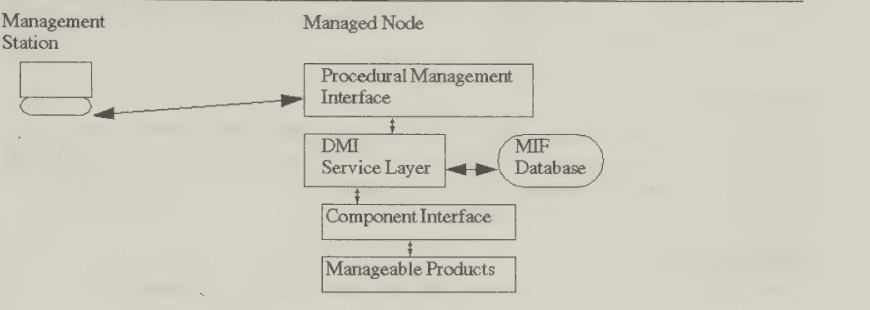

-   **事件类型**：提供事件发生的原因。
-   **事件严重性**：描述事件的类型。对于基于状态的事件，使用 OK、非关键（Non-Critical）、关键（Critical）和不可恢复（Non-Recoverable）严重性。对于预期的周期性事件，使用 Monitor 严重性；对于非周期性事件，使用 Information 严重性。
-   **事件是否基于状态**：基于状态的事件生成器预期在每次相关的状态转换中，针对给定的事件类型最多只生成一个事件。预期具有 OK 严重性的事件会清除这些事件。非基于状态的事件生成器会在每个条件发生时发送事件，并且不发送相应的 OK 事件。
-   **事件状态键**：指与该组件关联的事件状态组中的行号。这仅用于基于状态的事件。
-   **关联组**：标识生成事件的组。
-   **事件系统**：指导致该事件的组件的特定部分。
-   **事件子系统**：也指导致该事件的组件的特定部分。

事件的可选字段包括建议的纠正措施和供应商特定数据。

应用程序接收到的事件数据是一个 DmiMultiRowData 结构。第一个 DmiRowData 结构包含上述事件属性。当生成事件的组具有多个实例时，使用第二个 DmiRowData 结构。*键* 指代生成事件的具体实例。第三个 DmiRowData 结构用于事件转发至其最终目的地时，其中包含源系统的地址。额外的行包含可能与事件关联的任何专有信息。

有关 DMI 数据结构和当前 MIF 规范的更多信息，可以在 Web 上的 DMTF *桌面管理接口规范*（http://www.dmtf.org）中找到。

以下章节描述了两个重要的 Unix MIF：系统 MIF 和软件 MIF。请注意，在以下 MIF 规范中，星号（*）后缀表示该变量用作表条目的索引。

#### 系统 MIF

DMI 系统 MIF 包含有关服务器的一般信息，以及有关磁盘和文件系统的详细信息。某些信息（如系统名称、运行时间和操作系统版本）也在 MIB-II 中提供。系统 MIF 允许针对磁盘设备和存储分配错误发送事件。

##### MIF 定义

列表 A-17 展示了由 DMTF 定义的完整系统 MIF 规范。

**列表 A-17** 系统 MIF 规范。

```text
DMTF
    [ ] ComponentID
        [ 1 ] Manufacturer
        [ 2 ] Product
        [ 3 ] Version
        [ 4 ] Serial Number
        [ 5 ] Installation
        [ 6 ] Verify
    [ ] General Information
        [ 1 ] System Name
        [ 2 ] System Location
        [ 3 ] System Primary User Name
        [ 4 ] System Primary User Phone
        [ 5 ] System Boot Up Time
        [ 6 ] System Date Time
        [ 7 ] System Secondary User Name
        [ 8 ] System Secondary User Phone
        [ 9 ] System Primary Pager
        [ 10] System Secondary Pager
    [ ] Operating System
        [ 1 ] Operating System Index*
        [ 2 ] Operating System Name
        [ 3 ] Operating System Version
        [ 4 ] Primary Operating System
        [ 5 ] Operating System Description
    [ ] Host System Group
        [ 1 ] SystemUpTime
        [ 2 ] SystemInitialLoadDevice
        [ 3 ] SystemInitialLoadParameters
        [ 4 ] SystemNumUsers
        [ 5 ] SystemProcesses
        [ 6 ] SystemMaxProcesses
    [ ] Host Storage Group
        [ 1 ] Physical Main Memory Size
    [ ] Host Storage Table
        [ 1 ] Table Index*
        [ 2 ] Type of Storage
        [ 3 ] Description
        [ 4 ] Allocation Units
        [ 5 ] Size
        [ 6 ] Used
        [ 7 ] Storage Allocation Failures
        [ ** ] Event Generation
    [ ] Host Device Table
        [ 1 ] Device Table Index*
        [ 2 ] Device Type
        [ 3 ] Device Description
        [ 4 ] ID
        [ 5 ] Device Status
        [ 6 ] Device Errors
        [ ** ] Event Generation
    [ ] Host Processor Table
        [ 1 ] Processor Table Index*
        [ 2 ] ProcessorFrvID
        [ 3 ] ProcessorLoad
        [ ** ] Event Generation
    [ ] Host Disk Storage Table
        [ 1 ] Table Index*
        [ 2 ] Disk Storage Access
        [ 3 ] Disk Storage Media
        [ 4 ] Disk Storage Removable
        [ 5 ] Disk Storage Capacity
        [ ** ] Event Generation
    [ ] Host FSTable
        [ 1 ] FSIndex*
        [ 2 ] FSMountPoint
        [ 3 ] RemoteFSMountPoint
        [ 4 ] FSType
        [ 5 ] FSAccess
        [ 6 ] FSBootable
        [ 7 ] FSStorageIndex
        [ 8 ] FSLastFullBackupDate
        [ 9 ] FSLastPartialBackupDate
    [ ] System Contact Information
        [ 1 ] Contact Index*
        [ 2 ] Contact Name
        [ 3 ] Contact Type
        [ 4 ] Contact Information
```

##### 监控备注

与 MIB-II 一样，系统 MIF 可用于获取通用系统信息，例如系统已运行多久以及系统联系信息。它也可用于检查任何磁盘相关错误。

#### 软件 MIF

DMI 软件 MIF 提供有关安装在系统上的软件产品和产品捆绑包的信息。文件集和供应商信息也包含在内。swlist 命令提供了大部分仪器数据。

##### MIF 定义

列表 A-18 展示了由 DMTF 定义的完整软件 MIF 规范。

**列表 A-18** 软件 MIF 规范。

```text
DMTF
[1] ComponentID
    [1] Manufacturer
    [2] Product
    [3] Version
    [4] Serial Number
    [5] Installation
    [6] Verify
[2] Software Location
    [1] Path
    [2] Catalog
    [3] Dfiles
    [4] Layout Version
    [5] Pfiles
[3] Vendors
    [1] Tag*
    [2] Index*
    [3] Title
    [4] Description
[4] Bundles
    [1] Bundle Software Specification*
    [2] Tag
    [3] Architecture
    [4] Location
    [5] Qualifier
    [6] Revision
    [7] Vendor Tag
    [8] Create Time
    [9] Description
    [10] Modification Time
    [11] Size
    [12] Title
    [13] Copyright
    [14] Directory
    [15] Instance Identifier
    [16] Is Locatable
    [17] Layout Version
    [18] Machine Type
    [19] Number
    [20] Operating System Name
    [21] Operating System Release
    [22] Operating System Version
[5] Bundle Contents
    [1] Bundle Software Specification*
    [2] Index*
    [3] Content
[6] Products
    [1] Product Software Specification*
    [2] Tag
    [3] Architecture
    [4] Location
    [5] Qualifier
    [6] Revision
    [7] Vendor Tag
    [8] Create Time
    [9] Description
    [10] Modification Time
    [11] Size
    [12] Title
    [13] All Filesets
    [14] Control Directory
    [15] Copyright
    [16] Directory
    [17] Instance Identifier
    [18] Is Locatable
    [19] Post Kernel Path
    [20] Layout Version
    [21] Machine Type
    [22] Number
    [23] Operating System Name
    [24] Operating System Release
    [25] Operating System Version
[7] Product Contents
    [1] Product Software Specification*
    [2] Index*
    [3] Content
    [4] Content Type
[8] Product Control Files
    [1] Product Software Specification*
    [2] Tag*
    [3] Cksum
    [4] Compressed Cksum
    [5] Compressed Size
    [6] Compression State
    [7] Compression Type
    [8] Revision
    [9] Size
    [10] Source
    [11] Interpreter
    [12] Path
    [13] Result
[9] Subproducts
    [1] Subproduct Software Specification*
    [2] Tag
    [3] Create Time
    [4] Description
    [5] Modification Time
    [6] Size
    [7] Title
    [8] Contents
[10] Filesets
    [1] Fileset Software Specification*
    [2] Tag
    [3] Create Time
    [4] Description
    [5] Modification Time
    [6] Size
    [7] Title
    [8] Control Directory
    [9] Is Kernel
    [10] Is Locatable
    [11] Is Reboot
    [12] Location
    [13] Media Sequence List
    [14] Revision
    [15] State
[11] Fileset Contents
    [1] Fileset Software Specification*
    [2] Index*
    [3] Content
    [4] Content Type
[12] Fileset Dependencies
    [1] Fileset Software Specification*
    [2] Index*
    [3] Dependency
    [4] Dependency Type
[13] Fileset Control Files
    [1] Fileset Software Specification*
    [2] Tag*
    [3] Cksum
    [4] Compressed Cksum
    [5] Compressed Size
    [6] Compression State
    [7] Compression Type
    [8] Revision
    [9] Size
    [10] Source
    [11] Interpreter
    [12] Path
    [13] Result
[14] Fileset Files
    [1] Fileset Software Specification*
    [2] Path*
    [3] Cksum
    [4] Compressed Cksum
    [5] Compressed Size
    [6] Compression State
    [7] Compression Type
    [8] Revision
    [9] Size
    [10] Source
    [11] Gid
    [12] Group
    [13] Is Volatile
    [14] Link Source
    [15] Major
    [16] Minor
    [17] Mode
    [18] Mtime
    [19] Owner
    [20] File Type
    [21] Uid
```


##### 监控说明

在发现产品问题之后，软件 MIF 可能是一个非常有用的工具。使用 MIF 浏览器，您可以检查软件 MIF，以确定问题是否可能是由错误的补丁安装或文件修改引起的。MIF 包含每个产品的修订信息及其创建和修改时间。可以检查版本信息以判断是否存在兼容性问题。最后，还会提供产品的供应商信息，以便在需要联系产品支持人员时使用。

# 术语表

**AAL** ATM 适配层。AAL 将数字语音、图像、视频和数据信号转换为 ATM 信元格式，反之亦然。定义了四种 AAL（AAL1、AAL2、AAL3/4 和 AAL5），它们提供不同的服务，并已被 CCITT 推荐。这些服务有三个区分属性：是否需要传输源和目的地之间的定时信息、支持恒定或可变比特率、以及服务是无连接还是有连接的。例如，AAL5 支持有连接的变比特率数据服务。

**ABAP** 与 SAP R/3 一起使用的编程语言。

**ARM** 应用资源测量。ARM 是一套标准化的 API，用于测量应用事务。

**ARP** 地址解析协议。此协议用于查找与给定高级协议地址（如 IP 地址）相关的站点地址。然后，IP 地址和站点地址之间的映射将存储在本地系统的 ARP 缓存中。

**ATM** 异步传输模式。一种基于传输称为信元的信息单位的数字传输形式。它适用于图像、语音、视频和数据的传输。允许发送方时钟和接收方时钟之间进行异步操作，并使用流中的空数据包来消除时钟差异。

**CCITT** 国际电报和电话咨询委员会。CCITT 定义电话和电报的国际标准。CCITT 标准包括 ATM，但通常其标准由一个字母、一个句点和一个数字组成。X.400 就是一个例子。

**CCMS** 计算中心管理系统。CCMS 是 SAP R/3 应用程序的管理工具。

**信元** 在信元中继传输技术（如 ATM）中使用的固定长度传输单位。ATM 信元由 53 字节（八位位组）组成，包括 5 字节报头和 48 字节数据净荷。48 字节的标准是欧洲推荐的 32 字节大小与美国和日本推崇的 64 字节大小之间的折中方案。

**CiscoWorks** Cisco 公司的网络管理产品。

**集群** 一个通用术语，用于指代共享共同属性的一组计算机系统。对于 HP-UX 10.x 和 11.x 操作系统，集群通常与运行 MC/ServiceGuard 高可用性软件并受共同管理的 HP series 800 计算机系统集合相关联。

**ClusterView** 一个用于管理多组系统或集群的 Hewlett-Packard 产品。它是一个 HP OpenView 应用程序，主要用于监控高可用性集群，例如 MC/ServiceGuard 和 MC/LockManager。ClusterView 还可以监控 Windows NT 高可用性集群以及其他系统组，例如 EPS 集群。

**CMIP** 公共管理信息协议。CMIP 是由开放系统互连标准化的协议，用于访问管理信息和接收状态事件。

**冲突** 由两个网络设备尝试在同一时间通过共享介质发送数据而导致的网络传输错误。

**COPS** 计算机 Oracle 和密码系统。一种用于 Unix 系统的网络监控产品。COPS 检查安全弱点并提供警告。

**CPU** 中央处理单元。负责代表用户和系统进程执行机器指令的计算机组件。

**CRC** 循环冗余检查。以太网和令牌环等局域网技术在网络数据包中使用 CRC 字段，以确保数据无错误地与目标交换。

**DBA** 数据库管理员。

**DHCP** 动态主机配置协议。一种有助于管理 IP 地址和其他配置信息的协议。客户端自动从 DHCP 服务器请求其配置信息，而无需系统管理员进行手动配置。

**DML** 数据操纵语言。DML 是影响数据库对象内容的一组 SQL 命令（例如，`SELECT`、insert、update）。

**DNS** 域名系统。一种在计算机系统名称和 IP 地址之间进行转换的名称服务。

**DSI** 数据源集成。一种 MeasureWare API，允许 MeasureWare 代理从不同数据源收集数据。

**ELAN** 仿真局域网。ELAN 接口是运行局域网仿真的 ATM 卡。

**EPS** 企业并行服务器。企业并行服务器是 Hewlett-Packard 的高端集群服务器产品。

**ERP** 企业资源计划。Baan 和 SAP R/3 等 ERP 应用程序被公司用于供应链管理。

**区段** 分配给文件的一段磁盘空间，旨在使未来的记录在物理上紧密相邻。

**FCS** 帧检查序列。一种用于指示数据包是否在网络介质上损坏的校验和。

**FDDI** 光纤分布式数据接口。FDDI 是一种使用光纤的局域网技术，能够支持 100Mbps 的数据速率。

**防火墙** 一个通过强制执行安全策略来限制访问，从而隔离多个网络的系统。

**GlancePlus** Hewlett-Packard 的一款实时、图形化性能监控产品。

**ICMP** 互联网控制报文协议。这个网络协议是 TCP/IP 协议族的一部分，用于在网关和其他系统之间传递错误和控制信息。ping 命令使用 ICMP 协议。ICMP 协议使用 IP 数据报来传输其信息。

**inode** 与文件系统中文件或目录相关的内核数据结构。

**IP** 互联网协议。IP 是一种网络协议，是 TCP/IP 协议族的一部分。IP 为 TCP、UDP 和 ICMP 提供数据包路由和交付功能。

**IP 地址** 互联网协议地址。IP 地址当前是一个 32 位地址，由网络标识符和系统标识符组成。名称解析服务可以将系统名称转换为 IP 地址。网络应用程序通常使用名称或 IP 地址进行通信。然后，网络内核软件使用 ARP 将 IP 地址转换为站点地址。

**ISO** 国际标准化组织。一个创建标准以促进国家间商品和服务交换的国际组织。

**IT/O** IT/运营。Hewlett-Packard 的一款网络管理产品。IT/O 包括网络节点管理器，并提供了用于启动管理工具的应用程序桌面。

**JFS** 日志文件系统。日志文件系统可以跟踪对文件的更新，以便如果文件损坏，可以恢复。

**内核** 控制内存管理、CPU 调度和设备 I/O 等系统服务的操作系统。

**局域网仿真** 局域网仿真。一种使 ATM 网络看起来并表现得像以太网或令牌环局域网的协议。LANE 协议为高层（网络层）协议定义了与现有局域网相同的服务接口。通过 ATM 网络发送的数据以适当的局域网数据包格式进行封装。局域网仿真允许 ATM 和现有局域网技术之间互操作。

**LVM** 逻辑卷管理器。一组用于管理磁盘的命令。除了设置逻辑卷外，LVM 还可用于跨磁盘条带化数据以及镜像数据。

**MAC** 介质访问控制。站点地址也被称为 MAC 地址。

**被管理节点** 被监控或管理的计算机系统。

**管理站** 您从中监控企业内其他系统的计算机系统。

**Mbps** 每秒百万比特。

**MC/LockManager** Hewlett-Packard 的一款高可用性产品。它用于保护在 HP-UX 系统上的 Oracle 并行服务器环境中运行的应用程序。

**MCSE** 多计算机系统环境。MCSE 指用于支持企业并行服务器的 Hewlett-Packard 管理软件。该软件已被 ClusterView 产品取代。

**MC/ServiceGuard** Hewlett-Packard 的一款高可用性产品，保护 HP-UX 系统并在应用程序故障时重启它们。

**MeasureWare** Hewlett-Packard 的一款性能管理产品。

**MERIT** 最大化信息技术资源效率。一个由 Computer Associates, Inc. 赞助的项目。

**MIB** 管理信息库。MIB 是一种 SNMP 格式，用于表示有关被管理组件的信息。

**MIB-II** 定义如何存储与计算机系统相关的管理信息的标准。

**MIF** 管理信息格式。MIF 是一种桌面管理接口格式，用于表示有关被管理组件的信息。

**MPI** 多协议交换。一个 Oracle 产品，用于通过在不同网络传输堆栈（如 TCP/IP 和 IPX/SPX）之间进行转换来提供应用程序连接。MPI 使用 SQL*NET。

**MTU** 最大传输单元。MTU 是在网络链路上可发送的数据包的最大尺寸。例如，以太网帧的数据部分不能超过 1500 字节。在不同 MTU 尺寸的链路上传输数据可能导致 IP 层进行分片。

**NetManager** Sun Microsystems 的一款网络管理产品。

**NetMetrix** Hewlett-Packard 的一款网络性能管理产品。

**NetView** IBM Corporation 的一款网络管理产品。

**NFS** 网络文件系统。NFS 提供对远程、网络化文件系统的透明访问。文件的物理位置对用户隐藏。


## N
### NIS
网络信息服务平台。NIS 可用于从中央位置存储和分发配置数据等信息。

### NNM
网络节点管理器。NNM 是惠普公司的一款网络管理产品。它提供网络设备的状态监控和发现功能。

### OID
对象标识符。OID 指的是 MIB 变量的唯一标识符。

## O
### Oracle Names
一种提供目录服务的**产品**，通过网络内所有系统可用的数据库地址和数据库链接信息实现该服务。

### Oracle 网络侦听器
Oracle 进程，是 SQL*NET 的一部分。用于接收远程数据库连接请求。

### OSI
开放系统互联。这是 ISO 计算机网络的模型，是描述网络行为的标准方式。网络被分为七个层次：物理层、数据链路层、网络层、传输层、会话层、表示层和应用层。

### package
MC/ServiceGuard 包是一个专门配置了高可用性保护的应用程序。该包配置包括启动和停止应用程序所需控制脚本，以及运行应用程序所需进程和资源列表。

### packet
通过网络发送的数据块。

## P
### PerfView
惠普公司的一款图形化性能监控产品。

### PID
进程标识符。运行在计算机系统上进程的唯一标识符。

### ping
因特网数据包组。ping 命令使用 ICMP 协议测试与远程系统的连接性。

### promiscuous mode
处于混杂模式的局域网接口会读取发送给系统的所有数据包，而不仅仅是发给它的那些。

### PVC
永久虚电路。PVC 是运营商提供的、通过网络的信道，用于两个端点之间专门、长期的信息传输。

## R
### RAM
随机存取存储器。程序的全部或部分页面被加载到 RAM 中执行。

### RARP
逆向地址解析协议。RARP 是将站点地址映射到 IP 地址的协议。它可以用于无盘工作站获取其 IP 地址。

### RDBMS
关系数据库管理系统。例如，Oracle、Sybase 和 Informix 都是关系数据库管理系统。

### RFC
请求评论。RFC 是因特网协议的公开可用规范。

### RMON
用于收集网络性能数据的远程监控标准。

### RPC
远程过程调用。通过 RPC，在本地系统上的过程调用会导致在远程系统上执行过程。

## S
### SAM
系统管理员管理器。SAM 是 HP-UX 计算机系统的管理工具。

### SATAN
分析网络的安全管理员工具。SATAN 是一个分析系统安全并识别弱点的公共领域工具。

### SGA
共享全局区域，或系统全局区域。包含 Oracle 7 和 Oracle 8 服务器在运行时使用的临时数据缓存的共享数据库段。

### SNMP
简单网络管理协议。SNMP 是获取和设置管理信息以及报告管理事件的标准。

### SONET
同步光网络。SONET 是通过光纤进行信息数字传输的一组标准。

### SP
服务提供商。SP 是管理应用程序和被管理组件信息之间的中介。

### SPOF
（或 SPof）单点故障。一个未受保护的单一硬件或软件组件，其故障会导致您的应用程序或服务不可用。在环境中配置冗余可以避免这些单点故障。

### SQL
结构化查询语言。SQL 是一种允许您将数据库查询指定为关系表达式的语言。

### SQL*NET
为客户端提供到数据库服务器远程连接的 Oracle 软件。它是 OSI 协议堆栈中会话层的 SQL 数据库模块。

### station address
网络接口卡独特地址。也被称为 MAC 地址或物理地址。以太网上的站点地址为 48 位。前 24 位分配给硬件供应商，然后由供应商负责使剩余位保持唯一性。

### subnet
共享网络地址的网络部分。地址的主机部分被进一步细分为子网号和主机号，子网掩码指定每个部分使用多少位。

### SVC
交换虚电路。按需建立的信道，用于在两个位置之间传输信息。连接由网络信令建立，并且仅在传输持续时间内有效。

### swapping
计算机系统内存使用高峰期由内存管理服务使用的技术。非执行进程的内存中的页面被交换到磁盘，以为当前执行进程所需的代码和数据腾出空间。

### SyMON
Sun Solaris 系统管理**软件**产品。

### TCP
传输控制协议。一种传输协议，提供可靠、面向连接的服务来传输网络数据。

## T
### TME
Tivoli 管理环境。TME 是 Tivoli 的企业管理框架，Tivoli 是 IBM 公司的子公司。

### TNS
透明网络底层。SQL*NET 的下层，建立、维护和断开 Oracle 7 服务器的连接。

### Token Ring
一种提供 4Mbps 和 16Mbps 数据传输速率的局域网技术。

### Transcend
3Com 公司的一套网络性能管理和故障排除产品。可用产品包括 Traffix Manager、Network Control Services 和 Enterprise Monitor。

### UDP
用户数据报协议。一种传输协议，提供不可靠、无连接的服务来传输网络数据。其网络服务由因特网协议提供。

### Unicenter
Computer Associates, Inc. 的网络和系统管理产品。

## V
### V$ 表
Oracle 对虚拟数据库表的术语，允许用户访问共享全局区域中的内存结构。V$ 表可用于监控 Oracle 实例中进程的性能。这些表也称为动态性能表。

## X
### X.25
分组交换网络的 CCITT 标准。

### X.400
电子邮件的 CCITT 标准。

## z
### zombie process
退出时未正确清理系统资源的进程。该进程已终止，且父进程未等待它。

# 索引

## A
- 访问控制列表（ACLs），74
- 访问控制策略，74
- 地址解析协议（ARP）
  - 定义，333
  - 网络监控，152–3
- 应用程序监控
  - 命令和工具
    - 描述，181
    - ps 命令，181–2
    - top 命令，182
    - vmstat 命令，182–3
  - 应用程序监控产品比较，212
  - 组件，179–80
  - 控制应用程序性能，211
  - 描述，179
  - ERP 应用程序，监控工具
    - BMC PATROL 知识模块，197–9
    - 描述，194–5
    - EcoSYSTEMS，199–201
    - Envive，195
    - SMART 插件，195–7
  - 故障检测工具
    - Clusterview，190–2
    - EcoSNAP，193–4
    - 事件监控服务（EMS），192–3
    - IT/运营，188–9
    - MC/ServiceGuard，189–90
  - 识别应用程序类型，180–1
  - 从应用程序问题中恢复，211–12
  - 资源和性能监控工具
    - 应用程序资源测量（ARM），201–2
    - 描述，201
    - GlancePlus，207–9
    - MeasureWare，202–7
    - PerfView，209–10
    - 进程资源管理器，210–11
  - 系统仪器化
    - 描述，183–4
    - DMI，185
    - pstat，185–8
    - SNMP，184–5
- 应用程序资源测量（ARM）
  - 应用程序监控，201–2
  - 数据库监控，229–30
  - 定义，333
- Arp 命令，网络监控，152–3
- ARRAYMOND，磁盘监控，117–18
- ATM 状态命令，网络监控，149–50
- 审计，75
- 身份验证，74
- 授权，74

## B
- Bdf 命令
  - 磁盘监控，101–2
  - 系统监控，45
- 块 I/O，磁盘监控，122


# 索引

## B
- BMC PATROL，89–91
    - 监控的组件，35–6
    - 描述，34
    - 开发工具包，37
    - 诊断能力，38
    - 磁盘监控，126–7
    - 企业级管理，259–60
    - 监控发现与配置，37
    - 监控功能，36
    - 网络监控，171–2
    - 通知方法，37
    - 网站，38
- BMC PATROL 知识模块
    - 应用程序监控，197–9
    - 数据库监控，238–41
- 瓶颈，92, 94–5, 245
- 缓冲区缓存队列长度，81

### C
- Candle，91
- ClusterView，59–62, 257
    - 应用程序监控，190–2
    - 数据库监控，227
    - 企业级管理框架，258
- 命令和工具
    - 应用程序监控
        - 描述，181
        - ps 命令，181–2
        - top 命令，182
        - vmstat 命令，182–3
    - 数据库监控
        - 数据库供应商工具，221–5
        - SNMP MIB 监控，217–21
        - SQL 命令，216–17
        - UNIX 命令，216
    - 磁盘监控
        - bdf 命令，101–2
        - 描述，101
        - df 命令，101–2
        - diskinfo 命令，102
        - fsck 命令，102–4
        - iostat 命令，105
        - lvdisplay 命令，105–6
        - pvdisplay 命令，106
        - vgdisplay 命令，107
    - 网络监控
        - arp 命令，152–3
        - 描述，142
        - ifconfig 命令，152
        - iostat 命令，142
        - lanadmin 命令，143–5
        - lanscan 命令，143
        - linkloop 命令，145
        - netstat 命令，153–6
        - nettl 命令，156–7
        - ping 命令，151–2
    - 系统监控
        - bdf 命令，45
        - 描述，44
        - df 命令，45
        - iostat 命令，45
        - iostat 命令，45–6
        - ipcs 命令，46
        - mailstats 命令，46
        - ps 命令，46
        - sapinfo 命令，49
        - sar (System Activity Reporter)，46–8
        - sysdef 命令，49–50
        - timex 命令，51
        - top 命令，51–2
        - uname 命令，52
        - uptime 命令，52
        - vmstat 命令，52–3
        - who 命令，53–4
- 拥塞，检测网络，174–5
- 上下文切换，81
- CPU 竞争，检测，93
- CPU 运行队列长度，81
- CPU 利用率，81

### D
- 数据安全，74
- 数据库监控
    - 避免数据库问题，247
    - 类别
        - 备份，确保数据库成功，215–16
        - 配置数据库，214
        - 数据库服务器安全，215
        - 故障，监视数据库故障，214–15
        - 识别，213–14
        - 管理数据库资源和性能，215
    - 命令和工具
        - 数据库供应商工具，221–5
        - SNMP MIB 监控，217–21
        - SQL 命令，216–17
        - UNIX 命令，216
    - 数据库监控产品比较，248–9
    - 数据库供应商工具
        - Informix Private Database MIB，225
        - Oracle 企业管理器 (OEM)，221–4
        - Oracle Private MIBs，224–5
    - 描述，213
    - 故障检测和恢复工具
        - ClusterView，227
        - 描述，225
        - EMS HA 监控器，227–8
        - MC/ServiceGuard，225–7
    - 监控产品，比较，248–9
    - 使用性能数据
        - 避免性能问题，243–4
        - 检查数据库缓冲区和池大小，245–7
        - 描述，243
        - 检查磁盘瓶颈，245
        - 检查系统竞争，244–5
    - 从数据库问题中恢复，248
    - 恢复工具，参见子标题：故障检测和恢复工具
    - 资源和性能监控工具
        - 应用程序资源测量 (ARM)，229–30
        - BMC PATROL 知识模块，238–41
        - 描述，229
        - GlancePlus Pak 2000，233–5
        - Oracle 管理包，235–6
        - Oracle Trace，230–2
        - Oracle VS 表，232–3
        - PerfView，236–8
        - PLATINUM DBVision，241–2
        - SMART 插件 (SPIs)，238
- 数据库供应商工具
    - Informix Private Database MIB，225
    - Oracle 企业管理器 (OEM)，221–4
    - Oracle Private MIBs，224–5
- 桌面管理接口 (DMI)，56
    - 应用程序监控，185
    - 磁盘监控，109–10
    - 标准，324–32
- 开发工具包（监控框架）
    - BMC PATROL，37
    - 描述，14
- 事件监控服务 (EMS)，29
- IT/运营，19–20
- MeasureWare，41
- PLATINUM ProVision，33
- Unicenter TNG，24
- df 命令
    - 磁盘监控，101–2
    - 系统监控，45
- DHCP/BOOTP 服务器，158–9
- 诊断能力（监控框架）
    - BMC PATROL，38
    - 描述，15–16
    - 事件监控服务 (EMS)，30
    - IT/运营，21
    - MeasureWare，41
    - PLATINUM ProVision，34
    - Unicenter TNG，24
- 诊断工具
    - 磁盘监控
        - 描述，120
        - Predictive Support，122
        - 支持工具管理器 (STM)，120–1
    - HA Observatory，78
    - HP Predictive Support，77–8
    - Predictive Support，122
    - 支持工具管理器 (STM)，75–7, 120–1
    - 系统监控
        - 描述，75
        - HA Observatory，78
        - HP Predictive Support，77–8
        - 支持工具管理器 (STM)，75–7
- 灾难恢复计划，11
- 发现过滤器，135–6
- 磁盘和文件系统瓶颈，检测，94–5
- 磁盘监控，79
    - 案例研究：配置和监控镜像磁盘
        - 描述，131
        - 镜像故障，133
        - 恢复镜像，133
        - 设置监控，131–3
        - 验证配置，131, 133
    - 类别，100–1
    - 命令和工具
        - bdf 命令，101–2
        - 描述，101
        - df 命令，101–2
        - diskinfo 命令，102
        - fsck 命令，102–4
        - ioscan 命令，105
        - lvdisplay 命令，105–6
        - pvdisplay 命令，106
        - vgdisplay 命令，107
    - 比较磁盘监控产品，130–1
    - 数据冗余，100
    - 描述，100
    - 诊断工具
        - 描述，120
        - Predictive Support，122
        - 支持工具管理器 (STM)，120–1
    - 磁盘配置，101
    - 从磁盘问题中恢复，130
    - 动态缓冲区缓存，128
    - 事件监控工具
        - ARRAYMON，117–18
        - 描述，110–11
        - EMS 磁盘卷监控器 (DVM)，111–13
        - EMS 硬件监控器，113–17
        - HARAYMON，117–18
        - 硬件事件严重级别，114
        - OpenView IT/运营，118–19
        - SYMON，120
    - 故障管理，101
    - 固定大小缓冲区缓存，128
    - 镜像磁盘案例研究
        - 描述，131
        - 镜像故障，133
        - 恢复镜像，133
        - 设置监控，131–3
        - 验证配置，131, 133
    - 镜像，100
    - 收集性能数据
        - 块 I/O，122
        - 描述，122
        - 文件 I/O，122
        - 逻辑 I/O，122
        - 物理 I/O，122
        - 原始 I/O，122
        - 虚拟内存 I/O，122
        - BMC PATROL，126–7
        - GlancePlus，124–5
        - MeasureWare，123–4
        - PerfView，125–6
    - 使用性能数据，127–9
    - 性能管理，101
    - 避免性能问题，129–30
    - 修复问题，127–9
    - RAID 技术，100
    - 资源管理，101
    - 系统仪表化
        - 描述，107–8
        - 桌面管理接口 (DMI)，109–10
        - 简单网络管理协议 (SNMP)，108–9
- diskinfo 命令，磁盘监控，102
- DMI，参见 桌面管理接口 (DMI)
- DML，334
- DNS，334
- DNS/NIS 名称服务器，159
- DSL，334
- 动态缓冲区缓存，128

### E
- EcoSNAP，应用程序监控，193–4
- EcoSYSTEMS，应用程序监控，199–201
- EMS，参见 事件监控服务 (EMS)
- EMS 磁盘卷监控器 (DVM)，磁盘监控，111–13
- EMS HA 监控器，64
    - 数据库监控，227–8
    - 网络监控，146
- EMS 硬件监控器
    - 磁盘监控，113–17
    - 系统监控，64–8
- 企业级管理
    - ClusterView，257
    - 描述，250
    - 事件关联工具
        - 描述，252–3
        - IT Masters MasterCell，255–7
        - OpenView 事件关联服务 (ECS)，253–4
        - Seagate NerveCenter，254
    - 框架，257–8
        - ClusterView，258
        - 监控代理，258
        - 识别事件，251–2
        - IT Masters MasterCell，255–7
        - IT/运营，257, 260
    - 跨企业监控，250–1
    - 多系统监控，257
    - 使用多种工具
        - BMC PATROL 和 IT/运营，259–60
        - 描述，258
        - EMS 和 OpenView NNM 或 IT/运营，260
        - IT/运营 和 网络节点管理器 (NNM)，258–9
        - IT/运营 和 PerfView，259
        - PLATINUM ProVision 和 IT/运营，260
        - OpenView 事件关联服务 (ECS)，253–4
        - Seagate NerveCenter，254
- 企业级管理框架，12–13, 258
- 企业级网络框架
    - ClusterView，59–62
    - MC/ServiceGuard，59–62
    - 网络节点管理器 (NNM)，57–9
    - Unicenter TNG，62–3
- Enterprise SyMON，68–71, 139–40
- 环境问题
    - 灾难恢复计划，11
    - 停电，11
- Enlive，应用程序监控，195
- EPS，334
- ERP，334
- ERP 应用程序，监控工具
    - BMC PATROL 知识模块，197–9
    - EcoSYSTEMS，199–201
    - Enlive，195
    - SMART 插件，195–7
- 事件管理，参见 故障管理
- 事件监控服务 (EMS)，63–8
    - 应用程序监控，192–3
    - 组件，25
    - 描述，24–5
    - 开发工具包，29
    - 诊断能力，30
    - 企业级管理，260
    - MC/ServiceGuard，27
    - 监控发现与配置，27–9
    - 监控功能，25–7
    - 通知方法，30
    - 资源层次结构，26
    - 网站，31
- 事件监控工具
    - ARRAYMON，117–18
    - 描述，63, 110–11
    - 磁盘监控
        - ARRAYMON，117–18
        - 描述，110–11
        - EMS 磁盘卷监控器 (DVM)，111–13
        - EMS 硬件监控器，113–17
        - HARAYMON，117–18
        - 硬件事件严重级别，114
        - OpenView IT/运营，118–19
        - SYMON，120
    - 系统监控
        - 描述，63
        - EMS 硬件监控器，64–8
        - EMS 高可用性监控器，64
        - Enterprise SyMON，68–71
        - 事件监控服务 (EMS)，63–8
        - GlancePlus Pak 2000，73
        - IT/运营 (IT/O)，71–3
- 事件，3–4
    - 类别，4–11
    - 配置事件，5–6
        - 应用程序更改，5
        - 硬件更改，5–6
        - 操作系统更改，5
    - 环境问题，10–11
    - 故障，参见 故障
    - 性能事件，9–10
    - 资源事件，9–10
    - 安全问题，10
- 区段，335

## F
- 故障检测工具
    - 应用程序监控
        - ClusterView，190–2
        - EcoSNAP，193–4
        - 事件监控服务 (EMS)，192–3
        - IT/运营，188–9
        - MC/ServiceGuard，189–90
    - ClusterView，190–2, 227
    - 数据库监控
        - ClusterView，227
        - EMS HA 监控器，227–8
        - MC/ServiceGuard，225–7
    - EcoSNAP，193–4
    - EMS HA 监控器，227–8
    - 事件监控服务 (EMS)，192–3
    - IT/运营，188–9
    - MC/ServiceGuard，189–90, 225–7
- 故障隔离，3


## F
- 故障管理分类，4–11
- 定义，3–4
- 磁盘监控，101
- 事件，3–4
- 未来趋势，261–3
- 故障，3
- 数据库监控，213–14
- 定义，6
- 外部服务故障/丢失，8–9
- 外设故障，8
- 软件故障，7
- 系统硬件故障，6–7
- 系统监控，43
- FCS，335
- FDDI，335
- FDDI 状态命令，网络监控，148–9
- 文件 I/O，磁盘监控，122
- 防火墙，335
- 固定大小缓冲区缓存，128
- Fsck 命令，磁盘监控，102–4
- FTP，159–60

## G
- GlancePlus，84–6
- 应用监控，207–9
- 定义，335
- 磁盘监控，124–5
- 网络监控，168–70
- 系统监控，84–6
- GlancePlus Pak 2000，73
- 数据库监控，233–5
- 事件监控工具，73
- IT/运营，21
- 系统监控，73
- 高可用 ATM，网络监控，150
- 高可用 Observatory，78
- HARAYMON，磁盘监控，117–18
- 硬件事件严重级别，磁盘监控，114
- 主机资源 MIB，285–9
- HP 集群 MIB，298–300
- HP 预测性支持，77–8
- HP-UNIX MIB，294–8

## I
- ICMP，335
- Ifconfig 命令，网络监控，152
- Informix 专有数据库 MIB
  - 数据库监控，225
  - 标准，319–24
- Inode，335
- 仪表化
  - 应用监控
    - 描述，183–4
    - DMI，185
    - pstat，185–8
    - SNMP，184–5
  - 磁盘监控
    - 描述，107–8
    - 桌面管理接口 (DMI)，109–10
    - 简单网络管理协议 (SNMP)，108–9
  - 系统监控
    - 描述，54
    - DMI (桌面管理接口)，56
    - MIB (管理信息库)，54
    - MIB-II，54–5
    - SNMP，54–5
- 互连和路由器管理器，网络监控，164–5
- Ioscan 命令，45
  - 磁盘监控，105
  - 网络监控，142
  - 系统监控，45
- Iostat 命令，45–6
- IP，335
- IP 地址，335
- Ipcs 命令，46
- ISO，335
- IT Masters MasterCell，255–7
- IT/运营 (IT/O)，12, 13, 71–3, 257
  - 应用银行，16, 21
  - 应用桌面，72
  - 应用监控，188–9
  - 组件，受监控，16–18
  - 定义，335
  - 描述，16
  - 开发工具包，19–20
  - 诊断能力，21
  - 磁盘监控，118–19
  - 企业级管理，258–9, 259–60
  - GlancePlus Pak 2000，21
  - 消息浏览器，16, 18–19, 72
  - 消息组，16, 72
  - 监控发现与配置，19
  - 监控功能，18–19
  - 多平台支持，17
  - 网络监控，138–9
  - 节点银行，16, 18, 72
  - 通知方法，20–1
  - opcom API，20
  - SMART 插件 (SPIs)，17
  - 网站，21

## J
- JFS，335

## K
- 内核，335

## L
- 局域网仿真，335
- Lanadmin 命令，网络监控，143–5
- Lanscan 命令，网络监控，143
- Linkloop 命令，网络监控，145
- 逻辑 I/O，磁盘监控，122
- Lvdisplay 命令，磁盘监控，105–6
- LVM，336

## M
- MAC，336
- Mailstats 命令，系统监控，46
- 被管节点，336
- 管理信息库 (MIB)，54, 264–8, 336
- 管理信息格式 (MIF)，324–5, 336
- 管理站，336
- Mb/ps，336
- MC/LackManager，336
- MCSE，336
- MC/ServiceGuard，6, 59–62
  - 应用监控，189–90
  - 数据库监控，225–7
  - 定义，336
  - 网络监控，147–8
  - 通知方法，15
- MC/ServiceGuard MIB，300–2
- MeasureWare，81–3
  - 应用监控，202–7
  - 组件，受监控，39
  - 定义，336
  - 描述，38–9
  - 开发工具包，41
  - 诊断能力，41
  - 磁盘监控，123–4
  - 监控发现与配置，40–1
  - 监控功能，39–40
  - 网络监控，148, 167–8
  - 通知方法，41
  - 网站，41
- 内存和交换争用，检测，94
- 内存故障恢复案例研究
  - 描述，97
  - 修复故障并恢复服务，98–9
  - 内存板故障，98
  - 设置监控与重新配置，98
  - 验证配置，97–8
- 内存利用率，81
- MERIT，336
- MIB-II，54–5
  - 定义，336
  - 标准，268–73
- 监控框架
  - BMC PATROL，34–8
  - 组件，受监控，13
  - 描述，12–13, 13–16
  - 开发工具包，14
  - 诊断能力，15–16
  - 企业级管理框架，12–13
  - 事件监控服务 (EMS)，24–31
  - HP IT/运营，12, 13
  - IT/运营，16–21
  - MeasureWare，38–41
  - 监控发现与配置，13–14
  - 监控功能，13
  - 通知方法，14–15
  - PLATINUM ProVision，31–4
  - Tivoli 管理环境 (TME)，12, 13
  - Unicenter TNG，12, 13, 22–4
- MPI，336
- MTU，336
- 多系统，参见企业级管理

## N
- NetManager，336
- NetMetrix，336
- NetMetrix Site Manager，网络监控，167
- Netstat，网络监控，163–4
- Netstat 命令，网络监控，153–6
- Netti 命令，网络监控，156–7
- NetView，336
- Network General Sniffer Pro，网络监控，172
- 网络监控
  - 避免网络问题，175
  - 电缆故障，参见子标题：网卡和电缆故障
  - 命令和工具
    - arp 命令，152–3
    - ATM 状态命令，149–50
    - 描述，142, 148
    - FDDI 状态命令，148–9
    - ifconfig 命令，152
    - ioscan 命令，142
    - lanadmin 命令，143–5
    - lanscan 命令，143
    - linkloop 命令，145
    - netstat 命令，153–6
    - netti 命令，156–7
    - ping 命令，151–2
    - X.25 状态命令，149
  - 组件，134–5
  - 图形化网络状态监控器
    - 描述，135
    - Enterprise SyMON，139–40
    - IT/运营 (IT/O)，138–9
    - 网络节点管理器 (NNetM)，135–8
    - Unicenter TNG，139
  - 链接，使用其他产品监控网络
    - EMS 高可用监控器，146
    - MC/ServiceGuard，147–8
    - MeasureWare，148
  - 特定于链接的命令
    - ATM 状态命令，149–50
    - 描述，148
    - FDDI 状态命令，148–9
    - 高可用 ATM，150
    - X.25 状态命令，149
  - 网络主机
    - 描述，162–3
    - 互连和路由器管理器，164–5
    - netstat，163–4
    - 网络节点管理器 (NNetM)，163
  - 网卡和电缆故障
    - 命令和工具，142–5
    - 描述，140–1
    - 链接，使用其他产品监控网络，146–8
    - 特定于链接的命令，148–50
    - SNMP 仪表化，141–2
  - 网络问题
    - 避免，175
    - 恢复，175–6
    - 隔离故障，176
    - 网络层及更低层，176–7
    - 传输层及更高层，177–8
  - 网络服务
    - 描述，156
    - DHCIP/BOOTP 服务器，158–9
    - DNS/NIS 名称服务器，159
    - FTP，159–60
    - NFS，160–2
    - 远程连接，162
    - Web 服务器，162
  - 网络与传输协议
    - 命令和工具，151–7
    - 描述，150–1
    - SNMP 仪表化，151
  - 性能数据，收集网络
    - BMC PATROL，171–2
    - 描述，165
    - GlancePlus，168–70
    - MeasureWare，167–8
    - NetMetrix Site Manager，167
    - Network General Sniffer Pro，172
    - PerfView，170–1
    - RMON 仪表化，165–7
    - RMON-II 仪表化，165–7
  - 性能数据，使用网络
    - 避免性能问题，173
    - 拥塞，检测网络，174–5
    - 描述，173
    - 过载网络服务器，检测，173–4
    - 恢复网络问题，175–6
      - 隔离故障，176
      - 网络层及更低层，176–7
      - 传输层及更高层，177–8
- 网络节点管理器 (NNetM)，57–9
  - 定义，337
  - 企业级管理，258–9, 260
  - 网络监控，135–8, 163
- 网络服务 MIB，302–4
- NFS
  - 定义，336
  - 网络监控，160–2
- NIS，337
- 通知方法
  - BMC PATROL，37
  - 描述，14–15
  - DMI 通知，15
  - 事件监控服务 (EMS)，30
  - IT/运营，20–1
  - MC/ServiceGuard，15
  - MeasureWare，41
  - 寻呼，14
  - PLATINUM ProVision，33–4
  - SNMP 陷阱，15
  - Unicenter TNG，24

## O
- OID，337
- OmniGuard/IT A，75
- OpenView 事件关联服务 (ECS)，253–4
- Oracle 企业管理器 MIB，314–16
- Oracle 企业管理器 (OEM)，数据库监控，221–4
- Oracle 管理包，数据库监控，235–6
- Oracle 多协议交换 MIB，316–18
- Oracle Names，337
- Oracle Names MIB，312–14
- Oracle 网络监听器，337
- Oracle 网络监听器 MIB，310–12
- Oracle 专有数据库 MIB，307–10
- Oracle 专有 MIBs，数据库监控，224–5
- Oracle Trace，数据库监控，230–2
- Oracle VS 表，数据库监控，232–3
- OSI，337
- 过载网络服务器，检测，173–4
- 寻呼，81
- 性能数据，收集
  - BMC PATROL，171–2
  - BMC PATROL for UNIX，89–91
  - 缓冲区缓存队列长度，81
  - Candle，91
  - 上下文切换，81
  - CPU 运行队列长度，81
  - CPU 利用率，81
  - 描述，80–1, 165
  - 系统监控
    - BMC PATROL for UNIX，89–91
    - 缓冲区缓存队列长度，81
    - Candle，91
    - 上下文切换，81
    - CPU 运行队列长度，81
    - CPU 利用率，81
    - 描述，80–1
    - GlancePlus，84–6
    - MeasureWare，81–3
    - 内存利用率，81
    - 寻呼，81
    - PerfView，86–9
    - 交换，81
    - 虚拟内存 I/O，122
  - 性能问题，避免
    - 数据库监控，243–4

## P
- 包，337
- 密码，74
- 性能数据，收集
  - 磁盘监控
    - 块 I/O，122
    - BMC PATROL，126–7
    - 描述，122
    - 文件 I/O，122
    - GlancePlus，124–5
    - 逻辑 I/O，122
    - MeasureWare，123–4
    - PerfView，125–6
    - 物理 I/O，122
    - 原始 I/O，122
    - 虚拟内存 I/O，122
  - GlancePlus，84–6, 168–70
  - MeasureWare，81–3, 167–8
  - 内存利用率，81
  - NetMetrix Site Manager，167
  - Network General Sniffer Pro，172
  - 物理 I/O，122
  - 原始 I/O，122
  - RMON 仪表化，165–7
  - RMON-II 仪表化，165–7
  - 交换，81


# 索引

## P
- 性能问题，避免（续）
  - 网络监控，173
  - 系统监控，92–3
- PerfView，86–9
  - 应用监控，209–10
  - 数据库监控，236–8
  - 定义，337
  - 磁盘监控，125–6
  - 企业管理，259
  - 网络监控，170–1
- 物理 I/O，磁盘监控，122
- 物理安全，74
- PID，337
- Ping，337
- Ping 命令，网络监控，151–2
- PLATINUM DBVision，数据库监控，241–2
- PLATINUM ProVision
  - 组件，监控，31–2
  - 描述，31
  - 开发者工具包，33
  - 诊断功能，34
  - 企业管理，260
  - 监控发现与配置，33
  - 监控功能，32–3
  - 通知方法，33–4
  - 网站，34
- 停电，11
- 预测支持，磁盘监控，122
- 打印机 MIB，289–94
- 打印机监控，79
- 进程资源管理器，应用监控，210–11
- 混杂模式，337
- Ps 命令，46
  - 应用监控，181–2
  - 系统监控，46
- Pstat，应用监控，185–8
- PVC，337
- Pvdisplay 命令，磁盘监控，106

## R
- RAM，337
- RARP，337
- 原始 I/O，磁盘监控，122
- RDBMS，337
- RDBMS MIB，304–6
- 普通用户，74
- 远程连接性，网络监控，162
- 资源和性能监控工具
  - 应用监控
    - 应用资源测量 (ARM)，201–2
    - 描述，201
    - GlancePlus，207–9
    - MeasureWare，202–7
    - PerfView，209–10
    - 进程资源管理器，210–11
  - 数据库监控
    - 应用资源测量 (ARM)，229–30
    - BMC PATROL 知识模块，238–41
    - GlancePlus Pak 2000，233–5
    - Oracle 管理包，235–6
    - Oracle 跟踪，230–2
    - Oracle VS 表，232–3
    - PerfView，236–8
    - PLATINUM DBVision，241–2
    - SMART 插件 (SPIs)，238
- RFC，337
- RMON，337
- RMON-II 仪表化，网络监控，165–7
- RMON II MIB，279–85
- RMON 仪表化，网络监控，165–7
- RMON MIB，273–9
- 根用户，74
- RPC，337

## S
- SAM，338
- Sapino 命令，系统监控，49
- Sar (System Activity Reporter)，系统监控，46–8
- SATAN，338
- Seagate NerveCenter，254
- 安全监控，43–4
  - 访问控制列表 (ACLs)，74
  - 访问控制策略，74
  - 审计，75
  - 认证，74
  - 授权，74
  - 数据安全，74
  - 密码，74
  - 物理安全，74
  - 普通用户，74
  - 根用户，74
  - 工具
    - OmniGuard/ITA，75
    - Stalker (Haystack Labs)，75
- SGA，338
- 简单网络管理协议 (SNMP)，54–5
  - 应用监控，184–5
  - 定义，338
  - 磁盘监控，108–9
  - 标准，264–8
- SMART 插件
  - 应用监控，195–7
  - 数据库监控，238
- SNMP，*参见 简单网络管理协议 (SNMP)*
- SNMP MIB 监控，217–21
- 软件 MIF，328–32
- SONET，338
- SP，338
- SPOF，338
- SQL，338
- SQL 命令，数据库监控，216–17
- SQL*NET，338
- Stalker，75
- 标准
  - 桌面管理接口 (DMI)，324–32
  - 主机资源 MIB，285–9
  - HP 集群 MIB，298–300
  - HP MC/ServiceGuard MIB，300–2
  - HP-UNIX MIB，294–8
  - Informix 专用数据库 MIB，319–24
  - 管理信息库 (MIB)，264–8
  - 管理信息格式 (MIF)，324–5
  - MIB-II，268–73
  - 网络服务 MIB，302–4
  - Oracle 企业管理器 MIB，314–16
  - Oracle 多协议交换 MIB，316–18
  - Oracle 名称 MIB，312–14
  - Oracle 网络监听器 MIB，310–12
  - Oracle 专用数据库 MIB，307–10
  - 打印机 MIB，289–94
  - RDBMS MIB，304–6
  - RMON MIB，273–9
  - RMON II MIB，279–85
  - 简单网络管理协议 (SNMP)，264–8
  - 软件 MIF，328–32
  - 系统 MIF，326–8
- 站点地址，338
- 子网，338
- 支持工具管理器 (STM)
  - 磁盘监控，120–1
  - 系统监控，75–7
- SVC，338
- 交换 (Swapping)
  - 定义，338
  - 系统监控，81
- SyMON
  - 定义，338
  - 磁盘监控，120
- sysdef 命令，系统监控，49–50
- 系统 MIF，326–8
- 系统监控
  - 避免系统问题，95–6
  - 案例研究：从内存故障中恢复
    - 描述，97
    - 修复故障并恢复服务，98–9
    - 内存板故障，98
    - 设置监控和重新配置，98
    - 验证配置，97–8
  - 类别，42–4
  - 配置更改，监控系统，42–3
  - 故障，监控系统，43
  - 性能，监控系统，44
  - 资源利用率，监控系统，43
  - 安全，监控系统，43–4
  - 命令和工具
    - bdf 命令，45
    - 描述，44
    - df 命令，45
    - iocsan 命令，45
    - iostat 命令，45–6
    - ipcs 命令，46
    - mailstats 命令，46
    - ps 命令，46
    - sapinfo 命令，49
    - sar (System Activity Reporter)，46–8
    - sysdef 命令，49–50
    - time x 命令，51
    - top 命令，51–2
    - uname 命令，52
    - uptime 命令，52
    - vmstat 命令，52–3
    - who 命令，53–4
  - 比较系统监控工具，96–7
  - 描述，42
  - 诊断工具
    - 描述，75
    - HA Observatory，78
    - HP 预测支持，77-8
    - 支持工具管理器 (STM)，75-7
  - DMI (桌面管理接口)，56
  - 事件监控工具
    - 描述，63
    - EMS 硬件监控器，64-8
    - EMS 高可用性监控器，64
    - Enterprise SyMON，68-71
    - 事件监控服务 (EMS)，63-8
    - GlancePlus Pak 2000，73
    - IT/运营 (IT/O)，71-3
  - 图形状态监控器
    - ClusterView，59-62
    - 描述，56-7
    - MC/ServiceGuard，59-62
    - 网络节点管理器 (NNM)，57-9
    - Unicenter TNG，62-3
  - MIB (管理信息库)，54
  - MIB-II，54-5
  - 性能数据，收集
    - BMC PATROL for UNIX，89-91
    - 缓冲区缓存队列长度，81
    - Candle，91
    - 上下文切换，81
    - CPU 运行队列长度，81
    - CPU 利用率，81
    - 描述，80-1
    - GlancePlus，84-6
    - MeasureWare，81-3
    - 内存利用率，81
    - 换页，81
    - PerfView，86-9
    - 交换，81
  - 性能数据，使用
    - 避免性能问题，92-3
    - 瓶颈，92
    - 检测 CPU 争用，93
    - 描述，92
    - 检测和解决磁盘和文件系统瓶颈，94-5
    - 检测和解决内存和交换争用，94
    - 检查系统资源使用，94
  - 从系统问题中恢复，96
  - 安全监控
    - 访问控制列表 (ACLs)，74
    - 访问控制策略，74
    - 认证，74
    - 授权，74
    - 数据安全，74
    - 描述，73-4
    - 密码，74
    - 物理安全，74
    - 普通用户，74
    - 根用户，74
    - 工具，75
  - SNMP，54-5
  - 系统配置更改，42-3
  - 系统故障，43
  - 系统仪表化
    - 描述，54
    - DMI (桌面管理接口)，56
    - MIB (管理信息库)，54
    - MIB-II，54-5
    - SNMP，54-5
  - 系统性能，44
  - 系统外围设备
    - 描述，79
    - 磁盘，79
    - 打印机，79
    - 磁带，79
  - 系统资源利用率，43
  - 系统安全，43-4
- 系统操作，趋势，2
- 系统操作员，角色，1-2
- 系统资源使用，检查，94

## T
- 磁带监控，79
- TCP，338
- Timex 命令，系统监控，51
- Tivoli 管理环境 (TME)，12, 13, 339
- TNS，339
- 令牌环，339
- Top 命令
  - 应用监控，182
  - 系统监控，51-2
- Transcend，339

## U
- UDP，339
- Uname 命令，系统监控，52
- Unicenter，339
- Unicenter TNG，12, 13, 62-3
  - 描述，22
  - 开发者工具包，24
  - 诊断功能，24
  - 监控发现与配置，23-4
  - 监控组件，22
  - 监控功能，22–3
  - 网络监控，139
  - 通知方法，24
  - 网站，24
- UNIX 命令，数据库监控，216
- UPS (不间断电源)，11
- Uptime 命令，系统监控，52

## V
- V$ 表，339
- Vgdisplay 命令，磁盘监控，107
- 虚拟内存 I/O，磁盘监控，122
- Vmstat 命令
  - 应用监控，182–3
  - 系统监控，52–3

## W
- Web 服务器，162
- Web 站点
  - BMC PATROL，38
  - 事件监控服务 (EMS)，31
  - IT/运营，21
  - MeasureWare，41
  - PLATINUM ProVision，34
  - Unicenter TNG，24
- Who 命令，系统监控，53–4

## X
- X.25，339
- X.25 状态命令，网络监控，149
- X.400，339

## Z
- 僵尸进程，339

# 惠普计算机教育与培训

惠普的世界级教育和培训提供实践型教育解决方案，包括：

- Linux
- HP-UX 系统和网络管理
- Y2K HP-UX 过渡
- 高级 HP-UX 系统管理
- 使用先进互联网技术的 IT 服务管理
- Microsoft Windows NT
- Internet/Intranet
- MPE/IX
- 数据库管理
- 软件开发

惠普新的 IT 专业认证计划为特定的 IT 职位提供严格的技术资格认证，包括 HP-UX 系统管理、网络管理、Unix/NT 服务器和应用管理，以及 IT 服务管理。欲了解更多信息，请访问 http://education.hp.com/hpcert.htm。


此外，惠普的 IT 资源中心是 IT 专业人士的绝佳知识来源。通过充满活力且内容丰富的 Web 环境，在 UNIX、Microsoft、网络或 MPE/IX 领域工作的 IT 专业人士可以访问不断更新的知识库。

http://education.hp.com

在美国拨打电话 1-800-HPCLASS (472-5277)


# UNIX 故障管理

系统管理员指南

布拉德·斯通 (BRAD STONE)
朱莉·西蒙斯 (JULIE SYMONS)

# **在关键任务环境中最大化 UNIX 系统的完整性和可用性！**

如果您负责维护关键任务 UNIX 系统的完整性和可用性，那么您需要《UNIX 故障管理：系统管理员指南》，这是第一本向您呈现所有您想了解的监控和故障管理信息的书籍。专家级 UNIX 系统管理工程师布拉德·斯通和朱莉·西蒙斯向您详细展示了如何在任何 UNIX 服务器上（包括配置为高可用性集群的系统）实施适当且具成本效益的系统监控。

**内容涵盖：**

- 规划并建立具成本效益、可靠的系统监控程序
- 监控系统、磁盘、网络、应用程序和数据库
- 检测、调查和恢复服务器问题
- 在企业级 UNIX 安装中实施高可用性最佳实践——包括集群
- 利用关键的故障管理趋势、新标准和新技术

本书详细描述了故障监控工具和监控框架，以帮助做出更好的购买决策。您还将找到一份方便操作员使用的监控任务和技术快速参考指南——包括具体的逐步恢复解决方案。如果您无法承受哪怕一纳秒的额外停机时间，那么您也负担不起没有*《UNIX 故障管理》*的代价。

**布拉德·斯通** 是惠普公司的系统管理架构师，负责多个系统管理领域，包括故障管理。在惠普工作的 11 年里，他帮助设计并实现了多种系统管理工具，包括网络连接策略管理器和事件监控服务。

**朱莉·西蒙斯** 是惠普公司 HP-UX 故障管理的首席工程师。她在惠普工作了 12 年，开发了各种系统管理和高可用性工具，包括 HP 进程资源管理器、ClusterView 和事件监控服务。

39.99 美元（美国） 60.00 加元（加拿大）

Prentice Hall
Upper Saddle River, NJ 07458
www.phptr.com

Hewlett-Packard® 专业书籍
Prentice Hall 丛书
www.hp.com/go/retailbooks


ISBN 0-13-026525-X


