# Unix 版 Mac：最大化 Mac OS X 基础的视觉化蓝图


作者：Sandra Henry-Stocker 和 Kynn Bartlett


这是一座真正的 20 世纪建筑奇迹。伦敦塔桥由 436 名工人建造了这座桥。建筑师 James Jones 设计了这座巨大的悬臂大桥——一种悬臂桥，并于 1904 年完成。它仍然是已建造的同类建筑中最复杂的。在《Reader's London 2003》中探索更多关于伦敦历史建筑，可在任何售书处或访问 www.thomson.com。

10 9 8 7 6 5 4 3 2 1

RV/XQ6/ANT


# 对视觉化书籍的赞誉...

这绝对是我买过的最好的计算机相关书籍。非常感谢这本精彩的著作。我见过的最好的计算机书籍系列。我会继续寻找、推荐并购买更多此类书籍。

我有几本视觉化书籍，并对它们都非常满意。我喜欢这些课程的呈现方式！

-David E. Prince (NeoName.com)

# 鸣谢

项目编辑

Kathleen McFadden

Jade L. Williams

书籍设计

maranGraphics*

采购编辑

Jody Kennen

排版

Leandra Johnson

Joyce Haughhey

Kristin McMullen

Heather Pope

项目开发经理

Lindsay Samman

屏幕艺术家

Jill A. Proll

文字校对

Jill Mazurzyk

Marylou Wiack

封面插图

David E. Gregory

技术编辑

Erick Tejkowski

校对员

Laura L. Bowman

编辑经理

Rev Mengle

质量控制

John Tyler Connolly

Andy Hollandbeck

Angel Perez

权限编辑

Laura Moss

索引

Joan Griffiths

媒体开发专家

Gregory Stafford

制造

Allan Conley

Linda Cook

Paul Gilchrist

Jennifer Guynn

副总裁兼执行

集团出版经理

Richard Swadle

副总裁兼出版经理

Barry Pruett

制作协调员

Nance Reeves

编译总监

Debbie Stailey

你最大化 Mac OS X 基础的视觉蓝图

- 查看文本文件的部分 ................................................ 44
- 从文件中提取文本 ....................................................... 46
- 将文本命令链在一起 ................................................ 50
- 统计文本中的字符、行和单词 ................................ 54
- 使用 `vi` 打开文件 ................................................................ 64
- 更改你的 `Shell` ............................................................... 93
- 启动 `Apache` ................................................................ 230
- 使用 Open Office 创建电子表格 .......................................298

# 索引

# 如何使用本书

《Unix for Mac：最大化 Mac OS X 基础的视觉蓝图》通过简单易懂的示例，教你如何利用 `Unix` 能力来充分发挥你的 `Mac OS X` 系统的潜力。

为了充分利用本书的价值，你应该从头到尾顺序阅读每一章。每一章都介绍了新的思想，并在之前章节所学到的知识的基础上进行构建。当你熟悉了 `Unix for Mac`，可以将这本书作为一本信息量很丰富的桌面参考书。

**粗体**

表示必须由你输入的信息。

*斜体*

表示正在引入的新术语。

## 应用 (Apply It)

“应用”部分通常包含一段代码，它将你刚刚学到的课程更进一步。“应用”部分提供了更多信息和提示，可增强你代码的功能。

## 本书适合读者

如果你正在寻找一种能够帮助你学习如何最大化 `Mac OS X` 底层 `Unix` 的资源，《Unix for Mac：最大化 Mac OS X 基础的视觉蓝图》就是适合你的书。

不需要具备任何操作系统经验，但熟悉 `Unix` 或 `Mac` 将是一项优势。

## 额外 (Extra)

“额外”部分提供了关于你所完成的任务的补充信息。“额外”部分通常包含有趣的提示和实用的技巧，让操作 `Mac OS X` 变得更加简单、高效。

## 使用本书所需的条件

要执行书中的任务，你需要一台 Power PC `Mac OS X` v10.2 或更高版本。

## 本书的结构

《Unix for Mac：最大化 Mac OS X 基础的视觉蓝图》包含 18 章。

在《Unix for Mac：最大化 Mac OS X 基础的视觉蓝图》中，使用了多种排版和布局风格，以区分不同类型的信息。

第一章“`Unix` 入门”向你介绍了直接构建在操作系统中的功能，这些功能构成了所有 `Mac` 应用程序运行的基础。你可以通过 `Terminal` 应用程序访问这一基础。

第二章“操作文件”说明了 `Unix` `shell` 如何让你在文件系统中移动，并访问 `Finder` 无法访问的硬盘部分。

### Courier 字体

表示使用了 `Unix` 命令、脚本命令（如 `shell` 或 `Perl` 命令）、源代码（如 C 或 Java 命令）以及 HTML。

第 3 章“操作目录”展示了你如何创建、删除、移动、更改和导航文件及目录。

第 13 章“安装和使用互联网应用程序”列出了你可以下载并安装的一些流行程序，以便通过 `shell` 更好地访问互联网。

第 4 章“处理文本”演示了你如何提取、查看和比较文件，以及将文本命令链联在一起。

第 14 章“使用 `Apache` 提供网页服务”展示了你如何使用计算机上的 `Apache` 服务器在互联网上提供页面，或者作为你自己的 Web 测试。

第 5 章“处理文本编辑器”说明了你如何在 `Unix` 中编辑文本文件，例如应用程序配置文件、Web 页面或 `Perl` 程序。`Mac OS X` 提供了三个文本编辑器——`pico`、`vi` 和 `emacs` 用于编辑文本文件。

第 15 章“使用 `Perl`”展示了你如何通过在 `Mac OS X` GUI 上运行 `X server`，使用 `Perl` 处理从系统管理到 Web 页面的各种任务。

第 6 章“自定义你的 `Shell`”展示了你如何配置 `Terminal` 以符合你的偏好。

第 16 章“运行 `X` 窗口系统”展示了你如何利用 `Mac OS` 和 `Unix` 图形化程序的优势。

第 7 章“处理进程”演示了你如何启动、运行、杀死、列出和监控进程。

第 17 章“安装 `X` 窗口系统软件”向你介绍昂贵商业软件的免费替代品，例如提供 Photoshop 功能的 `GIMP`，以及 `Open Office.org`（Microsoft Office 的免费等品）。

第 8 章“自动化 `Shell`”说明了如何自动化 `shell`。

第 9 章“结合 `Unix`”展示了你如何通过在 `Mac OS X` GUI 上运行 `X server`，使用 `Perl` 处理从系统管理到 Web 页面的各种任务。

第 10 章“操作命令”展示了你如何配置 `Terminal` 以符合你的偏好。

第 11 章（此处未提供原文第11章标题，根据上下文逻辑跳过）

第 12 章“CD-ROM”（此处未提供原文第12章标题，根据上下文逻辑跳过）

*(注：由于提供的文本中第11和第12章标题缺失，此处按要求未生成或翻译)*

# MAC OS X 与 UNIX

在 `Mac OS 9` 及之前的版本中，苹果操作系统并不是基于 `Unix` 的。`Mac OS 9` 或更早系统的内核中没有 `Unix` 代码；相反，它使用的是一个在苹果计算机公司内部开发的操作系统。

当该选择创建下一个版本的 `Mac OS` 时，苹果选择在 `BSD` 的基础上进行开发，并针对苹果的特定需求进行了修改。这个版本的 `BSD` 被称为 `Darwin`。`Darwin` 包含 `Unix` 内核（负责运行和管理操作系统的所有 `shell`）以及使其运行所需的关联程序和文件。`Darwin` 是开放的，并可以在 `http://developer.apple.com/darwin/` 从网络上获取；你可能需要使用它。

并不是所有的 `Mac OS X` 操作系统都是开放的；例如，用于创建 `Mac OS X` 桌面和窗口的程序（统称为 `Aqua`）并不免费提供，且仅以编译后的应用程序的形式分发。

最初运行 `Unix` 的程序不是图形化的；窗口、下拉菜单、桌面以及鼠标的点选点击功能是后来才引入的。早期版本主要是基于文本的，通过键盘输入并在显示在屏幕上，或者有时显示在打印机上。这意味着所有 `Unix` 程序都是基于文本的，并对击键做出响应。用户通过命令使用操作系统来提供应用程序。

今天的操作系统可以轻松处理图形，但在图形窗口之下，文本仍然占据主导地位。你的 `Mac OS X` 也不例外。在 `Mac OS X` 中，你通过名为 `Terminal` 的应用程序输入 `shell` 命令。

每当你会在电脑上运行 `Mac OS X` 时，你都在运行 `Aqua`。`Aqua` 是图形用户界面系统，为你的 `Macintosh` 提供了 `Mac OS X` 独特的视觉和感受——顶部的主菜单、`Dock`、桌面以及每个窗口的左上角。`Aqua` 界面允许点击应用程序。事实上，`Aqua` 是运行在 `Mac OS X Unix` 基础上的图形程序；`Aqua` 会自动启动，为你提供熟悉的 `Mac OS X` 界面，该界面是针对键盘和鼠标设计的。

# X Window System

`Window System` 是另一种用于 `Mac OS X` 的图形用户界面系统。虽然它不带有标准的运行程序；但字母 X 和 Window 之间并没有关联——`Window System` 中的 X 来自于早期窗口系统的继任者（命名为 W），而在 `Mac OS` 中，它当然代表罗马数字十。

由于 `X Window System` 被用于许多其他计算机（包括 `Linux`、`BSD` 和 `Solaris` 机器），因此有许多为 `X Window System` 编写的免费应用程序。你可以通过安装一个名为 `X server` 的应用程序，在你的 `Mac OS X` 上运行 `X Window System`，从而访问各种 `X Window System` 软件。

# 启动 Terminal 应用程序

你可以使用 `Mac OS Terminal` 应用程序输入 `Unix shell` 命令并运行 `Unix` 应用程序。`Terminal` 应用程序的名称追溯自连接到 `Unix` 主主的物理设备。每个终端由一个用于输入的键盘和一个用于文本输出的屏幕组成。`Terminal` 提供了这一功能，允许你通过键盘输入命令并在 `Terminal` 中查看输出。

每个 `Terminal` 应用程序运行一个独立的 `shell`。`shell` 是一种应用程序，它将你的命令发送到 `Unix` 系统并为你提供这些命令的输出。`shell` 通过打印欢迎消息启动，并等待你输入命令。提示符（prompt）包含你的计算机名称和用户名，如下所示：

`Terminal` 作为实用工具随 `Mac OS` 操作系统一起提供。你可以通过 `Finder` 在“应用程序”`Applications` 文件夹的“实用工具”`Utilities` 文件夹中找到它。因为你在书中可以使用 `Terminal` 应用程序来运行 `Unix` 命令，你应该通过将 `Terminal` 设置到 `Dock` 中来保持随时备用。这允许你只需点击一下鼠标即可从 `Dock` 打开 `Terminal`。

你可以同时运行多个 `Terminal` 窗口。你也可以使用键盘快捷键在 `Terminal` 窗口之间切换。

当一个 `shell` 命令完成后，提示符再次出现。当你向 `shell` 提供命令时，命令的输出会移动 `Terminal` 窗口。超出窗口顶部的输出不会永久丢失；你可以使用 `Terminal` 窗口右侧的滚动条，或使用向下页键来访问它。

- 1 在桌面上，点击 `Dock` 中的 `Terminal` 图标。
- 2 点击“前往”`Go`：
- 3 `Finder` 窗口中出现“应用程序”文件夹。
- 4 向下滚动，直到“实用工具”图标可见。
- 5 双击“实用工具”。

启动 `Terminal` 窗口

# 额外说明

你可以同时运行多个 `Terminal` 窗口。要打开新的 `Terminal` 窗口，按下 `⌘+N`。要在 `Terminal` 窗口之间切换，按下 `⌘+←` 或 `⌘+→`。

如果你使用滚动条向回滚动然后输入命令，窗口将弹回当前提示符处，导致你无法再看到已滚动的文本。`Mac OS X 10.2 Jaguar` 自带的 `Terminal` 应用程序版本允许你分 split `Terminal` 窗口，这样你就可以让滚动内容保持在屏幕上供参考。

要分屏窗口，点击 `Terminal` 窗口右上角看起来像破碎正方形的小图标。会出现一个条，将窗口分成两个窗格。每个窗格都有独立的滚动条，当你执行 `shell` 命令时只有下方窗格会滚动。你可以通过点击分隔条并向上或向下移动来更改窗格的相对大小。

要将分屏窗口恢复为单个窗格，点击下方窗格右上角的小灰色图标。

- `Finder` 窗口中出现“实用工具”文件夹。
- 向下滚动，直到 `Terminal` 图标可见。
- 双击。`Terminal` 窗口打开，显示欢迎消息和提示符。
- 保持 `Terminal` 在 `Dock` 中：按住 `Dock` 中的 `Terminal` 图标两秒钟。
- 弹出菜单。
- 选择“在 `Dock` 中”。即使关闭 `Terminal` 应用程序，该图标也会留在 `Dock` 中。

你可以根据特定需求设置 `Terminal` 应用程序的偏好。如果需要，你可以为每个 `Terminal` 起一个不同的名称，例如“编辑配置文件”或“编译服务器”，以记住你在 `Terminal` 中正在的操作；或者如果你觉得默认字体太大难以阅读，可以将其更改为不同的字体。

七组设置：`Shell`、`进程`、`仿真`、`缓冲区`、`显示`、`颜色` 和 `窗口`。你可以通过选择面板顶部的组名称来切换组。在每个组中，你可以更改许多相关设置；例如，窗口设置允许你控制 `Terminal` 窗口的大小以及窗口顶部的标题。你可以通过 `Terminal` 访问应用程序面板。此面板允许你更改启动 `Terminal` 应用程序时的命令行 `shell`。有关其他 `shell` 的更多信息，请参见第 6 章。

对窗口设置的任何更改仅适用于当前窗口。但是，你可以通过点击“作为默认”将当前值设置为未来所有 `Terminal` 窗口的默认值。

你可以通过从 `Terminal` 菜单中选择“设置”来更改 `Terminal` 窗口的外观。弹出设置面板，允许你配置当前窗口的设置。有

- 1 点击 `Terminal` ➜ 设置。

## 设置窗口标题

- 2 点击此处从列表中选择“窗口”。
- 3 在标题字段中输入类型。
- 4 勾选额外的复选框，将当前尺寸或名称添加到标题中。
- 5 点击“将设置作为默认”。
- 6 点击左上角的按钮关闭设置面板。
- `Terminal` 窗口的内容发生了变化。

### 额外

`Shell` 和进程（`Shell and Processes`）设置允许你决定在退出 `shell` 应用程序时是否关闭 `Terminal` 窗口，并帮助避免意外关闭正在运行 `Unix` 命令的窗口。仿真设置（`Emulation settings`）允许对仿真的输入输出控制进行精细调整，以模拟或模仿物理设备。缓冲区（`Buffer`）设置控制 `shell` 保存的回滚行数，你可以通过滚动条访问这些行。

你可以使用颜色（`Color`）设置更改 `Terminal` 窗口和文本的颜色。窗口（`Window`）设置会影响窗口的尺寸以及出现在 `Terminal` 窗口顶部栏的标题。你可以将标题设置为特定名称，或反映 `Terminal` 的当前大小或正在运行的命令。

显示（`Display`）设置控制 `Terminal` 窗口中光标和文本的外观。你可以更改字体或字体大小，也可以可以设置文本为抗锯齿。抗锯齿使用灰阶来使文本更易读，但可能会减慢 `Unix` 命令的显示。

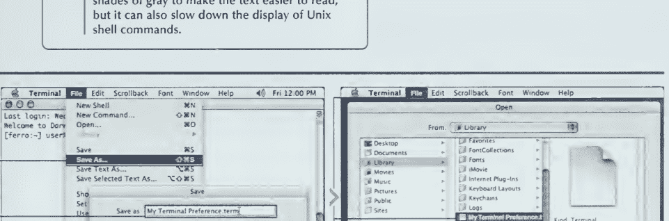

- 点击 文件 `File` -> 保存 `Save`。
- 保存面板打开。
- 输入文件名。
- 点击 文件 `File` -> 打开 `Open`。
- 点击一个之前保存的 `TERM` 文件。
- 点击 打开 `Open`。
- 一个 `Terminal` 窗口将打开，其配置基于你保存的设置。
- 当你输入字符时，会出现 `term` 扩展名。
- 点击 保存 `Save` 以保存并关闭对话框。
- 窗口设置将保存在带有 `term` 扩展名的 `TERM` 文件中

你可以通过直接在 `Terminal` 窗口的提示符处输入来执行 `Unix shell` 命令。这些命令允许你运行应用程序，向你提供当前 `shell` 命令的状态，例如正在运行哪些程序或你终端的当前位置。

错误：未找到命令 `Command not found`。

你可以通过按下向上箭头键来回溯上一个命令；你输入的精确命令会出现在提示符之后。你可以使用 `Delete` 键编辑该行，并在纠正错误后按下回车键 `Return`。这也是一种重复命令的有效方法。如果你再次按下向上箭头键，可以分别向后或向前遍历输入过的所有命令。


在输入每个命令后，你必须按下回车键来告诉 shell 你已完成。在你按下回车键之前，shell 不会运行你的命令。这允许你在命令运行之前返回并编辑。如果你犯了错，可以使用 `Delete` 键退格并删除你的错误，然后重试命令并按下回车键。

如果你在按下回车键之前没有发现错误，可能会收到错误信息。如果你输入了一个不存在的命令（作为错误），Unix 会返回以下内容：

最简单的 Unix 命令是 `w` 命令。该命令向你显示有谁连接到你的计算机，以及他们空闲了多久。旧的 Unix 机器通常会有几十个或数百个用户同时连接，但你拥有的 Terminal 窗口只会显示一行。

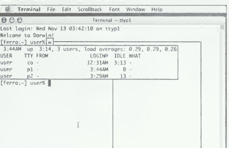

| Terminal - tty1 |

| :--- |

| 登录:Red Nov 13 03:42:10 on tty1 |

| 欢迎来到 Darwin |

| [-frame]: user |

| 3.468, 14 users, load averages: 0.29, 0.29, 0.26 |

| USER FROM LOGIN IDLE WHAT |

| user - 12:36PM 5:13 - |

| user co - 3:44AM |

| user pl - 3:29AM 13 |

| [-frame]: user |

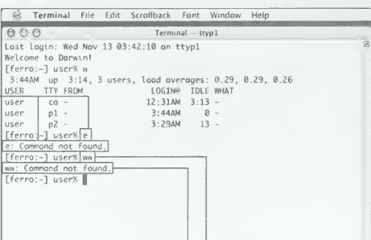

| Terminal - tty1 |

| :--- |

| 登录:Red Nov 13 03:42:10 on tty1 |

| 欢迎来到 Darwin |

| [-frame]: user |

| 3.468, 14 users, load averages: 0.29, 0.29, 0.26 |

| USER FROM LOGIN IDLE WHAT |

| user - 12:36PM 5:13 - |

| user co - 3:44AM |

| user pl - 3:29AM 13 |

| [-frame]: user |

| 错误：未找到命令 (Command not found) |

| 错误：未找到命令 (command not found) |

| sh: 未找到命令 (Command not found) |

| [-frame]: user |

- 1 打开 Terminal 应用程序。
- 2 输入字母 `w` 并按下回车键。
- 显示连接到你计算机的用户。
- 3 输入字母 `e` 并按下回车键。
- 如果没有名为 `e` 的 UNIX 命令，将出现错误信息。
- 4 输入 `ww` 并按下回车键。
- 如果没有名为 `ww` 的 UNIX 命令，将出现错误信息。

你通过键盘输入 Unix shell 命令，因此容易出现拼写错误。幸运的是，你可以设置 shell 自动拦截这些错误并对你尝试输入的内容进行合理的猜测。这可以帮助避免声明找不到命令的错误信息。你可以通过使用 `set` 命令来激活它。要这样做，在提示符处设置正确的 `c = cmd`。

在激活后，当你输入一个不存在的命令时，shell 会尝试寻找匹配项。它要求你通过输入 `y`（是）、`n`（否）或 `e`（编辑）来回复。

```
```

### 可执行文件

你在命令行中输入的大多数命令都是运行某种类型程序的请求。该命令可能是最初用 C++ 等语言编写并编译的程序，现在以二进制文件的格式保存在磁盘上。要运行一个文件，该文件必须是可执行的。*可执行文件*指的是用 Perl 编写的脚本，也可能是一个 shell 脚本。设置 shell 变量、重复命令以及在文件结构中移动。

shell 通过搜索你硬盘上被称为 *path*（路径）的一系列位置来定位可执行文件。`path` 是一个文件夹列表，也称为目录。如果你在这些文件夹之一中输入可执行文件的名称并按回车（Return），你就会将该文件作为 shell 运行。默认情况下，你的 `path` 包含了一组合理的目录，你也可以添加其他文件位置。

你输入的一些命令直接内置在 shell 应用程序中，作为独立的文件存在。这些功能包括启动和停止命令、设置 shell 变量、重复命令以及在文件结构中移动。

你使用 *which* 命令来确定一个命令是内置命令还是可执行文件。

你可以在 shell 提示符处输入 `builtins` 命令来获取 shell 内置命令的完整列表。*which* 命令非常有用；`which` 命令可以告诉你命令是内置命令还是可执行文件；如果是可执行文件，shell 会列出该文件的位置。

```
[darwin~] which w
```

## 结果：

```
/usr/bin/w
```

你可以从输出中看到 `w` 是存储在 `/usr/bin/w` 路径的可执行文件。

```
[darwin~] user% which
```

## 结果：

```
which: shell built-in command.
```

此输出告诉你 `which` 命令直接内置在 shell 应用程序中。

你可以通过 `man` 命令读取 Unix 手册页（manual pages）。这些页面提供了关于如何使用特定 Unix 命令的基本摘要，以及关于你可以与它使用的参数类型的详细信息。

获取命令信息最简单的方法是使用 `man [command]`。如果该命令有手册页，大多数手册页都很长，只有第一屏的信息会显示在你的终端中；要继续到下一屏，你可以按下空格键（Spacebar）。持续按空格键阅读每一屏信息，直到你读完整个手册。

手册页列出了命令的名称，括号内是你可以找到该命令的手册章节号。某些命令或术语会出现在多个章节中，你可以在术语前加上章节号来从中进行选择。在命令名称之后，会出现该命令的语法大纲（synopsis）。括号中的参数是可选的，但如果你使用了它们，在输入命令时必须将下划线单词替换为适当的值或格式。

手册页还包括命令的描述，并通常提供如何使用它的示例。相关命令连同章节号一起出现，并且与命令相关的任何文件（如配置文件）也会显示。还可能出现额外的杂项，例如命令的历史或已知 bug。

| man(1) | 通用命令手册 |

|---|---|

| NAME | 用户是用户以及他们正在做什么 |

| SYNOPSIS | **man** [-m] (core) [-h] (system) |

| DESCRIPTION | 该实用提供了系统当前活动的摘要，包括每个活动是如何使用的。第一行显示当前时间、主机名、登录系统的用户以及负载平均值。负载平均值给出了 1 分钟和 15 分钟内运行队列中的作业平均数。输出字段是用户的登录名、用户所在的主机、用户登录的时间、用户自上次输入内容以来的时间以及当前进程的名称和参数。选项如下：-h 抑制标题 |

输入命令名称并按回车。

在终端提示符处，输入 `man` 并加一个空格。

- shell 显示手册页的第一屏。
- 此区域显示命令的语法摘要。
- 此区域显示命令的描述（Description）。
- 按下空格键。

Unix 计算机出厂时没有附带解释 Unix shell 命令的打印版手册是非常常见的，你的 Mac OS 计算机也不例外。几十年来 Unix 用户一直依赖 `man` 命令来获取正确使用 Unix 命令的指令。作为一种传统，你有时会发现自己正在查询手册页来描述错误信息。因此，你将熟悉如何使用 `man` 命令。

你可以通过尝试一些命令来熟悉 `man` 命令。

示例：

[darwin-] user% man

[darwin-] user% man apro

[darwin-] user% whatis

[darwin-] user% manpath

[darwin-] user% tcsh

某些阅读页可能非常晦涩，所以不要为你任何无法立即理解的内容担心。例如，`tcsh` 的手册页非常长。

你会发现仅仅阅读手册页是不够的；你需要理解它想告诉你什么。这可能是困难的，因为大多数手册页初看起来很复杂，它们是为技术性很强的 Unix 系统管理员读者编写的。理解手册页的关键是阅读足够多的页面以便通过熟悉开始理解这些概念。使用搜索并查找你不理解的相关命令和术语。阅读手册页需要练习，但这是值得的。

| 终端 文件 编辑 回滚显示 字体 帮助 |

|---|---|---|---|---|---|

| 可以找到，man 打印 "-h" | | 如果有人在注销后留下了后台进程，使用 & 与 |

后台进程不会显示，即使它们占据了系统的大部分负载。

有时进程（通常是后台进程）会带有空名称打印。在这些情况下，命令名称将打印在括号中。

该实用工具不知道检测后台作业的新约定。它看起来像是一个后台作业，而不是正确的那个。

- -f, -s 和 -flags 不再受支持

历史

第 4 版 Berkeley 分发版 1993年6月6日 第4 版 Berkeley 分发版

| 终端 文件 编辑 回滚显示 字体 帮助 |

|---|---|---|---|---|---|

| [ferro-] user% man -k | - 从 man 源为 whatis/apro 获取 NAME 章节 |

| 获取数据库 | - 格式化和在线手册页 |

| man(1) 引用的语言 | - 手动填充路由表 |

| route(8) | - 手动操作 IPSec SA/SP 数据库 |

| [ferro-] user |

第二个章节出现。现在读完了 term 的整个手册页。

- 4 按空格键阅读每一屏信息直到看到 shell 提示符。
- 5 输入 man- 并加一个空格。
- 6 输入关键词并按回车。
- 7 按空格键阅读列表直到看到 shell 提示符。

当你使用 Unix shell 命令时，你可以退出 shell 并关闭终端窗口，或者终止终端应用程序。要执行此操作，只需点击终端窗口左上角的红色关闭按钮。或者，你可以从 Terminal 菜单中选择“窗口”，或从 Terminal 选择“退出”。然而，这些并不一定是关闭窗口的最佳方式。

因此，最好使用 `exit` 命令离开窗口中的 shell。`exit` 命令结束了 shell，但保持终端开启。

- 4 按空格键阅读每一屏信息直到看到 shell 提示符。
- 5 输入 man- 并加一个空格。
- 6 输入关键词并按回车。
- 7 按空格键阅读列表直到看到 shell 提示符。
- 1 在终端窗口中退出

shell 终止。

- 终端窗口关闭。
- 类似 top 的命令正在运行。
- 点击红色关闭按钮。
- 点击取消停止窗口关闭。
- 终端窗口保持开启。

### 额外

Terminal 应用程序维护了一个命令列表，如果你在这些命令运行时关闭 Terminal 窗口，它将终止这些命令。这些命令包括 `login`、`telnet` 和 `ssh`。其中每一个都是允许你连接到另一台计算机的应用程序，如果你正坐在该电脑前，就可以运行命令。

你可以在终端检查器（Terminal inspector）中添加或删除在关闭窗口时自动终止的命令列表；该列表位于设置的“进程”（Processes）组中。点击应用程序名称并点击“移除”按钮。如果需要向列表添加应用程序，只需点击“添加”并输入应用程序名称。务必点击“使用设置作为默认”以保存你的窗口设置。你还可以设置 Terminal 在不询问的情况下关闭窗口；你可以将其设置为从不询问。如果你经常通过 `telnet` 或 `ssh`（安全）连接到另一台计算机，可以从列表中移除这些应用程序，以避免意外断开。

| 文件 | 编辑 | 查看 | 滚动回 | 字体 | 窗口 | 帮助 |

| :--- | :--- | :--- | :--- | :--- | :--- | :--- |

| Terminal — iyp1 | | | | | | |

| 关闭窗口 03:54:01 | | | | | | |

| 进程: 3 | Terminal 将终止 13 个进程中的 35.0% | | | | | |

| 平均负载: 0.8 | login, iyp1 内部的进程 top 224 free | | | | | |

| 共享: 16M | 17 18424 57.0 46.8M | | | | | |

| 内存: 688M | 5.0 0.0 0.0 | 15 13568 55.0 46.0M | | | | | |

| 541 Terminal | 0.0 0.0 0.0 | 23 23448 52.7 13.7M | | | | | |

| 365 User | 0.0 0.0 0.0 | 21 23168 32.9 46.8M | | | | | |

| 364 User | 0.0 0.0 0.0 | 15 13527 31.2 43.8M | | | | | | |

| 795 top | 0.0 0.0 0.0 | 89 11139 34.1 37.1M | | | | | | |

| 783 login | 0.0 0.0 0.0 | 33 7056K 31.8 20.9M | | | | | | |

| 54215 | 0.0 0.0 0.0 | 34 11190 43.8 37.6M | | | | | | |

| 361 Docs | 0.0 0.0 0.0 | 22 2526 39.6 29.4M | | | | | | |

| 361 User | 0.0 0.0 0.0 | 44 4468 15.6 13.6M | | | | | | |

| 352 Directory_ | 0.0 0.0 0.0 | 14 14840 24.6 15.2M | | | | | | |

| 339 User | 0.0 0.0 0.0 | 17 1270F 16.4 32.7M | | | | | | |

| 337 cupid | 0.0 0.0 0.0 | | | | | | | |

| 321 ntdp | 0.0 0.0 0.0 | | | | | | | |

| 317 loginwd | 0.0 0.0 0.0 | | | | |

## 终止运行中的命令并关闭窗口

- 类似 top 之类的命令正在运行。
- 点击红色关闭按钮。

> 警告信息提示你有命令正在运行。

- 点击 Terminal 以关闭窗口并结束该窗口的所有命令。
- Terminal 窗口关闭。

## 退出 Shell 时配置 Terminal 关闭窗口

- 在新的 Terminal 窗口中，点击 Terminal：窗口设置。
- 从下拉菜单中选择 Shell。
- 点击“关闭”单选按钮。
- 要将此配置应用到所有终端窗口，点击“使用设置作为默认”。
- 点击红色关闭按钮关闭 Terminal 窗口。
- Terminal 窗口关闭。

当你使用 Unix shell 时，一切都通过基于文件的结构中的一个文件来表示。文件结构由目录组成，目录是包含其他文件的特殊类型文件。此外，类型文件也被称为可执行文件——直接构建在应用程序某些命令除外。事实上，你的 shell 就是一个可执行文件。

如果你熟悉 Mac OS 操作系统，你对对文件结构也是熟悉的——一切都存储在文件夹中。Apple 界面中的文件夹（folder）和目录（directory）是可以互换的。“directory”一词源于 Unix，而“folder”则源于 Mac OS 的图形化界面。

每个文件都有唯一的名称。这些名称可以包含字母、数字、符号，甚至是空格；但是，如果你的文件名包含空格或标点符号、点或下划线，在命令行指定它时需要加上引号。

当你启动 Terminal 时，shell 打开一个名为“主目录”（Home directory）的特定目录。这对于电脑上的每个用户都是唯一的，Unix 使用主目录来存储你通过各种程序创建的文件。`ls` 命令显示你当前工作目录的内容。你可以在 `ls` 命令后使用 `-F` 来识别每种文件类型。文件名后的斜杠（`/`）表示目录，星号（`*`）表示可执行文件。

| Terminal | 文件 | 编辑 | 滚动回 | 字体 | 窗口 | 帮助 |

| :--- | :--- | :--- | :--- | :--- | :--- | :--- |

| Desktops/ | | | | | | |

| Documents | | | | | | |

| Library | | | | | | |

| Movies | | | | | | |

| Music | | | | | | |

| Public | | | | | | |

| Sites | | | | | | |

- 1 打开一个 Terminal 窗口。
- 2 输入 `ls` 并回车。
- 1 输入 `ls -F` 并回车。
- shell 显示文件列表。

你可以使用 `ls` 命令的 `-A` 参数来列出隐藏文件。计算机不显示所有文件，并不是为了欺骗你，而是为了减少列表的杂乱。然而，在 Unix 中工作时，你可能需要看到隐藏文件和正常文件，你可以通过结合 `-A` 参数将它们与可见文件一起列出。大多数命令（包括 `ls` 命令）都会忽略以点（`.`）开头的文件。在普通列表中，你无法看到它们。但是，如果你提供一个目录名称，你将看到该目录的内容。如果你指定的文件名不存在，`ls` 命令会告诉你没有该文件或目录。

- 1 输入 `ls -A` 并回车。
- 2 输入 `ls -F` 并回车。
- 3 输入 `ls -AF` 并回车。
- shell 显示 Library，包括隐藏文件和目录。
- 使用斜杠识别目录。

你可以使用 `-ls` 命令显示每个文件的属性，包括所有者、权限和大小。每个文件或目录都有属性，控制谁拥有它以及谁可以访问。所有文件都有所有者，通常是创建文件的用户。例如，如果你是目录中文件的所有者，你还可以将文件与某个组关联；组是可以授予访问权限的用户集合。

当你输入 `-ls` 命令时，你将看到当前目录中每个文件的一行。第一列看起来像是一系列连字符和字母，如 `d`、`r` 和 `x`。下一列显示引用该文件的数量。这些引用也被称为链接（links），包含文件本身的目录，因此每个文件至少有一个引用。对于目录，引用代表每个目录内的文件数量。第三和第四列显示字符或字节的大小。第五列显示文件最后修改的日期和时间。第六列显示文件名。


如果你想检查单个文件，可以使用文件名作为 `-ls -1` 命令的参数。使用 `-ls -1` 命令列出目录的内容，尽管你可以使用 `-d` 参数请求目录的属性。

| Terminal | 文件 | 编辑 | 滚动回 | 字体 | 窗口 | 帮助 |
| :--- | :--- | :--- | :--- | :--- | :--- | :--- |
| Terminal -- -ls -1 | | | | | | |
| user ls -l | | | | | | |
| drwx | 100 | user | staff | 148 | Nov 18 | 15:20 | Desktop |
| drwx | 120 | user | staff | 408 | Nov 13 | 12:00 | Documents |
| drwx | 22 | user | staff | 748 | Nov 03 | 13:48 | Library |
| drwx | 3 | user | staff | 162 | Nov 12 | 14:39 | Movies |
| drwx | 4 | user | staff | 184 | Nov 16 | 14:39 | Music |
| drwx-r--r-- | 1 | user | staff | 60 | Nov 18 | 15:11 | Note To.doc |
| drwx-xr-x | 4 | user | staff | 136 | Nov 14 | 14:49 | Public |
| drwx-xr-x | 5 | user | staff | 170 | Nov 14 | 14:49 | Sites |
| drwx-xr-x | 5 | user | staff | 2576 | Nov 15 | 17:56 | image.jpg |
| drwx-r--r-- | 1 | user | staff | 0 | Nov 18 | 15:07 | -to-do.txt |
| user | | | | | | | |

* 模式列列出了文件权限。
* 引用计数是指向文件的链接数。
* 文件大小以字节为单位。
* 显示最后修改的日期和时间。
* 文件按文件名排序列出。

- 1 输入 `-l` 并回车。
- shell 显示文件属性。

文件模式表示文件的类型和权限。第一个字符是 `d` 表示目录，或者 `-` 表示普通文件。另外九个字母每三个一组进行读取。第一组代表文件所有者的权限，中间一组代表文件所在组中任何成员的访问权限，最后一组代表所有其他用户的权限。

每组中的第一个字母 `r` 控制该用户组的读取访问权限。第二个字母 `w` 控制写入权限。最后一个字母 `x` 指定执行权限，或者对于目录访问，它表示访问模式。模式字段中的横杠 `-` 表示所关联的用户组没有设置相应的执行权限。例如，`rw-` 表示用户可以读取和写入文件，但不能执行该文件。

示例：

`drwx-xr-x 5 user staff 170 Nov 4 13:49`

此目录可以被所有者、`staff` 组的成员以及任何使用该电脑的人读取。只有所有者可以写入该目录；然而，任何人都可以从此目录移动。

| 终端 | 文件 | 编辑 | 滚动记录 | 字体 | 窗口 | 帮助 |
|---|---|---|---|---|---|------|
| 终端 — tcsh (typ) | | | | | | |
| [ferro-] user$ ls -l my-dog.jpg | | | | | | |
| rw-r--r-- 1 user staff 2572 Nov 18 15:13 my-dog.jpg | | | | | | |
| [ferro-] user$ | | | | | | |

| 终端 | 文件 | 编辑 | 滚动记录 | 字体 | 窗口 | 帮助 |
|---|---|---|---|---|---|------|
| 终端 — tcsh (typ) | | | | | | |
| [ferro-] user$ ls -l my-dog.jpg | | | | | | |
| rw-r--r-- 1 user staff 2572 Nov 18 15:13 my-dog.jpg | | | | | | |
| [ferro-] user$ ls -ld library | | | | | | |
| drwxr-xr-x 1 user staff 748 Nov 13 03:40 Library | | | | | | |
| [ferro-] user$ | | | | | | |


shell 会显示文件属性。

输入目录名并按回车。

- 输入 `ls -l` 并加空格。
- 输入 `ls -id` 并加空格。
- 输入文件名并按回车。
- shell 将显示目录属性。

你可以使用 `cp` 命令复制文件。此命令允许你保存重要文件的备份，或者在编辑文件时保留文件的旧版本。在编辑重要文件之前对其进行复制是一个良好的习惯；它确保了你可以回到原始文件。

如果 `copy-file` 是一个已存在的目录，副本将放置在该目录中，并命名与 `original-file` 相同。

要复制文件，请为 `cp` 命令使用两个参数：第一个是原始文件的名称，第二个是新文件的名称。复制文件时不需要覆盖原始文件，但你必须拥有读取它的权限。你还需要在你执行复制的目录具有写入权限。你的 `cp` 命令应该看起来像：

```
cp original-file copy-file
```

如果已经存在一个你指定的同名文件，复制文件可能是危险的。在这种情况下，新副本将覆盖现有文件。`cp` 命令不会自动警告你，但它会直接复制文件，假设你想要覆盖现有文件。

为了确保你不会意外覆盖文件，请在 `cp` 命令中使用 `-i` 选项，这样它就会询问你确认是否要覆盖现有文件。如果是，你可以输入 `y` 并按回车；如果否，可以按任意键取消操作。

| 终端 | 文件 | 编辑 | 滚动记录 | 字体 | 窗口 | 帮助 |
| --- | --- | --- | --- | --- | --- | --- |
| 终端 -ls -l | | | | | | | |
| [ferro]-user is -l | Movies/ | Pictures/ | cute-ppy.jpg | | | | |
| Desktop/ | | | | my-dog.jpg | | | |
| Music/ | Public/ | my-dog.jpg | | | | | |
| Documents/ | Note To Mon. doc Sites/ | | | | | | |
| [ferro]-user is -l | my-dog.jpg to-do.txt | | | | | | |
| [ferro]-user is -l | | | | | | | | |
| Library/ | Note To Mon. doc 5 ted | | | | | | |
| [ferro]-user is -l | to-do.txt | | | | | | |

| 终端 | 文件 | 编辑 | 滚动记录 | 字体 | 窗口 | 帮助 |
| --- | --- | --- | --- | --- | --- | --- | --- |
| 终端 -ls -l | | | | | | | | |
| [ferro]-user is -l | Movies/ | Pictures/ | cute-ppy.jpg | | | | |
| Desktop/ | | | | my-dog.jpg | | | |
| Music/ | Public/ | my-dog.jpg | | | | | |
| Documents/ | Note To Mon. doc Sites/ | | | | | | |
| [ferro]-user is -l | my-dog.jpg to-do.txt | | | | | | | |
| [ferro]-user is -l | | | | | | | | |
| Library/ | Note To Mon. doc 5 ted | | | | | | | |
| [ferro]-user is -l | to-do.txt | | | | | | | |


# 创建副本

- 输入 `cp` 并加空格。
- 输入原始文件的名称，并加空格。

# 安全复制文件

- 输入副本名称并按回车。
- shell 将复制文件。
- shell 会询问你是否要覆盖文件。
- 输入 `cp -i original-file` 并按回车。
- 根据你的响应，`cp` 命令将复制文件或放弃操作。


# 通过路径指定文件

当你将文件名作为 `cp` 等命令的参数时，可以包含路径以指示当前目录之外的位置。你的 Mac OS 电脑的文件系统被设定为包含文件和其他文件夹的层级结构。每个文件夹都对应一个目录。你可以在 Mac OS X Finder 应用程序中查看文件夹，也可以通过 Unix shell 以目录的形式访问它们。

路径指定了你寻找文件的地方，就像地址告诉你在物理世界中寻找某人一样。例如，你可以这样描述你的当前位置：在地球上，美国，加利福尼亚州，奥兰市，富勒顿市市内，Willow 大街，110 号楼，花园层，G-1 室，后办公室，Kynn 的桌子上。

`Users` 目录，位于 `kynn` 目录的 `Documents` 子目录下，文件名为 `Chapter 02.doc`。你可以将该路径写为 `/Users/kynn/Documents/Chapter 02.doc`。

另一方面，文件可能表示它在硬盘的 `Users` 目录下的 `kynn` 子目录下。

在编写路径时，你必须用正斜杠 `/` 分隔每个目录名。如果路径包含空格，你必须用引号括起来以便在 Unix 中引用。

# 相对路径和全路径

Kynn 的桌子位于一个也包含 Laura 目录的办公室。如果你想描述 Laura 的位置，就说以行星 `file` 开头的所有内容。这是一个相对于属于 `kynn` 的目录的位置。如果你已经在同一个目录中，则不需要指定路径。例如，如果你在 `/Users/kynn` 目录下工作，并想复制上述的 `Chapter 02.doc` 文件，你不需要输入路径。

Unix 文件系统的起点是根目录，你通过初始正斜杠 `/` 来指示它。因此，以正斜杠开头的路径是全路径，它只相对于根目录。从根目录开始路径就像告诉某人所在地时从行星开始；根目录对应地球。使用全路径引用当前工作目录之外的文件。例如，要复制文件：

```
[ferro]:~ user cp Documents/Chapter 02.doc backup-ch2.doc
```

这将创建一个名为 `backup-ch2.doc` 的文件副本。注意，这位于 `/Users/kynn` 目录中，而不是 `Documents` 目录。

```
[ferro]:~ user cp /usr/share/dict/usernames-name-list.txt
```

# 特殊路径的别名

三个路径指向特殊的目录。别名 `.` 指向你当前工作的目录。别名 `..` 指向父目录——包含当前目录的目录，波浪号 `~` 指向你的家目录，你在那里存储个人文件。如果你在波浪号后紧跟另一个用户名，它将指向该用户的家目录。

## 重命名文件

你可以使用 `mv` 命令来更改文件的名称。在 Aqua 中，重命名文件和移动文件是两个不同的功能。在 Aqua 中，你通过将文件拖到新位置来移动它，通过点击文件的名称字段并输入新名称来重命名它。然而，当你仅仅是将文件移动到文件系统中的新位置时；即使你在同一个目录内，你实际上也是将文件移动到了新名称。

为了避免这个问题，你可以配合 `mv` 命令使用 `-i` 选项。如果移动文件将覆盖另一个文件，shell 会要求你确认是否继续。如果你确认的话，可以输入 `y` 表示是（yes），或输入任何其他键表示否（no）。为了安全起见，你应该养成使用 `-i` 选项的习惯。你还可以设置一个 shell 别名，以便在使用 `mv` 命令时自动使用 `-i` 选项。

然而，如果你将文件移动到已存在的文件，你将覆盖该文件。除非你确定要覆盖第二个文件，否则这不是一个良好的做法。

你可以使用 `mv` 命令将文件从一个位置移动到另一个位置。当你使用如 `mv /directory` 的命令移动文件时，生成的文件保持原名，但位于不同的目录中。只有当你将文件移动到新的位置和文件名时，你才是在重命名它。

| 终端 | 文件 | 编辑 | 滚动历史 | 字体 | 帮助 |
| :--- | :--- | :--- | :--- | :--- | :--- |
| [ferro]-user is $ - | cute-puppy.jpg Pictures/ | | | | |
| Desktop/ | Movies/ | | big-dog.jpg | | |
| Documents/ | Public/ | | | | |
| Library/ | Note To Mon.doc Sites/ | | | | |
| [ferro]-user is $ mv puppy.big-dog.jpg to-do.txt | | | | | | |
| [ferro]-user is $ | | | | big-dog.jpg | | |
| [ferro]-user is $ | | | | to-do.txt | | |
| 终端 | 文件 | 编辑 | 滚动历史 | 字体 | 帮助 |
| :--- | :--- | :--- | :--- | :--- | :--- |
| [ferro]-user is $ - | Pictures/ | | | | |
| Desktop/ | Movies/ | | big-dog.jpg | | | |
| Documents/ | Public/ | | | | |
| Library/ | Note To Mon.doc Sites/ | | | | |
| [ferro]-user is $ mv puppy.big-dog.jpg to-do.txt | | | | | |
| [ferro]-user is $ overwrite-to-do.txt n | | | | | |

## 重命名文件

## 安全重命名文件

- 1 输入 `mv` 并加一个空格。
- 2 输入当前文件名并加空格。
- 3 输入新文件名并按回车（Return）。

shell 会重命名该文件。

- 1 输入 `mv -i oldname` 并按回车。

shell 会询问你是否想要覆盖该文件。

- 2 输入你的回答并按回车。

`mv` 命令将根据你的回答重命名文件或放弃操作。

## 操作文件

## 删除文件

你可以使用 `rm` 命令删除你不想保留的文件。当你在 Aqua 中使用 Mac OS Finder 删除文件时，Finder 不会立即删除文件，而是将其存入垃圾桶。然而，当你使用 `rm` 命令删除文件时，删除是瞬时的，这意味着如果你从 shell 中误删除了文件，你无法通过将其从垃圾桶中拖出来来恢复。

与 `cp` 和 `mv` 命令一样，删除文件是非常危险的，因为人们可能会出错。你可以使用 `-i` 选项告诉 `rm` 命令确认你是否想要删除文件，你可以输入 `y` 表示是并按回车。如果不这样做，你可以按任何其他键或跳过回车。

默认情况下，`rm` 命令只删除普通文件，尽管你可以使用 `rmdir` 命令删除空目录；对于包含文件的目录，你可以使用 `rm -r` 命令。除非你对文件具有写权限，否则无法删除目录。但是，删除文件不需要特殊的访问权限。

删除以连字符（dash）开头名称的文件是可能的，例如 `-foo` 或 `-bar`。这些文件极难删除，因为 `rm` 命令会将文件名解释为选项，因为选项是以连字符开头的。在这种情况下，你可以使用 `--`（双连字符）。这意味着命令不会检查该行的剩余部分是否包含选项，从而使你的最后一个标志生效。

## 删除文件

## 安全删除文件

- 1 输入 `rm` 并加一个空格。
- 2 输入文件名并按回车。
- 3 shell 删除该文件。
- 1 输入 `rm` 并加一个空格。
- 2 输入文件名并按回车。
- 3 `rm` 命令将根据你的回答删除文件或放弃操作。
- shell 会询问你是否想要删除该文件。

## 更改文件权限

你可以更改你拥有的文件的权限，允许你授予或拒绝他人读取、写入或执行你文件的权限。`chmod` 命令有两个参数，第一个是新模式，第二个是你想要更改的文件。你通过指示哪些更改受影响来指定模式，即该更改是否应该被添加、移除，以及你想设置什么种权限。一种设置方法是组合标识符，例如，表示文件组中的用户且不在文件组中的用户，同时省略所有者。你可以使用加号 `+` 标记权限更改以添加，使用减号 `-` 标记以移除，或使用等号 `=` 来设置。可能的权限与 `ls -l` 中的相同：`r` 表示读取访问，`w` 表示写入访问，`x` 表示执行访问。Unix 允许定义 `u` 表示文件所有者，`g` 表示文件组中的用户，`o` 表示所有用户。你可以一次对文件进行多个更改，通过列出它们并作为分隔符。例如，要设置文件对组外的人员可读、写、执行，可以使用 `chmod u+rwx`。

| 终端 | 文件 | 编辑 | 滚动历史 | 字体 | 帮助 |
| :--- | :--- | :--- | :--- | :--- | :--- |
| [ferro]-user ls -l | | | | | |
| total 64 | 22 user 680 Jan 18 15:42 Desktop | | | | |
| drwxr-xr-x | 408 Nov 13 02:00 Documents | | | | |


| drwxr-xr-x | 22 user 748 Nov 13 03:48 Library | | | | |

| drwxr-xr-x | 3 user 408 Oct 12 14:55 Local Documents | | | | |

| drwxr-xr-x | 3 user 102 Oct 12 13:49 Music | | | | |

| drwxr-xr-x | 3 user 102 Oct 12 11:49 Pictures | To Mon. doc. | | | | |

| drwxr-xr-x | 3 user 136 Oct 12 14:49 Public | | | | |

| -rw-r--r-- | 5 user 25762 May 18 15:13-my.jpg | | | | | |

| -rw-r--r-- | 1 user 25762 May 18 15:07-to.txt | | | | | |

| [ferro]-user chmod +w-my.jpg | | | | | |

| -rw-r--r-- | 1 user chmod +w-to.txt | | |

| 终端 | 文件 | 编辑 | 滚动历史 | 字体 | 帮助 |

| :--- | :--- | :--- | :--- | :--- | :--- |

| [ferro]-user ls -l | | | | | (sh) |

| total 64 | 22 user 680 Jan 18 15:42 Desktop | | | | |

| drwxr-xr-x | 408 Nov 13 02:00 Documents | | | | |

| drwxr-xr-x | 22 user 748 Nov 13 03:48 Library | | | | |

| drwxr-xr-x | 3 user 408 Oct 12 14:55 Local Documents | | | | |

| drwxr-xr-x | 3 user 102 Oct 12 13:49 Music | | | | |

| drwxr-xr-x | 3 user 102 Oct 12 11:49 Pictures | To Mon. doc. | | | |

| drwxr-xr-x | 3 user 136 Oct 12 14:49 Public | | | | |

| -rw-r--r-- | 5 user 25762 May 18 15:13-my.jpg | | | | |

| -rw-r--r-- | 1 user 25762 May 18 15:07-to.txt | | | | |

| [ferro]-user chmod +w-my.jpg | | | | | |

| -rw-r--r-- | 1 user chmod +w-to.txt | | | |

## 移除读取权限

## 添加写入权限

- 1 输入 `chmod` 并加一个空格。

- 2 输入 `go-r` 并加空格。

- 3 输入文件名并按回车。

- 1 输入 `chmod g+w` 并加空格。

- shell 指明文件组中的用户可以更改此项。

- shell 指明你可以读取该文件。

- 输入文件名并按回车。

## 应用它

你可以通过使用 `chmod` 命令的 `-R` 选项更改整个目录及其内容，包括你的主目录。`-R` 选项规定递归更改，这意味着更改适用于该目录或子目录中的所有文件。

例如，如果你想让你的主目录对你自己可见而对计算机的其他用户可见，请使用 `chmod` 命令。

## 输入此：

```
[ferro]-user chmod -R go rx
[ferro]-user ls -l
```

## 结果：

| | | | | | |

| :--- | :--- | :--- | :--- | :--- | :--- |

| drwxr-xr-x | 8 | user | staff | 272 Nov 13 13:59 | Desktop |

| drwxr-xr-x | 12 | user | staff | 408 Nov 13 02:00 | Documents |

| drwxr-xr-x | 22 | user | staff | 748 Nov 13 03:48 | Library |

| drwxr-xr-x | 3 | user | staff | 408 Oct 12 14:55 | Local Documents |

| drwxr-xr-x | 3 | user | staff | 102 Oct 12 13:49 | Music |

| drwxr-xr-x | 3 | user | staff | 102 Oct 12 11:49 | Pictures |

| drwxr-xr-x | 3 | user | staff | 136 Oct 12 14:49 | Public |

# 使用通配符选择文件

你可以使用通配符字符来避免在 Unix 中输入每个想要处理的文件的完整名称。这不仅节省了时间，还让你能够在单条命令中引用多个具有相似名称的文件。

Unix 通配符也称为 glob 模式（glob-patterns），使用这些通配符在 Unix 中被称为通配匹配（globbing）。每当你向 shell 提供文件名参数时，都可以使用这些通配符。

星号 (`*`) 匹配文件名中的任意零个或多个字符序列。问号 (`?`) 匹配任意单个字符。括号 (`[]`) 中的字符匹配该范围内的任意单个字符。请记住，字母是区分大小写的，例如在 `[a-m]` 中，字母 D 不在其中，因为它不是 a 和 m 之间的小写字母。

模式或字符范围开头的脱字符 (`^`) 表示该模式应选择不匹配给定模式的字符。例如，如果你想对所有目录和文件使用 `*` 命令，使用 `-r` 选项删除所有以 doc 开头、后面接三个字符并以 .doc 结尾的文件，你可以输入 `rm -Documents???.doc`。如果你想避免删除错误的文件，在使用 `rm` 时应始终使用 `-i` 选项。一个粗率的 `rm *` 命令可能会删除该目录的内容。

隐藏文件很难通过通配符识别。例如，命令 `ls *` 不会列出隐藏文件，而 `ls .*` 会列出隐藏文件。

# 使用通配符选择文件

| 终端 文件 编辑 滚动回 字体 窗口 帮助 | 终端 文件 编辑 滚动回 字体 窗口 帮助 |

| --- | --- | --- | --- | --- | --- | --- | --- | --- | --- | --- | --- |

| | | | | | (tcsh) | | | | | (tcsh) | | | |

| ([ -])ls -ld* | | | | | | | | | | | | | | |

| drwx------ | 3 staff 102 Nov 4 13:49 Pictures | drwx------ | 3 staff 102 Nov 4 13:49 Pictures |

| drxr-xr-s | 4 staff 136 Nov 4 13:49 Documents | drxr-xr-s | 4 staff 136 Nov 4 13:49 Documents |

| ([ -])user | | | | | | | | | | | | | | |

| | | | | | | | | | | | | | | |

| | 24 staff 816 Nov 15 22:50 desktop | | 24 staff 816 Nov 15 22:50 desktop |

| | 12 staff 400 Nov 16 00:38 Documents | | 12 staff 400 Nov 16 00:38 Documents |

| | 22 staff 748 Nov 13 03:48 Library | | 22 staff 748 Nov 13 03:48 Library |

| | 4 staff 413 Nov 14 13:49 Music | | 4 staff 413 Nov 14 13:49 Music |

| | 3 staff 102 Nov 18 15:22 Note To Mon.doc |  3 staff 102 Nov 18 15:22 Note To Mon.doc |

| | 1 staff 370 Nov 17 17:04 | | 1 staff 370 Nov 17 17:04 |

| -rw------- | 1 staff 25762 Nov 18 15:13 dog.jpg | -rw------- | 1 staff 25762 Nov 18 15:13 dog.jpg |

| | 1 staff 0 Nov 15 18:07 to.txt | | 1 staff 0 Nov 15 18:07 to.txt |

| ([ -])user | | | | | | | | | | 匹配 glob 模式

- 1 输入一个接受文件名参数的命令。

- 2 输入匹配你想要选择的文件的通配符模式。

- shell 对通配符模式指定的文件执行命令。

# 使用脱字符选择不匹配的文件

- 1 输入一个接受文件名参数的命令。

- 2 输入 `^` 后跟匹配你不想选择的文件的通配符模式。

- shell 对当前目录中除通配符模式指定以外的文件执行命令。

# 使用补全选择文件

你可以通过文件名补全轻松指定文件名，这是 shell 内置的一个特殊功能。要使用文件名补全，你必须输入文件名的部分并按 Tab 键。如果有匹配的文件并按回车，shell 将为你填充完整文件名。

要查看模糊匹配的结果，你可以在提示声后按 Control + D。或者，你可以输入 `set autolist`，这指示 shell 在文件名补全失败时列出剩余选项。这是一个保存在 `.bashrc` 中的良好命令。同样，你可以通过 `unset autolist` 关闭此功能。

如果没有文件匹配文件名，shell 程序会发出提示声表示没有匹配。如果有多个文件匹配，shell 程序会尽可能地填充并发出提示声，等待你输入更多文本以区分匹配模式的不同文件。此时，你可以输入更多的命令行并按回车，或者输入足够唯一标识你想要访问的文件，然后再次按 Tab。

你可以将文件名补全与完整或相对路径结合；如果你输入部分路径并按 Tab，shell 会列出路径内的选项。文件名补全可以节省大量的打字时间，并减少输错字符的概率。

# 使用补全选择文件

| 终端 文件 编辑 滚动回 字体 窗口 帮助 |

|---|---|---|---|

| | Terminal -- tty1 |

| [[ -:-]: user set autolist |

| [[ -:-]: user is -ld G |

| Desktop/ Documents/ |

| [[ -:-]: user is -ld Desktop/ |

| drwx------ 6 user set 204 Nov 18 16:34 Desktop/ |

| [[ -:-]: user

 输入 `set autolist`。

- 输入一个接受文件名参数的 shell 命令。

- 输入文件名的前几个字母并按 Tab 键。

- 出现可能的匹配列表。

- 输入足够的字母以形成唯一匹配。

- 再次按 Tab 键。

- shell 完成文件名。

- shell 执行该命令。

# 按名称查找文件

你可以通过 `find` 命令根据名称或其他标准查找文件。该命令通常比 Mac OS 的 Sherlock 应用更快，特别是对于那些系统使用或在 Finder 中隐藏的文件。

你正在查找的。参数 `-print` 指示 `find` 命令显示文件的位置

`find` 命令是一个复杂且强大的工具，允许你运行许多不同搜索，并对找到的文件执行各种操作。然而，`find` 命令最常用的用法只是查找特定名称的文件并打印它们的位置。

你也可以提供通配符模式而不是文件名，`find` 命令会列出所有匹配模式的文件。当你这样使用通配符模式时，需要将其包含在引号中。例如，如果你保存了一个文档但没有记录存在哪个文件夹里，可以使用 `find` 命令找到你目录中所有的 doc 文件：

```
find ~/Documents -name "*.doc" -print
```

这显示了匹配模式的文件列表。当你想要查看路径的文件列表时，可以将 `print` 替换为命令：

`find -name filename -print`

第一个参数 `pathname` 是你想要搜索的目录。`pathname` 是 的名称。

 按名称定位文件

- 1 输入 `find` 和一个空格。

- 2 输入目录的 `pathname` 和一个空格。

- 3 输入 `-name` 和一个空格。

- 4 输入引号中的通配符模式。

- 5 输入 `-print` 并按回车。

- 输入文件名。

### 额外

除了按名称或通配符模式搜索外，你还可以根据文件的其他属性搜索，例如文件的最后修改时间、所有者或权限。你可以通过在目录路径之后包含的参数来控制搜索。

| 参数 | 查找内容 |

| --- | --- |

| -groupname | 属于特定组的文件。 |

| -iname filename | 类似 name，但不区分大小。 |

| -mmin minutes | 在指定分钟内修改的文件。 |

| -mtime days | 在指定天数内修改的文件。 |

| -perm charmode | 设置了特定权限的文件。 |

| -size charsc | 大小精确为指定字符的文件。 |


## MAC 版 UNIX

## 更改当前目录

你可以使用 `cd` 命令来更改当前目录。每个 shell 窗口都在文件结构中的特定位置运行，你可以通过输入 `pwd` 命令来查看此位置。`pwd` 命令是 print (working) directory（打印工作目录）的缩写。当前工作目录是查找或保存文件时相对路径的默认目录。

如果你输入 `cd`，它将带你回到主目录（Home directory）。如果你为 `cd` 命令提供路径参数（无论是相对路径还是全路径），它将切换到该目录。你可以切换到任何授予你访问权限的目录。这允许你探索硬盘上几乎所有的目录，受保护的少数系统目录除外。

当当前目录发生变化时，提示符也会随之改变，以反映新位置。提示符会显示当前位置上方最多三个目录的名称，或者在你靠近根目录时。例如，如果你在名为 user 的计算机的 `/usr/share/tsh/` 目录下，你的提示符看起来如下：

```
user@/usr/share/tsh%$
```

你可以在 `cd` 命令中使用通配符和文件名补全；它接受如 `cd ..`（进入上一级目录）和 `cd -`（切换到用户主目录）等名称。你也可以使用 `cd -` 命令返回上工作的目录。

## 确定你的目录

shell 显示当前的位置。

- 输入一个新的目录名称并按回车。

- 输入 `pwd` 并按回车。

- 输入 `cd` 和空格。

- 你的当前目录切换到新位置。

# 操作目录

你可以使用目录栈（directory stack）在文件系统中进行移动。栈是 shell 跟踪的目录列表。你可以通过输入 `dirs` 列出栈。

要切换到一个新目录并将其添加到目录栈，请使用命令 `pushd pathname`。该命令向栈中添加新路径并打印栈。你可以通过输入 `popd` 从栈顶端移除目录并切换到下一个，或者通过输入 `pushd --` 交换两个条目并切换到新的顶层目录。如果你需要在同一个 shell 窗口中在几个目录之间切换，目录栈非常有用。

示例：

```
user@~/Documents$ pushd /usr/lib
user@/usr/lib$ pushd /etc
user@/etc$ popd
user@~/Documents$
```

重复步骤 2 和 3 以移动到新目录。

- 输入 `cd -` 并按回车。你的当前目录切回到之前的目录。

- 输入 `cd` 并按回车。你的当前目录切换到你的主目录。

## 创建目录

你可以使用 `mkdir` 命令创建新目录。目录对于将文件组织成逻辑结构非常有用。当你在 Unix shell 中创建一个目录时，你可以通过 Mac OS 作为一个文件夹访问它；当你在 OS X 中创建一个带空格的文件夹时，你可以在 Unix shell 中作为目录访问它。

传递给 `mkdir` 命令的参数会影响新目录的创建方式。如果你创建一个名称带有空格的目录，必须用引号括起来，除非你想一次创建多个目录。

要创建目录，你需要对当前目录或创建新目录的目标目录具有写入权限。如果你想创建目录 `/usr/local/resp`，你必须对 `/usr/local` 目录具有写入权限。你可以使用 `cd` 命令将工作目录更改到 `/usr/local` 并输入 `mkdir resp`，也可以从任何当前目录输入 `mkdir /usr/local/resp`。

当你提供路径（相对路径或全路径）时，中间的目录必须存在。如果不存在，你将收到错误信息且目录不会被创建。你可以使用 `-p` 创建任何新目录。例如，要创建目录 `~/Documents/by-date/2003/0`，你的命令会在它们不存在时创建 `by-date` 和 `2003` 目录以及目标目录——假设你主目录下的 Documents 目录已经存在。

- 1 输入 `mkdir` 和空格。

- 2 shell 创建新目录。

## 一次创建多个目录

- 1 输入 `mkdir` 和空格。

- 2 输入你想创建的几个目录名称并按回车。

- shell 创建这些新目录。

## 补充

默认情况下，系统可以读取并执行你创建的目录，这意味着你电脑的所有用户都可以切换到新目录并列出其内容。如果你不希望这样做，可以使用 `chmod` 命令更改目录权限。

### 额外

# 操作目录


还有另一种方法使用 `rm` 命令删除任何整个目录及其内容（无论是否隐藏）。`-r` 选项指示 `rm` 命令删除目录及其内部的所有内容；`-f` 选项则指示 `rm` 命令在删除每个条目时不向向你提问。

虽然你可以使用 `-rf` 命令一次性删除整个目录，但你在执行此操作时应非常小心，因为错误的命令可能会轻易删除你可能永远无法恢复的文件。

示例：

```
$user rm -rf Install/
$user rm -rf / Extra
$user ls
```

`ls`: 拒绝访问

注意，在第二行中，该用户可能是想输入 `~/Extra`，但不小心在单词前加了一个空格。这是一个代价昂贵的错误，因为它意味着 `rm` 命令删除了用户的家目录。

## 删除防止直接删除的隐藏文件

- 6 输入 `cd ..` 并按回车。
- 你的当前目录包含该空目录。
- 7 输入 `rmdir` 并加一个空格。
- 8 输入目录名称并按回车。
- Shell 删除了该目录。

注意：如果你看到错误信息提示目录尚未为空，你可能需要找到并删除隐藏文件。

- 1 输入 `cd`、加一个空格以及目录名称，并按回车。
- 2 输入 `-A` 并按回车。
- 3 输入 `rm`、加一个空格以及隐藏文件的名称。
- 4 输入 `cd ..` 移动到父目录。
- 5 输入 `rmdir`、加一个空格以及你想删除的目录名称。
- shell 删除了该目录及其内容

## 移动文件到目录

你可以使用 `mv` 命令将文件移动到目录内或外部。这与在 Finder 中将文件拖到新文件夹位置相同。`mv` 命令可以重命名不存在的目录，可以重命名文件，还可以移动文件或目录在文件系统中的位置。你可以通过输入如下命令来使用 `mv` 命令移动文件或目录：

```
mv file location
```

参数 `location` 必须是一个目录。该目录要么存在且归你所有，要么你必须有权限在其中写入文件。如果你输入一个不存在的目录名称，错误文件将被重命名为你输入的第二个名称。如果你输错了目录名称，也会发生这种情况。

你可以使用 `mv` 命令移动多个文件，但它们必须进入同一个目录。要实现这一点，你只需输入每个文件名，并将目标指定为最后一个参数，如下所示：

```
mv fileOne fileTwo fileThree andSoOn location
```

此命令将你列出的所有文件移动到你指定的位置。如果该位置作为目录不存在，则会出现错误消息，命令不会执行。

在 `mv` 命令上使用 `-i` 选项可以防止你在移动文件时意外覆盖文件。

| 文件 | 编辑 | 滚动回 | 字体 | 窗口 | 帮助 |
| --- | --- | --- | --- | --- | --- |
| 终端 | user ~ ls -F | | | | |
| [[-]] user ~ ls -F | | | | | |
| 书/ | 站点/ | 公共/ | | | |
| 课程作业/ | 电影/ | | | | |
| 桌面/ | 给妈妈的.doc | my-dog.jpg | | | |
| 音乐/ | 图片/ | to-do.txt | | | |
| 库/ | 公共/ | | | | |
| [[-]] user ~ mv Note to Mom.doc Documents | | | | | |
| [[-]] user ~ ls -F Documents | | | | | |
| Microsoft 用户 桌面/ | 给妈妈的.doc | my-dog.jpg | | | |
| [[-]] user ~ | to-do.txt | | | | |
| 文件 | 编辑 | 滚动回 | 字体 | 窗口 | 帮助 |
| --- | --- | --- | --- | --- | --- |
| 终端 | user ~ ls -F | | | | |
| [[-]] user ~ ls -F | | | | | |
| 书/ | 库/ | 公共/ | | | |
| 课程作业/ | 电影/ | 站点/ | | | |
| 桌面/ | 音乐/ | my-dog.jpg | | | |
| 库/ | 图片/ | to-do.txt | | | |
| [[-]] user ~ mv my-dog.jpg to-do.txt Documents | | | | | |
| Microsoft 用户 桌面/ | 给妈妈的.doc | | | | |
| [[-]] user ~ | to-do.txt | | | | |

## 将文件移动到目录

- 1. 输入 `mv` 并加空格。
- 2. 输入文件名并加空格。

注意：仅当文件名包含空格时，才对文件名使用引号。

- 3 输入 `ls -F` 并加空格，随后是目录名称，然后按回车。
- 4. shell 在新目录中显示文件。

## 将多个文件移动到目录

- 1. 输入 `mv` 并加空格。
- 2. 输入用空格分隔的文件名。
- 3. 输入目标目录的名称并按回车。
- 4. 输入 `ls -F` 并加空格，随后是目录名称，按回车。
- 5. shell 在新目录中显示文件。

# 复制目录

你可以使用 `cp` 命令配合 `-R` 选项复制目录及其内容。`du` 代表磁盘占用，它可以告诉你每个文件或目录占用了多少空间。这些信息也可以通过 Finder 的“显示简介”菜单获取。当你使用 `-s` 命令时，得到的是目录本身的大小。

当 `du` 命令显示文件和目录的大小时，是以“块”为单位的：

```
cp fileOne location
```

你可以使用通配符来复制文件。例如，要将所有 `.doc` 文件复制到目录，使用 `cp -R Documents`。这会复制目录及其内容。`du` 命令显示的值是相同的，尽管目录名称会不同。

- 1. 输入 `cp -R` 并加空格。
- 2. 输入原始目录名称并加空格。
- 3. 输入新目录的名称并按回车。
- 4. 输入 `ls -F` 并加空格，随后是原始目录名称，回车。
- 5. 使用 `ls -F` 命令检查新目录的内容。
- 6. 新目录是原始目录的副本。

## 确定目录大小

你可以使用 `du` 命令显示目录的大小和内容。`du` 命令的意思是磁盘占用，它告诉你文件在硬盘上占用的空间。

此外，`du` 还会列出子目录的大小，这可能会导致 `du` 命令的输出非常冗长且难以阅读；如果你想要一个单一的答案来汇总目录的大小，可以使用 `du` 的 `-s` 参数。

当 `du` 命令显示大小时，是以块为单位的：Unix 文件系统中一个块代表 512 字节。这个数字对于计算机来说很容易，但对人类来说难以理解。你可以使用 `-k` 让 `du` 命令以千字节（1024字节）为单位列出大小。

如果你单独输入 `du`，它会给出当前工作目录的磁盘占用列表；如果你给出一个或多个目录，你将看到每个目录占用的空间。

## 列出目录大小

- shell 显示目录大小列表。
- 输入 `du` 并按回车。

列表中的最后一个数字是当前目录的总磁盘占用情况（单位为块）。

# 操作目录

### 额外

你可以使用 `df` 命令来检查计算机的磁盘总使用情况。与 `du` 类似，`df` 以 512 字符块为单位测量大小，但你可以使用 `-k` 选项让结果更易读。`df -k` 命令会列出计算机上所有的文件系统，并给你一个百分比，显示磁盘的满程度。

示例：

```
| filesystem | 1K-blocks | Used | Avail | Capacity | Mounted on |
| --- | --- | --- | --- | --- | --- |
| /dev/disk05 | 5865644 | 4027644 | 1779344 | 69% | /dev |
| devfs | 90 | 90 | | 100% | /dev |
| fdescs | 1 | 1 | | 100% | /dev |
| <volfs> | 512 | 512 | | 100% | /.vol |
| autonomous -fstab [314] | 0 | 0 | | 0% | /Network/Servers |
| autonomous -static [314] | 0 | 0 | | 100% | /autonomous |
```

列表中的最后五个系统对应 Unix 系统使用的内部系统。你可以安全地忽略它们，只看第一项列表。根据此列表，上面的计算机有一块磁盘，已用率为 69%。

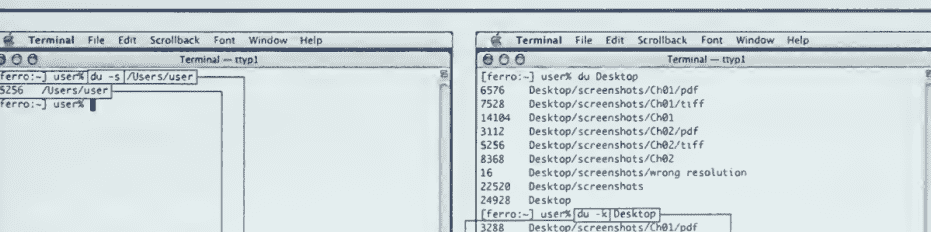

| 终止目录大小 | 2 输入目录或文件的名称并按回车。 | 2 输入目录或文件名并按回车。 |
| --- | --- | --- |
| 1 输入 `du -s` 和一个空格。 | Shell 显示以块为单位的目录总大小。 | Shell 显示以字节为单位的文件大小。 |

# 查看文本文件

你可以使用 `cat` 命令显示文本文件的内容。`cat` 名称是 `concatenate`（连接）的缩写，意是将几个东西并合并为一个。然而，`cat` 命令除了合并之外还有其他功能，其中之一就是在屏幕上显示文件。你可以通过输入此命令显示任何文件：

```
cat filename
```

屏幕会显示文件的完整内容。如果文件超过一个屏幕，你的 Terminal 窗口将滚动显示该文件。

你可以使用 `cat` 命令显示的两种类型的文件是文本文件和二进制文件。文本文件由普通字母、数字、空格、标点符号组成，统称为纯文本。如果你正在使用文字处理程序并将文件保存为文本，那么你正在创建一个文本文件。

`cat` 命令可以显示的另一种类型的文件是二进制文件。二进制文件包含你无法打印的特殊字符，因为这些字符的计算机代码不对应任何可打印的符号。从代码编译的可执行文件和程序通常是二进制文件，例如 Microsoft Word 文档之类的专有数据格式。

如果你使用 `cat` 命令显示二进制文件，你所能期待最好的 Terminal 窗口中出现乱码。最坏的结果是它会重置你的 Terminal 窗口的格式，这意味着你的提示符和你输入的任何字母都会显示为乱码。

要安全地显示二进制文件的内容，请配合 `cat` 命令使用 `-v` 选项，它会通过显示脱字符（^）控制字符和 M-Meta 字符来显示不可打印字符。

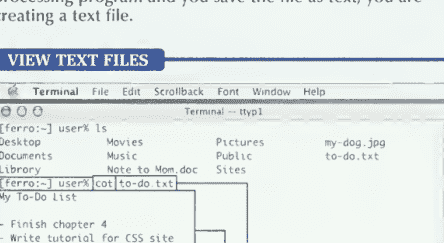

| Terminal 文件 编辑 回滚 字体 窗口 帮助 |
| --- | --- | --- | --- | --- | --- | --- |
| [file user is] | | | | Pictures | | my_dog.jpg |
| Desktop Music | Public | | to-do.txt |
| | Note to Doc Sites | | |
| Library]cat - to-do.txt |
| Terminal 文件 编辑 回滚 字体 窗口 帮助 |
| --- | --- | --- | --- | --- | --- | --- |
| [file user is] | | Pictures | | my_dog.jpg |
| Desktop Music | Public | | to-do.txt |
| | Note to Doc Sites | | | |
| Library]cat - to-do.txt |

## 查看文本文件

输入一个文本文件的名称并按回车。

Shell 显示文件的文件的内容。

- - 输入 `cat` 和一个空格。
- - 输入一个二进制文件的名称并按回车。
- - 这是一个 Meta-Control-T 字符示例。

# 创建简单的文本文件

你可以使用 `cat` 命令并将输出重定向到文件来创建一个文本文件。如果你输入并按回车，`cat` 命令似乎什么也没做，但你的提示符没有返回。当你输入其他内容并按回车时，你只会看到你输入的内容返回给你。这意味着 `cat` 命令正在读取你的内容。你正在构建一个为了执行命令而存在的虚拟文件。只要你继续输入，你就在向虚拟文件中添加内容。

制作简单的文本文件。输出重定向意味着将命令的结果保存到文件中，而不是显示在屏幕上。要重定向 `cat` 命令的输出，你可以输入：

```
cat > filename
```

要表示你已完成向文件输入文本，请按 Control-D。这将创建一个名为 `filename` 的文件。如果文件已存在，它将被覆盖。要向现有文件追加内容，请使用 `>>` 运算符。

要查看文件内容，请使用 `cat` 命令后跟文件名。将在 Terminal 窗口中显示内容。如果文件超过一个屏幕，你可以滚动查看。

要安全地显示二进制文件的内容，请配合 `cat` 命令使用 `-v` 选项，它会通过显示脱字符（^）控制字符和 M-Meta 字符来显示不可打印字符。

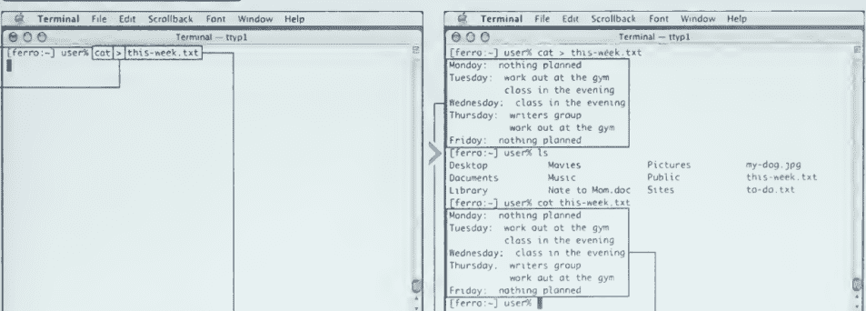

# 查看文本文件的部分内容

你可以使用 `head` 和 `tail` 命令显示文本文件的某部分。为了理解 `head` 和 `tail` 命令如何工作，将文本文件想象成被切割成“头部”和“主体”是有帮助的。`head` 显示文本文件中包含头部的部分，而 `tail` 显示文件的尾部。你可以为这两个命令提供额外的选项，以指示你想要截取的文件主体。

```
head -linenumber filename
tail -linenumber filename
```

例如，输入 `head -3 /usr/share/dict/words` 查看文件 `/usr/share/dict/words` 的前三行。许多 Unix 程序使用此文本文件作为英语单词的源，因此它是文本命令的一个很好的示例。

输入 `tail -3 /usr/share/dict/words` 显示该文件的最后三行。你也可以通过包含加号符号来使用 `tail` 命令从文件的开始指定的若干行：


```
tail +linenumber filename
```

在不使用任何选项的情况下，`head` 命令显示指定文件的前十行，`tail` 命令显示最后十行。如果文件有十行或更少，则显示整个文件。

你可以通过以下方式更改显示的行数：

| Terminal | File | Edit | Scrollback | Font | Window | Help |

|---|---|---|---|---|---|---|

| Terminal - type | | | | | | | |

| [ferro:- user head /usr/share/dict/words ] | | | | | | |

| a | | | | | | | |

| ac | | | | | | | |

| aal | | | | | | | |

| aall | | | | | | | |

| am | | | | | | | |

| asn | | | | | | | |

| aardwork | | | | | | | |

| aaron | | | | | | | |

| [ferro:- user ] | | | | | | | |

| Terminal | File | Edit | Scrollback | Font | Window | Help |

|---|---|---|---|---|---|---|

| Terminal - type | | | | | | | |

| [ferro:- user head -3 this-week.txt ] | | | | | | | |

| nothing planned | | | | | | | |

| Tuesday: work out at the gym | | | | | | | |

| class in the evening | | | | | | | |

| [ferro:- user ] | | | | | | | |

# 查看文本文件的开头

2. 输入文件名并按回车。

3. 输入 `head` 和一个空格。

5. 输入文件名并按回车。

- 1 输入 `head` 和一个空格。

- 终端显示文件的前十行。

- 4 输入一个连字符、你想要显示的行数以及空格。

- 终端显示你指定的行数文件内容。

# 处理文本

### 额外

你还可以使用 `-f` 选项设置 `tail` 命令显示文件末尾添加的任何新行。

Mac 操作系统维护着许多称为日志文件（log files）的文件。这些文件记录了系统活动，其中大部分对用户是不可见的，你可以它们诊断问题或监控进程。新行经常追加到日志文件中。你可以在 `/var/log` 目录下找到大多数最重要的系统日志。

你可以通过 `tail -f` 命令监控这些日志文件。要停止监控这些文件，请按 Control + C。

```
Example:
[ferro:-] user tail -f var log.system executing
Dec 2 16:03:40 ferro config[105]: executing
/System/SystemConfiguration/Kicker.bundle/Resources/restart-AppleTalk
Dec 2 16:03:03 lookup(53): lookup (version 272) starting - Mon Dec
Dec 2 16:04:05 ferro root: setting hostname to ferro.local.
Dec 2 16:04:05 ferro configd[105]: executing
/System/SystemConfiguration/Kicker.bundle/Resources/set-hostname
Dec 2 16:04:03 ferro root: setting hostname to ferro.local.
C
[ferro:-] user$
```

| Terminal | File | Edit | Scrollback | Font | Window | Help |

|---|---|---|---|---|---|---|

| [ferro:-] user|tail|/usr/share/dict/dict | | | | | Terminal-type1 |

| zymotic | | | work out at the gym | | | |

| Zyrenian | | | class in the evening | | | |

| Zyrenian | | | Wednesday: in the evening | | | |

| Zytron | | | work out at the gym | | | |

| Zytheen | | | Thursday: writers group at the gym | | | |

| Zythis | | | Friday: nothing planned | | | |

| Zythum | | | [ferro:-] user | | | |

| Zymerys | | | | | | | | |

| Zystoton | | | | | | | | |

| [ferro:-] user | | | | | | | | |

## 查看文本文件的末尾

- 1 输入 `tail` 和一个空格。

- 2 输入文件名并按回车。

终端显示文件的最后十行。

## 从文本中间开始

- 1 输入 `tail` 和一个空格。

- 2 输入加号符号、你想从这里开始的行数以及空格。

- 3 输入文件名并按回车。

终端从指定的行开始显示文件内容。

## 从文件中提取文本

你可以使用 `grep` 命令查找并显示文件中匹配模式的行。正则表达式（regexes）通常用于匹配模式。正则表达式比通配符（glob patterns）更强大且灵活，可以匹配各种模式；你可以将它们组合成复杂的 `grep` 表达式。`grep` 命令的选项包括 `-i`（让 `grep` 忽略大小写）、`-v`（反向搜索，显示不匹配的行）以及 `-l`（只列出匹配的文件名）。`grep` 命令的语法为：

```
grep pattern filename
```

正则表达式不需要包含在单引号中。如果没有单引号，终端会将模式解释为通配符并匹配目录下的文件。`grep` 命令的一个简单例子是它可以帮助解决字谜或 Scrabble 游戏。使用 `dict` 中的英语单词列表可以显示所有匹配项。例如，如果单词第一个字母是 `k`，第三个是 `n`，而你不知道结果，可以使用此命令显示所有可能的：

```
grep -i 'k.n$' /usr/share/dict/words
```

| Terminal | File | Edit | Scrollback | Font | Window | Help |

|---|---|---|---|---|---|---|

| [---] user used this text | | | | | | | |

| Monday: nothing planned | | | | | | | |

| Tuesday: work out at the gym | | | | | | | |

| Wednesday: class in the evening | | | | | | | |

| Thursday: writers group | | | | | | | |

| Friday: work out at the gym | | | | | | | |

| [---] grep pattern that is_work.txt | | | | | | | |

| Monday: nothing planned | | | | | | | | |

| Tuesday: work out at the gym | | | | | | | | |

| Wednesday: class in the evening | | | | | | | | |

| Thursday: writers group | | | | | | | | |

| Friday: nothing planned | | | | | | | | |

| [---] user | | | | | | | | |

| Terminal | File | Edit | Scrollback | Font | Window | Help |

|---|---|---|---|---|---|---|

| [---] user | grep -i 'k.n$' /usr/share/dict/words | | | | | | |

| kang | | | | | | | | |

| kond | | | | | | | | |

| keno | | | | | | | | |

| kedo | | | | | | | | |

| kino | | | | | | | | |

| kind | | | | | | | | |

| kink | | | | | | | | |

| kiona | | | | | | | | |

| kona | | | | | | | | |

| kung | | | | | | | | |

| kunh | | | | | | | | |

| [---] user% | | | | | | | | |

## 使用 grep 命令提取文本

## 字谜作弊技巧

- 1 输入 `grep` 和一个空格。

- 2 输入包含在单引号中的正则表达式模式，以及空格。

- 3 输入美元符号、结束引号；空格；`/usr/share/dict/words`；按回车。

- 1 输入 `grep -i`、一个空格、单引号和脱号符号。

- 2 输入已知的每个字母，并为每个不知道的字母输入一个点。

- 终端显示所有可能的单词。

- 终端显示文件中所有匹配模式的行。

# 处理文本

### 额外

正则表达式由普通文本和具有特殊含义的字符组成。简单的正则表达式就是纯文本，例如 `Kynn`。这匹配行中任何位置出现的 `Kynn` 单词。

`.` 匹配任意字符。方括号中的字符集，如 `[0123456789ABCDEF]`，匹配这些字符中的任意一个；普通字符或范围；而字符范围则匹配任何范围，例如 `[a-z-Z]`。

要选择行的开头，可以使用特殊的脱号（`^`）。匹配以 `Kynn` 开头的行的正则表达式是 `^Kynn`。同样，美元符号（`$`）表示行，`Kynn$` 仅匹配 `Kynn` 是该行最后字符的行。

要匹配多个相同类型的字符，可以在特殊字符、普通字符或范围后使用加号（`+`）。要匹配零或多个前面的字符，使用星号（`*`）。它匹配任何内容，因为它是任何字符的零或多个。问号（`?`）表示零或一次重复。

| Terminal | File | Edit | Scrollback | Font | Window | Help |

|---|---|---|---|---|---|---|

| Terminal --myp1 | | | | | | | |

| [-] user cat this-week.txt | | | | | | | |

| Monday: nothing planned | | | | | | | |

| Tuesday: work out at the gym class in the evening | | | | | | | |

| Wednesday: class in the evening | | | | | | | |

| Thursday: grep work out at the gym | | | | | | | |

| Friday: nothing planned | | | | | | | |

|[-] user grep 'day' this-week.txt class in the evening work out at the gym | | | | | | | |

|[-] user | | | | | | | | |

| Terminal | File | Edit | Scrollback | Font | Window | Help |

|---|---|---|---|---|---|---|

| Terminal --myp1 | | | | | | | |

| [-] user $ /usr/share/dict/ | | | | | | |

| README connects properties web20 words | | | | | | | |

|[-] user grep -1 'name' /usr/share/dict/* | | | | | | | |

| /usr/share/dict/web20 | | | | | | | |

| /usr/share/dict/words | | | | | | | |

|[-] user | | | | | | | | |

# 反转 grep 搜索

# 输入文件名并按回车。

# 所有包含模式的文件

# 输入星号搜索所有文件，并按回车。

- 输入 `grep -v` 和一个空格。

- 输入引号中的用于不匹配的正则表达式，以及空格。

- `grep` 命令显示所有不匹配模式的行。

- 输入 `grep -i`、一个空格、单引号和脱号符号。

- 输入包含在单引号中的正则表达式模式，以及空格。

- 终端显示包含该模式的文件名。

# 将文本重定向到文件

你可以通过将输出重定向到文件来保存任何 shell 命令的文本输出。Unix 命令通常在输入输入命令后，立即在终端（Terminal）窗口中显示其输出。通过重定向，你可以更改标准输出的目标地；它不必非出现在终端中。

记录任何时间点的信息。例如，如果你想记录某日期的磁盘使用情况，可以输入命令 `du -s > du-2003-03-05`。

当你重定向文本时，shell 不会在屏幕上打印任何特殊消息；当你完成命令执行时，你只会看到提示符。你可以使用其他命令（如 `cat`、`grep` 或 `head`）来检查你创建的文件。

要将参数的输出保存到文件中，你可以使用大于符号 (`>`)：

```
command and arguments > output-file
```

例如，要将 `grep 'Apple' changes.txt` 的输出保存到名为 changes.txt 的文件中，你可以使用此命令：

```
grep 'Apple' CHANGES.txt > apple-changes.txt
```

你可以使用 grep 命令记录命令的输出以便进行后续处理，例如编辑或打印文件。这也是记录任何信息的有效方法。

你可以将输出重定向与 `cat` 结合，从两个或多个文件中创建一个新文件。你可以使用以下命令实现：

```
cat filename1 filename2 filename3 > composite-file
```

新的 composite-file 包含每个文件中的文本，顺序与命令行上列出的顺序一致。你可以任意拼接任何文件。

| 终端 | 文件 | 编辑 | 回滚 | 窗口 | 帮助 |

| --- | --- | --- | --- | --- | --- |

| [---] user$ ls -l > ls-output.txt | | | | | |

| [---] user$ | | | | | | |

| 终端 | 文件 | 编辑 | 回滚 | 窗口 | 帮助 |

| --- | --- | --- | --- | --- | --- |

| [---] user$ ls -l > ls-output.txt | | | | | |

| [---] user$ | | | | | | |

| | | 大小 | 时间 | 名字 |

| --- | --- | --- | --- | --- |

| drwxr-xr-x | 21 user | 714 | Jan 02 05:52 | Desktop |

| drwxr-xr-x | 4 staff | 136 | Dec 16 03:06 | Music |

| drwxr-xr-x | 22 user | 748 | Nov 13 03:00 | Library |

| -rw-r--r-- | root | 4096 | | ls-output.txt |

| drwxr-xr-x | 4 user | 4096 | | this-week.txt |

| drwxr-xr-x | staff | 4096 | | Movies |

| drwxr-xr-x | 3 user | 4096 | Nov 02 14:39 | Mon.. doc |

| drwxr-xr-x | 3 user | 4096 | Oct 18 15:52 | Pictures |

| drwxr-xr-x | 4 staff | 4096 | Nov 04 13:49 | Public |

| -rw-r--r-- | root | 272 | Nov 20 23:08 | ls-output.txt |

| -rw-r--r-- | 5 staff | 1576 | Jan 15 14:51 | |

| -rw-r--r-- | 6 user | 200 | Feb 02 01:53 | this-week.txt |

| drwxr-xr-x | 1 staff | 111 | Feb 02 01:36 | to-do.txt |

# 保存命令输出

- 1. 一个显示输出的 Unix shell，加一个空格。

- 2. 大于符号和一个空格。

- 3. 你想要创建的文件名并按回车键。

shell 将输出保存到你创建的文件。

# 处理文本

### 额外

如果你将输出重定向到现有文件，你将用新的文本输出覆盖该文件。这可能是危险的，因为无差别地覆盖文件可能会导致数据丢失。

你可以通过输入命令 `noclobber` 来指示 shell 防止输出重定向覆盖现有文件。shell 会打印一条错误信息，说明目标文件已存在，命令不会执行。


如果你设置了 `noclobber` 命令并且需要覆盖现有文件，你可以输入感叹号 (`!`)，或者在大于符号之后输入。这会导致即使文件存在也会发生重定向。

示例：

```
[ferro:]] head /var/log/system.log > log
[ferro:]] set noclobber
[ferro:]] tail /var/log/system.log > log
log: File exists
[ferro:]] tail /var/log/system.log > log
```

| 终端 | 文件 | 编辑 | 回滚 | 窗口 | 帮助 |
| --- | --- | --- | --- | --- | --- |
| [ferro:]] user ls -l > ls-output.txt | | | | | |
| [ferro:]] user | | | | | |
| 终端 | 文件 | 编辑 | 回滚 | 窗口 | 帮助 |
| --- | --- | --- | --- | --- | --- |
| [ferro:]] user ls -l > ls-output.txt | | | | | |
| [ferro:]] user | | | | | |

| | | | | | | |  | | | | | | | | | | | | | | | | | | | | | | | | | | |
 | [ferro:] | user | | | | | | | | | | | | | | | | | | | | | | | |
 | | | | | | | | | | |
| [ferro:] user user -l |--output.txt | | | | | |
| [ferro:]] user | | | | | |
| 终端 | 文件 | 编辑 | 回滚 | 窗口 | 帮助 |
| --- | --- | --- | --- | --- | --- |
| [ferro:]] user ls-l >.-output.txt | | | | | |
| [ferro:]] user | | | | | |
| 终端 | 文件 | 编辑 | 回滚 | 窗口 | 帮助 |
| --- | --- | --- | --- | --- | --- |
| [ferro:]] user ls -l > lsoutput.txt | | | | | |
| [ferro:]] user | | | | | |
| 终端 | 文件 | 编辑 | 回滚 | 窗口 | 帮助 |
| --- | --- | --- | --- | --- | --- |
| [ferro:]] user ls -l | | | | | |
| (--)user% grep | | | | | |

- 完成 4
- 编写 CSS 编写教程
- 邮件列表
- 处理无障碍访问
- 周二：晚上的课程
- 周三：晚上的课程
- 周四：在健身房锻炼
- 无

# 合并两个文件

- 1 输入大于符号以及你想要创建的文件名。
- 2 输入两个或多个文件的名字，中间用空格分隔。
- 3 按回车键。

`cat` 命令合并文件并将输出保存到你创建的文件中。

# 链式命令

你可以通过将一个命令的输出作为输入来链接多个命令。这被称为管道（piping），它是使用标准输入而不是在屏幕上显示的另一种替代方法，一个命令的标准输出变成另一个命令的标准输入。第二个命令使用第一个命令的结果运行，并产生它自己的输出，然后你可以显示它、将其重定向到文件或将其管道到另一个命令。某些命令不会自动读取标准输入。对于这些命令，你必须阅读手册页，但最常见的方法是使用单个横杠 (`-`) 作为参数来指示命令应该读取标准输入。

管道是将内容重定向到文件然后对该文件应用第二个命令，但去掉了中间步骤。例如：这种技术的名称来源于一个特殊字符，称为竖线 (`|`)。在键盘上，你通过按住 Shift 键并输入 `|` 来创建此字符。管道命令的语法如下：

```
user% tail /var/log/system.log |
user% grep 'fer.local' log.tmp
user% rm log.tmp
```

你可以使用管道链接任意数量的命令。大多数处理文本的命令（如 `head`、`tail`、`grep` 等）在没有文件名的情况下会自动接受标准输入。

你可以通过命令行实现相同的结果：

```
tail /var/log/system.log | grep "fer.local"
```

| 终端 | 文件 | 编辑 | 回滚 | 窗口 | 帮助 |
|---|---|---|---|---|---|
| | Terminal-ty1 | | | | |
| user%ls -l | | | | | |
| drwxr-xr-x | 6 user root | 256 | Dec 2 01:56 | Desktop |
| drwxr-xr-x | 6 user root | 748 | Dec 2 13:04 | Documents |
| drwxr-xr-x | 6 user root | 406 | Nov 4 13:33 | Downloads |
| drwxr-xr-x | 3 user root | 102 | Nov 4 19:49 | Music |
| drwxr-xr-x | 4 user root | 102 | Nov 8 15:42 | Pictures |
| drwxr-xr-x | 3 user root | 316 | Nov 4 14:31 | Music |
| drwxr-xr-x | 8 user root | 272 | Nov 20 23:49 | Sites |

- 输入一个显示文本输出的 Unix shell 命令。
- 输入一个空格、一个竖线字符和另一个空格。
- 输入在第一个命令的输出上运行的第二个命令，并按回车键。
- shell 执行第一个命令并将其作为输入管道到第二个命令。

# 比较文本文件

你可以使用 `diff` 命令来比较两个文件，它会显示文件之间的差异。你可以使用 `diff3` 命令比较三个文件。如果你想比较同一个文件的两个版本以查看哪个文件发生了变化，可以使用 `diff` 命令。`diff` 命令的语法为：

```bash
diff first-file second-file
```

`diff` 命令的输出由两个文件中不相同的行组成。如果文件相同，`diff` 命令将不输出任何内容；你只会看到命令提示符。

如果存在差异，`diff` 命令将以以下方式报告：第一行指示每个文件之间的行号，行范围或特定的行之间有一个单个字母。该字母表示是增加了一行、删除了一行还是修改了某行。随后会显示每个文件的版本，第一个文件的行用小于符号 `<` 表示，第二个文件的行用大于符号 `>` 表示。

你也可以使用 `diff` 命令比较非文本的二进制文件；然而，`diff` 命令并不会打印这些它们之间的实际差异，因为这些可能是不可打印的字符。相反，如果文件相同，`diff` 将返回提示符，或者打印一条消息说明二进制文件彼此不同。

`diff` 只能比较两个文件。如果你需要比较三个文件，可以使用 `diff3` 命令。注意，没有名为 `diff` 的命令。

# 比较文本文件

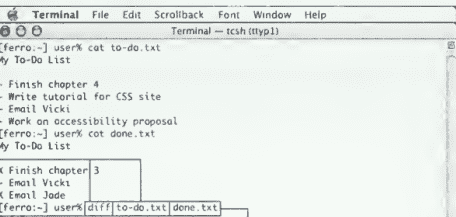

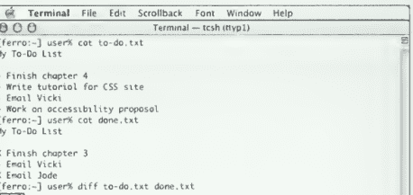

# 比较两个文件

| 步骤 1 | 步骤 2 | 结果 |
| :--- | :--- | :--- |
| 2 输入文件名并加空格。 | | Shell 显示文件之间的差异。 |
| 1 输入 `diff` 和一个空格。 | 3 输入另一个文件名并按回车。 | Shell 表示第一个和第二个文件之间的第 3 和第 4 行发生了变化。小于符号表示第一个文件中的行变化。 |

52

## 文本

# 进阶

如果你使用输出重定向将 `diff` 命令的输出保存到文件中，结果就是一个 diff 文件。你可以使用 diff 文件来记录文件之间的变化。例如，你可以通过保存 HTML 文本文档的副本并修改几行来更新网页。你可以使用 `diff` 命令来确定你做了哪些更改，并将结果保存到 diff 文件中。

`patch` 应用使用 diff 文件根据 diff 文件中的更改来更新原始文件。这在你从更新后的源代码编译新应用程序时非常有用。你也可以使用 `patch` 应用更新配置文件或任何其他文本文件。`patch` 命令的语法为：

```bash
patch original-file diff-file
```

不包含补丁的原始文件保存为 `original-file`。

你可以将 `diff` 命令的输出与 `ed` 命令配合，`ed` 是一个编辑文本的命令。为了让 `diff` 命令的输出变成 `ed` 命令理解的指令列表或编辑脚本，请对 `diff` 命令使用 `-e` 选项。

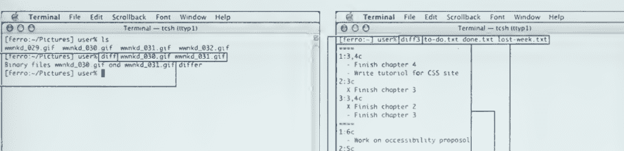

| 终端 | 文件 | 编辑 | 滚动窗口 | 帮助 |
| :--- | :--- | :--- | :--- |
| [~/Pictures] user@ | | | | |
| mknd_029.gif mknd_030.gif mknd_031.gif mknd_032.gif | | | | |
| Cherry-pick-001-diff-from-original_031.gif | | | | |
| Binary files mknd_030.gif and mknd_031.gif | | | | |
| [~/Pictures] user@ | | | | |

# 比较两个二进制文件

注意：如果文件不同，Shell 会显示一条消息。如果文件相同，则不会出现任何消息。

# 比较三个文件

- 1 输入 `diff` 和一个空格。
- 2 输入一个文件名、一个空格，以及另一个文件名，并按回车。
- 1 输入 `diff3` 和一个空格。
- 2 输入三个用空格分隔的文件名，并按回车。
- Shell 显示文件之间的差异。

# 统计文本中的字符数、行数和单词数

你可以使用 `wc` 命令来测量文件中行数、单词数和字母数。`wc` 命令（单词计数）还会统计文件的行数和字符数（或字节）。`wc` 命令的输出如下：

`wc` 命令还可以从标准输出中统计行、单词和字符。你可以使用 `wc` 命令来统计其他命令的结果，例如 `grep` 命令。

```bash
lines words characters filename
```

例如，要统计文件中包含某种模式的行，可以使用此命令：

```bash
grep 'pattern' | wc -l
```

`lines` 值是文本中的行数。`words` 值是单词数；对于单词来说，目的是任何不包含空行或空格的字符组。`characters` 值包括打印的字母、数字和符号，以及空行和空格。

请记住，该命令统计文本中的行数。如果你不指定任何参数，`wc` 命令将分别打印行、单词和字符数。要统计行数，可以使用 `-l`。要统计单词数，使用 `-w`。要统计字符数，使用 `-c`。

# 列排列文本

你可以使用 `column` 命令创建排列整齐的列。如果长列表以多列形式出现，则更易阅读，因为这让你看到文件的更多内容。`column` 命令根据终端宽度将你的文本分列。`column` 命令的语法为：

```bash
column filename
```

输入字段的最大宽度决定了每列的宽度。例如，如果你的终端宽度为80字符，且所有行的最大宽度为21，你可以有三列。不能四列，因为会超过终端宽度。如果文件中最长的行是50个字符，那么你只能有一列，因为在80字符的终端内无法拥有每列50字符的列。

你也可以通过管道将其他命令的列表提供给 `column`；例如，如果你想让 `grep` 的输出列，可以输入：

```bash
grep 'pattern' | column
```

`column` 命令将列表中的项目垂直排列。第二个项目出现在第一个项目之后，依此类推，直到到达第一列底部。列表然后从第二列顶部继续。如果你希望列水平运行，可以对 `column` 命令使用 `-x` 选项。

# 水平填充列

Shell 显示输入文件的列，但按水平顺序排列。

- 1 输入列名并加空格。
- 2 输入输入文件名并按回车。
- 1 输入 `column -x` 和一个空格。
- 2 输入输入文件名并按回车。

# 文本排序

你可以使用 `sort` 命令对文本行进行排序。你可以使用 `uniq` 命令消除排序后文本中的重复行。排序后的文本更容易阅读，特别是当你需要比较值或在其中查找特定单词时。`sort` 命令可以轻松地自动完成这些操作，而不是手动完成。

你可以通过 `-f` 选项指示 `sort` 命令使用字母顺序而不是字符顺序。这会让 `blue` 排在 `Yellow` 之前，字母 `b` 在 `Y` 之前。所有数字都会被忽略。

你可以根据想要排序的列表类型通过选项来控制 `sort` 命令。默认情况下，`sort` 使用字符顺序。这初看起来是合理的，但计算机以随机的方式排序大写和小字母。实际上，字母表包含字母 A 到 Z，然后是小写字母 a 到 z。因此，单词 `Yellow` 在 `blue` 之前，因为所有大写字母都在小写字母之前。

这两种排序方式对数字都不好用。包含 1 的数字在前面，然后是包含 2 的数字，以此此类推。因此，数字 111 在数字 28 之前，因为 111 以 1 开头而28 以 2 开头。要进行正常排序，你可以在 `sort` 命令中使用 `-n` 选项，它可以正确排序数字。

与 `sort` 类似的命令是 `uniq`。`uniq` 命令接收排序后的文本行（作为命令行参数或来自标准输入），并删除重复行。该命令显示所有唯一的行。

```
Terminal - tcsh
[-] sort this-week.txt
Monday
nothing planned
Tuesday
work at the gym
Wednesday
class in the evening
Thursday
group
Friday
nothing planned
[-] sort this-week.txt
work at the gym
class in the evening
Friday
nothing planned
Monday
nothing planned
Tuesday
work at the gym
Wednesday
class in the evening
[-] user
```

```
Terminal - tcsh(tty)
[-] user categories.txt
My-Do-List, with priorities
1 Finish chapter
2 Write article for CSS site
3 Email Vicks
4 Work on accessibility proposal
[-] sort -n -priorities.txt

My-Do-List, with priorities
1 Finish chapter 4
2 Work on accessibility proposal
3 Write article for CSS site
[-] user
```

# 按顺序排序文件

shell 会按照字符顺序显示文件内容。

- 1 输入 `sort` 和一个空格。
- 2 输入你想要排序的文件名，并按回车（Return）。

# 按数字排序文件

shell 会按照数字顺序显示文件内容。

- 1 输入 `sort-n` 和一个空格。
- 2 输入要排序的文件名，并按回车。

# 附加

你可以结合 `sort` 命令与 `du` 命令使用，确定哪些子目录占用了最多的空间。这可以在你磁盘空间受限时规划使用。

`du` 命令以块为单位列出每个目录和子目录的大小；如果你愿意，可以使用 `-k` 选项显示千字节。每行的第一列显示文件的大小，因此你可以使用 `sort` 命令的 `-n` 选项按数字顺序列出目录大小。

示例：

```
[user@]$ du -k Documents sort -n
0 Documents/Dogs/Sounds
4 Documents/Letters
28 Documents/Dogs
28 Documents/Dogs/Images
56 Documents/To Do Lists
88 Documents
[user@]$ 
```

示例显示最小的目录是 Dogs 的子目录，最大的是整个 Documents 目录。

# 保存排序后的文本

- 输入 `sort` 和一个空格。
- 输入你想要排序的文件名，以及一个空格。
输入大于符号 `>` 和新文件的文件名，并按回车。
- 命令对文件内容进行排序并将输出保存在新文件中。

# 去除重复项

- 输入 `sort` 和一个空格。
- 输入你想要排序的文件名，以及一个空格。
输入竖线 `|`、一个空格，然后输入 `uniq` 并按回车。
- 命令排序文件并删除重复行。

# 在打印机上打印

你可以使用 `lpr` 命令在打印机上打印文件。你可以使用 `encscript` 命令在 PostScript 打印机上格式化并打印文件。`lpr`（行打印机）命令将文本直接发送到你的打印机。打印机仅按照接收到的顺序输出这些行。`lpr` 命令的语法为

如果你尝试打印非文本二进制文件，可能会发生两种情况：如果二进制文件是打印系统已知的格式（例如 JPEG 图片文件），它会打印到你的打印机。然而，如果它是未知文件格式或可执行二进制文件，它可能完全不打印。

```
lpr filename
```

`lpr` 命令还会打印从另一个命令的标准输出管道的文本：


你还可以使用 `encscript` 命令，它可以将你的文本转换为 PostScript。PostScript 是一种许多打印机都能的计算机语言；你应该检查你的打印机是否理解 PostScript。如果支持，你可以使用 `encscript` 命令创建打印文本。

```
another command | lpr
```

如果你没有将打印机连接到计算机，`lpr` 命令将无法工作，你会收到错误消息。

`encscript` 命令产生的输出比 `lpr` 命令更好，因为 PostScript 允许你使用特殊特效。例如，你可以在文本下方以浅灰色放置一个巨大的斜向消息，例如“Top Secret”。这被称为底纹（underlay），由 `encscript` 命令的 `--underlay=` 选项设置。

# 在打印机上打印文本

你可以使用 `lpr` 命令在打印机上打印文件。你可以使用 `encscript` 命令在 PostScript 打印机上格式化并打印文件。`lpr`（行打印机）命令将文本直接发送到你的打印机。打印机仅按照接收到的顺序输出这些行。`lpr` 命令的语法为

如果你尝试打印非文本二进制文件，可能会发生两种情况：如果二进制文件是打印系统已知的格式（例如 JPEG 图片文件），它会打印到你的打印机。然而，如果它是未知文件格式或可执行二进制文件，它可能完全不打印。

```
lpr filename
```

`lpr` 命令还会打印从另一个命令的标准输出管道的文本：

### 额外

Pico 的基本按键会显示在屏幕上。每个按键的功能并非一而二见，因此此表总结了最常用的 Pico 命令。这些命令中的许多并不直观，但其助记法可能会有所帮助。例如，要查看帮助屏幕，你应该按 Control + G 而不是 Control + H，所以你可能将该命令想为“获取帮助”。

| 按键 | 助记法 | 功能 |
| --- | --- | --- |
| ^C | Current location | 显示光标位置 |
| ^D | Delete | 删除光标下方的字符 |
| ^G | Get help | 显示程序帮助屏幕 |
| ^J | Justify | 重新格式段落 |
| ^O | write Out | 保存当前文件 |
| ^R | Read file | 插入另一个文件的内容 |
| ^X | eXit | 退出 Pico（必要时） |
| ^W | Where | 在当前文件中查找文本 |
| ^V | | 向下翻页 |
| ^Y | | 向上翻页 |

## 在 PICO 中输入文本

- 1 将光标移动到你想输入文本的位置。
- 2 在光标处输入你想要输入的文本。

## 使用 PICO 编辑文件

你可以在 Pico 编辑器中编辑文本，执行基础任务，如查找特定文本或保存文件。Pico 基于 Pine 电子邮件程序的文本编辑功能，后者 是一个 shell 应用程序，允许你编写、发送和重发邮件。你可以在第 13 章中学习更多关于安装和使用电子邮件程序的知识。

Pico 文本编辑器有几个命令行选项，你可以在启动编辑器时使用它们。`-f` 选项会激活功能键，但你应该注意，在 Mac OS 中只有前四个键（F1 到 F4）有效。`-v` 选项会以只读模式打开文件，这意味着你无法对文件进行更改。

如果你编辑一个行很很长的文件，Pico 不会自动折行文本以适应窗口大小。对于每一行超出窗口宽度的行，Pico 会在窗口右侧显示一个符号（$）。你可以通过移动光标或使用方向键向下移动查看这些行，然后使用左右方向键在行内移动。

最常用的 Pico 命令是那些查找和修改文本、保存文件以及允许你退出编辑器的命令。例如，搜索某个短语或保存内容。在保存时，它会询问是否要写入输出文件，因此你可以使用 Control + O 保存文件。如果你没有保存文件，Pico 会询问你是否要保存该文件。

## 在 PICO 中查找文本

出现搜索菜单。
- 1 按 Control + W。
- 2 输入你想查找的文本并按回车键（Return）。

Pico 将光标移动到文本处。

### 额外

你可以使用 Pico 的剪切和粘贴功能在文件内移动文本。Pico 使用键盘命令来标记、复制、删除和移动文本段。Pico 不允许你将文本导出到其他应用程序。

要在 Pico 中选择文本，使用方向键将光标移动到要选择的文本开头。按 Control + Shift + 6，Pico 会通过高亮（黑色）来标记你想要选择的文本块的开头。使用方向键将光标移动到选择区域的末尾，然后按 Control + K。Pico 会从文件中剪切该块。这是删除大段文本的简单方法。

要将文本粘贴到新位置，请使用方向键将光标置于你想移动已删除文本的位置，并按 Control + U。此命令会排序或粘贴文本。

## 使用 PICO 保存文件

- 1 按 Control + O，Pico 编辑器会提示你当前文件名。
- 2 输入文件名并按回车键。
- Pico 编辑器询问你是否要保存。输入 `y` 保存文件或输入 `n` 不保存并退出。Pico 编辑器退出。

## 使用 VI 打开文件

你可以使用 vi 编辑器编辑文件。vi 编辑器比 Pico 更强大，可以执行许多文本编辑功能。它的名字是 visual editor（可视化编辑器）的缩写，因为你可以按照看到的内容编辑文件，而不是像 sed（一种流编辑器）那样使用命令行。开始之前，你可以在提示符处输入 `vi` 并带有一个可选参数：带有完整路径的文件名可能是 `/tmp/vi`，因为 vi 将临时文件存储在 `/tmp` 目录。

如果你不指定文件名，vi 会为你创建一个临时文件并打开该文件进行编辑。临时文件的名称由一组看似随机的字符和数字组成：当 vi 显示文件时，超过终端宽度的行将继续显示在下一行。vi 编辑器会在屏幕边缘断行，这意味着单词的后半部分出现在行的末尾，另一部分在下一行。该单词仍然是完整的，vi 只是为了编辑目的而这样显示。vi 编辑器会自动使用整个终端。如果屏幕上还有额外的行，每行的开头都会出现一个波浪号（~）。这些不是你文件的一部分；它们仅表示内容的结束。

## 在 VI 中编辑文件

- 1 输入 `vi` 并加一个空格。
- 2 输入文本文件名并按回车键。vi 编辑器打开并显示该文件。此区域显示文档。
- 3 按 Shift + X 退出文件。

### 额外

你可以通过设置选项来更改 vi 编辑器的行为。设置方法是：输入冒号（:`）、单词 `set`、一个空格，然后是选项名称。例如，要开启行号，输入 `:set number`。要关闭某个选项，输入冒号、`set`、空格、`no`再加上选项名称。

| 选项 | 功能 |
| --- | --- |
| autoindent | 自动缩进。 |
| list | 显示 $ 符号表示行尾。 |
| number | 在左侧显示行号。 |
| ruler | 显示当前行号和字符位置。 |
| showmode | 在右下角显示当前模式（例如 insert）。 |
| verbose | 使用信息丰富的警告和消息。 |

你可以输入 `set` 并按回车键查看哪些选项已设置。要查看所有 vi 编辑器选项，输入 `set all`。

## VI 内部的移动

你可以使用单键命令在编辑器中移动文件。vi 编辑器与其他可视化编辑器的一个区别特性是“模式”的概念。vi 编辑器始终处于两种状态之一：命令模式（Command mode）或插入模式（Input mode）。命令模式允许你使用键命令删除行、移动或保存文件。插入模式允许你在光标处输入文本。在命令模式下，任何按键都会切换到插入模式。

要在 vi 中移动文档，应用程序必须处于命令模式。vi 编辑器提供了许多导航内容的方法，其中一些出现在当前页面。最简单的方法是使用方向键移动光标，就像在 Pico 中一样。你也可以使用字母 h、j、k、l 在屏幕上移动光标。

vi 命令模式下的按键通常很复杂，与 Pico 编辑器不同，它们不需要按住 Control 键。然而，按键命令是区分大小的，这意味着 a 和 A 是不同的命令。你需要使用 Shift 键来输入大写字母。

vi 中的命令与 find 命令相似，当你输入正斜杠 `/` 并输入正在寻找的单词或短语时，vi 编辑器会自动将光标移动到文本的下一个出现处。如果你输入问号 `?` 而不是正斜杠，搜索将从当前位置向前进行。

### 额外

下表中的命令允许你在 vi 文件中快速移动，并在需要时重新定位光标并滚动屏幕。

| 按键组合 | 效果 |
|---|---|
| H | 移动到文件的第一行。 |
| G | 移动到文件的最后一行。 |
| h | 向左移动一个字符。 |
| j | 向下移动一行。 |
| k |向上移动一行。 |
| 1 | 向右移动一个字符。 |
| ^ | 移动到当前行的开头。 |
| $ | 移动到当前行的结尾。 |
| w | 向后移动一个单词。 |
| /text | 从光标向前查找文本。 |
| ?text | 从光标向后查找文本。 |

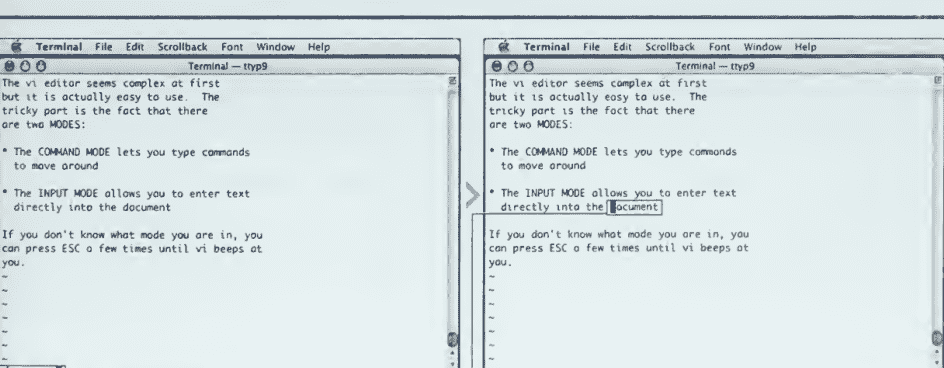

vi 编辑器看起来很复杂，但实际上很容易用。难点在于它有两个模式（MODES）：
- 命令模式（THE COMMAND MODE）允许你输入命令来移动
- 输入模式（THE INPUT MODE）允许你直接向文档输入文本

如果你不知道自己处于什么模式，可以按几次 ESC 键，直到 vi 发出提示声。

# 在 VI 中查找文本

1. 输入 `/`
2. 输入一个单词或短语并按回车。

vi 编辑器会将光标移动到该单词或短语。

# 在 VI 中输入文本

你可以通过切换到 vi 的输入模式向文档输入文本。当你启动 vi 编辑器时，它默认切换到命令模式，允许你遍历文件或输入按键。如果你尝试在命令模式下输入文本将产生非常奇怪的结果，因为字符在命令模式下会变成命令。在输入文本之前，知道自己处于什么模式是非常重要的。

方法就是按下位于大多数键盘左上角的 Esc（退出）键。如果你不确定处于哪种模式，可以按 Esc 键返回命令模式。在命令模式下按 Esc 键不会保存，因此按它确认是安全的：

确定当前模式最简单的方法是启用 `showmode` 选项。你可以通过输入 `:showmode` 来。你的当前模式出现在右下角。

许多常用的模式按键出现在对面页的表格中。最重要的按键是 i

你可以使用单个数字按键组合从命令模式切换到输入模式。从输入模式切换到命令模式只有一种方法：

| 终端 | 文件 | 编辑 | 回滚 | 字体 | 窗口 | 帮助 |
|---|---|---|---|---|---|---|
| 终端 | | | | | | |

vi 编辑器看起来看起来复杂，但实际上很容易用。难点在于它有两个模式：
- 命令模式（THE COMMAND MODE）允许你输入命令来移动
- 输入模式（THE INPUT MODE）允许你直接向文档输入文本

如果你不知道自己处于什么模式，可以按几次 ESC 键，直到 vi 发出提示声。

# 插入文本

1. 将光标置于于你想输入文本的位置。
2. 输入字母 i。
3. 输入你想插入的文本。
4. 按 Esc。

vi 编辑器切换到输入模式。

vi 编辑器切换到命令模式。


### 额外

你用于切换到插入模式的按键命令出现在下表。还有其他功能与插入模式类似的模式，允许你向文件中输入文本。作为插入模式，你可以通过按 Esc 键切换到命令模式来离开这些模式。

# 开启新行文本

1. 将光标置于你想插入新一行的行。
2. 输入字母 o。
3. 输入你想插入的文本。
4. 按 Esc。vi 编辑器切换到命令模式。

| 按键组合 | 进入的模式 | 功能 |
|---|---|---|
| A | 插入 | 在当前行末尾追加文本。 |
| a | 插入 | 在当前字符后追加文本。 |
| I | 插入 | 在当前行开头插入文本。 |
| i | 插入 | 在当前位置插入文本。 |
| O | 插入 | 在当前行之前插入新行。 |
| o | 插入 | 在当前行之后插入新行。 |
| R | 替换 | 用你输入的文本替换现有文本。 |
| r | 替换 | 用你输入的文本替换单个字符。 |
| S | 更改 | 用你输入的文本替换当前行。 |
| s | 更改 | 用你输入的文本替换单个字符。 |

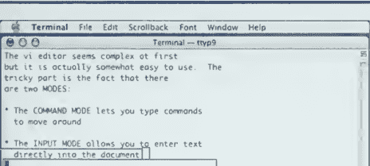

编辑器初看起来很复杂，但实际上很容易用。难点在于有模式：
- 命令模式（THE COMMAND MODE）允许你输入命令来移动
- 输入模式（THE INPUT MODE）允许你直接向文档输入文本

如果你不知道自己处于什么模式，可以按几次 ESC 键，直到 vi 发出提示声。


编辑器初看起来很复杂，但实际上很容易用。难点在于有模式：
- 命令模式（THE COMMAND MODE）允许你输入命令来移动
- 输入模式（THE INPUT MODE）允许你直接向文档输入文本

如果你不知道自己处于什么模式，可以按几次 ESC 键，直到 vi 发出提示声。

# 在 VI 中删除文本

你可以通过切换到命令模式从文档删除文本。在命令模式下，删除键没有功能。

要从文件中删除文本，你必须先使用移动命令将光标移动到文本的位置。你可以通过输入字母 `d` 配合移动命令来删除文本。例如，从当前位置到行尾使用 `d`。删除命令位于。

你可以通过输入 `x` 删除光标下的字符。它向左移动以填充被删除字符占据的空间。大写的 `X` 删除光标左侧的字符。

| 终端 | 文件 | 编辑 | 回滚 | 字体 | 窗口 | 帮助 |
|---|---|---|---|---|---|---|
| 终端 | | | | | | |

vi 编辑器看起来很复杂，但实际上很容易用。难点在于有两个模式：


- 命令模式（THE COMMAND MODE）允许你输入命令来移动
- 输入模式（THE INPUT MODE）允许你直接向文档输入文本

模式初看起来很困惑。

如果你不知道自己处于什么模式，可以按几次 `ESC` 键，直到 vi 发出提示声。

# 删除字符

- 将光标置于你想删除的字符上。
- 输入字母 `x`。`vi` 编辑器会删除该字符。

### 额外

你可以使用这些命令从正在编辑的文件删除删除。如果你犯了错，可以输入按键组合 `u` 来撤销最近的更改。你可以使用此命令撤销插入，也可以撤销删除。

| 按键组合 | 效果 |
|---|---|
| `d` | 从当前位置到行尾删除。 |
| `dd` | 删除当前行。 |
| `dg` | 从当前位置到文件末删除。 |
| `dw` | 删除当前单词，从当前位置到单词结束。 |
| `d^` | 从当前位置到行首删除。 |
| `ds` | 从当前位置到行尾删除。 |
| `d/text` | 从当前位置到下一次文本出现删除。 |
| `u` | 撤销上一个修改文件的命令。 |
| `X` | 删除光标左侧的字符。 |

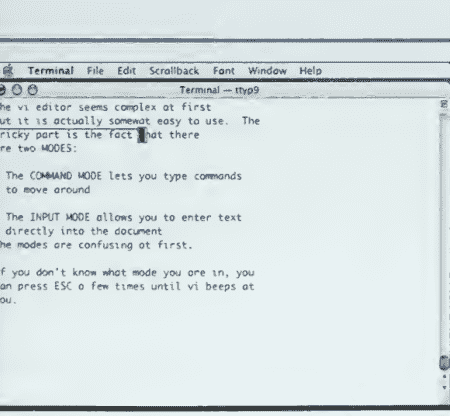

`vi` 编辑器看起来很复杂，但实际上相当容易用。难点在于有两个模式：

- 命令模式（THE COMMAND MODE）允许你输入命令来移动
- 输入模式（THE INPUT MODE）允许你直接向文档输入文本

## 使用 VI 编辑文本

你可以使用 `vi` 编辑器的多行编辑功能编辑文本文件。在命令模式（Command mode）下，你通过输入冒号（:`）来激活用于编辑的命令行。有很多实用的命令供你学习，包括通过输入 `n` 获取 `vi` 提供的信息，或者查阅关于 `vi` 编辑器的在线参考或书籍。

要替换文本，你可以输入 `s..` 使用替换命令（substitute）。当你输入以冒号（:`）开头的命令时，它们会显示在终端（Terminal）的底部。在你输入完整命令并按下回车（Return）后，`vi` 可以编辑该命令。

有许多方法可以使用 `:s` 命令，包括：

```
:s/old/new/
:s/old/new/g
:%/old/new/g
```

第一个实例将 `old` 的第一次出现替换为 `new` 行。第二个实例添加了 `g`，代表全局（global）。这意味着它会将该行中所有的 `old` 替换为 `new`，而不仅仅是第一次。第三个实例包含一个范围选项 `%`，它告诉 `vi` 替换整个文件中所有的该单词实例。

要将两行文本合并为一行，你可以使用编辑命令 `J`。这会移除行尾的换行符并将其与下一合并。当你编辑文件中的文本时，在你编辑命令来执行保存之前，`vi` 不会保存你的更改。

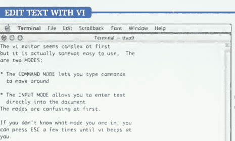
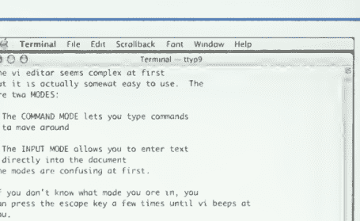

## 查找并替换文本

- 1 输入 `:`
  - 光标跟随冒号移动到屏幕底部。
- 2 输入 `%` 和你想替换的原始单词或短语。
- 3 输入一个正斜杠 `/` 和新的单词或短语。
- 4 输入另一个正斜杠 `/`、字母 `g` 并按下回车。
- `vi` 编辑器将文本全局替换为替换文本。

### 额外

你可以使用删除按键命令和 `p` 命令在 `vi` 中剪切和粘贴文本。当你删除文本时，它并不会完全丢失；而是存储在粘贴缓冲区（paste buffer）中。你可以将其认为为一个持有最近删除文本的容器。

你可以通过输入字母 `p` 将粘贴缓冲区的内容粘贴到光标当前位置。例如，通过输入 `dd` 移动一行并移动到文件中的新位置：输入字母 `p`，`vi` 将被删除的行插入新位置。

你可以使用 `y` 命令（代表 yank，即复制/提取）将文本复制到粘贴缓冲区而不删除它。使用删除命令时，你必须在 `y` 后面跟随一个移动命令来指示你想复制的行数，或者你可以输入 `yy` 来复制当前行。

要复制或删除若干行，你可以在 `y` 或 `d` 键前加上一个数字。例如，要复制 12 行（包括当前行），输入 `12yy`。

`vi` 编辑器初看起来很复杂，但实际上非常易用。两种模式：

- 命令模式（COMMAND MODE）允许你输入命令进行移动。
- 输入模式（INPUT MODE）允许你直接向文档输入文本。这些模式起初会令人困惑。

如果你不知道自己处于哪种模式，可以多次按下 键（escape key）直到 `vi` 对你发出响声。

## 合并行文本

按下 `Shift + J`。将光标置于想要合并的两行的第一行。`vi` 编辑器会将这些行合并在一起。

## 使用 VI 保存文件

当你使用 `vi` 编辑器编辑完文件后，需要保存你的工作。每当你做出不想丢失的更改时，使用保存命令是一个好习惯。要保存当前文件，你可以输入 `:w` 并回车。`vi` 将文件保存到硬盘并使你的任何更改永久化。`vi` 编辑器会显示文件、行数以及文件中的字符数。

你可以为文本任意命名，但为了兼容应用程序，你应该附加文件扩展名 `.txt`。然而，如果你正在创建一个特定类型的文件，如 HTML 文件、样式表或 XML 文件，你必须使用相应的扩展名 `.html`、`.css` 或 `.xml` 保存。

你可以在回车前输入文件名以不同的名称保存文件。例如，要将文件保存为 `my-update.txt`，你可以输入 `:wmy-update.txt` 并回车。如果不指定文件名退出，你必须记得以新名称保存，否则 `vi` 将以任意名称将其保存在 `/tmp` 目录下。要退出 `vi` 编辑器，你可以输入退出命令 `:q`；你可以将 `:w` 和 `:q` 组合为 `:wq`，这会保存文件并退出 `vi` 编辑器，返回壳（shell）。如果你做了更改但不想保存，可以在 `:q` 后面加上感叹号（`!`）来退出 `vi`。

```
Terminal File Edit Scrollback Window Help
Terminal — tty9
vi 编辑器初看起来很复杂，但实际上非常易用。两种模式：
* COMMAND MODE 允许你输入命令进行移动
* INPUT MODE 允许你直接向文档输入文本这些模式起初会令人困惑。

如果你不知道自己处于哪种模式，可以多次按下 escape 键直到 vi 对你发出响声。
```

```
Terminal File Edit Scrollback Window Help
Terminal — tty9
vi 编辑器初看起来很复杂，但实际上非常易用。两种模式：
* COMMAND MODE 允许你你输入命令进行移动
* INPUT MODE 允许你直接向文档输入文本这些模式起初会令人困惑。

如果你不知道自己处于哪种模式，可以多次按下 escape 键直到 vi 对你发出响声。
```

## 文本

- 1 输入 `:`
  - 光标跟随冒号移动到屏幕底部。
- 2 输入 `%` 和你想替换的原始单词或短语。
- 3 输入一个正斜杠 `/` 和新的单词或短语。
- 4 输入另一个正斜杠 `/`、字母 `g` 并按下回车。
- `vi` 编辑器将文本全局替换为替换文本。

## 使用 VI 保存文件

- 1 输入 `:`
  - 光标跟随冒号移动到屏幕底部。
- 2 输入 `:w` 并回车。
- 3 输入 `:wq` 保存文件并退出 `vi` 编辑器。
- 退出 `vi` 编辑器，返回到壳。

## 以不同文件名保存文件

- 1 输入 `:`
  - 光标跟随冒号移动到屏幕底部。
- 2 输入 `:w文件名` 并回车。
- 3 输入 `:q` 退出 `vi` 编辑器。

## 退出 vi

- 1 输入 `:`
  - 光标跟随冒号移动到屏幕底部。
- 2 输入 `:q` 并回车。
- 3 输入 `:q!` 退出但不保存。

## 查找并替换

- 1 输入 `:`
  - 光标跟随冒号移动到屏幕底部。
- 2 输入 `%` 和你想替换的原始单词或短语。
- 3 输入一个正斜杠 `/` 和新的单词或短语。
- 4 输入另一个正斜杠 `/`、字母 `g` 并按下回车。
- `vi` 编辑器将文本全局替换为替换文本。

### 额外

- 1 输入 `:`
  - 光标跟随冒号移动到屏幕底部。
- 2 输入 `:w` 并回车。
- 3 输入 `:wq` 保存文件并退出 `vi` 编辑器。

# 附加

下表是某些用于移动和查找文本的 emacs 命令的总结。

| 按键组合 | 命令名称 | 效果 |
|---|---|---|
| `C-a` | 行首 | 移动到行首 |
| `C-b` | 向后一个字符 | 向左移动一个字符 |
| `C-e` | 行尾 | 移动到当前行末尾 |
| `C-f` | 向前一个字符 | 向右移动一个字符 |
| `C-n` | 下一行 | 向下移动一行 |
| `C-p` | 上一行 | 向上移动一行 |
| `C-r` | 向后搜索 | 向后搜索文本 |
| `C-s` | 向前搜索 | 向前搜索文本 |
| `M-<` | 缓冲区开头 | 移动到当前行首 |
| `M->` | 缓冲区末尾 | 移动到当前行末尾 |

编辑器初看起来看起来很复杂，但使用起来相当简单。有两种模式：

- **命令模式（COMMAND MODE）** 允许你输入命令来移动。
- **输入模式（INPUT MODE）** 允许你直接向文档输入文本。

这些模式可能会让人困惑：如果你不知道自己处于哪种模式，连续按几次键直到听到蜂삐声为止。

# 插入文本

1. 将光标置在你想要插入的位置。
2. 直接在 `emacs` 中输入你的文本。
3. `Emacs` 会在插入点添加文本。

# 使用 EMACS 编辑文件

你可以通过使用 Control 和 Meta 键的按键命令在 `emacs` 中编辑和保存文件。实际上有几百个 `emacs` 命令可以使用，你还可以通过为 `emacs` 添加扩展功能来增加这个数量。大多数用户对晦涩的命令并不感兴趣。作为初，你可能想使用 `Ctrl-h` 来阅读教程。屏幕会出现一个允许你编辑文件的短命令列表。与其他编辑器不同，`emacs` 在你保存之前不会让你的更改永久化。为了方便输入命令，对于带有 `M-` 前缀的命令，你可以通过按住 Option 键来激活，而不是在输入后续键之前先按并松开 Esc 键。你也可以学会识别并操作鼠标，这是大多数应用程序并不具备的能力。要做到这一点，请启用终端设置：当按住 Option 键并点击鼠标时定位光标，`emacs` 就会移动到指针的当前位置。

# 使用文本编辑器

下表包含一些你可以用于编辑文本文件并保存更改的 `emacs` 命令。

| 按键组合 | 命令名称 | 效果 |
|---|---|---|
| `C-d` | 删除字符 | 删除当前字符。 |
| `C-k` | 杀死行 | 删除当前行，光标位置移动到行尾。 |
| `C-t` | 交换字符 | 交换或切换字符。 |
| `C-x C-c` | 保存缓冲区，杀死 emacs | 退出 emacs。 |
| `C-x C-f` | 查找文件 | 打开新文件进行编辑。 |
| `C-x s` | 保存文件 | 保存文件。 |
| `C-x C-t` | 交换行 | 交换或切换两行。 |
| `C-x C-w` | 写入文件 | 以不同的名称保存文件。 |
| `C-x u` | 撤销 | 撤销文件的最后更改。 |
| `M-%` | 查询替换 | 查找并替换文本，按 y 确认。 |
| `M-w` | 交换单词 | 交换或切换两个单词。 |

记住，前缀 `C-` 表示按住 Control 键，而 `M-` 必须在输入后续键之前先按并松开 Esc 键。你也可以按住 Option 键来输入 `M-` 组合按键。

# 使用 EMACS 配置终端

- 保存你的文件
  - 按 `Control + X`。
  - `emacs` 编辑器会保存你的文件。
- 退出 EMACS
  - 按 `Control + X`。
  - 按 `Control + C`。
  - `emacs` 编辑器退出并返回到命令行。

# 设置你的提示符

你可以通过设置 shell 变量来更改 shell 提示符。提示符允许根据需要自定义显示的信息。格式化序列是一系列字母、符号和特殊字符，作为你的提示符。

```
set prompt = 'prompt sequence'
```

默认提示符是计算机名称、部分路径和用户名。这在多用户系统或你经常登录其他计算机时非常有用。然而，许多用户只使用一台电脑——他们面前的那台——且只作为单一用户。如果对你也是如此，你可能想将提示符设置为已输入的命令数。

除了 shell 提示符，你还可以设置其他提示符。如果你想在命令行末尾使用反斜线 (`\`)，表示命令在下一行继续，你将使用 `prompt2` 设置。如果你拼写错了命令，你会看到提示符。

提示符设置仅在打开它们的终端窗口存期间有效。要使其永久化，请参阅本章的“编辑 .zshrc 文件”。

## 定制你的 Shell

额外的设置 `set prompt =='%m:%c \n#$ '` 是 Mac OS X 中的标准 shell 提示符。格式代码表包含了这些以及其他特殊代码的含义。

| 格式化代码 | 示例 | 含义 |
|---|---|---|


| `%c` | Documents | 当前目录。 |

| `%d` | Fri | 星期几。 |

| `%D` | 06 | 日期。 |

| `%nnumber` | local/etc/httpd | 部分路径名。 |

| `%h` | 14 | 这是第 14 条命令。 |

| `%M` | ferro.idylmtnm | 计算机的全名。 |

| `%m` | ferro | 计算机的短名。 |

| `%n` | user | 你的用户名。 |

| `%p` | 10:04:21pm | 精确时间。 |

| `%t` | 10.04pm | 当前时间。 |

| `%w` | Dec | 月份。 |

| `%W` | 12 | 年的数字月份。 |

| `%y` | 02 | 两位数的年份。 |

| `%Y` | 2003 | 四位数的年份。 |

| `%#` | `%` | 如果你是 root 用户，则显示该符号。 |

```
Terminal File Edit Scrollback Font Window Help
Terminal - typo
(1:09on #36) - set prompt3 = 'Huh? How about r3? (y or n)
(1:09on #37) -f my-dog.jpg Pictures/
Huh? How about my-dog.jpg Pictures/? (y or n)yes
(1:09on #38) --X
```

```
Terminal File Edit Scrollback Font Window Help
Terminal - typo
(1:10on #39) - set rprompt = '--XnPrompt'
(1:10on #40) --X ls --userferro
desesign [ ] Movies Pictures Sites
Documents Library Music Public Sounds
(1:10on #41) --X <--ferro
```

### 设置第三个提示符

- 输入 `set prompt3 = ` 并加一个空格。

- 第三个提示符会发生改变。

### 设置右侧提示符

- 输入 `set rprompt = ` 并加一个空格。

- 在单引号中输入提示符格式序列，并按回车：

- 右侧提示符会发生改变。

## 设置命令别名

你可以通过为长命令设置短别名来节省时间并减少输入。可以使用 `alias` 命令来定义和列出别名。要创建一个新别名，你可以使用短别名命令：

```
alias short-alias 'longer command'
```

一个常用的别名是 `ls -1`，大多数 Unix 用户通过以下命令定义它：

```
alias ll 'ls -1'
```

此别名允许你将 `ll` 作为命令使用，它会执行 `ls -1` 命令，显示长格式列表。你可以在 `ll` 命令之后插入额外的参数（例如目录），就像你对原始的 `ls -1` 命令所做的那样。

你也可以将现有的命令重新定义为别名。例如，如果你担心由于忘记在 `rm` 命令中使用 `-i` 选项而可能误删重要文件，你可以如下设置别名：

```
alias rm 'rm -i'
```

```
这样，你所有的 `rm` 命令都自动包含了 `-i` 选项。
```

如果你使用别名重新定义了命令（例如 `rm` 命令），而又想使用原始版本，可以在命令名称之前输入反斜杠 (`\`)。这会跳过别名并调用路径中的可执行程序或 shell 内置命令。

要列出所有别名，请在不带任何参数的情况下输入 `alias`。如果你需要删除别名，可以使用 `unalias` 命令。

与其他设置一样，只要你的 Terminal 窗口开着，别名就会一直有效。你可以通过将别名保存到 `~/.zshrc` 中使它们永久化。请参见本章的“编辑 .zshrc 文件”。

## 设置命令别名

- 1 输入 `alias` 并加一个空格。
- 2 输入一个短别名。
- 3 在单引号中输入一个长命令并按回车。
- 4 输入带有任何适当参数的短别名并按回车。
- shell 执行该长命令。

## 定制你的 Shell

### 额外

大多数高级 Unix 用户喜欢避免输入不必要的字符，因此大量使用 `alias` 命令。一些最常见且实用的别名出现在下表中。你可以通过将它们存储在 `.bashrc` 文件中保存这些别名。

| 短别名 | 长命令 | 描述 |
|---|---|---|
| cd | pushd | 始终维护目录栈。 |
| cd.. | cd .. | 以防忘记空格。 |
| cp | cp -i | 防止 cp 覆盖文件。 |
| home | cd ~ | 返回主目录。 |
| ll | ls -l | 长格式文件列表。 |
| ls | ls -F | 始终包含文件类型。 |
| print | lpr | 使用改进的制 补全。 |
| rm | rm -i | 删除时提示。 |
| cd | cd .. | 切换父目录。 |

## 列出当前别名

- 1 输入 `alias` 并加一个空格。
- shell 列出所有别名。
- 2 输入别名的名称并按回车。

## 删除别名

- 1 输入 `unalias` 并加一个空格。
- 2 输入别名的名称并按回车。
- 别名被删除。

## 设置 shell 变量

你可以设置任何想要的变量，只要它们的名称以字母开头且仅包含字母、数字和下划线。然而，只有当这些变量名与特殊变量列表对应时，它们才会影响 shell。

要设置变量，请使用以下命令：

```
set variable = 'value'
```

有很多 shell 自动设置的变量，如 `uid`、`user`、`shell`、`term` 和 `home`。除非你知道它们的结果，否则不应该更改 shell 变量。

## 列出当前 shell 变量

- 输入 `set` 并按回车查看所有变量。

| 变量 | 示例值 | 含义 |
|---|---|---|
| autocorrect | No value | 修正输入错误。 |
| autoglog | 30 | 活动 30 分钟后退出 shell。 |
| complete | enhance | 使用改进的、不区分大小写的制补全。 |
| unique | No value | 移除 pushd 目录栈中的重复。 |
| history | 75 | 显示最后 75 条命令。 |
| nobeep | No value | shell 命令不会蜂鸣。 |
| clobber | No value | 重定向不会覆盖现有文件。 |
| path | (/bin /usr/bin) | 你的路径。 |
| visible | No value | 在执行前闪烁终端。 |

## 设置 shell 变量的值

- 输入 `set` 并加一个空格。
- 输入变量名后跟等号 (=)。
- 在单引号中输入变量并按回车。
- shell 变量被设置为赋值。

## 取消 shell 变量

- 输入 `unset` 并加一个空格。
- 输入变量名称并按回车。
- shell 变量被取消设置。

# UNIX MAC

## 设置环境变量

你可以通过设置环境变量来更改应用程序继承的值。环境变量类似于 shell 变量。shell 能够访问环境变量设置的任何命令；环境变量代表了你运行时所的环境。根据命令的不同，shell 可能会使用或不使用环境变量来影响命令的执行。

与 `set` 命令不同，`setenv` 命令不需要等号符号。你应该使用全大字母输入环境变量名称，以便将其与 shell 变量区分开来。

如果你在 `less` 命令中设置了一个值，`less` 命令会使用环境变量 `EDITOR`，这样你就可以编辑显示的文件。要设置环境变量，你使用 `setenv` 命令：

你可以通过输入 `printenv` 命令获取当前环境变量及其值的列表。如果你将其与通过输入 `set` 查看的 shell 变量进行比较，你会发现存在一些重复。如 `HOME`、`TERM` 和 `SHLV/SHLVL` 等变量对具有相同的名称和值。这种重复允许 shell 以及 shell 环境中的命令访问这些值；变量对会自动链接，因此其中一个改变，另一个随之改变。

```
setenv VARIABLE 'value'
```

第一个示例在没有变量的情况下设置了一个值（带有空值），第二个示例则给变量赋了一个值。

如果你需要取消环境变量，可以使用 `unsetenv` 命令。你的环境变量有效期仅持续到终端窗口打开为止，除非在你的 `tcshrc` 中定义了它们。

## 设置环境变量

| 终端 文件 编辑 编辑 滚动回溯 字体 窗口 帮助 |
| --- | --- | --- | --- | --- | --- |
| Terminal -- typea | | | | | | |
| [ferro] printenv | | | | | | |
| HOME=/users/user | | | | | | |
| SHELL=/bin/tcsh | | | | | | |
| LANG=en_US | | | | | | |
| PATH=/usr/bin:/usr/sbin:/usr/sbin | | | | | | |
| CF_TEXT_ENCODING=UTF-8:0 | | | | | | |
| TERM=xterm-256color | | | | | | |
| TERMCAP= | | | | | | |
| USER=user | | | | | | |
| TERM_PROGRAM=Apple.Terminal | | | | | | |
| TERM_VERSION=81 | | | | | | |
| LOGNAME=user | | | | | | |
| HOSTTYPE=macosx | | | | | | |
| VENDOR=apple | | | | | | |
| OSTYPE=darwin | | | | | | |
| MATCHTYPE=powernerpc | | | | | | |
| SHLV=1 | | | | | | |
| PWD=/users/user | | | | | | |
| Group=staff | | | | | | |
| HOST_TERM=local | | | | | | |
| [ferro] user | | | | | | |

| 终端 文件 编辑 滚动回溯 字体 窗口 帮助 |
| --- | --- | --- | --- | --- | --- |
| Terminal -- typea | | | | | | |
| [ferro] setenv ARBITRARY | | | | | | |
| printenv | | | | | | |
| HOME=/users/user | | | | | | |
| SHELL=/bin/tcsh | | | | | | |
| USER=user | | | | | | |
| LANG=en_US | | | | | | |
| PATH=/usr/bin:/usr/sbin:/usr/sbin | | | | | | |
| CF_TEXT_ENCODING=UTF-8:0 | | | | | | |
| TERMCAP= | | | | | | |
| TERM_PROGRAM=Apple.Terminal | | | | | | |
| TERM_VERSION=81 | | | | | | |
| LOGNAME=user | | | | | | |
| HOSTTYPE=macosx | | | | | | |
| VENDOR=apple | | | | | | |
| OSTYPE=darwin | | | | | | |
| MATCHTYPE=powernerpc | | | | | | |
| SHLV=1 | | | | | | |
| PWD=/users/user | | | | | | |
| Group=staff | | | | | | |
| HOST_TERM=local | | | | | | |
| ARBITRARY- | | | | | | |

## 列出环境变量

- 输入 `printenv` 并按回车。
- shell 显示所有当前环境变量。
- 输入 `setenv` 和一个空格。
- shell 会设置该环境变量，但不带值。

## 自定义你的 shell

额外的应用程序是环境变量的主要用户。这意味着每个应用程序可能有一组不同的环境变量，它查找这些环境变量以影响其运行。了解需要设置哪些环境变量，你通常可以通过使用 `man` 命令使用的手册页找到这些信息。

某些环境变量是标准的，并且可以被许多程序理解。其中一些列在下表中。标记为 (+) 的由系统设置，通常应保持不变。

| 变量 | 示例值 | 含义 |
|---|---|---|
| EDITOR | /bin/vi | 你首的文本编辑器。 |
| HOME (+) | /Users/kynn | 你的主目录。 |
| LANG (+) | en_US | 你首选的语言。 |
| PATH | /bin:/usr/bin | 你的路径。 |
| PWD | /Users/kynn/Music | 当前目录。 |
| SHELL (+) | /bin/tcsh | 你的 shell 的路径。 |
| TERM (+) | vt100 | 终端。 |
| USER | kynn | 你的用户名。 |
| VISUAL | /bin/vi | 你首选的文本编辑器。 |

```
[ferro]user$setenv EDITOR /usr/bin/pico

HOME=/users/user

SHELL=/bin/tcsh

USER=user

LANG=en_US

PATH=/usr/bin:/usr/sbin:/usr/sbin

CF_TEXT_ENCODING=UTF-8:0

TERM=xterm

TERMCAP=

TERM_PROGRAM=Apple.Terminal

TERM_VERSION=81

LOGNAME=user

HOSTTYPE=macosx

VENDOR=apple

OSTYPE=darwin

MATCHTYPE=powernerpc

SHLV=1

PWD=/users/user

Group=staff

HOST_TERM=local

ARBITRARY-
```

## 设置环境变量的值

- 输入 `setenv` 和一个空格。
- 输入变量名称和一个空格。
- 用引号输入值并按回车。

## 取消环境变量

- 输入 `unsetenv` 和一个空格。
- 输入名称并按回车。

## 设置你的路径

你可以通过设置环境变量来更改 shell 搜索命令的目录。路径包含了 `/bin`、`/sbin`、`/usr/local/bin`。有关更多信息，你可以使用 `/usr/share/tcsh/examples/README` 将你的别名、变量和环境变量存储在单独的文件中（如 文件所示），尽管将它们全部设置在你的 `.tcshrc` 文件中也是可以的。

当你打开终端时，des 会执行。Unix 程序（如 tcsh）通常会将配置设置存储在你主目录中的一个隐藏文件中。这些文件在一段时间和重启后依然存在。

```
source /usr/share/tcsh/examples/rc
```

`source` 命令告诉 shell 读取文件中的命令并像直接输入到终端一样运行它们。因此，`.tcshrc` 文件中的命令会在启动时执行。

你将这些命令保存在名为 `.tcshrc` 的特殊文件中，你在主目录下创建它。名称开头的点（或下划线）表示它对 Mac OS Finder 和 `ls` 命令隐藏，尽管你仍然可以通过 `-a` 选项看到它。

# 回溯你的命令历史

你可以使用 `history` 命令列出以前输入过的命令。你还可以使用特殊字符来重复或编辑已经输入过的命令。

`history` 命令会列出自打开此 Terminal 窗口以来输入的所有命令，以及每个命令执行的时间。如果你在当前 Terminal 窗口中输入的命令超过了 100 条，`history` 命令将列出最近的 100 条命令。

你可以使用 shell 内置的历史回溯功能来重复命令或命令部分。方法是输入一个感叹号（`!`，也称为 bang），后跟一个指示你想要回溯的历史信息的特殊代码。你可以使用多种不同的代码，特别特别的是两个感叹号（`!!`）：这会重复你最后的一条命令。

如果你输入一个感叹号加上一些字母，shell 将搜索以这些字母开头的最近命令，并重复该命令。在这两种情况下，shell 都会在执行之前立即显示回溯的命令。下列出了其他历史代码列表。

你还可以使用脱字符符号（`^`）来编辑上一行。这是一种纠正可能犯的错误的方法，或者修改命令使其适用于不同的文件。你使用脱字符符号的方法如下：

```
^old-text^new-text
```


命令将被重复执行，并将 `old-text` 替换为 `new-text`。例如，如果你输入了 `cd /usr/share` 并想要纠正，可以输入 `cd^sh=share` 并按回车键。

# 回溯我的命令历史

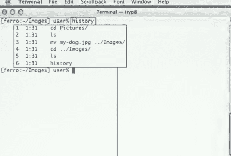

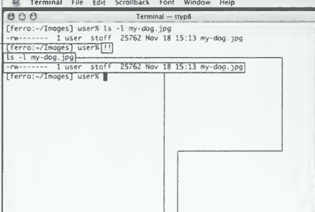

# 查看命令历史

- shell 会列出你在当前 Terminal 窗口中输入的所有命令。
- 输入 `history` 并按回车键。

# 重复上一条命令

- shell 会显示上一条命令。
- 输入 `!!` 并按回车键。
- shell 将执行上一条命令。

# 额外说明

下表列了一些最实用的历史代码。你可以在命令行的任何地方这些历史替换。例如，如果你刚刚用 `mv` 命令移动了一系列文件，并想要更改它们的权限，可以使用 `chmod +!!` 对你执行的 `mv` 命令所提供的参数使用 `chmod` 命令。

| 历史代码 | 含义 |
| --- | --- |
| !! | 上一条命令。 |
| !!* | 上一条命令的全部参数。 |
| !^ | 上一条命令的第一个参数。 |
| !$ | 上一条命令的最后一个参数。 |
| !text | 以 text 开头的最后一条命令。 |
| !? | 包含 text 的最后一条命令。 |
| !?number | history 命令列表中的命令编号。 |
| !-3 | 三条之前的命令。 |

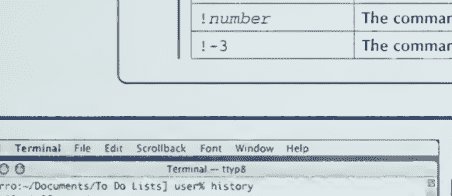

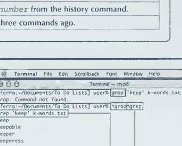

# 重复特定命令

shell 将执行以这些字母开头的最近的命令。

1. 输入 `!!`
2. 输入上一条命令的前几个字母并按回车键。

# 纠正上一条命令中的错误

1. 输入一个错误的命令并按回车键。
2. 输入 `^` 和命令中错误的部分。
3. 输入 `^` 和纠正后的命令部分。
4. shell 将执行修正后的上一条命令。

# 启动一个新的 shell

你可以通过输入 shell 的路径来启动另一个 shell。在子 shell 中运行命令可以保留你的 shell 设置，或允许你使用不同的程序。

每次启动新 shell 时，它都会执行存储在你的 `.zshrc` 文件中的命令（如果不是 tsh，则执行该 shell 相应的默认值），并给你一个新的提示符。大多数变量将设置为它们的初始默认值，环境变量将保留其在原始 shell 中的任何值。

当新 shell 启动时，它拥有干净的命令历史。如果你输入 `history`，你会看到一个非常短的列表，其中包含原始 shell 中执行过的任何命令。同样，在你退出新 shell 后，该 shell 的历史不会出现在原始 shell 的历史中。

如果你已用完新 shell，可以通过输入 `exit` 命令关闭它。这将让你回到原始 shell。如果你在新 shell 中更改了当前目录，当新 shell 退出时，你会发现自己回到了原始目录。

MacOS 自带了三个 shell。`tsh` 是默认 shell，而 Bourne-shell（称为 `bash`）是它流行的替代方案。Z shell（zsh）为高级用户提供了许多自定义机会。这些 shell 的路径分别为 `/bin/tcsh`、`/bin/bash` 和 `/bin/zsh`。有关 bash 和 zsh shell 的更多信息，请参阅本章节后半部分的“使用 Bourne-shell”和“使用 Z Shell”。

# 启动一个新的 shell

| 终端  | 文件 | 编辑 | 滚动 | 窗口 | 帮助 |
| --- --- --- --- --- |
| | | | | | |

```
user@~$ cd Pictures/

ls -l

total 0

-rw-r-- 1 user staff 328 Jan 1 22:00 ..

-rw-r-- 1 user staff 214 Jan 1 22:00 .

-rw-r-- 1 user staff 287 Jan 1 22:00 Desktop

-rw-r-- 1 user staff 164 Jan 1 22:00 Documents

-rw-r-- 1 user staff 216 Jan 1 22:00 Downloads

-rw-r-- 1 user staff 251 Jan 1 22:00 Movies
```

## 使用 Z SHELL

如果你是高级用户，可以在高度可配置的 Z shell 中编写执行 shell 任务的函数。如果你是 Unix 的初学者，这可能超出了你的需求。

zsh 中的变量——通过使用 `setopt` 命令，你可以像在 bash 中一样设置和导出环境变量。z shell 在启动时并不会运行 `.zshrc` 的内容，而是执行你主目录下的 `.zshrc` 文件中的命令。z shell 中的别名（Aliases）将使用以下语法设置，这与 z shell 对等号的要求有所不同：

```
alias short-alias='command and options'
```

在编写 shell 脚本时，shell 之间的差异最为明显，因为脚本使用了 shell 的高级功能。Z shell 使用许多你可以定义的函数，以便覆盖或更改默认行为。

Z shell 的创建是为了与另一种早期的 shell（称为 Korn shell，或 ksh）兼容。如果你将大量使用 shell 并希望熟悉 shell 自定义，Z shell 可能是你的一个很好的选择。

你可以通过在你的 `.zsh` 文件中创建特殊函数来充分利用 Z shell 的扩展性。函数会创建一个命令，类似于别名，但具有更高的灵活性和控制力。要学习 Z shell 函数，可以通过输入 `man` 查看 zsh 的手动页。

tsh shell 的许多内置命令在 z shell 中有不同的命令名称和值。例如，你可以设置 zsh 选项——类似于

| 终端 | 文件 | 编辑 | 滚动回 | 字体 | 窗口 | 帮助 |
| :--- | :--- | :--- | :--- | :--- | :--- | :--- |
| | | | | | | | |
| [ferrok] user~/bin/zsh | | | | | | | 终端类型 |
| ferrok function(cp) | command cp -i "$@" | | | | | | |
| ferrok which cp | | | | | | | | |
| cp -i "$@" | | | | | | | | |
| ferrok cd Pictures | | | | | | | | |
| ferrok cp wnk_831.gif wnk_831.gif | | | | | | | | |
| overwrite wnk_831.gif? no | | | | | | | | |
| | | | | | | | | |

## 从 TSH 启动 Z

shell 启动一个新的 zsh shell。

- 输入 `/bin/zsh` 并按回车。

## 创建一个简单的 SHELL 函数

- 按回车。
- 输入 `function(cp)`，一个空格，然后输入 `() {`。
- 输入 `command cp -i "$@"`，一个空格，然后输入 `}`。
- Z shell 定义了一个名为 `cp` 的新命令。

## 挂起当前进程

你可以挂起进程以重新获得命令行的控制权，从那里开始，杀死进程、将其移动到后台，或者让保持挂起直到你准备好重启。正如构成 Unix 系统的几乎一切都是文件一样，命令的几乎一切都是进程。shell 通过派生（fork）新进程来响应你的命令。你输入的每个命令都是一个进程。当你询问当前运行哪些系统进程时，那也是一个进程。Unix 对文件、应用程序和个人文件之间的区别很小；系统进程和你在终端窗口中输入的命令之间的区别也很小。系统的活动是通过系列进程实现的。

如果你有足够的权限，可以挂起它们。你还可以将进程移动到后台，以便发布其他命令。

每个进程都有一个进程 ID（PID）——系统分配的唯一标识符。当你向 shell 中输入命令时，shell 是一个活动进程。当你按下回车时，你输入的命令开始运行，你的 shell 会挂起，直到该进程完成。

你可以通过按下 Control + Z 来挂起进程。当你挂起一个进程时，它将无法运行。它不访问文件，不积累运行时间，也不占用 CPU。挂起的进程也被称为停止的作业（stopped job）。

与某些操作系统不同，Mac OS 等 Unix 系统允许你获取关于系统上运行的进程的信息列表。事实上，你可以启动、停止，

## 运行顺序命令

- 在终端窗口中，输入命令 `find /usr-name ps -print` 并按回车。
- 命令开始查找名为 `ps` 的文件。
- 输入 `date` 并按回车。
- 系统忽略 date 命令，将其存储在队列中，直到 find 命令完成。
- find 命令生成了大量的输出。

## 处理进程

在像 Unix 这样的多处理器系统上，许多进程看起来在同时运行。它们实际上是连续运行的，轮流使用系统的 CPU 和内存。系统跟踪每个进程所需的资源，并在每次进程获得运行机会时恢复所需的进程环境。在几乎任何时刻，大多数进程都在等待某些资源，无论该资源是来自用户的响应、来自磁盘的数据，还是仅仅是处理器的使用权。

进程在运行时会改变状态。进程状态包括运行（running）、睡眠（sleeping）、停止（stopped）和终止（terminated）。

当你挂起一个进程时，你本质上是让它暂停，以便你可以运行其他命令。类似于让呼叫者置于等待，挂起进程意味着只要该进程处于挂起状态，就不会有进展。进程被停止了，等待你的指令重新开始或释放其所有资源。

你在系统上工作时，可以打开第二个终端窗口，但如果你是远程登录的，这不是一个选项。

# 进程操作

# 附加

你只能重启已挂起的进程。你无法重启已经运行完成的进程或你已经终止的进程。每个进程都有自己的生命。即使你连续运行七次相同的命令，每次运行都是一个独立的进程。

你可以通过将进程带回前台来重启它们，它们将继续运行，就像没有被挂起一样。你也可以通过将它们发送到后台，并在运行这些进程的 shell 中继续输入命令来重启进程。

如果你按下 Control + D 退出一个挂起了进程的 shell，shell 会提示你有挂起的进程。会出现消息“There are suspended jobs（有挂起的任务）”。此警告确保你不会忘记想要执行的命令。你仍然可以通过按下 Control + D 退出 shell。如果你点击红色按钮退出终端窗口，则不会出现警告。关闭窗口时，挂起的进程会被静地杀死。

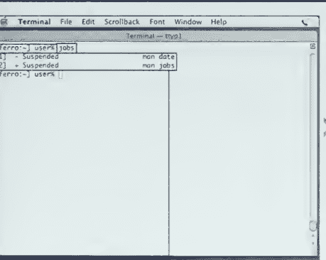

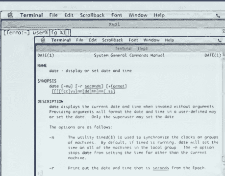

| [ferro]- 用户作业 | |
| :--- | :--- |
| [1] - 挂起 | 非日期 |
| [2] - 挂起 | 非作业 |
| [ferro]- 用户 | |

| [ferro]- 用户 %f | |

| 终端 文件 编辑 滚动 字体 窗口 帮助 | |
| :--- | :--- |
| 系统 通用 命令 手册 | DATE(1) |

| DATE(1) | |
| :--- | :--- |
名称 - 显示或设置日期和时间 |

### 摘要
date [[+seconds]] [[format]]
[[-date=c|time=c]]

### 描述
date 在不带参数调用时会显示当前日期和时间。提供参数将以用户定义的方式格式化日期和时间或设置日期。超级用户可以设置日期。

选项如下：

- - 实用程序 time() 用于同步一类机器的时钟。如果需要，将设置本地组中所有机器的日期。-option 开始设置当前机器以外的日期。

打印距离 Epoch 几秒的日期时间


系统显示挂起进程列表，其作业编号括在方括号中。

输入 %1 并按回车。

第一个挂起的进程将重新开始运行。

- 1 jobs 并按回车。


# 在后台运行进程

将命令作为后台进程运行允许你在进程挂起时继续运行其他命令；在后台运行的进程不会持续。当你在终端应用程序中运行命令时，命令的输出将显示在屏幕上。完成后，其他命令就可以运行。当后台进程完成后，你的命令提示符就会返回。

Unix 允许你在前台或后台运行命令。与前台命令不同，作为后台运行的命令允许你输入额外的命令。你的 shell 会继续提示，你可以继续输入命令。

在后台运行命令最简单的方法是在后台启动它。你通过在命令行末尾添加 ampersand (&) 来在后台运行命令。例如，如果你发现

command，在行末尾输入 ampersand 并按回车，find 命令将继续处理，并在定位符合你搜索标准的文件时将其写入屏幕。同时，你对命令行拥有控制权，并可以在 find 命令继续运行的同时发布其他命令。

与挂起进程一样，在后台运行的任务既有作业编号，又有进程 ID（PID）。当你使用 jobs 命令时，所有挂起的进程都会出现在列表中。挂起进程和后台进程之间的重要区别是，后台进程会继续运行，而挂起进程是不活跃的。

将命令作为后台进程运行允许你在单个终端窗口中完成更多工作。如果你在有后台进程时按下 Control + D 退出，系统会发出警告。

# 在后台运行进程

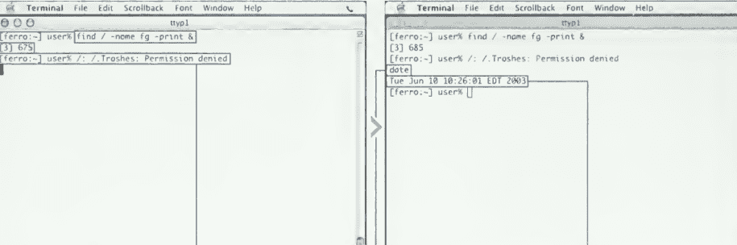

- - 输入 find /-name fg -print & 并按回车。
- 显示消息你的 find 命令无法搜索某些目录。
- 后台进程的作业编号和进程 ID 出现。

- - 输入 date 并按回车。
- find 命令在后台继续运行，同时你输入 date 命令获取输出。

## 实际应用

你可以通过先用 Control + Z 挂起进程，然后使用 bg（background）命令将其移动到后台将进程放入后台。如果你运行一个命令，如 `find / -name findme-print`，然后通过 Control + Z 挂起它，你可以使用 bg 命令在后台重启它，例如 `bg 3`。命令将继续运行并搜索你的文件，同时允许你在 shell 提示符处输入其他命令。

输入这些：

```
find /-name findme-print

control+Z

bg

pdate
```

结果：

```
/Users/user

Thu May 1 11:23:13 EDT 2023
```

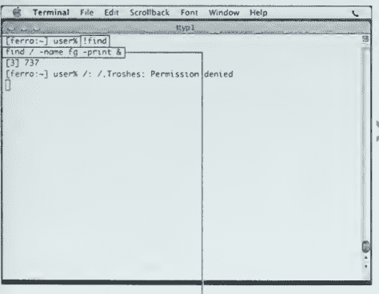

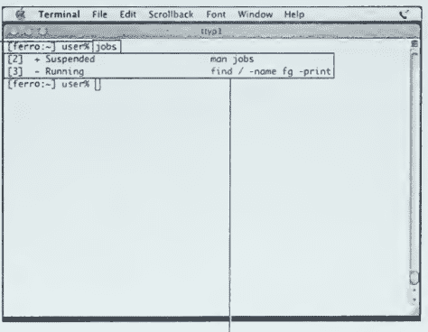

| [ferro]- user% if | find -name fg -print & |
| :--- | :--- |
| [3] 737 | [ferro]- user% Permission denied |
| [ferro]- user% jobs | [2] 挂起 |
| [3] Running find -name fg -print | [ferro]- user% |

- - 输入 find 并按回车。
- find 命令再次运行。
- 输入 jobs 并按回车。
- 输出列出运行和挂起的进程。

# 杀死进程

你可以使用 kill 命令停止运行或挂起的进程。通过输入错误的命令，你可以避免浪费系统资源或执行你不想运行的进程。在 Unix 系统上停止运行进程是调用它。杀死运行的进程使用 kill 命令后接进程 ID。例如 `kill 1234` 将杀死进程 为 1234。杀死挂起的进程，使用 kill 命令后接作业 ID。例如 `kill %2` 将杀死第二个挂起的进程。杀死一个进程后，你无法重启它。你可以运行相同的命令，但此操作会启动一个新进程。你可以通过名称杀死进程。用于此目的的 kill 命令变体是 killall。如果它们在其他窗口运行，killall 将杀死所有运行的。作为非 root 用户，你只能杀死你启动的进程。作为 root 用户，你可以杀死系统上的任何进程。Unix 提供的保护防止做出导致系统崩溃的错误。用户可能会想要输入 kill %1，其意图是杀死挂起的进程。名为 init 的命令可能会导致你的系统。

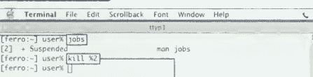

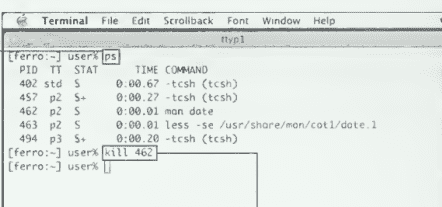

# 杀死进程

# 按作业编号杀死

- 输入 kill 后接作业编号如 %2，并按回车。
- 挂起的进程终止。

# 按进程 ID 杀死

- 输入 ps 并按回车。
- 输入 kill 后接列表中的 ID 并按回车。
- 挂起的进程终止。

# 进程操作

你可以使用 kill 命令向运行的进程发送信号。kill 命令用于终止进程。虽然许多人谈论 kill 命令就像它的唯一功能是终止进程，但事实并非如此。事实上，kill 命令的真实功能是向运行的进程发送短以控制这些进程的行为。默认 kill 命令（不带参数的命令）发送请求进程终止的信号。系统通常将默认信号称为 SIGHUP 或 SIGTERM。另一个常用的信号是挂断，用于告诉运行的进程应该回去重新读取配置文件。除非向它们发送此信号，否则许多系统进程不会意识到它们的配置文件已更改。另一个常用的信号是 SIGKILL，用于杀死未被 SIGTERM 终止的进程。

## 实际应用

# 输入这些：

```
user man kill

user -KILL <进程 id>

user jobs
```


## 结果：

进程被杀死。

| 名称 | PID | T | 命令 |
| :--- | :--- | :--- | :--- |
| KILLALL(I) | 486 | p | 00:00.19 (tch) |
| KILLALL(II) | 457 | p | 00:00.28 (tch) |
| killall | 878 | p | 00:00.01 -sh (cd /usr/share/mon /usr/bin/tbl /usr/s) |
| killall | 879 | p | 00:00.05 -c (cd /usr/share/mon /usr/bin/tbl /usr/s) |

| 名称 | PID | T | 命令 |
| :--- | :--- | :--- | :--- |
| KILLALL(I) | 486 | p | 00:00.19 (tch) |
| KILLALL(II) | 457 | p | 00:00.28 (tch) |
| killall | 878 | p | 00:00.01 -sh (cd /usr/share/mon /usr/bin/tbl /usr/s) |
| killall | 879 | p | 00:00.05 -c (cd /usr/share/mon /usr/bin/tbl /usr/s) |

终端 编辑 滚动 字体 帮助

终端 编辑 滚动 字体 帮助

```
user killall
```

```
user ps
```

终端 编辑 滚动 字体 帮助

PID 时间 命令

`kill` 按名称杀死

# 按名称杀死进程

- 1. 在新终端中，输入 `killall` 并按回车。
- 2. 在原始窗口中，输入 `ps` 并按回车。
- 你的 `man` 命令出现在列表中。
- 3. 输入 `killall man` 并按回车。
- 你的 `man` 命令消失了。
- `killall` 命令终止。

## Mac 版 UNIX

## 列出活动进程

你可以使用 `ps` 命令来查找系统上正在运行的进程，或者查找你想要杀掉（kill）的任务的进程 ID（PID）。要通过进程 ID 杀死进程，你显然需要知道它的 ID。遗憾的是，Unix 系统提供了一个命令，可以提供运行进程的信息，包括进程 ID。

你还可以使用 `ps` 命令显示系统上运行的所有进程列表。根据你提供的参数，此列表可以包含每个进程启动的时间以及每个进程启动时运行的信息。

`ps` 命令本身会显示你正在运行的命令列表。要列出系统命令和其他用户正在发出的命令，你需要添加 `ps -aux` 命令，它会显示系统上运行的所有进程，并提供每个进程的详细信息。

`ps -a` 命令列出所有用户的进程。你将看到其中一些进程，而另一些则会在系统启动时启动。

`ps -u` 命令添加额外信息，例如每个进程启动的时间，以及每个进程正在使用多少 CPU 和内存。

`ps -x` 命令添加未与特定终端窗口关联的进程，即在你登录之前启动的进程。

Mac OS X 最常用的命令是 `ps -aux`，它结合了最有用的命令选项。

通过使用 `ps` 命令后接一个竖线（在 Unix 中通常称为管道），你可以限制返回的输出，只显示你感兴趣的内容。`ps -aux grep init` 会显示该进程以及你系统中包含此名称的其他进程。

```
[user] ps

PID TTY TIME COMMAND

480 s 0:01 -tcsh (tcsh)

1021 s 0:00 -tcsh (tcsh)

1022 s 0:00 -monitor

1025 s 0:01 -sh -cd /usr/share/mon/ /usr/bin/tl /usr/sh

1029 s 0:00 -cd /usr/share/mon/ /usr/bin/tl /usr/sh

1032 p 0:00 -less -S

1036 p 0:00 -python

[user] $
```

```
[user] ps -u

PID USER MEM VZSZ RSS TT STARTED TIME COMMAND

480 user 0.4 592 930 s 0:08 0:01 -tcsh (tcsh)

1021 user 0.0 0.4 976 592 p2 1:09PM 0:23 -tcsh (tcsh)

1022 user 0.0 0.4 1452 300 s 1:0 -monitor

1025 user 0.0 0.2 1628 460 p2 1:09PM 0:01 -sh -cd /usr/share/mon/ /usr/bin/tl /usr/sh

1029 user 0.0 0.2 1828 306 p2 1:09PM 0:01 -cd /usr/share/mon/ /usr/bin/tl /usr/sh

1032 user 0.0 0.1 1392 340 p2 1:09PM 0:01 -less -S

1036 user 0.0 0.1 1582 1496 p2 S+ 1:09PM 0:00 -python

[user] $
```

- 1. 在终端（Terminal）窗口中，输入 `ps` 并按回车键。
- 2. 输入 `ps -u` 并按回车键。
- 3. 屏幕将显示你正在运行的进程详细列表。

## 补充

`ps -aux` 命令输出中的列提供了关于运行进程的大量信息。这些信息可以帮助你理解是谁在使用你的系统、正在运行，以及有时系统运行缓慢的原因。下表解释了其中每一项。

| PS 列 | 含义 |
|---|---|
| USER | 运行进程的用户名。 |
| PID | 数字型进程 ID。 |
| %CPU | 进程使用的 CPU 资源百分比。 |
| %MEM | 进程使用的内存百分比。 |
| VSZ | 进程以 KB 为单位的虚拟内存。 |
| RSS | 进程内存的大小。 |
| TT | 关联的控制终端，如果没有关联终端则显示 ??。 |
| STAT | 进程状态。 |
| STARTED | 如果是今天启动的显示时间，否则进程启动的日期。 |
| TIME | 累计运行时间。 |
| COMMAND | 正在运行的命令，包含参数。 |

| USER | PID | %CPU | %MEM | VSZ | RSS | TT | STAT | STARTED | TIME | COMMAND |
|---|---|---|---|---|---|---|---|---|---|---|
| (ferro-) | 1 | 0.0 | 0.1 | 51392 | 15832 | ?? | S | 8:03AM | 1:29:72 | /System |
| root | 2 | 0.0 | 0.0 | 18848 | 1768 | ?? | S | 8:03AM | 0:00:18 | /usr/sbin/sshd |
| root | 3 | 0.0 | 0.0 | 2286 | 276 | ?? | S | 8:03AM | 0:00:09 | /usr/bin/dynamic |
| root | 69 | 0.0 | 0.0 | 1292 | 104 | ?? | S | 8:03AM | 0:00:57 | update |
| root | 101 | 0.0 | 0.0 | 1568 | 1442 | ?? | S | 8:03AM | 0:00:00 | /usr/sbin/logrotate |
| root | 103 | 0.0 | 0.0 | 16140 | 12992 | ?? | S | 8:03AM | 0:00:00 | /usr/sbin/crond |
| root | 152 | 0.0 | 0.0 | 15248 | 732 | ?? | S | 8:03AM | 0:00:18 | /System |
| root | 181 | 0.0 | 0.0 | 14498 | 1152 | ?? | S | 8:03AM | 0:00:36 | /usr/sbin/sshd |
| root | 191 | 0.0 | 0.0 | 14968 | 376 | ?? | S | 8:03AM | 0:00:48 | /usr/sbin/n/o |
| root | 201 | 0.0 | 0.0 | 13544 | 132 | ?? | S | 8:03AM | 0:00:15 | /usr/lib/dbus |
| root | 269 | 0.0 | 0.0 | 1296 | 80 | ?? | S | 8:03AM | 0:00:00 | /usr/lib/nfs |
| root | 272 | 0.0 | 0.0 | 14392 | 832 | ?? | S | 8:03AM | 0:00:32 | /usr/sbin/sshd |
| root | 317 | 0.0 | 0.0 | 11944 | 725 | ?? | S | 8:03AM | 0:00:25 | /usr/sbin/sshd |
| root | 385 | 0.0 | 0.3 | 22806 | 5948 | ?? | S | 8:03AM | 0:00:68 | tty |
| root | 417 | 0.0 | 0.0 | 12868 | 808 | ?? | S | 8:03AM | 0:00:01 | nfs |
| root | 555 | 0.0 | 0.0 | 15068 | 600 | ?? | S | 8:03AM | 0:00:00 | nfs |
| root | 336 | 0.0 | 0.0 | 13008 | 1228 | ?? | S | 8:03AM | 0:00:12 | /usr/sbin/sshd |

## 处理进程

## 实际应用

你可以使用 `top` 命令来确定系统的运行繁忙程度。`top` 命令显示的负载平均值（load averages）告诉你，平均有多少个作业处于就绪状态但正在等待 CPU 访问。像 `top` 输出中显示的较小负载平均值支持以下结论：该系统的 CPU 并不忙碌，进程很少等待其访问。四分钟的负载平均值表示系统处于忙碌状态。负载平均值高于 10 则表示存在过度竞争。

你可以使用 `uptime` 命令来查看有多少用户登录，并显示负载平均值。该命令可以告诉你系统已运行了多久、有多少个用户已登录（它将每个终端视为一次独立的登录），以及 1 分钟、5 分钟和 15 分钟的负载平均值。

| 类型： | 结果 |
| --- | --- |
| uptime | 下午 2:26 4:18, 3 用户,负载平均: 0.03, 0.03, 0.01 |

```
user top -e w
```

进程：总共 48 个，2 个正在运行，46 个休睡眠... 103 个线程
负载平均：0.23, 0.17, 0.14 CPU 使用率：用户 2.7%，系统 2.1%，95.3%

| PID | 命令 | CPU 时间 | 错误 | 页面 | 计数 | 家族 | 发送 | 接收 |
| --- | --- | --- | --- | --- | --- | --- | --- | --- |
| 1107 | top | 1.96 | 0.00 | 98 | 22 | 424 | | |
| 1094 | logout | 0.00 | 0.00 | 58 | 42 | 167 | | |
| 1067 | top | 0.00 | 0.00 | 50 | 79 | 74 | | |
| 1046 | login | 0.00 | 0.00 | 81 | 58 | 182 | | |
| 1038 | python | 0.00 | 0.00 | 47 | 70 | 58 | | | |
| 1029 | idle | 0.00 | 0.00 | 42 | 24 | 145 | | | |
| 1028 | col | 0.00 | 0.00 | 168 | 22 | 41 | | | |
| 1025 | sh | 0.00 | 0.00 | 152 | 23 | 30 | | | |
| 1029 | icmp | 0.00 | 0.00 | 169 | 17 | 30 | | | |
| 1019 | tsch | 0.00 | 0.00 | 245 | 48 | 71 | | | |
| 1018 | login | 0.00 | 0.01 | 299 | 51 | 145 | | | |
| 417 | Grab | 5.00 | 2.33 | 8953 | 285 | 212080 | | |

输入 `top -e` 并按回车键。

`top` 命令显示了顶部进程的调度事件。

# UNIX 用于 MAC

## 编写一个简单的 SHELL 脚本

你可以将反复执行的命令放在一个文件中，通过输入文件名来执行这些命令。你执行的包含 Unix 命令的文件称为 shell 脚本（shell script）。编写脚本可以为你节省大量工作，并让你无需记住这些相关的命令。

通过在文件中编写命令并执行该文件，你还可以获得文件列表。虽然使用脚本执行如 `ls` 这样的简单命令并没有优势，但当你需要按特定顺序执行复杂命令或许多命令时，脚本的优势就变得显而易见。事实上，脚本编写是非常高效的，几乎几乎每个操作 Unix 系统的人都会使用脚本来处理例行任务。

你放在脚本中的命令可能是你曾在终端窗口中输入过的命令。当你运行脚本时，系统会按照输入的顺序执行这些命令。脚本编写是 Unix 编程的一种非常基础的形式，尽管脚本的范围可以从简单的命令列表到带有循环、嵌入函数和复杂数据结构的程序。

你可以编写 shell 脚本，让运行脚本的人提供某些信息，或者利用用户的 shell 变量。例如，最简单的脚本会在用户执行它时向用户问候。如果你将命令 `echo hello, USER` 放在一个文件中，运行脚本的用户将看到如“hello, USER”之类的的个性化消息。

如果你在终端窗口中输入如 `ls` 等命令，shell 会将命令传递给内核执行。结果是你的文件列表。如果你输入：

- 要启动 Pico 文本编辑器，输入 `pico` 并按回车。
- Pico 文本编辑器打开。
- 输入 `hello, USER`。
- 输入 `echo` 后跟一个空格和 `$USER`（这包含你的用户名）。

## 实际应用

通过添加注释来解释复杂的命令并描述脚本的工作原理，你可以编写出更容易理解和维护的脚本。注释是脚本中的行，系统在运行时会忽略它们。注释的作用是向他人解释你的脚本。

在脚本中，注释是系统在运行时会忽略的行。注释的功能是向他人解释你的脚本。

通过添加解释复杂命令并描述脚本工作原理的注释，你可以编写出更容易理解和维护的脚本。注释是脚本中的行，系统在运行时会忽略它们。注释的作用是向他人解释你的脚本。


通过添加解释复杂命令并描述脚本工作原理的注释，你可以编写出更容易理解和维护的脚本。注释是脚本中的行，系统在运行时会忽略它们。注释的作用是向他人解释你的脚本。

通过 `source` 命令赋值一个变量的值。这在 `  

 `

` 运行 脚本。

- 1 输入 `source` 后面加空格。
- 2 输入脚本文件名并按回车。
- `shell` 会逐行读取并执行指定脚本中的命令。
- 3 输入 `chmod` 后面加空格。
- 4 输入 `a+x` 后面加空格。
- 5 输入脚本文件名并按回车。`chmod` 命令为所有用户添加执行权限。

## 自动化 shell 任务

### 额外

虽然 `source` 命令非常方便，特别是对于运行没有执行权限的脚本，但有一个重要的限制。脚本中的命令必须与你正在使用的 `shell` 兼容。如果脚本包含任何 `shell` 特有的语法，例如在“Shell 条件”节中讨论的循环，只有当你运行接受该语法的 `shell` 时，才能成功执行该文件。请记住，这就像在当前 `shell` 中手动输入命令一样，如果你的 `shell` 不支持该语法，你也无法使用 `source` 命令运行包含该命令的脚本。例如，`source` 命令在 `tsh` 中为变量赋值。这个 `tsh` 特有的命令内置命令对 `sh` 和 `zsh` 来说没有意义。如果你是 `tuser`，你可以 `source` 包含 `set` 命令的文件来建立变量的值；这在 Bourne shell 中不起作用。

将以下行输入到名为 `macosx` 的文件中。注意不同的 `shell` 处理文件的方式不同。

| 输入： |
| --- |
| macosx |

结果：

我爱 Mac OS X

| 输入： |
| --- |
| /bin/sh sh-2.05a$ macosx |

结果：

sh-2.05a$ i love

示例：

```bash
set OS = "Mac OS X"
echo love $0
```

# 编写循环 Shell 脚本

你可以通过在 `shell` 脚本中放置循环来多次执行某条命令或命令列表。添加循环可以避免你为目录中的每个文件或列表中的每个值都运行一次脚本。

当你想要通过一系列文件、数字或其他值运行脚本时，可以使用循环结构。为了确保脚本运行正确，请在脚本顶部添加一行以 `#!` 开头的行，后面紧跟该特定脚本的完整路径。编写在 `tcsh` 中运行的脚本应该以 `#!/bin/tcsh` 开头。

对于 `tcsh`，你可以使用 `foreach` 命令来遍历一组值。命令 `foreach (4 5 6)` 会运行三次，对应列出的每一个值。循环每执行一次，下一个数字就会被赋值给变量 `$number`。在 `foreach` 命令之后，你可以输入你想要对每个 `$number` 执行的任何内容。通过单独的一行输入单词 `end` 来结束你的循环。

对于某些任务，你想要循环一组命令的次数取决于某个变量的值或其他条件。例如，如果你想写一个相两个数字的脚本，你可以让它一直相加直到运行脚本的人停止输入数字。在这种情况下，你使用 `while` 循环。只要指定的测试条件为真，`while` 循环就会继续执行。

# 循环 Shell 脚本

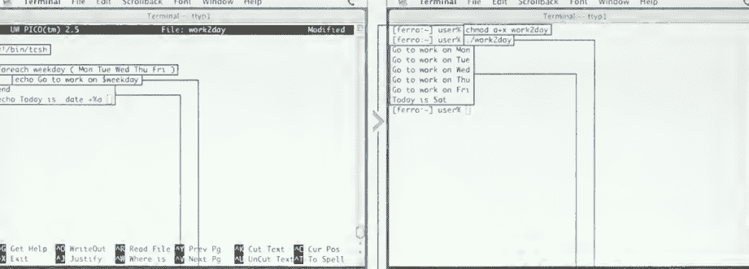

# 使用 FOREACH 命令

1. 启动 Pico 创建名为 `work2day` 的文件。
2. 输入 `#!/bin/tcsh` 并按两次回车。
3. 输入 `foreach workday ( Mon Tue Wed Fri )` 并按回车。
4. 输入 `echo go to work on Friday` 并按回车。
5. 输入 `end`，按回车，然后输入 `echo today is $(date +%A)`。
你的脚本完成了。
6. 保存你的脚本并退出 Pico。
7. 输入 `chmod a+x work2day` 并按回车。
8. 输入 `./work2day` 并按回车。脚本开始执行。

# 自动化 Shell 任务

# 实践

你通常可以通过将重复的命令放在循环中来减少脚本的行数。你可以使用 Mac OS 提供的任何 `shell` 进行循环。`foreach` 和 `while` 命令是每个 `shell` 内置的。如果你在 `bash`、`zsh` 或 `sh` 中编写脚本，必须使用不同的语法。这些 `shell` 的 `for` 命令语法使用单词 `for`，后面跟着变量名和单词 `in`，然后是值列表。`do` 和 `done` 单词构成了循环中执行的命令的开始和结束。确保你在运行练习时使用了 `/bin/bash`、`/bin/zsh` 或 `/bin/tcsh`。

输入以下：

```bash
for weekday in Mon Tue Wed Thu Fri
do
  echo Go to work on $weekday
done
```


结果：

Go to work on Mon

Go to work on Tue

Go to work on Wed

Go to work on Thu

Go to work on Fri

| 终端 | 文件 | 编辑 | 滚动条 | 字体 | 窗口 | 帮助 |
| :--- | :--- | :--- | :--- | :--- | :--- | :--- |
| UR PICO(tcsh) 2.5 | File: addoploop | Modified | | | | |
| 终端 | 文件 | 编辑 | 滚动条 | 字体 | 窗口 | 帮助 |
| :--- | :--- | :--- | :--- | :--- | :--- | :--- |
| UR PICO(tcsh) 2.5 | File: addloop | Modified | | | | |

```bash
#!/bin/bash
sum=0
while [ $sum -lt 10 ]; do
  sum=$(expr $sum + 1)
done
```

```tcsh
#!/bin/tcsh
set sum = 0
while ($sum < 10
  echo "number"
  set sum = $sum + 1
end
```

```
Get Help WriteOut Read Prv Pg Cut Text Cur Pos
Exit Justify Where is Next Pg Uncut Ter To Spell
```

```
File Name to write : addloop
Go Get Help To Files
Cancel
```

# 使用 WHILE 命令

1. 启动 Pico 编辑器创建一个名为 `addloop` 的文件。
2. 输入 `#!/bin/tcsh` 并按回车。
3. 输入 `set sum = 0` 并按两次回车。
4. 输入 `set num = ""` 并按回车。
5. 输入 `set sum=$(expr $sum + $num)` 并按回车。
注意：在第 5 步中使用单反引号。
6. 输入 `echo -n "number: "` 并按回车。
7. 输入 `echo $sum` 并按回车。
8. 输入 `end` 并按两次回车。
9. 输入 `echo $sum`。
10. 保存你的文件并退出 Pico。

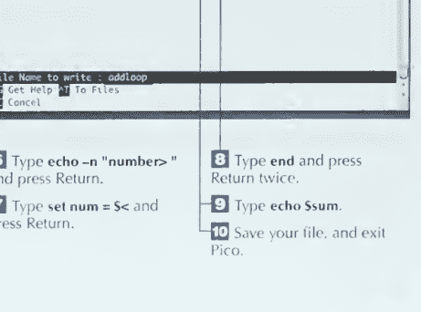

# 编写条件 Shell 脚本

条件语句让脚本更有用。你可以使用 `if` 命令来测试 `shell` 脚本中的条件。这种操作被称为条件逻辑。所有的 `shell` 都提供了条件逻辑。然而，与循环不同，语法是内置的，所以如果你在终端输入命令时可以找到它。

当你输入在条件为真时执行的命令列表时，为了可读性，脚本编写者通常会缩进这些行。在这些命令之后，你应该用 `end` 结束你的条件语句。

在 `bash` 中，`if` 语句有不同的形式。你在 `if` 单词后面跟着一组包含测试条件的方括号。括号后面跟着分号 `;` 和单词 `then`。你也可以喜欢将 `then` 写在下一行。用 `fi` 终止执行命令列表。

对于 `tcsh` 和 `csh`，你使用 `if` 将要测试的命令括在括号内，后面跟着单词 `then`。测试数字是否等于 0，例如命令为 `if ($number == 0 ) then`。测试变量是否包含特定字符串，将字符串括在引号中：`if ($day == "yes") ) then`。你还可以指定在未满足指定条件运行时的命令列表。在两种 `if` 形式中，你使用单词 `else` 开始这个列表。`else` 分支必须与之相关。

# 编写条件 Shell 脚本

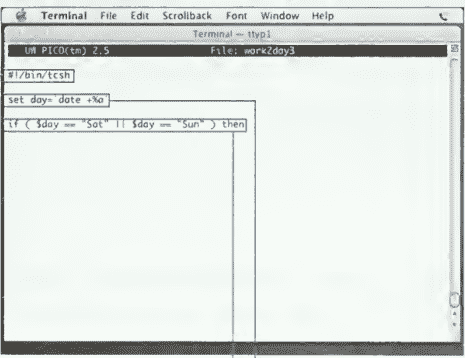

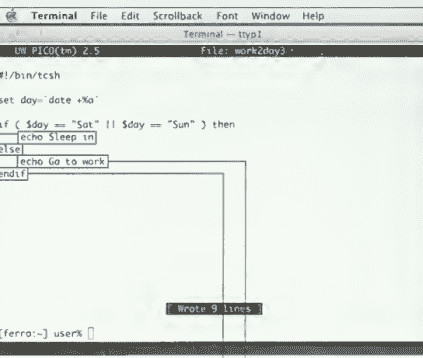

1. 启动 Pico 编辑器创建一个命名文件。
2. 输入 `#!/bin/tcsh` 并按回车。
3. 输入 `set day=$(date +%A)` 并按回车。
4. 输入 `if ($day == "Saturday") then` 并按回车。
5. 输入 `echo "It is the weekend"` 并按回车。
6. 输入 `else` 并按回车。
7. 输入 `echo "It is a weekday"` 并按回车。
8. 输入 `end` 并按两次回车。
9. 保存你的文件并退出 Pico。

## 自动化 shell 任务

### 运用

`awk` 语言的某些特性使其外观与 `shell` 脚本有很大不同。例如，`awk` 中的变量名不以 `$` 开头。变量 `$1,$2` 等表示正在处理的文本中的字段。你可以使用一个没有取值的变量名，`awk` 会会忽略该命令并继续处理。

在 `awk` 中，显示文本行的命令是 `print` 而不是 `echo`。你必须在单引号内包含文本行。`awk` 使用 `(` 和 `)` 标记来开始和结束代码块。

# 输入以下内容：

```bash
[file:-] cat work2day | awk '(print NF)'
```

# 输入以下内容：

```bash
[file:-] cat work2day | awk '(print $NF)'
```

## 结果：

```
#/bin/tcsh

Weekday
end
+*
```

## 在脚本中使用 AWK

- 1 启动 PICO 编辑器，创建一个名为 `count_users` 的文件。
- 2 输入 `#/bin/tcsh` 并按两次回车。
- 3 输入 `set USERCOUNT = awk '(print $4)'` 并按两次回车。
- 4 输入 `if ($USERCOUNT - 10) then echo USERCOUNT users logged in` 并按回车，然后输入 `endif`。
- 5 保存文件并退出 Pico。
- 6 输入 `chmod +x count_users` 并按回车。
- 7 输入 `./count_users` 并按回车。
- 你的脚本运行了。

## 使用 SED 扩展脚本

`sed` 命令允许你修改 Unix 命令的输入或输出或文件的内容，而无需使用文本编辑器。`sed` 是一种特殊的编辑器，可以更改文件内容或其他命令的输出。它可以更改通过管道传递给它的文件的行，并从修改后的文件中输出内容。管道的形状代表了你指定的一系列编辑命令，它决定了哪些文本发生变化以及如何变化。

命令 `sed "s/a/z/g"` 将其输入中字母 `a` 的所有出现情况更改为输出中的字母 `z`。

如果你想同时更改多个字符串，请创建一个包含所有替换规则的文件。命令 `sed -f infile > output` 会在 `subs` 文件中查找一系列请求，在处理 `infile` 文件时应用这些更改，并将修改后的文本写入 `output`。

最简单的 `sed` 命令是用一个字符串替换另一个。命令 `echo please go to work today | sed "s/go to work/stay home/"` 的结果是：

`Please go stay home today.`

如果你想让文本更改一个正斜杠 `/`，`sed` 可能会混淆要更改哪些文本。你可以指定不同的分隔符来替换旧文本和新文本。命令 `sed "s:old:new/"` 的效果与 `sed "s/old/new/"` 相同。无论使用哪种分隔符，只要使用三个相同的即可。

`sed` 在每行中更改第一个字符串的一个实例。如果你想在文本每次出现在行中时都进行更改，请在末尾添加字母 `g`。

## 在命令行上使用 SED

- 1 启动 `sed` 编辑器，创建一个名为 `message` 的文件。
- 2 输入 `Please go to work today` 并按回车。
- 3 输入 `Don't to take your lunch.`。
- 4 保存文件并退出 Pico。
- 5 输入 `cat message` 后加一个空格。
- 6 输入后加一个空格。
- 7 输入 `sed "s/go to work/stay/"` 来用一段文本替换另一段并按回车。
屏幕显示了要求你今天留在家的文本。

## Extra

与 `awk` 一样，你可以使用 `sed` 创建相当复杂的脚本，但你通常使用该命令来扩展 `shell` 脚本。完全用 `sed` 编写的脚本可以是简单的，也可以非常有挑战性。尝试一个像名为 `oneline` 的文件所示的简单 `sed` 脚本并使其具有可执行性。它通过删除换行符将文件中的行合并为单行。

### 在文件中输入以下内容：

```bash
[file:-] cat work2day | awk '(print NF)'
```

- 4 输入 `if ($USERCOUNT - 10) then echo USERCOUNT users logged in` 并按回车，然后输入 `endif`。
- 5 保存你的文件并退出 Pico。
- 6 输入 `chmod +x count_users` 并按回车。
- 7 输入 `./count_users` 并按回车。
- 你的脚本运行了。

# 从终端打开 Aqua 应用程序

你可以使用 `shell` 命令 `open` 来通过 Aqua 应用程序（如 EditText、Preview、Photoshop 或 Microsoft Word）打开文件。如果你在 Mac OS X 的 Finder 中双击文件，它也会以这种方式打开。使用 `open` 命令有三种方式：

- `open filename`
- `open -e filename`
- `open -a Application-name filename`

该命令的第一种版本会启动 Aqua 应用程序来打开指定的文件名。Mac OS X 将每个文档与称为元数据的信息关联。这些元数据包含此类信息，例如哪个 Aqua 应用程序创建了该文件。`open` 命令从目录 `.` 启动应用程序。例如，`filename-dog.jpg` 的扩展名是 `.jpg`。Mac OS X 使用默认应用程序来打开 JPG 文件。这与 Mac OS X Finder 在你双击图标时确定使用哪种应用程序的方法相同。

并不是所有的文本文件都有 `.txt` 扩展名。一个 HTML 文件可能名为 `-cat.html`。如果你使用 `open`，文件将在 浏览器中打开，但如果你想编辑它，可以使用 EditText。`open` 命令的第二个版本带有 `-e` 选项，会在 EditText 中打开文件，让你编辑不是以 `.txt` 扩展结尾的文本文件，例如 HTML 或配置文件。

该命令的第三种版本允许你指定使用哪个应用程序。你可以命名位于 `/Applications` 目录或其子目录下的任何应用程序。你可以通过省略文件名来带空文件启动应用程序。

如果你创建的应用程序没有列在元数据中，Mac OS X 将查看文件的扩展名。扩展名是文件中出现的最后部分。

## 打开图像文件

输入图像文件名并按回车键。

输入 `open` 和一个空格。

Aqua 会启动相应的查看器程序并显示图像。

# 附加

`open` 命令不仅限于打开文件。如果你提供了其他参数，`open` 命令尝试在适当的查看器或编辑器中显示这些参数。

使用 `open` 最有用的方法之一是在 Mac OS X Finder 中打开目录。此命令会创建一个 Finder 文件夹窗口来打开当前目录。

```
open ~/Pictures
```

`open` 命令还可以通过你在“系统偏好设置”互联网面板中指定的默认浏览器打开 Web URL。要打开它，请将你的 URL 作为参数输入。

```
open http://cssin24hours.com/
```

你可能需要将 Web URL 包在引号中，以防止 `shell` 解释问号和其他特殊字符。


你还可以通过 `mailto:` URL 命令向地址发送邮件，该命令会启动你的默认邮件程序并发送到指定地址。

```
open mailto:kynn@idy11tn.com
```

| calendar | birthday | computer | calendar | music |
| --- | --- | --- | --- | --- |
| childish | history | calendar | justific | ushaliday |

```
open -calendar computer /usr/share/calendar
```

| calendar | birthday | computer | calendar | music |
| --- | --- | --- | --- | --- |
| childish | history | calendar | justific | ushaliday |

```
open -calendar /usr/share/calendar
```

- 01/01 The Echo (Unix 时间零点，GMT 午夜，1970年)
- 01/01 首婴儿出生，1983年
- 01/03 ATT 建立了其当地的贝尔公司，1984年
- 01/03 苹果电脑发明，1977年
- 01/06 第一起反垄断案，1962年
- 01/09 Herman Perlmans 第一台数据处理计算机，1989年
- 01/18 第一台 CDC 交付给 IBM，1962年
- 01/16 Ray 向自己发送了第一封邮件给 Mitchell Richie，1979年
- 01/17 司法部开始 IBM 反垄断诉讼，1969年（国会）
- 01/22 “苹果之死”广告在第 18 届超级碗期间播放。
- 01/24 通用汽车引入租赁业务，1963年
- 01/25 第一个版本的 ASCII 定义计算机语言，1958年
- 01/24 柯达推出胶片。

## 在 EDITTEXT 中打开文件

- 1 输入 `open` 和一个空格。
- 2 输入 `-e` 和一个空格。
- 3 输入文本文件名并按回车键。
- EditText 应用程序启动并打开文件。

# 附加

在截取屏幕后，你可能想要编辑它。Mac OS X 屏幕捕捉只保存 Adobe 的 PDF 格式文件，这通常不是图像的最佳格式。许多图形应用程序不打开文件，且你无法在网页或文字处理文档中使用 PDF 文件作为图像。

有两种方法可以处理这种不便的文件格式。第一种是使用 Preview 应用程序（一个 Mac OS X 标准应用程序）将截图转换为不同的格式。你可以在 Preview 中打开截图。

```
open screenshot.pdf
```

“导出”功能可以通过“文件”菜单可用，允许你选择不同的格式，例如 TIFF、JPG 或 BMP。另一种方法是使用 `screencapture` 命令的 `-c` 选项将截图直接保存到 Aqua 剪贴板。

```
screencapture -c
```

不需要文件名，因为截取的屏幕部分被存储在你的剪贴板中。你可以将其粘贴到 Photoshop 等图形应用程序中，然后以你喜好的任何格式保存。

- 3 将光标置于你想要截取的角的边缘上。
- 4 拖动鼠标指示你想要截取的区域。
- 5 点击并按住鼠标键。
- 6 Release鼠标键。
- 你的截图保存在 PDF 文件中。

## 访问剪贴板

你可以使用 `copy` 和 `pbpaste` 命令进行复制和粘贴。Mac OS X 将临时数据保留在称为剪贴板（clipboard）或缓冲区的特殊内存中。当你使用应用程序的复制功能时，任何复制的内容都会替换剪贴板的内容。当你将内容粘贴到文档时，“复制”和“粘贴”功能位于应用程序菜单列表中。你也可以使用 Command+C 和 Command+V。

`pbcopy` 命令读取文本并将其放入剪贴板缓冲区。你可以使用此命令通过从文件重定向或通过从另一个命令管道到 `pbcopy` 来将文件内容读取到剪贴板。

```
pbcopy < filename | pbcopy
```

此操作将文件内容或命令的输出存储在缓冲区中，你可以将其粘贴到其他应用程序，例如 TextEdit 或 Mail。

如果你从另一个应用程序复制了文本，可以使用 `pbpaste` 命令访问缓冲区的内容。该命令将剪贴板的内容发送到输出中，你可以在那里将其重定向到文件或管道到另一个命令。

```
pbpaste > filename | pbpaste
```

输入 `pbpaste` 会显示缓冲区的当前内容。如果你忘记了剪贴板里有什么，这是一个简单的检查方法。

| | | | | | | | | | | | | | | | | |
|---|---|---|---|---|---|---|---|---|---|---|---|---|---|---|---|
| Terminal | Edit | Scrollback | Font | Help | | Fri 12 00 PM | | Terminal | Edit | Scrollback | Font | Window | Help | | Fri 12 00 PM |
| | | | | | | | | | | | | | | | | |
... 

```bash
pbpaste | sort -bfi | pbcopy
```

```bash
pbpaste | grep 'dog' | pbcopy
```

# 127

# UNIX 用于 MAC

### 复制苹果资源分叉 (APPLE RESOURCE FORKS)

你可以使用 `cp` 命令复制文件及其资源分叉。Mac OS 使用资源分叉来存储文件的额外信息。资源分叉是一个包含另一个文件的隐藏文件。当你使用 Aqua 应用程序时，会创建资源分叉，但对 Mac OS Finder 和 Unix shell 来说都是不可见的。要拷贝当前目录下的资源分叉，输入以下命令：

```bash
[ferra:-] user% ls -l ~/rsrc
```

你会发现你的文件被同名但以 `.rsrc` 结尾的较小文件所覆盖。这些文件每个都包含关于该文件的编码信息和其他类型的元数据。Aqua 应用程序使用这些信息，而 Unix shell 则忽略它们。

`cp` 命令通常不会复制资源分叉，因为它们对大多数 shell 命令是不可见的。如果你用 `cp` 复制文件或目录，你的副本将没有资源分叉，资源分叉的大小也不会包含在 `du` 命令提供的磁盘占用中；你的副本 own可能与原始文件不一致。

`ditto` 命令是复制文件和目录的另一种方法，它包含了所有内容，因此你不需要像 `cp` 那样包含 `-r` 选项。但你需要使用 `-rsrcfork:`：

```bash
[ferra:-] user% ditto -rsrcfork original copy
```

此操作会产生一个保留资源分叉的副本。

| 复制文件资源 | 终端 文件 编辑 滚动 字体 窗口 帮助 | 周五 12 00 PM | 终端 文件 编辑 滚动 字体 窗口 帮助 | 周五 12 00 PM |
|---|---|---|---|---|---|---|---|---|---|---||
| | | Terminal - tsh | | | [ferra:-] user ls -l -my-cat.jpg |
| m-r-r-r 1 wheel 21742 Dec 24 14:32 -my-cat.jpg | | | [ferra:-] user -r -r -r 1 user user ls -l -my-cat.jpg |
| m-r-r-r 1 wheel 21742 Dec 24 14:32 -my-cat.jpg | | | [ferra:-] user ls -l -my-cat.jpg |
| m-r-r-r 1 wheel 21742 Dec 24 14:32 -my-cat.jpg | | | [ferra:-] user ls -l -our-cat.jpg |
| [ferra:-] user ditto -rsrcfork-my-cat.jpg | | | [ferra:-] user staff 1 wheel 21742 Dec 24 14:32 -our-cat.jpg |
| | | | [ferra:-] user ls -l -our-cat.jpg |
| | | | users |


进入`/path/to/xxx`目录，找到`xxx.json`。

在表达式`cvar = avar + bvar`中，加法运算符（`+`）将`avar`与`bvar`相加，得到它们的和`cvar`

在`List.of(arg0, arg1, arg2)`中，`List`接口的工厂方法`of()`接受一系列的元素，返回包含它们的只读列表。

之后我们这样调用`cmd`命令：`cmd arg0 arg1 arg2`。

```
if (condVar > someVal) {console.log("xxx")}
```

# 结合 UNIX 和 AQUA

## 额外

另外两个命令可以配合资源分叉工作，以确保 Mac OS Finder 可以访问元数据。这两个命令是 `CpMac` 和 `MyMac`。`CpMac` 是 `cp` 的版本，用于复制带有资源分叉的文件；`MyMac` 是 `mv` 的版本，用于在保留资源分叉的同时移动文件。

`CpMac` 和 `MyMac` 命令并没有自动安装在所有 Mac OS X 上，但位于 Mac OS X Developer Tools CD 中。有关安装 Developer Tools 的更多信息，请参见第 12 章。

`CpMac` 和 `MyMac` 的执行文件存储在 `/Developer/Tools` 目录下。如果你没有将该目录添加到 shell 的路径中，你需要输入完整路径来使用这些命令。

示例：

```bash
[--]user du -s cat-pics/
48744 cat-pics/
[--]user cp -r cat-pics/ cat-pics-cp
[--]user du -s cat-pics-cp
39782 cat-pics-cp
[--]user /developer/Tools/CpMac -r cat-pics/ cat-pics-MyMac
[--]user du -s cat-pics-MyMac
48744
```

# 复制目录

- 1 输入 `ditto -rsrcfork` 和一个空格。
- 2 输入目录名和一个空格。
- 3 输入目标目录名并按回车。`ditto` 命令会创建目录的副本并复制资源分叉。

# 从 SHELL 运行 APPLESCRIPT

你可以从命令行运行 AppleScript 命令或文件，让你能够访问并控制 Mac OS。AppleScript 是一种内置于 Mac OS 的简单但强大的编程语言。因为它使用的语法与英语相似，因此非常容易阅读和理解。例如，要显示一个弹出对话框，你可以使用以下 AppleScript：

第一个版本运行 AppleScript；你不需要设置脚本文件。如果你省略了脚本文件，`oscript` 命令将从标准输入读取脚本行。

命令的第二个版本执行命令行上指定的单行脚本。如果你想执行多行脚本，可以包含 `-e` 参数。

```applescript
tell Application "Finder" to display dialog "Good morning"
```

AppleScript 遵循开放脚本架构 (OSA) 标准。要查看计算机上安装的 OSA 语言完整列表，你可以输入 `oscript` 命令。从命令行执行 OSA 语言脚本有两种方法：

```bash
osascript -e 'line of script'
```

你使用 AppleScript 语言的方式比这里显示的更多。你可以使用 AppleScript 控制 Mac OS 应用程序。要了解更多 AppleScript 语言，请访问 www.apple.com/applescript。

# 运行单行 APPLESCRIPT

# 让你的 UNIX SHELL 说话

- 输入 `oscript` 和一个空格。
- 输入 `-e` 和一个空格。
- 在引号内输入一行 AppleScript，并按回车。

`oscript` 命令会执行该 AppleScript 行。

- 输入 `oscript -e`、一个空格和一个单引号。
- 输入 `tell` 后加一个空格和双双引号。

`oscript` 命令告诉应用程序朗读文本。

## 应用它

你可以使用 `osascript` 在每次使用 `cd` 命令时宣布新目录。它使用了特殊的 `tcsh` 命令。

- 创建一个存放脚本的目录，例如 `~/Library/osascript`。
- 在该目录下创建一个 shell 脚本 `say-dir.sh`，内容为 `osascript -e 'tell system to say $cwd'`
- 在你的 `.tcsh` 文件中添加别名来设置 `cwd`：`alias cwd='source ~/Library/osascript/say-dir.sh'`
- 输入 `source ~/.tcsh` 来加载别名。

每当你切换目录时，`cwd` 别名会执行。因为当前路径使用了 AppleScript `say` 命令。

使用这种方法有一个小问题：`cd` 命令直到路径朗读完才会结束。

# 运行 APPLESCRIPT 文件

- 使用文本编辑器创建一个包含 AppleScript 的文本文件。
- 输入 `osascript` 和一个空格。
- 输入脚本名称并按回车。

`osascript` 命令执行该 AppleScript 文件。

# 创建可点击的 SHELL 脚本

你可以创建可以通过双击 Mac OS X Finder 中的图标运行的 shell 脚本。如果脚本文件名以 `.command` 结尾，则它是可点击的。

普通的 shell 脚本不是可点击的。双击脚本图标会在文本编辑器中打开它而不是运行它。要使其变为可点击，你可以通过 `chmod` 命令处理脚本并以 `.command` 命名。

当你双击 .command 文件时，终端程序会打开一个新窗口并执行窗口中的命令。例如，如果你想在 shell 窗口中运行 `top` 程序，可以编写这样的脚本：

```csh
#!/bin/csh
# top.command:
# 此脚本将根据你喜欢的选项启动 top 命令。
# 可以双击 Finder 中的文件图标运行。
```

```csh
top -u -s5 # 按 CPU 排序，每 5 秒更新一次
```

如果你将此文件保存为 top.command 并将其设置为可执行，你就可以通过双击图标来启动 top 命令。你也可以通过将其重命名为 .command 文件来制作其他类型的可执行程序。

## 将路径拖入终端窗口

你可以通过将 Mac OS Finder 中的任何文件图标拖到终端（Terminal）窗口来使用该文件。文件的路径出现得就像是你手动输入的一样。当你深处于文件夹层级中，并且想要对找到的文件使用 shell 命令时，这种方法非常有用。通过这种方式你可以省去打字时间，并大大减少输错路径的概率。例如，要查看文件的目录列表，可以输入部分命令并加一个空格：

松开鼠标按钮，文件不会移动（通常你将图标拖到新文件夹时，文件会移动）。相反，文件的完整路径将粘贴到你的终端窗口中：

```
ferro@user ls -l
/Users/user/Pictures/kitty/orolin1.jpg
```

然后按下回车键（Return）来执行命令。此操作适用于任何文件（包括文件夹），可以将拖入文件夹的目录路径粘贴到终端。

如果你正在输入一个带有多个参数的命令（例如 `diff` 命令），可以将多个文件一起拖到终端。你需要在每个文件之间输入空格，否则路径将不会分开，并被视为一个很长的路径。

```
ferro@user ls -
```

然后切换到 Finder 并找到该文件。点击并按住文件图标上的鼠标键，将其拖到终端窗口可见的任何部分。你不需要看到整个窗口，只需看到部分即可。当：

- 输入一个带有文件名参数的命令时。
- 在 Mac OS X Finder 上找到文件图标。
- 松开鼠标按钮。文件的完整路径将插入到光标处。
- 点击并将图标拖到终端窗口上。

## 连接互联网

互联网是遍布全球的系统和网络的松散连接集合。这个超级网络让新泽西的人能够向埃塞俄俄的人发送电子邮件，让加利福尼亚的人能够在网络上找到他们宾夕法尼亚州祖母的食谱，并让人们能够与可能从未面对面交流的人聊天并建立有意义的关系。

如果你的 Macintosh 是家庭系统，你可能会使用拨号上网或 DSL 连接到网络。如果你的 Macintosh 放在办公桌上，你可能会连接到安装整座建筑内的网络布线。连接后，你可以从客户端使用互联网的所有服务，如 `telnet` 和 `ftp`、访问网页和浏览。

将 Mac OS X 连接互联网相对简单。根据你的资源和情况，你可以建立拨号、数字用户用户线路（DSL）和局域网（LAN）连接。

Unix 系统的设计初衷就是网络化的。事实上，第一批 Unix 系统以及在第一个互联网工作网上连接不同位置系统的首次尝试是同时代的。Mac OS X 也不例外。Mac OS X 网络——即一组被称为传输控制协议/网协议（TCP/IP）的协议——正是。

- 系统偏好（System Preferences）窗口打开。
- 你的拨号连接已建立。
- 在“网络与网络”（Internet & Network）下选择“网络”（Network）。

## 使用网络命令

### 额外内容

连接互联网允许你利用丰富的信息和服务。了解这种连接的工作原理，将有助于你在问题发生时更容易地报告和解决问题。

对于拨号账户，你通常不需要担心系统将使用的 IP 地址、子网掩码、DNS 服务器或默认路由器的设置。尽管这些信息对你的网络连接至关重要，但你的互联网服务提供商（ISP）会在你连接时将其分配给你。如果你的 Macintosh 连接到局域网，你可以使用静态 IP 地址——或者使用 DHCP 服务器在你启动系统时分配的地址。

无论这些信息如何被分配，你的系统都需要一个唯一的 IP 地址来识别其为网络成员，一个子网掩码允许系统确定局域网的范围，一个默认路由器来引导远程连接，以及一个 DNS 服务器允许你通过名称定位系统。

| 系统偏好 | 编辑 | 视图 | 窗口 | 帮助 |
| :--- | :--- | :--- | :--- | :--- |
| 显示全部 | 显示 | 声音 | 网络 | 启动磁盘 |
| 位置 | 自动 | | | |
| 显示 | 内置以太网 | | | |
| TCP/IP | PPPOE | PPPoE | AppleTalk | 代理 |
| 配置 | 手动 | | | |
| IP 地址 | | | | |

| 系统偏好 | 编辑 | 视图 | 窗口 | 帮助 |
| :--- | :--- | :--- | :--- | :--- |
| 显示全部 | 显示 | 声音 | 网络 | 启动磁盘 |
| 位置 | 自动 | | | |
| 显示 | 内置以太网 | | | |
| TCP/IP | PPPOE | PPPoE | AppleTalk | 代理 |
| 配置 | 手动 | | | |
| IP 地址 | | | | | |

- 系统偏好窗口打开。
- 你的拨号连接已建立。
- 在“网络与网络”（Internet & Network）下选择“网络”（Network）。

## 设置网络

- 系统偏好窗口打开。
- 你的拨号连接已建立。
- 在“网络与网络”（Internet & Network）下选择“网络”（Network）。

## 设置拨号连接

- 系统偏好窗口打开。
- 你的拨号连接已建立。
- 在“网络与网络”（Internet & Network）下选择“网络”（Network）。

## 查询互联网地址

你可以查询 IP 地址以验证你是否在同一网络上。`nslookup` 命令允许你查找互联网主机的 IP 地址。

子网掩码允许系统确定局域网的范围。子网掩码是一个值为 255.255.255.0 的值，标记了网络部分结束的位置。默认路由器引导远程连接。DNS 服务器允许你通过名称定位系统。

所有这些地址对于网络连接都至关重要，最好使用完全限定域名（如 `www.apple.com`）而不是 IP 地址（如 `17.254.0.91`）连接互联网。为了实现这种可能，你需要使用一种将名称转换为 IP 地址并反之亦然的服务。这种代替 IP 地址转换名称的服务被称为域名系统，简称 DNS。`nslookup` 命令允许你在命令行中使用 DNS 服务。

- 系统偏好窗口打开。
- 你的拨号连接已建立。
- 在“网络与网络”（Internet & Network）下选择“网络”（Network）。

### 额外

只有当你的系统进行 DNS 查询时，你才能有效使用互联网。服务器能够将域名解析为 IP 地址，并将 IP 地址解析回域名记录。仅包含此类信息的 DNS 记录已经建立，并通过分布式查找服务作为 DNS 提供支持。如果一个系统没有建立 DNS 记录，你只有在知道其 IP 地址的情况下才能在互联网上定位该系统。DNS 已知的系统都经过了注册。

没有任何 DNS 服务器知道所有已注册的系统。相反，每个 DNS 服务器只知道它被认为具有权威性的本地注册系统。然而，DNS 服务器还知道如何与其他服务器通信，以便无论系统和 DNS 服务器相距有多远，查询请求都能得到响应。

尽管很少有用户意识到 DNS 的活动，但他们每次连接到远程系统或浏览网站时都会使用该服务。要检查你的系统在何处查找 DNS 服务，请使用 `cat` 命令显示存储这些信息的 `/etc/resolv.conf` 文件。

| 输入此： |
| [ferro]- cat /etc/resolv.conf |

将显示 `resolv.conf` 文件中 DNS 配置数据的内容。

| 终端 文件 编辑 滚动 字体 窗口 帮助 |
| - |

```
 [ferro]- user nslookup
Default Server: syslo.corenet
Address: 162.33.160.100

- apple.com
Server: syslo.corenet
Address: 162.33.160.100

Non-authoritative answer:
Name: apple.com aknads.net
Address: 172.25.0.9
Aliases: apple.com

- 172.25.0.9
Server: syslo.corenet
Address: 162.33.160.100
```

| 终端 文件 编辑 滚动 字体 窗口 帮助 |
| - |

```
 [ferro]- user nslookup
Default Server: syslo.corenet
Address: 162.33.160.100

- apple.com
Server: syslo.corenet
Address: 162.33.160.100

Non-authoritative answer:
Name: apple.com aknads.net
Address: 172.25.0.9
Aliases: apple.com

- 172.25.0.9
Server: syslo.corenet
Address: 162.33.160.100

- [
[ferro]- user ]
```

- * 输入你输入的 IP 地址返回的 IP 域名。
- * 输入 `exit` 并按回车键。

# 查询域名信息

你可以使用 `nslookup` 或 `whois` 命令收集关于域名的大量信息。如果你想知道如何访问某个域名，这些命令在排故障时非常有用。

DNS 的首要功能是将 IP 地址转换为完全限定域名（如 `www.apple.com`）。次要功能是将完全限定域名转换为 IP 地址。这些是 DNS 为全球范围内系统提供的最直观的服务。DNS 还提供其他有用功能。例如，它维护关于域名及其注册的信息。

你可以通过使用 `nslookup` 命令请求 SOA（起始区域记录）记录来获取关于域名的信息。SOA 记录包含了关于服务器权威性的说明——通常是联系方式。它还包含序列号以及关于区域过期的信息。

DNS MX（邮件交换）记录识别域名的邮件服务器。这些记录决定当另一个系统需要向该域名地址发送电子邮件时连接哪些系统。你也可以使用 `nslookup` 命令获取这些信息。

`whois` 命令查询网络中心（NIC）数据库中的信息。这包括负责注册的服务器。如果你对某个域名好奇或想确定是否可以购买它，`whois` 命令将为你提供一些基础信息。

# 查询域名信息


```
[-] user%whois apple.com
```


```
++ Last update of whois database: Thu, Jan 1 UTC
The Registry database包含 COM, NET, ORG, EDU 域名和注册商。
whois _
```

为了执行此项任务，你必须连接到互联网。

- 输入 `whois` 后加一个空格。
- 屏幕显示指定域名的 NIC 信息。

### 额外

DNS 记录包括下表定义的记录。

| 记录类型 | 功能 |
| --- | --- |
| A | 将域名映射到 IP 地址 |
| CNAME | 为系统提供替代名称或别名 |
| PTR | 将 IP 地址映射到域名 |
| MX | 识别域名的邮件交换服务器 |
| SOA | 提供整个域名的信息 |

完全限定域名和 IP 地址之间并不一定是一一对应的关系。一个完全限定域名可以解析为多个 IP 地址。这表明到这些系统的连接是根据整体流量分布的。简单的系统可能有任意数量的完全限定域名，这对于为成百上千客户提供服务的互联网提供商（ISP）来说很常见。对于这项工作，这些名称中的每一个都解析到同一个 IP 地址


```
nslookup -type=SOA apple.com
Address: 162.33.160.100
non-authoritative answer:
www.apple.com canonical name = akens.net
nameserver = a1-ns1
addr = hostmaster@apple.com
serial = 21
refresh = 50 (50)
retry = 50 (50)
minimum ttl = 50 (50)

non-authoritative answer:
priority = 30, mail exchanger = mail-in.apple.com
```

```Authoritative answers can be found from:
apple.com nameserver = a1-ns1
apple.com nameserver = a2-ns2
apple.com nameserver = a3-ns3
apple.com nameserver = a4-ns4
apple.com nameserver = a5-ns5
```

- 3 输入 `nslookup` 并按回车键。
- 4 输入 `querytype=SOA` 并按回车键。
- 5 输入域名并按回车键。
- 6 输入 `querytype=MX` 并按回车键。
- 7 输入域名并按回车键。

屏幕显示指定域名的 MX 记录。

屏幕显示指定域名的 SOA 记录。

## 检查你的网络连接

查看网络连接信息在你排查故障时特别有用。例如，你可以使用 `ifconfig` 命令检查你的网络连接是否运行或确定你的网络状态。你可以检查你的网络连接，查看接口视图，并对你的网络连接有一个直观的。两种网络连接都有重要功能，你可以使用 `ifconfig` 命令检查两者。`ifconfig` 接口配置命令提供了有关你系统中建立的网络接口的信息。这些信息显示分配给每个网络接口的地址是否正常。`ifconfig` 命令还显示与你的网络连接相关的子网掩码。这对于本地网络的正常运行和提高通信能力至关重要。普通连接与网络适配器关联，另一个可能是环回，提供了系统在自通信时使用网络协议的方法。环回地址在 Unix 上关联相同的 IP 地址（`127.0.0.1`）。普通或网络 IP 地址在每个系统中都是不同的，如果系统连接到接口也可能不同。用于检查你网络连接的接口命令是 `netstat`。该命令提供了路由表列表，以及你的系统正在处理的流量类型的细节。

## 检查你的网络连接

```
$ ifconfig

lo:BROADCAST,LOOPBACK,RUNNING,mtu 16384
       inet6 ::1
      inet 127.0.0.1 netmask 255.0.0

eth0:BROADCAST,MULTICAST,RUNNING,UP,mtu 1500
       inet 192.168.1.10 netmask 255.255.255.0
       ether 00:00:5e:00:01

eth1:BROADCAST,MULTICAST,RUNNING,UP,mtu 1500
       inet 192.168.1.11 netmask 255.255.255.0
       ether 00:00:5e:00:02

eth2:BROADCAST,MULTICAST,RUNNING,UP,mtu 1500
       inet 192.168.1.12 netmask 255.255.255.0
       ether 00:00:5e:00:03

eth3:BROADCAST,MULTICAST,RUNNING,UP,mtu 1500
       inet 192.168.1.13 netmask 255.255.255.0
       ether 00:00:5e:00:04
```

```
$ netstat -rn

Destination     Gateway         Flags    Us  Iflg  Ref    Interface
default         192.168.1.1      UG        0    0     0  eth0
127.0.0.1       0            H         0    0     0  lo
192.168.1.0      192.168.1.1      UG        0    0     0  eth0
192.168.1.0             0            U         0    0     0  eth1
```

```
Destination     Gateway         Flags    Interface
                                                              link4
                                                              lo
fe8::/64                                                              Uc
                                                              lo
                                                              link1
```

## 使用网络命令

Unix 系统（特别是作为服务器的系统）在任何时间通常都有已建立的连接。在连接的末端，系统通过端口进行通信。端口与客户端端的服务请求者和服务器端的服务请求者相关的地址。使用带有 Microsoft Internet Explorer 的软件可以与 Apache 等服务进行通信。

网络连接基于 TCP。TCP 是组成 TCP/IP 的主要协议之一，也是大多数网络工具使用的协议。网络连接通过一系列状态运行，从初始连接请求开始到关闭结束。端口监听请求。当客户端请求到达时，客户端和服务器交换信息并建立连接。

`netstat` 命令允许你查看哪些系统正在通信，以及它们在过程中使用了哪些端口。

`netstat -a` 命令提供的信息包括每个连接的末端服务器的名称或地址，以及正在使用的端口或服务地址。查看 `netstat` 输出可以帮助你确定你的系统支持多少个连接，以及它在负载下的性能如何。

输入以下内容：

```bash
netstat -a | grep ESTABLISHED
```

- * 屏幕显示已建立连接的列表。

```
Terminal File Edit Scrollback Font Window Help
user:~netstat -s | grep more
tcp:
5595 received
5283 data (87348 bytes)
0 packet (0 bytes) retransmitted
0 rounds initiated by MTU discovery
350 ack-ack packets (173 delayed)
0 only packets
window probe packets
window update packets
125 connection resets
5563 sent
5263 data (87352 bytes)
44 duplicate packets
0 asks for absent data
5092 packets (847806 bytes) received in-sequence
0 completely duplicate packets
0 old duplicate packets
0 packets with some dup. data (0 bytes)
0 out of order packets (0 bytes)
0 packets (0 bytes) of data after timeout
window probes
```

- 3 输入 `netstat -s` 后跟一个空格。
- * 屏幕显示你当前连接的列表。
- 5 输入 `| more` 并按回车。
- * 屏幕显示你的网络统计列表。
- 4 输入 `| more` 并按回车。
- 6 输入 `| more` 并按回车。

## 检查另一台计算机可访问

你可以使用 `ping` 命令检查远程系统是否可用，并使用 `traceroute` 跟踪路由。每当你遇到连接系统出现困难时，可以使用 `ping` 测试连接——这是一个简单的命令，它以数据包的形式向远程系统发送请求并要求回复；就像声纳在定位地址时发出的声音一样。

如果你的系统每个请求都收到回复，你可能拥有良好的连接。

测试网络连接的另一个有用命令是 `traceroute`。`traceroute` 命令尝试测量你的系统到目标主机路径上每个连续路由器之间的连接时间。结果是每个跳点的列表，以及到达每个跳点所需时间的报告。这些计时信息可以帮助解释连接质量。

如果远程系统正在运行并能够回复，它将用回显（echo）响应请求。`ping` 会一直请求，直到你按下 `Ctrl+C`。它会显示响应摘要，包括每次往返的时间。响应摘要告诉了你是否能够到达远程系统，并指示了连接的质量。

`ping` 和 `traceroute` 均依赖于一种名为互联网控制消息协议（ICMP）的协议，该协议有时会在路由器上被拦截。如果你在系统上运行 `ping` 或 `traceroute`，结果可能显示系统不可访问，但你可能可以通过 `telnet` 或 `ssh` 访问它。

```bash
$ user ping www.apple.com
ping www.apple.com [6 packets transmitted, 54 data bytes]
bytes from 17.253.12.32: icmp_seq=1 ttl=58 time=185.32 ms
bytes from 17.253.12.32: icmp_seq=2 ttl=58 time=184.25 ms
bytes from 17.253.12.32: icmp_seq=3 ttl=58 time=185.51 ms
bytes from 17.253.12.32: icmp_seq=4 ttl=58 time=187.85 ms
bytes from 17.253.12.32: icmp_seq=5 ttl=58 time=178.28 ms
bytes from 17.253.12.32: icmp_seq=6 ttl=58 time=179.47 ms

--- ping statistics ---
5 packets transmitted, 5 received, 0% packet loss
round-trip min/avg/max = 178.288/181.096/187.852 ms
user ~
```

```bash
$ user ping www.microsoft.com
ping www.microsoft.com [8 packets transmitted, 64 data bytes]

--- ping statistics ---
8 packets transmitted, 8 received, 0% packet loss
user ~
```

注意：执行此任务你必须已连接互联网。

- 1 输入 `ping` 后跟一个空格。
- 2 输入远程系统的域名并按回车。
- 3 `ping` 命令会显示响应的摘要。
- 4 没有数据包丢失或未收到答。
- 4 输入 `ping` 后跟一个空格。
- 5 输入 `www.microsoft.com` 并按回车。
- 6 按下 `Ctrl + C` 等待10 秒或更多。
- 7 `ping` 命令显示响应的摘要。
- 7 如果没有收到回复，ICMP 协议可能被拦截。

## 使用网络命令

你可以简化命令的复杂性。许多命令依赖 DNS 解析域名。如果你在网络连接遇到问题，在使用 `ping` 和 `traceroute` 时使用 IP 地址而不是域名。当然，这样更快。你可以通过添加 `-n` 参数来关闭 DNS 解析。

```bash
ping 192.142.137.55
```

PING 192.142.137.55 (192.142.137.55): 56 data bytes

bytes from 192.142.137.55: icmp_seq=0 ttl=58 time=157.03 ms

bytes from 192.142.137.55: icmp_seq=1 ttl=58 time=167.24 ms

bytes from 192.142.137.55: icmp_seq=2 ttl=58 time=169.94 ms

--- 192.142.137.55 statistics:

3 packets transmitted, 3 received, 0% packet loss

round-trip min/avg/max = 157.03/164.73/169.94 ms

输入以下内容：

```bash
netstat -an | grep ESTABLISHED
```

```
netstat -an | grep ESTABLISHED
tcp        0      0 192.168.1.10:443      172.217.16.14:5432  ESTABLISHED
```

```bash
$ user traceroute -n 33.163.77
traceroute to 33.163.77 (33.163.77), 30 hops,40 bytes per sec
1  192.168.1.1 (1.287 ms, 3.714 ms, 6.78 ms)
2  10.0.0.1 (15.781 ms, 17.581 ms, 18.74 ms)
3  172.217.16.1 (98.842 ms, 102.115 ms, 106.62 ms)
4  33.163.77 (108.414 ms, 106.687 ms, 108.63 ms)
5  33.163.77 (100.196 ms, 107.94 ms)
6  12.15.70.122.119.197 (101.374 ms, 107.583 ms, 108.41 ms)
7  122.124.196.1 (119.916 ms, 108.459 ms, 109.28 ms)
8  122.122.194.1 (108.253 ms, 108.754 ms, 109.99 ms)
9  122.122.192.1 (172.125 ms, 118.393 ms, 124.247 ms)
10 122.122.192.1 (162.623 ms, 161.463 ms, 166.72 ms)
11 122.122.192.1 (169.162 ms, 162.169 ms, 163.11 ms)
12 122.123.157.1 (164.613 ms, 157.239 ms, 159.378 ms)
```

- 7 输入 `traceroute` 后跟一个空格。
- 8 输入你的计算机的域名，或默认网关的 IP 地址。
- 9 `traceroute` 后面会跟一个头行和单条路由行。
- 10 输入远程系统的域名并按回车。
- * 列表中的星号意味着数据没有及时返回。

## 登录另一台计算机

你可以利用其他系统的账户和应用程序。你可以使用 `telnet` 或 `login` 登录远程系统。Unix 系统（如 Mac OS X）提供了多种登录其他系统的方法。你最常用的是 `telnet`，它比互联网还要悠久。telnet 为另一个系统建立终端连接。连接后，它会请求用户名和密码并登录。

另一个登录远程系统的工具是 `login`。这个工具与 `telnet` 相似，但并不常见。你可能只在 Unix 系统上找到它，即使如此也可能被禁用了。`login` 命令要求使用相同的用户名登录，除非你在命令末尾添加 `-l` 参数。你可以通过注销结束终端会话。对于大多数系统，你可以按下 `Control + D` 或输入命令 `logoff` 退出。

## 使用 telnet

- 1 在终端窗口中输入 `telnet` 后跟一个空格。
- 2 输入你有 shell 账户的系统的域名。

注意：如果没有远程系统账户，请输入 `telnet localhost`。

- 3 在提示处输入你的用户名和密码。
- 4 如果远程系统是 Unix 主机，输入 `who am i` 并按回车。
- * 屏幕显示登录用户列表中的你的登录。

## 使用网络命令操作

应用实例

你可以在命令行中输入系统名的同时提供端口号，从而使用 `telnet` 测试与其它系统的连接。如果你想检查支持 POP3 的系统中收件箱中有多少条消息，可以连接到为 POP3 服务器提供服务的端口，并使用 `telnet` 请求此类信息。你还可以使用 `telnet` 来判断邮件服务器是否有响应。POP3 是一种用于从邮件服务器下载电子邮件的简单协议。

# 输入以下内容：

```
[ferro:-] telnet <servername> 110
```

使用你通过 POP3 接收电子邮件的服务器名称。在输入以下行之后，请将括号中的文本替换为你的账户信息：

```
user <your username>
pass <your password>
stat
quit
```

## 结果：

在执行 `stat` 命令后，系统会显示一个数字，告诉你在你的收件箱中有多少条消息。

```
[ferro:-] user login achilles tcsnet.net
- 
last login Thu Jan Z 11:22:27 from achilles
bash-2.03 $
```

# 使用登录

- 1 在终端窗口中，输入 `login` 后跟一个空格。
- 2 输入远程系统的名称或 IP 地址并按回车键。
- 3 输入你的密码进行登录。

# 注销

- 1 输入 `logout` 并按回车键。


注意：或者你也可以按 `Control + D`。

- 远程系统已注销。

```
[ferro:-] user login achilles tcsnet.net
- 
last login Thu Jan Z 11:22:27 from achilles
bash-2.03 $ logout
login connection closed
[ferro:-] user
```

# 传输文件

你经常可以其他系统获取所需的文件和应用程序。你可以使用 `ftp` 在你的系统与其他系统之间移动文件。`ftp` 命令与 `telnet` 同样悠，几十年来一直让 Unix 用户能够上传和下载文件。它的用法非常简单，尽管 `ftp` 服务器提供了大量的命令。

在最简单的形式下，`ftp` 允许你登录到一个系统，使用 `put` 命令上传文件，使用 `get` 命令下载文件，并在远程系统的目录结构中移动。你可以以二进制模式或 ASCII 模式传输数据。ASCII 模式为文本文件设计，`ftp` 会在 Unix 和 DOS 系统之间进行翻译。二进制模式为软件、图像文件以及使用非打印字符的其他类型文件设计，这些字符可能会干扰传输。

一种流行的 `ftp` 形式被称为匿名 `ftp`（anonymous ftp）。当使用匿名 `ftp` 时，你输入用户名和电子邮件地址或任意字符作为密码。匿名 `ftp` 允许在系统中没有账户的人上传或下载文件。例如，为你的客户设置一个投放箱（drop box），让他们上传错误日志，这样你就可以分析他们在使用软件时遇到的问题。许多人选择匿名 `ftp`。就像 Apple 一样，向客户提供文档和软件工具，因此使用匿名 `ftp`。

在启动 `ftp` 会话之前，你应该先 `cd` 进入你想存储下载文件的目录。与 `telnet` 一样，在最初安装操作系统时，Mac OS 并没有启用 `ftp` 作为一项服务。

| 终端 | 文件 | 编辑 | 回滚查看 | 字体 | 窗口 | 帮助 |

| :--- | :--- | :--- | :--- | :--- | :--- | :--- |

```
[--]user ftp world.world.com
Connected to world.world.com.
world.world.com ftp server (Version 2.6.1 (5) May 21 20:22:19 IST 2001)
ready.
name= world.world.com (user)
331 Password required for less
331 Password required for less
230 User logged in.
Remote system type is UNIX.
Remote using binary mode to transfer files.
ftp>
lftp -l
```

注意：执行此任务你必须连接到互联网。

- 输入你想下载文件的系统名称并按回车键。

- 输入 `ftp` 后跟一个空格。

- 在提示处输入你的用户名和密码并按回车键。

- 输入 `ascii` 并按回车键。

- 文件开始下载。

# 使用内部命令操作

### 额外

如果你知道要找什么，弄清楚文件中哪里出了问题就会变得更容易。下载错误的文件会有问题。如果你传输的二进制文件实际上是文本文件，它们可能会损坏且无法使用。如果你尝试显示或以其他方式使用这些文件，系统将显示错误信息。

如果你从另一个系统以二进制模式下载文本文件，它们通常是没问题的。然而，以二进制模式下载的文件在每行的末尾可能会多出一个额外的字符。这个字符代表 Unix 系统不使用的回车符。当你用编辑器打开这些文件时，它会显示为 `^M`。

示例 更好地使用 ping：`ping` 是系统管理员排除网络相关问题最喜欢的工具之一，用于使用 Unix `tr` 命令移除这些不需要的字符。

示例：

```
[--] cat textfile | tr -d "" > textfile
```

```
[--] mv textfile
```

| 终端 | 文件 | 编辑 | 回滚查看 | 字体 | 窗口 | 帮助 |

| :--- | :--- | :--- | :--- | :--- | :--- | :--- |

| 238 User logged in. | | | | | | |

| Remote system is UNIX | | | | | | | |

| 500 ERROR: command not understood. | | | | | | |

| 150 Opening ASCII data connection for yo.txt | | | | | | |

| 226 transfer complete | | | | | | |

| 8 bytes received in 00 (0.01 KB/s) | | | | | | |

| 216 Binary | | | | | | |

| 227 Entering Mode | | | | | | |

| 150 Opening data connection for 2 | | | | | | |

| 2 bytes | | | | | | | |

| 100 ftp get size | | | | | | |

| typ1 | | | | | | |

| [--] user9@ftp.apple.com | | | | | | |

| 220 Welcome to ftp.apple.com. | | | | | | |

| 220 Pro Anonymous FTP Server | | | | | | |

| 230 Anonymous access denied. | | | | | | |

| 500 FTPS not understood. | | | | | | |

| 227 Transfer complete. | | | | | | |

| 150 Opening ASCII mode connection for file list | | | | | | |

| drwxr-xr-x root 19:48 | | | | | | |

| drwxr-xr-x ftp 1024 May 18 | | | | | | |

| drwxr-xr-x root 1024 200 | | | | | | | |

2

 May 18 20:59 | | | | | | |

| 226 Transfer complete. | | | | | | |

| 220 Goodbye. | | | | | | |

# 使用匿名 FTP

- 1 输入你想下载文件的系统名称并按回车键。

- 2 输入 `ftp` 后跟一个空格。

- 3 在提示处输入你的用户名和密码并按回车键。

- 4 输入 `ascii` 并按回车键。

- 5 文件开始下载。

# 更安全地操作计算机

# 更安全地登录

使用 `ssh` 比使用 `telnet` 或 `login` 登录远程系统更安全。`telnet`、`login` 和 `ftp` 命令以明文传输用户名和密码。位于你与系统之间网络路径上的任何人都可以“嗅探”包括登录信息在内的网络流量。由于这个原因，人们创建了安全工具，可以在不暴露密码和账户的情况下提供远程登录和文件传输。对于某些 `ssh` 连接，可以使用用户名/密码对登录。其他人可能提供数字证书。

对于用户来说，在 `telnet` 或 `login` 中使用 `ssh` 区别不大。如果使用用户名和密码登录，过程和结果几乎相同。加密和解密是透明的。当连接客户端和服务器安装了数字证书时，登录过程可能会简化。然而，这种登录仅适用于安装了证书的系统。

同样，你可以使用 `sftp` 替代 `ftp` 来传输文件。当你使用 `sftp` 时，文件下载过程中是安全的。

## 使用网络命令操作

如果你需要一个远程系统上的文件，并且受限于只能使用安全连接，你仍然可以下载文件，但必须使用 sftp。当你使用 sftp 时，你下载的文件在远程服务器和你的系统之间是加密的，这使得下载敏感文件更加安全。你可以按照上述描述的方法使用 sftp 下载文件，也可以在终端中输入单行命令。输入下方所示的行，并将命令中括号内的部分替换为你的数据。

示例：

```
[ferro:-] sftp user@remote.system.net:/home/user/file.txt
```

```
Connecting to remote.system.net...
user@remote.system.net's password:
Fetching /home/user/file.txt to file.txt
```

# 安全地传输文件

- 1 输入 `sftp` 后紧跟一个空格。

- 2 输入你的用户名后跟一个 `@` 符号。

- 3 输入远程系统的名称并按回车键（Return）。

- 4 在提示符处输入你的密码。

你已通过 sftp 登录。

- 5 输入并按回车键以显示远程账户中的文件列表。

- 6 输入 `get` 后紧跟一个空格。

- 7 输入文本文件的名称并按回车键下载该文件。

- 8 输入 `bye` 退出。

## UNIX 网络文件

你可以使用 `curl` 命令非常费力地下载文件。下载网页最显而易见的方法是在浏览器的地址栏中输入 URL 或使用“另存为”功能，但这并不一定是最简单或最高效的方法。UNIX 包含一个名为 `curl` 的命令行工具 - 用于下载网页。Curl 支持多种协议，包括 HTTP、HTTPS、FTP、GOP、DICT、TELNET、LDAP 等。

`curl` 不仅允许你在命令行中下载网页，还允许你在脚本中使用 `curl` 命令下载文件。事实上，你可以在完全完全无人值守的情况下下载并安装文件。`curl` 命令的语法足够灵活，允许你通过单个命令访问多个页面或网站。

要使用 `curl`，你输入 `curl` 后跟你想要指定的任何选项以及 URL 字符串。类似 `curl -O http://www.sandrich.com/index.html` 的命令将使用相同文件名从指定网站打开文件到你的当前目录。使用 `-o`，`curl` 命令会将文件下载到屏幕并向你展示 HTML。

`Curl` 允许你复制不仅是网页。你也可以用它下载二进制文件，包括图像文件和软件。事实上，该命令非常强大，设计用于从互联网定位和下载应用程序的 Unix 工具经常使用 `curl` 来下载数据。你可以使用通配符扩展字符串以匹配搜索内容。例如，使用 `*.[a,b,c].com` 来匹配三个系统 - www.a.com、www.b.com 和 www.c.com。

## 复制网页

- 输入 `-O` 后紧跟一个空格。

- 输入包含范围的 URL 并按回车键。

注意：执行这些任务时必须连接互联网。

- 1 输入 `curl` 后紧跟一个空格。

- 2 指定的页面将下载。

- 3 在终端中，输入 `curl` 后紧跟一个空格。

- 4 输入网页的 URL 并按回车键。

- 5 下载的页面保持相同的文件名。

- 6 输入 `-O` 后紧跟一个空格。

## 使用网络命令操作

## 应用它

`Curl` 可以可以向网站发送 POST 请求，也可以下载各种类型的文件。POST 命令包括要执行的脚本名称，以及你在在线表单中输入的参数。你需要了解一些表单的知识才能成功向其提交数据。下面的示例假设参数 `birthyear` 和 `vote` 被在线表单收集。它还假设当按下按钮且 `press` 的值等于 `OK` 时数据会进行处理。

`curl` 中的一个 post 命令可能如下所示：

```
curl -d 'birthyear=1985&vote=1&press=OK' www.site.com/vote.cgi
```

这种类型的命令可以用于脚本以实现自动化提交。要了解更多关于 `curl` 以及你如何在脚本中使用它，你可以阅读手册页（man page）或在线下载教程。

## 输入此内容：

## 结果：

```
[ferro-] curl -O http://url.planetmirror.com/docs/httpscript.html
```

`httpscript.html` 教程已下载。

## 下载二进制文件

- 1 输入 `curl` 后紧跟一个空格。

- 2 输入 `-O` 后紧跟一个空格。

- 3 输入包含压缩 tar 文件的网页 URL 并按回车键。

注意：在拨号连接上，这可能需要一些时间来下载指定的二进制文件。

## 使用 CURL 创建下载网页的脚本

- 1 启动编辑器创建一个名为 `url` 的文件。

- 2 输入 `/bin/touch` 并按回车键。

- 3 输入 `-n "URL"` 并按回车键，然后设置 URL 并按回车键。

### 4 输入 `; curl -O $URL`

- 5 保存文件并退出。

## 开启计算机的远程访问

你可以允许他人登录你的计算机，或者让你能够从任何系统登录。虽然 Mac OS 系统让你轻松登录以浏览网页和下载文件，但它们不允许他人登录你的系统或在命令行中访问文件。如果你想使用这种访问类型，必须通过修改系统配置来启用它。或者，你可以配置服务启动。

*(注：由于原文中存在大量重复段落，此处遵循“不要重复输出原文”原则，仅翻译核心逻辑部分)*

## 使用网络命令操作

如果你需要一个远程系统上的文件，并且受限于只能使用安全连接，你仍然可以下载文件，但必须使用 sftp。当你使用 sftp 时，你下载的文件在远程服务器和你的系统之间是加密的，这使得下载敏感文件更加安全。你可以按照上述描述的方法使用 sftp 下载文件，也可以在终端中输入单行命令。输入下方所示的行，并将命令中括号内的部分替换为你的数据。

示例：

```
[ferro:-] sftp user@remote.system.net:/home/user/file.txt
```

```
Connecting to remote.system.net...
user@remote.system.net's password:
Fetching /home/user/file.txt to file.txt
```

# 安全地传输文件

- 1 输入 sftp 后紧跟一个空格。

- 2 输入你的用户名后跟一个 `@` 符号。

- 3 输入远程系统的名称并按回车键。

- 4 在提示符处输入你的密码。

你已通过 sftp 登录。

- 5 输入并按回车键以显示远程账户中的文件列表。

- 6 输入 get 后紧跟一个空格。

- 7 输入文本文件的名称并按回车键下载该文件。

- 8 输入 bye 退出。

## UNIX 网络文件

你可以使用 curl 命令非常费力地下载文件。下载网页最显而易见的方法是在浏览器的地址栏中输入 URL 或使用“另存为”功能，但这并不一定是最简单或最高效的方法。UNIX 包含一个名为 curl 的命令行工具 - 用于下载网页。Curl 支持多种协议，包括 HTTP、HTTPS、FTP、GOP、DICT、TELNET、LDAP 等。

curl 不仅允许你在命令行中下载网页，还允许你在脚本中使用 curl 命令下载文件。事实上，你可以在完全完全无人值守的情况下下载并安装文件。curl 命令的语法足够灵活，允许你通过单个命令访问多个页面或网站。

要使用 curl，你输入 curl 后跟你想要指定的任何选项以及 URL 字符串。类似 curl -O http://www.sandrich.com/index.html 的命令将使用相同文件名从指定网站打开文件到你的当前目录。使用 -o，curl 命令会将文件下载到屏幕并向你展示 HTML。


Curl 允许你复制不仅是网页。你也可以用它下载二进制文件，包括图像文件和软件。事实上，该命令非常强大，设计用于从互联网定位和下载应用程序的 Unix 工具经常使用 `curl` 来下载数据。你可以使用通配符扩展字符串以匹配搜索内容。例如，使用 `*.[a,b,c].com` 来匹配三个系统 - `www.a.com`、`www.b.com` 和 `www.c.com`。

## 复制网页

- 输入 `-O` 后紧跟一个空格。
- 输入包含范围的 URL 并按回车键。

注意：执行这些任务时必须连接互联网。

- 1 输入 `curl` 后紧跟一个空格。
- 2 指定的页面将下载。
- 3 在终端中，输入 `curl` 后紧跟一个空格。
- 4 输入网页的 URL 并按回车键。
- 5 下载的页面保持相同的文件名。
- 6 输入 `-O` 后紧跟一个空格。

## 使用网络命令操作

### 应用它

`Curl` 可以向网站发送 POST 请求，也可以下载各种类型的文件。POST 命令包括要执行的脚本名称，以及你在在线表单中输入的参数。你需要了解一些表单的知识才能成功向其提交数据。下面的示例假设参数 `birthyear` 和 `vote` 被在线表单收集。它还假设当按下按钮且 `press` 的值等于 `OK` 时数据会进行处理。

`curl` 中的一个 post 命令可能如下所示：

```
curl -d 'birthyear=1985&vote=1&press=OK' www.site.com/vote.cgi
```

这种类型的命令可以用于脚本以实现自动化提交。要了解更多关于 `curl` 以及你如何在脚本中使用它，你可以阅读手册页（`man` page）或在线下载教程。

### 输入此内容

### 结果

```
[ferro-] curl -O http://url.planetmirror.com/docs/httpscript.html
```

`httpscript.html` 教程已下载。

## 下载二进制文件

- 1 输入 `curl` 后紧跟一个空格。
- 2 输入 `-O` 后紧跟一个空格。
- 3 输入包含压缩 tar 文件的网页 URL 并按回车键。

注意：在拨号连接上，这可能需要一些时间来下载指定的二进制文件。

## 使用 CURL 创建下载网页的脚本

- 1 启动编辑器创建一个名为 `url` 的文件。
- 2 输入 `/bin/touch` 并按回车键。
- 3 输入 `-n "URL"` 并按回车键，然后设置 URL 并按回车键。
- 4 输入 `; curl -O $URL`
- 5 保存文件并退出。

## 开启计算机的远程访问

你可以允许他人登录你的计算机，或者让你能够从任何系统登录。虽然 Mac OS 系统让你轻松登录以浏览网页和下载文件，但它们不允许他人登录你的系统或在命令行中访问文件。如果你想使用这种访问类型，必须通过修改系统配置来启用它。或者，你可以配置服务启动。

```
[ferro:] sftp user@remote.system.net:/home/user/file.txt
Connecting to remote.system.net...
user@remote.system.net's password:
Fetching /home/user/file.txt to file.txt
```

# 系统管理简介

通过学习一些基础命令，你可以有效地管理 Mac OS 系统。Unix 管理是一项复杂的工作，但 Mac OS X 提供了许多工具使这项工作变得易于管理。

# 系统管理员

任何 Unix 系统管理员的基本职责是保持系统平稳运行，并确保重要数据和配置文件的完整。要管理 Mac OS 系统，你需要理解文件系统的基础知识，知道如何设置账户，识别系统何时出现问题，并准备好管理应用程序和磁盘空间。

当系统崩溃或有人不小心删除了其账户中的错误文件时，系统管理员负责管理其他用户的账户。他们为每个用户建立账户，并确保用户可以使用他们所需的工具和应用程序。

大公司的用户通常可以依靠用户支持团队的帮助。如果你在家里或小型企业中使用 Mac OS X，你可能需要自己管理系统；实际上，你就是你自己的系统管理员。

系统管理员会例行对他们管理的系统进行备份。这允许他们在[发生故障时]恢复文件。

# 访问权限

对于系统管理员的角色来说，权限的概念至关重要。为了安装应用程序和修改配置文件，你需要拥有 `root` 账户的权限或成为特权用户。Unix 系统上的普通用户只能操作其主目录下的文件，不能修改任何配置文件，也无法从命令行关闭系统或重启系统。

当 Mac OS X 系统由多人管理时，分配给 `root` 用户的权限尤为重要；即使在 `root` 对系统拥有无限制访问权的系统中，使用 `root` 账户也是重要的。因此，`root` 用户可以修改

# 系统管理命令

Mac OS X 不仅与 Mac OS 9 及早期版本不同，也与其他 Unix 系统不同。例如，`root` 用户默认是禁用的。这意味着你不能简单地作为普通用户运行命令。相反，你需要在这些命令前加上 `sudo` 单词，或者激活 `root` 账户。你还需要了解基础的文件系统布局——系统存储文件的位置——并且必须知道在 `/etc` 目录下可以找到什么。下表列出了系统管理员最重要的 Mac OS 命令列表。

| 命令 | 最常用用途 | 命令 | 最常用用途 |
|---|---|---|---|
| `apropos` | 查找相关命令。 | `man` | 显示命令的手册页。 |
| `chown` | 更改文件的所有者和组。 | `mount` | 将文件挂载到系统。 |
| `compress` | 压缩文件。 | `netstat` | 查看路由表、网络连接或网络统计数据。 |
| `crontab -e` | 编辑 cron 文件。 | `news` | 创建新文件。 |
| `crontab -l` | 列出 cron 任务。 | `ifump` | 显示来自 Netinfo 网络信息。 |
| `df` | 显示可用和已用磁盘空间。 | `riport` | 打印 Netinfo 表。 |
| `du` | 显示空间使用情况。 | `nslookup` | 查询 DNS 信息。 |
| `dump` | 将文件导出到备份设备。 | `passwd` | 更改用户密码。 |
| `fastboot` | 在不检查磁盘的情况下重启系统。 | `ping` | 通过请求回复来测试与系统的连接。 |
| `fdisk` | 检查或更改分区信息。 | `ps` | 显示运行进程的信息。 |
| `file` | 确定文件类型。 | `reboot` | 关闭并重启系统。 |
| `find` | 使用特定标准查找文件。 | `shutdown` | 优雅地关闭系统。 |
| `fsck` | 检查文件的完整性。 | `shutdown -r` | 立即关闭并重启系统。 |
| `gunzip` | 解压用 gzip 压缩的文件。 | `strings` | 显示二进制文件中的字符串。 |
| `gzip` | 压缩文件。 | `tar` | 创建归档或从其读取。 |
| `halt` | 立即关闭系统。 | `top` | 显示最耗资源进程的统计数据。 |
| `ifconfig` | 显示或更改接口信息。 | `touch` | 更新文件的最后修改时间或创建一个空文件。 |
| `kill` | 向进程发送信号，可能会终止它。 | `um` | 卸载当前已挂载的文件系统。 |
| `ln` | 为文件创建符号/硬链接。 | `uncompress` | 解压用 compress 命令压缩的文件。 |
| `lpq` | 显示打印机队列。 | | |

# 关机并重启

如果你拥有访问权限，可以从命令行而不是 Aqua 界面关闭或重启 Mac OS 系统。当你没有坐在键盘前时，这非常有用。关闭 Mac OS 的命令是 `shutdown`。虽然它不是关闭系统的唯一方法，但它是行有效的。使用 `shutdown` 命令允许你向仍登录系统的用户发送警告消息，告知他们你正在进行关机操作。这为他们留出了时间来完成正在的操作并注销。

你还可以指定一个显示给用户的警告消息。你可以告诉用户，虽然系统将关闭，但在指定时间将再次可用。例如，可以使用 `shutdown +15` 用于紧急服务，`please log off` 允许用户完成正在的操作，同时让他们知道系统将关闭一段时间。

你可以通过输入 `ymmddhh` 格式的时间来指定系统关闭的时间，或者通过输入数字（如 `+15`）来指定系统在 15 分后关闭。

`halt` 和 `reboot` 命令没有为用户提供完成工作的缓冲期，而是在关机前终止进程。这两个命令都允许使用 `-f` 参数，这会改变它们的运行方式。例如，这两个命令都会在不终止进程的情况下关机。

| Terminal File Edit Scrollback Font Window Help |
|---|---|---|---|---|
| | user sudo shutdown +5 the system must be shut down | |
| Password: | |
| Tue May 27 09:05:05 2003 | |
| shutdown: [657] | |
| *** shutdown message from sh@ferro.local. *** | |
| Terminal File Edit Scrollback Font Window Help |
|---|---|---|---|---|
| | user sudo reboot | |
| Password: | |

## 系统

+ 1 输入 `sudo` 后加一个空格。
+ 2 输入 `shutdown` 后加一个空格。
+ 3 输入 `+5 "system going down for maintenance"` 并按回车。
+ 4 如果出现提示，输入你的密码并按回车。

## 创建新用户

你可以通过“偏好设置”中的“账户”工具，或通过“终端”窗口中的命令行轻松为你的 Mac OS 系统添加新用户。当你使用“账户”工具向系统添加新用户时，必须填写一个包含描述新用户信息的表单。你需要分配一个用户名和一个密码。如果需要，你可以提供密码提示，以便在用户忘记密码时为其提供帮助。你还可以在页面中加入一张图片。

一组将新用户添加到系统的命令。当前账户信息可能出现也可能不在你系统的 `/etc/passwd` 文件中。Mac OS 不使用 `/etc/passwd` 文件中的信息，而是使用存储在名为 Netinfo 的数据库中的信息。

你可以使用 `nidump` 命令列出你的新用户输入的信息。同样，你可以使用 `niutil` 命令将新用户链接到 Netinfo 数据库中，该命令允许你读取和写入 Netinfo 数据。例如，使用 `niutil` 命令，可以使用单独的命令添加用户记录的每个部分，或修改用户记录的一部分。

当你使用命令行添加新用户时，可以创建一个包含描述新用户信息的文件，也可以可以构建一个包含一系列添加新用户命令的脚本。

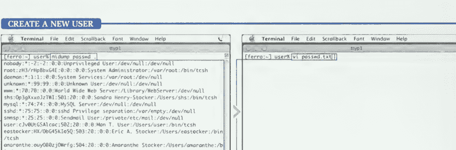

```
[ - ]user%%:nidump password /dev/null
nobody::*:27:27:0:Privileged User:/dev/null/tcsh
root:x:0:0:0:System Administrator:/var/root/bin/tcsh
doll:*:8:8:0:User:/var/root/bin
unknown:*:99:99:0:Unknown user:/dev/null
www:*:83:83:0:Web Server:/usr/sbin/nolog /dev/null
mpgx:*:101:101:0:Sandra Henry:/Users/shera/bin/tcsh
user:*:102:102:0:User:/dev/null
shd:*:75:75:0:sshd separation:/dev/null
smail:*:25:25:0:Sendmail User:/private/mail/dev/null
uster:*:38:38:0:Max User:/usr/sbin/bin/tcsh
easterock:*:120:120:0:E. Erick A. Stoker:/Users/easterock:/bin/tcsh
anoroute:*:802:802:0:Amorante:/Users/amorante/b/tcsh
abartlett:*:500:500:0:Kynn Bartlett:/Users/bartlett/bin/tcsh
anna:*:505:505:0:Alice Roberts:/Users/anna/bin/tcsh
zoe:*:506:506:0:Zoe Child:/Users/joe/bin/tcsh
posix:*:2346:2346:0:Mail:/tmp/usr/bin/false
```

```
[ - ]user%%nidump passed .. password.txt
[ - ]user%%
```

- 1 输入 `nidump password` 并按回车键。
- 2 输入 `nidump passwd > passwd.txt` 并按回车键。
- 3 输入 `password.txt` 并按回车键。
- 显示你当前用户信息的副本。
- 将你当前用户信息的副本置于文本文件中。
- 文本编辑器打开了当前用户信息的副本。

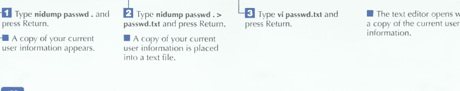

## 系统管理命令

### 11 额外

如果你频繁添加用户或远程管理系统，可以编写一个脚本来加速过程并提高效率。下面的脚本包含了 `niutil` 命令，这些命令会为创建新用户账户所需的每项信息进行重复操作。

```bash
#!/bin/sh

echo -n 'username': : read user
echo -n 'full name': : read fname
echo -n 'shell': : read shell
home=/home/$user

niutil-create : /users/$user passwd
niutil-createprop /users/$user uid
niutil-createprop /users/$user gid gid
niutil-createprop /users/$user fullname
niutil-createprop /users/$user shell
niutil-createprop /users/$user home homidir
niutil-createprop /users/$user shadow_passwd

mkdir $home
chmod 755 $home
chown $user:$user

echo 'password':
passwd $user
```


```
nobody:x:354:354:Privileged User:/dev/null:/dev/null
root:x:0:0:root:root:0:0:System Administrator:/var/root:/bin/bash
ndead:x:34:34:Dead:/dev/null:/dev/null
unknown:x:99999:99999:Unknown User:/dev/null/dev/null
www:x:80:80:Web Server:/var/www
www-data:x:34:34:S.Henry-Hacker:/home/www-data:/bin/nsh
mail:x:25:25:Mail Server:/var/mail:/bin/nsh
smtp:x:25:25:Send Mail:/var/mail:/bin/nsh
pim:x:110:110:Private Mail:/var/mail:/bin/nsh
pop3:x:110:110:Receive Mail:/var/mail:/bin/nsh
proxy:x:110:110:Proxy Mail:/var/mail:/bin/nsh
amontocker:x:200:200:Anonymous Amontocker:/home/amontocker/bin/nsh
abartlett:x:520:520:Kynn Bartlett:/home/bartlett/bin/nsh
ennie:x:520:520:Annie Elena Roberts:/home/annie/bin/nsh
joe:x:520:520:Joe Chie:/home/joe/bin/nsh
sponge:x:520:520:Sponge Bob:/home/sponge/bin/nsh
postfix:x:2346:2346:Mail:/usr/sbin:/bin/false
```


```bash
sudo niutil passwd passwd.passwd
nobody:x:354:354:Privileged User:/dev/null:/dev/null
root:x:0:0:root:root:0:0:System Administrator:/var/root:/bin/bash
ndead:x:34:34:Dead:/dev/null:/dev/null
unknown:x:99999:99999:Unknown User:/dev/null/dev/null
www:x:80:80:Web Server:/var/www
www-data:x:34:34:S.Henry-Hacker:/home/www-data:/bin/nsh
mail:x:25:25:Mail Server:/var/mail:/bin/nsh
smtp:x:25:25:Send Mail:/var/mail:/bin/nsh
pim:x:110:110:Private Mail:/var/mail:/bin/nsh
pop3:x:110:110:Receive Mail:/var/mail:/bin/nsh
proxy:x:110:110:Proxy Mail:/var/mail:/bin/nsh
amontocker:x:200:200:Anonymous Amontocker:/home/amontocker/bin/nsh
abartlett:x:520:520:Kynn Bartlett:/home/bartlett/bin/nsh
ennie:x:520:520:Annie Elena Roberts:/home/annie/bin/nsh
joe:x:520:520:Joe Chie:/home/joe/bin/nsh
sponge:x:520:520:Sponge Bob:/home/sponge/bin/nsh
postfix:x:2346:2346:Mail:/usr/sbin:/bin/false
```

- 4 按 `Shift + G`，然后按回车。
- 5 按 `O`，然后输入 `/user/bin/csh`，确保没有分配其他用户。
- 6 保存你的更改并退出 `vi`。
- 7 输入 `sudo niutil passwd <passwd.passwd>` 并按回车键。
- 8 如果出现提示，输入你的密码并按回车键。
- 9 输入 `nidump password` 并按回车键。

你的更改已加载到 Netinfo。

显示新信息以确认你的更改。


## 启用 root 用户账户

你可以启用 root 用户账户，这允许你在切换到 root 或以 root 身份登录之外，使用 `sudo` 命令行使权限以管理员身份运行命令。Unix 系统上的 root 账户是唯一可以执行任何操作的账户；你应该谨慎使用，因为系统不会防止 root 覆盖不属于 root 的文件，root 可以覆盖系统上的任何文件，无论其所有者是谁以及它对系统的正常运行有多重要。通过使用 `sudo`，你可以在以 root 身份运行的命令前输入 `sudo`。

执行此类操作时必须始终小心。使用 root 权限允许你修改配置文件、在 root 拥有的目录中存储文件、关机或重启系统以及删除用户账户。

在存储的 Netinfo 数据库中，root 账户默认是禁用的。如果你无法以 root 登录，也无法使用 `sudo` 命令切换用户，你可以通过两种方法之一启用它。第一种是使用 Netinfo Manager。执行此操作，你必须通过输入密码进行身份验证，之后可以通过选择启用 root 账户的选项来启用。第二方法是从命令行更改 root 密码。

有时需要以 root 登录或切换用户来简化你需要做的工作，但你

## 启用 root 账户

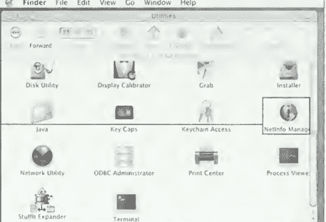

### 使用 NETINFO MANAGER 启用 root

- 打开 Netinfo Manager。
注意：在实用文件夹中查找 Netinfo Manager 的说明，请参阅第 4 页。
- Netinfo Manager 打开窗口。
- 点击安全：身份验证。

出现一个管理员名称和密码对话框。
- 输入你的密码。
- 点击确定。

## 系统管理命令

### 应用它

启用 root 账户后，你可以登录 root 或切换用户到 root。`su` 允许你在知道密码的情况下采用另一个用户的身份；如果你是 root，则不需要密码。输入 `su -` 会在假设用户名的同时调用用户的环境。该命令将让你留在用户的家目录中，激活用户路径并定义用户的别名。你可以使用 `su` 命令假设任何用户的身份，但如果不带参数，它默认认为 root。

输入：
```
[ferro--] user su
Password: # pwd
[ferro--] pwd
```
结果：
```
/Users/user
```
输入：
```
[ferro--] user su
Password:
[ferro--] root# pwd
```
结果：
```
/private/var/root
```

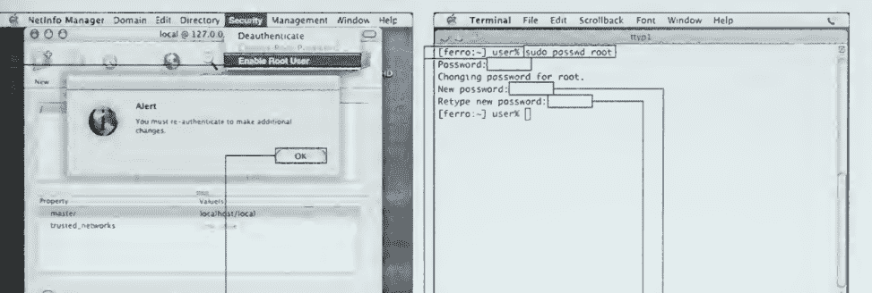

- 点击安全：启用 root 用户。

出现一个警告框，告知你必须重新身份验证以进行额外的更改。
- 点击确定。

# MAC 上的 UNIX

## 以 root 身份执行命令

你可以使用 `sudo` 命令以 root 身份运行任意命令，无论你是否决定在你的 Mac OS 系统上启用 root 账户。为了使用 `sudo` 命令，你必须是具有系统管理权限的用户。当你需要 root 权限时，只需在任何需要 root 权限执行的命令前加上 `sudo` 即可获得权限。

控制权限方面，默认设置赋予特权用户以 root 身份运行任何命令的能力。特权用户在首次建立账户时会被赋予权限。然而，这种权限取决于他们作为 admin 组成员的身份。

处理你自己的文件时不需要权限，且在不需要时不应使用 root 权限，因为系统对这个“无无所不能”的用户的操作没有任何保护。

`sudo` 命令会每分钟提示你输入密码。这种重新验证用户身份的过程有助于确保运行命令的用户具有相应的权限。

你可以使用 `list` 命令显示允许运行 `sudo` 命令的用户列表。默认的 `sudo` 设置对用户运行的命令没有进行任何限制，它并不是一种限制权限的机制。

## 以 root 身份执行命令

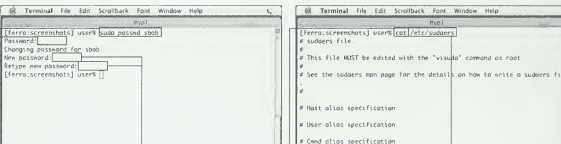

```
must
[[ferro.screenshots] user cat /etc/sudoers]
# sudoers.
# 此文件必须使用 'visudo' 命令进行编辑以运行。
# 请查看 sudoers 手页页有关如何编写 sudoers 文件的详情

# 主机别名规范
# 用户别名规范
# 命令别名规范
# 默认规范
# 用户权限规范
root (ALL:ALL) ALL
kadmin (ALL:ALL) ALL
[[ferro.screenshots] user]
```

## 以 root 身份发布命令

- 1 输入 `sudo` 后加一个空格、另一个用户的用户名，然后按回车。
- 2 在提示处输入你的密码。

`password` 命令提示你输入另一个用户的密码。
- 3 在提示处为该用户输入一个新密码。
- 4 在提示处再次输入该新密码。
- 5 用户的密码已更改。

## 查看 sudoers 文件

- 1 输入 `cat` 后加一个空格。
- 2 输入 `/etc/sudoers` 并按回车。
3 `/etc/sudoers` 文件的内容出现。

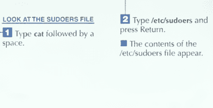

## 系统管理命令

### 额外

`sudo` 命令允许你向信任的用户授予有限 root 权限。例如，你可以允许初级管理员为新用户设置账户或取消打印作业。通过在 `/etc/sudoers` 文件中为某些用户配置一组限制命令，系统管理员可以在不赋予 root 账户权限的情况下委托权限。通过这种方式，你需要创建一个一个或多个用户可以 root 身份运行的命令列表，并将其限制在该命令列表中。输入 `sudo visudo` 并添加系统和用户名以反映你系统上的用户。

示例：
```
nynn, sandra, eric ferro=/sbin/dump,/sbin/restore
nynn ferro=/sbin/shutdown
```
这些行允许第一组用户使用 `dump` 和 `restore` 命令以及关闭系统的命令。


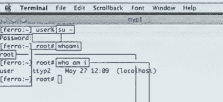

- 列出特权用户
- 1 输入 `idump group` 后加一个空格。
- 2 输入 `-` 并按回车。

将出现组列表，包括 admin 组成员的列表。
- 切换用户到 root
- 1 输入 `su -` 并按回车。
- 2 在提示处输入 root 密码，按回车。
- 3 输入 `whoami` 并按回车。
- 4 输入 `who am i` 并按回车。
- 你现在正在以 root 身份运行。

注意：系统会记录原始登录信息。

## 备份你的文件

你可以通过备份文件来保护你的工作并保护你的系统。维护一组备份始终是一个好主意。Mac OS X 无法防止用户删除他们可能仍需要的文件或一组文件。然而，你可以使用的用于备份文件的工具非常少。

一些 Unix 命令（如 `cp` 和 `dd`）允许你创建文件的副本。长期 Unix 用户可能习惯在编辑原始文件之前复制重要文件，以防他们需要恢复并重新开始。

其他 Unix 命令允许你创建重要文件的归包。这是将项目相关的所有文件保存到单个文件中极好的方法。`tar` 命令非常适合此。

大多数 Unix 系统使用 `dump` 命令进行定期系统备份，尽管你可能需要将数据转到远程驱动器才能使用此命令。`dump` 命令可以备份整个文件系统，也可以仅选择自上次备份以来发生变化的文件。这种备份方法是增量备份。

虽然 `dump` 是一个很好的 Unix 命令，但 Mac OS X 只能备份整个文件系统，或者仅适用于 Unix 文件系统 (UFS)。如果你的 Mac OS 版本比 Mac OS 9 或更早的版本，你可能考虑下载 `hfsutils`。

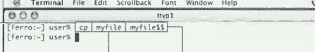
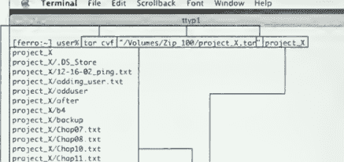

## 使用 CP 备份文件

- 1 输入 `cp` 后加一个空格。
- 2 输入源文件和目标位置。
- 拷贝已完成。

## 使用 TAR 备份文件

- 1 输入 `tar -cvf` 后加一个空格。
- 2 输入文件名并按回车。
- 归档已创建。

## 使用 TAR 恢复文件

- 1 输入 `tar -xvf` 后加一个空格。
- 2 输入 TAR 文件名并按回车。
- TAR 文件已提取到当前目录。

## 使用 DUMP 备份文件

- 1 输入 `dump -f` 后加一个空格。
- 2 输入远程驱动器上的设备名称。
- 3 输入 UFS 文件系统并按回车。
- 文件系统的备份已完成，过程可能需要一些时间。

## 修改文件所有权

你可以更改文件的所有权，以便其他人可以更改文件的内容。`chown` 命令将文件的所有权重新分配给新用户。此命令只能由 root 或带有 `sudo` 命令的特权用户运行。`chown` 命令的语法为 `chown`，但如果你同时指定，就可以同时更改文件关联的所有者和组。要做到这一点，你需要输入新用户的用户名和组，用冒号分隔。例如，像 `horace:groupmyapp.java` 的命令会将 `myapp.java` 的所有者更改为 `horace`，组更改为 `group`。

类似的命令 `chgrp` 用于更改文件或一组文件关联的组。如果你需要与一组其他用户共享文件，可以将这些用户添加到与文件关联的组中。通常情况下，更改文件的组更为简单。

`chgrp` 命令的语法与 `chown` 类似。如果你输入 `chgrp devmyapp.java`，那么开发团队中的任何人都可以获得该文件的组访问权限（如果组成员可以写该文件）。像 `chown` 一样，`chgrp` 可以配合 `-R` 选项递归运行。

与许多命令一样，如果你在命令中添加递归参数，可以使用 `chown` 来处理整个目录。以 `-R` 开头的 `chown` 命令将对你提供的目录中的所有文件运行。

| 终端 | 文件 编辑 回溯 字体 窗口 帮助 |
| :--- | :--- |
| [ferro::] user sudo chown sh myfile | |
| 密码: | |
| [ferro::] user -ls myfile | |
| -rw-r--r-- 1 staff 42414 May 17 21:17 myfile | |
| [ferro::] user | |
| 终端 | 文件 编辑 回溯 字体 窗口 帮助 |
| :--- | :--- |
| [ferro::] user sudo chgrp guest myfile | |
| 密码: | |
| [ferro::] user -ls myfile | |
| -rw-r--r-- 1 staff 42414 May 17 21:17 myfile | |
| [ferro::] user | |

## 更改文件的所有权

## 更改文件的组

- 输入 `sudo chown` 后加一个空格。
- 输入系统上某个用户的用户名后加一个空格。
- 文件现在有了新的所有者。
- 输入文件名，然后按回车。
- 输入 `-ls` 后加一个空格、文件名，然后按回车。
- 输入 `sudo chgrp` 后加一个空格。
- 输入系统上某个组的名称后加一个空格。
- 文件现在有了新的组。

当你更改文件的组和所有权时，不会以任何方式影响文件的内容。关于文件的信息（称为元数据）存储在与文件本身分开的位置。当你更改所有权或与文件关联的权限时，这些元数据会被更改。元数据存储在名为 `inode` 的文件系统结构中。每当你使用 `-i` 命令查看文件信息时，你都会看到元数据。你可以使用 `-i` 选项查看与这些文件关联的 inode 数。有时知道正在使用哪些 `inode` 是很有用的。例如，同一个文件系统中具有相同 `inode` 的两个文件指向相同的内容。

## 输入此：

```
[ferro:-] user ls -i *
```

## 结果：

| 139742 AnaRoof.JPG | 140953 NoLaneBridge.JPG |
| :--- | :--- |
| 144316 AnnaSky.JPG | 140093 OldBarn.JPG |
| 141835 AugSky1.JPG | 140095 OldBarn2.JPG |

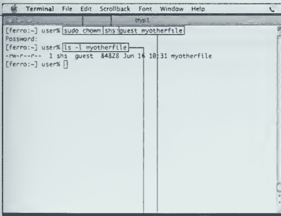
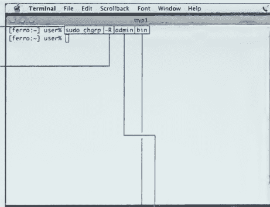

更改文件的所有者和组

## 更改整个目录的组

- 1 输入 `sudo chmod` 后加一个空格。
- 3 输入系统上某个组的名称后加一个空格，然后输入文件名，并按回车。
- 3 输入系统上某个组的名称后加一个空格。
- 2 输入系统上某个用户的用户名后加一个冒号(:)。
- 4 输入 `-i` 后加一个空格、文件名，并按回车。
- 4 输入 `-R` 后加一个空格。
- 目录中的所有文件现在都有新的所有者和组。
- 文件现在有了新的所有者组。

## 创建符号链接

你可以通过创建符号链接来简化文件系统的导航。符号链接是一种特殊文件，作为系统中任何位置另一个文件或目录的指针或快捷方式。

通过为长或复杂的路径创建符号链接，你可以通过输入 `cd` 后跟链接名称进入该目录。如果你想为进入 `/Applications/Utilities` 目录或列出其内容创建一个快捷方式，可以使用命令 `-s /Applications/Utilities`。完整路径指定了你希望链接指向的地方，而 `-s` 参数填充了你想要创建符号链接的命令。

## 检查磁盘空间

你可以使用 `df` 和 `du` 命令分别确定磁盘上的可用空间和已用空间。`df` 命令告知你分配了多少磁盘空间、使用了多少空间，当你使用 `df -k` 参数时，空间将以千字节（kilobytes）而不是 512 字节块的形式显示。

`df` 输出的列之一是“容量（Capacity）”。它显示了你的文件系统中剩余空间占总可用空间的百分比。大多数 Unix 系统管理员都尝试将文件系统的占用率保持在 90% 以下，因为系统在有足够的空空间时运行性能更好。

你可以使用 `du` 命令来确定特定目录占用的空间。当系统空间耗尽时，此命令可以帮助你追踪消耗大量空间的文件。例如，如果你 `cd` 进入某个特定目录并使用命令 `du -sk`，你将获得一个按大小排序的该目录内容列表。如果你想知道磁盘的大部分空间被消耗在了哪里，这非常有帮助。

你可以使用 `df -k` 命令查看磁盘上剩余多少空间。当文件系统接近满容量时，系统的响应速度会降低，尽管任何小于 90% 的文件系统都不需要担心。同时，任何在短时间内容量发生激增的文件系统都可能出现这种情况。文件系统的增长速率暗示了你将如何耗尽空间。

| 文件系统 | 512-块 | 已用 | 容量 | 挂载于 |
| :--- | :--- | :--- | :--- | :--- |


| /dev/ds05 | 534538168 | 20079368 | 32954832 | 37% | /dev |

| root | | 90 | 100% | /dev |

| taes | | | 100% | /dev |

| vfs | | 1024 | 1024 | | |

| outmount-fstab (323) | | 512 | 12 | 100% | /Network/Servers |

| outmount-static (323) | | | 100% | /mount |

| 文件系统 | 512-块 | 已用 | 容量 | 挂载于 |

| :--- | :--- | :--- | :--- | :--- |

| /dev/ds05 | 26726584 | 10039668 | 14676904 | 37% | /dev |

| root | | 90 | 100% | /dev |

| taes | | | 100% | /dev |

| vfs | | 512 | 12 | | |

| outmount-fstab (323) | | | 100% | /Network/Servers |

| outmount-static (323) | | | 100% | /mount |

## 以块为显示磁盘剩余空间

系统以块的形式显示你的文件系统使用情况。

- 1 输入 `df` 并按回车。

## 以千字节显示磁盘剩余空间

系统以千字节的形式显示你的文件系统使用情况。

- 1 输入 `df -k` 并按回车。

## 系统管理命令

`df` 命令还可以报告文件系统上分配和使用的节点（nodes）数量。虽然这在你的系统中可能不是问题，但文件系统耗尽节点是有可能的，就像耗尽磁盘空间一样可能。在任何情况下，在创建磁盘空间或 inode（索引节点）之前，你无法创建新文件。当你创建一个文件系统时，系统还会创建大量的 inode 分配。当你输入命令 `df -i` 时，系统用 `iused` 显示使用的节点数，用 `free` 显示可用节点数。如果 `free` 值极小，你不太可能遇到任何问题。inode 与磁盘空间的比例通常设置得使得耗尽 inode 几乎是不可能的。

请输入以下内容：

```
df -i
```

| 文件系统 | 512-块 | 已用 | 可用 容量 | iused | free | %used | 挂载于 |

| :--- | :--- | :--- | :--- | :--- | :--- | :--- | :--- |

| /dev/disk0 | 53545168 | 1746872 | 35570296 | 32 | 2246857 | 444287 | 33% | / |

| devfs | 200 | 201 | 0 | 100% | 644 | 0 | 100% | /dev |

| fdesc | 2 | 2 | 0 | 100% | 4 | 253 | 1% | /dev |

| root | 1024 | 1024 | 0 | 100% | 0 | 100% | /vol |

```
du -sk | sort -n
```

- Desktop

- Documents

- Downloads

- Library

- Movies

- Music

- Pictures

- Public

## 千字节显示磁盘占用

- 1 输入 `du -sk` 后加一个空格。

- 2 输入内容后加一个空格。

- 3 输入 `sort -n` 并按回车。

## 按大小排序磁盘占用

- 1 输入 `du -sk` 后加一个空格。

- 2 输入内容后加一个空格。

- 系统将按大小排序目录内容。

## 管理打印队列

你可以使用 `lpq` 命令检查打印队列。该命令会显示正在打印的作业。当系统空间耗尽时，你可以使用此命令帮助你追踪消耗大量空间的文件。例如，如果你 `cd` 进入某个特定目录并使用命令 `du -sk`，你将获得一个按大小排序的该目录内容列表。如果你想知道磁盘的大部分空间被消耗在了哪里，这非常有帮助。

你可以使用 `df -k` 命令查看磁盘上剩余多少空间。当文件系统接近满容量时，系统的响应速度会降低，尽管任何小于 90% 的文件系统都不需要担心。同时，任何在短时间内容量发生激增的文件系统都可能出现这种情况。文件系统的增长速率暗示了你将如何耗尽空间。

`df` 命令还可以报告文件系统上分配和使用的节点（nodes）数量。虽然这在你的系统中可能不是问题，但文件系统耗尽节点是有可能的，就像耗尽磁盘空间一样可能。在任何情况下，在创建磁盘空间或 inode 之前，你无法创建新文件。当你创建一个文件系统时，系统还会创建大量的 inode 分配。当你输入命令 `df -i` 时，系统用 `iused` 显示使用的节点数，用 `free` 显示可用节点数。如果 `free` 值极小，你不太可能遇到任何问题。inode 与磁盘空间的比例通常设置得使得耗尽 inode 几乎是不可能的。

## 检查磁盘：

- 1 输入 `df` 并按回车。

- 1 输入 `df -k` 并按回车。

- 检查打印队列。

## 检查打印队列

- 1 输入 `lpr` 后加一个空格。

- 2 打印队列。

- 3 打印队列显示。

- 3 输入 `lpq` 并按回车。

## 实际应用

如果你需要取消打印队列中的所有作业，可以使用 `cancel -s` 参数。该命令选项可以节省你逐个取消的时间。

你可以使用 `lpq` 命令检查打印队列。该命令会显示正在打印的作业。当系统空间耗尽时，你可以使用此命令帮助你追踪消耗大量空间的文件。例如，如果你 `cd` 进入某个特定目录并使用命令 `du -sk`，你将获得一个按大小排序的该目录内容列表。如果你想知道磁盘的大部分空间被消耗在了哪里，这非常有帮助。

你可以使用 `df -k` 命令查看磁盘上剩余多少空间。当文件系统接近满容量时，系统的响应速度会降低，尽管任何小于 90% 的文件系统都不需要担心。同时，任何在短时间内容量发生激增的文件系统都可能出现这种情况。文件系统的增长速率暗示了你将如何耗尽空间。

## 检查磁盘：

- 1 输入 `df` 并按回车。

- 1 输入 `df -k` 并按回车。

- 检查打印队列。

## 检查打印队列

- 1 输入 `lpr` 后加一个空格。

- 2 打印队列。

- 3 打印队列显示。

- 3 输入 `lpq` 并按回车。

## 实际应用

如果你需要取消打印队列中的所有作业，可以使用 `cancel -s` 参数。该命令选项可以节省你逐个取消的时间。

## 检查系统日志

你可以通过检查系统日志中的错误消息和各种异常来了解系统操作错误。系统日志存储在 `/var/log` 中，记录了许多系统服务（如电子邮件和打印）活动。你会发现这些文件非常有价值，因为当系统出现问题时，它们是重要的信息来源。

此配置文件告诉 syslog 如何写入每类型的日志消息。通过使用 syslog 服务，错误不需要自行记录日志。syslog 配置文件 `/etc/syslogd.conf` 为你提供了更改写入哪些日志或禁用某些类型日志的机会。通过修改 syslog 的日志配置并让守护进程检查更改可以使其生效。除非你想分离特定消息或完全停止收集它们，否则不要编辑默认的 `/etc/syslogd.conf`。

关于你当前日志最重要的信息出现在名为 `console.log` 的日志文件中。你可以使用位于 `/Applications/Utilities` 中的控制台（Console）工具查看这些消息。滚动窗口允许你读取积累在日志中的消息。这些消息包括身份验证失败和挂载问题。

系统守护进程管理大多数系统日志文件。与其他许多守护进程一样，syslog 守护进程 `syslog` 有一个它在启动时读取的配置文件。

如果你在工作时保持控制台打开，你将看到这些消息在守护进程生成时显示。这是一个很好的故障排除技术，因为它能立即通知你问题并提醒你检查日志。

## 检查系统日志

打开控制台应用程序

- 在桌面上，点击 Dock 栏上的访达（Finder）。

- 双击你的系统磁盘。

- 双击应用程序（Applications）。

## 系统管理命令

### 额外

Mac OS X 系统上收集信息最多的日志文件是 `system.log`。系统向此文件写入许多常规消息，且 `system.log` 文件会定期轮换。旧的 `system.log` 文件会被重命名为 `system.log.0` 等，并使用 `gunzip` 压缩以节省空间。在任何时候，你都可能有许多此类文件可用，帮助追踪问题。任何日志文件都包含数千条记录——多到你无法从头到尾阅读文件。使用 `grep` 和 `awk` 等命令提取部分数据可以使日志数据变得容易处理得多。你可以考虑编写脚本来检查日志文件中特定类型的错误，并向你报告结果。你可以检查 `/etc/syslog.conf` 文件来查看写入了特定类型的消息。

- 应用程序文件夹出现在访达窗口中。

- 向滚动直到“工具”（Utilities）图标可见。

- 双击“工具”。

- “工具”文件夹出现在访达窗口中。

- 双击“控制台”。

- 控制台应用程序打开。

## 压缩大文件

你可以通过压缩文件大大减少其大小——当使用良好的压缩工具时，可以缩小到原始大小的六分之一更小。压缩是磁盘空间的良好解决方案，且不会牺牲以后可能需要的文件。

对于大多数文件，`gzip` 是可用的最佳工具之一。它快速且有效，可以将文件缩小到原始大小的一小部分。它也适用于许多系统，允许你将压缩后的文件移动到另一个系统。要压缩文件，你可以输入 `gzip` 后跟文件名。`gzip` 命令会创建一个在文件名末尾添加 `.gz` 扩展名的新文件。例如，当你输入 `compress /var/log/system.log` 时，生成的文件是 `system.log.gz`。与 Windows 不同，Unix 不在乎文件有多少个扩展名。

你可以使用的另一个压缩文件的命令是 `compress`。`compress` 命令使用与 `gzip` 不同的算法压缩文件。它还使用不同的扩展名。使用 `compress` 命令压缩的文件采用 `.Z` 扩展名。

`gzip` 和 `zip` 工具是许多 Unix 系统使用的 GNU 工具成员，无论它们是被包含在发行版还是后期添加的。这些命令是 Mac OS X 的标准发行。

`gzip` 和 `compress` 命令都使用文件名来确定文件是否已经压缩。在重命名后再次压缩文件是可能的，但随后的收益很小，且混淆的概率很高。

| 终端 | 文件 | 编辑 | 回滚 | 字体 | 窗口 | 帮助 |

| :--- | :--- | :--- | :--- | :--- | :--- | :--- |

| [ferry-] user | gzip | httpd-2.0.43.tar.gz | | | | |

| [ferry-] user | ls | httpd-2.0.43.tar.gz | | | | |

| w-r-r 1 user staff | 4872268 | May 11 06:23 | httpd-2.0.43.tar.gz | | | |

| [ferry-] user | ls | | | | | | |

| [ferry-] user | gzip | httpd-2.0.43.tar.gz | | | | |

| [ferry-] user | ls | httpd-2.0.43.tar.gz | | | | |

| w-r-r 1 user staff | 4872268 | May 11 06:23 | httpd-2.0.43.tar.gz | | | |

| [ferry-] user | ls | | | httpd-2.0.43.tar.gz | | | |

| w-r-r 1 user staff | 4872268 | May 11 06:23 | httpd-2.0.43.tar.gz | | | |

## 使用 GZIP 压缩文件

1. 输入 `gzip` 后跟空格。

2. 输入文件名并按回车。

3. 输入 `ls -l` 后跟空格。

4. 输入以 `.gz` 结尾的文件名并按回车。

5. 列表显示文件已压缩。

## 解压 GZIP 文件

1. 输入 `gzip` 后跟空格。

2. 输入 gzipped 文件名并按回车。

3. 输入 `ls -l` 后跟空格。

4. 输入原始文件名。

5. 列表显示文件已解压。

## 系统管理命令

### 额外

大多数从 FTP 站点下载的软件都是压缩的，以减少服务器上的存储要求。你可以通过查看扩展名来确定压缩类型。以 `.Z` 结尾的文件是用 `compress` 命令压缩的，而以 `.gz` 结尾的文件是用 `gzip` 压缩的，如 `.zip`、`.tar` 和 `.tgz`。

| 文件扩展名 | 描述 |

| :--- | :--- |

| ZIP | 以 `.zip` 结尾的文件。 |

| TAR | 以 `.tar` 结尾的归档文件。 |

| TAR/TGZ | 以 `.tar` 或 `.tgz` 结尾的文件已经过 gzip 命令压缩。 |

## 使用 COMPRESS 压缩文件

1. 输入 `compress` 后跟空格。

2. 输入文件名并按回车。

3. 输入 `ls -l` 后跟空格。

4. 输入以 `.Z` 结尾的文件名并按回车。

5. 列表显示文件已压缩。

## 解压 COMPRESSED 文件

1. 输入 `uncompress` 后跟空格。

2. 输入压缩的文件并按回车。

3. 输入 `ls -l` 后跟空格。

4. 输入原始文件名。

5. 列表显示文件已解压。

## UNIX 的 NETINFO

你可以探索并修改 NetInfo 内容，它是一个格式化的文本文件，存储了关于用户、组和系统设置的信息。最重要的 NetInfo 文件是 `/etc/passwd`，通过 `/etc` 中的一些附加文件，你可以找到更多关于系统的信息。因此，学习使用 NetInfo 对于理解你的系统至关重要。

| 终端 | 文件 | 编辑 | 回滚 | 字体 | 窗口 | 帮助 |

| :--- | :--- | :--- | :--- | :--- | :--- | :--- |

| (top) | | | | | | |

| root:x:0:0:/root | | | | | | |

| bin:x:1:1:/usr/bin:/sbin/nologin | | | | | | |

| daemon:x:2:2:/sbin:/sbin/nologin | | | | | | |

| sync:x:3:3:/dev:/sbin/nologin | | | | | | |

| lp:x:4:4:/var/lp:/sbin/nologin | | | | | | |

| games:x:5:5:/var/games:/sbin/nologin | | | | | | |

| news:x:6:6:/var/news:/sbin/nologin | | | | | | |

| mail:x:7:7:/var/mail:/sbin/nologin | | | | | | |

| uuc:x:8:8:/var/uuc:/sbin/nologin | | | | | | |

| proxy:x:9:9:/bin/proxy:/sbin/nologin | | | | | | |

| backup:x:10:10:/var/backups:/sbin/nologin | | | | | | |

| bin:x:11:11:/usr/bin:/sbin/nologin | | | | | | |

| man:x:12:12:/var/man:/sbin/nologin | | | | | | |

| lp:x:13:13:/var/lp:/sbin/nologin | | | | | | |

| irc:x:14:14:/var/irc:/sbin/nologin | | | | | | |

| gnp:x:15:15:/var/gnp:/sbin/nologin | | | | | | |

| list:x:16:16:/var/list:/sbin/nologin | | | | | | |

| news:x:17:17:/var/news:/sbin/nologin | | | | | | |

| atsd:x:18:18:/var/uats:/sbin/nologin | | | | | | |

| sync:x:19:19:/dev:/sbin/nologin | | | | | | |

| ntp:x:20:20:/var/lib/ntp:/sbin/nologin | | | | | | |

| down:x:21:21:/var/www:/sbin/nologin | | | | | | |

| games:x:22:22:/var/games:/sbin/nologin | | | | | | |

| irc:x:23:23:/var/irc:/sbin/nologin | | | | | | |

| list:x:24:24:/var/list:/sbin/nologin | | | | | | |

| news:x:25:25:/var/news:/sbin/nologin | | | | | | |

| atsd:x:26:26:/var/uats:/sbin/nologin | | | | | | |

| sync:x:27:27:/dev:/sbin/nologin | | | | | | |

| ntp:x:28:28:/var/lib/ntp:/sbin/nologin | | | | | | |

| dump:x:29:29:/var/www:/sbin/nologin | | | | | | |

| games:x:30:30:/var/games:/sbin/nologin | | | | | | |

| irc:x:31:31:/var/irc:/sbin/nologin | | | | | | |


| `list:x:32:32:/var/list:/sbin/nologin` | | | | | | |
| `news:x:33:33:/var/news:/sbin/nologin` | | | | | | |
| `atsd:x:34:34:/var/uats:/sbin/nologin` | | | | | | |
| `sync:x:35:35:/dev:/sbin/nologin` | | | | | | |
| `ntp:x:36:36:/var/lib/ntp:/sbin/nologin` | | | | | | |
| `dump:x:37:37:/var/www:/sbin/nologin` | | | | | | |
| `games:x:38:38:/var/games:/sbin/nologin` | | | | | | |
| `irc:x:39:39:/var/irc:/sbin/nologin` | | | | | | |
| `list:x:40:40:/var/list:/sbin/nologin` | | | | | | |
| `news:x:41:41:/var/news:/sbin/nologin` | | | | | | |
| `atsd:x:42:42:/var/uats:/sbin/nologin` | | | | | | |
| `sync:x:43:43:/dev:/sbin/nologin` | | | | | | |
| `ntp:x:44:44:/var/lib/ntp:/sbin/nologin` | | | | | | |
| `dump:x:45:45:/var/www:/sbin/nologin` | | | | | | |
| `games:x:46:46:/var/games:/sbin/nologin` | | | | | | |
| `irc:x:47:47:/var/irc:/sbin/nologin` | | | | | | |
| `list:x:48:48:/var/list:/sbin/nologin` | | | | | | |
| `news:x:49:49:/var/news:/sbin/nologin` | | | | | | |
| `atsd:x:50:50:/var/uats:/sbin/nologin` | | | | | | |
| `sync:x:51:51:/dev:/sbin/nologin` | | | | | | |
| `ntp:x:52:52:/var/lib/ntp:/sbin/nologin` | | | | | | |
| `dump:x:53:53:/var/www:/sbin/nologin` | | | | | | |
| `games:x:54:54:/var/games:/sbin/nologin` | | | | | | |
| `irc:x:55:55:/var/irc:/sbin/nologin` | | | | | | |
| `list:x:56:56:/var/list:/sbin/nologin` | | | | | | |
| `news:x:57:57:/var/news:/sbin/nologin` | | | | | | |
| `atsd:x:58:58:/var/uats:/sbin/nologin` | | | | | | |
| `sync:x:59:59:/dev:/sbin/nologin` | | | | | | |
| `ntp:x:60:60:/var/lib/ntp:/sbin/nologin` | | | | | | |
| `dump:x:61:61:/var/www:/sbin/nologin` | | | | | | |
| `games:x:62:62:/var/games:/sbin/nologin` | | | | | | |
| `irc:x:63:63:/var/irc:/sbin/nologin` | | | | | | |
| `list:x:64:64:/var/list:/sbin/nologin` | | | | | | |
| `news:x:65:65:/var/news:/sbin/nologin` | | | | | | |
| `atsd:x:66:66:/var/uats:/sbin/nologin` | | | | | | |
| `sync:x:67:67:/dev:/sbin/nologin` | | | | | | |
| `ntp:x:68:68:/var/lib/ntp:/sbin/nologin` | | | | | | |
| `dump:x:69:69:/var/www:/sbin/nologin` | | | | | | |
| `games:x:70:70:/var/games:/sbin/nologin` | | | | | | |
| `irc:x:71:71:/var/irc:/sbin/nologin` | | | | | | |
| `list:x:72:72:/var/list:/sbin/nologin` | | | | | | |
| `news:x:73:73:/var/news:/sbin/nologin` | | | | | | |
| `atsd:x:74:74:/var/uats:/sbin/nologin` | | | | | | |
| `sync:x:75:75:/dev:/sbin/nologin` | | | | | | |
| `ntp:x:76:76:/var/lib/ntp:/sbin/nologin` | | | | | | |
| `dump:x:77:77:/var/www:/sbin/nologin` | | | | | | |
| `games:x:78:78:/var/games:/sbin/nologin` | | | | | | |
| `irc:x:79:79:/var/irc:/sbin/nologin` | | | | | | |
| `list:x:80:80:/var/list:/sbin/nologin` | | | | | | |
| `news:x:81:81:/var/news:/sbin/nologin` | | | | | | |
| `atsd:x:82:82:/var/uats:/sbin/nologin` | | | | | | |
| `sync:x:83:83:/dev:/sbin/nologin` | | | | | | |
| `ntp:x:84:84:/var/lib/ntp:/sbin/nologin` | | | | | | |
| `dump:x:85:85:/var/www:/sbin/nologin` | | | | | | |
| `games:x:86:86:/var/games:/sbin/nologin` | | | | | | |
| `irc:x:87:87:/var/irc:/sbin/nologin` | | | | | | |
| `list:x:88:88:/var/list:/sbin/nologin` | | | | | | |
| `news:x:89:89:/var/news:/sbin/nologin` | | | | | | |
| `atsd:x:90:90:/var/uats:/sbin/nologin` | | | | | | |
| `sync:x:91:91:/dev:/sbin/nologin` | | | | | | |
| `ntp:x:92:92:/var/lib/ntp:/sbin/nologin` | | | | | | |
| `dump:x:93:93:/var/www:/sbin/nologin` | | | | | | |
| `games:x:94:94:/var/games:/sbin/nologin` | | | | | | |
| `irc:x:95:95:/var/irc:/sbin/nologin` | | | | | | |
| `list:x:96:96:/var/list:/sbin/nologin` | | | | | | |
| `news:x:97:97:/var/news:/sbin/nologin` | | | | | | |
| `atsd:x:98:98:/var/uats:/sbin/nologin` | | | | | | |
| `sync:x:99:99:/dev:/sbin/nologin` | | | | | | |

# 列出 NETINFO 格式

`nidump` 会显示用法语句以及它可以为之导出的格式列表。

# 从 NETINFO 导出信息

1. 输入 `nidump` 并按回车。
2. 输入 `nidump` 后跟空格。
3. 显示格式的内容。

### 额外

虽然 `nidump` 和 `niload` 命令相对直观，但 `niutil` 命令有许多选项，每个选项都像一个独立的命令。这些选项包括：

- `-create`, `-destroy`, `-createprop`,
- `-appendprop`, `-mergeprop`, `-insertval`,
- `-destroyprop`, `-destroyval`, `-renameprop`,
- `-read`，以及 `-list`。

Netinfo 使用的术语与系统不同。例如，Netinfo 不仅用格式代替文件维持，还用目录代替属性（properties），并用权限（rights）代替字段（fields）。如果你使用 `niutil` 命令创建一个新的用户记录，可以使用 `niutil -create` 命令，它会创建一个新目录。然后，你可以使用 `niutil -createprop` 命令设置与用户全名、主目录等关联的值。

尽管 Netinfo 运行良好，但你应该考虑使用编写严谨且经过充分测试的脚本来执行更改，而不是尝试手动输入所有必要的 netinfo 命令。阅读 `niload`、`nidump` 和 `netutil` 页面以了解更多如何使用这些命令的信息。

### 在文件中备份 NETINFO 信息

1. 输入 `nidump` 后跟一个空格。
2. 输入格式名称后跟一个空格。
3. 输入 `,` 后跟一个空格。
4. 输入后跟一个空格、一个文件名，然后按回车键。
5. 输入 `sudo niutil -destroy, /users/zoe` 并按回车键。

用户 zero 已从 Netinfo 中移除。

### 从你的文件重新加载 NETINFO

1. 输入 `sudo niload` 后跟一个空格。
2. 输入格式名称后跟一个空格。
3. 输入 `,` 后跟一个空格，再跟一个空格。
4. 输入你转储格式内容的文件名，并按回车键。

系统将导出的数据重新加载回 Netinfo，包括 zoe 的账户信息。

## Mac 版的 UNIX

## 安装开发者工具

你可以在你的 Mac OS 系统上加载各种软件开发工具。开发者工具 CD（Developer Tools CD）包含了一套完整的开发工具。这包括许多标准编程语言、实用程序和库，以及带有软件管理工具的调试器。有编译器允许你将源代码转换为程序、脚本；有调试器可以帮助你定位代码中的错误；还有工具可以帮助你分析系统性能。如果在安装过程的这一部分你的系统变慢，请不要惊慌；这并不罕见。安装过程可能比你认为的要长。请耐心等待其完成。

你可以一次性加载开发者工具 CD 中的所有可用工具，也可以打开 Packages 文件夹并选择任何单个包进行安装。这些包是 BSDSDK、DevDocumentation、DevExamples、DevPBw、DevSDK 和 DevTools。

为了让系统更容易管理，如果可能，你应该将开发者工具安装与 Mac OS X 相同的磁盘上。你可以在大约半小时内从 CD 加载开发者工具。如果你在网络上操作，可以在一个系统中提供开发者工具，并通过网络安装到所有其他系统中。

`README.html` 文件是帮助你找到所需文档的起点。定期访问 apple.com 查找更新以保持你的开发者工具更新。

在安装开发者工具期间，安装程序会经历多个阶段，包括一个优化阶段，在该阶段安装程序会尝试改进……

## 安装开发者工具

- 将开发者工具 CD-ROM 插入驱动器。
- 双击桌面上出现的图标。
- 双击打开 Developer.mpkg 窗口。
- 屏幕上出现工具 CD 图标。

### 额外

开发者工具包含 `gcc 3` 编译器。这个 GNU C 编译器编译用 C、Objective-C 和 Objective-C++ 编写的代码。其他 Unix 上的开发者可以使用它。有编译器允许你将源代码转换为程序、脚本；有调试器是帮助你定位代码中错误的特殊工具；还有帮助你分析系统性能的工具。如果在安装过程的这一部分你的系统变慢，请不要惊慌；这并不罕见。安装过程可能比你认为的要长。请耐心等待其完成。

你可以一次性加载开发者工具 CD 中的所有可用工具，也可以打开 Packages 文件夹并选择任何单个包进行安装。这些包是 BSDSDK、DevDocumentation、DevExamples、DevPBw、DevSDK 和 DevTools。

为了让系统更容易管理，如果可能，你应该将开发者工具安装与 Mac OS X 相同的磁盘上。你可以在大约半小时内从 CD 加载开发者工具。如果你在网络上操作，可以在一个系统中提供开发者工具，并通过网络安装到所有其他系统中。

`README.html` 文件是帮助你找到所需文档的起点。定期访问 apple.com 查找更新以保持你的开发者工具更新。

在安装开发者工具期间，安装程序会经历多个阶段，包括一个优化阶段，在该阶段安装程序会尝试改进……

## 安装开发者工具

- 将开发者工具 CD-ROM 插入驱动器。
- 双击桌面上出现的图标。
- 双击打开 Developer.mpkg 窗口。
- 屏幕上出现工具 CD 图标。

### 额外

开发者工具包含 `gcc 3` 编译器。这个 GNU C 编译器编译用 C、Objective-C 和 Objective-C++ 编写的代码。其他 Unix 上的开发者可以使用它。有编译器允许你将源代码转换为程序、脚本；有调试器是帮助你定位代码中错误的特殊工具；还有帮助你分析系统性能的工具。如果在安装过程的这一部分你的系统变慢，请不要惊慌；这并不罕见。安装过程可能比你认为的要长。请耐心等待其完成。

你可以一次性加载开发者工具 CD 中的所有可用工具，也可以打开 Packages 文件夹并选择任何单个包进行安装。这些包是 BSDSDK、DevDocumentation、DevExamples、DevPBw、DevSDK 和 DevTools。

为了让系统更容易管理，如果可能，你应该将开发者工具安装与 Mac OS X 相同的磁盘上。你可以在大约半小时内从 CD 加载开发者工具。如果你在网络上操作，可以在一个系统中提供开发者工具，并通过网络安装到所有其他系统中。

`README.html` 文件是帮助你找到所需文档的起点。定期访问 apple.com 查找更新以保持你的开发者工具更新。

在安装开发者工具期间，安装程序会经历多个阶段，包括一个优化阶段，在该阶段安装程序会尝试改进……

（注：此处为重复翻译内容，对应 macOS 安装开发者工具的描述）

### 你接受 Mac OS 版本的软件许可协议

要安装软件，你必须同意许可协议的条款。

许可

点击同意或点击不同意以取消安装。

## 软件许可协议

要安装软件，你必须同意许可协议的条款。

许可

## 你接受 Mac OS 版本的许可协议

1. 通用。此处包含的软件、实用程序、项目或示例代码仅供你个人使用，无论是在磁盘、电子文档、只读存储器或其他任何介质上。在此授予的权利仅限于 Apple 及其许可者的使用。开发者工具在 Apple 的软件文档中描述，开发者软件由 Apple 及其许可者的软件进行描述。本许可的条款将适用于可能提供的任何开发者软件升级。本许可可能会被新的许可所取代，在这种情况下，本许可的条款将失效。

打印 | 保存 | 返回 | 继续

- 6 阅读软件许可协议并点击继续。
- 7 点击同意。

## 安装 UNIX 应用 12

### 额外

你可以通过在访达中打开 `/Developer/Documentation/README.html` 来开始浏览开发者文档。README 文件，`README.html` 为你在系统中发现的数千页文档提供了一个简和的介绍，从教程、概念概述到详细的发布说明比应有尽。

ProjectBuilder 允许你在查看代码和查看文档之间平缝切换。通过按住 option 键并双击特定的 API 元素，工具将快速带你进入相应的文档，或为你提供相关选项的列表。

开发者工具在安装时包含了大量的页面，帮助你学习各种命令。这些页面应该在安装开发者工具期间已经安装好了。你需要在你的 `MANPATH` 中包含 `/usr/share/man` 才能查看页面。你可以通过输入 `setenv MANPATH $MANPATH:/usr/share/man` 或通过在你的 `~/.tshrc` 文件中定义路径将此目录添加到你的路径中。后者是更好的选择，因为你每次登录时都会将此路径添加到路径中。

- 如果尚未选择，请点击你想要安装工具的磁盘。
- 点击“继续”。
- 出现“易于安装”界面。
- 点击“安装”或“升级”。

## 安装开发者工具（续）

虽然开发者光盘上的许多工具旨在用于 Java 开发，但还有很大一组工具可以帮助你用其他语言构建应用程序。其中包含的 `gcc` 版本是用于 C、C++ 和 Objective-C 应用程序的编译器。`gcc` 预处理器和 `cpp` 工具是预处理器。后者适用于 C++ 和 Objective-C。

`libtool` 创建动态库和静态库，并根据需要供 `gcc` 使用。

开发者工具提供了 `CVS`，这是一种用于维护源代码的工具，你通过 GNU Foundation 进行维护。`CVS` 允许你创建应用程序的任何特定版本，而且 `CVS` 还允许多个开发者在同一段代码上工作，而无须覆盖对方的代码。代码会被提交和检出，因此一次只能由一个人修改。你可以确定同一份代码多个版本之间的差异，并根据需要合并代码，以便整合来自多个人的更改。

`as` 是系统汇编器，`gdb` 是来自 GNU Foundation的调试器，在业界广为人知。开发者工具提供了调试指南以及一个用于入门的快速参考。

`ld` 是静态链接器。它将对象文件组合成二进制文件，例如构成应用程序和共享库的二进制。

`ldd` 是动态链接编辑器。该工具用于按需要加载库的应用程序，而不是像静态链接时那样将它们合并。

系统正在准备加载新软件。

系统继续加载新软件。

## 安装 UNIX 应用

### 额外

开发者工具提供的发布说明可以帮助你理解自上一次发布以来发生了什么。如果你是 Mac OS X 开发的新手，发布说明在今天对你来说可能意义不大，但在你花费了时间进行开发并准备升级到更新版本的开发者工具后，你可能会发现它们很重要。在这种情况下，阅读发布说明是一个极佳的主意，因为它会告诉你在开始使用新软件之前需要注意些什么。

你可以在 Developers 目录中找到两个图标，蓝色和灰色。这些图像看起来像你窗口左上角的点。


要介绍 Java 编程，请双击`/Developer/Examples/Java/`。点击后，你可以阅读`README.txt`文件并开始学习该应用程序是如何创建的。应用程序是循环的，所以你可能需要点击几次“停止”按钮。

提供了 AppleScript 程序来帮助你的脚本工作。

安装软件优化删除了

安装完成。

点击“关闭”。

## Mac 版 UNIX

### 在网络上寻找 UNIX 应用

你以两种形式下载软件：作为安装后即可运行的预编译二进制文件，或者作为在你运行之前进行编译的源码。获取 Mac OS X 新工具最简单的方法是寻找预编译二进制文件。虽然网上有很多来源，但你可以找到专门为 Mac OS X 构建的预编译二进制文件。

在网上下载时，你可以使用这些，但你必须不要关掉拨号上网。当你从 Apple 网站下载时，会出现下载管理器，允许你监控下载进度。使用源码的优势在于：首先你可以研究代码并确切知道它是工作的，其次你可以根据自己的目的修改代码。

许多网站提供 Mac OS 的预编译二进制文件。例如，你可以从`sourceforge.org`获取`Fink`，一个针对 Mac OS 的高级软件包管理器。其他实用的工具包括来自`apple.com`的`XFree`，正如你预期的，与 Microsoft Office 竞争的办公套件，Apple 在你的桌面下拉菜单中包含了 Mac OS X 选项，这将引导浏览器进入他们的下载网站。

- 点击 Mac OS X：获取 Mac OS X 软件。
- 你的浏览器打开并进入 Mac OS X 下载页面。
- `Command`点击你选择的下载链接。

### 额外

有数以千计的程序可以下载和安装，以增加你 Mac OS 系统的实用性和功能性；其中某些程序可能证明是你系统重要的补充，你可能仅仅因为它们有趣而安装它们。最有益的程序是那些能够补充你现有工具的，或者比随附的工具完成得更好的。

例如，Mac OS X 不包含拼写检查器。如果你打算在 Mac 系统上进行大量写作，安装`ispell`将为你提供一个多功能的拼写检查系统。另一个工具`aspell`证明是一个更智能的拼写检查器，但需要额外的配置。

## 寻找开源软件

你可以在网上找到大量的开源软件，如果你对此感兴趣，还可以参与开源开发。获取开源软件的最佳网站是那些专门用于开源的站点，包括`www.freshmeat.com`和`sourceforge.org`。你也可以通过访问`opensource.org`找到关于开源软件的链接和大量额外信息。

你也可以在应用程序的原始开发网站查找源码。例如，你可以去`www.apache.org`下载最新或早版本的 Apache 服务器。你可以从`www.sendmail.com`获得大量资源，从`www.gnu.org`获取 GNU 工具。

如果你打算在业务或项目中使用开源软件，那么开源认证问题对你来说可能变得重要。由开源倡议组织（OSI）执行的开源认证可以确保你正在使用的源代码符合被认定为开源的所有要求。

从源代码编译应用程序的过程可能从简单而易举到极其困难不等。幸运的是，大多数流行的工具在你获得源代码副本之前会花费很长时间来处理开发中的错误。这些包括编译过程中的错误以及代码中的错误。如果你对带有错误的代码保持警惕，请避免使用任何被描述为 Beta（测试版）的代码。Beta 是未经过完全测试代码的术语。

你可以先下载的一个非常有用的工具：`Fink`是一个管理软件安装的开源工具，可以节省你寻找、下载和安装其他软件的大量时间。

| 资源 | 文件 | 编辑 | 视图 | 收藏 | 工具 | 窗口 | 帮助 |
|---|---|---|---|---|---|---|---|

| Fink - 下载快速开始 | | | | | | | |

| 章节 | |
|---|---|

| 主页 | |
| 软件包 | |
| 常见问题 (F.A.Q.) | |
| 文档 | |
| 邮件列表 | |
| 邮件列表 | 快速开始 |
|---|---|

| 快速开始 | |
| 10.1 更新 | |
| 10.2 更新 | |
| 活跃浏览器 | |

初接触 Fink？这些快速上手将帮助你熟悉二进制版本。

- 1. 下载安装程序磁盘映像：`Fink-0.4.1`二进制安装程序 (12.5 MB) (10 用户 - 使用 Fink 0.1)
- 2. 双击`Fink-0.4.1`安装磁盘映像。然后双击内部的`Fink-0.4.1 Installer.package`。按照屏幕指令操作。
- 3. 打开一个新的终端（Terminal）窗口，输入`'pico cd'`，会弹出一个文本编辑器。输入此行：
  - 1 在浏览器中输入`http://fink. sourceforge.net/download/index.php`网页。
  - 2 滚动页面到下载 Fink 的链接。

```
nano /home/user/fink.conf
```

## 安装应用程序包

你可以非常方便地在 Mac OS 上安装应用程序包。这是因为软件包是一种特殊格式的应用程序文件，旨在便于安装。为了让你知道某个文件已准备好在你的系统上进行安装，Finder 使用了一个看起来像打开的文件夹的图标。

Mac OS X 还包含一个`install`命令，允许你将二进制文件移动到你想运行运行的指定位置。如果你在`install`命令中使用`-b`选项，可以专门避免覆盖软件的早期版本。使用`-o`选项，你可以指定应用程序移动到该位置时的所有者。你可以使用`-g`选项指定组。你可以使用`-d`选项创建缺失的文件默认模式，并根据需要限制访问。

要安装应用程序包，你只需在 Finder 中双击该包的图标即可。这将启动一个引导你完成安装每一步的过程。Mac 会要求你输入密码以验证你的特权用户身份，并选择安装的磁盘。你可以通过观察进度条来监控安装进度。安装完成后，会有一个消息通知你安装成功。你通过这种方式安装所有软件软件包。

虽然下载和安装软件相对容易，但管理它们可能更具挑战性。Mac OS X 没有对安装软件的位置设置限制，因此你应该维护并执行一种惯例，以防止你的系统变得混乱。

- 1 从网上下载应用程序包。
- 2 点击应用程序包图标以查看文件夹内容。
- 3 双击包图标。
- 4 打开一个窗口，显示文件夹内容。
- 5 在密码或短语字段中输入你的密码。
- 6 点击“确定”。
- 7 点击“继续”，直到你到达许可协议。

## 额外信息

当你在硬盘的多个位置安装软件时，可能很难跟踪你在哪里安装了软件以及安装了哪些软件。当你经常下载新工具和程序时，情况会变得更加糟糕。

虽然你可以手动管理软件，但你还有另一种方法让软件更容易查找和使用：你可以更新搜索路径，以包含所有你安装软件的目录。

你可以通过编辑默认 shell 配置文件来更新搜索路径。如果你的默认 shell 在 Mac OS X 中被定义，它就在你家目录根目录下的`.tshrc`文件中。系统每次在你登录时以及每次打开新的 shell 或终端窗口时都会读取此文件。

要在`tsh`中更新你的搜索路径，请通过编辑`.tshrc`添加以下行：`setenv PATH="/usr/local/bin:$sw/bin"`，其中指定的路径是你的新软件的位置。每个系统用户都需要进行此更改，以便找到软件位置。

| 安装程序 | 文件 | 编辑 | 窗口 | 帮助 |
|---|---|---|---|---|

| 安装 | | | |

## 软件许可

### 选择目标位置

* 简介
* Read Me
* 许可
* 选择目标位置

选择一个目标位置来安装软件。Fink 根据通用公共许可证 (GPL) 分发，如下所示。如果不分发它，就不需要接受它。然而，普通法通常被称为“合理使用”。GPL 实际上对你如何分发实施了限制。例如，你的责任是向接收它的人提供源代码。该软件需要 4.6 MB 的磁盘空间，“Macintosh HD”。

| 打印 | 保存 | 后退 | 继续 |
|---|---|---|---|

- 7 滚动以阅读协议。
- 8 点击“继续”。
- 9 选择适当设备。
- 10 安装正在进行并安装到你的磁盘。

## 安装归档

你可以使用带有`-x`参数从磁带归档安装软件。`-x`参数指示从指定文件中提取。例如，许多用户使用`tar`命令来准备文件，`-f`参数如果你想列出文件。你可以使用`-vf`命令检查归档的内容。例如，要提取一个名为`drawfigs.tar`的文件，你可以输入`-vf drawfigs.tar`。如果文件名以`/`开头，`tar`命令将尝试提取到路径。`-v`参数表示详细模式。当你使用此选项时，`tar`命令会在提取时显示文件名。

| 用户 | 组 | tvf | 大小 | 日期 | 名称 |
|---|---|---|---|---|---|

| -r-xr--x | staff | | 4668 | 2002年1月27 | 12-16-02.png |
| -r-xr--x | staff | | 23959 | 3月13 13:37 | Copyright.tar |
| -r-xr--x | staff | | 22599 | 5月07 05:37 | Chap08.tar |
| -r-xr--x | staff | | 33355 | 5月07 05:37 | Chap09.tar |
| -r-xr--x | staff | | 14183 | 6月19 13:20 | Chap10.tar |
| -r-xr--x | staff | | 6388 | 7月24 14:56 | Chap11.tar |
| -r-xr--x | staff | | 395 | 7月02 19:50 | Endinghoat |
| -r-xr--x | staff | | 177384 | 8月05 10:15 | Chap10_test.tar |
| -r-xr--x | staff | | 318 | 8月12 12:07 | drawfigs.tar |
| -r-xr--x | staff | | 4576 | 9月12 08:08 | adder |
| -r-xr--x | staff | | 4578 | 10月05 14:44 | backup |
| -r-xr--x | staff | | 4668 | 11月09 16:49 | backup |
| -r-xr--x | staff | | 1853 | 11月11 13:35 | commands |
| -r-xr--x | staff | | 3273 | 12月02 04:04 | Chap04.tar |
| -r-xr--x | staff | | 1724 | 12月15 10:35 | enable_access |
| -r-xr--x | staff | | 3976 | 1月07 05:17 | list |
| -r-xr--x | staff | | 1134 | 2月14 11:56 | file.tar |
| -r-xr--x | staff | | 350 | 3月06 05:12 | myfile.txt |
| -r-xr--x | staff | | 91874 | 3月12 17:06 | alhouse.jpg |

```
$ [ferrai] user tar xvf drawfigs.tar
12-16-02.png
Copyright.tar
Chap08.tar
Chap10.tar
Chap12.txt
Commands.html
Endinghoat
Nec_Chap10.html
drawfigs.tar
adder
backup
commands\scurl
dump.tar
enable_access
file.tar
myfile.txt
alshouse.jpg
```

# 安装 UNIX 应用程序

### 额外

你可以使用`tar`命令从归包中提取单个文件或目录，而不是全部内容。例如，在继续从归包提取剩余内容之前，你可能想先阅读许可协议和 README 文件。

要从 TAR 文件中提取单个文件，请在`tar`命令的末尾添加该文件的名称。命令`tar -xvf drawfigs.tar README`只提取 README 文件内部的内容。如果你正在从 TAR 文件内部的目录中提取文件，请确保输入的目录名称与`tar -tvf`命令列出的文件中显示的完全一致。例如，如果你想提取`tmpls/template1.tmp`，请输入命令`tar xvf drawfigs.tar tmpls/template1.tmp`。

如果你在提取文件的同时想更改路径的某些部分，可以使用`-s`选项。例如，如果你想在提取过程中将`tmpls`目录改为`orig_impls`，可以输入`-s /impls/orig_tmpl/ -xvf drawfigs.tar`。

| 终端 | 文件 | 编辑 | 回滚 | 字体 | 窗口 | 帮助 |
|---|---|---|---|---|---|---|

| [ferro~] user | gunzip | httpd-2.0.43.tar.gz | | | | |
| [ferro~] user | -1 httpd-2.0.43... | | | | | |
| =-ferro~ | 3 user staff 22958888 May 7 02:24 httpd-2.0.43.0.tar.gz | | | | | |

| 终端 | 文件 | 编辑 | 回滚 | 字体 | 窗口 | 帮助 |
|---|---|---|---|---|---|---|

| [ferro~] user | uncompress | httpd-2.0.43.tar.gz | | | | |
| [ferro~] user | -1 httpd-2.0.43... | | | | | |
| =-ferro~ | 1 user staff 22958888 May 7 02:24 httpd-2.0.43.0.tar.gz | | | | | |
| [ferro~] user | | | | | | |

从已解压的 TAR 文件提取

输入已解压 TAR 文件的名称，然后按回车键。

解压压缩的 TAR 文件

输入压缩 TAR 文件的名称，然后按回车键。

- 在终端窗口中，输入`gunzip`后加一个空格。
- 在终端窗口中，输入`uncompress`后加一个空格。
- TAR 文件已解压。
- TAR 文件已解压。

# 使用 MAKE 编译程序

你可以使用一个名为`make`的工具从源代码进行编译，这是一个许多用户青睐的工具，但它本身并不是编译器，而是一个管理编译的工具。在 Mac OS 开源中，`make`会调用`gcc`（GNU C 编译器）来编译源代码。

比源代码；；毕竟，这表明自上次编译以来代码没有做过任何更改。包含许多源文件的大型应用程序重新编译的速度比首次编译要快得多，因为只有被修改的文件会被重新编译。你还可以在不带`Makefile`的情况下运行`make`来编译带有单文件源码的程序。

虽然这个编译自己应用程序的过程可能看起来很繁琐，但一些开发使得源代码编译变得高效得多。首先，从源码到可执行文件的过程已经标准了；如果你能记住这一系列步骤——`configure`、`make`、`install`和`make clean`——你就可以构建并安装你找到的大多数软件，并使用像 Make 这样的工具避免手动编译过程。

专门为 Mac OS 准备的源代码已经包含一个`Makefile`。通用源码需要一个额外的步骤来评估你的系统配置并创建一个合适的`Makefile`。

`make`高效的一个原因是，因为当现有程序存在时，它不会重新编译程序。

`Makefile`中的`make install`步骤指示将应用程序安装到你想运行它的目录中。`make clean`会移除对象文件，这些是编译复杂应用程序过程中的中间文件。

```c
#include <stdio.h>

main() {
  printf("Hello world!\n");
}
```

```
greetme.c: 5 lines, 62 characters.
[greetme]> make greetme
[greetme]: cc
[greetme]: use gcc -o greetme greetme.c
[greetme]
./greetme
```

# 编写一个小型程序

- 1 打开文本编辑器并创建一个名为`greetme.c`的文件。
- 3 输入`make`并按回车键。
- 6 保存文件并退出编辑器。
- 8 输入`chmod +x greetme`并按回车键。
- 出现空白的编辑器屏幕。
- 4 按四次空格键，输入`printf("Hello,world");`并按回车键。
- 你的简单 C 程序保存在你的目录中。
- 9 输入`./greetme`并按回车键。
- 2 输入`<stdio.h>`并按回车键。
- 7 输入`make`并按回车键。
- 该工具编译了你的程序，你的程序运行了。

# 安装 UNIX 应用程序

### 额外

当你从`www.apache.org`下载的压缩 tar 包编译 Apache 时，有几个步骤你必须遵循。首先，你必须解压文件并提取内容。然后你必须运行`configure`命令来准备你的`Makefile`，执行`make`命令来读取`Makefile`，并调用`gcc`来编译每段代码并创建你的可执行文件。之后，你运行`make install`将二进制文件放置在你想运行它的目录中。在提取过程中，`make`告诉你的配置文件。例如，如果你想在提取时将`tar`配置为`/sw/apache`。

| 终端 | 文件 | 编辑 | 回滚 | 字体 | 窗口 | 帮助 |
|---|---|---|---|---|---|---|

| [ferro~] user | uncompress | httpd-2.0.43.tar.gz | | | | |


# 从已解压的 TAR 文件提取

从已解压的 TAR 文件提取

输入已解压 TAR 文件的名称，然后按回车键。

# 解压压缩的 TAR 文件

解压压缩的 TAR 文件

输入压缩 TAR 文件的名称，然后按回车键。

- 在终端窗口中，输入 `gunzip` 后加一个空格。
- 在终端窗口中，输入 `uncompress` 后加一个空格。
- TAR 文件已解压。
- TAR 文件已解压。

# 使用 MAKE 编译程序

你可以使用一个名为 `make` 的工具从源代码进行编译，这是一个许多用户青睐的工具，但它本身并不是编译器，而是一个管理编译的工具。在 Mac OS 开源中，`make` 会调用 `gcc`（GNU C 编译器）来编译源代码。

比源代码；毕竟，这表明自上次编译以来代码没有做过任何更改。包含许多源文件的大型应用程序重新编译的速度比首次编译要快得多，因为只有被修改的文件会被重新编译。你还可以在不带 `Makefile` 的情况下运行 `make` 来编译带有单文件源码的程序。

虽然这个编译自己应用程序的过程可能看起来很繁琐，但一些开发使得源代码编译变得高效得多。首先，从源码到可执行文件的过程已经标准了；如果你能记住这一系列步骤——`configure`、`make`、`install` 和 `make clean`——你就可以构建并安装你找到的大多数软件，并使用像 `Make` 这样的工具避免手动编译过程。

专门为 Mac OS 准备的源代码已经包含一个 `Makefile`。通用源码需要一个额外的步骤来评估你的系统配置并创建一个合适的 `Makefile`。

`make` 高效的一个原因是，因为当现有程序存在时，它不会重新编译程序。

`Makefile` 中的 `make install` 步骤指示将应用程序安装到你想运行它的目录中。`make clean` 会移除对象文件，这些是编译复杂应用程序过程中的中间文件。

```c
#include <stdio.h>

main() {
  printf("Hello world!\n");
}
```

```
greetme.c: 5 lines, 62 characters.
[greetme]> make greetme
[greetme]: cc
[greetme]: use gcc -o greetme greetme.c
[greetme]
./greetme
```

# 编写一个小型程序

- 1 打开文本编辑器并创建一个名为 `greetme.c` 的文件。
- 3 输入 `make` 并按回车键。
- 6 保存文件并退出编辑器。
- 8 输入 `chmod +x greetme` 并按回车键。
- 出现空白的编辑器屏幕。
- 4 按四次空格键，输入 `printf("Hello,world");` 并按回车键。
- 你的简单 C 程序保存在你的目录中。
- 9 输入 `./greetme` 并按回车键。
- 2 输入 `<stdio.h>` 并按回车键。
- 7 输入 `make` 并按回车键。
- 该工具编译了你的程序，你的程序运行了。

# 安装 UNIX 应用程序

### 额外

当你从 `www.apache.org` 下载的压缩 tar 包编译 Apache 时，有几个步骤你必须遵循。首先，你必须解压文件并提取内容。然后你必须运行 `configure` 命令来准备你的 `Makefile`，执行 `make` 命令来读取 `Makefile`，并调用 `gcc` 来编译每段代码并创建你的可执行文件。之后，你运行 `make install` 将二进制文件放置在你想运行它的目录中。在提取过程中，`make` 告诉你的配置文件。例如，如果你想在提取时将 tar 配置为 `/sw/apache`。

在编译并安装 Apache 后，启动服务器。与你安装的文件一起，还有一个名为 `apachectl` 的脚本。该脚本用于启动、重启和停止 Apache 器。如果你通过 `-prefix=/sw` 配置选项将 Apache 安装在 `/sw/apache` 中，那么你可以在 `/sw/apache/bin/apachectl` 找到 `apachectl`。要启动 Apache，只需输入 `/sw/apache/bin/apachectl`。

当你的新 Apache 服务器准备就绪后，它将使用默认的 `DocumentRoot` —— 即安装你的 Web 页面的目录，并且仅包含安装时自带的一组页面。有关配置你的 Apache 服务器和你的新网站的信息，请参阅第 4 章。

上述描述的配置和安装过程是安装 Apache 的标准流程。如果没有在 `configure` 命令中提供 `-prefix` 参数，Apache 将编译为从默认目录运行。描述的剩余过程仅使用默认值。

要了解可用于构建自定义 Apache 服务器的许多不同选项，请使用命令 `./configure --help`。

```
[Terminal]~/httpd-2.0.43* user make install
Making all in order
Making all in order
Making all in strings
gcc -g -O2 -DHAVE_CONFIG_H -DDARININ -DISPROGMASK_SETS_THREAD_MASK =
silent --mode=compile
no-precomp -I./ -I/include/arch -c _apr_strn.c &build
/bin/sh /Users/users/httpd_2.0.43/src/libtool --silent --mode=compile
no-precomp -I./ -I/include/arch -c _apr_prnt.c &build
/bin/sh /Users/users/httpd_2.0.43/src/libtool --silent --mode=compile
gcc -g -O2 -DHAVE_CONFIG_H -DDARININ -DISPROGMASK_SETS_THREAD_MASK =
touch _apr_strn.o
atch -f
touch _apr_strn.o
/bin/sh /Users/users/httpd_2.0.43/src/libtool --silent --mode=compile
gcc -g -O2 -DHAVE_CONFIG_H -DDARININ -DISPROGMASK_SETS_THREAD_MASK =
touch _apr_strn.o
```


```
[Terminal]~/httpd-2.0.43* user make install
Making all in order
Making all in order
Making all in strings
Making all in passwd
Making all in adobe
Making all in file.io/unix
Making all in network_unix
Making all in thread/unix
Making all in mix/unix
Making all in locks/unix
Making all in time/unix
Making all in meap/unix
Making all in spawn/unix
Making all in atomic/unix
Making all in port/unix
Making all in support/unix
Making all in dso/unix
/bin/sh /Users/httpd-2.0.43/src/build/build --x: 24 lines, 615 characters
[Terminal]~/httpd-2.0.43* user clear
```

- 输入 `make` 并按回车。开始编译。
- 你的新 Apache 服务器将安装在指定的目录中。
- 输入 `make install` 并按回车。

# 使用 FINK 管理 MAC 软件安装

你可以使用名为 Fink 的软件管理实用程序来管理系统上的软件安装。Fink 是一个多功能工具，允许你以极小的精力从系统中下载、解压、编译、安装、更新和删除软件。它适用于配置为软件包的软件。软件包是一种特殊格式，包含了二进制文件以及可能需要的代码补丁，这些补丁有助于方便安装和对已安装软件进行后续管理。

Fink 不包含在 Mac OS X 中，但你可以从 www.sourceforge.org 下载它。你可以访问 www.fink.sourceforge.net/download 获取获取它的链接和说明。

Fink 是一种来自 Debian 的名为高级软件包工具（APT）的工具。Fink 允许从源代码或二进制文件安装软件包，取决于后者的可用性。二进制文件以名为 `.deb` 包的格式存在。

Fink 维护的数据库允许你定位软件包。它使用 `curl` 下载软件包，并在安装你的新软件的同时在屏幕上显示进度更新。

在系统上安装 Fink 后，使用起来非常简单。命令列表显示了可用软件包的列表。已安装在系统上的软件包会在左侧列用小写字母 `i` 表示。要安装软件包，你可以使用 `install` 命令后跟你想要安装的软件包名称。

Fink 能直观地解决依赖关系，如果你没有安装先决软件，它就不会安装软件包。如果系统中有其他软件包，它也不会删除软件。

# 使用 FINK 管理安装

```
(fink-sheets) list
Reading package info
Information about 769 packages read in 5 seconds
```

```
dpkg-status debs version: 1.2.0-3
following packages will be installed or updated:
fink install --home ~/project
sudo /usr/bin/fink install
Reading package info
Information about 769 packages read in 5 seconds
```

| 包 | 版本 | 说明 |
| :--- | :--- | :--- |
| a6 | 1.45-2 | Ascii 库 |
| alib-bin | 1.45-2 | Ascii 库 |
| alib-shibs | 1.45-2 | Ascii 库 |
| ... | ... | ... |

| 包名 | 版本 | 说明 |
| :--- | :--- | :--- |
| a6 | 1.45-2 | Ascii 库 |
| alib-bin | 1.45-2 | Ascii 库 |
| alib-shibs | 1.45-2 | Ascii 库 |

| Package | Version | Description |
| :--- | :--- | :--- |
| a6 | 1.45-2 | Ascii 库 |
| alib-bin | 1.45-2 | Ascii 库 |
| alib-shibs | 1.45-2 | Ascii 库 |

# 安装 UNIX 应用程序

### 额外

当你的新 Apache 服务器准备就绪后，它将使用默认的 `DocumentRoot` —— 即安装你的 Web 页面的目录，并且仅包含安装时自带的一组页面。有关配置你的 Apache 服务器和你的新网站的信息，请参阅第 4 章。

上述描述的配置和安装过程是安装 Apache 的标准流程。如果没有在 `configure` 命令中提供 `-prefix` 参数，Apache 将编译为从默认目录运行。描述的剩余过程仅使用默认值。

要了解可用于构建自定义 Apache 服务器的许多不同选项，请使用命令 `./configure--help`。

- 输入 `make` 并按回车。开始编译。
- 你的新 Apache 服务器将安装在指定的目录中。
- 输入 `make install` 并按回车。

在编译并安装 Apache 后，启动服务器。与你安装的文件一起，还有一个名为 `apachectl` 的脚本。该脚本用于启动、重启和停止 Apache 服务器。如果你通过 `-prefix=/sw` 配置选项将 Apache 安装在 `/sw/apache`，那么你可以在 `/sw/apache/bin/apachectl` 找到它。要启动 Apache，只需输入 `/sw/apache/bin/apachectl`。

```
[Terminal]~/httpd-2.0.43* user make install
Making all in order
Making all in order
Making all in strings
gcc -g -O2 -DHAVE_CONFIG_H -DDARININ -DISPROGMASK_SETS_THREAD_MASK =
silent --mode=compile
no-precomp -I./ -I/include/arch -c _apr_strn.c &build
/bin/sh /Users/users/httpd_2.0.43/src/libtool --silent --mode=compile
no-precomp -I./ -I/include/arch -c _apr_prnt.c &build
/bin/sh /Users/users/httpd_2.0.43/src/libtool --silent --mode=compile
gcc -g -O2 -DHAVE_CONFIG_H -DDARININ -DISPROGMASK_SETS_THREAD_MASK =
touch _apr_strn.o
atch -f
touch _apr_strn.o
/bin/sh /Users/users/httpd_2.0.43/src/libtool --silent --mode=compile
gcc -g -O2 -DHAVE_CONFIG_H -DDARININ -DISPROGMASK_SETS_THREAD_MASK =
touch _apr_strn.o
```


# 附加

与 Fink 类似，当你从 Source（源码）菜单选择安装时，FinkCommander 会为你配置、编译并安装软件。FinkCommander 的左上角会显示描述安装每个阶段的消息。安装过程完成后，会显示 Done（完成）消息。此时，新安装工具的 Status（状态）列将包含版本号，告知你现在拥有该工具的当前发布版本。

你还可以使用 FinkCommander 移除软件。Remove（移除）选项出现在 Source 和 Binary（二进制）每个菜单下。

虽然 FinkCommander 的主要目的是让安装软件变得更简单，但它也提供了一种对系统软件进行清单的方便方法。它提供了每个已安装包的列表及其版本号，当前或过时的状态会告诉你是否存在更高版本。

在安装期间，你可以继续浏览可用工具的列表。这不会干扰安装过程。你可以从 Help（帮助）菜单中选择选择 FinkCommander Help，以更好地了解如何充分利用此工具。

| Name (名称) | Installed (已安装) | Status (状态) | Category (类别) | Latest (最新) | Description (描述) |
| --- | --- | --- | --- | --- | --- |
| atari | | 0.0 | games | 0.0-2 | 基于文本的2D 游戏引擎 |
| bash | | 1.4 | tools | 1.4 | |
| bison | | 3.1.2 | tools | 3.1 | 可配置解析器 |
| cmake | | 3.0.2 | tools | 3.0 | |
| decc | | 0.5 | games | 0.5 | 地城调度器 |
| damian | | 0.5.1 | games | 0.5 | |
| git | | 2.3 | tools | 2.3 | 分布式版本控制系统 |
| gnu | | 7.6.1 | tools | 7.6 | |
| make | | 3.1 | tools | 3.1 | 构建自动化工具 |
| mice | | 0.5.1 | games | 0.5 | 控制台游戏 |
| net | | 1.2 | tools | 1.2 | 基于网络的翻译器 |
| perl | | 5.2 | tools | 5.2 | |
| unix | | 1.7 | games | 1.7 | 可选项目列表 |
| wolf | | 1.10.2 | games | 1.10 | 社区游戏 |

- 点击 Source 进行安装。
- 软件开始下载。
- 在文本字段中输入 games。
- 从下拉菜单中选择 Category。
- 出现可下载的游戏列表。

## 安装库

你可以为个人使用或为软件应用程序安装系统库。虽然 Mac OS X 是一个功能极其强大的操作系统，但仍有许多库可以下载以增加你系统功能的。你下载并安装的工具通常需要这些库中的某些。

你安装库的方式与安装其它软件相同，这些软件通常是单单二进制文件。当你将这些文件放置在各种路径的正确位置时，其他软件就可以通过调用各种例程来使用它们。例如，如果你安装了一个用于显示 PNG 格式图像的库，你就不需要将这些例程构建到你的代码中。相反，你可以在代码中使用这些库，并在编译软件时在需要时动态加载这些库。

系统库存储在 `/usr/lib` 中。按照惯例，第三方库位于 `/usr/local/lib`。你应该小心地将这些库安装在适当的目录，以便需要它们的应用程序能够找到它们。

当你在 Mac OS 系统上安装库时，请熟悉环境变量 `DYLD_LIBRARY_PATH`。该变量对于帮助你的可执行文件加载它们所需的库至关重要。如果你的所有库都没有安装在 `/usr/lib` 中，你必须将存储库的目录列表添加到 `DYLD_LIBRARY_PATH` 变量中。你可以为此变量分配一个冒号分隔的包含库的所有目录列表。对于 `tsh` 用户，你可以插入命令例如 `setenv DYLD_LIBRARY_PATH=/usr/local/lib:/lib`，将这两个目录添加到动态链接器搜索库的位置。你可以阅读 `DYLD` 的 man 页来了解更多关于动态链接器如何使用 `DYLD_LIBRARY_PATH` 作为库搜索路径的信息。

你可以通过启动 FindCommander 工具、从工具栏菜单中选择 Category，或在文本字段中输入 `libs` 来下载许多库：FindCommander 会显示它可以为你安装的库列表。

当你通过传统的 `configure-make-make install` 过程安装软件时，你可能有机会按意愿安装库。尽管如此，基本的 `make-install` 过程可能会将二进制文件安装在 `/sw/bin` 或 `/usr/local/bin` 中，但可能无法安装必要的库。阅读 README 和 INSTALL 以确定是否存在可选的 `install-lib` 步骤来处理这个问题。

下一页的表格提供了你可以在 Mac OS X 系统上安装的各种库的描述。虽然列表并不完整，但它包含了你可能发现的许多有用库。与其他应用程序一样，库会随着开发者构建和测试新版本而发生变化。

就像有库一样-.

## 安装 UNIX

### 有用的库

下面的列表包含了你可能想在 Mac OS 系统上安装的库。

| LIBRARY (库) | DESCRIPTION (描述) | LIBRARY (库) | DESCRIPTION (描述) |
|---|---|---|---|
| db3 | Berkeley 数据库 | libhttp | HTTP 客户端 |
| db4 | Berkeley 数据库 | libiconv | 字符集 |
| dtd | 动态加载 | libiodbc | ODBC |
| expat | 解析 | libpeg | JPEG |
| freetype | 字体渲染 | libpoll | 系统轮询 |
| freep2 | TrueType 渲染 | libtiff | TIFF |
| gc | 通用集合 | libgif | GIF |
| gd | 图形 | libpng | PNG |
| gdbm | dbm | libxml | XML 解析 |
| glib | GLib | libxml++ | C++ |
| gmp | 多精度算术 | libxml2 | XML 解析 |
| gnome | GNOME | libunicode | Unicode |
| gtk+ | GTK+ | pcre | 正则表达式 |
| imlib | 图像 | pdflib | PDF |
| inlib | 接口 | readline | 终端输入 |
| libnet | 网络 | | |
| libdv | DV 视频 | | |

---

## 安装 LYNX 浏览器

你可以在你的 Mac OS 系统上安装 Lynx 浏览器。Lynx 是一个纯文本浏览器，当你处于如 ssh 等纯文本环境时非常有用。作为一个纯文本浏览器，Lynx 起初看起来很奇怪，但你可能会发现它非常用，有时甚至是不可或缺的。Lynx 不会用跳动的青蛙和弹窗广告填充你的屏幕，这种工具的简单性带给你一种优势，因为它很快。Lynx 识别并显示图形的文本等效物。例如，在链接的地方，使用 [链接名称] 或 (图像名称)，如 [company_logo.gtit]。

要启动 Lynx，你可以输入 `lynx` 后跟 URL。要在文档中向前移动，你可以按下空格键。要向后移动，你可以输入字母 `b`。

```
pkg lynx version x86
lynx 2.8.4
The following package will be installed or updated:
curl -f -o http://lynx.org/lynx/release/lynx-2.8.4.tar.gz
Lynx
L
```

### 额外

你可以设置许多选项来定义 Lynx 如何为你工作。学习这些选项的最佳方法是查阅《Lynx 用户指南》。要为此，输入 `lynx localhost` 启动 Lynx。你的本地主页将显示。然后按 `help` 和 `Return`。此命令将激活 Lynx 在线帮助，并将光标定位在《Lynx 用户指南》中。当你按下 `Return` 时，将显示用户指南。你可以使用方向键在指南中移动。完成后，你可以使用左方向键返回你的主页，或输入 `q` 完全退出。

你可以使用 `lynx` 对网站进行基础故障排除。如果你在使用传统浏览器连接网站时遇到问题，可以使用 `lynx` 快速判断网站是否运行正常。由于 Lynx 忽略了图形且运行所需的资源极少，你可以非常快速地测试并显示你的网站。如果你负责一个网站，可以使用 `lynx` 检查你的网站是否上线并正常工作。


```
[ferro-] user$ sudo fix install lynx
# Reading package info.
Information about 769 packages read in 5 seconds.
```

```
pkg lynx --version
pkg lynx version 2.8.4-2
The following package will be installed, updated:
```

| 总计 | 已接收 | 剩余 | 平均速度 | 下载总量 | 当前 | 速度 |
|---|---|---|---|---|---|---|
| 3 195k | 3 71540 | 0 | 2321 | 00:11:27 | 00:00:25 | 485k/s |

```
- 输入 `find` 后跟一个空格。
- 系统显示 Lynx 可执行文件的安装位置。
- 输入 `lynx` 并按 `Return`。
```

Fink 使用 `curl` 下载 lynx。

## 使用 LYNX 浏览网页

你可以使用 Lynx 浏览网页。起初，Lynx 看起来可能是一个功能有限的浏览器，但随着你熟悉 Lynx，你会发现从 Web 上快速检索信息是多么有用；比启动 Internet Explorer 所需的时间更短，Lynx 就能让你的网站显示在屏幕上。

你可以像普通浏览器一样跟随链接、搜索文本并下载页面。区别在于，你不需要点击隐藏在图像下或显示为下划线文本的链接，而是通过简单的按键进行移动。当前激活的链接会亮显示。例如，颜色会反转，如果你的屏幕其他部分是白底黑字，你将看到黑色背景。

通过 Lynx，你可以使用单字母命令来导航网页。对于偶尔浏览，你只需要几个基本的导航命令，但如果你想学习 Lynx 更高级的浏览功能，可以使用 Lynx 的帮助功能来学习这些每一个单字母命令。你可以在命令行中输入 `lynx -help`。你也可以通过输入字母 `/` 来获取 Lynx 帮助，然后按 `Enter` 或你偏好的按键打开《Lynx 用户指南》，接着调出按键命令列表。

如果你发现自己在某处卡住了，或者在等待缓慢网站响应时改变了主意，可以输入 `z` 停止当前请求。此命令的作用就像点击 Internet Explorer 中的“停止”按钮。

## 使用 LYNX 浏览网页

| 终端 | 文件 | 编辑 | 滚动历史 | 字体 | 窗口 | 帮助 |
|---|---|---|---|---|---|---|
| 终端 | 文件 | 编辑 | 滚动历史 | 字体 | 窗口 | 帮助 |

```
[Lynx] user@lynx:http://www.tood.net/-stocks/sandrick/
```

```
FRAME lynx/home
```


你的浏览器不支持框架（frames）。我们建议升级浏览器。

点击此处进入页面：http://www.tood.net/-stocks/sandrick

命令：使用方向键移动，`h` 帮助，`q` 退出，`t` 返回
使用向上和向下方向键移动。向右跟随链接，向左返回。
帮助选项？打印 / Mjoin 退出 /search [delete]history 列表

- 1 输入 `lynx` 后跟一个空格。
- 2 输入一个使用框架的网站名称。
- 3 按 `Return`。
- 服务器告知你你的浏览器无法处理框架。

## 安装并使用 应用程序

### 额外

`Lynx` 在网站上的高亮显示让你更容易找到它们。
当你看到一个屏幕时，距离页面顶部最近的链接会被高亮。你使用方向键跟随或在链接之间移动。
向下方向键带你进入页面上的下一个链接，向上方向键带你回到上一个链接。左方向键允许你跟随链接回到上一个页面；这类似于普通浏览器上的“后退”按钮。右方向键带你进入当前链接并进入下一页。空格键加载下一页。

| LYNX 命令 | 说明 |
|--- |--- |
| ? | 显示命令列表 |
| a | 将当前链接加入书签 |
| d | 下载当前链接 |
| q | 转到指定的 URL |
| g | 显示文档索引 |
| k | 显示单键列表及其功能 |
| m | 返回主屏幕 |
| o | 设置选项 |
| p | 打印 |
| q | 退出 |
| / | 搜索字符串 |
| n | 进入下一页 |
| s | 在当前页面搜索 |
| z | 停止当前请求 |

| LYNX 命令 | 说明 |
|--- |--- |
| ? | 显示命令列表 |
| a | 将当前链接加入书签 |
| d | 下载当前链接 |
| q | 转到指定的 URL |
| g | 显示文档索引 |
| k | 显示单键列表及其功能 |
| m | 返回主屏幕 |
| o | 设置选项 |
| p | 打印 |
| q | 退出 |
| / | 搜索字符串 |
| n | 进入下一页 |
| s | 在当前页面搜索 |
| z | 停止当前请求 |

`Lynx` 在网站上的高亮显示让你更容易找到它们。
当你看到一个屏幕时，距离页面顶部最近的链接会被高亮。你使用方向键跟随或在链接之间移动。
向下方向键带你进入页面上的下一个链接，向上方向键带你回到上一个链接。左方向键允许你跟随链接回到上一个页面；这类似于普通浏览器上的“后退”按钮。右方向键带你进入当前链接并进入下一页。空格键加载下一页。

## 使用 WGET 下载网站

你可以使用 `Wget` 下载单个 `Wget` 页面或整个网站。`Wget` 是一个极其快速的命令行工具，通过 HTTP 和 FTP 从网站上检索文件。你只需要输入一行命令即可下载整个网站。

即使在速度缓慢且不稳定的连接下，`Wget` 也能良好工作。如果你正在使用慢速拨号线路，可以开始下载并让它运行。在大多数情况下，它会在无需监控或其他额外关注的情况下运行完成。`Wget` 在后台运行，使其非常适合为网站进行工具化。

要开始下载，你只需要输入 `wget` 后紧跟一个 URL 即可。例如，命令 `wget http://www.dragonflyitch.com` 会下载 dragonflyitch.com；如果你使用相同的 URL，将在浏览器中看到此文档。

如果你使用递归选项（recursive option），你可以下载该网站上的所有的网页和图像文件。只有在你知道要下载多少文件以及它们有多大时，下载网站才是明智之举；它们会占用你所有的可用磁盘空间。`Wget` 会创建一个与下载源 URL 同名的目录，因此如果你从多个网站下载，`Wget` 会将每个网站的文件放在单独目录中，以避免混淆。

`Wget` 工具包含许多选项，例如设置访问所需的用户名和密码、限制检索深度，以及决定 `Wget` 是否覆盖已下载的文件。你可以阅读 `Wget` 页面以了解更多信息。

| 使用 WGET 下载网站 |
| :--- |
| 终端 文件 编辑 滚动条 字体 窗口 帮助 |
| 终端 文件 编辑 滚动条 字体 窗口 帮助 |
| [ferro:sites] 用户 wget http://www.sandrich.com |
| -- 21:46:37-21:46:37 http://www.ueaston.org/index.html |

解析地址... 完成。
正在连接到 www.sandrich.com [63.251.83.248]..
正在连接到 www.ueaston.org [216.231.139.190]..
HTTP 请求响应: 200 OK
长度: [526]
| [======================================= ] 526 513.67 K/S ETA 00:00 |
| 21:46:37 (513.67 KB/S) index.html 完成 [526/526] |
| [ferro:sites] 用户 |

| 终端 文件 编辑 滚动条 字体 窗口 帮助 |
| [ferro:ufe] 用户 wget http://www.ueaston.org |
| -- 21:46:37-21:46:37 http://www.ueaston.org/index.html |

解析地址... 完成。
正在连接到 www.ueaston.org [216.231.139.190]..
HTTP 请求响应: 200 OK
| [======================================= ] 334 327.1 K/S ETA 00:00 |
| 21:46:37 (32.7 KB/S) http://www.ueaston.org/index.html 已保存 [334/334] |
加载 robots.txt; 请忽略错误):
| 21:46:37 -- http://www.ueaston.org/robots.txt |
| -- 21:46:37-- http://www.ueaston.org/robots.txt |
正在连接到 www.ueaston.org [216.231.139.190]..
HTTP 请求响应: Not Found
21:46:37 ERROR 404 Not Found
| 21:46:37 -- http://www.ueaston.org/index.html |
| -- 21:46:37-- http://www.ueaston.org/index.html |
正在连接到 www.ueaston.org [216.231.139.190]..
HTTP 请求响应: 300 OK

| 下载页面 | 递归下载网站 |
| :--- | :--- |
| 1 输入 `wget` 后加一个空格。 | 3 输入 URL 并按回车。 |
| | `Wget` 下载该页面。 | 2 输入 `-r` 后加一个空格。 |
| | `Wget` 下载网站的所有条目。 |

## 安装 IRC 客户端

你可以在 Mac OS X 上安装互联网中接聊天（IRC）客户端，或者使用允许你与论坛上的其他人进行交互式对话的客户端。与电子邮件（发送消息到接收者阅读消息之间可能相隔几天）不同，聊天对话是实时的。你与活跃的聊天客户端用户进行聊天。

聊天工具（如 AOL 即时消息 AIM）基于 IRC 协议。它在服务器之间中继传输你的消息。如果你在 Mac OS X 系统上没有聊天功能，或者想升级聊天客户端，可以使用菜单上的“获取 Mac OS 软件”选项。在那里，你可以向下滚动找到 AOL 即时消息。

无论你决定使用哪种聊天工具，可能都想把它放在 Dock（调度）中，以便通过点击图标启动它。你可以使用任何聊天客户端，但你需要注册一个昵称。如果你使用 Mac 用户名，或者你已经是 AOL 即时消息用户，可以使用该昵称。否则，你需要注册一个新的昵称以便进行聊天。

## 安装与使用互联网应用程序

## 13

### 额外

如果你喜欢在 Unix 命令行工作，可以从 http://irchelp.org/irchelp/ircci 下载并安装名为 `ircci` 的命令行 IRC 工具。你可以从该网站下载一个 tar.gz 文件，并对其进行编译和安装。

虽然像 iChat 这样的 IRC 客户端提供了与全球各地人士聊天的，但在 UNIX 中你还可以使用其他工具与其他用户通信。其中一个工具叫做 `talk`。它允许你与同一系统上的其他用户进入类似聊天会话。你可以查阅 man 页面以获取更多信息。

安装后，当你使用 `ircci` 时，你的终端窗口将分为两个部分。然后你可以使用如 `/server` 和 `join` 所示的命令来连接到聊天服务器并参与讨论。你可以使用 `/help` 命令学习一些基础命令，并使用 `/quit` 命令退出程序。

- 开启好友列表（Buddy List）AIM 界面。
- 在文本字段中输入新好友的信息。
- 点击添加（Add）。
- 你的新好友将出现在好友列表窗口。
- 点击邀请聊天（Invite to Chat）。
- 右键点击从列表中选择一个好友。
- iChat 会告诉你你的好友是否在线。

## 配置 SENDMAIL

你可以在你的 Mac OS X 系统上配置 `sendmail`。`sendmail` 是一个邮件服务器；它可以监听来自其他系统的电子邮件请求。`sendmail` 配置是 Unix 管理中极其困难的任务之一。该软件非常复杂，且其在 Mac OS X 上的初始部署会带来必须解决的额外问题。然而，只要稍加留意并具备见解，你就可以轻松地管理它，并让邮件服务器正常运行。

Mac OS X 上与 `sendmail` 相关的某些困难源于 Mac OS X 和 `sendmail` 处理目录权限方式之间的冲突。`sendmail` 希望以 root 用户身份运行，而 Mac OS X 对它可以使用的目录限制要宽松得多，通常仅用于支持特权用户（例如创建 root 拥有的目录）。如果你尝试使用默认配置启动 `sendmail`，`sendmail` 将在全局可写目录处失败。

解决 `sendmail` 的谨慎特质与 Mac OS X 宽松目录权限之间冲突的最简单方法，是修改 `sendmail` 配置文件中的 `DontBlameSendmail`。这个名称指的是事实：`sendmail` 的开发者不希望你降低它的安全性。然而，修改此设置允许 `sendmail` 启动而不会降低你的系统安全性。

`sendmail` 的配置文件存储在 `/etc/mail` 中，名为 `sendmail.cf`。编辑此文件时应始终保持小心，因为这些行难以理解且易于输错。然而，生成一个新的 `sendmail` 配置文件并不特别困难，你所需的工具已经存在于你的系统中了。

| 终端 | 文件 | 编辑 | 编辑 | 滚动记录 | 字体 | 窗口 | 帮助 |
|---|---|---|---|---|---|---|---|
| | | | | | | | |

```bash
[ferro:-] user$ sudo vi /etc/mail/sendmail.cf
```

| 终端 | 文件 | 编辑 | 编辑 | 滚动记录 | 字体 | 窗口 | 帮助 |
|---|---|---|---|---|---|---|---|
| | | | | | | | |

```bash
# Copyright (c) 1998-2001 Sendmail, Inc and its suppliers.
# All rights reserved.
# Copyright (c) 1985-1993 Eric P. Almon. All rights reserved.
# Copyright (c) 1988, 1993
# The Regents of the University of California. All rights reserved
# 通过使用此文件，你同意 LICENSE 文件中列出的
# 条和条件，该文件可以在 sendmail 分发版的
# 目录下找到。
################################################################################
################################################################################
################################################################################
# SENDMAIL 配置文件
################################################################################
################################################################################
################################################################################
/DontBlame
```

编辑 SENDMAIL.CF

按回车键。

编辑器打开了你的文件。

输入 3 /DontBlame 并按回车。

1 输入 `sudo vi /etc/mail/sendmail.cf`。

### 额外

为了确保 `sendmail` 不从 NetInfo 读取其配置文件，你可能需要输入 `/etc/mail/README` 中找到的命令：

```bash
niutil -create /locations/sendmail
niutil -createprop /locations/sendmail
sendmail.cf /etc/mail/sendmail.cf
```

这些命令告诉 `sendmail`，每当它尝试查看 NetInfo 时，转而查看 `/etc/mail/sendmail.cf`。

如果你遇到无法写入文件类型的错误，你必须打开 `/var/spool/mqueue` 和 `/var/spool/clientqueue` 目录的权限。你可以通过命令 `chmod 777 /var/spool/*mqueue` 实现。这些目录用于在发送电子邮件之前临时存储邮件详情和内容。

如果你在启动或运行 `sendmail` 时遇到问题，可以检查 `/var/log/system.log` 中与问题相关的消息。如果你看到文件不存在的错误信息，可以使用 `/etc/aliases` 创建它。

## 配置 SENDMAIL（续上）

为了自定义你的配置，你可能不想直接编辑此文件。相反，你应该使用 `m4` 工具生成一个新的文件。下一步是使用 `m4` 将你的 `.mc` 文件处理为 `sendmail.cf` 文件。

生成新配置的最简单方法是使用 `m4` 命令。然而，基本思想是为当前的配置制作备份。

```bash
[ferro:-] user$ sudo cp /etc/mail/sendmail.cf /etc/mail/sendmail.cf.bak
```

## 生成新的 SENDMAIL.CF 文件

- 1 输入 `cd /usr/share/sendmail/cf` 并按回车。
- 2 输入 `sudo cp generic-darwin.mc yourdomain.mc` 并按回车。
- 3 输入 `vi yourdomain.mc` 并按回车。
- 4 输入 `/define` 并按回车。

## 安装并使用互联网应用程序

### 额外

你可以通过在以下交互中输入蓝色的文字来测试 `sendmail`。

```
Example:
[ferr:-] user@localhost 25
Trying 127.0.0.1...
Connected to localhost.
Escape character is ']'.
220 ferr.local SMTP 8.12.2/10.2; Tue, 24 Jun 2003 19:46:36 -0400 (EOD)
hello@whatver.org
250 ferr.local Hello localhost [127.0.0.1], pleased to meet you
MAIL FROM: rustydog@whatver.org
250 2.1.0 rustydog@whatver.org... Sender ok
RCP TO: user
250 2.1.5 user Recipient ok
DATA
354 Mail entry, with "." on a line by itself
this is a message
250 2.0.0 h50NkaCw000883 Message accepted for delivery
gilt
221 2.0.0 ferr.local closing connection
Connection by forged host.
```


- 你的光标位于以单词 `definition` 开头的第一行。
- 输入字母 `o`。
- 打开一个新行。
- 6 输入 `define(SENDMAIL, BLAME.Group WritablePath$s` 并按 `Esc` 键插入输入文本。
- 7 输入 `iq` 并按回车返回你的值并退出。
- 8 输入 `-m /tmp/sendmail.cf yourdomain.com =` 并按回车。
- 9 输入 `sudo /etc/sendmail.cf /etc/sendmail.cf.date` 并按回车。
- 11 输入 `sudo sendmail -bd -q15`。

## 在 UNIX 中发送电子邮件

你可以在 Mac OS X 的命令行中创建并发送消息，就像在大多数 UNIX 系统中执行一样。你不需要打开邮件客户端。实现此操作最简单、最快的方法是使用 `echo` 命令创建消息，然后将消息通过给 `mail` 命令。例如，你可以在命令行中输入消息并将其添加到用户 `shs` 的收件箱中。

你的收件可以通过多种方式读取你的消息。如果他们像你一样是命令行用户，他们可能选择通过单独的一一行输入 `mail` 来使用 `mail` 命令。当消息出现时，他们可以一次读取一条，或者在不读取的情况下删除它们。如果他们想回复，也可以这样做。`mail` 命令包含自由参数和 `delete` 参数。在有多封邮件的情况下，选择消息编号并按回车。如果你的系统设置了邮件客户端，你可能更喜欢使用这些工具之一打开信箱。

```bash
echo do not forget we have a lunch date today | mail -s "lunch" shs
```

如果你想发送更长的消息，可以运行 `mail` 命令 - 例如 `mail -s shs -` 然后输入你的主题行和消息。当你写完消息后，在单独的一行输入一个点 `.`，系统就会发送。

| Terminal | File | Edit | Scrollback | Font | Window | Help |
|---|---|---|---|---|---|---|
| [ferro:-]mail]user echo "Can you read this?" mail -s "test" user | [ferro:-]user echo "Can you read this?" mail -s "test" user | |
| [ferro:-]mail]user | Subject today's meeting | |
| | I will arrive to meet you this afternoon. Please tell jokes until I get there. I everyone needs to be in a good mood | |
| | Thanks | |
| | EDT | | |
| [ferro:-]user | | | |

## 发送消息

- 1 输入 `echo "Can you read this?"` 后接一个空格。
- 2 输入 `mail -s "test"` 后接一个空格。
- 3 输入你的用户名，并按回车。
- 4 输入 `mail` 后接一个空格和用户名，并按回车。
- 5 在提示符处输入主题行，并按回车。
- 6 输入你的消息，并按回车。
- 7 在单独的一行输入一个点 `.` 并按回车。

邮件系统投递你的消息。

## 安装并使用互联网应用程序

### 额外

虽然 `mail` 命令很有用，但如今的 UNIX 用户更倾向于使用功能更强大的工具来发送和接收电子邮件。毕竟，简单的 `mail` 命令无法正确显示以 HTML 格式到达的电子邮件，也不允许你获取和添加附件。`mail` 命令创建于很久以前，那时电子邮件中还没有使用附件。

`mail` 命令在脚本内部使用也非常有帮助。例如，如果你写了一个脚本来定期检查磁盘空间，你可能希望脚本通过电子邮件将磁盘检查的结果发送给你。你可以在脚本中使用这样一行代码，如 `-k "disk usage" user@domain.com`，它通过 `cron` 每天运行一次，以提醒自己查看磁盘空间。

尽管如此，`mail` 命令继续提供服务。例如，从命令行发送简单的电子邮件可以帮助你判断邮件服务器是否正常。

邮件文件存储在 `/var/mail/` 中。系统中任何有待处理邮件的用户在该目录下都有一个单独文件。索引用户将是 `/var/mail/user`。

```
Terminal File Edit Scrollback Font Window Help

[--] user@mail

Mail version 1 6/6/93. Type 7 for help.

/var/mail/user": 2 messages 2 new

> 1 shs Wed Jun 25 07:07:17 13/359 "test"

> 2 shs Wed Jun 25 07:07:17 18/498 "today's meeting"
```

## 从其他服务器获取邮件

你可以使用 `fetchmail` 工具从远程服务器获取邮件。`fetchmail` 是一个取回和转发工具，支持所有从邮件服务器获取邮件的导入协议。这些包括最流行的 `POP3` 和 `IMAP`，以及其他对等协议：`RPOP`、`NNOP`、`AFOP`、`ETR` 和 `OMDAR`。

... 只有个人用户才能读取此文件。事实上，如果该文件的权限未设置为 `710`，`fetchmail` 会向你发出警告。这意味着所有者具有读取、写入和执行权限，而用户组仅具有执行权限，其他人都无法访问该文件。

与许多工具一样，`fetchmail` 使用一个名为 `.fetchmail` 的配置文件来存储你的账户信息。你可以向 `.fetchmail` 文件中添加以下行：

```
poll mail.mailserver.org protocol POP3 user
nick password wormx name john
```

在这个示例中，`nick` 是远程账户的用户名，而 `john` 是本地用户。你检查是否有可下载邮件的服务器被称为 `.mailserver.org`。如你所见，密码是以明文形式显示的。因此，你必须对 `.fetchmail` 文件设置权限，以便

将密码存储在文件中可以避免你每次使用 `fetchmail` 时都输入。这也允许 `fetchmail` 通过 `cron` 自动运行每日或更频繁的下载。

你的系统必须运行 `fetchmail` 才能正常工作。`fetchmail` 的原理是将邮件传输到你本地系统的 `smtp` 服务器。如果你不发送邮件，可以使用 `.fetchmail` 文件处理入站邮件，将其如下所示：

```
poll mail.mailserver.org protocol POP3 user
nick password wormx name "/usr/bin/fetchmail -d"
```

| 终端 | 文件 | 编辑 | 回滚内容 | 字体 | 窗口 | 帮助 |
| :--- | :--- | :--- | :--- | :--- | :--- | :--- |
| [fetchmail:screenshots] user% fetchmail -v --keep -a >> /var/log/fetchmail 2>&1 | | | | | | |
| [fetchmail]- * /home/users/user $ - user echo '11 23' * * /sw/bin/fetchmail -a >> /var/log/fetchmail 2>&1 | | | | | | |
| [fetchmail]- * /home/users/user -a grep cron 338 77 Ss R. 0:00:00 grep cron | | | | |
| [fetchmail]- * /home/users/user exit | | | | |
| [fetchmail]- * /home/users/user cron 5 18 * */users/user/check_space * /dev/null 11 23 * /sw/bin/fetchmail -a >> /var/log/fetchmail 2>&1 | | | | |
| [fetchmail]- user | | | |

## 在命令行上使用 FETCHMAIL

- 输入 `fetchmail -v` 后跟一个空格。
- 输入 `-keep -a` 后跟一个空格。
- `Fetchmail` 从远程服务器下载你的邮件。

## 通过 CRON 运行 FETCHMAIL

- 输入 `crontab -e` 来编辑你的文件。
- 你的 `cron` 文件打开后，`fetchmail` 将每晚 11:11 PM 运行。


## 安装 PINE

`Pine` 是一个基于文本的电子邮件程序，在 UNIX 系统上已多年。你可以使用 `Fink` 或 `FinkCommander` 在你的 Mac OS 系统上安装 `pine`。否则，你可以从 https://www.washington.edu/pine 下载 `pine`。然后你可以按照第 12 章中的描述解压并安装安装文件。

当你第一次运行 `pine` 时，它会在你的主目录中创建一个名为 `pincerc` 的配置文件。该文件允许你修改许多配置参数，例如你在发送的消息中显示的名称。与大多数 UNIX 配置文件一样，任何以 `#` 开头的行都是注释。

要创建应用程序，你可以使用 `build os`。此命令取代了通常的 `make` 命令，并为你的 Mac OS X 构建一个二进制文件。当过程完成后，你将获得一个包含程序的目录，你可以将其复制到系统上的其他位置。你可以参考 `README` 获取可能你的系统相关的说明。

为了方便使用，请确保它在你的搜索路径中。这允许你通过在命令行输入 `pine` 来启动 `pine`。你可以通过输入 `pine` 来验证 `pine` 是否在搜索路径中。此命令会返回 `pine` 可执行文件的完整路径。

如果你设置邮件服务器，某些与 `pine` 结合的其他工具非常有用。`imap`、`ipop2` 和 `ipop3` 是允许邮件客户端下载邮件的服务器。这些工具分别支持 `IMAP`、`POP2` 和 `POP3` 协议。

| 终端 | 文件 | 编辑 | 回滚内容 | 字体 | 窗口 | 帮助 |
| :--- | :--- | :--- | :--- | :--- | :--- | :--- |

```
[[ - ]] user sudo fink install pine

Reload package info...

Information about 769 packages received in 5 seconds.

pine version

pine version 4.4.2

The following package will be installed:

curl -f -O http://fink.washington.edu/pine/pine-4.4.2.tar.gz -C /tmp/directory

execution of curl failed, exit code 19

dncompressing the file "pine-4.4.2.tar.gz"
```

```
[[ - ]] user sudo fink install pine

Reload package info...

Information about 769 packages received in 5 seconds.

pine version

pine version 4.4.2

The following package will be installed:

curl -f -O http://fink.washington.edu/pine/pine-4.4.2.tar.gz -C /tmp/directory

execution of curl failed, exit code 19

dncompressing the file "pine-4.4.2.tar.gz"
```

```
[[ - ]] user sudo fink install pine

Reload package info...

Information about 769 packages received in 5 seconds.

pine version

pine version 4.4.2

The following package will be installed:

curl -f -O http://fink.washington.edu/pine/pine-4.4.2.tar.gz -C /tmp/directory

execution of curl failed, exit code 19

dncompressing the file "pine-4.4.2.tar.gz"
```

```
dncompressing the file "pine-4.4.2.tar.gz"
```

```
[[ - ]] user
```

```
dncompressing the file "pine-4.4.2.tar.gz"
```

```
[[ - ]] user
```

```
dncompressing the file "pine-4.4.2.tar.gz"
```

```
[[ - ]] user
```

```
dncompressing the file "pine-4.4.2.tar.gz"
```

```
[[ - ]] user
```

```
dncompressing the file "pine-4.4.2.tar.gz"
```

```
[[ - ]] user
```

```
dncompressing the file "pine-4.4.2.tar.gz"
```

```
[[ - ]] user
```


```
dncompressing the file "pine-4.4.2.tar.gz"
```

*(注：由于原文文本后半部分存在大量重复的乱码字符，根据“一定不要重复输出原文”的原则，译文仅针对具有实际意义的指令进行翻译，乱码部分已忽略或过滤。由于用户提供的文本后半部分包含大量重复和格式错误，我仅对核心逻辑部分进行了翻译。)*

## 从其他服务器获取邮件

你可以使用 `fetchmail` 工具从远程服务器获取邮件。`fetchmail` 是一个取回和转发工具，支持所有从邮件服务器获取邮件的导入协议。这些包括最流行的 `POP3` 和 `IMAP`，以及其他对等协议：`RPOP`、`NNOP`、`AFOP`、`ETR` 和 `OMDAR`。

... 只有个人用户才能读取此文件。事实上，如果该文件的权限未设置为 `710`，`fetchmail` 会向你发出警告。这意味着所有者具有读取、写入和执行权限，而用户组仅具有执行权限，其他人都无法访问该文件。

与许多工具一样，`fetchmail` 使用一个名为 `.fetchmail` 的配置文件来存储你的账户信息。你可以向 `.fetchmail` 文件中添加以下行：

```
poll mail.mailserver.org protocol POP3 user
nick password wormx name john
```

在这个示例中，`nick` 是远程账户的用户名，而 `john` 是本地用户。你检查是否有可下载邮件的服务器被称为 `.mailserver.org`。如你所见，密码是以明文形式显示的。因此，你必须对 `.fetchmail` 文件设置权限，以便

将密码存储在文件中可以避免你每次使用 `fetchmail` 时都输入。这也允许 `fetchmail` 通过 `cron` 自动运行每日或更频繁的下载。

你的系统必须运行 `fetchmail` 才能正常工作。`fetchmail` 的原理是将邮件传输到你本地系统的 smtp 服务器。如果你不发送邮件，可以使用 `.fetchmail` 文件处理入站邮件，将其如下所示：

```
poll mail.mailserver.org protocol POP3 user
nick password wormx name "/usr/bin/fetchmail -d"
```

| 终端 | 文件 | 编辑 | 回滚内容 | 字体 | 窗口 | 帮助 |
| :--- | :--- | :--- | :--- | :--- | :--- | :--- |
| `[fetchmail:screenshots] user% fetchmail -v --keep -a >> /var/log/fetchmail 2>&1` | | | | | | |
| `[fetchmail]- * /home/users/user $ - user echo '11 23' * * /sw/bin/fetchmail -a >> /var/log/fetchmail 2>&1` | | | | | | |
| `[fetchmail]- * /home/users/user -a grep cron 338 77 Ss R. 0:00:00 grep cron` | | | | | | |
| `[fetchmail]- * /home/users/user exit` | | | | | | |
| `[fetchmail]- * /home/users/user cron 5 18 * */users/user/check_space * /dev/null 11 23 * /sw/bin/fetchmail -a >> /var/log/fetchmail 2>&1` | | | | | | |
| `[fetchmail]- user` | | | | | | |

### 在命令行上使用 FETCHMAIL

- 输入 `fetchmail -v` 后跟一个空格。
- 输入 `-keep -a` 后跟一个空格。
- Fetchmail 从远程服务器下载你的邮件。

### 通过 CRON 运行 FETCHMAIL

- 输入 `crontab -e` 来编辑你的文件。
- 你的 cron 文件打开后，fetchmail 将每晚 11:11 PM 运行。


## 安装 PINE

Pine 是一个基于文本的电子邮件程序，在 UNIX 系统上已使用多年。你可以使用 Fink 或 FinkCommander 在你的 Mac OS 系统上安装 pine。否则，你可以从 https://www.washington.edu/pine 下载 pine。然后你可以按照第 12 章中的描述解压并安装安装文件。

当你第一次运行 pine 时，它会在你的主目录中创建一个名为 `pincerc` 的配置文件。该文件允许你修改许多配置参数，例如你在发送的消息中显示的名称。与大多数 UNIX 配置文件一样，任何以 `#` 开头的行都是注释。

要创建应用程序，你可以使用 `build os`。此命令取代了通常的 `make` 命令，并为你的 Mac OS X 构建一个二进制文件。当过程完成后，你将获得一个包含程序的目录，你可以将其复制到系统上的其他位置。你可以参考 `README` 获取可能你的系统相关的说明。

为了方便使用，请确保它在你的搜索路径中。这允许你通过在命令行输入 `pine` 来启动 pine。你可以通过输入 `pine` 来验证 pine 是否在搜索路径中。此命令会返回 pine 可执行文件的完整路径。

如果你设置邮件服务器，某些与 pine 结合的其他工具非常有用。`imap`、`ipop2` 和 `ipop3` 是允许邮件客户端下载邮件的服务器。这些工具分别支持 IMAP、POP2 和 POP3 协议。

### 使用 PINE 阅读电子邮件

你可以使用 pine 阅读你的电子邮件。在习惯了 pine 的命令以及 pine 组织邮件的方式后，pine 并不困难。要启动 pine，你可以在命令行中输入 `pine`。此时你可以访问你的收件箱、读取和删除消息，以及撰写和发送邮件。

随后，你可以打开收件箱或其他文件夹。使用上方向和向下方向键可以在消息之间移动。按下回车键（Return）可以显示消息。要返回到消息索引，你可以输入字母 `i`。当消息被高亮时，按下字母 `d` 可以将消息标记为待删除。如果你改变了主意，pine 不会删除它，你可以通过回到该消息并输入字母 `u` 来取消删除。

启动 pine 时看到的第一个数据屏幕是一个上级菜单，允许你寻求帮助、编写消息、查看当前文件夹中的消息、列出文件夹、更新地址簿或退出 pine。你可以通过输入单个命令（如输入 `C` 编写消息）来访问这些选项中的。此屏幕被称为主菜单。主菜单的默认焦点是列出你的文件夹：如果你只需按下回车键，pine 会列出

虽然这些单命令菜单起初看起来可能晦懂，但 pine 在屏幕底部提供了常用命令列表。你可以通过一次或多次按下 `<` 键返回主菜单。在主菜单处按下 `?` 键可以帮助。要退出 pine，你可以输入 `q`。

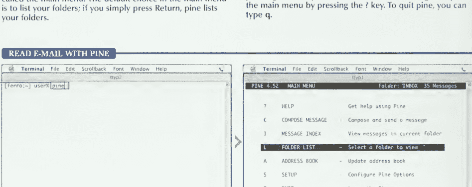

```
[ferro:~) user$ pine
PINE: 4:52  MAIN MENU
? HELP               Get help using pine
C COMPOSE MESSAGE   Compose and send a message
I MESSAGE INDEX     View messages in current folder
L FOLDER LIST       Select a folder to view
A ADDRESS BOOK      Update address book
S SETUP             Configure Pine Options
Q QUIT               Leave the pine program
```

输入 `pine` 并按下回车键。

pine 打开，显示主菜单。

## 安装和使用网络应用程序

## 额外说明

在 pine 中回复消息时，你在消息列表中选择消息或查看消息时，输入 `r`。pine 会将你的回复发送给原始消息的发送者，并询问你是否想在回复中包含原始消息。

你可以通过编辑 `.pinerc` 文件或从主菜单中选择 `SETUP` 来更改 pine 选项。如果你选择 `SETUP`，会出现另一个列表。选择 `C` 将带你进入一个包含多个场景的配置选项列表。尽管这些选项很多，但如果你像大多数用户一样，将保持默认设置。

要将消息移动到不同的文件夹，当 pine 显示消息列表或消息本身时，你可以输入 `s`。然后 pine 会询问你想要放置消息的文件夹名称。它默认为 `saved-messages` 文件夹。

| Terminal | File | Edit | Scrollback | Font | Edit | Scrollback | Font | Window | Help |
|---|---|---|---|---|---|---|---|---|---|
| PINE 4.52 Folder: INBOX Message 12 of 35 NEW | | | | PINE 4.52 MESSAGE TEXT Folder: INBOX Message 12 of 23 ESH | | | | | |
| | | | | | | | | | | |
|---|---|---|---|---|---|---|---|
| 1 May 21 Sandra-Ste | (328) saying hello | | | | | | |
| 2 May 22 Sandra-Ste | (362) lunch | | | | | | |
| 3 May 23 Sandra-Ste | (384) | | | | | | |
| 4 May 24 Sandra-Ste | (399) | | | | | | |
| 5 May 25 Sandra-Ste | (304) | | | | | | |
| 6 May 26 vanilla.com | (3042) | | | | | | |
| 7 Jan 07 Pharmacy | (1689) asking you regained | | | | | | |
| 8 Jan 08 Pharmacy | (1689) | | | | | | |
| 9 Jan 09 Pharmacy | (1575) Vigaro, Pentemerine,kenji | | | | | | |
| 10 Jan 10 bryjohn.com | (1682) Look at F.H.W.-002- | | | | | | |
| 11 Jan 11 briesjohn.com | (1683) | | | | | | |
| 12 Jan 12 masudomatsu.com | (1444) 12 pounds by February | | | | | | |
| 13 Jan 13 jack.com | (1344) | | | | | | |
| 14 Jan 14 peppermint | (1343) Merge Agreement .. get the home | | | | | | |
| 15 Jan 15 Donortz2gsms.com | (3218) | | | | | | |
| 16 Jan 16 Donortz2gsms.com | (3219) | | | | | | |
| 17 Jan 17 Donortz2gsms.com | (3220) | | | | | | |

> To add an attachment, you must supply the name of the file, including the pathname if it is not in your Home directory.

> To change the format of your message to a richer header, you can press Control + R. This adds additional fields to your message header, such as Bcc and Newsgroups. If you have defined a directory, the contents of your signature file appear at the bottom of your message text.

> When you are ready to send your message, you can press Control + X. Pine asks if you want to send your message.

> To add an attachment, you can type the name of the file. Pine attaches the file to the message when you send it. You can add attachments by pressing Ctrl + j.

> Pine allows you to add carbon copy (cc) recipients to your messages and to include attachments.

> To compose and send e-mail with pine, you can press c while the main menu. This moves you into a simple-editor in which you pre-inserts message parts as the To and Subject.

> As you type your message, the form area grows to accommodate your message.

> To move a message to a different folder, you can type s when pine displays the message list or the message itself. Then pine asks you for the name of the folder where you want to place the message.

## Mac 上的 UNIX

## APACHE 简介

Apache 是如今互联网上最流行的 Web 服务器。它约占 60% 的 Web 服务器，并可能占了 80% 的现有 Web 服务器书籍，Apache 是成为互联网基础部分的开源产品之一。它被广泛使用、易于理解且实现良好。

### Web 服务器的工作原理

Apache Web 服务的目的是来自来自浏览器的请求并提供请求的页面。与任何重要的互联网服务一样，Apache 运行在专用端口上。这个端口不是为 Apache 专用，而是用于 Apache 和浏览器之间通信的 HTTP 协议。

当 Web 服务器接收到请求时，它查看某些配置变量来确定应该向客户端发送哪个页面。对于 Apache 服务器，该页面通常被称为 index.html，尽管由于 Java 和其他工具在 Web 上的流行，它可能只是一个静态页面。如果是一个静态 HTML 文件，服务器会立即将其传输给客户端。在请求到达服务器后，还会创建许多类型的页面，其信息是从客户端计算机的 Cookie 中读取的或存储在服务器上的。这些信息允许为每个用户创建自定义页面。无论何种情况，当页面准备好后，就会发送给客户端。即使服务器在地球的另一端，也会在几秒钟内完成。

安装并运行 Web 服务后，好奇的访问者可能会在 Web 浏览器中输入您的 URL，您的网站可能输出各种类型的内容。在 Web 浏览器中输入如 www.dragonfly.com 的地址，地址首先会被传递给 DNS 服务器进行翻译。然后，向远程系统的 80 端口发送请求。该请求本质上是 GET /，即对您网站主页或默认文档的请求。

### 免费且可配置

Apache 之受欢迎是因为它对任何用户都是免费的，尽管这不是唯一的原因。Apache 还可以通过模块set进行扩展，并可以根据预期用途进行定制。你可以在构建时添加或删除模块，因此生成的二进制文件仅包含你需要的特性。Apache 还支持人们可能在 Web 服务器中期望的所有功能。为 Apache 配置基于名称的虚拟服务器（即多个站点在同一机器上运行，但看起来是独立的）是很容易。配置安全以及针对预期流量对服务器进行调也是简单的过程。

## 融入互联网

### 使用 APACHE 提供 Web 页面

Web 服务器与其他互联网服务一样，依赖域名系统（DNS）来运行。当你输入如 http://www.dragonflyditch.com 的 URL 时，你同时指定了多项内容。你指定了 HTTP 是协议——描述客户端和服务器之间通信的有限语言——用于与服务器进行通信。这是 Web 使用的首要协议，但不是唯一的协议。通过输入 dragonflyditch.com，你正在识别特定的服务器，并依靠 DNS 服务将此文本名称翻译为 IP 地址，以便 DNS 可以使用该 IP 地址定位并与该服务器通信。通过什么都不输入，你表示你想要与运行在 Web 服务器默认端口 80 上的服务器通信，并且你确保了你想要该站点的主页或默认文档。

### APACHE 配置

服务器端的配置决定了服务器上的哪个目录包含可查看的文档和文件。对于 Apache 来说，该目录被称为文档根目录（document root）。在配置良好的 Web 服务器上，访问者可以查看或下载此目录之外的文件。

服务器端的配置还决定了当你在 URL 名称中输入 http://dragonflyditch.com 时，文件服务器向你传输什么。每当你输入不包含文件名的 URL 时，Apache 都会在默认文档列表中查找与请求目录中的文档匹配的项。如果文档列表包含 index.html 和 index.jsp，而文档中不包含其中任何一个，Apache 将返回两种结果之一：错误代码或目录列表。该服务取决于是否启用了目录浏览。

## 幕后故事


虽然一个 `GET /` 请求似乎是一项非常普通的服务，但获取大多数网站的主页会导致多次请求，因为文件中包含的每个帧和图像随后都会被请求。在你的浏览器从服务器获取页面的所有部分之前，Web 页面是不完全的。

在早期的 Web 中，Web 服务器向客户端交付静态页面。如今的 Web 服务器通常提供自定义页面。例如，它们可能提供供你填充的表单，内容会被发布到服务器进行额外处理；或者它们可能会调用加密服务，在数据传输到服务器处理时隐藏敏感数据以防他人窥探。

虽然 Web 用于往返文件和数据的协议本身是简单的，只有 `GET` 和 `POST` 等少数命令，但客户端和服务器之间的通信通常包含一系列额外信息，即你随请求一起发送的头部信息（`headers`）。通过这些头部信息，客户端和服务器可以比较彼此的能力。例如，Web 服务器不会以你的浏览器能够理解的格式保存文件。当一个系统支持多个站点并通过它们的名称（如 `dragonflyditch.com`）进行标识时，服务器知道你请求的是哪个站点，因为名称包含在头部信息中。

# UNIX MAC

## 启动 APACHE

安装软件后，你可以启动 Apache 服务器。Apache 安装包含一个脚本，方便启动和关闭服务。

## 停止 APACHE

你可以随时停止 Apache 服务器。要停止 Apache，你可以使用带有 `stop` 参数的 `apachectl` 脚本。这会停止所有的 Apache 进程。`stop` 和 `start` 命令都是该脚本的参数，你通过它们来控制 Apache 的操作。该脚本也可以用于重启 Apache。`restart` 命令会关闭并重启 Apache，而 `status` 命令会告诉你 Apache 是否正在运行。

在尝试停止 Apache 之前，你可能想先确认它是否正在运行。你可以通过两种方法之一来实现这一点。你可以使用带有 `status` 参数的 `apachectl` 脚本；但是，这种技术只有在你安装了 `lynx` 的情况下才有效。你也可以运行命令 `ps -aux` 来查看进程。如果你运行此命令，必须注意不要将你的 `grep` 命令误认为 Apache 进程。

当你停止 Apache 时，你终止了服务器进程。服务器将不再监听分配给 HTTP 的端口，继续请求服务的客户端将收到一条消息，指示其浏览器遇到了 DNS 错误，或者找不到服务器。这表明客户端在 HTTP 端口上没有找到响应的回复。

你还可以判断 HTTP 端口是否正在监听客户端请求。如果 Apache 没有在运行，进程应该在 `80` 端口上监听连接。你可以使用 `netstat` 命令进行此测试。当 Apache 运行时，`netstat -a | grep http` 会返回一个 `LISTEN` 消息。输出如下：

```
tcp64 0 0 *.http.* LISTEN
```

| 终端 文件 编辑 滚动条 字体 窗口 帮助 |

|---|---|---|---|---|---|---|

| | | | | | | | |

| [ferro:]: user% sudo /sw/apache/bin/apachectl stop | | | | | | |

| | | | | | | | |

| [ferro:]: user% | | | | | | | |

| 终端 文件 编辑 滚动条 字体 窗口 帮助 |

|---|---|---|---|---|---|---|

| | | | | | | | |

| [ferro:]: user% sudo /sw/apache/bin/apachectl stop | | | | | | |

| | | | | | | | |

| [ferro:]: user% netstat -a | grep http | | | | | | |

| [ferro:]: user% | | | | | | | |

## 停止 APACHE 服务器

- 1 输入 `sudo sw/apache/bin/apachectl` 后加一个空格。
- 2 输入 `stop` 并按回车。
- 3 如果有提示，输入你的密码并按回车。

Apache 进程停止。

### 检查 HTTP 端口监听状态

- 1 输入 `netstat` 后加一个空格。
- 2 输入 `-a` 后加一个空格。
- 3 输入 `grep http` 并按回车。

HTTP 端口未报告任何监听状态。

## 配置 APACHE

你可以根据自己的规范配置 Apache。Apache 的配置参数存储在一个配置文件中，你可以通过编辑此文件来配置更改。此文件名为 `httpd.conf`，它包含了大量的说明文本，以简化配置服务器的过程。事实上，如果你想快速设置 Web 页面，只需将你的自定义 Web 页面安装在默认文档目录，并使用 `apachectl start` 命令启动 Apache 即可。

Web 页面的默认位置是 Apache 目录下的 `httpdocs` 目录——例如，`/sw/apache/httpdocs`。当你安装 Apache 时，安装程序会将一小部分文件放入此目录，作为你预期内容的占位符。如果你启动 Apache 并在不进行其他操作的情况下访问你的网站，你将看到这些文档。`logs` 目录存储包含对网站请求的文件，包括每次访问的客户端信息以及来自哪个系统。包含关重要的 `httpd.conf` 文件的配置位于 `/sw/apache/conf`。

## APACHE 指令 (DIRECTIVES)

Apache 中的配置命令被称为指令（`directives`）。指令的基本形式是指令后跟 Apache 分配 `get` 值，例如 `User`。每个指令都控制 Web 服务器运行的某些方面。虽然有多种可能的更改，但你很可能会在默认配置文件中进行许多更改。如果是这样，你可以访问 `www.apache.org` 获取 Apache 指令的完整列表。可用指令集取决于你正在运行的 Apache 版本。

如果你没有正确设置这两个变量，你的 Web 服务器将无法按预期工作。

`ServerRoot` 是存放配置和日志文件的目录。如果你的 `ServerRoot` 是 `/sw/apache`，那么配置文件位于 `/sw/apache/conf`，而你的日志位于 `/sw/apache/logs`。你的 Apache 二进制文件也可能位于那里，即 `/sw/apache/bin`。

最关键的指令是 `DocumentRoot` 和 `DocumentIndex`。`DocumentRoot` 指令告诉你的 Apache 服务器当客户端请求到达时从何处检索页面。`DocumentIndex` 是一个文件列表，当客户端未包含文件名时，你的服务器将查找的文件。

还有许多其他关键指令，并非全部，但它们的默认值是非常合理且安全的设置。Apache 指令有两种形式：简单指令（`simple directives`）和块指令（`block directives`）。简单指令设置一个值设置，例如服务器运行的端口。块指令将其他指令分组，例如你想应用到虚拟服务器的设置集。

## 内置 APACHE 服务器

OS X 有一个内置的 Apache 服务器，你无需从源代码下载并编译它即可对其进行配置和运行。要启动它，你可以点击“系统偏好设置 —— 共享”。当共享面板打开时，你可以选择“个人网站共享”（Personal Web Sharing），然后点击“启动”。如果你打开 Web 浏览器并在 URL 字段中输入 `http://127.0.0.1`，你将看到测试页面。

使用 Apache，这是你配置文件的位置。内置的 Apache 服务器还会为你的用户初始化个人网站。例如，用户 Smith 的个人网站定义为位于 `/Users/Sites/index.html`。

## 使用 APACHE 提供 Web 页面

要启用 PHP，你可以从 `httpd.conf` 中的以下几行删除 `#` 符号：

### PHP 测试文件

```html
<html>
<body>
<?php phpinfo(); ?>
</body>
</html>
```

内置的 Apache 服务器在 `/var/log/httpd` 提供访问日志和错误日志。

### 设置你的文档目录

你可以使用单个目录来构建网站，也可以使用一系列目录来组织你的网页。你为 Web 服务器设置的文档目录（根目录）包含了你网站的所有文件。这些文件都位于分配给 `DirectoryRoot` 指令的目录中，或者你也可以将文件放入一系列目录中以便于管理。例如，你可能希望将图像与 HTML 文件存放在不同的目录中。许多人发现，在一个目录中存放成百上千个文件令人困扰。

对于大多数访问你网站的用户来说，唯一的入口是你作为默认目录使用的页面，该页面在配置文件中分配给 `DirectoryIndex` 指令。该页面默认名为 `index.html`，每当用户在浏览器中输入你的 URL 时，服务器就会向他们发送此文档。

如果你的默认文档包含了其他文件的引用（例如图像文件），则文档中的链接必须与你创建的目录结构相对应。例如，如果你引用了文档内目录中的图像 `mylogo.gif`，你必须将其引用为 `images/mylogo.gif`。

你的默认文档 `index.html` 不仅与你的文档根目录有关，而且在你创建的每一个目录中都起着作用。每当用户访问以目录名结尾的 URL 时，你的服务器都会从该目录返回一个文档。如果没有找到，它将返回目录列表或错误，取决于你是否禁用了目录列表显示。

```
Terminal File Edit Scrollback Font Window Help
[ferro:user] cd /var/www/html
[ferro:user] ls -l
-drwxr-xr-x 2 root root 4096 May 20 23:32 apache
-rw-r--r-- 1 root root 18882 May 20 21:56 index.html
-rw-r--r-- 1 root root 12882 May 20 21:59 another.html
-rw-r--r-- 1 root root 6624 May 20 20:14 contact.html
-drwxr-xr-x 2 user staff 2326 Jun 01 19:36 images
-rw-r--r-- 1 user staff 31985 May 19 10:38 mylogo.gif
-rw-r--r-- 1 user staff 2414 May 01 20:03 apache_02.gif
-rw-r--r-- 1 user staff 20081 May 01 20:03 apache_03.gif
-rw-r--r-- 1 user staff 2168 May 21 23:32 test
-drwxr-xr-x 2 root root 4096 May 20 23:32 pdfs
-rw-r--r-- 1 root root 2779 May 20 23:32 dir.png
-rw-r--r-- 1 root root 15668 May 20 22:17 doc.pdf
-drwxr-xr-x 3 root root 4096 May 21 22:18 old
-rw-r--r-- 1 user staff 2537 Aug 10 20:02 index.html.old
-rw-r--r-- 1 root root 1647 May 22 23:12 site.org
-rw-r--r-- 1 root root 2242 May 20 23:12 site.php
-rw-r--r-- 1 root root 77 May 22 12:24 testme1.txt
-drwxr-xr-x 2 root root 4096 May 21 23:32 temp
[ferro:user] _
```

```
Terminal File Edit Scrollback Font Window Help
[ferro:user] ls -l images
[ferro:user] ls
```

### 显示你的目录内容

- 1 输入 `cd` 后加一个空格。
- 2 输入你的文档目录名称，并按回车。
- 你的目录的内容将显示出来。

### 为你的图像文件创建目录

- 1 输入 `sudo mkdir` 后加一个空格。
- 2 输入 `images` 并按回车。
- 系统为你的图像文件创建一个目录。

## 创建一个简单的网站

你可以在不到一小时内创建一个简单的网站。在系统上安装好 Apache 之后，你可以使用文本编辑器输入文本和一些格式命令，并根据需要复制文件。

静态页面包含一种称为 HTML 的语言的特殊格式命令，以及页面的文本或内容。例如，如果你创建一个可以被称为“50字以内的人生故事”的网站，你可以输入你的标题和文本，以插入必要的命令，以便按照你想要的方式显示内容。

如果你在文档中没有使用 HTML 格式就输入了多个段落，那么在浏览器中显示的文本看起来像是一段很长的段落。要将其分成不同的段落，你必须在段落之间插入 HTML 标签 `<p>`。

网页必须具有 `.html` 或 `.htm` 扩展名，并且必须以 `<html>` 标签开头，以标识内容为 HTML。HTML 中的大多数格式命令都是标签，由一个起始标签和一个结束标签组成。例如，要让文本**加粗**，你需要将其包含在 `<b>` 和 `</b>` 标签中。要让文本变为*斜体*，使用 `<i>` 和 `</i>` 标签。给文本加下划线，则使用 `<u>` 和 `</u>` 标签。

要创建列表，使用 `<ul>` 创建无序列表或使用 `<ol>` 创建有序列表。每个列表项包含在 `<li>` 和 `</li>` 标签中。

要添加图像，使用 `` 标签。该标签没有结束标签。它使用 `src` 属性指定图像文件的路径。例如：``。

要创建链接，使用 `<a>` 标签。`href` 属性用于指定链接的 URL。例如：`<a href="http://www.google.com">点击这里</a>`。

## 使用 APACHE 服务 Web 页面

最基础的 HTML 标签可以让你构建一个基本的 Web 页面。

# 附加

| 标签(s) | 描述 |
| --- | --- |
| `<html>` 和 `</html>` | HTML 格式的开始与结束 |
| `<head>` 和 `</head>` | 头部部的开始与结束 |
| `<title>` 和 `</title>` | 标题的开始与结束，通常显示在浏览器标题栏 |
| `<body>` 和 `</body>` | 正体的开始与结束 |
| `<p>` 和 `</p>` | 段落的开始与结束 |
| `<br>` | 插入换行符 |
| `<a>` 和 `</a>` | 链接定义的开始与结束 |
| `<h?>` 和 `</h?>` | 标题的开始与结束，? 是 1 到 9 之间的数字 |
| `<li>` 和 `</li>` | 列表中单个项目的开始与结束 |
| `` 和 `</table>` | 表格的开始与结束 |
| `<tr>` 和 `</tr>` | 表格中行的开始与结束 |
| `<td>` 和 `</td>` | 表格单元格的开始与结束 |
| `<th>` 和 `</th>` | 列头的开始与结束 |

终端 文件 编辑 搜索 字体 窗口 帮助 资源管理器 文件 视图 转 收藏 工具 窗口 帮助

```
PICO(tn) 2.5  File:/home/apache/htdocs/index.html  No field
```

```html
<html>
testing, testing, 1, 2, three
<body>
This is where I live!
</body>
</html>
```

```html

```


testing, testing. 1, 2, three


This is where I live!

获取帮助 浏览器 读取文件 上一页 剪切 文本 光标 位置 退出 对齐 在这里 下一页 未剪切 文本 拼写

- 5 `` 和 `<i>`）时，你应该将与其他标签（如 `<li>` 和 `</li>`）结合使用，使得一组标签完全封装另一组标签。例如，要创建一个加粗的列表项，你应该输入 `<li><li><b>Last one to leave must turn off the coffee pot!</b></li></li>`。虽然这个规则并不严格适用于所有标签，但它通常是一个值得遵循的良好规则。


良好的 Web 页面有一个整体结构，可以识别页面的主要部分并遵循这种封装顺序：最外层的标签是 `<html>` 和 `</html>`。在这些标签内部，你可能有一个从 `<head>` 开始并以 `</head>` 结束的部分。在 `<title>` 和 `</title>` 之间的标题之后，你可能有一个从 `<body>` 开始并以 `</body>` 结束的正文，其中包含了图像和链接。Web 页面的主要部分遵循如下模式：`<html><head><title></title></head></body></html>`。在这些为 Web 页面提供整体结构的主要标签之间，你插入定义 Web 页面内容和外观的标题、链接和文本。


| 终端 文件 编辑 滚动回 字体 窗口 帮助 |

| --- |

| PICO(tn) 2.5 | File:/apache/htdocs/index.html | Modified |

```html
[~]user sudo cp /apache/htdocs/index.html
<html>
<head>
<title>testing my new site</title>
</head>
<body>
testing, 1, 2, three
This is where I live!

</body>
</html>
```

| 获取帮助 写入 读取文件 前一页 剪切 文本 光标 位置 |

| 退出 对齐 在这里 下一页 下一页 未剪切 文本 溢出 |

- 1 输入 `sudo` 后跟一个空格。
- 2 输入你首页的名称，然后按回车。
- 3 Pico 打开并显示你的首页。
- 4 将光标置在第一行的末尾，然后按回车。
- 5 输入 `<head>` 并按回车。
- 6 输入 `<head>` 并按回车。
- 你在标签之间输入的文本将显示在浏览器窗口顶部。

238

# 附加

HTML 表格的结构遵循类似于 HTML 文档结构的模式。也就是说，它从打开 `<table>` 标签开始，并以 `</table>` 标签结束。在这两个标签之间，你的浏览器识别 `<tr>` 和 `</tr>` 之间的行以及 `<td>` 和 `</td>` 之间的单元格。`<th>` 和 `</th>` 标签用于列头。

示例：

```html
<table>
<tr>
<th>Item</th>
<th>Price</th>
</tr>
<tr>
<td>pizza</td>
<td>$11</td>
</tr>
<tr>
<td>salad</td>
<td>$4.50</td>
</tr>
</table>
```

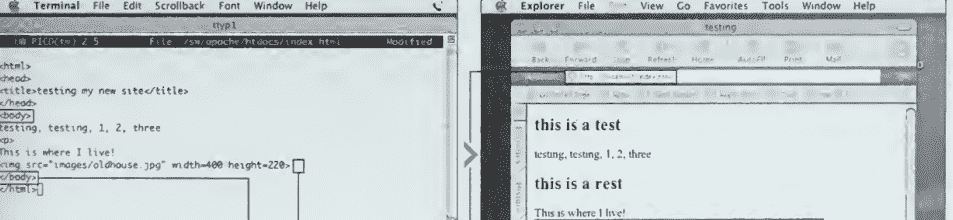

- 输入 `body` 后回车。
- 将光标置在以 `` 开头的行末尾，然后按回车。
- 保存你的文本，并退出 Pico。
- Pico 保存你的更改。
- 从 Dock 启动 Internet Explorer。
- 在 URL 字段中输入 `http://localhost/index.html`，然后按回车。
- 浏览器显示带有标题的首页。

## 为你的网站添加简单样式

你可以添加简单样式为你的 Web 页面提供有趣且统一的外观。层级样式表（CSS）允许你在 Web 页面之外定义样式，并将这些样式应用于多个页面。样式是关联显示属性（如颜色）与特定标签的规则。定义内部样式最简单方法是直接插入文档中。例如，要指定一个标题既加粗又是蓝色，你可以：

```html
<h2 style="color:blue; font-weight:bold;">Birth Until Now</h2>
```

```css
h2(font-weight:bold; color:blue);
```

此样式仅适用于 `<h2>` 和 `</h2>` 之间的文本。

创建一个样式表，你必须创建一个包含样式定义的文件。使用 `.css` 扩展名标识此文件。CSS 文件包含如下样式定义：

```css
h2(font-weight:bold; color:blue);
```

为了强制所有 `<h2>` 级标题变为加粗和蓝色，你可以在文档头部更改标题 `h2(font-weight:bold; color:blue);`。然后你可以使用链接或 `@import` 命令在你的 Web 页面中使用你的层级样式表。这种方法允许你应用样式而无需重复创建。

## 使用内部样式表

> 这是我的故事

1. 输入 `sudo pico` 页面
2. 按回车并输入 `<style type="text/css">` 然后按回车。
3. 点击 `<+` 并按回车，然后输入 `<h2>H2 headings are bold and blue</h2>` 并按回车。再次，然后输入 `<style>`。
4. 输入 `-->` 并按回车，然后输入 `<style>`。
5. 保存你的文本，并编辑 Pico。
6. 从 Dock 启动 Internet Explorer。
7. 在 URL 字段中输入 `file://localhost/mystory.html`，然后按回车。

# 额外说明

当你使用外部样式表时，维护一组格式相同的页面要容易得多。若要配合名为 `styles.css` 的外部样式表使用 `link` 命令，你可以在每个网页的起始 HTML 标签之后输入类似下面的文本：

虽然使用内部样式表似乎是最简单的方法，但你必须在创建的每个文档中定义样式，如果只使用该样式，这并不能节省时间。你将内部样式表放在文档的 `head` 部分。

```
Example:
<head>
<title>life.story</title>
<link rel="stylesheet" type="text/css" href="styles.css">
</head>
```

```
Example:
<head>
<title>My life story in 50 words or less</title>
<style type="text/css">
/* H2 标题加粗为蓝色 */
h2{font-weight:bold; color:blue;}
</style>
</head>
```

要使用 `@import` 命令访问外部样式表，你可以输入类似下面的文本：

```
Example:
<head>
<title>life.story</title>
<style>
@import url(styles.css);
-->
</style>
</head>
```

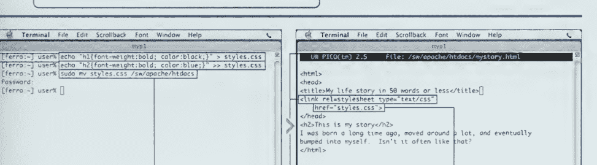

| 终端 | 文件 | 编辑 | 滚动 | 回滚 | 字体 | 窗口 | 帮助 |
|---|---|---|---|---|---|---|---|

| | | | | | | | |

| 终端 | 文件 | 编辑 | 滚动 | 回滚 | 字体 | 窗口 | 帮助 |
|---|---|---|---|---|---|---|---|

| | | | | | | | =

```
| [ferro--] user echo '#h1(font-weight:bold;color:black);' > styles.css
| [ferro--] user echo '#h1(font-weight:bold;color:blue);' >> styles.css
| 密码
| [ferro--] user cp my styles.css /var/apache/htdocs
```

```
<html>
<head>
<title>50个字或更少的生活故事</title>
<link rel="stylesheet" type="text/css">
<link href="styles.css">
<h2>这是我的故事</h2>
这是一个很长的故事，搬了很多地方，最终与自己相遇。难道不是经常这样吗？>
</</html>
```

| 获取帮助 | 写入 | 输出 | 回滚 | 字体 | 剪切 | 剪切 | 当前 | 位置 |
|---|---|---|---|---|---|---|---|---|

| 退出 | 对齐读取文件 | 将未剪切文本进行拼写 | | |

## 使用外部样式表

- 1 输入 `echo "h1(font-weight:bold;color:black);" > styles.css` 并按回车。
- 2 输入 `echo "h2(font-weight:bold;color:blue);" >> styles.css` 并按回车。
- 3 输入 `sudo cp my styles.css /sw/apache/htdocs` 并按回车。
- 4 如果系统提示，输入你的密码。
- 5 使用 `sudo` 启动 Pico 来编辑现有的网页。
- 6 按回车并输入 `<link rel="stylesheet" type="text/css">` 再次按回车。
- 7 按四次空格键，然后输入 "styles.css"。
- 8 保存你的文本并退出 Pico。
- 9 你的文档现在使用了你在 css 文件中定义的样式。

## 安装 CGI 脚本

你可以通过安装通用网关接口（CGI）脚本来使你的网站具有交互性。CGI 允许你的网页与系统上运行的其他程序进行信息交换。许多 CGI 程序从你的网站收集信息（通常通过表单），并将其传递给处理数据的程序。其他 CGI 程序则仅负责收集数据并进行显示。

在从网站上运行 CGI 程序之前，你必须将它们设置为**可执行**。这意味着它们必须具有执行权限，以便任何人都能运行它们。你可以使用 `chmod a+x` 命令添加执行权限。

你可以在 Web 上找到许多 CGI 程序并安装到你的系统中。许多程序包含了计数器，每当有新客户端访问你的网站时计数器就会加1，以及允许访客签名留言簿的表单。

程序员通常用 Perl 编写 CGI，因为 Perl 是最通用且最流行的编程语言之一。不过，你也可以使用许多不同的语言编写 CGI。

你可以从许多网站下载预先存在的 CGI 脚本。你也可以创建自己的 CGI 脚本；有很多书籍和网站会教你编写 Perl 代码以及构建高效 CGI 所需的知识。构建 Perl 脚本的视觉蓝图来自 Wiley Publishing 出版的 Paul Whitehead。你可以在 `www.cgi101.com/class/` 找到 Web 教程。

要在你的网站上使用 CGI，你必须在 `http.conf` 文件中启用它们，并必须它们存储在正确的目录中。CGI 通常运行在 `cgi-binary` 目录，在你的系统中极有可能是 `/sw/apache/cgi-bin`。

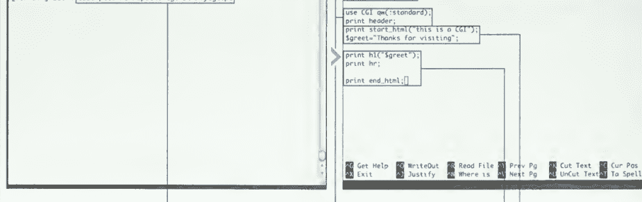

| 终端 | 文件 | 编辑 | 滚动条 | 字体 | 窗口 | 帮助 |
|---|---|---|---|---|---|---|

```
[--] user$ grep /Scripts/ /sw/apache/conf/httpd.conf
ScriptAlias /cgi-bin/ /sw/apache/cgi-bin/
```

| 终端 | 文件 | 编辑 | 滚动条 | 字体 | 窗口 | 帮助 |
|---|---|---|---|---|---|---|

```
[--] user$ /sw/apache/cgi-bin/my.pl
```

# 使用 APACHE 服务网页

## 14 额外

大多数（并非所有）Apache 模块以 gzipped TAR 文件的形式提供。这意味着你必须解压 zip 并使用 `tar -xf` 提取源文件。然后你需要输入 `cd` 进入目标目录并寻找 README 或 INSTALL 文件，其中应包含安装该模块的详细说明。

大多数 Apache 模块都包含相当详细的说明，告诉你在安装模块时必须输入的命令。

如果你使用动态方法安装模块，必须确认你的 Apache 支持 `mod_`；要此此，输入命令 `apache -l` 并在输出中寻找 `mod_`。如果你使用静态方法（即将新模块构建到你的二进制文件中），或者你的 Apache 不支持 DSO；你必须先编译新模块，然后按照说明将编译后的文件移动到源码树中，然后调整 Apache。

要使用 DSO 安装模块，你遵循类似下面的步骤：

示例：

```bash
./configure --with-apxs
make
sudo make install
```

- 滚动查看包含你字符串的模块列表。
- 点击你想下载的模块。
- 点击提供的链接进行下载。

## 编写 PHP 应用程序

你可以在你的站点开发 PHP 应用程序。PHP 是一种相对新的语言，可以与 Apache 服务器轻松集成。当你用 PHP 写代码时，可以大幅缩短应用程序的时间。为了使用 PHP，你的 Apache 二进制文件必须支持它。你必须始终将 PHP 脚本包含在两个标签对之间，有几种形式，例如 `<?php ... ?>`，尽管有些程序员使用 `<?php ... ?>`。

要理解 PHP 和 HTML 之间的相似之处，你只需要看一眼示例代码。例如，要在网页上打印变量，PHP 模仿了 HTML 的样式，但使用了特殊标签。

PHP 使用许多命令，包括打印、循环、if 命令、数组，如果你已经熟悉 HTML，你将轻松掌握 PHP 的基础。PHP 是一种服务器端脚本语言。这意味着解释器在使用之前已在服务器上进行了安装和配置。不需要任何客户端设置。该语言具有 Perl、Java 和 C 的特性，大多数编写过其中任何一种语言的人都会觉得 PHP 很亲切。

```html
<html>
<head>
<title>Latest Counts</title>
</head>
<body><?php echo $count; ?></body>
</html>
```

PHP 文件不需要是可执行的，且输出结果与 HTML 无异。所有要写入屏幕的文本必须包含在双引号中，所有命令将以分号结束。包含 PHP 命令的页面应以 `.php` 扩展名保存。

- 1 输入 `sudo pico` 后加一个空格。
- 2 输入 `htdocs/testme.php` 并按回车，然后输入 `<title>testing</title>` 并再次按回车。
- 4 输入 `<body>` 并按回车，然后输入 `<?php phpinfo(); ?>` 并再次按回车。
- 5 输入 `</body>` 并按回车，然后输入 `</html>`。
- 6 保存你的文本并退出 Pico。

```html
<html>
<head>
<title>testing</title>
</head>
<body><?php phpinfo(); ?></</body>
</html>
```

你可以轻松地在单个文件中混合 PHP 和 HTML。当你这样做时，将你的每个 PHP 语句包含在一对 PHP 标签中，如下方的示例所示：

基本的比较运算符包括下表列出的所有运算符。

示例：

```php
<?php $season="summer"; ?>
We are now accepting reservations for our
<?php print $season; ?>
Call 1-800-PUN-VACS today.
```

这段代码段为 `$season` 分配了一个值，并用此自定义剩余显示的内容。与 Perl 类似，PHP 允许你创建简单的数据类型，如 `$season`，以及可以通过变量名和索引使用的数组，例如 `$season[1]`。

| 运算符 | 描述 |
|---|---|
| != | 不等于 |
| == | 等于 |
| = | 赋值 |
| * | 乘法 |
| / | 除法 |
| + | 加法 |
| - | 减法 |
| && | 拼接 |
| && | 逻辑与 |
| || | 逻辑或 |

浏览器显示关于你的 PHP 安装是否激活的页面。

- 1 输入 `sudo pico` 创建一个文件。
- 2 输入 `htdocs/testme.php` 并按回车，然后输入 `<title>title</title>`。
- 7 在浏览器中输入 `http://localhost/testme.php`。
- 8 在浏览器中输入 `http://localhost/testme.php` 查看报告。

## 分析网络流量

你可以使用名为 Analog 的工具分析你的网络流量。Analog 是一个免费的开源程序，允许你根据存储在日志中的记录分析网络流量。Analog 可以产生多达 32 种不同的报告。流量可以按小时、每天、每周或每月报告。

Analog 有一个配置文件 `analog.cfg`。Fink 将此文件安装在 `/sw/etc/analog` 目录。像大多数配置文件一样，`analog.cfg` 充满了注释并有许多配置选项。其中最重要的是标识这些行：


# 以 `#` 开头的行
`# examples/big.cfg` 中有更详细的配置文件
如果你需要 `LOGFORMAT` 命令（大多数人不需要）——要将其放在最前面
它必须放在下方 `LOG` 命令之上：
`LOGFILE=/sw/apache/logs/access_log`
`OUTPUT=/sw/apache/hdacs/analog.log`
`NPAGES ON`
`MONTHLY ON=0`
# Mac OS X --cfg 默认位置

## REPORT
报告关闭在 Mac OS X --cfg 报告
Get Help Write Read File Prev Pag Cut Cur Pos
Exit Justify Where is Next Put UnCmd To Quit

- 1 输入 `find list |` 后加一个空格。
- 2 输入 `grep analog` 并按回车。
- 第一列中的写字母 i 表示 Fink 已安装。

## 额外信息

在你开始使用 Analog 生成的报告之前，你可能不知道哪些报告对分析日志文件最有用。此外，你的需求可能会随着时间的推移而变化。下表描述了你可以使用的一些报告。要在你的 Analog 输出中包含任何这些报告，请在你的 `analog cfg` 文件插入关键字，然后是单词 `ON`。

| 报告类型 | 描述 |
|---|---|
| `MONTHLY` | 每个月一行 |
| `WEEKLY` | 每周一行 |
| `DAILYREP` | 每天一行 |
| `HOURLYREP` | 每天中每小时一​​行 |
| `GENERAL` | 总体摘要 |
| `REQUEST` | 被请求的文件 |
| `FAILURE` | 未找到的文件 |
| `REFERR` | 访问者通过链接进入的来源 |
| `FAILREF` | 访问者跟随损坏链接的站点 |
| `SEARCHWORD` | 访问者查找你的网站时使用的阶段和单词 |
| `STATUS` | 每种成功和失败类型的计数 |

Ditch

程序启动于 22-Thu-2006 15:47。

分析了从 22-May-1997 06:27 到 22-May-2006 21:33 的请求（9 天）

## 运行 ANALOG

- 3 输入 `/sw/apache/htdocs/analog0.html` 并按回车。
- 2 输入 `open` 后面跟一个空格。
- 5 输入主机名 "Dragonfly Ditch"。
- Pico 将你的更改保存到
- 6 保存你的编辑，并退出到 Pico。

你的 `analog` 报告将在浏览器窗口中显示。

## 编写一个简单的 Perl 脚本

你可以使用 Perl 编写一个不需要编译的简单脚本。Perl 是一种解释型语言。然而，Perl 在许多方面看起来像一种编译型语言。例如，Perl 中的每条语句都以分号结束，且 `$` 符号表示变量名，即使在你第一次声明它们并赋值时也是如此。更重要的是，Perl 允许你像大多数编译语言一样构建子程序、变量和返回值。Perl 还具有复杂的处理能力。

大于另一个，或者在字符串中查找数字，你可以通过将这些项目描述为模式，询问某行文本是否包含电子邮件地址或日期/时间戳。

虽然使用正则表达式初看起来可能让 Perl 难以理解，但当你更熟悉这些符号后，你就会开始欣赏这种语言简洁的形式。

然而，将 Perl与其他语言区分开来的特性是正则表达式的通用性。如果你在某个 Shell 中工作过正则表达式，你可能会对 Perl 语言的通用性感到惊讶。例如，你可以在 Perl 中使用正则表达式进行模糊匹配。模糊匹配，而不是询问哪一个数字是

Perl 的元素被称为元字符。例如，`\s` 代表单个空白字符——空格或制表符——`\S` 代表任何非空白字符。你也可以修改这些模式以匹配任何大小字符串的某些或全部。其中 `\d` 代表数字，`\d+` 代表任意数量的数字，`\D` 代表任意数字，但也完全不匹配任何数字。

- 1 输入 `pico` 后面跟一个空格。
- 2 输入 `sam.pl` 并按回车。
- 出现一个空白的 Pico 屏幕。
- 3 输入 `print` 后面跟一个空格。
- 4 输入 `"Hello, World --"` 并按回车。

## 额外信息

与大多数 Unix 脚本语言和配置文件一样，你通过在行开头放置 `#` 符号在 Perl 中创建注释。你可以将注释单独放在一行，也可以将其附加到代码代码的末尾。这两种形式都是正确的：

示例：
- `# say hello`

```
print "Hello, World - "; # say hello
```

当你创建一个复杂的脚本时，你应该包含一些解释脚本正在执行操作的注释，但要避免可能扰扰阅读你代码的人的多余注释。在 Perl 中，注释通常用于解释复杂的正则表达式。

下方屏幕显示的 `"\n"` 表示换行符。如果你的语句中省略了此字符，脚本将打印输出而不移动到新行，下一个系统提示将出现在同一行。你通常会在带有你想要打印的文本的语句中包含换行符。例如，你可以在 Perl 脚本中输入行 `"Hello, World\n";` 来打印该消息并移动到下一行。

- 5 输入 `print` 后面跟一个空格。
- 6 输入 `"I am $0";` 并按回车。
- 7 输入 `print` 后面跟一个空格。
- 9 保存你的文件并退出 Pico。
- 8 输入 `"\n";` 并按回车。
- Pico 保存了你的新 Perl 脚本。

## 运行 Perl 脚本

你可以通过将其作为 Perl 解释器的参数或通过将其设置为可执行来运行 Perl 脚本。在创建 Perl 脚本后，你可以指示 Perl 解释并执行脚本，例如通过输入 `myscript.pl`。这是运行脚本最简单的方法，但不是最方便的。大多数用户更倾向于通过新命令运行脚本，而无需了解编写它们的语言的任何知识。因此，他们可能不想在行前输入 `perl`。

为了方便用户并避免在单独的一行中中输入脚本名称时可能产生错误，你可以在脚本顶部插入一行，向 shell 标识你的文件为 Perl 脚本，并使该脚本变为可执行。将此行作为 shebang（解释器路径运行），该行的语法是 `#` 后面跟解释器的名称。对于 Perl 脚本，你可以输入 `/usr/bin/perl`。

如果你在没有 shebang 的情况下将 Perl 脚本设置为可执行，系统无法确定运行它的工具。这种操作会产生类似 `"myscript.pl: not found"` 的错误。要运行脚本，shebang 行必须包含 Perl 解释器的完整路径。无论 Perl 解释器是否在该路径下都是如此。此行必须是脚本的第一行且必须以 `#!` 开头。

## 额外信息

你可以在 shebang 行中使用命令行选项 `-w` ——通过输入 `#!/usr/bin/perl -w` 来指示 Perl 对你的语法发出警告。如果你定义了一个如 `$counter` 的变量但从未使用过，Perl 会警告你该变量在代码中只出现一次。通过这样做，Perl 告诉你你犯了一个错误，或者至少偏离了你编写脚本的意图。

shebang 行告诉 shell 你使用什么语言编写脚本，因此 shell 使用什么工具来运行它。

当你初学这种语言时，Perl 警告非常有用，因为它们帮助你发现阻止脚本运行的问题或导致不良脚本风格的问题。

- Pico 打开你的文件。
- 在脚本顶部输入行 `#!/usr/bin/perl` 并按回车。
- 保存你的文件并退出 Pico。
- Pico 保存了修改后的脚本。
- 输入 `sam.pl` 并按回车。
- Perl 运行你的脚本。

# 使用 PERL 处理文本

你可以利用 Perl 的模式识别能力来帮助你处理文本。如果你能够描述文本流中你正在寻找的模式，你就可以将其表示为 Perl 正则表达式，并此轻松地提取和处理它。

Perl 有许多特殊序列，例如 `\d`，可以帮助你定位和处理文本。用户将这些序列称为元字符或转义序列。许多元字符有正形式和否定形式，例如，`\d` 表示数字 - `\D` 表示任何非数字字符。`\s` 表示任意数量的空白字符 - `\S` 表示任何不包含任何空白字符的字符字符串。Perl 初学者面临的最大挑战是记住每个元字符所代表的含义。

例如，如果你正在寻找类似于 05/01/03 格式的日期，你可以告诉 Perl 你想要匹配模式 `\d(2)/\d(2)/\d(2)` 的字符串。虽然这个表达式看起来很复杂，但快速拆解一下它就会变得更容易理解。`\d` 匹配一个数字，当它变为 `\d(2)` 时，它匹配一个两位数字。日期分隔符：模式中的正斜杠表示你正在搜索的字符串包含斜杠。因为 `/` 是 Perl 语法的一部分，你必须在你想要匹配的任何 `/` 字符前面加上转义字符。转义字符告诉 Perl 按字面意思处理后续字符，而不是将其解释为 Perl 语法。因此，`\` 代表你搜索模式中的 `/`。

## 搜索日期

| 终端 文件 编辑 回滚 字体 窗口 帮助 |
| 终端 文件 编辑 回滚 字体 窗口 帮助 |
| hyp1 |
| UR Pico(cm) 2.5 文件: findndates.pl 修改 |
| [fifo-] 用户 pico findndates.pl: |
| `#!/usr/bin/perl -` |
| `while (<>) {` |
| `if (\d(2)/\d(2)/) {` |
| `print $_` |

- 输入 `pico findndates.pl` 并按回车。
- 输入 `#!/usr/bin/perl -w` 并按两次回车。
- Pico 打开，你可以编辑你的文件。
- 输入 `with (<)` 并按回车，然后输入 `if (\d(2)/\d(2)/)`（并按回车）。
- 输入 `print $_` 并按回车，然后输入 `}` 并按回车，最后输入 `)` 并按回车。

### 额外

Perl 识别许多不同的元字符，允许你详细描述你正在寻找的内容并对其进行处理。下表显示了一些最常见的元字符及其代表的含义。你可以在任何元字符配合 `+` 和 `&` 修饰符。

| 元字符 | 匹配 | 元字符 | 匹配 |
|---|---|---|---|
| `\d` | 一个数字。 | `\s+` | 任意数量的空白字符。 |
| `\d+` | 一个或多个数字。 | `\s*` | 一些空白或没有空白。 |
| `\*` | 零个或多个数字。 | `\t` | 一个制表符。 |
| `\D` | 非数字。 | `\u` | 一个大写字母。 |
| `\e` | 转义字符。 | `\w` | 单词字符 - 字母、数字或下划线。 |
| `\f` | 换页 | `\W` | 非单词字符。 |
| `\l` | 小写字母。 | `\?` | 一个八进制字符。 |
| `\n` | 新行符。 | `\x` | 一个十六进制字符。 |
| `\r` | 回车符。 | | |
| `\s` | 空白字符。 | | |

```perl
/usr/bin/perl -n
while (<>) {
  if (\d(2)/\d(2)/) {
    print $_;
  }
}
```

- 保存你的文件并退出 Pico。
- 输入 `chmod a+x findndates.pl` 并按回车。
- 输入 `./findndates.pl` 后跟空格。
- 输入包含日期的文件名并按回车。
- 你的 Perl 脚本将显示所有包含指定格式日期行。

## 读取命令行

你可以编写从命令行读取数据的 Perl 脚本。与其他脚本语言一样，Perl 允许你提示用户输入信息。Perl 通过发布包含提示的 `print` 语句并从标准输入读取答案来实现。例如，你可以在脚本中包含一行 `"Enter your favorite number: ";` 的 `print` 语句；Perl 会提示你输入数字，然后通过 `$favnum=<STDIN>;` 收集答案并存储在 `$favnum` 中。

你可以将提示和读取语句放入循环中。`while` 语句会持续循环，直到满足指定条件。如果你想从用户那里收集特定数量的答案，使用 `foreach` 循环会很好。例如，你可以输入以下内容：

```perl
$stohours=0;
foreach day ( Mon,Tue,Wed,Thu,Fri ) {
 print "hours worked on $day ";
 $shrs = <STDIN>;
 $stohours = $stohours + $shrs;
}
print "You worked $stohours hours!",
```

此脚本提示用户输入他们每天工作的小时并计算总和。然而，如果用户输入数字以外的内容，此脚本将生成错误消息，因为加法失败了。你可以插入一个 `while` 语句来重复提示，直到用户输入数字。

- 输入 `pico favnum.pl` 并按回车。
- 输入 `#!/usr/bin/perl -we type print "Enter your favorite number: ";` 并按回车。
- 输入 `$favnum = <STDIN>;` 并按回车。
- 输入 `print "What a coincidence! $favnum is my favorite number.\n";` 并按回车。
- 输入 `"Maybe we should go out.\n"`

### 额外

在某些情况下，你不希望按照用户输入的方式使用数据。例如，当你告诉用户他们喜欢的数字恰好是你喜欢的数字时，在 `favnum.pl` 脚本中，你的消息显示了两行而不是三行。当处理不当时会导致意外的换行。你可以插入一个 `while` 语句来重复提示，直到用户输入数字。

- 保存你的文件并退出 Pico。
- 输入 `chmod a+x findndates.pl` 并按回车。
- 输入 `./findndates.pl` 并按回车。
- 脚本运行，询问你的数字。

## 使用 PERL 读取文件

你可以从命令行读取任意数量的文件。Perl 还有多种读取文件的方法，最直接的是使用 `open` 命令并将文件名作为参数。例如，为了打开 `file.txt`，你可以使用命令 `open(INFILE, "file.txt")`；该命令打开文件并将其与文件句关联。如果你在脚本开头分配文件名，你的脚本将更容易修改。

你可以使用 `open(INFILE, $myfile)` 来打开文件。

你还可以通过在 `open` 命令中使用 `<` 符号来显式打开读取文件。例如，你可以使用命令 `open(INFILE, "<myfile.txt")`。如果你想确保读取的文件被保留，这是一个很好的习惯，因为它以读取模式打开文件并禁止任何写入操作。

正如 `<` 符号表示命令打开文件进行读取一样，`>` 符号表示命令打开文件进行写入。使用 `>` 符号表示命令打开文件进行追加。换句话说，你从文件的末尾写入，保留了文件的内容。

为了确保当输入文件不存在或不可访问时脚本不会发生故障，你可以在 `open` 命令中添加一个 `or` 子句：`open(INFILE, "myfile.txt") or "Cannot open myfile.txt for reading"` 如果文件不可访问，它将显示警告消息并退出脚本。

### 额外内容

在 Perl 中读取文件的另一种方法是使用反引号（backticks）。例如，如果你想将文件内容读取到数组中，可以使用命令 `@lines= cat myfile.txt;`。该命令运行 `cat` 命令，收集输出内容，并将输出中的每一行存储为数组 `@lines` 中的一个元素。虽然这种操作像更正式的 `open` 命令一样简单，但对于非常大的文件来说，因为它会将读取的数据存储到内存中。当操作一次读取一条文件记录时，它就会一次存储一条记录。

反引号是从系统获取信息的良好方法。例如，如果你的脚本需要使用类似 `$date=`date+%m/%d`;` 的行将当前日期赋值给变量；该命令会将 05/01/03 的日期存储到 `$date` 变量中。你可以使用该变量来命名输出文件，或者在你正在创建的文件中带有带有时间戳的记录。例如，你可以使用 `open(output, ">myfile.txt");` 命令打开一个输出文件。

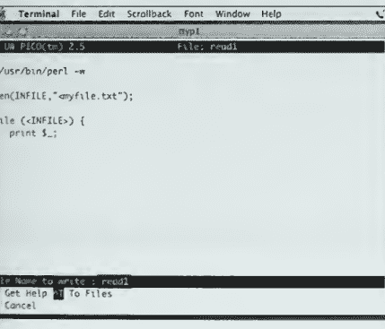
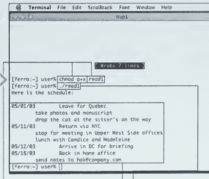

- 6 保存你的脚本并退出 Pico。
- 7 输入 `chmod a+x` 后加一个空格。
- 8 输入 `read1` 并按回车。

你的脚本运行，将文件的每一行显示在屏幕上。

- 9 输入 `read1` 并按回车。

## 使用 Perl 写入文件

如果你写的文本不包含换行符，那么你的输出文件中将没有独立的行。`close` 命令关闭文件。`print` 操作无论是写入屏幕还是写入文件，都不会添加换行符。

当你完成对文件的写入或从文件的读取后，`close` 命令与 `open` 命令非常相似，但你只需要使用文件句柄，而不需要指定文件名。例如，要关闭文件句柄，你输入命令 `close(OUTFILE);`，文件就会关闭且不再可用。

打开文件后，你可以使用 `print` 命令向其写入。诸如 `Maybe we go out\n` 的命令会打印到屏幕；带有任何其他参数的相同行 —— `print OUTFILE "Maybe we go out\n";` —— 将该行写入输出文件。

如果你正在创建一个临时文件并并在完成后将其删除，请使用 `unlink` 命令代替 `close` 命令。`unlink` 命令会将该文件从文件系统中删除。

## 使用循环

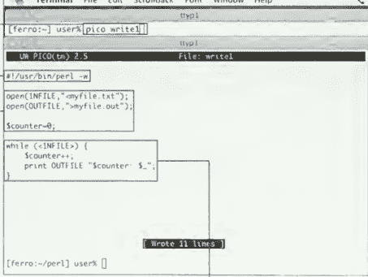
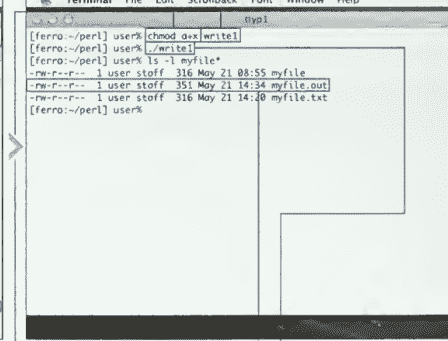

- 1 输入 `print while` 并按回车。
- 2 输入 `#!/usr/bin/perl -w` 并按两次回车键。
- 3 输入 `open(INFILE,"myfile.txt")` 并按回车，输入 `open(OUTFILE,"myfile.out")` 并按两次回车，输入 `$counter++;` 并按两次回车。


- 4 输入 `while (<INFILE>)` 并按回车，输入 `$counter++;` 并再次按回车，输入 `print OUTFILE "Counter: $counter";` 然后输入 `);`。

- 5 输入 `chmod a+x` 后加一个空格。

- 6 输入 `save` 并退出 Pico。

- 7 输入 `writeperl1` 并按回车。

- 8 输入 `./perl1` 并按回车。

你的脚本运行，创建了输出文件。

### 额外内容

使用 Perl 比其他脚本语言的优势之一是它允许你同时读写多个文件。对于你想使用的每个文件，你输入一个 `open` 命令，指定文件名，指示你是为了读取、写入、追加还是打开文件，分配文件句柄并将记录写入文件。完成后，你输入 `close` 或 `unlink` 命令。

为了可读性，你的文件句柄应该是有意义的。如果你使用临时文件，将其命名为 `TMP` 或 `TMP1` 让任何阅读你代码的人都清楚你不打算保留该文件。如果你使用临时文件，必须始终记住在完成后将其 `unlink` ；否则，你的脚本下次尝试运行时可能无法运行，因为它可能无法打开一个已经存在的文件。此外，脚本会在你的文件系统中留下不必要的垃圾。使用通用的文件名（如 `myfile$$`）可以减少文件名上的冲突。


```perl
[File]:user pico hrs
my $1;
open(LOG,>>"time.log");
$log="time.log";
$date=strftime("%Y-%m-%d"); chop($date);
$stathrs=0;
foreach day (Mon,Tue,Wed,Thu,Fri) {
    print "hours worked on $day: "; 
    $count=0;
    $stathrs += $count;
}
```

```perl
[File]:user pico hrs
my $1;
open(LOG,>>"log");
print LOG "$date: $counter```
### 额外内容

使用 Perl 比其他脚本语言的优势之一是它允许你同时读写多个文件。对于你想使用的每个文件，你输入一个 `open` 命令，指定文件名，指示你是为了读取、写入、追加还是打开文件，分配文件句柄并将记录写入文件。完成后，你输入 `close` 或 `unlink` 命令。

为了可读性，你的文件句柄应该是有意义的。如果你使用临时文件，将其命名为 `TMP` 或 `TMP1` 让任何阅读你代码的人都清楚你不打算保留该文件。如果你使用临时文件，必须始终记住在完成后将其 `unlink` ；否则，你的脚本下次尝试运行时可能无法运行，因为它可能无法打开一个已经存在的文件。此外，脚本会在你的文件系统中留下不必要的垃圾。使用通用的文件名（如 `myfile$$`）可以减少文件名上的冲突。

## 使用 Perl 工作

如果你写的文本不包含换行符，那么你的输出文件中将没有独立的行。`close` 命令关闭文件。`print` 操作无论是写入屏幕还是写入文件，都不会添加换行符。

当你完成对文件的写入或从文件的读取后，`close` 命令与 `open` 命令非常相似，但你只需要使用文件句柄，而不需要指定文件名。例如，要关闭文件句柄，你输入命令 `close(OUTFILE);`，文件就会关闭且不再可用。

打开文件后，你可以使用 `print` 命令向其写入。诸如 `Maybe we go out\n` 的命令会打印到屏幕；带有任何其他参数的相同行 —— `print OUTFILE "Maybe we go out\n";` —— 将该行写入输出文件。

如果你正在创建一个临时文件并并在完成后将其删除，请使用 `unlink` 命令代替 `close` 命令。`unlink` 命令会将该文件从文件系统中删除。

### 额外内容

在 Perl 中读取文件的另一种方法是使用反引号。例如，如果你想将文件内容读取到数组中，可以使用命令 `@lines= cat myfile.txt;`。该命令运行 `cat` 命令，收集输出内容，并将输出中的每一行存储为数组 `@lines` 中的一个元素。虽然这种操作像更正式的 `open` 命令一样简单，但对于非常大的文件来说，因为它会将读取的数据存储到内存中。当操作一次读取一条文件记录时，它就会一次存储一条记录。

反引号是从系统获取信息的良好方法。例如，如果你的脚本需要使用类似 `$date=`date+%m/%d`;` 的行将当前日期赋值给变量；该命令会将 05/01/03 的日期存储到 `$date` 变量中。你可以使用该变量来命名输出文件，或者在你正在创建的文件中带有带有时间戳的记录。例如，你可以使用 `open(output, ">myfile.txt");` 命令打开一个输出文件。


- 6 保存你的脚本并退出 Pico。

- 7 输入 `chmod a+x` 后加一个空格。

- 8 输入 `read1` 并按回车。

你的脚本运行，将文件的每一行显示在屏幕上。

- 9 输入 `read1` 并按回车。

## 使用 Perl 写入文件

如果你写的文本不包含换行符，那么你的输出文件中将没有独立的行。`close` 命令关闭文件。`print` 操作无论是写入屏幕还是写入文件，都不会添加换行符。

当你完成对文件的写入或从文件的读取后，`close` 命令与 `open` 命令非常相似，但你只需要使用文件句柄，而不需要指定文件名。例如，要关闭文件句柄，你输入命令 `close(OUTFILE);`，文件就会关闭且不再可用。

打开文件后，你可以使用 `print` 命令向其写入。诸如 `Maybe we go out\n` 的命令会打印到屏幕；带有任何其他参数的相同行 —— `print OUTFILE "Maybe we go out\n";` —— 将该行写入输出文件。

如果你正在创建一个临时文件并并在完成后将其删除，请使用 `unlink` 命令代替 `close` 命令。`unlink` 命令会将该文件从文件系统中删除。

## 使用循环


- 1 输入 `print while` 并按回车。

- 2 输入 `#!/usr/bin/perl -w` 并按两次回车键。

- 3 输入 `open(INFILE,"myfile.txt")` 并按回车，输入 `open(OUTFILE,"myfile.out")` 并按两次回车，输入 `$counter++;` 并按两次回车。

- 4 输入 `while (<INFILE>)` 并按回车，输入 `$counter++;` 并再次按回车，输入 `print OUTFILE "Counter: $counter";` 然后输入 `);`。

- 5 输入 `chmod a+x` 后加一个空格。

- 6 输入 `save` 并退出 Pico。

- 7 输入 `writeperl1` 并按回车。

- 8 输入 `./perl1` 并按回车。

你的脚本运行，创建了输出文件。

### 额外内容

使用 Perl 比其他脚本语言的优势之一是它允许你同时读写多个文件。对于你想使用的每个文件，你输入一个 `open` 命令，指定文件名，指示你是为了读取、写入、追加还是打开文件，分配文件句柄并将记录写入文件。完成后，你输入 `close` 或 `unlink` 命令。

为了可读性，你的文件句柄应该是有意义的。如果你使用临时文件，将其命名为 `TMP` 或 `TMP1` 让任何阅读你代码的人都清楚你不打算保留该文件。如果你使用临时文件，必须始终记住在完成后将其 `unlink` ；否则，你的脚本下次尝试运行时可能无法运行，因为它可能无法打开一个已经存在的文件。此外，脚本会在你的文件系统中留下不必要的垃圾。使用通用的文件名（如 `myfile$$`）可以减少文件名上的冲突。

## 使用 Perl 工作

如果你写的文本不包含换行符，那么你的输出文件中将没有独立的行。`close` 命令关闭文件。`print` 操作无论是写入屏幕还是写入文件，都不会添加换行符。

当你完成对文件的写入或从文件的读取后，`close` 命令与 `open` 命令非常相似，但你只需要使用文件句柄，而不需要指定文件名。例如，要关闭文件句柄，你输入命令 `close(OUTFILE);`，文件就会关闭且不再可用。

打开文件后，你可以使用 `print` 命令向其写入。诸如 `Maybe we go out\n` 的命令会打印到屏幕；带有任何其他参数的相同行 —— `print OUTFILE "Maybe we go out\n";` —— 将该行写入输出文件。

如果你正在创建一个临时文件并并在完成后将其删除，请使用 `unlink` 命令代替 `close` 命令。`unlink` 命令会将该文件从文件系统中删除。

## 安装模块

有很多 Perl 模块可以帮助你完成各种任务。找到它们的最佳地方是 CPAN（Comprehensive Perl Archive Network）。你可以通过名称、类别或关键词搜索模块。

一旦你找到了感兴趣的模块，就可以阅读它的文档来学习如何使用。大多数模块包含示例和教程，可以帮助你上手。

### 额外内容

在 Perl 中读取文件的另一种方法是使用反引号。例如，如果你想将文件内容读取到数组中，可以使用命令 `@lines= cat myfile.txt;`。该命令运行 `cat` 命令，收集输出内容，并将输出中的每一行存储为数组 `@lines` 中的一个元素。虽然这种操作像更正式的 `open` 命令一样简单，但对于非常大的文件来说，因为它会将读取的数据存储到内存中。当操作一次读取一条文件记录时，它就会一次存储一条记录。

反引号是从系统获取信息的良好方法。例如，如果你的脚本需要使用类似 `$date=`date+%m/%d`;` 的行将当前日期赋值给变量；该命令会将 05/01/03 的日期存储到 `$date` 变量中。你可以使用该变量来命名输出文件，或者在你正在创建的文件中带有带有时间戳的记录。例如，你可以使用 `open(output, ">myfile.txt");` 命令打开一个输出文件。


- 6 保存你的脚本并退出 Pico。

- 7 输入 `chmod a+x` 后加一个空格。

- 8 输入 `read1` 并按回车。

你的脚本运行，将文件的每一行显示在屏幕上。

- 9 输入 `read1` 并按回车。

# 安装 PERL 模块（续）

你可以通过安装 Perl 模块来提高你作为 Perl 程序员的效率。有许多 Perl 模块可以让你下载并安装，以增加你的 Perl 脚本的复杂性。每个 Perl 模块都包含若干与特定类型处理相关的例程。例如，CGI 模块减少了你创建 CGI 脚本时必须编写的代码。模块是免费的，你可以根据需要对它们进行修改，以适应你的应用程序。他人贡献的模块已经足够实用，具有通用的价值。如果你是 Perl 的新手或初学者，可能可以考虑贡献一些用于开发 Perl 社区的模块。

你有时可能会以 gzipped TAR 文件的形式获取 Perl 模块。在这种情况下，安装过程看起来像是从同类型的文件编译一个源软件的过程。然而，由于 Perl 不是编译型的，`make` 步骤不会导致编译。作为 tar.gz 文件安装 Perl 模块的步骤如下：

```
gzip <module-name.tar.gz>
tar xf <module-name.tar>
cd <module-name>
perl Makefile.PL
make
test
make install
```

某些 Perl 模块在使用之前需要安装其他模块。当你尝试安装的模块具有先决条件时，在执行 `perl Makefile.PL` 命令时会收到一条消息。

# 安装模块


Jay Rogers > Net-Telet-0.3 > Net-Telet

模块版本：2.03 源代码

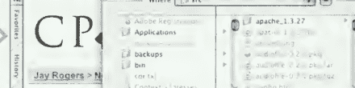

| 名称 | 摘要 | 描述 | 需要了解的 | 删除命名参数 |

| --- | --- | --- | --- | --- |

| | 在新窗口中打开链接 | 复制链接到剪贴板 | 将链接添加到收藏夹 | |

- 选择下载到磁盘。

- 在验证你的保存位置后，会出现保存对话框。

# 额外信息

Pragma（指令get）是随你的 Perl 安装自带的特殊 Perl 模块。如果你尝试过使用 `strict`，你已经用过这些特殊模块之一。你可以通过 `man permodlib` 命令了解更多关于你使用的 Perl 版本中包含的 pragma。

如果你对 Perl 模块组织的格式和其他技术细节感兴趣，Perl mod 页面将为你提供许多见解。在终端窗口中，输入 `man permod` 并按回车。

Perl 有一个用于查找模块的搜索路径。你可以通过执行 `perl -e "INC"`（如下所示）来查看：

## 输入此内容：

## 结果：

| [perl:-] user -e 'print "INC"' | /System/Library/Perl/darwin |

| /System/Library/Perl |

| /Library/Perl/darwin |

| /Library/Perl/Perl |

| /Network/Library/Perl/darwin |

| /Network/Library/Perl |

| /Network/Library/Perl |

| [perl:-] user | |

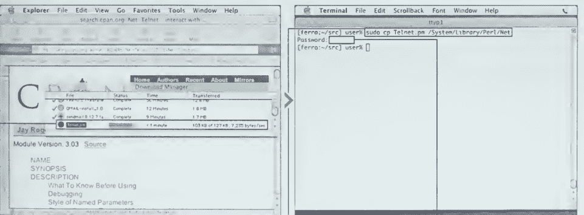

| 首页 作者 最近 关于 镜像 |

| 文件管理器状态 传输 | |

| 文件1 比较 | | 2.5 MB |

| 文件2 比较 | | 1.8 MB |

| 文件3 比较 | | 1.7 MB |

| 模块1 | | 128 KB, 7,205 bytes/sec |

- 在 Telnet 窗口中，`sudo cp Telnet.pm /System/Library/Perl/Net` 或使用模块名称将你的 Perl 模块复制到 `/System/Library/Perl` 中的正确位置，以确定该库是否属于某个目录。

- 按回车。

- 如果提示，输入你的密码。

下载管理器会下载你的模块。

# 编写 CGI 脚本

你可以编写 CGI 脚本来创建一个与访问者交互的 Web 页面。CGI 一术指的是一类允许 Web 页面与其运行的系统交互的脚本。大多数脚本是用 Perl 编写的。这是因为 Perl 的多功能性使其成为 Web 上使用的语言。CGI 脚本的基本功能是处理并准备 HTML 格式的输出，以便在 Web 页面中显示。

CGI 模块使用函数生成 HTML 代码。这些包括 `header` 和 `start_html` —— 这些函数创建 HTML 头部标签如 `<html>` 和 `<body>`，你需要它们来格式化 HTML 页面。

其他函数包括 `h1`、`hr` 和 `end_html`。如你所见，这些代码类似于 HTML 代码。`print_h1("My Life in 50 Words or Less")` 命令取代了包含标题 1 文本起始和结束标签的 print 命令。

要使用系统上安装的 CGI 模块，你可以使用 Perl 命令 `CGI`；此命令将 CGI 模块加载到你的脚本中。对于大多数 CGI 脚本，你将通过指定要使用最常用的函数来修改此命令。修改后的命令变为 `CGI qw(:standard);`；这允许你访问 HTML、表单生成和 CGI 函数。

你可以使用 CGI 脚本构建包含动态文本的页面，因为你可以使用 CGI 脚本来构建构建并包含动态文本的页面。

# 编写一个 CGI 脚本

| 终端 | 字体 帮助 |

| --- | --- |

| 终端 | 字体 帮助 |

| CGI(tm) 2.5 | 缓冲区 |

| CGI(tm) 2.5 | 缓冲区 |

| /usr/bin/perl -w | /usr/bin/perl |

| use CGI (:standard); | use CGI (:standard); |

| print header; | print header; |

| print start_html("this is a test"); | print start_html("this is a test"); |

| | print h1("This CGI"); |

| | | |

| 哪里 | 取消 |

- 在编辑器中，输入 `/usr/bin/perl -w` 并回车。

- `CGI qw(:standard);` 按回车。

- `print header;` 按回车。

- `print start_html("this is a test");` 按回车。

- `print h1("This CGI");` 按回车。

- `print end_html;` 退出。

# 额外信息


# Pragma

Pragma 是随你的 Perl 安装自带的特殊 Perl 模块。如果你尝试过使用 `strict`，你已经用过这些特殊模块之一。你可以通过 `man permodlib` 命令了解更多关于你使用的 Perl 版本中包含的 pragma。

如果你对 Perl 模块组织的格式和其他技术细节感兴趣，Perl mod 页面将为你提供许多见解。在终端窗口中，输入 `man permod` 并按回车。

Perl 有一个用于查找模块的搜索路径。你可以通过执行 `perl -e "INC"` 来查看：

## 输入此内容
`[perl:-] user -e 'print "INC"'`

## 结果
`/System/Library/Perl/darwin`
`/System/Library/Perl`
`/Library/Perl/darwin`
`/Library/Perl/Perl`
`/Network/Library/Perl/darwin`
`/Network/Library/Perl`
`/Network/Library/Perl`
`[perl:-] user`

- 在 Telnet 窗口中，`sudo cp Telnet.pm /System/Library/Perl/Net` 或使用模块名称将你的 Perl 模块复制到 `/System/Library/Perl` 中的正确位置，以确定该库是否属于某个目录。
- 按回车。
- 如果提示，输入你的密码。

下载管理器会下载你的模块。

# 编写一个 CGI 脚本

你可以编写 CGI 脚本来创建一个与访问者交互的 Web 页面。CGI 一术指的是一类允许 Web 页面与其运行的系统交互的脚本。大多数脚本是用 Perl 编写的。这是因为 Perl 的多功能性使其成为 Web 上使用的语言。CGI 脚本的基本功能是处理并准备 HTML 格式的输出，以便在 Web 页面中显示。

CGI 模块使用函数生成 HTML 代码。这些包括 `header` 和 `start_html` —— 这些函数创建 HTML 头部标签如 `<html>` 和 `<body>`，你需要它们来格式化 HTML 页面。

其他函数包括 `h1`、`hr` 和 `end_html`。如你所见，这些代码类似于 HTML 代码。`print_h1("My Life in 50 Words or Less")` 命令取代了包含标题 1 文本起始和结束标签的 print 命令。

要使用系统上安装的 CGI 模块，你可以使用 Perl 命令 `CGI`；此命令将 CGI 模块加载到你的脚本中。对于大多数 CGI 脚本，你将通过指定要使用最常用的函数来修改此命令。修改后的命令变为 `CGI qw(:standard);`；这允许你访问 HTML、表单生成和 CGI 函数。

你可以使用 CGI 脚本构建包含动态文本的页面，因为你可以使用 CGI 脚本来构建并包含动态文本的页面。

```
终端 | 字体 帮助
终端 | 字体 帮助
CGI(tm) 2.5 | 缓冲区
CGI(tm) 2.5 | 缓冲区
/usr/bin/perl -w | /usr/bin/perl
use CGI (:standard); | use CGI (:standard);
print header; | print header;
print start_html("this is a test"); | print start_html("this is a test");
| print h1("This CGI");
| | | |
哪里 | 取消
```

- 在编辑器中，输入 `/usr/bin/perl -w` 并回车。
- `CGI qw(:standard);` 按回车。
- `print header;` 按回车。
- `print start_html("this is a test");` 按回车。
- `print h1("This CGI");` 按回车。
- `print end_html;` 退出。

# 桌面 (DESTOP)

虽然你可能只会在系统上安装一个版本的 X Windows，但在使用哪种窗口管理器和桌面环境方面你有两个选择。两个最流行的桌面环境是 GNOME 和 KDE，它们在 Linux 社区中都很受欢迎，并且越来越多地在 Mac OS 上变得可可用。XQuartz 项目（指 Mac OS 上的 X Windows）是获取信息和软件的良好来源。

你还可以选择在服务器上运行哪些客户端。`xterm` 客户端是一个终端工具，类似于你 Mac OS X Aqua 桌面上的 Terminal 应用程序，不同之处在于 `xterm` 运行在 X 服务器上。同样地，`xclock` 是一个 X 时钟。虽然这些工具非常基础，是每个 X Windows 实现的一部分，但它们并不会限制 X Windows 安装能为你提供的功能。如果你安装了 X Windows，就可以获得 OpenOffice（一种类似于 Microsoft Office 的办公工具）和 Gimp（一种复杂的图像编辑工具）等许多强大的程序供你免费使用。

# X Windows 的历史

X Windows 系统最初在 MIT 开发，并得到了 DEC 的支持。它最初的目的是为 Athena 项目提供一个分布式的、硬件无关的用户界面。在产生广泛兴趣之前，该软件已经达到了版本 11（有时被称为 X11）。此后，X11 的控制权由 X 联盟（X Consortium）接管，现在由他们维护该标准。

# 显示 (DISPLAY) 与 xhost 命令

使用 X Windows 时，你的显示器有一个与环境变量 `DISPLAY` 关联的地址。如果你在运行 X 服务器的终端窗口中输入 `echo $DISPLAY` 来打印该值，你会发现显示器被设置为 0.0 或类似的值。虽然这个地址似乎没有意义，但它实际上指向与系统中第一个 X 服务器的服务器。如果你的主机名是 `ferro`，那么从网络上另一个系统的角度来看，你的显示器地址就是 `ferro@0.0`。

在 X 服务器上运行 `xhost` 命令可以授予远程系统查看你屏幕的权限。

`xhost` 命令可以以后如下运行：只允许特定的客户端，或者允许任何客户端写入其显示器。当然，限制对屏幕的访问通常更安全，这取决于你对所连接的网络安全性的考量。

当你在一个系统上生成显示器并将其发送到另一个系统时，你需要执行以下操作：

1. 在客户端运行的系统上设置你的 `DISPLAY` 变量；该系统是生成显示器的系统。

要从 X 客户端发送到运行在 `ferro` 上的 X 服务器，你需要设置 `DISPLAY=ferro@0.0` 并在 `ferro` 上运行 `xhost +` 以允许任何系统更新你的显示器。如果你想限制这种访问，请输入特定的主机名而不是加号 `+`。

# Mac 版的 UNIX

# 为 Mac OS X 获取 X

网络上提供了用于运行 Windows 的免费软件。虽然下载和安装这些软件需要大量时间，但过程非常简单，你不太可能在 Windows 的基础安装上遇到任何问题。

当你向下滚动页面时，你会发现一个提供最新文件发布信息的区域。这将为你提供所需的最新发布信息。当你点击“ALL Projects”链接时，你将看到当前文件列表。列表中最大的文件（`.sit` 文件）是 XFree86 的主发布版本。你需要在安装 ZIP 文件之前安装此版本（主发布有两个 ZIP 文件），并且只需要安装这些文件中的一个。你将按照顺序安装每个补丁。也就是说，你将先安装最旧的子版本。在安装主版本和每个子版本后，你将拥有 XFree86 的 4.2.1.1 版本。

在开始下载之前，你应该确定哪一个是最新的。截至本文写作，XFree86 版本为 4.2.1.1，本章中的指令详细说明了如何在你的 Mac OS X 上下载和安装此软件。如果有新的发布版本，你应该安装新的。获取文件和安装软件的过程可能不会改变，但文件的范围将反映你较新的版本。

要开始为你的 Mac OS X 系统安装 XFree86 过程，请输入 URL `http://sourceforge.net/projects/`

# 为 Mac OS X 获取 X 软件

热门下载 (Top Downloads)

注册日期: 2001-10-01 08:26 | 25,0
活跃参与者（上周）: 92%
1. eFile
2. DC++
3. Python ENGINE
4. VirtualBox
5. Gimp
6. Mach-Pencil - Polish
7. XFree86 4.2.1.1 下载
8. BitUnwind
9. Fix-XMPEG

项目: XFree86: 摘要 (Summary)
版本 (Version) | 日期 (Date) | 下载 (Download)
XFree86 4.2.1.1
公共区域 (Public Areas)
项目首页 (Project Home) | XFree86 4.2.99
2003-02-06


| 23-07 | | |

| 赞助内容 (Sponsored Content) | 搜索标签 (Search Tags): | | |

- 在浏览器中，输入 `http://sourceforge.net/projects/xfree86/` 并回车。
- 项目: XFree86: 摘要。
- 向下滚动页面直到找到最新的文件发布信息。
- 点击“所有项目”链接。

# 运行 X 系统 (RUN THE X SYSTEM)

使用 X Windows 你还可以选择在服务器上运行哪些客户端。`xterm` 客户端是一个终端工具，类似于你 Mac OS X Aqua 桌面上的 Terminal 应用程序，不同之处在于 `xterm` 运行在 X 服务器上。同样，`xclock` 是一个 X 时钟。虽然这些工具非常基础，是每个 X Windows 实现的一部分，但它们并不会限制 X Windows 安装能为你提供的功能。许多强大的程序，如 OpenOffice（一种类似于 Microsoft Office 的办公工具）和 Gimp（一种复杂的图像编辑工具），如果你安装了 X Windows，就可以免费获得它们。

当你在一个系统上生成显示器并将其发送到另一个系统时，你需要执行以下操作：

- 1) 在客户端运行的系统上设置你的 `DISPLAY` 变量；该系统是生成显示器的系统。

要从 X 客户端发送到运行在 `ferro` 上的 X 服务器，你需要设置 `DISPLAY=ferro@0.0` 并在 `ferro` 上运行 `xhost +` 以允许任何系统更新你的显示器。如果你想限制这种访问，请输入特定的主机名而不是加号 `+`。

在 X 服务器上运行 `xhost` 命令可以授予远程系统查看你屏幕的权限。

`xhost` 命令可以以后如下运行：只允许特定的客户端，或者允许任何客户端写入其显示器。当然，限制对屏幕的访问通常更安全，这取决于你对所连接的网络安全性的考量。

使用 X Windows 时，你的显示器有一个与环境变量 `DISPLAY` 关联的地址。如果你在运行 X 服务器的终端窗口中输入 `echo $DISPLAY` 来打印该值，你会发现显示器被设置为 0.0 或类似的值。虽然这个地址似乎没有意义，但它实际上指向与系统中第一个 X 服务器的服务器。如果你的主机名是 `ferro`，那么从网络上另一个系统的角度来看，你的显示器地址就是 `ferro@0.0`。

# Mac 版的 UNIX (UNIX FOR MAC)

# 为 Mac OS X 获取 X (GET X FOR MAC OS X)

网络上提供了用于运行 Windows 的免费软件。虽然下载和安装这些软件需要大量时间，但过程非常简单，你不太可能在 Windows 的基础安装上遇到任何问题。

当你向下滚动页面时，你会发现一个提供最新文件发布信息的区域。这将为你提供所需的最新发布信息。当你点击“所有项目”（ALL Projects）链接时，你将看到当前文件列表。列表中最大的文件（`.sit` 文件）是 XFree86 的主发布版本。你需要在安装 ZIP 文件之前安装此版本（主发布有两个 ZIP 文件），并且只需要安装这些文件中的一个。你将按照顺序安装每个补丁。也就是说，你将先安装最旧的子版本。在安装主版本和每个子版本后，你将拥有 XFree86 的 4.2.1.1 版本。

在开始下载之前，你应该确定哪一个是最新的。截至本文写作，XFree86 版本为 4.2.1.1，本章中的指令详细说明了如何在你的 Mac OS X 上下载和安装此软件。如果有新的发布版本，你应该安装新的。获取文件和安装软件的过程可能不会改变，但文件的范围将反映你较新的版本。

要开始为你的 Mac OS X 系统安装 XFree86 过程，请输入 URL `http://sourceforge.net/projects/`

# 为 Mac OS X 获取 X 软件 (GET X SOFTWARE FOR MAC OS X)

| 热门下载 (Top Downloads) | |

|---|---|

| 注册日期: 2001-10-01 08:26 | 25,0 |

| 活跃参与者（上周）: 92% | |

| 1. eFile | |

| 2. DC++ | |

| 3. Python ENGINE | |

| 4. VirtualBox | |

| 5. Gimp | |

| 6. Mach-Pencil - Polish | |

| 7. XFree86 4.2.1.1 | 下载 |

| 8. BitUnwind | |

| 9. Fix-XMPEG | |

| my.sf | 软件地图 (software map) | abs |

|---|---|---|

| 项目: XFree86: 摘要 (Summary) | | |

| 搜索组 (Search Group) | 搜索 (Search) | |

| 版本 (Version) | 日期 (Date) | 下载 (Download) |

|---|---|---|

| XFree86 4.2.1.1 | | |

| 公共区域 (Public Areas) | | |

| 项目首页 (Project Home) | XFree86 4.2.99 | | |

| 2003-02-06 | | |

- 在浏览器中，输入 `http://sourceforge.net/projects/xfree86/` 并回车。
- 项目: XFree86: 摘要。
- 向下滚动页面直到找到最新的文件发布信息。
- 点击“所有项目”。

# 桌面 (DESKTOPS)

虽然你可能只会在系统上安装一个版本的 X Windows，但在使用哪种窗口管理器和桌面环境方面你有两个选择。两个最流行的桌面环境是 GNOME 和 KDE，它们在 Linux 社区中都很受欢迎，并且越来越多地在 Mac OS 上变得可可用。XQuartz 项目（指 Mac OS 上的 X Windows）是获取信息和软件的良好来源。

你还可以选择在服务器上运行哪些客户端。`xterm` 客户端是一个终端工具，类似于你 Mac OS X Aqua 桌面上的 Terminal 应用程序，不同之处在于 `xterm` 运行在 X 服务器上。同样地，`xclock` 是一个 X 时钟。虽然这些工具非常基础，是每个 X Windows 实现的一部分，但它们并不会限制 X Windows 安装能为你提供的功能。许多强大的程序，如 OpenOffice（一种类似于 Microsoft Office 的办公工具）和 Gimp（一种复杂的图像编辑工具），如果你安装了 X Windows，就可以获得免费供免费使用。

# X Windows 的历史 (HISTORY OF X WINDOWS)

X Windows 系统最初在 MIT 开发，并得到了 DEC 的支持。它最初的目的是为 Athena 项目提供一个分布式的、硬件无关的用户界面。在产生广泛兴趣之前，该软件已经达到了版本 11（有时被称为 X11）。此后，X11 的控制权由 X 联盟（X Consortium）接管，现在由他们维护该标准。

# 显示 (DISPLAY) 与 xhost 命令 (DISPLAY AND THE XHOST COMMAND)

使用 X Windows 时，你的显示器有一个与环境变量 `DISPLAY` 关联的地址。如果你在运行 X 服务器的终端窗口中输入 `echo $DISPLAY` 来打印该值，你会发现显示器被设置为 0.0 或类似的值。虽然这个地址似乎没有意义，但它实际上指向与系统中第一个 X 服务器的服务器。如果你的主机名是 `ferro`，那么从网络上另一个系统的角度来看，你的显示器地址就是 `ferro@0.0`。

在 X 服务器上运行 `xhost` 命令可以授予远程系统查看你屏幕的权限。

`xhost` 命令可以以后如下运行：只允许特定的客户端，或者允许任何客户端写入其显示器。当然，限制对屏幕的访问通常更安全，这取决于你对所连接的网络安全性的考量。

当你在一个系统上生成显示器并将其发送到另一个系统时，你需要执行以下操作：

- 1) 在客户端运行的系统上设置你的 `DISPLAY` 变量；该系统是生成显示器的系统。

要从 X 客户端发送到运行在 `ferro` 上的 X 服务器，你需要设置 `DISPLAY=ferro@0.0` 并在 `ferro` 上运行 `xhost +` 以允许任何系统更新你的显示器。如果你想限制这种访问，请输入特定的主机名而不是加号 `+`。

### 额外

## 通过 CD-ROM 获取 XFree86

如果下载 XFree86 的步骤似乎过于复杂或耗时，您可以通过 CD-ROM 获取 XFree86。只需支付少量的费用，您就可以在 CD 上获得与从网上下载相同的 XFree86 版本。购买 CD 将为您省去从网上下载正确文件集的麻烦。请访问 `www.darwin.org` 获取有关购买 CD 的信息以及关于 XFree86 项目的其他信息。

Darwin 是包含在 XFree86 发行版中的适用于 Mac OS X 的 X 运行器的名称。ZonX 是一个 SourceForge 项目，XFree86 使用该项目供 Darwin 开发者共享（share）代码。

您可以从 `www.xfree86.org` 获取所有 XFree86 源代码。

安装好 XFree86 软件后，从双击 Darwin 图标开始。你会发现，将 XDarwin 保留在 Dock 程序坞中是使用该软件最方便的方法。


| 包与名称 | 日期 | D/Arch | 类型 |

| --- | --- | --- | --- |

| XFree86 | 2002-10-25 00:00 | | |

| 1.implyDarwin | XFree86, 4.2.0 | zip |

| 2.motifWM | XFree86, 4.2.0 | zip |

| 3.Minimal Client | | 在新窗口打开 | zip |

| 4.x11_install | | 链接到磁盘 | zip |

| 5.POFM- | | 添加到收藏夹 | zip |

| 6. Hibernate | | | |

| 7.Other | | | |

| 8. Compare ERP-C | | | |

| 9.Business Solution | 46125214244887 | | |

- 12 右键点击 `XFree86-4.2.1.zip` 文件。
- 13 点击“下载到磁盘”。
- 14 出现“保存”对话框。
- 14 点击下拉菜单，选择您想要保存文件的位置。
- 文件将保存到您在 14 中选择的位置。
- 15 点击“保存”。

# 安装 X 运行器

您可以在您的 Mac OS 系统上安装 X 运行器。在安装 X Windows 后，您就可以运行许多为运行 X Windows 而构建的应用程序。

要安装 Darwin（XFree86 的 Mac OS X 移植版），您需要下载一系列文件或获取一张安装 CD。根据本文写作时的情况，您需要安装 XFree86 4.2.0 或 4.2.1 版本——以确保在 Mac OS 10.2 上获得无故障安装。随后，您可能希望跳过默认窗口管理器，使用一个提供更吸引力且实用的桌面的管理器。

安装 XFree86 最简单的方法之一是从 `sourceforge.net` 获取 SIT 文件格式的 4.2.0 版本。URL 为 `sourceforge.net/projects/xonx`。“xonx” 意味着在 Mac OS X 上运行 Windows 是一个起点。XFree86 4.2.0 文件大小约为 56 MB，因此如果您使用的是拨号连接，请做好长时间下载的准备。检查超过六个月的 XX 服务器可能有新补丁可用，或者已移动到新版本。

安装完成后，您可以双击 SIT 文件安装 X Windows 服务器，然后按照发布顺序安装您的每个补丁。补丁文件以 ZIP 格式提供。您可以通过双击图标以这种方式安装这些更新。

如果您使用的是拨号连接，您可能更倾向于从 CD-ROM 安装 XFree86。您可以从 `www.gnu-darwin.org` 等网站以极低成本获取 CD。


- 在 Finder（访达）中，打开包含下载的 XFree86 SIT 文件的文件夹。
- 双击文件。文件将解压。

# 运行 X Window 系统

### 额外

虽然下面描述的程序安装了基础 X Windows，但请记住您安装的 XFree86 版本随时间推移而变化。请咨询 NonX 站点并根据该网站上的可用信息修改文件名和您的操作步骤。

X Windows 中使用的文件包括 `.defaults`（它为窗口服务设置默认偏好）和 `.xinitrc`（它建立您的初始屏幕设置）。一个 `.xmine` 文件可能会在您的显示器上启动多个窗口。这通常包括更典型的 X 客户端，例如 `xterm` —— 一个终端模拟器；`xclock` —— 一个简单的模拟钟；以及 `xeyes` —— 一对跟随光标在屏幕上移动的眼睛。

您还可以通过 Apple 菜单中的 Apple 的 X Software... 链接安装 X 运行器。Apple 的 X 运行器称为 X11 for Mac OS，在写作期间它是一个公开测试（Public Beta）版本。Apple 对 X Windows 的实现基于 XFree86。


- 3 双击 XInstall 框
- 4 出现“身份验证”对话框。
- 4 输入您的密码。
- 5 点击“确定”。
- 出现语言选择对话框。


- 6 点击下拉菜单，从菜单中选择一种语言。
- 7 点击“确定”。

继续完成剩余的安装过程。

# 安装 XFree86 升级

您可以安装 XFree86 升级，将您的 XFree86 安装从基础版本提升到当前版本。升级通常会带来错误修复和性能改进，通常值得花费安装所需的时间。因为包含修改文件的 ZIP 文件通常很小，下载和安装它们的过程花费的时间和精力很少。

在 Finder（访达）。这将解压文件并创建一个安装文件。当您双击安装文件时，您的升级安装将开始。

升级安装完成后，并确保两个文件已按照“获取 Mac OS X 软件”节中的描述完成下载。虽然在本节中正在安装特定的升级，但该过程将对上一节中下载的其他文件以及您未来可能需要安装的其他升级进行重复。

安装 XFree86 最简单的方法之一是从 `sourceforge.net` 获取 SIT 文件格式的 4.2.0 版本。URL 为 `sourceforge.net/projects/xonx`。“xonx” 意味着在 Mac OS X 上运行 Windows 是一个起点。XFree86 4.2.0 文件大小约为 56 MB，因此如果您使用的是拨号连接，请做好长时间下载的准备。检查超过六个月的服务器可能有新补丁可用，或者已移动到新版本。

安装完成后，您可以双击 SIT 文件安装 X Windows 服务器，然后按照发布顺序安装您的每个补丁。补丁文件以 ZIP 格式提供。您可以通过双击图标以这种方式安装这些更新。

如果您使用的是拨号连接，您可能更倾向于从 CD-ROM 安装 XFree86。您可以从 `www.gnu-darwin.org` 等网站以极低成本获取 CD。


- 在 Finder（访达）中，打开包含下载的 XFree86 SIT 文件的文件夹。
- 双击文件。文件将解压。

# 运行 X Window 系统

虽然下面描述的程序安装了基础 X Windows，但请记住您安装的 XFree86 版本随时间推移而变化。请咨询 NonX 站点并根据该网站上的可用信息修改文件名和您的操作步骤。

X Windows 中使用的文件包括 `.defaults`（它为窗口服务设置默认偏好）和 `.xinitrc`（它建立您的初始屏幕设置）。一个 `.xmine` 文件可能会在您的显示器上启动多个窗口。这通常包括更典型的 X 客户端，例如 `xterm` —— 一个终端模拟器；`xclock` —— 一个简单的模拟钟；以及 `xeyes` —— 一对跟随光标在屏幕上移动的眼睛。

您还可以通过 Apple 菜单中的 Apple 的 X Software... 链接安装 X 运行器。Apple 的 X 运行器称为 X11 for Mac OS，在写作期间它是一个公开测试（Public Beta）版本。Apple 对 X Windows 的实现基于 XFree86。


- 3 双击 XInstall 框
- 4 出现“身份验证”对话框。
- 4 输入您的密码。
- 5 点击“确定”。
- 出现语言选择对话框。
- 6 点击下拉菜单，从菜单中选择一种语言。
- 7 点击“确定”。

继续完成剩余的安装过程。

# 在无根模式下启动 XFree86

你可以以无根模式启动 X Windows 服务器。这允许你与 Mac OS 应用程序并运行。

每当你运行 XDarwin 时，系统都会询问你是想以全屏模式还是无根模式运行。如果你将始终运行其中一种模式，请勾选复选框，这样应用程序就不会再询问你。两种模式各有优处。

当你启动 X 会话时，你会看到这些窗口。与 `xterm` 命令相关的数字定义了列数、行数和屏幕位置。例如，上述行中定义的第一个 `xterm` 将具有 80 列 50 行；80 列的宽度等于 80 个等宽字符的宽度。它的左上角将放置在 -。

要以无根模式启动，请在双击 XFree86 应用程序图标或从 Dock 启动它后，点击 Rootless 按钮。X Windows 的启动取决于你系统 `.xinitrc` 文件的内容，或者如果你有个人 `.xinitrc` 文件的话。遵循 `.xinitrc` 文件的示例将启动多个 xtterm 窗口并：

```
xclock -geometry 50x50+1+1
xterm -geometry 80x50+0+0 &
xterm -geometry 80x200-4+0 &
exec xterm -geometry 80x66+0+0 -name login
```

启动窗口最方便的方法是在首次唤起它后将其保留在 Dock 中。你可以通过复制系统级 `.xinitrc` 文件并将其安装为家目录下的 `.xinit` 来自定义窗口。

当你首次安装 XFree86 时，你将使用默认的窗口管理器。它被称为 `twm`，它会为你的窗口添加一些窗口控制功能，它是一个乏味的管理器。

欢迎使用 XDarwin，这是一个用于 Mac OS 下 X Windows 系统的窗口服务器。XDarwin 由 XFree86 项目提供，并根据 MIT 许可证条款分发。此软件按现状提供，不带任何保证。

有关信息、错误报告和最新版本，请访问访问 `http://sourceforge.net/xdarwin/`。

X11 管理器可以在 Mac X 桌面上全屏或无根地显示窗口。选择显示模式以：

- 双击 XDarwin 应用程序图标。
- 出现“Welcome to XDarwin”。
- 点击 Rootless。

## 额外

你可以更新搜索路径以包含 X Windows 工具。这将允许你通过输入名称而无需完整路径名来启动 X 工具。X 工具通常安装在目录 `/usr/X11R/bin` 中。通过将此路径包含在你的 `PATH` 变量中，你将指示 shell 在输入如 `xeyes` 等简单名称时查找该目录。

你可以通过修改 `.xinitrc` 文件中使用的参数来更改 `xterm` 窗口上使用的颜色。例如，`xterm -n xtermblahblah -bg black -fg white 80x25+` 命令将生成一个名为“xterm-blahblahblah”的窗口，背景黑色和白色字母。Terminal 窗口将具有 80 列宽（标准宽度），从屏幕左上角开始 25 行。

你的搜索路径定义在 `.tcshrc` 文件中，看起来像这样：

示例：

```
setenv PATH /usr/bin:/bin:/sbin:sw:/usr/local/bin:/usr/X11R/bin
```

- X 客户端在你的 Aqua 桌面启动，默认显示三个屏幕。
- 在 `xterm` 窗口中输入 `xeyes` 并按回车。
- `xeyes` 工具在你的桌面上打开。

# 运行 GNOME 桌面

如果你先了如 XFree86 之类的 X 服务器，就可以可以在 Mac OS X 上安装 GNOME 桌面。

```
gnome-wm &
exec gnome-session
```

GNOME 是最流行的窗口系统桌面之一。GNOME 为 Linux 社区开发，现在也运行在 Solaris 和 Mac OS X 系统上。由于这种移植工作是真实的，安装 GNOME 可能会是一个缓慢且充满问题的过程——特别是在缓慢的拨号连接上。你也可以在 CD-ROM 上获取二进制文件。以下网站提供了关于 Mac OS X X Windows 信息。

当你完成这些更改后下次启动 X Windows 时，你的桌面将开始运行 GNOME。由于 XFree86 开箱即用，你可以在窗口或全屏模式下运行 GNOME。当你运行它时，你的窗口将看起来像使用 GNOME 绘制方法的 Aqua 窗口。其余窗口将保留其 Aqua 外观。你将能够从终端窗口添加 X 工具。例如，你可以通过使用 `/usr/X11/bin/keyset/` 在 `xterm` 窗口中并按按键输入

```
http://sourceforge.net/projects/xonx
http://www.xdarwin.org
```

# 运行 X 系统

### 额外

如果你的 GNOME 桌面打开时没有顶部和底部的面板，请在 xterm 窗口中输入 `panel -no-xsm`。

点击底部面板上的地球图标将打开 Web 浏览器 Mozilla。通过此工具，你可以像在 Mac OS 桌面上使用 Internet Explorer 或 Safari 一样浏览网页。

你可以点击显示小箭头的任意位置让底部面板滑动到屏幕边缘。

Window Maker 窗口管理器为你的 GNOME 桌面提供了完全不同的外观和感受。如果你通过点击 `设置 : 桌面 : 窗口管理器` 选择了此项，你的桌面风格将会发生变化。你可以通过在背景处点击右键并点击 `工作区 : 新建` 来启动虚拟桌面或工作区。然后，你就可以点击屏幕左上角图标上的后退和前进按钮在这些工作区之间切换。

在每个工作区内，你可以启动不同的工具，就像你有多个用于不同项目的工作平面一样。


打开了 GNOME 计算器工具。

点击 X 关闭计算器。

点击 `程序`：

菜单显示 Ghostview、GIMP 和 xv。

# 安装 OROBOROSX

你可以安装 OroborOS 桌面，以便在你的 Aqua 桌面上利用 X 工具。OroborOS 允许你在保持正常 Mac OS 桌面外观和感受的同时运行 X 程序。

OroborOS 窗口管理器实际上提供了几个图形主题。其中一个模仿了你的 Aqua 桌面的外观，并为你的 Mac X 以及你的 X 应用程序提供了无缝的外。OroborOS 还提供了一个应用程序下拉菜单，在你运行 OroborOS 时可以从桌面启动这些程序。它是绿色的，标题为“启动”。OroborOS 顶部工具之一是一个令人印象深刻的图像编辑工具，其功能可以与 Photoshop 媲美。

在安装 XFree86 后，安装 OroborOS 是一个顺利的过程。可以从以下几个地方获取 OroborOS  - `http://ororos.sourceforge/download.html` 获取二进制版和源码发行版

本节概述了安装二进制文件的过程，该文件以 gzipped TAR 文件的格式下载。当你双击此文件时，将进入安装过程。OroborOS 将在几秒钟内完成并准备好使用。

你可能想通过 Dock 来方便操作。这样你就可以先点击 Dock 中的 OroborOS，通过“启动”菜单启动 X 程序，或者在终端中输入二进制文件的路径名来启动。当你启动 OroborOS 时，它会反过来启动 Darwin。


对于任何希望在正常的 Mac OS 桌面工作的同时添加仅在 Windows 下运行的应用程序的人来说，OroborOS 是一个很好的选择。安装过程简单且极快。


- 1 双击最新版本的 OroborOS。
- 2 出现一个 TAR 文件和一个文件夹。
- 3 双击 OroborOS 文件夹图标。


### 额外

启动 OroborOSX 之后，你可以将其留在 Dock 中，以便下次再次使用时更容易启动。OroborOSX 与你的 Mac OS X 桌面配合得非常好，你有时会忘记自己正在与 Mac 桌面同时运行 Windows。

如果你希望非活动窗口显示为变暗，可以通过点击 `选项 ⌥ 调暗非活动窗口` 来实现。

OroborOSX 不使用你的 `.xintric` 文件。但是，如果你可以启动 `⌥ xintric`，那么你就可以让它读取并执行该文件中的命令。

当你运行 OroborOSX 时，你所有的窗口都会列在 Windows 菜单的底部。要从一个移动到下一个，你可以像往常一样点击选择的窗口，或者通过点击 `Windows` 以及你想要激活的窗口名称来选择活动窗口。

OroborOSX 是一个基于名为 Oroboros 的窗口管理器的类 Aqua 窗口管理器。


- 文件夹打开，显示出新的 OroborOSX 应用程序。
- 双击 OroborOSX 图标。
- OroborOSX 启动 XDarwin。

# 使用 XV 查看图像

你可以使用 `xv`（一个用于 X Windows 的交互式图像处理程序）来显示、裁剪、拉伸和抖动许多类型的图像。要启动，在 x 窗口中输入 `xv`。如果你使用 GNOME，你将在“图形”菜单中找到该程序。彩色的窗口外横幅将欢迎你。在页面底部，你会看到消息“按下 <right> 鼠标键”。要查看 xv 的控制面板，请按 `Control + 点击`。

菜单显示 Ghostview、GIMP 和 xv。

# 安装 X Window 系统软件

## 17

# 附加

你可以通过在“图层、通道与路径”窗口中按住鼠标右键并向下滑动到“删除图层”来删除图层。删除图层的能力是最初使用图层的最佳理由之一。它们允许你在添加到图像的元素看起来不符合预期时，轻松地将其移除。

要保存图像，在图像窗口内点击右键，从弹出菜单中点击“文件”->“另存为”。如果你想以原始格式保存图像，可以保持“由扩展名确定文件”选项不变，并输入你的新文件名。GIMP 的格式称为 XCF。

如果你有许多图层，可以通过在“图层、通道与路径”窗口中选择图层，在它们之间切换，随时确定你正在编辑哪一个层。当你对创建的整个图像完全满意时，可以将图像合并为单个层。执行此步骤后，你将无法单独操作图层。

如果你的图像有图层，你将不得不使用“合并图层”选项来合并图层，或者导出图像以保存为不支持图层的格式。你可以使用 xcf 格式来保留图层。


- “打开图像”窗口打开。
- 选择文件名。
- 图像打开并以图层形式出现。
- 显示选中图像的缩略图。
- 双击你要编辑的图像文件名。
- 点击工具箱中的工具，然后点击图像。
- 在“图层、通道与路径”窗口中，点击左下角的“新建图层”按钮。

# 使用 GIMP 编辑图像（续）

你可以通过在图像上点击鼠标右键并从菜单中选择来对图像应用任何变换。例如，如果你点击“滤”>“玻璃”>“镜头”，你的图像将变得扭曲，就像你透过凸透镜观察一样。这些效果还包括深度失真、着色选项以及你可以应用于获得所需效果的其他失真效果。你可能会在 GIMP 中使用多一个工具。另一方面，各种选项在某些本就无常的日子里注定是一种娱乐，并且也许是理解此工具能为你做什么的唯一方法。

使用 GIMP 的人习惯于保留原始图像，并使用不同的名称保存修改后的图像，这样他们就可以随时重新开始。

要裁剪图像，从工具箱中选择裁剪工具。该图标显示为一把工刀。然后在图像内点击左键。当你点击时，你应该会注意到两个角。你可以拖动框的角使其拉开。该框定义了你在点击“裁剪”工具后将的图像部分。

虽然你可以在 Web 版 GIMP 中找到一些信息——这是一个非常受欢迎的工具——但使用它是揭示所有可能的操作以及哪些操作适合你自己的图形风格的最佳方法。

还有一个恢复到原始图像的选项。这在“文件”>“还原”下可用。如果你应用了一个变换但不喜欢它的效果，这个功能非常有用。许多


- 新文本悬浮在你的图像上。
- “文本”窗口打开。
- 为你的文本选择字体、字体样式和大小。
- 点击“锚定图层”图标来锚定你的文本。
- 选择你想出现在新图层中的类型。
- 点击“确定”。
- 在“图层、通道与路径”窗口中，点击“浮动选择”。

# 附加

5 x 5 元素工具箱允许你轻松访问 GIMP 内可用的工具。将光标悬停在任何图标上，都会短暂显示一段简短的描述。

放大镜工具允许你快速放大图像，以便你可以看到更多细节并对你的工作进行更精细的控制。要缩小，请双击放大镜并在“工具选项”中缩小。然后再次点击图像。此时，放大镜的效果将导致你缩小。你可以根据需要并在放大和缩小之间切换。

如果你想在图像上画画，可以使用铅笔工具。该工具的“工具选项”窗口允许你修改铅笔笔触的透明度并为你的铅笔笔触选择颜色。

工具箱中间像吸管器的图标允许你从图像中提取颜色。这允许你使用与图像中颜色匹配的颜色，而不是尝试通过调色板中选择颜色来匹配颜色。


# 附加


# 附加


# 使用 ABIWORD 进行文字处理


- 在窗口中输入 AbiWord 并按回车。

# 在 GNUMERIC 中创建电子表格

你可以使用 Gnumeric 进行从简单计算到复杂的数值分析。Gnumeric 是一款根据 GNU 公共许可发布的免费电子表格软件。它具有你对一个高质量电子表格应用所预期的所有功能，带有内置菜单、图表支持、丰富的函数范围、单元格格式和打印功能。它有一套强大的工具，允许你与 Excel 等其他格式导入/导出。

其中 `A2:A20` 定义了一个单元格范围。如果你不熟悉电子表格，将必须习惯这种命名法。电子表格中的列标记为 A、B、C 等，而行则编号为 1、2、3 等。`A2` 是第一列第二行定义的单元格。

要启动 Gnumeric，你可以在 xterm 窗口中输入 `Gnumeric`。该工具将打开并显示一个空白电子表格。输入数据只需点击并输入文本或数字一样简单。要输入公式，先输入 `=`，然后输入公式，例如 `cos(100)` 或 `sum(A2:A20)`。

你还可以通过按住鼠标按钮并在上方滑动来选择数据。这通常会简化过程。Gnumeric 和大多数现代电子表格一样，允许你复制和粘贴公式，在此过程中调整单元格地址。如果你使用 `A2:A20`，然后将公式 `A21` 复制到 `B21`，新公式将变为 `B2:B20` 之和。如果你熟悉电子表格应用程序，可能可能会熟练地使用 Gnumeric。

# 在 GNUMERIC 中创建电子表格


- 在 xterm 窗口中输入 numeric 并按回车。
- 答案显示在你的单元格中，公式显示在工具栏字段中。
- 在单元格中输入 `sqrt=sqrt(64)` 并按回车。

# 安装 X Window 系统软件

# 其他

只需点击特定单元格后点击工具栏中的百分比符号即可将单元格中的数字转换为百分比。这加快了修改数字格式的过程，但使用的是带有两位小数的默认格式。同样，你可以点击像美元钞一样的符号将数字转换为货币格式。

撤销操作可以通过 `Edit -> Undo`（编辑 -> 撤销）以及使用工具栏中的弯箭头来实现。每当你犯错时，都可以快速撤销最近的操作。

你可以使用电子表格右上角的绿色和红色箭头按字母顺序或反序对一组单元格进行排序。只需选择要排序的单元格，并点击代表你选择排序顺序的箭头。

你可以通过从工具栏选择这些工具为电子表格添加行和注释。

工具栏中的图标允许你将单元格数据的对齐方式改为右对、左或居中。

点击 `Help -> Generic Manual`（帮助 -> 普通手册）打开一个实用的用户指南。


- 在同一列的几个单元格中输入一些数字。
- 在下方单元格输入 `=sum(`。
- 用鼠标选择单元格中的数字。
- 输入 `)` 并按回车。
- 电子表格计算总和。

# 使用 OPEN OFFICE 查看办公文档

你可以使用 Open Office 创建文档、电子表格、插图和演示文稿。你也可以使用其他应用程序（如 Microsoft Office）创建的开放文档。Open Office 是一个办公应用程序套件，包括文字处理器、电子表格、绘图程序、演示包、数据源编辑器、HTML 编辑器、公式编辑器和宏脚本语言。每个工具都是由全球有才华的志愿者开发的专业且功能完全。Open Office 完全免费，基于 StarOffice 的代码以及 My Systems 在 Windows 和 Linux 上 15 年的发展，截至本文编写，它正处于 Mac OS X 开发的最后阶段。

修改 Microsoft Word 文。Open Office 带有拼写检查、剪贴画以及你在专业文字处理应用中预期的许多格式功能。

当你从 Dock 里的 Finder 或通过双击图标启动 Open Office 时，Finder 将打开带有 Writer 的工具。从此应用程序，你也可以启动其他程序。例如：`File -> New` 会启动电子表格应用程序。如果 Open Office 尚未运行，它将启动 Darwin。

如果你使用过 Microsoft Word 或其他文字处理器，窗口顶部和左侧的大部分工具栏看起来会很熟悉。如果你不确定任何图标的含义，将光标悬停在它们上方就会出现一个简短描述。

要使用 Open Office，你首先需要安装 X Windows。Open Office 包含的文字处理器称为 Writer。你可以用它来读取、写入和...

# 使用 OPEN OFFICE 查看办公文档


| OreborOSX Launch Edit Options Window Help | | | |

|---|---|---|------|

| (Untitled) | Edit View Insert Format Tools Window Help OpenOffice.org 1.0.1 | | |


- 点击 Dock 中的 Open Office 图标。
- Writer 打开一个空白文档。
- 点击 `File -> Open`。

# 安装 X Window 系统软件

# 其他

只需点击特定单元格后点击工具栏中的百分比符号即可将单元格中的数字转换为百分比。这加快了修改数字格式的过程，但使用的是带有两位小数的默认格式。同样，你可以点击像美元钞一样的符号将数字转换为货币格式。

撤销操作可以通过 `Edit -> Undo`（编辑 -> 撤销）以及使用工具栏中的弯箭头来实现。每当你犯错时，都可以快速撤销最近的操作。

你可以使用电子表格右上角的绿色和红色箭头按字母顺序或反序对一组单元格进行排序。只需选择要排序的单元格，并点击代表你选择排序顺序的箭头。

你可以通过从工具栏选择这些工具为电子表格添加行和注释。

工具栏中的图标允许你将单元格数据的对齐方式改为右对、左或居中。

点击 `Help -> Generic Manual`（帮助 -> 普通手册）打开一个实用的用户指南。


- 在同一列的几个单元格中输入一些数字。
- 在下方单元格输入 `=sum(`。
- 用鼠标选择单元格中的数字。
- 输入 `)` 并按回车。
- 电子表格计算总和。

### 额外

在 Calc 中创建的电子表格可以存储为 Open Office 格式，也可以选择其他格式，包括多个版本的 Microsoft Excel、StarCalc、数据交换格式（Format）、dBase 和 SYLK。

你还可以通过点击文件 > 新 > HTML 在 Open Office 中创建 HTML 文档。此工具允许你输入文本并提供 HTML 代码。你可以使用“插入”菜单中的选项插入链接并创建表格。当你在页面上下文中工作时，HTML 代码正在为你构建。

你可以从 Writer 或 Calc 中点击文件 > 新 > 演示文来创建幻灯片演示。该演示文包称为 Impress，是一种多媒体演示工具，包含了剪贴画动画和高质量工具。开始时，你将对的一系列形式进行选择——例如在幻灯片从一张移动到下一时是否使用某种类型的切换效果。Impress 简化了演示文的准备工作，并包含了许多创建动态幻灯片的功能。


- 出现自动格式图表窗口。
- 从菜单中选择图表类型。
- 点击创建。
- 新图表出现在你的电子表格中。

## 开发 C 和 C++ 应用程序

你可以在 Mac OS X 系统上使用 C 和 C++ 开发应用程序。使用 C 或相关语言（如 C++）开发应用程序很大程度上取决于你作为程序员的能力，尽管 Mac OS 环境为你的开发工作提供了很好的支持。`gcc` 编译器随 Mac OS X 开发者工具，它是 C、C++、Objective-C 和 Objective-C++ 的默认编译器。

在 Mac OS X 上开始任何编程语言之前，你应该更新你的 PATH 以包含 `/usr/share/man`。这确保了你可以可以使用开发者工具的 man 页（帮助手册）。如果你使用行 `setenv PATH=/usr/share/man/local/man/usr/share/man your.tcshrc`，那么当你使用 `man` 命令时，该文件和其他页面就会出现。

你应该使用文本编辑器来配置你的源代码。许多开发者偏好使用编辑器，因为他们可以配置编辑器来正确缩进源代码。然而，你应该使用能让你工作最有效的文本编辑器。

输入源文件后，你可以使用 `gcc` 或 `make` 命令进行编译，`make` 命令管理编译过程。只有当相关的二进制代码比源代码旧时，`make` 命令 才会编译程序。换句话说，它只重新编译源代码。如果你有一个包含多个源文件的应用程序，你必须明确这些文件之间的关系。`make` 调用 `gcc` 来编译程序。

`make` 适用于许多不同的编程语言，尽管它最常用于 C。事实上，`make` 并不限于编译源。你可以阅读 man 页来了解这个多功能的命令。

## 开发 C 和 C++ 应用程序


1. 输入 `vi hello.c` 并按回车。
2. 按 I 并输入 `#include <stdio.h>`，然后按两次回车。
3. 输入 `main() {` 并按回车，然后使用 Tab 键输入 `printf("Hello, World!");` 并再次按回车。
4. 输入 J 并按 Esc，然后输入 `:wq`

`vi` 保存了你的源代码。

300

## 开发 UNIX 应用程序

### 额外

每当你使用多个源文件开发应用程序时，你都可以构建一个 Makefile 来定义文件之间的依赖关系。如果你曾经从源代码安装过任何应用程序，你可能使用过 Makefile 来编排编译过程。

对于像 `hello.c` 这样简单的程序，Makefile 是没有的。然而，当你编译像 `fetchmail` 这样的工具时，Makefile 确保你编译了所有正确的文件，并创建了最终的可执行文件 `fetchmail`。你还可以编写 Makefile 来包含安装和清理指令。这允许用户使用 `make install` 和 `make clean` 命令来安装应用程序并移除对象文件。当你使用 Makefile 时，不需要输入像 `make hello.c` 这样的命令。`make` 命令使用当前目录下的 Makefile。使用以下 Makefile，你只需要输入 `make` 即可编译 `hello.c`。注意在冒号之后和 `gcc` 之前使用制表符。

示例：

```makefile
hello: hello.c
	gcc hello.c -o hello
```

Makefile 允许你控制编译和安装过程。如果其他人安装你的应用程序，你可以给安装者文件和 Makefile，以确保他们的安装成功。

| 终端 文件 编辑 回滚 字体 窗口 帮助 |

|---|---|---|---|---|---|------|

| [ferro:-~/project_X] user% make hello | | | | | | | | | |

| cc -o hello.c hello.c | | | | | | | | | |


## 开发 JAVA 应用程序

你可以在 Mac OS X 系统上使用 Java 开发应用程序。要使用解释器运行 java 应用程序，你必须将其编译为字节码。`javac` 编译器读取你的源代码并生成类文件。

使用 `java` 命令运行此程序。Java 应用程序通常以 Java 档 (`JAR`) 文件的形式分发，你可以使用 `jar` 命令列出它们。

```java
public class HelloWorld {
    public static void main(String[] args) {
        System.out.println("Hello, World!");
    }
}
```

## 创建一个 JAVA 程序

1. 启动 Pico 编辑器创建一个名为 `HelloWorld.java` 的文件并按回车。

出现 Pico 屏幕。

2. 输入 `*` 并按回车，输入 `*` 这是用 Java 编写的 Hello 并按回车，然后输入 `*/` 并按回车。

3. 输入 `public class HelloWorld` 并按回车。

4. 输入 `public void main(String[] args)` 并按回车。

5. 输入 `System.out.println("Hello, World!")` 并按回车。

`javadoc` 注释完成。

## 开发 UNIX 应用程序

你可以使用 `jar` 命令从你的 `HelloWorld` 应用程序创建一个 Java 归档。在语法上，`jar` 命令类似于 `tar` 命令。要创建一个 JAR 文件，你可以使用 `jar xvf` 命令。要从 JAR 文件中提取内容，也可以使用 `jar xvf` 命令。要列出 JAR 文件的内容，可以使用 `jar tvf` 命令。

你可以使用 `javadoc` 命令通过 `HelloWorld` 应用程序中的 `javadoc` 注释创建一个 Web 页面。Javadoc 为 Java 程序提供了易于访问的文档，通常被认为是良好的 Java 编程至关重要的。当多个程序员协作同一个项目时，这些注释尤为关键。

要查看提取出的 `javadoc` 注释，请使用 `open HelloWorld.html`。这将在浏览器中打开 Java Web 页面。

## 实际应用

| 输入以下： | 结果 |
|---|---|
| `[jar-] user@ jar cvf HelloWorld.class` | `0 Thu May 29 21:18:32 EDT 2003 META-INF/MANIFEST.MF` |
| `[file-] user@ jar tvf HelloWorld.jar` | `477 Thu May 29 21:18:32 EDT 2003 HelloWorld.class` |

| 输入以下： | 结果 |
|---|---|
| `[file-] user@ javadoc -h HelloWorld.java` | `-rw-r--r-- 1 user staff 427 Thu May 29 20:57 EDT 2003 HelloWorld.class` |
| `[file-] user@ ls -l HelloWorld*` | `-rw-r--r-- 1 user staff 697 Thu May 29 20:58 EDT 2003 HelloWorld.html` |
|  | `-rw-r--r-- 1 user staff 181 Thu May 29 20:57 EDT 2003 HelloWorld.java` |

```
$ --project_X user@ javadoc HelloWorld.java
$ --project_X user@ javadoc HelloWorld
$ --project_X user@ 
```

```
$ --project_X user@ ls -l HelloWorld*
-rw-r--r-- 1 user staff 427 Thu May 29 20:57 EDT 2003 HelloWorld.class
-rw-r--r-- 1 user staff 697 Thu May 29 20:58 EDT 2003 HelloWorld.html
-rw-r--r-- 1 user staff 181 Thu May 29 20:57 EDT 2003 HelloWorld.java
$ --project_X user@ 
```

- 7. 保存你的文件并退出 Pico。
- 9 输入 `java HelloWorld.java` 并按回车。
- 10 输入 `ls -l HelloWorld*` 并按回车。
- 11. 系统列出了你的源文件和 Java 程序。
- 8 输入 `javac HelloWorld.java` 并按回车。
- 你的程序运行了。
- 你的程序编译了。

## 开发 Python 应用程序

你可以在 Mac OS X 系统上开发 Python 应用程序。Python 随着 Mac OS X 开发工具安装，路径为 `/usr/bin/python`。打印此路径的命令；如果没有，你必须检查你的 `PATH` 变量并安装它。

Python 是一种解释型的、交互式的、面向对象的编程语言。与你编译的 C 程序以及在虚拟机上运行的 Java 程序不同，Python 程序更像 Perl 脚本。然而，Python 的面向对象特性赋予了程序截然不同的特征。

即使你现在不熟悉面向对象编程，你也可以编写实用的 Python 脚本。然而，为了充分利用这种语言，你必须对面向对象编程有自己的理解。事实上，人们认为像 Python 这样的语言是过渡语言，因为它们让你在刚刚开始掌握面向对象编程概念时就能编写程序。

像 C 这样的语言和 Perl 这样的脚本语言是过程化语言。这意味着代码的部分被组织成称为过程或子程序的函数化元素，你在代码的其余部分使用它们。面向对象的语言的工作方式不同，它们定义了对象，然后定义了可以在对象上执行的一系列操作。你将这些称为方法。

Perl 使用命令如 `print $filename processed;` 打印到文件；而 Python 使用 `test out_file.write("Hello\n");`。虽然从上看，这些命令可能没有区别，但它们的实现和编码方法是完全不同的，你会遇到这些差异：

## 用 Python 创建 HELLO WORLD

1 启动 Python 创建名为 `HelloWorld.py` 的文件。

2 输入 `#!/usr/bin/python` 并按回车。

3 输入 `print "Hello, World!"` 并按回车。

4 保存你的脚本并退出 Pico。

5 输入 `HelloWorld.py` 并按回车。

你的脚本再次运行。

6 输入 `chmod a+x HelloWorld.py` 并按回车。

```
#/usr/bin/python
print "Hello, World!"
```

## 应用

你可以在 Ruby 中打印字符串，末尾带或不带回车符，就像在 Perl 和 Python 中一样。每种语言使用的语法都不同，如下方的比较所示。

| PERL | RUBY | PYTHON |
| --- | --- | --- |
| `print "Hello World";` | `print "Hello World"` | `print "Hello World",` |
| `print "Hello World\n";` | `puts "Hello World"` |  |

你可以通过定义一个如下所示的迭代方法来在 Ruby 中遍历值序列。

请输入以下内容：

结果为：

```ruby
def iterate(max)
  i = 0
  while i < max
    yield i
    i += 1
  end
end
```

```
0: Hello World
1: Hello World
2: Hello World
3: Hello World
4: Hello World
```

```ruby
iterate(5) { |val| puts "#{val}: Hello World" }
```

```ruby
def fact(n)
  if n == 0
    return 1
  else
    return n * fact(n-1)
  end
end
print fact(ARGV[0].to_i), "\n"
```

```bash
[ferro]:~/bin] user% /factorial 4
24
[ferro]:~/bin] user%
```

在 Ruby 中定义一个方法

1. 在文本编辑器中，输入 `def fact(n)` 并按回车。
2. 输入 `i = 0` 并按回车，然后输入 `1` 并按回车，然后输入 `else` 并输入一个空格：
3. 输入 `n * fact(n-1)` 并按回车，然后输入 `end fact` 并按回车，再次输入 `end` 并按回车。
4. 输入 `print fact(ARGV[0].to_i), "\n"`
5. 使用文件名 `factorial` 保存你的文件并退出文本编辑器。
6. 输入 `Ruby` 后加一个空格。
7. 输入 `/factorial 4` 并按回车。

你的程序将打印 4 的阶乘。

### 额外

为了让其他人使用你的新数据库软件，你必须从 `postgres` 账户启用他们。否则，用户将获得此类错误：`psql: FATAL: user "kbartlett" does not exist.`。要启用新用户，请使用 `su postgres` 命令启用账户。使用 `psql db` 命令连接到数据库。建立连接后，添加新用户：`username`，其中将 `username` 替换为你想要启用的用户名。

要将你新数据库软件中的页面添加到搜索列表中，将 `/usr/local/pgql/man` 导出到你的环境变量 `MANPATH`。此路径可能包含许多由冒号分隔的目录。下面的示例显示了如何搜索 man 页。

示例：

```bash
setenv MANPATH /sw/share/usr/local/man:/usr/share/man:/usr/local/pgql/man
```

连接到 PostgreSQL 创建表或运行查询后，你需要断开数据库连接。要这样做，输入 `\q`。此命令返回：

```bash
ig_os.h
config.status: linking ../src/makefiles/darwin to src/Makefile.file.po
[error]- user%make
make -c doc
grip -d man.tar.gz /usr/bin/tar -xf
for file in man.1*; do
  sf -F "$file" ""
  sed -e "s/\(.*\)/\1(FR)?\/" "$file.x86 $file"
  rm -f Makefile.file || exit;
done
/bin/sh ../config/installdirs-man
for file in man.1*; do
  sed -e "s/\(.*\)/\1(FR)?\/" "$file"
done
$file=$(basename $file) | sed 's/\\1\\.7//' // exit;
done
make -C src
make(2) part all
Nothing to be done for 'all'.
make -C backend all
```

```bash
[error]- sudo make install
make -c doc
grip -d postgres.tar.gz | cd /usr/local/pgql/doc/html && /usr/bin/t -xf
for file in man.1*; do
  /bin/sh ../config/install-sh -c 644 $file /usr/local/pgql/man/$file
done;
done
```

- 5 输入 `make` 并按回车。
- 软件开始编译。
- 6 输入 `sudo make install` 并按回车。
- 你的软件被编译并安装。

继续

# 在 Mac OS X 上运行数据库（续）

虽然这可能不是显而易见的，但数据库是服务器的一种——一个向客户端提供信息的进程。在用 `createddb` 创建数据库、用 `initdb` 初始化并填充表后，数据库就准备好回答查询了。大多数数据库无论是否在使用都会一直运行。

当你启动一个 `psql` 命令并连接到数据库时，你是在充当数据库的客户端。你可以通过搜索某些值并限制你从这些表中看到的内容来从表中选择数据。

PostgreSQL 像现代数据库一样，是一个关系型数据库。该术语意味着所有数据都以统一的方式存储——与元素具有父/子关系的表不同，关系型数据库没有此类关系。相反，各种类型的数据都存储在表中，所有记录都可以被访问。

```text
Terminal
[user@host] sudo username
password:
Changing password for postgres.
New password:
```

```text
Terminal
[root] sudo mkdir /usr/local/pgql
[user@host] chown postgres /usr/local/pgql/data
```

```text
Terminal
[user@host] su - postgres /usr/local/pgql/data
```

- 7 输入 `adduser` 并按回车。
- 8 输入 `su - postgres /usr/local/pgql/data`
- 9 输入 `createddb` 并按回车。
- 10 输入 `psql testdb` 并按回车。
- 11 输入 `/usr/local/pgql/bin/initdb -D /usr/local/pgql/data` 并按回车。
- 12 输入 `/usr/local/pgql/bin/postmaster -D /usr/local/pgql/data >/dev/null 2>&1` 并按回车。

# 开发应用程序

### 额外

为了让其他人使用你的新数据库软件，你必须从 `postgres` 账户启用他们。否则，用户将获得此类错误：`psql: FATAL: user "kbartlett" does not exist.`。要启用新用户，请使用 `su postgres` 命令启用账户。使用 `psql db` 命令连接到数据库。建立连接后，添加新用户：`username`，其中将 `username` 替换为你想要启用的用户名。

要将你新数据库软件中的页面添加到搜索列表中，将 `/usr/local/pgql/man` 导出到你的环境变量 `MANPATH`。此路径可能包含许多由冒号分隔的目录。下面的示例显示了如何搜索 man 页。

示例：

```bash
setenv MANPATH /sw/share/usr/local/man:/usr/share/man:/usr/local/pgql/man
```


连接到 PostgreSQL 创建表或运行查询后，你需要断开数据库连接。要这样做，输入 `\q`。此命令返回：

```bash
ig_os.h
config.status: linking ../src/makefiles/darwin to src/Makefile.file.po
[error]- user%make
make -c doc
grip -d man.tar.gz /usr/bin/tar -xf
for file in man.1*; do
  sf -F "$file" ""
  sed -e "s/\(.*\)/\1(FR)?\/" "$file.x86 $file"
  rm -f Makefile.file || exit;
done
/bin/sh ../config/installdirs-man
for file in man.1*; do
  sed -e "s/\(.*\)/\1(FR)?\/" "$file"
done
$file=$(basename $file) | sed 's/\\1\\.7//' // exit;
done
make -C src
make(2) part all
Nothing to be done for 'all'.
make -C backend all
```

```bash
[error]- sudo make install
make -c doc
grip -d postgres.tar.gz | cd /usr/local/pgql/doc/html && /usr/bin/t -xf
for file in man.1*; do
  /bin/sh ../config/install-sh -c 644 $file /usr/local/pgql/man/$file
done;
done
```

- 5 输入 `make` 并按回车。
- 软件开始编译。
- 6 输入 `sudo make install` 并按回车。
- 你的软件被编译并安装。

继续

# 在 Mac OS X 上运行数据库（续）

虽然这可能不是显而易见的，但数据库是服务器的一种——一个向客户端提供信息的进程。在用 `createddb` 创建数据库、用 `initdb` 初始化并填充表后，数据库就准备好回答查询了。大多数数据库无论是否在使用都会一直运行。

# 写 SQL 命令

你可以使用 SQL 命令操作 PostgreSQL 数据库。为了使用你的数据库软件的所有功能，你需要学习 SQL 命令。特别是，你需要学习如何创建表、插入和删除记录，以及运行查询以提取信息。

你将表中的列定义为特定类型。大多数这些类型都是指定长度的字符字段。定义表后，你可以向其中添加记录。你可以一次添加一条记录，也可以从扁平文本构建表。要添加单条记录，你需要为表中的每个列识别类型。例如，你可以插入文本值：'Paul White and Eric Kramer', 'Wiley visual blueprint Publishing', 2000, '0-7645-3478-5'；特别注意结尾的分号。

创建表的命令是 `create TABLE`。当你定义表时，你需要指定要添加的列数。例如，向数据库添加书籍的 SQL 命令可能如下：

```sql
author varchar(32),
  title varchar(64),
  publisher varchar(16),
  ISBN int,
  varchar(13)
```

你可以通过 `select * from books;` 命令列出书籍的所有内容，或者通过运行带有 `where` 子句的 `select` 语句来选择部分记录。对于你表中在 2000 年出版的书籍标题，你可以输入 `select title from books where pubyear=2000:`：

退出 `psql` 会话，输入 `\q`。

SQL 提供的帮助通过 `\h` 显示可选部分。在 `psql` 会话期间，你可以输入 `\h` 获取帮助。例如，`\h modify` 会描述命令。SQL 是用于关系型数据库的标准语言，它是免费的且易用的。`[]` 意味着你可以指定条件，例如 `where=`。

# 开发 UNIX 应用进阶

你可以通过为每条记录输入 `insert` 命令向 PostgreSQL 表中插入记录，也可以创建一个包含这些命令的文本文件并加载该文件。要创建一个表并从文本文件加载它，你可以使用 `create` 命令配合每个 `insert` 命令并写入文件，例如 `pets.sql`。

```
示例：
create table pets (name varchar(12), type varchar(6), age int, fixed varchar(1));
insert into pets values('Amaranche','cat',1,'y');
insert into pets values('Raven','dog',6,'y');
insert into pets values('Maize','cat',5,'n');
```

你可以输入以下内容将数据加载到数据库：

```
psql -d testdb -f /users/user/pets.sql
```

要统计表中的记录数，你可以使用 SQL `count` 命令。

```
| 输入此内容 | 结果 |
|--- |--- |
| select count(*) from pets: | count --- |
| | 3 |
```

`testdb insert into pets values('Amaranche','cat',1,'y');`

`INSERT 16379`

`insert into pets values('Raven','dog',6,'y');`

`INSERT INTO`

`insert into pets values('Maize','cat',5,'n');`

`testdb select * from pets;`

```
| name | type | age | fixed |
|---|---|---|---|
| Amaranche | cat | 1 | y |
| Raven | dog | 6 | y |
| Maize | cat | 5 | n |
(3 行)
```

`testdb insert into pets`

`values('Amaranche','cat',1,'y');`

并按回车键。

`testdb`

`testdb`

`testdb`

`testdb`

`testdb=`

```
| name | type | age | fixed |
|---|---|---|---|
| Amaranche | cat | 1 | y |
| Maize | cat | 5 | n |
(2 行)
```

`testdb select * from pets where fixed='n';`

`testdb`

`testdb`

`testdb`

`testdb`

`testdb`

`testdb=`

```
Maize
(1 行)
```

- 8 输入 `insert into pets values('Amaranche','cat',1,'y');` 并按回车键。
- 9 输入 `insert into pets values('Raven','dog',6,'y');` 并按回车键。
- 10 输入 `select * from pets values('Maize','cat',5,'n');` 并按回车键。
- 11 输入 `select * from pets` 并按回车键。

数据库服务器显示你的表的内容。

- 12 输入 `select name from pets where fixed='n';` 并按回车键。

- 数据库将选择并打印你请求的数据。

# 从 PHP 访问数据库

你可以从 PHP 访问数据库中的数据并将这些信息包含在 Web 页面。在 Web 页面上提供 postgres 数据库所需的设置并不直观，但当你拥有适当工具时它可以提供此功能。

你需要在服务器上安装 PostgreSQL 以使用支持 PHP 的 Web 服务器——例如，安装 Apache 支持动态和静态 PHP。此外，你的 PHP 构建版本必须支持 `with-pgsql` 参数。为了让网站使用 PostgreSQL 命令，数据库必须经过管理。

当你确定已具备这些前提条件时，就可以创建一个包含数据库信息的 Web 页面。第一步是识别你正在使用的数据库，如下：

```php
$host = "localhost";
$user = "postgres";
$pass = "dbacct";
$db = "testdb";
```

现在你可以使用命令如 `$connect(host=$host, dbname=$db, user=$user, password=$pass);` 打开数据库连接。然后你可以通过测试 `$connect` 值来确定连接是否成功。

接下来，你可以创建想要运行的查询，例如 `$query = "select * from table";` 并使用命令如 `$result = pg_query($connect, $query) or die('query failed: $query');` 执行它。`result` 命令存储了你在 SQL 中获取的数据。

现在你可以决定如何处理和显示命令从数据库返回的数据。

# 从 PHP 访问数据库

| 终端 文件 编辑 滚动记录 字体 窗口 帮助 |
| mysql |
| UI Pico(mc) 2.5 文件:/sw/apache/htdocs/testpg.php 修改 |
| 终端 文件 编辑 滚动记录 字体 窗口 帮助 |
| mysql |
| UI Pico(mc) 2.5 文件:/sample/apache/htdocs/testpg.php 修改 |

```html
<<html>
<head><title>test PHP and PostgreSQL</title></head>
<body>
</html>
```

```html
<body>
<?php
$host = "localhost";
$user = "postgres";
$pass = "dbacct";
$db = "testdb";
?>
</body>
```

| 获取帮助 写入 读取 文件 预览 上一页 切 文本 当前 光标位置 |
|---|---|---|---|---|---|---|---|---|---|
| 退出 均对齐 在何处 有 下一页 + 转 不断 文本 到 拼写 |

- 1 启动编辑器创建一个命名文件 `/sw/apache/htdocs/testpg.php` 并按回车键。
- 显示 Pico 屏幕。
- 2 输入 `<html>` 并按回车键。
- 3 输入 `<head><title>PHP and PostgreSQL</title>` 并按回车键。
- 4 输入 `<body>` 并再次按回车键。
- 5 输入 `<type>` 并按回车键。（注：此处原文可能为 body）
- 6 输入 `$host = "localhost";` 并按回车键，然后输入 `$user = "postgres";`。
- 7 输入 `$pass = "dbacct";` 并按回车键，然后输入 `$db = "testdb";` 并按回车键。

# 开发 UNIX 应用进阶

此示例对比完整的 PHP 文件以测试数据库访问性。

```html
<html>
<head><title>test PHP and PostgreSQL</title></head>
<body>
<?php
// 数据库访问参数
$host = "localhost";
$user = "postgres";
$password = "";
$db = "testdb";
// 打开连接
$connect = pg_connect("host=$host, dbname=$db, user=$user, password=$password");
if (!$connect) {
  die("could not open connection to database");
}
// 生成并执行查询
$query = "select from pets";
$result = pg_query($connect, $query) or die("error in query: " . pg_last_error($connect));
// 获取行数
$rows = pg_num_rows($result);
echo "There are $rows records in the db";
// 关闭连接
pg_close($connect);
?>
</body>
</html>
```

```html
<html>
<head><title>test PHP and PostgreSQL</title></head>
<body>
<?php
// 数据库访问参数
$host = "localhost";
$user = "postgres";
$password = "";
$db = "testdb";
// 打开连接
$connect = pg_connect("host=$host, dbname=$db, user=$user, password=$password");
if (!$connect) {
  die("could not open connection to database server");
}
// 生成并执行查询
$query = "select from pets";
$result = pg_query($connect, $query) or die("error in query: " . pg_last_error($connect));
// 获取行数
$rows = pg_num_rows($result);
echo "There are $rows records in the db";
// 关闭连接
pg_close($connect);
?>
</body>
</html>
```


- 8 输入 `pg_connect("host=$host, dbname=$db, user=$user, password=$password");` 并按回车键。
- 9 输入 `if (!$connect) { die("could not open connection to database server"); }` 并按回车键。
- 10 生成并执行查询并按回车键。
- 11 输入 `$query = "select from pets";` 并按回车键。
- 12 输入 `$rows = pg_num_rows($result);` 并按回车键。
- 13 输入 `echo "There are $rows records in the db";` 并按回车键。
- 14 输入 `pg_close($connect);` 并按回车键，然后输入 `?>`。
- 15 输入 `</body>` 并按回车键，然后输入 `</html>`。
- 保存你的文件。
- 你的测试页面已准备好运行。

# 光盘上的内容

书中包含的光盘包含许多有用的文件和程序。在安装磁盘上的任何程序之前，请确保你的电脑上没有安装该程序的更新版本。关于安装同一程序的不同版本，请联系程序制造商。要获取最新和最好的信息，请参考光盘根目录下的 `ReadMe` 文件以及制造商网站。

# 系统要求

要使用光盘的内容，你的电脑必须具备以下硬件和软件：

`Chimera`
适用于 `Os X` 和 `Windows`/开源。`Chimera` 是适用于 `Jaguar`、`Mac X v10.2` 的浏览器。来自 `Mozilla` ，`www.org/projects/chimera`。

对于 `Macintosh`:
- `Mac OS v10.2` 或更高版本，配备 `400 MHz` 或更高的 `CPU`
- 电脑上至少安装 `256MB` 总内存；为了最佳性能，我们建议至少 `512MB`
- 网卡
- 光驱

`Fink`
开源 `Mac OS`。`Fink` 让 `Mac OS` 能够导入和修复开源 `Unix` 软件。来自 `Fink` 项目，`http://fink.sourceforge.net`。

`GIMP`
适用于 `Unix`、`Mac OS` 和 `Windows`。`GNU` 免费/开源和二进制。需要 `Windows`。`GIMP` 是用于照片修饰、图像合成和图像创作的 `GNU` 图像处理程序。来自 `GNOME`，`www.gimp.org`。

`AC Acrobat` 版本包含本书的电子版本，你可以使用 `Adobe Acrobat Reader` 进行查看和搜索。该程序无法打印页面或从 `Acrobat` 文件复制文本。`CD-Acrobat` 包含 `Acrobat Reader` 的评估版。

`GNOME Core`
适用于 `Unix` 和 `Linux`。免费软件/开源。需要 `Windows`。`GNOME Core` 包含了运行 `GNOME` 桌面环境所需的组件。来自 `GNOME`，`www.gnome.org`。

# 安装和使用软件

为了方便起见，光盘上出现的软件按字母顺序排列。光盘提供的某些软件可能需要额外的组件进行安装。查看光盘上的 `ReadMe` 文件和链接获取更多信息。

`GnuCash`
适用于 `Mac OS X` 和 `Windows`。`GNU` 免费/开源。`GnuCash` 是一款财务软件，可以让你管理银行账户、股票、收入和支出等。来自 `GnuCash` 项目，`www.gnucash.org`。

`AbiWord`
适用于 `Unix`、`Linux` 和 `Windows`。`GNU` 免费软件/开源。需要 `Windows`。`AbiWord` 是一款跨平台文字处理程序，可以让你执行与 `Microsoft Word` 相同的任务。来自 `AbiSource/o SourceGear Corporation`，`www.absource.com`。

# CD-光盘内容

## Lynx
适用于 `Unix`、`VMS`、`Windows 95` 及更高版本。`GNU` 免费软件/开源软件及二进制文件。`Lynx` 是一种基于文本的 `Internet` 浏览器，最初由堪萨斯大学大学开发。`http://lynx.browser.org`。

## Mozilla
适用于 `Unix` 和 `Linux` 系统。免费软件/开源，`Mozilla` 是一个开源浏览器和工具包。来自 `Mozilla` 组织，`mozilla.org`。

## OpenOffice.org
适用于所有平台。免费软件/开源。需要 `Windows` 环境。`OpenOffice.org` 是一个运行在所有主要平台上的办公套件。来自 `OpenOffice`。

## PostgreSQL
适用于 `Unix` 和 `Linux` 系统。免费软件/开源。这是一个对象关系型数据库管理系统（`DBMS`），带有创建和维护数据库服务器所需的实用程序。来自 `PostgreSQL`，`www.postgresql.org`。

## Screen
适用于 `Unix`，`GNU` 免费软件/开源。`Screen` 是一个允许你在终端中拥有多个登录界面的实用程序。`GNU` 项目，`www.gnu.org`。

## Vim
适用于 `Unix`、`Linux` 和 `Mac OS`。免费软件/开源。`vim`（视觉编辑器增强版）是一种增强型文本编辑器。来自 `Vim` 组，`www.vim.org`。

## XFree86
适用于 `Unix`、`Solaris`、`Mac OS`。免费软件/开源。`XFree86` 是一个 `Windows` 服务器。它在显示硬件与桌面环境之间提供客户端/服务器接口，同时提供窗口基础设施和标准化的应用程序接口。来自 `XFree86` 项目，`www.xfree86.org`。对于 `Mac OS x` 端口，请访问 `source.netprojectsxonX`。

## Xms
适用于 `Unix` 系统。免费软件/开源。`X` 多媒体系统 (`Xms`) 是一个播放 `MPEG`、`WAV` 和 `AU` 格式的多媒体播放器。来自 `4Front Technologies`，`www.mmms.org`。

# 故障排除

`CD` 光盘上的程序应该能够在满足最低系统要求的计算机上运行。然而，某些程序可能无法正常工作。

在您首次安装 `Windows` 服务器时，光盘上的许多工具（例如光盘上安装的 `XFree86` 软件）可能无法正常工作的两个最可能的问题包括：为要使用的程序没有足够的内存（`RAM`），或者有程序影响了程序的安装或运行。如果您收到错误信息或安装程序无法继续，请尝试以下一种或多种方法，然后重新尝试您的软件：

- 关闭所有防病毒软件
- 关闭所有正在运行的程序
- 让本地计算机为您的电脑增加 `RAM`

`Mac OS` 比之前的版本的 `Mac OS` 需要更多。为了获得良好的性能，您应该至少运行 `256MB` 的 `RAM`。

您安装的程序的执行可能取决于运行环境。您的搜索路径应该包含安装软件的目录，例如 `/bin` 或 `/usr/local/bin`。您可能还需要调整动态库搜索路径以启用这些应用程序并使用它们所需的库。环境变量（如 `DYLD_LIBRARY_PATH`）可能会更新以包含 `/lib` 或 `/usr/local/lib`。

此外，任何未使用安装程序安装的应用程序只会在首次运行时打开。这是正常现象。

如果您在安装 `CD` 光盘上的物品仍遇到困难，请拨打 （`Wiley`）客户服务电话：`800-762-2974`（美国境外：`317-572-3994`）。您也可以通过电子邮件 `techsumdum@wiley.com` 联系 `Wiley` 客户服务。

# 附录

## 使用书籍的电子版

您可以使用书后附的 `CD` 光盘查看《`Unix for Mac`：您的 `Mac OS X` 基础最大化视觉蓝图》。`CD` 光盘允许您在每个章节的内容中搜索特定单词或短语。`CD` 光盘还提供了一种旅行时随身携带书籍的方法。

要使用 `Acrobat Reader` 查看书籍内容，将 `CD` 光盘插入驱动器。将出现 `authorun` 界面。导航到 `eBook` 并打开 `eBook.pdf` 文件。您可能想在计算机上安装 `Acrobat Reader 2`，可以按照简单的安装说明进行。如果您选择禁用 `authorun` 界面，可以打开 `CD` 根菜单并打开 `Resources` 文件夹，然后打开 `eBook`。在出现的窗口中，双击 `eBook.pdf` 图标。

在 `CD` 光盘上查看书籍之前，您必须在计算机上安装 `Acrobat Reader`。该程序在光盘上提供。`Acrobat Reader` 允许您查看便携文档格式 (`PDF`) 文件，这些文件可以按照打印格式的形式在您的屏幕上显示书籍和杂志。

| 使用 MAKE 编译程序 | | |
|---|---|---|
| `Make` 是一个用于自动化构建和编译程序的程序工具。它被广泛用于构建 `C` 和 `C++` 程序。`Make` 通过读取名为 `Makefile` 的文件工作，该文件包含有关如何构建程序的指令。 | | |
| 一个典型的 `Makefile` 包含几个目标（`targets`）。每个目标都有一个名称、一组依赖项和一组用于构建该目标的执行命令。 | | |
| 以下是一个名为 `hello` 的 `C` 程序的简单 `Makefile` 示例。 | | |
| `hello: hello.o` | | |
| `gcc -o hello.o` | | |
| `hello.o: hello.c` | | |
| `gcc -c hello.o` | | |

### 额外内容
要安装 `Acrobat Reader`，请将 `CD` 光盘插入驱动器。在出现的屏幕上，点击 `Acrobat Reader`，然后点击底部的“安装”。然后按照屏幕上的指示安装程序。您可以通过将 `.pdf` 文件复制到自己的计算机来使搜索书籍变得更加方便。显示 `CD` 光盘的内容，然后将 `PDF` 拷贝到硬盘。

`Acrobat Reader` 是一款流行且实用的程序。`Web` 上有许多设计用于使用 `Acrobat Reader` 查看的文件。有关 `Acrobat Reader` 的更多信息，请访问网站 `adobe.com/products/acrobat/read.html`。

## 查找文本
- 1 点击这些选项之一可以翻阅章节的页面。
- 2 输入想要查找的文本。
- 3 高亮显示第一个实例。
- 4 点击查找下一个实例。

## WILEY PUBLISHING, INC.
用户许可协议

请仔细阅读本协议。您在打开随书附带的软件包之前应仔细阅读这些条款和条件。这是您与 `Wiley Publishing` 之间的协议。如果您不同这些条款和条件，请立即将书籍和未打开的软件包退回以获得全额退款。

### 1. 许可授予
`WPI` 授予您（个人或实体）使用许可程序（统称为“软件”）的非独占许可，仅限单台计算机（标准计算机或多用户网络的工作站）。当软件被加载到临时内存（`RAM`）或安装到永久内存（硬盘、`CD-ROM` 或其他存储设备）时即可使用。`WPI` 保留本文未明确授予的所有权利。

### 2. 所有权
`WPI` 是磁盘或 `CD-ROM`“软件介质”上记录软件的所有权利、权和利益（包括版权）。软件介质上记录的单独程序的版权归作者或其他授权版权所有所有。软件及其相关所有所有权归 `WPI` 及其许可方所有。

### 3. 使用和传输限制
(a) 您仅可以 (i) 为备份或存档目的制作一份软件副本，或 (ii) 将软件传输到单个硬盘，前提是您保留原始版本用于备份或存档。您不得 (i) 租用或租赁软件，(ii) 通过局域网或其他网络或任何订阅系统或公告板系统复制软件，或 (iii) 修改、改编或基于软件创建衍生作品。
(b) 您不得对软件进行反向工程、编译或反汇编。您可以永久地传输软件和用户文档，前提是受方接受本协议的条款和条件且不复制副本。如果软件已更新，任何传输必须包含最新的更新和所有之前的版本。

### 5. 有限保证
(a) `WPI` 保证在自交付之日起六十天内，正常使用情况下，软件和软件介质在材料和工艺上没有缺陷。

# CD-ROM 光中的内容

购买本书后，如果 `WPI` 在保修期内收到材料或工艺缺陷的通知，`WPI` 将更换缺陷的软件介质。

(b) `WPI` 和本书作者对所有其他明示或暗示的保证均不承担任何责任，包括但不限于对软件、程序、其中包含的源代码和/或本书中描述的技术的关于适销性和特定用途适用性的暗示性保证。`WPI` 不保证软件所需的功能将满足您的需求，或软件的运行将没有错误。

(c) 鉴于某些管辖区不允许排除或限制对间接或附带损害的责任，上述限制或排除可能不受适用。

# 7. 美国政府受限权利。

为美国及其机构和/或工具（以下简称“美国政府”）或代表美国政府使用、复制或披露受 `DARS 252.227-7013`《技术数据和计算机软件权利》条款第 (c)(1)(ii) 段规定的限制，或受 `FAR 52.227-19`《商业计算机软件 - 受限权利》条款第 (1) 和 (2) 段规定的限制，以及 `NASA FAR` 补充案中类似条款的限制。

(c) 有限保修赋予了您某些特定的法律权利，您可能还从任何管辖区获得其他权利。

# 6. 救济措施。

(a) `WPI` 对材料和工艺缺陷的责任以及您的唯一救济措施应限于更换软件介质，您可以连同收据复印件寄至以下地址：`Software Media Fullfill Department, Attn: Unix for Mac: Your visual blueprint to maximizing the foundation of Mac Software Publishing, Inc., Indianapolis, IN 46256`，或拨打 `1-800-762-2974`。请留出六天的交付时间。如果软件介质的故障是由事故、滥用或误用导致的，则本有限保修有效。任何更换软件介质的保修期为原保修期的剩余期限或三十（30 天），以较长者为。

# 8. 通用。

本协议构成了双方的理解，并取代了双方之前的所有口头或书面协议，除非双方签署了专门引用本协议的书面文件，否则不得进行修改或修订。本协议应优先于本协议中可能包含任何其他文件。如果本协议中的一个或多个条款与本协议冲突、违法或其他情况下不可执行，则其他条款应保持完全有效。

(b) 在任何情况下，`WPI` 或作者对因使用或无法使用本书或软件而引起的任何损害（包括但不限于业务利润损失、业务中断、业务信息丢失或任何金钱损失）均不承担责任，即使 `WPI` 已收到此类损害通知。

# 附录

# GNU 通用公共许可证

版本 2，1991 年 6 月

© 1989, 1991 Free Software Foundation, Inc.

59 Temple Lane - Suite 330, Boston, MA 02111-1307

允许复制和分发本许可证文件的逐字副本，但不允许对其进行更改。

此外，为了每位作者的保护，我们希望确保每个人都理解此免费软件不提供任何保证。如果软件被他人修改并传递，我们希望接收者知道他们手中的不是原始版本，这样他人引入的任何问题都不会影响原作者的声誉。

最后，任何免费程序都受到软件专利的威胁。我们希望避免免费程序的分发者通过制作该程序而获得专利。为了防止这一点，我们已经明确，任何专利必须获得免费使用的许可，否则完全不予许可。

# 序言

大多数软件的许可证旨在剥夺您分享和更改它的自由。相比之下，`GNU` 公共许可证旨在保证您分享和更改免费软件的自由——确保软件对所有用户都是免费的。自由软件基金的大多数软件受 `GNU` 公共许可证保护，除非它特别不适用于您的程序。

关于复制、分发和修改的精确条款。

当我们谈论自由时，我们指的是自由，而不是价格。我们的通用公共许可证旨在赋予您分发免费软件副本（并对您希望的服务收费）的自由，让您在需要时获得源代码，让您可以更改免费程序中的软件或其部分；让您可以将这些副本发给他人。

# 复制、分发和修改的条款

本许可证适用于任何包含版权所有者放置的通知的程序或其他作品，该通知说明其可能根据此通用公共许可证的条款进行分发。“程序”是指任何程序或作品，“基于程序的作品”是指该程序或任何受版权法保护的衍生作品，例如使用该程序或其部分的作品，无论是经过修改还是翻译成另一种语言的。（在此，“翻译”包含在“修改”一词中）。每份许可证均针对“您”。

为了保护您的权利，我们需要制定限制，禁止任何人否认您的权利或要求您放弃权利。这些限制转化为您在分发软件副本或修改它时应承担的明确责任。

复制、分发和修改之外的活动不受本许可证的范围内；运行程序的行为受到限制，程序的输出仅在构成基于程序的作品时才受涵盖。

# 附录

如果执行代码或对象代码的分发是通过提供访问从指定位置进行复制的，则应在与分发源代码相同的地点提供等同的访问以复制源代码，即使第三方未被强制在复制对象代码的同时复制源代码。

除非本许可协议明确规定，否则您不可复制、修改、分许可或分发本程序。任何复制、修改或分发程序的尝试都将无效，并将自动终止您根据本许可协议所享的权利。但是，从您处接收程序（或其部分）副本的方只要这些他们保持完全符合规定，其许可将不会终止。

您并不需要接受本许可协议，因为您尚未签署它。但是，无论什么规定授予了您修改或分发程序或其衍生作品的权限，如果您修改或分发程序（或任何基于该程序的作品），这些行为在法律上都是禁止的，除非您表示您接受本许可协议进行此类操作，以及复制、分发或修改程序或基于该程序的作品的所有条款和条件。

每当您重新分发程序（或任何基于该程序的作品）时，接收者会自动获得来自原始许可者的许可，允许根据这些条款和条件复制、分发或修改程序。您不得对接收者对此处授予权利的复制施加任何进一步限制。您不负责强制任何第三方遵守本许可协议。

7. 如果由于法院判决、由于专利侵权指控或任何其他原因（不限于专利问题），对您施加了某些（无论是通过法院命令、协议或其他）与本许可协议条件相矛盾的条件，这些条件并不排除您履行本许可协议下的义务及任何其他义务，结果是您可能完全无法分发程序。例如，如果专利许可不允许所有直接或间接接收副本的人免版税地重新分发程序，那么您同时满足该许可和本许可的唯一方法就是完全停止程序的分发。

如果本节的任何部分在任何情况下被认为无效或不可执行，本节的其余部分应适用，且程序整体在任何情况下均适用。

本节的目的不是侵犯任何专利或其他财产权利主张，或质疑任何此类主张的有效性；本节的唯一目的是保护通过公共许可实施的自由分发系统的完整性。许多对通过一致应用该系统分发的广泛软件做出了巨大贡献；作者/捐赠者自行决定是否希望通过任何其他系统分发，许可不能强加这种选择。

8. 如果程序的分发和/或使用在某些国家受到第三方或版权保护接口的限制，将程序置于本许可下的版权所有者可以增加明确的地理分发限制以排除某些国家，从而仅允许在未排除的国家内或国家之间进行分发。在这种情况下，本许可包含了该限制，如同写在本许可协议的正文中一样。

# 无保证

9. 自由软件基金可能会随时发布通用公共许可的修订和/或新版本。新版本的精神上与当前版本相似，但在细节上可能不同，以解决新的问题或担忧。

每个版本都有不同的版本号。如果程序指定了适用于其及“任何后续版本”的许可协议版本，您可以选择遵循该版本或由自由软件基金发布的任何后续版本的条款和条件。如果程序未指定本许可协议的版本号，或本许可协议发布的任何版本，您可以选择由自由软件基金发布的任何版本。

11. 由于程序是免费提供的，除非法律适用或另有书面说明，否则不对程序提供任何形式（无论是明示还是暗示的）的，包括但不限于对商品性和特定用途适用性的保证。如果程序被证明有缺陷，您须承担所有必要的、修理或纠正费用。

12. 在任何情况下，除非法律要求或书面同意，否则对于使用程序或无法使用程序而引起的任何一般、间接损害（包括数据丢失或不准确），版权所有者或任何其他均不承担责任。

# 索引

## 符号

- * (星号), 16, 26, 47
- \ (反斜杠), 10
- * (引号), 51, 115
- {} (大括号), 116
- ^ (帽), 26, 40, 47
- : (冒号), 72
- $ (美元符号), 47
- .. (点), 21
- .. (点), 23
- -- (双连字符), 23
- = (等号), 24
- ! (感叹号), 74, 90
- / (斜杠), 16
- - (减号), 24
- . (点), 47
- | (竖线), 50
- + (加号), 24, 47
- # (井号符号), 109
- ? (问号), 26, 47
- ; (分号), 114
- [] (方括号), 47
- ~ (波浪号), 23

## A

- a, 24
- access privileges, 158
- Acrobat Reader, 314
- Advanced Package Tool, 198
- AIM (即时通讯软件), 210
- alias command, 82–83
- alias, 21
- alias-dot, 21
- Analog, 248–249
- anonymous ftp, 146–147
- append to, 88
- Apple resource, 128–129
- Applescript, 130–131
- Aqua, 190–191
- applications, 3
- arguments, 5
- * (星号), 16, 26, 47
- Authenticate dialog box, 181
- autocorrect variable, 85
- autindent option, 65
- autolog variable, 85
- awk command, 116–117

## B

- backup files, 164–165
- background (bg) command, 101
- \ (斜杠), 10
- * (引号), 51, 115
- bash, 92
- Bell Labs, AT&T, 2
- Berkeley Software Distribution (BSD), 2
- binary files, 147
- block directives, 232
- Bourne, 94
- Bourne-again spell, 92, 94
- {} (大括号), 116
- BSD Unix system, 2, 3
- built-in commands, 11
- built-ins command, 11

## C

- C applications, 300–301
- C++ applications development, 300–301
- C2 options, 10
- Calc, 298
- capture screenshots, 124–125
- ^ (帽), 26, 40, 47
- cat command, 40, 41, 48–49
- cd command, 10, 30–31
- CD-ROM, 316–317
- CGI (通用网接口), 242–243
- CGI script, 266–267
- chain text commands together, 50–51
- change shell, 93
- character count in text, 54
- character values, 59
- char command, Internet Relay Chat (IRC), 212–213
- chgrp command, 166
- Chimera, 316
- chmod command, 24–25, 110–111
- chomp command, 257

# 使用这些双色视觉指南 TM

11月02日

“精通（Master It）”提示提供了额外的话覆盖。

| 标题 | ISBN | 价格 |
|---|---|--|
| 视觉化精通 Active Directory | 0-7645-3425-4 | $39.99 |
| 视觉化精通 Microsoft Access 2000 | 0-7645-6048-4 | $39.99 |
| 视觉化精通 Microsoft Office 2000 | 0-7645-6050-6 | $39.99 |
| 视觉化精通 Word 2000 | 0-7645-6048-6 | $39.99 |
| 视觉化精通 Office 97 | 0-7645-6053-0 | $39.99 |
| 视觉化精通 Photoshop 5.5 | 0-7645-6045-X | $39.99 |
| 视觉化 Red Hat Linux | 0-7645-3436-X | $39.99 |
| 视觉化精通 Adobe Photoshop, Illustrator, Premiere, 和 After Effects | 0-7645-3668-0 | $39.99 |
| 视觉化精通 Dreamweaver 4 和 5 | 0-7645-4855-5 | $39.99 |
| 视觉化精通 Dreamweaver MX 和 Flash MX | 0-7645-3686-6 | $39.99 |
| 视觉化精通 FrontPage 2002 | 0-7645-3580-3 | $39.99 |
| 视觉化精通 HTML 4 和 XHTML 1 | 0-7645-3453-4 | $39.99 |
| 视觉化精通 Office XP | 0-7645-3594-9 | $39.99 |
| 视觉化精通 Photoshop 6 | 0-7645-3511-2 | $39.99 |
| 视觉化精通 Web 设计 | 0-7645-3610-9 | $39.99 |
| 视觉化精通 Windows 2000 Server | 0-7645-3426-2 | $39.99 |
| 视觉化精通 Windows Me Millennium Edition | 0-7645-3496-3 | $39.99 |
| 视觉化精通 Windows XP | 0-7645-3621-4 | $39.99 |
| 视觉化精通 Windows 95 | 0-7645-6024-7 | $39.99 |
| 视觉化精通 Windows 98 | 0-7645-6034-4 | $39.99 |
| 视觉化精通 Windows 2000 Professional | 0-7645-3421-1 | $39.99 |

对于想要合一式参考/教程的视觉学习者，提供有关 Visual™ 系列更深入信息的丛书在任何售书处均有销售，或拨打 1-800-762-2974。美国境外请拨打 317-572-3993

# 少学多得

欢迎来到唯一系列以视觉化方法处理专业级计算机主题的快速指南。打开书，你将发现逐步的截图，演示了你可以在 Mac OS 上完成的 160 多项 Unix 任务，包括：

CD-ROM 中包含效率工具及更多内容！

- OpenOffice.org，免费的办公效率软件套件
- Gimp，一个 GNU 图像处理程序
- 用于运行 Windows 系统程序的 XFree86
- 带有可搜索的电子版书籍

- 使用终端应用程序
- 浏览文件系统
- 使用 pico、vi 和 emacs 文本编辑器
- 自定义 shell
- 编写脚本
- 在计算机之间共享文件

- 使用系统管理命令
- 安装和使用 Internet 应用程序
- 运行 X Window 系统
- 开发新的 Unix 应用程序

# 使用 CCC 编译程序

你可以使用任何编译器编译任何源代码编写的代码，但大多数用户发现使用 `ccc` 更方便，它是用于编译 `C` 程序的 `GNU` 命令。在这个示例中，我们将编译一个名为 `hello.c` 的简单程序。要编译该程序，请在终端中输入命令：`ccc hello.c -o hello`。这将编译代码并创建一个名为 `hello` 的可执行文件。

### 额外
### 运用

- “运用（Apply It）”和“额外（Extra）”侧边栏突出实用的提示
- 高分辨率截图演示每项任务
- 简洁的解释引导你逐步进行
- 双页课程将大主题拆分为易于的模块

$26.99 美国
$39.99 加拿大
£18.95 英国

类别：
操作系统/通用
系统要求：运行 OS X 或 Mac 的 Power PC。详情和复杂的系统要求请参见 CD-ROM 附录。

maranGraphics
www.wiley.com/bookbooks

ISBN 0-7645-3730-X
52699

VisualTek
WILEY 旗下品牌
