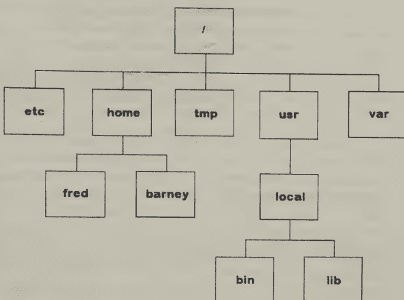

# UNIX 全攻略：从基础任务到系统管理

## 献辞

我的妻子 Alayna 以及我的孩子们 Dakota 和 Kiana。愿生活继续带给你们成功与快乐。

## 致谢

Robert 感谢 L.D. Bartholome 说服他申请了他的第一份 UNIX 系统管理员职位。此外，Robert 还要感谢 Rick Parker、Lynn Harris 和 Gordon Howell，感谢他们提供了从 RPG 程序员转变为 UNIX 系统管理员和数据库管理员的机会。这种职业路径的转变开启了新的机会之门。Robert 特别感谢他的朋友兼学习伴侣 Susan Mock，感谢她投入了大量时间进行校对和编辑工作。

# 1 UNIX 基础

本书旨在供 UNIX 和 Linux 操作系统的用户阅读。然而，在本文正文中，除非讨论的是 Linux 发行版特有的功能，否则所有讨论均指 UNIX 操作系统。我的意图是介绍 UNIX 操作系统用户和系统管理员都必须掌握的基础性及核心概念。我涵盖了从初级 UNIX 培训课程到中级系统管理课程的课题。

本书并不是作为一本系统管理手册。相反，它旨在作为一份路线图，向 UNIX 用户介绍 UNIX 系统的各种工具、命令、协议和程序。它的编写方式旨在提供层层递进的概念。每一章或主要主题领域将包含一个常用命令或工具选项表，以及一些语法示例和示例输出。此外，在每一章的末尾都有让你练习所学知识的机会。章节练习题的答案在书末页提供。我不建议你在第一次阅读本书时跳跃得太厉害。在初读之后，我希望你会发现这本书是一本实用且易于使用的快捷参考书。

## 本书使用的约定

以下提供的一系列约定，旨在帮助你理解书中示例以及其他主流 UNIX 文档源中使用的各种符号。我使用了行业标准的方法和约定，以帮助你无缝阅读本书并在 UNIX 机器上尝试练习，而无需翻译任何内容。

- Dot（点）。“点”不要与句号（period）混淆。点用于识别隐藏文件。如果文件名以点开头，那么在列出文件时，除非你指定显示隐藏文件，否则该文件不会显示。点也用于识别目录中的位置。一个点表示当前目录。两个点表示目录树中你当前位置的上一级目录。
- `file` - 对文件的引用。这是在命令语法中放置文件的位置。
- `filename` - 表示在此处插入你的文件名。
- `file.out` - 这是跟在它之前的任何语法之后的输出文件。
- `infile` - 这是命令的输入文件。
- `"` - 双引号之间的任何内容都是字面量（literal）。
- `#` - 井号。在 UNIX 世界中被称为哈标记（hash mark）。此符号右侧的所有内容都是注释，而不是代码。井号也常用作 root 用户的命令提示符，但这并不是系统的要求。书中的示例以 `#` 符号开头，表示我正在命令行提示符下运行这些命令。当你在 UNIX 系统上尝试这些示例时，不需要输入 `#` 符号。如果你输入了，将会得到错误。
- `!` - 感叹号。在 UNIX 世界中被称为 bang 符号（bang symbol）。bang 符号在比较语句中代替“not”一词，表示“不等于”。
- Environment Variables（环境变量）- 使用全大写字母表示。
- `/` - 斜杠。目录树中所有的斜杠都是正斜杠 `/`。（与微软操作系统的相反。）
- Blank Lines（空行）- 文件中的空行和其他空格会被忽略。

## UNIX 从入门到精通

- `[]` 方括号。每当书中首次引入一个新的 UNIX 命令时，它会被方括号括起来，以便你能在句子中更容易识别出它们。
- `{}` 圆括号。注释和示例被括在括号中。
- Tables 表格——当我谈到表格时，指的是类似于电子表格的图表，它包含带有标题的正规列的相关信息。

### 文件扩展名

文件扩展名是文件名点后面的字母。由于有许多类型的文件，我包含了一些常见类型。我认为这样更容易阅读和演示。

| 常用扩展名 |
| 扩展名 | 说明 |
| :--- | :--- |
| .bak | 备份文件 |
| .c | c源代码 |
| .c++ | c++ 源代码 |
| .cf | 配置文件 |
| .cnf | 配置文件 |
| .conf | 配置文件 |
| .dat | 数据文件 |
| .db | 数据库文件 |
| .dbf | 数据库文件 |
| .err | 错误日志文件 |
| .gif | 图形交换格式 |
| .gz | Gzip压缩文件 |
| .htm | HTML |
| .html | HTML |
| .idx | 索引文件 |
| .jar | Java 归档文件 |
| .ksh | Korn shell 脚本 |
| .lic | 许可证文件 |
| .lock | 系统锁文件 |
| .log | 日志文件 |
| .out | 脚本输出文件 |
| .pl | Perl 脚本文件 |
| .sh | Shell 脚本 |
| .tar | 归档文件 |
| .txt | 文本文件 |
| .war | Java Web 归档文件 |
| .Z | 压缩文件 |
| .zip | Zip 文件 |

### 常用目录名称

某些目录名称在 UNIX 的多个位置使用。你可能在运行于 UNIX 平台的应用程序中看到它们。这种标准化让我们直观地知道去哪里查找以及放置特定类型的文件。列表包含了常用目录的名称和说明。

| 名称 |  |
| :--- | :--- |
| bin | 包含可执行文件、工具和系统启动所需的就绪程序的目录。将其想象成物理存储桶。 |
| dev | 此目录包含支持设备的文件。 |
| etc | 包含配置文件的目录。在不知道自己在做什么之前，不要在这里乱搞。至少在编辑任何配置文件之前，要创建一个副本。在未来的某个时刻，你会感激自己采取了在更改前先备份的习惯。 |
| home | 这是一个充满子目录的目录。每个在系统中拥有账户的用户都应该有一个子目录。用户的家目录是用户登录系统时所处的位置。家目录是用户应该存储所有个人文件的地方。 |
| lib | 这是一个库目录。可以把它想象成物理图书馆，但它是用于程序的。你可能记得图书馆，在互联网出现之前我们去获取信息的地方。 |
| lost+found | 当检测到文件系统损坏后，由 `fsck`（文件系统检查工具）在此恢复文件。此目录通常是空的。 |
| proc | 此目录包含一组文件，每个文件包含不同类型的系统信息。例如，`cpuinfo` 文件包含有关系统处理器的信息。 |
| sbin | 此目录与 `bin` 目录非常相似。它包含可执行文件和实用程序。区别在于 `sbin` 包含只有 root 用户或管理员才有权限访问的内容。因此，默认情况下 `sbin` 不在用户的 `$PATH` 变量中。 |
| temp | 这是一个临时目录。不要在这里存放你需要保留的文件。此目录中的文件在系统重启后可能会消失。 |
| tmp | 这是一个临时目录。不要在这里存放你需要保留的文件。此目录中的文件在系统重启后可能会消失。 |
| usr | 这是一个存放系统二进制文件和应用程序的目录。大多数人将此目录读作“user”，但这里并不存储用户信息。`usr` 这个名字实际上是 UNIX Shared Resources（UNIX共享资源）的缩写。 |
| var | 这是操作环境的变量区域。我不确定 UNIX 创建者将其命名为 `var` 时是否是这个意思，但它看起来很合适，我是这样认为的。我所说的变量是指 `var` 中的内容始终在变化。该区域存放邮件队列、打印队列、日志……你明白意思了。不要让日志或邮箱因未检查而导致 `var` 满。如果它满了，你的操作系统将无法写入日志，你很快就会注意到性能问题，或者遇到意外重启。通常情况下这不是问题，但确实会发生。优秀的系统管理员会运行监控脚本，在空间开始充满时发送警报，并可能自动修剪日志。 |

斜杠 `/` 本身根目录的符号。根目录是整个 UNIX 操作系统的基础。 UNIX 操作系统的所有部分都使用此点作为绝对路径的起点。记住这一点的简单方法是将 UNIX 操作系统想象成一棵树。`/` “根”目录就是树的根。

```
/```

### 标准

尽管 UNIX 被视为开放系统，但仍有一些由供应商和开发者遵循的标准。遵循这些标准有助于确保应用程序和实用程序在不同 UNIX 平台和发行版之间的移植性。从 20 世纪 80 年代末开始，被称为 POSIX 的开放操作系统标准化工作为所有操作系统提供了共同基准；IEEE 根据主要的 UNIX 系统主要竞争变体的通用结构构建了 POSIX，并于 1988 年发布了第一个 POSIX 标准。大约同时，Open Group 产生了一个独立但非常相似的标准，称为 Single UNIX Specification（单 UNIX 规范）。随后形成了以下小组来开发 UNIX 的标准。

| 组组名称 | 描述 |
| --- | --- |
| GNU | GNU Not UNIX（自由 Linux） |
| ISO | 国际标准组织 |
| OSF | Open Software Foundation（开放软件基金会） |
| POSIX | Portable Operating System Interface（可移植操作系统接口） |
| SVID | System V Interface Description（系统 V 接口描述） |
| XOPEN | 一个成立于 1984 年的国际计算机供应商财团，旨在解决标准问题。X/Open 于 1996 年与 Open Software Foundation 合并成为 The Open Group。 |
| The Open Group | 一个为了开发开源标准而成立的厂商中立且技术中立的财团。 |

## UNIX 简介

UNIX 名称指的是最初由 AT&T 贝尔实验室的一群人在 $20$ 世纪 60 年代末到 70 年代初开发的计算机操作系统。创建 UNIX 操作系统的动力驱动因素是程序员需要一个多用户、多任务的操作系统。

操作系统的工作是控制处理器、内存和磁盘驱动器等系统硬件来执行有用的任务。当你想要计算机为你做某事，如启动程序、复制文件或显示目录内容时，必须由操作系统为你执行任务。

UNIX 设计背后的哲学是提供简单而强大的实用程序，可以将它们组合以执行各种任务。以下示例演示了如何结合使用三个 UNIX 命令生成详细列表，通过过滤器缩小输出以只查看所需文件，并按名称字母顺序对它们进行排序。

```
ls -al | grep txt | sort -k 9
```

## UNIX 从入门到精通

我不想过早地开始解释命令或代码语法，但只需说明上一个示例使用了三个 UNIX 命令、三个命令选项、两个重定向管道和一个搜索参数。听起来很复杂？不，你很快就会明白的。要记住的是，UNIX 充满了易用的命令，命令具有可以改变其行为的选项，并且命令可以结合使用以提高你正在执行的任务的效率。

最常被认为开发第一个 UNIX 操作系统的名字是 Dennis Ritchie、Douglas McIlroy 和 Ken Thompson。UNIX 这个名字从那时注册为全大写的 UNIX 商标。该商标目前的的所有者是 The Open Group，这是一个为 UNIX 操作系统的开发制定立标准的财团。UNIX 并不是一个缩写；相反，遵循用于大型计算机（Big computers）的命名约定，名称将由大写字母组成。

The Open Group 决定系统将符合并通过其 Single UNIX Specification 的认证，以便被称为 UNIX。所有其他接近但未通过认证的系统被称为 UNIX 类系统。你可能熟悉或至少听过一些流行的 UNIX 类系统。Linux 是这些系统之一，由于其易用性和在 Intel 平台上运行的能力，最近获得了巨大的人气。UNIX 和 UNIX 类系统的现代实现分为不同的小组或类别。这些不同版本的 UNIX 由商业供应商、大学和其他非营利组织开发。UNIX 社区将不同类型的 UNIX 称为变体（flavors）。各种变体广泛部署在从企业级服务器到笔记本电脑的硬件上。

较大的玩家（供应商）有时也会开发自己的 UNIX 变体，以便仅在其硬件或芯片设计上运行。运行 UNIX 的一些流行且健壮的芯片包括 IBM 的 RISC（精简指令计算机）和 SUN 的 SPARC（可扩展处理器架构）。虽然许多 Linux 变体因可以在廉价的 Intel 芯片上运行而受到青睐，公司发现可以用比以前大型企业级服务器更少的资金构建集群 Linux 环境。以下列表包含了一些开发了自己的 UNIX 变体或 UNIX 类操作系统的供应商。

| 常用名称 | 供应商名称 | UNIX 变体 |
| --- | --- | --- |
| BSD | Berkley Software Development | FreeBSD |
| BSD | Berkley Software Development | NetBSD |
| BSD | Berkley Software Development | OpenBSD |
| HP | Hewlett Packard | HP-UX |
| IBM | International Business Machines | AIX |
| Mac | Macintosh | Mac OS X |
| Novell | Novell | SuSE Linux |
| SCO | The SCO Group | UNIXWare |
| SUN | Stanford University Network | Solaris |
| SUN | Stanford University Network | Solaris x86 |
| SUN | Stanford University Network | SunOS |
| Redhat | Redhat | Linux |

UNIX 被设计为可移植的、多任务的、分时配置的多用户系统。UNIX 系统的特点是各种概念：使用纯文本存储数据；分层文件系统；将设备和某些类型的进程间通信（IPC）视为文件；以及使用大量的小型程序，通过命令行解释器使用管道（pipes）将它们串联起来，而不是使用一个包含所有相同功能的单一单体式程序。这些概念被称为 UNIX 哲学。

一些不属于 UNIX 哲学的内容包括直观的界面、对图形或图形硬件的需求，以及鼠标功能。这些功能在 UNIX 平台上都是可用的，但 UNIX 操作系统本身并不需要，经验丰富的 UNIX 用户同样不需要。在 UNIX 世界中，这些项目被视为奢侈品或装饰品。对我个人而言，我宁愿去折腾它们。我工作不需要它们，而且它们消耗了我宁愿投入其他地方的系统资源。当然，例外是你正将你的 UNIX 平台作为游戏服务器。那么就给那个哥们装满内存和你能找到驱动程序的最强显卡，然后尽情去玩吧。

当然，你总是可以编写自己的驱动文件，但该主题超出了本书的范围。也许在本书的第二卷中，我们能够讨论诸如编写自定义驱动程序以适应内核未知的硬件等话题。毕竟，对于内核来说，特定的硬件设备本质上就是，这样它就知道如何处理它以及如何与其通信。

### UNIX 名称的由来

“UNIX 的名字从哪里来？”你可能会问。在 20 世纪 60 年，AT&T、通用电气（GE）和麻省理工学院（MIT）合作开发了一个名为多路信息计算系统（Multics）的操作系统，它运行在 GE 的大型机上。Multics 项目从未取得过太大的商业成功，主要是因为其性能糟糕，但它的开发为交互式系统生成了新的能力，例如增强的安全功能。

在 Multics 项目结束后，AT&T 将其开发资源投入了一个新项目。该项目被命名为单用户信息计算系统（Unics）。一位名叫 Brian Kernighan 的开发者被认为贡献了 Unics 这个名字，但我想我们完全可以达成共识，它是对 Multics 项目名称的变体。后来，拼写被更改为 UNIX。

### 罗塞塔石

罗塞塔石刻有埃及文字和希腊文字。这些文字是使用圣形文字、世民文字和希腊字母书写的。之所以使用三种文字，是因为在书写它时，埃及正在使用三种文字。圣形文字用于具有宗教意义等重要文件。世民文字是埃及的常用文字。希腊语是当时埃及统治者的语言。罗塞塔石用所有三种文字书写，以便埃及的祭司、政府官员和统治者都能阅读它。它也可以用作翻译工具，因为它包含了不同语言和文字的相同内容。因此，如果你至少能读懂一种文字，你就可以对其他文字中的字符代表什么至少得出一个有根据的推测。

好了，你现在可能在对自己说，这些都很有趣，但与 UNIX 有什么关系？嗯，既然市上有这么多不同的 UNIX 版本（flavors），开发翻译文档以协助在不同版本的 UNIX 上执行常见任务就变得很有必要。在同一个环境中，发现由不同供应商制造、支持不同版本 UNIX 的服务器的数据中心是非常常见的。这些翻译文档可能以多种形式存在，但它们统称为“罗塞塔石”。

使用你选择的搜索引擎在互联网上进行快速搜索应该会给你几个罗塞塔石文档选项，或者至少提供足够帮助你工作的信息。尝试“UNIX Rosetta stone”看看你会得到什么。我刚刚试了一下，得到了 97,000 条结果。排名第一的是一个 Java 脚本，你可以在其中 17 种 UNIX 版本中进行选择并比较。

如果你有 DOS 或 PIC 等其他操作系统的经验，你可能会发现找到或创建一个罗塞塔石文档将那些命令翻译成 UNIX 命令是有帮助的。在你开始用你正在学习的新操作系统进行思考之前，这都是很有用的。我知道有一段时间，我如何随口就用 AIX 命令轻松地完成某些工作。然后我必须将它们翻译成 Solaris 命令，以便在 SUN 或富士一切服务器上完成任务。许多命令在不同的 UNIX 版本之间是通用的，但有时它们有不同的选项。

### UNIX 与带有图形窗口界面的流行操作系统对比

由于我们大多数致力于增强计算机和操作系统知识的人对于使用运行 Microsoft Windows 操作系统系统的个人电脑已经相当熟练，因此在 UNIX 和 Microsoft Windows 之间进行简短比较似乎是明智的。这并不是为了进行针对 Windows 的抨击。也不是为了进行一场关于 UNIX 如何比 Windows 更好的讲座。我只是觉得现在是引起你注意某些关于这两类操作系统在优缺点方面被公认的特征的好时机。然而，我想明确的是，我只是将这些项目作为我个人的观点。当然，如果你还没有形成自己的观点，欢迎你形成。


UNIX 操作系统是一个多用户和多任务环境。我的意思是，任何数量的人都可以登录到 UNIX 机器上执行独立任务，同时共享系统资源。UNIX 有许多内置的安全功能。这些功能不仅限制了人们登录 UNIX 机器，还规定了人在登录期间可以做的事情。UNIX 是所谓的开放系统。“开放系统”这一术语指的是修改操作系统以及用户环境的能力。UNIX 能够在多个平台上运行，它是可靠且健壮的，并为数据库、数据仓库、网络托管以及任何科学应用等重型事务提供了优秀的后端。

Microsoft Windows 操作系统是一个单用户环境。它拥有大多数人认为的用户友好的界面。它相对容易学习。它是个人电脑的主导操作系统。很容易获取兼容软件，也容易安装。话虽如此，不要指望因为更改了 Windows 桌面壁纸就让伯克利或斯坦福的人大惊失色。

### UNIX 从入门到精通

原始版本发生了巨大变化。由于经过了向 C 语言的完全重写，并且多年来由不同的供应商开发版本，上述内核的布局可能并不适用于你正在使用的版本。顺便提一下，当你读 `/usr` 这个名字时，你可能把它读作“user”，这通常被认为是正确的发音。但请注意，这个目录并不包含你的用户信息。我在书中通过不同的方式来阐述这一点，因为它非常重要。系统用户不应该在操作系统的 `/usr` 部分胡乱。无故这样做可能会对你的操作系统产生不利。`/usr` 目录实际上是 UNIX shared resources（共享共享资源）的缩写。这是你大部分命令所在的地方。

### 实用程序

实用程序是 UNIX 命令集的核心。这些程序包含了简单的实用程序，如电子邮件和文字处理，以及复杂的实用程序，如允许你向操作系统发布命令的 shell（壳）。UNIX 实用程序没有明确定义的子类别，因为 UNIX 的设计初衷是针对程序员的，不像那些为普通公众设计的操作系统那样直观。

某些实用程序显然用于系统或管理功能，例如用于创建新文件系统的 `mkfs` 或用于检查系统状态和完整性的 `fsck`。如果你尝试以 root 用户以外的用户登录并运行某个实用程序，你就会知道该实用程序是供系统使用的而非供普通用户使用的；操作系统会返回类似“`mkfs: Operation not allowed`”或同样粗鲁的消息。系统信息并不友好，但它们传达了意图。一旦学会了如何阅读它们，它们会非常有用。有时，它们会直接指出问题所在。例如，上一个信息告诉我我不被允许使用 `mkfs` 命令。换句话说，我登录的用户没有足够的权限访问或执行 `mkfs` 文件或命令。记住，在 UNIX 中，万一切皆文件。

### 系统配置文件

系统配置文件是一组为内核和实用程序提供指令的文件。内核和实用程序在启动时读取配置文件，以决定在执行期间如何行事。UNIX 内核和实用程序是灵活的程序，它们行为的某些方面是可以控制的。配置文件就是你执行这种控制的媒介。由于内核和实用程序在启动时读取配置文件，通常需要重启系统或重启服务或实用程序，配置文件的更改才会被注意到并生效。需要注意的是，“启动”对于内核和对于实用程序来说具有不同的含义。

对于内核来说，启动意味着重启操作系统。虽然可以通过重新读取配置文件让内核刷新自身，但重启整个操作系统要简单得多。然而，在实施更改之前，请确保你理解内核的更改将影响什么。我建议先在测试系统上进行任何系统更改。事实上，当你测试新的内核参数时，不仅要验证系统是否成功重启，还要验证所有正常的应用程序功能在一段时间内是否仍然正常。有时在更改配置后，问题需要一段时间才会显现。

对于实用程序来说，启动或重启比处理系统内核要简单得多。无论大多数实用程序是否在运行，操作系统都能良好运行。因此，你可以独立于操作系统关闭某个实用程序或其提供的服务。换句话说，让操作系统保持运行，直接杀掉该实用程序即可。然后使用正常的启动过程重新初始化并启动实用程序。如果它启动了，监控它一段时间，以验证你想要保留的老功能是否仍然存在，并验证你所做的更改是否实现了预期结果。

系统配置文件的一个示例是文件系统表（filesystem table）。根据你运行的 UNIX 或 Linux 操作系统系统的不同，文件系统表的命名也不同。我用过的一些“从入门到精通”系统将文件系统表命名为 `[vfstab]`、`[fstab]`。文件系统表是一个告诉内核挂载磁盘驱动器上所有文件系统以及何时挂载的文件。另一个示例是 syslog 日志 `[syslog.conf]`，它告诉内核如何记录它可能遇到的各种事件和错误。文件系统表和 `syslog.conf` 文件可以在 `/etc` 目录下找到。

### 协议

协议是操作系统必须使用以与其他计算机通信的一set规则。通过遵循协议标准，计算机可以理解针对特定任务的通信格式。例如，超文本传输协议（HTTP）概述了计算机网络浏览器解释其在服务器上访问的文件的规则，以便当服务器响应你对页面的请求时，能够在你的显示器上准确显示网页。

下表列出了一些你可能已经熟悉或在操作 UNIX 计算机时一定会遇到的常见协议。更完整的协议列表可以在位于 `/etc/inet/protocols` 的 `[protocols]` 文件中查看。这些协议支持的服务列表可以在 `/etc/inet/services` 的 `[services]` 文件中查看。

| 协议 | 说明 |
| :--- | :--- |
| FC | 光纤 |
| FTP | 文件传输协议 |
| HTTP | 超文本传输协议 |
| ICMP | 互联网控制消息协议 |
| IP | 互联网协议 |
| LDAP | 轻量目录访问协议 |
| NTP | 网络时间协议 |
| POP | 邮局协议 |
| TCP | 传输控制协议 |
| UDP | 用户数据报协议 |

你可能注意到了表格开头 Fibre Channel 的不同。虽然是我经常使用的有效协议，但除非你正在管理存储网络（SAN），否则你可能不会接触它。我将 FC 加入协议列表是为了让你意识到并不是所有的协议缩写都以“P”结尾。大多数都是，但并不是行业要求。此外，对于那些没有处理过 SAN 或光纤的人来说，纤维的正确拼写是 “fibre” 而不是 “fiber”。拼写检查器不喜欢 fibre，但事实就是如此。如果你想要 fiber，去吃个麦片松饼吧。

### 服务

服务是操作系统的一种工具或功能，可以为你提供某些功能。UNIX 环境中的大多数服务与网络或系统安全有关。例如，域名系统服务（DNS）将人类可读的名字转换为 IP 地址，反之亦然。对于两台或多个计算机之间的网络，这是一个非常有用的服务，因为操作系统使用 IP 地址来识别计算机，但人们记住 Web_Server 或 Jupiter 这样的名字比记住 192.168.10.1 这样的 IP 地址更容易。下表识别了 UNIX 系统可用的服务。

| UNIX 服务 | 说明 |
| :--- | :--- |
| mail | 电子邮件服务 |
| news | 打印新闻项目 |
| dns | 域名系统服务 |
| nfs | 网络文件服务 |
| nis | 网络信息命名服务 |
| whois | 用户用户名目录服务 |

### Shell

`shell` 是一种命令编程语言，为与 UNIX 操作系统通信并提出请求提供了接口。在窗口系统开发之前，shell 是 UNIX 用户唯一的可用接口。`/etc/shells` 文件将列出系统中所有可用 shell。如果这不是你系统上的确切位置，该文件也应该被称为 shells 或 “shell” 的某种变体。下面的插图展示了 shell 作为保护屏障的作用。就像物理上的外壳或墙一样，UNIX shell 保护内部免受外部发生的事情的影响或损坏。shell 是件好事。shell 的存在是有原因的。

下表列出了 UNIX 系统上常见的 shell：

| 描述 | 绝对路径 | Shell |
| --- | --- | --- |
| Bash shell | `/usr/bin/bash` | `bash` |
| Bourne shell | `/usr/bin/sh` | `sh` |
| C shell | `/usr/bin/csh` | `csh` |
| Korn shell | `/usr/bin/ksh` | `ksh` |
| Tcsh shell | `/usr/bin/tcsh` | `tcsh` |
| Zsh shell | `/usr/bin/zsh` | `zsh` |

在 UNIX 中，完成一项任务通常有多种方法。你会对某些方法产生偏好，这些偏好可能与其他方法不同。只要你记住没有哪种方法是唯一或最好的，这没有关系。为了演示这一概念，我列出了显示我正在使用什么 shell 的不同方法。这三种方法所需的按键次数大致相等。在其他情况下，不同方法使用的按键次数可能差异巨大。鉴于这种情况，我几乎总是选择按键次数最少的方法。然而，对于打字速度快的人来说，不断按退格键来纠正错误输入实际上是在浪费许多按键次数。

```
echo $SHELL
env | grep SHELL
set | grep SHELL
```

上述命令将给你略有不同的输出，但它们将包含你当前环境变量的值。要更改你激活的 shell，你需要更改环境变量的值然后进行导出（export）。`export` 部分告诉系统重新读取指定的环境变量并应用它。要将 shell 从其他 shell 改为 bash，你应该执行以下语法：

```bash
export SHELL=/usr/bin/bash
```

shell 的更改不会立即生效，直到你尝试使用某些功能为止。操作系统允许你运行多个嵌套 shell。然而，当你设置变量时，这些变量在嵌套 shell 中是不可用的。要返回到上一个 shell，只需输入 "exit" 并按一次回车键。请记住你运行了多少个 shell，或者你可以退出哪些 shell。

#### 标准输入和输出

标准输入和输出，或所谓的 I/O，指的是接口。如果你使用图形界面，标准输入来自键盘或鼠标，而标准输出发送到屏幕。其他类型的输入和输出可以来自或发送到命令以及其他设备。

一个命令的输出可以作为另一个命令的输入。`|` 字符被称为管道（pipe）。就像你家里水路中的管道一样，它将东西从一个地方传输到另一个地方。只有在这种情况下，我们使用管道来传输数据。数据通过管道从左向右流动。因此，管道左侧命令的输出就变成了管道右侧命令的输入。请尝试以下命令。它是无害的。在预告之前，它告诉此命令将一次一页地显示活动进程信息。使用回车键翻页。如果你使用的系统没有该命令，请用 `more` 命令代替它。

```bash
ps -ef | more
ps -ef | more
```

### 入门

#### 连接到 UNIX

你有几种方法可以访问 UNIX 系统。访问 UNIX 机器的主要模式是通过终端。终端包括键盘和视频显示器。内核（Kernel）运行一个名为 `getty` 的进程，它连接到 UNIX 系统，接受来自终端的输入并将输出发送到终端。`getty` 进程是实用程序，必须告知终端的能力以便正确地读取和写入终端。如果 `getty` 进程接收到关于终端类型的错误信息，可能会发生意外。要显示当前的终端类型，请在命令提示符处输入以下语法：

```bash
echo $TERM
```

要将当前的终端类型更改为 vt100，请在命令提示符处输入以下语法：

```bash
export TERM=vt100
```

我发现 vt100 或 vt220 是运行在个人电脑上的终端程序的正确仿真。如果你使用的只是哑终端（dumb terminal），你应该能够准确地告诉操作系统你正在使用哪种显示器。显示器正面应该显示它是什么类型的显示。如果没有，旧的 "wyse60" 似乎在许多哑终端上都有效。wyse60 仿真模拟了 Wyse 60 型终端的外观，因为它具有高分辨率字符单元可以显示清晰的字符而很受欢迎。当你通宵工作，因为有人承诺你会在不合理的时间内交付任务，而你最后只能收拾局面时，你会感激这些高分辨率字符的。

### 系统控制台

控制台是一种在系统启动时被识别的特殊终端。某些 UNIX 系统操作必须在控制台上执行。通常，只有系统管理员可以访问控制台。拥有大量架式服务器的设施没有空间为每个服务器单独连接物理控制台。出于这个原因，某些供应商在其硬件设计中集成了一个端口，可以通过管理网络连接或临时笔记本电脑连接进行访问。我之所以说“临时”，是因为 UNIX 执行其功能不需要连接控制台。它只是在维护或某种类型的故障阻止了远程连接时才需要它。

SUN Microsystems 在其系统中开发了所谓的 LOM（带外外管理，Lights Out Management）端口。只要服务器连接了电源，即使操作系统宕机，LOM 端口也将保持功能正常。LOM 连接允许系统管理员在系统无法完全运行或无法使用连接时进行维护。其他版本包括 ALOM、iLO 或 IDMI。

### 哑终端

某些终端被称为“哑”终端，因为它们仅具有向 UNIX 系统发送字符作为输入以及从系统接收字符作为输出的能力。它们本身不能执行程序或在本地进行任何计算。个人电脑通常被用来仿真哑终端，因此它们可以远程连接。你有很多选择。许多是免费的，有些则不是。我在工作和家里都使用同一个免费程序。它被称为 "putty"，我强烈推荐它。价格很合适，你可以自定义并保存会话参数，并且它提供了不同的连接方法，包括大多数安全意识型组织都要求的 ssh。要获取 putty 副本，只需用你喜欢的搜索引擎搜索它即可。它很小且便携。我会在 U 盘上携带一个 putty 副本，这样就可以通过极少的设置访问我习惯的工作环境。我也把一个副本放在 CD 中，放在公司的灾难恢复箱里。这是一个好主意，你永远不知道在灾难发生后是否还能从互联网下载东西。

## 从入门到精通

与主服务器通信以网络中的所有客户端。每个客户端都使用其功能来执行任务并与网络上的其他服务器连接。对于每个用户来说，环境呈现为他们自己的桌面，但只需极小的代价就能大大减少功耗或影响。客户端设备几乎没有产生发热。

### 别名

`alias` 机制用于创建用户定义的标识符到命令，或者在命令行使用时执行的命令列表。简单来说，`alias` 命令允许用户记住单个单词或复杂的命令。在许多 UNIX 系统中看到的 `df` 命令几乎总是带有常用的选项，如 `-k` 或 `-h`，取决于用户的喜好。因此，当用户创建一个 `df` 的别名时，用户只需要在命令行中输入 `df` 即可。显然，这个例子并不是为了记忆复杂的命令，而是使用 `alias` 命令来节省击键次数。

`alias` 命令可以显示当前 shell 中激活的别名，无需任何参数。如果命令语法要求两个问号，例如 `stuff??`，那么那三个不符合的文件将符合列表，而原始符合的文件将不符合。这三个原始符合的文件将不再符合，因为 `stuff??` 要求任何两个额外的字符，而不是一个或两个。

`alias` 命令可以显示当前 shell 中激活的别名，无需任何参数。如果别名定义错误，或者你只是想删除别名，请使用 `unalias` 命令。`unalias` 命令的参数是你想要删除的别名名称。在 `.profile` 文件中定义的别名仅在特定的会话中可用。

在用户的 `.profile` 文件中定义的任何内容在用户登录系统时都会被定义。此外，如果所有用户都需要相同的别名，系统管理员可能会为所有用户定义。这项任务取决于系统管理员的喜好以及所使用的 UNIX 风格。执行此任务的常用方法是将别名定义插入 `/etc/profile` 文件。该文件在有人登录系统时都会被读取。以下两个示例演示了如何为单个命令定义别名，以及如何为命令字符串定义别名。

```
alias newcommand=oldcommand
```

```
alias newcommand='old command'
```

### UNIX 命令输入规则

### 通配符

以下特殊字符被称为通配符。它们可以同时列出或搜索多个文件，这可以节省大量的击键和时间。如果你学会了有效地使用通配符，你将是一个更快乐、更高效的 UNIX 用户。

| 通配符 | 描述 |
|---|---|
| `?` | 匹配任意单个字符。 |
| `*` | 匹配任意单个或多个字符。 |
| `[]` | 匹配 [] 内的字符。 |

以下是使用上述通配符的一些示例：

```
ls stuff?
```

上述命令将列出当前目录下任何以“stuff”开头并后跟一个字符的文件。因此，如果当前目录下存在以下文件，它们将出现在结果中（stuff1, stuffs, stuffy）。某些不会出现在结果中的文件是（stuff11, stuffed, stuff）。这些文件名不符合列表，因为它们以单词“stuff”开头，且后面跟了多个一个字符。如果命令语法要求两个问号，例如 `stuff??`，那么那三个不符合的文件将符合列表，而原始符合的文件将不符合。这三个原始符合的文件将不再符合，因为 `stuff??` 要求任何两个额外的字符，而不是一个或两个。

### `ls stuff*`

上述命令将列出当前目录下任何以“stuff”开头的的文件。因此，后续列表中所有名称都符合（stuff, stuff1, stuffs, stuff, stuffy）。星号字符接受任何额外的字符或一个接受。

### `ls stuff[1,2,y,z]`


上述命令将列出当前目录下任何以“stuff”开头并后跟方括号内字符的文件。因此，如果当前目录下存在以下文件，它们将出现在结果中（stuff1, stuff2, stuffy, stuffz）。某些不会出现在结果中的文件是（stuff11, stuff3, stuffy1）。这些文件名不符合列表，因为它们以单词“stuff”开头，且后面跟了多个一个字符，或者不是方括号内的字符。

## 命令选项、参数和强制空格

*选项 (Options)* 是命令支持的变体。选项通过在命令后输入一个空格、紧跟一个横杠“-”（大多数情况下）以及所需的选项字符来指定。我之所以说“大多数情况下”，是因为大多数命令都需要横杠，但并非所有命令都是。然而，不需要横杠的命令会允许其存在而不会报错，因此稳妥的做法是始终包含横杠。

一个命令的选项字符可能用于另一个命令的不同用途。在 UNIX 用户中你可能听到的另一个流行术语是“标志”（flag）。命令标志（flag）和命令选项（option）是同一个东西。这两个术语都是接受的，并且被经常使用。如果有人不知道你在说什么，就说“标志”（flag）。参数（argument）是命令的主体或目标。它位于命令的最后。例如：在命令字符串 `tar -cvf file.tar` 中，`c` 表示创建。选项之间不需要空格，除非选项本身以横杠开头。

## ROBERT B. FAY

| Bugs | 在当前操作系统版本发布时已知的问题或“错误”。 |

帮助页（man pages）是非常宝贵的资源，可以持续帮助你学习 UNIX 操作系统。然而，帮助页条目包含的信息通常比你需要的多得多。不要害怕浏览帮助页以找到你需要的内容，然后继续。

寻找你所需内容的一种极方法是使用 `vi` 的搜索功能。打开帮助页后，输入正斜杠字符 `/` 而不按回车键。系统现在等待你输入搜索词。输入你想搜索的内容并按回车键。系统将跳转到帮助页中搜索词第一次出现的地方。如果你想跳转到下一个匹配项，只需按“n”键；如果你用力过过了“n”键，只需按“b”键即可返回。要了解如何使用帮助页，请使用 `man` 来查找 `man`。此外，还要学习 `vi` 的导航函数。通读整个帮助页非常耗时且无聊。

## 命令未找到错误 (Command Not Found)

命令未找到错误非常常见。它通常意味着你不是拼写错了所需的命令，就是它不在你的 `$PATH` 中。如果你通常不需要在路径中使用该命令，可以通过输入命令的绝对路径来执行它。如果你位于可执行文件所在的目录，可以在命令前加上一个点和正斜杠“`./`”来执行它。这种前缀技巧仅适用于帮助你执行 `$PATH` 找不到但你拥有相应执行权限的文件。如果你不拥有该文件，或者该文件没有设置执行位，那么从本地目录执行命令或将可执行文件的路径添加到你的 `$PATH` 变量中都是徒劳的。然而，如果你没有执行该文件的权限，或者没有设置执行位，你将得到不同的错误。在这两种情况下，错误将显示为“Permission denied”（权限被拒绝）。

## 重定向文件和输出

可以通过以下命令实现文件和输出的重定向：

| 命令 | 名称 | 描述 |

| | | |

| | | 管道 (pipe) | 将管道左侧命令的输出作为管道右侧命令的输入。 |

| `>` | | 将输出发送到新文件或覆盖现有文件。 |

| `>>` | | 如果指定的文件不存在，则输出发送到新文件。如果指定的文件已，则将输出追加到文件末尾。 |

| `tee` | `tee` | 同时将输出发送到两个地方，如标准输出和文件。 |

以下示例演示了重定向符号的使用。

```
#ls -al | grep x
```

上面的命令字符串将 `ls -al` 命令的输出发送给 `grep` 命令。然后 `grep` 命令只显示 `ls -al` 输出中包含字母“x”的行。结果仅列出可执行文件或文件名包含字母 x 的。

```
#ls -al > file.out
```

上面的命令字符串将 `ls -al` 命令的输出发送到名为 `file.out` 的文件中。如果 `file.out` 之前不存在，它将被创建。如果 `file.out` 之前存在，它将被覆盖。无论何种情况，输出只发送到文件。屏幕上不显示任何输出。

## `ls -al | tee file.out`

上面的 `tee` 将 `ls -al` 命令的输出发送到屏幕以及一个名为 `file.out` 的文件。如果 `file.out` 之前不存在，它将被创建。如果 `file.out` 之前存在，它将被覆盖。注意，在这种用法下使用时，`tee` 命令需要管道的帮助。这是因为 `tee` 正在执行命令功能，而不仅仅是重定向输出。

## 引用规则 (Quoting Rules)

UNIX shell 使用三个字符进行引用：单引号（'）、双引号（”）和反斜杠（\）。下表解释了不同的引用方法以及何时使用它们。引用允许字符作为字面量使用。这允许操作系统忽略通常会被视为命令的特殊字符和单词。

| 类型 | 描述 | 何时使用该引用方法 |

| --- | --- | --- |

| `\` | 反斜杠 | 反斜杠 (`\`) 保护下一个字符，除非它是换行符 (`\n`)。如果反斜杠在换行符之前，它会防止换行符被解释为命令分隔符。 |

| `'` | 单引号 | 单引号 (`'...'`) 保护所有内容（甚至是反斜杠、换行符等），直到遇到下一个单引号。 |

| `"` | 双引号 | 双引号 (`"..."`) 保护除双引号、反斜杠、美元符号和反引号之外的所有内容，直到遇到下一个双双引号。反斜杠可以用于保护双引号内的 `", \, $` 或 `` ` ``。 |

## UNIX 基础练习：

- 1. 列出你当前目录下文件名中包含“a”的所有文件。
- 2. 将命令的输出发送到现有文件的末尾而不覆盖文件。
- 3. 谁决定了 UNIX 操作系统的标准？
- 4. “?” 通配符用于什么？
- 5. 使用轻量级客户端（thin client）有两个优势？
- 6. 使用帮助页学习如何使用帮助页。
- 7. 显示激活的别名（aliases）。
- 8. 显示激活的环境变量。
- 9. 仅显示 TERM 环境变量的值。
- 10. 什么是协议？

## 2 操作文件

## 复制 (Copy)

复制 `[cp]` 命令顾如其名。它根据你指定的任何名称为原始文件创建一个副本。复制命令的语法为 `cp [options] original_file new_file`。虽然新文件的内容将匹配原始文件，但新文件将被分配它自己的 inode。inode 是操作系统用来跟踪文件的。我们稍后会详细讨论 inode。

新文件将继承默认权限而不是原始文件的权限。如果你需要确保新文件拥有原始文件相同的权限，你将希望使用 `-p` 选项。在与复制命令配合使用时，`-p` 选项会保留所有者和权限。

你不需要在复制命令中涉及的源目录或目标目录工作。然而，如果你从当前工作目录以外的目录进行复制，你需要提供文件的绝对路径。如果你需要复制整个目录（包括其内容和任何可能的子目录），你将需要使用 `-r` 选项。`-r` 选项从起点开始递归复制，直到最内层子目录的最后一个文件被复制。

## UNIX 从入门到精通

| 命令 | 选项 | 描述 |

| --- | --- | --- |

| `cp` | | 复制文件。 |

| | `-p` | 保留所有者和权限。 |

| | `-r` | 递归复制。 |

有时你需要将文件从一个服务器到另一个。此任务可以通过远程复制命令 `[rcp]` 实现。使用此命令需要一些网络配置才能工作。基本上，参与 `rcp` 语法的两台机器需要相互感知。通过在 `.hosts` 和 `/etc/hosts.equity` 文件中创建条目来实现。这两个文件用于提供信任的远程认证。具体说明，你应该查阅你特定 UNIX 版本的 `.hosts` 和 `hosts.equity` 帮助页。这些文件的配置还将启用 `[rlogin]`（远程登录）和 `[rsh]`（远程 shell）命令的使用。`rcp` 命令的语法为 `rcp original_file_remote_hostname:new_file`。在 `hosts.equity` 和 `.hosts` 文件正确配置后，执行 `rcp` 命令时系统不应要求输入用户名或密码。

对于需要额外安全级别的环境，UNIX 提供了安全复制 `[scp]` 命令。`scp` 命令与非常相似

`scp` 命令除了使用 shell `[ssh]` 进行身份验证外，在开始复制过程之前，`scp` 会要求输入密码以访问远程服务器。

| 命令 | 选项 | 描述 |

|---|---|---|

| `scp` | | 从远程主机安全地复制文件。 |

| | `-C` | 启用压缩。这会将 `-C` 标记传递给 `ssh`。 |

| | `-P` | 保留原始文件属性，如模式、访问时间和修改时间。 |

| | `-P port #` | 用于连接到远程主机上的特定端口。 |

| | `-q` | 关闭默认的进度表。 |

| | `-r` | 递归复制目录 |

| | `-v` | 详细模式。使 `scp` 和 `ssh` 显示进度信息。可用于调试。 |

复制文件的另一种形式是为它创建一个链接。软链接（符号链接，symbolic link）本质上是文件在新位置的虚拟副本。当你为文件创建符号链接时，它并不会创建文件的副本，而是简单创建一个指向原始文件的指针。

硬链接和软链接之间存在一些区别。最重要的一点可能是硬链接不能跨越文件系统，而软链接可以。此外，硬链接中第一个创建的文件与之后创建的文件具有相同的状态。与硬链接不同，软链接（或常说的符号链接）完全依赖于原始文件。

如果一个文件已被删除但仍有进程打开着它，你暂时将获得一个没有链接的节点（inode）。当最后一个引用该文件的进程完成时，该文件将从 inode 表中移除。

如果你使用 `ls` 命令列出包含符号链接的目录内容，你将看到文件名与其他文件一起列出。这看起来该文件是该目录的本地文件。但如果你使用 `ls` 命令显示目录内容的详细列表，左侧的第一个字符将显示为“l”，以标识该文件实际上是一个链接。`ls -l` 输出的最右侧列将显示文件名，后面是一个指向右的箭头，然后是原始文件的名称。如果链接不在当前目录中，在创建链接时必须通过绝对路径来识别原始文件。否则，你将收到一个错误，提示原始文件不存在。如果你弄错了文件名和链接名的顺序，也会收到同样的错误。以下示例说明了创建硬链接和软链接的命令语法：

```
#ln original_file link    （创建一个硬链接）
## ls -i /scripts/file1
358979 /scripts/file1
## ls -i /scripts/dir1/file1
358979 /scripts/dir1/file1
```

上面的输出证明，原始文件 `/scripts/file1` 和位于 `/scripts/dir1/file1` 的硬链接使用相同的 inode 来识别。因此，尽管该文件似乎存在于两个地方，但对操作系统而言，它只有一个文件。

```
#ln -s original_file link    （创建一个软链接）
## ls -i /scripts/file2
358980 /scripts/file2
## ls -i /scripts/dir1/file2
413703 /scripts/dir1/file2
## ls -al file2
lrwxrwxrwx 1 root  root  14 Oct 23 15:52 file2 -> /scripts/file2
```

## ROBERT B. FAY

上面的输出证明，原始文件 `/scripts/file2` 和位于 `/scripts/dir1/file2` 的软链接或符号链接使用的是唯一的 inode。操作系统将原始文件和软链接视为独立的文件。然而，如果你查看 `ls -al` 输出，你可以看到软链接明显指向原始文件，如输出右侧的箭头和输出开头的“l”（代表 link）所示。

## 移动或重命名

在 UNIX 世界中，move（移动）和 rename（重命名）是同义词。事实是，并没有 `rename` 命令。这两个功能都通过 `move [mv]` 命令完成。这是因为对于 UNIX 来说，将文件从一个位置移动到另一个位置等于将文件从一个名称移动到另一个名称。记住，UNIX 使用文件的 inode 来重命名其位置。名称只是为了我们人类。你不需要位于移动命令语法的源目录或目标目录即可在它们之间移动文件。在同一目录内移动文件的语法是 `(mv oldfile newfile)`。将文件从当前目录移动到 `/tmp` 目录的语法是 `(mv oldfile /tmp/newfile)`。实际上，如果新位置的文件名相同，你可以少按几次按键并使用 `(mv oldfile /tmp/)` 语法。`/tmp/` 结尾最后的斜杠告诉 UNIX 将其以相同的名称放入 `/tmp` 目录。

顺便提一下，如果你将文件移动到新目录，始终使用绝对路径是个好主意，这样它就会出现在你想去的地方。如果你丢失了文件，可能被迫学习如何使用 `[find]` 命令。实际上，你本就学习如何使用 `find` 命令，但在你必须寻找某东西之前学习如何使用它更好。这样你更有可能成功找到它。

## 或删除

`remove [rm]` 命令自言自义。它用于删除文件或目录。使用此命令要小心。UNIX 没有回收站。如果你删除了一个文件，它就消失了。下一节将讨论如何查找文件、如何生成列表以及如何打印文件。

## Find 命令

`find` 命令的作用正如其名。它寻找东西。`find` 命令有非常有用的操作数，可以与其结合，帮助你通过名称、年龄或大小查找文件。我最喜欢的查找命令的方法是使用名称操作数，因为它允许使用通配符。这意味着我不需要确切知道文件的文件名就能找到它。此外，在大型系统中查找文件可能需要一些时间，所以如果你知道文件位于系统的哪个部分，或者至少是哪个文件系统，可以通过告诉 `find` 从哪里开始来大大缩短搜索时间。在 `/tmp` 目录开始查找名为 `test1` 的文件的语法如下：

```
find /tmp -name test1
```

## ROBERT B. FAY

上述命令的命令行语法分解如下所示：

| 命令 | 从哪里开始查找 | 使用的操作数 | 文件名 |

|---|---|---|---|

| `find` | `/tmp` | `-name` | `test1` |

如果我们不知道去哪里查找，我们可能需要在几个目录或文件系统上运行命令才能找到它。或者，如果你拥有 root 或超级用户权限，可以从“/”根目录开始查找。这告诉 `find` 命令从根目录开始在系统范围内范围内进行查找。我不建议在没有 root 权限的情况下从根目录开始查找的原因是，你的屏幕将充斥着你没有权限查看某些位置的警告信息。如果你确实拥有 root 权限，那么尽管去吧。运行 `find` 命令不会造成任何伤害。如果我们想查找一个名称中包含“test”单词的文件，且完全不知道去哪里查找并且拥有 root 权限，命令语法将如下：

```
## find / -name *test*
```

## UNIX 入门指南

| | 起始 | 用法 | 在其中“测试” |

|---|---|---|---|

| `find` | `/` | `-name` | `*test*` |

### ls (列出) 命令

`ls` 或 `list` 命令可能是最容易记忆且使用最频繁的命令。在 UNIX 系统的任何位置输入 `ls`，你都将获得当前所在目录中所有可见文件和目录的列表。要生成你并不所在的某个目录的类似列表，你可以先进入该目录，或者直接将绝对目录路径作为输入传递给命令。`ls` 有许多可以配合使用的选项，向你展示各种信息或信息的排列方式。我通常使用 `-a` 和 `-l` 选项。

`-a` 用于显示当前目录的所有内容。记得我之前提到过 `ls` 会显示所有可见的文件和目录。如果你使用 `-a` 选项，你还能看到隐藏的内容。隐藏内容是指任何以点（dot）或周期作为第一个字符的文件或目录。`-l` 选项用于长格式输出。我使用这个选项来显示与我查看的对象的所有权、权限等相关的所有信息。虽然 `-a` 代表 all（全部），但我告诉自己 `-al` 在一起意味着全部，因为这样我就可以看到所有文件以及与文件相关的所有信息。这是我刚开始学习 UNIX 时最容易记忆的方法。其他常用且有时有用的 `ls` 命令选项包含在下表中。

| ls 命令选项 | 命令 | 选项 | 描述 |

|---|---|---|---|

| | `ls` | | 列出目录内容。 |

| | `-a` | 显示所有文件，包括隐藏文件。 |

| | `-c` | 与 `-lt` 一起使用时，按修改时间顺序显示文件。 |

| | `-g` | 以长格式显示文件，显示组名但不显示所有者。 |

| | `-h` | 以人类可读的格式显示。 |

| | `-l` | 以长格式显示文件。 |

| | `-t` | 按创建时间顺序显示文件。 |

ROBERT B. FAY

### GREP (全局正则表达式解析器) 命令

*grep、egrep 和 fgrep 命令* 可用于在文件中搜索参数。`grep` 命令的默认输出是显示包含搜索参数的文件的整行。当你处理大文件或生成大量页面输出的命令时，`grep` 命令非常有帮助。`grep` 命令被用作过滤器。它们扫描输入并仅返回包含指定模式的行作为输出，省略其他部分。`grep` 实际上是 Global Regular Expression Parser（全局正则表达式解析器）或 Print（打印）的缩写。`egrep` 版本使用完整的正则表达式，包括完整的字母和特殊字符集。`fgrep` 是 `grep` 命令的快速版本。它使用不同的算法，搜索字符串而不是模式。

| 命令 | 选项 | 描述 |

|---|---|---|

| `grep` | | 搜索包含模式的行。 |

| | `-c` | 返回包含模式的行数。 |

| | `-i` | 搜索包含小写或大写形式模式的行。 |

| | `-l` | 返回包含模式的文件名。 |

| | `-n` | 在文件中的每行前加上其行号。 |

| | `-v` | 搜索不包含模式的行。 |

| | `-w` | 搜索作为独立单词包含模式的行。 |

## UNIX 进阶

### file 命令


`file` 命令用于发现你正在查看或处理的文件类型。与其他操作系统不同，UNIX 不需要不同类型的文件包含文件扩展名来识别文件类型。你可以使用像 `txt` 或 `exe` 这样的扩展名，但扩展名仅为了人类方便。UNIX 操作系统不需要它们。当你需要知道某个文件的类型时，只需使用 `file` 命令。其语法非常简单。你可以通过输入 `file *` 显示本地目录中所有文件的类型，也可以通过名称指定特定文件，如下：`file filename`。以下在一个包含 tar 文件、子目录、文本文件、zip 文件和可执行脚本文件的目录执行 `file` 命令的输出示例。

```
file *
```
- `coins.tar`: USTAR tar 归档
- `dir1`: 目录
- `file1`: ascii 文本
- `stuff.zip`: ZIP 归档
- `test`: commands 文本

### awk 编程语言

`awk` 编程语言（有时称为 awk 编辑器）用于格式化输出并省略命令输出中的不必要信息。下面的示例通过管道将输入重定向到 `awk`。它用于从输入中选择所需的字段并显示在标准输出上。第二个示例显示了不使用 `awk` 格式化输出的结果。在本节中提到 `awk` 仅是为了说明其作为查找和解析信息工具的用处。欲更多示例和命令选项，请参见详细讨论 `awk` 的章节。以下两个示例说明了使用 `grep` 查找主题与结合 `grep` 和 `awk` 查找主题并剔除你不感兴趣的信息之间的区别。

```bash
#df -h | grep swap

swap        5.3G 48K 5.3G 1% /var/run
swap        512M 768K 511M 1% /tmp
```

## 为输出添加行号

要在命令行输出中添加行号，你可以使用 `nl` 命令或带有 `-n` 或 `-b` 选项的 `cat` 命令。`nl` 命令的默认行为是在文件的每行开头插入行号，并将文件显示到标准输出。原始文件不会被修改。行号只会显示在屏幕上。`cat` 命令在配合 `-n` 或 `-b` 选项时与 `nl` 命令类似。当对 `cat` 命令使用 `-n` 选项时，其行为如本章之前所述，不同之处会在每行前面加上相应的行号。当对 `cat` 命令使用 `-b` 选项时，它会在包含任何打印字符的每行前面加上行号。换句话说，它不会对空行显示行号。我告诉自己 `-b` 代表“no blanks（无空行）”，或者说这能帮我记住该选项的用途。因此，如果你需要确切知道文件中有多少行，将需要使用 `nl` 命令或 `cat -n` 命令。如果你不需要确切的数字，或者只需要知道文件中有多少行包含文本，那么 `cat -b` 选项就能满足你的需求。

## 显示横幅

`banner` 命令基本上用于吸引用户的注意力。横幅通常用于广播脚本、程序或某些需要用户交互的任务的完成状态。在命令行或脚本中执行 `banner` 命令时，其后的任何单词或字面量都将以井号（或磅符号）的形式显示在屏幕上，高度为六或七字符，具体取决于原始字母是小写还是大写。如果你不想使用横幅输出的默认尺寸和方向，`banner` 命令提供了修改输出尺寸和方向的选项。使用 `man` 命令进一步探索 `banner` 命令的选项。

为了更好地理解此输出，请观察以下示例命令行参数以及示例输出。如你所示，尽管横幅参数中的第一个字母是大写字母，但在输出中，所有的字母都以大写形式显示。区别在于，在横幅输出中，原始的大写字母比单词的其他部分高出一个字符。

### banner Hello

```
# #
# # ###### # ####
# # # # # #
# ####### # #
# # # # # #
# # # # # #
# ###### ###### ###### ####
```

## 在 UNIX 中显示 DOS 文件

在 DOS 或 Windows 环境中创建或修改的文件通常包含控制字符、行结束标记符或回车符号。由于这些符号对 UNIX 来说是陌生的，UNIX 内核无法正确解释这些字符，可能会错误地处理或显示这些文件。为了处理这种情况，发明了 `dos2unix` 命令来剔除这些不可接受的字符，使文件能够被 UNIX 正确读取。因此，如果你认为文件由于原因损坏且不明原因，请在放弃之前尝试使用 `dos2unix` 命令转换文件。最坏的结果是文件仍然损坏，所以你并无损失。

相反，存在一个 `unix2dos` 命令用于在 UNIX 环境下创建或修改的文件插入特殊字符，以便文件能够在 DOS 或 Windows 环境中被正确处理、显示或打印。如果你将用 UNIX 系统上的编辑器创建的文本文件发送到 Windows 环境，该文件是可读的，但由于没有行结束标记或回车字符，Windows 环境中的文字处理程序通常会将每个段落显示为一个长行。你可以通过在文字处理器中屏幕应该换行的地方按回车键来修复，或者在 UNIX 系统上用 `unix2dos` 命令转换文件。以下两个示例演示了 `dos2unix` 和 `unix2dos` 命令的正确用法：

```
#dos2unix dosfile unixfile
```

### unix2dos unixfile dosfile

## 打印文件

与其他操作系统一样，打印文件的方法是将文件的副本发送到打印队列。打印队列是一个打印任务等待打印的暂留区域。在 UNIX 中，必须为操作系统将发送打印任务的每台打印机配置打印队列。打印任务将停留在打印队列中，直到操作系统唤醒打印机并告诉它队列中有等待打印的任务；或者如果打印机已激活状态，打印任务可能会停留在队列中，直到队列中前面的任务完成且打印机设备准备好处理它。如果系统只配置了一个打印队列，那么它就是操作系统知道的唯一打印机，并将成为所有打印任务的默认打印机。然而，如果配置了多个打印队列，则需要使用 `lp` 命令将打印任务定向到特定的打印队列。

`lp` 命令可以将打印任务发送到打印机。如果只定义了一个打印队列，语法简单为 `lp filename`。但如果你的操作系统定义了多个打印队列，你将需要 `-d` 选项将打印任务定向到特定的打印机。因此，如果你想将打印任务发送到命名为 `printer1` 的打印机，可以在命令行提示符处输入以下语法：

```
#lp -d printer1 printme
```

> （其中 `printme` 是要打印的文件名。）

要验证打印任务是否发送到了正确的打印队列，可以使用 `lpstat` 命令，它将向你显示所有定义打印队列的状态。`lpstat` 只显示当前队列中等待打印的任务。

## UNIX 从入门到精通

| 命令 | 选项 | 描述 |
| --- | --- | --- |
| `lp` | | 打印行。 |
| | `-d` | 指定打印任务的目标地。 |
| | `-m` | 在打印任务完成后发送电子邮件。这假设服务器上已配置了邮件服务。 |
| | `-q` | 设置打印任务的优先级。 |

## 在文件中替换或删除文本

`tr` 命令可将文件中的字符翻译为另一个字符。除非另有说明，输出将发送到标准输出。这意味着默认情况下文件内容不会发生实际更改，但屏幕上会显示后的结果，就像文件已经修改过一样。这是一个重要的安全功能，允许你在将更改提交到文件之前，查看所选择的命令语法将产生什么。要修改文件，你需要将输出重定向到文件。以下示例演示了如何为 `tr` 命令定向输入和输出。在下一个示例中，`file1` 将发送到标准输出，但任何出现的字母 `k` 都被删除。`file1` 的内容将保持不变。

### tr -d k < file1

在下一个示例中，`file1` 将作为 `tr` 命令的输入。`-s` 将将任何出现的小写 `k` 翻译为大写 `K`。输出将发送到 `file2`。`file1` 的内容将保持不变。如果 `file2` 已经存在，它将将被覆盖。

### tr -s k < file1 > file2

## ROBERT B. FAY

此时，如果你真的想更改 `file1` 中所有的 `k` 为 `K`，你只需要将 `file2` 移动到 `file1` 即可。尽管为了数据起见，你应该先为 `file1` 制作备份。在操作数据时，这总是一个好主意，因为结果并不总是符合你的预期。要用修改后的版本 `file2` 替换原始文件，请使用以下语法：

```
#mv file2 file1
```

下表定义了配合 `tr` 命令使用的标志。

| 命令 | 选项 | 描述 |
| --- | --- | --- |
| `tr` | | 将单个字符翻译为另一个。 |
| | `-d` | 删除指定的字符。 |
| | `-s` | 用另一个字符替换单个字符。 |

下表包含了在文件中操作字符串的方法示例。这些只是一些让你开始思考的快速示例。显然，这些方法可以组合、修改，并结合其他 UNIX 命令。你应该不断尝试这些场景，直到你理解了每个部分在做什么，然后开发出适合你需求的方法。一旦你熟练了这类操作，你就可以通过编写命令字符串，然后使用 `alias` 命令创建一个单单词的名称或命令来执行该字符串。例如，你可以写一个更改字母大小写的字符串，并将命令命名为 "case"。在以下示例中有几种实现此点的方法。

| 命令语法 | 描述 |
| --- | --- |
| `cat file1 | sed 's/abc/def/g' file2` | 将字符串 `abc` 替换为 `def`。此命令从 `file1` 读取文本并写入 `file2`。字符串 `abc` 的每次出现都会被替换为 `def`。 |
| `perl -i.bak -pe 's/abc/def/g' file1` | 在文件本身将字符串 `abc` 替换为 `def`，并在 `file1.bak` 中生成原始文件的备份。此命令从文件 `file1` 读取文本并写回同一个文件，字符串 `abc` 的每次出现都会替换为 `def`。`file1` 的原始内容被复制到 `file1.bak`。 |
| `cat file1 | tr '[:upper:]' '[:lower:]' > file2` | 将所有内容转换为小写。此命令从 `file1` 读取文本并以小写写入 `file2`。 |
| `cat file1 | tr '[:lower:]' '[:upper:]' > file2` | 将所有内容转换为大写。此命令从 `file1` 读取文本并以大写写入 `file2`。 |
| `cat file1 | tr '[:a-z]' '[:A-Z]' > file2` | 将所有内容转换为大写。此命令从 `file1` 读取文本并以大写写入 `file2`。 |
| `cat file1 | tr -s '[:space:]' ' ' > file2` | 将空白符替换为单个空格。此命令从 `file1` 读取文本，在将所有类型的空白符（水平和垂直）替换为单个空格后写入 `file2`。 |
| `cat file1 | sed 's/[0-9]/ DIGIT/g' > file2` | 将数字替换为字符串 " DIGIT "。此命令从 `file1` 读取文本，在将所有出现的数字替换为字符串 " DIGIT " 后写入 `file2`。 |
| `uniq file1 > file2` | `uniq` 命令用于删除文件中紧邻且重复的重复行。 |
| `fold -w 10 file1 > file2` | `fold` 命令用于将文件中的行折叠到指定的宽度。`-w` 标志用于指定文件中行所需的宽度。 |

## 文件操作练习：

- 1. 复制名为 `file1` 的文件并将副本重命名为 `file2`。
- 2. 将名为 `file2` 的文件移动到同一目录下名为 `file3` 的文件。
- 3. 删除名为 `file3` 的文件。
- 4. 递归删除所有文件。
- 5. 列出 `/tmp` 下的所有文件。
- 6. 将 `grep` 的输出重定向到文件。
- 7. 为 `file1` 制作副本。
- 8. 显示 `file1` 的前 10 行。
- 9. 显示 `file1` 的后 10 行。
- 10. 显示 `file1` 的内容。

## 使用 vi

"`vi`" 代表 Visual Editor（视觉编辑器）。它的读音像“vee”，而不是“vye”。尽管你听过一些说法，它并不难使用。当你不确定处于哪种模式时，安全的做法是直接按 `escape` 键。如果你已经处于命令模式，什么都不会发生。如果你处于编辑模式，你将切换到命令模式，此时你可以再次回到编辑模式进行更改。每当我尝试在 `vi` 中做某事且它

## ROBERT B. FAY

如果不起作用，我做的第一件事就是按下 `esc` 键以确保我处于正确的模式。如果这不能解决问题，我会按下 `Caps Lock` 键。由于 `vi` 编辑模式的快捷键对大小写敏感，如果你在打字时不小心按了 `Caps Lock` 键，快捷键将失效。

## 移动光标

要移动光标，请让 `vi` 的命令模式并使用以下命令。

| 命令 | 说明 |
| - | - |
| `h` | 向左移动一个空格格。 |
| `k` | 向上一行。 |
| `j` | 向下一行。 |
| `l` | 向右移动一个空格格。 |
| `(Return)` | 新行的开头。 |
| `-` | 上行的开头。 |
| `^` | 当前行的开头。 |
| `$` | 当前行的结尾。 |
| `w` | 下一个单词的开头。 |
| `b` | 当前单词的开头。 |
| `c` | 当前单词的结尾。 |
| `Ctrl-e` | 向前滚动（按住 Ctrl 键同时输入“e”）。 |
| `Ctrl-b` | 向后滚动（按住 Ctrl 键同时输入“b”）。 |
| `G` | 到文件末尾。 |

## UNIX 从入门到精通

| 命令 | 说明 |
| - | - |
| `:set number` | 在 `vi` 会话中显示文件的行号。 |
| `.exrc` 文件 | 在你的主目录下创建此文件将自动为你所有的 `vi` 编辑会话开启行号。 |
| `/pattern/` | 搜索指定的模式。 |
| `n` | 模式搜索后文件中的下一个出现处。 |
| `N` | 模式搜索后文件中的上一个出现处。 |

在命令模式下可以使用以下命令对文件进行编辑。

| 命令 | 说明 |
| - | - |
| `:#co#` | 在第二个数字识别的行号之后，插入第一个数字识别的行的副本。 |
| `dd` | 删除当前行。 |
| `dw` | 删除光标所在的当前单词。 |
| `#dd` | 删除指定数的行。 |
| `P` | 粘贴 – 插入删除或复制（yank）命令在缓冲区中的任何内容。 |
| `u` | 撤销上一次编辑。（如果文件自上次编辑以来已保存，则不起作用。） |
| `U` | 撤销对当前行进行的编辑。 |
| `x` | 删除光标所在的当前字符。 |
| `X` | 删除光标当前位置左侧的字符。 |
| `r[x]` | 将光标处的字符替换为 `[x]` 字符。 |
| `yy` | 复制 – 删除当前行并将其放入缓冲区。 |
| `#yy` | 复制指定数的行。 |

可以使用以下 `vi` 命令从命令模式进入编辑模式执行不同的编辑操作。

## 进入编辑模式的命令

| 命令 | 说明 |
| - | - |
| `a` | 在光标右侧追加文本。 |
| `i` | 在光标左侧插入文本。 |
| `o` | 在光标所在下方打开新行。 |
| `O` | 在光标所在上方打开一行。 |

要退出或结束 `vi` 会话，请使用 `Esc` 键退出命令模式，取决于你正在尝试做什么。偶尔，我在编辑配置文件时会被同事或电话电打打断。当发生这种情况时，除非我自上次保存以来在当前编辑会话中投入了大量时间，否则我通常会使用 `:q` 不保存退出会话，然后重新开始。这通常比因为我忘记正在做什么而导致配置文件出错要安全。这也可以比找回我丢失位置的地方更节省时间。

`vi` 让我恼火之一之一是会让我编辑一个没有设置写位的文件。或者至少在你尝试保存文件之前，它似乎允许这样做。然后它会给你一个粗鲁的消息，表示你

## UNIX 从入门到精通

无法保存文件。如果你是文件的所有者或 `root` 用户，可以使用 `:w!` 强制写入文件。如果你这样做，请确保你清楚自己在做什么。通常权限设置成某种方式是有原因的。如果你不是文件的所有者，那么你只是浪费了时间，必须找到系统管理员来为你操作，或者授予你文件的写权限。

| 命令 | 说明 |
| - | - |
| `:w [filename]` | 将更改写入 `[filename]`。 |
| `:q` | 在执行上述序列后退出 `vi`。 |
| `:q!` | 在不对编辑的文件进行任何更改的情况下退出。 |
| `ZZ` | 保存文件并退出。 |

## 在命令行中节省时间

### 在命令提示符处回溯之前输入的命令。

可以使用两种方法在 UNIX shell 环境中设置回溯功能。第一方法是在你的 `.profile` 文件中包含 `line set -vi`。这优先于可能为所有用户设置的变量。第二方法是将 `EDITOR` 环境变量设置为 `vi`。

### 编辑命令行以便你无需重试。

一旦设置了回溯功能，`Esc-k` 键序列（同时按下 `Esc` 退出键和字母 `k` 键）会将之前使用过的命令调回到命令行。使用 `Esc-k` 序列将检索你在命令行上执行的最后一个命令。继续按 `k` 键将是……`vi` 让我恼火之一之一是它会让我编辑一个没有设置写位的文件。或者至少在你尝试保存文件之前，它似乎允许这样做。然后它会给你一个粗鲁的消息，表示你

## UNIX 从入门到精通

`ROBERT B. FAY`

`vi`、`sed` 和 `awk` 工具本质上都用于处理文本。由于我包含了关于 `vi`、`sed` 和 `awk` 的内容，我认为对在什么情况下使用什么工具提供建议是有意义的。你不需要学习所有这些工具，但如果你学习了，你将会好奇在精通这三者之前，你以前是如何做那些事的。`vi` 工具应该用于执行选择性的文件操作。`sed` 工具应该用于执行简单的重复任务，如全局字符替换或删除。`awk` 工具应该用于执行更复杂的任务，如格式化、重新排列以及从 UNIX 命令的输出或现有文件中省略数据列。

## awk 简介

`awk` 命令，或者更准确地说，一种编程语言，是一个非常强大的工具，经常用于清理、解析和重新排列。在我们深入研究 `awk` 之前，我想澄清几个误解。`awk` 这个名字并不像某些 UNIX 命令那样是英语单词的缩写。`a`、`w`、`k` 这三个字母实际上是创建它的开发者姓氏的首字母。这三位开发者的名字分别是 Alfred Aho、Peter Weinberger 和 Brian Kernighan。这三位绅士在 70 年代在贝尔实验室工作时开发了 `awk`。


在原始 `awk` 开发之后，出现了其他版本。其他版本包括 `[gawk]`，它是 `awk` 的 GNU 版本；`[mawk]`，它是 `awk` 的一个更快的重写。我将专注于原始 `awk`，因为它存在时间最长，并包含在你正在使用的任何 UNIX 版本中。简单来说，这些都是为了增加改进构想而开发的更新版本。尽管如此，涵盖 `awk` 的主题也适用于新版本。

下表包含你可能想要学习的命令选项，用于比移动输出列更详细的数据处理。

| 命令 | 选项 | 说明 |
| - | - | - |
| `awk` | | |
| | `d` | 删除 |
| | `g` | 全局替换模式空间为保持空间。 |
| | `n` | 除非通过 `p` 选项指示，否则不打印此行。 |
| | `p` | 覆盖 `n` 选项。 |
| | `s` | 替换行的第一个出现处。 |

## ROBERT B. FAY

`awk` 并不真正适合处理大型或复杂的任务。由于 `awk` 是一种解释型语言，`awk` 脚本需要相应的二进制文件来运行。这意味着基本上你无法编译 `awk` 脚本后，然后在一个没有包含 `awk` 二进制程序的系统上单独运行它。与编译后的代码相比，`awk` 脚本的运行速度较慢，因为每次运行 `awk` 脚本时，操作系统都会调用 `awk` 二进制文件对脚本进行解释。然而，正如我所说的，编译代码与解释型脚本在计算机处理时间上的差异是巨大的，但对人类来说，这种差异是可以忽略不计的。你可能甚至不会注意到脚本正在被读取。大多数情况下，执行 `awk` 脚本的响应在命令行提示符应该是瞬时的。如果处理时间差异对你来说是个问题，你可以购买第三方应用程序来编译并加速处理时间，但 `awk` 是随 UNIX 操作系统免费提供的。

虽然我最常用的任务是快速的数据处理，但 `awk` 实际上可以用于更复杂的任务，例如创建小型数据库以及对包含数值数据的文件进行数学运算。`awk` 执行函数的机制足够简单，熟悉 BASIC 或 C 等编程语言的人应该可以轻松学会。如果你以前从未用过任何编程语言，只需观察以下这些单行示例即可弄清楚 `awk` 能够执行哪些单独函数，然后继续学习数据库部分提到的更复杂的函数。你很快就能搞懂的。

## 命令行示例（单行命令）

从命令行使用 `awk` 对文本文件进行简单操作非常容易。假设我有一个名为 `coins` 的文件，它描述了一组硬币收藏。文件中的每行都包含以下信息：硬币的矿物；以盎司为单位的硬币重量、铸造日期、产地以及对硬币的描述。

#### 后续 awk 示例的示例文件

| 矿物 | 重量（盎司） | 日期 | 国家 |  |
| :--- | :--- | :--- | :--- | :--- |
| gold | 1 | 1986 | USA | 美鹰币 |
| silver | 10 | 1981 | USA | 银锭 |
| gold | 1 | 1984 | 瑞士 | 金锭 |
| gold | 1 | 1979 | RSA | 克拉朗金币 |
| gold | 0.1 | 1986 | PRC | 熊猫币 |
| silver | 1 | 1986 | USA | 自由一美元币 |
| gold | 0.25 | 1986 | USA | 自由五美元币 |
| gold | 0.25 | 1987 | USA | 宪法五美元币 |
| gold | 1 | 1988 | Canada | 枫叶金币 |

通过以下方式调用 `awk` 来列出所有金币：

```bash
#awk '/gold/' coins
```

前面的语法告诉 `awk` 在文件中搜索包含字符串 `"gold"` 的文本行，并将其打印出来。结果如下：

gold 1 1986 USA American Eagle

gold 1 1984 Switzerland Ingot

gold 1 1979 RSA Krugerrand

gold 0.1 1986 PRC Panda 

gold 0.25 1986 USA Liberty Five Dollar Piece

gold 0.25 1987 USA Constitution Five Dollar Piece

gold 1 1988 Canada Maple Leaf

这种在文件中搜索内容的操作很容易通过 `grep` 或 `find` 等其他 UNIX 命令完成，所以你可能会问自己为什么要学习如何使用 `awk`。虽然 `grep` 和 `find` 确实能找到文件中的金币，但 `awk` 能做的事情远不止于找到目标并显示找到的内容。例如，假设我对 `coins` 文件中的所有信息感兴趣，只想知道硬币的描述。通过 `awk`，我可以轻松地跳过我不需要的信息。要实现这一点，我只需要重新运行之前的 `awk` 语法，并为我想要打印的列添加数值变量。在这种情况下，我知道描述字段包含一到四个部分数据（单词），并从文件的第 5 列开始。请记住，对于文件中那些只有一个或两个单词描述的行，`awk` 将直接忽略缺失的列或将它们打印为空格。无论哪种方式，对你来说看起来是一样的。因此，我会按如下修改之前的语法，包含第 5 到第 8 列：

```bash
#awk '/gold/ {print $5, $6, $7, $8}' coins
```

新的输出将如下：

American Eagle

Ingot

Krugerrand

Panda

Liberty Five Dollar Piece

Constitution Five Dollar Piece

Maple Leaf

下面的示例展示了 `awk` 脚本中最简单的语法形式：

```bash
#awk <search pattern> {<program actions>} filename
```

`awk` 二进制文件会在输入文件中搜索每个包含搜索模式的行。对于找到的每个符合搜索标准的行，`awk` 然后会执行指定的动作。在这个示例中，动作被指定为 `{print $5, $6, $7, $8}`，因此 `awk` 打印第 5 到第 8 列数据，在 `coins` 文件中就是描述。`print` 语句的目的是只显示第 5 到第 8 列。前面的带有数字列标识符的 `$` 将其标识为字段变量，它通过其 `[index]` 存储每行文本中的单词。

对字符串执行的操作。因此，我们可以对日期字段进行算术比较。

下一个示例打印集合中硬币的数量。更准确地说，该逻辑确定了文件中有多少行或记录。

```
#awk 'END {print NR,"coins"}' coins
```

这一行 `awk` 脚本的结果是： 9 coins。

在本示例中，第一个新项是 `END` 语句。为了解释这一点，我必须将 `awk` 程序的通用形式扩展为：

```
#awk 'BEGIN {<initializations>}'
```

```
<search pattern> {program actions}>
```

```
<search pattern> {program actions}>
```

```
END {<final actions>}
```

`BEGIN` 子句在 `awk` 开始扫描输入文件之前执行任何所需的初始化操作。`awk` 程序的后续主体由一系列搜索模式组成，每个模式都有其自己的程序动作。`awk` 程序会针对每个搜索模式扫描输入文件的每一行，并对找到的每个字符串执行相应的动作。一旦文件扫描完成，可以使用 `END` 子句来执行任何所需的最终动作。

因此，由于所有这些示例都在统计文件中记录的数量，该示例并没有对输入行执行任何处理。整个示例只是扫描文件并执行一个最终动作：打印文件中的行数，这是由 `NR` 变量提供的。`NR` 变量代表“记录数”（number of records）。`NR` 是 `awk` 的预定义变量之一。还有其他变量；例如，变量 `NF` 给每行字段的数量。

如果当前金价为每盎司475 美元，我想计算硬币集中金币的大致总价值，我可以如下所示执行 `awk` 脚本：

```
#awk '/gold/ {ounces += $2} END {print "value = " $475*ounces"} coins
```

这一行 `awk` 脚本的结果是：value = $2185

在本示例中，`ounces` 是一个用户定义的变量。在 `awk` 中可以使用可以使用任何字符字符串作为变量名，只要该名称不与 `awk` 中具有特定含义的字符串冲突（例如 `print` 或 `NF`）。作为字符串处理的变量被初始化为空字符串，因此不需要手动将值设为空。同样，数值变量将被初始化为零。因此，对硬币文件的第二列执行 `ounces += $2` 的程序动作如下：

```
{ounces += $2}
```

上一行将硬币文件中每行匹配行的硬币重量累加到 `ounces` 变量中。`+=` 运算符是以下表达式的简写方式：

```
{ounces = ounces + $2}
```

该 `awk` 脚本的下一个也是最后一个动作是使用以下语法计算并打印硬币文件中金币的价值：

```
END { print "value = " $475*ounces"}
```

唯一值得注意的是，两个 `print` 参数（即字面量 `"value = \$"` 和表达式 `"475*ounces"`）之间是用空格分隔的，而不是逗号。这在输出时将这两个参数连接在一起，在美元符号和硬币的数值值之间没有任何空格。

#### 程序示例（包含单行示例中的逻辑）

之前的每个单行示例都显示了一段用于显示硬币文件信息的程序逻辑。然而，如果将 `awk` 作为程序而不是在命令行中使用它，它可以一次性提取所有信息。以下显示了如何使用 `awk` 在单个程序中执行所有的单行命令行逻辑。

```
#awk -f <awk program file name>
```

## UNIX 从入门到精通

以下摘要报告是硬币瓦片 `awk` 程序的一种可能的输出格式解决方案：

硬币收藏摘要报告：

金币：nn

金币重量：nn.nn

金币价值：n,nn,nn

银币：nn

银币重量：nn.nn

银币价值：n,nn,nn

总数：nn

收藏价值：n,nn,nn

以下 `awk` 程序生成了这些信息：

## 这是一个用于汇总硬币收藏的 awk 程序。

```
/gold/ { num_gold++; wt_gold += $2 } # 金币重量。
/silver/ { num_silver++; wt_silver += $2 } # 银币重量。
END { val_gold = 475 * wt_gold; # 计算金币价值。
val_silver = 15 * wt_silver; # 计算银币价值。
total = val_gold + val_silver;
print "Coin Collection Summary Report:"; # 打印报告头。
printf("\n");
printf(" Gold pieces: %%d\n", num_gold);
printf(" Weight of gold pieces: %%5.2f\n", wt_gold);
printf(" Value of gold pieces: %%7.2f\n", val_gold);
printf("\n");

printf(" Silver pieces: %%2d\n", num_silver);
printf(" Weight of silver pieces: %%5.2f\n", wt_silver);
printf(" Value of silver pieces: %%7.2f\n", val_silver);
printf("\n");

printf(" Total number of pieces: %%2d\n", NR);
printf(" Value of collection: %%7.2f\n", total); }
```


```
printf("\n");

printf(" Silver pieces: %%2d\n", num_silver);
printf(" Weight of silver pieces: %%5.2f\n", wt_silver);
printf(" Value of silver pieces: %%7.2f\n", val_silver);
printf("\n");

printf(" Total number of pieces: %%2d\n", NR);
printf(" Value of collection: %%7.2f\n", total); }
```

## UNIX 从入门到精通

行中该单词第一次出现的位置。如果你想对文件中每行中表达式的所有出现处都进行相同的更改，则需要使用 `"g"` 全局选项。要创建一个包含全局选项的功能示例，请按照如下方式对任何输入文件执行 `sed` 命令，将所有小写字母 `"a"` 全局替换为大写字母 `"A"`。由于我们只是将输出发送到屏幕，不会创建输出文件，原始文件也不会被修改，因此可以使用任何你具有读取权限的文件。

```bash
#sed 's/a/A/g' < filename
```

## -n - 不打印

默认情况下，`sed` 会将每一行打印到标准输出。所做的任何替换都会打印到标准输出，而不是文件的原始文本。如果你在 `sed` 语句中使用可选的 `"-n"` 参数，`sed` 将不会打印新行。下述行不会向标准输出打印任何内容，但更改将发送到输出文件。

```bash
#sed -n 's/pattern/&/c/' < filename > filename
```

## p - 打印

默认情况下，`sed` 会将每一行打印到标准输出。所做的任何替换都会打印到标准输出，而不是文件的原始文本。如果你在 `sed` 语句中使用可选的 `"-n"` 参数，`sed` 将不会打印新行。当使用 `"-n"` 选项时，`p` 将导致修改后的行被打印。

```bash
#sed -n 's/pattern/&/p' < filename
```

## s - 替换

`sed` 用于多种编辑功能，但可能最常见是替换功能。也就是说，`sed` 可以将目标的特定出现处或所有出现处替换为其他内容。替换命令选项是小写字母 `"s"`。一个简单的示例是将日历文件中单词 `"Sunday"` 的每个出现处更改为单词 `"Funday"`。要执行此操作，你需要执行以下 `sed` 语句：

## ROBERT B. FAY

```bash
## sed s/Sun/Fun/ < calendar > calendar.new
```

没有在参数周围加引号是因为这个示例不需要它们。如果你的目标包含 `sed` 或 UNIX 可能会误解的特殊字符，如 `$`、`%`、 或 `#`，最安全的做法是使用引号。引号会告诉你正在使用的任何应用程序（在本例中为 `sed`）将特殊字符视为没有特殊属性的字面量。在不需要时使用引号也不会产生任何副作用，所以如果你刚开始学习，这是一个好习惯。要在前述语句中使用引号，请在替换 `s` 之前放置起始引号，并在最后一个斜杠 `/` 之后放置结束引号，如下：

```bash
## sed 's/Sun/Fun/' < calendar > calendar.new
```

上述 `sed` 替换命令由四个部分组成。第一部分是斜杠之前的单引号。单引号 `s` 表示你正在执行替换函数。第二部分是斜杠 `/` 分隔符。斜杠用于分隔 `sed` 命令的不同部分。第三部分是单词 `"Sun"`。在命令中，`Sun` 是正则表达式模式字符串。换句话说，它是你想要删除并替换为其他内容。此命令的第四部分是单词 `"Fun"`。在命令中，`Fun` 是替换字符串。换句话说，你想将正则表达式模式字符串的值替换为此单词的值。因此，通过对替换、引号、分隔符和表达式的解释，你已经拥有执行大多数 `sed` 常用任务所需的内容。

## 替换标志

你可以通过在最后一个分隔符后面紧跟一个额外的选项标志，为替换命令字符串添加额外的功能。此类标志可以用于指定当单行中出现多个表达式实例时会发生什么，以及当找到替换项时该做什么。

## 分隔符

`s` 之后的字符是分隔符。按照惯例，它通常是正斜杠 `""`。这主要是因为其他 UNIX 工具（如 `ed` 编辑器和 `vi` 编辑器也使用斜杠。然而，你可以使用任何想要的字符作为分隔符。我唯一遇到斜杠字符麻烦的情况是处理表达式中的路径时。在这种情况下，如果你选择使用斜杠作为分隔符，则需要在任何斜杠前面加一个反斜杠。这样做是告诉 `sed` 忽略后面的斜杠。接下来的示例展示了这类难以阅读的语法示例：

```bash
#sed 's/\home\/joe/\home\/jon/' < filename > filename.new
```

也许避免这种混淆的最简单方法是在表达式中包含斜杠时使用另一个字符作为分隔符。要这样做，只需将分隔符替换为另一个字符（例如逗号），并保留表达式中的斜杠。下面的示例是逻辑相同的 `sed` 语句，但使用了逗号作为分隔符：

```bash
#sed 's,/home/joe,/home/jon,' < filename
```

## 使用 & 作为匹配的表达式字符串

有时你想要搜索一个模式并在找到的模式周围添加一些字符，如括号或大括号。如果你确切知道自己在寻找什么，这很容易实现。但如果你不确定文件中每个出现处具体是什么，你将需要使用特殊字符安培符 `"&"`。使用安培符解决方案的方法是在正则表达式替换字符串的位置添加 `"&"` 字符。这告诉 `sed` 将它找到的任何内容替换为相同的内容加上你想要添加的字符（如括号或大括号）。下面的示例并不非常实用，但输出发生了什么将变得非常明显。再次，你可以使用任何文件进行测试。我们没有修改文件。

```bash
#sed 's/[a-z]/(&)/g' < filename
```

因为示例语法中没有包含 `g` 选项来进行全局编辑。请记住，如果你不使用 `g` 选项，你将对输入文件中每行中匹配到的搜索表达式的第一个出现处进行编辑。

如果你想这样做：

```bash
# sed -e 's/abc/ABC/' \
-e 's/xyz/XYZ/' \
-e 's/123/ABC/' < filename
```

## 指定出现次数

在不使用任何标志的情况下，第一个模式会被更改。使用 `"g"` 选项时，所有模式都会被更改。如果你想修改行中不是第一个的特定模式，可以在替换命令后添加一个数字，表示你想匹配那个特定的模式。听起来很困惑吗？其实并不。。看一下下面的示例：

```bash
#sed 's/abc/ABC/2' < filename
#sed 's/abc/ABC/20' < filename
```

你可能永远不需要编辑某个内容的第 20 次出现处，但如果你确实需要，你已经准备好了。哈！但老实说，如果你处理包含数字或重复数据的大文件，这将会非常有用。如果你刚开始使用 `sed`，那你就很幸运了。在 `sed` 的早期，我们只能编辑任何特定搜索模式的前九次匹配出现处，因为有一个 bug 会导致搜索用双位数表示的出现处时出现问题。所以如果你在编辑双数字出现处时遇到问题，请礼貌地要求你的系统管理员更新系统中的 `sed` 二进制文件。然而，从现实来说，在你提出请求之前，某些其他系统要求或安全公告应该已经要求更新版本的二进制文件了。

## 通过行号限制 sed

将 `sed` 编辑限制在特定的行号是非常简单的。你只需要在第一个引号之后、编辑选项之前插入行号即可。在下面的语法示例中，我只想对输入文件的第三行执行替换。

```bash
#sed '3 s/abc/ABC/' < filename
```

## 将 sed 限制在范围内

将 `sed` 编辑限制在文件内的某行范围几乎与限制在特定行号一样简单。区别在于你必须识别范围的起始和结束数字，并用逗号将它们分隔。在下面的语法示例中，我只想对输入文件中第 3 行到第 30 行之间的行执行替换。

```bash
#sed '3,30 s/abc/ABC/' < filename
```

## 将 sed 与其他 UNIX 程序结合

与其他 UNIX 实用类似，`sed` 的灵活性部分源于如何轻松地将 `sed` 语法与另一个 UNIX 命令结合，以执行比任何一个工具单独能实现的更强大的功能。当我说“结合”时，我的意思是“结合使用”。不要浪费时间尝试实际重写二进制文件来执行它们原本初衷并非为了的功能。要与另一个 UNIX 命令结合，只需使用管道 `|` 将 `sed` 的输出作为输入喂给另一个 UNIX 命令。你也可以使用管道从其他 UNIX 命令的输出中向 `sed` 提供输入。下表包含了 `sed` 在各种 UNIX 命令组合的开头、中间和结尾使用的示例。查看这些示例，然后自己想出几个并尝试一下。`coins` 文件指的是 `awk` 部分中使用的文件。

### sed 与其他 UNIX 命令结合

| 命令 | 描述 |
| --- | --- |
| sed 's/^g*/' coins | grep -v '^$' | wc -l | 统计 `coins` 文件不以 `(g)` 开头的行数。 |
| cat coins | sed 's/gold/mold/g' | awk '/old/' | awk '{print $1, $2, $3}' | 将 `coins` 文件中的 `(gold)` 更改为 `(mold)`，并打印包含 `(old)` 的行的第 1、2、3 列。 |
| cat file1 | sed -F, '/abc/d' | awk '{print $2; print $1}' | 删除包含 `(abc)` 的行，并以逗号作为字段分隔符，将第 2 列和第 1 列单独换成行打印。 |

## 在程序中使用 sed

之前的 `sed` 示例可以在命令行界面使用，也可以在脚本或程序内部使用。如果你想写一个程序来更改文件，`sed` 是你应该使用的工具。UNIX 用户或管理员的工具箱中有几个程序确实能帮助你完成工作。务必学习并利用它们。`sed` 编辑器绝对是你应该学习的 UNIX 工具之一。你选择使用 `sed` 达到多精精通取决于你以及你用它处理的工作类型。

## sed -f scriptname

如果你想用 `sed` 对文件进行大量编辑，你可以将所有想要进行的编辑放在一个文件中。然后你只需要保存该文件，并在将来以后还要进行相同的编辑，或者当你想进行相同的编辑但将来出现了新需求时，保持它更新。以下是一个名为 `"sedits"` 的示例文件内容，它包含了我想对输入文件进行的三个独立编辑。请记住，我可以在文件中添加多于三个的编辑。

```text
s/cow/calf/g
s/monkey/Monkey/g
s/puppy/dog/g
```

注意，文件的每一行都不包含对 `sed` 编辑器的调用（不包含 `sed` 这个词）。现在我们已经准备好了 `sedits` 文件，就可以使用 `"f"` 选项来识别该文件为 `sed` 命令。`vfstab` 为操作系统内核提供了关于按什么顺序挂载文件系统以及挂载在何处的指令。这样做，我们正在告诉 `sed` 如何处理该文件。然后我们只需要喂给它一个输入文件：

```bash
#sed -f sedits < filename
```

# UNIX：从入门到精通



操作系统中的路径就像荒野中的小径。你需要沿着这条路才能到达你想去的地方。`PATH` 环境变量就像一张地图，告诉操作系统你想去哪里。要查看你的 `PATH` 中的目录，请使用 `echo $PATH` 命令。这将显示所有你可以运行的命令所在的位置，而无需告诉 UNIX 去去哪里查找它们。列表的格式是使用冒号（:`）分隔或划分的目录路径。如果一个目录不在你的 `PATH` 变量中，那么你无法找到它或执行该目录中的命令，除非你显式地告诉操作系统它在哪里。这种显式的指示被称为绝对路径。

绝对路径指的是系统分级结构中某处的位置。引用始终从根目录（用 `/` 表示）开始，并构建出通往目标文件或目录的路径。在使用 `cd`（切换目录）命令、配置文件或作为脚本的一部分时，绝对路径实际上是引用系统位置最准确的方法。因此，如果你想从 `/var/tmp` 跳转到 `/usr/local/bin`，只需使用以下命令语法：`cd /usr/local/bin`。

相对路径从你当前的工作目录开始。因此，使用 `pwd` 命令来确定执行相对命令的起点。例如，如果你想从 `/var/tmp` 切换目录 `/usr/local/bin`，只需使用以下相对命令语法：`cd ../ /usr/local/bin`。前面的命令语法是告诉操作系统你想向后退两个目录，然后向前三个目录到达 `/usr/local/bin`。

到此时，你已经知道什么是目录了，为了澄清，在提到目录时使用的几个术语也需要理解。工作目录是你当前所在的任何地方。`pwd` 命令会将工作目录显示或“打印”到你的屏幕上。

*print*（打印）一词被用于打印工作目录（print working directory）命令中，是因为在 UNIX 创建时，打印机是系统的视觉界面。当时你无法像现在这样在显示器上看到自己正在做什么。所以，如果你迷路了，请使用 `pwd` 命令来查找你在系统目录结构中的确切位置。

*parent directory*（父目录）一词指的是你工作目录上一一级的目录。因此，如果你的工作目录是 `/usr/local/bin`，那么父目录就是 `/usr/local`。*child directory*（子目录）是指位于父目录内的任何目录。

*filesystem*（文件系统）是定义给操作系统的一部分磁盘空间。磁盘空间并不一定在同一块物理磁盘上。它不需要位于定义文件系统所在机器的本地。该磁盘可以是外部磁盘或磁盘阵列的一部分。也可能位于另一台服务器上。唯一的要求是磁盘是可的，以便操作系统能够访问它。文件系统的定义包含了文件系统名称、挂载点的绝对路径、文件系统所在的磁盘卷，以及文件系统是否应在启动时自动挂载等信息。

所有文件系统都有一个挂载点。*mount point*（挂载点）是文件系统开始的目录。因此，在挂载文件系统之前，你需要创建挂载点目录。不要在文件系统挂载之前向该目录中放入文件。如果你这样做，它们会被文件系统覆盖。

它们仍然在那里，但在你卸载文件系统之前，你无法访问它们。

挂载目录的语法只是 `mount` 命令后跟文件系统名称和挂载点。如果我想将 `cdrom` 挂载到名为 `/mnt` 的挂载点，我会使用 `(mount cdrom /mnt)` 命令。只有当它是新的，或者你已将其定义为启动时自动挂载时，你才需要手动挂载文件系统。

文件系统有多种类型。你在 UNIX 上可能遇到的流行类型包括：

- 文件系统 (`ufs`);

- 日志文件系统 (`jfs`);

- 网络文件系统 (`nfs`);

- CDrom 文件系统 (`cdfs`);

- (`ext2`)，许多 Linux 发行版的默认文件系统类型；

- (`ext3`)，它本质上是 `ext2` 加上了日志功能；

- (`devfs`)，用于设备的特殊文件系统；

- (`proc`)，一种特殊的文件系统，它实际上并不于磁盘上，而是由内核动态创建的。

有几个命令可以直接处理文件系统信息的创建、操作和查看。你所使用的 UNIX 版本可能提供略有不同的工具，但它们执行的任务相同。要定义新文件系统，AIX 使用 `crfs` 命令，而 Solaris 使用 `mkfs` 命令。AIX 还提供了 `chfs` 命令来更改，以及 `lsfs` 命令来查看文件系统的属性。它们都提供了 `df` 命令来查看挂载文件系统的状态。

`df` 命令主要用于跟踪已分配磁盘空间的剩余可用百分比。`df` 命令默认以 512 字节块显示剩余磁盘。大多数人将 `df` 命令与 `-k` 选项结合使用，因为这将以 1024 字节块显示，等于一个兆字节。Solaris 还为 `df` 命令提供了 `-h` 选项，以人类可读的格式显示。这意味着它用相应的符号列出输出：K（千字节）、B（字节）或 G（吉字节）。这比在 `df` 显示可用磁盘时进行数学计算要容易得多。

`df` 命令以 512 字节块显示可用磁盘。

`inode`（索引节点）是一个跟踪文件信息的小家伙。我听说过 `inode` 这个词是“I'm Not Operating DOS”（我不是 DOS）的缩写。事实是，大多数 UNIX 用户可能无法给你关于 `inode` 是什么或其用途的充分解释。每个文件或目录都被分配了一个 `inode`。`inode` 存储了如下信息：

- 文件的大小；

- 文件所有者的 UID；

- 文件所有者的 GID；

- 唯一标识符，即 `inode` 号；

- 文件的权限模式；

- 指示 `inode` 最后一次更改的时间戳，称为 `(ctime)`；以及文件最后一次修改的时间戳，称为 `(mtime)`；以及一个跟踪有多少个链接指向该 `inode` 的计数器。

使用 `(`ls -i`)` 命令查看 `inode` 信息的详细列表。`inode` 存储的信息是由 POSIX 标准对文件系统行为定义的。遵循这些标准使得传统的 UNIX 工具（如 `fsck`）能够恢复受损的文件系统。

尽管 UNIX 文件系统的 `inode` 数量是有限的，但这种限制不太可能给你带来问题。这主要是因为在 UNIX 的许多其他设置中，该限制从就设置得很高，不应该引起任何问题。如果你遇到与文件系统相关的性能下降，更有可能是因为你的文件系统太大，或者你的文件系统在磁盘上的布局不优化。糟糕的文件系统设置会导致磁盘 I/O 竞争，特别是当文件系统包含数据库或其他 I/O 密集型应用程序时。并不是说你不能构建大文件系统。大文件系统在企业级服务器上很常见，但大文件系统通常用于大文件，而不是大量小文件。占据大量小文件相同磁盘空间的少数大文件将使用的 `inode` 数量较少。传统的 UNIX 文件系统在达到限制后没有分配额外 `inode` 空间的能力。`inode` 属性取决于具体的 UNIX 版本和使用的文件系统类型（如 `jfs`, `ufs`, `zfs`）。如果你怀疑自己正经历 `inode` 短缺问题，请使用 `(`df -i`)` 命令显示空闲 `inode` 的数量。

## UNIX 从入门到精通

你的文件系统。如果你耗尽了 `inode`（索引节点），在达到 `inode` 限制时正在使用的命令或应用程序将生成来自操作系统的错误消息，提示无法创建文件。这是因为所有文件都是指向唯一 `inode` 号的链接。每当程序引用文件名时，操作系统都会引用一个表来查找其对应的 `inode` 号。如果文件系统中的多个文件具有相同的 `inode` 号，那么它们就是彼此的硬链接。


接下来的短练习将使你熟悉如何导航和操作目录。因此，如果你有一个可用的 UNIX 系统，请花时间在你的主目录中练习书中的练习。我建议你在主目录中执行这些练习。这可以防止任何权限问题或对系统文件的意外损坏。执行不带任何参数的 `(cd)` 命令将带你回到主目录。要验证你的主目录路径是否符合预期，请执行 `(echo $HOME)` 命令。这将显示你的 `HOME` 变量的值。

取决于主目录文件系统的设置方式，你的主目录可能是 `/home` 或 `/export/home` 的子目录。某些系统管理员会在专门的服务器上为用户创建主目录。然后，这些主目录会通过 `nfs` 挂载到你登录的任何服务器，你所有的脚本和个人文件以及你创建的任何自定义环境变量都在那里。因此，每台服务器为用户提供相同的工作环境。这还节省了磁盘空间，避免了在每个拥有用户账户的服务器上为用户重复复制文件。

## 文件系统、目录和路径的练习

- 1. 哪个字符代表根目录？
- 2. 绝对路径是指什么？
- 3. 相对路径是指什么？
- 4. `$PATH` 环境变量是做什么用的？
- 5. `NFS` 缩写代表什么？
- 6. `JFS` 缩写代表什么？
- 7. `df` 命令是做什么用的？
- 8. `inode` 的作用是什么？
- 9. 使用什么命令可以显示你的主目录是哪里？
- 10. 使用什么命令可以查看文件系统的 `inode` 信息？

# 5 用户、用户组和权限

### 用户

如果用户是在本地定义的，那么密码文件中将有一个该用户的条目。密码文件位于 `/etc/passwd` 或 `/etc/shadow`，取决于你正在使用的 UNIX 操作系统的版本。如果你的系统有影子文件（shadow file），你应该对影子文件进行任何手动用户账户编辑，而不是 `passwd` 文件。系统将自动为你将你的更改插入到 `passwd` 文件中。影子文件的目的是在系统运行时为你提供一个处理账户的地方。由于你实际上并没有在操作主 `passwd` 文件，因此你不会干扰尝试登录系统的用户。

当你完成工作并将更改保存到影子文件后，系统将把影子文件与 `passwd` 同步，使它们一致。如果你的系统没有影子文件，你只能编辑主 `passwd` 文件。如果是是的话，我建议在开始之前为 `passwd` 文件创建一个副本，并在副本上进行更改。完成后，你可以手动将副本移动到相应位置，并保存一个旧的 `passwd` 文件版本。如果你的更改引起了问题，旧的 `passwd` 文件副本真的能救你的急。

`passwd` 文件的问题可能会导致系统在重启时挂起。如果发生这种情况，最简单的解决方案通常是从可移动介质（如 DVD 或磁带）启动系统。一旦系统从可移动介质启动运行，你可以在另一个位置挂载根文件系统，并使用你在编辑文件之前保存的副本修改密码文件。大多数系统都有内置的备用启动项。查看你的根目录。如果你看到类似 `/a` 这样没有明显用途的目录，那就是它的用处。如果你没有这样的目录，创建一个目录也就容易。对吧？修复了有问题的 `passwd` 文件后，只需移除可移动介质并重启系统。有了良好的 `passwd` 文件，系统应该能够无问题地启动。

`passwd` 和 `shadow` 文件以冒号分隔的格式存储关于每个本地定义系统用户的以下信息。

| 字段 | 描述 |
|------|---|
| 用户名 | 你登录时使用的账户名称。 |
| 密码 | 密码以加密格式存储。它们无法被查看或复制。 |
| UID | 用户 ID - 系统使用数字识别用户。每个 UID 都是唯一的，并与唯一的用户名关联。 |
| GID | 组 ID – 系统使用数字识别组。组的文本描述严格用于系统用户。 |
| 注释 | 注释字段通常用于存储用户的全名以及公司或团队。（例如：John Smith – IFMC）。 |
| 主目录 | 用户主目录的绝对路径。 |
| 登录 shell | 用户默认 shell 的绝对路径。 |

如果用户是在 `ldap`（轻量级目录访问协议）中定义的，那么相同的信息存储在中央 `ldap` 主服务器上。这允许信息与环境中的所有服务器共享。然而，这并不意味着用户将访问环境中的所有服务器。如果你有超过几台 UNIX 服务器，你真的应该使用 `ldap` 来管理系统。

### 主目录

主目录是用户存储个人文件和配置的地方。它是用户登录时的默认目录。主目录的路径在密码文件中指定。如果主目录不存在，用户可能无法正确登录。

### 密码

密码用于验证用户身份。它以加密格式存储在影子文件中。`password` 命令用于更改密码。如果用户忘记了密码，系统管理员可以将其重置它。

这些文件会在每次你登录系统时被读取。登录环境由一个名为 `/etc/profile` 的系统配置文件中的变量设置决定。你也可以通过将它们添加到家目录下的 `.profile` 文件中来覆盖这些设置并添加额外的变量。系统不会为你创建 `.profile` 文件，但它会查找该文件。如果用户没有 `.profile` 文件，他们将只获得在 `/etc/profile` 中设置的环境。

你可以使用 `env` 或 `set` 命令显示当前的环境。如果你想显示某个特定的变量，可以使用 `echo` 命令，后跟一个空格、一个美元符号和变量名（例如 `echo $PATH`）。在登录后，你可以在 shell 中设置变量，而无需将其放入 `.profile` 中，但这些变量仅对当前会话有效。以下是用户 `.profile` 文件中常见条目的示例。

```bash
export PS1="$LOGNAME@uname -n:\n${PWD}>"

export PATH=$PATH:/usr/local:

export TERM=vt100

set -o vi

export EDITOR=vi

stty erase
```

## 常用环境变量

| way | 描述 |
|---|---|
| DISPLAY | 你希望 X 窗口广播到的地方。 |
| EDITOR | 你偏好的编辑器。 |
| HISTORY | 操作系统为你记住的命令数量。 |
| HOME | 当你登录或在不带参数的情况下输入 `cd` 时所在的位置。 |
| PATH | 操作系统搜索文件或命令的顺序。 |
| PS1 | 你的命令提示符。 |
| SHELL | 你偏好的 shell。 |
| TERM | 你正在使用的终端类型。 |

## 文件所有权与权限

以下三个示例演示了 `ls -al` 命令对目录、普通文件和符号链接的输出。输出既以标准输出中的实际格式显示，也以 2 x 11 的表格形式显示。提供表格是为了易读性。表格提供了一个数字键，用于识别和区分字段。示例之后之后是一个字段识别表，它与示例中的数字键对应。

### 目录

`drw-rw-r-- 4 fred dba 1024 Jan 21 08:25 documentation`

| d | rw- | rw- | rw- | 4 | fred | dba | 1024 | Jan 21 | 08:25 | documentation |
|---|---|---|---|---|---|---|---|---|---|---|
| 1 | 2 | 3 | 4 | 5 | 6 | 7 | 8 | 9 | 10 | 11 |

### 普通文件

`-rxr--r-- 1 fred dba 54219 Feb 9 09:37 file1.txt`

| - | rwx | r-- | r-- | 1 | fred | dba | 54219 | Feb 09 | 09:37 | file1.txt |
|---|---|---|---|---|---|---|---|---|---|---|
| 1 | 2 | 3 | 4 | 5 | 6 | 7 | 8 | 9 | 10 | 11 |

## UNIX 从入门到精通

### 符号链接

`lrwxr--r-- 0 fred dba 38579 May 7 12:42 sample.txt`

| l | rwx | r-- | 0 | fred | dba | 38579 | May 07 | 12:42 | sample.txt |
|---|---|---|---|---|---|---|---|---|---|---|
| 1 | 2 | 3 | 4 | 5 | 6 | 7 | 8 | 9 | 10 | 11 |

### 字段识别表

| 文件所有权字段识别 |
| 字段编号 | 描述 |
|---|---|
| 1 | 文件类型。（- = 普通文件, d=目录, l = 符号链接） |
| 2 | 访问权限 (r = 读取, w = 写入, x = 执行,- = 无权限) |
| 3 | 组组成员的权限 |
| 4 | 其他用户的权限 |
| 5 | 指向文件或目录内容的链接数 |
| 6 | 所有者 |
| 7 | 组所有权 |
| 8 | 大小 |
| 9 | 最后修改日期 |
| 10 | 最后修改时间 |

ROBERT B. FAY

UNIX 中的每个文件或目录都有访问权限。权限分为三个级别。文件权限的三个级别是读取、写入和执行。实际上还有一个“无访问”级别，但那完全是不言自明的，而且拥有该级别的访问权限也不会带你去任何地方。需要注意的是，权限之间不是相互绑定的。换句话说，用户可以拥有读取、写入和执行的任何组合。他们可能只有执行权限、读取和执行权限、读取和写入权限，或者没有任何权限。

权限针对三类用户定义：

- 所有者（文件的所有者）。
- 组（所有者所属的组）。
- 其他用户（所有其他用户）。

因此，UNIX 文件权限是九位信息（针对三类用户的三种权限）。对于三类用户中的每种类型，每位信息都可能有两个值中的其中一个。这两个值是：拒绝访问或允许访问。

## 文件权限表示

诸如 "-rwxr--r--" 这样的文本表示显示在 UNIX 的长格式目录列表中。第一个字符显示文件类型。接下来的九个字符是权限，由三组组成：所有者、组和其他用户。

## UNIX 从入门到精通

（注：提供的文本在 OCR 源中似乎是碎片化的或重复的；此部分根据所提供的片段遵循逻辑流。）

- 1. 使用 `vi` 编辑器打开一个新文件。
- 2. 在 `vi` 编辑器中切换到编辑模式。
- 3. 输入一两个 UNIX 命令。
- 4. 保存文件。
- 5. 使用 `chmod` 命令为文件设置执行权限。

你现在已经写了一个脚本。只需输入文件名，它就会执行文件中的 UNIX 命令。如果你收到类似“Script_Name not found”（未找到脚本）的响应，那么你创建脚本的位置就在你正常搜索变量 `$PATH` 的范围之外。每当这种情况发生时，只需在脚本名称前输入一个点斜杠，例如：`./Script_Name`。这告诉操作系统执行你所在的本地目录中以此命名的文件。

## UNIX 从入门到精通 (From Soup To Nuts)

## 用户、组和权限练习

- 1. `root` 用户的 UID 是什么？
- 2. 找出你的主目录使用了多少磁盘空间。
- 3. 使用什么命令可以更改密码？
- 4. 使用三种方法确定你属于哪个组。
- 5. 你所在组的 GID 是什么？
- 6. 创建一个名为 `gfile` 的文件，并将组权限更改为读、写和执行。
- 7. 将上一步创建的 `gfile` 的组所有者更改 `staff`。
- 8. 在你的主目录下创建一个 `.profile`（如果尚不存在）。
- 9. 如何在你的 `.profile` 中设置一个名为 `MYNAME` 的变量并赋值你的名字？
- 10. 如何在你的 `.profile` 中设置自定义命令提示符？

# 6 BASH，再次回归 Shell (THE BOURNE AGAIN SHELL)

`bash` shell 是 GNU 操作系统发行版中出现的 shell、命令语言解释器。`bash` shell 是一个兼容 `sh` 的 shell，它结合了 Korn shell (`ksh`) 和 C shell (`esh`) 的有用功能。`bash` shell 旨在符合 IEEE POSIX P1003.2/ISO 9945.2 Shell 和工具标准。在编程和交互使用方面，`bash` shell 比 `sh` 提供了功能性的改进。此外，大多数 `sh` 脚本可以在不修改的情况下由 `bash` 运行。

`bash` shell 具有良好的移植性。它使用一种配置系统在构建时发现编译平台的特性，因此可以在几乎每种版本的 UNIX 上构建。`bash` shell 可以移植到类 Unix 系统（如 Linux）以及非类 Unix 系统（如 IBM 的 OS/2 和微软 Windows 操作系统）。

用户还可以使用其他 shell，其中许多默认作为 UNIX 操作系统的一部分进行安装。由于 `bash` shell 如此用户友好且日益流行，我努力在书中所有适用的示例中重点关注 `bash` shell 的使用。除了许多其他功能外，`bash` shell 还包含以下有用功能。有整本书籍和网站致力于 `bash` shell 及其特性。我鼓励读者进一步研究 shell 特性主题，因为这

## UNIX 从入门到精通 (From Soup To Nuts)

无疑会在使用 UNIX 操作系统时让你的用户变得更加简单和愉快。

# 特色 Bash 主题：

- 1. 命令的编辑与补全
- 2. 历史与命令重新输入
- 3. 作业控制
- 4. 算术函数
- 5. 花括号扩展 (Brace Expansion)
- 6. 扩展 I/O 能力
- 7. 内置命令的控制
- 8. 目录栈
- 9. 提示符自定义
- 10. 安全
- 11. 注释
- 12. 自定义属性和颜色

# 命令的编辑与补全

`bash` shell 提供了一个命令行编辑功能，允许用户使用熟悉的 emacs 或 vi 风格的编辑命令来编辑命令行（请参 `vi` 章查看 vi 风格编辑命令列表）。编辑允许进行修正，而无需删除到错误点或重新输入冗长且复杂的命令行。编辑功能包含一项特性，允许用户通过单次按键完成命令和文件名的输入。

`bash` 行编辑库是完全可自定义的。用户可以定义自己的键位绑定。键位绑定指的是按下按键时 `bash` shell 将采取的操作。`bash` shell 还有许多变量可用于微调编辑行为。然而，并不需要自定义的键盘映射。之前提到的 vi 风格编辑命令完全能够处理大多数命令行编辑情况。提供自定义键位绑定仅出于个人偏好和/或便利考虑。

要查看当前绑定到按键或按键序列的函数，请使用 `read` 命令。以下是一个示例，我使用 `read` 命令显示键盘上 F12 键的绑定。请记住，不同键盘的键位绑定可能不同。使用 `read` 命令，只需在命令提示符处输入 `read` 并按回车键。光标应该跳到下一行，而不显示新的命令提示符。`read` 命令是交互式的。它会等待你按下某个键，然后它会显示绑定。它将持续持续直到你通过按下 Control 键序列或你所偏好的 UNIX 版本的转义序列退出命令。

转义序列通常是 Control 键后跟 C、D、Z 或 X。只需尝试它们直到其中一个有效为止。使用错误的键不会损坏任何东西；它只是在你按下正确的转义键之前，在你的屏幕上显示乱码。

## ROBERT B. FAY

## ROBERT B. FAY

执行、关于如何使用它们的示例，以及为了进一步解释所示示例含义的扩展描述。表中的运算符可以在 `bash` 命令行提示符或脚本内部使用，以执行一次性或重复的算术函数。

| 运算符 | 操作 | 示例 | 说明 |
|---|---|---|--|
| += | 加法 | x+=y | x=(x+y) |
| -= | 减法 | x-=y | x=(x-y) |
| *= | 乘法 | x*=y | x=(x*y) |
| /= | 除法 | x=/y | x=(x/y) |
| = | 赋值 | x=y | x=y |

`bash` shell 具有表中未列出的运算符，但该表包含了执行基本算术函数所需的运算符。要执行更复杂的计算，请使用 `man` 手页了解更多关于如何使用余数、“与”和“或”、“异或”以及其他更高级的特性。

# 算术函数（在 UNIX 上进行数学运算）

虽然算术操作作为 `bash` shell 功能的一部分被提到，但下面的表包含了来自 C 语言的广泛算术运算符列表，C 语言在 UNIX 操作系统上非常常见。如果你打算编写或读取执行计算或比较操作的脚本，将需要使用并理解以下算术运算符。本节假设你已经了解如何进行算术计算。此表的目的仅仅是提供算术符号到 UNIX 内核可以理解格式的正确翻译。大多数运算符与你在公立学校学习的相同；但有些不是。为了提供完整的列表并避免混淆，我没有排除常用运算符。此外，作为技术材料的读者，我喜欢发现我已经知道的小知识。所以，就在这里吧。`+` 符号是加法的运算符符号。对于那些已经知道的人，真棒了你们。你们比自己想象的要精通 UNIX 用得多。对于那些不知道 `+` 运算符含义的人，你刚刚学到了新东西，所以你这书买得值了。

# 算术函数符号及其含义

| 运算符 | 说明 |
|---|---|
| !~ | 逻辑取非 |
| * | 乘法 |
| / | 除法 |
| % | 取模（余数） |
| + | 加法 |
| - | 减法 |
| < | 小于 |
| > | 大于 |
| <= | 小于或等于 |
| >= | 大于或等于 |
| == | 等于 |
| != | 不等于 |
| << | 位左移 |
| >> | 位右移 |
| ^ | 位异或 |
| | | 位或 |
| && | 逻辑与 |
| || | 逻辑或 |

# 花括号扩展 (Brace Expansion)

花括号扩展是生成一组具有共同前缀或后缀的字符串列表的简单方法。要生成具有共同前缀或后缀的字符串列表，只需使用 `echo` 或其他输出定向命令，并将花括号括起的逗号分隔字符列表作为前缀或后缀。以下示例通过使用逗号分隔的列表 `(b,c,h,r)` 和后缀 `“at”` 创建了字符串 bat、cat、hat 和 rat。

```bash
#echo {b,c,h,r}at
```

结果是：bat cat hat rat


在创建同时具有前缀和后缀的字符串时，适用于花括号扩展的相同规则同样适用。要生成具有共同前缀和后缀的字符串列表，只需使用 `echo` 或某些输出定向命令，并将你的前缀和后缀连在一起，在前后缀和后缀之间放入一个花括号括起的逗号分隔字符列表。以下示例通过在前缀 `“m”` 和后缀 `“n”` 之间使用逗号分隔的列表 `(a,i,o)` 创建了字符串 man、min 和 mon。

```bash
#echo m{a,i,o}n
```

结果是：man min mon

需要注意的是，虽然为花括号扩展提供的示例使用了单字母前缀或后缀，但单字母前缀和后缀功能并不是花括号扩展的限制。可以使用相同的过程创建具有较大前缀或后缀的字符串。

# UNIX 从入门到精通

## 扩展 I/O 能力

`bash` shell 提供了若干 `sh` 中不具备的输入和输出功能，包括：

- 为输入和输出指定文件或文件描述符
- 使用命名管道从异步进程读取或向其写入
- 读取以反斜杠结尾的行
- 在读取之前在终端上显示提示符
- 格式化菜单并解释对其的响应
- 原封不动地回显输入行而不进行转义处理

## 内置命令控制

`bash` shell 包含了若干内置命令，使用户对执行哪些命令有更多控制，或者更准确地说，命令和内置改变了 `bash` shell 搜索命令的顺序。`enable` 内置允许选择性地启用或禁用其他内置命令。在提供动态加载功能的操作系统上，可以从对象文件中加载新的内置命令到当前 shell。

新加载的内置命令将访问所有激活的 shellset。听起来一头雾水，对吧？好的，把内置命令想象成 shell 自身的一部分当你当你执行它时，shell 已经知道它了，`bash` shell 只是直接执行它而无需思考。当一个命令不是内置的时，`bash` shell 必须 fork 一个新进程来查找该命令。找到它后，再执行它。所以，把使用内置命令看作去掉中间人。

## 目录栈

`bash` shell 提供了一个“目录栈”，你访问的目录会被添加。当你更改当前目录时，`pushd` 内置会将目录添加到目录栈。`dirs` 内置可以显示目录栈的内容。通过显示 `IRSTACK` 变量也可以查看目录栈的内容。与目录栈相关的另一个内置命令是 `popd`。`popd` 内置负责从目录栈中移除目录。

目录栈功能对于需要在两个目录之间切换的人非常有用。要在目录栈中后退一个目录，使用 `cd` 命令配合双点 `..`。要在目录栈中后退两个目录，使用 `../..` 作为目标。要在目录栈中前进，使用 `cd` 命令配合 `/.next_directory` 作为目标，其中 `“next_directory` 实际上是目录名。如果不使用目录栈，你每次离开都需要输入目的地的绝对路径。

### 目录栈示例

- `cd ..`（返回上一级目录）
- `cd ../`（返回上一级目录）
- `cd ../../`（返回上级目录）
- `cd /.next_directory`（前进一个目录）
- `cd /.next_directory/another_directory`（前进两个目录）

## 提示符自定义

`bash` shell 允许自定义主提示符和次级提示符。控制主提示符的变量是 `PS1`。控制次级提示符的变量是 `PS2`。system 在静止等待命令时显示主提示符。`bash` shell 在等待进一步输入时显示次级提示符。我喜欢定义主提示符来显示我使用的用户名和当前所在的目录。这两个信息可以通过 `PS1` shell 变量如下显示：

```bash
#PS1='${LOGNAME}@${PWD}>'; export PS1
```

提示符中显示的某些其他常用信息是系统主机名、操作系统版本和系统内核。`PS1` 变量可以在 shell 中动态设置，也可以在配置文件中设置，以便在登录时生效。你不强制让次级提示符与主提示符不同，但这是一个良好的习惯，它让你知道系统正在等待进一步输入。确保主提示符和次级提示符之间的区别足够明显，让你能立即识别出处于哪种提示符。次级提示符应该是像 `>` 这样简单的符号。

## 安全

`bash` 提供的安全功能之一是 `rbash`，即受限 `bash` shell。`rbash` 功能旨在将用户（通常是游客用户）放入一个环境中，他们在环境中执行的操作受到非常限制。这对于给培训用户、审计员或不需要完全访问系统的供应商提供访问来说是一个很好的环境。当用户使用使用 `rbash` 的账户登录系统时

### ROBERT B. FAY

作为默认 shell，该用户导航系统和编写文件的能力将受到限制。你可以通过修改 `/etc/passwd` 或 `/etc/shadow` 文件中用户记录的 shell 字段，将用户的默认登录 shell 设置为 `rbash`。

以下项目记录了对使用受限 shell（restricted shell）作为 shell 环境的用户特定限制。受限 shell 不允许用户执行以下操作：

- 更改工作目录：`cd` 命令无效。如果使用 `rbash` 的用户尝试使用它，将得到错误信息：`bash: cd: restricted`。
- 将输出重定向到文件：不允许使用重定向符号 `>`、`|`、`<>` 和 `>>`。
- 为环境变量 `SHELL` 或 `PATH` 分配新值。
- 指定任何包含斜杠（`/`）的路径名。shell 将当前目录之外的文件视为“未找到”。
- 使用内置命令 `exec`。
- 将包含 `/` 的文件名作为参数传递给内置命令。
- 在启动时从 shell 环境导入函数定义。
- 使用 `-f` 和 `-d` 选项添加或删除内置命令。
- 为内置命令指定 `-p` 选项。
- 使用 `set +r` 关闭受限模式。

`rbash` 限制在用户的 `.bash_profile` 和环境文件运行后生效。因此，谨慎的系统管理员会在授予客用户访问受 `rbash` 控制的之前，将用户的 `.bash_profile` 和 `.bashrc` 的所有者改为 `root`，并将这些文件设置为只读。用户的家目录也也应该是只读的。

这意味着 `rbash` shell 用户的整个环境都在 `/etc/profile` 和 `.bash_profile` 中设置。由于用户无法访问 `/etc/profile` 且无法覆盖 `.bash_profile`，这允许系统管理员根据自己的需要配置环境，而无受限用户逃逸到另一个 shell 或更改其环境配置的危险。

我使用了两种方法来限制某些类型用户的操作。第一方法是将用户限制在一个目录中，并在 `PATH` 环境变量中为其放置一组安全的命令供受限账户使用。限制访问或权限有限的用户操作的第二种方法是创建一个用户可以登录的屏幕，他们可以在菜单中选择操作。此类选择可能包括生成为用户设计的特定报告、查看备份统计数据或查看系统日志。

如果屏幕和菜单编写得正确，所有操作结束后都应该让用户回到他们开始的菜单屏幕。受限用户离开菜单屏幕的唯一方法应该是选择终止其会话并退出系统的菜单选项。

## 注释

`bash` shell 命令行忽略哈希标记或井号（`#`）之后的所有内容。规则同样适用于系统文件。配置文件通过文本段落或注释进行记录，这些注释以 `#` 符号开头，以通知系统忽略该行并告知用户该行是注释。以下四个示例说明了如何在文件中使用井号创建一个可以对文件进行注释或备注的空间，且这些内容会被 shell 忽略。注意，第一个井号左侧的所有内容都会操作系统忽略。这四个示例旨在证明，当空格、特殊字符、额外的井号和 test 位于井号之前时，它们会被忽略。

```
# This is an example of a comment line.
#---|This is an example of a comment line. |---#
######################################################
```

```
#This is an example of a comment line.#
##################################################
```

#This is an example of a comment line.

# 自定义属性和颜色

本节假设使用能够显示如 Super VGA 视器色彩光谱的光显示器。如果你使用的是所有文本和字符均以单色显示的哑终端（dumb terminal），你可能无法通过 `LSCOLORS` 变量更改任何内容。单色哑终端通常被称为绿屏，因为它们通常是黑底绿字的屏幕，但我也见过带有橙色和白色字字的显示器。

`bash` 变量 `LSCOLORS` 允许用户通过为不同的文件类型设置不同的颜色和属性来自定义 shell 环境的外观。特殊属性可能包括类似闪烁、粗体或下划线的字符。如果你不修改 `LSCOLORS` 变量，下表显示默认设置。下表显示了可以与 `LSCOLORS` 变量配合使用的文件类型标识，通过更改各种文件类型的颜色属性来改变 VGA 屏幕的外观：

| LSCOLORS 环境变量文件类型 | 属性 | 描述 |
|---|---|---|
| bd | 块（缓冲）文件 |
| cd | 字符设备 |
| di | 目录 |
| ex | 可执行文件 |
| fi | 文件 |
| ln | 符号链接 |
| mi | 孤立链接的目标（仅在 `ls -l` 时可见） |
| no | 默认全局设置 |
| or | 孤立符号链接 |
| ow | 其他可写 (o+w) 且无粘位 |
| pi | FIFO 文件 |
| so | 套接字文件 |
| st | 开启粘位 (+t) 以继承属性 |
| tw | 粘位且可写 |

### UNIX 从入门到精通

我通常将目录设置 `"di"` 改为 `00`（白色）而不是深蓝色，因为我在黑色背景下工作，我发现深蓝色字体在黑色背景前难以阅读。你应该尝试不同的颜色，以找到最适合你工作且最易于记忆的颜色。不同的颜色也能让你一眼看出文件类型。下表显示了与 `LSCOLORS` 配合使用的颜色代码：

| 值 | 描述 | 值 | 描述 |
|---|---|---|---|
| 0 | 白色 | 45 | 紫色 |
| 1 | 粗体 | 46 | 绿色背景 |
| 2 | 红色 | 47 | 灰色背景 |
| 3 | 蓝色 | 48 | 红色背景 |
| 4 | 黄色 | 49 | 蓝色背景 |
| 5 | 紫色 | 50 | 黄色背景 |
| 6 | 青色 | 51 | 紫色背景 |
| 7 | 白色 | 52 | 青色背景 |
| 8 | 粗蓝 | 53 | 黑色背景 |
| 9 | 下划线 | 54 | 深蓝色背景 |
| 10 | 闪烁 | 55 | 紫色背景 |
| 11 | 倒置 | 56 | 青色背景 |
| 12 | 粗紫 | 57 | 灰色背景 |
| 13 | 粗红 | 58 | 红色背景 |
| 14 | 粗黄 | 59 | 蓝色背景 |

### ROBERT B. FAY

# Bash 练习 - 恩壳

1. 你如何发现你正在使用的 shell？
2. 哪个文件列出了可以使用的 shell？
3. 哪个文件可以在登录时自动将你置于所需的 shell 环境？
4. 你可以运行多少个嵌套 shell？
5. 如何从子 shell 返回到之前的 shell？
6. 在 `bash` 中进行算术运算时，什么符号表示逻辑？
7. 你如何使用 `echo` 命令配合大括号扩展显示 `pen`、`hen` 和 `ten`？
8. 哪个环境变量可以修改颜色？
9. 哪种 `bash` 特性允许用户设置作业的优先级？
10. 你在命令行输入什么命令可以进入 `bash` shell？

# 7 管理进程

每次执行命令时，都会创建一个进程。事实上，根据命令的不同，你可能会启动不仅仅一个进程。当你执行命令时，你的光标会跳到下一行并停留，直到进程完成，除非你在后台运行该进程。这几乎让系统看起来正在思考你刚刚要求的操作。当进程完成时，你的命令提示符将出现。

`ps` 命令用于显示进程信息。在不带任何选项的情况下，`ps` 命令将列出你拥有的进程。至少，你应该看到一个 shell 会话的进程以及你执行 `ps` 命令的进程。如果你使用同一个用户账户打开了额外的 shell 会话或有后台作业在运行，你也应该看到这些进程的信息。

当带有 `-f` 选项执行 `ps` 命令时，它将显示关于你进程的详细信息。带有 `-e` 选项的 `ps` 命令将显示所有运行进程的信息，无论所有者是谁。你当然可以通过组合 `ps` 命令与 `-e` 和 `-f` 选项来实现查看所有运行进程的详细信息。

第一方法是后台处理。在后台运行进程是指能够执行 UNIX 命令或脚本，然后离开它甚至注销系统而不结束该进程的能力。当你在后台运行一个进程时，它会被提交，操作系统会向你返回命令行提示符，这样你就可以继续你之前正在做的工作。

后台进程将停留在那里等待系统资源可用。普通进程的优先级高于后台进程。因此，如果一个后台进程正在使用系统资源，而启动了一个普通进程，则后台进程将放弃其资源，直到普通进程结束。然后，后台进程将恢复其处理，依此类推，直到其完成。通过在 UNIX 命令后加上空格和和符符号（`&`）可以启动后台进程。

控制进程时机的第二种方法与顺序处理有关。要在上一个进程结束后立即开始一个进程，请在命令行中的两个命令之间放置一个分号（`;`）。`(command1; command2)`

第三种控制进程时机的方法与并行处理有关。要同时运行两个进程，请在命令行中的每个命令后放置一个和符（`&`）。这本质上是将所有进程都放在后台运行，此时内核将在它们之间共享资源。`(command1 & command2)`。下表是 `ps` 命令及其最常用命令选项的快速参考。

| 命令 | 选项 | 说明 |
| --- | --- | --- |
| ps | | 列出进程表项。 |
| | -e | 显示所有运行进程的信息。 |
| | -f | 显示有关进程的更详细信息。 |
| | -u | 显示特定 userid 的进程信息。你必须在 -u 之后指定 userid 和分隔符。 |
| | -x | 显示除连接到活动 tty 会话的所有活动进程。 |
| | -A | 显示所有活动进程。 |

## UNIX 从入门精通

## top 命令

```
top - 02:46:15 us 1:03, 1 user, load average: 0.74, 0.74, 0.32
Tasks: 113 total, 2 running, 111 sleeping, 0 stopped, 0 zombie
Cpu(s): 1.14us, 2.7sy, 0.0ni, 95.9%id, 0.0wa, 0.0hi, 0.0si
Mem: 899872k total, 450444k used, 448628 free, 724672 buffer
Swap: 203168k total, 0 used, 203168k cache, 2936844 cache
```

| PID USER PR NI VIRT RES SHR S %CPU %MEM TIME+ COMMAND |
| --- | --- | --- | --- | --- | --- | --- | --- | --- | --- | --- |
| 4317 | nagios | 15 | 0 | 4160 | 756 | 644 | S | 2.7 | 0.1 | 00:00:02 | check_nt |
| 4236 | root | 15 | 0 | 2428 | 808 | R | 1.4 | 0.1 | 00:00:25 | top |
| 1 | root | 15 | 0 | 2176 | 656 | 564 | S | 0.0 | 0.1 | 00:00:40 | init |
| 2 | root | -5 | 0 | 0 | 0 | S | 0.0 | 0.0 | 00:00:00 | migration/ |
| 3 | root | 34 | 19 | 0 | 0 | S | 0.0 | 0.0 | 00:00:00 | koftirqd/ |
| 4 | root | -5 | 0 | 0 | 0 | S | 0.0 | 0.0 | 00:00:00 | watchdog/0 |
| 5 | root | 10 | -5 | 0 | 0 | S | 0.0 | 0.0 | 00:00:02 | events/0 |

## 杀死你的进程

用户不能杀死其他用户的进程。该规则的例外是 `root` 用户。系统管理员使用 `root` 用户来管理系统。`root` 用户拥有控制所有进程的权限。我所说的控制是指 `root` 用户可以杀死或取消进程，或者更改进程的优先级。通过在后台运行进程，该进程的优先级会降低。

系统资源将被高优先级进程使用，直到它们完成，此时低优先级的进程将重新获得系统资源（如 CPU 周期和内存）。你可以使用 `kill` 命令杀死你自己的进程。有时命令会被接受，但进程不会结束。这通常意味着该进程仍有子进程在运行。如果你仍然杀死父进程，可以使用带有 `-9` 选项的 `kill` 命令。这意味着无论如何都杀死该进程。

杀死或取消进程的语法是 `kill #`，其中 `#` 是来自进程表的进程标识符或 `(pid)` 号。你也可以使用 `pkill` 命令取消你自己的进程。`pkill` 命令的用法与 `kill` 命令相同，只是你可以用进程名代替 pid。在下面的示例中，使用 `ps -elf` 命令生成进程详情。`pid` 是 1001，进程名是 inet。

| PID | PPID | PGID | UID | STIME | COMMAND |
| --- | --- | --- | --- | --- | --- |
| 1001 | | | | | inet |

在下面的示例中，使用 `ps -elf` 命令生成进程详情。`pid` 是 1001，进程名是 inet。

```
- kill #pid
- pkill name
```

## 僵尸进程

僵尸进程是已执行但在进程表中仍有条目的进程。这种情况发生是因为父进程尚未读取退出状态。僵尸进程不消耗资源，但占用进程 ID。如果父进程未能回收其子进程，它们会被 `init` 进程收养，并由其回收。

## 守护进程


Daemon（发音同 day，而不是 demon）是在启动时启动并等待请求的进程。大多数守护进程对系统无害。僵尸的存在仅仅令人讨厌。守护进程的示例包括 `ntpd` 和 `syslogd`。很容易看出这两个守护进程的用途。对吧？

`ntpd` 守护进程在后台运行并频繁与网络时间服务器通信。通过使用网络时间协议，系统时与网络上的所有其他服务器保持同步。准确的系统时间对于日志以及依赖时间的应用程序（如数据库）非常重要。

## 杂类 UNIX 工具

以下是大多数主流 UNIX 版本中包含的许多工具/命令之一。与任何其他 UNIX 命令一样，这些工具会根据执行该工具时使用的选项表现出不同的行为。因此，以下关于使用这些工具的描述和示例包含了 UNIX 用户或管理员应该学习的基础选项。由于 UNIX 的不同变体和版本之间的差异，选项列表并不是无一不的。

若要查看 UNIX 命令和工具可用选项的简要概览，可以尝试使用 `-h` 或 `--`（双横杠）选项来显示帮助。许多 UNIX 命令都留了 `h` 选项用于帮助。通常，帮助信息包含可用选项列表及其简要描述。一旦你尝试了这些工具，就应该查看操作系统上这些工具的 `man` 手页（`man page`），以查看哪些额外的选项、功能和相关命令。

以下大多数工具和命令都包含一个有用选项表，可以通过执行这些选项来增强或修改输出。需要注意的是，虽然为了清晰起见单独列出了选项，但它们可以组合执行。你应该尝试单独使用这些选项，然后尝试不同的组合，看看哪种输出格式你认为最有用且易于阅读。

## UNIX 从入门到精

### `bc` (布尔计算器) 命令

使用 `bc` 命令运行布尔计算器工具来执行数学函数。`bc` 工具对于计算大数字非常方便用，因为它可以处理任何你能放入系统内存和交换空间（`swap space`）的数字。如果在命令行上定义并请求了选项、变量和数学库文件，`bc` 工具可以完成某些非常复杂的计算。尽管如此，本节的目的是让你了解 `bc` 工具，并演示一些基础的数学函数。

如果你对学习更多关于 `bc` 命令感兴趣，我鼓励你查阅 `bc` 的 `man` 手页。很快后，你就会在命令行上编写大量的公式，这些公式看起来非常像 C 语言的函数。这是因为 `bc` 和 C 语言具有相似的语法。你将在下表中找到 `bc` 工具的一些有用选项。

| 选项 | 描述 |
| :--- | :--- |
| `-h` | 帮助 |
| `-i` | 交互模式。 |
| `-l` | 定义数学库。 |
| `-q` | 静默模式。（跳过欢迎消息。） |
| `-v` | 显示你正在使用的 `bc` 版本。 |
| `-w` | 显示警告。 |

`bc` 中最基本的元素是数字。数字以十进制格式显示，所有计算都以十进制进行。数字有两个属性：长度（`length`）和刻度（`scale`）。长度是数字的数字位数，刻度是小数点后的总位数。接下来的两个示例演示了长度和刻度属性。

示例 1: `123456`

示例 2: `1234.56`

第一个示例显示了一个长度为六的数字。第二个示例显示了一个长度为六且刻度为二的数字。这意味着数字中有六位，其中小数点左侧有四位，右侧有两位。第一个示例也有刻度值，但该值为零，因此没有必要特别说明。

以下示例演示了使用 `bc` 使用或不使用 `scale` 属性进行简单的加法、乘法和除法计算。首先在命令行输入 `bc` 并按回车键。输入由你想执行的计算符号分隔的数字，再次按回车键。

命令提示符将保持在该模式，直到你使用 `Control-d` 键序列返回常规 UNIX 命令提示符。如果你想使用 `scale` 属性，你需要在执行计算之前输入它，然后按回车并输入由计算符号分隔的数字。计算结果将以你请求的刻度十进制格式显示。

使用 `bc` 工具相两个整数。

```bash
#bc
2+2
```

使用 `Ctrl-d` 键序列退出。

使用 `bc` 工具相乘两个整数。

```bash
#bc
2*2
```

使用 `Ctrl-d` 键序列退出。

## UNIX 从入门到精

使用 `bc` 将 100 除以 3，并在小数点右侧显示 2 位小数的结果。

```bash
#bc
scale=2
100/3
```

使用 `Ctrl-d` 键序列退出。

### `cal` (日历) 命令

`cal` 或 `calendar` 命令可以用于显示过去、现在或未来任何月份的月日历。如果不带参数执行 `cal`，`cal` 将根据系统时钟显示当前月份日历。如果带参数 `cal 7 1776` 执行，`cal` 命令将显示 1776 年 7 月的日历。如果带参数 `cal 12 3000` 执行，`cal` 命令将显示 3000 年 12 月的日历。你可以玩玩 `cal` 命令。我喜欢用它来查看我的生日和节假日在明年是星期几。

使用日历显示 1776 年 7 月四日是星期几。

```bash
#cal 7 1776
```

July 1776

Su Mo Tu We Th Fr Sa

1 2 3 4 5 6

7 8 9 10 11 12 13

14 15 16 17 18 19 20

21 22 23 24 25 26 27

28 29 30 31

## ROBERT B. FAY

### `date` 命令

`date` 命令可以显示当前的日期和时间。它还可以用于各种方式格式日期和时间。例如，要以特定格式显示日期，可以使用以下命令：

```bash
date +"%Y-%m-%d"
```

`date` 命令还可以用于设置系统日期和时间。例如，要将日期设置为特定值，可以使用以下命令：

```bash
date -s "2023-10-27 10:00:00"
```

`date` 命令还可以用于计算未来的日期。例如，要找到 10 天后的日期，可以使用以下命令：

```bash
date -d "10 days"
```

| 选项 | 描述 |
| :--- | :--- |
| `+format` | 以指定的格式显示日期。 |
| `-d string` | 显示指定的日期字符串。 |
| `-s string` | 设置系统日期和时间。 |
| `-u` | 显示 UTC 时间。 |

## UNIX 从入门到精

### `wc` 命令

`wc` 命令可以用于统计文件的行数。它也可以用于统计单词数和字符。例如，要统计文件的行数，可以使用以下命令：

```bash
wc -l filename
```

`wc` 命令还可以用于统计单词数。例如，要统计文件的单词数，可以使用以下命令：

```bash
wc -w filename
```

`wc` 命令还可以用于统计字节数。例如，要统计文件的字节数，可以使用以下命令：

```bash
wc -c filename
```

## UNIX 从入门到精

### UNIX 图形用户界面 (GUI)、X 和窗口管理器

重要的是，在 UNIX 操作系统中，GUI 是独立的。这与 Windows 操作系统不同，后者没有 GUI 就无法运行（或者功能大受限）。UNIX 的 GUI 是一个位于核心操作系统之上的独立层。你可以从 UNIX 中完全卸载 GUI，你仍然拥有功能完整的操作系统。

在我的雇主甚至拥有运行 GUI 所需的软件和硬件之前，我已经工作了多年，从未需要过 GUI。现在每当我面对启动 GUI 的系统控制台时，我第一件事就是找到工具并打开命令行界面。然后我可以使用真实的 UNIX 命令直接与内核通信，完成实际工作或寻找乐趣，无论情况如何。

X Window 系统的 11 版本是大多数现代 UNIX 系统的底层图形层。“X Windows”或“X11”，或者常说的“X”，提供了底层操作系统、图形应用程序和图形硬件之间的胶合剂。有很多为 X 窗口系统编写的应用程序。

X 本身并不是 GUI。相反，X 提供了 GUI 所需的设施，即接受来自鼠标和键盘等设备的输入以及在显示器上绘制图形对象的能力。因此，尽管名字如此，X 窗口系统并绘制“窗口”，至少按照现代对窗口的定义。这是另一个被称为窗口管理器的软件的工作。X 有许多不同的窗口管理器。窗口管理器大部分定义了 GUI 的外观和感觉，

# 罗伯特·B·费

窗口标题、桌面调整、图标、工具栏、桌面背景/菜单以及许多其他用户界面元素。某些窗口管理器还自带了一套桌面应用程序，如文件浏览器、邮件客户端和其他常用实用程序。

由于窗口管理器只是运行在 X 之上的一个部分软件，因此在给定的 UNIX 系统上可能有多个不同的图形用户界面（GUI）可供选择。特别是 Linux 系统，在控制台登录界面（或登录后通过其他机制）通常有许多不同的 GUI 可供选择。

UNIX 系统有许多可用的窗口管理器。由于 UNIX 的开源特性，大多数窗口管理器要么开箱即用地运行在所有 UNIX 系统上，要么可以通过少量努力配置后运行。CDE、KDE 和 Gnome 窗口管理器往往比其他管理器更广泛使用。它们的流行很大程度上归功于其愉快且直观的体验和功能。它们在互联网上随处可见，或者在流行的 UNIX 发行版中预装。

通用桌面环境 (`CDE`) 是一种已取得商业成功的开放标准。`CDE` 的部分源于一个名为 `Motif` 的旧桌面环境。`CDE` 曾随或现在随 Sun、HP 和 IBM 工作站一起提供。`CDE` 也可以从 Linux 等其他操作系统的商业渠道获取。

K 桌面环境（也称为 `KDE`）是用于 UNIX 系统的开源桌面环境。`KDE` 包含在某些 Linux 发行版中作为默认窗口管理器。`KDE` 是开源，可以在任何 UNIX/X11 系统上使用。由于其开源基因，`KDE` 主要用于 Linux 和 FreeBSD 等自由 UNIX 操作系统。

`Gnome` 窗口管理器是一个用于 UNIX 系统的开源桌面环境，与 `KDE` 竞争开源系统社区中最受欢迎窗口管理器的称号。`Gnome` 包含在某些 Linux 发行版中作为默认窗口管理器。与 `KDE` 类似，`Gnome` 是开源的，可以在任何 UNIX/X11 系统上使用。由于其开源基因，`Gnome` 到目前为止主要用于自由 UNIX 操作系统。太阳微系统（Sun Microsystems）最近宣布 `Gnome` 将作为默认窗口管理器随 Solaris 发行。

# UNIX 从入门精精

# `iostat`（输入/输出统计）命令

如名所示，`iostat` 命令用于报告输入/输出统计以及 `cpu`、设备和分区信息。使用 `iostat` 命令最简单的方法是输入 `iostat` 后跟一个空格、一个数字、另一个空格和另一个数字，然后按回车。第一个数字是延迟时间，第二个数字是要显示的统计信息的行数。

因此，如果你输入 `iostat 2 3` 并按回车，系统将响应三行每隔两秒显示一次的统计数据如下。需要注意的是，报告的第一行是自上次系统启动以来的平均值。第一行之后的每一行都是自上一次报告间隔以来的平均值。

```
#iostat 2 3
```

| tty dad0 dad1 ramdisk1 sd1 cpu |
| tin tout kps tps serv kps tps serv kps tps us sy wt id |
| 0 10 158 14 25 608 53 35 0 0 0 0 7 46 37 0 18 |
| 0 119 24 1 4 68 1 21 0 0 0 0 0 65 35 0 0 |
| 0 40 145 25 4 40 3 7 0 0 0 0 0 66 34 0 0 |

以下是用于显示 `cpu` 利用率的 `iostat` 命令选项以及随后的系统输出。

```
#iostat -c
```

```
cpu us sy wt id
35 38 0 28
```

`iostat` 命令的表头取决于你执行的选项。

# `iostat` 输出说明

| 设备 | 表头 | 描述 |
| --- | --- | --- |
| tty | tin | 输入自 tty |
| tty | tout | 输出到 tty |
| dad0 | kps | 每秒内核数 |
| dad0 | tps | 每秒传输次数 |
| dad0 | serv | 服务时间 |
| dad1 | kps | 每秒内核数 |
| dad1 | tps | 每秒传输次数 |
| dad1 | serv | 服务时间 |
| ramdisk1 | kps | 每秒内核数 |
| ramdisk1 | tps | 每秒传输次数 |
| ramdisk1 | serv | 服务时间 |
| sd1 | kps | 每秒内核数 |
| sd1 | tps | 每秒传输次数 |
| sd1 | serv | 服务时间 |
| cpu | us | 用户态时间 |
| cpu | sy | 内核态时间 |
| cpu | wt | 等待 I/O 的时间 |
| cpu | id | 空闲时间 |

# `sar`（系统活动报告）命令

使用 `sar` 系统活动报告器来收集并显示操作系统的计数器信息。你不需要设置这些计数器，它们会不断收集信息并自我刷新。然而，你可以保存 `sar` 输出。以下示例演示了如何使用 `sar` 的 `-t` 选项检索并显示每隔 4 秒一次的未使用内存统计数据。

# 这里的表格应包含 `iostat` 命令的常用选项（注：原文此处未提供具体表格，根据上下文翻译）

下表包含了 `iostat` 命令的常用选项。

| 选项 | 描述 |
| --- | --- |
| `-c` | 显示 CPU 信息 |
| `-d` | 显示磁盘信息 |
| `-e` | 显示设备信息 |
| `-m` | 显示文件系统挂载点信息 |
| `-n` | 以可读格式显示设备名称 |
| `-p` | 显示磁盘分区信息 |
| `-x` | 显示扩展磁盘信息 |
| `-z` | 不显示所有统计均为零的行 |

# UNIX：从入门到精通

他们在讨论哪份报告。节省你的时间，让你的用户自己运行报告，而无需打扰你。

## `sar` 命令选项

| 选项 | 描述 |
| --- | --- |
| `-a` | 文件访问信息。 |
| `-A` | 所有数据。（这相当于同时使用所有选项。） |
| `-b` | 缓冲区活动信息。 |
| `-c` | 系统调用信息。 |
| `-d` | 块设备活动信息。 |
| `-f` | 指定跟在 `-f` 之后的特定文件名作为输入。 |
| `-g` | 分页信息。 |
| `-k` | 内核内存分配信息。 |
| `-m` | 消息和信号量活动。 |
| `-o` | 指导 `sar` 将输出发送 `-o` 之后的特定文件名。 |
| `-r` | 未使用的内存页信息。 |
| `-u` | CPU 利用率信息。 |
| `-v` | 进程状态。 |

## ROBERT B. FAY

## `split` 工具

`split` 工具用于将一个文件分成若干部分。最终，你会遇到或创建一个大到无法处理、传输或存储在便携介质上的文件。对于这些情况，`split` 工具是完美的解决方案。`split` 工具可以按大小或行/记录数来分割大文件。`split` 工具的语法非常简单，可以很容易插入到脚本循环中，将一个大文件分成多个较小文件。`split` 工具将使用原始文件名命名输出文件，并附加顺序后缀。`split` 工具的局限性是从一个输入文件最多生成 676 个输出文件。下表描述了 `split` 工具的选项。

| 选项 | 描述 |
| --- | --- |
| `-b n` | 将文件分成大小为 `n` 字节的部分。 |
| `-b nk` | 将文件分成大小为 `n * 1024` 字节的部分。 |
| `-b nm` | 将文件分成大小为 `n * 1048576` 字节的部分。 |
| `-l` | 按行数分割文件。 |

以下是一个示例，将一个名为 `file1` 的文件分成 100 个每份 100 行的块。

```
#split -l 100 file1
```

## `swap` 工具

`swap` 工具对于管理和监控操作系统内存管理器使用的系统交换区（`swap areas`）非常有用。交换空间本质上是系统与物理内存相关的逻辑区域。你也可以从磁盘空间创建交换空间。你只需要创建一个磁盘分区并告诉操作系统它将用作交换。然后你需要使用 `swap` 工具将该磁盘分区作为新的交换分区添加。虽然交换空间对于系统的最佳性能至关重要，但要小心不要用磁盘分区创建超过你所需的交换空间。

磁盘空间通常是稀缺资源，你你不希望将其浪费在并不真正需要的交换空间上。然而，如果你有空闲磁盘，使用磁盘分区作为交换空间可以支撑到你为系统购买内存，或将其中一个内存密集型应用程序迁移到另一个服务器为止。有时应用程序会出现所谓的 `内存泄漏`。被足够客户报告的内存泄漏通常会在下一个发布的应用程序补丁集中得到修复，但在它们存在你的系统期间，你必须处理它们。

内存泄漏是指应用程序基本上没有管理它正在使用的内存。结果是系统内存最终会被耗尽。重启系统将临时清理内存问题，但如果你正在运行任务关键型应用程序，你可能无法重启系统。在这种情况下，添加交换空间可能会推迟不可避免的系统重启。

| 选项 | 描述 |
| --- | --- |
| `-a` | 添加交换空间。 |
| `-d` | 删除指定的交换空间。 |
| `-l` | 列出所有定义的系统交换区的状态。 |
| `-s` | 显示系统交换区的摘要。 |

要显示交换统计的摘要，请使用带有 `-s` 选项的 `swap` 命令，如下例所示：

```
#swap -s
```

```
total: 476904k bytes allocated + 38800k reserved = 515704k, 1367896k available
```

要显示交换统计的长列表或详细列表，请使用带有 `-l` 选项的 `swap` 命令，如下例所示：

```
#swap -l
```

```
swapfile dev swaplo blocks free
/dev/dsk/c0r0d0s1 136,9 16 1049312 1049312
```

## `uname` 命令

`uname` 命令显示机器的唯一硬件 ID 号。这与操作系统的帧序列号或零件号不同。唯一 ID 号是硬件型号、子型号和服务器背板 ID 的组合。整个系统的唯一 ID 应该是一个 12 位数字。

根据我的经验，前两个数字总是 00。这些数字可能是为型号较长的系统提供的占位符，或者是尚未包含或已停止包含在 `uname` 输出中的信息。下表解释了使用 `uname` 命令显示特定系统信息的哪些选项。

| `uname` 命令选项 | 描述 |
| --- | --- |
| `-a` | 所有信息。 |
| `-n` | 节点名称。 |


| `-m` | 机器架构。 |

| `-p` | 硬件名称。 |

| `-v` | 操作系统。 |

| `-X` | CPU 数量。 |

## uptime 命令

`[uptime]` 命令将告诉你系统运行了多久。`uptime` 输出包括自启动以来的时间、登录用户数以及过去 1、5、15 分钟的平均负载。

```
#uptime
01:26:02 up 1:00, 1 user, load average: 0.10, 0.05
```

## vmstat（内存统计）命令

`vmstat` 命令用于显示活动进程、内存、交换空间、I/O（输入/输出）、系统和 CPU 当前状态。使用 `vmstat` 的简单方法是输入 `vmstat` 后跟一个空格、一个数字、另一个数字。第一个数字是延迟，第二个数字是样本数。如果你想看 3 行，应该请求 4，并忽略第一行。

```
vmstat 2 3
procs ----------memory----------swap-----io----cpu-----
r b swpd free buff cache si bo in cs us id st
0 0 446552 68624 296708 0 0 180 32 79 71 75 0 0 1 95 3
0 0 446552 68624 296736 0 0 0 0 71 75 0 0 1 100 0
1 0 446120 68628 296836 0 0 48 60 0 99 131 0 2 91 6 0
```

`vmstat` 输出的第一行是自上次系统启动以来的平均值。报告第一行之后的每一行都是指定间隔内的平均值。

| 表头 | 描述 |

| --- | --- |

| r | 等待运行的进程数。 |

| b | 处于不可中断睡眠的进程数。 |

| swpd | 使用的虚拟内存量。 |

| free | 空闲内存。 |

| buff | 缓冲区使用的内存。 |

| cache | 缓存使用的内存。 |

| si | 从磁盘交换入的内存。 |

| so | 交换到磁盘的内存。 |

| bi | 从块设备接收的块数。 |

| bo | 发送到块设备的块数。 |

| in | 每秒中断数。 |

| cs | 每秒上下文切换数。 |

| us | 在用户模式下花费的时间。 |

| sy | 在内核模式下花费的时间。 |

| id | 空闲。 |

| wa | 等待 I/O 的时间。 |

| st | 被虚拟机窃用的时间。 |

| cs | 每秒上下文切换次数。 |

| us | 运行非内核代码花费的时间。 |

| sy | 运行内核代码花费的时间。 |

| id | 空闲花费的时间。 |

| wa | 等待 IO 花费的时间。 |

| st | 从虚拟机中窃的时间。 |

## wc (字数计数) 命令

`wc` 命令的功能正如其名称所示。它统计你作为输入提供的文件的单词数。如果你只想知道文件的单词数，请使用 `-w` 选项。如果你只想知道一个文件的行数，请使用 `-l` 选项。如果你想同时知道这两者，只需使用不带选项的 `wc` 命令，你就会获得这两项信息。

### wc 命令选项

| 选项 | 描述 |

| :--- | :--- |

| `-l` | 仅显示行数。 |

| `-w` | 仅显示单词数。 |

使用字数计数命令显示 `testfile` 的行数。

```
#wc -l testfile
```

使用字数计数命令显示 `testfile` 的单词数。

```
#wc -w testfile
```

## ROBERT B. FAY

## 杂类 UNIX 实用练习

- 1. 使用 `bc` 工具，如何将 100 除以 3 并在小数点后保留两位小数显示结果？
- 2. 使用什么键序列从 `bc` 工具跳回到 UNIX 命令提示符？
- 3. 使用 `calendar` 工具显示 1776 年 7 月 4 日是星期几。
- 4. 你可以使用什么命令显示当前系统日期？
- 5. 如何将系统日期更改为 2025 年 1 月 15 日 03:45:00？
- 6. `sar` 命令使用哪个选项来显示未使用的内存页信息？
- 7. 什么命令可以告诉你系统自上次系统重启以来已运行了多久？
- 8. `uname -X` 显示什么信息？
- 9. 使用字数计数命令，如何只显示一个文件的行数？
- 10. `vmstat` 输出中的哪一列显示等待运行的进程数？

# 9 比较、排序和压缩

本节专门介绍比较两个文件、排序文件和压缩文件的各种命令及其最常用的选项。比较文件的原因应该是非常直观的。还有其他方法可以判断文件是否完全相同。你可以通过文件的 `chksum` 值确定两个文件是否相同。你也可以查看文件的大小、创建日期、行数和单词数。可以说，有许多方法可以确定两个文件是否相同。我们在这里介绍的是如何判断两个文件之间的差异。

排序部分也相当直观。*sort 命令*用于对文件或命令输出进行排序，但它的功能不仅于此。我将讨论不同的文件和输出排序方法，包括一个用于按月排序日历文件的内置函数。

压缩的方法有很多。我想简要讨论每种方法，并帮助你识别哪种方法可以创建并用于解压缩具有特定文件扩展的文件。文件压缩在很多方面都有用。压缩文件使其更容易备份、更容易传输、更易发送，并节省磁盘空间。希望压缩部分能提供足够的关于文件压缩方法的介绍，使你能够尝试不同的方法，并选择出符合你需求或至少让你日常使用起来最舒适的方法。如果你在这一章中只学到一件事，那应该是在 UNIX 中做事情有多种方法。

## 使用 diff 比较文件

`diff` 命令向你显示两个文件之间的差异。一旦学会了如何解释输出，它就会非常有用。使用 `diff` 的方法是在命令行中输入 `diff` 命令，后面跟着一个空格、文件名、另一个空格和另一个文件名。

`diff` 命令将显示一个指向右的箭头 `>`，后面是位于第二个文件参数中但在第一个文件参数不存在的数据。第二个文件中每个不在第一个文件中的差异都会有一个这样的右箭头条目。如果文件相同，则不显示任何输出。下表包含你可能想要尝试的 `diff` 选项。

### diff 命令选项

| 选项 | 描述 |

| :--- | :--- |

| `-b` | 忽略行尾空格。 |

| `-i` | 忽略字母大小。 |

| `-w` | 忽略所有空格。 |

## UNIX 从头到尾

`file1` 的内容为：

One

Three

`file2` 的内容为：

Two

Three

当使用 `diff` 命令比较 `file1` 和 `file2` 时，结果如下：

```
#diff file1 file2
< One
---
> Two
```

由于两个文件中都有“Three”，该单词没有列在输出中。

## 使用 comm 比较文件

`comm` 命令用于在两个文件的比较显示每个文件特有的数据。`comm` 命令的默认输出显示三列数据。第一列数据显示第一个文件参数特有的数据。第二列数据显示第二个文件参数特有的数据。第三列数据显示两个文件共同的数据。下表包含你可能想要尝试的 `comm` 选项。

### comm

| 选项 | 描述 |

| :--- | :--- |

| `-1` | 抑制第一个文件特有的行。 |

| `-2` | 抑制第二个文件特有的行。 |

| `-3` | 抑制两个文件共有的行。 |

`file1` 的内容为：

One

Three

`file2` 的内容为：

Two

Three

当使用 `comm` 命令比较 `file1` 和 `file2` 时，结果如下：

```
#comm file1 file2
One
Two
Three
```

| sort 命令选项 |

| 选项 | 描述 |

| - | - |

| `-k` | 字段标识符。 |

| `-r` | 反序排序。 |

| `-M` | 月份。 |

以下示例演示了使用上述选项时 `sort` 命令的正确语法：

按照日历上出现的顺序对名为 `months` 的文件进行排序。

```
#sort -M months
```

按照第三字段对名为 `testfile` 的文件进行排序。

```
#sort -k 3 testfile
```

以反序对名为 `testfile` 的文件进行排序。

```
#sort -r testfile
```

按照第一个字段对名为 `testfile` 的文件进行排序，并将输出捕获到名为 `sort.out` 的文件中。

```
#sort testfile > sort.out
```

## 压缩

压缩文件和解压缩文件是用户和管理员经常需要执行的操作。通过对你不使用的文件进行压缩，你可以在 UNIX 文件系统上优化存储空间的利用，并防止在文件系统突然写满时被人指指点点。我将讨论我认为 UNIX 世界中常见的常见的压缩工具。这三种方法是 [`compress`](#compress)、[`gzip`](#gzip) 和 [`tar`](#tar)。

压缩工具背后的逻辑非常简单。它们执行任务的方式并不相同，但本质上，工具会移除你不需要的所有内容，以维持你所压缩内容的完整性。通常这意味着去掉所有不实际包含数据的空白和其他位。这些工具会以某种方式记录空白的位置，并在文件解压缩时重新插入。

### compress

`compress` 命令非常直观。你只需要在命令后面跟上想要压缩的文件名即可。在使用 `compress` 命令压缩文件后，你会发现文件后面被添加了“Z” 扩展名。这非常方便，因为它以后会提醒你它是什么类型的文件。

要解压缩已压缩的文件，你需要使用 `uncompress` 命令，而不是带选项的 `compress` 命令。别问我为什么这样做，但它确实有效，记住它并继续即可。以下两个示例演示了如何使用这两个相应的命令进行压缩和解压缩。

```
#compress filename
```

```
#uncompress filename
```

### zcat

`zcat` 工具用于在标准输出显示用 UNIX `compress` 命令压缩文件的解压缩形式。使用 `zcat` 等同于使用带有 `-c` 选项的 `uncompress` 命令。使用 `zcat` 显示压缩文件的内容不会影响压缩文件本身。

### zip 和 gzip

`zip` 压缩工具像 `compress` 工具一样，有一个配套命令来解压缩 zip 文件。你猜对了，它被称为 `unzip`。我喜欢 `zip` 命令，因为它在创建压缩文件时会告诉你它节省了多少空间。例如，如果我让它压缩一个名为 `coins` 的文件，它会响应：adding `coins` (deflated 88%) 或其他百分比，取决于文件的内容和大小。

`zip` 文件需要你告诉它为创建的新压缩文件命名什么，因为它并不是简单地压缩原始文件。`zip` 命令会创建原始文件的压缩副本并为新文件添加“.zip”扩展名。因此，如果你的目标是节省空间，你需要在创建压缩后的 zip 文件后删除原始文件。

GNU 组织开发了一个较新版本的 zip，称为 `gzip`。可以说，它的功能与 zip 几乎完全相同。它有一个名为 [`gunzip`](#gunzip) 的命令。`gzip` 命令集现在似乎更受欢迎，因为它更更新，这表明它在原始 zip 二进制文件的基础上进行了改进。不过，熟悉两者都是好的。

`zip` 和 `gzip` 功能之间最显著的区别是，当你压缩一个文件时，你是在对原始文件进行 `gzip` 操作（直接压缩）。因此，你不会在原始文件所在的目录下得到一个原始文件的压缩版本。你仍然拥有原始文件，只是变小了。被 gzipped 处理过的文件很容易识别，因为它们在创建时被赋予了“.gz”扩展名，所以你确切知道使用哪种工具来提取它们。

如果你想查看压缩和解压缩文件之外 `zip` 和 `gzip` 之间的差异，可以通过系统上的 `man` page（帮助手册）进行查询。`zip` 命令有很多可以尝试的选项。以下四个示例演示了如何使用 `zip` 和 `gzip` 命令集来压缩和解压缩文件。

```
#zip filename original_file
```

```
#unzip filename original_file
```

```
#gzip filename original_file
```

```
#gunzip filename original_file
```

## ROBERT B. FAY

| 选项 | 描述 |

| --- | --- |

| `-l` | 列出每个压缩文件的压缩大小、解压缩大小、压缩率和名称。 |

| `-r` | 递归地压缩目标路径下的每个子目录和文件。 |

| `-t` | 测试目标路径下每个压缩文件的完整性。 |

| `-v` | 详细模式。 |

## tar

`tar` 命令在本书的备份部分会有讨论。为了避免一些重复，我将跳过解释 `tar` 命令的细节，仅演示如何使用它压缩和解压缩文件或目录。要压缩某些内容，使用“c”选项，代表创建（create）。要解压缩 tar 文件，使用“x”选项，代表提取（extract）。注意，我没有在选项前加横杠。

## UNIX：从头到尾

压缩的 tar 文件，因此你需要在目录中为两个文件留留空间。

在 `tar` 完成对文件或目录的压缩复制后，使用“t”选项，它要求 `tar` 显示目录。“c”选项将显示文件名、权限和日期/时间戳。如果一切看起来没问题，就可以删除原始文件了，这样你就获得了一些空间。

如果你需要在创建 tar 归档后向其添加文件，请使用“r”选项。“r”选项用于向现有归档追加新文件。如果你尝试使用“c”选项向现有的 tar 归档添加新文件，它会删除现有归档，归档中将只有新文件。不相信？在一个你不需要保留的数据测试归档上试一下吧。

| 选项 | 描述 |

|---|---|

| c | 创建 tar 归档文件。 |

| f | 标识 tar 归档文件。 |

| r | 向现有 tar 归档中追加额外文件。 |

| t | 显示现有 tar 归档文件的目录。 |

| v | 为当前操作显示详细输出。 |

| x | 提取 tar 归档文件。 |

以下三个示例演示了 `tar` 的 c、t 和 x 选项。也包含了 v 和 f 选项，我在所有 `tar` 操作中默认使用它们，因为我总是想知道确切发生了什么，并且我想控制正在处理哪个 tar 归档文件。注意，你需要告诉 `tar` 你想给压缩文件起什么名字。总是给文件名加上 `.tar` 扩展名，但这不是强制要求的。操作系统将

虽然总是知道 tar 归档是什么类型的文件，但添加 `.tar` 扩展名可以让你以后处理该文件时避免一些烦恼。以下是关于如何使用 `tar` 执行常用任务的一些快速提示。

创建 tar 归档文件：`#tar cvf filename.tar filename`

显示 tar 归档文件的目录：`#tar tvf filename.tar`

提取 tar 归档文件：`#tar xvf filename.tar`

# UNIX 各种杂烩 (Soup Nuts)

## 比较、排序和压缩文件的练习

- 1. 比较名为 `file1` 的文件和名为 `file2` 的文件。
- 2. 显示文件 `file1` 和文件 `file2` 之间的第一个差异。
- 3. 按照日历出现的顺序而非字母顺序对名为 `months` 的文件排序。
- 4. 按第五字段对名为 `file1` 的文件进行排序。
- 5. 反序对名为 `file1` 的文件进行排序。
- 6. 使用 `gzip` 压缩名为 `file1` 的文件。
- 7. 提取压缩文件 `file1.gz`。
- 8. 使用 `tar` 命令压缩名为 `/dir1` 的目录。
- 9. 使用 `tar` 命令在不解出的情况下列出压缩文件 `dir1.tar` 的内容。
- 10. 使用 `tar` 命令提取压缩文件 `dir1.tar`。

# 10 次备份

作为一名 UNIX 系统管理员，我执行最重要的职责之一就是管理和执行系统及用户文件的备份与恢复。没有良好备份的系统就是一场等待发生的灾难。我之所以说“良好的备份”，是因为我既听过也经历过：当你认为自己已经备份了某项内容，结果在需要时却发现你的备份介质或备份逻辑并不充分。

在我担任 UNIX 系统管理员的职业生涯中，我有机会使用各种设备（从软磁盘到机器人控制的磁带库）进行备份。虽然我使用过由不同供应商提供的多个备份软件包，但我更倾向于使用 `tar` 命令。我喜欢 `tar` 的原因之一是因为它是免费的，它内置于或可移植到所有变体 UNIX，而且功能非常强大且易于使用。此外，我发现一些更花哨的备份软件包实际上在后台运行的 `tar` 进程。

当你下次使用其他备份软件运行备份或恢复任务时，查看一下你的进程。你可能会看到一个 `tar` 进程正在工作而感到惊讶。这是因为供应商开发了 GUI 或 Web 界面，让用户直观地操作以执行使用 `tar` 作为后端的备份。归根底，既然他们只需要给它一个新外观并将其卖掉，为什么要费力开发一个已经存在的东西呢？

`tar` 命令的设计是为了创建磁带归档文件。但从那以后，它被广泛用作以单文件形式保存文件和目录集合的方法，并用于压缩文件和目录。`tar` 命令会创建一个文件，为要归档的文件创建一个索引，并在其文件中创建要归档数据的副本。在创建 `tar` 文件后，可以对其进行压缩处理以节省空间。这使得移动和恢复大组文件变得更加容易。

以下语法：`tar -cvf tarfile`。在在上的示例中，`tarfile` 代表你要创建的文件或归档名称。我通常将它们命名为某些有助于我记住其中内容的名称。我也会在文件名中使用 `.tar` 扩展名。这不是强制要求的，但是一个惯例。它告诉人们这种文件的类型，并让他们知道使用什么命令来展开或恢复它。上一个示例中的 `file` 一词代表你备份的任何内容的名称。它可以文件名、目录名甚至是文件系统。

要恢复 `tar` 文件，使用以下语法：`tar -xvf tarfile location`。恢复 `tar` 文件将按层级顺序重新创建 `tar` 文件中包含的文件和目录。除非你给出一个开始恢复文件的绝对路径，否则它将它们恢复到当前工作目录。使用 `tar` 归档进行恢复的过程不会删除 `tar` 归档文件。因此，你最终将得到新恢复的文件与你放在相同处的 `tar` 归档位于同一个目录中。如果你没有空间同时存放两者，可能需要在执行恢复时将 `tar` 文件存放在另一个位置。


要显示 `tar` 文件的索引或目录，使用以下语法：`tar -tvf tarfile`。要将 `tar` 文件的索引输出重定向到文件中，以便以后用其他 UNIX 命令打印或查看，使用以下语法：`tar -tvf tarfile > /tmp/index`。要将备份磁带上 `tar` 归档的索引输出重定向到文件中，以便以后用其他 UNIX 命令打印或查看，使用以下语法：`tar -tvf /dev/rmt > /tmp/index`。这是验证你是否备份了你认为的内容的好方法。如果你将索引输出重定向到文件中并用日期命名该文件，你将拥有那天备份内容的记录。你应该将这些索引文件放在名为 `Backup_Logs` 或类似的目录中，这样它们就不会被删除，而且你知道去哪里找到它们。

## ROBERT B. FAY

### cpio

`cpio` 工具也用于执行备份。`cpio` 的名称描述了命令的功能。它用于将文件归档复制进出设备、另一个文件或通向另一个命令的管道。输入和输出可以从磁带设备或其他可挂载介质读取和写入。

`cpio` 工具具有许多选项，使其成为一个非常多功能的工具，但我个人从未对其产生兴趣。但我喜欢 `tar` 的原因之一是因为它是免费的，它内置于或可移植到所有变体 UNIX，而且功能非常强大且易于使用。此外，我发现一些更花哨的备份软件包实际上在后台运行的 `tar` 进程。

当你下次使用其他备份软件运行备份或恢复任务时，查看一下你的进程。你可能会看到一个 `tar` 进程正在工作而感到惊讶。这是因为供应商开发了 GUI 或 Web 界面，让用户直观地操作以执行使用 `tar` 作为后端的备份。归根底，既然他们只需要给它一个新外观并将其卖掉，为什么要费力开发一个已经存在的东西呢？

`tar` 命令的设计是为了创建磁带归档文件。但从那以后，它被广泛用作以单文件形式保存文件和目录集合的方法，并用于压缩文件和目录。`tar` 命令会创建一个文件，为要归档的文件创建一个索引，并在其文件中创建要归档数据的副本。在创建 `tar` 文件后，可以对其进行压缩处理以节省空间。这使得移动和恢复大组文件变得更加容易。

以下语法：`tar -cvf tarfile`。在在上的示例中，`tarfile` 代表你要创建的文件或归档名称。我通常将它们命名为某些有助于我记住其中内容的名称。我也会在文件名中使用 `.tar` 扩展名。这不是强制要求的，但是一个惯例。它告诉人们这种文件的类型，并让他们知道使用什么命令来展开或恢复它。上一个示例中的 `file` 一词代表你备份的任何内容的名称。它可以文件名、目录名甚至是文件系统。

要恢复 `tar` 文件，使用以下语法：`tar -xvf tarfile location`。恢复 `tar` 文件将按层级顺序重新创建 `tar` 文件中包含的文件和目录。除非你给出一个开始恢复文件的绝对路径，否则它将它们恢复到当前工作目录。使用 `tar` 归档进行恢复的过程不会删除 `tar` 归档文件。因此，你最终将得到新恢复的文件与你放在相同处的 `tar` 归档位于同一个目录中。如果你没有空间同时存放两者，可能需要在执行恢复时将 `tar` 文件存放在另一个位置。

要显示 `tar` 文件的索引或目录，使用以下语法：`tar -tvf tarfile`。要将 `tar` 文件的索引输出重定向到文件中，以便以后用其他 UNIX 命令打印或查看，使用以下语法：`tar -tvf tarfile > /tmp/index`。要将备份磁带上 `tar` 归档的索引输出重定向到文件中，以便以后用其他 UNIX 命令打印或查看，使用以下语法：`tar -tvf /dev/rmt > /tmp/index`。这是验证你是否备份了你认为的内容的好方法。如果你将索引输出重定向到文件中并用日期命名该文件，你将拥有那天备份内容的记录。你应该将这些索引文件放在名为 `Backup_Logs` 或类似的目录中，这样它们就不会被删除，而且你知道去哪里找到它们。


要显示 `tar` 文件的索引或目录，使用以下语法：`tar -tvf tarfile`。要将 `tar` 文件的索引输出重定向到文件中，以便以后用其他 UNIX 命令打印或查看，使用以下语法：`tar -tvf tarfile > /tmp/index`。要将备份磁带上 `tar` 归档的索引输出重定向到文件中，以便以后用其他 UNIX 命令打印或查看，使用以下语法：`tar -tvf /dev/rmt > /tmp/index`。这是验证你是否备份了你认为的内容的好方法。如果你将索引输出重定向到文件中并用日期命名该文件，你将拥有那天备份内容的记录。你应该将这些索引文件放在名为 `Backup_Logs` 或类似的目录中，这样它们就不会被删除，而且你知道去哪里找到它们。

## ROBERT B. FAY

### cpio

`cpio` 工具也用于执行备份。`cpio` 的名称描述了命令的功能。它用于将文件归档复制进出设备、另一个文件或通向另一个命令的管道。输入和输出可以从磁带设备或其他可挂载介质读取和写入。

`cpio` 工具具有许多选项，使其成为一个非常多功能的工具，但我个人从未对其产生兴趣。但我喜欢 `tar` 的原因之一是因为它是免费的，它内置于或可移植到所有变体 UNIX，而且功能非常强大且易于使用。此外，我发现一些更花哨的备份软件包实际上在后台运行的 `tar` 进程。

当你下次使用其他备份软件运行备份或恢复任务时，查看一下你的进程。你可能会看到一个 `tar` 进程正在工作而感到惊讶。这是因为供应商开发了 GUI 或 Web 界面，让用户直观地操作以执行使用 `tar` 作为后端的备份。归根底，既然他们只需要给它一个新外观并将其卖掉，为什么要费力开发一个已经存在的东西呢？

`tar` 命令的设计是为了创建磁带归档文件。但从那以后，它被广泛用作以单文件形式保存文件和目录集合的方法，并用于压缩文件和目录。`tar` 命令会创建一个文件，为要归档的文件创建一个索引，并在其文件中创建要归档数据的副本。在创建 `tar` 文件后，可以对其进行压缩处理以节省空间。这使得移动和恢复大组文件变得更加容易。

以下语法：`tar -cvf tarfile`。在在上的示例中，`tarfile` 代表你要创建的文件或归档名称。我通常将它们命名为某些有助于我记住其中内容的名称。我也会在文件名中使用 `.tar` 扩展名。这不是强制要求的，但是一个惯例。它告诉人们这种文件的类型，并让他们知道使用什么命令来展开或恢复它。上一个示例中的 `file` 一词代表你备份的任何内容的名称。它可以文件名、目录名甚至是文件系统。

要恢复 `tar` 文件，使用以下语法：`tar -xvf tarfile location`。恢复 `tar` 文件将按层级顺序重新创建 `tar` 文件中包含的文件和目录。除非你给出一个开始恢复文件的绝对路径，否则它将它们恢复到当前工作目录。使用 `tar` 归档进行恢复的过程不会删除 `tar` 归档文件。因此，你最终将得到新恢复的文件与你放在相同处的 `tar` 归档位于同一个目录中。如果你没有空间同时存放两者，可能需要在执行恢复时将 `tar` 文件存放在另一个位置。

要显示 `tar` 文件的索引或目录，使用以下语法：`tar -tvf tarfile`。要将 `tar` 文件的索引输出重定向到文件中，以便以后用其他 UNIX 命令打印或查看，使用以下语法：`tar -tvf tarfile > /tmp/index`。要将备份磁带上 `tar` 归档的索引输出重定向到文件中，以便以后用其他 UNIX 命令打印或查看，使用以下语法：`tar -tvf /dev/rmt > /tmp/index`。这是验证你是否备份了你认为的内容的好方法。如果你将索引输出重定向到文件中并用日期命名该文件，你将拥有那天备份内容的记录。你应该将这些索引文件放在名为 `Backup_Logs` 或类似的目录中，这样它们就不会被删除，而且你知道去哪里找到它们。


要显示 tar 文件的索引或目录，使用以下语法：`tar -tvf tarfile`。要将 tar 文件的索引输出重定向到文件中，以便以后用其他 UNIX 命令打印或查看，使用以下语法：`tar -tvf tarfile > /tmp/index`。要将备份磁带上 tar 归档的索引输出重定向到文件中，以便以后用其他 UNIX 命令打印或查看，使用以下语法：`tar -tvf /dev/rmt > /tmp/index`。这是验证你是否备份了你认为的内容的好方法。如果你将索引输出重定向到文件中并用日期命名该文件，你将拥有那天备份内容的记录。你应该将这些索引文件放在名为 `Backup_Logs` 或类似的目录中，这样它们就不会被删除，而且你知道去哪里找到它们。

## ROBERT B. FAY

# cpio

`cpio` 工具也用于执行备份。`cpio` 的名称描述了命令的功能。它用于将文件归档复制进出设备、另一个文件或通向另一个命令的管道。输入和输出可以从磁带设备或其他可挂载介质读取和写入。

`cpio` 工具具有许多选项，使其成为一个非常多功能的工具，但我个人从未对其产生兴趣。但我喜欢 `tar` 的原因之一是因为它是免费的，它内置于或可移植到所有变体 UNIX，而且功能非常强大且易于使用。此外，我发现一些更花哨的备份软件包实际上在后台运行的 `tar` 进程。

当你下次使用其他备份软件运行备份或恢复任务时，查看一下你的进程。你可能会看到一个 `tar` 进程正在工作而感到惊讶。这是因为供应商开发了 GUI 或 Web 界面，让用户直观地操作以执行使用 `tar` 作为后端的备份。归根底，既然他们只需要给它一个新外观并将其卖掉，为什么要费力开发一个已经存在的东西呢？

`tar` 命令的设计是为了创建磁带归档文件。但从那以后，它被广泛用作以单文件形式保存文件和目录集合的方法，并用于压缩文件和目录。`tar` 命令会创建一个文件，为要归档的文件创建一个索引，并在其文件中创建要归档数据的副本。在创建 `tar` 文件后，可以对其进行压缩处理以节省空间。这使得移动和恢复大组文件变得更加容易。

以下语法：`tar -cvf tarfile`。在在上的示例中，`tarfile` 代表你要创建的文件或归档名称。我通常将它们命名为某些有助于我记住其中内容的名称。我也会在文件名中使用 `.tar` 扩展名。这不是强制要求的，但是一个惯例。它告诉人们这种文件的类型，并让他们知道使用什么命令来展开或恢复它。上一个示例中的 `file` 一词代表你备份的任何内容的名称。它可以文件名、目录名甚至是文件系统。

要恢复 tar 文件，使用以下语法：`tar -xvf tarfile location`。恢复 tar 文件将按层级顺序重新创建 tar 文件中包含的文件和目录。除非你给出一个开始恢复文件的绝对路径，否则它将它们恢复到当前工作目录。使用 tar 归档进行恢复的过程不会删除 tar 归档文件。因此，你最终将得到新恢复的文件与你放在相同处的 tar 归档位于同一个目录中。如果你没有空间同时存放两者，可能需要在执行恢复时将 tar 文件存放在另一个位置。

要显示 tar 文件的索引或目录，使用以下语法：`tar -tvf tarfile`。要将 tar 文件的索引输出重定向到文件中，以便以后用其他 UNIX 命令打印或查看，使用以下语法：`tar -tvf tarfile > /tmp/index`。要将备份磁带上 tar 归档的索引输出重定向到文件中，以便以后用其他 UNIX 命令打印或查看，使用以下语法：`tar -tvf /dev/rmt > /tmp/index`。这是验证你是否备份了你认为的内容的好方法。如果你将索引输出重定向到文件中并用日期命名该文件，你将拥有那天备份内容的记录。你应该将这些索引文件放在名为 `Backup_Logs` 或类似的目录中，这样它们就不会被删除，而且你知道去哪里找到它们。

虽然总是知道 tar 归档是什么类型的文件，但添加 `.tar` 扩展名可以让你以后处理该文件时避免一些烦恼。

以下是关于如何使用 `tar` 执行常用任务的一些快速提示。

创建 tar 归档文件：
```
#tar cvf filename.tar filename
```

显示 tar 归档文件的目录：
```
#tar tvf filename.tar
```

提取 tar 归档文件：
```
#tar xvf filename.tar
```

# UNIX 各种杂烩 (Soup Nuts)

## 比较、排序和压缩文件的练习

- 1. 比较名为 `file1` 的文件和名为 `file2` 的文件。
- 2. 显示文件 `file1` 和文件 `file2` 之间的第一个差异。
- 3. 按照日历出现的顺序而非字母顺序对名为 `months` 的文件排序。
- 4. 按第五字段对名为 `file1` 的文件进行排序。
- 5. 反序对名为 `file1` 的文件进行排序。
- 6. 使用 `gzip` 压缩名为 `file1` 的文件。
- 7. 提取压缩文件 `file1.gz`。
- 8. 使用 `tar` 命令压缩名为 `/dir1` 的目录。
- 9. 使用 `tar` 命令在不解出的情况下列出压缩文件 `dir1.tar` 的内容。
- 10. 使用 `tar` 命令提取压缩文件 `dir1.tar`。

# 10 次备份

作为一名 UNIX 系统管理员，我执行最重要的职责之一就是管理和执行系统及用户文件的备份与恢复。没有良好备份的系统就是一场等待发生的灾难。我之所以说“良好的备份”，是因为我既听过也经历过：当你认为自己已经备份了某项内容，结果在需要时却发现你的备份介质或备份逻辑并不充分。

在我担任 UNIX 系统管理员的职业生涯中，我有机会使用各种设备（从软磁盘到机器人控制的磁带库）进行备份。虽然我使用过由不同供应商提供的多个备份软件包，但我更倾向于使用 `tar` 命令。我喜欢 `tar` 的原因之一是因为它是免费的，它内置于或可移植到所有变体 UNIX，而且功能非常强大且易于使用。此外，我发现一些更花哨的备份软件包实际上在后台运行的 `tar` 进程。

当你下次使用其他备份软件运行备份或恢复任务时，查看一下你的进程。你可能会看到一个 `tar` 进程正在工作而感到惊讶。这是因为供应商开发了 GUI 或 Web 界面，让用户直观地操作以执行使用 `tar` 作为后端的备份。归根底，既然他们只需要给它一个新外观并将其卖掉，为什么要费力开发一个已经存在的东西呢？

`tar` 命令的设计是为了创建磁带归档文件。但从那以后，它被广泛用作以单文件形式保存文件和目录集合的方法，并用于压缩文件和目录。`tar` 命令会创建一个文件，为要归档的文件创建一个索引，并在其文件中创建要归档数据的副本。在创建 `tar` 文件后，可以对其进行压缩处理以节省空间。这使得移动和恢复大组文件变得更加容易。

以下语法：`tar -cvf tarfile`。在在上的示例中，`tarfile` 代表你要创建的文件或归档名称。我通常将它们命名为某些有助于我记住其中内容的名称。我也会在文件名中使用 `.tar` 扩展名。这不是强制要求的，但是一个惯例。它告诉人们这种文件的类型，并让他们知道使用什么命令来展开或恢复它。上一个示例中的 `file` 一词代表你备份的任何内容的名称。它可以文件名、目录名甚至是文件系统。


要恢复 tar 文件，使用以下语法：`tar -xvf tarfile location`。恢复 tar 文件将按层级顺序重新创建 tar 文件中包含的文件和目录。除非你给出一个开始恢复文件的绝对路径，否则它将它们恢复到当前工作目录。使用 tar 归档进行恢复的过程不会删除 tar 归档文件。因此，你最终将得到新恢复的文件与你放在相同处的 tar 归档位于同一个目录中。如果你没有空间同时存放两者，可能需要在执行恢复时将 tar 文件存放在另一个位置。

要显示 tar 文件的索引或目录，使用以下语法：`tar -tvf tarfile`。要将 tar 文件的索引输出重定向到文件中，以便以后用其他 UNIX 命令打印或查看，使用以下语法：`tar -tvf tarfile > /tmp/index`。要将备份磁带上 tar 归档的索引输出重定向到文件中，以便以后用其他 UNIX 命令打印或查看，使用以下语法：`tar -tvf /dev/rmt > /tmp/index`。这是验证你是否备份了你认为的内容的好方法。如果你将索引输出重定向到文件中并用日期命名该文件，你将拥有那天备份内容的记录。你应该将这些索引文件放在名为 `Backup_Logs` 或类似的目录中，这样它们就不会被删除，而且你知道去哪里找到它们。

## ROBERT B. FAY

# cpio

`cpio` 工具也用于执行备份。`cpio` 的名称描述了命令的功能。它用于将文件归档复制进出设备、另一个文件或通向另一个命令的管道。输入和输出可以从磁带设备或其他可挂载介质读取和写入。

`cpio` 工具具有许多选项，使其成为一个非常多功能的工具，但我个人从未对其产生兴趣。但我喜欢 tar 的原因之一是因为它是免费的，它内置于或可移植到所有变体 UNIX，而且功能非常强大且易于使用。此外，我发现一些更花哨的备份软件包实际上在后台运行的 tar 进程。

```
find . -print | cpio -o > ../archive.cpio
```

```
tar cf ../archive.tar
```

| 选项 | 描述 |
| --- | --- |
| `-A` | 追加到现有归档。仅在拷贝出模式（copy-out）下有效。归档必须是使用 `-O` 或 `-F` (--file）选项指定的磁盘文件。 |
| `-B` | 阻塞——强制对磁带设备使用特定的块大小。 |
| `-i` | 输入——在拷贝模式（copy-in）下运行。 |
| `-l` | 列表——打印输入内容的目录。 |
| `-o` | 输出——在拷贝出（copy-out）模式下运行。 |
| `-p` | 传递——在拷贝通过（copy-pass）模式下运行。 |
| `-R` | 所有权——在拷贝出和拷贝通过模式下，将所有创建文件的所有权设置为指定的用户和或组。 |
| `-r` | 重命名——重命名文件。 |
| `-u` | 无条件——替换所有文件，而不询问是否用旧文件替换现有的新文件。 |
| `-V` | 点——为每个处理的文件打印一个点“.”。这用于进度条。 |
| `-v` | 详细模式——列出正在处理的文件。 |

# UNIX：从入门到精通

## 在设备之间移动数据

偶尔你可能需要进行磁带到磁带的拷贝。这对于冗余和回收来说都是好主意。当你有几盘磁带，每盘磁带上只有少量数据或少量相关数据时，就可以进行磁带回收。其核心思想是将几盘磁带上的微小数据传输到一盘或更少的磁带上，从而回收浪费的磁带空间。这就是“回收”一词的由来。执行这种磁带到磁带传输的优秀工具是 `dd` 命令。

`dd` 工具用于将指定的输入文件复制到指定的输出文件。文件可以位于任何类型的可访问原始设备上。这使得它适用于原始磁盘和磁带设备。输入文件通过 `if=` 参数指定，而输出文件通过 `of=` 参数指定。如果没有声明输入或输出文件，则执行 `dd` 命令时默认使用标准输入和输出。

你可以可以使用可选的 `-b` 标志（后跟一个空格和一个数字）来控制块大小。块大小以字节为单位。如果你在块大小后加上 `k`，输出文件将以 1024 字节块创建。如果你在块大小数字后加上 `b`，输出文件将以 512 字节块创建。以下示例演示了从磁带驱动器 rmt0 拷贝名为 `datafile` 的文件到磁带驱动器 rmt1 的所需语法。示例假设原始磁带设备的命名规范为 `/dev/rmt#`。

```
# dd if=/dev/rmt0/datafile of=/dev/rmt1/datafile
```

`dd` 命令执行任务的层次比标准的 UNIX `cp` 命令更低，更适合拷贝整个磁盘分区或整个磁盘。这使得它成为备份磁盘引导扇区等系统功能的可以接受的选项。`cp` 命令非常适合这项工作，因为它不会逐迹道地拷贝磁盘空间。它仅仅拷贝可见的文件，忽略磁盘上的空白区域、隐藏文件和仍然存在于磁盘上的已删除文件。

`dd` 命令有时被戏称为“销毁数据”（Destroy Data）命令。这当然是对该命令功能的一种不准确但很幽默的描述。该命令确实拥有允许从 EBCDIC 到 ASCII 以及反之的数据转换以及大小写转换的选项，但这些功能超出了本文的讨论。然而，如果你只有一个磁带驱动器，就不必包含此 `-f` 选项。`mt` 工具将使用由 `TAPE` 环境变量定义的任何内容。如果未定义 `TAPE` 环境变量，`mt` 将假设你的磁带设备位于 `/dev/rmt/0n`。`count` 参数告诉 `mt` 执行指定命令的次数，它是可选的。如果你不指定 `count` 参数，默认执行一次指定的命令。下表解释了可以与 `mt` 工具配合使用的的命令。

# mt 工具命令

| 命令 | 描述 |
| --- | --- |
| eof | 在磁带当前位置写入 `count` 个 EOF 标记。 |
| weof | 在磁带当前位置写入 `count` 个 EOF 标记。 |
| fsf | 向前跳过 `count` 个 EOF 标记。磁带位于文件的第一个块。 |
| fsr | 向前移动 `count` 条记录。 |
| bsf | 向后跳过 `count` 个 EOF 标记。磁带位于上一个 EOF 标记的开头。 |
| bsr | 向后移动 `count` 条记录。 |
| nbsf | 向后移动 `count` 个文件。磁带位于文件的第一个块。 |
| asf | 绝对移动到第 `count` 个文件。这等于先回退磁带然后使用 fsf 命令向前移动。 |
| com | 移动到磁带上记录媒体的末尾。这对于在之前写入的磁带上追加文件有用。 |
| rewind | 回退磁带。 |
| offline | 回退磁带并使磁带设备离线。 |
| rewoffl | 回退磁带并使磁带设备离线。 |
| status | 显示磁带设备的状态信息。 |
| retension | 回退磁带，然后将其移动到卷末，然后再次回退。这样做是为了释放磁带张力。 |
| reserve | 允许磁带驱动器在关闭设备后保持预留状态。 |
| release | 关闭设备后释放磁带驱动器。 |
| erase | 擦除磁带。 |

## crontab 条目要求

| 字段编号 | 字段名称 | 可接受值 |
|---|---|---|
| 1 | 分钟 | 0-59 |
| 2 | 小时 | 0-23 |
| 3 | 日 | 1-31 |
| 4 | 月份 | 1-12 |
| 5 | 星期 | 0-6 0=周日, 1=周一, 2=周二, 3=周三, 4=周四, 5=周五, 6=周六 |
| 6 | 命令 | 可执行文件或命令语法。在 crontab 中最好使用执行文件的绝对路径，因为在你未登录时无法依赖 shell 环境变量的激活。 |

在 crontab 条目的前五个字段中，都可以用星号 (`*`) 替换数字。星号代表通配符，表示该字段的所有合法值。因此，第五字段（星期字段），`*`、`0-6` 以及 `0,1,2,3,4,5,6` 的含义完全相同且都是合法值。`0-6` 中的连字符表示闭区间范围。在之前的示例中，数字是用逗号分隔的。使用逗号分隔符时，不需要列出完整的数字范围。如果你只想在周日、周三和周五执行命令，可以使用 `0,3,5`。

### UNIX 从入门到精通 (Soup To Nuts)

井号 (`#`) 用于标识 crontab 文件中的注释。如果井号出现在行的开头，则整行将被忽略。如果井号位于要执行的命令字符串的右侧，则井号之后的所有内容都将被忽略。

你可能注意到，crontab 条目的第三字段和第五字段都代表日期。如果这两个字段都包含数值，命令字符串将在指定的日期执行。例如，如果第三字段是 `3`，第五字段是 `2`，那么命令字符串将在每月的 3 号（无论是周几）以及每月的周二执行。如果该月的 3 号恰好是周二，则不会发生特殊情况；命令在当天仅执行一次。以下是几个合法的 crontab 条目示例：

- `10 3 * * * /usr/sbin/test_script1` # 此脚本将在 5 月的每天凌晨 3:10 执行。
- `30 20 * * 1 /usr/local/bin/test_script2` # 此脚本将在每周一的晚上 8:30 执行。
- `#10 22 * * * /usr/local/test_script3` # 此脚本不会执行，因为开头的井号将该行识别为注释。

与 `cron` 类似的是 `at` 命令。`cron` 用于定期计划运行任务，而 `at` 命令只运行一次任务后就会忘记。我建议新 UNIX 用户使用 `cron` 而不是 `at`，因为计划任务更容易被追踪。如果你仍然想尝试，可以试用一下 `at` 命令。

其语法非常直观。你只需要在命令行告诉系统你想在某个特定“时间”执行某些内容。例如：`at 0815am Jan 24 uptime >> long.txt`。在之前的示例中，`uptime` 命令将在指定的日期时间执行，输出将追加到名为 `long.txt` 的文件中。`at` 命令还接受文本格式的常用时间定义，如 now（现在）、noon（正午）和 midnight（午夜/凌晨）。

由于可能被恶意使用，`at` 命令的权限通常比 crontab 更严格。如果你尝试使用 `at` 命令时收到类似“at: you are not authorized to use at. Sorry,”的系统消息，不要惊讶。`at` 命令的权限由系统管理员控制。要修改与 `at` 命令相关的用户权限，必须根据 `at` 命令的安全设置来修改以下文件之一：

```
/usr/lib/cron/at.allow and /usr/lib/cron/at.deny
```

或

```
/etc/at.allow and /etc/at.deny
```

如果 `at.allow` 文件存在，只有文件中列出的用户允许使用 `at` 命令提交以后执行的命令。`at.allow` 格式为每行一个用户，文件中不允许有空格。root 用户即使未列在 `at.allow` 文件中，也允许随时使用 `at` 命令。

如果 `at.allow` 文件不存在，系统将检查 `at.deny` 文件，获取不允许提交以后执行命令的用户列表。`at.deny` 的格式与 `at.allow` 相同。如果 `at.allow` 不存在且 `at.deny` 为空，则所有用户都允许使用 `at` 工具。

`at` 命令权限管理得如此严格，是因为一旦命令被提交以后执行，它不像在 crontab 文件中那样清晰可见的 cron 任务容易被检测。尽管 `at` 命令的创建者初衷是好的，但恶意用户利用它的机会太大了。出于安全和系统稳定性考虑，我建议谨慎使用 `at` 命令。

## 练习答案

### 1 – 基础知识答案

- 1. `/` 代表从根目录到文件的完整路径。
- 2. 相对路径代表从当前位置到文件的直接路径。
- 3. `$PATH` 变量包含了内核查找文件的系统位置。如果目录未列在 `$PATH` 中，当你尝试执行它时内核将找不到。
- 4. 网络文件系统。
- 5. 日志文件系统。
- 6. `df` 命令显示已挂载文件系统的信息。
- 7. 节点（inode）存储有关文件的信息，如文件大小、所有者 UID、所有者 GID、一个唯一标识符（inode 号）、文件权限模式；以及指示 inode 最后更改时间的时间戳（ctime）、文件内容最后修改时间（mtime）和文件最后访问时间（atime），以及跟踪指向 inode 的链接数的计数器。
- 9. `echo $HOME` 或 `env | grep HOME` 或 `set | grep HOME` 或 `cd`。
- 10. `df -i` 查看所有挂载的文件系统，或 `df -i filesystem` 查看特定文件系统。

### 2 – 文件操作答案

- 1. `cp file1`
- 2. `du -hs /home/username`
- 3. `passwd`
- 4. `groups` 或 `more /etc/group` 查看你创建的文件的详细列表。
- 5. `more /etc/group`
- 6. `touch gfile` 或 `chmod 774 gfile`
- 7. `chgrp staff oldgroup`
- 8. `touch .profile`
- 9. `head -n 3`

### 3 – 编辑器答案

- 1. 命令模式和插入模式。
- 2. `dd`
- 3. `:q!`
- 4. `S`
- 5. `D`
- 6. `/` 斜杠。
- 7. `$EDITOR`
- 8. `set -o vi`
- 9. `Esc k`

### 4 – 文件系统、目录和路径答案

- 1. `more /etc/passwd`
- 2. `du -hs /home/username`
- 3. `passwd`
- 4. `groups` 或 `more /etc/group` 查看你创建的文件详细列表。
- 5. `more /etc/group`
- 6. `touch gfile` 或 `chmod 774 gfile`
- 7. `chgrp staff oldgroup`
- 8. `touch .profile`
- 9. `head -n 3`

### 5 – 用户、组和权限答案

- 1. `more /etc/passwd`
- 2. `du -hs /home/username`
- 3. `passwd`
- 4. `groups` 或 `more /etc/group` 查看你创建的文件详细列表。
- 5. `more /etc/group`
- 6. `touch gfile` 或 `chmod 774 gfile`
- 7. `chgrp staff oldgroup`
- 8. `touch .profile`
- 9. `head -n 3`

## 6 – bash - Bourne-Again Shell 练习答案

- 1. `echo $SHELL` 或 `env | grep SHELL` 或 `set | grep SHELL`
- 2. `/etc/shells`
- 3. `/etc/passwd .profile`
- 4. 无限制
- 5. `exit` 或 `Ctrl+C` 键序列。
- 6. `&&`
- 7. `echo {p,h,t}en`
- 8. `LSCOLORS`
- 9. 作业控制
- 10. Bash

## 7 – 管理进程练习答案

- 1. `ps`
- 2. `ps -f`
- 3. `ps -e` 或 `ps -A` (取决于您的 UNIX 或 Linux 版本。)
- 4. PPID 代表父进程标识 (Parent Process Identifier)。
- 5. 你可以使用 `kill` 或 `pkill` 命令结束你拥有的进程。
- 6. 在使用 `kill` 命令时配合 `-9` 选项，如果该进程有仍在运行的子进程，将强制将其终止。会导致子进程变为孤儿进程并可能创建僵尸进程。然而，在某些情况下，确实强制结束一个进程。
- 7. 不会死的进程被称为僵尸进程。从技术上讲，当进程处于僵尸状态时，它不再真正存在了；它只是进程表中的一个项目。它几乎不消耗系统资源。唯一的实际影响是会让 `ps` 输出变得混乱，这对于试图查看进程信息的人来说非常痛苦。
- 8. 消除死亡进程或僵尸进程的最佳方法是重启服务器。
- 9. Root（根）
- 10. 你的终端会将会关闭并与服务器断开连接。

## UNIX 从入门到精通

## 8 – 杂 UNIX 工具练习答案

- 1. `bc`，然后 `scale=2`，然后 `100/3`
- 2. `Ctrl+D`
- 3. `cal 7 1776`
- 4. `date`
- 5. `date 011503452025`
- 6. `sar -r`
- 7. `uptime`
- 8. 系统 CPU 数量
- 9. `wc -l`
- 10. `r`

## 9 - 比较、排序和压缩练习答案

- 1. `diff file1 file2` 或 `comm file1 file2` 或 `cmp file1 file2`
- 2. `cmp file1 file2`
- 3. `sort -k 5 months`
- 4. `sort -k file1`
- 5. `sort -r file1`
- 6. `gzip filename original_file`
- 7. `gunzip file1.gz`
- 8. `tar cvf dir1.tar /dir1`
- 9. `tar tvf dir1.tar`
- 10. `tar xvf dir1.tar`

## 10 – 备份练习答案

- 1. 磁带存档 (Tape archive)
- 2. 它显示存档文件的目录。
- 3. 它为每个文件显示一个点，作为进度指示。
- 4. 它创建一个列表或目录。
- 5. `dd`
- 6. `mt`
- 7. 回卷然后将磁带设备离线。
- 8. 2
- 9. 星期
- 10. `crontab -l` （“l”意味着列表或查看）。

## 关于作者


# Robert Fay

Robert Fay 在 IT 行业工作了 20 年，担任过程序员分析师、系统管理员、存储区域网络 (SAN) 管理员以及客户端服务器网络架构师。在此期间，他有机会与许多不同的操作系统工作，包括 UNIX 和 Linux。UNIX 和 Linux 的版本包括 AIX、CentOS、Fedora、HPUX、Knoppix、RHEL、SCO、Solaris、SuSE 和 Ubuntu。他在 AMD、Compaq、HP、Intel、RISC 和 SPARC 硬件上支持过 UNIX 和 Linux。多年来，他还作为培训师和兼职师向同事以及大学生教授 UNIX 和网络课程。在不处理 UNIX 和 Linux 时，他喜欢研究家用电子和机器人项目。

## 学习如何使用 UNIX 和 Linux 操作系统完成从基础到专家级的任务

UNIX 用户可以学习成为高级用户，系统管理员可以学习老兵们成为 IT 部门 UNIX 大神的秘籍。《UNIX 从入门到精通》涵盖：

- 文件操作
- 编辑器
- 文件系统
- 用户与组
- 权限
- bash shell
- 进程
- 排序
- 压缩
- 备份
- 服务
- UNIX 工具

ISBN 978-145650728-2

52500

9781456 507282
