# 24小时学会 Unix，Sams 自学：涵盖 OS X、Linux 和 Solaris

## 关于本电子书

ePUB 是一种开放的电子书行业标准格式。然而，阅读设备和应用程序对 ePUB 及其众多功能的支持各不相同。请使用设备或应用程序设置来自定义呈现方式以满足您的喜好。可自定义的设置通常包括字体、字号、单列或双列、横向或纵向模式，以及可点击或轻点放大查看的插图。有关阅读设备或应用程序的设置和功能的更多信息，请访问设备制造商的网站。

许多书名包含编程代码或配置示例。为了优化这些元素的呈现，请以单列横向模式查看电子书，并将字号调整为最小设置。除了以可重排文本格式呈现代码和配置外，我们还包含了模仿印刷书籍中呈现方式的代码图像；因此，在可重排格式可能影响代码列表呈现的情况下，您会看到“点击此处查看代码图像”链接。点击该链接即可查看印刷保真度的代码图像。要返回之前查看的页面，请点击设备或应用程序上的返回按钮。


## 商标

本书中提及的所有已知商标或服务标记均已适当大写。Sams Publishing 无法证明此信息的准确性。本书中使用某一术语不应被视为影响其

## 第 10 小时：`vi` 编辑器的介绍

### 以 Unix 方式编辑

## 第 11 小时：高级 `vi` 技巧、工具和技术

### 使用 `vi` 高级编辑

### `vi` 命令总结

## 第 12 小时：`emacs` 编辑器的概述

### 另一款流行编辑器：`emacs`

## 第 13 小时：命令 Shell 介绍

### （命令）Shell 游戏

## 第 14 小时：高级 Shell 交互

### 哪个 Shell 是哪个？

## 第 15 小时：作业控制

### 与你的作业搏斗

## 第 16 小时：Shell 编程概述

### 构建你自己的命令

## 第 17 小时：高级 Shell 编程

### 使用 `mylocate` 搜索文件名数据库

## 第 18 小时：在 Unix 环境中打印

### 制作打印副本

## 第 19 小时：归档和备份

### `tar` 磁带归档实用程序

### `zip` 归档实用程序

### 使用 `compress` 压缩你的文件

### 探索 Unix 磁带命令：`cpio`

### 个人备份解决方案

### 使用 Linux 包管理器

## 第 20 小时：使用电子邮件进行通信

### 与世界互动

## 第 21 小时：使用 SSH 和 SFTP 连接到远程系统

### 超越你自己的系统

## 第 22 小时：搜索信息和文件

### 找到东西在哪里

## 第 23 小时：Unix 中的 Perl 编程

### 灵活而强大：Perl

## 第 24 小时：GNOME 和 GUI 环境

### 调整你的内部 GNOME

### 使用 GNOME 应用程序

## 附录 A：常见 Unix 问题和答案

- 如何使用 `find|xargs` 处理包含空格的文件名？
- 如何在我的系统上查找大文件？
- 如何按计划运行程序？
- 如何修复文件权限问题？
- 如何列出不匹配给定模式的文件？
- 如何查看文本文件中第 X–Y 行？
- 如何将新目录添加到我的 `PATH`？
- 如何恢复已删除的文件？
- 我怎样才能设置我的 shell 以防止意外删除？
- shell 错误 `arg list too long` 和 `broken pipe` 是什么意思？
- 为什么使用 `ssh` 而不是 `telnet`？或 `sftp` 而不是 `ftp`？

## 索引

## 关于作者

**Dave Taylor** 是 Intuitive Systems, LLC 的总裁，该公司是一家专注于在线通信和营销策略的咨询公司。创办了四家互联网初创公司，他自 1980 年以来一直从事 Unix 和互联网工作，曾创建流行的 Elm 邮件系统和 Embot 邮件自动回复程序。作为一名多产的作者，他已发表超过 1,000 次，最近的书籍包括畅销书 *Wicked Cool Shell Scripts* 和 *Learning Unix for Mac OS X*。

他是 *Linux Journal* 的知名专栏作家，也为 *Boulder Colorado Daily Camera* 报纸撰写技术问答专栏。此前，他曾在 HP Palo Alto 实验室担任研究科学家。他为 Berkeley Unix 4.4 版本（BSD）贡献了软件，他的程序可在所有版本的 Linux 和其他流行的 Unix 变体中找到。

Dave 在计算机科学方面拥有学士学位（加州大学圣地亚哥分校）、教育计算硕士学位（普渡大学）和 MBA 学位（巴尔的摩大学），他是一位顶级公众演讲者，经常举办有关在线营销、博客和各种技术主题的工作坊。他的官方网页是 `http://www.DaveTaylorOnline.com`，电子邮件地址是 d1taylor@gmail.com。

Dave 还维护着三个在线博客，Ask Dave Taylor（网址为 `www.askdavetaylor.com`），他在那里回答读者关于各种主题的问题；GoFatherhood（网址为 `www.GoFatherhood.com`），他在那里谈论为人父母的挑战和喜悦；以及 Dave On Film（`www.DaveOnFilm.com`），他在那里分享最新电影的评论。欢迎大家参与其中！

## 致谢

*献给生命中的光：艾什莉、加雷斯和基亚娜。*

## 致谢

无论怎么切分，你都无法关在山洞里写书（即使里面有高速互联网连接和时髦的电脑），而本书已历经多年演变，最初是为 Sun Microsystems 撰写的 *Interactive Unix* 教程。在此期间，许多人为这锅炖菜添了料，其中最突出的是《24 小时学会 Unix》第一版和第二版的合著者 James C. Armstrong, Jr.。

在这一全新第五版中，我再次很荣幸地与 Sams Publishing 的合作团队共事，并特别感谢 Mark Taber 和 Tonya Simpson，以及我的技术编辑 Brian Tiemann 和 Siddhartha Singh，感谢他们所有关于如何让本书真正出色的想法和评论。任何剩余的技术错误均由我负责。

最后，我要感谢我的孩子们，感谢他们让我能够逐章更新本书，即使当时有游戏和其他可能更有趣的活动在等着。我绝不会用一台 1THz 的 PC 来交换他们！:-)

## 我们想听听你的声音！

作为本书的读者，*你*是我们最重要的批评者和评论者。我们重视你的意见，想知道我们做得对的地方、可以做得更好的地方、你希望我们出版的领域，以及你愿意传达给我们的任何其他智慧之言。

我们欢迎你的评论。你可以通过电子邮件或写信告诉我们你喜欢或不喜欢本书的内容——以及我们可以如何改进我们的书籍。

*请注意，我们无法帮助你解决与本书主题相关的技术问题。*

写信时，请务必包括本书的标题和作者，以及你的姓名和电子邮件地址。我们会仔细审阅你的评论，并与本书的作者和编辑分享。

Email: feedback@sams publishing.com

Mail: Sams Publishing

800 East 96th Street

Indianapolis, IN 46240 USA

## 读者服务

访问我们的网站并在 `informit.com/register` 注册本书，以便方便地获取本书可能提供的任何更新、下载或勘误。

## 引言

欢迎阅读《Sams 24 小时学会 Unix》第五版！本书旨在作为指南和教程，帮助初学者以及有 Unix 或 Linux 经验的用户。本书的读者被假定为聪明，但不期望也不要求熟悉 Unix。

### 每章需要一小时吗？

你可以在一小时内学习 24 个课程中的每个概念。如果你想在每个课程中练习所学内容，可能需要比一小时更长的时间。然而，这里介绍的所有概念都很直接。如果你熟悉 Windows 应用程序或 Macintosh，你将能够更快地完成课程。

### 如果我用时超过 24 小时怎么办？

自本书第一版出版以来，我收到了大量赞扬和积极反馈，但一直让我惊讶的一条信息是“你的书我看完了，但花的时间远不止 24 小时。”现在你可以直接从作者这里得知：没关系！慢慢来，确保你在学习过程中尝试一切。学习和记忆比速度更重要。如果你真的能在 24 小时内全部完成，请告诉我！

### 如何使用本书

本书旨在用一小时的课程教授你主题。*Sams 自学* 系列中的所有书籍都能让你尽快开始工作并在某个主题上变得高效。本书也会做到这一点！

每个小时，或每个课程，都从主题概述开始，让你了解该课程中会有什么内容。概述有助于你确定课程的性质以及该课程是否与你的需求相关。

### 主要部分

每个课程都有一个主要部分，以清晰简洁的方式讨论课程主题，通过将主题分解为逻辑组件并清晰解释每个组件。

穿插在每个课程中都是特殊元素，称为提示、注释和警告，提供额外信息。

### 注释

注释旨在澄清正在讨论的概念或对主题进行阐述。如果你对主题的理解感到满意，可以在不造成危险的情况下跳过它们。

### 提示


提示会告知你大多数计算机用户容易忽略的技巧或要素。你可以跳过它们，但提示通常会展示完成任务的更简便方法。

## 警告

警告值得至少与提示同等的关注，因为警告指出了所讨论主题中存在问题的要素。忽略警告中的信息可能会对当前任务产生不利影响。这些是本书中最重要的特殊要素。

## 任务

本书还提供了一种名为任务的特殊要素。这些逐步练习旨在快速带你掌握在 Unix 中可以学习的最重要的技能。

## 练习

每课末尾的练习部分提供了关键词列表和练习，以强化你在该课中学到的概念并帮助你在新情境中应用它们。你可以跳过练习部分，但我们建议你完成练习，以了解这些概念如何应用于其他常见任务。关键词也汇总成一个按字母顺序排列的列表，收录在本书末尾的术语表中。

## 第 1 小时。什么是 Unix？

### 本小时目标

在第一个小时，你将学习

- Unix 的历史

- 为什么它被称为 Unix

- 多用户系统是关于什么的

- Unix 与其他操作系统的区别

- 关于命令行解释器以及用户如何与 Unix 交互

- 如何使用`man`手册，即 Unix 的在线参考资料

- 在 Unix 中寻找帮助的其他方法

欢迎阅读《24 小时学会 Unix》，第五版！本小时将开启你成为 Unix（或，嘘，Linux）专家的旅程。我们第一个小时的目标是向你介绍操作系统的一些历史，并教你在哪里在线查找帮助。

## 什么是 Unix？

Unix 是一种计算机操作系统，一种与用户协同工作以运行程序、管理资源并与其他计算机系统通信的控制程序。多人可以同时使用一台 Unix 计算机；因此 Unix 被称为多用户系统。这些用户中的任何一个也可以同时运行多个程序；因此 Unix 被称为多任务。因为 Unix 如此拼凑——是开发的拼贴——它远不止一个操作系统。Unix 拥有超过 500 条独立命令。这些命令从用于查看或复制文件的简单实用程序到相当复杂的命令不等：用于高速网络、文件版本管理和软件开发的命令。

最值得注意的是，Unix 是一个多选择系统。举例来说，Unix 拥有三种不同的基于命令行的主要用户界面（在 Unix 中，命令行用户界面称为 shell）：Bash shell、C shell 和 Korn shell。此外，还存在许多图形界面，包括 KDE、Unity 和 Gnome。通常，在你学会用特定命令完成一项任务后不久，你就会发现完成该任务的第二种或第三种方法。这同时是 Unix 最大的优势，也是新手和老用户都感到沮丧的来源。

为什么所有这些选择如此重要？想想为什么 Microsoft Windows 和 Apple Macintosh 界面如此易于使用：两者都是为了让用户拥有更少权限而设计的。两者命令都极少，且命令重叠极少：你无法点击一个按钮来查出有多少 Windows 文件超过某个大小，也无法拖动 Mac 文件图标到其自身目录中复制它。这些界面的优势在于，在任一系统中，你都可以学习完成任务的唯一方法，并确信你在执行该任务方面的熟练程度与他人相当。简单。学习快。专家也是这样做的。

相比之下，Unix 更像一种口语语言，命令充当动词，命令选项（你将在本课后面学习）充当形容词，文件和目录名充当名词，而更复杂的命令序列则类似于句子。因此，你完成特定任务的方式可能与你的 Unix 专家朋友完成相同任务的方式完全不同。更糟的是，Unix 中的某些特定命令有许多不同版本，部分原因是不同 Unix 厂商之间的差异。（你一定听说过这些变体和厂商：来自 Red Hat [以及许多其他公司] 的 Linux、来自 Oracle 的 Solaris、System V Release 4 [读作“system five release four”或，为了显得专业，“ess-vee-are-four”]、来自加州大学伯克利分校的 BSD [读作“bee-ess-dee”] Unix、来自惠普的 HP-UX，以及来自国际商业机器的 AIX，都是主要参与者。每个都有点不同。）现代 Unix 泛滥的另一个推动因素是 Unix 编程社区的活力；一位 Unix 用户可以决定编写一个命令的新版本来解决略有不同的问题，因此许多用户催生了许多版本的命令。

然后还有复杂的 Linux 世界。最初，Linux 是作为 Unix 的免许可替代品而开发的，但此后在过去的岁月里它已完全拥有了自己的生命，现在占互联网上大多数服务器、许多开发人员使用的系统，并在某些情况下成为笔记本电脑用户的出色替代操作系统。幸运的是对你而言，Linux 保留了其 Unix 灵魂，本书也将帮助你熟悉 Linux 系统上的命令行界面。

鉴于 Unix 操作系统的多选择特性，我保证教你最流行的命令，如果存在替代方案，我也会教你这些替代方案。本书的目标是让你学会 Unix，并能够与资深 Unix 用户并肩工作，成为同行，与他们分享你的专业知识，并继续从他们和其他来源学习系统及其命令。

### 注释

我必须承认，我自己也有重建各种 Unix 命令的“罪行”，包括电子邮件系统、简单的行式编辑器、文本格式化程序、编程语言解释器、日历管理器，甚至文件列表命令`ls`和删除文件命令`rm`的略有不同版本。作为一名程序员，我发现尝试复制特定命令或实用程序的功能是学习更多关于 Unix 和编程的绝佳方式。

## Unix 的简史

要理解为什么 Unix 操作系统拥有如此多的命令，以及为什么它仍然是可用的首屈一指的多用户、多任务操作系统，同时也是计算机上最成功、最强大的多选择系统，你就必须穿越时光。你需要了解 Unix 是在哪里设计的，原初程序员的目标是什么，以及在随后的几十年里 Unix 发生了什么。

与 DOS、Windows、OS/2、Mac OS X、Linux、NT、VMS 以及几乎任何其他操作系统不同，Unix 是由几位程序员作为一个有趣的项目创建的。它通过数百名程序员的努力而演进，每个人都在探索操作系统设计和用户交互的特定方面的独特思想。在这方面，Unix 与其他操作系统不同，不用说！

这一切始于 20 世纪 60 年代末，在新泽西州美国电话电报公司 AT&T 公司的设施深处的一个黑暗而风雨交加的实验室里。与麻省理工学院合作，AT&T 贝尔实验室正在联合开发一个庞大、单片的操作系统，名为 Multics。在贝尔实验室团队中，有 Ken Thompson、Dennis Ritchie、Brian Kernighan 以及计算机科学研究组的其他成员，他们后来被证明是新 Unix 操作系统的关键贡献者。

1969 年到来时，贝尔实验室对 Multics 变得越来越失望，Multics 是一个过于缓慢且昂贵、运行在通用电气大型机上的系统，而这些大型机本身运行成本高昂且迅速过时。问题在于 Thompson 和团队真的很喜欢 Multics 提供的功能，特别是多用户系统内实现的多用户环境。

同年，Thompson 编写了一款名为 Space Travel 的计算机游戏，最初在 Multics 上，然后在 GECOS（通用电气计算机操作系统）上。游戏模拟了太阳系主要天体的运动，玩家引导一艘飞船，观察风景，并尝试降落在各个行星和卫星上。然而，在通用电气计算机上玩游戏并不太有趣，因为性能卡顿且不规律，更重要的是，每次游戏的计算时间成本几乎为 100 美元。

在改进游戏的努力中，Thompson 找到了一台鲜少使用的 Digital Equipment Corporation PDP-7，并在同事 Dennis Ritchie 的一些帮助下，他将游戏重写为适用于 PDP-7。开发工作在通用电气大型机上完成，然后通过纸带手工带到 PDP-7 上。

在探索了 PDP-7 的一些功能后，Thompson 忍不住在游戏之上构建，创建了一个底层开发和计算环境。这始于他设计的一个早期文件系统的实现，然后随着 Thompson 添加进程、简单文件实用程序（`cp`、`mv`）以及他称之为 shell 的命令解释器而不断发展。直到第二年，新创建的系统才获得了它的名字 Unix，这是 Brian Kernighan 建议的对 Multics 的双关语。

Thompson 文件系统围绕低级概念 *i-nodes* 构建，链接的信息块共同组成文件或程序的内容。这些 i-nodes 保存在一个名为 *i-list* 的列表中，子目录，以及描述设备并充当用户交互的实际设备驱动程序的特殊类型文件。在 Unix 的这个最早形式中缺少的是 *pathnames*。没有斜杠（/），子目录是通过令人困惑的文件链接组合引用的，证明过于复杂，导致用户停止使用子目录。这个早期版本中的另一个限制是，目录不能在系统运行时添加，而必须添加到预加载配置中。

1970 年，Thompson 的团队请求并获得了一台 Digital PDP-11 系统，用于创建编辑和格式化文本的系统。这是一台如此早期的单元，以至于第一块磁盘在 CPU 到达贝尔实验室四个月后才到达。Unix 上的第一个重要程序是文本格式化程序 `roff`，它——请跟上我——受到了 Doug McIlroy 在 Multics 上的 BCPL 程序的启发，而后者又受到了 CTSS 操作系统上一个名为 `runoff` 的更早程序的启发。

最初的客户是贝尔实验室内部的专利部门，该部门需要一个准备专利申请的系统。新的“Unix”系统取得了巨大的成功，很快其他贝尔实验室内部的人们也开始争相要求自己的 Unix 计算机系统。


## C 编程语言

现在你已经了解了一些 Unix 历史，让我们谈谈 C 编程语言，这是一种对 Unix 系统至关重要的编程语言。

1969 年，原版 Unix 只有一种非常低级的汇编语言编译器可用于编写程序；所有 PDP-7 工作都是用这种原始语言完成的。在 PDP-11 到来之前不久，McIlroy 将一种名为 TMG 的语言移植到 PDP-7，Thompson 然后尝试用它来编写一个 FORTRAN 编译器。那没有成功，取而代之的是他制作了一种名为 B 的语言。两年后，1971 年，Ritchie 创建了基于 B 的新编程语言的第一个版本，他称之为 C。到 1973 年，整个 Unix 系统已用 C 重写，以实现可移植性和速度。

今天，C 仍然是一种流行的编程语言，可用于你能想到的几乎任何计算机（以及几乎任何手持设备、游戏系统或电话）。被称为 C++ 和 C#（分别读作“c-plus-plus”和“c-sharp”）的 C 变体也为现代 Windows 和 Mac OS X 系统环境提供了动力。

## Unix 变得流行

在 20 世纪 70 年代，AT&T 尚未拆分为今天众所周知的许多地区运营公司，公司被禁止销售新的 Unix 系统。怀着最好的希望，贝尔实验室以象征性的费用向学院和大学分发 Unix。这些机构也乐于购买价格低廉且功能强大的 PDP-11 计算机系统——完美匹配。没过多久，Unix 就成为研究和软件开发操作系统的首选。

然而，今天的 Unix 并不是贝尔实验室几位灵感程序员的产物。许多其他组织和机构对系统从最初的雏形发展演变而来，并成长为今天这个庞然大物。其中最重要的是加州大学伯克利分校计算机科学研究组的 C shell、TCP/IP 网络、vi 编辑器、伯克利快速文件系统，以及 sendmail 电子邮件路由软件。来自马里兰大学、特拉华大学和杜克大学的 UUCP 和 Usenet 的早期版本也很重要。在完全放弃 Multics 开发之后，麻省理工学院直到 1980 年代初才进入 Unix 领域，当时它在成功的 Athena 项目中开发了 X Window System。十五年后，经过五次发布，X（更正式地称为 X11R6）已成为所有 Unix 系统上占主导地位的窗口系统标准，并且是 Gnome、KDE、Unity 和 Open Desktop 的基础。

逐渐地，大型公司已直接参与到演化过程中，其中最值得注意的是惠普、Sun Microsystems 和 IBM。小型公司也开始参与其中，Unix 可由 Apple 为 Macintosh 提供（它是 Mac OS X 的底层），以及基于 Unix 概念的 Linux 系统，由 Red Hat、Debian 和许多其他供应商为 PC 提供。

今天，Unix 运行在各种规模的计算机上，从普通的 PC 笔记本电脑到强大的桌面可视化工作站，甚至是需要特殊冷却液防止工作时烧毁的超级计算机。从 Space Travel 这个游戏来说，这走得很远，可惜这个游戏不再是 Unix 的一部分了。

## 这所有关于多用户系统的事是什么？

你在之前学到的众多 *multi* 词中，有一个直接关系到你如何与计算机交互：多用户。多用户系统的目标是让所有用户都感觉自己拥有了一台个人电脑，一个属于自己的独立 Unix 系统，尽管他们实际上是在一个大型系统内工作。为了实现这一点，每个用户都会获得一个账户——通常基于个人的姓氏或姓名缩写或其他唯一命名方案——以及一个主目录，即用户文件默认保存的位置。这就产生了一个小小的谜题：当你在系统上工作时，系统如何知道你就是你？有什么能阻止别人冒充你，进入你的文件，窥探私人信件，篡改备忘录，甚至更糟？

在早期，任何人只要你在不在的时候走到你的 Macintosh 或 PC 前，打开电源开关，就能窥探，而你无能为力。对于放在你办公桌上的电脑来说，这没问题；系统不是共享的多用户系统，所以在开机时验证你的身份并不关键。

但 Unix 是为多用户设计的，因此系统能够以防止他人冒充你的方式确认你的身份非常重要。因此，所有账户都与密码相关联——就像银行卡的 PIN 码一样，请保密！——当你将密码与账户一起使用时，计算机就能相当确定你就是你声称的那个人。出于明显的原因，使用完计算机后，你应始终记得退出会话，或者说，在完成工作时关闭你的虚拟个人电脑。

高度安全。

## 打开 Shell

Unix 系统的另一个不寻常的特性，尤其是对于那些来自 Macintosh 或 Windows 环境的人来说，是 Unix 主要设计为基于命令行系统而不是更图形化的系统。这是一把双刃剑。它使 Unix 更难学习，但系统比要求你摆弄鼠标在屏幕上拖动小图片的系统要强大得多。在 Unix 用语中，命令行解释器称为 shell，你会看到有各种 shell 可用，其语法和功能各不相同。

Unix 的图形界面构建在 X Window System 环境中。值得注意的有 KDE、OpenWindows、Gnome 和 Unity。即使是最好的这些界面，Unix 的命令行核心仍然闪耀着，在我的经验中，不使用 shell 就无法使用 Unix 提供的全部功能。

如果你习惯给朋友和家人写信，甚至只是制作简单的购物清单，你不会对命令行界面有任何问题：它是一个命令程序，你告诉它做什么。当你输入特定指令并按下 Return 键时，计算机立即行动，执行你指定的任何命令，即使它是危险的，例如请求系统“删除我的所有文件”的命令序列。

### Note

在整本书中，我提到按下 Return 键，但你的键盘上可能将此键标记为“Enter”或带有左指向的特殊形状箭头。这些都意味着同样的东西。

在 Windows 中，你可能通过打开文件夹，打开目标文件夹，摆弄一段时间以确保同时在屏幕上看到两个文件夹，然后点击并拖动特定文件从一个地方到另一个地方来移动文件。在 Unix 中则容易得多：输入以下简单命令即可：

```
mv folder1/file folder2
```

此命令自动确保文件在目标目录中具有相同的名称。

这可能看起来没什么好处，但想象一下，你想移动所有文件名以单词 project 开头或以后缀 `.c`（C 程序文件）结尾的文件。此任务可能相当棘手，并且使用图形界面可能需要很多耐心。Unix 却让它变得简单：

```
mv project* *.c folder2
```

很快你不仅会理解此命令，还能够编写自己的示例！

也有其独特的布局，例如处理设备驱动程序的 9E、9F 和 9S 节，以及完全没有第 6 节（游戏）。在任何 Unix 系统上，命令 `man man`（明白吗？手册的手册）都会给你完整的概要。

| 章节 | 类别 |
|---|---|
| 1 | 用户命令 |
| 1M | 系统维护命令 |
| 2 | 系统调用 |
| 3 | 库例程 |
| 4 | 管理文件 |
| 5 | 杂项 |
| 6 | 游戏 |
| 7 | I/O 和特殊文件 |
| 8 | 管理命令 |

## 表 1.1 System V Unix 手册页组织

不同章节中的手册页可能具有相同的名称，因此您可能需要指定在哪个章节中查找页面。此外，有时您要查找用户级命令，却会在第 2 节或第 3 节中找到匹配项。这些并不是您要找的；它们是专门面向 Unix 程序员的，从表中可以看到。

- 1. `mkdir` 手册页简洁而典型。当您输入 `man mkdir` 命令时，您将看到以下内容：

点击此处查看代码图像

```
% man mkdir

MKDIR(1)                 FreeBSD General Commands Manual
Manual                   MKDIR(1)

NAME
    mkdir - make directories

SYNOPSIS
    mkdir [-p] [-m mode] directory_name ...

DESCRIPTION
    Mkdir creates the directories named as operands, in the order specified, using mode rwxrwxrwx (0777) as modified by the current umask(2).

    The options are as follows:

    -m   Set the file permission bits of the final created directory to the specified mode. The mode argument can be in any of the formats specified to the chmod(1) command. If a symbolic mode is specified, the operation characters "+" and "-" are interpreted relative to an initial mode of "a=rwx".
```

`-p` 按需创建中间目录。如果未指定此选项，则每个操作数的完整路径前缀必须已存在。中间目录以 rwxrwxrwx (0777) 的权限位创建，该权限位由当前 `umask` 修改，并额外授予所有者写权限和搜索权限。


用户必须对父目录具有写权限。

## 诊断信息
`mkdir` 实用程序成功时退出 `0`，出错时退出大于 `0`。

## 另请参阅
`rmdir(1)`

## 标准
`mkdir` 实用程序预期与 `IEEE Std1003.2`（“`POSIX.2`”）兼容。

## 历史
`mkdir` 命令出现在 `AT&T UNIX` 第 1 版中。

## 注意
注意在示例中，第一行中命令本身是粗体，但其他内容不是粗体。在本书中，只要示例包含用户输入和 Unix 输出，用户输入就用粗体显示，以便您轻松识别需要输入的内容。

输出的第一行告诉我，它在手册页的第 1 节（用户命令）中找到了 `mkdir` 命令，中间的短语 `FreeBSD General Commands Manual` 表明我正在运行名为 `FreeBSD` 的 Unix 版本。`NAME` 部分总是详细说明命令名称及其作用的一行摘要。`SYNOPSIS` 解释了如何使用该命令，包括所有可能的命令标志和选项。

`DESCRIPTION` 才是所有有意义信息的所在，它可能长达数十页，解释 `csh` 或 `vi` 等复杂命令的工作方式。`SEE ALSO` 提供了一些以某种方式相关的其他命令。底部的 Revision 行在每个版本的手册页中都有所不同，它大概表示该文档最近一次修订的时间。

2. 来自 Oracle Solaris 工作站的同一手册页则完全不同，如图 1.1 所示。

## 用户命令
`mkdir(1)`

## 名称
`mkdir` - 创建目录

## 语法
```
/usr/bin/mkdir [-m mode] [-p] dir...
```

## 描述
`mkdir` 命令以模式 `777` 创建指定目录（可能受文件模式创建掩码 `umask(1)` 的影响）。

目录中的标准条目（例如，表示目录本身的文件“.”和表示其父目录的“..”）是自动创建的。`mkdir` 不能按名称创建这些条目。创建目录需要对父目录具有写权限。

新目录的所有者 ID 和组 ID 分别设置为进程的有效用户 ID 和组 ID。`mkdir` 调用 `mkdir(2)` 系统调用。

## setgid 与 mkdir
要更改新创建目录上的 setgid 位，您必须在执行 `mkdir` 后使用 `chmod g+s` 或 `chmod g-s`。

setgid 位设置继承自父目录。

## 选项
支持以下选项：

- `-m mode` 此选项允许用户指定用于新目录的模式。模式的选择可参见 `chmod(1)`。
- `-p` 使用此选项时，`mkdir` 会先创建所有不存在的父目录，从而创建 `dir` 目录。赋予中间目录的模式是 `777` 与文件模式创建掩码中的位之间的差值。该差值必须至少为 `300`（用户的写权限和执行权限）。

## 操作数
支持以下操作数：

# 图 1.1 Oracle Solaris 系统上的 mkdir 手册页

3. 不确定具体命令？这时 `man -k` 或其别名 `apropos` 就派上用场了：

点击此处查看代码图像

```
% man -k date | head -18
1. date(1) /usr/share/man/man1/date.1
date - write the date and time
```

2. gdate(1) /usr/share/man/man1/gdate.1

date - 打印或设置系统日期和时间

3. strptime(3c) /usr/share/man/man3c/strptime.3c

strptime - 日期和时间转换

4. ftime (3c) /usr/share/man/man3c/ftime.3c

ftime - 获取日期和时间

5. clock(1t) /usr/share/man/man1t/clock.1t

clock - 获取和操作日期和时间

6. stime(2) /usr/share/man/man2/stime.2

stime - 设置系统时间和日期

%

看到 `|` `head -18`？这会将 `man` 命令的输出限制为仅前 18 行。省略它，你就会看到大量信息滚动在屏幕上。我们将在本书中行进的过程中，深入探讨这些称为管道的多命令序列！

## 4. 要了解有关 Unix 命令的简洁信息片段，你可以检查你的系统是否具有 `whatis` 实用程序。你甚至可以让它描述它自己（有点哲学上的困境）：

Click here to view code image

```
% whatis
whatis(1) NAME /usr/share/man/man1/whatis.1
whatis - display a one-line summary about a keyword
%
```

事实上，这就是相关手册页 `NAME` 字段中的一行。`whatis` 命令与 `apropos` 命令不同，因为它只考虑命令名称而不是命令描述行中的所有单词：

Click here to view code image

```
% whatis cd
No LSB modules are available.
Distributor ID: Ubuntu
Description: Ubuntu 15.04
Release: 15.04
Codename: vivid
```

现在看看 `apropos` 做了什么：

Click here to view code image

```
% apropos cd
1. cd(1t) /usr/share/man/man1t/cd.1t
cd - Change working directory

2. cd(1) /usr/share/man/man1/cd.1
cd, chdir, pushd, popd, dirs - change working directory

3. cdrw(1) /usr/share/man/man1/cdrw.1
cdrw - CD read and write

4. sound-juicer(1) /usr/share/man/man1/sound-juicer.1
sound-juicer, gnome-cd - GNOME CD ripper and player
```

5. cdio(7i) /usr/share/man/man7i/cdio.7i

cdio - CD-ROM control operations

6. eject(1) /usr/share/man/man1/eject.1

eject - eject media such as CD-ROM from drive

7. cdrecord(1) /usr/share/man/man1/cdrecord.1

cdrecord - record audio or data CD, DVD or BluRay

8. hfsf(7fs) /usr/share/man/man7fs/hfsf.7fs

hfsf - High Sierra & ISO 9660 CD-ROM file system

9. sd(7d) /usr/share/man/man7d/sd.7d

sd - SCSI disk and ATAPI/SCSI CD-ROM device driver

10. cdda2wav(1) /usr/share/man/man1/cdda2wav.1

cdda2wav - dumps CD audio data into sound files with extra data verification

11. brasero(1) /usr/share/man/man1/brasero.1

brasero - Simple and easy to use CD/DVD burning application for the Gnome Desktop

12. rmmount(1m) /usr/share/man/man1m/rmmount.1m

rmmount - removable media mounter for CD-ROM, Jaz drive, and others others %

5. `man` 的一个问题是它真的不是太 sophisticated。正如你在第 4 步的示例中看到的，`apropos`（回想一下，它是 `man -k`）列出它遇到的所有内容，无论是为程序员还是用户而设。我在寻找命令时并不太关心文件格式、游戏或杂项命令。我会试试这个：

Click here to view code image


```
% alias apropos="man -k !* | uniq | grep 1"
% apropos cd
1. cd(1t) /usr/share/man/man1t/cd.1t
2. cd(1) /usr/share/man/man1/cd.1
3. cdrw(1) /usr/share/man/man1/cdrw.1
4. sound-juicer(1) /usr/share/man/man1/sound-juicer.1
6. eject(1) /usr/share/man/man1/eject.1
7. cdrecord(1) /usr/share/man/man1/cdrecord.1
10. cdda2wav(1) /usr/share/man/man1/cdda2wav.1
11. brasero(1) /usr/share/man/man1/brasero.1
12. rmmount(1m) /usr/share/man/man1m/rmmount.1m
%
```

这样好多了。

## 6. 在我结束之前，我还想查阅一个命令——`sort`：

Click here to view code image

```
% man sort

SORT(1)                                      SORT(1)

NAME
    sort - sort lines of text files
```

以及选项，或者作为一种轻松了解命令功能的方法，`man` 很棒。我鼓励你探索手册页，甚至可以阅读 `man` 命令本身的手册页。

# Task 1.2: Other Ways to Find Help in Unix

阅读手册页确实是了解 Unix 命令的最佳方式，但一些替代方法也可能有所帮助。一些系统有 `help` 命令。许多 Unix 实用程序也通过 `-h`, `-help`, 或 `-?` 标志提供信息。最后，你可以尝试向命令提供一组无意义的标志，有时这会生成错误并显示一条有用的消息，提醒你命令接受哪些可能的选项。

### 1. 在大学技术计算中心，支持团队安装了一个 `help` 命令：

Click here to view code image

```
% help
Look in a printed manual, if you can, for general help. You should have someone show you some things and then read one of the tutorial papers (e.g., UNIX for Beginners or An Introduction to the C Shell) to get started. Printed manuals covering all aspects of Unix are on sale at the bookstore.

Most of the material in the printed manuals is also available online via "man" and similar commands; for instance:
apropos keyword - lists commands relevant to keyword
whatis filename - lists commands involving filename
man command - prints out the manual entry for a command
help command - prints out the pocket guide entry for a command are helpful; other basic commands are:
cat - display a file on the screen
date - print the date and time
d u - summarize disk space usage
edit - text editor (beginner)
ex - text editor (intermediate)
finger - user information lookup program
learn - interactive self-paced tutorial on Unix
--More(40%)--
```

你的系统可能有类似的东西。然而，如果你在 HP-UX 系统上运行要小心，因为它的 `help` 命令并非旨在启发 shell 用户，而是完全做别的事情。输入 `man help` 以了解更多。

### 2. 一些命令版本如果指定 `-h` 标志会提供有用的输出：

Click here to view code image

```
% ls -h
usage: ls [ -acdfgilqr stulAC LFR ] name ...
$
```

然后又是，其他的则不会：

Click here to view code image

```
% ls -h
Global.Software   Mail/      Src/      history.usenet.Z
```

Interactive.Unix News/ bin/ testme %

在这种情况下，试试 `--help` 并祈祷好运。

少数命令在使用 `-h` 标志时会输出大量内容：

Click here to view code image

```
% elm -h
Possible Starting Arguments for ELM program:
arg          Meaning
-a           Arrow - use the arrow pointer regardless
-c           Checkalias - check the given aliases only
-dn          Debug - set debug level to 'n'
-fx          Folder - read folder 'x' rather than incoming mailbox
-h           Help - give this list of options
-k           Keypad - enable HP 2622 terminal keyboard
-K           Keypad&softkeys - enable use of softkeys + "-k"
-m           Menu - Turn off menu, using more of the screen
-sx          Subject 'x' - for batchmailing
-V           Enable sendmail voyeur mode.
-v           Print out ELM version information.
-w           Supress warning messages...
-z           Zero - don't enter ELM if no mail is pending
$
```

不幸的是，没有一个适用于所有 Unix 实用程序的通用命令标志来列出可能的命令标志。

### 3. 有时你可以通过激怒程序来获得帮助。你可以指定一组不可能的、不可用的或纯粹令人困惑的标志。我总是使用 `-xyz` 因为它们是不常见的标志：

Click here to view code image

```
% man -xyz
usage:  man [-] [-adF1prtl] [-M path] [-T macro-package ] [ -s section ] name ...
man [-M path] [-s section] -k keyword ...
man [-M path] -f file ...
man [-M path] [-s section] -K keyword ...
$
```

对于每个能做一点点有帮助事情的命令，就有半打命令会对这些标志给出无用且有趣不同的输出：

```
grep: illegal option – z
Usage: grep [-c|-l|-q] -bhinsvw pattern file …
$
%
```

你不能指望程序对它们友好，但你可以指望手册页几乎适用于系统上的所有东西。

我多么希望告诉你 Unix 内部有大量有用且有趣的信息，但实际上，Unix 只有手册页，而几乎没有其他东西。此外，本地安装的一些命令甚至可能没有手册页条目，这就让你去猜测它们的工作方式。如果你遇到未记录的命令，我建议你询问你的系统管理员或供应商发生了什么以及为什么没有关于该程序的进一步信息。

## Summary

在本第一小时中，目标是让你了解一些关于 Unix 的知识，它来自何处，以及它与你过去可能使用过的其他操作系统有何不同。你还了解了多用户系统上安全性的需求，以及密码如何帮助维护这种安全性，这样你的文件就不会被除了你之外的任何人轻易读取、更改或删除。


你还了解了命令 `shell`，或命令行解释器，是关于什么的，它与 Macintosh 和 Windows 等图形化界面系统有何不同，以及它不仅易于使用，而且比让你拖放小图片的系统强大得多。

最后，你了解了在 Unix 上获取帮助的方法。虽然选项不多，但你可以使用手册页，以及命令行参数和 `apropos`。

## Workshop

研讨会总结了你所学到的关键术语，并就本课介绍的主题提出了一些问题。它还为你提供了下一小时将学到内容的预览。

## Key Terms

**account** 这是 Unix 系统认识你的官方一词名称。我的就是 `taylor`。

**arguments** 并不是任何类型的家庭纠纷，参数是指定给 Unix 命令的一组选项、参数和文件名。当你使用 `vi test.c` 这样的命令时，除了命令名本身 (`vi`) 之外的所有单词都是该程序的参数。

**command** Unix 中的每个程序也被称为命令：这两个词可以互换。

**i-node** Unix 文件系统就像一本巨大的笔记本，里面满是信息页。每张

file is like an index tab, indicating where the file starts in the notebook and how many sheets are used. The tabs are called i-nodes.

**man page** 每个标准的 Unix 命令都附带一些基本的在线文档来描述其功能。这个命令的在线文档被称为手册页。通常，手册页会列出命令行标志和一些错误条件。

**multitasking** 可以同时运行一个以上程序或任务的计算机称为多任务计算机。

**multiuser** 旨在让多个人同时工作的计算机被设计为支持多个用户，因此称为多用户。相比之下，个人电脑几乎总是单用户的，因为当你在使用电脑进行自己的工作时，其他人无法运行程序或编辑文件。

**pathname** Unix 被划分为各种不同的目录和子目录，通常跨多个硬盘甚至多台计算机。因此系统不必每次请求程序时都费力地搜索整个混乱的文件结构，你引用的目录会存储为你的搜索路径，而任何特定命令的位置则被称为其路径名。

**shell** 要与 Unix 交互，你需要向命令行解释器输入命令，在 Unix 中它被称为 `shell` 或命令 `shell`。它是你使用 Unix 系统的底层环境。

## Exercises

每个小时都以一组供你思考的问题结束。事先提醒一下：并非每个问题都有确定的答案。毕竟，你正在学习一个多选择的操作系统！

- 1. 命名 Unix 强大之处的核心的三个 `multi` 概念。
- 2. Unix 更像街道网格，让你从 A 点到 B 点选择路线，还是更像一条只有一种选择的定向高速公路？这与你使用过的其他系统相比如何？
- 3. 支持多用户的系统总是在你开始使用系统时要求你说明自己的身份。在你完成系统使用后，最重要的是记住什么？
- 4. 如果你习惯于图形界面，试着想出几项你觉得通过移动图标比输入命令更容易完成的任务。把这些任务写在单独的纸上，几天后拿出那张纸，看看你是否仍然这样认为。
- 5. 想想你需要给某人提供书面说明的几个实例。这比口头说明或画图更容易吗？更难吗？

## Preview of the Next Hour

在下一个小时，你将学习如何在登录提示符处登录系统以及如何退出系统。你将学习如何使用 `passwd` 命令更改密码，如何使用 `id` 命令找出计算机认为你是谁，以及更多内容！

## Hour 2. Getting onto the System and Using the Command Line

## Goals for This Hour

在本小时，你将学习

- 如何登录和退出系统
- 如何使用 `passwd` 命令更改密码
- 关于选择一个易记且安全的密码
- 如何找出计算机认为你是谁
- 如何找出系统中还有谁
- 如何找出每个人在系统中正在做什么
- 关于检查当前日期和时间

在本第二个 Unix 课程中，是时候你登录系统并尝试一些命令了。本小时重点学习与你的 Unix 机器交互的基础知识。

本小时介绍了许多命令，因此非常重要你有一个可用的 Unix 系统，以便你能完成所有示例。大多数示例取自运行 Solaris 11 的 PC，Solaris 11 是 Unix System V Release 4 的一个变体，并在基于 BSD 的系统和 Mac OS X 命令行上进行了双重检查。三种系统之间的任何差异都已注明。如果你有一个 Unix 系统可用，很可能它基于 AT&T System V 或 Berkeley Unix。

## Beginning Your Session

在你开始与所选的 Unix 命令 `shell` 交互之前，你需要学习如何登录到你的账户。好消息是这很容易！让我们来看看。

## Task 2.1: Logging In to and Out of the System

由于 Unix 是一个多用户系统，用户身份验证始终被强制执行：你始终需要向系统提供凭据（通常是用户名和密码），以便系统知道你是谁。一些现代用户友好的 Unix 变种（如 Mac OS X）允许你通过始终启动到单个用户的桌面会话来绕过此要求，但这只是一个便利功能；在底层，所有 Unix 变种都相同，并且都要求你在流程的某个阶段对自己进行身份验证。

连接到远程系统 via `ssh`。

### Tip

大多数 Linux 发行版都提供了一个显眼的终端程序供您使用；在 Windows PC 上，您最好的选择是免费软件 PuTTY，可在 http://www.putty.org 获取。

如果您需要实际登录，屏幕上首先出现的内容看起来会像这样：

Click here to view code image

```
GNU/Linux ado.aplonis.net 5:38pm on Tue, 8 Jul 2014
login:
```

此挑战提示的第一行指示系统运行的是什么版本的 Unix（本例中为 GNU/Linux）、计算机系统的主机名以及当前时间和日期。第二行要求您输入登录名，也称为用户名或账户名。

### Note

如果您通过网络使用 `telnet` 或 `ssh` 连接到 Unix 服务器，您会看到相同的登录提示，不过我强烈建议您出于安全原因始终使用 `ssh`。如果您在图形环境中使用终端程序，则无需登录，因为您已经登录到您的 GUI 会话。

- 1. 知道您的账户名。如果计算机能够仅使用全名来跟踪用户就好了，这样我就可以在登录提示时输入 Dave Taylor。遗憾的是，像美国国税局、车辆管理局以及许多其他机构一样，Unix 不使用姓名，而是为每个用户分配一个唯一标识符。此标识符称为账户名，最多有八个字符，通常基于用户的名字或姓氏，尽管它可以是任何字母和数字的组合。我在使用的系统上有两个账户名或登录名：`taylor`，以及在另一台机器上有人已使用该账户名时使用的 `dltaylor`。
- 2. 知道您的密码。也许您的账户名和初始密码都写在一张纸上，由 Unix 系统管理员分配。如果您没有这些信息，您需要在继续之前找到它们。某些账户可能没有初始密码；在这种情况下，您第一次登录系统时无需输入密码。如果是这种情况，请为自己的安全创建密码。几分钟后，您将学习如何使用 Unix 命令 `passwd` 为自己设置选择的密码。

请注意，许多系统只能通过 `ssh` 功能访问，因此连接到现代系统的一种常见方式是打开 Mac 或 PC 上的本地终端应用程序并输入类似以下内容：

```
$ ssh taylor@intuitive.com
```

其中 `taylor` 是账户名，`intuitive.com` 是远程主机名。如果您需要以这种方式远程访问 Unix 系统，实际上比使用登录/密码序列更容易；您只需额外确保完全按照提示输入即可。

- 3. 在登录提示时，如需输入您的账户名：

```
login: taylor
Password:
```

*务必特别小心使用管理员告诉您使用的确切内容*（例如，账户 `taylor`、`Taylor` 和 `TAYLOR` 对 Unix 来说都是不同的）。输入账户名后，系统将光标移动到下一行并提示您输入密码。如果您使用的是 `ssh` 序列，则提示将包含您的账户名，如下所示：

[Click here to view code image](#)

```
taylor@intuitive.com’s password:
```

无论哪种方式，当您输入密码时，系统不会回显它（即不会在屏幕上显示）。这没关系。没有回显并不意味着有任何问题；相反，这是安全措施，以确保即使有人在您身后窥视，他们也无法通过观看您的屏幕来获知您的秘密密码。请务必正确输入密码，因为您看不到自己输入的内容，也没有机会纠正。

### Note

如果您输入登录名或密码不正确，系统会通过错误消息抱怨：

```
login: taylor
Password:
Login incorrect
login:
```


大多数系统会给您三次或四次机会来正确输入登录名和密码，因此请重试。每次都不要忘记在登录提示时输入您的账户名，如有需要。要注意的是：登录尝试失败次数过多，您可能会锁定自己的账户并需要联系管理员寻求帮助。

### 4. 成功输入账户名和密码后，您会看到有关系统的一些信息、用户的一些新闻、也许是一条 fortune，以及您是否有电子邮件的指示。具体情况会有所不同，但这是我登录我的账户时看到的一个示例：

[Click here to view code image](#)

```
login: **taylor**
Password:
Last login: Thu Jul 7 17:00:23 on ttyAe
You have mail.
$
```

## 注意

美元符号提示符是 Unix 表示已准备好让你输入命令的方式。它相当于士兵敬礼并说“准备执行任务！”或者员工说“老板，我现在该做什么？”

你的系统可能配置为略有不同的提示符。可能包括：C shell 的 `%`、你在文件系统中的当前位置、当前时间、命令索引号（当你学会如何让 Unix 命令行解释器适应你的工作风格，而不是相反时，你会了解到这一点）以及计算机系统本身的名称。这里有一些示例：

```
/users/taylor] :
(mentor) 33 :
taylor@mentor %
```

你的提示符可能看起来不完全像其中任何一个，但你知道你看到的是提示符，因为它位于光标所在行的开头，并且每当你完成任何 Unix 程序的工作时，它都会重新出现。这样你就知道程序已经完成了任务。

### 5.
此时，你可以输入第一个 Unix 命令 `exit` 来退出计算机系统。试试吧。在我的系统上，输入 `exit` 会关闭我所有的程序并退出终端应用。在其他系统上，它会返回登录提示符。许多 Unix 系统在你离开时还会显示一句简短的名言。

```
% exit
He who hesitates is lost.
login:
```

## 注意

你可能可以通过按 `Ctrl-D` 来结束会话。有些 shell 会捕获此操作并提示你确认是否要结束会话；其他 shell 则会直接退出。`Ctrl-D` 实际上是一个文件结束符；在你的系统上可能有所不同。

### 6.
如果你因为正在使用计算机中心、图书馆或类似场所的共享系统而直接连接到计算机，那么注销后系统很可能会提示输入另一个账户名，以便下一个人使用系统。如果你通过互联网手动连接到系统，你可能会看到类似下面的示例。与远程系统断开连接后，你就可以安全地关闭本地计算机：


```
% exit
Did you lose your keys again?

Connection to 154.23.11.140 closed.
```

## 注意

Unix 区分大小写，因此 `exit` 命令与 `EXIT` 不同。如果你输入全大写的命令，系统将找不到这样的程序或命令，而是会回复一条“命令未找到”的提示。养成使用小写命令和 Unix 输入的习惯。小写是 Unix 的自然风格。

此时，你已经经历了 Unix 入门中最困难的部分。你有了一个账户，知道密码，登录了系统，并输入了一条简单的命令告诉计算机你想做什么，而计算机已经执行了！

## 任务 2.2：使用 passwd 更改密码

登录 Unix 系统后，你可以清楚地看到 Unix 与 PC 或 Macintosh 个人计算机之间存在许多差异。交互风格当然不同。使用 Unix 命令行时，键盘成为指示计算机做什么的唯一方法，而鼠标则闲置一旁。最大的差异之一在于 Unix 是一个多用户系统，正如你在前一小时所学到的那样。随着你对 Unix 的深入学习，你会发现这一特性对许多任务和命令都有影响。你将要学习的下一个 Unix 命令正是由于 Unix 的多用户特性而存在的：`passwd`。

使用 `passwd` 命令，你可以更改与你的个人账户名关联的密码。正如自动柜员机（ATM）的个人识别码（PIN）一样，密码的价值直接取决于其保密程度。

## 注意

Unix 对更改密码的整个过程非常谨慎。它要求你输入当前密码以证明你确实是你本人。想象一下，你在计算机中心，必须离开房间去打一个简短的电话。恶作剧者可以毫不费力地探过身来，迅速更改你的环境，甚至删除一些关键文件！这就是为什么如果你不打算待在系统附近，就应该注销登录；这也是为什么密码在 Unix 中永远不会回显。

- 1. 考虑当我使用 `passwd` 命令更改与我的账户关联的密码时会发生什么：

- `$ passwd`

- 正在为 `taylor` 更改密码。

- 旧密码：

- 新密码：

- 重新输入新密码：

- `$`

- 2. 注意，我从未收到任何视觉确认，证明我实际输入的密码与我以为输入的密码相同。不过，这并不像看起来那么危险，因为如果我犯了任何输入错误，我的密码

第二次输入（当系统提示 `Retype new passwd:` 时）与第一次不匹配。在不匹配的情况下，系统会警告我提供的信息不一致：

```
% passwd
Changing password for taylor.
Old password:
New passwd:
Retype new passwd:
Mismatch - password unchanged.
%
```

3. 智能系统会在你选择一个非常糟糕的密码或明显太短的密码时会发出警告。我在我的 Oracle Solaris 系统上尝试了 `cat`，`passwd` 命令就抱怨了：

```
passwd: Password too short - must be at least 6 characters.
```

糟糕。在下一节中你将学习如何选择好且难以猜测但易于记忆的密码。

更改密码后，不要忘记它。如果不知道当前密码，将其重置为已知值需要系统管理员或其他操作员的协助。使用技巧来记住密码可能是一种两难境地：你不想写下密码，因为这会降低其保密性，你也不想让它太容易记住，因为别人就可以猜到它，但你也不想忘记它，因为那样会带来各种麻烦。你也希望确保选择一个好的密码，如 Task 2.3 中所述。

## Task 2.3: Picking a Secure Password

如果你是老电影的爱好者，你熟悉那些惊悚片，里面坏人闯入办公室，旋转保险箱的拨盘几次，嘲笑老板不该用他女儿的生日作为密码，然后打开保险箱。（如果你真的熟悉这个类型，你会记得电影中罪犯翻找抽屉，在抽屉底部找到贴着的保险箱密码作为后备，或失败的安全措施，就像这种情况。希区柯克的经典电影《迷魂记》就有这样一个场景。）寓意是，即使是最好的秘密密码也只有在你保密的情况下才有用。

- ► 建议的密码至少有六个字符长吗？（更长的密码更安全。）

- ► 它同时包含数字和字母吗？（混合两者最好。）

- ► 它混合了大小写字母吗？（混合最好。）

- ► 它包含至少一个标点字符吗？（添加 `%, !, @` 或甚至 `.` 最好）

- ► 它在在线词典中吗？（应避免常用词。）

- ► 它是与账户相关的人名或单词吗？（`Dave` 对我的账户 `taylor` 来说是个坏密码，因为我在系统上的全名是 `Dave Taylor`。）

`passwd` 程序的某些版本更复杂，有些则更简单，但一般来说，选择安全密码的以下准则很好：

- 1. 选择易记且安全的密码的一种简单方法是将其视为短句子而不是单个单词加上一些字符。如果你是亚历山大·杜马和《三个火枪手》的粉丝，那么“All for one and one for all!” 是熟悉的口号，但它也是几个好密码的基础。容易记住的衍生形式可能是俏皮的 `aw14ONE?` 或 `a41&14A!`。

- 2. 如果你曾服役，你可能脑子里还回荡着美国陆军的老口号：“Be All You Can Be。” 试着把这个短语看作一系列缩写和字母：`ballucanb`。加上一些额外调整将其变成一个好密码：`4ballu@canb`。你可能有一个自指的密码：`account4me` 或 `MySekrit` 就能用。如果你是前副总统丹·奎尔，`1Potatoe` 可能是一个令人难忘的选择。（`potatoe` 本身不会特别安全，因为它缺少数字和大写字母，而且是对在线词典中单词的简单变体。）

- 3. 选择密码的另一种方法是找到对你有特殊意义的首字母缩写。不要选择简单的。记住，短的不会安全。但如果你一直听说“Real programmers don’t eat quiche!” 那么 `Rpdeq!` 可能是一个你能轻松记住的复杂密码。

- 4. 你每天使用的许多系统都需要数字密码来验证你的身份，包括自动取款机（其 PIN）、政府机构（社会安全号码）和车辆管理局（你的驾照号码或车辆牌照）。这些实际上都是糟糕的 Unix 密码，因为有人很容易查到你的驾照号码或社会安全号码。而且一串全是数字的密码无论如何都是糟糕的密码！

### Note

重要的是要为自己制定一种选择既易记又安全的密码的策略。然后把密码记在脑子里而不是写下来。

`name` 和我登录的位置和时间。尝试在你的系统上运行该命令，看看会得到什么结果。


在这个例子中，我的账户名是 `taylor`。`pts/2` 是我当前用来访问系统的通信线路，你可以看到我是在 10:11 使用常规通信套接字登录的。（`:0.0` 在 X Window 系统下有意义，这本书里很久以后才会涉及。）

### Note

Unix 充满了基于历史先例的奇特之处。其中之一就是用 `tty` 或 `pty` 来描述计算机或终端线路。这源自最早的 Unix 系统，当时 Digital Equipment Corporation 的电传打印机被用作交互设备。电传打印机很快获得了 `tty` 的昵称，多年以后，当人们根本不会再连接电传打印机时，这条线路仍然被称为 `tty`（或 `pty`，即“伪终端”）线路。

### 3

Unix 系统对计算社区最具戏剧性的影响之一，就是用户倾向于通过电话线路和调制解调器（直到 1980 年代中期到后期占主导地位的方法）或通过高速网络连接到互联网（今天更常见的连接类型）在网络上协同工作。无论连接方式如何，你都可以看到，每台计算机都需要一个唯一的标识符来将其与网络上的其他计算机区分开来。在 Unix 的早期，系统拥有唯一的 `hostname`，但随着系统从数百台增长到数百万台，这已被证明是一个不可行的解决方案。

### 4

替代方案是所谓的基于域的命名方案，其中系统在整体网络的特定子集内被分配唯一名称。以下是一个示例：

`mentor.utech.edu`

我使用的计算机位于 `.edu` 域内（从右到左阅读主机名和域 —`mentor.utech.edu`—），这意味着计算机位于一所教育机构。然后，在教育机构子集网络内，`utech` 是一个唯一描述符，因此，如果存在其他 UTech 大学，它们就不能使用相同的顶级域名。最后，`mentor` 是计算机本身的名称。

### 5

就像学习阅读信封上的地址一样，学会阅读域名可以解锁有关计算机及其位置的大量信息。例如，`lib.stanford.edu` 是斯坦福大学的图书馆计算机，而 `cegate.infoworld.com` 告诉你计算机位于 InfoWorld，一个商业计算机网站，并且其主机名是 `cegate`。你将在后面学习如何使用电子邮件与互联网上的人们通信时了解更多关于此的信息。

用于你的账户名的数字标识符（称为你的用户 ID 号码或 `user ID`）。输入 `id` 看看你会得到什么。我得到以下结果：

```
% id
uid=100(taylor)  gid=10(staff)
%
```

### Note

如果你输入 `id` 而计算机返回不同的结果或提示你需要指定文件名，不要惊慌。在许多 Berkeley 派生的系统上，`id` 命令用于获取有关文件的低级信息。

### 7

在这个例子中，你可以看到我的账户名是 `taylor`，其数字等价物，即用户 ID，是 `100`。（这里缩写为 `uid`——发音为“you-eye-dee”，听起来像 Unix 专家）。正如账户名在系统上是唯一的，用户 ID 也是唯一的。幸运的是，你很少，如果有的话，需要知道这些数字，因为它们由操作系统内部使用，所以关注账户名和组名即可。

### 8

接下来，你可以看到我的组 ID（或 `gid`）是 `10`，而组号 `10` 被称为 `staff` 组。这是唯一我所属的组。

在另一台系统上，我是两个不同组的成员：

```
% id
uid=103(taylor)  gid=10(staff)  groups=10(staff),44(ftp)
%
```

尽管我在该系统上的账户名相同（`taylor`），你可以看到我的用户 ID 和组 ID 都与之前的示例不同。还请注意，我是两个组的成员：`staff` 组，组 ID 为 `10`，以及 `ftp` 组，组 ID 为 `44`。

你现在已经学习了几种让 Unix 向你提供有关你的账户信息的不同方法。稍后，你将学习如何设置文件的保护模式，以便你的组内的人可以读取你的文件，但组外的人无法访问。

## Task 2.5: Finding Out What Other Users Are Logged In to the System

你可以用 Unix 解决的下一个哲学难题是“还有谁在？” 然而，答案相当受限，仅限于当前同时登录到同一台计算机的其他人。有三个命令可以获取此信息，你的选择取决于你想了解其他用户的程度：`users`、`who` 和 `w`。

- 1. 最简单的命令是 `users` 命令，它列出使用该系统的人的账户名：

```
% users
```

`david` `mark` `taylor`

%

在本例中，`david` 和 `mark` 也与我一起登录到系统中。在你的电脑上试试，看看是否有其他用户登录到你的计算机系统。

- 2. 你在这一小时里之前遇到过的一个命令可用于查明谁登录到系统、他们在哪个终端上，以及登录了多久。那个命令是 `who`：

```
% who
 taylor    vt/7      Oct 27 14:10   (:0)
 david     pts/1      Dec 27 15:54   (:0.0)
 mark      pts/2      Oct 27 11:51   (:0.0)
%
```

在这里，你可以看到有三个人登录：`taylor`（我）、`david` 和 `mark`。此外，你现在可以看到 `david` 通过 `pts/1` 连接登录，并且自 12 月 27 日下午 3:54 起已连接。你可以看到 `mark` 自 10 月 27 日中午 12 点前通过线路 `pts/2` 连接。注意我从 14:10 开始登录，这是 24 小时制，表示下午 2:10。Unix 不总是标明 a.m. 或 p.m.。

`user` 和 `who` 命令可以告诉你系统在任何特定时刻由谁使用，但你如何得知他们在做什么？

## Task 2.6: What Is Everyone Doing on the Computer?

要了解其他每个人在做什么，有第三个命令 `w`，它结合了“他们是谁？”和“他们在做什么？”。

- 1. 考虑以下 `w` 命令的输出：

```
% w
2:12pm  up 7 days,   5:28,  3 users,  load average: 0.33, 0.33, 0.02
User     tty      login@   idle   JCPU   PCPU  what
taylor   vt/7     27Oct14  2:35   2:07   python2.6
/usr/lib/system-config
david    pts/1    3:54pm   2:04   15     33     bash
mark     pts/2    27Oct14  43            -csh
%
```

在本例中，当前时间是下午 2:12，系统已运行 7 天、5 小时和 28 分钟。目前有三名用户登录，系统非常安静，平均每分钟提交 0.33 个作业（或启动的程序）；过去 5 分钟平均 0.33 个作业；过去 15 分钟平均 0.02 个作业。

`taylor` 是唯一正在积极使用计算机的用户（即没有空闲时间），并且正在使用 `python` 命令。用户 `david` 坐在 `bash` shell 中，该 shell 已有一段时间没有用户输入（空闲 2 小时 11 分钟）。该程序已使用 15 秒的 CPU 时间，总体而言，`david` 已使用 33 秒的 CPU 时间。用户 `mark` 运行的是 C shell，如 `-csh` 所示。（前导连字符表示这是计算机在 `mark` 登录时自动启动的程序。这类似于系统在 Macintosh 上自动启动 Finder 的方式。）用户 `mark` 实际上还没有做任何事情：注意该账户没有累计的计算机时间。

- 2. 现在轮到你了。在你的系统上试用 `w` 命令，看看会得到什么样输出。尝试根据此处的解释解读所有信息。一件事是肯定的：你的账户应该将 `w` 命令列为你正在做的事情。

在多用户 Unix 系统上，`w` 命令为你提供了一种快速简便的方式来查看正在发生的事情。

## Task 2.7: Checking the Current Date and Time

你已学会如何在 Unix 系统上定位自己，并且现在能够弄清你是谁、系统中还有谁、每个人在做什么。当前的时间和日期呢？

- 1. 逻辑上 `time` 显示当前时间，`date` 显示当前日期；但这是 Unix，逻辑并不总是适用。事实上，考虑当我在我的系统上输入 `time` 时会发生什么：

```
$ time

real    0m0.000s
user    0m0.000s
sys     0m0.000s
$
```

输出极其晦涩，绝对不是你想了解的内容。该程序显示的是命令解释器本身所使用的用户时间、系统时间和 CPU 时间，按输入/输出操作等分解。（`time` 命令比看起来更有用，特别是如果你是程序员的话。）

在其他 Unix 系统上，你可能会发现 `time` 是一个缺失的命令、一个内置的 shell 函数，或完全不同的东西。在所有情况下，它都不会告诉你当前时间。

## 2. 好吧，`time` 命令不行，那 `date` 命令呢？

```
% date
Sat Jun 6 17:05:32 MST 2015
%
```


这才像话！

在你的电脑上试试 `date` 命令，看看输出结果是否与你的手表一致。

你认为在关闭电脑后，`date` 命令是如何记录时间和日期的？如果你拔掉电源几个小时，电脑还会知道正确的时间吗？（我希望如此。如今几乎所有电脑内部都有一个小电池，正是为了应对这种情况。）

## 小结

本小时的重点是让你掌握登录 Unix 系统、查明你的身份和所属组、更改密码以及再次注销所需的技能。你还学习了如何列出系统的其他用户、了解他们在使用哪些 Unix 命令，以及检查日期和时间。

## 工作坊

工作坊部分总结了本课中你学到的关键术语，并针对课程内容提出了一些问题。同时，它还对下一小时将要学习的内容进行了预览。

## 关键术语

`account name`（账户名）：这是 Unix 系统识别你的官方单字名称；我的是 `taylor`。（另请参阅第 1 小时“什么是 Unix？”中的 `account`。）

`domain name`（域名）：互联网或任何其他网络上的 Unix 系统都会被分配一个域，它们存在于该域中。这通常是公司（例如，Microsoft Corporation 的 `microsoft.com`）或机构（例如，Louisiana State University 的 `lsu.edu`）。域名始终是整个主机地址，主机名本身除外。（另请参阅 `hostname`。）

`heuristic`（启发式）：一种完成特定任务的方法或过程，不保证成功，但被广泛认为可以用相对较少的努力获得良好结果。可以理解为“经验法则”。

`hostname`（主机名）：Unix 计算机都由本地管理团队分配唯一名称。例如，我使用的计算机名是 `limbo`、`well`、`netcom` 和 `mentor`。输入 `hostname` 命令可查看你的系统叫什么。

`login`（登录）：与 `account name` 同义，也可用作动词（两个词：`log in`），指连接 Unix 系统并输入账户名和密码的过程。

`user ID`（`uid`，用户 ID）：这是账户名的数字等价物，系统用它进行内部记账。

## 练习

- 1. 为什么你不能与其他用户使用相同的账户名？用户 ID 呢？你能与系统上的其他人拥有相同的 `uid` 吗？

- 2. 根据你在本小时学到的准则，以下哪些是好的密码？

- 3. `who am i` 和 `whoami` 这两个命令的结果是否不同？如果是，请解释有何不同。当你使用一台新电脑时，你觉得你会更倾向于使用哪一个？

- 4. 列出三个用于查看谁登录到系统的 Unix 命令。描述这些命令之间的差异。

- 5. 问题 4 答案中的某个命令会显示系统已运行多长时间。（在示例中，系统已运行了七天。）你认为跟踪这一信息有什么价值？

- 6. 如果你能弄清楚其他人在电脑上做什么，那么他们也能弄清楚你在做什么。这会让你困扰吗？为什么？

点击此处查看代码图片

```
foobar    4myMUM    Blk&Blu
234334    Laurie    Hi!
2cool.    rolyat    j j kim
```

## 下一小时预览

下一小时将重点介绍 Unix 分层文件系统。你将了解系统是如何组织的、它与 Windows 和 Macintosh 分层文件系统有何不同、相对和绝对文件名的区别，以及神秘的 `.` 和 `..` 目录。你还将了解 `env`、`pwd` 和 `cd` 命令，以及 `HOME` 和 `PATH` 环境变量。

# 第 3 小时：在文件系统中移动

## 本小时目标

在本小时中，你将学习

- 分层文件系统是怎么回事
- Unix 文件系统是如何组织的
- Mac 和 PC 文件系统与 Unix 有何不同
- 相对文件名和绝对文件名之间的区别
- 关于 Unix 中的隐藏文件
- 关于特殊目录 `.` 和 `..`
- 关于 `env` 命令
- 关于用户环境变量 `PATH` 和 `HOME`
- 如何使用 `pwd` 找到你所在的位置
- 如何使用 `cd` 移动到另一个位置

第三个小时的重点是 Unix 分层文件系统。你将了解系统是如何组织的，它与 Macintosh 和 Windows 分层文件系统有何不同，相对文件名和绝对文件名之间的区别，以及神秘的 `.` 和 `..` 目录。你还将了解 `env`、`pwd` 和 `cd` 命令以及 `HOME` 和 `PATH` 环境变量。

前一小时介绍了很多 Unix 命令，但这一小时将采用更具理论性的方法，重点介绍 Unix 文件系统、它的组织方式以及你如何浏览它。这一小时的重点是伴随你四处移动的环境，尤其是 `HOME` 和 `PATH` 变量。解释完这些之后，你将学习如何使用 `env` 命令轻松显示环境变量，还将学习如何使用 `pwd` 和 `cd` 这一对命令直接移动。

## 什么是分层文件系统

简而言之，层级是一种按等级分类组织的系统。一个熟悉的例子是公司的组织结构：工人向主管汇报，主管向中层经理汇报。中层经理又向高级经理汇报，高级经理向副总裁汇报，副总裁向公司总裁汇报。用图形表示，这个层级结构如图 3.1 所示。

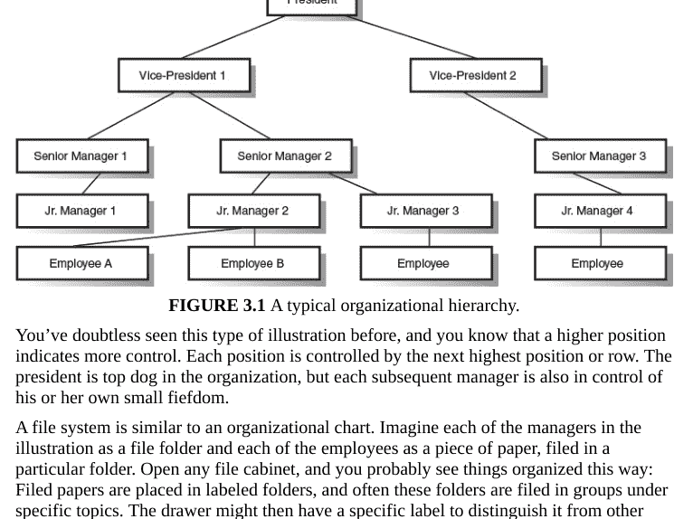

### FIGURE 3.1 A typical organizational hierarchy.

你一定见过这种类型的插图，你知道更高的职位意味着更多的控制权。每个职位都由下一个更高职位或行来控制。总统是组织中的头号人物，但每个后续经理也控制着自己的一小块领地。

文件系统与组织结构图类似。想象一下插图中的每个经理都是一份文件文件夹，每个员工都是一张纸，存放在特定的文件夹中。打开任何文件柜，你很可能看到东西就是这样组织的：文件被放在标有标签的文件夹中，这些文件夹通常按特定主题分组归档。抽屉本身可能也有特定的标签以区别于柜子里的其他抽屉，等等。

这正是分层文件系统的全部内容。你希望你的文件位于文件系统中最合适的位置，无论是在最顶层、在一个文件夹中，还是在嵌套的一系列文件夹中。合理使用，分层文件系统可以包含数千个文件，同时仍允许用户快速找到任何单个文件。

在我电脑上，本书的课程以分层方式组织，如图 3.2 所示。

带有 at 符号（`@`）的是 **符号链接**（指向文件系统中其他位置的另一个文件或目录的指针），其余的都是普通、纯文本文件。

从这个例子可以看出，正如你亲自尝试该命令时立刻会发现的那样，不同的 Unix 系统在组织顶级目录的方式上存在很大差异。有些目录和文件是共通的，一旦你开始检查特定目录的内容，你会发现数百个程序和文件在从一个 Unix 到另一个 Unix 中始终出现在相同的位置。

这就像你在一家律师事务所担任新文件员。虽然这家公司可能有一种特定的信息归档方法，但这种方法可能与你过去工作过的其他公司的归档系统相似。如果你了解其底层组织结构，你就能迅速掌握某个特定组织的细节。

在你的计算机系统上尝试命令 `ls -F /`，并尝试如前所述识别列出中的每个目录。

上一个 `ls` 命令的输出显示了系统顶层的文件和目录。接下来，你将了解常见目录。

### The bin Directory

在 Unix 用语中，程序被视为 **可执行文件**，因为用户可以执行它们。（在这种情况下，*执行* 是运行的同义词，并不是说你能到处游荡屠杀无辜的应用程序！）当程序被编译后，它会从源代码——程序员可能用 C++ 或 Java 编写的代码——翻译成所谓的 **二进制** 格式。两者合在一起，就构成了应用程序在 Unix 中的常见描述——可执行二进制文件。

毫不奇怪，原来的 Unix 开发人员决定设立一个名为 `binaries` 的目录来存储系统上的所有可执行程序。还记得前面讨论过的原始电传打字机吗？与计算机通信的系统很慢，这带来了你可能意想不到的许多影响。最明显的一个是，一切都变得非常简洁。没有像 `binaries` 或 `listfiles` 这样冗长的词，而是使用简洁的缩写；`bin` 和 `ls` 分别是 Unix 的等价物。

`bin` 目录（发音与“tin”押韵）是早期 Unix 中存放所有可执行二进制文件的地方。随着时间的推移，随着越来越多的可执行文件被添加到 Unix 中，将所有可执行文件放在一个地方变得难以管理，`bin` 目录分裂为具有不同用途的多个部分（`/bin`、`/sbin`、`/usr/bin`）。

### The dev Directory

任何计算机中最重要的部分之一是其 **设备驱动程序**。没有它们，你的屏幕上就不会有任何信息（因为信息是通过显示设备驱动程序到达的），你将无法输入信息（因为信息是由键盘设备驱动程序读取并交给系统的），你也无法使用你的硬盘（它由磁盘设备驱动程序管理）。

记住，在 Unix 中一切都是文件。从键盘驱动程序到硬盘，系统的每个组件都是一个文件。

前面你已经了解到，在 Unix 中几乎任何东西都被视为文件系统中的文件，`dev` 目录就是一个例子。所有的设备驱动程序——通常有数百个——都以独立文件的形式存储在标准 Unix `dev`（devices，设备）目录中。这个目录名的发音是“dev”，而不是“dee-ee-vee”。

### etc 目录

Unix 的管理可能相当复杂，涉及用户账户、文件系统、安全、设备驱动程序、硬件配置等方面的管理。为此，Unix 将 `etc` 目录指定为所有管理文件和信息的存放位置。


这个目录名的发音是“ee-tee-sea”、“et-sea”或“etcetera”，这三种发音都很常见。

## lib 目录

与你所在的社区一样，Unix 也有一个集中存放函数库和过程库的地方。这些特定的可执行文件与特定程序捆绑在一起，使程序能够提供原本不可用的特性和功能。其理念是，如果程序想要包含某些特性，只需引用 Unix 库中共享的那份副本，而不必拥有一个新的、独特的副本。

这个目录名的发音是“libe”或“`lib`”（与单词 bib 押韵）。

## lost+found 目录

由于多个用户同时运行许多不同的程序，多年来，开发一个能够与计算机活动保持同步的文件系统一直是一个挑战。Unix 内核（即系统的大脑）的各个部分有助于解决这个问题。当文件在出现任何问题或故障后被恢复时，如果内核无法确定其在文件系统中的正确位置，它们就会被放在这里，即 `lost+found` 目录中。这个目录几乎应该一直处于空状态。

这个目录通常读作“lost and found”，而不是“lost plus found”。

## mnt 和 sys 目录

`mnt`（读作“em-en-tee”）和 `sys`（读作“sis”）目录是日常 Unix 用户可以放心忽略的。`mnt` 目录旨在成为 Unix 中挂载外部介质（硬盘、可移动盒式驱动器等）的常用位置。在许多系统（虽然不是全部）上，`sys` 包含指示系统配置的文件。

## tmp 目录

`tmp` 目录（读作“temp”）是一个你不能忽略的目录，Unix 中的许多程序将它用作临时文件存储空间。例如，如果你正在编辑一个文件，编辑器会生成该文件的一份副本，保存到 `tmp` 中，然后你直接对该副本进行操作，只有在完成工作后才将新文件保存回原文件。

在大多数系统上，`tmp` 最终会堆满各种文件和可执行文件，这些都是不清理自己临时文件的程序留下的。在我使用的一个系统上，经常能看到 10–30 兆字节的文件浪费空间。

即便如此，如果你正在操作文件或处理文件副本，`tmp` 是保存临时副本的最佳位置。事实上，在某些 Unix 工作站上，`tmp` 甚至可能是计算机上最快的设备，与直接在你的主目录中处理文件相比，能带来显著的性能提升。

## usr 目录

Unix 文件系统层级顶层最后一个标准目录是 `usr` 目录，读作“user”（用户）。最初，这个目录旨在成为所有与用户相关的命令和数据的集中存放位置——这些内容与用户直接相关，而非系统。然而，经过几十年的演变，`/usr` 已经发展到包含从 Python 库到系统级应用程序的各种内容，仅仅因为其边界一直界定不清。许多公司对这里应该放置什么都有自己的理解，而且再也无法预料你会在这个目录里发现什么了。

## 顶层其他杂项

除了前面列出的所有目录之外，Unix 系统中通常还会出现各种其他目录和文件。某些文件在你的计算机上的名称可能略有不同，因此当你将自己的文件列表与以下文件和目录进行比较时，要留意可能存在的替代拼写。

Unix 要存在，必须有一个通常名为 `unix` 或 `vmunix` 的文件，或者以计算机上特定 Unix 版本命名的文件。该文件包含真正的 Unix 操作系统。这个文件必须有特定的名称，并且必须位于文件系统的顶层。与操作系统相伴的是另一个名为 `boot` 的文件，它在硬件初始启动时起作用。

注意在本课前面的一些输出中，出现了 Linux 特有的文件 `boot` 和 `vmunix`。相比之下，Solaris 工作站的列表显示 `boot` 和 `zvboot` 是两个相关文件（以及一个包含插件模块的 `kernel` 目录）。而 Mac OS X 则将其启动文件和内核隐藏得比根目录层级深得多。

主目录 `/home`（在 Mac OS X 上为 `/Users`）是集中组织所有属于特定用户的文件的地方。列出这个目录通常也是了解系统上有哪些账户的简单方法，因为按照惯例，每个用户账户目录都以该用户的账户名命名。在我使用的一个系统上，我的账户是 `taylor`，而我的个人账户目录也叫做 `taylor`。主目录总是由系统管理员创建的。

如果设置正确，`net` 目录是访问网络上其他计算机的便捷快捷方式。

`tftpboot` 目录是 Unix 的一个相对较新的功能。字母代表“Trivial File Transfer Protocol boot”。不过别被名字迷惑了；该目录包含适用于基于 X Window System 的终端和无盘工作站运行 Unix 的内核版本。简单来说，它就是让你的计算机能够从网络中其他地方托管的操作系统启动，而无需在本地安装。

一些 Unix 系统有为可连接的特定类型外设命名的目录。在 Solaris 工作站上，你可以看到以 `cdrom` 目录为例，它用于 CD-ROM 和其他光盘。

另一个 Solaris 特性是 `opt` 目录，它存储来自 Oracle 和第三方厂商的附加程序和组件（也可以像 Linux 中使用 `var` 一样使用——用于存储诸如 Web 内容之类的数据）。`opt` 目录在 Linux 或 FreeBSD 中通常不存在，但 Linux 倾向于对 `var` 和 `usr` 两种目录用于模糊且有时重叠的目的，而 FreeBSD 则试图在可变文件（即随系统运行自然变化的文件，如邮箱、日志文件和数据库内容）与静态、永久安装且与用户直接相关的固定装置之间强制执行严格的概念划分。正如你所见，区分众多 Unix 变体的哲学差异至今仍在为它们截然不同的特性做出贡献。

Unix 中还有许多其他目录，但本课为你提供了事物组织方式的一个概念。

## 目录分隔字符

如果你查看本小时前面呈现的组织结构图（参见 [Figure 3.1](#)），你会看到员工在可能的情况下仅被标识为“employee”。因为每个人都有唯一的向上路径到达总裁，所以如果指定向上路径的所有组成部分，每个人都有唯一的标识符。

例如，四个员工中最右边的那位可以描述为“由 Jr. Manager 4 管理的员工，由 Senior Manager 3 管理，由 Vice-President 2 管理，由总裁管理。”使用单个字符代替“managed by”，可以大大缩短描述：Employee/Jr. Manager 4/Senior Manager 3/Vice-President 2/President。现在考虑从组织最顶端向下指定的同一路径：President/Vice-President 2/Senior Manager 3/Jr. Manager 4/Employee。

由于顶端只有一个人，可以安全地从路径中省略该人而不失去描述符的唯一性：/Vice-President 2/Senior Manager 3/Jr. Manager 4/Employee。

在这个例子中，`/`（读作“斜杠”）充当着 *目录分隔字符*，一种方便的简写，用来表示路径中的不同目录。

使用单个字符来分隔层级结构并非 Unix 独有，但使用正斜杠在历史上是不寻常的。在经典的 Macintosh 中，系统使用冒号来分隔路径名中的目录。（下次你在 Mac 上时，试着保存一个名为 `test:file` 的文件，看看会发生什么。）DOS 使用反斜杠；例如，`\DOS` 表示顶层的 DOS 目录。字符 `/tmp` 表示 Unix 文件系统顶层的 `tmp` 目录，而 `:Apps` 是老式 Macintosh 文件系统顶层的一个名为 `Apps` 的文件夹。

> **Note**
>
> 自从 Mac OS X 出现以来，经典 Mac OS 的惯例逐渐被淘汰，其中包括使用冒号作为目录分隔符。作为真正的 Unix，Mac OS X 普遍使用正斜杠，并与 Web 普及的标准 URL 格式一起，大大推动了斜杠成为所有操作系统事实上的标准。然而，旧 Mac OS 的一个遗迹仍然存在：与任何其他 Unix 不同，你允许在文件名中使用斜杠，但不能使用冒号（其想法是你在典型文件名中更可能想要使用斜杠而不是冒号）。但再看一下：这仅在 GUI 层面是如此。试着在 TextEdit 中创建一个名为 `test/file.txt` 的文件，然后在 Terminal 中用 `ls` 命令查看它。你会看到你创建的文件实际上叫做 `test:file.txt`。够 tricky 的吧？

在 Macintosh 上，你很少会遇到目录分隔符，因为几乎所有用户都生活在图形界面中，甚至不知道在 GUI 环境之下潜伏着一个 Unix 系统——以及命令行界面。Windows 也提供了类似的摆脱这种复杂性困扰的自由度，尽管你仍需要记住 `A:` 是你的软盘（如果在这个时代你甚至还有的话）还是硬盘驱动器。

## 相对文件名与绝对文件名的区别

在层级结构中指定文件的确切位置以确保文件名唯一，在 Unix 用语中称为指定其 *绝对文件名*（或绝对路径名）。也就是说，无论你在文件系统中的何处，绝对文件名始终指定一个特定文件。相比之下，相对文件名不是唯一的描述符，可以指代许多不同的文件，具体取决于你在引用文件时所在的位置。

要理解这一点，请考虑 [Figure 3.3](#) 中显示的文件。

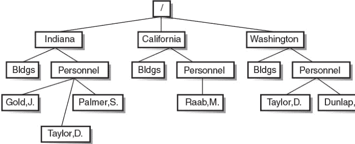

**图 3.3** 一个简单的文件层次结构。


如果你当前查看的是`Indiana`目录中的信息，`Bldgs`唯一地描述了一个文件：`Indiana`目录中的`Bldgs`文件。然而，如果你处于`California`目录或`Washington`目录中，同一个名称则指向不同的文件。同样，目录`Personnel`会留下三种可能的选项，直到你也指定感兴趣的是哪个州为止。

作为一个可能的场景，想象一下你正在阅读`Washington`的`Bldgs`文件，突然有人走进你的办公室打断了你的工作。聊了几分钟后，他们提到`California`的`Bldgs`文件中的一个条目。你转向你的Unix系统并打开`Bldgs`文件，结果却是错误的文件。为什么？因为你仍然在`Washington`目录中。

这些问题源于相对文件名的缺乏特异性。相对文件名描述的是相对于文件系统中假设位置的文件。在图3.3中，即使是`Personnel/Taylor,D.`也不是唯一的，因为它可以在`Indiana`和`Washington`中找到。

为了避免这些问题，你可以应用之前学到的技巧：从上到下指定目录路径的所有元素。要查看`California`的`Bldgs`文件，你可以简单地指定`/California/Bldgs`。要检查`Indiana`的`Taylor,D.`员工，你会使用`/Indiana/Personnel/Taylor,D.`，你会注意到这与`/Washington/Personnel/Taylor,D.`不同。

学习这两种记法的区别对于在Unix的分层文件系统复杂性中生存至关重要。没有它，你会花费一半的时间验证自己是否在认为的位置，或者更糟，根本不移动，无法利用其组织能力。

如果你对自己在Unix中的位置或正在处理的文件有任何疑问，只需指定其绝对文件名。你总可以通过第一个字符来区分相对文件名和绝对文件名：如果它是一个斜杠，你就有绝对文件名，因为文件名根植于文件系统的最顶层。

如果第一个字符不是斜杠，那么文件名就是相对文件名。

我之前告诉过你，在Unix顶层的`/home`目录中，我有一个名为`taylor`的主目录。用绝对文件名的术语来说，我应该正确地说我有`/home/taylor`作为一个唯一目录。

### Note

为了增加混乱，大多数Unix用户不会发音斜杠，特别是当文件名的第一个组件是一个众所周知的目录时。我会把`/home/taylor`发音为“home taylor”，但我通常会把`/newt/awk/test`发音为“slash newt awk test”。有疑问时，就发音斜杠。

当你更多地了解Unix，特别是如何导航文件系统时，你会发现清楚理解相对文件名和绝对文件名之间的区别非常宝贵。记住经验法则是：如果文件名以`/`开头，它就是绝对的。

## Task 3.2: Hidden Files in Unix

长期居住在一个地区，经常光顾同一家商店和餐厅的好处之一是，每个地方的工作人员都会记住你的名字和偏好。许多Unix应用程序也可以做同样的技巧，通过偏好文件记住你偏好的交互方式、你最后处理的文件、你编辑过的行等等。

在Macintosh上，每个用户的主目录内都有一个名为`Library`的文件夹。在其中还有一个名为`Preferences`的文件夹，它是偏好文件的集中存储位置，按应用程序组织。例如，在我的Macintosh上，我在这个目录中有大约75个不同的偏好文件，这样我的所有程序都可以记住我偏好的默认值。

Unix必须同时支持许多用户，因此Unix偏好文件不能存储在文件系统的中央位置。否则，系统如何区分你的偏好和同事的偏好呢？为避免这个问题，所有Unix应用程序都将它们的偏好文件存储在你的主目录中。

程序希望能够在你的目录中保存自己的内部偏好和状态，但这些不是供你使用或更改的。如果你使用DOS，你可能熟悉Windows如何解决这个问题：某些文件是隐藏的，在使用`DIR`、在DOS中或在文件管理器列出目录中的文件时不会显示。

Macintosh用户没有意识到的是，Macintosh也有很多隐藏文件。例如，在Macintosh文件系统的最顶层，存在以下文件，尽管对正常显示是隐藏的：`.DS_Store`、`Desktop DB`、`.VolumeIcon.icns`、`NavMac8000QSFile`，以及我个人最喜欢的`.symSchedScanLockxz`。在Macintosh上显示隐藏文件非常困难，就像在Windows中一样。

幸运的是，Unix隐藏文件的规则比Mac或PC要容易得多。没有秘密的状态标志提醒系统在列出目录时不要显示该文件。相反，规则很简单：任何以点号（`.`）开头的名称都是隐藏文件。

### Note

> 隐藏文件是指文件名以点号作为第一个字符的任何文件。

如果文件名或目录名以点号开头，它就不会出现在该目录的正常列表中。如果文件名或目录名的第一个字符是其他字符，则会正常列出。

1. 转到你的电脑并输入`ls`命令来列出你主目录中的所有文件和目录：

```
% ls -F
Archives/      Mail/          RUMORS.18Sept  mailing.lists
InfoWorld/     News/          bin/           newlists
LISTS          OWL/           iecc.list      src/
%
```

你可以看到我自己的目录中有12个项目，7个目录（由于`-F`，目录名以斜杠作为最后一个字符，记得），以及5个文件。文件对命名也有最少的规则。避免使用斜杠、空格和制表符，你就会没问题。

2. 如果没有明确的相反指示，Unix会让隐藏文件保持隐藏。要将隐藏文件添加到列表中，你只需在命令中添加`-a`标志。转到你的电脑并尝试`ls -aF`命令，看看你的目录中有哪些隐藏文件。这是我的结果：

```
% ls -aF
./             .gopherrc      .oldnewsrc     .sig           RUMORS.18Sep
../            .history*      .plan          Archives/      bin/
.A genda       .info          .pnewsexpert   InfoWorld/     iecc.list
.aconfigrc     .letter        .report        LISTS          mailing.lists
.article       .login         .rm-timestamp  Mail/          newlists
.cshrc         .mailrc        .rnlast        News/          src/
.elm/          .newsrc        .rnsoft        OWL/
%
```

许多点文件倾向于遵循以下格式：一个点，后跟拥有该文件的程序名称，以`rc`作为后缀。在我的目录中，你可以看到有六个遵循此约定的点文件：`.aconfigrc`、`.cshrc`、`.gopherrc`、`.mailrc`、`.newsrc`和`.oldnewsrc`。

由于Unix中隐藏文件的特殊规则，它们通常被称为点文件，你可以看到我的目录中有23个点文件和目录。

### Note

`rc`后缀（意为“resource config”）告诉你该文件是某个特定实用程序的配置文件。例如，`.cshrc`是C shell的配置文件，每次执行C shell（`/bin/csh`）时都会执行。你可以为C shell命令定义别名和特殊的搜索路径，例如。

### Note

由于传达点文件的特定文件名很重要，发音在Unix中与其他地方略有不同。名称`.lynxrc`会读作“dot-lynx-are-sea”，而`.mailrc`会读作“dot mail are sea”。如果你无法读出程序名称，很可能其他人也读不出，所以`.cshrc`是“dot-sea-ess-aitch-are-sea”。

其他程序创建了许多不同的点文件并尝试保持一致的命名方案。你可以看到`.rnlast`和`.rnsoft`都来自`rn`程序，但仅从文件名很难知道`.article`、`.letter`、`.newsrc`、`.oldnewsrc`和`.pnewsexpert`也都被`rn`程序引用。认识到这个问题后，一些应用程序作者设计了他们的应用程序创建一个点目录，将所有首选项文件整齐地放在那个位置。`elm`程序就是这样做的，它使用`.elm`隐藏目录。


一些文件直接以使用它们的程序命名：`.Agenda` 文件由 `agenda` 程序使用，`.info` 由 `info` 程序使用。它们几乎有自己的规则，但无法将它们与 `sh` 程序的 `.login`；`finger` 程序的 `.plan`；我自己的自定义程序的 `.rm-timestamp` 区分开来；我老实说完全不知道哪个程序创建了 `.report` 文件！

这应该让你了解 Unix 程序命名和使用隐藏文件的各种方式。作为练习，列出你主目录中的所有点文件并尝试弄清楚哪个程序创建了每个文件。检查一下，看看这本书的索引中是否存在该名称的程序，如果是 `.xxx` 文件。如果你无法弄清楚哪些程序创建了哪些文件，你并不孤单。保留该列表；随着你学习本书并探索 Unix 时参考它，到你读完时，你将完全知道如何查明哪些程序创建了哪些点文件。

## Task 3.3: The Special Directories . and ..

我还没有提到两个点目录，尽管它们出现在我的列表中，也肯定出现在你的列表中。它们是点和点点（`.` 和 `..`），它们是简写目录名，可以非常方便。

点目录是目录层次结构中当前位置的简写；点点目录将你上移一级，到父目录。

再次考虑图 3.3 中显示的文件列表。如果你正在查看

加州人事目录（最好指定为 `/California/Personnel`）并想快速查看加州 Bldgs 文件中的一个条目，要么你必须使用绝对文件名并输入冗长的 `ls /California/Bldgs`，要么使用新的简写目录，你可以输入 `ls ../Bldgs`。

随着目录不断深入到目录层次结构中，点点表示法可以为你节省大量的输入时间。例如，如果不同的州和相关文件都位于我的主目录 `/home/taylor` 中，在一个名为 `business` 的新目录下呢？在这种情况下，加州员工 Raab,M. 的绝对文件名将是 `/home/taylor/business/California/Personnel/Raab,M.`，这很笨重，如果你想向上跳一级并查看印第安纳州的建筑数据库，输入起来也很多。

你也可以在文件名中使用多个点点表示法，如果你正在查看 `Raab,M.` 文件并想查看 `Dunlap,L.`，你可以通过改用 `../../../../Washington/Personnel/Dunlap,L.` 来节省输入完整文件名的麻烦。查看图 3.3 看看它是如何工作的；为文件名中的每个点点回溯一级。

所以你知道点点简写是有帮助的，但单点表示法又如何呢，它只是指定当前目录？

我还没有明确说明，但你可能已经推断出 Unix 文件系统组织的一个后果，由于它能够将应用程序放置在文件系统的任何位置，系统需要某种方法来知道在哪里查找特定应用程序。就像你在公共图书馆寻找某样东西一样，在 Unix 中，了解其组织结构并制定搜索策略对于成功和速度至关重要。

Unix 为此目的使用一个称为搜索路径的有序目录列表。搜索路径通常列出系统上五个或六个不同的目录，计算机在其中检查你请求的任何应用程序。

出现的问题是，“如果你的个人应用程序副本与标准系统应用程序同名会怎样？” 答案是，如果其目录在搜索路径中列得更靠前，系统总是先找到标准应用程序。

为了避免这种陷阱，使用点表示法，这会强制系统在当前目录中查找而不是搜索应用程序。如果你想要自己的 `ls` 命令版本，例如，你需要与该命令在同一目录中并输入 `./ls`，以确保 Unix 使用你的版本而不是标准版本。

- 1. 在你的计算机上输入 `./ls` 并观察会发生什么。
- 2. 输入不带点表示法的 `ls`，你会立即看到计算机如何搜索搜索路径中的各个目录，找到 `ls` 程序并执行它——自动完成。

当你在本小时后面学习 `cd`（更改目录）时，你也会学到点点目录的其他用途，但点目录的最大价值在于，你可以使用它来强制系统仅在当前目录中查找任何指定的文件，而不在其他地方查找。

## Task 3.4: The env Command

你已经了解了 Unix 文件系统基础的许多内容，以及应用程序如何通过隐藏的点文件记住你的偏好。然而，系统记住关于你的具体信息还有另一种方式，那就是通过你的用户环境。*用户环境*是一组特别命名的变量（助记性命名的数值），它们具有特定值。

- 1. 要查看你的环境，你可以使用 `env` 命令。以下是我在我的系统上输入 `env` 命令时看到的内容：

Click here to view code image

```
% env
HOME=/home/taylor
SHELL=/bin/csh
TERM=vt100
PATH=/home/taylor/bin:/bin:/usr/bin:/usr/ucb:/usr/local/bin:/usr/unsup/bin
MAIL=/usr/spool/mail/taylor
LOGNAME=taylor
TZ=EST5
%
```

- 2. 自己试试并将你的值与我的进行比较。你可能会发现你的环境中定义的内容比我多，因为你的 Unix 系统使用你的环境来跟踪更多信息。

`env` 命令的输出显示了一些标准环境变量。表 3.1 描述了它们的作用。

| Variable | Description |
|---|---|
| HOME | The directory where you log in and store all your personal files |
| SHELL | The program you run as your command-line interpreter |
| TERM | The type of terminal emulation you need to provide cursor graphics |
| PATH | A list of directories searched when you enter a command |
| MAIL | The file where your incoming mail is stored |
| LOGNAME | Your login name (account name) |

### TABLE 3.1 Common Shell Environment Variables and What They Do

### Note

许多 Unix 系统提供 `printenv` 命令而不是 `env`。如果输入 `env` 时系统抱怨找不到 `env` 命令，请尝试改用 `printenv`。这里的所有示例都适用于 `env` 或 `printenv`。

## Task 3.5: PATH 和 HOME

环境中最重要的两个值是你的主目录名称（`HOME`）和你的搜索路径（`PATH`）。你的主目录（顾名思义）是你每次开始 Unix 会话时所在的目录名称。

`PATH` 环境变量按从左到右的顺序列出了系统搜索以查找你请求的命令和应用程序的一组目录。你可以从示例中看出，我的搜索路径告诉计算机首先在 `/home/taylor/bin` 目录中查找，然后依次尝试 `/bin`、`/usr/bin`、`/usr/ucb`、`/usr/local/bin`、`/usr/unsup/bin` 和 `.`，然后才得出找不到所请求命令的结论。如果没有 `PATH`，`shell` 将无法找到众多 Unix 命令中的任何一个。至少，你始终应包含 `/bin` 和 `/usr/bin`。

- 1. 你也可以使用 `echo` 命令列出特定的环境变量。输入 `echo $PATH` 和 `echo $HOME`。如果忘记 `$`，`shell` 就不知道你是要指定查询命名变量的值。试试看；你会明白我的意思。

当我按上面所示输入两个 `echo` 语句时，我得到以下结果：

Click here to view code image

```
% echo $PATH
/home/taylor/bin:/bin:/usr/bin:/usr/ucb:/usr/local/bin:/usr/unsup/bin:.
% echo $HOME
/home/taylor
%
```

- 2. 你的 `PATH` 值可能与我的相似，但当然不完全相同，而你的 `HOME` 可能是 `/home/accountname` 或类似名称（其中 `accountname` 是你的账户名）。

自己试试看。你的 `PATH` 有什么惊喜吗？

## Task 3.6: 使用 pwd 查找你的位置

到目前为止，你已经了解了文件系统的工作原理，但对如何在文件系统中移动却了解不多。对于任何一次旅行，第一步也是最重要的一步是弄清你的当前位置——也就是你当前正在工作的目录。在 Unix 中，`pwd` 命令会告诉你当前工作目录。

- 1. 输入 `pwd`：

```
% echo $HOME
/home/taylor
% pwd
/home/taylor
%
```

输出应与你输入 `env HOME` 时看到的输出相同，因为你仍在主目录中。

把 `pwd` 想成一个罗盘，它总能告诉你所在的位置。它还会告诉你上方所有目录的名称，因为它总是将你的当前位置列为绝对目录名。

## Task 3.7: 使用 cd 移动到另一个位置

动态组合的另一半是 `cd` 命令，用于更改目录。此命令的格式也很简单：`cd new-directory`（其中 `new-directory` 是你想要的新目录的名称）。


- 1. 尝试移动到文件系统的最顶层并输入 `pwd`，以查看计算机是否同意你已移动：

  `% cd /`

  `% pwd`

  `/`

  `%`

- 2. 注意 `cd` 不会产生任何输出。许多 Unix 命令在未遇到错误时都是这样静默运行的。系统随后会指出问题。你可以通过尝试更改到一个不存在的目录来看看错误是什么样的。试试 `/taylor` 目录，看看会发生什么：

Click here to view code image

```
% cd /taylor
/taylor: No such file or directory
%
```

- 3. 不指定目录地输入 `cd`。会发生什么？我得到以下结果：

  `% cd`

  `% pwd`

  `/home/taylor`

  `%`

- 4. 这就是 `HOME` 环境变量发挥作用的地方。如果未指定任何目录，`cd` 会自动将你移回主目录。如果你迷路了，这是一种快速简便的简写方式，可以在不费事的情况下移动到已知位置。

  还记得用于向上移动一层目录层次结构的点点符号吗？在这里它也证明非常有用。使用 `cd` 命令不带任何参数移动到你的主目录，然后使用 `pwd` 确保你确实在那里。

- 5. 现在，使用 `cd ..` 向上移动一级，并使用 `pwd` 检查结果：

  `% cd`

  `% pwd`

  `/home/taylor`

  `% cd ..`

  `% pwd`

  `/home`

  `%`

- 6. 使用 `ls -C -F` 命令列出此时文件系统中包含的所有目录：

```
% ls -C -F
armstrong/  christine/  guest/  laura/  matthewm/  shane/
 bruce/  david/  higgins/  mac/  rank/  taylor/
 cedric/  green/  kane/  mark/  shalini/  vicki/
%
```

不过要注意；在大型系统中，这个目录很容易就有数百个不同的目录。在我使用的一台系统上，文件系统中我的主目录上一级就有将近 550 个不同的目录！

尝试使用 `cd` 和 `pwd` 的组合在你的文件系统中移动。记住，如果不带任何参数，`cd` 总是会让你直接回到你的主目录。

## Summary

本小时重点介绍了 Unix 层次文件系统。你已学习了层次文件系统的组织方式，Unix 与传统的 Macintosh 和 DOS 系统有何不同，以及 Unix 如何通过其隐藏的点文件来记住偏好设置。本小时还解释了相对文件名和绝对文件名的区别，并且你已学习了 `.` 和 `..` 目录。你已学习了四个新命令：`env` 用于列出当前环境，`echo` 用于显示特定值，`cd` 用于更改目录，以及 `pwd` 用于查找当前工作目录位置。

## Workshop

工作坊总结了你所学到的关键术语，并对本课介绍的主题提出了一些问题。它还为你提供了下一小时将要学习内容的预览。

## Key Terms

`absolute filename` 任何以斜杠（`/`）开头的<|message|> 文件名；它唯一地描述了文件系统中的单个文件。

`binary` 二进制文件是一种旨在让计算机直接处理而不是供人类阅读的文件格式。另见 `executable`。

`device driver` 连接到计算机的所有外设在 Unix 中称为设备，每个设备都有一个始终与其关联的控制程序，称为设备驱动程序。示例包括显示器、键盘、鼠标和所有硬盘的设备驱动程序。

`directory` 这种类型的 Unix 文件用于对其他文件进行分组，等同于文件夹。文件和目录可以放置在其他目录内，以构建层次系统。

`directory separator character` 在层次文件系统上，必须有某种方法来指定完整文件名的哪些部分是目录，哪些部分是实际文件名。当使用绝对文件名时，这一点尤其重要。在 Unix 中，目录分隔符字符是斜杠（`/`），因此像 `/tmp/testme` 这样的文件名很容易被解释为 `tmp` 目录中的一个名为 `testme` 的文件。

`dot` 这是当前目录的简写表示。

## Exercises

+   1. 你能想到你每天处理的信息中以层次方式组织的吗？公共图书馆是层次组织的吗？

+   2. 根据 Unix，以下哪些文件是隐藏文件和目录？

```
.test   hide-me   ,test   .cshrc
../      .dot      dot      .HiMom
```

+   3. 哪些程序最有可能创建了以下点文件和点目录？

```
.cshrc   .rnsoft   .exrc   .print
.tmp334  .excel/   .letter  .vi-expert
```

+   4. 在以下列表中，识别出绝对文件名：

```
/Personnel/Taylor,D.
/home/taylor/business/California
../..
Recipe:Gazpacho
```

+   5. 还记得所有 Unix 系统上都存在的目录列表（`/bin`、`/dev`、`/etc`、`/lib`、`/lost+found`、`/mnt`、`/sys`、`/tmp`、`/usr`）吗？使用 `cd` 和 `pwd` 来 double-check 确认它们是否都存在于你自己的 Unix 机器上。

## Preview of the Next Hour

在下一小时，你将全面了解你一直在使用的 `ls` 命令，包括对命令标志的深入讨论。`touch` 命令使你能够创建自己的文件，而 `du` 和 `df` 分别帮助你了解使用了多少磁盘空间以及有多少可用空间。你还将学习如何使用有价值的 `gzip` 命令，它有助于最小化你的磁盘空间使用。

# 第 4 小时。列出文件和管理磁盘使用

## 本小时的目标

在本小时，你将学习

- 关于 `ls` 命令的一切

- 关于特殊的 `ls` 命令标志

- 如何使用 `touch` 创建文件

- 如何使用 `du` 检查磁盘空间使用情况

- 如何使用 `df` 检查可用磁盘空间

- 如何使用 `gzip` 压缩大文件

本小时向你介绍 `ls` 命令，这是 Unix 中最常用的命令之一。讨论包括十多种不同的命令选项，或标志。你还将学习如何使用 `touch` 命令创建文件，如何使用 `du` 命令查看你使用了多少磁盘空间，以及如何使用 `df` 命令查看有多少磁盘空间可用。最后，你将学习 `gzip` 命令如何帮助你最小化磁盘空间使用，特别是在你不经常使用的文件上。

第一个小时专注于一些基本的 Unix 命令，特别是用于与系统交互以完成常见任务的命令。在本小时，你将通过分析你所使用的系统的特性来扩展你的知识，并学习一系列用于创建自己的 Unix 工作区的命令。你还将更多地了解 Unix 文件系统以及 Unix 如何解释命令行。除了你在前一小时学到的 `cd` 和 `pwd` 命令之外，在这里你将学习如何使用 `ls` 在文件系统中漫游并查看文件保存在何处。

与 Windows 和 Macintosh 操作系统不同，关于 Unix 系统本身的信息通常很难获得。在本小时，你将学习使用 `du` 命令轻松确定你使用了多少磁盘空间的简单方法。你还将学习如何解释经常令人困惑的 `df` 命令的输出，该命令使你能够立即看到 Unix 系统上可用的总磁盘空间。

本小时以对 `gzip` 命令的讨论结束，该命令使你能够缩小任何文件或一组文件的大小。你会看到现代 Unix 实际上包含四种不同的压缩程序，并且你将学习它们之间的比较。

## ls 命令

本节向你介绍 `ls` 命令，它使你能够检查文件系统并查看文件保存在何处。

### 任务 4.1：关于 ls 命令的一切

从前一小时的示例中，你已经了解到用于在 Unix 中列出文件和目录的命令是 `ls` 命令。

所有操作系统都有类似的命令，一种查看当前位置内容的方法。如果你使用过 Windows 的古老前身 DOS，例如，你会熟悉 `DIR` 命令。DOS 也有命令标志，它们由特定选项前面的斜杠表示。例如，`DIR /W` 以宽显示格式生成目录列表。`DIR` 命令还有相当多的其他选项和功能。

列出目录中的文件是一个相当简单的任务，那么为什么有这么多不同的选项呢？你已经看到一些示例，包括 `ls -a`，它列出隐藏的点文件。答案是查看文件和目录的方式有很多种，正如你将要学习的那样。

1. 了解 `ls` 能做什么的最好方法是直接使用它。转向你的电脑，登录你的账户或打开你的终端应用程序，并在解释时尝试每个命令。

2. `ls` 最基本的使用是列出文件。命令 `ls` 列出当前工作目录中的所有文件和目录（请记住，你可以随时使用 `pwd` 命令检查你所在的目录）：

Click here to view code image

```
% ls
Archives      Mail          RUMORS.18Sept  mailing.lists
InfoWorld     News          bin            newels
LISTS         OWL           iecc.list      src
```


请注意，文件按从上到下、从左到右的字母顺序排序。这是默认的，称为列优先顺序，因为它先向下排序，然后向右排序。你还应该注意 Unix 中事物的排序方式：系统区分大小写字母，不像 Windows。（Macintosh 会记住你为文件命名时是否使用大写或小写字母，但它在内部并不区分它们。试试看。下次你使用 Macintosh 时，命名一个文件为 `TEST`，然后尝试再创建一个名为 `test` 的文件。）

### Note

一些可用于 PC 的 Unix 和 Linux 版本具有行为略有不同的 `ls`，它可以以单列而不是多列列出所有文件。如果你的 PC 这样做，请使用 `-C` 标志强制多列显示 `ls`。

重要的是你始终记住以小写字母输入 Unix 命令，除非你知道该特定命令实际上是大写；请记住 Unix 将 `Archives` 和 `archives` 视为不同的文件名，因此它也将 `LS` 和 `ls` 视为不同命令也就不足为奇了。此外，避免在登录时以大写形式输入你的账户名。Unix 有一些旧的兼容性功能，如果你使用全大写登录，使用系统会变得困难得多。如果你不小心登录 in with all uppercase, log out and try again in lowercase.

## Task 4.2: 让 `ls` 告诉你更多信息

如果不使用选项，`ls` 命令提供的信息相对较少。关于你的目录，你可能仍会有以下疑问：文件有多大？哪些是文件，哪些是目录？它们有多旧？你有哪些隐藏文件？

1. 输入 `ls -s` 以查找文件大小：

```
% ls -s
 total 563
 1 Archives      1 Mail      5 RUMORS.18Sept   280 mailing.lists
 1 InfoWorld     1 News      1 bin           2 newels
 261 LISTS       1 OWL       4 iecc.list     1 src
```

2. 要确定每个文件或目录的大小，你可以使用 `-s` 标志与 `ls` 一起使用。所指示的大小是每个文件的千字节数，四舍五入向上取整。输出的第一行还指示了此目录内容使用的总磁盘空间量，以千字节为单位（本例中为 563）。然而，汇总数字不包括任何子目录的内容，因此它具有误导性的小。

### Note

千字节是 1,024 字节的信息，而字节是一个字符。前一段，例如，包含略多于 400 个字符。Unix 以信息块为单位工作，具体取决于你使用的 Unix 版本，该块为 1 千字节或 512 字节。例如，Solaris 使用 512 字节块。然而，大多数 Unix 系统使用 1 千字节块。当你使用 `-s` 标志时，你会看到每个文件包含多少个这些块。

3. 以下是使用 `-s` 标志时发生情况的进一步定义：`ls -s` 指示每个文件或目录占用的块数。然后你可以使用简单的计算将块转换为字节。例如，`ls` 命令指示我的主目录中的 `LISTS` 文件占用 261 个块。块大小 × 块数 的快速计算显示 `LISTS` 的最大文件大小为 133,632 字节。

你始终可以通过将块数乘以 1,000 来估算大小。然而，请注意，在大文件中，1,000 和 1,024 之间的差异足以对你的计算引入误差。作为示例，`bigfile` 的大小超过 3 兆字节（兆字节是 1,024 千字节，即 1,024 字节，因此兆字节是 1,024×1,024，或 1,048,576 字节）：

```
% ls -s bigfile
 3648 bigfile
```

4. 该文件实际占用 3,727,360 字节。如果我通过将块数（3,648，如前一命令的输出所示）乘以 1,000（等于 3,648,000 字节）来估算其大小，我会低估其大小 79,360 字节。（记住，块 × 1,000 只是一个简单的估算！）

### Note

前面的示例还揭示了 `ls` 命令的另一点：你可以指定你感兴趣查看的单个文件或目录，而不必查看当前位置中的所有文件和目录。

### Note

根据你使用的 shell 和 Unix 版本，你可能能够在输入文件名时按 Tab 键，并在不明确的情况下自动补全。试试看；如果你有这个快捷方式，那太棒了！

5. 你可以指定任意数量的文件或目录，并用空格分隔它们：

```
% ls -s LISTS iecc.list newels
261 LISTS        4 iecc.list      2 newels
```

在前一小时中，你了解到 Unix 将每个以点号 (.) 开头的文件标识为隐藏文件。你的主目录可能布满了点文件，它们保留首选项、状态信息和其他数据。要列出这些隐藏文件，请使用 `-a` 标志对 `ls`：

```
% ls -a
.           .gopherrc   .oldnewsrc  .sig        RUMORS.18Sept
..          .history    .plan       Archives    bin
.Agenda     .info       .pnewsexpert InfoWorld   iecc.list
.aconfigrc  .letter     .report     LISTS       mailing.lists
.article    .login      .rm-timestamp Mail        newels
.cshrc      .mailrc     .rnlast     News        src
.elm        .newsrc     .rnsoft     OWL
```

你可以看到，此目录包含的点文件比常规文件和目录更多。在 Unix 主目录中这种情况并不少见。然而，除了整个文件系统中的每个目录都存在的标准 `.` 和 `..` 目录之外，在主目录以外的目录中发现任何其他点文件的情况很少见。（这些点文件通常由你使用的应用程序创建，并且应谨慎编辑。）

6. 你在前一小时使用了 `ls` 命令的另一个标志——`-F` 标志。你还记得它有什么作用吗？

```
% ls -F
Archives/   Mail/       RUMORS.18Sept mailing.lists
InfoWorld@  News/       bin/        newels
LISTS       OWL/        iecc.list   src/
```

为 `ls` 添加 `-F` 标志会在某些文件名后附加后缀，以便你能更轻松地判断它们的文件类型。可以添加三种不同的后缀，如 [表 4.1](#table-4-1) 所示。

### 表 4.1 由 `ls -F` 添加的文件名后缀

| 后缀 | 示例 | 含义 |
| --- | --- | --- |
| `/` | `Mail/` | `Mail` 是一个目录。 |
| `*` | `prog*` | `prog` 是一个可执行程序。 |
| `@` | `bin@` | `bin` 是指向另一个文件或目录的符号链接。 |

7. Mac 和 Windows 用户都可以创建别名，这种文件不包含信息，而是作为指向实际目标文件的指针。别名可以存在于特定文件或文件夹。Windows 用户可能也知道这种文件为“快捷方式”文件。

Unix 长期以来也提供类似功能，在 Unix 术语中称为 *符号链接*。符号链接，例如 [表 4.1](#table-4-1) 中的 `bin`，包含另一个文件或目录的名称，而非自身内容。如果你能窥探内部，它可能看起来像 `bin = @/usr/bin`。每当有人尝试查看 `bin` 时，系统会显示 `/usr/bin` 的内容。

你将在 [第 6 小时，“创建、移动、重命名和删除文件和目录。”](#hour-6) 中了解更多关于符号链接及其如何帮助你组织文件的信息。现在，只需记住，如果在文件名后看到 `@`，它就是指向文件系统另一位置的链接。

8. `ls` 的一个有用标志（可能在你的 Unix 版本中不可用）是 `-m` 标志。该标志以逗号分隔的列表输出文件。如果文件很多，使用 `-m` 可以快速轻松地查看有哪些文件：

```
% ls -m
Archives, InfoWorld, LISTS, Mail, News, OWL, RUMORS.18Sept,
bin, lecc.list, mailing.lists, newels, src
```

有时你可能希望将每个文件单独列在一行，也许是为了打印出来进行批注。你已了解到 `-C` 标志会强制顽固的 `ls` 版本以多列输出。不幸的是，使用小写 `c` 并不会得到相反的行为。（Unix 应该如此一致！）相反，使用 `-1` 标志来表示你想要单列输出。试试看。

## 任务 4.3：组合标志

到目前为止你学到的不同标志总结在 [表 4.2](#table-4-2) 中。


### 表 4.2 一些有用的 `ls` 标志

| 标志 | 含义 |
|------|---------|
| `-a` | 列出所有文件，包括点文件。 |
| `-F` | 指示文件类型：`/ =` 目录 和 `* =` 可执行文件。 |
| `-m` | 以逗号分隔的列表显示文件。 |
| `-s` | 显示文件大小，以块为单位（通常，1 块 = 1,024 字节）。 |
| `-C` | 强制列表以多列输出。 |
| `-1` | 强制列表以单列输出。 |
| `-l` | 显示长列表格式，包括权限、所有权、大小和日期。 |

如果想要一个使用 `-F` 约定生成的列表，同时显示所有文件并指示其类型，该怎么办？

1. 在 Unix 中组合标志很容易。你只需将它们一起作为字符序列运行，并在整个序列前加上破折号：

[点击此处查看代码图片](#code-image)

```
$ ls -aF
./      .gopherrc      .oldnewsrc      .sig
../     .history*      .plan           Archives/
Agenda  .info          .pnews expert   InfoWorld/
.aconfigrc .letter      .report         LISTS
.article .login        .rm-timestamp   Mail/
.cshrc   .mailrc        .rnlast         News/
.elm/    .newsrc        .rnsoft         OWL/
```

2. 有时将所有标志分开保留会更方便。这是可以的，只要每个标志都以自己的破折号为前缀：

[点击此处查看代码图片](#code-image)

```
$ ls -s -F
total 403
1 Archives/   1 Mail/   5 RUMORS.18Sept   280 mailing.lists
1 InfoWorld/  1 News/   1 bin/            2 newels
261 LISTS     1 OWL/    4 iecc.list       1 src/
```

3. 在自己的计算机上尝试一些这些组合。也尝试多次列出一个标志（例如 `ls -sss -s`）或以不同顺序列出标志。

很少有 Unix 命令关心标志列出的顺序。因为重要的是标志的存在与否，多次列出一个标志也没有任何区别。

### 任务 4.4：在不更改位置的情况下列出其他目录

每次我试图在图书馆做研究时，我发现自己在那里花费了数小时，但我觉得我做的研究比我应该做的要少。那是因为我大部分时间都花在研究细节之间的任务上：找到下一本书的位置以及找到书本身。

如果 `ls` 限制你只能列出你所在的目录，它会妨碍你类似的方式。仅使用 `ls` 会极大地拖慢你的速度，并迫使你每次都使用 `cd` 在目录间移动。

相反，就像你可以使用 `ls` 指定某些文件一样，你也可以指定你感兴趣的要查看的某些目录。

1. 在你的系统上列出 `/usr`：

Click here to view code image

```
% ls -F /usr
bin/      diag/      lddrv/     share/     ucbinclude@
include/  dict/      lib/       source/    ucb/lib@
lib/      etc/       local/     spool@     xpg2bin/
acc/       export/    lost+found/ src@       xpg2include/
acctlog*  games/     man@       stand@     xpg2lib/
adm@      hack/      mdec@      sys@
bin/       hosts/     old/       system/
boot@      include/   pub@       tmp@
demo/      kvm/       sccs/      ucb/
```

自己试试。你自己的 `/usr` 目录中列出的文件和目录可能有所不同。记住，`@` 文件在列表中也是符号链接。

2. 你也可以指定多个目录：

Click here to view code image

```
% ls /usr/local /home/taylor
/home/taylor:
Global.Software  Mail/        Src/         history.usenet.Z
Interactive.Unix News/        bin/
/usr/local/:
T/       emacs/       ftp/         lists/       motd-
admin/   emacs-18.59/ gnubin/     lost+found/  netcom/
bin/     etc/         include/     man/         policy/
cat/     faq/         info/        menu/        src/
doc/     forms/       lib/         motd         tmp/
```

在这个例子中，`ls` 命令在列出之前也对目录进行了排序。我指定我想要查看 `/usr/local` 然后是 `/home/taylor`，但它以相反的顺序呈现目录。

### Note

我从来没有弄明白当你要求列出多个目录时 `ls` 如何对目录进行排序；它不是按字母顺序排列的。把它当作一个谜。记住，如果你必须按特定顺序输出，你可以连续两次使用 `ls` 命令。

3. 这里的点点简写用于父目录，可以派上用场。自己试试：

Click here to view code image

```
% ls -m ..
ashley, bruce, cedric, christine, david, gareth,
guest, higgins, james, kiana, linda, mac, mark,
rank, shalini, shane, taylor, Vicki
```

如果你在文件系统的某个分支下，想要查看另一个分支下的一些文件，你可能会发现自己使用命令 `ls ../Indiana/Personnel` 或 `ls -s ../../source`。

## 4. 这里有一个问题，不过。你已经看到你可以指定文件名来查看那些文件，以及目录名来查看那些目录的内容，但如果你的兴趣在于目录本身，而不是其内容呢？你可能只想列出两个目录——不是内容，只是目录名本身，如下所示：

Click here to view code image

```
% ls -F
Archives/      Mail/          RUMORS.18Sept  mailing.lists
InfoWorld/     News/          bin/           newlists
LISTS          OWL/           iecc.list      src/
% ls -s LISTS Mail newlists
261 LISTS       2 newlists
Mail:
total 705
8 cennamo      27 ean_houts    4 kcs           21 mark        7 sartin
28 dan_sommer  2 gordon_haight 34 lehman        5 raf          3 shelf
14 decc        48 harrism      64 mac          7 rock         20 steve
3 druby        14 james        92 mailbox        5 rustle        18 tai
```

## 5. 问题在于 `ls` 不知道你想查看 `Mail`，除非你告诉它不要查看指定的目录内部。需要的命令标志是 `-d`，它强制 `ls` 列出目录而不是其内容。相同的 `ls` 命令，但加上 `-d` 标志，输出会有截然不同的变化：

Click here to view code image

```
% ls -sd LISTS Mail newlists
261 LISTS       1 Mail/         2 newlists
```

在你自己的系统上尝试一些这些标志，看看它们是如何协同工作的。

要列出文件或目录，你可以将其指定给 `ls`。然而，除非你也包含 `-d` 标志，否则目录会显示其内容。

## Special ls Command Flags


应该很清楚，Unix 是操作系统的瑞士军刀。即使是最简单的命令也有数十种不同的选项。例如在 Mac OS X 上，`ls` 就有超过 33 个不同的标志。像 Unix 中几乎任何其他命令一样，它是一个用途无穷的工具——其中大部分来自你自己的创造力和个人喜好，其真正的威力来自于它与其他工具和命令结合使用的方式，正如你稍后会看到的那样。

## Task 4.5: Changing the Sort Order in ls

如果想要查看文件，但希望它们以不同于默认的目录排序顺序显示，例如按列优先顺序，该怎么办？如何更改 `ls` 中的排序顺序？

1. `-x` 标志按行排序，将输出以列的形式列出，或 [行优先顺序](#)（其中条目先横向排序，然后纵向排序）：

[Click here to view code image](#)

```
% ls -a
.		.elm		.plan		Global.Software
..		.forward		.pnewsexpert	Interactive.Unix
.Pnews.header	.ircmod		.rnlast		Mail
.accinfo		.login		.rnlock		News
.article		.logout		.rnsoft		Src
.cshrc		.newsrc		.sig		bin
.delgroups		.oldnewsrc	.tin		history.usenet.Z

% ls -x -a
.		..		.Pnews.header	.accinfo
.article		.cshrc		.delgroups	.elm
.forward		.ircmod		.login		.logout
.newsrc		.oldnewsrc	.plan		.pnewsexpert
.rnlast		.rnlock		.rnsoft		.sig
.tin		Global.Software	Interactive.Unix	Mail
News		Src		bin		history.usenet.Z
```

2. `ls` 中还有更多排序文件的方式。如果你想按最近访问到最少访问的顺序排序文件，则使用 `-t` 标志：

[Click here to view code image](#)

```
% ls -a -t
./		../		.rnlock		.cshrc
.newsrc		News/		.rnlast		.sig
.oldnewsrc	.tin/		.rnsoft		.plan
.article		.ircmod		Interactive.Unix	Mail/
.elm/		.delgroups	.accinfo*	.Pnews.header*
.forward	.login		Src/		.pnewsexpert
history.usenet.Z	bin/		Global.Software	.logout
```

从此输出中，你可以看到最近访问的文件是 `.newsrc` 和 `.oldnewsrc`，而 `.logout` 已很长时间未被触及。尝试在你的系统上使用 `-t` 标志，看看哪些文件你访问过，哪些没有。

3. 到目前为止，你已了解在 `ls` 命令中对文件进行排序的三种不同方法：列优先顺序、行优先顺序以及最近访问优先顺序。但 `ls` 中存在的选项远不止这三种。例如，`-r` 标志会反转任何排序顺序：

```
% ls
Global.Software	Mail/		Src/		history.usenet.Z
Interactive.Unix	News/		bin/
% ls -r
history.usenet.Z	Src/		Mail/		Global.Software
bin/			News/		Interactive.Unix
```

4. 当你组合使用这些标志时，事情可能会变得令人困惑。尝试列出比当前目录高一级的目录的内容，并按最近访问的文件排在最后的顺序排序。同时，你还想知道哪些项目是目录以及每个文件的大小。使用以下命令：

如果你尝试列出一个目录的内容而没有权限访问其信息，`ls` 会用错误信息警告你：

```
% ls ../marv
../marv unreadable
```

现在请求对目录 `/etc` 进行递归列出，并标明文件类型和大小，看看里面有什么。该列出将包含许多文件和子目录，但由于 `ls` 使用的所有表示法来指示文件和目录，因此应该很容易浏览。

## Task 4.7: Long Listing Format in ls

你已经看到如何通过使用 `-s` 标志来估计文件占用的块数来估算文件大小。要查找文件的确切大小（以字节为单位），请使用 `-l` 标志。 （使用小写字母 `l`。数字 `1` 会产生单列输出，正如你已经学到的那样。）

### 1. 第一个长列出显示了 `LISTS` 文件的信息：

Click here to view code image

```
% ls -l LISTS
-rw--- 1 taylor 106020 Oct 8 15:17 LISTS
```

输出在图 4.1 中进行了说明。

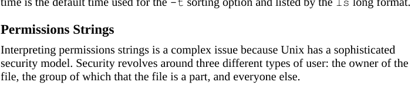

FIGURE 4.1 The meaning of the -l output for a file.

对于 Unix 文件系统中的每个文件和目录，都会记录所有者、大小、名称、指向它的其他文件数（链接）以及访问权限。每个文件的创建、修改和访问时间及日期也会被记录。修改时间是 `-t` 排序选项的默认时间，也是 `ls` 长格式所列出时间。

### Permissions Strings

```
% ls -l -d Example
drwxr-x-  2 taylor      1024 Sep 30 10:50 Example/
```

记住，你必须同时具有目录的读和执行权限。如果你只有读或执行权限之一而没有两者，目录将无法使用（就像你没有任何权限一样）。当然，写权限使用户能够更改目录的内容或向目录添加新文件。

2. `Example` 目录可以如图所示进行解释 Figure 4.4。

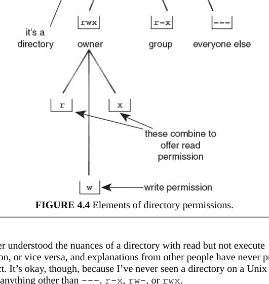

# FIGURE 4.4 Elements of directory permissions.

### Note

I’ve never understood the nuances of a directory with read but not execute permission, or vice versa, and explanations from other people have never proven to be correct. It’s okay, though, because I’ve never seen a directory on a Unix system that was anything other than ---, r-x, rw-, or rwx.

3. 现在试着自己使用 `-l` 标志。移动到你的主目录并输入 `ls -l`，如下所示：

Click here to view code image

```
% ls -l
total 403
drwx--  2 taylor      512 Sep 30 10:38 Archives/
drwx--  3 taylor      512 Oct  1 08:23 InfoWorld/
-rw---  1 taylor    46901 Oct  8 15:17 LISTS
```

`drwx--  2 taylor      1024 Sep 30 10:50 Mail/`

`drwx--  2 taylor       512 Oct  6 09:36 News/`

`drwx--  2 taylor       512 Sep 30 10:51 OWL/`

`-rw---  1 taylor      4643 Sep 20 10:49 RUMORS.18Sept`

`drwx--  2 taylor       512 Oct  1 09:53 bin/`

`-rw---  1 taylor      3843 Oct  6 18:02 iecc.list`

`-rw-rw-- 1 taylor    280232 Oct  6 09:57 mailing.lists`

`-rw-rw-- 1 taylor      1031 Oct  7 15:44 newlists`

`drwx--  2 taylor       512 Sep 14 22:14 src/`

目录的大小通常以 512 字节为增量，尽管某些 Unix 系统会显示目录中文件名的确切大小。 （Unix 不会显示目录中文件的大小，只会显示所有文件名的总大小。）第二个字段，即“链接”，是在列出目录时一个有趣且鲜为人知的数值。它并不是统计指向该文件的其他文件的数量（即有多少文件链接到当前文件），而是指示该特定目录中包含的目录数量。请记住，所有目录都有点号和点点号，因此最小值始终为 2。

## 4. 请考虑以下目录列表示例：

Click here to view code image


```
$ ls -Fa
./          .gopher rc   .oldnews rc   .sig        OWL/
../         .history*   .plan        Archives/   RUMORS.18Sept
.A genda    .info        .pnewsexpert Cancelled.mail bin/
.autoconfigrc .letter    .report      InfoWorld/  iecc.list
.article    .login       .rm-timestamp LISTS       mailing.lists
.cshrc      .mailrc      .rnlast      Mail/       newlists
.elm/       .news rc     .rns oft     News/       src/
$ ls -ld .
drwx-- 10 taylor      1024 Oct 10 16:00 ./
```

### 5. 尝试输入 `ls -ld .` 并查看它是否能正确识别你主目录中的目录数量。移动到其他目录并查看列表是否与你自己统计的目录数量一致。

`ls -l` 命令的输出无疑是复杂且信息密集的。解释权限字符串是理解和使用 Unix 的重要部分，后续章节会提供更多解释。

表 4.3 总结了本小时你所学到的 `ls` 的许多不同命令标志。

| Flag | Meaning |
|---|---|
| `-1` | Force single-column output on listings. |
| `-a` | List all files, including any dot files. |
| `-C` | Force multiple-column output on listings. |
| `-d` | List directories rather than their contents. |
| `-F` | Indicate file types: `/` = directory and `*` = executable. |
| `-l` | Generate a long listing of files and directories. |
| `-m` | Show files as a comma-separated list. |
| `-r` | Reverse the order of any file sorting. |
| `-R` | Recursively show directories and their contents. |
| `-s` | Show size of files, in blocks (typically 1 block = 1,024 bytes). |
| `-t` | Sort output in most-recently modified order. |
| `-x` | Sort output in row-first order. |

## TABLE 4.3 Summary of Command Flags for `ls`

毫无疑问，`ls` 是 Unix 中最强大、因此也最令人困惑的命令之一。了解所有标志如何协同工作的最佳方法是尝试不同的组合。

## Task 4.9: Creating Files with the `touch` Command

到目前为止，你已经了解了各种有助于你在文件系统中移动并了解特定文件的 Unix 工具。现在是使用 `touch` 命令的时候了，该命令可帮助你在系统上创建新文件，而无需任何程序以外的 shell 本身。这对于组织新的文件集合等非常有帮助。

在 Unix 中使用 `touch` 的主要原因是强制更新文件的最后修改时间，如以下示例所示：

[Click here to view code image](#)

```
 % ls -l iecc.list
-rw---- 1 taylor    3843 Oct  6 18:02 iecc.list
 % touch iecc.list
 % ls -l iecc.list
-rw---- 1 taylor    3843 Oct 10 16:22 iecc.list
```

由于 `touch` 命令会更改文件的修改时间，任何基于修改时间对文件进行排序的操作，当然都会在文件被 `touch` 修改时改变该文件的位置。

1. 请考虑以下输出：

[Click here to view code image](#)

```
 % ls -t
mailing.lists   LISTS          News/          OWL/          src/
Canceled.mail    newlists       bin/           Mail/
RUMORs.18Sept    iecc.list      InfoWorld/     Archives/
```

```
% touch iecc.list
% ls -t
iecc.list        RUMORS.18Sept    News/             OWL/              src/
mailing.lists    LISTS             bin/              Mail/
Cancelled.mail   newlists          InfoWorld/        Archives/
```

你可能不会经常为此目的使用 `touch`。

2. 如果你尝试对一个不存在的文件使用 `touch` 命令，程序会创建该文件：

```
% ls
Archives/        LISTS             OWL/              iecc.list        src/
Cancelled.mail   Mail/             RUMORS.18Sept     mailing.lists
InfoWorld/       News/             bin/              newlists
% touch new.file
% ls
Archives/        LISTS             OWL/              iecc.list        newlists
Cancelled.mail   Mail/             RUMORS.18Sept     mailing.lists     src/
InfoWorld/       News/             bin/              new.file
% ls -l new.file
-rw-rw----  1 taylor          0 Oct 10 16:28 new.file
```

新文件大小为零字节，这可以从 `ls -l` 输出中看出。请注意，默认情况下文件会以用户及其所在组可读写的权限创建。你将在下一小时学习如何使用 `umask` 命令指定你自己的文件默认权限。

你不会经常需要 `touch`，但了解它很有价值。

## Task 4.10: Checking Disk Space Usage with `du`

Windows 和 Macintosh 系统相对于 Unix 的一个优势是，它们很容易让你知道你使用了多少磁盘空间以及还有多少可用空间。在 Mac 上，按大小查看文件夹会显示磁盘使用情况，任何 Finder 窗口底部都会显示可用空间。

Unix 就像一个守口如瓶的警察线人，从不主动提供任何信息，所以你需要学习两个新命令。`du`（disk usage，磁盘使用）命令用于查找使用了多少磁盘空间；`df`（disk free，磁盘空闲）命令用于查找有多少可用空间。

1. `du` 命令列出文件系统中当前点及以下所有目录的大小，以千字节为单位。

```
% du
11       ./OWL
38       ./elm
20       ./Archives
14       ./InfoWorld/PIMS
28       ./InfoWorld
710      ./Mail
191      ./News
25       ./bin
35       ./src
1627     .
```

```
2      ./PIMS/task6.txt.Z
1      ./PIMS/contact.info.Z
14     ./PIMS
28     .
```

`du` 的 `-a` 标志的问题与 `ls` 的 `-R` 标志类似。也就是说，目录中可能有比你想查看的更多文件。

## Task 4.11: Checking Available Disk Space with `df`


Unix 中的磁盘通常被划分为多个卷，每个卷有自己的用途并且与系统其余部分隔离。即使在像 Mac OS X 这样个人计算机系统上，占据整个磁盘的单个卷也伴随着几个更小、用途特殊的卷，而用于检查它们的工具被设计为单独查看卷。这意味着弄清楚整个 Unix 系统上可用多少磁盘空间对除专家之外的所有人来说都很困难。`df` 命令用于此任务，但它不会汇总其结果；用户必须自行相加列中的数字。

### 1. 这是在一个分区彻底的 Unix 服务器上对 `df` 命令的系统响应：

```
% df
Filesystem      Kbytes   used   avail capacity Mounted
/dev/zd0a       17259   14514    1019     93% /
/dev/zd8d       185379  143995   22246     86% /userf
/dev/zd7d       185379  12984   153857      8% /tmp
/dev/zd3f       385689  307148   39971     88% /users
/dev/zd3g       367635  232468   98403     70% /usere
/dev/zd2f       385689  306189   40931     88% /usere
/dev/zd2g       367635  207234  123637     63% /userb
/dev/zd1g       301823  223027   48613     82% /usera
/dev/zd5c       371507  314532   19824     94% /usr
/dev/zd0h       236820  159641   53497     75% /usr/src
/dev/zd0g       254987   36844  192644     16% /var
```

你最终会得到大量信息，但要快速相加以找到总可用空间却并不容易。尽管如此，输出提供了相当多的信息。

### 2. 因为我知道我的主目录位于磁盘 `/users` 上，所以我只需在最右列中查找该目录即可发现我使用的是硬盘 `/dev/zd3f`。我可以看到磁盘上有 385,689 千字节，磁盘使用率为 88%，这意味着使用了 307,148 千字节，未使用 39,971 千字节，或仅约 38MB。

### 3. 一些 Unix 系统连接的独立计算机磁盘相对较少或分区卷较少，使得 `df` 输出更易读。下面显示了 `df` 输出，并在图 4.5 中进行了说明。

## FIGURE 4.5 理解 df 输出。

磁盘设备的名称

设备总大小（以 Kbytes 为单位）

已使用的 Kbytes

可用的 Kbytes

使用百分比

文件系统中的挂载点

`dev/sd0a` 55735 37414 12748 75% `/`

你可以将列相加可知，系统总共有约 300MB 的磁盘空间（55,735 + 187,195 + 55,688），其中 230MB 已被使用。因此剩余空间为 33MB，占总磁盘大小的 16%。

### 4. 许多现代 Unix 系统允许你使用带 `-h` 标志的 `du`。 （某些 man 手册将其称为人类可读输出标志！）这提供了更有用的输出格式。以下是来自另一台计算机系统的示例：

```
% df
Filesystem      kbytes   used   avail capacity  Mounted
/dev/sd0a       55735    37414  12748   75%    /
/dev/sd2b       187195   153569 14907   91%    /usr
/dev/sd1a       55688    43089  7031    86%    /utils
```

```
% df -h
Filesystem   Size   Used   Avail Capacity  Mounted on
/dev/sd0a    15G    2.1G   13G    14%      /
/dev/sd1a    15G    157M   15G    1%       /web
```

### 5. Mac OS X 是更现代的 Unix 之一，它在 `df` 输出中包含了各种非磁盘设备，如本示例所示：

```
$ df -h
Filesystem        Size   Used  Avail Capacity  Mounted on
/dev/disk0s8      49G    43G   6.1G   88%      /
devfs             94K    94K   0B     100%     /dev
fdesc             1.0K   1.0K  0B     100%     /dev
<volfs>           512K   512K  0B     100%     /.vol
automount -nsl [335] 0B 0B 0B 100% /Network
automount -fstab [338] 0B 0B 0B 100% /automount/Servers
automount -static [338] 0B 0B 0B 100% /automount/static
```

在所有这些输出中，系统上实际上只有一个磁盘，`/dev/disk0s8`，它是一个 49GB 的硬盘，已使用 88%。

### 6. 尝试在你的系统上使用 `du` 和 `df` 命令，以确定整个系统以及你用于主目录的磁盘上可用的磁盘空间。然后使用 `du` 来识别你的文件和目录占用了多少空间。

## Task 4.12: 使用 `gzip` 程序缩小大文件

现在你可以通过目录中的文件确定你使用了多少空间，你已准备好学习如何在不删除任何文件的情况下节省空间。Unix 有一个内置程序——`gzip` 程序——提供了这种功能。

内置于 Unix 的原始压缩程序称为 `compress`，但现在你可以使用另外两种压缩文件的工具，它们往往做得更好：`gzip` 和 `bzip2`。

#### 1. 在这个简单示例中，`gzip` 程序被赋予一个文件名列表，然后压缩每个文件并将其重命名为以 `.gz` 后缀结尾，这表明它们已被压缩：

[Click here to view code image](#)

```
% ls -l LISTDATA2
-rw-r--r-- 1 taylor taylor 24064 23 Apr 22:41 LISTDATA2
% gzip LISTDATA2
% ls -l LIST*
-rw-r--r-- 1 taylor taylor 3682 23 Apr 22:41 LISTDATA2.gz
```

压缩 `LISTDATA2` 文件使其大小从 24 千字节减少到略多于 3 千字节（磁盘空间节省了近 85%）。如果你预计系统上会有大型文件且不会经常访问，使用 `gzip` 程序可以节省大量磁盘空间。

#### 2. 在更大的文件上使用 `gzip` 可以显示更大的节省（请注意，我还添加了 `-v` 标志，它显示了通过对相关文件使用 gzip 所获得的节省程度）：

[Click here to view code image](#)

```
% ls -l big.file
-rwx-- 1 taylor taylor 3198588 23 Apr 22:48 big.file
% gzip -v big.file
big.file: 72.7% - replaced with big.file.gz
% ls -l big.file*
-rwx-- 1 taylor taylor 871440 23 Apr 22:48 big.file.gz
```

这个单一命令能够释放近 3MB 的磁盘空间。如果你使用 PC 运行 Unix，或者你在一个有许多用户（你可以通过使用 `w` 命令轻松确定）的系统上，压缩文件可能需要花费大量时间。

#### 3. 要反转此操作，请使用配套命令 `gunzip` 并指定文件的当前名称（即带有 `.gz` 后缀）或文件在压缩前的名称（即不带 `.gz` 后缀）：

```
% gunzip LISTDATA2
% ls -l LISTDATA2
-rw-r--r-- 1 taylor taylor 24064 23 Apr 22:41 LISTDATA2
```

### Note

为什么要压缩文件？你这样做是为了节省文件空间。不过，在使用任何压缩文件之前，你必须先解压缩它们，因此 `gzip` 工具最适合用于你暂时不需要的大文件。

#### 4. 在我们离开这个主题之前，让我们快速看看另外两种压缩程序与 `LISTDATA2` 和 `big.file` 的比较情况：

Click here to view code image


```text
% ls -l LISTDATA2 big.file
-rw-r--r-- 1 taylor taylor 24064 23 Apr 22:41 LISTDATA2
-rwx-- 1 taylor taylor 3198588 23 Apr 22:48 big.file
% compress -v LISTDATA2 big.file
LISTDATA2.Z: 25% compression
big.file.Z: 33% compression
% ls -l LISTDATA* big.file*
-rw-r-- 1 taylor taylor 5962 23 Apr 22:41 LISTDATA2.Z
-rwx-- 1 taylor taylor 1068457 23 Apr 22:48 big.file.Z*
% uncompress LISTDATA2* big.file*
% bzip2 -v LISTDATA2 big.file
LISTDATA2: 5.979:1, 1.338 bits/byte, 83.27% saved, 24064 in, 4025 out.
big.file: 5.305:1, 1.508 bits/byte, 81.15% saved, 3198588 in, 602958 out.
% bunzip2 LISTDATA* big.file*
% ls -l LISTDATA2 big.file
-rw-r--r-- 1 taylor taylor 24064 23 Apr 22:41 LISTDATA2
-rwx-- 1 taylor taylor 3198588 23 Apr 22:48 big.file
```

不同的压缩程序对结果不同，是因为给定文件的格式不同。有时压缩程序根本无法节省任何磁盘空间。如果你遇到磁盘空间问题，请尝试在你最大的一个或两个文件上使用不同的程序，以查看哪种程序对你拥有的文件类型效果最好。

尝试在你目录中的一些文件上使用 `gzip` 程序使用，注意不要压缩可能需要运行程序的任何文件（特别是首选项或点文件）。

## Summary

你在这一个小时的大部分时间里学习了功能强大且复杂的 `ls` 命令及其列出文件和目录的多种方式。你还学会了如何组合命令标志以减少输入。你学会了如何使用 `touch` 命令创建新文件，并在需要时更新旧文件的修改时间。本小时继续讨论了如何使用 `du` 和 `df` 命令分别确定你使用的磁盘空间量以及剩余空间。你还学到 `gzip` 命令如何通过确保不经常使用的文件以所需的最小空间存储，从而防止你用完空间。

## Workshop

研讨会总结了你所学到的关键术语，并提出了有关本课主题的一些问题。它还为你提供了下一小时将学习内容的预览。

## Key Terms

**access permissions** 这是为系统上每个文件或目录允许的每个用户类别（所有者、组和其他人）的访问权限（读、写和执行）的集合。

**block** 在最根本的意义上，块就像代表磁盘的虚拟笔记本中的一张信息纸：磁盘通常由数十万或数百万个信息块组成，每个块大小为 512 字节。你也可以阅读词汇表后面关于 **inode** 的解释，以了解更多关于 Unix 中磁盘结构的信息。

**column-first order** 当你有一列跨越多行的项目时，列优先顺序是一种排序策略，即项目按第一列的字母顺序向下排序。排序继续在第二列的顶部，然后是第三列，依此类推。另一种策略是 **row-first order**。

**permissions string** 该字符串表示访问权限，以符号方式编码各种特权以便于阅读。

**row-first order** 这是一种排序顺序，其中项目按行排序，以便每行中每列的第一项按从左到右的字母顺序排列，然后第二行包含下一组项目，依此类推。另一种策略是 **column-first order**。

## Exercises

- 1. 尝试在不同的目录上使用 `du` 命令，看看每个目录需要多少磁盘空间。如果你遇到文件权限错误，请使用 `ls -ld` 列出相关目录的权限。
- 2. 为什么你会想要 `ls` 提供的所有不同类型的排序替代方案？你能想到每种排序在何种情况下会很有用的情况吗？
- 3. 使用 `ls -t` 和 `touch` 命令的组合创建几个新文件。然后更新它们的修改时间，以便在按最近修改时间列出文件时，你创建的第一个文件显示在第二个文件之前。
- 4. 尝试从你的主目录使用 `du -s ..` 命令。不过，在尝试之前，你认为会发生什么？
- 5. 使用 `df` 和 `bc` 或 `dc` 来计算你系统上使用的和可用的磁盘空间量。
- 6. 使用 `gzip` 命令缩小 `/tmp` 或你的主目录中的一个文件。使用 – 使用 `v` 标志可以了解文件的压缩程度，然后通过 `gunzip` 将文件恢复到原始状态。

## 下一小时预览

下一小时的内容相对容易一些。它将进一步解释 `ls` 命令给出的各种信息，并讨论文件所有权，包括如何更改任意文件或目录的所有者和组。你将学习 `chmod` 命令，它能够更改与任意文件或目录关联的特定权限集合；还会学习 `umask` 命令，它可以控制新建文件在创建时被赋予的模式。

# 第5小时 所有权和权限

## 本小时目标

在本小时中，你将学习

- 关于文件权限设置
- 关于目录权限设置
- 如何使用 `chmod` 修改文件和目录权限
- 关于使用 `chmod` 数字权限字符串
- 如何使用 `umask` 建立默认的文件和目录权限
- 如何识别任意文件或目录的所有者和组

本小时重点教授 Unix 文件权限的基础知识。主题包括使用 `chmod` 设置和修改文件权限、分析 `ls -l` 命令所显示的文件权限，以及使用 `umask` 命令设置默认文件权限。然而，权限只是问题的一半，你还会学习文件所有权和组所有权，以及如何更改任意文件或目录的所有者或组。

上一小时首次讲解了如何使用带 `-l` 选项的 `ls` 命令来处理文件或目录权限。如果你最近没有阅读过这部分内容，重新回顾一下会很有帮助。在本小时，你将学到 `ls` 的另一个选项，它告诉 Unix 显示文件或目录的组和所有者。另外还会详细介绍两个命令：用于更改文件权限的 `chmod` 和用于定义默认权限的 `umask`。

## 使用文件权限

正如你在这本书中的示例所看到的，Unix 将所有目录都当作文件处理；每个目录都有自己的大小（有时与其内容无关）、自己的权限字符串等。因此，除非存在重要差异，否则从此刻起，当我提到文件时，我指的是文件和目录两者。凭逻辑即可判断这些命令是同时适用于两者，还是仅适用于文件，或仅适用于目录。（例如，你不能编辑目录，也不能在文件中存储文件。）

### 任务5.1：理解文件权限设置

在上一小时中，你初步了解了当 `ls` 与 `-l` 标志一起使用时，如何解释它提供的文件权限信息。请看以下示例：

单击此处查看代码图片

```
% ls -l
total 403
drwx--  2 taylor        512 Sep 30 10:38 Archives/
drwx--  3 taylor        512 Oct  1 08:23 InfoWorld/
-rw---  1 taylor     106020 Oct 10 13:47 LISTS
```

```
drwx--  2 taylor       1024 Sep 30 10:50 Mail/
drwx--  2 taylor        512 Oct  6 09:36 News/
drwx--  2 taylor        512 Sep 30 10:51 OWL/
-rw---  1 taylor       4643 Oct 10 14:01 RUMORS.18Sept
drwx--  2 taylor        512 Oct 10 19:09 bin/
-rw---  1 taylor       3843 Oct 10 16:22 iecc.list
-rw-rw-r--  1 taylor     280232 Oct 10 16:22 mailing.lists
-rw-rw-r--  1 taylor       1031 Oct  7 15:44 newlists
drwx--  2 taylor        512 Oct 10 19:09 src/
```

每行信息的第一个项目就是我们要关注的内容。你在上一小时已经学到，第一个项目被称为*权限字符串*，更简洁地说，就是*权限*。它有时也被称为文件的*模式*或*权限模式*，这个助记符对记住如何更改权限很有价值。

权限可以分成四个部分：类型、所有者、组和其他用户权限。第一个字符指示文件类型：`d` 表示目录，`-` 表示普通文件。Unix 还有其他各种类型的文件，每种都由其权限字符串的第一个字母标识，如表5.1所总结。你可以安全地忽略任何既不是普通文件也不是目录的文件。

| 字母 | 指示的文件类型 |
|---|---|
| d | 目录 |
| b | 块类型特殊文件 |
| c | 字符类型特殊文件 |
| l | 符号链接 |
| p | 管道 |
| s | 套接字 |


| - | 普通文件 |

## 表5.1 ls 文件类型指示符

权限字符串中的接下来九个字母被分成三组，每组三个，分别表示所有者、组和其他所有人，如图5.1所示。

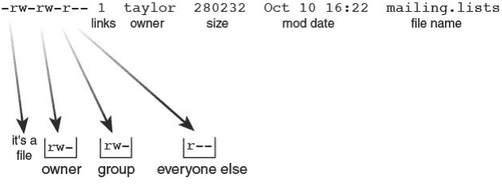

**图5.1** 解释文件权限。

要理解权限对计算机系统究竟意味着什么，请记住 Unix 将一切都视为文件。如果你安装一个应用程序，它和其他所有东西一样，只有一个例外：系统知道应用程序是可执行的。一封写给你的

Mum 是一个普通文件，但如果你告诉 Unix 它是可执行的，系统会愉快地尝试将其作为程序运行（然后失败）。

文件存在三种主要类型的权限：读、写和执行。读权限使用户能够使用各种程序查看文件的内容，但他们不能更改、修改或删除任何信息。他们可以将文件复制到自己有写权限的目录中，然后编辑新版本。

写权限是下一步。具有文件写访问权限的用户可以向文件添加信息。如果你对文件同时具有写权限和读权限，你就可以编辑文件：读权限使你能够查看内容，写权限使你能够更改内容。仅有写权限时，你可以向文件添加信息，但你无法在任何时候查看文件的内容。坦白说，Unix 中仅写权限是不常见的，但你可能会在日志文件上看到它，日志文件是跟踪系统活动的 files。

到目前为止，你已经了解到你可以拥有只读权限、读写权限和仅写权限的文件。第三种访问权限是执行，由 `ls` 在权限字符串的第三个位置用 `x` 表示。你可以设置任何文件为可执行；shell 脚本、Perl、Ruby 和其他解释型语言都是被执行的文本文件。例如，这里是我自己的 `bin` 目录中的一些程序——以及 shell 脚本——它们是可执行的：

Click here to view code image

```
% ls -l bin
 total 57
-rwx-- 1 taylor 1507 Aug 17 13:27 bounce.msg
-rwxrwx- 1 taylor 32916 Oct 10 19:09 calc
-rwx-- 1 taylor 18567 Sep 14 22:14 fixit
-rw--- 1 taylor 334 Oct 1 09:53 punt
-rwx-- 1 taylor 3424 Sep 10 22:27 rumor.mill.sh
```

1. 尝试列出你系统上 `/etc` 目录中的文件，看看你能否识别哪些是可执行文件或程序，哪些是目录，哪些是符号链接（以权限字符串的第一个字符为 `l` 表示；它们是指向其他文件的文件，或指向其他目录的目录），哪些是普通文件。

2. 执行权限与读或写权限略有不同。任何具有执行权限的文件都可以像程序一样对待。你在命令行输入文件名，如果该目录在你的 `PATH` 中，该文件将被执行：

Click here to view code image

```
% pwd
/home/taylor
% echo $PATH
/home/taylor/bin:/bin:/usr/bin:/usr/ucb:/usr/local:/usr/local/bin:
% ls -l bin/say.hi
-rwxrwx- 1 taylor 9 Oct 11 13:32 bin/say.hi
% say.hi
hi
```

你现在可以看到搜索路径的重要性。没有搜索路径，系统将无法找到任何命令，你将只剩下几乎无法使用的系统。你也可以看到检查可执行权限状态的目的。我要稍微跳 ahead 一点来向你展示 `chmod`（change mode/permission）程序的一种用途，这样你就可以看到如果我使用 `-x` 标志从 `say.hi` 程序中移除执行权限会发生什么：

Click here to view code image

```
% chmod -x bin/say.hi
% ls -l bin/say.hi
-rw-rw-- 1 taylor 9 Oct 11 13:32 bin/say.hi
% say.hi
/home/taylor/bin/say.hi: Permission denied.
```

这次 Unix 在我的搜索路径中搜索，找到了与我请求的程序名称匹配的文件，然后确定它不可执行。由此产生的错误消息是 `Permission denied`。

3. 现在尝试在你的计算机系统上输入 `say.hi`。你会得到不同的错误消息，`Command not found`，这告诉你 Unix 检查了搜索路径中的所有目录，但在哪里都找不到匹配项。

4. 检查你的 `PATH` 并找到一个你可以添加文件的目录。你可能在你的 `HOME` 目录中有 `bin` 目录（例如，我在搜索路径中有 `/home/taylor/bin`）。如果没有，使用 `mkdir bin` 创建一个。这是一个使用 `touch` 命令添加文件的好地方：

Click here to view code image

```
% echo $PATH
/home/taylor/bin:/bin:/usr/bin:/usr/ucb:/usr/local:/usr/local/bin:
% touch bin/my.new.cmd
% ls -l bin
-rw-rw-- 1 taylor 0 Oct 11 15:07 my.new.cmd
```

5. 现在尝试通过直接输入其名称来实际执行该命令：

Click here to view code image

```
% my.new.cmd
/home/taylor/bin/my.new.cmd: Permission denied.
```

### Note

如果你使用的是 C shell（而不是 bash）作为你的命令解释器，就像在 FreeBSD 上可能的情况，它可能找不到你刚刚创建的新命令。这是因为，为了加快速度，它会保留一个内部表，记录不同命令在你的搜索路径中的位置。你需要强制程序重建其表，你可以用简单的命令 `rehash` 来做到这一点。如果你输入文件名时没有得到 `permission denied` 错误，而是看到 `Command not found`，请输入 `rehash` 再试一次。

6. 最后，使用 `chmod` 为文件添加执行权限，再次尝试执行它：

Click here to view code image

```
% chmod +x bin/my.new.cmd
```

```
% ls -l bin/my.new.cmd
-rwxr-x-- 1 taylor      0 Oct 11 15:07 bin/my.new.cmd
% my.new.cmd
%
```

Voilà! 你已经创建了你的第一个 Unix 命令，这是一项成就，即使它什么也没做。你现在可以看到搜索路径以及 Unix 哲学中应用程序与普通文件相同，只是权限不同，这种特性在你学习如何自定义环境时是无价的。

执行权限使用户能够像运行程序一样运行文件。执行权限独立于其他被授予或被拒绝的权限，因此完全可以拥有一个具有读和执行权限但没有写权限的程序。毕竟，你不希望其他人修改程序本身。你也可以拥有仅具有执行权限的程序。这意味着用户可以运行应用程序，但他们无法检查其工作原理或复制它。复制当然需要能够读取文件内容。

### Note

尽管实际具有仅执行权限的程序工作正常，但一类特殊的程序称为 shell 脚本会失败。Shell 脚本充当 Unix 命令行宏设施，使你能够轻松地将一系列命令保存在文件中，然后作为单个程序运行。然而，要工作，shell 必须能够读取文件并执行它，因此 shell 脚本始终需要同时具有读和执行权限。

在三种不同的权限：读、写和执行上，显然有相当多的排列组合。实际上，其中少数几种最常见，如表 5.2 所列。

| Permission | Meaning |
|---|---|
| --- | No access is allowed |
| r-- | Read-only access |
| r-x | Read and execute access, for programs and shell scripts |
| rw- | Read and write access, for files |
| rwx | All access allowed, for programs |

## TABLE 5.2 The Most Common File Permissions

这些权限应用于目录时含义不同，但 `---` 始终表示没有人可以访问相关文件。

对以下几个示例的解释应该会有所帮助：

Click here to view code image

```
-rw--- 1 taylor    3843 Oct 10 16:22 iecc.list
-rw-rw-r 1 taylor  280232 Oct 10 16:22 mailing.lists
-rw-rw- 1 taylor   1031 Oct  7 15:44 newlists
-rwxr-x- 1 taylor    64 Oct  9 09:31 the.script
```


第一个文件 `iecc.list` 对所有者 `taylor` 具有读和写权限，对所有其他用户均不可访问。文件 `mailing.lists` 为文件所有者 `taylor` 和组提供类似访问权限，但对系统上的其他所有人仅提供只读访问权限。第三个文件 `newlists` 为文件所有者和组提供读写访问权限，但对组外任何人均无访问权限。

列表中的第四个文件 `the.script` 是一个程序，可以由所有者和组成员运行，可以由所有者和组读取或复制，并可由所有者写入修改。实际上，这很可能是一个 shell 脚本，如前所述，这些权限将使所有者 `taylor` 能够使用编辑器修改其中的命令。组的其他成员可以读取和使用 shell 脚本，但将被拒绝更改它的访问权限。

## Task 5.2: Directory Permissions Settings

目录在解释权限字符串的方式上与文件相似。差异源于目录的独特目的——即存储其他文件或目录。我总是把目录想成箱子或盒子。你可以检查盒子本身，也可以查看里面的东西。

在许多方面，Unix 将目录简单地视为文件系统中的文件，其中文件的内容是存储在其中的文件和目录的列表，而不是字母、程序或购物清单。

当然，区别在于，当你操作目录时，你同时操作目录本身以及隐式地操作其内容。类比地说，当你摆弄一个装满玩具的盒子时，你改变的不仅仅是盒子本身的状态，还有其中的玩具。

目录可能的三种权限与文件相同：读、写和执行。最容易理解的是写权限。如果目录启用了写权限，你可以向目录中添加新项目并从中删除项目。这就像拥有这个盒子；你可以随意处理里面的玩具。

目录的读权限和执行权限之间的交互令人困惑。对目录执行的两种操作是：列出目录的内容通常使用 `ls`，以及检查目录中特定的已知文件。

### 1. 首先列出目录，使用 `-d` 标志：

Click here to view code image

```
$ ls -ld testme
dr-x--- 2 taylor 512 Oct 11 17:03 testme/
$ ls -l testme
total 0
-rw-rw-- 1 taylor 0 Oct 11 17:03 file
$ ls -l testme/file
-rw-rw-- 1 taylor 0 Oct 11 17:03 testme/file
```

对于同时具有读和执行权限的目录，你可以看到列出目录、找出其中的文件以及列出目录中特定文件是多么容易。

### 2. 目录的读权限使你能够读取目录的“目录表”，但其本身并不允许你检查其中的任何文件。通过

本身，读权限相当奇怪：

[点击此处查看代码图像](#)

```
 % ls -ld testme
 dr----- 2 taylor 512 Oct 11 17:03 testme/
 % ls -l testme
testme/file not found
total 0
 % ls -l testme/file
testme/file not found
```

注意系统指出了 `testme` 目录中包含的文件名。当我尝试显式列出该文件时，系统却找不到该文件。奇怪。

### 3. 将此与你拥有执行权限的情况进行比较——这使你能够检查目录内的文件——但你没有读权限，并且无法查看目录本身的目录表：

[点击此处查看代码图像](#)

```
 % ls -ld testme
 d--x--x-- 2 taylor 512 Oct 11 17:03 testme/
 % ls -l testme
testme unreadable
 % ls -l testme/file
-rw-rw-- 1 taylor 0 Oct 11 17:03 testme/file
```

仅有执行权限时，你可以设置目录，使知道目录中包含的文件名的人可以访问这些文件，但不知道的人无法列出目录以了解文件名。

### 4. 我实际上从未见过任何人在 Unix 中拥有仅执行权限的目录，而且你肯定永远不会期望看到设置为仅读的目录。Unix 如果你在设置目录时只设置一种权限而未设置另一种权限时发出警告就好了。然而，作为 Unix 的一般规则，所有参数组合都是可能的，即使在实践中不合逻辑的组合也是如此；如何明智地使用工具取决于你。因此，对于目录，请始终确保同时设置了读和执行权限。 [表 5.3](#) 总结了最常见的目录权限。

| Permission | Meaning |
|---|---|
| `---` | No access allowed to directory |
| `r-x` | Read and execute access, essentially read-only, no modification allowed |
| `rwx` | All access allowed |

## TABLE 5.3 The Most Common Directory Permissions

### 5. 目录权限的一个有趣排列是写-only 目录。不幸的是，写-only 权限并没有你希望的那样发挥作用——也就是说，允许人们向目录添加文件而无需查看目录已包含的内容。相反，它在功能上与设置为完全无访问权限完全相同。

在本小时开始时，我使用 `ls` 列出了我的主目录中的各种文件和目录：

点击此处查看代码图像

```
$ ls -l
total 403
drwxr-x 2 taylor 512 Sep 30 10:38 Archives/
drwxr-x 3 taylor 512 Oct 1 08:23 InfoWorld/
-rw--- 1 taylor 106020 Oct 10 13:47 LISTS
drwxr-x 2 taylor 1024 Sep 30 10:50 Mail/
drwxr-x 2 taylor 512 Oct 6 09:36 News/
drwxr-x 2 taylor 512 Sep 30 10:51 OWL/
-rw--- 1 taylor 4643 Oct 10 14:01 RUMORS.18Sept
drwxr-x 2 taylor 512 Oct 10 19:09 bin/
-rw--- 1 taylor 3843 Oct 10 16:22 iecc.list
-rw-rw-r- 1 taylor 280232 Oct 10 16:22 mailing.lists
-rw-rw-- 1 taylor 1031 Oct 7 15:44 newlists
drwxr-x 2 taylor 512 Oct 10 19:09 src/
```

现在你可以看到，我的所有目录都设置为我自己拥有列出、检查和修改（分别为读、执行和写）权限，而其他任何人都无权访问。

### 6. 最顶层的目录更有趣，包含各种目录和权限：

点击此处查看代码图像

```
$ ls -l /
-rw-r--r-- 1 root 61440 Nov 29 1991 boot
drwxr-xr-x 4 root 23552 Sep 27 11:31 dev
drwxr-xr-x 6 root 3072 Oct 11 16:30 etc
drwxr-xr-x 2 root 8192 Apr 12 1991 lost+found
lrwxr-xr-x 1 root 7 Jul 28 1988 sys -> usr/sys
drwxrwxrwx 65 root 12800 Oct 11 17:33 tmp
drwxr-xr-x 753 root 14848 Oct 5 10:07 usera
drwxr-xr-x 317 root 13312 Oct 5 10:17 userb
drwxr-xr-x 626 root 13312 Oct 8 13:02 userc
drwxr-xr-x 534 root 10752 Sep 30 13:06 users
drwxr-xr-x 34 root 1024 Oct 1 09:10 usr
drwxr-xr-x 5 root 1024 Oct 1 09:20 var
```

很明显，这台机器有很多用户。请注意 `usera`、`userb`、`userc` 和 `users` 的链接计数都在数百个。`dev` 目录对所有人都有读和执行权限，对所有者 `root` 有写权限。事实上，除了 `tmp` 之外，此级别的所有目录都相同，`tmp` 对系统上的所有用户都有读、写和执行权限。

### 7. 你注意到输出中隐藏的 `sys` 目录的列表了吗？

### 8. 试着自己使用 `ls -l /`。你应该能够理解你遇到的任何文件或目录的权限。

随着你使用 Unix 的时间越长，文件和目录的权限会变得越容易理解。

## 任务 5.3：使用 chmod 修改文件和目录权限

现在你已经可以列出目录权限并理解它们的含义了，不妨学习一个能让你根据需要更改它们的 Unix 命令？你已经对这个命令有过初步了解：`chmod`。其助记符是“change mode”，源自早期 Unix 用户谈论文件权限模式的说法。你可以把它记成“change permission modes”的缩写形式。

### 注意

要听起来像 Unix 专家，请把 `chmod` 发音为“ch-mod”，“ch”像 `child` 的开头，“mod”与 `cod` 押韵。


`chmod`命令允许你以两种不同的方式指定权限：符号方式或数字方式。符号表示法最常用于修改现有权限，而数字格式则总是用指定的新值替换任何现有权限。在本任务中，你将学习符号表示法，下一个任务将重点介绍功能强大的数字格式。

`chmod`的符号表示法有点像拥有一个不同选择的菜单，让你挑选最符合需求的组合。图 5.2 显示了这些菜单。

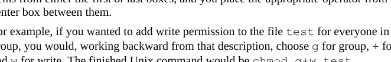

图 5.2 符号`chmod`值的菜单。

`chmod`命令就像一个自助餐，你可以从第一个或最后一个框中选择任意组合的项目，并在它们之间放置来自中间框的适当运算符。

例如，如果你想为组中的每个人添加对文件`test`的写权限，你将根据该描述反向操作，选择`g`表示组，`+`表示添加，`w`表示写。最终的 Unix 命令将是`chmod g+w test`。

我认为在展示使用示例之前，我们应该先列出每个`u`、`g`、`o`和`a`。

## 注意

当你拥有一个账户时，你有一个唯一的用户名，但你也被包含在一个或多个组中。组权限让在同一项目上工作的其他人可以共享信息，而不会向全世界公开信息。

如果你决定取消对不在你组中的所有人的读和执行权限，你可以使用`chmod o-rx test`来完成任务。

1. 转到你的电脑上，使用`touch`和`ls`尝试更改权限，看看会发生什么。我也会这样做：

Click here to view code image

```
% touch test
% ls -l test
-rw-r--r-- 1 taylor 0 Oct 11 18:29 test
```

2. 我想做的第一个修改是，我组中的人应该能够读取和写入该文件。我将为组成员添加写权限：

Click here to view code image

```
% chmod g+w test
% ls -l test
-rw-rw-r-- 1 taylor 0 Oct 11 18:29 test
```

3. 但随后我的老板提醒我，组中的每个人都应该拥有全部访问权限。好的，我会这样设置：

Click here to view code image

```
% chmod g+x test
% ls -l test
-rw-rwxr-- 1 taylor 0 Oct 11 18:29 test
```

当然我也可以用`chmod g=rwx`来实现。

4. 等一下。这个`test`文件只是我自己使用，组里的人不应该查看它。我会改回来：

Click here to view code image

```
% chmod o-r test
% chmod g-rwx test
% ls -l test
-rw----- 1 taylor 0 Oct 11 18:29 test
```

很好。现在文件设置成我可以读取和写入，但其他人无法触碰、读取、修改或做任何其他事情。

5. 如果我稍微让步一点，我就可以用最后一个`chmod`命令轻松地为每个人添加只读权限：

Click here to view code image

```
% chmod a+r test
% ls -l test
-rw-r--r-- 1 taylor 0 Oct 11 18:29 test
```

Unix 中的权限基于 Multics 的同心访问模型。 （在第 1 小时“什么是这个 Unix 东西？”中，你了解到 Unix 这个名字也是对 Multics 的双关语。）图 5.3 说明了这一概念。

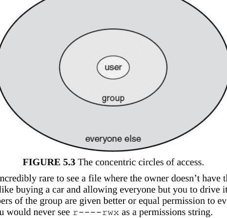

图 5.3 访问的同心圆。

因此，几乎不可能看到一个文件所有者没有对文件拥有最多访问权限的情况。这就像买了一辆车却允许除了你之外的所有人驾驶它——相当愚蠢。同样，组成员被赋予比机器上其他人更好或相等的权限。你永远不会看到`r----rwx`这样的权限字符串。

多尝试一下`chmod`符号表示法可能的各种组合。你将如何更改目录的权限以使所有用户都可以使用`ls`检查它，但禁止他们添加或删除文件？如何为所有者添加写访问权限，同时将其从其他每个人那里移除？

## 任务 5.4：使用`chmod`设置新文件权限

`chmod`接受的第二种输入形式是权限的绝对数值。在你学习如何使用这种表示法之前，你必须先了解一些不同的计数系统。

你熟悉的计数系统，也就是你用来平衡支票簿和核对市场收据的系统，是十进制，或基数 10。这意味着从右到左的每个数字的值都是该数字乘以 10 的幂，基于该数字在数字中的位置。图 5.4 显示了数字 5,783 在十进制形式中的表示。

## 图 5.4 解释十进制数字。

你可以看到，在基数为 10 的编号系统中，一个数字的值是每个数字的值乘以数字基数的`n`次方的和。`n`是该数字距离最右边的数字的空格数。也就是说，在数字 5,783 中，你知道 7 的价值不仅仅是 7，因为它距离最右边的数字（3）有两个空格。因此，其值是数字基数（10）的`n`次方，其中`n`为 2（它距离两个空格）。10 的二次方等于 100（10² = 100），当你将它乘以 7 时，确实会发现这个数字中的 7 价值为 700。

这与`chmod`命令有什么关系呢？从根本上说，Unix 权限是一系列开/关开关。组是否有写权限？1 表示是，0 表示否。二进制系统是指每个数字只能有两个值：开或关，1 或 0，是或否。因此，你可以轻松且唯一地将任何权限字符串描述为一系列零和一，即一个二进制数。图 5.5 演示了这一点。

## 图 5.5 权限作为二进制数字。

惯例是，如果存在一个字母，二进制数字就是 1——该权限被允许——如果没有字母存在，该数字就是零。因此，`rwxr-x-----`可以描述为 101100000，而`r--r--r--`可以用二进制描述为 100100100。

你已经学到，九个字符的权限字符串实际上只是针对三种不同类型的用户（所有者、组和其他人）重复三次的三个字符权限字符串。这意味着你可以专注于学习如何将单个三字符权限子字符串转换为二进制并推导出更多权限。表 5.4 列出了所有可能的权限及其二进制等价。

## 表 5.4 权限和二进制等价

| Permissions String | Binary Equivalent |
|---|---|
| `---` | `000` |
| `--x` | `001` |
| `-w-` | `010` |
| `-wx` | `011` |
| `r--` | `100` |
| `r-x` | `101` |
| `rw-` | `110` |
| `rwx` | `111` |

了解如何使用前面介绍的相当复杂的公式来解释十进制数字，你不应该感到惊讶，任何二进制数字的十进制等价都可以通过使用相同技术获得。图 5.6 显示了如何使用`r-x`权限的二进制等价。


## 图 5.6 将`r-x`表示为单个数字。

如果`r-x`等于 5，那么可以推断，每种可能的三个字符权限都有一个等价的单个数字，表 5.5 在包含

## 单个数字等价

| Permissions String | Binary Equivalent | Decimal Equivalent |
|---|---|---|
| `---` | `000` | 0 |
| `--x` | `001` | 1 |
| `-w-` | `010` | 2 |
| `-wx` | `011` | 3 |
| `r--` | `100` | 4 |
| `r-x` | `101` | 5 |
| `rw-` | `110` | 6 |
| `rwx` | `111` | 7 |

## 表 5.5 权限和数字等价

拥有一个数字来描述任何七种不同的权限状态的价值应该显而易见。使用仅三个数字，你可以完全表达 Unix 中任何文件或目录的任何可能的权限组合——一个数字用于所有者权限，一个用于组，一个用于其他人。图 5.7 显示了如何将完整的权限字符串转换为其三位数等价。

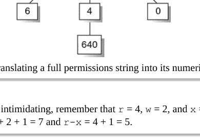

## 图 5.7 将完整的权限字符串转换为其数字等价。

### Note

如果这个数学有点令人生畏，请记住`r = 4`，`w = 2`，`x = 1`，所以，例如，`rwx = 4 + 2 + 1 = 7`而`r-x = 4 + 1 = 5`。

从这个图示中，你可以看到权限字符串`rw-r-----`（所有者具有读写权限，组具有读权限，其他人无访问权限）与数字字符串 640 完全等价。

1. 尝试使用表 5.4 的帮助自行创建数字字符串。转向你的计算机并使用`ls`显示一些列表。将每个权限字符串分成三个三字母组并找出其数字等价。以下是我的主目录`ls -F`列表中的一些示例：


```
drwx--  2 taylor      512 Sep 30 10:38 Archives/
-rw---  1 taylor    106020 Oct 10 13:47 LISTS
-rw-rw-r- 1 taylor   280232 Oct 10 16:22 mailing.lists
-rw-rw-- 1 taylor    1037 Oct 7 15:44 newlists
```

现在，每一项对应的数值等价是什么？第一个是 `700`。

在尝试用 `chmod` 使用数值权限字符串之前，还差最后一步。你需要能够反向推算，确定你想要设置的权限，并找出该权限对应的数值等价。

### 任务5.5：计算数值权限字符串

假设你想设置一个目录，使你拥有所有访问权限，你所在组的人可以查看内容但不能修改任何东西，而其他所有人都被拒之门外。你会怎么做？

你自己拥有所有权限意味着你希望所有者具有读+写+执行权限（即数值权限`7`）；组内其他人具有读取和列目录权限意味着组具有读+执行权限（数值权限`5`）；而其他所有人没有任何权限，即数值权限`0`。将这三个数字组合在一起，就得到答案：`750`。

这就是以数值模式使用 `chmod` 的窍门。你以三位数字的形式指定你想要的绝对权限，系统会相应地设置文件或目录的权限。

在这种 `chmod` 形式中，绝对概念非常重要。你不能使用 `chmod` 数值形式来为文件或目录添加或移除权限。它只能用于重新分配文件或目录的权限字符串。

好消息是，正如你在本小时早些时候学到的，常用的文件权限相对较少，表5.6对此进行了总结。

| 权限 | 数值 | 用途 |
|------------|---------|-----------|
| --------- | 000 | 所有类型 |
| r------- | 400 | 文件 |
| r--r--r-- | 444 | 文件 |
| rw------ | 600 | 文件 |
| rw-r--r-- | 644 | 文件 |
| rw-rw-r-- | 664 | 文件 |
| rw-rw-rw- | 666 | 文件 |
| rwx------ | 700 | 程序和目录 |
| rwxr-x--- | 750 | 程序和目录 |
| rwxr-xr-x | 755 | 程序和目录 |
| rwxrwxrwx | 777 | 程序和目录 |

表5.6 常见权限及其数值等价

1. 打开你的电脑，尝试使用 `chmod` 的数值模式，并配合 `ls` 来显示实际权限，亲自体会一下这是如何工作的：

```
% touch example
% ls -l example
-rw-rw-- 1 taylor 0 Oct 12 10:16 example
```

默认情况下，我的目录中创建的文件模式为 `660`。这是由 `umask` 设置决定的，我们稍后会探讨。

2. 要取消组内人员的读写权限，我应该把 `660` 权限替换成什么数值权限字符串呢？我会使用 `600`：

```
% chmod 600 example
% ls -l example
-rw--- 1 taylor 0 Oct 12 10:16 example
```

3. 如果我改变主意，想让每个人都能读取或写入这个文件呢？我会使用 `666`：

```
% chmod 666 example
% ls -l example
-rw-rw-rw- 1 taylor 0 Oct 12 10:16 example
```

4. 最后，假设这个 `example` 实际上是一个目录。我应该指定什么数值模式，才能让每个人都能在该目录中使用 `ls`，并且只有所有者才能添加或删除文件？我会使用 `755`：

```
% chmod 755 example
% ls -l example
-rwxr-xr-x 1 taylor 0 Oct 12 10:16 example
```

你已经了解了定义权限的数值模式和符号模式。在掌握这两种模式之后，你更喜欢哪一种？

### 注意

不知怎的，我始终没掌握符号模式的要领，所以我几乎总是使用 `chmod` 的数值模式。唯一的例外是当我想要添加或删除简单权限时。这时，我会使用类似 `chmod +r test` 的命令来添加读权限。部分问题在于，我想到的不是文件的使用者，而是所有者，这让我想到“o”——而指定 `o+r` 会让 `chmod` 修改“其他用户”的权限，而不是所有者。因此，记住文件有使用者（`user`）是很重要的，这样你就会用 `u` 代表使用者，而所有不在组内的用户都是“其他用户”（`other`），所以你用 `o` 代表他们。否则，就学数值快捷方式吧！

文件权限和模式是 Unix 最复杂的方面之一。你可以从这一点看出，因为完全解释清楚它花了两小时的时间。你需要花时间去理解权限字符串如何与目录权限相关联，如何读取 `output of ls`, and how to change modes using both styles of the `chmod` command. It will be time well spent.

## Task 5.6: Establishing Default File and Directory Permissions with the umask Command

When I’ve created files, they’ve had read+write permission for the owner and group but no access allowed for anyone else. When you create files on your system, you might find that the default permissions are different.

> **Note**
>
> Different systems have different default permissions. The default mode on most Linux flavors is `664`, whereas on other platforms `644` is more common.

The controlling variable behind the default permissions is called the file creation mask, or `umask` for short.

Inexplicably, `umask` doesn’t always list its value as a three-digit number, but you can find its value in the same way you figured out the numeric permissions strings for `chmod`. For example, when I enter `umask`, the system indicates that my `umask` setting is `07`. A leading zero has been dropped, so the actual value is `007`, a value that British MI6 could no doubt appreciate!

> **Note**
>
> Some systems, such as Solaris and Linux, use a four-digit `umask` string rather than a two-digit one. The first digit in this case indicates any special modes (such as the “sticky bit” or the setGID option).

But `007` doesn’t mean that the default file is created with read+write+execute for everyone else and no permissions for the owner or group. It means quite the opposite—literally.

The `umask` command is a filter through which permissions are pushed to ascertain what remains. Figure 5.8 demonstrates how this works.

Step One: translate the mask into binary

`007` → `000 000 111`

Step two: write down the binary equivalent of all permissions allowed (`777`)

`777` → `111 111 111`

Now split each binary number into individual digits and stack them, one above the other:

`0 0 0 0 0 0 1 1 1`

`1 1 1 1 1 1 1 1 1`


Now add the two columns, remembering that any value greater than one is a zero (because binary numbers can only be 0 or 1).

0 0 0 0 0 0 1 1 1

+ 1 1 1 1 1 1 1 1 1

-----------------

1 1 1 1 1 1 0 0 0

And translate that back to a decimal value:

770

default creation permission

# FIGURE 5.8 Interpreting the umask value.

Think of your mask as a series of filters: If the value is true, the information can’t exude through the filter. If the value is false, it can. Your mask is therefore the direct opposite to how you want your permissions to be set. In Figure 5.8, I want to have 770 as the default permission for any new file or directory I create, so I want to specify the opposite of that, 007. Sure enough, with this `umask` value, when I create new files, the default permission allows read and write access to the owner and group but no access to anyone else.

Things are actually a bit trickier still. You’ve probably already asked yourself, Why, if I have 007 as my mask (which results in 770 as the default permissions), do my files have 660 as the actual default permission?

The reason is that Unix tries to be smart about the execute permission setting. If I create a
directory, Unix knows that execute permission is important, and so it grants it. However, for data files (particularly text files), execute permission doesn’t make sense, so the particular program creating the file (the shell, an editor, the email system, etc.) actually skips it, regardless of the `umask` setting.

Another way to look at this is that any time you create a file containing information, the original mask that the system uses to compare against your `umask` is not 777 (not `rwxrwxrwx`, to put it another way) but rather 666 (`rw-rw-rw-`). This is in recognition of the unlikely case that you’ll want to mark the new file as executable.

The good news is that you now know an easy way to set the execute permission for a file if the system gets it wrong: `chmod +x filename` does the trick.

## 1.
Turn to your computer and check your `umask` setting and then alternate between changing its values and creating new files with `touch`:

Click here to view code image

```
% umask
0007
% touch test.07
% ls -l test.07
-rw-rw-- 1 taylor 0 Oct 12 14:38 test.07
```

## 2.
To change the value of your `umask`, add the numeric value of the desired mask to the command line:

```
% umask 077
```

This changes my `umask` value from 007 (`------rwx`, which produces a 770 default permission: `rwxrwx---`) to 077 (`---rwxrwx`, which produces a 700 default permission: `rwx------`). Before you look at the following output, what would you expect this modification to mean? Remember that you should read it as exactly the opposite of how you want the default permissions:

Click here to view code image

```
% touch test.077
% ls -l test.077
-rw--- 1 taylor 0 Oct 12 14:38 test.077
```

Is that what you expected?

## 3.
What would you have as your `umask` if you want to have the default permission keep files private to just the owner and make them read-only?

You can work through this problem in reverse. If you want `r-x------` as the default permission (because the system takes care of whether execute permission is needed, based on file type), write down the opposite permission, which is `-w-rwxrwx`. Translate that to a binary number, 010 111 111, and then to a three-digit value, 277 (010 = 2, 111 = 7, 111 = 7). That’s the answer. The value 277 is the correct `umask` value to ensure that files you create are read-only for yourself and off-limits to everyone else:

Click here to view code image

```
% umask 277
```

```
% touch test.277
% ls -l test.277
-r--- 1 taylor 0 Oct 12 14:39 test.277
```

## 4.
如果你想让创建的文件默认权限为每个人只读、组读写、所有者只读呢？同样倒推。期望的权限是 `r-x rwx r-x`，所以创建相反的值 (`-w----w-`)，将其转换为二进制 (`010 000 010`)，然后将其转换为三位数：202 (010 = 2, 000 = 0, 010 = 2)。

### Note

作为经验法则，构建 `umask` 值时最好保留执行权限，这样系统在创建目录时就不会出错。

`umask` 是一次性设置后就保持不变的东西，或者就保持在系统默认值的状态，这通常是你想要的。如果你曾在电脑上做过各种实验，请记得将 `umask` 恢复到合理的数值，以避免未来的问题（不过每次登录系统时它都会被重置）。


在接下来的一个小时里，你将学习如何使用 `mkdir` 命令创建新目录，并将看到 `umask` 值如何影响默认目录访问权限。

## Task 5.7: Identifying Owner and Group for Any File or Directory

`ls` 命令在加上 `-l` 标志使用时显示的众多信息项之一是文件或目录的所有者。到目前为止，你主目录中的所有文件和目录都归你所有，`..` 目录可能除外，它归你主目录上一级目录的所有者所有。

换句话说，当你输入 `ls -l` 时，你应该会看到你的账户名作为列表中每个文件的拥有者。

如果你与其他用户协作，那么在创建和修改文件或目录后，你可能希望更改其所有者。这第一步就是识别所有者和组。

识别所有者很容易：`ls` 默认就会列出。但你如何识别文件或目录所属的组呢？

1. 在增加了一个新的命令标志 `-g` 后，`ls` 命令可以显示任何文件或目录的组归属。单独使用时，`-g` 不会改变 `ls` 的输出，但与 `-l` 标志一起使用时，它会在列表中增加一列信息。在你的系统上试试。以下是一个示例：

Click here to view code image

```
% ls -lg /tmp
-rw-r--r 1 root root 0 Oct 12 14:52 sh145
drwxr-xr-x 2 shakes root 512 Oct 12 07:23 shakes/
-rw--- 1 meademd com435 0 Oct 12 14:46 snd.12
-rw--- 1 dessy stuprsac 1191 Oct 12 14:57 snd.15
-rw--- 1 steen utech 1 Oct 12 10:28 snd.17
```

### Note

在某些基于 System V 的系统上，`ls -l` 的输出始终显示用户和组。`-g` 标志实际上会关闭此显示！

在这个小列表中，每个文件和目录的所有者和组各不相同。注意文件可以有不同的所有者而拥有相同的组。（这里有两个例子：`sh145` 和 `shakes` 目录，以及 `snd.17` 和 `sol2`。）

2. 目录所有者往往种类繁多的地方是你的主目录之上的目录和 `tmp` 目录，就像步骤 1 中看到的那样。在你的系统上检查两者，并识别每个文件的拥有者和组。对于与你同组（使用 `id` 命令，你可以找到你所属的组或组）但不归你所有的文件，你需要检查三个权限值中的哪一个来确定你自己的访问权限。

文件和目录都有所有者和组，尽管在权限和访问方面，组最终不如所有者重要。

## Summary

在本小时中，你学习了 Unix 文件权限的基础知识，包括如何使用 `chmod` 设置和修改文件权限，以及如何分析 `ls -l` 命令显示的文件权限。你还学习了在不同数字进制之间转换（二进制和十进制）以及如何将权限字符串转换为数值。这两者都是 `umask` 命令的基础，你已学会按需解释和更改它。

## Workshop

工作坊总结了你所学到的关键术语，并对本课介绍的主题提出了一些问题。它还为你提供了下一小时将学习内容的预览。

## Key Terms

`file creation mask` 当文件在 Unix 中创建时，它们会继承一组默认的访问权限。这些默认值由用户控制，被称为文件创建掩码。

`mode` 这是权限模式的简写说法。

`permissions mode` 这是为系统上每个文件或目录允许的访问（读、写和执行）的集合，针对三类用户（所有者、组和其他人）。这是访问权限的同义词。

`shell script` 这是保存在文件中的 shell 命令集合。

`umask` 这个预先确定的默认文件和目录权限集合在文件系统中创建新文件或目录时用作参考。

### 练习

1. 在什么情况下以下文件权限可能有用？

Click here to view code image

```
r--r--r--
-rw--w--w-
rwxr-xr-x

r--r--rw-
--w--w--
r--x--x--x
```

2. 将问题 1 中的六个文件权限字符串翻译成它们的二进制和数字等价形式。

3. 解释以下 `umask` 值会使新创建文件的默认权限是什么：

```
007   077   777
111   222   733
272   544   754
```

4. 统计系统中 `tmp` 目录中文件所属组表示的组数量。使用 `id` 查看你是否是其中任何一个组的成员。

5. 如果 `id` 命令列出以下信息，你可以修改以下哪些目录？使用 `ls` 命令可以查看哪些？

Click here to view code image

```
% id
uid=19(smith) gid=50(users) groups=50(users)
% ls -lGF
 drw-r--r-- 2 root users 512 Oct 12 14:52 sh/
drwxr-xr-x 2 shakes root 512 Oct 12 07:23 shakes/
drw--- 2 meademd com435 1024 Oct 12 14:46 tmp/
drwxr-x- 3 smith users 512 Oct 12 12:37 viewer/
drwx-- 3 jin users 512 Oct 12 12:37 Zot!/
```

### 下一小时预览

在下一小时，你将学习各种 Unix 文件操作命令，包括如何复制文件、如何将它们移动到新目录，以及如何创建新目录。你还将学习如何删除文件和目录以及 Unix 上文件删除的危险性。

## 第 6 小时。创建、移动、重命名和删除文件和目录

### 本小时目标

在本小时，你将学习

- 如何使用 `mkdir` 创建新目录
- 如何使用 `cp` 将文件复制到新位置
- 如何使用 `mv` 将文件移动到新位置
- 关于使用 `mv` 重命名文件
- 如何使用 `rmdir` 删除目录
- 如何使用 `rm` 删除文件
- 关于使用 `rm` 命令时如何最大程度降低危险

在本小时，你将学习基本的 Unix 文件操作命令。你将学习如何使用 `mkdir` 创建目录，使用 `rmdir` 删除目录，使用 `cp` 和 `mv` 在文件系统中移动文件，以及使用 `rm` 删除文件。`rm` 命令可能很危险；在本小时你将了解到 Unix 中没有“取消删除”命令，并且你还将学习如何规避该程序中潜藏的可能危险。

本小时介绍了几个极其强大的命令，它们使你能够创建自定义文件系统层次结构（或对你的文件造成无意的破坏）。在学习这些命令的同时，你还将阅读有关如何最好地使用 Unix 文件系统来保持文件整洁有序的提示和建议。

### 操作 Unix 文件系统

你知道如何使用 `ls` 查找文件系统中的文件位置，但也有一些非常有用的命令可以让你操作和修改文件、目录以及文件系统本身。这就是我们在这里要关注的内容。

### 任务 6.1：使用 mkdir 创建新目录

本书中不断强调的一个重要的 Unix 方面是，与所有其他现代操作系统一样，在 Unix 中文件系统是分层的。Unix 文件系统包含包含文件和目录的目录，而这些目录中的每一个都可以包含更多文件和目录。然而，你自己的主目录可能尚未包含任何目录（当然除了 `.` 和 `..`，因为它们是内置的指向当前目录和父目录的快捷方式），这阻止了你利用我所说的文件系统的虚拟文件柜。

使用云存储？我也是。结果发现，你在云中存储的内容在 Unix 系统上显示为只是更多文件和目录，其中包含更多文件和目录。这对于 Dropbox、OneDrive、iCloud 以及你可能配置的任何其他 Unix 兼容的云存储系统都是如此，甚至包括你公司内部的系统。我稍后会在课程中向你展示我的意思！

创建目录的命令实际上是本书中最简单且最易记的命令之一（至少对 Unix 而言）：`mkdir`，即“make directory”。

Note

将 `mkdir` 命令读作“make-drrr”。

1. 移动到你的主目录并检查其中的文件和目录。这里有一个示例：

Click here to view code image

```
% cd
% ls -F
Archives/          OWL/               rumors.26Oct.Z
InfoWorld/         PubAccessLists.Z   rumors.5Nov.Z
LISTS              bin/               src/
Mail/              educ
News/              mailing.lists.bitnet.Z
```

2. 要创建目录，指定你希望目录的名称以及希望在文件系统中将其放置的位置（默认位置是你的当前工作目录）：

Click here to view code image


```
% mkdir NEWDIR
% ls -F
Archives/          News/              mailing.lists.bitnet.Z
InfoWorld/         OWL/               rumors.26Oct.Z
LISTS              PubAccessLists.Z   rumors.5Nov.Z
Mail/              bin/               src/
NEWDIR/            educ
```

Note

尽管 Unix 对文件和目录名称非常灵活，但作为一般规则，你最好避免使用空格、制表符、控制字符和 `/` 字符，因为它们会使以后的操作更加困难。

### 3. 这就是全部内容。你已经创建了你的第一个 Unix 目录，并且现在可以使用 `ls` 列出它来查看它是什么样子：

Click here to view code image

```
% ls -ld NEWDIR
drwxrwx- 2 taylor     24 Nov  5 10:48 NEWDIR
% ls -la NEWDIR
total 2
drwxrwx- 2 taylor     24 Nov  5 10:48 .
drwx-- 11 taylor    1024 Nov  5 10:48 ..
```

记住，`ls` 的 `-d` 标志指定它应显示目录本身，而不是目录的内容。两种方式都试一下，你会立即看到

difference.

不出所料，目录除了两个默认条目外是空的。`(目录本身)` 和 `..` (父目录，即你的主目录)。

### **4.** 仔细查看目录的权限。请记住，默认目录权限是你的 `umask` 设置的结果。正如你在上一小时所学到的，改变 `umask` 设置会改变默认目录权限。然后，当你创建一个新目录时，新的权限就会生效：

[点击此处查看代码图片](#)

```
❯ umask
07
❯ umask 0
❯ mkdir NEWDIR2
❯ ls -ld NEWDIR2
drwxrwxrwx  2 taylor        24 Nov  5 10:53 NEWDIR2
❯ umask 222
❯ mkdir NEWDIR3
❯ ls -ld NEWDIR3
dr-xr-xr-x  2 taylor        24 Nov  5 10:54 NEWDIR3
```

### **5.** 如果你尝试使用一个已经被使用的名称创建目录会发生什么？

❯ `mkdir NEWDIR`

`mkdir: NEWDIR: File exists`

### **6.** 要在当前位置之外创建目录，请在新目录名前加上位置：

[点击此处查看代码图片](#)

```
❯ mkdir /tmp/testme
❯ ls -l /tmp
-rwx--  1 zhongqi     22724 Nov  4 21:33 /tmp/a.out
-rw----  1 xujia       95594 Nov  4 23:10 /tmp/active.10122
-rw-r--r-- 1 beast         572 Nov  5 05:59 /tmp/anon1
-rw-rw-rw- 1 root            0 Nov  5 10:30 /tmp/bar.report
-rw---  1 qsc             0 Nov  5 00:18 /tmp/lh013813
-rwx---  1 steen       24953 Nov  5 10:40 /tmp/mbox.steen
-rw---  1 techman      3711 Nov  5 10:45 /tmp/mbox.techman
-rw-r--r-- 1 root        99756 Nov  5 10:58 /tmp/quotas
-rw---  1 zhongqi    163579 Nov  4 20:16 /tmp/sp500.1
drwxrwxrwx 2 taylor        24 Nov  5 10:56 testme
-drwxr-- 1 aru           90 Nov 5 02:55 /tmp/trouble21972
```

大多数 Unix 变体对 `mkdir` 没有参数，因此使用起来非常简单。某些变体，如 Oracle Solaris，提供一个或多个标志，最常见的是 `-m` mode 用于显式指定权限而不是留给 `umask` 设置，以及 `-p` 用于让 `mkdir` 在其操作过程中创建所需的任何中间目录。请记住两点：如果你要创建新目录，必须对当前目录具有写权限，并且应确保目录名称与已存在的目录名称不同（或为避免混淆，名称不要相似）。

# Task 6.2: 使用 `cp` 复制文件到新位置

在任何系统中，最基本的操作之一就是移动文件，这相当于现代办公室计算机中的纸张整理。在计算机上，移动文件只是一个使用一两个命令的简单问题：你可以将文件移动到不同位置，或者你可以复制文件并将副本移动到不同位置。

Windows 和 Mac OS X GUI 对区分移动和复制有一种有趣的策略。如果你将文件拖到同一设备上的另一个位置（例如硬盘），默认情况下计算机将文件移动到该位置。如果你将文件拖到不同设备上的位置（例如从 USB 棒到硬盘），计算机会自动复制文件，将新命名的副本放置在新设备上，同时保留旧副本。

Unix 缺乏这种细微差别（或，取决于你的观点，行为不一致）。相反，Unix 让你选择要执行哪两种操作中的一种。这两个命令通常是简洁的 Unix 助记符：`mv` 用于移动文件，`cp` 用于复制文件。`mv` 命令还具有双重用途，可让你重命名文件。

### Note

将 `cp` 发音为“sea-pee”。然而，当你谈论复制文件时，说“copy”。同样，将 `mv` 发音为“em-vee”，但当你谈论移动文件时，说“move”。

我发现自己使用 `cp` 比 `mv` 更频繁，因为它提供了一种稍微更安全的文件组织方式：如果我困惑并重命名文件以至于覆盖了另一个文件（你很快就会明白我的意思），我仍然拥有所有文件的原始副本。

- 1. 对于 `cp` 命令，先指定要复制的文件名，然后指定新文件名。两个名称都可以是相对文件名（即，没有前导斜杠或其他目录指示）或绝对文件名。先从复制你的 `.login` 文件开始，并将新副本命名为 `login.copy`，或者，如果你没有 `.login`，则改用你的 `.profile` 文件执行相同操作：

点击此处查看代码图片

```
% cp .login login.copy
% ls -ld .login login.copy
-rw--- 1 taylor 1858 Oct 12 21:20 .login
-rw--- 1 taylor 1858 Nov 5 12:08 login.copy
```

你可以看到新文件在大小和权限上是相同的，但它具有更近的创建日期，这当然是有道理的。

- 2. 如果你尝试复制一个目录会发生什么？

点击此处查看代码图片

```
% cp olddir newdir
cp: olddir: Is a directory (not copied).
```

通常，Unix 不允许你使用 `cp` 命令复制目录。

## 注意

我发现这个命令在我用过的一台机器上居然能起作用——算是吧。系统对 `cp` 命令的响应表明有异常情况发生，并给出了以下信息：

```
cp: .: Is a directory (copying as plain file)
```

但是，系统也将 `newdir` 创建成了一个普通的可执行文件。你可能会发现你的系统也有这种反应，但这对你可能没什么用处。另一方面，你可能会发现你的 `cp` 版本包含有用的 `-R` 选项，该选项让它递归复制指定位置下的所有文件和目录。

3. `cp` 命令非常强大，如果你指定一个目录作为目标而不是指定一个新文件名，它可以一次复制多个文件。此外，如果你指定目录作为目标，程序会自动创建新文件，并使用与原文件相同的名称。

你需要创建第二个文件来进行操作：

```
% cp .profile profile.copy
```

现在你自己试试。下面是我所做的：

```
% cp login.copy profile.copy NEWDIR
% ls -l NEWDIR
total 4
-rw--- 1 taylor 1178 Nov 5 12:18 profile.copy
-rw--- 1 taylor 1858 Nov 5 12:18 login.copy
```

你可以使用 `cp` 命令将原始文件复制为新文件或复制到特定目录（格式为 `cp original-file new-file-or-directory`），也可以将多个文件复制到一个目录（`cp file1 file2 file3 new-directory`）。许多版本的 `cp` 都提供 `-R` 选项，使用该选项可以递归复制指定目录下的所有文件和目录。尝试使用 `mkdir` 创建新目录，并将文件复制到新位置。使用 `ls` 确认原始文件在你操作的过程中没有被删除。

在许多 Unix 系统上，小写的 `r` 就能进行递归复制。你可以使用 `man cp` 命令来查看你的 Unix 系统所具备的功能。


## 任务 6.3：使用 `mv` 将文件移动到新位置

`cp` 会保留原始文件不变，相当于制作一种电子复印件；而 `mv` 的作用更像传统的办公桌：文件从一个位置移动到另一个位置。`mv` 不会创建所复制文件的多个副本，而是将它们从旧目录实际移动到新目录。

- 1. 你使用 `mv` 的方式与使用 `cp` 几乎相同：

```
% ls -l login.copy
-rw--- 1 taylor 1858 Nov 5 12:08 login.copy
% mv login.copy new.login
% ls -l login.copy new.login
login.copy not found
-rw--- 1 taylor 1858 Nov 5 12:08 new.login
```

- 2. 此外，你也可以像使用 `cp` 那样，使用 `mv` 一次移动一组文件：

```
% cd NEWDIR
% ls
profile.copy login.copy
% mv profile.copy login.copy ..
% ls -l
total 0
% ls -F ..
Archives/ OWL/ mailing.lists.bitnet.Z
InfoWorld/ PubAccessLists.Z new.login
LISTS bin/ rumors.26Oct.Z
Mail/ profile.copy rumors.5Nov.Z
NEWDIR/ educ src/
News/ login.copy
```

- 3. 因为你可以使用 `mv` 重命名文件或目录，所以你可以移动新建的目录 `NEWDIR`。但是，你不能使用 `mv` 移动点目录，因为你正处于该目录中：

```
% mv . new.dot
mv: .: rename: Invalid argument
```

- 4. `mv` 和 `cp` 都可能很危险。在你自己的电脑上尝试 `mv` 或 `cp` 之前，请仔细考虑下面的示例：

```
% ls -l login.copy profile.copy
-rw--- 1 taylor 1178 Nov 5 12:38 profile.copy
-rw--- 1 taylor 1858 Nov 5 12:37 login.copy
% cp profile.copy login.copy
% ls -l login.copy profile.copy
-rw--- 1 taylor 1178 Nov 5 12:38 profile.copy
-rw--- 1 taylor 1178 Nov 5 12:38 login.copy
```

Unix 在未给出任何警告的情况下，将 `profile.copy` 复制覆盖了已有的 `login.copy`。注意，执行上述 `cp` 操作后，两个文件具有相同的大小和修改日期。

`mv` 命令也会导致同样的问题：

```
% ls -l profile.copy login.copy
-rw--- 1 taylor 1178 Nov 5 12:42 profile.copy
-rw--- 1 taylor 1858 Nov 5 12:42 login.copy
% mv profile.copy login.copy
% ls -l profile.copy login.copy
```

### Note

好消息是，你可以设置 Unix 使其不会覆盖文件。坏消息是，出于某种原因，许多系统默认并不启用此行为。如果你的系统配置合理，当你尝试前面两种危险示例中的任一种时，系统的响应是 `remove login.copy?`。你可以按 `Y` 键替换旧文件，或按 `Enter` 键改变主意。如果你的系统无法以这种方式响应，你可以对 `cp` 和 `mv` 都使用 `-i` 标志来避免此问题。稍后，你将学习如何通过 shell 别名永久修复此问题。

`mv` 和 `cp` 合在一起是 Unix 文件组织的动态二人组。这些命令使你能够将所需的信息放在所需的位置，如果需要的话，还会留下副本。

## Task 6.4: Renaming Files with mv

Windows 和 Macintosh 系统都有简单的方法重命名文件。在 Mac 上，你可以选中文件图标下的名称并输入新文件名。在 Windows 上，你右键单击图标并从弹出菜单中选择重命名。

Unix 没有这些选项。要重命名文件，你使用 `mv` 命令，其本质是将旧名称移动到新名称。有点违反直觉，但它有效。

- 1. 将文件 `profile.copy` 重命名为你自己的名字。以下是示例：

Click here to view code image

```
% ls -l profile.copy
-rw--- 1 taylor 1178 Nov 5 13:00 profile.copy
% mv profile.copy dave
% ls -l dave
-rw--- 1 taylor 1178 Nov 5 13:00 dave
```

- 2. 也可以重命名目录：

Click here to view code image

```
% mv New.Sample.Directory dave
mv: New.Sample.Directory: rename: Not a directory
```

反向操作则能正常工作，因为文件按预期被移动到目录中。这就是使用 `mv` 命令重命名文件的微妙之处。

- 4. 如果你为新目录指定一个属于现有目录的名称，某些版本的 `mv` 会很乐意覆盖现有目录并按要求命名新目录：

Click here to view code image

```
% mkdir testdir
% mv New.Sample.Directory testdir
```

能够重命名文件是为你构建一个有用的 Unix 虚拟文件柜的另一个重要部分。然而其中涉及一些重大危险，因此请谨慎行事，并且始终将 `ls` 与 `cp` 和 `mv` 结合使用，以确保在操作过程中不会覆盖或替换现有文件。

## Task 6.5: Removing Directories with rmdir

现在你可以用 `mkdir` 命令创建目录，是时候学习如何使用 `rmdir` 命令删除目录了。

- 1. 使用 `rmdir`，你可以删除任何你拥有适当权限的目录：

```
% mkdir test
% ls -l test
total 0
% rmdir test
```

请注意，`ls` 的输出显示 `test` 目录中没有任何文件。

- 2. 默认情况下，`rmdir` 命令只删除空目录：

Click here to view code image

```
% mkdir test
% touch test/sample.file
% ls -l test
total 0
-rw-rw-- 1 taylor 0 Nov 5 14:00 sample.file
% rmdir test
rmdir: test: Directory not empty
```

要删除目录，你必须先使用 `rm` 命令删除其中的所有文件。在此示例中，`test` 仍包含文件。请注意，某些版本的 `rmdir` 提供 `-p` 标志，它将递归地从右到左删除所有目录和子目录，直到遇到非空目录为止。其他版本包含 `-f` 标志，它将允许你强制删除指定目录中包含的任何文件或子目录。正如你所想象的，`rmdir -f /` 可能毁掉你的系统，所以要小心！

- 3. 权限也很重要。考虑当我尝试删除我没有权限触碰的目录时会发生什么：

Click here to view code image

```
% rmdir /tmp
rmdir: /tmp: Permission denied
% ls -l /tmp
drwxrwxrwt 81 root 15872 Nov  5 14:07 /tmp
```

父目录的权限，而不是你试图删除的目录，才是重要的考虑因素。

一旦删除目录，就无法恢复，因此请小心并仔细思考你的操作。好消息是，由于使用 `rmdir` 你无法删除包含任何内容的目录（前面示例中尝试删除 `/tmp` 失败的第二个原因），因此你相对安全，不会犯下重大错误。然而，你在使用下一个命令 `rm` 时并不安全，因为它会删除任何东西。

## Task 6.6: Removing Files Using rm

`rm` 命令可能是 Unix 中最危险的命令。缺乏任何归档或恢复功能，`rm` 命令会永久删除文件。这就像把文件扔进碎纸机而不是扔进垃圾桶。

## Caution

在某些 Unix 系统中，包括 Solaris，有一个名为 `shred` 的命令，它删除文件并覆盖磁盘上文件信息先前存储的位置。它比 `rm` 更无情，如果使用的话应极其谨慎。

- 1. 使用 `rm` 删除文件很容易。以下是示例：

Click here to view code image

```
% ls -l login.copy
-rw--- 1 taylor 1178 Nov  5 13:00 login.copy
% rm login.copy
% ls -l login.copy
login.copy not found
```

如果你决定删除了错误的文件并且实际上想保留 `login.copy` 文件，为时已晚。你只能自认倒霉。

### Note


如果你在命令行上工作，Unix 中没有“回收站”或“废纸篓”可以从中恢复意外删除的文件。请小心！

- 2. 你可以通过向 `rm` 命令指定每个文件，一次删除多个文件：

Click here to view code image

```
% ls -F
Archives/      PubAccessLists.Z  new.login
InfoWorld/     bin/              rumors.26Oct.Z
```

### Note

这个最新示例演示了你可以在单个 Unix 命令行上给出多个命令。要做到这一点，请用分号分隔命令。与其在单独的行上给出命令 `ls -ld test` 和 `ls -lR test`，我选择了更高效的 `ls -ld test; ls -lR test`，它会一个接一个地执行命令。

Unix 上相当于碎纸机的 `rm` 命令允许轻松删除文件。使用 `-r` 标志，你可以清理整个目录，即使它包含子目录和这些子目录中的文件。使用 `-f` 标志，任何警告消息或其他权限问题将被忽略，使命令更加危险。你绝对不想在 Unix 系统上运行的命令是 `rm -rf /`，原因我希望是显而易见的！

再次提醒，事后无法恢复任何东西，因此在任何时候调用 `rm` 时都要格外谨慎。

## Task 6.7: Minimizing the Danger of the rm Command

到目前为止，你可能会想知道我为什么如此大肆渲染 `rm` 命令以及它确实做到了它所宣传的事情——即删除文件。答案是，现在学习一点偏执可以在未来为你节省巨大的痛苦。它可以防止你销毁一个包含你真的需要保存的信息的文件。

对于 Windows，存在商业程序（例如 Norton Utilities）可以检索意外删除的文件。与 Mac 一样，Windows 回收站是一个可以打开并从中提取文件的文件夹，直到它被“清空”。用于 Macintosh 的 Norton Utilities 等程序可用于恢复通过清空废纸篓而被删除的文件。然而，如果你在命令行上工作，Unix 却没有这种能力，被删除的文件将永远消失。

唯一的例外是，如果你使用的是具有自动、可靠的云备份或本地设备备份计划的 Unix 系统。在这种情况下，你可能能够检索到文件的旧版本（也许）。

话虽如此，你可以做一些事情来降低使用 `rm` 的危险，同时仍然让你能够删除不需要的文件。

- 1. 你可以使用简写，即 shell 别名，自动将 `-i` 标志附加到每次使用 `rm`。要做到这一点，请确定你正在运行哪种类型的登录 shell，最简单的方法是使用以下命令：

```
% grep taylor /etc/passwd
 taylor:x:19989:1412:Dave Taylor:/users/taylor:/bin/csh
```

（现在不要担心这到底做了什么。你将在几个小时后学习 `grep` 命令。）该行上的最后一个词很重要。`/etc/passwd` 文件是 Unix 用于跟踪

账户的数据库文件之一。文件中的每个文件称为 *password entry* 或 *password file entry*。在我的密码条目中，你可以看到指定的登录 shell 是 `/bin/csh`。如果你尝试此操作并且没有相同的条目，你应该有 `/bin/sh` 或 `/bin/ksh`。

- 2. 如果你的条目是 `/bin/csh` 或 `/bin/tcsh`，请输入此处显示的确切内容：

```
  % echo "alias rm /bin/rm -i" >> ~/.cshrc
  % source ~/.cshrc
```

现在每次使用 `rm` 时都包含 `-i` 标志：

```
  % touch testme
  % rm testme
  rm: remove testme? N
```

- 3. 如果你的条目是 `/bin/bash`，请输入此处显示的确切内容，注意示例中使用的两种不同的引号字符：

```
  $ echo ‘alias rm="/bin/rm -i"’ >> ~/.profile
  $ . ~/.profile
```

现在每次使用 `rm` 时都包含 `-i` 标志。

### Note

有一件事需要特别注意，那就是单引号 (`)、双引号 ("）和反引号 (`) 之间的区别。Unix 对每种引号的解释都不同，尽管单引号和双引号通常可以互换。反引号，也称为反引号，较为少见，用于在其他命令中界定命令。

- 4. 如果你的条目是 `/bin/sh`，你无法将系统编程为每次使用 `rm` 时都包含 `-i` 标志。Bourne shell（`sh`）是 Unix 的原始命令 shell。Bourne shell 缺少别名功能，而 Bash shell（`bash`）和 C shell（`csh/tcsh`）都包含此功能。因此，我建议你将登录 shell 更改为其中一种替代方案（如果可用）。

要查看有哪些可用选项，请在你的机器上的 `/bin` 目录中查找特定的 shell：

```
  % ls -lF /bin/*sh
  -rwxr-xr-x  1 root  wheel  603488  3 Nov 22:35 /bin/bash*
  -r-xr-xr-x  1 root  wheel  348068  3 Nov 22:35 /bin/csh*
  -r-xr-xr-x  1 root  wheel  603488  3 Nov 22:35 /bin/sh*
  -r-xr-xr-x  1 root  wheel  348068  3 Nov 22:35 /bin/tcsh*
  -rwxr-xr-x  1 root  wheel  479120  3 Nov 22:35 /bin/zsh*
```

本书中的大多数示例都集中在 Bash shell 上，因为我认为它是最容易使用的 shell，而且它无疑是最广泛使用的。要更改你的登录 shell，你需要向系统管理员发送电子邮件提出请求，尽管某些版本的 Unix 提供 `chsh`（change shell）或在 Solaris 中，

`usermod` 命令正是为此目的而设。如果你的系统有这些命令，请查阅手册页以了解更多使用方法。现在你可以回到第 2 步设置一个 Bash shell 别名。这将帮助你避免在使用 `rm` 命令时闯祸。

避免这些命令带来麻烦的最佳方式是学会对它们保持一点偏执。在删除文件之前，确保它是你要删除的文件。在删除目录之前，务必再三确认它不包含任何你可能想要的文件。在重命名文件或目录之前，双重检查重命名是否会造成麻烦。在按下 Enter 之前，确保命令正是你想要执行的命令。

慢慢使用本小时学到的命令，你应该没问题。即使在最坏的情况下，你也希望有系统管理员执行的备份作为安全网——不过你不应该依赖它。

## Summary

你现在已经完成了六小时的 Unix 教学，并且掌握了足够的命令来让 Unix 按你的意愿工作——以及制造一些麻烦。本小时中，你学习了 `cp` 和 `mv` 在移动文件方面的区别，以及如何使用 `mv` 重命名文件和目录。你还学习了如何使用 `mkdir` 命令创建目录，以及如何使用 `rmdir` 命令删除它们。并且你学习了 `rm` 命令用于删除文件和目录，以及如何避免因此惹上太多麻烦。

最后，如果你真的在认真听讲，你还学会了如何识别你正在使用的登录 shell 是哪一种（`csh`、`ksh`、`bash` 或 `sh`）。

## Workshop

Workshop 总结了你所学到的关键术语，并就本课主题提出了一些问题。它还为你提供了下一小时将学习内容的预览。

## Key Terms

### recursive command

这种类型的命令在操作文件层级结构时，会反复调用自身。

### shell alias

大多数 Unix shell 都有一种方便的方式，让你为常用命令或一系列命令创建缩写，称为 shell 别名。例如，如果我总是输入 `ls -F`，一个别名可以让我只输入 `ls`，而 shell 每次都会自动添加 `-F` 标志。

## Exercises

- 1. `cp` 和 `mv` 有什么区别？

- 2. 如果你要从 USB 棒安装程序到硬盘上，你会使用 `cp` 还是 `mv`？

- 3. 如果你熟悉 DOS，这个问题适合你。虽然 DOS 有 RENAME 命令，但它没有 COPY 和 MOVE 这两个命令。你认为 DOS 包含了其中哪一个？为什么？

- 4. 尝试使用 `mkdir` 创建一个目录。会发生什么，为什么？

- 5. 你注意到 `rmdir` 和 `rm -r` 都可以用来删除目录。哪个更安全？

- 6. `rm` 命令还有一个本小时未讨论的标志。`-f` 标志会强制删除文件而不管权限（假设你是所有者）。与 `-r` 标志结合使用时，这可能极具破坏性。为什么？

## Preview of the Next Hour

第七小时介绍了有用的 `file` 命令，它可以指出 Unix 文件系统中任何文件的内容。使用 `file`，你将探索 Unix 文件系统中的各个目录，看看该命令对不同的系统和个人文件揭示了什么。然后，当你找到一些值得阅读的文件时，你将学习 `cat`、`more` 和 `pg`，它们提供了查看文件内容的不同方式。


## Hour 7. Looking into Files

### Goals for This Hour

在本小时，你将学习

- 如何使用 `file` 来识别文件类型
- 如何使用 `file` 探索 Unix 目录
- 关于使用 `head` 查看前几行
- 如何使用 `tail` 查看最后几行
- 如何使用 `cat` 查看文件内容
- 如何使用 `more` 查看较大的文件

到目前为止，你已经学习了相当数量的 Unix 命令，以及关于操作系统和文件系统的很多知识。本小时重点介绍 Unix 工具，帮助你确定你在所有不同目录中看到的文件类型。然后介绍五种强大的工具，用于检查文件内容。

本小时首先介绍一个工具，帮助确保你即将查看的文件是 intended for human perusal，然后探索可用于以各种方式查看文件内容的许多命令。

## Looking Inside Files

你已经学习了如何操作文件和目录，现在是时候找出这些文件包含什么信息，以及查看文件内部了。

### Task 7.1: Using file to Identify File Types

Unix 中最被低估的命令之一是 `file`，它经常被忽视，积灰在系统未使用的虚拟角落。Unix 不像 Windows 或 Mac OS 那样依赖文件名扩展名来确定文件类型，如 `.txt` 或 `.jpg`，所以你可能无法总是分辨目录中的文件类型或能对它们做什么。使用 `file` 命令，它会检查文件并对内容做出有根据的猜测，是获取这些缺失信息的一种便捷方法。

不幸的是，`file` 命令存在一个问题：它不是 100% 准确。该程序依赖于文件的权限、文件名以及对文本前几行的分析组合。如果你有一个文本文件开头看起来像 C 程序，或者启用了执行权限，`file` 可能会将其识别为可执行程序而不是英文文本文件。

### Note

你可以通过检查其文件类型数据库的大小来确定你的 `file` 版本的准确性。你可以用 Unix 命令 `wc -l /etc/magic` 来做到这一点（Mac OS X 将其称为 `/usr/share/file/magic`）。数据库中的条目数应至少为 100，理想情况下超过 1,000。如果你的数量少于此，你可能会遇到麻烦。如果数量明显更多，你可能拥有一个非常准确的 `file` 版本！不过请记住，即使它相对较小，`file` 仍能提供有关文件内容的宝贵建议。

+   1. 首先登录你的账户并使用 `ls` 命令找到一两个要检查的文件：

[点击此处查看代码图片](#)

```
% ls -F

Archives/                 OWL/                      rumors.26Oct.Z

InfoWorld/                PubAccessLists.Z          rumors.5Nov.Z

LISTS                     bin/                      src/

Mail/                     educ                      temp/

News/                     mailing.lists.bitnet.Z
```

接下来，输入 `file` 命令并列出你希望程序分析的每个文件：

[点击此处查看代码图片](#)

```
% file LISTS educ rumors.26Oct.Z src

LISTS:             ascii text

educ:              ascii text

rumors.26Oct.Z:    block compressed 16 bit code data

src:               directory
```

从这个例子中，你可以看到 `file` 正确地将 `src` 识别为目录，对压缩文件 `rumors.26Oct.Z` 提供了相当多的信息，并将 `LISTS` 和 `educ` 都标记为纯 ASCII 文本文件。

### Note

ASCII 是 *美国信息交换标准代码*，这意味着文件包含英语字母、标点符号和数字，但几乎没有其他内容。没有多种字体、斜体或下划线段落，也没有图形。它是 Unix 中文本的最低公分母。

+   2. 现在尝试使用星号 (`*`)，即 Unix 通配符（通配符在 [第 8 小时，“过滤器、管道和通配符！”](#) 中有解释），让程序分析你主目录中的所有文件：

[点击此处查看代码图片](#)

```
% file *

Global.Software:       English text

Interactive.Unix:      mail folder

Mail:                  directory

News:          directory

Src:           directory

bin:           directory

history.usenet.Z:   compressed data block compressed 16 bits
```

星号 (`*`) 是 Unix 中的一个特殊字符。单独使用时，它告诉 shell 用当前目录中所有文件的文件名来替换它。在星号之前或之后添加字母（例如 `/bin/*sh` 之前），它将匹配所有符合指定模式的文件名。你将在后续课程中了解更多关于通配符和模式的知识。

现在你开始可以看到 `file` 如何帮助区分文件。使用此命令，我现在记起文件 `Global.Software` 是英文文本，但 `Interactive.Unix` 实际上是一条旧的电子邮件消息。（`file` 无法区分单条邮件消息和多条消息文件夹，因此它总是倾向于说该文件是邮件文件夹。）

3. 邮件文件夹实际上对 `file` 命令来说是有问题的。在我使用的一台系统上，`file` 命令不知道邮件消息是什么，因此要求它分析邮件文件夹会演示准确性与文件数据库大小之间的关系。

在 Solaris 系统上，我要求 `file` 分析两个邮件文件夹，得到了以下结果：

```
% file Mail/mailbox Mail/sent
Mail/mailbox:  mail folder
Mail/sent: mail folder
```

几乎相同的两个文件在 Berkeley Unix 系统上分析时，结果却大不相同：

点击此处查看代码图片

```
% file Mail/mailbox Mail/sent Mail/netnews
Mail/mailbox:    ascii text
Mail/sent:       shell commands
Mail/netnews:    English text
```

不仅 Berkeley 版本的 Unix 没有正确识别这些文件，甚至连错误识别都不是一致的。

4. `file` 命令局限性的另一个例子是它与文件权限的交互。使用 `cp` 创建一个新文件并逐步完成此示例，看看你的 `file` 命令如何解释各种更改：

```
% cp .cshrc test
% file test
test: shell commands
% chmod +x test
% file test
test: shell script
```

为此文件添加执行权限导致此版本的 `file` 将其识别为 shell 脚本而不是 shell 命令。

不要误将这些示例的结果解释为证明 `file` 命令是没用而且你不应该使用它。恰恰相反。Unix 既没有特定的文件命名约定（Windows 有其三字母的文件名后缀），也没有通过图标来表示文件所有权（Mac OS X 通过每个程序添加的类型和打开程序信息来实现这一点）。因此，很重要的是你需要一个工具来帮助在不实际打开文件的情况下确定文件类型。

为什么不直接查看内容呢？弄清这个问题的最佳方法是意外地在屏幕上显示一个可执行文件的内容。你会看到它相当混乱，充满了特殊控制字符，这些字符会让你的屏幕变得混乱。

## Task 7.2: Exploring Unix Directories with `file`

现在你已经知道如何使用 `file` 命令了，是时候在 Unix 文件系统中漫游，学习更多关于特定目录中通常会找到的文件类型的信息。你的系统可能会略有不同；它在某些目录中肯定比我在示例中展示的拥有更多文件，但你很快就会发现 `file` 可以为文件内容提供一些宝贵的见解。

- 1. 首先。先看看文件系统的最顶层 `/`（斜杠）中的文件：


```
％ cd /
％ ls -F
bin@        etc/      media/    platform/  system/
boot/       export/   mnt/      proc/      tmp/
cdrom/      home/     net/      root/      usr/
dev/        kernel/   nfs4/     rpool/     var/
devices/    lib/      opt/      sbin@      zvboot
％ ls -l bin
lrwxrwxrwx  1 root  root  9 Jun 25 2014 bin -> ./usr/bin
％ file bin boot sbin zvboot
bin:      directory
boot:     directory
sbin:     directory
zvboot:   ELF 64-bit LSB executable AMD64 Version 1, statically linked,
          not stripped, no debugging information available
```

这个示例来自运行 Solaris 11.2 的 Oracle Solaris 系统。

可执行二进制文件由此计算机上的 `file` 命令详细解释：`zvboot` 被列为 `ELF 64-bit LSB executable AMD64 Version 1, statically linked, not stripped, no debugging information available`。具体细节不必理解：此输出中最重要的词是 `executable`，它表示该文件是编译程序的结果。

### Note

请注意 `zvboot` 是“not stripped”。这并不意味着其他文件是裸露的，而是说大多数可执行文件中包含的用于帮助识别和隔离问题（换句话说，调试代码）的各种信息并未被移除以节省此特定可执行文件的空间。

请注意 `bin` 目录显示的信息。它实际上是一个符号链接，如 `ls -l` 输出所示，但 `file` 将其显示为另一个目录。有时其他工具会揭示更多信息；这取决于你来做侦探。

- 2. 不同机器上的输出格式存在差异。以下示例显示了与步骤 1 中相同的命令在旧的 Sun Microsystems 工作站上会生成什么，检查类似的文件：

```
   % file boot core kadb tmp
   boot:        sparc executable
   core:        core file from `popper'
   kadb:        sparc executable not stripped
   tmp:         symbolic link to /var/tmp
```

旧的 Sun 计算机提供相同的信息，但对可执行二进制文件的具体信息较少。Sun 工作站围绕 SPARC 芯片构建（就像 PC 围绕 Intel 芯片构建一样），因此这些程序被识别为 `sparc executable`。

- 3. 你准备好探索另一个奇怪文件的目录了吗？是时候进入 `/lib` 目录看看里面有什么了。输入 `ls` 将证明该目录中有很多文件！`file` 命令可以告诉你其中任何一个的信息。在我的 Solaris 计算机上，我询问了几个选定文件的信息，其中许多你可能也有：

```
   % file llib-lc llib-lssl mpxio nss_nis.so.1
   llib-lc:       ascii text
   llib-lssl:     ascii text
   mpxio:         directory
   nss_nis.so.1:  ELF 32-bit LSB dynamic lib 80386 Version 1, dynamically
                  linked, not stripped, no debugging information available
```

第一个文件 `llib-lc` 证明 `file` 命令无论文件名称如何或是否具有扩展名都能工作，而第二个文件当然具有类似的名称（尽管它实际上是一个符号链接）。正如我们之前看到的，Oracle Solaris 中的 `file` 版本无法区分文件/目录和指向文件或目录的符号链接。

第三个文件是可执行文件，证明了 `file` 指示程序的另一种方式。第四个条目 `nss_nis.so.1` 看起来会是手册页源文件（`.1` 后缀是线索），但仍被识别为可执行文件。这里显然存在相当多的不确定性。

好消息是，你不必担心 `/lib`、`/etc` 或除你自己的主目录之外的任何目录中有哪些文件。成千上万的快乐的 Unix 用户每天都在忙碌工作，却从未意识到这些其他目录的存在，更不用说知道它们里面有什么了。

这里重要的是，你已经学到 `file` 命令可以识别各种类型的特殊 Unix 系统文件。当你在文件系统中浏览时，甚至在尝试弄清自己目录中是什么时，它都可能是一个非常有用的工具。

## Task 7.3: 使用 head 查看前几行

现在你已经掌握了在文件系统中移动、 double-check 自己所在位置以及识别不同类型文件所需的工具，是时候学习 Unix 提供的众多用于查看文件内容的工具了。列表中的第一个是 `head`，一个用于查看任何文件的前 10 行的简单程序。

`head` 程序比听起来更灵活：实际上，你可以用它来查看文件的任意部分。要指定你想看到的行数，你需要将其作为起始参数给出，并用连字符前缀表示所需行数。默认情况下，`head` 显示文件的前 10 行。

### Note

`head` 命令是许多 Unix 命令中的第一个，它们倾向于使用自己对起始参数规则的变体。例如，与典型的 Unix 命令参数 `-133` 指定 33 行不同，`head` 使用 `-33` 来指定相同的信息。即使在这么多年之后，Unix 在其接口上的标准化程度仍然不够。

- 1. 返回到你的主目录并查看你的 `.cshrc` 文件的前几行（如果没有 `.cshrc` 文件，则为 `.profile`）：

Click here to view code image

```
% cd
% head .cshrc
#
# Default user .cshrc file (/bin/csh initialization).

set host=limbo

set path=( . ~/bin /bin /usr/bin /usr/ucb /usr/local /etc
/usr/etc /usr/local/bin /usr/unsup/bin)

# Set up C shell environment:

alias diff  '/usr/bin/diff -c -w'
```

你自己的 `.cshrc` 文件的内容无疑会有所不同，但请注意，该程序只列出了文件的前几行。

- 2. 要指定不同的行数，请使用 `-n` 格式（其中 `n` 为行数）。我将只查看 `.login` 文件的前四行：

```
$ head -4 .login
#
# @(#) $Revision: 62.2 $

setenv TERM vt100
```

- 3. 你也可以轻松检查多个文件，只需在命令行上逐个列出它们即可：

Click here to view code image

```
$ head -3 .newsrc /etc/passwd
==> .newsrc ===
misc.forsale.computers.mac: 1-14536
utech.student-orgs! 1
general! 1-546

==> /etc/passwd <=
root:?:0:0:root,,,::/bin/csh
news:?:6:11:USENET News,,,:/usr/spool/news:/bin/ksh
ingres:?:7:519:INGRES Manager,,,:/usr/ingres:/bin/csh
```

- 4. 更重要的是，`head` 和其他 Unix 命令也可以作为管道的一部分工作，其中一个程序的输出是下一个程序的输入。创建 Unix 管道的特殊符号是管道字符（`|`）。管道从左到右读取，因此你可以轻松地让 `who` 的输出输入到 `head` 中；这提供了强大的新可能性。如果你想只查看现在登录到计算机的前五个人，请尝试以下操作：

Click here to view code image

```
$ who | head -5
root     console  Nov  9 07:31
mccool   ttya0    Nov 10 14:25
millek12 ttyaP    Nov 10 14:58
paulwhit ttyaR    Nov 10 14:50
bobweir  ttyaS    Nov 10 14:49
Broken pipe
```

管道是 Unix 最强大的功能之一，我在本书的其余部分中提供了许多如何有效地使用它们的示例。敬请期待！


进入`/bin/ls`目录，找到`xxx.json`。

在表达式`cvar = avar + bvar`中，加法运算符（`+`）将`avar`与`bvar`相加，得到它们的和`cvar`

在`List.of(arg0, arg1, arg2)`中，`List`接口的工厂方法`of()`接受一系列的元素，返回包含它们的只读列表。

之后我们这样调用`cmd`命令：`cmd arg0 arg1 arg2`。

```
if (condVar > someVal) {console.log("xxx")}
```

# 任务 7.4：使用 tail 查看文件最后几行

`head`程序会显示你指定文件的前10行。那么你猜`tail`会做什么呢？我希望你猜对了：它显示文件的最后10行。和`head`一样，`tail`也使用相同的格式来指定要查看的行数。

## 1. 首先查看你的`.cshrc`（或`.profile`）文件的最后12行：

```
% tail -12 .cshrc

set noclobber history=100 system=filec
umask 007

setprompt
endif

# special aliases:

alias info      ssinfo
alias ssinfo    'echo "connecting.." ; rlogin oasis'
```

## 2. 接下来，可以使用以下命令行显示我主目录中`LISTS`文件的最后四行：

```
% tail -5 LISTS
College of Education
Arizona State University
Tempe, AZ 85287-2411
602-965-2692
```

### 提示

不要过于纠结我文件里到底有什么内容；有时候我自己也不太确定。

## 3. 这里有个问题值得思考。你可以使用`head`查看文件的前`n`行，使用`tail`查看文件的后`n`行。你能想出一种方法将两者结合起来，从而只查看文件的第10、11和12行吗？

```
% head -12 .cshrc | tail -3
alias diff    '/usr/bin/diff -c -w'
alias from    'frm -n'
alias ll      'ls -l'
```

有了 Unix 命令管道，这很容易！

将`head`和`tail`两个命令结合起来，可以让你在 Unix 系统中查看文件的特定片段时拥有相当大的能力。尝试以不同方式组合它们，以获得不同的结果。

# 任务 7.5：使用 cat 查看文件内容

`head`和`tail`都提供了查看文件片段的能力，无论是开头还是结尾，但两者都无法让你方便地查看整个文件，无论文件有多长。对于这项工作，`cat`程序是正确的选择。

## 注意

`cat`程序的名字来源于它在早期 Unix 版本中的功能：拼接（或连接）多个文件。不幸的是，它并不是向猫科动物或什么奇异事物致敬！

`cat`程序还有一个宝贵的隐藏能力：通过使用`-v`选项，你可以用`cat`显示系统上的任何文件，无论是可执行文件还是其他文件，所有通常不会打印（或会让你的屏幕发疯）的字符都会以一种我称为控制键表示法的特殊格式显示。在控制键表示法中，每个非打印字符都表示为`^n`，其中`n`是可打印的字母或符号。值为0的字符（也称为空字符或空值）显示为`^@`，值为1的字符显示为`^A`，值为2的字符显示为`^B`，依此类推。

另一个对某些文件有用的`cat`选项是`-s`，它可以压缩文件中多个连续的空白行。并非所有 Unix 版本都包含支持`-s`选项的`cat`版本，所以在尝试之前请先用`man cat`查看一下。另外，我承认，这个功能如何帮助你并不那么显而易见，但有些文件（尤其是系统程序产生的日志文件）可能会有满屏（或更多）的空白行。为了避免看着它们全部飞过，你可以使用`cat -s`将它们压缩为单个空白行。没有这个选项但需要它？`cat | uniq`是一个简单的替代方案。

最后，第三个非常有用的选项是`-n`，它会给输出添加行号，当然不会添加到文件本身。

## 1. 返回你的主目录，并使用`cat`显示你的`.cshrc`文件的完整内容：

```
% cd
% cat .cshrc
#
# Default user .cshrc file (/bin/csh initialization).

set path=(. ~/bin /bin /usr/bin /usr/ucb /usr/local /etc /usr/etc/usr/local/bin /usr/unsup/bin )

# Set up C shell environment:

alias diff  '/usr/bin/diff -c -w'
alias from  'frm -n'
alias ll    'ls -l'
alias ls    '/bin/ls -F'
alias mail  Mail
alias mailq '/usr/lib/sendmail -bp'
```

```
```text

\^@... [garbled terminal output; visible characters are corrupted and not reliably readable] ...

```
```

这确实复杂且令人困惑！更糟糕的是，这还不是可执行文件的第一行全部内容。你可以看到这一点，因为数据以`Broken pipe`结尾。这表明由于只列出了第一行——而`head`通常将一行定义为不超过512个字符——被馈送到`head`的数据远远超出了系统所能处理的范围。

`cat`命令对于查看文件很有用，即使对于新手来说也相当容易使用。它的问题是，如果你选择的文件行数超过屏幕显示范围，内容会飞速掠过，没有任何办法使其减速。这就是下一个命令`more`命令派上用场的地方，它适合逐步浏览文件。

# 任务 7.6：使用 more 查看较大的文件

你现在可以在文件系统中漫游，找到可能感兴趣的文件，用`file`检查它们的类型，甚至可以用`cat`命令查看它们，但如果文件比你的屏幕还长怎么办？这就是`more`程序的任务，这个程序知道你的屏幕或终端窗口有多大，并以适当分页的方式显示信息。

`more`有两个主要选项：

- `-s`压缩多个空白行，就像`cat`的`-s`选项一样
- `-c`使程序在显示每一屏文本之前清屏

该程序还允许你使用奇特的`+n`表示法从文件的特定行开始查看，其中`*n*`是一个具体数字。最后，你还可以通过以类似`+/pattern`的格式指定模式，从特定模式的第一次出现处开始查看。（模式在第8小时中定义。）

## 1. 使用`more`查看`.cshrc`文件：

```
% more ~/.cshrc

#

# Default user .cshrc file (/bin/csh initialization).

set host=limbo

set path=(. ~/bin /bin /usr/bin /usr/ubc /usr/local /etc

/usr/etc /usr/local/bin /usr/unsup/bin)

# Set up C shell environment:
```

```
alias  diff     '/usr/bin/diff -c -w'
alias  from     'frm -n'
alias  ll       'ls -l'
alias  ls       '/bin/ls -F'
alias  mail     Mail
alias  mailq    '/usr/lib/sendmail -bp'
alias  newaliases 'echo you mean newalias...'
alias  rd       'readmsg $ | page'
--More--(51%)
```

与之前的示例不同，该程序运行直到完成并返回到命令行，而`more`是你遇到的第一个*交互式程序*。当你看到`--More--(51%)`提示时，光标位于该行的末尾，等待你告诉程序该做什么。`more`程序会让你知道你在文件中查看到了多远；在该示例中，你已查看了大约一半的文件（51%）。

此时，有相当多种命令可用。按空格键查看下一屏信息，并继续这样操作，直到你看完整个文件。

## 2. 尝试从文件的第12行开始运行该程序：

```
% more +12 ~/.cshrc

alias  mailq    '/usr/lib/sendmail -bp'
alias  newaliases 'echo you mean newalias...'
alias  rd       'readmsg $ | page'
```


`alias rn '/usr/local/bin/rn -d$HOME -L -M -m -e -S -/'`

# and some special stuff if we're in an interactive shell

```
if ( $?prompt ) then                 # shell is interactive.

    alias  cd          'chdir \!* ; setprompt'

    alias  env         'printenv'

    alias  setprompt   'set prompt="$system ($cwd:t) \! : "'

    set noclobber history=100 filec

    umask 007

    setprompt

endif
```
--More--(82%)

```
- 3. 你可以看到，在 `.cshrc` 文件大约 halfway 处有一行包含单词 `newaliases`。我可以启动 `more` 使包含该模式的行显示在第一屏的顶部：

[点击此处查看代码图片](#)

```
% more +/newaliases ~/.cshrc

...skipping

alias  mailq    '/usr/lib/sendmail -bp'

alias  newaliases 'echo you mean newalias...'
```
```
alias rd  'readmsg $ | page'

alias rn  '/usr/local/bin/rn -d$HOME -L -M -m -e -S -/'

# and some special stuff if we're in an interactive shell

if ( $?prompt ) then        # shell is interactive.

alias cd    'chdir \!* ; setprompt'

alias env   'printenv'

alias setprompt 'set prompt="$system ($cwd:t) \! : "'

set noclobber history=100 filec

umask 007

setprompt

endif

# special aliases:

alias info  ssinfo

--More--(86%)
```
请注意，包含模式 `newaliases` 的行显示为第一屏的第三行，而不是第一行。这样你就能对匹配的行有一些上下文，但这需要一些适应。此外请注意，`more` 用第一行的消息 `. . .skipping` 表示它正在跳过一些行以查找该模式。

4. 在 `--More--` 提示下可用的命令列表相当 extensive，如表 7.1 所示。表后方的侧边栏解释了表中使用的约定及其命令的输入方式。

| Command | Function |
|---|---|
| [Space] | 按空格键显示下一屏文本。 |
| n[Return] | 显示接下来的 n 行文本（默认仅显示下一行）。 |
| h | 显示 `more` 程序中可用的命令列表。 |
| d | 向下滚动半页。 |
| q | 退出 `more` 程序。 |
| ns | 向前跳过 n 行（默认跳过 1 行）。 |
| nf | 向前跳过 n 屏（默认跳过 1 屏）。 |
| b or Ctrl-b | 向后跳过一屏文本。 |
| = | 显示当前行号。 |
| /pattern | 搜索 `pattern` 的出现。 |
| n | 搜索当前模式的下一个出现。 |
| v | 在当前行启动 `vi` 编辑器。 |
| Ctrl-l | （即小写 L。）重绘屏幕。 |
| :f | 显示当前文件名和行号。 |

## TABLE 7.1 Commands Available Within the more Program

## Entering Commands in the more Program

在此表及以下文本中，`[Space]`（方括号内的单词 space）指的是将空格键作为命令按下。同样，`[Return]` 表示你应作为命令的一部分按下回车键。

命令中的连字符——例如 `Ctrl-b`——意味着你应按住第一个指示的键，同时按下第二个键。表中小写字母命令表示你应按下对应的键，例如 `b` 命令按 B 键。

两个字符并列但没有连字符（`:f`），意味着你应按顺序按下相应的键，就像输入文本一样。

最后，命令前带有 `n` 的条目表示你可以用一个数字作为前缀，这将让它使用该值来修改其操作。例如，`3[Return]` 显示文件的接下来的三行，`250s` 跳过接下来的 250 行。通常，在 `more` 中输入命令后按下回车或 Enter 并非必要。

在自己的文件上尝试一些命令。一个足够有趣的文件是 `/etc/passwd`：

点击此处查看代码图片

```
% more /etc/passwd

root::0:0::root:/bin/csh

news::6:11:USENET News:/usr/spool/news:/bin/ksh
```


## 工作坊

工作坊总结了你所学到的关键术语，并对本课中介绍的主题提出一些问题。它还为你提供了下一小时将要学习内容的预览。

## 关键术语

**control key notation** Unix 中这种记号约定表示使用 Control 键。有三种常见约定（`Ctrl-C`、`^C` 和 `C-c`）都表示 Control-c 字符，通过按下键盘上标有 Control 或 Ctrl 的 Control 键并在按住的同时按下 c 键产生。

**interactive program** 交互式 Unix 应用程序是指期望用户输入信息然后做出相应响应的程序。`ls` 命令不是交互式的，但逐屏显示文本的 `more` 程序是交互式的。

**null character** Unix 中每个字符都有特定值，任何数值为零的字符都称为空字符或 null 字符。

**pipeline** 管道是一系列由 `|`、管道字符连接起来的 Unix 命令。

## 练习

- 1. 许多使用 Unix 系统的人倾向于坚持文件命名约定。事实上，Unix 也有许多自己的约定，包括 C 源文件的 `.c`、gzip 压缩文件的 `.gz`，以及点文件的前缀单点。然而 `file` 在确定文件内容类型时通常会忽略文件名。（你自己可以测试。）为什么？
- 2. 你还记得电视游戏节目“猜歌名”吗？如果是的话，你会记得参赛者只需听到前几个音符就能识别流行歌曲。`file` 命令类似；该程序必须通过检查文件的前几个字符来猜测文件类型。你认为如果它检查更多文件内容会更准确还是更不准确？它应该这样做吗？为什么不应该？（想想这个问题。）
- 3. 使用 `more` 查看可通过 `file` 命令识别的一些可能文件类型，通过偷看配置文件 `/etc/magic`。
- 4. `cat` 命令是如何得名的？你觉得这是一个有帮助的记忆提示吗？
- 5. 这里有一个奇怪的现象：
  
  `cat LISTS | more`
  
  这个命令会做什么？
- 6. 如果你正在查看一个绝对巨大的文件，并且你几乎确定想要的内容在底部附近，你会使用什么命令，为什么？
- 7. 如果信息在顶部附近呢？

## 下一小时预览

许多非字母数字字符在 Unix 中都有特殊功能，正如你可能已经通过意外输入斜杠、星号、问号、引号或几乎任何其他标点字符而学到的。可能会让你惊讶的是，它们都有在整个系统中或多或少一致的不同特定含义。下一小时将更详细地解释管道的工作原理以及程序如何用作过滤器。你将要学习的新命令包括 `sort`、`wc`、`nl`、`uniq` 和 `spell`。你还将学习如何在命令行上使用文件名通配符来同时引用一组文件。

## 第 8 小时。过滤器、管道和通配符！

### 本小时目标

在本小时，你将学习

- 文件重定向的秘密
- 如何使用 `wc` 计数单词和行数
- 如何使用 `sort` 对文件中的信息进行排序
- 使用通配符
- 使用 `grep` 搜索文件
- 创建正则表达式
- `grep` 家族的其余部分

如果你曾经学习过外语，你就知道最常见的方法是先建立词汇量（这总是包括月份的名称，出于某种无法解释的原因），然后学习句子构造的规则。在这方面，Unix 命令行很像一种语言。现在你已经学习了许多 Unix“单词”，是时候学习如何将它们组合成“句子”，使用文件重定向、过滤器和管道。

Unix 最棘手方面之一是通配符和正则表达式的概念。*通配符*允许你“猜测”文件名或指定一组文件名。*正则表达式*匹配模式，与通配符不同，且更强大。

在本重要课程中，你还将认识到基于正则表达式的精彩命令 `grep`，以及命令 `wc`、`sort` 和 `uniq`。

本小时首先关注通过使用文件重定向在 Unix 中构建强大的自定义命令的一个方面。随后介绍一些过滤器——旨在作为命令管道一部分使用的程序。接下来你将学习创建自己的 Unix 命令的另一个方面：使用管道。

### 最大化命令行

现在你已经学习了一些 Unix 命令词汇的单个单词，是时候进入 Unix 系统的有趣和强大之处了：将单个命令组合成 *管道* 或 *过滤器* 以执行复杂和精细的任务。

## Task 8.1: 文件重定向的秘密

到目前为止，你在自学 Unix 时所学到的所有命令都需要你在命令行中输入信息，并且所有输出都显示在屏幕上。但是，正如 Gershwin 在《波吉与贝丝》中所说，“it ain’t necessarily so。”事实上，Unix 最强大的功能之一就是输入可以像从键盘输入一样容易地来自文件，并且输出可以像显示在屏幕上一样容易地保存到文件中。

秘密在于文件重定向，即在 Unix 命令行语法中使用特殊运算符来指示计算机从文件读取、向文件写入，甚至将信息追加到现有文件。每种操作都可以用常规命令行中的文件重定向操作来完成：`<` 重定向输入，`>` 重定向输出，而 `>>` 重定向输出并将信息追加到现有文件的末尾。

记住它们区别的一个助记方法是记住，就像英语一样，Unix 从左到右工作，因此指向左边的重定向（`<`）会改变输入，而指向右边的重定向（`>`）会改变输出。

- 1. 登录到你的账户并使用 `touch` 命令创建一个空文件：

```
% touch testme
```

你将使用这个空文件来学习如何重定向输出。

- 2. 使用 `ls` 列出目录中的文件并将它们全部保存到新创建的文件中：

```
% ls -l testme
-rw-rw-r- 1 taylor      0 Nov 15 09:11 testme
% ls -l > testme
% ls -l testme
-rw-rw-r- 1 taylor    120 Nov 15 09:12 testme
```

请注意，当你重定向输出时，屏幕上不会显示任何内容；没有视觉确认表明它已生效。但它确实生效了，正如你从新文件大小的增加所看到的那样。

- 3. 不要使用 `more` 来查看此文件，尝试使用文件重定向：

```
% cat < testme
total 127
drwx-- 2 taylor      512 Nov  6 14:20 Archives/
drwx-- 3 taylor      512 Nov 16 21:55 InfoWorld/
drwx-- 2 taylor     1024 Nov 19 14:14 Mail/
drwx-- 2 taylor      512 Oct  6 09:36 News/
drwx-- 3 taylor      512 Nov 11 10:48 OWL/
drwx-- 2 taylor      512 Oct 13 10:45 bin/
-rw-rw-- 1 taylor    57683 Nov 20 20:10 bitnet.lists.Z
-rw-rw-- 1 taylor    46195 Nov 20 06:19 drop.text.hqx
-rw-rw-- 1 taylor    12556 Nov 16 09:49 keylime.pie
drwx-- 2 taylor      512 Oct 13 10:45 src/
drwxrwxr-x 2 taylor    512 Nov  8 22:20 temp/
-rw-rw-- 1 taylor      0 Nov 20 20:21 testme
```

结果与直接使用 `ls` 命令相同，但输出已被保存。你现在可以轻松打印该文件或稍后返回以将其与未来的文件列表进行比较。

- 4. 使用 `ls` 命令通过使用 `>>`，即追加双箭头符号，在 `testme` 文件底部添加一些进一步的信息：

```
% ls -FC >> testme
```

`ls` 的 `-C` 标志强制系统以多列模式列出输出。尝试将 `ls -F` 的输出重定向到文件，看看在没有 `-C` 标志时会发生什么。

你可以将各种形式的文件重定向组合起来创建自定义命令并以各种方式处理文件。本小时只是触及了表面。接下来，你将学习一些流行的 Unix 过滤器以及它们如何与文件重定向结合以创建现有文件的新版本。这些示例也展示了所有 Unix 文件重定向操作的基本步骤：指定命令的输入，指定命令，并指定输出应去往何处。

## Task 8.2: 使用 wc 计数单词和行数

作家通常用单词数而不是页数来谈论作品的长度。事实上，大多数杂志和报纸都是根据将平均长度的单词乘以文章中的单词数得出的公式排版的。

这些人痴迷于计算文章中的单词数，但他们是如何做到的？你可以打赌他们不会手工数每个单词。如果他们使用的是 Unix，他们只需使用 Unix `wc` 程序即可为文件计算字数。它还可以指示文件中的字符数和行数。

- 1. 统计你在本小时 earlier 创建的 `testme` 文件中的行数、单词数和字符数：

```
% wc testme
    4      12     121
% wc < testme
    4      12     121
% cat testme | wc
    4      12     121
```


这三个命令都提供了相同的结果（这可能看起来有点晦涩）。为什么需要三种做同一件事的方法？稍后你将了解到这种灵活性为何如此有用。现在，坚持使用第一种命令形式。

输出是三个数字，分别显示文件中行数、单词数和字符数。你可以看到 `testme` 中有 4 行、12 个单词和 121 个字符。

2. 你可以使用不同的命令标志让 `wc` 列出其中任何一个计数，或两个的组合：`-w` 计数单词，`-c` 计数字符，`-l` 计数行数：

```
% wc -w testme
```

```
12 testme
% wc -l testme
    4 testme
% wc -wl testme
    12      4 testme
% wc -lw testme
    4      12 testme
```

3. 现在有趣的部分开始了。这里有一个简单的方法来找出你的主目录中有多少个文件：

```
% ls | wc -l
37
```

`ls` 命令列出每个文件，每行一个（因为你没有使用 `-C` 标志）。该命令的输出被送给 `wc`，它计算被送给它的行数。结果是，你可以查出主目录中有多少个文件（37）。

4. 如何快速估算系统上有多少用户？

```
% who | wc -l
    12
```

注意这里我使用了 `|` 来创建管道。为什么不直接使用文件重定向？因为通过创建管道，我可以将第一个命令的输出送给第二个命令，而不是仅仅保存到磁盘。你会看到这种能力是管道的精髓，而管道又是 Unix 本身强大命令行能力的核心。

`wc` 命令是说明最简单的命令，在复杂的管道中使用时可以非常强大的一个很好的例子。

### Task 8.3: Sorting Information Using sort

而 `wc` 在命令管道的末尾很有用，`uniq` 和 `sort` 命令是过滤器，程序设计上是真正要放在管道中间的。过滤器可以放在命令行中的任何位置，任何能够帮助 Unix 完成你想要它做的事情的位置。

所有 Unix 过滤器的共同特征是它们可以从标准输入读取输入，以某种方式处理它，并在标准输出中列出结果。通过文件重定向，标准输入和输出也可以是文件。你可以指定文件名给命令（通常只有输入）或使用你在本小时前面学到的文件重定向符号（`<`、`>` 和 `>>`）。

#### Note

*标准输入* 和 *标准输出* 是 Unix 中两个非常常见的表达。当程序运行时，接收输入的默认位置称为 *标准输入*。输出的默认位置是 *标准输出*。如果你从终端运行 Unix，标准输入是你的键盘，标准输出是你的计算机屏幕。

Unix 中还存在第三个 I/O 位置，*标准错误*。默认情况下，它与标准输出相同，但你可以将标准错误重定向到与标准输出不同的位置。你将在本书后面了解更多关于 I/O 重定向的内容。

最有用的过滤器之一是 `sort`，一个读取信息并按字母顺序排序的程序。你可以自定义此程序的行为，就像所有其他 Unix 程序一样，忽略单词的大小写（例如，将 Big 排在 apple 和 cat 之间，而不是排在 apple 之前，即使大多数排序会将大写字母排在小写字母之前）并反转排序的顺序（z 到 a）。`sort` 程序还使你能够正确地对数字列表进行排序。

`sort` 可用的标志很少，但存在的标志功能强大，如表 8.1 所示。

| Flag | Function |
|------|----------|
| -b | Ignore leading blanks. |
| -d | Sort in dictionary order (with only letters, digits, and blanks significant). |
| -f | Fold uppercase into lowercase; that is, ignore the case of words. |
| -n | Sort in numerical order. |
| -r | Reverse the order of the sort. |

# TABLE 8.1 Flags for the sort Command

1. 默认情况下，`ls` 命令以区分大小写的方式对文件进行排序，首先列出以大写字母开头的文件，然后是小写字母开头的文件：

```
% ls -1F
Archives/
InfoWorld/
Mail/
News/
OWL/
bin/
bitnet.mailing-lists.Z
drop.text.hqx
keylime.pie
src/
temp/
testme
```

你注意到 `-1`（数字 1）标志了吗？它强制每行一个文件的输出，这对过滤器和管道很有用。

1 Archives/
total 127

4. 还有一个改进可以使用。不要列出所有文件，使用 `head` 命令并指定你只想查看前五个条目：

```
% ls -s | sort -nr | head -5
64 bitnet.mailing-lists.Z
46 drop.text.hqx
13 keylime.pie
1 testme
1 temp/
```

这是一个功能强大且复杂的 Unix 命令，但它由简单且易于理解的组件组成。

5. 一个与 `sort` 配合使用的有帮助的过滤器是 `uniq` 命令。特别是，`uniq -c` 删除重复行，但也会显示删除了多少重复项。当你分析包含重复数据的 large 数据文件时，这特别有帮助。

例如，你可以快速复制文件最后一行到第二个文件，然后使用 `cat` 创建新的测试文件：

```
% tail -1 testme > lastline
% cat lastline lastline lastline > newtest2
% cat newtest2
News/        drop.text.hqx        testme
News/        drop.text.hqx        testme
News/        drop.text.hqx        testme
News/        drop.text.hqx        testme
```

现在你可以看看 `uniq` 的作用：

```
% uniq newtest2
News/        drop.text.hqx        testme
```

你可以看到 `-c` 标志如何删除重复行并显示计数：

```
% uniq -c newtest2
4 News/        drop.text.hqx        testme
```

你可以看到该行在文件中出现了四次。唯一的行没有数字前缀。

像许多其他过滤器一样，`sort` 和 `uniq` 单独使用并不太令人兴奋。随着你进一步探索 Unix 并学习如何组合这些简单命令来构建复杂的指令，你将开始看到它们的真正价值。

### Task 8.4: Filename Wildcards

到现在你可能已经厌倦了为每个示例在系统中输入每个文件名的每个字母。有一个更好更简单的方法！就像扑克牌中可以有任何值的特殊牌一样，Unix 有特殊字符，各种 shell（命令行解释器程序）将其解释为通配符。

你需要学习两种基本通配符：`*` 用作匹配任意数量和序列的字符，而 `?` 用作匹配任意单个字符。从最广义上讲，单独的 `*` 用作匹配当前目录中的所有文件（换句话说，`ls *` 与 `ls` 相同），而单个 `?` 用作匹配目录中所有长度为一个字符的文件名（例如，`ls ?`，它只会列出长度为一个字符的文件名）。

1. 要尝试通配符，最简单的方法是使用 `echo` 命令。回想一下 `echo` 会重复它接收到的任何内容，但——这里是其价值的秘密——shell 会在 `echo` 看到之前解释输入的任何内容。也就是说，`*` 在 shell 将参数交给命令之前就已经被展开了：

```
$ echo *
Archives InfoWorld Mail News OWL bin bitnet.mailin g-lists.Z
drop.text.hqx keylime.pie src temp testme
```

使用 `*` 通配符可以让你轻松引用目录中的所有文件。

2. 通配符比示例所示更有用，因为它可以嵌入在单词中间或以其他方式用于限制匹配数量。要查看所有以字母 t 开头的文件，请使用 `t*`：

```
$ echo t*
temp testme
```

3. 变化也是可能的。你也可以使用通配符列出所有以字母 s 结尾的文件或目录：

```
$ echo *s
Archives News
```

看看如果我使用 `ls` 命令而不是 `echo` 命令执行相同的命令会发生什么：

```
$ ls -F *s
Archives:
```


Interleaf.story Tartan.story.Z nextstep.txt.Z

Opus.story interactive.txt.Z rae.assist.infoworld.Z

News:

mailing.lists.usenet usenet.l usenet.alt

在这里使用`ls`命令会让 shell 认为我想列出这两个目录的内容，而不是仅仅列出目录条目本身。这就是我需要使用`-a`标志来强制`ls`列出目录本身而不是其内容的地方。

- 4. 注意，在`News`目录中，我有三个文件名中包含单词`usenet`的文件。通配符模式`usenet*`将匹配其中两个文件，而`*usenet`将匹配一个。`*`通配符的一个有价值的方面是它可以匹配零个或多个字符，因此模式`*usenet*`将匹配全部三个文件名：

```
$ echo News/*usenet*
```

```
News/mailing.lists.usenet News/usenet.l1 News/usenet.alt
```

还要注意通配符可以嵌入在文件名或路径名中。在此示例中，我指定我只对`News`目录中的文件感兴趣。

## 5. 你能匹配单个字符吗？

要了解这如何有所帮助，是时候进入另一个目录了，例如我在系统上的`OWL`：

```
% cd OWL
% ls -F
Student.config    owl.c       owl.o
WordMap/          owl.data    simple.editor.c
owl*              owl.h       simple.editor.o
```

如果我请求`owl*`，将列出哪些文件？

```
% echo owl*
owl owl.c owl.data owl.h owl.o
```

如果我只对源文件、头文件和对象文件感兴趣怎么办，这些文件在这里由`.c`、`.h`或`.o`后缀表示？使用匹配零个或多个字母的通配符不起作用；我不想看到`owl`或`owl.data`。一个可能性是使用模式`owl.*`（因为加上句点，我可以排除`owl`文件本身）。但我真正想要的是能够指定所有以四个字符`owl.`开头且后面恰好还有一个字符的文件。这就是`?`通配符发挥作用的情况：

```
% echo owl.?
owl.c owl.h owl.o
```

因为没有文件在三个字母`owl`后面恰好有一个字母，看看当我指定`owl?`作为模式时会发生什么：

```
% echo owl?
echo: No match.
```

## 6. 你可以使用更复杂的通配符

接下来你将学习其中一些，以便了解在命令行上可以实现什么。

一对方括号表示一个字符范围，可以显式列出，也可以以它们之间用破折号表示的形式给出。我可以通过将感兴趣的字母全部整齐地放在一对方括号中来显式列出它们，如下所示：

```
% ls -ld [abkost]*
-rw-rw-- 1 taylor 126 Dec 3 16:34 awkscript
-rw-rw-- 1 taylor 165 Dec 3 16:42 bigfiles
drwx--- 2 taylor 512 Oct 13 10:45 bin/
-rw-rw-- 1 taylor 12556 Nov 16 09:49 keylime.pie
-rw-rw-- 1 taylor 8729 Dec 2 21:19 owl.c
-rw-rw-- 1 taylor 199 Dec 3 16:11 sample
-rw-rw-- 1 taylor 207 Dec 3 16:11 sample2
drwx--- 2 taylor 512 Oct 13 10:45 src/
drwxrwx- 2 taylor 512 Nov 8 22:20 temp/
```

在这种情况下，shell 会匹配所有以`a`、`b`、`k`、`o`、`s`或`t`开头的文件。这种记法仍然有点笨拙，如果涉及更多文件会更加笨拙。

- 7. 你可以通过在中间放置连字符来指定一个字符范围：

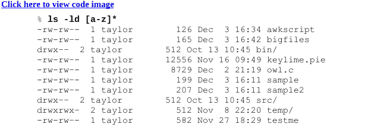

在这个例子中，shell 将匹配以小写字母`a`到`z`开头的任何文件，如指定所示。

- 8. 字符范围、单字符通配符和多字符通配符的组合可以非常有帮助。如果我切换到另一个目录，我可以轻松搜索名称中包含单个数字、点或下划线的所有文件：


我认为学习 Unix 中无处不在的功能，例如 shell 文件名通配符的最佳方式就是使用它们。正如你在本书中到目前为止一定已经注意到的那样，示例建立在先前的信息之上。这种情况将继续下去，这里显示的通配符记法会一再被用来指定一组文件或目录。

如果你想尝试文件名通配符，最容易使用的是`echo`命令，因为它可以安全地打印你指定的任何模式的展开版本，而不会对这些文件做其他任何操作。许多 Unix 专家使用`echo`来开发和微调模式，然后将该模式与不同的命令一起使用。

## Task 8.5: 使用 grep 搜索文件

两个常用的命令是成为能够熟练使用系统功能的高级用户的关键一步：`ls`命令和`grep`命令。我们已经研究过`ls`命令，所以让我们把注意力转向名字奇怪的`grep`命令，它可以轻松找到包含指定文本模式的文件。

`grep`命令不仅拥有大量命令选项，在 Unix 系统中还有两个变体。这些变体是`egrep`，用于指定更复杂的模式（正则表达式），以及`fgrep`，用于使用基于文件的单词列表作为搜索模式。

### Note

在`grep`出现之前，Unix 用户会使用一个粗糙的行编辑器`ed`来查找匹配的文本。要用正则表达式搜索文件，用户会在命令前加上`global`并只显示匹配项的`print`。把它们组合起来，操作就是`global/regular expression/print`。这被缩写为`g/re/p`，最终被重新发明为`grep`。

你可以花接下来的 100 页来学习`grep`系列命令的所有晦涩和奇怪的选项。然而，归根结底，你可能只会使用最简单的模式和一两个标志。这样想：英语包含超过 500,000 个单词（根据《牛津英语词典》），但你不需要全部学会就能有效沟通。

考虑到这一点，你将在本小时学习`grep`的基础知识，但在接下来的几个小时里，你将对该程序的功能和选项有更深入的了解。

表 8.2 中列出了`grep`命令最重要的一组标志。

| Flag | Function |
|------|----------|
| `-c` | 仅列出匹配行的计数。 |
| `-i` | 忽略模式中字母的大小写。 |
| `-l` | 仅列出包含指定模式的文件名。 |
| `-n` | 包含行号。 |
| `-v` | 显示不匹配指定模式的行。 |

# TABLE 8.2 The Most Helpful grep Flags

- 1. `grep`的一般形式是指定命令、你想要添加的任何标志、模式和文件名：

```
$ grep bitnet testme
```

```
Mail/               bitnet.mailings-lists.Z  temp/
```

正如你所见，`grep`轻松地从`testme`文件中提取出包含模式`bitnet`的行。

- 2. 请注意，`grep`以区分大小写的方式查找模式：

```
$ grep owl testme
$
$ grep OWL testme
Archives/           OWL/                   keylime.pie
```

请注意，在第一个示例中未找到`OWL`，因为使用`grep`命令指定的模式是全小写的`owl`。

这就是`-i`（忽略大小写）选项能派上用场的地方：

```
% grep -i owl testme
Archives/               OWL/                keylime.pie
```

3. 在接下来的几个示例中，我将进入`/etc`目录，因为那里的文件有很多行。在我使用的一个系统上，`/etc/passwd`文件有将近 4,000 行：

```
% cd /etc
% wc -l /etc/passwd
3877
```

我的账户是`taylor`。我将使用`grep`查看密码文件中我的账户条目：

```
% grep taylor /etc/passwd
```


taylorj::?1048:1375:James Taylor:/users/taylorj:/bin/csh

mtaylor::?760:1375:Mary Taylor:/users/mtaylor:/usr/local/bin/tcsh

dataylor::?375:518:David Taylor:/users/dataylor:/usr/local/lib/msh

taylorjr::?203:1022:James Taylor:/users/taylorjr:/bin/csh

taylorrj::?668:1042:Robert Taylor:/users/taylorrj:/bin/csh

taylorm::?862:1508:Melanie Taylor:/users/taylormx:/bin/csh

taylor::?1989:1412:Dave Taylor:/users/taylor:/bin/csh

4. 如你所见，许多账户都包含 `taylor` 模式。

你可以使用管道命令 `grep taylor /etc/passwd | wc -l` 算出有多少账户，对吧？

一种更聪明的做法是使用 `grep` 的 `-c` 选项来查看 `taylor` 模式出现的频率，它会告诉你文件中有多少处匹配：

```
% grep -c taylor /etc/passwd
7
```

该命令找到了七处匹配。数一下第3步输出列表中的匹配项来确认这一点。

5. 密码文件是一个记录 Unix 系统上每个用户基本账户信息的管理文件，其中有 3,877 行。看看所有 Taylor 账户是否大约同时开设会很有趣。（这大概意味着它们都出现在文件中大致相同的位置。）为此，我将使用 `-n` 选项为输出行编号：

点击此处查看代码图片

```
% grep -n taylor /etc/passwd
319:taylorj::?1048:1375:James Taylor:/users/taylorj:/bin/csh
1314:mtaylor::?760:1375:Mary Taylor:/users/mtaylor:/usr/local/bin/tcsh
1419:dataylor::?375:518:David Taylor:/users/dataylor:/usr/local/lib/msh
1547:taylorjr::?203:1022:James Taylor:/users/taylorjr:/bin/csh
1988:taylorrj::?668:1042:Robert Taylor:/users/taylorrj:/bin/csh
2133:taylorm::?8692:1508:Melanie Taylor:/users/taylormx:/bin/csh
3405:taylor::?1989:1412:Dave Taylor:/users/taylor:/bin/csh
```

`grep` 命令会添加行号、冒号以及该行的实际内容，在本例中这相当令人困惑，因为匹配的行也使用冒号来分隔行内的信息。通常，行号后跟冒号没问题，但在 `passwd` 文件中（已经满是冒号），这就让人摸不着头脑了。

你可以看出，我关于 Taylor 们何时开设账户的理论是错误的。如果账户在 `passwd` 文件中的位置接近意味着它们是在相近时间分配的，那么没有任何 Taylor 账户是在同一周内开设的。

这些有关如何使用 `grep` 的例子，只是触及了这个强大而精妙的命令所能做的事情的皮毛。使用 `grep` 在自己的文件系统中搜索特定模式，探索一下吧。

## 注意

掌握了通配符之后，你现在可以试试 `grep` 的 `-l` 选项。还记得吗，这个选项会列出包含指定模式的文件名，而不是打印匹配的行。如果我进入我的电子邮件归档目录——Mail——我可以很容易地使用命令 `grep -l -i chicago Mail/*` 生成一个文件夹列表，这些文件夹包含不区分大小写的模式 `chicago`。试试使用 `grep -l` 搜索你主目录中的所有文件，查找单词或模式。

# 任务8.6：创建正则表达式

正则表达式可以简单到像 `acme` 这样一个字母一个字母地匹配的单词，也可以复杂到像 `(^ [a-zA-Z] | :wi)` 这样，它匹配所有以大写或小写字母开头的行，或者包含 `:wi` 的行。

正则表达式的语言充满了以非常规方式使用的标点符号和字母。重要的是要记住，正则表达式不同于 shell 通配符模式。遗憾的是，事实确实如此。例如，在 C shell 中，`a *` 会列出所有以字母 `a` 开头的文件。正则表达式不是左锚定的，这意味着如果你只想匹配以字母 `a` 开头的行，就需要指定 `^a`。shell 模式 `a *` 只匹配以字母 `a` 开头的文件名，而 `*` 在作为正则表达式的一部分时有着完全不同的解释：`a *` 是匹配字母 `a` 出现零次或多次的模式。正则表达式的符号如表8.3所示。`egrep` 命令还有额外的符号，你很快将学到。

| 记号 | 含义 |
|---|---|
| c | 匹配字符 c |
| \c | 强制将 c 读作字母 c，而不是字符可能具有的另一种含义（例如，`\*` 是表示字面上的星号而不是通配符的方式） |
| ^ | 行首 |
| $ | 行尾 |
| . | 任意单个字符 |
| [xy] | 集合中指定的任意单个字符 |
| [^xy] | 不在指定集合中的任意单个字符 |
| c* | 字符 c 的零次或多次出现 |

## 表 8.3 正则表达式记号摘要

这个表看起来并不复杂。正则表达式最重要的要点是 `*` 表示前一个字符的零次或多次出现，而 `.` 是任意单个字符。记住 shell 模式使用 `*` 来匹配任意零个或多个字符，与前一个字符无关，并使用 `?` 来匹配单个字符。

- 1. 之前，当我在 `/etc/passwd` 文件中搜索 `taylor` 时，我找到了比想要的更多匹配项。如果我在寻找自己的账户，我不想看到所有这些替代项。使用 `^` 字符在模式前进行左锚定：

Click here to view code image

```
% grep "^taylor" /etc/passwd
 taylorj:? :1048:1375:James Taylor:/users/taylorj:/bin/csh
 taylorjr:? :203:1022:James Taylor:/users/taylorjr:/bin/csh
 taylorrj:? :662:1042:Robert Taylor:/users/taylorrj:/bin/csh
 taylorm:? :869:1508:Melanie Taylor:/users/taylorm:/bin/csh
 taylor:? :1989:1412:Dave Taylor:/users/taylor:/bin/cshx
```

- 2. 现在我想进一步缩小搜索范围。我想指定一个模式，意思是“显示所有以 `taylor` 开头，后跟一个不是小写字母的字符的行”。为此，我使用 `[^xy]` 记号，它表示排除集合，或一组不能匹配模式的字符：

Click here to view code image

```
% grep '^taylor[^a-z]' /etc/passwd
 taylor:? :1989:1412:Dave Taylor:/users/taylor:/bin/csh
```

成功了！你可以以两种方式指定集合：你可以列出每个字符，也可以使用连字符来指定一个范围，从连字符左侧的字符开始，到右侧的字符结束。也就是说，`a-z` 是从 `a` 开始到 `z` 结束的范围，`0-9` 包含所有数字。

- 3. 要查看哪些账户被排除，去掉 `^` 以搜索包含范围——一组字符，其中必须有一个匹配模式：

```
% grep '^taylor[a-z]' /etc/passwd
taylorj:? :1048:1375:James Taylor:/users/taylorj:/bin/csh
taylorjr:? :203:1022:James Taylor:/users/taylorjr:/bin/csh
taylorjj:? :668:1042:Robert Taylor:/users/taylorjj:/bin/csh
taylormx:? :869:1508:Melanie Taylor:/users/taylormx:/bin/csh
```

- 4. 我们来看一些其他例子。这里我使用 `head` 查看密码文件的第一行：

```
% head -5 /etc/passwd
root:? :0:0:/:/bin/csh
news:? :6:11:USENET News:/usr/spool/news:/bin/ksh
ingres:*? :7:519:INGRES Manager:/usr/ingres:/bin/csh
usrlimit:? :8:800:(1000 user system):/mnt:/bin/false
vanilla:*? :20:805:Vanilla Account:/mnt:/bin/sh
```

现在我将指定一个模式，告诉 `grep` 搜索包含字母 `z` 的零次或多次出现的所有行：
```


`% grep 'z*' /etc/passwd | head -5`

root:? :0:0:/:/bin/csh

news:? :6:11:USENET News:/usr/spool/news:/bin/ksh

ingres:*? :7:519:INGRES Manager:/usr/ingres:/bin/csh

usrlimit:? :8:800:(1000 user system):/mnt:/bin/false

vanilla:*? :20:805:Vanilla Account:/mnt:/bin/sh

结果与前一个命令的结果相同，但这并不奇怪。指定匹配零次或多次出现的模式将匹配每一行！指定只有包含一个或多个 `z` 的行是通过这种看起来奇怪的模式实现的：

```
% grep 'z*z*' /etc/passwd | head -5
```

marg:? :724:1233:Guyzee:/users/marg:/bin/ksh

ayy:? :1272:1224:martine:/users/ayy:/bin/csh

wizardz:? :1560:1375:Cz:/users/wizardz:/bin/ksh

zhq:? :2377:1318:Zihong:/users/zhq:/bin/csh

mmm:? :1527:133:Michael Kenzel:/users/mmm:/bin/ksh

### 5.
之前我发现 `/etc/passwd` 文件中有几行是未指定登录 shell 的账户。每行密码文件必须有一定数量的冒号，对于这些账户，行上的最后一个字符将是冒号，这是一个容易的 `grep` 模式，只要记住作为模式中的最后一个字符，`$` 表示行尾。并且不要忘记 `^` 作为模式中的第一个字符表示行的开头（与在集合记号中表示“非”或反转随后指定的模式的情况不同）。

以下是 `$` 记号在此上下文中的可能外观：

```
% grep ':$' /etc/passwd
```

charon:? :21:807:The Ferryman:/users/tomb:

lp:*? :70:10:System V LP Administration:/var/spool/lp:

### 6.
假设我接到会计的电话，需要找到一个包含关于花费 100 美元购买某款软件的消息的文件。结果发现，要找到该消息，我可以使用 `grep` 搜索所有包含美元符号、后跟 1、后跟一个或多个 0 的文件：

```
% grep '$100*' * /* 
```

Mail/bob_gale:      Unfortunately, our fees are currently $100 per test drive, budgets

Mail/dan_sommer:We also pay $100 for Test Drives, our very short "First Looks" section. We often

Mail/james:has been dropped, so if I ask for $1000 is that way outta line

Mail/john_spragens:time testing things since it's a $100 test drive: I'm willing to

Mail/john_spragens:      Finally, I'd like to request $200 rather than $100 for

Mail/mac:again: expected pricing will be $10,000 - $16,000 and the BriteLite LX with

Mail/mark:I'm promised $1000 / month for a first

Mail/netnews.postings: Win Lose or Die, John Gardner (hardback) $10

Mail/netnews.postings:I'd be willing to pay, I dunno, $100 / year for the space? I would

Mail/sent:to panic that they'd want their $10K advance back, but the good news is

Mail/sent:That would be fine. How about $100 USD for both, to include any

Mail/sent:      Amount: $100.00

匹配项相当多。请注意，在匹配项中包括了 `$1000`、`$10K` 和 `$10`。要匹配特定的值 `$100`，当然，我可以将 `$100` 作为搜索模式，后跟一个排除集：`$100[^0]`。

### Note

你可以使用 shell 不仅在当前目录中展开文件，还可以展开到子目录中更深一层：`*` 将你的搜索扩展到当前目录中的文件之外，而 `* /*` 将你的搜索扩展到当前点下方一层目录中的所有文件。如果你有大量文件，你有时可能会看到错误 `arg list too long`；这就是通配符达到其有用性极限的地方，而 `find` 命令（在第 22 小时“搜索信息和文件”中介绍）接管了。

该模式展示了 Unix 正则表达式的复杂性和潜在的混淆。例如，`$` 是一个特殊字符，可用于表示行的结尾，但只有在将其放在模式末尾时才有效。因为我没有将其放在模式末尾，所以 `grep` 程序正确地将其解释为 `$` 字符本身。

在正则表达式中可用的相对较少的记法下，你可以创建相当多样的复杂模式来在文件中查找信息。使用 `man grep` 了解更多信息。

## Task 8.7: The Rest of the grep Family

有时单个正则表达式无法定位你所寻找的内容。例如，也许你正在寻找匹配两种模式之一的行。这时 `egrep` 命令就派上用场了。该命令的名称源自“expression grep”，并且其记法比 `grep` 更强大，如表 8.4 所示。

| Notation | Meaning |
|---|---|
| c | Match the character c |
| \c | Force c to be read as the letter c, not as another meaning the character might have |
| ^ | Beginning of the line |
| $ | End of the line |
| . | Any single character |
| [xy] | Any single character in the set specified |
| [^xy] | Any single character not in the set specified |
| c* | Zero or more occurrences of character c |
| c+ | One or more occurrences of character c |

# TABLE 8.4 Regular Expression Notation for egrep

例如，你可能想要一个模式文件并调用一个 Unix 命令来搜索包含该文件中任何模式的行。这时 `fgrep`，或基于文件的 `grep`，命令就派上用场了。模式文件可以包含 `grep` 会理解的任何模式（这意味着不幸的是，你不能使用 `egrep` 中可用的额外记法），并通过 `-f file` 选项指定。

### 1.
我将搜索密码文件来演示 `egrep`。我之前用 `grep` 搜索包含一个或多个字母 `z` 的行的模式看起来有点奇怪：`\zz*`。使用 `egrep`，此搜索要容易得多：

```
% egrep 'z+' /etc/passwd | head -5
```

marg:? :724:1233:Guyzee:/users/marg:/bin/ksh

axy:? :1272:1233:martinez:/users/axy:/bin/csh

wizard:? :1560:1375:Oz:/users/wizard:/bin/ksh

zhq:? :2377:1318:Zihong:/users/zhq:/bin/csh

mm:? :7152:1233:Michael Kenzie:/users/mm:/bin/ksh

Broken pipe

### 2.
要搜索包含 `z` 或 `q` 的行，我可以使用以下命令：

```
% egrep '(z|q)' /etc/passwd | head -5
```

aaq:? :528:1233:Don Kid:/users/aaq:/bin/csh

abq:? :560:1233:K Laws:/users/abq:/bin/csh

marg:? :724:1233:Guyzee:/users/marg:/bin/ksh


`ahq:? :752:1233:Andy Smith:/users/ahq:/bin/csh`

`cq:? :843:1233:Rob Till:/users/cq:/usr/local/bin/tcsh`

Broken pipe

```
instead of being displayed on the screen.
```

`filter` Filters are a particular type of Unix program that expects to work either with file redirection or as part of a pipeline. These programs read input from standard input, write output to standard output, and often don’t have any starting arguments.

`inclusion range` This is a range of characters that a pattern must include.

`left-rooted` Patterns that must occur at the beginning of a line are said to be left-rooted.

`regular expression` This is a convenient notation for specifying complex patterns. Notable special characters are `^` to match the beginning of the line and `$` to match the end of the line.

`standard error` This is the same as standard output, but you can redirect standard error to a different location than standard output.

`standard input` Unix programs always default to reading information from the user by reading the keyboard and watching what’s typed. With file redirection, input can come from a file, and with pipelines, input can be the result of a previous Unix command.

`standard output` When processing information, Unix programs default to displaying the output on the screen, also known as standard output. With file redirection, output can easily be saved to a file; with pipelines, output can be sent to other programs.

`wildcards` Wildcards are special characters that are interpreted by the Unix shell or other programs to have meanings other than the characters themselves. For example, `*` is a shell wildcard and creates a pattern that matches zero or more characters. When prefaced, for example, with the letter X (`X*`), this shell pattern will match all files beginning with X.

## Exercises

- 1. The placement of file-redirection characters is important to ensure that a command works correctly. Which of the following do you think will work, and why?

[Click here to view code image](#)

```
    < file | wc       wc file <       wc < file

    cat file | wc      cat < file | wc   wc | cat
```


Now try them and see whether you’re correct.

- 2. Does the file size listed by `wc -c` always agree with the file size listed by the `ls` command? With the size indicated by `ls -s`? If there is any difference, why?

- 3. What do you think would happen if you tried to sort a list of words by pretending they’re all numbers? Try it with the command `ls -1 | sort -n` to see what happens. Experiment with the variations.

- 4. What wildcard expression would you use to find the following?
  
  - All files in the `/tmp` directory
  - All files that contain a `w` in that directory
  - All files that start with a `b`, contain an `e`, and end with `.c`

- All files that either start with `test` or contain the pattern `hi` (notice that it can be more than one pattern)

- 5. Create regular expressions to match the following:
  - Lines that contain the words `hot` and `cold` (tricky!)
  - Lines that contain the word `cat` but not `cats`
  - Lines that begin with a numeral

- 6. Use the `-v` flag with various `grep` commands and show the command and pattern needed to match lines that:
  - Don’t contain `cabana`
  - Don’t contain either `jazz` or `funk`
  - Don’t contain `jazz`, `funk`, `disco`, `blues`, or `ska`

## Preview of the Next Hour

The next hour introduces you to many more commands that are ideal for working with pipelines and filters—commands that will help you move from being a Unix amateur to being a true expert, a wizard at the command line!

## Hour 9. Slicing and Dicing Command-Pipe Data

## Goals for This Hour

In this hour, you will learn

- About the `awk` programming system
- How to use `cut` in pipes
- About using `sed` and `tr` for in-line transformations

By this point, you’ve learned enough about Unix to be able to build quite sophisticated command-line pipes, sequences of standard commands that offer flexibility and power. You need to add a couple of key tools to your toolkit to keep moving forward, however, and they’re the focus of this lesson.

The first and most powerful of the tools is `awk`, a programming system built specifically to work with data streams. You can build very complex processing systems in `awk`, but in fact the most common `awk` programs are typically just a line or two long.

Many modern Unix folk prefer Perl, but I find that Perl isn’t as pervasive across Unix, Linux, and other *nix platforms, so I’ll stick with `awk` for this lesson. I do cover Perl later in the book, though, in case you’re curious. If you’d prefer to just learn Perl, you can find a lot of really good tutorials on this sophisticated—and confusing—programming language.

In addition to explaining `awk`, this hour also talks about three additional pipeline commands that you will doubtless find essential for your toolbox: `sed`, a stream editor; `tr`, a character mapping facility; and `cut`, a utility that makes it remarkably easy to slice individual columns of data out of a pipeline of information.

There’s one interesting characteristic of `awk` that’s worth mentioning before we go further: It’s a powerful programming language, and you can use it to duplicate many of the actual utilities that are an essential part of the Unix operating system. In a moment, I’ll show you how to duplicate the `wc` command with a few lines of `awk`.

Later in the book, in Hour 23, “Perl Programming in Unix,” we’ll explore the Perl programming language and how it’s integrated into modern Unix systems. Like `awk`, Perl has the ability to duplicate many of the most common Unix commands. Perl is also considerably more powerful and sophisticated than `awk`.

Okay, true confession: I don’t recommend actually rewriting existing commands, but it is good to know which of the tools in the Unix toolbox are actually all-purpose utilities rather than just focused on a single, specific task.

# awk 编程系统

无论是 C、Pascal、BASIC、Java，甚至是 Swift，每种编程语言都有其擅长之处，也就是它真正闪光的领域。如果是 BASIC，那就是简单的入门编程。如果是 Java，那就是跨平台软件。Ruby、Python、C++、LISP 以及所有其他编程语言都有其专为之设计的特定类型编程。然而 `awk` 不同，它存在于简单的 shell 脚本和这些复杂语言之间。它不具备正式编程环境的大多数特性和功能，但以其自身的方式，`awk` 非常强大，并且对于轻量级、内联数据处理来说绝对是理想选择。

## 任务 9.1：学习使用 awk

每个 `awk` 脚本的基本结构都是一个模式后跟一条命令。如果你跳过模式，则该命令适用于数据流中的所有行。如果你跳过命令部分，则所有匹配的行都会被打印（发送到输出数据流）。

作为一个非常简单的例子，程序 `NF == 3`（没错，这就是这个程序所需的一切！）将打印输入中恰好有三个字段的所有行（`NF` 是指输入行中字段数量的简写）。程序 `$1 > 3 { print $1 }` 将打印所有该字段数值大于三的行中的第一个字段。

让我们更仔细地看看 `awk`。

- 1. 我想弄清楚我在构建的新系统上所有邮件文件的平均大小。为此，我将从 `ls` 开始获取文件大小：

Click here to view code image

```


```
$ ls -l

total 8474

-rw-r--r-- 1 taylor taylor    3111 Dec 14 16:09 baby-responses

-rw-r--r-- 1 taylor taylor   19930 Dec 14 16:09 barbara

-rw-r--r-- 1 taylor taylor   298719 Dec 14 16:09 dunlap

-rw-r--r-- 1 taylor taylor    5758 Dec 14 16:09 evan

-rw-r--r-- 1 taylor taylor   14577 Dec 14 16:09 glee

-rw-r--r-- 1 taylor taylor    1610 Dec 14 16:09 hbrayman

-rw-r--r-- 1 taylor taylor   10788 Dec 14 16:09 jwickert

-rw-r--r-- 1 taylor taylor  2746614 Dec 14 16:09 mail.sent

-rw-r--r-- 1 taylor taylor   18106 Dec 14 16:09 mbeaudoin

-rw-r--r-- 1 taylor taylor    6753 Dec 14 16:09 pennyln

-rw-r--r-- 1 taylor taylor   128815 Dec 14 16:09 permission

-rw-r--r-- 1 taylor taylor  1011092 Dec 14 16:09 taylor

-rw-r--r-- 1 taylor taylor   17549 Dec 14 16:09 wellnitz

$
```

正如你所见，`ls` 输出的行非常一致，如果你假设“它们之间没有任何其他字符的一个或多个空格”是字段之间的分隔符，并且输出中的第五个字段始终是文件的大小，那么你就有了在目录内查找和处理文件大小总和所需数据的配方。

## 2. 让我们使用 awk 提取第五个字段：

```
$ ls -l | awk '{print $5}'
```

```
3111

19930

298719

5758

14577

1610

10788

2746614

18106

6753

128815

1011092

17549

$
```

`$1` 匹配第一个字段，`$2` 匹配第二个字段，以此类推。`$0` 匹配整行输入。很简单，不是吗？

然而这并不是我想要的，因为 `ls` 输出的第一行是整个目录占用的块的汇总（`total 8474` 行），`awk` 脚本会看到它并将其计为一行，即使它没有第五个字段。如果我们保持原样，最终的平均邮箱大小将会错误，因为它会考虑到“n+1”个文件，这是由于这个错误匹配造成的。

## 3. 标准的 Unix 方法来解决这个问题是向管道中加入其他东西来提取该行，或过滤仅有效数据行。它可能看起来像这样：

Click here to view code image

```
$ ls -l | grep taylor | awk ‘{print $5}’
```

```
3111

19930

298719

5758

14577

1610

10788

2746614

18106

6753

128815

1011092

17549

$
```

这可行，但并不优雅，特别是因为 `awk` 本身就能完成这项工作。

## 4. `awk` 的解决方案是应用一个使用特殊 `NF`（字段数）变量的模式：

Click here to view code image

```
$ ls -l | awk ‘NF > 2 { print $5 }’
```

```
3111

19930

298719

5758

14577

1610
```

```
10788
2746614
18106
6753
128815
1011092
17549
$
```

很好。这里你可以看到一个模式（`NF > 2`）和一个语句（`print $5`）结合起来，形成了一个非常强大且简单的管道扩展。这个简洁的 `awk` 程序会打印输入行的第五个字段，但只有当行中字段数多于两个时才会打印。请注意，使用这种记法时，`if` 语句中没有显式的 `if`，与大多数其他编程语言不同。

## 5. 现在让我们让脚本变得更复杂一些。它需要汇总所有大小并统计它计数了多少个文件。这些语句被添加到大括号内，但在我做到这一点之前，我会先把不断增长的 `awk` 脚本放到自己的文件中，以简化操作。

这是我在添加了两个计数变量后的样子：

Click here to view code image

```
$ cat average.awk

NF > 2 { count += 1

    totalsize += $5

}
$
```

现在运行它还没有意义，因为没有任何输出。你可以自己尝试输入 `awk -f average.awk`，就明白我的意思了。

### Note

`+=` 记法是“将以下值加到变量当前值上”的简写方式，它省去了必须输入 `count = count + 1` 和 `totalsize = totalsize + 1` 的麻烦。

## 6. 要添加输出，我需要添加一个 `END` 块。`END` 是一个特殊的模式，它在处理完所有输入行后匹配一次：

Click here to view code image

```
$ cat average.awk

NF > 2 { count += 1

    totalsize += $5

}

END { print "Counted " count " mailboxes"

    print "average size = " totalsize/count

}
$
```

这就是计算平均文件大小所需的一切。它使用 `-f` 标志调用 `awk`：

Click here to view code image

```
$ ls -l | awk -f average.awk

Counted 14 mailboxes

average size = 305969

$
```

有 `END`，就有也有 `BEGIN`，如果你需要在脚本运行前初始化变量的话。虽然这不是很好的编程实践，但你可以像我一样偷懒，假设一个之前未使用过的新变量初始值为零。事实上，更好的编程风格是在脚本的最开头加上如下块：

```
BEGIN {

  count = 0

  totalsize = 0

}
```

这个脚本展示了 `awk` 命令的一个非常典型的用法，也展示了大多数复杂的管道是如何一步一步构建起来的。

接下来让我们看看一些常见的单行程序，你会发现 `awk` 在这些程序中特别有用。

### Note

你已经在这个简单的 `awk` 脚本中见过两个特殊变量：`NF` 是输入行中的字段数，`$5` 是每行中的第五个字段。事实证明，还有 `NR`，它包含当前记录号，并在 `END` 块中包含遇到的记录总数（行数）。

`$5` 变量也是一个通用命名方案的实例：`$n` 会给你第 `n` 个字段，而 `$0` 是整行。

- 7. 输入流中有多少行？
- `'END {print NR}'`

- 8. 只打印输入的第八行？
- `'NR == 8'`

- 9. 只打印每行的最后一个字段？
- `'{ print $NF }'`

这需要一点解释：因为 `NF` 是字段数，所以引用 `$NF` 被求值为最后一个字段。如果输入行有五个字段，`NF=5` 而 `$NF` 是第五个字段的内容。

- 10. 打印任意一行中字段数的最大值？

Click here to view code image

```
'NF > maxnf { maxnf = NF }  END { print maxnf }'
```

请注意，如果更容易输入，你可以将脚本压缩到单行。

- 11. 再举一个例子：你在上一小时学到了 `wc`（word count）命令，你知道它返回其输入流中的字符数、单词数和行数。事实证明，用 `awk` 脚本复制这个功能非常容易：

Click here to view code image

```
$ cat wc.awk

{ chars += length($0) + 1   # 1 for the carriage return

  words += NF;

}

END {

  print chars " characters, " words " words, and " NR " lines."

}
```

它可以像之前的脚本一样使用：

Click here to view code image

```
$ ls -l | awk -f wc.awk

908 characters, 137 words, and 16 lines.
```

为了确保结果准确，这里是同一个 `ls` 输出通过官方 `wc` 命令运行的结果：

```
$ ls -l | wc

     16     137     908
```


它们确实是一样的！

对于像 `awk` 这样复杂的编程工具，我们在这本书中只能触及皮毛。令人沮丧的是，关于学习这个有用的 `awk` 编程语言的资源非常少。我唯一能推荐的就是由该程序的作者 Alfred Aho、Peter Weinberger 和 Brian Kernighan 所写的枯燥的《The AWK Programming Language》。

无论你选择买那本书还是自己探索和尝试，我的经验表明，熟练掌握 `awk` 是你 Unix 知识库中宝贵的补充。

另外，许多 Perl 狂热者会告诉你，它可以做 `awk` 能做的所有事情，而且还能做更多。他们是对的，但代价是复杂性：我发现对于上面展示的那类任务，`awk` 要简单得多、更直接。你需要自己决定是否要对所有编程任务都坚持使用 Perl，还是探索 Unix 工具箱中的其他工具。

本书后面也会详细介绍 Perl，所以你也可以翻到前面，尝尝 Perl 编程语言的味道，然后自己决定。

## How to Use cut in Pipes

虽然 `awk` 是一个通用工具，可以让你按需弯曲使用（有点像极客瑞士军刀），但对于某些特定任务，其他 Unix 工具更合适。

你之前看到如何使用简单的 `{print $5}` 来提取数据流的第五列，但事实上，有一种更快的方法——使用简单的 `cut` 命令。

3. 让我们快速分析一下人们使用什么 shell，通过 `cut` 提取第七个字段，然后将其通过管道传递给 `sort` 和 `uniq`，并使用重要的 `-c` 标志，让 `uniq` 显示匹配结果的计数：

Click here to view code image

```
$ cut -d: -f7 /etc/passwd | sort | uniq -c
  51 /bin/bash
  857 /bin/csh
   40 /bin/ksh
    1 /bin/sh
  382 /bin/tcsh
    9 /bin/zsh
    8 /noshell
    5 /usr/local/bin/bash
    7 /usr/local/bin/tcsh
$
```

### Note

如果您希望输出按从最流行到最不流行的顺序排序，可以在管道末尾再使用一次 `sort`：`sort -rn` 将按反向数值顺序排序。这意味着以最大数字开头的那一行（`/bin/csh`）会最先出现，而以最小数字开头的那一行（`/bin/sh`）会最后出现。

4. 在我们继续之前，再看一个关于 `cut` 的有趣例子：你可能已经注意到 `ls -l` 输出的第一个字符在它是目录时为 `d`，在它是普通文件时为 `–`。

`cut` 的另一个有用的标志是 `-c`，它让你可以指定要使用的特定字符位置作为起始位置（或起始和结束位置）。对于西方语言（国际化人士称之为“Latin-1”语言，包括西班牙语、德语和意大利语），一个字符 = 一个字母，但在其他所谓的双字节语言（中文、阿拉伯语）中，字符的含义就不完全相同了。现在你可以忽略这种细微差别。

如果我们把这两个标志结合起来，就可以使用 `cut` 来回答问题“当前位置有多少个文件和多少个目录？”这是一个相对复杂的管道，它总结了在给定的 `ls -l` 输出中发现的每种后缀的数量：

Click here to view code image

```
$ ls -l | awk 'NF > 2' | cut -c1 | sort | uniq -c
  15 -
  12 d
$
```

`awk` 会剔除所有字段数不足三个的行。 （还记得我们之前必须处理的“Total”行吗？是的，它又是我们需要从分析中省略的东西。）然后 `cut` 只切片输出的第一个字符，然后我们简单地对其进行排序和 `uniq`，瞧！我们看到测试目录中有 15 个普通文件和 12 个目录。

`cut` 命令的能力非常有限，但在按字段值或按字符计数提取特定列信息时，它是赢家，值得了解。

不过不要就此止步。阅读 `man cut` 以了解有关如何使用这个有用程序的更多详细信息。

## Inline Editing with sed and tr

在我们离开 UNIX 管道强大工具的主题之前，你需要了解另外两个程序，它们旨在在数据流中更改信息。 `sed` 命令是两者中更常见的，主要用于在信息经过时将一种模式替换为另一种模式。 `tr` 命令则更受限制：它将一个字符集翻译为另一个字符集（但在这个看似枯燥的实用程序中隐藏了一些令人惊讶的功能）。

## Action 9.3: Inline Editing with sed and tr

为了更全面地了解这些命令的工作原理，亲眼看到它们运行很有用。

1. 管道的一个常见任务是将所有大写字母更改为小写，反之亦然。在 Unix 世界中，有多种方法可以实现这一点，但 `tr` 命令使它变得非常容易：


```
$ cut -d: -f5 /etc/passwd | tr '[a-z]' '[A-Z]' | tail
GREGORY SMITH
GORDON WILKINSON
THE RORT'N ONE
DAN KAMINSKY
EDWARD FULLER
HUMAN RIGHTS WEB
DAVID HELLER
JAIMIE MC CURRY
UNPRIVILEGED USER
$
```

`tr` 命令对在第一个参数中指定的内容与在第二个参数中指定的内容进行 1:1 匹配。在这种情况下，你可以看到指定了两个范围（`tr '[a-z]' '[A-Z]'`）：所有小写字母然后所有大写字母。

如果你使用多种语言，更复杂的方法是引用 `tr` 的内置字符集之一。例如，不要使用 `'[a-z]'`，而是使用 `'[:lower:]'`，它适用于西班牙语、德语或系统上你或其他用户可能使用的任何其他语言。

[Table 9.1](#) 列出了 `tr` 所知的字符集。值得把这一页折角，以便以后能再次找到它。

| 类名 | 描述 |
|---|---|
| alnum | 字母数字字符 |
| alpha | 字母字符 |
| cntrl | 控制字符 |
| digit | 数字字符 |
| graph | 图形字符 |
| lower | 小写字母字符 |
| print | 可打印字符 |
| punct | 标点字符 |
| space | 空格字符 |
| upper | 大写字母字符 |
| xdigit | 十六进制字符 |

## 表 9.1 字符集类名参考

利用这些信息，将所有小写字符正确且更好地翻译成大写字符的方法因此是：

Click here to view code image

```
tr '[[:lower:]]' '[[:upper:]]'
```

2. 要将所有元音翻译成破折号，你也可以再次使用 `tr` 来完成任务：

Click here to view code image

```
$ cut -d: -f5 /etc/passwd | tr 'aeiou' '--' | tail
Gr-g-ry Sm-th
G-rd-n W-lk-ns-n
Th- R-t't' On-
D-n K-m-nsky
Edw-rd F-ll-r
H-m-n R-ghts W-b
D-v-d H-ll-r
J-m- Mc C-rry
Unpr-v-l-g-d -s-r
$
```

看起来像某种代码，不是吗？或者你只是进行到上吊游戏的中途？

3. `tr` 的更常见用途是用于简单的旋转密码。过去，Usenet 讨论组曾使用一种简单的 ROT13 来对文本消息进行基础加密。这是一种简单的 13 个字符的文本旋转。这意味着 `a` 变为 `n`，`b` 变为 `o`，以此类推。明白了吗？`n` 在字母表中比 `a` 远 13 个字符，`o` 比 `b` 远 13 个字符，等等。听起来很复杂吗？有了 `tr` 就非常容易：

Click here to view code image

```
$ cat badjoke | tr '[a-zA-Z]' '[n-za-mN-ZA-M]'
Jul qvq gur puvpxra pebff gur ebvq?
Gb purpx uvf rznvy!
```

反向翻译最简单的方法是交换 `tr` 命令的第一个和第二个参数：

Click here to view code image

```
$ cat badjoke.rot13 | tr '[n-za-mN-ZA-M]' '[a-zA-Z]'
Why did the chicken cross the road?
To check his email!
$
```

4. 这实际上是设置一个 shell 别名的完美位置，例如：

Click here to view code image

```
alias rot13="tr '[a-zA-Z]' '[n-za-mN-ZA-M]'"
alias unrot13="tr '[n-za-mN-ZA-M]' '[a-zA-Z]'"
```


你可以用 `rot13` `filename` 来编码事物，用 `unrot13` `filename` 来解码事物。

### 5. `sed` 命令比 `tr` 强大得多，而且它不需要对指定的模式进行 1:1 匹配。例如，这里有一个更智能的方法来将所有元音翻译成破折号：

Click here to view code image

```
$ cat badjoke | sed 's/[aeiouAEIOU]/-/g'

Why d-d th- ch-ck-n cr-ss th- r-d?

T- ch-ck h-s e-m@!

$
```

与之前使用 `tr` 的版本不同，这个方法适用于大小写元音。

### 6. 更常见的用法是更改单词，而不是字母。然而。也许我想稍微改变一下 punch line：

Click here to view code image

```
$ cat badjoke | sed 's/email/portfolio/'

Why did the chicken cross the road?

To check his portfolio!

$
```

### 7. `sed` 实际上本身就是一个强大的编程环境，尽管我们只看了替换功能。`sed` 命令的一般形式是

Click here to view code image

```
{address[,address]}command{arguments}
```

其中 `{}` 表示可选信息。之前使用 `sed` 时，`s` 是命令，旧模式和新模式是参数。

| 命令 | 示例 | 解释 |
|---|---|---|
| d | `4,8d` | 删除第四到第八行 |
| p | `11p` | 打印第 11 行 |
| s | `s/old/new/` | 将 *old* 的所有出现替换为 *new* |

## 表 9.2 最有用的 sed 命令

**8.** 地址可以是单个数字，如表 9.2 所示，也可以是 `$` 以匹配流中的最后一行，但它们也可以是正则表达式。想要删除包含单词 *road* 的所有行吗？你可以使用 `/road/d` 来完成任务。

**9.** 正则表达式也可以有特殊字符：`^` 是行的开头，`$` 是行的结尾，例如。想要快速为所有行加上 `>` 序列以表示引用吗？使用 `s/^/> /` 来完成工作。

**10.** 最后，使用 `sed` 及其 `-n`（默认不回显行）标志，我们现在又有另一种方法将行的子集列出到输出中。例如，要查看 `sed` 手册页的第 8–13 行：

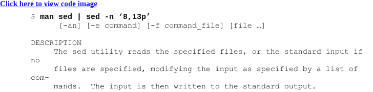

与 `awk` 一样，我们在本小时内也只触及了 `sed` 命令的皮毛。如果你对此感兴趣，我强烈鼓励你通过阅读手册页或寻找一些有用的在线资源来进一步学习它，从而扩展你的知识。

## 总结

你对 Unix 工具了解得越多，就越意识到实际上几乎没有什么事情是不能用两三个命令的组合来完成的。这正是我真正喜欢 Unix 的原因，也是为什么我即使在我的心爱 Mac OS X 系统上，也仍然通过 Terminal 应用使用其命令行。

在 Unix 命令的万神殿中，两个强大的实用程序——`awk` 和 `sed`——获得了特殊地位。

## 工作坊

工作坊提出了一些关于本课主题的问题。

## 练习

- 1. `awk` 是如何得名的？（也许手册页能回答这个问题？）

2. `awk` 中的 `-f` 标志让你可以更改字段分隔符。你会如何使用 `awk` 从 `/etc/passwd` 文件中提取所有的主目录？

3. `ROT13` 很实用，但 `ROT7` 可能更好。你会如何为 `ROT7` 系统的编码和解码编写别名？

4. `ls -l` 的输出将文件权限显示为字符序列：`rwx`、`r-x` 等等。你能否想出一种 `cut` 和 `grep` 的组合来识别你是否拥有仅具有 `write` 或 `execute` 权限的文件？

5. 使用 `tr` 的类标识符及其 `-d` 标志（阅读手册页以了解它的作用），你会如何从输入流中删除所有标点字符？

## 下一小时预览

在下一小时你将学习功能强大且极其有用的 `vi` 编辑器，当你刚开始使用时它无疑会显得奇怪且令人困惑。但 `vi` 是任何优秀 Unix 用户必备的核心工具，并且可以使编辑比即使是最好的基于图形的应用程序更快。

# 第 10 小时。vi 编辑器简介

### 本小时的目标

在本小时，你将学习

- 如何启动和退出 `vi`
- `vi` 中的简单光标移动
- 如何按单词和页面移动
- 如何向文件插入文本
- 如何删除文本

接下来的几个小时重点介绍 Unix 的全屏编辑工具。首先你将学习如何使用 `vi` 创建和修改文件。本小时涵盖基础知识，包括如何在文件中移动以及如何插入和删除字符、单词和行。下一小时将展示如何在文本中搜索特定模式并按需将其替换为其他信息。在第 12 小时“emacs 编辑器概述”中，你将学习如何使用另一种 Unix 编辑器 `emacs`。随着你使用 `emacs` 和 `vi`，你很可能会对其中一个产生偏好。

在某种程度上，编辑器就像生活在 Unix 内部的另一个操作系统；我们需要两个小时才能涵盖 `vi` 的基础知识。如果你习惯于 Windows 或 Macintosh 编辑器，你会不高兴地发现 `vi` 对你的鼠标一无所知。然而，在你花一些时间使用 `vi` 之后，我保证它会让你爱上它，因为它在完全不用把手从键盘上移开来使用鼠标时效率极高！到本小时结束时，你将能够随心所欲地在你的 Unix 系统上创建和修改文件。

### 提示

我把编辑器发音为“vee-ee”和“e-max”。

### 以 Unix 方式编辑

你已经学习了如何从命令行操作文件甚至窥探其内容，现在是时候学习创建和编辑文件的关键 Unix 工具：`vi`。

### 任务 10.1：启动和退出 vi

你可能已经注意到，到目前为止所介绍的许多 Unix 命令都有一个共同特点：它们都完成工作、显示结果并退出。少数例外之一是 `more`，在其中你会在特定程序环境中工作，直到你查看完所显示文件的全部内容或直到你退出。`vi` 编辑器也是这个小类别中的另一个程序，你在其中移动和使用，直到明确告诉程序退出。

## 注意

`vi` 的名字从何而来？它没有像一些更早、色彩更丰富的命令那样有趣。`vi` 命令之所以如此命名，是因为它是 `ex` 编辑器的可视化界面。它由 Bill Joy 在加州大学伯克利分校时编写。

在你第一次启动 `vi` 之前，你必须了解其行为的两个方面。第一个是 `vi` 是一个模式编辑器。模式就像一个环境。`vi` 中的不同模式对同一个键有不同的解释。例如，如果你处于插入模式，输入 `a` 会在文本中添加一个 `a`，而在命令模式下，输入 `a` 会使你进入插入模式，因为 `a` 是追加命令的键缩写。如果你对自己处于何种模式感到困惑，请按下键盘上的 Escape（或 Esc）键。按下 Escape 总是会让你返回到命令模式（如果你已经在命令模式中，它只会发出蜂鸣声以提醒你这一事实）。

当你处于命令模式时，你可以管理你的文档；这包括更改文本、重新排列它和删除它的能力。在插入模式下，你直接从键盘向文档添加文本。

## 注意

在 `vi` 中，回车键是一个特定的命令（意思是移动到下一行的开头）。因此，你永远不需要按下回车键来让 `vi` 处理命令。

相比之下，另一种流行的 UNIX 编辑器 `emacs` 是一种无模式编辑器。在 `emacs` 中，`A` 键始终将字母 `a` 添加到文件中。你通过按住 Control（Ctrl）键同时按下命令键来指示所有命令；例如，`Ctrl-C` 删除一个字符。我们将在第 12 小时仔细研究 `emacs`。

`vi` 的第二个重要特征是它是一个屏幕导向程序。它必须知道你正在使用什么类型的终端、计算机或系统来使用 Unix。这可能不会成为你的问题，因为大多数系统都设置成默认终端类型与你使用的终端应用程序相匹配。在本小时中，你将学习如何识别 `vi` 无法确定你正在使用什么终端时以及如何修复它。

你可以通过多种方式启动 `vi`，本小时稍后你会学到许多有用的替代方法。现在，让我们先看一下基础知识。单独使用 `vi` 命令，即可启动编辑器，准备创建新文件。带文件名使用的 `vi` 命令会以指定文件加载并准备编辑的方式启动 `vi`。

让我们开始吧！

- 1. 首先，在提示符下输入 `vi`。如果一切正常，屏幕会清空，每行的第一个字符会变成波浪号（~），并且光标会停在屏幕左上角：

```
% vi
```


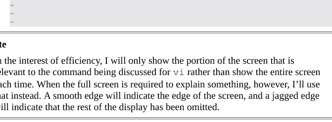

### Note

出于效率考虑，我只会显示与正在讨论的 `vi` 命令相关的屏幕部分，而不是每次都显示整个屏幕。然而，当需要全屏来解释某件事时，我会改用全屏。平滑的边缘表示屏幕的边缘，而锯齿状的边缘表示其余显示内容已被省略。

输入冒号。执行此操作会将光标移动到屏幕底部，并用冒号替换最后一个波浪号：


输入 `q` 并按下 `Return` 键，你应该会回到 `shell` 提示符：


- 2. 如果该操作顺利完成，请跳到步骤 3。如果操作未成功，你会收到 `unknown-terminal-type` 错误信息。你可能会在屏幕上看到以下内容：

```
% vi

"unknown": Unknown terminal type

I don't know what type of terminal you are on. All I have is "unknown"

[using open mode]

—
```

或者，你可能会看到以下内容：

```
% vi

Visual needs addressible cursor or upine capability

:
```

不要惊慌。你可以修复这个问题！

要修复此问题，你需要回到 `shell` 提示符，因此请完全按照步骤 1 中的操作进行：输入 `:q` 然后按 `Return` 键。你应该会看到以下内容：

```
% vi

"unknown": Unknown terminal type

I don't know what type of terminal you are on. All I have is "unknown"

[using open mode]

:q

%
```

这里的问题是 `vi` 需要知道你使用的终端类型，但它无法自行判断。因此，你需要通过设置 `TERM` 环境变量来告诉操作系统。如果你知道自己使用的是什么类型的终端（由终端或 `telnet` 应用程序决定），请使用与该终端关联的值；否则，请尝试默认的 `vt100`：

```
% setenv TERM vt100
```

如果你有 `$` 提示符，这意味着你使用的是 Bourne `shell`（`sh`/`bash`）或 Korn `shell`（`ksh`），而不是 C `shell`（`csh`），请尝试以下命令：

```
$ export TERM=vt100
```

无论哪种方式，你现在都可以再次尝试输入 `vi`，它应该就能正常工作了。

如果它能正常工作，请将成功的那条命令追加到你的 `.profile` 文件中（如果你使用 `ksh` 或 `sh`）或你的 `.login` 文件中（如果你使用 `csh`）。你可以通过输入以下适用于你的系统的命令之一来完成此操作：

```
% echo "setenv TERM vt100" >> ~/.login
```

或

```
$ echo "export TERM=vt100" >> ~/.profile
```

这样，下次你登录时，系统就会记住你使用的终端类型，你就无需再费心设置 `TERM` 变量了。

## Caution

请注意使用 `>>` 来向文件添加内容，而不是 `>`，后者会替换你的 `.login` 或 `.profile` 文件的内容！

### Note

`vi` 和其他屏幕命令使用名为 `curses` 的 Unix 包来控制屏幕。与大多数其他 Unix 应用程序一样，`curses` 并非为特定配置而设计；相反，它被设计为设备无关。因此，要在特定设备上工作，你需要提供一些额外信息——在这种情况下，就是终端类型。

如果 `vt100` 不起作用，是时候与你的系统管理员讨论这个问题或联系你的 Unix 厂商以了解应使用什么具体值了。如果你通过 Internet 连接并且实际上使用的是终端仿真器或通信应用程序，请尝试将 `ansi` 作为 `TERM` 设置使用。如果失败，请联系你的软件制造商公司以了解该程序模拟的是什么终端类型。

- 3. 太好了！你已成功启动 `vi`，看到了它的外观，甚至输入了最重要的命令：退出命令。现在创建一个简单的文件并启动 `vi` 以显示文件内容：

```
% ls -lF > demo

% vi demo
```


```
~
"demo" 17 lines, 846 characters
```

你可以看到 `vi` 读取了在命令行中指定的文件。在这个例子中，我的文件有 17 行，但我的屏幕可以显示 25 行。为了表示某些行没有文本，`vi` 会在单独一行上使用波浪号。最后请注意，在底部，程序显示了文件名、它在文件中找到的行数以及总字符数。

再次输入 `:q` 退出 `vi` 并暂时返回命令行。当你输入冒号时，光标会跳到底部那一行，并等待输入 `q`，就像之前一样。

你已经学会了 `vi` 中最基本的命令——`:q` 命令——并且成功挺过了这次体验。从这里开始，一切都很简单。

> **提示**
>
> 如果你真的习惯了 `vi` 的思维方式，你应该在启动交互式 `shell` 时尝试使用 `set -o vi`。它会让你在命令行编辑命令时使用那些熟悉的 `vi` 按键，让你的生活更简单一点！

## 任务10.2：vi 中的简单光标移动

如果无法在文件中实际移动，那么打开文件并没有多大用处。所以让我们来学习如何在 `vi` 中使用光标控制键。要向左移动一个字符，输入 `h`。要向上移动，输入 `k`。要向下移动，输入 `j`。要向右移动一个字符，输入 `l`（小写的 `L`）。你也可以按 `Backspace` 键向左移动一个字符，按 `Return` 键可以移动到下一行的开头。

在大多数现代 Unix 系统中，你也可以使用方向键，但你会了解到，掌握基本 `vi` 命令有很多好处，这样你就不必把手从键盘的标准“就绪”位置移开。因此，尽量坚持使用 `h`、`j`、`k` 和 `l` 来在文件中移动。

- 1. 再次启动 `vi` 并指定 `demo` 文件：

```
% vi demo

total 29

drwx------  2 taylor       512 Nov 21 10:39 Archives/

drwx------  3 taylor       512 Dec  3 02:03 InfoWorld/

drwx------  2 taylor      1024 Dec  3 01:43 Mail/

drwx------  2 taylor       512 Nov  8 22:20 News/

drwx------  4 taylor       512 Dec  2 22:08 OWL/

-rw-rw-r--  1 taylor       126 Dec  3 16:34 awk.script

-rw-rw-r--  1 taylor       165 Dec  3 16:42 bigfiles

drwx------  2 taylor       512 Oct 13 10:45 bin/

-rw-rw-r--  1 taylor         0 Dec  3 22:26 demo

-rw-rw-r--  1 taylor     12556 Nov 16 09:49 keylime.pie

-rw-rw-r--  1 taylor      8729 Dec  2 21:19 owl.c

-rw-rw-r--  1 taylor       199 Dec  3 16:11 sample

-rw-rw-r--  1 taylor       207 Dec  3 16:11 sample2

drwx------  2 taylor       512 Oct 13 10:45 src/

drwxrwx---  2 taylor       512 Nov  8 22:20 temp/

-rw-rw-r--  1 taylor       582 Nov 27 18:29 testme

~

~

~

~

~

"demo" 17 lines, 846 characters
```


你应该会看到光标位于第一行 total 中的字母 t 上方，或者可能在 t 字符下方闪烁。也许你有一个闪烁的方块光标，或者一个以不同颜色显示的光标。无论如何，那就是你在文件中的起始位置。

2. 输入一次 `h` 尝试向左移动。光标保持在原位，`vi` 会发出蜂鸣声提醒你无法在该行上继续向左移动。尝试按 `k` 键向上移动；也会发生同样的事情。

现在尝试输入 `j` 向下移动一行：

```text
total 29

drwx------  2 taylor       512 Nov 21 10:39 Archives/

drwx------  3 taylor       512 Dec  3 02:03 InfoWorld/

drwx------  2 taylor      1024 Dec  3 01:43 Mail/
```

现在光标位于文件中第二行的 `d` 目录指示符上。

输入 `k` 移回原来的起始位置。

3. 使用这四个光标控制键——`h`、`j`、`k` 和 `l`——在文件中移动一会儿，直到你熟悉屏幕上的变化。现在尝试使用 `Backspace` 和 `Return` 键，看看它们如何帮助你移动。请记住，由于你处于命令模式，它们不会删除字符或向文件添加新行。

4. 移动到一行的中间位置：

```text
total 29

drwx------  2 taylor       512 Nov 21 10:39 Archives/

drwx------  3 taylor       512 Dec  3 02:03 InfoWorld/

drwx------  2 taylor      1024 Dec  3 01:43 Mail/
```

我位于列表中第二个文件大小的中间数字上。这里有几个新的光标移动键：`0`（零）键将光标移动到行首，`$` 将光标移动到行尾。首先，我输入 `0`：

```text
total 29

drwx------  2 taylor       512 Nov 21 10:39 Archives/

drwx------  3 taylor       512 Dec  3 02:03 InfoWorld/

drwx------  2 taylor      1024 Dec  3 01:43 Mail/
```

现在我输入 `$` 来移动到行尾：

```text
total 29

drwx-- 2 taylor 512 Nov 21 10:39 Archives/

drwx-- 3 taylor 512 Dec 3 02:03 InfoWorld/

drwx-- 2 taylor 1024 Dec 3 01:43 Mail/
```

5. 如果你的键盘上有方向键，试着使用它们看看它们是否与 `h`、`j`、`k` 和 `l` 键的工作方式相同。如果方向键不能移动光标，它们可能已将你切换到插入模式。如果你输入字符并且它们被添加到文件中，请按下 `Escape` 键（或 `Esc`，取决于你的键盘）以返回到命令模式。

6. 让我们通过退出本次编辑会话来结束。因为 `vi` 现在知道你已修改了文件，它会尝试确保你在未保存更改的情况下不会退出：

```text
~
~

:q

No write since last change (:quit! overrides)
```

使用 `:q!`（`:quit` 的简写，丢弃你所做的任何更改，这就是 `!` 的含义）来在不保存更改的情况下退出。

### Note

通常，如果你在 `vi` 中尝试使用冒号命令并且程序抱怨它可能会做坏事，请停止并确保这真的是你想要做的。如果是，请再次输入该命令，后面加上感叹号。我喜欢把这想成是说，“不管怎样就做吧！”

如果你愿意，可以在下一个任务中继续使用此文件，也可以输入 `:q` 退出。

使用这六个简单的键命令在文件中移动，在小范围内与使用 `vi` 编辑器处理文件时的整个过程非常相似。在你对移动感到舒适之前坚持使用这些简单命令，你就将在熟练使用 `vi` 的道路上迈出很大一步。

## Task 10.3: Moving by Words and Pages

早些时候，在描述 `emacs` 编辑器时，我评论说因为 `emacs` 始终处于插入模式，所有命令都必须包含 Control 键。好吧，原来 `vi` 也有其份额的 Control 键命令——需要你按住 Control 键并按下另一个键的命令。在本节中，你将学习关于 `Ctrl-f`、`Ctrl-b`、`Ctrl-u` 和 `Ctrl-d`。这些命令分别向前或向后移动一屏，以及向上或向下移动半屏文本。

我还会加入几个命令：`w` 将你向前逐词移动，`b` 将你向后逐词移动，而这两个命令的大写版本具有非常相似但不完全相同的功能。（没错——`vi` 会区分你在输入键盘命令时是否按住 `Shift`。所以 `A` 命令与 `a` 不同。）

1. 要了解其工作原理，你需要创建一个比屏幕尺寸更长的文件。一种简单的方法是反复将常用命令的输出保存到一个文件，直到文件足够长。我使用的系统有很多用户，所以我只需使用 `who` 命令一次即可创建文件。你可能需要将 `who` 的输出追加到 `big.output` 文件几次，直到文件长度超过 24 行。（当然，你可以使用 `wc` 来检查。）

```text
% who > big.output; wc -l big.output

40

% vi big.output
```

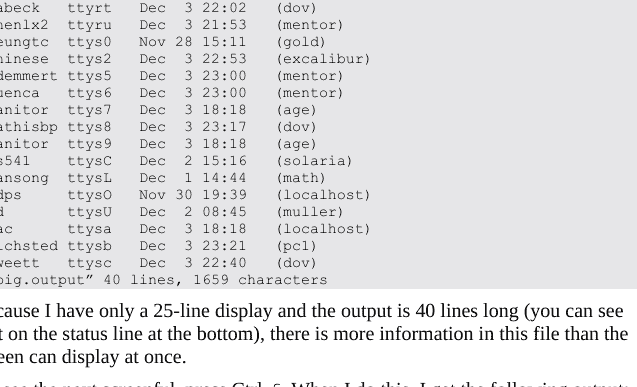

因为我只有 25 行的显示，而输出有 40 行长（你可以在底部的状态行看到），该文件中的信息比屏幕一次能显示的更多。

2. 要查看下一屏，按下 `Ctrl-f`。当我这样做时，我得到以下输出：


```text
doerrhb ttysp  Dec  3 23:20  (dov)

cdemmert ttysq  Dec  3 23:00  (xsun22)

frazierw ttysr  Dec  3 23:01  (dov)

buckeye ttys s  Dec  3 23:20  (mac2)

mtaylor ttyst  Dec  3 23:22  (dov)

look ttysu  Dec  3 23:12  (age)

janitor ttysw  Dec  3 18:29  (age)

ajones ttysx  Dec  3 23:23  (rass)

~

~

~

~
```

请注意整个屏幕被重写，并且熟悉的波浪号字符再次出现，让我知道我已到达文件末尾。

默认情况下，`vi` 在从一屏移动到另一屏时有两行的重叠。如果你仔细看，可以看到 eichsted 和 sweett 同时出现在两屏数据中。这并不意味着它们在文件中出现两次；相反，`vi` 试图帮助我在文件中游走时不迷路。

3. 现在，你认为如果我按下 `Ctrl-u` 会发生什么？

```text
leungtc ttys0  Nov 28 15:11  (gold)

chinese ttys2  Dec  3 22:53  (excalibur)

cdemmert ttys5  Dec  3 23:00  (mentor)

yuenca ttys6  Dec  3 23:00  (mentor)

janitor ttys7  Dec  3 18:18  (age)

mathisbp ttys8  Dec  3 23:17  (dov)

janitor ttys9  Dec  3 18:18  (age)

cs541 ttysC  Dec  2 15:16  (solaria)

yansong ttysL  Dec  1 14:44  (math)

mdps ttysO  Nov 30 19:39  (localhost)

md ttysU  Dec  2 08:45  (muller)

jac ttysa  Dec  3 18:18  (localhost)

eichsted ttysb  Dec  3 23:21  (pcl)

sweett ttysc  Dec  3 22:40  (dov)

wellman ttysd  Dec  3 23:01  (dov)

tuttleno ttys e  Dec  3 23:03  (indy vax)

wu ttysf  Dec  3 23:10  (term01)

daurismj ttysg  Dec  3 23:10  (dov)

cs414 ttysh  Dec  3 23:12  (xds)

cq ttysi  Dec  3 23:13  (expert)

cdemmert ttysk  Dec  3 22:37  (xsun22)

jrlee ttysn  Dec  3 22:53  (mac1)
```


fitzgejs ttyso  Dec  3 23:18  (dov)

```
该命令将我向上移动了半屏。请注意 eichsted 和 sweett 的位置。现在文本不是像使用 Ctrl-f 时那样一次性被替换，而是逐行向下滚动，每行新内容在程序进行时被添加。Ctrl-u 命令对你来说可能以两种方式工作——一次一行或一整屏。
```

# 4. 现在是时候尝试逐词在文件中移动了。输入 `w` 键一次看看会发生什么：

Click here to view code image

```
leungtc ttys0  Nov 28 15:11  (gold)
```

chinese  ttys2  Dec  3 22:53  (excalibur)
cdemmert ttys5  Dec  3 23:00  (mentor)

现在再输入六次 `w`，注意光标会三次停在该字段中，以表示用户登录系统的时间（在此列表中为 15:11）。现在你的光标应该停在带括号的字段上：

点击此处查看代码图片

```
leungtc  ttys0  Nov 28 15:11  (gold)

chinese  ttys2  Dec  3 22:53  (excalibur)

cdemmert ttys5  Dec  3 23:00  (mentor)
```

## 5. 现在该向后移动了。输入几次 `b`；光标会向后移动，停在每个单词的开头。

如果你尝试向后移动，但你已经位于第一个单词上，或者你尝试使用 `w` 命令向前移动，但你已经位于行尾的最后一个单词上，会发生什么？让我们来一探究竟。

## 6. 使用你学过的各种移动键，移回到以 `leungtc` 开头的行首，也就是你在操作 4 中使用过的行：

点击此处查看代码图片

```
leungtc  ttys0  Nov 28 15:11  (gold)

chinese  ttys2  Dec  3 22:53  (excalibur)

cdemmert ttys5  Dec  3 23:00  (mentor)
```

这次输入 `W`（大写 `W`，不是小写 `w`）来在这一行中移动。你能看出区别吗？注意当你遇到时间字段和括号中的单词时会发生什么。你不需要输入 `w` 七次才能移动到 `gold` 前的左括号，只需输入 `W` 五次即可。

## 7. 尝试使用 `B` 命令向后移动。注意 `B` 命令与 `b` 命令的区别，和 `W` 命令与 `w` 命令的区别是一样的。

按单词前后移动、一次快速掠过半屏或整屏内容，以及使用 `h`、`j`、`k`、`l` 光标移动键精确定位到特定位置，这些都让你拥有了相当大的移动能力。练习将这些命令进行各种组合，把光标移动到示例文件中的特定字符上。

# 任务 10.4：使用 `i`、`a`、`o` 和 `O` 插入文本

能够在文件中移动是非常有用的。不过，编辑器的真正功能是让你能够轻松地添加和删除信息——用编辑器的术语来说，就是插入和删除。`vi` 编辑器有一个特殊的插入模式，你必须使用它才能向文件内容中添加内容。从命令模式切换到插入模式共有四种方法，你将在本任务中逐一学习。

切换到插入模式的第一种方法是输入字母 `i`，从助记角度来说它非常形象——将文本插入到文件中。其他实现类似功能的命令有：`a`，将文本追加到文件中；`o`，在当前行下方打开一行；以及 `O`，在当前行上方打开一行。

- 1. 对于本任务，你需要从一个干净的文件开始，所以退出 `big.output` 编辑会话并重新启动 `vi`，这次指定一个不存在的文件 `buckaroo`：

```
% vi buckaroo
```


注意 `vi` 会提醒你这个文件不存在；屏幕底部显示 New file，而不是显示行数和字符数。

- 2. 现在来试试插入模式。试着输入一次 `k`，向文件中插入一个 `k`：

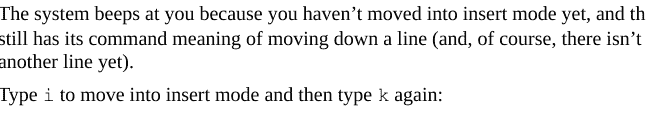

系统会发出蜂鸣声，因为你还没有进入插入模式，`k` 仍然具有命令含义——向下移动一行（当然，目前还没有另一行可移）。

输入 `i` 进入插入模式，然后再输入一次 `k`：


成功了！你已经向文件中添加了一个字符。

- 3. 按退格键，将光标移动到字母 `k` 上：


插入模式。但 `vi` 有一个特殊的命令 `o`，可以在当前行的正下方打开一行来插入文本。

输入 `o`，然后跟着做：

点击此处查看代码图片

```
"He's not even here," went the conservation.

"Banzai."

"Where is he?"

"At the hotpsial in El paso."

"What? Why weren't we informed? What's wrong with him?"
~
~
```

现在输入缺失的文本：

点击此处查看代码图片

```
"He's not even here," went the conservation.

"Who?"

"Banzai."

"Where is he?"

"At the hotpsial in El paso."

"What? Why weren't we informed? What's wrong with him?"
~
~
```

就是这样。按 `Escape` 键返回命令模式。

6. 我们使用的这段对话片段的问题在于，根本无法分辨是谁在说话。在这段对话上方添加一行文字有助于识别说话者。同样，使用光标移动键将光标置于第一行：

点击此处查看代码图片

```
"He's not even here," went the conservation.

"Who?"

"Banzai."

"Where is he?"

"At the hotpsial in El paso."

"What? Why weren't we informed? What's wrong with him?"
~
~
```

现在你面临一个两难的选择。你想为新的文本打开一行，但你希望这一行在当前行的上方，而不是下方。其实 `vi` 也能做到这一点。不要使用 `o` 命令，改用它的大哥 `O`（这是大写的字母 `O`，不是数字 `0`）。当我输入 `O` 时，看到的是：

点击此处查看代码图片

```
"He's not even here," went the conservation.

"Who?"

"Banzai."

"Where is he?"

"At the hotpsial in El paso."

"What? Why weren't we informed? What's wrong with him?"
~
~
```

输入新句子然后按 `Escape`。

点击此处查看代码图片

```
I found myself stealing a peek at my own watch and overheard

General Catbird’s

aide give him the latest.

“He’s not even here,” went the conversation.

“Who?”

“Banzai.”

“Where is he?”

“At the hospital in El Paso.”

“What? Why weren’t we informed? What’s wrong with him?”
~
~
```

现在这段对话变得更有意义了。叙述者听到的对话发生在将军和他的副官之间。

7. 我在一行中漏掉了几个词，所以下一个任务是插入它们。使用光标键将光标移动到第七行，刚好在单词 `Where` 之后：

点击此处查看代码图片

```
I found myself stealing a peek at my own watch and overheard

General Catbird’s

aide give him the latest.

“He’s not even here,” went the conversation.

“Who?”

“Banzai.”

“Where is he?”

“At the hospital in El Paso.”

“What? Why weren’t we informed? What’s wrong with him?”
~
~
```

此时，我需要添加单词 `the hell` 来使句子更有力一些（并且正确）。我可以使用 `i` 来插入文本，但这样会在末尾留下多余的空格。相反，我可以使用 `a` 命令在当前光标位置之后立即添加文本，或插入信息。当我输入 `a` 时，光标向右移动一个字符：

点击此处查看代码图片

```
I found myself stealing a peek at my own watch and overheard

General Catbird’s

aide give him the latest.


“He’s not even here,” went the conversation.

“Who?”

“Banzai.”

“Where is he?”

“At the hospital in El Paso.”

“What? Why weren’t we informed? What’s wrong with him?”

~

~

```
对其进行退格；现在我就会知道自己处于追加模式。

当我完成输入新字符，并且仍处于插入模式时，我的屏幕看起来是这样的：

点击此处查看代码图片
```

I found myself stealing a peek at my own watch and overheard

General Catbird’s

aide give him the latest.

“He’s not even here,” went the conversation.

“Who?”

“Banzai.”

“Where the hell is he?”

“At the hospital in El Paso.”

“What? Why weren’t we informed? What’s wrong with him?”

~

~

```
请注意，在整个操作过程中光标始终停留在 is 中的 i 上。按 `Escape` 返回命令模式。请注意，光标最终会离开 i 并向左移动一个字符。

### Note

要区分 `i` 和 `a` 命令，请记住，插入命令始终在光标所在字符之前添加新信息，而追加命令则在当前光标位置的右侧立即添加信息。

8. 记住这一点，尝试修复最后一行中 weren’t 这个词的撇号问题。将光标移动到该词中的 n：

点击此处查看代码图片

```
“Where the hell is he?”

“At the hospital in El Paso.”

“What? Why weren’t we informed? What’s wrong with him?”

~
```

要在当前字符之后立即添加撇号，你想使用插入命令（`i`）还是追加（`a`）命令？如果你说追加，就给自己一个赞！输入 `a` 以追加撇号：

点击此处查看代码图片

```
“Where the hell is he?”

“At the hospital in El Paso.”

“What? Why weren’t we informed? What’s wrong with him?”

~
```

输入 ` ` 一次然后按 `Escape`。

9. 使用 `:q` 退出 `vi`，程序提醒你尚未将更改保存到此新文件，提示显示在屏幕底部：

点击此处查看代码图片

```
~
```

```
No write since last change (:quit! overrides)
```

要写入更改，你需要一个新命令，所以我会给你一个预览，稍后在本小时你将学习的一组冒号命令。输入 `:` （冒号字符），这会将光标移动到屏幕底部：

```
~
~
:_
```

现在输入 `w` 以写入（保存）文件，然后按回车键：

点击此处查看代码图片

```
~
~
"buckaroo" 9 lines, 277 characters
```

现在可以安全地离开 `vi` 了。我将使用 `:q` 退出，并安全地返回到命令提示符。快速 `cat` 确认波浪号并未包含在文件本身中：

点击此处查看代码图片

```
$ cat buckaroo

I found myself stealing a peek at my own watch and overheard

General Catbird’s

aide give him the latest.

“He’s not even here,” went the conversation.

“Who?”

“Banzai.”

“Where the hell is he?”

“At the hospital in El Paso.”

“What? Why weren’t we informed? What’s wrong with him?”

$
```

正如你所见，`vi` 编辑器功能非常强大，拥有大量命令。仅通过移动和插入文本，你就已经学习了 24 个命令，如表 10.1 所总结。

| 命令 | 含义 |
|---|---|
| `0` | 移至行首。 |
| `$` | 移至行尾。 |
| `a` | 在当前字符后追加文本；进入插入模式。 |
| `^b` | 向后滚动一屏文本。注意 ^b 与 Ctrl-b 相同；两者都表示应按住 Control 键，然后按下第二个键，然后松开。 |
| `B` | 向后移动一个以空格分隔的词。 |
| `b` | 向后移动一个词。 |
| `Backspace` | 向左移动一个字符。 |
| `^d` | 向下移动半页。 |
| `Escape` | 离开插入模式并返回命令模式。 |
| `^f` | 向前滚动一屏文本。 |
| `h` | 向左移动一个字符。 |
| `i` | 在当前字符前插入文本；进入插入模式。 |
| `j` | 向下移动一行。 |
| `k` | 向上移动一行。 |
| `l` | 向右移动一个字符。 |
| `o` | 在当前行上方打开新行以插入文本。 |
| `O` | 在当前行下方打开新行以插入文本。 |
| `Return` | 移至下一行的开头。 |
| `^u` | 向上移动半页。 |
| `w` | 向前移动一个以空格分隔的词。 |
| `W` | 向前移动一个词。 |
| `:w` | 将文件写入磁盘。 |
| `:q` | 退出 `vi` 并返回到 Unix 系统提示符。 |
| `:q!` | 退出 `vi` 并返回到 Unix 系统提示符，丢弃对文件所做的任何更改。 |

## 表 10.1 vi 移动和插入命令摘要

> **注意**
> 
> 在本表中，我使用了在 [第 7 小时](#) 中介绍的简单简写表示法，“查看文件”。Unix 用户通常使用插入号 (^) 后跟一个字符来代替笨拙的 Ctrl- 表示法。因此，^f 与 Ctrl-f 含义相同。将此操作表示为 ^f 并不会改变其执行方式：你仍然按下并按住 Control 键然后输入 f。这只是更简洁的表示法。

你已经学习了相当多的命令，但我们才刚刚触及功能强大的 `vi` 命令的皮毛！

## 任务 10.5：删除文本

你现在已经掌握了使用 `vi` 编辑器高效工作的许多要素，可以快速跳转到文件中的任意位置，并在想要的地方添加文本。现在你需要学习如何删除字符、词和行。

最简单的删除形式是使用 `x` 命令，其功能就像你在打印页面上用 X 写掉一个不需要的字母一样：它删除光标下的字符。输入 `x` 五次，你就删除了五个字符。以这种方式删除一行文本可能相当繁琐，因此 `vi` 提供了一些替代命令。（你感到惊讶吗？）

许多 `vi` 用户不知道的一个命令是 `D`（表示“删除至行尾”）。无论你在行上的哪个位置，只要输入 `D`，就会立即删除光标之后到该行文本末尾的所有内容。

如果有大写的 `D` 命令，你可以肯定也有小写的 `d` 命令。`d` 删除命令是一组更复杂的 `vi` 命令中的第一个，这些命令需要第二个命令来指示其适用的范围。你已经知道 `w` 和 `W` 会使你在文件中向前移动一个词；它们在 `vi` 中被称为 *寻址命令*。你可以在 `d` 后跟其中一个寻址命令来指定要删除的内容。例如，要删除一个词，只需将删除命令和移动词命令一起使用：`dw`。

> **注意**
> 
> 有时你可能会过于热心而删除了超出预期的内容。这不是问题——好吧，不算太大的问题——因为 `vi` 会记住最近操作之前文件的状态。要撤消删除（或插入，同样适用），请使用 `u` 命令。要撤消一行的更改，请使用 `U` 命令。请注意，一旦你离开了相关行，`U` 命令就无法恢复它！

- 1. 再次使用 `big.output` 文件启动 `vi`，该文件你之前使用过：

[点击此处查看代码图像](#)

```
leungtc   ttyrV  Dec  1 18:27  (magenta)

tuyinhua  ttyrX  Dec  3 22:38  (expert)

hollenst  ttyrZ  Dec  3 22:14  (dov)

brandt    ttyrB  Nov 28 23:03  (age)

holmes    ttyrJ  Dec  3 21:59  (age)

yuxi      ttyrn  Dec  1 14:19  (pc)

frodo     ttyro  Dec  3 22:01  (mentor)

labeck    ttyrt  Dec  3 22:02  (dov)

chenlx2   ttyru  Dec  3 21:53  (mentor)

leungtc   ttys0  Nov 28 15:11  (gold)

chinese   ttys2  Dec  3 22:53  (excalibur)

cdemmert  ttys5  Dec  3 23:00  (mentor)
```


```
yuenca    ttys6  Dec  3 23:00  (mentor)
janitor  ttys7   Dec  3 18:18  (age)
mathisbp ttys8   Dec  3 23:17  (dov)
janitor  ttys9   Dec  3 18:18  (age)
cs541    ttysC   Dec  2 15:16  (solaria)
yansong  ttysL   Dec  1 14:44  (math)
ddps     ttysO   Nov 30 19:39  (localhost)
md       ttysU   Dec  2 08:45  (muller)
jac      ttysA   Dec  3 18:18  (localhost)
eichsted ttysB   Dec  3 23:21  (pc1)
sweet    ttysC   Dec  3 22:40  (dov)
“big.output” 40 lines, 1659 characters
```

Type `x` a few times to delete a few characters from the beginning of the file:

```
gtc      ttyrV   Dec  1 18:27  (magenta)
tuyinhwa ttyrX   Dec  3 22:38  (expert)
hollenst ttyrZ   Dec  3 22:14  (dov)
brandt   ttyrb   Nov 28 23:03  (age)
holmes   ttyrj   Dec  3 21:59  (age)
```

Now type `u` to undo the last deletion:

```
gtc      ttyrV   Dec  1 18:27  (magenta)
tuyinhwa ttyrX   Dec  3 22:38  (expert)
hollenst ttyrZ   Dec  3 22:14  (dov)
brandt   ttyrb   Nov 28 23:03  (age)
holmes   ttyrj   Dec  3 21:59  (age)
```

If you type `u` again, what do you think will happen?

```
gtc      ttyrV   Dec  1 18:27  (magenta)
tuyinhwa ttyrX   Dec  3 22:38  (expert)
hollenst ttyrZ   Dec  3 22:14  (dov)
brandt   ttyrb   Nov 28 23:03  (age)
holmes   ttyrj   Dec  3 21:59  (age)
```

The `undo` command alternates between the last command having happened and not having happened. To explain it a bit better, the `undo` command is an action unto itself, so the second time you type `u`, you're undoing the `undo` command. Type `u` a few more times to convince yourself that this is the case.

> **Note**
>
> Caveat: Some versions of `vi` have a considerably more sophisticated undo capability, and the `u` key goes back, and back, and back until you're looking at an empty file or the file in its original pre-edit form. If you have that version of `vi`, you'll want to use the `:redo` command (type in the colon first) to go "forward in time" if you undo too far.

2. It's time to make some bigger changes to the file. Type `dw` twice to delete the current word and the next word in the file. It should look something like this after the first `dw`:

```
ttyrV   Dec  1 18:27   (magenta)
tuyinhwa ttyrX  Dec  3 22:38   (expert)
hollenst ttyrZ  Dec  3 22:14   (dov)
brandt   ttyrb  Nov 28 23:03   (age)
holmes   ttyrj  Dec  3 21:59   (age)
```

Then it should look like this after the second `dw`:

```
       Dec  1 18:27   (magenta)
tuyinhwa ttyrX  Dec  3 22:38   (expert)
hollenst ttyrZ  Dec  3 22:14   (dov)
brandt   ttyrb  Nov 28 23:03   (age)
holmes   ttyrj  Dec  3 21:59   (age)
```

Type `u`. You see that you can undo only the most recent command. At this point, though, because I haven't moved from the line I'm editing, the `U`, or restore-this-line command, will restore the line to its original state:

```
leungtc  ttyrV  Dec  1 18:27   (magenta)
tuyinhwa ttyrX  Dec  3 22:38   (expert)
hollenst ttyrZ  Dec  3 22:14   (dov)
brandt   ttyrb  Nov 28 23:03   (age)
holmes   ttyrj  Dec  3 21:59   (age)
```

3. I really don't want to see some of these folks in the output file, however. Fortunately, I can change the contents of this file by using the `dd` command to delete lines. When you're using one of these two-letter commands, repeating the letter means to apply the command to the entire line. What if I want to delete the entries for `chinese` and `janitor`, both of which are visible on this screen?

The first step is to use the cursor keys to move down to any place on the line for the `chinese` account, about halfway down the screen:

```
chenlx2  ttyru  Dec  3 21:53   (mentor)
leungtc  ttyS0  Nov 28 15:11   (gold)
chinese  ttyS2  Dec  3 22:53   (excalibur)
```


```
cdemmert ttyS5  Dec  3 23:00   (mentor)
yuenca   ttyS6  Dec  3 23:00   (mentor)
janitor  ttyS7  Dec  3 18:18   (age)
mathisbp ttyS8  Dec  3 23:17   (dov)
```

If your cursor isn’t somewhere in the middle of this line, move it so that you aren’t at an edge.

I had planned to remove this line completely, but perhaps I’d rather just remove the date, time, and name of the system (in parentheses) instead. To accomplish this, I don’t need to type `dw` many times, or even `x` many times but rather `D` to delete through the end of the line:

[Click here to view code image](#)

```
chenlx2  ttyru  Dec  3 21:53   (mentor)
leungtc  ttyS0  Nov 28 15:11   (gold)
chinese  ttyS2  _
cdemmert ttyS5  Dec  3 23:00   (mentor)
yuenca   ttyS6  Dec  3 23:00   (mentor)
```

| 名称 | ttyp | 日期 | 时间 | (角色) |
|------|------|------|------|--------|
| labeck | ttyrt | 12月3日 | 22:02 | (dov) |
| chenlx2 | ttyru | 12月3日 | 21:53 | (mentor) |
| leungtc | ttyrs0 | 11月28日 | 15:11 | (gold) |
| cdemmert | ttyrs5 | 12月3日 | 23:00 | (mentor) |
| yuenca | ttyrs6 | 12月3日 | 23:00 | (mentor) |
| mathisbp | ttyrs8 | 12月3日 | 23:17 | (dov) |
| janitor | ttyrs9 | 12月2日 | 18:18 | (age) |
| gs541 | ttysc | 12月3日 | 15:16 | (solaria) |
| yansong | ttysl | 12月1日 | 14:44 | (math) |
| mdps | ttyso | 11月30日 | 19:39 | (localhost) |
| md | ttysu | 12月2日 | 08:45 | (muller) |
| jac | ttysa | 12月3日 | 18:18 | (localhost) |
| eichsted | ttysb | 12月3日 | 23:21 | (pcl) |
| sweett | ttysc | 12月3日 | 22:40 | (dov) |
| wellman | ttysd | 12月3日 | 23:01 | (dov) |
| tuttleno | ttyse | 12月3日 | 23:03 | (indyvax) |

被删除行下方的每一行都会上移一行来填补空白，新的一行（即 `tuttleno` 的行）则移入视野。

5. 现在我想回到 `buckaroo` 文件，修正一些可怕的排版错误！我并不在意是否保存刚才对这个文件的更改，所以我会使用 `:q!` 退出并放弃对 `big.output` 文件的修改。

输入 `vi buckaroo` 会再次启动 `vi`：

> I found myself stealing a peek at my own watch and overheard
>
> General Catbird's
>
> aide give him the latest.
>
> "He's not even here," went the conservation.
>
> "Who?"
>
> "Banzai."
>
> "Where the hell is he?"
>
> "At the hotspial in El paso."
>
> "What? Why weren’t we informed? What's wrong with him?"

```
"buckaroo" 9 lines, 277 characters
```

你可以很快地做几处修正。第一处是将第三行的 `conservation` 改为 `conversation`。要移到那里，按两次回车键，然后使用 `w` 快速前进，直到光标停在你正在编辑的单词的第一个字母上：

```
I found myself stealing a peek at my own watch and overheard
General Catbird’s
aide give him the latest.
“He’s not even here,” went the conservation.
“Who?”
“Banzai.”
“Where the hell is he?”
```

然后使用 `dw` 命令：

```
I found myself stealing a peek at my own watch and overheard
General Catbird’s
aide give him the latest.
“He’s not even here,” went the _
“Who?”
“Banzai.”
“Where the hell is he?”
```

现在键入 `i` 进入插入模式，输入单词 `conversation` 的正确拼写，然后按 `Escape`：

```
I found myself stealing a peek at my own watch and overheard
General Catbird’s
aide give him the latest.
“He’s not even here,” went the conversation _
“Who?”
“Banzai.”
“Where the hell is he?”
```

6. 这是一处修正。现在向下移动几行，修正 `hospital` 令人发指的拼写错误：

```
“Banzai.”
“Where the hell is he?”
“At the hotsial in El paso.”
“What? Why weren’t we informed? What’s wrong with him?”
~
```

同样，使用 `dw` 删除该单词，键入 `i` 进入插入模式，输入 `hospital`，然后按 `Escape`。现在这一行没问题了：

```
“Banzai.”
“Where the hell is he?”
“At the hospital in El paso.”
“What? Why weren’t we informed? What’s wrong with him?”
~
```

嗯，几乎一切都好了。`Paso` 的首字母需要大写。键入 `w` 向前移动几个单词，移到那里：

```
“Banzai.”
“Where the hell is he?”
“At the hospital in El paso.”
“What? Why weren’t we informed? What’s wrong with him?”
~
```

7. 是时候介绍一个 vi 专家秘密命令了！与其输入 `x` 删除字母、`i` 进入插入模式、`P` 作为正确字母、然后按 `Escape` 返回命令模式，你可以使用一种更快的切换大小写的方法：`~`（波浪号）命令。输入一次 `~`，你会看到：

```
"Banzai."
"Where the hell is he?"
"At the hospital in El Paso."
"What? Why weren’t we informed? What’s wrong with him?"
~
```

很酷吧？再次回到单词开头，输入几次 `~`，看看会发生什么。注意每次输入 `~`，字符的大小写就会切换（转置），并且光标移动到下一个字符。输入 `~` 四次，你应该会得到：

```
"Banzai."
"Where the hell is he?"
"At the hospital in El pASO."
"What? Why weren’t we informed? What’s wrong with him?"
~
```


回到单词开头，按 `~` 直到单词正确。

8. 再做一处小修改，文件就修好了。移动到文件的最后一行，找到 `weren’t` 单词中多余的那个撇号，输入 `x` 删除这个多余字符。屏幕现在看起来应该是这样：

```
I found myself stealing a peek at my own watch and overheard

General Catbird’s

aide give him the latest.

“He’s not even here,” went the conversation.

"Who?"

"Banzai."

"Where the hell is he?"

"At the hospital in El Paso."

"What? Why weren’t we informed? What’s wrong with him?"

~

~

~

~

~

~

~

~

~

~

~

~
```

看起来棒极了！是时候把它保存下来供后人参考了。使用 `:wq`，这是一个快捷命令，让 vi 写入更改并立即退出程序：

```
~
"buckaroo" 9 lines, 276 characters
%
```

你不仅学习了 vi 中各种删除选项，还学习了一些简单的快捷命令：`~` 用于转换大小写，`:wq` 用于一步完成写入更改并退出程序。

你应该感到满意；你现在已经成为一名高效且熟练的 vi 用户，可以修改文件，进行简单或困难的更改。回到你的系统，通过修改其他文件进一步实验。注意，不要修改任何点文件（例如 `.profile`），以免造成难以修复的问题。

## Summary

表 10.2 总结了本小时你所学习的基本 vi 命令。

## TABLE 10.2 Basic vi Commands

| Command | Meaning |
|---------|---------|
| 0 | 移至行首。 |
| $ | 移至行尾。 |
| a | 追加文本；在当前字符后进入插入模式。 |
| ^b | 向后翻一屏文本。 |
| B | 向后移动一个以空格分隔的词。 |
| b | 向后移动一个词。 |
| Backspace | 向左移动一个字符。 |
| ^d | 向下移动半页。 |
| D | 删除至行尾。 |
| d | 删除：`dw` = 删除词，`dd` = 删除行。 |
| Escape | 离开插入模式并返回命令模式。 |
| ^f | 向前翻一屏文本。 |
| G | 跳至文件的最后一行。 |
| nG | 跳至文件的第 n 行。 |
| h | 向左移动一个字符。 |
| i | 插入文本；在当前字符前进入插入模式。 |
| j | 向下移动一行。 |
| k | 向上移动一行。 |
| l | 向右移动一个字符。 |
| n | 重复上一次搜索。 |
| O | 在当前行上方打开新行以插入文本。 |
| o | 在当前行下方打开新行以插入文本。 |
| Return | 移至下一行的开头。 |
| ^u | 向上移动半页。 |
| U | 撤销；如果已更改则恢复当前行。 |
| u | 撤销对文件所做的最后一次更改。 |
| W | 向前移动一个以空格分隔的词。 |
| w | 向前移动一个词。 |
| x | 删除单个字符。 |

## Workshop

练习总结了你所学到的关键术语，并对本课介绍的主题提出了一些问题。它还为你提供了下一小时将学习内容的预览。

### Key Terms

**addressing commands** 这些 vi 命令使你能够指定想要操作的对象的类型。`d` 命令就是一个例子：`dw` 表示 *delete word*，`db` 表示 *delete preceding word*。

**command mode** 这是你管理文档的模式；它允许你更改文本、重新排列它并删除它。

**insert mode** 这是 vi 允许你直接向文件输入文本的模式。`i` 命令启动插入模式，`Escape` 退出它。

**modal** 模态程序具有多个环境或模式，提供不同的功能。在模态程序中，例如 Return 键在不同模式下可能会做不同的事情。

**modeless** 无模态程序始终以相同的方式解释一个键，而不管用户正在做什么。

**transpose case** 转换大小写意味着将大写字母切换为小写或小写字母切换为大写。

### Exercises

- 1. 如果你尝试使用 `:qw` 退出 vi 会发生什么？在尝试之前，你是否期望它能工作？
- 2. 如果你熟悉 Mac 或 Windows 环境中的文字处理程序，你会将它们描述为模态还是无模态？
- 3. `d` 命令是理解寻址命令的命令的一个例子。你知道其中不少。测试它们是否都能跟在 `d` 后面使用。确保你能找出与 `D` 命令相反操作的命令。
- 4. 以下三个命令是否都给出相同的结果？

```
D

d$

dG
```

- 5. 想象你处于命令模式，位于屏幕中间的一行中间。描述如果输入以下内容会发生什么：

```
Badluck

Window

blad$
```

## 下一小时预览

下一小时将扩展你对 vi 编辑器的知识。它将向你介绍复杂的搜索和替换功能，探索有用的冒号命令，并详细介绍你需要了解的命令行选项。

## 第 11 小时：高级 vi 技巧、工具和技术

### 本小时目标

在本小时，你将学习

- 如何在文件中搜索
- 如何搜索和替换
- 如何让 vi 正确启动
- vi 中的关键冒号命令
- 更改和替换命令
- 如何使用 `:!` 命令访问 Unix 命令

在上一小时中，你学习了看起来可能很多的 vi 命令，以便能够轻松地在文件中移动、插入文本、删除其他文本，并在不离开程序的情况下在文件之间移动。本小时通过向你展示一些更强大的 vi 命令来扩展你的专业知识。在开始本小时之前，我强烈建议你使用 vi 处理几个文件，以确保你对程序的不同模式感到舒适。

这看起来可能是一个很小的列表，但本小时的内容非常丰富。我会完全坦白：你可以在不阅读本课的情况下很好地使用 vi。你已经知道如何移动、如何插入和删除文本，以及如何保存更改或不保存更改就退出程序！但 vi 就像任何其他复杂主题一样：你越愿意学习和研究，程序就越能满足你的需求。这意味着你可以更高效地完成更广泛的日常任务。

### 使用 vi 进行高级编辑

上一小时专注于插入和删除文本以及在文件中移动的基础知识。本小时增加了一个关键功能：在文件中搜索和替换文本。

### 任务 11.1：在文件中搜索

在增加另外两个功能后，你将准备好面对任何 vi 专家，展示你对编辑器的技能和知识，更重要的是，你将能够真正快速地浏览文件，立即移动到你想要进一步编辑的信息。

相同的模式。

你可以通过使用 `G`，即转到行 命令，轻松移动到文件中的任何特定行。如果你先输入一个数字再输入 `G`，光标将移动到文件中的该行。如果你不带行号输入 `G`，光标将带你到文件的最后一行（默认情况下）。

1. 使用命令 `vi big.output` 再次启动 vi 并打开 `big.output` 文件：

```
leungtc ttyrV Dec  1 18:27 (magenta)

tuyinhwa ttyX Dec  3 22:38 (expert)

hollenst ttyrZ Dec  3 22:14 (dov)

brandt ttyrb Nov 28 23:03 (age)

holmes ttyrj Dec  3 21:59 (age)

yuxi ttyrn Dec  1 14:19 (pc)

frodo ttyro Dec  3 22:01 (mentor)

labeck ttyrt Dec  3 22:02 (dov)

chenlx2 ttyru Dec  3 21:53 (mentor)

leungtc ttyso Nov 28 15:11 (gold)

chinese ttys2 Dec  3 22:53 (excalibur)

cdemmert ttys5 Dec  3 23:00 (mentor)

yuenca ttys6 Dec  3 23:00 (mentor)

janitor ttys7 Dec  3 18:18 (age)

mathisbp ttys8 Dec  3 23:17 (dov)

janitor ttys9 Dec  3 18:18 (age)

cs541 ttysC Dec  2 15:16 (solaria)

yansong ttysL Dec  1 14:44 (math)

mdps ttysO Nov 30 19:39 (localhost)

md ttysU Dec  2 08:45 (muller)

jac ttysa Dec  3 18:18 (localhost)

eichsted ttysb Dec  3 23:21 (pcl)

sweett ttysc Dec  3 22:40 (dov)

"big.output" 40 lines, 1659 characters
```


请记住我之前使用 `:q!` 退出，所以我的更改未被保留。（我知道你对这些示例的关注度超高！）

要移动到文件的最后一行，我输入一次 `G`，然后看到以下内容：

```
cdemmert ttysk Dec  3 22:37 (xsun)

jrlee ttysn Dec  3 22:53 (mac1)

fitzgejs ttyso Dec  3 23:18 (dov)

doerrhb ttysp Dec  3 23:20 (dov)

cdemmert ttysq Dec  3 23:00 (xsun)

frazierw ttysr Dec  3 23:01 (dov)

buckeye ttyss Dec  3 23:20 (mac2)

mtaylor ttyst Dec  3 23:22 (dov)

look ttysu Dec  3 23:12 (age)

janitor ttysw Dec  3 18:29 (age)

ajones ttysx Dec  3 23:23 (rassilon)

~

~

~

~

~

~

~

~
```

要移动到文件的第三行，我输入 `3` 然后按 `G`：

Click here to view code image

```
leungtc ttyrV Dec 1 18:27 (magenta)

tuyinhwa ttyrX Dec 3 22:38 (expert)

hollenst ttyrZ Dec 3 22:14 (dov)

brandt ttyrb Nov 28 23:03 (age)

holmes ttyrj Dec 3 21:59 (age)

yuxi ttyrn Dec 1 14:19 (pc)

frodo ttyro Dec 3 22:01 (mentor)

labeck ttyrt Dec 3 22:02 (dov)

chenlx2 ttyru Dec 3 21:53 (mentor)

leungtc ttys0 Nov 28 15:11 (gold)

chinese ttys2 Dec 3 22:53 (excalibur)

cdemmert ttys5 Dec 3 23:00 (mentor)

yuen ca ttys6 Dec 3 23:00 (mentor)

janitor ttys7 Dec 3 18:18 (age)

mathisbp ttys8 Dec 3 23:17 (dov)

janitor ttys9 Dec 3 18:18 (age)

cs541 ttysC Dec 2 15:16 (solaria)

yansong ttyL Dec 1 14:44 (math)

mdps ttysO Nov 30 19:39 (localhost)

md ttysU Dec 2 08:45 (mueller)

jac ttysa Dec 3 18:18 (localhost)

eichsted ttysb Dec 3 23:21 (pcl)

sweett ttysc Dec 3 22:40 (dov)
```

注意光标位于文件的第三行。

## 2. 现在是时候搜索了。根据我之前在这个文件中的浏览，我知道最后一行是账户 `ajones` 的，但与其直接使用 `G` 移动到那里，我可以使用 `/` 搜索命令来搜索指定的模式。

输入 `/` 会立即将光标移动到屏幕底部：

Click here to view code image

```
md ttysU Dec 2 08:45 (mueller)

jac ttysa Dec 3 18:18 (localhost)

eichsted ttysb Dec 3 23:21 (pcl)

sweett ttysc Dec 3 22:40 (dov)

/_
```

现在我可以输入模式 `ajones`：

```
fitzgejs ttyso  Dec  3 23:18  (dov)

doerrhb ttysp  Dec  3 23:20  (dov)

cdemmert ttysq  Dec  3 23:00  (xsun)

frazierw ttysr  Dec  3 23:01  (dov)

buckeye ttyss  Dec  3 23:20  (mac2)

mtaylor ttyst  Dec  3 23:22  (dov)

look ttysu  Dec  3 23:12  (age)

janitor ttysw  Dec  3 18:29  (age)

ajones ttysx  Dec  3 23:23  (rassilon)

~

~

~

~

~

~

~

~

~

~
```

## 3. 如果我输入 `n` 来再次搜索该模式，会在底部出现一个斜杠以显示 `vi` 理解了我的请求。但光标保持在原位，这意味着该模式在这个文件中只有一个出现。

## 4. 查看这个文件，我注意到账户 `janitor` 有各种各样的会话正在运行。要向后搜索该账户的出现，我可以使用 `?` 命令：

```
~ 
?janitor_
```

第一次搜索将光标向上移动一行，这使得屏幕看起来几乎相同：

Click here to view code image

```
cdemmert ttysk  Dec  3 22:37  (xsun)

jrlee ttysn  Dec  3 22:53  (mac1)

fitzgejs ttyso  Dec  3 23:18  (dov)

doerrhb ttysp  Dec  3 23:20  (dov)

cdemmert ttysq  Dec  3 23:00  (xsun)

frazierw ttysr  Dec  3 23:01  (dov)

buckeye ttyss  Dec  3 23:20  (mac2)

mtaylor ttyst  Dec  3 23:22  (dov)

look ttysu  Dec  3 23:12  (age)

janitor ttysw  Dec  3 18:29  (age)

ajones ttysx  Dec  3 23:23  (rassilon)

~

~

~

~

~

~

~

~

~

~
```

```
?janitor
```

这里 `n`，即下一个匹配，就派上用场了。如果我这次输入 `n`，并且文件中还有该模式的另一个出现，`vi` 会直接将我移动到匹配处：

Click here to view code image

```
yuxi      ttyrn   Dec  1 14:19   (pc)

frodo     ttyro   Dec  3 22:01   (mentor)

labeck    ttyrt   Dec  3 22:02   (dov)

chenlx2   ttyru   Dec  3 21:53   (mentor)

leungtc   ttys0   Nov 28 15:11   (gold)

chinese   ttys2   Dec  3 22:53   (excalibur)

cdemmert  ttys5   Dec  3 23:00   (mentor)

yuen ca   ttys6   Dec  3 23:00   (mentor)

janitor   ttys7   Dec  3 18:18   (age)

mathisbp  ttys8   Dec  3 23:17   (dov)

janitor   ttys9   Dec  3 18:18   (age)

cs541     ttysC   Dec  2 15:16   (solaria)

yansong   ttysL   Dec  1 14:44   (math)

mdps      ttysO   Nov 30 19:39   (localhost)

md        ttysU   Dec  2 08:45   (mueller)

jac       ttysa   Dec  3 18:18   (localhost)

eichsted  ttysb   Dec  3 23:21   (pcl)

sweett    ttysc   Dec  3 22:40   (dov)

wellman   ttysd   Dec  3 23:01   (dov)

tuttleno  ttyse   Dec  3 23:03   (indy vax)

wu        tty sf  Dec  3 23:10   (tern01)

daurismj  tty sg  Dec  3 23:10   (dov)

cs414     tty sh  Dec  3 23:12   (xds)
```


在你自己的文件中尝试一个出现多次的模式。完成后，使用 `:q` 退出 `vi`。

`vi` 的命令不是几十个而是数百个。与其用所有命令淹没你，我选择向你展示最重要的命令。事实上，这本书就是这样组织的；毕竟，如果你想要一个庞大的命令参考，你会去读 `man` 手册，对吧？等你完成这一小时后，你对 `vi` 命令的了解将是实质性的，并且你将能够轻松使用该编辑器。

此任务专注于搜索模式，这是一个常见需求，也是任何编辑器的有帮助功能。此外，你还学会了如何移动到文件顶部 (`1G`) 和文件底部 (`G`)，以及两者之间的任意位置。

# Task 11.2: vi 中的冒号命令

不用太多解释，你已经学习了几个冒号命令——也就是说，以冒号为第一个字符的命令。冒号会立即将光标移动到屏幕底部以供进一步输入。这些命令实际上是相当大的一组命令的子集，所有这些命令都是 `vi` 所基于的 `ex` 编辑器的一部分。

还记得我在上一小时开头告诉你的关于 `vi` 是 `ex` 编辑器的可视化外壳的事情吗？事实证明 `ex` 在系统上仍然是一个部分。

## 注意

关于冒号命令，有一点需要注意：与你在 `vi` 命令模式下输入的命令不同，在冒号提示符下输入的命令必须按回车键，编辑器才会处理。这是 `vi` 中一个常见的混淆点，但只要你试过就会习惯。

表 11.1 列出了最有用的冒号命令。

| 命令 | 功能 |
|---|---|
| `:e filename` | 停止编辑当前文件并编辑指定文件。 |
| `:n` | 停止编辑当前文件并编辑命令行中指定的下一个文件。请记住，你始终可以用 `vi *txt` 或类似方式启动 `vi`。 |
| `:N` | 转到上一个指定文件。 |
| `:q` | 退出编辑器。 |
| `:q!` | 无论是否做过修改都退出，忽略所有警告。 |
| `:r filename` | 将指定文件的内容包含在当前正在编辑文件的此位置处。 |
| `:w` | 将文件写入磁盘。 |
| `:w filename` | 以指定文件名将文件写入磁盘。 |

## 表 11.1 最实用的冒号命令

1. 再次启动 `vi`，这次指定要编辑的文件列表；`vi` 会提示你指定的文件不止一个：

```
$ vi buckaroo big.output

2 files to edit.
```

接着它会清屏并显示第一个文件：

点击此处查看代码图片

```
I found myself stealing a peek at my own watch and overheard

General Catbird's

aide give him the latest.

"He's not even here," went the conversation.

"Who?"

"Banzai."

"Where the hell is he?"

"At the hospital in El Paso."

"What? Why weren't we informed? What's wrong with him?"

~

~

~

~

~

~

~
```

```
buckaroo" 9 lines, 276 characters
```

键入命令序列 `:w` 并按下回车键，文件就会以当前名称写入磁盘。这种情况下没什么可看的。

2. 相反，试着用 `:w newfile` 写入另一个文件：

```
:w newfile
```

按下回车键后，你会看到：

> 我发现自己偷偷看了一眼手表，无意中听到
> 卡特伯德将军的
> 副官向他报告最新情况。
> “他甚至不在这里，”对话这样进行着。
> “谁？”
> “班赛。”
> “他到底在哪儿？”
> “在埃尔帕索的医院里。”
> “什么？为什么没人通知我们？他怎么了？”

```
:r newfile
```

按下回车键会产生如下结果：

点击此处查看代码图片

```
I found myself stealing a peek at my own watch and overheard

General Catbird’s

I found myself stealing a peek at my own watch and overheard

General Catbird’s

aide give him the latest.

“He’s not even here,” went the conversation.

“Who?”

“Banzai.”

“Where the hell is he?”

“At the hospital in El Paso.”

“What? Why weren’t we informed? What’s wrong with him?”

aide give him the latest.

“He’s not even here,” went the conversation.

“Who?”

“Banzai.”

“Where the hell is he?”

“At the hospital in El Paso.”

“What? Why weren’t we informed? What’s wrong with him?”

~

~

~

~

~

~

~
```

这是一种很有用的方式，可以让你将文件相互包含，或构建一个包含许多其他文件的文件。

4. 现在我已经把文件弄乱了，想把它保存到一个新文件 `buckaroo.confused`：

```
~ 
:w buckaroo.confused_
```

按下回车键后，我会看到：

点击此处查看代码图片

```
~ 
"buckaroo.confused" [New file] 17 lines, 546 characters
```

5. 现在该切换到启动 `vi` 时给定的文件列表中的第二个文件了。为此，我使用 `:n`（即 `next-file`，下一个文件）命令：

```
~ 
:n_
```

按下回车键后，下一个文件会被调入编辑器，替换第一个文件：

点击此处查看代码图片

```
leungtc ttyrV Dec 1 18:27 (magenta)

tuyinhwa ttyX Dec 3 22:38 (expert)

hollenst ttyrZ Dec 3 22:14 (dov)

brandt ttyrb Nov 28 23:03 (age)

holmes ttyrj Dec 3 21:59 (age)
```

```
yuxi      ttyrn  Dec  1 14:19  (pc)

frodo     ttyro  Dec  3 22:01  (mentor)

labeck    ttyrt  Dec  3 22:02  (dov)

chenlx2   ttyru  Dec  3 21:53  (mentor)

leungtc   ttys0  Nov 28 15:11  (gold)

chinese   ttys2  Dec  3 22:53  (excalibur)

cdemmert  ttys5  Dec  3 23:00  (mentor)

yuenca    ttys6  Dec  3 23:00  (mentor)

janitor   ttys7  Dec  3 18:18  (age)

mathisbp  ttys8  Dec  3 23:17  (dov)

janitor   ttys9  Dec  3 18:18  (age)

cs541     ttysC  Dec  2 15:16  (solaria)

yansong   ttysL  Dec  1 14:44  (math)

mdps      ttysO  Nov 30 19:39  (localhost)

md        ttysU  Dec  2 08:45  (muller)

jac       ttySa  Dec  3 18:18  (localhost)

eichsted  ttysb  Dec  3 23:21  (pcl)

sweett    ttysc  Dec  3 22:40  (dov)

"big_output" 40 lines, 1659 characters
```

6. 工作到一半，我突然意识到需要小幅修改刚才保存的 `buckaroo.confused` 文件。这时 `:e` 命令就派上用场了。使用它，我可以编辑任何其他文件：

```
~
~
:e buckaroo.confused_
```

我按下回车键，看到：

点击此处查看代码图片

```
I found myself stealing a peek at my own watch and overheard

General Catbird's

I found myself stealing a peek at my own watch and overheard

General Catbird's

aide give him the latest.

"He's not even here," went the conversation.

"Who?"

"Banzai."
```


"Where the hell is he?"

"At the hospital in El Paso."

"What? Why weren't we informed? What's wrong with him?"

aide give him the latest.

"He's not even here," went the conversation.

"Who?"

"Banzai."

"Where the hell is he?"

"At the hospital in El Paso."

"What? Why weren't we informed? What's wrong with him?"

~

~

~

~

~

"buckaroo.confused" 17 lines, 546 characters

```

就是这样！你现在已经相当了解 Unix 中一个最重要、当然也是使用最频繁的命令。还有更多东西要学（不是总有吗？），但

你现在可以从容地编辑你的文件了！

## Task 11.3: 正确启动 vi

如果 `vi` 命令没有可用的启动选项，那它就不会是 Unix 的一部分了，但实际上只有两个值得提及。`-R` 标志将 `vi` 设置为以只读模式显示指定的文件，以确保你不会意外修改它们。第二个选项不是以连字符开头，而是以加号开头：在加号后面跟随的任何命令都将用作程序的初始命令。这比听起来更有用。例如，命令 `vi +$ sample` 会在文件 `sample` 的底部启动编辑器，而 `vi +17 sample` 则在 `sample` 的第 17 行启动编辑器。

- 1. 尝试只读格式：

Click here to view code image

```
$ vi -R buckaroo
```

```
I found myself stealing a peek at my own watch and overheard

General Catbird’s

aide give him the latest.

“He’s not even here,” went the conversation.

“Who?”

“Banzai.”

“Where the hell is he?”

“At the hospital in El Paso.”

“What? Why weren’t we informed? What’s wrong with him?”

~

~

~

~

~

~

~

~

~

~

"buckaroo" [Read only] 9 lines, 276 characters
```

注意屏幕底部状态行上添加的 `[Read only]` 消息。你可以编辑文件，但如果你尝试用 `:w` 保存编辑，就会看到：

```
~
"buckaroo" File is read only
```

使用 `:q!` 退出 `vi`。

- 2. 回想一下 `janitor` 在 `big.output` 文件中出现多次。在包含模式 `janitor` 的文件行上启动 `vi`：

Click here to view code image

```
% vi +/janitor big.output
```

```
brandt     ttyrb  Nov 28 23:03  (age)

holmes     ttyrj  Dec  3 21:59  (age)

yuxi       ttyrn  Dec  1 14:19  (pc)

frodo      ttyro  Dec  3 22:01  (mentor)

labeck     ttyrt  Dec  3 22:02  (dov)

chen1x2    ttyru  Dec  3 21:53  (mentor)

leungtc    ttys0  Nov 28 15:11  (gold)

chinese    ttys2  Dec  3 22:53  (excalibur)

cdemmert   ttys5  Dec  3 23:00  (mentor)

yuenca     ttys6  Dec  3 23:00  (mentor)

janitor    ttys7  Dec  3 18:18  (age)

mathisbp   ttys8  Dec  3 23:17  (dov)

janitor    ttys9  Dec  3 18:18  (age)

cs541      ttysC  Dec  2 15:16  (solaria)

yansong    ttysL  Dec  1 14:44  (math)

mdps       ttysO  Nov 30 19:39  (localhost)

md         ttysU  Dec  2 08:45  (muller)

jac        tty sa Dec  3 18:18  (localhost)

eichsted   ttysb  Dec  3 23:21  (pcl)

sweet t    ttysc  Dec  3 22:40  (dov)

wellman    ttysd  Dec  3 23:01  (dov)

tuttleno   ttyse  Dec  3 23:03  (indy vax)

wu         ttysf  Dec  3 23:10  (term01)

"big.output" 40 lines, 1659 characters
```

这次，注意光标停在哪里。再次使用 `:q` 退出。

- 3. 最后，使用光标位于文件 `buckaroo` 的第三行启动 `vi`：

Click here to view code image

```
% vi +3 buckaroo
```

```
I found myself stealing a peek at my own watch and overheard

General Catbird’s

aide give him the latest.

"He’s not even here," went the conversation.

"Who?"

"Banzai."

"Where the hell is he?"

"At the hospital in El Paso."

"What? Why weren’t we informed? What’s wrong with him?"

~

~

~

~

~

~

~

~

"buckaroo" 9 lines, 276 characters
```

再次注意光标的停留位置。

了解这两个启动选项很有帮助。特别是，我经常使用 `+/pattern` 在特定模式的首次出现处启动编辑器，但你可以用 `vi` 多年而从不知道除了命令本身名称之外的更多内容。

## Task 11.4: 搜索和替换

虽然大多数 `vi` 都很容易学习和使用，但一个总是给用户带来很大麻烦的命令就是搜索和替换。理解此命令的关键是记住 `vi` 建立在线编辑器 `ex` 之上。与其试图弄清楚某种神秘的 `vi` 序列，在这种情况下，更容易的做法是直接进入行编辑器并使用简单的冒号命令将旧模式替换为新模式。要将当前行上的现有单词替换为新单词（最简单的情况），使用 `:s/old/new/`。如果你想匹配当前行上的所有出现项，请添加 `g`（global）后缀：`:s/old/new/g`。你会知道是否忘记了 `g` 后缀，因为你只会更改每行文件中模式的首次出现，而不是所有出现。

要在整个文件中更改一个单词或短语的所有出现项，命令与前面相同，只是你必须添加范围说明符。回想一下 `$` 是 `vi` 中表示文件最后一行的记号（例如，使用 `vi +$ filename` 启动时从最后一行开始）。还回想一下范围由两个用逗号分隔的数字指定。毫不奇怪，全文件全局搜索和替换命令是 `:1,$ s/old/new/g`。

- 1. 再次使用 `buckaroo` 文件启动 `vi`，使用你已知的现有 `vi` 命令在第一行和最后一行添加额外文本，然后使用 `1G` 跳到文件顶部：

Click here to view code image

```
Excerpt from "Buckaroo Banzai" by Earl MacRauch

I found myself stealing a peek at my own watch and overheard

General Catbird’s

aide give him the latest.

"He’s not even here," went the conversation.

"Who?"

"Banzai."

"Where the hell is he?"

"At the hospital in El Paso."

"What? Why weren’t we informed? What’s wrong with him?"

Go Team Banzai! Go Team Banzai! Go Team Banzai!

~

~

~

~

~

~

~

~

~

~
```


光标位于第一行。我要把 Earl 改名。我输入 `:`，光标立即移动到底部，然后我输入 `s/Earl/Duke/`。按下 `Return` 会得到如下结果：

```
Excerpt from "Buckaroo Banzai" by Duke MacRauch

I found myself stealing a peek at my own watch and overheard

General Catbird’s aide give him the latest.

"He’s not even here," went the conversation.
```

正如你所见，这个搜索和替换很简单也很有效。

### 2.
假设你决定发展心理学是你的专长。现在，与其有这个 Banzai 角色，你希望我的虚构角色叫做 Bandura。你可以使用前面的命令来更改当前行上的出现，但你真的想更改文件中所有的出现。

这不是问题。输入 `:1,$ s/Banzai/Bandura/` 并按下 `Return`。结果如下：

```
Excerpt from "Buckaroo Bandura" by Duke MacRauch

I found myself stealing a peek at my own watch and overheard

General Catbird’s

aide give him the latest.

"He’s not even here," went the conversation.

"Who?"

"Bandura."

"Where the hell is he?"

"At the hospital in El Paso."

"What? Why weren’t we informed? What’s wrong with him?"

Go Team Bandura! Go Team Banzai! Go Team Banzai!

~

~

~

~

~

~

~

~

~

~
```

结果不太对。因为你在替换命令中忘记了末尾的 `g`，`vi` 只更改了每行中第一个出现的实例，导致最后一行的“go team”呼喊变得相当令人困惑。

要重试，输入 `:1,$ s/Banzai/Bandura/g` 并按下 `Return`。这次文件按你想要的方式发生了变化：

```
Excerpt from "Buckaroo Bandura" by Duke MacRauch
```

```
I found myself stealing a peek at my own watch and overheard

General Catbird’s

aide give him the latest.

“He’s not even here,” went the conversation.

“Who?”

“Bandura.”

“Where the hell is he?”

“At the hospital in El Paso.”

“What? Why weren’t we informed? What’s wrong with him?”

Go Team Bandura! Go Team Bandura! Go Team Bandura!

~

~

~

~

~

~

~

~

~

~
```
7 substitutions

请注意，`vi` 还会在屏幕的最后一行指示总共的替换次数（本例中为 7）。

+   3. 按 `u` 撤销上一次更改。

我必须承认，搜索和替换是图形用户界面派上用场的一个领域。窗口系统为旧模式和新模式提供不同的文本输入字段；它显示每次更改并弹出一个对话框询问“是否更改这一项？”我们专注于 Unix 命令行，所以在 `vi` 中这并不是一个选项。书中后面，我们将研究 X 窗口系统和 GNOME 界面，所以不要绝望！

## Task 11.5: Using the Change and Replace Commands

在前面的章节中，你学习了如何通过删除单词然后用新单词替换它们来修复各种问题。事实上，有一种更聪明的方法可以做到这一点，那就是使用 `change` 或 `replace` 命令。

这两个命令都有小写版本和大写版本，而且彼此差异很大。`r` 命令用你接下来输入的字符替换光标所在位置的字符，而 `R` 命令则让你进入替换模式，这样你输入的任何内容都会覆盖行上已有的内容，直到你按下 `Esc`。相比之下，`C` 会用你输入的内容替换整行，而不管字符数量是否匹配。（这是一个微妙的区别——但我会演示它，所以不用担心。）`c` 命令是四者中最强大的。`change` 命令 `c` 的工作原理与上一小时描述的 `d` 命令完全相同。你可以用 `c` 命令使用任何地址引用，它将使你能够更改到该地址的文本，无论是单词、一行，甚至是整个文档的其余部分。

几个例子会让这一切更清楚。

### 1. 使用 buckaroo.confused 文件启动 vi：

```
I found myself stealing a peek at my own watch and overheard

General Catbird’s

I found myself stealing a peek at my own watch and overheard

General Catbird’s

aide give him the latest.

“He’s not even here,” went the conversation.

“Who?”

“Banzai.”

“Where the hell is he?”

“At the hospital in El Paso.”

“What? Why weren’t we informed? What’s wrong with him?”

aide give him the latest.

“He’s not even here,” went the conversation.

“Who?”

“Banzai.”

“Where the hell is he?”

“At the hospital in El Paso.”

“What? Why weren’t we informed? What’s wrong with him?”

~

~

~

~

"buckaroo.confused" 17 lines, 546 characters
```

不移动光标，输入 `R`。似乎什么也没发生。现在输入单词 `Excerpt from "Buckaroo Banzai"`，看看发生了什么：

```
Excerpt from "Buckaroo Banzai" at my own watch and overheard

General Catbird’s

I found myself stealing a peek at my own watch and overheard

General Catbird’s

aide give him the latest.

“He’s not even here,” went the conversation.
```

现在按下 `Escape`，注意屏幕上显示的内容与文件中的内容完全相同。

### 2. 然而，这并不是你想要的。你可以使用 `D` 或 `d$` 删除到行尾，但这有点笨拙。相反，使用 `0` 移回行首：

```
Excerpt from "Buckaroo Banzai" at my own watch and overheard

General Catbird’s

I found myself stealing a peek at my own watch and overheard

General Catbird’s

aide give him the latest.

“He’s not even here,” went the conversation.
```

这次，输入 `C` 来更改行的内容。在你甚至输入任何一个

新文本的特征，注意这一行现在的样子：

```
Excerpt from "Buckaroo Banzai" at my own watch and overheard

General Catbird’s$

I found myself stealing a peek at my own watch and overheard

General Catbird’s

aide give him the latest.

"He’s not even here," went the conversation.
```


这里有一个微妙的区别需要留意。看一下当前行的最后一个字符。当你按下 `C` 时，程序会将这一行的最后一个字符替换为 `$`，用来显示将要被修改的文本范围。按一次 `Tab` 键，然后输入 `Excerpt from "Buckaroo Bansai" by Earl MacRauch`。

点击此处查看代码图像

```
Excerpt from "Buckaroo Bansai" by Earl MacRauchheard General Catbird’$
I found myself stealing a peek at my own watch and overheard
General Catbird’s
aide give him the latest.
"He’s not even here," went the conversation.
```

这次，注意当你按下 `Escape` 时会发生什么：

点击此处查看代码图像

```
Excerpt from "Buckaroo Bansai" by Earl MacRauch
I found myself stealing a peek at my own watch and overheard
General Catbird’s
aide give him the latest.
"He’s not even here," went the conversation.
```

## 3. 这里还有一个错误。这本书的实际书名是 `Buckaroo Banzai`，其中的字母是 z，但这里却拼成了 s。这正好可以试试新的 `r` 命令。

使用光标控制键将光标移到出错的字母上。用 `b` 回退几个单词，再用 `h` 移动几次，进入单词中间。屏幕现在看起来像这样：

点击此处查看代码图像

点击此处查看代码图像

```
Excerpt from "Buckaroo Banzai" by Earl MacRauch
I found myself stealing a peek at my own watch and overheard
General Catbird's
aide give him the latest.
"He's not even here," went the conversation.
```

## 4. 好了，这些都是简单的。现在来看看 `c` 命令能做什么。实际上，它非常强大。你可以从文件中的当前点开始，向任意方向更改几乎任何范围内的信息！

首先，移动到文件中间那段文字所在的位置：

点击此处查看代码图像

```
Excerpt from "Buckaroo Banzai" by Earl MacRauch
I found myself stealing a peek at my own watch and overheard
General Catbird's
aide give him the latest.
"He's not even here," went the conversation.
"Who?"
"Banzai."
"Where the hell is he?"
"At the hospital in El Paso."
"What? Why weren't we informed? What's wrong with him?"
aide give him the latest.
"He's not even here," went the conversation.
"Who?"
"Banzai."
"Where the hell is he?"
"At the hospital in El Paso."
"What? Why weren't we informed? What's wrong with him?"
~
~
~
~
~
"buckaroo.confused" 17 lines, 546 characters
```

假设你想把光标所在的 `aide` 一词改成 `The tall beige wall clock opted to instead`。输入 `c`，注意和 vi 中许多其他命令一样，什么都不会发生。现在输入 `w`，只修改当前单词。屏幕应该像这样：

点击此处查看代码图像

```
"At the hospital in El Paso."
"What? Why weren't we informed? What's wrong with him?"
aid$ give him the latest.
"He's not even here," went the conversation.
"Who?"
"Banzai."
```

编辑器已将受影响范围内的最后一个字符替换为 `$`，这样你就能看到完成后将被修改的内容。现在输入 `The tall beige`，然后输入 `wall clock opted to`。当你到达 `$` 时，编辑器停止覆盖字符，开始插入字符；屏幕现在看起来像这样：

点击此处查看代码图像

```
"At the hospital in El Paso."
"What? Why weren’t we informed? What’s wrong with him?"
The tall beige wall clock opted to give him the latest.
"He’s not even here," went the conversation.
"Who?"
"Banzai."
```

按下 `Escape`，就完成了（当然，你也可以用 `u` 或 `U` 命令撤销更改）。

## 5. 不管是不是高而米色的，这一段现在毫无意义，所以用上一小时学过的 `$` 移动命令来修改整行。首先，用 `0` 移动到行首，然后输入 `c$`：

点击此处查看代码图像

```
"At the hospital in El Paso."
"What? Why weren’t we informed? What’s wrong with him?"
The tall beige wall clock opted to give him the latest$
"He’s not even here," went the conversation.
"Who?"
"Banzai."
```

注意最后一个字符变成了 `$`。不输入任何替换文本，直接按 `Escape`，整行就被删除了：

点击此处查看代码图像

```
"At the hospital in El Paso."
"What? Why weren’t we informed? What’s wrong with him?"
"He’s not even here," went the conversation.
"Who?"
"Banzai."
```

## 6. 当前行下面还有六行。我可以删掉它们，然后输入我想要的信息，但这样太粗糙了。这时，`c` 命令可以帮忙。往下移动一行，输入 `c6`，然后按 `Return`。看看会发生什么：

点击此处查看代码图像

```
"At the hospital in El Paso."
"What? Why weren’t we informed? What’s wrong with him?"
~
~
~
~
~
~
~
~
~
```

7 lines changed

一般来说，你可以通过使用 `c` 后跟一个 `Return` 来更改当前行和下一行（因为 `Return` 键也是一种移动键，记住这一点）。在命令前加上一个数字，你就把命令的范围从两行改成了六行。

### Note

你可能会问：“为什么是两行？” 答案很微妙。实质上，每当你使用 `c` 命令时，你会更改当前行以及命令可能触及的任何额外行。按下 `Return` 会将光标移动到下一行；因此，从光标位置开始的当前行到后续行都会被更改。该命令本应只更改到下一行的开头，但这甚至超出我的控制范围！

现在按四次 `Tab`，输入 `(page 8)` 然后按下 `Escape` 键。屏幕应该看起来像这样：

Click here to view code image

```
"Where the hell is he?"
"At the hospital in El Paso."
"What? Why weren’t we informed? What’s wrong with him?"
(page 8)
~
~
~
```

7. What if you change your mind? That’s where the `u` command comes in handy. Typing `u` once undoes the last command:

Click here to view code image

```
Excerpt from "Buckaroo Banzai" by Earl MacRauch
I found myself stealing a peek at my own watch and overheard
General Catbird’s
```


aide give him the latest.

"He’s not even here," went the conversation.

"Who?"

"Banzai."

"Where the hell is he?"

"At the hospital in El Paso."

"What? Why weren’t we informed? What’s wrong with him?"

"He’s not even here," went the conversation.

"Who?"

"Banzai."

"Where the hell is he?"

"At the hospital in El Paso."

"What? Why weren’t we informed? What’s wrong with him?"

~

~

~

~

```
```

~

~

6 more lines

```

替换和更改命令的组合为编辑器增加了一层精妙程度，而你可能只以为它只能插入或删除。但等等，这个小时里还有更多内容要讲解！

## Task 11.6: Accessing Unix with !

`vi` 上的这个最终任务向你介绍了编辑器中最强大、也最鲜为人知的命令之一：`!` 转义到 Unix 命令。当在冒号后加上 `:!` 时，它使你能够在不离开编辑器的情况下运行 Unix 命令。更强大的是，`vi` 本身中的 `!` 命令接受地址规范，将该块文本作为输入馈送给命令，并用运行该命令后的结果替换它。

所有这些可能有点令人困惑，所以让我们来看看。

- 1. 让我们先放下 Buckaroo Banzai，转向另一部经典——查尔斯·狄更斯的《双城记》。我为此练习创建了一个名为 `dickens.note` 的文件，你可以自己输入，也可以从我们的网站 `http://www.intuitive.com/tyu24/` 获取一份文件副本。文件如下所示：

Click here to view code image

```
% cat dickens.note
```

A Tale of Two Cities
Preface

When I was acting, with my children and friends, in Mr Wilkie Collins’s drama of The Frozen Deep, I first conceived the main idea of this story. A strong desire was upon me then, to embody it in my own person;
and I traced out in my fancy, the state of mind of which it would necessitate the presentation
to an observant spectator, with particular
care and interest.

With this file on my system, I’ll start by invoking `vi` with the filename and then use a command escape to double-check what files I have in my home directory. To do this, I type `: !`, which moves the cursor to the bottom line:

Click here to view code image

```
of the French people before or during the Revolution, it is truly

made on the faith of the most trustworthy

witnesses. It has been one of my hopes to add

something to the popular and picturesque means of

:!_
```

然后我输入 `ls -F` 并按下 Return，就像我在命令行提示符下一样：

Click here to view code image

```
of the French people before or during the Revolution, it is truly

made on the faith of the most trustworthy

witnesses. It has been one of my hopes to add

something to the popular and picturesque means of

:!ls -F

Archives/      big.output      dickens.note      src/
InfoWorld/     bigfiles        keylime.pie       temp/
Mail/          bin/            newfile           tetme
News/          buckaroo        owl.c
OWL/           buckaroo.confused sample
awk script     demo            sample2

[Hit any key to continue] _
```

如果我按下 Return，我就回到编辑器中，而且没有任何内容被更改。

2. 现在来点真正的乐趣，我移动到第一段的开头并添加文本 `Chuck, here are my current files:.` 然后在按下 Escape 键返回命令模式之前按两次 Return。屏幕现在看起来像这样：

Click here to view code image

```
A Tale of Two Cities                     Preface

Chuck, here are my current files:

_
When I was acting, with my children and friends, in Mr Wilkie

Collins’s drama of The Frozen Deep, I first conceived the main

idea of this story. A strong desire was upon me then, to
```

请注意光标向上移动了一行。 （注意：某些 Unix 实现的 `vi` 版本会让你停留在原始插入点。）我现在位于一个空白行，后面一行也是空白。

建立在最可信的
证人的证词之上。我一直希望能为那些大众化和生动形象的方式
增添一些内容

:!

要列出我目录中的所有文件，我可以输入 `ls -F` 并按回车键。片刻之后，`vi` 会将该命令的输出添加到文件本身：

```text
A Tale of Two Cities

Preface

Chuck, here are my current files:

Archives/          bigfiles          newfile
InfoWorld/         bin/              owl.c
Mail/              buckaroo          sample
News/              buckaroo.confused sample2
OWL/               demo              src/
awk script         dickens.note      temp/
big.output         keylime.pie       tetme

When I was acting, with my children and friends, in Mr Wilkie Collins’s drama of The Frozen Deep, I first conceived the main idea of this story. A strong desire was upon me then, to embody it in my own person; and I traced out in my fancy, the state of mind of which it would necessitate the presentation to an observant spectator, with particular care and interest.

As the idea became familiar to me, it gradually shaped itself into its present form. Throughout its execution, it has had complete
```


注意，此时底部的状态栏显示有多少行被添加到文件中：多了 6 行。

输入 `u` 撤销此更改。注意 vi 底部的状态指示器显示现在少了 6 行。

- 3. 移回“When”中的“W”。现在你准备好学习我最喜欢的 vi 命令之一了，它让你可以通过任意的 Unix 命令或命令序列来过滤文本。
这次我将使用 Unix 流编辑器 `sed` 来执行一个巧妙的技巧：在每一行选中的行前面加上 `>`。我实际使用的命令是 `sed 's/^/> /'`。准备好了吗？
这正是 `}` 移动命令派上用场的地方：它从当前点选择到段落末尾。为此，我输入 `! }`，将光标移至屏幕底部，然后输入前面展示的 sed 命令：`sed 's/^/> /'`。按下回车键，将受影响的行（当前段落）送入 `sed`。`sed` 命令应用指定的替换，并用 `sed` 命令的输出替换文件中的那些行。瞧！这就是我得到的结果：

## 注意

`sed` 编辑器是你在 Unix 中最好的朋友之一，因为你可以将它用于任何命令管道中，在数据通过时修改数据。快速阅读一下 `sed` 的手册页会是很值得的。

```text
# A Tale of Two Cities

# Preface

Chuck, here are my current files:

> When I was acting, with my children and friends, in Mr Wilkie Collins’s drama of The Frozen Deep, I first conceived the main idea of this story. A strong desire was upon me then, to embody it in my own person; and I traced out in my fancy, the state of mind of which it would necessitate the presentation to an observant spectator, with particular care and interest.

> As the idea became familiar to me, it gradually shaped itself into its present form. Throughout its execution, it has had complete possession of me; I have so far verified what is done and suffered in these pages, as that I have certainly done and suffered it all myself.

Whenever any reference (however slight) is made here to the condition of the French people before or during the Revolution, it is truly
```

`:!sed 's/^/>/'`

我希望你看到这个命令的实际效果时感到兴奋！这是在 vi 中与 Unix 交互的一种强大方式。

- 4. 我将再提供几个在 vi 中与 Unix 交互的示例。
首先，我并不真正想要每一行前面的前缀，所以我要输入 `u` 来撤销更改。
相反，我更希望系统实际整理行，确保每行有合理数量的单词，并且没有一行过长以至于在我的屏幕上换行到下一行。在大多数系统上，有一个叫做 `fmt` 或 `adjust` 的命令可以完成此操作。要弄清楚你的系统上哪个有效，只需使用 `:!` 命令并输入一两个词给 `fmt` 命令，看看会发生什么：

```text
:!echo hi | fmt

hi

[No write since last change]

[Hit any key to continue] _
```

在这种情况下，`fmt` 做了我希望的事情，所以我可以确定该命令存在于我的 system. 如果你的响应是 `command unknown`，`adjust` 可能是更合适的替代。 如果两者都不存在，请向你的厂商投诉！
有了这个新命令，你可以尝试 `! }` 的另一个变体，这次将当前段落传递给 `fmt` 命令。我仍在文本中处于单词 When 的开头，所以当我输入序列 `! } fmt` 时，段落被清理，屏幕变为这样：
Click here to view code image

```
A Tale of Two Cities

Preface

Chuck, here are my current files:

When I was acting, with my children and friends, in Mr Wilkie Collins’s drama of The Frozen Deep, I first conceived the main idea of this story. A strong desire was upon me then, to embody it in my own person; and I traced out in my fancy, the state of mind of which it would necessitate the presentation to an observant spectator, with particular care and interest.

As the idea became familiar to me, it gradually shaped itself into its present form. Throughout its execution, it has had complete possession of me; I have so far verified what is done and suffered in these pages, as that I have certainly done and suffered it all myself.

Whenever any reference (however slight) is made here to the condition of the French people before or during the Revolution, it is truly made on the faith of the most trustworthy witnesses. It has been one of my hopes to add 2 fewer lines
```

再次，vi 告诉我们文件中的行数因该命令而发生了变化。在这种情况下，压缩段落实际上使其减少了两行。
这个命令非常有帮助，以至于我经常用 `map` 命令将其绑定到特定键上。在 vi 的 `.exrc` 首选项/配置文件中这样做的一种典型方式可能是：

```
:map ^P !fmt^M
```


^M 是 vi 用于记录回车的符号。（你需要在之前使用 ^V 让 vi 保存控制序列。）在我主目录中的 `.exrc` 文件中定义了它之后，我就可以按 ^P 来格式化当前段落。快速又非常方便。

显然，`!` 命令使 vi 可以与 Unix 系统的其余部分协同工作。在编辑器内几乎没有你做不到的事情，无论是添加或删除前缀、清理文本，还是甚至显示在当前文件中尝试运行命令或重新格式化段落时会发生什么。

## Summary of vi Commands

本小时你学到的命令摘要如表 11.2 所示。

| Command | Meaning |
|---|---|
| `! !command` | Replace the current line with the output of the specified Unix command. |
| `! }command` | Replace the current paragraph with the results of piping it through the specified Unix command or commands. |
| `(` | Move backward one sentence. |
| `)` | Move forward one sentence. |
| `c` | Change text from the point of the cursor through the end of the line. |
| `c` | Change text in the specified range; `cw` changes the following word, whereas `c} }` changes the next paragraph. |
| `e` | Move to the end of the current word. |
| `^g` | Show the current line number and other information about the file. |
| `R` | Replace text from the point of the cursor until Escape is pressed. |
| `r` | Replace the current character with the next one pressed. |
| `^v` | Prevent vi from interpreting the next character. |
| `{` | Move backward one paragraph. |
| `}` | Move forward one paragraph. |
| `:!command` | Invoke the specified Unix command. |
| `:ab a bcd` | Define the abbreviation a for the phrase bcd. |
| `:ab` | Show the current abbreviations, if any. |
| `:map a bcd` | Map key a to the vi commands bcd. |
| `:map` | Show current key mappings, if any. |
| `:s/old/new/` | Substitute new for the first instance of old on the current line. |
| `:s/old/new/g` | Substitute new for all occurrences of old on the current line. |
| `:set nonumber` | Turn off line numbering (display only, file not affected). |
| `:set number` | Turn on line numbering. |

TABLE 11.2 Advanced vi Commands

## Summary

显然，vi 是一个非常复杂和精密的工具，它不仅使你能够修改文本文件，还可以为你的键盘定制编辑器。同样重要的是，你可以在 vi 内部访问 Unix 的全部功能。

# 工作坊

工作坊总结了你所学到的关键术语，并对本课中介绍的主题提出了一些问题。它还为你提供了下一小时将要学习内容的预览。

## 关键术语

**冒号命令** 以冒号开头的 vi 命令通常用于文件操作。

**替换模式** 在 vi 的这种模式下，你输入的任何字符都会替换文件中已有的字符。

## 练习

- 1. 下面的命令做什么？

```
:1,5 s/kitten/puppy
```

- 2. 这些命令做什么？

```
15i?ESC h

115?ESC h

1?ESC15h
```

- 3. 如果使用以下启动标志会发生什么？

```
vi +0 test

vi +/joe/ names

vi +hhjjh

vi +:q testme
```

- 4. 在文件的第一行和最后一行尝试 ^G。解释为什么百分比指示可能不是你所期望的。
- 5. 以下四个字符串有什么区别？

```
rr

RrESC

cwrESC

CrESC
```

- 6. 你在版本的 vi 中有哪些键映射？你键盘上是否有标记的键对 vi 有帮助但未定义？如果是，请使用 `:map` 命令在你的 `.exrc` 文件中定义它们。
- 7. 你认为下面的命令会做什么？试试看是否正确。

```
!}ls


## 下一小时的预览

现在你已经阅读了本小时和前一小时的内容，你对 `vi` 的了解比使用 `Unix` 和 `Linux` 的绝大多数人都要多。然而，还有一个流行的编辑器——它是非模式的，并为处理文件和 `Unix` 系统提供了自己的有趣可能性。它叫做 `emacs`，如果你的系统上有它，绝对值得一看。我们将在下一小时熟悉它。

## 第 12 小时。`emacs` 编辑器的概述

### 本小时的目标

在本小时，你将学习

- 如何启动 `emacs` 并插入文本
- 如何在文件中移动
- 如何删除字符和单词
- 如何在 `emacs` 中搜索和替换
- 关于使用 `emacs` 教程和帮助系统
- 关于处理其他文件

唯一保证包含在 `Unix` 系统中的屏幕定向编辑器是 `vi`，但这并不意味着它是 `Unix` 中唯一好的编辑器！一个在计算机科学界变得相当流行的替代编辑器叫做 `emacs`。本小时教你这个非常不同且功能强大的编辑工具和环境的 fundamentals。

记住我在上一小时提到 `emacs` 编辑器时我说的话：`emacs` 是非模式的。所以本小时，请准备好面对一个与 `vi` 截然不同的编辑器。而且由于它是无模式的，没有插入或命令模式。因此，你将有充足的机会使用 `Control` 键。而且还有更多。

## 注意

多年来，我一直试图成为 `emacs` 爱好者，甚至强迫自己使用它整整一个月。我的办公室里贴满了命令速查表。一个月后，我的编辑速度大约只有我在 `vi` 中的一半，而我过去 30 多年使用 `Unix` 时已经使用 `vi` 数千次了。我认为 `emacs` 有很多优点，通常我认为无模式软件比有模式软件更好。然而，我认为 `emacs` 的主要障碍是它渴望像 `Mac` 或 `Windows` 程序那样拥有下拉菜单。使用 `Control`、`Meta`、`Shift-Meta` 和其他奇怪的键组合并不容易。另一方面，你的编辑方法可能不同，而且你可能没有多年的 `vi` 经验影响你对编辑环境的偏好。我鼓励你通过完成我包含的所有示例来公平地尝试 `emacs`。你可能会发现它比 `vi` 更符合你的工作风格。

## 另一个流行的编辑器：`emacs`

计算机爱好者对他们的工具充满热情，所以对于基于终端的编辑器来说，这也是一个“宗教”之争。就 `Unix` 而言，主要的交战双方是 `vi` 和 `emacs`，事实是两者都是非常称职的编辑器，你可以用任何一个高效工作。选择哪个更适合你，某种程度上取决于你。

不过有一个问题：我从未见过没有安装某种版本 `vi` 编辑器的 `Unix` 或 `Linux` 系统，但很多系统没有 `emacs`。如果你的系统缺少 `emacs` 而你真的想尝试它，请查看你的系统包管理器或基于窗口 `GUI` 的包管理工具。它应该只需几次鼠标点击即可获取。

## 任务 12.1：启动 `emacs` 并插入文本

启动 `emacs` 与启动任何其他 `Unix` 程序一样简单：输入程序名称，后跟你想要处理的任何文件或文件。`emacs` 的难题在于弄清楚它在你的系统上实际叫什么，如果你有它的话。有几种方法可以尝试识别 `emacs`；我将在本任务的第 2 个操作中演示这些方法。

看看你的计算机键盘。`emacs` 要求你不仅使用 `Control` 键，还要使用另一个键，即 `Meta` 键，一种替代的 `Control` 键。如果你键盘上有标记为 `Meta` 或 `Alt`（Alternative 的缩写）的键，那就是它。如果你像我一样没有，只需在每次指示使用 `Meta` 键时按 `Escape` 即可。

由于 `emacs` 中同时使用 `Control` 和 `Meta` 键，指示命令的记法是独特的。在整本书中，`Control` 键序列要么显示为 `Ctrl-F`，要么显示为 `^F`。`emacs` 用户写起来不同，以区分 `Control` 和 `Meta` 键。在 `emacs` 记法中，`^F` 显示为 `C-f`，其中 `C-` 总是表示 `Control`。类似地，`M-x` 是 `Meta` 键加上字符 `x`。如果没有 `Meta` 键，序列就是 `Escape` 后跟 `x`。最后，一些神秘的命令涉及同时按下 `Control` 和 `Meta` 键（与所涉及的其他键一起）。这种记法是 `C-M-x`，表示你需要同时按住 `Control` 和 `Meta` 键并输入 `x`，或者，如果你没有 `Meta`（或 `Alt`）键，按 `Escape` 后跟 `C-x`。（我确实警告过你它有点复杂，对吧？）

有了这个记法，你可以通过按 `C-x C-c`（`Ctrl-X`，然后 `Ctrl-C`）离开 `emacs`。

- 1. 检查你的系统是否可用 `emacs`。最简单的方法是在命令行输入 `emacs` 看看会发生什么：

```
% emacs

emacs: Command not found.

%
```

这是一个很好的迹象，表明 `emacs` 不可用。如果你的命令成功并且你现在在 `emacs` 编辑器中，请转到本任务的第 2 步。

`emacs` 的一个流行版本来自自由软件基金会，叫做

`GNU emacs`。要查看你是否拥有此版本，请在命令行中输入 `emacs` 或 `gnumacs`。

仍然找不到系统上的 `emacs`？请向系统管理员咨询，或在 Google 上搜索你特定操作系统的名称和单词 `emacs`，看看能查到什么信息。最坏的情况下，你可以前往 `GNU` 项目网站下载一份副本：`http://www.gnu.org/software/emacs/`。

+   2. 与其从空白屏幕开始，先退出程序（`C-x C-c`）并使用其中一个较早的测试文件 `dickens.note` 重新启动 `emacs`：

Click here to view code image

```
% gnumacs dickens.note

A Tale of Two Cities          Preface

When I was acting, with my children and friends, in Mr Wilkie Collins’s drama of The Frozen Deep, I first conceived the main idea of this story. A strong desire was upon me then, to embody it in my own person; and I traced out in my fancy, the state of mind of which it would necessitate the presentation to an observant spectator, with particular care and interest.

As the idea became familiar to me, it gradually shaped itself into its present form. Throughout its execution, it has had complete possession of me; I have so far verified what is done and suffered in these pages, as that I have certainly done and suffered it all myself.

Whenever any reference (however slight) is made here to the condition of the French people before or during the Revolution, it is truly made, on the faith of the most trustworthy witnesses. It has been one of my hopes to add --Emacs: dickens.note      (Fundamental)--Top-----
```

正如你所见，这与 `vi` 启动时的显示完全不同。显示底部状态栏在你编辑文件不同位置时提供有用信息，并且始终提醒你文件名称，这在令人惊讶的情况下非常有帮助。`emacs` 可以处理不同类型的文件，这里状态栏中的单词 `Fundamental` 表示 `emacs` 已准备好处理常规文本文件。如果你正在编程，`emacs` 可以为你的特定语言提供定制特殊功能。

+   3. 使用 `C-x C-c` 序列退出 `emacs`，但在按下 `C-x` 后等待几秒钟，观察会发生什么。当我按下 `C-x` 时，屏幕底部突然变为这样：

Click here to view code image

```
on the faith of the most trustworthy witnesses. It has been one of my hopes to add --Emacs: dickens.note      (Fundamental)--Top----- C-x-
```


### Note

令人困惑的是，光标仍停留在文件顶部，但 `emacs` 提醒我已按下 `C-x`，并且在我决定要做什么之后需要输入第二个命令。我现在按下 `C-c` 并立即退出 `emacs`。

你已经可以看到 `emacs` 与 `vi` 之间存在一些显著差异。如果你习惯于使用 `C-x C-c` 等多键序列来退出，我想你会喜欢学习 `emacs`。如果不习惯，也请坚持下去。即使你在本课的示例之后再也不使用 `emacs`，了解一点关于它也是有益的。

### Note

为什么要学习一个你不会使用的工具？因为当你从一个系统切换到另一个系统时，你永远不知道可能有哪些图形界面、窗口管理器，甚至编辑器包可用。精通 `emacs` 或 `vi` 意味着即使在最糟糕的、非常简陋的安装环境下，你也能编辑文件并继续进行项目。所以答案确实是，学习是明智的，因为拥有选择是明智的。

## Task 12.2: Moving Around in a File

文件由字符、单词、行、句子和段落组成，而 `emacs` 提供了帮助你在其中移动的命令。大多数系统都启用了方向键，这有助于你不必担心某些键序列，但最好还是全部了解。

最基本的移动是 `C-f` 和 `C-b`，分别用于将光标向前和向后移动一个字符。将它们切换为 `Meta` 命令等价项，光标将按单词移动：`M-f` 将光标向前移动一个单词，`M-b` 将其向后移动一个单词。按下 `C-n` 将光标移动到下一行，`C-p` 移动到上一行，`C-a` 移动到行首，`C-e` 移动到行尾。（`vi` 中所有这些的等价项为 `l`、`h`、`w` 和 `b` 用于向前和向后移动一个字符或单词；`j` 和 `k` 用于向上或向下移动一行；`0` 或 `$` 用于移动到当前行的开头或结尾。你觉得哪种更有意义？）

要向前移动一个句子，可以使用 `M-e`，它实际上将光标移动到句子的末尾。按下 `M-a` 将其移动到句子的开头。注意 `Control` 和 `Meta` 命令之间的相似之处：`C-a` 将光标移动到行的开头，而 `M-a` 将其移动到句子的开头。

command.

+   1. 退回 `emacs` 并定位光标。它应该在屏幕顶部：

Click here to view code image

```
A Tale of Two Cities

Preface

When I was acting, with my children and friends, in Mr Wilkie Collins’s

drama of The Frozen Deep, I first conceived the main idea of this

story. A strong desire was upon me then, to

embody it in my own person;

and I traced out in my fancy, the state of mind of which it would

necessitate the presentation

to an observant spectator, with particular

care and interest.

As the idea became familiar to me, it gradually shaped itself into

its present form. Throughout its execution, it has had complete

possession of me; I have so far verified what

is done and suffered in these pages,

as that I have certainly done and suffered it all myself.

Whenever any reference (however slight) is made here to the condition

of the French people before or during the Revolution, it is truly

made, on the faith of the most trustworthy

witnesses. It has been one of my hopes to add

--Emacs: dickens.note          (Fundamental)--Top-----
```

使用 `C-n` 四次向下移动四行。你的光标现在应该停在 `drama` 的 `d` 上：

Click here to view code image

```
Preface

When I was acting, with my children and friends, in Mr Wilkie Collins’s

drama of The Frozen Deep, I first conceived the main idea of this

story. A strong desire was upon me then, to

embody it in my own person;

and I traced out in my fancy, the state of mind of which it would
```

+   2. 接下来，使用 `M-e` 命令移动到该句子的末尾（`emacs` 要求用两个空格分隔句子）：

Click here to view code image

```
story. I fought the impulse to write this novel vociferously, but, dear reader,\
I felt
the injustice of the situation too strongly in my breast to deny_ A

strong

des\

ire was upon me then, to

embody it in my own person;

and I traced out in my fancy, the state of mind of which it would

necessitate the presentation
```

你可以看到当行变得太长时 `emacs` 会换行（在 `felt` 和 `the` 之间），并且由于行仍然太长无法显示，其中几行以反斜杠结尾。反斜杠并不是文件的一部分；借助它，`emacs` 在表示这些行比能显示的更长。

### 3. 现在尝试通过按 `Backspace` 向后移动几个字符。

糟糕！如果你的系统和我一样，`Backspace` 键根本不会将光标向后移动一个字符。相反，它会启动 `emacs` 帮助系统，你会突然面对一个看起来像这样的屏幕：

Click here to view code image

```
You have typed C-h, the help character. Type a Help option:

A command-apropos. Give a substring, and see a list of commands

(functions interactively callable) that contain

that substring. See also the apropos command.

B describe-bindings. Display table of all key bindings.

C describe-key-briefly. Type a command key sequence;

it prints the function name that sequence runs.

F describe-function. Type a function name and get documentation of it.

I info. The info documentation reader.

K describe-key. Type a command key sequence;

it displays the full documentation.

L view-lossage. Shows last 100 characters you typed.

M describe-mode. Print documentation of current major mode,

which describes the commands peculiar to it.

N view-emacs-news. Shows emacs news file.

S describe-syntax. Display contents of syntax table, plus explanations

T help-with-tutorial. Select the Emacs learn-by-doing tutorial.

V describe-variable. Type name of a variable;

it displays the variable’s documentation and value.
```


W where-is. Type command name; it prints which keystrokes

invoke that command.

--**-Emacs: *Help* (Fundamental)--Top-----

A B C F I K L M N S T V W C-h C-h C-h C-d C-n C-w or Space to scroll: _

```
```

要退出帮助屏幕（你将在本小时稍后了解更多关于它的内容），请按 `Escape`，你的屏幕应该会被恢复。状态行显示你正在查看的文件。但请注意：你并不总是查看想要处理的文件。

将光标向后移动几个字符的正确键是 `C-b`。用它向后退，然后用 `C-f` 再次向前移动到原始光标位置。

+   4. 使用 emacs 的 `move-to-end-of-file` 命令 `M->` 检查文件的最后几行是否没有改变。（想想文件重定向来记住文件移动命令。）现在屏幕看起来像这样：

```text

Whenever any reference (however slight) is made here to the condition

of the French people before or during the Revolution, it is truly

made, on the faith of the most trustworthy

witnesses. It has been one of my hopes to add

something to the popular and picturesque means of

understanding that terrible time, though no one can hope

to add anything to the philosophy of Mr Carlyle’s wonderful book.

Tavistock House

November 1859

---

--*-Emacs: dickens.note          (Fundamental)--Bot-----

```

5. 修改查尔斯·狄更斯的文字很有趣，所以保存这些更改并退出。如果尝试使用 `C-x C-c` 退出程序，emacs 会提醒你有未保存的更改：

```text

--*-Emacs: dickens.note          (Fundamental)--Bot-----

Save file /users/taylor/dickens.note? (y or n) _

```

输入 `y` 会保存更改；`n` 则在不保存更改的情况下退出；如果你改为决定返回编辑会话，`Escape` 将完全取消该操作。输入 `n` 会得到第二次提醒，如果不保存更改，更改将会丢失：

```text

--*-Emacs: dickens.note          (Fundamental)--Bot-----

Modified buffers exist; exit anyway? (yes or no) _

```

这次输入 `yes`（emacs 如果你只输入 `y` 会抱怨！），最后，你将回到命令行。

在 emacs 中输入文本非常容易。就像编辑器始终处于插入模式一样。然而，你为此付出的代价是，几乎所有其他操作都需要 Control 或 Meta 序列。甚至 `Backspace` 键也做了与你想要的不同事情。

运动命令总结在表 12.1 中。

## TABLE 12.1 emacs Motion Commands

| Command | Meaning |
|---|---|
| `M->` | Move to the end of the file. |
| `M-<` | Move to the beginning of the file. |
| `C-v` | Move forward a screen. |
| `M-v` | Move backward a screen. |
| `C-x ]` | Move forward a page. |
| `C-x [` | Move backward a page. |
| `C-n` | Move to the next line. |
| `C-p` | Move to the previous line. |
| `C-a` | Move to the beginning of the line. |
| `C-e` | Move to the end of the line. |
| `M-e` | Move to the end of the sentence. |
| `M-a` | Move to the beginning of the sentence. |
| `C-f` | Move forward a character. |
| `C-b` | Move backward a character. |
| `M-f` | Move forward a word. |
| `M-b` | Move backward a word. |

## Task 12.3: Deleting Characters and Words

在 emacs 缓冲区中插入文本很简单，而且一旦你掌握了方法，在文件中移动也不算太糟糕。如何删除文本呢？使你能够在 emacs 中插入文本的一系列 Control 和 Meta 命令是 emacs 中所有命令的前奏，因此不足为奇的是 `C-d` 删除当前字符，`M-d` 删除下一个词，`M-k` 删除当前句子的剩余部分，而 `C-k` 删除当前行的剩余部分。如果你键盘上有标有 `DEL`、`RUBOUT` 或 `Delete` 的键，那你就幸运了，因为 `Delete` 删除前一个字符，`M-Delete` 删除前一个词，而 `C-x Delete` 删除前一个句子。

不幸的是，虽然我有 `Delete` 键，但它在我的系统上绑定到 `Backspace` 功能，所以每次我按下它时，它实际上发送的是 `C-h` 序列，而不是 `DEL` 序列给系统。结果是我无法使用任何这些向后删除命令。

1. 使用 `dickens.note` 文件重新启动 emacs 并将光标移动到第五行的中间。 （记住 `C-n` 移动到下一行，`C-f` 向前移动一个字符。）它应该看起来像这样：

```text

Preface

When I was acting, with my children and friends, in Mr Wilkie Collins’s drama of The Frozen Deep, I first conceived the main idea of this

story. A strong desire was upon me then, to

embody it in my own person;

and I traced out in my fancy, the state of mind of which it would

necessarily be the presentation

to an observant spectator, with particular

```

注意我的光标在这里位于第五行的 w in was 上。

2. 按 `C-d C-d C-d` 删除单词 was。现在输入 came 来稍微修改句子。屏幕现在应该看起来像这样：

```text

Preface

When I was acting, with my children and friends, in Mr Wilkie Collins’s

drama of The Frozen Deep, I first conceived the main idea of this

story. A strong desire came upon me then, to

embody it in my own person;

and I traced out in my fancy, the state of mind of which it would

necessarily be the presentation

to an observant spectator, with particular

```

现在按一次 `Delete` 删除新单词的最后一个字母，然后输入 `e` 重新插入它。代替一次向后退一个字符，我将使用 `M-Delete`（Meta 加 Delete 键）来删除刚刚添加的单词。单词被删除了，但单词两侧的空格被保留：

```text

Preface

When I was acting, with my children and friends, in Mr Wilkie Collins’s

drama of The Frozen Deep, I first conceived the main idea of this

story. A strong desire upon me then, to

embody it in my own person;
```


and I traced out in my fancy, the state of mind of which it would

necessarily be the presentation

to an observant spectator, with particular

```
```

再试一个词，看看你能否让这个句子读起来有趣。输入 `crept` 看看读起来如何。

3. 当然，用《双城记》这样的经典故事来修改可能不是好的写作运气，所以删除整个句子。如果你按 `C-x Delete`，这是一个 emacs 中多键击命令的例子，它会做正确的事情吗？回想一下 `C-x Delete` 删除前一个句子。当你按 `C-x Delete` 时，结果是有帮助的，如果不是完全你想要实现的那样：

### Note

emacs 也需要一些多键击命令，你可能会按一个 Control 序列然后跟随第二个键击。虽然这使你能够用许多命令来控制你的文本，但这也意味着你需要知道许多命令。

```text
Preface
```

当我与我的孩子和朋友们一起演出威尔基·柯林斯先生的戏剧《冰冻深渊》时，我首次构思了这个故事的主要想法。我当时产生了一种强烈的渴望，
想把它体现于我自身；
并且我在想象中勾勒出那种心境，
它需要在一个细心的旁观者面前呈现出来，
特别是在细心和兴趣方面。

随着这个想法的熟悉，它逐渐塑造成了现在的形态。在执行过程中，它完全占据了我；我已经在很大程度上验证了
这些篇章中所做和所受的，
以至于我确实亲身经历并承受了这一切。

没关系。现在你可以使用 `M-k` 命令删除句子的第二部分。现在屏幕看起来就像你想要的那样：

点击此处查看代码图片

当我与我的孩子和朋友们一起演出威尔基·柯林斯先生的戏剧《冰冻深渊》时，我首次构思了这个故事的主要想法。

随着这个想法的熟悉，它逐渐塑造成了现在的形态。在执行过程中，它完全占据了我；我已经在很大程度上验证了什么

4. 让我们来看一下 emacs 的一个很棒的功能。删除句子与更改单词一样不合时宜，所以你可能想要撤销最后两次更改。如果你使用的是 vi，你就会陷入困境，因为 vi 仅记住最后一次更改，而某些版本的 vi 具有更复杂的撤销功能，可以让你在整个编辑流中前后移动；但 emacs 在这方面更胜一筹。使用 emacs，你可以回溯任意多次更改，通常直到恢复原始文件为止。要向后退步，请使用 `C-x u`。

第一次按下 `C-x u` 时，屏幕会变成这样：

点击此处查看代码图片

当我与我的孩子和朋友们一起演出威尔基·柯林斯先生的戏剧《冰冻深渊》时，我首次构思了这个故事的主要想法。一种强烈的渴望随后降临在我身上，要
把它体现于我自身；
并且我在想象中勾勒出那种心境，
它需要在一个细心的旁观者面前呈现出来，
特别是在细心和兴趣方面。

随着这个想法的熟悉，它逐渐塑造成了现在的形态。在执行过程中，它完全占据了我

第二次按下它时，屏幕会更进一步回到修订历史中：

点击此处查看代码图片

当我与我的孩子和朋友们一起演出威尔基·柯林斯先生的戏剧《冰冻深渊》时，我首次构思了这个故事的主要想法。一种强烈的渴望随后悄悄袭来，要
把它体现于我自身；
并且我在想象中勾勒出那种心境，
它需要在一个细心的旁观者面前呈现出来，
特别是在细心和兴趣方面。

随着这个想法的熟悉，它逐渐塑造成了现在的形态。在执行过程中，它完全占据了我

最后，使用 `C-x u` 再按三次会导致原始文本被恢复：

点击此处查看代码图片

## 《双城记》

### 序言

当我与我的孩子和朋友们一起演出威尔基·柯林斯的戏剧《冰冻深渊》时，我首次构思了这个故事的主要想法。一种强烈的渴望随后降临在我身上，要
把它体现于我自身；
并且我在想象中勾勒出那种心境，
它需要在一个细心的旁观者面前呈现出来，
特别是在细心和兴趣方面。

随着这个想法的熟悉，它逐渐塑造成了现在的形态。在执行过程中，它完全占据了我；我已经在很大程度上验证了什么
是在这些篇章中所做和所受的，
正如我确实亲身经历并承受了这一切一样。

每当这里对法国人民在革命前或革命期间的状况（无论多么轻微）做出任何提及时，它都是真实地做出的，
以最值得信赖的
证人的名义。我一直希望能添加

--**Emacs: dickens.note          (Fundamental)--Top-----**
撤销！

如果你没有 Delete 键，一些删除命令将遗憾地对你不可用。一般来说，emacs 删除文本的方式与 vi 一样多——如果不是更多的话。最好的功能是，与 vi 不同，emacs 从编辑会话开始就记住编辑更改。你始终可以使用 `C-x u` 撤销请求向后回溯到你想要的程度，一直回到你启动编辑器时文件的原始版本。

删除命令总结在表 12.2 中。

| 命令 | 含义 |
|---|---|
| `Delete` | 删除前一个字符。 |
| `C-d` | 删除当前字符。 |
| `M-Delete` | 删除前一个词。 |
| `M-d` | 删除下一个词。 |
| `C-x Delete` | 删除前一个句子。 |
| `M-k` | 删除当前句子的剩余部分。 |
| `C-k` | 删除当前行的剩余部分。 |
| `C-x u` | 撤销最后一次编辑更改。 |

表 12.2 emacs 中的删除命令

## 任务 12.4：Emacs 中的搜索与替换

由于 emacs 会保留屏幕最后一行用于其系统提示，因此搜索和替换比在 vi 中更容易。此外，系统会提示输入字段并针对每个出现的位置询问是否更改。另一方面，该命令并不是一两个简单的按键；它是一个命名 emacs 命令的示例。命名 emacs 命令是指需要你输入其名称的命令，例如 `query-replace`，而不是一两个命令键。

向前搜索模式是通过按下 `C-s` 完成的，向后搜索则使用 `C-r` 进行（助记符为 search forward 和 reverse search）。当你找到想要的内容时，按下 `Escape` 即可退出搜索，要取消搜索并返回起始位置，请使用 `C-g`。

## 注意

不幸的是，你可能会发现按下 `C-s` 会对系统造成非常奇怪的影响。事实上，`^S` 和 `^Q` 通常用作终端的流量控制，按下 `C-s` 时，你实际上是在告诉终端模拟器停止发送信息，直到看到 `C-q` 为止。流量控制是计算机和终端在数据传输期间确保彼此不会超越对方所使用的协议。如果这种情况发生在你身上，你需要关闭 XON/XOFF 流量控制。请向系统管理员寻求帮助或检查你的终端或 telnet 应用的设置。

查询替换实际上是 emacs 中的一个全新功能。要开始查询替换，请使用 `M-x query-replace`。emacs 会提示下一步该做什么。当匹配项显示时，你可以输入各种命令来影响其行为：`y` 执行更改；`n` 保持匹配序列不变但移动到下一个匹配项；`Escape` 或 `q` 退出替换模式；`!` 自动替换模式的所有出现位置而不进行进一步提示。

- 1. 我仍然在查看 `dickens.note` 文件，并且已使用 `M-<` 将光标移动到左上角。文件中的某个地方有单词 Revolution，但我不确定在哪里。更糟糕的是，每次我按下 `C-s` 时，由于流量控制问题，终端都会冻结，直到我按下 `C-q`。
-   
- 相反，我将向后搜索，首先使用 `M->` 将光标移动到文件底部，然后按下 `C-r`：

Click here to view code image

```
--Emacs: dickens.note          (Fundamental)--Bot-----

I-search backward:
```

当我输入模式 Revolution 的每个字符时，光标会向后跳动，随着模式越来越长而匹配，直到 emacs 找到我想要的单词：

Click here to view code image

```
Whenever any reference (however slight) is made here to the condition
```

> of the French people before or during the Revolution, it is truly made, on the faith of the most trustworthy witnesses. It has been one of my hopes to add something to the popular and picturesque means of understanding that terrible time, though no one can hope to add anything to the philosophy of Mr Carlyle's wonderful book.

```
--Emacs: dickens.note

I-search backward: Revol
```

### 2. 现在尝试查询替换功能。首先，我使用 `M-<` 移到文件顶部，然后按下 `M-x`，这会导致在底部状态行显示提示：

然后我输入单词 `query-replace` 并按下 Return。emacs 理解我想要查找所有模式出现的位置并将其替换为另一个。emacs 将提示更改为：

```
Query replace: _
```


现在我输入想要替换的单词。为了在文件中制造混乱，我想把 French 改为 Danish，因为也许《双城记》真的发生在伦敦和哥本哈根。为了做到这一点，我输入 `French` 并按下 `Return`。提示更改为：

```
Query replace French with: _
```

我输入 `Danish` 并再次按下 `Return`。

```
as that I have certainly done and suffered it all myself.

Whenever any reference (however slight) is made here to the condition of the French people before or during the Revolution, it is truly made, on the faith of the most trustworthy witnesses. It has been one of my hopes to add
```

`Whenever any reference (however slight) is made here to the condition of the French people before or during the Revolution, it is truly made, on the faith of the most trustworthy witnesses. It has been one of my hopes to add`

用丹麦语替换法语的查询：

可能并不完全明显，但 `emacs` 在光标之前找到了一个匹配项，并提示我下一步该怎么做。这里的选择在表 12.3 中进行了总结。

| Command | Meaning |
|---|---|
| y | Change this occurrence of the pattern. |
| n | Don’t change this occurrence but look for another. |
| q | Don’t change this occurrence. Leave query-replace completely (you can also use Escape to do this). |
| ! | Change this occurrence and all others in the file. |

## TABLE 12.3 Options During Query and Replace

我选择通过按下 `!` 来对本文件中的此项以及所有其他可能的变化进行修改，屏幕随之变化，告诉我没有更多匹配项：

Click here to view code image

```
Whenever any reference (however slight) is made here to the condition of the Danish people before or during the Revolution, it is truly made, on the faith of the most trustworthy witnesses. It has been one of my hopes to add --**Emacs: dickens.note        (Fundamental)--Top----- Done
```

在 `emacs` 中搜索很笨拙，特别是由于终端可能带来的流程控制问题。然而，使用 `query-replace` 命令进行搜索和替换非常出色；它比 `vi` 的替代方案更好、更强大。正如我之前所说，你对 `emacs` 的评价完全取决于你偏好的功能。

### Task 12.5: Using the emacs Tutorial and Help System

与 `vi` 不同，事实上与大多数 Unix 不同，`emacs` 包含自己的 extensive 内置文档和一个教程来帮助你学习如何使用该程序。正如我之前所说，你可以通过按下 `C-h` 来访问帮助系统。连续按下两次 `C-h` 会调出通用帮助菜单屏幕。还有一个名为 `info` 的信息浏览器，可通过 `C-h i` 访问，并且你可以通过按下 `C-h t` 启动教程系统。

`emacs` 爱好者坚持认为编辑器是无模式的，但事实上它确实有模式。你刚才就使用了一个——`query-replace` 模式。要获取你当前正在使用的模式的帮助，可以使用 `C-h m`。

+ 1. 大胆地，我按下 `C-h`，整个屏幕被以下内容替换：

Click here to view code image

```
You have typed C-h, the help character. Type a Help option:

A  command-apropos. Give a substring, and see a list of commands (functions interactively callable) that contain that substring. See also the apropos command.
```

```
B  describe-bindings. Display table of all key bindings.

C  describe-key-briefly. Type a command key sequence;

    it prints the function name that sequence runs.

F  describe-function. Type a function name and get documentation of it.

I  info. The info documentation reader.

K  describe-key. Type a command key sequence;

    it displays the full documentation.

L  view-lossage. Shows last 100 characters you typed.

M  describe-mode. Print documentation of current major mode,

    which describes the commands peculiar to it.

N  view-emacs-news. Shows emacs news file.

S  describe-syntax. Display contents of syntax table, plus explanations

T  help-with-tutorial. Select the Emacs learn-by-doing tutorial.

V  describe-variable. Type name of a variable;

    it displays the variable's documentation and value.

W  where-is. Type command name; it prints which keystrokes

    invoke that command.

---*Emacs: *Help*          (Fundamental)--Top----

A B C F I K L M N S T V W C-x  b C-d C-n C-w or Space to scroll: _
```


现在该怎么办？从这一点开始，有十七种可能的选择，如表 12.4 所示。

| Command | Meaning |
|---|---|
| A | List all commands matching the specified word. |
| B | List all key mappings. |
| C | Describe any key sequence pressed instead of doing it. |
| F | Describe the specified function. |
| I | Start the info browser. |
| K | Fully describe the result of a particular key sequence. |
| L | Show the last 100 characters you typed. |
| M | Describe the current mode you're in. |
| N | Show the emacs news file. |
| S | List a command syntax table. |
| T | Start the emacs tutorial. |
| V | Define and describe the specified variable. |
| W | Indicate what keystroke invokes a particular function. |
| C-x b | Display emacs copyright and distribution information. |
| C-d | Display emacs ordering information. |
| C-n | Display recent emacs changes. |
| C-w | Display the emacs warranty. |

## TABLE 12.4 emacs Help System Command Options

2. 我选择 `K` 然后按下 `M-<` 来查看该命令到底做什么。输入 `K` 后发生的第一个事情是帮助信息表消失，被我的原始文本取代，然后提示出现在底部：

丹麦人民在革命前或革命期间的情况，确实是基于最值得信赖的证人的证词而写成的。我一直希望能添加--*--Emacs: dickens.note          (Fundamental)--Top----- 描述键：-

按下 `M-<` 会调出所需的信息：

```
A Tale of Two Cities

Preface

When I was acting, with my children and friends, in Mr Wilkie Collins’s drama of The Frozen Deep, I first conceived the main idea of this story. A strong desire came upon me then, to embody it in my own person; and I traced out in my fancy, the state of mind of which it would necessitate the presentation to an observant spectator, with particular --Emacs: dickens.note~          (Fundamental)--Top----- beginning-of-buffer: Move point to the beginning of the buffer; leave mark at previous position. With arg N, put point N/10 of the way from the true beginning. Don’t use this in Lisp programs! (goto-char (point-min)) is faster and does not set the mark.

--Emacs: *Help*          (Fundamental)--All----- Type C-x 1 to remove help window.
```

快速按 `C-x 1` 在我用完帮助信息后会将其移除。

在 emacs 编辑器中可以获得相当多的帮助。如果你有兴趣了解更多关于此编辑器的信息，在线教程是一个很好的起点。使用 `C-h t` 启动它，然后继续。

## Task 12.6: Working with Other Files

到目前为止，你应该不会感到惊讶，emacs 编辑器中大约有一百万个命令可用，尽管其中一些可能有点棘手。也有许多与文件相关的命令，但我将只关注几个基本操作，以便你能在程序中操作。emacs 帮助系统可以提供更多信息。 （尝试使用 `C-h a file` 来查找你版本中提供的功能。）

要将文件的内容添加到当前编辑缓冲区，请使用命令 `C-x i`。它会提示输入文件名。按下 `C-x C-w` 会提示将缓冲区写入到指定文件，而不是默认文件。要保存到默认文件，请使用 `C-x C-s` （也就是说，如果你能；`C-s` 可能会再次卡住你，就像你在搜索时尝试使用它时那样）。如果这样不行，你始终可以使用替代命令 `C-x s`，它也有效。要切换到另一个文件，请使用 `C-x C-f`。 （emacs 用户从不在命令行上指定多个文件名；他们使用 `C-x C-f` 在文件之间切换。）好处是，当你使用 `C-x C-f` 命令时，你会将该文件的内容加载到另一个缓冲区中，所以

你可以通过使用 `C-x b` 命令切换缓冲区来快速在文件之间跳转。emacs 允许你同时编辑多个文件，使用屏幕的不同区域；这些区域称为缓冲区。

- 1. 不离开 emacs，我按下 `C-x C-f` 将另一个文件读入缓冲区。系统随后提示如下：

```
of the Danish people before or during the Revolution, it is truly

made, on the faith of the most trustworthy

witnesses. It has been one of my hopes to add

--Emacs: dickens.note          (Fundamental)--Top-----

Find file: ~/ _
```

我输入 `buckaroo`，编辑器打开一个新缓冲区并将我移动到该文件：

```
I found myself stealing a peek at my own watch and overheard

General Catbird's

aide give him the latest.

"He's not even here," went the conversation.

"Who?"

"Banzai."

"Where the hell is he?"

"At the hospital in El Paso."

"What? Why weren't we informed? What's wrong with him?"

--Emacs: buckaroo          (Fundamental)--All-----
```

- 2. 现在我将用 `C-x b` 切换回另一个缓冲区。然而，当我输入该命令时，它并不会自动将我移动过去。相反，它提供以下提示：

```
--**-Emacs: buckaroo          (Fundamental)--All-----

Switch to buffer: (default dickens.note) _
```

当我输入 `?` 时，我会收到一个分屏，显示这里可能的答案：

--Emacs: *Completions*      (Fundamental)--All-----
切换到缓冲区：(默认 dickens.note) _

默认值是可以的，所以我按下 Return。Voilà！我回到了 Dickens 文件中。再次按 `C-x b`；这次默认是 `buckaroo`，所以我再次按下 Return 返回。

## 3. 我在 `buckaroo` 文件中，想看看如果把

`dickens.note` 读入此文件会发生什么。这很容易做到。我用 `M->` 将光标移到文件末尾，按下 `C-x i`，并对提示 `Insert file: ~/.` 回答 `dickens.note`。按下 Return 后得到以下屏幕显示：

Click here to view code image

```
I found myself stealing a peek at my own watch and overheard

General Catbird’s

aide give him the latest.

"He’s not even here," went the conversation.

"Who?"

"Banzai."

"Where the hell is he?"
```


"At the hospital in El Paso."

"What? Why weren’t we informed? What’s wrong with him?"

# A Tale of Two Cities

## Preface

When I was acting, with my children and friends, in Mr Wilkie Collins’s drama of The Frozen Deep, I first conceived the main idea of this story. A strong desire came upon me then, to embody it in my own person; and I traced out in my fancy, the state of mind of which it would necessitate the presentation to an observant spectator, with particular care and interest.

As the idea became familiar to me, it gradually shaped itself into its present form. Throughout its execution, it has had complete possession

--Emacs: buckaroo      (Fundamental)--Top-----

```

## 4. 是时候退出并分开了。为此，我按下 `C-x s` 并等待一两个 emacs 提示。第一个显示的是这个：

Click here to view code image

```

As the idea became familiar to me, it gradually shaped itself into its present form. Throughout its execution, it has had complete possession

Save file `/users/taylor/buckaroo`? (y or n) _


我回答 y 来保存这个混乱的文件。我被返回到文件的顶部，然后快速按 `C-x C-c` 就回到系统提示符。

你所学到的 `emacs` 的更有用的方面之一就是能够同时处理多个文件。

## Summary

你现在已经相当了解 `emacs` 编辑器。某些功能超过了 `vi` 编辑器的功能，而某些则要令人困惑得多。你选择哪种编辑器取决于你， 你的选择应基于你对处理文件的个人偏好。你应该花一些时间使用你偏好的编辑器，确保你能够创建简单的文件并在没有任何问题地修改它们。

## Workshop

研讨会总结了你所学到的关键术语，并就本课介绍的主题提出了一些问题。它还为你提供了下一小时将要学习内容的预览。

## Key Terms

- `buffer`: 用于在 `emacs` 中编辑文件的屏幕区域，缓冲区实际上代表用于存储该信息的内存的一部分。
- `flow control`: 计算机和终端在数据传输期间确保彼此不会超越对方所使用的协议。
- `key bindings`: 这是 `emacs` 对键映射的术语。
- `Meta key`: 键盘上标记为 `Meta` 或 `Alt` 的键。它在键盘快捷键中与 `Control` 键的使用方式类似。
- `named emacs command`: `emacs` 中的某些命令需要你输入命令名称，例如 `query-replace`，而不是使用一个或两个命令键。
- `XON/XOFF`: 这是一种特定的流量控制类型，其中接收端可以发送 `XON`（延迟传输）字符，直到它准备好接收更多信息时，再发送 `XOFF`（恢复传输）。

## Exercises

- 1. 如何进入 `emacs` 帮助系统？
- 2. 检查你的键盘。如果没有 `Meta` 或 `Alt` 键，你可以使用什么替代策略来输入 `M-x` 等命令？
- 3. 完成工作时离开 `emacs` 的命令序列是什么？
- 4. 你在使用 `Delete` 键时可能遇到什么问题？如何解决这个问题？如果 `Delete` 不可用，替代的删除命令是什么？
- 5. 如何在 `emacs` 中进行全局搜索和替换，以及在第一次匹配时被提示确认时，按什么键停止全局搜索和替换？
- 6. 使用 `emacs` 帮助系统列出 `emacs` 版权信息。你的反应是什么？

## 下一小时预览

下一小时将深入探讨 Unix 中可用的不同 shell，如何配置它们，以及如何选择你想要使用的 shell。你还将了解 `csh` 和 `sh` 这两种 Unix 中最常见的 shell 的默认配置文件的内容。

# 第13小时。命令 Shell 简介

## 本小时目标

在本小时，你将学习

- 可用的 shell 有哪些以及它们之间有何不同
- 如何识别你正在运行的 shell
- 如何选择新的 shell
- 有关 shell 环境的更多信息
- 如何探索 `bash` 配置文件

欢迎来到你学习 Unix 的第13小时。别担心，这是个幸运的小时：不用担心恐怖电影的套路。实际上，你应该花点时间拍拍自己的肩膀。你已经走了很远，而且你已经相当精通了。在过去的几个小时里，我偶尔提到过各种命令 shell 之间的差异，但我并没有真正停下来解释有哪些 shell 可用，它们之间有何不同，以及哪一个最适合你的交互风格。这正是本小时要讲的内容。

Shell，你会回忆起，是通过它来告诉计算机做什么的命令行界面程序。所有 Unix 系统都包含 `csh` 及其前身 `sh`。所有现代 Unix 系统还包含一些不错的新 shell，尤其是 `ksh` 和一个幽默地被称为 `bash` 的 `sh` 新改写版。我将把重点放在 `bash` shell 上进行所有 shell 相关的讨论，因为它是使用最广泛的 shell 之一，而且功能强大、灵活——它包含了 `csh` 和 `sh` 的所有酷炫功能并增加了大量额外内容——因此是很好的起点。

Unix 中有各种 shell 可用，但有两种 shell 可以保证几乎包含在所有 Unix 版本中：`Bourne shell` (`sh`) 和 `C shell` (`csh`)。不过，在本课中，你主要会学习 `bash` 和 `ksh`。

### The (Command) Shell Game

在大多数系统上，如果没有命令行解释器，你很难在 Unix 上走得很远。本课将迅速让你上手使用 `bash` 命令 shell。

### 任务 13.1：有哪些 Shell 可用？

如果我问一位专家，PC 上有多少个命令解释器可用，立即的回答会是“当然只有一个”。经过几分钟的反思后，答案可能会扩展到包括经典的 DOS 命令行（它仍在 Windows 中！）以及各种第三方界面和标准 Windows 用户界面。这种扩展的答案反映了现实：每当不同的人使用计算机时，就会演化出不同的与机器交互的风格以及满足这些需求的产品。同样，Macintosh 也有几个命令解释器。如果你决定不喜欢标准 GUI，也许你会发现命令行 Terminal 应用甚至 X11 环境更适合。

从一开始，Unix 就是一个程序员的操作系统，旨在让程序员能够轻松优雅地扩展系统。毫不奇怪，可用的命令 shell 相当多。不仅如此，技术上任何程序都可以作为命令 shell，因此如果你愿意，甚至可以直接在 `emacs` 中开始，然后使用转义进入 Unix 执行实际命令。（别笑！我知道有人这么做过。）

最初的 shell 是由 Ken Thompson 在早期的 Unix 实验室时期编写的，作为他设计 Unix 文件系统的一部分。后来，AT&T 的 Steven Bourne 接手了 shell 并开始扩展它。到 Unix 开始广泛分发时，`sh` 已被称为 `Bourne shell`。以速度和简洁为特征，它是编写 shell 脚本的默认 shell，但现在很少被用户用作命令 shell。

下一个 shell 是由 vi 的作者 Bill Joy 设计的。Joy 着迷于 C 编程语言的设计和特性，决定创建一个与 C 语言结构共享许多特性的命令 shell，并使编写复杂的 shell 脚本变得更容易：`C shell`，或 `csh`。他还扩展了 shell 概念，增加了命令别名、命令历史和作业控制。命令别名使用户能够轻松地重命名和重新配置命令。命令历史确保用户永远不必第二次输入命令。作业控制使用户能够同时运行多个程序。在 `bash` 出现之前，`C shell` 是我从 1980 年第一次登录 BSD Unix 系统那天起就一直使用的 shell。

**注意：** 命令别名是命令的快捷方式，允许你为整个命令输入更短的字符串。命令历史是一种机制，shell 通过它记住你输入的命令并允许你重复命令而无需重新输入整个命令。作业控制是一种机制，允许你启动、停止和挂起命令。

在 1990 年代，另一位 AT&T Labs（现 Lucent）软件奇才 David Korn 构建了一个以他命名的 shell。`Korn shell`，也称为 `ksh`，旨在成为 `Bourne shell` 的超集，共享其配置文件（`.profile`）和命令语法，但也包含了 `C shell` 的许多更强大的功能，包括命令别名（尽管格式略有不同）、命令历史和作业控制。你可能在你的 Unix 版本上找不到它。

然而，本书重点介绍的 shell 是由一个名为自由软件基金会的大型程序员团队作为 GNU 项目的广泛组成部分编写的。GNU 项目最初的目标是创建一个不受任何许可或知识产权限制的 Unix 版本，因为 System V 和 BSD 都共享来自早期 AT&T 版本的核心代码，并且无法免费分发。虽然基金会发布的大部分内容是对 Unix 中已有的完全相同命令的重实现，但它在一些领域进行了创新，有时甚至非常出色。

在我看来，GNU 项目的三个最佳成果是它开发的出色的编译器系统（`gcc`，一个如此优秀的编译器，以至于后来被纳入许多商业 Unix 版本，因为它产生的代码比商业替代品更好！）、经过大量修改的 GNU `emacs`，以及幽默地命名为“重生 Bourne shell”（请记住 Steve Bourne 编写了原始的 Unix shell），即 `bash`。

使 `bash` 如此出众的原因是，设计者包含了一组令人惊叹的功能和能力，使 `sh`、`csh` 和 `ksh` 用户能够在几乎不改变现有击键序列的情况下切换。创新是好的，但强迫用户学习完全新事物是一条艰难的道路，而设计者避免了这个错误。此外，`bash` 还有一些它自己的 remarkable 功能和能力。

在你的 Solaris Unix 系统上检查一下，你会发现实际上有大量 shell，包括 `bssh`（用于浏览可能的 secure [SSH] 连接的 `Bash` 专用版本）、`jsh`（作业控制 shell）、`pfbash` 和类似的（受限访问配置文件 shell）、`rbash`（“超受限 shell”）、`remsh`（远程 shell）、`rksh`（又一个受限 shell）、`slsh`（slang shell）、`wish`（与 TCL 编程语言相关的 shell）以及 `zsh`（是的，又一个命令 shell 选项）。Linux 也有其份额的不同现代 shell，但我建议你坚持使用 `bash`，除非有令人信服的理由使用其他东西。

其他 shell 存在于特殊领域。`C shell` 的一个修改版本 `tcsh`，一个结合了 `Korn shell` slick 历史编辑功能的版本，已经出现并在 BSD 世界中流行；例如，它是 FreeBSD 的默认 shell。由康奈尔大学的程序员维护，它是 95% 的 `csh` 和 5% 的新功能。`tcsh` 对 `C shell` 最重要的补充是这些：

- `emacs` 风格的命令行编辑
- 对命令历史列表的视觉浏览
- 使用前几个唯一字符识别文件
- 命令、文件名和用户名的拼写校正
- 在长时间空闲后自动注销
- 监控登录、用户或终端的能力
- 新的预初始化环境变量 `$HOST` 和 `$HOSTTYPE`
- 对有意义且有帮助的系统状态行的支持

你可能会遇到的另一个 shell 称为 `MH shell`，或 `msh`，它是围绕 `MH` 电子邮件程序设计的，最初由 Rand Corporation 设计。从本质上讲，`MH shell` 使你能够即时访问收到的任何电子邮件消息，而无需进入显式的电子邮件程序。

对于有安全考虑的站点，`Bourne shell` 的受限版本也可用，称为 `rsh`（巧妙地，它是受限 `sh` shell）。关于 `rsh` 存在安全问题的持续传闻表明，在你信任可疑用户在你的系统上使用 `rsh` 作为他们的登录 shell 之前，你应该仔细检查。（登录 shell 是你登录系统时默认使用的 shell。）

`Bourne shell` 的另一个变体值得一提：`jsh` 是包含 `C shell` 风格作业控制功能的 `Bourne shell` 版本。

- 1. 确定你的系统上有哪些 shell 的最简单方法是查找 `/bin` 目录中的 `*sh`。我将通过 `ls` 通配符最容易地做到这一点：

```
ls *sh
```


$ ls -F /bin/*sh

`/bin/csh*`  `/bin/ksh*`  `/bin/rksh*`  `/bin/sh*`

- 2. `bash` 在哪里？好吧，不同的系统在其他地方有“非 Posix”的——也就是说，非标准的——shell。确定其他 shell 可能位于何处的明智位置是查看你的 `PATH` 环境变量：

```
$ echo $PATH
/usr/bin:/bin:/usr/sbin::sbin:/usr/X11R6/bin:/usr/local/bin:/home/taylor/b
/home/taylor/bin:/home/taylor/bin:/home/taylor/bin:/home/taylor/bin:/home/
```

`PATH` 中有很多内容，但我在寻找其他 `bin` 目录。我可以一个一个列出它们（例如 `ls /sbin/*sh`），但我将使用不同的策略：我将明确查找 Bourne Again shell：

```
$ which bash
/usr/local/bin/bash
```

现在我知道系统在哪里有 `bash`；让我们看看这个目录中是否还有其他 shell：

```
$ ls -F /usr/local/bin/*sh
/usr/local/bin/bash*
```

啊，嗯，那是那个特定目录中唯一的 shell。

正如你所见，这个特定版本的 Unix 提供了五个不同的登录 shell：`csh`、`ksh`、`rksh`、`sh` 和 `bash`。我选择使用 `bash` 与 Unix 系统交互。你在搜索 `*sh` 时很可能会找到更多匹配项。不过不要被吓倒：其中大多数可能实际上不是命令 shell。不确定吗？查看该特定命令的手册页。

## 任务 13.2：识别你的 Shell

你可以使用多种不同的方法来识别你正在使用的 Shell。最简单的方法是输入 `echo $SHELL`，或者如果失败，就查看 `/etc/passwd` 文件，看看你的账户列出了什么。了解一些替代方法很有帮助，因为搜索 `/etc/passwd` 文件并不总是可行的。（出于安全考虑，有些系统会隐藏 `/etc/passwd` 文件，而其他系统则使用位于网络上但不在该特定系统上的共享账户数据库。）

- 1. 一种简单的识别 Shell 的技术是检查你的提示符。如果你的提示符包含 `%`，你很可能在使用 C shell 或修改版 C shell（`tcsh`）。如果你的提示符包含 `$`，你可能在使用 Bourne shell、`Korn shell`、`bash` 或其变体。另一种简单的方法是使用 `echo` 命令检查你的 `SHELL` 环境变量的值：

```
$ echo SHELL
SHELL
```

糟糕！让我们再试一次，记住使用 `$` 来表示我们要求的是名为 `SHELL` 的变量的值，而不是单词本身！

```
$ echo $SHELL
/usr/local/bin/bash
```

（在你的系统上，它可能是 `/bin/bash`）。

- 2. 一种很酷的方法来确定你正在使用的 Shell 是询问操作系统你当前运行的是什么程序。Shell 变量 `$$` 标识 Shell 的进程 ID。你可以使用其 `-p` 进程标志的 `ps`（处理器状态）命令来查看你拥有的 Shell。这是当我尝试时发生的情况：

```
$ ps -p $$
  PID TT   STAT      TIME COMMAND
 9503 p0  Ss       0:00.12 -bash (bash)
```

你可以看到我正在运行 `bash`。Shell 指示前有一个连字符，因为系统用这种方式表示这个特定的 Shell 进程是我的登录 Shell。

- 3. 另一种查找正在运行的 Shell 的方法是查看 `/etc/passwd` 文件，你可以用 `grep` 来完成：

```
$ grep taylor /etc/passwd
taylor:*:1001:999:Dave Taylor,,,:/home/taylor:/usr/local/bin/bash
taylorsu:*:0:0:Dave as Root:/home/taylorsu:/bin/csh
```

结果很有帮助，但我得到了两个匹配项：`taylor` 账户（即我的当前登录账户）和我不想看到的 `taylorsu` 账户。

- 4. 这是使用花哨的正则表达式的方法来确保我只匹配我的当前账户（请参阅第 8 小时，“过滤器、管道和通配符！”）：

```
$ grep '^taylor:' /etc/passwd
taylor:*::1001:999:Dave Taylor,,,: /home/taylor:/usr/local/bin/bash
```

这就是我想要的！在 `/etc/passwd` 文件中，信息字段由冒号分隔，最后一个字段是登录 Shell。正如预期的那样，你可以看到它是 `/usr/local/bin/bash`。

再做一个改进：使用 `cut` 命令仅切片出登录 Shell，而不是查看 `/etc/passwd` 文件中的所有内容：

```
$ grep '^taylor:' /etc/passwd | cut -d: -f7
/usr/local/bin/bash
```

简而言之，你告诉 `cut` 使用 `:` 作为字段分隔符，然后仅显示第七个字段（即登录 Shell——自己数一下）。

- 5. 为了好玩，我在繁忙的系统上以之前的 `cut` 命令为基础，使用了一个命令序列来查看人们使用的是什么 Shell。该程序提取密码文件中每一行的最后一个字段，然后排序并计数匹配项，显示 Shell 的出现次数，每行一个。准备好了吗？

```
$ cut -d: -f7 /etc/passwd | sort | uniq -c
1 /abuse
230 /bin/bash
75 /bin/csh
23 /bin/ksh
159 /bin/tcsh
2 /bin/zsh
382 /noshell
3 /usr/local/bin/bash
6 /usr/local/bin/tcsh
```

正如你所见，许多人已被 `noshell` 选项禁用，并且在该系统上 `bash` 是最受欢迎的。还请注意，显然该系统上存在两个版本的 `bash` 和 `tcsh`，位于两个不同的目录中。

### Note

`cut` 命令是一个很棒的命令，当你想从像 `/etc/passwd` 这样的数据文件中切片出一列时要记住。花点时间在你的系统上用 `man cut` 了解更多关于它的信息。

当你识别出你的 Shell 后，你可以考虑选择一个不同的 Shell。我建议如果你还没有使用它，就尝试 `bash`，因为它使你能够亲自尝试接下来的几课中的所有示例。

## Task 13.3: 选择一个新的 Shell

在 Unix 的旧时代，在许多系统上切换登录 Shell 的唯一方法就是要求系统管理员直接编辑 `/etc/passwd` 文件。这通常意味着要等到系统管理员有空，可能需要几个小时甚至几天。好消息是，现在有一个简单的程序可以更改登录 Shell：`chsh`，即 change shell。它没有启动标志或选项，不需要指定任何文件，并且无论你在文件系统中的位置如何都可以使用。只需输入 `chsh` 然后按 Return 即可。

- 1. 要将我的登录 Shell 更改为任何替代 Shell，甚至只是验证我正在运行的 Shell，我可以使用 `chsh` 命令。`chsh` 的原始实现会在命令行上提示输入新的 Shell：

```
% chsh
Changing login shell for taylor.
Old shell: /bin/csh
New shell: _
```

此时，程序显示我当前使用的登录 Shell 为 `/bin/csh`，并要求我指定一个替代 Shell。我将尝试通过请求将 `emacs` 作为我的登录 Shell 来让它困惑：

```
% chsh
Changing login shell for taylor.
Old shell: /bin/csh
New shell: /usr/local/bin/gnumacs
/usr/local/bin/gnumacs is unacceptable as a new shell.
```


- 2. 该程序对管理员指定的有效 Shell 名称有一些了解，并且要求你指定其中一个。不幸的是，它不会透露这些信息，因此输入 `?` 来查找可用选项会导致程序抱怨 `?` 不能作为新的 Shell 接受。

不过，你可以查看此版本的 `chsh` 使用的文件，以确认哪些程序是有效的 Shell，如果你在尝试此命令时看到这种情况。数据文件名为 `/etc/shells`，其内容如下：

Click here to view code image

我将保持我的 Shell 不变并通过按 Enter 退出 `chsh` 而不做任何更改。如果你想更改自己的 Shell，输入新名称：

Click here to view code image

```
$ chsh

Changing login shell for taylor

Old shell: /bin/csh

New shell: /usr/local/bin/bash
```

请注意，按照典型的 Unix 风格，你不会看到任何实际确认操作已完成的提示。我得出结论，因为我没有收到任何错误消息，所以程序运行成功。幸运的是，我可以通过再次使用 `chsh` 或使用 C Shell 历史命令重新执行 `awk` 程序来轻松检查：

Click here to view code image

```
$ !grep

grep `^taylor:' /etc/passwd | cut -d: -f7

/usr/local/bin/bash
```

在接下来的一个小时里，你将了解更多关于强大的 `bash` 命令历史机制的信息，但在这里只需注意，我只需输入之前命令的前几个字母即可让它自动运行。节省了不少时间！

### Note

由于 Bourne Again shell（`bash`）的流行，接下来的几个小时将重点介绍它。为了充分利用这些小时，我强烈建议你使用 `bash` shell。

### Note

如果你无法更改登录 Shell，也许是因为没有 `chsh`（例如在 Solaris 上），你总可以在登录后通过输入 `bash` 进入 `bash`，或者通过输入 `exec bash` 替换你的登录 Shell 为 `bash`。这样会一直有效，直到你注销，届时下次登录时你将回到默认的登录 Shell。

更改登录 Shell 很简单。你可以尝试不同的 Shell，直到找到最适合你交互风格的那个。大体上，Shell 都具有相同的语法并使用相同的命令：`ls -l` 在任何 Shell 中都做同样的事情。差异主要体现在使用更高级功能时，包括编程 Shell（使用 Shell 脚本）、通过命令别名自定义其功能，以及通过使用历史机制节省按键次数。这正是 `bash` 具有优势且如此受欢迎的原因。它简单直接，并且具有强大的别名、历史和作业控制功能。

## Task 13.4: 学习 Shell 环境

在本书前面，你曾使用 `env` 或 `printenv` 命令来了解工作环境的不同特征。现在是时候再次使用此命令，更仔细地查看 Shell 环境并定义其中的每个变量。

- 1. 开始时，我输入 `env` 来列出工作环境的不同方面。在你的系统上也这样做，虽然你的环境与我的不完全相同，但两者之间应该有相当大的相似性：

Click here to view code image

```
$ env | cat -n

     1  PWD=/home/taylor

     2  HOSTNAME=staging

     3  USER=taylor

     4  MAIL=/var/mail/taylor

     5  EDITOR=/bin/vi

     6  LOGNAME=taylor

     7  SHLVL=1

     8  SHELL=/usr/local/bin/bash

     9  HOME=/home/taylor

    10  TERM=vt100

    11  PATH=/home/taylor/bin:/usr/bin:/bin:/usr/sbin:/sbin:/usr/X11R6/bin

    12  SSH_TTY=/dev/tty p0

    13  EXINIT=:set ignorecase

    14  =/usr/bin/env
```


这看起来可能相当令人不知所措。这些东西都是什么，为什么它们很重要？它们很重要，因为你需要了解自己的环境是如何设置的，以便在需要时进行更改。正如你很快就会认识到的那样，我修改了系统的大部分环境，以便 Shell 按我想要的方式运行，而不是按其默认值运行。

当我登录系统时，系统会定义一些环境变量，指示我的主目录位置、我正在运行的 Shell 等等。这些变量列在表 13.1 中。

| Variable | Description |
|---|---|
| `HOME` | 这是我的主目录，从密码文件的第四个字段获取。尝试命令 `grep $LOGNAME /etc/passwd | cut -d: -f6` 来查看你的主目录设置为什么，或者直接使用 `echo $HOME`。这不仅是我启动时所在的目录，也是当我不指定不同目录时 `cd` 会带我返回的目录。我的 `HOME` 变量是 `/home/taylor`。 |
| `SHELL` | 当 Unix 程序如 `vi` 处理 `!` 命令以执行 Unix 命令时，它们会检查此变量以查看我使用的是哪个 shell。如果我在 `vi` 中输入 `:!` 然后按 Return，程序会为我创建一个新的 `bash` shell。如果我的 `SHELL=/bin/sh`，`vi` 就会启动一个 Bourne shell。我的 `SHELL` 变量设置为 `/bin/bash`。 |
| `TERM` | 默认情况下，你的终端由此环境变量的值定义，该值初始为 `unknown`。（回想一下，当你第一次学习 `vi` 时，程序会抱怨 `unknown: terminal not known`。）许多站点知道哪些线路在使用何种终端，因此该变量通常在你看到它之前就被设置为正确的值。如果未设置，你可以在你的 `.profile` 或 `.bash_profile` 文件中将其定义为适当的值。（你将在本小时稍后学习如何做到这一点。）我的 `TERM` 设置为 `vt100`，即 Digital Equipment Corporation Visual Terminal 型号 100，这可能是通信软件中最常见的仿真终端。 |
| `USER` | 程序可以快速查找你的用户 ID 并将其与账户名称匹配。然而，预先将账户名称定义为环境设置可以节省时间。这正是 `USER` 及其伴随项 `LOGNAME` 的作用——节省时间。我的 `USER` 设置为 `taylor`。 |

## PATH

之前，你了解到 Unix shell 通过从一个目录搜索到另一个目录直到找到匹配项来查找命令。定义要搜索哪些目录以及搜索顺序的环境变量是 `PATH` 变量。与其保留默认设置，我已向我的搜索路径中添加了一些目录，现在如下所示：
`/home/taylor/bin:/usr/bin:/bin:/usr/sbin:/sbin:/usr/X11R6/bin:` → `/usr/local/bin`

我已告诉 shell 总是首先在我的 bin 目录 (`/home/taylor/bin`) 中查找命令，然后在标准系统目录 (`/usr/bin`、` /bin`、`/usr/sbin`、`/sbin`) 中查找。如果在这些区域中找不到命令，shell 应该尝试在一些不常见的目录 (`/usr/X11R6/bin`、`/usr/local/bin`) 中查找。

## MAIL

Unix 最令人兴奋和愉快的一方面之一是其强大的电子邮件功能。各种程序可用于检查新邮件、阅读邮件和发送邮件消息。所有这些程序都需要知道我的默认收件箱位于何处，这就是 `MAIL` 环境变量所定义的。我的 `MAIL` 设置为 `/var/mail/taylor`。

## LOGNAME

`LOGNAME` 是 `USER` 的同义词。我的 `LOGNAME` 设置为 `taylor`。

## TABLE 13.1 Default Variables Set by Unix on Login

### Caution

请注意不要将 `.` 用作 `PATH` 中的第一个条目，因为这是一个安全隐患。为什么？想象一下：一个狡猾的人编写了一个程序，当被调用时会破坏我的目录。但他如何让我调用它呢？最简单的方法是给恶意程序起一个与标准 Unix 实用程序（如 `ls`）相同的名称，并将其留在常用访问的目录中，如 `/tmp`。想象一下 `.`（当前目录）是我的 `PATH` 中的第一个条目，我更改目录到 `/tmp` 来检查某事。在 `/tmp` 中时，我输入 `ls`，我就在不知情的情况下运行了恶意程序。将 `.` 放在搜索路径的末尾可以避免所有这些问题，因为这样默认的 `ls` 命令总是会首先匹配。

### Note

我的环境中同时定义 `LOGNAME` 和 `USER` 展示了 Unix 自 Berkeley 和 AT&T 版本（分别为 BSD 和 SVR3）的竞争和争斗以来取得了多大的进步。当我开始使用 Unix 时，如果我在 BSD 系统上，账户名会被定义为 `LOGNAME`，而如果我使用 SVR3 系统，账户名会被定义为 `USER`。程序必须同时检查两者，这很令人沮丧。随着时间的推移，每个系统都开始使用这两个术语（而不是你和我可能认为最明显的解决方案，即同意使用一个词）。

回头看一下 `env` 命令的输出会发现还有更多变量在 my environment than are listed in Table 13.1. That's because you can define anything you want in the environment. Certain programs can read many environment variables that customize their behavior.

Many Unix programs allow you to enter text directly, and then they spin off into an editor, if needed. Others start your favorite editor for entering information. Both types of programs use the `EDITOR` environment variable to identify which editor to use. I have mine set to `/bin/vi`.

You learned earlier that `vi` can have default information stored in the `.exrc` file, but the program also can read configuration information from the environment variable `EXINIT`. To make all my pattern searches not case sensitive (meaning that a search for precision will match Precision), I set the appropriate vi variable in the `EXINIT`. Mine is set to `: set ignorecase`. If you want line numbers to always show up, you could easily have your `EXINIT` set to `: set number`.

The `bash` shell sets some internal variables, too, most notably `SHLVL` (shell level), which tracks how many levels of subshell you're within.

You can define many possible environment variables for yourself. Most large Unix programs have environment variables of their own, enabling you to tailor the program’s behavior to your needs and preferences. Unix itself has quite a few environment variables, too. Until you’re an expert, however, I recommend that you stick with viewing these variables and ensuring that they have reasonable values rather than changing them. Particularly focus on the set of variables defined in Table 13.1. If they’re wrong, you’ll just find that a particular program behaves differently than expected.

### Task 13.5: Exploring bash Configuration Files

The `bash` shell uses two files to configure itself, and although neither of them needs to be present, both probably can be found in your home directory: `.profile` (or `.bash_profile`) and `.bashrc`. The difference between them is subtle but important. The `.profile` file is read only once, when you log in, and the `.bashrc` file is read every time a shell is started. For example, if you’re working in `vi` and you enter `:!ls`, `vi` carries out the command by launching a new subshell and then feeding the command to that shell. Therefore, the new `bash` shell will read what’s in `.bashrc` but won’t ever read what’s in `.profile`.

This split between two configuration files isn’t too bad, actually, because most modifications to the environment are automatically included in all shells (a shell other than the login shell) invoked. To be specific, all environment variables are inherited by subshells, but shell command aliases are lost and, therefore, must be defined in the `.bashrc` file to be available within all occurrences of `bash`. You’ll learn more about command aliases in Hour 14, “Advanced Shell Interaction.”

Use `cat` to list the contents of my `.profile` file. Remember that any line beginning with a `#` is a comment and is ignored.


# .profile

```
$ cat .profile
```

```
# .profile

# Read in my aliases before going any further

. ~/.bashrc

# Tweak my environment variables to reflect my favorites

PATH=$HOME/bin:$PATH

SHELL=/usr/local/bin/bash

EDITOR="/bin/vi"

EXINIT=":set ignorecase"

export PATH SHELL EDITOR EXINIT

# now set the prompt to the current directory (base name) and

# the current command number (for "!" escapes)

PS1='\W \! : '

# I'd like 'vi' style command-line editing, don't want to log

# out when I accidentally type "^D" at the command line, and

# don't want to accidentally delete files if I attempt to

# blindly overwrite them:

set -o vi ignoreeof noclobber

# Finally, I'd like to have the default file permission be

# 755 (rwxr-xr-x) on files/directories, hence this umask

umask 022

newmail

mesg y
```

这很直接，在你删除所有注释之后。环境变量使用 `NAME=value` 行设置，然后我使用 `export` 命令确保它们可用于当前 shell（以及任何子 shell）。为了让我在 `.profile` 中使用任何 `.bashrc` 别名或函数，我首先让 shell 读取该文件（这就是第一行非注释行开头的 `.` 的含义）。你可以看到上一单元中显示的一些变量在我的 `.profile` 文件中定义。

通过设置 `PS1` 变量，我创建了一个自定义提示，而不是默认的 bash 提示，即 shell 名称和美元符号（`bash2.3$`，不太友好）。相反，我将提示设置为当前目录的基名、命令编号（在历史列表中）和冒号（`bin 343:`，表示我在 `bin` 目录中，并且这是我在历史列表中的第 343 条命令）。在下一课中，你将学习可以在命令提示符中放置的许多巧妙的东西。

最后，`set` 命令是 shell 的配置选项。我已告诉

shell 以忽略命令行中的 `^D` 序列，这样我不会意外注销（相反，我需要输入 `exit` 或 `logout`），并在文件重定向覆盖现有文件前警告我（`noclobber`）。

`.profile` 文件末尾的三个命令就像我直接在命令行输入它们一样被调用。`umask` 设置我的默认文件创建掩码，`newmail` 命令在有新的电子邮件到达时通知我（在环境变量 `MAIL` 定义的邮箱中，事实上）。`mesg y` 变量确保我的终端配置为其他人可以使用 `talk` 向我发蜂鸣或打招呼，`talk` 是一种在第 20 小时“使用电子邮件进行通信”中讨论的通信工具。

## 2. 那另一个文件呢——每次启动 shell 或子 shell 时都会读取的文件？

Click here to view code image

```
$ cat .bashrc
```

```
# .bashrc

# This contains all user specific aliases and functions

# If there are shared global definitions, read them in

if [ -f /etc/bashrc ]; then

. /etc/bashrc

fi

# now some useful aliases

alias ls="ls -F"

alias who="who | sort"

alias cp="/bin/cp -i"

alias rm="/bin/rm -i"

# Note that these aliases for `cp` and `rm` are redundant

# because of the `set -o noclobber` in my .bash_profile

# file. They’re here to show you that there’s more than one

# way to minimize the risk of accidentally stepping on and

# deleting files with these commands.
```


以 `#` 开头的任何行都被视为注释，仅供我们人类阅读。因此，该文件中实际的命令很少：一个在 `/etc` 目录中存在时读取系统范围的 `.bashrc`，另一个设置我偏好的几个有用的命令别名。

你将在下一小时学到有关别名的所有内容，但现在你应该知道其格式是 `alias word=command`（或 `commands`）。当我输入 `ls` 时，例如，你可以看到 shell 已将其别名为 `ls -F`，这让我不必每次都输入 `-F` 标志。

`zips` to the fi before resuming execution of the commands.

如果你认为配置 shell 的方式有极其多，你是对的。你可以在 `.profile` 和 `.bashrc` 文件中拥有非常多样化的命令集，从而自定义 shell 和 Unix 环境的许多方面。如果你使用 C shell 或 `tcsh` shell，配置信息保存在一个类似的文件中，称为 `.login`。

## Summary

掌握了本小时关于 shell 和 shell 环境所学的信息后，探索你自己的环境；也检查你的 `.profile` 和 `.bashrc` 文件。

## Workshop

Workshop 总结了你所学到的关键术语，并就本课介绍的主题提出了一些问题。它还为你提供了下一小时将学到内容的预览。

### Key Terms

`command alias` 别名是一种简写命令映射，你可以用它定义新的命令名，这些命令名是其他命令或命令序列的别名。这有助于重命名命令以便记住，或使某些标志默认添加。

`command history` shell 使用此机制记住你已输入的命令，并允许你在不必再次输入整个命令的情况下重复它们。

`job control` Job control 使你能够管理正在运行的各种程序。它让你可以将程序推到后台，并在需要时将其拉回前台。

`login shell` 这是你登录系统时默认使用的 shell。

`subshell` 这是除登录 shell 之外的 shell，它从登录 shell 或其他程序中调用（例如，在命令行输入 `bash` 或从 `emacs` 内部调用 shell）。

### Exercises

- 1. 画线连接原始 shell 与其更新的变体：
  - `sh`
  - `ksh`
  - `tcsh`
  - `csh`
  - `bash`

- 2. `chsh` 有什么作用？

- 3. 你正在运行什么 shell？你系统上的朋友运行什么 shell？

4. `.profile` 文件和 `.bashrc` 文件有什么区别？
5. `bash` 的 `.profile` 文件在 `csh` 中的等价物是什么？
6. 你认为哪些别名对你日常的 Unix 交互会有帮助？

## 下一小时预览

我希望这一小时能激发你进一步学习 shell 的兴趣！！在下一小时，你将学习如何真正自定义 shell，让你与 Unix 的交互变得轻松许多。主题包括如何创建命令别名，如何使用历史机制，以及如何交互式地编辑你之前编辑过的命令。

# 第 14 小时. 高级 Shell 交互

### 本小时目标

在本小时，你将学习

- ► 如何开启 `bash` 和 `ksh` 的历史机制
- ► 如何使用 `bash` 历史和 `ksh` 历史来减少打字
- ► `bash` 和 `ksh` 中的命令别名
- ► 一些 `bash` 的强大别名
- ► 如何设置自定义提示符

上一小时向你介绍了 Unix 中可用的不同 shell 的概览。在本小时，你将更深入地了解 `bash` shell 以及如何充分利用它。你还将学习有关 `bash` 的直接前身 Korn shell（`ksh`）的宝贵技巧，`ksh` 是一种流行的替代 shell。本小时的目标是让你能够轻松地根据自己的工作风格自定义 Unix 环境。

本小时重点关注 `bash` 和 `ksh` 的两个关键方面：历史机制和命令别名功能。我保证，在了解这两个功能几分钟后，你就会意识到没有它们在 Unix 中根本无法生存。实际上，有三种方法可以确保你永远不需要重复输入命令：Shell 历史使你无需重新输入即可重复之前的命令，别名使你可以用另一个名称命名一个命令，而 shell 脚本使你可以将许多命令放入一个文件中，然后将其作为新命令引用。这三种方法中最后一种，shell 脚本，将在第 16 小时“Shell 编程概述”中深入介绍。

Unix 的有趣之处之一是，你可以自定义每次使用系统时迎接你的提示符。再也不用被无聊的 `$` 提示符困住了！因此，我们将通过探索你可以自定义 shell 提示符的不同方式来收尾。因为，嗯，这就是你必须做的事。

### 哪个 Shell 是哪个？

让我们深入了解最受欢迎的 Unix 命令 shell 的一些关键功能。

## 任务 14.1：Shell 历史机制

你一定听说过这句格言：“那些不学习历史的人注定要重蹈覆辙。” Unix 将这一概念颠倒过来。对于 Unix 来说，更好的说法是“那些了解自己历史的人可以轻松重复它。”

`bash` 和 `ksh` 在你输入命令时都会建立一个命令列表，并为每个命令分配一个命令号。每次登录时，你输入的第一个命令是命令 #1，后续输入的每个命令的命令号都会递增。你可以用很少的按键轻松查看或重复任何之前的命令。

与 C shell 等早期命令 shell 不同，`bash` 和 `ksh` 都有默认的历史列表，包含 128 个或更多命令，这对任何人来说都绰绰有余。要查看你的历史记录，可以使用 `history` 命令。秘密的是，它实际上是一个别名：对于这两个 shell 来说，真正的命令是更晦涩的 `fc -l`。

1. 登录到你的系统以获得 shell 提示符。如果你当前使用的是 C shell 或 `bash` 以外的 shell，现在是使用 `chsh` 更改 shell 的好时机（有关如何更改登录 shell 的更多详细信息，请参阅第 13 小时“命令 Shell 简介”）：

```
% history 10

270  more /etc/shells

271  exit

272  ls

273

274  grep '^taylor:' /etc/passwd

275  grep '^taylor:' /etc/passwd | cut -d: -f7

276  env

277  printenv

278  alias

279  exit

280  history 10

$
```

我刚登录。这一切是从哪里来的？

注意命令 #279：`exit`。这给了你一个线索。shell 会在不同调用之间记住命令，所以我在这个列表中看到的命令来自我上次登录时！（事实上，#271 也是 `exit`，所以命令 #270 实际上来自两轮登录之前。）

2. 你可以更改历史记录是否在登录会话之间保留，也可以更改历史列表的大小。这两者都通过环境变量完成。让我们看看其中是否已设置。首先：

```
% echo $HISTSIZE $HISTFILESIZE

500 500
```

这表明 `bash` 正在跟踪我最近输入的 500 个命令，并且还会将 500 个命令存储在我的历史文件中，以便下次登录时自动可用。

3. 如果 500 似乎太大，可以很容易地将其设置为不同的值，最好在 `.bash_profile` 或 `.profile` 中设置：

```
export HISTSIZE=200
```


如果由于某种奇怪的原因你似乎没有任何历史记录（默认值是 500，所以将其显式设置为 0 会有点奇怪），你可以通过指定`HISTSIZE`来启用该功能，如上所示。

你不应该需要做任何事情来启用你的历史机制。你的 shell，但现在你知道怎么做了，如果有必要的话。

最后一点说明：C shell 也要求大多数人去调整环境变量。在`.cshrc`中查找`set history=200`或`set savehist=200`（不过更好的替代方案是直接切换到`bash`）。

## Task 14.2: Using History to Cut Down on Typing

处理历史列表主要有三种机制。你可以通过命令编号、命令的前几个字符来指定之前的命令，或者，如果你设置了命令编辑参数，可以在命令行上交互式地操作。

非交互式历史命令以感叹号开头。例如，如果你输入的第 33 个命令是`who`命令，你就可以通过其命令编号来执行它：在命令提示符下输入`!33`。你也可以通过输入命令的一个或多个字符来执行它：`!w`、`!wh`或`!who`。不过要小心：最近的匹配项会在没有确认的情况下被调用，所以如果你输入了`who`，但在之后输入了一个名为`wipeout`的`rm`命令别名，那么`!w`序列匹配到的会是后者，而`!wh`或`!who`匹配到的才是前者。

一个非常有用的简写是`!!`，它会重复最近执行的命令。还有两个有价值的历史引用需要了解：`!$`扩展为前一个命令的最后一个词（这很有意义，因为`$`总是指向某物的末尾，无论是行、文件还是在这种情况下的命令），而`!*`扩展为前一个命令中除第一个词之外的所有词。所以，例如，如果我输入命令`ls /usr /etc /dev`，然后立即输入`echo !*`，它会自动扩展为`echo /usr /etc /dev`。

- 1. 首先，我需要花几分钟时间通过运行各种命令来建立一个历史列表：

Click here to view code image

```
$ cat buckaroo

I found myself stealing a peek at my own watch and overhead

General Catbird’s

aide give him the latest.

“He’s not even here,” went the conversation.

“Who?”

“Banzai.”

“Where the hell is he?”

“At the hospital in El Paso.”

“What? Why weren’t we informed? What’s wrong with him?”

$ who

taylor     tty p0  May  1 11:50  (198.76.82.151)

$ date

Sat Mar  7 13:26:26 MST 2015

$ echo $HISTSIZE $HOME

500 /home/taylor

$
```

- 2. 现在我将检查我的历史列表，看看有哪些命令被保存起来以备后用：

```
% history 10
```

```
310 echo $HISTFILESIZE
311 who
312 ls
313 vi buckaroo
314 cat buckaroo
315 who
316 date
317 echo $HISTSIZE $HOME
318 history 10
```

### 3. 要重复`date`命令，我可以指定其命令编号：

Click here to view code image

```
% !316
date
Sat Mar  7 13:26:38 MST 2015
```

注意 shell 显示了我输入的命令为命令编号 316（`date`），然后执行了它。这里的`ksh`等价写法是`r 316`。

### 4. 重复的第二种方法——一种更简单的方法——是指定命令的第一个字母：

Click here to view code image

```
% !w
who
taylor  tty p0  Feb  1 11:50  (198.76.82.151)
```

### 5. 现在看一下历史列表：

```
% history 10
314 cat buckaroo
315 who
316 date
317 echo $HISTSIZE $HOME
318 history 10
319 cat buckaroo
320 date
321 who
322 history 10
```

通过历史机制扩展的命令会以扩展后的命令形式存储，而不是实际输入的历史重复序列。因此，这就违背了历史机制总是显示之前输入内容的 earlier 规则。然而这是一个非常有帮助的例外！

历史命令对于从事软件程序开发的人来说非常有帮助。程序员重复的最常见循环是编辑-编译-运行，反复进行。Unix 程序员最常使用的命令可能看起来像`vi test.c`、`cc -o test test.c`和`./test`，分别用于编辑、编译和运行程序。使用 shell 历史机制，程序员可以轻松输入`!v`来编辑文件，`!c`来编译它，然后`!.`来测试它。随着命令变得越来越长和复杂，这个功能就越发有用。

- 6. 是时候稍微试验一下文件通配符了：

Click here to view code image

```
% ls
Archives          awkscript          dickens.note       src
InfoWorld         bin                keylime.pie        temp
Mail              buckaroo           owl.c
News              buckaroo.confused  sample
OWL               cshrc              sample2x
```

哎呀！我原本是想给`ls`指定`-F`选项。我可以使用`!!`来重复刚才的命令；然后再加上选项：

[点击此处查看代码图片](#)

```
% !! -F
ls -F
Archives/         awkscript          dickens.note       src/
InfoWorld/        bin/               keylime.pie        temp/
Mail/             buckaroo           owl.c
News/             buckaroo.confused  sample
OWL/              cshrc              sample2
```

### 注意

所有这些历史机制的总体思路是：你指定一个模式，然后由历史列表中的相应命令来替换它。因此，你可以输入`echo !!`让系统回显上一条命令，结果它会回显两次。试试看。

我想找出一个或两个模式，既能指定两个`buckaroo`文件、`dickens`文件以及`sample2`，又不包含`sample`。这正好是一个可以用`echo`命令来帮忙的例子：

[点击此处查看代码图片](#)

```
% echo b* d* s*
bin buckaroo buckaroo.confused dickens.note sample sample2 src
```

这还不对。我再试试：

```
% echo bu* d* sa*
buckaroo buckaroo.confused dickens.note sample sample2
```

更接近了。现在我只需要去掉`sample`文件：

```
% echo bu* d* sa*2
buckaroo buckaroo.confused dickens.note sample2
```

对了。也看看那个复杂模式：`sa*2`。

现在我想计算这些文件中每个文件的行数。如果我使用`csh`的历史机制，就可以避免再次输入这些文件名：

```
% wc -l !*
wc -l bu* d* sa*2
      36 buckaroo
      11 buckaroo.confused
      28 dickens.note
       4 sample2
      79 total
```

注意，`!*`展开为之前整条命令除第一个词以外的所有部分。

### 7. 如果我改用`!$`会怎样？

```
$ wc -l !$
wc -l sa*2
      4 sample2
```

### 8. 如果你用的是`bash`，那么这里才是它的真正闪光之处！在 shell 内将编辑器偏好设置为`vi`或`emacs`。我更喜欢前者，所以我这样用：

```
$ set -o vi

$
```


现在，每当我输入命令时，只要按 `Esc` 键，就会进入 `bash` 历史编辑命令模式。常用的 `vi` 命令都可用，包括用 `h` 和 `l` 左右移动；用 `i` 进入插入模式、用 `Esc` 退出插入模式；用 `w`、`W`、`b`、`B` 按词快速移动；用 `0` 和 `$` 移动到行首或行尾。

更有用的是 `k` 和 `j`，它们分别用上一条或下一条命令替换当前命令，让你能快速浏览历史列表。

如果我刚输入了 `who` 然后又输入了 `ls`，想要在 `who` 命令后面追加 `| wc -l`，我可以按 `Esc` 键：

```
$ [_]
```

现在每次我按 `k`，都会看到前一条命令。按一次 `k` 显示：

```
$ ls
```

再按一次 `k` 显示：

```
$ who
```

这就是对的命令，所以按 `$` 把光标移到行尾：

```
$ who
```

按 `a` 进行追加，此时我可以像这样加上 `| wc -l`：

```
$ who | wc -l
```

按回车后，`ksh` 会实际执行该命令：

```
$ who | wc -l
      1
$
```

## 注意

许多现代 Unix shell 允许你用方向键在命令历史中上下移动。例如，在 Mac OS X 上，按上箭头会越来越早地回到历史列表，按下箭头则显示越来越新的命令。这可能比记住 `emacs` 或 `vi` 的移动按键序列要容易得多！

## 提示

即使有了方向键导航，你可能会发现自己需要反复滚动历史记录，才能找到一条频繁使用但很复杂的命令。`bash` shell 还有另一个绝招：`^r` 命令，它会在历史记录中搜索你输入内容的最新匹配项。按 `^r` 然后输入几个字母，命令行就会自动填充为你输入过的最新匹配命令。

在处理文件时，这些 shell 的历史机制是非常棒的时间节省工具。我发现我每天都会使用 `bash` 的 `!!` 和 `!word` 机制，要么是为了重复复杂的命令（例如前面的例子，我一步步构建出了一条非常复杂的命令），要么是为了重复最近使用的编辑命令。表 14.1 总结了可用的 `bash` 历史机制。我鼓励你学习并使用它们。它们很快会成为你的第二天性，并在你继续操作时节省大量输入。

| 命令 | 功能 |
|---|---|
| `!!` | 重复上一条命令。 |
| `!$` | 重复上一条命令的最后一个词。 |
| `!*` | 重复上一条命令除第一个词以外的所有内容。 |
| `^a^b` | 把上一条命令中的 `a` 替换为 `b`，然后重新执行。 |
| `!ptrn` | 重复最近一条以 `ptrn` 开头的命令。 |
| `!n` | 重复历史列表中的第 `n` 条命令。 |

### 表 14.1 Bash 历史命令

## 任务 14.3：命令别名

如果你认为历史机制有潜力节省你的输入，那么了解 `bash` 和 `ksh` 中的命令别名机制，你会更加高兴。使用别名，你可以轻松定义新命令来做任何你想做的事，甚至可以重新定义现有命令以不同的方式工作、拥有不同的默认选项，甚至更多！

在两种 shell 中使用别名机制的一般格式是 `alias word=commands`。如果你直接输入 `alias` 而不带任何指定词，输出会显示你已定义的别名列表。如果你输入 `alias word`，输出会列出指定词的当前别名（如果有的话）。

1. 你可以创建的最有帮助的别名之一，是为 `ls` 指定某些选项，这样每次你输入 `ls` 时，输出看起来就像你使用了这些选项一样。我喜欢设置 `-F` 选项：

```
% ls
Archives      awk script      dickens.note      src
InfoWorld     bin              keylime.pie       temp
Mail                    buckaroo              owl.c
News                    buckaroo.confused     sample
OWL                     cshrc                 sample2
```

现在我将创建一个 `bash` 别名并再次尝试：

```
％ alias ls='ls -CF'
％ ls
Archives/             awkscript              dickens.note          src/
InfoWorld/            bin/                   keylime.pie           temp/
Mail/                 buckaroo               owl.c
News/                 buckaroo.confused     sample
OWL/                  cshrc                 sample2
```

这非常有帮助！

### 2.

如果你真的是个老手，刚从数字洞穴里出来，并从 MS-DOS 世界迁移到 Unix，你可能会发现一些 Unix 文件命令令人困惑。例如，在 MS-DOS 中，你使用 `DIR` 列出目录，`REN` 重命名文件，`COPY` 复制它们，等等。有了别名，你可以重新创建所有这些命令并将它们映射到特定的 Unix 等价物：

```
％ alias DIR 'ls -lF'
％ alias REN 'mv'
％ alias COPY 'cp -i'
％ alias DEL 'rm -i'
％ DIR
total 33
drwx--  2 taylor        512 Nov 21 10:39 Archives/
drwx--  3 taylor        512 Dec  3 02:03 InfoWorld/
drwx--  2 taylor        512 Dec  3 01:43 Mail/
drwx--  2 taylor        512 Oct  6 09:36 News/
drwx--  4 taylor        532 Dec  6 18:31 OWL/
-rw-rw-  1 taylor        126 Dec  3 16:34 awkscript
drwx--  2 taylor        512 Oct 13 10:45 bin/
-rw-rw-  1 taylor       1393 Dec  5 18:48 buckaroo
-rw-rw-  1 taylor        458 Dec  4 23:22 buckaroo.confused
-rw-rw-  1 taylor       1339 Dec  2 10:30 cshrc
-rw-rw-  1 taylor       1123 Dec  5 18:16 dickens.note
-rw-rw-  1 taylor      12556 Nov 16 09:49 keylime.pie
-rw-rw-  1 taylor       8729 Dec  2 21:19 owl.c
-rw-rw-  1 taylor        199 Dec  3 16:11 sample
-rw-rw-  1 taylor        207 Dec  3 16:11 sample2
drwx--  2 taylor        512 Oct 13 10:45 src/
drwxrwx- 2 taylor        512 Nov  8 22:20 temp/
％ COPY sample newsample
％
```

### 3.

要查看已定义的别名，请使用 `alias` 命令：

```
％ alias
alias COPY='cp -i'
alias DEL='rm -i'
alias DIR='ls -lF'
```

### 4.

你可以通过将 `ls` 的输出直接输入到 `less` 程序中来改进 `DIR` 的别名，这样目录列表输出很多时会自动在每页末尾暂停。要重新定义别名，只需再次定义它即可：

```
% alias DIR='ls -lF | less'
```

要确认别名已按你的意愿设置，请尝试以下操作：

```
% alias DIR
alias DIR='ls -lF | less'
```


### Note

如果你只用别名定义一个命令，实际上并不需要对命令参数使用引号。但如果输入 `alias DIR ls -lF | more` 会怎样？别名将被设置为 `ls -lF`，而别名命令的输出将被送到 `more` 程序，这与你期望的完全不同。因此，使用引号只是良好的格式，而且养成这个习惯是好的。

别名是任何命令 `shell` 的绝佳补充，对于晦涩的 `Unix` 命令，它们还可以用来将完整单词命令定义为同义词。例如，如果你决定只想记住命令 `move` 来移动文件到其他位置，你可以在 `.bashrc` 中添加新的别名 `alias move='mv'`，`shell` 就会包含一个新命令。

我唯一要提醒的是，如果你高度依赖特定的别名，你可能会发现如果你必须使用一个不包含你的 `.bashrc`（或等效文件）的不同 `Unix` 或 `Linux` 系统时，会感到沮丧。在你做一些，嗯，像复制 `MS-DOS` 命令行界面这样奇怪的事情之前，请记住这一点。

## Task 14.4: Some Power Aliases

由于我使用了多年的 `C shell`，我创建了各种别名来帮助我高效工作。本节展示了一些最好的别名。

1. 要查看我已定义的别名，我可以使用之前使用过的相同命令，在读取了定义了所有这些额外别名的不同 `.bashrc` 文件之后：

```
% alias

alias diff='/usr/bin/diff -c -w'

alias from='frm -n'

alias ls='/bin/ls -F'

alias mail='Mail'

alias mailq='/usr/lib/sendmail -bp'

alias newaliases='echo you mean newalias...'

alias rn='/usr/local/bin/rn -d$HOME -L -M -m -e -S -/'

alias intuitive='echo Intuitive.com;echo ''MyPassWord.'' | pbcopy;ssh dtaylor@intuitive.com'
```

请记住，这些别名最初都来自我的 `.bashrc` 文件：

```
% grep alias .bashrc

alias diff='/usr/bin/diff -c -w'

alias from='frm -n'
```

```
alias ll='ls -l'

alias ls='/bin/ls -F'

alias mail=Mail

alias mailq='/usr/lib/sendmail -bp'

alias newaliases='echo you mean newalias..'

alias rn='/usr/local/bin/rn -d$HOME -L -M =m -e -S -/'

alias intuitive='echo Intuitive.com; \
echo ''MyPassWord.'' | pbcopyssh dtaylor@intuitive.com'
```

还请注意，`shell` 总是按字母顺序显示别名列表，而不考虑它们定义的顺序。

其中大多数别名很容易理解。例如，第一个别名 `diff` 确保 `diff` 命令始终具有默认标志 `-c` 和 `-w`。如果我输入 `from`，我希望系统调用 `frm -n`；如果我输入 `ll`，我希望系统调用 `ls -l`；依此类推。

2. 有些命令如果输入可能会造成麻烦，因此为每个这样的命令创建别名是避免麻烦的好方法。例如，我为 `newaliases` 创建了一个别名；如果我不小心输入了该命令，系统会温和地提醒我，我可能想使用 `newalias` 命令：

```
$ newaliases

you mean newalias..
```

3. 我为连接到其他系统上的账户创建了别名。我喜欢为每个别名命名为我所连接的系统（例如 `intuitive`）：

```
$ alias intuitive

alias intuitive='echo Intuitive.com;echo ''MyPassWord.'' | pbcopyssh dtaylor@intuitive.com'
```

用分号分隔命令是 `Unix` 在单行上执行多个命令的方式，因此当我输入别名 `sunworld` 时，就好像我一个接一个地输入了以下所有命令：

```
echo Intuitive.com

echo 'MyPassWord.' | pbcopy

ssh dtaylor@intuitive.com
```

> 在你太兴奋之前，不，“`MyPassWord.`” 并不是我的真实账户密码！

使用别名是真正自定义命令界面的好方法。我总是调整命令集和默认标志。（例如，看看我为 `rn` 命令设置的默认值的选项。）我甚至有效地禁用了我不想意外输入的命令。

让你的想象力在别名上尽情发挥！如果你决定真的喜欢其中一个并且你使用的是 `bash`，就将该别名添加到你的 `.bashrc` 文件中以使其永久生效。（如果你愿意，也可以将其放入你的 `.profile` 文件中。）如果你想让系统暂时“忘记”一个别名，可以使用 `unalias` 命令，它就会在你再次登录之前消失。例如，`unalias intuitive` 将暂时从 `shell` 中移除前面显示的 `intuitive` 别名。

## Task 14.5: Setting Custom Prompts

到目前为止，你看到的命令提示符是一个无聊的 `$`。事实证明 `bash` 允许你将提示符设置为几乎任何可能的值，使用 `PS1="value"`。请注意 `PS1` 必须全部大写才能生效。

1. 我厌倦了 `Unix` 如此直白和不礼貌。幸运的是，我很容易就能改变它对我的回应方式：

```
$ PS1="Yes, master? "

Yes, master?
```

这才像话！

2. 你可以在提示符中隐藏很多有用的东西，它们都采用 `\x` 的形式。第一个有用的变量是 `\w`，它保存当前工作目录：

```
Yes, master? PS1="In \w, oh master: "

In /users/taylor, oh master:
```

如果我更改目录会怎样？

```
In /users/taylor, oh master: cd /

In /, oh master:
```

酷吧？

3. 有很多不同的变量可以添加，其中最有用的显示在表 14.2 中。

| Value | Expands to |
| --- | --- |
| `\d` | The date, in Weekday Month Day format (example: Thu Feb 1) |
| `\H` | The full system hostname (example: limbo.intuitive.com) |
| `\h` | The system name (example: limbo) |
| `\n` | Carriage return sequence (yes, you can have a two-line prompt, if you want!) |
| `\s` | The name of the shell (example: bash2.4) |
| `\T` | Current time, in HH:MM:SS format (example: 04:23:28) |
| `\t` | Same as `\T`, but in 24 hour format (example: 16:23:28) |
| `\@` | Current time in am/pm format (example: 04:23pm) |
| `\u` | Username of the current user (example: taylor) |
| `\w` | Current working directory (example: /home/taylor/bin) |
| `\W` | Base name of current directory (example: bin) |

### TABLE 14.2 Special Values for the System Prompt

还记得你本小时早些时候学到的使用命令编号来重复命令的方法吗（如 `!37` 重复第 37 条命令）？事实证明还有一个

`environment variable HISTCMD` that contains the current command number. Fortunately, you can use a shortcut:

```
In /, oh master: PS1="(The current command is #\!) $ "
```


(The current command is `#132`) `$`

```
The number shown is the command number, as used by the shell history mechanism, with a slightly more succinct variation:

Click here to view code image
```

`(132) $ echo hi`

`hi`

`(133) $ ls News`

`mailing.lists.usenet  usenet.l          usenet.alt`

`(134) $ !132`

`echo hi`

`hi`

`(135) $`

```
Here’s another example that you might find valuable:

```
(135) % PS1="\h (\!) % "
limbo (136) $
```
```

This is close to what I use myself, but I like to include the basename of the current directory. Basename means the name of the closest directory, so the basename of `/home/taylor` is `taylor`, for example. Also, I replace the dollar sign with a colon, which is a bit easier on the eyes:

Click here to view code image

```
limbo (136) $ PS1="\h (\W) \! : "
limbo (taylor) 137 :
```

Experiment until you find a set of variables that can help you customize your Unix prompt. I strongly recommend that you use command numbers to familiarize yourself with the history mechanism.

Taking advantage of the command-alias capability is a helpful way to cut down on entering short commands time and again, but what if you have a series of 5 or 10 commands you often enter in sequence? That’s where shell scripts can help (see Hour 16).

### Summary

This hour introduced you to many of the most powerful aspects of Unix command shells. Practice creating aliases and working with the history list to minimize your typing. Also, find a prompt you like and set it in your `.bashrc` or `.profile` so that it will be your default.

### Workshop

The Workshop summarizes the key terms you’ve learned and poses some questions about the topics presented in this lesson. It also provides you with a preview of what you will learn in the next hour.

### Key Terms

`basename` The basename is the name of the closest directory. For example, the basename of `/usr/home/taylor` is `taylor`.

`command number` The unique number by which the shell indexes all commands. You can place this number in your prompt by using `\$HISTCMD` and use it with the history mechanism as `!command-number`.

### Exercises

- 1. How do you tell bash that you want it to remember the last 30 commands during a session and to remember the last 10 commands across login sessions?
- 2. Assume that you get the following output from entering `history`:

```
1  ls -CF
2  who | grep andrews
3  wc -l < test
4  cat test
5  history
```


### What would be the result of entering each of the following history commands?
`!2`  `!w`  `!wh`  `echo !1`

### 3. Some Unix systems won’t enable you to use the following. What danger do you see lurking in this alias?
`alias who  who -a`

### 4. Which of the following aliases do you think would be useful?
`alias alias='who'`
`alias ls='cp'`
`alias copy='cp -'`
`alias logout='vi'`
`alias vi='logout'`
`alias bye='logout'`

### 5. Set your prompt to the following value. Remember that `33` should be replaced with the appropriate command number each time:

Click here to view code image

`#33 - I know lots about Unix. For example:`

## Preview of the Next Hour

In the next hour, you’ll learn how to get even more out of your shell. You’ll learn about shell programming and how to create shell programs on-the-fly.

## Hour 15. Job Control

### Goals for This Hour

In this hour, you will learn

- About job control in the shell: stopping jobs
- How to put jobs in the background and bring them back to the foreground
- How to find out what tasks are running by using `jobs` and `ps`
- How to terminate errant processes by using `kill`

In this hour you will learn about how Unix handles jobs and how you can manipulate them. Commands you will learn include `jobs` and `ps`, to see what processes are running; `fg` and `bg`, to move jobs back and forth between the foreground and background; and `kill`, to terminate jobs you no longer want around.

This hour presents an explanation of a Unix philosophical puzzle: What is a running program? To learn the answer, you are introduced to `ps` and `jobs`, for controlling processes; `fg` and `bg`, to move your own processes back and forth between the foreground and background; and the quasi-omnipotent `kill` command, for stopping programs in their proverbial tracks.

### Wrestling with Your Jobs

Every program you run is a job, according to the Unix system, and although it might not be obvious, you have the ability to start and stop jobs at any time.

### Task 15.1: Job Control in the Shell: Stopping Jobs

Whether you’re requesting a man page, listing files with `ls`, starting `vi`, or running just about any Unix command, you’re starting one or more processes. In Unix, any program that’s running is a process. You can have multiple processes running at once. The pipeline `ls -l | sort | more` invokes three processes: `ls`, `sort`, and `more`. Processes in both the C and Korn shells are also known as jobs, and the program you’re running is known as the current or active job.

Any job or process can have various states, with “running” being the most typical state. In both shells, you can stop a job by pressing `^z`. To restart it, enter `fg` (foreground) when you are ready.

#### 1. Earlier I was perusing the man page entry for sort. I had reached the bottom of the first screen:

Click here to view code image

```
$ man sort

SORT(1)          DYNIX Programmer's Manual          SORT(1)
```

NAME
    `sort` - 对文件进行排序或合并
SYNOPSIS
    `sort` [ -mubdfinrtx ] [ +pos1 [ -pos2 ] ] ... [ -o name ] [
        -T directory ] [ name ] ...
DESCRIPTION
    Sort 将所有命名文件中的行一起排序并将结果写入
    标准输出。名称 `'-'` 表示
    标准输入。如果没有命名输入文件，则对标准输入进行排序。

    默认排序键为整行。默认排序方式为
    按机器排序序列中的字节进行词法排序。排序方式受以下选项的全局影响，
    其中一个或多个可能出现。

        b    忽略字段开头的空白字符（空格和制表符），
--More--

我想尝试使用屏幕底部提到的 `-b` 标志，但我也想阅读手册页的其余部分。 不想输入 `q` 退出然后稍后重新启动 `man` 程序，我可以停止程序。 我按下 `^z` 并看到这个：

```
ordering is affected globally by the following options, one

or more of which may appear.

    b    Ignore leading blanks (spaces and tabs) in field com-

--More--

Stopped

$
```

此时，我可以做任何我想做的事情：

```
$ ls -sF | sort -b | head -4

1 Archives/

1 InfoWorld/

1 Mail/

1 News/

1 OWL/
```

#### 2. 我也可以随时恢复已停止的任务。 我输入 `fg`，程序提醒我之前的位置，`man`（实际上是 `man` 调用的 `more` 程序）返回到其提示符：

```
$ fg

man sort

--More--

$
```


# 3. 屏幕导向的程序在停止和启动方面更智能

例如，`vi`在你从停止状态返回时刷新整个屏幕。如果我正在用`vi`编辑`dickens.note`文件，屏幕会是这样：

# A Tale of Two Cities

# Preface

When I was acting, with my children and friends, in Mr Wilkie Collins’s drama of The Frozen Deep, I first conceived the main idea of this story. A strong desire came upon me then, to embody it in my own person; and I traced out in my fancy, the state of mind of which it would necessitate the presentation to an observant spectator, with particular care and interest.

As the idea became familiar to me, it gradually shaped itself into its present form. Throughout its execution, it has had complete possession of me; I have so far verified what is done and suffered in these pages, as that I have certainly done and suffered it all myself.

Whenever any reference (however slight) is made here to the condition of the Danish people before or during the Revolution, it is truly made, on the faith of the most trustworthy witnesses. It has been one of my hopes to add something to the popular and picturesque means of "dickens.note" 28 lines, 1123 characters

按下 `^z` 会导致以下情况：

```
witnesses. It has been one of my hopes to add

something to the popular and picturesque means of

"dickens.note" 28 lines, 1123 characters

Stopped

$
```

我可以检查是否有人已登录，然后使用 `fg` 命令返回到 `vi`：

```
$ who | grep marv
$ fg
```

# A Tale of Two Cities

# Preface

When I was acting, with my children and friends, in Mr Wilkie Collins’s drama of The Frozen Deep, I first conceived the main idea of this story. A strong desire came upon me then, to embody it in my own person; and I traced out in my fancy, the state of mind of which it would necessitate the presentation to an observant spectator, with particular care and interest.

As the idea became familiar to me, it gradually shaped itself into its present form. Throughout its execution, it has had complete possession of me; I have so far verified what is done and suffered in these pages, as that I have certainly done and suffered it all myself.

Whenever any reference (however slight) is made here to the condition of the Danish people before or during the Revolution, it is truly made, on the faith of the most trustworthy witnesses. It has been one of my hopes to add something to the popular and picturesque means of "dickens.note" 28 lines, 1123 characters

Unix 中的进程和作业有很多方面，特别是在 shell 提供的控制级别方面。本小时的其余部分将解释如何利用这些功能使你的工作更轻松、更快。

## Task 15.2: 前台/后台与 Unix 程序

现在你已经知道如何暂停程序（将其冻结在原地），是时候学习如何让它们在后台继续运行（使用 `bg` 命令），同时你在做其他事情，以及如何使用 `&` 后缀让程序在后台启动。

在第一小时中，你了解到 Unix 的一个显著特点是它是一个真正的多任务操作系统。它能够同时运行数百个程序。这适用于从简单的命令行实用程序到全屏持久应用程序的任何程序。例如，如果你想将几个手册页保存到文件中，你可以在处理其他事情的同时在后台运行这些进程。

一旦作业被停止，你可以输入 `fg` 以将其作为你正在使用的程序重新启动。`fg` 命令的名称来自前台，指的就是你的显示器和键盘正在使用的程序。如果进程在没有向屏幕输出且不需要输入的情况下继续运行，你可以使用 `bg` 将其移至后台，在那里它会一直运行直到完成。如果程序需要向屏幕写入或从键盘读取，系统将自动停止其执行并通知你。然后你可以使用 `fg` 将程序带回前台以继续运行。

### Tip

如果你发现运行中的后台作业仍在向你的屏幕写入信息，请尝试在启动命令之前使用 shell 命令 `stty tostop` 作为解决方案。

你也可以使用作业控制启动多个程序，然后使用 `fg` 命令，并以作业 ID 作为参数，来启动你想要工作的作业。不输入作业 ID 将使最近停止的作业返回到前台。如果你的系统启动大型应用程序（如 `emacs` 或 `vi`）需要很长时间，这可以为你节省大量时间。

# 备注

尽管一个作业可以被停止，但它通常仍然会消耗资源，因此你应该注意不要让周围有太多停止的程序，以免影响系统的其他用户。要释放资源，请杀死或终止这些作业。

另一种策略是让程序在后台启动并让 Unix 管理它。如果程序需要用户输入或有输出要显示，它就会停止，就像你用 `bg` 将其放到后台后，进程在已经开始运行后停止的那样。要让程序（或管道！）自动在后台启动，只需在命令行末尾输入一个 `&` 即可。

1. 这是一个复杂的 `awk` 命令序列的示例，它处理文件而不需要任何输入或提供任何输出：

Click here to view code image

```
$ awk -F: '{print $1 " "$5}' < /etc/passwd | \
awk -F, '{print $1}' | \
awk '{ if (NF > 2) print $0 }' | \
sort > who.is.who
```

大约 10 秒后，`$` 提示符返回；花费这么长时间是为了将密码文件通过三部分 `awk` 过滤器，排序整个输出并将其保存到文件 `who.is.who` 中。

## 警告

当你处理长命令时，了解你可以随时移动到下一行是有用的——即使在输入中间——方法是使用单个反斜杠结束当前行。请注意，反斜杠必须是该行上的最后一个字符。

有了这个新文件，我可以轻松查找一个账户以查看该用户的全名：

Click here to view code image

```
$ alias lookup='grep -i !* who.is.who'
$ who | head
root      console  Dec  6 18:02
maritanj  ttyAa    Dec  8 21:20
efb       ttyAb    Dec  8 12:12
wifey     ttyAc    Dec  8 19:41
phamt u   ttyAe    Dec  8 21:14
curts     ttyAf    Dec  8 21:14
seifert   ttyAg    Dec  8 21:11
```


taylor    ttyAh    Dec  8 21:09

halcyon   ttyAi    Dec  8 18:34

jamilrr   ttyAj    Dec  8 20:25

Broken pipe

```
$ lookup maritanj
maritanj = Jorge Maritan
$ lookup efb
efb = Edward F. Billiard
$
```

## 2. 要让构建过程在后台运行，我可以在启动后立即停止该进程，使用 `^Z`：

Click here to view code image

```
$ !awk
awk -F, '{print $1" = "$5}' < /etc/passwd | awk -F, '{print $1}'
| awk '{ if (NF > 2) print $0 }' | sort > who.is.who
Stopped
$
```

## 备注

请注意，我使用历史机制重复的命令被列为全部在一行上，即使我最初是在多行中输入的。

此时，`bg` 将继续该程序，在后台运行它：

Click here to view code image

```
$ bg
[1] awk -F, {print $1" = "$5} </etc/passwd | awk -F, {print $1} | awk
{ if (NF > 2) print $0 } | sort > who.is.who &
$
```

方括号中的数字是 shell 中此作业的控制号。片刻之后，你将了解到为什么记下这个数字很方便。

在某些系统上，完成后后台作业会立即通知你它已完成，但在大多数系统上，完成的后台作业在运行完毕后会等待你按 Return 获取新的系统提示符，然后才会通知你。大约 30 或 40 秒后，我按 Return 并看到以下内容：

Click here to view code image

```
$
[1] Done awk -F:
{print $1" = "$5} </etc/passwd | awk -F,
{print $1} | awk { if (NF > 2) print $0 } | sort > who.is.who
$
```

## 3. 将程序移入后台的更好策略是自动将进程移至后台，只需在末尾添加一个 `&`：

```sh
$ 
[1]    Done                    awk -F: '{print $1" = "$5}' < /etc/passwd | awk
-F, '{ print $1 }' | awk '{ if (NF > 2) print $0 }' | sort > who.is.who
$
```

## 4. 如果我尝试自动将一个有输入或输出的程序移至后台会发生什么？

```sh
$ vi &
[1] 28258
$
```

这看起来没问题。按下 Return 后情况就不同了：

[Click here to view code image](#)

```sh
$ 
[1]  + Stopped (tty output) vi
$
```

你可以看到这个程序已停止，因为它想要显示一些信息（输出）。如果程序期望输入，消息将是 `Stopped (tty input) program name`。

我可以使用 `fg` 将此程序带回前台。

由于 Unix 设计的很大一部分侧重于通过过滤器运行数据流并将输出保存到文件，你可以在后台运行各种命令，从而在它处理时腾出时间做其他工作。请记住，你可以将需要大量处理时间然后在屏幕上显示信息的作业放到后台。当后台作业需要向屏幕写入内容时，程序将自动停止，直到你输入 `fg` 将其拉回前台。

还请记住，当你希望程序在后台运行时，你也可以重定向其输出。一个常见的命令会像 `longcmd > longcmd.output &` 这样。

# 任务 15.3：查找正在运行的任务

有两种方法可以跟踪 Unix 系统上正在运行的程序。较简单的方法是使用 `jobs`，它显示当前 shell 中你停止并移入后台的进程。输入 `jobs`，系统会告诉你是否有任何程序处于停止或运行状态。

另一种方法是使用一个复杂的命令 `ps`，它显示整个计算机的处理器状态。处理器是计算机本身的另一个名称。幸运的是，不带任何参数时，它只显示与当前登录会话关联的活动或停止的程序。不要被欺骗：`ps` 程序的标志甚至比 `ls` 还多。其中绝大多数永远不会对你或任何普通 Unix 用户有价值。令人困惑的是，BSD 系统和 System V 之间的标志也非常不同。[Table 15.1](#) 总结了最有帮助的 `ps` 标志。

| Flag | 含义 |
|------|---------|
| -a | 显示与系统连接的终端关联的所有进程。 |
| -e | 显示系统上的所有进程。 |
| -l | 为每一行提供长列表格式。 |
| -t xx | 仅列出与指定的 ttyxx 关联的进程。 |
| -u | 生成面向用户的输出。 |
| -w | 使用宽输出格式。如果重复 (-ww)，它将尽可能显示每个命令。 |
| -x | 显示系统中的所有进程。 |

## TABLE 15.1 有用的 ps 命令标志，BSD 风格

`-a` 和 `-x` 标志会影响 `ps` 显示的信息量。要使用 `-x` 命令，您还必须使用 `-a` 命令。在大多数机器上，`-ax` 的输出比 `-a` 多得多。最常用的标志（和标志组合）是 `-a`，用于列出所有有趣的进程；`-ax`，用于查看机器上的所有内容（您几乎总是希望将其通过管道传输到 `grep` 或 `more`，否则您会被数百行信息淹没）；以及 `-w tXX`，用于以宽格式显示与 `ttyXX` 关联的所有进程。

### Note

`ps` 程序在 System V 和 Berkeley Unix 之间变化比任何其他命令都大。幸运的是，两个或三个最常见的标志在两个系统上是相似的。要探索您系统上 `ps` 命令的更多信息，您应该从阅读手册页开始。

- 1. 我在后台启动 `vi`：
  - `$ vi dickens.note &`
  - `[1] 4352`
  - `$`
  - 我再次启动那个 `awk` 作业：

```
$ !awk
awk -F: '{print $1" = "$5}' < /etc/passwd | awk -F, '{print $1}' | awk '{ if (NF > 2) print $0 }' | sort > ! who.is.who &
[2] 4532 4534 4536 4537
$
```

`jobs` 命令显示我正在运行的进程：

```
$ jobs
[1] + Stopped (tty output) vi dickens.note
[2] - Running awk -F: {print $1" = "$5} < /etc/passwd | awk -F, {print $1} | awk { if (NF > 2) print $0 } | sort > who.is.who
```

2. 现在我知道了作业编号（这里方括号中的数字），我可以轻松地通过指定以 `%` 为前缀的作业编号将特定作业移至前台或后台。为了说明这一点，我将再把几个 `vi` 作业放在后台：

```
$ vi buckaroo.confused &
[2] 13056
$ vi awk script csh.man cheryl mbox &
[3] 13144
$
```

现在我使用 `jobs` 命令查看正在运行的内容：

```
$ jobs
[1] Stopped (tty output) vi dickens.note
[2] - Stopped (tty output) vi buckaroo.confused
[3] + Stopped (tty output) vi awk script csh.man cheryl mbox
$
```

### Note

请注意 `awk` 作业已完成，不再显示为活动作业。

要编辑 `buckaroo.confused` 记事本，我只需输入 `fg %2` 即可将其拉到前台。要终止这些进程（您将在本小时后面了解更多），我可以使用 `kill` 命令：

```
$ kill %2 %3
$
```

什么也没发生。还是发生了？再次按下 Return 会显示操作系统中发生的情况：

```
$
[3] - Done vi awk script csh.man cheryl mbox
[2] - Done vi buckaroo.confused
$
```

3. 我使用 `!awk` 重新启动 `awk` 命令。对比 `jobs` 的输出与 BSD `ps` 命令的输出：

```
$ ps
 PID TT STAT TIME COMMAND
4352 Ah T 0:00 vi dickens.note
4532 Ah R 0:03 awk - : {print $1"}
4534 Ah R 0:02 awk - , {print $1}
```


4536 Ah S 0:01 -k { if (NF > 2) print $0 } (awk)

4537 Ah S 0:00 sort

4579 Ah R 0:00 ps

$

```

您可以看到，对于该管道，实际上有四个唯一的进程正在运行：三个 `awk` 进程和一个 `sort` 进程。此外，`vi` 和 `ps` 也被列为正在运行。请注意，我的登录 shell（`bash`）不在此列表中。

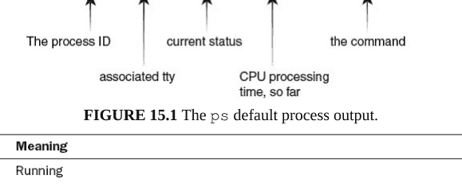

## FIGURE 15.1 ps 默认进程输出。

| Value | 含义 |
| --- | --- |
| R | 运行中 |
| S | 睡眠（20 秒或更少） |
| I | 空闲（睡眠超过 20 秒） |
| T | 已停止 |
| Z | 僵尸进程 |

## TABLE 15.2 可能的进程状态值

还存在其他进程状态，但对于大多数用户来说很少出现。僵尸进程是指已结束但未释放其资源的进程。通常，系统需要一两秒钟才能完全回收程序使用的所有内存。有时，僵尸会因某种原因卡在进程表中。Unix 人称之为卡住的进程，这种进程有一个令人讨厌的习惯，会一直存在直到系统重新启动。有时这些僵尸进程在进程列表中会列为 `<defunct>`。任何以 `sleep` 命令为前缀的进程都被标记为睡眠中。

### 4. 添加一些标志可以显著改变 ps 的输出：

```
$ ps -x

  PID TT STAT TIME COMMAND

 4352 Ah T 0:00 vi dickens.note

 6171 Ah R 0:02 awk - : {print $1""

 6172 Ah R 0:01 awk - , {print $1}

 6173 Ah S 0:01 -k { if (NF > 2) print $0 } (awk)

 6174 Ah S 0:00 sort

 6177 Ah R 0:00 ps -x

19189 Ah S 0:06 -bash (bash)

19649 Ah I 0:02 newmail

$
```

这里出现了两个新进程：`-bash`（shell），终于，我的登录 shell；以及 `newmail`，一个程序，它在后台自动启动时我

登录系统（它位于我的 `.login` 的末尾）。

## 注意

Shell 进程以一个前导短横线显示，表示它是一个登录 shell。我运行的其他 `bash` 副本不会有这个前导短横线。这是 shell 知道不必在每次运行时都读取 `.login` 文件的一种方式。

### 5. 为了查看更多正在发生的事情，我再添加一个标志 `-f`，以在屏幕上展开输出：

```
$ ps -xf

USER       PID %CPU %MEM    SZ   RSS TT  STAT ENG   TIME COMMAND

taylor    7011 10.4  0.2  184   100 Ah R       6   0:02 awk - : {print $1""

 taylor    7012  6.3  0.1  160    92 Ah S           0:01 awk - , {print $1}

taylor    7013  5.9  0.1  160    92 Ah R       3   0:01 -k { if (NF > 2)

print

taylor   19189  1.1  0.2  256   148 Ah S           0:07 -bash (bash)

taylor    7014  1.0  0.1  316    64 Ah S           0:00 sort

taylor    7022  0.1  0.2  180   116 Ah R       0   0:00 ps -xu

taylor    4352  0.0  0.3  452   168 Ah T           0:00 vi dickens.note

taylor   19649  0.0  0.1  124    60 Ah I           0:02 newmail

$
```

## 图 15.2 ps 的 -f 面向用户的输出。

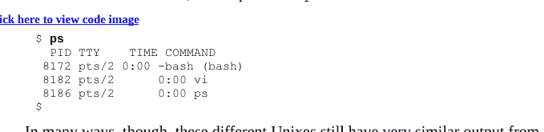

### 6. 在 Solaris 工作站上，`ps` 命令的输出略有不同：

```
$ ps

  PID TTY      TIME COMMAND

 8172 pts/2   0:00 -bash (bash)

 8182 pts/2   0:00 vi

 8186 pts/2   0:00 ps

$
```

不过，在许多方面，这些不同的 Unix 系统在 `ps` 命令的输出上仍然非常相似。例如，考虑一下 Mac OS X 中 `ps -ef` 的输出与我之前展示的 Solaris 系统上的 `ps -xu` 输出：

```
$ ps -ef | head -4

UID       PID  PPID  C STIME TTY          TIME CMD

0         1     0  0 Thu11AM ??       2:49.85 /sbin/launchd

0        19     1  0 Thu11AM ??       0:21.14 /usr/libexec/UserEventAgent (System)

0        20     1  0 Thu11AM ??       0:49.64 /usr/sbin/syslogd

$
```

Unix 通过进程来工作。你的登录 shell、你运行的编辑会话，甚至列出你文件的 `ls` 程序，都是操作系统中的进程。这意味着你可以操作进程。你可以临时停止程序去做其他事情，按自己的选择重新启动它们，甚至可以随时查看你正在运行的所有程序，包括那些本来隐藏的进程，例如你的登录 shell 本身。

## 任务 15.4：使用 kill 终止进程

现在你已经知道如何创建多个进程、将其中一些放入后台，以及查找游离进程，你还需要一种方法来根据需要永久停止它们。在 Unix 中，完成这一任务的命令是 `kill`。大多数情况下，使用 `kill` 时，你需要指定要终止的程序的进程 ID 号。C shell 和 Korn shell 都有一个你已经见过的便捷简写：百分号-作业号表示法。

`kill` 命令可以向进程发送多种信号。要指定作业控制操作，你需要指定 `kill` 所使用的信号。表 15.3 列出了与 `kill` 一起使用的最常见信号。

| 编号 | 名称 | 含义 |
|---|---|---|
| 1 | SIGHUP | 挂断 |
| 2 | SIGINT | 中断 |
| 9 | SIGKILL | 杀死（无法被捕获或忽略） |
| 15 | SIGTERM | 由 kill 发送的软件终止信号 |

## 表 15.3 可与 kill 一起使用的一些信号

Unix 已知有超过 30 种信号，但表 15.3 列出的是最有用的那些。`SIGHUP` 信号会在你即将挂断（注销系统）之前发送给你正在运行的每个进程。`SIGINT` 是当你按下 `^C` 时发送的信号；许多程序在收到该信号时会以特定方式响应，通常是取消当前操作。`SIGKILL` 是 Unix 信号中的“终结者”：程序无法忽略它，也无法在接受它时做任何特殊处理。进程会立即被终止，甚至没有机会进行自我清理。`SIGTERM` 是更优雅的选择：它请求立即终止程序，但允许程序删除它可能已创建的临时文件。

信号可用。

## 注意

使用 `kill` 命令时要谨慎。它可能会让你陷入很多麻烦。例如，你想突然注销吗？要做到这一点，找到你的登录 shell 的进程 ID 并终止它。学习使用 `kill`，但要谨慎使用。

1. 使用 `kill` 命令的最简单方法是从 shell 中使用。首先，我在后台启动一个作业：

```
$ vi &
[1] 6016

$
```

我现在可以通过使用 `kill %1` 或 `kill 6016` 来终止此进程（顺便说一下，如果未指定信号，`kill` 会发送 `SIGTERM` 信号），但如果我尝试同时使用两者，第二条命令会失败，因为第一条命令已经终止了进程：

Click here to view code image

```
$ kill %1
$ kill 6016
6016: No such process
[1] Done vi

$
```

就像我把一个进程放到后台，而它因为需要产生输出而立即停止一样，`kill` 进程也没有反馈，并且需要一两秒钟才能发生。在此期间，我输入了第二个 `kill` 命令，然后输出了错误信息 `No such process`。随后，我从 shell 获得了作业已结束的提示。

2. 使用 `ps` 命令，我可以找到那个总是在后台运行的讨厌的 `newmail` 程序：

Click here to view code image

```
$ ps -ef | grep newmail

taylor  6899  0.1  0.1   52  28 Av S      0:00 grep newmail
```


taylor  25817  0.0  0.1  124  60 Av I      0:01 newmail

$

```
我想向该进程发送一个挂断信号（SIGHUP），我可以用 `kill -1`（信号编号）或 `kill -HUP`（基本信号名称）中的任何一个来做到这一点：
```

```
$ kill -HUP 25817
```

```
$ !ps
```

`ps -ef | grep newmail`

taylor  7220  0.0  0.1   52  28 Av S      0:00 grep newmail

$

```
由于 `newmail` 程序不在此输出中，我可以得出结论，SIGHUP 信号停止了 newmail。

## 注

由于 `kill` 会告诉你是否找不到进程，因此在 Unix 中典型的解决方案是输入 `!!` 立即重复 `kill` 命令第二次。如果 `kill` 成功，你会看到 `No such process`。

## 3. 有些进程很顽固，可以抵抗较弱的信号 SIGTERM 和 SIGHUP

在 Unix 中，这被称为“捕获”信号。在某些进程中，你需要发送和捕获信号来执行某些操作。这时你需要使用我所说的“大炮”，即 `SIGKILL`。你有时会看到它被称为 terminate-with-extreme-prejudice 命令；格式为 `kill -9 processID`，而且很危险！

我强烈建议你让 `kill` 发送 `SIGTERM` 信号，看看是否能解决问题。如果不行，尝试 `SIGHUP`，如果仍然失败，最后再使用 `SIGKILL`。

## 4. 如果你尝试对不属于你的作业使用 kill 会怎样

幸运的是，它不起作用：

```
$ ps -ef | head -5
USER       PID  %CPU %MEM    SZ   RSS TT  STAT ENG   TIME COMMAND
news      7460  97.7  0.4   336   252 ?  R N    4  4:33 sort -u
/tmp/nnsubj6735a
phaedrus  8693 18.1  1.1  1260   720 rm S
root      8741 14.4  0.4   416   252 ?  R     9  0:03 nntpd
root      8696 13.9  0.4   416   252 ?  S        0:03 nntpd
Broken pipe
$ kill 7460
7460: Not owner
$
```

## 5. 最后，如果你忘记了并在后台留下停止的作业，然后尝试注销，这里会发生什么

```
$ logout
There are stopped jobs.
$
```

你必须使用 `fg` 将每个作业带到前台并正常终止每个作业，或者使用 `kill` 终止每个作业，然后再注销。

在本任务中，你已经了解了 `kill` 命令及其相关的一些信号。

## 总结

虽然文件是 Unix 文件系统的底层单元，包括所有目录，但 Unix 最基本的组成部分是进程。在本小时中，你学习了如何拥有后台进程，如何停止和重启进程，以及如何使用 `kill` 退出任何错误的程序——无论其是否正在运行。

## 练习

练习总结了你所学到的关键术语，并提出了一些关于本课主题的问题。它还为你提供了下一小时将学习内容的预览。

### 关键术语

`control number` 这是 C shell 为每个后台作业分配的唯一编号，以便于引用并用于其他命令，例如 `fg` 和 `kill`。

`current job` 当前作业是当前在终端和键盘上运行的作业——即你实际运行并正在使用的程序。

`errant process` 异常进程是指未执行你期望它执行的任务的进程。

`foreground job` 前台作业是当前作业的同义词。

`job` 作业是进程的同义词。

`kill` 终止进程意味着结束该进程。

`login shell` 登录 shell 是你在登录系统时启动的进程。这通常是你登录到 Unix 时正在工作的环境。

`process` 进程是 Unix 操作系统内停止或运行的程序。也称为作业。

`signals` 信号是可以发送给停止或运行中的进程的特殊消息。

`stop a job` 停止作业意味着停止正在运行的程序而不终止它。

`wedged process` 卡住的进程是指停留在内存中并且即使已停止运行也无法释放其资源。这种情况很少见但很烦人。

`zombie` 僵尸是一个已终止但未被父进程清理的进程。

### 练习题

- 1. 启动一个程序，例如 `vi`，并使用 `^z` 停止它。现在使用 `kill` 终止该进程。
- 2. 再次启动 `vi`，停止它并将其放入后台。处理其他事情然后将 `vi` 恢复到前台。
- 3. 使用 `ps` 检查进程的状态，查看你有哪些正在运行但未在 `jobs` 中显示的进程？为什么 `ps` 和 `jobs` 列出的进程可能不同？

# 接下来一小时预览

接下来的一小时将聚焦于 shell 脚本编程的基础知识，这一主题不仅对我来说非常重要，而且你也会很高兴学习它。敬请期待！

## 第16小时 Shell 编程概述

### 本小时目标

在这一小时中，你将学习

- 关于 shell 变量
- 关于 shell 算术
- 关于比较函数
- 如何使用条件表达式
- 关于循环表达式
- 如何使用 bash 函数

在之前几个小时中，你已经了解到使用命令行 shell 时可供选择的众多选项中的一部分。使用这些 shell 可以让你输入 Unix 命令。大多数刚开始使用 Unix 的人并没有意识到，这些 shell 同时也是编程环境，你可以用非常少的努力编写自己的 shell 程序。而且，哦，是的，这真的很有趣！

由于 shell 实际上只是逐行解释的语言，你在命令行中使用的任何命令序列也可以放入一个文件中并重复运行。这就是 shell 程序。最初，Unix 专家们为 Bourne shell（`/bin/sh`）编写 shell 脚本，因为该 shell 在每个 Unix 平台上都是标准的；但是 `bash` shell 的额外灵活性和功能使其成为最受欢迎的替代选择，这也是我在这一小时中使用的 shell。

### 注意

我强烈建议你探索你系统中可用的 shell，正如第13小时“命令行 shell 入门”所讨论的那样。最好的 shell 是那个能让你最高效的 shell。请记住，你用于编写脚本的 shell 不必与交互式命令所用的 shell 相同。

### 构建你自己的命令

Unix 功能非常强大，包含超过 1000 个不同的命令，但令人惊讶的是，有时这还不够。当你需要创建自己独有的命令时，一个简单的 shell 脚本几乎总是能够满足需求。

## 任务16.1：Shell 变量

编程语言通常包含变量，shell 自然也包含。变量只是标识符，用来标识在程序使用过程中可以改变的值。在 shell 中，这些变量可以取一个值，并且总是被解释为字符串（即字母数字或标点字符的序列）。即使是数值，对 shell 来说也是字符串。

你可以使用任何字符串处理命令（如 `sed` 或 `cut`）来改变 shell 变量。

```
$ color=blue
```

这会将变量 `color` 设置为字符串 `blue`。你可以使用 `echo` 命令输出任何变量的值：

```
$ echo $color
```

`blue`

这也说明了如何引用 shell 变量：变量前必须加上美元符号（`$`），并通过其助记名称来引用。然而，这可能导致一些问题，因为如果你想在其它文本中嵌入使用该变量，该怎么办？

```
$ leaning='anti-'
```

```
$ echo Joe is basically $leaningtaxes
```

这里的输出只是 “Joe is basically”。shell 无法识别看起来像新变量 `$leaningtaxes` 的内容。由于没有为 `$leaningtaxes` 赋值，输出为 NULL（空字符串）。要解决这个问题，请将变量名用花括号括起来：

```
$ echo Joe is basically ${leaning}taxes
```

`Joe is basically anti-taxes`

如果 `leaning` 未定义，输出可能就没有意义了。它会变成 “Joe is basically taxes”。幸运的是，shell 提供了一种在变量未定义时设置默认值的方法。

```
$ echo Joe is basically ${leaning:-pro }taxes
```

`Joe is basically pro taxes`

```
$ echo Joe is basically ${leaning:=pro }taxes
```

```
$ echo Joe is basically ${leaning:=pro }taxes and ${leaning}spending.
Joe is basically pro taxes and pro spending.
```


变量第一次出现时它尚未定义，因此 shell 会将 “pro ”（pro 后跟一个空格）赋给 `$leaning` 并输出该值。第二次解释该变量时，它的值已经是 “pro ”。

变量通常在脚本中赋值，但也可以使用 `read` 命令以交互方式赋值。该命令将单个单词分配给指定变量，如果输入的单词多于列出的变量，则列表中的最后一个变量会获得剩余的所有单词：

```
$ read city state message

CapeMay, New Jersey Hi Mom!

$ echo $city is city

CapeMay, is city

$ echo $state is state

New is state

$ echo $message is message

Jersey Hi Mom! is message
```

如你所见，只有 New 被分配给了 `state`。真让人沮丧！

解决这个问题的最佳方法是使用反斜杠转义空格（确保该空格不会被解释为分隔变量值）：

```
$ read city state message

CapeMay, New\ Jersey Hi Mom!

$ echo $city is city

CapeMay, is city

$ echo $state is state

New Jersey is state

$ echo $message is message

Hi Mom! is message
```

一开始这可能有点棘手。

第三种常见的变量赋值方式是使用命令行参数。shell 有内置变量来访问命令行。如果你编写了一个用于复制文件的脚本并将其命名为 `copy-files`，你可能会想在命令行上列出所有文件：

```
$ copy-files.sh file1 file2 file3
```

该程序将通过 `$1`、`$2` 和 `$3` 来访问这些参数：

```
cp $1 destination
cp $2 destination
cp $3 destination
```

`$0` 变量是一种用于查看命令名的特殊情况，`$*` 会列出所有命令行变量。

任何 shell 程序中的标准数据都是变量。这类变量可以通过多种方式赋值：直接赋值、从用户输入读取，或从 command line. The shell also provides means to provide some helpful manipulation of variables.

## Task 16.2: Shell Arithmetic

虽然 shell 将变量值视为字符串，但可以对 shell 变量执行基本数学运算的方法是可用的。

1. 如果一个变量被赋予数值，你可以使用 `expr` 命令对其值进行算术运算。该命令接受多个参数来执行算术函数。你可以直接在命令行上测试它：

```
$ expr 1 + 1
2
```

参数必须用空格分隔——并且必须存在——`expr` 命令才能工作。如果一个变量未定义或未被赋予值（有时称为零长度），结果就是语法错误。这就是 `:-` 记法特别有用的地方：

```
$ echo $noval
$ expr $noval + 1
expr: syntax error
$ expr ${noval:-0} + 1
1
```

`expr` 还支持减法、乘法、整数除法和余数。它们在这里举例说明：

```
$ expr 11 - 5
6
$ expr 11 \* 5
55
$ expr 11 / 5
2
$ expr 11 % 5
1
```

请注意我必须用反斜杠转义星号，并且数字和运算符之间也要使用空格。如果我不这样做，shell 会将其扩展为当前目录中的文件列表，而 `expr` 程序则无法理解。

2. 尽管我刚刚向你展示了这一点，但我要告诉你，我从不直接使用 `expr`，因为所有现代 shell 都有一种速记符号，你可以使用它，比调用 `expr` 更快、更优雅：`$((` 和 `))`。例如：

```
$(( 11 * 3 ))
```

在功能上与 `expr 11 * 3` 完全相同。由于它更快，我将从现在开始对简单的单操作数学使用这种记法（它不支持更复杂的内容），但如果你的系统不支持它，请改用 `expr` 调用。如果你愿意，你也可以使用 `$( expr 1 + 1 )` 或类似方式，这样几乎是一样的！

3. `expr` 命令也可以处理复杂的算术运算，因此如果你需要比基本四则运算更复杂的计算，你最终还是需要使用 `expr`。你可以写一个表达式来加两个数然后乘以第三个数。通常，你不必担心运算符优先级，但 `expr` 并没有那么复杂：

```
$ expr 11 + 5 \* 6
41
```

相反，你需要在括号中对操作进行分组：

```
$ expr \( 11 + 5 \) \* 6
96
```

该命令首先将 11 和 5 相加，然后将结果乘以 6。因为括号是重要的 shell 字符，所以你需要用反斜杠转义它们，就像我之前对星号所做的那样。当然，你也可以引用整个序列：`expr "( 11 + 5 ) * 6"`。

`expr` 命令是在任何 shell 中执行算术运算的非常有用的命令。字符串必须是数字，否则会发生错误；`expr` 命令的结果可以分配给其他变量。

### Note

`expr` 命令比这里描述的强大得多；它包括执行逻辑运算和对字符串执行运算的能力。还不够强大以满足你的需求吗？请查看 `bc` 命令。它功能强大得多，但在脚本中使用起来也更棘手。如需更多信息，请查看这两个命令的手册页。

## Task 16.3: Comparison Functions

在编写程序时，你可能希望所采取的操作取决于某些值。一个简单的例子是 `rm -i` 命令，其中 `-i` 标志告诉 `rm` 在删除文件前提示你。输入 y，文件将被删除。输入 n，它将保留。shell 也有类似的选项。本任务和下一个任务介绍如何使用这些选项。

正如 `expr` 是求解算术表达式的强大程序，`test` 命令可用于比较变量和条件。`test` 可以对字符串和数值进行比较。`test` 在条件为真时始终返回零，在条件为假时返回非零。这是 Unix shell 使用这些值作为真和假的标准。

`test` 用于三种类型的操作：数值比较、字符串比较以及文件系统的状态测试。首先，让我们来看数值比较。

1. 因为 shell 将小于号和大于号视为重定向字符，所以它们不能在 `test` 命令中用于比较两个数字。相反，`test` 使用一系列双字母标志，如表 16.1 所描述。这些标志始终放在两个参数之间：

```
test 3 -eq 4
```

这个示例会返回非零值，因为 3 和 4 不相等。

| 比较标志 | 含义 |
|---|---|
| `-eq` | 如果数字相等则为真 |
| `-ne` | 如果数字不相等则为真 |
| `-lt` | 如果第一个数字小于第二个数字则为真 |
| `-le` | 如果第一个数字小于或等于第二个数字则为真 |
| `-gt` | 如果第一个数字大于第二个数字则为真 |
| `-ge` | 如果第一个数字大于或等于第二个数字则为真 |

## 表 16.1 测试运算符

2. 你可以在 `test` 中使用 `expr` 的结果，或任何返回数值结果的其他命令。`test` 中还有一个特殊表达式 `-l string`，它返回字符串的长度。因此在设置了一些有用的变量后，你可以写出以下测试：

```
value=3 ; string="my horse Horace"
test $value < $(echo $string | wc -c)
test `wc -l filename` -ge 10000
```

第一个测试判断 `$value` 是否与 `$string` 的长度相同。第二个比较变量 `string` 中的字符数与数值 `value`。第三个示例统计文件中行数，如果文件中有 10,000 行或更多，则求值为真。

3. 第二种比较是对字符串的比较。前两种是单目运算符，这意味着每个运算符仅适用于一个变量或参数：

```
test -z "$String"
test -n "$String"
```

第一个测试在字符串长度为零或未定义时为真。第二个在字符串有内容时为真。

4. 接下来的两个测试比较字符串彼此。简单的感叹号和等号（在 Unix 中通常用于表示“非！”）用于这些比较：

```
test alphabet = Alphabet
test alphabet != Alphabet
```

第一个为假；第二个为真。

6. 文件系统也有三个二元比较。`-ef` 测试确定两个文件是否相同。 （当你创建文件之间的链接时，这在事实上为真。）`-nt` 标志在第一个文件比第二个新时为真，而 `-ot` 标志在第一个文件比第二个旧时为真。你可能会在循环语句中看到如下测试：

```
test file1 -ot file2
```

此测试比较两个文件，如果 `file1` 比 `file2` 旧，则为真。

7. `test` 命令可以用感叹号否定，或用 `-a` 表示 and 和 `-o` 表示 or 进行组合。你可以创建任意长的条件，以牺牲脚本可读性为代价：

```
test $var -eq 0 -a ! -e file
```


这会检查 `$var` 的值是否为零并且文件不存在（注意表达式中 `!` 的使用）。

8. `test` 还有第二种形式。不显式调用 `test`，而是可以用方括号包围条件表达式：

```
[ -f file ]
```

这样做使 shell 程序更易读。事实上，你很少会看到 `test` 显式出现，如前所示。

还要注意空格：如果不使用此处所示的空格，特别是方括号与表达式元素之间的空格，shell 会报错。

`test` 命令是 shell 编程中最常用的命令之一。它对于理解接下来的两个 shell 脚本编程任务——条件表达式和循环——至关重要。

## 任务 16.4：条件表达式

有时，在编写程序时，你只想在满足特定条件表达式时执行某个操作。Shell 编程通过 `if` 命令、`case` 命令和两个特殊的命令分隔符为你提供了这种能力。

### 1. `if` 命令

`if` 命令是最常见的条件命令。它的形式如下：

```
if
  conditional-expression
then
  command-block
fi
```

命令块是一条或多条 shell 命令的序列。第一个命令块，即条件表达式，总是被执行。最后执行的语句的返回值用于确定是否执行第二个块。条件表达式最常用的序列是 `test` 命令 in its `[ ]` notation:

```
if
  [ -f $file ]
then
  echo $file is a regular file
fi
```

This `if` statement notifies the user that a file is a regular file. If the file is not a regular file (such as a directory), the condition fails and the shell doesn’t execute the `echo`, with the result that you don’t see an output message.

### 2. `else` 分支

Sometimes, you might want output regardless of the situation. In the preceding case, you might be interested in the status of the file even if it is not a regular file. You can expand the `if` command with the `else` keyword to provide that second option:

```
if
  [ -f $file ]
then
  echo $file is a regular file
else
  echo $file is not a regular file
fi
```

This statement provides output regardless of the status of the file.

### 3. `&&` 与 `||` 简写

For these simple tests and output, the shell provides a second, quicker means of executing the `if` statement. If the two commands are joined by `&&`, the second command is executed if the first command is evaluated as true. If the commands are joined by `||`, the second command is executed if the first is false. The preceding command would, therefore, look like this:

```
[ -f $file ] && echo $file is a regular file
[ -f $file ] || echo $file is not a regular file
```

```
then
    echo $file is a directory
else
    echo $file is not a regular file or a directory.
fi
```

This command first tests to see whether the file is a regular file; if it is not, it checks to see whether it is a directory; if it is neither, it gives the generic “not a regular file or directory” message. You can expand any `if` statement with an unlimited number of `elif` branches.

One nice thing is that you can indent your code to make things easier to understand, and you can also compress the statements themselves with the use of the semicolon, so the preceding listing could be more compactly written as:

```
if [ -f $file ] ; then
    echo $file is a regular file
elif [ -d $file ] ; then
    echo $file is a directory
else
    echo $file is not a regular file or a directory
fi
```

Note that the `then` should appear on a second line, so the semicolon after the expression is necessary. (Many shell programmers leave the `then` on its own line, even though it’s not quite as space efficient.)

## 5. `case` 命令

At some point, `if-then-else` code can become confusing. When you have many possible branches, you should use the `case` command. The syntax is a bit more complicated than the syntax for `if`:

```
case string in
pattern) command-block ;;
pattern) command-block ;;
...
esac
```

If you were looking for possible values for a variable, you could use `case`:

```
echo What do you want:
read var remainder
case $var in
house)   echo The price must be very high;;
car)     echo The price must be high;;
popsicle) echo The price must be low;;
*)       echo I do not know the price;;
esac
```

This `case` statement follows an input request and gives the user a rough idea of the price. A case list can contain any number of items. Note the special `;;` notation, which denotes the end of a case statement.

Here’s another example, a mini file command:

```
case $filename in


```
+   * .gif) echo Graphics Interchange Format ;;
+   * .jpg) echo Joint Photographic Experts Group ;;
+   * .png) echo Progressive Networking Group ;;
+   * .tif) echo Tagged Interchange Format ;;
+   * .scx) echo Screen Capture format ;;
+   * ) echo unknown format ${filename#*.}
```

In both of the previous examples, the pattern-matching algorithms used are for wildcards. Also note the `bash` variable trick to extract the filename suffix in the last conditional with the `#*.` modifier to the `filename` variable reference. To extract the other side (just the filename without the suffix), you could use:
`${filename%.*}`

## 6. Here's a simple shell script where the `read` command and `if` statements are useful together

```
echo "Delete which file? "

read filename

if [ ! -f $filename ] ; then

  echo Can't delete $filename since it doesn't exist

else

  echo Deleting file $filename

  /bin/rm $filename

fi
```

This prompts for the filename and then tests to see whether the file exists before it tries to delete it with the `/bin/rm` invocation.

There are two basic conditional expressions, as well as a third shortcut, as explored in this task. You can test a condition and perform alternative actions by using `if` statements and their shortcuts. Or you can compare strings and perform any number of actions by using the `case` statement.

## Task 16.5 Looping Expressions

If you want to run the same set of commands many times, instead of duplicating them in your script, you are better off using looping commands. There are two types of loops:

A determinate loop is one where you know exactly how many times you want to execute the commands before you enter the loop. Stepping through a list of files is a good example; you might not know the exact number of files when you're writing the script, but once invoked, you can start the loop for those files.

An indeterminate loop is one where you need to keep executing a command block until a condition is no longer true. You might be either waiting for something or performing a series of modifications to reach a goal.

```
for var in list

do

  # commands

  # ...

done
```

```
command-block
done
```

你可以构建任何你喜欢的列表。它可以是一串数字，也可以是命令的输出。前面我提到过遍历文件列表。这通过下面的循环得以演示：

```
for var in `ls`

do

    if

        [ -f $var ]

    then

        echo $var is a regular file

    fi

done
```

这会遍历 `ls` 输出中列出的所有文件，只显示普通文件。请注意，如果没有反引号，脚本将测试当前目录中名为 `ls` 的文件。这是一个完全不同的请求！

对前面代码的一个修改是，因为你在一个 shell 脚本中，可以使用 shell 展开来更高效地完成某些任务。例如，不使用 `ls`，而是考虑以下内容？

```
for var in * ; do

    if [ -f $var ] ; then

        echo $var is a regular file

    fi

done
```

你也可以再次在这个例子中看到，通过重新格式化脚本可以使其可读性大大提高。

## 2. 在 shell 程序中可以执行的一个不错的技巧是遍历命令行参数列表。`for` 循环提供了一个简洁的机制：如果从命令中省略 `in` 列表部分，`for` 循环将遍历命令行参数列表：

```
j=0

for i

do

    j=$(($sj + 1))

    echo $i is argument $j

done
```

这段代码会遍历命令行参数并标识它们在参数顺序中的位置。

在这两种情况下，进入 `for` 循环时，你就知道需要运行循环多少次。但是，如果你查看等待某事发生的情况，则需要使用不同的循环。`while` 循环是解决此问题的方案。

### Note

在脚本中遍历参数的另一种方法是使用 shell 的 `shift` 命令。我们将在下一小时看到这一点。

## 3. 在 Task 16.3 中，我提到过你可能想要等待文件到达的情况。这呼应了我最近遇到的一个真实情况。我们正在处理一个程序日志文件，但不知道它何时会放置在共享服务器目录中。我们尝试设置作业在文件到达后运行，但这种方法仍然遇到问题。

我们通过使用 `while` 循环解决了这个问题。在脚本执行结束时，我们创建了一个检查点文件。在开始时，如果检查点文件比日志文件更新，我们就会等待。从编程角度来看，就是：

```
while

  [ checkpoint -nt logfile ]

do

  sleep 60

done
```

此程序会在检查之间等待一分钟。如果新的日志文件尚未写入，程序将再次休眠 60 秒并重试。

## 4. `while` 循环也可以以确定性方式使用。在你不关心变量值但知道要运行命令块的次数的情况下，可以使用计数器递增次数：

```
i=0

while

  [ $i -lt 100 ]

do

  i=$(( $i + 1 ))

  commands

done
```

这肯定比在列表中枚举 100 个项目容易得多！

shell 提供了两种方便的机制来重复运行一组命令。这些循环命令在命令行和程序中都很有用。

## Task 16.6: `bash` Functions

本课所涵盖的大部分内容我将其归类为流程控制：指定在什么条件下执行什么命令。使用 `bash` 作为程序化 shell 的有趣之处在于，你实际上可以创建自己的函数并在脚本中反复使用，就像在更正式的编程环境中一样。

函数最大的价值在于它们赋予你指定和访问参数的能力。

让我们先试试水，看看它们如何能显著帮助你开发强大的 shell 脚本！

1. 函数定义如下：

```
function functionname

{

    shell commands

}
```

从某种意义上说，所有命令别名，如书中前面所讨论的，实际上都是简单的函数。这里有一个例子：

```
$ alias ls

alias ls='ls -F'
```

这可以重写为函数

```
function ls
```


它将以几乎完全相同的方式工作。最大的区别是，使用这种写法，无法为 `ls` 命令指定任何其他参数。

### 2. 要添加参数，只需在 `-F` 标志后添加 `$*`：

```
function ls {
    /bin/ls -F $*
}
```

现在像 `ls /tmp` 这样的命令将按预期工作！

### 3. 当然，使用函数而不是别名的真正价值在于，你可以显著提高新脚本的复杂程度。

作为一个例子，我想有一个命令，它扩展了之前根据文件名后缀指示文件类型的片段。在新版本中，如果图形可以在 Web 浏览器中查看（即它是 GIF 或 JPG 图像），我希望实际输出一些 HTML 片段。新版本还将为找到的 HTML 文件提供可点击的链接，并允许用户在浏览系统时点击进入目录。

### Tip

每个 shell 脚本的第一行都是特殊的，指定应使用什么程序或 shell 来解释文件中的命令。它以 `# !` 表示，发音为“she-bang”，原因不明！

这是我在不使用函数的情况下对该问题的第一次尝试：

```
#!/usr/local/bin/bash

# A Web-friendly directory browser that knows
# how to show graphic images:
directory=$(QUERY_STRING:-$HOME)
```

`iamcalled="browse.cgi"`
`webroot="/web"`

`echo "Content-type: text/html"`
`echo ""`

`echo "<h2>Directory $directory</h2><ul>"`

`cd $webroot/$directory`

```
for filename in *
do
  case $filename in
    *.gif ) echo "<li>"
            echo "<br /><tt>$filename</tt></li>" ;;
    *.jpg ) echo "<li>"
            echo "<br /><tt>$filename</tt></li>" ;;
    *.htm ) echo "<li><a href=$filename>$filename</a></li>" ;;
    *.html ) echo "<li><a href=$filename>$filename</a></li>" ;;
    *)      if [ -d $filename ] ; then
              echo "<li><tt><a"
              echo "href=$iamcalled?$directory/$filename>"
              echo "[$filename]</a></tt></li>"
            else
              echo "<li><tt>$filename</tt></li>"
            fi
            ;;
  esac
done
```

`echo "</ul>"`

`exit 0`

这段脚本运行良好，但其中存在大量重复的单行代码，因此非常适合使用函数来重构。我首先定义的函数是 `showname`：

```
function showname
{
  echo "<tt><b>$1</b></tt></li>"
}
```

这已经足够简单了，现在该语句只有一个位置，而不是三个，使得维护和扩展脚本变得更容易。

### 4. 再做一个改进：`case` 条件可以包含多个用 `|` 或 记号分隔的表达式，这可以让代码变得更简洁：

```
#!/usr/local/bin/bash

# A Web-friendly directory browser that knows
# how to show graphic images:
directory=${QUERY_STRING:-$HOME}

iamcalled="browse.cgi"

webroot="/web"

function showname
{
  echo "<tt><b>$1</b></tt></li>"
}
```

`echo "Content-type: text/html"`
`echo ""`

`echo "<h2>Directory $directory</h2><ul>"`

`cd $webroot/$directory`

```
for filename in *
do
  case $filename in
    *.gif|*.jpg )
      echo "<li><br />"
      showname $filename
      ;;
    *.htm|*.html )
      echo "<li><a href=$filename>$filename</a></li>" ;;
    *)  if [ -d $filename ] ; then
          echo \
            "<li><tt><a href=$iamcalled?$directory/$filename>"
          echo "[$filename]</a></tt></li>"
        else
          echo "<li>"
          showname $filename
        fi
        ;;
  esac
done
```

`echo "</ul>"`

`exit 0`

### 5. 当然，整个条件判断等都可以放入函数中，使代码更干净。事实上，主程序现在只有以下内容：

```
echo "Content-type: text/html"
echo ""
echo "<h2>Directory $directory</h2><ul>"
showdirectory $directory
echo "</ul>"
```

所有复杂的 `case` 语句条件都被整齐地收纳到 `showdirectory` 函数中：

```
function showdirectory
{
  if [ ! -d $webroot/$1 ] ; then
    echo "Error: no directory $1 found"
    exit 0
  fi

  cd $webroot/$1

  for filename in *
  do
    case $filename in
      *.gif|*.jpg )
        echo "<li><br />"
        showname $filename
        ;;
      *.html|*.htm )
        echo "<li><a href=$filename>$filename</a></li>" ;;
      *)
        if [ -d $filename ] ; then
          echo \
          "<li><tt><a href=$iamcalled?$directory/$filename>"
          echo "[$filename]</a></tt></li>"
        else
          echo "<li>"
          showname $filename
        fi
        ;;
    esac
  done
}
```


现在很容易在函数中添加错误检查，例如在执行 `cd` 命令前先用 `-d` 测试是否为目录。

函数可以非常复杂，但即使是简单的函数也能帮助你更好地利用 shell 交互。

## Summary

在本小时中，你刚刚浏览了 shell 编程的基础知识。你了解了 shell 的控制结构以及两个重要命令。你可以学习更多关于 shell 编程的知识；我的畅销书《*Wicked Cool Shell Scripts*》 （No Starch Press, 2015）就是一个可以深入研究该主题的地方。

## Workshop

练习总结了你所学到的关键术语，并就本课介绍的主题提出了一些问题。它还为你提供了下一小时将要学习内容的预览。

## Key Terms

- `command block` 可以将一个或多个 shell 命令分组在条件或循环语句中，称为命令块。
- `conditional expression` 这是一个返回 true 或 false 的表达式。
- `determinate loop` 在这种类型的循环中，循环运行的次数在循环开始前就已知。
- `expression` 这是一个返回值的命令。
- `indeterminate loop` 在这种类型的循环中，循环运行的次数在循环开始前未知。
- `loop` 这是一系列命令，只要条件为真就会重复执行。

`variables` 这些是用于标记在程序执行过程中可能发生变化的数据的名称。

`zero-length variable` 一个未分配值的变量。

## 练习

- 1. 你如何在 shell 程序中读取街道地址？如何读取姓名？
- 2. 如果你读取了读报纸的人数和订阅某份报纸的人数，你将如何确定订阅者与读者之比？
- 3. 你如何知道一个文件是否有数据？
- 4. 你如何等待数据被放入文件中？

## 下一小时的预览

我必须承认，我真的很喜欢 shell 脚本编程。在下一小时，我将带你参观四个简单的 shell 脚本，这些脚本希望能激发你尝试这种轻量级编程环境的兴趣。不要错过！

## 第 17 小时. 高级 Shell 编程

## 本小时的目标

在本小时，你将学习

- ► 如何使用 `mylocate` 快速查找文件
- ► 如何使用 `cmdcnt` 统计系统上的命令数量
- ► 如何使用 `diskspace` 查找磁盘使用情况统计
- ► 如何使用 `hi-low` 游戏浪费时间

在前一小时，你学习了如何将一组 Unix 命令放入文件中并将其变成 shell 脚本。事实证明，shell 脚本可以非常强大，通常只需几行代码就能制作出复杂的迷你程序，使你在命令行上的时间更高效，甚至更有趣。本小时通过介绍四个 shell 脚本来扩展 shell 脚本主题，这些脚本应该能激发你对脚本编写的兴趣，并展示 Unix 如何让扩展和定制你的计算体验变得简单。

有许多不同的 shell 脚本可用于探索更复杂的脚本技术，但我认为最好的方法是研究几个小而写得好的脚本。你总可以通过类似这样的命令序列在自己的系统上找到 shell 脚本：

```
cd /usr/bin

file * | grep -i shell\ script
```

在最新的 Solaris 系统上，这会列出操作系统附带的 164 个不同的 shell 脚本。当你想了解更多关于 shell 脚本时，有很多东西可以研究！

### Note

本小时介绍的 shell 脚本受到了我所著书籍 *Wicked Cool Shell Scripts*（No Starch Press, 2015）中包含的脚本的启发。如果你发现自己真的对脚本编写感兴趣，请拿起那本书，它是我个人认为对本小时的绝佳后续读物！

### 使用 mylocate 搜索文件名数据库

许多版本的 Unix 和 Linux 都包含一个名为 `locate` 的出色应用程序，它维护着计算机上所有文件和目录名称的数据库，让你能够快速轻松地按名称在所有已知文件系统上搜索文件和程序。

然而，Locate 可能存在一个重大的安全缺陷，即它可能会以 root 身份运行并索引*系统上的所有内容*，而不是你

实际上有权限查看的文件和目录。

还有一些 Unix 系统根本没有 locate，而是让你不得不使用速度慢得多（尽管功能更强大）的 `find` 命令。

让我们绕过这两个问题，创建一个实际上是 shell 脚本的 locate 版本。令人惊讶的是，这很容易！

## 任务 17.1：构建 mylocate

`mylocate` 脚本分为两部分——两个不同的脚本。第一个构建你可访问的每个文件和目录的数据库，第二个利用 `grep` 命令允许轻松的命令行搜索该数据库。你几乎可以用一对 shell 别名来写它，但多一点的复杂性会很有用。

1. 使用 `find` 命令创建一个包含文件系统中你能看到的每一个文件和目录列表的文件。注意：构建此文件需要相当长的时间。以下是构建 `mylocate.db` 文件的简单脚本：

```
$ cat mkmylocatedb

#!/bin/sh

# mklocatedb - build the locate database using find. Must be root to run this

locatedb="$HOME/.locate.db"

find / -print > $locatedb

exit 0
```

记住，一旦你创建了它，以及任何其他 shell 脚本，你需要使用 `chmod +x filename` 来确保你的脚本可以直接执行。

当你运行此程序时，你会看到成千上万的权限错误从屏幕上流过，这无害但相当烦人。消除它们需要一点更多的 shell 技巧：

```
$ ./mkmylocatedb 2> /dev/null
```

> 只重定向 `stderr`（错误消息），确保发送到标准输出（即 `stdout`）的任何内容都会显示到屏幕上，同时隐藏所有警告和错误消息。输出文件 `/dev/null` 是一个“位桶”，一个数字的地面洞。你可以向 `/dev/null` 添加任意多的内容，它都会消失，而且该设备永远不会大于零字节。

经过一段时间（至少几分钟），脚本就会完成，第一半部分脚本就完成了。

2. 为了查看文件中添加了什么，让我们瞥一眼内部：

```
$ head -10 ~/.locate.db
```

```
+   /
+   /.nfs4
+   /var
+   /var/info
+   /var/inf/usr_share_info_dir.backlink
+   /var/info/usr_share_info_dir
+   /var/db
+   /var/db/ipf
+   /var/sadm
+   /var/sadm/pkg
```

该文件包含多少行？

```
$ wc -l ~/.locate.db

173251 /export/home/taylor/.locate.db
```

你的结果实际上可能还要大得多。

3. 数据库构建完成后，创建一个使用 `grep` 实现轻松搜索文件的脚本，同样很简单：

```
#!/bin/sh

# locate - search the locate database for the specified pattern

locatedb="$HOME/.locate.db"

if [ $# -eq 0 ] ; then

    echo "Usage: locate pattern"

    exit 0

fi

exec grep -i "$@" $locatedb
```

就是这么简单。条件语句会检查传给脚本的参数个数，以确保用户指定了模式；`$#` 就是参数个数本身。不过，最后一行需要稍作解释。Shell 脚本是在登录 shell 的副本中运行的。（嗯，严格来说，它们是在第一行指定的 shell 中运行的，因此才有特殊的 `#!` 表示法。）这意味着 shell 脚本会消耗内存、需要自己的进程等等。如果脚本调用某个程序，该程序也会单独运行，因此如果 shell 脚本调用 `grep`，就会有三个进程在运行：登录 shell、脚本的子 shell 和 `grep` 本身。

为简化一点，特殊的 `exec` 命令不是添加子进程，而是用指定的命令替换当前子 shell。基本上，它节省了一个进程，但 shell 脚本在遇到该 `exec` 后就会立即结束，因为运行它的 shell 已被指定的命令替换。

特殊符号 `$@` 会将传给脚本的所有参数一并转交给 `grep` 命令。

4. 解释得够多了。来运行几次我们的新脚本吧！首先，有多少个 C 源文件？第一次尝试可能会直接用 `.c` 作为模式，但那会是个错误。你之前应该还记得，`grep` 使用正则表达式，而 `.c` 会匹配任意字符后跟一个 c，并且出现在行中任意位置：

```
$ ./mylocate ".c" | wc -l

134933
```

第一个技巧是转义句点，这样它就不会被视为正则表达式标记。要做到这一点，只需在句点字符前加上反斜杠：

```
$ ./mylocate "\.c" | wc -l

3245
```


好多了！但它仍会匹配类似 `sample.css` 的文件，因为其中嵌入了 `.c` 模式。要强制模式只匹配行尾，请添加 `$` 正则表达式标记：

点击此处查看代码图片

```
$ ./mylocate "\.c$" | wc -l

144
```

这就说得通了！现在再确认一下它是否如你所想：

点击此处查看代码图片

```
$ ./mylocate "\.c$" | head -5

/usr/demo/net-snmp/demo_module_8/melLoadGroup.c
/usr/demo/net-snmp/demo_module_8/demo_module_8.c
/usr/demo/net-snmp/demo_module_2/demo_module_2.c
/usr/demo/net-snmp/demo_module_5/demo_module_5.c
/usr/demo/net-snmp/demo_module_1/demo_module_1.c
```

## 5. 要让这成为你整体环境的一部分，还有一步：把它添加到 `PATH` 中，这样你就可以直接输入命令名称而不必费周折。

最好的长期解决方案是在你的主目录中创建一个新的 `bin` 目录，然后将其用作你创建的新脚本和命令的仓库：

```
$ cd

$ mkdir bin
```

现在将你的脚本移入这个新目录，并将它们标记为可执行：

```
$ cd bin

$ chmod +x *
```

然后修改你的 `PATH`，让 shell 知道要在这个新目录中查找命令。这可以在命令行中完成。不过，如果你把它追加到 `.profile` 文件中，就会永久生效，而不是只持续到你注销：

点击此处查看代码图片

```
$ echo 'export PATH="$PATH:$HOME/bin"' >> ~/.profile
```

就是这样。现在你只需输入命令名称（也就是你的 shell 脚本的确切名称），它们就会像 `ls` 列出文件、`ssh` 安全连接到另一台 Unix 服务器那样被运行。

这第一个脚本演示了许多有用的 shell 脚本编程技术，包括充分利用 Unix 提供的所有能力。同样重要的是，你现在知道了如何向 `PATH` 添加新目录，以及如何将 shell 脚本变成新命令。

commands that are available on the command line—an invaluable skill!

## Task 17.2: How Many Commands Do You Have?

As an example of how a shell script can use the `PATH` variable discussed in Task 17.1, let’s have a look at `cmdcnt`, another simple script that adds up the executable files in every directory that’s in your `PATH`. The key to this script is, again, a looping mechanism, though this time instead of using `while`, we’ll use `for` because it’s easier to step through a set of options until the end is reached.

1. To step through the `PATH` variable, a simple strategy is to replace every occurrence of a colon with a space:

Click here to view code image

```
$ echo $PATH
/bin:/sbin:/usr/bin:/usr/sbin:/sw/bin:/usr/X11R6/bin:/Users/taylor/bin

$ myPATH="$(echo $PATH | sed -e 's/:/ /g')"
$ echo $PATH
/bin /sbin /usr/bin /usr/sbin /sw/bin /usr/X11R6/bin /Users/taylor/bin /sw/bin
```

This is a reasonably simple transformation: `sed` substitutes a space for every colon found. You could do the same thing with the `tr` command, of course. Remember that with Unix, you always have more than one way to solve a problem!

2. For each directory, say that you want to count all the files that are executable, not just how many files there are. This can be accomplished by using the `-x` conditional to the `test` command, so for each file in each directory in the `PATH`, if the `-x` condition is true—that is, if the specified file is marked as executable—you want to add one to the counter. If the `-x` condition is false, you want to add one to `nonex`, the non-executable files counter. Here’s a script to do this:

Click here to view code image

```
#!/bin/sh
# cmdcnt: a simple script to count how many executable commands
#   are in your current PATH.
myPATH="$(echo $PATH | sed -e 's/:/ /g')"
count=0 ; nonex=0
for directory in $myPATH ; do
    if [ -d "$directory" ] ; then
        for command in $(ls "$directory") ; do
            if [ -x "$directory/$command" ] ; then
                count="$(($count + 1))"
            else
                nonex="$(($nonex + 1))"
            fi
        done
    fi
done
echo "$count commands, and $nonex entries that weren’t marked executable"
exit 0
```

Notice that as a nice bonus, this script also keeps track of how many files it encounters in the collective set of all directories in the `PATH` and counts those, too.

### 3. Do you wonder what would happen if you ran the script on a few different systems? Watch and see. To identify a specific version of Unix, use the `uname` command:

Click here to view code image

```
$ uname
FreeBSD
$ cmdcnt
954 commands, and 44 entries that weren’t marked executable
```

My FreeBSD server has slightly fewer than 1,000 commands marked as executable. Run the same command on a different FreeBSD system, however, and the results are significantly different:

Click here to view code image

```
$ uname
FreeBSD
$ cmdcnt
```


1962 commands, and 22 entries that weren’t marked executable

Amazing, isn’t it?

### 4. Check out a few more command counts. Here’s what I get on Mac OS X:

```
$ uname
Darwin
$ cmdcnt
1086 commands, and 16 entries that weren’t marked executable
```

These results are for SuSE Enterprise Linux, Red Hat Enterprise 3 Linux, and Solaris, respectively:

```
$ uname
Linux
$ cmdcnt
2059 commands, and 22 entries that weren’t marked executable
$ uname
Linux
$ cmdcnt
1665 commands, and 0 entries that weren’t marked executable
```

Finally, here the command is running on the Solaris reference system:

```
$ uname
SunOS
$ cmdcnt
2049 commands, and 15 entries that weren’t marked executable
```

Quite a surprising variation in command count, given that they’re all theoretically running the same base Unix/Linux standard operating system!

This is an example of a short script that offers a useful and interesting capability—one that isn’t part of the existing suite of Unix commands included with your own OS.

### Note

命令数量的差异应该会引起你的兴趣。Unix 或 Linux 的一个版本中包含哪些命令，而另一个版本中却没有？为什么不同版本的命令数量会有如此巨大的差异？

## Task 17.3: 谁在使用所有磁盘空间？

另一个常见问题是关于磁盘空间利用率。像 `df` 这样的命令可以显示整个系统使用的所有磁盘空间，但即使使用 `-h` “人类友好” 输出格式，结果仍然相当令人困惑。相反，一个 shell 脚本可以汇总所有单个磁盘，并利用 `df` 命令和一个小的 `awk` 脚本提供磁盘空间的简洁摘要。

1. 该脚本中的关键命令是 `df -k`，它单独使用时产生如下相当复杂的输出：

```
$ df -k | head -11
Filesystem           1024-blocks      Used Available Capacity Mounted on
rpool/ROOT/solaris   31739904    4391256  21344377    18% /
/devices                     0         0         0     0% /devices
/dev                          0         0         0     0% /dev
ctfs                          0         0         0     0% /system/contract
proc                          0         0         0     0% /proc
mnttab                        0         0         0     0% /etc/mnttab
swap                   5330348      1620   5328728     1% /system/volatile
objfs                         0         0         0     0% /system/object
sharefs                       0         0         0     0% /etc/dfs/share
/usr/lib/libc/libc_hwcap1.so.1 25735629   4391256  21344373    18% /lib/lib
so.1
$
```

2. 利用 `df` 命令的脚本实际上其中只有一个真正的命令——`awk`——因为所有的工作都在 `awk` 脚本内部完成：

```
#!/bin/sh
# diskspace - summarize available disk space and present in a logical
# and readable fashion
tempfile="/tmp/available.$$"
trap "rm -f $tempfile" EXIT
cat << 'EOF' > $tempfile
{ sum += $4 }
END { mb = sum / 1024
      gb = mb / 1024
      printf "%.0f MB (%.2fGB) of available disk space\n", mb, gb
}
EOF
df -k | awk -f $tempfile
```

```
exit 0
```

这不是作弊吗？如果实际上它是一个 `awk` 脚本，你怎么能写一个 shell 脚本呢？这是一个公平的问题，我的回答是，聪明的 shell 脚本编程就是要利用 Unix 环境中所有可用的工具，并以有用和新颖的方式将它们组合起来。在这种情况下，与其费力地将其作为“纯” shell 脚本来实现，`awk` 工具使对 `df` 输出第四列的值求和并以兆字节和千兆字节呈现结果变得轻而易举。

### 3. 让我们在几个系统上运行该脚本。这里你可以看到几乎没有空间：

```
$ diskspace
263 MB (0.26GB) of available disk space
```

另一方面，这里是另一个磁盘空间充足的系统：

```
$ df -k
Filesystem     kbytes   used  avail capacity Mounted on
/dev/md/dsk/d10 6050182 1288891 4700770   22% /
/proc                0      0      0    0% /proc
mnttab               0      0      0    0% /etc/mnttab
fd                   0      0      0    0% /dev/fd
swap            5334352     32 5334320    1% /var/run
/dev/md/dsk/d40 5289294 1800564 3435838   35% /local
/dev/md/dsk/d90 8684395 4657949 3939603   55% /home4
/dev/md/dsk/d60 8684395 4996601 3600951   59% /home1
/dev/md/dsk/d80 8684395 5087755 3509797   60% /home3
/dev/md/dsk/d70 8684395 4891352 3706200   57% /home2
/dev/md/dsk/d30 1987399 143548 1784230    8% /tmp
/dev/md/dsk/d100 8684395 40520 8557032    1% /mqueue
/dev/md/dsk/d50 52104655 19815602 31768007  39% /mail
bandit:/go       35009161 7821905 26837165  23% /Net/bandit/go
```


cnssrc:/caus     8703856 6522112

1311359   84% `/Net/cnssrc/usr/caus`

cnssrc:/cns      35006620 25965686

5540272   83% `/Net/cnssrc/usr/cns`

`$ diskspace`

213623 MB (208.62GB) of available disk space

```
```

这个输出更有趣得多，并且很好地说明了摘要如何真正帮助理解这堆数据。

这是我们的参考系统 Solaris 系统：

Click here to view code image

```
$ diskspace

239689 MB (234.07GB) of available disk space
```

这还不错：四分之一太字节的空间！

### 4. 让我们简要谈谈该脚本的一些元素，现在你可以看到它的实用性。序列 `$$` 是 shell 脚本中当前进程 ID 的简写：

Click here to view code image

```
tempfile="/tmp/available.$$"
```

这是一种简单的方法，可以保证同时运行的两个脚本实例不会使用相同的临时文件名（这可能会造成灾难！）。

这一行设置了一个信号陷阱，即在遇到指定的信号或错误时将被调用的命令：

```
trap "rm -f $tempfile" EXIT
```

在这种情况下，它是 `EXIT` 信号。（从技术上讲，这应该被称为 `SIGEXIT`，但 `trap` 命令对这种简单的简写很宽容。）这是一种优雅的方式来确保脚本运行结束时，也会删除创建的临时文件。记住，整洁很重要。

5. `awk` 脚本有点复杂，但当你了解到这里有两个代码块时，它就会显得更直接一些。重要的是要知道有两个主要的代码块，由 `{` 和 `}` 包围，并且第一个块适用于匹配的每一行，而第二个块仅在读取输入的最后一行后才被调用：

Click here to view code image

```
{ sum += $4 }

END { mb = sum / 1024

    gb = mb / 1024

    printf "%.0f MB (%.2fGB) of available disk space\n", mb, gb

}
```

对于输入中的每一行（`df -k` 的输出，记住），第一个块只是将第四个字段的值加到变量 `sum` 上。这累加了可用空间，以千字节为单位。完成后，块 `END { }` 被匹配，兆字节和千兆字节都会被计算出来，并通过 `printf` 命令在屏幕上显示结果。

并不太令人困惑，对吧？

`diskspace` 脚本示例展示的一件事是，了解如何最好地使用各种不同的 Unix 命令的重要性。这是一个很好的理由，每天花一些时间阅读手册页，每隔几周就把这本书从书架上拿下来翻阅一下。

## Task 17.4: Let’s Play a (Shell Script) Game!

够了严肃的脚本编写！我们已经花了近十页纸来做有用的事情。让我们把注意力转向一个简单的猜数字游戏，高低猜。这是一种能吸引我儿子作为简单编程项目的游戏，但它实际上是以游戏形式伪装的二分搜索。

游戏的基础是计算机将随机选择一个介于 1 和 n 之间的数字，然后你必须在最少的猜测次数内猜出那个数字。诀窍是……哦，等一下。让我们先试玩这个游戏，等玩了几次后再告诉你诀窍！

### 1. 生成随机数

这个游戏最难的部分是生成一个随机数，这项任务的难度远超最初的想象。事实上，计算机科学家们花费了大量的时间来尝试为加密算法等生成真正随机的数字序列。

出于这个原因，典型的 Unix 系统有两种或三种不同的随机数库。你可以自己看看：只需输入 `man -k random`，你就会看到出现了多少个匹配项。

当然，这只是一个游戏，对吧，所以如果我们不是完全随机但看起来随机的话，对于这个特定脚本来说已经足够了。

幸运的是，现代的 Unix——和 Linux——系统认识到方便访问随机数的需求，并且 shell 支持一个特殊的变量 `$RANDOM`，每次引用它时都会产生一个介于 1 和 `MAXINT`（`2**16`，即 32767）之间的不同随机数。

```
$ for i in 1 2 3 4 5 6 7 8 9 10 ; do
echo $RANDOM
done
14335
1829
5301
32149
29112
4091
19813
11287
22004
16074
```

这 10 个数字看起来是随机的——对于我们这个简单的游戏来说，肯定足够随机了！

那么我们如何限制这个值呢？我们不想猜一个介于 1 和 32,767 之间的数字。这通过 shell 的内置数学功能很容易实现：

```
number=$(( $RANDOM % $biggest ))
```

`%` 符号是取模运算符，它找到除法的余数。还记得学习长除法吗？取模是你在确定分母能整除分子多少次之后剩下的部分。例如，`7 % 3 = 1`。你能看出为什么吗？`7 / 3 = 2` 余 1，所以取模是 1。

这对我们的需求来说是完美的，因为在 `$RANDOM` 小于变量 `biggest` 的不太可能的情况下，我们可以直接使用该值。如果它更大，我们就可以丢弃所有能被 bigger 整除的部分并使用余数。无论哪种情况，它现在都是 1 ... `$biggest`（即介于值 1 和变量 `$biggest` 的值之间的数字范围）。

### 2. 游戏逻辑

这个游戏的基本逻辑是先选一个数字，然后要求一个值，进行比较

与所选数字进行比较，然后输出它是匹配、太低还是太高。在后两种情况下，我们会递增猜测计数器，这样脚本还能告诉用户他们猜了多少次。

脚本如下：

点击此处查看代码图像

```
#!/bin/sh

# hi-low - a simple number guessing game

biggest=100                # maximum number possible

guess=0                    # guessed by player

guesses=0                  # number of guesses made

number=$(($RANDOM % $biggest))   # random number, 1 .. $biggest

# NOTE: On Solaris, omit the "$" above

echo "You’re trying to guess a number between 1 and $biggest"

while [ $guess -ne $number ] ; do

  echo -n "Guess? " ; read guess   # NOTE: On Solaris, use: echo "Guess?\c"

  if [ "$guess" -lt $number ] ; then

    echo "... bigger!"

  elif [ "$guess" -gt $number ] ; then

    echo "... smaller!"

  fi

  guesses=$(($guesses + 1))

done

echo "Right!! Guessed $number in $guesses guesses."

exit 0
```

`while` 循环会一直运行，直到猜中数字。一旦匹配，脚本会完全跳出循环，并显示最后一条 `echo` 语句，包括猜了多少次。然后脚本退出。

### 3. 试玩

让我们试玩几次，看看它是如何工作的：

点击此处查看代码图像

```
$ hi-low
You’re trying to guess a number between 1 and 100

Guess? 50

... bigger!

Guess? 75

... smaller!

Guess? 69

Right!! Guessed 69 in 3 guesses.

$ hi-low
You’re trying to guess a number between 1 and 100

Guess? 50

... bigger!

Guess? 75

... smaller!

Guess? 68

... bigger!

Guess? 73

... smaller!

Guess? 71

Right!! Guessed 71 in 5 guesses.
```


猜 3 次算是幸运，猜 5 次算是不错。如果超过 7 次，说明你的游戏策略不够高效。

### 4. 还记得我说过要告诉你这类游戏的制胜策略吗？诀窍如下：要解决 `hi-low` 游戏，你需要在每一次猜测时，尽可能将所有可能的数字分成相等的两半。如果你选择的数字范围是 1 到 100，那么第一次猜测就应该在正中间：50。

猜一次之后，你就能排除超过一半的可能数字。（想想看：在上述两种情况中，当游戏提示我需要猜一个大于 50 的数字时，它告诉我 1–49 不可能，50 也不可能。因此，最终数字必定在 51–100 之间。）

每一次你的猜测都应该再次落在正中间。

这实际上是一个对数问题，解决 1–100 的 `hi-low` 游戏所需的精确猜测次数是 `log2(100)`，也就是 6.6。我们可以向上取整为 7，然后明确地说：如果超过 7 次，说明你玩得并不聪明。

这也意味着，如果你想尝试用 1 到 1,000 之间的数字来玩这个游戏，采用最优策略时，只需要在游戏中额外增加 3 次猜测。

下次有年轻人要你玩这个游戏时，你现在知道必胜策略了！

我可不想尝试用 shell 脚本来写《*使命召唤*》或《*光环*》，但对于简单基础的游戏，shell 提供了一个简单直接的编程环境。如果你想挑战一下，可以试试能不能把“刽子手”游戏写成 shell 脚本。在我的书《*超酷 Shell 脚本*》中，我用 74 行代码呈现了这个游戏的完整实现——包括注释！

## 总结

在本课时中，你有机会进一步深入了解 shell 脚本编程这个有趣而迷人的世界，并且看到：掌握 Unix 命令行中可用命令的知识，也能让你编写出一些非常复杂的 shell 脚本。更棒的是，几乎所有的 shell 脚本都可以在各种 Unix 和 Linux 系统间移植。本课时介绍的所有脚本都可以在 FreeBSD、Red Hat、Debian Linux 甚至 Mac OS X 上无需修改直接运行。（Solaris 只需要做几处调整，就能让 `hi-low` 游戏正常工作。）

## 实战练习

本实战练习总结了你在本课中学到的关键术语，并就本课介绍的主题提出一些问题。此外，它还让你预览下一课时将要学习的内容。

### 关键术语

`modulus` `modulus` 是分子除以分母后的余数值。

`signal trap` `signal trap` 是一种 shell 脚本命令，允许你将一组特定任务与信号事件关联起来。有关更多信息，请参阅 `signal(2)` 手册页。

### 练习

+ 1. 如果你在 Unix 中使用 `sudo` 权限运行脚本 `mkmylocatedb` 会发生什么？为什么这会是一个潜在的安全漏洞？
+ 2. 脚本的第一行以 `#!` 开头。这是什么意思，在 shell 脚本编程中这一行有什么重要作用？
+ 3. 你将如何修改 `cmdcnt` 脚本，使其在 `PATH` 中的某个目录名包含空格时也能正常工作？
+ 4. 解释为什么不同 Unix 安装之间的命令数量存在如此巨大的差异。
+ 5. 如果在 1 到 100 的游戏中 `hi-low` 的最佳猜测次数是 7，而在 1 到 1,000 的游戏中最佳猜测次数是 10，那么当数值范围为 1 到 10,000 时，你应该猜多少次？（提示：尝试 `man bc`。）

### 下一小时预览

在下一小时，你将学习如何在 Unix 环境中处理打印机。这并不容易，但有了好的向导，你就能安然无恙地走出这片丛林。

# 第 18 小时. Unix 环境中的打印

## 本小时目标

在本小时，你将学习

- 如何使用 `lpstat` 查找本地打印机
- 关于 CUPS
- 如何使用 `lpr` 或 `lp` 将打印作业发送到打印机
- 关于使用 `pr` 和 `col` 格式化打印作业
- 如何使用 `lpq` 和 `lprm` 处理打印队列
- 关于使用基于云的打印服务

打印是 Unix 最大的不足之一。生成打印输出是一项足够常见的任务，应该很容易完成。然而，在 Unix 的这一领域，System V 和 BSD 阵营之间持续存在冲突，给所有人带来损害。

本小时重点介绍用于处理打印机的最常见 Unix 命令。它是学习如何了解哪些打印机连接到你的系统、如何将输出发送到打印机、如何检查你的打印请求是否在打印队列中等待打印，以及如果你决定不打印如何从队列中删除你的打印请求的基础教程。

各种技术可以最大程度地降低 Unix 打印的复杂性。最好的方法是在你的 `.login` 文件或类似文件中创建一个名为 `print` 的别名，其中包含你想要的所有默认配置信息。如果你将 `PRINTER` 定义为环境变量（可能在你的 `.login` 文件或类似文件中），大多数 Unix 打印实用程序将默认使用该设备，例如在搜索打印队列中的作业时。队列，即列表，是所有打印作业被放置以供特定打印机处理的地方。

## 注意

BSD 和 System V 的不同“哲学”导致了打印领域的诸多问题。简而言之，由于 Unix 系统几乎总是联网的（即通过高速数据通信线路连接在一起），打印工具最有价值的功能是允许用户选择在网络上连接的众多打印机中的任何一台进行打印。为此，每个连接有打印机的机器必须监听来自其他机器的请求。BSD 与 System V 问题的根源在于两者监听的请求不同。System V 机器通常无法将打印作业发送到连接到 BSD 机器的打印机，反之亦然。而我们甚至还没有开始谈论 Linux 系统、Windows 服务器和 Mac 系统。嗯，很复杂。

### 制作打印副本

在你的 Unix 账户中创建精彩内容是一回事，真正将其打印出来又是另一回事。这正是本课要讲的内容。

Unix 打印的诸多问题中，没有什么比试图弄清楚所有可用打印机的名称、它们是什么类型的打印机以及它们位于何处更令人沮丧的了。

幸运的是，所有现代 Unix 和 Linux 系统——甚至 Mac OS X——都包含对 lp 系列打印机命令的支持，最值得注意的是 `lpstat` 命令，它列出了系统上可用的打印机，尽管名称非常不友好。

1. 立即使用 `lpstat` 查看你的系统是否配置了任何打印机：

```
$ lpstat
```

什么都没有。但你可能实际上在系统上配置了打印机，因为 `lpstat` 显示的是打印机队列的当前状态，而不是系统上所有打印机的列表。

2. 有许多不同的启动标志，但你会比其他任何东西都更频繁地与 `lpstat` 一起使用的是 `-a`。原因如下：

```
$ lpstat -a
```

`Samsung_ML_191x_252x_Series__MiniMe accepting requests since Sat Jun 20 22:57:19 2015`

配置了一台打印机并且正在接受打印请求。 当然，其名称有点不友好：

`Samsung_ML_191x_252x_Series__MiniMe`

尽管如此，这就是你使用 `lpstat` 确定哪些打印机已配置并可用的方法。

3. 你可以通过为此特定打印机创建一个昵称来解决名称问题。 为此需要谨慎地复制和粘贴，以确保你使用的是当前复杂的确切名称。 这可以通过有用的 `lpadmin` 命令实现：

```
$ lpadmin -p "Samsung_ML_191x_252x_Series__MiniMe" -c "m1191"
```

事实证明你不能轻松地创建昵称，但你可以创建一个名为 `m1191` 的打印机类。 这就是上面 `-c` 标志的作用。

还需要一步：你需要启用目标并让它接受打印作业。

# Web 界面已禁用

Web 界面当前已禁用。运行 "`cupsctl WebInterface=yes`" 以启用它。

FIGURE 18.1 通过 Web 浏览器访问 CUPS：权限被拒绝。

2. Oops! 如你所见，你需要返回到命令行并执行以下命令：

```
$ cupsctl WebInterface=yes

$
```


现在再次尝试通过浏览器访问 `localhost:631`，如图 18.2 所示。

## CUPS 2.0.0

CUPS 是 Apple Inc. 为 OS X® 及其他类 UNIX® 操作系统开发的基于标准的开源打印系统。

### 面向用户的 CUPS

- CUPS 概述
- 命令行打印和选项
- 用户论坛

### 面向管理员的 CUPS

- 添加打印机和类
- 管理操作策略
- 使用网络打印机
- `cupsd.conf` 参考

### 面向开发者的 CUPS

- CUPS 编程简介
- CUPS API
- 过滤器和后端编程
- HTTP 和 IPP API

FIGURE 18.2 通过 Web 浏览器使用 CUPS 是最简单的方式。

3. 点击 `Printers` 选项卡查看你是否已配置任何打印机（见图 18.3）。

### Printers

Search in Printers:

Showing 1 of 1 printer.

| Queue Name | Description | Location | Make and Model | Status |
|---|---|---|---|---|
| Samsung_ML_191x_252x_Series___MiniMe | Samsung ML-191 | MiniMe | Samsung ML-191x 252x Series | Idle |

FIGURE 18.3 CUPS 界面中已准备就绪的 Samsung 打印机。

4. 无法让打印机正常工作？ 你可能需要安装 PostScript 解释器（`GhostScript` 是最受欢迎的）或类似软件。 你可以通过访问 `http://www.openprinting.org` 来了解如何排查特定打印机配置的问题。

无论你对 Unix 命令行的热情有多强烈，仍有一些任务更适合通过 GNOME 等图形界面完成。 而且虽然 CUPS 现在功能极其强大且灵活，我建议你尝试通过 Unix 或 Linux GUI 工具而不是命令行来配置并上线任何新的 Unix 打印机。 一旦完成，它们就可以同时用于命令行和图形界面交互，幸运的是。

## Task 18.3: 使用 `lpr` 或 `lp` 打印文件

现在你已经确定了要使用的打印机名称，如何向打印机发送信息？ 如果你使用的是 BSD 系统，执行此操作的命令是 `lpr`。 你可以通过在管道末尾添加 `lpr` 来打印管道命令的结果，也可以通过直接指定文件来打印文件。 你甚至可以使用 `<` 来重定向输入。

### Note

如果你使用的是 System V 版本的 Unix，你需要改用 `lp` 命令。 在阅读本小时内容时，你会看到 `lpr` 和 `lp` 之间的差异。 注意两者理念的不同。

`lpr` 和 `lp` 可用众多标志；其中最有价值的标志列在表 18.1 和表 18.2 中。 注意 `-P` 标志在两个命令中的不同含义。

| Flag | Meaning |
|------|---------|
| `-h` | 不打印页眉页。 |
| `-i` | 在打印前将整个文件缩进八个空格。 |
| `-l` | 以横向（侧向）模式打印，如果打印机支持。 |
| `-Pprinter` | 将打印作业发送到打印机 `printer`。 |
| `-R` | 以相反顺序打印页面。 |

# TABLE 18.1 Useful Flags for `lpr`

| Flag | Meaning |
|------|---------|
| `-dprinter` | 将打印作业发送到名为 `printer` 的打印机。 |
| `-Pn` | 仅打印第 n 页。 |
| `-ttitle` | 使用 `title` 作为封面页标题，其中 `title` 为任意字符串。 |

# TABLE 18.2 Useful Flags for `lp`

1. 这里演示了如果你尝试在未指定打印机且未设置 `PRINTER` 环境变量的情况下使用 `lp` 或 `lpr` 会发生什么。 首先，通过将其设置为空字符串来删除 `PRINTER` 环境变量的定义：

```
$ PRINTER=""

$ who | lpr

lpr: No printer specified

Broken pipe
```

某些系统在此情况下默认使用名为 `lp` 的打印机，因此如果你没有收到错误消息，那就是发生了这种情况。 如果你有 `lpstat`（用于检查打印机状态的命令），`-d` 标志将导致 `lpstat` 列出你的默认打印机。

要指定打印机，请使用 `lpr` 的 `-P` 标志或 `lp` 的 `-d` 标志，后面立即跟上打印机名称：

```
$ who | lpr -Pattic3
```

使用 `-P` 标志指定打印机（或 `lp` 的 `-d`）将始终覆盖 `PRINTER` 环境变量中指定的值；因此，你可以用 `PRINTER` 指定默认打印机，并在需要时指定其他打印机而不会有任何危险。

注意我打印了 `who` 命令的输出但完全没有收到

来自 `lpr` 命令的信息，涉及打印作业被发送到哪台打印机、打印作业编号或任何其他信息。

为了让生活更轻松，我将重新定义 `PRINTER`：

```
$ PRINTER=attic3
```

## 2. 要查看打印队列中的内容，我可以在 System V 上使用 `lpstat -p printer` 命令，或使用 `lpq -P printer` 命令：

```
$ lpq -Pattic3

attic3@intuitive.com:  driver not active

Printing is disabled.

Pos User   Bin  Size Jobname

-- ---   --  ---- -------

1  KOSHIWE 0104 008 KOSHIWE0104a

2  KOSHIWE 0104 008 KOSHIWE0104b

3  KOSHIWE 0104 008 KOSHIWE0104c

4  kleimanj 0317 032 kleimanj0317a

5  zeta 0042 008 zeta0042a

6  jharger 0167 008 jharger0167a

7  jharger 0167 008 jharger0167b

8  ssinfo 0353 000 ssinfo0353a

9  fuelling 0216 024 fuelling0216a

10 zeta 0042 152 zeta0042b

11 tkjared 0142 012 tkjared0142a

12 SUJATHA 0043 016 SUJATHA0043a

13 SUJATHA 0043 024 SUJATHA0043b

24 taylor 0889 000 taylor0889a

attic3: waiting to be transmitted to intuitive.com

The queue is empty.
```

有不少打印任务正在等待发送，但不清楚为什么打印机被禁用。（关于 `lpq` 和 `lpstat` 命令的输出，本小时课程后面会详细解释。）

## 3. 要以横向模式打印文件 `dickens.note`，不带标题页、缩进八个空格、并以逆页序打印，我可以使用以下标志：

```
$ lpr -hiLR < dickens.note
```

如果我经常这样做，一个 shell 别名会很有帮助：

```
$ alias lpr='lpr -hiLR'
```

在 System V 机器上，你也可以创建别名 `lpr='lp'`，但要小心，因为之前示例中显示的特定选项在 `lp` 中一个都不可用。

如果你发现自己经常要往几台不同的打印机发送打印任务，你可以轻松地定义几个 shell 别名，来创建针对特定打印机的打印命令：

```
$ alias mathprint='lpr -Pmath1w'
```

```
$ alias libprint='lpr -Plibrary'

$ alias edprint='lpr -Pedlw'
```

在 System V 机器上，别名则应如下所示：

```
$ alias mathprint='lp -dmathlw'

$ alias libprint='lp -dlibrary'

$ alias edprint='lp -dedlw'
```

## 4. 有些系统有一个名为 `lpinfo` 的命令，它也提供打印机的相关信息：

```
$ lpinfo mathlw

mathlw: server.utech.edu; MATH 734; multiple HP LaserJet Pro
```

要了解关于该打印机的更多信息，你可以指定 `-v` 标志：

```
$ lpinfo -v mathlw

mathlw description:

    driver: /usr/local/lib/lp/lpmq

    printer control group: cc

    graphic filter: /usr/local/bin/psplot

    log file: /usr/spool/lpr/mathlw/logfile
```


`lock file`: `/usr/spool/lpr/mathlw/lock`

`hardware line`: `/dev/null`

`maximum job count per user = 25`

`subqueue list`: `mathlw1,mathlw2,mathlw3`

`maximum print file blocks = 3000`

`make unique via bin change`

`network driver`: `/usr/local/lib/lp/lpnc`

`ditroff filter`: `/usr/local/lib/devps/devps`

`print formats`: `graphics`, `ditroff`, `use pr`, `troff`

`queue ordering`: `age`

`host attachment`: `server.utech.edu`

`spooling directory`: `/usr/spool/lpr/mathlw`

`location`: `MATH 734`

`description`: `multiple HP LaserJet Pro`

## 5. `lpinfo` 命令还可以显示可用打印机的列表，但我发现其输出格式比 `lpstat` 的输出难理解得多：

Broken pipe

如果你觉得这种输出也能读得懂，那你无疑正在成为真正的 Unix 专家！

在这个实例中，`printers` 命令的输出指定了打印机的物理位置，表明我需要到另一栋楼去取我的打印件。

# 任务 18.4：使用 `pr` 和 `col` 格式化打印任务

在任务 18.3 中生成的打印输出看起来不错，但很单调。我希望每一页都有一个页眉，标明文件名和页码。我还希望能在其他一些排版特性上有更多控制。这就是 `pr` 命令派上用场的地方。`pr` 不仅仅用于打印，它实际上是一个通用的分页和格式化命令，也可以用来在屏幕上显示信息。更棒的是，`pr` 在 BSD 和 System V Unix 中都可用。

`pr` 程序附带了许多选项，其中大部分都相当有用。例如，`-2` 让输出分成两列，这对于横向模式打印 `who` 命令的结果很有用。最实用的选项见表 18.3。

| 标志 | 含义 |
|------|---------|
| `-n` | 每页产生 n 列输出。 |
| `+n` | 从第 n 页开始打印。 |
| `-f` | 不打印页眉和页脚信息。 |
| `-hheader` | 使用 header 作为每页的页眉。 |
| `-wn` | 将页面宽度设置为 n 个字符（用于横向模式）。 |
| `-m` | 同时打印所有文件，每列一个文件。 |

# 表 18.3 `pr` 中的有用标志

### 1. 我对 `who` 命令的打印输出显示我选择的纸张很差。在一份 128 字符宽的横向打印输出中，我实际上每行只用到了前 30 个字符左右。相反，我可以使用 `pr` 以双列模式打印：

## 注意

在某些 Unix 系统上，`pr` 的 `-f` 标志会导致程序在每个打印页面的底部放置换页符。要取消页眉和页脚，请使用 `-t`。我提醒过你，Unix 中的打印很混乱，对吧？

```
$ who | pr -2 | more
```

```
May  9 13:48 2015     Page 1

root      console May  6 18:02   ab        ttypk  May  9 07:57 (nova)

princess  ttyaV  May  9 13:44   dutch     ttypl  May  8 13:36 (dov)

tempus    ttyaW  May  9 13:43   malman    ttypm  May  9 13:07 (dov)
```

```
enatsuex ttyaY May 9 13:41 bakasmg ttypq May 9 13:09 (age)
coxt ttyaZ May 9 13:35 dodsondt ttyps May 8 11:37 (age)
scfarley ttyAa May 9 13:36 md ttypv May 8 08:23 (kraft)
nancy ttyAb May 9 13:12 rothenba ttypw May 9 13:15 (trinetra)
rick ttyAc May 9 13:12 xuxiufan ttypy May 9 13:16 (ector)
fitzte ttyAd May 9 13:47 nashrm ttyq3 May 9 13:04 (pc115)
maluong ttyAe May 9 13:46 dls ttyq5 May 9 13:06 (dialup01)
af5 ttyAg May 9 09:12 myounce ttyq8 May 9 02:14 (limbo)
zjin ttyAh May 9 13:44 liyan ttyq9 May 9 13:11 (volt)
herbertl ttyAi May 9 13:29 daffnelr ttyqA May 9 13:36 (localhost)
ebranson ttyAj May 9 13:44 mm ttyqB May 9 10:32 (mm)
billiam ttyAk May 9 13:36 jlapham ttyqC May 9 12:46 (mac18)
linet2 ttyAm May 9 11:04 chuicc ttyqE May 9 13:38 (icarus)
--More-- _
```

请注意 `pr` 程序不仅将此制作成双列列表，还添加了页眉，其中显示了当前日期和页码。

2. 页眉仍然不包含任何有关命令名称的信息，而这将非常有帮助。幸运的是，我可以很容易地使用 `pr` 添加我想要的页眉信息：

Click here to view code image

```
$ who | pr -h "(output of the who command)" -2 | more
```

```
May 9 13:50 2015 (output of the who command) Page 1

root console May 6 18:02 ab ttypk May 9 07:57 (nova)

princess ttyaV May 9 13:44 dutch ttypl May 8 13:36 (dov)

tempus ttyaW May 9 13:43 malman ttypm May 9 13:07 (dov)

enatsuex ttyaY May 9 13:41 bakasmg ttypq May 9 13:09 (age)

coxt ttyaZ May 9 13:35 dodsondt ttyps May 8 11:37 (age)

scfarley ttyAa May 9 13:36 md ttypv May 8 08:23 (kraft)

nancy ttyAb May 9 13:12 rothenba ttypw May 9 13:15 (trinetra)

rick ttyAc May 9 13:12 xuxiufan ttypy May 9 13:16 (ector)

fitzte ttyAd May 9 13:47 dls ttyq5 May 9 13:06 (dialup01)

maluong ttyAe May 9 13:46 myounce ttyq8 May 9 02:14 (limbo)

maritanJ ttyAf May 9 13:49 liyan ttyq9 May 9 13:11 (volt)

af5 ttyAg May 9 09:12 daffnelr ttyqA May 9 13:36 (localhost)

zjin ttyAh May 9 13:48 mm ttyqB May 9 10:32 (mm)

herbertl ttyAi May 9 13:29 jlapham ttyqC May 9 12:46 (mac18)

ebranson ttyAj May 9 13:44 chuicc ttyqE May 9 13:38 (icarus)

--More-- _
```

这样好多了。

3. 我可能想比较两个不同目录的内容。`ls` 的 `-1` 标志强制 `ls` 程序每行列出一个文件名，因此我可以很容易地以这种格式创建几个文件：

```
$ ls -1 src > src.listing

$ ls -1 /tmp > tmp.listing
```

这些文件看起来像这样：

Click here to view code image

```
$ head src.listing tmp.listing

==> src.listing <==

calc-help
```

看起来不错。

5. 现在是时候通过将 `pr` 命令的输出通过管道传输到 `lpr` 命令来进行打印了：

Click here to view code image

```
$ !pr | lpr
pr -f -m src.listing tmp.listing | lpr
```


## Task 18.5: Working with the Print Queue

在个人电脑上，你可能将打印机直接连接到系统，因此使用 File -> Print（在 Windows 和 Mac 上）打印的任何内容都会立即打印。然而，更大的网络倾向于使用共享打印机，并使用打印队列来管理作业和页面从设备输出的顺序。

```
enatsuex ttyaY May 9 13:41 bakasmg ttypq May 9 13:09 (age)
coxt ttyaZ May 9 13:35 dodsondt ttyps May 8 11:37 (age)
scfarley ttyAa May 9 13:36 md ttypv May 8 08:23 (kraft)
nancy ttyAb May 9 13:12 rothenba ttypw May 9 13:15 (trinetra)
rick ttyAc May 9 13:12 xuxiufan ttypy May 9 13:16 (ector)
fitzte ttyAd May 9 13:47 nashrm ttyq3 May 9 13:04 (pc115)
maluong ttyAe May 9 13:46 dls ttyq5 May 9 13:06 (dialup01)
af5 ttyAg May 9 09:12 myounce ttyq8 May 9 02:14 (limbo)
zjin ttyAh May 9 13:44 liyan ttyq9 May 9 13:11 (volt)
herbertl ttyAi May 9 13:29 daffnelr ttyqA May 9 13:36 (localhost)
ebranson ttyAj May 9 13:44 mm ttyqB May 9 10:32 (mm)
billiam ttyAk May 9 13:36 jlapham ttyqC May 9 12:46 (mac18)
linet2 ttyAm May 9 11:04 chuicc ttyqE May 9 13:38 (icarus)
--More-- _
```

请注意 `pr` 程序不仅将此制作成双列列表，还添加了页眉，其中显示了当前日期和页码。

2. 页眉仍然不包含任何有关命令名称的信息，而这将非常有帮助。幸运的是，我可以很容易地使用 `pr` 添加我想要的页眉信息：

```
$ who | pr -h "(output of the who command)" -2 | more
```

```
May 9 13:50 2015 (output of the who command) Page 1

root console May 6 18:02 ab ttypk May 9 07:57 (nova)
princess ttyaV May 9 13:44 dutch ttypl May 8 13:36 (dov)
tempus ttyaW May 9 13:43 malman ttypm May 9 13:07 (dov)
enatsuex ttyaY May 9 13:41 bakasmg ttypq May 9 13:09 (age)
coxt ttyaZ May 9 13:35 dodsondt ttyps May 8 11:37 (age)
scfarley ttyAa May 9 13:36 md ttypv May 8 08:23 (kraft)
nancy ttyAb May 9 13:12 rothenba ttypw May 9 13:15 (trinetra)
rick ttyAc May 9 13:12 xuxiufan ttypy May 9 13:16 (ector)
fitzte ttyAd May 9 13:47 dls ttyq5 May 9 13:06 (dialup01)
maluong ttyAe May 9 13:46 myounce ttyq8 May 9 02:14 (limbo)
maritanJ ttyAf May 9 13:49 liyan ttyq9 May 9 13:11 (volt)
af5 ttyAg May 9 09:12 daffnelr ttyqA May 9 13:36 (localhost)
zjin ttyAh May 9 13:48 mm ttyqB May 9 10:32 (mm)
herbertl ttyAi May 9 13:29 jlapham ttyqC May 9 12:46 (mac18)
ebranson ttyAj May 9 13:44 chuicc ttyqE May 9 13:38 (icarus)
--More-- _
```

这样好多了。

3. 我可能想比较两个不同目录的内容。`ls` 的 `-1` 标志强制 `ls` 程序每行列出一个文件名，因此我可以很容易地以这种格式创建几个文件：

```
$ ls -1 src > src.listing
$ ls -1 /tmp > tmp.listing
```

这些文件看起来像这样：

```
$ head src.listing tmp.listing
==> src.listing <==
calc-help
```

看起来不错。

5. 现在是时候通过将 `pr` 命令的输出通过管道传输到 `lpr` 命令来进行打印了：

```
$ !pr | lpr
pr -f -m src.listing tmp.listing | lpr
```

6. 当你在 Unix 中进行打印任务时，你可能会时不时地得到 `H^HH^HH^Hhe^He^He^Hel^Hl^Hl^Hll^Hl^Hl^Hl^Hlo^Ho^Ho^Ho` 形式的输出。许多版本的 `man` 命令就是以这种方式输出粗体文本：你看到的是一个字母，后跟退格，字母，退格，字母，退格，字母，最后一次。上面的是这种方式的“Hello”。

### Note

使用退格表示强调的格式源自旧的菊花针和点阵打印机（还记得那些吗？我记得！），对于现代打印机来说毫无意义。如果你看到这种情况，你会想知道如何使用带有 `-b` 标志的有用的 `col` 命令，它会删除所有退格序列。你只需将其添加到管道中：

```
$ pr -f -m src.listing tmp.listing | col -b | lpr
```

`pr` 命令可用于确保你的打印输出始终干净且可读。再次，这是一个创建别名的完美位置，例如 `alias print='pr | lpr'` 或 `alias print='pr | lp'`。即使没有任何标志，`pr` 也会自动在每一页顶部添加页码。


`pr` 命令可用于确保你的打印输出始终干净且可读。再次，这是一个创建别名的完美位置，例如 `alias print='pr | lpr'` 或 `alias print='pr | lp'`。即使没有任何标志，`pr` 也会自动在每一页顶部添加页码。

## Task 18.5: Working with the Print Queue

在个人电脑上，你可能将打印机直接连接到系统，因此使用 File -> Print（在 Windows 和 Mac 上）打印的任何内容都会立即打印。然而，更大的网络倾向于使用共享打印机，并使用打印队列来管理作业和页面从设备输出的顺序。这是一种底层模型，适用于所有 Unix 打印系统：当你使用 `lpr` 或 `lp` 将文件发送到打印机时，该请求会被添加到等待打印的文件队列中。你的请求会被添加到列表底部，任何后续的打印请求都会被添加到你的请求下方。你的打印请求会逐渐移至顶部，并在轮到时打印。

有时等待打印输出可能会令人沮丧。然而，与简单地允许用户共享一台打印机相比，排队系统具有优势。其中最大的优势是你可以使用 `lprm` 命令改变主意并在它们浪费纸张之前从队列中删除打印请求。

`lprm` 命令使用打印作业名称工作，你可以通过使用 `lpq` 检查打印队列来了解该名称。`lprm` 和 `lpq` 都可以使用默认的 `PRINTER` 设置，也可以使用 `-Pprinter` 指定打印机。`lpq` 命令还可以限制输出。只需在命令中添加你的账户名即可将作业限制为仅你的作业。

如果你的系统没有 `lprm`，请使用 `cancel` 命令从打印队列中删除条目。`lpstat` 命令也是 `lpq` 命令的 System V 替代品，尽管许多站点将 `lpq` 别名为 `lpstat` 以使生活更轻松一些。

使用 `cancel` 时，你需要指定打印机名称和作业 ID，如 `lpstat` 输出中所列。例如，如果我在打印机 `hardcopy` 上有打印请求 ID 37，我可以用命令 `cancel hardcopy -37` 来取消该打印请求。

让我们看一下。

1. 瞥一眼 `mathlw` 队列，可以看到许多文件正在等待打印：

Click here to view code image

```
$ lpq

mathlw@server.utech.edu: driver not active

Printing is disabled.

Pos User Bin Size Jobname

__ ___ ___ ___ ______

1 KOSHIHWE 0104 008 KOSHIHWE0104a

2 KOSHIHWE 0104 008 KOSHIHWE0104b

3 KOSHIHWE 0104 008 KOSHIHWE0104c

4 kleimanJ 0317 032 kleimanJ0317a

5 zeta 0042 008 zeta0042a

6 jharger 0167 008 jharger0167a

7 jharger 0167 008 jharger0167b

8 ssinfo 0353 000 ssinfo0353a

9 fuelling 0216 024 fuelling0216a

10 zeta 0042 152 zeta0042b

11 tkjared 0142 012 tkjared0142a

12 SUJATHA 0043 016 SUJATHA0043a

13 SUJATHA 0043 024 SUJATHA0043b

14 SUJATHA 0043 044 SUJATHA0043c

15 bee 0785 012 bee0785a

16 bee 0785 056 bee0785b

17 bee 0785 028 bee0785c

18 info 0353 004 info0353b

19 info 0353 000 info0353c

20 info 0353 000 info0353d

21 info 0353 000 info0353e

22 stacysm2 0321 000 stacysm20321a

23 info 0353 000 info0353f

24 taylor 0889 000 taylor0889a

mathlw: waiting to be transmitted to server.utech.edu

The queue is empty.
```

我的打印作业名为 `taylor0889a`，是作业号 24。

打印机也已关闭。你可以在 `lpq` 输出顶部看到明显的提示 `driver not active` 和 `Printing is disabled`。显然，如果打印机被禁用，等待打印输出是相当徒劳的！不过，让我们还是继续，期望它会很快恢复打印。

2. 为了将输出限制为仅我的打印作业，我指定了我的账户名：

Click here to view code image

```
$ lpq taylor

mathlw@server.utech.edu:  driver not active

    Printing is disabled.

Pos User   Bin  Size Jobname

--- --- --- --- ------

1   taylor 0089 004  taylor0889a

mathlw: waiting to be transmitted to server.utech.edu

The queue is empty.
```

3. 要检查另一台打印机的状态，我可以使用 `-P` 标志指定打印机：

Click here to view code image

```
$ lpq -Pb280i1

b280i1@franklin.utech.edu:      driver not active

The queue is empty.

b280i1:    waiting to be transmitted to franklin.utech.edu

The queue is empty.
```

这看起来是一台更好的打印机；它的队列是空的。

4. 要从 `mathlw` 打印队列中删除我的打印作业，我从 `lpq` 输出中指定打印作业名：

```
$ lprm taylor0889a
```

Unix 在执行我的命令时没有给我成功确认，但快速用 `lpq` 检查一下显示它成功了：

Click here to view code image

```
$ lpq taylor

mathlw@server.utech.edu:  driver not active

    Printing is disabled.

The queue is empty.

mathlw: waiting to be transmitted to server.utech.edu

The queue is empty.
```

### Note

我希望 `lpq` 命令的默认行为只显示我在队列中的打印作业，而我可以使用 `-a` 标志显示所有排队的打印作业。此外，与其错误地显示 `The queue is empty`，`lpq` 应该报告更有用的信息，例如队列中还有 23 个其他打印作业。这就是 Unix 的生活方式吧。

5. 现在我重新提交打印作业请求，这次发送到 `b280i1` 打印机：

Click here to view code image

```sh
$ !pr -Pb280il
pr -f -m src.listing tmp.listing | head -15 | lpr -Pb280il
```

糟糕！我不希望那个 `head -15` 截断打印输出中的信息。这里是修复方法：

[Click here to view code image](#)

```text
$ lpq -Pb280il
b280il@franklin.utech.edu:     driver active; no job printing

Pos  User     Bin   Size  Jobname
-  --       --    ---
  1  nfsuser  0058  268   nfsuser0058a
  2  nfsuser  0054  012   nfsuser0054a
  3  taylor   0889  000   taylor0889a

b280il:     waiting to be transmitted to franklin.utech.edu

The queue is empty.
```

要删除我的打印请求，我使用 `lprm`：

```sh
$ lprm taylor0889a
“taylor0889a” not located.
```

我犯了第二个错误！我需要指定打印机：

[Click here to view code image](#)

```sh
$ lprm -Pb280il taylor0889a
```

现在我可以修复原始命令并正确打印文件：

[Click here to view code image](#)

```


```


```sh
$ pr -f -m src.listing tmp.listing | lpr -Pb280il
```

Unix 提供了一些你可能不习惯使用的打印功能，特别是能够改变主意并在打印作业接触到纸张之前停止它的功能。你可以看到，将 `PRINTER` 环境变量设置为你最喜欢的打印机是个好主意，这样你就可以避免每次打印文件时都要费力输入奇怪的打印机名称。

## Summary

一些明智定义的别名可以为你节省很多未来的挫败感。让你的首选打印机配置好并使用 Unix 系统的打印机设置实用程序进行设置，如果需要则将其添加到 CUPS。然后选择你最喜欢的打印机，将 `PRINTER` 环境变量定义为指向该打印机，并为自己创建一个包含你喜欢的打印选项的别名。你可以考虑创建一个别名 `pq` 来显示为你的首选打印机排队的你自己的打印请求。 （这很容易做到。使用 `alias pq='lpq $LOGNAME'` 或 `alias pq='lpstat -u $LOGNAME'.`) 你也可以只显示你自己的打印请求，如果有的话，通过在命令中加入 `grep`：`alias pq='lpq | grep $LOGNAME'.`

## 研讨会

研讨会总结了您学过的关键术语，并就本课中介绍的主题提出了一些问题。它还让您预览下一小时将要学习的内容。

### 关键术语

**PostScript** 这种打印输出格式化语言旨在允许各种程序实现复杂的页面布局。`Ghostscript` 是 `PostScript` 语言的一种开源实现，并包含在 CUPS 发行版中。

**打印作业名称** 这是由 `lpr` 或 `lp` 命令分配给打印作业的唯一名称。

**打印队列** 所有打印作业都放置在队列（或列表）中，以供特定打印机处理。

### 练习

1. 使用 `lpinfo -a` 命令或 `printers` 命令来查看系统上有哪些可用的打印机。哪个命令更易于使用？有多少台打印机可用？
2. 你的 `PRINTER` 变量是否已经设置为某个打印机？那是你想要的打印机吗？
3. 使用 `man -k` 查看系统上哪些命令可用于处理打印机和打印队列。使用 `man` 仔细阅读它们。
4. 展示使用 `lpr` 打印文件 `dickens.note` 的三种方法。
5. 向队列中添加一个打印作业，然后使用 `lprm` 将其删除。发生了什么？
6. 你会如何使用 `pr` 将《双城记》作为运行标题添加到文件 `dickens.note` 的每一页打印输出上？如何让打印输出从文件的第二页开始？

### 下一小时预览

在下一小时中，您将学习归档备份的各种方法，以及如何将文件系统作为一个整体来操作。您还将了解 Unix 系统如今如何与包管理系统协同工作，从而大大减少安装软件的工作量。

## 第 19 小时 **归档与备份**

### 本小时目标

在本小时中，您将学习：

- 关于 `tar` 磁带归档实用程序
- 关于使用 `zip` 创建 PC 兼容的 ZIP 归档
- 如何使用 `compress` 压缩大文件，以及 `gzip` 和 `bzip2`
- 关于 `cpio` 和 `pax`
- 关于常见的个人备份方案
- 如何使用包管理系统

这是你最可怕的噩梦：你醒来，登录到刚刚定制好的 Unix 账户，发现一切都消失了。你所有的别名、Shell 脚本、邮件文件和 HTML 文档……都不见了。你惊慌失措地给管理员发邮件，她回复道：“哦，是的，抱歉。不得不重新格式化硬盘。”

诚然，如果一个系统的管理员认为可以在不将所有用户的数据恢复到之前状态的情况下重新格式化硬盘，那这个系统运行得相当糟糕。但这种情形的确会发生。尤其是在爱好者系统或大学集群中，政策通常是他们会尝试在重新安装后恢复你的数据，但不作任何保证。无论如何，如果你将来运行自己的 Unix 系统，我们即将介绍的技术将对你大有裨益。

为了避免上述可怕情况的发生，你需要为自己的文件制定一套可靠的归档和备份策略，这正是本课的重点。具体来说，我们将探讨 `tar` 命令，将其作为制作大量信息单文件备份映像的简单工具，并研究 `compress`、`gzip` 和 `bzip2` 命令，以尽可能缩小生成的归档文件。

有多种方法可以将备份数据写入磁带机、CD-RW 或网络备份设备。其中大多数都使用 `cpio` 或 `pax` 命令，因此它们也将在本小时中介绍。我已经使用 Unix 和 Linux 系统超过 25 年，`tar` 仍然是我个人备份策略的基石。

然而，随着云存储的兴起，许多人直接将文件和归档备份到诸如 Dropbox、Google Drive 甚至 iCloud 之类的云盘上。有些云盘可以很方便地从命令行访问，有些则不然。由于云系统是为图形用户界面而设计的，因此在你从命令行使用它们之前，都需要安装和验证复杂的程序，而这显然超出了本书的范围。如果你想了解更多，可以在谷歌上搜索“google drive from linux command line”或类似内容。并准备好面对其中的复杂性。

最后，本小时将以对现代 Unix 包管理系统的简要讨论作为结束，特别是 Red Hat Linux 的 RPM 系统。如果你使用的是当代 Unix 系统，

这是一篇必读文章。

无论你选择上述哪种备份策略，我都强烈建议你采取措施确保数据的存活。即使你的管理员坚持说她定期进行备份，你的文件是安全的，依赖他人保护你的珍贵数据也是危险的！

### Note

确实，我有过依赖备份的危险的亲身经历。那是在 1999 年 12 月，我注意到一名黑客入侵了我们的 Unix 系统并正在销毁文件。（我使用 `ps` 查看他正在做什么。）我试图将他注销并保护系统，但为时已晚。我们什么都丢失了。幸运的是，我们有备份磁带……直到我们尝试使用它们。然后我们发现了不愉快的真相：备份数周以来一直未成功，而失败的备份不断覆盖磁带。结果，我们丢失了超过一个月的文件、软件开发和客户文档——这可不是什么好景象。

## The tar Tape Archive Utility

它并不光鲜，但 `tar` 在 Unix 上已经存在很久了。实际上，它最初是为磁带设备编写的，并且帮助创建了数百万份备份。大多数人没有意识到的是，`tar` 对于不需要学习如何写入磁带设备或以其他方式管理计算机的普通用户来说非常有用。它可能不是每项任务最高效的工具，但一旦你弄清楚所有标志，它绝对快速且易于使用。

## Task 19.1: Learning to Use tar

尽管你可以用大约 20 个不同的标志使用 `tar`，但从根本上说，该程序有三种操作模式：构建归档、显示归档内容或从归档中提取文件。它们分别是 `tar -c`（用于创建）、`tar -t`（用于归档的目录表）和 `tar -x`（用于提取数据）。`tar` 命令如下所示：

Click here to view code image

```
tar [flags] file or directory names
```

让我们看看 `tar` 是如何工作的。

- 1. 首先，我想为我的主目录中的所有文件和文件夹创建一个快速的归档快照。为此，我在 `/tmp` 中创建一个输出文件：

Click here to view code image

```
$ tar -cf /tmp/backup.tar *
$
```

没有输出，但执行大约用了 10 秒，所以我假设发生了某些事情。`-c` 标志告诉 `tar` 创建一个归档，记住，`-f file` 表示输出文件的名称。`*`，当然，表示应匹配当前目录中的所有文件和文件夹。

## Caution

在使用 `*` 展开和 `tar` 时要小心。在这个第一个示例中，备份不包含我的任何点文件或各种程序创建的点目录，包括我的 `.profile` 和 `.bashrc` 文件。如果你要备份你的主目录，请对归档使用 `.` 以确保你获得绝对所有内容，如下所示。

一次快速的 `ls` 查看揭示了令人惊讶的故事：

[Click here to view code image](#)

```
```bash
$ ls -l /tmp/backup.tar
-rw-r--r--  1 taylor  wheel  15360000 Feb  8 02:52 /tmp/backup.tar
$
```
```

哇！这是一个很大的输出文件——15.3 兆字节。

- 2. 为了获得更多输出并更好地了解正在发生的事情，我重新执行归档命令，但这次我添加了 `-v`（详细）标志：

[Click here to view code image](#)


```bash
$ tar -cvf /tmp/backup.tar .
./.cshrc
./.login
./.mailrc
./.profile
./.rhosts
./.bash_history
./Talks
./Talks/Writeups
./Talks/Writeups/biz-and-the-net
./Talks/Writeups/html-half.1
./Talks/Writeups/html-half.2
./Talks/Writeups/instant-homepage
./Talks/Writeups/intro-to-the-net

lots and lots of output removed

./pict.pict
./browse.sh
./test.html
./Exchange
./Exchange/build-exchrate
./Exchange/exchange.pl
./Exchange/exchange.db
./etcpasswd
./badjoke
./badjoke.rot13
$
```

相当直接，不是吗？

- 3. 要查看 `tar` 归档文件内部的内容，请改用 `-t` 标志以获取目录表而不是创建请求：

[Click here to view code image](#)

```bash
$ tar -tf /tmp/backup.tar | head
./.cshrc
./.login
./.mailrc
./.profile
./.rhosts
./.bash_history
./Talks
./Talks/Writeups
./Talks/Writeups/biz-and-the-net
$
```

注意我将输出通过管道传递给 `head`，所以我只能看到前 10 行。

我通过将 `-t` 与 `-v` 详细标志结合使用来获取有关归档文件的更多信息：

Click here to view code image

```
$ tar -tvf /tmp/backup.tar | head
drwxr-xr-x 2 taylor taylor 0 Feb 7 14:41 .
-rw-r--r-- 1 taylor taylor 817 Dec 14 16:09 ./.cshrc
-rw-r--r-- 1 taylor taylor 581 Dec 14 16:09 ./.login
-rw-r--r-- 1 taylor taylor 105 Dec 10 04:04 ./.mailrc
-rw-r--r-- 1 taylor taylor 201 Dec 10 04:04 ./.profile
-rw---- 1 taylor taylor 65 Dec 10 04:04 ./.rhosts
-rw--- 1 taylor taylor 7545 Feb 7 15:30 ./.bash_history
drwxrwxr-x 2 taylor taylor 0 Dec 14 16:09 ./Talks
drwxrwxr-x 2 taylor taylor 0 Dec 14 16:09 ./Talks/Writeups
-rw-r--r-- 1 taylor taylor 1832 Dec 14 16:09 ./Talks/Writeups/biz-and-the-net
$
```

## 4. 现在我已经有一个基本的归档文件，我可以用它做什么呢？最简单的事情就是将输出从文件更改为 Unix 归档设备，这样我就可以快速备份：

```
$ tar cf /dev/rst0 .
$
```

在过去，写入备份磁带大约需要 20 分钟，但像 DVD 刻录机这样更新的介质工作速度快得多——而 USB 3.0 闪存驱动器更是快如闪电。无论我将归档复制到何种介质上，现在我都有了我所有文件的一份副本，可以随身携带，而不用担心计算机可能崩溃或管理员是否正在检查系统备份的有效性。

## 5. 除了写入备份和为安全目的创建文件和文件夹的快照外，使用 `tar` 证明是传输文件集群从一台计算机到另一台计算机的绝佳方式。

### Note

`ftp` 是一个文件传输程序（File Transfer Protocol），让你可以轻松地在两台计算机之间发送文件，本质上是一个登录/传输文件/注销系统。

有了 `/tmp/backup.tar` 文件，我所要做的就是使用 `ftp` 将其传输到另一台计算机——或者如果它不是大得离谱，就发邮件给自己——然后在该计算机上使用 `tar` 解包它，并在该系统上复制我所有的文件和文件夹：

Click here to view code image

```
$ ftp intuitive.com
Connected to intuitive.com.
220 intuitive.com FTP server (Version wu-2.6.1(1) Sat May 2 14:46:30 PDT 2015)
ready.
Name (intuitive.com:taylor): taylor
331 Password required for taylor.
Password:
230 User taylor logged in.
Remote system type is UNIX.
Using binary mode to transfer files.
ftp> put /tmp/backup.tar
local: /tmp/backup.tar remote: backup.tar
227 Entering Passive Mode (206,184,139,134,121,43)
150 Opening BINARY mode data connection for backup.tar.
226 Transfer complete.
15800320 bytes sent in 171.45 seconds (90.00 KB/s)
ftp> quit
221-You have transferred 15800320 bytes in 1 files.
221-Total traffic for this session was 15800805 bytes in 1 transfers.
221-Thank you for using the FTP service.
221 Goodbye.
$
```

归档文件传输到远程系统后，只需在远程计算机上解包即可：

Click here to view code image

```
$ ls
$ tar -xf backup.tar
$ ls -F
Craigslist/      Shuttle/         buckaroo         pict.pict
Exchange/        Src/             etcpasswd        test.html
Gator/           Stuff/           getmodemdriver.sh* test.sh*
Lists/           Talks/           getstocks.sh*    testfile
Lynx.trace       badjoke          gettersheet.sh*  tif.tif
Mail/            badjoke.rot13    gif.gif
News/            bin/             jpg.jpg
Old/             browse.sh*       niftylister.tar
$
```

快速轻松完成。

## 6. 要在解包过程中获取 `tar` 解压的输出，你可以添加 `-v` 标志：

Click here to view code image

```
$ tar -xvf backup.tar
.
./.cshrc
./.login
./.mailrc
./.profile
./.rhosts
./.bash_history
./Talks
./Talks/Writeups
./Talks/Writeups/biz-and-the-net
./Talks/Writeups/html-half.1
./Talks/Writeups/html-half.2
./Talks/Writeups/instant-homepage
./Talks/Writeups/intro-to-the-net
lots and lots of output removed
./pict.pict
./browse.sh
./test.html
./Exchange
./Exchange/build-exchrate
./Exchange/exchange.pl
./Exchange/exchange.db
./etcpasswd
./badjoke
./badjoke.rot13
$
```


## 7. `tar` 的一个重要功能值得在这里展示，那就是你可以根据给程序的模式从归档中提取特定的文件和文件夹：

Click here to view code image

```
$ tar -xvf backup.tar Exchange

tar: WARNING! These patterns were not matched:

Exchange

$
```

## 8. 哎呀！模式必须是左根的（也就是说，它们需要从文件或目录名称的第一个字符开始完全匹配）。让我们再试一次：

Click here to view code image

```
$ tar -xvf backup.tar ./Exchange

./Exchange

./Exchange/build-exchrate

./Exchange/exchange.pl

./Exchange/exchange.db

$
```

`tar` 命令有很多选项；其中最有用的选项总结在表 19.1 中。

| 选项 | 含义 |
| --- | --- |
| `-c` | 创建归档文件。 |
| `-f` | 使用指定的输出文件名。 |
| `-h` | 跟踪符号链接，如同它们是普通文件或目录。 |
| `-H` | 仅在命令行中跟踪符号链接。 |
| `-j` | 使用 `bzip2` 进行压缩。 |
| `-m` | 不保留文件修改时间。 |
| `-p` | 保留用户 ID 和组 ID 以及文件模式信息。 |
| `-t` | 显示归档文件的目录列表。 |
| `-v` | 进入详细模式以输出更多解释性信息。 |
| `-x` | 从归档文件中提取文件。 |
| `-Z` | 使用 `compress` 压缩归档文件。 |
| `-z` | 使用 `gzip` 压缩归档文件。 |

### 表19.1 `tar` 的有用选项

如果你有一个远程的 Unix 账户和一台本地 PC 或 Macintosh 电脑，`tar` 的一个绝佳用途就是偶尔为你的所有文件创建一个归档快照，然后通过 FTP 将它们传输到你的本地计算机。我们将在本课的后面部分讨论这一点。

## `zip` 归档工具

虽然 `tar` 是 Unix 世界（包括 Linux）中流行的归档工具，但在个人电脑和笔记本电脑的领域里，ZIP 归档格式却更为常见和流行。好消息是，像 Solaris 这样的现代 Unix 系统提供了命令行 ZIP 接口，让我们来看看吧！

## 任务19.2：学习使用 `zip`

如果你觉得 `tar` 命令已经有很多命令标志和选项了，那么等你看到 `zip` 时再说吧。它非常复杂，几乎每次我使用它时，我都得重新阅读手册页看一些示例。而我已经在 Unix 和命令行上工作了极其漫长的时间。

让我们来看看。

- 1. 首先，我将做与任务19.1相同的事情：为我主目录中的所有文件和文件夹创建一个快速的归档快照。但这次，我将在 `/tmp` 中创建一个输出文件：

点击此处查看代码图像

```
$ zip /tmp/archive *

  adding: Desktop/ (stored 0%)

  adding: Documents/ (stored 0%)

  adding: Downloads/ (stored 0%)

  adding: Public/ (stored 0%)

  adding: cmdcnt.sh (deflated 45%)
```

`adding: diskspace.sh (deflated 24%)`
`adding: hi-low.sh (deflated 44%)`
`adding: test/ (stored 0%)`
`adding: testme (stored 0%)`

- 2. 以下是我创建的内容：

点击此处查看代码图像

```
$ ls -l /tmp/*zip

-rw-rw-- 1 taylor staff 2016 Apr 30 15:11 /tmp/archive.zip
```

这个文件看起来很小，但仔细检查会发现，我的大多数目录都是空的（Desktop、Documents、Downloads 等），这就是 `zip` 命令在遇到它们时报告 `stored 0%` 的原因。

- 3. 创建归档文件无需任何命令标志即可轻松完成。但是，哦，还有很多命令标志，你可以使用 `-h` 帮助标志来查看它们的摘要：

点击此处查看代码图像

```
$ zip -h

Copyright (c) 1990-2008 Info-ZIP - Type 'zip "-L"' for software license.

Zip 3.0 (July 5th 2008). Usage:

zip [-options] [-b path] [-t mmddyyyy] [-n suffixes] [zipfile list] [-xi list]

The default action is to add or replace zipfile entries from list, which can include the special name - to compress standard input.

If zipfile and list are omitted, zip compresses stdin to stdout.

-f freshen: only changed files -u update: only changed or new files

-d delete entries in zipfile -m move into zipfile (delete OS files)

-r recurse into directories -j junk (don't record) directory names

-0 store only -l convert LF to CR LF (-11 CR LF to LF)

-1 compress faster -9 compress better

-q quiet operation -v verbose operation/print version info

-c add one-line comments -z add zipfile comment

-@ read names from stdin -o make zipfile as old as latest entry

-x exclude the following names -i include only the following names

-F fix zipfile (-FF try harder) -D do not add directory entries

-A adjust self-extracting exe -J junk zipfile prefix (unzipsfx)

-T test zipfile integrity -X eXclude eXtra file attributes

-y store symbolic links as the link instead of the referenced file

-e encrypt -n don't compress these suffixes

-h2 show more help
```

- 4. 考虑到这些标志，我想要获取归档 ZIP 文件的目录列表。你可以通过另一个名为 `unzip` 的命令来做到这一点，也可以直接解压 ZIP 归档文件，这很合乎逻辑。不加任何参数时，它会提供一些帮助信息：

点击此处查看代码图像

```
$ unzip

UnZip 6.00 of 20 April 2009, by Info-ZIP. Maintained by C. Spieler.

Sendbug reports using http://info-zip.org/zip-bug.html; see README for details.

Usage: unzip [-Z] [-opts[modifiers]] file[.zip] [list] [-x xlist] [-d
```


默认操作是将列表中的文件提取到 `exdir` 中，除 `xlist` 中的文件外；
`file[.zip]` 可以是通配符。`-Z` => `ZipInfo` 模式（使用方法请用 "`unzip -Z`"）。

`-p` 将文件提取到管道中，不显示消息    `-l` 列出文件（简短格式）
`-f` 刷新现有文件，不创建新文件    `-t` 测试压缩归档数据
`-u` 更新文件，必要时创建    `-z` 仅显示归档注释
`-v` 详细列出/显示版本信息    `-T` 将归档时间戳更新为最新
`-x` 排除其后列出的文件（在 `xlist` 中）    `-d` 将文件提取到 `exdir` 修饰符中：

`-n` 从不覆盖现有文件    `-q` 安静模式（`-qq` => 更安静）
`-o` 覆盖文件且不提示    `-a` 自动转换任何文本文件
`-j` 丢弃路径（不创建目录）    `-aa` 将所有文件视为文本
`-U` 对所有非 ASCII Unicode 使用转义    `-UU` 忽略任何 Unicode 字段
`-C` 不区分大小写匹配文件名    `-L` 使（部分）名称小写
`-X` 恢复 UID/GID 信息    `-V` 保留 VMS 版本号
`-K` 保留 setuid/setgid/粘滞权限    `-M` 通过 "`more`" 分页器管道传输
`-O CHARSET` 指定 DOS、Windows 和 OS/2 归档的字符编码
`-I CHARSET` 指定 UNIX 及其他归档的字符编码

请参阅 "`unzip -hh`" 或 `unzip.txt` 获取更多帮助。示例：
`unzip data1 -x joe` => 从 zip 文件 `data1.zip` 中提取除 `joe` 外的所有文件
`unzip -p foo | more` => 将 `foo.zip` 的内容通过管道发送到程序 `more`
`unzip -fo foo ReadMe` => 如果归档更新则静默替换现有 `ReadMe`

这不复杂，对吧？哎呀。尽管如此，最底部的示例是一个有用的提醒。

### 5. 若要简单获取目录表，这里是命令：

```
$ unzip -l /tmp/archive.zip

Archive:  /tmp/archive.zip

  Length      Date    Time    Name

---------  ---------- -----   ----

        0  10-27-2014 10:00   Desktop/

        0  10-27-2014 10:00   Documents/

        0  10-27-2014 10:00   Downloads/

        0  10-27-2014 10:00   Public/

      458  03-16-2015 07:42   cmdcnt.sh

      252  03-16-2015 08:02   diskspace.sh

      440  03-16-2015 08:28   hi-low.sh

        0  12-28-2014 11:42   test/

        0  01-29-2015 12:35   testme

---------                     -------
     1150                     9 files
```

输出格式很奇怪，非常不像 Unix。

### 6. 最后，这里是我实际从 ZIP 归档中提取文件的方法：

```
$ unzip archive.zip

  Archive:  archive.zip

  creating: Desktop/

  creating: Documents/

  creating: Downloads/

  creating: Public/

  inflating: cmdcnt.sh

  inflating: diskspace.sh
```

```
inflating: hi-low.sh

creating: test/

extracting: testme
```

使 ZIP 成为一种有趣的归档格式的一件事——除了它与所有可用的操作系统兼容，从 Windows 10 到 Mac OS X 再到 Google Drive 等实用程序中的内置支持——是它让你对使用的压缩算法有更多控制。

回到 `zip` 命令，注意 `-1` 和 `-9` 标志，例如，它们告诉程序在压缩归档中各个文件时比正常情况投入更多或更少的精力。

但即使是普通的 ZIP 归档，也将此特定归档中的文件平均压缩了 30%。在数百或数千个文件上，这可能意味着相当可观的磁盘空间！

## 使用 compress 缩小文件

你会注意到 `tar` 命令的一个特点是它可以生成相当大的文件。事实上，虽然现在磁盘空间相对便宜，但单个 `tar` 文件很容易让你超出系统配额，或者至少让其他用户对你不满。

你可以使用 `zip`，它提供压缩功能，或者你可以直接使用该功能，使用一个名为 `compress` 的解决方案。

## Action 19.3: 在 Unix 上缩小大文件

`compress` 命令在所有版本的 Unix 上都可用，尽管有时 `zip` 在压缩文件方面的效果更好。问题是，`zip` 并非普遍可用，尤其是在较旧的 Unix 系统上。`compress` 和 `zip` 从根本上做的是同一件事：它们使用不同的压缩算法来最小化给定文件或文件的大小。

- 1. 首先，让我们看看 `compress` 对之前创建的 `backup.tar` 文件能做什么：

```
$ ls -l backup.tar

-rw-r--r-- 1 taylor wheel 15800320 Feb  8 02:58 backup.tar

$ compress backup.tar

$ ls -l backup.tar

ls: backup.tar: No such file or directory
```

哦不！不过不用惊慌：`compress` 程序会自动将压缩后的文件重命名为 `.Z` 文件名后缀，这样你就知道它是压缩过的：

```
$ ls -l backup.tar.Z

-rw-r--r-- 1 taylor wheel 7807489 Feb  8 02:58 backup.tar.Z
```

还不错：它从 15.8MB 降到了 7.8MB。

- 2. 要逆转文件压缩过程并使其恢复到原始状态，请使用

## uncompress:

```
$ uncompress backup.tar.Z

$ ls -l backup.tar

-rw-r--r-- 1 taylor wheel 15800320 Feb  8 02:58 backup.tar
```

3. 原来压缩还有一个有用的标志，可以让你看到它压缩了多少：

```
$ compress -v backup.tar

backup.tar: 49.4% OK
```

用计算器快速算一下就能确认它大约小了 50%。在收尾之前，我想再解压一次：

```
$ uncompress -v backup.tar.Z

backup.tar.Z: 202.3% OK
```

4. 为了对比，我们快速看看 `zip` 命令，它提供了非常相似的功能：

```
$ ls -l backup.tar

-rw-r--r-- 1 taylor wheel 15800320 Feb  8 02:58 backup.tar

$ zip backup.tar.zip backup.tar

  adding: backup.tar (deflated 67%)

$ ls -l backup.tar.Z

ls: backup.tar.Z: No such file or directory
```

哎呀！我是在自动驾驶。事实上，当调用 `zip` 时，它有两个必需的参数：归档名和要放入归档的文件或文件夹名。所以不是 `.Z` 而是 `.zip`：

```
$ ls -l backup.tar.zip

-rw-r--r-- 1 taylor wheel 5214105 Feb  8 02:58 backup.tar.zip

$
```

你可以看到它对这个特定文件压缩得比 `compress` 好：只有 5.5MB，而不是 7.8MB。不同文件会有不同的 `compress`/`zip` 结果，而且由于压缩算法发明者才知道的原因，一些罕见文件压缩后也不会变小。

5. 要解压（展开）文件，使用 `unzip`，如前所示：

```
$ unzip backup.tar.zip

Archive: backup.tar.zip

replace backup.tar? [y]es, [n]o, [A]ll, [N]one, [r]ename: y

  inflating: backup.tar
$
```


一切恢复正常！

### Note

根据你的 Unix 或 Linux 发行版，有多种不同的 `zip` 归档程序可用，包括 `gzip`、`bzip2` 和 `rzip`。它们在细节上有差异，但如果你经常发送大量归档文件或你的 Unix 系统空间紧张，都值得研究。

你拥有的大多数文件可能太小，不必担心压缩以节省空间。但如果你正在构建大型归档文件，或者计划通过 FTP 传输大型文件，`compress` 或 `zip` 可以成为你的新好朋友，为你节省大量传输时间。

## Exploring the Unix Tape Command: cpio

你不会感到惊讶，Unix 系统有通用备份程序，可选择写入磁带设备或其他归档数据存储单元。它叫做 `cpio`，使用方式与 Unix 的整体哲学一致。

## Action 19.4: A Quick Exploration of cpio

要更全面地了解这个命令的工作原理，有必要在实际操作中看到它。

1. `cpio` 与 `tar` 最重要的区别在于 `cpio` 期望从标准输入读取需要备份的文件列表，而不是作为命令行上指定的目录或一组文件名。

   这看起来似乎不是什么大事，但实际上确实如此，特别是当你将 `cpio` 与 `find` 命令结合使用时。典型的用法如下：

   ```
   $ find . -name "*.c" -print | cpio -oO sourcefiles.cpio
   $
   ```

   此调用（`-o` 表示我想要创建输出归档，`-O` 让我指定输出文件名）创建了一个名为 `sourcefiles.cpio` 的归档，其中包含当前目录及以下所有 `*.c` 源文件。用 `tar` 实现这一点会相当棘手。

2. 我可以检查归档的内容：

   ```
   $ cpio -itI sourcefiles.cpio
   ./bin/fixit.c
   ./Src/Embot/embot.c
   ./Src/Embot/error.c
   ./Src/Embot/interact.c
   ./Src/Embot/log.c
   ./Src/Embot/mail_utils.c
   ./Src/Embot/savemsg.c
   ./Src/Embot/sendfile.c
   ./Src/Embot/utils.c
   ./Src/Misc/usage_summary.c
   ./Src/Misc/fixit.c
   ./Src/Misc/info.c
   ./Src/Misc/isnew.c
   ./Src/Misc/mydates.c
   ./Src/Misc/showmatches.c
   ./Src/Misc/change.c
   ./Src/change.c
   ./Src/cleanup.c
   ./Src/cribbage.c
   ./Src/expandurl.c
   ./Src/extract-mail.c
   ./Src/futuredate.c
   ./Src/import.c
   ./Src/assemble.c
   ./Src/make-html.c
   ./Src/old-import.c
   ./Src/process-data.c
   ./Src/showmatches.c
   ./Src/sum-up.c
   ./Src/text-counter.c
   ./Src/login.c
   ./Src/calc.c
   $
   ```

   在这种情况下，`-i` 标志表示我希望它读取现有归档，`-t` 表示我只想要文件列表，而不是提取它们，`-I` 让我指定输入文件名。

3. 最简单提取文件的方法是指定应进行比较的模式。

   注意在这种情况下，我将把归档作为标准输入馈送给 `cpio`。这是使用该命令的常见方式：

   ```
   $ cpio -i cribbage < sourcefile.cpio
   cpio: WARNING! These patterns were not matched:
   cribbage
   $
   ```

   不行。模式 `cribbage` 没起作用。事实上，它不是正则表达式，所以 `cpio` 有帮助地指出没有匹配项。这里是改进的尝试：

   ```
   $ cpio -i "*cribbage*" < *cpio
   cpio: Unable to create ./Src/cribbage.c <No such file or directory>
   $
   ```

4. 我们几乎成功了，但仍然存在一个问题，尽管 `cpio` 的错误信息在解释发生了什么方面不是很有帮助。问题是 `Src` 目录不存在，而程序在没有添加新标志 `-d` 的情况下无法创建子目录。然而，错误信息比说明这一事实更令人困惑。

   顺便说一下，我还会添加 `-v` 以确保在解包时有一些详细输出：

   ```
   $ cpio -ivd '*cribbage*' < *cpio
   ./Src/cribbage.c
   30 blocks
   $
   ```

   明白了。万岁！

表 19.2 总结了最有用的 `cpio` 标志。

| Flag | Description |
|------|-------------|
| `-A` | 将指定的文件追加到现有归档中。 |
| `-a` | 复制后重置输入文件的访问时间。 |
| `-d` | 根据需要创建目录。 |
| `-E` | 指定包含要添加到归档中的所有文件名的文件。 |
| `-i` | 从 `cpio` 归档中提取文件。 |
| `-I` | 指定输入归档文件。 |
| `-L` | 跟随符号链接。 |
| `-o` | 创建输出归档。 |
| `-O` | 指定输出文件名。默认情况下信息发送到标准输出。 |
| `-R` | 将提取文件的拥有者设置为指定的用户 ID。 |
| `-t` | 打印目录表与 `-i` 标志一起使用。 |
| `-v` | 提供详细输出格式。 |

## 表 19.2 有用的 cpio 起始标志

本表中列出的标志示例可能并不能使 `cpio` 的价值显而易见，但系统管理员喜欢这个程序的原因是它可以读取标准输入以获取要添加到归档中的文件列表。正如你在下一节中会看到的，这使得非常复杂的归档行为变得轻而易举。

### 个人备份解决方案

在我们结束有关备份和归档解决方案的讨论之前，我想谈谈你可以用这些命令来提高自己与 Unix 交互的可靠性和安全性的几种方法。

我自己使用这些工具主要有两种方式：创建“快照”——当前正在创建的文件的自动日期归档，以及创建“最后更改”文件，可以将其写入归档设备。

## 操作 19.5：个人备份方案

你最好在 shell 脚本课上认真听讲了 Hour 16，“Shell Programming Overview” 因为这里展示的解决方案是一个 shell 脚本，它使用 `tar` 来构建即时归档。

1. 此脚本构建过程中的第一步是想出一种解决方案来创建文件名，文件名中自动包含日期和时间。这是通过 `date` 命令的反引号调用完成的，但使用了 `+%` 格式字符串选项的调用：

   ```
   $ date +%m.%d.%Y:%H:%M
   11.08.2015.14:34
   $
   ```

   指定的日期为 `month.day.year.hour:minute`。

2. 现在我用这个后缀创建一个快照文件名：

   ```
   snapdir="$HOME/Snapshots"
   thedate="$(date +%m.%d.%Y.%H:%M)"
   outfile="$snapdir/snapshot.$thedate.tar.gz"
   ```

   这将日期/时间格式保存为变量 `thedate`，然后为脚本后面的使用创建 `outfile` 文件名，该文件名以快照目录的名称为前缀。在我的系统上，`outfile` 看起来像这样：

   ```
   /home/taylor/Snapshots/snapshot.12.08.2015.14:40.tar.gz
   ```

   这正是我想要的。

3. 脚本中没有太多内容——只是对 `tar` 命令本身的实际调用。为了使其更复杂一些，脚本将使用第一个参数，如果存在，则作为要备份的目录。否则，它将使用当前目录作为默认值。还请注意使用 `-z` 标志自动 `zip` 结果输出，这也是为什么 `.gz` 也被添加到 `outfile` 变量之上。

   以下是整个脚本，简短而甜美：

   ```
   $ cat snapshot.sh
   #!/bin/bash
   snapdir="$HOME/Snapshots"
   thedate="$(date +%m.%d.%Y.%H:%M)"
   outfile="$snapdir/snapshot.$thedate.tar.gz"
   if [ $# -gt 0 ] ; then
     dirs=$1
   else
     dirs="."
   fi
   echo "Backing up $dirs to $outfile"
   tar -czf $outfile $dirs
   echo "done."
   exit 0
   $
   ```

4. 以下是它的使用方法：


```
$ alias snapshot="$HOME/bin/snapshot.sh"
$ snapshot
Backing up . to /home/taylor/Snapshots/snapshot.11.08.2015.14:50.tar
done.
$
```

有了这个工具，你就可以在进行重大编辑之前或项目生命周期的任何历史时间轻松保存当前的工作副本。

5. 以类似的方式，备份脚本通常使用标记文件来保存上次备份的时间和日期以供比较。它依赖于`-cnewer marker-file`选项来查找，然后将遇到的所有文件的最后修改日期与标记文件进行比较，并仅列出更新的文件。它可以作为管道的一部分使用：

```
find $HOME -cnewer $HOME/.marker -print | cpio -o /dev/rst0
touch $HOME/.marker
```


令人惊讶的是，这就是在`/dev/rst0`上进行增量备份所需的一切。通常是你的磁带或其他 Unix 系统上的归档设备，其中唯一添加的文件是你比上次备份更近更改的文件。

`tar`、`cpio`、`compress`实用程序的组合，加上一点想象力，了解如何将它们组合在一起，可以产生非常有价值的结果，并大大扩展你的工具包。

也许同样重要的是，`find`管道到`cpio`的最后一个操作展示了 Unix 的基本优雅：两行脚本中的整个备份方案。很酷吧？

### 使用 Linux 包管理器

任何关于`tar`和其他归档系统的讨论如果不简要讨论 Linux 包管理器就不完整，Linux 包管理器是使安装——甚至删除——应用程序和软件包变得简单的软件套件。无需你担心“tar 包”或类似问题，包管理器使软件工作变得轻而易举。

### Note

你会注意到我在这里说的是“Linux”，而不是“Unix”。Linux 为 Unix 世界带来的最大事情之一就是包管理系统。那么为什么要在书中包含这个主题呢？为了完整性。我意识到你读这本书学习 Unix 时，很可能正在使用 Linux 命令行来测试和学习所有内容。那没关系；我也在 Linux 系统上测试了所有内容。

现代 Linux 系统的首选包管理器是 Red Hat Package Manager，更非正式地称为`RPM`。最初仅在 Red Hat 现在是 Fedora Linux 系统上可用，它已成为在 Unix 社区中以及大多数 Linux 系统发行版中分发软件的常见方法。

有一些新秀，不过，其中最值得注意的是 Debian 包管理器`DBM`，它提供了一个更简单的界面和更灵活的包创建环境。如果你曾经在 Mac OS X 上遇到过 Fink 包管理器，你可能会惊讶地知道它基于`DBM`。

如果您想自行了解您自己的 Unix 或 Linux（或 Mac）版本上的包管理系统，表 19.3 提供了一个方便的列表。

| Distribution | Package Management System(s) |
|---|---|
| Debian Linux | dpkg |
| Red Hat Linux | RPM |
| Slackware Linux | tgz |
| GNU/Linux | upkg |
| Mac OS X | Fink and MacPorts |
| Microsoft Windows | Cygwin |
| Solaris Unix | pkgadd |
| AIX Unix | install |
| HP-UX Unix | Software Distributor |

TABLE 19.3 Package Management Systems

## Summary

无论是为了缓解你对不稳定服务器的焦虑，避免因备份不佳和管理员不注意可能出现的问题，还是仅仅为了帮助你打包和移动大量文件，`tar`及其配套程序都是极大的帮助。每当我需要从一个系统迁移到另一个系统时，我总是不可避免地使用`tar`、`compress`和`ftp`作为强大的三人组。

此外，虽然你可以从互联网上下载`tar`归档或类似文件，但使用`RPM`或类似的包管理系统可以让你轻松浏览并安装几乎任何与你的 Unix 或 Linux 版本兼容的开源应用程序。

## Workshop

工作坊提出了一些关于本小时所介绍主题的问题。

## Exercises

- 1. `tar`和`cpio`之间的关键区别是什么？
- 2. 这个命令有什么问题？
  - `tar cvf OUTPUT.tar *`
- 3. 在几个大文件上同时尝试`compress`和`zip`，看看哪种效果更好。也在一个非常小的文件上尝试`zip`，看看会发生什么。
- 4. 使用`zip`构建、移动然后解包一个目录树。与使用`tar`完成此任务相比，它更容易还是更难？
- 5. 使用你的原生包管理系统，找到并安装`bzip2`，然后在问题 4 中使用的相同大文件上使用它，看看它在压缩方面是否做得更好。

## Preview of the Next Hour

在下一小时，你将学习如何通过电子邮件与其他用户在你的计算机上进行通信。

## Hour 20. Using Email to Communicate

## Goals for This Hour

在本小时，你将学习

- ► 如何使用`mailx`读取电子邮件
- ► 如何使用`mailx`发送电子邮件
- ► 关于向数字世界的其他地方发送邮件

是时候学习关于在当今互联世界中任何操作系统 arguably 的生命线：通过电子传输的邮件，即电子邮件，与你的计算机上的其他用户以及其他地方的用户进行通信的能力。你可能已经通过图形界面使用电子邮件多年了——也许是在浏览器中使用 Gmail，或 Microsoft Outlook 或 Apple Mail。事实证明，就像许多其他互联网工具一样，电子邮件起源于 Unix 命令行，而且它仍然非常适合于此——这正是本课的主题。

在 Unix 中存在各种各样的地方，其中电子邮件，或电子邮件，拥有最多的多样性。至少有 15 个程序可从各个供应商处获得，用于完成两项任务：从其他人那里读取邮件并向其他人发送邮件。在本小时，你将学习标准的电子邮件系统 Berkeley Mail。碰巧的是，我编写了自己的电子邮件系统，你经常可以在 Linux 和其他类 Unix 系统上找到它，称为 Elm Mail System。它是一个全屏替代邮件程序，广泛分发。然而，我们在本小时将坚持使用 Berkeley Mail，因为与许多不同的屏幕导向电子邮件程序（Mush、Pine）一样，Elm 从命令行工作的方式完全相同。

当然，在 Unix 世界中也有图形导向的电子邮件程序，最著名的是 Thunderbird，它是 Mozilla 浏览器套件的一部分，功能齐全的电子邮件应用程序。我们将在第 24 小时“GNOME 和 GUI 环境”中查看 Thunderbird，在那里我们将窥视 Unix 之上的 X11 图形界面。

## Interacting with the World

你在本书中学到的许多内容都是关于如何利用 Unix 提高生产力。现在是时候学习如何与他人沟通，学习我认为的 Unix 和整个互联网的“杀手级应用”：电子邮件。

## Task 20.1: Reading Electronic Mail with mailx

在 Unix 的所有功能中，最受欢迎的无疑是能够用几个按键向另一用户发送电子邮件——甚至是在另一台计算机系统上。在本节中，你将学习如何与你自己的计算机上的其他用户协作，并且在本小时稍后你将学习如何向世界各地不同计算机上的人发送邮件。

在 Unix 系统上可以使用各种用于读取邮件的程序，但其中两个最

最常见的两种是`mail`和`Mail`。（后者在 SVR4 系统上也常被称为`mailx`。）由于名称相似，前者被称为“mail”，后者被称为“cap mail”（“cap”指大写字母 M）或“Berkeley Mail”。我将“Mail”称为 Berkeley Mail，或使用其 AT&T 名称`mailx`。如果 Berkeley Mail 可用，你不会想用`mail`来读信或写信，因为 Berkeley Mail 使用起来要容易得多。因此，我将重点介绍 Berkeley Mail 的使用。

要发送邮件，你只需在命令行上输入收件人的账户名，指明主题，输入邮件正文，然后“噗”的一声！你的邮件便通过系统发送，迅速抵达收件人的终端。当邮件到达时，shell 或各种可选工具（如`biff`或`newmail`）会通知你。每次登录时，shell 都会检查电子邮件，如果有邮件，它会显示“You have mail”或“You have new mail”。你可以将邮件保存在称为邮件文件夹的文件中。

Berkeley Mail 有许多命令选项，既有从命令行调用程序时指定的标志，也有程序内部使用的命令。幸运的是，你在程序内随时可以请求帮助来查看这些选项。最值得注意的标志是`-s subject`，它允许你在命令行指定邮件主题；以及`-f mailfolder`，它允许你指定要读取的邮件文件夹，而不是默认文件夹（即你的收件箱）。

程序内最有用的命令汇总在表 20.1 中。

**表 20.1：mailx 命令摘要**

| 命令 | 含义 |
|---------|---------|
| `delete msgs` | 将指定的消息标记为删除。 |
| `headers` | 显示当前页的标题（即电子邮件顶部的晦涩信息行；我将在本课稍后解释）。添加 `+` 查看下一页，添加 `-` 查看上一页。 |
| `help` | 显示 Berkeley Mail 命令的摘要。 |
| `mail address` | 向指定地址发送邮件。 |
| `print msgs` | 显示指定的消息。 |
| `quit` | 退出 Berkeley Mail 程序。 |
| `reply` | 回复当前消息。 |
| `save folder` | 将当前消息保存到指定的邮件文件夹。 |
| `undelete msgs` | 撤销你使用 delete 命令标记删除的消息。 |

1. 我的邮箱里有很多电子邮件。今天我登录系统时，shell 提示我有新邮件。为了查看新消息是什么，我使用`mailx`（虽然我也可以输入`Mail`，因为在我的机器上它们同义）：

```


`$ mailx`

Mail version 5.0. Type `?` for help.

`"/var/mail/taylor"`: 9 messages 5 new

1 disserli Mon Nov 22 19:40 54/2749 "Re: Are you out there"

>N 2 Laura.Ramsey Tue Nov 30 16:47 46/1705 "I've got an idea..."

N 3 ljw Fri Dec 3 22:57 130/2712 "Re: Attachments"

N 4 sartin Sun Dec 5 15:15 15/341 "I need your address"

N 5 rustle Tue Dec 7 15:43 29/955 "flash cards"

6 harrism Tue Dec 7 16:13 58/2756 "Re: Writing Lab OWL proj"

7 CBUTCHER Tue Dec 7 17:00 19/575 "Smartphone Based GRE's"

8 harrism Tue Dec 7 21:46 210/10636 "writing environments"

N 9 v892127 Wed Dec 8 07:09 38/1558 "Re: Have you picked up"

& _

这里有很多信息。第一行，程序标识自己为 Mail version 5.0。在顶部角落稍显隐蔽地提醒我，随时可以输入 `?` 获取命令帮助。

第二行告诉我正在读取哪个邮箱。在这个例子中，我查看的是收件邮件的默认邮箱，即 `/var/mail/taylor`。在你的系统上，你可能会在这个目录中找到你的邮箱，也可能在类似的目录 `/usr/mail` 中找到。无论如何，你都不必担心它的位置，因为 Berkeley Mail 可以自动找到它。

第 3 到 11 行列出了我从不同人那里收到的邮件消息。格式是：如果之前未看过该邮件，第一列为 `N`；一个唯一的索引号（每个列表中的第一项是 1）；发送消息的账户；消息发送的日期和时间；消息的行数和字符数；以及消息的主题（如果已知）。图 20.1 更清楚地说明了这一点。

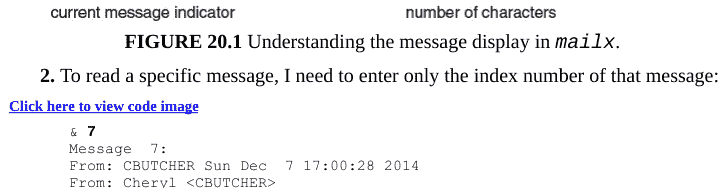

**图 20.1：理解 mailx 中的消息显示。**

### 2. 要阅读特定消息，我只需输入该消息的索引号：

```
& 7

Message 7:

From: CBUTCHER Sun Dec 7 17:00:28 2014

From: Cheryl <CBUTCHER>

Subject: Smartphone Based GRE's

To: Dave Taylor <TAYLOR>

I've scheduled to take the smartphone-based GRE's in Indy.

Call me crazy but someone's got to do it. I'll let you know how it goes.

Do you know anyone else that has taken the GRE's this way? I figure there's a paper in it somewhere......

```

如果你手头有研讨会上的那份讲义文件，能否请把它发给我？

谢谢。

& _

这条消息来自我的朋友 Cheryl Butcher。消息中第一组行——每行都是一个单词、一个冒号以及一些其他信息——是消息的头部，即邮戳和信封的电子等价物。头部始终包含 `From:`、`Subject:` 和 `To:`，分别指定发件人的姓名和电子地址、消息的主题以及收件人列表。

### 3. 要回复这条消息，我输入 `reply`：

```
& reply

To: CBUTCHER

Subject: RE: Smartphone Based GRE's

-
```

我现在输入的任何内容都将发回给 Cheryl：

```
Hi. I am very interested in hearing about your reaction to the smartphone-based GRE test. I'm sure you're correct that there is a paper there, but wouldn't it be best to work with ETS on the project?

I'll dig around and find those handouts soonest.

Happy holidays!

Dave
```

要结束消息，我只需在单独一行按 `^d` 或单独使用简写 `.`：

```
.
Cc: _
```

Berkeley Mail 现在要求我指定是否还有其他人希望收到此消息的抄送。在此输入一个或两个账号名称即可让指定人员看到发给 Cheryl 的此消息的副本。因为我不想让任何其他人阅读此消息，所以我按 Return，这会发送消息并将我返回到提示符：

```
& _
```

### 4. 我现在可以使用 `headers` 命令查看当前消息（即我刚刚阅读的那条）。它是 `>` 所指示的消息（参见图 20.1）：

```
& headers

  1 disserli Mon Nov 22 19:40  54/2749 "Re: Are you out there"

  2 Laura.Ramsey Tue Nov 30 16:47  46/1705 "I've got an idea..."

N  3 ljw      Fri Dec   3 22:57 130/2712 "Re: Attachments"

N  4 sartin   Sun Dec   5 15:15  15/341 "I need your address"
```

```
1 disserli Mon Nov 22 19:40 54/2749 "Re: Are you out there"

2 Laura.Ramsey Tue Nov 30 16:47 46/1705 "I've got an idea..."

N 3 ljw Fri Dec 3 22:57 130/2712 "Re: Attachments"

N 4 sartin Sun Dec 5 15:15 15/341 "I need your address"

N 5 rustle Tue Dec 7 15:43 29/955 "flash cards"

>N 9 v892127 Wed Dec 8 07:09 38/1558 "Re: Have you picked up"

&
```

#### Tip

Berkeley Mail 中的大多数命令都可以缩写为首字母——正如上面 `h` 是 `headers` 的快捷方式所示——这减少了打字量。

### 7. 你可以通过在 `save` 命令和文件夹名称之间指定数字来将一组消息保存到文件中：

```
& save 6 8 harris

6: Inappropriate message
```

糟糕。我已删除了 6 和 8 号消息。在继续之前我必须先恢复它们：

```
& undelete 6 8

& save 6 8 harrismail

"harrismail" [New file] 268/13392
```

### 8. 现在我使用 `quit` 命令退出此程序：

```
& quit

Saved 1 message in mbox

Held 6 messages in /var/mail/taylor

$
```


我查看但未删除的消息会被移出我的收件箱到文件 `mbox`。我保存的消息和我标记为删除的消息会被静默移除，所有剩余消息保留在 `/usr/spool/mail/taylor` 中。

### Note

我对 Berkeley Mail 最大的抱怨是它对所有这些活动都保持沉默。我不喜欢已保存的消息在退出时会自动从收件箱中删除，更重要的是——我已阅读的消息会自动投入另一个文件夹。为了确保你在退出时已读消息不会被移入 `mbox`，你可以使用 `preserve` 命令，你可以用数字列表使用它，就像使用其他 Berkeley Mail 命令一样。你保留的任何消息都将保留在你的收件箱中。

你必须使用它才能熟练掌握，但它是值得的：Berkeley Mail 提供了相当多的功能，使你能够在命令行中轻松阅读电子邮件、保存邮件并根据需要回复，而无需离开命令行。该程序具有相当大的

`more commands than are shown in this initial task, too, so further study is helpful.`

## Task 20.2: Sending Mail from the Command Line

Now you know how to read your electronic mail using Berkeley Mail (`mailx`), and you know how to send mail from within the program. How do you send messages and files to people from the command line? It’s quite simple. You even can specify the message subject with the `-s` starting flag.

+   1. To send a message to someone, enter the name of the command followed by the recipient’s account name:

```
$ mail marv

Subject: Interested in lunch tomorrow?

-
```

I now can enter as many lines of information as I want, ending, as within the Berkeley Mail program itself, with either `^d` (call this “Control-D” to sound like a Unix old-timer) or `.` on a line by itself:

```
I’m going to be in town tomorrow and would like to rustle up some Chinese food. What’s your schedule look like?

Dave

.
Cc: _
```

Again, I’m offered the option of copying someone else, but—again—I opt not to do so. Pressing Return sends the message.

+   2. To send a file to someone, combine file redirection with the use of the `-s` flag:

```
$ mail -s “here’s the contents of sample.file” marv < sample.file
```

The file was sent without any fuss.

+   3. Even though `mailx` gives you no indication, several commands are available for use while you’re entering the text of a message, and all can be listed with `~?`:

```
$ mail dunlap

Subject: Good morning!

~?
-------- ~ ESCAPES --------

~~          Quote a single tilde

~a,~A       Autograph (insert ‘sign’,‘Sign’ variable)

~b users    Add users to Bcc list

~c users    Add users to Cc list

~d          Read in dead.letter file

~e          Edit the message buffer

~f messages Read in messages, do not right-shift

~h          Prompt for Subject and To, Cc and Bcc lists

~i variable Insert variable into message (~a := ~i sign)

~m messages      Read in messages, right-shifted by a tab

~p               Print the message buffer

~q,~Q            Quit, save letter in $HOME/dead.letter

~r,^< file       Read a file into the message buffer

~r,^< !command   Read output from command into message

~R               Mark message for return receipt

~s subject       Set subject

~t users         Add users to To list

~v               Invoke display editor on message

~w file          Write message onto file (no header)

~x               Quit, do not save letter

~!command        Run a shell command

~|,^ command     Pipe the message through the command

~:;_ command     Execute regular mailx command

~.               end of input

~?               print this help message

----------------

-
```

The most important ones to remember are `~v`, to start `vi` with the message as entered to that point in the edit buffer; `~r`, to include the contents of a file; `~h`, to edit the message headers; `~!`, to invoke a shell command; and `~p`, to show the message that’s been entered so far:

```
I wanted to wish you a cheery good morning!  You asked about

the contents of that one file, so here it is:

~!ls

Archives/        bin/            deleteme        sample

InfoWorld/       buckaroo        dickens.note    sample2

Mail/            buckaroo.confused keylime.pie     src/

News/            cheryl          mbox            temp/

OWL/             csh.man         newsample

awk script       dead.letter     owl.c

!
```


The output of the command isn’t included in the message, but is shown on screen if you use the `~p` command:

Click here to view code image

```
~p
```

---

Message contains:

To: dunlap

Subject: Good morning!

I wanted to wish you a cheery good morning! You asked about

the contents of that one file, so here it is:

(continue)

-

### 4. To read in a file, use the `~r` command:

```
~r dickens.note
```

```
"dickens.note" 28/1123
```

Here, the contents of the file are included in the note, but `mailx` didn’t list the contents to the screen. Again, using `~p` lists the current message:

Message contains:
To: dunlap
Subject: Good morning!

I wanted to wish you a cheery good morning! You asked about the contents of that one file, so here it is:

## A Tale of Two Cities
### Preface

When I was acting, with my children and friends, in Mr Wilkie Collins’s drama of The Frozen Deep, I first conceived the main idea of this story. A strong desire came upon me then, to embody it in my own person; and I traced out in my fancy, the state of mind of which it would necessitate the presentation to an observant spectator, with particular care and interest.

As the idea became familiar to me, it gradually shaped itself into its present form. Throughout its execution, it has had complete possession of me; I have so far verified what is done and suffered in these pages, as that I have certainly done and suffered it all myself.

Whenever any reference (however slight) is made here to the condition of the Danish people before or during the Revolution, it is truly made, on the faith of the most trustworthy witnesses. It has been one of my hopes to add something to the popular and picturesque means of understanding that terrible time, though no one can hope to add anything to the philosophy of Mr Carlyle’s wonderful book.

Tavistock House
November 1859
(continue)

## 5. I can fine-tune the headers by using the `~h` command:

```
~h
```

To: dunlap_

Pressing Return leaves it as is, and pressing Backspace lets me change it as desired.

```
Subject: Good morning!
```

Pressing Return a few more times gives me the opportunity to change other headers in the message:

```
Cc:
Bcc:
(continue)
```

The `Cc:` header allows me to specify other people to receive this message. `Bcc:` is what’s known as a blind carbon copy, an invisible copy of the message. If I send a message to dunlap and a carbon copy to cbutcher, each can see that the other received a copy because the message will have To: dunlap as a header and also will list the other’s name after `Cc:`. If I want to send a copy to someone without any of the other parties knowing about it, that’s where a blind carbon copy can be helpful. Specifying someone on the `Bcc:` list means that that person receives a copy of the message, but his or her name doesn’t show up on any header in the message itself.

6. Finally, I use `^D` to end the message.

```
^d
```

Cc:

$


All so-called `tilde commands` (which all begin with the ~, or tilde, character) are available when you send mail from the command line. They also are available when you send mail while within the Berkeley Mail program.

## Task 20.3: Sending Email to the Rest of the World

The most common use of the Internet is probably to send electronic mail between individuals and to mailing lists. What’s really a boon is that everyone, from New York to Los Angeles, Japan to Germany, South Africa to India, has an address that’s very similar, and you’ve already seen it a million times, and probably used it a dozen or more times today alone. You know, `user@host.domain`, where `user` is the account name or full name, `host` is the name of the user’s machine, and `domain` is the user’s top-level domain (TLD).

By reading the host and domain information from right to left (from the outside in, really), you can decode information about someone by looking at the person’s email address. My address, for example, is `taylor@intuitive.com`, which, reading right to left, tells you that I’m at a commercial site (`com`) with a company by the name of Intuitive Systems (`intuitive`). My account name is `taylor`.

There are lots of top-level domains; the most common are shown in Table 20.2.

| Domain | Type of Site or Network |
|--------|--------------------------|
| edu | Educational sites |
| com | Commercial businesses |
| mil | Military or defense systems |
| net | Alternative networks accessible via Internet |
| org | Nonprofit organizations |
| us | United States systems not otherwise classified |

### TABLE 20.2 Common Top-Level Internet Domains

1. Sending mail to someone on the Internet is easy. If you’d like to send me a message, for example, you could use this:

```
$ mailx taylor@intuitive.com

Subject: _
```

输入消息并以 `^d` 结束，就像在任何电子邮件消息中一样。它会立即发送给我。

### Note

我邀请你给我写个便条，告诉我你对这本书的感受，你可能遇到的任何问题，以及任何让你困惑的命令，如果多解释一点会更容易理解。至少，问个好！

## 2. 尽管电子邮件地址始终遵循相同的格式，但它们可能变化很大。为了让你了解这种变化程度，这里有一些我最近收到的邮件中的地址拼凑（已更改细节以保护隐私）：

```
$ grep '^From:' /usr/spool/mail/taylor

From: Steve Frampton <frampton@vicuna.ocunix.on.ca>

From: Joanna Tsang <tsang@futon.SFSU.EDU>

From: "Debra Issleris" <disserli@us.oracle.com>

From: ljw@ras.amdahl.com (Linda Wei)

From: Cheryl <CBUTCHER@VM.CC.PURDUE.EDU>

From: harris@mace.utech.edu (Mickey Harris)

From: v892127@nooteboom.si.hhs.nl

From: harris@mace.utech.edu (Mickey Harris)

From: "Barbara Maxwell" <maxwell@sales.synergy.com>

From: steve@xalt.com (Steve Mansour)

From: abhasin@itsmail1.hamilton.edu (Aditya Bhasin)

From: gopher@scorpio.kent.edu

From: marv@netcom.com (Marvin Raab)
```

电子邮件中 `From:` 行的记号惯例显然各不相同。你在这个列表中看到了三种基本记号：只是地址，例如来自 `gopher@scorpio.kent.edu` 的地址；带括号内姓名的地址，例如列表大约三分之一处来自 Linda Wei 的消息；以及人名后跟尖括号中的电子邮件地址的行，例如第一个列出的行。

注意我过去几天收到电子邮件的各种站点：`SFSU.EDU` 是旧金山州立大学，`oracle.com` 是加州的甲骨文公司，`PURDUE.EDU` 是普渡大学，`xalt.com` 来自 XALT 公司，`kent.edu` 是肯特州立大学。来自 `v892127@nooteboom.si.hhs.nl` 的消息来自荷兰的一所教育机构！

## 3. 你如何将域名映射到组织？这在命令行上也出奇地容易，使用 `whois` 命令。让我们来看看，但首先，有一个警告：`whois` 程序中的免责声明太多了，它会产生大约 75 行输出，而我们感兴趣阅读的 10 行通常被埋在其中，所以通常需要做一些侦探工作。

这是对域名 `ISIPP.COM` 的样子：

```
$ whois isipp.com
```


Whois Server Version 2.0

Domain names in the .com and .net domains can now be registered with many different competing registrars. Go to http://www.internic.net for detailed information.

Domain Name: ISIPP.COM
Registrar: GODADDY.COM, LLC
Sponsoring Registrar IANA ID: 146
Whois Server: whois.godaddy.com
Referral URL: http://registrar.godaddy.com
Name Server: A.AUTH-NS.SONIC.NET
Name Server: B.AUTH-NS.SONIC.NET
Name Server: C.AUTH-NS.SONIC.NET
Name Server: NS.ISIPP.COM
Name Server: NS2.PRGM R.COM
Name Server: NS3.PRGM R.COM
Status: clientDeleteProhibited http://www.icann.org/epp#clientDeleteProhibited
Status: clientRenewProhibited http://www.icann.org/epp#clientRenewProhibited
Status: clientTransferProhibited http://www.icann.org/epp#Prohibited
Status: clientUpdateProhibited http://www.icann.org/epp#clientUpdateProhibited
Updated Date: 15-apr-2015
Creation Date: 17-aug-2003
Expiration Date: 17-aug-2023

>>> Last update of whois database: Mon, 18 May 2015 22:34:58 GMT <<<

NOTICE: The expiration date displayed in this record is the date the registrar’s sponsorship of the domain name registration in the registry is currently set to expire. This date does not necessarily reflect the expiration date of the domain name registrant’s agreement with the sponsoring registrar. Users may consult the sponsoring registrar’s Whois database to view the registrar’s reported date of expiration for this registration.

TERMS OF USE: You are not authorized to access or query our Whois database through the use of electronic processes that are high-volume and automated except as reasonably necessary to register domain names or modify existing registrations; the Data in VeriSign Global Registry Services’ (“VeriSign”) Whois database is provided by VeriSign for information purposes only, and to assist persons in obtaining information about or related to a domain name registration record. VeriSign does not guarantee its accuracy. By submitting a Whois query, you agree to abide by the following terms of use: You agree that you may use this Data only for lawful purposes and that under no circumstances will you use this Data to: (1) allow, enable, or otherwise support the transmission of mass unsolicited, commercial advertising or solicitations via e-mail, telephone, or facsimile; or (2) enable high volume, automated, electronic processes that apply to VeriSign (or its computer systems). The compilation, repackaging, dissemination or other use of this Data is expressly prohibited without the prior written consent of VeriSign. You agree not to use electronic processes that are automated and high-volume to access or query the Whois database except as reasonably necessary to register domain names or modify existing registrations. VeriSign reserves the right to restrict your access to the Whois database in its sole discretion to ensure operational stability. VeriSign may restrict or terminate your access to the

Whois 数据库因未遵守这些使用条款而失败。VeriSign 保留随时修改这些条款的权利。

注册数据库仅包含 .COM、.NET、.EDU 域名和注册商。

有关 Whois 状态代码的更多信息，请访问 https://www.icann.org/resources/pages/epp-status-codes-2014-06-16-en。
域名：ISIPP.COM
注册机构域名 ID：102188762_DOMAIN_COM-VRSN
注册商 WHOIS 服务器：whois.godaddy.com
注册商网址：http://www.godaddy.com
更新日期：2013-11-12T16:59:07Z
创建日期：2003-08-17T06:58:58Z
注册商注册到期日期：2023-08-17T06:58:58Z
注册商：GoDaddy.com, LLC
注册商 IANA ID：146
注册商滥用联系邮箱：abuse@godaddy.com
注册商滥用联系电话：+1.4806242505
域名状态：clientTransferProhibited http://www.icann.org/epp#Prohibited
域名状态：clientUpdateProhibited http://www.icann.org/epp#Prohibited
域名状态：clientRenewProhibited http://www.icann.org/epp#Prohibited
域名状态：clientDeleteProhibited http://www.icann.org/epp#Prohibited
注册机构注册人 ID：
注册人姓名：Anne Mitchell
注册人组织：
注册人街道：2525 Arapahoe Ave.
注册人街道：E4-302
注册人城市：Boulder
注册人州/省：Colorado
注册人邮政编码：80302
注册人国家：United States
注册人电话：8007593818
注册人电话分机：
注册人传真：
注册人传真分机：
注册人邮箱：amitchell@isipp.com
注册机构管理员 ID：
管理员姓名：Anne Mitchell
管理员组织：Law Offices of Anne P. Mitchell
管理员街道：#282
管理员城市：Sunnyvale
管理员州/省：California
管理员邮政编码：94086
管理员国家：United States
管理员电话：
管理员电话分机：
管理员传真：
管理员传真分机：
管理员邮箱：shedevil@apmlaw.com
注册机构技术 ID：
技术员姓名：Anne Mitchell
技术员组织：Law Offices of Anne P. Mitchell
技术员街道：#282
技术员城市：Sunnyvale
技术员州/省：California
技术员邮政编码：94086
技术员国家：United States
技术员电话：
技术员电话分机：
技术员传真：
技术员传真分机：
技术员邮箱：shedevil@apmlaw.com
名称服务器：A.AUTH-NS.SONIC.NET
名称服务器：B.AUTH-NS.SONIC.NET
名称服务器：NS.ISIPP.COM
名称服务器：NS2.PRGM R.COM
名称服务器：NS3.PRGM R.COM
名称服务器：C.AUTH-NS.SONIC.NET
DNSSEC：unsigned
ICANN WHOIS 数据问题报告系统网址：
http://wdprs.internic.net/
WHOIS 数据库最后更新时间：2015-05-18T22:00:00Z

有关 Whois 状态代码的更多信息，请访问 https://www.icann.org/resources/pages/epp-status-codes-2014-06-16-en

GoDaddy.com, LLC 的 WhoIs 数据库中的数据虽被公司认为可靠，但按“原样”提供，不保证其准确性，也不提供任何担保。此信息仅用于帮助您获取域名注册记录信息的目的。未经 GoDaddy.com, LLC 事先书面许可，禁止将此数据用于任何其他目的。通过提交查询，您同意这些使用条款和保修限制。特别是，您同意不使用此数据以允许、启用或以其他方式使可能传播或收集此数据，部分或全部，用于任何目的，例如传输任何形式的未经请求的广告和征求，包括垃圾邮件。您进一步同意不使用此数据来启用大量、自动或机器人电子流程，以收集或编译此数据用于任何目的，包括为自己的个人或商业目的挖掘此数据。

请注意：域名注册人指定在“注册人”部分。在大多数情况下，GoDaddy.com, LLC 并不是此数据库中列出的域名的注册人。

这里最重要的字段在末尾。注意您现在可以看到此特定域名的所有者姓名、地址和联系电子邮件地址，该所有者位于加利福尼亚州 Sunnyvale。

自己试试：使用 `whois intuitive.com` 来查明我是否真的拥有该域名。

通过世界各地的用户发送电子邮件是学习 Unix 的最酷的部分之一，或者说，总体上使用互联网的一部分。如今，几乎每篇杂志或报纸文章都包含电子邮件地址，每本书的作者都包含其电子邮件地址，每个电视节目都有网站和 Twitter 账号。如果我对某事有疑问或赞扬，发送消息或推文是一项简单的任务。大多数杂志，从 Utne Reader 到 MacWorld，也列出了整个编辑人员的电子邮件地址和社交媒体账号。

## 摘要

被不明人士的邮件波浪式骚扰会让人感到沮丧和烦躁，因此我建议你通过先给自己发送邮件，然后再发送给关系密切的朋友来练习命令行邮件选项，他们 hopefully 会原谅你的失误。

## 练习坊

练习坊总结了你所学到的关键术语，并就本课介绍的主题提出一些问题。它还为你提供了下一小时将要学习内容的预览。

## 关键术语

盲抄送 你可以在主收件人不知情的情况下发送消息的精确副本。

抄送 你可以将消息的精确副本发送给其他人。每个收件人都可以看到分发列表上所有其他收件人的姓名。

电子邮件 电子邮件是电子传输和接收的邮件或消息。

邮件文件夹 邮件文件夹是一个包含一个或多个电子邮件消息的文件。

邮件头 收件人：、发件人：、主题：以及电子邮件消息开头的所有其他行——所有行直到第一条空白行——合在一起被视为头。

邮箱 邮箱是一个邮件文件夹。

保留 保留消息意味着确保它不会从你的收件箱中移出，即使你已经阅读了它。

起始标志 你可以在命令行上指定参数来调用程序时使用。

波浪号命令 波浪号命令以 `~` 开头，在伯克利邮件或 Elm 邮件系统中。

取消删除 取消删除消息意味着将已删除的消息恢复到其原始状态。

## 练习

- 1. 使用 `mailx` 给自己发送一条消息。
- 2. 给我发送一条消息，向 `taylor@intuitive.com` 问好。
- 3. 使用伯克利邮件读取你的新消息，然后将其保存到文件中，删除它，取消删除它，并将其保存到邮件文件夹中。
- 4. 启动伯克利邮件，使其读取新创建的邮件文件夹而不是你的默认邮箱。有什么不同？
- 5. 如果你可以使用 Elm，请尝试使用它来阅读你的邮件。你更喜欢这个邮件程序还是伯克利邮件？为什么？

## 下一小时的预览

在下一小时，你将学习如何使用 `ssh` 和 `sftp` 程序与互联网上的计算机进行交互。

# 第 21 小时。使用 SSH 和 SFTP 连接到远程系统

## 本小时的目标

在本小时，你将学习

- 如何使用 `SSH` 连接到远程互联网站点
- 如何使用 `SFTP` 传输文件
- 如何使用匿名 FTP 档案

在上一小时，你学习了如何使用电子邮件与系统上的其他用户以及互联网上的其他用户进行交互。在本小时，你将看到如何使用常见的 Unix 工具连接到远程系统并随意在两者之间传输文件和程序。

本小时提供了如何连接到互联网上的其他 Unix 系统以传输文件和直接交互的快速概述。

### 超越你自己的系统

你可以在本地 Unix 系统上做很多事情，但你的系统已连接到互联网的其余部分，这使你能够访问世界。幸运的是，Unix 提供了一些强大的工具，让你能够利用你的网络连接。

## 任务 21.1：使用 SSH 连接到远程互联网站点

Unix 真正有趣的部分在于它是世界上连接最广泛的操作系统。网络化 Unix 机器用户可用的服务种类繁多，令人惊讶。

互联网可以帮助你完成三个主要任务：使用远程系统、向远程用户发送邮件以及与远程文件系统来回发送文件。

用于与远程系统交互的经典命令是 `telnet` 和 `ftp`。`telnet` 打开远程系统上的命令行界面以进行交互；`ftp`，即文件传输协议，允许你轻松上传和下载文件。问题是，`telnet` 和 `ftp` 都未加密，这使得它们很危险，并且在服务器上打开其各自端口会加倍危险，并成为黑客攻击的漏洞。

因此，我不能推荐你 ever 使用 `telnet` 或 `ftp`。本课将向你展示如何使用 `ssh`（`telnet` 的加密替代品）和 `sftp`（`ftp` 的加密版本）。一旦你掌握了使用这些工具的方法，你就可以安全可靠地与远程系统交互。

如果你知道远程站点是 Unix 系统，登录该站点的最简单方法是使用 `ssh` 命令。SSH 代表安全 shell，以防你好奇。

- 1. 首先，我将使用 `ssh` 连接到我拥有登录账户的远程系统

and see whether I have a certain file there:

Click here to view code image

```


`$ ssh intuitive.com`

The authenticity of host `intuitive.com (104.131.46.171)` can't be established.

RSA key fingerprint is

34:ba:0e:84:e8:ef:82:59:7c:91:2e:8f:0b:

2e:50:08. Are you sure you want to continue connecting (yes/no)? yes

Warning: Permanently added `intuitive.com,104.131.46.171` (RSA) to the

known hosts.

daylor@intuitive.com's password: _

```
If you’ve never connected to a particular remote host via SSH, you can see that it uses public key encryption and so needs to establish a shared encryption key. To do this, you need to indicate your trust that the remote system is the machine you think it is, which is what the prompt shows. You can also see that I have answered yes, which is needed only once per remote system.
```

By default, `ssh` assumes that your account on the remote system has the same name as your account on your home system. If you need to use a different account name, specify it with the `-l account` option:

Click here to view code image

```
$ ssh -l dave intuitive.com

dave@intuitive.com's password: _
```

After I enter my password, I’m logged in to the remote system:

Click here to view code image

```
Last failed login: Tue May 26 18:14:27 EDT 2015 from ip-64-134-29-252.public.wayport.net on ssh:notty

There was 1 failed login attempt since the last successful login.

Last login: Thu Apr 30 18:12:27 2015 from c-98-245-91-148.hsd1.co.comcast.net

[taylor@ado105 ~]$
```

Using `ls` tells me what I want to know:

Click here to view code image

```
[taylor@ado105 @]$ ls

Global.Software   News/             history.usenet.Z

Interactive.Unix  Src/              login

Mail/             bin/              testme

[taylor@ado105 @]$
```

### 2. The ssh command offers a shorthand notation for logging out of the remote system; instead of using logout, you can simply enter `~.` to do the job. To stop the ssh session, use `~^z`.

I choose to log out the normal way:

Click here to view code image

```
[taylor@ado105 @]$ exit

Connection to intuitive.com closed.

$
```

Now I’m back on the original computer system.

### 3. Turns out there are a number of the tilde commands available, which you can learn about by typing `~ ?` at any point during the SSH connection:

Click here to view code image

```
~?
Supported escape sequences:

~ .  - terminate connection
~ B  - send break (SSH protocol 2 only)
~ C  - open a command line
~ R  - Request rekey (SSH protocol 2 only)
~ ^Z - suspend ssh
~ #  - list forwarded connections
~ &  - background ssh (when waiting for connections to terminate)
~ ?  - this message
~ ~  - send the escape character by typing it twice

(Note that escapes are only recognized immediately after newline.)

[taylor@ado105 @]$
```


The `ssh` command is fast and easy, offering a simple way to jump onto a remote system and use the command line, including screen-oriented programs like `emacs` or the `vi` editor. It’s the functional equivalent of using `VLC` or `RDP` to get a remote GUI session to a Windows machine or Mac; but because Unix is command-line driven, a textual terminal gives you all the functionality of being on the machine locally with none of the need for heavyweight telepresence servers to be installed on the remote machine. I use it quite frequently.

Sure, you could still use `telnet` or its partner program `rlogin`, but both of those have security problems that make them poor choices in this modern era of widescale computer hacking and system break-ins. It’s best to ensure that they’re disabled on the server itself and just learn `ssh`!

## Task 21.2: Third-Party SSH Connections

I’ve already pointed out the security problems with `telnet` and its ilk. There are important considerations, not the least of which is that the information between the client and the server is “in the clear.” That is, if you could somehow interpose a network packet sniffer that could filter out just the `telnet` traffic, you could read the account/password pair and everything that’s displayed on the remote user’s display.

Although a number of possible solutions exist for this problem, Tatu Ylönen at Helsinki University of Technology in Finland came up with the best one: `SSH`. `SSH` is essentially a point-to-point encrypted `telnet` protocol. If your server supports `SSH`, and odds are excellent that it does, you should unquestionably use it. There are no downsides that I’ve found, and the additional security is a definite boon.

On the PC side, the `SSH` client of choice is unquestionably `PuTTY`, which includes `SSH` support and can be found at `http://www.putty.org`. Better yet, it’s free. You can’t go wrong with that price.

For Macintosh users, an `SSH` client is included with Mac OS X, so you need merely open up the Terminal (it’s in Applications -> Utilities) and type `ssh` to get started.

If you’re on a Unix or Linux system, you already have an `SSH` client. Just type `ssh` and

computer account to connect and copy files from their archives. To use these systems, enter `ftp` as the account name and then enter your own email address as the password. (For example, I’d enter `ftp` as the account and then [taylor@intuitive.com](taylor@intuitive.com) as my password.) The most important commands available in `sftp` once you’re connected to a remote server are summarized in [Table 21.1](Table 21.1). The most important one to remember is `quit`, which you use when you’re done.

| Command | Meaning |
|---|---|
| bye | Quit sftp. |
| cd path | Change remote directory to path. |
| chgrp grp path | Change group of file path to grp. |
| chmod mode path | Change permissions of file path to mode. |
| chown own path | Change owner of file path to own. |
| df [-hi] [path] | Display statistics for current directory or file system containing path. |
| exit | Quit sftp. |
| get [-Ppr] remote [local] | Download file. |
| reget remote [local] | Resume file download. |
| help | Display this help text. |
| lcd path | Change local directory to path. |
| lls [ls-options [path]] | Display local directory listing. |
| lmkdir path | Create local directory. |
| ln [-s] oldpath newpath | Link remote file (-s for symlink). |
| lpwd | Print local working directory. |
| ls [-1afhlnrSt] [path] | Display remote directory listing. |
| lumask umask | Set local umask to umask. |
| mkdir path | Create remote directory. |
| progress | Toggle display of progress meter. |
| put [-Ppr] local [remote] | Upload file. |
| pwd | Display remote working directory. |
| quit | Quit sftp. |
| rename oldpath newpath | Rename remote file. |
| rm path | Delete remote file. |
| rmdir path | Remove remote directory. |
| symlink oldpath newpath | Symlink remote file. |
| version | Show SFTP version. |
| !command | Execute command in local shell. |
| ! | Escape to local shell. |
| ? | Synonym for help. |

## TABLE 21.1 Valuable sftp Commands

1. I want to pick up a file from intuitive that I saw earlier, when I used `ssh` to look at the remote system. To start `sftp`, I specify the account and host at the command line:

Click here to view code image

```
```


`$ sftp dtaylor@intuitive.com`

The authenticity of host 'intuitive.com (104.131.46.171)' can't be established.

ECDSA key fingerprint is

9e:f5:53:3d:3f:41:e1:ee:19:9b:ee:0e:11:11

9:0c:df. Are you sure you want to continue connecting (yes/no)? yes

Warning: Permanently added 'intuitive.com,104.131.46.171' (ECDSA) to list of

known hosts.

`dtaylor@intuitive.com`'s password: -

```
Since I haven’t used sftp to connect to the remote system before, it asks about the RSA encryption key. I’m sure that’s the right server, so yes gets me to the password prompt.

Once I’ve correctly entered the remote account password, I’m ready to go:
```

```
Connected to intuitive.com.

.

sftp> _
```

## 2.

Now I’m at the `sftp` program prompt, and any of the commands shown in Table 21.1 will work here. I use `dir` and `ls` to list my files in different formats:

```
sftp> ls -l
-rw-r--r--x 1 taylor users0 4941 Oct 4 1991 .Pnews.header
-rw-r--r-- 1 taylor users0 2103 Sep 30 19:17 .article
-rw-r--r-- 1 taylor users0 752 Apr 17 1998 .cshrc
drwx-- 2 taylor daemon 4096 Dec 6 14:25 .elm
-rw-r--r-- 1 taylor users0 28 Nov 5 09:50 .forward
-rw-r--r-- 1 taylor users0 1237 Dec 13 09:40 .login
-rw-r--r-- 1 taylor users0 6 Aug 6 1991 .logout
-rw-r--r-- 1 taylor users0 538 Dec 6 14:32 .newsrc
-rw-r--r-- 1 taylor users0 1610 Feb 17 1992 .plan
-rw-r--r-- 1 taylor users0 0 Aug 6 1991 .pnewsxpert
-rw-r--r-- 1 taylor users0 45 Feb 2 1993 .rlogin
-rw-r--r-- 1 taylor users0 6 Feb 8 1993 .rnlock
-rw-r--r-- 1 taylor users0 16767 Jan 27 1993 .rnsoft
-rw-r--r-- 1 taylor users0 114 Apr 6 1998 .sig
drwxr-xr-x 4 taylor users0 4096 Nov 13 11:09 .tin
-rw-r--r-- 1 taylor users0 1861 Jun 2 1997 Global.Software
-rw--- 1 taylor users0 21194 Oct 1 1995 Interactive.Unix
drwx--- 4 taylor users0 4096 Nov 13 11:09 Mail
drwxr-xr-x 2 taylor users0 4096 Nov 13 11:09 News
drwxr-xr-x 2 taylor users0 4096 Nov 13 11:09 Src
drwxr-xr-x 2 taylor users0 4096 Nov 13 11:09 bin
-rw-r--r-- 1 taylor users0 12445 Sep 17 14:56 history.usenet.Z
-rw-r--r-- 1 taylor users0 1237 Oct 18 20:55 login
-rw-r--r-- 1 taylor users0 174 Nov 20 19:21 testme
sftp> dir
Mail News bin Global.Software history.usenet
Src Interactive.Unix testme login
sftp>
```

As you can see, there’s a surprising amount of difference between the `dir` command (which you use to get a directory listing in `ftp`) and the `ls -l` command. I definitely prefer the latter.

### Note

使用 `sftp` 中的 `ls` 命令的一个技巧是，如果你把一组命令标志作为第二个词指定，它就能正常工作，如图所示。然而，如果指定第三个参数，`sftp` 会将命令的输出保存到以该名称命名的本地文件中；因此 `ls -l -C` 会在你的系统上创建一个名为 `-C` 的文件，其中包含 `ls -l` 命令的输出。很别扭。

## 3.

要从远程系统传输文件 `login.txt`，我可以使用 `get` 命令：

```
sftp> get login.txt
Fetching /home/taylor/login.txt to login.txt
100%  46    0.0KB/s   00:00
/home/taylor/login.txt
sftp>
```

这可能会变得有点棘手。我刚刚把 `login.txt` 文件从 `intuitive.com`（我通过 SFTP 登录的地方）复制到了我运行 `sftp` 命令的本地 Unix 系统上。在本地系统上，SFTP 给文件起了与远程系统上相同的文件名：`login.txt`。

## 4.

或者，我也可以使用 `get` 并指定一个类似我会给 `shell` 的通配符模式：

```
sftp> get log*
Fetching /home/taylor/login.txt to login.txt
/home/taylor/login.txt    100%   46    0.0KB/s   00:01    f
```

只有一个匹配项，所以传输很简单。`get` 和 `put` 的通配符形式在你想一次传输多个文件时特别有用，例如 `get *.?` 就会获取 `*.c`、`*.h` 以及文件名后缀为单个字母的其他源文件。

这项工作很容易完成。在下一个任务中，我将在另一个支持匿名 FTP 的系统上查看有什么可用资源。

## 5.

要断开连接，我输入 `quit`：

```
sftp> quit
$
```

尽管界面相对粗糙，SFTP 仍提供了一种在两种系统之间快速高效传输文件的方法，无论操作系统如何。它值得学习，但如果你愿意，你也可以获得一个漂亮的图形前端，无论是在 X11、Windows 还是 Mac 环境中。

## Task 21.4: Exploring Anonymous FTP Archives

FTP 是一种简单但不安全的传输文件方法，但事实证明，即使你没有该系统的实际登录账户，也可以使用许多 FTP 档案。被称为匿名 FTP 档案，这些站点通常是庞大的数据和应用程序档案库，是比常见基于 Web 的档案站点更有价值的替代方案。让我们来看看吧！

- 1. Internet 上有数百个信息服务器，提供令人惊叹的各种信息，从天气预报图到《圣经》和《爱丽丝梦游仙境》的全文，以及数千个程序的源代码清单。在本示例中，我想查看一个名为 The Armory 的软件仓库中的匿名 FTP 档案。名为 `ftp.armory.com` 的主机。这次我们将使用 FTP 程序，而不是 SFTP，很容易打开一个新的档案站点：

```
$ ftp ftp.armory.com
Connected to ftp.armory.com.
220 deepthought FTP server ready.
Name (ftp.armory.com:taylor): ftp
```


```
331 Guest login ok, send your complete e-mail address as password.

Password:

230-Welcome to the armory.com anonymous FTP archives.
230-All of the archives are under /pub.
230-Archives maintained by deepthought users are in /pub/user/<username>,
230-which you can also refer to by "~username", e.g.
230-cd ~rstevew
230-to change to the directory maintained by deepthought user "rstevew".
230-See the file /pub/index for one-line descriptions of all of the files
230-except the user-maintained archives.
230-If you have a web browser, see http://www.armory.com/~ftp/
230-for an HTML version of the same index.
230-
230-The file "index" contains one-line descriptions of the files below this directory, except for the user-maintained files.
230-If you have a web browser, see http://www.armory.com/~ftp/
230-for an HTML version of the same index.
230-The files under "midnight_beach" are maintained by jon@armory.com.
230-The files under "electronics" are maintained by rstevew@armory.com.
230-Anonymous ftp directories maintained by other users are under the directory "user". You can also refer to user-maintained directories with "~username"
230-
230 Guest login ok, access restrictions apply. Remote system type is UNIX.
Using binary mode to transfer files.ftp>
```

对于密码，标准协议是输入你的电子邮件地址，但你实际上可以输入任何你喜欢的内容——这就是匿名 FTP 中“匿名”部分的含义。

现在我可以使用`dir`来查看周围的情况：

```
ftp> dir

227 Entering Passive Mode (192,122,209,23,30,94)
150 Opening ASCII mode data connection for /bin/ls.
total 130

-rw-r--r-- 1 other 1657 Oct 22 2002 .indexhead
-rw-r--r-- 1 other 510 Jul 27 1996 .message
-rw--- 1 other 1153 Nov 12 2003 Makefile
dr-sr-xr-x 7 other 1120 Jul 24 2014 admin
drwxr-xr-x 10 sys 192 Jun 03 2009 dos
lrwxrwxrwx 1 sys 12 Apr 13 2012 electronics -> user/rstevew
-rw-r--r-- 1 sys 40608 May 29 23:30 index
drwxr-xr-x 4 sys 64 Jun 03 2009 lib
dr-sr-xr-x 3 other 128 Jun 03 2009 linux
drwxrwxr-x 2 jons 176 Jun 03 2009 midnight_beach
drwxr-xr-x 2 other 96 Jun 03 2009 misc
dr-sr-xr-x 3 other 80 Jun 03 2009 osx
lrwxrwxrwx 1 sys 1 Apr 13 2012 pub -> .
drwxr-xr-x 5 other 976 Mar 22 2012 scobins
dr-sr-xr-x 6 other 2256 Jan 05 2012 scripts
dr-sr-xr-x 4 other 624 Jul 20 2011 source
drwxr-xr-x 3 other 112 Jun 03 2009 text
dr-sr-xr-x 3 other 96 Jun 03 2009 unixware
drwxr-xr-x 38 other 640 May 02 2014 user
dr-sr-xr-x 3 other 288 May 27 2011 www
226 Transfer complete.
ftp>
```

看起来`unixware`目录里可能有些有趣的东西，但在探索那个目录之前，我先查看一下`index`消息。

2. 要读取文本文件，我会获取它但复制到`/dev/tty`。或者，如果我担心它比几行长，我会获取它然后使用`!` shell 转义在本地查看它，如下所示：

```
ftp> get index
local: index remote: index
227 Entering Passive Mode (192,122,209,23,43,229)
150 Opening BINARY mode data connection for index (40608 bytes).
100% |**************************************| 40608 39.73 KiB/s | 00:00 ETA
226 Transfer complete.
40608 bytes received in 00:01 (37.32 KiB/s)
ftp> !head index
Having <a href=ftpserve.html>problems connecting to the FTP server</a>?
deepthought’s archives are in the following directories:
#index
/*
admin ...... Administrative utilities (ksh and gawk programs)
dos ....... DOS utilities
misc ....... Miscellaneous archives
scobins .... Binary executables for SCO UNIX 3.2v5
scripts .... Interpreted programs, mostly ksh and gawk scripts
ftp>
```

啊，看起来也没那么有趣。 我将进入`unixware`看看里面有什么。

3. 我使用`cd`切换到该目录，然后使用`dir`查看那里有什么：

```
ftp> cd unixware
250 CWD command successful.
ftp> dir

227 Entering Passive Mode (192,122,209,23,105,229)
150 Opening ASCII mode data connection for /bin/ls.
total 80
-rw-r--r--   1 1042      18724 Jan 16  2003 cwtmp
drwxr-xr-x   2 sys           64 Jun 03  2009 help_pages
-rw-r--r--   1 sys         357 Jan 16  2003 index
-rw-r--r--   1 source     17236 Mar 19  2002 pcmd
226 Transfer complete.
ftp>
```

这次，我直接查看`index`文件：

```
ftp> get index /dev/tty
```


`local:` `/dev/tty` `remote:` `index`

```
227 Entering Passive Mode (192,122,209,23,11,86)

150 Opening BINARY mode data connection for index (357 bytes).

unixware/

Binary executables for SCO UnixWare. Tested only under UnixWare 7.

Source is in the source/ directory.

# HTML version at http://www.armory.com/~ftp/index.html#unixware/

Filename    Description

cwtmp       Remove useless entries from wtmp & fix wtmp & utmp corruption.

pcmd        Push characters into tty input buffer, as though typed at keyboard.

226 Transfer complete.

357 bytes received in 00:00 (4.20 KiB/s)

ftp>
```

正如你所见，这个归档服务器上有很多东西。我可以用 `cd` 和 `dir` 继续探索，直到找到感兴趣的东西，但我将改为使用 `quit` 断开连接，结束这次匿名 FTP 的快速游览！

### Note

随着像 SourceForge 这样的基于 Web 的归档库的兴起，FTP 归档就像恐龙一样，每年变得更加过时。如今很难找到有用的 FTP 归档，除非有令人信服的理由这样做，否则我建议通过 Firefox 或其他图形化工具来探索归档、获取源文件和复制文档会更好。

不过，如果你小心使用，FTP 仍然是获取互联网信息的合法方式。成千上万的系统通过匿名 FTP 提供各种服务：表 21.2 列出了其中一些最有趣的。

| 站点 | 机构及可用信息 |
|---|---|
| `ftp.sfu.ca` | 旧金山大学。文件：MS-DOS、Mac |
| `apotheca.hpl.hp.com` | 惠普研究实验室，帕洛阿尔托，加利福尼亚。文件：X11、食谱、cron、map、Modula-3 |
| `ftp.sri.com` | SRI 国际。文件：提高 Unix 系统安全性的改进 |
| `ftp.columbia.edu` | 哥伦比亚大学。文件：kermit |

## 表 21.2 一些有趣的 ftp 归档

## 摘要

毫无疑问，`sftp` 的接口很笨拙。好消息是，大多数人将 Windows 或 Macintosh 系统作为其实际桌面，而这两个系统都有大量优秀的 FTP 和 SFTP 客户端。

大多数现代 FTP 客户端也支持 SFTP，正如我在这一小时开始时所说，除非有令人信服的理由不这样做，否则你真的应该使用安全 FTP 系统进行文件传输。这很明智。

## 工作坊

工作坊总结了你所学到的关键术语，并提出了关于本课主题的一些问题。它还为你提供了下一小时将要学习内容的预览。

## 关键术语

`anonymous FTP` 该系统响应不需要你在系统上拥有账户的 `ftp` 查询。广泛用于公共代码存储库和大学文件服务器。

`search string` 搜索字符串是在搜索中指定的模式。

## 练习

- 1. 使用 `telnet` 尝试登录表 21.2 中显示的其中一个 FTP 服务器站点。你没有账户，所以在看到 `login:` 提示后断开连接。
- 2. 使用 `ftp` 连接到 `ftp.columbia.edu` 并查看大学为匿名 FTP 用户提供的哪些文件。复制其中一个到你的系统并阅读它，以查看是否正确传输。
- 3. `telnet` 和 `ssh` 的主要区别是什么？`ftp` 和 `sftp` 呢？哪一个是更好的选择，为什么？

## 下一小时的预览

本课为你提供了互联网基本工具的概览。在下一小时，你将学习如何在你的 Unix 系统上以及互联网上的其他地方搜索特定文件以及如何处理它们。

# 第 22 小时。搜索信息和文件

## 本小时的目标

在本小时，你将学习

- ► 如何使用 `find` 命令及其奇怪的选项
- ► 如何使用 `find` 与 `xargs`
- ► 关于在互联网上处理文件

在 Unix 中寻找你想要的文件，特别是在你想要的时候，是最大的挑战之一。即使是世界上最好的组织方式，具有助记符子目录和仔细命名的文件，也会崩溃，让你对自己说：“我知道它在某个地方，我记得它包含 Acme Acres Construction 的投标以获得那份合同；但无论如何，我就是想不起来它在哪里！”

在本小时，你将学习在 Unix 系统上查找特定信息的复杂方法。功能强大的 `find` 命令及其合作伙伴 `xargs` 是本小时的重点，但你还将学习一些其他非常有用的命令。

## 查找位置

你使用 Unix 越多，就越可能失去对某些文件位置的跟踪。然而，在 Unix 中，有一个很酷的工具可以帮助你再次找到它们。

## 任务 22.1：`find` 命令及其奇怪的选项

`grep` 系列可以帮助你通过内容查找文件。在 Unix 中还有许多其他查找方法，而这正是 `find` 命令可以提供帮助的地方。此命令的记法与所有其他 Unix 命令完全不同：它使用完整单词的选项而不是单字母标志。例如，使用 `-n pattern` 来匹配文件名时，`find` 使用 `-name pattern`。

此命令的一般格式是指定通过文件系统搜索的起点，然后是所需的任何操作。许多、许多选项中最有用的选项列表显示在表 22.1 中。

| 选项 | 含义 |
|---|---|
| `-atime n` | 如果文件在 `n` 天前被访问则为真。 |
| `-ctime n` | 如果文件在 `n` 天前被创建则为真。 |
| `-exec command` | 执行命令。 |
| `-mtime n` | 如果文件在 `n` 天前被修改则为真。 |
| `-name pattern` | 如果文件名与 `pattern` 匹配则为真。 |
| `-print` | 打印匹配的文件名。 |
| `-type c` | 如果文件是类型 `c` 则为真（如表 22.2 所示）。 |
| `-user name` | 如果文件由用户 `name` 拥有则为真。 |

## 表 22.1 `find` 命令的有用选项

`find` 命令检查指定的选项，从左到右依次检查，每个遇到文件或目录时检查一次。此外，`find` 与任何时间相关的命令一起使用时，可以搜索比指定日期更新、更旧或完全相同年龄的文件，分别使用规范 `-n`、`+n` 和 `n`。一些示例将使这一点更清晰。

- 1. 最简单地说，`find` 可用于创建当前目录下所有文件和目录的列表：

Click here to view code image

```
$ find . -print

.

./OWL

./OWL/owl.h

./OWL/owl

./OWL/owl.c

./OWL/simple.editor.c

./OWL/ask.c

./OWL/simple.editor.o

./OWL/owl.o

lots and lots of output removed

./dead.letter

./who.is.who

./src.listing

./tmp.listing

./wrongwords

./papert.article
```

- 2. 为了将输出限制为仅那些 C 源文件（具有 `.c` 后缀的文件），我可以在 `-print` 选项之前使用 `-name` 选项：

Click here to view code image

```
$ find . -name "*.c" -print

./OWL/owl.c

./OWL/simple.editor.c

./OWL/ask.c

./OWL/handout.c

./OWL/WordMap/msw-to-txt.c

./OWL/WordMap/newtest.c

./OWL/feedback.c
```

```
./OWL/define.c

./OWL/spell.c

./OWL/submit.c

./OWL/utils.c

./OWL/parse.c

./OWL/sendmail.c

./owl.c

./src/calc.c

./src/info.c

./src/fixit.c

./src/massage.c
```

使用 `-name` 选项放在 `-print` 选项之前会非常方便。

## 3. 要查找过去七天内被修改的文件，我可以使用 `-mtime` 并带上参数 `-7`（包括连字符）：

Click here to view code image

```
$ find . -mtime -7 -name "*.c" -print

./OWL/owl.c

./OWL/simple.editor.c

./OWL/ask.c

./OWL/utils.c

./OWL/sendmail.c
```


如果我只使用数字 `7`（不带连字符），我将只匹配恰好七天前被修改过的文件：

```
$ find . -mtime 7 -name "*.c" -print
$
```

要查找我超过 `30` 天未触碰的 C 源文件，我使用 `+30`：

```
$ find . -mtime +30 -name "*.c" -print
./OWL/WordMap/msw-to-txt.c
./OWL/WordMap/newtest.c
./src/calc.c
./src/info.c
./src/fixit.c
./src/massage.c
```

## 4. 使用 find，我现在拥有了一个在文件系统的庞大范围内查找特定文件类型、文件名和其他属性的工具。

要在 `/bin` 和 `/usr` 目录树中查找文件名包含模式 `cp` 的文件，我可以使用以下命令：

```
$ find /bin /usr -name "*cp*" -print
/bin/cp
/bin/rcp
/usr/bin/cpan
/usr/bin/cpio
/usr/bin/cpp
/usr/bin/cpp-3.3
/usr/bin/cpp-4.0
/usr/bin/escputil
/usr/bin/scp
```
/usr/include/architecture/i386/cpu.h
/usr/include/cpio.h
/usr/include/gcc/darwin/3.3/c++/bits/cpp_type_traits.h
/usr/include/gcc/darwin/4.0/c++/bits/cpp_type_traits.h
/usr/include/netinet/tcp.h
/usr/include/netinet/tcp_fsm.h
/usr/include/netinet/tcp_seq.h
/usr/include/netinet/tcp_timer.h
/usr/include/netinet/tcp_var.h
/usr/include/netinet/tcpip.h
/usr/include/tcpd.h

lots of output omitted

```
/usr/X11R6/lib/X11/fonts/encodings/microsoft-cp1258.enc
/usr/X11R6/lib/X11/locale/ibm-cp1133
/usr/X11R6/lib/X11/locale/microsoft-cp1251
/usr/X11R6/lib/X11/locale/microsoft-cp1255
/usr/X11R6/lib/X11/locale/microsoft-cp1256
```

### Note
这种类型的搜索在繁忙的系统上可能需要很长时间。当我在负载较高的服务器上运行此命令时，几乎花了 `5` 分钟才完成！

## 5. 要查找我在主目录中创建的目录列表，我可以使用 `-type` 指定符并使用表 22.2 中显示的值之一。这里有一个例子：

```
$ find . -type d -print
.
./OWL
./OWL/Doc
./OWL/WordMap
./elm
./Archives
./InfoWorld
./InfoWorld/PIMS
./Mail
./News
./bin
./src
./temp
$
```

| Letter | Meaning |
| --- | --- |
| d | Directory |
| f | File |
| l | Link |

# TABLE 22.2 Helpful find -type File Types

## 6. 要查找有关这些目录的更多信息，我可以使用 `find` 的 `-exec` 选项，它指定对结果集中每个文件执行子命令。不幸的是，我不能简单地输入命令；`exec` 选项必须与 `{}` 一起使用，它将被匹配的文件名替换，并在命令末尾加上 `\;` 。（如果省略了 `\`，shell 将把 `;` 解释为 `find` 命令的结束。）你还必须确保 `{}` 和 `\` 字符之间有空格：

```
$ find . -type d -exec ls -ld {} \;
 drwxr-- 11 taylor 1024 Dec 10 14:13 .
 drwxr-- 4 taylor 532 Dec 6 18:31 ./OWL
 drwxr-x 2 taylor 512 Dec 2 21:18 ./OWL/Doc
 drwxrwx- 2 taylor 512 Nov 7 11:52 ./OWL/WordMap
 drwx-- 2 taylor 512 Dec 10 13:30 ./elm
 drwx-- 2 taylor 512 Nov 21 10:39 ./Archives
 drwx-- 3 taylor 512 Dec 3 02:03 ./InfoWorld
 drwx-- 2 taylor 512 Sep 30 10:38 ./InfoWorld/PIMS
 drwx-- 2 taylor 1024 Dec 9 11:42 ./Mail
 drwx-- 2 taylor 512 Oct 6 09:36 ./News
 drwx-- 2 taylor 512 Dec 10 13:58 ./bin
 drwx-- 2 taylor 512 Oct 13 10:45 ./src
 drwxrwx- 2 taylor 512 Nov 8 22:20 ./temp
```

## 7. `find` 命令通常用于删除几天前产生的 `core` 文件。这些 `core` 文件是程序意外死亡时运行程序的实际内存映像的副本：

```
$ find . -name core -ctime +4 -print
./Archives/core
./bin/core
$
```

`core` 文件可能非常庞大，因此偶尔清理它们是明智的。从前面显示匹配 `core` 文件的 `find` 命令来看，只需一个小步骤：

```
$ find . -name core -ctime +4 -exec /bin/rm -f {} \;
$
```

此命令没有任何输出，因为我在命令末尾没有使用 `-print`。它所做的是查找所有名为 `core` 且创建时间超过四天的文件并将其删除。

`find` 命令是 Unix 中功能强大的命令，也是我最喜欢的命令之一。它帮助你按所有者、类型、文件名以及几乎任何其他属性查找文件。命令中最别扭的部分是 `-exec` 选项的必需元素，而这正是 `xargs` 命令大有帮助的地方。

# Task 22.2: Using find with xargs

你可以使用 `find` 搜索文件，也可以使用 `grep` 在文件中搜索，但如果想组合搜索呢？这时 `xargs` 就很有用了。

- 1. 几天前，我正在处理一个计算文件字符映射的文件。我想再次找到它，但我既不记得文件名也不记得文件的位置。

如果我使用 `find` 并让 `-exec` 参数调用 `grep` 来查找文件，会发生什么

检查完这些文件。）这样，`grep` 只会被调用四五次，哪怕它可能要检查 `200` 或 `300` 个文件。默认情况下，`xargs` 总是把文件名列表附加到指定命令的末尾，所以使用起来很简单：

```
$ find . -type f -print | xargs grep -l -i mapping
./OWL/WordMap/msw-to-txt.c
./elm/aliases.text
./Mail/mark
./News/usenet.alt
./bin/my.new.cmd: Permission denied
./src/fixit.c
./temp/attach.msg
```

这与第 3 步中的命令输出相同，但速度要快得多。

4. 这种与 `find` 配合使用的方式妙处在于，由于 `grep` 会收到多个文件名，因此当 `grep` 显示匹配行时，它会自动包含包含匹配项的文件的文件名。去掉 `-l` 标志后，得到的结果正是我想要的：

```
$ find . -type f -print | xargs grep -i mapping
./OWL/WordMap/msw-to-txt.c:typedef struct mappings {
./OWL/WordMap/msw-to-txt.c:map-entry character-mapping[] = {
./OWL/WordMap/msw-to-txt.c:int    long-mappings = FALSE;
```


``` 
./OWL/WordMap/msw-to-txt.c:    case 'l': long-mappings = TRUE;

./OWL/WordMap/msw-to-txt.c:        if (long-mappings)

./OWL/WordMap/msw-to-txt.c:            /** do a short mapping **/

./OWL/WordMap/msw-to-txt.c:        /** do a long mapping **/

./OWL/WordMap/msw-to-txt.c:        /** Look up the specified character in the mapping database **/

./OWL/WordMap/msw-to-txt.c:    while ((character-mapping[pointer].key

./src/fixit.c:    /** do a long mapping **/

./src/fixit.c:    /** Look up the specified character in the mapping database **/

./src/fixit.c:    while ((character-mapping[pointer].key < ch) &&

./src/fixit.c:        (character-mapping[pointer].key > 0))

./src/fixit.c:    if (character-mapping[pointer].key == ch)

./src/fixit.c:        return ( (map-entry *) &character-mapping[pointer]);

./temp/attach.msg:or lower case values. The table mapping upper to
```

当组合使用时，`find`、`grep` 和 `xargs` 是一个强大的团队，可以帮助查找在 Unix 文件系统中丢失或放错位置的文件。我鼓励你进一步实验这些重要命令，找到它们帮助你使用 Unix 的方法。

## 任务 22.3：从互联网获取文件

`find` 命令让你很容易在自己的 Unix 系统上找到文件，但我发现自己实际上更多地从互联网获取文件，而不是直接从自己系统的其他地方获取。事实证明，从远程系统下载文件的方式有很多种，而且比上一小时讨论的笨重的 `ftp` 或 `sftp` 程序要容易得多。

你使用哪种工具也取决于你的 Unix 系统中有哪些可用工具：我要介绍的三种是 `GET`、`curl` 和 `lynx`。`lynx` 尤其值得注意，实际上，因为它是一个基于文本的 Web 浏览器，而且它的功能比这一小时所暗示的要强大得多。

### 1.
你可能不知道，大约 80 多年前写的书不再受版权法保护。这对我们这些喜欢阅读的人来说是好事，这也意味着有一些组织已经付出努力，扫描并制作了过去几百年中一些最受欢迎作品的数字版本。其中最主要的是 Project Gutenberg——`www.gutenberg.org`——你可以从那里下载成千上万种纯文本格式的书籍。

不过，与其浏览他们的目录结构，不如假设你给我发了电子邮件，提到你是刘易斯·卡罗尔那本精彩绝伦的《爱丽丝梦游仙境》（嗯，它的正式名称是《爱丽丝梦游仙境》，但就我们的目的而言，这并不重要）的粉丝。我回信说：好消息！我有这本书的纯文本版本，可以从我的网站下载。网址是：`http://www.intuitive.com/tyu24/alice.tgz`。

现在的问题是，使用命令行，你如何检索这个文档？这就是 `GET`、`curl` 和 `lynx` 的领域。但让我们按相反的顺序来看看它们，好吗？

### 2.
你的计算机上很可能安装了文本模式 Web 浏览器 `lynx`。最直接的确认方法就是试一试：

点击此处查看代码图片

```
$ lynx -dump http://www.intuitive.com/tyu24/alice.tgz > alice.tgz
```

成功了吗？如果你没有看到任何错误信息，现在你应该有一个《爱丽丝梦游仙境》全文的 gzip 压缩 tar 存档。按照第 19 小时“归档和备份”中的说明，用 `gunzip` 和 `tar` 命令解包它。

如果你收到“command not found”错误，也许 `lynx` 已安装但不在你的 `PATH` 中。使用 `locate` 尝试找到它：

```
$ locate lynx
```

如果那也失败了，你可能需要尝试其他工具之一。

### 3.
下一个可能是一个很棒的命令行工具，名为 `curl`，它也接受 URL，并且让下载和保存东西变得轻而易举，但关键要记住，默认情况下下载的数据会直接输出到屏幕，除非你指定 `-O` 选项（那是大写字母 O）。

以下是你如何使用 `curl` 保存《爱丽丝》存档文件的方法：

点击此处查看代码图片

```
$ curl -O http://www.intuitive.com/tyu24/alice.tgz
```

这甚至比使用 `lynx` 更简单，因为你不需要命令参数！

`curl` 命令有更强大的功能，包括支持一次抓取一系列文件。使用这种表示法，该命令可以获取 `file1.txt`、`file2.txt` 等等：

```
$ curl 'http://test.domain/folder/file[1-10].txt'
```

请注意，此命令在远程系统上展开方括号，而不是本地。

你也可以使用 `curl` 获取 `ftp:` 甚至 `https:` 文件，因为它支持大约十几种不同的传输协议。事实上，`curl` 甚至可以通过 FTP 上传文件。

`curl` 命令还有大量不同的选项，如果你有兴趣学习如何使用它，`man curl` 是一个至关重要的第一步。

### 4.
你可能使用的第三个命令是 `GET`，它实际上是 Perl 通信包的一部分。输入命令而不带任何参数，它会告诉你它可以如何使用：

```
$ GET
Usage: GET [-options] <url>..

-m <method>    use method for the request (default is 'GET')

-f            make request even if GET believes method is illegal

-b <base>      Use the specified URL as base

-t <timeout>   Set timeout value

-i <time>      Set the If-Modified-Since header on the request

-c <contType>  use this content-type for POST, PUT, CHECKIN

-a            Use text mode for content I/O

-p <proxyurl>  use this as a proxy

-P            don't load proxy settings from environment

-H <header>    send this HTTP header (you can specify several)

-u            Display method and URL before any response

-U            Display request headers (implies -u)

-s            Display response status code

-S            Display response status chain

-e            Display response headers

-d            Do not display content

-o <format>    Process HTML content in various ways

-v            Show program version

-h            Print this message

-x            Extra debugging output
```

就像 `curl` 和 `lynx` 一样，`GET` 允许你在命令行上处理基于 Web 的内容。这意味着，如果你碰巧知道我在我的服务器上也保存了一份未压缩的 Alice 文件，那么你就可以在不将其保存到自己的磁盘上的情况下搜索其中出现 “walrus” 这个词：

```
$ GET http://www.intuitive.com/tyu24/alice.txt | grep -i walrus
Just then she heard something splashing about in the pool a little way off, and
she swam nearer to make out what it was: at first she thought it must be a
walrus
```


or hippopotamus, but then she remembered how small she was now, and she soon made out that it was only a mouse that had slipped in like herself.

```
$
```

很酷的技巧，不是吗？

哦！要获取压缩归档，命令看起来与之前的调用非常相似（但请注意，你需要将下载的数据重定向到一个文件中）：

```
$ GET http://www.intuitive.com/tyu24/alice.tgz > alice.tgz
```

一旦你开始思考如何以命令行的方式处理 Web 内容，你就会意识到这种能力确实是 Unix 成为一个极佳工作环境的原因之一。想想看：任何你能从 Web 上获取的文件、数据、HTML，你都可以将其纳入 shell 脚本中，或通过 `grep` 等方式查找关键的显著数据。从股票报价到天气，从词典查询到 RSS Feed 解析，`lynx`、`curl` 或 `GET` 与数千个 Unix 命令的组合是无与伦比的！

## Summary

本小时首先探索了功能强大的 `find` 命令，它是 Unix 中最强大的命令之一。它有许多晦涩的选项，要充分发挥 `find`、`xargs` 和 `grep` 的威力，你需要进行实验。然后你学习了如何使用 Unix 命令访问 Internet 数据，无论是可访问的 FTP 服务器、网站，甚至是安全的网站。

## Workshop

本工作坊提出了一些关于本小时所介绍主题的问题。它还为你提供了下一小时将学习内容的预览。

## Exercises

- 1. 使用 `find` 和 `wc -l` 来统计你有多少个文件。务必包含 `-type f` 选项，这样就不会将目录计入总数。
- 2. 使用必要的命令列出以下内容：
  - 所有包含 `abc` 的文件名
  - 所有包含 `abc` 的文件
- 3. “hookah” 这个词在《爱丽丝梦游仙境》中出现了多少次？

## Preview of the Next Hour

下一小时将向你介绍 Unix 的强大瑞士军刀：Perl 编程语言。从简单的单行命令到数千行的程序，它是所有现代 Unix 用户必备的知识。

## 第23小时. 在 Unix 中使用 Perl 编程

## 本小时的目标

在本小时，你将学习

- 关于 `Exchange`，一款用 Perl 编写的演示货币转换器
- 如何使用 `-w` 检查代码质量
- 关于在线 Perl 文档和信息
- 关于其他有用的 Perl 命令

在本小时，我向你介绍 Perl 脚本和编程语言。Perl 是一种解释型语言，因此它不需要你像 C 和 Java 那样使用编译器作为中间步骤来运行它。Perl 的工作方式更类似于 shell 脚本，这使得它成为一种更易于使用的开发工具。

无论你是否计划参与 Unix 编程，我都强烈鼓励你阅读更多关于 Perl 的内容。除了是优雅而强大的 Unix 工具构建器之外，Perl 也是 Web 专业人士的首选经典编程语言之一。想要更深入地探索 Web 开发吗？那么明智的做法是学习 PHP 和 Python。两者都绝对对 Unix 友好，而且越来越多的代码是用这些语言编写的，同时还有 Ruby。

在本小时，你将学习标准 Perl 发行版提供的工具，它们可以帮助你开发智能、快速的程序。本课描述了一个程序，它使你能够轻松进行货币转换，以便为出国旅行做准备。

## 注意

令人惊讶的是，并非每个 Unix 实现都包含 Perl。如果没有它，或者你的 Perl 版本早于 5.0（尝试 `perl -v` 来查看你拥有的版本），那么请访问 `http://www.perl.org` 了解下载更新版本的信息。

### 灵活而强大：Perl

用 C 编程，C 语言是与 Unix 操作系统一起开发的，提供相当大的灵活性。C 是 Unix 操作系统本身的核心语言，但它最初是为系统级编程任务而设计的。相比之下，Perl 是为字符串或单词处理而设计的一种功能强大的语言。你可以通过探索一个编程任务最容易看到这种差异，所以这就是我们在本书本小时要做的。

## 任务 23.1：Exchange，一款用 Perl 编写的演示货币转换器

当我的一些朋友从世界各地的长途旅行归来时，他们评论说他们对如此多种多样的货币感到困惑。他们当然不是第一个注意到这一点的人，但我想“这是一个很棒的 Perl 程序可以编写！”

一旦掌握了公式和汇率，货币转换就很简单。在美国，货币价值通常相对于单一美元来表示，因此欧元可能估值为 0.9100，这意味着你兑换的每一美元价值略低于 €1。兑换 20 美元，你将获得 20×0.9100，即 €18.2。

`Exchange` 程序最初的生命是从读取六种主要世界货币（美元、日元、欧元、瑞士法郎、印度卢比和英镑）的当前汇率，提示输入美元金额，然后显示这些其他货币中的等值金额。然而，更有用的功能是可以从这些货币中的任何一种转换为另外五种。此外，互联网上存在显示每日汇率的网站，因此确保汇率是最新的也是另一个理想的程序功能。

于是 `Exchange` 诞生了。它是一个程序，让你能够在六种主要世界货币之间快速转换，使用单独的 shell 脚本来确保转换率是最新的。本任务展示了我如何用 Perl 和 Unix 将其构建出来。

1. `Exchange` 程序的基本逻辑流程（如果你想技术化一点的话就是算法）如下：

Click here to view code image

```
Read current exchange rates

Repeat

  Ask user for an amount and currency

  Translate that into US dollars

  Show the equivalent value in the other five currencies

Until done
```

2. Perl 支持子程序来帮助开发干净、可读的程序，所以让我们来看看程序中的主要代码：

Click here to view code image

```
printf("%2.2f USD, ", $baseval * $rateof{'U'});

printf("%2.2f Euro, ", $baseval * $rateof{'E'});

printf("%2.2f Rupee, ", $baseval * $rateof{'R'});

printf("%2.2f Swiss Franc, ", $baseval * $rateof{'F'});

printf("%2.2f Yen, and ", $baseval * $rateof{'Y'});

printf("%2.2f Pounds.\n\nAmount: ", $baseval * $rateof{'P'});
```

第一行需要指向你的 Perl 解释器；一个简单的方法是在命令行中使用 `which perl` 来查找。

我通过 `print` 语句添加了一些花哨的输出格式，但除此之外，这段代码与你已经看到的算法非常相似。请注意，数组 `rateof` 使用货币的首字母作为索引，并返回相对于美元的当前汇率（也就是说，`$rateof{'E'}` 实际上是 0.9100）。

Perl 的一个巧妙之处在于子程序可以返回一个变量列表，就像在对 `breakdown` 子程序的调用中所展示的那样，它同时返回 `$amnt` 和 `$curr`。

3. 本程序中包含两个子程序，`read_exchange_rate` 和 `breakdown`。我们按相反的顺序来考虑它们。

`breakdown` 子程序接收用户输入的货币金额并将其拆分为两部分：数值和货币指示符的首字母（如果有的话，默认货币为美元）：

Click here to view code image

```
sub breakdown {

    @line = split("", $_);        # split at space

    $amnt = $line[0];

    if ($#line == 1) {

        $curr = $line[1];

        $curr =~ tr/a-z/A-Z/;       # normalize to uppercase

        $curr = substr($curr, 0, 1); # extract first char only

    } else { $curr = "U"; }

    return ($amnt, $curr);

}
```

我在这里不会过多展开——Perl 在你刚开始使用时可能会有点让人不知所措——但如果子程序得到诸如 34.5 yen 这样一个值，它将返回 `$amnt = 34.5` 和 `$curr = 'Y'`。

4. 当前汇率从关联的数据文件 `exchange.txt` 中读取，该文件包含六种货币的汇率（尽管美元的汇率始终为 1，当然！）：

Click here to view code image

```
sub read_exchange_rate {

    open(EXCHRATES, "exchange.txt") ||
```


`die "Can't find current exchange rates.\n";`

```perl
while ( <EXCHRATES> ) {
```

```

```

`chomp; my @fields = split;  # remove control chars, break up into words`

`$cur = $fields[0];`

`$val = $fields[1];`

`$rateof{$cur} = $val;`

```

```

`close(EXCHRATES);`

```

```

默认情况下，Perl 在使用 `open` 命令时会以只读方式打开文件。在这里第 2 行和第 3 行可以看到 `exchange.txt` 文件正在被打开以供读取。`|| die` 是“如果打开失败，则输出错误信息并立即退出”的简写方式。

`exchange.txt` 数据文件看起来像这样：

```
U:1
F:0.940270
E:0.909735
P:0.653988
R:63.747500
Y:124.159500
```

## 5. 这个程序的妙处在于

汇率可以自动从一个方便的网页上获取，以确保它们始终是最新的和准确的。我通过使用 `curl` 工具，如上一小时所演示的那样，从 `x-rates.com` 获取一个包含汇率的页面，然后使用几条简单的 Unix 命令在管道中剥离我不需要的信息并按需重新格式化。

所有这些都被放入了一个 shell 脚本 `build-excrate` 中：

Click here to view code image

```sh
#!/bin/sh

# Build a new exchange rate database by using the data on x-rates.com
src=http://www.x-rates.com/table/?from=USD&amount=1
srcUrl=http://www.x-rates.com/
curl="/usr/bin/curl -s"      # -s enables silent mode
currencies="(EUR|GBP|INR|CHF|JPY)"   # ISO symbols for currencies
echo "U:1"      # make sure we get this into the output file
$curl "$src" | grep '/graph/?from=USD' | grep -E "$currencies" | \
  sort | uniq | \
  sed 's/EUR/E;/s/GBP/P;/s/INR/R;/s/CHF/F;/s/JPY/Y/' | \
  cut -d'<' -f2,3 | \
  sed "s/'//g;s/>/:g" | \
  cut -d= -f5
echo "# extracted from $srcUrl on $(date)"
exit 0
```

要了解更多关于有用的 `lynx` 命令的信息，请在你的系统上使用 `man lynx`。它是你的 Unix 技巧工具箱中的一个不错补充，尤其是在脚本和程序中使用时。

`build-exchrate` 命令的输出正是数据库文件的格式，只是它被发送到屏幕而不是数据文件：

```
$ build-exchrate
U       1
Y     124.065
E     0.9100
P     0.6537
F     0.9401
```

为程序创建数据文件很容易：

Click here to view code image

```
$ sh build-exchrate.sh > exchange.db
$
```

## 6. 让我们现在试用 exchange 程序，看看它是如何工作的

Click here to view code image

```
$ perl exchange.pl
Please enter the amount, appending the first letter of the name of
the currency that you're using (Euro, Franc, Yen, Rupee, Pound) -
the default value is US dollars.
Amount: 20
20.00 USD, 18.19 Euro, 1274.95 Rupee, 18.81 Swiss Franc, 2483.19 Yen, and
13.08 Pounds.
Amount: 20 pounds
30.58 USD, 27.82 Euro, 1949.50 Rupee, 28.75 Swiss Franc, 3797.00 Yen, and
20.00 Pounds.
Amount: 20 yen
0.16 USD, 0.15 Euro, 10.27 Rupee, 0.15 Swiss Franc, 20.00 Yen, and 0.11
Pounds.
Amount: 20 euro
21.98 USD, 20.00 Euro, 1401.45 Rupee, 20.67 Swiss Franc, 2729.58 Yen, and
14.38 Pounds.
Amount: 20 francs
21.27 USD, 19.35 Euro, 1355.94 Rupee, 20.00 Swiss Franc, 2640.93 Yen, and
13.91 Pounds.
Amount: 20 rupee
0.31 USD, 0.29 Euro, 20.00 Rupee, 0.29 Swiss Franc, 38.95 Yen, and 0.21
Pounds.
16.21 USD, 12.91 Euro, 20.00 Swiss Franc, 1753.20 Yen, and 8.87 Pounds.
```

最后，再做一个查询：在美国，Dynamite Red Hat Linux Enterprise Server 客户端包（一种很棒、价格便宜的基于 PC 的 Unix）售价为 349 美元。很容易使用 Exchange 计算该产品在海外的等价价格：

Click here to view code image

```
Amount: 349 USD
349.00 USD, 317.50 Euro, 22247.88 Rupee, 328.15 Swiss Franc, 43331.67 Yen,
and 228.24 Pounds.
Amount:
```

要退出程序，我使用 `^d` 发送文件结束信号。

## Tip

你可以通过访问 `http://www.intuitive.com/tyu24/` 获取 Exchange 程序及其配套的 `build-exchrate` shell 脚本的在线副本。

Exchange 程序展示了你如何用 Perl 编写简洁而复杂的程序。它还展示了如果没有入门，Perl 会有点令人困惑！这就是为什么学习 Perl 或任何其他编程语言的最佳方法，是花时间找到并阅读一个好的教程。一个极好的起点是 `www.perl.org`。

更重要的是，该程序展示了工具的组合——Unix 命令和 Perl——使你能够真正创建一些很棒的应用。

## Task 23.2: Checking Code Quality with -w

运行 Perl 程序主要有两种方式：输入 `perl` 后跟程序名称（如前所示），或直接在命令行指定程序名称。要使后一种方法生效，你需要在程序的第一行包含 `#!/usr/bin/perl`（当然你可以使用 `which perl` 来确保这是你系统上的正确路径），并使用 `chmod` 使程序可执行。

无论你选择哪种方式调用 Perl 程序，Perl 解释器都会扫描程序以查看其是否在语法上合理，然后实际开始执行指定的指令。

执行的扫描是基础的，只能捕获最严重的错误。然而，添加一个简单的 `-w` 标志，解释器就会更仔细地检查程序，对奇怪的结构发出各种警告（`-w` = warnings）。

即使是运行良好的 Perl 程序也可能产生各种各样的警告！事实上，`perl -w` 是 Perl 版本的 `lint`，一种流行的 C 编程语言语法检查实用程序。

1. 我首先使 `exchange.pl` 程序可执行，以节省一点输入：

```
$ chmod +x exchange.pl
$
```


输出并不多，但没有输出是好消息：这意味着一切都正常工作。

## 2. 我将删除 `exchange.pl` 文件中对 `read_exchange_rate` 的调用后面的分号，以便你可以看到当 Perl 解释器发现错误时会发生什么。
完成。（我们称之为“行间编辑”，好吗？）

```
$ ./exchange.pl
Scalar found where operator expected at ./exchange.pl line 49, near "$rateof"
(Missing semicolon on previous line?)
syntax error at ./exchange.pl line 49, near "$rateof"
syntax error at ./exchange.pl line 53, near "})"
Execution of ./exchange.pl aborted due to compilation errors.

Hmm ... line 49, or line 53? Let’s use the `-n` flag to the `cat` command to get line numbers, then `sed` to show only lines 48-53.
```

```
$ cat -n exchange.pl | sed -n '48,53p'

48 $val = @fields[1]

49 $rateof{$curr} = $val;

50 print "rateof: $curr = $rateof{$curr}\n";

51 }

52 close(EXCHRATE);

53 }
```

Look closely: Neither line 49 nor line 53 is where the problem occurs (it’s on line 48; the semicolon on the end of the line is missing), but this is a great opportunity to point out that you should never entirely trust the line numbers in compiler or interpreter error messages.

## 3. Now I invoke Perl with the `-w` flag to see whether it offers more advice on what’s wrong with the program:

```
$ perl -w exchange.pl

Scalar value @fields[0] better written as $fields[0] at exchange.pl line 47.

Scalar value @fields[1] better written as $fields[1] at exchange.pl line 48.

Scalar found where operator expected at exchange.pl line 49, near "$rateof"

(Missing semicolon on previous line?)

syntax error at exchange.pl line 49, near "$rateof"

syntax error at exchange.pl line 53, near "})"

Execution of exchange.pl aborted due to compilation errors.
```

There’s help offered here, but it’s a bit hidden. Look at output line 4. It knows that there’s a semicolon missing but asks it in the form of a question. A bit weird, but it’s the clue needed to get the script working again!

## 4. I’m going to restore the semicolon (though I won’t show that here; just use `vi` to add it) and run the `-w` flag one more time to see whether there are any additional useful suggestions:

```
$ perl -w exchange.pl

Scalar value @_[0] better written as $_[0] at exchange.pl line 46.

Scalar value @_[1] better written as $_[1] at exchange.pl line 47.

Use of implicit split to @_ is deprecated at exchange.pl line 45.

Name "main::EXCHRATE" used only once: possible typo at exchange.pl line 50.

Please enter the amount, appending the first letter of the name of the currency that you’re using (franc, yen, deutschmark, pound) – the default value is US dollars.

Amount:
```

Wow! Lots of output, most of which is telling me that there are new, fancier ways to specify things (for example, use `$_[1]` instead of `@_[1]`).

## 5. Buried in all this output, however, is a bug in the program I surreptitiously added during the writing of this hour that the Perl interpreter found:

```
Name "main::EXCHRATE" used only once: possible typo at exchange.pl line 50.
```

A closer look at the `read_exchange_rate` subroutine shows what’s wrong:

```
$ cat -n exchange.pl | tail -12

42  open(EXCHRATES, "exchange.txt") ||

43    die "Can’t find current exchange rates.\n";

44

45  while (<EXCHRATES>) {

46    chomp; my @fields = split(":");

47    $curr = @fields[0];

48    $val = @fields[1];

49    $rateof{$curr} = $val;

50  }

51  close(EXCHRATE);

52  }
```


Can you see the problem it has found? The `open` statement on line 42 creates a file handle called `EXCHRATES`, which is then used in the `while` statement (line 45), but when I went to close the file handle, I forgot the trailing `s` and called it `EXCHRATE` on line 51. An easy fix, fortunately!

Even the most carefully written Perl programs can have problems lurking. The `-w` flag isn’t ideal, but you should become familiar with its use and learn how to distinguish important warnings from unimportant ones.

In this case, the bug identified wouldn’t have broken anything or generated any incorrect results, but if I had continued to work on Exchange, not closing the file handle could have become a significant problem down the road.

## Task 23.3: Online Perl Documentation and Information

Earlier I recommended that you buy a good Perl tutorial book to learn more about the language. Actually, though, the standard Perl installation includes a ton of online documentation, so you should start there, as described in this task.

1. If you’ve been trying all the examples as you’ve been reading the lessons, you’re already familiar with the standard Unix man page format and how to find the information you see there. Man pages are good for summaries of how to work with individual commands, but they’re much less useful for explaining large, complex programs such as bash, the Elm Mail System, or the Perl interpreter. That’s why the Perl documentation is broken into a crazy number of man pages. Here are just the first 25:

```
$ man -k perl | grep '(1)' | head -25

piconv(1pm)                 -- iconv(1), reinvented in perl

a2p(1)                      - Awk to Perl translator

config_data(1)              - Query or change configuration of Perl modules

enc2xs(1)                   - Perl Encode Module Generator

eyapp(1)                    - A Perl front-end to the Parse::Eyapp module

find2perl(1)                - translate find command lines to Perl code

h2ph(1)                     - convert .h C header files to .ph Perl header files

h2xs(1)                     - convert .h C header files to Perl extensions

par.pl(1)                   - Make and run Perl Archives

perl(1)                     - The Perl 5 language interpreter

perl(1), a2p(1)             - Practical Extraction and Report Language

perlaix(1)                  - Perl version 5 on IBM AIX (UNIX) systems

perlamiga(1)                - Perl under Amiga OS

perlapi(1)                  - autogenerated documentation for the perl public API

perlapio(1)                 - perl's IO abstraction interface

perlartistic(1)             - the Perl Artistic License

perlbeos(1)                 - Perl version 5.8+ on BeOS

perlaix(1)                  - Perl version 5 on IBM AIX (UNIX) systems

perlamiga(1)                - Perl under Amiga OS

perlapi(1)                  - autogenerated documentation for the perl public API

perlapio(1)                 - perl's IO abstraction interface

perlartistic(1)             - the Perl Artistic License

perlbeos(1)                 - Perl version 5.8+ on BeOS

perlbook(1)                 - Books about and related to Perl

perlboot(1)                 - This document has been deleted

POSIX (3)                   - Perl interface to IEEE Std 1003.1
```

Quite a few man pages, eh? Turns out that when you include all the “delta” pages that detail what’s changed in each version and subversion, there are a staggering 403 Perl-related man pages just in section 1, user commands.

2. The good news (I think) is that the standard Perl man page offers a suggested order for reading the man pages that can help overcome some of the gasping, drowning feeling you probably have right now!

For ease of access, the Perl manual has been divided into a number of sections:

```
perl        Perl overview (this section)

perldelta   Perl changes since previous version
```


perlfaq     Perl frequently asked questions

perldata    Perl data structures

perlsyn     Perl syntax

perlop      Perl operators and precedence

perlre      Perl regular expressions

perlrun     Perl execution and options

perlfunc    Perl builtin functions

perlv ar    Perl predefined variables

perlsu b    Perl subroutines

perlmod     Perl modules: how they work

perlmodlib  Perl modules: how to write and use

perlform      Perl formats
perllocale    Perl locale support

perlref       Perl references
perldsc       Perl data structures intro
perllol       Perl data structures: lists of lists
perltut       Perl OO tutorial
perlobj       Perl objects
perltie       Perl objects hidden behind simple variables
perlbot       Perl OO tricks and examples
perlipc       Perl interprocess communication

perldebug     Perl debugging
perldiag      Perl diagnostic messages
perlsec       Perl security
perltrap      Perl traps for the unwary
perlstyle     Perl style guide

perlpod       Perl plain old documentation
perlbook      Perl book information
perlembed     Perl ways to embed perl in your C or C++ application
perlapi       Perl internal IO abstraction interface
perlxs        Perl XS application programming interface
perlxstut     Perl XS tutorial
perlguts      Perl internal functions for those doing extensions
perlcall      Perl calling conventions from C

> (If you’re intending to read these straight through for the first time, the suggested order will tend to reduce the number of forward references.)

I find the Perl man pages overwhelming, too, so don’t worry if this doesn’t make you want to leap online and read it all.

3. The smarter way to learn more about Perl is to read the online documentation. You can start at http://www.perl.org or jump straight to the terrific Perl reference material in HTML form at http://search.cpan.org/dist/perl/pod/perl.pod.

Start with the FAQs and the basic Perl man page, and then graduate to a book on the subject (or even a course)—and you’ll be a Perl expert.

### Note

There are tons of books on Perl, ranging from the basics of the language to sophisticated database and enterprise programming references. A good starting point is Sams Teach Yourself Perl in 24 Hours.

## Task 23.4: Other Useful Perl Commands

There are useful pieces to the Perl environment other than just the `-w` flag to the interpreter! In this section I’ll highlight some special command flags worth knowing to help you get the most out of Perl.

- 1. The first new flag to learn about is the `-d` (debug) flag. It’s documented (in detail) in `perldebug`, the info page you’ll want to read to learn about the various debugging commands.

2. 一种有趣的调试变体需要另一个标志：`-e`（执行以下命令）标志。它让你可以真正交互式地使用 Perl 解释器：

```
$ perl -de 1

Loading DB routines from perl5db.pl version 1.33

Emacs support available.

main::(e:e1): 1

DB<1> print "Hi!";

Hi!

DB<2> q

$
```


这里的“1”实际上是发给 Perl 解释器的一条命令；因为我指定了 `-d` 进行调试，解释器执行了该命令，然后停下来等待输入。

3. 如果你打算用 Perl 为 Web 服务器编写通用网关接口（CGI）脚本，你会需要了解 `-T`（污点）标志，它会为了安全而密切跟踪用户输入的流向。更多信息请参阅 `perlsec`。

4. 最后，任何关于 Perl 的讨论都不能不提到出色的 Perl 开发者社区及其 Comprehensive Perl Archive Network（CPAN）。了解它的最佳地点是 http://www.cpan.org。

**注意**

你也可以交互式地使用 Perl 来了解可用的 CPAN 模块，尽管我自己从未成功过。试试输入 `perl -MCPAN -e shell`。

花一些时间学习 Perl 是非常值得的。Unix shell 提供了多种能力，但随着你越来越熟练，你无疑会触及其边界；这正是 Perl 能够真正帮助你走得更远的地方。

## 总结

C 语言是 Unix 操作系统的坚实基础，但尽管它很强大，它也很僵化，对于简单任务来说有点麻烦。Perl 是一个很好的替代品，也是那些试图让 Unix（或 Linux）服务于自己的需求但发现 shell 力不从心的程序员的下一步进阶。我建议，如果你想成为 Unix 专家，先学 C；但如果你想成为高级用户，Perl 才是你该走的路。

## 实践

本实践环节总结了你学过的关键术语，并就本课所涉及的主题提出了一些问题。

### 关键术语

- **算法**：算法是程序采取的一系列逻辑步骤。
- **文件句柄**：这是一个内部程序变量，用于引用特定文件。在 Perl 中，你可以使用 `open` 命令将文件句柄与文件关联。

### 练习

请访问 http://www.intuitive.com/tyu24/ 并下载本课的文件。

1. 恭喜！你刚刚中了 £50！使用 Exchange 换算一下这相当于多少美元。
2. 找到并修复本课前面 `exchange.pl` 程序中指出的 bug。运行 `perl -w` 确认问题已修复。
3. 通读 Perl FAQ 手册页。Perl FAQ 的作者们推荐哪个论坛可以免费获得 Perl 建议？
4. 什么是 JAPH？

## 第24课：GNOME 与图形用户界面环境

### 本课目标

在本课中，你将学习

- 如何调整 GNOME 配置
- 如何使用 GNOME 文件管理器
- 如何用 Firefox 浏览网页
- 如何使用 Thunderbird 电子邮件

如果你在阅读本书的过程中一直在使用 Unix 或 Linux 系统——我真心希望如此——那么你可能会好奇，为什么屏幕上会有图标、菜单以及其他各种花哨的界面功能，而我们却只专注于命令行。答案很简单：通过 ssh 连接使用 Unix 的用户，远远多于桌面上装有 Unix 或 Linux 系统的用户。我至少有 10 年没有在办公桌上放一台完整的 Unix 系统（Mac 除外）了，但我每天都会通过互联网与三台不同的 Unix 和 Linux 服务器打交道。

然而，完全忽视 Unix 的图形世界是不公平、不合理的，尤其是因为过去几年它已经有了很大的改进。我记得 20 多年前，麻省理工学院的人们创建了一个名为 Project Athena 的系统，并在 Unix 上构建了一个网络化的图形接口层，称为 X Window System。这是一个巨大的进化步骤，但 X 仍然需要经历许多迭代和进化跳跃，才发展到我们今天所知的流畅、集成良好且灵活的图形用户界面（GUI）——X11。

X 架构的一个有趣特点是，它将图形窗口系统的基本需求与界面细节（颜色、字体、图标图片等）的花哨功能分离开来。因此，随着界面变得越来越复杂、越来越强大、越来越灵活，几十种不同的窗口管理器来了又走。如今 X11 上最流行窗口管理器的两个竞争者，是 K 桌面环境（通常简称为 KDE）和 GNU 网络对象模型环境（幸好通常简称为 GNOME）。

不过，趋势已经很明确，GNOME 将成为赢家，成为事实上的标准窗口管理器，而且实际上就是用户对 X11 窗口环境的体验，所以这就是我在最后一课中要重点关注的内容。

GNOME 及其伙伴 X11 与各种各样的 Unix 和 Linux 操作系统一起分发，而且几乎所有 Unix 发行版现在也都将 GNOME 作为默认窗口管理器，尤其是 Oracle 的 Solaris 和 Red Hat 的 Fedora。本书的参考操作系统 Solaris 11 也随附 GNOME（版本 2.30.2）作为默认窗口管理器。

在本小时中，你将快速浏览 GNOME 环境，在此过程中，你将看到如何更改显示配置以及如何使用菜单系统。你甚至还会瞥见几个非常酷的 GNOME 应用程序。

正如你所预期的那样，在 X11 和 GNOME 环境中你可以做很多事情，因此本小时的重点在于基本操作，而非详尽的细节。在之前的小时中，我强调了特定程序的两个或三个最重要的命令行标志，在此我将采用相同的理念来确定应该展示什么或不应该展示什么。对于几乎所有 GNOME 应用程序，你都可以按 F1 获取帮助。去做吧，你将学到更多关于事物如何运作的知识。

## 调整你的 GNOME 内核

由于 GUI 并非 Unix 发行版的核心部分，有时有必要摆弄和调试以在你的计算机上获得想要的配置。虽然 X11 方面可能有点神秘，但一旦运行起来，GNOME 就很容易微调。

## 任务 24.1：微调你的 GNOME 配置

与任何其他图形环境一样，使用 GNOME 的乐趣有一半在于摆弄和调整其用户环境以满足你的个人需求和愿望。在过去的日子里，改变 GNOME 的外观或默认程序是一场完全的噩梦，涉及编辑令人困惑的配置文件，如果你漏掉一个标点符号或多一个空格就会导致 X11 完全崩溃。幸运的是，那些日子早已一去不复返，GNOME 拥有与你最喜欢的 Windows 或 Mac 环境一样多的图形配置工具。

当然，你不需要做几十项调整就能让它完美运行，但了解一些功能是有用的，也很有趣，所以让我们做一个简短的巡览。

- 1. GNOME 内部的配置工具出奇地友好且有帮助，你可以通过选择 Desktop -> Preferences（或 System -> Preferences）来访问它们，如 [Figure 24.1](#) 所示。

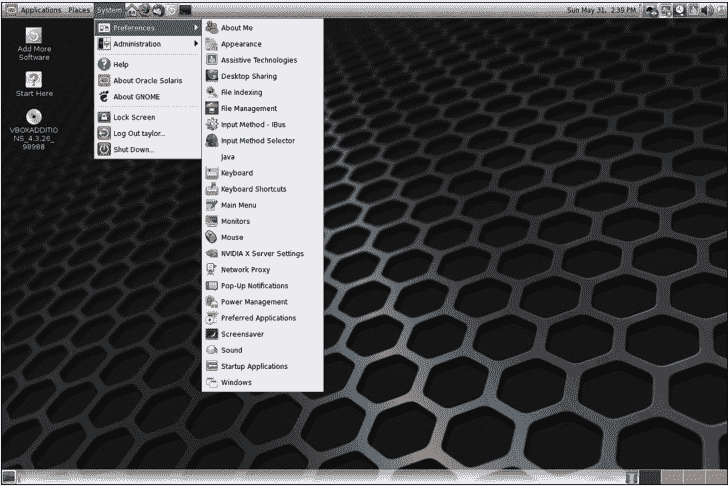

**FIGURE 24.1** GNOME 提供了许多不同的配置选项。

我将选择 Appearance，以便你可以看到配置 GNOME 桌面的简易程度。图 [Figure 24.2](#) 所示的 Appearance Preferences 窗口会出现。

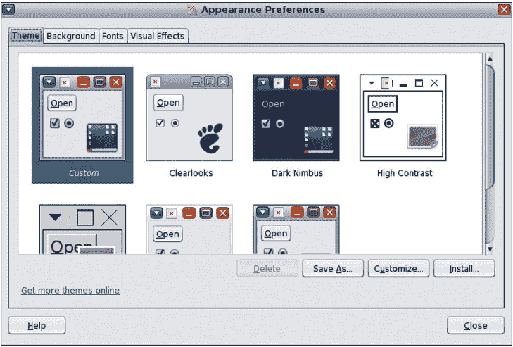

### FIGURE 24.2 微调 GNOME 主题首选项。

我将选择 Sunrise, Beauty of Nature 来自 Google 的免许可壁纸档案，你将在本小时后面的截图中看到它。

- 2. 另一个值得调整的首选项是屏幕保护程序，我很高兴地报告说 GNOME 包含大量有趣的屏幕保护程序。当然，凭借现代屏幕和显示器设计，你可能实际上并不需要屏幕保护程序，但选择如此之多，为什么不呢？

### Tip

当你尝试调整屏幕保护程序设置时，你可能会看到一个窗口提示“XScreenSaver 守护进程似乎未在显示 :0.0 上运行。现在启动它吗？” 如果你收到此对话框，请点击 OK：此守护进程是一个小型应用程序，在必要时启动屏幕保护程序。

无论你是否选择图形屏幕保护程序，在图 24.3 所示的配置屏幕中有一个非常重要的选项需要注意，即“Lock Screen After X minutes”，这是一个非常有用的安全工具，特别是在公共环境中。启用此设置后，在指定的空闲分钟数后，屏幕保护程序启动，需要你的账户密码才能返回桌面环境。

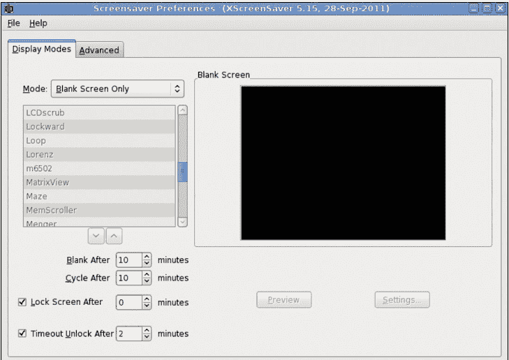

FIGURE 24.3 检查你的 Screensaver Preferences 设置，以确保系统在几分钟后锁定。你以后会感谢我的，特别是如果你在计算机实验室工作。

Screensaver Preferences 对话框的 Advanced 选项卡还提供了许多有用的选项，特别是对于笔记本 Unix 或 Linux 用户，如图 24.4 所示。

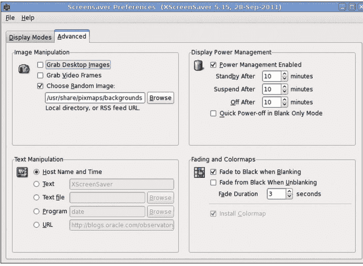

### FIGURE 24.4 高级屏幕保护程序首选项设置可帮助你节省电量等！

我只在移动系统上使用时启用电源管理，但如果只是为了省电，真的没有理由不让系统在空闲一小时或更长时间后待机。在这里，Standby 是显示器变黑的时间，Suspend 是显示器进入省电模式的时间（如果支持），Off 是显示器完全关闭的时间。

GNOME 界面强大和专业性的最好证明就是，你想要自定义的一切都可以通过友好、逻辑且直观的图形窗口轻松修改。无论你需要微调屏幕分辨率、调整鼠标控制，还是启用一个有趣的新屏幕保护程序，GNOME 都能让你在没有麻烦的情况下进行所需的更改。

### 使用 GNOME 应用程序

调整 GNOME 界面本身很有趣且引人入胜，但正如没有应用程序的 Windows 几乎无用一样，仅靠 GNOME 也无法让你走得很远。在此领域生产力的关键应用程序是文件系统浏览器、Web 浏览器和电子邮件应用程序。

## FIGURE 24.6 使用 GNOME 文件浏览器探索文件系统非常简单。

请注意图 24.6 顶部的菜单，上面写着 Icon View。点击它并选择 List View 即可。这会带来很大的屏幕变化，如图 24.7 所示，如果你正成为一名硬核 Unix 专家，这可能更容易使用。

## FIGURE 24.7 GNOME 文件浏览器中超级实用的列表视图。

你可以通过 GNOME 文件浏览器对文件系统进行大量自定义和更改。尝试并点击各个菜单，看看有哪些选项可用。你会印象深刻的！

## Task 24.3: The Firefox Web Browser

如果我按应用程序来追踪我的时间，我敢打赌我花在 Web 浏览器上的时间比任何其他应用程序都要多，除了我的电子邮件程序之外。即使我写这本书，花费数小时打磨我的散文和解释，我仍然注意到我花了很多时间在网上冲浪。

由于现代互联网的很大一部分源于 Unix 平台，因此毫不奇怪，Unix，尤其是 GNOME 和 X11 环境，提供了对许多功能强大且功能齐全的 Web 浏览器的支持。它不支持 Internet Explorer 或 Apple Safari，但没关系，因为 Firefox 是一款顶级浏览器，可用于所有现代操作系统，并且非常适合 GNOME 环境。

- 1. 我不知道你如何冲浪，但作为一名多产的博主，我花了很多时间阅读新闻网站和其他博客网站。我阅读在线新闻最喜欢的工具是 Google News，网址为 news.google.com。

### Tip

我没有空间在这里解释博客，但我在 www.askdavetaylor.com 上深入写了关于它的内容。此外，如果你对我的博客感兴趣，Ask Dave Taylor 就是其中之一，我还有一个电影评论网站 http://www.DaveOnFilm.com 和一个育儿博客 http://GoFatherhood.com。你受邀查看它们全部。

你可以在图 24.8 中看到 Google News 提供的最新新闻。


FIGURE 24.8 Firefox 提供了一个功能强大的 Web 浏览器。在这里，我正在查看 Google News 上的最新新闻。

2. 你还可以自定义你的 Firefox 体验，包括设置新的主页和更改字体、颜色、语言等等。选择 Edit -> Preferences，你也可以成为一名疯狂的科学家！

Firefox 最强大的功能之一是其可扩展的插件架构。你可以下载和安装数十种不同的附加组件实用程序，以扩展你的 Web 浏览器的功能——这些功能会让你为任何被困使用 Microsoft Internet Explorer 的可怜 Windows 用户感到同情。

你可以在信息丰富的网站 www.getfirefox.com 上了解很多关于 Firefox 的信息——并下载适用于 Windows 或 Mac 系统的 Firefox 版本。如果你还没有体验过这种替代浏览器，你需要前往该网站并立即为你的电脑下载该应用程序。你不会后悔的。

## Task 24.4: Using Thunderbird for Email

我之前谈到了我在不同应用程序上花费的时间，我评论说我花了很多时间在我的 Web 浏览器上。这当然是真的，但我大部分的电脑时间都花在电子邮件上，实际上，我花费无数小时——该死，可能每年几周——发送和回复电子邮件。如果包括无休止的垃圾邮件流，我每天收到超过 1,000 条消息。（多亏了一些好的垃圾邮件过滤技术！）

在 Unix 世界里，对我来说没有比一个好的电子邮件程序更重要的程序了，虽然我在多年前编写了自己的电子邮件程序（Elm Mail System，如第 20 小时“使用电子邮件进行通信”中所述），但自那时以来，我对电子邮件应用程序的需求已显著增加，今天我发现只有少数几个应用程序具有我需要的多账户、多签名、HTML 格式电子邮件、附件解码、IMAP 等等支持。

幸运的是，其中两个最好的应用程序可用于 Unix/Linux/GNOME 环境：Thunderbird（它来自生产 Mozilla Firefox 的同一团队）和 Evolution。对于这次非常快速的游览，让我们简单地看一下 Thunderbird。

- 1. 使用电子邮件程序的第一项也是最重要的任务是将其配置为与你的互联网服务提供商一起工作，包括传入和传出电子邮件服务器、你自己的账户名和电子邮件地址等等。

Thunderbird 包含一个配置向导，使这第一步很容易完成，因此在你准备就绪之前，不应超过一两分钟，并且如果服务器邮箱中有任何内容，你的邮箱也会被整合到程序中。

我只是使用了我的 Google Gmail 账户。我轻松输入了地址和密码，Thunderbird 就自动获取了我所有待处理的邮件以及我的文件夹列表和联系人列表。速度快得惊人，容易得惊人。

一旦你完成所有配置并在你的邮箱中有几条消息，你会看到一个类似于图 24.9 所示的邮箱视图。

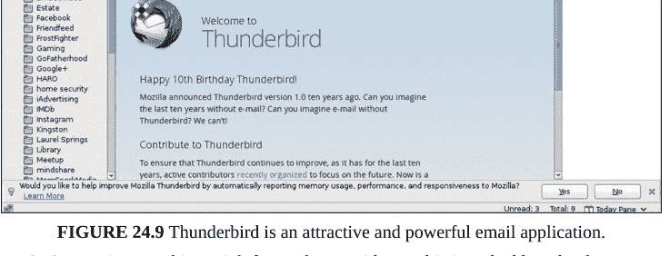

FIGURE 24.9 Thunderbird 是一个外观漂亮且功能强大的电子邮件应用程序。

- 2. 编写电子邮件也很简单，而且有一个复杂的地址簿（Thunderbird 可以自动从各种不同的程序中提取配置和地址信息，包括基于 IMAP 的系统，如 Gmail 或

Yahoo Mail) 和一个与 Windows 和 Mac 版邮件程序相同的撰写窗口，如图 24.10 所示。

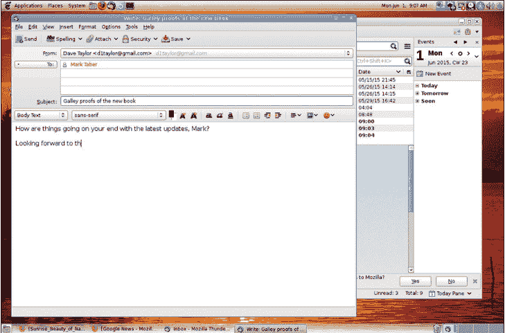

## FIGURE 24.10 Composing a new email message in Thunderbird.

3. 就像 Firefox 一样，Thunderbird 也有无数个配置和偏好设置，你可以去探索和调整它们，以满足你与程序和邮件交互的个人偏好，如图 24.11 所示。

## FIGURE 24.11 Lots and lots of preferences to tweak and tune in Thunderbird.

这里还有一个提高生产力的额外技巧：将设置改为让 Thunderbird 比你希望的更不频繁地检查新邮件。减少中断直接转化为工作日更高的效率和生产力。

Thunderbird 再一次展示了开源社区的力量。这个免费下载的邮件应用程序拥有像 Microsoft Outlook 这样的商业应用程序最重要的许多功能，并且界面与 Apple Mail 一样流畅。可能需要花几个小时才能真正掌握该程序并按需精确配置它，但 Thunderbird 和另一个流行的开源 Unix 替代品 Evolution 都是你日常电子邮件和通信的优秀选择。

### Tip

你可以在 OpenOffice 网站 — www.openoffice.org — 了解更多关于 Evolution 的信息，你也可以在 Mozilla 网站 — www.mozilla.org — 了解更多关于 Thunderbird 的信息。

## Summary

GNOME 和 X11 系统构成了二十一世纪 Unix 体验的基础，提供了一个图形界面，其功能和易用性都与微软 Windows 和苹果 Macintosh 的最佳产品相当。你不能去当地的电脑商店购买 GNOME 应用程序，但这正是因为它们可能已经包含在你的系统上，或者可以免费下载获得。

## Congratulations!

你已经读完了整本书，全部 24 小时，现在你是一名真正的 Unix 专家。如果你随后尽可能多地使用该系统几周，你会发现命令、选项标志和管道都开始变得自然起来。我已经使用各种版本的 Unix 超过 30 年了（很难相信，但我第一次登录是在大学一年级，1980 年！），我可以向你保证，Unix 没有发生巨大变化的原因是它实在太强大、全面和有用。

你花费在学习成为 Unix 高级用户上的时间将是非常值得的，无论你的目标是成为操作系统内核黑客，还是仅仅想要让你的共享 Web 服务器按你的意愿跳舞。

感谢你花时间与我一起学习 Unix！如果你对 Unix 有任何问题，欢迎访问 Ask Dave Taylor（www.AskDaveTaylor.com）。别忘了访问官方书籍网站下载脚本以及由像你这样眼尖的读者报告的勘误（www.intuitive.com/tyu24）。如果你想让我知道你是否觉得这本书有帮助，请随时给我发邮件。你可以通过 d1taylor@gmail.com 联系我。

## Workshop

工作坊总结了你所学到的关键术语，并提出了一些关于本课主题的问题。

## Key Terms

blog 博客（blog，weblog 的简称）是一种网站类型，它围绕一个软件工具构建，该工具允许用户轻松添加频繁的、带日期戳的条目并保持网站更新。

blogger 博主是指在网络日志或博客上撰写条目的人。

skin Skin 是术语，指更改图形软件应用程序的外观但不改变其功能所需的图形、图标、字体等。

window manager 窗口管理器是一个控制图形用户界面环境中窗口的程序。在 X11 世界中，GNOME 是一个流行的窗口管理器。

## Exercises

- 1. 启动 GNOME 并在你的电脑上运行它，如果你还没有这样做。现在，修改屏幕保护程序，使其在 15 分钟不活动后会提示你输入密码，然后才能再次使用系统。
- 2. 使用 Firefox，前往 Google 的新闻服务，试试这种跟踪突发新闻的方法。同时，浏览所有不同的 Firefox 偏好设置屏幕，看看你可能想要为自己的口味调整什么。
- 3. 在 GNOME 中配置并运行一个邮件程序。从 Thunderbird（或 Evolution）程序向我发送一条测试消息，以确认你已一切正常工作。顺便也别忘了说“你好”！

## 附录 A. 常见 Unix 问题与解答

本书中埋藏着数百个问答，范围从“要使用哪些正确的标志组合才能让某个命令发挥作用？”到“在特定情况下哪些命令最有效？”此外，仅用 24 个一小时的课程学习 Linux 或 Unix 是一项艰难的任务，因此如果你感到有点不知所措，并在通往真正的 Unix 大师之路上一路磕磕绊绊，你并不孤单。

这就是我们加入本附录的原因：让你能够快速得到一些最常见 Unix 问题的答案。这些问题既来自我与 Unix 新手合作的经验，也来自提交到我的 Ask Dave Taylor 网站的众多 Unix 和 Linux 相关问题，网址为 www.askdavetaylor.com。

废话不多说……

## 如何在文件名包含空格时使用 find|xargs？

试图弄清楚为什么在使用 find 命令时会出现奇怪的“文件未找到”错误，这令人非常困惑。以下是一个典型示例：

```
find . -name "*.txt" | xargs rm
```


`$ find ./test -print`

```
./test

./test/Sample One

./test/Sample Three too

./test/Sample-Two
```

这个输出没有什么不寻常或令人困惑的地方，但请注意其中两个文件的文件名包含空格，因此当 `find` 的输出被送给 `xargs` 时，就会出问题：

```
$ find ./test -print | xargs ls -l
```

```
ls: ./test/Sample: No such file or directory

ls: ./test/Sample: No such file or directory

ls: One: No such file or directory

ls: Three: No such file or directory

ls: too: No such file or directory

-rw-r--r-- 1 taylor staff 0 31 May 23:03 ./test/Sample-Two

./test:

total 0

-rw-r--r-- 1 taylor staff 0 31 May 23:03 Sample One

-rw-r--r-- 1 taylor staff 0 31 May 23:03 Sample Three too

-rw-r--r-- 1 taylor staff 0 31 May 23:03 Sample-Two
```

问题在于 `xargs` 会盲目地将空格用作字段分隔符，这意味着 `./test/Sample One` 实际上被视为 `./test/Sample` 和 `One`，而两者在文件系统中都不存在，正如错误信息输出所示。

幸运的是，修复方法很简单：使用 `find` 谓词 `-print0` 而不是 `-print` 来指示 `find` 预期文件名中包含空格，然后确保同时使用 `xargs` 的 `-0` 标志，它告诉 `xargs` 文件名不是由空格分隔，而是由一个特殊的控制字符分隔：

```
$ find ./test -print0 | xargs -0 ls -l
```

```
-rw-r--r-- 1 taylor staff 0 31 May 23:03 ./test/Sample One

-rw-r--r-- 1 taylor staff 0 31 May 23:03 ./test/Sample Three too

-rw-r--r-- 1 taylor staff 0 31 May 23:03 ./test/Sample-Two

./test:

total 0

-rw-r--r-- 1 taylor staff 0 31 May 23:03 Sample One

-rw-r--r-- 1 taylor staff 0 31 May 23:03 Sample Three too

-rw-r--r-- 1 taylor staff 0 31 May 23:03 Sample-Two
```

## 如何在我的系统上查找大文件？

你的文件系统开始填满，你真的想快速识别出系统上 10 个或 20 个最大的文件，以便修剪它们、删除它们或做其他处理。这又是 `find` 命令的任务，这次使用的是与上一个问题中所示的略有不同的变体。

你可以通过使用 `/` 作为文件参数来搜索整个文件系统，或者你可以搜索自己的主目录，通过使用 `cd` 进入主目录然后使用以下命令：

```
$ find . -type f -print0 | xargs -0 ls -s | sort -rn | head -5
```

```
227064 ./Audio/TheE-MythRevisitedUn_mp332.aa

217056 ./Audio/Parent Night.aif

163488 ./Audio/Older Parent Night.aif

114384 ./Audio/Rahima Keynote.aif

104608 ./Audio/African Singing.aif
```

请注意，我们已通过使用 `-type f` 谓词将 `find` 限制为仅匹配文件，而不是目录，然后请注意我们改用更简洁且更易于数值排序的 `ls -s` 而不是 `ls -l`。

查找整个文件系统上最大的五个文件需要以下调用：

```
find / -type f -print0 | xargs -0 ls -s | sort -rn | head -5
```

请记住，这会花费相当长的时间运行：在典型的 Unix 或 Linux 系统上，它可能会列出并排序超过 100,000 个文件。

## 如何按计划运行程序？

Unix 中有两种不同的实用程序可以让你在未来某个时间安排程序的执行。

### at 命令

如果你只想在未来执行一次，那么使用 `at` 命令：

```
$ at
```

```
usage: at [-q x] [-f file] [-m] time

      at -c job [job ...]
```

```
at [-f file] -t [[CC]YY]MMDDhhmm[.SS]

at -r job [job ...]

at -l [-q queuename]

at -l [job ...]

atq [-q x] [-v]

atrm job [job ...]

batch [-f file] [-m]
```

例如，要在明天凌晨 3 点运行一个名为 `fixperms` 的脚本，可以使用以下命令：

```
at 3am tomorrow fixperms
```

手册页提供了关于这个巧妙命令的更多信息。

### cron

另一种可能性，也是 Unix 系统上使用得更为频繁的调度程序，是 `cron`，也叫作 `crontab`（这是它所执行的文件的名称）。在 Unix 系统上，操作系统每隔 60 秒就会让 `cron` 守护进程检查是否有需要调用的新命令。

遗憾的是，编写 `crontab` 条目可能有点棘手，但下面是用户 `crontab` 中的一个典型条目，通过调用 `crontab -e` 命令添加：

```
51 7 * * 1-5 $TRIVIAHOME/mailit -h -i -a
```

`crontab` 条目中的字段依次为：分钟、小时、一个月中的第几天、月份、一周中的第几天、带有可选标志或参数的命令。字段中的星号表示匹配该字段的所有可能值，因此这个 `crontab` 条目的含义是：“在一年中任何月份的任何日期的周一至周五（第5字段中的 1-5）上午 7:15，运行带有 -h、-i 和 -a 标志的 `mailit` 程序。”

在我使用 Unix 多年之后，发现 `crontab` 功能非常宝贵，通常会安排几十个不同的脚本、程序和实用工具在一天、一周、一月或一年的不同时间运行。天哪，如果你需要，甚至可以用它来提醒重要的生日！

#### 提示

Mac 系统和所有 Linux 系统也都支持 `cron`，这意味着你也可以在这些系统上轻松地安排重复运行的程序或脚本。

更多信息请参阅 `man crontab`。

例如，要将 `/usr/X11/bin` 添加到你的路径中，请使用以下命令：

```
export PATH="$PATH:/usr/X11/bin"
```

你还可以通过改变目录项的顺序，将新目录放在 `PATH` 的前面：

```
export PATH="/usr/X11/bin:$PATH"
```

如果你使用的是 C shell 或其变体，语法会略有不同：

```
setenv PATH "$PATH:/usr/X11/bin"
```

无论哪种情况，如果你想让更改永久生效，请进入你的 `~/.login` 或 `~/.profile`（分别对应 csh 和 bash），然后调整现有的 `PATH` 设置或添加相应的行，如上所示。

例如，下面是我自己 `~/.profile` 中的内容：

```
export PATH="$PATH:/sw/bin:/usr/X11R6/bin:/Users/taylor/bin";
```

## 如何恢复已删除的文件？

啊，好吧，你无法恢复已删除的文件。Unix 没有这种有用的功能。这就是为什么你在*删除文件时必须格外小心*！

另外，请确保至少采用基本的备份策略，至少每周保存一次系统中的所有内容，如果不更频繁的话。

## 如何设置我的 shell 以防止意外删除？

防止文件被意外覆盖的关键是在登录时为你的 shell 启用 `noclobber` 设置。通常的做法是在 `.profile` 或 `.login` 中包含 `set noclobber`。

如果没有设置它，会发生下面这种情况：

```
$ touch Bcareful
```


```
$ ls > Bcareful

$
```

没有设置 `noclobber`，我就刚刚覆盖了一个已有文件！然而，一旦设置后，情况会好一些：

点击此处查看代码图片

```
$ ls > Bcareful

bash: Bcareful: cannot overwrite existing file
```


虽然这还不完美，但仍然很有帮助。

## shell 错误“arg list too long”和“broken pipe”是什么意思？

对于 `broken pipe`（管道破裂）错误，大量数据从一个命令发送到下一个命令，但后一个命令在一定时间后停止接收信息。一个典型的例子是将数千行输出通过管道传给像 `tail -5` 这样的命令，该命令在显示五行后便停止读取输入。通常这无需担心。

另一个错误 `arg list too long` 发生在一个目录中有大量文件时，例如，使用 `*` 作为通用通配符会产生一条扩展后的命令行，其长度超过了 shell 的处理能力。

这是一个需要关注的错误。如果你看到 `arg list too long`，你需要找出问题所在并修复，以确保命令或脚本按预期工作。一个典型的解决方案是使用模式 `[a-m] *` 和 `[n-z] *` 将通配符匹配拆分为两组不同的文件名。

## 为什么使用 ssh 而不是 telnet？或者使用 sftp 而不是 ftp？

如果别人入侵了你的账户并翻找一番，复制并解码你的密码文件，或者篡改你的网站，你会感到多么不安？很可能非常不安。所以，为了你自己好，请确保在可能的情况下始终使用安全、加密的远程登录程序 `ssh` 而不是 `telnet`；如果你需要在两个系统之间传输文件，也请出于同样的原因尽量使用 `sftp` 而不是 `ftp`。

哦，别忘了，在公共网络（比如开放的 Wi-Fi 热点）上，这一点*加倍重要*！

## 总结

好了。以上就是常见的 Unix 问题。根据你自己学习 Unix 的经验，这些问答是否正确？给我发消息告诉我吧！

### 索引

### 符号

- `[ ] (square brackets), 150`
- `( command, 238`
- `) command, 238`
- `:! command, 238`
- `! command, 255`
- `!! command, 238, 286`
- `!$ command, 286`
- `!* command, 286`
- `!}` command, 238`
- `! escape-to-Unix command, 232-237`
- `!n command, 286`
- `!ptrn command, 286`
- `$ (dollar sign), 314`
- `$ command, 205`
- `* (asterisk), 125`
- `+ (plus) sign, 220`
- `, (comma), 222`
- `. (dot), 49`
- `/ (slash), 42, 46`
- `: (colons), 46, 170, 214-219`
- `:ab a bcd command, 238`
- `:ab command, 238`
- `:map a bcd command, 238`
- `:map command, 238`
- `:set nonumber command, 238`
- `:set number command, 238`
- `:s/old/new/ command, 238`
- `:s/old/new/g command, 238`
- `@ (at sign), 42`
- `{ command, 238`
- `^ (caret), 159`
- `^a^b command, 286`
- `^b command, 205`
- `^d command, 205`
- `^f command, 206`
- `^g command, 238`
- `^u command, 206`
- `^v command, 238`
- `| (pipe), 129`
- `0 command, 206`
- `-1 flag, 64, 70, 72`

### A

- `A command, 257`
- `a command, 205`
- `-A flag, 379`
- `-a flag, 64, 303, 379`
- `absolute filenames, 47-56`
- `access`
  - `! escape-to-Unix, 232-237`
  - `concentric access models, 94`
  - `CUPS (Common Unix Printing System), 349`
- `adding. See inserting`
- `Aho, Alfred, 169`
- `aliases`
  - `command shells, 286-290`
  - `commands, 264, 327`
  - `creating, 63`
- `Alt key, 242`
- `American Telephone and Telegraph (AT&T), 5`
- `anonymous archives, FTP, 410-413`
- `applications, GNOME, 445-452`
- `applying`
  - `cut command, 169-171`
  - `find command, 420-422`
  - `head program, 128-130`
  - `PATH variables, 337-339`
  - `permissions, 83-104`
- `archives`
  - `anonymous, FTP, 410-413`
  - `compress command, 375-376`
  - `cpio command, 377-379`
  - `Linux package managers, 381-382`
  - `tar commands, 366-372`
  - `zip command, 372-375`
- `arg list too long error, 460`
- `arithmetic, programming shells, 316-317`
- `asterisk (*) , 125`
- `at command, 457`
- `at sign (@), 42`
- `availability`
  - `of command shells, 264-266`
  - `disk space, checking, 77-79`
- `The AWK Programming Language, 169`
- `awk programs, 163-169`
  - `commands, 304, 341`
  - `navigating, 164`

### B

- `B command, 205, 257`
- `b command, 205`
- `background command. See bg (background) command`
- `Backspace key, 182, 205`
- `backups, 379-381. See also archives`
- `bash (Bourne Again shell), 263, 265`
  - `configuration files, navigating, 274-277`
  - `history command, navigating, 280-281`
  - `shells, programming, 326-331`
- `Bash shells, 4`
- `.bashrc file, 274`
- `Bell Labs, 5`
- `Berkeley Mail, 386. See also mailx command`
- `bg (background) command, 299-302`
- `bin directory, 42`
- `Bourne, Stephen, 264`
- `Bourne Again shell. See bash`
- `Bourne shell. See sh`
- `broken pipe error, 460`
- `building mylocate scripts, 334-337`

### C

- `C, 6`
- `C command, 225, 238, 257`
- `c command, 225, 238`
- `C shell. See csh`
- `-C flag, 64`
- `-c flag, 171, 371`
- `C-a command, 248`
- `calculating strings, numeric permissions, 98-100`
- `CGI (Common Gateway Interface), 438`
- `change command, 225-232`
- `characters`
  - `emacs editors, deleting, 249-252`
  - `separator (directories), 45-46`
  - `sets, 172`
- `chmod command, 458`
  - `directories, modifying, 92-94`
  - `files, modifying, 94-98`
  - `numeric mode, 98`
- `C-k command, 252`
- `clients, PuTTY, 406`
- `closing vi editors, 181`
- `C-n command, 248, 257`
- `col command, 355-359`
- `colons (:), 46, 170, 214-219`
- `com domain, 395`
- `combining flags, 64-65`
- `comma (,), 222`
- `command line`
  - `email, sending from, 391-395`
  - `pipes, 163`
    - `cut command, 169-171`
    - `inline editing, 171-175`
    - `sed command, 172-175`
    - `tr command, 172-175`
  - `user interfaces, 4. See also shells`
- `command prompts, navigating, 30-35`
- `commands, 4, 10`
  - `(, 238`
  - `), 238`
  - `:!, 238`
  - `:ab a bcd, 238`
  - `!, 255`
  - `!!, 238, 286`
  - `!$, 286`
  - `!*, 286`
  - `!}, 238`
  - `! escape-to-Unix, 232-237`
  - `!n, 286`
  - `!ptrn, 286`
  - `$, 314`
  - `:ab, 238`
  - `:map, 238`
  - `:map a bcd, 238`
  - `:s/old/new/, 238`
  - `:s/old/new/g, 238`
  - `:set nonumber, 238`
  - `:set number, 238`
  - `^a^b, 286`
  - `^b, 205`
  - `^d, 205`
  - `^f, 206`
  - `^g, 238`
  - `^u, 206`
  - `^v, 238`
  - `0, 206`
  - `A, 257`
  - `a, 205`
  - `at, 457`
  - `aliases, 264, 327`
  - `awk, 304, 341`
  - `B, 205, 257`
  - `b, 205`

`bg (background), 299-302`
`C, 225, 238, 257`
`c, 225, 238`
`C-a, 248`
`cancel, 360`
`case, 321`
`c-b, 248`
`cd, 54-56`
`C-d, 252, 257`
`C-e, 248`
`c-f, 248`
`change, 225-232`
`chmod, 458`
  修改目录, 92-94
  数字模式, 98
`C-k, 252`
`C-n, 248, 257`
`col, 355-359`
冒号 (:), 214-219
`compress, 375-376`
`cp, 110-112`
`C-p, 248`
`cpio, 377-379`
`cron, 457`
`curl, 422-425`
`cut, 169-171, 268`
`C-v, 248`
`C-w, 257`
`C-x [, 248`
`C-x ], 248`
`C-x b, 257`
`C-x Delete, 252`
`C-x u, 252`
`D, 205`
`d, 197, 205`
`date, 35, 380`
`Delete, 252`
删除消息, 386
`df, 77-79, 340`
`DIR, 60`
`du (磁盘使用情况), 75-77`
`e, 238`
`echo, 148, 284`
`egrep, 158-160`
`emacs 编辑器, 258-261`
`env, 52-53, 271`
`-exec, 419`
`exit, 26`
`export, 275`
`expr, 316, 318`
`F, 257`
`fg (前台), 295, 299-302`
`file, 123-126, 323`
识别文件类型, 123-126
浏览 Unix 目录, 126-128
`find, 334, 455-456`
`h, 206`
`headers, 386, 389`
`help, 387`
`history`
    浏览, 280-281
    快捷方式, 281-286
`I, 257`
`i, 189, 206`
`if, 321`
`j, 206`
`K, 257`
`k, 206`
`kill, 307-310`
`L, 257`
`l, 206`
`lp, 351`
`lpadmin, 348`
`lpinfo, 355`
`lpr, 351`
`lprm, 360`
`lpstat, 348-349, 360`
`ls, 41, 52, 60-67`
    文件类型指示符, 84
    标志, 67-70
    列出目录树, 68-69
    长列表格式, 70-74
    修改排序, 67-68
`ls -l, 104`
`lynx, 422-425`
`M, 257`
`M- <, 248`
`M->, 248`
`M-a, 248`
邮件地址, 387
`mailx, 386-391`
`M-b, 248`
`M-d, 252`
`M-Delete, 252`
`M-e, 248`
`M-f, 248`
`M-k, 252`
`mkdir, 108-110`
`more 程序, 136`
`motion. See motion commands`
`mv`
 移动文件, 112-113
 重命名文件, 113-114
`M-v, 248`
`N, 257`
`n, 206, 255`
`nG, 206`
`noclogger, 460`
`O, 192, 206`
`o, 192, 206`
`passwd, 27`
`pattern, 210`
`Perl 编程, 438`
`pr, 355-359`
`print msgs, 387`
`printenv, 271`
`ps, 302-307`
`pwd, 54`
`python, 34`
`q, 255`
`query-replace, 256`
`quit, 181, 387`
`R, 225, 238`
`r, 225, 238`
`read, 324`
`:redo, 198`
`replace, 225-232`
`reply, 387`
`rm, 116, 118-120`
`rmdir, 114-115`
`S, 257`
`save, 389`
`save folder, 387`
`sed, 172-175, 459`
`sftp, 407, 461`
`sleep, 305`
`sort, 15`
`spell, 160`
`ssh, 404, 461`
`T, 257`
`tar, 366-372, 380`
`telnet, 403, 461`
`test, 318, 338`
`time, 35`
`touch, 74-75`
`tr, 172-175`
`trap, 342`
`tree, 69`
`U, 206`
`u, 197, 206`
`umask, 100-103`
`undelete msgs, 387`
`unzip, 373`
`users, 33`
`V, 257`
`vi 编辑器, 205, 238. See also vi editors`
`W, 206, 257`
`w, 34-35, 206`
`whatis, 14`
`who, 185, 356`
`whoami, 31-33`
`x, 206`
`xargs, 420, 455-456`
`y, 255`
`zip, 372-375`
**命令 shell, 263**
  别名, 286-288
  可用性, 264-266
  bash (Bourne Again shell) 配置文件, 274-277
  自定义提示符, 配置, 290-292
  history 命令
    浏览, 280-281
    快捷方式, 281-286
  识别, 267-268
  浏览, 271-274
  强大别名, 288-290
  选择, 269-271
**C shell. See csh**
**通用网关接口. See CGI**
**通用 Unix 打印系统. See CUPS**
**比较函数, 编程 shell, 318-321**
**compress 命令, 375-376**
**压缩, 79-81**
  unzip 命令, 373
zip 命令, 372-375
# 计算机科学研究组, 5
同心访问模型, 94
条件表达式, 编程 shell, 321-324
# 配置
备份, 379-381
配置文件, 274-277
CUPS (通用 Unix 打印系统), 349
自定义提示符, 命令 shell, 290-292
登录时默认变量, 271
权限
目录, 88-91
文件, 84-88
# 连接
远程 Internet 连接, 403-405
第三方 SSH 连接, 405-406
# 控制
流程, 326
作业, 295. See also jobs
# Control 键, 185
# 复制. See also 移动
目录, 111
文件, 110-112
SFTP (安全 FTP), 407-410
# 计数
文件, 337-339
单词, 143-144
# cp 命令, 110-112
# C-p 命令, 248
# cpio 命令, 377-379
# cron 命令, 457
csh (C shell), 4, 263, 280
CUPS (通用 Unix 打印系统), 349-351
curl 命令, 422-425
curses 包, 181
光标控制键 (vi 编辑器), 182-185
自定义提示符, 配置命令 shell, 290-292
cut 命令, 169-171, 268
C-v 命令, 248
C-w 命令, 257
C-x b 命令, 257
C-x [ 命令, 248
C-x ] 命令, 248
C-x Delete 命令, 252
C-x u 命令, 252
编辑-编译-运行 周期, 283
# D
D 命令, 205
d 命令, 197, 205
-d 标志, 319, 379
-d (debug) 标志, 438
date 命令, 35, 380
默认变量, 配置登录, 271
默认值, 格式化权限, 100-103, 109
Delete 命令, 252
delete msgs 命令, 386
删除. See also 移除
字符, emacs 编辑器, 249-252
文件, 114-115
恢复文件, 459
文本, vi 编辑器, 197-205
df 命令, 77-79, 340
使用 cut 命令切片, 169-171

Digital Equipment Corporation (DEC)，5

DIR 命令，60

目录，42。另见 文件；文件夹
- 添加，459
- bin，42
- 复制，111
- lib，43
- 列表，65-67
- lost+found，43
- mkdir 命令，格式，108-110
- mnt，44
- 修改，107
- 移动，54-56
- 导航，126-128
- net，45
- 权限
  - 配置，88-91
  - 默认格式，100-103
  - 使用 chmod 命令修改，92-94
- 当前工作目录，54
- 删除，115
- 重命名，113
- 分隔符字符，45-46
- 特殊，51-52
- sys，44
- tmp，44
- 树，68-69
- usr，44

磁盘空间
- 检查可用空间，77-79
- 脚本，342
- 利用率，339-342

- 磁盘使用，管理，59
- 文档，Perl 编程，435-437
- 美元符号（$），314
- 域，395
- 点（.），49
- 点点表示法，51，66
- -dprinter 标志，352
- du（磁盘使用）命令，75-77

## E

- e 命令，238
- -E 标志，379
- -e 标志，303，320
- echo 命令，148，284
- echo 语句，54
- 编辑-编译-运行 循环，283
- 编辑
  - 命令行管道，171-175
  - emacs 编辑器，178，241
    - 删除字符，249-252
    - 文件命令，258-261
    - Help System 命令，257
    - 插入文本，242-244
    - 导航文件，244-248
    - 搜索/替换，253-256
    - 启动，242
  - 文件权限，85
  - vi 编辑器，177
    - ! 转义到 Unix 命令，232-237
    - 更改命令，225-232
    - 冒号命令，214-219
    - 命令，205
    - 删除文本，197-205

插入文本，188-196

移动页/词，185-188

导航，182-185

优化，209

退出，181

替换命令，225-232

搜索文件，210-214

搜索/替换，222-225

启动，178-182，219-222

edu 域，395

-ef 标志，320

egrep 命令，158-160

元素
目录权限，72
权限字符串，71

elif 关键字，322

else 关键字，321

emacs 编辑器，178，241
字符，删除，249-252
文件
命令，258-261
导航，244-248
Help System 命令，257
移动命令，248
搜索/替换，253-256
启动，242
文本，插入，242-244

电子邮件，385
命令行发送，391-395
全局发送，395-400
阅读，386-391
Thunderbird（GNOME），449-452

输入
  命令，136
  密码，25
env 命令，52-53，271
环境
  命令外壳，271-274
  GNOME（GNU Network Object Model Environment），441-442
    应用程序，445-452
    配置，442-445
  PRINTER，352
  变量，53
  查看，52-53
-eq 标志，318
错误。另见 故障排除
  参数列表过长，460
  损坏的管道，460
Escape（Esc）键，178，206
Exchange 程序，428-432
-exec 命令，419
执行权限
  目录，89
  文件，84。另见 权限
exit 命令，26
EXIT 信号，342
export 命令，275
expr 命令，316，318
表达式
  条件，编程外壳，321-324
  循环，324-326
  正则
    egrep 命令，158
    格式，154-157

## F

F 命令，257

-F 标志，64

-f 标志，320，355，371

fg（前台）命令，295，299-302

文件浏览器（GNOME），446-447

文件系统
- /（斜杠），42
- bin 目录，42
- cd 命令，54-56
- 目录分隔符字符，45-46
- 文件名，47-56
- Unix 中的隐藏文件，48-51
- 层次结构，39-45
- HOME 变量，53
- lib 目录，43
- lost+found 目录，43
- mnt 目录，44
- 导航，39
- PATH 变量，53
- pwd 命令，54
- 特殊目录，51-52
- sys 目录，44
- 测试标志，319
- Thompson，6
- tmp 目录，44
- Unix，41-42
- usr 目录，44
- 查看，60-67

文件名，47-56
- mylocate 脚本，334
- 后缀，63

+   通配符，148-151
+   **文件，123**
+   .（点），49
+   .bashrc，274
+   命令，123-126，323
+   emacs 编辑器，258-261
+   文件类型，识别，123-126
+   Unix 目录，导航，126-128
+   compress 命令，375-376
+   压缩，79-81
+   复制，110-112
+   计数，337-339
+   emacs 编辑器，导航，244-248
+   grep 命令，151-154
+   Unix 中的隐藏文件，48-51
+   层次结构，47
+   Internet，搜索，422-425
+   行，查看，458-459
+   LISTS，70
+   列表，59，458
+   修改，107
+   移动，112-113
+   命名，50
+   覆盖，113
+   权限，83
+   应用，83-104
+   配置，84-88
+   目录设置，88-91
+   格式化默认值，100-103
+   识别所有者，103-104
+   使用 chmod 命令修改，94-98
+   故障排除，458

打印，351-355

.profile，274

恢复，459

重定向，142-143

删除，114-115

重命名，113-114

搜索，456-457

SFTP（安全 FTP），407-410

排序，67-68

touch 命令，格式化，74-75

类型，指示符，84

Unix，44

vi 编辑器，搜索，210-214

查看，60-67，123-138

应用 head 程序，128-130

cat 程序，131-133

识别文件类型，123-126

more 程序，133-138

导航目录，126-128

tail 程序，130-131

vmunix，44

## 过滤器，141，144-148

## find 命令，334，455-456

应用，420-422

导航，415-420

## Firefox（GNOME），448-449

## 标志

+   - -A，379
+   - -a，303，379
+   - -c，171，371
+   - 组合，64-65
+   - 命令，73

-d，319，379
-d（调试），438
-dprinter，352
-E，379
-e，303，320
-ef，320
-eq，318
-f，320，355，371
-g，320
-ge，318
grep 命令，152
-gt，318
-H，371
-h，352，371
-hheader，355
-I，379
-i，352，379
-j，371
-L，319，352，379
-l，303
-le，318
lp 命令，352
lpr 命令，352
ls 命令，63，67-70
-lt，318
-m，355，371
+n，355
-n，355
-ne，318
-nt，320
-O，379
-o，379

-ot，320

-p，371

-Pn，352

-Pprinter，352

pr 命令，355

-R，215，352，379

-r，320

-s，320

sort 命令，145

-t，371，379

-ttitle，352

-t xx，303

-u，303

-v，371，379

-w，303，306

-wn，355

-X，371

-x，303，306

-Z，371

-z，371

流量控制，326

文件夹。另见文件

/（斜杠），42

打开，8

for 命令，324

前台命令。另见 fg（前台）命令
格式化

别名，63

默认权限，100-103，109

目录，mkdir 命令，108-110

文件，touch 命令，74-75

作业，打印，355-359

长列表格式，70-74

ls 命令，长列表格式，70

密码，28-30

正则表达式，154-157

自由软件基金会，265

FreeBSD，265

FTP（文件传输协议），403，410-413

ftp 命令，461

函数

bash（Bourne Again shell），326-331

比较，编程 shell，318-321

showdirectory，330

## G

G 命令，206

-g 标志，320

-ge 标志，318

通用电气（GE），5

GET 命令，422-425

GNOME（GNU 网络对象模型环境），4，8，225，441-442

应用程序，445-452

配置，442-445

GNU 网络对象模型环境。另见 GNOME

GNU 项目，265

图形界面，4，8

图形用户界面。另见 GUIs

grep 命令，151-154，334，420，458

组，权限，103-104

-gt 标志，318

GUIs（图形用户界面），441-442

gzip 程序，79-81

## H

h 命令，206

-H 标志，371

-h 标志，352，371

head 程序，128-130

headers 命令，386，389

帮助，9

命令，386

man 手册页，9-16

Unix 在线参考，9-16

帮助系统命令，emacs 编辑器，257

-hheader 标志，355

Unix 中的隐藏文件，48-51

层次结构

文件系统，39-45

文件，47

hi-low 游戏，342-345

history 命令

导航，280-281

快捷方式，281-286

Unix 历史，5-7

HOME 变量，53，271

## I

I 命令，257

i 命令，189，206

-I 标志，379

-i 标志，352，379

识别命令 shell，267-268

if 命令，321

if-then 语句，322

if-then-else 语句，323

指示符，文件类型，84

内联编辑，命令行管道，171-175

## 插入

目录，459

文本

emacs 编辑器，242-244

vi 编辑器，188-196

插入命令（vi 编辑器），195-196

安装 CUPS（通用 Unix 打印系统），349

接口，4。另见 shells

CGI（通用网关接口），438

CUPS（通用 Unix 打印系统），349-351

文件浏览器（GNOME），446-447

Firefox（GNOME），448-449

Gnome，225

Thunderbird（GNOME）用于电子邮件，449-452

Internet，搜索文件，422-425

## J

j 命令，206

-j 标志，371

## 作业

控制，295

前台/后台，299-302

打印，格式化，355-359

进程

停止，307-310

查看，302-307

停止，295-298

Joy，Bill，178，264

## K

K 命令，257

k 命令，206

KDE，4，8

Kernighan，Brian，5，169

## keys
- Alt，242
- Backspace，182，205
- Control，185
- 光标控制键（vi 编辑器），182-185
- Escape（Esc），178，206
- Meta，242
- Return，182，206

## keywords
- elif，322
- else，321

kill 命令，307-310

Korn，David，264

Korn shells。参见 ksh

ksh（Korn shells），264，280-281

## L

L 命令，257

l 命令，206

-L 标志，319，352，379

-l 标志，64，303

语言，C，6

## lists
- 目录，65-67
- 文件，59，458
- 有序，52
- 树，68-69

LISTS 文件，70

本地打印机，搜索，348-349

位置，列出，65-67

登录/注销，23-27，271

LOGNAME 变量，53，273

长列表格式，70，71-74

## loops
- 表达式，324-326
- while 循环，326，344

lost+found 目录，43

lp 命令，351

lpadmin 命令，348

lpinfo 命令，355

lpr 命令，351

lprm 命令，360

lpstat 命令，348-349，360

ls -1 命令，104

## ls 命令，41，52，60-67
- 目录树，列出，68-69
- 文件类型指示符，84
- 长列表格式，70-74
- 排序，修改，67-68
- 特殊标志，67-70

-lt 标志，318

lynx 命令，422-425

## M

M 命令，257

-m 标志，64，355，371

M-a 命令，248

Macintosh 文件
复制，110
删除，118
重命名，114
查看文件类型，123

mail address 命令，387

MAIL 变量，53，273

mailx 命令，386-391

man 手册页，9-16
mkdir，11-13
导航，10

管理
磁盘使用，59
Linux 软件包管理器，381-382

M-b 命令，248

M-< 命令，248

M-> 命令，248

chmod 命令
目录，92-94
文件，94-98

目录，107
文件，107
密码，27-28
shells，变量，314
排序，67-68

## more 程序，133-138，178

## motion 命令
emacs 编辑器，248
vi 编辑器，195-196

## moving
目录，54-56
文件，112-113
页/词，185-188

## multiuser 系统，7-8

## M-v 命令，248

## mv 命令，文件
移动，112-113
重命名，113-114

## mylocate 脚本，334
构建，334-337
磁盘空间利用率，339-342
hi-low 游戏，342-345
PATH 变量，应用，337-339

## N

N 命令，257

n 命令，206，255

+n 标志，355

-n 标志，355

+n 记法，134

## naming
- 目录，113
- 文件系统，48-51
- 文件名，47-56
- 文件，50
- 通配符，148-151

## navigating
- awk 程序，164
- bash（Bourne Again shell）配置文件，274-277
- 命令
  - compress，375-376
  - cpio，377-379
  - 提示，30-35
  - shells，271-274
- 目录，126-128
- 文件系统，39
  - bin 目录，42
  - cd 命令，54-56
  - 目录分隔符字符，45-46
  - env 命令，52-53
  - 文件名，47-56
  - 层次结构，39-45
  - HOME 变量，53
  - lib 目录，43
  - lost+found 目录，43
  - mnt 目录，44
  - PATH 变量，53
  - pwd 命令，54
  - 特殊目录，51-52
  - sys 目录，44
  - tmp 目录，44
  - Unix，41-42

OpenWindows，8
操作系统，历史，5-7
运算符，test，318
优化
rm 命令，118-120
vi 编辑器，209
! escape-to-Unix 命令，232-237
change 命令，225-232
colon 命令，214-219
replace 命令，225-232
搜索/替换，210-214，222-225
启动，219-222
有序列表，52
org 域，395
-ot 标志，320
覆盖文件，113
所有权，权限，83，103-104

P

-p 标志，371

包
curses，181
Linux 软件包管理器，381-382

页，移动，185-188

passwd 命令，27

密码
输入，25
格式，28-30
修改，27-28

PATH 变量，53，271，337-339，459

pattern 命令，210

模式
egrep 命令，158
文件，列出，458
搜索，210

## performance
磁盘使用，管理，59
du（磁盘使用）命令，75-77

## Perl，169，427
命令，438
Exchange 程序，428-432
在线文档，435-437
-w（警告），433-435

## permissions
默认值，格式，100-103，109
目录
配置，88-91
使用 chmod 命令修改，92-94
删除，115
文件
应用，83-104

## phrases，搜索/替换，222

## pipes（|），129，141，163。另见 command line，pipes
cut 命令，169-171
内联编辑，171-175

## plus（+）号，220

-Pn 标志，352

power aliases，288-290

-Pprinter 标志，352

pr 命令，355-359

当前工作目录，54

print msgs 命令，387

printenv 命令，271

PRINTER 环境变量，352

打印，347

CUPS（通用 Unix 打印系统），349-351

文件，351-355

作业，格式化，355-359

本地打印机，搜索，348-349

打印队列，359-362

.profile 文件，274

编程

构建 mylocate 脚本，334-337

比较函数，318-321

条件表达式，321-324

磁盘空间利用率，339-342

高低游戏，342-345

循环表达式，324-326

变量，314-316

## 程序。另见命令

awk，163-169

cat，131-133

Exchange，428-432

gzip，79-81

head，128-130

more，133-138，178

sort，144-148

挂起，295-298

tail，130-131

wc，143-144

## 提示符，命令

自定义配置，290-292

导航，30-35

保护 shell，460

## 协议

FTP（文件传输协议），403

SFTP（安全 FTP），407-410

SSH。另见 SSH（安全 shell）

ps 命令，302-307

PuTTY 客户端，406

pwd 命令，54

python 命令，34

## Q

q 命令，255

query-replace 命令，256

打印队列，359-362

quit 命令，181，387

退出 vi 编辑器，181

## R

R 命令，225，238

r 命令，225，238

-R 标志，215，352，379

-r 标志，320

rc（资源配置），50

read 命令，324

读取权限

目录，89

文件，84。另见权限

阅读电子邮件，386-391

恢复文件，459

重定向文件，142-143

:redo 命令，198

正则表达式

资源配置（rc），50

Return 键，182，206

修订。另见编辑

Ritchie，Dennis，5

rm 命令，116，118-120

rmdir 命令，删除文件，114-115

## S

S 命令，257

-s 标志，64，320

save 命令，389

save folder 命令，387

计划，编程，457-458

脚本

- diskspace，342
- mylocate，334
  - 应用 PATH 变量，337-339
  - 构建，334-337
  - 磁盘空间利用率，339-342
  - 高低游戏，342-345

搜索，9。另见 find 命令 emacs 编辑器，253-256

- 文件，456-457
- grep 命令，151-154
- 互联网，422-425
- vi 编辑器，210-214
- 本地打印机，348-349
- mylocate 脚本，334
- 模式，210
- vi 编辑器，222-225

Secure FTP。另见 SFTP

安全 shell。另见 SSH

安全，24，70。另见权限

sed 命令，172-175，459

## 选择

命令 shell，269-271

密码，28-30

## 发送电子邮件

从命令行，391-395

全局，395-400

## 分隔符字符（目录），45-46

## 字符集，172

## SFTP（安全 FTP），407-410

## sftp 命令，407，461

## sh（Bourne shell），263

## SHELL 变量，53，271

## shell，4

命令，263。另见命令 shell

作业，停止，295-298

概述，8-9

编程，313，333

应用 PATH 变量，337-339

算术，316-317

bash（Bourne Again shell），326-331

## 快捷方式，history 命令，281-286

## showdirectory 函数，330

## 缩小文件，compress 命令，375-376

SIGHUP 信号，308

SIGINT 信号，308

SIGKILL 信号，308

信号

- EXIT，342
- SIGHUP，308
- SIGINT，308
- SIGKILL，308
- SIGTERM，308

SIGTERM，308

斜杠（/），42，46

sleep 命令，305

使用 cut 命令切片，169-171

代码片段，14

sort 命令，15

sort 程序，144-148

排序，修改，67-68

特殊目录，51-52

特殊标志，ls 命令，67-70

spell 命令，160

方括号（[ ]），150

SSH（安全 shell）

- 远程互联网连接，403-405
- 第三方 SSH 连接，405-406

ssh 命令，404，461

启动

- emacs 编辑器，242
- vi 编辑器，178-182，219-222

语句

- echo，54
- if，322
- if-then，322

if-then-else，323

open，435

状态，进程值，305

停止

作业，295-298

进程，307-310

字符串

数值权限，计算，98-100

权限，70-81

后缀，文件名，63

挂起程序，295-298

符号链接，63

符号表示法，92

sys 目录，44

T

T 命令，257

-t 标志，371，379

-t xx 标志，303

tail 程序，130-131

tar 命令，366-372，380

telnet 命令，403，461

TERM 变量，53，271

test 命令，318，338

test 操作符，318

文本

emacs 编辑器，插入，242-244

行，查看，458-459

vi 编辑器

删除，197-205

插入，188-196

主题，GNOME，443

第三方 SSH 连接，405-406

Thompson, Ken, 5, 264

Thompson file system, 6

Thunderbird (GNOME), email, 449-452

time command, 35

TLD (top-level domain), 395

tmp directory, 44

top-level domain. See TLD

touch command, 74-75

tr command, 172-175

trap command, 342

tree command, 69

trees, listing directories, 68-69

## troubleshooting

disk usage, managing, 59

du (disk usage) command, 75-77

Perl code, 433-435

permissions, 458

rm command, 118-120

shells, 460

-ttitle flag, 352

-type file types, 418

## types, files

identifying, 123-126

indicators, 84

## U

U command, 206

u command, 197, 206

-u flag, 303

umask command, 100-103

undelete msgs command, 387

Unity, 4, 8

Unix

file systems, 41-42
hidden files in, 48-51
history of, 5-7
multiuser systems, 7-8
online reference, 9-16
overview of, 3-4
unix file, 44
unzip command, 373
us domain, 395
user environments, 52-53. See also environments
USER variable, 271
users command, 33
usr directory, 44
utilities, tar commands, 366-372
V
V command, 257
-v flag, 371, 379
values. See also variables
    process status, 305
    special for system prompts, 290
variables
    default, configuring at login, 271
    environments, 52-53
    HOME, 53, 271
    LOGNAME, 53, 273
    MAIL, 53, 273
    PATH, 53, 271
        adding directories, 459
        applying, 337-339
    SHELL, 53, 271
    shells, programming, 314-316
    TERM, 53, 271

USER, 271

## versions of file command, 124

## vi editors, 177

+   ! escape-to-Unix command, 232-237

+   change command, 225-232

+   colon commands, 214-219

+   commands, 205, 238

+   files, searching, 210-214

+   insertion commands, 195-196

+   motion commands, 195-196

+   navigating, 182-185

+   optimizing, 209

+   pages/words, moving, 185-188

+   quitting, 181

+   replace command, 225-232

+   searching/replacing, 222-225

+   starting, 178-182, 219-222

+   text

+   deleting, 197-205

+   inserting, 188-196

## viewing

+   environments, 52-53

+   files, 60-67, 123-138

+   applying head program, 128-130

+   cat program, 131-133

+   identifying file types, 123-126

+   more program, 133-138

+   navigating directories, 126-128

+   tail program, 130-131

+   hidden files, 49

+   lines, 458-459

+   messages, 387

processes, 302-307

vmunix file, 44

## W

W command, 206, 257

w command, 34-35, 206

-w flag, 303, 306

-w (warnings) flag, Perl programming, 433-435

wc program, 143-144

Weinberger, Peter, 169

whatis command, 14

while loops, 326, 344

who command, 185, 356

whoami command, 31-33

wildcards, 141, 148-151

## Windows, files

+   - copying, 110
+   - removing, 118
+   - renaming, 114
+   - viewing file types, 123

-wn flag, 355

## words

+   - counting, 143-144
+   - deleting, 249-252
+   - moving, 185-188
+   - searching/replacing, 222

## write permissions

+   - directories, 90
+   - files, 84. See also permissions

## X

x command, 206

-X flag, 371

-x flag

xargs command

## Y

y command

## Z

-Z flag

-z flag

zip command


## Learning Labs!

Learn online with videos, live code editing, and quizzes

SPECIAL 50% OFF – Introductory Offer
Discount Code: STYLL50

FOR A LIMITED TIME, we are offering readers of Sams Teach Yourself books a 50% OFF discount to ANY online Learning Lab through Dec 15, 2015.

Visit informit.com/learninglabs to see available labs, try out full samples, and order today.

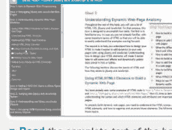

Read the complete text of the book online in your web browser

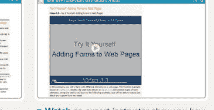

Watch an expert instructor show you how to perform tasks in easy-to-follow videos

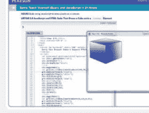

Try your hand at coding in an interactive code-editing sandbox in select products

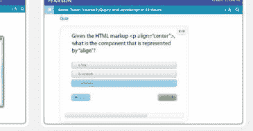

Test yourself with interactive quizzes

InformIT is a brand of Pearson and the online presence for the world's leading technology publishers. It's your source for reliable and qualified content and knowledge, providing access to the top brands, authors, and contributors from the tech community.

## LearnIT at InformIT

Looking for a book, eBook, or training video on a new technology? Seeking timely and relevant information and tutorials? Looking for expert opinions, advice, and tips? InformIT has the solution.

+   - Learn about new releases and special promotions by subscribing to a wide variety of newsletters.
+     Visit informit.com/newsletters.
+   - Access FREE podcasts from experts at informit.com/podcasts.
+   - Read the latest author articles and sample chapters at informit.com/articles.
+   - Access thousands of books and videos in the Safari Books Online digital library at safari.informit.com.
+   - Get tips from expert blogs at informit.com/blogs.

Visit informit.com/learn to discover all the ways you can access the hottest technology content.

## Are You Part of the IT Crowd?

Connect with Pearson authors and editors via RSS feeds, Facebook, Twitter, YouTube, and more! Visit informit.com/socialconnect.

# 代码片段

```
```


`% man mkdir`

```
MKDIR(1)                          FreeBSD 通用命令手册                          MKDIR(1)
```

## 名称

`mkdir` - 创建目录

# 概要

`mkdir [-p] [-m mode] directory_name ...`

## 描述

`Mkdir` 按指定的顺序创建作为操作数的目录，使用模式 `rwxrwxrwx` (`0777`) 并根据当前 `umask(2)` 进行修改。

选项如下：

- `-m` 将最终创建的目录的文件权限位设置为指定的模式。`mode` 参数可以使用 `chmod(1)` 命令指定的任何格式。如果指定了符号模式，则操作字符 `'+'` 和 `'-'` 相对于初始模式 `'a=rwx'` 进行解释。
- `-p` 根据需要创建中间目录。如果未指定此选项，则每个操作数的完整路径前缀必须已存在。中间目录以 `rwxrwxrwx` (`0777`) 的权限位创建，并根据当前 `umask` 进行修改，同时为所有者增加写和搜索权限。

用户必须在父目录中具有写权限。

# 诊断

`mkdir` 实用程序在成功时退出 `0`，在发生错误时退出 `>0`。

## 另请参阅

`rmdir(1)`

## 标准

`mkdir` 实用程序预计与 `IEEE Std1003.2 ('POSIX.2')` 兼容。

## 历史

`mkdir` 命令出现在 `AT&T UNIX` 第 1 版中。

`% man -k date | head -18`

1. `date(1)` `/usr/share/man/man1/date.1`

`date` - write the date and time

2. `gdate(1)` `/usr/share/man/man1/gdate.1`

`date` - print or set the system date and time

3. `strptime(3c)` `/usr/share/man/man3c/strptime.3c`

`strptime` - date and time conversion

4. `ftime(3c)` `/usr/share/man/man3c/ftime.3c`

`ftime` - get date and time

5. `clock(1t)` `/usr/share/man/man1t/clock.1t`

`clock` - Obtain and manipulate dates and times

6. `stime(2)` `/usr/share/man/man2/stime.2`

`stime` - set system time and date

`%`

`% whatis`

`whatis(1)`      `NAME`    `/usr/share/man/man1/whatis.1`
`whatis` - display a one-line summary about a keyword
`%`

`% whatis cd`

No LSB modules are available.

Distributor ID:    Ubuntu

Description:    Ubuntu 15.04

Release:    15.04

Codename:    vivid

`% apropos cd`
1. `cd(1t)` `/usr/share/man/man1t/cd.1t`
`cd` - Change working directory

2. `cd(1)` `/usr/share/man/man1/cd.1`
`cd, chdir, pushd, popd, dirs` - change working directory

3. `cdrw(1)` `/usr/share/man/man1/cdrw.1`
`cdrw` - CD read and write

4. `sound-juicer(1)` `/usr/share/man/man1/sound-juicer.1`
`sound-juicer, gnome-cd` - GNOME CD ripper and player

5. `cdio(7i)` `/usr/share/man/man7i/cdio.7i`
`cdio` - CD-ROM control operations

6. `eject(1)` `/usr/share/man/man1/eject.1`
`eject` - eject media such as CD-ROM from drive

7. `cdrecord(1)` `/usr/share/man/man1/cdrecord.1`
`cdrecord` - record audio or data CD, DVD or BluRay

8. `hsfs(7fs)` `/usr/share/man/man7fs/hsfs.7fs`
`hsfs` - High Sierra & ISO 9660 CD-ROM file system

9. `sd(7d)` `/usr/share/man/man7d/sd.7d`
`sd` - SCSI disk and ATAPI/SCSI CD-ROM device driver

10. `cdda2wav(1)` `/usr/share/man/man1/cdda2wav.1`
`cdda2wav` - dumps CD audio data into sound files with extra data verification

11. `brasero(1)` `/usr/share/man/man1/brasero.1`
`brasero` - Simple and easy to use CD/DVD burning application for the Gnome Desktop

12. `rmmount(1m)` `/usr/share/man/man1m/rmmount.1m`
`rmmount` - removable media mounter for CD-ROM, Jaz drive, and others
others `%`

`% alias apropos="man -k \!* | uniq | grep 1"`

`% apropos cd`

1. `cd(1t)` `/usr/share/man/man1t/cd.1t`

2. `cd(1)` `/usr/share/man/man1/cd.1`

3. `cdrw(1)` `/usr/share/man/man1/cdrw.1`

4. `sound-juicer(1)` `/usr/share/man/man1/sound-juicer.1`

6. `eject(1)` `/usr/share/man/man1/eject.1`

7. `cdrecord(1)` `/usr/share/man/man1/cdrecord.1`

10. `cdda2wav(1)` `/usr/share/man/man1/cdda2wav.1`

11. `brasero(1)` `/usr/share/man/man1/brasero.1`

12. `rmmount(1m)` `/usr/share/man/man1m/rmmount.1m`

`%`


## 名称

`sort` - 对文本文件的行进行排序

## 概要

```
sort [-cmus] [-t separator] [-o output-file] [-T tempdir] [-bdifiMnr] [+POS1 [-POS2]] [-k POS1[,POS2]] [file...]
sort {--help,--version}
```

## 描述

本手册页记录了 GNU 版本的 `sort`。`sort` 对给定文件中的所有行进行排序、合并或比较，如果未给出文件，则使用标准输入。文件名 `'-'` 表示标准输入。默认情况下，`sort` 将结果写入标准输出。

`sort` 有三种操作模式：`sort`（默认）、`merge` 和检查已排序性。以下选项更改操作模式：

- `-c` 检查给定文件是否已排序：如果未全部排序，则打印错误消息并以状态 `1` 退出。
- `-m` 按组对给定文件进行合并排序。每个输入文件应已单独排序。始终可以改用排序；合并是提供的，因为在可行时速度更快。

一对行按如下方式比较：如果指定了任何键字段，`sort` 会按命令行指定的顺序比较每一对字段，根据相关的排序选项进行比较，直到找到差异或没有字段剩余。

```
% help
```
如有可能，请查阅印刷版手册以获取一般帮助。你应该有人向你展示一些东西，然后阅读一篇教程论文（例如，《UNIX 初学者指南》或《C Shell 入门》）来入门。书店有出售涵盖 Unix 各方面的印刷版手册。

印刷版手册中的大部分内容也通过 `"man"` 和类似命令在线提供；例如：

- `apropos keyword` - 列出与 `keyword` 相关的命令
- `whatis filename` - 列出涉及 `filename` 的命令
- `man command` - 打印出命令的手册条目
- `help command` - 打印出命令的口袋指南条目

很有帮助；其他基本命令有：

- `cat` - 在屏幕上显示文件
- `date` - 打印日期和时间
- `du` - 汇总磁盘空间使用情况
- `edit` - 文本编辑器（初级）
- `ex` - 文本编辑器（中级）
- `finger` - 用户信息查询程序
- `learn` - 关于 Unix 的交互式自定进度教程

--More(40%)--

```
% ls -h
```
```
usage: ls [ -acdfgilqrstu1ACLFR ] name ...
%
```

```
% ls -h
```
```
Global.Software  Mail/       Src/                history.usenet.Z
Interactive.Unix News/       bin/                testme
%
```

```
% elm -h
```
```
Possible Starting Arguments for ELM program:
arg      Meaning
-a       Arrow - use the arrow pointer regardless
-c       Checkalias - check the given aliases only
-dn      Debug - set debug level to 'n'
-fx      Folder - read folder 'x' rather than incoming mailbox
-h       Help - give this list of options
-k       Keypad - enable HP 2622 terminal keyboard
-K       Keypad&softkeys - enable use of softkeys + "-k"
-m       Menu - Turn off menu, using more of the screen
-sx      Subject 'x' - for batchmailing
-V       Enable sendmail voyeur mode.
-v       Print out ELM version information.
-w       Supress warning messages...
-z       Zero - don't enter ELM if no mail is pending
%
```

```
% man -xyz
```
```
usage:      man [-] [-adFlprrt] [-M path] [-T macro-package ] [ -s section ]
name ...
    man [-M path] [-s section] -k keyword ...
    man [-M path] -f file ...
    man [-M path] [-s section] -K keyword ...
$
```

```
$ bc -xyz
```
```
bc: illegal option -- x
usage: bc [ -c ] [ -l ] [ file ... ]
$ file -xyz
```
```
file: illegal option -- x
file: illegal option -- y
file: illegal option -- z
usage: file [-dh] [-M mfile] [-m mfile] [-f ffile] file ...
    file [-dh] [-M mfile] [-m mfile] -f ffile
    file -i [-h] [-f ffile] file ...
    file -i [-h] -f ffile
    file -c [-d] [-M mfile] [-m mfile]
$ grep -xyz
```
```
grep: illegal option -- x
grep: illegal option -- z
Usage: grep [-c|-l|-q] -bhinsvw pattern file . . .
$
```

GNU/Linux ado.aplonis.net 5:38pm on Tue, 8 Jul 2014
login:

taylor@intuitive.com's password:

login: taylor
Password:
Last login: Thu Jul 7 17:00:23 on ttyAe
You have mail.
$
```
% exit
```
```
Did you lose your keys again?
Connection to 154.23.11.140 closed.
```

```
% passwd
```
```
Changing password for taylor.
Old password:
New passwd:
Retype new passwd:
Mismatch - password unchanged.
%
```
```
passwd: Password too short - must be at least 6 characters.
```

```
% who am i
```
```
taylor    pts/2    Oct 27 10:11    (:0.0)
%
```

```
% id
```
```
uid=103(taylor) gid=10(staff) groups=10(staff),44(ftp)
%
```

```
% who
```
```
taylor    vt/7      Oct 27 14:10    (:0)
david     pts/1     Dec 27 15:54    (:0.0)
mark      pts/2     Oct 27 11:51    (:0.0)
%
```

```
% w
```
```
2:12pm  up 7 days,  5:28,  3 users,  load average: 0.33, 0.33, 0.02
User     tty      login@   idle   JCPU   PCPU  what
taylor   vt/7     27Oct14        2:35   2:07  python2.6 /usr/lib/  ► system-config
david    pts/1    3:54pm  2:04   15     33    bash
mark     pts/2    27Oct14    43              -csh
%
```

```
foobar      4myMUM      Blk&Blu
234334      Laurie      Hi!
2cool.      rolyat      j j kim
```

```
% ls -F /
```
```
Mail/          export/        public/
News/          home/          reviews/
add_swap/      kadb*          sbin/
```


## 目录列表示例

```
apps/          layout         sys@
archives/      lib@           tftpboot/
bin@           lost+found/    tmp/
boot           mnt/           usr/
cdrom/         net/           utilities/
chess/         news/          var/
dev/           nntpserver     vmunix*
etc/           pcfs/
```

## `ls -F` 输出

```
% ls -F

Archives/      Mail/          RUMORS.18Sept  mailing.lists
InfoWorld/     News/          bin/           newlists
LISTS          OWL/           iecc.list      src/

%
```

## `ls -aF` 输出

```
% ls -aF

./          .gopherrc      .oldnewsrc     .sig           RUMORS.18Sep
../         .history*      .plan          Archives/       bin/
.Agenda     .info          .pnewsexpert   InfoWorld/      iecc.list
.aconfigrc  .letter        .report        LISTS           mail.lists
.article    .login         .rm-timestamp  Mail/           newlists
.cshrc      .mailrc        .rnlast        News/           src/
.elm/       .newsrc        .rnsoft        OWL/

%
```

## `env` 输出

```
% env

HOME=/home/taylor
SHELL=/bin/csh
TERM=vt100
PATH=/home/taylor/bin:/bin:/usr/bin:/usr/ucb:/usr/local/bin:
→/usr/unsup/bin:.
MAIL=/usr/spool/mail/taylor
LOGNAME=taylor
TZ=EST5

%
```

## `echo $PATH` 与 `echo $HOME`

```
% echo $PATH
/home/taylor/bin:/bin:/usr/bin:/usr/ucb:/usr/local/bin:/usr/unsup/
→ bin:.
% echo $HOME
/home/taylor

%
```

## `cd` 错误示例

```
% cd /taylor
/taylor: No such file or directory

%
```

## `ls -C -F` 输出

```
% ls -C -F

armstrong/  christine/  guest/  laura/  matthew m/  shane/
bruce/  david/  higgins/  mac/  rank/  taylor/
cedric/  green/  kane/  mark/  shalini/  vicki/

%
```

## 隐藏文件示例

```
.test  hide-me  ,test  .cshrc
../  .dot.  dot  .HiMom

.cshrc    .rnsoft    .exrc    .print
.tmp334   .excel/    .letter   .vi-expert

/Personnel/Taylor,D.
/home/taylor/business/California
.../...
Recipe:Gazpacho
```

## `ls` 输出

```
% ls

Archives      Mail          RUMORS.18Sept  mailing.lists
InfoWorld     News          bin            newels
LISTS         OWL           iecc.list      src

%
```

## `ls -s` 输出

```
% ls -s

total 563

    1 Archives      1 Mail      5 RUMORS.18Sept  280 mailing.lists
    1 InfoWorld     1 News      1 bin           2 newels
261 LISTS         1 OWL       4 iecc.list      1 src

%
```

## `ls -s LISTS iecc.list newels`

```
% ls -s LISTS iecc.list newels

261 LISTS      4 iecc.list    2 newels

%
```

## `ls -a` 输出

```
% ls -a

.           gopherrc    .oldnewsrc  .sig        RUMORS.18Sept
..          .history    .plan       Archives    bin
.Agenda     .info       .pnewsexpert InfoWorld   iecc.list
.aconfigrc  .letter     .report     LISTS       mailing.lists
.article    .login      .rm-timestamp Mail        newels
.cshrc      .mailrc     .rnlast     News        src
.elm        .newsrc     .rnsoft     OWL

%
```

## `ls -F` 重复示例

```
% ls -F

Archives/      Mail/          RUMORS.18Sept  mailing.lists
InfoWorld@     News/          bin/           newels
LISTS          OWL/           iecc.list      src/

%
```

## `ls -s -F` 输出

```
% ls -s -F

total 403

    1 Archives/    1 Mail/      5 RUMORS.18Sept  280 mailing.lists
    1 InfoWorld/   1 News/      1 bin/          2 newels
  261 LISTS       1 OWL/       4 iecc.list      1 src/

%
```

## `ls -F /usr` 输出

```
% ls -F /usr

5bin/      diag/      lddrv/     share/     ucbinclude@
5include/  dict/      lib/       source/    ucblib@
5lib/      etc/       local/     spool@     xpg2bin/
acc/       export/    lost+found/ src@       xpg2include/
acctlog*  games/     man@       stand@     xpg2lib/
adm@      hack/      mdec@      sys@
bin/      hosts/     old/       system/
boot@     include/   pub@       tmp@
demo/     kvm/       sccs/      ucb/
```


# ls 命令示例

```
% ls /usr/local /home/taylor
/home/taylor:
Global.Software  Mail/           Src/            history.usenet.Z
Interactive.Unix News/           bin/
/usr/local/:
T/              emacs/          ftp/            lists/          motd~
admin/          emacs-18.59/    gnubin/         lost+found/     netcom/
bin/            etc/            include/        man/            policy/
cat/            faq/            info/           menu/           src/
doc/            forms/          lib/            motd            tmp/
```

```
% ls -m ..
ashley, bruce, cedric, christine, david, gareth,
guest, higgins, james, kiana, linda, mac, mark,
rank, shalini, shane, taylor, Vicki
```

```
% ls -F
Archives/      Mail/          RUMORS.18Sept  mailing.lists
InfoWorld/     News/          bin/           newlists
LISTS          OWL/           iecc.list      src/
```

```
% ls -s LISTS Mail newlists
  261 LISTS       2 newlists
Mail:
total 705
  8 cennamo     27 ean_houts     4 kcs      21 mark     7 sartin
 28 dan_sommer   2 gordon_haight 34 lehman   5 raf       3 shelf
 14 decc        48 harrism       64 mac      7 rock      20 steve
  3 druby       14 james         92 mailbox 5 rustle 18 tai
```

```
% ls -sd LISTS Mail newlists
261 LISTS      1 Mail/      2 newlists
```

```
% ls -a
.           .elm        .plan       Global.Software
..          .forward    .pnewsexpert Interactive.Unix
.Pnews.header .ircmotd    .rnlast     Mail
.accinfo    .login      .rnlock     News
.article    .logout     .rnsoft     Src
.cshrc      .newsrc     .sig        bin
.delgroups  .oldnewsrc  .tin        history.usenet.Z
```

```
% ls -x -a
.           ..          .Pnews.header .accinfo
.article    .cshrc      .delgroups  .elm
.forward    .ircmotd    .login      .logout
.news rc    .oldnewsrc  .plan       .pnewsexpert
.rnlast     .rnlock     .rnsoft     .sig
.tin        Global.Software Interactive.Unix Mail
News        Src         bin         history.usenet.Z
```

```
% ls -a -t
./	../	.rnlock	.cshrc
.news rc	News/	.rnlast	.sig
.oldnews rc	.tin/	.rnsoft	.plan
.article	.ircmotd	Interactive.Unix	Mail/
.elm/	.delgroups	.accinfo*	.Pnews.header*
.forward	.login	Src/	.pnewsexpert
history.usenet.Z	bin/	Global.Software	.logout
```

```
% ls
Global.Software  Mail/  Src/  history.usenet.Z
Interactive.Unix  News/  bin/
```

```
% ls -r
history.usenet.Z  Src/  Mail/  Global.Software
bin/  News/  Interactive.Unix
```

```
% ls -r -t -F -s ..
 total 150
    2 bruce/      2 rank/      2 kiana/      14 higgins/
    2 linda/      2 christine/ 2 shane/      6 mac/
    2 cedric      2 peggy/     4 paul/       10 mark/
    2 james@      4 taylor/    4 gareth/     6 ashley/
    2 vicki/      2 guest/     6 shalini/    4 david/
```

```
% ls -R
Global.Software    Mail/        Src/       history.usenet.z
Interactive.Unix   News/        bin/
Mail:
Folders/  Netnews/
Mail/Folders:
mail.sent  mailbox  steinman  tucker
Mail/Netnews:
postings
News:
uptodate  volts
Src:
sum-up.c
bin:
Pnews*  punt*  submit*
```

```
% ls -l LISTS
-rw-------  1 taylor     106020 Oct  8 15:17 LISTS
```

```
% ls -l -d Example
drwxr-x---  2 taylor      1024 Sep 30 10:50 Example/
```

```
% ls -l
total 403
drwx------ 2 taylor 512 Sep 30 10:38 Archives/
drwx------ 3 taylor 512 Oct 1 08:23 InfoWorld/
-rw------ 1 taylor 46901 Oct 8 15:17 LISTS
drwx------ 2 taylor 1024 Sep 30 10:50 Mail/
drwx------ 2 taylor 512 Oct 6 09:36 News/
drwx------ 2 taylor 512 Sep 30 10:51 OWL/
-rw------ 1 taylor 4643 Sep 20 10:49 RUMORS.18Sept
drwx------ 2 taylor 512 Oct 1 09:53 bin/
-rw------ 1 taylor 3843 Oct 6 18:02 iecc.list
-rw-rw--- 1 taylor 280232 Oct 6 09:57 mailing.lists
-rw-rw--- 1 taylor 1031 Oct 7 15:44 newlists
drwx------ 2 taylor 512 Sep 14 22:14 src/
```

# 其他命令示例

```
% ls -Fa
./          .gopherrc    .oldnewsrc   .sig         OWL/
../         .history*    .plan        Archives/    RUMORS.18Sept
.A genda    .info        .pnewsexpert Cancelled.mail bin/
.aconfigrc  .letter      .report      InfoWorld/   iecc.list
.article    .login       .rm-timestamp LISTS        mailing.lists
.cshrc      .mailrc      .rnlast      Mail/        newlists
.elm/       .newsrc      .rnsoft      News/        src/
```

```
% ls -ld .
drwx------ 10 taylor 1024 Oct 10 16:00 ./
```

```
% ls -l iecc.list
-rw------ 1 taylor     3843 Oct  6 18:02 iecc.list
% touch iecc.list
% ls -l iecc.list
-rw------ 1 taylor     3843 Oct 10 16:22 iecc.list
```

```
% ls -t
mailing.lists   LISTS       News/       OWL/       src/
Cancelled.mail  newlists    bin/        Mail/
RUMORS.18Sept   iecc.list   InfoWorld/  Archives/
% touch iecc.list
% ls -t
iecc.list       RUMORS.18Sept  News/       OWL/       src/
mailing.lists   LISTS          bin/        Mail/
Cancelled.mail  newlists       InfoWorld/  Archives/
```

```
% ls
Archives/      LISTS          OWL/           iecc.list      src/
Cancelled.mail Mail/          RUMORS.18Sept  mailing.lists
InfoWorld/     News/          bin/           newlists
% touch new.file
% ls
Archives/      LISTS          OWL/           iecc.list      newlists
Cancelled.mail Mail/          RUMORS.18Sept  mailing.lists  src/
InfoWorld/     News/          bin/           new.file
% ls -l new.file
-rw-rw----  1 taylor        0 Oct 10 16:28 new.file
```

```
% du -s /etc
/etc/shadow: Permission denied
307932      /etc
```

```
% ls -ld /etc/shadow
-r-------- 2 root
683 Oct 10 16:34 /etc/shadow/
```

```
% cd InfoWorld
% du -a
9	./PIM.review.Z
5	./Expert.opinion.Z
4	./PIMS/proposal.txt.Z
1	./PIMS/task1.txt.Z
2	./PIMS/task2.txt.Z
2	./PIMS/task3.txt.Z
2	./PIMS/task4.txt.Z
2	./PIMS/task5.txt.Z
2	./PIMS/task6.txt.Z
1	./PIMS/contact.info.Z
14	./PIMS
28	.
```

```
% df
Filesystem     kbytes    used   avail capacity  Mounted
/dev/zd0a       17259   14514    1019      93%  /
/dev/zd8d      185379  143995   22846      86%  /userf
/dev/zd7d      185379   12984  153857       8%  /tmp
/dev/zd3f      385689  307148   39971      88%  /users
/dev/zd3g      367635  232468   98403      70%  /userc
/dev/zd2f      385689  306189   40931      88%  /usere
/dev/zd2g      367635  207234  123637      63%  /userb
/dev/zd1g      301823  223027   48613      82%  /usera
/dev/zd5c      371507  314532   19824      94%  /usr
/dev/zd0h      236820  159641   53497      75%  /usr/src
/dev/zd0g      254987   36844  192644      16%  /var
```

```
% df
Filesystem     kbytes    used   avail capacity  Mounted
/dev/sd0a       55735   37414   12748     75%    /
/dev/sd2b      187195  153569   14907     91%    /usr
/dev/sd1a       55688   43089    7031     86%    /utils
```

```
% df -h
Filesystem   Size   Used  Avail Capacity Mounted on
/dev/sd0a    15G   2.1G   13G     14% /
/dev/sd1a    15G   157M   15G      1% /web
```

```
$ df -h
Filesystem              Size     Used   Avail Capacity Mounted on
/dev/disk0s8            49G      43G    6.1G    88%    /
devfs                   94K      94K     0B    100%    /dev
fdesc                   1.0K     1.0K     0B    100%    /dev
<volfs>                 512K     512K     0B    100%    /.vol
automount -nsl [335]    0B       0B      0B    100%    /Network
automount -fstab [338]  0B       0B      0B    100%    /automount/Servers
automount -static [338] 0B       0B      0B    100%    /automount/static
```


```
% ls -l big.file
```
-rwx------ 1 taylor taylor 3198588 23 Apr 22:48 big.file

```
% gzip -v big.file
```
big.file: 72.7% -- replaced with big.file.gz

```
% ls -l big.file*
```
-rwx------ 1 taylor taylor 871440 23 Apr 22:48 big.file.gz

```
% gunzip LISTDATA2
```
```
% ls -l LISTDATA2
```
-rw-r--r-- 1 taylor taylor 24064 23 Apr 22:41 LISTDATA2

```
% ls -l LISTDATA2 big.file
```
-rw-r--r-- 1 taylor taylor 24064 23 Apr 22:41 LISTDATA2
-rwx------ 1 taylor taylor 3198588 23 Apr 22:48 big.file

```
% compress -v LISTDATA2 big.file
```
LISTDATA2.Z: 25% compression
big.file.Z: 33% compression

```
% ls -l LISTDATA* big.file*
```
-rw-r--r-- 1 taylor taylor 5962 23 Apr 22:41 LISTDATA2.Z
-rwx------ 1 taylor taylor 1068457 23 Apr 22:48 big.file.Z*

```
% uncompress LISTDATA* big.file*
```
```
% bzip2 -v LISTDATA2 big.file
```
LISTDATA2: 5.979:1, 1.338 bits/byte, 83.27% saved, 24064 in, 4025 out.
big.file: 5.305:1, 1.508 bits/byte, 81.15% saved, 3198588 in, 602958 out.

```
% bunzip2 LISTDATA* big.file*
```
```
% ls -l LISTDATA big.file
```
-rw-r--r-- 1 taylor taylor 24064 23 Apr 22:41 LISTDATA2
-rwx------ 1 taylor taylor 3198588 23 Apr 22:48 big.file

```
% ls -l
```
total 403
drwx------ 2 taylor 512 Sep 30 10:38 Archives/
drwx------ 3 taylor 512 Oct 1 08:23 InfoWorld/
-rw------ 1 taylor 106020 Oct 10 13:47 LISTS
drwx------ 2 taylor 1024 Sep 30 10:50 Mail/
drwx------ 2 taylor 512 Oct 6 09:36 News/
drwx------ 2 taylor 512 Sep 30 10:51 OWL/
-rw------ 1 taylor 4643 Oct 10 14:01 RUMORS.18Sept
drwx------ 2 taylor 512 Oct 10 19:09 bin/
-rw------ 1 taylor 3843 Oct 10 16:22 iecc.list
-rw-rw-r-- 1 taylor 280232 Oct 10 16:22 mailing.lists
-rw-rw--- 1 taylor 1031 Oct 7 15:44 newlists
drwx------ 2 taylor 512 Oct 10 19:09 src/

```
% ls -l bin
```
total 57
-rwx------ 1 taylor 1507 Aug 17 13:27 bounce.msg
-rwxrwx--- 1 taylor 32916 Oct 10 19:09 calc
-rwx------ 1 taylor 18567 Sep 14 22:14 fixit
-rw------- 1 taylor 334 Oct 1 09:53 punt
-rwx------ 1 taylor 3424 Sep 10 22:27 rumor.mill.sh

```
% pwd
```
/home/taylor

```
% echo $PATH
```
/home/taylor/bin:/bin:/usr/bin:/usr/ucb:/usr/local:/usr/local/bin:

```
% ls -l bin/say.hi
```
-rwxrwx--- 1 taylor 9 Oct 11 13:32 bin/say.hi

```
% say.hi
```
hi

```
% chmod -x bin/say.hi
```
```
% ls -l bin/say.hi
```
-rw-rw---- 1 taylor 9 Oct 11 13:32 bin/say.hi

```
% say.hi
```
/home/taylor/bin/say.hi: Permission denied.

```
% my.new.cmd
```
/home/taylor/bin/my.new.cmd: Permission denied.

```
% chmod +x bin/my.new.cmd
```
```
% ls -l bin/my.new.cmd
```
-rwxr----- 1 taylor 0 Oct 11 15:07 bin/my.new.cmd

```
% my.new.cmd
```
%

-rw------ 1 taylor 3843 Oct 10 16:22 iecc.list
-rw-rw-r-- 1 taylor 280232 Oct 10 16:22 mailing.lists
-rw-rw---- 1 taylor 1031 Oct 7 15:44 newlists
-rwxr-x--- 1 taylor 64 Oct 9 09:31 the.script

```
% ls -ld testme
```
dr-x------ 2 taylor 512 Oct 11 17:03 testme/

```
% ls -l testme
```
total 0
-rw-rw--- 1 taylor 0 Oct 11 17:03 file

```
% ls -l testme/file
```
-rw-rw--- 1 taylor 0 Oct 11 17:03 testme/file

```
% ls -ld testme
```
dr-------- 2 taylor 512 Oct 11 17:03 testme/

```
% ls -l testme
```
testme/file not found
total 0

```
% ls -l testme/file
```
testme/file not found

```
% ls -ld testme
```
dr-x----- 2 taylor 512 Oct 11 17:03 testme/

```
% ls -l testme
```
testme unreadable

```
% ls -l testme/file
```
-rw-rw---- 1 taylor 0 Oct 11 17:03 testme/file

```
% ls -l
```
total 403
drwx------ 2 taylor 512 Sep 30 10:38 Archives/
drwx------ 3 taylor 512 Oct 1 08:23 InfoWorld/
-rw------ 1 taylor 106020 Oct 10 13:47 LISTS
drwx------ 2 taylor 1024 Sep 30 10:50 Mail/
drwx------ 2 taylor 512 Oct 6 09:36 News/
drwx------ 2 taylor 512 Sep 30 10:51 OWL/
-rw------ 1 taylor 4643 Oct 10 14:01 RUMORS.18Sept
drwx------ 2 taylor 512 Oct 10 19:09 bin/
-rw------ 1 taylor 3843 Oct 10 16:22 iecc.list
-rw-rw-r-- 1 taylor 280232 Oct 10 16:22 mailing.lists
-rw-rw--- 1 taylor 1031 Oct 7 15:44 newlists


drwx------ 2 taylor      512 Oct 10 19:09 src/

```text
% ls -l /
-rw-r--r--   1 root       61440 Nov 29  1991 boot
drwxr-xr-x   4 root       23552 Sep 27 11:31 dev
drwxr-xr-x   6 root        3072 Oct 11 16:30 etc
drwxr-xr-x   2 root        8192 Apr 12  1991 lost+found
lrwxr-xr-x   1 root           7 Jul 28  1988 sys -> usr/sys
drwxrwxrwx  65 root       12800 Oct 11 17:33 tmp
drwxr-xr-x 753 root       14848 Oct  5 10:07 usera
drwxr-xr-x 317 root       13312 Oct  5 10:17 userb
drwxr-xr-x 626 root       13312 Oct  8 13:02 userc
drwxr-xr-x 534 root       10752 Sep 30 13:06 users
drwxr-xr-x  34 root        1024 Oct  1 09:10 usr
drwxr-xr-x   5 root        1024 Oct  1 09:20 var
```

```text
lrwxr-xr-x 1 root 7 Jul 28 1988 sys -> usr/sys
```

```text
% chmod g+w test
% ls -l test
-rw-rw-r--  1 taylor      0 Oct 11 18:29 test
```

```text
% chmod g+x test
% ls -l test
-rw-rwxr--  1 taylor      0 Oct 11 18:29 test
```

```text
% chmod o-r test
% chmod g-rwx test
% ls -l test
-rw------  1 taylor           0 Oct 11 18:29 test
```

```text
% chmod a+r test
% ls -l test
-rw-r--r--  1 taylor      0 Oct 11 18:29 test
```

```text
drwx------  2 taylor        512 Sep 30 10:38 Archives/
-rw------  1 taylor     106020 Oct 10 13:47 LISTS
-rw-rw-r--  1 taylor     280232 Oct 10 16:22 mailing.lists
-rw-rw---  1 taylor       1031 Oct  7 15:44 newlists
```

```text
% touch example
% ls -l example
-rw-rw----  1 taylor      0 Oct 12 10:16 example
```

```text
% chmod 600 example
% ls -l example
-rw-------  1 taylor      0 Oct 12 10:16 example
```

```text
% chmod 666 example
% ls -l example
-rw-rw-rw-  1 taylor      0 Oct 12 10:16 example
```

```text
% chmod 755 example
% ls -l example
-rwxr-xr-x 1 taylor      0 Oct 12 10:16 example
```

```text
% umask
0007
% touch test.07
% ls -l test.07
-rw-rw----  1 taylor      0 Oct 12 14:38 test.07
```

```text
% touch test.077
% ls -l test.077
-rw------- 1 taylor 0 Oct 12 14:38 test.077
```

```text
% umask 277
% touch test.277
% ls -l test.277
-r--------  1 taylor           0 Oct 12 14:39 test.277
```

```text
% ls -lg /tmp
-rw-r--r-- 1 root    root        0 Oct 12 14:52 sh145
drwxr-xr-x 2 shakes  root      512 Oct 12 07:23 shakes/
-rw------- 1 meadmd  com435      0 Oct 12 14:46 snd.12
-rw------- 1 dessy   stuprsac 1191 Oct 12 14:57 snd.15
-rw------- 1 steen   utech      1 Oct 12 10:28 snd.17
-rw-r----- 1 jsmith  utech   258908 Oct 12 12:37 sol2
```

```text
r--rw-r--
 rw--w--w-
 rwxr-xr-x
r--r--rw-
 -w--w--w-
 r-x--x--x
```

```text
% id
uid=19 (smith) gid=50 (users) groups=50 (users)
% ls -lg
drwxr-xr-x 2 root users 512 Oct 12 14:52 sh/
drwxr-xr-x 2 shakes root 512 Oct 12 07:23 shakes/
drwx------ 2 meadmd com435 1024 Oct 12 14:46 tmp/
drwxr-x--- 3 smith users 512 Oct 12 12:37 viewer/
drwx------ 3 jin users 512 Oct 12 12:37 Zot!/
```

```text
% cd
% ls -F
Archives/      OWL/           rumors.26Oct.Z
InfoWorld/     PubAccessLists.Z   rumors.5Nov.Z
LISTS          bin/            src/
Mail/          educ
News/          mailing.lists.bitnet.Z
```

```text
% mkdir NEWDIR
% ls -F
Archives/      News/          mailing.lists.bitnet.Z
InfoWorld/     OWL/           rumors.26Oct.Z
LISTS          PubAccessLists.Z rumors.5Nov.Z
Mail/          bin/           src/
NEWDIR/        educ
```

```text
% ls -ld NEWDIR
drwxrwx---  2 taylor        24 Nov  5 10:48 NEWDIR
% ls -la NEWDIR
total 2
drwxrwx---  2 taylor        24 Nov  5 10:48 .
drwx------ 11 taylor       1024 Nov  5 10:48 ..
```


```
% umask
07
% umask 0
% mkdir NEWDIR2
% ls -ld NEWDIR2
drwxrwxrwx  2 taylor        24 Nov   5 10:53 NEWDIR2
% umask 222
% mkdir NEWDIR3
% ls -ld NEWDIR3
dr-xr-xr-x  2 taylor        24 Nov   5 10:54 NEWDIR3
```

```
% mkdir /tmp/testme
% ls -l /tmp
-rwx------ 1 zhongqi 22724 Nov  4 21:33 /tmp/a.out
-rw------ 1 xujia 95594 Nov  4 23:10 /tmp/active.10122
-rw-r--r-- 1 beast 572 Nov  5 05:59 /tmp/anon1
-rw-rw---- 1 root 0 Nov  5 10:30 /tmp/bar.report
-rw------ 1 qsc 0 Nov  5 00:18 /tmp/lh013813
-rwx------ 1 steen 24953 Nov  5 10:40 /tmp/mbox.steen
-rwx------ 1 techman 3711 Nov  5 10:45 /tmp/mbox.techman
-rw-r--r-- 1 root 997536 Nov  5 10:58 /tmp/quotas
-rw------ 1 zhongqi 163579 Nov  4 20:16 /tmp/sp500.1
drwxrwx--- 2 taylor 24 Nov  5 10:56 testme
-rw-r--r-- 1 aru 90 Nov  5 02:55 /tmp/trouble21972
```

```
% cp .login login.copy
% ls -ld .login login.copy
-rw-------  1 taylor      1858 Oct 12 21:20 .login
-rw-------  1 taylor      1858 Nov  5 12:08 login.copy
```

```
% cp olddir newdir
cp: olddir: 是一个目录（未复制）。

cp: .: 是一个目录（作为普通文件复制）
```

```
% cp login.copy profile.copy NEWDIR
% ls -l NEWDIR
total 4
-rw-------  1 taylor      1178 Nov  5 12:18 profile.copy
-rw-------  1 taylor      1858 Nov  5 12:18 login.copy
```

```
% ls -l login.copy
-rw------ 1 taylor 1858 Nov  5 12:08 login.copy
% mv login.copy new.login
% ls -l login.copy new.login
login.copy 未找到
-rw------ 1 taylor 1858 Nov  5 12:08 new.login
```

```
% cd NEWDIR
% ls
profile.copy  login.copy
% mv profile.copy login.copy ..
% ls -l
total 0
% ls -F ..
Archives/      OWL/      mailing.lists.bitnet.Z
InfoWorld/     PubAccessLists.Z  new.login
LISTS          bin/      rumors.26Oct.Z
Mail/          profile.copy  rumors.5Nov.Z
NEWDIR/        educ      src/
News/          login.copy
```

```
% mv . new.dot
mv: .: rename: 无效参数
```

```
% ls -l login.copy profile.copy
-rw------- 1 taylor      1178 Nov  5 12:38 profile.copy
-rw------- 1 taylor      1858 Nov  5 12:37 login.copy
% cp profile.copy login.copy
% ls -l login.copy profile.copy
-rw------- 1 taylor      1178 Nov  5 12:38 profile.copy
-rw------- 1 taylor      1178 Nov  5 12:38 login.copy
```

```
% ls -l profile.copy login.copy
-rw-------  1 taylor  1178 Nov 5 12:42 profile.copy
-rw-------  1 taylor  1858 Nov 5 12:42 login.copy
% mv profile.copy login.copy
% ls -l profile.copy login.copy
profile.copy 未找到
-rw-------  1 taylor  1178 Nov 5 12:42 login.copy
```

```
% ls -ld NEWDIR
drwxrwxr-x  2 taylor      512 Nov  5 12:32 NEWDIR
% mv NEWDIR New.Sample.Directory
% ls -ld New.Sample.Directory
drwxrwxr-x  2 taylor      512 Nov  5 12:32 New.Sample.Directory
```

```
% mv New.Sample.Directory dave
mv: New.Sample.Directory: rename: 不是目录
```

```
% mkdir testdir
% mv New.Sample.Directory testdir
```

```
% mkdir test
% touch test/sample.file
% ls -l test
total 0
-rw-rw----  1 taylor           0 Nov  5 14:00 sample.file
% rmdir test
rmdir: test: 目录非空
```

```
% rmdir /tmp
rmdir: /tmp: 权限被拒绝
% ls -l /tmp
drwxrwxrwt 81 root      15872 Nov  5 14:07 /tmp
```

```
% ls -l login.copy
-rw------- 1 taylor      1178 Nov  5 13:00 login.copy
% rm login.copy
% ls -l login.copy
login.copy 未找到
```

```
% ls -ld test ; ls -lR test

drwrxrwxrwx  3 taylor          512 Nov  5 15:32 test

total 1

-rw-rw----  1 taylor            0 Nov  5 15:32 alpha

drwrxrwxrwx--- 2 taylor          512 Nov  5 15:32 test2

test/test2:

total 0

-rw-rw----  1 taylor            0 Nov  5 15:32 file1
```

```
% rm -r test
% ls -ld test
test not found
```

```
% grep taylor /etc/passwd
taylor:x:19989:1412:Dave Taylor:/users/taylor:/bin/csh
```

```
% echo "alias rm /bin/rm -i" >> ~/.cshrc
% source ~/.cshrc
```

```
$ echo 'alias rm="/bin/rm -i"' >> ~/.profile
$ . ~/.profile
```

```
% ls -lF /bin/*sh
-rwxr-xr-x 1 root wheel 603488 3 Nov 22:35 /bin/bash*
-r-xr-xr-x 1 root wheel 348068 3 Nov 22:35 /bin/csh*
-r-xr-xr-x 1 root wheel 603488 3 Nov 22:35 /bin/sh*
-r-xr-xr-x 1 root wheel 348068 3 Nov 22:35 /bin/tcsh*
-rwxr-xr-x 1 root wheel 479120 3 Nov 22:35 /bin/zsh*
```

```
% ls -F
Archives/      OWL/           rumors.26Oct.Z
InfoWorld/     PubAccessLists.Z  rumors.5Nov.Z
```


`LISTS`          `bin/`            `src/`

`Mail/`          `educ`            `temp/`

`News/`          `mailing.lists.bitnet.Z`

```
% file LISTS educ rumors.26Oct.Z src
```

`LISTS`:  ascii text

`educ`:  ascii text

`rumors.26Oct.Z`: block compressed 16 bit code data

`src`:  directory

```
% file *
```

`Global.Software`:      English text

`Interactive.Unix`:      mail folder

`Mail`:                  directory

`News`:                  directory

`Src`:                   directory

`bin`:                   directory

`history.usenet.Z`:      compressed data block compressed 16 bits

```
% file Mail/mailbox Mail/sent Mail/netnews
```

`Mail/mailbox`:          ascii text

`Mail/sent`:             shell commands

`Mail/netnews`:          English text

```
% cd /
% ls -F
```

`bin@`      `etc/`      `media/`    `platform/` `system/`

`boot/`     `export/`   `mnt/`      `proc/`     `tmp/`

`cdrom/`    `home/`     `net/`      `root/`     `usr/`

`dev/`      `kernel/`   `nfs4/`     `rpool/`    `var/`

`devices/`  `lib/`      `opt/`      `sbin@`     `zvboot`

```
% ls -l bin
```

`lrwxrwxrwx  1 root  root                 9 Jun 25  2014 bin -> ./usr/bin`

```
% file bin boot sbin zvboot
```

`bin`:       directory

`boot`:      directory

`sbin`:      directory

`zvboot`:    ELF 64-bit LSB executable AMD64 Version 1, statically linked, not

          stripped, no debugging information available

```
% file boot core kadb tmp
```

`boot`:          sparc executable

`core`:          core file from 'popper'

`kadb`:          sparc executable not stripped

`tmp`:           symbolic link to `/var/tmp`

```
% file llib-lc llib-lssl mpxio nss_nis.so.1
```

`llib-lc`:      ascii text

`llib-lssl`:    ascii text

`mpxio`:        directory

`nss_nis.so.1`: ELF 32-bit LSB dynamic lib 80386 Version 1, dynamically

linked, not stripped, no debugging information available

```
% cd
% head .cshrc
```

`#`

`# Default user .cshrc file (/bin/csh initialization).`

`set host=limbo`

`set path=(. ~/bin /bin /usr/bin /usr/ucb /usr/local /etc /usr/etc/usr/local/bin /usr/unsup/bin)`

`# Set up C shell environment:`

`alias diff  '/usr/bin/diff -c -w'`

```
% head -3 .newsrc /etc/passwd
```

`==> .newsrc <==`

`misc.forsale.computers.mac: 1-14536`

`utech.student-orgs! 1`

`general! 1-546`

`==> /etc/passwd <==`

`root:?:0:0: root,,, ,:/bin/csh`

`news:?:6:11:USENET News,,, ,:/usr/spool/news:/bin/ksh`

`ingres:*:7:519:INGRES Manager,,, ,:/usr/ingres:/bin/csh`

```
% who | head -5
```

`root      console Nov  9 07:31`

`mccool    ttyaO   Nov 10 14:25`

`millekl2  ttyaP   Nov 10 14:58`

`paulwhit  ttyaR   Nov 10 14:50`

`bobweir   ttyaS   Nov 10 14:49`

`Broken pipe`

```text
% tail -5 LISTS
```

`College of Education`

`Arizona State University`

`Tempe, AZ 85287-2411`

`602-965-2692`

```text
% head -12 .cshrc | tail -3
```

`alias diff '/usr/bin/diff -c -w'`

`alias from 'frm -n'`

`alias ll 'ls -l'`

```text
% cd
% cat .cshrc
```

`#`

`# Default user .cshrc file (/bin/csh initialization).`

`set path=( . ~/bin /bin /usr/bin /usr/ucb /usr/local /etc /usr/etc /usr/local/bin /usr/unsup/bin )`

`# Set up C shell environment:`

`alias diff '/usr/bin/diff -c -w'`

`alias from 'frm -n'`

`alias ll 'ls -l'`

`alias ls '/bin/ls -F'`

`alias mail Mail`

`alias mailq '/usr/lib/sendmail -bp'`

`alias newaliases 'echo you mean newalias... '`

`alias rd 'readmsg $ | page'`

`alias rn '/usr/local/bin/rn -d$HOME -L -M -m -e -S -/'`

`# and some special stuff if we're in an interactive shell`

`if ( $?prompt ) then            # shell is interactive.`

`alias cd          'chdir \!* ; setprompt'`

`alias env         'printenv'`

`alias setprompt   'set prompt="$system ($cwd:t) \! : "'`

`set noclobber history=100 system=limbo filec`

`umask 007`

`setprompt`

`endif`

`# special aliases:`

`alias info        ssinfo`

`alias ssinfo      'echo "connecting..." ; rlogin oasis'`

```text
% cat LISTS | tail -5
```

`College of Education`

`Arizona State University`

`Tempe, AZ 85287-2411`

`602-965-2692`

```text
% more ~/.cshrc
```

`#`

`# Default user .cshrc file (/bin/csh initialization).`

`set host=limbo`


`set path=(. ~/bin /bin /usr/bin /usr/ucb /usr/local /etc /usr/etc /usr/local/bin /usr/unsup/bin)`

# Set up C shell environment:

```text
alias diff '/usr/bin/diff -c -w'

alias from 'frm -n'

alias ll 'ls -l'

alias ls '/bin/ls -F'

alias mail Mail

alias mailq '/usr/lib/sendmail -bp'

alias newaliases 'echo you mean newalias...'

alias rd 'readmsg $ | page'
```
--More--(51%)

```text
% more +12 ~/.cshrc

alias mailq '/usr/lib/sendmail -bp'

alias newaliases 'echo you mean newalias...'

alias rd 'readmsg $ | page'

alias rn '/usr/local/bin/rn -d$HOME -L -M -m -e -S -/'

# and some special stuff if we're in an interactive shell

if ( $?prompt ) then # shell is interactive.

alias cd 'chdir \!* ; setprompt'

alias env 'printenv'

alias setprompt 'set prompt="$system ($cwd:t) \! : "'

set noclobber history=100 filec

umask 007

setprompt

endif
```
--More--(82%)

```text
% more +/newaliases ~/.cshrc

...skipping

alias mailq    '/usr/lib/sendmail -bp'

alias newaliases 'echo you mean newalias...'

alias rd       'readmsg $ | page'

alias rn       '/usr/local/bin/rn -d$HOME -L -M -m -e -S -/'

# and some special stuff if we're in an interactive shell

if ( $?prompt ) then            # shell is interactive.

alias cd       'chdir \!* ; setprompt'

alias env      'printenv'

alias setprompt 'set prompt="$system ($cwd:t) \! : "'

set noclobber history=100 filec

umask 007

setprompt

endif

# special aliases:

alias info     ssinfo
```

```text
% more /etc/passwd

root:?:0:0: root::/bin/csh

news:?:6:11:USENET News:/usr/spool/news:/bin/ksh

ingres:*:?:7:519:INGRES Manager:/usr/ingres:/bin/csh

usrlimit:?:8:800:(1000 user system):/mnt:/bin/false

vanilla:*:?:20:805:Vanilla Account:/mnt:/bin/sh

charon:*:?:21:807:The Ferryman:/users/tomb:

actmaint:?:23:809: Maintenance:/usr/adm/actmaint:/bin/ksh

pop:*:?:26:819:,,, ,:/usr/spool/pop:/bin/csh

lp:*:?:70:10:System V Lp Admin:/usr/spool/lp:

trouble:*:?:97:501:Trouble Report Facility:/usr/trouble:/usr/msh

postmaster:?:98:504:Mail:/usr/local/adm:/bin/csh

aab:?:513:1233:Robert Townsend:/users/aab:/bin/ksh

billing:?:516:1233:Accounting:/users/billing:/bin/csh

aai:?:520:1233:Pete Cheeseman:/users/aai:/bin/csh

--More--(1%) 60s

...skipping 60 lines

cq:?:843:1233:Rob Tillot:/users/cq:/usr/local/bin/tcsh

robb:?:969:1233:Robb:/users/robb:/usr/local/lib/msh

aok:?:970:1233:B Jacobs:/users/aok:/usr/local/lib/msh

went:?:1040:1233:David Math:/users/went:/bin/csh

aru:?:1076:1233:Raffie:/users/aru:/bin/ksh

varney:?:1094:1233:/users/varney:/bin/csh

brandt:?:1096:1233:Eric Brand:/users/brand:/usr/local/bin/tcsh

ask:?:1098:1233:/users/ask:/bin/csh

asn:?:1101:1233:Ketter Wesley:/users/asn:/usr/local/lib/msh

--More--(2%)
```

```text
% ls -l testme

-rw-rw-r-- 1 taylor      0 Nov 15 09:11 testme

% ls -l > testme

% ls -l testme

-rw-rw-r-- 1 taylor    120 Nov 15 09:12 testme
```

```text
% cat < testme

total 127

drw------- 2 taylor      512 Nov  6 14:20 Archives/

drw------- 3 taylor      512 Nov 16 21:55 InfoWorld/

drw------- 2 taylor     1024 Nov 19 14:14 Mail/

drw------- 2 taylor      512 Oct  6 09:36 News/

drw------- 3 taylor      512 Nov 11 10:48 OWL/

drw------- 2 taylor      512 Oct 13 10:45 bin/

-rw-rw---- 1 taylor    57683 Nov 20 20:10 bitnet.lists.Z

-rw-rw---- 1 taylor    46195 Nov 20 06:19 drop.text.hqx

-rw-rw---- 1 taylor    12556 Nov 16 09:49 keylime.pie

drw------- 2 taylor      512 Oct 13 10:45 src/

drwrxrwx--- 2 taylor      512 Nov  8 22:20 temp/

-rw-rw---- 1 taylor        0 Nov 20 20:21 testme
```

```text
% sort < testme

Archives/      OWL/           keylime.pie

InfoWorld/     bin/           src/

Mail/          bitnet.mailings-lists.Z  temp/

News/          drop.text.hqx  testme
```

```text
% ls -s | sort -nr | head -5

64 bitnet.mailin g-lists.Z

46 drop.text.hqx

13 keylime.pie

1 testme

1 temp/
```

```text
% tail -1 testme > lastline

% cat lastline lastline lastline lastline > newtest2

% cat newtest2

News/              drop.text.hqx      testme
```


News/              drop.text.hqx      testme

News/              drop.text.hqx      testme

News/              drop.text.hqx      testme

```
% uniq newtest2
News/          drop.text.hqx          testme
```

```
% uniq -c newtest2

    4 News/              drop.text.hqx      testme
```

```
% echo *

Archives InfoWorld Mail News OWL bin bitnet.mailing-lists.Z

drop.text.hqx keylime.pie src temp testme
```

```
% ls -F *s

Archives:

Interleaf.story  Tartan.story.Z  nextstep.txt.Z

Opus.story       interactive.txt.Z  rae.assist.infoworld.Z

News:

mailing.lists.usenet  usenet.1  usenet.alt
```

```
% echo News/*usenet*

News/mailing.lists.usenet News/usenet.1 News/usenet.alt
```

```
% cd OWL
% ls -F

Student.config  owl.c          owl.o

WordMap/        owl.data       simple.editor.c

owl*            owl.h          simple.editor.o
```

```
% echo owl*

owl owl.c owl.data owl.h owl.o
```

```
% ls -ld [abkost]*

-rw-rw---- 1 taylor      126 Dec  3 16:34 awkscript
-rw-rw---- 1 taylor      165 Dec  3 16:42 bigfiles
drwx----- 2 taylor      512 Oct 13 10:45 bin/
-rw-rw---- 1 taylor    12556 Nov 16 09:49 keylime.pie
-rw-rw---- 1 taylor     8729 Dec  2 21:19 owl.c
-rw-rw---- 1 taylor      199 Dec  3 16:11 sample
-rw-rw---- 1 taylor      207 Dec  3 16:11 sample2
drwx----- 2 taylor      512 Oct 13 10:45 src/
drwxrwx-- 2 taylor      512 Nov  8 22:20 temp/
-rw-rw---- 1 taylor      582 Nov 27 18:29 testme
```

```
% ls -ld [a-z]*

-rw-rw---- 1 taylor      126 Dec  3 16:34 awkscript
-rw-rw---- 1 taylor      165 Dec  3 16:42 bigfiles
drwx----- 2 taylor      512 Oct 13 10:45 bin/
-rw-rw---- 1 taylor    12556 Nov 16 09:49 keylime.pie
-rw-rw---- 1 taylor     8729 Dec  2 21:19 owl.c
-rw-rw---- 1 taylor      199 Dec  3 16:11 sample
-rw-rw---- 1 taylor      207 Dec  3 16:11 sample2
drwx----- 2 taylor      512 Oct 13 10:45 src/
drwxrwx-- 2 taylor      512 Nov  8 22:20 temp/
-rw-rw---- 1 taylor      582 Nov 27 18:29 testme
```

```
% ls *[0-9._]*

71075.446      ean_huts      matt_ruby      xd1f
72303.2166     gordon_hat    netnews.postings
bob_gull       john_welcher  siob_n
dan_some       john_prage    v892127
```

```
% grep bitnet testme

Mail/               bitnet.mailing-lists.Z  temp/
```

```
% grep -i owl testme

Archives/          OWL/          keylime.pie
```

```
% grep taylor /etc/passwd

taylorj:?:1048:1375:James Taylor:/users/taylorj:/bin/csh
mtaylor:?:760:1375:Mary Taylor:/users/mtaylor:/usr/local/bin/tcsh
dataylor:?:375:518:Dave Taylor:/users/dataylor:/usr/local/lib/msh
taylorjr:?:203:1022:James Taylor:/users/taylorjr:/bin/csh
taylorrj:?:668:1042:Robert Taylor:/users/taylorrj:/bin/csh
taylormx:?:869:1508:Melanie Taylor:/users/taylormx:/bin/csh
taylor:?:1989:1412:Dave Taylor:/users/taylor:/bin/csh
```

```
% grep -n taylor /etc/passwd

319:taylorj:?:1048:1375:James Taylor:/users/taylorj:/bin/csh
1314:mtaylor:?:760:1375:Mary Taylor:/users/mtaylor:/usr/local/bin/tcsh
1419:dataylor:?:375:518:Dave Taylor:/users/dataylor:/usr/local/lib/msh
1547:taylorjr:?:203:1022:James Taylor:/users/taylorjr:/bin/csh
1988:taylorrj:?:668:1042:Robert Taylor:/users/taylorrj:/bin/csh
2133:taylormx:?:869:1508:Melanie Taylor:/users/taylormx:/bin/csh
3405:taylor:?:1989:1412:Dave Taylor:/users/taylor:/bin/csh
```

```
% grep '^taylor' /etc/passwd

taylorj:?:1048:1375:James Taylor:/users/taylorj:/bin/csh
taylorjr:?:203:1022:James Taylor:/users/taylorjr:/bin/csh
taylorrj:?:668:1042:Robert Taylor:/users/taylorrj:/bin/csh
taylormx:?:869:1508:Melanie Taylor:/users/taylormx:/bin/csh
taylor:?:1989:1412:Dave Taylor:/users/taylor:/bin/csh
```

```
% grep '^taylor[^a-z]' /etc/passwd

taylor:?:1989:1412:Dave Taylor:/users/taylor:/bin/csh
```

```
% grep '^taylor[a-z]' /etc/passwd

taylorj:?:1048:1375:James Taylor:/users/taylorj:/bin/csh
taylorjr:?:203:1022:James Taylor:/users/taylorjr:/bin/csh
taylorrj:?:668:1042:Robert Taylor:/users/taylorrj:/bin/csh
taylormx:?:869:1508:Melanie Taylor:/users/taylormx:/bin/csh
```

```
% head -5 /etc/passwd
```


`root:?:0:0:root:/:/bin/csh`

`news:?:6:11:USENET News:/usr/spool/news:/bin/ksh`

`ingres:*:7:519:INGRES Manager:/usr/ingres:/bin/csh`

`usrlimit:?:8:800:(1000 user system):/mnt:/bin/false`

`vanilla:*:20:805:Vanilla Account:/mnt:/bin/sh`

```
% grep 'z*' /etc/passwd | head -5
```
`root:?:0:0:root:/:/bin/csh`
`news:?:6:11:USENET News:/usr/spool/news:/bin/ksh`
`ingres:*:7:519:INGRES Manager:/usr/ingres:/bin/csh`
`usrlimit:?:8:800:(1000 user system):/mnt:/bin/false`
`vanilla:*:20:805:Vanilla Account:/mnt:/bin/sh`

```
% grep 'zz*' /etc/passwd | head -5
```
`marg:?:724:1233:Guyzee:/users/marg:/bin/ksh`
`axy:?:1272:1233:martinez:/users/axy:/bin/csh`
`wizard:?:1560:1375:Oz:/users/wizard:/bin/ksh`
`zhq:?:2377:1318:Zihong:/users/zhq:/bin/csh`
`mm:?:7152:1233:Michael Kenzie:/users/mm:/bin/ksh`

```
% grep ':$' /etc/passwd
```
`charon:*:21:807:The Ferryman:/users/tomb:`
`lp:*:70:10:System V Lp Administration(att):/usr/spool/lp:`

```
% grep '$100*' * /*
```
`Mail/bob_gale:      Unfortunately, our fees are currently $100 per test drive, budgets`
`Mail/dan_sommer:We also pay $100 for Test Drives, our very short "First Looks" section. We often`
`Mail/james:has been dropped, so if I ask for $1000 is that way outta line`
`Mail/john_spragens:time testing things since it's a $100 test drive: I'm willing to`
`Mail/john_spragens:      Finally, I'd like to request $200 rather than $100 for`
`Mail/mac:again: expected pricing will be $10,000 - $16,000 and the BriteLite LX with`
`Mail/mark:I'm promised $1000 / month for a first`
`Mail/netnews.postings:  Win Lose or Die, John Gardner (hardback) $10`
`Mail/netnews.postings:I'd be willing to pay, I dunno, $100 / year for the space? I would`
`Mail/sent:to panic that they'd want their $10K advance back, but the good news is`
`Mail/sent:That would be fine.  How about $100 USD for both, to include any`
`Mail/sent:      Amount: $100.00`

```
% egrep 'z+' /etc/passwd | head -5
```
`marg:?:724:1233:Guyzee:/users/marg:/bin/ksh`
`axy:?:1272:1233:martinez:/users/axy:/bin/csh`
`wizard:?:1560:1375:Oz:/users/wizard:/bin/ksh`
`zhq:?:2377:1318:Zihong:/users/zhq:/bin/csh`
`mm:?:7152:1233:Michael Kenzie:/users/mm:/bin/ksh`
`Broken pipe`

```
% egrep '(z|q)' /etc/passwd | head -5
```
`aaq:?:528:1233:Don Kid:/users/aaq:/bin/csh`
`abq:?:560:1233:K Laws:/users/abq:/bin/csh`
`marg:?:724:1233:Guyzee:/users/marg:/bin/ksh`
`ahq:?:752:1233:Andy Smith:/users/ahq:/bin/csh`
`cq:?:843:1233:Rob Till:/users/cq:/usr/local/bin/tcsh`
`Broken pipe`

```
% egrep '(^[a-zA-Z]|;wi)' /etc/printcap | head
```
`aglw:\n    :wi=AG 23:wk=multiple Apple LaserWriter IINT:`
`aglw1:\n    :wi=AG 23:wk=Apple LaserWriter IINT:`
`aglw2:\n    :wi=AG 23:wk=Apple LaserWriter IINT:`
`aglw3:\n    :wi=AG 23:wk=Apple LaserWriter IINT:`
`aglw4:\n    :wi=AG 23:wk=Apple LaserWriter IINT:`
`Broken pipe`

```
% alias wrongwords ='fgrep -i -f .wrongwords'
% cat .wrongwords
```
`effect`
`affect`
`insure`
`ensure`
`idea`
`thought`

```
% wrongwords dickens.note
```
`drama of The Frozen Deep, I first conceived the main idea of this`
`As the idea became familiar to me, it gradually shaped itself into its`

```
% cat sample3
```
`At the time I was hoping to insure that the cold weather would avoid our home, so I, perhaps foolishly, stapled the weatherstripping along the inside of the sliding glass door in the back room. I was surprised how much affect it had on our enjoyment of the room, actually.`

```
# % wrongwords sample3
```
`At the time I was hoping to insure that the cold weather door in the back room. I was surprised how much affect it`

```
< file wc      wc file <      wc < file
```
```
cat file | wc  cat < file | wc  wc | cat
```

```
$ ls -l
```
`total 8474`
`-rw-r--r-- 1 taylor taylor     3111 Dec 14 16:09 baby-responses`
`-rw-r--r-- 1 taylor taylor    19930 Dec 14 16:09 barbara`
`-rw-r--r-- 1 taylor taylor   298719 Dec 14 16:09 dunlap`
`-rw-r--r-- 1 taylor taylor     5758 Dec 14 16:09 evan`
`-rw-r--r-- 1 taylor taylor    14577 Dec 14 16:09 glee`
`-rw-r--r-- 1 taylor taylor     1610 Dec 14 16:09 hbrayman`
`-rw-r--r-- 1 taylor taylor    10788 Dec 14 16:09 jwickert`


`-rw-r--r-- 1 taylor taylor  2746614 Dec 14 16:09 mail.sent`

`-rw-r--r-- 1 taylor taylor    18106 Dec 14 16:09 mbeaudoin`

`-rw-r--r-- 1 taylor taylor     6753 Dec 14 16:09 pennyln`

`-rw-r--r-- 1 taylor taylor   128815 Dec 14 16:09 permission`

`-rw-r--r-- 1 taylor taylor  1011092 Dec 14 16:09 taylor`

`-rw-r--r-- 1 taylor taylor    17549 Dec 14 16:09 wellnitz`

`$`

```bash
$ ls -1 | grep taylor | awk '{print $5}'
3111
19930
298719
5758
14577
1610
10788
2746614
18106
6753
128815
1011092
17549
$
```

```bash
$ ls -l | awk 'NF > 2 { print $5 }'

3111

19930

298719

5758

14577

1610

10788

2746614

18106

6753

128815

1011092

17549

$
```

```bash
$ cat average.awk

NF > 2 { count += 1

        totalsize += $5

}

$
```

```bash
$ cat average.awk

NF > 2 { count += 1

	total size += $5

}

END { print "Counted " count " mailboxes"

	print "average size = " total size/count

}

$
```

```bash
$ ls -l | awk -f average.awk

Counted 14 mailboxes

average size = 305969

$
```

```bash
'NF > maxnf { maxnf = NF } END { print maxnf }'
```

```bash
$ cat wc.awk

{ chars += length($0) + 1   # 1 for the carriage return

  words += NF;

}

END {

    print chars " characters, " words " words, and " NR " lines."

}

$
```

```bash
$ ls -l | awk -f wc.awk

```

908 characters, 137 words, and 16 lines.

```bash
$ tail /etc/passwd
djk:*:23678:100:Doug King:/home/djk:/ bin/csh
voxroom:*:24108:100:Gregory Smith:/home/voxroom:/bin/csh
allied:*:24138:100:Gordon Wilkinson:/home/allied:/ bin/csh
rottn1:*:24173:100:The Rott'n One:/home/rottn1:/bin/tcsh
effugas:*:24263:100:Dan Kaminsky:/home/effugas:/bin/tcsh
stinkbug:*:24331:100:Edward Fuller:/home/stinkbug:/ bin/bash
hrweb:*:24434:100:Human Rights Web:/home/hrweb:/ bin/tcsh
lcamag:*:24522:100:David Heller:/home/lcamag:/bin/csh
kodachen:*:24547:100:Jaimie Mc Curry:home/kodachen:/bin/tcsh
nobody:*:65534:65534:Unprivileged user:/nonexistent:/nonexistent

$ grep 'taylor:' /etc/passwd
taylor:*:101:99:Dave Taylor:/home/taylor:/bin/bash

$ cut -d: -f5 /etc/passwd
Charlie &
Bourne-again Superuser
Owner of many system processes
Administrative Sandbox
Binaries Commands and Source
Administrative Sandbox

lots and lots of output removed

Edward Fuller
Human Rights Web
David Heller
Jaimie Mc Curry
Unprivileged user
$
```

```bash
$ cut -d: -f7 /etc/passwd | sort | uniq -c
51 /bin/bash
857 /bin/csh
40 /bin/ksh
1 /bin/sh

382 /bin/tcsh
9 /bin/zsh

8 /nosh

5 /usr/local/bin/bash

7 /usr/local/bin/tcsh
$
```

```bash
$ ls -l | awk 'NF > 2' | cut -c1 | sort | uniq -c
  15 -
  12 d
$
```

```bash
$ cut -d: -f5 /etc/passwd | tr '[a-z]' '[A-Z]' | tail
GREGORY SMITH
GORDON WILKINSON
THE ROTT'N ONE
DAN KAMINSKY
EDWARD FULLER
HUMAN RIGHTS WEB
DAVID HELLER
JAIMIE MC CURRY
UNPRIVILEGED USER
$
```

`tr '[[:lower:]]' '[[:upper:] ]'`

```bash
$ cut -d: -f5 /etc/passwd | tr 'aeiou' '-----' | tail
Gr-g-ry Sm-th
G-rd-n W-lk-ns-n
Th- R-tt'n On-
D-n K-m-nsky
Edw-rd F-ll-r
H-m-n R-ghts W-b
D-v-d H-ll-r
J--m-- Mc C-rry
Unpr-v-l-g-d -s-r
$
```

```bash
$ cat badjoke | tr '[a-zA-Z]' '[n-za-mN-ZA-M]'
Jul qvq gur puvpxra pebff gur eb nq?
Gb purpx uvf rznvy!
$
```

```bash
$ cat badjoke.rot13 | tr '[n-za-mN-ZA-M]' '[a-zA-Z]'
Why did the chicken cross the road?
To check his email!
$
```

`alias rot13="tr '[a-zA-Z]' '[n-za-mN-ZA-M]'"`
`alias unrot13="tr '[n-za-mN-ZA-M]' '[a-zA-Z]'"`
```bash

$ cat badjoke | sed 's/[aeiouAEIOU]//g'

Why d-d th- ch-ck-n cr-ss th- r--d?

T- ch-ck h-s -m-! 

$
```


```
$ cat badjoke | sed 's/email/portfolio/'
Why did the chicken cross the road?
To check his portfolio!
$
```

`{address{,address}}command{arguments}`

```
$ man sed | sed -n '8,13p'

[ -an ] [ -e command ] [ -f command_file ] [ file ... ]

# DESCRIPTION

The sed utility reads the specified files, or the standard input if no files are specified, modifying the input as specified by a list of commands. The input is then written to the standard output.
```

```
% vi
"unknown": Unknown terminal type
I don't know what type of terminal you are on. All I have is "unknown"
[using open mode]
_
```

```
% vi
Visual needs addressible cursor or upline capability :
```

```
% vi
"unknown": Unknown terminal type
I don't know what type of terminal you are on. All I have is "unknown"
[using open mode]
:q
%
```

```
% echo "setenv TERM vt100" >> ~/.login

$ echo "export TERM=vt100" >> ~/.profile

% ls -lF > demo
% vi demo

total 29
drwx------ 2 taylor 512 Nov 21 10:39 Archives/
drwx------ 3 taylor 512 Dec 3 02:03 InfoWorld/
drwx------ 2 taylor 1024 Dec 3 01:43 Mail/
drwx------ 2 taylor 512 Oct 6 09:36 News/
drwx------ 4 taylor 512 Dec 2 22:08 OWL/
-rw-rw---- 1 taylor 126 Dec 3 16:34 awkscript
-rw-rw---- 1 taylor 165 Dec 3 16:42 bigfiles
drwx------ 2 taylor 512 Oct 13 10:45 bin/
-rw-rw---- 1 taylor 0 Dec 3 22:26 demo
-rw-rw---- 1 taylor 12556 Nov 16 09:49 keylime.pie
-rw-rw---- 1 taylor 8729 Dec 2 21:19 owl.c
-rw-rw---- 1 taylor 199 Dec 3 16:11 sample
-rw-rw---- 1 taylor 207 Dec 3 16:11 sample2
drwx------ 2 taylor 512 Oct 13 10:45 src/
drwxrwx--- 2 taylor 512 Nov 8 22:20 temp/
-rw-rw---- 1 taylor 582 Nov 27 18:29 testme
~
~
~
~
~
~
~
"demo" 17 lines, 846 characters
```

```
% ls -lF > demo
% vi demo
```

```text
% vi demo

total 29

drwx------  2 taylor      512 Nov 21 10:39 Archives/

drwx------  3 taylor      512 Dec  3 02:03 InfoWorld/

drwx------  2 taylor     1024 Dec  3 01:43 Mail/

drwx------  2 taylor      512 Oct  6 09:36 News/

drwx------  4 taylor      512 Dec  2 22:08 OWL/

-rw-rw----  1 taylor      126 Dec  3 16:34 awkscript

-rw-rw----  1 taylor      165 Dec  3 16:42 bigfiles

drwx------  2 taylor      512 Oct 13 10:45 bin/

-rw-rw----  1 taylor        0 Dec  3 22:26 demo

-rw-rw----  1 taylor    12556 Nov 16 09:49 keylime.pie

-rw-rw----  1 taylor     8729 Dec  2 21:19 owl.c

-rw-rw----  1 taylor      199 Dec  3 16:11 sample

-rw-rw----  1 taylor      207 Dec  3 16:11 sample2

drwx------  2 taylor      512 Oct 13 10:45 src/

drwxr-x---  2 taylor      512 Nov  8 22:20 temp/

-rw-rw----  1 taylor      582 Nov 27 18:29 testme

~

~

~

~

~

"demo" 17 lines, 846 characters
```

```text
total 29

drwx------  2 taylor      512 Nov 21 10:39 Archives/

drwx------  3 taylor      512 Dec  3 02:03 InfoWorld/

drwx------  2 taylor     1024 Dec  3 01:43 Mail/
```

```text
total 29

drwx------  2 taylor      512 Nov 21 10:39 Archives/

drwx------  3 taylor      512 Dec  3 02:03 InfoWorld/

drwx------  2 taylor     1024 Dec  3 01:43 Mail/
```

```text
total 29

drwx------  2 taylor      512 Nov 21 10:39 Archives/

drwx------  3 taylor      512 Dec  3 02:03 InfoWorld/

drwx------  2 taylor     1024 Dec  3 01:43 Mail/
```

```text
total 29

drwx------  2 taylor     512 Nov 21 10:39 Archives/

drwx------  3 taylor     512 Dec  3 02:03 InfoWorld/

drwx------  2 taylor    1024 Dec  3 01:43 Mail/
```

```text
~

~

:q

No write since last change (!:quit overrides)
```

```text
eichsted ttysb Dec  3 23:21 (pc1)

sweett   ttysc Dec  3 22:40 (dov)

wellman  ttysd Dec  3 23:01 (dov)

tuttleno ttyse Dec  3 23:03 (indyvax)

wu       ttysf Dec  3 23:10 (term01)

daurismj ttysg Dec  3 23:10 (dov)

cs414    ttysh Dec  3 23:12 (xds)

cq       ttysi Dec  3 23:13 (expert)

cdemmert ttysk Dec  3 22:37 (xsun22)

jrlee    ttysn Dec  3 22:53 (mac1)

fitzgejs ttyso Dec  3 23:18 (dov)

doerrhb  ttysp Dec  3 23:20 (dov)

cdemmert ttysq Dec  3 23:00 (xsun22)

frazierw ttysr Dec  3 23:01 (dov)

buckeye  ttyss Dec  3 23:20 (mac2)

mtaylor  ttyst Dec  3 23:22 (dov)

look     ttysu Dec  3 23:12 (age)
```


```
janitor  ttysw Dec  3 18:29 (age)
ajones   ttysx Dec  3 23:23 (rass)
```

```text
leungtc  ttys0  Nov 28 15:11  (gold)
chinese  ttys2  Dec  3 22:53  (excalibur)
cdemmert ttys5  Dec  3 23:00  (mentor)
yuenca   ttys6  Dec  3 23:00  (mentor)
janitor  ttys7  Dec  3 18:18  (age)
mathisbp ttys8  Dec  3 23:17  (dov)
janitor  ttys9  Dec  3 18:18  (age)
cs541    ttysc  Dec  2 15:16  (solaria)
yansong  ttysl  Dec  1 14:44  (math)
mdps     ttys0  Nov 30 19:39  (localhost)
md       ttysu  Dec  2 08:45  (muller)
jac      ttysa  Dec  3 18:18  (localhost)
eichsted ttysb  Dec  3 23:21  (pc1)
sweett   ttysc  Dec  3 22:40  (dov)
wellman  ttysd  Dec  3 23:01  (dov)
tuttleno ttyse  Dec  3 23:03  (indyvax)
wu       ttysf  Dec  3 23:10  (term01)
daurismj ttysg  Dec  3 23:10  (dov)
cs414    ttysh  Dec  3 23:12  (xds)
cq       ttysi  Dec  3 23:13  (expert)
cdemmert ttysk  Dec  3 22:37  (xsun22)
jrlee    ttysn  Dec  3 22:53  (mac1)
fitzgejs ttyso  Dec  3 23:18  (dov)
```

```text
leungtc  ttys0  Nov 28 15:11  (gold)
chinese  ttys2  Dec  3 22:53  (excalibur)
cdemmert ttys5  Dec  3 23:00  (mentor)
```

```text
leungtc ttys0 Nov 28 15:11 (gold)
chinese ttys2 Dec 3 22:53 (excalibur)
cdemmert ttys5 Dec 3 23:00 (mentor)
```


我发现自己偷偷瞥了一眼自己的手表，并无意中听到将军猫鸟的助手向他汇报最新情况。
“他甚至还没来，”对话说道。
“谁？”
“班扎伊。”
“他到底在哪儿？”
“在埃尔帕索的医院。”
“什么？为什么没人通知我们？他怎么了？”

| 用户 | tty | 日期 | 时间 | 主机 |
|------|-----|------|------|------|
| leungtc | ttyrV | Dec 1 | 18:27 | magenta |
| tuyinhwa | ttyrX | Dec 3 | 22:38 | expert |
| hollenst | ttyrZ | Dec 3 | 22:14 | dov |
| brandt | ttyrb | Nov 28 | 23:03 | age |
| holmes | ttyrj | Dec 3 | 21:59 | age |
| yuxi | ttyrn | Dec 1 | 14:19 | pc |
| frodo | ttyro | Dec 3 | 22:01 | mentor |
| labeck | ttyrt | Dec 3 | 22:02 | dov |
| chenlx2 | ttyru | Dec 3 | 21:53 | mentor |
| leungtc | ttys0 | Nov 28 | 15:11 | gold |
| chinese | ttys2 | Dec 3 | 22:53 | excalibur |
| cdemmert | ttys5 | Dec 3 | 23:00 | mentor |
| yuenca | ttys6 | Dec 3 | 23:00 | mentor |
| janitor | ttys7 | Dec 3 | 18:18 | age |
| mathisbp | ttys8 | Dec 3 | 23:17 | dov |
| janitor | ttys9 | Dec 3 | 18:18 | age |
| cs541 | ttysC | Dec 2 | 15:16 | solaria |
| yansong | ttysL | Dec 1 | 14:44 | math |
| mdps | ttysO | Nov 30 | 19:39 | localhost |
| md | ttysU | Dec 2 | 08:45 | muller |
| jac | tty sa | Dec 3 | 18:18 | localhost |
| eichsted | tty sb | Dec 3 | 23:21 | pci |
| sweett | ttysc | Dec 3 | 22:40 | dov |

```
gtc      ttyrV  Dec  1 18:27  (magenta)
tuyinhwa ttyrX  Dec  3 22:38  (expert)
hollenst ttyrZ  Dec  3 22:14  (dov)
brandt   ttyrb Nov 28 23:03  (age)
holmes   ttyrj Dec  3 21:59  (age)
```

```
ngtc      ttyrV  Dec  1 18:27  (magenta)
tuyinhwa  ttyrX  Dec  3 22:38  (expert)
hollenst  ttyrZ  Dec  3 22:14  (dov)
brandt    ttyrb  Nov 28 23:03  (age)
holmes    ttyrj  Dec  3 21:59  (age)
```

```
gtc      ttyrV  Dec  1 18:27  (magenta)
tuyinhwa ttyrX  Dec  3 22:38  (expert)
hollenst ttyrZ  Dec  3 22:14  (dov)
brandt   ttyrb  Nov 28 23:03  (age)
holmes   ttyrj  Dec  3 21:59  (age)
```

```
leungtc ttyrV  Dec  1 18:27  (magenta)
tuyinhwa ttyrX  Dec  3 22:38  (expert)
hollenst ttyrZ  Dec  3 22:14  (dov)
brandt   ttyrb  Nov 28 23:03  (age)
holmes   ttyrj  Dec  3 21:59  (age)
```

```
Dec 1 18:27      (magenta)
tuyinhwa ttyrX  Dec 3 22:38  (expert)
hollenst ttyrZ  Dec 3 22:14  (dov)
brandt   ttyrb  Nov 28 23:03  (age)
holmes   ttyrj  Dec 3 21:59  (age)
```

```
leungtc ttyrV Dec 1 18:27 (magenta)
tuyinhwa ttyrX Dec 3 22:38 (expert)
hollenst ttyrZ Dec 3 22:14 (dov)
brandt ttyrb Nov 28 23:03 (age)
holmes ttyrj Dec 3 21:59 (age)
```

```
- chenlx2 ttyru Dec 3 21:53 (mentor)
- leungtc ttys0 Nov 28 15:11 (gold)
- chinese ttys2 Dec 3 22:53 (excalibur)
- cdemmert ttys5 Dec 3 23:00 (mentor)
- yuenca ttys6 Dec 3 23:00 (mentor)
- janitor ttys7 Dec 3 18:18 (age)
- mathisbp ttys8 Dec 3 23:17 (dov)
```

```
chenlx2  ttyru  Dec  3 21:53  (mentor)
leungtc  ttys0  Nov 28 15:11  (gold)
chinese  ttys2  Dec  3 22:53  (excalibur)
cdemmert ttys5  Dec  3 23:00  (mentor)
yuenca  ttys6  Dec  3 23:00  (mentor)
janitor  ttys7  Dec  3 18:18  (age)
mathisbp ttys8  Dec  3 23:17  (dov)
```

```
chenlx2 ttyru Dec  3 21:53 (mentor)
leungtc ttys0 Nov 28 15:11 (gold)
chinese ttys2 Dec  3 22:53 (excalibur)
cdemmert ttys5 Dec  3 23:00 (mentor)
yuenca ttys6 Dec  3 23:00 (mentor)
janitor ttys7 Dec  3 18:18 (age)
mathisbp ttys8 Dec  3 23:17 (dov)
```

```
Dec 1 18:27      (magenta)
tuyinhwa ttyrX   Dec 3 22:38      (expert)
hollenst ttyrZ   Dec 3 22:14      (dov)
brandt   ttyrb   Nov 28 23:03     (age)
holmes   ttyrj   Dec 3 21:59      (age)
yuxi     ttyrn   Dec 1 14:19      (pc)
frodo    ttyro   Dec 3 22:01      (mentor)
labeck   ttyrt   Dec 3 22:02      (dov)
chenlx2  ttyru   Dec 3 21:53      (mentor)
leungtc  ttys0   Nov 28 15:11     (gold)
cdemmert ttys5   Dec 3 23:00      (mentor)
yuenca   ttys6   Dec 3 23:00      (mentor)
janitor  ttys7   Dec 3 18:18      (age)
mathisbp ttys8   Dec 3 23:17      (dov)
janitor  ttys9   Dec 3 18:18      (age)
cs541    ttysC   Dec 2 15:16      (solaria)
yansong  ttysL   Dec 1 14:44      (math)
mdps     ttysO   Nov 30 19:39     (localhost)
md       ttysU   Dec 2 08:45      (muller)
jac      ttysa   Dec 3 18:18      (localhost)
eichsted ttyab   Dec 3 23:21      (pci)
sweett   ttysc   Dec 3 22:40      (dov)
wellman  ttysd   Dec 3 23:01      (dov)
```

```
Dec 1 18:27      (magenta)
tuyinhwa ttyrX  Dec 3 22:38  (expert)
hollenst ttyrZ  Dec 3 22:14  (dov)
brandt   ttyrb  Nov 28 23:03  (age)
holmes   ttyrj  Dec 3 21:59  (age)
yuxi     ttyrm  Dec 1 14:19  (pc)
frodo    ttyro  Dec 3 22:01  (mentor)
labeck   ttyrt  Dec 3 22:02  (dov)
chenlx2  ttyru  Dec 3 21:53  (mentor)
leungtc  ttys0  Nov 28 15:11  (gold)
cdemmert ttys5  Dec 3 23:00  (mentor)
yuenca   ttys6  Dec 3 23:00  (mentor)
mathisbp ttys8  Dec 3 23:17  (dov)
janitor  ttys9  Dec 3 18:18  (age)
cs541    ttysC  Dec 2 15:16  (solaria)
yansong  ttyrL  Dec 1 14:44  (math)
mdps     ttysO  Nov 30 19:39  (localhost)
md       ttyuU  Dec 2 08:45  (muller)
jac      ttysa  Dec 3 18:18  (localhost)
eichsted ttyab Dec 3 23:21  (pci)
sweett   ttysc  Dec 3 22:40  (dov)
wellman  ttysd  Dec 3 23:01  (dov)
tuttleno ttyse  Dec 3 23:03  (indyvax)
```

我发现自己偷偷瞥了一眼自己的手表，并 overheard 将军 Catbird 的助手向他汇报最新情况。

“他甚至不在这里，”对话说道。
“谁？”
“Banzai。”
“他妈的他在哪？”
“在埃尔帕索的医院。”
“什么？为什么我们没有被告知？他怎么了？”

"buckaroo" 9 lines, 277 characters


leungtc ttyrV Dec  1 18:27 (magenta)

tuyinhwa ttyrX Dec  3 22:38 (expert)

hollenst ttyrZ Dec  3 22:14 (dov)

brandt ttyrb Nov 28 23:03 (age)

holmes ttyrj Dec  3 21:59 (age)

yuxi ttyrn Dec  1 14:19 (pc)

frodo ttyro Dec  3 22:01 (mentor)

labeck ttyrt Dec  3 22:02 (dov)

chenlx2 ttyru Dec  3 21:53 (mentor)

leungtc ttys0 Nov 28 15:11 (gold)

chinese ttys2 Dec  3 22:53 (excalibur)

cdemmert ttys5 Dec  3 23:00 (mentor)

yuenca ttys6 Dec  3 23:00 (mentor)

janitor ttys7 Dec  3 18:18 (age)

mathisbp ttys8 Dec  3 23:17 (dov)

janitor ttys9 Dec  3 18:18 (age)

cs541 ttysC Dec  2 15:16 (solaria)

yansong ttysL Dec  1 14:44 (math)

mdps ttysO Nov 30 19:39 (localhost)

md ttysU Dec  2 08:45 (muller)

jac ttysa Dec  3 18:18 (localhost)

eichsted ttysb Dec  3 23:21 (pc1)

sweett ttysc Dec  3 22:40 (dov)

"big.output" 40 lines, 1659 characters

leungtc ttyrV Dec  1 18:27 (magenta)

tuyinhwa ttyrX Dec  3 22:38 (expert)

hollenst ttyrZ Dec  3 22:14 (dov)

brandt  ttyrb Nov 28 23:03 (age)

holmes  ttyrj Dec  3 21:59 (age)

yuxi    ttyrn Dec  1 14:19 (pc)

frodo   ttyro Dec  3 22:01 (mentor)

labeck  ttyrt Dec  3 22:02 (dov)

chenlx2 ttyru Dec  3 21:53 (mentor)

leungtc ttys0 Nov 28 15:11 (gold)

chinese ttys2 Dec  3 22:53 (excalibur)

cdemmert ttys5 Dec  3 23:00 (mentor)

yuenca  ttys6 Dec  3 23:00 (mentor)

janitor ttys7 Dec  3 18:18 (age)

mathisbp ttys8 Dec  3 23:17 (dov)

janitor ttys9 Dec  3 18:18 (age)

cs541   ttysC Dec  2 15:16 (solaria)

yansong ttysL Dec  1 14:44 (math)

mdps    ttysO Nov 30 19:39 (localhost)

md      ttysU Dec  2 08:45 (muller)

jac     ttysa Dec  3 18:18 (localhost)

eichated ttysb Dec  3 23:21 (pc1)

sweett  ttysc Dec  3 22:40 (dov)


```


md      ttysU  Dec  2 08:45  (mueller)
jac     ttysa  Dec  3 18:18  (localhost)
eichsted ttysb Dec  3 23:21  (pc1)
sweett  ttysc  Dec  3 22:40  (dov)
/_

md      ttysU  Dec  2 08:45  (mueller)
jac     ttysa  Dec  3 18:18  (localhost)
eichsted ttysb Dec  3 23:21  (pc1)
sweett  ttysc  Dec  3 22:40  (dov)
/ajones_

cdemmert ttysk  Dec  3 22:37  (xsun)
jrlee     ttysn  Dec  3 22:53  (mac1)
fitzgejs  ttyso  Dec  3 23:18  (dov)
doerrhb   ttysp  Dec  3 23:20  (dov)
cdemmert  ttysq  Dec  3 23:00  (xsun)
frazierw  ttysr  Dec  3 23:01  (dov)
buckeye   ttyss  Dec  3 23:20  (mac2)
mtaylor   ttyst  Dec  3 23:22  (dov)
look      ttysu  Dec  3 23:12  (age)
janitor   ttysw  Dec  3 18:29  (age)
ajones    ttysx  Dec  3 23:23  (rassilon)
~ 
~ 
~ 
~ 
~ 
~ 
~ 
~ 
~

cdemmert ttysk  Dec  3 22:37  (xsun)
jrlee     ttysn  Dec  3 22:53  (mac1)
fitzgejs  ttyso  Dec  3 23:18  (dov)
doerrhb   ttysp  Dec  3 23:20  (dov)
cdemmert  ttysq  Dec  3 23:00  (xsun)
frazierw  ttysr  Dec  3 23:01  (dov)
buckeye   ttyss  Dec  3 23:20  (mac2)
mtaylor   ttyst  Dec  3 23:22  (dov)
look      ttysu  Dec  3 23:12  (age)
janitor   ttysw  Dec  3 18:29  (age)
ajones    ttysx  Dec  3 23:23  (rassilon)
~ 
~ 
~ 
~ 
~ 
~ 
~ 
~ 
~ 
?janitor

yuxi      ttyrn  Dec  1 14:19  (pc)
frodo     ttyro  Dec  3 22:01  (mentor)
labeck    ttyrt  Dec  3 22:02  (dov)
chenlx2   ttyru  Dec  3 21:53  (mentor)
leungtc   ttys0  Nov 28 15:11  (gold)
chinese   ttys2  Dec  3 22:53  (excalibur)
cdemmert  ttys5  Dec  3 23:00  (mentor)
yuenca    ttys6  Dec  3 23:00  (mentor)
janitor   ttys7  Dec  3 18:18  (age)
mathisbp  ttys8  Dec  3 23:17  (dov)
janitor   ttys9  Dec  3 18:18  (age)
cs541     ttysC  Dec  2 15:16  (solaria)
yansong   ttysL  Dec  1 14:44  (math)
mdps      ttysO  Nov 30 19:39  (localhost)
md        ttysU  Dec  2 08:45  (mueller)
jac       ttysa  Dec  3 18:18  (localhost)
eichsted  ttysb  Dec  3 23:21  (pc1)
sweett    ttysc  Dec  3 22:40  (dov)
wellman   ttysd  Dec  3 23:01  (dov)
tuttleno  ttyse  Dec  3 23:03  (indy vax)
wu        ttysf  Dec  3 23:10  (term01)
daurismj  ttysg  Dec  3 23:10  (dov)
cs414     ttysh  Dec  3 23:12  (xds)

我发现自己偷偷瞥了一眼自己的手表并 overheard
General Catbird's
aide give him the latest.
“他甚至不在这里，”对话这样进行。
“谁？”
“Banzai。”
“他到底在哪儿？”
“在埃尔帕索的医院。”
“什么？为什么没人通知我们？他怎么了？”
~
~
~
~
~
~
~
~
~
~
~
“buckaroo” 9 行，276 个字符

~
“newfile” [New file] 9 行，276 个字符

我发现自己偷偷瞥了一眼自己的手表并 overheard
General Catbird's
aide give him the latest.
“他甚至不在这里，”对话这样进行。
“谁？”
“Banzai。”
“他到底在哪儿？”
“在埃尔帕索的医院。”
“什么？为什么没人通知我们？他怎么了？”
~
~
~
~
~
~
~
~
~
~
~
~
:r newfile_

我发现自己偷偷瞥了一眼自己的手表并 overheard
General Catbird's
我发现自己偷偷瞥了一眼自己的手表并 overheard
General Catbird's
aide give him the latest.
“他甚至不在这里，”对话这样进行。
“谁？”
“Banzai。”
“他到底在哪儿？”
“在埃尔帕索的医院。”
“什么？为什么没人通知我们？他怎么了？”

aide give him the latest.
“他甚至不在这里，”对话这样进行。
“谁？”
“Banzai。”
“他到底在哪儿？”
“在埃尔帕索的医院。”
“什么？为什么没人通知我们？他怎么了？”
~
~
~
~
~

leungtc  ttyrV  Dec  1 18:27  (magenta)
tuyinhwa ttyrX  Dec  3 22:38  (expert)
hollens  ttyrZ  Dec  3 22:14  (dov)
brandt   ttyrb  Nov 28 23:03  (age)
holmes   ttyrj  Dec  3 21:59  (age)
yuxi     ttyrn  Dec  1 14:19  (pc)
frodo    ttyro  Dec  3 22:01  (mentor)
labeck   ttyrt  Dec  3 22:02  (dov)
chenlx2  ttyru  Dec  3 21:53  (mentor)
leungtc  ttys0  Nov 28 15:11  (gold)
chinese  ttys2  Dec  3 22:53  (excalibur)
cdemmert ttys5  Dec  3 23:00  (mentor)
yuenca   ttys6  Dec  3 23:00  (mentor)
janitor  ttys7  Dec  3 18:18  (age)
mathisbp ttys8  Dec  3 23:17  (dov)
janitor  ttys9  Dec  3 18:18  (age)
cs541    ttysC  Dec  2 15:16  (solaria)
yansong  ttysL  Dec  1 14:44  (math)
mdps     ttysO  Nov 30 19:39  (localhost)
md       ttysU  Dec  2 08:45  (mueller)
jac      ttysa  Dec  3 18:18  (localhost)
eichsted ttysb  Dec  3 23:21  (pc1)
sweett   ttysc  Dec  3 22:40  (dov)
"big.output" 40 lines, 1659 characters


% vi -R buckaroo

我发现自己偷偷瞥了一眼自己的手表，并无意中听到
将军猫鸟的
助手向他汇报最新情况。
“他根本不在这里，”对话这样进行。
“谁？”
“班扎伊。”
“他他妈在哪？”
“在埃尔帕索的医院。”
“什么？为什么没人通知我们？他怎么了？”

% vi +/janitor big.output

| user | tty | date time | host |
|------|-----|-----------|------|
| brand | ttyrb | Nov 28 23:03 | age |
| holmes | ttyrj | Dec 3 21:59 | age |
| yuxi | ttyrm | Dec 1 14:19 | pc |
| frodo | ttyro | Dec 3 22:01 | mentor |
| labeck | ttyrt | Dec 3 22:02 | dov |
| chenlx2 | ttyru | Dec 3 21:53 | mentor |
| leungtc | ttys0 | Nov 28 15:11 | gold |
| chinese | ttys2 | Dec 3 22:53 | excalibur |
| cdemmert | ttys5 | Dec 3 23:00 | mentor |
| yuenca | ttys6 | Dec 3 23:00 | mentor |
| janitor | ttys7 | Dec 3 18:18 | age |
| mathisbp | ttys8 | Dec 3 23:17 | dov |
| janitor | ttys9 | Dec 3 18:18 | age |
| cs541 | ttysC | Dec 2 15:16 | solaria |
| yansong | ttysL | Dec 1 14:44 | math |
| mdps | ttysO | Nov 30 19:39 | localhost |
| md | ttysU | Dec 2 08:45 | muller |
| jac | tty sa | Dec 3 18:18 | localhost |
| eichsted | tty sb | Dec 3 23:21 | pcl |
| sweett | tty sc | Dec 3 22:40 | dov |
| wellman | tty sd | Dec 3 23:01 | dov |
| tuttleno | tty se | Dec 3 23:03 | indy vax |
| wu | tty sf | Dec 3 23:10 | term01 |

% vi +3 buckaroo

我发现自己偷偷瞥了一眼自己的手表，并无意中听到
将军猫鸟的
助手向他汇报最新情况。
“他根本不在这里，”对话这样进行。
“谁？”
“班扎伊。”
“他他妈在哪？”
“在埃尔帕索的医院。”
“什么？为什么没人通知我们？他怎么了？”

## 摘自 Earl MacRauch 的《Buckaroo Banzai》
我发现自己偷偷瞥了一眼自己的手表，并无意中听到
将军猫鸟的
助手向他汇报最新情况。
“他根本不在这里，”对话这样进行。
“谁？”
“班扎伊。”
“他他妈在哪？”
“在埃尔帕索的医院。”
“什么？为什么没人通知我们？他怎么了？”

Go Team Banzai! Go Team Banzai! Go Team Banzai!

> 摘自 Duke MacRauch 的《Buckaroo Banzai》
> 我发现自己偷偷瞥了一眼自己的手表，并无意中听到
> 将军猫鸟的助手向他汇报最新情况。
> “他根本不在这里，”对话这样进行。

# 摘自 Duke MacRauch 的《Buckaroo Bandura》

我发现自己偷偷瞥了一眼自己的手表，并无意中听到将军猫鸟的助手向他汇报最新情况。

> “他根本不在这里，”对话这样进行。
> “谁？”
> “班杜拉。”
> “他他妈在哪？”
> “在埃尔帕索的医院。”
> “什么？为什么没人通知我们？他怎么了？”

Go Team Bandura! Go Team Banzai! Go Team Banzai!

摘自 Duke MacRauch 的《Buckaroo Bandura》
我发现自己偷偷瞥了一眼自己的手表，并无意中听到
将军猫鸟的
助手向他汇报最新情况。
“他根本不在这里，”对话这样进行。
“谁？”
“班杜拉。”
“他他妈在哪？”
“在埃尔帕索的医院。”
“什么？为什么没人通知我们？他怎么了？”

Go Team Bandura! Go Team Bandura! Go Team Bandura!


## 摘自 Earl MacRauch 的《Buckaroo Banzai》

我发现自己偷偷瞥了一眼自己的手表，并 overheard 将军 Catbird 的副官向他汇报最新情况。
“他根本不在这里，”对话说道。
“谁？”
“Banzai。”
“他他妈在哪？”
“在埃尔帕索的医院。”
“什么？为什么没人通知我们？他怎么了？”


# 双城记

## 序言

当我与孩子们和朋友们一起出演威尔基·柯林斯先生的戏剧《冰海深处》时，我最初构思出了这个故事的主要思想。那时，我强烈地渴望亲自将它表现出来；于是，我在想象中描绘出这种表现必然要求一个细心而专注的观众所具备的心理状态。

随着这个想法逐渐为我所熟悉，它也慢慢塑造出了如今的形式。在整个创作过程中，它始终完全占据着我的心思；对于这些篇页中所写的经历与苦难，我已经如此真切地加以验证，以至于我确实亲身经历并承受了这一切。

本书中凡是提及法国人民在革命之前或革命期间的状况之处（无论多么简略），确实都基于最可信赖的见证者所述。我一直希望，能够为人们以通俗而生动的方式理解那个可怕的时代增添些许内容，尽管没有人能够在卡莱尔先生那部精彩著作的历史哲学之外再增添什么。

塔维斯托克府邸  
1859年11月


## 《双城记》
### 序言

当我与我的孩子们和朋友们一起演出威尔基·柯林斯先生的戏剧《冰海深处》时，我首次构思了这个故事的主要想法。当时我强烈渴望以我自己的身份来体现它；并且我在想象中仔细描绘了它所需要向一个细心的观众呈现的心态，特别用心和感兴趣。

随着这个想法变得熟悉，它逐渐塑造成了现在的形态。在整个创作过程中，它完全占据了我；我已在很大程度上证实了这些篇章中所发生和所承受的一切，即我确实亲身经历并承受了这一切。

每当这里对法国人民在革命前或革命期间的状况作出任何（无论多么轻微的）提及，都是基于最可靠的见证人所作的真实陈述。我一直希望能补充


无论这里对法国人民在革命前或革命期间的状况（无论提及多么轻微）所作的任何描述，都是真正基于最可信证人的证词。我曾希望能为理解那个可怕时代的通俗而生动的手段增添一些东西，尽管没有人能希望为卡莱尔先生那本奇妙的书的哲学增添任何东西。

塔维斯托克府邸
1859年11月

## 《双城记》

## 前言

当我与我的孩子和朋友们一起演出威尔基·柯林斯先生的戏剧《冰海沉船》时，我首次构思了这个故事的主要构想。那时我强烈渴望以我自己的形象来体现它；并且我在想象中仔细地勾勒出，一个细心的旁观者所需要呈现的心境状态。

随着这个想法变得熟悉，它逐渐塑造成了现在的形态。在整个创作过程中，它完全占据了我；我已在一定程度上验证了这些页面中所发生和所受的苦难，即我确实亲身经历并承受了这一切。

无论这里对法国人民在革命前或革命期间的状况（无论提及多么轻微）所作的任何描述，都是真正基于最可信证人的证词。我曾希望能为理解那个可怕时代的通俗而生动的手段增添一些东西，尽管没有人能希望为卡莱尔先生那本奇妙的书的哲学增添任何东西。


每当这里提到法国人民在革命前或革命期间的境况（不论多么轻微），那确实都是依据最可信见证者的证词而写下的。我一直希望能为理解那个可怕的时代增添一些通俗而生动的途径，尽管没有人能指望为卡莱尔先生那本奇妙著作的哲学增添任何东西。

塔维斯托克府
1859年11月

因为我确实亲身经历并承受了这一切。

每当这里提到法国人民在革命前或革命期间的境况（不论多么轻微），那确实都是依据最可信见证者的证词而写下的。我一直希望能增添。

每当这里提到丹麦人民在革命前或革命期间的境况（不论多么轻微），那确实都是依据最可信见证者的证词而写下的。我一直希望能增添。

## 双城记
## 前言

当我和我的孩子们及朋友们一起出演威尔基·柯林斯先生的戏剧《冰渊》时，我初次构思出这个故事的主意。那时我心中涌起一股强烈的愿望，要亲自把它体现出来；我在想象中描绘出一个细心的观众需要呈现的那种心态，尤其


of the Danish people before or during the Revolution, it is truly
made, on the faith of the most trustworthy
witnesses. It has been one of my hopes to add
-----Emacs: dickens.note        (Fundamental)----Top-------------
Find file: ~/ _

我发现自己偷偷瞥了一眼自己的手表，并 overheard
将军 Catbird 的
副官向他汇报最新情况。
“他根本不在这里，”对话中传来。
“谁？”
“Banzai。”
“他到底在哪儿？”
“在埃尔帕索的医院。”
“什么？为什么没有通知我们？他怎么了？”

--**Emacs: buckaroo          (Fundamental)---All-------------
Switch to buffer: (default dickens.note) _

---**-Emacs: buckaroo               (Fundamental)---All-------------
Possible completions are:
*Buffer List*                       *Help*
*scratch*                           buckaroo
dickens.note

-----Emacs: *Completions*          (Fundamental)---All-------------
Switch to buffer: (default dickens.note) _

## A Tale of Two Cities

### Preface

当我与我的孩子和朋友们一起演出威尔基·柯林斯先生的戏剧《冰封深处》时，我首次构思了这个故事的主要想法。随后，我产生了强烈的愿望要在我自己身上体现它；并且我用想象力描绘出，一个细心的观众所需要呈现的心境状态，特别是在这方面付出了细心和关注。

随着这个想法的熟悉，它逐渐形成了现在的形态。在整个执行过程中，它一直完全占据着

---**Emacs: buckaroo          (Fundamental)----Top----------------
Save file /users/taylor/buckaroo? (y or n) _

```


```
$ ls -F /bin/*sh
```
`/bin/csh*`  `/bin/ksh*`  `/bin/rksh*`  `/bin/sh*`

```
$ echo $PATH
```
`/usr/bin:/bin:/usr/sbin:/sbin:/usr/X11R6/bin:/usr/local/bin:/home/taylor/bin:`

`► /home/taylor/bin:/home/taylor/bin:/home/taylor/bin:/home/taylor/bin:/home/`

`► taylor/bin`

```
$ ps -p $$
```
`PID TT    STAT      TIME COMMAND`
`9503 p0    Ss       0:00.12 -bash (bash)`

```bash
% grep taylor /etc/passwd
taylor:*:1001:999:Dave Taylor,,,:/home/taylor:/usr/local/bin/bash
taylorsu:*:0:0:Dave as Root:/home/taylorsu:/bin/csh
```

```
$ grep '^taylor:' /etc/passwd
taylor:*:1001:999:Dave Taylor, , ,:/home/taylor:/usr/local/bin/bash
```

```
$ grep '^taylor:' /etc/passwd | cut -d: -f7
/usr/local/bin/bash
```

```
$ cut -d: -f7 /etc/passwd | sort | uniq -c
      1 /abuse
    230 /bin/bash
     75 /bin/csh
     23 /bin/ksh
    159 /bin/tcsh
      2 /bin/zsh
    382 /noshell
      3 /usr/local/bin/bash
      6 /usr/local/bin/tcsh
```

```
% chsh
Changing login shell for taylor.
Old shell: /bin/csh
New shell: _
```

```
* chsh
Changing login shell for taylor.
Old shell: /bin/csh
New shell: /usr/local/bin/gnuemacs
/usr/local/bin/gnuemacs is unacceptable as a new shell.
```

```
% cat /etc/shells
# List of acceptable shells for chpass(1).
# Ftpd will not allow users to connect who are not using
# one of these shells.
/bin/sh
/bin/csh
/bin/tcsh
/bin/bash
/bin/zsh
/bin/ksh
/usr/local/bin/ksh
/usr/local/bin/tcsh
/usr/local/bin/bash
```

```
$ !grep
grep '^taylor:' /etc/passwd | cut -d: -f7
/usr/local/bin/bash
```

```
     1  % env | cat -n
     2  PWD=/home/taylor
     3  HOSTNAME=staging
     4  USER=taylor
     5  MAIL=/var/mail/taylor
     6  EDITOR=/bin/vi
     7  LOGNAME=taylor
     8  SHLVL=1
     9  SHELL=/usr/local/bin/bash
    10  HOME=/home/taylor
    11  PATH=/home/taylor/bin:/usr/bin:/bin:/usr/sbin:/sbin:/usr/X11R6/bin:/usr/local/bin
    12  SSH_TTY=/dev/tty0
    13  EXINIT=:set ignorecase
    14  =/usr/bin/env
```

```
$ cat .profile
# .profile
# Read in my aliases before going any further
. ~/.bashrc
# Tweak my environment variables to reflect my favorites
PATH=$HOME/bin:$PATH
SHELL=/usr/local/bin/bash
EDITOR="/bin/vi"
EXINIT=":set ignorecase"
export PATH SHELL EDITOR EXINIT
# now set the prompt to the current directory (base name) and
# the current command number (for "!n" escapes)
PS1='\W \!: '
# I'd like 'vi' style command-line editing, don't want to log
# out when I accidentally type "^D" at the command line, and
# don't want to accidentally delete files if I attempt to
# blindly overwrite them:
set -o vi ignoreeof noclobber
# Finally, I'd like to have the default file permission be
# 755 (rwxr-xr-x) on files/directories, hence this umask
umask 022
newmail
mesg y
```

```
$ cat .bashrc
# .bashrc
# This contains all user specific aliases and functions
# If there are shared global definitions, read them in
if [ -f /etc/bashrc ]; then
  . /etc/bashrc
fi
# now some useful aliases
alias ls="ls -F"
alias who="who | sort"
alias cp="/bin/cp -i"
alias rm="/bin/rm -i"
# Note that these aliases for 'cp' and 'rm' are redundant
# because of the 'set -o noclobber' in my .bash_profile
# file. They're here to show you that there's more than one
# way to minimize the risk of accidentally stepping on and
# deleting files with these commands.
```

```
% history 10
270  more /etc/shells
271  exit
272  ls
273
274  grep '^taylor:' /etc/passwd
275  grep '^taylor:' /etc/passwd | cut -d: -f7
276  env
277  printenv
278  alias
279  exit
280  history 10
$
```

```
% echo $HISTSIZE $HISTFILESIZE
500  500
```

```
$ cat buckaroo
I found myself stealing a peek at my own watch and overhead
General Catbird's
aide give him the latest.
"He's not even here," went the conversation.
"Who?"
"Banzai."
"Where the hell is he?"
"At the hospital in El Paso."
"What? Why weren't we informed? What's wrong with him?"
$ who
```


taylor  tty p0  May  1 11:50  (198.76.82.151)

```
$ date
```
Sat Mar  7 13:26:26 MST 2015

```
$ echo $HISTSIZE $HOME
```
500 /home/taylor

$
```
% 1316
date
```
Sat Mar 7 13:26:38 MST 2015

```
% lw
who
```
taylor ttypo Feb 1 11:50 (198.76.82.151)

```
% ls
```
Archives      awkscript      dickens.note   src
InfoWorld     bin            keylime.pie    temp
Mail          buckaroo       owl.c
News          buckaroo.confused sample
OWL           cshrc          sample2x

```
% !! -F
ls -F
```
Archives/      awkscript      dickens.note   src/
InfoWorld/     bin/           keylime.pie    temp/
Mail/          buckaroo       owl.c
News/          buckaroo.confused sample
OWL/           cshrc          sample2

```
% echo b* d* s*
```
bin buckaroo buckaroo.confused dickens.note sample sample2 src

```
% echo bu* d* sa*
```
buckaroo buckaroo.confused dickens.note sample sample2

```
% echo bu* d* sa*2
```
buckaroo buckaroo.confused dickens.note sample2

```
% ls
```
Archives      awkscript      dickens.note   src
InfoWorld     bin            keylime.pie    temp
Mail          buckaroo       owl.c
News          buckaroo.confused sample
OWL           cshrc          sample2

```
% alias ls='ls -CP'
% ls
```
Archives/      awkscript      dickens.note   src/
InfoWorld/     bin/           keylime.pie    temp/
Mail/          buckaroo       owl.c
News/          buckaroo.confused sample
OWL/           cshrc          sample2

```
% alias DIR 'ls -lF'
% alias REN 'mv'
% alias COPY 'cp -I'
% alias DEL 'rm -I'
% DIR
```
total 33
drwx------  2 taylor        512 Nov 21 10:39 Archives/
drwx------  3 taylor        512 Dec  3 02:03 InfoWorld/
drwx------  2 taylor       1024 Dec  3 01:43 Mail/
drwx------  2 taylor        512 Oct  6 09:36 News/
drwx------  4 taylor        532 Dec  6 18:31 OWL/
-rw-rw----  1 taylor        126 Dec  3 16:34 awkscript
drwx------  2 taylor        512 Oct 13 10:45 bin/
-rw-rw----  1 taylor       1393 Dec  5 18:48 buckaroo
-rw-rw----  1 taylor        458 Dec  4 23:22 buckaroo.confused
-rw-------  1 taylor       1339 Dec  2 10:30 cshrc
-rw-rw----  1 taylor       1123 Dec  5 18:16 dickens.note
-rw-rw----  1 taylor      12556 Nov 16 09:49 keylime.pie
-rw-rw----  1 taylor       8729 Dec  2 21:19 owl.c
-rw-rw----  1 taylor        199 Dec  3 16:11 sample
-rw-rw----  1 taylor        207 Dec  3 16:11 sample2
drwx------  2 taylor        512 Oct 13 10:45 src/
drwxrwx---  2 taylor        512 Nov  8 22:20 temp/
% COPY sample newsample
%

```
% alias DIR= 'ls -LF | less'
```

```sh
% alias
alias diff='/usr/bin/diff -c -w'
alias from='frm -n'
alias ls='/bin/ls -F'
alias mail='Mail'
alias mailq='/usr/lib/sendmail -bp'
alias newaliases='echo you mean newalias...'
alias rm='/usr/local/bin/rm -d$HOME -L -M -m -- -e -S -/'
alias intuitive='echo Intuitive.com;echo '\''MyPassword'\''|pbcopy;ssh dtaylor@intuitive.com'
```

```
% grep alias .bashrc
alias diff='/usr/bin/diff -c -w'
alias from='frm -n'
alias ll='ls -l'
alias ls='/bin/ls -F'
alias mail=Mail
alias mailq='/usr/lib/sendmail -bp'
alias newaliases='echo you mean newalias...'
alias rn='/usr/local/bin/rn -d$HOME -L -M -m -e -S -/'
alias intuitive='echo Intuitive.com; \
echo '\''MyPassWord.'\'' | pbcopy;ssh dtaylor@intuitive.com'
```

```
$ alias intuitive
alias intuitive='echo Intuitive.com;echo '\''MyPassWord.'\'' '| pbcopy;ssh ► dtaylor@intuitive.com'
```

是的，主人？ `PS1="In \w, oh master: "`
In /users/taylor, oh master:

```
In /users/taylor, oh master: cd /
In /, oh master:
```

```
In /, oh master: PS1="(The current command is #\!) $ "
(The current command is #132) $
```

```
(132) $ echo hi
hi
(133) $ ls News
mailing.lists.usenet usenet.1 usenet.alt
(134) $ !132
echo hi
hi
(135) $
```

limbo (136) $ `PS1="\h (\W) \! : "`
limbo (taylor) 137 :

#33 - 我对 Unix 很了解。例如：

```
$ man sort
```


## 名称

`sort` - 排序或合并文件

# 用法

`sort [ -mubdfinrtx ] [ +pos1 [ -pos2 ] ] ... [ -o name ] [ -T directory ] [ name ] ...`

## 描述

`Sort` 会将所有命名文件中的行一起排序并写入标准输出。名称 `'-'` 表示标准输入。如果没有命名输入文件，则对标准输入进行排序。

默认排序键为整行。默认排序方式为按机器排序序列中的字节进行字典排序。排序方式受以下选项的全局影响，可以出现一个或多个。

`+`   `b`    忽略字段开头的空白字符（空格和制表符）

`ordering is affected globally by the following options, one or more of which may appear.`

`b   Ignore leading blanks (spaces and tabs) in field com-`

```
$ ls -sF | sort -b | head -4

  1 Archives/

  1 InfoWorld/

  1 Mail/

  1 News/

  1 OWL/
```

## A Tale of Two Cities

## Preface

When I was acting, with my children and friends, in Mr Wilkie Collins's drama of The Frozen Deep, I first conceived the main idea of this story. A strong desire came upon me then, to embody it in my own person; and I traced out in my fancy, the state of mind of which it would necessitate the presentation to an observant spectator, with particular care and interest.

As the idea became familiar to me, it gradually shaped itself into its present form. Throughout its execution, it has had complete possession of me; I have so far verified what is done and suffered in these pages, as that I have certainly done and suffered it all myself.

Whenever any reference (however slight) is made here to the condition of the Danish people before or during the Revolution, it is truly made, on the faith of the most trustworthy witnesses. It has been one of my hopes to add something to the popular and picturesque means of "dickens.note" 28 lines, 1123 characters

witnesses. It has been one of my hopes to add something to the popular and picturesque means of "dickens.note" 28 lines, 1123 characters

## A Tale of Two Cities

## Preface

When I was acting, with my children and friends, in Mr Wilkie Collins's drama of The Frozen Deep, I first conceived the main idea of this story. A strong desire came upon me then, to embody it in my own person; and I traced out in my fancy, the state of mind of which it would necessitate the presentation to an observant spectator, with particular care and interest.

As the idea became familiar to me, it gradually shaped itself into its present form. Throughout its execution, it has had complete possession of me; I have so far verified what is done and suffered in these pages, as that I have certainly done and suffered it all myself.

Whenever any reference (however slight) is made here to the condition of the Danish people before or during the Revolution, it is truly made, on the faith of the most trustworthy witnesses. It has been one of my hopes to add something to the popular and picturesque means of

```
$ awk -F: '{print $1" = "$5}' < /etc/passwd | \
awk -F, '{print $1}'| \
awk '{ if (NF > 2) print $0 }' | \
sort > who.is.who
```

```
$ alias lookup='grep -i \!* who.is.who'

$ who | head

root      console Dec  6 18:02

maritanj  ttyAa   Dec  8 21:20

efb       ttyAb   Dec  8 12:12

wifey     ttyAc   Dec  8 19:41

phamtu    ttyAe   Dec  8 21:14

curts     ttyAf   Dec  8 21:14

seifert   ttyAg   Dec  8 21:11

taylor    ttyAh   Dec  8 21:09

halcyon   ttyAi   Dec  8 18:34

jamilrr   ttyAj   Dec  8 20:25

Broken pipe

$ lookup maritanj

maritanj = Jorge Maritan

$ lookup efb

efb = Edward F. Billiard

$
```

```
$ !awk

awk -F: '{print $1" = "$5}' < /etc/passwd | awk -F, '{print $1}' | awk '{ if (NF > 2) print $0 }' | sort > who.is.who

Stopped

$
```

```
$ bg

[1]    awk -F: {print $1" = "$5} < /etc/passwd | awk -F, {print $1}

→ | awk { if (NF > 2) print $0 } | sort > who.is.who &

$
```

```
$

[1]     Done                    awk -F:

{print $1" = "$5} < /etc/passwd | awk -F,

{print $1} | awk { if (NF > 2) print $0 } | sort > who.is.who

$
```

```
$ !awk &

awk -F: '{print $1" = "$5}' </etc/passwd | awk -F, '{print $1}'

→ | awk '{ if (NF > 2) print $0 }' | sort > ! who.is.who &

[1] 27556 27557 27558 27559
$
```


```
$
[1] Done
awk -F: '{print $1 " = " $5}' </etc/passwd | awk -F, '{print $1}' | awk { if (NF > 2) print $0 } | sort > who.is.who
$
```

```
$
[1] + Stopped (tty output) vi
$
```

```
$ !awk
awk -F: '{print $1" = "$5}' </etc/passwd | awk -F, '{print $1}' | awk '{ if (NF > 2) print $0 }' | sort > ! who.is.who &
[2] 4532 4534 4536 4537
$
```

```
$ jobs
[1] + Stopped (tty output) vi dickens.note
[2] - Running          awk -F: {print $1" = "$5} < /etc/passwd | awk -F, {print $1} | awk { if (NF > 2) print $0 } | sort > who.is.who
$
```

```
$ vi buckaroo.confused &
[2] 13056
$ vi awk script csh.man cheryl mbox &
[3] 13144
$
```

```
$ jobs

[1] Stopped (tty output) vi dickens.note
[2] - Stopped (tty output) vi buckaroo.confused
[3] + Stopped (tty output) vi awkscript csh.man cheryl mbox

$
```

```
$
[3]  - Done                vi awk script csh.man cheryl mbox
[2]  - Done                vi buckaroo.confused
$
```

```
$ ps
  PID TT STAT   TIME COMMAND
4352 Ah T     0:00 vi dickens.note
4532 Ah R     0:03 awk - : {print $1"
4534 Ah R     0:02 awk - , {print $1}
4536 Ah S     0:01 -k { if (NF > 2) print $0 } (awk)
4537 Ah S     0:00 sort
4579 Ah R     0:00 ps
$
```

```
$ ps -x
    PID TT STAT   TIME COMMAND
    4352 Ah T     0:00 vi dickens.note
    6171 Ah R     0:02 awk - : {print $1*
    6172 Ah R     0:01 awk - , {print $1}
    6173 Ah S     0:01 -k { if (NF > 2) print $0 } (awk)
    6174 Ah S     0:00 sort
    6177 Ah R     0:00 ps -x
    19189 Ah S    0:06 -bash (bash)
    19649 Ah I    0:02 newmail
$
```

```
$ ps -xf
USER       PID %CPU %MEM    SZ   RSS TT  STAT ENG   TIME COMMAND
taylor    7011 10.4  0.2  184   100 Ah R      6  0:02 awk - :
  {print $1"
taylor    7012  6.3  0.1  160    92 Ah S          0:01 awk - ,
  {print $1}
taylor    7013  5.9  0.1  160    92 Ah R      3  0:01 - k
  { if (NF > 2) print
taylor   19189  1.1  0.2  256   148 Ah S          0:07 -bash (bash)
taylor    7014  1.0  0.1  316    64 Ah S          0:00 sort
taylor    7022  0.1  0.2  180   116 Ah R      0  0:00 ps -xu
taylor    4352  0.0  0.3  452   168 Ah T          0:00 vi
  dickens.note
taylor   19649  0.0  0.1  124    60 Ah I          0:02 newmail
$
```

```
$ ps

PID TTY TIME COMMAND
8172 pts/2 0:00 -bash (bash)
8182 pts/2 0:00 vi
8186 pts/2 0:00 ps
$
```

```
$ ps -ef | head -4
UID PID PPID C STIME TTY TIME CMD
0 1 0 0 Thu11AM ?? 2:49.85 /sbin/launchd
0 19 1 0 Thu11AM ?? 0:21.14 /usr/libexec/UserEventAgent
  (System)
0 20 1 0 Thu11AM ?? 0:49.64 /usr/sbin/syslogd
$
```

```
$ kill %1
$ kill 6016
6016: No such process
[1]      Done              vi
$
```

```
$ ps -ef | grep newmail
taylor  6899  0.1  0.1  52  28 Av S      0:00 grep newmail
taylor  25817 0.0  0.1 124  60 Av I      0:01 newmail
$
```

```
$ kill -HUP 25817
$ !ps
ps -ef | grep newmail
taylor  7220  0.0  0.1  52  28 Av S      0:00 grep newmail
$
```

```
$ ps -ef | head -5
USER PID %CPU %MEM SZ RSS TT STAT ENG TIME COMMAND
news 7460 97.7 0.4 336 252 ? R N 4 4:33 sort -u
/ tmp/nnsubj6735a
phaedrus 8693 18.1 1.1 1260 720 rm S 0:03 nn
root 8741 14.4 0.4 416 252 ? R 9 0:03 nntpd
root 8696 13.9 0.4 416 252 ? S 0:03 nntpd
Broken pipe
$ kill 7460
7460: Not owner
$ 
```

```
$ leaning='anti-'
$ echo Joe is basically $leaningtaxes
```

```
Joe is basically anti-taxes
```

```
$ echo Joe is basically ${leaning}taxes
```

```
Joe is basically anti-taxes
```

```
$ echo Joe is basically ${leaning:-pro }taxes
```

```
Joe is basically pro taxes
```

```
$ read city state message

CapeMay, New\ Jersey Hi Mom!
```

```
$ echo $city is city
CapeMay, is city
```

```
$ echo $state is state
New Jersey is state
```

```
$ echo $message is message
Hi Mom! is message
```

```
$ copy-files.sh file1 file2 file3
```

```
value=3 ; string="my horse Horace"
test $value < $(echo $string | wc -c)
test `wc -l filename` -ge 10000
```

```
test $var -eq 0 -a ! -e file
```

```
if
    [ -f $file ]
then
    echo $file is a regular file
fi
```

```
if
    [ -f $file ]
then
    echo $file is a regular file
else
    echo $file is not a regular file
fi
```

```
[ -f $file ] && echo $file is a regular file
[ -f $file ] || echo $file is not a regular file
```

```
if [ -f $file ]
then
```


```
echo $file is a regular file

elif [ -d $file ]

then

echo $file is a directory

else

echo $file is not a regular file or a directory.

fi
```

```
if [ -f $file ] ; then

    echo $file is a regular file

elif [ -d $file ] ; then

    echo $file is a directory

else

    echo $file is not a regular file or a directory

fi
```

```
echo What do you want:

read var remainder

case $var in

house)      echo The price must be very high;;

car)        echo The price must be high;;

popsicle) echo The price must be low;;

*)          echo I do not know the price;;

esac
```

```
case $filename in

*.gif) echo Graphics Interchange Format ;;

*.jpg) echo Joint Photographic Experts Group ;;

*.png) echo Progressive Networking Group ;;

*.tif) echo Tagged Interchange Format ;;

*.scx) echo Screen Capture format ;;

*) echo unknown format ${filename#*.}

esac
```

```
echo "Delete which file? "

read filename

if [ ! -f $filename ] ; then

    echo Can't delete $filename since it doesn't exist

else

    echo Deleting file $filename

    /bin/rm $filename

fi
```

```
for var in `ls`
do

	if [ -f $var ]

	then

		echo $var is a regular file

	fi

done
```

```
for var in * ; do

  if [ -f $var ] ; then

    echo $var is a regular file

  fi

done
```

```
while

    [ checkpoint -nt logfile ]

do

    sleep 60

done
```

```
#!/usr/local/bin/bash

# A Web-friendly directory browser that knows

# how to show graphic images:

directory=${QUERY_STRING:-$HOME}

iamcalled="browse.cgi"

webroot="/web"

echo "Content-type: text/html"

echo ""

echo "<h2>Directory $directory</h2><ul>"

cd $webroot/$directory

for filename in *

do

    case $filename in

        *.gif ) echo "<li>"

                echo "<br /><tt>$filename</tt></li>" ;;

        *.jpg ) echo "<li>"

                echo "<br /><tt>$filename</tt></li>" ;;

        *.htm ) echo "<li><a href=$filename>$filename</a></li>" ;;

        *.html) echo "<li><a href=$filename>$filename</a></li>" ;;

        *)      if [ -d $filename ] ; then

                    echo "<li><tt><a "

                    echo "href=$iamcalled?$directory/$filename>"

                    echo "[$filename]</a></tt></li>"

                else

                    echo "<li><tt>$filename</tt></li>"

                fi

                ;;

    esac

done

echo "</ul>"

exit 0
```

```
function showname

{

    echo "<tt><b>$1</b></tt></li>"

}
```


```bash
#!/usr/local/bin/bash
# 一个对网络友好的目录浏览器，能够
# 显示图形图像：

directory=${QUERY_STRING:-$HOME}
iamcalled="browse.cgi"
webroot="/web"

function showname
{
    echo "<tt><b>$1</b></tt></li>"
}

echo "Content-type: text/html"
echo ""

echo "<h2>Directory $directory</h2><ul>"

cd $webroot/$directory

for filename in *
do

case $filename in
    *.gif|*.jpg )
        echo "<li><br />"
        showname $filename
        ;;
    *.htm|*.html )
        echo "<li><a href=$filename>$filename</a></li>" ;;
    *)
        if [ -d $filename ] ; then
            echo \
            "<li><tt><a href=$iamcalled?$directory/$filename>"
            echo "[$filename]</a></tt></li>"
        else
            echo "<li>"
            showname $filename
        fi
        ;;
esac
done

echo "</ul>"

exit 0
```

```bash
echo "Content-type: text/html"
echo ""

echo "<h2>Directory $directory</h2><ul>"

showdirectory $directory

echo "</ul>"

function showdirectory
{
    if [ ! -d $webroot/$1 ] ; then
        echo "Error: no directory $1 found"
        exit 0
    fi

    cd $webroot/$1

    for filename in *
    do
        case $filename in
            *.gif|*.jpg )
                echo "<li><br />"
                showname $filename
                ;;
            *.htm|*.html )
                echo "<li><a href=$filename>$filename</a></li>" ;;
            *)
                if [ -d $filename ] ; then
                    echo \
                    "<li><tt><a href=$iamcalled?$directory/$filename>"
                    echo "[$filename]</a></tt></li>"
                else
                    echo "<li>"
                    showname $filename
                fi
                ;;
        esac
    done
}
```

```bash
cd /usr/bin
file * | grep -i shell\ script
```

```bash
$ cat mkmylo catedb
#!/bin/sh

# mklocatedb - 使用 find 构建 locate 数据库。必须以 root 身份运行

locatedb="$HOME/.locate.db"

find / -print > $locatedb

exit 0
```

```bash
$ ./mkmylo catedb 2> /dev/null

$ head -10 ~/.locate.db
/
/.nfs4
/var
/var/info
/var/inf/usr_share_info_dir.backlink
/var/info/usr_share_info_dir
/var/db
/var/db/ipf
/var/sadm
/var/sadm/pkg

$ wc -l ~/.locate.db
173251 /export/home/taylor/.locate.db
```

```bash
#!/bin/sh

# locate - 在 locate 数据库中搜索指定的模式

locatedb="$HOME/.locate.db"

if [ $# -eq 0 ] ; then
    echo "Usage: locate pattern"
    exit 0
fi

exec grep -i "$@" $locatedb
```

```bash
$ ./mylocate "\\.c$" | wc -l
144

$ ./mylocate "*.c$" | head -5
/usr/demo/net-snmp/demo_module_8/me1LoadGroup.c
/usr/demo/net-snmp/demo_module_8/demo_module_8.c
/usr/demo/net-snmp/demo_module_2/demo_module_2.c
/usr/demo/net-snmp/demo_module_5/demo_module_5.c
/usr/demo/net-snmp/demo_module_1/demo_module_1.c
```

```bash
$ echo 'export PATH="${PATH}:$HOME/bin"' >> ~/.profile

$ echo $PATH
/bin:/sbin:/usr/bin:/usr/sbin:/sw/bin:/usr/X11R6/bin:/Users/taylor/bin
$ myPATH="$(echo $PATH | sed -e 's/:/ /g')"
$ echo $PATH
/bin /sbin /usr/bin /usr/sbin /sw/bin /usr/X11R6/bin /Users/taylor/bin /sw/bin
```

```bash
#!/bin/sh

# cmdcnt: 一个简单的脚本，用于统计
# 当前 PATH 中可执行命令的数量。

myPATH="$(echo $PATH | sed -e 's/:/ /g')"
count=0 ; nonex=0

for directory in $myPATH ; do
    if [ -d "$directory" ] ; then
        for command in $(ls "$directory") ; do
            if [ -x "$directory/$command" ] ; then
                count="$(($count + 1))"
            else
                nonex="$(($nonex + 1))"
            fi
        done
    fi
done

echo "$count commands, and $nonex entries that weren't marked executable"

exit 0
```

```bash
$ uname

FreeBSD

$ cmdcnt

954 commands, and 44 entries that weren't marked executable
```

```bash
$ uname

FreeBSD

$ cmdcnt

1962 commands, and 22 entries that weren't marked executable
```

```bash
$ uname

Darwin

$ cmdcnt

1086 commands, and 16 entries that weren't marked executable
```

```bash
$ uname

Linux

$ cmdcnt

2059 commands, and 22 entries that weren't marked executable
```

```bash
$ uname

Linux

$ cmdcnt

1665 commands, and 0 entries that weren't marked executable
```

```bash
$ uname

SunOS

$ cmdcnt
```


2049 commands, and 15 entries that weren't marked executable

```
$ df -k | head -11
```

| 文件系统 | 1024-块 | 已用 | 可用 | 使用率 | 挂载点 |
|---|---:|---:|---:|---:|---|
| rpool/ROOT/solaris | 31739904 | 4391256 | 21344377 | 18% | / |
| /devices | 0 | 0 | 0 | 0% | /devices |
| /dev | 0 | 0 | 0 | 0% | /dev |
| ctfs | 0 | 0 | 0 | 0% | /system/contract |
| proc | 0 | 0 | 0 | 0% | /proc |
| mnttab | 0 | 0 | 0 | 0% | /etc/mnttab |
| swap | 5330348 | 1620 | 5328728 | 1% | /system/volatile |
| objfs | 0 | 0 | 0 | 0% | /system/object |
| sharefs | 0 | 0 | 0 | 0% | /etc/dfs/sharetab |
| /usr/lib/libc/libc_hwcap1.so.1 | 25735629 | 4391256 | 21344373 | 18% | /lib/libc.so.1 |

```
$
```

```
#!/bin/sh

# diskspace - summarize available disk space and present in a logical

#   and readable fashion

tempfile="/tmp/available.$$"

trap "rm -f $tempfile" EXIT

cat << 'EOF' > $tempfile

{ sum += $4 }

END { mb = sum / 1024

    gb = mb / 1024

    printf "%.0f MB (%.2fGB) of available disk space\n", mb, gb

}

EOF

df -k | awk -f $tempfile

exit 0
```

```
$ diskspace
263 MB (0.26GB) of available disk space
```

```
$ df -k
```

| 文件系统 | kbytes | 已用 | 可用 | 使用率 | 挂载点 |
|---|---:|---:|---:|---:|---|
| /dev/md/dsk/d10 | 6050182 | 1288911 | 4700770 | 22% | / |
| /proc | 0 | 0 | 0 | 0% | /proc |
| mnttab | 0 | 0 | 0 | 0% | /etc/mnttab |
| fd | 0 | 0 | 0 | 0% | /dev/fd |
| swap | 5334352 | 32 | 5334320 | 1% | /var/run |
| /dev/md/dsk/d40 | 5289294 | 1800564 | 3438388 | 35% | /local |
| /dev/md/dsk/d90 | 8684395 | 4657949 | 3939603 | 55% | /home4 |
| /dev/md/dsk/d60 | 8684395 | 4996601 | 3600951 | 59% | /home1 |
| /dev/md/dsk/d80 | 8684395 | 5087755 | 3509797 | 60% | /home3 |
| /dev/md/dsk/d70 | 8684395 | 4891352 | 3706200 | 57% | /home2 |
| /dev/md/dsk/d30 | 1987399 | 143548 | 1784230 | 8% | /tmp |
| /dev/md/dsk/d100 | 8684395 | 40520 | 8557032 | 1% | /mqueue |
| /dev/md/dsk/d50 | 52104655 | 19815602 | 31768007 | 39% | /mail |
| bandit:/go | 35009161 | 7821905 | 26837165 | 23% | /Net/bandit/go |
| cnssrc:/caus | 8703856 | 6522112 | 1311359 | 84% | /Net/cnssrc/usr/caus |
| cnssrc:/cns | 35006620 | 25965686 | 5540272 | 83% | /Net/cnssrc/usr/cns |

```
$ diskspace
213623 MB (208.62GB) of available disk space
```

```
$ diskspace
239689 MB (234.07GB) of available disk space
```

```
tempfile="/tmp/available.$$"
```

```
{ sum += $4 }
END { mb = sum / 1024
    gb = mb / 1024
    printf "%.0f MB (%.2fGB) of available disk space\n", mb, gb
}
```

```
$ for i in 1 2 3 4 5 6 7 8 9 10 ; do
    echo $RANDOM
done
14335
1829
5301
32149
29112
4091
19813
11287
22004
16074
$
```

```
number=$(( $RANDOM % $biggest ))
```

```
#!/bin/sh

# hi-low - a simple number guessing game

biggest=100              # maximum number possible

guess=0                  # guessed by player

guesses=0                # number of guesses made

number=$(( $RANDOM % $biggest ))   # random number, 1 .. $biggest

# NOTE: On Solaris, omit the "$" above

echo "You're trying to guess a number between 1 and $biggest"

while [ $guess -ne $number ] ; do

    echo -n "Guess? " ; read guess  # NOTE: On Solaris, use: echo "Guess? \c"

    if [ "$guess" -lt $number ] ; then

        echo "... bigger!"

    elif [ "$guess" -gt $number ] ; then

        echo "... smaller!"

    fi

    guesses=$(($guesses + 1))

done

echo "Right!! Guessed $number in $guesses guesses."

exit 0
```

```text
$ hi-low
You're trying to guess a number between 1 and 100
Guess? 50
... bigger!
Guess? 75
... smaller!
Guess? 69
Right!! Guessed 69 in 3 guesses.
$ hi-low
You're trying to guess a number between 1 and 100
Guess? 50
... bigger!
Guess? 75
... smaller!
Guess? 68
... bigger!
Guess? 73
... smaller!
Guess? 71
Right!! Guessed 71 in 5 guesses.
```

## Samsung_ML_191x_252x_Series__MiniMe

```text
$ lpadmin -p "Samsung_ML_191x_252x_Series__MiniMe" -c "ml191"
$
```

```text
$ lpstat -a ml191
ml191 accepting requests since Mon Jun 29 09:39:48 2015
```


```
$ lpq -Pattic3

attic3@intuitive.com:  driver not active

Printing is disabled.
```

| 序号 | 用户 | 纸盒 | 大小 | 作业名称 |
| --- | --- | --- | --- | --- |
| 1 | KOSHIHWE | 0104 | 008 | KOSHIHWE0104a |
| 2 | KOSHIHWE | 0104 | 008 | KOSHIHWE0104b |
| 3 | KOSHIHWE | 0104 | 008 | KOSHIHWE0104c |
| 4 | kleimanj | 0317 | 032 | kleimanj0317a |
| 5 | zeta | 0042 | 008 | zeta0042a |
| 6 | jharger | 0167 | 008 | jharger0167a |
| 7 | jharger | 0167 | 008 | jharger0167b |
| 8 | ssinfo | 0353 | 000 | ssinfo0353a |
| 9 | fuelling | 0216 | 024 | fuelling0216a |
| 10 | zeta | 0042 | 152 | zeta0042b |
| 11 | tkjared | 0142 | 012 | tkjared0142a |
| 12 | SUJATHA | 0043 | 016 | SUJATHA0043a |
| 13 | SUJATHA | 0043 | 024 | SUJATHA0043b |
| 14 | taylor | 0889 | 000 | taylor0889a |

```
attic3: waiting to be transmitted to intuitive.com

The queue is empty.
```

```
$ alias mathprint='lpr -Pmathlw'

$ alias libprint='lpr -Plibrary'

$ alias edprint='lpr -Pedlw'
```

```
$ alias mathprint='lp -dmathlw'

$ alias libprint='lp -dlibrary'

$ alias edprint='lp -dedlw'
```

```
$ lpinfo mathlw

mathlw: server.utech.edu; MATH 734; multiple HP LaserJet Pro
```

```
$ lpinfo -v mathlw

mathlw description:

    driver: /usr/local/lib/lp/lpmq

    printer control group: cc

    graphic filter: /usr/local/bin/psplot

    log file: /usr/spool/lpr/mathlw/logfile

    lock file: /usr/spool/lpr/mathlw/lock

    hardware line: /dev/null

    maximum job count per user = 25

    subqueue list: mathlw1,mathlw2,mathlw3

    maximum print file blocks = 3000

    make unique via bin change

    network driver: /usr/local/lib/lp/lpnc

    ditroff filter: /usr/local/lib/devps/devps

    print formats: graphics, ditroff, use pr, troff

    queue ordering: age

    host attachment: server.utech.edu

    spooling directory: /usr/spool/lpr/mathlw

    location: MATH 734

    description: multiple HP LaserJet Pro
```

```
$ lpinfo -a | head -15

aglw:  server.utech.edu; AG 23; multiple HP LaserJet Pro

aglw1:        server.utech.edu; AG 23; HP LaserJet Pro

aglw2:        server.utech.edu; AG 23; HP LaserJet Pro

aglw3:        server.utech.edu; AG 23; HP LaserJet Pro

aglw4:        server.utech.edu; AG 23; HP LaserJet Pro

alpslw: sentinel.utech.edu; LIB 111; HP LaserJet ProX

bio:   ace.utech.edu; COM B117; DataPrinter (self-service)

cary:  franklin.utech.edu; CQuad (NE-B7); IBM 4019 Laser Printer

cslw: server.utech.edu; CS 2249; HP LaserJet Pro

cs115lw:     expert.utech.edu; CS 115; IBM 4019 LaserPrinter (for CS180)

cs115lw2:    expert.utech.edu; CS 115; IBM 4019 LaserPrinter (for CS180)

csg40lw: franklin.utech.edu; CS G040; IBM 4019 LaserPrinter

csg501w:  franklin.utech.edu; CS G050; IBM 4019 LaserPrinter

cslp1: expert.utech.edu; CS G73; C.Itoh, white paper (self-service)

eng130ci:  age.utech.edu; ENG 130; C.Itoh, white paper (self-service)

Broken pipe
```

```
$ who | pr -2 | more
```


| 用户（左） | 终端（左） | 时间（左） | 用户（右） | 终端（右） | 时间（右） | 主机（右） |
|---|---|---|---|---|---|---|
| root | console | May 6 18:02 | ab | ttypk | May 9 07:57 | (nova) |
| princess | ttyaV | May 9 13:44 | dutch | ttypl | May 8 13:36 | (dov) |
| tempus | ttyaW | May 9 13:43 | malman | ttypm | May 9 13:07 | (dov) |
| enatsuex | ttyaY | May 9 13:41 | bakasmg | ttypq | May 9 13:09 | (age) |
| coxt | ttyaZ | May 9 13:35 | dodsont | ttyps | May 8 11:37 | (age) |
| scfarley | ttyAa | May 9 13:36 | md | ttypv | May 8 08:23 | (kraft) |
| nancy | ttyAb | May 9 13:12 | rothenba | ttypw | May 9 13:15 | (trinetra) |
| rick | ttyAc | May 9 13:12 | xuxiufan | ttypy | May 9 13:16 | (ector) |
| fitzte | ttyAd | May 9 13:47 | nashrm | ttyq3 | May 9 13:04 | (pc115) |
| maluong | ttyAe | May 9 13:46 | dls | ttyq5 | May 9 13:06 | (dialup01) |
| af5 | ttyAg | May 9 09:12 | myounce | ttyq8 | May 9 02:14 | (limbo) |
| zjin | ttyAh | May 9 13:44 | liyan | ttyq9 | May 9 13:11 | (volt) |
| herbertl | ttyAi | May 9 13:29 | daffnelr | ttyqA | May 9 13:36 | (localhost) |
| ebranson | ttyAj | May 9 13:44 | mm | ttyqB | May 9 10:32 | (mm) |
| billiam | ttyAk | May 9 13:36 | jlapham | ttyqC | May 9 12:46 | (mac18) |
| linet2 | ttyAm | May 9 11:04 | chuicc | ttyqE | May 9 13:38 | (icarus) |

```
$ who | pr -h "(output of the who command)" -2 | more
```

```
May  9 13:50 2015  (output of the who command) Page 1

root      console May  6 18:02  ab        ttypk   May  9 07:57  (nova)
princess  ttyaV   May  9 13:44  dutch     ttypl   May  8 13:36  (dov)
tempus    ttyaW   May  9 13:43  malman    ttypm   May  9 13:07  (dov)
enatsuex  ttyaY   May  9 13:41  bakasmg   ttypq   May  9 13:09  (age)
coxt      ttyaZ   May  9 13:35  dodsondt  ttyps   May  8 11:37  (age)
scfarley  ttyAa   May  9 13:36  md        ttypv   May  8 08:23  (kraft)
nancy     ttyAb   May  9 13:12  rothenba  ttypw   May  9 13:15  (trinetra)
rick      ttyAc   May  9 13:12  xuxiufan  ttypy   May  9 13:16  (ector)
fitzte    ttyAd   May  9 13:47  dls       ttyq5   May  9 13:06  (dialup01)
maluong   ttyAe   May  9 13:46  myounce   ttyq8   May  9 02:14  (limbo)
maritanj  ttyAf   May  9 13:49  liyan     ttyq9   May  9 13:11  (volt)
af5       ttyAg   May  9 09:12  daffnelr  ttyqA   May  9 13:36  (localhost)
zjin      ttyAh   May  9 13:48  mm        ttyqB   May  9 10:32  (mm)
herbert1  ttyAi   May  9 13:29  jlapham   ttyqC   May  9 12:46  (mac18)
ebranson  ttyAj   May  9 13:44  chuicc    ttyqE   May  9 13:38  (icarus)
--More-- _
```

```
$ head src.listing tmp.listing
```

```
==> src.listing <==

calc-help

calc.c

fixit.c

info.c

info.o

==> tmp.listing <==

Erik/

GIri/

Garry/

MmIsAlive

Re01759

Re13201

Sting/

VR001187

VR002540

VR002678
```

```
$$ pr -m src.listing tmp.listing | head -15
```

|  |  |
|---|---|---|
| calc-help | Erik/ |
| calc.c | GIri/ |
| fixit.c | Garry/ |
| info.c | MmIsAlive |
| info.o | Re01759 |
| massage.c | Re13201 |
|  | Sting/ |
|  | VR001187 |
|  | VR002540 |

```
Broken pipe
```

```
$ pr -f -m src.listing tmp.listing | head -15
```

```
calc-help          Erik/
calc.c             GIri/
fixit.c            Garry/
info.c             MmIsAlive
info.o             Re01759
massage.c          Re13201
                   Sting/
                   VR001187
                   VR002540
                   VR002678
                   VR002982
                   VR004477

Broken pipe
```

```
$ !pr | lpr
```

```
pr -f -m src.listing tmp.listing | lpr
```

```
$ pr -f -m src.listing tmp.listing | col -b | lpr
```

```
$ lpq
```


`mathlw@server.utech.edu`: driver not active
Printing is disabled.

| Pos | User | Bin | Size | Jobname |
| --- | ---- | ---- | ---- | ------- |
| 1 | KOSHIHWE | 0104 | 008 | KOSHIHWE0104a |
| 2 | KOSHIHWE | 0104 | 008 | KOSHIHWE0104b |
| 3 | KOSHIHWE | 0104 | 008 | KOSHIHWE0104c |
| 4 | kleimanj | 0317 | 032 | kleimanj0317a |
| 5 | zeta | 0042 | 008 | zeta0042a |
| 6 | jharger | 0167 | 008 | jharger0167a |
| 7 | jharger | 0167 | 008 | jharger0167b |
| 8 | ssinfo | 0353 | 000 | ssinfo0353a |
| 9 | fuelling | 0216 | 024 | fuelling0216a |
| 10 | zeta | 0042 | 152 | zeta0042b |
| 11 | tkjared | 0142 | 012 | tkjared0142a |
| 12 | SUJATHA | 0043 | 016 | SUJATHA0043a |
| 13 | SUJATHA | 0043 | 024 | SUJATHA0043b |
| 14 | SUJATHA | 0043 | 044 | SUJATHA0043c |
| 15 | bee | 0785 | 012 | bee0785a |
| 16 | bee | 0785 | 056 | bee0785b |
| 17 | bee | 0785 | 028 | bee0785c |

```
18  info    0353  004  info0353b
19  info    0353  000  info0353c
20  info    0353  000  info0353d
21  info    0353  004  info0353e
22  stacysm2 0321  000  stacysm20321a
23  info    0353  000  info0353f
24  taylor  0889  000  taylor0889a
```

`mathlw`: waiting to be transmitted to `server.utech.edu`

The queue is empty.

```
$ lpq taylor

mathlw@server.utech.edu:  driver not active

    Printing is disabled.
```


```
Pos User Bin Size Jobname
--- ---- ---- ---- --------
1 taylor 0889 004 taylor0889a
```

`mathlw`: waiting to be transmitted to server.utech.edu

The queue is empty.

```
$ lpq -Pb280il
```

`b280il@franklin.utech.edu`: driver not active

The queue is empty.

`b280il`: waiting to be transmitted to `franklin.utech.edu`

The queue is empty.

```
$ lpq taylor
```
`mathlw@server.utech.edu`: driver not active
Printing is disabled.

The queue is empty.

`mathlw`: waiting to be transmitted to `server.utech.edu`

The queue is empty.

```
$ !pr -Pb280il
pr -f -m src.listing tmp.listing | head -15 | lpr -Pb280il
```

```
$ lpq -Pb280i1
```
`b280i1@franklin.utech.edu`: driver active; no job printing

```
Pos User Bin Size Jobname
--- ---- ---- ---- ------
1 nfsuser 0058 268 nfsuser0058a
2 nfsuser 0054 012 nfsuser0054a
3 taylor  0889 000 taylor0889a
```

`b280i1`: waiting to be transmitted to `franklin.utech.edu`

The queue is empty.

```
$ lprm -Pb280il taylor0889a
```

```
$ pr -f -m src.listing tmp.listing | lpr -Pb280il
```

`tar [flags] file or directory names`

```
$ tar -cf /tmp/backup.tar *
$
```

```
$ ls -l /tmp/backup.tar
-rw-r--r-- 1 taylor wheel 15360000 Feb  8 02:52 /tmp/backup.tar
$
```

```
$ tar -cvf /tmp/backup.tar .
.
./.cshrc
./.login
./.mailrc
./.profile
./.rhosts
./.bash_history
./Talks
./Talks/Writeups
./Talks/Writeups/biz-and-the-net
./Talks/Writeups/html-half.1
./Talks/Writeups/html-half.2
./Talks/Writeups/instant-homepage
./Talks/Writeups/intro-to-the-net

lots and lots of output removed

./pict.pict
./browse.sh
./test.html
./Exchange
./Exchange/build-exchrate
./Exchange/exchange.pl
./Exchange/exchange.db
./etcpasswd
./badjoke
./badjoke.rot13
$
```

```
$ tar -tf /tmp/backup.tar | head
.
./.cshrc
./.login
./.mailrc
./.profile
./.rhosts
./.bash_history
./Talks
./Talks/Writeups
./Talks/Writeups/biz-and-the-net
$
```

```
$ tar -tvf /tmp/backup.tar | head
drwxr-xr-x  2 taylor  taylor     0 Feb  7 14:41 .
-rw-r--r--  1 taylor  taylor   817 Dec 14 16:09 ./.cshrc
-rw-r--r--  1 taylor  taylor   581 Dec 14 16:09 ./.login
-rw-r--r--  1 taylor  taylor   105 Dec 10 04:04 ./.mailrc
-rw-r--r--  1 taylor  taylor   201 Dec 10 04:04 ./.profile
-rw-------  1 taylor  taylor    65 Dec 10 04:04 ./.rhosts
-rw-------  1 taylor  taylor  7545 Feb  7 15:30 ./.bash_history
drwxrwxr-x  2 taylor  taylor     0 Dec 14 16:09 ./Talks
drwxrwxr-x  2 taylor  taylor     0 Dec 14 16:09 ./Talks/Writeups
-rw-r--r--  1 taylor  taylor  1832 Dec 14 16:09 ./Talks/Writeups/biz-and-the-net
$
```

```
$ ftp intuitive.com
Connected to intuitive.com.
220 intuitive.com FTP server (Version wu-2.6.1(1) Sat May 2 14:46:30 PDT 2015) ready.
Name (intuitive.com:taylor): taylor
331 Password required for taylor.
Password:
230 User taylor logged in.
Remote system type is UNIX.
Using binary mode to transfer files.
ftp> put /tmp/backup.tar
local: /tmp/backup.tar remote: backup.tar
227 Entering Passive Mode (206,184,139,134,121,43)
150 Opening BINARY mode data connection for backup.tar.
226 Transfer complete.
15800320 bytes sent in 171.45 seconds (90.00 KB/s)
ftp> quit
221-You have transferred 15800320 bytes in 1 files.
221-Total traffic for this session was 15800805 bytes in 1 transfers.
221-Thank you for using the FTP service.
221 Goodbye.
$
```

```
$ ls
$ tar -xf backup.tar
$ ls -F
Craigslist/ Shuttle/ buckaroo pict.pict
Exchange/ Src/ etcpasswd test.html
Gator/ Stuff/ getmodemdriver.sh* test.sh*
Lists/ badjoke getstocks.sh* testfile
Lynx.trace badjoke.rot13 gif.gif tif.tif
Mail/ badjoke.bin/ jpg.jpg
News/ bin/ niftylister.tar
Old/ browse.sh*
```

```
$ tar -xvf backup.tar
.
./.cshrc
./.login
./.mailrc
./.profile
./.rhosts
./.bash_history
./Talks
./Talks/Writeups
./Talks/Writeups/biz-and-the-net
./Talks/Writeups/html-half.1
./Talks/Writeups/html-half.2
./Talks/Writeups/instant-homepage
./Talks/Writeups/intro-to-the-net

lots and lots of output removed

./pict.pict
./browse.sh
./test.html
./Exchange
./Exchange/build-exchrate
./Exchange/exchange.pl
./Exchange/exchange.db
./etcpasswd
./badjoke
./badjoke.rot13
$
```

```
$ tar -xvf backup.tar Exchange
tar: WARNING! These patterns were not matched:
Exchange
$
```

```
$ tar -xvf backup.tar ./Exchange
./Exchange
./Exchange/build-exchrate
./Exchange/exchange.pl
./Exchange/exchange.db
$
```

```
$ zip /tmp/archive *
adding: Desktop/ (stored 0%)
adding: Documents/ (stored 0%)
adding: Downloads/ (stored 0%)
adding: Public/ (stored 0%)
adding: cmdcnt.sh (deflated 45%)
adding: diskspace.sh (deflated 24%)
adding: hi-low.sh (deflated 44%)
adding: test/ (stored 0%)
adding: testme (stored 0%)
```

```
$ ls -1 /tmp/*zip
-rw-rw---- 1 taylor staff 2016 Apr 30 15:11 /tmp/archive.zip
```

```
$ ls /tmp/zip
```


# `zip` 使用帮助

```
$ zip -h

Copyright (c) 1990-2008 Info-ZIP - Type 'zip "-L"' for software license.

Zip 3.0 (July 5th 2008). Usage:

zip [-options] [-b path] [-t mmddyyyy] [-n suffixes] [zipfile list] [-xi list]

The default action is to add or replace zipfile entries from list, which

can include the special name - to compress standard input.

If zipfile and list are omitted, zip compresses stdin to stdout.

-f   freshen: only changed files      -u   update: only changed or new files

-d   delete entries in zipfile        -m   move into zipfile (delete OS files)

-r   recurse into directories        -j   junk (don't record) directory names

-0   store only                       -l   convert LF to CR LF (-ll CR LF to LF)

-1   compress faster                   -9   compress better

-q   quiet operation                  -v   verbose operation/print version info

-c   add one-line comments            -z   add zipfile comment

-@   read names from stdin            -o   make zipfile as old as latest entry

-x   exclude the following names     -i   include only the following names

-F   fix zipfile (-FF try harder)     -D   do not add directory entries

-A   adjust self-extracting exe       -J   junk zipfile prefix (unzipsfx)

-T   test zipfile integrity           -X   eXclude eXtra file attributes

-y   store symbolic links as the link instead of the referenced file

-e   encrypt                          -n   don't compress these suffixes

-h2  show more help
```

# `unzip` 使用帮助

```
$ unzip
UnZip 6.00 of 20 April 2009, by Info-ZIP. Maintained by C. Spieler.
Sendbug reports using http://info-zip.org/zip-bug.html; see README for details.

Usage: unzip [-Z] [-opts[modifiers]] file[.zip] [list] [-x xlist] [-d exdir]
Default action is to extract files in list, except those in xlist, to exdir; file[.zip] may be a wildcard. -Z => ZipInfo mode ("unzip -Z" for usage).

-p extract files to pipe, no messages      -l list files (short format)
-f freshen existing files, create none      -t test compressed archive data
-u update files, create if necessary        -z display archive comment only
-v list verbosely/show version info         -T timestamp archive to latest
-x exclude files that follow (in xlist)     -d extract files into exdir modifiers:
-n never overwrite existing files           -q quiet mode (-qq => quieter)
-o overwrite files WITHOUT prompting        -a auto-convert any text files
-j junk paths (do not make directories)     -aa treat ALL files as text
-U use escapes for all non-ASCII Unicode    -UU ignore any Unicode fields
-C match filenames case-insensitively       -L make (some) names lowercase
-X restore UID/GID info                     -V retain VMS version numbers
-K keep setuid/setgid/tacky permissions     -M pipe through "more" pager
-O CHARSET specify char encoding for DOS, Windows and OS/2 archives
-I CHARSET specify a character encoding for UNIX and other archives

See "unzip -hh" or unzip.txt for more help. Examples:
    unzip data1 -x joe   => extract all files except joe from zipfile data1.zip
    unzip -p foo | more  => send contents of foo.zip via pipe into program more
    unzip -fo foo ReadMe => quietly replace existing ReadMe if archive is newer
```

# `unzip -l` 列表示例

```
$ unzip -l /tmp/archive.zip

Archive:  /tmp/archive.zip

    Length      Date        Time    Name

---------  ----------  -----   ----

        0  10-27-2014  10:00   Desktop/

        0  10-27-2014  10:00   Documents/

        0  10-27-2014  10:00   Downloads/

        0  10-27-2014  10:00   Public/

      458  03-16-2015  07:42   cmdcnt.sh

      252  03-16-2015  08:02   diskspace.sh

      440  03-16-2015  08:28   hi-low.sh

        0  12-28-2014  11:42   test/

        0  01-29-2015  12:35   testme

---------                     -------
     1150                        9 files
```

# `compress` 使用示例

```
$ ls -l backup.tar

-rw-r--r-- 1 taylor wheel 15800320 Feb  8 02:58 backup.tar

$ compress backup.tar

$ ls -l backup.tar

ls: backup.tar: No such file or directory
```

```
$ ls -l backup.tar.Z
```


`-rw-r--r--  1 taylor wheel 7807489 Feb  8 02:58 backup.tar.Z`

```
$ uncompress backup.tar.Z
```

```
$ ls -l backup.tar
-rw-r--r--  1 taylor  wheel  15800320 Feb  8 02:58 backup.tar
```

```
$ uncompress -v backup.tar.Z
backup.tar.Z:  202.3% OK
```

```
$ ls -l backup.tar
-rw-r--r-- 1 taylor wheel 15800320 Feb  8 02:58 backup.tar
$ zip backup.tar.zip backup.tar
    adding: backup.tar (deflated 67%)
$ ls -l backup.tar.Z
ls: backup.tar.Z: No such file or directory
```

```
$ ls -l backup.tar.zip
-rw-r--r-- 1 taylor wheel 5214105 Feb  8 02:58 backup.tar.zip
$
```

```
$ unzip backup.tar.zip
Archive:  backup.tar.zip
replace backup.tar? [y]es, [n]o, [A]ll, [N]one, [r]ename: y
    inflating: backup.tar
$
```

```
$ find . -name "*.c" -print | cpio -oO sourcefiles.cpio
$
```

```
$ cp io -itI sourcefiles.cpio
./bin/fixit.c
./Src/Embot/embot.c
./Src/Embot/error.c
./Src/Embot/interact.c
./Src/Embot/log.c
./Src/Embot/mail_utils.c
./Src/Embot/savemsg.c
./Src/Embot/sendfile.c
./Src/Embot/utils.c
./Src/Misc/usage_summary.c
./Src/Misc/fixit.c
./Src/Misc/info.c
./Src/Misc/isnew.c
./Src/Misc/mydate.c
./Src/Misc/showmatches.c
./Src/Misc/change.c
./Src/change.c
./Src/cleanup.c
./Src/cribbage.c
./Src/expandurl.c
```

```
./Src/extract-mall.c
./Src/futuredate.c
./Src/import.c
./Src/assemble.c
./Src/make-html.c
./Src/old-import.c
./Src/process-data.c
./Src/showmatches.c
./Src/sum-up.c
./Src/text-counter.c
./Src/login.c
./Src/calc.c
$
```

```
$ cpio -i cribbage < sourcefile.cpio
cpio: WARNING! These patterns were not matched:
cribbage
$
```

```
$ cpio -i '*cribbage*' < *cpio
cpio: Unable to create ./Src/cribbage.c <No such file or directory>
$
```

```
$ cpio -ivd '*cribbage*' < *cpio
./Src/cribbage.c
30 blocks
$
```

```
snapdir="$HOME/Snapshots"
thedate="$(date +%m.%d.%Y.%H:%M)"
outfile="$snapdir/snapshot.$thedate.tar.gz"
```

`/home/taylor/Snapshots/snapshot.12.08.2015.14:40.tar.gz`

```
$ cat snapshot.sh
#!/bin/bash
snapdir="$HOME/Snapshots"
thedate="$(date +%m.%d.%Y.%H:%M)"
outfile="$snapdir/snapshot.$thedate.tar.gz"
if [ $# -gt 0 ] ; then
    dirs=$1
else
    dirs="."
fi
echo "Backing up $dirs to $outfile"
tar -czf $outfile $dirs
echo "done."
exit 0
$
```

```
$ alias snapshot="$HOME/bin/snapshot.sh"
$ snapshot
Backing up . to /home/taylor/Snapshots/snapshot.11.08.2015.14:50.tar
done.
$
```

```
find $HOME -cnewer $HOME/.marker -print | cpio -o /dev/rst0
touch $HOME/.marker
```


`$ mailx`
```
mailx version 5.0. Type ? for help.
/var/mail/taylor": 9 messages 5 new
 1 disserli Mon Nov 22 19:40 54/2749 "Re: Are you out there"
>N 2 Laura.Ramsey Tue Nov 30 16:47 46/1705 "I've got an idea..."
 N 3 ljw Fri Dec 3 22:57 130/2712 "Re: Attachments"
 N 4 sartin Sun Dec 5 15:15 15/341 "I need your address"
 N 5 rustle Tue Dec 7 15:43 29/955 "flash cards"
 6 harrism Tue Dec 7 16:13 58/2756 "Re: Writing Lab OWL proj"
 7 CBUTCHER Tue Dec 7 17:00 19/575 "Smartphone Based GRE's"
 8 harrism Tue Dec 7 21:46 210/10636 "writing environments"
 N 9 v892127 Wed Dec 8 07:09 38/1558 "Re: Have you picked up"
& _
& 7
Message 7:
From: CBUTCHER Sun Dec  7 17:00:28 2014
From: Cheryl <CBUTCHER>
Subject:     Smartphone Based GRE's
To: Dave Taylor <TAYLOR>

I've scheduled to take the smartphone-based GRE's in Indy.
Call me crazy but someone's got to do it.  I'll let you know how it goes.

Do you know anyone else that has taken the GRE's this way?  I figure there's a paper in it somewhere......

If you have that handout from seminar in a file, could you please send it to me?

Thanks.

& _
& reply

To: CBUTCHER

Subject: RE: Smartphone Based GRE's

—

Hi. I am very interested in hearing about your reaction to the smartphone-based GRE test. I'm sure you're correct that there is a paper there, but wouldn't it be best to work with ETS on the project?

I'll dig around and find those handouts soonest.

Happy holidays!

Dave

& headers
1 disserli Mon Nov 22 19:40  54/2749 "Re: Are you out there"
2 Laura.Ramsey Tue Nov 30 16:47  46/1705 "I've got an idea..."
N 3 ljw      Fri Dec  3 22:57 130/2712 "Re: Attachments"
N 4 sartin   Sun Dec  5 15:15  15/341 "I need your address"
N 5 rustle   Tue Dec  7 15:43  29/955 "flash cards"
6 harrism   Tue Dec  7 16:13  58/2756 "Re: Writing Lab OWL proj"
> 7 CBUTCHER Tue Dec  7 17:00  19/575 "Smartphone Based GRE's"
8 harrism   Tue Dec  7 21:46 210/10636 "writing environments"
N 9 v892127  Wed Dec  8 07:09  38/1558 "Re: Have you picked up"
& _
& save cherylmail
"cherylmail" [New file] 19/575
& _
& headers
    1 disserli Mon Nov 22 19:40  54/2749 "Re: Are you out there"
    2 Laura.Ramsey Tue Nov 30 16:47  46/1705 "I've got an idea..."
    N 3 ljw      Fri Dec  3 22:57 130/2712 "Re: Attachments"
    N 4 sartin   Sun Dec  5 15:15  15/341 "I need your address"
    N 5 rustle   Tue Dec  7 15:43  29/955 "flash cards"
    6 harrism   Tue Dec  7 16:13  58/2756 "Re: Writing Lab OWL proj"
    > 8 harrism   Tue Dec  7 21:46 210/10636 "writing environments"
    N 9 v892127  Wed Dec  8 07:09  38/1558 "Re: Have you picked up"
    &
& h
1 disserli Mon Nov 22 19:40  54/2749 "Re: Are you out there"
2 Laura.Ramsey Tue Nov 30 16:47  46/1705 "I've got an idea..."
N 3 ljw     Fri Dec  3 22:57  130/2712 "Re: Attachments"
N 4 sartin  Sun Dec  5 15:15  15/341  "I need your address"
N 5 rustle  Tue Dec  7 15:43  29/955  "flash cards"
>N 9 v892127 Wed Dec  8 07:09  38/1558 "Re: Have you picked up"
&
& undelete 6 8
& save 6 8 harrismail
"harrismail" [New file] 268/13392
& quit
Saved 1 message in mbox
Held 6 messages in /var/mail/taylor
$
$ mail marv
Subject: Interested in lunch tomorrow?
—

I'm going to be in town tomorrow and would like to rustle up some Chinese food. What's your schedule look like?

Dave
.
Cc: _
$ mail -s "here's the contents of sample.file" marv < sample.file
$ mail dunlap
Subject: Good morning!
-?
---------------------- ~ ESCAPES ----------------------
~~                      Quote a single tilde
~a,~A                   Autograph (insert 'sign','Sign' variable)
~b users                Add users to Bcc list
~c users                Add users to Cc list
~d                      Read in dead.letter file
~e                      Edit the message buffer
~f messages             Read in messages, do not right-shift
~h                      Prompt for Subject and To, Cc and Bcc lists
~i variable             Insert variable into message (~a := ~i sign)
~m messages             Read in messages, right-shifted by a tab
~p                      Print the message buffer
~q,~Q                   Quit, save letter in $HOME/dead.letter
~r,~~ file              Read a file into the message buffer
~r,~~ !command          Read output from command into message
~R                      Mark message for return receipt
~s subject              Set subject
~t users                Add users to To list
~v                      Invoke display editor on message
~w file                 Write message onto file (no header)
~x                      Quit, do not save letter
~!command               Run a shell command
~|,~^ command           Pipe the message through the command
~:;~_ command           Execute regular mailx command
~.                      end of input
~?                      print this help message
----------------------------------------------------------
-
```

我想祝你一个愉快的早晨！你问过那个文件的内容，所以这就是：

```
```


```
~ls

Archives/      bin/      deleteme      sample

InfoWorld/     buckaroo    dickens.note  sample2

Mail/          buckaroo.confused keylime.pie src/

News/          cheryl      mbox          temp/

OWL/           csh.man     newsample

awk script     dead.letter owl.c

!
```


消息内容：
收件人：dunlap
主题：早安！

我想祝你一个愉快的早晨！你问过那个文件的内容，所以这就是：

## 双城记
### 前言

当我和我的孩子们以及朋友们一起演出威尔基·柯林斯先生的戏剧《冰冻深渊》时，我第一次构思了这个故事的主要情节。那时我产生了一个强烈的愿望，想亲自把它体现出来；我在想象中，以特别的细心和兴趣，描摹出这种心态，正是这种心态需要向一位善于观察的观众呈现出来。

随着这个想法对我变得越来越熟悉，它逐渐形成了现在的形式。在整个创作过程中，它完全占据了我；我已经如此真切地验证了这些篇章中所做和所承受的一切，以至于我确实亲身经历和承受了这一切。

无论这里提到丹麦人民在革命之前或革命期间的状况（哪怕只是轻微提及），都是依据最可信的证人的证词而真实写出的。我一直希望为理解那个可怕的时代增添一些通俗而生动的途径，尽管没有人能指望为卡莱尔先生那本精彩著作的哲理增添任何东西。

塔维斯托克宅邸
1859年11月
（续）

```
$ mailx taylor@intuitive.com

主题：_
```

```
$ grep '^From:' /usr/spool/mail/taylor
From: Steve Frampton <frampton@vicuna.ocunix.on.ca>
From: Joanna Tsang <tsang@futon.SFSU.EDU>
From: "Debra Isserlis" <disserli@us.oracle.com>
From: ljw@ras.amdahl.com (Linda Wei)
From: Cheryl <CBUTCHER@VM.CC.PURDUE.EDU>
From: harrism@mace.utech.edu (Mickey Harris)
From: v892127@nooteboom.si.hhs.nl
From: harrism@mace.utech.edu (Mickey Harris)
From: "Barbara Maxwell" <maxwell@sales.synergy.com>
From: steve@xalt.com (Steve Mansour)
From: abhasin@itsmail1.hamilton.edu (Aditya Bhasin)
From: gopher@scorpio.kent.edu
From: marv@netcom.com (Marvin Raab)
```

```
$ whois isipp.com

Whois Server Version 2.0

如今，.com 和 .net 域名可以通过许多相互竞争的注册商进行注册。详细信息请访问 http://www.internic.net。

Domain Name: ISIPP.COM
Registrar: GODADDY.COM, LLC
Sponsoring Registrar IANA ID: 146
Whois Server: whois.godaddy.com
Referral URL: http://registrar.godaddy.com
Name Server: A.AUTH-NS.SONIC.NET
Name Server: B.AUTH-NS.SONIC.NET
Name Server: C.AUTH-NS.SONIC.NET
Name Server: NS.ISIPP.COM
Name Server: NS2.PRGM R.COM
Name Server: NS3.PRGM R.COM
Status: clientDeleteProhibited http://www.icann.org/ ► epp#clientDeleteProhibited
Status: clientRenewProhibited http://www.icann.org/ ► epp#clientRenewProhibited
Status: clientTransferProhibited http://www.icann.org/epp#Prohibited
Status: clientUpdateProhibited http://www.icann.org/ ► epp#clientUpdateProhibited
更新日期：2015年4月15日
创建日期：2003年8月17日
到期日期：2023年8月17日

>>> whois 数据库最后更新：2015年5月18日星期一 22:34:58 GMT <<<

注意：此记录中显示的到期日期是该注册商对注册局中域名注册的赞助当前到期日。该日期不一定反映域名注册人与赞助注册商之间协议的到期日期。用户可查阅赞助注册商的 Whois 数据库，查看该注册商报告的此注册到期日期。

使用条款：您无权通过自动化的高容量电子程序访问或查询我们的 Whois 数据库，除非是为了注册域名或修改现有注册而合理需要；VeriSign 全球注册服务（“VeriSign”）的 Whois 数据库中的数据由 VeriSign 提供，仅供参考，并帮助人们获取与域名注册记录有关的信息。VeriSign 不保证其准确性。提交 Whois 查询即表示您同意遵守以下使用条款：您同意仅将本数据用于合法目的，并且在任何情况下均不得将本数据用于：(1) 允许、启用或以其他方式支持通过电子邮件、电话或传真发送大量未经请求的商业广告或推销信息；或 (2) 启用适用于 VeriSign（或其计算机系统）的高容量自动化电子程序。未经 VeriSign 事先书面同意，明确禁止汇编、重新包装、传播或以其他方式使用本数据。您同意除为注册域名或修改现有注册而合理需要外，不使用自动化高容量电子程序访问或查询 Whois 数据库。VeriSign 保留自行决定限制您访问 Whois 数据库的权利，以确保运营稳定性。如果未能遵守这些使用条款，VeriSign 可能限制或终止您对 Whois 数据库的访问。VeriSign 保留随时修改这些条款的权利。
```

注册局数据库仅包含.COM、.NET、.EDU域名及注册商。

有关Whois状态代码的更多信息，请访问 https://www.icann.org/resources/pages/epp-status-codes-2014-06-16-en 。
域名：ISIPP.COM
注册局域名ID：102188762_DOMAIN_COM-VRSN
注册商WHOIS服务器：whois.godaddy.com
注册商URL：http://www.godaddy.com
更新时间：2013-11-12T16:59:07Z
创建时间：2003-08-17T06:58:58Z
注册商注册到期时间：2023-08-17T06:58:58Z
注册商：GoDaddy.com, LLC
注册商IANA ID：146
注册商滥用联系邮箱：abuse@godaddy.com
注册商滥用联系电话：+1.4806242505
域名状态：clientTransferProhibited http://www.icann.org/epp#Prohibited
域名状态：clientUpdateProhibited http://www.icann.org/epp#Prohibited
域名状态：clientRenewProhibited http://www.icann.org/epp#Prohibited
域名状态：clientDeleteProhibited http://www.icann.org/epp#Prohibited
注册局注册人ID：
注册人姓名：Anne Mitchell
注册人组织：
注册人街道：2525 Arapahoe Ave.
注册人街道：E4-302
注册人城市：Boulder
注册人州/省：Colorado
注册人邮政编码：80302
注册人国家：United States
注册人电话：8007593818
注册人电话分机：
注册人传真：
注册人传真分机：
注册人邮箱：amitchell@isipp.com
注册局管理联系人ID：
管理联系人姓名：Anne Mitchell
管理联系人组织：Law Offices of Anne P. Mitchell
管理联系人街道：#282
管理联系人城市：Sunnyvale
管理联系人州/省：California
管理联系人邮政编码：94086
管理联系人国家：United States
管理联系人电话：
管理联系人电话分机：
管理联系人传真：
管理联系人传真分机：
管理联系人邮箱：shedevil@apmlaw.com
注册局技术联系人ID：
技术联系人姓名：Anne Mitchell
技术联系人组织：Law Offices of Anne P. Mitchell
技术联系人街道：#282
技术联系人城市：Sunnyvale
技术联系人州/省：California
技术联系人邮政编码：94086
技术联系人国家：United States
技术联系人电话：
技术联系人电话分机：
技术联系人传真：
技术联系人传真分机：
技术联系人邮箱：shedevil@apmlaw.com
名称服务器：A.AUTH-NS.SONIC.NET
名称服务器：B.AUTH-NS.SONIC.NET
名称服务器：NS.ISIPP.COM
名称服务器：NS2.PRGMR.COM
名称服务器：NS3.PRGMR.COM
名称服务器：C.AUTH-NS.SONIC.NET
DNSSEC：未签名
ICANN WHOIS数据问题报告系统URL：http://wdprs.internic.net/
WHOIS数据库最后更新：2015-05-18T22:00:00Z

有关Whois状态代码的更多信息，请访问
https://www.icann.org/resources/pages/epp-status-codes-2014-06-16-en

GoDaddy.com, LLC 的WhoIs数据库中所包含的数据，
尽管该公司认为其可靠，但按“原样”提供，
不对其准确性作任何保证或担保。此
信息仅用于协助您
获取有关域名注册记录的信息。
未经 GoDaddy.com, LLC 事先书面许可，明确禁止将此数据用于任何其他目的。
提交查询即表示您同意这些使用条款和保修限制。特别是，
您同意不使用此数据来允许、启用或以其他方式实现
部分或全部传播或收集此数据，用于
任何目的，例如发送未经请求的广告和
任何形式的招揽，包括垃圾邮件。您进一步同意
不使用此数据来启用高容量、自动化或机器人电子
流程，以收集或汇编此数据用于任何目的，
包括出于个人或商业目的挖掘此数据。

请注意：域名注册人指定在
“注册人”部分。在大多数情况下，GoDaddy.com, LLC
不是此数据库中列出的域名的注册人。


### SSH 登录示例

```
$ ssh intuitive.com

The authenticity of host 'intuitive.com (104.131.46.171)' can't be established. RSA key fingerprint is 34:ba:0e:84:e8:ef:82:59:7c:91:2e:8f:0b:2e:50:08. Are you sure you want to continue connecting (yes/no)? yes

Warning: Permanently added 'intuitive.com,104.131.46.171' (RSA) to the list of known hosts.

dtaylor@intuitive.com's password: _
```

```
$ ssh -l dave intuitive.com

dave@intuitive.com's password: _
```

### SSH 转义序列

```
[taylor@ado105]$ ls

Global.Software  News/            history.usenet.Z

Interactive.Unix  Src/             login

Mail/             bin/             testme

[taylor@ado105]$ ~?
Supported escape sequences:

~.  - terminate connection

~B  - send break (SSH protocol 2 only)

~C  - open a command line

~R  - Request rekey (SSH protocol 2 only)

~^Z - suspend ssh

~#  - list forwarded connections

~&  - background ssh (when waiting for connections to terminate)

~?  - this message

~~  - send the escape character by typing it twice

(Note that escapes are only recognized immediately after newline.)

[taylor@ado105]$
```

### SSH 再次连接

```
$ ssh taylor@intuitive.com

The authenticity of host 'intuitive.com (128.121.96.234)' can't be established.

RSA1 key fingerprint is e0:41:23:6a:1d:e5:d0:d6:10:8c:fd:66:ac:9c:14:c0.

Are you sure you want to continue connecting (yes/no)? yes

Warning: Permanently added 'intuitive.com,128.121.96.234' (RSA1) to list of known hosts.

taylor@intuitive.com's password:
```

### SFTP 操作示例

```
$ sftp dtaylor@intuitive.com

The authenticity of host 'intuitive.com (104.131.46.171)' can't be established.

ECDSA key fingerprint is 9e:f5:53:3d:3f:41:e1:ee:19:9b:ee:0e:11:19:0c:df.

Are you sure you want to continue connecting (yes/no)? yes

Warning: Permanently added 'intuitive.com,104.131.46.171' (ECDSA) to list of known hosts.

dtaylor@intuitive.com's password: -
sftp> ls -l
-rwxr-xr-x  1 taylor users0  4941 Oct  4 1991 .Pnews.header
-rw-r--r--  1 taylor users0  2103 Sep 30 19:17 .article
-rw-r--r--  1 taylor users0   752 Apr 17 1998 .cshrc
drwxr-----  2 taylor daemon  4096 Dec  6 14:25 .elm
-rw-r--r--  1 taylor users0    28 Nov  5 09:50 .forward
-rw-r--r--  1 taylor users0  1237 Dec 13 09:40 .login
-rw-r--r--  1 taylor users0     6 Aug  6 1991 .logout
-rw-r--r--  1 taylor users0   538 Dec  6 14:32 .newsrc
-rw-r--r--  1 taylor users0  1610 Feb 17 1992 .plan
-rw-r--r--  1 taylor users0     0 Aug  6 1991 .pnewsexpert
-rw-r--r--  1 taylor users0    45 Feb  2 1993 .rnlast
-rw-r--r--  1 taylor users0     6 Feb  8 1993 .rnlock
-rw-r--r--  1 taylor users0 16767 Jan 27 1993 .rnsoft
-rw-r--r--  1 taylor users0   114 Apr  6 1998 .sig
-rw-r--r--  1 taylor users0     1 ?
drwxr-xr-x  4 taylor users0  4096 Nov 13 11:09 .tin
-rw-r--r--  1 taylor users0  1861 Jun  2 1997 Global.Software
-rw-------  1 taylor users0 21194 Oct  1 1995 Interactive.Unix
drwxr-----  4 taylor users0  4096 Nov 13 11:09 Mail
drwxr-xr-x  2 taylor users0  4096 Nov 13 11:09 News
drwxr-xr-x  2 taylor users0  4096 Nov 13 11:09 Src
drwxr-xr-x  2 taylor users0  4096 Nov 13 11:09 bin
-rw-r--r--  1 taylor users0 12445 Sep 17 14:56 history.usenet.Z
-rw-r--r--  1 taylor users0  1237 Oct 18 20:55 login
-rw-r--r--  1 taylor users0   174 Nov 20 19:21 testme
sftp> dir
Mail      News      bin       Global.Software   history.usenet.Z
Src       Interactive.Unix  testme  login
sftp> get login.txt
Fetching /home/taylor/login.txt to login.txt
/home/taylor/login.txt          100%   46    0.0KB/s   00:00
sftp> get log*
Fetching /home/taylor/login.txt to login.txt
/home/taylor/login.txt          100%   46    0.0KB/s   00:01
sftp>
```

### FTP 登录示例

```
$ ftp ftp.armory.com
Connected to ftp.armory.com.
220 deepthought FTP server ready.
Name (ftp.armory.com:taylor): ftp
331 Guest login ok, send your complete e-mail address as password.
Password:
230-Welcome to the armory.com anonymous FTP archives.
230-All of the archives are under /pub.
```


Archives maintained by deepthought users are in `/pub/user/<username>`,

which you can also refer to by "`~username`", e.g.

`cd ~rstevew`

to change to the directory maintained by deepthought user "rstevew".

See the file `/pub/index` for one-line descriptions of all of the files except the user-maintained archives.

If you have a web browser, see `http://www.armory.com/~ftp/` for an HTML version of the same index.

The file "index" contains one-line descriptions of the files below this directory, except for the user-maintained files.

If you have a web browser, see `http://www.armory.com/~ftp/` for an HTML version of the same index.

The files under "midnight_beach" are maintained by `jon@armory.com`.

The files under "electronics" are maintained by `rstevew@armory.com`.

Anonymous ftp directories maintained by other users are under the directory "user". You can also refer to user-maintained directories with "`~username`"

Guest login ok, access restrictions apply. Remote system type is UNIX.

Using binary mode to transfer files.

`ftp>`


## FTP 会话示例

```
ftp> dir
227 Entering Passive Mode (192,122,209,23,30,94)
150 Opening ASCII mode data connection for /bin/ls.
total 130
-rw-r--r--  1 other       1657 Oct 22  2002 .indexhead
-rw-r--r--  1 other        510 Jul 27  1996 .message
-rw-------  1 other       1153 Nov 12  2003 Makefile
dr-sr-xr-x  7 other       1120 Jul 24  2014 admin
drwxr-xr-x 10 sys          192 Jun 03  2009 dos
lrwxrwxrwx  1 sys           12 Apr 13  2012 electronics -> user/rstevew
-rw-r--r--  1 sys       40608 May 29 23:30 index
drwxr-xr-x  4 sys           64 Jun 03  2009 lib
dr-sr-xr-x  3 other        128 Jun 03  2009 linux
drwxrwxr-x  2 jons         176 Jun 03  2009 midnight_beach
drwxr-xr-x  2 other         96 Jun 03  2009 misc
dr-sr-xr-x  3 other         80 Jun 03  2009 osx
lrwxrwxrwx  1 sys            1 Apr 13  2012 pub -> .
drwxr-xr-x  5 other        976 Mar 22  2012 scobins
dr-sr-xr-x  6 other       2256 Jan 05  2012 scripts
dr-sr-xr-x  4 other        624 Jul 20  2011 source
drwxr-xr-x  3 other        112 Jun 03  2009 text
dr-sr-xr-x  3 other         96 Jun 03  2009 unixware
drwxr-xr-x 38 other        640 May 02  2014 user
dr-sr-xr-x  3 other        288 May 27  2011 www
226 Transfer complete.

ftp>
```

```
ftp> get index
local: index remote: index
227 Entering Passive Mode (192,122,209,23,43,229)
150 Opening BINARY mode data connection for index (40608 bytes).
100% |**************************************| 40608    39.73 KiB/s    00:00 ETA
226 Transfer complete.
40608 bytes received in 00:01 (37.32 KiB/s)
ftp> !head index
Having <a href=ftpserve.html>problems connecting to the FTP server</a>?

deepthought's archives are in the following directories:
#index
/*
admin ....... Administrative utilities (ksh and gawk programs)
dos ......... DOS utilities
misc ........ Miscellaneous archives
scobins ..... Binary executables for SCO UNIX 3.2v5
scripts ..... Interpreted programs, mostly ksh and gawk scripts
ftp>
```

```
ftp> cd unixware
250 CWD command successful.
ftp> dir
227 Entering Passive Mode (192,122,209,23,105,229)
150 Opening ASCII mode data connection for /bin/ls.
total 80
-rw-r--r--  1 1042       18724 Jan 16  2003 cwtmp
drwxr-xr-x  2 sys          64 Jun 03  2009 help_pages
-rw-r--r--  1 sys         357 Jan 16  2003 index
-rw-r--r--  1 source    17236 Mar 19  2002 pcmd
226 Transfer complete.
ftp>
```

```
ftp> get index /dev/tty
local: /dev/tty remote: index
227 Entering Passive Mode (192,122,209,23,11,86)
150 Opening BINARY mode data connection for index (357 bytes).
unixware/
Binary executables for SCO UnixWare.  Tested only under UnixWare 7.
Source is in the source/ directory.
# HTML version at http://www.armory.com/~ftp/index.html#unixware/

Filename  Description
cwtmp    Remove useless entries from wtmp & fix wtmp & utmp corruption.
pcmd     Push characters into tty input buffer, as though typed at keyboard.

226 Transfer complete.
357 bytes received in 00:00 (4.20 KiB/s)
ftp>
```

## find 命令示例

```
$ find . -print
.
./OWL
./OWL/owl.h
./OWL/owl
./OWL/owl.c
./OWL/simple.editor.c
./OWL/ask.c
./OWL/simple.editor.o
./OWL/owl.o

lots and lots of output removed

./dead.letter
./who.is.who
./src.listing
./tmp.listing
./.wrongwords
./papert.article
```

```
$ find . -name "*.c" -print
./OWL/owl.c
./OWL/simple.editor.c
./OWL/ask.c
./OWL/handout.c
./OWL/WordMap/msw-to-txt.c
./OWL/WordMap/newtest.c
./OWL/feedback.c
./OWL/define.c
./OWL/spell.c
./OWL/submit.c
./OWL/utils.c
./OWL/parse.c
./OWL/sendmail.c
./owl.c
./src/calc.c
./src/info.c
./src/fixit.c
./src/massage.c
```

```
$ find . -mtime -7 -name "*.c" -print
./OWL/owl.c
./OWL/simple.editor.c
./OWL/ask.c
./OWL/utils.c
./OWL/sendmail.c
```

```
$ find . -mtime 7 -name "*.c" -print
$
```

## find 指定路径

```
$ find /bin /usr -name "**cp*" -print

/bin/cp

/bin/rcp

/usr/bin/cpan

/usr/bin/cpio

/usr/bin/cpp

/usr/bin/cpp-3.3

/usr/bin/cpp-4.0

/usr/bin/escputil

/usr/bin/scp

/usr/include/architecture/i386/cpu.h

/usr/include/cpio.h

/usr/include/gcc/darwin/3.3/c++/bits/cpp_type_traits.h

/usr/include/gcc/darwin/4.0/c++/bits/cpp_type_traits.h

/usr/include/netinet/tcp.h
```


`/usr/include/netinet/tcp_fsm.h`

`/usr/include/netinet/tcp_seq.h`

`/usr/include/netinet/tcp_timer.h`

`/usr/include/netinet/tcp_var.h`

`/usr/include/netinet/tcpip.h`

`/usr/include/tcpd.h`

lots of output omitted

`/usr/X11R6/lib/X11/fonts/encodings/microsoft-cp1258.enc`

`/usr/X11R6/lib/X11/locale/ibm-cp1133`

`/usr/X11R6/lib/X11/locale/microsoft-cp1251`

`/usr/X11R6/lib/X11/locale/microsoft-cp1255`

`/usr/X11R6/lib/X11/locale/microsoft-cp1256`


```
```

```
$ find . -type d -exec ls -ld {} \;
```

drwx------ 11 taylor 1024 Dec 10 14:13 .

drwx------ 4 taylor 532 Dec 6 18:31 ./OWL

drwxrwx--- 2 taylor 512 Dec 2 21:18 ./OWL/Doc

drwxrwx--- 2 taylor 512 Nov 7 11:52 ./OWL/WordMap

drwx------ 2 taylor 512 Dec 10 13:30 ././elm

drwx------ 2 taylor 512 Nov 21 10:39 ./Archives

drwx------ 3 taylor 512 Dec 3 02:03 ./InfoWorld

drwx------ 2 taylor 512 Sep 30 10:38 ./InfoWorld/PIMS

drwx------ 2 taylor 1024 Dec 9 11:42 ./Mail

drwx------ 2 taylor 512 Oct 6 09:36 ./News

drwx------ 2 taylor 512 Dec 10 13:58 ./bin

drwx------ 2 taylor 512 Oct 13 10:45 ./src

drwxrwx--- 2 taylor 512 Nov 8 22:20 ./temp


```
```

```
$ find . -name core -ctime +4 -print
```

./Archives/core

./bin/core

$


```
```

```
$ find . -name core -ctime +4 -exec /bin/rm -f {} \;
```

$


```
```

```
$ find . -type f -exec grep -i mapping {} \;
```

typedef struct mappings {

map-entry character-mapping[] = {

int            long-mappings = FALSE;

    case 'l': long-mappings = TRUE;

    if (long-mappings)

    /** do a short mapping **/

    /** do a long mapping **/

    /** Look up the specified character in the mapping database **/

while ((character-mapping[pointer].key < ch) &&

    (character-mapping[pointer].key > 0))

    if (character-mapping[pointer].key == ch)

        return ( (map-entry *) &character-mapping[pointer]);

# map,uucp-map      = The UUCP Mapping Project = nca-maps@apple.com

grep -i "character*mapping" * */* */*

to print PostScript files produced by a mapping application that runs on the

bionet.genome.chromosomes      Mapping and sequencing of eucaryote chromosomes.

./bin/my.new.cmd: Permission denied

typedef struct mappings {

map-entry character-mapping[] = {

int            long-mappings = FALSE;

    case 'l': long-mappings = TRUE;

    if (long-mappings)

    /** do a short mapping **/

    /** do a long mapping **/

    /** Look up the specified character in the mapping database **/

while ((character-mapping[pointer].key < ch) &&

    (character-mapping[pointer].key > 0))

    if (character-mapping[pointer].key == ch)

        return ( (map-entry *) &character-mapping[pointer]);

or lower case values. The table mapping upper to


```
```

```
$ find . -type f -exec grep -l -i mapping {} \;
```

./OWL/WordMap/msw-to-txt.c

./.elm/aliases.text

./Mail/mark

./News/usenet.alt

./bin/my.new.cmd: Permission denied

./src/fixit.c

./temp/attach.msg

$


```
```

```
$ find . -type f -print | xargs grep -i mapping
```

./OWL/WordMap/msw-to-txt.c:typedef struct mappings {

./OWL/WordMap/msw-to-txt.c:map-entry character-mapping[] = {

./OWL/WordMap/msw-to-txt.c:int

./OWL/WordMap/msw-to-txt.c:    long-mappings = FALSE;

./OWL/WordMap/msw-to-txt.c:    case 'l': long-mappings = TRUE;

./OWL/WordMap/msw-to-txt.c:    if (long-mappings)

./OWL/WordMap/msw-to-txt.c:    /** do a short mapping **/

./OWL/WordMap/msw-to-txt.c:    /** do a long mapping **/

./OWL/WordMap/msw-to-txt.c:    /** Look up the specified character in the

➤ mapping database **/

./OWL/WordMap/msw-to-txt.c:    while ((character-mapping[pointer].key

./src/fixit.c: /** do a long mapping **/

./src/fixit.c: /** Look up the specified character in the mapping database **/

./src/fixit.c: while ((character-mapping[pointer].key < ch) &&

./src/fixit.c:    (character-mapping[pointer].key > 0))

./src/fixit.c: if (character-mapping[pointer].key == ch)

./src/fixit.c:    return ( (map-entry *) &character-mapping[pointer]);

./temp/attach.msg:or lower case values. The table mapping upper to


```


$ lynx -dump http://www.intuitive.com/tyu24/alice.tgz > alice.tgz

```
$ curl -O http://www.intuitive.com/tyu24/alice.tgz
```

```
$ curl 'http://test.domain/folder/file[1-10].txt'
```

## $ GET

用法：`GET [-options] <url>...`

+   `-m <method>` 用于请求的 method（默认为 `'GET'`）
+   `-f` 即使 GET 认为方法非法也发出请求
+   `-b <base>` 使用指定的 URL 作为 base
+   `-t <timeout>` 设置超时值
+   `-i <time>` 在请求上设置 If-Modified-Since 头
+   `-c <conttype>` 对 POST、PUT、CHECKIN 使用此 content-type
+   `-a` 对内容 I/O 使用文本模式
+   `-p <proxyurl>` 使用此作为代理
+   `-P` 不要从环境加载代理设置
+   `-H <header>` 发送此 HTTP 头（你可以指定多个）

+   `-u` 在任何响应之前显示方法和 URL
+   `-U` 显示请求头（隐含 `-u`）
+   `-s` 显示响应状态码
+   `-S` 显示响应状态链
+   `-e` 显示响应头
+   `-d` 不显示内容
+   `-o <format>` 以各种方式处理 HTML 内容

+   `-v` 显示程序版本
+   `-h` 打印此消息

+   `-x` 额外调试输出

```
$ GET http://www.intuitive.com/tyu24/alice.txt | grep -i walrus
```

就在这时，她听到池子里不远处传来扑通的水声，于是游近了一些想弄清楚那是什么：起初她以为那一定是海象或河马，但随后她记起自己现在有多小，很快就看出来那只不过是一只像她自己一样滑进来的老鼠。

```
$
```

```
$ GET http://www.intuitive.com/tyu24/alice.tgz > alice.tgz
```

读取当前汇率
重复
  向用户询问金额和货币
  将其换算成美元
  显示在另外五种货币中的等值
直到完成

```
#!/usr/bin/perl

&read_exchange_rate;    # read the exchange rate table into memory

# now let's cycle, asking the user for input...

print "Please enter the amount, appending the first ";

print "letter of the name of\nthe currency that you're ";

print "using (Euro, Franc, Yen, Rupee, Pound) - \n";

print "the default value is US dollars.\n\n";

print "Amount: ";

while (<>) {

    ($amnt,$curr) = &breakdown(chop($_));

    $baseval = $amnt * (1/$rateof{$curr});    # translate into USD

    printf("%.2f USD, ", $baseval * $rateof{'U'});

    printf("%.2f Euro, ", $baseval * $rateof{'E'});

    printf("%.2f Rupee, ", $baseval * $rateof{'R'});

    printf("%.2f Swiss Franc, ", $baseval * $rateof{'F'});

    printf("%.2f Yen, and ", $baseval * $rateof{'Y'});

    printf("%.2f Pounds.\n\nAmount: ", $baseval * $rateof{'P'});

}
```

```
sub breakdown {

    @line = split("", $_);      # split at space

    $amnt = $line[0];

    if ($#line == 1) {

        $curr = $line[1];

        $curr =~ tr/a-z/A-Z/;      # normalize to uppercase

        $curr = substr($curr, 0, 1); # extract first char only

    } else { $curr = "U"; }

    return ($amnt, $curr);

}
```

```
sub read_exchange_rate {

    open(EXCHRATES, "exchange.txt") ||

        die "Can't find current exchange rates.\n";

    while ( <EXCHRATES> ) {

        chomp; my @fields = split;  # remove control chars, break up into words

        $curr = $fields[0];

        $val  = $fields[1];

        $rateof{$curr} = $val;

    }

    close(EXCHRATE);

}
```

```
#!/bin/sh

# Build a new exchange rate database by using the data on x-rates.com

src=http://www.x-rates.com/table/?from=USD&amount=1

srcUrl=http://www.x-rates.com/

curl="/usr/bin/curl -s"      # -s enables silent mode

currencies="(EUR|GBP|INR|CHF|JPY)"   # ISO symbols for currencies

echo "U:1"      # make sure we get this into the output file

$curl "$src" | grep '/graph/?from=USD' | grep -E "$currencies" | \

    sort | uniq | \

    sed 's/EUR/E/;s/GBP/P/;s/INR/R/;s/CHF/F/;s/JPY/Y/' | \

    cut -d'<' -f2,3 | \

    sed "s/'//g;s/>/:/g" | \

    cut -d= -f5

echo "# extracted from $srcUrl on $(date)"

exit 0
```

```
$ sh build-exchrate.sh > exchange.db
$
```


```
$ perl exchange.pl
```
请输入金额，并在后面加上所使用货币名称的首字母（欧元、法郎、日元、卢比、英镑）——默认值是美元。

Amount: 20
20.00 美元，18.19 欧元，1274.95 卢比，18.81 瑞士法郎，2483.19 日元，以及 13.08 英镑。

Amount: 20 pounds
30.58 美元，27.82 欧元，1949.50 卢比，28.75 瑞士法郎，3797.00 日元，以及 20.00 英镑。

Amount: 20 yen
0.16 美元，0.15 欧元，10.27 卢比，0.15 瑞士法郎，20.00 日元，以及 0.11 英镑。

Amount: 20 euro
21.98 美元，20.00 欧元，1401.45 卢比，20.67 瑞士法郎，2729.58 日元，以及 14.38 英镑。

Amount: 20 francs
21.27 美元，19.35 欧元，1355.94 卢比，20.00 瑞士法郎，2640.93 日元，以及 13.91 英镑。

Amount: 20 rupee
0.31 美元，0.29 欧元，20.00 卢比，0.29 瑞士法郎，38.95 日元，以及 0.21 英镑。
16.21 美元，12.91 欧元，20.00 瑞士法郎，1753.20 日元，以及 8.87 英镑。

Amount: 349 USD
349.00 美元，317.50 欧元，22247.88 卢比，328.15 瑞士法郎，43331.67 日元，以及 → 228.24 英镑。

Amount:

```
$ exchange.pl
Scalar found where operator expected at ./exchange.pl line 49, near "$rateof"
    (Missing semicolon on previous line?)
syntax error at ./exchange.pl line 49, near "$rateof"
syntax error at ./exchange.pl line 53, near "}"
Execution of ./exchange.pl aborted due to compilation errors.
```

```
$ cat -n exchange.pl | sed -n '48,53p'
```
48        `$val = @fields[1]`

49        `$rateof{$curr} = $val;`

50        `print "rateof: $curr = $rateof{$curr}\n";`

51    }

52    `close(EXCHRATE);`

53 }

```
```
$ perl -w exchange.pl
Scalar value @fields[0] better written as $fields[0] at exchange.pl line 47.
Scalar value @fields[1] better written as $fields[1] at exchange.pl line 48.
Scalar found where operator expected at exchange.pl line 49, near "$rateof"
(Missing semicolon on previous line?)
syntax error at exchange.pl line 49, near "$rateof"
syntax error at exchange.pl line 53, near ")"
Execution of exchange.pl aborted due to compilation errors.
$
```
```
$ perl -w exchange.pl
Scalar value @_[0] better written as $_[0] at exchange.pl line 46.
Scalar value @_[1] better written as $_[1] at exchange.pl line 47.
Use of implicit split to @_ is deprecated at exchange.pl line 45.
Name "main::EXCHRATE" used only once: possible typo at exchange.pl line 50.
"Please enter the amount, appending the first letter of the name of the currency that you're using (franc, yen, deutschmark, pound) - the default value is US dollars.

Amount:

Name "main::EXCHRATE" used only once: possible typo at exchange.pl line 50.
```

```
$ cat -n exchange.pl | tail -12
```
    42  `open(EXCHRATES, "exchange.txt") ||`

    43    `die "Can't find current exchange rates.\n";`

    44  

    45  `while ( <EXCHRATES> ) {`

    46    `chomp; my @fields = split(":");`

    47    `$curr = @fields[0];`

    48    `$val  = @fields[1];`

    49    `$rateof{$curr} = $val;`

    50  }

    51  `close(EXCHRATE);`

    52  }

```
```
$ man -k perl | grep '(1)' | head -25
```
piconv(1pm)              - -- iconv(1), reinvented in perl

a2p(1)                   - Awk to Perl translator

config_data(1)           - Query or change configuration of Perl modules

enc2xs(1)                - -- Perl Encode Module Generator

eyapp(1)                 - A Perl front-end to the Parse::Eyapp module

find2perl(1)             - translate find command lines to Perl code

h2ph(1)                  - convert .h C header files to .ph Perl header files

h2xs(1)                  - convert .h C header files to Perl extensions

par.pl(1)                - Make and run Perl Archives

perl(1)                  - The Perl 5 language interpreter

perl(1), a2p(1)          - Practical Extraction and Report Language

perlaix(1)               - Perl version 5 on IBM AIX (UNIX) systems

perl amiga(1)            - Perl under Amiga OS

perlapi(1)               - autogenerated documentation for the perl public API

perlapi o(1)             - perl's IO abstraction interface

perlartistic(1)          - the Perl Artistic License

perlbeos(1)              - Perl version 5.8+ on BeOS

perlaix(1)               - Perl version 5 on IBM AIX (UNIX) systems

perl amiga(1)            - Perl under Amiga OS

perlapi(1)               - autogenerated documentation for the perl public API

perlapi o(1)             - perl's IO abstraction interface


`perlartistic(1)`          - the Perl Artistic License

`perlbeos(1)`              - Perl version 5.8+ on BeOS

`perlbook(1)`              - Books about and related to Perl

`perlboot(1)`              - This document has been deleted

`POSIX (3)`                - Perl interface to IEEE Std 1003.1

`perl`      Perl 概述（本节）
`perldelta` Perl 与上一版本的变化
`perlfaq`   Perl 常见问题

`perldata`  Perl 数据结构
`perlsyn`   Perl 语法
`perlop`    Perl 运算符和优先级
`perlre`    Perl 正则表达式
`perlrun`   Perl 执行和选项
`perlfunc`  Perl 内置函数
`perlvar`   Perl 预定义变量
`perlsub`   Perl 子程序
`perlmod`   Perl 模块：其工作原理
`perlmodlib` Perl 模块：如何编写和使用
`perlform`  Perl 格式
`perllocale` Perl 区域设置支持

`perlref`   Perl 引用
`perldsc`   Perl 数据结构简介
`perllol`   Perl 数据结构：列表的列表
`perltut`   Perl 面向对象教程
`perlobj`   Perl 对象
`perltie`   Perl 隐藏在简单变量后面的对象
`perlbot`   Perl 面向对象技巧和示例
`perlipc`   Perl 进程间通信

`perldebug`    Perl 调试
`perldiag`    Perl 诊断信息
`perlsec`      Perl 安全
`perltrap`     Perl 对粗心的陷阱
`perlstyle`    Perl 风格指南

`perlpod`     Perl 纯文本旧文档
`perlbook`     Perl 书籍信息
`perlembed`    Perl 将 perl 嵌入到你的 C 或 C++ 应用中的方法
`perlapio`     Perl 内部 IO 抽象接口
`perlxs`      Perl XS 应用编程接口
`perlxstut`   Perl XS 教程
`perlguts`     Perl 内部函数，供编写扩展者使用
`perlcall`     Perl 从 C 调用的约定

（如果你打算第一次从头到尾阅读这些文档，建议的顺序会倾向于减少前向引用的数量。）

```
$ perl -de 1

Loading DB routines from perl5db.pl version 1.33

Emacs support available.

Enter h or 'h h' for help, or `man perldebug` for more help.

main::(-e:1):  1

  DB<1> print "Hi!";

Hi!

  DB<2> q

$
```

```
$ find ./test -print | xargs ls -l

ls: ./test/Sample: No such file or directory

ls: ./test/Sample: No such file or directory

ls: One: No such file or directory

ls: Three: No such file or directory

ls: too: No such file or directory

-rw-r--r-- 1 taylor staff 0 31 May 23:03 ./test/Sample-Two

./test:

total 0

-rw-r--r-- 1 taylor staff 0 31 May 23:03 Sample One

-rw-r--r-- 1 taylor staff 0 31 May 23:03 Sample Three too

-rw-r--r-- 1 taylor staff 0 31 May 23:03 Sample-Two

```

```
$ find ./test -print0 | xargs -0 ls -l

-rw-r--r--  1 taylor  staff  0 31 May 23:03 ./test/Sample One

-rw-r--r--  1 taylor  staff  0 31 May 23:03 ./test/Sample Three too

-rw-r--r--  1 taylor  staff  0 31 May 23:03 ./test/Sample-Two

./test:

total 0

-rw-r--r--  1 taylor  staff  0 31 May 23:03 Sample One

-rw-r--r--  1 taylor  staff  0 31 May 23:03 Sample Three too

-rw-r--r--  1 taylor  staff  0 31 May 23:03 Sample-Two

```

```
$ find . -type f -print0 | xargs -0 ls -s | sort -rn | head -5

227064 ./Audio/TheE-MythRevisitedUn_mp332.aa

217056 ./Audio/Parent Night.aif

163488 ./Audio/Older Parent Night.aif

114384 ./Audio/Rahima Keynote.aif

104608 ./Audio/African Singing.aif

```

```
find / -type f -print0 | xargs -0 ls -s | sort -rn | head -5

```

```
$ at

usage: at [-q x] [-f file] [-m] time

at -c job [job ...]

at [-f file] -t [[CC]YY]MMDDhhmm[.SS]

at -r job [job ...]

at -l -q queuename

at -l [job ...]

atq [-q x] [-v]

atrm job [job ...]

batch [-f file] [-m]

```

```
51 7 * * 1-5

$TRIVIAHOME/mailit -h -i -a
```

```
cat -n infile | head -180 | tail -10
```

```
cat -n infile | sed -n '170,180p'
```

```
export PATH="${PATH}:newdir"
```

```
export PATH="${PATH}:/usr/X11/bin"
```

```
export PATH="/usr/X11/bin:${PATH}"
```

```
setenv PATH "${PATH}:/usr/X11/bin"

export PATH="${PATH}:/sw/bin:/usr/X11R6/bin:/Users/taylor/bin";
$ ls > Bcareful
bash: Bcareful: cannot overwrite existing file
```
