# Unix 讲义

## 第1章 系统编程导论

> > “UNIX 本质上是一个简单的操作系统，但你必须是个天才才能理解这种简单。” - Dennis Ritchie, 1941 - 2011.

## 涵盖的概念

- 内核和内核 API，
- 系统调用和库，
- 进程、登录和 shell，
- 环境、man 手册页，
- 用户、root 和组，
- 身份验证，
- 文件系统、文件层次结构，
- 文件和目录，
- 设备特殊文件，
- UNIX 标准、POSIX，
- 系统编程，
- 终端和 ANSI 转义序列，
- UNIX 历史，
- `syscall`, `getpid`, `ioctl`

### 1.1 导论

现代软件应用程序通常需要管理私有资源和系统资源。私有资源是其自身的数据，例如其内部数据结构的值。系统资源则是诸如文件、屏幕显示和网络连接之类的事物。应用程序也可以写成一组协作的线程或子进程，它们就共享数据协调其操作。这些线程和子进程也是系统资源。

现代操作系统阻止应用程序软件直接管理系统资源，而是提供接口供这些应用程序用于管理此类资源。例如，在现代操作系统上运行期间，应用程序不能直接绘制到屏幕上或直接读写文件。要执行屏幕操作或文件 I/O，它们必须使用操作系统定义提供的接口。虽然从 C 标准库如 `getc()` 或 `printf()` 看起来可以直接访问文件，但它们并非如此；它们调用系统例程来代表它们完成工作。

操作系统为应用程序在访问系统资源时所使用的接口称为操作系统的 *应用程序编程接口 (API)*。API 通常由一组函数、类型和常量定义组成，有时还包括变量定义。操作系统的 API 从本质上定义了应用程序可以利用该操作系统提供的服务的方式。

由此可见，为任何 *平台* 开发软件应用程序都需要掌握该平台的 API。因此，除了设计应用程序本身之外，应用程序开发人员最重要的任务是掌握操作系统 API 中定义的操作系统级服务。直接使用这些系统级服务的程序称为 *系统程序*，使用这些服务进行的编程类型称为 *系统编程*。系统程序直接向操作系统请求资源和服务，甚至可以直接访问系统资源。系统程序有时可以编写为扩展操作系统本身的功能并提供高级应用程序可以使用的功能。

这些讲义专门讨论使用 UNIX 操作系统 API 进行系统编程。它们不需要任何先前的 UNIX 编程经验。它们还包括针对那些对 UNIX 作为用户经验很少的读者的教程信息，但经验丰富的 UNIX 用户可以跳过此材料。

在这些讲义的其余部分中，将区分 UNIX 的用户视图和 UNIX 的 *程序员视图*。UNIX 的用户视图仅限于可在命令行输入的一组命令和文件系统的部分。一些命令和文件并非对所有用户都可用，如后文所述。程序员视图包括内核 API 的编程语言特性、所有库中的函数、类型和常量、各种头文件以及系统使用的各种文件。假定熟悉基本的 C 编程。

```c
#include <stdio.h>
/* copy from stdin to stdout */

int main()
{
    int c;
    while ( ( c = getchar() ) != EOF )
        putchar(c);
    return 0;
}
```

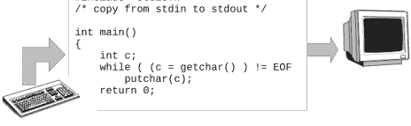

*图 1.1：初学者程序员使用的简单 I/O 模型。*

### 1.2 一个编程幻觉

初学者程序员通常编写遵循图 1.1 所示的简单 I/O 模型的程序：程序从键盘或磁盘文件获取输入，并将输出写入显示屏或磁盘上的文件。此类程序称为 *控制台应用程序*，因为键盘和显示屏是控制台设备的一部分。列表 1.1 和 1.2 包含此类程序的示例，一个使用 C 标准 I/O 库，另一个使用 C++ 流库。两者都从键盘获取输入并将输出发送到显示设备，即显示器上的某种控制台窗口。

列表 1.1 中的注释说明程序从 `stdin` 复制到 `stdout`。在 UNIX 中，每个进程都可以访问称为标准输入设备和标准输出设备的抽象。当进程被创建并加载到内存中时，UNIX 会自动为其创建标准输入和标准输出设备，打开它们，并分别使其准备好进行读取和写入。在 C（和 C++）中，`stdin` 和 `stdout` 是在 `<stdio.h>` 中定义的变量

¹事实上，每个符合 POSIX 的操作系统都必须提供标准输入和标准输出流。

²它还创建了一个标准错误设备，其默认与标准输出设备相同。

头文件，分别引用标准输入和标准输出设备。默认情况下，相关终端的键盘和显示器分别是标准输入和标准输出设备。

#### Listing 1.1: 使用简单 I/O 模型的 C 程序。

```
#include <stdio.h>
/* copy from stdin to stdout */
int main()
{
    int c;
    while ( ( c = getchar( ) ) != EOF )
        putchar(c);
    return 0;
}
```

#### Listing 1.2: 使用简单 I/O 模型的简单 C++ 程序。

```
#include <iostream>
using namespace std;
/* copy from stdin to stdout using C++ */
int main()
{
    char c;
    while ( ( c = cin.get( ) ) && !cin.eof() )
        cout.put(c);
    return 0;
}
```

这些程序给人一种错觉，仿佛它们通过 C 库函数 `getchar()` 和 `putchar()` 以及 C++ iostream 成员函数 `get()` 和 `put()` 直接连接到键盘和显示设备。它们可以在单用户桌面计算机上运行，也可以在多用户分时工作站的终端窗口中运行，结果都一样。如果你将它们作为控制台应用程序在 Windows 中构建并运行，它们的行为与在 UNIX 系统的命令行中构建和运行时的行为相同。

在单用户模式下运行的个人计算机上，这种错觉与现实并不遥远，因为键盘间接连接到程序的输入流，显示器间接连接到输出流。在多用户系统中则并非如此。

在多用户操作系统中，多个用户可以同时登录，不同用户的程序可能同时运行，每个程序从不同的键盘接收输入并向不同的显示器发送输出。例如，在网络上的 UNIX 计算机上，你可以通过 SSH 等网络程序登录，很多人可以连接到同一台计算机，并且他们中的几个人可以同时在同一台计算机上运行上述程序，将输出发送到物理上不同的计算机上的不同终端窗口，每个人看到的输出都与在单用户机器上运行程序时一样。

如 Figure 1.2 所示，UNIX 以一种 remarkably 优雅的方式确保每个用户的进程与其键盘和显示器之间存在逻辑连接。进程概念将很快解释。 使用上述 I/O 模型的程序不必担心连接到显示器和键盘的复杂性，因为操作系统隐藏了这种复杂性，为处理 I/O 提供了简化的接口。要理解操作系统是如何实现这一点的，必须首先理解 UNIX 操作系统的几个基石概念：文件、进程、用户和组、特权和保护，以及环境。

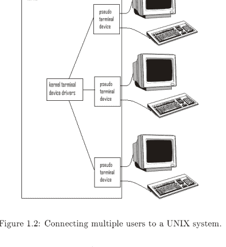

Figure 1.2: Connecting multiple users to a UNIX system.

### 1.3 Cornerstones of UNIX

从一开始，UNIX 就是围绕一组巧妙的想法设计的，正如 Ritchie 和 Thompson [2] 所说：

> "The success of UNIX lies not so much in new inventions but rather in the full exploitation of a carefully selected set of fertile ideas, and especially in showing that they can be keys to the implementation of a small yet powerful operating system."

这些“肥沃的想法”包括其文件系统的设计、其进程概念、特权程序和非特权程序的概念、用户和组的概念、可编程 shell、环境以及设备无关的输入和输出。在本节中我们简要描述每一种。

```
{
    printf("I am the process with process-id %d\n", getpid());
    return 0;
}
```

#### 1.3.3 Users and Groups

UNIX 安全的一部分基于这样一个原则：系统的每个用户都必须经过身份验证。身份验证是一种安全许可形式，就像在机场通过金属探测器一样。


在 UNIX 中，用户是一个⁷被授权使用系统的人。唯一使用 UNIX 系统的方法是登录到它⁸。UNIX 维护着允许登录的用户姓名列表⁹。这些名称称为用户名。与每个用户名相关联的是一个唯一的非负数，称为用户 ID，或简称为`uid`。每个用户还有一个关联的密码。UNIX 使用用户名/密码对来验证尝试登录的用户。如果该对不在其列表中，则用户将被拒绝。密码以加密形式存储在系统的文件中。

组是一组用户。就像每个用户都有一个用户 ID 一样，每个组都有一个唯一的整数组 ID，或简称为`gid`。UNIX 使用组来提供资源共享的一种形式。例如，一个文件可以与一个组相关联，该组中的所有用户对该文件具有相同的访问权限。由于程序只是一个可执行文件，对程序也是如此；可执行程序可以与一个组相关联，以便该组的所有成员对运行该程序具有相同的权利。每个用户至少属于一个组，称为该用户的首要组。`id`命令可用于打印用户的用户 ID 和用户名，以及用户所属的所有组的组 ID 和组名。`groups`命令打印用户所属的组列表。

在 UNIX 中，有一个特殊的用户称为超级用户，其用户名为`root`，是所有 UNIX 系统中少数几个预定义用户名之一。超级用户能够做普通用户不能做的事情，例如更改某人的用户名或修改操作系统的配置。在 UNIX 中能够以`root`身份登录，意味着一个人对该系统拥有绝对权力。出于这个原因，所有 UNIX 系统都会记录每次尝试以`root`身份登录，以便系统管理员可以监控和捕获入侵尝试。

每个进程都有一个关联的（真实）用户 ID，并且如我们稍后将看到的那样，有一个可能与真实用户 ID 不同的有效用户 ID。在最简单的情况下，当用户启动一个程序时，结果进程具有该用户的`uid`作为其真实和有效`uid`。进程的特权与该用户相同¹⁰。当超级用户（`root`）运行一个进程时，该进程运行 with the superuser's privileges. Processes running with user privileges are called user processes. At the programming level, the function `getuid()` returns the real user-id of the process that calls it, and the `getgid()` function returns the real group-id of the process that calls it.

### 1.3.4 特权指令和非特权指令

为了防止普通用户进程访问硬件并执行可能破坏计算机系统状态的其他操作，UNIX 要求处理器支持两种操作模式，称为特权模式和非特权模式¹¹。特权指令是指可以直接或间接更改系统资源的操作。特权指令的示例包括：

- 获取更多内存；
- 更改系统时间；
- 提高正在运行进程的优先级；
- 读写磁盘；
- 进入特权模式。

只有操作系统才允许执行特权指令。用户进程只能执行非特权指令。操作系统的安全性和可靠性取决于这种权力分离。

### 1.3.5 环境

当程序在 UNIX 中运行时，操作系统在运行程序之前采取的步骤之一是为该程序提供一个名为环境的环境名称-值对数组。每个名称-值对都是形式为的字符串

```
name=value
```

其中`value`是一个以`NULL`结尾的 C 字符串。名称称为环境变量，名称=`value`对称为环境字符串。变量按惯例只包含大写字母、数字和下划线，但这不是必需的¹²。唯一的要求是名称不包含`=`字符。例如，`LOGNAME`是一个存储当前用户用户名的环境变量，而`COLUMNS`是一个存储当前控制台窗口列数的变量¹³。即使它是一个数字，它也以字符串形式存储。

当用户登录到 UNIX 系统时，操作系统会根据系统中的各种文件为用户创建环境。从那时起，每当新程序运行时，它都会获得该环境的副本。这将在后面更详细地解释。

¹¹这些模式也称为监督模式和用户模式。

¹²Shell 和实用程序卷中 POSIX.1-2008 中使用的环境变量名称仅由大写字母、数字和下划线（'_'）组成，并且不以数字开头。

¹³如果用户在启动脚本中为`COLUMNS`定义了一个值，则终端窗口将具有该数量的列。如果用户未定义它或将其设置为`NULL`字符串，则终端窗口的大小由操作系统软件确定。

`printenv`命令显示所有环境变量的值，`env`命令也是如此。在程序内部，可以使用`getenv()`函数检索特定的环境字符串，如下所示

```
char* username = getenv("LOGNAME");
printf("The user's user-name is %s\n", username);
```

操作系统还为每个正在运行的程序提供一个外部全局变量

```
extern char **environ;
```

它是指向正在运行程序环境中名称-值对数组开头的指针。程序可以根据需要读取和修改这些变量。例如，需要知道当前终端窗口中有多少列的程序将查询`COLUMNS`变量，而其他程序可能只是忽略它。

### 1.3.6 Shell

内核为进程提供服务，而不是为用户提供服务；用户通过称为`shell`的命令行界面与 UNIX 交互。术语“shell”是 UNIX 对特定类型命令行解释器的称呼。命令行解释器自操作系统创建以来就存在。DOS 使用命令行解释器，微软 Windows 的命令窗口也是如此，它只是一个 DOS 模拟器。DOS 和命令窗口的使用方式与 UNIX 的使用方式相似：你输入命令并按 Enter 键，命令就会执行，然后提示符重新出现。显示提示符、读取你输入的内容、响应运行相应程序并重新显示提示符的程序是命令行解释器，在 UNIX 中称为`shell`。

在 UNIX 中，`shell`远不止是一个命令行解释器。它不仅仅能够读取简单的命令并执行它们。`shell`也是编程语言解释器；它允许用户定义变量、计算表达式、使用`while`和`if`语句等条件控制流语句，并调用其他程序。`shell`命令序列可以保存到文件中，并通过键入文件名作为程序执行。这种`shell`命令序列称为`shell`脚本。当`shell`脚本运行时，操作系统启动一个`shell`进程来读取指令并执行它们。

### 1.3.7 在线文档：手册页

在 Ritchie 和 Thompson 编写 UNIX 的第一个版本后不久，在他们的经理 Doug McIlroy 的坚持下，他们于 1971 年编写了 UNIX 程序员手册。该手册最初是一卷，但很快扩展为按主题组织的七卷集。它以印刷形式和用于在普通字符显示设备上显示的格式化文件两种形式存在。随着时间的推移，它变得越来越大。每个 UNIX 发行版都附带这套手册页，简称为“manpages”。附录 B.4 包含手册页结构的简要描述，第 2 章提供了有关如何使用它们的更多详细信息。

> 14 这不是巧合。在微软编写 MS-DOS 之前很久，他们为 PC 编写了名为 Xenix 的 UNIX 版本，其权利于 1987 年出售给 Santa Cruz Operations

### 1.4 UNIX 内核 API

像 UNIX 这样的多用户操作系统必须管理和保护系统的所有资源，并提供一种让所有用户都能高效、安全、愉快地工作的操作环境。它必须防止用户及其调用的进程直接访问任何硬件资源。换句话说，如果用户的进程想要读写磁盘，它必须请求操作系统代其执行，而不是自己直接操作。操作系统将执行该任务，并将数据传入或传出用户进程。要理解这样做的必要性，不妨设想一下，如果用户进程可以直接访问硬盘，会发生什么情况。用户可能会编写程序，试图占用所有磁盘空间，甚至更糟，试图擦除磁盘。

类似清单 [1.1] 和 [1.2] 中的程序可能看起来并没有请求操作系统读写任何数据，但事实并非如此。`getchar()`和`putchar()`都是 C 标准 I/O 库（其头文件为`<stdio.h>`）中的库函数，它们实际上确实在“请求”操作系统为调用程序完成工作。细节将在后面解释，但无论如何，请相信操作系统已经介入到了这项任务中。


操作系统必须保护用户彼此免受侵害，并保护自身免受用户的侵害。然而，在为所有用户提供操作环境的同时，多用户操作系统会让每个用户都觉得整台计算机完全归自己使用。这正是图 [1.1] 中程序执行所依赖的错觉。不知何故，每个人都能编写出看起来独占计算机的程序，并像没有其他人使用这台机器一样运行它们。操作系统通过在用户进程与设备、文件之间建立数据路径来创造这种错觉。这些数据路径在操作系统自身保留的内存区域中连接用户进程和设备。这就是第一条线索——物理内存被划分为两个区域：一个用于加载普通用户程序，称为用户空间；另一个用于存储操作系统本身，称为系统空间。

UNIX 是如何创造这种错觉的呢？我们先给出一个粗略的答案，并在后续章节中逐步补充细节。

UNIX 操作系统被称为内核。内核定义了应用程序编程接口（API），并直接或间接地提供 UNIX 的所有服务。根据 UNIX 的具体实现，内核可以是一个程序，也可以是一组相互交互的程序的集合，并且有许多入口点 [1.5]。每个入口点都提供内核执行的一项服务。如果你习惯于认为程序总是从第一行开始执行，这可能会让你感到困惑。与许多其他程序一样，UNIX 内核可以从其他入口点进入。你可以将这些入口点视为可由其他程序调用的函数。这些函数执行诸如打开、读取和写入文件、创建新进程、分配内存等操作。每个函数都期望接收特定数量的特定类型的参数，并产生定义明确的结果。内核入口点的集合构成了 UNIX API 的很大一部分。你可以将内核视为一组独立函数的集合，这些函数捆绑在一个大软件包中，并将其 API 视为这些函数的签名或原型的集合。

当 UNIX 启动时，内核被加载到称为系统空间的内存区域中，并一直驻留到机器关闭。用户进程不允许访问系统空间。如果它们访问，就会被内核终止。

> ¹⁵ 入口点是程序中可以开始执行的一条指令。在你可能编写的程序中，通常只有一个入口点——`main()`——但在其他程序中，你可以指定代码可以从多个入口点中的任何一个进入。软件库是拥有多个入口点的代码模块。在 Windows 世界中，动态链接库（DLL）就是具有多个入口点的代码模块的示例。

内核可以完全访问计算机上连接的所有硬件。用户程序则不能；它们必须通过内核间接与硬件交互。内核维护各种系统资源，以便向用户程序提供这些服务。这些系统资源包括许多不同的数据结构，用于跟踪 I/O、内存和设备使用情况等。例如，在第 1.4.1 节中对此进行了更详细的解释。

总之，如果用户进程需要从磁盘获取数据，例如，它必须“请求”内核获取它。如果用户进程需要写入显示器，它也必须“请求”内核执行此操作。所有进程都通过内核访问设备和资源。内核使用其资源为用户进程提供这些服务。

#### 1.4.1 系统资源

内核为用户程序提供许多服务，包括：

- 进程调度和管理，
- I/O 处理，
- 物理和虚拟内存管理，
- 设备管理，
- 文件管理，
- 信号和进程间通信，
- 多线程，
- 多任务，
- 实时信号和调度，以及
- 网络服务。

网络服务包括 HTTP、NIS、NFS、X.25、SSH、SFTP、TCP/IP 和 Java 等协议。支持哪些协议并不重要；重要的是要理解内核提供了用户程序请求这些服务的手段。

程序可以通过两种不同的方法向内核请求服务：

- 通过向直接内置于内核的函数（即入口点）发出系统调用，或
- 通过调用使用此调用的高级库例程。

不要将这两者与系统程序混淆。“系统程序”一词指的是与内核捆绑在一起的独立程序，它通过接口实现其功能，并为用户提供更高级别的服务。我们可以浏览 UNIX 安装的 `/bin` 或 `/usr/bin` 目录，找到许多不同的系统程序。许多 UNIX 命令由系统程序实现。

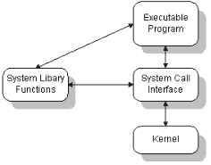

`gettid()`，它返回调用线程的线程 ID。对于只有一个线程的进程，它与 `getpid()` 相同。以下程序调用 `gettid()` 并在屏幕上打印返回的 ID：

```c
#define _GNU_SOURCE
#include <unistd.h>
#include <sys/syscall.h>
#include <sys/types.h>
#include <stdio.h>

int main(int argc, char *argv[])
{
    printf("Thread id %ld\n", syscall(SYS_gettid));
    /* could also pass __NR_gettid */
    return 0;
}
```

由于该函数没有参数，因此除了系统调用号之外，无需向 `syscall()` 传递任何其他内容。

完整的系统调用集通常可在第 2 节的 syscalls 手册页中找到。

#### 1.4.3 系统库

许多系统调用是非常低级的原语；它们执行非常简单的任务。这是因为 UNIX 操作系统被设计为尽可能保持内核小巧。出于同样的原因，内核通常不提供许多不同类型的例程来执行类似的操作。例如，只有一个内核函数执行读操作，它从指定设备读取大块数据到指定的系统缓冲区。没有逐字符读取的系统调用，而这是一个有用的功能。总之，只有一个内核函数执行输入操作！

为了弥补内核的简陋，UNIX 设计者通过一套广泛的高级例程增强了编程接口，这些例程保存在系统库中。这些例程为编程内核提供了更丰富的原语集。当然，它们最终会调用内核，如图 1.3 所示。UNIX 还包含用于各种专门任务的库，例如异步输入和输出、共享内存、终端控制、登录和注销管理等。使用这些库中的任何一个都需要使用适当的 `#include` 指令将库的头文件包含在代码中（例如 `#include <termios.h>`），有时还需要显式链接库，因为它不在标准位置。系统库中函数的手册页包含在 UNIX 手册页的第 3 卷中。

### 1.5 UNIX 和相关标准

#### 1.5.1 问题

UNIX 的第一个版本由 Ken Thompson 和 Dennis Ritchie 于 1969 年在 AT&T Bell Labs 工作期间编写。他们的初创操作系统充满了非常新颖的想法，他们于 1973 年在 IBM Yorktown Heights 的 ACM 操作系统研讨会上发表了这些想法。1974 年 1 月，加州大学伯克利分校（UCB）从 Bell Labs 获得了第 4 版，并着手为 UNIX 添加现代功能。同年，AT&T 开始向大学授权 UNIX。1974 年至 1979 年，UCB 和 AT&T 在 UNIX 的独立副本上工作。到 1978 年，各种版本的 UNIX 具有今天所见的大多数功能，但并非全部在一个系统中。但是在 1979 年，AT&T 做了一件改变游戏规则的事情；他们对自己的 UNIX 品牌主张了专有权利，并将其商业化。实质上，他们对 UNIX 进行了商标注册，使其拥有成本高昂。

BSD 代码在比 AT&T 源代码更宽松的许可下发布，不需要许可费或像 GNU 项目和今天 Linux 使用的 GPL 那样要求随源代码分发。结果是，许多 BSD 源代码被整合到各种商业 UNIX 变体中。到 4.3BSD 编写时，几乎没有原始 AT&T 源代码留在其中。FreeBSD/NetBSD/OpenBSD 都是 4.3BSD 的分支，没有原始 AT&T 源代码，也没有 UNIX 商标权，但它们的许多代码进入了商业 UNIX 操作系统。简而言之，出现了两个主要版本的 UNIX——基于 BSD 的和基于 AT&T 版本的。

1991 年，Linux 的创建使情况进一步复杂化。Linux 是从头开始开发的，与 BSD 不同，它使用了现有的 GNU 项目，而 GNU 项目是对 UNIX 用户空间的大量干净房间实现。它与 AT&T UNIX 的相似度远不如 BSD。1993 年，AT&T 将 UNIX 出售给 Novell，Novell 一年后将商标出售给一个名为 X/Open 的行业联盟。

现在有数十种不同的 UNIX 发行版，每个发行版的行为都不同。基于 SVR4 的系统有 Solaris 和 UnixWare，SVR4 是 AT&T 于 1989 年发布的版本，以及基于加州大学伯克利分校发行版的 FreeBSD 和 OpenBSD。Linux 等系统是混合系统，AIX、IRIX 和 HP-UX 也是如此。自然会问什么使系统成为 UNIX。答案是，在过去三十年左右的时间里，已经制定了标准来定义 UNIX。操作系统可以被品牌化为符合一个或另一个标准。

#### 1.5.2 解决方案：标准

一个被广泛接受的 UNIX 标准是 POSIX 标准。从技术上讲，POSIX 并不是特别定义 UNIX；它比那更通用。POSIX 代表可移植操作系统


System Interface，即正式名称为 IEEE 1003 的一系列标准。它也由国际标准化组织（ISO）作为 `ISO/IEC 9945:2003` 发布；两者是同一份文件。POSIX 的最新版本是 `IEEE Std 1003.1-2008`，也称为 `POSIX.1-2008`。`POSIX.1-2008` 标准整合了之前的主要标准，包括 `POSIX.1` 和单一 UNIX 规范（SUS）。POSIX 的精神是定义一个 UNIX 系统，正如规范导言中所述（http://pubs.opengroup.org/onlinepubs/9699919799/）：

`POSIX.1-2008` 的目标读者是所有关心基于 UNIX 系统的行业范围标准操作系统的相关人员。这至少包括四类人群：

- 购买硬件和软件系统的人员
- 决定未来企业计算方向的公司管理者
- 实现操作系统的人员，尤其是
- 开发可移植性为目标的应用程序的人员

单一 UNIX 规范源自 1994 年编写的更早标准 X/Open System Interface，而该标准本身是在名为 Spec 1170 Initiative 的 UNIX 可移植性指南基础上开发的，因其包含了该规范所涵盖的恰好 1,170 个不同的系统调用、头文件、命令和实用程序的描述而得名。此后，随着 UNIX 的发展，标准化元素的数量也在增长。

单一 UNIX 规范由 The Open Group 于 1997 年、2001 年和 2003 年进行了修订，The Open Group 成立于 1996 年，是 X/Open 与开放软件基金会（OSF）两大行业联盟合并而成。The Open Group 拥有 UNIX 商标。它使用单一 UNIX 规范来定义实现必须支持的接口，才能自称为 UNIX 系统。

那么，这个标准到底标准化了什么？它标准化了许多内容，包括所有系统调用的集合、系统库，以及使 UNIX 感觉像 UNIX 的那些实用程序，如 `grep`、`awk` 和 `sed`。系统调用的集合定义了 UNIX 内核。系统调用和系统库共同构成了 UNIX 应用程序编程接口。它们是程序员对内核的视角。实用程序是 UNIX 用户所看到的接口的一部分。

再次引用导言：

`POSIX.1-2008` 同时是 `IEEE Std 1003.1™-2008` 和 The Open Group 技术标准基础规范，第 7 版。

`POSIX.1-2008` 定义了标准的操作系统接口和环境，包括命令解释器（或“shell”），以及支持源代码级应用程序可移植性的通用实用程序。`POSIX.1-2008` 旨在供应用程序开发人员和系统实现者 [sic] 使用，并包含四个主要组件（各在相关卷中）：

- 通用术语、概念和所有卷共有的接口，包括实用程序约定和 C 语言头文件定义，均包含在基础定义卷中。

将函数扩展到标准 C 中引入的函数。因此，符合 POSIX 的 UNIX 系统包含 ISO C 语言的所有库函数。例如，每个 UNIX 发行版都包含诸如 C 标准 I/O 库、C 数学库和 C 字符串库等库。

为 Linux 以及其他几个 UNIX 发行版提供的 C 标准库是 GNU C 库，称为 GNU libc 或 `glibc`。GNU 通常会扩展 C 库，其中的内容并非全部符合 ISO 标准，也并非全部符合 POSIX。所有这些意味着，一个系统上的 C 库版本不一定与另一个系统上找到的相同。

这就是为什么了解标准以及它定义了什么和未定义什么很重要。总体而言，C 标准描述了什么是必需的、什么是禁止的以及在一定限制内什么是允许的。具体而言，它描述了

- C 程序的表示
- C 语言的语法和约束
- 解释 C 程序的语义规则
- 由 C 程序处理的输入数据的表示
- 由 C 程序产生的输出数据的表示
- 符合标准的 C 实现所施加的限制和限制

并非所有编译器和 C 运行时库都符合标准，这使 C 编程变得复杂。GNU 编译器具有命令行选项，可让您根据各种标准进行编译。例如，如果您希望程序按照 ANSI 标准编译，您将使用命令

```
$ gcc -ansi
```

或

```
$ gcc -std=c90
```

要使用当前的 ISO C11 标准，以下任一方法均可：

```
$ gcc -std=c11
$ gcc -std=iso9899:2011
```

了解如何为 UNIX 编写程序需要知道哪些特性属于 C，哪些特性是因为它们是 UNIX 的一部分。换句话说，您需要了解 C 库的作用以及底层 UNIX 系统定义了什么。对 C 标准有良好的掌握将使这一过程更轻松。

## 1.7 通过示例学习系统编程

系统调用和库函数的数量如此庞大，以至于凡人无法全部记住。试图通过阅读参考手册和用户文档来学习 UNIX API 的所有复杂性和细节将是一项费力的工作。幸运的是，人们通常通过示例学习得很好。与其研究参考手册和文档，我们可以通过编写使用它的程序一点一点地学习 API。起初从简单开始，随着时间的推移增加复杂性。

Bruce Molay [1] 使用了一种学习如何编写系统程序和发现 UNIX API 的优秀策略：

- 1. 选择一个使用 API 的现有程序，例如 shell 命令；
- 2. 使用系统手册页和其他在线可用信息，研究该程序在其实现中很可能使用的系统调用和内核数据结构；并且
- 3. 编写该程序的新版本，迭代改进它，直到它与实际命令的行为完全相同。

通过反复重复此过程，可以熟悉 API 的相关部分以及学习它所需的资源。当是时候编写一个完整的应用程序时，其中必须与内核通信的部分应该相对容易编写。我们将在本系列关于 UNIX 的笔记中部分遵循相同的范式。

## 1.8 UNIX 文件层次结构

典型的 UNIX 文件层次结构在根目录下有几个目录。图 1.4 显示了典型但假设的文件层次结构的一部分。以下目录应存在于大多数 UNIX 系统中，但并非全部都是必需的。唯一必需的目录是 `/dev` 和 `/tmp`。

| Directory | Purpose |
|-----------|---------|
| bin | 所有基本二进制可执行文件的存储库，包括计算机在“单用户模式”下运行时必须可用的 shell 命令（类似于 Windows 中的安全模式。） |
| boot | 引导加载器的静态文件 |
| dev | 包含基本设备文件的目录，将在后面解释。 |
| etc | 存储几乎所有主机配置文件的地方。它有点像 Windows 的注册表文件。 |
| home | 所有用户主目录所在的目录，但并不总是如此。 |
| lib | 基本共享库和内核模块 |
| media | 可移动媒体的挂载点 |
| mnt | 临时挂载文件系统的挂载点 |
| opt | 附加应用程序软件包 |
| sbin | 基本系统二进制文件 |
| srv | 此系统提供的服务的数据 |
| tmp | 临时文件 |

例如，`/home/fac/sweiss` 是图 1.4 中目录 `sweiss` 的绝对路径名，`/home//fac///sweiss` 也是如此。额外的斜杠会被忽略。请注意 UNIX（实际上是 POSIX）在路径名中使用斜杠，而不是反斜杠：`/usr/local`，而不是 `\usr\local`。

如果路径名不以 `"/"` 开头，则称为相对路径名。当进程必须解析相对路径名以便访问文件时，假设路径名从当前工作目录开始。事实上，当前工作目录的定义，也称为当前工作目录，是指进程用于解析不以 `"/"` 开头的路径名的目录。例如，如果当前工作目录是 `/home/fac`，则路径名 `sweiss/testdata` 指的是绝对路径名为 `/home/fac/sweiss/testdata` 的文件。惯例是使用 `pwd` 作为当前工作目录的简写。

环境变量 `PWD` 包含当前工作目录的绝对路径名。命令 `pwd` 打印 `PWD` 的值。

### 1.8.1.1 使用目录

如果你有在用户级别使用目录的经验，可以跳过本节。你不需要知道很多命令就可以在 UNIX 中完成大多数与目录相关的任务。这是一个基本命令的列表。主要任务是导航以及显示和更改其内容。下面的表格给出了命令名称及其最简单的用法。它们不描述命令的各种选项或使用细节。

| Command | Explanation |
|---|---|
| `pwd` | 打印当前工作目录的路径（pwd） |
| `ls [<dir1>] [<dir2>] ...` | 列出 `pwd` 的内容，或如果提供则列出 `<dir1>`、`<dir2>` ... |
| `cd [<dir>]` | 将 `pwd` 更改为 `HOME` 目录，或如果提供则更改为 `<dir>` |
| `mkdir <dir> [<dir2>] ...` | 在 `pwd` 中创建新目录 `<dir>`（和 `<dir2>` ...）； |
| `rmdir <dir> [<dir2>] ...` | 删除空目录 `<dir>`（和 `<dir2>` ...） |
| `rm -r <dir>` | 删除 `<dir>` 的所有内容以及 `<dir>` 本身。危险！！ |
| `mv` | 请参阅第 1.8.2 节中的说明 |

### Notes

- 1. "`pwd`" 中的 "`p`" 代表 print，但它不会打印到打印机。在 UNIX 中，“打印”意味着显示在屏幕上。


# UNIX 讲义笔记

## 第 1 章 系统编程导论

### 笔记

- `ln` 命令只能用于文件，不能用于目录。有一种简化版的命令名为 `link`。
- `rm` 命令是不可逆的；一旦链接被删除，就无法恢复。
- `mv` 命令有两种形式。如果参数多于两个，最后一个必须是已存在的目录名，所有在最后之前命名的文件都会被移动到该目录中。反之，如果最后一个参数是已存在的目录名，则所有前面的参数都会被移动到其中。前面的参数可以是已存在的目录，只要不产生循环，例如试图将子目录变为父目录。如果最后一个参数不是已存在的目录，`mv` 的含义就只是将第一个文件重命名为新名称。如果新名称是已存在的文件，`mv` 会静默覆盖它。因此，你应该使用 `mv -i`，它会在覆盖文件前提示你。
- 你使用 `cp` 命令的方式几乎与使用 `mv` 命令相同，只是它复制文件而不是移动文件。主要区别是 `cp` 不接受目录作为参数，除非作为最后一个参数，除非你给它 `-r` 选项，即 `cp -r`，在这种情况下它会递归复制目录。请注意 `cp` 复制的是文件的副本，而不仅仅是其名称，因此对一个文件的更改不会反映在另一个文件上。

### 示例

```sh
$ ls
hwk1_6.c
$ mv hwk1_6.c hwk1_finalversion.c
$ ls
hwk1_finalversion.c
```

此命令将链接 `hwk1_6.c` 改名为 `hwk1_finalversion.c`。

```sh
$ rm hwk1.o hwk1.old.o main.o
```

这会从当前工作目录中删除这三个链接。如果这些文件在其他目录中没有其他链接，则其属性和内容也会从磁盘中删除。我将在后面的章节中对此进行更多解释。

```sh
$ ln hwk1.1.c ../mysourcefiles/proj1.c
```

为当前工作目录中名为 `hwk1.1.c` 的文件在目录 `../mysourcefiles` 中创建了一个新的链接 `proj1.c`。

```sh
$ cp -r main.c utils.c utils.h images ../version2
```

将三个文件 `main.c`、`utils.c` 和 `utils.h`，以及目录 `images` 复制到目录 `../version2` 中。

## 目录操作说明

- `mkdir` 是创建目录的唯一方法
- 如果目录不为空，则不能使用 `rmdir` 删除目录。
- 你可以使用 `rm -r` 删除多个目录及其内容，但这是不可逆的，所以要小心。
- 创建和删除文件的命令在技术上是在修改目录，但这些内容将单独介绍。

> 20 这就是为什么 C 指令 `printf` 将输出发送到显示设备，而不是打印机。相比之下，在 FORTRAN 中，`print` 指令将输出发送到打印机。

“更改目录”和“处于某个目录中”是不精确的说法。当你 `cd` 到名为 `dir` 的目录时，你可能会认为自己“在 `dir` 中”，但这并不正确。真正的情况是，`dir` 目录现在是你的当前工作目录，并且从你更改目录的 shell 进程中运行的每个进程，包括 shell 进程本身，在尝试解析相对路径名时都会默认使用这个 `dir` 目录。

每个目录中都定义了两个特殊条目

- `.` 目录本身
- `..` 目录的父目录，如果是 `/` 则为其自身

因此，“`cd ..`”会将 `pwd` 更改为当前 `pwd` 的父目录，“`cd ../..`”会将其更改为祖父目录，而“`cd .`”则没有任何效果。在继续阅读之前，你应该尝试这些命令并确保你理解它们的工作方式。

## 1.8.2 文件和文件名

与其它操作系统不同，UNIX 仅区分五种非目录文件类型：

- 普通文件
- 设备文件（字符型或块型）
- FIFO
- 套接字
- 符号链接

设备文件和 FIFO 将在第 4 章中深入描述，套接字在第 9 章中，符号链接在下面介绍。剩下的就是普通文件，其定义非常简单：普通文件是没有特定结构的字节序列。

### 1.8.2.1 文件名

正如前面所述，文件和文件名是不同的东西。文件名，技术上称为文件链接，或简称链接，只是一个命名文件的字符串。一个文件可以有许多文件名。文件名的大小实际上是无限的，除非你认为 255 个字符不够大。文件名中最大字节数包含在系统相关的常量 `NAME_MAX` 中。文件名可以包含除 `/` 和空字符之外的任何字符。它们可以有空格和换行符，但如果有，通常需要在使用它作为命令参数时对其名称加上引号。UNIX 是区分大小写的，因此 `References` 和 `references` 是两个不同的文件名。

与 DOS、Windows 和 Apple 操作系统不同，操作系统不会对文件名扩展使用任何用途，尽管应用级软件如编译器和文字处理器将它们用作指南，而桌面环境如 Gnome 和 KDE 则基于文件名扩展创建关联，与 Windows 和 Apple 的做法类似。但再次强调，UNIX 本身并没有基于内容的文件类型概念，并且为所有文件提供相同的一组操作，无论其类型如何。

请记住，目录条目由两部分组成。一部分是文件名，另一部分是通过该名称将文件关联起来的方式。你可以将这第二部分视为指向实际文件的指针表中的索引。

一个文件可以有许多链接，就像带着多本伪造护照旅行的间谍。在一个目录中，文件可能以一个链接为名，而在另一个目录中，它可能有另一个链接。但它仍然是同一个文件。在图 1.5 中，该文件以三个名称为人所知，每个名称都是不同目录中的一个链接。关于多个链接有两个限制。一个是目录不能有多个名称。另一个是同一个文件的两个名称不能存在于不同的文件系统。理解这一点的最简单方法，而不涉及挂载和挂载点的讨论，是文件层次结构的不同部分可以驻留在不同的物理设备上，例如磁盘的不同分区或不同的磁盘，并且一个物理设备上的文件不能在另一个物理设备上拥有名称。这将在后面的章节中澄清。

### 1.8.2.2 什么是文件？

所有文件，无论其类型如何，都有属性。几乎所有文件都有数据，或内容。

- 属性包括诸如文件创建时间、上次修改时间、以字节数表示的文件大小、分配给文件的磁盘块数等属性。描述对文件访问限制的属性称为文件模式。文件的属性在 UNIX 中统称为文件状态。“状态”这个词可能听起来具有误导性，但这是 UNIX 原始设计者使用的词。
- 数据是实际的文件内容。事实上，UNIX 使用术语 `content` 来标识文件的这一部分。一些文件没有任何内容，因为它们只是操作系统使用的接口。这将在第 4 章中进一步讨论。

这两项，状态和内容，并不存储在一起。

### 1.8.2.3 操作文件

如果你有 UNIX 用户级经验，可以跳过本节。用于操作文件的命令可分为那些查看文件内容但不修改它们、那些查看文件属性、以及编辑器——以某种方式修改文件的工具。下面列出了用于查看文件内容的基本命令，而不是编辑或修改它们。编辑器是另一个主题。在所有情况下，如果省略文件参数，命令将从标准输入读取。还有一类单独的程序称为过滤器，它们提供对普通文本文件的复杂过滤。

### 1.8.2.4 文件属性

在本节中，“文件”一词指的是所有文件类型，包括目录。UNIX 有一种非常简单但有用的文件保护方法。为了让用户能够控制对他们文件的访问，UNIX 的发明者设计了一种相当优雅且简单的访问控制系统。每个文件都有一个所有者，称为其 `user`。文件还与所有者所属的一个组相关联，称为其 `group`。文件的所有者可以将文件的组设置为所有者所属的任何组。最后，所有既不是用户也不是文件组成员的人都属于 `others` 类。因此，所有用户集合被划分为三个不相交的子集：`user`、`group`、`others`，你可以用首字母缩写 `ugo` 来记住它们。

对任何文件有三种访问模式：读、写和执行。`读访问` 是查看文件内容的能力。对于目录，这是指使用 `ls` 命令查看其内容的能力。`写访问` 是更改文件内容或某些文件属性的能力。对于目录，这意味着能够在目录中创建新的链接，重命名目录中的文件，或删除目录中的链接。这会违反直觉——从目录中删除一个文件的能力并不取决于是否对该文件有写权限，而取决于是否对该目录有写权限。`执行访问` 是运行文件的能力。对于目录，执行访问是指能够 `cd` 进入该目录，从而能够运行目录中包含的程序以及需要访问该目录内文件属性或内容而运行的程序。简而言之，如果没有对目录的执行访问权限，就几乎无法使用它。

对于三类用户，每类都有三个保护位，定义了该类成员所享有的读、写和执行权限。对于每个类，如果某个特定的保护位被设置，则该类中的任何人都可以获得该特定类型的访问权限。因此，有三个位称为用户 `u`、组 `g` 和其他人 `o` 的读、写和执行位，共九个。这些位被称为 `mode` 或 `permission bits`，通常以两种形式之一表示：八进制数，或九个字符的字符串。

九字符权限位字符串为：

```
r w x      r w x      r w x
user bits  group bits  others bits
```

各种命令使用破折号来表示该位被关闭。

#### 示例

- 字符串 `rwxrw-r--`，给予用户（所有者）读、写和执行权限，组有读和写但无执行权限，其他人只有读权限。


字符串 `r-xr-xr-x` 给予每个人只有读和执行权限。
字符串 `rwxr--r--` 给予用户读、写和执行权限，组有读和执行权限，其他人只有读访问权限。
模式字符串可以用 3 位八进制数表示，将每组三个位视为单个八进制数字。使用 C 三元运算符 `?:`，我会这样写

```
value = r?4:0 + w?2:0 + x?1:0
```

由此得到每组三个位的值表。
`rwx`  `rw-`  `r-x`  `r--`  `-wx`  `-w-`  `--x`  `---`
`7`    `6`    `5`    `4`    `3`    `2`    `1`    `0`
例如，`rwxr--r--` 的八进制数为 `764`，因为用户位是 `7`，组是 `6`，其他人是 `4`。
除了模式位之外，文件的权限字符串通常还会显示一个字符文件属性来描述文件类型。该字符出现在模式位左侧，可以是 `-`（普通文件）、`d`（目录）、`b`（缓冲特殊文件）、`c`（字符特殊文件）、`l`（符号链接）、`p`（管道）或 `s`（套接字）。

### 1.8.2.5 查看和修改文件属性

要查看文件的属性，请使用 `ls` 命令的 `-l` 选项：`"-l"` 表示“长列表”，它会打印权限字符串、文件链接数、所有者的用户名、组的组名、文件字节数、最后修改时间和文件链接。例如，要查看当前工作目录中名为 `.bashrc` 的文件的属性，我会输入

```
$ ls -l ~/.bashrc
-rw-r--r-- 1 sweiss faculty 3304 Sep 22 13:05 .bashrc
```

该文件是普通文件，我作为其所有者可以读取和修改它（`-rw-`）。`faculty` 组中的任何人都可以读取它（`r--`），其他任何人也可以读取它（`r--`）。`ls` 还有许多其他选项，用于显示额外信息。阅读其手册页以了解详情。你也可以使用 `stat` 命令，它会提供额外信息：

```
$ stat .bashrc
    File: '.bashrc'
    Size: 3304      Blocks: 8       IO Block: 4096  regular file
    Device: 1b4/24d Inode: 1318      Links: 1
    Access:(0644/-rw-r--r--):Uid:(1220/ sweiss)Gid:(400/ faculty)
    Access: 2010-12-20 13:20:04.582733000 -0500
    Modify: 2010-09-22 13:05:11.271251000 -0400
    Change: 2010-09-22 13:05:11.278893000 -0400
```

你可以用 `wc` 获取字节数、单词数和行数：

```
$ wc .bashrc
156 387 3304 .bashrc
```

该文件有 156 行、387 个单词和 3304 字节。其他选项提供不同的信息。
更改文件属性的命令有：

| 命令 | 说明 |
|---|---|
| `chmod <mode> <files>` | 更改文件权限 |
| `chown <owner> <files>` | 更改文件所有权 |
| `chgrp <group> <files>` | 更改组所有权 |
| `touch <files>` | 更新文件时间戳；创建空文件（大小为 0 的文件） |

### 1.8.2.6 符号链接

符号链接，也称为软链接，是一种存储包含另一个文件路径名的字符串的文件。该存储的字符串长度不超过 `SYMLINK_MAX` 字节。该字符串不是文件内容的一部分，但程序可以使用它来访问其包含路径名的文件。符号链接类似于 Windows 操作系统中的快捷方式；它们本身没有数据，而是指向文件。它们对于克服硬链接的限制很有用，因为硬链接不能链接到目录且不能跨文件系统。例如，假设某人经常访问绝对路径为

```
/data/research/biochem/proteins
```

的目录。他或她可以在自己的主目录中创建链接以更方便地访问该目录，如下所示：

```
$ ln -s /data/research/biochem/proteins ~/proteins
```

`ln` 命令使用 `-s` 选项创建符号链接。路径名 `/data/research/biochem/proteins` 将以这样的方式存储在文件 `~/proteins` 中，使得使用文件名 `proteins` 的命令会将其替换为存储在其中的路径名。
符号链接对操作系统构成危害，因为存在循环引用和无限循环的可能性。将在第 3 章中对此进行更多说明。

## 1.9 内部原理：登录是如何工作的

当你登录到 UNIX 系统时，实际上发生了什么？登录是什么意思？
这个问题没有单一答案，因为它取决于（1）运行的是哪个版本的 UNIX，以及（2）登录是在控制台、终端窗口内，还是通过 SSH 等协议跨网络进行。幸运的是，在主流 UNIX 系统——Linux、Mac OS、Solaris 和 BSD 变体——中，在控制台或终端窗口中登录的方式基本相同，只有细微差别，而通过网络登录的方式虽然与在控制台或终端窗口中登录的方式截然不同，但在主要 UNIX 系统之间是相似的。

> `24` BSD 代表 Berkeley Software Distribution。参见本章末尾的历史说明。

在主要的 UNIX 系统中，终端或控制台登录通常基于早期 BSD UNIX 系统使用的方法。我们将研究 BSD 方法的工作原理。现代 UNIX 系统可以选择使用一种非常不同的方法，即 PAM，下面会讨论。
当 UNIX 系统启动时，在内核初始化所需的数据结构并启用中断之后，它会创建一个新的进程，进程 ID 为 `1`，名为 `init`。`init` 是启动时创建的第一个进程，也是 UNIX 系统中所有用户级进程的祖先，尽管它以 `root` 权限运行。`init` 监控操作系统外层所有进程的活动，并在计算机关机时管理发生的事情。
`init` 进程做了许多有趣的事情，但现在对我们感兴趣的是，`init` 使用系统上可用的终端设备信息（即控制台、调制解调器等）为每个可用的终端创建一个监听该终端活动的进程。这些进程是 `getty` 进程。`getty` 的名称代表“get tty”。`getty` 进程配置终端设备，在终端中显示诸如“login:”之类的提示，并等待用户输入用户名。
“`getty`”中的“`tty`”是电传打字机的缩写。对于不知道历史的人来说，电传打字机是现代计算机终端的前身。电传打字机早在 1906 年就已出现，但直到大约 1930 年，其设计才稳定下来。电传打字机本质上是打字机，可将键入的字符转换为可通过电线传输的电子代码。现代计算机终端继承了电传打字机的许多特性。
当用户在终端上输入用户名时，`getty` 进程会运行 `login` 程序，并将输入的用户名传递给它。`login` 执行许多任务并提示用户输入密码并尝试验证密码。如果密码有效，`login` 会将当前工作目录（`PWD`）设置为用户的主目录，将进程的用户 ID 设置为该用户，初始化用户的环境，调整各种文件的权限和所有权，然后启动用户的登录 shell。如果密码无效，`login` 程序将退出，`init` 会注意到这一点并为该终端启动一个新的 `getty`，后者将重复上述过程。
使用 PAM 的系统并非如此工作。PAM 是可插拔认证模块的缩写，是一组可动态配置的认证例程库，可在运行时选择以执行各种认证任务，而不仅仅是登录。我们在此不介绍 PAM。
网络登录通常基于 BSD 网络登录机制，必须以不同的方式工作。首先，没有物理终端，因此无法预先知道必须初始化多少个终端。其次，终端与计算机之间的连接不是点对点的，而是网络服务，例如 SSH 或 SFTP。
BSD 采用的方法是尝试使登录代码独立于登录来源。其结果是它使用了伪终端的概念。这些内容将在后面详细介绍。对于网络登录，`init` 不是为每个终端创建一个 `getty` 进程，而是创建该进程

`25` 这并不完全准确，但目前足够了。如果你想知道实际步骤，最好等到你了解进程是如何创建的，以及创建进程和运行程序之间的区别。

`26` 实际上，`getty` 进程使用名为 `execve()` 的系统调用将自身替换为 `login` 程序。此主题在后面的章节中介绍。

`27` 在 `bash` 中，环境变量 `PWD` 存储当前工作目录的绝对路径名。Bash 从 Bourne shell 继承了这个名称，在 Bourne shell 中它代表“present working directory”。在 C-shell 中，它仍然是 `cwd`。即使在 `bash` 中它是 `PWD`，没人再称之为当前工作目录了；它就是当前工作目录。

它将监听登录的 incoming 网络请求。例如，如果系统支持通过 SSH 登录，那么 `init` 将创建一个名为 `sshd` 的进程，即 SSH 守护进程，它将为每次远程登录创建一个新的进程。这些新进程反过来会创建所谓的伪终端驱动程序（`pts` 驱动程序），然后它会启动登录程序，该程序执行上面描述的所有操作。情况与简单的终端登录大不相同，而且要复杂得多，因为伪终端的管理很复杂。这将在后面深入介绍。

## 1.10 从系统程序员的角度看 UNIX


系统程序员眼中的 UNIX 与用户眼中的 UNIX 截然不同。用户通过 `shell` 的功能来感知 UNIX，而系统程序员则“深入” `shell` 之下，查看内部内核的功能，如图 1.6 所示。

然而，系统程序员不仅需要理解内核 API，还必须理解程序如何与用户交互、如何与操作系统交互以及如何与其他程序交互。交互包含三种不同的操作：

- 获取数据
- 传输数据
- 在时间上协调执行

简单的程序从外部源（如文件或键盘）获取数据，并将数据传输到外部源（如文件或控制台）。但真正的应用程序可能还需要从其他程序获取数据，特别是操作系统，或从系统资源或共享资源（如已被不同进程打开的文件）获取数据。它们也可能需要写入共享资源，例如其他进程正在写入的窗口，或可能被其他进程共享的文件。

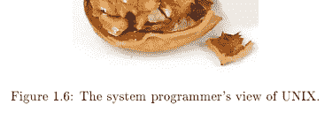

图 1.6：系统程序员眼中的 UNIX。

更复杂的是，数据可能以异步方式传送给进程，意思是并非在进程请求时传送，而是在某个以后、不可预测的时间传送。而且如果这还不够，请考虑进程不应继续执行，直到其他进程完成其他任务的可能性。例如，考虑一个与另一个程序对弈国际象棋的程序。两个程序都不允许在另一个完成其回合之前落子。同样，想象多个进程正在合作计算复杂蛋白质的结构。结构的某些部分在其他部分计算完成之前无法构建，因此进程必须根据彼此完成的工作来协调其活动。这两种情况都需要使用进程同步。挑战在于掌握这些概念。

### 1.11 第一个系统程序

我们将从编写一个精简版的 `more` 程序开始，该程序一次显示一个“屏幕”的文件内容。当 `more` 运行后，它会显示文件的一屏多行内容，然后在屏幕的最底行显示信息和提示：

–More–(0%)

然后它等待用户按下某个键，例如空格键以推进到下一屏，或回车键以推进一行，或“q”键以退出。提示以反视频显示，意味着前景和背景终端颜色被反转。虽然还有其他更高级的选项，但我们将把版本限制为仅这些。运行 `more` 并观察，当你按下空格键时，它会立即响应；你不必在空格键后按下回车键。

#### 1.11.1 对 `more` 程序的第一次尝试

`more` 命令可以以多种方式运行：

```
$ more file1 file2 ... fileN
$ ls -l | more
$ more < myfile
```

第一行使 `more` 按顺序显示名为 `file1`、`file2` 等直到 `fileN` 的文件。这证明 `more` 程序必须查看命令行参数并在存在时将其用作输入。在第二个示例中，命令 `ls -l` 的输出成为 `more` 程序的输入，结果是 `more` 一屏一屏地显示目录列表。这意味着 `more` 也必须在输入通过管道从标准输入传来时正常工作。在最后一行，文件 `myfile` 被用作 `more` 命令的输入，但 `more` 命令只是从标准输入流获取输入。

这三个示例表明 `more` 必须能够从命令行指定的文件读取，也能从标准输入读取，在任何一种情况下它都必须一次输出一屏。假设我们让 `P` 表示终端窗口中的行数（`P` 代表“page”，即一屏数据的称呼）。粗略地忽略它从何处获取输入的 `more` 程序大纲是：

28 标准屏幕有 24 行，但这是可由用户调整的，并且还取决于硬件和系统设置。在我们知道如何找到实际数量之前，我们将假设一屏有 24 行，并且我们每次写入 23 行新内容。

1. 从标准输入显示 `P-1` 行（保留最后一行用于提示）
2. 在行后显示 `[more?]` 消息。
3. 等待输入 `Enter`、`Space` 或 `'q'`
4. 如果输入为 `Enter`，则推进一行；转到 2
5. 如果输入为 `Space`，则转到 1
6. 如果输入为 `'q'`，则退出。

我们还必须在此基础上增加从命令行提取文件名的能力，如果存在的话。清单 1.4 包含一个 C 主程序，用于实现一个基于上述逻辑的 `more` 版本，该版本还会检查是否存在一个或多个命令行参数，如果存在，则使用参数作为要打开的文件名，而不是标准输入。如果没有命令行参数，则使用标准输入。我们现在假设 `P=24`。

#### 清单 1.4：`more` 主程序的第一个版本。

```
#include <stdio.h>
#define SCREEN_ROWS    23 /* assume 24 lines per screen */
#define LINELEN        512
#define SPACEBAR       1
#define RETURN         2
#define QUIT           3
#define INVALID        4

/** do_more_of()
 * Given a FILE* argument fp, display up to a page of the
 * file fp, and then display a prompt and wait for user input.
 * If user inputs SPACEBAR, display next page.
 * If user inputs RETURN, display one more line.
 * If user inputs QUIT, terminate program.
 */
void do_more_of(FILE *filep);

/** get_user_input()
 * Displays more's status and prompt and waits for user response,
 * Requires that user press return key to receive input
 * Returns one of SPACEBAR, RETURN, or QUIT on valid keypresses
 * and INVALID for invalid keypresses.
 */
int get_user_input();

int main(int argc, char *argv[])
{
    FILE    *fp;
    int     i = 0;
    if (1 == argc)
        do_more_of(stdin);  // no args, read from standard input
    else
        while (++i < argc) {
            fp = fopen(argv[i], "r");
            if ( NULL != fp ) {
                do_more_of( fp );
                fclose( fp );
            }
            else
                printf ( "Skipping %s\n", argv[i] );
        }
    return 0;
}
```

如果你不熟悉本程序中使用的某些 C 函数（也在 C++ 中使用），那么请阅读相关资料，要么在手册页中，要么在任何入门 C/C++ 教科书中。特别是你需要了解以下函数和类型，它们都是 ANSI 标准 C 的一部分，并在 `<stdio.h>` 中定义：

- `FILE`：一个文件流
- `fopen`：打开一个文件并返回一个 `FILE*`
- `fclose`：关闭一个 `FILE` 流
- `fgets`：从 `FILE` 流中读取一个字符串
- `fputs`：向 `FILE` 流中写入一个字符串

在上面的代码中需要注意的一点是，它检查 `fopen()` 函数的返回值是否为 `NULL`。每次程序调用库函数或系统函数时，都应检查可能的错误条件。未能做到这一点的程序将是一个让用户沮丧的程序。

如果 `main` 程序签名中的参数列表对你来说也是新的，这里有一个简要说明。在签名 `int main( int argc , char *argv[] )` 中，`argc` 是一个整数参数，指定命令行上的单词数。由于程序名本身就是一个单词，因此 `argc` 始终至少为 1。如果它正好为 1，则没有命令行参数。第二个参数 `argv` 是一个字符指针数组。在 C 中，字符指针是指向以 `NULL` 结尾的字符串的指针，即最后一个字符为 `'\0'` 的字符串。数组 `argv` 是一个数组，其字符串是命令行上的单词。`argv[0]` 是程序名本身，`argv[1]` 是第一个命令参数，以此类推。参数的名称是任意的。无论 `argc` 被命名为 `rosebud`、`numargs` 还是 `ac`，它都能工作。`shell` 负责将命令参数放入第一个和第二个参数预期的内存位置中（它通过进行系统调用并将这些参数传递给调用来实现这一点）。

清单 1.4 未包含 `main()` 使用的两个函数的定义：`do_more_of()` 和 `get_user_input()`，它们包含在清单 1.5 中。其中第一个很容易推断出来，除了你可能以前没有使用过 `fgets()` 和 `fputs()`。该函数在变量 `num_of_lines` 中跟踪可以在屏幕填满之前写入屏幕的行数，该变量初始为 23。第二个函数也相当直接。唯一可能需要解释的部分是 `printf()` 指令。

#### 1.11.2 关于终端的一些说明


我们的程序需要以反白（reverse video）模式显示提示符。问题在于，我们如何在终端上以反白模式显示文本。终端是一个复杂的主题，我们将在后面用将近一整章（第4章）来专门讨论。现在，我们仅对它们做个简要介绍。

终端通常扮演两个角色：它既是输入设备，也是输出设备。作为输出设备，可以向其发送特殊代码，终端不会将这些代码视为要显示的实际文本，而是将其视为控制序列——即一系列字节，告诉它如何定位光标、如何显示文本、如何滚动、是否换行、使用什么颜色等等。在终端最初发展时期，有许多不同的类型和众多厂商。每种类型都有一套不同的控制序列。1976年，欧洲计算机制造商协会（ECMA）对可发送到终端的序列集合进行了标准化。该标准历经多次更新，最终被国际标准化组织（ISO）和国际电工委员会（IEC）采纳，命名为ISO/IEC 6429。该标准后来也被美国国家标准学会（ANSI）采纳，称为ANSI X3.64。如今这些序列集合通常被称为ANSI转义序列，尽管ANSI已于1997年撤销了该标准。

ANSI转义序列是一串ASCII字符，其中前两个通常是ASCII转义字符（十进制代码为27）和左方括号字符“ [”。转义字符可用八进制记法写为`'\033'`。字符串`"\033["`被称为控制序列引入器（Control Sequence Introducer），简称CSI。CSI后面的一个或多个字符指定一个字母数字代码，用于控制键盘或显示功能。例如，序列`"\033[7m"`就是CSI后跟控制代码`"7m"`。代码`"7m"`是反转视频显示（反白）的代码。转义序列`"\033[m"`则关闭之前所有的字符代码。

如果我们想以反白模式显示一段文本（比如提示符），就需要将转义序列和文本发送到终端设备。任何能够写入终端的输出函数都可以胜任。我们使用`printf()`函数，因为它是最简单的。要以反白模式写入提示符“ more? ”，我们需要先发送第一个转义序列，然后发送提示符，最后发送恢复终端的序列：

```
printf("\033[7m more? \033[m");
```

尽管前面的讨论围绕着终端展开，但你在shell中工作时，使用的很可能并不是真正的终端。更有可能的是，你使用的是终端仿真软件包，例如Linux上的GNOME Terminal或Konsole；如果是远程连接，则可能是PuTTY之类的软件。几乎所有运行在Unix系统上的终端仿真器都能解释ANSI转义序列的某个子集。它们用软件来模拟硬件终端的行为。最早支持ANSI转义序列的终端之一是VT100。直到今天，大多数终端仿真器仍支持VT100。有些还支持更高级的终端，如VT102或VT220。原则上，如果终端仿真器支持完整的ANSI转义序列集合，那么无论仿真的是哪种终端，使用这些序列的程序都应该能够正常工作。

前面用于反白显示的代码只是众多可以控制终端的转义序列之一。稍后我们将再探索一些其他的转义序列。

### 清单1.5：`more`版本1的辅助函数

```
void do_more_of( FILE *fp )
{
    char      line[LINE_LEN];        // buffer to store line of input
    int       num_of_lines = SCREEN_ROWS; // # of lines left on screen
    int       getmore     = 1;    // boolean to signal when to stop
    int       reply;                // input from user

    while ( getmore && fgets( line , LINE_LEN, fp ) ){
        // fgets() returns pointer to string read or NULL
        if ( num_of_lines == 0 ) {
            // reached screen capacity so display prompt
            reply = get_user_input();
            switch ( reply ) {
                case SPACEBAR:
                    // allow full screen
                    num_of_lines = SCREEN_ROWS;
                    break;
                case RETURN:
                    // allow one more line
                    num_of_lines++;
                    break;
                case QUIT:
                    getmore = 0;
                    break;
                default:  // in case of invalid input
                    break;
            }
        }
        if ( fputs( line , stdout ) == EOF )
            exit(1);
        num_of_lines--;
    }
}

int get_user_input()
/*
 *  display message, wait for response, return key entered as int
 *  Returns SPACEBAR, RETURN, QUIT, or INVALID
 */
{
    int     c;

    printf("\033[7m more? \033[m"); /* reverse on a VT100     */
    while( (c = getchar()) != EOF )   /* wait for response      */
        switch ( c ) {
            case 'q':               /* 'q' pressed */
                return QUIT;
            case ' ':               /* ' ' pressed */
                return SPACEBAR;
            case '\n':             /* Enter key pressed */
                return RETURN;
            default:              /* invalid if anything else */
                return INVALID;
        }
}
```

编译并运行此程序。要编译和运行，如果所有代码都在名为`more_v1.c`的单个文件中，使用以下命令

```
$ gcc more_v1.c -o more_v1
$ more_v1 more_v1.c
```

我的代码在三个文件中，`more_v1.c`、`more_utils_v1.c`和`more_utils_v1.h`。我使用以下命令编译

```
$ gcc -o more_v1 more_utils_v1.c more_v1.c
```

运行它时你会发现

- `more_v1`确实显示了前23行，并且
- 它确实在more?提示符上产生了反显。
- 但是按下空格键或`q`直到按下*Enter*键之前没有任何效果。
- 如果你按下*Enter*，more?提示符会被复制，旧的提示符会随显示的文本一起向上滚动。换句话说，more?提示符没有被擦除。

接下来，运行命令

```
$ ls /bin | more_v1
```

并观察会发生什么。这不是你期望的结果。为什么呢？函数`get_user_input()`调用`getchar()`来获取用户的响应以确定`more_v1`接下来应该做什么。如果你还记得本章开头的讨论，`getchar()`从标准输入流中读取。由于标准输入是来自`ls -1`命令的管道的输出端，`getchar()`从`ls`列表中获取字符，而不是从用户在键盘上的输入。正当`ls -1`的输出包含空格字符或`q`或换行符时，程序就会将其视为用户输入的。这第一个版本的`more`因在`get_user_input()`函数中使用`getchar()`来获取用户输入而无法正确工作。 somehow，我们必须从键盘获取用户的输入，而不管标准输入流的来源。换句话说，`get_user_input()`必须从实际的键盘设备读取。好吧，不完全是。它必须从用户登录UNIX系统时获得的终端读取。

一个进程可以通过从文件`/dev/tty`读取来直接从终端在UNIX中读取。`/dev/tty`是*设备特殊文件*的一个例子。


## 1.11.3 设备特殊文件

UNIX 系统偏离了当时所有其他操作系统的设计，通过简化程序处理 I/O 的方式。每个 I/O 设备（磁盘、打印机、调制解调器等）都与一个设备特殊文件相关联，这是特殊文件的一种。特殊文件可以使用与普通文件相同的系统调用来访问，但当文件参数是设备特殊文件时，内核处理系统调用的方式是不同的；系统调用激活该设备的设备驱动程序，而不是导致数据的直接传输。这使程序员不必为不同类型的设备编写不同的代码：他或她可以编写一个执行输出的程序，而不必知道输出将进入磁盘文件、显示设备、打印机还是任何其他设备。程序只需连接到一个文件变量，该变量在运行时可能与这些文件或设备中的任何一个相关联。这就是设备无关 I/O 的本质。

举例说明，假设一段 C++ 代码按如下方式写入输出流：

```
ofstream outfile;
cout << "Where should output be sent? ";
cin >> filename;
outfile.open(filename);
```

在 UNIX 系统上，用户可以在提示符下输入文件名 `/dev/console`，输出将进入显示设备。如果用户输入 `myfile`，输出将进入 `myfile`。内核将负责将数据从程序传输到设备或文件的细节。

还有另一种类型的特殊文件称为命名管道，也称为 FIFO 特殊文件，或简称为 FIFO。命名管道用于单台主机上的进程间通信；将在第 8 章中介绍。

最后一种特殊文件是套接字。套接字在 4.2BSD 中引入到 UNIX 中，并提供跨网络的进程间通信。套接字在特殊文件系统的一部分意义上是特殊文件，但它们与其它特殊文件不同，因为操作它们需要不同的系统调用。套接字将在第 9 章中介绍。

每个设备文件的条目都位于目录 `/dev` 中，尽管系统管理员经常在文件系统的其他部分创建指向它们的软链接。设备文件的优点是

- 设备 I/O 被统一处理，使得编写设备无关的程序更容易；
- 硬件的更改只会导致驱动程序的更改，而不是访问它们的程序的更改；
- 程序可以将文件和设备同等对待，使用相同的命名约定，因此将程序更改为写入设备而不是文件是微不足道的；
- 设备被赋予与文件相同的保护。

设备文件在这些笔记的第 4 章中进行了更深入的描述。

> 30 这并不完全正确，因为某些版本的 UNIX 具有其他特殊文件，例如 Sun Solaris 中的 door。这里列出的这些是大多数标准的一部分。

### 1.11.3.1 示例

设备文件的名称因 UNIX 版本而异。以下是设备文件的示例，这些文件几乎可以肯定会在你使用的任何系统上找到。

- `/dev/tty` 是进程正在使用的终端的名称。发送到该文件的任何字符都会写入屏幕。
- `/dev/mem` 是一个特殊文件，它是内存的字符接口，允许进程将单个字符写入其有权访问的内存区域。
- `/dev/null` 是一个特殊文件，其作用类似于黑洞。发送到该文件的所有数据都会被丢弃。在 Linux 上，`/dev/zero` 也用于此目的，并且在读取时会返回空字符（`'\0'`）。
- 硬盘驱动器分区的名称因系统而异。有时它们的名称类似于 `/dev/rd0a` 或 `/dev/hda`。光盘驱动器几乎总是映射到 `/dev/cdrom`。你应该浏览机器上的 `/dev` 目录，查看存在哪些文件。

现在尝试一个实验。登录 UNIX 系统，输入以下命令并观察系统响应。

```
$ echo "hello" > /dev/tty
```

现在执行以下操作。输入 `tty`，并将输出用于 `echo` 命令，如下所示。

```
$ tty
/dev/pts/4
$ echo "hello" > /dev/pts/4
hello
```

现在打开第二个窗口。如果你是通过远程连接的，可以再次登录，或使用 SSH 客户端打开第二个终端窗口。如果你是直接登录的，只需创建第二个终端窗口。在新窗口中输入 `tty` 命令，并记录设备文件的名称。假设它是 `/dev/pts/2`。现在在第一个窗口中，输入

```
$ echo "hello" > /dev/pts/2
```

并观察会发生什么。你刚刚发现，可以通过写入设备文件来写入终端。你只能写入自己拥有的终端，而不能写入其他人的终端。稍后我们将看到，如果该终端的所有者授予了此类访问权限，你如何写入其他终端。

## 1.11.4 对 more 程序的第二次尝试

我们可以利用设备文件的思想来修改 `more` 程序，以克服标准输入重定向的问题。所需要做的就是为 `get_user_input()` 函数提供一个参数，该参数指定用户输入的来源。这需要

- 1. 让 `do_more_of()` 声明一个 `FILE*` 变量，并将调用 `fopen("/dev/tty")` 的结果赋值给它。
- 2. 让 `do_more_of()` 使用由 `fopen()` 赋值的 `FILE*` 变量调用 `get_user_input()`。
- 3. 让 `get_user_input()` 有一个类型为 `FILE*` 的参数 `fp`。
- 4. 将 while 循环条件中的调用 `(c = getchar())` 替换为 `(c=fgetc(fp))`。

`getchar()` 函数始终从标准输入流读取。它不带参数。它实际上可能是一个宏。最好使用 `fgetc()`，它接受一个 `FILE*` 参数。修改后的函数见清单 1.6。

清单 1.6：`do_more_of()` 和 `get_user_input()` 的修正版本。

```
void do_more_of( FILE *fp )
{
    char line[LINELEN];          // buffer to store line of input
    int  num_of_lines = SCREEN_ROWS; // number of lines left on screen
    int  getmore      = 1;         // boolean to signal when to stop
    int  reply;                    // input from user
    FILE *fp_tty;

    fp_tty = fopen( "/dev/tty", "r" ); // NEW: FILE stream argument
    if ( fp_tty == NULL )
        exit(1);                   // if open fails
                                 // exit

    while ( getmore && fgets( line, LINELEN, fp ) ){
        // fgets() returns pointer to string read
        if ( num_of_lines == 0 ) {   // reached screen capacity
            reply = get_user_input( fp_tty ); // NEW
            switch ( reply ) {
                case SPACEBAR:
                    // allow full screen
                    num_of_lines = SCREEN_ROWS;
                    break;
                case RETURN:
                    // allow one more line
                    num_of_lines++;
                    break;
                case QUIT:
                    getmore = 0;
                    break;
                default: // in case of invalid input
                    break;
            }
        }
    }
```

它表现。 我们将看到我们可以使用这个接口来执行诸如抑制字符回显和在不等待按下 Enter 键的情况下传输字符等操作。

`more?` 提示无法消失的问题更难解决，也需要理解如何控制终端。 一种替代方案是学习更多 VT100 转义序列并使用它们来擦除 `more?` 提示。 另一种替代方案是将所有行的副本写入离屏缓冲区，并在用户按下 Enter 键时清除屏幕然后替换屏幕内容。 这是一种比第一种更容易的解决方案，但它并不是真正的 `more` 命令的行为方式。

## 1.11.6 more 程序的第三次尝试

我们的最终版本，并非正确版本，将解决上述一些问题。


第一个问题是我们如何确定终端窗口的实际大小。 这个问题有两个解决方案。 如果用户的环境包含环境变量 `COLUMNS` 和 `LINES`，那么程序可以使用它们的值来确定终端窗口中的列数和行数，如以下代码片段所示，该片段将 `LINES` 值存储在变量 `num_lines` 中。

```
int     num_lines;
char    *endptr;
char    *linestr = getenv("LINES");
if ( NULL != linestr ) {
    num_lines = strtol(linestr, &endptr, 0);
    if ( errno != 0 ) {
        /* handle error and exit */
    }
    if ( endptr == linestr ) {
        /* not a number so handle error and exit */
    }
}
```

代码不完整——应该用适当的代码填充错误处理部分。 我们稍后会讨论错误处理。 但如果 `LINES` 变量未放入用户的环境中，上述代码将无法工作，并且如果用户在程序启动后调整窗口大小，也将无法工作。

更好的解决方案是使用更高级的函数，该函数将在第 4 章中更深入地介绍，名为 `ioctl()`。 函数 `ioctl()` 是 I/O Control 的缩写。 它旨在对外围设备执行许多操作，而不仅仅是终端。 它的原型是

```
#include <sys/ioctl.h>
int ioctl(int d, int request, ...);
```

注意参数列表中的 `"..."`。 这是 C 表示可变数量参数的记号。 第一个参数是文件描述符。 文件描述符在第 2 章中介绍。 第二个参数，整数类型，是一个命令。 以下参数是命令的参数，并且取决于给定的命令。 获取当前终端窗口的行数和列数的 `ioctl()` 调用有三个参数：

```
ioctl(tty_file_descriptor, TIOCGWINSZ, &window_structure)
```

其中 `tty_file_descriptor` 是我们终端的文件描述符，`TIOCGWINSZ` 是一个表示“获取终端窗口大小结构”的命令，而 `window_size_structure` 是类型为 `struct winsize` 的变量。 `winsize` 结构定义在头文件中，当你在代码中包含 `<sys/ioctl.h>` 头文件时会自动包含该头文件。 将使用此 `ioctl` 的代码为

```
struct winsize window_arg;
int     num_rows, num_cols;

fp_tty = fopen("/dev/tty", "r");
if ( fp_tty == NULL )
    exit(1);
if (-1 == ioctl(fileno(fp_tty), TIOCGWINSZ, &window_arg))
    exit(1);
num_rows = window_arg.ws_row;
num_cols = window_arg.ws_col;
```

`ioctl` 中使用的 `fileno()` 函数在第 2 章中介绍；它将 `FILE*` 转换为文件描述符。 文件描述符也在第 2 章中解释。 我们将在 `do_more_of()` 和 `get_user_input()` 函数的最后一个版本中使用以下 `get_tty_size()` 函数：

```
void get_tty_size(FILE *tty_fp, int* numrows, int* numcols)
{
    struct winsize window_arg;
    if (-1 == ioctl(fileno(tty_fp), TIOCGWINSZ, &window_arg))
    exit(1);
    *numrows = window_arg.ws_row;
    *numcols = window_arg.ws_col;
}
```

尽管 `ioctl()` 函数是标准的，应该在任何 UNIX 系统上都可用，但它实现的具体命令可能不可用。 特别是，`TIOCGWINSZ` 命令可能不可用。 当你编写依赖于不保证存在的特性的代码时，最好通过用预处理器指令将其括起来以有条件地编译它。 上述函数最好使用以下方式编写

```
void get_tty_size(FILE *tty_fp, int* numrows, int* numcols)
{
#ifdef TIOCGWINSZ
    struct winsize window_arg;
    if (-1 == ioctl(fileno(tty_fp), TIOCGWINSZ, &window_arg))
    exit(1);
    *numrows = window_arg.ws_row;
    *numcols = window_arg.ws_col;
```

```
#else
    /* some fallback code here */
#endif
}
```

目前我们先省略回退代码，因为这需要了解更多关于终端的知识。

### 第二个问题

第二个问题是，如何移除旧的 `more?` 提示，使其不会向上滚动屏幕。简而言之，我们需要一种清除屏幕部分区域的方法。我们还需要一种将光标移动到屏幕各个位置的方法。ANSI 转义序列可以完成这些操作。下表列出了一小部分 ANSI 转义序列。表中的序列最容易学习和使用。在表中，符号“ESC”是 `'\033'` 的缩写。在几乎所有情况下，表中 n 的默认值都是 1。

| 按键序列 | 含义 |
|---|---|
| `ESC[M` | 在滚动区域中上移光标。 |
| `ESC[nA` | 将光标上移 n 行。 |
| `ESC[nB` | 将光标下移 n 行。 |
| `ESC[nC` | 将光标右移 n 列。 |
| `ESC[nD` | 将光标左移 n 列。 |
| `ESC[nG` | 将光标移动到第 n 列。 |
| `ESCE` | 将光标移动到下一行的开头。 |
| `ESC[r;cH` | 将光标移动到第 r 行、第 c 列。 |
| `ESC[0K` | 擦除从光标到行尾的内容。 |
| `ESC[1K` | 擦除从行首到光标的内容。 |
| `ESC[2K` | 擦除整行。 |
| `ESC[0J` | 擦除从光标到屏幕末尾的内容。 |
| `ESC[1J` | 擦除从屏幕底部到光标的内容。 |
| `ESC[2J` | 擦除整个屏幕。 |
| `ESC[0m` | 普通字符。 |
| `ESC[1m` | 粗体字符。 |
| `ESC[4m` | 下划线字符。 |
| `ESC[5m` | 闪烁字符。 |
| `ESC[7m` | 反显字符。 |
| `ESC[g` | 清除当前列的制表位。 |
| `ESC[3g` | 清除所有制表位。 |

#### 示例

下面是一些命令序列示例。最后两个是复合控制序列，之所以重要，是因为我们可以在程序中使用它们。

| 序列 | 含义 |
|---|---|
| `\033[2A` | 将光标上移两行。 |
| `\033[2J` | 清除整个屏幕。 |
| `\033[24;80H` | 将光标移动到第 24 行、第 80 列。 |
| `\033[1A\033[2K\033[1G` | 上移一行，擦除该行，然后将光标移动到最左列。 |
| `\033[1A\033[2K\033[1B\033[7D` | 将光标上移一行；擦除该行；将光标下移一行，然后向左移动 7 个位置。 |

我们可以将 `printf()` 函数的格式化功能与 `get_tty_size()` 函数及这些转义序列结合起来，无论屏幕大小如何，都将光标停留在屏幕左下角，并以反显方式显示提示：

```
int tty_rows;
int tty_cols;
get_tty_size(fp, &tty_rows, &tty_cols);
printf("\033[%d;1H", tty_rows);
printf("\033[7m more? \033[m");
```

第一个 `printf()` 将光标移动到屏幕的最后一行、第一个列。第二个以反显方式显示提示，然后将终端恢复为普通字符显示。下面清单 1.7 中的第三版 `more` 包含了这两项改进。主程序没有变化，因此未列出。

#### 清单 1.7：`more` 程序的第三个版本。


```c
#include "more_utils.h"
#include <sys/ioctl.h>

#define LINELEN 512

void get_tty_size(FILE *tty_fp, int* numrows, int* numcols)
{
    struct winsize window_arg;

    if (-1 == ioctl(fileno(tty_fp), TIOCGWINSZ, &window_arg))
        exit(1);
    *numrows = window_arg.ws_row;
    *numcols = window_arg.ws_col;
}

/** get_user_input(FILE *fp )
 *  显示 more 的状态和提示，并等待用户响应；
 *  要求用户按回车键才能接收输入
 *  对于有效按键，返回 SPACEBAR、RETURN 或 QUIT 之一
 *  对于无效按键，返回 INVALID。
 *  从 fp 读取，而不是从标准输入读取。
 */
int get_user_input( FILE *fp )
{
    int c;

int tty_rows;
int tty_cols;

/*
 * 动态获取终端窗口的大小，以防其发生变化。
 * 然后利用该大小将光标放置在最底行、最左列，
 * 并以“突出显示模式”（即反显）打印提示。
 */
get_tty_size(fp, &tty_rows, &tty_cols);
printf("\033[%d;1H", tty_rows);
printf("\033[7m more? \033[m");

/* 使用 fgetc() 而不是 getc()。两者功能相同，区别在于
 * fgetc() 始终是函数调用，而不是宏；通常使用它更加安全。
 */
while ( (c = fgetc( fp )) != EOF ) {
    /* 这里不需要使用循环，因为所有可能的路径
     * 都会进入 return 语句。保留循环是因为这样做没有坏处。
     */
    switch ( c ) {
        case 'q' :            /* 按下 'q' */
            return QUIT;
        case ' ' :            /* 按下空格键 */
            return SPACEBAR;
        case '\n' :           /* 按下回车键 */
            return RETURN;
        default :             /* 其他输入均无效 */
            return INVALID;
    }
    return INVALID;
}

/** do_more_of ( FILE * fp )
 * 接收一个 FILE* 参数 fp，显示文件 fp 中最多一页的内容，
 * 然后显示提示并等待用户输入。
 * 如果用户输入空格键，则显示下一页。
 * 如果用户输入回车键，则再显示一行。
 * 如果用户输入退出键，则终止程序。
 */
void do_more_of( FILE *fp )
{
    char line[LINELEN];           // 用于存储输入行的缓冲区
    int num_of_lines;             // 屏幕上剩余的行数
    int reply;                    // 用户输入
    int tty_rows;                 // 终端中的行数
    int tty_cols;                 // 终端中的列数
    FILE *fp_tty;                 // 设备文件指针

    fp_tty = fopen( "/dev/tty", "r" );  // 新增：FILE 流参数
    if ( fp_tty == NULL )             // 如果打开失败
```

```c
exit(1);

/* Get the size of the terminal window */
get_tty_size(fp_tty, &tty_rows, &tty_cols);
num_of_lines = tty_rows;

while ( fgets( line, LINELEN, fp ) ) {
    if ( num_of_lines === 0 ) {
        // reached screen capacity so display prompt
        reply = get_user_input( fp_tty ); // note call here
        switch ( reply ) {
            case SPACEBAR:
                // allow full screen
                num_of_lines = tty_rows;
                printf("\033[1A\033[2K\033[1G");
                break;
            case RETURN:
                // allow one more line
                printf("\033[1A\033[2K\033[1G");
                num_of_lines++;
                break;
            case QUIT:
                printf("\033[1A\033[2K\033[1B\033[7D");
                return;
            default: // in case of invalid input
                break;
        }
    }
    if ( fputs( line, stdout ) === EOF )
        exit(1);
    num_of_lines--;
}
```

这个版本仍然存在一些缺陷。其中之一是它在循环的每次迭代中检查终端是否已被调整大小，即在每次检索用户输入时。虽然这可行，但浪费了周期。稍后我们将学习如何异步地完成此操作，仅在终端实际被调整大小时才查找终端大小。

另一个缺陷是它仍然要求用户按下回车键。解决这个问题需要进一步理解终端，这将在第 4 章中再次介绍。我们可以轻松集成到程序中的一个功能是计算迄今为止显示的文件百分比。这留作练习。

## 1.12 我们接下来要去哪里

尝试编写更复杂的程序的真正目的是为了说明，仅使用通常的高级 I/O 库，我们无法编写出像 `more` 那样的程序，例如忽略键盘输入和抑制输入字符的显示。这些笔记的目标是为您提供解决此类问题的工具，并让您接触内核 API 的主要组件，同时解释内核在“内部”看起来如何。我们将查看内核的每个重要组件。您将学习如何翻阅文件系统和手册页以查找所需的资源。

## 附录 A UNIX 的简史

1957 年，Bill Norris 创立了 Control Data Corporation (CDC)。1959 年，Ken Olsen 凭借 70,000 美元的风险投资资金创立了 DEC。第一台 PDP-1（由 DEC 制造）于 1960 年出货。1963 年，Project MAC（多路访问计算机）于 MIT 组织成立，以开展交互式计算和分时系统研究。1965 年，AT&T、GE 和 IBM 的 Project MAC 联合开发分时系统 MULTICS（多路复用信息和计算服务）。

1966 年，Ken Thompson 在加州大学伯克利分校（UCB）完成学业后加入 AT&T 贝尔电话实验室的技术人员，参与 MULTICS 工作。两年后，Dennis Ritchie 在哈佛完成了博士工作并加入贝尔实验室参与 MULTICS 项目。

Thompson 开发了基于 BCPL 的解释性语言 B。Ritchie 在“B”的基础上改进并称之为“C”。


# UNIX 历史概述

## 早期发展

1969 年，在为 AT&T 贝尔实验室工作期间，Ken Thompson 和 Dennis Ritchie 为 DEC 制造的 PDP-7 编写了 UNICS 的第一个版本。它运行在一台具有 4K 个 18 位字的机器上。UNICS 是对 MULTICS 的戏仿，代表 Uniplexed Information and Computing Services。三年后，它被重写为 C，以便他们可以将其移植到其他架构。到 1973 年，贝尔实验室内部成立了第一个 UNIX 支持小组，一些基本的 UNIX 设计理念也随之出现。Ritchie 和 Thompson 当年在 IBM 的 ACM 操作系统研讨会上就新操作系统做了演示。这成为引发 UNIX 系统传播的催化剂。加州大学伯克利分校（UC Berkeley）很快从贝尔实验室获得了第 4 版，并着手为 UNIX 增加现代功能。

在接下来的四年里，几项事件塑造了 UNIX 的未来。AT&T 开始向大学授权。Boggs 和 Metcalfe 在帕洛阿尔托的 Xerox 发明了以太网。Bill Joy 加入 UC Berkeley 并开发了 BSD 版本 1。UNIX 被移植到非 DEC 机器上。（DEC 不愿支持 UNIX。）P.J. Plauger 编写了第一个商业 C 编译器，Doug 和 Larry Michel 成立了 Santa Cruz Operations（SCO）公司，开始为 PC 销售商业版 UNIX。

1974 年，Ken Thompson 和 Dennis Ritchie 在 CACM 上发表了“UNIX Time-Sharing System”。同年，加州大学伯克利分校（UCB）获得了 UNIX 第 4 版，Keith Standiford 将 UNIX 转换为 PDP 11/45。Kernighan 和 Plauger 的《编程风格要素》出版，AT&T 正式开始向大学授权 UNIX。

1976 年，Kernighan 和 Plauger 的《Software Tools》出版，Boggs 和 Metcalfe 在帕洛阿尔托的 Xerox 发明了以太网。

到 1978 年，UNIX 基本上已经具备了今天所见的主要功能。一年后，微软从 AT&T 许可了 UNIX 并宣布了 XENIX（甚至在发布 MS-DOS 之前）。

UNIX 迅速传播的原因是：

- 它是用高级语言（C）编写的，不像其他操作系统，因此可以轻松地从一个架构移植到另一个架构。
- 它曾由 AT&T 免费分发给大学和研究实验室，而早期的商业版本以极低的价格出售给学术机构。
- 源代码可自由获取，使得人们很容易为自己的系统添加新功能和程序。
- 它具有一些其他操作系统中没有的功能（例如，管道）。

1979 年，贝尔实验室发布了 UNIX™ 第 7 版，试图为 UNIX 取得专有权利，而微软从 AT&T 许可了 UNIX 并宣布了 XENIX（甚至在发布 MS-DOS 之前）。在 20 世纪 80 年代初期，发生了许多塑造 UNIX 进化树未来的发展：

- AT&T 和伯克利（计算机系统研究组，或 CSRG）各自开始开发自己的独立 UNIX 版本。
- Bill Joy 离开伯克利共同创办了一家新公司 SUN Microsystems，用以生产 UNIX 工作站。Sun 的名字来源于斯坦福大学网络（SUN）板。该工作站基于运行基于 4.2BSD 的 SunOS 的摩托罗拉 68000 芯片。它包含一个基于以太网的可选局域网。商业 UNIX 行业已全面启动。
- 微软将重点转向 MS-DOS 的开发，搁置了 XENIX 的营销。
- X/Open 标准组织成立了。

在接下来的十五年里，出现了许多不同的 UNIX 版本。虽然这些版本之间的差异并不大，但在试图将“UNIX”视为单一操作系统时必须谨慎。在 20 世纪 80 年代和 90 年代初期，两个主要的 UNIX 发行版是伯克利系列，其名称如 4.2BSD 和 4.3BSD，以及 AT&T 系列，其名称如 System III 和 System V。SUN 的 UNIX 称为 SunOS，后来称为 Solaris，是两种血统的混合体。

自 1969 年创建以来，UNIX 已从一个单一的小型操作系统发展成为由世界各地供应商生产的复杂程度各异的一组不同的操作系统。大多数 UNIX 系统的基本特性保持不变，部分原因是标准化工作始于 1980 年代后期并持续到 1990 年代。现代 UNIX 是一个难以捉摸的概念。已经编写了多个标准，它们有一个很大的共同核心。人们通常所说的 UNIX 是这些标准的共同核心，其中包括 POSIX，以及来自 Open Group 的 UNIX 98。UNIX 98 也称为单一 UNIX 规范，并且就财产权而言，它本身就是 UNIX，因为 Open Group 现在拥有 UNIX 商标。Open Group 是一个由政府、学术界、全球金融、医疗保健、商业和电信等 200 多名成员组成的国际联盟。当然，还有 Linux，它已在桌面上超过了 BSD 和 System V。

# 附录 B 用户级别的 UNIX

本节面向几乎没有或完全没有 UNIX 经验的人。它涵盖了：

- 登录和注销
- Shell
- 环境

## B.1 记号

在命令的描述中，方括号 `[ ]` 括起命令的可选参数，而角括号 `< >` 括起占位符。括号不是命令的一部分。竖线 `|` 是逻辑或。省略号 `...` 表示前一个标记的多个副本。例如

```
ls [<option>] ... [<directory_name>] ...
```

表示选项说明符和 `ls` 命令的参数都是可选的，但任何选项都应先于任何目录名，并且选项说明符和目录名都可以多次出现，如

```
ls -l -t mydir yourdir
```

命令前面会加上美元符号，以表示它们是在 shell 提示符后输入的。当显示命令的输入和输出时，用户输入将以粗体显示，而输出将以常规文本显示。

```
$ ls -l -t mydir yourdir
```

## B.2 登录

用户通过登录、运行程序和注销来使用 UNIX 系统。有两种不同的登录 UNIX 系统的方法：

- 当坐在计算机控制台前时，即计算机键盘和显示器在你面前，并且目前没有人登录到该机器，或
- 远程，通过使用 `SSH` 等远程登录实用程序。

### 在控制台上

如果你在计算机的本地控制台登录，屏幕的外观将取决于你使用的 UNIX 版本。在所有情况下，都会有一个选项让你输入用户名或登录名，然后输入密码。对于使用 Gnome 2 桌面环境的 RedHat 9，屏幕将如 B.1 图所示。登录后，你将看到一个带有图形用户界面的桌面，以及屏幕上的某个位置的菜单，其中有一个选项可以打开终端窗口。后续的笔记内容都与该终端窗口相关。

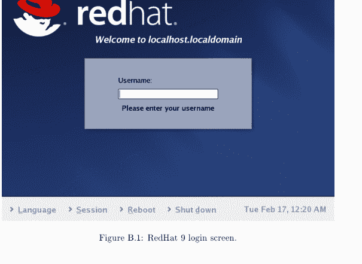

图 B.1：RedHat 9 登录屏幕。

### 通过 SSH 远程连接

`SSH` 是一种协议，提供加密通信以防止密码和其他安全信息在不安全的网络传输过程中被截获。`SSH` 代表 Secure SHell。`SSH` 是一个客户端/服务器应用程序。服务器运行在远程主机上，即你想要登录的主机，客户端运行在你的本地主机上。一旦你使用 `SSH` 从本地机器建立到 UNIX 系统的连接，你输入的所有内容都会由本地机器上的 `SSH` 客户端加密，并由远程主机解密。加密算法非常强大，密钥也非常安全。

这些笔记没有描述如何使用任何特定的 `SSH` 客户端。所有此类客户端都需要你提供远程主机的 IP 地址、登录名或用户名以及你的密码。假设你已提供这些信息，`SSH` 客户端将为你登录并在本地机器上显示一个终端窗口。

你会看到一些消息，然后是登录 shell 显示的提示符。登录 shell 是你在登录时运行的 shell。它取决于你使用的 UNIX 版本以及系统管理员如何配置初始消息。在亨特学院计算机科学系的网络网关机器 eniac 上，该机器运行的是 SunSoft 的 Solaris 9，一个 UNIX 版本，其显示如下：

```
Last login: Mon Aug 30 2004 19:51:19 -0500 from pool-68-161-100-
Sun Microsystems Inc. SunOS 5.9 Generic October 1998
This workstation is running SunOS 5.x
eniac{sweiss} [42] $
```

当 eniac 后来被转换为 Linux 主机时，登录消息变为：

```
Last login: Fri Jan 20 17:21:53 2006
from pool-68-161-21-160.ny325.east.verizon.net
eniac{sweiss} [339] $
```

在这两种情况下，最后一条线都以提示符字符串开头，该字符串是一串字符后跟一个等待光标。在这些例子中，提示符字符串看起来像

```
eniac{sweiss} [n] $
```


其中 `n` 是某个数字。提示符有时也只是单独的 `"$"`。这取决于它的配置方式，部分取决于 `shell`。有些 `shell` 允许你进行更多配置。该提示符显示主机计算机的名称、该主机上的用户名以及当前命令的历史编号（`42` 或 `339`）。历史编号是序数，表示你迄今为止输入了多少条命令。当它达到保存命令的最大数量时，它会重置为 `1`。可以使用它们的编号检索旧命令。

你的登录 `shell` 是每次登录时启动的特殊 `shell`。在具有窗口环境的 UNIX 系统上，每个窗口都会有一个单独的 `shell` 实例。即使是具有 GUI 的 UNIX 系统也遵循 `shell` 范式——不是输入命令，而是使用指向设备点击图标和控件，但效果仍然是构造对系统程序、`shell` 或 `shell` 脚本的调用。

当你登录后，你将“在”你的主目录中。你可能对“在一个目录中”的概念感到舒服，但说这话本身没有意义。你坐在座位上。你不在电脑里。尽管如此，这种说法已经根深蒂固。你可能知道“在主目录中”意味着当你查看当前目录的内容时，你会看到主目录中的文件。但这是一种不充分的解释。我稍后会更多地谈论“在一个目录中”的概念。你现在需要理解的是，主目录是你每次登录时“所在”的目录。它是你当前会话的起点。`HOME` 环境变量存储你的主目录的“名称”。这也将在稍后澄清。

### B.3 注销

当你使用完系统后，你需要注销。通常有几种注销方式。POSIX 规定 `shell` 必须提供内置的 `exit` 命令，可用于退出任意 `shell`。还有 `logout` 命令，它可能内置于 `shell`，也可能不是：

```
eniac{sweiss} [342]$ logout
```

区别在于 `logout` 只能用于注销，而不能终止非登录 `shell`，例如某个其他 `shell` 的子 `shell`，而 `exit` 会终止所有 `shell`，如果该 `shell` 是登录 `shell`，则会注销你。

### B.4 在线帮助：手册页

在继续之前，你应该了解如何在线获取帮助。传统的 UNIX 仅提供一种在线帮助来源——手册页。最重要需要记住的命令是 `man` 命令。单词“`man`”是“`manual`”的缩写；如果你在 `man` 后输入命令名，UNIX 将显示该命令的手册页，简称为 `man page`。例如，要了解更多关于名为 `echo` 的命令，输入

```
$ man echo
```

你将看到数屏输出，开始于：

```
echo(1)                              User Commands                              echo(1)
NAME
        echo - display a line of text

SYNOPSIS
        echo [SHORT-OPTION]... [STRING]...
        echo LONG-OPTION

DESCRIPTION
        Echo the STRING(s) to standard output.
        -n      do not output the trailing newline
        -e      enable interpretation of backslash escapes
        -E      disable interpretation of backslash escapes (default)
        (remaining lines omitted )
: ■
```

每个手册页的格式都相同，但可能因 UNIX 系统而异。第一行显示手册页所在的章节名称（*User Commands*）以及手册页名称后跟章节号（*echo, section 1*）。有时手册页的名称与命令名称不同。手册页的章节可能并不全部存在，分别是：

- `NAME` 命令名称
- `SYNOPSIS` 使用命令的语法
- `DESCRIPTION` 对命令功能的简要文字说明
- `OPTIONS` 命令行选项的精确描述
- `OPERANDS` 命令行参数的精确描述
- `USAGE` 对命令使用的更详细说明
- `ENVIRONMENT VARIABLES` 影响命令执行的环境变量列表
- `EXIT STATUS` 命令返回的退出值列表
- `FILES` 影响命令执行的文件列表
- `ATTRIBUTES` 运行的架构、可用性、代码独立性等
- `SEE ALSO` 与此命令相关的命令列表
- `NOTES` 不适合放在其他地方的一般性评论
- `BUGS` 已知错误

在手册页中，方括号表示法 `[ ]` 如上文中的 `[SHORT-OPTION]` 定义了可选的命令行选项或参数。“:”后面跟着你的光标，因为许多 UNIX 系统现在将 `man` 命令的输出通过 `less` 命令进行管道传输以供查看，而“:”是 `less` 命令提示用户在键盘上输入内容的提示。更准确地说，`less` 命令是 `man` 命令本身的查看器。

对于学习如何使用命令，单靠手册页通常已足够。对于学习命令如何与操作系统交互或如何实现，则需要做更多研究。在下一章中，我将解释如何更详细地使用手册页来实现后者的目的。在此期间，你在阅读本章时应查看本章中提到的各种命令的手册页。

还应提及的是，现代 UNIX 系统还提供其他帮助来源，例如 `help` 和 `info` 命令。如果你使用的系统有这些命令，输入 `help` 或 `info` 后跟命令或主题，将显示有关该主题的信息。

### B.5 Shell

你对 UNIX 的看法和欣赏很大程度上取决于 `shell` 为你创建的界面，如图 B.2 所示。`shell` 隐藏了内核的内部运作，呈现出一组高级功能，可使系统易于使用。虽然你可能使用过带图形用户界面的 UNIX 系统，但你必须意识到此 GUI 是与 UNIX 分开的独立应用程序。GUI 为与 UNIX 交互提供了 `shell` 的替代方案，但经验丰富的用户通常依赖 `shell` 来完成许多任务，因为它比移动鼠标指点和点击要快得多。

有许多不同的 `shell`，包括 Bourne `shell`（`sh`）、C `shell`（`csh`）、Korn `shell`（`ksh`）、Bourne-again `shell`（`bash`）、Z `shell`（`zsh`）和 TC `shell`（`tcsh`）。虽然少数 `shell` 可能随操作系统一起打包，但它们实际上并不是操作系统的一部分。

与大多数操作系统不同，UNIX 允许用户用自己选择的 `shell` 替换原始的登录 `shell`。登录时为给定用户调用的具体 `shell` 是

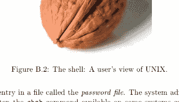

图B.2：Shell——用户眼中的 UNIX。

它是在一个名为密码文件的文件中的用户条目中指定的。系统管理员可以更改这一条目，但在某些系统上可用的 `chsh` 命令也常常可以由用户用来更改 Shell。在某些 UNIX 版本中，用户还可以使用 `passwd -s` 命令更改登录 Shell。

#### B.5.0.1 Shell 功能

在所有 Shell 中，简单命令的形式如下：

```
$ commandname command-options arg1 arg2 ... argn
```

Shell 在尝试解释（解析）命令之前，会等待用户输入换行符。换行符表示命令的结束。一旦收到输入行，它会检查 `commandname` 是否是 Shell 内建命令（内建命令是硬编码在 Shell 本身中的命令）。如果是，则执行该命令；如果不是，它会搜索一个名称（相对路径或绝对路径）为 `commandname` 的文件。（关于搜索如何进行，将在后面的章节中解释。）如果找到这样的文件，该文件会被加载到内存中，Shell 会创建一个子进程，使用命令行中的参数来执行该命令。当命令执行完毕后，子进程终止，Shell 恢复自身的执行。

除了命令解释之外，所有 Shell 还提供：

- 命令输入和输出的重定向
- 管道——将一条命令的输出传递给另一条命令作为输入的方法
- 脚本——编写可作为文件执行的 Shell 程序的方法
- 使用元字符进行文件名替换
- 控制流结构，例如循环和条件执行

在 Bourne `shell` 之后编写的 Shell 还提供：

- 历史机制——保存并全部或部分重新发出命令的方法
- 后台运行和作业控制——控制命令执行顺序和时机的方法
- 常用命令的别名

`tcsh` `shell` 为 C `shell` 增加了一些功能，例如命令行交互式编辑以及交互式文件和命令名补全，但 Korn `shell` 引入了许多重要的增强，包括：

- 通用的交互式命令行编辑
- 协进程
- 更通用的命令输入输出重定向
- Shell 中的数组变量
- 从文件自动加载函数定义
- 受限 Shell
- 菜单选择

`bash` 借鉴了其前身 Shell 的许多特性，并且几乎拥有上述所有能力。

#### B.5.0.2 标准 I/O 与重定向


UNIX 使用一种巧妙的方法来处理 I/O。每个程序在开始执行时都会自动获得三个打开的文件，分别称为标准输入、标准输出和标准错误。（POSIX 并不要求标准错误，但据我所知，它在所有系统中都存在。）默认情况下，标准输入来自键盘，标准输出和标准错误输出到终端窗口。

命令通常从标准输入读取，并写入标准输出。然而，Shell 可以“欺骗”命令从不同的来源读取，或写入不同的目的地。这称为 I/O 重定向。例如，命令

```
$ ls mydir
```

通常会在终端上列出给定目录中的文件。而命令

```
$ ls mydir > myfiles
```

如果 `myfiles` 尚不存在，该命令会创建一个名为 `myfiles` 的文件，并将 `ls` 命令的输出重定向到 `myfiles`；如果文件已存在，则会显示类似如下的消息：

```
bash: myfiles: cannot overwrite existing file
```

记号 `> outfile` 表示“将命令的输出放入名为 `outfile` 的文件中，而不是显示在终端上”。`输出重定向操作符` `>` 用该操作符后面文件名所代表的文件来替换程序的标准输出。

类似地，记号 `< infile` 表示从文件 `infile` 而不是键盘读取输入。严格来说，`<` 被称为`输入重定向操作符`，它将程序的标准输入替换为该操作符后面文件名所代表的文件。

一条命令的输入和输出都可以被重定向：

```sh
$ command < infile > outfile
```

这会使命令从 *infile* 读取输入，并将其输出发送到 *outfile*。命令以及输入和输出重定向的顺序无关紧要。也可以写出以下任何语义等价的命令行：

```sh
$ command > outfile < infile
$ > outfile command < infile
$ < infile > outfile command
```

重定向的概念更进了一步，允许一条命令的输出成为另一条命令的输入。这被称为`管道`，其操作符是竖线 `|`：

```sh
$ ls mydir | sort | lpr
```

意思是列出给定目录的内容，并且不把它们写到终端或文件中，而是将它们作为输入传给 `sort` 命令，`sort` 命令对它们排序，然后将排序后的列表发送给 `lpr` 命令，`lpr` 命令是一个用于将文件发送到连接系统的默认打印机的命令。使用临时文件也可以完成上述操作，如下所示：

```sh
$ ls mydir > temp1
$ sort < temp1 > temp2
$ lpr < temp2
$ rm temp1 temp2
```

但实际上这在语义上并不等价，因为当建立管道时，这些命令是同时运行的。在上面的例子中，`ls`、`sort` 和 `lpr` 命令会同时启动。Shell 使用一种称为`管道`的内核机制来实现这种通信。还有其他类型的 I/O 重定向，包括追加到文件和重定向系统错误消息；详细信息请参阅 Shell 的 man 手册。

还有另外两个 I/O 重定向操作符：`<<` 和 `>>`。如果你对这些操作符感到好奇且不熟悉，请阅读 bash 的 man 手册。

#### B.5.0.3 命令分隔符与多任务

命令可以通过使用命令分隔符组合在单行中。分号 `;` 对 shell 来说就像换行符一样——它终止前面的命令，例如：

```
$ ls mydir ; date
```

它会列出给定目录的内容，然后显示当前时间和日期。`date` 命令以各种格式显示日期和时间，但默认情况下其输出形式为

```
Mon Aug 15 22:53:54 EDT 2011
```

分号 `;` 用于顺序执行命令。相比之下，

```
$ ls mydir > outfile &
```

会使 `ls` 命令在“后台”工作。行尾的 ampersand `&` 告诉 shell 不要等待命令终止，而是立即恢复；它是一个后台运行操作符。`ls` 命令在后台运行，将其输出发送到文件 `outfile`，同时 shell 做其他事情。这是一种多任务形式。`&` 也可以用于运行单独的命令：

```
$ ls mydir > outfile1 & date > outfile2 &
```

告诉 shell 并发且在后台运行 `ls` 和 `date` 命令，并分别将它们各自的输出放入文件 `outfile1` 和 `outfile2` 中。注意 `>` 结合得更紧密，即优先级高于 `&`。最后，括号可用于分组：

```
$ (ls mydir; date) > outfile &
```

表示“执行 `ls mydir`，然后执行 `date`，并将它们的合并输出定向到 `outfile`”，全部在后台进行。

#### B.5.0.4 Shell 作为命令

Shell 可以作为命令运行。你可以在任何其他 shell 中的命令提示符下输入 shell 的名称，例如 `bash`、`sh`、`csh` 等，以启动另一个 shell：

```
$ sh
```

在这种情况下为 Bourne shell。如果你这样做，你将有两个 `bash` shell 实例在运行，但第一个会处于休眠状态，等待第二个退出。当一个 shell 是由另一个 shell 中的命令创建的结果时，创建的 shell 被称为原始 shell 的子 shell，而原始 shell 被称为父 shell。

如果你需要知道当前运行的是什么 shell，例如你忘记了，有两个简单的命令可以告诉你：

```
$ echo $0
```

和

```
$ ps -p $$
```

第一个使用 `echo` 命令。`echo` 命令乍听起来似乎相当无用，但它非常方便。它所做的只是计算其参数并显示它们。因此写

```
$ echo hello out there
hello out there
```

但关键是 `echo` 会计算其参数。如果你给它一个前面带有美元符号 `$` 的变量名，它会显示变量的值，而不是名称。例如，你可以用它来查看特定环境变量的值，例如

```
$ echo $SHELL
/bin/bash
```

这并不会打印你当前的 shell。它会打印你的登录 shell 的名称，而这可能不是当前 shell。`$0` 的值是当前运行程序的名称，即你正在使用的 shell，因此 `echo $0` 是一种查看其名称的方法。`$$` 的值是当前运行 shell 的进程 ID，而 `ps -p` 是一个命令，它会显示其给出的进程 ID 的进程信息。

#### B.5.0.5 脚本

假设文件名为 `myscript` 的文件包含以下行：

```
ls mydir
date | lpr
```

那么命令

```
$ bash < myscript
```

会使文件中的命令像直接输入到 `bash` shell 一样被执行，并在它们终止后 `bash` shell 退出。文件 `myscript` 是 shell 脚本的一个例子。脚本只不过是用解释型语言编写的程序。它不会被编译，而是逐行执行。Shell 脚本可以像普通 shell 命令一样具有命令行参数，使其非常通用。例如，上述脚本可以重写为

```
#!/bin/bash
ls $1
date | lpr
```

并通过输入类似

```
$ myscript /bin
```

的命令来执行，此时 `"$1"` 在执行 `ls` 命令之前会被 `/bin` 替换。第一行指示必须运行 `bash` shell 来执行文件的其余行。有关特定 shell 语言的更多细节，请参阅 shell 的 man 手册，或阅读众多在线教程中的任何一个。

每个 shell 都有决定其行为的属性，这些属性存储在 shell 的环境中。如第 1.3.5 节所述，操作系统在启动新进程时会传递指向用户环境副本的指针。由于运行中的 shell 是一个进程，因此每次从另一个 shell 中启动新 shell 时，它都会获得前一个 shell 环境的副本。

更一般地说，当任何进程从 shell 中创建时，该进程会继承 shell 环境变量值的副本。当你从命令行运行程序时，程序会继承 shell 的环境。这就是程序“知道”其当前工作目录的方式，例如，或其所有者是谁。环境是使事情正常工作的关键要素。

你可以自由地通过定义新变量或重新定义现有变量的值来自定义 shell 的环境。语法取决于 shell。在 Bourne shell 和 `bash` 中，你定义的变量，称为 locals，不会自动放入环境中；要将它们放入环境中，你必须导出它们。例如，

```
$ export MYVAR=12
```

会将 `MYVAR` 以值 12 放入环境中，以便它可以被未来的命令和进程继承，或者等价地：

```
$ MYVAR=12; export MYVAR
```

惯例是为环境变量使用大写名称，为 locals 使用小写名称。

#### B.5.0.6 关于 Shell 的一些历史说明


C shell 由 UC Berkeley 的 Bill Joy 编写，并在第六版 UNIX（1975 年）中出现，这是 UC Berkeley 首次广泛分发的版本。它是对原始 Thompson shell 的增强，采用 C 风格的语法。它是所有 BSD 发行版的一部分。

Bourne shell 由 Stephen Bourne 编写，于 1979 年的 System 7 中引入 UNIX，这是 AT&T Bell Labs 在 AT&T 将 UNIX 商用化之前发布的最后一个 UNIX 版本。其语法部分源自编程语言 Algol 68，并且是所有 UNIX 版本的一部分。

Korn shell 由 Bell Labs 的 David Korn 开发，并引入到 AT&T 的 SVR4 UNIX 商用版本中。其语法基于 Bourne shell，但具有更多功能。

TENEX C shell，或 TC shell，在 C shell 的基础上扩展了命令行编辑和补全，以及在 TENEX 操作系统中发现的其他功能。它由 Ken Greer 等人在 1983 年编写。

Bourne-again shell（Bash）是 Bourne shell 的扩展，具有 Korn shell 和 TC shell 的许多复杂功能。它是 Linux 中的默认用户 shell，并因其而变得流行。

## 参考文献

- 1. Bruce Molay. *Understanding UNIX/LINUX Programming: A Guide to Theory and Practice.* Prentice-Hall, Inc., Upper Saddle River, NJ, USA, 2002.

- 2. Dennis M. Ritchie and Ken Thompson. The unix time-sharing system. *Commun. ACM*, 17(7):365–375, July 1974.

# 第 2 章 登录记录、文件 I/O 和性能

## 涵盖的概念

- 手册页和 Texinfo 页面
- UNIX 文件 I/O API
- 读取、创建和写入文件
- 文件描述符
- 内核缓冲
- 内核与用户模式以及系统调用的成本
- 计时程序
- UNIX 中的时间表示
- utmp 文件
- 在系统调用中检测和报告错误
- 内存映射 I/O
- 功能测试宏
- `open`, `creat`, `close`, `read`, `write`, `lseek`, `perror`
- `ctime`, `localtime`, `utmpxname`, `getutent`, `setutent`
- `endutent`, `malloc`, `calloc`, `mmap`, `munmap`, `memcpy`
- 过滤器和正则表达式

### 2.1 引言

本章介绍 UNIX 中可能的两种主要 I/O 方法：缓冲和非缓冲。通过尝试编写 `who` 和 `cp` 命令，我们将学习如何创建、打开、读取、写入和关闭任意文件。在此上下文中，“任意”意味着它们不一定是文本文件。我们将编写几种不同版本的 `who` 命令，仅仅是为了说明从文件中读取问题的不同方法。它们在性能特征和可移植性方面会有所不同。本章利用此练习介绍 UNIX 中的时间概念，以及内核提供的多个重要数据库中的第一个，以及内核对这些数据库的接口。我们还编写了简化版 `cp` 命令的两个不同版本，一个使用 `read()` 和 `write()`，另一个使用内存映射 I/O。

### 2.2 命令通常是程序

在 UNIX 中，大多数命令都是程序，几乎总是用 C 编写的。有些命令不是程序；它们内置于 shell 中，因此被称为 shell 内建命令。哪些命令是内建命令因 shell 而异[1]，但有一些是几乎所有 shell 共有的，例如 `cd` 和 `exit`。例如，当你输入 `cd` 时，shell 并不会运行 `cd` 程序；它会跳转到实现 `cd` 命令本身的内部代码。你可以把 shell 想成在循环内部包含一个 C switch 语句。当它看到命令是内建命令时，就会跳转到执行它的代码。有些命令，例如 `pwd`，既是 shell 内建命令也是程序。默认情况下，如果用户输入 `pwd`，shell 内建版本将被执行；要获取程序版本，可以在命令前加上反斜杠 "\"，如 `\pwd`，或输入完整路径名，`/bin/pwd`。

> 1 内建命令的列表通常在 shell 的手册页中提供。例如，命令 `man builtins` 将显示 `bash_builtins` 手册页，而该页面的最顶部就是 bash 内建命令的完整列表。

命令程序位于其中一个目录中，最常见的是 `/bin`、`/usr/bin` 和 `/usr/local/bin`。`/usr/local/bin` 目录传统上用作存放不随 UNIX 发行版提供而作为本地扩展添加的命令的存储库。操作系统安装后安装的许多软件包都放在 `/usr/local` 的子目录中。用于创建或修改用户账户等管理命令位于 `/usr/sbin`。许多 UNIX 系统仍保留旧的 `/usr/ucb` 目录。`/usr/ucb` 中的 "ucb" 代表加州大学伯克利分校。`/usr/ucb` 目录如果存在，包含的是 BSD 发行版的一部分命令。`/usr/ucb` 中的一些命令也在 `/usr/bin` 中，但语义不同。如果同一命令同时存在于 `/usr/bin` 和其他目录如 `/usr/ucb` 中，`PATH` 环境变量就像 Windows 和 DOS 中使用的那样，决定将运行哪个命令。`PATH` 变量包含在不带前导路径输入命令时搜索的目录列表。列表中最早的目录就是使用其版本命令的目录。因此，如果 `more` 同时存在于 `/usr/ucb` 和 `/usr/bin`，以及你的工作目录中，并且 `/usr/bin` 在 `PATH` 变量中先于 `/usr/ucb`，而 `/usr/ucb` 又先于 `"."`，并且你输入

```
$ more myfile
```

那么 `/usr/bin/more` 将运行。如果相反你输入

```
$ ./more myfile
```

那么你的 `PATH` 不会被搜索，你自己的私有 `more` 程序将运行。如果你输入

```
$ /usr/ucb/more myfile
```

那么你的 `PATH` 不会被搜索，`/usr/ucb/more` 将运行。

### 2.3 who 命令

有几个不同的命令可以检查当前正在使用系统的用户。其中最简单的一个方便地命名为 `who`。执行类似任务的其他命令有 `w`、`users` 和 `whodo`。`who` 和 `w` 命令是 POSIX 标准要求的，因此它们更有可能出现在 UNIX 安装中。

`who` 命令显示当前正在使用系统的用户信息。无命令行选项运行 `who` 会产生如下列表

```
dsutton   pts/1   Jul 23 20:22   (66-108-62-189.nyc.rr.com)
ioannis   pts/2   Jul 24 16:53   (freshwin.geo.hunter.cuny.edu)
dplumer   pts/3   Jul 26 11:34   (66-65-53-41.nyc.rr.com)
rnoorzad  pts/4   Jul 23 09:25   (death-valley.geo.hunter.cuny.edu)
rnoorzad  pts/5   Jul 23 09:25   (death-valley.geo.hunter.cuny.edu)
sweiss    pts/6   Jul 26 13:08   (70.ny325.east.verizon.net)
```

2 这很不寻常。大多数 UNIX 命令的名称如此晦涩，以至于你必须是个巫师才能猜出它们的名字。例如，你能猜到要查看目录内容必须输入 "ls"，或要查看文件内容可以输入 "cat" 吗？

3 `whodo` 在 Linux 中不可用。它存在于 Solaris、AIX 和其他 UNIX 变体中。

每一行代表一个单独的登录会话。`-H` 选项会打印列标题，以防数据不明显。第一列是用户名，第二列是用户登录的终端线路，第三列是该终端的登录时间，最后是登录的来源，要么是主机名，要么是 X 显示。例如，`sweiss` 在终端线路 `pts/6` 上登录，会话于当年 7 月 26 日 13:08 开始，登录是由一台标识为 `70.ny325.east.verizon.net` 的计算机发起的。请注意，可能存在具有相同用户名的多个登录。

`who` 的输出可能因系统而异。其中的一些原因与系统如何处理在单个登录中打开多个终端窗口的用户或运行诸如 GNU 的 `screen` 程序之类的终端多路复用器有关。顺便说一下，`w` 命令大致相当于命令序列 `uptime; who`；它显示的信息比 `who` 更多。

#### 2.4 在 UNIX 中研究命令

UNIX 是一个自文档化操作系统。如果你彻底探索文档，就可以使用 UNIX 本身来学习它是如何工作的。特别是，手册页可以成为了解命令可能如何实现的信息来源。这些信息不是显式的，但可以通过页面中的线索获得。某个命令的手册页可能内容不足，而在底部的 SEE ALSO 部分会有如下消息：


```
The full documentation for who is maintained as a Texinfo manual.
If the info and who programs are properly installed at your site,
the command
    info coreutils 'who invocation'
should give you access to the complete manual.
```

在这种情况下，应该使用 `info` 命令。`info` 命令会调出 Texinfo 页面。Texinfo 系统是提供在线文档的替代系统。要学习如何使用 Texinfo 查看器，请输入

```
info info
```

这将调出有关如何使用 Texinfo 文档系统的教程。总体思路是信息存储在树状结构中，其中内部节点代表主题区域，其子节点特定于该主题。空格键将使用广度优先搜索在整个树中推进。要进入节点的子节点，`d`（向下）即可。要返回上一级，`u`（向上）即可。要从左到右遍历兄弟节点，`n`（下一个）即可，而要返回，`p`（上一个）即可。只要想象这棵树。

注意。在某些系统上，当你输入 "`info coreutils who`" 时，你会看到 `whoami` 命令的页面。如果你向前翻几页，你会找到 `who` 的页面。在其他系统上，你可能必须输入 "`info who`" 或 "`info coreutils 'who invocation'`" 才能调出正确的页面。

`who` 的手册页告诉我们，该命令可以带零个或多个命令行选项 `abcdImpqrsTtTu` 调用。它也可以如下调用：

```
$ who am i
sweiss pts/6 Jul 26 13:08 (70.ny325.east.verizon.net)
```

并且，在 Linux 中，如果你在 "`who`" 之后提供任意两个词，它的行为方式相同：

```
$ who you think
sweiss pts/6 Jul 26 13:08 (70.ny325.east.verizon.net)
```

通常，研究 UNIX 命令的方法是结合以下方法：

- 1. 阅读相关手册页。
- 2. 遵循页面上的 `SEE ALSO` 链接。
- 3. 如果手册页引用了它，则阅读 Texinfo 页面。
- 4. 搜索手册。
- 5. 找到并阅读与该命令相关的头文件（`.h`）。

### 2.4.1 阅读手册页

没有标准规定大多数手册页必须包含什么内容；这是实现相关的。然而，大多数系统遵循手册页的久经考验的惯例，这就是我们在这些笔记中描述的内容。为了理解命令的工作方式，该命令手册页的相关部分是 `DESCRIPTION`、`SEE ALSO` 和 `FILES` 部分。

`DESCRIPTION` 部分给出了命令使用方式的细节。例如，阅读手册页中关于 `who` 的内容可知，`who` 有一个可选的文件名参数，如果未提供，`who` 会读取文件 `/var/run/utmp` 以获取当前登录的信息。可选参数可以是 `/var/log/wtmp`。我们可以推断文件 `/var/run/utmp` 包含有关当前登录用户的信息。那 `/var/log/wtmp` 呢？如果你尝试输入

```
$ man wtmp
```

你会惊喜地发现，虽然 `wtmp` 不是一个命令，但有一个手册页描述了它。这是因为手册页中有一个专门用于描述系统文件格式的部分。`/var/log/wtmp` 是一个系统文件，`/var/run/utmp` 也是如此，它们都在手册的第 5 部分的同一手册页中描述。在那里我们可以了解到 `/var/log/wtmp` 包含有关谁以前登录过的信息。

在我们更深入地研究 `utmp` 和 `wtmp` 文件的手册页之前，你还应该知道，所有符合 POSIX 的 UNIX 系统都必须包含内核 API 中函数可能包含的所有头文件的手册页。更准确地说，`POSIX.1-2008` 系统接口卷中的每个函数都指定了应用程序使用该函数必须包含的头文件，并且符合 POSIX 的系统必须为其中每个头文件提供手册页。它们可能未安装在你使用的系统上，但它们是可用的。它们只有在系统管理员安装了应用程序开发文件时才会被安装。

头文件的手册页具有固定的格式。摘自 `POSIX.1-2008` 标准：

> 如果我们查阅 `who` 的 Texinfo 页面，我们也可以了解到这一点。

## NAME

本节给出条目的名称或名称，并简要说明其用途。

## SYNOPSIS

本节总结所描述条目的使用方法。

## DESCRIPTION

本节描述头文件的功能。

### APPLICATION USAGE

本节为信息性内容。本节对应用程序开发人员关于该条目提出警告和建议。在本节的警告和建议与 `POSIX.1-2008` 本卷的规范部分发生冲突时，应以规范材料为准。

### RATIONALE

本节为信息性内容。本节包含有关 `POSIX.1-2008` 本卷内容的历史信息，以及标准制定者为何包含或舍弃某些特性。

### FUTURE DIRECTIONS

本节为信息性内容。本节提供应作为当前思路指南的评论；不一定会采纳这些未来方向。

### SEE ALSO

本节为信息性内容。本节给出相关信息的参考。

重要的部分是 `NAME`、`SYNOPSIS`、`DESCRIPTION` 和 `SEE ALSO`。

例如

```
$ man stdlib.h
```

将显示头文件 `<stdlib.h>` 的手册页。这是一个有用的功能。但如果你不知道你需要的命令的名称，也不知道可能有用或相关的任何文件名称，那么你就不知道要阅读哪本手册页。UNIX 系统提供了各种克服此问题的方法。

### 2.4.2 Man Page Searching

最基本且保证在所有系统上都能工作的解决方案是使用 `man` 命令的搜索功能。要搜索 `NAME` 部分的单行摘要中包含特定关键字的所有手册页，你可以输入

```
$ man -k keyword
```

这仅在安装手册页时已构建 `whatis` 数据库的情况下才有效，因此你受制于系统管理员。例如，输入

#### 2.5 Digging Deeper into the who Command

对 `utmp` 文件的手册搜索输出看起来会像这样：

```
endutent [getutent] (3) - access utmp file entries
getutent          (3) - access utmp file entries
getutid [getutent] (3) - access utmp file entries
getutline [getutent] (3) - access utmp file entries
login              (3) - write utmp and wtmp entries
logout [login]     (3) - write utmp and wtmp entries
pututline [getutent] (3) - access utmp file entries
sessreg            (1x) - manage utmp/wtmp entries for non-init clients
setutent [getutent] (3) - access utmp file entries
utmp               (5) - login records
utmpname [getutent] (3) - access utmp file entries
utmpx.h [utmpx]    (0p) - user accounting database definitions
wtmp [utmp]        (5) - login records
```

第一个词是手册页的主题，第二个是手册页标题，第三个是手册的章节号，最后是主题的简要描述。

每个 UNIX 系统都有一个手册卷，专门处理命令使用的文件。编号可能不同。从上面的输出来看，`utmp` 文件似乎在手册页的第 5 节中描述：

```
utmp [utmp] (5) - login records
```

此外，行

```
wtmp [utmp] (5) - login records
```

表明描述 `wtmp` 文件的手册页与描述 `utmp` 的手册页相同。显然，`utmp` 在手册的第 5 节中有一个手册页。要指定要显示的具体章节，你需要将其指定为选项。语法各不相同；在 RedHat Linux 中以下任一方式都有效：

```
$ man 5 utmp
$ man -S5 utmp
```

输出中还有一行

```
utmpx.h [utmpx] (0p) - user accounting database definitions
```


`<utmpx.h>` 头文件描述了对 `utmp` 文件的 POSIX 兼容接口。此接口与 `<utmp.h>` 文件的接口不同。我们将使用过时的 `<utmp.h>` 接口进行初步尝试，更深入地探索 `utmp` 文件，从我们键入上述任一 `man` 命令时系统提供的手册页开始。之后我们将考虑使用另外两个接口，即 POSIX `utmpx` 接口和一个 GNU 扩展，即线程安全的函数 `getutent_r()` 及其同类函数。

下面显示了来自 RedHat Enterprise Linux Release 4 的 `utmp` 手册页的开头。

```
NAME
    utmp, wtmp - login records

SYNOPSIS
        #include <utmp.h>

DESCRIPTION
        The utmp file allows one to discover information about who is currently
        using the system. There may be more users currently using the system,
        because not all programs use utmp logging.

        Warning: utmp must not be writable, because many system programs
        (foolishly) depend on its integrity. You risk faked system logfiles and
        modifications of system files if you leave utmp writable to any user.
        The file is a sequence of entries with the following structure declared
        in the include file (note that this is only one of several definitions
        around; details depend on the version of libc):

        (lines omitted here)
```

首先请注意，它告诉我们相关头文件是：`<utmp.h>` 这是编译器在你的程序中包含指令 `#include <utmp.h>` 时将使用的头文件⁶。接下来，它向系统管理员发出警告，不要让任何人除了其所有者超级用户之外都可以写入该文件。然后在向我们展示包含文件的内容之前，它警告我们其余的人，内容可能因安装而异。

由于 UNIX 是一个免费的、社区支持的操作系统，它一直在不断发展。你可能会发现书中或这些笔记中描述的内容与你在系统上观察到的不同。并非有什么是正确或错误的，而是 UNIX 是一个不断变化的目标，系统在细节上可能有所不同。例如，旧版本 Linux 中 `utmp` 的手册页将与此处显示的非常不同。甚至 `utmp` 文件本身的位置也不同。UNIX 的后期版本增加了系统函数以提供数据抽象层，以便程序员无需了解文件的实际结构。问题在于不同版本的 UNIX 对 `utmp` 结构有不同的定义，直接访问该结构的程序在不同系统上会失败。

⁶文件系统中可能有许多名为 `utmp.h` 的文件。每个编译器都有自己的方法来决定使用哪一个。GNU 编译器集合 `gcc` 在特定位置安装自己的头文件，并默认使用这些文件。`gcc` 使用的默认搜索路径通常为

`/usr/local/include`

`target-install-dir/include`

`/usr/include`

其中 `target-install-dir` 是 `gcc` 在机器上安装的目录。这将在稍后更详细地解释。

`man` 手册中显示的结构可能与我们机器上找到的结构不同。如果你编写的代码严重依赖于结构定义，它可能在一台机器上工作，但在另一台机器上却不行。尽管如此，研究这些结构仍然很有价值。之后我们将编写更可移植的代码。其关键在于使用预处理器指令，根据宏的值有条件地编译代码。`man` 手册继续如下：

```c
#define UT_UNKNOWN      0
#define RUN_LVL         1
#define BOOT_TIME       2
#define NEW_TIME        3
#define OLD_TIME        4
#define INIT_PROCESS    5
#define LOGIN_PROCESS   6
#define USER_PROCESS    7
#define DEAD_PROCESS    8
#define ACCOUNTING      9
#define UT_LINESIZE     12
#define UT_NAMESIZE     32
#define UT_HOSTSIZE     256
struct exit_status {
    short int e_termination;    /* process termination status. */
    short int e_exit;           /* process exit status. */
};
struct utmp {
    short ut_type;              /* type of login */
    pid_t ut_pid;               /* pid of login process */
    char ut_line[UT_LINESIZE];  /* device name of tty - "/dev/" */
    char ut_id[4];              /* init id or abbrev. ttyname */
    char ut_user[UT_NAMESIZE];  /* user name */
    char ut_host[UT_HOSTSIZE];  /* hostname for remote login */
    struct exit_status ut_exit; /* The exit status of a process */
#if __WORDSIZE == 64 && defined __WORDSIZE_COMPAT32
    int32_t ut_session;         /* Session ID (getsid(2)),
                                 used for windowing */
    struct {
        int32_t tv_sec;         /* Seconds */
        int32_t tv_usec;        /* Microseconds */
    } ut_tv;                    /* Time entry was made */
#else
    long ut_session;            /* Session ID */
    struct timeval ut_tv;       /* Time entry was made */
#endif
    int32_t ut_addr_v6[4];      /* IP address of remote host. */
    char __unused[20];          /* Reserved for future use. */
};
```

然后页面包含对结构用途的简要描述：

该结构给出与用户终端关联的特殊文件名称、用户的登录名，以及以 `time(2)` 形式表示的登录时间。字符串字段如果短于字段大小，则以 `'\0'` 终止。

有关结构特定成员的更多信息包含在 `struct` 定义中的注释中。`man` 手册除此之外并未详细描述成员。其余的 `man` 手册内容，未在此包含，继续描述 `utmp` 文件中的各个条目是如何由涉及登录和注销的不同进程创建和修改的。我们稍后会回到这个话题。它重申了警告：

> 文件格式是机器相关的，因此建议仅在创建它的机器架构上对其进行处理。

你应该注意到了 `man` 手册中的以下行：

```c
#if __WORDSIZE == 64 && defined __WORDSIZE_COMPAT32
```

这会导致代码的条件编译。它的意思是，如果机器的字长为 64 位并且处于 32 位兼容模式，则使用一种 `ut_session` 和 `ut_tv` 成员的定义，否则使用另一种定义。宏 `__WORDSIZE` 和 `__WORDSIZE_COMPAT32` 在头文件 `/usr/include/bits/wordsize.h`[7] 中定义。我们现在将忽略这一细微差别，而不依赖 `man` 手册，我们将检查 `<utmp.h>` 头文件本身。

### 2.5.1 读取正确的头文件


要读取哪个头文件取决于特定的安装。例如，在我家办公室的工作站上，运行的是 Fedora 14，`gcc` 将使用 `/usr/include/utmp.h`，而在研究生中心 `cs82010` 服务器上，运行的是 Red Hat Enterprise Linux Release 6，`gcc` 将首先查找 `/usr/lib/gcc/x86_64-redhat-linux/4.4.5/include/utmp.h`。确定 `gcc` 在特定安装中实际使用的文件的一种方法是如下：

1. 创建一个简单的 C 程序，例如

```c
int main() { return 0; }
```

假设它命名为 `empty.c`。

```console
echo "int main() {return 0;}" > empty.c
```

这是一种简单的方法。

2. 运行命令

```
$ gcc -v empty.c
```

3. 在 `gcc` 产生的输出中，查找形如以下的行

```
#include "..." search starts here:
#include <...> search starts here:
your_current_working_dir/include
/usr/local/include
/usr/lib/gcc/x86_64-redhat-linux/4.4.5/include
/usr/include
End of search list.
```

这些行会告诉你 `gcc` 以何种顺序在哪些目录中搜索包含的头文件。上面的输出显示 `gcc` 会首先在 `/usr/include/local` 中搜索，然后在安装目录中搜索，最后在 `/usr/include` 中搜索。由于前两个目录中没有 `<utmp.h>` 文件，它将使用 `/usr/include/utmp.h`。

回到手头的任务，如果你查看上面提到的任一 `<utmp.h>` 文件，你会看到它们大多是对位于对应 `bits` 子目录中的一个文件的包装：

`/usr/include/bits/utmp.h`,

或

`/usr/lib/i386-redhat-linux3E/include/bits/utmp.h`。

在去掉 64 位条件宏和宏名后，头文件的重要内容如下：

```c
/* The structure describing an entry in the database of previous logins. */

struct lastlog

{

    __time_t ll_time;

    char ll_line[UT_LINESIZE];

    char ll_host[UT_HOSTSIZE];

};

/* The structure describing the status of a terminated process. This type is used in 'struct utmp' below. */

struct exit_status

{

    short int e_termination; /* Process termination status. */

    short int e_exit;        /* Process exit status.     */

};

/* The structure describing an entry in the user accounting database. */

struct utmp

{

    short int ut_type;            // Type of login.

    pid_t ut_pid;                 // Process ID of login process.

    char ut_line[UT_LINESIZE];    // Devicename.

    char ut_id[4];                // Initab ID.

    char ut_user[UT_NAMESIZE];    // Username.

    char ut_host[UT_HOSTSIZE];    // Hostname for remote login.

    struct exit_status ut_exit;   /* Exit status of a process

                                   marked as DEAD_PROCESS.*/

    long int ut_session;          // Session ID, used for windowing.

    struct timeval ut_tv;         // Time entry was made.

    int32_t ut_addr_v6[4];        // Internet address of remote host.

    char __unused[20];            // Reserved for future use.

};
```

要点是登录记录有十个重要成员，我们可以编写代码来提取其数据以模仿 `who` 命令。特别是，`ut_user` 字符数组存储用户名，`ut_line` 字符数组存储登录的终端设备名称，`ut_time` 存储登录时间，而 `ut_host` 存储建立连接的远程主机名称。不幸的是，我们将无法无限期地忽略时间在不同架构上的定义方式，但就目前而言，我们仍将继续忽略它。

### 2.5.2 What Next?

似乎 `who` 打开 `utmp` 文件并按顺序读取其中的 `utmp` 结构，显示每个登录的相应数据。我们将以此作为我们自己实现该命令的基础。

### 2.6 Writing who

实现 `who` 命令的程序有两个关键任务：

- 从文件中读取 `utmp` 结构，以及
- 以用户友好的格式在显示设备上显示单个 `utmp` 结构的信息。

我们首先讨论第一个任务的解决方案。

#### 2.6.1 Reading Structures From a File

二进制文件由一系列字节组成，而不是被解释为字符。它是最通用的文件形式。由一系列结构组成的文件，例如 `utmp` 文件，是一个二进制文件，不能使用大多数程序员熟悉的 C I/O 函数，如 `get()`、`getc()`、`fgets()` 和 `scanf()`，也不能使用 C++ 中的 `istream` 方法来读取，因为所有这些都读取文本输入。它们是专门为此目的而设计的。虽然你可以通过一次读取一个字符然后通过大量类型转换从字符序列重建结构来读取结构，但这会极其低效且容易出错。显然必须有更好的方法。

假设你不知道从二进制文件读取的方法。你可以使用类似以下的手册页搜索：

```
$ man -k binary file | grep read
```

请记住，当你使用 `-k` 选项并提供多个词时，它们是 OR 关系，因此输出包含包含任一词（或两者）的行。如果你执行此搜索，你会看到大约几十个手册页的列表。如果你得到一个很长的列表，你可以通过在管道中增加第三个阶段来进一步过滤，只限制输出为手册页的第 2 或第 3 节：

```
$ man -k binary file | grep read | grep '([23])'
```

在这个列表中将包含两个候选函数的页面：

- `fread (3)`      - binary stream input/output
- `pread (2)`      - read from or write to a file descriptor at a given offset
- `read (2)`       - read from file descriptor

第一个 `fread()`，在第 3 节中，是 C 标准 I/O 库的一部分；它是 C 读取二进制文件的函数。第二个 `pread()`，在第 2 节中，是系统调用的原型。第三个 `read()`，在第 2 节中，也是系统调用的原型。由于我们主要感兴趣的是 Unix 特别为我们提供的功能，我们将查看系统调用。我们先从 `read()` 开始，然后稍后再回到 `pread()`。在第 5 章和第 7 章中，我们将重新审视 C 标准 I/O 库。

我们想看看 `read()` 的手册页说了什么。如果你输入 `man read` 时未指定章节号，你将得到第一章节的手册页，你会发现还有一个 UNIX 命令，`/usr/bin/read`：

```
$ man read
```

这将输出第 1 节中 `read` 命令的手册页。你必须输入

```
$ man 2 read
```

才能获取 `read()` 系统调用的手册页。我在下面包含了手册页的重要部分。

```
NAME
    read - read from a file descriptor
SYNOPSIS
#include <unistd.h>
```

```c
ssize_t read(int fildes, void *buf, size_t nbyte);
```

## DESCRIPTION


`read()` 尝试从文件描述符 `fd` 读取最多 `count` 个字节到以 `buf` 开始的缓冲区中。

如果 `count` 为零，`read()` 返回零且没有其他结果。

如果 `count` 大于 `SSIZE_MAX`，结果是不确定的。

## RETURN VALUE

成功时，返回读取的字节数（零表示文件结束），并且文件位置按此数量前进。如果此数字小于请求的字节数则不是错误；例如这可能发生在实际可用的字节更少时（也许因为接近文件末尾，或者因为我们正在从管道或终端读取），或者因为 `read()` 被信号中断。在出错时，返回 `-1`，并且 `errno` 被适当地设置。在这种情况下，文件位置（如果有）是否改变是不确定的。

要使用 `read()` 函数，程序必须包含头文件 `<unistd.h>`。该头文件有多种用途，对我们而言最相关的是它包含了（POSIX 兼容的）系统调用的原型。

## `<stdio.h>` 和 `<unistd.h>` 的区别

以 "f" 开头的函数：`fopen()`、`fread()`、`fwrite()`、`fclose()` 等，它们操作文件流指针（`FILE` 指针），都属于 ANSI 标准 C I/O 库，其头文件为 `<stdio.h>`。它们是 C 函数，你可以在任何操作系统上使用。我们在第 1 章中使用了 `fopen()` 和 `fclose()` 来实现我们版本的 `more` 命令。

`open()`、`read()`、`write()` 和 `close()` 函数是 UNIX 系统调用，它们的原型定义在 `<unistd.h>` 中，这是一个 POSIX 头文件。`<unistd.h>` 头文件定义了各种符号常量和类型，并声明了各种函数，其中包括这些调用。这些函数只存在于 UNIX 系统中，只要你使用的系统是 POSIX 兼容的，无论使用什么语言都存在。POSIX 并未规定它们应该是系统调用还是库函数，只规定它们作为其中之一存在。这些系统调用操作文件描述符，而不是文件流。UNIX 系统调用直接操作内核；ANSI 标准 C I/O 库调用处于更高层。

`read()` 函数有三个参数。手册页说 `read()` 函数从与文件描述符关联的文件中读取。文件描述符是一个小的非负整数。我们将在后面的章节更详细地研究文件描述符。第二个参数是指向内存中某个位置的指针，读取的字节将被存储到该位置。第三个参数是要读取的字节数。返回值是实际读取的字节数，它永远不会更大，但可能更小，或者在出错时为 `-1`。

举例说明，假设 `filedesc` 是一个可用于读取的有效文件描述符，`buffer` 是一个大小为 100 的 `char` 数组，`num_bytes_read` 是一个整型变量。下面的代码片段展示了如何每次从该文件流读取 100 个字节，直到找到数据末尾

```c
while ( !done ) {
    num_bytes_read = read(filedesc, buffer, 100);
    if ( 0 > num_bytes_read )
        // an error code was returned during reading - bail out
    if ( 0 == num_bytes_read )
        // the end of file was reached - stop reading
        done = 1;
    else
        // do whatever has to be done to the data
}
```

这是一个典型的读循环结构。`read()` 调用在没有数据时不会失败；它只是返回 0。这就是检测输入数据结束的方法。

程序如何将文件描述符与文件关联起来？查看手册页的 SEE ALSO 部分，你会找到对 `fcntl()`、`creat()`、`open()` 和许多其他系统调用的引用。其中大多数都使用文件描述符。`open()` 系统调用是我们现在需要的，因为 `open()` 调用打开一个文件并为其分配一个文件描述符。

### 2.6.2 open() 和 close() 系统调用

要从二进制文件读取，进程必须

- 打开文件以便读取。
- 读取字节，并且
- 关闭文件。

`open()` 系统调用在进程和文件之间建立连接。把连接想象成一个管理进程对文件 I/O 操作的对象。该对象包含诸如下一次操作的文件偏移、各种状态标志以及进程可以调用的内核函数指针等内容。它由文件描述符表示。一个进程可以打开多个文件，每个文件都有自己的文件描述符。事实上，它可以两次打开同一个文件，每次连接都有不同的文件描述符。UNIX 不会阻止你或任何人多次打开同一个文件。协调对文件的访问是用户及其程序的责任。

如果你查看手册页，你会看到 `open()` 调用的以下概要。

```c
#include <sys/types.h>
#include <sys/stat.h>
#include <fcntl.h>
int open(const char *path, int oflag, /* mode_t mode */...);
```

第一个参数是一个字符字符串，包含要打开的文件的路径。第二个参数是一个整数，指定文件应如何打开：用于读取、用于写入、用于读写、用于追加等等。如果调用成功，它会返回一个文件描述符。更准确地说，它返回进程尚未使用的最低可能文件描述符。如果调用不成功，它返回 `-1`。检测错误类型的方法；这些将在后面讨论。

`flag` 的值是 `<fcntl.h>` 中定义的以下常量之一：

- `O_RDONLY` 仅用于读取打开。
- `O_WRONLY` 仅用于写入打开。
- `O_RDWR` 用于读写打开。

这比看起来更复杂，但目前足够了。其他值可以与这些值进行按位或运算。

**示例。** 考虑以下代码：

```
int fd;
if ((fd = open("/var/adm/messages.0", O_RDONLY)) < 0)
    exit (-1);
```

这尝试以只读方式打开文件 `/var/adm/messages.0`。如果失败，则退出。如果成功，文件即可读取。存储在 `fd` 中的文件描述符是程序在 `read()` 调用中必须使用的描述符。请注意，调用是在条件表达式中进行的，并且在该条件中将调用的返回值与 0 进行比较。这是 C 程序中常见的错误处理方法。

与其它操作系统不同，UNIX 不会阻止一个文件被一个进程打开后被另一个进程打开。这是关于 UNIX 的一个非常重要需要注意的特性。这就是为什么多个用户可以同时运行相同的命令或更改他们的密码。

在进程完成对文件的读取后，它应关闭与文件的连接。`close()` 系统调用

```
int close( int filedes)
```

只有一个参数，即要关闭的连接的文件描述符。如果一个文件是通过多次调用 `open()` 由进程打开的，那么其它连接将保持打开状态，只有与 `filedes` 对应的那个会被关闭。如果内核无法关闭连接，它将返回 `-1`。

现在你可能会想知道在关闭文件时，尤其是以只读方式打开的文件时，可能出现什么问题。好吧，首先，当

当然 UNIX 确实提供了进程打开文件并锁定它的手段，以便在文件使用期间没有其它进程可以读取或写入它，但这需要进程采取行动才能实现。UNIX 并不会自动执行此操作。

你关闭它时，可能传递了一个错误的文件描述符。其次，内核在系统调用进行中，可能被要求完成一项紧急任务，这项任务如此紧急，以至于它必须在中间放弃 `close()` 调用去处理它。在这种情况下它也会返回 `-1`。此外，文件可能不在本地机器或本地驱动器上，网络连接可能已中断，在这种情况下文件无法关闭。此外，如果该文件是以写入方式打开的，`close()` 失败的原因还有更多，其中最重要的是，只有在调用 `close()` 时才会实际进行写入，而此时内核会发现由于各种原因无法完成写入。

### 2.6.3 第一次尝试编写 who

主程序必须打开文件，然后进入一个循环，反复读取单个 `utmp` 记录并将其显示在屏幕上，直到所有记录都被读取为止。下面列表中有一个粗略的草图，我们称之为 `who1.c`。

```
Listing 1. who1.c
#include <stdio.h>
#include <stdlib.h>
#include <fcntl.h>
#include <utmp.h>

int main()
{
    int fd;
    struct utmp current_record;
    int reclen = sizeof(struct utmp);

    fd = open(UTMP_FILE, O_RDONLY);
    if ( fd == -1 ) {
        perror( UTMP_FILE );
        exit(1);
    }

    while ( read(fd, &current_record, reclen) == reclen )
        show_info(&current_record);

    close (fd);
    return 0;
}
```


首先注意 `open()` 调用的第一个参数是 `UTMP_FILE`。这是一个宏，其定义包含在 `<utmp.h>` 头文件中。它的值取决于系统；它是实际 utmp 文件的路径。它通常是 `"/var/run/utmp"`。如果我们不阅读头文件，我们就不会知道它。

注意包含哪些头文件，注意 `reclen` 包含 utmp 结构中的字节数。`sizeof()` 函数返回其参数类型的字节数。`reclen` 将在 `read()` 调用中使用，以每次精确读取一个 utmp 结构。`read()` 调用的参数是

由 `open()` 返回的文件描述符、一个指向足以容纳一条 utmp 记录的内存位置的指针，以及 `reclen`（要读取的字节数）。如果返回值等于 `reclen`，则读取到的是完整记录。如果不等于，则说明读取到的是不完整记录，或者已到达文件末尾。无论哪种情况，我们都停止读取。`show_info()` 函数还有待编写，它应显示当前记录的内容。`perror()` 函数将在下文介绍。

### 2.6.4 如何处理系统调用错误

在 UNIX 中，大多数系统调用出错时都只是返回 `-1`。如果仅此而已，那将毫无用处，因为调用程序无法知道实际出了什么问题。除了返回 `-1` 之外，内核还会在全局变量 `errno` 中存储一个错误码，所有包含 `<errno.h>` 的进程都可以访问该变量。在 UNIX 中构建程序时，如果包含了该头文件，`errno` 变量就在程序的命名空间中。

`<errno.h>` 文件定义了许多用于错误值的助记常量，例如

```
#define EPERM 1 /* Operation not permitted */
#define ENOENT 2 /* No such file or directory */
```

你的程序可以直接使用这些符号，例如如下代码：

```
if ( fd = open("myfile", O_RDONLY) == -1 ) {
    printf("Cannot open file: ");
    if ( errno == ENOENT )
        printf("No such file or directory\n");
    else if
        ...
}
```

这将非常繁琐，因为你编写的每个程序都要有很长的 switch 语句或级联 if 语句。使用 UNIX 库函数 `perror()` 来替你完成这些工作要容易得多。`perror()` 函数符合 POSIX-1.2001，它接受一个字符串作为参数，并查找 `errno` 的值，然后显示该字符串以及基于 `errno` 值的相应消息。它在 `<stdio.h>` 中声明，因此如果你使用它，就不需要包含 `<errno.h>`。通过使用 `perror()`，上面的代码片段可以简化为：

```
if ( fd = open("myfile", O_RDONLY) == -1 ) {
    perror("Cannot open file: ");
    return;
}
```

于是它会打印：

```
Cannot open file: No such file or directory
```

简而言之，`perror()` 函数会打印你传入的字符串，后面跟上来自 `<errno.h>` 文件的消息。最好创建一个函数来处理错误，这样你就不必每次都输入这些代码。很多时候，错误是致命的，即如果发生错误，程序无法继续执行。在这种情况下，你可能希望退出程序，可以调用 `exit()` 来完成，例如：

```
if ( fd = open("myfile", O_RDONLY) == -1 ) {
    perror("Cannot open file: ");
    exit(1);
}
```

`exit()` 函数在 `<stdlib.h>` 中声明；其手册页位于第 3 节。一个用于处理致命错误的简单函数可以是：

```
#include <stdio.h>
#include <stdlib.h>

void fatal_error(char *string1, char *string2)
{
    fprintf(stderr,"Error: %s ", string1);
    perror(string2);
    exit(1);
}
```

你也许还能从编写第二个函数中受益，用于在不想终止程序时调用；或者你也可以将这两个函数合并成一个既能处理两种情况、又通过传递参数来指示错误严重程度的通用函数。

### 2.6.5 显示登录记录

这是对 `show_info()` 的第一次尝试：

```
1  void show_info( struct utmp *utbufp )
2  {
3      printf("%-8.8s", utbufp->ut_name); /* the logname */
4      printf(" ");
5      printf("%-8.8s", utbufp->ut_line); /* the tty      */
6      printf(" ");
7      printf("%10ld",  utbufp->ut_time); /* login time   */
8      printf(" ");
9      printf("(%s)",   utbufp->ut_host); /* the host     */
10     printf("\n");                     /* newline      */
11 }
```

如果在支持此 API 的系统上编译并运行，输出将类似于：

```
$ who1

        system b   952601411   ()
                952601423   ()
LOGIN   console   952601566   ()
acotton tty p3   964319088   (math-guest04.williams.edu)
        tty pc   964319645   ()
```

这个输出与 `who` 的输出有两个显著差异。第一，`who1` 的输出中包含一些不对应用户登录的记录；第二，登录时间采用某种奇怪的格式。这两个问题都很容易解决。

### 2.6.6 第二次尝试编写 who

#### 2.6.6.1 过滤掉非活动登录记录

文件 `/usr/include/utmpx.h` 中包含用于 `ut_type` 成员的整型常量定义。它们是：

```
#define EMPTY       0
#define RUN_LVL       1
#define BOOT_TIME     2
#define OLD_TIME      3
#define NEW_TIME      4
#define INIT_PROCESS  5  /* Process spawned by "init" */
#define LOGIN_PROCESS 6  /* A "getty" process waiting for login */
#define USER_PROCESS  7  /* A user process */
#define DEAD_PROCESS  8
```

utmp 文件中的新条目由 `init` 进程创建，并将其 `ut_type` 初始化为 `INIT_PROCESS`。回想第 1 章，用户登录时发生的情况取决于登录类型：是控制台登录、`xterm` 窗口登录，还是通过 SSH 等协议进行的网络登录。在所有情况下，条目的 `ut_type` 都会由 `INIT_PROCESS` 改为 `LOGIN_PROCESS`，这是由 `getty` 进程或类似进程依据登录来源来完成的。`getty`（或类似）进程会打印登录提示符，收集用户对提示符的输入（应为用户名），并创建登录进程，将用户名交给登录进程。登录进程提示输入密码并对其进行验证。如果密码有效，登录进程就会将 `ut_type` 改为 `USER_PROCESS`。当用户注销时，`ut_type` 会被改为 `DEAD_PROCESS`。

这意味着当前已登录用户记录的 `ut_type` 成员将具有值 `USER_PROCESS`。其他任何 utmp 记录都不会是 `USER_PROCESS` 类型，因此要过滤掉非用户记录，我们只需打印那些 `ut_type` 成员为 `USER_PROCESS` 的记录即可。`show_info()` 函数将修改为包含这个检查：

```
show_info( struct utmp *utbufp)
{
    if ( utbufp->ut_type != USER_PROCESS )
        return;
    ...
}
```

这解决了第一个问题。

#### 2.6.6.2 以便于人阅读的形式显示登录时间

要解决第二个问题，需要了解 UNIX 系统如何表示日历时间（或通用时间），以及 API 提供了哪些函数来处理时间值。


UNIX 将时间表示为自 1970 年 1 月 1 日凌晨 12:00（协调世界时，UTC）以来经过的秒数，这一时刻称为“纪元”。UTC 本质上类似于格林威治标准时间，只是它会偶尔加入“闰秒”，以便与地球自转保持同步。UNIX 将时间存储在 `time_t` 类型的对象中，但其具体实现没有统一标准。在许多系统中，`time_t` 是 32 位整数类型的别名。这类实现会在 2038 年溢出，因此届时将无法正常工作。将时间表示为自纪元以来经过的整数秒数，便于内核更新时间，但人类不太容易据此判断具体时间。

### 如何进一步了解 UNIX 时间及与之相关的各种 API 函数

答案仍然是搜索 man 手册页。如果搜索关键字“time”，会找到太多提及时间的 man 手册页。需要再使用一个关键字来缩小搜索范围。可以尝试“convert”（转换）、“transform”（变换）或类似的词，以找到将时间从一种形式转换为另一种形式的函数。执行以下命令：

```sh
$ man -k time | grep transform
```

我们会看到几个与时间相关的函数，包括 `ctime()` 和 `localtime()`。man 手册页还会提到头文件 `<time.h>`，大多数这些函数都必须包含该头文件才能使用。这些函数共用一个 man 手册页。阅读该页面可知，`ctime()` 会将 `time_t` 时间转换为如下形式的便于人阅读的字符串：

```text
"Mon Aug 11 23:12:06 2003\n"
```

具体来说，`ctime()` 函数的声明如下：

```c
char *ctime(const time_t *clock);
```

请注意，参数是 `time_t` 值的地址，而不是值本身。返回值是一个指向字符串的指针，该字符串由 3 个字母的星期缩写、3 个字母的月份缩写、日期、24 小时制的时分秒，以及 4 位年份组成。字符串由 `ctime()` 静态分配，因此可能会被其他调用覆盖。如果之后还需要使用该字符串，最好将其复制到局部变量中。

*注 1。* `ctime()` 是许多返回指向静态分配字符串的指针的函数之一。请确保理解这意味着什么。字符串本身由 `ctime()` 分配，并将指向该内存的指针返回给调用者。后续调用 `ctime()` 会覆盖先前分配的内存。如果调用者没有复制旧值，就无法再取回它。

¹¹ UTC 这一缩写是英语和法语缩写之间的折中方案。英语缩写应为 CUT，法语缩写则为 TUC。

¹² 地球自转可能会因天文条件而变化。POSIX 并不要求 UNIX 系统表示精确的 UTC；系统可以忽略闰秒。

调用者也不必负责释放为字符串分配的内存；这由库负责处理。这只是众多非线程安全函数之一，我们将在下文讨论这一主题。

`localtime()` 函数接受一个 `time_t` 参数，但返回一个指向 `struct tm` 的指针。`struct tm` 是一种结构体，其成员分别表示时间的各个组成部分，例如星期几、月份、日期和年份等。

如果仔细阅读 man 手册页（你应该这样做），会在接近末尾的地方找到符合性说明，其中写道：

```
CONFORMING TO
POSIX.1-2001.  C89 and C99 specify asctime(), ctime(), gmtime(), localtime(),
and mktime().  POSIX.1-2008 marks asctime(), asctime_r(), ctime(), and ctime_r()
as obsolete, recommending the use of strftime(3) instead.
```

这里对 `ctime()` 函数提出了批评。我们应该改用 `strftime()`，其函数原型如下：

```c
#include <time.h>
size_t strftime(char *s, size_t max, const char *format, const struct tm *tm);
```

与 `ctime()` 不同，该函数允许调用程序指定要生成的字符串格式。它的使用也更安全：字符串作为参数传给函数，由调用者分配，而不是由函数静态分配后作为返回值传出。第一个参数是指向待填充字符串的指针；第二个参数是要填充的字符数组的大小；第三个参数是字符串格式；最后一个参数是包含分解后时间表示的 `tm` 结构体。

该函数的格式说明在其 man 手册页中有非常详细的介绍。它与 `printf()` 函数的格式类似：使用由双引号括起来的字符串字面量，并包含形如 `%x` 的转换说明，其中 `x` 是将被替换的字符。例如，`%M` 表示以十进制数表示的分钟，范围为 00 到 59；`%b` 表示当前区域设置中的月份名称缩写。“当前区域设置中”这句话意味着，系统会使用用户的区域设置来确定 `%b` 具体生成什么字符串。在 UNIX 中，每个用户都有自己的区域设置。后续章节将讨论区域设置。目前重要的是，`strftime()` 与 `ctime()` 不同，可以使用区域设置信息来确定输出字符串的格式。在第 3 章中，我们将使用该函数，以更灵活的方式显示时间。对于 `who` 命令的实现，我们将使用 `ctime()`。

`who` 程序只显示日期、小时和分钟。对于上面的示例，它只会显示“Aug 11 23:12”。我们的 `who` 实现必须从较长的字符串中提取这个子串。换句话说，给定：

```
"Mon Aug 11 23:12:06 2003\n"
```

它需要打印：

```
"Aug 11 23:12"
```

实现此目的的一种简单方法，也许并不明显，就是使用指针算术仅打印我们感兴趣的源字符串中的字符。第一个字符在字符串起始位置之后 4 个字符处，字符串的长度正好为 12 个字符。假设 `t` 是一个包含所需打印时间的 `time_t` 变量，则以下 `printf()` 调用即可完成任务：

```
printf("%12.12s", ctime(&t) + 4 );
```

它打印完整字符串中从位置 4 开始的 12 个字符。格式 `"%12.12s"` 强制字符串在输出中使用 12 个字符。完整的程序如下所示。你应该仔细研究它。

```
1 Listing who2.c
2 //      This solves the time display problem and it filters records
3
4 #include      <stdio.h>
5 #include      <stdlib.h>
6 #include      <unistd.h>
7 #include      <utmp.h>
8 #include      <fcntl.h>
9 #include      <time.h>
10
11 void show_time(long);
12 void show_info(struct utmp *);
13
14 int main(int argc, char* argv[])
15 {
16     struct utmp  utbuf;      // read info into here
17     int          utmpfd;     // read from this descriptor
18     int          reclen = sizeof(utbuf);
19
20     if ( (utmpfd = open(UTMP_FILE, O_RDONLY)) == -1 ){
21         perror(UTMP_FILE);
22         exit(1);
23     }
24
25     while( read(utmpfd, &utbuf, reclen) == reclen )
26         show_info( &utbuf );
27     close(utmpfd);
28     return 0;
29 }
```

> 13 如果你不熟悉以下 C 函数，你应该花时间熟悉它们：`printf`、`fprintf`、`sprintf`、`scanf`、`fscanf` 和 `sscanf`。它们都是 C 的一部分，因此也是 C++ 的一部分，任何 C 或 C++ 书籍都应包含它们的充分描述。你也可以查看它们的 manpages。一旦你了解了 `printf` 和 `scanf`，其他函数就很容易理解。当然，最好的学习方法是编写几个非常简单的程序。


# 2.6.7 who 的第三个版本

前面版本的 `who` 使用 `read()` 系统调用从 `utmp` 文件读取数据，一次读取一个 `utmp` 结构体。访问文件中数据的一种替代方法是利用 API 提供的抽象数据层。当我们为 `utmp` 文件相关的 man 页面进行 man 页面搜索时，我们忽略了在名为 `getutent` 的页面上找到的函数：

- `endutent [getutent] (3)` - access utmp file entries
- `getutent (3)` - access utmp file entries
- `getutid [getutent] (3)` - access utmp file entries
- `getutline [getutent] (3)` - access utmp file entries
- `pututline [getutent] (3)` - access utmp file entries
- `setutent [getutent] (3)` - access utmp file entries
- `utmpxname [getutent] (3)` - access utmp file entries

我们现在来看看该页面提供了什么。该页面的开头包含以下内容（取决于你的系统）：

```
SYNOPSIS
    #include <utmpx.h>
    struct utmp *getutent(void);
    struct utmp *getutid(struct utmp *ut);
    struct utmp *getutline(struct utmp *ut);
    struct utmp *pututline(struct utmp *ut);
    void setutent(void);
    void endutent(void);
    int utmpxname(const char *file);
```

```
DESCRIPTION
    New applications should use the POSIX.1-specified "utmpx" versions of these functions; see CONFORMING TO.
```

该 man 页面的第一句话告诉我们这些函数不是 POSIX.1 兼容的，并且这些函数有 `utmpX` 版本。我们暂时忽略此警告，看看如何使用这些非 POSIX 函数，仅仅因为需要解释 POSIX.1 兼容接口的一些内容，我们稍后会回到这个问题。

man 页面基本上告诉我们，有一种简单的方法可以读取 `utmp` 文件中的记录，只需要四个步骤：

- 1. 使用 `utmpxname()` 选择应由其他函数访问的文件。
- 2. 调用 `setutent()` 将文件指针回绕到文件开头。
- 3. 反复调用 `getutent()` 获取文件中的下一个 `utmp` 记录；`getutent()` 在读取完文件中的最后一记录后将返回 `NULL` 指针。
- 4. 读取完所有记录后调用 `endutent()`。

换句话说，此接口为 `utmp` 文件提供了一个隐藏的迭代器：`setutent()` 初始化它，`getutent()` 依次推进它，而 `endutent()` 发送一个信号表示它不再需要。此外，`utmpxname()` 函数只需被告知文件的路径名，它就会负责打开它。

man 页面还提到 `_PATH_UTMP` 是一个宏，其值为 `utmp` 文件的路径。我们已经知道 `UTMP_FILE` 包含该路径，但如果我们深入一点，实际阅读头文件，我们会发现 `<paths.h>` 头文件定义了 `_PATH_UTMP` 和 `_PATH_WTMP`，而 `<utmp.h>` 将 `UTMP_FILE` 定义为 `_PATH_UTMP` 的另一个名称。

我们可以把所有这些结合起来创建一个更简单的 `who` 版本，命名为 `who3`。在此版本中，我们增加了额外的功能，即用户可以在命令行上可选地提供单词 `"wtmp"`，如果她想查看 `wtmp` 文件中的记录的话。`show_info()` 和 `show_time()` 函数保持不变，因此我们只显示主程序的列表。

## 1 列出 who3.c

```
31 void show_info( struct utmp *utbufp )
32 // displays the contents of the utmp struct only if a user
33 // login, with time in human readable form, and host if
34 // not null
35 {
36     if ( utbufp->ut_type != USER_PROCESS )
37         return;
38
39     printf("% -8s", utbufp->ut_name); /* the logname */
40     printf("_");
41     printf("% -8s", utbufp->ut_line); /* the tty     */
42     printf("_");
43     show_time( utbufp->ut_time );      /* login time  */
44     printf("_");
45     if ( utbufp->ut_host[0] != '\0' ) /* the host    */
46         printf("_(%)s", utbufp->ut_host);
47     printf("\n");
48 }
49
50 void show_time( long timeval )
51 // displays time in a format fit for human consumption
52 // uses ctime to build a string then picks parts out of it
53 // Note: %12.2s prints a string 12 chars wide and LIMITS
54 // it to 12 chars.
55 {
56     char* timestr = ctime(&timeval);
57     // string looks like "Sat Sep  3 16:43:29 EDT 2011"
58
59     // print 12 chars starting at char 4
60     printf("%12.12s", timestr + 4 );
61 }
```

```
2 #include <stdio.h>
3 #include <stdlib.h>
4 #include <unistd.h>
5 #include <utmp.h>
6 #include <fcntl.h>
7 #include <time.h>

int main(int argc, char* argv[])
{
    struct utmp *utbufp;
    if ( (argc > 1) &&( strcmp(argv[1], "wtmp") == 0 ) )
        utmpname(_PATH_WTMP);
    else
        utmpname(_PATH_UTMP);
    setutent();
    while( (utbufp = getutent()) != NULL )
        show_info( utbufp );
    endutent();
    return 0;
}
```

这个程序不是线程安全的。各个 UNIX 库中的许多函数使用静态变量来存储结果。这些变量在调用这些函数的程序内部充当全局变量。如果程序是多线程的，这些线程如果重叠使用不安全的函数调用，就可能破坏彼此的数据。线程安全函数则没有这个问题。`who3` 程序的线程安全版本可以使用 `getutent_r()`，它是 `getutent()` 的 GNU 线程安全版本。

手册页告诉我们，要使用 `getutent_r()` 函数，必须在包含头文件 `<utmp.h>` 之前定义一个宏，即 `_GNU_SOURCE` 宏。这就是手册页中以下几行的用途：

```
The above functions are not thread-safe. Glibc adds reentrant versions
#define _GNU_SOURCE    /* or _SVID_SOURCE or _BSD_SOURCE */
#include <utmp.h>
int getutent_r(struct utmp *ubuf, struct utmp **ubufp);
```


必须定义 `_GNU_SOURCE` 宏，因为 `<utmp.h>` 头文件包含功能测试宏。功能测试宏可用于控制程序编译时系统头文件中暴露哪些定义。这对于创建可移植应用程序很重要，因为它可以防止非标准定义暴露在程序中。如果你从程序中删除 `_GNU_SOURCE` 的定义并尝试使用 `getutent_r()`，将会得到一个编译时错误，因为该函数在头文件中的声明受条件预处理器指令保护，该指令仅在定义了 `_GNU_SOURCE` 时才为真。它本质上具有以下形式：

```
#ifdef __GNU_SOURCE
    extern int getutent_r (struct utmp *__buffer, struct utmp **__result) __THROW;
    /* more stuff here */
#endif
```

如果你将 `__GNU_SOURCE` 的定义放在 `include` 指令之后，它将毫无用处，因为当 `gcc` 预处理头文件时它尚未定义，因此在这种情况下你也会收到错误信息。

`feature_test_macros` 手册页描述了使用这些宏所需了解的一切。

这个线程安全版本的 `who` 的主程序，我们称之为 `who4.c`，与 `who3.c` 几乎相同：

```
1 列出 who4.c
2 #include <stdio.h>
3 #include <stdlib.h>
4 #include <unistd.h>

#define _GNU_SOURCE
#include <utmp.h>
#include <fcntl.h>
#include <time.h>

int main(int argc, char* argv[])
{
    struct utmp utbuf, *utbufp;
    int utmpfd;

    if ( (argc > 1) && (strcmp(argv[1], "wtmp") == 0) )
        utmpname(_PATH_WTMP);
    else
        utmpname(_PATH_UTMP);

    setutent();
    while( getutent_r(&utbuf, &utbufp) == 0 )
        show_info( &utbuf );
    endutent();
    return 0;
}
```

### 2.6.8 一个符合 POSIX 标准的版本

还有另一个版本的 `who` 程序，名为 `who_p.c`，位于服务器上本章的 `demos` 目录中。这个版本的独特之处在于它使用了符合 POSIX 标准的 `utmp` 接口。`utmp` 结构在所有 UNIX 版本中并不是标准的。我们上面描述的是 GNU 实现，也就是 Linux 系统上的实现。这个 GNU 版本包含在其他系统上可能不存在的成员。为了努力标准化 `utmp` 接口，自 2001 年以来的 POSIX 标准已将 `utmp` 结构的定义替换为 `utmpx` 结构。该结构仅保证具有以下成员：

| 类型 | 成员 | 描述 |
|------|------|------|
| char | ut_user[] | 用户登录名。 |
| char | ut_id[] | 未指定的初始化进程标识符。 |
| char | ut_line[] | 设备名称。 |
| pid_t | ut_pid | 进程 ID。 |
| short | ut_type | 条目的类型。 |
| struct timeval | ut_tv | 条目创建的时间。 |

此外，函数 `setutent()`、`getutent()` 和 `endutent()` 被相应的函数 `setutxent()`、`getutxent()` 和 `endutxent()` 所取代。一般来说，`utmpx` 结构可以定义与 `utmp` 结构不同的成员集合。实际上，Linux 系统将 `utmpx` 结构定义为与 `utmp` 结构相同，除非定义了 `_GNU_SOURCE` 宏。此外，Linux 系统定义了比 POSIX 更大的 `ut_type` 成员允许值集合。旨在可移植的程序可以使用功能测试宏进行条件编译，以在编译时检测系统上实际存在的结构。`who_p.c` 程序演示了如何做到这一点，但未包含在这些笔记中。

### 2.6.9 总结

前面的一组 `who` 命令的实现表明，可以通过手册页和头文件来了解足够多的关于某个命令的信息，从而实现它。`utmp` 接口并非在每个 UNIX 系统上都相同，因此有几种不同的方法来解决这个问题。例如，可以使用 GNU 的、非 POSIX 的、线程安全的接口版本，或者使用符合 POSIX 标准的 `utmpx` 接口。也可以使用较低层的系统调用，例如 `read()`，来直接访问 `utmpx` 或 `utmp` 结构。真正可移植的解决方案将使用功能测试宏，根据程序将要运行的系统来条件编译代码。这个练习一路上引入了各种概念，但我们还没有完成。稍后我们将回到这个问题，并提供一个更高效的解决方案。

## 2.7 以读/写模式使用文件

许多应用程序需要以读取和写入两种模式打开文件。`logout` 命令就是一个很好的例子。`logout` 命令必须更新 `utmp` 文件，在文件中找到要更新的记录（即读取它），然后修改该记录（写入它）。大多数 I/O 库允许以读写模式打开文件。

### 2.7.1 以读/写模式打开文件

回想一下，`open()` 系统调用的第二个参数是一组存储在整数中的标志，并且这些标志必须包含一个访问模式标志：`O_RDONLY`、`O_WRONLY` 和 `O_RDWR`。如果访问模式设置为 `O_RDWR`，则文件以读/写模式打开。在读/写模式下，进程可以读取文件并向文件写入。文件不会被截断，而如果以

`the O_CREAT` 标志。相反它是以当前位置指针指向文件开始处的方式打开的。当前位置指针是打开文件结构的一个成员，该数据结构是在内核打开文件时创建的。它指向文件中下一个要读取或写入的字节的位置。

例如，要打开路径存储在 C 字符串 `file_to_open` 中的文件，可以写：

```c
if ((fd = open(file_to_open, O_RDWR)) == -1) {
    perror(file_to_open);
    // handle error here
}
```

### 2.7.2 Logout Records

当用户从 UNIX 系统注销时，内核会执行一些记账任务。其中一项任务是更新 `utmp` 文件以指示用户已注销。特别是，它必须通过将 `ut_type` 成员从 `USER_PROCESS` 更改为 `DEAD_PROCESS` 来更改登录会话的 `utmp` 记录。它还必须将 `ut_time` 成员更改为当前时间并将 `ut_user` 和 `ut_host` 成员清零。

简而言之，注销过程必须执行以下操作：

- 1. 打开 `utmp` 文件以进行读取和写入。
- 2. 读取 `utmp` 文件直到找到注销发生的终端的记录。
- 3. 修改进程内存中 `utmp` 记录的副本，并用修改后的记录替换文件中的 `utmp` 记录，即修改 `utmp` 文件。
- 4. 关闭 `utmp` 文件。


The first and last steps need no discussion. The second step requires being able to identify which utmp record in the file corresponds to the one logout is trying to modify. It cannot use the `ut_user` member because a single user might have several lines open at a time. The piece of information that is unique is stored in the `ut_line`. The `ut_line` member stores the name of the pseudo-terminal as a string such as `"pts/4"`. Only one person can be using a given terminal at the same time, so it is sufficient to match the line.

The more interesting part of this task is how to replace the utmp record in the file. The record may be in the middle of the file, so this operation involves replacing a fixed-size sequence of bytes starting at some specific position in a file with a sequence of the exact same size.

### 2.7.3 Using lseek to Move the File Pointer

As noted above, when a file is opened and a file descriptor is returned for it, a data structure is created by the kernel. This data structure represents the connection to the file. The current position pointer of the data structure is the position of the next byte to read or write in the file. If the file is open for reading, a read of N bytes starts at this position, and then the current position pointer is advanced N bytes. If it is open for writing and writes N bytes, it writes starting at the current position and then advances it N bytes. Usually when a file is open for writing the current position pointer is at the end of the file.

The `lseek()` system call changes the current position pointer in an open file.

```c
#include <sys/types.h>
#include <unistd.h>
off_t lseek(int fd, off_t dist, int base);
```

`lseek()` is given a file descriptor, `fd`, a distance in bytes, `dist`, and an integer flag, `base`. `base` can be one of three values. The distance, `dist`, is used by `lseek()` to move the current position pointer. If `dist` is positive, it moves forward; if it is negative, it moves backwards. The value of `base` determines the starting position of the current position pointer from which it is to be moved. The three values are:

- `SEEK_SET`: the distance `dist` is forwards relative to the start of the file.
- `SEEK_CUR`: the distance `dist` is relative to the current position pointer and may be positive or negative.
- `SEEK_END`: the distance `dist` is relative to the end of the file and may be positive or negative.

If `lseek()` is successful, its return value is the resulting offset location as measured in bytes from the beginning of the file; otherwise, it returns −1.

When the value of the offset is positive and the base is `SEEK_END`, the file pointer is moved beyond the end of the file. Data can be written to this position, and this in effect creates a "hole" in the file. For example, if a file is currently open and has the contents "123456789", and a seek is performed that moves the file pointer 5000 bytes past the end, after which the characters "abcde" are written to the file, then the file size will be 5014 bytes, even though there is a hole of 5000 bytes within it. More will be said about this in Chapter 3.

The `lseek()` call can be used to code the third step of the logout procedure.

### 2.7.4 Updating the utmp File on Logout

The problem with updating the utmp file is the following. We have to find the record that corresponds to the login record on the line on which the logout occurred. Therefore, we need to repeatedly read a utmp record and check whether the `ut_line` member matches the line. When we find the record, which has been read into a local variable in our function, we modify it and then have to write it back. But at this point, the current position pointer has already been advanced to point to the record immediately following the one we just read. Figure 2.1 illustrates this.


In the figure, the matching record is numbered `k`. After it is found, the pointer has been advanced to the start of record `k+1`. In order to write the modified record where the original was, we need to move the current position pointer back with `lseek()`. The following program demonstrates the key ideas.

**Figure 2.1: Updating a utmp record in read/write mode**

#### Listing `who5.c`

```c
#include ....

int main(int argc, char* argv[])
{
    struct utmp utbuf;        // stores a single utmp record
    int            fd;        // file descriptor for utmp file
    int            utsize = sizeof(utbuf);
    int            utlinesize = sizeof(utbuf.ut_line);

    if ( argc < 3 ){        // check usage
        fprintf(stderr,
            "usage: %s <utmp-file> <line>\n", argv[0]);
        exit(1);
    }

    // try to open utmp file
    if ( (fd = open(argv[1], O_RDWR)) == -1 ) {
        fprintf(stderr, "Cannot open %s\n", argv[1]);
        exit(1);
    }

    // If the line is longer than a ut_line permits do not
    // continue
    if ( strlen(argv[2]) >= UT_LINESIZE ) {
        fprintf(stderr, "Improper argument:%s\n", argv[2]);
        exit(1);
    }

    while ( read(fd, &utbuf, utsize ) == utsize )
        if ((strncmp(utbuf.ut_line, argv[2], utlinesize) == 0)
        && ( utbuf.ut_user[0] != '\0' )) {
            utbuf.ut_type = DEAD_PROCESS;
            utbuf.ut_user[0] = '\0';
            utbuf.ut_host[0] = '\0';

            if ( gettimeofday(&utbuf.ut_tv, NULL) == 0 ) {
                if ( lseek(fd, -utsize, SEEK_CUR) != -1 )
                    if ( write(fd, &utbuf, utsize) != utsize )
                        exit(1);
            } else {
                fprintf(stderr, "Error getting time of day\n");
                exit(1);
            }
            break;
        }

    close(fd);
    return 0;
}
```

请注意，每个系统调用在结果被使用之前都会被检查是否失败（除了 `write()` 调用）。在这里，调用被嵌入到上面的 `if` 和 `while` 语句的条件表达式中。第一个 `if` 检查 `while` 条件中读取的记录是否具有与我们正在查找的终端行相同的行（存储在变量 `line` 中），并且 `user` 成员不为空。如果成功，则记录的 `type` 成员 `ut_type` 被设置为 `DEAD_PROCESS` 类型，`user` 和 `host` 成员被设置为空字符串，并且时间成员 `ut_tv` 被更新为当前时间。如果成功，`lseek()` 调用将当前指针移回上一个匹配记录的开头，以便随后执行的写操作将替换旧记录。如果写操作被执行并且没有错误（通过检查写入的字节数是否等于请求写入的字节数来确定），则程序返回 `0` 表示成功。

### 2.7.5 Another Use of `lseek`

`lseek()` 的另一个用途是在不查看其属性的情况下确定打开文件大小。请回忆，`lseek()` 的返回值是在文件指针移动后相对于文件开头的当前位置，并以字节为单位表示。如果我们使用 `lseek()` 将文件指针移动到文件末尾，那么返回值就是其大小。如果 `fd` 是给定文件的描述符，则

```c
size_t filesize = lseek(fd, 0, SEEK_END);
```

将文件大小存储到变量 `filesize` 中。我们很快就会用到它。

## 2.8 Performance and Efficiency: Writing the `cp` Command

`who` 程序是读取系统数据文件并从中提取信息的练习。它是一个朴素的开始，因为我们没有太关注其效率，而效率是大多数软件最关心的问题。为了更清楚地说明这个问题，我们将实现另一个命令，其效率或缺乏效率会更加明显。然后我们将把从该练习中学到的知识应用到我们最终版本的 `who` 程序中。我们感兴趣的命令是 `cp` 命令，它复制一个或多个文件或目录。

### 2.8.1 What `cp` Does

如果你熟悉 `cp` 命令，可以跳过本节。`cp` 命令有几种不同的使用方式。最简单的是复制单个文件：

```bash
$ cp source_file target_file
```

无论 `target_file` 是否已存在，`cp` 都会制作 `source_file` 的副本并命名为 `target_file`。如果它已存在，它将被覆盖，这一行为称为覆盖。这很危险，因为一旦覆盖，文件就无法恢复。为了防止意外覆盖，应始终使用交互式选项 `-i`，如

```bash
$ cp -i source_file target_file
cp: overwrite 'target_file'? n
```

在 `.bashrc` 文件中定义一个别名是个好主意，

```bash
alias cp='cp -i'
```

这样你就永远不会忘记使用交互模式。

如果创建新文件，它将具有源文件的权限和所有权。如果覆盖现有文件，它保留复制前的权限和所有权。复制时不会保留其他属性。要保留时间戳和其他属性，必须使用 `-p`（`p` 代表 preserve）选项。

`cp` 命令的另一种形式是

```bash
$ cp source_file ... target_dir
```

其中命令行上的最后一个词 `target_dir` 是一个目录，而所有前面的词都是非目录文件。在这种情况下，如果目录不存在，则为错误。否则所有源文件都将以其现有权限和名称复制到该目录中。如果目标目录中已存在任何名称，则适用上述规则。

在最后一种形式中，

```bash
$ cp -r |-R source source ... target_dir
```

源可以包含目录名。命令行上指定的所有文件和目录，直到但不包括 `target_dir`，都会被复制到 `target_dir` 中，后者必须已存在。必须指定 `-r` 或 `-R` 选项，否则为语法错误。`-r` 指定目录将被递归复制。`-R` 基本上相同；区别在于它们处理管道的方式，这现在不重要。

在本章的剩余部分，我们尝试理解简单形式命令的实现，不带任何选项。

### 2.8.2 为写入而打开/创建文件

`cp` 命令必须在文件不存在时创建文件并为写入而打开它，或在文件已存在时覆盖它。要覆盖文件，首先将其截断，即将其长度设为 `0`，然后将新数据写入空文件。

#### 2.8.2.1 创建/截断文件

第一个任务是学习如何创建文件并截断它们。实际上，一个调用即可完成两者。`creat()` 系统调用用于打开文件以便写入，如果文件存在，则先将其长度设为 `0`，或如果文件不存在，则创建它。请注意 `creat` 后面没有 "e"。如果你输入 `man creat` 你会得到 `open()` 系统调用的手册页：


```c
#include <sys/types.h>
#include <sys/stat.h>
#include <fcntl.h>
int open(const char *pathname, int flags);
int open(const char *pathname, int flags, mode_t mode);
int creat(const char *path, mode_t mode);
```

`creat()`系统调用有两个参数，一个 C 字符串和一个`mode_t`。字符串应包含要创建的文件的路径名，而`mode_t`指定文件的模式，即其权限字符串，以八进制数表示。例如，

```
fd = creat("prototype", 0751)
```

在当前工作目录中创建一个名为`prototype`的文件（如果不存在），权限为`0751`（所有者可读、可写、可执行，组可读可执行，其他人仅可执行），前提是进程的`umask`不会修改权限。`Umask`将在下一章介绍。如果文件存在，`mode`参数将被忽略并且文件会被截断。在任何情况下，调用结束后，`fd`都是与该文件写-only 连接相关联的文件描述符。

### 2.8.2.2 写入文件

打开文件以便写入后，下一步是将数据写入其中。`write()`系统调用是`read()`调用的对称对应物。它用于将字节序列写入由给定文件描述符指定的文件：

```c
#include <unistd.h>
ssize_t write(int fildes, const void *buf, size_t nbyte);
```

可以防止文件在存在时被覆盖，但如果使用`creat()`调用尝试创建它则不行。相反必须使用`open()`调用。第 4 章介绍了打开文件以便写入的各种方法。

`size_t`类型以字节为单位存储事物的大小。它通常是无符号长整型的`typedef`，可能是 32 位或 64 位。`ssize_t`类型几乎与`size_t`类型相同。不同之处仅在于它是带符号的，并且还可以存储`-1`。如果成功，`write()`调用会将`num_bytes`字节从进程地址空间中`buf`指向的内存位置传输到与`fd`关联的文件中文件指针的位置，并返回传输的字节数。如果内核无法复制任何数据，`write()`返回`-1`。

“buffer”一词用于描述`read()`和`write()`系统调用中的第二个参数。它被声明为`void`指针。它被称为缓冲区，因为它是调用进程内存空间中的一个存储位置，用于保存要传输到文件或从文件传输的数据。

代码片段

```
if (write(fd, buffer, num_bytes) != num_bytes) {
        fprintf(stderr, "Problem writing to file.\n");
}
```

尝试将`num_bytes`字节从`buffer`指向的内存位置传输到通过文件描述符`fd`打开以便写入的文件中文件指针的位置。（默认情况下，文件指针位于文件的“末尾”，除非它已被移至其他位置。）条件

```
if (write(fd,buffer,num_bytes) != num_bytes)
```

的原因是`write()`的返回值是实际写入的字节数，它可能不等于 supposed 要写入的字节数。成功写入的字节数可能小于`num_bytes`，原因有很多。文件可能已达到预定义的最大大小，磁盘可能已满，或者用户的磁盘配额可能已用完。这就是为什么有必要将`write()`调用的返回值与其第三个参数的值进行比较。

#### 2.8.3 第一次尝试 cp

`cp`命令的结构是

- 为读取而打开源文件

- 为写入而打开副本文件

- 当从源文件向缓冲区读取数据不是空读时

- 将缓冲区中的数据写入副本文件

- 关闭源文件

- 关闭副本文件

我们知道如何打开和关闭文件，也知道如何读写它们，所以这对我们来说是一个相对容易的程序。唯一需要解释的点是我们如何创建和使用缓冲区。例如，缓冲区应该有多大？我们如何声明它并将其传递给调用？

##### Listing cp1.c

```c
// First attempt at cp command, based on a program

// by Bruce Molay in Understanding Unix/Linux Programming, p.53

#include <stdio.h>

#include <unistd.h>

#include <fcntl.h>

#define BUFFERSIZE 4096

#define COPYMODE 0644

void die(char* string1, char* string2); // print error and quit

int main(int argc, char *argv[])

{

    int source_fd, target_fd, n_chars;

    char buf[BUFFERSIZE];

    if ( argc != 3 ){

        fprintf( stderr, "usage: %s source destination\n", *argv);

        exit(1);

    }

    // try to open files

    if ( ( source_fd = open(argv[1], O_RDONLY)) == -1 )

        die("Cannot_open_", argv[1]);

    if ( ( target_fd = creat( argv[2], COPYMODE)) == -1 )

        die( "Cannot_creat", argv[2]);

    // copy from source to target

    while ( ( n_chars = read( source_fd , buf, BUFFERSIZE) )

        > 0 ) {

        if ( n_chars != write( target_fd , buf, n_chars ) )

            die("Write_error_to_", argv[2]);

    }

    if ( -1 == n_chars )

        die("Read_error_from_", argv[1]);

    // close both files

    if ( close(source_fd) == -1 || close(target_fd) == -1 )

        die("Error_closing_files", "");

    return 0;

}

void die(char *string1, char *string2)

{

fprintf(stderr,"Error:%s.", string1);

perror(string2);

exit(1);

}
```

## Comments

- 缓冲区被声明为`BUFFERSIZE`个字符的数组，这等于`read()`调用中一次读取的最大字节数。

- `die()`函数封装了错误处理逻辑并调用`perror()`函数。

- 对 API 中每个函数的调用都会检查可能的错误。

- 主要工作在`while`循环中（第 32-36 行）。进入条件是`read()`调用传输了一个或多个字节。循环体是将刚刚读取的字节写入输出文件的`write`调用。会检查`write()`的返回值，以查看传输的字节数是否等于调用所请求的字节数。

如果你编译并运行这个程序，你会看到它能正确工作。但它运行得快吗？复制一个非常大的文件需要多长时间？如何在 UNIX 中对程序进行计时？

#### 2.8.4 Timing Programs

`time`命令是衡量命令使用的时间（和其他资源）的一种手段。`time`命令有许多选项，但其最简单的形式是

```
$ time -p command
```

其中`command`是你想要了解的命令。`'-p'`选项告诉`time`以传统的 POSIX 输出显示，其包含三个值，每个值以秒为单位精确到小数点后两位：

- 经过的时钟时间，记为 `"real"`

- 用户时间，记为 `"user"`

- 系统时间，记为 `"sys"`

经过时间是从命令被调用到完成所经过的秒数。用户时间是进程及其代表执行的任何子进程在用户模式下运行的总时间。系统时间是代表进程在内核中运行的总时间，即特权模式，包括其子进程所花费的时间。非 POSIX 输出可能更冗长；你可以阅读手册页以获取更多详细信息。此外，像`bash`这样的`shell`通常会定义自己的`time`命令版本，因此如果你想要非`bash`版本，最好在调用时输入完整路径名。

我创建了一个名为`bigfile`的文件，其中包含约 30 MB 的数据。当我运行

```
$ time -p cp1 bigfile copy_of_bigfile
```


我在 Hunter College 的一台 UNIX 系统上得到了以下输出：

```
real  4.05
user  0.01
sys   0.02
```

用户时间和系统时间之和与经过时间之间的差异是什么造成的？这是进程等待 I/O 完成所花费的时间。当进程发出 I/O 请求时，它会被阻塞直到 I/O 完成。它在此被阻塞或等待状态下花费的时间是经过（real）时间的一部分。`cp1` 花费了大约 4 秒等待 I/O。虽然进程等待 I/O 所花费的时间在很大程度上取决于系统正在执行其他什么操作，但它所做的调用越多，平均所需的时间就越长。其原因将在下面解释。

随着我们使用 `cp1` 复制越来越大的文件，我们会看到性能变差。为了创建包含 `time` 命令结果的电子表格，我使用了它的另一个选项：

`/usr/bin/time -f "\t%re\t%U\t%S"`

`-f` 选项期望一个格式字符串，我提供了一个以制表符分隔的实时、用户时间和系统时间格式符号的字符串。这使我能够用电子表格程序打开输出以进行分析：

| File Size (bytes) | Real | User | Sys |
|---|---|---|---|
| 19,004,256 | 17.28 | 0.00 | 0.05 |
| 38,008,512 | 39.17 | 0.01 | 0.11 |
| 76,017,024 | 73.69 | 0.00 | 0.21 |

请注意，在这个小样本中，经过时间和系统时间大致与文件大小成比例增加。

### 2.8.5 Buffering and its Impact on Performance

考虑上面的 `cp1` 程序。假设 `N` 是要复制的文件的大小，以字节为单位。那么第 32 行到第 36 行的 `while` 循环会迭代 `⌈N/BUFFERSIZE⌉` 次，因为每次迭代复制 `BUFFERSIZE` 个字节。由此可知，随着 `BUFFERSIZE` 的增加，迭代次数成反比减少，即如果我们将缓冲区大小加倍，则对 `read()` 和 `write()` 的调用次数减半。问题是，随着缓冲区大小的增加，总运行时间通常会受到怎样的影响？对 `read()` 的单次调用所需的时间是否与要读取的字节数成比例，还是其运行时间中存在与读取大小无关的其他组成部分？

为了解答这个问题，我们首先做一个小实验。我们将修改 `cp` 程序，使缓冲区大小成为输入参数，并在非常大的输入文件上运行该程序，使用逐步增大的缓冲区大小，记录每次运行时 `time` 命令报告的运行时间的三个组成部分，并将结果制成表格。修改后的程序名为 `cp2.c`，如下所示。

```
1 Listing cp2.c: a version of cp with buffer size given on the
2             command line
3 // includes and defines omitted here
4
5 int main(int argc, char *argv[])
6 {
7     int     BUFFERSIZE;
8     char    endptr[255];
9     int     source_fd, target_fd, n_chars;
10    char    *buf;
11
12    // need to check for 3 arguments instead of 2
13    if ( argc != 4 ){
14        fprintf(stderr,
15            "usage: %s_buffersize_source_destination\n",
16            argv[0]);
17        exit(1);
18    }
19
20    // extract number from string
21    BUFFERSIZE = strtol(argv[1], (char**) &endptr, 0);
22    if (BUFFERSIZE == 0) {
23        fprintf(stderr,
24            "usage: %s buffersize must be a number\n");
25        exit(1);
26    }
27
28    // SNIP: code cut out here, including error handling
29
30    /* allocate buffer of size BUFFERSIZE */
31    buf = (char*) calloc(BUFFERSIZE, sizeof(char));
32    if ( NULL == buf ) {
33        fprintf(stderr,
34            "Could not allocate memory for buffer.\n");
35        exit(1);
36    }
37
38    // Everything else is the same from this point forward,
39    // and omitted from the listing
```

对于那些以前没见过它的人来说，`calloc()`（在第30行）及其同伴 `malloc()` 是 C 语言中的动态内存分配函数。`calloc()` 的原型如下：

```
void *calloc(size_t nelem, size_t elsize);
```

与 `malloc()` 不同的是，`calloc()` 接受两个参数：元素的数量以及每个元素的大小（以字节为单位）。它尝试为 `nelem` 个元素组成的数组分配空间，每个元素的大小为 `elsize`。如果成功，它会返回一个指向数组起始位置的 `void*` 指针，并用零填充分配的内存。使用该指针前，应将其转换为适当的类型。

下表展示了在亨特学院计算机科学系网络中一台运行 RHEL 4 的主机上复制一个 19MB 文件时，缓冲区大小对实际时间、用户时间和系统时间的影响。如你所见，在取样的多数缓冲区大小范围内，用户时间和系统时间大致随缓冲区大小的增大而反向减小。用户时间减少是因为进程在其自身代码中花费的时间变少，因为循环迭代次数变少了，因此需要执行的指令也变少了。系统时间减少的原因相同——`read()` 和 `write()` 系统调用被执行次数减少，因此在内核中花费的时间也减少。当缓冲区大小达到16后，实际时间趋于一个稳定值。由于缓冲区大小大于16时，用户时间与系统时间之和继续减小，这表明限制因素是进程等待 I/O 操作完成所花费的时间。

| 缓冲区大小（字节） | 实际时间 | 用户时间 | 系统时间 |
|---|---|---|---|
| 2 | 50.19 | 3.11 | 28.27 |
| 4 | 33.27 | 1.59 | 13.09 |
| 8 | 24.28 | 0.76 | 6.08 |
| 16 | 22.56 | 0.39 | 3.08 |
| 32 | 20.53 | 0.21 | 1.57 |
| 64 | 21.66 | 0.10 | 0.78 |
| 128 | 20.12 | 0.04 | 0.43 |
| 256 | 18.27 | 0.02 | 0.24 |
| 512 | 19.70 | 0.00 | 0.15 |
| 1024 | 18.86 | 0.00 | 0.09 |

随着缓冲区变大，内核被调用来传输数据的次数减少：正如我们上面所述，如果 `N` 是文件大小，`B` 是缓冲区大小，则调用次数为 `c = ⌈N/B⌉`。换句话说，`cB` 是常数。表中显示，如果 `s` 是系统总时间，那么 `sB` 也近似为常数，`B > 256` 时除外。也就是说，对于较小的 `B` 值，系统总时间大致与调用次数成正比。对于较大的 `B` 值，系统总时间与调用次数不成比例，而是比它更大。这是为什么呢？

I/O 操作的运行时间有两个组成部分：传输时间和开销。开销在很大程度上与读取或写入的字节数无关；每次对磁盘的读取或写入请求都有开销，该开销与要传输的数据量关系不大。这包括设备为建立和启动传输所需的各种时间成分。还包括系统调用本身的成本，而这一成本并非总是可以忽略不计。

传输时间是实际将数据在设备和内存之间复制所花费的时间，它是数据量的函数。在现代具有 DMA 的机器上，内核在这种传输中的参与很少；它大多只是启动传输，并在传输完成时做更多工作。尽管如此，内核的参与仍然是所传输数据量的函数。因此，如果 `B` 是缓冲区大小，`O` 是 I/O 操作的开销，`t` 是一个常数，使得 `tB` 是内核在单次传输操作中花费的时间，那么一次 `read()` 或 `write()` 系统调用会使用 `O + tB` 个时间单位，而程序需要 `(N/B)·(O + tB) = (ON/B + tN) = N·(O/B + t)` 的时间。由于 `N` 是我们数据的大小且不会改变，你可以看到系统时间与 `(O/B + t)` 成正比。这解释了为什么系统时间不会一直减半。最终 `t` 项相对于 `O/B` 项变得很大。当 `O` 与 `t` 相比非常大时，加倍 `B` 会使表达式减半，但其他情况下则不会。


正如我们很快就会看到的，尤其是在 UNIX 中，I/O 系统内部缓冲系统的设计使得平均传输时间变得更小。

### 2.8.6 系统调用开销

系统调用有开销。当用户进程向内核发出某种服务请求时，用户进程停止在自己的用户空间执行指令，并开始执行物理上位于内核空间的指令。在发出调用之前，进程以非特权模式，也称为用户模式，执行用户程序，此阶段称为用户阶段。在系统调用期间，进程以内核赋予的特权执行系统代码，被称为处于主管模式或内核模式；这称为进程的内核阶段。当调用终止时，此内核阶段终止，用户阶段恢复。这是上下文切换的一种形式。上下文切换发生在内核更改当前执行的内存映像（上下文）时。这可能是因为运行了新进程，或者因为内核代表进程运行，需要切换内存映像。在某些版本的 UNIX 中，例如 Linux 2.6，在进程从用户阶段切换到内核阶段或反之时，并不会执行完整的上下文切换。

内核需要在内核模式下执行，因为它必须能够访问所有硬件指令。相比之下，必须阻止用户进程执行特殊指令。因此，当系统调用发出时，机器必须在调用开始和结束时两次更改模式。它还必须更改 CPU 状态，因为当内核运行时，它具有不同的地址空间、不同的资源集合等等。所有这些更改意味着系统调用会增加程序运行时间的开销。

### 2.8.7 系统缓冲

除了系统调用本身的开销外，`read()` 和 `write()` 系统调用还涉及开销。例如，当用户进程发出从磁盘读取数据的请求时，内核不会将数据直接从磁盘传输到用户进程的地址空间。相反，它会将数据从磁盘传输到内核内存中的缓冲区，并在所有数据传输完成后，再将其复制到用户进程的地址空间。这种从内核内存到用户内存的数据复制需要额外的时间。对写操作而言，情况是对称的：内核将数据从用户地址空间复制到内核内存，然后再从那里传输到磁盘。

UNIX 仅对某些类型的输入和输出使用这种缓冲方案，特别是对磁盘的读写操作。虽然乍一看似乎只是增加了开销，但事实上这是一种强大而高效的减少执行 I/O 所花费总时间的方法。

读取和写入的缓冲方案使得读操作似乎直接从设备读取，而写操作似乎立即发生。事实上，内核隐藏了用户一个重要的复杂层。要理解这种复杂性，需要了解磁盘是如何组织的。

磁盘被组织为一组固定大小的磁盘块。磁盘块被编号以便识别。每个逻辑磁盘或磁盘分区在 UNIX 中都有一个唯一名称，例如 `sd0a` 或 `rs2b`。

内核在内核内存中维护一个缓冲区池，可分配给每个设备。每个缓冲区都有一个名称，对应于其所分配的设备以及其所保存内容的特定块。例如，一个缓冲区可能被分配磁盘 `rsd2b` 的块 511。

当进程发出读取请求时，会搜索缓冲区池，查找名称与磁盘上所寻求块匹配的缓冲区。如果找到缓冲区，则数据直接从内存读取，无需任何物理 I/O。如果未找到缓冲区，则必须从磁盘读取数据。缓冲区很可能需要为此数据重用。采用最近最少使用（LRU）算法来决定替换哪个缓冲区。选择缓冲区后，如果它是“脏”的，其内容将被写入磁盘。缓冲区如果自上次写入磁盘以来被修改，则为脏。缓冲区被重命名以匹配正在读取的块，然后执行读取。

写请求的处理方式类似。当进程请求向磁盘上的特定块写入时，会搜索缓冲区池，如果没有找到名称与要写入的磁盘地址匹配的缓冲区，则为此写操作分配一个新缓冲区。如果没有可用缓冲区，则使用 LRU 算法选择一个块并重新标记。数据存储在缓冲区中，无需任何物理 I/O（即磁盘访问），并且缓冲区被标记为脏。写入仅在块被重命名时才执行。

请注意，该方案可以大大减少执行磁盘 I/O 的需求，因为读写可以在内存中进行，而内存速度要快得多，并且对用户完全透明。但如果系统突然意外停止会怎样？除非系统有时间“刷新”其缓冲区，否则更新将会丢失。这就是为什么绝不能以错误的方式停止系统。

缓冲的优点是减少物理 I/O，因此降低了整体有效磁盘访问时间。缺点包括

- I/O 错误报告可能滞后于逻辑 I/O，因此可能变得毫无意义，
- 延迟的磁盘写入可能导致在意外系统停止时数据丢失和文件系统不一致，并且
- 缓冲区写入外部设备的顺序可能与逻辑 I/O 发生的顺序不同，除非程序考虑到这一点，否则基于磁盘的数据结构可能会变得不一致。

对顺序设备（如磁带驱动器）的写入通常不会出现此问题，因为驱动程序每个驱动器只允许一个未完成的写请求。换句话说，如果逻辑写入

> 15 在某些 UNIX 系统中，例如 Linux 2.6，用户阶段和内核阶段分别称为用户模式和内核模式。

> 16 有一种方法可以避免这种数据来回复制。内存映射是一种 I/O 方法，其中磁盘文件直接映射到用户内存中。本主题将在后面的章节中讨论。如果你好奇，可以阅读关于 `mmap()` 和 `munmap()` 系统调用的内容。

> 17 UNIX 中有两种类型的 I/O：块 I/O 和字符 I/O。UNIX 中的块 I/O 系统用于块设备，如磁性和光学磁盘和磁带。字符 I/O 用于本质上一次一个字符的设备，如键盘和终端等。字符 I/O 不使用内核缓冲区进行 I/O。所有块 I/O 都使用内核的缓冲系统。

如果对某个驱动请求操作，但有一个请求尚未通过物理写入得到满足，则第二个请求不能在第一次物理写入完成之前得到满足。像磁带驱动器这样的设备会在完成当前任务之前拒绝服务请求。它是一个一次只做一件事的设备。

在 Linux 2.6 及更高版本中，内核为希望绕过内核缓冲系统进行块 I/O 的进程提供了一种名为直接 I/O 的服务。某些类型的程序，如数据库服务器，需要为效率实现自己的缓存方案。强迫它们也使用内核缓冲系统会显著降低其速度并使系统效率低下，因为那样块会有重复的副本：数据库服务器缓存中的副本和内核缓存中的副本。通过直接 I/O 传输，内核直接在磁盘和用户空间之间传输数据。不幸的是，直接 I/O 存在许多问题，你可以在 `open()` 系统调用的手册页中阅读相关内容。该页底部得出了一个恰当的结论，其中引用了 Linus Torvalds 的话：

> 总结来说，`O_DIRECT` 是一种功能强大的工具，但应谨慎使用。建议应用程序将 `O_DIRECT` 的使用视为默认禁用的性能选项。

> 

> “一直以来困扰我的关于 `O_DIRECT` 的事情是，整个接口就是愚蠢的，可能是在某种严重影响心智的物质作用下被一只精神错乱的猴子设计的。”

> 

> — Linus

### 2.8.8 内存映射 I/O

内存映射是一种无需内核缓冲即可执行 I/O 的方法，并且在几乎所有系统上都得到完全支持。这一概念已经存在很长时间。其最简单的形式很容易理解：一个进程可以请求将一个文件映射到一组虚拟内存地址。对这些地址的更改，实际上就是对文件的写入。对这些地址的读取就是对文件的读取。

实际使用内存映射系统调用 `mmap()` 和 `munmap()` 则比这复杂一些。`munmap()` 的目的正如其名所示，是撤销一个映射。`mmap()` 调用有多个参数。我们通过用第三种方式编写 `cp` 程序来介绍内存映射，使用内存映射 I/O 而不是读写。

基本思路是按照下面概述的步骤序列进行：

- 1. 将整个输入文件映射到一段内存区域。假设它从地址 `source_addr` 开始。
- 2. 确定输入文件的大小，以字节为单位。称其为 `filesize`。
- 3. 创建一个具有给定名称的输出文件，并使其与输入文件大小相同。
- 4. 将输出文件映射到一段与文件大小完全相同的内存区域。假设它从地址 `dest_addr` 开始。
- 5. 使用 `memcpy()` 执行一次从 `source_addr` 到 `dest_addr` 的 `filesize` 字节的内存到内存复制。
6. 撤销映射并关闭文件。

这使得输入被复制到输出，而无需任何读或写。为了实现这些步骤，我们需要知道映射函数和 `memcpy()` 的原型。原型如下

```
#include <sys/mman.h>

void *mmap(void *addr, size_t length, int prot, int flags, int fd, off_t offset);

int munmap(void *addr, size_t length);
```

`mmap()` 调用在调用进程的虚拟地址空间中创建一个新映射。新的映射的起始地址由第一个参数 `addr` 指定。第二个参数 `length` 指定映射的长度，以字节为单位。

如果 `addr` 为 NULL，则内核选择创建映射的地址；这是创建新映射最可移植的方法。如果 `addr` 不为 NULL，则内核将其作为放置映射的提示；在 Linux 上，映射将在附近的页边界创建。新映射的地址作为调用的结果返回。最好始终将第一个参数设为 NULL。

第三个参数描述映射的内存保护；它必须与文件的打开模式不冲突。可能的值有

- `PROT_EXEC` 页面可以被执行。
- `PROT_READ` 页面可以被读取。
- `PROT_WRITE` 页面可以被写入。
- `PROT_NONE` 页面不能被访问。

它们可以进行或运算。换句话说，如果文件以只读方式打开（`O_RDONLY`），则该值应为 `PROT_READ`。如果以读写方式打开，则应设为 `PROT_READ|PROT_WRITE`。下面对此有警告。

第四个参数决定对映射的更新是否对映射同一区域的其他进程可见，以及更新是否传递到底层文件。这种行为由在 `flags` 中包含以下值中的恰好一个来确定：


### `MAP_SHARED`
共享此映射。对映射的更新对映射此文件的其他进程可见，并传递到底层文件。文件可能要等到 `msync()` 或 `munmap()` 被调用时才实际更新。

### `MAP_PRIVATE`
创建私有写时复制映射。对映射的更新对映射同一文件的其他进程不可见，也不会传递到底层文件。`mmap()` 调用后对文件所做的更改是否在映射区域中可见是未指定的。

因为我们要进行 I/O，所以需要将标志设置为 `MAP_SHARED`，否则更改不会出现在输出文件中。还有其他值可以与此标志进行或运算，但我们现在不讨论它们。

接下来的两个参数是要映射的文件的文件描述符，以及相对于文件开始处的字节偏移量，从该位置开始映射文件。换句话说，如果你只想映射文件前 N 字节之后的部分，你可以将 N 作为最后一个参数传递。

你需要知道的是，内存区域始终是机器页大小的倍数，并且必须如此分配。如果长度不是页大小的倍数，最后一个页将被部分填充。起始地址必须始终是页大小的倍数。目前这不是我们关心的问题。在我们学会如何获取机器的页大小后，我们将回到这个问题。

一个需要注意的地方——我 Linux 系统上的文档指出 `mmap()` 已被弃用，取而代之的是 `mmap2()`，但 `mmap2()` 在其上并不存在。事实上，`glibc`（GNU C 标准库）将 `mmap()` 实现为内核 `mmap2()` 调用的包装器，因此 `mmap()` 实际上就是 `mmap2()`。

我们的第三个拷贝程序在下面的列表中。它不包含所有应该有的错误检查和处理，但大部分已包含。它使用 `memcpy()` 在内存中进行从源到目的地的实际字节传输。`memcpy()` 的原型为

```
#include <string.h>

void *memcpy(void *dest, const void *src, size_t n);
```

其中 `src` 是要复制的内存起始位置的指针，`dest` 是字节应写入的起始地址，`n` 是要复制的字节数。内存区域不能重叠。换句话说，(`dest - src`) 的绝对值必须大于 `n`。

### Listing cp3.c -- a copy program using memory-mapped I/O

```
#include <sys/mman.h>
#include <sys/stat.h>
#include <string.h>
#include <stdlib.h>
#include <unistd.h>
#include <stdio.h>
#include <fcntl.h>
#include "../utilities/die.h"

#define COPYMODE 0666

int main(int argc, char *argv[])
{
    int     in_fd, out_fd;
    size_t  filesize;
    char    nullbyte;
    void    *source_addr;
    void    *dest_addr;

/* check args */
if ( argc != 3 ){
    fprintf( stderr, "usage: %s source destination\n", *argv);
    exit(1);
}

/* open files */
if ( (in_fd = open(argv[1], O_RDONLY)) == -1 )
    die("Cannot open ", argv[1]);

/* The file to be created must be opened in read/write mode
   because of how mmap()'s PROT_WRITE works on i386 architectures.
   According to the man page, on some hardware architectures (e.g.,
   i386), PROT_WRITE implies PROT_READ. Therefore, setting the
   protection flag to PROT_WRITE is equivalent to setting it to
   PROT_WRITE|PROT_READ if the machine architecture is i386 or the
   like. Since this flag has to match the flags by which the mapped
   file was opened, I set the opening flags differently for the
   i386 architecture than for others.
*/
#if defined (i386) || defined (__x86_64) || defined (__x86_64__)
|| defined (i686)
    if ( (out_fd = open( argv[2], O_RDWR | O_CREAT |
        O_TRUNC, COPYMODE )) == -1 )
        die( "Cannot create ", argv[2]);
#else
    if ( (out_fd = open( argv[2], O_WRONLY | O_CREAT |
        O_TRUNC, COPYMODE )) == -1 )
        die( "Cannot create ", argv[2]);
#endif

/* get the size of the source file by seeking to the end of it:
   lseek() returns the offset location of the file pointer after
   the seek relative to the beginning of the file, so this is a
   good way to get an opened file's size.
*/
if ( (filesize = lseek(in_fd, 0, SEEK_END)) == -1 )
    die( "Could not seek to end of file", argv[1]);

/* By seeking to filesize in the new file, the file can be grown
   to that size. Its size does not change until a write occurs
   there.
*/
lseek(out_fd, filesize -1, SEEK_SET);

/* So we write the NULL byte and file size is now set to filesize.
*/
write(out_fd, &nullbyte, 1);
```

```
/* Time to set up the memory maps */
if ( ( source_addr = mmap(NULL, filesize , PROT_READ,
		MAP_SHARED, in_fd, 0) ) == (void *) -1 )
	die( "Error mapping file ", argv[1]);

if ( ( dest_addr = mmap(NULL, filesize , PROT_WRITE,
		MAP_SHARED, out_fd, 0) ) == (void *) -1 )
	die( "Error mapping file ", argv[2]);

/* copy the input to output by doing a memcpy */
memcpy( dest_addr, source_addr, filesize );

/* unmap the files */
munmap(source_addr, filesize);
munmap(dest_addr, filesize);

/* close the files */
close(in_fd);
close(out_fd);

return 0;
}
```

#### 2.9 返回到 who

我们之前的 `who` 实现一次读取一条 `utmp` 记录。每次读取都需要一次系统调用，即使单个 `utmp` 记录非常小，而且数量很多。我们现在知道这是低效的。就像 `cp` 命令可以通过增大缓冲区大小受益一样，`who` 也可以。我们将对其进行修改，使其一次读取多条 `utmp` 记录并将它们存储在内部数组中。我们现在已经到了第 5 个版本，这个版本将被称为 `who5`。

##### 2.9.1 用户定义的缓冲

当进程在一次输入操作中请求的数据多于它能处理的数据，并将多余的数据存储在其自己的内存空间中直到准备好使用时，就称该进程执行了输入缓冲。输入缓冲是一种减少输入操作成本的方法，因为它减少了进程花费在系统调用上的时间。


为了使 `who` 执行输入缓冲，它需要一个地方来存储多余的记录直到准备好使用它们。逻辑上的位置是在一个记录数组中。例如，如果它一次读取 20 条记录，那么这 20 条记录将被放入其内部数组中。它可以维护一个指向 `current_record` 的指针。每次需要检查新记录时，它都会检查 `current_record` 指针是否已超出数组边界。如果超出，它会尝试从 `utmp` 文件中获取下一批 20 条记录并用它们填充数组。如果文件中没有剩余记录，它就无法获取新记录，并且已完成。否则，它会尽可能多地获取，最多 20 条，然后从数组中获取 `current_record` 并推进 `current_record` 指针。

输入缓冲的逻辑被封装到一个用于与 `utmp` 记录交互的独立库例程中，称为 `utmp_utils.c`。该库的接口由三个函数组成：`open_utmp()`、`next_utmp()` 和 `close_utmp()`。`open_utmp()` 函数打开给定的 `utmp` 文件，`next_utmp()` 函数提供下一条记录，如果缓冲区为空则从文件中读取新块，`close_utmp()` 关闭文件。接口如下。

## Listing utmp_utils.h
```
typedef struct utmp utmp_record;

int open_utmp( char * utmp_file );
// opens the given utmp_file for buffered reading
// returns: a valid file descriptor on success
//
//          -1 on error

utmp_record *next_utmp();
// returns: a pointer to the next utmp record from the
//          opened file and advances to the next record
//
//          NULL if no more records are in the file

void close_utmp();
// closes the utmp file and frees the file descriptor
```

该库的实现如下。它使用全局变量（静态变量）以便函数之间可以通信。我们不想将它们作为参数传递，因为那样客户端代码也必须这样做，从而破坏抽象。如果这用 C++ 编写，这个库将是一个类，而全局变量将是成员变量。

## Listing utmp_utils.c
```
#include <stdio.h>
#include <fcntl.h>
#include <sys/types.h>
#include <utmp.h>

#define NUM_RECORDS          20
#define NULL_UTMP_RECORD_PTR ((utmp_record *) NULL)
#define SIZE_OF_UTMP_RECORD  (sizeof(utmp_record))
#define BUFSIZE             (NUM_RECORDS * SIZE_OF_UTMP_RECORD)

static char utmpbuf[BUFSIZE];   // buffer of records
static int  number_of_recs_in_buffer; // num records in buffer
static int  current_record;     // next rec to read
static int  fd_utmp = -1;       // file descriptor for utmp file
```

```
int open_utmp( char * utmp_file )
{
    fd_utmp = open( utmp_file , O_RDONLY );
    current_record = 0;
    number_of_recs_in_buffer = 0;
    return fd_utmp;   // either a valid file descriptor or -1
}
```

```
int fill_utmp()
{
    int  bytes_read;

    // read NUM_RECORDS records from the utmp file into buffer
    // bytes_read is the actual number of bytes read
    bytes_read = read( fd_utmp , utmpbuf, BUFSIZE );
    if ( bytes_read < 0 ) {
        die("Failed_to_read_from_utmp_file","");
    }

    // If we reach here, the read was successful
    // Convert the bytecount into a number of records
    number_of_recs_in_buffer = bytes_read/SIZE_OF_UTMP_RECORD;

    // reset current_record to start at the buffer start
    current_record = 0;
    return number_of_recs_in_buffer;
}
```

```
utmp_record * next_utmp()
{
    utmp_record * recordptr;
    int          byte_position;

    if ( fd_utmp == -1 )
        // file was not opened correctly
        return NULL_UTMP_RECORD_PTR;

    if ( current_record == number_of_recs_in_buffer )
        // there are no unread records in the buffer
        // need to refill the buffer
        if ( fill_utmp() == 0 )
            // no utmp records left in the file
            return NULL_UTMP_RECORD_PTR;

    // There is at least one record in the buffer,
    // so we can read it
    byte_position = current_record * SIZE_OF_UTMP_RECORD;
    recordptr = ( utmp_record * )&utmpbuf[byte_position];

    // advance current_record pointer and return record pointer
    current_record++;
    return recordptr;
}
```

```
void close_utmp()
{
    // if file descriptor is a valid one, close the connection
    if ( fd_utmp != -1 )
        close( fd_utmp );
}
```

## Comments
1. In `next_utmp()`, if `(current_record == number_of_recs_in_buffer)` is true, it means that the number of records read so far is equal to the number of records in the buffer, which implies that it is time to read from the file again.

2. In `next_utmp()`, the line `recordptr = ( utmp_record * ) &utmpbuf[byte_position];` sets `recordptr` to point to the address of the array entry at the given byte position. We have to cast the address of the linear array of bytes to a `utmp_record` pointer type.

The main program must be revised to use these functions, as follows.


```
Listing who4.c
#include "utmp_utils.h"

int main(int argc, char* argv[])
{
    utmp_record *utbufp;        // pointer to a utmp record

    if ( open_utmp( UTMP_FILE ) == -1 ){
        perror(UTMP_FILE);
        exit(1);
    }
    while ( ( utbufp = next_utmp() ) != NULL_UTMP_RECORD_PTR )
        show_info( utbufp );

    close_utmp( );
    return 0;
}
```

### 2.9.2 Final Comments

This last version of the who command improved performance by reading larger amounts of the file at a time, thereby reducing the overhead of disk reads. It follows that if we could read the entire file all at once with a single `read()` call, then we would reduce the amount of overhead to the least it could be. In fact, some versions of the who command do precisely this. At this point we cannot write this implementation because it depends upon our knowing how to use the `stat()` system call and some knowledge of the structure of the file system, which will come later. However, this method has a pitfall: the file may be larger than the available memory for the process. In this case, the program must be able to identify this and adjust how it reads the file. The GNU implementation of who does exactly this.

## Appendix A

### A.1 Filters: An Introduction

A *filter* is a program that gets its input from the standard input (`stdin`), transforms it, and sends the transformed input to the standard output (`stdout`). The data passes “through” the filter, which typically has command-line options that control its behavior. A filter may also perform a “null” transformation, making no change at all to its input (which is what `cat` does.) Filters process text only, either from input files or from the output end of another Unix command (i.e., through a *pipe*.) All filters can be given optional filename arguments, in which case they take their input from the named files rather than from standard input. For example, in the command

```
$ cat first second third > combinedfile
```

`cat` reads files `first`, `second`, and `third` in that order and concatenates their contents, sending them to the standard output, which has been redirected to a file named `combinedfile`.

The most useful filters are

- `cut` (usually System V only) simple text cutting
- `grep` simple regular expressions as filtering pattern
- `egrep` extended (more powerful) regular expressions as filtering patterns
- `fgrep` fast, string matching expressions with alternation as patterns
- `sed` line-oriented text editing filter
- `awk` pattern-matching, field-oriented filter and full-fledged Turing computable programming language
- `cat` primitive filter with little transformation
- `sort` very general sorting filter
- `head,tail` lets only the top or bottom of a stream pass through
- `fold` wraps each input line to fit in a specified width

If your time is limited and you could learn but one of these, the most important would be `grep` – the return on your investment will be greatest. Coming in second would be `sed`, and then `awk`. The remaining filters are easy to learn and use and are described briefly first.

#### A.1.1 sort

`sort` is easy to use:

```
$ sort file
```

将名为 `file` 的文本文件排序并打印到标准输出。默认情况下它使用整理顺序，即终端字符代码中字符的顺序，通常是 ASCII 或 UTF-8。在这种情况下，大写字母在小写字母之前。`sort` 的某些版本默认忽略大小写，但如果你的版本不忽略，你可以使用 `-i` 选项关闭大小写敏感。

如果你想按数值排序，使用 `-n` 选项，如

```
$sort -n numeric_data
```

这样就能正确排序数字。如果没有 `-n`，`9` 会排在 `10` 之前，因为在整理序列中 `1` 在 `9` 之前。详情请阅读手册页。

#### A.1.2 head 和 tail

简单来说，`head` 显示其输入的前 N 行，而 `tail` 显示最后 N 行。默认情况下 N = 10。要打印不同数量的行，使用

```
$ head -N
```

或

```
$ tail -N
```

分别。

#### A.1.3 cut

`cut` 是一个较小的过滤器。你很少会用到它。它能很好地完成简单任务。它从输入的行中剪切出选定的片段。

```
$ cut -c1-10
```

从每一行复制前 10 个字符，删除其余部分。

```
$ cut -f2,4
```

仅将每一行的第 2 和第 4 个字段复制到输出流。字段以 TAB 字符分隔，除非使用 `-d` 选项更改了分隔符。字段从 1 开始计数，因此第一个字段是字段 1。分隔符必须是单个字符：

```
$ cut -f1,5 -d: /etc/passwd
```

将显示 `/etc/passwd` 文件的第 1 和第 5 个字段，即用户名和 gcos 字段。

#### A.1.4 正则表达式和 grep

我们重点关注 `grep` 和正则表达式。`grep` 使用的正则表达式与 `sed` 和可视文本编辑器 `vi` 使用的相同。`grep` 命令最简单的形式是


```
$ grep <regular expression> files
```

其中 `<regular expression>` 是一个表示要匹配的零个或多个字符串集合的表达式。正则表达式的语法和解释可在第 7 卷的 `regex` 手册页中找到，以及 `grep` 的手册页，因此输入

```
$ man 7 regex
```

或

```
$ man grep
```

将为你提供使用它们所需的一切知识。最简单的模式是不包含任何正则表达式运算符的字符串；这些模式匹配自身。例如，

```
$ grep print file1 file2 file3
```

打印文件 `file1`、`file2` 和 `file3` 中包含单词 `"print"` 的每一行。它将按文件列出的顺序打印这些行，首先是 `file1` 中的行，然后是 `file2`，然后是 `file3`。如果你只想要这些行的计数，使用 `-c` 选项；如果你想要不匹配的行，使用 `-v` 选项。如果你想要行号，使用 `-n` 选项。手册页中描述了更多有用的选项。

如果你想匹配包含对 shell 具有特殊含义的字符的字符串，例如空白、星号、斜杠、美元符号等，它应被单引号括起来：

```
$ grep 'atomic energy' file1 file2 file3
```

将匹配给定文件中包含确切字符串 `'atomic energy'` 的所有行。请注意，这些行只需包含该字符串作为子字符串；它们不必完全匹配该字符串。如果你希望模式匹配整行，你必须用称为锚的运算符将其括起来。行首锚是插入符号 `^`，行尾锚是美元符号 `$`：

```
$ grep '^atomic energy$' file1 file2 file3
```

匹配给定文件中恰好为字符串 `atomic energy` 的行。

正则表达式可以用各种运算符形成，例如星号 `*`，它将左侧的表达式乘以 0 或多次，如 `a*`

它匹配包含零个或多个 `a` 的字符串：`a`、`aa`、`aaa` 以及空字符串。要匹配像 `ababab` 这样的字符串，你必须将其括在 `\(\.\.\)` 中，如

```
\(ab\)*
```

它匹配 0 或多个 `ab` 序列。请注意

```
(ab)*
```

将匹配像 `(ab)(ab)(ab)` 这样的字符串，而不是 `ababab`，因为在正则表达式中，括号本身不是特殊字符。

点号 `.` 匹配任何字符。存在字符类，它们由方括号 `[]` 括起来的列表（或范围）形成。字符类表示该类中的单个字符。由于正则表达式中的特殊字符在 shell 中通常也有特殊含义，因此最好始终将模式用单引号括起来。特别是，如果你使用星号 `*` 给出正则表达式，你必须将字符串用引号括起来。

##### A.1.4.1 示例

在下面的示例中，为简单起见省略了 `file` 参数。在这种情况下 `grep` 将模式应用于标准输入，这意味着如果你实际输入此命令，它将等待你输入文本然后发送文件结束信号 `Ctrl-D`。

```
$ grep 'while *(. *)'
```

匹配包含单词 `'while'` 后跟零个或多个空格字符，后跟带括号表达式的行

```
$ grep '^[a-zA-Z][a-zA-Z0-9_]*'
```

匹配以单词开头的行，该单词以字母开头，大写或小写，后跟零个或多个字母或数字或下划线。

```
$ grep '[0-9][0-9]*\.[0-9][0-9]$'
```

该模式选择具有 1 个或多个数字后跟单个句点，后跟恰好两位数字的字符串。句点前面必须有反斜杠，以便 `grep` 不将句点视为表示“匹配任何字符”的特殊字符。`"\$"` 告诉 `grep` 将模式锚定到单词的末尾。单词是字母和/或数字的序列。这迫使 `grep` 仅选择以两位数字结尾的单词。如果我省略了 `"\>"`，`grep` 将匹配诸如 `1.234` 或 `1.23ab` 这样的字符串。存在匹配运算符 `\<`，它锚定到单词的开头。

现在看看这个。

> 1. 单引号优于双引号。单引号阻止 shell 对封闭字符进行任何解释，而当 shell 看到双引号字符串时，它会进行一定程度的解释。在你理解 shell 将尝试在双引号字符串内解释的内容之前，使用单引号来括起 `grep` 模式。

由于 `/` 是一个特殊字符，如果我想匹配它，我必须用 `\` 对其进行转义，像这样：`\/`。同样地，由于 `*` 在正则表达式中也是一个特殊字符，`\*` 就是匹配单个星号 `*` 的写法。因此要匹配双字符序列 `/*` 我必须写成 `\/\*`，要匹配 `/*` 后跟任意数量的字符然后再跟 `*/`，我必须写成

```sh
\/\*.*\*\/
```

其中 `.*` 匹配零个或多个任意字符（包括句点本身）。这会找到包含 C 风格注释的行。

正则表达式还提供了一种“记住”匹配表达式以供在表达式中重用的方法。这在具有替换操作符的 `vi` 和 `sed` 中非常方便。用于分组的相同操作符也用于记住匹配的字符串。然后使用反向引用 `\1`（或如果有多个被记住的字符串则为 `\2`、`\3`...）引用被记住的字符串：

```sh
$ grep '\([a-z]\)\1\1\1\1'
```

匹配包含一个字母的 5 个副本序列的任何行，例如 `xxxxx` 或 `bbbbb`。

```sh
$ grep '\([1-9][0-9]\).*\1'
```

匹配任何包含在行中后面重复出现的两位数字的行。命令

```sh
$ grep '\([a-z]\)\([a-z]\)\([a-z]\)\3\2\1'
```

在反向引用 `\1`、`\2` 和 `\3` 中有三个被记住的匹配，但顺序相反。每个都将包含它所匹配的单个小写字母的副本，因此此模式匹配长度为 6 的回文，例如 `xyzzyx`。

建议你阅读 `grep` 的手册页。正则表达式远不止这里所涵盖的内容。学习它们的最好方法是实验。你可以打开一个终端窗口并输入 `grep` 后跟一个模式。它会等待你从键盘输入行。匹配的行将被重复。未匹配的行则不会。试试看。

#### A.1.5 `grep` 家族的其余部分

##### A.1.5.1 `egrep`

`egrep`（*扩展 grep 或表达式 grep*）具有比 `grep` 更大的正则表达式元符号集，包括 `|`、`?`、`+` 和括号。它不是 `grep` 的严格超集，因为它不允许 `\(`、`\)`、`\{`、`\}`、`\<`、`\>`。这些在 `egrep` 中等价于 `()`、`{}` 和 `<>`。

例如，你可以写

```sh
$ egrep 'March|April|May'
```

和

```sh
$ egrep 'M(iss)+ippi'
```

它匹配 Mississippi 以及 Missississippi。`egrep` 中的另一个扩展是 `+` 操作符。正则表达式后的 `+` 表示搜索该正则表达式的一个或多个出现，如

```sh
$ egrep '[a-z]+'
```

它匹配 1 个或多个字母。

##### A.1.5.2 `fgrep`

`fgrep` 变体不支持正则表达式但支持多个字符串。它用于快速搜索许多不同的固定字符串。例如，你可以将经常拼写错误的词列表放入一个文件中，然后调用 `fgrep` 来搜索它们：

```sh
$ fgrep -f errors document
```

将打印 `document` 中包含 `errors` 文件中其中一个字符串的所有行。

## A.2 文件通配

所有 UNIX shell 都有解析代表文件集的模式的能力。这些模式称为文件通配，或简称为 globs，或通配符表达式。本质上，shell 会用它所代表的文件列表替换文件通配。例如，

```sh
$ ls *.c
```

是一个列出当前工作目录中以零个或多个字符后跟 `.c` 的所有文件的命令。

shell 用于文件通配的正则表达的语法与 `vi`、`grep` 和其他过滤器和命令所使用的语法不同。它们并不是真正的正则表达式。文件通配更受限制，并且星号 `*` 不会乘以其前面的字符。它本身代表任意类型的零个或多个字符。因此，

```sh
$ rm *.o
```

删除所有以 `.o` 结尾的文件，并且

```sh
$ for i in hwk2_*.gz ; do unzip $i ; done
```

将在当前工作目录中以 `hwk2_` 开头并以 `.gz` 结尾的每个文件上运行 `unzip`（在 `bash` 和 `sh` 以及其他类 Bourne shell 中）。在使用文件通配时必须非常小心，特别是使用 `rm` 等不可逆的危险命令，因为它们可能代表你没有想到的文件。一个灾难性的例子是

```sh
$ rm -r .*
```

一个天真的用户可能会认为它删除给定目录中的“隐藏”文件及其后代。但模式 `.*` 匹配 `..`，这意味着该命令将递归删除 `..`，即父目录中的所有内容。关于文件通配还有很多其他需要注意的地方；完整描述可以在第 7 卷的手册页中找到：

```sh
$ man 7 glob
```

将显示它。

## 第3章 文件系统与文件层次结构

### 涵盖的概念

- UNIX 文件系统和文件层次结构
- 文件系统的内部结构
- 挂载
- i-node 和文件属性
- dirent 结构
- 操作目录和 i-node
- 内核创建文件
- 实现 `ls`、`pwd` 和 `du`
- 遍历文件层次结构


- `opendir`、`readdir`、`closedir`、`seekdir`
- `telldir`、`rewinddir`、`stat`、`lstat`、`fstat`
- `chmod`、`chown`、`creat`、`link`、`unlink`
- `unlinkat`、`readlink`、`umask`、`fnmatch`
- `chgrp`、`chown`、`utime`、`getpwuid`
- `getgrgid`、`getpwnam`、`getgrnam`
- `rename`、`nftw`、`fts_open`、`fts_read`
- `fts_children`、`fts_close`

### 3.1 引言

本章从程序员的角度审视 UNIX 文件系统。主要目标是能够编写使用 UNIX API 中关于文件系统及其组件的部分的程序。必然地，我们将从对文件系统是什么以及在有限程度上它是如何实现的概述开始。虽然理解其实现方式对于编写使用它的程序并非必要，但对典型实现的基本理解有助于理解性能考虑和限制。

### 3.2 文件系统抽象

文件系统是一种抽象，它支持文件的创建、删除和修改，以及将文件组织到目录中。它还支持对文件和目录的访问控制，并管理分配给它的磁盘空间。我们倾向于使用“文件系统”一词来指代一种分层的、树状的结构，其内部节点是目录，其外部节点是非目录文件（或可能是空目录），但文件系统实际上是位于线性存储设备（如磁盘分区）上的扁平结构。例如 Linux 的布局如图 3.1 所示。这种扁平结构对用户完全隐藏，但对程序员并非完全隐藏。用户将其视为分层组织的 文件和目录的集合，这更恰当地称为目录层次结构或文件层次结构。

### 3.3 文件系统挂载

现代计算机通常连接多个存储设备。某些操作系统将这些设备上的文件系统视为独立实体。例如在微软的 DOS 以及源自它的系统上，每个单独的磁盘分区都有一个驱动器号，并且每个单独驱动器或分区上的文件层次结构与其他所有连接到计算机的分区是分开的。实际上，DOS 具有多个以驱动器号为根的树。例如，典型的 Windows 机器可能


在 “E:” 驱动器上有一个目录 `E:\users`，在 “C:” 驱动器上有一个目录 “C:\Temp”，但这些目录位于两棵独立的树中，而不是一棵单一的树。

在 UNIX 中只有一个文件层次结构。如果把叶节点视为文件名，它是一棵树；但如果把叶节点视为实际文件，它就不是一棵树，因为单个文件可以有多个名称，作为目录项存在于多个目录中，使得拓扑结构成为有向无环图[1]。我们将借用“树”这一说法，知道这是不准确的。

在 UNIX 中，无论连接了多少磁盘，所有可访问的文件都在这个单一文件层次结构中。在 UNIX 中不存在 “C” 驱动器 或 “E” 驱动器 之类的概念。这是因为挂载的概念，后面会更详细地描述。简而言之，在 UNIX 中，文件系统可以通过将该文件系统的根附加到层次结构中的某个目录上来挂载到单一文件层次结构上。这就像把一根枝条嫁接在树上。通过将文件系统挂载到文件层次结构上，文件系统就成为层次结构的一个子树，使得可以从文件层次结构的其余部分导航进入该文件系统。不带参数的 `mount` 命令会显示当前挂载在文件层次结构上的所有文件系统的列表。作为示例，`mount` 命令的输出可能是：

```
/dev/mapper/root-vg-root.lv on / type ext3 (rw)
proc on /proc type proc (rw)
sysfs on /sys type sysfs (rw)
devpts on /dev/pts type devpts (rw,gid=5,mode=620)
tmpfs on /dev/shm type tmpfs (rw,rootcontext="system_u:object_r:tmpfs_t:s0")
/dev/sda1 on /boot type ext3 (rw)
none on /proc/sys/fs/binfmt_misc type binfmt_misc (rw)
```

每一行都是以下形式，

```
file_system_name on place_where_it_is_mounted type file_system_type other_options
```

第六行说明有一个名为 `/dev/sda1` 的文件系统，类型为 `ext3`，挂载在目录 `/boot` 上。你可能会好奇这一行的含义

```
proc on /proc type proc (rw)
```

在后续章节中我们将探讨 `/proc` 文件系统，它不是管理磁盘空间的文件系统，而是对内核内存的接口。对此输出的进一步解释将推迟到对文件系统和挂载进行更深入讨论之后。此时，挂载的意义在于不同的文件系统可以是，也通常是，单一概念文件层次结构的一部分，使得可以将磁盘分区为多个文件系统，而所有这些文件系统都成为单一文件层次结构的一部分。

### 3.4 磁盘分区

在早期版本的 UNIX 中，磁盘被配置为单个分区，带有一个文件系统。随着磁盘容量的增大，在操作系统设计中将其分区为多个逻辑设备变得有利，这些逻辑设备实际上是同一磁盘的不同物理部分。分区磁盘允许

1 如果包含符号链接，它甚至可能是循环的

## UNIX 文件系统布局

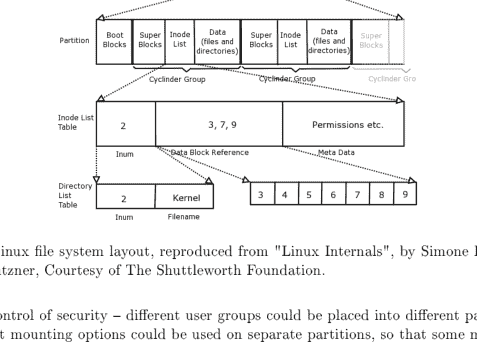

图 3.1：Linux 文件系统布局，转载自 Simone Demblon 和 Sebastian Spitzner 编著的《Linux Internals》，经 Shuttleworth Foundation 授权。

- 更强的安全控制——可以将不同的用户组放置在不同的分区中，并在独立分区上使用不同的挂载选项，使某些分区只能读取，而其他分区可以采用不同的安全选项
- 更高效地利用磁盘——不同分区可以使用不同的块大小和文件大小限制
- 更高效的运行——缩短寻道距离可以改善磁盘访问时间
- 改进备份流程——可以按分区而不是按磁盘执行备份，从而能够以不同的时间间隔备份不同的文件系统
- 提高可靠性——损坏可以限制在单个分区内，而不是波及整个磁盘，并且还可以加入冗余机制

磁盘分区最大的缺点是分区大小无法增加。因此，创建分区时如果分区过小并最终被填满，就需要重新组织整个磁盘。磁盘分区还有其他缺点，但这些缺点通常会被其优势抵消。

现代 UNIX 系统允许将磁盘分成两个或更多独立的物理实体，每个实体都包含一个独立的文件系统。独立物理分区中的文件系统之所以彼此连接，是因为它们被挂载到唯一目录层次结构（该层次结构以 `/` 为根）的目录上；除此之外，它们互不相关。每个独立文件系统都有自己的空闲块池、自己的文件集合，以及自己的 i-node 表。

### 3.5 UNIX 文件系统

不同的类 UNIX 操作系统提供不同的文件系统，每种文件系统都可能以自己的方式实现。文件系统的实现不属于任何 UNIX 标准：没有任何标准文档规定或禁止某一种统一实现。因此，在阅读 UNIX 文件系统的某种实现方式时，应当注意，这并不是唯一的实现方式。

传统 UNIX 文件系统并未被许多现代系统采用；现代实现更加复杂，因为它们在原始设计的基础上加入了许多改进。其中一个原因是，现代计算机必须能够挂载不同类型的文件系统。例如，许多 UNIX 系统允许用户挂载基于磁盘的 FAT² 和 NTFS 文件系统，而这些文件系统并不遵循 UNIX 模型。第 1 章中提到，UNIX 中的目录是一个文件，由目录项列表组成；每个目录项包含一个文件名及其 i-number，而 i-number 充当指向该文件 i-node 的指针。在 FAT 系统（自早期 Windows 操作系统沿用至今）中，目录并不具有这种结构。如果 UNIX 内核被设计为能够挂载此类系统，就必须在内存中创建一个内核对象来模拟 UNIX 目录。更重要的是，UNIX 内核不能将 `read()` 等系统调用硬编码，因为 `read()` 的实现取决于文件系统。因此，当内核编译时，调用这些系统调用后实际执行的机器代码无法与函数名绑定。

这种情况类似于编程语言中的指针或 C++ 中的虚函数所解决的问题。如果在编译时无法知道某个数据结构需要多少存储空间，那么，与其静态声明，不如使用指针，将名称与存储空间的绑定延迟到运行时。在 C++ 中，当使用虚函数创建类时，函数调用所导致的实际执行代码要到运行时才能确定，这也是一种延迟绑定。在这里，解决方案通过底层实现中的指针以不透明的方式实现³。

在 Linux 等现代 UNIX 系统中，文件系统的实现方式是：将文件系统调用的实现动态绑定到已挂载的特定文件系统中硬编码的函数上，这同样是一种延迟绑定。现在不必关注具体是如何实现的；重要的是，现代 UNIX 文件系统是虚拟文件系统，旨在处理许多不同类型的底层物理文件系统。事实上，在 Sun 的 UNIX 变体（从 SunOS 到 Solaris）以及 BSD（和 FreeBSD）中，i-node 和 i-number 的概念已经分别被 v-node 和 v-number 取代，其中 “v” 代表 “virtual”（虚拟）。Linux 仍然使用 “i-node” 这一术语，在本文档中我们也将继续使用它。图 3.2 描绘了 Linux 第二扩展文件系统（Ext2）。


最初的 Linux 虚拟文件系统由 Chris Provenzano 开发，后来由 Linus Torvalds 重写。Linux Ext2 文件系统由 Rémy Card、Theodore Ts’o 和 Stephen Tweedie 于 20 世纪 90 年代中期开发。Linux 的下一个文件系统是 Ext3，由 Stephen Tweedie 开发；它与 Ext2 的区别仅在于包含日志功能。日志记录是一种在硬件发生故障时维护文件系统一致性的方法。系统会使用一个特殊的日志文件，记录计划对文件系统执行的所有操作，例如创建和删除文件、修改文件内容或属性等。在日志文件系统中，可以使用这些记录恢复文件系统状态，而无需耗费大量时间检查每个块和 i-node。Ext2 和 Ext3 可以互相转换——由于二者的差别仅在于日志功能，因此可以在文件系统挂载期间将其中一个转换为另一个。第四扩展文件系统 Ext4 于 2008 年发布，主要用于提升性能。虽然 Linux 支持许多类型的文件系统，但 Ext2、Ext3 和 Ext4 文件系统是 Linux 的原生文件系统，几乎在所有 Linux 系统上。² ³

² FAT 是 File Allocation Table（文件分配表）的缩写，是许多 Microsoft 操作系统以及存储卡等其他外部存储设备所使用的文件系统。

³ 通常，虚拟函数是通过一种称为虚拟派发表的特殊表来实现的。

尽管存在许多不同的 UNIX 文件系统，但大多数当前实现都是基于 Dennis Ritchie 原始实现的想法构建的。因此，这些笔记中描述的实现应被视为通用实现，这意味着它们实际上并不存在于任何一个系统中，但近似于许多实际实现。我将尽可能描述某个 Linux 变体是如何操作的，因为这是学生使用最广泛的 UNIX 系统，也是我们主机上运行的系统。

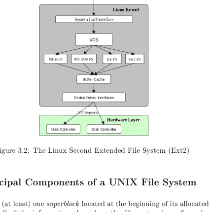

**图 3.2：Linux 第二扩展文件系统（Ext2）**

### 3.6 UNIX 文件系统的基本组件

每个文件系统在其分配的存储开头至少有一个超级块。超级块包含有关文件系统配置的所有信息，例如块大小、块地址范围和挂载状态。超级块的副本几乎总是存储在分区内的其他几个位置。

UNIX 中的每个文件系统至少有一个表来标识其中的文件。该表中的条目称为 i-节点（发音为“eye-nodes”），而该 i-节点表中的 i-节点索引称为 i-编号。i-节点包含文件属性以及指示文件块在磁盘上的位置的映射。属性包括诸如

- 所有者，

- 组，

- 文件和文件类型的允许权限，

- 指向该文件的链接数

- 最后修改时间，

- 最后访问时间，

- 属性最后更改时间，

- 文件的字节大小，

- 文件使用的块数，以及

- 文件所在设备的 `id`。

i-节点及其使用的表是 UNIX 文件系统的重要组成部分。现代文件系统通常有多个 i-节点表，如下所述。

每个文件系统都将 i-节点表与数据块分开。数据块是存储文件内容的位置。

图 3.1 描述了具有多个文件系统的现代 UNIX 磁盘设备的结构和布局。图中每个逐级下层的图都是前一层中结构的放大图。你可以看到，在现代文件系统中，不仅单个文件系统中有多个超级块，而且还有多个 i-节点表。这是为了性能原因而增加的增强功能。随着磁盘容量的增大，位于磁盘外缘的文件块与包含块地址和文件状态的 i-节点之间的距离越来越远。读取或写入文件的磁盘访问需要因磁盘寻道而产生的越来越大的延迟。通过创建多个较小的表，每个表位于其自己的柱面组中，没有任何文件会离 i-节点表太远。图显示了表中位置 2 的 i-节点通常指向文件系统中的根目录文件条目。我们将在下面回到这个问题。

#### 3.6.1 定义和创建文件系统

对磁盘进行分区会将磁盘划分为在逻辑上不同的区域，通常以字母表的开头字母命名，即 `a`、`b`、`c` 等。在 UNIX 中，分区不一定是互不相交的。`c` 分区几乎总是整个磁盘⁶，通常没有文件系统。它被用于逐块访问磁盘的实用程序。`b` 分区传统上被保留为交换存储，即用于交换的分区；它上面没有写入文件系统。最内层的分区 `a` 是内核安装的位置，通常非常小，因为不应在其中放置其他内容。如果磁盘的存储容量为 100 GB，你可能会将前 1 GB 分区设为 `a`，下一个 10 GB 设为 `b`，下一个 50GB 设为 `d`，其余部分设为 `e`，整个磁盘设为 `c`。

要在分区中创建文件，必须在该分区中创建文件系统。创建文件系统包括执行以下操作：

⁶在 Solaris 主机上，它指的是整个磁盘。在 FreeBSD 中，它指的是整个“切片”，可以将其视为分区集合。

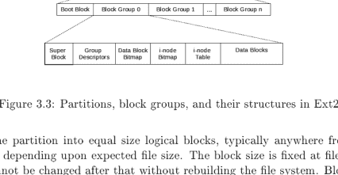

**图 3.3：Ext2 中分区、块组及其结构**

- 将分区划分为大小相等的逻辑块，每个块通常为 1024 到 4096 字节不等，具体取决于预期文件大小。块大小在文件系统创建时固定；之后若要更改则必须重建文件系统。块大小始终为 2 的幂。较大的块大小会导致内部碎片浪费更多磁盘空间，而较小的块大小则会导致更多的磁盘活动和更多的磁盘等待。较大的块适用于预期有大文件的系统。在我个人 Linux 主机上的文件系统中，根文件系统使用 1024 字节块，第二个分区用于用户数据，使用 4096 字节块。

- 决定每个柱面需要多少个备用块。柱面是磁盘磁头组件从一个位置可访问的所有磁道的集合。换句话说，柱面是垂直上下对齐的一组磁道。当一个块变坏时，它必须从文件系统中移除。备用块用于替换坏块。

- 在 Linux Ext2 中，块组取代了柱面组。而柱面组是一个物理概念，与磁盘几何结构相关，块组是一个逻辑概念，与磁盘几何结构无关，因为现代硬盘驱动器会将几何结构隐藏在操作系统之外。图 3.3 说明了这一点。

- 决定每个柱面组包含多少个柱面。分组柱面是为了性能和可靠性。柱面组是一组相邻柱面的集合，被分组在一起以使信息本地化。文件系统会尝试将给定文件的所有数据块从同一个柱面组分配出来，如果文件足够小的话。每个柱面组还保存一份超级块的副本，如下所述。

- 在 Linux Ext2 中，每个块组包含以下内容（见图 3.3）：

  * 文件系统超级块的冗余副本，

  * 块组描述符表的冗余副本；每个块组描述符包含有关特定块组结构的信息以及组内所有内容的所在位置的映射；该表在所有组中都相同，

  * 块位图，它为组中的每个块设置一位，表示其是否空闲或正在使用，

  * i-节点位图，它为组中的每个 i-节点设置一位，表示其是否空闲或正在使用，

  * 该块组中 i-节点的 i-节点表，

    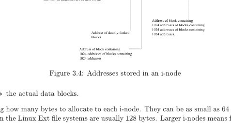

    **图 3.4：存储在 i-节点中的地址**

  * 实际数据块。

- 决定为每个 i-节点分配多少字节。它们可以小到 64 字节。Linux Ext 文件系统上的 i-节点通常为 128 字节。较大的 i-节点意味着更少的 i-节点，即更少的文件。较小的 i-节点允许更多文件。

- 根据系统情况，将柱面组或分区划分为三个物理区域：

  - 超级块。它存储磁盘使用情况的映射以及文件系统参数。在 Linux 文件系统中，超级块包含诸如块大小的位数和字节数、超级块所在物理设备的标识符、各种标志指示其是否为只读或锁定或如何挂载，以及等待执行的挂载队列等信息。

  - i-节点区。这里存储已使用和空闲的 i-节点。已使用和空闲的 i-节点传统上被排列成两个列表，即 i-列表和空闲列表，每个列表的开始位置存储在超级块中。这种存储管理方法已过时。UNIX 的后期版本使用了一种更有效的方法，即在创建文件系统时，在每个柱面组内分配固定数量的 i-节点。这使 i-节点更接近其数据块，减少了整体寻道次数。

  - 数据区。这里存储数据块。

对分区进行许多其他操作才能使其成为文件系统。例如，由于磁盘在读取数据时仍在旋转，块之间需要有间隙。间隙应该有多大？由于磁盘磁头有时需要前进到新的柱面来读取下一个块，而磁盘在前进时仍在旋转，下一个块不应位于同一扇区。下一个应该读取哪个扇区？此外，超级块通常为了可靠性而在磁盘上复制。复制多少次？它应该放在哪里？

#### 3.6.2 文件存储

UNIX 中存储文件的方法灵活且相当高效。请记住，每个文件在 i-节点表中都有一个 i-节点，其中包含诸如所有者的用户 ID、组 ID 等信息

> 7 在 BSD 中他们称之为快速文件系统。
>
> 8 如果 i-节点位于磁盘开头而数据块位于中间，那么磁头必须来回移动，从 i-节点读取地址，获取数据，再回到 i-节点，等等。随着 i-节点靠近数据块，到达 i-节点需要稍多时间，但这完全被数据块访问的节省所弥补。

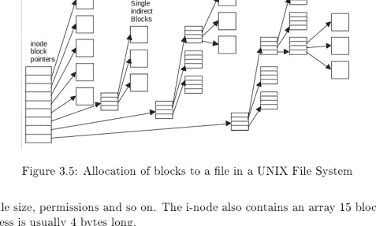

**Figure 3.5: Allocation of blocks to a file in a UNIX File System**


the file, the file size, permissions and so on. The i-node also contains an array 15 block addresses⁹. A block address is usually 4 bytes long.

In BSD, i-nodes contains an array of 15 block addresses, which are used as follows:

- For regular files, the first 12 block addresses in this array are the addresses of the first 12 blocks of the file. If the block size is 4096 bytes (4 KB), then a file with at most 12 · 4 = 48 KB can be accessed by one level of indirection.

- If a file is larger than 48 KB, then the 13th address is the address of a single indirect block, which is a 4096-byte block used to store block addresses. Since a block address is 4 bytes, there are 4096/4 = 1024 block addresses in this block. Since each of these 1024 blocks is 4096 bytes, using the first 12 addresses plus the 13th address allows for addressing files whose size is at most 48 KB + 1024 · 4096 bytes, or 48 KB + 4 MB.

- For still larger files, the 14th address is the address of a double indirect block that contains 1024 addresses of single indirect blocks, each of which contains 1024 device addresses. This accommodates files whose size does not exceed 48 KB + 4 MB + 1024 · 4096 KB, roughly 4 GB.

- The 15th address is that of a triple indirect block, which, needless to say points to 1024 double indirect blocks and so on. It allows for 1024 1024 · 4096 additional KB, or a maximum file size of roughly 4 terabytes.

Figure 3.4 shows how the block pointers are laid out in the i-node and Figure 3.5 illustrates the distribution of blocks that results. With this design, there can be a lot of disk seeking, because the different parts of a file can be very far away from each other. For most files though, the blocks tend to be physically contiguous and so actual I/O overhead is acceptable. For very large files requiring several addressing steps before accessing the disk blocks, overhead can be large. This is offset by the use of the kernel I/O buffering described in Chapter 2.

> 9 The number of addresses varies. On early UNIX systems, it was 13. In 4.4BSD it is 15. In some implementations of Linux, it is 13 and in others, it is 15.

#### 3.6.3 How the Kernel Creates Files

Suppose that the current working directory is `/home/sweiss/scratch`, and the command

```
$ gcc -o testprog testprog.c
```

is executed. Assuming that the program is compiled and linked, and that I have write and execute permission for the directory `/home/sweiss/scratch`, `gcc` will create the file named `testprog` in this directory. This section answers the question, "What steps are taken by the kernel to create the file `testprog`" on behalf of `gcc`? These steps can be outlined as follows:

- 1. The kernel creates an i-node for the file, if possible.
- 2. The kernel fills in the i-node with the file status.
- 3. The kernel allocates data blocks for the file and stores the file data in these blocks.
- 4. The kernel records the addresses of the data blocks in the i-node.
- 5. The kernel creates a directory entry in the `scratch` directory with the i-node number and file name `testprog`.

Each of these steps is explained below.

##### Creating the i-node

The very first step is to create an i-node for the file. To do this, the kernel must get a free i-node in the i-node table. If there isn't a free one, it must report the error and stop here. If this happens, the user will get a message that the file system is full. This is one reason to enable disk quotas on the system. A table of active i-nodes is kept in memory with a copy on disk as well.

##### Updating the i-node

Assume that the kernel obtained an i-node, and that it has index 47 in the i-node table. The kernel fills the i-node in with the owner, permissions, time of last modification, and so on. It then saves the i-number, 47, of this i-node. The i-node update takes place in the memory copy of the table, not the disk resident copy. This is updated periodically by the kernel.

##### Allocating Data Blocks


The next step is to store the file's data. To do this the kernel must acquire the right number of blocks. As `gcc` runs, it is generating the file, writing it in pieces at a time. Because the kernel does output buffering, the file is being stored in kernel buffers, which are not written to disk until the buffers are flushed. If the file is small, all of it will fit in memory and the kernel will know how many disk blocks are needed for it. If the file is very large, the kernel may start allocating blocks before it knows the file's actual size. Assuming that the file system has storage for it, it will first allocate direct blocks. If the file is larger than the number of bytes that can fill all of the direct blocks, the kernel allocates single-indirect blocks as needed. If it is larger than the amount of storage they can provide, it starts allocating double indirect blocks. It continues this procedure, using a triple indirect block if not even all of the double indirect blocks will suffice.

### 数据块位置的记录

内核记录 `i-node` 中数据块的顺序和位置。某些文件系统还具有文件映射，以便更快地访问文件。无论使用何种数据结构来记录块位置，这些都必须在此处更新。

### 在目录中记录文件名

如果之前的所有步骤都成功，则内核将在当前工作目录中创建一个新条目，由 `(47, testprog)` 组成，因为 `47` 是 `i-`编号，`testprog` 是名称。

### 3.6.4 内核如何访问文件

当用户输入一个需要打开文件进行读取的命令时，实际上发生了什么？例如，当命令

```
$ cat myfile
```

由 shell 执行时，采取了哪些步骤以及由哪些程序执行？第一步是 shell 解析命令并确定 `cat` 命令是可执行文件，并且它有一个名为 `myfile` 的单个文件参数。它将安排名称 `myfile` 放入 `cat` 在其 `main()` 参数列表中会看到的 `argv` 数组中：

```
int main(int argc, char *argv[])
```

`cat` 将通过 `open()` 系统调用要求内核打开文件进行读取。`open()` 系统调用尝试查找传递给它的文件名的 `i-`编号。为此，它必须解析路径名，这是我们现在忽略的一个事实。但只是为了让你了解复杂性，如果文件名是

```
../../shared/temp1/coursework/workspace/myfile
```

这比如果它在工作目录中要更具挑战性一些。现在假设 `open()` 弄清楚要打开哪个目录，然后在该目录中搜索名称 `"myfile"`。当找到它时，它会获取其 `i-`编号。一旦获得 `i-`编号，它就可以从其 `i-node` 表中检索 `i-node` 信息。如果文件已打开，`i-node` 将在内核内存中的活动 `i-node` 表中。如果没有，它将从磁盘上的 `i-node` 表中检索，并且 `i-node` 被复制到活动 `i-node` 表中。

一旦内核在其内存空间中拥有 `i-node` 的副本，它就可以访问 `i-node` 的信息。它必须做的第一件事之一是检查权限位是否允许 `cat` 程序访问文件。`cat` 程序以调用它的用户的有效用户 ID 运行。如果该用户没有适当的权限访问给定目录中的此文件，`open()` 调用将返回 `-1` 并将静态变量 `errno` 设置为 `EPERM`，这是系统调用在因权限问题而失败时分配给 `errno` 的错误代码。

如果允许访问，`open()` 调用将返回文件的描述符，并且该描述符将指向一个数据结构，其中除其他外，有一个指向文件的 `i-node` 的指针。`cat` 命令在连续调用读取文件时，本质上是要求内核访问 `i-node` 并从文件的数据块中获取数据。内核使用 `i-node` 来确定要访问哪些块。从文件大小，内核可以确定数据是否完全在直接块中（例如，使用 `4096` 字节的块大小和 `12` 个直接块，最多可在其中存储 `48 KB`）还是读取第一个单间接块。如果文件存储在间接块中，访问速度会更慢，因为大多数数据块需要三次甚至四次磁盘访问。如果块大小为 `8192` 字节，则最多可快速访问 `96 KB` 的文件。内核还从活动 `i-node` 中得知，文件的块是否在系统缓冲区中并且可以无需磁盘 I/O 访问。

## 3.7 ls 命令

在对文件系统做什么以及如何做有了更多了解之后，我们可以通过编写一个使用文件系统编程接口的程序来进行一个小练习。`ls` 命令是一个足够简单的起点。

`ls` 命令可以接受各种类型的文件名列表（例如，普通文件、特殊文件和目录）作为参数：

```
ls [ options ] FILE FILE ...
```

其中 `FILE`, `FILE`, ... 是文件名，无论它们是普通文件、特殊文件、符号链接还是目录。当然，与几乎所有命令一样，文件名参数可以是任意路径名。如果参数是目录，它会显示该目录中包含的文件链接，如果给出适当的选项，还会显示文件属性。如果它不是目录，`ls` 会显示文件名，如果指定了 `-l` 选项，还会显示文件属性。有许多选项可以更改 `ls` 的默认行为。你可以阅读手册页以获取完整列表。

总结来说，`ls` 根据参数是目录还是非目录文件执行两种不同的操作。

- 当参数是目录时，`ls` 显示其内容。
- 当参数不是目录时，`ls` 显示其名称。

在任何一种情况下，选项可能要求按指定顺序显示其属性的子集。

`ls` somehow 可以确定参数是否是目录。要实现 `ls`，我们必须弄清楚

1. 如何确定文件名是否为目录；
2. 如何列出目录的内容；以及
3. 如何列出文件的属性。

当 `ls` 的参数是一个非目录文件时，它可能需要获取该文件的属性并显示它们。当参数是一个目录，比如 `dir` 时，`ls` 需要做类似下面的事情

```
open the directory dir
while not all directory entries in dir have been read
    read the entry
        optionally display information about the entry
close the directory
```

问题是，我们如何打开、读取和关闭一个目录，以及如何获取文件属性的信息。幸运的是，由于文件系统接口的简单性，这些任务都不特别困难。

## 3.8 目录接口

回想一下，对于内核而言，普通文件只是一串字节。目录与普通文件类似，只是

1. 它们永远不为空：

目录不为空，因为每个目录都有两个唯一的条目，`.` 和 `..`，它们分别指向目录本身和父目录。这些是在目录创建时创建的。

2. 它们不能被非特权程序写入：

它们只能通过非常特定的系统调用来修改，而与普通文件不同。相比之下，任何具有适当权限的人都可以读取目录的内容。一些对普通文件操作的命令也可以应用于目录，但结果会出乎意料。

3. 它们具有特定的结构：

目录是一个包含一组（名称，`i-`号）对的文件。换句话说，目录是一张记录表。你可以把它想象成一个哈希表，因为它是用名称访问以检索 `i-`号。

一些读取文件的命令也会读取目录，但结果没有用。例如，在某些系统上，`cat` 命令和 `od` 命令可能会将目录的内容作为字节流显示，但由于目录不是文本文件，`cat` 的输出看起来会乱码。`od` 的输出可能看起来正常。通常，这些命令，像 `more` 命令，会检查其参数是否为目录，如果是，则拒绝执行，而是显示错误信息：

```
$ more projects
*** projects: Is a directory ***
```

`more` 命令拒绝显示 `projects`，因为它是一个目录，而目录作为字符序列显示是没有意义的。如果仔细检查，`od` 的输出可能会向你揭示目录的结构。`od` 的 `-c` 选项会将可转换为字符的字节作为字符显示。在 Linux 上，`od`、`cat` 或 `more` 都不会显示目录的内容。


如果你想知道哪些系统调用可能适用于目录，`open()`、`read()` 和 `close()` 系统调用会作用于目录，因为它们不会修改目录，但由于目录具有特定的结构，使用它们并没有多大意义。它们并非 intended 用于目录。最好使用专门设计用于打开、读取、修改和关闭目录的特定系统调用或库函数。

如果你使用 man 手册搜索来查找引用单词 "directory" 的 man 手册，你会找到很长的列表。最好过滤搜索的输出，使用类似

```
$ man -k directory | grep read
```

这将只显示少数条目。你可能会看到，其中包括

- `readdir` (2) - read directory entry

- `readdir` (3) - read a directory

- `readdir` (3p)- read a directory

- `readdir_r` [readdir] (3p)- read a directory

- `seekdir` (3) - set the position of the next

- `readdir()` call in the directory stream

不同的系统会根据它们运行的 UNIX 版本提供略有不同的 man 手册集合。所有系统都应该在第 2 节列出 `readdir()` 系统调用，而大多数系统应该在第 3 节或 3P 节或两者中列出一个名为 `readdir()` 的调用。在几乎所有系统上，如果你阅读第 2 节中 `readdir()` 系统调用的 man 手册，它会建议你不要使用此系统调用，而改用同名的 POSIX 库函数。它会指向 `readdir()` C 库函数，其 man 手册位于第 3 节或 3P 节。你可能需要在 `man` 命令中使用小写的 p，如

```
$man 3p readdir
```

由于不同系统之间存在很大差异，我们无法确切知道你会看到什么，但所有页面至少应包含以下内容：

```
SYNOPSIS
    #include <sys/types.h>
    #include <dirent.h>

    struct dirent *readdir(DIR *dir);
DESCRIPTION
    The readdir() function returns a pointer to a dirent structure representing the next directory entry in the directory stream pointed to by dir. It returns NULL on reaching the end-of-file or if an error occurred.
```

这告诉我们，`readdir()` 需要一个 `DIR*` 类型的参数，并返回一个指向 `dirent` 结构的指针。手册页的其余部分可能包含这个 `dirent` 结构的定义，但可能不包含，具体取决于系统。如果确实没有，那么你需要使用前面描述的策略来查找它。它不会解释什么是 `DIR*` 或它在哪里定义。这几乎肯定需要进一步研究。需要说明的是，如果手册页中没有 `dirent` 定义，你应该在 `SEE ALSO` 部分查找可能提供更多信息的手册页；该列表可能如下所示：

```
SEE ALSO
    read(2), closedir(3), dirfd(3), ftw(3), opendir(3),
    rewinddir(3), scandir(3), seekdir(3), telldir(3),
    feature_test_macros(7)
```

在上面列出的手册页中，最可能的候选者是 `opendir()` 的手册页；这个函数很可能是在进行任何目录处理时第一个调用的函数。如果该页面也没有定义，那么我们就必须阅读 `<dirent.h>` 的手册页，或者直接阅读头文件本身。

无论如何，你都会发现 `dirent` 结构的定义如下：

```
struct dirent {
    ino_t       d_ino;        /* inode number */
    off_t       d_off;        /* offset to the next dirent */
    unsigned short d_reclen;  /* length of this record */
    unsigned char  d_type;    /* type of file; not supported
                               by all system types */
    char        d_name[256];  /* filename */
};
```

但无论你是在 `readdir()` 的第 3 节或 3P 节手册页中，还是在 `<dirent.h>` 头文件的页面中，都会发现如下这样的警告：

> 根据 POSIX，`dirent` 结构包含一个字段 `char d_name[]`，其大小未指定，在终止的空字节之前最多有 `NAME_MAX` 个字符。POSIX.1-2001 还将字段 `ino_t d_ino` 记录为 XSI 扩展。使用其他字段将损害程序的可移植性。

也就是说：`dirent` 结构中唯一保证存在的两个成员是 `d_ino` 和 `d_name`，并且 `d_name` 成员不一定是固定长度的字符串；POSIX 只保证它是一个以 NULL 结尾的字符串，其长度最多为 `NAME_MAX` 个字符。因此，无论如何，我们都不应该使用那些其他成员，并且我们应该确保任何存储名称的变量都足够大，能够存储 `NAME_MAX` 个字符。我们将在后面回到如何在程序中使用 `NAME_MAX` 这个问题。

我们需要弄清楚如何使用 `readdir()`，什么是 `DIR`，以及我们如何获得一个 `DIR*` 来用于 `readdir()`。`readdir()` 的手册页基本上是说，使用同一个目录流指针连续调用 `readdir()` 会返回所指目录中的连续条目，并且

当所有条目都被访问后，会返回一个 `NULL` 指针。这与 `getutent()` 函数处理 `utmp` 结构的方式非常相似，该函数需要通过调用 `setutent()` 来初始化库。我们有理由猜测，`SEE ALSO` 部分列出的 `opendir()` 函数为 `readdir()` 执行了这种初始化。

`opendir()` 的手册页内容如下：

### 概要

```
#include <sys/types.h>
#include <dirent.h>

DIR *opendir(const char *name);
```

### 描述

`opendir()` 函数打开与目录名称对应的目录流，并返回指向该目录流的指针。流被定位在目录的第一个条目处。

### 返回值

`opendir()` 函数返回指向目录流的指针。出错时，返回 `NULL`，并适当地设置 `errno`。

换句话说，给定一个目录的路径名字符串，`opendir()` 会返回一个指向被称为 `DIR` 的某种东西的指针，文档将其称为目录流。大写字母的名称通常是宏，在头文件中用 `#define` 指令定义，`DIR` 类型可能是一个宏。它也可能是一个 `typedef`。为了打开目录并从中读取，我们不需要知道 `DIR` 是什么，所以现在我们继续。

正如正确使用 `getutent()` 需要我们在访问完所有 `utmp` 记录后调用 `endutent()` 进行清理一样，正确使用 `readdir()` 也要求我们在之后进行清理。`SEE ALSO` 部分包含对 `closedir()` 函数的引用。如果我们查看它的手册页，我们会看到，`closedir()` 在给定一个指向 `DIR` 的指针时，会关闭与目录的连接，这正是当 `readdir()` 返回 `NULL` 指针时我们必须做的事情。

通过阅读 `readdir()`（第 3 节和 3P 节）、`opendir()` 和 `dirent.h` 的手册页，我们可以梳理出目录读取接口的工作原理。当使用 `opendir()` 打开目录时，一个静态变量指向目录中的第一个条目。`readdir()` 调用会读取这个隐藏变量所指向的条目，并递增指针，使其指向下一个条目。因此，连续调用会遍历整个目录。如果程序在任何时候需要知道它将读取哪个条目，`telldir()`：

```
#include <dirent.h>
long telldir(DIR *dirp);
```

会返回其索引，这是一个从目录流开头算起的整数偏移量。如果程序需要在不关闭目录的情况下重新开始，`rewinddir()` 可以做到这一点，而 `seekdir()` 会将指针移动到指定的索引：

```
#include <dirent.h>

void seekdir(DIR *dirp, long offset);
```

`telldir()` 返回的偏移量可以传递给 `seekdir()`。

虽然我们不需要知道 `DIR` 的结构就能使用这些调用，但好奇心驱使我们去探究。你会发现 `DIR` 并不是一个宏，而是一个 `typedef`：

```
typedef struct __dirstream DIR;
```


并且在系统的任何公开头文件中都没有 `struct __dirstream` 的定义。这是因为 `__dirstream` 是一个不完整类型。不完整类型是一种描述对象但缺乏确定其大小所需信息的类型。每个 UNIX 实现都必须定义它，并且可以自由地按其选择的方式定义它，但它不必在任何头文件中公开该实现。`<dirent.h>` 头文件声明了 `struct __dirstream` 并使 `DIR` 等同于它，但并未定义其成员。这使程序员能够声明 `DIR*` 类型的对象，但不能访问 `DIR` 对象的成员。

我们的好奇心得到满足后，我们将此事搁置一边，转而解决前面出现的 `NAME_MAX` 问题。没有 man page 搜索可以告诉你像 `NAME_MAX` 这样的常量可能在哪里定义，即程序需要包含哪个头文件才能访问其定义。可以对系统中所有头文件搜索该字符串，但那样你必须知道所有包含头文件的位置。这种搜索在 `/usr/include` 中很可能会失败，例如，因为 `NAME_MAX` 是一个系统相关的值，存储在某个包含实现相关头文件的位置。可以对 `" NAME_MAX "` 进行彻底的递归 `grep` 搜索（空格很重要），你会找到它：

```
$ grep -R " NAME_MAX " /usr/* 2>/dev/null
```

在 `bash` 中，重定向 `2>/dev/null` 会丢弃所有发送到标准错误的消息。此命令的输出可能看起来像

```
/usr/include/linux/limits.h:#define NAME_MAX        255
/* # chars in a file name */
/usr/include/glib-1.2/glib.h:#    define NAME_MAX 255
```

随后是来自其他文件的行，这些文件可能定义或未定义该宏。

`NAME_MAX` 是 UNIX 中的一个系统限制。它指定文件名中的最大字符数。因此它是 `<limits.h>` 头文件中定义的众多此类常量之一。这一事实不像迄今为止的其他事实那样容易发现。必须包含此头文件才能使用该常量。在下一章中，我们将介绍如何在程序中发现和使用系统限制。暂时，我们只使用其中几个。

我们现在已有足够的知识来尝试编写 `ls`。

> 10 如果你编写一个引用 `__dirstream` 对象的程序，编译器会报错其大小未知。如果你改为声明一个 `__dirstream*` 指针，程序将编译通过，因为指针的大小是已知的。你将无法解引用此指针并使用它指向的内容，因为你的程序没有它的实现。但它在使用的库中已实现。这是在 C 中信息隐藏的一个例子。

### 3.9 实现 ls

编写 `ls` 的第一次尝试将处理多个命令行参数，而不会做太多其他事情。对于每个参数，如果它是目录，它将显示其内容，顺序不定。其中一个问题由 `opendir()` 调用为我们解决了；如果参数不是目录，该调用将失败，返回 `-1`。这将是我们判断文件名是否为目录的测试。

```c
Listing: ls.c Version 1

#include <stdio.h>

#include <sys/types.h>

#include <dirent.h>

#define HERE "."

void ls(char []);

int main(int argc, char *argv[])

{

    int i = 1;

    if (1 == argc)    // no arguments; use .

        ls(HERE);

    else

        // for each command line argument, display contents

        while (i < argc) {

            printf("%s\n", argv[i]);

            ls(argv[i]);

            i++;

        }

}

// List the contents of the directory named dirname
// Uses opendir to check whether argument is a directory
// Doesn't check if argument is or "." or ".."
void ls(char dirname[])

{

    DIR        *dir_ptr;    // directory stream

    struct dirent *direntp; // hold one entry

    if ((dir_ptr = opendir(dirname)) == NULL)

        // Could not open — maybe it was not a directory

        fprintf(stderr,"Cannot open %s\n", dirname);

    else

    {

        while ((direntp = readdir(dir_ptr)) != NULL)

            printf("%s\n", direntp->d_name);

        closedir(dir_ptr);

    }

}
```

## 评论

- 真正的工作是由 `ls()` 函数完成的，如果文件不是目录，它会打印错误。它在尝试使用 `opendir()` 调用打开目录时发现了这一点。此调用如果无法打开目录或它不是目录，将返回一个 NULL 指针。它会将 `errno` 设置为特定值以指示错误的起因，但在该版本中我们忽略了 `errno`。
- 此版本列出所有文件，包括点文件。
- 它不会对文件进行排序，而真正的 `ls` 会这样做。
- 它不会将输出放入列中，而真正的 `ls` 会这样做。
- 它不处理任何命令行选项。
- 它不显示文件三个特殊位的信息。

这只是一个热身练习。现在我们知道了需要解决的一些问题。我们编写第二个版本，尝试解决其中一些，但不是全部问题。我们还添加了显示长列表的能力。

### 3.10 ls 的第二个版本

#### 3.10.1 为 ls 添加 -l 选项

`ls` 的 `-l` 选项显示文件属性。非设备文件显示的属性集在下表中定义。

| 字段名称 | 描述 |
|---|---|
| *mode* | 一个十个字符的字段，其中第一个字符是一个字母，表示文件类型。"-" 表示它是普通文件；"d" 表示它是目录。还有其他类型。这在第 1 章中已描述。其余九个字符定义文件模式，也在第 1 章中描述。 |
| *number of links* | 该文件在所有目录中拥有的名称数量。一个文件可能在多个目录中有条目，可能名称相同或不同。 |
| *owner name* | 拥有此文件用户的用户名称。 |
| *group name* | 文件所属组的名称。如果组没有名称，则可能会显示其组 ID。 |
| *size in bytes* | 文件中实际的数据字节数，而不是分配给它的块中的字节数，但如果文件是目录，则为分配给目录的块中的字节数，因此是块大小的倍数。 |
| *date of last modification* | 文件最后被修改的日期和时间。如果文件相对较新，则显示月份、日期、时间，但如果较旧则显示月份、日期、年份。新文件的定义因实现所遵循的标准而异。在符合 POSIX 的 ls 中，如果日期在过去 6 个月内，则文件为近期。此外，确切的日期格式可以用各种选项更改。 |
| *file name* | 目录中的文件名。 |

如果文件是符号链接，则 `ls` 的默认行为是显示链接本身的信息，而不是它引用的文件的信息。要显示被引用文件的属性，`ls` 必须在 `-l` 选项之外还加上 `-L` 选项（在大多数系统上）。

问题是，`ls` 命令如何访问这些信息，我们知道这些信息在与文件关联的 i-node 中？我们需要一个访问 i-node 中信息的函数。再次，找到方法是通过搜索 man 手册。这次可能很难找到信息。搜索引用 i-node 的 man 手册将一无所获。我们可以尝试搜索 i-node 中的某条信息，例如 `mode`、`size` 或最后修改日期，但这些术语太常见，可能会产生很长的列表。关键是 i-node 中的信息称为文件状态。搜索 `status` 将会成功：


```
$ man -k status | grep file
fileno [ferror]          (3)  - check and reset stream status
fstat                   (3p)  - get file status
fstat [stat]            (2)  - get file status
ifcfg-ppp0 [pppoe]      (5)  - Configuration file used by adsl-start(8), adsl-stop(8), adsl-status(8) and adsl-connect(8)
lam_rfstate             (2)  - Report status of remote LAM file descriptors
lstat [stat]            (2)  - get file status
stat                    (1)  - display file or filesystem status
stat                    (2)  - get file status
stat                    (3p)  - get file status
```

返回的列表可能与此不同，但它将包含 `stat` 系列调用：`stat()`、`lstat()` 和 `fstat()`，`stat()` 可能有两个页面，一个在第 `(2)` 节，另一个在 `(3)` 或 `(3P)`。`stat (3P)` 手册页是 POSIX 版本。`stat (2)` 的手册页以以下内容开头：

```
NAME
    stat, lstat, fstat - get file status

SYNOPSIS
    #include <sys/types.h>
    #include <sys/stat.h>
    int stat(const char *path, struct stat *buf);
    int lstat(const char *path, struct stat *buf);
```

```
int fstat(int fildes, struct stat *buf);
```

## DESCRIPTION

这些函数返回有关指定文件的信息。你不需要对文件有任何访问权限即可获取此信息，但你需要对通往该文件的路径中命名的所有目录具有搜索权限。

`stat` 对 `file_name` 指向的文件进行统计并填充 `buf`。

`lstat` 与 `stat` 相同，只是对于符号链接的情况，统计的是链接本身，而不是它所指向的文件。

`fstat` 与 `stat` 相同，只是用 `open(2)` 返回的 `fildes` 指向的已打开文件代替 `file_name` 进行统计。

它们都返回一个 `stat` 结构，该结构具有以下字段：

| mode_t | st_mode; | /* 文件模式（参见 mknod(2)） */ |

| ino_t | st_ino; | /* 索引节点号 */ |

| dev_t | st_dev; | /* 包含此文件目录项的设备的 ID */ |

| dev_t | st_rdev; | /* 设备 ID 此项仅对字符特殊文件或块特殊文件定义 */ |

| nlink_t | st_nlink; | /* 链接数 */ |

| uid_t | st_uid; | /* 文件所有者的用户 ID */ |

| gid_t | st_gid; | /* 文件所属组的组 ID */ |

| off_t | st_size; | /* 文件大小，以字节为单位 */ |

| time_t | st_atime; | /* 最后访问时间 */ |

| time_t | st_mtime; | /* 最后数据修改时间 */ |

| time_t | st_ctime; | /* 最后文件状态更改时间 */ |

|  |  | /* 时间以自 1970 年 1 月 1 日 00:00:00 UTC 起的秒数计量 */ |

| long | st_blksize; | /* 首选 I/O 块大小 */ |

| blkcnt_t | st_blocks; | /* 已分配的 512 字节块数 */ |

简而言之，我们将 `stat()` 或 `lstat()` 函数的路径名传递给文件，它会填充第二个参数指向的 `stat` 结构。如果路径名不是绝对路径，`stat()` 和 `lstat()` 会将其视为相对于工作目录。这很重要，因为如果我们只传递文件名，进程的工作目录必须是包含该文件名的目录。如果文件是符号链接，`lstat()` 会显示链接本身的信息，而不是它指向的文件，因此如果我们希望程序的行为像真正的 `ls`，我们应该使用 `lstat()` 而不是 `stat()`。

调用 `stat()` 函数之一返回的信息比 `ls -l` 显示的信息更多，因此我们必须选择需要显示的 `stat` 结构成员。如果你好奇的话，第 `(3P)` 节中 POSIX 对该结构的描述是相似的。它会指出

> 11事实上，POSIX 页面现在包含了解决 ls 问题示例源代码。

某些 `stat` 结构成员是必需的，而另一些则不是。我们需要的所有成员都在 POSIX 对该结构的定义中。

大部分工作是编写一个函数，该函数在给定文件名时，以 `ls -l` 的形式显示一行输出；因此我们将从该函数开始。最初我们将创建一个函数，按每行一个的方式显示各个信息。一旦它工作正常，我们就可以将其格式化以适应一行。 “每行一个”版本将命名为 `print_file_status()`。我们可以创建一个驱动程序，它只需调用此函数，并使用其命令行参数作为我们想要“stat”的文件。由于我们已经在第 2 章学习了如何显示时间，我们可以在此处重用该函数。对此函数的第一次尝试如下所示：

```
void print_file_status(char *fname, struct stat *buf)
{
    printf(" mode: %o\n", buf->st_mode);      // type + mode
    printf(" links: %d\n", buf->st_nlink);    // # links
    printf(" user: %d\n", buf->st_uid);       // user id
    printf(" group: %d\n", buf->st_gid);      // group id
    printf(" size: %d\n", buf->st_size);      // file size
    printf(" mtime: %s\n", time2str(buf->st_mtime));  // last modified
    printf(" name: %s\n", fname );            // filename
}
```

这里，`time2str()` 是一个简单的函数，它将 `time_t` 转换为字符串，且不包含开头的“星期几”名称。稍后它将被其他内容替换。在这次首次尝试中，`mode` 是数字的，用户和组显示为用户和组 ID 而不是实际名称。我们将逐行处理并对其进行改进，以便以正确的形式显示信息。首先我们将修复 `mode`。

### 3.10.2 将文件模式转换为字符串格式

文件模式存储在 `stat` 结构的 `st_mode` 成员中，作为一个 16 位量。这 16 位用于不同的目的。

前四位保留用于文件类型，例如普通文件或目录。接下来的三位是特殊位：`set-user-id` 位、`set-group-id` 位和 `sticky` 位。我们稍后会处理这些。接下来的九位是三个三位一组。每一组都有读、写和执行位。三组位分别是用户、组和其他组的位。1 位表示权限或属性已打开，0 位表示已关闭。考虑到这一点，很容易编写代码，使用位掩码将这个 16 位量转换为十个字符的模式字符串。


```
void mode2str( int mode, char str[] )
{
    strcpy( str, "----------" );

    if ( S_ISDIR(mode) )      str[0] = 'd';  // directory?
    else if ( S_ISCHR(mode) ) str[0] = 'c';  // char devices
    else if ( S_ISBLK(mode) ) str[0] = 'b';  // block device
    else if ( S_ISLNK(mode) ) str[0] = 'l';  // symbolic link
    else if ( S_ISFIFO(mode)) str[0] = 'p';  // Named pipe (FIFO)
    else if ( S_ISSOCK(mode)) str[0] = 's';  // socket

    if ( mode & S_IRUSR ) str[1] = 'r';  // 3 bits for user
    if ( mode & S_IWUSR ) str[2] = 'w';
    if ( mode & S_IXUSR ) str[3] = 'x';

    if ( mode & S_IRGRP ) str[4] = 'r';  // 3 bits for group
    if ( mode & S_IWGRP ) str[5] = 'w';
    if ( mode & S_IXGRP ) str[6] = 'x';

    if ( mode & S_IROTH ) str[7] = 'r';  // 3 bits for other
    if ( mode & S_IWOTH ) str[8] = 'w';
    if ( mode & S_IXOTH ) str[9] = 'x';
}
```

#### 3.10.3 将用户/组 ID 转换为字符串

下一步是将用户ID和组ID转换为名称。我们需要一个函数，它接收一个用户ID并返回具有该用户ID的人的名称，还需要一个函数，它接收一个组ID并返回组的名称。我们如何找到这样的函数？我们可以尝试使用诸如 username、name、user 等关键词进行手册页搜索。经过几次这样的尝试，你可以将其缩小到类似以下命令：

```
$ man -k name | grep user
```

你会得到一个不算太长的列表，其中包含以下候选条目：

```
getpwnam (3p) - search user database for a name
```

如果我们查看这个手册页，就会发现 `getpwnam()` 不是我们想要的，而 `getpwuid()` 才是。这两个函数都会访问密码数据库，无论实际文件位于何处，也就是说，即使是网络数据库，它们也会返回一个 `passwd` 结构体。`getpwuid()` 函数通过用户ID访问密码数据库，而 `getpwnam()` 通过用户名访问。我们有用户ID，但需要名称，所以我们需要 `getpwuid()` 函数。它接收一个用户ID作为参数，并返回一个指向 `passwd` 结构体的指针，该结构体在 `/usr/include/pwd.h` 中定义如下：

```
struct passwd {
    char *pw_name;      /* Username */
    char *pw_passwd;    /* Password */
    uid_t pw_uid;       /* User ID */
    gid_t pw_gid;       /* Group ID */
    char *pw_gecos;     /* Real name */
    char *pw_dir;       /* Home directory */
    char *pw_shell;     /* Shell program */
};
```

只要指针不为 `NULL`，就可以对 `getpwuid()` 返回的指针进行解引用，以访问 `passwd` 结构体的各个成员。`getpwuid()` 的手册页指出，如果密码数据库中没有匹配的条目，返回的指针将为 `NULL`。应用程序必须对此进行检查。

你可能想知道为什么可能没有匹配的名称。有时会发生这样的情况：一个用户账户从 UNIX 系统中被删除，但该用户创建的一些文件被遗留下来。例如，`/tmp` 目录通常是全局可写的，任何人都可以把文件放在那里。如果被删除的用户账户曾在那里创建过文件，系统管理员可能不会删除这些文件，因为在整个文件系统中搜索用户文件的踪迹非常耗费资源。如果 `ls` 试图列出 `/tmp` 的内容，它将无法显示该用户名。

事情并不止于此。假设其他人有指向已删除用户文件的硬链接。即使管理员删除了该用户创建的“原始”文件，实际文件仍然存在，因为它们的链接计数不为零。文件所有者的用户ID存储在文件的 i-node 中，而不是目录条目中。因此，例如，如果 George 链接到了 Sherry 拥有的文件，而 Sherry 的账户被删除了，那么 George 的链接仍然归 Sherry 所有。如果 George 需要这些链接，管理员不能冒然删除它们，而列出 George 的文件时也将无法显示用户名。

还有一种可能是，用户ID确实对应一个合法的用户名，但用户名和用户ID是在与主机所属域不同的 NIS 映射中定义的。例如，如果文件系统是从不同的 NIS 域远程挂载的，那么文件所有者将拥有来自该域的用户ID和名称，而 `getpwuid()` 函数将无法找到该用户名。举一个具体的例子，假设一台名为 earth 的主机位于 geography 域，我在该域的 earth 上有一个账户（比如 sweiss@geography），并且有一段时间，我将 earth 的文件系统远程挂载到了我的台式机上，而该台式机位于 csci 域。我看到的所有文件都属于我，sweiss，但那不是我认识的我；那是 sweiss@geography，所以用户ID与 csci NIS 映射中的不同。结果，`getpwuid()` 在 csci 映射中找不到该用户ID。所以你看，`getpwuid()` 也可能因为那个原因而失败。

由于给定用户可能在 `passwd` 文件中没有条目，因此文件可能没有关联的用户名。仍然有用户ID，但没有用户名。在这种情况下，`ls` 最多只能打印用户ID。

这还不是全部。有可能 `ls` 找到了一个名称，但该名称是错误的。假设管理员将已删除的用户ID重新用于一个新用户，而不知道旧用户仍有文件存在。发生这种情况时，`getpwuid()` 会在密码数据库中找到该用户ID，但它是错误的。现在它将关联到一个不同的人，如果你愿意，可以说是一个冒名顶替者，来冒充旧所有者。`ls` 将显示新用户名作为文件的所有者，随着旧账户的...

在它的网络墓地中结束了，对于 UNIX 来说，新用户现在就成了无意的拥有者。我们对此无能为力。

那组名呢？事实证明，对于组也存在类似的数据库、类似的函数和类似的问题。`/etc/group` 文件列出了系统中的所有组，以及属于每个组的用户。该文件为每个组包含一个条目，由组名、组密码、组 ID 和以逗号分隔的用户名列表组成，例如

```
root::9:root
other::1
bin::2:root,bin,daemon
sys::3:root,bin,sys,adm
staff::4:tbw,snw
```

从上面的列表可以看出 root 属于不止一个组。一般来说，用户可以属于多个组。用户的首要组是密码文件条目中为该用户指定的组。当用户创建文件时，用户的首要组会被设为该文件的组。文件的拥有者可以用 `chgrp` 命令更改文件的组。

`getgrgid()` 系统调用， given a `group-id`，搜索组列表并返回指向其 `group-id` 匹配的组的组结构的指针，如果未找到此类组则返回 `NULL`。类似地，`getgrnam()` 函数按名称搜索组数据库并返回指向匹配该名称的组结构的指针，或返回 `NULL`。组结构在 `/usr/include/grp.h` 中定义为

```
struct group {
    char *gr_name;      /* group name */
    char *gr_passwd;   /* group password */
    gid_t gr_gid;      /* group ID */
    char **gr_mem;     /* group members */
};
```

只要这些组有名称，就很容易编写一个将组 ID 转换为组名的函数。关于密码的相同论点也适用于组；组 ID 可能无法解析为正确的组名。

#### 3.10.4 格式化时间


在第 2 章中，我们使用 `ctime()` 来格式化时间值。在这里，我们将一起使用 `strftime()` 和 `localtime()`，以便我们的程序能更接近真正的 `ls` 程序的行为。真正的 `ls` 程序根据用户的区域设置以不同的方式格式化时间。此外，对于上次修改时间不是“最近”的文件，格式是不同的。“最近”的定义是六个月或更短。当然六个月在一年中的不同时间是不同的，所以这是一个近似定义。我们将使用金融部门对六个月的定义——182 天。

对于不是最近的文件，`ls` 显示月份名称、月份中的日期和年份。对于最近的文件，它显示月份、月份中的日期以及小时和分钟。确切的格式取决于区域设置。我们将把这个逻辑放入一个名为 `get_date_no_day()` 的函数中，因为它从不显示星期几。这个函数接收一个 `time_t` 值并产生一个指向静态分配字符串的指针作为其返回值。如果该值在函数再次被调用之前未被复制，它将被覆盖。该函数的逻辑是

1. 通过将 `current_time - given_time` 与 182 天的秒数进行比较来检查文件是否最近。
2. 从 `given_time` 值创建一个 `struct tm`。
3. 如果文件不是最近的，则以 `MMM DD YYYY` 格式格式化它。
4. 如果文件是最近的，首先尝试使用用户的区域设置进行格式化。
5. 如果失败，则使用格式 `MMM DD HH:MM` 进行格式化

该函数在下面的列表中显示。

```
char* get_date_no_day( time_t timeval )
{
    const int sixmonths = 15724800; /* number of secs in 182 days */
    static char outstr[200];
    struct tm *tmp;
    time_t current_time = time(NULL);
    int      recent = 1;

    if ( ( current_time - timeval ) > sixmonths )
        recent = 0;

    tmp = localtime(&timeval);
    if (tmp == NULL) {
        perror("get_date_no_day: localtime");
    }

    if ( ! recent ) {
        strftime(outstr, sizeof(outstr), "%b %e %Y", tmp);
        return outstr;
    }
    else if (strftime(outstr, sizeof(outstr), "%c", tmp) > 0)
        return outstr+4;
    else {
        printf("error with strftime\n");
        strftime(outstr, sizeof(outstr), "%b %e %H:%M", tmp);
        return outstr;
    }
}
```

### 3.10.5 获取链接引用的名称

如果文件是一个符号链接，我们需要打印出它指向的文件的路径名。如果我们对可能处理链接的函数进行 manpage 搜索，即

```
man -k link | grep '([23])'
```

我们会看到，在一组选项中，有

```
readlink (2)      - read value of a symbolic link
```

这显然是我们需要的。阅读其 manpage 我们看到 `readlink()` 函数读取链接的值：

```
SYNOPSIS
    #include <unistd.h>
    ssize_t readlink(const char *path, char *buf, size_t bufsiz);
Feature Test Macro Requirements for glibc (see feature_test_macros(7)):
    readlink(): _BSD_SOURCE || _XOPEN_SOURCE >= 500 || _POSIX_C_SOURCE >= 200112L

DESCRIPTION
    readlink() places the contents of the symbolic link path in the buffer buf, which has size bufsiz. readlink() does not append a null byte to buf. It will truncate the contents (to a length of bufsiz characters), in case the buffer is too small to hold all of the contents.
```

`readlink()` 用符号链接 `path` 的内容填充其第二个参数。此存储由调用程序分配，而不是由 `readlink()` 分配，因此你需要声明一个足够大的字符串来容纳路径名。你可以将其声明为大小为 `PATH_MAX`，但这会非常大，如果名称非常大，最好将其截断。因为 `readlink()` 不会在字符串末尾附加空字节，该函数的正确用法大致如下，如果 `filename` 是正在读取的链接：

```
ssize_t count;
if ( -1 == (count = readlink(filename, buf, NAME_MAX-1)) )
    perror("function calling this ");
else {
    buf[count] = '\0';
    // use the buf contents here
}
```

`NAME_MAX` 是文件名的最大长度，通常约为 255。这也可能太大了。

第二个版本的 `ls` 如下。此版本仍然不解析命令行以检测是否出现了 `-l` 选项，但代码已修改以便以后轻松加入该更改。其他缺陷在列表之后说明。

> 12 回顾第 1 章，`PATH_MAX` 是一个系统相关的限制，指定路径名中的最大字节数。

#### Listing ls.c Version 2


```c
void print_file_status( char *, struct stat *);
void mode2str( int , char [] );
char * get_date_no_day( time_t * time );
char * uid2name( uid_t );
char * gid2name( gid_t );
void ls(char [], int);

int main(int argc, char *argv[])
{
    int i = 1;

    if ( argc == 1 )    // no arguments; use .
        ls( HERE );
    else
        while ( i < argc ){
            printf("%s:\n", argv[i]);
            ls( argv[i], 1 );
            i++;
        }
}

// Does not check whether entries are files or directories
// or . files
void ls( char dirname[], int do_longlisting )
{
    DIR           *dir_ptr;    // directory stream
    struct dirent *direntp;    // holds one entry
    struct stat   info;        // stores stat results

    if ( ( dir_ptr = opendir( dirname ) ) == NULL )
        // could not open — maybe it was not a directory
        fprintf(stderr,"ls1: cannot open %s\n", dirname);
    else {
        while ( ( direntp = readdir( dir_ptr ) ) != NULL ) {
            if ( do_longlisting ) {
                if ( lstat(direntp->d_name, &statbuf) == -1 ) {
                    perror(direntp->d_name);
                    continue; // stat call failed but we go on
                }
                print_file_status(direntp->d_name, &statbuf);
            }
            else // not long — just print name
                printf("%s\n", direntp->d_name);
        }
        closedir(dir_ptr);
    }
}

void print_file_status( char *filename , struct stat *info_p )
{
    char      modestr[11];
    ssize_t count;
    char      buf[NAME_MAX];
```

```
mode2str( info_p->st_mode, modesstr );
printf ( "%s" , modesstr );
printf ( "%4d " , (int) info_p->st_nlink);
printf ( "%-8s " , uid2name(info_p->st_uid) );
printf ( "%-8s " , gid2name(info_p->st_gid) );
printf ( "%8ld " , (long)info_p->st_size );
printf ( "%12s " , get_date_no_day(info_p->st_mtime));
printf ( "%s" , filename );
if ( S_ISLNK(info_p->st_mode) ) {
    if ( -1 == (count = readlink(filename, buf, NAME_MAX-1)) )
        perror("print_file_status: ");
    else {
        buf[count] = '\0';
        printf("-->%s", buf);
    }
}
printf("\n");
}

// Given user-id, return user-name if possible
char *uid2name ( uid_t uid )
{
    struct passwd *pw_ptr;
    static char numstr[10];  // must be static!

    if ( ( pw_ptr = getpwuid( uid ) ) == NULL ) {
        // convert uid to a string; using sprintf is easiest
        sprintf(numstr,"%d", uid);
        return numstr;
    }
    else
        return pw_ptr->pw_name;
}

char *gid2name ( gid_t gid )
{
    struct group *grp_ptr;
    static char numstr[10];

    if ( ( grp_ptr = getgrgid(gid) ) == NULL ) {
        // convert gid to string
        sprintf(numstr,"%d", gid);
        return numstr;
    }
    else
        return grp_ptr->gr_name;
}
```

## What Is Still Wrong?

- 它仍然将所有参数都当作目录处理，如果给出普通文件则显示错误。
- 它仍然无法正确显示在命令行上指定的目录中的文件，除非这些文件位于当前工作目录内。
- 程序不会打印已打印的总行数。
- 它不会按文件名排序。
- 它会显示所有条目，包括 `.` 和 `..`。
- 它不会显示文件三个特殊位的信息。

这些问题中最严重的是，如果目录参数不在当前工作目录中，此版本将会失败。例如，如果这样调用：

```
$ ls2 /
```

将根目录传递给它，并且存在子目录 `/etc`、` /usr` 和 `/bin`，`stat()` 函数会得到文件名 `"etc"`、`"usr"` 和 `"bin"`。由于它无法知道其绝对路径名，它会将这些文件名视为位于当前工作目录中。它将在当前工作目录中找不到它们，因此会失败。解决方案是向 `lstat()` 传递这些目录的绝对路径名，或其正确的相对名称。这可以通过例如向 `lstat()` 传递 `"/etc"` 而不是这样实现。这意味着我们需要将目录参数的路径与其文件名连接起来。我们也可以在每次需要列出其内容时更改工作目录，并在之后保存旧目录以返回。

### 3.11 三个特殊位

文件的 i-node 以及各种 `stat()` 调用返回的 `stat` 结构体的 `st_mode` 成员，各自使用 16 位来定义文件的权限和类型。我们已经解释了 4 位类型和 9 位权限。这就剩下三个未解释的位。这三个位是 set-user-id 位（setuid 位）、set-group-id 位（setgid 位）和保存文本映像位（粘滞位）。

#### 3.11.1 Set-User-ID 位

setuid 位在 UNIX 中发挥着关键作用。考虑允许用户更改自己密码的问题。用户应该能够更改自己的密码，但除超级用户外，其他人都不应能够这样做。由于所有密码都存储在单个文件中，用户必须有权修改密码文件。这意味着用户需要在密码文件上拥有写权限。但如果用户对密码文件拥有写权限，那么她就可以修改其他任何人的密码，这是不可以接受的。所以用户不能对密码文件拥有写权限；该文件应由 root 所有，且除超级用户外的任何用户都不应拥有对该文件的写权限。那我们不就回到原点了吗？

不完全是这样。为了更改密码，用户运行 `passwd` 命令。`passwd` 命令访问密码文件并更改它。通常，当用户运行一个命令时，执行该命令的进程具有与从 shell 调用该命令的用户相同的有效用户 ID，以及与该有效用户 ID 相关的权限。如果 `passwd` 命令也是如此，那么 `passwd` 程序将无法修改密码文件，因为只有 root 对其有写权限。如果我们 somehow 能赋予 `passwd` 程序与 root 相关的权限以便它可以修改密码文件会怎样。于是 setuid 位登场了。


回想一下，在任何给定时间，一个进程都有两个关联的用户 ID，称为其真实用户 ID 和有效用户 ID。真实用户 ID 永远不会改变。有效用户 ID 可能会变化。通常，当一个程序运行时，其有效用户 ID 被设置为创建它的进程的有效用户 ID，例如 `shell`。这通常是间接运行该进程的用户的真实用户 ID。但如果可执行文件上设置了 `setuid` 位，则执行该文件中程序的进程的有效用户 ID 为该文件的拥有者的用户 ID。在这种情况下，`root` 拥有 `/usr/bin/passwd` 程序文件，因此当 `passwd` 运行其有效用户 ID 为 `root` 时。

回顾一下，`passwd` 程序由 `root` 所有，但其 `setuid` 位已打开。当用户执行此程序时，它以 `root` 作为有效用户 ID 运行，而不是用户。因为该程序通过调用 `getuid()` 检查调用者的真实用户 ID，所以它知道是由特定用户运行的，并且可以访问密码文件中的相应行。这防止了 `passwd` 并且因此用户只能修改其自身条目的密码。`setuid` 位的其他用途包括保护全局游戏数据、保护打印 spooler、保护一般全局数据库。

### 3.11.2 Set-Group-ID 位

`set-group-id` 位与 `set-user-id` 位类似，只是它设置正在运行程序的有效组 ID。如果一个程序属于某个组并且设置了 `setgid` 位，那么当程序运行时，它将以拥有它的组所赋予的权限运行，而不是运行它的组的权限。

`set-group-id` 位由 `write` 命令使用。`write` 命令（`/usr/bin/write`），不是 `write()` 系统调用，是一个允许用户向终端写入的命令。语法是

```
write username [ ttyname]
```

输入此命令后，所有输入都将显示在给定用户的终端上，直到收到结束输入信号（Ctrl-D）。要尝试它，输入 `who` 以查看谁已登录，以及他们使用哪些终端。假设我登录在终端 `/dev/pts/2` 上。你可以输入

```
$ write sweiss /dev/pts/2
Can I bother you?
Ctrl-D
```

然后等待我的回复。你的输入将出现在我的终端窗口中。一个人如何可能在另一个人的终端上写入？

`write` 命令需要在其想要写入的终端上拥有写权限。首先查看 `/dev/pts` 中的伪终端设备列表。列表看起来会像

```
crw------ 1 tlevis tty 136, 1 Mar 5 17:50 1
crw-w---- 1 tbw tty 136, 3 Mar 3 16:22 3
crw------ 1 nguyen04 tty 136, 4 Mar 5 10:36 4
crw-w---- 1 tbw tty 136, 5 Mar 3 15:40 5
crw-w---- 1 sweiss tty 136, 7 Mar 5 18:00 7
```

请注意其中一些文件的组写位被设置，而另一些则没有。请注意所有终端都属于 `tty` 组。这意味着任何以有效组 ID 为 `tty` 的进程都可以写入那些写位被设置的终端。现在来看一下 `write` 命令的状态：

```
$ ls -l /usr/bin/write
-rwxr-sr-x 1 root tty 10124 Jul 27 2005 /usr/bin/write*
```

并且注意到 `write` 可执行文件属于 `tty` 组，并且其 `setgid` 位被设置。当用户运行 `write` 时，执行它的进程会以 `write` 程序的有效组 ID 运行，即 `tty` 组。这意味着 `write` 命令将能够写入任何组写位被设置的终端。由于在工作时收到终端消息可能会很烦人，UNIX 提供了一个简单的命令来查询、启用或禁用此位：

```
$ mesg [y/n]
```

如果你单独输入 `mesg`，它会显示 `y` 或 `n`，取决于该位是否被设置。输入 `mesg y` 会将其打开，而 `mesg n` 会将其关闭。

### 3.11.3 粘滞位

粘滞位，也称为保存文本映像位，在应用于文件和目录时有两种不同的用途。最初，UNIX 是一个纯交换操作系统。进程被交换进出内存以维持多道程序级别。交换存储是一个单独的磁盘或磁盘的一个单独分区，专门用于在进程被交换出时存储进程映像。可执行代码和其他数据保存在交换存储上的连续字节中，使读写更快。

一个被许多人使用的程序每天可能会经历多次内存加载和卸载。将其放在交换存储中使加载和卸载变得更容易，因为文件是一整块的。在程序文件上设置粘滞位可防止其从交换存储中被移除。

如果目录上设置了粘滞位，那么你放置在该目录中的任何文件都将受到保护，除你之外任何人都无法删除。你将文件放入目录，而除了你之外没有人可以删除该文件。目录对每个人都是可读可写的，但粘滞位阻止一个人删除另一个人在该目录中的文件。这就是 UNIX 如何实现诸如 `/tmp` 之类的目录的方式，该目录用于存储临时文件。

### 3.11.4 特殊位和 ls

`ls -l` 如何显示这三个位？如果 `set-uid` 位被打开，权限字符串在所有者位置会用 `s` 代替 `x`：

```
-rws------
```

而不是

```
-rwx------
```

如果 `setgid` 位被设置，第二个 `x` 会变成 `s`：

```
-rwxrws---
```

如果粘滞位被设置，最右边的字符会变成 `t` 而不是 `x` 或短划线：

```
-rwxrwxrwt
```

我们只需测试这些位并相应地修改字符串。修订后的 `mode2str()` 函数包含在下面的列表中。

## 3.12 ls 的最终版本

`ls` 程序的最终版本可以使用上面描述的位掩码来显示 `set-uid`、`set-gid` 或粘滞位在文件上设置时适当的字母。不在当前工作目录中显示文件的问题有一个简单的解决方案。`stat()` 调用的参数必须通过连接目录名、斜杠和目录条目来构造，如下所示

```
...
while ((dp = readdir(dir)) != NULL) {
    sprintf(fname,"%s/%s",dirname, dp->d_name);  // changed here
    if (stat(fname, &statbuf) == -1) {
...
```

`sprintf()` 函数用于在两者之间加上斜杠来连接目录名和目录条目。这样，`stat()` 的参数将是绝对路径名，如果目录参数是绝对路径名的话，或者它将相对于工作目录，因为如果不是，`opendir()` 调用将失败，而这将是用户传递不存在的目录名给程序的错误。

当 `ls` 的命令行参数不是目录时发生的错误需要稍微多一点工作来消除。问题是 `main()` 调用的 `ls` 函数以

```
if ( ( dir_ptr = opendir( dirname ) ) == NULL )
    // could not open -- maybe it was not a directory
    fprintf(stderr,"Cannot open %s\n", dirname);
else {
...
```

为开头

`opendir()` 调用失败是因为参数不是目录，程序会显示错误，例如

# 无法打开 foo

相反，我们首先需要测试该文件是普通文件还是目录。为了做到这一点，我们需要使用文件名调用 `stat()`，并通过在 `st_mode` 成员上使用 `S_ISDIR()` 宏来检查文件是否为目录。以下是该函数应如何开始：

```
if ( lstat(dirname, &statbuf) == -1 ) {
    perror(fname);
    return;        // stat call failed so we quit this call
}
else if ( ! S_ISDIR(statbuf.st_mode) ) {
    if ( do_longlisting )
        print_file_status(dirname, statbuf);
    else
        printf("%s\n", dirname);
    return;
}

if ( ( dir = opendir(dirname) ) == NULL )
    fprintf(stderr, "Cannot open %s\n", dirname);
else {
    ...
```

主程序需要被修改以解析命令行，使用 POSIX 要求兼容的 UNIX 系统提供的 `getopt()` 函数。我们需要包含 `<unistd.h>` 头文件来使用它。对于这个版本我们只有一个选项字母，`l`，但程序可以很容易地扩展以包含其他选项。主程序在下面的列表中，其支持函数在随后的列表中。


# Listing 1 s.c Final Version of main()

```c
void ls( char dirname[], int do_longlisting );
void print_file_status ( char *fname,
                         struct stat statbuf );
char* mode2str         ( int mode );
char *uid2name         ( uid_t uid );
char *gid2name         ( gid_t gid );

int main(int argc, char *argv[])
{
    int longlisting = 0;
    int ch;
    char options[] = "l";

    opterr = 0;  // turn off error messages by getopt()

    while (1) {
        ch = getopt(argc, argv, options);
```

```
// it returns -1 when it finds no more options
if ( -1 == ch )
    break;
switch ( ch ) {
case 'l':
    longlisting = 1;
    break;
case '?':
    printf("Illegal option ignored.\n");
    break;
default:
    printf ("getopt returned character code 0%o ??\n", ch);
    break;
}
}
if ( optind == argc )    // no arguments; use .
    ls ( ".", longlisting );
else
    while ( optind < argc ){
        ls( argv[optind], longlisting );
        optind++;
    }
return 0;
}
```

## 支持函数如下

一些函数与前一版本相同。为了节省空间，未列出它们。适当时会有注释说明。

```c
void ls( char dirname[], int do_longlisting )
{
    DIR            *dir;        // pointer to directory struct
    struct dirent  *dp;          // pointer to directory entry
    char           fname[PATH_MAX]; // string to hold path name
    struct  stat   statbuf;      // to store stat results

    /* test if a regular file, and if so, just display it */
    if ( lstat(dirname, &statbuf) == -1 ) {
        perror(fname);
        return;     // stat call failed so we quit this call
    }
    else if ( ! S_ISDIR(statbuf.st_mode) ) {
        if ( do_longlisting )
            print_file_status(dirname, statbuf);
        else
            printf("%s\n", dirname);
        return;
    }

    if ( ( dir = opendir( dirname ) ) == NULL )
```

```c
fprintf(stderr,"Cannot open %s\n", dirname);
else {
    printf("\n%s:\n", dirname);
    // Loop through directory entries
    while ((dp = readdir(dir)) != NULL) {
        if (strcmp(dp->d_name,".") == 0 ||
            strcmp(dp->d_name,"..") == 0 )
            // skip dot and dot-dot entries
            continue;

        if ( do_longlisting ) {
            // construct a pathname for the file using the
            // directory name passed to the program and the
            // directory entry
            sprintf(fname,"%s/%s",dirname, dp->d_name);

            // fill the stat buffer
            if (lstat(fname, &statbuf) == -1) {
                perror(fname);
                continue; // stat call failed but we go on
            }
            print_file_status(dp->d_name, statbuf);
        }
        else
            printf("%s\n", dp->d_name);
    }
}
```

```c
void print_file_status ( char *dname,
                        struct stat statbuf )
{
    ssize_t count;
    char buf[NAME_MAX];

    /* Print out type, permissions, and number of links */
    printf("%10s", mode2str(statbuf.st_mode));
    printf("%3d", (int) statbuf.st_nlink);

    /* Print out owner's name if it is found using getpwuid() */
    printf(" %-8s", uid2name(statbuf.st_uid));

    /* Print out group name if it is found using getgrgid() */
    printf(" %-8s", gid2name(statbuf.st_gid));

    /* Print size of file */
    printf("%8jd", (intmax_t)statbuf.st_size);

    /* Print time of last modification */
    printf(" %.12s ", get_date_no_day(statbuf.st_mtime));

    /* print file name and if a link, the linked file */
    printf("%s", dname);
```

```c
if ( S_ISLNK(statbuf.st_mode) ) {

    if ( -1 == (count = readlink(dname, buf, NAME_MAX-1)) )

        perror("print_file_status: ");

    else {

        buf[count] = '\0';

        printf("->%s", buf );

    }

}

printf("\n");

}
```

```c
char* mode2str    ( int mode )
{
    static char str[11];
    strcpy( str, "__________" );            // default=no perms
    if ( S_ISDIR(mode) )      str[0] = 'd';   // directory?
    else if ( S_ISCHR(mode) ) str[0] = 'c';   // char devices
    else if ( S_ISBLK(mode) ) str[0] = 'b';   // block device
```


```c
else if ( S_ISLNK(mode) ) str[0] = 'l';   // symbolic link

else if ( S_ISFIFO(mode)) str[0] = 'p';   // Named pipe (FIFO)

else if ( S_ISSOCK(mode)) str[0] = 's';   // socket

if ( mode & S_IRUSR ) str[1] = 'r';       // 3 bits for user

if ( mode & S_IWUSR ) str[2] = 'w';

if ( mode & S_IXUSR ) str[3] = 'x';

if ( mode & S_IRGRP ) str[4] = 'r';       // 3 bits for group

if ( mode & S_IWGRP ) str[5] = 'w';

if ( mode & S_IXGRP ) str[6] = 'x';

if ( mode & S_IROTH ) str[7] = 'r';       // 3 bits for other

if ( mode & S_IWOTH ) str[8] = 'w';

if ( mode & S_IXOTH ) str[9] = 'x';

if ( mode & S_ISUID ) str[3] = 's';       // set-uid

if ( mode & S_ISGID ) str[6] = 's';       // set-gid

if ( mode & S_ISVTX ) str[9] = 't';       // sticky bit

return str;

}

char *uid2name    ( uid_t uid )

// same as previous version and omitted here.

char *gid2name    ( gid_t gid )

// same as previous version and omitted here.
```

这个版本的 `ls` 解决了所有重要的问题。目标其实是真正理解如何与各种系统函数接口，而正确编写 `ls` 是一种获得与几个重要结构经验的方法：`dirent` 对象和 i-节点。

### 3.13 修改文件属性

前面的练习访问了存储在 i-节点中的属性，但并未修改它们。现在是考虑哪些属性可以由用户级程序修改，以及如何修改的好时机。必要时，将会指出相关的各种 shell 命令。

#### 3.13.1 文件类型

文件类型在文件首次创建时初始化，此后无法更改。如前所述，文件可以是普通文件、目录、设备特殊文件（其中有几种类型）、套接字、符号链接或命名管道。

`creat()` 系统调用创建普通文件；`mkdir()` 调用创建目录。`mkdir` 命令创建新目录。事实上，这是创建目录的唯一方法。其他调用创建其他类型的文件。例如，`mknod()` 是创建特殊文件（如设备特殊文件）的系统调用。`mknod` 命令在用户级创建这些文件。还有一个专门用于创建 FIFO 特殊文件的函数，即 `mkfifo()` 调用。

#### 3.13.2 权限位和特殊位

权限位由内核在文件创建时初始化。例如，`creat()` 调用的第二个参数是一个用于初始化文件模式的数字。然而，分配给文件的模式并不完全是这个参数；它是该数字经过应用进程的 `umask` 修改后的结果。进程的 `umask` 是进程有效用户 ID 的 `umask`。

每个用户都有一个 `umask`。`umask` 是一个反向掩码；`umask` 中的 1 表示在被掩码值中关闭的位，即应用按位 C 操作 `(mode & ~umask)`。例如，如果 `umask` 为八进制 022，则为二进制 000010010。这表明掩码的第 2 位和第 5 位被设置，这意味着在被掩码值中第 2 位和第 5 位被关闭。由于第 2 位是其他用户的写权限，第 5 位是组的写权限，因此此 `umask` 设置默认文件模式，使除所有者之外的人都无法写入文件。调用，

```c
fd = creat("newfile", 0766 );
```

如果没有 `umask`，将以权限字符串 `-rwxrw-rw-` 创建名为 `newfile` 的文件。如果 `umask` 的值为 022，则减去 `umask`，文件权限将为 `-rwxr--r--`。记住，`umask` 是一个反掩码——它取消设置其中被设置了的位。而且它只在文件创建时这样做，之后不会。

进程在启动时继承其 `umask` 值¹³，但它可以通过调用 `umask()` 来更改它：

```c
#include <sys/types.h>
#include <sys/stat.h>
mode_t umask(mode_t mask);
```

> 13 所有进程都是由其他进程创建的。当你从命令行运行程序时，shell 创建执行该程序的进程，而 shell 是其父进程。shell 的 `umask` 成为新进程的 `umask`。shell 的 `umask` 在 shell 启动时初始化，通常通过读取 shell 配置脚本（如 `.bash_profile` 文件）。

`umask()` 系统调用将 `umask` 改为 `mask` 与八进制 0777 的按位与，并返回之前 `mask` 的值。换句话说，它忽略了传递给它的 `mode_t` 值中定义文件类型和特殊位值 的部分。还有一个名为 `umask` 的 shell 命令可用于检查或更改用户的 `umask`。

一个进程可以通过调用 `chmod()` 来更改文件权限位：

```c
#include <sys/stat.h>
int chmod(const char *path, mode_t mode);
```

与 `creat()` 系统调用中的 `mode` 类似，`mode` 可以作为整数提供，也可以作为一个或多个前面描述的位掩码的按位或提供 – 例如 `S_IRUSR`。

当然在用户层，`chmod` 是更改文件权限位的命令。有关如何使用它的所有细节，请参阅手册页。它有很多变体。

#### 3.13.3 文件的链接数

文件的名称只是一个存储在目录中的名称。文件拥有的名称总数称为其 *链接计数*。i-node 包含此链接计数。当链接计数因名称被删除而递减时，它会与零进行比较。当它达到零时，文件实际上会被删除。

`link()` 系统调用为现有文件创建新名称，而 `unlink()` 和 `unlinkat()` 调用则删除文件的名称：

```c
#include <unistd.h>
int link(const char *existingpath, const char *newpath);
int unlink(const char *path);

#include <fcntl.h>
int unlinkat(int dirfd, const char *pathname, int flags);
Feature test macro on glibc for unlinkat():
    Since glibc 2.10: _XOPEN_SOURCE >= 700 || _POSIX_C_SOURCE >= 200809L
    Before glibc 2.10: _ATFILE_SOURCE
```


如果新路径名已存在，`link()` 不会覆盖它，而是返回 `-1` 并将 `errno` 设置为 `EEXIST`。大多数实现要求两个路径名位于同一文件系统上，尽管 POSIX.1 允许实现支持跨文件系统链接。还有各种其他情况可能导致其失败，您应阅读其手册页以了解详情。

无论使用 `unlink()` 还是 `unlinkat()` 取消链接文件，都要求进程在包含要删除名称的目录中具有写权限和执行权限，因为删除的是目录项。如果此目录设置了粘滞位，则进程必须对目录具有写权限，并且满足以下条件之一：

- 拥有该文件，
- 拥有该目录，或
- 具有超级用户权限。

如果这些条件均不满足，`errno` 将被设置为 `EPERM`。`unlink()` 调用可能不仅仅删除文件的名称。如果该名称是文件的最后一个链接并且没有进程打开该文件，则文件将被删除，其占用的空间将被释放以供重用。但是，如果一个或多个进程仍打开该文件，即使链接计数变为零，文件仍将存在，直到引用它的最后一个文件描述符被关闭为止。某些版本的 Unix 在这种情况下会将 `errno` 设置为 `EBUSY`（但 Linux 不会。）

`unlinkat()` 系统调用与 `unlink()` 做同样的事情，但它相对于给定的已打开目录进行操作。14 具体来说，可以使用 `open()` 系统调用打开一个目录并获取其文件描述符，并将该文件描述符用作路径名第二个参数的参考点。因此，可以提供相对于给定目录的路径。最后一个参数是一个标志，可用于使 `unlinkat()` 的行为更像 `rmdir()` 系统调用。如果传递 `AT_REMOVEDIR`，则相当于在 `pathname` 上调用 `rmdir()`。以下示例演示了其用法。

### Listing unlinkatdemo.c

```c
/* usage: unlinkatdemo directory file

       where path is the path to a file relative to

       the given directory.

*/

#include <stdio.h>

#include <stdlib.h>

#include <unistd.h>

#include <fcntl.h>

int main(int argc, char *argv[])

{

    int dirfd;

    /* check args */

    if ( argc < 3 ){

        fprintf( stderr, "usage: %s directory file\n", *argv);

        exit(1);

    }

    /* open directory */

    if ( (dirfd = open(argv[1], O_RDONLY)) == -1 ) {

        fprintf( stderr, "could not open %s\n", argv[1]);

        exit(1);

    }

    /* We could check here if argv[2] refers to a directory or a file

       to make this more robust, but we don't. */
```

> 14 `unlinkat()` 存在的理由是为了防止 `unlink()` 可能出现的竞争条件。如果路径名不在进程的当前工作目录中，则传递给 `unlink()` 的路径名的组件可能会在调用期间并行更改。通过打开目录并获取其文件描述符，竞争条件就被消除了。

```c
/* unlink the file relative to dirfd */

if ( -1 == unlinkat(dirfd, argv[2], 0) ) {

    fprintf( stderr, "could not unlink %s/%s\n", argv[1], argv[2]);

    exit(1);

}

return 0;
```

作为程序的第一个参数提供的目录的描述符被获取并存储在 `dirfd` 中。如果成功，则调用 `unlinkat()`，使用该描述符和相对于该目录的文件名，该文件名作为程序的第二个参数提供。

在用户级别，创建新链接和删除旧链接的命令是 `link` 和 `unlink`。还有 `ln`：

```
/usr/sbin/link existing-file new-file
/usr/sbin/unlink file
/usr/bin/ln [ -fns ] source_file [ target ]
```

请查阅其手册页以了解详情。

#### 3.13.4 文件的所有者和组

文件的所有者和组是在文件创建时建立的。记住，作为用户，你不会创建任何文件。内核会创建。无论你使用 shell 创建文件，还是 `vi`，或任何其他程序，程序都会向内核发出请求，最终通过调用 `creat()`。内核使用发出 `creat()` 调用的进程的有效用户 ID 和有效组 ID 作为文件的所有者和组。有时，它会使用父目录的组 ID。

文件的拥有者和组只能通过 `chown()` 和 `chgrp()` 系统调用或其命令等价物来更改。除了超级用户之外，其他人更改文件所有权的情况非常罕见。`chown` 命令或系统调用会更改文件的所有者。你不能更改你尚未拥有的文件的所有权。你应该查阅手册页以了解详情。

#### 3.13.5 文件的大小

文件在使用 `write()` 系统调用向其写入数据时增大。它的大小由 `creat()` 调用设置为零。除了将其归零之外，没有任何调用可以减小文件大小。换句话说，文件可以增长，也可以重置为零大小，但不能做其他操作。`lseek()` 系统调用可用于将文件指针重新定位到文件物理末尾之外。这本身并不会改变文件大小。只有实际的写入才能做到这一点。如果向此位置写入数据，文件的存储大小将被增加，中间会出现一个空洞。它使用的磁盘块数是实际存储数据所需的块数，不包括空洞。下面的列表说明了这一点。

### Listing file_hole.c

```c
#include <stdlib.h>

#include <fcntl.h>
```

```c
int main(int argc, char *argv[])

{

    int     fd;

    /* create a new file named file_with_hole in the pwd */

    if ((fd = creat("file_with_hole", 0644)) < 0)

        exit(1);

    /* put a small string at the beginning */

    if (write(fd, buffer, 10) != 10)

        exit(1);

    /* seek 131072 = 2^17 bytes past the beginning of the file */

    if (lseek(fd, 131072, SEEK_SET) == -1)

        exit(1);

    /* write a small string there as well. */

    if (write(fd, enddata, 10) != 10)

        exit(1);

    /* we now have a large file with a big hole. */

    exit(0);

}
```

如果你对文件 `file_with_holes` 执行 `ls -sl`，你会看到它的大小为 131082 字节，使用 12 个块。一个块通常为 1KB。

```
$ ls -sl file_with_hole
12 -rw-r--r-- 1 stewart stewart 131082 Feb 21 20:09 file_with_hole
```

#### 3.13.6 修改和访问时间

每个 i-node 维护三个时间戳：

- `st_mtime`，文件最后修改的时间
- `st_ctime`，文件属性最后修改的时间
- `st_atime`，文件最后读取的时间

这三个时间戳由内核在文件被访问和修改时设置。你无法控制 `st_ctime`，但你可以使用 `utime()` 系统调用手动更改 `st_atime` 和 `st_mtime`：

```c
#include <sys/types.h>
#include <utime.h>
int utime(const char *path, const struct utimbuf *times);
```

其中 `utimbuf` 定义为

```c
struct utimbuf {
    time_t actime;            /* access time */
    time_t modtime;           /* modification time */
};
```


可以把文件的修改时间更改为未来时间！系统不会检查任何时间值是否合理。下面的列表可用于将文件的时间戳更改为任意时间。

有很多系统调用会影响文件的时间戳。例如，当你从目录中删除一个条目时，目录本身被修改，其`st_mtime`值会发生变化。如果你列出目录的内容，其`st_atime`值会发生变化。

### Listing changefiletimes.c

```c
#include <time.h>
#include <stdio.h>
#include <stdlib.h>
#include <string.h>
#include <sys/types.h>
#include <sys/stat.h>
#include <unistd.h>
#include <utime.h>
#define CH_ACCESS 1
#define CH_MOD    2
// setclockback
// Given a time_t now, returns a new time_t by subtracting the days
// hours, minutes, and seconds specified
time_t setclockback( time_t now, int days, int hours, int mins, int secs)
{
    struct tm time_tm;
    time_t    newtime;
    localtime_r(&now, &time_tm);
    time_tm.tm_sec -= secs;
    time_tm.tm_min -= mins;
    time_tm.tm_hour -= hours;
    time_tm.tm_mday -= days;
    newtime = mktime(&time_tm);
    return newtime;
}
void backdate(const char* fn, int mode, int times[], int size)
{
    struct stat buf;
    time_t temp_t;
    time_t access_t, mod_t;
    struct utimbuf utbuf;
    if (4 != size) {
        fprintf(stderr, "wrong number of parameters to backdate.\n");
        exit(1);
    }
    if (-1 == stat(fn, &buf)) {
        perror("Could not stat file.\n");
        exit(1);
    }
    time(&access_t);
    if (mode & CH_ACCESS) {
        temp_t = setclockback(access_t, times[0], times[1], times[2], times[3]);
        access_t = temp_t;
    }
    time(&mod_t);
    if (mode & CH_MOD) {
        temp_t = setclockback(mod_t, times[0], times[1], times[2], times[3]);
        mod_t = temp_t;
    }
    utbuf.actime = access_t;
    utbuf.modtime = mod_t;
    if (-1 == utime(fn, &utbuf)) {
        perror("Error changing times");
        exit(1);
    }
}
int main(int argc, char* argv[])
{
    int i = 0;
    time_t now;
    char* timestr;
    char filename[255];
    int times[4] = {0, 0, 0, 0};
    if (argc < 2)
        printf("usage: %s filename days hours minutes seconds\n", argv[0]);
    exit(1);
}
strcpy(filename, argv[1]);
while ((--argc >= 2) && (i < 4)) {
    times[i] = atoi(argv[i + 2]);
    i++;
}
time(&now);
timestr = ctime(&now);
backdate(filename, CH_ACCESS|CH_MOD, times, 4);
return 0;
}
```

#### 3.13.7 文件名

重命名文件的系统调用是 `rename()`：

```c
#include <stdio.h>
int rename(const char *oldname, const char *newname);
```

它在失败时返回 `-1`，成功时返回 `0`。`oldname` 是要重命名的文件或目录的路径名，`newname` 是新的路径名。其行为较为复杂，取决于 `oldname` 是否指向文件、目录或符号链接，以及 `newname` 是否已存在且是否在同一文件系统上。为说明其中部分复杂性：

- 如果 `oldname` 指定的是非目录的文件，则如果 `newname` 存在，它不得指向目录。如果 `newname` 存在且不是目录，则将其删除，并将 `oldname` 重命名为 `newname`。进程必须对包含 `oldname` 的目录和包含 `newname` 的目录具有写权限，因为两者都将被更改。
- 如果 `oldname` 指定的是目录，且 `newname` 存在，则它必须指向一个空目录。如果是这样，则将其删除，并将 `oldname` 重命名为 `newname`。此外，`newname` 不能包含包含 `oldname` 的路径前缀。例如，不能将 `/class_stuff/notes` 重命名为 `/class_stuff/notes/systemcalls`，因为旧名称 `/class_stuff/notes` 是新名称的前缀路径，不能被移除。
- 作为特例，如果 `oldname` 和 `newname` 指向同一文件，函数将成功返回且不做任何更改。

调用 `rename()` 的进程在所有情况下都必须具有适当的权限。简化的描述是 `rename()` 重命名一个文件，如果这涉及从一个目录删除名称并在另一个目录创建名称，那就是它所做的。完整细节请参阅手册页。

### 3.14 遍历树，上行与下行

我们对树进行的两个常见操作是上行遍历和下行遍历。所谓“上行”，是指从给定节点向上到父节点、祖父节点，依此类推，直到到达根。所谓“下行”，则更为广泛，因为以给定节点为根的子树中包含许多节点——我们指的是以某种指定顺序访问该子树中的所有节点。这是对树的下行遍历。

第一种遍历类型就是 `pwd` 命令所做的；它从当前工作目录向上遍历树，以便显示从根到当前工作目录的路径。经过一点研究你会发现，有一个系统调用 `getcwd()` 正好执行此操作。第二种遍历类型是诸如 `ls`、`grep`、`chown`、`chmod` 等命令的递归版本所做的，也是 `find` 命令必须做的。它们从给定目录开始，访问该目录为根的子树中的所有文件。

这两个问题都提出了有趣的编程挑战，并且需要我们对文件系统和文件层次结构有更深入的了解。我们将首先解决查找当前工作目录路径的问题。之后我们将查看 API 中提供的两种用于“遍历”文件树的函数。

### 3.15 pwd 命令

回想一下，`pwd` 命令会打印当前工作目录的绝对路径名。作为热身，我们将练习我们对目录和 i-节点的知识，以确保我们理解即将面临的任务。具体来说，我们将尝试根据一组目录中 i-号码的有限信息，重建文件层次结构的一部分。

假设我们有一个名为 `scratch` 的目录，它包含子目录，而这些子目录也包含子目录，等等。这些子目录中可能还包含普通文件。命令

```sh
$ ls -iaR scratch
```

将递归显示这些目录内所有文件的文件 i-号码和文件名，包括“.”和“..”的条目。下面显示的是该命令在名为 `scratch` 的假设目录上的输出，除了目录名称在输出中通常出现的位置外，这里只是将其与其中包含的文件并列显示。从此列表中，可以重建以 `scratch` 为根的文件层次结构。

```
725 .
449 ..
753 temp
```


727 test1

728 test2

731 .

728 ..

733 junk

732 stuff

727 .

725 ..

729 file1

730 file2

733 garbage

728 .

```
725 .. 748 srcs
731 data 729 temp
```

在重建层次结构之前，你应该能够回答以下问题：

- `scratch` 的 `i-`编号是什么？
- 哪些文件名链接到同一个文件？

重建的关键是使用父条目的 `i-`编号来获取它们的名字，并对剩余部分使用排除法。参见图 3.6

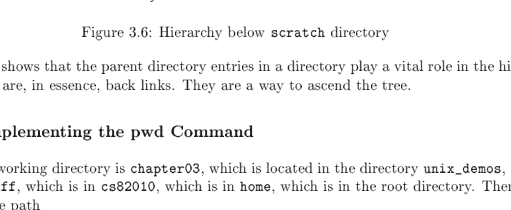

图 3.6：`scratch` 目录下的层次结构

此练习表明，目录中父目录条目在层次结构中发挥着至关重要的作用，因为它们本质上是反向链接。它们是向上攀爬树的一种方式。

### 3.15.1 实现 `pwd` 命令

假设我的工作目录是 `chapter03`，它位于 `unix_demos` 目录中，`unix_demos` 在 `class_stuff` 中，`class_stuff` 在 `cs82010` 中，`cs82010` 在 `home` 中，`home` 在根目录中。那么输入 `pwd` 打印的路径为

```
/home/cs82010/class_stuff/unix_demos/chapter03
```

当然，`pwd` 启动时并不知道它在哪里。它位于一个非常大的树中的某个节点，但它不知道通往它的路径。它可以使用穷举搜索来查找路径，从根目录开始递归搜索每个目录，直到找到一个其 `i-`编号与当前工作目录的 `i-`编号匹配的目录，但这不会是一个很有用的命令。从前面的练习可以清楚地看出，`pwd` 必须倒着工作来构造路径，在此过程中使用目录中的父条目。

### 3.15.2 关于 `pwd`

在继续之前，让我们注意，实际的 `pwd` 命令通常是一个 shell 内建命令，而不是一个单独的程序。确定它是否是内建命令或程序的最简单方法，至少在 Linux 主机上，是输入

```
$ type pwd
```

如果它是 shell 内建命令，回复将会是

```
pwd is a shell builtin
```

如果不是，它将是可执行文件的路径名，例如 `/bin/pwd`。然后你可以使用 `file` 命令来识别文件类型：

```
$ file /bin/pwd
/bin/pwd: ELF 32-bit LSB executable, Intel 80386, version 1 (SYSV), dynamically linked (uses shared libs), for GNU/Linux 2.6.9, stripped
```

这显示了它是什么类型的可执行文件。shell 内建命令很可能只是检索环境变量 `PWD` 的值，该值在工作目录更改时会被更新。shell 将使用内核的 `getcwd()` 系统调用来实现这一点。我们排除了通过调用 `getcwd()` 来解决此问题的可能性；这违背了目标，其效果是编写我们自己的 `getcwd()` 版本。

### 3.15.3 `pwd` 的工作原理

`pwd` 如何构造路径？它没有存储在任何地方。事实上，没有任何目录有关于它所在位置的信息，除了那一个小小的项目——点点条目。目录中的 `..` 总是包含父目录的 `i-`编号，有一个例外：文件系统的根目录没有父目录。如果你列出根目录中的 `i-`编号，你会看到 `.` 和 `..` 有相同的 `i-`编号：

```
$ cd /
$ ls -iaF | grep '\./'
2 ./
2 ../
```

这为打印路径名的迭代解决方案提供了一个停止条件。思路如下：

- 1. 记录当前目录的 `i-`编号，`n`，即 `"."` 的 `i-`编号。
- 2. 更改目录 `chdir()` 到父目录。
- 3. 将父目录的 `i-`编号，即现在是当前目录的 `i-`编号，与 `n` 进行比较。如果父目录的 `i-`编号是 `n`，则停止。否则，找到 `i-`编号为 `n` 的链接的名称，并将该名称附加到当前路径名的左侧，并在其左侧附加一个 `"/"`，然后返回步骤 1。
- 4. 打印当前路径名。

这个算法看起来应该可行。然而，由于我们必须从右端构造字符串到左端，使用递归解决方案更容易。递归从来都不是一种快速的策略，你不应该认为真正的 `pwd` 是递归的，然而，它是创建工作解决方案的一种简单方法。

### 3.15.4 `pwd` 的第一个版本

`pwd.c` 的第一个版本如下，命名为 `pwd1.c`。正如我们很快就会看到的，这个程序不能正确工作。错误只在有限的条件下暴露出来。为了节省空间，列表中省略了一些注释。

**Listing 1. `pwd1.c`**

```c
#include <stdio.h>
#include <string.h>
#include <stdlib.h>
#include <sys/types.h>
#include <sys/stat.h>
#include <dirent.h>
// BUFSIZ is defined in stdio.h: it is the maximum string size
#define MAXPATH BUFSIZ
// print_pwd prints the pwd to the string abs_pathname and
// NULL-terminates it
void print_pwd ( char * abs_pathname );
// print_path prints to str the path from / to the file
// specified by cur_inum.
void print_path ( char* str, ino_t cur_inum );
// inum_to_name puts the filename of the file with i-node inum
// into string buf, at most len chars long and NULL-terminates it.
void inum_to_name(ino_t inum, char * buf, int len );
// get_ino gets the i-node number of file fname, if that fname
// is the name of a file in the current working directory
// Returns 0 if successful, -1 if not.
int get_ino(char * fname, ino_t * inum);
```

```c
int main(int argc, char* argv[])
{
    char path[MAXPATH] = "\0"; // string to store pwd
    print_pwd( path ); // print pwd to string path
    printf("%s\n", path); // print path to stdout
    return 0;
}
```

```c
void print_pwd ( char * pathname )
{
    ino_t inum;
    get_ino(".", &inum );
    print_path(pathname, inum );
}
```

```c
void print_path( char * abs_pathname, ino_t this_inode )
{
    ino_t            parent_inode ;
    char             its_name[BUFSIZ];
    // get inumber of parent
    get_ino("..", &parent_inode );
    // At root iff parent inum == cur inum
    if ( parent_inode != this_inode ) {
        chdir( ".." );   // cd up to parent
        // get filename of current file
        inum_to_name(this_inode, its_name, BUFSIZ);
        // recursively get path to parent directory
        print_path(abs_pathname, parent_inode );
```


```c
strcat(abs_pathname, "/");

strcat(abs_pathname, its_name );

}

else

    strcat( abs_pathname, "/");

}

/**************************************************************/
void inum_to_name(ino_t inode_to_find , char *namebuf,
                   int buflen)
{
    DIR             *dir_ptr;
    struct dirent   *direntp;
    dir_ptr = opendir( "." );
    if ( dir_ptr == NULL ) {
        perror( "." );
        exit(1);
    }
    // search directory for a file with specified inum
    while ( ( direntp = readdir( dir_ptr ) ) != NULL )
        if ( direntp->d_ino == inode_to_find ) {
            strncpy( namebuf, direntp->d_name, buflen);
            namebuf[buflen-1] = '\0';
            closedir( dir_ptr );
            return;
        }
    fprintf(stderr, "\nError looking for i-node number %d\n",
            inode_to_find);
    exit(1);
}

/**************************************************************/
int get_ino( char *fname, ino_t *inum )
{
    struct stat info;
    if ( stat( fname , &info ) == -1 ){
        fprintf(stderr, "Cannot stat ");
        perror(fname);
        return -1;
    }
    *inum = info.st_ino;
    return 0;
}
```

上面列表中的递归函数是 `print_path()` 函数。给定当前工作目录文件 `this_inode` 的 i-编号，它检查父目录的 i-编号是否等于 `this_inode`。如果相等，则停止递归，因为这意味着已到达根目录。在这种情况下，它会在正在构建的路径名中追加一个斜杠 `'/'`。如果不相等，则必须获取当前工作目录的文件名。按照我们上面描述的逻辑，它通过向上移动一级到父目录并在该目录中查找 i-编号来实现这一点。当找到它时，它会检索与 i-编号匹配的名称。

因此，它首先将父目录的 i-编号获取到 `parent_inode` 中。然后它将 `parent_inode` 与 `this_inode` 进行比较，如果不相等，则调用 `chdir("..")` 进入父目录。一旦进入父目录，它会调用 `inum_to_name()` 并传入 `this_inode`。`inum_to_name()` 调用会将 i-编号为 `this_inode` 的目录的实际名称存储到 `its_name` 中。`print_path()` 然后对自身进行递归调用，传入父目录的 i-编号 `parent_inode`，以及正在构建路径名的字符串。在递归调用中，它离文件系统的根更近一步，确保问题规模减小。递归调用之后，我们假设从根向下到父目录的绝对路径名在参数 `abs_pathname` 中，因此我们在 `abs_pathname` 后追加一个斜杠和我们为当前目录找到的文件名 `its_name`，然后返回。如果 `parent_inode == this_inode`，则 `print_path()` 会向 `abs_pathname` 追加一个斜杠。当它这样做时，`abs_pathname` 是空字符串，因此当此程序从根目录内部调用时，它将显示 `"/"`。

获取文件名 i-编号的函数很简单；它使用给定的文件名调用 `stat()` 并返回由 `stat()` 调用填充的 `stat` 结构中的 `st_ino` 成员。`inum_to_name()` 函数稍微复杂一些。它打开当前工作目录并重复读取目录中的条目，直到找到具有给定 i-编号的条目为止。这是对目录的线性搜索。它使用 `readdir()` 调用检索指向 `dirent` 结构的指针并从 `dirent` 结构中取出 `name` 成员。如果它没有找到具有给定 i-编号的条目，它会在标准错误流上打印错误消息。

从各个目录运行该程序，你应该会发现

- 大多数路径名以双斜杠开头而不是单斜杠，并且
- 根目录正确显示为 `/`。

现在尝试从挂载在根文件系统上的文件系统中的目录内运行该程序。你会发现程序要么没有打印完整的绝对路径，要么打印了错误的路径，要么生成了错误

```
Error looking for i-node number n
```

对于某个 `n`。这是因为程序没有考虑到文件系统挂载的方式。为了理解这一点，我们将重新审视挂载的工作原理。

## 3.15.5 多个文件系统：挂载

第 3.3 节介绍了文件系统挂载的概念。在 UNIX 中，与 DOS 或 Windows 不同，所有卷上的所有文件都是单一目录层次结构的一部分；这是通过将一个文件系统挂载到另一个文件系统上实现的。我们到底是什么意思说将一个文件系统挂载到另一个文件系统上呢？为了说明清楚，假设我们有一个根文件系统，其部分结构如图所示 3.7。

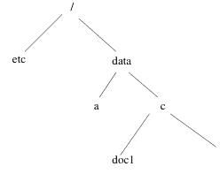

图 3.7：挂载前的根文件系统

它有一个名为 `data` 的子目录，其中包含两个名为 `a` 和 `c` 的子目录。请注意 `c` 不是空的。假设该文件系统位于计算机的一个内部磁盘上，并且假设存在第二个内部磁盘，其中包含其自己的文件系统，如图 3.8 所示。第二个磁盘由一个名为 `/dev/hdb` 的设备特殊文件表示。该第二个磁盘上有一个文件系统，其根目录有两个名为 `staff` 和 `students` 的子目录，而 `students` 具有 `grad` 和 `undergrad` 子目录。为了使该第二个文件系统中的文件对系统用户可用，它必须挂载到一个挂载点上。挂载点是根文件系统中的一个目录，它将被挂载文件系统的根目录所替换。

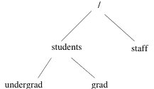

图 3.8：文件系统 `/dev/hdb`

如果目录 `/data/c` 是 `/dev/hdb` 文件系统的挂载点，那么我们说 `/dev/hdb` 挂载在 `/data/c` 上。以下 `mount` 命令将把 `/dev/hdb` 文件系统挂载到 `/data/c` 上。`c` 中已有的文件无关紧要；挂载只是将其隐藏起来，在挂载期间不可见。它们将从视野中消失，直到文件系统被卸载时才会重新出现。

```sh
$ mount /dev/hdb /data/c
```


执行此命令后，根文件系统将如图所示 3.9。

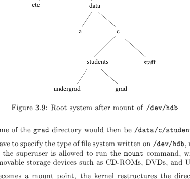

图 3.9：挂载 `/dev/hdb` 后的根系统

此时`grad`目录的绝对路径名将为`/data/c/students/grad`。

实际上，除非它是默认文件系统，否则我们必须指定写入 `/dev/hdb` 的文件系统类型，并且只有超级用户才被允许运行`mount`命令，有少数例外，例如挂载可移动存储设备，如 CD-ROM、DVD 和 USB 设备。

当一个目录成为挂载点时，内核会重构目录层次结构。目录内容不会丢失；它们被挂载文件系统的根目录所掩盖。内核在挂载点列表中记录该文件系统已挂载在此目录上。不同版本的 UNIX 以不同方式实现挂载。本讨论的相关部分是，遍历树的运算可以识别挂载点，因为它们是其父目录文件系统不同的文件系统的根目录。

### 3.15.6 重复的 i-节点编号和跨设备链接

挂载的优点是简化了用户对文件层次结构的概念化和导航。它是一个单一的层次结构。内核必须处理的一个问题是，可能存在许多具有相同 i-编号的文件，因为 i-编号仅在单个文件系统内唯一。事实上，每个文件系统的根目录的 i-编号都是 2，其 “.” 条目也是 2，因此将存在许多 i-编号为 2 的 i-节点。内核能够区分 i-节点，因为 i-节点还以其所在设备的名称而为人所知。在所有现代 UNIX 系统上，i-节点包含一个成员，用于存储其所在设备的名称。这就像给狗挂上狗牌；如果狗走失了，有人可以查看它并知道它来自哪里。 我承认 i-节点不能到处乱跑，但查看 i-节点内存副本的进程可能需要知道它来自哪个设备。因此，i-节点更准确地表示为 (i-编号，设备号) 对。

沿着这一思路继续，假设根文件系统中有一个 i-编号为 52 的文件。假设它有一个名为 `/data/a/doc1` 的硬链接。假设另外，参考上图，`/dev/hdb` 有一个文件 `/students/undergrad/hwkl`，其 i-编号为 52。如果 UNIX 允许通过调用

``` 
link("/data/a/doc1", "/data/c/students/grad/doc1")
```

然后，在调用之后，`/dev/hdb` 文件系统将会有两个链接，每个链接具有相同的 i-编号，但这些 i-编号将指向不同的 i-节点。这将破坏文件系统，除非目录能够同时存储设备号和文件名对应的 i-编号，这将需要重写几乎整个内核。因此，UNIX 系统通常不允许任何人在跨文件系统创建硬链接。所有指向一个文件的硬链接必须位于同一个文件系统中。出于同样的原因，你不能使用 `rename()` 调用将文件跨文件系统移动。`rename()` 调用会在指定的目录中为原始文件创建一个新名称。调用，

``` 
rename( "/data/a/doc1", "/data/c/students/grad/doc1")
```

将导致文件系统对不同的文件有两个链接，但具有相同的 i-编号。

### 3.15.7 `pwd` 的第二个版本

现在可以实现一个正确的 `pwd` 命令，我们称之为 `pwd2.c`。原始程序的问题在于它在向根目录前进的过程中遇到挂载点时会做什么。假设当前工作目录是

``` 
/data/mnt/backups/backup1/current_backup/home/class_stuff
```

并且 `/data/mnt/backups` 实际上是一个挂载点，在其上已挂载文件系统 `/dev/sdc1`。设备 `/dev/sdc1` 是一个外部驱动器，用于按需备份和恢复文件，它有一个顶层目录名为 `/backup1`，其下可以找到目录 `current_backup/home/class_stuff`。

当我们的程序向上遍历树时，最终会到达目录 `backup1`。假设它的 i-编号为 6643。当程序将 `backup1` 设为当前工作目录时，它获取其父目录的 i-编号，该父目录是已挂载文件系统 `/dev/sdc1` 的根，因此 i-编号为 2。

然后它更改目录到该父目录，即 `/data/mnt/backups` 目录，并使用 i-编号 6643 调用 `inum_to_name()`。`inum_to_name()` 在目录 `/data/mnt/backups` 中的目录条目中搜索，找到 6643，并将 `its_name` 设为 `"backup1"`。

然后程序进行下一次递归调用，其中 `this_inode = 2`。当它更改目录到其父目录时，它刚刚跨过了挂载点。在此目录中将不会有 i-编号为 2 的目录条目。虽然 `backups` 在 `/dev/sdc1` 文件系统中作为根具有 i-编号 2，但 `/data/mnt` 的目录没有为其提供 i-编号为 2 的 `dirent` 条目。因此 `inum_to_name()` 将会失败（除非碰巧它为其他名称有一个 i-编号为 2 的条目）；它将遍历整个目录然后报告找不到 i-编号 2。

尽管 `/data/mnt` 中 `backups` 的 `dirent` 条目没有 i-编号 2，但其 i-节点确实具有该 i-编号。这就是为什么，如果我们发出命令

``` 
ls -i /data/mnt
```

我们会看到为 `backups` 显示 i-编号 2，因为 `ls` 调用 `stat()` 来检索 i-节点内容。我们必须做同样的事情。我们做出几项更改使程序正确。

- 1. 我们用函数 `get_deviceid_inode()` 替换 `get_ino()`，该函数获取给定文件名的 i-编号和设备 id。我们在程序启动时调用此函数，以便我们拥有当前工作目录的设备 id，并将其传递给递归函数 `print_path()`。
- 2. 我们更改 `print_path()` 中用于判断是否到达根的测试：当且仅当父 i-编号与子 i-编号匹配并且它们具有相同的设备 id 时，我们才到达根，否则我们尚未到达。
- 3. 我们更改在 `inum_to_name()` 中查找当前目录名称的方式。我们向 `inum_to_name()` 传递当前工作目录的设备 id 和 i-编号。`inum_to_name()` 对当前工作目录中的每个条目调用 `stat()`，尝试将该条目 i-节点中存储的 i-编号和设备 id 与传递给它的 i-编号和设备 id 进行匹配。如果 i-编号和设备与传递给 `inum_to_name()` 的配对匹配，则 `dirent` 结构中的 `d_name` 成员就是当前工作目录的名称，这就是返回给 `print_path()` 的内容。
- 4. 为了解决终止斜杠的问题，该斜杠不应位于路径末尾，我们可以在递归函数中保留一个静态变量来跟踪递归级别。只有在递归调用中，而不是在顶层调用时，才会打印尾随斜杠。

所有这些更改都已纳入 `pwd2.c`，其代码如下所示，见列表 2。

```c
Listing 2. pwd2.c

// same includes as before

#define MAXPATH BUFSIZ

/**********************************************************/

void print_pwd ( char * abs_pathname );

// print_path prints to str the path from / to the file

// specified by cur_inum on the device with device id

// dev_num.

void print_path( char* str , ino_t cur_inum, dev_t dev_num);

// inum_to_name puts the filename of the file with inode inum

// on device with device number dev_num into string buf, at

// most len chars long and 0 terminates it.

void inum_to_name ( ino_t inum, dev_t dev_num,

    char * buf, int len );

// get_dev_ino gets the device id and the inode number of

// file fname, if that fname is the name of a file in the

// current working directory. Returns 0 if success, -1 if not.

int get_deviceid_inode ( const char *fname, dev_t *dev_id,

    ino_t *inum );

strcat(abs_pathname, "/");

height--;

}

else  // must be at root

    strcat(abs_pathname, "/");

}

/*************************************************************/


```c
void ino_to_name(ino_t inode_to_find, dev_t devnum,
                 char *name, int buflen)
{
    DIR             *dir_ptr;
    struct dirent   *direntp;
    struct stat      statbuf;
    if ((NULL == (dir_ptr = opendir(".")))) {
        perror(".");
        exit(1);
    }
    while ((direntp = readdir(dir_ptr)) != NULL) {
        if (-1 == stat(direntp->d_name, &statbuf)) {
            fprintf(stderr, "could not stat");
            perror(direntp->d_name);
            exit(1);
        }
        if ((statbuf.st_ino == inode_to_find) &&
            (statbuf.st_dev == devnum)) {
            strncpy(name, direntp->d_name, buflen);
            name[buflen - 1] = '\0';  // just in case
            closedir(dir_ptr);
            return;
        }
    }
    fprintf(stderr, "Error looking for i-node %d\n",
            inode_to_find);
    exit(1);
}

/*************************************************************/
int get_deviceid_inode(const char *fname, dev_t *dev_id,
                       ino_t *inum)
{
    struct stat info;
    if (stat(fname, &info) == -1) {
        fprintf(stderr, "Cannot stat");
        perror(fname);
        return -1;
    }
    *inum = info.st_ino;
    *dev_id = info.st_dev;
    return 0;
}
```

至此，`pwd` 命令的实现就完成了。

```
$ rm users

rm: remove users (yes/no)? y

$ ls -li

total 4

628 lrwxrwxrwx 1 sweiss student 5 Aug 30 00:22 ulist -> users

614 -rw------- 1 sweiss student 676 Aug 30 00:22 whoson

$ more ulist

ulist: No such file or directory
```

你会看到 `ulist` 仍然指向 `users`，即使该文件已不存在。这并非错误。只有当进程试图访问该文件时，才会出现错误。

#### 3.15.9 与符号链接相关的系统调用

以下系统调用与符号链接的使用相关。

```c
#include <unistd.h>

int symlink(const char *oldpath, const char *newpath);

int readlink(const char *path, char *buf, size_t bufsiz);

int lstat(const char *file_name, struct stat *buf);
```

创建符号链接的系统调用是 `symlink()`。`readlink()` 调用获取符号链接所指向的文件的名称。`lstat()` 调用获取的是作为链接的文件的 `stat` 结构，而不是它所链接到的文件的 `stat` 结构。

### 3.16 树遍历

我们有四种不同的方式可以访问层次结构中给定子树的所有节点：

- 编写自己的递归函数来遍历树；
- 编写非递归函数来遍历树；
- 使用 POSIX 库函数 `nftw()`；
- 使用 4.4BSD API 等系统中可用的 `fts()` 函数。

`grep`、`chmod`、`chown`、`rm`、`cp` 和 `chgrp` 等命令使用 `fts()` 函数来执行其递归树遍历。由 Richard Stallman 和 David MacKenzie 编写的 GNU 版 `ls` 命令使用内部栈和队列来递归遍历树。GNU `find` 命令最初由 Eric Decker 编写，使用相互递归的函数，而 BSD 系统上的版本则使用 `fts()` 函数。在本节中，我们介绍库所提供的函数，首先介绍 POSIX 的 `nftw()` 函数，接着介绍 `fts()`。

#### 3.16.1 `nftw()` 树遍历函数

`nftw()` 取代了较旧的 `ftw()` 函数，后者仍然存在，但已被弃用。其原型如下：

```c
#include <ftw.h>

int nftw(const char *path,
    int (*fn)(const char *, const struct stat *, int, struct FTW *),
    int fd_limit, int flags);
```

`nftw()` 函数递归地遍历以 `path` 为根的目录层次结构。对于层次结构中的每个对象，它都会调用 `fn` 所指向的函数，并向其传递：

- 一个指向以空字符结尾的字符串的指针，其中包含对象的路径名（例如，从遍历根开始的文件路径）；
- 一个指向包含对象信息的 `stat` 结构的指针，该结构的填充方式与调用 `stat()` 或 `lstat()` 获取信息时相同；
- 一个提供关于对象更多信息的整数，其值为以下预定义常量之一：

    - `FTW_D`    该对象是一个目录。
    - `FTW_DNR`  该对象是一个无法读取的目录。不应对其任何后代调用 `fn` 函数。
    - `FTW_DP`   该对象是一个目录，且其子目录已被访问。（当 `flags` 中包含 `FTW_DEPTH` 标志时会出现这种情况。）
    - `FTW_F`    该对象是一个文件。
    - `FTW_NS`   由于缺乏适当的权限，`stat()` 函数对该对象调用失败。传递给 `(*fn)` 的 `stat` 缓冲区是未定义的。因任何其他原因导致的 `stat()` 失败都被视为错误，`nftw()` 将返回 -1。
    - `FTW_SL`   该对象是一个符号链接。（当 `flags` 中包含 `FTW_PHYS` 标志时会出现这种情况。）
    - `FTW_SLN`  该对象是一个不指向现有文件的符号链接。（只有在 `flags` 中不包含 `FTW_PHYS` 标志时才会出现这种情况。）

- 一个指向 `FTW` 结构的指针，其定义如下：

```c
struct FTW {

    int base;

    int level;

};
```


`FTW` 结构提供关于文件名的语法信息，以及关于其在搜索中位置的深度信息。具体来说，`base` 的值是对象文件名在作为第一个参数传递给 `(*fn)` 的路径名中的偏移量。这样可以轻松地从路径名中提取文件名。`level` 的值表示相对于遍历根的深度，其中根的级别为 0。例如，如果文件的路径名是 `documents/pictures/2012/january/nyc`，

在这里，`nyc` 是由调用 `(*fn)` 所处理的文件对象，那么 `base` 就是字符串 `"documents/pictures/2012/january/"` 的长度，而 `level` 则为 4，因为 `nyc` 位于以 `documents` 为根的树中的第 4 层。

`(*fn)` 函数是程序员自定义的函数，`nftw()` 在遍历树时会为每个对象调用它。只要函数具有上述原型，它可以具有任何语义。该函数可以访问 `stat()` 调用返回的信息，以及整数标志中包含的信息。它可以被设计为提取并利用这些信息，但一个很大的问题是，该函数没有钩子来传入用户提供的数据或指针，因此除非变量具有全局作用域，否则无法使用该函数修改任何变量。例如，若要完成一些相对简单的任务，比如计算以给定目录为根的子树中所有对象所占用的总字节数，并在累加完成后打印该值，我们要么在 `(*fn)` 内部使用静态变量并执行后序遍历，仅当返回到根目录时才打印；要么在函数外部以文件作用域声明该变量，并在调用 `nftw()` 的函数中，当调用终止时进行打印。可以预期，程序员在使用此函数时会使用全局变量。当我们查看下面的示例代码时，这一点会变得很清楚。我们将在下文进一步讨论。

`nftw()` 函数本身的第三个参数是一个整数 `fd_limit`，它设置了 `nftw()` 在遍历文件树时应使用的最大文件描述符数量。树的每一层只需要一个描述符。如果 `fd_limit` 小于树的深度，则性能会下降，因为该函数将不得不反复打开和关闭目录。

最后一个参数是一个标志，由以下常量中的零个或多个按位或（bitwise-OR）组成，这些常量控制 `nftw()` 如何处理挂载点和软链接、使用什么作为其当前工作目录，以及它执行的是前序遍历还是后序遍历。具体如下：

`FTW_CHDIR` 如果设置了该标志，`nftw()` 在报告某个目录中的文件时，会将当前工作目录更改为该目录。如果未设置，`nftw()` 不会更改当前工作目录。

`FTW_DEPTH` 如果设置了该标志，`nftw()` 会先报告目录中的所有文件，再报告目录本身。如果未设置，`nftw()` 会在报告目录中的文件之前先报告该目录。

`FTW_MOUNT` 如果设置了该标志，`nftw()` 仅报告与 `path` 位于同一文件系统中的文件。

`FTW_PHYS` 如果设置了该标志，`nftw()` 执行物理遍历，不跟随符号链接。如果未设置，它会跟随符号链接，但不会两次访问任何文件。如果 `FTW_PHYS` 未设置且 `FTW_DEPTH` 已设置，则 `nftw()` 会跟随软链接，但不会报告任何作为自身后代的目录。如果 `FTW_PHYS` 和 `FTW_DEPTH` 都未设置，`nftw()` 会跟随软链接，但不会报告任何作为自身后代的目录的内容。

还有另一个不在上述列表中的标志 `FTW_ACTIONRETVAL`，仅在设置了 `_GNU_SOURCE` 时可用，我们暂时忽略它。

`nftw()` 函数会一直运行，直到以下情况之一首先发生：

- 调用 `(*fn)` 返回非零值，此时 `nftw()` 返回该值；
- 它检测到除 `EACCES` 之外的错误，此时返回 -1 并设置 `errno` 以指示错误；或
- 树已遍历完毕，此时返回 0。

像往常一样，我们将通过一个示例来了解如何使用它。下面的程序显示以其参数为根的树中每个文件的大小和名称。它根据文件在树中的深度对名称进行缩进，并打印所访问所有文件的总字节数。它允许用户通过 `-m` 选项控制是否跨越挂载点，通过 `-d` 选项进行后序遍历而非前序遍历，并且除非提供 `-p` 选项，否则不跟随符号链接。

```
Listing nftwdemo.c

#define _XOPEN_SOURCE 500

#include <ftw.h>

#include <stdio.h>

#include <stdlib.h>

#include <string.h>

#include <stdint.h>

#include <limits.h>

#define TRUE 1

#define FALSE 0

#define MAXDEPTH 20

/* For getopt() we need to use this feature test macro */

#if ( _POSIX_C_SOURCE >= 2 || _XOPEN_SOURCE )

static int display_info(const char *fpath, const struct stat *sb,

    int tflag, struct FTW *ftwbuf)

{

    char blanks[PATH_MAX];

    const char *filename = fpath + ftwbuf->base;

    int width = 4*ftwbuf->level;

    /* fill blanks with a string of 4*level blanks */

    memset(blanks, ' ', width);

    blanks[width] = '\0';

    /* print out blanks then filename (not full path) */

    printf("%s%s", blanks, filename);

    /* Check flags and print a message if need be */

    if ( tflag == FTW_DNR )

        printf("( unreadable directory)");

    else if ( tflag == FTW_SL )

        printf("( symbolic link)");

    else if ( tflag == FTW_SLN )

        printf("( broken symbolic link)");

    else if ( tflag == FTW_NS )

        printf("(stat failed )");

    printf("\n");

    return 0;      /* To tell nftw() to continue */

}

int main(int argc, char *argv[])

{

int flags = 0;

int status;

int ch;

char options[] = ":cdpm";

opterr = 0; /* turn off error messages by getopt() */

while (TRUE) {

    /* call getopt, passing argc and argv and the options string */

    ch = getopt(argc, argv, options);

    /* it returns -1 when it finds no more options */

    if ( -1 == ch )

        break;

    switch ( ch ) {

    case 'c':

        flags |= FTW_CHDIR;

        break;

    case 'd':

        flags |= FTW_DEPTH;

        break;

    case 'p':

        flags |= FTW_PHYS;

        break;

    case 'm':

        flags |= FTW_MOUNT;

        break;

    default:

        fprintf(stderr, "Bad option found.\n");

        return 1;

    }

}

if (optind < argc) {

    while (optind < argc) {

        status = nftw(argv[optind], display_info,

            MAXDEPTH, flags);

        if ( -1 == status ) {

            perror("nftw");

            exit(EXIT_FAILURE);

        }

        else

            optind++;

    }

}

else {
```


```c
status = nftw(".", display_info, MAXDEPTH, flags);

if ( -1 == status ) {

    perror("nftw");

    exit(EXIT_FAILURE);

}

exit(EXIT_SUCCESS);

}
#endif
```

## Notes.

- 主程序允许多个文件名参数。
- `display()`函数使用`memset()`将字符串空白设置为空白的正确数量。
- 为了在不打印前导路径的情况下打印文件名，它从`fpath+ftwbuf->base`开始打印字符串。
- 它还显示有关对象是否为符号链接、是否损坏或其他情况、或不可读目录的信息，或者`stat()`调用在对象上失败的情况。

这是一次热身练习。一般来说，如果任务要求更改必须在对`(*fn)`函数的调用之间保留的状态信息，则`nftw()`使用起来具有挑战性。我们必须使用静态且局部作用域或全局的变量。为了了解问题所在，我们将尝试实现`du`命令的简单版本。

### 3.16.2 The du Command

`du`命令在其最简单的形式下以

```
$ du file file ...
```

调用。`du`命令会估算其所给出的每个文件的磁盘使用情况，如果其中有目录，则会对每个目录递归执行此操作。换句话说，当它接收到目录作为参数时，它会遍历以该目录为根的树，并对访问的每个目录打印其磁盘使用情况。目录的磁盘使用量是目录文件本身所需的使用量加上其树中所有文件的使用量之和。它似乎是使用`nftw()`实现的理想命令候选，也是使用`nftw()`进行实际应用的好练习。

`du`命令有几个选项，但我们将编写一个简单的版本，不接受任何选项。实际的`du`命令默认显示每个文件使用的块总数。我们的版本不会显示块使用量，而是显示实际的字节数。这相当于命令`du -b`。此外，`du`默认不会显示所有文件的使用情况；为此需要`-a`选项。因此，我们将编写相当于命令

```
$ du -ab file file ...
```

`du`命令不应跟随符号链接，否则可能会重复计算文件或计算不在目录参数内的文件。对于这个第一个版本，我们还将禁用跨越挂载点，以便它仅在单个文件系统内测量使用量。提供一个选项使其跨越挂载点很容易。

显然它必须对树进行后序遍历，因为否则当它访问目录时将不会有该目录子项的总使用量。因此，在图 3.10 中，假设以左到右的方式遍历单个节点的子项（由于我们可以按任意顺序绘制它们，我们可以假设它总是从左到右），将被访问的文件将是`srcs`、`cpy`、`bin`、`pics`、`stuff`、`data`、`work`、`ideas`、`projects`、`file2`、`garbage`、`misc`、`A`。从此以后，假设节点的子项总是以左到右的顺序访问是很方便的。

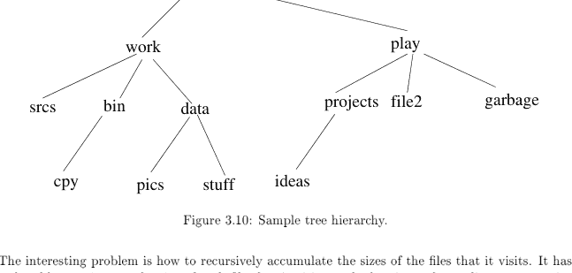

有趣的问题是如何递归地累积它访问的文件的大小。它必须能够打印出它访问的每个文件的大小，并且当它到达一个目录时，打印出该目录的总使用量。因此，在图 3.10 中，当它到达`data`时，它必须打印出`pics`、`stuff`和`data`的大小之和，但它也必须将`srcs`的大小以及`bin`中的当前累积量加到一个运行总数中，以便在到达`work`时向上传递。这表明如果我们保留一个按树中层级索引的运行总数集合，只要我们小心地这样做，记录总大小就应该足够了。

由于在主程序和传递给`nftw()`的函数参数之间共享数据的唯一方法是通过使其变为全局变量，我们将在文件作用域中声明数组

```c
#define MAXDEPTH  50

static uintmax_t totalsize[MAXDEPTH];
```

`uintmax_t`是在`<stdint.h>`中定义的类型。它是机器上可用的最大无符号整数类型。它通常等价于`unsigned long long int`。我们将假设在我们的实现中树的深度永远不会大于 50。该数组必须设为全局，因为主程序最初将其置零，而我们传递给`nftw()`的函数，我们将称其为`file_usage()`，必须能够修改它并访问它。该函数的原型为

```c
int file_usage(const char *fpath, const struct stat *sb,
    int tflag, struct FTW *ftwbuf)
```

在任何时刻，`file_usage()`都会访问树中的特定文件。让我们称之为当前文件，其层级为当前层级，并使用变量`cur_level`来表示它。我们称在当前文件之前处理的那个文件的层级为前一层级，并使用变量`prev_level`来存储该层级。这两者取值最高为`MAXDEPTH`且不会更大。当前文件有一个大小，我们将其存储在变量`cur_size`中。这是实际文件的大小，而不是它可能拥有的任何子项的大小之和。即使是目录也有大小——它们通常被分配一个块（在大多数机器上如今通常为 4096 字节）。我们可以通过传递给函数的`stat`结构获得此值；它就是`sb->st_size`。

`file_usage()`必须采取的动作仅取决于`cur_level`和`prev_level`的值，而与其它无关。这就是我们现在要证明的。以下不变量将在`file_usage()`处理完一个文件后得到维护：

`totalsize[cur_level]`是树中根位于`cur_level`层级且是当前处理节点左侧兄弟的那些子树的大小之和，加上当前节点所根子树的大小。

首先假设`prev_level < cur_level`。这意味着我们刚刚从离树根更近的节点下降而来。在后序遍历期间，这只能以一种方式发生：当我们到达其树中最左侧的叶节点时。对于任何其它节点，前一个节点要么在同一层级，要么在其下方。因此，我们刚刚到达了底部层级，我们必须将`totalsize[cur_level]`设为 0 并将当前文件的大小加到它上面。等价地，

```c
cur_size = sb->st_size;
totalsize[cur_level] = cur_size;
```

请注意，在这种情况下`totalsize[cur_level]`满足不变量。

相反，假设`prev_level == cur_level`。在这种情况下，我们正在访问一个与之前访问的文件是兄弟的文件，并且它不可能是目录，否则前一个节点将处于更低的层级。这意味着我们已经访问了当前文件左侧的所有兄弟，并且它没有子项。因此，我们需要通过将文件大小（即`cur_size`）加到`totalsize[cur_level]`上来更新它：

```c
cur_size = sb->st_size;
totalsize[cur_level] += cur_size;
```

假设进入`file_usage()`之前不变量为真，在这种情况下将`cur_size`加到它上面后不变量仍然为真，因为`cur_size`是以该文件为根的子树的大小。

最后要考虑的情况是`prev_level > cur_level`。这只能意味着一件事——我们在后序遍历中刚刚返回到一个目录，其所有子项都刚刚被访问过。它只能是`prev_level == cur_level+1`，但我们不需要这个事实来完成需要做的事情。这就是大小在层级之间转移发生的地方。首先，我们要为该文件报告的大小不是目录本身的大小，而是目录大小加上传递到其每个子项的树的大小之和。

我们利用关于`totalsize[prev_level]`的不变量。我们知道的是，由于最后处理的节点是当前目录所根子树中最右边的节点，并且其层级为`prev_level`，`totalsize[prev_level]`必须是该目录所有子树的大小之和。因此，为其显示的大小是其自身大小加上`totalsize[prev_level]`：

```c
cur_size  = totalsize[prev_level] + sb->st_size;
```

为了维护不变量，我们将`cur_size`的新值加到`totalsize[cur_level]`上。这样做可以验证它对当前层级仍然成立。最后一步不太明显，需要解释。我们必须将`totalsize[prev_level]`设置为 0。总体而言，此情况下的操作为

```c
cur_size = totalsize[prev_level] + sb->st_size;
totalsize[cur_level] += cur_size;
totalsize[prev_level] = 0;
```


要了解为何必须将 `totalsize[prev_level]` 置零，请考虑 `file_usage()` 退出并为下一个文件调用时将会发生什么。利用图 8.10 中的文件树，假设当前文件是目录 `work`，而 `file_usage()` 刚刚处理了名为 `data` 的目录。`cur_level = 1` 且 `prev_level = 2`。`file_usage()` 接下来要处理的文件是 `ideas`，然后是 `projects`。在它访问 `ideas` 并返回到 `projects` 之后，`totalsize[1]` 必须从值 0 开始，否则 `projects` 的大小将包含 `srcs`、`bin` 和 `data` 的大小。换句话说，每当我们在子树中完成一行兄弟节点，并在到达最右边的兄弟节点后返回到父节点时，我们必须将 `totalsize[]` 数组中该层级的条目置零。唯一的机会是在我们记录了其值到父节点并且完成了该节点时进行。这样做保持了不变量，因为该层级中不再有节点正在被访问。

我们将所有内容汇总在下面的列表中，这是我们简单 `du` 命令的初始版本。我们的命令会在文件名旁边打印一条消息，如果该文件存在问题，例如是损坏的链接或不可读的目录。我们也可以像真正的 `du` 那样将消息打印到标准错误流。注释被省略以减小列表的大小。

### Listing simpledu.c

```c
#define _XOPEN_SOURCE 500

#include <ftw.h>
#include <stdio.h>
#include <stdlib.h>
#include <string.h>
#include <stdint.h>
#include <limits.h>

#define TRUE 1
#define FALSE 0
#define MAXDEPTH 200

/* For getopt() we need to use this feature test macro */
#if ( _POSIX_C_SOURCE >= 2 || _XOPEN_SOURCE )

static uintmax_t totalsize[MAXDEPTH];

int file_usage(const char *fpath, const struct stat *sb,
               int tflag, struct FTW *ftwbuf)
{
    static int prev_level = -1;
    int cur_level;
    uintmax_t cur_size;
    cur_level = ftwbuf->level;

    if ( cur_level >= MAXDEPTH ) {
        fprintf(stderr, "Exceeded maximum depth.\n");
        return -1;
    }
    if ( prev_level == cur_level ) {
        cur_size = sb->st_size;
        totalsize[cur_level] += cur_size;
    }
    else if ( prev_level > cur_level ) {
        cur_size = totalsize[prev_level] + sb->st_size;
        totalsize[cur_level] += cur_size;
        totalsize[prev_level] = 0;
    }
    else {
        cur_size = sb->st_size;
        totalsize[cur_level] = cur_size;
    }

    printf("%ju\t%s", cur_size, fpath);
    prev_level = cur_level;
    if ( tflag == FTW_DNR )
        printf(" (unreadable directory)");
    else if ( tflag == FTW_SL )
        printf(" (symbolic link)");
    else if ( tflag == FTW_SLN )
        printf(" (broken symbolic link)");
    else if ( tflag == FTW_NS )
        printf("stat failed ");
    printf("\n");
    return 0;
}

int main(int argc, char *argv[])
{
    int flags = FTW_DEPTH | FTW_PHYS | FTW_MOUNT;
    int status;
    int i = 1;
    if ( argc < 2 ) {
        memset( totalsize , 0, MAXDEPTH*sizeof(uintmax_t));
        status = nftw(".", file_usage, 20, flags);
        if ( -1 == status ) {
            fprintf(stderr, "nftw exited abnormally.\n");
            exit(EXIT_FAILURE);
        }
    }
    else
        while (i < argc) {
            memset( totalsize , 0, MAXDEPTH*sizeof(uintmax_t));
            status = nftw(argv[i], file_usage, MAXDEPTH, flags);
            if ( -1 == status ) {
                fprintf(stderr, "nftw exited abnormally.\n");
                exit(EXIT_FAILURE);
            }
            else {
                i++;
            }
        }
    exit(EXIT_SUCCESS);
}
#endif
```

如果你运行它并将输出与 `du -ab` 进行比较，你可能会发现它们并不总是相同。但尝试将其与 `du -alb` 的输出进行比较，你会发现它们是相同的。查阅手册页，你会看到 `-l` 选项告诉 `du` 对具有多个链接的文件多次计数大小。问题是什么？

这个版本的 `du` 按原样存在，会将具有多个链接的文件按其链接数多次计数。如果一个文件在根目录的两个不同子目录中有两个名称，每个名称都会被计数。如何防止这种情况？`stat` 结构同时具有文件的 i-号和链接数。我们可以检查非目录文件的链接数。如果它大于一，则它在别处还有另一个名称。我们不知道在哪里，但我们可以将 i-号存储在查找表中，并将其计数设置为链接数-1。每当我们找到一个链接计数大于一的文件时，我们可以在表中查找其 i-号。如果它在那里并且链接计数为正，我们就递减表中的链接计数，并且不将文件大小加到运行总数中，甚至不打印其名称。如果链接计数达到零，我们就将其从表中移除。如果文件不在表中，我们就将其添加到表中，并使用其链接计数。

练习 1. 编写一个 `du` 的实现，该实现不会对具有多个链接的文件多次计数。

练习 2. 编写一个 `du` 的实现，该实现具有选项可按 512 字节块或字节计数。

#### 3.16.3 fts 文件层次遍历函数

与 `nftw()` 不同，`fts` 是一组函数，与 `opendir()`、`readdir()`、`rewinddir()` 和 `closedir()` 相互关联的方式类似，这些函数符合 4.4BSD 但不是 POSIX 函数。`fts` 函数集包括 `fts_open()`、`fts_read()`、`fts_set()`、`fts_children()` 和 `fts_close()`。正如 `opendir()` 创建一个目录流对象并返回指向它的指针一样，`fts_open()` 创建一个句柄，由其他函数使用。句柄是指向 `FTS` 结构的指针。与 `nftw()` 不同，后者不允许应用程序控制文件搜索的顺序，除非是前序或后序，`fts` 允许调用程序指定此顺序。我们首先来看 `fts` 的手册页。概要如下：

```c
#include <sys/types.h>
#include <sys/stat.h>
#include <fts.h>

FTS *fts_open(char * const *path_argv, int options,
    int (*compar)(const FTsent **, const FTsent **));
```

```c
FTSENT *fts_read(FTS *ftsp);
FTSENT *fts_children(FTS *ftsp, int options);
int     fts_set(FTS *ftsp, FTSENT *f, int options);
int     fts_close(FTS *ftsp);
```


使用 `fts` 的范式是，我们首先调用 `fts_open()`，传入表示我们希望遍历的树的根的字符串数组、一个编码选项的整数，以及一个用于确定文件访问顺序的函数。它返回一个句柄，即指向 `FTS` 结构的指针，然后该指针会传递给 `fts_read()`。每次调用 `fts_read()` 时，它都会访问一个文件。树中的每个文件仅被访问一次，除了目录，它们会在其子项之前和之后被访问。`fts_read()` 为其访问的每个文件返回一个指向 `FTSENT` 结构的指针。文件和 `FTSENT` 结构之间是一一对应的。`FTSENT` 结构有一个成员允许它们相互链接；函数 `fts_children()` 返回指向这些结构的链表的指针，表示目录中的所有子项，具体细节将在下面解释。`fts_set()` 函数允许在文件已被 `fts_read()` 调用返回后重新处理该文件。当完全处理完传递给 `fts_open()` 的目录树后，应使用 `fts_close()` 关闭它。

无需了解 `DIR` 结构的内部结构，因为应用程序应将其视为不透明的。然而，我们确实需要了解 `FTSENT` 结构的内容，因为它表征了每个被访问的文件。这两个结构在头文件 `<fts.h>` 中定义，该文件位于标准目录 `/usr/include` 中。它们的定义如下（此处省略了一些宏）：

```c
typedef struct {
    struct _fts ent *fts_cur;        /* current node */
    struct _fts ent *fts_child;      /* linked list of children */
    struct _fts ent **fts_array;     /* sort array */
    dev_t fts_dev;                   /* starting device # */
    char *fts_path;                  /* path for this descent */
    int fts_rfd;                     /* fd for root */
    int fts_pathlen;                 /* sizeof(path) */
    int fts_nitems;                  /* elements in the sort array */
    int (*fts_compar) (const void *, const void *); /* compare fn */
    int fts_options;                 /* fts_open options, global flags */
} FTS;
```

```c
typedef struct _fts ent {
    unsigned short fts_info;         /* flags for FTSENT structure */
    char *fts_accpath;               /* access path */
    char *fts_path;                  /* root path */
    short fts_pathlen;               /* strlen(fts_path) */
    char *fts_name;                  /* filename */
    short fts_namelen;               /* strlen(fts_name) */
    short fts_level;                 /* depth (-1 to N) */
    int fts_errno;                   /* file errno */
    long fts_number;                 /* local numeric value */
    void *fts_pointer;               /* local address value */
    struct fts ent *fts_parent;      /* parent directory */
    struct fts ent *fts_link;        /* next file structure */
```

```c
struct ftsent *fts_cycle;    /* cycle structure */
struct stat  *fts_statp;    /* stat(2) information */
} FTSENT;
```


# `FTSENT` 结构

`FTSENT` 结构有许多成员，要充分使用 `fts` 函数需要理解它们全部，但对于相对简单的应用程序来说，并不需要全部理解。最重要的成员及其简要说明如下：

`fts_info` 编码了此结构所表示的对象类型的整数信息。

`fts_accpath` 从当前目录访问该文件的路径。

`fts_path` 相对于遍历根的文件路径。此路径包含作为前缀传递给 `fts_open()` 的路径。

`fts_name` 文件名。

`fts_errno` 当从 `fts_children()` 或 `fts_read()` 函数返回 `FTSENT` 结构，且其 `fts_info` 字段设置为 `FTS_DNR`、`FTS_ERR` 或 `FTS_NS` 时，`fts_errno` 字段包含外部变量 `errno` 的值，指定错误原因。否则，`fts_errno` 字段的内容未定义。

`fts_number` 该字段供应用程序使用，不会被 `fts` 函数修改。它初始化为 `0`。

`fts_pointer` 该字段供应用程序使用，不会被 `fts` 函数修改。它初始化为 `NULL`。

`fts_parent` 指向引用层次结构中当前文件上方的文件的 `FTSENT` 结构的指针，即此文件所属的目录。初始入口点也提供了父结构，然而，只有 `fts_level`、`fts_number` 和 `fts_pointer` 字段保证被初始化。

`fts_link` 从 `fts_children()` 函数返回时，`fts_link` 字段指向 `NULL` 终止的目录成员链表中的下一个结构。否则，`fts_link` 字段的内容未定义。

`fts_statp` 指向该文件的 `stat` 结构的指针。

## `fts_info` 字段取值

`fts_info` 字段可以具有以下任意值：

`FTS_D` 以预序访问的目录。

`FTS_DC` 导致树中出现循环的目录。 （`FTSENT` 结构的 `fts_cycle` 字段也将被填入。）

`FTS_DEFAULT` 表示文件类型的任何 `FTSENT` 结构，该文件类型未被其他 `fts_info` 值明确描述。

`FTS_DNR` 无法读取的目录。这是错误返回，`fts_errno` 字段将被设置为指示导致错误的原因。

`FTS_DOT` 未指定为 `fts_open()` 的文件名的名为 `"."` 或 `".."` 的文件（请参阅 `FTS_SEEDOT`）。

`FTS_DP` 以后序方式访问的目录。`FTSENT` 结构的内容将保持不变，自其以先序方式返回时起，即 `fts_info` 字段设置为 `FTS_D`。

`FTS_ERR` 这是一个错误返回，`fts_errno` 字段将被设置为指示导致错误的原因。

`FTS_F` 一个普通文件。

`FTS_NS` 一个没有可用 `stat` 信息的文件。`fts_statp` 字段的内容未定义。这是一个错误返回，`fts_errno` 字段将被设置为指示导致错误的原因。

`FTS_NSOK` 一个未请求 `stat` 信息的文件。`fts_statp` 字段的内容未定义。

`FTS_SL` 一个符号链接。

`FTS_SLNONE` 一个目标不存在的符号链接。`fts_statp` 字段的内容引用符号链接本身的文件特征信息。

## 观察与注意事项

从上述信息中可以立即得出的一些观察是：

- `fts_info` 成员具有与 `nftw()` 函数通过 `(*fn)` 函数传递的整数中发现的信息类似的信息。
- 与 `nftw()` 函数不同，`fts` 为应用程序提供了钩子。特别是，`fts_number` 和 `fts_pointer` 是返回结构中的两个成员，可用于应用程序特定数据，从而可以在 `fts_read()` 函数的不同调用之间更改状态和数据。
- `fts_parent` 字段提供了一种访问父节点的方法，而 `nftw()` 则没有。
- 除非 `fts_info` 为 `FTS_NS` 或 `FTS_NSOK`，否则返回的文件的 `stat` 信息位于 `fts_statp` 成员中。
- 文件名位于 `fts_name` 成员中。`fts_path` 成员具有相对于搜索根的文件路径。实际上，这与 `fts_accpath` 相同。

还重要的是要知道，单个缓冲区用于文件层次结构中所有 `FTSENT` 结构的所有各种路径成员。因此，不能保证先前返回的 `FTSENT` 结构的 `fts_path` 和 `fts_accpath` 成员仍然正确以空字符结尾，因为它们可能已经被覆盖。只有 `fts_read()` 最近返回的文件的 `fts_path` 和 `fts_accpath` 成员保证以空字符结尾。要使用这些字段引用其他 `FTSENT` 结构表示的任何文件，需要使用该 `FTSENT` 结构的 `fts_pathlen` 字段中包含的信息修改路径缓冲区。在尝试进一步调用 `fts_read()` 之前，应撤销此类修改。相比之下，`fts_name` 字段始终以空字符结尾。

```
/********************************************************************************/

void usage(char* progname)

{

    printf("usage: %s directory pattern\n", progname);

}

/********************************************************************************/

void pmatch(char *dir, const char *pattern)

{

    FTS *tree;    /* pointer to file tree stream returned by fts_open */

    FTSENT *f;    /* pointer to structure returned by fts_read */

    char *argv[] = { dir, NULL };

    /* Call fts_open() with FTS_LOGICAL to follow symbolic links

     * including links to other directories. Since it detects cycles,

     * we do not have to worry about infinite loops.

     */

    tree = fts_open(argv, FTS_LOGICAL, entcmp);

    if (tree == NULL)

        perror("fts_open");

    /* Repeatedly get next file, skipping "." and ".." because

     * FTS_SEEDOT was not set.

     */

    while ((f = fts_read(tree))) {

        switch (f->fts_info) {

        case FTS_DNR:  /* Cannot read directory */

            fprintf(stderr, "Could not read %s\n", f->fts_path);

            continue;

        case FTS_ERR:  /* Miscellaneous error */

            fprintf(stderr, "Error on %s\n", f->fts_path);

            continue;

        case FTS_NS:   /* stat() error */

            /* Show error, then continue to next files. */

            fprintf(stderr, "Could not stat %s\n", f->fts_path);

            continue;

        case FTS_DP:

            /* Returned to directory for second time as part of

             * post-order visit to directory, so skip it. */

            continue;

        }

        /*

         * Check if the name matches pattern, and if so, print out its

         * path. This check uses FNM_PERIOD, so "*.c" will not

         * match ".invisible.c".

         */

        if (fnmatch(pattern, f->fts_name, FNM_PERIOD) == 0)

            printf("%s\n", f->fts_path);


```
/*
 * A cycle happens when a symbolic link (or perhaps a
 * hard link) puts a directory inside itself. Tell user
 * when this happens.
 */
if (f->fts_info == FTS_DC)
    fprintf(stderr, "%s: cycle in directory tree",
            f->fts_path);
}

/* fts_read() sets errno = 0 unless it has an error. */
if (errno != 0)
    perror("fts_read");

if (fts_close(tree) < 0)
    perror("fts_close");
}
```

主程序做的事情很少；它检查用法，如果用法正确，就调用 `pmatch()`，并传入目录名和要匹配的表达式。

`pmatch()` 首先为调用 `fts_open()` 构造一个合适的第一个参数。第一个参数必须是目录名组成的以 `NULL` 结尾的列表。如果我们只想遍历单个目录，那么我们必须创建一个形如 `{dirname, NULL}` 的列表，其中 `dirname` 是一个以 `NULL` 结尾的字符串。

然后它调用 `fts_open()`，设置 `FTS_LOGICAL` 标志以便它可以跟随符号链接。`fts` 的一个不错的特性是它能够检测到即将因符号链接而完成一个循环，并在这种情况下将返回的结构体的 `fts_info` 成员设置为 `FTS_DC`，以便应用程序可以处理它。传递给 `fts_open()` 的第三个参数是指用于对文件进行排序的比较函数的指针。如果提供 `NULL` 指针，则目录遍历顺序为作为第一个参数传递给根路径的 `argv` 数组中列出的顺序，以及对于其他所有内容，按每个目录中列出的顺序。函数原型必须是

```
int compare(const FTSENT **, const FTSENT **);
```

它必须返回负值、零或正值，以指示其第一个参数引用的文件是在其第二个参数引用的文件之前还是之后。`fts_accpath`、`fts_path` 和 `fts_pathtlen` 成员在该比较中永远不得使用。如果 `fts_info` 成员设置为 `FTS_NS` 或 `FTS_NSOK`，则 `fts_statp` 字段也不能使用。如果 `fts_open()` 失败，它将返回 `NULL` 指针。

在此程序中，文件将按默认的排序顺序排序，这通过使用两个文件名调用 `strcoll()` 实现：

```
int entcmp(const FTSENT **s1, const FTSENT **s2)
{
    return (strcoll((*s1)->fts_name, (*s2)->fts_name));
}
```

获取到 `FTS` 指针 `tree` 后，它使用该指针反复调用 `fts_read()`。对于它访问的每个文件，只要还有文件剩余且未发生错误，`fts_read()` 就会返回指向 `FTSENT` 结构的指针。如果发生错误，它返回 `NULL` 并将 `errno` 设置为某个错误值，如果没有更多文件了，它返回 `NULL` 并将 `errno` 设置为零。程序检查结构体的 `fts_info` 成员以确定是否发生错误，以及如果重要的话，它是目录还是文件。在本例中，文件类型并不重要，只需知道是否发生了某种类型的错误即可。如果没有发生错误，它会调用 `fnmatch()` 库函数，其原型为

```
#include <fnmatch.h>
int fnmatch(const char *pattern, const char *string, int flags);
```

`fnmatch()` 函数检查其字符串参数是否与其模式参数匹配，模式参数必须是有效的 shell 模式，如果匹配则返回零，如果不匹配则返回 `FNM_NOMATCH`，如果有错误则返回其他值。第三个参数可用于传递各种控制其行为的标志。在我们的程序中，我们希望 shell 模式在文件应具有前导句点时明确使用句点字符。例如，模式 `'*.h'` 不应匹配文件 `'.foo.h'`。标志 `FNM_PERIOD` 告诉 `fnmatch()` 仅当该句点是字符串中的第一个字符时才匹配。每个与模式匹配的文件都会打印到标准输出。

当循环终止时，它会检查 `errno` 以查看是否发生了错误，并调用 `fts_close()` 来清理并释放资源。

该程序相对简单。现在我们展示一个稍有意思的 `fts` 应用示例，该示例使用 `fts_children()` 函数和两种不同的树遍历排序方法。

如上所述，`fts_children()` 函数返回指向 `FTSENT` 结构链表的指针，这些结构表示层次结构中单个目录的文件。关键问题是，哪个目录？答案并不简单。如果在调用 `fts_open()` 后从未调用过 `fts_read()`，那么 `fts_children()` 将返回指向传递给 `fts_open()` 的 `argv` 数组中的顶级目录列表的指针。如果在调用 `fts_children()` 之前调用了 `fts_read()` 并且 `fts_read()` 最后一次调用返回的对象是一个目录，那么返回的链表中提供的就是该目录的子项。但如果 `fts_read()` 最后一次调用返回的是一个非目录文件，那么 `fts_children()` 将返回 `NULL` 指针并将 `errno` 设置为零。此返回值与最后一次 `fts_read()` 调用返回的对象为空目录时将执行的操作无法区分。在这种情况下，`fts_children()` 也将返回 `NULL` 指针并将 `errno` 设置为零。因此此最终状态意味着最后的对象要么是空目录，要么是非目录文件。在任何一种情况下它都没有子项。最后，如果出现错误条件，`fts_children()` 将返回 `NULL` 指针但将 `errno` 设置为某个非零值。

为了演示 `fts_children()` 的使用，我们将再次使用它来实现我们的 `ls` 命令，但这次我们将允许用户指定几种不同的文件列表顺序。具体来说，用户可以按排序顺序、最后修改时间或文件大小列出文件，所有情况均为升序。为此，该程序将实现三个不同的 `compare()` 函数；使用哪个函数将取决于用户提供的命令行选项。程序的用法是

```
ls_fts [-l] [-m | -s ] [file file ...]
```

`-m` 选项按修改时间排序，`-s` 按大小排序，`-l` 开启长列表格式。下面的程序清单省略了 `ls` 之前版本中已经展示过的辅助函数，也几乎省略了所有注释。

```
Listing ls_fts.c
#include <sys/types.h>
#include <err.h>
#include <errno.h>
#include <fnmatch.h>
#include <fts.h>
#include <string.h>
#include <stdio.h>
#include <stdlib.h>
#include <unistd.h>
#include <sys/stat.h>
#include <pwd.h>
#include <grp.h>
#include "utils.h"

#define BYTIME 1
#define BYNAME 2
#define BYSIZE 3
#define HERE " "
#define TRUE 1
#define FALSE 0

int entcmp(const FTSENT **a, const FTSENT **b)
{
    return strcoll((*a)->fts_name, (*b)->fts_name);
}

int mtimecmp(const FTSENT **s1, const FTSENT **s2)
{
    return (int) (((*s1)->fts_statp)->st_mtime - ((*s2)->fts_statp)->st_mtime);
}

int szcmp(const FTSENT **s1, const FTSENT **s2)
{
    return (int) (((*s1)->fts_statp)->st_size - ((*s2)->fts_statp)->st_size);
}

void ls ( char dir[], int do_longlisting, int sortflag )
{
    FTS *tree;
    FTSENT *f;
    char *argv[] = { dir, NULL };

    switch ( sortflag ) {
    case BYTIME:
        tree = fts_open(argv, FTS_LOGICAL , mtimecmp);
        break;
    case BYNAME:
        tree = fts_open(argv, FTS_LOGICAL , entcmp);
        break;
```


```c
case BYSIZE:
    tree = fts_open(argv, FTS_LOGICAL, szcmp);
    break;
}

if (tree == NULL)
    perror("fts_open");

f = fts_read(tree);
if ( NULL == f ) {
    perror("fts_read");
    return;
}

f = fts_children(tree, 0);
if ( NULL == f )
    if ( errno != 0 )
        perror("fts_children");
    else
        fprintf(stderr, "empty directory\n");

while ( f != NULL ) {
    switch (f->fts_info) {
    case FTS_DNR:  /* Cannot read directory */
        fprintf(stderr, "Could not read %s\n", f->fts_path);
        continue;
    case FTS_ERR:  /* Miscellaneous error */
        fprintf(stderr, "Error on %s\n", f->fts_path);
        continue;
    case FTS_NS:  /* stat() error */
        fprintf(stderr, "Could not stat %s\n", f->fts_path);
        continue;
    case FTS_DP:
        /* Returned to directory for second time as part of
           post-order visit to directory, so skip it. */
        continue;
    }
    if ( do_longlisting )
        print_file_status(f->fts_name, f->fts_statp);
    else
        printf("%s\n", f->fts_name);

    f = f->fts_link;
}
if (errno != 0)
    perror("fts_read");

if (fts_close(tree) < 0)
    perror("fts_close");
}
```

```c
/*********************  Main Program *********************************/
int main(int argc, char* argv[])
{
    int longlisting = 0;
    int howtosort  = BYNAME;
    int ch;
    char options[] = ":lms";
    opterr = 0;

    while (TRUE) {
        ch = getopt(argc, argv, options);
        if ( -1 == ch )
            break;
        switch ( ch ) {
        case 'l':
            longlisting = 1;
            break;
        case 'm':
            if ( howtosort != BYSIZE )
                howtosort = BYTIME;
            else {
                printf("usage: %s [-l] [-m|-s] [files]\n", argv[0]);
                return 1;
            }
            break;
        case 's':
            if ( howtosort != BYTIME )
                howtosort = BYSIZE;
            else {
                printf("usage: %s [-l] [-m|-s] [files]\n", argv[0]);
                return 1;
            }
            break;

        case '?':
            printf("Illegal option ignored.\n");
            break;
        default:
            printf("??? getopt returned character code 0%o ??\n", ch);
            break;
        }
    }

    if ( optind == argc )    /* no arguments; use . */
        ls( HERE, longlisting, howtosort );
    else
        /* for each command line argument, display file */
        while ( optind < argc ) {
            ls( argv[optind], longlisting, howtosort );
            optind++;
        }
    return 0;
}
```

## 说明

主程序负责解析选项，并阻止用户同时按大小和修改时间排序，因为同时按这两种方式排序意味着必须对 `fts_children()` 返回的链表重新排序。

主程序对每个命令行参数调用一次 `ls()`，而不是把它们组装成一个字符串数组，因为 `ls()` 被设计为只显示单个目录的内容。

`mtimecmp()` 和 `szcmp()` 函数使用算术运算而不是条件判断。这样运行速度更快，但在非 POSIX 系统上，时间相减可能不起作用。两者都通过访问 `FTSENT` 结构的 `fts_statp` 成员所指向的 `stat` 结构来实现。没有检查该成员是否为 `NULL`。

`ls()` 首先调用 `fts_open()`。然后调用 `fts_read()`，以便目录对象成为由 `fts_read()` 调用最后读取到的对象，从而确保如果目录非空，`fts_children()` 将返回指向该目录子项列表的指针。

与之前的程序不同，这个程序不会反复调用 `fts_read()`。它遍历 `FTSENT` 结构组成的链表，直到到达一个 `NULL` 链接，然后结束。

以上只是对 `fts` 函数的简要概述。它没有展示如何使用 `FTSENT` 结构内部提供给应用程序的钩子。

## 练习

一个不错的练习是使用 `fts` 实现 `du` 命令，利用 `FTSENT` 结构中可供应用程序使用的成员以及父指针。

## 附录 A

### A.1 ls 的常用命令行选项

下面列出了 `ls` 的一些最常用的命令行选项，并附有简要说明。

| 选项 | 描述 |
| --- | --- |
| `-a` | 显示点文件（即隐藏文件） |
| `-l` | 显示长列表，包含文件类型、权限、链接数、所有者、组、字节大小、最后修改时间 |
| `-lu` | 与 `ls -l` 相同，但使用文件的最后访问时间而不是修改时间 |
| `-s` | 以块为单位显示文件大小 |
| `-t` | 按指定的时间戳对文件进行排序（u 表示访问时间，默认为修改时间） |
| `-F` | 显示文件类型 |
| `-i` | 显示文件的 i 节点编号 |
| `-d` | 如果 `ls` 的参数是目录，则显示目录本身的属性，而不是其内容 |
| `-R` | 递归进入任何目录或其子目录，并应用列出的其他选项 |

如您所见，其中几个选项在文件系统中搜索内容时非常有用。“点文件”并不是装满点的文件，而是名称以点开头的文件，例如 `.bashrc`、`.login` 或 `.evolution`。第一个读作“点-bash-R-C”，第二个读作“点-login”。点文件被视为隐藏文件，因为普通的 `ls` 命令不会显示名称以点开头的文件，而 `ls` 是查看目录内容唯一用到的命令。即使在桌面环境中，像 `Nautilus` 这样的浏览器的默认设置也会隐藏这些文件。在您的主目录中，如果输入 `ls -a`，您将看到所有名称以点开头的文件和目录。在此列表中，您会看到 `.` 和 `..`。请记住，这两个分别指目录本身及其父目录。请注意，与 Windows 不同，UNIX 内核没有隐藏文件的概念。

#### A.1.1 位掩码


假设我们要提取名为 `flags` 的某个 16 位数字中第 8 位的值。如果我们将 `flags` 与一个除第 8 位外其他位均为 0 的二进制数（此处称为 `mask8`）进行按位与运算，如下所示：

| 0 | 0 | 0 | 0 | 0 | 0 | 0 | 1 | 0 | 0 | 0 | 0 | 0 | 0 | 0 | 0 | `mask8` |

| b15 | b14 | b13 | b12 | b11 | b10 | b9 | b8 | b7 | b6 | b5 | b4 | b3 | b2 | b1 | b0 | `flags` |

| 0 | 0 | 0 | 0 | 0 | 0 | 0 | b8 | 0 | 0 | 0 | 0 | 0 | 0 | 0 | 0 | `mask8 & flags` |

那么结果 `mask8 & flags` 的其他位都将为 0，而第 8 位将是 `flags` 第 8 位的值。因此，当且仅当 `flags` 的第 8 位为 0 时，`mask8 & flags == 0`。我可以将这个 16 位掩码变量的值表示为八进制数 `000400`。在 C 和 C++ 中，八进制数必须以 0 开头，因此应写作 `000400`，按位与运算在程序中写作

```
flags & 0000400
```

然后我们可以检测该位并根据结果采取相应操作，例如使用如下代码：

```
if (flags & 0000400 ) ...
```

### A.2 find 命令

除了前几章中看到的可以递归遍历文件层次结构的命令外，还有几个 UNIX 命令被设计为在给定目录下遍历整个目录树，而无需指定任何特殊的递归选项。其中最有用的就是 `find` 命令。`du` 命令也可以做到这一点：

| 命令 | 描述 |

|---|---|

| `find` | 在给定目录为根的树结构中搜索文件。 |

| `du` | 显示给定目录树中所有文件的磁盘使用情况 |

`find` 命令是一个非常强大的命令，它的基本用法是

```
find [选项] 路径 ... 表达式
```

其中 `路径 ...` 表示一个或多个目录，`表达式` 由选项、测试和操作通过各种运算符组合而成。除非表达式使用 `-prune` 选项明确地剪除目录树，否则将以每个目录参数为根遍历整棵树。选项是始终返回 true 的表达式。操作是可以返回 true 或 false 的表达式。组合表达式的运算符有布尔运算符 `and`、`or`、`not`，以及列表运算符。如果表达式之间没有运算符，则默认使用 `and` 运算符。通过一些示例最能说明 `find` 的用法。

```
$ find . -name '*.c' -print
```

搜索以‘.’为根的树中所有匹配模式 `*.c` 的文件，并打印匹配的路径名。`-print` 操作可以省略，因为 `-print` 是默认操作。如果文件与给定模式匹配，`-name` 测试将返回 true。当测试为 true 时，将应用下一个操作，这正是文件名被打印出来的方式。

```
$ find . -amin -30
```

搜索以‘.’为根的树中在过去 30 分钟内被访问过的所有文件并打印它们。

```
$ find . -mmin -120
```

搜索以 ‘.’ 为根的文件树中在过去 120 分钟内被修改过的所有文件并打印它们。

```
find / -links +1 ! -type d
```

遍历整个文件系统查找链接数大于 1 且不是目录（`! -type d`）的所有文件。

```
find . -samefile myfile
```

搜索所有与 `myfile` 硬链接的文件

```
find / -name core -exec /bin/rm -f '{}' \;
```

在文件层级中搜索所有名为 `core` 的文件并对每个文件运行 `/bin/rm -f`，从而删除它们。记号 `{}` 表示当前匹配的文件名。为了防止大括号被 shell 解释，它们被单引号包围。`find` 运行的命令必须以分号终止，但同样必须转义，以免 shell 将其解释为 `find` 命令本身的结束。我们可以写 `\;` 或 `';'`。

```
find . -perm /o=w
```

查找当前目录及其下其他用户可写的所有文件。

这只是可能使用的搜索选项中的一小部分。还有用于测试文件大小、检查所有权、权限、组所有权、比较两个文件等的选项。学习如何使用此命令非常值得。

## 第 4 章 磁盘和终端 I/O 的控制

## 涵盖的概念

文件结构表、打开文件表、文件状态标志、自动追加、设备文件、终端设备、设备驱动程序、线路规程、`termios` 结构、终端设置、规范模式、非规范模式、`IOCTLs`、`fcntl`、`ttyname`、`isatty`、`ctermid`、`getlogin`、`gethostname`、`tcgetattr`、`tcsetattr`、`tcflush`、`tcdrain`、`ioctl`、

### 4.1 概述

本章首先探讨程序如何对与磁盘文件建立的连接进行一定程度的控制。它描述了内核用于管理打开文件的數據结构，并解释了进程如何与这些文件交互。然后它探讨设备文件及其使用方式和结构，以及设备驱动程序及其角色和结构。从那里它查看块设备和字符设备文件之间的差异，之后转向终端。本章的其余部分专门用于控制终端。

### 4.2 打开文件

我们迄今为止研究的程序操作的是磁盘文件，即当然驻留在磁盘上的文件¹。你现在已经非常熟悉文件 I/O 的一般模型：打开文件、访问它，然后关闭它。请记住，此模型适用于任何类型的文件，而不仅仅是磁盘文件。这里，我们只对磁盘文件感兴趣。

在此文件 I/O 模型中，打开文件会返回一个可用于访问文件（用于读取或写入）的对象的引用。当你使用 `open()` 系统调用时，会返回一个文件描述符；当你使用 `fopen()` C 标准 I/O 库调用时，会返回一个 `FILE` 指针。无论哪种方式，你都获得了一个标量对象（即一个小整数或指针），它与一个隐藏的（内核）数据结构相关联，该结构允许你访问文件。在这里，我们将探讨程序可以对程序与文件之间的连接方式施加多少控制。

当进程使用 `open()` 系统调用打开磁盘文件时，内核会创建一个表示进程与文件之间连接的数据结构。返回的文件描述符可由进程用于访问文件。文件描述符只是内核用于定位该特定数据结构的每个进程表²中的一个索引。不同版本的 UNIX 对此数据结构有不同的称呼，并且数据结构在不同 UNIX 变体之间可能有略微不同的成员，但该结构的基本成员和目的是不变的：其最重要的成员是文件指针，其目的是存储下一次操作将发生的文件位置（无论是读取还是写入。）

> 1 这与设备文件形成对比，设备文件与磁盘文件非常不同。
> 2 “每个进程”表是指每个进程都有自己实例的表。

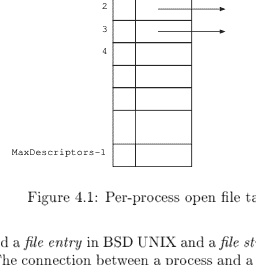

## Figure 4.1: Per-process open file table

该数据结构在 BSD UNIX 中称为文件项，在 Linux 中称为文件结构。我将在这些笔记中称其为文件结构。进程与文件之间的连接完全由文件结构中包含的信息所表征。除了文件指针之外，它通常包含的信息种类包括：

- 文件是打开用于读取、写入、读写还是追加，
- I/O 是缓冲还是非缓冲，以及
- 访问是独占的还是其他进程也访问该文件。

以及内核所需的其他信息。文件结构中包含的信息表征了打开文件与进程之间的连接；它特定于此单一连接。其他进程可能以不同的属性打开此文件。连接的许多属性都可以由进程更改；其他则不能。哪些可以、哪些不可以，以及如何操作？这些是我们将要回答的问题。

让我们开始检查与打开文件相关的所有数据结构。每个进程都有一个通常称为打开文件表的表。 （在 4.4BSD 中，该表称为描述符表，每个条目称为 `filedesc` 结构。）在 Linux 中，该表是 `fd` 数组，它是 `files_struct` 较大结构的一部分。`open()` 系统调用返回的文件描述符实际上是调用进程的打开文件表中的一个索引。请回忆，每个进程在创建时都会获得三个文件描述符：0、1 和 2，分别用于标准输入、输出和错误。这些是该表中的前三个索引，如图 4.1 所示

当进程发出 `open()` 系统调用时，内核会创建一个新的文件结构，并在进程的打开文件表中最低编号的可用槽位中填入指向该文件结构的指针。所有打开文件的文件结构都包含在称为文件结构表中，该表驻留在内核的地址空间中。见图 4.2

图左侧包含每个进程的按进程打开文件表。这些表虽然在进程的虚拟地址空间中，但只能由内核访问。表的右侧包含位于内核内存中的文件结构表。底部的灰色区域在磁盘上；灰色区域以上的一切都是内存驻留的。你将在图中注意到

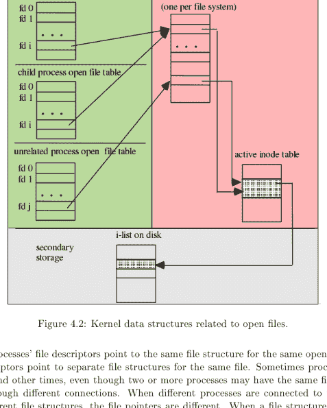

某些进程的文件描述符指向同一打开文件的同一文件结构，而其他进程的文件描述符则指向同一文件的不同文件结构。有时进程共享一个连接，而其他时候，即使两个或多个进程打开了同一个文件，它们也是通过不同的连接访问它。当不同进程通过不同的文件结构连接到同一文件时，文件指针是不同的。当文件结构被进程共享时，它们共享文件指针。你将在进程管理章节中看到这些情况是如何产生的。


文件结构表中的文件结构指向打开文件的活动 i-节点。这些 i-节点在内核内存中的活动 i-节点表中维护。活动 i-节点表包含磁盘上 i-节点的副本。如果内存中的 i-节点发生变化，则更改会写入磁盘上的 i-节点。

## 4.2.1 Using `fcntl()` to Control File Descriptor Attributes

文件结构包含一组控制与文件相关的 I/O 的标志。这些标志称为文件状态标志，并且由共享该文件结构的全部进程共享。文件描述符是进程修改这些标志并改变该文件连接行为的手段。修改现有文件结构的标志的方法是一个三步过程：

1. 进程从内核获取连接的当前属性的副本，将其存储在其自己的地址空间中；
2. 进程在其副本中修改当前属性；
3. 进程请求内核将其副本写回内核的内存结构中。

执行步骤 1 和 3 的系统调用是 `fcntl()` 调用。你可以将 `fcntl` 发音为“f control”，即 file control 的缩写。`fcntl()` 是一个操作打开文件的函数。根据其参数，`fcntl()` 将获取文件连接的属性或设置它们。它的手册页非常长，以下列开头：

```
NAME
    fcntl - manipulate file descriptor
SYNOPSIS
    #include <unistd.h>
    #include <fcntl.h>

    int fcntl(int fd, int cmd, ... /* arg */ );

DESCRIPTION
    fcntl performs one of various miscellaneous operations
    on fd. The operation in question is determined by cmd.
    ...
```

### Remarks

- 第一个参数是已打开文件的文件描述符。
- 第二个参数是 `fcntl()` 解释为命令的整数。这些整数的名称在 `<fcntl.h>` 中定义；与获取或设置文件状态标志相关的是：
  - `F_GETFL` 告诉 `fcntl()` 返回标志集的副本；
  - `F_SETFL` 告诉 `fcntl()` 期望一个第三个整数参数，其中包含要替换当前标志集的新标志集。

`fcntl()` 可以执行的其他一些命令包括：

- `F_DUPFD` 用于复制现有文件描述符
- `F_GETFD`, `F_SETFD` 用于获取和设置文件描述符标志（见下文）
- `F_GETOWN`, `F_SETOWN` 用于获取和设置 `SIGIO` 信号的所有权（见下文）
- `F_GETSIG`, `F_SETSIG` 用于获取和设置在使用异步 I/O 时发送的信号
- `F_GETLK`, `F_SETLK`, `F_SETLKW` 用于获取、释放以及测试记录锁是否存在。

每个控制标志都是长整型中的一个单独位。要打开一个属性，需要设置该位。要关闭它，需要将其置零。`<fcntl.h>` 头文件包含可用于此目的的掩码定义。要设置一位，可以将特定掩码与标志变量进行按位或运算；要取消设置，可以将掩码的补码与控制标志变量进行按位与运算。掩码定义在 `/usr/include/bits/fcntl.h` 中，该文件包含在 `<fcntl.h>` 头文件中。它们也在 `<fcntl.h>` 的手册页中定义。

文件状态标志驻留在文件结构中，该结构可能由多个进程共享。文件描述符标志是进程打开文件表条目的组成部分，并与实际文件描述符相关联。目前只有一个这样的标志，`FD_CLOEXEC`，即 close-on-exec 标志。该标志与本章涵盖的内容无关。`F_GETOWN` 和 `F_SETOWN` 命令将在我们介绍异步 I/O 时进行解释，目前我们忽略它们。

同样，与记录锁定相关的命令（`F_GETLK`, `F_SETLK`, `F_SETLKW`）将在我们转向文件共享主题时进行介绍。

并非所有文件状态标志都可以在文件打开后更改。例如，如果文件使用 `O_WRONLY` 标志以写入方式打开，则不能使用 `fcntl()` 将其访问模式更改为读取。在文件已经打开后可以更改的标志是文件状态标志的一个子集。其中最重要的是它们以及它们的助记掩码：

- `O_APPEND`：追加模式。在每次 `write()` 操作之前，文件指针被定位到文件末尾，就像使用 `lseek()` 一样，原子性地进行。这在远程挂载的文件系统上可能无法工作。设置 `O_APPEND` 是为了消除竞争条件。
- `O_ASYNC`：异步写入。当在此文件描述符上可以进行输入或输出时生成信号。此功能仅适用于终端、伪终端和套接字，不适用于磁盘文件！
- `O_NONBLOCK` 或 `O_NDELAY`：非阻塞模式。对文件描述符的后续操作不会导致调用进程等待。这严格适用于 FIFO（也称为命名管道），并且可能对 FIFO 以外的文件没有任何影响。POSIX 指定掩码 `O_NONBLOCK`，但某些系统期望使用 `O_NDELAY`。许多系统会修补其头文件使它们相同。在 Linux 中 `O_NONBLOCK` 可能不等同于 `O_NDELAY`。请查阅您系统的手册页。
- `O_SYNC`：同步 I/O。对文件描述符的任何写入都会阻塞调用进程，直到数据已物理写入底层硬件。在 Linux 中，此属性通常不能通过 `fcntl()` 修改，并且可能已实现也可能未实现。

从上述描述中，你可以看到，在 Linux 中，对于磁盘文件，我们实际上能通过 `fcntl()` 做的事情很少。`O_ASYNC` 标志在我们研究终端连接时将很重要。`O_NONBLOCK` 标志通常没有效果。`O_APPEND` 标志很有用，这是我们将要探索的一个。`O_SYNC` 标志打开同步写入。同步写入是指进程被阻塞直到数据实际写入设备，而不是写入内核缓冲区。换句话说，它关闭了此连接的内核缓冲。进程想要这样做的理由很少，因为它会显著减慢其执行速度。如果进程想要强制磁盘写入，它始终可以定期使用 `fsync()`。

请记住，为了修改文件描述符标志或文件状态标志，你不能仅仅通过 `fcntl()` 发出 `F_SETFD` 或 `F_SETFL` 命令，因为这可能会关闭之前设置的标志位。相反，你必须遵循上面概述的三步程序。设置诸如 `O_APPEND` 之类的标志的典型代码序列，假设 `fd` 是以写入方式打开的文件的文件描述符，是

```
int flags, result;
flags = fcntl(fd, F_GETFL);
flags |= (O_APPEND);
result = fcntl(fd, F_SETFL, flags);
if ( -1 == result )
    perror("Error setting O_APPEND")
return 0;
```

请注意，掩码是与标志变量进行按位或运算的。要关闭一位，你将掩码的补码与标志进行按位与运算，如序列所示：

```
int flags, result;
flags = fcntl(fd, F_GETFL);
flags &= ~(O_APPEND);
result = fcntl(fd, F_SETFL, flags);
if ( -1 == result )
    perror("Error unsetting O_APPEND");
return 0;
```

尽管我们在 Linux 中对磁盘文件可以设置的标志有限，但我们可以使用 `fcntl()` 检查所有标志的值。下面的函数演示了如何检查各种标志的状态。该函数需要包含 `<fcntl.h>` 头文件。宏 `O_ACCMODE` 是一个可用于检查 `O_WRONLY`、`O_RDONLY` 或 `O_RDWR` 中哪一个被设置了的掩码。这些值存储在 `fcntl()` 返回的整数标志集中低两位中，并在下面定义。这些不是独立的位，这就是为什么你需要两位掩码。

```
#define O_ACCMODE 0003
#define O_RDONLY 00
#define O_WRONLY 01
#define O_RDWR 02
```

我们将这些想法放在一个名为 `check_file_status()` 的函数中，该函数在给定打开文件的文件描述符时，打印其访问模式以及在此描述符上设置了哪些状态标志。


```c
int check_file_status ( int fd )
{
    int flags = fcntl ( fd, F_GETFL );
    if ( -1 === flags ) {
        perror ( "Could not get flags." );
        return ( -1 );
    }

    switch ( flags & O_ACCMODE ) {
    case O_WRONLY:
        printf("write-only\n");
        break;
    case O_RDONLY:
        printf("read-only\n");
        break;
    case O_RDWR:
        printf("read-write\n");
        break;
    }

    if ( flags & O_CREAT )      printf("O_CREAT flag is set\n");
    if ( flags & O_EXCL )       printf("O_EXCL flag is set\n");
    if ( flags & O_NOCTTY )     printf("O_NOCTTY flag is set\n");
    if ( flags & O_TRUNC )      printf("O_TRUNC flag is set\n");
    if ( flags & O_APPEND )     printf("O_APPEND flag is set\n");
    if ( flags & O_NONBLOCK )   printf("O_NONBLOCK flag is set\n");
    if ( flags & O_NDELAY )     printf("O_NDELAY flag is set\n");
#if defined(O_SYNC)
    if ( flags & O_SYNC )       printf("O_SYNC flag is set\n");
#endif
#if defined(O_FSYNC)
    if ( flags & O_FSYNC )      printf("O_FSYNC flag is set\n");
#endif
    if ( flags & O_ASYNC )      printf("O_ASYNC flag is set\n");
    printf("\n");
    return 0;
}
```

由于 `O_SYNC` 和 `O_FSYNC` 不一定在所有 UNIX 系统上都已定义，因此对这些标志的测试会进行条件编译。你可以将此函数嵌入到一个主程序中，例如：

```c
int main(int argc, char *argv[])
{
    int flags, fd;

    if ( argc != 2 ) {
        printf("usage: %s <descriptor#>\n", argv[0]);
        exit(1);
    }
    if ( ( fd = atoi(argv[1])) < 0 ) {
        printf("usage: %s <descriptor#>\n", argv[0]);
        exit(1);
    }
    check_file_status(fd);
    return 0;
}
```

然后运行程序，重定向标准输入、输出和错误。在此过程中，你会发现一些令人惊讶的结果。例如，如果上述程序名为 `checkstatus`，请尝试预测以下命令的输出：

```
$ ./checkstatus 1 > out1
$ cat out1
```

以及：

```
$ ./checkstatus 0
$ ./checkstatus 2 2>errs
```

关键在于确定：当输入或输出被重定向时，标准输入、输出和错误这三个标准设备的状态标志是如何改变的。

### 4.2.2 追加与竞态条件

`O_APPEND` 标志控制追加模式。考虑以下问题：一个共享的日志文件用于记录各种系统活动。多个不同进程中的每一个都会将自己的条目追加到日志文件的末尾，以记录其活动。

让我们具体说明。回想一下，UNIX 使用 **utmp** 文件来记录每一次登录和登出。每次登录发生时，都必须在该文件的末尾记录一条信息。当 UNIX 启动时，`init()` 会为每个终端创建一个 `getty()` 进程，或者在网络登录的情况下创建其他类似的进程；当用户在终端登录时，`getty()` 或其他类似进程会为该终端生成一个 `login()` 进程。因此，任何时候都可能存在多个 `login()` 进程。假设两个用户在同一时刻从不同终端登录。这两个 `login()` 进程都需要在表的末尾添加一个条目。要向文件末尾添加条目，必须使用 `O_WRONLY` 以写入方式打开文件，或使用 `O_RDWR` 以读写方式打开文件。因此，需要向文件末尾添加记录的进程必须执行以下步骤：

- 1. 以读写模式打开文件。
- 2. 将文件指针定位到文件末尾。
- 3. 在 seek 所获得的位置写入一条登录记录。

就系统调用而言，这大致如下所示：

```c
fd = open(_PATH_WTMP, O_RDWR);
// error check the open() and if successful then
// create the wtmp record to write ... and then
lseek(fd, 0, SEEK_END);
write(fd, &record, len);
```

`lseek()` 调用获取该文件的文件指针，并在调用时将其设置为文件的末尾。该指针存储在该进程与该文件连接的文件结构中。当进程调用 `write()` 时，数据将写入该文件指针所指向的位置。

现在设想两个不同的进程（这里称为 `login1` 和 `login2`）同时独立地执行这同一指令序列。为简单起见，假设它们运行在一台单处理器机器上，并且按时间片轮转使用处理器。特别地，假设处理器执行以下指令序列。最左边的整数表示某个固定时间单位下的当前时间。`login1` 执行左列中的指令，`login2` 执行右列中的指令。

| 时间 | login1 | login2 |
|------|--------|--------|
| 0 | fd = open(_PATH_WTMP, O_WRONLY); | |
| 1 | ... | |
| 5 | lseek(fd, 0 SEEK_END); | |
| 6 | | fd = open(_PATH_WTMP, O_WRONLY); |
| 7 | | ... |
| 10 | | lseek(fd, 0 SEEK_END); |
| 11 | | write(fd, &record, len); |
| 12 | write(fd, &record, len); | |

`login1` 在时间 5 设置了文件指针。它被从 CPU 上移除，`login2` 在时间 10 将文件指针设置为与 `login1` 相同的位置。它在时间 11 写入文件。然后 `login1` 写入相同的位置，覆盖了 `login2` 刚刚写入的数据；`login1` 写入的记录替换了 `login2` 刚刚写入的记录。这是竞态条件的一个经典例子。

竞态条件通过使用某种机制来消除，该机制允许一个指令序列作为原子操作执行。这简单来说就是：一旦第一条指令开始执行，在最后一条指令完成之前，没有其他进程可以执行任何访问共享数据的指令。UNIX 通过为写连接提供可选的自动追加模式来解决这个特定问题。当启用自动追加模式（`O_APPEND`）时，每次写操作之前都会立即执行一次原子性的 seek 操作，将文件指针定位到文件末尾。这保证了无论同时有多少其他进程试图做同样的事情，每次写入都发生在文件末尾。因此，登录和登出进程只需要以自动追加模式打开文件，或者在文件打开后使用 `fcntl()` 启用该模式。前面的代码将简化为以下形式：

```c
fd = open(_PATH_WTMP, O_WRONLY | O_APPEND);
// create the record to write ...
write(fd, &record, len);
```

### 4.2.3 打开文件时控制连接

与其使用 `fcntl()` 来调整对已打开文件的连接的属性，不如在第一次打开文件时就使用所需属性打开文件。这些属性可以通过在 `open()` 系统调用的第二个参数中进行按位或运算作为参数传递。例如，要以写-only、自动追加和同步 I/O 位设置的方式打开名为 `foobar` 的文件，你会写

```
fd = open("foobar", O_WRONLY | O_APPEND | O_SYNC);
```


你可以阅读`open()`手册页或`<fcntl.h>`头文件以获取可在`open()`调用中设置的标志列表。文件必须以只读、写-only 或读写之一打开。因此，按位或运算必须始终包含`O_RDONLY`、`O_WRONLY`或`O_RDWR`中的恰好一个。其他标志可以按位或到它。哪些标志合适取决于打开的模式。一般来说，标志分为两类：文件创建标志和文件状态标志。

文件创建标志是`O_NOCTTY`、`O_TRUNC`、`O_CREAT`和`O_EXCL`。这些仅在文件以允许写入的模式打开时才相关，即写-only 或读写。理解`O_NOCTTY`标志需要更多关于终端和进程的知识；这将在进程章节中解释。其余三个的语义值得讨论。

`O_CREAT`：当未设置任何标志时，如果为写入打开一个文件且该文件不存在，`open()`将返回`-1`并失败。`O_CREAT`标志可防止失败：当它被设置时，如果为写入打开一个文件且该文件不存在，`open()`将创建它。文件的拥有者由进程的有效用户 ID 决定，文件的模式将是`open()`调用中指定的模式，并应用`umask`。如果文件已存在，此标志无效，意味着文件将以文件指针设置为文件开头的方式打开。

`O_EXCL`：此标志旨在与`O_CREAT`标志一起使用。如果仅使用`O_CREAT`标志为写入打开一个文件，并且文件已存在，则文件的内容可能会被覆盖，具体取决于写入发生的位置。为防止这种可能性，可以将`O_EXCL`按位或到标志集中。当同时设置`O_CREAT`和`O_EXCL`时，如果文件存在，打开操作将失败。相比之下，如果文件不存在，它将被创建，就像`O_EXCL`未设置一样。如果在没有`O_CREAT`的情况下使用此标志，结果与未设置任何标志时相同。

`O_TRUNC`：如果未设置此标志，当为写入打开一个已存在的文件时，文件的内容不一定会被销毁；这取决于是否设置了`O_APPEND`以及进程在写入前是否定位到文件中的特定位置。如果程序只是为写入打开一个文件并开始写入而不定位也不追加，文件内容将被替换，但为写入打开不会自动将文件内容清零。`O_TRUNC`标志的目的是在任何写入之前强制将文件清零。当它被设置，并且`open()`允许写入且文件存在时，文件将被截断为零长度。此标志只有在所有这些条件都为真时才有效。如果文件不是普通文件，此标志也无效。如果同时设置`O_TRUNC`、`O_EXCL`和`O_CREAT`，`O_EXCL`将覆盖它——如果文件存在，`open()`将失败，如果文件不存在，它将被创建。

下表总结了使用以下调用以写入方式打开文件时，这三个标志的可能组合的效果：

``` 
open( "file", O_WRONLY | flags );
```

| `flags` | 如果文件存在 | 如果文件不存在 |
|---|---|---|
| `0` | 以写入方式打开并将指针设置为第一个字节 | 失败 |
| `O_CREAT` | 以写入方式打开并将指针设置为第一个字节 | 创建 `"file"` |
| `O_EXCL` | 以写入方式打开并将指针设置为第一个字节 | 失败 |
| `O_TRUNC` | 以写入方式打开并将其内容清零 | 失败 |
| `O_CREAT` \| `O_EXCL` | 失败 | 创建 `"file"` |
| `O_CREAT` \| `O_TRUNC` | 以写入方式打开并将其内容清零 | 创建 `"file"` |
| `O_TRUNC` \| `O_EXCL` | 以写入方式打开并将其内容清零 | 失败 |
| `O_CREAT` \| `O_TRUNC` \| `O_EXCL` | 失败 | 创建 `"file"` |

第 5 章演示目录中的程序`wrflagtest.c`可用于测试这些标志的所有组合的效果。

### 4.3 设备文件

不仅 UNIX 系统中的每个物理设备都与一个设备特殊文件相关联，而且每个逻辑设备也是如此。逻辑设备是作为真实物理设备的抽象而存在的设备。虽然 UNIX 不要求这样做，但一直以来的惯例是所有设备文件都位于`/dev`目录中。

#### 4.3.1 命名和组织设备文件

不同版本的 UNIX 使用不同的方法来组织和命名设备文件。例如，在 Solaris 9 下，你会发现几乎所有终端文件都是指向目录`/devices/pseudo`中的文件的符号链接，并且这些符号链接的目标具有诸如`pts0:2`之类的名称。

相比之下，在 Linux 2.6 中，代替`/devices/pseudo`目录存在`/dev/pts`目录，并且`/dev/pts`中的所有设备文件都有诸如`1,2,3, ...`之类的数字，对应于活动连接的终端。

> 3 有时，例如，给定物理设备可能有多个名称，例如端口或磁盘。逻辑设备是该设备的另一个名称。

> 4 在安装时，Linux 可以配置为其对伪终端设备的支持与 Solaris 9 等系统相同，使用`CONFIG_UNIX98_PTYS`和`CONFIG_DEVPTS_FS`标志。Unix98 标准规定了`/dev/pts`如何用于伪终端支持。

硬盘也由设备文件表示。它们的名称因系统而异。在 Linux 中，名称可能类似于`/dev/hda`或`/dev/hd2c`。如果硬盘通过 SCSI 或 SATA 总线连接，则其设备文件可能具有诸如`/dev/sda1`之类的名称。另一方面，在 Solaris 9 中，`/dev/dsk/c0t3d0s5`将是连接到控制器 0（`c0`）的文件系统的设备文件，在该控制器的目标位置 3（`t3`）处，逻辑单元 0（`d0`）上，因为该控制器可能有多个仅按编号不同的相同单元，并且在该磁盘的分区或“切片”5（`s5`）上。因此，设备文件名揭示了有关该设备的许多信息。

#### 4.3.2 通过设备文件访问设备

所有设备文件都支持相关的系统调用。例如，像磁带这样可读写的设备将有一个设备文件，其名称可能是`/dev/rst0`，并且将支持`open()`、`read()`、`write()`、`lseek()`和`close()`系统调用。仅输入的设备，如鼠标和键盘，将不支持`write()`或`lseek()`，因为这没有意义，类似的常识推理适用于所有设备。

在之前的章节中，你已经看到如何使用其设备文件访问终端。例如，要向终端设备`/dev/pts/4`写入消息，你会写：

```
$echo "Where are you?" > /dev/pts/4
```

如果你有权限写入此终端，消息“Where are you?”将出现在相应的终端窗口的屏幕上。

如果不知道 shell 正在运行的终端的设备文件名，shell 命令`tty`将为你提供它。`tty`在标准输出上显示发出命令的终端所代表的设备文件的绝对路径名：

```
$ tty
/dev/pts/4
```

在编程级别，库函数`ttyname()`具有相同的目的，它返回传递给它的文件描述符的终端设备的完整路径名。

## NAME

`ttyname` - find pathname of a terminal

## SYNOPSIS

```
#include <unistd.h>
char *ttyname(int fd);
```

## DESCRIPTION

The function `ttyname()` returns a pointer to the null-terminated pathname of the terminal device that is open on the file descriptor `fd`, or `NULL` on error (for example, if `fd` is not connected to a terminal). The return value may point to static data whose content is overwritten by the next call.

...

## NAME

`isatty` – does this descriptor refer to a terminal

## SYNOPSIS

```
#include <unistd.h>
int isatty(int desc);
```

## DESCRIPTION

returns `1` if `desc` is an open descriptor connected to a terminal and `0` otherwise.

The `isatty()` function is useful for testing descriptors in this way. We can use it together with `ttyname()` as follows.

```
#include <stdio.h>
#include <unistd.h>

int main()
{
    if (isatty(0))
        printf("%s\n", ttyname(0));
    else
        printf("not a terminal\n");
    return 0;
}
```

如果运行此程序，你会看到类似以下内容

```
$ mytty
/dev/pts/1
```

并且当输入被重定向时，你会看到以下内容：

```
$ ls | mytty
not a terminal
```


当你编写一个程序期望标准输出设备是终端时，你可以使用 `isatty()` 或 `ttyname()` 来检查任何标准流是否已被重定向。然而，这两个函数只能与打开的文件一起使用，因为它们需要文件描述符，而文件描述符仅存在于打开的连接中。相比之下，`ctermid()` 标准 I/O 库函数将始终显示控制终端的路径名。

## NAME

`ctermid` - generate path name for controlling terminal

## SYNOPSIS

```
#include <stdio.h>
char *ctermid(char *s);
```

## DESCRIPTION

The `ctermid()` function generates the path name of the controlling terminal for the current process and stores it in a string. If `s` is a null pointer, the string is stored in an internal static area whose address is returned and whose contents are overwritten at the next call to `ctermid()`. ...

## BUGS

The path returned may not uniquely identify the controlling terminal; it may, for example, be `/dev/tty`.

The problem is that on Linux, it will only display `/dev/tty`, just as the man page's BUGS section notes, so if the program needs the actual filename, using `ctermid()` is not the solution. It does work correctly in Solaris 9.

### 4.3.3 设备驱动程序和 /dev 目录

设备文件在进程和设备之间提供接口。它们在以下方面类似于普通文件：它们具有模式，它们有所有者和组，访问、修改和状态更改的时间，以及它们有名称和指向它们的链接。但它们在一点上有所不同。与磁盘文件不同，它们不是存储容器；它们不是存储数据，而是提供函数入口点的访问。因为它们不是容器，所以它们没有大小。因为它们本质上只是接口，所以它们与管理设备连接的可执行代码相关联。

管理进程与设备之间连接的代码位于设备驱动程序内部。设备驱动程序是一个程序，它在设备与与其通信的进程之间提供接口。设备文件是 UNIX 中进程与设备驱动程序通信的手段。

如果你在 `/dev` 目录中输入 `ls -l`，你会看到如下输出：

```
total 0
crw-rw---- 1 root root   4,   0 Feb  6 11:07 tty0
crw------- 1 root root   4,   1 Feb  6 16:09 tty1
crw-rw---- 1 root tty    4,  10 Feb  6 11:07 tty10
crw-rw---- 1 root tty    4,  11 Feb  6 11:07 tty11
crw-rw---- 1 root tty    4,  12 Feb  6 11:07 tty12
crw-rw---- 1 root tty    4,  13 Feb  6 11:07 tty13
crw-rw---- 1 root tty    4,  14 Feb  6 11:07 tty14
```

如果你在 `/dev/pts` 目录中输入 `ls -l`，你会看到类似以下内容：

```
total 0
crw-w---- 1 root     tty 136,  1 Oct 14 14:46 1
crw-w---- 1 lsmarque tty 136, 10 Sep 12 13:13 10
crw-w---- 1 lsmarque tty 136, 11 Sep 12 18:39 11
crw-w---- 1 chays   tty 136, 12 Sep 13 20:02 12
crw-w---- 1 chays   tty 136, 13 Sep 13 20:02 13
crw-w---- 1 lsmarque tty 136, 14 Oct  3 13:22 14
crw-w---- 1 lsmarque tty 136, 15 Sep 12 13:13 15
crw-w---- 1 shixon  tty 136, 19 Oct 14 15:19 19
crw-w---- 1 sweiss  tty 136, 20 Oct 14 15:23 20
```

请注意，第一行始终报告目录中文件使用的块总数，显示这些文件不使用任何存储空间。

接下来请注意，上面列出的每个文件的类型标识符都是‘c’，它代表字符特殊文件类型。c 表示这是一个字符设备，而不是块设备。每个 I/O 设备都通过块 I/O 接口或字符 I/O 接口进行访问。它们之间一个主要区别是块 I/O 使用内核缓冲，而字符 I/O 不使用。当使用字符 I/O 接口时，数据在设备和连接的进程之间以字符流形式流动，而不使用系统缓冲区。相比之下，块设备使用内核缓冲系统并一次传输大量数据。某些设备，例如磁盘分区，可以以块模式或字符模式访问。由于每个设备文件对应一个访问模式，因此具有多种访问模式的设备会有多个设备文件。

请回忆，`write` 命令允许一个用户向另一个用户的终端写入，前提是接收方的伪终端设备文件的组写位已设置。作为热身练习，我们最终将编写 `write` 的实现。首先我们将研究设备驱动程序的工作方式。

请注意在 `/dev` 和 `/dev/pts` 目录的列表中，大小字段由一对数字组成。第一个数字称为主设备号，第二个称为次设备号。例如，`/dev/pts/12` 的主设备号为 136，次设备号为 12。主设备号标识设备的类型，例如 SCSI 磁盘、伪终端或鼠标；次设备号指定该类型设备中由该文件表示的特定实例，或与该设备此特定接口相关联的操作。

每个主设备号都是内核中维护的块或字符设备表中的一个索引。该表由内核用于访问设备驱动程序。基本上该表包含内核中进入设备驱动程序代码的入口点的地址。当诸如 `read()` 之类的系统调用被调用，并且传递给 `read()` 系统调用的文件描述符是设备文件的文件描述符时，`read()` 代码（在内核内部）会找到属于该描述符的 i-node。i-node 包含文件的类型，它将指示它是一个特殊设备文件，并且是块设备还是字符设备。内核将从 i-node 内部查找主设备号和次设备号。然后它将使用主设备号来定位特定类型设备的设备驱动程序代码。例如，如果设备文件的主编号为 136 并且是字符设备文件，它将在字符设备表中搜索索引 136。因此，对 `/dev/pts/12` 的访问，其主编号为 136，次编号为 12，将导致执行索引为 136 的驱动程序。

> 6这在 BSD 和 SunOS 中是正确的。在 Linux 的 Ext2 文件系统中，存在更多的间接层，并且执行的代码可能位于单独的模块中。设备驱动程序不一定是大型可执行映像的一部分，而是位于单独的可执行文件中，更类似于 Windows，并且内核包含存根，这些存根在调用时根据 i-node 所在的<|message|>文件系统类型动态解析。

将数字映射到设备。在许多 Linux 系统上，你通常可以在以下位置找到此映射

```
/usr/share/doc/kernel-doc-<kernel-version>/Documentation/devices.txt
```

其中 `<kernel-version>` 应替换为版本号，例如 2.6.9，如

```
/usr/share/doc/kernel-doc-2.6.9/Documentation/devices.txt
```

如果没有，则可以读取文件 `/proc/devices`，其中包含各种设备组的主设备号。

每个具有相同主设备号的 I/O 设备都使用相同的驱动程序。次设备号作为参数传递给设备驱动程序。驱动程序可能会使用该数字来选择要使用的设备单元。请注意，例如，上面的列表中使用的每个伪终端都有相同的主设备号 136，并且次设备号与设备文件名相对应。另一个例子是，如果有多个磁盘，次设备号将指定正在访问的是哪个磁盘。

有时次设备号用于区分设备要采取的不同操作。设备驱动程序自行决定如何使用次设备号。将设备号用作驱动程序数组的索引简化了系统针对特定硬件配置的定制。

BSD UNIX 中的设备驱动程序与内核本身一样，分为三个部分：

- 1. 初始化和配置例程

- 2. 处理 I/O 服务请求的例程（驱动程序的上半部分）

- 3. 中断服务例程（驱动程序的下半部分）

下半部分在不可中断模式下运行。上半部分同步运行并且可以阻塞自身。它们通过工作队列进行通信。在 Linux 中，虽然没有明确使用“上半部分”和“下半部分”这些术语，但设备驱动程序的工作方式类似。有时它们被称为“主”驱动程序和“从”驱动程序。

### 4.3.4 磁盘驱动程序


一个特别重要的驱动程序组是磁盘驱动程序。磁盘驱动程序是一个软件模块，用于管理和控制在磁盘文件与请求对该文件进行 I/O 的进程之间传递的 I/O。本节简要描述磁盘驱动程序在处理 I/O 中的作用。

磁盘驱动程序的目的是处理磁盘 I/O 请求。这些请求由事务记录表示，每条记录都由以下内容组成

- 1. 一个标志，指示是读取还是写入数据，
- 2. 一个主内存地址，
- 3. 一个次内存地址，和
- 4. 要传输的字节数。

驱动程序在队列中维护这些记录。I/O 请求会导致驱动程序的上半部分运行。进入上半部分时，它会创建一个事务记录并将其放入其工作队列中。它通常对请求进行排序以降低特定设备的延迟。（这是特定于设备的代码，旨在最小化对特定磁道的寻道时间。例如，在 4.4BSD 中，使用电梯算法对请求进行排序。）

当 I/O 请求已得到满足或发生其他需要内核干预的事件时，磁盘会向处理器发送中断。中断服务程序处理这些中断；在保存处理器状态的适当部分之后，如果事件是 I/O 完成，它会搜索队列以找到已完成的事务，将其出队，更改请求进程的状态以表明它不再阻塞在该 I/O 上，并选择下一个要服务的记录。

磁盘驱动程序足够通用，可以实现块 I/O 设备、字符 I/O 设备和交换设备。要实现块 I/O，块 I/O 接口在字段 `(2)` 中传递系统缓冲区的地址。要实现字符 I/O，字符 I/O 接口在字段 `(2)` 中传递用户区中的地址，并确保在传输期间进程不会被换出。要实现交换设备，驱动程序会定制以向交换设备的控制器发出请求。

## 4.3.5 伪终端

终端是一种模拟旧式电传打字机的硬件设备。直到 20 世纪 80 年代初，大多数用户都是通过终端连接到大型机。终端通过 RS-232 线连接到计算机，进入终端多路复用器，这些是专门用于将多个终端线路复用到计算机的设备。计算机具有设备驱动程序，其作用是与这些复用终端通信。终端驱动程序必须控制通信路径的各个方面，包括调制解调器控制、硬件流控制、字符回显、字符缓冲等等。当微处理器被发明并且个人计算机变得负担得起时，个人计算机取代了终端作为大型机的前端。可以在个人计算机上安装特殊的终端仿真软件，使其对大型机来说看起来像“哑终端”。最早的此类程序之一是 `Kermit`，由哥伦比亚大学开发。终端仿真软件在用户在其本地计算机上和局域网或互联网上的远程计算机之间插入一个终端接口。

无论您是在 Linux 机器上还是在其他 UNIX 系统上本地工作，还是通过 `Telnet` 或 `SSH` 等远程登录设施远程工作，如果您使用的是传统的 UNIX 命令行界面，您就是在使用伪终端。伪终端是软件仿真的终端。当您在 `Gnome` 或 `KDE` 等桌面环境中打开一个终端窗口时，您就是在使用伪终端。当您通过 SSH 客户端连接时，您就是在使用伪终端。`/dev` 目录中名称形式为 `pts*` 或 `pty*` 的设备文件是伪终端设备文件。这些文件的设备驱动程序管理伪终端。伪终端及其工作原理将在后面详细介绍。

终端只是称为串行设备的一类设备之一。RS-232 线是串行线，字符是逐位发送的。现代 UNIX 系统，包括 Linux，继续支持许多不同类型的串行线。

## 4.3.6 字符 I/O 接口

几乎所有 I/O 设备都有字符 I/O 接口，即使它们是块设备也是如此。例如，硬盘有一个字符接口，允许对非结构化字节流进行读写。字符接口对于 `fsck` 等程序是必需的，该程序执行文件系统完整性检查。字符接口将这些请求转换为对硬件的块请求，但向客户端呈现字符流。打印机和调制解调器具有字符接口，并且会有诸如 `/dev/tty0a`、` /dev/lp0`、`/dev/cua0` 之类的条目。甚至物理内存也有字符接口，允许将内存视为 RAM 文件。内存的设备文件是 `/dev/mem`。

块设备（如磁盘或磁带）的字符 I/O 接口称为原始接口，因为它允许访问设备并忽略其结构。例如，磁盘分区 `sda1` 在 `/dev` 中可能有两个设备文件：块接口和字符接口。块接口在 Linux 中通常是 `/dev/sda1`，但由于单个分区没有字符接口，只有磁盘才有，因此字符接口将是“SCSI 通用”设备 `/dev/sg1`。`sg` 接口允许对整个驱动器进行字节级访问。在 Solaris 9 中，原始设备名称的形式为 `/dev/rdsk/c0t3d0s5`。

字符设备驱动程序不使用系统缓冲区，除终端驱动程序外，后者使用由非常小的（通常为 64 字节）缓冲区组成的链表。字符设备驱动程序直接将字符传输到或从用户进程的虚拟地址空间。由于传输直接到用户内存并使用 DMA，因此驱动程序必须锁定内存以防止在传输期间物理页被替换。

## 4.3.7 其他字符设备

一些设备具有字符接口，即使它们不符合 I/O 的字节流模型。一个例子是高速图形显示器，其传输速率非常快，需要在其自己的地址空间中使用缓冲区来处理数据量。这些设备会淹没逐字符传递的驱动程序，并在内核中作为特殊情况处理。

## 4.3.8 写入设备文件

作为写入设备文件的练习，我们将编写自己的、稍微简化的 `write` 命令版本。`write` 命令将消息写入终端。`write` 手册页开头如下：

```
NAME
    write - write to another user
SYNOPSIS
    write user [ terminal ]
DESCRIPTION
    Write allows you to communicate with other users, by copying
    lines from your terminal to theirs.
    When you run the write command, the user you are writing to gets
    a message of the form:
        Message from yourname@yourhost on yourtty at hh:mm...
    Any further lines you enter will be copied to the specified
```

用户的终端。如果另一个用户想要回复，他们也必须运行 `write`。完成后，输入一个文件结束符或中断字符。另一个用户将看到消息 `EOF` 表示对话结束。

如果您想要写入的用户在多个终端上登录，您可以通过将终端名称指定为 `write` 命令的第二个操作数来指定要写入的终端。或者，您可以让用户选择其中一个终端——它将选择空闲时间最短的终端。这样，如果用户在工作处登录，同时在家拨号，消息就会发送到正确的位置。

我们 `write` 的第一个版本将忽略可选的行参数，并且不会尝试选择空闲时间最小的终端。主程序如下。它调用两个函数，`get_user_tty()` 和 `create_message()`，其后给出。

```
int main( int argc, char *argv )
{
    int     fd;
    char    buf[BUFSIZ];
    char    *user_tty;
    char    eof[] = "EOF\n";

    if ( argc < 2 ){
        fprintf(stderr,"usage: write1 username\n");
        exit(1);
    }

    if ( ( user_tty = get_user_tty( argv[1] ) ) == NULL ) {
        fprintf(stderr, "User %s is not logged in.\n", argv[1]);
        return 1;
    }

    sprintf(buf, "/dev/%s", user_tty);
    fd = open( buf, O_WRONLY );
    if ( fd == -1 ){
        perror(buf); exit(1);
    }
    create_message(buf);

    if ( write(fd, buf, strlen(buf)) == -1 ) {
        perror("write");
        close(fd);
        exit(1);
    }
}
```

```
while( fgets(buf, BUFSIZ, stdin) != NULL )
    if ( write(fd, buf, strlen(buf)) == -1 )
        break;
    write(fd, eof, strlen(eof));
    close( fd );
    return 0;
}
```

主程序最重要的部分是循环。`while` 循环看起来就像是从一个文件读取并写入另一个文件的循环。唯一的区别是它使用 `fgets()` 而不是 `read()` 系统调用，并且它将 `stdin` 硬编码到代码中。`fgets()` 函数从任何 `FILE` 流中读取，直到看到换行符 `EOL` 或文件结束符 `EOF`。因此，您可以看到从键盘读取并写入终端本质上与从一个文件读取并写入另一个文件相同。


`get_user_tty()` 函数在 `utmp` 文件中搜索与给定登录名匹配的条目，返回指向包含该行的静态字符串的指针。这本可以在栈上分配然后释放，但为了演示目的，这样更容易。

```
char * get_user_tty( char *logname )
{
    static struct utmp utrec;
    int             utrec_size = sizeof(utrec);
    int             utmp_fd;
    int             namelen = sizeof( utrec.ut_name );
    char            *retval = NULL ;

    if ( (utmp_fd = open( UTMP_FILE, O_RDONLY )) == -1 )
        return NULL;

    while ( read( utmp_fd, &utrec, utrec_size ) == utrec_size )
        if ( strcmp(logname, utrec.ut_name, namelen ) == 0 ) {
            retval = utrec.ut_line ;
            break;
        }

    close(utmp_fd);
    return retval;
}
```

`create_message()` 函数构造要在用户控制台上显示的消息。它使用 `getlogin()` 函数获取调用进程所有者的真实用户名，使用 `gethostname()` 函数获取发送进程运行的主机名，使用 `ttyname()` 函数获取发送进程控制终端的终端设备名，并使用 `time()` 函数获取当前时间，然后将其转换为使用 `localtime()` 的 `struct tm`。

```
void  create_message(char buf[] )
{
    char  *sender_tty, *sender_name;
```

```
char sender_host[256];
time_t now;
struct tm *timeval;

sender_name = getlogin();
sender_tty = ttyname(STDIN_FILENO);
gethostname(sender_host, 256);
time(&now);
timeval = localtime(&now);
sprintf(buf, "Message from %s@%s on %s at %2d:%02d:%02d ...\n", sender_name, sender_host, 5+sender_tty, timeval->tm_hour, timeval->tm_min, timeval->tm_sec);
}
```

这个版本相对容易构造。下一个版本必须允许用户以 `"pts/n"` 的形式输入终端设备名并尝试打开该特定终端进行写入，如果可能的话。如果失败则必须返回错误消息。允许可选终端名的更改很小：

+ 1. 主程序必须检查命令行参数（下面未显示）。
+ 2. `get_user_tty()` 函数需要一个第二个参数，它在 `ut_name` 字段匹配时与 `ut_line` 字段进行比较。

```
char * get_user_tty( char *logname, char *termname )
{
    static struct utmp utrec;
    int utrec_size = sizeof(utrec);
    int utmp_fd;
    int namelen = sizeof( utrec.ut_name );
    char *retval = NULL ;

    if ( (utmp_fd = open( UTMP_FILE, O_RDONLY )) == -1 )
        return NULL;

    /* look for a line where the user is logged in */
    while ( read( utmp_fd, &utrec, utrec_size) == utrec_size )
        if ( strncmp(logname, utrec.ut_name, namelen ) == 0 )
            if ( ( termname == NULL ) ||
                 ( strncmp(termname, utrec.ut_line, strlen(termname)) == 0 ))
            {
                retval = utrec.ut_line ;
                break;
            }
    close(utmp_fd);
    return retval;
}
```

这个版本的 `write` 命令在未指定终端行时，仍不会为给定用户名选择空闲时间最小的终端行。你会如何找到

空闲时间最短的终端行？（提示：空闲时间最短的终端行就是最近被访问过的终端行。）

此外，如果你试验真正的 `write` 命令，就会发现这个版本仍然缺少其他功能：

- 它没有检查发送方的终端是否重定向了 I/O。
- 它没有检查发送方是否开启了消息功能（`write` 程序必须能够向发送方回写消息）。
- 它没有检查接收方是否实际登录，以及接收方终端行上的消息功能是否已启用。
- 它没有检查发送方是否试图向自己发送消息。

尽管这些检查都不难实现，而且这个程序也很容易编写，但总的来说，通过终端接口进行通信要复杂得多；请记住，我们没能编写出一个良好的 `more` 版本，因为无法抑制回显，难以在不按 Enter 键的情况下让输入被接受，也无法抑制提示符的滚动。

### 4.4 终端与终端 I/O

终端 I/O 可能是任何操作系统中最混乱、最缺乏组织的部分。这部分原因在于，多年来 I/O 接口一直以临时应变的方式发展，用来应对硬件和用户需求的变化；部分原因在于，单一 I/O 系统必须兼容种类繁多的 I/O 设备；还有部分原因在于，缺乏用于规范终端 I/O 处理方式的通用标准。

在 UNIX 中，部分问题源于 BSD 版本与 System V 版本操作系统之间的分歧，两者拥有截然不同的终端 I/O 例程集合。POSIX 标准统一了这两套接口，现代系统提供了符合 POSIX 标准的例程。不过，I/O 接口中仍有许多部分与具体平台有关。

如果你理解终端的工作方式，就能更好地理解：为了实现各种目标，需要使用哪些例程，以及如何使用这些例程。这里将回答的问题包括：

- 为什么我们必须按 Enter 键，输入的字符才会被程序接收？有没有办法避免这一点？
- 有些程序会抑制输入字符时的回显。我们该如何实现？
- 有些程序能够在等待用户输入时超时。这是如何实现的？
- 有些程序（例如 `vi` 和 `emacs`）会改变各种控制序列（如 Ctrl-D 和 Ctrl-C）的含义。我们该如何实现？
- 终端具有固定的行数和列数。程序如何动态获取这些信息，并控制输出的换行方式？
- 为什么有时退格键会擦除字符，有时删除键会擦除字符，而有时两个键都不起作用？终端是如何擦除字符的？

除了理解终端和终端 I/O 本身比较困难之外，C 标准 I/O 库还增加了另一层复杂性，其中包括各种形式的缓冲。我们必须弄清楚终端做了什么，以及库做了什么。

#### 4.4.1 一项实验

我们首先改写第 1 章中的简单 I/O 程序，使其不使用 C 的 FILE 流。这样，我们观察到的现象就与该库的语义无关。与之前的简单 I/O 程序不同，本程序使用内核的 `read()` 和 `write()` 系统调用。

```
Listing copychars.c
#include <string.h>
#include <stdlib.h>
#include <unistd.h>

int main( int argc, char *argv[] )
{
    char inbuf;
    char prompt[] =
        "Type any characters followed by the ’Enter’ key. "
        "Use Ctrl-D to exit.\\n";

    if ( -1 == write(1, prompt, strlen(prompt)) ) {
        write(1, "write failed\\n", 13);
        exit(1);
    }

    while( read(0, &inbuf, 1) > 0 )
        write( 1, &inbuf, 1 );
    return 0;
}
```


假设该程序已经编译为名为`copychars`的可执行文件。`copychars`程序一次读取一个字符，并一次写入一个字符，直到接收到文件结束指示，也就是`read()`返回 0。如果用户按下 Ctrl-D，并且终端采用默认设置，那么标准输入流上的`read()`将返回 0。

运行该程序时，你会注意到，尽管主循环每次只读取一个字符并立即写出该字符，但在按下 Enter 键之前，屏幕上什么也不会显示。由于我们没有使用 C 库的流，因此不能将这一行为归因于库的缓冲。对此负责的是终端。我们输入的字符不知以某种方式被存储了起来，但它们存储在哪里？在丢失之前，最多可以存储多少个字符？

我们可以通过查阅手册页来回答这些问题，但这一次，我们将先通过实验来寻找答案。我们可以在按下 Enter 键之前，输入越来越长的字符序列，从而确定终端能够缓冲的最大字符数。

key 并通过计算屏幕上输出的字符数来确保没有丢失。我们不允许将输入重定向到`copychars`来方便此操作，因为重定向输入意味着终端不参与向程序提供字符，所以我们必须以更繁琐的方式进行。我们不必一次输入一个字符，而是可以创建包含单行所需数量字符的文件，如果我们的终端模拟器支持复制和粘贴，我们可以将它们粘贴到终端窗口中，然后按 Enter 键。我们可以自由地将输出重定向到`wc`命令以计算写入标准输出的字符数。

我们可以用以下命令创建一个名为`a_N`的文件，其中包含 N 个连续的 'a' 字符

```
$ ( for i in `seq 1 1 N` ; do echo -n 'a' ; done ) > a_N
```

其中 N 用所需数量替换。假设我们创建了大小分别为 128、256、512、1024、2048、4096、8192 字符的此类文件。我们可以在文本编辑器中打开每个文件，将序列复制到剪贴板并在运行以下命令后将其粘贴到窗口中

```
$ copychars | wc
```

我们将看到`wc`输出的以下数字序列

2   13   198

2   13   326

2   13   582

2   13   1094

2   13   2118

2   13   4165

2   13   4165

正如你所见，`wc`报告的最大字符数是 4165。减去提示符及其后面的换行符的长度，70 个字符，你会发现 4095 个字符似乎是本次实验所用系统上缓冲区的最大大小。我们很快就会看到，这个数字比文档所述大得多。这些字符存储在哪里无法通过实验回答。这个问题需要一些研究。

再试一件事情。运行`copychars`，但这次，使用你的退格键更改一些字符。当你这次按下 Enter 键时，退格字符没有任何痕迹。它不是程序接收到的字符流的一部分。字符似乎以这样的方式存储在缓冲区中，我们可以使用编辑键将其从交付给程序的字符集中移除。

在我们继续之前，并且作为对我们即将要做的事情的一种预先预览，请尝试按如下方式运行该程序。按如下所示输入命令：

```
$ stty -icanon ; copychars
```

当你完成观察发生的事情后，输入命令

首先，注意在按下 Enter 键之前没有任何输出。再次，这意味着在按下 Enter 键之前输入的字符必须存储在缓冲区中。

其次，与我们的`copychars`程序不同，这让我们可以看到我们输入的字符的代码。看起来 'e' 之后但 'D' 之前有一个字符，并且该字符导致屏幕上出现新行，然后在其后出现`"code = 10"`。但我们在 'e' 之后按下了 Enter 键。第二个引号出现在下一行的第一列这一事实意味着传输了两个字符：换页符 ASCII 10 被传输到屏幕以将输出推进到下一行，并且回车符 ASCII 13 被传输，这迫使下一个字符出现在该行的第 1 列。打印的 ASCII 代码是十进制 10，即换行符，也称为换行。因此，只生成了一个 ASCII 代码，所以即使向屏幕发送了换行符和回车符，程序也只看到了一个换行字符。因此，我们按下 Enter 键只导致向程序发送了一个换行代码。通常，当你输入 Enter 键时，它会导致在文档中插入换行符和回车符，但在这里你可以看到只有换行符被传输。（如果你不记得你的 ASCII 代码，输入`man ascii`以获取列表。）

第三，在`printf()`语句中，程序向终端发送了一个`"\n"`（换行）字符，但这似乎导致在终端上放置了换行符和回车符。换行符按定义应导致光标向下移动到屏幕上同一“列”的下一行，而回车符应将光标移动到第 1 列，即左边界，而不将其向下移动一行。但不知何故，即使只传输了一个字符，这两件事都会发生。

我们可以从中得出的结论是，终端驱动程序必须对从键盘接收的输入和处理器发送到显示设备的输出进行一些字符处理。（记住，终端驱动程序正在控制一个逻辑输入/输出设备。）我们现在探索终端驱动程序做什么以及我们如何控制其行为。

#### 4.4.2 Terminal Devices: An Overview

之前的实验表明，终端的默认输入模式包括将输入组装成行，处理各种特殊字符，例如退格，并将处理后的输入行传递给进程。这种操作模式称为规范输入模式。终端也可以在各种非规范输入模式下运行。在非规范模式下，输入处理的某些部分被关闭。像`emacs`、`vi`和`less`这样的程序会将终端置于非规范模式。

终端设备的行为完全由一个名为终端驱动程序的软件控制。终端驱动程序不是终端设备驱动程序。终端驱动程序由两个组件组成：

- 1. 一个终端设备驱动程序，以及
- 2. 一个线路规程。

System 7 和 BSD 系统支持三种不同的输入模式：cooked、raw 和 cbreak。POSIX.1 不支持这些，尽管许多系统仍然为它们提供支持。

终端设备驱动通常是内核的一部分，其主要功能是将字符在终端设备与系统之间传输；它在其中一端直接与硬件通信，另一端与线路规程通信。线路规程是负责输入和输出处理的软件。它为终端维护一个输入队列和一个输出队列。这些队列、正在使用终端的进程以及终端本身之间的关系如图 4.3 所示。终端驱动是该图中的各部分之和；它是线路规程和设备驱动的组合。请注意

- 当字符回显打开时，字符会从输入队列复制到输出队列。
- 输入队列的大小为`MAX_INPUT`。如果输入字符的速度快于处理移除的速度，且队列已满，UNIX 系统通常会响铃并丢弃多余的字符。

在我们使用`copychars`程序进行的实验中，我们看到输入队列能够存储 4095 个字符，这表明 4095 是`MAX_INPUT`的值。`MAX_INPUT`是在`<limits.h>`中定义的大量系统限制之一。其值也可以通过在程序中调用`pathconf(ttyname(0), _PC_MAX_INPUT)`来获得。如果我们执行其中任一操作，我们会看到`MAX_INPUT`为 255。文档指出`MAX_INPUT`可能小于实际值。事实上，终端驱动被配置为允许排队 4095 个字符，即使系统限制为 255。

- 即使输出队列也是有限的，如果一个进程尝试以比驱动程序向设备传输字符更快的速度写入它，内核将简单地阻塞该进程，直到队列有更多空间为止。

该图并未显示线路规程使用的所有数据结构。未显示的另一个队列是规范输入队列。这是终端处于规范模式时处理输入字符的队列。规范处理中心是线路规程的一部分。该图未显示线路规程用于控制终端的内部数据结构。内核提供了一个接口来访问此结构，而 UNIX 提供了一个命令`stty`来访问和修改存储在此结构中的终端的各种属性。在符合 POSIX.1 的系统中，此结构接口的名称是`termios`结构体。

几乎所有可以检查和更改的终端设备特性都包含在此`termios`结构中，该结构在头文件`<termios.h>`中定义。该结构是一个由四个标志集和一个字符代码数组组成的集合：

```
struct termios {
    tcflag_t  c_iflag;    /* input flags */
    tcflag_t  c_oflag;    /* output flags */
    tcflag_t  c_cflag;    /* control flags */
    tcflag_t  c_lflag;    /* local flags */
    cc_t      c_cc[NCCS]; /* control characters */
};
```

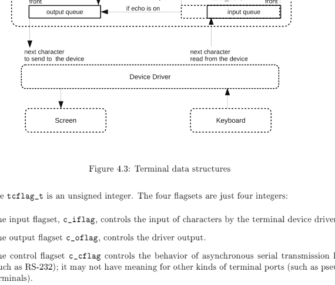

## Figure 4.3: Terminal data structures

类型`tcflag_t`是一个无符号整数。四个标志集只是四个整数：

- 输入标志集`c_iflag`，控制终端设备驱动程序的字符输入。
- 输出标志集`c_oflag`，控制驱动程序输出。
- 控制标志集`c_cflag`控制异步串行传输线（如 RS-232）的行为；对于其他类型的终端端口（如伪终端）可能没有意义。
- 本地标志集`c_lflag`影响驱动程序与用户之间的接口（回显、擦除字符等）

`c_cc`数组定义了可以更改的特殊字符。数组元素类型为`unsigned char`（`cc_t`被 typedef 为`unsigned char`。）


图 4.3 显示了终端设备与终端驱动及其组件之间的关系。当你在键盘上输入时，字符代码被传输到设备驱动程序，后者又将它们传递给线路规程，将它们放入其输入队列。线路规程在正常情况下，会将键入的字符复制到输出队列，以便在你输入时显示在控制台上。线路规程负责输入处理，包括特殊字符的处理。它将处理后的字符传递给内核的 `read()` 例程，后者再将它们传递给请求读操作的进程。当进程发出写请求时，内核的 `write` 函数将字符传递给线路规程，后者执行应执行的任何处理，然后将字符放入

> 10 技术上讲，是 `sys_read()` 函数，即内核中的实际函数，而不是 `read()`，后者是它的包装器。

输出队列。设备驱动程序从队列前端检索字符并将其显示在控制台上。

在编程层面探索 `termios` 结构之前，我们将先看看如何从命令行层面更改它。

### 4.4.3 stty 命令

用户可以使用 `stty` 命令查看和更改终端特性。`stty` 不带选项或参数时，会显示调用该命令的 `shell` 所连接终端的当前设置中的一部分。不同系统会显示不同量的信息。要查看完整的终端设置列表，请使用 "`stty -a`" 。输出看起来会像下面这样（重新排列并标注）：

```
$ stty -a
speed 38400 baud; rows 24; columns 80; line = 0;
cchars: intr = ^C; quit = ^\; erase = ^?; kill = ^U; eof = ^D;
 eol = M-^?; eol2 = M-^?; start = ^Q; stop = ^S; susp = ^Z;
 rprnt = ^R; werase = ^W; lnext = ^V; flush = ^O;
 min = 1; time = 0;
control flags: -parenb -parodd cs8 -hupcl -cstopb cread
 -clocal -crtscts
input flags: -ignbrk -brkint -ignpar -parmrk -inpck -istrip
 -inlcr -igncr icrnl ixon -ixoff -iuclc ixany imaxbel
output flags: opost -olcuc -ocrnl onlcr -onocr -onlret -ofill
 -ofdel nl0 cr0 tab0 bs0 vt0 ff0
local flags: -isig icanon iexten echo echoe echok -echonl -noflsh
 -xcase -tostop -echoprt echotcl echoke
```

必须理解，这些设置与终端的设备文件相关联，而不是与 `shell` 或其他进程与终端之间的连接相关。要说服自己这一点，请执行以下实验。为了进行实验，我们将玩弄擦除字符。`stty` 可用于更改终端使用的擦除字符，方法是输入以下内容，但现在不要执行：

```
$ stty erase x
```

其中 `x` 是你希望在命令行上用于擦除单个字符的字符。默认值通常是 `Ctrl-H` 或 `Ctrl-?`，分别表示为 `^H` 和 `^?`。退格键有时会生成 `^H`，而删除键会生成 `^?`，但并非总是如此。此实验在所有 `shell` 中都无法工作，因为其中一些 `shell` 设计为允许命令行编辑。换句话说，`shell` 本身提供了该功能，覆盖了终端设置。如果 `bash` 是你的 `shell`，则通过命令行输入以下命令关闭命令行编辑，进入一个非编辑的 `bash` 子 `shell`：

```
$ bash --noediting
```

| 类别 | 描述 |
|---|---|
| **特殊字符** | 驱动程序用来触发特定操作的字符，例如向进程发送信号，或擦除字符、单词或行。特殊字符包括 `erase`、`werase` 和 `kill` 字符等示例。用于发送信号的字符包括 `Ctrl-C`，它发送 `interrupt` 信号，以及 `Ctrl-\`，它发送 `quit` 信号。信号将在后面的章节中介绍，但目前只需知道中断和退出信号等信号通常会终止接收它们的进程。 |
| **特殊设置** | 控制终端的变量，例如其输入和输出速度和尺寸。这些包括 `rows`、`cols`、`min` 和 `time` 值。`rows` 和 `cols` 是窗口中的行数和列数。`min` 和 `time` 在终端处于非规范模式时用于控制 `read()` 调用返回字符的方式；这些将在后面讨论。其中许多变量不适用于伪终端。 |
| **输入设置** | 处理来自终端的字符的操作。这包括更改其大小写、将回车转换为换行，以及忽略各种字符如中断和回车。 |
| **输出设置** | 处理发送到终端的字符的操作。输出操作包括用适当数量的空格替换制表符字符、将换行转换为回车、回车转换为换行，以及更改大小写。 |
| **控制设置** | 控制字符表示的操作，例如奇偶校验和停止位、硬件流控制。其中一些不适用于伪终端。 |
| **本地设置** | 控制驱动程序如何内部存储和处理字符的操作。例如回显是本地操作，处理擦除和行删除字符也是如此。 |
| **组合设置** | 各种设置的组合，定义诸如 `cooked` 模式或 `raw` 模式等模式。 |

输入设置以 'i' 开头，输出设置以 'o' 开头。一个值得关注的输入设置是 `icrnl`。当该开关被设置时，它会导致输入回车被转换为换行字符。读作 i 表示输入，cr 表示回车，nl 表示换行。该开关解释了为什么 Enter 键会被转换为换行字符。试运行以下命令：

```
$ stty -icrnl ; listchars
```

然后输入 'abc' 后按 Enter 再按 `Ctrl-D`。Enter 会在屏幕上显示为 'M。然后按 `Ctrl-C` 退出程序。你会看到回车的代码现在是 ASCII 13。你还会看到该行的单词 "char" 没有显示在屏幕上：

```
abc^Mchar = 'a' code = 097
char = 'b' code = 098
char = 'c' code = 099
' code = 013
```

这是因为回车字符导致输出从第 1 列开始，但没有换行符，所以输出的 " code 13" 会覆盖掉 "char ="。为了证明这一点，将程序修改为在 `printf()` 调用中的 '\%c' 之前强制换行。你会看到单词 "char" 重新出现。通过输入以下命令恢复设置

```
$ stty icrnl
```

我们感兴趣的输出设置是 `onlcr` 开关。这是在发送到终端的每个换行字符后添加回车符。试着关闭它并查看输出：

```
$ stty -onlcr ; listchars
[stewart@harpo chapter05]$ stty -onlcr; listchars
Type any characters followed by the 'Enter' key; Ctrl-D to exit.

abc
c
har = 'a' code = 097
char = 'b' code = 098
char = 'c' code = 099
char
= '
' code = 010
```

注意，每一行新行都从上一行的末尾下方开始；输出流中没有插入回车符。要恢复设置，输入

```
$ reset
```

或

```
$ stty onlcr
```

本地设置包括是否启用规范模式和回显。默认情况下，终端处于规范模式。`stty` 命令的输出表明了这一点：

```
$ stty -a | grep canon
isig icanon iexten echo echoe echok -echonl -noflsh -xcase -tostop -echoprt
```

在规范模式下，驱动程序处理行编辑键：

- 字符擦除（`erase`），
- 单词擦除（`werase`），
- 行删除（`kill`），和
- 行重绘（`rprnt`）

并识别以下特殊输入字符：行分隔符（`eol` 和 `eol2`）和文件结束（`eof`）。`eol` 和 `eol2` 字符是等效的。它还缓冲输入字符，直到按下 Enter 键，此时才将其传递给进程。像 `bash` 和 `tcsh` 这样本身支持行编辑（由 `shell` 本身）的 `shell` 会忽略用于关闭规范模式的 `stty` 命令，因为它们自行处理字符。规范模式被关闭，但在 `shell` 内部不会有任何效果。要看到禁用规范模式的效果，你必须使用 `--noediting` 命令行开关运行 `bash`。

在规范模式下，输入的字符会被处理并放入规范输入队列。在非规范模式下，它们会直接传递给 `read()` 系统调用。我们现在就来演示这一点。我们将运行一个类似于 `copychars` 程序的简单程序，但为了有所不同，它将显示的不是输入的字符，而是其转置字符，这里定义为 `transpose(c) = islowercase(c) ? 'a' + 'z' - c : c`。因此程序如下


```
Listing transpose.c
#include <unistd.h>
#include <ctype.h>

int main(int argc, char* argv[])
{
    char ch;
    while (read(0, &ch, 1) > 0) {
        if (islower(ch))
            ch = 'a' + 'z' - ch;
        write(1, &ch, 1);
    }
    return 0;
}
```

我们使用命令 `stty -icanon` 关闭规范模式，并在非规范模式下运行 `transpose` 程序。在我的终端中，擦除字符是 Backspace 键，回显为`"^?"`（控制-？）。一旦禁用规范模式，纠正输入错误会变得很困难，因此更简单的方法是一次性关闭规范模式并发出 `transpose` 命令作为单个作业。交互如下：

```
$ stty -icanon; transpose
azbycdwx?▧ev

^C
```

我输入的每个字符，其转置都会立即打印出来，因为字符一经输入就被交给 `transpose` 程序。这表明当规范模式关闭时，没有输入缓冲。此外，当我尝试使用 Backspace 键擦除时，屏幕上会出现字符对`"~?"`但没有任何内容被擦除。随后是一个不可打印字符。Backspace 键的字符代码是无法打印的内容，因此某种类型的符号

> 这些特殊输入字符远不止这些。这些只是规范模式下处理的那些。

会在 “?” 之后出现，这就是 Backspace 的回显。如果尝试输入行删除字符 Ctrl-U，它不会擦除该行。Ctrl-D 也不会发送 EOF 信号。程序必须使用 Ctrl-C 终止。此外，当我输入 Enter 键时，它会被回显然后再次打印，因此显示了两个换行符。在后面的章节中，我们将探讨禁用规范模式的其他影响。

终端是复杂的结构。它们的大多数属性不应在你真正理解其用途之前被更改。其中一些是通信特性，例如奇偶校验、起始位和停止位、握手方法、挂断方法等。这些通常与你的终端设置无关；它们是 `stty` 命令的一部分，因为它也是控制串行设备和真实 tty 的通用命令，对于这些设备它们是必要的。你可以阅读手册页以获得这些所有属性的更详细解释。

#### 4.4.4 编程终端驱动程序

`stty` 命令允许你从 shell 修改终端设置，但不能在程序内部使用。要从程序内部控制大多数终端特性，我们可以使用一对系统调用，`tcgetattr()` 和 `tcsetattr()`。它们分别获取和设置驱动程序属性。有一个替代函数 `ioctl()` 可用于控制终端设置，但它不受标准支持，因此不被推荐。我们稍后会查看 `ioctl()`。`ioctl()` 函数对于控制终端以外的设备是必要的。

`tcgetattr()` 和 `tcsetattr()` 并不是唯一操作终端设置的函数。POSIX 标准中实际上有 13 个不同的函数。其余的是

- `cfgetispeed()`   gets input speed
- `cfgetospeed()`   gets output speed
- `cfsetispeed()`   sets input speed
- `cfsetospeed()`   sets output speed
- `tcdrain()`       waits for all output to be transmitted
- `tcflow()`        suspends transmission
- `tcflush()`       flushes input and/or output queues
- `tcsendbreak()`   sends a break character
- `tcgetpgrp()`     gets foreground process groupid
- `tcsetpgrp()`     sets foreground process groupid
- `tcgetsid()`      gets process group ID of session leader for control of tty

其中一些作用于行规程；另一些作用于设备驱动程序设置。我们只会探索其中几个。

而 `fcntl()` 允许你控制磁盘文件连接，这些函数允许你编程终端驱动程序属性。与 `fcntl()` 不同，后者可用于获取和设置属性，获取终端属性的工作在一个函数中，设置在另一个函数中。然而更改的方法是相同的；你必须

- 使用 `tcgetattr()` 将当前设置检索到进程地址空间中的一个结构中，

- 在本地修改该结构，并

- 使用 `tcsetattr()` 调用将其写回驱动程序。

属性在 `termios` 结构中来回传递。`termios`、`tcgetattr()` 和 `tcsetattr()` 以及上面列出的其他函数（最后三个除外）只有一个 man 手册。以下摘录了相关信息：

```
NAME
termios, tcgetattr, tcsetattr, tcsendbreak, tcdrain, tcflush, tcflow, cfmakeraw, cfgetospeed, cfgetispeed, cfsetispeed, cfsetspeed
get and set terminal attributes,
line control, get and set baud rate
SYNOPSIS
#include <termios.h>
#include <unistd.h>
int tcgetattr(int fd, struct termios *termios_p);
int tcsetattr(int fd, int optional_actions, struct termios *termios_p);
...
DESCRIPTION
The termios functions describe a general terminal interface that is provided to control asynchronous communications ports.
Many of the functions described here have a termios_p argument that is a pointer to a termios structure. This structure contains at least the following members:
    tcflag_t c_iflag;      /* input modes */
    tcflag_t c_oflag;      /* output modes */
    tcflag_t c_cflag;      /* control modes */
    tcflag_t c_lflag;      /* local modes */
    cc_t c_cc[NCCS];       /* control chars */
...
```

`tcgetattr()` 系统调用接收一个文件描述符和一个指向 `termios` 结构的指针。文件描述符必须引用一个终端设备文件，否则会出错¹²。`tcgetattr()` 调用会将所引用终端设备的属性存储在 `termios` 结构中。`tcsetattr()` 系统调用也接收一个文件描述符和一个指向 `termios` 结构的指针，但其第二个参数是一组可选操作。这些可选操作指定何时对终端设备应用更改。此参数有三种可能的值。摘自 man 手册（经我修正）：

+   `TCSANOW` 更改立即发生。

+   `TCSADRAIN` 更改在所有写入 `fd` 的输出已传输后发生。当更改影响输出的参数时应使用此函数。

+   `TCSAFLUSH` 更改在所有写入 `fd` 所引用对象的输出已传输后发生；此外，在更改发生之前，所有未读取的输入数据将被丢弃。

> 12 这是测试特定文件描述符是否指向终端设备的又一种方法，另外还有 `isatty()` 和 `ttyname()`。

`TCSANOW` 强制立即更改；如果终端驱动程序正在向终端写入并且更改修改了输出标志，这可能会导致问题。`TCSADRAIN` 强制更改，但仅在驱动程序清空输出队列后才会进行。这是在更改影响终端输出时应选择的操作。`TCSAFLUSH` 仅在输出队列清空后并且导致队列中等待的输入数据被丢弃后才强制更改。在将终端恢复到原始状态时，使用 `TCSAFLUSH` 最为安全。

不同版本的 UNIX 对 `termios` 结构有不同的定义。Solaris 9 中找到的定义符合 Open Group 的单一 UNIX 规范第 3 版13（也称为 IEEE Std 1003.1），这是最被广泛接受的 UNIX 标准。Linux 2.6 上 `/usr/include/bits/termios.h` 头文件中的定义包含其他字段（POSIX 允许）：


```c
struct termios
{
    tcflag_t c_iflag;          /* input mode flags */
    tcflag_t c_oflag;          /* output mode flags */
    tcflag_t c_cflag;          /* control mode flags */
    tcflag_t c_lflag;          /* local mode flags */
    cc_t c_line;               /* line discipline */
    cc_t c_cc[NCCS];           /* control characters */
    speed_t c_ispeed;          /* input speed */
    speed_t c_ospeed;          /* output speed */
}
```

`c_line`、`c_ispeed` 和 `c_ospeed` 成员不是标准的一部分，标准允许结构包含额外成员。虽然 `tcflag_t` 是一个整数，其各个位都是标志，但你不需要知道标志的各个位位置，因为头文件为每个标志定义了掩码。位顺序可能因实现而异。POSIX 指定了一组标志，XOpen 另有一组，Open Source 还有另一组，等等。

标志集在图 4.1 中示意。每个方框都是一个整数标志集。内部的名称是各个位掩码的名称。这些标志都在 `termios` 的 man 手册中描述。`c_iflag` 成员包含定义输入处理的标志。`c_oflag` 成员包含定义输出处理的标志。`c_cflag` 具有定义控制特性的标志，而 `c_lflag` 成员具有定义字符如何在本地处理的标志，即在驱动程序内部如何处理。`c_cc` 数组是一个存储控制字符分配的数组。这里存储了退格键、退格键等的映射。POSIX 要求以下下标名称必须存在：

13 你可以从 `http://www.unix.org/version3` 下载第 3 版，即最新版本。

### c_iflag

- `IGNBRK`
- `BRKINT`
- `IGNPAR`
- `PARMRK`
- `INPCK`
- `ISTRIP`
- `INLCR`
- `IGNCR`
- `ICRNL`
- `IUCLC`
- `IXON`
- `IXANY`
- `IXOFF`
- `IMAXBEL`
- `IUTF8`

### c_oflag

- `OPOST`
- `ONLCR`
- `OLCUC`
- `OCRNL`
- `ONLRET`
- `OFILL`
- `OFDEL`
- `NLDLY`
- `CRDLY`
- `TABDLY`
- `BSDLY`
- `FFDLY`
- `VTDLY`

### c_cflag

- `CSIZE`
- `CSTOPB`
- `CREAD`
- `PARENB`
- `PARODD`
- `HUPCL`
- `CLOCAL`
- `CRTSCTS`
- `CIBAUD`
- `PAREXT`
- `CBAUDEXT`

### c_lflag

- `ISIG`
- `ICANON`
- `ECHO`
- `ECHOE`
- `ECHOK`
- `ECHONL`
- `NOFLSH`
- `TOSTOP`
- `ECHOCTL`
- `ECHOPRT`
- `ECHOKE`
- `DEFECHO`
- `FLUSHO`
- `PENDIN`

**图 4.4：termios 结构体的标志位掩码**

| 正规模式 | 非正规模式 | 描述 |
|---|---|---|
| `VEOF` | `EOF` | 字符 |
| `VEOL` | `EOL` | 字符 |
| `VERASE` | `ERASE` | 字符 |
| `VINTR` | `VINTR` | INTR 字符 |
| `VKILL` | `KILL` | 字符 |
|  | `VMIN` | MIN 值 |
| `VQUIT` | `VQUIT` | QUIT 字符 |
| `VSTART` | `VSTART` | START 字符 |
| `VSTOP` | `VSTOP` | STOP 字符 |
| `VSUSP` | `VSUSP` | SUSP 字符 |
|  | `VTIME` | TIME 值 |

`c_cc` 数组的大小定义为 `NCCS`，它是由 `<termios.h>` 头文件公开的一个宏定义。

你可以使用按位操作来更改标志集中单个位。如果 `MASK` 表示任意位掩码，则以下操作可测试、设置和清除标志集中的位：

```
if ( flagset & MASK ) ... //tests the masked bit
flagset |= MASK          //sets the masked bit
flagset &= ~MASK         //clears the masked bit
```

例如，要关闭终端回显，假设 `flagset` 是 `termios` 结构中 `c_lflag` 标志集的本地副本，我们将使用

```
flagset = flagset & ~ECHO;
```

下面是一个程序，它提示用户输入密码，并在输入密码时使输入不可见，就像登录程序一样。该程序关闭回显开关并在之后将其重置。

#### 清单 login.c

```c
#include <stdio.h>
#include <stdlib.h>
#include <termios.h>

int main(int argc, char* argv[])
{
    struct termios info, orig;
    char username[33];
    char passwd[33];
    FILE   *fp;

    /* get a FILE* to the control terminal -- don't assume stdin */
    if ((fp = fopen(ctermid(NULL), "r+")) == NULL)
        return(1);

    printf("login: ");                    /* display message       */
    fgets(username, 32, stdin);             /* get user's typing      */

    /* Now turn off echo */
    tcgetattr(fileno(fp), &info);           /* Get current terminal state */
    orig = info;                            /* Save a copy of it */
    info.c_lflag &= ~ECHO;                  /* Turn off echo bit */
    tcsetattr(fileno(fp), TCSANOW, &info);  /* Set state in line discipline */

    printf("password: ");
    fgets(passwd, 32, stdin);               /* Get user's non-echoed typing */
    /*
    tcsetattr(fileno(fp), TCSANOW, &orig);  /* Restore saved settings */
    */

    printf("\n");                          /* Print a fake message */
    printf("Last login: Tue Apr 31 21:29:54 2088 from the twilight zone.\n");
    return 0;
}
```

### 注释

- 这是标准流程：使用 `tcgetattr()` 获取旧状态，保存一份副本，进行更改，使用 `tcsetattr()` 设置它，执行工作，然后恢复。
- 我们只从控制终端读取和写入，如果无法以读写方式打开该设备则返回错误。我们可以使用 `ctermid()` 获取控制终端的名称，并使用 `fileno()` 函数从名称获取文件描述符。这更安全。
- 我们不使用 `"/dev/tty"`；它不如调用 `ctermid()` 可靠。

#### 4.4.5 实现 stty：showtty

实现一个用户友好、也许更详细的 `stty` 版本是使用 `termios` 结构的一个很好的练习。我们将编写一个 POSIX 兼容的版本，因此它应该显示它尝试显示的任何标志的正确值。

基本思路非常直接：`tcgetattr()` 用于检索标志集的设置。`show_flagset()` 函数打印四个标志集中每个标志的状态，而 `show_cc_array()` 函数打印控制字符到字符代码的映射。它们的设计相似，都基于使用包含与该值关联的值和文本描述或名称的结构数组：


```
/* Mapping of flag bit position to name */
typedef struct _flaginfo flaginfo;
struct _flaginfo
{
    int  fl_value;  // flag value
    char *fl_name;  // string describing flag
};

/* Mapping of index to description */
typedef struct _cc_entry cc_entry;
struct _cc_entry {
    int  index;
    char *description;
};
```

单个标志集然后由`flaginfo`结构数组表示，控制字符代码数组以类似的方式由`cc_entry`结构数组表示。例如，输入标志由常量数组定义

```
flaginfo input_flags[] = {
    {IGNBRK , "Ignore break condition" },
    {BRKINT , "Signal interrupt on break" },
    {IGNPAR , "Ignore chars with parity errors" },
    {PARMRK , "Mark parity errors" },
    {INPCK  , "Enable input parity check" },
    {ISTRIP , "Strip character" },
    {INLCR  , "Map NL to CR on input" },
    {IGNCR  , "Ignore CR" },
    {ICRNL  , "Map CR to NL on input" },
    {IXON   , "Enable start/stop output control" },
    {IXOFF  , "Enable start/stop input control" },
    {-1     , NULL }
};
```

控制字符由常量数组定义

```
cc_entry cc_values[] = {
    { VEOF,      "The EOF          character"},
    { VEOL,      "The EOL          character"},
    { VERASE,    "The ERASE character"},
#if defined VW ERASE
    { VW ERASE,  "The WERASE character"},
#endif
    { VINTR,  "The INTR character"},
    { VKILL,  "The KILL character"},
    { VQUIT,  "The QUIT character"},
    { VSTART, "The START character"},
    { VSTOP,  "The STOP character"},
    { VSUSP,  "The SUSP character"},
    { VMIN,   "The MIN value "},
    { VTIME,  "The TIME value"},
    { -1,     NULL}
};
```

请注意，每个数组都以哨兵值 -1 终止。还要注意`VW ERASE`代码只有在有条件编译时才会被编译，因为 POSIX 并未定义它。处理这两个数组的逻辑是相似的。用于显示`c_cc`数组的字符代码的函数是

```
void show_cc_array( struct termios ttyinfo ,
                    cc_entry        controlchars[] )
{
    int  i = 0;

    while ( -1 != controlchars[i].index ) {
        printf( "%s is ", controlchars[i].description );
        printf( "Ctrl-%c\n",
                ttyinfo.c_cc[controlchars[i].index] -1 + 'A' );
        i++;
    }
}
```

对于索引不为 -1 的数组中每个字符代码，它会打印结构中的描述以及代码值作为“control-something”名称。这些“control-something”名称，例如“Ctrl-A”、“Ctrl-B”等，直到“Ctrl-_”，源于键盘上通常可以通过控制键 Ctrl 和普通键生成控制代码这一事实。通过将 'A' 的代码减一后加到`c_cc`数组中存储的索引上，我们就能得到应从键盘输入该代码时需要键入的键盘键。

`show_flagset()` 函数类似。它由一个函数 `show_flags()` 调用，后者只是为每个不同的标志集调用 `show_flagset()`。

```
void show_flagset( int flag , flaginfo bitnames[] )
{
int i = 0;

while ( -1 != bitnames[i].fl_value ) {
    printf( "%s is ", bitnames[i].fl_name );
    if ( flag & bitnames[i].fl_value )
        printf("ON\n");
    else
        printf("OFF\n");
    i++;
}
```

主程序调用一个函数 `show_baud_rate()`，该函数在给定`termios`结构`ttyinfo`时，将波特率的符号值转换为数值。`show_baud_rate()` 函数调用 `cfgetospeed()` 从结构中提取波特率。主程序如下所示。

```
int main(int argc, char* argv[])
{
    struct termios ttyinfo;
    FILE *fp;

    if ((fp = fopen(ctermid(NULL), "r+")) == NULL )
        exit (1);
    if ( tcgetattr( fileno(fp) , &ttyinfo ) == -1 ){
        perror("Cannot get info about this terminal.");
        exit (1);
    }

    show_baud_rate (ttyinfo);
    printf("\n");
    show_cc_array(ttyinfo , cc_values);
    printf("\n");
    show_flags(ttyinfo , input_flags , output_flags , local_flags);
    return 0;
}
```

#### 4.4.6 非规范终端模式

回想一下，在规范模式下，终端驱动程序将输入组装成行，解释各种特殊字符，例如退格，然后再将其传递给进程。上面我们提到，在非规范模式下，输入缓冲被关闭，键入的字符会立即传递给读取进程。在这里，我们将探讨线路规程的特性，这些特性允许我们更精确地控制向进程传递多少字符以及何时传递。我们将使用`transpose`程序来演示这一点。

当关闭规范模式时，`stty`的`min`选项控制在将字符传输给程序之前必须键入的最少字符数。例如

```sh
$ stty -icanon min 4
```

将终端置于非规范模式，并将必须键入的最少字符数设置为 4 之后才会被传输给程序。尝试键入以下内容：

```sh
$ stty -icanon min 3; transpose

abczxdyefwvu

^C
```

请注意，每次有三个字符会被发送给程序，并且在你键入三个字符之前，不会有任何字符被发送。这表明虽然在输入 EOL 之前没有缓冲，但`read`操作只有在驱动程序中存在最少数量的字符时才被认为完成。

在`termios`结构中，`c_cc`数组的`MIN`成员（`c_cc[VMIN]`）指定`read()`调用返回前所需的最小字节数。`MIN`可以为零或正数。`c_cc`数组的`TIME`成员（`c_cc[VTIME]`）指定`read()`调用等待数据到达必须等待的十分之一秒数。它也可以为零或正数。因此，这对变量有四种组合，每种都有不同的语义。假设下面的`read()`调用为

```c
read(STDIN_FILENO, buf, numbytes_to_read);
```

##### 情况 1. `MIN` > 0, `TIME` > 0


`read()` 调用将阻塞（从而调用进程也会阻塞），直到它接收到第一个字节。`TIME` 指定一个字节间计时器，该计时器仅在接收到第一个字节后才被激活。换句话说，在用户键入之前，计时器处于非活动状态。每次接收到一个字节后，计时器都会重置为 0。一旦用户开始键入，如果在计时器过期之前接收到 `numbytes_to_read` 和 `MIN` 中较小者数量的字节，`read()` 将返回这些字节。请记住，计时器在每个字节后都会重置。如果在接收到 `MIN` 字节之前计时器过期，`read()` 将返回它已接收到的任何字节。（如果计时器过期，至少会返回一个字节，因为计时器要到接收到第一个字节后才开始。）如果在调用 `read()` 时已有数据可用，则相当于数据在 `read()` 之后立即接收。这意味着如果线路规程（在终端驱动程序内部）的输入队列中已有足够数据，`read()` 可以立即返回。

### 情况 2. `MIN > 0`, `TIME == 0`

`read()` 不会在接收到 `MIN` 字节之前返回。将 `TIME` 设置为零意味着计时器被关闭。实际上它被赋予无限的时间，这可能导致 `read()` 无限期阻塞，等待输入。`numbytes_to_read` 和 `MIN` 中较小者数量的字节将被返回给用户进程。这意味着如果 `numbytes_to_read < MIN`，则 `read()` 要等到接收到 `MIN` 字节才满足，但它只向调用者提供 `numbytes_to_read`。如果 `numbytes_toread > MIN`，则 `read()` 在接收到 `MIN` 字节时返回，并向调用者提供 `MIN` 字节。

### 情况 3：`MIN == 0`，`TIME > 0`

与情况 1 不同，`TIME` 指定一个在调用 `read()` 时启动的定时器。它不是字节间定时器。在这种情况下，当收到单个字节或定时器到期时，`read()` 返回。如果定时器到期，`read()` 返回 0，否则返回读取的字节数。如果在处理 `read()` 调用之前终端输入队列中已有字符，则会立即将队列中的字符数与 `numbytes_to_read` 字节之间的较小值传递给 `read()`，以满足该调用，并且 `read()` 将返回实际读取的字节数。

### 情况 4：`MIN == 0`，`TIME == 0`

请求的字节数（即 `numbytes_to_read`）与当前可用字节数中的较小值将返回给调用者，而无需等待更多字节输入。如果没有可用字符，`read()` 返回 0，表示未读取任何数据。否则返回实际读取的字节数。在这两种情况下，`read()` 都会立即返回。

为了演示，首先，在非规范模式下，我们将设置 `min = 0` 和 `time = 30`。你会看到，如果在 3 秒（30 个十分之一秒）内输入一个字符，它会立即被传递，但如果在 3 秒内没有输入字符，`read()` 将返回一个 `EOF` 字符。每隔 3 秒输入一些字符，然后让 3 秒过去。你会看到程序终止。

```
$ stty -icanon min 0 time 30 ; transpose
```

你可能还会发现你的 shell 终止了。在执行此操作之前，请确保你设置了 `IGNOREEOF` 环境变量，以免丢失 shell。如果你看到重复出现的“Use exit to logout”形式的提示，请使用 `reset` 关闭终端设置。

接下来，测试将 `min` 和 `time` 设置为非零值的效果。输入以下命令序列：

```
$ stty -icanon min 4 time 30 ; transpose
```

等待至少 3 秒，注意什么都不会发生。程序正在等待输入。没有超时，`read()` 尚未返回。现在输入一个字符并等待几秒。你将在 3 秒后看到它的转置输出，这证明 `read()` 在延迟了 30 个时间单位后仅返回了 1 个字符。现在输入 4 个字符，看看程序打印它们的转置输出有多快。驱动程序会等待 3 秒以输入最小数量的字符；如果在 3 秒内输入完成，它将返回，否则它会在 3 秒后返回，并返回已输入的字符数。使用 Ctrl-C 终止进程并重新开启规范模式。

这些实验证明，在关闭规范模式的情况下，你可以精确地控制输入。到目前为止，我们一直使用 `stty` 命令来控制终端驱动程序。在程序中，你可以改用 `tcgetattr()` 和 `tcsetattr()`。以下是一个程序清单，它允许你在非规范模式下为 `MIN` 和 `TIME` 参数指定特定值，从而测试各种终端设置组合的效果。

```
Listing canon_mode_test.c
#include <stdio.h>
#include <stdlib.h>
#include <termios.h>
#include <fcntl.h>
#include <string.h>
#include <unistd.h>

#define SLEEP_TIME 2

/**
 * Gets input under the mode specified by the values of iscanon, vmin, and
 * vtime. See the notes or the termios man page for the meaning of the vmin
 * and vtime parameters.
 */
void get_response( int iscanon, int vmin, int vtime);

/* Sets the VMIN value to vmin, VTIME to vtime, turns off icanon */
void set_non_canonical(int vmin, int vtime);

/* if how == 0 this saves the termios state for later restoring   */
/* if how == 1 this restores the termios state from the saved state */
/* CANNOT CALL with how == 1 before first calling with how == 0   */
void tty_mode(int how);

int main(int argc, char* argv[])
{
    int bNoCanon = 1;  /* default is non-canonical mode */
    int vmin     = 1;  /* default is one char */
    int vtime    = 0;  /* default is to force reads to wait for vmin chars */
    int ch;
    char optstring[] = ":hcm:t:";

    while (1) {
        ch = getopt(argc, argv, optstring);
        if ( -1 == ch )
            break;
        switch (ch) {
        case 'h':
            printf("Usage: %s [-hbc] [ -m MIN ] [ -t TIME ]\n",argv[0]);
            printf("  -h : help\n");
            printf("  -c : turn on canonical mode\n");
            printf("  -m : set VMIN value \n");
            printf("  -t : set VTIME value \n");
            exit(0);
        case 'c':
            bNoCanon = 0;  /* meaning canonical mode is ON */
            break;
        case 'm':
            vmin = strtol(optarg, NULL, 0);
            break;
        case 't':
            vtime = strtol(optarg, NULL, 0);
            break;
```

case '?' :

    break;

case ';' :

    break;

default:

    fprintf(stderr, " ");

}

/* Report on state that we will put terminal in */

if ( bNoCanon )

    printf("Canonical mode off\n");

else

    printf("Canonical mode on\n");

printf("VMIN set to %d\n",vmin);

printf("VTIME set to %d\n",vtime);

/* save current terminal state */

tty_mode(0);
```


```c
/* if canonical mode flag , unset icanon */

if ( bNoCanon )

    set_non_canonical(vmin, vtime);

/* call function to get input */

get_response(!bNoCanon, vmin, vtime);

/* restore terminal state */

tty_mode(1);

/* flush input stream */

tcflush(0,TCIFLUSH);

return 0;

}

void get_response( int iscanon, int vmin, int vtime)

{

    int     num_bytes_read;

    char    input[128];

    fflush(stdout);

    sleep(SLEEPTIME);

    if ( iscanon )

        printf("About to call read() in canonical mode\n");

    else

        printf("About to call read() with MIN = %d and TIME = %d\n",

            vmin, vtime);

    printf("Enter some characters or wait to see what happens.\n");

    num_bytes_read = read(0, input, 10) ;

    if ( num_bytes_read >= 0 ) {

        input[ num_bytes_read ] = '\0';

        if ( num_bytes_read > 0 )

printf("\nReturn value of read() is %d; chars read are %s\n", num_bytes_read, input );

else

    printf("\nReturn value of read() is %d;" " no chars were read\n",num_bytes_read);

}

else

    printf("read() returned -1\n");

}

void set_non_canonical(int vmin, int vtime)

{

    struct termios ttystate;

    tcgetattr( 0, &ttystate);          /* read curr. setting   */

    ttystate.c_lflag   &= ~ICANON;    /* no buffering         */

    ttystate.c_cc[VMIN]  = vmin;      /* get min of vmin chars */

    ttystate.c_cc[VTIME] = vtime;     /* set timeout to vtime */

    tcsetattr( 0, TCSANOW, &ttystate); /* install settings   */

}

void tty_mode(int how)

/* if how == 0 saves the termios state and fd flags for later restoring */

/* if how == 1 restores the termios state and fd flags from the saved state */

/* CANNOT CALL with how == 1 before first calling with how == 0 */

{

    static struct termios original_mode;

    static int            original_flags = -1;

    if ( 0 == how ){

        tcgetattr(0, &original_mode);

        original_flags = fcntl(0, F_GETFL);

    }

    else {

        if ( -1 == original_flags ) {

            fprintf(stderr,"tty_mode(1) called without saving first.\n");

            exit(1);

        }

        tcsetattr(0, TCSANOW, &original_mode);

        fcntl( 0, F_SETFL, original_flags);

    }

}
```

在离开这个主题之前，让我们看看当我们禁用终端处理信号的能力时会发生什么。当你在键盘上输入`Ctrl-C`时，通常是为了终止前台进程。为什么会发生这种情况？答案比我们在这里解释的要深入一些，但总体思路是`Ctrl-C`由终端驱动映射为名为`SIGINT`的信号，并且该信号被发送给前台进程。这通常会导致其被终止。当你输入其他键盘信号，如`Ctrl-\`和`Ctrl-Z`时也会发生类似的序列。这些不会产生相同的信号，但它们同样会被传递给进程。

终端知道三个特殊的控制字符，称为中断、退出和挂起字符，通常分别是`Ctrl-C`、`Ctrl-\`和`Ctrl-Z`。`stty`的`isig`开关启用

- 从 CD-ROM 驱动器播放音频轨道，以及
- 为网络维护路由表。

`ioctl()`函数是为了克服这些问题而设计的。它最初在 AT&T UNIX 第 7 版中作为通用 I/O 控制程序引入，允许用户级程序访问隐藏在内核深处的设备驱动程序。随着时间的推移，越来越多的设备通过`ioctl()`调用进行处理。然而，POSIX 将终端控制函数分离到`termios`结构和函数中，并且在很大程度上，`ioctl()`函数今天用于访问其他设备。POSIX 并未定义`ioctl()`，但 GNU 在其 C 标准库发行版中包含了`ioctl()`函数。

各种设备操作，称为`IOCTL`，已分配代码编号并通过`ioctl()`函数复用，该函数定义在`<sys/ioctl.h>`中。代码编号本身定义在许多不同的头文件中。

`ioctl()`系统调用接收一个设备文件的描述符，以及一个`IOCTL`，即表示`ioctl()`应执行的特定请求的整数。如果请求需要参数，则这些参数包含在命令编号之后。手册页开始如下：

```
NAME
    ioctl - control device
SYNOPSIS
    #include <sys/ioctl.h>
    int ioctl(int fildes, int request, /* arg */ ...);
DESCRIPTION
    The ioctl() function manipulates the underlying device parameters of special files. In particular, many operating characteristics of character special files (e.g., terminals) may be controlled with ioctl() requests. The argument d must be an open file descriptor.

    The second argument is a device-dependent request code. The third argument is an untyped pointer to memory. ...
```

有超过 400 种不同的请求类型，每种都由不同的助记码定义。`ioctl_list`手册页包含可以传递给`ioctl()`的有效请求助记码列表以及它们的参数类型。每个设备驱动程序都可以定义自己的`ioctl`命令集。系统 however 为不同类别的设备提供了通用的`ioctl`命令。一般来说，不同类别的命令都有一个前缀来标识命令的类型。例如，磁带命令的形式为`MTIOxxx`，可在`<sys/mtio.h>`中找到，而终端 I/O 命令的形式为`TIOxxx`。

`ioctl()`的一个简单示例是调用以检索终端窗口的大小。终端窗口大小由`<ioctl-types.h>`头文件中的`winsize`结构定义，该头文件包含在`<sys/ioctl.h>`中。`winsize`结构如下所示：

```
struct winsize
{
    unsigned short int ws_row;
    unsigned short int ws_col;
    unsigned short int ws_xpixel;
    unsigned short int ws_ypixel;
};
```


像素宽度和高度通常不会由内核赋予值，但行和列字段会。因此，我们可以用如下简单程序获得行和列。

```
#include <termios.h>
#include <stdio.h>
#include <stdlib.h>
#include <unistd.h>
#ifndef TIOCGWINSZ
#include <sys/ioctl.h>
#endif

void get_winsize(int fd,
                unsigned short *rows,
                unsigned short *cols )
{
    struct winsize size;

    if (ioctl(fd, TIOCGWINSZ, &size) < 0) {
        perror("TIOCGWINSZ error");
        return;
    }
    *rows = size.ws_row;
    *cols = size.ws_col;
}

int main(int argc, char* argv[])
{
    unsigned short int rows, cols;

    if (isatty(STDIN_FILENO) == 0) {
        fprintf(stderr, "Not a terminal\n");
        exit(1);
    }
    get_winsize(STDIN_FILENO, &rows, &cols);
    if ( rows > 0 )
        printf("%d rows, %d columns\n", rows, cols);
return 0;
}
```

通常，如果有替代方法执行相同任务，应尽量避免使用 `ioctl()`，因为它并非完全可移植。存在许多有替代函数的 IOCTL。例如，终端接口的 IOCTL。`tty_ioctl` 手册页列出了完整的清单。其中一些有等价物，其他则没有：

| IOCTL | argument | equivalent to |
|---|---|---|
| `TCGETS` | `struct termios *argp` | `tcgetattr(fd, argp)` |
| `TCSETS` | `const struct termios *argp` | `tcsetattr(fd, TCSANOW, argp)` |
| `TCSETSW` | `const struct termios *argp` | `tcsetattr(fd, TCSADRAIN, argp)` |
| `TCSETSF` | `const struct termios *argp` | `tcsetattr(fd, TCSAFLUSH, argp)` |
| `TCSBRK` | `int arg` | `tcsendbreak(fd, arg)` |
| `TIOCINQ` | `int *argp` | none - counts bytes in the input buffer |
| `TIOCOUTQ` | `int *argp` | none - counts bytes in output buffer |
| `TCFLSH` | `int arg` | `tcflush(fd, arg)`. |
| `TIOCSTI` | `char *argp` | none - inserts `*argp` into input queue |

我们可以用这些 IOCTL 重写 `setecho` 程序来代替使用 `tcgetattr()` 和 `tcsetattr()`，仅作为练习。它显示在下面的列表中。

## Listing `setecho_ioctl.c`

```
int main(int argc, char *argv[])
{
    struct termios info;
    FILE *fp;

    if ( argc < 2 ) {
        printf("usage: %s [y|n]\n", argv[0]);
        exit(1);
    }

    if ((fp = fopen(ctermid(NULL), "r+")) == NULL)
        return(1);

    /* retrieve termios struct */
    if ( ioctl( fileno(fp), TCGETS, &info ) == -1 )
        die("ioctl","1");

    /* If second argument starts with 'y' it is yes, echo on otherwise off */
    if ( 'y' == argv[1][0] )
        info.c_lflag |= ECHO ;
    else
        info.c_lflag &= ~ECHO ;

    /* replace termios with the modified copy */
    if ( ioctl(fileno(fp),TCSETS, &info) == -1 )
        die("ioctl","2");

return 0;
}
```

`ioctl()` 的另一个用途是操作终端输入队列。可以使用 `TIOCSTI` IOCTL 将字节插入终端输入队列。下面的列表演示了如何将字节插入伪终端的输入队列。

它在进程控制终端的终端输入队列中重复插入单个 `'x'`，共 `BUFFERSIZE-1` 次，之后插入一个换行符，这样如果终端处于规范模式，`read()` 调用将交付这些字符。然后它通过进入一个一次读取一个字符的循环来从队列中移除字符。为了允许第二个程序运行以观察队列大小，它在开始从终端读取之前稍作休眠。

在读取循环期间，它休眠足够的时间，以便第二个程序可以观察队列大小的减少。如果没有每次读取之间的这点延迟，观察程序将不会看到队列一次减少一个字符，而是直接看到它变为零。读取完毕后，它将其写入标准输出。

## Listing `ioctl2.c`

```
#include <unistd.h>
#include <sys/ioctl.h>
#include <unistd.h>
#include <sys/ioctl.h>
#include <stdio.h>

#define BUFFERSIZE  30
int main ()
{
    int i;
    char ch = 'x';
    char newline = '\n';
    char buf[BUFFERSIZE];

    /* Insert BUFFERSIZE-1 'x's into the terminal input queue */
    for ( i = 0; i < BUFFERSIZE-1; i++ )
        ioctl(0, TIOCSTI, &ch);

    /* Because we assume canonical mode is on, we put a newline there
       so that when the read is issued, the characters will be
       transmitted */
    ioctl(0,TIOCSTI, &newline);

    /* Delay to allow queue-reading demo to start up */
    sleep(10);

    /* Read the queue one char at a time */
    i = 0;
    while ( read(0 , &ch, 1) > 0 ) {
        buf[i] = ch;
        i++;
        if ( ch == '\n' ) /* to exit loop */
            break;
        /* Delay a bit so other program can see queue size drop */
        usleep(100000);
    }

    /* Write the buffer contents to the terminal */
    write(1, &buf, i);

    return 0;
}
```

最后一个演示程序展示了如何使用 `TIOCINQ` IOCTL 来查询输入队列的大小。它打开命令行指定的终端设备文件，然后进入一个固定时长的循环，在循环中它使用 `ioctl()` 函数查询该终端的输入队列大小。它将队列大小写入当前工作目录下名为 `queue_log` 的文件中。

## Listing `ioctl3.c`

```
#include <stdio.h>
#include <unistd.h>
#include <stdlib.h>
#include <termios.h>
#include <fcntl.h>
#include <sys/ioctl.h>
#include "utils.h"
```


```c
int main(int argc, char* argv[])

{

    FILE    *fp;

    int     count, i;

    int     fd;

    /* Try to open given terminal device file */

    if ((fd = open(argv[1], O_RDONLY)) == -1)

        die("open", argv[1]);

    /* Open queue log in current working directory */

    if ((fp = fopen("queue_log", "w")) == NULL) {

        printf("Could not open queue_log\n");

        exit(1);

    }

    /* For a fixed amount of time (for simplicity) count queue size */

    for ( i = 0; i < 400; i++ ) {

        if ( ioctl( fd, TIOCINQ, &count ) == -1 )

            die( "ioctl", "TIOCINQ");

        fprintf(fp, "%d chars in queue\n", count);

        /* delay to see changes */

        usleep(100000);

    }

    fclose(fp);

    return 0;

}
```


如果启动 `ioctl2` 并记下它所在的终端，然后在另一个终端启动 `ioctl3`，并将第一个终端指定为其参数，当 `ioctl3` 终止时，查看 `queue_log` 的内容，你会看到队列大小随着每次读取而减小。

可以编写一个程序，利用这个思路，以 `root` 权限跟踪所有打开终端的输入队列大小，用于管理目的。

### 4.6 Summary

进程与文件的连接被封装在内核维护的数据结构中，通常称为文件结构或文件条目。该结构包含决定 I/O 如何执行的标志。进程在首次打开文件时可以使用 `open()` 系统调用设置各种标志，并且可以使用 `fcntl()` 系统调用修改各种标志。

终端和伪终端由设备文件表示，因此 `fcntl()` 也可以用于修改进程与它们的连接，但除此之外，还有一个用于直接更改终端特性的 API。本章探讨了进程控制终端特性的方式，既通过直接更改它们，也通过更改进程与终端的连接。它还展示了非 POSIX 的 `ioctl()` 函数如何用于控制终端和其他设备。

## Chapter 5 Interactive Programs and Signals

### Concepts Covered

软件工具，守护进程，
交互式程序
非阻塞读取，信号，

`signal`, `sigaction`, `kill`, `flush`, `raise`
`sigemptyset`, `sigfillset`, `sigaddset`,
`sigdelset`, `sigprocmask`, `sleep`

### 5.1 The Different Types of UNIX Programs

在 UNIX 环境中运行的程序可以根据它们与终端设备以及输入/输出流的关系进行分类。它们通常分为三类：*软件工具*、*守护进程* 和 *交互式用户程序*。

#### 5.1.1 Software Tools (Filters)

*软件工具* 是一个程序，它

- 从以下之一接收输入
  - 作为命令行参数给出的一個或多个文件，或
  - 如果没有文件名参数，则从标准输入接收，
- 预期其输入是一个无结构的字节流，几乎总是被视为纯文本，并且
- 将其输出，即也是字节流，通常是纯文本，放在标准输出上。

由于软件工具可以从标准输入读取并向标准输出写入，因此它们可以通过 shell 管道连接形成管道，像工厂装配线一样。UNIX 有许多软件工具，包括 `awk`、`cat`、`cut`、`du`、`fold`、`grep`、`od`、`sed`、`sort`、`tr` 和 `uniq`。

#### 5.1.2 Daemons

另一类程序是设备驱动程序，它们甚至没有连接到终端。一个未连接到终端的程序在 UNIX 中称为 *守护进程*。守护进程的一个常用但不准确的定义是它是“后台”进程。准确地说，它是一个没有关联终端或登录 shell 的进程，等待事件发生。该事件可能是用户请求打印或连接互联网等服务，或时钟滴答指示运行时间。“守护进程”一词源自希腊神话，指为其保护的人做有益任务的次级神。守护进程就像这些次级神；它们在启动时创建，隐藏存在，准备在被调用时提供服务。

由于守护进程不能连接到终端，它们首先要执行的任务之一就是关闭所有打开的文件描述符（尤其是标准输入、标准输出和标准错误）。它们通常将工作目录设为文件系统的根目录。然后它们会采取额外的步骤来切断与任何 shell 或终端的关联，其中包括离开其进程组并注册其忽略所有传入信号的意图。进程组的概念将在第 8 章中讨论。信号将在本章后面介绍。

守护进程的名称通常以 'd' 结尾。这是在 `ps -ef` 命令的输出中识别守护进程的一种方法；查找以 "d" 结尾的名称，如 `ftpd`、`httpd`、`lpd`、`sshd`、`syslogd` 和 `telnetd`。守护进程将在第 8 章中得到全面介绍。

#### 5.1.3 交互式用户程序

另一类程序是那些与用户终端不可分割地绑定的程序，因为它们会为自己的使用而定制终端。通过终端与用户交互的程序，例如文本编辑器（`vi`、`nano` 或 `emacs`）、分页器（`more` 和 `less`）、基于终端的管理工具如 `top`、游戏（`snake`、`worm` 和 `chess`），以及基于终端的邮件客户端（`pine` 和 `mailx`），都与终端紧密耦合，必须控制其设置和属性。它们不能使用标准输入和输出流来与用户通信，因为这些流缺乏终端所具有的控制类型。这类程序通常需要控制

- 字符是否回显，
- 缓冲的字符数，如果有的话，
- 屏幕上光标的移动，
- 某些按键是否应具有其默认含义或具有应用程序定义的含义，
- 输入是否应发生超时，
- 诸如 `Ctrl-C` 之类的信号应被忽略、排队还是立即处理。

我们已经看到了如何在命令级别使用 `stty` 以及在编程级别使用 `tcgetattr()` 和 `tcsetattr()` 函数来控制终端的状态。在这里，我们将探讨可以将终端置于的各种模式，以便创建交互式程序。

### 5.2 设计交互式用户程序

大多数交互式用户程序都是事件驱动或菜单驱动的，这意味着它们执行某个简短任务，然后等待用户输入以执行下一个任务。所有基于窗口的应用程序都是事件驱动的；它们处于空闲状态，通常在输入上被阻塞，同时等待窗口管理器向它们传递鼠标、键盘或其他事件。

下面我们将介绍设计和开发基于终端的交互式应用程序所需的步骤。我们将从理解问题开始，然后逐步使程序对用户输入做出更灵敏的响应。

#### 5.2.2 一个简单的文本编辑器：`simplevi`

`vi` 文本编辑器是一段非常复杂的软件，但我们可以创建一个极其精简的版本并在过程中学到很多东西。我们将我们的编辑器命名为 `simplevi`。这个简单的编辑器将允许用户在文本文档的任何位置插入字符，但不会提供删除字符的手段。这只是对程序的一个小扩展。此外，它不会打开现有的文本文件，而是在每次调用时创建一个新文件。添加打开文件的功能并不会为程序的交互式设计提供太多新的见解，但会使程序变得更大。尽可能地，`simplevi` 实现的功能将与 `vi` 中的语义相同。

##### 5.2.2.1 simplevi 的功能

`simplevi` 程序允许用户以类似于 `vi` 的方式创建文件。它只有插入命令，目前不支持删除。像 `vi` 一样，它始终处于三种可能模式中的一种：

- input mode
- command mode, and
- last_line mode

每种模式现在将简要描述。

**Command Mode** 初始模式是命令模式。在 command_mode 中可以输入以下按键/命令：

| Key | Semantics |
|---|---|
| `i` | changes to input mode. |
| `:` | changes to lastline mode. |
| `h`, backspace, or left-arrow key | moves left until the first character in the text line. If a line wraps, it follows the wrapped text backwards. |
| `l`, spacebar, or right-arrow key | moves right until the last character in the text line. If a line wraps, it follows the wrapped text backwards. |
| `k` or up-arrow key | moves to the text line above, to the same position relative to the start of the text line, unless that text line is shorter than the current one, in which case it is placed at the end of the text line. Scrolling takes place as necessary. |
| `j` or down-arrow key | moves to the next text line below, using the same rule as for the up arrow when deciding the horizontal position. Scrolling takes place as necessary. |
| `Ctrl-D` | Does nothing except display the message that it was pressed. |
| `Ctrl-C` | Does nothing except display the message that it was pressed. |
| `Ctrl-H` | Can be used to display a help screen, but at present just shows a one-line text message. |

### Notes

- 导航键的使用规则与 `vi` 类似，但不完全相同。唯一的区别是 `vi` 会记住最后一次水平移动，当指示垂直移动时，光标会移动到新文本行中与最后一次记住的水平移动相同的位置。
- 因为只有插入操作，而没有追加操作，所以光标允许位于某一行最右字符的右侧一个位置。

## Lastline Mode

用户可以在 lastline 模式下退出编辑器，并/或保存当前缓冲区内容。允许的命令是 `vi` 中可能命令的子集，但语法模仿 `vi`。具体来说，在 lastline 模式下可以输入：

`w filename` 将缓冲区保存到名为 `filename` 的文件

`wq filename` 将缓冲区保存到名为 `filename` 的文件并在之后退出

`q` 退出且不保存。它不会警告缓冲区未保存。

在命令之前以及命令与文件名之间允许任意数量的空白字符。任何其他字符都会生成错误消息并终止 lastline 模式。

文件名可以是字母数字字符和下划线的任意组合。不允许使用标点符号和空白字符。输入如下命令

```


: w q

```
会创建一个名为‘q’的文件，就像在 vi 中发生的那样。
```

令 S 表示空格字符，F 表示有效的文件名字符，括号用于分组，| 用于选择，则 lastline 模式下可接受的以换行符结尾的字符串语言为

```
S*(w|wS*q) SS*FF*S* | S*qS*
```

## Input Mode

只有一种插入操作，它在光标位置插入。退格未实现。输入退格无效。输入除图形字符之外的字符（键盘上找到的字符）行为未指定。图形字符插入到光标左侧。行根据需要换行，屏幕也根据需要滚动。

### 5.2.2.2 Program Design

如果我们使用 NCurses 库编写这个程序会容易得多，但由于我们尚未介绍 NCurses API，我们将以困难的方式做，就像 NCurses 存在之前所做的那样。这将在下一章介绍 NCurses 时让你对其产生欣赏。在这里，我们将使用我们在第 1 章中介绍的 ANSI 转义序列。

编写这个简单的文本编辑器的设计挑战在于同步程序必须管理的三个主要对象：

- 一个幕后的文本缓冲区，
- 可见的屏幕，以及
- 光标。

## The Buffer Object

用户输入的文本必须存储在某种缓冲区中。组织这个缓冲区有很多可能的方式，每种方式都有时间-空间权衡。一个合理的解决方案是创建一个指向缓冲区的各个行的指针数组，每一行都是一个动态分配的固定大小数组。指针数组可以用双向链表的指针代替，但编程复杂度会增加。保存文本行的数组可以从较小开始，并在行变大时重新分配为更大的尺寸。这些细节现在对我们不重要，因为性能不如理解原理重要。因此，我们采用更简单的方法：文本缓冲区只是一个大的线性字符数组。

因为 vi 是一个面向行的编辑器且光标移动遵循文本行，所以让文本缓冲区跟踪每一行的开始位置以及其长度，以及行数、光标当前所在的<|start|>行和光标相对于该行开头的偏移量会很方便。对于缓冲区来说，将光标位置存储为相对于线性数组本身的偏移量也会很方便。因此表示中存在一些冗余，缓冲区对象必须具有同步所有成员的函数。缓冲区对象定义如下：

```
typedef struct _buffer
{
    char text[BUFSIZ];
    int  line_len[MAXLINES]; /* lengths of text lines, including newline characters */
    int  line_start[MAXLINES]; /* starts of each line */
    int  num_lines;            /* number of text lines in buffer. This includes lines that have not yet been terminated with a newline character. It is the number of newline characters + 1 if the last character in the buffer is not a newline. */
    int  index;                /* index of cursor in text buffer */
    int  size;                 /* total chars in buffer */
    int  cur_line;             /* current text line, not screen line */
    int  index_in_cur_line;    /* index in current line of cursor */
} Buffer;
```

`BUFSIZ` 常量是系统常量，`MAXLINES` 在应用程序头文件中定义。

## The Window Object

窗口是一个显示对象。程序需要在启动时查找其尺寸并将其存储在窗口对象中。因为缓冲区内容可能大于窗口所能容纳的，在任何给定时间，都有一个文本行集合可见于窗口，

and this is a subsequence of the lines in the buffer. The smallest index of this sequence is stored as a member of the window to facilitate redrawing the buffer during scrolling operations and insertions. The last line index is recalculated rather than storing it. It could also be stored to save running time. Finally, because the erase character is a terminal setting, its value is stored within the window object (a window is really a terminal), and will be determined at program startup by querying the terminal driver. The window object is defined by

```
typedef struct _window
{
    unsigned short rows;
    unsigned short cols;
    int            line_at_top;
    char           erase_char;
} Window;
```

The window is divided into two regions: the line at the bottom of the screen and everything above it. The bottom line is reserved by the application for writing status messages and for *lastline mode*, which is explained below. The text is never allowed to be written onto the window's last line.

## The Cursor

The cursor is simple: it is a structure with a row and column index, representing a position in a two-dimensional array whose upper-left corner is position (0,0). The cursor is defined by

```
typedef struct _cursor
{
    int r;
    int c;
} Cursor;
```

Although the cursor position is in zero-based two-dimensional coordinates, the ANSI escape sequences use a 1-based set of coordinates: the upper-left corner of the screen is (1,1). Therefore, the cursor functions must account for this difference. For example, the function to move the cursor to a new row and column position is

```
void moveto(int line, int column)
{
    char seq_str[20];
    sprintf(seq_str, "\033[%d;%dH", line+1, column+1);
    write(1, seq_str, strlen(seq_str));
}
```


Some of the cursor functions are relatively simple. When `simplevi` is in input mode and a character is typed on the keyboard, three things must happen:
- the character must be inserted into the text buffer;
- the cursor must be advanced to the next insertion point (because echo is controlled by the application, not by the terminal driver), and
- the window must be redrawn to account for the inserted character.

The function to advance the cursor is in the listing below.

## Listing 5.1: `advance_cursor`

```c
void advance_cursor( Cursor *cursor, Window win, char ch)
{
    if ( ch == '\n' ) {
        cursor->r++;
        cursor->c = 0;
    }
    else {
        cursor->c++;
        if ( cursor->c == win.cols ) { /* wrap the line */
            cursor->c = 0;
            cursor->r++;
        }
    }
}
```

The function checks which character was typed. If a newline, it advances the cursor to the next line at column 0, and if not, it checks whether it has to account for wrapping the line: if the cursor is at the right margin, it also advances to the next line, column 0.

## Inserting a Character

When the program is in input mode and the use enters a character to be inserted into the buffer, four actions must be taken:
- 1. physically inserting the character into the buffer, provided no overflow occurs,
- 2. advancing the cursor to the next logical position in the window,
- 3. redrawing the buffer contents to the screen, which may cause the cursor's logical position to change, and
- 4. physically moving the cursor to the final screen position.

The first step is implemented by the `insert()` function in Listing 5.2 below.

## Listing 5.2: `insert()`

```c
int insert( Buffer *buf, Window win, char c )
{
    int i;
    if ( ( c == '\n' ) && ( MAXLINES == buf->num_lines ) )
        return OUT_OF_LINES;
    else if ( buf->size == BUFSIZ )
        return OUT_OF_MEM;

    if ( c == win.erase_char ) {
        /* Not implemented -- just ignore it */
        return UNHANDLEDCHAR;
    }

    for ( i = buf->size; i > buf->index; i-- )
        buf->text[i] = buf->text[i-1];

    buf->text[buf->index] = c;
    buf->size++;
    buf->index++;
    buf->line_len[buf->cur_line]++;

    /* the first character sets line count to 1 */
    if ( buf->size == 1 ) buf->num_lines++;

    if ( c == '\n' ) {
        /* Save the length of the line being split by the newline */
        int temp = buf->line_len[buf->cur_line];
        /* The new length of current line is the current index position + 1. */
        buf->line_len[buf->cur_line] = buf->index_in_cur_line + 1;
        /* Increase number of lines */
        buf->num_lines++;
        /* Shift all line starts and lengths upwards in the array, but
           add 1 to the line starts since they are 1 character further
           than before because of the new newline. Do this from the last line
           down to cur_line+1, which is the line just after the split
           line. */
        for ( i = buf->num_lines-1; i > buf->cur_line+1; i-- ) {
            buf->line_len[i] = buf->line_len[i-1];
            buf->line_start[i] = buf->line_start[i-1]+1;
        }
        /* Set the start of the new line created here. It is the sum of the
           start of cur_line plus the length of cur_line. */
        buf->line_start[buf->cur_line+1] = buf->line_start[buf->cur_line]
                                      + buf->line_len[buf->cur_line];
        /* advance to new line */
        buf->cur_line++;
        /* The length of the newly created line is the number
           of characters that were to the right of the current
           index position. */
        buf->line_len[buf->cur_line] = temp - buf->line_len[buf->cur_line-1];
        buf->index_in_cur_line = 0;
    }
    else if ( isprint(c) ) { /* non-newline character */
        buf->index_in_cur_line++;  /* advance index in line */
        /* increment all line starts after this line */
        for ( i = buf->cur_line+1; i < buf->num_lines; i++ )
            buf->line_start[i]++;
    }

    else
        return UNHANDLEDCHAR;

    return 0;
}
```


跳过一些细节，该函数基本上将缓冲区中的所有字符向上移动，并调整当前行之后所有行的行起始位置。它在索引位置插入新字符，增加缓冲区大小、索引位置以及当前行的长度。它必须判断插入的字符是否为换行符。如果是，则需要拆分该行并调整行起始和行长度数组。如果不是，则检查它是否为可打印字符，如果是，则相应地调整当前行中的索引和行起始。

第二步，前进光标，如第 5.1 节所示。第三步，重绘缓冲区，由 `redraw_buffer()` 函数处理，该函数在下面的第 5.3 节中给出。

## Listing 5.3: redraw_buffer()

```c
void redraw_buffer( Buffer buffer, Window *win, Cursor *curs )
{
    int i;
    int lastline;
    int lastchar;
    int firstchar;
    int line_of_cursor;
    /* If the current position in the buffer, buffer.index, is not within the
       visible lines of the window, the window must be shifted. The shift might
       be up or down, depending on whether index is above or below the window.
    */
    We first need to get the number of the line containing pos. Then we
    check whether that line is between win.line_at_top and lastline.
    We need to calculate the difference and shift win.line_at_top by that
    difference, and recalculate lastline, after which we can draw the
    buffer.*
    /* Compute the last visible complete text line in the buffer */
    get_lastline_in_win( buffer, *win, &lastline );
    /* Get the index of the text line containing the insertion position */
    line_of_cursor = line_in_buffer( buffer, *win, buffer.index );
    /* Check if the window needs to be scrolled */
    if (line_of_cursor < win->line_at_top) {
        lastline -= (win->line_at_top - line_of_cursor);
        curs->row = (win->line_at_top - line_of_cursor);
        win->line_at_top = line_of_cursor;
    }
    else if (line_of_cursor > lastline) {
        win->line_at_top = (line_of_cursor - lastline);
        curs->row = (line_of_cursor - lastline);
        lastline = line_of_cursor;
    }
    /* Get the first and last characters of the visible screen. The lastchar
       is the index of the last character that can appear in the
window -- the last character in the last visible line. The first char
is the start of the line at the top of the screen. */
lastchar = buffer.line_start[lastline] + buffer.line_len[lastline];
firstchar = buffer.line_start[win->line_at_top];
/* Prepare to redraw the window. First clear the screen. */
write(1,CLEAR_SCREEN, !CLEAR_SCREEN);
/* Do the redraw */
moveto(0,0);
for ( i = firstchar; i < lastchar; i++ )
    write(1,&buffer.text[i],1);
}
```

`redraw_buffer()` 函数可以更高效。它是为了清晰而编写的。问题在于包含插入位置的行可能已增长到足够长以至于换行，并且其一部分不再位于窗口的可视区域内。还可能是插入的字符位于可视区域之外，因为光标位于右边界，新字符位于屏幕的下一行。在这些情况下，必须重绘整个窗口，因为起始行和结束行已发生变化。在其他情况下，不必重绘整个窗口，但为了简单起见，整个窗口始终被重绘。

重绘缓冲区需要确定当前行以及该行中光标的索引是否位于可视区域之外。这通过以下几个步骤完成：

- 1. 获取窗口中最后一个可见行的索引，
- 2. 获取包含插入位置的文本行的索引，
- 3. 将插入点的行与上面计算的顶行和末行进行比较，如果超出范围，则重置窗口顶部的行，以便插入点可见，
- 4. 计算分隔窗口中可见字符的缓冲区的第一个和最后一个字符，以及
- 5. 移动到左上角并重绘从第一个到最后一个的所有字符。

## Cursor Movement

管理光标的主要挑战之一是，在任何给定时间，程序必须能够将光标位置映射到文本缓冲区中的位置，反之亦然。

程序将始终确保它知道当前行以及光标在该行中的当前索引，因为光标在屏幕上移动。事实上，光标移动操作实际上会更新这些变量，并据此重新计算光标位置。这需要解释。文本行可能比屏幕宽度更长。当这种情况发生时，它们会换行到两行或更多行。在 vi 中，当光标向上或向下移动时，它会“跳过”换行的行。换句话说，它是从一个文本行移动到另一个文本行，而不是从一个屏幕行移动到另一个屏幕行。我们的 `simplevi` 程序模拟了这种行为。因此，当用户按下上或下箭头键时，它将移动到前一个或下一个文本行。为了使这成为可能，它将根据需要递增或递减缓冲区的 `cur_line` 成员，并可能调整 `cur_line` 变量中的索引，如下所述。但这意味着 `index` 成员不再同步与

这些值。只有在缓冲区该位置需要执行插入或其他操作时才重要。与其每次都更新索引，程序只在需要此类操作时才更新它。下面的函数就是这样做的。

## Listing 5.4: update_buffer_index()

```c
void update_buffer_index( Buffer *buffer )
{
    int totalchars = 0;
    int i = 0;
    while ( i < buffer->cur_line ) {
        totalchars += buffer->line_len[i];
        i++;
    }
    totalchars += buffer->index_in_cur_line;
    buffer->index = totalchars;
}
```

同样，当只知道当前行号和该行内的偏移量时，也需要获取光标的实际窗口坐标。例如，当按下向下箭头键时，光标必须移动到新的文本行。这种情况下，光标实际上可能位于最后一个可见行的下方。唯一知道这一点的方法是计算其窗口坐标并将其与屏幕底部进行比较。下面的函数是我们获取光标位置的方法。

## Listing 5.5: get_cursor_at()

```c
void get_cursor_at( Buffer buf, Window win, int index, int lineno, Cursor *curs )
{
    int total_lines_before = 0;
    int rows_in_current_textline = 0;
    int i;
    /* The first line is the one at the top of the window, whose index is win.line_at_top, initially 0. */
```


```c
for ( i = win.line_at_top; i < lineno; i++ ) {

    if ( buf.line_len[i] < win.cols )

        total_lines_before++;

    else

        total_lines_before += (int) ceil((double)buf.line_len[i]/win.cols);

}

rows_in_current_textline = index/win.cols;

curs->r = total_lines_before + rows_in_current_textline;

curs->c = index - rows_in_current_textline * win.cols;

}
```

程序必须实现的四种移动是：上、下、左和右。我们在这里只展示其中一种。完整程序在附录中。上和下移动比左右移动稍微复杂一些。

当按下向下箭头键或 `'j'` 键时，光标必须移动到下一行文本中相对于行开头相同偏移量的位置，除非该行更短

## Terminal Support Functions

有三个函数用于修改或查询终端状态，如以下程序清单所示。

### Listing 5.7: Terminal support functions

```
void modify_termios(int fd, int echo, int canon)

{
    struct termios cur_tty;
    tcgetattr(fd, &cur_tty);
    if ( canon )
        cur_tty.c_lflag |= ICANON;
    else
        cur_tty.c_lflag &= ~ICANON;
    if ( echo )
        cur_tty.c_lflag |= ECHO;
    else
        cur_tty.c_lflag &= (~ECHO & ~ECHOE);
    cur_tty.c_lflag &= ~ISIG;
    cur_tty.c_cc[VMIN] = 1;
    cur_tty.c_cc[VTIME] = 0;
    tcsetattr(fd, TCSADRAIN, &cur_tty);
}

void save_restore_tty(int fd, int action)

{
    static struct termios original_state;
    static int retrieved = FALSE;
    if ( RETRIEVE == action ){
        retrieved = TRUE;
        tcgetattr(fd, &original_state);
    }
    else if (retrieved && RESTORE == action ) {
        tcsetattr(fd, TCSADRAIN, &original_state);
    }
    else
        fprintf(stderr, "Illegal action to save_restore_tty().\n");
}

void init_window( int fd, Window *win )

{
    struct winsize size;
    if (ioctl(fd, TIOCGWINSZ, &size) < 0) {
        perror("TIOCGWINSZ error");
        return;
    }
    win->rows = size.ws_row;
    win->cols = size.ws_col;
    win->line_at_top = 0;
}

void get_erase_char(int termfd, Window *win )
```

```
struct termios cur_tty;
tcgetattr(termfd, &cur_tty);
win->erase_char = cur_tty.c_cc[VERASE];
}
```

`modify_termios()` 可以启用或禁用回显和规范模式，并禁用键盘信号。它还将 `MIN` 和 `TIME` 行规程值分别设置为 `1` 和 `0`，以便程序一次读取一个字符并且不会超时。`save_restore_tty()` 可用于将当前终端状态保存到本地静态变量中以便以后恢复。`get_winsize()` 使用 `ioctl()` 函数在程序启动时获取当前窗口大小。如果程序运行期间窗口被调整大小，一切都将失效——它不处理调整大小事件。

由于输出操作必须绕过 C 标准 I/O 库以避免其内部缓冲的影响，程序将仅使用内核的 `write()` 系统调用来向屏幕写入。向终端设备的写入将始终把要写入的字节放置在当前光标位置。写入完成后，光标会向前移动到最后一个写入字符的右侧，除非写入的是不会实际写入屏幕的 ANSI 转义序列。因为 `write()` 系统调用需要要写入字符串的长度，为了提高性能，每个转义序列的长度都被硬编码为常量。下面列出的是程序使用的完整转义序列集合。

### Listing 5.8: ANSI escape sequences

```
/* ANSI Escape Sequences and their lengths (for speed */
const char CLEAR_DOWN[] = "\033[0J";
const int ICLEAR_DOWN   = 4;
const char CLEAR_RIGHT[] = "\033[0K";
const int ICLEAR_RIGHT  = 4;
const char CURSOR_HOME[] = "\033[1;1H";
const int ICURSOR_HOME  = 6;
const char CLEAR_SCREEN[] = "\033[2J";
const int ICLEAR_SCREEN = 4;
const char CLEAR_LINE[] = "\033[2K";
const int ICLEAR_LINE   = 4;
const char RIGHT[] = "\033[1C";
const int IRIGHT       = 4;
const char LEFT[] = "\033[1D";
const int ILEFT        = 4;
const char BACKSPACE[] = "\033[1D \033[1D";
const int IBACKSPACE   = 9;
/* The following cannot be declared statically as the dimensions are unknown */
char PARK[20];        /* string to park cursor at lower left */
int  IPARK;           /* length of PARK string */
```

用于将光标停靠在窗口最后一行的字符串 `PARK` 是动态定义的，因为它取决于屏幕大小。它定义如下：

```
get_winsize(STDIN_FILENO, &rows, &cols);
sprintf(PARK, "\033[%d;1H", rows);
```

#### 5.2.2.4 主程序

主函数初始化所有必要的内容，然后进入一个循环，保持在此循环中，直到用户在 `lastline` 模式下输入退出命令。下面的列表中仅显示了主循环。

##### Listing 5.9: main program loop

```
while ( !quit ) {
    if ( in_input_mode ) {
        if ( read(STDIN_FILENO, &c, 1) > 0 ) {
            if ( c == ESCAPE ) {
                in_input_mode = 0;
                write_status_message( "", curs);
            }
            else {
                in_input_mode = handle_insertion(&buf, &win, &curs, c);
                if ( in_input_mode == UNHANDLEDCHAR )
                    in_input_mode = 1;
                else
                    write_status_message( INSERT, curs);
```


```
            }

        }

    }

    else {

        if ( read(STDIN_FILENO, &c, 1) > 0 ) {

            switch ( c ) {

            case 'i':

                in_input_mode = 1;

                park();

                update_buffer_index(&buf);

                moveto(curs.r, curs.c);

                write_status_message( INSERT, curs);

                break;

            case ':':

                in_lastline_mode = 1;

                park();

                write(1,&prompt, 1);

                status = do_lastline_mode( buf, win, curs);

                if ( status >= 0 ) quit = status;

                moveto(curs.r, curs.c);

                break;

            case '\003':

                write_status_message( CTRLC, curs);

                break;

            case '\004':

                write_status_message( CTRLD, curs);

                break;

            case '\010':

                write_status_message( CTRLH, curs);

                break;

            case 'j':

                moveDown(&buf, &win, &curs );

                break;

            case 'k':

                moveUp(&buf, &win, &curs );

                break;

            case 'l':

            case ',':

                moveRight(&buf, &win, &curs );

                break;

            case 'h':

                moveLeft(&buf, &win, &curs );

                break;

            case ESCAPE:

                handle_escape_char( &buf, &win, &curs );

                break;

            default:

                if ( c == win.erase_char )

                    moveLeft(&buf, &win, &curs );

            }

        }

    }

}
```

该程序包含了所有不涉及时间的交互式应用的元素。本章的其余部分将介绍 UNIX API 的特性，这些特性对于程序状态随时间变化的程序是必需的。

### 5.2.3 非阻塞输入

改变终端本身的状态比改变打开的文件描述符的属性更可取，因为这样我们可以对其进行更精细的控制。然而，其缺点是使用该终端的所有程序都会受到更改的影响。通常这不是问题，因为你编写的程序将是唯一的进程，而在它运行时不会有其他进程从终端读取。然而，了解如何通过文件描述符使用 `O_NDELAY` 标志（在 POSIX 中称为 `O_NONBLOCK`）对输入进行有限控制是值得的。

`O_NONBLOCK` 标志控制读写是阻塞还是非阻塞。当读取是阻塞时，执行读取的进程会等待直到输入可用，然后才继续。这是初学者程序员所学习的语义。这是有道理的；毕竟，如果读取没有产生任何数据，为什么你会希望程序继续执行读取指令之后的代码呢？

练习。在继续阅读之前，尝试回答前面的问题。

非阻塞 I/O 是打开文件连接的属性，而不是终端或设备的属性；当你打开一个文件并将 `open()` 调用的返回值作为文件描述符时，你可以在调用中指定文件连接应为非阻塞。换句话说，非阻塞的属性是进程与文件或终端的连接的一部分，而不是终端本身。两个不同的进程可以同时打开同一个文件进行读取，一个使用阻塞读取，另一个使用非阻塞读取。

请记住，当进程与输入源之间建立连接时，会创建一个缓冲区，用于在数据从源传输到进程的途中暂存数据。无论是磁盘文件、终端、指向设备还是音频源，都会使用某种临时存储区域来缓冲输入。当一个进程打开一个非阻塞的输入源连接时，无论是文件还是设备，对该源的读取数据调用会检索调用时缓冲区中的数据，数量最多为读取请求中请求的字节数，并立即返回。如果缓冲区为空，则立即返回且无数据。明确地说，在下面的调用中

```
if ( (bytesRead = read(fd, dataToProcess, bytesToGet) ) > 0 )
{/* statement block */}
```

如果连接是非阻塞的并且文件描述符 `fd` 的缓冲区中没有数据，则调用会立即返回 `bytesRead == 0`，且语句块将被跳过。

类似地，对 C 库函数 `getchar()` 的调用将返回缓冲区前端的字符，或者如果缓冲区为空则什么也不返回。在任何情况下，`getchar()` 都立即返回，即在

```
if ( ( c = getchar() ) != EOF ) { /* statement block */ }
```

如果缓冲区中没有字符，`getchar()` 将返回 `EOF`，程序可据此决定如何继续。

非阻塞输入不应与异步输入混淆。异步输入发生在进程发出读取数据的调用并立即返回，而不等待数据准备就绪时。`read()` 调用由一个单独的进程执行，并且一旦数据可供其使用，该进程就会执行 I/O 并填充调用方传递给它的缓冲区。这称为异步输入，因为调用方不会与运行 `read()` 调用的进程同步；一旦调用发出，它们就独立进行。异步输入在您可能不需要立即使用数据时很有用。

非阻塞输入在输入的缺失本身就是程序需要识别的重要条件时很有用。例如，它可能表明用户已离开终端并且不再响应，或者与远程主机的连接已中断，或者管道为空。它也可能意味着用户选择不提供输入，因为提供输入可能意味着发生用户不希望发生的事情，就像在视频游戏中一样。非常常见的是请求输入的进程还有其他工作要做，它可以稍后简单地检查输入是否可用。因此，非阻塞读取通常放在循环中，在循环中测试条件并可采取适当的行动。在大多数使用非阻塞输入的程序中，程序的状态在没有用户干预的情况下发生变化。这可能是因为正在进行动画，或者正在执行计算，或者完全是其他原因。

下面的列表是一个使用非阻塞输入并假装执行简单动画的程序。它在屏幕上绘制“点”，仅此而已。因为它使用了来自 `simplevi.c` 程序的相同的 `modify_termios()`、`save_restore_tty()` 和 `get_winsize()` 函数，所以它们的定义被省略了。它使用一个函数将文件描述符设置为非阻塞模式，`set_non_block()`。

#### Listing 5.10: nonblockdemo.c

```
#include <stdio.h>

#include <stdlib.h>

#include <unistd.h>

#include <string.h>

#include <fcntl.h>

#include <termios.h>

#include <sys/stat.h>

#ifndef TIOCGWINSZ

#include <sys/ioctl.h>

#endif

#define RETRIEVE 1                /* action for set_tty */

#define RESTORE  2                /* action for set_tty */

// Defined elsewhere:

void modify_termios(int fd, int echo, int canon);

void save_restore_tty(int fd, int action);

void get_winsize(int fd, int *rows, int *cols);

void set_non_block(int fd)

{

    int flagset;
```


```c
flagset = fcntl(fd, F_GETFL);

flagset |= O_NONBLOCK;

fcntl(fd, F_SETFL, flagset);
}
```

```c
int main(int argc, char *argv[])
{
    char ch;                    // stores user's char
    char period = '.';
    size_t bytecount;
    int count = 0;
    int done = 0;               /* to control when to stop loop */
    int pause = 0;              /* to control pausing of output */
    char PARK[20];              /* ANSI escape sequence for parking cursor */
    int numrows;                /* number of rows in window */
    int numcols;                /* number of columns in window */
    const char CURSOR_HOME[] = "\033[1H";
    const char CLEAR_SCREEN[] = "\033[2J";
    const char SAVE_CURSOR[] = "\033[s";
    const char REST_CURSOR[] = "\033[u";
    const char MENU[] = "Type q to quit or p to pause or r to resume.";
    char dots[20];

    /* Check whether input or output has been redirected */
    if (!isatty(0) || !isatty(1)) {
        fprintf(stderr,"Output has been redirected!\n");
        exit(EXIT_FAILURE);
    }

    /* Save the original tty state */
    save_restore_tty(STDIN_FILENO, RETRIEVE);

    /* Modify the terminal -
       turn off echo, keybd sigs, and canonical mode */
```

```c
modify_termios( STDIN_FILENO, 0, 0);

/* Turn off blocking mode */
set_non_block( STDIN_FILENO );

/* Get the window's size */
get_window_size(STDIN_FILENO, &numrows, &numcols);

/* Create string to park cursor */
sprintf(PARK, "\033[%d;1H", numrows+1);

/* Clear the screen and put cursor in upper left corner */
write(STDOUT_FILENO,CLEAR_SCREEN, strlen(CLEAR_SCREEN));
write(STDOUT_FILENO,CURSOR_HOME, strlen(CURSOR_HOME));

/* Start drawing. Stop when the screen is full */
while ( !done ) {
    if ( ! pause ) {
        count++;
        /* Is screen full except for bottom row? */
        if ( count > (numcols * (numrows-1)) ) {
            pause = 1;
            count--;
        }
    } else
        write(STDOUT_FILENO, &period, 1);
}
usleep(10000); /* delay a bit */
sprintf(dots, "  dots:  %d ", count);

/* Save the cursor, park it, write the menu prompt */
write(STDOUT_FILENO,SAVE_CURSOR, strlen(SAVE_CURSOR));
write(STDOUT_FILENO, PARK, strlen(PARK));
write(STDOUT_FILENO, MENU, strlen(MENU));
write(STDOUT_FILENO, dots, strlen(dots));
/* Do the read. If nothing was typed, do nothing */
if ( (bytecount = read(STDIN_FILENO, &ch, 1) ) > 0 ) {
    if ( ch == 'q' )
        done = 1;
    else if ( ch == 'p' )
        pause = 1;
    else if ( ch == 'r' )
        pause = 0;
}
/* Restore the cursor so the next dot follows the previous */
write(STDOUT_FILENO,REST_CURSOR, strlen(REST_CURSOR));
}
/* Cleanup — flush queue, clear the screen, and restore terminal */
tcflush(STDIN_FILENO,TCIFLUSH);
write(1,CLEAR_SCREEN, strlen(CLEAR_SCREEN));
write(1,CURSOR_HOME, strlen(CURSOR_HOME));
save_restore_tty(STDIN_FILENO, RESTORE);
return 0;
}
```

The program has a loop of the form

```c
while ( !done ) {

    /* actual work here */

    if ( (bytecount = read(STDIN_FILENO, &ch, 1) ) > 0 ) {

        if ( ch == 'q' )
            done = 1;
        else if ( ch == 'p' )
            pause = 1;
        else if ( ch == 'r' )
            pause = 0;

    }
}
```


This is the second paradigm shown in Section 5.2.1. The user's input has one of three possible effects: (1) entering `'q'` terminates the loop, (2) entering `'p'` allows the loop to continue but stops output, giving the illusion that the program is paused, and (3) entering `'r'` resumes the output if it is paused and has no effect otherwise. This is a very inefficient method of pausing of course, because the program is gobbling up CPU cycles while it is pretending to do nothing. However, we do not know enough as yet to do otherwise.

The part of the loop with the comment labeled “actual work here” is the part in which it
- 1. increments the period count and checks how many periods have been written so far,
- 2. delays a bit,
- 3. if still room for another period, writes a period, and
- 4. moves the cursor to the bottom row, writing the prompt and a count of the periods.

This section of the code is a form of animation – it is changing the state of the screen as a function of time. In this case, the timing is achieved by pausing a constant amount of time between redraws. This is a simple, and inefficient, form of animation. Later we will see that there are better means of achieving this.

### 5.2.4 Allowing Time-Outs

Sometimes we would like to write a program that has time-outs: if the user does not respond within a certain amount of time, it will take this condition to be a significant event in itself. Many programs have some kind of time-out or delay feature like this, so that if the user does not respond within a certain amount of time, the program will either terminate or take some other default action.

We can add a time-out feature to a program by setting `MIN` to 0 and `TIME` to the number of deci-seconds we would like it to wait before it decides that there is no input to wait for. For the sake of curiosity, though, we will design a program that will allow us to set the `MIN` and `TIME` terminal attributes to any values we choose, so that we can see how it behaves with different values.

### 5.2.5 一个测试程序

我们将构建一个程序，在其中可以测试更改终端驱动程序属性和打开连接属性的效果。主程序将是一个测试驱动程序，它允许用户通过各种命令行选项控制终端和终端连接的状态，并反复运行一个简单的函数，我们称之为 `get_response()`，该函数在终端和连接的给定状态下读取用户输入。主程序还会有一些额外的功能。

程序将为控制控制终端的状态和更改到终端设备的 文件连接的属性分别提供函数。主程序将有一个循环，允许我们在对 `get_response()` 函数的行为在给定设置下的理解感到满意之前进行实验。程序有几个部分，我们采用自下而上的方式呈现。

首先，我们将 `save_restore_tty()` 和 `set_non_block()` 函数合并为一个单一函数，该函数保存并恢复终端设置和文件描述符标志。它使用与之前相同的宏：

```
void save_restore_tty(int fd, int action, struct termios *copy)
{
    static struct termios original_state;
    static int            original_flags = -1;
    static int            retrieved = FALSE;
    if ( action == RETRIEVE ){
        retrieved = TRUE;
        tcgetattr(fd, &original_state);
        original_flags = fcntl(fd, F_GETFL);
        if ( copy != NULL )
            *copy = original_state;
    }
    else if (retrieved && action == RESTORE ) {
        tcsetattr(fd, TCSADRAIN, &original_state);
        fcntl( fd, F_SETFL, original_flags);
    }
    else
        fprintf(stderr, "Bad action to save_restore_tty().\n");
}
```

我们将更改 `modify_termios()` 函数，使其可以接收一个结构，其成员描述终端设置：

```
typedef struct tty_opts_tag {
    int min;    /* value to assign to MIN */
    int time;   /* value to assign to TIME */
    int echo;   /* value to assign to echo [0|1] */
    int canon;  /* value to assign to canon [0|1] */
} tty_opts;
```

`modify_termios()` 将对传递给它的 `tty_opts` 参数中的选项应用到给定的 `termios` 结构。

```
void modify_termios( struct termios *cur_tty, tty_opts ts )
{
    if ( ts.canon )
        cur_tty->c_lflag    |= ICANON;
    else
        cur_tty->c_lflag    &= ~ICANON;
    if ( ts.echo )
        cur_tty->c_lflag    |= ECHO;
    else
        cur_tty->c_lflag    &= ~ECHO;
    cur_tty->c_cc[VMIN]     = ts.min;
    cur_tty->c_cc[VTIME]    = ts.time;
}
```

第二个 `apply_termios_settings()` 将 `termios` 结构中的值应用到与给定文件描述符关联的终端线路（应为标准输入）。

```
void apply_termios_settings( int fd, struct termios cur_tty )
{
```


`tcsetattr(fd, TCSANOW, &cur_tty);`

}

```
set_non_block() 函数与我们上面使用的相同，这里省略。
```

`get_response()` 函数将提示用户输入一个字符，并返回一个指示用户输入了什么的值。为简单起见，它将要求是或否的答案。它在屏幕上打印一个问题，并给用户一个机会提供有效响应。如果用户输入了有效响应或已尝试 `max_tries` 次，则返回。

```
int get_response( FILE* fp, ui_params uip )
{
    int input, n;
    unsigned char c;
    time_t time0, time_now;
    time(&time0);
    while ( TRUE ){
        printf( "%s (y/n)?", uip.prompt );
        fflush(stdout);
        if ( !uip.isblocking )
            sleep(uip.sleeptime);
        if ( ( n = read( fileno(fp), &c, 1) ) > 0 ) {
            tcflush( fileno(fp), TCIFLUSH );
            input = tolower(c);
            if ( input == 'y' || input == 'n' ) {
                return input;
            }
        }
        else {
            printf("\nInvalid input: %c\n", input);
            continue;
        }
    }
    time(&time_now);
    printf("\nTimeout waiting for input: %d secs elapsed,"
        "%d timeouts left\n",
        (int)(time_now - time0), uip.maxtries);
    if ( uip.maxtries == 0 ) {
        printf("\nTime is up.\n");
        return 0;
    }
}
```

### 注释

- `fflush()` 调用刷新传递给它的文件流关联的缓冲区。C 标准 I/O 库为文件流提供缓冲 I/O。当程序启动时，默认情况下，流 `stdin`、`stdout` 和 `stderr` 是行缓冲的。这意味着字符只有在将换行符放入流时才传输到终端。由于 `printf()`、`puts()` 等作用于 `stdout` 的函数作用于文件流，因此它们是行缓冲的。之前的 `printf()` 调用

  ```
  printf("%s (y/n)?", uip.prompt);
  ```

  将一个字符串发送到 `stdout` 而没有终止的换行符，因此该字符串不会立即出现。为了强制字符传送到终端设备，我们使用 `fflush(stdout)`，它清空缓冲区。如果我们注释掉 `fflush()` 调用，提示将不会在 `read()` 运行后之前出现在屏幕上。

  注意，为流提供的缓冲与终端在行规程内完成的缓冲是独立的。即使你将终端置于非规范模式，如果你使用更高级别的 C 库函数，C 仍将继续行缓冲。你必须使用较低级别的文件描述符操作来避免缓冲。

- 调用刷新终端输入队列的 `tcflush()` 是必要的，以防程序以规范模式运行且输入被缓冲。在这种情况下，用户必须输入换行符，终端才会将字符传送到 `read()` 调用，并且 `get_response()` 需要删除该换行符，否则它将在再次调用时被用作下一个输入字符。

- `get_response()` 调用 `sleep()` 使自身阻塞 `uip.sleeptime` 给出的秒数。`sleep()` 函数的原型是

  ```
  unsigned int sleep(unsigned int seconds);
  ```

  该进程将休眠，直到给定的时间过去或它收到一个不会忽略的信号为止。（信号将在后面介绍。）这给了用户在非阻塞输入生效时输入响应的机会。如果没有这个延迟，`read()` 调用会在用户眨眼之前就返回。输入阻塞时不需要延迟。有比 `sleep()` 更精细的替代方案，例如 `usleep()` 和 `nanosleep()`。

最后，`get_response()` 通过在最初调用 `time()` 函数，并在用户在时间耗尽前未能输入任何字符时每次调用，并计算秒数差，来计算自原始提示显示以来经过的总时间。

### 主程序

主程序，省略了包含文件和一些其他实用程序，见下文。这是 `term_demo1.c`。

#### Listing 5.11: term_demo1.c

```
#define PROMPT              "Do you want to continue?"
#define MAX_TRIES              3                  // max tries
#define SLEEPTIME_DEFAULT      2                  // delay after prompt
#define BEEP                   putchar('a')       // alert user
#define RETRIEVE               1                  // action for save_restore
#define RESTORE                2                  // action for save_restore
#define FALSE                  0
#define TRUE                   1
int main(int argc, char* argv[])
{
    int                     response;
    tty_opts                ttyopts = {1,0,1,1};
    ui_params               ui_parameters = {
                                SLEEPTIME_DEFAULT, TRUE,
                                MAX_TRIES, PROMPT
                                };
    int                     fflags = 0;
    struct termios          ttyinfo;
    int                     fd;
    FILE*                   fp;
    get_options(&argc, &argv, &fflags, &ttyopts,
                &(ui_parameters.sleeptime));
    if ( !isatty(0) || !isatty(1) )
        exit(1);
    fp = stdin;
    save_restore_tty(fileno(fp), RETRIEVE, &ttyinfo);
    modify_termios( &ttyinfo , ttyopts);
    apply_termios_settings( fileno(fp), ttyinfo);
```

```
// If fflags != 0 then the O_NONBLOCK flag is set on fp
if ( fflags ) {
    ui_parameters.isblocking = FALSE;
    set_non_blocking_mode(fileno(fp), fflags);
}
while ( TRUE ) {
    response = get_response(fp, ui_parameters );
    if ( response ) {
        printf("\nMain: Response from user = %c\n", response );
        if ( 'u' == response )
            break;
    }
    else
        printf("\nMain: No response from user\n" );
}
save_restore(fileno(fp), RESTORE, NULL);
tcflush(0,TCIFLUSH);
return response;
}
```


## Comments

- 1. 程序目前存在的问题是，它在从休眠中唤醒之前不会响应任何按键。你无法让它提前唤醒。它将休眠指定的时间，任凭风雨。这意味着反应快的用户会对这个解决方案感到不满意。从本质上讲，这是一种适用于所有用户的、使程序对用户响应速率做出反应的解决方案。从本质上讲，这是一种轮询解决方案，因为它只是反复检查用户。一种替代方案是 somehow 让程序在用户实际做点什么之前休眠。

- 2. 程序的另一个问题是，如果它被异常终止，例如当用户输入 `Ctrl-C` 时，它将没有机会将终端恢复到原始设置。例如，如果程序关闭了规范输入和回显，并且在主程序中恢复终端的指令执行前就被杀掉，那么当 shell 在程序非正常死亡后恢复执行时，终端仍将处于非规范模式且无回显。幸运的是，对于当今的 UNIX 程序员来说，像 `bash` 和 `tcsh` 这样的现代 shell 会在从 shell 调用的进程被杀掉时自动重置终端，因此这些用户不会看到这种情况发生。

- 3. 然而，即使 shell 能够重置终端，当程序打开非阻塞 I/O 时，它仍然不一定能免疫由此产生的问题。如果程序打开了非阻塞读取然后随后被杀掉，很有可能 shell 也会被杀掉。这是因为，当程序从 shell 调用时，它会与其父 shell 共享文件描述符。换句话说，程序中的文件描述符 0 指向

2 一些 shell 看起来也修复了这个“bug”。如果一个派生进程在标准输入上留下 `O_NONBLOCK` 标志，它们会清除它。

to the same file structure in the kernel as it does in the shell. Suppose that the program turns on the `O_NONBLOCK` flag on the standard input connection. It is actually modifying the connection that its parent, i.e., the shell, uses as well. In fact, this standard input connection is shared by all related processes – siblings, cousins, and so on. Any process that is sharing this file connection can potentially make changes that affect all other processes that use this terminal. Once the changes are made, unless they are undone before the process terminates, the shell’s connection has those changed properties.

Now think about the shell for a moment. A shell is basically running a loop of the form

```
while ( not end of input ) {

    display the shell prompt

    read the user’s command line

    carry out the instruction

}
```

Thus, if the program turns on non-blocking reads and is killed before turning it off, when the shell resumes, it executes a read command. Usually the shell is in blocking input mode, so when it tries to read input but none is there, it enters a blocked state waiting for the user to press the Enter key, which sends input to the shell process. Since non-blocking input is still on, instead of waiting for the user’s input, it receives an EOF from the function call that it uses to retrieve the input. This EOF may cause the shell itself to terminate because most shells are killed by the EOF character. You should set `ignoreeof` to prevent this. In `bash`, you add the line

```
set -o ignoreeof
```

in your `.bashrc` to do this. Anyway, the result is that your shell is killed, and if this is a login shell, you will be logged out. On my host machine, `bash` gets caught in a segmentation fault, which should not happen.

4. The problem with non-blocking reads causing the shell to exit can also be solved by opening a new file connection to the terminal instead of using standard input. In the demo program, explore the effect of replacing the line

```
fp = stdin;
```

by

```
fp = fopen(ctermid(NULL), "r");
```


### 5.3 Signals

Signals are, as Richard Stevens once put it, software interrupts. They are a mechanism for handling asynchronous events, such as when a user types Ctrl-C at a terminal. Most non-trivial applications need to handle signals. In this section we provide an overview of signals, including what they are, how they are generated, how they are named, and how processes can deal with them.

From a strictly technical point of view, a signal is a message that has a type but does not have content. Messages are usually defined to be containers for data. Signals are not containers. Signals outside of the computer are things like traffic lights, hand gestures that mean "please stop, taxi driver" or "give me the check", alarm clock rings, or warning lights like "you're about to run out of gas". They do not have contents. It is enough that they have identity, so a particular signal type has well-defined meaning. When a combatant raises a white flag, the enemy knows that this signal means "I give up." In UNIX, a signal is simply an integer with a mnemonic name. For example, `SIGINT` is the interrupt signal.

#### 5.3.1 Typing Ctrl-C at a Terminal

When you type a Ctrl-C, the effect is to terminate the currently running process. Why? When you type the Ctrl-C, the character code for it is sent by hardware and then, within the kernel, to the terminal’s device driver. The device driver checks the character code and sees that it matches the `INTR` code[3]. Since it knows this is a control character that is supposed to cause delivery of an interrupt signal, it checks whether the `ISIG` attribute is set for the terminal. If `ISIG` is set, then the corresponding signal must be delivered, which is `SIGINT`, so it calls the signal subsystem of the kernel to notify it to send the `SIGINT` signal to all processes whose controlling terminal[4] is the one that received the Ctrl-C. If any of these processes has not explicitly notified the kernel of how it wants to handle this signal, it will terminate upon receipt of the signal, because by default, processes are killed if they do not catch `SIGINT`. Soon we shall see that a process can declare what the disposition of a delivered signal should be while it is running.

#### 5.3.2 Sources of Signals

All signals are sent by the kernel to processes. There is no other way for a process to receive a signal; the kernel is like the central signal processing station inside the machine. The kernel will send a signal to one or more processes if it receives a request to do so. Requests can come from a few different types of sources.

- **The terminal:** A user can type a key combination that causes the terminal driver to ask the kernel to send a signal. This is an asynchronous signal, since it can arrive at a process at any time, independent of what the process might be doing. Examples include Ctrl-C, Ctrl-Z, Ctrl-S.
- **Hardware:** Hardware exceptions can generate signals. The kernel detects when the exception occurs and sends a signal to the offending process. These may be synchronous or asynchronous. Synchronous events are things such as floating-point exceptions, illegal instructions, addressing exceptions (such as attempts to access addresses outside of the process’s address space), and other events generally caused by the process itself. They are synchronous because if the process is run again, they will occur again at the same point in the process’s execution. Asynchronous events are things like power loss and terminal hang-ups.
- **Software:** Software conditions can generate signals when something noteworthy happens. This can happen when out-of-band data arrives over a network connection, or when a process writes to a pipe after the reader of the pipe has terminated, or when an alarm clock set by the process expires.

3. In SunOS it is `INTR`. On other systems, it might be `VINTR`.

4. The operating system keeps track of which processes are attached to which terminals.

Processes 进程本身可以请求内核向进程发送信号，甚至是向自身发送信号。这并不奇怪；闹钟就是你向未来的自己发送信号的一种方式；你设定闹钟，然后等待它向你发出信号。类似地，一个进程可以要求内核在未来的某个时间向其自身发送唤醒信号。进程也可以要求内核向其有权限发送信号的其他进程发送信号。对于普通用户进程而言，这些进程包括具有相同真实或有效用户 ID 的任何进程。

#### 5.3.3 信号类型

UNIX 系统在头文件 `<signal.h>` 中定义信号。更准确地说，头文件 `<signal.h>` 包含包含信号定义的头文件。不同的 UNIX 系统将此文件存储在不同的位置。在 Linux 中，文件 `<bits/signum.h>` 是信号定义的所在位置。内核包含此头文件，但用户级程序应该包含 `<signal.h>`。其思想是为内核和用户级程序保留单独的头文件。

确切的信号集合因系统而异，但其中一些信号在所有系统中都是标准的。信号名称只是诸如 `SIGINT`、`SIGKILL`、`SIGHUP` 和 `SIGCHLD` 之类的整数的小名。所有名称都以前缀 `SIG` 开头。`SIGHUP` 是 *挂断* 信号。当其控制终端被断开时，会向进程发送该信号。`SIGCHLD` 是内核在检测到其一个子进程已终止时发送给父进程的信号。任何 UNIX 系统中通常定义约 30 到 35 个不同的信号。信号列表多年来发生了变化。下面列出的前 30 个信号可在 Linux 和 Solaris 9 中找到；最后 4 个仅在 Solaris 9 中。常量 `NSIG` 是定义的信号总数。由于信号编号是连续分配的，因此 `NSIG` 也比最大的已定义信号编号大一。

| Name | Value | Default | Event | Note | Category |
|---|---|---|---|---|---|
| SIGHUP | 1 | Exit | Hangup |  | Termination |
| SIGINT | 2 | Exit | Interrupt |  | Termination |
| SIGQUIT | 3 | Core | Quit |  | Termination |
| SIGILL | 4 | Core | Illegal Instruction |  | Program Error |
| SIGTRAP | 5 | Core | Trace or Breakpoint Trap |  | Program Error |
| SIGABRT | 6 | Core | Abort |  | Program Error |
| SIGEMT | 7 | Core | Emulation Trap |  | Program Error |
| SIGFPE | 8 | Core | Arithmetic Exception |  | Program Error |
| SIGKILL | 9 | Exit | Killed |  | Termination |
| SIGBUS | 10 | Core | Bus Error | 1 | Program Error |
| SIGSEGV | 11 | Core | Segmentation Fault |  | Program Error |
| SIGSYS | 12 | Core | Bad System Call | 1 | Program Error |
| SIGPIPE | 13 | Exit | Broken Pipe |  | Operation Error |
| SIGALRM | 14 | Exit | Alarm Clock |  | Alarm |
| SIGTERM | 15 | Exit | Terminated |  | Termination |
| SIGUSR1 | 16 | Exit | User Signal 1 | 1 | Miscellaneous |
| SIGUSR2 | 17 | Exit | User Signal 2 | 1 | Miscellaneous |
| SIGCHLD | 18 | Ignore | Child Status Changed | 1 | Job Control |
| SIGPWR | 19 | Ignore | Power Fail or Restart |  | Hardware |
| SIGURG | 21 | Ignore | Urgent Socket Condition |  | Asynchronous I/O |
| SIGPOLL | 22 | Exit | Pollable Event |  | Asynchronous I/O |
| SIGSTOP | 23 | Stop | Stopped (signal) | 1 | Job Control |
| SIGTSTP | 24 | Stop | Stopped (user) | 1 | Job Control |
| SIGCONT | 25 | Ignore | Continued | 1 | Job Control |
| SIGTTIN | 26 | Stop | Stopped (tty input) | 1 | Job Control |
| SIGTTOU | 27 | Stop | Stopped (tty output) | 1 | Job Control |
| SIGVTALRM | 28 | Exit | Virtual Timer Expired | 1 | Alarm |
| SIGPROF | 29 | Exit | Profiling Timer Expired | 1 | Alarm |
| SIGXCPU | 30 | Core | CPU time limit exceeded | 1 | Operation Error |
| SIGXFSZ | 31 | Core | File size limit exceeded | 1 | Operation Error |
| SIGWINCH | 20 | Ignore | Window Size Change | 2 | Miscellaneous |
| SIGWAITING | 32 | Ignore | Concurrency signal | 3 | Miscellaneous |
| SIGLWP | 33 | Ignore | Inter-LWP signal | 3 | Miscellaneous |
| SIGFREEZE | 34 | Ignore | Check point Freeze | 3 | Miscellaneous |
| SIGTHAW | 35 | Ignore | Check point Thaw | 3 | Miscellaneous |

### Notes

- 1. 在 Linux 中，信号的数值取决于体系结构。
- 2. 这仅在 Sun OS 和 BSD 中找到。
- 3. 这些在 Solaris 9 中。

上面的列表有四列。第一列是信号的助记名称，即可在程序中使用的名称。第二列是整数值，你无需知道。第三列是作用于进程的默认操作。例如，`SIGCHLD` 默认情况下会被忽略，

`SIGSTOP` 默认会使程序停止，而 `SIGINT` 会导致进程终止。最后一列表示导致该信号的原因或条件。

#### 5.3.4 发送信号

在 UNIX 中，当出现某些硬件错误条件时，内核可以向进程发送信号。例如，如果程序尝试执行非法指令，内核将收到硬件通知并向违规进程发送 `SIGILL`（非法指令信号）。进程还可以通过使用 `kill()` 系统调用向一个或多个进程（甚至是自身）发送信号。调用的形式为

```


`int kill(int processid, int signal);`

第一个参数存储指定接收信号的进程的进程 ID 的方式。第二个参数是要发送的信号的类型。在最简单的情况中，

```
kill(942, SIGTERM);
```

将 `SIGTERM` 信号发送给进程 ID 为 `942` 的进程。如果进程不共享相同的真实或有效用户 ID，则一个进程无法向另一个进程发送信号。如果进程没有权限发出 `kill` 调用，`kill()` 将返回 `-1`。

`processid` 可以是 `0`、`-1` 或负数，在每种情况下含义不同。如果 `processid` 为 `0`，则信号将发送给同一进程组中的所有进程，而如果它为 `-1`，并且发送者不是超级用户，则将其发送给它有权发送信号的所有进程，即那些具有相同真实或有效用户 ID 的进程。如果 `processid < -1`，则将其发送给进程组 ID 为 `-processid` 的所有进程。

进程还可以通过以下方式向自身发送信号

```
int raise(int signal);
```

这等价于

```
kill(getpid(), signal);
```

`raise()` 的调用将仅在进程处理完信号后返回。

### 5.3.5 信号生成与传递

UNIX 系统通常区分信号的生成和其传递。根据 Open Group Base Specification Issue 6（IEEE Std 1003.1），

> “当导致信号的事件首次发生时，就说信号被‘生成’（或发送给）某个进程或线程。导致此类事件的示例包括检测到硬件故障、计时器到期、通过 `sig event` 结构生成的信号和终端活动，以及 `kill()` 和 `sigqueue()` 函数的调用。在某些情况下，同一事件会为多个进程生成信号。
> “当为该进程和信号采取适当的动作时，就认为信号被传递给进程。”

这意味着传递发生在进程接收到信号并通过以下方式做出响应时

- 忽略它，
- 采取默认动作，或
- 为其执行信号处理程序。

信号处理将在下面描述。现在需要记住的一点是，从信号为进程生成的那一刻起，直到信号被传递的那一刻，信号处于挂起状态。挂起信号由操作系统管理。

### 5.3.6 信号处理

进程不必接受信号引起的默认动作。它可以选择对除 `SIGKILL` 和 `SIGSTOP` 之外的所有信号做出不同的响应。这些信号总是终止进程。要处理信号，程序员定义一个称为信号处理程序的函数。当信号被接收时，只要它已被安装，信号处理程序就会被执行。

程序通过执行系统调用来安装处理程序，从而通知操作系统它对特定信号有处理程序。安装信号处理程序的原始系统调用是 `signal()` 系统调用。`signal()` 系统调用不可靠，因为使用它时可能会错过信号。它被一个名为 `sigaction()` 的可靠信号安装调用所取代。我们稍后会探讨 `sigaction()` 调用。现在，我们从 `signal()` 系统调用开始，部分原因是它更容易使用，部分原因是为了让你了解其弱点。一旦你了解了，就应该避免使用它。

`signal()` 调用的形式为

```
signal(signal_number, handler_action)
```

第一个参数是信号的编号，但你应始终使用其助记符名称，例如 `SIGINT` 或 `SIGQUIT`。第二个参数是以下之一：

`SIG_DFL` 采取默认动作，通常是终止进程。

`SIG_IGN` 完全忽略信号并继续。

`user-defined function` 用户自定义函数的地址

> 5 本次对信号的讨论忽略了由于线程和多线程进程而带来的复杂性。在我们一般讨论线程之前，我们必须忽略这个主题。但你应该记住，操作系统在信号生成时必须做出决定，即它们是要发送给进程中的每个线程还是仅发送给特定线程，并且某些信号必须始终发送给其中一种选择。

## 示例

下面的程序 `signal_demo1.c` 展示了如何为 Ctrl-C (`SIGINT`) 和 Ctrl-\ (`SIGQUIT`) 安装信号处理程序。

#### Listing 5.12: signal_demo1.c

```
#include <stdio.h>
#include <signal.h>
void catch1(int signum)
{
    printf("You can do better than that!\n");
}
void catch2(int signum)
{
    printf("I'm no quitter!\n");
}
int main()
{
    int i;
    signal(SIGINT, catch1);
    signal(SIGQUIT, catch2);
    for(i = 20; i > 0; i-- ) {
        printf("Try to kill me with ^C or ^\\.\n");
        sleep(1);
    }
    return 0;
}
```

调用 `signal(signum, f)` 将 `f()` 安装为信号 `signum` 的信号处理程序。当 `signal()` 执行时，`f()` 被安装。在此之前，`f()` 未被安装。当你运行 `signal_demo1` 并输入 Ctrl-C 时，`SIGINT` 信号会被发送到正在执行 `signal_demo1` 的进程；结果是处理程序 `f()` 运行，并在其终止后程序恢复执行。在 `signal_demo1.c` 中，两个处理程序采取的唯一操作是在屏幕上打印一条消息，只是为了显示该函数已被执行。

下一个程序 `signal_demo2.c` 与 `signal_demo1.c` 几乎相同，只有一个例外：通过调用 `signal()` 并将 `SIG_IGN` 作为第二个参数，`SIGINT` 和 `SIGQUIT` 被忽略。

```
#include <stdio.h>
#include <signal.h>
int main()
{
signal(SIGINT, SIG_IGN);  // ignore Ctrl-C
signal(SIGQUIT, SIG_IGN);  // ignore Ctrl-\
for(i = 20; i > 0; i-- ) {
    printf("Try to kill me with ^C or ^\\.\n");
    sleep(1);
}
return 0;
}
```

### 5.3.7 综合应用

我们修改 `term_demo1.c` 使其能够处理 Ctrl-C 和 Ctrl-\ 中断（无论来自键盘还是通过另一个进程的 `kill()` 发送）。该程序是 `term_demo2.c`。下面列出的是代码中仅有的更改部分。

```
....
#include <signal.h>
.... (snip)
if (fflags) {
    ui_parameters.isblocking = FALSE;
    set_nodelay(fileno(fp), fflags);
}
signal(SIGINT, interrupt_handler);
signal(SIGQUIT, interrupt_handler);
while (TRUE) {
    response = get_response(fp, ui_parameters);
.... (snip)
char * signame(int signo)
{
    static char name[16];
    switch (signo) {
    case SIGINT:
        strcpy(name, "SIGINT");
        break;
    case SIGQUIT:
        strcpy(name, "SIGQUIT");
    }
    return name;
}
void interrupt_handler(int signum)
{
    printf("Exiting with signal %s\n", signame(signum));
    save_restore(fileno(stdin), RESTORE, NULL);
    exit(2);
}
```


主要更改是使用`signal()`函数为`SIGINT`和`SIGQUIT`安装处理程序。在此程序中它们共享同一个处理程序，名为`interrupt_handler()`。该处理程序在标准输出上打印一条消息，然后将`termios`结构的标志和文件状态标志恢复为程序运行之前的状态。

#### 5.3.8 信号机制的弱点

这种形式的信号不携带除其特定值之外的任何信息。因此，其用途有限。它们从未被设计为一种健壮的通信形式，而且至今仍不完全可靠。使用`signal()`系统调用的早期信号处理形式非常不可靠。在进程正在处理一个信号的过程中，它无法检测到同类型另一个信号的到来；任何新的同类型信号都会丢失。这意味着如果两个同类型信号迅速连续发送给一个进程，第二個信号可能会丢失。BSD 和 SVR 中`signal()`函数的后期版本以不同方式纠正了这个问题，因此现在至少有两种不同的行为。Linux 2.6 中的现代版本结合了两种语义。为此，最好避免使用`signal()`调用。

#### 5.3.9 信号处理的“正确”方式

按今天的标准，信号是一种原始的进程间通信形式，但在构思它们时，它们提供了一种简单高效的方法来解决最重要的进程间通信问题。`signal()`系统调用是早期 UNIX 定义和安装信号处理程序的方法。`signal()`调用存在一个问题，即每次都需要重置，就像老鼠夹一样——一旦捕获到一个信号，后续到达的信号就会被错过。`signal()`的另一个问题是，当多个信号到达时其行为未被指定，不同的 UNIX 实现提供了不同的语义来处理多个信号。

#### 5.3.10 多个信号

假设一个信号处理程序正在处理一个已投递的信号时，第二个信号被生成并处于待处理状态。处理这个新信号有几种可能的方式：

- 完全忽略它，有效地丢失新信号；
- 将其排队，并在当前信号完全处理后处理它，有效地在处理当前信号时阻塞待处理信号；
- 中断当前信号的处理，处理新信号，并在新信号处理完毕后返回到旧信号，有效地将处理程序视为一种非自愿的递归函数；

在任何一个 UNIX 系统中，你可能会发现其中一种解决方案被采用，而其他方案则没有，完全没有一致性。POSIX 标准在`sigaction()`接口中引入了一种统一的解决方案来解决这个问题。

#### 5.3.11 The `sigaction()` call

`sigaction()`系统调用允许一个进程安装信号处理程序并指定它将如何响应多个到达的信号。其原型为

```
#include <signal.h>

int (sigaction (int signum, const struct sigaction *act,

struct sigaction *oldaction);
```

其中

- `signum` 是要处理的信号的值
- `act` 是指向`sigaction`结构的指针，该结构指定了信号的处理程序、掩码和标志
- `oldact` 是指向结构的指针，用于保存当前活动的`sigaction`数据。

我们将首先检查`sigaction`结构，以了解此接口的灵活性。请注意，函数名与传递给它的结构地址的名称相同，就像`stat()`函数和`stat`结构一样。

#### 5.3.12 The `sigaction` struct

`sigaction`结构在`<signal.h>`中定义。该定义不寻常，因为它有两个成员（`sa_handler`和`sa_sigaction`），它们在内存中允许重叠并且必须互斥使用。最简单的方式是将其呈现为同一结构的两种不同的重载定义：

```
struct sigaction        // backward-compatible, old-style handler

{

    void (*sa_handler) (int); // the action to take

    sigset_t sa_mask;         // additional signals to block

                            // during handling of the signal

    int sa_flags;             // flags that affect behavior

};
```

或

```
struct sigaction        // POSIX compliant, new-style handler

{

void (*sa_sigaction) (int, siginfo_t *, void *);

sigset_t sa_mask;                 // pointer to signal handler

                                   // additional signals to block

int sa_flags;                       // during handling of the signal

};                                  // flags that affect behavior
```

换句话说，`sigaction`结构有两种不同的形式。第一种使用旧式的处理程序，第二种使用更新的 POSIX 兼容方法。结构体在其他方面是相同的。

#### Notes

在旧式中，`sa_handler`成员不一定是指向函数的指针。它也可以是`SIG_IGN`或`SIG_DFL`两个标志之一。如果是`SIG_IGN`，则忽略该信号；如果是`SIG_DFL`，则执行默认操作。如果提供了指向处理程序的指针，则该处理程序将被运行。处理程序必须有一个整数参数。

在新样式中，`sa_handler`被替换为指向具有三个参数的函数的指针，如下所示：

- 一个`sa_mask`，它定义了在处理程序处理信号时应阻塞哪些信号。默认情况下，导致处理程序运行的信号将始终被阻塞。将信号添加到`SA_MASK`是一种阻塞其他信号的方式。

- `sa_flags`是一个标志集合，可用于控制与导致处理程序运行的信号相同类型的后续信号如何被处理。例如，如果处理程序正在处理`SIGINT`信号，而在进程仍在处理程序中时又到达另一个`SIGINT`，则`sa_flags`将决定如何处理第二个`SIGINT`。它对其他到达的信号没有影响。标志决定了在处理程序被调用后到达的信号如何被处理。所有标志都是独立的，`sa_flags`是它们的按位或。最重要的标志是：

- `SA_RESETHAND`：如果设置了此位，则信号操作将被重置为`SIG_DFL`。这意味着一旦信号被传递，默认操作就会发生。此标志隐含`SA_NODEFER`标志；信号不会被阻塞，而是导致进程采取该类型信号的默认操作。目的是使处理程序的行为类似于旧式的`signal()`处理程序，因为在第一个之后到达的任何信号都会导致默认行为。

- `SA_NODEFER`：如果设置了此位，内核将不会在捕获信号时自动阻塞该信号。这意味着到达的信号将导致处理程序本身被中断并重新进入第二个信号。这是非自愿的递归。

- `SA_RESTART`：如果设置了此位，则某些在信号在执行期间被传递时本应终止的系统调用将被自动重启。此位允许 BSD 风格的处理。

- `SA_SIGINFO`：如果设置了此位，则向信号捕获函数传递两个额外的参数。如果第二个参数不为`NULL`，则它指向一个`siginfo_t`结构，其中包含生成信号的原因；第三个参数指向一个`ucontext_t`结构，其中包含信号被传递时接收进程的上下文。

**注意。**如果在某个信号当前被阻塞时向同一个信号发送多个实例，则只会排队一个实例。例如，如果你向一个进程发出多个`SIGINT`信号，而在处理程序中未设置`SA_NODEFER`标志，则第一个信号会触发处理程序运行，第二个会被排队，但之后的所有信号都会丢失。

##### 5.3.12.1 示例

第一个示例，`sigaction_demo1.c`，展示了如何使用`SA_SIGINFO`标志。`SIGINT`的信号处理程序被安装并设置了`SA_SIGINFO`标志。该程序使用`sleep(60)`使自身延迟，以便用户有时间输入`Ctrl-C`。当输入`Ctrl-C`并向程序发送`SIGINT`信号时，处理程序会运行并访问`siginfo_t`结构，以打印信号产生时其成员的值。


```c
#include <unistd.h>
#include <sys/types.h>
#include <signal.h>
#include <bits/siginfo.h>
#include <stdio.h>
#include <stdlib.h>

void sig_handler (int signo, siginfo_t *info, void *context)
{
        printf("Signal number: %d\n", info->si_signo);
        printf("Error number: %d\n", info->si_errno);
        printf("PID of sender: %d\n", info->si_pid);
        printf("UID of sender: %d\n", info->si_uid);
        exit(1);
}

int main (int argc, char* argv[])
{
        struct sigaction the_action;

        the_action.sa_flags = SA_SIGINFO;
        the_action.sa_sigaction = sig_handler;

        sigaction(SIGINT, &the_action, NULL);

        printf ("Type Ctrl-C within the next minute"
                "or send signal 2.\n");
        sleep(60);
        return 0;
}
```

### 5.3.12.2 示例

下面的程序将演示如何使用 `sigaction` 结构来处理旧式处理程序以及新式处理程序。该程序首先定义将传递给 `sigaction` 函数的 `sigaction` 结构。处理函数 `interrupt_handler` 被赋给 `sa_handler` 字段。`sa_flags` 字段使用命令行中引用的标志的按位或进行初始化。`sa_mask` 是逐步构建的。有几种方法可以做到这一点。你可以从一个空集开始并向其中添加，也可以从一个完整集开始并从中移除。在本例中，我允许用户交互式地向阻塞集合中添加信号编号，因此我从一个空集开始并向其中添加。创建这些集合的方法将在下面讨论。

#### 列表 5.14：`sigaction_demo2.c`

```
/*

 * Usage:

 *     sigaction_demo [ reset | noblock | restart ]*

 * i.e., 0 or more of the words reset, noblock, and restart may appear

 * on the command line, and multiple instances of the same word as the same

 * effect as a single instance.

 *

 * reset    turns on SA_RESETHAND

 * noblock  turns on SA_NODEFER

 * restart  turns on SA_RESTART

 *

 * NOTES

 * (1) If you supply the word "reset" on the command line it will set the

 * handling to SIG_DFL for signals that arrive when the process is

 * in the handler. If noblock is also set, the signal will have the

 * default behavior immediately. If it is not set, the default will

 * delay until after the handler exits. If noblock is set but reset is

 * not, it will recursively enter the handler.

 * (2) The interrupt_handler purposely delays for a few seconds in order to

 * give the user time to enter a few interrupts on the keyboard.

 * (3) interrupt_handler is the handler for both SIGINT and SIGQUIT, so if it

 * is not reset, neither Ctrl-C nor Ctrl-\ will kill it.

 * (4) It will ask you to enter the numeric values of signals to block. If

 * you don't give any, no signals are blocked.

 *

 */
#include <stdio.h>
#include <string.h>
#include <signal.h>
#include <time.h>
#include <fcntl.h>
#define INPUTLEN        100
int main(int ac, char* av[])
{
    struct sigaction newhandler;      /* new settings      */
    sigset_t        blocked;          /* set of blocked sigs */
    void            inthandler();     /* the handler       */
```

```
write(1, &s, s_len);
write(1, &x, n+1);
printf("\n");
}
}
} // while
return 0;
}
void interrupt_handler (int signo, siginfo_t *info, void *context)
{
    int     localid;      /* stores a number to uniquely identify signal */
    time_t  timenow;      /* current time -- used to generate id */
    static  int ticker = 0; /* used for id also */
    struct tm *tp;
    time(&timenow);
    tp = localtime(&timenow);
    localid = 36000*tp->tm_hour + 600*tp->tm_min + 10*tp->tm_sec +
              ticker++ % 10;
    printf("Entered handler: sig = %d \tid = %d\n",
           info->si_signo, localid);
    sleep(3);
    printf("Leaving handler: sig = %d \tid = %d\n",
           info->si_signo, localid);
}
```

主程序中的 `while` 循环仅用于演示当中断发生时，用于执行 I/O 的系统调用会被重启。你可以用 `SA_RESTART`、`SA_RESETHAND` 和 `SA_NODEFER` 的任意组合运行此程序，以查看标志的组合效果。你可以向阻塞集合中添加任意信号，但除非你打开一个单独的窗口并使用 `kill` 命令向进程发送任意信号，否则你只能发送 `SIGINT` 和 `SIGQUIT`。你可以尝试一下——将信号 4 放入阻塞集合中，并在进程处理 Ctrl-C 时从第二个窗口发出 `kill -4` 以及进程 ID。你会看到信号 4 会被阻塞，直到 `interrupt_handler()` 结束。

`while` 循环的设计使得你不必杀死此程序即可终止它。如果你输入 `"quit"`，它就会终止。

### 5.3.13 创建信号掩码集合

有四个函数可以修改信号掩码集合：

```
sigemptyset(sigset_t *set);
sigfillset(sigset_t *set);
sigaddset(sigset_t *set, int signum);
sigdelset(sigset_t *set, int signum);
```


前两个函数分别创建空掩码集合和满掩码集合。后两个函数从指定的集合中添加或删除特定信号。你可以先创建空掩码再向其中添加，也可以先创建满掩码再从中删除。如果计划让集合中包含超过一半的信号，则采用后者，否则采用前者。

### 5.3.14 在关键区周围临时阻塞信号

`sigprocmask()` 系统调用可用于阻塞或取消阻塞发送给进程的信号。如果需要在代码的小段中临时关闭所有信号，这很有用。这是一种创建类似关键区的方法，因为进程在代码片段中间不会被中断。它并不能阻止内核抢占进程并让另一个进程在 CPU 上运行，因此它不能提供保护可能在进程被移离 CPU 时被访问的共享变量的手段，但它确实允许进程在没有任何信号处理程序在中间运行、并且不会在其中途被终止的情况下完成一些关键的语句序列。其原型为

```
int sigprocmask( int how, const sigset_t *sigs, sigset_t *prev);
```

其中 `how` 为 `SIG_BLOCK`、`SIG_UNBLOCK` 或 `SIG_SETMASK` 之一。`SIG_BLOCK` 将阻塞指定的信号集合，即在 `proc mask` 改变之前阻止这些信号到达。`SIG_UNBLOCK` 允许集合中的信号被取消阻塞，而 `SIG_SETMASK` 用于完全更改掩码，即为 `proc mask` 分配新的掩码。以下程序可以运行来演示阻塞的工作方式。如果你在一开始的循环期间按下 Ctrl-C，进程将继续循环，并在第二个循环执行之前退出。如果你将 `SIG_BLOCK` 改为 `SIG_UNBLOCK`，那么在你按下时 Ctrl-C 将杀死进程。

```c
#include <signal.h>
#include <stdio.h>
int main()
{
    int i;
    sigset_t sigs, prevsigs;
    sigemptyset(&sigs);
    sigaddset(&sigs, SIGINT);
    sigprocmask(SIG_BLOCK, &sigs, &prevsigs);
    for (i = 0; i < 5; i++) {
        printf("Waiting %d\n", i);
        sleep(1);
    }
    sigprocmask(SIG_SETMASK, &prevsigs, NULL);
    for (i = 0; i < 5; i++) {
        printf("After %d\n", i);
        sleep(1);
    }
}
```

### 5.4 总结

理解终端和信号处理对于编写 UNIX 系统应用程序至关重要。你现在几乎拥有了所有必要的工具，可以编写基于终端的交互式程序，使其能够使用完整的终端窗口，并允许用户随心所欲地与其交互。正如你在下一章中会发现的，你仍然缺少一些组件。首先，我们仍需要更精确地管理时间，并允许事件在由程序控制的特定时间发生。其次，我们没有在屏幕上的任意位置放置字符的手段。这就是接下来要介绍的内容。

下面的 `simplevi.c` 程序完整列出。为了节省空间，已删除了许多注释。

#### Listing 16: simplevi.c

```c
#include <stdio.h>
#include <ctype.h>
#include <stdlib.h>
#include <termios.h>
#include <fcntl.h>
#include <time.h>
#include <string.h>
#include <unistd.h>
#include <math.h>
#include <getopt.h>
#ifndef TIOCGWINSZ
#include <sys/ioctl.h>
#endif
#define RETRIEVE 1
#define RESTORE 2
#define FALSE 0
#define TRUE 1
#define ESCAPE '\033'
#define CONTROL_C '\003'
#define CONTROL_D '\004'
#define CONTROL_H '\010'
#define KEY_UP 65
#define KEY_DOWN 66
#define KEY_RIGHT 67
#define KEY_LEFT 68
#define MAXLINES 1000
#define MAXCHARS 255
#define OUT_OF_LINES -1
#define OUT_OF_MEM -2
#define UNHANDLEDCHAR -3
const char CLEAR_DOWN[] = "\033[0J";
const int ICLEAR_DOWN = 4;
const char CLEAR_RIGHT[] = "\033[0K";
const int ICLEAR_RIGHT = 4;
const char CURSOR_HOME[] = "\033[1;1H";
const int ICURSOR_HOME = 6;
const char CLEAR_SCREEN[] = "\033[2J";
const int ICLEAR_SCREEN = 4;
const char CLEAR_LINE[] = "\033[2K";
const int ICLEAR_LINE = 4;
const char RIGHT[] = "\033[1C";
const int IRIGHT = 4;
const char LEFT[] = "\033[1D";
const int ILEFT = 4;
const char BACKSPACE[] = "\033[1D\033[1D";
const int IBACKSPACE = 9;
char PARK[20]; /* string to park cursor at lower left */
int IPARK; /* length of PARK string */
/* Miscellaneous strings for output */
const char CTRL_C[] = "You typed Control-C.";
const char CTRLD[] = "You typed Control-D.";
const char CTRLH[] = "This is the Help Command. Not much help, sorry!";
const char BLANK[] = "";
const char INSERT[] = "--INSERT--";
const int IINSERT = 10;
const char MAXLINES_MSGE[] = "You reached the maximum number of lines." " Exiting input mode.";
const char OUT_OF_MEM_MSGE[] = "You reached the maximum buffer size." " Exiting input mode.";
const char UNHANDLEDCHAR_MSGE[] = "This input not yet implemented." " Exiting input mode.";
inline void clearandhome()
{
    write(1,CLEAR_SCREEN, ICLEAR_SCREEN);
    write(1,CURSOR_HOME, ICURSOR_HOME);
}
inline void park()
{
    write(1,PARK, IPARK);
    write(1, CLEAR_LINE, ICLEAR_LINE);
}
/********************************************************************************/
/* * Data Types * */
/********************************************************************************/
typedef struct _cursor
{
    int r;
    int c;
} Cursor;
typedef struct _window
{
unsigned short rows;
unsigned short cols;
int             line_at_top;
char            erase_char;
} Window;
typedef struct _buffer
{
    char text[BUFSIZ];
```


# Buffer 结构体

```c
int  line_len[MAXLINES];  /* lengths of text lines, including newline characters */

int  line_start[MAXLINES]; /* starts of each line */

int  num_lines;           /* number of text lines in buffer. This includes lines that have not yet been terminated with a newline character. It is the number of newline characters + 1 if the last character in the buffer is not a newline. */

int  index;               /* index of cursor in text buffer */

int  size;                /* total chars in buffer */

int  cur_line;            /* current text line, not screen line */

int  index_in_cur_line;   /* index in current line of cursor */

} Buffer;
```

# 函数原型

## Window/Terminal Functions

```c
void init_window      ( int fd, Window *win );

void moveto           ( int line, int column );

void write_status_message( const char *message, Cursor curs );

void save_restore_tty(int fd, int action );

void modify_termios   (int fd, int echo, int canon);

void set_erase_char   (int termfd, Window *win );
```

## Buffer Functions

```c
int insert( Buffer *buf, Window win, char ch );

void init_buffer( Buffer *buffer);

void update_buffer_index( Buffer *buffer );

int  buffer_index( int index_in_line, int cur_line, int linelength[] );

void redraw_buffer( Buffer buffer, Window *win, Cursor *curs );

void scroll_buffer( Buffer buf, Window win );

int  line_in_buffer( Buffer buf, Window win, int pos );

void save_buffer ( const char path[], Buffer buf, char *statusstr );

int  handle_insertion( Buffer *buf, Window *win, Cursor *curs, char c);

void get_lastline_in_win( Buffer buffer, Window win, int *lastline );
```

## Lastline Mode

```c
int parse_lastline( char *str, int len, Buffer buf, char *statusstr );

int do_lastline_mode(Buffer buf, Window win, Cursor curs );
```


```
/* Cursor Functions */
void init_cursor ( Cursor *cursor );
void show_cursor ( Buffer buf, Window win, Cursor cursor,
    int index_in_line, int line_number );
void advance_cursor( Cursor *cursor, Window win, char ch );
void get_cursor_at( Buffer *buf, Window win, int index,
    int linenno, Cursor *curs);
void handle_escape_char( Buffer *bin, Window *win, Cursor *curs );
void moveUp ( Buffer *buf, Window *win, Cursor *curs );
void moveDown ( Buffer *buf, Window *win, Cursor *curs );
void moveRight( Buffer *buf, Window *win, Cursor *curs );
void moveLeft ( Buffer *buf, Window *win, Cursor *curs );
```

/********************************************************************************/
/*                              Main                                            */
/********************************************************************************/

```c
int main(int argc, char* argv[])
{
    int     quit           = 0;
    int     in_input_mode  = 0;
    int     in_lastline_mode = 0;
    Buffer  buf;
    Window  win;
    Cursor  curs;           /* 光标位置 (0,0) 为左上角 */
    char    prompt = ':';   /* 提示字符 */
    char    c;
    int status;

    if ( !isatty(STDIN_FILENO) || !isatty(STDOUT_FILENO) ) {
        fprintf(stderr, "Not a terminal\n");
        exit(1);
    }

    save_restore_tty(STDIN_FILENO, RETRIEVE);
    modify_termios( STDIN_FILENO, 0, 0);
    init_buffer(&buf);
    init_cursor(&curs);
    init_window(STDIN_FILENO, &win);

    sprintf(PARK, "\033[%d;1H", win.rows);
    lPARK = strlen(PARK);

    /* 清屏并将光标置于左上角 */
    clearandhome();

    while ( !quit ) {
        if ( in_input_mode ) {
            if ( read(STDIN_FILENO, &c, 1) > 0 ) {
                if ( c == ESCAPE ) {
                    in_input_mode = 0;
                    write_status_message("          ", curs);
                }
            }
        }
    }
else {
    /* 插入输入字符并回显 */
    in_input_mode = handle_insertion( &buf, &win, &curs, c);
    if ( in_input_mode == UNHANDLEDCHAR )
        in_input_mode = 1;
    else
        write_status_message( INSERT, curs );
}
}
}
else {
    if ( read(STDIN_FILENO, &c, 1) > 0 ) {
        switch ( c ) {
        case '\f':
            in_input_mode = 1;
            park();
            update_buffer_index(&buf);
            moveto(&curs, curs.c);
            write_status_message( INSERT, curs );
            break;
        case '\n':
            in_lastline_mode = 1;
            park();
            write(1, &prompt, 1);
            status = do_lastline_mode( buf, win, curs );
            if ( status >= 0 ) quit = status;
            moveto(curs.r, curs.c);
            break;
        case '\003':
            write_status_message( CTRLC, curs );
            break;
        case '\004':
            write_status_message( CTRLD, curs );
            break;
        case '\010':
            write_status_message( CTRLH, curs );
            break;
        case 'j':
            moveDown(&buf, &win, &curs );
            break;
        case 'k':
            moveUp(&buf, &win, &curs );
            break;
        case 'l':
        case ' ':
            moveRight(&buf, &win, &curs );
            break;
        case 'h':
            moveLeft(&buf, &win, &curs );
            break;
        case ESCAPE:
            handle_escape_char( &buf, &win, &curs );
            break;
        default:
            ...
if ( c == win.erase_char )
    moveLeft(&buf, &win, &curs );
}
}
}
printf("\n");
tcflush(STDIN_FILENO,TCIFLUSH);
clearandhome();
save_restore_tty(STDIN_FILENO, RESTORE);
return 0;
}
```

/********************************************************************************/
```c
int parse_lastline( char *str, int len, Buffer buf, char *statusstr )
{
    int i = 0;
    int foundquit = 0;
    int foundwrite = 0;
    int badchar = 0;
    int done = 0;
    char *filename = NULL;
    int state;

    state = 1;
    while ( ( i < len ) && !done ) {
        switch ( state ) {
        case 1:
            if ( str[i] == ' ' )
                state = 1;
            else if ( str[i] == 'w' ) {
                foundwrite = 1;
                state = 2;
            }
            else if ( str[i] == 'q' ) {
                foundquit = 1;
                state = 7;
            }
            else
                state = 5;
            i++;
            break;
        case 2:
            if ( str[i] == 'q' ) {
                foundquit = 1;
                state = 3;
            }
            else if ( str[i] == ' ' )
                state = 4;
            else
                state = 5;
            i++;
            break;
        case 3:
if ( str[i] == ' ' )
    state = 4;
else
    state = 5;
    i++;
    break;
case 4:
    if ( str[i] == ' ' )
        state = 4;
    else if ( isalnum(str[i]) || str[i] == '_' ) {
        filename = &(str[i]);
        state = 6;
    }
    else
        state = 5;
    i++;
    break;
case 5:
    badchar = 1;
    sprintf(statusstr, "\033[7m: %s Not an editor command\033[27m", str);
    return -1;
case 6:
    filename = &(str[i-1]);
    while ( ( i < len ) && ( isalnum(str[i]) || str[i] == '_' ) )
        i++;
    str[i] = '\0';
    done = 1;
    break;
case 7:
    if ( str[i] == ' ' )
        state = 7;
    else {
        badchar = 1;
        sprintf(statusstr,
            "\033[7m: %s Not an editor command\033[27m", str);
        return -1;
    }
    i++;
}
if ( foundwrite ) {
    if ( filename != NULL )
        save_buffer( filename, buf, statusstr );
    else {
        sprintf(statusstr,
            "\033[7m: %s Not an editor command\033[27m", str);
        return -1;
    }
}
if ( foundquit )
    return 1;
else
    return 0;
}
```

/*************************************************************************/
```c
int do_lastline_mode( Buffer buf, Window win, Cursor curs )
{
    char tempstr[MAXCHARS];
    char statusstr[MAXCHARS];
    char c;
    int i = 0;
    int status;
    int in_lastline_mode = 1;

    while ( in_lastline_mode ) {
        read( STDIN_FILENO, &c, 1);
        if ( c == '\n' ) {
            tempstr[i] = '\0';
            status = parse_lastline(tempstr, strlen(tempstr), buf, statusstr);
            in_lastline_mode = 0;
            write_status_message( statusstr, curs);
            statusstr[0] = '\0';
        }
        else if ( c == win.erase_char ) {
            write(1,BACKSPACE,1);
            if ( i > 0 )
                i--;
            else
                in_lastline_mode = 0;
        }
        else {
            tempstr[i++] = c;
            write(1,&c,1);
        }
    }
    return status;
}
```

/*************************************************************************/

```c
void handle_escape_char( Buffer *buf, Window *win, Cursor *curs )
{
    char c;

    read(STDIN_FILENO, &c, 1);
    if ( c == 91 ) {
        read(STDIN_FILENO, &c, 1);
        switch ( c ) {
            case KEY_UP:
                moveUp(buf, win, curs );
                break;
            case KEY_DOWN:
                moveDown(buf, win, curs );
                break;
            case KEY_RIGHT:
                moveRight(buf, win, curs );
                break;
case KEY_LEFT:
    moveLeft(buf, win, curs );
    break;
}
}
```

/********************************************************************************/
```c
void set_erase_char(int termfd, Window *win )
{
    struct termios cur_tty;
    tcgetattr(termfd, &cur_tty);

    win->erase_char = cur_tty.c_cc[VERASE];
}
```

/********************************************************************************/
```c
void modify_termios(int fd, int echo, int canon )
{
    struct termios cur_tty;
    tcgetattr(fd, &cur_tty);

    if ( canon )
        cur_tty.c_lflag |= ICANON;
    else
        cur_tty.c_lflag &= ~ICANON;
    if ( echo )
        cur_tty.c_lflag |= ECHO;
    else
        cur_tty.c_lflag &= (~ECHO & ~ECHOE);

    cur_tty.c_lflag &= ~ISIG;
    cur_tty.c_cc[VMIN]  = 1;
    cur_tty.c_cc[VTIME] = 0;

    tcsetattr(fd, TCSADRAIN, &cur_tty);
}
```

/********************************************************************************/
```c
void save_restore_tty(int fd, int action)
{
    static struct termios original_state;
    static int            retrieved = FALSE;

    if ( RETRIEVE == action ){
        retrieved = TRUE;
        tcgetattr(fd, &original_state);
    }
    else if (retrieved && RESTORE == action ) {
        tcsetattr(fd, TCSADRAIN, &original_state);
    }
    else
        fprintf(stderr, "Illegal action to save_restore_tty().\n");
}
```

/********************************************************************************
                                窗口函数
********************************************************************************/
```c
void init_window( int fd, Window *win )
{
    struct winsize size;

    if (ioctl(fd, TIOCGWINSZ, &size) < 0) {
        perror("TIOCGWINSZ error");
        return;
    }
    win->rows = size.ws_row;
    win->cols = size.ws_col;
    win->line_at_top = 0;
    set_erase_char( fd, win);
}
```

/********************************************************************************/
```c
void write_status_message( const char *message, Cursor curs )
{
    write(1, PARK, IPARK);
    write(1, CLEAR_LINE, ICLEAR_LINE);
    write(1, message, strlen(message));
    moveto(curs.r, curs.c);
}
```

/********************************************************************************/
```c
void moveto(int line, int column )
{
    char seq_str[20];

    sprintf(seq_str, "\033[%d;%dH", line+1, column+1);
    write(1, seq_str, strlen(seq_str));
}
```

/********************************************************************************
                                缓冲区函数
********************************************************************************/
```c
void init_buffer( Buffer *buffer)
{
    buffer->num_lines      = 0;
    buffer->cur_line       = 0;
    buffer->line_len[0]    = 0;
    buffer->line_start[0]  = 0;
    buffer->size           = 0;
    buffer->index_in_cur_line = 0;
    buffer->index          = 0;
}
```

```c
void save_buffer ( const char path[], Buffer buf, char *statusstr )
{
    char newline = '\n';
    int fd;
    //char statusstr[80];

    fd = creat(path, 0644);
    if ( fd != -1 ) {
        sprintf(statusstr,
            "%s\n" "%dL %dC written",
            path, buf.num_lines+1, buf.size);
        write(fd, buf.text, strlen(buf.text));
        if ( buf.text[buf.size-1] != '\n' )
            write(fd, &newline, 1);
        close(fd);
    }
    else
        exit(1);
}
```

/********************************************************************************/

```c
void update_buffer_index( Buffer *buffer )
{
    int totalchars = 0;
    int i = 0;

    while ( i < buffer->cur_line ) {
        totalchars += buffer->line_len[i];
        i++;
    }
    totalchars += buffer->index_in_cur_line;
    buffer->index = totalchars;
}
```

/********************************************************************************/

```c
void get_lastline_in_win( Buffer buffer, Window win, int *lastline )
{
    int totallines = 0;
    int i;
    int max_possible = win.rows-1; /* 行数减去状态行 */

    i = win.line_at_top;
    while ( i < buffer.num_lines ) {
        if ( buffer.line_len[i] <= win.cols )
            totallines++;
        else
            totallines += (int) ceil((double)buffer.line_len[i]/win.cols);
        if ( totallines > max_possible )
            break;
        else {
            i++;
        }
    }

    // total > max_possible, so we use previous line, which is i-1.
    *lastline = i-1;
}
```

/********************************************************************************/
```c
void redraw_buffer( Buffer buffer, Window *win, Cursor *curs )
{
    int i;
    int lastline;
    int lastchar;
    int firstchar;
    int line_of_cursor;

    /* 计算缓冲区中最后一个可见的完整文本行 */
    get_lastline_in_win( buffer, *win, &lastline );

    /* 获取包含插入位置的文本行的索引 */
    line_of_cursor = line_in_buffer( buffer, *win, buffer.index );

    /* 检查窗口是否需要滚动 */
    if (line_of_cursor < win->line_at_top ) {
        lastline -= (win->line_at_top - line_of_cursor);
        curs->r += (win->line_at_top - line_of_cursor);
        win->line_at_top = line_of_cursor;
    }
    else if (line_of_cursor > lastline ) {
        win->line_at_top += (line_of_cursor - lastline);
        curs->r -= (line_of_cursor - lastline);
        lastline = line_of_cursor;
    }

    lastchar = buffer.line_start[lastline] + buffer.line_len[lastline];
    firstchar = buffer.line_start[win->line_at_top];

    /* 准备重绘窗口。首先清除屏幕。 */
    write(1,CLEAR_SCREEN, ICLEAR_SCREEN);

    /* 执行重绘 */
    moveto(0,0);
    for ( i = firstchar; i < lastchar; i++ )
        write(1,&buffer.text[i], 1 );
}
```

/********************************************************************************/
```c
void scroll_buffer( Buffer buf, Window win )
{
    int i;
    int lastline;
    int lastchar;
    int firstchar = buf.line_start[win.line_at_top];

    get_lastline_in_win( buf, win, &lastline );
    lastchar = buf.line_start[lastline] + buf.line_len[lastline];

    write(1, CLEAR_SCREEN, ICLEAR_SCREEN);
    moveto(0,0);
    for ( i = firstchar; i < lastchar; i++ )
        write(1,&buf.text[i], 1 );
}
```

/**********************************************************************/
```c
int line_in_buffer( Buffer buf, Window win, int pos )
{
    int i = 0;

    while ( i < buf.num_lines )
        if ( buf.line_start[i] <= pos )
            i++;
        else
            break;
    /* 如果插入的字符是换行符，则添加额外的行 */
    if ( ( buf.text[pos] == '\n' ) )
        i++;
    return i-1;
}
```

/**********************************************************************/
```c
int insert( Buffer *buf, Window win, char c )
{
    int i;

    if ( ( c == '\n' ) && ( MAXLINES == buf->num_lines ) )
        return OUT_OF_LINES;
    else if ( buf->size == BUFSIZ )
        return OUT_OF_MEM;

    if ( c == win.erase_char )
        return UNHANDLEDCHAR;

    for ( i = buf->size; i > buf->index; i-- )
        buf->text[i] = buf->text[i-1];
    buf->text[buf->index] = c;
    buf->size++;
    buf->index++;

    buf->line_len[buf->cur_line]++;

    /* the first character sets line count to 1 */
    if ( buf->size == 1 ) buf->num_lines++;

    if ( c == '\n' ) {
        int temp = buf->line_len[buf->cur_line];

        buf->line_len[buf->cur_line] = buf->index_in_cur_line + 1;
        buf->num_lines++;

        for ( i = buf->num_lines-1; i > buf->cur_line+1; i-- ) {
            buf->line_len[i] = buf->line_len[i-1];
            buf->line_start[i] = buf->line_start[i-1]+1;
        }
        buf->line_start[buf->cur_line+1] = buf->line_start[buf->cur_line]
                                 + buf->line_len[buf->cur_line];

        buf->cur_line++;
        buf->line_len[buf->cur_line] = temp - buf->line_len[buf->cur_line-1];
        buf->index_in_cur_line = 0;
    }
    else if ( isprint(c) ) { /* non-newline character */
        buf->index_in_cur_line++;   // advance index in line
        /* increment all line starts after this line */
        for ( i = buf->cur_line+1; i < buf->num_lines; i++ )
            buf->line_start[i]++;
    }
    else
        return UNHANDLEDCHAR;

    return 0;
}
```

```c
int handle_insertion( Buffer *buf, Window *win, Cursor *curs, char c )
{
    int retval;

    /* insert typed char and echo it */
    retval = insert(buf, *win, c);
    if ( retval < 0 ) {
        if ( retval == OUT_OF_LINES )
            write_status_message( MAXLINES_MSGE, *curs );
        else if ( retval == OUT_OF_MEM )
            write_status_message( OUT_OF_MEM_MSGE, *curs );
        else if ( retval == UNHANDLEDCHAR ) {
            write_status_message( UNHANDLEDCHAR_MSGE, *curs );
            return retval;
        }
        return 0;
    }
    advance_cursor( curs, *win, c );
    redraw_buffer( *buf, win, curs );
    moveto(curs->r, curs->c);

    return 1;
}
```

/********************************************************************************
                                Cursor Functions
********************************************************************************/
```c
void get_cursor_at( Buffer buf, Window win, int index, int linenno, Cursor *curs )
{
    int total_lines_before = 0;
    int rows_in_current_textline = 0;
    int i;

    for ( i = win.line_at_top; i < linenno; i++ ) {
        if ( buf.line_len[i] < win.cols )
            total_lines_before++;
        else
            total_lines_before += (int) ceil((double)buf.line_len[i]/win.cols);
    }
    rows_in_current_textline = index/win.cols;
    curs->r = total_lines_before + rows_in_current_textline;
    curs->c = index - rows_in_current_textline * win.cols;
}
```

/********************************************************************************/
```c
void advance_cursor( Cursor *cursor , Window win, char ch )
{
    if ( ch == '\n' ) {
        cursor->r++;
        cursor->c = 0;
    }
    else {
        cursor->c++;
        if ( cursor->c == win.cols ) {  /* wrap the line */
            cursor->c = 0;
            cursor->r++;
        }
    }
}
```

/********************************************************************************/
```c
void init_cursor( Cursor *cursor )
{
    cursor->r = 0;
    cursor->c = 0;
}
```

/********************************************************************************/
```c
void show_cursor( Buffer buf, Window win, Cursor cursor, int index_in_line, int line_number )
{
    char curs_str[80];

    sprintf(curs_str, "Cursor: [%d,%d]  line index: %d  win topline: %d "
    "buf #lines: %d",
        cursor.r+1, cursor.c+1, line_number, win.line_at_top,
        buf.num_lines );
    write(1, PARK, IPARK);
    write(1, CLEAR_LINE, ICLEAR_LINE);
    write(1, curs_str, strlen(curs_str));
    moveto(cursor.r, cursor.c);
}
```

/********************************************************************************/
```c
void moveUp( Buffer *buf, Window *win, Cursor *curs )
{
    /* if buf->cur_line == 0, we cannot go up further */
    if ( buf->cur_line > 0 ) {
        buf->cur_line--;

        if ( buf->index_in_cur_line >= buf->line_len[buf->cur_line] ) {
            buf->index_in_cur_line = buf->line_len[buf->cur_line]-1;
        }

        if ( buf->cur_line >= win->line_at_top ) {
            get_cursor_at(*buf, *win, buf->index_in_cur_line, buf->cur_line, curs );
        }
        else {
            win->line_at_top = buf->cur_line;
            get_cursor_at(*buf, *win, buf->index_in_cur_line, buf->cur_line, curs );
            scroll_buffer(*buf, *win );
        }
        moveto(curs->r, curs->c);
    }
}
```

/********************************************************************************/
```c
void moveDown( Buffer *buf, Window *win, Cursor *curs )
{
    int lastline;

    if ( buf->cur_line < buf->num_lines-1 ) {
        buf->cur_line++;
        /* Check whether the cursor would be past the rightmost character
           of the now current line. If so, position it just past the rightmost
           character. */
        if ( buf->index_in_cur_line >= buf->line_len[buf->cur_line] ) {
            buf->index_in_cur_line = buf->line_len[buf->cur_line]-1;
        }

        get_lastline_in_win( *buf, *win, &lastline );

        if ( buf->cur_line > lastline ) {
            /* Need to scroll */
            win->line_at_top += buf->cur_line - lastline;
```

## 第6章 事件驱动编程

### 涵盖概念
- `NCurses` 库。
- 闹钟和间隔定时器
- 信号回顾，信号驱动 I/O
- 异步 I/O

- `AIO` 库
- `alarm`, `pause`, `nanosleep`,
- `settimer`, `gettimer`, `aio_read`,
- `aio_return`, `aio_error`

### 6.1 引言

事件驱动程序是指程序的控制流取决于外部事件发生的程序。典型的事件驱动程序保持在一个状态中，监听或等待事件，选择下一个要响应的事件，对其做出响应，然后返回监听状态。事件驱动程序必须具有某种类型的事件识别机制和事件处理机制。与顺序程序不同，事件驱动程序必须在来自用户、硬件或其他进程等来源的不可预测的、动态的、外部刺激的环境中正确工作。

### 6.2 事件驱动程序的常见特征

事件驱动程序包括具有图形用户界面的程序、操作系统、设备驱动程序、控制系统软件和电子游戏等。编写电子游戏是掌握事件驱动编程的好方法，因为它们的要求包括在其他事件驱动程序中常见的要求，而且通常很有趣。典型的电子游戏需要处理以下内容：

- **空间控制**  与许多其他 EDP 一样，电子游戏必须管理二维屏幕图像，维护其所有对象位置的信息。
- **定时**  电子游戏与许多 EDP 一样，通常具有运动图像，其速度由游戏监控和控制。游戏还可能对用户的输入进行计时。它们通常必须跟踪时钟时间，并在特定时间或特定时间间隔引起某些事件发生。
- **异步输入和信号**  电子游戏像所有 EDP 一样，必须响应不可预测的用户输入，例如鼠标点击、鼠标移动和按键，以及来自其他传感器的输入。这些事件相对于程序的执行是异步的。
- **进程同步**  电子游戏通常具有多个控制线程。一个或多个对象可能在屏幕上独立移动，而用户独立地输入或使用跟踪设备。程序必须跟踪并同步这些独立的进程和对象。

### 6.3 基于终端的游戏

早期的 UNIX 系统通常捆绑了大量基于终端的游戏，即在伪终端窗口而不是控制台窗口中运行的游戏。这两者之间的区别在于，终端窗口是一个字符 I/O 设备，将其显示区域视为可以包含字符的二维数组，而控制台窗口是一个位图显示设备，可以单独访问每个像素。历史上，这些游戏位于 `/usr/games` 中。

如今，系统管理员不会安装这些游戏，一个原因是他们知道用户倾向于使用系统资源来娱乐而不是工作[1]。不安装基于终端的游戏的另一个原因是，现在有许多免费游戏运行在 X Windows 系统之上，使用位图显示，使那些习惯于先进技术的用户觉得旧游戏没那么有趣。也许那些欣赏旧基于终端游戏的人也是那些仍然欣赏黑白电影的人。

编写基于终端的游戏而不是使用 GUI 的游戏的巨大优势在于，更容易专注于原则而不是窗口系统的细节。虽然在图形窗口中创建游戏更令人兴奋，但这需要学习完全不同的主题，这会分散学习如何控制和使用信号、如何使用时间和同步以及如何控制用户对键盘的操作这一目标的注意力。如果你还必须学习关于视频卡、X Windows 以及小部件和窗口的知识，你的时间将被这些内容消耗掉。

我们将编写一个类似乒乓球游戏的游戏，该游戏在终端窗口中运行。乒乓球游戏是街机游戏的简化版。在乒乓球游戏中，有两个受控对象：球和球拍。球是一个小圆圈或正方形，以固定速度在屏幕上移动。球拍是一条垂直线段，用户可以用按键将其上下移动。终端窗口的边缘是球弹跳的墙壁。

### 6.4 Curses（NCurses）库

回想一下，在第 1 章中我们看到可以通过向终端发送各种转义序列来配置终端，例如 `"\033[7m"` 来反转视频显示的颜色。我们还看到了如何通过向终端发送转义序列来移动光标、清除屏幕的各个部分以及执行其他操作。由于不同类型的终端需要不同的转义序列，如果这是配置和控制终端的唯一手段，那么编写控制终端的程序的任务就会变得复杂。

幸运的是，在 UNIX 中，编写控制终端的程序相对容易，因为 UNIX 系统捆绑了一个字符导向的图形库，称为 Curses，其头文件为 `<curses.h>`。Curses 基本上是一个将终端功能复杂性封装成易于使用接口的库。根据 Eric Raymond 在《Linux Journal》九月刊中的说法，

> "第一个 Curses 库是在大约 1980 年在加州大学伯克利分校拼凑而成，以支持一个名为 rogue 的屏幕导向地牢游戏。它利用了名为 termcap 的早期设施，即终端功能库，该库在 vi 编辑器和其他地方使用。"

AT&T Bell Labs 看到了 Curses 的优点并开发了自己的版本并将其纳入 SVR1。SVR1 的 Curses 库具有许多吸引人的特性，但它是专有的，并且基于名为 `terminfo` 的二进制文件格式，而 BSD 版本是免费的并且基于 `termcap` 文件，一个纯文本文件。程序员在 SVR1 的专有增强版 Curses 和免费但功能有限的 BSD 版本之间左右为难。1982 年，Pavel Curtis 通过重写基于 SVR1 版本的 Curses 来解决了这个问题，但他的版本是免费的并且基于文本。这使得黑客能够在此基础上改进。简而言之，从 Curses 最终演变出了 NCurses（new curses），具有更多功能和多终端能力。

我们将使用 NCurses 库。NCurses 库是一个包含一百多个图形函数的库，用于操作字符型显示设备。这些函数将显示设备视为一个二维字符数组，坐标 `(0,0)` 位于左上角。该库还包含创建和操作窗口、子窗口和面板以及菜单的例程。我们将把注意力集中在该库的一小部分特性上。

#### 6.4.1 NCurses 基础

大多数窗口管理器，无论是在 UNIX、Macintosh 操作系统还是各种 Windows 操作系统上，都遵循相同的绘制原则：它们维护两个表示其绘制画布的数据结构。一个是 *可见画布*，即当前在物理显示设备上可见的内容，另一个是 *隐藏画布*，是存储在内存中的画布，绘制操作在此进行。这种术语并非标准化，根据所使用的特定系统而有不同的名称。我将使用 *双缓冲* 这个术语来描述这种渲染方法，这就是在图形应用程序中称呼它的名称。

在双缓冲中，应用程序在隐藏画布上绘制，并且当它准备好显示时，就将其绘制到屏幕上。实际上，隐藏画布成为可见画布，而用于可见画布的内存则成为隐藏画布。将隐藏画布绘制到屏幕上的操作有各种名称，但最常见的是 *屏幕更新*。实际上，屏幕更新被优化为只重绘与显示内容不同的屏幕部分。

NCurses 使用一种形式的双缓冲。由于 NCurses 管理终端窗口的内容，因此在此上下文中“屏幕”的概念不是显示器的整个可见区域，而是终端仿真窗口所包围的区域。从今往后，屏幕指的是终端窗口的内容区域。在 NCurses 中，屏幕更新被称为 *刷新*。

NCurses 与许多图形库一样，使用源自矩阵坐标而非笛卡尔坐标的坐标系统。原点位于屏幕左上角，点（或字符）的坐标对 `(y,x)` 为行号后跟列号，如图 6.1 所示。

它定义了一个名为 `WINDOW` 的数据结构来表示一个 *窗口*。一个 `WINDOW` 结构描述了屏幕上的一个子矩形，可能是整个屏幕。它包括窗口在屏幕上的起始位置（左上角的 `(y, x)` 坐标）、其大小以及各种属性。它对程序员来说是不透明的；你无法访问其成员。你可以像对待一个迷你屏幕一样向窗口写入，与物理屏幕上的其他窗口独立滚动。窗口是一个纯粹的内部表示。它用于构建和存储终端一部分的潜在图像。它与终端屏幕上实际显示的内容没有必然关系。

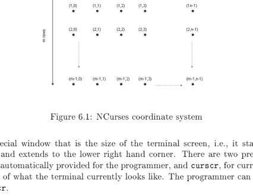

## Figure 6.1: NCurses coordinate system

屏幕是一个特殊的窗口，其大小与终端屏幕相同，即从左上角开始延伸到右下角。有两个预定义的屏幕：`stdscr`，由程序员自动提供，以及 `curscr`，即当前屏幕，它是终端当前外观的屏幕图像。程序员可以在 `stdscr` 上绘制，但不能在 `curscr` 上绘制。

#### 6.4.2 屏幕更新

每次应用程序对窗口进行更改并希望其在屏幕上可见时，都需要刷新屏幕。有两个函数可使终端屏幕上对应于窗口的部分反映窗口结构的内容：`refresh()` 和 `wrefresh()`。如果应用程序在 `stdscr` 上绘制，这是默认屏幕，那么它只需调用

```
```


`refresh()`

如果它在名为 `win` 的 `WINDOW` 上绘制，并且希望将该窗口的内容绘制到屏幕上，则调用

```
wrefresh(win)
```

`refresh()` 等价于 `wrefresh(stdscr)`。它实际上是一个宏。

一块屏幕“不动产”可能位于任意多个重叠窗口的范围内。如果两个窗口 `win1` 和 `win2` 重叠，并且调用了 `wrefresh(win2)`，库会确定如何最高效地重绘屏幕，替换 `win1` 和 `win2` 相交部分内的屏幕部分。它仅在窗口内容以某种方式发生变化时才重绘窗口。你可以调用 `touchwin(win)` 来告诉 NCurses 整个窗口 `win` 已发生变化，从而在调用 `wrefresh(win)` 时强制重绘。

> 2 存在第三个隐藏屏幕，它代表进行隐藏绘制的逻辑屏幕。NCurses 文档称之为虚拟屏幕。

### 6.4.3 构建程序

所有使用 NCurses 的程序必须包含 `<ncurses.h>` 头文件和标准 C I/O 库头文件 `<stdio.h>`。头文件 `<ncurses.h>` 通常只是指向 `<curses.h>` 的符号链接，因此它们通常可以互换。因为 NCurses 库不在链接器的标准库集合中，所以你必须在命令中显式使用 `-lncurses` 进行构建（放在引用 NCurses 符号的所有文件之后）：

```
$ gcc -o myprog myprog.c -lncurses
```


#### 6.4.4 核心函数集

本文并不打算成为 NCurses 的全面教程。关于这一点，你应该查阅多个在线参考手册或教程之一。此处的目标是解释核心库的底层概念并描述其提供的许多函数。下面是用于终端配置、光标移动、输出和输入的最重要、最基本、代表性的函数集合。

##### 配置函数

- `initscr()` 初始化 curses 库并创建逻辑屏幕。
- `endwin()` 关闭 curses 并重置屏幕。
- `wrefresh(win)` 将逻辑窗口 `win` 中的内容绘制到物理显示中。记住 `refresh()` 与 `wrefresh(stdscr)` 相同。
- `clear()` 清屏。
- `keypad(stdscr,TRUE)` 启用功能键和键盘键的使用（箭头、F1、...）

##### 输出和光标移动

- `move(r,c)` 将光标移动到屏幕位置 `(r,c)`。
- `getyx(win,y,x)` 获取当前光标位置。这是一个宏，因此 `y` 和 `x` 不必按地址传递。
- `addch(c)` 在当前光标位置绘制字符 `c` 到屏幕上，并将光标推进到字符末尾。如果 `c` 是制表符、换行符或退格符，光标会在窗口内适当移动。它在到达右边界时换行。
- `addstr(str)` 在当前光标位置绘制字符字符串 `str` 到屏幕上，并将光标推进到字符串末尾。它等价于对字符串中的每个字符调用 `addch()`。
- `addnstr(str, n)` 类似于 `addstr()`，但最多写入 `str` 的 `n` 个字符。如果 `n` 为 `-1`，则整个字符串将被添加，直到能容纳在行内的最大字符数，或直到遇到终止空字符。因此，`addstr(str)` 与 `addnstr(str,-1)` 相同。
- `mvaddch(y,x,c)` 将光标移动到屏幕上的位置 `(y,x)` 并在该位置绘制字符，同时将光标推进到字符末尾。
- `addchstr(str)` 类似于 `addstr(str)`，但：光标不推进，它不执行任何检查（如换行符、退格符或回车符），它不将其他控制字符扩展为 ^-转义，并且如果字符串跨越右边界则截断字符串，而不是将其换行到新行。
- `printw(fmt, ...)` 与 C 中的 `printf()` 相同，但打印到当前光标位置。

##### 输入

- `getch()` 从窗口读取一个字符。
- `getstr(str)` 读取字符直到收到换行符并存储（不含换行符）在 `str` 中（由调用者分配）
- `scanw(fmt, ...)` 与 C 中的 `scanf()` 相同 – 类似于调用 `getstr()`，传递给 `sscanf()`。

##### 窗口函数

- `win = newwin(l,c,y,x)` 创建一个新窗口，拥有 `l` 行、`c` 列，其左上角位于 `(y,x)`。返回指向新窗口的指针。
- `mvwin(win,y,x)` 将 `win` 指向的窗口移动到位置 `(y,x)`
- `win = dupwin(oldwin)` 复制 `oldwin`，返回指向新窗口的指针。
- `delwin(win)` 删除窗口 `win`，释放其所有资源。
- `putwin(win, filep)` 将 `win` 指向的窗口关联的所有数据写入 `filep` 指向的 `FILE` 流。底层写入失败时返回 `ERR`。
- `win = getwin(filep)` 读取由 `putwin` 存储到文件中的所有窗口数据，并使用该数据创建并初始化一个新窗口。这返回指向新窗口的指针。

##### 概要

`initscr()` 函数将终端初始化为 curses 模式。它在某些实现中也可能清除屏幕。这必须始终首先调用。它初始化 NCurses 系统并为 `stdscr` 和 `curscr` 窗口以及一些其他数据结构分配内存。当程序结束时，它应始终调用 `endwin()` 以重置终端并释放 curses 资源。

初始化 curses 之后，有几个函数可用于配置终端。通常会用 `clear()` 清屏，如果程序想要接收键盘和功能键的按键，则应调用 `keypad(stdscr, TRUE)`。上面未显示的其他函数包括影响终端驱动处理模式的函数 – `raw()` 和 `cbreak()`、`echo()` 和 `noecho()`，以及 `halfdelay()`。我们稍后会讨论这些。

输出函数可以分为三个系列：

`addch()` 在光标位置打印一个字符并移动光标

`addstr()` 在光标位置打印一个字符串并移动光标

`printw()` 打印类似 `printf()` 的格式化输出并移动光标

因此，`addch()` 添加一个字符，`addstr()` 添加一个字符串，而 `printw()` 打印格式化文本。对于其中每一个，都有许多变体，下面会进行描述。

光标可以通过 `move()` 函数在不输出的情况下移动。它的当前位置可以使用 `getyx()` 获取。`mvaddch()` 函数代表了一类在输出操作之前先移动光标的函数。总的来说，对于每个输出函数如 `addch()`，都有一个对应的形式为 `mvaddch()` 的函数。例如，存在 `mvaddstr()` 函数和 `mvprintw()` 函数。

基本输入函数是 `getch()` 和其字符串对应函数 `getstr()`，以及类似 `scanf()` 的 C 风格 `scanw()`。请注意 `getch()` 没有参数，但 `getstr()` 期望一个指向已分配缓冲区的指针，用来存储输入的文本。

最后，以上所有函数都作用于标准屏幕 `stdscr`。它们都是宏。对于其中每一个，都有一个作用于任意窗口的函数，并且命名约定使得很容易猜出它们。例如，`wgetch(win)` 是一个从当前窗口 `win` 读取字符的输入函数，而 `getch()` 被定义为 `wgetch(stdscr)`。类似地，`waddch(win,ch)` 在 `win` 中的光标位置放置一个字符，而 `addch(ch)` 被定义为 `waddch(stdscr,ch)`。

可以使用 `newwin()` 创建窗口，它在堆上分配内存并返回指向它的指针。如果 `newwin()` 对 `lines` 或 `columns` 中的任一个传入 `0`，则该维度被设置为它能容纳的最大值并适合终端窗口。函数确保在所有情况下新窗口都不会超出终端屏幕的边界。可以使用 `mvwin()` 移动窗口；你必须刷新才能看到变化。这不会从屏幕上擦除旧窗口，你必须自己处理。你可以使用 `dupwin()` 复制一个窗口，并使用 `delwin()` 删除一个窗口。

#### 6.4.5 关于窗口和刷新的重要要点

- 当你对屏幕进行更改时，调用 `refresh()` 或 `wrefresh()` 是一个好主意，但你应该牢记几个重要点。
- `addch()` 和 `addstr()` 系列的函数向屏幕写入字符串和字符时总是会自行调用 `wrefresh()`，因此在添加字符串或字符时无需刷新。`printw()` 函数并非如此。
- 当向屏幕绘制许多窗口时，如果对每个窗口调用 `wrefresh()`，可能会导致输出突发和性能不佳。`wrefresh()` 函数实际上调用了两个函数，`wnoutrefresh()` 和 `doupdate()`。调用 `wnoutrefresh(win)` 将 `win` 指向的 `WINDOW` 复制到逻辑屏幕上，而 `doupdate()` 将逻辑屏幕复制到物理屏幕上。因此，最好为每个要写入屏幕的窗口调用 `wnoutrefresh(win)`，然后再进行一次 `doupdate` 调用。
- `getch()` 和 `getstr()` 系列的输入函数如果窗口自上次刷新以来已被移动或修改，将会对给定窗口调用 `wrefresh()`。如果 `echo` 打开，则会自动进行刷新，因为这是一种修改。明确地说，`getch()` 将调用 `refresh()`，而 `wgetch(win)` 将调用 `wrefresh(win)`。这可能对程序的行为产生严重后果，因为光标会移动到 `wgetch(win)` 正在调用的窗口中，并且刷新也可能产生意想不到的后果。
- 最后，作为一条通用规则，你永远不应编写混合使用标准屏幕 `stdscr` 和其他窗口的 NCurses 程序。作用于标准屏幕的输入、输出和刷新函数会以意想不到的方式与其他窗口交互。如果你想编写简单的程序，就不要在其中使用窗口，反之，如果你觉得程序会从使用窗口中受益，那么就不要使用任何作用于标准屏幕的函数。

#### 6.4.6 几个简单程序

遵循传统，我们从一个 hello-world 程序开始。

```
Listing 6.1: helloworld.c

Listing. helloworld.c

#include <ncurses.h>

int main()

{

    initscr();                /* initialize the library */

    printw("Hello World !!!\n");  /* print at cursor */

    refresh();                /* update screen (unnecessary) */

    getch();                  /* wait for a keypress */

    endwin();                 /* clean up and quit curses */

    return 0;

}
```

输入调用 `getch()` 用来防止屏幕在我们看到之前就消失。下一个程序更有趣一些。


## Listing 6.2: drawpattern.c

```c
#include <stdio.h>
#include <curses.h>
int main()
{
    char pattern[] = "1234567890";
    int i;
    /* Initialize NCurses and clear the screen */
    initscr();
    clear();

    /* This will wrap across the screen */
    move(LINES/2,0);
    for ( i == 1; i <= 8; i++ ) {
        addstr( pattern );
        addch( ' ' );
    }

    /* Park the cursor at bottom */
    move(LINES-1,0);
    addstr("Type any char to quit:");
    refresh(); /* not needed */

    /* Wait for the user to type something, otherwise
       the screen will clear. */
    getch();
    endwin();
    return 0;
}
```

### 注释

- 1. `NCurses` 有一个预定义常量 `LINES`，它表示终端窗口中的行数，还有一个常量 `COLS` 存储列数。
- 2. 还要注意，程序每次更改屏幕时都会调用 `refresh()`。这是不必要的，因为 `addstr()` 会自动强制刷新。
- 3. 如果删除对 `getch()` 的调用，你将看不到任何内容；如果删除对 `endwin()` 的调用，屏幕将无法恢复。

下一个程序在屏幕中央绘制一个句点网格。

## 清单 6.3：drawgrid.c

```c
#define CENTERY (LINES/2 -2)   /* The middle line in terminal */
#define CENTERX (COLS/2 -2)   /* The middle column in terminal */
#define NUMROWS (LINES/2)
#define NUMCOLS (COLS/2)
int main()
{
    int r, c;
    char MESSAGE[] = "Press any character to exit:";
    int length, i, j;
    length = strlen(MESSAGE);
    initscr();   /* Initialize screen */
    clear();     /* Clear the screen */
    noecho();    /* turn off character echo */
    char grid[NUMROWS][NUMCOLS];
    for ( i = 0; i < NUMROWS; i++ ) {
        for ( j = 0; j < NUMCOLS-1; j++ )
            grid[i][j] = '.';
        grid[i][NUMCOLS-1] = '\0';
    }
    /* move to center to draw grid */
    r = CENTERY - (NUMROWS/2);
    c = CENTERX - (NUMCOLS/2);
    move(r,c);
    /* Draw each row of grid as a string */
    for ( i = 0; i < NUMROWS; i++ ) {
        mvaddstr(r+i,c,grid[i]);
    }
    /* Move to bottom of screen , post message to display */
    move(LINES-1,0);
    addstr(MESSAGE);
    getch();        /* wait for the user to type something */
    clear();        /* clear the screen */
    endwin();       /* delete curses window and quit */;
    return 0;
}
```

`NCurses` 使得将任意窗口保存到文件变得很容易。`putwin()` 函数会将窗口的内容写入一个 `FILE` 流，可以通过 `getwin()` 将其读回到程序中。接下来的两个清单展示了如何完成这两项操作。第一个是一个程序，它在一个窗口中绘制一张脸，并将其保存到命令行指定的文件中。

## 清单 6.4：保存窗口：drawface2.c

```c
#include <stdio.h>
#include <string.h>
#include <ncurses.h>
#include <stdlib.h>
#define CENTERY   (LINES/2 -2)    /* The middle line in terminal */
#define CENTERX   (COLS/2 -2)     /* The middle column in terminal */
void addhappyface(int * y, int * x)
{
    int orig_y = *y;
    addstr(" ^  ^ "); move(++(*y),*x);
    addstr(" o  o "); move(++(*y),*x);
    addstr("   ^   "); move(++(*y),*x);
    addstr(" \___/ "); move(++(*y),*x);
    addstr("");
    *y = orig_y;
    *x = (*x) + 5;
    move(*y, *x);
}
```

```c
int main(int argc, char *argv[])
{
    int    r, c;
    char   MESSAGE[] = "Press any character to exit:";
    int    length;
    FILE *fp;        /* for writing window contents */
    length = strlen(MESSAGE);
    if ( argc < 2 ) {
        printf("usage: %s window-file\n", argv[0] );
        return 0;
    }
    fp = fopen(argv[1], "w");
    if ( NULL == fp ) {
        printf("Error opening %s for writing.\n", argv[1]);
        return 0;
    }
    initscr();       /* Initialize curses library and the drawing screen */
    clear();         /* Clear the screen */
    /* Move to bottom of screen and post message to display */
    move(LINES - 1, 0);
    addstr(MESSAGE);
    /* move to center of screen - width of face */
    r = CENTERY;
    c = CENTERX - 5;
    move(r, c);
    addhappyface(&r, &c);
    addhappyface(&r, &c);
    addhappyface(&r, &c);
    /* Park cursor at bottom at the right side of the message */
    move(LINES-1,length);
    refresh();
    /* Write the standard screen to a file */
    if ( ERR == putwin(stdscr, fp) ) {
        printf("Error saving window.\n");
    }
    fclose(fp);
    getch();         /* wait for the user to type something */
    clear();         /* clear the screen */
    endwin();        /* delete curses window and quit */
    return 0;
}
```


下一个清单是一个程序，它可以读取任何由使用`putwin()`保存数据的 NCurses 程序创建的文件。该程序尝试打开文件并显示存储在其中的窗口。由于`getwin()`在失败时返回`NULL`指针，它会先检查返回的指针是否为非`NULL`，然后再显示数据。

# Listing 6.5: 检索已保存的窗口：`getdrawing.c`

```c
#include <stdio.h>
#include <string.h>
#include <curses.h>
int main(int argc, char *argv[])
{
    FILE    *fp;
    WINDOW  *win;
    if ( argc < 2 ) {
        printf("usage: %s window--file\n", argv[0]);
        return 0;
    }
    fp = fopen(argv[1], "r");
    if ( NULL == fp ) {
        printf("Error opening %s.\n", argv[1]);
        return 0;
    }
    initscr();      /* Initialize curses library and the drawing screen */
    cbreak();       /* So that the character is available immediately */
    noecho();       /* Turn off echo */
    clear();        /* Clear the screen */
    move(LINES-1,0);
    addstr("Enter a character to see the faces:");
    getch();
    win = getwin(fp);
    if ( NULL == win ) {
        clear();
        move(LINES-2,0);
        printw("The file %s was not created using putwin()." " Type any character to exit.\n", argv[1]);
    }
    wrefresh(win);
    fclose(fp);
    getch();        /* wait for the user to type something */
    clear();        /* clear the screen */
    endwin();       /* delete curses window and quit */
    return 0;
}
```

## 6.5 NCurses 中的用户输入

NCurses 有函数可以将终端置于几种不同的输入模式。下面的表格总结了不同的输入模式。

| Function Call | Line Buffering | Erase/Kill Processing | Signal Interpretation | Blocking |
|---|---|---|---|---|
| `raw()` | No | No | No | Yes |
| `cbreak()` | No | No | Yes | Yes |
| `halfdelay(n)` | No | No | Yes | Timed (0.1*n seconds) |
| `nodelay(stdscr, TRUE)` | No | No | Yes | No |

原始模式，由`raw()`函数建立，与非规范模式类似，其中键盘信号处理也被禁用。需要注意的是，它是一种阻塞输入模式。`cbreak`模式，由`cbreak()`建立，与原始模式类似，只是键盘信号会被处理。`cbreak`模式也是阻塞的。

`halfdelay()`函数和`nodelay()`函数都关闭了阻塞模式，但`halfdelay()`函数有超时，而`nodelay()`则无情且没有。两者都不是行缓冲的，也不允许编辑功能。`halfdelay()`函数接受一个整数参数，表示等待终端输入阻塞的十分之一秒数。如果在此时间内没有输入到达，则返回`ERR`值，这是一个整数值。在我们的`demos`目录中，第`chapter07`章中，你可以找到名为`raw_demo.c`、`cbreak_demo.c`、`halfdelay_demo.c`和`nodelay_demo.c`的演示程序，展示这些输入模式的工作方式。

还有两个值得记住的函数：`noraw()`和`nocbreak()`。如果终端已被置于`raw`、`cbreak`或`halfdelay`模式，`noraw()`会撤销该效果，打开行缓冲、行编辑、阻塞和信号处理。它不会撤销`nodelay()`的效果，该效果只能通过调用

```c
nodelay(stdscr, FALSE);
```

来撤销。

`nocbreak()`函数恢复行缓冲和行编辑，但如果之前由`raw`模式禁用了信号处理，则不会恢复信号处理。为此需要调用`noraw()`，它会重新打开信号处理。`nocbreak()`也会结束`halfdelay`模式。

## Example

我们将从一个相对简单的程序开始，该程序将终端置于`cbreak`模式。程序将进入一个由用户控制的循环，仅当用户输入特定字符时才终止。为了使其更具趣味性和现实性，我们将使用`F1`功能键来终止程序。该程序还将展示用户输入如何用于修改当前窗口状态，而不仅仅是通过显示文本。它将允许用户使用方向键在屏幕上移动光标。最后，它将在屏幕底部创建一个状态栏，并在光标移动时将当前光标位置写入其中，以及用户的操作说明。

以下是清单。注释解释了程序中的逻辑。

# Listing 6.6: `cursortrack.c`

```c
/* LINES and COLS are NCurses variables that get initialized when ... */
/* initscr() is called. */
```

```c
#define CENTERY  (LINES/2 -2)      /* The middle line in terminal */
#define CENTERX  (COLS/2 -2)       /* The middle column in terminal */
int main(int argc, char *argv[])
{
    int x,y;        /* to retrieve coordinates of cursor */
    int ch;         /* to receive user input character */
    int r, c;       /* to store coordinates of cursor */
    /* A string to display in the "status bar" at the bottom of the screen */
    char MESSAGE[] = "Use the arrow keys to move the cursor. "
                     "Press F1 to exit";
    int length;
    length = strlen(MESSAGE);  /* compute this once. */
    initscr();          /* Initialize screen */
    clear();            /* Clear the screen */
    noecho();           /* turn off character echo */
    cbreak();           /* disable line buffering */
    keypad(stdscr, TRUE); /* Turn on function keys */
    /* Move to bottom left corner of screen, write message there */
    move(LINES-1,0);
    addstr(MESSAGE);
    /* Start the cursor at the screen center */
    r = CENTERY;
    c = CENTERX;
    move(r,c);
    /* Print the cursor's coordinates at the lower right */
    move(LINES-1,COLS-8);
    printw("(%02d,%02d)",r,c);
    refresh();
```


```c
/* Then move the cursor back to the center */

move(r,c);

/* Repeatedly wait for user input using getch(). Because we turned off */

/* echo and put curses into cbreak mode, getch() will return without */

/* needing to get a newline char and will not echo the character. */

/* When the user presses the F1 key, the program quits. */

while((ch = getch()) != KEY_F1) {

    switch(ch) {

        /* When keypad() turns on function keys, the arrow keys are enabled */

        /* and are named KEY_X, where X is LEFT, RIGHT, etc. */

        /* This switch updates the row or column as needed, modulo COLS */

        /* horizontally to wrap, and LINES-1 to wrap vertically without */

        /* entering the sanctity of the status bar. */

        case KEY_LEFT:

            c = (0 == c) ? COLS-1:c-1;

            break;

        case KEY_RIGHT:

            c = ( c == COLS-1 ) ? 0 : c+1;

            break;

        case KEY_UP:

            r = ( 0 == r ) ? LINES-2 : r-1;

            break;

        case KEY_DOWN:

            r = ( r == LINES-2 ) ? 0 : r+1;

            break;

    }

    /* Now we move the cursor to the new position, get its coordinates */

    /* and then move to the lower right to print the new position */

    move(r,c);

    getyx(stdscr,y,x);

    move(LINES-1,COLS-8);

    printw("(%02d,%02d)",y,x);

    refresh();

    /* Now we have to move back to where we were since the cursor was */

    /* in the lower right after the printw(). */

    move(r,c);

}

endwin();      /* exit curses */

return 0;

}
```

### 6.6 NCurses 中的多窗口

下一个示例程序演示如何使用多个窗口。请注意，本程序不使用标准屏幕。

#### 清单 6.7：drawmanygrids.c

```c
#include <stdio.h>
#include <stdlib.h>
#include <string.h>
#include <curses.h>
#define CENTERY  (LINES/2 -2)      /* The middle line in terminal */
#define CENTERX  (COLS/2 -2)       /* The middle column in terminal */
#define NUMROWS  (LINES/2)         /* number of rows we use */
#define NUMCOLS  (COLS/2)          /* number of columns we use */
#define REPEATS  5
#define GRIDCHARS "@*+#"         /* should have REPEATS many chars */
int main(int argc, char *argv[])
{
    char  MESSAGE[] = "Type the character of the grid to bring it forward, 'q' to exit:";
    int   length, i, j, k;
    WINDOW *msg_win;
    WINDOW *windows[REPEATS];
    char gridchar[REPEATS] = GRIDCHARS;
    int rowshift, colshift;
    int ch;
    initscr(); /* Initialize screen */
    noecho(); /* turn off character echo */
    /* Make sure that the window is wide enough for message at the bottom.*/
    length = strlen(MESSAGE);
    if ( length > COLS - 2 ) {
        endwin();
        printf("This program needs a wider window.\n");
        exit(1);
    }
    /* Calculate the amount by which we shift each window when we draw it */
    rowshift = (LINES - NUMROWS)/5;
    colshift = (COLS - NUMCOLS)/5;
    /* In this loop, we create a new window, fill it with a grid of unique
       characters
    */
    for ( j = 0; j < REPEATS; j++ ) {
        /* Create a new window at an offset from (0,0) determined by the
           row and column shift. */
        windows[j] = newwin(NUMROWS, NUMCOLS, rowshift*j, colshift*j);
        if ( NULL == windows[j] ) {
            endwin();
            fprintf(stderr, "Error creating window\n");
            exit(1);
        }
        /* Draw each grid row as a string into windows[j] */
        for ( i = 0; i < NUMROWS; i++ ) {
            for ( k = 0; k < NUMCOLS; k++ ) {
                wmove(windows[j], i, k);
                if ( ERR == waddch(windows[j], gridchar[j]) )
                    /* Ignore the error; it means we are in the
                       bottom right corner of the window and the
                       cursor was advanced to a non-window position
                    */
                    ;
```


```c
            }

        }

        /* Update the virtual screen with this window's content */

        wnoutrefresh(windows[j]);

    }

    /* Now send the virtual screen to the physical screen */

    doupdate();

    /* Create a window to hold a message and put it in the bottom row */

    msg_win = newwin(1, COLS, LINES-1, 0);

    /* Write the message into the window; mywaddstr positions the cursor */
```

```

mvwaddstr(msgse_win,0,0, MESSAGE);

wrefresh(msgse_win);

while ( 1 ) {

    /*

        Read a character from the message window, not from stdscr. The

        call to wgetch forces a refresh on its window argument. If we

        refresh stdscr, our grids will disappear.

    */

    ch = wgetch(msgse_win);  /* wait for the user to type something */

    if ( ch === 'q' ) /* time to quit */

        break;

    /* Check if they typed a grid character */

    for ( j = 0; j < REPEATS; j++ ) {

        if ( ch === gridchar[j] ) {

            wmove(msgse_win,0,length);   /* move cursor to bottom */

            touchwin(windows[j]);        /* force the update */

            wrefresh(windows[j]);        /* refresh, bringing it forward */

            break;

        }

    }

}

clear();            /* clear the screen */

endwin();           /* delete curses window and quit */

return 0;

}
```

### 6.7 为程序添加计时：休眠

要使图像在屏幕上移动或动画，程序必须控制图像更改或显示的速率，这意味着它能够访问日期时间时钟或计时器。你已经见过 `sleep()` 系统调用。它是控制时间的一种方法。`sleep()` 的问题在于其基本单位是一秒间隔，这对于大多数视频来说太粗糙了。另一种选择是 `usleep()` 系统调用；`usleep()` 的粒度为一微秒³。`usleep()` 的问题在于它使用进程的真实计时器，而只有一个，因此对 `usleep()` 的多次同时调用会产生意外的结果。`sleep()` 和 `usleep()` 都存在可能与 `alarm()` 系统调用共享同一计时器的问题。POSIX 要求一个名为 `nanosleep()` 的调用，它具有更精细的粒度，并且保证不会与其他计时器交互。因此，我们将使用 `nanosleep()`：

```c
#include <time.h>

int nanosleep(const struct timespec *req, struct timespec *rem);
```

`timespec` 结构由以下定义

```c
struct timespec {
```

> ³这并不意味着它会精确实现到微秒以内。由于上下文切换，计时器的实现对于小间隔可能不准确。

```c
time_t tv_sec;    /* seconds */
long  tv_nsec;    /* nanoseconds */
};
```

第一个参数指定调用方应被挂起的时间量。第二个参数可用于在调用方被信号唤醒时存储剩余时间。如果它是 `NULL` 指针，则会被忽略。现在我们将 `NULL` 指针作为第二个参数传递。

动画的第一个示例以 `nanosleep()` 计时器确定的规律间隔在屏幕上交替显示两幅图像。它使用文件 `faces.c` 中定义的三个函数：

```c
void addsadface(int * y, int * x);    // Draws a "sad" face at (y,x)
void addhappyface(int * y, int * x);  // Draws a "happy" face at (y,x)
void eraseface(int * y, int * x);     // Erases face at (y,x)
```

它们分别绘制“悲伤的脸”、“快乐的脸”和空白脸。坐标最初是包围脸的矩形的左上角。返回时它们存储右上角。

主循环将反复绘制一张脸，将光标停放在屏幕左下角，调用 `refresh()`，然后休眠片刻。悲伤和快乐的脸将交替出现。程序的第一个版本，其列表如下，使用一个无限循环运行，必须由用户输入 Ctrl-C 来终止。

#### Listing 6.8: animateface0.c

```c
#include <stdio.h>
#include <curses.h>
#include <string.h>
#include <time.h>      /* for struct timespec */
#include "faces.h"    /* The set of face drawing functions */

int main(int argc, char* argv[])
{
    int r, c;
    int i = 0;
    char MESSAGE[] = "Type Ctrl-C to exit:";
    char BLANKS[] = "";
    int length;
    struct timespec sleeptime = {0,500000000};   /* 1/2 second */

    initscr();      /* Initialize curses library and the drawing screen */
    clear();        /* Clear the screen */

    /* Move to bottom of screen and post message to display */
    move(LINES-1,0);
    addstr(MESSAGE);

    /* Loop repeatedly until user types any character */
```

```c
while (1) {
    /* move to center of screen */
    r = CENTERY;
    c = CENTERX;
    move(r,c);    /* move to that position to draw */

    /* Draw either a happy face or sad face at (r,c) */
    if (0 == i) {
        addsadface(&r, &c);
        i = 1;
    }
    else {
        addhappyface(&r, &c);
        i = 0;
    }

    /* Park cursor at bottom */
    move(LINES-1,length);
    refresh();
    nanosleep(&sleeptime, NULL);    /* sleep 1/2 second */
}

/* Cleanup — erase the face first */
r = CENTERY;
c = CENTERX;
move(r,c);
eraseface(&r, &c);

/* erase the message at the bottom of the screen */
move(LINES-1,0);
addstr(BLANKS);
refresh();
endwin();    /* Delete NCurses window and quit */
```


```
return 0;

}
```

### 6.8 结合用户输入与定时

我们可以将 `halfdelay()` 函数与定时休眠结合起来，既能让表情动起来，也能让用户输入。程序可以调用 `halfdelay(1)` 让读取操作等待十分之一秒，并使用一个入口条件仅为 `(ERR == getch())` 的受控循环，从而允许用户输入一个字符来终止循环。一旦用户输入，字符会被缓冲起来，下一次执行 `getch()` 时，该字符会被取出并返回，此时条件变为假，循环随之退出。

我们还可以通过 `noecho()` 函数关闭 NCurses 中的回显。将这些结合起来，就构成了下面 `animateface.c` 的雏形。

#### 清单 6.9：`animateface.c`

```c
#include <stdio.h>
#include <curses.h>
#include <string.h>
#include <time.h>      /* for struct timespec */
#include "faces.h"    /* The set of face drawing functions */

int main(int argc, char* argv[])
{
    int r, c;
    int i = 0;
    char MESSAGE[] = "Press any character to exit:";
    char BLANKS[] = "";
    int length;

    length = strlen(MESSAGE);

    struct timespec sleeptime = {0,500000000};     /* 1/2 second */

    initscr();      /* Initialize curses library and the drawing screen */
    clear();        /* Clear the screen */
    noecho();       /* Turn off character echo */
    halfdelay(1);   /* Turn on timed delay of 0.1 second — if no char */
                    /* within 0.1 sec, getch() returns ERR */

    /* Move to bottom of screen and post message to display */
    move(LINES-1,0);
    addstr(MESSAGE);

    /* Loop repeatedly until user types any character */
    while (ERR == getch()) {
        /* move to center of screen */
        r = CENTERY;
        c = CENTERX;
        move(r,c);      /* move to that position to draw */

        /* Draw either a happy face or sad face at (r,c) */
        if (0 == i ) {
            addsadface(&r , &c);
            i = 1;
        }
        else {
            addhappyface(&r, &c);
            i = 0;
        }

        /* Park cursor at bottom */
        move(LINES-1,length);
        refresh();
        nanosleep(&sleeptime, NULL);     /* sleep 1/2 second */
    }

    /* Cleanup — erase the face first */
    r = CENTERY;
    c = CENTERX;
    move(r,c);
    eraseface(&r, &c);

    /* erase the message at the bottom of the screen */
    move(LINES-1,0);
    addstr(BLANKS);
    refresh();
    endwin();      /* Delete NCurses window and quit */

    return 0;
}
```

### 6.9 使用 `alarm()` 和 `pause()` 系统调用进行定时

`sleep()` 系统调用基于闹钟（alarm）机制。UNIX 中的闹钟本质上就是软件层面的定时器。（定时器在指定的时间间隔后触发；闹钟在指定的时钟时间触发；在 UNIX 中，闹钟类似于定时器。）当你想小睡一小时时，你会设定一个定时器在一小时后叫醒你。在 UNIX 中，进程可以设置闹钟，以便在未来的某个时刻向自身发送信号。这是通过调用 `alarm()` 来实现的，其原型为：

```
#include <unistd.h>

unsigned int alarm(unsigned int seconds)
```

`alarm()` 会设置一个定时器，在参数指定的秒数后到期，并立即返回。如果没有待处理的闹钟，返回值为 0；否则，返回值为待处理闹钟剩余的秒数。如果之前调用过 `alarm()`，但为其设置的时间段尚未过去，则该闹钟处于待处理状态。例如，假设在时间 0 处设置了一个 10 秒的闹钟：

```
alarm(10);
```

4 秒后，同一进程再次调用 `alarm()`，这次请求 20 秒：

```
seconds_left = alarm(20); // called with 6 seconds remaining
```

这次 `alarm()` 调用返回的值将存储在 `seconds_left` 中，值为 6。闹钟被重置为 20 秒，并将在 20 秒后向进程发出信号。演示程序 `snoozealot.c` 演示了这一点以及如何使用该返回值。在查看 `snoozealot.c` 之前，先看看更简单的程序 `snooze.c`，稍后会对其进行说明。

当闹钟定时器到期时，会向设置该闹钟的进程发送一个 `SIGALRM`（在 L 和 R 之间没有“A”）信号。如果进程没有为 `SIGALRM` 提供信号处理程序，或者由于其他原因该信号未被捕获，那么 `SIGALRM` 将杀死该进程。“其他原因”可能是进程正处于无法被中断的系统调用中，或者当 `SIGALRM` 到达时正在处理其他信号，而该处理程序并未被设计为允许接收多个信号。

通过以上讨论，你应该认识到 `alarm()` 调用一次最多只能维持一个闹钟。如果你想要多个闹钟的效果，就必须在 `SIGALRM` 处理程序中编写相应逻辑；也就是说，你必须为新时间重置闹钟。

如果目前还不明显的话，`alarm()` 系统调用有几种不同的用途。进程可以在启动一项长时间任务之前设置闹钟，如果输入数据意外地很大，该任务可能无法完成。闹钟将防止进程在可能无休止的任务上花费过多时间。它也可以设置一个闹钟，在一段特定时间之后异步执行某个任务，也许基于其数据的状态。

与闹钟经常一起使用的系统调用是 `pause()` 调用。当进程调用 `pause()` 时，它会被挂起，并保持挂起状态直到收到信号。任何信号都能唤醒它。`pause()` 的原型如下：

```
#include <unistd.h>

int pause(void);
```

如果进程调用 `pause()` 而没有安排一个在调用 `pause()` 之后到期的闹钟，那么它很可能再也不会运行了¹。例如：

```
#include <unistd.h>

#include <stdio.h>

int main()
{
    pause();
    printf("You will never see this message!\n");
    return 0;
}
```


这个程序运行时，将保持阻塞状态，直到内核或用户向它发送信号。由于没有信号处理程序，它收到信号时会采取默认动作，通常是终止，永远到达不了 `printf()` 语句。

`demos` 目录包含几个不同的示例，用来演示 `alarm()`、`signal()` 和 `pause()` 调用。`snooze.c` 示例类似于 UNIX 的 `sleep` 命令。`snoozealot.c` 示例演示了闹钟如何重用、针对 `SIGALRM` 和 `SIGINT` 的信号处理程序如何执行程序清理工作，以及如何在倒计时闹钟的编程循环中允许非阻塞用户输入。接下来的演示是另一个示例，它只关注闹钟，同时记录闹钟发生的时间。

下面清单中的程序 `alarmdemo1.c` 使用 `signal()` 系统调用来安装信号处理程序。在 `demos` 目录中还有该程序的第二个版本，它改用 `sigaction()` 完成了完全相同的工作。对二者进行比较是很有用的。

## 清单 6.10：alarmdemo1.c

```
#include <unistd.h>

#include <stdio.h>

#include <signal.h>

#include <time.h>

#include <stdlib.h>

/* This is the SIGALRM handler. When the SIGALRM is delivered to this */
/* process, it resets the handler and displays the current time. */
void catchalarm(int signo)
{
    signal(SIGALRM, catchalarm); /* install handler again */
    time_t t;                     /* time in seconds since the Epoch */
    struct tm *tp;                /* time struct with years, months, days,... */
    time(&t);                     /* get current time as a time_t in t */
    tp = localtime(&t);           /* convert time to a tm struct */
    printf("Caught alarm at %d:%d:%d\n", tp->tm_hour, tp->tm_min ,tp->tm_sec );
}

int main(int argc, char * argv[])
{
    int k, sec;
    struct tm *tp;    /* time struct with years, months, days, etc */
    time_t t;         /* time in seconds since the Epoch */
    /* check proper usage */
    if (2 > argc) {
        printf("Usage: %s \n",argv[0]);
        return -1;
    }
    k = atoi(argv[1]);            /* convert argv[1] to int (no error check) */
    signal(SIGALRM, catchalarm);  /* install catchalarm as the handler */
    time (&t);                    /* store current time in t */
    tp = localtime(&t);           /* store t as day,hours,minutes, etc. */
    /* print time at which alarm is set an how long it is set for */
    printf("Time is %d:%d:%d\n", tp->tm_hour, tp->tm_min ,tp->tm_sec );
    printf("Alarm is set for %d seconds.\n", k);
    sec = alarm(k);               /* set alarm */
    pause();                      /* wait for a signal to arrive */
    return 0;
}
```

## 解释

主程序首先调用 `signal()` 安装一个 `SIGALRM` 处理程序：

```
signal(SIGALRM, catchalarm);
```

`catchalarm()` 处理程序与之前的示例不同。它在做任何其他事情之前，先调用 `signal()` 重新安装处理程序。这是因为在进程处理信号期间，同类型的信号会丢失。要在 `SIGALRM` 处理程序中捕获一个 `SIGALRM`，唯一的方法是重新调用 `signal()`。尽管这个特定程序无法再发出另一个闹钟，但一般来说，信号处理程序的设计应使得，如果同类型的第二个信号在它们处理过程中到达，它们...

在处理第一个信号时，它们不会被“打个措手不及”而可能被第二个信号杀死。这个处理器只是演示了该技术。

处理器使用 `time()` 和 `localtime()` 系统调用来获取当前时间，将其转换为人类可读的格式，并在控制台上显示。主程序显示当前时间并立即通过调用打开闹钟

```
alarm(k)
```

其中 `k` 是命令行参数的数值。它随后调用 `pause()` 来等待接收 `SIGALRM`。如果在任何其他信号到达之前 `SIGALRM` 到达，它将导致 `catchalarm()` 运行，该函数将显示时间。如果另一个信号先到达，进程很可能会被杀死。

### 6.10 间隔定时器

`alarm()` 系统调用的时间粒度或分辨率对于许多应用程序来说太粗糙了。此外，如果要使闹钟在固定间隔内响起，则必须重复调用 `alarm()`，例如当进程正在计时某个任务的进度时。 （假设你想在控制台上显示某种速度指示器，其中瞬时速度是通过在固定时间间隔内写入的数据量来测量的。你需要一个精细分辨率的定时器和一个 `SIGALRM` 捕获器来测量处理的数据量并重新安装自身，但这会略微不准确，因为从处理器开始到重新安装自身所需的时间之间存在时间差。）

间隔定时器是在后来的伯克利版 UNIX（4.2BSD）以及 SVR4(1170) 版 UNIX 中引入的，用来解决这个问题。间隔定时器有两个组成部分：初始延迟和重复间隔。初始延迟的值是内核应在向进程发送第一个信号之前延迟的时间量。重复间隔的值是内核应在向进程发送的连续信号之间等待的时间量。换句话说，如果间隔定时器在时间 `t0` 开始，初始延迟 = `x`，重复间隔 `y`，则它将在时间 `t0 + x`、`t0 + x + y`、`t0 + x + 2y`、`t0 + x + 3y`、`t0 + x + 4y`、... 时产生信号，直到进程终止。

#### 6.10.1 三种定时器：实时、虚拟和剖析

有三种不同类型的间隔定时器。一类定时器在所有经过的时间内滴答作响（像墙上的时钟）；这是实时定时器。第二类仅在进程处于用户模式时滴答作响（像体育赛事中的计时器，在比赛因各种原因暂停时会停止）；这是虚拟定时器。最后一类在进程处于用户模式或系统调用时滴答作响（像职业国际象棋比赛中的计时器，当一个人已停止计时而另一个人尚未开始时计时器会停止）；它被称为 `prof` 定时器。用于定义这些定时器的常量，如你将在文档中看到的，是：

`ITIMER_REAL` 总是滴答作响，并在到期时发送 `SIGALRM`

> 5 如果两个人决定休息喝咖啡，计时器处于关闭状态。你可以将用户模式视为你的时间，将内核模式视为对手的时间。那么这个类比就适用了。

`ITIMER_VIRTUAL` 仅在进程处于用户模式时滴答作响，即不在系统调用中。到期时发送 `SIGVTALRM`。

`ITIMER_PROF` 在用户模式和系统调用期间滴答作响；到期时发送 `SIGPROF` 信号

`SIGPROF` 和 `ITIMER_PROF` 中的 “PROF” 是 `profile` 的缩写，即进程在所有用户模式和内核模式活动中的时间使用情况的快照。根据这些定义，可以得出进程睡眠的时间是其实时时间减去其剖析时间，而它在内核模式中花费的时间是剖析时间减去虚拟时间。我们感兴趣的是实时间隔定时器，即像普通闹钟一样滴答作响的定时器。

#### 6.10.2 初始值和重复值

一个 `itimerval` 结构包含两个成员：初始延迟的值和重复间隔的值：

```
struct itimerval {
    struct timeval it_interval; /* next value */
    struct timeval it_value;    /* current value */
```


初始延迟存储在 `it_value` 元素中，重复间隔存储在 `it_interval` 中。随着定时器的滴答，`it_value` 元素会被递减；当它达到零时，向进程发送一个信号，并将 `it_interval` 的值复制到 `it_value` 中。

每个成员的类型为 `timeval`。`timeval` 结构使用两个元素表示时间间隔：秒数和间隔中的微秒数。没有毫秒字段：

``` 
struct timeval {
    long tv_sec;      /* seconds */
    long tv_usec;     /* microseconds */
};
```

由于 `long` 整数通常是 32 位或 64 位，取决于实现，`tv_usec` 成员足够大，可以表示从 0 到一百万的任何微秒数。由于通常以毫秒为单位处理时间，你需要将以毫秒为单位测量的时间转换为以秒和微秒为单位的 `timeval`。数学上，如果 `t` 是以毫秒表示的时间，则

- ⌊`t`/1000⌋ 是 `t` 中的整秒数，且
- 1000 · (`t` mod 1000) 是 `t` − ⌊`t`/1000⌋ 中的微秒数

因此，下面的 C 代码片段设置了 `timeval` 结构体的字段，给定一个以毫秒为单位的整数 `m`

``` 
timeval t;
 t.tv_sec = m / 1000;
 t.tv_usec = ( m - t.tv_sec * 1000 ) * 1000;
```

这样可以避免使用取模运算符进行第二次除法。

`getitimer()` 和 `setitimer()` 系统调用用于处理间隔定时器。前者获取定时器的当前值，后者设置定时器的值。

``` 
#include <sys/time.h>
int getitimer(int which, struct itimerval *value);
int setitimer(int which, const struct itimerval *value,
struct itimerval *ovalue);
```

两个函数的第一个参数都是一个整数常量，用于指定定时器的类型，是以下常量之一：`ITIMER_REAL`、`ITIMER_VIRTUAL` 或 `ITIMER_PROF`。`getitimer()` 的第二个参数是指向 `itimerval` 结构的指针，用于填充其当前值。该结构中的 `it_value` 元素被赋予定时器剩余的时间，而不是最初设置的时间。

`setitimer()` 函数的第二个参数 `value` 是用于设置定时器的 `itimerval` 结构地址，第三个参数 `ovalue` 如果不是 `NULL`，则是用于填充其当前值的结构地址。

要停止定时器，将初始间隔和重复间隔都设为 0。如果重复间隔为 0 但初始延迟不为 0，定时器发送一次信号后停止。如果初始值为 0，定时器永远不会启动，无论重复间隔是多少。

下面的 `set_timer()` 函数可用于设置间隔定时器的值，给定以毫秒表示的时间值。它有三个参数：要设置的定时器类型、初始延迟的毫秒数以及重复间隔的毫秒数。

### Listing 6.11: set_timer()

``` 
int set_timer( int which, long initial, long repeat )
{
    struct itimerval itimer;
    long secs;
    /* initialize initial delay */
    secs = initial / 1000 ;
    itimer.it_value.tv_sec     = secs;
    itimer.it_value.tv_usec    = (initial - secs*1000 ) * 1000 ;
    /* initialize repeat interval */
    secs = repeat / 1000 ;
    itimer.it_interval.tv_sec  = secs;
    itimer.it_interval.tv_usec = (repeat - secs*1000 ) * 1000 ;
    return setitimer(which, &itimer, NULL);
}
```

演示程序 `timer demo.c` 演示了如何使用此函数。它接受命令行参数，以便您可以控制初始和重复延迟，并且信号处理程序设计为简单地计数接收到的信号，并在达到预先指定的信号数量后退出。

### Listing 6.12: timer demo.c

``` 
#include <stdlib.h>
#include <stdio.h>
#include <sys/time.h>
#include <signal.h>
#include "timers.h"
void count_alarms(int);
int main(int argc, char* argv[])
{
    int initial = 250;  /* default value */
    int repeat  = 500;  /* default value */
    if (argc >= 3) {
        initial = atoi(argv[1]);
        repeat  = atoi(argv[2]);
    }
    if ( initial == 0 || repeat == 0 ) {
        printf("Setting either interval to 0 hangs the process.\n");
        printf("Bailing out...\n");
        return 0;
    }
    signal(SIGALRM, count_alarms);
    if ( set_timer(ITIMER_REAL, initial, repeat) == -1 )
        perror("set_timer");
    else
        while (1 )
            pause();
    return 0;
}
void count_alarms(int signum)
{
    int alarmsaccepted = 10;
    static int count = 0;
    printf("alarm %d \n", ++count);
    fflush(stdout);
    if ( alarmsaccepted == count ){
        printf("No more alarms allowed!\n");
        exit(0);
    }
}
```


如果您使用各种值作为参数运行此程序，您将看到它的工作原理。

#### 6.10.3 UNIX 中定时器的实现方式

只有一个系统时钟。相比之下，有许多进程，其中不止一个可能有活动的定时器。内核维护一个包含所有进程定时器的数据结构。随着系统时钟的每次滴答，内核递减每个当前活动的每个进程定时器。如果某个进程的定时器达到 0，内核会向该进程发送适当的信号，并将 `it_interval` 值复制到 `it_value` 中，前提是 `it_interval` 不为 0，从而有效地重置定时器。如果 `it_interval` 为 0，则定时器停止。

#### 6.10.4 定时器的限制和注意事项

每个进程可以有每种类型的定时器各一个：一个实时定时器、一个虚拟定时器和一个分析定时器，但每种只能有一个。虽然秒值和微秒值都用于设置定时器参数，但大多数操作系统不会给进程一个完全精确的时间间隔，因为这些不是实时定时器，并且操作系统通常使用的时间分辨率为毫秒级，而不是微秒级。符合 SVR4 和 4.4BSD 规范的 UNIX 系统虽然保证不会比请求的时间间隔更早地生成信号。信号的传递可能会在系统负载很重时延迟。此外，如果系统负载非常重，甚至可能出现后续信号无法传递的情况，因为来自早期定时器到期的信号尚未传递，因此第二个信号会丢失。

### 6.11 视频游戏中的定时器和信号

到目前为止，我们已经看到如何使用 NCurses 库通过擦除、重新定位和绘制同一对象，并在重复绘制之间加入少量时间延迟，从而在屏幕上制造运动的错觉。`animateface.c` 程序使用 `nanosleep()` 函数来实现这种时间延迟，因为 `nanosleep()` 提供了足够小的分辨率，并且不会干扰 `SIGALRM` 信号。然而，如果我们希望视频游戏具有交互性，那么它必须在制造屏幕动作独立于用户动作的错觉的同时响应用户输入。`animateface.c` 使用的方法行不通，因为当程序在 `nanosleep()` 调用中等待时，它无法响应用户输入。

相反，我们可以让定时器在后台运行。定时器以固定的间隔中断进程，通过发送 `SIGALRM` 信号。所有用于更新绘图的功能都可以放入 `SIGALRM` 信号的处理程序中。然而，将这些想法推广到一般程序中存在危险，如下所述。

#### 6.11.1 关于信号处理程序设计的注意事项

信号生成和传递机制是一个复杂且包含许多细微差别的系统，程序员必须意识到这些问题，并且必须以极大的谨慎设计处理程序。第一个问题是关于处理程序本身内部的潜在竞争条件。

由于信号处理程序除了信号编号之外不能有任何参数，或者在较新的 `sa_sigaction()` 风格处理程序的情况下内核传递给它的结构，因此它们与程序其余部分共享数据的唯一方式是通过全局变量。例如，如果 `SIGALRM` 信号处理程序必须更新屏幕上对象的位置，那么处理程序需要对存储对象当前位置的变量具有读写访问权限。该变量必须是处理程序内的静态变量，或程序中的全局变量。如果变量需要在处理程序之外被程序的其他部分访问，则它必须是全局变量。在任何一种情况下，变量都不能驻留在运行时栈上，因为如果它在那里，它会在处理程序的每次调用之间被销毁。如果变量的内容在处理程序的每次调用之间被销毁，就无法对对象进行动画处理。

通常，使用必须访问全局数据或非栈上数据的信号处理程序是危险的。如果在我们的视频程序中正确处理，风险很小，但如果将同样的策略用于一般程序，可能导致不可靠且不安全的程序。它会打开潘多拉魔盒，带来与处理程序本身可能出现竞态条件相关的一系列问题。这是因为在处理程序处于活动状态时可能会有另一个信号到来，从而导致处理程序被重新进入。例如，如果处理程序使用 `SA_NODEFER` 标志注册，那么它可能在执行中间被中断，并且处理程序使用的变量因此可能处于不一致的状态。更糟的是，在某些情况下，入侵者可能会找到方法向程序发送适当的信号序列，迫使其核心转储，并利用这些转储获得 root 访问权限（参见 Zalewski [3]）。

第二个问题涉及某些系统调用和库函数。某些系统调用和库函数被标记为安全，其余的则不安全。如果信号处理程序调用库函数或系统调用，并且在处理程序处于该调用期间时，另一个信号导致其被重新进入（因为信号未被屏蔽或阻塞），则信号处理程序的第二次调用也可能进入同一个函数。如果是这样，则该函数也会被同一进程重新进入。如果该函数不安全，则处理程序的数据状态将被破坏，其执行不再可预测。例如，在以下处理程序中

```
void sighandler(int signum)
{
    ...
    printf("Running with uid=%d euid=%d\n", getuid(), geteuid());
    ...
}
```

如果在第一次调用处于 `printf()` 函数时第二个信号到来，则两次调用都将使用 `printf()` 代码，而 `printf()` 不是可重入的，因此不安全。这意味着 `printf()` 的输出可能被破坏。更糟糕的情况也可能发生，使系统容易受到攻击。POSIX.1-2004 要求以下函数可以在信号处理程序中安全调用：

```
_Exit(), _exit(), abort(), accept(), access(), aio_error(), aio_return(),
aio_suspend(), alarm(), bind(), cfgetispeed(), cfgetospeed(), cfsetispeed(),
cfsetospeed(), chdir(), chmod(), chown(), clock_gettime(), close(), connect(),
creat(), dup(), dup2(), execle(), execve(), fchmod(), fchown(), fcntl(),
fdatasync(), fork(), fpathconf(), fstat(), fsync(), ftruncate(), getegid(),
geteuid(), getgid(), getgroups(), getpeername(), getpgrp(), getpid(),
getppid(), getsockname(), getsockopt(), getuid(), kill(), link(), listen(), lseek(), lstat(), mkdir(), mkfifo(), open(), pathconf(), pause(), pipe(), poll(), posix_trace_event(), pselect(), raise(), read(), readlink(), recv(), recvfrom(), recvmsg(), rename(), rmdir(), select(), sem_post(), send(), sendmsg(), sendto(), setgid(), setpgid(), setsid(), setsockopt(), setuid(), shutdown(), sigaction(), sigaddset(), sigdelset(), sigemptyset(), sigfillset(), sigismember(), signal(), sigpause(), sigpending(), sigprocmask(), sigqueue(), sigset(), sigsuspend(), sleep(), socket(), socketpair(), stat(), symlink(), sync(), tcdrain(), tcflow(), tcflush(), tcgetattr(), tcgetpgrp(), tcsendbreak(), tcsetattr(), tcsetpgrp(), time(), timer_getoverrun(), timer_gettime(), timer_settime(), times(), umask(), uname(), unlink(), utime(), wait(), waitpid(), write().
```

POSIX.1-2008 从前述列表中删除了 `fpathconf()`、`pathconf()` 和 `sysconf()`，并向其中添加了以下函数：

```
execl(), execv(), faccessat(), fchmodat(), fchownat(), fexecve(), fstatat(), futimens(), linkat(), mkdirat(), mkfifoat(), mknod(), mknodat(), openat(), readlinkat(), renameat(), symlinkat(), unlinkat(), utimensat(), utimes()
```


通常，除了 `read()` 和 `write()` 之外的 I/O 函数都不安全，不能在信号处理程序中调用。

不可重入函数是指不能安全地被调用、中断，然后在第一次调用完成前再次调用而不导致内存损坏的函数。一种简单地思考函数是否可重入的方法是，该函数使用的每个变量都存储在运行时栈上，包括任何返回值。它不使用静态变量也不使用全局变量。每次调用时，新调用都有自己的一组变量。

如果信号处理程序包含对不安全函数的调用，则它必须完全消除被中断的可能性。这是不现实的。如果一个不安全函数在执行中间时信号到来，而该信号的处理程序也调用了一个不安全函数，那么执行的結果就变得未定义，意味着关于会发生什么一切皆有可能。这也是避免在处理程序中使用不安全函数的更令人信服的理由。

根据 `Wheeler`[2] 的建议，在设计信号处理程序时，尽可能遵循以下三条通用规则：

- 1. 在可能的情况下，让你的信号处理程序无条件地设置一个特定的标志，并且不做其他任何事情。
- 2. 如果你必须有更复杂的信号处理程序，仅使用专门指定为可在信号处理程序中使用的安全调用。特别是，不要在 C 中使用 `malloc()` 或 `free()`（在大多数系统上它们不受信号保护），也不要使用依赖于它们的许多函数（如 `printf()` 系列和 `syslog()`）。你可以尝试用对全局标志的检查来“包装”对不安全库调用的调用（以避免重新进入），但我不推荐这样做。
- 3. 在程序中的所有非原子操作期间阻塞信号传递，并在信号处理程序内部阻塞信号传递。

除此之外，我还想补充一条建议：

- 在可能的情况下使用 `SA_RESTART` 标志，以避免系统调用被中断并终止，从而可能导致程序异常退出，并在程序中使用信号处理程序时检查所有系统调用的返回值。

由于我们的演示程序旨在在处理程序调用期间产生输出或更改程序状态以说明各种原理，因此我们将无法遵守规则 1，但我们可以坚持规则 2 和 3。

### 6.11.2 一个演示

我们将开发一个简单的程序来说明第一种动画方法。我们的程序名为 `bouncestr.c`，它将一个字符串——在此为一条虫子状的小家伙——在屏幕上水平移动，从左到右再从右到左。它被称为 `bouncestr.c`，因为每次这可怜的家伙撞到“墙”时，他都会向相反方向弹回。程序允许用户用三种不同的键控制游戏：

- 输入 `'f'` 加快运动；
- 输入 `'s'` 减慢运动；
- 输入空格字符反转虫子的方向。

速度是指我们的对象每秒将移动的字符位置数。例如，速度为 6 表示它每秒移动 6 列（即字符）。当用户按下 `f` 或 `s` 键时，速度应线性增加或减少，直到某些合理的限制。例如，如果 `v` 是当前速度，则按下一次 `f` 应表示 `v = v + 2`。速度的变化通过更改间隔定时器中的间隔并在用户按下 `'f'` 或 `'s'` 键时用 `setitimer()` 重置它来处理。

这种第一种动画方法将使主程序负责获取用户输入，并使用定时器和信号处理程序中断主程序并更新屏幕上虫子的位置。因为定时器会在发生时中断主程序循环，所以它们很可能会中断 `getch()` 代码中调用的 `read()` 系统调用以获取用户输入。因此，它们必须使用 `SA_RESTART` 标志建立，以重新启动这些调用而不丢失用户的输入。没有必要使输入非阻塞；这样做会浪费不必要的 CPU 周期询问内核是否有输入可用。但行缓冲应被禁用，以及回显和行编辑。因此，程序将打开 `cbreak` 模式并关闭回显。

程序需要一个全局变量：

```c
int direction;
```

用于存储移动方向（向左或向右，每次一个单元格），信号处理程序需要两个静态变量：

```c
int row, col;
```

用于存储当前绘制位置。主程序循环中的逻辑处理输入事件，如下所示。

#### Listing 6.13: Main processing loop of bouncestr.c

```c
while ( !finished ) {
    move( LINES-1, 0 );
    sprintf(msg, "Current speed: %3d (chars/sec)", speed);
    addstr(msg);
    is_changed = FALSE;
    c = getch();
    switch (c) {
        case 'Q':
        case 'q':
            finished = 1;
            break;
        case ' ':
            direction = ( direction == LEFT )? RIGHT:LEFT;
            break;
        case 'f':
            if ( 1000/speed > 2 ) {          /* if interval > 2 */
                speed = speed + 2;          /* increase */
                is_changed = TRUE;
            }
            break;
        case 's':
            if ( 1000/speed <= 500 ) {      /* if interval <= 500 */
                speed = speed - 2 ;        /* decrease */
                is_changed = TRUE;
            }
            break;
    }
    if ( is_changed ) {
        set_timer( ITIMER_REAL, 1000/speed, 1000/speed );
    }
    refresh();
}
```

### Notes

1. `is_changed` 让我们知道是否需要重置定时器。
2. 阻塞输入已打开，因此 `getch()` 在没有数据的情况下永远不会返回。循环只需检查键入了哪个字符。
3. 速度是间隔长度的倒数，就像频率是周期函数的周期倒数一样（例如波）。如果我们希望每 1000 毫秒有 `k` 个信号，则每个信号之间的间隔必须是 `1000/k`。类似地，如果我们希望一个对象每秒移动 `k` 次（等价于每 1000 毫秒移动 `k` 次），则每个信号之间的间隔必须是 `1000/k`。

提供给间隔定时器的值必须是 `1000/k` 毫秒。由于 `speed` 包含对象移动时每秒的字符数，因此提供给定时器的间隔是 `1000/speed`，因为 `set_timer()` 函数（定义在清单 6.11 中）期望间隔以毫秒为单位。

举个具体例子，如果 `speed = 10`，那么定时器必须每 `1000/10 = 100` 毫秒到期一次，这样我们才能每秒移动对象 10 次。如果 `speed` 增加 2，变为 12 字符/秒，那么间隔必须是 `1000/12 ≈ 83` 毫秒，这样定时器将每 83 毫秒到期一次。

4. 我们通过防止用户将 `speed` 减小到低于 1 来确保避免除零，这是通过确保 `1000/speed ≤ 500` 来实现的。我们设置速度上限，仅仅是因为高速不易观看。

重绘的逻辑现在在信号处理程序 `move_msg()` 中，如下所示：

#### 清单 6.14：move_msg()

```c
void move_msg(int signum)
{
    static int row = ROW;
    static int col = 0;
    char msg[40];
    mvaddstr(row, col, BLANK);   /* erase old string */
    col += dir;                  /* advance one column */
    move(row, col);              /* move to new location */
    if ( RIGHT == dir ) {
        addstr( MESSAGE );       /* add forward string */
        if ( col+strlen(MESSAGE) >= COLS-1 )
            dir = LEFT;          /* reverse if hitting edge */
    }
    else {
        addstr( REVMSGE );      /* add reverse string */
        if ( col <= 0 )
            dir = RIGHT;         /* reverse if hitting edge */
    }
    refresh();
}
```


请注意

- 处理程序使用静态变量（又称全局变量），使其不可重入。
- 它调用了一些不安全的函数。

然而，由于这是一个 `SIGALRM` 处理程序，并且时间间隔相对于代码长度来说极长，因此实际上不可能在处理程序运行期间递送 `SIGALRM` 信号。这就是它实际上是安全的原因。当然，你可以发送多个 `Ctrl-C`，对于它们来说它是不安全的。

如果信号处理程序是使用 `signal()` 系统调用安装的，那么处理程序将不得不通过立即调用 `signal()` 来重置自身。我们改用 `sigaction()` 调用。如果允许用户将动画加速到足够快，`SIGALRM` 信号可能会来得太快，在处理程序执行完毕之前就到达。在这种情况下，处理程序的行为将是不安全的。通过使用 `sigaction()`，我们可以确保当程序在处理程序内部执行时信号被阻塞。

下面是不包含清单 6.13 中主处理循环的程序。

#### 清单 6.15：`bouncestr.c` 的主程序

```c
#include <stdio.h>
#include <string.h>
#include <curses.h>
#include <signal.h>
#include "timers.h"

#define INITIAL_SPEED 50
#define RIGHT 1
#define LEFT -1
#define ROW 12
#define MESSAGE "0000000=>"
#define REVMSGE "<=0000000"
#define BLANK "        "

int dir; /* Global variable to store direction of movement */
int speed; /* Current speed in chars/second */

int main()
{
    int finished;
    int is_changed;
    int c;
    /* Set up signal handling */
    struct sigaction newhandler; /* for installing handlers */
    sigset_t blocked; /* to set mask for handler */
    newhandler.sa_handler = move_msg; /* name of handler */
    newhandler.sa_flags = SA_RESTART; /* flag is just RESTART */
    sigemptyset(&blocked); /* clear all bits of blocked set */
    newhandler.sa_mask = blocked; /* set this empty set to be the mask */
    if ( sigaction(SIGALRM, &newhandler, NULL) == -1 ) { /* try to install */
        perror("sigaction");
        return (1);
    }
    /* Prepare the terminal for the animation */
    initscr(); /* initialize the library and screen */
    cbreak(); /* turn off line buffering and editing */
    noecho(); /* turn off echo */
    clear(); /* clear the screen */
    curs_set(0); /* hide the cursor */
    /* Initialize the parameters of the program */
    dir = RIGHT;
    finished = 0;
    speed = INITIAL_SPEED;
    /* Start the real time interval timer with delay interval size */
    set_timer( ITIMER_REAL, 1000/speed, 1000/speed );
    /* main processing loop omitted but would be here */
    endwin();
    return 0;
}
```

### 6.12 非轮询输入

`bouncestr.c` 程序使用定时器生成中断来更新屏幕，但它通过本质上是轮询循环的方式获取用户输入：主程序反复轮询终端以获取输入。如果 CPU 不会被其他进程使用，或者程序在主循环中没有其他任务要执行，这种做法是可以的，但这是一种低效的检查输入可用性的方法，而在处理器的生命周期中，输入发生的频率极低。我们应该对程序成为 CPU 占用大户的想法感到不满，即使每次调用 `getch()` 检查用户输入时进程都被阻塞，程序也卡在轮询 I/O 循环中。进程基本上反复调用 `getch()`、阻塞、在用户输入时被唤醒、做一点工作然后再次阻塞。如果程序的输入部分也是信号驱动的会更高效，这意味着程序会要求内核在输入可以传递给它时通知它，也许是通过信号处理机制。在这种情况下，程序基本上处于空闲状态，等待任何信号的到来，要么是定时器更新屏幕的信号，要么是内核因为输入可用而发出的信号。

非轮询输入有两种不同类型：信号驱动和异步。要理解它们之间的区别，重要的是要知道输入首先从设备移动到内核地址空间中的缓冲区，然后再移动到进程的地址空间。

- 在信号驱动 I/O 中，程序告诉内核在输入被放置到内核地址空间后通知它。一旦进程被通知输入已在内核地址空间中，如果它发出 `read()` 系统调用，因为数据立即可用，所以它不会阻塞。换句话说，在进程被通知后执行的 `read()` 被保证会立即返回数据。
- 在异步 I/O 中，进程告诉内核在输入从设备移动到内核地址空间然后再移动到进程地址空间中的缓冲区后通知它。在这种 I/O 类型中，当进程收到信号时，`read()` 已经执行，并且用户进程已经拥有数据，但不一定在它必须进入的内存位置中。

信号驱动 I/O 在 UNIX 中可通过在文件描述符中设置 `O_ASYNC` 标志然后建立适当的信号来实现。异步 I/O 可通过 POSIX 异步 I/O 接口 `AIO` 获得。令人困惑的是，启用信号驱动 I/O 的标志被称为 `O_ASYNC`。我们将首先通过修改 `bouncestr.c` 程序来探索信号驱动 I/O。然后我们将创建一个使用 `AIO` 接口的异步 I/O 的 `bouncestr.c` 程序版本。

#### 6.12.1 使用 `O_ASYNC` 标志的非轮询 I/O

当你在文件描述符上设置 `O_ASYNC` 标志时，它会导致来自该描述符文件连接的输入被部分异步传递。准确地说，这意味着当设备上有输入可用时，内核会将其复制到内核地址空间中的位置，之后内核会向进程发送 `SIGIO` 信号。要通过此方法设置信号驱动输入，程序必须执行以下操作：

- 1. 通过调用
  `fcntl(F_SETOWN, getpid());`
  告诉内核在数据准备好读取时应向哪个进程发送 `SIGIO` 信号。
  `SETOWN` 操作使第二个参数中的进程 ID 成为要接收的信号的所有者。通常程序希望接收信号本身，因此它使用 `getpid()` 调用此操作。
- 2. 使用以下命令检索标准输入设备的现有标志
  `fcntl(0, F_GETFL);`
- 3. 使用以下命令在连接上设置 `O_ASYNC` 标志
  `fcntl(0,F_SETFL,(fd_flags|O_ASYNC));`
- 4. 假设 `on_input()` 是将处理 `SIGIO` 信号的函数，注册该信号处理程序：

```c
struct sigaction newhandler;
sigset_t blocked;
newhandler.sa_handler = on_input;
newhandler.sa_flags = SA_RESTART;
sigemptyset(&blocked);
newhandler.sa_mask = blocked;
sigaction(SIGIO, &newhandler, NULL);
```

`on_input()` 处理程序可以调用 NCurses `getch()` 函数，并且保证会收到用户输入的单个字符。这样它就不必在循环中执行阻塞读取，而可以在循环中做其他事情。

所有这些都放在程序 `bouncestr_async.c` 中。上述前三步可以放在名为 `enable_keybd_signals()` 的函数中：

```c
void enable_keybd_signals()
{
    int fd_flags;
    fcntl(0, F_SETOWN, getpid());
    fd_flags = fcntl(0, F_GETFL);
```


`fcntl(0, F_SETFL, (fd_flags|O_ASYNC));`

#### 6.12.2 使用 `O_ASYNC` 的 `bouncestr.c` 程序：有缺陷的版本

有时写一个糟糕的程序以便理解如何写一个好的程序是值得的。这就是这样一个练习。下面展示了该程序（不包括 `#include` 和与 `bouncestr.c` 程序相同的部分）。程序在 `on_input()` 处理程序中收到 `quit` 输入字符时终止。这是因为，一旦程序启动，就无法通过关闭计时器或将循环的控制变量设置为 1 来终止它。这将在后面解释。

主程序的任务是：

- 1. 建立信号处理程序。
- 2. 初始化 NCurses（以 `cbreak` 模式且不回显）。
- 3. 初始化程序的数据状态（速度、方向、行、列等）
- 4. 设置键盘信号。
- 5. 启动间隔计时器。
- 6. 在最后一行显示消息并循环直到是退出的时候。

程序：

##### Listing 6.16: 一个有缺陷的 `bouncestr_async.c`

```c
/* <——— snip ———> */

int dir; /* Global variable to store direction of movement */

int speed; /* Current speed in chars/second */

volatile sig_atomic_t finished;

void move_msg(int); /* handler for alarm */

void on_input(int); /* handler for keybd */

void enable_kbd_signals(); /* setup for SIGIO */

int main(int argc, char * argv[])

{

    struct sigaction newhandler; /* for installing handlers */

    sigset_t blocked; /* to set mask for handler */

    char msgse[40];

    /* Set up signal handling */

    newhandler.sa_handler = on_input; /* name of handler */

    newhandler.sa_flags = SA_RESTART; /* flag is just RESTART */

    sigemptyset(&blocked); /* clear all bits of blocked set */

    newhandler.sa_mask = blocked; /* set this empty set to be the mask */

    if ( sigaction(SIGIO, &newhandler, NULL) == -1 ) {

        perror("sigaction");

        return (1);

    }

    sigemptyset(&blocked); /* clear all bits of blocked set */

sigaddset(&blocked , SIGIO);

newhandler.sa_mask = blocked;    /* set this empty set to be the mask */

newhandler.sa_handler = move_msg; /* SIGALRM handler function */

if ( sigaction(SIGALRM, &newhandler, NULL) == -1 ){ /* try to install */

    perror("sigaction");

    return (1);

}

/* Prepare the terminal for the animation */

initscr();          /* initialize the library and screen */

cbreak();           /* put terminal into non-blocking input mode */

noecho();           /* turn off echo */

clear();            /* clear the screen */

curs_set(0);        /* hide the cursor */

/* Initialize the parameters of the program */

row     = ROW;

col     = 0;

dir     = RIGHT;

finished = 0;

speed   = INITIAL_SPEED ;

/* Turn on keyboard signals */

enable_kbd_signals();

/* Start the real time interval timer with delay interval size */

set_timer( ITIMER_REAL, 1000/speed , 1000/speed );

/* Display the status information on the bottom line */

sprintf(msgse, "Current speed: %3d (chars/sec)", speed);

mvaddstr(LINES-1, 0, msgse);

refresh();

while( 0 == finished ) {

    pause();

}

endwin();

return 0;

}
```

```c
void on_input(int signum)

{

    int     c;

    int     is_changed = 0;

    char    msgse[40];

    c = getch();

    switch (c) {

    case 'Q':

    case 'q':

        finished = 1;               /* quit program */

        clear();

        endwin();

        /* exit (0); UNCOMMENT THIS IF YOU WANT IT TO WORK!!! */

        break;

    case 'l':

        dir = (LEFT == dir) ? RIGHT:LEFT;  /* reverse direction */

        break;

    case 'f':

        if (1000/speed > 2) {             /* if interval > 2 */

            speed = speed + 2;             /* increase */

            is_changed = 1;

        }

        break;

    case 's':

        if (1000/speed < 500) {            /* if interval <= 500 */

            speed = speed - 2;             /* decrease */

            is_changed = 1;

        }

        break;

    }

    if (is_changed) {

        set_timer(ITIMER_REAL, 1000/speed, 1000/speed);

        sprintf(msgse, "Current speed: %d (chars/sec)", speed);

        mvaddstr(LINES-1, 0, msgse);

    }

    refresh();

}
```

```c
void move_msg(int signum)

/* same as in bouncestr.c, and so omitted here */
```

```c
void enable_kbd_signals()

{

    int fd_flags;

    fcntl(0, F_SETOWN, getpid());

    fd_flags = fcntl(0, F_GETFL);

    fcntl(0, F_SETFL, (fd_flags|O_ASYNC));

}
```


## Notes

- 1. 这个程序与 `bouncestr.c` 程序最大的不同是输入处理完全在 `on_input()` 处理程序内部。
- 2. `enable_kbd_signals()` 函数在文件描述符 `0` 上设置异步输入。
- 3. 该程序必须从处理程序内部调用 `exit()`，否则它永远不会终止。如果你修改 `on_input()` 处理程序，使其在键入 `'q'` 时仅将 `finished` 标志设置为 `1`，程序将不会停止。事实上，主程序将继续看到存储在 `finished` 中的值 `0`。你可以更进一步完全删除主循环，程序将永远动画。在其他话说，`SIGALRM` 的信号处理程序继续运行，`endwin()` 调用永远不会被到达。这个问题与 NCurses 无关，也与计时器无关。

问题在于，正如 `fcntl()` 的手册页所述，“当该文件描述符上可以进行输入或输出时，就会发送一个 SIGIO 信号。” 通过我进行的各种实验，我确定问题在于，当终端处于非规范模式并且在终端的输入描述符（文件描述符 `0`）上设置了信号驱动输入时，如果主程序或 SIGIO 处理程序尝试向终端设备输出，就会破坏 SIGIO 信号机制，以至于当 SIGIO 处理程序终止时，执行不会返回到主程序，而是会再次在处理程序中恢复，就好像 SIGIO 信号未从进程状态中清除一样。因此，进程将继续仅在输入处理程序中执行，以及如果未被阻塞则在 `SIGALRM` 处理程序中执行。如果从信号处理程序和主程序中删除所有向“慢速设备”，即屏幕的任何输出指令，则程序将正确工作。在处理程序或主程序中向屏幕发出写入操作的程序的行为显然是未定义的。

- 4. `SIGIO` 的信号处理程序不得阻塞 `SIGALRM`，否则动画会消失。`SIGALRM` 处理程序可以阻塞 `SIGIO` 信号。

下面是此相同程序的更好版本，也使用遵守上述所有安全规则的 `SIGIO` 信号处理程序，并且能正确工作。

### 6.12.3 使用 O_ASYNC 的 bouncestr.c 程序：一种正确的解决方案

在此版本中，`SIGIO` 信号处理程序中的所有代码都被移除，除了设置主程序检查的类型为 `volatile sig_atomic_t` 的状态变量值的代码。根据 CERT 安全编程标准，SIG31 [1]，

在信号处理程序中访问或修改共享对象可能会导致竞争条件，从而使数据处于不一致状态。此规则的例外是能够读取和写入 `volatile sig_atomic_t` 类型的变量。`volatile` 关键字的需求在规则 DCL34-C 中有描述。使用 `volatile` 来表示不能被缓存的数据。需要注意的是，从信号处理程序访问任何其他类型的对象会导致程序行为未定义。

类型 `sig_atomic_t` 是即使在异步中断存在的情况下也能作为原子实体访问的对象整数类型。`sig_atomic_t` 的类型是实现定义的，尽管它提供了一些保证。范围从 `SIG_ATOMIC_MIN` 到 `SIG_ATOMIC_MAX` 包含在内的整数值可以安全地存储到该类型的变量中。

更多细节可以在 CERT 网站或引用的参考资料中找到。

在我们的程序中，如果设置了状态变量，则主循环调用 `getch()` 获取输入，然后调用一个函数来处理输入。否则它会在 `pause()` 上自行阻塞。列表如下。

#### Listing 6.17: bouncestr_async2.c: A safe version of bouncestr_async.c

```
// #includes omitted here

#define INITIAL_SPEED 30

#define RIGHT 1

#define LEFT -1
```

```
#define ROW 12

#define MESSAGE "0000000=>"

#define REVMESSE "<=000000"

#define BLANK "      "

int dir; /* Global variable to store direction of movement */

int speed; /* Current speed in chars/second */

volatile sig_atomic_t input_ready;

/********************************************************************************/

/* Signal Handler Prototypes */

/********************************************************************************/

void on_alarm(int); /* handler for alarm */

void on_input(int); /* handler for keybd */

/* This is not a signal handler --- it consolidates logic for updating */

int update_from_input(int c,int *speed,int *dir );

/********************************************************************************/

/* Main */

/********************************************************************************/

int main( int argc, char * argv[])

{

    struct sigaction newhandler; /* for installing handlers */

    sigset_t blocked; /* to set mask for handler */

    int fd_flags;

    int c;

    int finished;

    /* Set up signal handling */

    newhandler.sa_handler = on_input; /* name of handler */

    newhandler.sa_flags = SA_RESTART; /* flag is just RESTART */

    sigemptyset(&blocked); /* clear all bits of blocked set */

    newhandler.sa_mask = blocked; /* set this empty set to be the mask */

    if ( sigaction(SIGIO, &newhandler, NULL) == -1 ) {

        perror("sigaction");

        return (1);

    }

    sigemptyset(&blocked); /* clear all bits of blocked set */

    newhandler.sa_mask = blocked; /* set this empty set to be the mask */

    newhandler.sa_handler = on_alarm; /* SIGALRM handler function */

    if ( sigaction(SIGALRM, &newhandler, NULL) == -1 ) { /* try to install */

        perror("sigaction");

        return (1);

    }

    /* Prepare the terminal for the animation */

    initscr(); /* initialize the library and screen */

    cbreak(); /* put terminal into non-blocking input mode */

    noecho(); /* turn off echo */

    clear(); /* clear the screen */

    curs_set(0); /* hide the cursor */

/* Initialize the parameters of the program */

dir = RIGHT;

finished = 0;

speed = INITIAL_SPEED ;

input_ready = 0;

/* Turn on keyboard signals */

fcntl(0, F_SETOWN, getpid());

fd_flags = fcntl(0, F_GETFL);

fcntl(0, F_SETFL, (fd_flags|O_ASYNC));

/* Start the real time interval timer with delay interval size */


`set_timer( ITIMER_REAL, 1000/speed, 1000/speed );`

/* Put a message in bottom row with current speed. */

`mvaddstr(LINES-1, 0, "Current speed:");`

/* Put the message into the first position and start */

`mvaddstr(ROW, 0, MESSAGE);`

```c
while( !finished ) {

    if ( input_ready ) {

        c = getch();

        finished = update_from_input(c, &speed, &dir);

        input_ready = 0;

    }

    else

        pause();

}

clear();

endwin();

return 0;

}
```

/********************************************************************************/

```c
int update_from_input( int c, int *speed, int *dir )

{

    int is_changed = 0;

    char mssge[40];

    switch (c) {

    case 'Q':

    case 'q':

        return 1;                         /* quit program */

    case ' ': 

        *dir = (LEFT == *dir )? RIGHT:LEFT;  /* reverse direction */

        break;

    case 'f':

        if ( 1000/( *speed ) > 2 ) {        /* if interval > 2 */

            *speed = *speed + 2;          /* increase */

            is_changed = 1;

        }

        break;

case 's':

    if (1000/(*speed) < 500 ) {        /* if interval <= 500 */

        *speed = *speed - 2 ;           /* decrease */

        is_changed = 1;

    }

    break;

}

if ( is_changed ) {

    set_timer( ITIMER_REAL, 1000/(*speed), 1000/(*speed) );

    sprintf(mssge, "Current speed: %d (chars/sec)", (*speed));

    mvaddstr(LINES-1, 0, mssge);

}

move( LINES-1, COLS-12);

sprintf(mssge, "Last Char:%c", c);

addstr(mssge);

refresh();

return 0;

}
```

/********************************************************************************/

```c
void on_input(int signum)

{

    input_ready = 1;

}
```

/********************************************************************************/

```c
void on_alarm(int signum)

{

    static int row = ROW;

    static int col = 0;

    mvaddstr( row, col, BLANK );   /* erase old string */

    col += dir;                    /* advance one column */

    move( row, col );              /* move to new location */

    if ( RIGHT == dir ) {

        addstr( MESSAGE );         /* add forward string */

        if ( col+strlen(MESSAGE) >= COLS-1 )

            dir = LEFT;            /* reverse if hitting edge */

    }

    else {

        addstr( REVMSSGE );        /* add reverse string */

        if ( col <= 0 )

            dir = RIGHT;           /* reverse if hitting edge */

    }

    refresh();

}
```

## 6.12.4 使用 AIO 的 bouncestr.c 程序

`AIO` 接口是一种 POSIX 接口，提供异步 I/O。设置文件描述符的 `O_ASYNC` 标志会在有数据可读时发送信号，而使用 `AIO` 接口则会在数据实际被读取并放入用户缓冲区后发送信号。`aio_read()` 调用是异步读取。实质上，它将读取请求放入 I/O 设备驱动程序的队列中并立即返回，如手册页所述：

```c
#include <aio.h>
int aio_read(struct aiocb *aiocbp);
```

```
The aio_read() function requests an asynchronous
"n = read(fd, buf, count)"
with fd, buf, count given by aiocbp->aio_fildes, aiocbp->aio_buf,
aiocbp->aio_nbytes, respectively. The return status n can be retrieved upon completion using aio_return(3).
```

```
The data is read starting at the absolute file offset aiocbp->aio_offset, regardless of the current file position. After this request, the value of the current file position is unspecified.
```

```
The “asynchronous” means that this call returns as soon as the request has been enqueued; the read may or may not have completed when the call returns. One tests for completion using aio_error(3).
```

请求得到满足时，驱动程序发送 `SIGIO` 信号。信号处理程序可以处理输入，然后发出新的 `aio_read()` 调用以获取更多数据。

程序必须

- 创建一个缓冲区来存储输入数据，并且
- 在发出第一次读取之前用适当的值填充 `aiocb` 结构。

`aiocb` 结构具有以下成员：

```c
int          aio_fildes    //File descriptor.
off_t        aio_offset    // File offset.
volatile void *aio_buf     //Location of buffer.
size_t       aio_nbytes    //Length of transfer.
int          aio_reqprio   //Request priority offset.
struct sigevent aio_sigevent // Signal number and value.
int          aio_lio_opcode //Operation to be performed.
```

程序不必为 `aio_reqprio` 成员分配值，但其他所有成员都必须初始化。下面的函数 `setup_aio_buffer()` 演示了如何设置一次读取一个字符到名为 `input` 的缓冲区中。它接收一个指向 `aiocb` 结构的指针并用所需数据填充其成员。然后主程序可以将此结构的地址传递给 `aio_read()` 函数。


## 清单 6.18: setup_aio_buffer()

```
void setup_aio_buffer(struct aiocb *aio_buf)
{
    static char input[1];                /* 1 char of input */

    /* describe what to read */
    aio_buf->aio_fildes   = 0;           /* file descriptor for I/O */
    aio_buf->aio_buf      = input;       /* address of buffer for I/O */
    aio_buf->aio_nbytes   = 1;           /* number of bytes to read each time */
    aio_buf->aio_offset   = 0;           /* offset in file to start reads */

    /* describe what to do when read is ready */
    aio_buf->aio_sigevent.sigev_notify = SIGEV_SIGNAL;
    aio_buf->aio_sigevent.sigev_signo  = SIGIO;          /* send SIGIO */
}
```

主程序应该声明 `aiocb` 结构，以便必须访问它的各个函数都能看到它。程序如下。

## 清单 6.19: bouncestr_aio.c


```
#include <unistd.h>
#include <stdio.h>
#include <curses.h>
#include <signal.h>
#include <string.h>
#include <aio.h>
#include "timers.h"

#define INITIAL_SPEED 30
#define RIGHT 1
#define LEFT -1
#define ROW 12
#define MESSAGE "ooooooo=>"
#define REVMSGE "<=ooooooo"
#define BLANK "        "

int dir;                /* Global variable to store direction of movement */
int speed;              /* Current speed in chars/second */
volatile sig_atomic_t input_ready;

struct aiocb kbcbuf;    /* an aio control buf */
void setup_aio_buffer(struct aiocb *aio_buf);

void move_msg(int signum);  /* handler for alarm */
int update_from_input( int *speed, int *dir );

/********************************************************************************/
/*               Signal Handler Prototypes                                      */
/********************************************************************************/

/* SIGALRM signal handler — it is responsible for animating the string */
void move_msg(int);

/* SIGIO signal handler — it is responsible for retrieving user input */
void on_input(int);          /* handler for keybd          */

/********************************************************************************/
/*
 *                              Main                                           *
 */
/********************************************************************************/

int main(int argc, char* argv[])
{
    struct sigaction newhandler;        /* new settings        */
    sigset_t            blocked;        /* set of blocked sigs */
    int                 finished;

    newhandler.sa_handler = on_input;   /* handler function    */
    newhandler.sa_flags = SA_RESTART;   /* options             */

    /* then build the list of blocked signals */
    sigemptyset(&blocked);              /* clear all bits      */
    newhandler.sa_mask = blocked;       /* store blockmask     */
    if ( sigaction(SIGIO, &newhandler, NULL) == -1 )
        perror("sigaction");

    newhandler.sa_handler = move_msg;   /* handler function    */
    if ( sigaction(SIGALRM, &newhandler, NULL) == -1 )
        perror("sigaction");

    /* prepare the terminal for the animation */
    initscr();      /* initialize the library and screen */
    cbreak();       /* put terminal into non-blocking input mode */
    noecho();       /* turn off echo */
    clear();        /* clear the screen */
    curs_set(0);    /* hide the cursor */

    /* Initialize the parameters of the program */
    dir        = RIGHT;
    finished   = 0;
    speed      = INITIAL_SPEED ;

    /* initialize aio buffer for the first read and place call */
    setup_aio_buffer(&kbcbuf);
    aio_read(&kbcbuf);

    /* Start the real time interval timer with delay interval size */
    set_timer( ITIMER_REAL, 1000/speed, 1000/speed );

    mvaddstr(LINES-1, 0, "Current speed:");
    refresh();

    /* Put the message into the first position and start */
    mvaddstr(ROW, 0, MESSAGE);

    while( !finished )
        if ( input_ready ) {
            finished = update_from_input(&speed, &dir);
            input_ready = 0;
        }
        else
            pause();
    clear();
    endwin();
    return 0;
}

/********************************************************************************/
/*                              SIGIO Signal Handler                           */
/********************************************************************************/

/* Handler called when aio_read() has stuff to read */
void on_input(int signo)
{
    input_ready = 1;
}

/* First check for any error codes, and if ok, then get the return code */
int update_from_input( int *speed, int *dir )
{
    int c;
    int is_changed = 0;
    char *cp = (char *) kbcbuf.aio_buf;      /* cast to char * */
    char msg[40];
    int finished=0;

    /* check for errors */
    if ( aio_error(&kbcbuf) != 0 )
        perror("reading failed");
    else
        /* get number of chars read */
        if ( aio_return(&kbcbuf) == 1 ) {
            c = *cp;
            /*nodelay = 0; */
            switch (c) {
                case 'Q':
                case 'q':
                    finished = 1;                      /* quit program */
                    break;
                case ',':
                    *dir = (*dir == LEFT)? RIGHT:LEFT;  /* reverse direction */
                    break;
                case 'f':
                    if ( 1000/( *speed ) > 2 ) {        /* if interval > 2 */
                        *speed = *speed + 2;           /* increase */
                        is_changed = 1;
                    }
                    break;
                case 's':
```


```
if (1000/(*speed) < 500 ) {        /* if interval < 500 */
    *speed = *speed - 2 ;          /* decrease */
    is_changed = 1;
}
break;
}
if ( is_changed ) {
    set_timer( ITIMER_REAL, 1000/(*speed), 1000/(*speed) );
    sprintf(msgs, "Current speed: %d (chars/sec)", *speed);
    mvaddstr(LINES-1, 0, msgs);
}
/* write the status line message */
move( LINES-1, COLS-12);
sprintf(msgs, "Last Char:%c", c);
addstr(msgs);
refresh();
}
/* place a new request */
aio_read(&kbcbuf);
return finished;
}
/********************************************************************************/
/*
                        SIGALRM Signal Handler
/********************************************************************************/
/* SIGALRM handler — moves string on the screen when the signal is received */
void move_msg(int signum)
{
    static int row = ROW;
    static int col = 0;
    mvaddstr( row, col, BLANK );   /* erase old string */
    col += dir;                    /* advance one column */
    move( row, col );              /* move to new location */
    if ( RIGHT == dir ) {
        addstr( MESSAGE );         /* add forward string */
        if ( col+strlen(MESSAGE) >= COLS-1 )
            dir = LEFT;            /* reverse if hitting edge */
    }
    else {
        addstr( REVMESSAGE );        /* add reverse string */
        if ( col <= 0 )
            dir = RIGHT;           /* reverse if hitting edge */
    }
    refresh();
}
/********************************************************************************/
/*
                        Asynchronous I/O Library Setup
/********************************************************************************/
/* The following function initializes the AIO structure to enable */
/* asynchronous I/O through the AIO library. */
void setup_aio_buffer(struct aiocb *aio_buf)
```

### 6.12.5 模拟多个定时器

即使一个进程只能有一个定时器，仍然可以动画化无限多个独立移动的对象。关键在于程序中模拟内核相对于系统时钟对定时器的处理方式。其思想是创建一个要动画化的对象的数组。数组的每个条目可以包含动画化单个对象所需的所有信息，特别是该对象移动间隔的长度。在动画世界中，这些可移动的生物被称为精灵，因此我在这里也称它们为精灵。

本质上，一个精灵可以用如下结构表示。

```
struct sprite
{
    int      interval;    // number of time units between redraws
    int      counter;     // counter for elapsed time between redraws
    char     shape;       // shape used to draw object
    position display_pos; // current location on screen (int,int)
    position real_pos;    // current real location  (double, double)
    double   dx;          // current x-coordinate of direction
    double   dy;          // current y-coordinate of direction
};
```

对于进程的单个间隔定时器的每次滴答，它可以遍历精灵数组，递减每个计数器。如果任何计数器达到 0，则将其复制间隔值并发出请求，以 `(dx,dy)` 方向从 `real_pos` 位置移动精灵。上面的特定实现使用了两个位置，真实位置和显示位置。其思想是以浮点值跟踪实际位置，并将其显示在其质心所在的单元格中。真实位置由 `(dx,dy)` 值更新，然后从中计算显示位置。`(dx,dy)` 对是一个长度为 1 的向量，添加到点的真实位置。显示单元格是通过将 x 和 y 值四舍五入到最接近的整数获得的。移动精灵可以用以下函数实现。

#### Listing 6.20: `move_sprite()`

```
void move_sprite(sprite *sp)
{
    erase_sprite(*sp);

    sp->real_pos.y += sp->dy;
    sp->real_pos.x += sp->dx;
    sp->display_pos.r = (int)( sp->real_pos.y + 0.5 );
    sp->display_pos.c = (int)( sp->real_pos.x + 0.5 );
    draw_sprite(*sp);

    if ( ( sp->real_pos.y > LINES-0.5 ) && ( sp->dy > 0 ) )
        sp->dy = -sp->dy;
}
```

else if ( ( sp->real_pos.y < 0.0 ) && ( sp->dy < 0 ) )

    sp->dy = -sp->dy;

if ( ( sp->real_pos.x > COLS-0.5 ) && ( sp->dx > 0 ) )

    sp->dx = -sp->dx;

else if ( ( sp->real_pos.x < 0.5 ) && ( sp->dx < 0 ) )

    sp->dx = -sp->dx;

}

一个不安全的 `SIGALRM` 信号处理程序如下所示：

```
void update_all(int signum)
{
    int k;
    for ( k = 0; k < NUM_OBJS; k++ )
        if ( --object[k].counter == 0 ){
            move_sprite(&(object[k]));
            object[k].counter = object[k].interval;
        }
    move(LINES-1, COLS-1);
    refresh();
}
```

本程序的其余部分相对容易拼凑起来。主程序在第 6.21 节清单中给出。

## Listing 6.21: Animating multiple objects: `frenzy.c`


```
#define     NUM_OBJS      5
sprite      object[NUM_OBJS];
void init_sprites(sprite obj[], int intvl[], char shape[],
                  position pos[], position dir[] );
void update_all(int signum);

int main(int argc, char* argv[])
{
    int     done;
    int     delay;
    int     c;
    int     interval[NUM_OBJS] = { 10, 15, 20, 5, 8 };
    char    shape[NUM_OBJS]    = {'x', 'o', '*', '+', 's'};
    position start[NUM_OBJS]   = { {0,0,0,0},
                                    {10,0,10,0},
                                    {0,20,0,20},
                                    {0,40,0,40},
                                    {20,0,20,0}
                                  };
    direction direction[NUM_OBJS] = { {1,2}, {0,2}, {1,0}, {2,1}, {1,2} };
    struct sigaction newhandler;      /* for installing handlers      */
    sigset_t        blocked;          /* to set mask for handler */

newhandler.sa_handler = update_all; /* name of handler */
newhandler.sa_flags = SA_RESTART; /* flag is just RESTART */
sigemptyset(&blocked);          /* clear all bits of blocked set */
newhandler.sa_mask = blocked;   /* set this empty set to be the mask */

if ( sigaction(SIGALRM, &newhandler, NULL) == -1 ) { /* try to install */
    perror("sigaction");
    return (1);
}

/* prepare the terminal for the animation */
initscr();      /* initialize the library and screen */
cbreak();       /* put terminal into non-blocking input mode */
noecho();       /* turn off echo */
clear();        /* clear the screen */
curs_set(0);    /* supposed to hide the cursor */

/* initialize the parameters of the program */
done = 0;
delay = 20;

init_sprites(object, interval, shape, start, direction);

/* start the real time interval timer with delay interval size */
set_timer( ITIMER_REAL, delay, delay );

while ( !done ) {
    c = getch();
    switch (c) {
    case 'Q':
    case 'q':
        done = 1;
        break;
    }
}
endwin();
return 0;
}
```

#### 6.12.6 Summary

本章介绍了`NCurses` 库作为一种控制用户终端的手段，其方式比通过修改终端驱动程序属性所能实现的方式更简单、更强大。它仅触及了该库接口的表面。它还介绍了定时器作为引入定时事件和运动的一种方式。最后，它介绍了几种不同的输入/输出模型，包括信号驱动和异步 I/O，以及几种不同的终端处理模型，例如`raw`、`cbreak` 和非规范模式。

通过使用多个进程可以实现更高效的处理和更好的控制。这是下一章的主题。

## Bibliography

[1] Robert C. Seacord and Jason A. Rafail. The cert c secure coding standard, 2008.

[2] David A. Wheeler. Secure programming for linux and unix howto, 2003.

[3] Michal Zalewski. Delivering signals for fun and profit, 2001.

# Chapter 7 Process Architecture and Control

## Concepts Covered

- Memory architecture of a process

- Memory structures

- Viewing memory layout

- Process structure

- Executable file format

- Process creation

- Process synchronization

- `file`, `nohup`, `pgrep`, `ps`, `psg`, `readelf`, `strings`

- API: `atexit`, `brk`, `sbrk`, `malloc`, `calloc`, `fork`, `execve`, `execlp`, ..., `exit`, `on_exit`, `vfork`, `wait`, `waitpid`, `waitid`

## 7.1 Introduction

在典型的操作系统课程中，进程被定义为正在执行的程序，或类似的东西。这是一个真实而准确的抽象。像`bash` shell这样的程序可以在多用户机器上运行许多、许多实例，每个单独的实例都是一个单独且不同的进程，尽管每一个都在执行完全相同的可执行文件。这种定义没有告诉你进程在具体意义上是什么。它就像说棒球比赛是亚历山大·卡特赖特于 1845 年创建的一套规则的实现实例，由两支队伍在比赛场地上相互竞争。两种定义都无法让你对所定义的事物形成一个心理图像。

在本章中，我们关注进程在 UNIX 中的具体表示：它在内核中的表示方式，它需要什么资源，这些资源如何实现和管理，它具有什么属性，以及与它的控制和管理相关的系统调用是什么。作为第一步，我们将从命令行级别来看进程。之后，我们将看看 UNIX 系统如何安排其地址空间并在虚拟和物理内存中管理它们。然后我们将看看进程是如何创建的，以及它们如何相互通信和同步。

## 7.2 Examining Processes on the Command Line

`ps` 命令用于查看操作系统当前已知的一个或多个进程。我说“当前已知”而不是“活动”，因为列表中可能包含技术上不活跃的进程，即所谓的僵尸进程。`ps` 命令可用的选项集非常依赖于系统。在 BSD 系统和 V7 中有不同版本，然后 GNU 又添加了选项。RedHat Linux 系统支持所有历史选项，因此在 Linux 中有许多不同的使用方式。在 Linux 中，用户也可以选择运行`top` 命令。`top` 命令与`ps` 非常相似，只是它显示了系统状态的动态、实时视图。它类似于 Windows 任务管理器，也类似于基于终端的 Gnome 系统监视器版本。在这里，我们将描述标准语法，而不是 BSD 风格或 GNU 语法。

不带选项的`ps` 命令显示执行它的登录 ID 的进程列表，以简短形式：

```
$ ps
    PID TTY      TIME CMD
14244 pts/1    00:00:00 bash
14572 pts/1    00:00:00 ps
```

你会注意到它总是包含命令本身的一行，因为它本身必须运行才能完成工作，这很明显。`-f` 选项会使其显示完整列表：

```
$ ps -f
UID       PID  PPID  C STIME TTY          TIME CMD
sweiss   2508  2507  0 12:09 pts/8    00:00:00 -bash
sweiss   3132  2508  0 12:22 pts/8    00:00:00 ps -f
```


UID 列是用户登录名。PID 列是进程的进程 ID。PPID 列是父进程的进程 ID。C 字段很少有人关心；它提供处理器利用率信息。STIME 字段是启动时间，以小时、分钟和秒表示。TIME 列是累计执行时间，对于短命令来说将为零，因为该列的最小测量单位是秒。CMD 列是该进程正在执行的命令行；在本例中共有两个：`bash` 和 `"ps -f"`。所有命令行参数都会显示；如果有任何参数被抑制，命令将以方括号显示：

```
root      3080   1  0 Jan29 ?        00:00:00 [lockd]
```

TTY 列是附加到该进程的控制终端。某些进程没有终端，在这种情况下会出现 `"?"`。

`-e` 选项显示所有进程，这会很长。如果我想知道我的 `bash` 进程的父进程是什么，我可以使用 `ps -ef` 并使用 `grep` 进行过滤：

```
$ ps -ef | grep 2507
sweiss  2507  2504  0 12:09 ?        00:00:00 sshd: sweiss@pts/8
sweiss  2508  2507  0 12:09 pts/8    00:00:00 -bash
sweiss  3207  2508  0 12:30 pts/8    00:00:00 grep 2507
```

```
$ ps -ef | head -4
UID PID PPID C STIME TTY TIME CMD
root 0 0 0 Mar 13 ? 0:23 sched
root 1 0 0 Mar 13 ? 0:00 /etc/init -
root 2 0 0 Mar 13 ? 0:00 pageout
```

请注意，在 Solaris 中，`(CPU)` 进程调度程序本身是系统中的第一个进程。它在 Linux 中不存在。在所有 UNIX 系统中，PID 为 1 的进程始终是 `init`。在 Solaris 中，`pageout` 进程负责将页面写入磁盘，而 `fsflush` 将系统缓冲区刷新到磁盘。

`-u` 和 `-U` 选项对于查看你自己的所有进程或所提供用户列表中的其他人的进程很有用。用户列表必须以逗号分隔，且中间没有空格。例如：

```
$ ps -f -U sweiss,wgrzemsk
UID PID PPID C STIME TTY TIME CMD
sweiss 2507 2504 0 12:09 ? 00:00:00 sshd: sweiss@pts/8
sweiss 2508 2507 0 12:09 pts/8 00:00:00 -bash
wgrzemsk 2572 2570 0 12:10 ? 00:00:00 sshd: wgrzemsk@notty
wgrzemsk 2575 2573 0 12:10 ? 00:00:00 /bin/sh
```

虽然还有数十种其他选项，但我只再提一个：`-o` 选项。你可以使用 `-o` 自定义 `ps` 命令的输出，以包含数十种可显示的属性中的任何一种。`man` 手册给出了此的一般格式。`man` 手册中的一些示例：

```
ps -eo pid,tid,class,rtprio,ni,pri,psr,pcpu,stat,wchan:14,comm
ps axo stat,euid,ruid,tty,tpgid,sess,pgid,ppid,pid,pcpu,comm
ps -eopid,tt,user,fname,tmout,f,wchan
```

请注意列表中没有空格。一般来说，不要在任何列表中使用空格，因为 shell 会将其视为单独的词，而不是作为单个词传递给 `ps` 命令本身。

一个相关的命令是 `pgrep`。如果你需要正在运行的命令或程序的进程 ID，输入 `pgrep <可执行文件名>` 将为你提供正在运行该程序的进程列表，每行一个。例如

```
$ pgrep bash
2508
3502
3621
```

显示有三个 `bash` 实例正在运行，pids 为 2508、3502 和 3621。

### 7.3 进程组

UNIX 系统允许将进程放入组中。分组进程有几个原因。其中之一是信号可以发送到整个进程组而不是单个进程。例如，shell 安排为执行命令行而创建的所有进程都属于一个组，这样如果用户需要终止该命令，通过 `Ctrl-C` 发送的单个信号就会杀死组中的所有进程。另一种选择是使用 `ps` 命令查找为执行命令而创建的所有进程。

每个进程都有一个进程组 ID（类型为 `pid_t`）。每个组中有一个进程被视为组的领导者。它可以很容易地识别，因为它是唯一一个进程组 ID 与其进程 ID 相同的进程。你可以使用 `-o` 选项并指定格式在 `ps` 的输出中查看进程的进程组 ID，例如使用 AIX 格式

```
ps -o'%U %p %P %r %C %x %y %a'
```

或使用标准格式，如

```
ps -ouser,pid,ppid,pgrep,%cpu,cputime,tty,args
```

如果你运行命令

```
$ cat | sort -u | wc
```

然后使用上述其中一个 `ps` 命令查看进程，你会看到组形成情况：

```
$ psag -u sweiss | egrep 'TIME|cat|sort|wc'
USER PID PPID PGID %CPU TIME TTY COMMAND
sweiss 17198 17076 17198 0.0 00:00:00 pts/2 cat
sweiss 17199 17198 17198 0.0 00:00:00 pts/2 sort -u
sweiss 17200 17076 17198 0.0 00:00:00 pts/2 wc
```

请注意，`cat` 命令的进程组 ID（`pgid`）与其进程 ID（`pid`）相同，并且这三个进程属于同一组。如果显示完整列表，你会看到没有其他进程在此组中。

### 7.4 前台和后台进程

UNIX 允许进程在前台或后台运行。从 shell 命令行调用的进程是前台进程，除非它们已通过在命令行末尾附加 `'&'` 明确置于后台。任何时候只能有一个进程组在前台，因为你不能在当前正在运行的进程终止并 shell 提示符返回之前输入新命令。前台进程可以从终端读取和写入终端。

相比之下，后台进程的数量没有限制，但在符合 POSIX 的系统中，它们不能从终端读取或向终端写入。如果它们尝试进行任一操作，内核将通过 `SIGTTIN` 或 `SIGTTOU` 信号停止它们。`SIGTTOU` 信号的默认动作是停止进程，但许多 shell 会覆盖默认动作，以允许后台进程向终端写入。

后台进程和前台进程都使用终端作为其控制终端，但后台进程不会收到来自该终端的所有信号。例如，`Ctrl-C` 不会导致向后台进程发送 `SIGINT`。然而，`SIGHUP` 会被发送到所有使用该终端作为控制终端的进程，包括后台进程。这样做的目的是，如果终端连接断开，所有进程都能收到通知，并默认被终止。如果你想启动一个后台进程，然后从会话中注销，你可以使用 `nohup` 命令运行它，同时忽略 `SIGHUP` 信号，如下所示：

```
$ nohup do_backup &
```

这将使 `do_backup` 在终端关闭后继续运行。在这种情况下，`do_backup` 程序不能读取或写入终端。

### 7.5 会话

每个进程都属于一个会话。更准确地说，每个进程组都属于一个会话，并且通过传递性，每个进程也属于一个会话。每个会话都有一个唯一的会话 ID，类型为 `pid_t`。会话的主要目的是围绕其控制终端来组织进程。当用户登录时，内核会创建一个会话，将该用户的所有进程和进程组放入该会话中，并将该会话链接到终端作为其控制终端。会话通常由一个前台进程组和零个或多个后台进程组组成。正如进程组有组长一样，会话也有会话首进程。会话首进程可以通过其进程 ID 与会话 ID 相同来区分。

进程可以从其会话中脱离，与某些国家不同，它们这样做不会引发战争。任何不是进程组组长的进程都可以形成一个新的会话，并自动被放入一个新的进程组中。新会话将没有控制终端。这正是守护进程的创建方式——它从自己所在的会话中分离出来，独自运行。稍后我们将看到程序如何做到这一点。

你可以将 `"sid"` 输出格式添加到标准语法中，从而在 `ps` 命令的输出中查看会话 ID，如下所示：

```
$ ps -user,pid,ppid,pgid,sid,%cpu,cputime,tty,args
```

### 7.6 进程的内存架构

尽管前面的章节暗示了进程在虚拟内存中的布局方式，但这里将详细介绍进程的布局。此外，我们提供了一个程序，它显示自己符号在虚拟内存中的位置信息，足以让人从中推断出其布局。具体来说，该程序将以十六进制和十进制表示法显示各种局部和全局符号的地址。这些位置是了解进程在其逻辑地址空间中如何布局的线索。

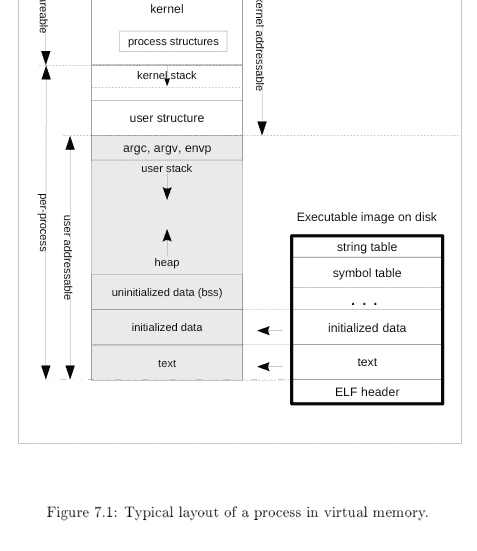

图 7.1：进程在虚拟内存中的典型布局。

#### 7.6.1 概述


首先，我们从整体上看看进程在其逻辑地址空间中的样子。这幅图应能让你在脑海中构建出进程在其自身逻辑地址空间中的物理布局、它在文件中的样子，以及该文件与进程的虚拟内存映像之间的关系。不同的 UNIX 系统使用不同的进程布局，但大多数现代系统通常遵循一种称为可执行与可链接格式（ELF）的格式。

进程在用户模式下执行所需的资源包括 CPU 状态（通用寄存器、程序状态寄存器、栈相关寄存器等）、一些环境信息，以及三个内存段：文本段、数据段和栈段。文本段包含程序代码。栈段保留用于进程用户阶段¹的运行时栈，数据段用于程序数据。下面将进一步说明这些内容。

进程在内核阶段执行时所需的资源包括 CPU 状态（同上）以及内核为进程提供服务并适当调度它所需的资源。这些资源包括系统调用参数、进程的身份和属性、调度信息、打开的文件描述符等等。这组内核资源被分为两个主要结构，即进程结构和用户结构，以及一些次要结构。这些结构共同构成了通常所说的进程映像。进程结构和用户结构保存在内核内存中。进程地址空间的布局如图 7.1 所示。

进程结构包含即使进程被换出也必须在内存中驻留的信息，包括进程特权与权限、与进程关联的标识符、内存映射、描述符、挂起事件，以及最大和当前资源利用率。用户结构包含进程被换出时不需要驻留在内存中的信息，包括进程控制块²、记账和统计信息，以及其他一些信息，因此它随进程的其余部分一起被换出。

### 7.6.2 进程结构

内核为每个正在运行的进程维护一个进程结构。该结构包含内核管理进程所需的信息，例如各种进程描述符（进程 ID、进程组 ID、会话 ID 等）、打开文件列表、内存映射以及其他可能的进程属性。在我所熟悉的 UNIX 版本中，这个结构被称为进程结构。在 Linux 中，进程结构和任务结构这两个术语可以互换使用，表示它的实际数据结构是 `task_struct`。在某些 UNIX 版本中，进程结构中的信息要少得多，而用户结构中的信息则更多。

在线程（即所谓轻量级进程，LWP）引入之前，进程结构是一个包含大量信息的非常“重”的结构。发明轻量级进程概念的一个原因是为了减少与每个可执行单元关联的信息量，使它们不占用那么多内存，并且创建新单元的速度更快。4.4BSD 对进程结构进行了重新设计以支持这些线程，方法是将原本在进程结构中的大量信息移到可由进程结构指向的较小结构中。每个线程可以通过指向这些子结构来共享其中的信息，而不是保留它们的完整副本。这样，每个线程既可以拥有自己唯一的标识符（如进程 ID），也可以访问共享数据（如打开的文件和内存映射）。

任何进程结构中包含的确切信息会因实现而异，但所有进程结构至少包括

- 进程 ID
- 父进程 ID（或指向父进程结构的指针）
- 指向进程子进程列表的指针
- 调度用的进程优先级、CPU 使用统计和上次优先级。
- 进程状态
- 信号信息（待处理信号、信号掩码等）
- 机器状态
- 定时器

通常进程结构是一个非常大的对象，包含更多额外信息。例如 Linux 2.6.x 中的 task 结构可能包含超过 150 个不同的成员。进程结构中引用的典型子结构可能包括以下内容：

- 进程的组 ID
- 与进程关联的用户 ID
- 进程的内存映射（各个段的起始位置等）
- 文件描述符
- 会计信息
- 其他报告的统计信息，如缺页等。
- 信号动作
- 指向用户结构的指针。

子结构通常包含所有线程会共享的信息，而进程结构本身包含线程特定的信息。

进程结构位于内核内存中。不同版本的 UNIX 以不同方式存储它。在 BSD 中，内核维护两个进程结构列表，称为僵尸列表和 `allproc` 列表。僵尸是已终止但无法销毁的进程，其原因将在本章稍后说明。僵尸进程的结构位于僵尸列表上。`allproc` 列表包含非僵尸的进程。在 Linux 2.6.x 中，进程或 task 结构保存在一个循环的双向链表中。在 Solaris 中，进程结构在 `struct proc_t` 中，这些结构的集合保存在一个表中。

### 7.6.3 用户结构

用户结构包含的信息比进程结构少得多。用户结构随进程一起换入换出；保持其较小可减少交换开销。历史上，用户结构最重要的用途是它包含了内核的每进程执行栈。

每个 UNIX 进程都需要一个小的内核栈。当进程发出系统调用并进入内核阶段时，内核需要一个用于其函数调用的栈。由于内核可能在处理调用过程中被中断，它必须能够从一个进程的服务调用切换到另一个进程。这意味着它需要为每个进程使用不同的栈。UNIX 内核设计者精心设计了内核中的所有函数，使其非递归且不使用大的自动变量。此外，他们可以追踪内核中可能的调用链序列，因此他们知道最大的可能栈大小。因此，与普通用户程序不同，内核本身对其所需栈大小有一个已知的上限。由于栈大小可以预先知道，内核栈可以分配在固定大小的虚拟地址空间块中。这就是为什么在图 7.1 中你会看到它上下都被固定边界所限制。正如图中所示，栈位于地址空间的高端，位于环境变量和程序参数之上。其确切位置因 UNIX 版本而异。

根据 UNIX 版本的不同，用户结构可以包含各种其他信息。在 BSD 中，内存映射全部在进程结构或其子结构中。在 Linux 中，用户结构定义在 `struct user`（在 `<user.h>` 中）中，包含内存映射。内存映射通常包括文本、数据和栈段的起始和结束地址、其余地址空间的各种基址和限长寄存器等。用户结构通常包含进程控制块。它包含 CPU 状态和虚拟内存状态（页表基址寄存器等）。

### 7.6.4 文本段

文本段（也称为指令段）是程序的可执行代码。它几乎总是可共享的只读段，被执行同一程序的所有其他进程共享。C 编译器默认创建共享文本段。使用共享文本段的优势不在于它节省内存，而在于它减少了交换开销。当进程处于活动状态时，其文本段驻留在主内存中。进程可能被交换到辅助存储的原因有很多。经常是因为它等待一个缓慢的事件；在这种情况下，系统会将其交换到辅助存储以腾出内存供其他更有生产力的进程使用。当它再次变为活动状态时，它会被带回内存。由于只读文本段永远不会被修改，因此当执行它的进程被换出时，没有理由将其复制到辅助存储。同样，如果文本段的副本已驻留在主内存中，就没有理由将文本段从辅助存储复制到主内存。因此，交换开销得以节省。

UNIX 跟踪每个用户进程的只读文本段。它记录该段在辅助存储中的位置、如果已加载则其主内存地址，以及当前正在执行它的进程数量。当进程首次执行该段时，该段从辅助存储加载，计数设为一，并创建表项。当进程终止时，计数递减。当计数达到零时，该段被释放，其主内存和辅助内存被取消分配。

### 7.6.5 栈段

用户栈段用作进程用户阶段的运行时栈。也就是说，当进程调用用户代码的其他部分时，调用会被堆叠在此段中。栈段为自动标识符和寄存器变量提供存储，并提供其通常的角色是管理由用户进程调用的子程序的链接。堆栈在 UNIX 中始终是“倒置”的，这意味着压栈会导致栈顶变为较小的内存地址。如果堆栈 ever 与堆的顶部相遇，就会引发异常。在 32 位架构中，用户进程通常分配 4 Gbytes 的虚拟地址空间。如果堆栈与堆相遇，进程就会超出其虚拟内存配额，是时候将应用程序移植到 64 位机器上了！

### 7.6.6 数据段

数据段是为程序的已初始化和未初始化数据分配的内存。已初始化数据与未初始化数据是分开的，未初始化数据存储在称为 `bss` 的段中，`bss` 是 Block Started by Symbol 的缩写，是一种旧的 FORTRAN 机器指令。已初始化数据是诸如命名常量和已初始化静态变量之类的项目。它们来自符号表。未初始化数据没有起始值。系统只需为它们保留空间即可，它通过设置数据段顶部的地址来实现。数据段通过显式的内存请求来移动其边界而增长或缩小。移动边界的系统调用是 `brk()` 调用；`sbrk()` 是围绕 `brk()` 的 C 包装函数。数据段始终向内存的高端增长，即 `brk()` 调用会增加边界以增加内存。大多数程序员使用 C 库函数 `malloc()` 和 `calloc()` 来分配更多内存，而不是使用低级的 `brk()` 原语。这些 C 例程调用 `brk()` 来调整数据段的大小。

程序员经常将 `malloc()` 和 `calloc()` 使用的内存部分称为“堆”。人们通常认为堆是尚未分配的内存部分，位于栈顶和 `bss` 末端之间。

### 7.6.7 从文件到内存

可执行程序文件是如何排列的以及它如何被加载？当你运行 `gcc` 编译器并且没有特别命名可执行文件时，如

```
$ gcc myprog.c
```

编译器（实际上是链接器）会创建一个名为 `a.out` 的文件。名称 `a.out` 是“assembler output”的缩写，不仅是输出文件的名称，也是多年来 UNIX 系统上所有二进制可执行文件格式的名称。`a.out` 文件格式可以在 `a.out` 手册页以及 `<a.out>` 头文件中阅读。


在 1990 年代中期，由 UNIX System Laboratories 作为应用程序二进制接口（ABI）的一部分创建了一种更便携且可扩展的格式，称为可执行和链接格式（ELF）。后来它由工具接口标准（TIS）委员会修订，该委员会是一个行业联盟，包括大多数主要公司（Intel、IBM、Microsoft 等）。虽然编译器继续创建名为 `a.out` 的文件，但在大多数现代机器上它们是 ELF 文件。

ELF 规范精确定义了可执行文件是如何组织的，并且足够通用，可以涵盖三种不同类型的文件：

- 包含适合与其他目标文件链接以创建可执行文件或共享对象文件（`.o` 文件）的代码和数据的可重定位文件，

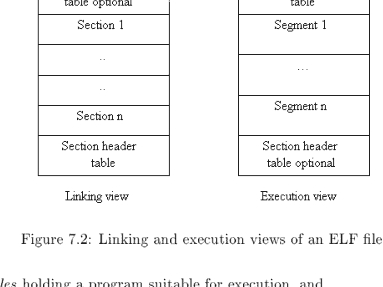

## 图 7.2：ELF 文件的链接和执行视图。

- 包含适合执行的程序的可执行文件，以及

- 可以由动态链接器用来创建进程映像的共享对象文件（`.so` 文件）。

ELF 文件以一个称为 ELF 头的结构开始。该头本质上是文件其余部分的路线图。它包含标识信息以及文件其余组件的地址和大小。ELF 文件的特点是它包含两种不同的、平行的、但重叠的视图：链接视图和执行视图，如图 7.2 所示。

链接视图是链接编辑器链接和重定位文件中的组件所需的文件视图。其中的信息组织成节，包含指令、数据、符号表、字符串表和重定位信息等内容。节头表充当节的目录，通常位于文件的一端。

相比之下，执行视图是执行文件所需的视图。它将信息组织成段。段在概念上对应于虚拟内存段；当可执行文件加载到内存中时，ELF 段被映射到虚拟内存段。因此，例如，对于一个可执行程序，存在包含指令的文本段、未初始化数据段和已初始化数据段，以及其他几个段。程序头表充当段的目录，通常跟在 ELF 头之后。

文件中的节或段不必有任何特定顺序，因为表定义了它们的位置。两种不同的视图在文件中是重叠的，如图 7.3 所示。该图还显示段可以由多个节组成。

符号表是编译器创建的将符号名称映射到逻辑地址并存储这些符号属性的表。编译器使用该表来构造代码，但此外，正是符号表使得调试器能够将内存地址与变量名称关联起来。当调试器运行时，符号表会随程序一起加载到内存中。字符串表是包含程序中使用的所有字符串的表。`strings` 命令是一个很有用的命令——它显示二进制文件中所有字符串的列表。`strings` 命令之所以有效，是因为字符串表是文件的一部分，而该命令只是简单地检查它。

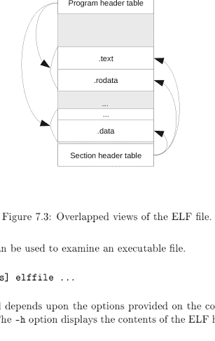

## 图 7.3：ELF 文件的重叠视图。

`readelf` 命令可用于检查可执行文件。

```
$ readelf [options] elffile ...
```

显示的信息取决于命令行上提供的选项。使用 `-a`，可提供所有信息。`-h` 选项以人类可读的形式显示 ELF 头的内容：

```
$ readelf -h /bin/bash
ELF Header:
Magic: 7f 45 4c 46 01 01 01 00 00 00 00 00 00 00 00
Class: ELF32
Data: 2's complement, little endian
Version: 1 (current)
OS/ABI: UNIX - System V
ABI Version: 0
Type: EXEC (Executable file)
Machine: Intel 80386
Version: 0x1
Entry point address: 0x805c7b0
Start of program headers: 52 (bytes into file)
Start of section headers: 733864 (bytes into file)
Flags: 0x0
Size of this header: 52 (bytes)
Size of program headers: 32 (bytes)
```

```
Number of program headers: 8
Size of section headers: 40 (bytes)
Number of section headers: 32
Section header string table index: 31
```

从此输出可以看出，ELF 头包含有关可执行文件格式的信息：32 位、2 的补码、面向 Intel 80386 的 UNIX System V。它还包含程序头的位置（文件中的字节 52）和节头表的位置（文件中的 733864 字节）。

`file` 命令使用 ELF 头来提供其输出：

```
$ file /bin/bash
/bin/bash: ELF 32-bit LSB executable, Intel 80386, version 1 (SYSV),
dynamically linked (uses shared libs), for GNU/Linux 2.6.9, stripped
```

你可以尝试一些可执行文件，看看能学到多少关于可执行程序结构的信息。

请注意，上面输出中可执行文件的入口点地址为 `0x805c7b0`。这是 `bash` 可执行文件中第一个可执行指令的地址。起始虚拟地址不是 0。在现代 UNIX 系统中，起始地址总是在 `0x8048000` 之后。更低的地址被保留供系统使用。其中的一个原因是，当程序在调试器下运行时，调试器将在较低地址中运行。

图 7.4 显示了来自 ELF 标准的一个版本的假设可执行文件的虚拟地址。请注意，在此示例中，文本段不在虚拟地址空间的开头，并且每个段根据需要进行填充，以便在 `0x1000`（4096）字节边界上对齐，因为页面大小为 4096 字节。还请注意，数据段和未初始化数据段跟在文本段之后。

### 7.6.8 显示虚拟内存边界的程序

在本节中，我们将借助我在进程间通信书籍 [1] 中找到并随后修改的程序来探索进程的虚拟地址空间。它显示其可执行映像的虚拟地址空间中不同组件的边界。该程序声明了以下类型的内存对象：

- 全局、已初始化指针变量：`cptr`

- 全局未初始化字符串：`buffer1`

- `main` 程序中的自动变量：`i`

- `main` 程序的参数：`argc`、`argv`、`envp`

- `main` 程序中的静态未初始化局部变量：`diff`

- 主函数 `main()`

- 非主函数 `showit()`

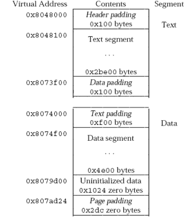

- 自动指针变量，动态分配：`buffer2`

- 非主函数中的自动变量：`num`

它以十六进制和十进制虚拟地址显示每个对象的位置。这些对象的位置将位于前面描述的文本、数据和栈段位置所指定的范围内。例如，未初始化的全局 `buffer1` 和已初始化的全局 `*cptr` 的位置将在数据段的第一和最后一个地址之间，一个在 bss 中，另一个不在。剩余的变量各自精确定位特定段的位置：“Hello World”、指针变量 `cptr` 本身、全局符号 `main()` 和 `showit()`，以及 `showit()` 中的局部变量 `num` 和 `buffer2`。局部变量的位置，理论上在运行时栈上，将显示该栈在虚拟内存中的位置。

三个外部整型变量 `etext`、`edata` 和 `end` 在 C 库中在全局范围内定义，可被任何 C 程序访问。它们是三个特定段的边界：

| 变量 | 描述 |
|---|---|
| `etext` | `etext` 的地址是程序文本之后的第一个位置。 |
| `edata` | `edata` 的地址是已初始化数据区域之后的第一个位置。 |
| `end` | `end` 的地址是未初始化数据区域之后的第一个位置。 |

`etext` 的值是对可执行映像大小的上限。已初始化和未初始化数据区域是常量和全局变量存储的区域。未初始化数据

> 它们可能被声明为宏。

are globals whereas initialized data are constants. These symbols are incorporated into the program, displayed in Listing 7.1

#### Listing 7.1: displayvm.c


```c
#include <stdio.h>
#include <stdlib.h>
#include <string.h>
#include <sys/types.h>
#include <unistd.h>

/********************************************************************************/
/*                              Global Constants                                */
/********************************************************************************/

#define SHW_ADR(ID,I) \
printf(" %s \t is at addr:%8X\t%20u\n",\
    ID,(unsigned int)(&I),(unsigned int)(&I))

/* These are system variables, defined in the unistd.h header file */
extern int etext, edata, end;

char *cptr = "Hello World\n"; /* cptr is an initialized global */
char buffer1[40];             /* uninitialized global */

void showit(char *);          /* Function prototype — has no storage */

int main(int argc, char* argv[], char* envp[])
{
    int i = 0;                /* on stack */
    static int diff;          /* global in uninitialized data segment */

    strcpy(buffer1, "  Layout of virtual memory\n");
    write(1,buffer1,strlen(buffer1)+1);

    printf("Adr etext: %8X \t Adr edata: %8X \t Adr end: %8X \n\n",
        (unsigned int)&etext,(unsigned int)&edata,(unsigned int)&end);

    printf("\n     ID \t     HEX_ADDR\t     DECIMAL_ADDR\n");
    SHW_ADR("main", main);
    SHW_ADR("showit", showit);
    SHW_ADR("etext", etext);
    diff = (int)&showit - (int)&main;
    printf("\n    showit is %d bytes above main\n", diff);
    SHW_ADR("cptr", cptr);
    diff = (int)&cptr - (int)&showit;
    printf("\n    cptr is %d bytes above showit\n", diff);
    SHW_ADR("buffer1", buffer1);
    SHW_ADR("diff", diff);
    SHW_ADR("edata", edata);
    SHW_ADR("end", end);
    SHW_ADR("argc", argc);
    SHW_ADR("argv", argv);
    SHW_ADR("envp", envp);
    SHW_ADR("i", i);
    showit(cptr);
    return 0;
}
/*****************************************************************/
void showit(char * p)
{
    char *buffer2;
    SHW_ADR("buffer2",buffer2);
    if ( (buffer2=(char *) malloc((unsigned)(strlen(p)+1))) != NULL){
        strcpy(buffer2 , p);
        printf("%s", buffer2);
        free(buffer2);
    }
    else {
        printf("Allocation error.\n");
        exit(1);
    }
}
```

运行此程序时，你应该会得到类似如下的输出。最后一列是位置的十进制值。请注意 `main()` 中的 `i` 和 `showit()` 中的 `buffer2` 具有较高的地址。它们位于栈中。请注意 `envp`，它是指向字符串数组的指针，位于栈之上，如图 7.1 所示。请注意这些地址是递减的，因为栈向下增长。请注意 `main()` 中的 `diff` 和 `buffer1` 位于 `edata` 与 `end` 之间，表明它们在未初始化数据区，但 `cptr` 位于 `etext` 与 `edata` 之间，因为它是已初始化的。你应该会看到 `buffer1` 是 `bss` 中的最后一个变量，因为它长 40 字节，其地址距离 `end` 有 40 字节。此外，请注意 `etext` 的地址与 `etext` 的值相同。这是因为 `etext` 不是真正的变量。它只是链接器所确定的实际位置的助记符名称。

### Layout of virtual memory

Adr etext: 8048958    Adr edata: 8049C90    Adr end: 8049CE8

| ID | HEX_ADDR | DECIMAL_ADDR |
| --- | --- | --- |
| main | is at addr: 8048544 | 134513988 |
| showit | is at addr: 8048806 | 134514694 |
| etext | is at addr: 8048958 | 134515032 |
| showit is 706 bytes above main |  |  |
| cptr | is at addr: 8049C8C | 134519948 |
| cptr is 5254 bytes above showit |  |  |
| buffer1 | is at addr: 8049CC0 | 134520000 |
| diff | is at addr: 8049CA8 | 134519976 |
| edata | is at addr: 8049C90 | 134519952 |
| end | is at addr: 8049CE8 | 134520040 |
| argc | is at addr: BF9ECDC0 | 3214855616 |
| argv | is at addr: BF9ECDC4 | 3214855620 |
| envp | is at addr: BF9ECDC8 | 3214855624 |
| i | is at addr: BF9ECD9C | 3214855580 |
| buffer2 | is at addr: BF9ECD6C | 3214855532 |
| Hello World |  |  |

请注意主程序从虚拟地址 `0x08048544` 开始。虚拟地址空间的起始位置在 `0x08048000`。两者相差 1348 字节。如果查看 `readelf` 的输出

`-a` command, 你会看到在主程序之前，这个小区域里有几段代码。那里存放着必须在 `main()` 开始之前运行的代码（我喜欢称之为“胶水”例程）、程序结束时运行的代码，以及用于动态链接和重定位的特殊代码。当程序启动时，在操作系统将控制权转移给程序之前，会进行初始化以及可能的链接和重定位；那里的代码正是为此目的而服务的。

## 7.7 使用 fork 创建新进程

现在你对进程到底是什么有了更好的认识，我们可以开始探索它们的世界了。我们将从进程创建开始，因为那毕竟是一切的开端。

一旦操作系统完成自举，创建任何进程的唯一方式就是通过 `fork()` 系统调用。所有进程都是通过 `fork()` 创建的：

```
#include <sys/types.h>
#include <unistd.h>
pid_t fork(void);
```

`fork()` 调用起初很难接受；你可能从未见过类似的函数。它命名得非常恰当，因为语句

```
pid_t processid = fork();
```


会导致内核创建一个几乎是调用进程的精确副本的新进程，使得在调用之后，有两个进程各自在执行程序中调用点之后的同一位置继续执行！因此在指令执行之前，有一个进程即将执行该指令，而当它返回时，就有两个进程了。指令流出现了分叉，就像道路上的岔路一样。几乎就像进程有丝分裂。

调用`fork()`的进程称为父进程，而新进程是子进程。它们通过`fork()`返回的值来区分。每个进程都可以通过返回值来识别自己。返回给父进程的值是新创建的子进程的进程 ID，从不为 0，而返回给子进程的值为 0。因此，每个进程只需测试返回值是否为 0 即可知道自己的身份。子进程获得父进程内存映像的一个独立副本以及相同的一组资源。它本质上是父进程的克隆，在各方面几乎完全相同。不过与细胞有丝分裂不同，它不是对称的。

`fork()`调用的典型用法遵循以下模式

```
processid = fork();
```

```
if (processid == 0)
// 子进程在此处的代码
else
// 父进程在此处的代码
```

`if`语句的真分支是由子进程执行而父进程不执行的代码。假分支则正好相反。这看起来似乎是一种无用的进程创建方式，因为它们总是必须与父进程共享相同的代码，因此什么也不做不同。`fork()`调用在与`exec()`和`wait()`结合使用时非常有价值，如下文所示。

我们的第一个示例，`forkdemos1.c`，在 7.2 节清单中演示了`fork()`的一些工作原理。

### Listing 7.2: forkdemo1.c

```
#include <unistd.h>
#include <stdio.h>
#include <stdlib.h>

int global = 10;

int main(int argc, char* argv[])
{
    int     local = 0;
    pid_t   pid;

    printf("Parent process: (Before fork())");
    printf(" local = %d, global = %d \n", local, global);

    if ( ( pid = fork() ) == -1 ) {
        perror("fork");
        exit(1);
    }
    else if ( 0 == pid ) {
        /* child executes this branch */
        printf("After the fork in the child:");
        local++;
        global++;
        printf(" local = %d, global = %d\n", local, global);
    }
    else {
        /* parent executes this branch */
        sleep(2);  /* sleep long enough for child's output to appear */
    }

    /* both processes execute this print statement */
    printf("pid = %d, local = %d, global = %d \n", getpid(), local, global);

    return 0;
}
```

在此程序中，`fork()`的返回值存储在`pid`中，并在`if`语句中进行测试。`fork()`在失败时返回`-1`，应该始终检查它是否失败。

孩子的代码是下一个分支，其中`0 == pid`为真。孩子递增了两个变量的值，一个是全局声明的全局变量，一个是在`main()`中局部声明的局部变量。然后它打印出它们的值，跳过父进程代码并执行`printf()`，使用`getpid()`系统调用获取其进程 ID 并再次显示`local`和`global`的值。

与此同时，父进程睡眠两秒，时间足够让孩子的输出先出现。然后它执行`printf()`，使用`getpid()`系统调用获取其进程 ID 并显示`local`和`global`的值。`sleep()`防止输出交错，这可能发生，因为子进程与父进程共享终端。

考虑到子进程获得了父进程内存映像的副本，父进程的输出应该是什么？希望你说`local = 0`且`global = 10`。这是因为子进程在内存映像的副本中更改了它们的值，而不是在共享内存中。此程序的要点只是简单地演示这一重要事实。

让我们在继续之前确保我们理解`fork()`算术。在运行第 7.3 节清单中所示的程序`forkdemo2.c`之前，预测输出的行数。不要重定向输出或将其管道传输。这将在之后解释。

### Listing 7.3: forkdemo2.c

```
#include <unistd.h>
#include <stdio.h>
#include <stdlib.h>

int main( int argc, char* argv[] )
{
    int i;
    printf("About to create many processes...\n");
    for ( i = 0; i < N; i++ )
        if ( -1 == fork() )
            exit(1);

    printf("Process id = %d\n", getpid());
    fflush(stdout);    /* force output before shell prompt */
    sleep(1);          /* give time to the shell to display prompt */
    return 0;
}
```

你预测正确了吗？

每次到达循环底部时，存在的进程数是进入循环之前两倍，因为每个现有进程都执行`fork()`调用，复制自身。如果`N`为 1，循环将执行一次，将有 2 个进程，每个进程都将自己的进程 ID 打印到屏幕上。如果`N`为 2，循环将执行第二次，2 个进程将再创建 2 个，共 4 个。总之，循环结束时将有`2^N`个进程，并且屏幕上会有相应数量的输出行，加上第一行，

`About to create many processes...`

总计，当`N = 4`时，为 17 行。现在尝试将程序的输出重定向到`wc`，以便更容易统计有多少行。

```
$ forkdemo2 | wc
      32     144     832
$
```

为什么有 32 行而不是 17 行？尝试改为将输出重定向到文件并在那里查看：

```
$ forkdemo2 > temp; wc temp
 24 108 624 temp
$
```

如果你查看文件`temp`，你会看到类似的内容

```
About to create many processes...
Process id = 6708
About to create many processes...
Process id = 6707
About to create many processes...
Process id = 6717
About to create many processes...
Process id = 6709
About to create many processes...
Process id = 6716
...
```

并且会有少于 16 行显示进程 ID。那么发生了什么？为什么该行会被每个进程复制，为什么显示进程 ID 的行少于 16 行？

- 记住`fork()`的这一重要事实：当进程通过`fork()`调用创建时，它是原始进程的几乎完全的副本。特别是它获得了所有打开的文件描述符的副本，自然地，获得了进程的用户空间内存映像的全部副本。

- 这意味着当子进程创建时，其标准输出描述符指向与父进程以及父进程`fork`的所有其他进程相同的打开文件结构，因此子进程和父进程共享文件位置指针。

- 操作如`printf()`是 C I/O 库的一部分，作用于类型为`FILE`的对象，称为流。C I/O 库对作用于`FILE`流的所有操作使用流缓冲。 （我们在第 5 章中提到过这一点。）有三种不同的缓冲策略：

  - `Unbuffered streams`: Characters written to or read from an unbuffered stream are transmitted individually to or from the file as soon as possible.

  - `Line buffered streams`: Characters written to a line buffered stream are transmitted to the file in blocks when a newline character is found.


- Fully buffered streams: Characters written to or read from a fully buffered stream are transmitted to or from the file in blocks of arbitrary size.

- 默认情况下，当打开一个流时，它是完全缓冲的，除了连接到终端设备的流，它们是行缓冲的。

- C I/O 库创建的缓冲区位于进程自身的地址空间中，而不是内核的地址空间中。（当你的程序调用 `printf()` 等函数时，该库被链接到该程序中；它使用的所有内存都在其虚拟内存中。）这意味着当调用 `fork()` 时，子进程会获得父进程库缓冲区的副本，并且所有子进程都会获得这些缓冲区的副本。它们不是共享的，而是被复制的。

- C I/O 库会在以下情况下刷新所有输出缓冲区

  - 当进程尝试进行输出且输出缓冲区已满时。
  - 当流被关闭时。
  - 当进程通过调用 `exit()` 终止时。
  - 当写入换行符时，如果流是行缓冲的。
  - 当对任何流的输入操作实际从其文件读取数据时。
  - 当对该缓冲区调用 `fflush()` 时。

- 作为前述陈述的推论，在缓冲区被刷新之前，它包含自上次刷新以来写入其中的所有字符。

- 没有 C I/O 库函数是原子的。完全可能出现输出被交错甚至丢失的情况，如果由共享文件位置指针的独立进程的调用时序导致这种情况。

现在我们把这些事实放在一起。`forkdemo2` 程序以指令开始

```
printf("About to create many processes...\n");
```

如果输出未被重定向，则 `stdout` 指向终端设备并且它是行缓冲的。字符串 "About to create many processes...\n" 被写入终端并从缓冲区中移除。当进程派生子进程时，它们获得空缓冲区并将各自的消息写入终端。除非由于时序不佳导致一行被另一个进程覆盖，否则每个进程将产生恰好一行输出。如果进程数量 N 足够大，这种情况是完全可能的，因为同时写入的概率会随着 N 的增加迅速趋向于 1.0。

让我们做一点数学建模。`printf()` 指令

```
printf("Process id = %d\n", getpid());
```

写入标准输出。如果每个进程花费在 `printf()` 函数可能发生竞争条件的部分代码中的时间比例为 p，则至少有两个进程同时处于该代码部分的概率为 1 − (1 − p)^N。例如，如果 p = 0.05 且 N = 16，则发生竞争（从而丢失输出）的概率为 1 − 0.95^16 ≈ 0.56。如果 N = 32，则为 0.81，而当 N = 64 时为 0.96。所以你可以看到，随着进程数量的增加，行丢失几乎不可避免，无论它们是写入终端还是写入不同的文件描述符，因为竞争条件与输出流如何缓冲无关。

如果标准输出被重定向到文件或管道，它不再指向终端设备，库将完全缓冲它而不是行缓冲它。用于缓冲的块大小远大于传递给 `printf()` 函数的字符串的总大小。其结果是字符串 "About to create many processes...\n" 将在子进程被派生时仍保留在所有子进程的缓冲区中，并且当它们各自调用

```
printf("Process id = %d\n", getpid());
fflush(stdout);
```

时，每行输出的形式将为

```
About to create many processes...
Process id = 8810
```

并且写入的行数将是写入终端的两倍。

由于命令

```
forkdemo2 | wc
```

将 `forkdemo2` 的标准输出重定向到管道，`wc` 将看到的行数是终端上显示的两倍。类似地，命令

```
forkdemo2 > temp
```

将标准输出重定向到文件，并且该文件将包含比终端上显示多两倍的行数。

关于输出到文件的上述陈述只有在 `printf()` 指令的执行不重叠且没有输出丢失时才成立。我们稍后会回到这个问题。关于管道的说法是无条件成立的。

我们如何才能使程序的行为无论是输出到终端还是重定向都相同？我们可以通过调用 `fflush(stdout)` 来强制第一个字符串从缓冲区刷新。由于如果它是终端则无需这样做，我们可以在第一个 `printf()` 之后插入两行

```
if (!isatty(fileno(stdout)));
fflush(stdout);
```

关于丢失输出的问题如何？我们如何防止这种竞争条件？答案是我们必须不使用流库，而必须使用更低层的 `write()` 系统调用和文件描述符。写入是无缓冲的，我们可以为文件描述符 1 设置 `O_APPEND` 标志以消除竞争条件。（请回忆第 4 章，这就是写入 `utmp` 文件如何避免竞争条件的方式。）

要使用 `write()`，我们必须首先使用 `sprintf()` 函数创建输出字符串：

```
char str[32];
sprintf(str, "Process id = %d\n", getpid());
```

然后我们可以调用 `write()`：

```
write(1, str, strlen(str));
```

但首先我们必须通过设置标准输出描述符的 `O_APPEND` 来启动程序：

```
int flags;
flags = fcntl(1, F_GETFL);
flags |= (O_APPEND);
if (fcntl(1, F_SETFL,flags) == -1 )
    exit(1);
```

这解决了问题。修正后的程序列在下面。

### Listing 7.4: forkdemo3.c

```
#include <unistd.h>
#include <stdio.h>
#include <stdlib.h>
#include <string.h>
#include <fcntl.h>
#include <termios.h>

int main( int argc, char* argv[] )
{
    int     i;
    int     N;
    char    str[32];
    int     flags;

    /* Put standard output into atomic append mode */
    flags = fcntl(1, F_GETFL);
    flags |= (O_APPEND);
    if (fcntl(1, F_SETFL,flags) == -1 )
        exit(1);

    /* Get the command line value and convert to an int.
       If none, use default of 4. If invalid, exit. */
    N = ( argc > 1 ) ? atoi(argv[1]):4;
    if ( 0 == N )
        exit(1);

    /* Print a message and flush it if this is not a terminal */
    printf("About to create many processes...\n");
    if ( !isatty(fileno(stdout)) )
        fflush(stdout);

    /* Now fork the child processes. Check return values and exit if we have a problem. Note that the exit() may be executed only for some children and not others. */
    for ( i = 0; i < N; i++ )
        if ( -1 == fork() )
            exit(1);

    /* Create the output string that the process will write, and write using system call. */
    sprintf(str, "Process id = %d\n", getpid());
    write(1, str, strlen(str));
    fflush(stdout);        /* to force output before shell prompt */
    sleep(1);              /* to give time to the shell to display prompt */
    return 0;
}
```

#### 7.7.1 Other Versions of fork()


`vfork()`系统调用是`fork()`调用的一种不同版本，设计为更高效。`fork()`调用会完整复制旧进程的地址空间，而`vfork()`调用创建新进程时不会复制父进程的数据段和栈段，而是允许子进程共享这些段。这节省了时间和内存，但也增加了子进程可能无意中破坏父进程状态的可能性。它并非用于允许子进程和父进程共享数据；相反，其目的是避免在子进程将使用`exec()`替换其代码的情况下进行大量的内存复制。

Linux 系统中还有`clone()`系统调用。`clone()`函数在技术上是包装系统调用的库例程，允许子进程与其父进程共享地址空间，并且还允许程序员为子进程执行传递一个函数和参数。我们稍后会详细讨论它。

## 7.7.2 Synchronizing Processes with Signals

下一个程序`synchdemo1.c`演示了如何使用`fork()`和信号来同步子进程和其父进程。

### Listing 7.5: `synchdemo1.c`

```
#include <unistd.h>
#include <stdio.h>
#include <stdlib.h>
#include <signal.h>
#include <sys/types.h>
#include <sys/wait.h>

void c_action(int signum)
{
    /* nothing to do here */
}
/**************************************************************/
int main(int argc, char* argv[])
{
    pid_t pid;
    int status;
    static struct sigaction childAct;

    switch (pid = fork()) {
    case -1:
        /* fork failed! */
        perror("fork() failed!");
        exit(1);

    case 0: {
        /* child executes this branch */
        /* set SIGUSR1 action for child */
        int i, x=1;
        childAct.sa_handler = c_action;
        sigaction(SIGUSR1, &childAct, NULL);
        pause();
        printf("Child process: starting computation...\n");
        for ( i = 0; i < 10; i++ ) {
            printf("%2%d = %d\n", i, x);
            x = 2*x;
        }
        exit(0);
    }
    default:
        /* parent code */
        printf("Parent process: "
        "Will wait 2 seconds to prove child waits.\n");
        sleep(2); /* to prove that child waits for signal */
        printf("Parent process: "
        "Sending child notice to start computation.\n");
        kill(pid,SIGUSR1);

        /* parent waits for child to return here */
        if (wait(&status) == -1)
        {
            perror("wait failed");
            exit(2);
        }
        printf("Parent process: child terminated.\n");
        exit(0);
    }
}
```

## Comments.

- 首先请注意此程序的风格略有不同。它使用`switch`语句来区分失败的`fork()`、子进程和父进程。

- `SIGUSR1`信号是为用户程序保留的信号值，可供其自行使用。

在这个程序中，我们可以用它来同步两个进程。一个进程使用`pause()`让自己延迟，并等待信号到来。第二个进程发送信号唤醒第一个进程。在这种情况下，信号处理程序不需要做任何特殊的事情。

- 父进程调用`wait()`，这是一个我们稍后会探讨的函数。`wait()`调用会使父进程等待，直到子进程终止或被杀死。

- 该程序在终端上显示输出，只是为了演示信号是如何工作的。

下一个演示程序`synchdemo2.c`比前一个更有趣一些。它演示了父进程和子进程如何使用`SIGUSR1`信号协同工作。它还表明子进程继承了父进程打开的文件，并且子进程和父进程对同一描述符的写入会推进共享的文件位置指针。

### Listing 7.6: `synchdemo2.c`


```c
#include <sys/types.h>
#include <sys/stat.h>
#include <fcntl.h>
#include <unistd.h>
#include <signal.h>
#include <stdio.h>
#include <stdlib.h>
#include <string.h>

/*****************************************************/
void p_action(int sig);
void c_action(int sig);
void on_sigint(int sig);
/*****************************************************/

int                 nSignals = 0;
volatile sig_atomic_t  sigint_received = 0;

/*****************************************************/
int main(int argc, char* argv[])
{
    pid_t pid, ppid;

    static struct sigaction parentAct, childAct;
    int                 fd;
    int                 counter = 0;
    char                childbuf[40];
    char                parentbuf[40];

    if ( argc < 2 ) {
        printf("usage: synchdemo2 filename\n");
        exit(1);
    }

    if ( -1 == (fd = open(argv[1], O_CREAT|O_WRONLY|O_TRUNC, 0644 )) )
    {
        perror(argv[1]);
        exit(1);
    }
    switch( pid = fork() ) {
    case -1:
        perror("failed");
        exit(1);
    case 0:
        /* set action for child */
        childAct.sa_handler = c_action;
        sigaction(SIGUSR1, &childAct, NULL);
        ppid = getppid();  /* get parent id */
        for (;;) {
            sprintf(childbuf, "Child counter = %d\n", counter++);
            write(fd, childbuf, strlen(childbuf));
            printf("Sending signal to parent — ");
            fflush(stdout);
            kill(ppid, SIGUSR1);
            sleep(3);
        }
    }
    default:
        /* set SIGUSR1 action for parent */
        parentAct.sa_handler = p_action;
        sigaction(SIGUSR1, &parentAct, NULL);

        /* set SIGINT handler for parent */
        parentAct.sa_handler = on_sigint;
        sigaction(SIGINT, &parentAct, NULL);

        for (;;) {
            sleep(3);
            sprintf(parentbuf, "Parent counter = %d\n", counter++);
            write(fd, parentbuf, strlen(parentbuf));
            printf("Sending signal to child — ");
            fflush(stdout);
            kill(pid, SIGUSR1);
            if ( sigint_received ) {
                close(fd);
                exit(0);
            }
        }
    }
/*****************************************************************/
void p_action(int sig)
{
    printf("Parent caught signal %d\n", ++nSignals);
}
void c_action(int sig)
{
    printf("Child caught signal %d\n", ++nSignals);
}
```

```c
void on_sigint( int sig )
{
    sigint_received = 1;
}
```

## Comments

- 对文件的写入是同步进行的，并且由于子进程和父进程中 `sleep()` 和 `kill()` 调用的安排，不存在竞争条件。父进程在从 `sleep()` 中唤醒后写入，然后在向子进程发出信号之前，而子进程则在第一次向父进程发出信号之前写入，然后在被父进程唤醒后写入。如果父进程正在写入，则子进程必须处于睡眠状态，反之亦然。

- 使用 `sleep()` 而不是 `pause()` 可以防止死锁。如果我们使用 `pause()`，那么就有一个很小但非零的概率，一个进程可以向另一个进程发出 `kill()`，而在它执行自己的 `pause()` 之前，另一个进程被唤醒，执行其所有代码并向第一个进程发出 `kill()`。在这种情况下，信号会丢失，因为它发生在 `pause()` 之前。该进程随后会阻塞等待第二个信号唤醒它，但另一个进程将进入其 `pause()` 并且永远无法发送该信号。它们因此陷入死锁。`sleep()` 最终会终止，因此没有任何进程会无限期等待。

- 调用 `fflush()` 是必要的，以强制每个进程对屏幕的写入立即发生，否则它们将以错误的顺序出现。

- 主程序有一个 `SIGINT` 处理程序，以便程序能够自行清理。当按下 `Ctrl-C` 时，父进程和子进程都会收到它。父进程在退出前关闭打开的文件描述符，而子进程会被自动杀死。

我们现在转向一个进程如何更改其执行代码的问题。

### 7.8 执行程序：`exec` 系列

如果新进程没有办法执行不同的程序，那么能够创建新进程就不是很有用。`exec()` 系列调用满足了这一目的。`exec()` 调用的所有版本都有一个共同点——它们使调用进程执行以某种方式在参数列表中命名的程序，并且它们都是 `execve()` 系统调用的库包装器。

#### 7.8.1 `execve()` 系统调用

`execve()` 系统调用的手册页将其定义如下：

```
#include <unistd.h>
int execve(const char *filename, char *const argv[],
char *const envp[]);
```

`execve()` 执行其第一个参数所指向的程序。`filename` 必须是二进制可执行文件或脚本，其第一行为

```
#! interpreter [optional-arg]
```

`filename` 必须是程序的绝对路径名或相对路径名。`execve()` 不会查看 `PATH` 环境变量来解析命令名。第二个和第三个参数分别是参数和环境字符串的以 `NULL` 结尾的数组。换句话说，每个都是一个字符串数组，后跟一个 `NULL` 指针。环境字符串应采用正确的格式：`key=value`。

你应该记住，数组有时被计算机科学家称为向量，而这个系统调用名称为 `execve` 的原因正是它期望第二个和第三个参数为向量。特别是，你需要记住 `execve()` 会将这些向量传递给正在执行的程序，该程序可以在其自己的参数列表中访问它们：

```
int main( int argc, char* argv[], char* envp[])
```

由于所有程序都期望程序名在 `argv[0]` 中，第一个实际参数在 `argv[1]` 中，因此在调用 `execve()` 之前，必须先安排参数列表以满足此条件。示例将演示这一点。


手册页提供了有关该调用的所有细节。一般来说，`execve()` 会导致栈、数据段、`bss` 和代码段被替换，并且几乎清除所有信号并关闭调用前进程打开的任何内容，除了文件描述符保持打开。当前工作目录保持不变。因为是同一个进程继续执行，所以进程关系也得以保留。有关细节请参阅手册页。

开始时我们将查看如何使用 `execve()` 系统调用，之后我们将查看其不同的包装器。第一个程序，`execdemo1.c`，在下面的 7.7 节列表中。

### Listing 7.7: `execdemo1.c`

```
#include <stdio.h>
#include <stdlib.h>
#include <unistd.h>

int main (int argc, char * argv[], char * envp[])
{
    if ( argc < 2 ) {
        printf("usage: execdemo1 arg1 [arg2 ...]\n");
        exit(1);
    }
    execve("/bin/echo", argv, envp);
    fprintf(stderr, "execve() failed to run.\n");
    exit (1);
}
```

该程序调用 `execve()`，将 `/bin/echo` 作为要运行的程序，后跟其自己的命令行参数和环境字符串。这些被传递给 `/bin/echo`。即使 `argv[0]` 包含字符串 `"execdemo1"` 而不是 `"echo"`，该程序也能正常工作，因为 `echo` 基本上忽略 `argv[0]`，并且只从 `argv[1]` 开始关注参数。这并不是使用 `execve()` 的最佳方式——它只在少数情况下有效。

你是否在想调用之后的 `printf()`？只有在 `execve()` 调用失败时，`printf()` 语句才会被执行；`execve()` 返回的唯一原因是执行程序失败。

下一个程序，`execdemo2.c`，使用 `execve()` 执行程序的第一个命令行参数，并将剩余的命令行参数传递给它。换句话说，如果我们提供如下一行

```
$ execdemo2 /bin/ls -l ..
```

它将像你单独输入一行 `/bin/ls -l ..` 一样执行它。

### Listing 7.8: `execdemo2.c`

```
#include <stdio.h>
#include <stdlib.h>
#include <unistd.h>

int main (int argc, char * argv[], char * envp[])
{
    if (argc < 2) {
        fprintf(stderr, "Usage: %s program args\n", argv[0]);
        exit (1);
    }
    execve(argv[1], argv+1, envp);
    fprintf(stderr,"execve() failed to run.\n");
    exit(1);
}
```

请注意，它使用指针运算来传递数组 `argv[1 .. argc-1]` 而不是 `argv[0 .. argc-1]`。

## 7.8.2 The exec() Library Functions

由于为 `execve()` 安排一切有点不方便，UNIX 的设计者创建了一个由五个函数组成的族，作为 `execve()` 的前端，每个函数期望不同的参数集。它们是

```
#include <unistd.h>
extern char **environ;

int execl(const char *path, const char *arg, ...);
int execlp(const char *file, const char *arg, ...);
int execle(const char *path, const char *arg, ..., char* const envp[]);
int execv(const char *path, char * const argv[]);
int execvp(const char *file, char * const argv[]);
```

这些函数的名字中都包含 'l' 或 'v'。包含 'l' 的版本，`execl()`、`execlp()` 和 `execle()`，期望一个以 null 结尾的、以 null 结尾的字符串参数列表，而

包含 'v' 的版本，`execv()` 和 `execvp()`，期望一个以空字符结尾的字符串向量作为参数。所有版本都会导致内核加载名称为上面给出的 `path` 或 `file` 的可执行文件，覆盖该进程的当前程序，并将剩余参数传递给它。

这些函数还根据其名称中是否包含 'p' 来区分。包含 'p' 的版本，`execlp()` 和 `execvp()`，期望第一个参数为简单的文件名而不是完整路径名，而不包含 'p' 的版本：`execl()`、`execle()` 和 `execv()`，要求第一个参数为完整路径名。包含 'p' 的版本会使用 `PATH` 环境变量搜索所提供的文件名，前提是该名称不包含任何斜杠。如果包含斜杠，则将其视为要加载的文件的相对或绝对路径名。

对于所有这些函数，上面在 `path` 或 `file` 参数之后命名的参数 `arg` 或 `argv` 会作为其自身参数传递给可执行文件。其中第一个参数必须是可执行文件的指针，因为在 UNIX 中，按惯例程序的第一个参数 `argv[0]` 始终是程序本身的名称，去掉了前面的路径名。例如，要使用 `execl()` 执行 `"/bin/ls -l"`，你将使用以下语法

```
execl( "/bin/ls", "ls", "-l", (char *) 0);
```

换句话说，可执行文件的名称出现两次——第一次使用完整路径名，第二次仅使用文件本身的名称。

不同版本之间的差异可总结如下：

`execl`, `execle`, `execlp` 期望参数以逗号分隔的字符串列表形式给出，以转换为字符串的 NULL 指针结尾，如

```
execl( "/bin/ls", "ls", "-l", (char *) 0);
```

`execv`, `execvp` 期望参数以向量（数组）形式给出，其最后一个元素为 NULL 指针，如：

```
strcpy(argvec[0], "ls");
strcpy(argvec[1], "-l");
argvec[2] = NULL;
execv( "/bin/ls", argvec );
```

`execlp`, `execvp` 不需要完整路径名：

```
execlp( "ls", "ls", "-l", (char *) 0);
strcpy(argvec[0], "ls");
strcpy(argvec[1], "-l");
argvec[2] = NULL;
execvp( "ls", argvec );
```

`execle` 与 `execl()` 相同，只是它多了一个第三个参数，该参数是一个指向环境字符串的指针数组，正如 `execve()` 所期望的那样，以 NULL 指针作为其最后一个条目。

除 `execl()` 之外的函数从外部 `environ` 变量的值中获取新进程的环境设置。

为了说明，以下程序 `execvpdemo.c` 使用其第一个参数作为要运行的可执行文件，并将剩余参数作为其参数。

### Listing 7.9: `execvpdemo.c`

```c
#include <stdio.h>
#include <stdlib.h>
#include <unistd.h>

int main (int argc, char * argv[], char * envp[])
{
    if (argc < 2) {
        fprintf(stderr, "Usage: %s program args\n", argv[0]);
        exit (1);
    }
    execvp( argv[1], argv +1 );
    perror("execvp");
    exit (1);
}
```

由于它会搜索 `PATH` 环境变量，因此可以例如这样调用

```sh
$ execvpdemo cp origfile newfile ..
```

## 7.9 Synchronizing Parents and Children: wait and exit

### 7.9.1 Exit() Stage Left

我们已在各种程序中多次使用过 `exit()` 函数，但唯一的原因是它是一种终止调用进程并在出现某些错误条件时返回非零整数值的方法。`exit()` 函数做的远不止于此。它的概要是

```c
#include <stdlib.h>
void exit(int status);
```

调用 `exit()` 时会发生三个动作：

- 1. 进程的已注册 *exit* 函数运行；
- 2. 系统有机会在进程之后进行清理；以及
- 3. 进程有机会将其状态值传递给其父进程。

这里的 *exit* 函数是指在调用 `exit()` 时运行的函数。


在继续之前，你可能会想知道为什么我们希望在调用 `exit()` 时运行一个特殊函数。想象一下，当你的程序终止时，它必须更新一个日志文件。假设执行此操作的函数名为 `update_log()`。假设程序非常庞大，存在

`multiple points at which exit() is called, and that more than one programmer is maintaining this program.` If the `exit()` function did not provide a means of invoking user-defined exit routines, then each time that anyone modified the program to insert a new call to `exit()`, he or she would have to remember to call `update_log()` first. However, by registering `update_log()` to run whenever `exit()` is called, it makes the programmer's job easier, since she does not have to worry about forgetting to include the call when the program is modified.

When `exit()` is called, the following actions take place in the given order:

- 1. All functions registered to run with the `atexit()` or `on_exit()` functions are run (in the reverse order in which they were registered with these routines).
- 2. All of the file streams opened through the Standard I/O Library are flushed and closed.
- 3. The kernel's `_exit()` function is called, passing the status argument to it.

Programmers can register a function to run when a process calls `exit()` using either `atexit()` or `on_exit()`. The preferred choice is `atexit()` since it is more portable. The man pages for both contain the details for how to register such exit functions. If more than one function is registered, they are run in the reverse order of the order in which they were registered (i.e., in last-in-first-out order). After the registered functions run, the `exit()` function flushes the streams and closes the files. The `exit()` function then calls `_exit(status)`. The kernel's `_exit()` function makes sure that

- 1. any open file descriptors are closed (not just those opened through Standard I/O Library functions),
- 2. all memory belonging to the process is released,
- 3. all children of the process (including zombies, defined below) are "adopted" by the `init()` process (meaning that `init()` is made the parent of these children,
- 4. the low-order eight bits of the integer argument to `exit()`, called its exit status, are made available to the parent process, and
- 5. under appropriate conditions, a `SIGCHLD` signal is sent to the parent process.

Actions (4) and (5) will be explained shortly. There are other actions that must take place within the clean-up routines of the kernel. This is just a partial list, including the most basic operations.

The following example shows how `atexit()` can be used to register a few exit functions:

## Listing 7.10: atexitdemo.c

```
#include <stdio.h>
#include <unistd.h>
#include <stdlib.h>

void Worker(void)
{
    printf("Worker #1 : Finished for the day.\n");
}
```

```
void Foreman(void)
{
    printf("Foreman   : Workers can stop for the day.\n");
}

void Boss(void)
{
    printf("First Boss: Foreman, tell all workers to stop work.\n");
}

int main(void)
{
    long max_exit_functions = sysconf(_SC_ATEXIT_MAX);

    printf("Maximum number of exit functions is %ld\n", max_exit_functions);
    if ((atexit(Worker)) != 0) {
        fprintf(stderr, "cannot set exit function\n");
        return EXIT_FAILURE;
    }

    if ((atexit(Foreman)) != 0) {
        fprintf(stderr, "cannot set exit function\n");
        return EXIT_FAILURE;
    }

    if ((atexit(Boss)) != 0) {
        fprintf(stderr, "cannot set exit function\n");
        return EXIT_FAILURE;
    }
    return EXIT_SUCCESS;
}
```

### 7.9.2 Waiting for Children to Terminate

After a process forks a child, how will it know if and when the child has finished whatever task it set out to accomplish? Typically, a process has to wait until the child or children finish completing their tasks before it can continue. The `fork()`, `exec()`, and `exit()` system calls need one more partner to form a complete ensemble, and that is the `wait()` family of calls. Generally speaking, the purpose of `wait()` is two-fold:

- to delay the parent until a child has terminated, and
- to obtain the status of a child that has terminated.


There are only two ways for a process to terminate: either "normally" by calling one of various exit functions⁶ such as `exit()`, or "abnormally" and involuntarily as a result of receiving a signal that killed it, or calling `abort()`. (When a program either reaches the end of its code or executes a return, this results in an implicit call to `exit()`.) In either case, the parent can call `wait()`

⁶There are two other exit functions, including `_exit()` and `_Exit()`.

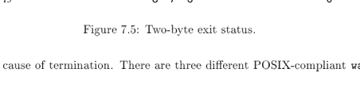

## 图 7.5：双字节退出状态。

to determine the cause of termination. There are three different POSIX-compliant `wait()` system calls:

```
#include <sys/types.h>
#include <sys/wait.h>

pid_t wait(int *status);
pid_t waitpid(pid_t pid, int *status, int options);
int waitid(idtype_t idtype, id_t id, siginfo_t *infop, int options);
```

The `wait()` function causes the executing process to suspend its execution until any one of its children terminates. When a child terminates, the kernel sends a `SIGCHLD` signal to its parent, unless the parent has indicated that it does not want these signals. Upon receipt of a `SIGCHLD` signal, the parent resumes in the `wait()` code. The return value of `wait()` is the process-id of the child that just terminated or was just killed. It does not matter which child terminates. The process is resumed if any child terminates. If a process calls `wait()` but it has no children, `wait()` returns immediately with a `-1`.

The purpose of the `status` parameter is to receive information about how the child terminated. It is a pointer to a two-byte integer. If the child terminated normally using the `exit()` call, then the high-order byte of the value received by `wait()` contains the low-order byte of the integer passed in the `exit()` call's argument, and the low-order byte of the received value is 0. If the child terminated abnormally because of an unhandled signal, then the low-order byte of the received value contains the signal value. If the child was terminated by a signal, then in particular bit 7 is set if there was a core dump. Figure 7.5 shows how the two bytes of the `status` are arranged.

Based on these facts, the following code can be used for querying and extracting the status and signal state:

```
if ((status & 0x000000FF) ==0)
    /* low-order byte is zero, so high-order byte has status */
    exitStatus = status >> 8;  /* exitStatus contains exit status */
else {
    signum = status%128;  /* signum contains signal */
    if ( status & 0x00000080 )
```

> 7 The convention when using `exit()` is to supply a zero on success and some non-zero value on failure.

> 8 The fact that a core dump is supposed to occur does not mean that there will be a core file in your working directory. If your shell has been configured so that core dumps are disabled, then you will not see the file. On some systems, you can enable the core dump by running the command "`ulimit -c unlimited`", which allows your processes to create core files of unlimited size. The `ulimit` command is part of `bash` and you can read the `bash` man page for more details.

```
/* core dump took place */
}
```

However, using the following macros, which are defined in `<sys/wait.h>`, makes the code more portable:

```
if (WIFEXITED(status))
    /* true implies exit() was called to terminate the child  */
    exit_status = WEXITSTATUS(status); /* extract exit status */
else if ( WIFSIGNALED(status) ) {
    /* true if signal killed child */
    signum = WTERMSIG(status); /* extract signal that killed child */
#ifdef WCOREDUMP
    if ( WCOREDUMP(status) )
        /* true if a core dump took place  */
#endif
}
```

- The `WIFEXITED(status)` macro returns true if the child terminated normally, i.e., by calling `exit(3)` or `_exit(2)`, or by returning from `main()`. In this case the `WEXITSTATUS(status)` macro returns the exit status of the child. This macro should only be employed if `WIFEXITED()` returned true.


- The `WIFSIGNALED(status)` macro returns true if the child process was terminated by a signal. If it returns true, then the `WTERMSIG(status)` macro returns the number of the signal that caused the child process to terminate. The `WTERMSIG()` macro should only be used if `WIFSIGNALED()` returned true.

- The `WCOREDUMP(status)` macro returns true if the child produced a core dump. This macro should only be used if `WIFSIGNALED` returned true. This macro is not specified in POSIX.1-2001 ; only use this enclosed in `#ifdef WCOREDUMP ... #endif`.

## 7.9.3 使用 `wait()`

Listing 7.11 contains an example that puts together the use of `fork()`, `exit()`, and `wait()`. It is the typical way in which these three primitives are used. In this example the user is prompted to supply an exit value for the child, which is then passed to the `exit()` call, to show that the value is then available to the parent in the `wait()` call.

### Listing 7.11: `waitdemo2.c`

```
#include <stdio.h>
#include <unistd.h>
#include <stdlib.h>
#include <sys/wait.h>
#include <signal.h>
```

```c
void child()
{
    int exit_code;
    printf("I am the child and my process id is %d.\n",getpid());
    sleep(2);
    printf("Enter a value for the child exit code:");
    scanf("%d",&exit_code);
    exit(exit_code);
}

int main(int argc, char* argv[])
{
    int pid;
    int status;

    printf("Starting up...\n");
    if ( -1 == (pid = fork())) {
        perror("fork");
        exit(1);
    }
    else if ( 0 == pid )
        child();
    else { /* parent code */
        printf("My child has pid %d and my pid is %d.\n", pid, getpid());
        if ((pid = wait(&status)) == -1) {
            perror("wait failed");
            exit(2);
        }
        if (WIFEXITED(status)) { /* low order byte of status equals 0 */
            printf("Parent: Child %d exited with status %d.\n", pid, WEXITSTATUS(status));
        }
        else if ( WIFSIGNALED(status) ) {
            printf("Parent: Child %d exited with error code %d.\n", pid, WTERMSIG(status));
#ifdef WCOREDUMP
            if ( WCOREDUMP(status) )
                printf("Parent: A core dump took place.\n");
#endif
        }
    }
    return 0;
}
```

### Notes.

- 当子进程显示如下信息时

    ```
    I am the child and my process id is 5666.

    Enter a value for the child exit code:
    ```

    输入一个退出码并观察它在父进程的 `wait()` 调用结束后由父进程打印出来。然后再次运行程序，但这次从另一个终端使用 `kill` 命令向子进程发送信号，即

    ```
    $ kill -10 5666
    ```

    并观察父进程显示的消息

    ```
    Parent: Child 5666 exited with error code 6.
    Parent: A core dump took place.
    ```

- 使用条件编译宏是因为如上所述，`WCOREDUMP` 宏并非在所有 UNIX 系统上都可用。

有时父进程并不太关心其子进程是如何终止的。父进程可以明确地告诉内核它不关心子进程何时以及是否终止，通过设置 `SA_NOCLDWAIT` 标志，该标志会阻止向其自身传递 `SIGCHLD` 信号。它使用 `sigaction()` 调用执行此操作：

```
const struct sigaction act;
act.sa_flags = SA_NOCLDWAIT;
sigaction (SIGCHLD, &act, NULL);
```

请注意，在此调用中设置信号处理程序并非必要；只需传递 `sa_flags` 字段即可。如果一个进程已向内核表明它对子进程不感兴趣，那么当子进程终止时，子进程的状态将不会传递给其父进程。子进程将被立即完全终止。同样，当父进程将 `SIGCHLD` 的动作设置为 `SIG_IGN` 时，状态将被丢弃，子进程完全终止。

如果父进程既未设置 `SA_NOCLDWAIT`，也未将 `SIGCHLD` 的动作设置为 `SIG_IGN`，并且当前正在执行下面描述的任何 `wait()` 调用，则状态将被传递给父进程，并向其发送 `SIGCHLD` 信号。如果父进程当前未等待，那么当父进程调用 `wait()` 时，它将收到状态。但是，如果父进程未执行任何形式的 `wait()`，则子进程将被转换为僵尸进程。僵尸进程是一个非活动进程，它将在其父进程稍后执行 `wait()` 调用时被删除。僵尸进程存在的目的仅仅是为了在将来向其父进程提供其状态值。

问题的另一面是当一个进程在其子进程之前终止时会发生什么。当一个进程终止并且有子进程时，这些子进程并不会随之终止。`init()` 进程登场。`init()` 进程会收养孤儿进程，因此如果一个进程终止并且有任何子进程，它们将被 `init()` 收养。当子进程终止时，它们的退出状态将被发送给 `init()`。

## 7.9.4 Using `waitpid()`

`waitpid()` 函数有三个参数。第一个是要等待的子进程的进程 ID，第二个是要存储状态的变量的指针，最后一个是可选的标志集合。如果 `pid` 为 -1，则它告诉内核该进程将等待任何子进程，如 `wait()`。将 `pid` 设置为 0 表示仅等待与父进程在同一进程组中的子进程。将 `pid` 设置为 -G，其中 G 为某个正整数，表示等待任何进程组 ID 为 G 的子进程。

有三个标志可以传递给 `waitpid()`：

- `WNOHANG` 如果没有子进程已退出，则立即返回。

- `WUNTRACED` 如果子进程已停止（但未通过 `ptrace(2)` 跟踪），也返回。即使未指定此选项，也会提供已停止的被跟踪子进程的状态。

- `WCONTINUED`（自 Linux 2.6.10 起）如果已停止的子进程通过传递 `SIGCONT` 而恢复，也返回。

下面的程序清单 7.12 结合了前述的一些想法，并演示了 `waitpid()` 与 `WNOHANG` 标志的使用。

### 程序清单 7.12：`waitpiddemo.c`


```c
#include <stdio.h>
#include <unistd.h>
#include <stdlib.h>
#include <sys/wait.h>
#include <signal.h>

void child()
{
    int exit_code;

    printf("I am the child and my process id is %d.\n",getpid());
    sleep(2);
    printf("Enter a value for the child exit code followed by <ENTER>.\n");
    scanf("%d",&exit_code);
    exit(exit_code);
}

int main(int argc, char* argv[])
{
    pid_t pid;
    int status;
    int signum;

    printf("Starting up...\n");
    if ( -1 == (pid = fork())) {
        perror("fork");
        exit(1);
    }
    else if ( 0 == pid ) {
        child();
    }
    else {
        /* wait for specific child process with waitpid()
           If no child has terminated, do not block in waitpid()
           Instead just sleep. (Would do something useful instead.)
        */
        while (0 == waitpid(pid, &status, WNOHANG) ) {
            printf("still waiting for child\n");
            sleep(1);
        }
    }

/* pid is the pid of the child that terminated */
if (WIFEXITED(status)) {
    printf("Exit status of child %d was %d.\n", pid, WEXITSTATUS(status));
}
else if ( WIFSIGNALED(status) ) {
    signum = WTERMSIG(status);
    printf("Parent: Child %d exited by signal %d.\n",pid, signum);
}
#ifdef WCOREDUMP
    if ( WCOREDUMP(status) )
        printf("Parent: A core dump took place.\n");
#endif
}
}
return 0;
}
```

## 注意

- 在本例中，父进程处于忙等待循环中，等待子进程终止。`waitpid()` 的 `WNOHANG` 标志允许它继续轮询 `waitpid()` 调用，同时做其他事情。循环体将被替换为父进程在等待子进程时可以执行的任务。这样做的好处是父进程不必阻塞等待子进程，而是可以执行工作。如果没有工作可做，那么就不应使用这种范式。
- 你可以像对程序清单 7.11 中的程序一样向子进程发送信号，以观察父进程代码检测到错误返回。

### 7.9.5 非阻塞等待

进程可以不调用 `wait()` 或 `waitpid()`，而是建立一个在子进程终止时运行的 `SIGCHLD` 处理器。然后 `SIGCHLD` 处理器可以调用 `wait()`。这样进程就无需轮询 `wait()` 函数。它只在保证成功时才调用 `wait()`。下面的示例（`demos` 目录中的 `rabbits2.c`）演示了其工作方式。

#### 程序清单 7.13：rabbits2.c

```c
#include <stdio.h>
#include <unistd.h>
#include <stdlib.h>
#include <signal.h>
#include <limits.h>
#include <sys/wait.h>
#include <termios.h>

#define NUM_CHILDREN 5
#define SLEEPTIME 30

/** child() The code that is executed by each child process
*  All this does is register the SIGINT signal handler and then
*  sleep SLEEPTIME seconds. If a child is delivered a SIGINT, it
*  exits with the exit code 99. See on_sigint() below.
*/
void child     ();

/**  on_sigint()  Signal handler for SIGINT
*   All it does it call exit with a code of 99.
*/
void on_sigint ( int signo );

/**  on_sigchld()  Signal handler for SIGCHLD
*   This calls wait() to retrieve the status of the terminated child
*   and get its pid. These are both stored into global variables that
*   the parent can access in the main program. It also sets a global
*   flag.
*/
void on_sigchld ( int signum );

/* These variables are declared with the volatile qualifier to tell the
   compiler that they are used in a signal handler and their values
   change asynchronously. This prevents the compiler from performing an
   optimization that might corrupt the program state. All three are
   shared by the main parent process and the SIGCHLD handler.
*/
volatile int          status;
volatile pid_t        pid;
volatile sig_atomic_t child_terminated;

/**********************************************************************
                         Main Program
**********************************************************************/
int main(int argc, char* argv[])
{
    int           count = 0;
    const int NumChildren = NUM_CHILDREN;
    int i;
    struct sigaction newhandler;     /* for installing handlers */

    printf("About to create many little rabbits...\n");
    for ( i = 0; i < NumChildren; i++ ) {
        if ( -1 == (pid = fork()) ) {
            perror("fork");
            exit(-1);
        }
        else if ( 0 == pid ) { /* child code */
            /* Close standard output so that children do not print
               parent's output again. */
            close(1);
            child();
            exit(1);
        }
        else { /* parent code */
```


```c
if ( 0 == i )
    printf("Another ");
else if ( i < NumChildren-1 )
    printf("and another ");
else
    printf("and another.\n");
}
/* parent continues here*/
/* Set up signal handling */
newhandler.sa_handler = on_sigchld;
sigemptyset(&newhandler.sa_mask);
if ( sigaction(SIGCHLD, &newhandler, NULL) == -1 ) {
    perror("sigaction");
    return (1);
}

/* Enter a loop in which work could happen while the global flag
   is checked to see if any child has terminated. */

child_terminated = 0;          /* Set flag to 0 */
while( count < NumChildren ){
    if ( child_terminated ) {
        if ( WIFEXITED(status) )
            printf("Rabbit %d died with code %d.\n",
                pid, WEXITSTATUS(status));
        else if ( WIFSIGNALED(status) )
            printf("Rabbit %d was killed by signal %d.\n",
                pid, WTERMSIG(status));
        else
            printf("Rabbit %d dies with status %d.\n", pid, status);
        child_terminated = 0;
        count++;
    }
    else {
        /* do something useful here. for now just delay a bit */
        sleep(1);
    }
}

printf("All rabbits have terminated and been laid to rest.\n");
return 0; /* main returns; child never reaches here */
}

void on_sigint( int signo )
{
    exit(99);
}

void child()
{
    struct sigaction newhandler;

    newhandler.sa_handler = on_sigint;
    sigemptyset(&newhandler.sa_mask);
    if ( sigaction(SIGINT, &newhandler, NULL) == -1 ) {
        perror("sigaction");
        exit(1);
    }
    sleep(SLEEPTIME);
}

void on_sigchld ( int signum )
{
    int child_status;

    if ((pid = wait(&child_status)) == -1) {
        perror("wait failed");
    }
    child_terminated = 1;
    status = child_status;
}
```

## Notes.

- C 标准 I/O 库默认使用缓冲流。这意味着当进程使用 C 输出函数如 `printf()` 时，输出会在发送到终端设备之前先放入缓冲区。每个子进程创建时都会获得父进程在创建时刻的缓冲区副本。如果我们在子进程中没有立即关闭文件描述符，那么当子进程终止时，其缓冲区会被刷新，父进程的输出的多个副本会出现在终端窗口中。我们不能使用 `fclose(stdout)`，因为 `fclose()` 设计为刷新缓冲区，也会导致输出出现。我们必须使用更低层的 文件描述符。尝试注释掉 "`close(1)`" 这一行并运行程序。

- 子进程被设计为捕获 `SIGINT` 并在信号处理程序中退出。这样做的理由是允许用户向子进程发送 `SIGINT`（在命令行上发出 `kill -2` 到子进程），以显示即使信号导致信号处理程序运行，由于子进程调用了 `exit()`，父进程会看到子进程是通过调用 `exit()` 而死亡的，而不是因为被发送了信号。

- 如果子进程没有被信号杀死，那么它会在 30 秒睡眠后正常终止。

- `on_sigchld()` 处理程序在调用 `wait()` 之后设置一个原子标志，让主程序去处理子进程的退出工作。

- 该程序为了节省篇幅，并未测试 `fork()` 的返回值是否失败。

- 尽管 POSIX 不允许，但某些系统允许信号丢失，在此代码中可能丢失 `SIGCHLD` 信号。如果多个子进程在短时间内终止，而父进程正处于 `SIGCHLD` 处理程序中，则某些 `SIGCHLD` 信号可能会合并为单个信号。例如 GNU C 就允许这种情况。修复需要更复杂的代码来维护子进程列表，并在处理程序中检查该列表。

### 7.9.6 Waiting for State Changes in Children

`wait()` 家族在 Linux 2.6.9 中通过引入 `waitid()` 进行了扩展，可用于收集有关子进程状态的其他变化的信息，而不仅仅是它们的终止：

```c
int waitid(idtype_t idtype, id_t id, siginfo_t *infop, int options);
```

`idtype` 可以是 `P_PID`、`P_PGID` 或 `P_ALL` 中的一个。如果是 `P_PID`，它会等待第二个参数指定的进程 ID 的进程。如果是 `P_PGID`，它会等待任何进程组 ID 为第二个参数的进程。如果是 `P_ALL`，第二个参数会被忽略，其行为与普通 `wait()` 相同。

`options` 参数是以下标志中的一个或多个的或：

- `WEXITED` 等待已终止的子进程。
- `WSTOPPED` 等待因信号投递而被停止的子进程。
- `WCONTINUED` 等待因 `SIGCONT` 投递而被恢复的（先前已停止的）子进程。

并且可选地还有前面描述的 `WNOHANG` 标志以及 `WNOWAIT` 标志，后者使子进程保持原样，仿佛父进程从未调用过 `wait()`，以便在稍后时间检索其状态。

如果 `waitid()` 成功完成，它会填充 `infop` 参数指向的 `siginfo_t` 结构。`siginfo_t` 结构是 `sigaction()` 函数使用的相同结构。它是一个联合体，因此 `sigaction()` 填充的成员与 `waitid()` 填充的成员并不完全相同。`waitid()` 提供以下成员：

- `si_pid` 子进程的进程 ID
- `si_uid` 子进程的真实用户 ID
- `si_signo` `SIGCHLD`
- `si_status` 子进程状态改变的退出状态或导致其状态改变的信号。
- `si_code` `CLD_EXITED` 如果子进程已退出，`CLD_KILLED` 如果子进程被信号杀死，`CLD_STOPPED` 如果子进程被信号停止，或 `CLD_CONTINUED` 如果它因 `SIGCONT` 而继续。

使用 `waitid()` 的方法是检查 `infop->si_code` 的值以确定子进程的状态，然后再访问 `infop->si_status`。以下列表，改编自 `wait()` 手册页中的列表，演示了如何使用 `waitid()`。

#### Listing 7.14: waitiddemo.c

```c
#include <stdio.h>
#include <unistd.h>
#include <stdlib.h>
#include <sys/wait.h>
#include <signal.h>

#define SLEEPTIME  60
```


```c
int main(int argc, char* argv[])
{
    pid_t      pid;
    siginfo_t  siginfo;

    if ( -1 == (pid = fork())) {
        perror("fork");
        exit(1);
    }
    else if ( 0 == pid ) {
        printf("Child pid is %d\n", getpid());
        sleep(SLEEPTIME);
        exit(0);
    }
    /* Parent code */
    else do {
        /* Zero out si_pid in case the siginfo_t struct does not get */
        /* initialized because no children are waitable. */
        siginfo.si_pid = 0;

        /* Wait for changes in the state of the child created above, */
        /* specifically, stopping, resuming, exiting, and return */
        /* immediately if no child is waitable. */
        if (-1 == waitid(P_PID, pid, &siginfo,
            WEXITED | WSTOPPED | WCONTINUED | WNOHANG) ) {
            perror("waitid");
            exit(EXIT_FAILURE);
        }
        if ( siginfo.si_pid == 0 )
            /* no child is waitable. */
            continue;
        switch ( siginfo.si_code ) {
            case CLD_EXITED:
                printf("Child exited with status %d\n",
                    siginfo.si_status );
                break;
            case CLD_KILLED:
            case CLD_DUMPED:
                printf("Child killed by signal %d\n",
                    siginfo.si_status );
                break;
            case CLD_STOPPED:
                printf("Child stopped by signal %d\n",
                    siginfo.si_status );
                break;
            case CLD_CONTINUED:
                printf("Child continued\n");
                break;
        }
    } while ( siginfo.si_code != CLD_EXITED &&
             siginfo.si_code != CLD_KILLED &&
             siginfo.si_code != CLD_DUMPED );
    return 0;
}
```

## Notes.

- `si_status`字段的值无需通过位操作提取，其中的值已按需要进行了移位。

- 父进程中的`while`循环会一直持续，直到子进程被杀死或终止，以便你有机会停止和继续子进程。

- 如果你在一个终端中运行此程序，然后从另一个终端发出`kill`命令，或者在一个终端中将程序置于后台运行并在同一终端中发出`kill`命令，你会看到如下输出：

```
$ waitiddemo 77
Child pid is 15243
Child exited with status 77
$
```

然后再次运行但不带命令行参数：

```
$ waitiddemo &
Child pid is 15245
$ kill -STOP 15245
Child stopped by signal 19
$ kill -CONT 15245
Child continued
$ kill -TERM 15245
Child killed by signal 15
[1]+ Done waitiddemo
$
```

### 7.10 Summary

进程创建和控制的四个主要工具是`fork()`、`exec()`、`exit()`和`wait()`及其相关函数。加上你所学到的关于信号和信号处理的知识，你就具备了有效创建和管理进程的手段。仍然缺少的是这些进程有效交换和共享数据的方法。此时，除了信号机制提供的之外，它们共享数据的唯一方式是通过文件系统，而这极其缓慢。进程间通信是下一章的主题。

由于新进程是父进程的副本，它共享所有打开的文件和所有库缓冲区。当两个进程都使用 C I/O 库时，必须小心防止由此产生的意外后果。

进程创建是内核中耗时且开销大的活动，涉及大量内存复制。当目标是使用共享变量和通用代码时，轻量级进程或线程是更好的解决方案。该主题也将在后面介绍。

## Bibliography

[1] Keith Haviland, Marcus Gray, and Ben Salama. *Unix System Programming*. Addison-Wesley Longman, Inc., 2nd edition, 1998.

## Chapter 8 Interprocess Communication, Part I

### Concepts Covered

- *Pipes*

- *I/O Redirection*

- *FIFOs*

- *Concurrent Servers*

- *Daemons*

- *Multiplexed I/O with select()*

- *API: dup, dup2, fpathconf, mkfifo, mknod, pipe, pclose, popen, select, setsid, shutdown, syslog, tee.*

### 8.1 Introduction

为了完成一个或多个任务而协同工作的进程几乎总是需要相互通信。有时通信需要共享数据。共享数据的一种方法是共享一个公共文件。如果至少有一个进程修改该文件，则必须以互斥方式访问该文件。共享文件本质上就像共享内存驻留资源一样，因为两者都是一种使用以互斥方式访问的共享资源的通信形式。另一种范式是通过某种类型的通信通道来回传递数据，该通道提供所需的互斥。管道就是一个例子，套接字也是如此。这种类型的通信广泛被称为问题的*消息传递*解决方案。

本章仅涉及消息传递类型的通信。我们将从*无名管道*开始，然后介绍*命名管道*，也称为*FIFO*，然后介绍*套接字*。第一部分专门与管道相关。

### 8.2 Unnamed Pipes

你熟悉如何在命令级别使用管道。如下命令

```
$ last | grep 'reboot'
```

将`last`的输出连接到`grep`的输入，因此输出的只有包含单词‘reboot’的`last`行。‘|’是`bash`操作符；它会导致`bash`同时启动`last`命令和`grep`命令，并将`last`的标准输出定向到`grep`的标准输入。

尽管‘|’是`bash`操作符，但它使用了 UNIX 的底层、底层的`pipe`设施，该设施由 Douglas McIlroy 发明，并于 1973 年纳入 UNIX。你可以将管道机制可视化为一种特殊的文件或缓冲区，它就像物理管道一样，literally 连接`last`的输出到`grep`的输入，如图 8.1 所示。

`last`程序不知道它正在写入管道，`grep`也不知道它正在从管道读取。此外，如果`last`尝试以比`grep`能够排空的速度更快地写入管道，`last`

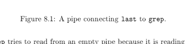

图 8.1：连接 last 与 grep 的管道。

（写端进程）将会阻塞；而如果`grep`试图从空管道中读取（因为它读取的速度快于`last`写入的速度），`grep`也会阻塞，这两种动作都由内核在后台处理。


那么什么是管道呢？虽然管道看起来像文件，但它不是文件，也没有与之关联的文件指针。它在概念上就像一条传送带，由固定数量的逻辑块组成，这些逻辑块可以被填满和清空。每次向管道写入时，只要未超出管道的最大大小，就会填满满足该写入所需的块数；如果未达到管道大小限制，则会为下一次写入分配一个新块。已填充的块会被传送到管道的读端，并在被读取时清空。这类管道被称为未命名管道，因为它们在文件系统中不存在于任何位置，它们没有名字。

UNIX 中的未命名管道¹ 通过 `pipe()` 系统调用创建。

```c
#include <unistd.h>
int pipe(int filedes[2]);
```

系统调用 `pipe(fd)` 接收一个大小为 2 的整数数组 `fd`，创建一对文件描述符 `fd[0]` 和 `fd[1]`，分别指向管道 inode 的“读端”和“写端”。如果成功，返回 0，否则返回 -1。之后进程可以使用 `write()` 系统调用向写端 `fd[1]` 写入数据，并使用 `read()` 系统调用从读端 `fd[0]` 读取数据。读端和写端会因 `pipe()` 调用而自动打开。写入的数据按先进先出（FIFO）顺序读取。下面的程序（`demos` 目录中的 `pipedemo0.c`）演示了这个简单的情况。

### 列表 8.1：pipedemo0.c

```c
#include <stdio.h>
#include <string.h>
#include <unistd.h>
#include <stdlib.h>

#define READ_END 0
#define WRITE_END 1
#define NUM 5
#define BUFSIZE 32

int main(int argc, char* argv[])
{
    int i, nbytes;
    int fd[2];
    char message[BUFSIZE + 1];

    if ( -1 == pipe(fd)) {
        perror("pipe call");
        exit(2);
    }

    for ( i = 1; i <= NUM; i++ ) {
        sprintf(message, "hello #%d\n", i);
        write(fd[WRITE_END], message, strlen(message));
    }
    close(fd[WRITE_END]);

    printf("%d messages sent; sleeping a bit. Please wait...\n", NUM);
    sleep(3);

    while ( ( nbytes = read( fd[READ_END], message, BUFSIZE)) != 0 )
    {
        if ( nbytes > 0 ) {
            message[nbytes] = '\0';
            printf("%s", message);
        }
        else
            exit(1);
    }
    fflush(stdout);
    exit(0);
}
```

#### 注意事项

- 在该程序中，`write` 调用没有进行错误检查，而实际上应该进行检查。`while` 循环条件中的 `read()` 进行了错误检查：如果返回值严格小于零，则执行 `exit(1)`。
- `read()` 调用默认是阻塞读取；如果你希望它非阻塞，则必须明确地将其设置为非阻塞。按照设计，对管道的阻塞读取会一直等待数据，只要管道的写端仍保持打开。如果程序在读循环开始前没有关闭管道的写端，它将永远挂起，因为 `read()` 会持续等待数据。如果读循环事先确切地知道期望的字节数，则可以避免这种情况，因为那样它可以只读取那么多字节然后退出循环，但通常人们无法预知要读取多少数据。当然，进程必须在读循环开始之前将数据写入管道，否则将没有数据可读！
- 注意 `read()` 调用总是读取相同数量的数据。此例说明读者可以读取固定大小的块，并将它们组装成更大的块，因为数据是按发送顺序到达的（不同于通过网络发送的数据）。管道没有消息边界的概念——它们只是字节流。
- 最后，注意在调用 `printf()` 将字符串打印到标准输出之前，字符串必须以空字符结尾。

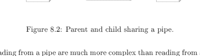

Figure 8.2: Parent and child sharing a pipe.

从管道读取的语义比从文件读取复杂得多。下表总结了当进程尝试从当前有 `p` 个字节尚未被读取的管道中读取 `n` 个字节时会发生什么。

| Pipe Size (p) | Writer open: writer sleeping | Writer open: no writer sleeping | Writer open: non-blocking read | No writer open: blocking read | No writer open: non-blocking read |
| --- | --- | --- | --- | --- | --- |
| p = 0 | Copy n bytes and return n, waiting for data as necessary when the pipe is empty. | Block until data is available, copy it and return its size. | Return -EAGAIN. | Return 0. | Return 0. |
| 0 < p < n |  | Copy p bytes and return p, leaving the buffer empty. |  |  |  |
| p ≥ n | Copy n bytes and return n leaving p-n bytes in the pipe buffer. |  |  |  |  |

语义取决于是否有写入者在之前尝试向管道写入但管道已满时被置于睡眠状态。在非阻塞读取请求中，如果请求的字节数 `n` 大于管道中当前的数据量，并且至少有一个写入者处于睡眠状态，则读取将尝试读取 `n` 个字节，随着管道被清空，写入者将被唤醒以向管道写入。如果没有写入者在睡眠并且管道为空，则读取将阻塞直到有数据可用。

### 8.2.1 Parent and Child Sharing a Pipe

当然，进程没有理由创建管道来向自身写入消息。管道存在的目的是允许两个不同的进程进行通信。通常，一个进程会创建管道，然后 `fork` 一个子进程。`fork` 之后，父进程和子进程各自拥有管道的读端和写端的拷贝，因此会有两个数据通道和总共四个描述符，如图 8.2 所示。

在某些 Unix 系统上，例如 System V Release 4 Unix，管道以全双工模式实现，允许同时写入和读取两个描述符。POSIX 仅允许半双工模式，这意味着数据只能沿管道单向流动，并且


```c
#define WRITE_FD 1

int main(int argc, char* argv[])
{
    int i;
    int bytesread;
    int fd[2];
    char message[BUFSIZ];

    /* check proper usage */
    if ( argc < 2 ) {
        fprintf(stderr, "Usage: %s message\n", argv[0]);
        exit(1);
    }

    /* try to create pipe */
    if ( -1 == pipe(fd)) {
        perror("pipe call");
        exit(2);
    }

    /* create child process */
    switch ( fork() ) {
    case -1:
        /* fork failed — exit */
        perror("fork()");
        exit(3);

    case 0: /* child code */
        /* Close write end, otherwise child will never terminate */
        close(fd[WRITE_FD]);
        /* Loop while not end of file or not a read error */
        while ( ( bytesread = read( fd[READ_FD], message, BUFSIZ) ) >= 0 )
            if ( bytesread > 0 ) { /* more data */
                message[bytesread] = '\0';
                printf("Child received the word: %s\n", message);
                fflush(stdout);
            }
            else { /* read error */
                perror("read()");
                exit(4);
            }
        exit(0);

    default: /* parent code */
        close(fd[READ_FD]);  /* Close read end, since parent is writing */
        for ( i = 1; i < argc; i++ )
            /* send each word separately */
            if ( write(fd[WRITE_FD], argv[i], strlen(argv[i]) ) != -1 )
            {
                printf("Parent sent the word: %s\n", argv[i]);
                fflush(stdout);
            }
            else {
                perror("write()");
                exit(5);
            }
        close(fd[WRITE_FD]);

        /* wait for child so it does not remain a zombie */
        /* don't care about its status, so pass a NULL pointer */
        if (wait(NULL) == -1) {
            perror("wait failed");
            exit(2);
        }
        exit(0);
    }
}
```

## Notes.

- 现在至关重要的是子进程在开始读取之前关闭其管道的写端。如前所述，读取默认是阻塞的，并且只要管道的任一写端保持打开，包括它自己的，就会一直等待输入。因此，不仅为了使代码更具可移植性而关闭未使用的管道端，而且为了使其正确！
- 父进程等待子进程，因为如果不等待，子进程将在系统中成为僵尸。你应该养成等待所有你创建的进程的习惯。
- 父进程和子进程在终端上的输出可能以任何顺序出现。该程序没有尝试协调终端的使用，仅仅因为这会分散其作为管道使用演示的目的。

### 8.2.2 Atomic Writes

在符合 POSIX 的系统中，只要待写入的字节数不超过 `PIPE_BUF`，单次写入就会以原子方式执行。这意味着如果有多个进程同时向管道写入，只要每个进程将每次写入的大小限制为 `N ≤ PIPE_BUF` 字节，数据就不会被交错。如果管道中没有足够的空间存储 `N ≤ PIPE_BUF` 字节，并且写入是阻塞的（默认值），则 `write()` 将阻塞直到有空间可用。另一方面，如果 `N > PIPE_BUF`，则无法保证写入是原子的。

要在程序中使用 `PIPE_BUF` 的值，请包含头文件 `<limits.h>`。例如，

```c
#include <limits.h>
char chunk[PIPE_BUF];
```

如果你的 `<limits.h>` 头文件未定义 `PIPE_BUF`，则意味着该值大于此常量的 POSIX 最小值，即 `POSIX_PIPE_BUF`，通常为 512 字节。POSIX 在这种情况下并不要求定义 `PIPE_BUF`。因此，你应将上述代码片段写为

```c
#include <limits.h>

#ifndef PIPE_BUF

#define PIPE_BUF POSIX_PIPE_BUF

#endif

char chunk[PIPE_BUF];
```

在你的系统上可能可行的另一种方法是使用 `fpathconf()` 系统调用来动态确定原子写入大小的值。`fpathconf()` 系统调用返回与打开的文件描述符关联的各种系统相关配置值。`fpathconf()` 函数的概要和描述如下

```c
#include <unistd.h>

long fpathconf(int filedes, int name);
long pathconf(char *path, int name);
```

`DESCRIPTION`

`fpathconf()` 获取与打开的文件描述符 `filedes` 相关的配置选项 `name` 的值。

`fpathconf()` 的第二个参数是手册页中定义的助记符名称。这些名称例如 `_PC_NAME_MAX`、`_PC_PATH_MAX` 和 `_PC_PIPE_BUF`。每个名称有不同的用途，其有效性取决于给定的文件描述符是文件、目录、管道还是终端的文件描述符。如果 `filedes` 是一个管道，那么常量 `_PC_PIPE_BUF` 应该告诉 `fpathconf()` 返回可以原子写入该管道的最大字节数。它可能不会返回此值。这将在下面解释。

虽然没有必要知道 `PIPE_BUF` 的值，但了解其值并确保它具有应有的神奇特性是一个有趣的练习。下面的程序旨在演示（但不能证明）最多 `PIPE_BUF` 字节的写入是原子的，而更大的写入可能不是原子的。它还演示了如何创建多个写入器和一个读取器。该程序创建两个写入器进程和一个读取器。一个写入器向管道写入 `'X'`，另一个写入 `'y's'`。每次写入的字符数相同。命令行参数指定每个写入器对管道执行的写入次数。想法是如果次数足够大，调度程序会足够频繁地进行时间片调度，使得一个写入一段时间，然后下一个，依此类推。父进程是读取器。它从管道读取数据并将其存储到文件中。父进程读取较小的块，因为这并不重要。

#### Listing 8.3: pipedemo2.c

```c
#include <stdio.h>
#include <string.h>
#include <unistd.h>
#include <stdlib.h>
#include <fcntl.h>
#include <limits.h>
#include <signal.h>
#include <sys/wait.h>
```


# 代码实现

```c
#define READ_FD 0
#define WRITE_FD 1
#define RD_CHUNK 10
#define ATOMIC

#ifndef PIPE_BUF
#define PIPE_BUF POSIX_PIPE_BUF
#endif

void do_nothing( int signo)
{
    return;
}

int main(int argc, char* argv[] )
{
    int i, repeat;
    int bytesread;
    int msgglen;
    pid_t child1, child2;
    int fd[2];
    int outfd;
    char message[RD_CHUNK+1];
    char *Child1_Chunk, *Child2_Chunk;
    long Chunk_Size;

    static struct sigaction sigact;

    sigact.sa_handler = do_nothing;
    sigfillset(&(sigact.sa_mask));
    sigaction(SIGUSR1, &sigact , NULL);

    /* check proper usage */
    if ( argc < 2 ) {
        fprintf(stderr, "Usage: %s size\n", argv[0]);
        exit(1);
    }

    /* try to create pipe */
    if ( -1 == pipe(fd)) {
        perror("pipe call");
        exit(2);
    }

    repeat = atoi(argv[1]);
#if defined ATOMIC
    Chunk_Size = PIPE_BUF;
#else
    Chunk_Size = PIPE_BUF + 200;
#endif
```

```c
printf("Chunk size = %ld\n", Chunk_Size);
printf("Value of PIPE_BUF is %d\n", PIPE_BUF);

Child1_Chunk = calloc(Chunk_Size, sizeof(char));
Child2_Chunk = calloc(Chunk_Size, sizeof(char));
if ( ( NULL == Child1_Chunk ) ||
     ( NULL == Child2_Chunk ) ) {
    perror("calloc");
    exit(2);
}

/* create the string that child1 writes */
Child1_Chunk[0] = '\0'; /* just to be safe */
for ( i = 0; i < Chunk_Size-2; i++ )
    strcat(Child1_Chunk, "X");
strcat(Child1_Chunk,"\n");

/* create the string that child2 writes */
Child2_Chunk[0] = '\0'; /* just to be safe */
for ( i = 0; i < Chunk_Size-2; i++ )
    strcat(Child2_Chunk, "Y");
strcat(Child2_Chunk,"\n");

/* create first child process */
switch ( child1 = fork() ) {
case -1: /* fork failed — exit */
    perror("fork()");
    exit(3);

case 0: /* child1 code */
    msgglen = strlen(Child1_Chunk);
    pause();
    for ( i = 0; i < repeat; i++ ) {
        if ( write(fd[WRITE_FD], Child1_Chunk, msgglen )
            != msgglen ) {
            perror("write");
            exit(4);
        }
    }
    close(fd[WRITE_FD]);
    exit(0);
default: /* parent creates second child process */
    switch ( child2 = fork() ) {
    case -1: /* fork failed — exit */
        perror("fork()");
        exit(5);

    case 0: /* child2 code */
        msgglen = strlen(Child2_Chunk);
        pause();
        for ( i = 0; i < repeat; i++ ) {
            if ( write(fd[WRITE_FD], Child2_Chunk, msgglen )
                != msgglen ) {
```

```c
perror("write");
    exit(6);
}
}
    close(fd[WRITE_FD]);
    exit(0);
default: /* parent code */
    outfd = open("pd2_output",
        O_WRONLY | O_CREAT | O_TRUNC, 0644);
    if ( -1 === outfd ) {
        perror("open");
        exit(7);
    }

    close(fd[WRITE_FD]);
    kill(child1, SIGUSR1);
    kill(child2, SIGUSR1);
    while ( ( bytesread = read( fd[READ_FD], message, RD_CHUNK) )
        != 0 )
        if ( bytesread > 0 ) { /* more data */
            write(outfd, message, bytesread);
        }
        else {          /*read error */
            perror("read()");
            exit(8);
        }

    close(outfd);
    /* collect zombies */
    for ( i = 1; i <= 2; i++ )
        if ( wait(NULL) === -1 ) {
            perror("wait failed");
            exit(9);
        }
    close(fd[READ_FD]);
    free(Child1_Chunk);
    free(Child2_Chunk);
}
    exit(0);
}
```

## Notes

- 父进程是读取者；两个子进程是写入者。每个子进程调用 `pause()` 来开始，以便它们都不会立即抢占处理器。父进程在准备好从管道读取时向它们发送 `SIGUSR1` 信号。

- 每个子进程向管道写入大小为 `Chunk_Size` 的块。`Chunk_Size` 要么是 `PIPE_BUF`，要么比它大 200 字节。

- 父进程从管道读取并将数据写入名为 `pd2_output` 的文件。当 `read()` 返回 0 时，子进程已完成写入并关闭了管道，因此父进程关闭输出文件并调用 `wait()` 来收集子进程的退出状态。

- 程序在管道操作开始之前打印 `PIPE_BUF` 的值和实际的块大小。

首先按原样编译程序，将可执行文件命名为 `pipedemo2`。运行 `pipedemo2` 时，输出将显示写入是原子的——每个子进程通过一次 `write` 写入的字符串末尾都有换行符，在输出中，每一段 X 都会以换行符结尾，每一段 y 也会以换行符结尾。输出中不会出现字符串 `Xy` 或 `yX`，因为内核对并发写入进行了序列化，并且每次子进程写入时，它都会写入整个字符串，即 X 或 y。输出并不能证明它是原子的；它只是表明没有输出被交错，因此没有写入被中断。

每个子进程应写入两千次或更多，以便我们看到它们各自竞争共享管道的可能性，因此程序应使用 2000 或更大的命令行参数运行。手工检查输出以确定是否存在交错输出的行会很繁琐。下面的脚本旨在自动完成此操作：


```
#!/bin/bash
if [[ $# < 1 ]]
then
    printf "Usage: %b repeats\n" $0
    exit
fi

pipedemo2 $1
printf "Number of X lines     : "
    grep X pd2_output | wc -l
printf "Number of y lines     : "
    grep y pd2_output | wc -l
printf "X lines in first %b : " $1
    head -$1 pd2_output | grep X | wc -l
printf "y lines in first %b : " $1
    head -$1 pd2_output | grep y | wc -l
printf "X lines in last %b  : " $1
    tail -$1 pd2_output | grep X | wc -l
printf "y lines in last %b  : " $1
    tail -$1 pd2_output | grep y | wc -l
printf "Xy lines             : "
    grep Xy pd2_output | wc -l
printf "yX lines             : "
    grep yX pd2_output | wc -l
```

命令行参数是每个子进程应写入的块数。脚本总结了输出。如果`repeats`为`1000`，你应该看到类似如下的输出

```
Number of X lines : 1000
Number of y lines : 1000
X lines in first 1000 : 515
y lines in first 1000 : 485
X lines in last 1000 : 485
y lines in last 1000 : 515
Xy lines : 0
yX lines : 0
```

最后两行显示所有写入都是原子的，因为没有包含`Xy`或`yX`组合的行。现在通过注释掉以下行来编辑程序

```
#define ATOMIC
```

并重新编译它。此标志决定块的大小。当它被关闭时，块大于`PIPE_BUF`字节。再次运行脚本。输出很可能看起来像这样：

```
Number of X lines : 1443
Number of y lines : 1437
X lines in first 1000 : 758
y lines in first 1000 : 718
X lines in last 1000 : 685
y lines in last 1000 : 719
Xy lines : 577
yX lines : 586
```

这表明当写入的块大小超过`PIPE_BUF`时，写入将不是原子的。

#### 8.2.2.1 More About `fpathconf()`

几乎所有系统都符合 POSIX 要求，即调用的结果

```
pipe_size = fpathconf(fd, _PC_PIPE_BUF);
```

是系统当前`PIPE_BUF`的值。但并非所有系统都如此。一些使用 GNU C 库最新版本的系统会使用不同版本的`fpathconf()`。此版本返回管道容量，而不是`PIPE_BUF`的值，但前提是内核支持它。Linux 2.6.35 之后的内核肯定支持。这意味着你不能在所有系统上可靠地使用`fpathconf()`的结果来确定原子写入的最大字节数。

### 8.2.3 管道容量

管道的容量可能大于`PIPE_BUF`。没有公开的系统常量来指示管道的总容量；不过，以下程序（基于 [Haviland 等人] 的程序）可以在任何系统上运行，用于测试管道的最大容量，并证明进程只有在至少有`PIPE_BUF`字节可用时才能向管道写入。

#### 清单 8.4：`pipesizetest.c`


```c
#include <stdio.h>
#include <string.h>
#include <unistd.h>
#include <stdlib.h>
#include <signal.h>
#include <limits.h>

int count = 0;
sig_atomic_t full = 0;

/**
 * SIGALRM 处理函数。它设置 full 标志以表示
 * write 调用已阻塞，并打印到目前为止写入管道
 * 的字符数。
 */
void on_alarm(int signo)
{
    printf("\nwrite() blocked with %d chars in the pipe.\n", count);
    full = 1;
}

int main(int argc, char* argv[])
{
    int fd[2];
    int pipe_size;
    int bytesread;
    int amount_to_remove;

    char buffer[PIPE_BUF];
    char c = 'x';
    static struct sigaction sigact;

    sigact.sa_handler = on_alarm;
    sigfillset(&(sigact.sa_mask));
    sigaction(SIGALRM, &sigact, NULL);

    if ( -1 == pipe(fd) ) {
        perror("pipe failed");
        exit(1);
    }

    /* 检查 _PC_PIPE_BUF 常量返回的是管道容量
     * 还是原子写入大小
     */
    pipe_size = fpathconf(fd[0], _PC_PIPE_BUF);

    while (1) {
        /* 设置一个足够长的闹钟，如果写入失败，它将在
         * 这段时间内触发。4 秒足够长。 */
        alarm(4);
        write(fd[1], &c, 1);
        /* 取消闹钟 */
        alarm(0);

        /* 闹钟是否到期？如果是，则写入失败，我们停止循环 */
        if ( full )
            break;

        /* 报告到目前为止写入的字符数 */
        if ( (++count % 1024) == 0 )
            printf ( "%d chars in pipe\n", count );
    }

    printf( "The maximum number of bytes that the pipe stored is %d.\n", count );
    printf( "The value returned by fpathconf(fd,_PC_PIPE_BUF) is %d.\n\n", pipe_size );

    printf( "Now we remove characters from the pipe and demonstrate that"
        " we cannot\n"
        " write into the pipe unless it has %d (PIPE_BUF) free bytes.\n", PIPE_BUF );

    amount_to_remove = PIPE_BUF-1;

    printf( "First we remove %d characters (PIPE_BUF-1) and try to "
        "write into the pipe.\n", amount_to_remove );

    full = 0;
    bytesread = read(fd[0], &buffer, amount_to_remove );
    if ( bytesread < 0 ) {
        perror("error reading pipe");
        exit(1);
    }
    count = count - bytesread;
    alarm(4);
    write(fd[1], &c, 1);
    /* 取消闹钟 */
    alarm(0);
    if ( full )
        printf("We could not write into the pipe.\n");
    else
        printf("We successfully wrote into the pipe.\n");

    amount_to_remove = PIPE_BUF - amount_to_remove;
    full = 0;

    printf( "\nNow we remove one more character and try to "
        "write into the pipe.\n");

    bytesread = read(fd[0], &buffer, amount_to_remove );
    if ( bytesread < 0 ) {
        perror("error reading pipe");
        exit(1);
    }
    count = count - bytesread;
    alarm(4);
    write(fd[1], &c, 1);
    /* 取消闹钟 */
    alarm(0);
    if ( full )
        printf("We could not write into the pipe.\n");
    else
        printf("We successfully wrote into the pipe.\n");

    return 0;
}
```

## 注释

- 主程序是唯一的进程，在其循环中反复向管道写入单个字符。

- 由于程序从不从管道读取数据，管道最终会被填满。当进程在管道已满后尝试写入时，它将被阻塞。为了防止它被永久阻塞，程序在每次 `write()` 调用前设置一个闹钟，并在调用后取消闹钟。闹钟间隔为 4 秒，足够长，以至于在成功写入完成之前闹钟绝不会到期。然而，当管道已满时，写入将无限期阻塞，因此闹钟会到期，中断 `write()`，闹钟处理函数将显示到目前为止写入的总字节数，然后终止程序。

- 程序报告 `fpathconf(fd,_PC_PIPE_BUF)` 的值，以便与实际管道容量进行比较。在使用近期版本 GNU C 库的 Linux 系统上，该值将是管道容量，而不是 `PIPE_BUF` 的当前值。

- 一旦管道已满，程序会从管道中移除 `PIPE_BUF-1` 字节并尝试写入。这将会失败。然后它再移除一个字节，使管道有 `PIPE_BUF` 字节空闲，并再次写入。这次写入将成功。

- 程序显示消息以指示各种成功和失败。

### 8.2.4 关于阻塞 I/O 和管道的注意事项与提醒

在使用管道时，很多事情可能会出错。以下是关于使用管道以及非阻塞读写时需要记住的一些重要事实。其中一些已经提到过，一些没有。本节将它们整合到一起。

1. 如果向一个没有任何进程打开用于读取的管道执行 `write()`，将会向写入进程发送 `SIGPIPE` 信号，如果该信号未被捕获，将终止该进程。如果它被

+   3. 在新进程中，使用 `open()`（带 `O_CREAT` 标志）打开名为 `listing` 的文件。

+   4. 让新进程 `exec()` `ls` 程序。

在步骤 1 之后，子进程和父进程各自拥有相同文件描述符的副本。在步骤 2 之后，子进程已关闭标准输出，因此文件描述符 1 已空闲。在步骤 3 中，内核看到描述符 3 是空闲的，因此它使用描述符 3 指向名为 `listing` 的文件的结构。然后子进程调用 `exec()` 并传入字符串 `"ls"`。`ls` 程序写入文件描述符 1，通常是标准输出，但实际上它确实在写入名为 `listing` 的文件。与此同时，shell 继续让描述符 1 指向标准输出设备，因此它不受这个对 `ls` 命令进行的秘密操作的影响。

下面的程序，名为 `redirectout.c`，说明了其工作原理。它模拟 shell 的 `'>'` 操作符。它 `fork` 一个子进程，关闭标准输出描述符 1，打开 `argv[2]` 中指定的输出文件以进行写入，并 `exec` `argv[1]`。父进程仅等待子进程终止。编译它并命名为 `redirectout`，然后尝试如下命令：

```
$ redirectout who whosloggedon
```

重定向标准输入的工作方式类似。唯一的区别是进程必须关闭标准输入描述符 0，然后打开一个文件以进行读取。

## Listing 8.5: redirectout.c


```c
#include <stdio.h>
#include <unistd.h>
#include <stdlib.h>
#include <fcntl.h>
#include <sys/wait.h>

int main(int argc, char* argv[])
{
    int fd;

    if ( argc < 3 ) {
        fprintf(stderr, "Usage: %s command output-file\n", argv[0]);
        exit(1);
    }

    switch ( fork() ) {
    case -1:
        perror("fork");
        exit(1);
    case 0: /* child code */
        /* Close standard output */
        close(1);
        /* Open the file into which to redirect standard output */
        /* and check that it succeeds */
        if ( ( fd = open( argv[2], O_WRONLY | O_CREAT | O_TRUNC, 0644 ) )
            == -1 )
            exit(1);
        /* execute the command in argv[1] */
execvp( argv[1], argv[1], NULL );
    /* should not reach here! */
    perror("execvp");
    exit(1);
default: /* parent code; just waits for child */
    wait(NULL);
}
return 0;
}
```

### 8.3.2 模拟 '|' Shell 操作符

现在相关的问题是，我们如何编写一个类似的程序来模拟 shell 如何执行如下命令：

```
$ last | grep 'pts/2'
```

这不能仅使用 `open()`、`close()` 和 `pipe()` 系统调用来实现，因为我们需要将管道的一端连接到 `last` 的标准输出，另一端连接到 `grep` 的标准输入。仅关闭文件描述符无法做到这一点。有两个系统调用可用于此目的：`dup()` 和 `dup2()`。`dup()` 是 `dup2()` 的前身，而 `dup2()` 取而代之。我们将首先看一个使用 `dup()` 的解决方案。

`dup()` 系统调用复制一个文件描述符。来自手册页：

```
#include <unistd.h>
int dup(int oldfd);
```

`dup()` 成功返回后，旧文件描述符和新文件描述符可以互换使用。它们引用同一个打开文件描述（参见 `open(2)`），因此共享文件偏移量和文件状态标志；例如，如果使用 `lseek(2)` 在其中一个描述符上修改文件偏移量，则另一个的偏移量也会改变。

换句话说，给定一个文件描述符 `oldfd`，`dup()` 创建一个指向与旧描述符相同的内核文件结构的新文件描述符。但 `dup()` 的关键特性再次是它返回可用的最低编号的文件描述符。因此，请考虑以下一系列操作。

```
int fd[2];                /* Declare descriptors for a pipe */
pipe(fd);                 /* Create the pipe */
switch ( fork() )         /* Fork a child */
case 0:                   /* In the child: */
    close(fileno(stdout));    /* close standard output */
    dup(fd[1]);               /* dup write-end of pipe */
    close(fd[0]);             /* close read-end of pipe */
    exec("last", "last", NULL); /* exec the command that writes to the pipe */
```

`dup()` 调用会找到可用的标准输出文件描述符，并且由于它是编号最低的可用描述符，它会使其指向与 `fd[1]` 相同的结构。因此，当最后一个命令写入标准输出时，它实际上是在写入管道的写端。

现在很容易想象父进程的工作是什么。它必须关闭标准输入描述符，然后 `dup(fd[0])`，并执行 `grep` 命令。我们可以将这些想法组合成一个更通用的程序，称为 `shpipe1.c`，内容如下。

## Listing 8.6: shpipe1.c

```c
#include <stdio.h>
#include <unistd.h>
#include <stdlib.h>
#include <fcntl.h>

int main(int argc, char* argv[])
{
    int fd[2];

    if ( argc < 3 ) {
        fprintf(stderr, "Usage: %s  command1 command2\n", argv[0]);
        exit(1);
    }

    if ( -1 == pipe(fd)) {
        perror("pipe call");
        exit(2);
    }

    switch ( fork() {
    case -1:
        perror("fork");
        exit(1);
    case 0:
        close(fileno(stdout));
        dup(fd[1]);
        close(fd[0]);  /* close read end since child does not use it */
        close(fd[1]);  /* close write end since it is not needed now */
        execlp( argv[1],argv[1], NULL );
        perror("execlp");
        exit(1);
    default:
        close(fileno(stdin));
        dup(fd[0]);
        close(fd[1]);  /* close write end to prevent child from blocking */
        close(fd[0]);  /* close read end since it is not needed now */
        execlp( argv[2],argv[2], NULL );
        exit(2);
    }

    return 0;
}
```

如果编译它并命名为 `shpipe1`，那么你可以尝试诸如

```
$ shpipe1 last more
```

和

```
$ shpipe1 ls wc
```

这样的命令。

这里存在一个问题。首先，父进程无法等待子进程，因为它使用 `execvp()` 替换了自己的映像。这可以通过 fork 两个子进程并让第二个子进程执行读取进程的工作来解决。更重要的是，这个解决方案并不通用，因为有两步——关闭标准输出然后 `dup()` 管道的写端。在关闭标准输出和复制管道写端之间存在一个很小的时间窗口，在此期间子进程可能被信号中断，其处理程序可能会关闭文件描述符，从而导致 `dup()` 返回的描述符不是刚刚关闭的那个。

这就是创建 `dup2()` 的原因。`dup2(fd1, fd2)` 会将 `fd1` 复制到 `fd2` 中，如果必要会先关闭 `fd2`，作为一次原子操作。换句话说，如果 `fd2` 是打开的，它会关闭它，并使 `fd2` 指向 `fd1` 所指向的同一文件结构。其手册页条目是

```
#include <unistd.h>
int dup2(int oldfd, int newfd);
.....
dup2() makes newfd be the copy of oldfd, closing newfd first if necessary.
```

（`dup()` 和 `dup2()` 共享同一页。我删除了上面 `dup2()` 的描述。这是其中的相关部分。）

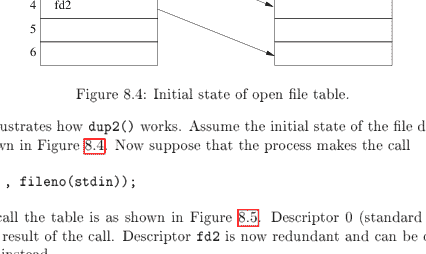

## Figure 8.4: Initial state of open file table.

一张图最能说明 `dup2()` 的工作原理。假设进程的文件描述符的初始状态如 Figure 8.4 所示。现在假设进程发出调用

```
dup2( fd2 , fileno(stdin));
```


那么，调用后表如 Figure 8.5 所示。描述符 `0`（标准输入）成为 `fd2` 的副本。描述符 `fd2` 现在是冗余的，如果要使用 `stdin` 而不是它，可以关闭它。

下面的列表是一个程序 `shpipe2.c` 的内容，它是 `shpipe1.c` 的改进版本，使用 `dup2()` 调用而不是 `dup()`。

## Process's File Descriptor Table

(Open File Table)

## System File Structure Table

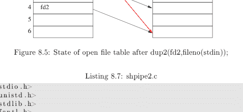

Figure 8.5: State of open file table after `dup2(fd2,fileno(stdin))`;

## Listing 8.7: shpipe2.c

```c
#include <stdio.h>
#include <unistd.h>
#include <stdlib.h>
#include <fcntl.h>
#include <sys/wait.h>

int main(int argc, char* argv[])
{
    int     fd[2];
    int     i;
    pid_t   child1, child2;

    if ( argc < 3 ) {
        fprintf(stderr, "Usage: %s  command1 command2\n", argv[0]);
        exit(1);
    }

    if ( -1 == pipe(fd)) {
        perror("pipe call");
        exit(2);
    }

    switch ( child1 = fork() ) {
    case -1:
        perror("fork");
        exit(1);
    case 0:     /* child1 */
        dup2(fd[1], fileno(stdout));    /* now stdout points to fd[1] */
        close(fd[0]);                   /* close input end of pipe */
        close(fd[1]);                   /* close output end of pipe */
        execvp(argv[1],argv[1], NULL ); /* run the first command  */
        perror("execvp");
        exit(1);
    default:
        switch ( child2 = fork() ) {
        case -1:
            perror("fork");
            exit(1);
        case 0:
            dup2(fd[0], fileno(stdin));    /* now stdin points to fd[0] */
            close(fd[0]);                  /* close input end of pipe */
            close(fd[1]);                  /* close output end of pipe */
            execlp(argv[2], argv[2], NULL); /* run the first command */
            perror("execlp");
            exit(2);
        default:
            close(fd[0]);   /* parent must close its ends of the first pipe */
            close(fd[1]);
            for ( i = 1; i <= 2; i++ )
                if ( wait(NULL) == -1 ) {
                    perror("wait failed");
                    exit(3);
                }
            return 0;
        }
    }
    return 0;
}
```

此时你可以尝试做几件事来测试你对管道的理解。

+ 1. 有一个 UNIX 工具叫做 `tee`，它会将输入流复制到标准输出以及其文件参数中：
+ 
+     `$ ls -l | tee listing`
+ 
+     会将 `"ls -l"` 的输出复制到名为 `listing` 的文件，同时也输出到标准输出。尝试编写你自己的 `tee` 版本。
+ 2. 扩展 `shpipe2` 使其能够处理任意数量的命令，以便
+ 
+     `$ shpipe3 cmmd cmmd ... cmmd`
+ 
+     的行为与
+ 
+     `$ cmmd | cmmd | ... | cmmd`

### 8.3.3 popen() 库函数

以下序列

+ 1. 生成一个管道，
+ 2. `fork` 一个子进程，
+ 3. 复制文件描述符，以及
+ 4. 执行新程序以将该程序的输入或输出重定向到父进程，

如此常见，以至于 C 库的开发者添加了一对函数，`popen()` 和 `pclose()` 来简化此过程：

```c
#include <stdio.h>

FILE *popen(const char *command, const char *type);

int pclose(FILE *stream);
```

`popen()` 函数创建一个管道，`fork` 一个新进程来执行 shell `/bin/sh`（这取决于系统），并将命令传递给该 shell 由其执行（使用 shell 的 `-c` 标志，告诉它将命令作为参数期望。）

`popen()` 期望第二个参数为 `"r"` 或 `"w"`。如果为 `"r"`，则调用它的进程将被返回一个指向管道读端的 `FILE` 指针，而写端将被连接到命令的标准输出。如果为 `"w"`，则调用它的进程将被返回一个指向管道写端的 `FILE` 指针，而读端将被连接到命令的标准输入。输出流是完全缓冲的。

使用 `popen()` 创建的文件流必须用 `pclose()` 关闭，`pclose()` 会等待被调用的进程终止并返回其退出状态，或在 `wait4()` 失败时返回 `-1`。

一个示例将说明这一点。我们将使用 `popen()` 和 `pclose()` 而不是 `pipe()`、`fork()`、`dup()` 序列编写 `shpipe` 程序的第三个版本，称为 `shpipe3`。见下文的清单 8.8。

#### 清单 8.8: shpipe3.c

```c
#include <stdio.h>
#include <unistd.h>
#include <stdlib.h>
#include <limits.h>

int main(int argc, char* argv[])
{
    int     nbytes;
    FILE    *fin;           /* read-end of pipe */
    FILE    *fout;          /* write-end of pipe */
    char    buffer[PIPE_BUF];   /* buffer for transferring data */

    if ( argc < 3 ) {
        fprintf(stderr, "Usage: %s  command1 command2\n", argv[0]);
        exit(1);
    }

    if ( (fin = popen(argv[1], "r")) == NULL ) {
        fprintf(stderr, "popen() failed\n");
        exit(1);
    }

    if ( (fout = popen(argv[2], "w")) == NULL ) {
        fprintf(stderr, "popen() failed\n");
        exit(1);
    }

    while ( (nbytes = read(fileno(fin), buffer, PIPE_BUF)) > 0 )
        write(fileno(fout), buffer, nbytes);

    pclose(fin);
    pclose(fout);
    return 0;
}
```


### 8.4 命名管道

未命名管道是一种优雅的机制，然而它有几个缺点。它们只能被具有共同祖先的进程共享，例如父进程和子进程，或由创建管道的父进程产生的多个子进程或后代。此外，一旦使用它们的进程终止，它们就会立即不存在，因此每次需要时都必须重新创建。如果你试图编写一个服务器程序，客户端可以与其通信，客户端需要知道用于通信的管道的名称，但未命名管道没有这样的名称。

*命名管道*弥补了这些不足。命名管道，或 *FIFO*，在使用方式上与未命名管道非常相似。你以相同的方式从中读取和写入。它在打开和关闭时关于各种进程正在读取或写入或两者都不做时的后果方面表现相同。换句话说，打开、关闭、读取和写入命名管道与未命名管道的语义是相同的。

命名管道与未命名管道的区别在于

- 它们作为文件系统中的目录项存在，因此具有关联的权限和所有权²
- 它们可以被彼此无关的进程使用。
- 它们可以在 shell 级别或编程级别创建和删除。

#### 8.4.1 命令级命名管道

在我们查看如何在程序中创建它们之前，让我们先看看如何在用户级别创建它们。有两个命令可以创建 FIFO。较旧的命令是 `mknod`。`mknod` 是一个用于创建设备特殊文件的通用实用程序。还有一个 `mkfifo` 命令，只能用于创建 FIFO 文件。我们将看看如何使用 `mknod`。你可以在手册页中阅读有关 `mkfifo` 命令的信息。

```
$ mknod PIPE p
```

创建一个名为 `"PIPE"` 的 FIFO。小写字母 `p` 必须跟在文件名之后，指示 `mknod PIPE` 应该是一个 FIFO（`p` 代表 pipe。）输入此命令后，查看工作目录：

²尽管它们有目录项，但它们并不存在于文件系统中。它们没有磁盘块，并且在使用时数据不在磁盘上。

```
$ ls -l PIPE
prw-r--r-- 1 stewart stewart 0 Apr 30 22:29 PIPE|
```

‘`p`’ 文件类型表示 `PIPE` 是一个 FIFO。注意它有 0 字节。尝试以下命令序列：

```
$ cat < PIPE &
$ ls -l > PIPE; wait
```

如果我们不把 `cat` 命令放到后台，它会挂起，因为尝试从管道读取的进程会在至少有一个进程尝试向其写入之前阻塞。`cat` 命令正在尝试从 `PIPE` 读取，因此它不会返回，并且在将其放到后台之前你将收不到 shell 提示符。`cat` 命令会在其 `read()` 调用收到返回值 0 时立即终止，该返回值会在写入者完成写入后关闭文件时发出。在本例中，写入者是执行 `"ls -l"` 的进程。当 `ls -l` 的输出写入管道时，`cat` 将读取它并在屏幕上显示。`wait` 命令的唯一目的是延迟 shell 的提示，直到 `cat` 退出为止。

顺便说一下，如果你反转此过程：

```
$ ls -l > PIPE &
$ ls -l PIPE
$ cat < PIPE; wait
```

并且期望在执行第二个 `ls -l` 时 `PIPE` 不再有 0 字节，你会失望的。这些数据并未存储在文件系统中。

#### 8.4.2 使用命名管道编程

我们转向在编程层面创建和使用命名管道。命名管道可以通过使用 `mknod()` 系统调用或 `mkfifo()` 库函数来创建。在 Linux 中，根据 `mknod()` (2) 手册页，

> “在 Linux 下，此调用不能用于创建目录。应使用 `mkdir(2)` 创建目录，并使用 `mkfifo(3)` 创建 FIFO。”

因此，我们将坚持使用 `mkfifo()` 来创建 FIFO。与 `mknod()` 相比，`mkfifo()` 的另一个优点是使用起来更简单，并且不需要超级用户权限：

```
#include <sys/types.h>
#include <sys/stat.h>
int mkfifo(const char *pathname, mode_t mode);
```

调用 `mkfifo("MY_PIPE", 0666)` 会创建一个名为 `MY_PIPE` 的 FIFO，其权限为 `0666 & ~umask`。惯例是使用大写字母为 FIFO 命名。这样它们在目录列表中很容易被识别。

区分公共 FIFO 和私有 FIFO 是有用的。公共 FIFO 是为所有客户端所知的 FIFO。并不是说有特定的函数使 FIFO 变成公共的；只是它被赋予了一个易于记住的名称，并且其位置被公布，以便客户端程序知道在哪里找到它。一些作者称这些为众所周知的 FIFO，因为它们类似于后面要介绍的用于套接字的众所周知的端口。相比之下，私有 FIFO 被赋予一个除创建它的进程和它选择向其透露的进程之外无人知晓的名称。在我们的第一个示例中，我们将只使用一个公共 FIFO。在第二个示例中，服务器将创建一个公共 FIFO，而客户端将创建它们各自专用于与服务器通信的私有 FIFO。

##### 8.4.2.1 示例

这是一个简单的示例，演示了基本原理。在其中，服务器创建一个公共 FIFO 并监听传入消息。当收到消息时，它只是将其打印到控制台。客户端程序知道 FIFO 的名称，因为其路径名被硬编码到一个公开可用的头文件中，它们可以包含该文件。事实上，对于此示例，服务器和客户端共享此公共头文件。理想情况下，FIFO 的名称应选择为系统中没有任何其他进程会选择相同的文件名，但为了简单起见，我们使用可能不唯一的名称。

服务器将执行如下形式的循环

```
while ( 1 ) {
    memset(buffer, 0, PIPE_BUF);
    if ( ( nbytes = read( publicfifo, buffer, PIPE_BUF)) > 0 ) {
        buffer[nbytes] = '\0';
        printf("Message %d received by server: %s", ++count, buffer);
        fflush(stdout);
    }
    else
        break;
}
```

在每次迭代中，它首先将要复制 FIFO 内容的缓冲区清零。它每次最多读取 `PIPE_BUF` 字节到缓冲区中。当 `read()` 返回时，如果 `nbytes` 为正，它会为缓冲区添加空终止符并将其接收到的内容写入其控制终端。因为输入数据可能没有终止换行符，所以它通过调用 `fflush(stdout)` 强制写入。如果 `nbytes` 为负，则发生了错误，服务器退出。如果 `nbytes` 为 0，则表示 `read()` 未读取任何数据返回，因此没有内容可写。我们可以设计循环使其在这种情况下不退出而只是重新执行 `read()`，但我们现在解释的原因不这样做。

服务器必须执行阻塞读取（`O_NONBLOCK` 和 `O_NDELAY` 标志已清除），否则它将不断在循环中运行，无谓地调用 `read()` 直到客户端实际写入 FIFO 为止。这会浪费 CPU 周期。通过使用阻塞读取，它放弃 CPU 以便可用于其他用途。问题是 `read()` 调用会在

3 有一些程序可以生成极大尺寸的唯一键，可用于文件名称中。如果所有应用程序都合作并使用此方法，那么所有管道名称都将是唯一的。

如果没有进程向 FIFO 写入，那么要么没有客户端尝试向服务器写入，要么所有正在写入的客户端都关闭了它们各自的 FIFO 写入端并退出，服务器端的 `read()` 将会返回 0。如果我们将循环设计成在 `read()` 返回 0 时重新进入循环，这不会成为问题。然而，更简洁的设计是让服务器也为写入打开 FIFO，这样始终至少有一个进程持有打开着用于写入的 FIFO，从而 `read()` 的返回值要么为正要么为负，除非出现某些未预料的错误条件。

因此，服务器一开始就创建 FIFO，并同时以读和写方式打开它，尽管它只会从中读取数据。由于服务器从不向这个管道写入，写入是否是非阻塞的并不重要；但 POSIX 并未规定系统应如何处理以阻塞模式同时打开文件进行读和写的情况，因此使用 `O_NONBLOCK` 标志打开它更为安全；正因为 POSIX 没有规定系统应如何处理以阻塞模式同时打开文件进行读和写的情况，我们可以避免可能出现的未定义行为。

服务器作为后台进程运行，并且必须首先启动，以便它能够创建 FIFO。如果服务器没有运行而启动了客户端，客户端将会退出，因为 FIFO 不存在。

公共头文件首先在清单 8.9 中列出，随后是服务器代码。

## 清单 8.9：fifo1.h

```
#include <stdio.h>
#include <stdlib.h>
#include <unistd.h>
#include <fcntl.h>
#include <string.h>
#include <limits.h>
#include <errno.h>
#include <sys/stat.h>
#define PUBLIC "/tmp/FIFODEMO1_PIPE"
```

## 清单 8.10：rcvfifo1.c

```
#include <signal.h>
#include "fifo1.h"
```


```c
int     dummyfifo;      /* file descriptor to write-end of PUBLIC */

int     publicfifo;     /* file descriptor to read-end of PUBLIC */

/** on_signal()

 *  This closes both ends of the FIFO and then removes it, after

 *  which it exits the program.

 */

void on_signal( int sig )
{
    close(publicfifo);
    close(dummyfifo);
    unlink(PUBLIC);
    exit(0);
}
```

```c
int main( int argc, char *argv[])
{
    int             nbytes;            /* number of bytes read from popen() */
    int             count = 0;
    static char     buffer[PIPE_BUF];/* buffer to store output of command */
    struct sigaction handler;/* sigaction for registering handlers*/

    /* Register the signal handler to handle a few signals */
    handler.sa_handler = on_signal;    /* handler function    */
    handler.sa_flags = SA_RESTART;
    if ( ((sigaction(SIGINT, &handler, NULL)) == -1 ) ||
        ((sigaction(SIGHUP, &handler, NULL)) == -1 ) ||
        ((sigaction(SIGQUIT, &handler, NULL)) == -1) ||
        ((sigaction(SIGTERM, &handler, NULL)) == -1)
    ) {
        perror("sigaction");
        exit(1);
    }

    /* Create public FIFO. If it exists already, the call will return -1 and set errno to EEXIST. This is not an error in our case. It just means we can reuse an existing FIFO that we created but never removed. All other errors cause the program to exit.
*/
    if ( mkfifo(PUBLIC, 0666) < 0 )
        if ( (errno != EEXIST) ) {
            perror(PUBLIC);
            exit(1);
        }

    /*
    We open the FIFO for reading, with the O_NONBLOCK flag clear. The POSIX semantics state the the process will be blocked on the open() until some process (to be precise, some thread) opens it for writing. Therefore, the server will be stuck in this open() until a client starts up.
*/
    if ( (publicfifo = open(PUBLIC, O_RDONLY) ) == -1 ) {
        perror(PUBLIC);
        exit(1);
    }

    /*
    We now open the FIFO for writing, even though we have no intention of writing to the FIFO. We will not reach the call to open() until a client runs, but once a client runs, the server opens the FIFO for writing. If we do not do this, when the client terminates and closes its write-end of the FIFO, the server's read loop would exit and the server would also exit. This "dummy" open keeps the server alive.
*/
    if ( (dummyfifo = open(PUBLIC, O_WRONLY | O_NONBLOCK )) == -1 ) {
        perror(PUBLIC);
        exit(1);
    }
}
```

```c
/* Block waiting for a message from a client */
while ( 1 ) {
    memset( buffer , 0 , PIPE_BUF );
    if ( ( nbytes = read( publicfifo , buffer , PIPE_BUF )) > 0 ) {
        buffer[nbytes] = '\0';
        printf("Message %d received by server: %s", ++count , buffer );
        fflush(stdout );
    }
    else
        break;
}
return 0;
}
```

### Comments

- 服务器从公共 FIFO 中读取并将收到的消息显示在其标准输出上，即使它可能被放到后台；它并未与终端分离。运行它的最佳方式是让它在前台运行，并在其他终端窗口中打开几个客户端。
- 服务器递增一个计数器并使用计数器的值显示每条收到的消息，这样你可以看到消息被收到的顺序。如上所述，它会刷新标准输出，以防消息中没有换行符。
- 它会检测到一些信号，因此一旦有任何信号传递给它，它将关闭 FIFO 的两端，删除文件，然后退出。

客户端打开公共 FIFO 以进行写入，然后进入一个循环，在该循环中它反复从标准输入读取并写入公共 FIFO 的写端。它使用在 `<string.h>` 中找到的库函数 `memset()`，将用户文本将被存储的缓冲区清零，并将缓冲区声明为 `PIPE_BUF` 个字符，以便写入是原子的。（如果区域设置使用双字节字符，则此方法将无法正常工作。）完成后，它将关闭其写端。

##### Listing 8.11: sendfifo1.c

```c
#include "fifo1.h"
#define QUIT "quit"
int main( int argc , char *argv[] )
{
    int nbytes;          /* num bytes read */
    int publicfifo;      /* file descriptor to write-end of PUBLIC */
    char text[PIPE_BUF];

    /* Open the public FIFO for writing */
    if ( (publicfifo = open(PUBLIC, O_WRONLY )) == -1 ) {
        perror(PUBLIC);
        exit(1);
    }
}
```

```c
printf("Type 'quit' to quit.\n");
/* Repeatedly prompt user for command, read it, and send to server */
while (1) {
    memset(text, 0, PIPE_BUF);          /* zero string */
    nbytes = read(fileno(stdin), text, PIPE_BUF);
    if (!strncmp(QUIT, text, nbytes-1))      /* is it quit? */
```


```c
        break;

    if (( write(publicfifo, text, nbytes)) < 0 ) {

        perror("Server is no longer running");

        break;

    }

}

/* User quit, so close write-end of public FIFO */

close(publicfifo);

return 0;

}
```

## Comments.

- 客户端代码允许用户输入 `"quit"` 以结束程序。
- 它并不是很健壮；它不会处理任何终端中断或信号，如果被信号杀死也不会进行清理。不过，如果服务器停止运行，它会检测到这一点并退出，关闭其 FIFO 的一端。

### 8.4.3 An Iterative Server

在此示例中，我们创建一个服务器，该服务器与每个客户端都有双向通信，按顺序处理传入的客户端请求。这种服务器称为迭代服务器。为了实现这一点，服务器创建一个公共 FIFO，用于从希望使用其服务的客户端读取传入消息。每条传入消息都是一个结构，其中包含一个成员，该成员包含客户端启动时创建的私有 FIFO 的名称，服务器应使用该 FIFO 发送回复。消息结构还包含另一个字段，客户端可用于向服务器提供数据。

当服务器收到消息时，它会查看其中的 FIFO 名称并尝试以写入方式打开它。如果成功，服务器将使用此 FIFO 向客户端发送数据。客户端向服务器发送消息后，将其私有 FIFO 以读取方式打开。它将阻塞，直到服务器打开此 FIFO 的写端。当服务器打开写端时，客户端将从中读取，直到收到 0 的返回值，表示服务器已完成写入并关闭了管道的一端。图 8.6 描述了客户端与服务器之间关于共享管道的关系。

在此特定示例中，服务器为客户端提供小写到大写的转换服务。客户端向其发送一段文本，服务器返回另一段文本，与第一段完全相同，只是每个小写字母都被转换为大写。服务器将命名为 `upcased1`（大写守护进程），客户端为 `upcaseclient1`。

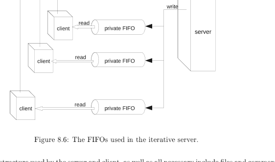

## 图 8.6：迭代服务器中使用的 FIFO。

服务器和客户端使用的消息结构，以及所有必要的包含文件和通用定义，都包含在头文件 `upcase1.h` 中，如以下清单所示。

#### 清单 8.12：upcase1.h

```
#include <stdio.h>

#include <stdlib.h>

#include <unistd.h>

#include <fcntl.h>

#include <string.h>

#include <limits.h>

#include <signal.h>

#include <errno.h>

#include <sys/wait.h>

#include <sys/stat.h>

#include <ctype.h>

#define PUBLIC      "/tmp/UPCASE1_PIPE"

#define HALFPIPE_BUF    (PIPE_BUF / 2)

typedef struct _message {

    char    fifo_name[HALFPIPE_BUF];    /* private FIFO pathname */

    char    text[HALFPIPE_BUF];         /* message text           */

} message;
```

由于消息不得大于 `PIPE_BUF` 字节，并且应足够通用以允许 FIFO 路径名具有较大的大小，因此结构在 FIFO 名称的长度和要发送到服务器的文本的长度之间平均分配。因此，`HALFPIPE_BUF` 被定义为 `PIPE_BUF` 的一半，并用作待翻译字符串中的最大字节数。

我们这次从客户端代码开始。客户端采取的基本步骤如下。

- 1. 它确保标准输入和输出均未重定向。
- 2. 它注册其信号处理程序。
- 3. 它在 `/tmp` 中创建其私有 FIFO。
- 4. 它尝试以非阻塞模式打开公共 FIFO 以进行写入。
- 5. 它进入一个循环，在其中重复
  - (a) 从标准输入读取一行，并且
  - (b) 重复
    - i. 获取输入文本中下一个 `HALFPIPE_BUF-1` 大小的块，
    - ii. 通过公共 FIFO 向服务器发送消息，
    - iii. 打开其私有 FIFO 以进行读取，
    - iv. 从私有 FIFO 读取服务器的回复，
    - v. 将服务器的回复复制到其标准输出，并且
    - vi. 关闭其私有 FIFO 的读端。
- 6. 它关闭公共 FIFO 的写端并删除其私有 FIFO。

客户端清单如下。

#### 清单 8.13：upcaseclient1.c

```
#include "upcase1.h"   /* All required header files are included in  */
                         /* this shared header file. */

#define PROMPT   "string: "

#define UPCASE   "UPCASE: "

#define QUIT     "quit"

const char   startup_msg[] =
"upcased1 does not seem to be running. "
"Please start the service.\n";

volatile sig_atomic_t  sig_received = 0;

struct msg  msg;

/***************************************************************/

/*                        Signal Handlers                      */

/***************************************************************/

void on_sigpipe( int signo )
{
    fprintf(stderr, "upcased is not reading the pipe.\n");
    unlink(msg.fifo_name);
    exit(1);
}

void on_signal( int sig )
{
    sig_received = 1;
}

/***********************************************************************/

/*
 *                          Main Program                             *
 */

/***********************************************************************/

int main( int argc, char *argv[] )
{
    int         strLength;      /* number of bytes in text to convert     */
    int         nChunk;         /* index of text chunk to send to server  */
    int         bytesRead;      /* bytes received in read from server     */
    int         privatefifo;    /* file descriptor to read-end of PRIVATE */
    int         publicfifo;     /* file descriptor to write-end of PUBLIC */
    static char buffer[PIPE_BUF];
    static char textbuf[BUFSIZ];
    struct sigaction handler;

    /* Only run if we are using the terminal. */
    if ( !isatty(fileno(stdin)) || !isatty(fileno(stdout)) )
        exit(1);

    /* Register the on_signal handler to handle all keyboard signals */
    handler.sa_handler = on_signal;     /* handler function */
```


```c
if ( ((sigaction(SIGINT, &handler, NULL)) == -1 ) ||

     ((sigaction(SIGHUP, &handler, NULL)) == -1 ) ||

     ((sigaction(SIGQUIT, &handler, NULL)) == -1 ) ||

     ((sigaction(SIGTERM, &handler, NULL)) == -1 )
    ) {

    perror("sigaction");

    exit(1);

}

handler.sa_handler = on_sigpipe;

if ( sigaction(SIGPIPE, &handler, NULL) == -1 ) {
    perror("sigaction");
    exit(1);
}

/* Create hopefully unique name for private FIFO using process-id */
sprintf(msg.fifo_name, "/tmp/fifo%d",getpid());

/* Create the private FIFO */
if ( mkfifo(msg.fifo_name, 0666) < 0 ) {
    perror(msg.fifo_name);
    exit(1);
}

/* Open the public FIFO for writing */
if ( (publicfifo = open(PUBLIC, O_WRONLY | O_NONBLOCK) ) == -1 ) {
    if ( ENXIO == errno )
        fprintf(stderr,"%s", startup_msg);
    else
```

perror(PUBLIC);
    exit(1);
}
printf("Type 'quit' to quit.");

/* Repeatedly prompt user for input, read it, and send to server */
while (1) {
    /* Check if SIGINT received first, and if so, close write-end */
    /* of public fifo, remove private fifo and then quit */
    if (sig_received) {
        close(publicfifo);
        unlink(msg.fifo_name);
        exit(1);
    }

    /* Display a prompt on the terminal and read the input text */
    write(fileno(stdout), PROMPT, sizeof(PROMPT));
    memset(msg.text, 0x0, HALFPIPE_BUF);        /* zero string */
    fgets(textbuf, BUFSIZ, stdin);
    strLength = strlen(textbuf);
    if (!strncmp(QUIT, textbuf, strLength-1))    /* is it quit? */
        break;

    /* Display label for returned upper case text */
    write(fileno(stdout), UPCASE, sizeof(UPCASE));

    for (nChunk = 0; nChunk < strLength; nChunk += HALFPIPE_BUF-1) {
        memset(msg.text, 0x0, HALFPIPE_BUF);
        strncpy(msg.text, textbuf+nChunk, HALFPIPE_BUF-1);
        msg.text[HALFPIPE_BUF-1] = '\0';
        write(publicfifo, (char*)&msg, sizeof(msg));

        /* Open the private FIFO for reading to get output of command */
        /* from the server. */
        if ((privatefifo = open(msg.fifo_name, O_RDONLY)) == -1) {
            perror(msg.fifo_name);
            exit(1);
        }

        /* Read maximum number of bytes possible atomically */
        /* and copy them to standard output. */
        while ((bytesRead= read(privatefifo, buffer, PIPE_BUF)) > 0) {
            write(fileno(stdout), buffer, bytesRead);
        }
        close(privatefifo);        /* close the read-end of private FIFO */
    }
}
/* User quit, so close write-end of public FIFO and delete private FIFO */
close(publicfifo);
unlink(msg.fifo_name);
return 0;
}
```

## Comments.

- 该程序注册了 `on_signal()` 来处理所有可能杀死它并且可由用户产生的信号。如果向该进程发送了这些信号中的任何一个，处理程序仅设置一个原子标志。在其主循环中，它检查标志是否被设置，如果设置了，则关闭公共 FIFO 的写端并删除其私有 FIFO。服务器将在下次尝试向此 FIFO 写入时收到 `SIGPIPE` 信号，它会处理该信号。
- 如果客户端尝试写入公共 FIFO 但它未打开以供读取，客户端将收到 `SIGPIPE` 信号。这只能发生在服务器未运行时。`SIGPIPE` 处理程序 `on_sigpipe()` 会在标准错误上显示一条消息并终止程序。
- 客户端使用 `O_NONBLOCK` 打开公共 FIFO 的原因是，在这种情况下，如果服务器未读取 FIFO，客户端不会阻塞，而是会返回 `ENXIO` 错误，以便优雅地退出。
- 在客户端的主循环内部，它会显示一个提示并使用 `fgets()` 从终端读取一行。
- 该客户端设计用于处理用户输入的字符串大于管道原子写入允许的字节数这一极不可能的情况¹。它通过将字符串拆分为足够小以原子发送的“块”来实现。它按顺序发送每个块。它必须在发送每个块之前和之后打开和关闭私有 FIFO，因为服务器主要设计用于处理字符串足够小以适应单个块的最可能情况。服务器仅在从客户端收到包含 FIFO 名称的消息后才打开客户端的私有 FIFO；如果客户端在发送任何块之前尝试打开 FIFO 以供读取，`open()` 调用将会阻塞。为防止这种情况，`open()` 必须是非阻塞的，这会使其读取循环变得复杂。为了节省这种不寻常情况下的运行时间成本，增加这种复杂性是不值得的。

现在我们转向服务器，它在本例中比客户端简单。服务器所采取的步骤可以概括如下。

- 1. 它注册其信号处理程序。
- 2. 它创建公共 FIFO。如果发现它已存在，则显示一条消息并退出。
- 3. 它以读写方式打开公共 FIFO，尽管它只会从中读取。
- 4. 它进入其主循环，其中重复执行
  - (a) 在公共 FIFO 上执行阻塞读取；
  - (b) 在从 `read()` 接收到消息后，尝试打开发送该消息的客户端的私有 FIFO。尝试 5 次，每次尝试之间稍作休眠，以防客户端在打开它以供写入时延迟。尝试 5 次后放弃该客户端。
  - (c) 将消息转换为大写，
  - (d) 将其写入客户端的私有 FIFO，

由于 `BUFSIZ`，即标准 I/O 库允许的最大字符串大小，可能大于 `PIPE_BUF`，因此读取的字符串可能远大于可以在管道中原子发送的大小。

(e) 关闭私有 FIFO 的写端。

它将无限循环，因为它永远不会在管道上收到文件结束，因为它自己保持写端打开。它是通过发送信号来终止的。代码如下。

## Listing 8.14: upcased1.c

```
#include "upcase1.h"
```


#define WARNING "\nNOTE: SERVER ** NEVER ** accessed private FIFO\n"

#define MAXTRIES 5

int dummyfifo;    /* file descriptor to write-end of PUBLIC */

int privatefifo;  /* file descriptor to write-end of PRIVATE */

int publicfifo;   /* file descriptor to read-end of PUBLIC */

void on_sigpipe( int signo )
{
    fprintf(stderr, "Client is not reading the pipe.\n");
}

void on_signal( int sig )
{
    close(publicfifo);
    close(dummyfifo);
    if ( privatefifo != -1 )
        close(privatefifo);
    unlink(PUBLIC);
    exit(0);
}

/********************************************************************************/
/*                              Main Program                                    */
/********************************************************************************/

int main( int argc, char *argv[] )
{
    int tries;          /* num tries to open private FIFO */
    int nbytes;         /* number of bytes read from popen() */
    int i;
    int done;           /* flag to stop loop */
    struct message msg; /* stores private fifo name and command */
    struct sigaction handler;   /* sigaction for registering handlers */

    /* Register the signal handler */
    handler.sa_handler = on_signal;
    handler.sa_flags = SA_RESTART;
    if ( ((sigaction(SIGINT, &handler, NULL)) == -1 ) ||
         ((sigaction(SIGHUP, &handler, NULL)) == -1 ) ||
         ((sigaction(SIGQUIT, &handler, NULL)) == -1 ) ||
         ((sigaction(SIGTERM, &handler, NULL)) == -1 )
    ) {
        perror("sigaction");
    }

    exit(1);

    handler.sa_handler = on_sigpipe;
    if ( sigaction(SIGPIPE, &handler, NULL) == -1 ) {
        perror("sigaction");
        exit(1);
    }

    /* Create public FIFO */
    if ( mkfifo(PUBLIC, 0666) < 0 ) {
        if ( errno != EEXIST )
            perror(PUBLIC);
        else
            fprintf(stderr, "%s already exists. Delete it and restart.\n", PUBLIC);
        exit(1);
    }

    /* Open public FIFO for reading and writing so that it does not get an EOF on the read-end while waiting for a client to send data.
To prevent it from hanging on the open, the write-end is opened in non-blocking mode. It never writes to it.
*/
    if ( ( publicfifo = open(PUBLIC, O_RDONLY) ) == -1 ||
         ( dummyfifo = open(PUBLIC, O_WRONLY | O_NDELAY) ) == -1 ) {
        perror(PUBLIC);
        exit(1);
    }

    /* Block waiting for a msg struct from a client */
    while ( read( publicfifo, (char*)&msg, sizeof(msg)) > 0 ) {
        /* A msg arrived, so start trying to open write end of private FIFO */
        tries = done = 0;
        privatefifo = -1;
        do {
            if ( ( privatefifo = open(msg.fifo_name,
                                 O_WRONLY | O_NDELAY)) == -1 )
                sleep(1);   /* sleep if failed to open */
            else {
                /* Convert the text to uppercase */
                nbytes = strlen(msg.text);
                for ( i = 0; i < nbytes; i++ )
                    if ( islower(msg.text[i]) )
                        msg.text[i] = toupper(msg.text[i]);

                /* Send converted text to client */
                if ( -1 == write(privatefifo, msg.text, nbytes) ) {
                    if ( errno == EPIPE )
                        done = 1;
                }
                close(privatefifo);  /* close write-end of private FIFO */
                done = 1;            /* terminate loop */
            }
        } while (++tries < MAXTRIES && !done);

        if (!done)
            /* Failed to open client private FIFO for writing */
            write(fileno(stderr), WARNING, sizeof(WARNING));
    }

    return 0;
}


## Comments.

该服务器通过关闭已打开的任何描述符、删除公共 FIFO 并退出来处理所有用户发起的终止信号。它在每次循环开始时将 `privatefifo` 设置为 `-1`，如果它成功打开私有 FIFO，则 `privatefifo` 不再为 `-1`。这样，在信号处理程序中，它可以确定是否已为写入打开私有 FIFO 并需要关闭它。

如果它因 `SIGPIPE` 而收到信号，因为客户端在服务器写回转换后的字符串之前立即关闭了其私有 FIFO 的读端，它会通过继续监听新消息并放弃对该管道的写入来处理 `SIGPIPE`。

### 8.4.4 Concurrent Servers

前面的服务器是一个迭代服务器；它一次处理一个客户端请求。如果某些客户端请求可能非常耗时，那么服务器就会忙于为一个客户端服务，而排除所有其他客户端，其他客户端会遇到延迟。这可以通过允许服务器同时处理多个客户端来避免。可以同时处理多个客户端请求的服务器称为并发服务器。

创建并发服务器最简单的方法是为每个客户端 `fork` 一个子进程。然后服务器的角色就只剩下“监听”公共管道以获取传入请求、为新请求 `fork` 一个子进程来处理客户端请求，以及等待其子进程完成。等待必须通过 `SIGCHLD` 处理程序来完成，因为与 shell 风格的应用程序不同，此进程必须立即返回到读取公共管道的任务。因此，服务器程序主进程的基本轮廓大致如下：

- 1. 它注册其信号处理程序。
- 2. 它创建公共 FIFO。如果发现它已存在，则显示消息并退出。
- 3. 它以读写方式打开公共 FIFO，即使它只会从中读取。
- 4. 它进入其主循环，其中重复执行
- (a) 在公共 FIFO 上执行阻塞 `read()`，
- (b) 在从 `read()` 接收到消息后，`fork` 一个子进程来处理客户端请求。

5 当我们介绍线程时，你会看到线程是实现此目的的另一种手段。

除了生成子进程之外，该服务器的工作方式与顺序服务器相比还有几个主要区别：

每个客户端将有两个私有 FIFO：一个用于写入待翻译的原始文本，另一个用于读取服务器翻译后发回给它的文本。这些两个 FIFO 的名称必须在客户端希望使用其服务时发送到服务器的公共 FIFO。因此，该程序中的消息结构与迭代服务器中的不同。我们将此消息称为连接消息，因为其唯一目的是建立客户端和服务器之间进行私有通信的手段。连接消息仅包含建立服务器与客户端之间这种双向私有通信所需的信息：

```
typedef struct _message {

    char raw_text_fifo [HALFPIPE_BUF];

    char converted_text_fifo[HALFPIPE_BUF];

} message;
```

服务器派生的每个子进程都首先打开客户端的“raw_text”FIFO 的读端，然后它反复从该 `raw_text` FIFO 读取，将文本翻译为大写，打开客户端 `converted_text` FIFO 的写端，将转换后的文本写入其中，并关闭 `converted_text` FIFO 的写端，直到它从客户端收到文件结束为止。

#### 8.4.4.1 并发服务器客户端

客户端在结构上也与之前的客户端不同。它采取的主要步骤如下。

- 1. 它注册其信号处理程序。
- 2. 它在 `/tmp` 目录中创建两个具有唯一名称的私有 FIFO。
- 3. 它以写入方式打开服务器的公共 FIFO。
- 4. 它向服务器发送包含其两个 FIFO 名称的初始消息结构以建立双向通信。
- 5. 它尝试以非阻塞、仅写入模式打开其 `raw_text` FIFO。如果失败，它会延迟一秒并重试。它重试几次然后放弃并退出。如果失败，则意味着服务器可能已终止。
- 6. 直到它在标准输入上收到文件结束，它反复

- (a) 从标准输入读取一行，
- (b) 将该行拆分为 `PIPE_BUF` 大小的块，
- (c) 依次通过其 `raw_text` FIFO 将每个块发送到服务器，
- (d) 以读取方式打开 `converted_text` FIFO，
- (e) 读取 `converted_text` FIFO，并将其内容复制到其标准输出，以及
- (f) 关闭 `converted_text` FIFO 的读端

7. 它关闭所有 FIFO 并删除文件。

图 8.7 显示了客户端进程以及服务器父进程和子进程如何使用各种 FIFO。将其与图 8.6 进行比较

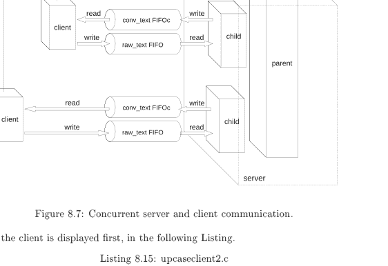

## 图 8.7：并发服务器和客户端通信。

客户端的代码首先显示在以下列表中。

## 列表 8.15：upcaseclient2.c

```
#include "upcase2.h" /* All required header files are included in this */

/* shared header file. */

#define MAXTRIES 5

const char startup_msg[] =

"The upcased2 server does not seem to be running. "

"Please start the service.\n";

const char server_no_read_msg[] =

"The server is not reading the pipe.\n";

int convertedtext_fd; /* file descriptor for READ PRIVATE FIFO */

int dummyreadfifo; /* to hold fifo open */

int rawtext_fd; /* file descriptor to WRITE PRIVATE FIFO */

int dummyrawfifo_fd; /* to hold the raw text fifo open */

int publicfifo; /* file descriptor to write-end of PUBLIC */

FILE* input_srcp; /* File pointer to input stream */

message msg; /* 2-way communication structure */
```

```
/* Signal Handlers and Utilities */

void on_sigpipe( int signo )

{

    fprintf(stderr , "upcased is not reading the pipe.\n");

    unlink(msg.raw_text_fifo);

    unlink(msg.converted_text_fifo);

    exit(1);

}

void on_signal( int sig )

{

    close( publicfifo );

    if ( convertedtext_fd != -1 )

        close(convertedtext_fd);

    if ( rawtext_fd != -1 )

        close(rawtext_fd);

    unlink(msg.converted_text_fifo);

    unlink(msg.raw_text_fifo);

    exit(0);

}

void clean_up()

{

    close( publicfifo );

    close(rawtext_fd);

    unlink(msg.converted_text_fifo);

    unlink(msg.raw_text_fifo);

}
```
/*******************************************************************************/
/*                              Main Program                                   */
/*******************************************************************************/

int main( int argc, char *argv[])

{

    int             strLength;     /* number of bytes in text to convert   */

    int             nChunk;        /* index of text chunk to send to server*/

    int             bytesRead;     /* bytes received in read from server   */

    static char     buffer[PIPE_BUF];

    static char     textbuf[BUFSIZ];


```c
struct sigaction handler;

int tries;         /* for counting tries to open rawtext fifo */

/* Check whether there is a command line argument, and if so, use it as
   the input source. */

if ( argc > 1 ) {
    if ( ( NULL == (input_srcp = fopen(argv[1], "r")) ) {
        perror(argv[1]);
        exit(1);
    }
}
else
    input_srcp = stdin;
```


```c
/* Initialize the file descriptors for error handling */
publicfifo = -1;
convertedtext_fd = -1;
rawtext_fd = -1;

/* Register the on_signal handler to handle all signals */
handler.sa_handler = on_signal;
if ( ((sigaction(SIGINT, &handler, NULL)) == -1) ||
     ((sigaction(SIGHUP, &handler, NULL)) == -1) ||
     ((sigaction(SIGQUIT, &handler, NULL)) == -1) ||
     ((sigaction(SIGTERM, &handler, NULL)) == -1)
) {
    perror("sigaction");
    exit(1);
}

handler.sa_handler = on_sigpipe;
if ( sigaction(SIGPIPE, &handler, NULL) == -1 ) {
    perror("sigaction");
    exit(1);
}

/* Create unique names for private FIFOs using process-id */
sprintf(msg.converted_text_fifo, "/tmp/fifo_rd%d", getpid());
sprintf(msg.raw_text_fifo, "/tmp/fifo_wr%d", getpid());

/* Create the private FIFOs */
if ( mkfifo(msg.converted_text_fifo, 0666) < 0 ) {
    perror(msg.converted_text_fifo);
    exit(1);
}

if ( mkfifo(msg.raw_text_fifo, 0666) < 0 ) {
    perror(msg.raw_text_fifo);
    exit(1);
}

/* Open the public FIFO for writing */
if ( (publicfifo = open(PUBLIC, O_WRONLY | O_NDELAY)) == -1 ) {
    if ( errno == ENXIO ) {
        fprintf(stderr, "%s", startup_msg);
    }
    else
        perror(PUBLIC);
    exit(1);
}

/* Send a message to server with names of two FIFOs */
write(publicfifo, (char*)&msg, sizeof(msg));

/* Try to open the raw text FIFO for writing. After MAXTRIES
   attempts we give up. */
tries = 0;
while ((rawtext_fd = open(msg.raw_text_fifo, O_WRONLY | O_NDELAY )) == -1 ) && ( tries < MAXTRIES )) {
    sleep(1);
    tries++;
}
if ( tries == MAXTRIES ) {
    fprintf(stderr, "%s", server_no_read_msg);
    clean_up();
    exit(1);
}

/* Get one line of input at a time from the input source */
while (1) {
    memset(textbuf, 0x0, BUFSIZ);
    if ( NULL == fgets(textbuf, BUFSIZ, input_srcp) )
        break;

    strLength = strlen(textbuf);

    /* Break input lines into chunks and send them one at a */
    /* time through the client's write FIFO */
    for ( nChunk = 0; nChunk < strLength; nChunk += PIPE_BUF-1 ) {
        memset(buffer, 0x0, PIPE_BUF);
        strncpy(buffer, textbuf+nChunk, PIPE_BUF-1);
        buffer[PIPE_BUF-1] = '\0';
        write(rawtext_fd, buffer, strlen(buffer));
    }

    /* Open the private FIFO for reading to get output of command */
    /* from the server */
    if ( ((convertedtext_fd = open(msg.converted_text_fifo, O_RDONLY))
          == -1) {
        perror(msg.converted_text_fifo);
        exit(1);
    }
    memset(buffer, 0x0, PIPE_BUF);
    while ( (bytesRead = read(convertedtext_fd, buffer, PIPE_BUF)) > 0 )
        write(fileno(stdout), buffer, bytesRead);

    close(convertedtext_fd);
    convertedtext_fd = -1;
}

/* User quit, so close write-end of public FIFO and delete private FIFO */
close(pipetofile);
close(rawtext_fd);
unlink(msg.converted_text_fifo);
unlink(msg.raw_text_fifo);
return 0;
}
```

# UNIX 讲义

## 第 8 章 进程间通信，第 I 部分

### 注释

- 此处的事件顺序很重要，在某些情况下是关键的。客户端在无错误地创建其私有 FIFO 之后，打开服务器的公共 FIFO 的写端。它随后发送一条包含其私有 FIFO 名称的消息。发送私有 FIFO 名称之后，它尝试以非阻塞模式打开其 `raw_text_fifo` 的写端。如果服务器尚未打开读端，则此操作会失败。假设服务器正在运行，客户端将成功打开 `raw_text_fifo`。服务器可以在写端未打开的情况下打开其读端，因此这种方式效果很好。如果我们反转顺序并在向服务器发送消息之前打开 `raw_text_fifo`，我们就需要以读写模式打开它，因为服务器阻塞在对公共 FIFO 的读取上，否则两个进程会死锁。但如果我们以读写模式打开 `raw_text_fifo`，那么如果服务器意外终止并且我们不再读取 `raw_text_fifo`，客户端将不会收到 `SIGPIPE` 信号，因为客户端本身已打开一个读端，从而阻止内核生成该信号。客户端将永远不会被通知服务器已死亡。

- 客户端随后在主循环持续时间内保持其 `raw_text_fifo` 的写端打开。
- 在循环内部，客户端首先写入其 `raw_text_fifo`，然后打开其 `converted_text_fifo`，之后如果一切顺利，它会读取并再次关闭它。因此，它在循环内重复打开和关闭此 FIFO。我们本可以让它在循环持续时间内保持打开状态，但通过关闭并重新打开它，我们有机会在 `open()` 调用中检测到服务器意外关闭了 FIFO 的写端。
- 客户端中的错误处理与迭代服务器的客户端中类似。代码具有冗余的错误检查，例如防止关闭未打开的 FIFO 的保护措施（除非在使用中，否则将文件描述符设置为 `-1`），以及在取消链接文件之前关闭描述符。另一方面，它确实应该检查 `close()` 调用的返回值。`clean_up()` 函数简化了错误处理，将清理代码集中起来。

#### 8.4.4.2 并发服务器

服务器代码在下一个列表中。

```
Listing 8.16: upcased2.c

#include "upcase2.h"

#include "sys/wait.h"

#define WARNING "Server could not access client FIFO\n"

#define MAXTRIES 5

int dummyfifo;             /* file descriptor to write-end of PUBLIC */
```


# UNIX 讲义笔记
## 第 8 章 进程间通信，第一部分

`int client_converted_fd;   /* file descriptor to write-end of PRIVATE */`

`int client_rawtext_fd;     /* file descriptor to write-end of PRIVATE */`

`int publicfifo;            /* file descriptor to read-end of PUBLIC */`

`FILE* upcase_log_fp;       /* points to log file for server */`

`pid_t server_pid;          /* to store server's process id */`

/******************************************************************************

/*                         Signal Handler Prototypes                         */

/******************************************************************************/

/** on_sigpipe()

 *  This handles the SIGPIPE signals, just writes to standard error.

 */

### Signal Handler Prototypes

```c
void on_sigpipe( int signo );
```

/** on_signal()

 * This handles the interrupt signals. It closes open FIFOs and files,

 * removes the public FIFO and exits.

 */

```c
void on_signal( int sig );
```

/** on_sigchild()

 * Because this is a concurrent server, the parent process has to collect the

 * exit status of each child. The SIGCHLD handler issues waits and writes to

 * the log file.

 */

```c
void on_sigchild( int signo );
```

/***********************************************************************/

/*                         Main Program                               */

/***********************************************************************/

```c
int main( int argc, char *argv[] )
{
    int             tries;       /* num tries to open private FIFO */
    int             nbytes;      /* number of bytes read from private FIFO */
    int             i;
    struct message  msg;         /* message structure with FIFO names */
    struct sigaction handler;    /* sigaction for registering handlers */
    char            buffer[PIPE_BUF];
    char            logfilepath[PATH_MAX];
    char            *homepath;   /* path to home directory */
    pid_t           child_pid;   /* pid of each spawned child */

    /* Open the log file in the user's home directory for appending. */
    homepath = getenv("HOME");
    sprintf(logfilepath, "%s/.upcase_log", homepath);
    if ( NULL == (upcaselog_fp = fopen(logfilepath, "a")) ) {
        perror(logfilepath);
        exit(1);
    }

    /* Register the interrupt signal handler */
    handler.sa_handler = on_signal;
    handler.sa_flags = SA_RESTART;
    if ( ((sigaction(SIGINT, &handler, NULL)) == -1) ||
         ((sigaction(SIGHUP, &handler, NULL)) == -1) ||
         ((sigaction(SIGQUIT, &handler, NULL)) == -1) ||
         ((sigaction(SIGTERM, &handler, NULL)) == -1) )
    {
        perror("sigaction");
        exit(1);
    }

    handler.sa_handler = on_sigpipe;
    if ( sigaction(SIGPIPE, &handler, NULL) == -1 ) {
        perror("sigaction");
        exit(1);
    }
}
```

```c
exit(1);
}
handler.sa_handler = on_sigchld;
if ( sigaction(SIGCHLD, &handler, NULL) == -1 ) {
    perror("sigaction");
    exit(1);
}

/* Create public FIFO */
if ( mkfifo(PUBLIC, 0666) < 0 ) {
    if ( errno != EEXIST )
        perror(PUBLIC);
    else {
        fprintf(stderr, "%s already exists. Delete it and restart.\n", PUBLIC);
    }
    exit(1);
}

/* Open public FIFO for reading and writing so that it does not get */
/* EOF on the read-end while waiting for a client to send data. */
/* To prevent it from hanging on the open, the write-end is opened */
/* in non-blocking mode. It never writes to it. */
if ( (publicfifo = open(PUBLIC, O_RDONLY)) == -1 ||
     ( dummyfifo = open(PUBLIC, O_WRONLY | O_NDELAY)) == -1 ) {
    perror(PUBLIC);
    exit(1);
}

server_pid = getpid();

/* Block waiting for a msg structure from a client */
while ( read( publicfifo, (char*)&msg, sizeof(msg)) > 0 ) {
    /* spawn child process to handle this client */
    if ( 0 == fork() ) {
        /* We get the pid for message identification. */
        child_pid = getpid();
        /* We use the value of client_rawtext_fd to detect errors */
        client_rawtext_fd = -1;
```


```c
/* Client should have opened rawtext_fd for writing before */

/* sending the message structure, so the following open should */

/* succeed immediately. If not it blocks until the client opens */

/* it. */

if ( (client_rawtext_fd = open(msg.raw_text_fifo, O_RDONLY))

     == -1 ) {

    fprintf(upcaselog_fp,

        "Client did not have pipe open for writing\n");

    exit(1);

}
```

```c
/* Clear the buffer used for reading the client's text */
memset(buffer, 0x0, PIPE_BUF);

/*
    Attempt to read from client's raw_text_fifo. This read will
    block until either input is available or it receives an EOF.
    An EOF is delivered only when the client closes the write-end
    of its raw_text_fifo.
*/

while ( (nbytes = read(client_rawtext_fd, buffer,
    PIPE_BUF)) > 0 ) {
    /* Convert the text to uppercase */
    for ( i = 0; i < nbytes; i++ )
        if ( islower(buffer[i]) )
            buffer[i] = toupper(buffer[i]);

    /* Open client's convertedtext FIFO for writing. To allow for
       delays, we try 5 times. Here it is critical that the
       O_NONBLOCK flag is set, otherwise it will hang in the loop
       and we will not be able to abandon the attempt if the client
       has died. */
    tries = 0;
    while ( ((client_convertedtext_fd = open(msg.converted_text_fifo,
        O_WRONLY | O_NDELAY)) == -1 ) && (tries < MAXTRIES) )
    {
        sleep(2);
        tries++;
    }
    if ( tries == MAXTRIES ) {
        /* Failed to open client convertedtext FIFO for writing */
        fprintf(upcaselog_fp, "%d: " WARNING, child_pid);
        exit(1);
    }
    /* Send converted text to client in its readfifo */
    if ( -1 == write(client_convertedtext_fd, buffer,
        nbytes) ) {
        if ( errno == EPIPE )
            exit(1);
    }
    /* See the notes below. */
    close(client_convertedtext_fd);
    client_convertedtext_fd = -1;
    /* Clear the buffer used for reading the client's text */
    memset(buffer, 0x0, PIPE_BUF);
}

    exit(0);
}

return 0;
}
```

服务器的信号处理程序如下。`SIGCHLD` 处理程序使用 `waitpid()` 等待所有 children, and it remains in its loop as long as there is a zombie to be collected. The `WNOHANG` flag is used to prevent it from blocking in the `waitpid()` code. This way, if multiple `SIGCHLD` signals arrive while it is in the handler, the children whose deaths caused them will be collected. (Remember that signals may not be reliably handled on all systems, and even though in a POSIX compliant system, each `SIGCHLD` will be delivered if we set `SA_NODEFER`, it is safer to collect them in this loop.)

```c
void on_sigchld( int signo )
{
    pid_t pid;
    int status;
    while ( (pid = waitpid(-1, &status, WNOHANG) ) > 0 )
        fprintf(upcaselog_fp, "Child process %d terminated.\n", pid);
    fflush(upcaselog_fp);
    return;
}
```

```c
void on_sigpipe( int signo )
{
    fprintf(stderr, "Client is not reading the pipe.\n");
}
```

```c
void on_signal( int sig )
{
    close(publicfifo);
    close(dummyfifo);
    if ( clientreadfifo != -1 )
        close(clientreadfifo);
    if ( clientwritefifo != -1 )
        close(clientwritefifo);
    if ( getpid() == server_pid )
        unlink(PUBLIC);
    fclose(upcaselog);
    exit(0);
}
```


## Comments.

- 所有工作都由子进程执行。每个子进程开始时都会尝试打开客户端的 `raw_text` FIFO 以进行读取。如果成功，它会进入一个循环，反复读取、将文本转换为大写、打开客户端的 `converted_text` FIFO、将转换后的文本写入其中，然后关闭它。
- 由于客户端可能因各种原因无法打开 `converted_text` 进行读取——它可能已被终止——子进程会在放弃之前尝试固定次数的 `open()`。它使用与迭代服务器相同的方法，使用非阻塞 `open()`。
- 当子进程成功打开 FIFO 后，它仍会检查 `write()` 是否失败，因为中间可能发生任何事情，如果失败，子进程就会退出。否则，它会写入数据，关闭其 FIFO 的一端并等待从客户端读取更多文本。当它收到文件结束时，它会退出。
- 你可能会想知道为什么服务器要反复打开和关闭客户端 `converted_text` FIFO 的写端。这是客户端在其 `read()` 中接收到 EOF 的唯一方式。如果客户端没有收到 EOF，那么它将阻塞在对 `converted_text` FIFO 的读取中，并且无法向服务器发送更多数据。这将使客户端和该服务器子进程陷入死锁，因为该进程会返回到对客户端 `raw_text` FIFO 的 `read()` 并阻塞等待来自客户端的数据，而数据永远不会到达。因此，虽然每次都打开和关闭此 FIFO 看起来效率低下，但它是防止死锁的最简单方法。
- 信号处理程序会检查父进程是否正在执行它。如果父进程收到信号，则应删除公共 FIFO，否则不应删除。我们不希望子进程删除此 FIFO！
- 如果你对套接字有一定了解，你可能会注意到此服务器的设计很容易转换为使用套接字的服务器。我们在学习套接字时会再次参考此示例。

### 8.5 Daemon Processes

如前所述，守护进程是一个在后台运行、没有控制终端的进程。此外，守护进程会将其工作目录设置为 `"/"`。通常守护进程由系统初始化脚本在启动时启动。如果你编写了一个服务器并想将其转变为完整的守护进程，仅将其放到后台是不够的。这只会告诉 shell 不要等待它；它仍然拥有控制终端，并且仍会被该终端发出的任何信号杀死。

一些守护进程由其他程序启动。例如，一些网络守护进程由 `inetd` 或 `xinetd` 超级服务器启动。一些由 `crond` 守护进程等程序启动，后者运行计划任务。一些在用户终端上调用。例如，有时打印机守护进程会在终端上由超级用户停止并重新启动。

由于守护进程没有控制终端，它们无法向标准输出或标准错误写入消息。相反，它们可以使用名为 `syslog()` 的系统日志函数，它是一个与 `syslogd` 守护进程通信的客户端，后者将消息写入特定的日志文件。`glibc` 版本的此函数是 `klogctl()`。稍后我们将查看如何使用它的示例。服务器应设计为使自身成为守护进程。换句话说，当服务器运行时，它应采取所有必要的步骤成为守护进程，其中包括：

- 1. 将自身放到后台。它通过 `fork` 一个新进程并以子进程执行其代码，而父进程执行 `exit()` 来实现。当父进程退出时，启动它的 shell 会收集其退出状态并认为已调用的程序已终止（确实如此）。子进程，即现在是服务器的进程，不再在前台，但它仍受终端控制。
- 2. 使自身成为会话领导者。回想一下，一个进程可以通过成为会话领导者来与终端分离，但只有既不是会话领导者也不是进程 group leaders can do this. Since the server is now a child of the original process, it is neither, so it can call `setsid()`，which makes it a session leader of a new session and a group leader of a new process group.
- 3. Registering its intent to ignore `SIGHUP`.
- 4. Forking another child process, terminating in the parent again, and letting the new child, which is the grandchild of the original process, execute the server code. In some versions of UNIX, when a session leader opens a terminal device (which it may want to do sometimes), that terminal is automatically made the control terminal for the process. By running as the child of a session leader, the server is now immune from this eventuality. In Linux, a process can set the `O_NOCTTY` flag on `open()` to prevent this. The reason for ignoring `SIGHUP` is that when a session leader terminates, all of its children are sent a `SIGHUP`, which would otherwise kill them. Since the parent is a session leader, the child must ignore `SIGHUP`.
- 5. Changing the working directory to `"/"`.
- 6. Clearing the `umask`.
- 7. Closing any open file descriptors.

A procedure for doing all of these steps, based on one from [Stevens], is below.

## Listing 8.17: daemon_init.c

```
void daemon_init(const char *pname, int facility)
{
    int     i;
    pid_t   pid;
    if ( (pid = fork()) == -1) {
        perror("fork");
        exit(1);
    }
    else if (pid != 0)
        exit(0);            /* parent terminates */
    /* Child continues from here */
    /* Detach itself and make itself a session leader */
    setsid();
    /* Ignore SIGHUP */
    signal(SIGHUP, SIG_IGN);
    if ( (pid = fork()) == -1) {
        perror("fork");
        exit(1);
    }
    else if ( pid != 0 )
        exit(0);    /* First child terminates */
    /* Grandchild continues from here */
    chdir("/");         /* change working directory */
```

```
umask(0); /* clear our file mode creation mask */
/* Close all open file descriptors */
for (i = 0; i < MAXFD; i++)
    close(i);
/* Start logging with syslog() */
openlog(pname, LOG_PID, facility);
}
```

The final version of the upcase server incorporates this function and turns itself into a daemon. The only changes required are to include this function into the code and insert the line

```
daemon_init(argv[0], 0);
```


### 8.6 Multiplexed I/O With select

Imagine the situation in which a process has multiple sources of input open for reading, such as a set of pipes as well as the terminal. Suppose the process has to respond to commands typed at the terminal as well as display messages that are available in the pipes. This is what is meant by multiplexed input: when a process has to obtain input available from multiple sources simultaneously. One solution would be to make all of the reads non-blocking and to continually poll each descriptor to see if there is data ready for reading on it. Polling, though, has many drawbacks, as we have seen, the most important of which is that it is wasteful of the CPU resource.

Another alternative would be to use asynchronous reads on each descriptor. This is also possible, but quite messy to code, and has the drawback that it relies on signals which may not be handled properly or reliably.

It is for these reasons that the `select()` system call was developed. Basically, the `select()` call allows a process to listen to multiple descriptors at once and to be notified when any one of them have pending input or output. Roughly put, `select()` is given a set of masks of file descriptors, representing I/O devices or files in which the process is interested. When input or output is ready on any of them, the appropriate bits in these masks are set. The process can check the masks to see which I/O is ready and can then read or write the ready descriptors. The `select()` call works with any file descriptor, so that it can be used with files, pipes, FIFOs, devices, and sockets.

`select()` is fairly complex:

```
/* According to POSIX.1-2001 */
#include <sys/select.h>
/* According to earlier standards */
```

> There is a similar call named `poll()`.

```c
#include <sys/time.h>
#include <sys/types.h>
#include <unistd.h>
int select(int nfds, fd_set *readfds, fd_set *writefds,
    fd_set *exceptfds, struct timeval *timeout);
```

参数具有以下含义：

`nfds` 感兴趣的潜在文件描述符的数量。

`readfds` 指示进程感兴趣进行*读取*的文件描述符掩码的地址。

`writefds` 指示进程感兴趣进行*写入*的文件描述符掩码的地址。

`exceptfds` 指示进程感兴趣检查*带外*数据的地址的文件描述符掩码。 （带外消息或数据应被视为与读或写描述符掩码中的任何描述符有关的异常或错误条件。）

`timeout` 包含在完成 `select()` 调用之前等待时间的 `timeval` 结构的地址。 如果 `timeout` 为 `NULL`，则表示无限期等待，即阻塞直到至少有一个描述符就绪。 如果为零，则表示立即返回上述集合中所有描述符的状态。 如果非零，则要么等待指定的时间，要么在指定的描述符之一就绪前返回。

`select()` 调用的返回值是就绪的描述符数量，如果出现错误则为 `-1`。

`fd_set` 数据类型不一定是标量。 它通常是长整型数组。 如果你稍微深入挖掘一下，你会发现一个常量 `FD_SETSIZE`，它定义了 `fd_set` 中描述符的最大数量，通常在 1024 或更多。 幸运的是，你不需要知道它是如何定义的就可以使用它，因为库中提供了用于操作 `fd_set` 对象的宏和/或函数：

这会关闭由 `fdset` 指向的掩码中描述符 `fd` 的位：

```c
void FD_CLR(int fd, fd_set *fdset);
```

这会在由 `fdset` 指向的掩码中打开描述符 `fd` 的位：

```c
void FD_SET(int fd, fd_set *fdset);
```

这会将由 `fdset` 指向的掩码中的所有位设为零：

```c
void FD_ZERO(fd_set *fdset);
```

这会检查描述符 `fd` 的位是否在由 `fdset` 指向的掩码中设置：

```c
int FD_ISSET(int fd, fd_set *set);
```

第一个参数 `nfds` 的值必须设置为最大文件描述符 + 1 的值，因为文件描述符数组是基于 0 的。 第一个参数是感兴趣的描述符的最大数量的原因是为了效率。 通过向内核提供此数字，可以节省内核复制描述符掩码中不需要的部分的工作。 为了让你了解此调用在简单情况下的使用方法，如果我们想从两个不同的打开文件描述符读取，我们会使用类似

```c
#include <sys/time.h>
#include <sys/types.h>
...
int     fd1, fd2, maxfd;
fd_set  readset, tempset;
fd1  = open("file1", O_RDONLY);  /* open file1 */
fd2  = open("file2", O_RDONLY);  /* open file2*/
maxfd = fd1 > fd2 ? fd1+1 : fd2+1;
FD_ZERO(&readset);        /* clear the bits in the mask  */
FD_SET(fd1, &readset);    /* set the bit for fd1 (file1) */
FD_SET(fd2, &readset);    /* set the bit for fd2 (file2) */
tempset = readset;        /* copy into tempset          */
while ( select(maxfd, &tempset, NULL, NULL, NULL) > 0 ) {
    if ( FD_ISSET(fd1, &tempset) ) {
        /* read from descriptor fd1 */
    }
    if ( FD_ISSET(fd2, &tempset) ) {
        /* read from descriptor fd2 */
    }
    tempset = readset;
}
```


## Notes

- 虽然我们只对文件描述符 `fd1` 和 `fd2` 感兴趣，但使用 `select` 的正确方法是指定从 0 到 `fd1` 和 `fd2` 的最大值范围的描述符。由于它是基于零的数组，此值为 `max(fd1, fd2) + 1`。
- 因为 `select()` 的返回值只要 `fd1` 或 `fd2` 上有数据可读就为正，所以循环将一直继续，直到两个文件都到达文件结束。

### 带外数据

带外是指在单独的通信通道中传输的数据。带外意味着数据不是与剩余数据按顺序到达，而是在并行通道中到达。它用于传输错误或控制消息。

- `select()` 的工作方式：它会重置文件描述符掩码，以反映所关注描述符的状态。换句话说，每次调用 `select()` 后掩码都会发生变化。因此，你需要保留原始掩码的副本，并在每次调用前将掩码重置为原始状态。
- 如果 `select()` 调用返回错误，则掩码不会被修改。
- 在循环内部，你可以使用 `FD_ISSET()` 函数来测试你感兴趣的每个描述符。
- 忘记在第一个参数中为最大描述符加 1 是非常常见的错误。同样常见的错误是忘记在每次连续调用之间重置掩码。

我们将把这些想法应用到一个更有趣的示例中，该示例摘自 [Haviland et al.]。

### 清单 8.18：`selectdemo.c`

```c
#include <stdio.h>
#include <stdlib.h>
#include <unistd.h>
#include <string.h>
#include <limits.h>
#include <errno.h>
#include <sys/time.h>
#include <sys/wait.h>
#define MSGSIZE 6
char msg1[] = "Hello";
char msg2[] = "Bye!!";
void parent( int pipeset[3][2]);
int child( int fd[2] );
/******************************************************************************/
/*                              Main Program                                  */
/******************************************************************************/
int main( int argc, char* argv[])
{
    int fd[3][2];  /* array of three pipes */
    int i;
    for ( i = 0; i < 3; i++ ) {
        /* create three pipes */
        if ( pipe(fd[i]) == -1 ) {
            perror("pipe");
            exit(1);
        }
        /* fork children */
        switch( fork() ) {
case -1 :
    fprintf(stderr, "fork failed.\n");
    exit(1);
case 0:
    child(fd[i]);
}
}
parent(fd);
return 0;
}
/********************************************************************************/
/*                              Parent and Child                               */
/********************************************************************************/
void parent( int pipeset[3][2])
{
    char    buf[MSGSIZE];
    char    line[80];
    fd_set  initial, copy;
    int     i, nbytes;
    for ( i = 0; i < 3; i++)
        close(pipeset[i][1]);
    /* create descriptor mask */
    FD_ZERO(&initial);
    FD_SET(0, &initial);                /* add standard input */
    for ( i = 0; i < 3; i++)
        FD_SET(pipeset[i][0], &initial);    /* add read end of each pipe */
    copy = initial;                     /* make a copy */
    while ( select( pipeset[2][0]+1, &copy, NULL, NULL, NULL ) > 0 ) {
        /* check standard input first */
        if ( FD_ISSET(0, &copy) ) {
            printf("From standard input: ");
            nbytes = read(0, line, 81);
            line[nbytes] = '\0';
            printf("%s", line);
        }
        /* check the pipe from each child */
        for ( i = 0; i < 3; i++ ) {
            if ( FD_ISSET(pipeset[i][0], &copy)) {
                /* it is ready to read */
                if ( read( pipeset[i][0], buf, MSGSIZE) > 0 ) {
                    printf("Message from child %d:%s\n", i, buf );
                }
            }
        }
        if ( waitpid(-1, NULL, WNOHANG) == -1 )
            return;
    copy = initial;
}
}
int child( int fd[2] )
{
    int count;
    close(fd[0]);
    for ( count = 0; count < 10; count ++ ) {
        write( fd[1], msg1, MSGSIZE);
        sleep(1 + getpid() % 6 );
    }
    write( fd[1], msg2, MSGSIZE);
    exit(0);
}
```


## 注释

- 每个子进程向其管道的写端写入一个小字符串，然后休眠一小段时间，以免过快地占满屏幕。
- 父进程使用 `select()` 调用来查询标准输入和每个子进程管道的读端。用户可以在键盘上输入字符串，父进程将检测到标准输入已就绪。在 `while` 循环中，每个描述符都会被测试，如果它被设置，就可以执行 `read()`，因为输入正在等待。这样，父进程永远不会阻塞任何正在等待其消息被读取的子进程。

在介绍套接字之后，还会有另一个更有趣的 `select()` 用法。

### 8.7 小结

相关进程可以使用匿名管道交换数据。运行在同一主机上的无关进程可以使用命名管道交换数据。与匿名管道不同，命名管道是文件系统中的实体。只要写入的数据量不超过 `PIPE_BUF` 字节，内核就保证命名管道和匿名管道的读写都是原子的。

服务器可以是迭代式的，也可以是并发式的。并发服务器创建一个子进程来处理每个不同的客户端。迭代服务器在单个进程内处理每个客户端，在它们之间共享时间。并发服务器为客户端提供更可靠的响应时间。

当进程需要处理来自多个文件描述符的 I/O 时，可以通过 `select()` 系统调用来多路复用 I/O。这只是诸多方案中的一种，但它提供了一个相对简单的解决方案。其他替代方案包括异步 I/O 和 `poll()` 调用。

## 第9章 进程间通信，第二部分

## 涵盖的概念

Sockets
fifo, mknod, pipe, pclose, popen, select, setsid,
API: dup, dup2, fpathconf, gethostname, mkfifo, shutdown, syslog, tee.

### 9.1 Sockets

Pipes are a good segue into sockets. Sockets are used like pipes in many ways but, unlike pipes, they can be used across networks. Sockets allow unrelated processes on different computers on a network to exchange data through a channel, using ordinary `read()` and `write()` system calls. We call this remote interprocess communication. Formally, a socket is an endpoint of communication between processes. Although sockets are used primarily across networks, they can also be used on a single host in place of pipes.

#### 9.1.1 Background

The development of sockets derives from the Berkeley distributions of UNIX in the early 1980's, having first appeared in 4.2BSD. In 1987, AT&T developed a different API for remote interprocess communication in their System V Release 3 (SVR3), called the Transport Level Interface (TLI). The Transport Layer Interface was the System V answer to the BSD sockets programming interface. TLI was later standardized as XTI, the X/Open Transport Interface.

In many ways, TLI has advantages over sockets. TLI and XTI were widely used and preferred over the POSIX Sockets API. They are still supported in SVR4-derived operating systems and systems such as Solaris and Mac OS. Today, the UNIX 03 Single UNIX Specification declares POSIX Sockets as the preferred API for new transport protocols.

Because sockets can be accessed like files and work the same whether on a local machine or across a network, programming them is easier than TLI programming, which requires many more structures. For this reason we focus on sockets here. In order to understand how to use sockets, you need to know the basics of networks.

#### 9.1.2 Connections

There are two ways in which sockets can be used, corresponding roughly to the difference between making a telephone call and having an email conversation with someone. When you make a telephone call to someone, you have a conversation over a dedicated communication channel, the telephone line, and you stay connected with the person on the other end for the duration of the call. In socket parlance this is called a connection oriented model. When you have an email conversation with someone, the messages are sent to the other person across different paths, and there is no dedicated connection. In fact there is no guarantee that the messages that you send will arrive in the order you send them, and the only way for the person who receives them to know who sent them is for them to have a return address in their message header. In socket parlance this is the connection-less model.

The connection oriented model uses the Transmission Control Protocol, known as TCP. The connection-less model uses the User Datagram Protocol, or UDP. There are many important differences between TCP and UDP, or equivalently, between connection oriented and connection-less models, but we will not go into them at length here. The most important differences are that TCP provides a reliable, full-duplex, sequenced channel with flow control. (Flow control is the process of managing the rate of data transmission so that senders and receivers can operate at different speeds without loss of data or retransmissions.) UDP can be full-duplex but it is not reliable (no guarantee of packet delivery), not sequenced (packets can arrive in different order than they were sent), and has no flow control (a sender can send faster than the receiver can receive).

#### 9.1.3 Communication Basics

In order to understand how to program with sockets, you need to have a basic understanding of the important concepts that underlie their use. This includes network addresses, communication domains (not internet domains), protocol families, and socket types.

Network Addresses, Ports, and Socket Addresses

For two processes to communicate, they need to know each other's network addresses. At the level of socket programming, a network address consists of two parts: an internet (IP) address and a port number. The IP address, if 32 bits, consists of four 8-bit octets, and is expressed in the standard dot-notation as in "146.95.2.131". These 32-bit address are known as IPv4 addresses. In 1995, a 128-bit address was developed, known as IPv6. Some computers have multiple network interface cards and therefore may have multiple internet addresses. It used to be the case that internet addresses had a specific structure and were divided into address classes. That is no longer the case. They are now just flat addresses.

The kernel does not represent IP addresses as strings of octets – that would be inefficient. It uses the `in_addr_t` data type, defined in `<arpa/inet.h>`, to represent an IP address. However, we will see that there are functions to convert from one format to the other.

Each server on a machine has to have a specific port that to use. There are many analogies that we could use, but if you think of an IP address as specifying a specific company's main telephone line, then the port is like a telephone extension within the company. The server uses a specific port for its services and the clients have to know the port number in order to contact the server. A port is a 16-bit integer.

Certain port numbers are well-known and reserved by particular applications and services. For example, port 7 is for echo servers, 13 for daytime servers, 22 for SSH, 25 for SMTP, and 80 for HTTP. Port numbers from 1 to 1023 are the well-known ports. To see a list of the port numbers in use, take a look at the file `/etc/services`.

Ports 1024 through 49151 are registered ports. These numbers are not controlled and a service can use one if it is not already in use.

Ports 49152 through 65536 cannot be used. They are called ephemeral ports, which are assigned automatically by TCP or UDP for client use.

`lsof` 命令可用于查看当前打开的端口。实际上，该命令的功能更为通用——它可以用来查看所有打开的文件。要查看打开的端口列表，可以使用

```


`lsof -Pnl +M -i4`

```
（其中 `i4` 限制为 IPv4），或者
```

```
netstat -lptu
```

来查看 TCP 和 UDP 的监听套接字。阅读 `lsof` 和 `netstat` 的手册页可以了解更多关于这些命令的信息。

*套接字地址*（socket address）是网络地址和端口的组合。

## 域与协议族

为了使两个进程能够通信，它们必须使用相同的*协议*。建立通信的过程部分涉及指定通信域和协议族。例如，`AF_INET` 域指定协议族为 IPv4 协议集。在该族中，可能会选择特定协议，如 TCP 或 UDP。域也可能是 `AF_UNIX`，它指定协议族仅限于本地机器。在这种情况下，将无法选择协议。创建套接字时，域和协议被作为函数的两个参数指定。`socket(2)` 手册页列出了各种域，以及可与它们一起使用的可能协议所对应的手册页。

## 套接字类型

创建套接字时，必须指定其类型。该类型与连接类型相对应。面向连接的通话使用*流套接字*，类型为 `SOCK_STREAM`，而无连接的通话使用*数据报套接字*，类型为 `SOCK_DGRAM`。还有*原始套接字*，类型为 `SOCK_RAW`。Linux 提供了其他几种套接字类型，POSIX 要求支持 `SOCK_SEQPACKET` 类型。

### 9.1.4 套接字接口¹

套接字在操作系统中通过标识符来识别。`socket()` 系统调用创建套接字并返回一个表示它的文件描述符。我们不必知道套接字如何实现也能使用它，但你应该将套接字视为类似于 UNIX 中表示文件的那种文件结构。它是内核中的一种内部结构，通过文件描述符访问，代表通信通道的一端，该通道具有特定的网络地址、协议族（也称为域）、端口号和套接字类型。

`socket()` 函数创建所谓的未命名套接字：

> ¹ 本节需要更新。所描述的某些方法现已过时。

```
#include <sys/socket.h>

int socket( int domain, int type, int protocol);
```

域是一个整数，指定地址族和协议。这些族在 `<sys/socket.h>` 中定义。一些常见的域值是

| 名称 | 用途 |
|------|---------|
| AF_UNIX | 本地通信 |
| AF_INET | IPv4 互联网协议 |
| AF_INET6 | IPv6 互联网协议 |

类型可以是 `SOCK_STREAM`、`SOCK_DGRAM`、`SOCK_RAW` 或其他几种之一。`SOCK_STREAM` 类型是连接模型，具有全双工、可靠、有序的传输。

当特定套接字类型和地址族有多个协议可供选择时，可以使用协议参数来指定特定协议。将其设置为 `0` 可确保内核选择合适的协议。

`socket()` 的返回值是一个文件描述符，可用于读取或写入套接字。例如，

```
sockfd = socket(AF_INET, SOCK_STREAM, 0);
```

创建一个面向连接的套接字，可用于互联网上的通信。

### 9.1.5 设置面向连接的服务

我们将介绍服务器在面向连接模型中必须采取的步骤。服务器必须采取的基本步骤如下。有关如何使用特定函数的详细信息将在后面介绍。

- 1. 使用 `socket()` 创建套接字。这将创建通信的端点，但不会将任何特定的互联网地址或端口号关联到它。
- 2. 使用 `bind()` 将套接字绑定到本地协议地址。这为套接字赋予一个“名称”。
- 3. 到目前为止创建的套接字是一个主动套接字，它可以主动连接到其他套接字，就像拨打另一个电话号码一样。由于这是服务器，此套接字的目的不是“向外拨号”，而是监听传入的呼叫。因此，服务器现在必须调用 `listen()` 来告诉内核，它真正想做的就是监听传入的消息并设置其队列大小的限制。此调用基本上会将套接字置于 TCP 协议中的 LISTEN 状态。
- 在 `listen()` 返回之后，服务器已创建了两个队列。一个队列存储尚未完成 TCP 握手协议的传入连接请求。另一个队列存储已完成握手的传入请求。这些请求可以随时被处理。

4. 进入一个循环，反复接受新的连接并处理它们。它可以通过调用 `accept()` 来接受新的连接。`accept()` 函数会移除已完成连接队列前端的请求，并创建一个服务器可用于与该客户端通信的第二个套接字。`accept()` 的返回值是一个表示该套接字的描述符。原始套接字继续存在。其思想是原始套接字仅用于监听，而不是与客户端通信。事实上它被称为监听套接字，而新套接字被称为已连接套接字。当连接关闭时，该已连接套接字将被移除。

这就是服务器任务的本质。现在剩下要看的是如何编程实现这一点。

### 9.1.6 编程一个面向连接的服务器

我们已经看到 `socket()` 调用的工作原理。将本地协议地址绑定到套接字的步骤是通过 `bind()` 完成的，但在查看 `bind()` 之前，我们需要了解这些地址是如何表示的。通用套接字地址由 `<sys/socket.h>` 中定义的 `sockaddr` 结构定义。

```
struct sockaddr {

    sa_family_t sa_family; /* address family */

    char sa_data[];        /* socket address */

};
```

这是一个通用套接字地址结构，因为它不特定于任何一个地址族。当你调用 `bind()` 时，你将指定一个特定的族，例如 `PF_INET` 或 `PF_UNIX`。对于其中每一个，都有不同的套接字地址结构形式。`PF_INET` 的地址结构，定义在 `<netinet/in.h>` 中，将是

```
struct sockaddr_in {

    sa_family_t    sin_family; /* internet address family */

    in_port_t      sin_port;   /* port number */

    struct in_addr sin_addr;   /* IP address */

    unsigned char  sin_zero[8]; /* padding */

};
```

`bind()` 系统调用接受 `socket()` 返回的套接字文件描述符和上面这样的地址结构，并将它们“绑定”在一起，形成套接字的一端，现在互联网中某个地方的进程可以用它来找到此服务器：

```
#include <sys/types.h>

#include <sys/socket.h>

int bind(int sockfd, const struct sockaddr *address,

         socklen_t addrlen);
```

把这些步骤放在一起，我们可能会从以下代码开始：

```c
int listenfd;
int size = sizeof(struct sockaddr_in);
struct sockaddr_in server = {PF_INET, 25555, INADDR_ANY};

if ( (listenfd = socket(PF_INET, SOCK_STREAM, 0)) == -1) {
    perror("socket call failed");
    exit(1);
}

if (bind(listenfd, (struct sockaddr *) &server, size) == -1) {
    perror("bind call failed");
    exit(1);
}
```

`sockaddr_in` 结构被初始化为使用 IPv4 协议族，端口为 25555，足够大以满足我们的目的，以及 `INADDR_ANY` 作为本地 IP 地址。指定此常量意味着如果此主机有多个 IP 地址，任何一个都可以。`bind` 调用被赋予 `listenfd` 描述符、此结构体的地址及其大小。

下一步是调用 `listen()`，它由以下定义：

```c
#include <sys/socket.h>
int listen(int sockfd, int queue_size);
```

第一个参数是已绑定的套接字的描述符，第二个参数是挂起（不完整）连接队列的最大大小。

`accept()` 调用的定义如下：

```c
#include <sys/types.h>
#include <sys/socket.h>
int accept(int sockfd, struct sockaddr *addr,
socklen_t *addrlen);
```


`accept()` 调用期望的是一个已通过 `socket()` 创建、通过 `bind()` 绑定到本地地址、并通过 `listen()` 设置为监听的套接字的描述符。第二个参数，如果不是 `NULL`，则是指向通用套接字地址结构的指针，第三个参数是存储其以字节为单位长度的变量的地址。调用后，地址将被填充为客户端的套接字地址，大小将反映客户端特定套接字地址结构体的真实大小。返回值将是已连接套接字的描述符。`accept()` 将阻塞等待连接。

我们可以把所有这些放在一起，构建一个简单的并发服务器，是的，再次进行小写到大写的转换。这次它一次只处理一个字符。我们之后会转向更有趣的任务。此代码基于 [Haviland et al.] 中的一个示例。它为每个传入连接 `fork` 一个子进程。客户端和服务器将共享一个公共头文件 `sockdemo1.h`，它首先显示，然后是服务器代码。

## 清单 sockdemo1.h

```c
#include <stdio.h>
#include <unistd.h>
#include <string.h>
#include <stdlib.h>
#include <sys/types.h>
#include <sys/socket.h>
#include <netinet/in.h>
#include <netdb.h>
#include <ctype.h>
#include <signal.h>
#include <fcntl.h>
#include <errno.h>
#define SOCKADDR      (struct sockaddr*)
#define SIZE          sizeof(struct sockaddr_in)
#define DEFAULT_HOST  "localhost"
#define PORT          25555
#define ERROR_EXIT(_mssg, _num)  perror(_mssg); exit(_num);
#define MAXLINE       4096
```

## 注释

- （也许是由于懒惰，我最终写了一个小宏（`ERROR_EXIT`），这样在系统调用失败时就不必反复键入 `perror(); exit()` 的组合。它包含在这个头文件中。我没有把它做成函数，而是做成宏，这样代码运行得更快。）
- `SOCKADDR` 宏减少了键入量。
- 服务器和客户端使用同一个头文件编译，因此端口号被硬编码进二者。在我运行过这个示例的所有机器上，数字 `25555` 似乎都没有被使用。

服务器代码如下。

## 清单 sockdemo1_server.c

```c
#include "sockdemo1.h"
#include <sys/wait.h>
#define LISTEN_QUEUE_SIZE  5
/* The following typedef simplifies the function definition after it */
typedef void  Sigfunc(int);  /* for signal handlers */
/* override existing signal function to handle non-BSD systems */
Sigfunc*  Signal(int signo, Sigfunc *func);
```

```c
/* Signal handlers */
void on_sigpipe( int signo );
void on_sigchld( int signo );
/********************************************************************************/
/* This needs to be global because the signal handler has to access it */
int connectionfd;
/********************************************************************************/
int main(int argc, char* argv[])
{
    int listenfd;    /* holds the file descriptor for the socket */
    char c;          /* this example is a ToUppercase server */
    /* A sockaddr_in struct is a struct that stores address and */
    /* port information for a socket for network communications. */
    /* The sockaddr_in IS the socket. In this case it is an Internet */
    /* socket (AF_INET) using port 7000, and accepting connections */
    /* on any network interface (INADDR_ANY) just in case the host */
    /* has multiple interfaces. */
    struct sockaddr_in server = { AF_INET, PORT, { INADDR_ANY } };
    /* The following 2 lines are here to deal with signals
       that the server can receive. the first is SIGPIPE. If
       the server tries to send data "down the socket" but the
       process on the other end has died, or the connection was
       broken for some other reason, the server will receive a SIGPIPE
       signal. To keep it alive, it handles the signal.
       The server will also receive SIGCHLD signals when its children
       terminate.
    */
    Signal(SIGCHLD, on_sigchld);
    Signal(SIGPIPE, on_sigpipe);
    /* The socket() call creates an endpoint of communication.
       In the call below, the endpoint is for an Internet socket
       (PF_INET) of the connection-oriented type (i.e., TCP rather
       than UDP). The third parameter is the protocol. A 0 tells
       the compiler to use the default protocol for the SOCK_STREAM,
       which is TCP/IP. The socket() call returns a file descriptor
       that the process can use for listening to the socket.
    */
    if ( (listenfd = socket(PF_INET, SOCK_STREAM, 0)) == -1 ) {
        ERROR_EXIT("socket call failed",1)
    }
    /* The server now has to bind the socket file descriptor, listenfd,
to the socket data structure. This, in effect, connects the file descriptor to the actual network/port address.
*/
if ( bind( listenfd, ( struct sockaddr *) &server, SIZE ) == -1 ) {
    ERROR_EXIT(" bind call failed",1)
}
```


/* The next step for the server is to listen for incoming connection requests. The `listen()` call establishes the number of simultaneous connections that the server will handle. I.e., it is the size of the queue of received, but not accepted requests. Here we accept `LISTEN_QUEUE_SIZE` requests.
*/

```c
if (listen(listenfd, LISTEN_QUEUE_SIZE ) == -1) {
    ERROR_EXIT(" listen call failed",1)
}
```

/* start the infinite loop to listen for and accept incoming */
/* connection requests */

```c
for ( ; ; )
{
    /* The accept call returns the next completed connection from the front of the completed connection queue. If there are no completed connections in the queue, the process blocks The accept call returns a file descriptor that can be used to read (recv) and/or write (send) data in the socket. The returned descriptor is the connected socket descriptor; the listening descriptor remains available to listen to the socket.
*/
    if ( ( connectionfd = accept(listenfd , NULL, NULL ) ) == -1){
        if ( EINTR == errno )
            continue;
        else
            perror(" accept call failed");
    }
    switch ( fork() ) {
    case -1:
        ERROR_EXIT("fork call failed",1)
    case 0:
        /*
        The child executes this code.
        You can use the ordinary read and write calls, but recv and send are more flexible. recv allows peeking without reading, waiting for full buffers, and discarding all but out-of-band data.
        */
        while ( recv(connectionfd, &c, 1, 0) > 0 )
        {
            c = toupper(c);                 /* convert c to uppercase */
            send(connectionfd, &c, 1, 0 );/* send it back */
        }
    }
}
```

```c
close(connectionfd);
exit(0);
default:
    /* server code */
    close(connectionfd);
    /* note that the server cannot wait for the child processes, */
    /* otherwise it will not return to the top of the loop to */
    /* accept new connections. Instead it has a SIGCHLD handler. */
    }
}
```

/* if a SIGPIPE is received: */
```c
void on_sigpipe( int sig )
{
    close(connectionfd);
    exit(0);
}
```

```c
void on_sigchld( int signo )
{
    pid_t pid;
    int   status;

    while ( (pid = waitpid(-1, &status, WNOHANG) ) > 0 )
        ;
    return;
}
```

```c
Sigfunc* Signal(int signo, Sigfunc *func)
{
    struct  sigaction act, oact;

    act.sa_handler  = func;
    sigemptyset(&act.sa_mask);
    act.sa_flags = 0;
    if (SIGALRM != signo ) {
        act.sa_flags |= SA_RESTART;
    }
    if ( sigaction(signo, &act, &oact) < 0 )
        return ( SIG_ERR );
    return ( oact.sa_handler);
}
```

### 注释

- 该程序使用用户自定义的 `Signal()` 函数来封装注册信号处理程序的逻辑。由于我们在大多数程序中都注册了多个处理程序，早点创建此函数并将其放入库中以便重用会是个好主意。这个想法来自 `/Stevens/`。

- 该程序本可以使用普通的 `read()` 和 `write()` 系统调用。相反，作为介绍两种套接字专用通信原语的方式，它使用了 `recv()` 和 `send()`。`recv()` 是三类套接字读取函数之一：

```c
#include <sys/types.h>
#include <sys/socket.h>
ssize_t recv(int s, void *buf, size_t len, int flags);
ssize_t recvfrom(int s, void *buf, size_t len, int flags,
struct sockaddr *from, socklen_t *fromlen);
ssize_t recvmsg(int s, struct msghdr *msg, int flags);
```

- `recvfrom()` 和 `recvmsg()` 函数是最通用的。`recv()` 的原型与 `read()` 相同，只是多了一个第四个参数，可用于设置各种标志来控制 `recv()` 的行为。标志可用于打开非阻塞操作 `MSG_DONTWAIT`、通知内核进程希望接收带外数据 `MSG_OOB`，或在不读取的情况下窥探数据 `MSG_PEEK`，等等。在我们的程序中，没有使用任何标志，因此第四个参数为零，且 `recv(s, buf, n, 0)` 与 `read(s, buf, n)` 相同。

- `send()` 函数也是三类函数之一：

```c
#include <sys/types.h>
#include <sys/socket.h>
ssize_t send(int s, const void *buf, size_t len, int flags);
ssize_t sendto(int s, const void *buf, size_t len, int flags,
const struct sockaddr *to, socklen_t tolen);
ssize_t sendmsg(int s, const struct msghdr *msg, int flags);
```

- `sendto()` 和 `sendmsg()` 函数是最通用的。`send()` 的原型与 `write()` 相同，只是多了一个额外参数。与 `recv()` 类似，`send()` 的第四个参数是一组可进行或运算的标志。其中一些标志相同，例如 `MSG_OOB`，允许进程发送带外数据。更多细节请参阅手册页。我们将在查看无连接服务器时再回到 `sendto()` 和 `recvfrom()` 的使用。

客户端的代码如下。

### Listing sockdemo1_client.c

```c
#include "sockdemo1.h"
int main(int argc, char** argv)
{
    int     sockfd;
    char    c, rc;
    char    ip_name[256] = "";
```


```c
struct sockaddr_in server;

struct hostent    *host;

if ( argc < 2 )
```
```
```
strcpy(ip_name, DEFAULT_HOST);
else
    strcpy(ip_name, argv[1]);

if ((host = gethostbyname(ip_name)) == NULL) {
    ERROR_EXIT("gethostbyname", 1);
}

memset(&server, 0, sizeof(server));
memcpy(&server.sin_addr, host->h_addr_list[0], sizeof(server.sin_addr));
server.sin_family = AF_INET;
server.sin_port = PORT;

if ((sockfd = socket(AF_INET, SOCK_STREAM, 0)) == -1) {
    ERROR_EXIT("socketcall failed", 1);
}

if (connect(sockfd, (struct sockaddr *)&server, sizeof(server)) == -1) {
    ERROR_EXIT("connect call failed", 1);
}

for (rc = '\n'; rc != '\n'; ) {
    if ('\n' == rc) {
        printf("Input a lowercase character\n");
        c = getchar();
        write(sockfd, &c, 1);
        if (read(sockfd, &rc, 1) > 0)
            printf("%c", rc);
        else {
            printf("server has died\n");
            close(sockfd);
            exit(1);
        }
    }
}
}
```

## 注释。

- 客户端执行主机名到地址的转换以使其更通用。用户可以在命令行上提供服务器名称，而不必记住 IP 地址。如果 IP 地址发生变化，程序仍然可以工作。`gethostbyname()` 调用返回一个指向 `hostent` 结构的指针，给定一个包含有效主机名的字符串。

```c
#include <netdb.h>

extern int h_errno;

struct hostent *gethostbyname(const char *name);
```

- `hostent` 结构体在 `<netdb.h>` 头文件中定义：

```c
struct hostent {
```
```
char *h_name;    /* official name of host */
char **h_aliases; /* alias list */
int   h_addrtype; /* host address type */
int   h_length;   /* length of address */
char **h_addr_list; /* list of addresses */
}
#define h_addr h_addr_list[0] /* for backward compatibility */
```

- `h_name` 字段是主机的官方名称。例如，如果在我们网络上的主机上运行时将其命名为“eniac”，它能够解析该名称，并且 `h_name` 字段将被填入“eniac.geo.hunter.cuny.edu”。`aliases` 成员是指向字符串列表的指针，其中每个字符串都是一个别名，即在主机数据库中为同一台机器列出的另一个名称。`h_addr_list` 是指向该主机互联网地址列表的指针。如果主机只有一个网络接口卡，则仅定义 `h_addr_list[0]`。每个条目的类型为 `in_addr`，这就是为什么在客户端代码中，它可以直接（通过强制转换）赋给 `sock_addr` 结构的 `sin_addr` 字段。我们在此不使用 `h_addrtype` 或 `h_length` 字段。

客户端使用普通的 `read()` 和 `write()` 调用进行其 I/O 操作。

#### 9.1.7 使用复用 I/O 的面向连接客户端

考虑第 8 章中 `upcase` 示例的客户端。它从标准输入读取一行，将其写入管道，然后从第二个管道读取转换后的文本。在该示例中需要两个管道，因为管道不能用作双向通道。然而，我们可以用单个套接字替换这对管道，然后该套接字可用于将原始文本发送到服务器并从服务器接收转换后的文本。此外，通过使套接字成为 Internet 域套接字，客户端和服务器可以位于不同的机器上。

如果我们保留客户端的原始设计但仅用套接字替换管道，客户端将在循环中从标准输入读取原始文本，将其写入套接字，然后从同一套接字读取转换后的文本，循环形式如下

```
while ( true ) {
    get text from standard input;
    write text to socket;
    read converted text from socket;
    write response on standard output;
}
```

由于输入可以重定向，它可能比从服务器接收到的响应到达得快得多，因为服务器可能距离很远。客户端将花费大部分时间阻塞在读取套接字的调用上，即使服务器和套接字本身都可以处理更大的吞吐量。在交互式情况下，如果用户输入文本非常快但套接字的往返时间很大，也会发生同样的情况。在这种情况下，客户端在终端上向用户显示提示时会延迟。因此，在此客户端中有意义的是使用 `select()` 调用复用标准输入和套接字输入。通过使用 `select()` 调用，客户端只有在用户和服务器都没有数据可读时才会阻塞。只要文本到达标准输入流，它就会被转发到服务器。如果标准输入上的文本到达速度远快于往返时间，文本将继续发送到服务器，服务器将逐行处理它们并以稳定流的形式将其发回。

一个类比会有帮助。想象一个 30 人的消防队试图用一个水桶扑灭火灾。水桶装满水并从一个人传到下一个人传到火边，倒在火上，然后传回水源地，重复此过程。假设往返需要一分钟，水桶装有 5 加仑水。这向火提供每分钟 5 加仑的水。现在假设有 60 个水桶可用。第一个水桶被装满并交给下一个人，第二个水桶被装满，依此类推，直到所有 60 个水桶都被装满。假设人们知道如何将装满的水桶从空水桶旁传递过去并且交换速率是均匀的，虽然往返时间没有改变，但在每个瞬间消防队中会有 60 个水桶，并且每秒会有满水桶到达火场。火场将获得每秒 5 加仑，或每分钟 300 加仑的水。

这就是使用 `select()` 如何在瓶颈是数据从客户端到服务器往返所需时间的情况下提高吞吐量。代码如下。它使用与 `sockdemo1` 中相同的头文件。此客户端不会在命令行上接受文件名；它使用单个命令行参数，即服务器运行的主机名。

##### Listing sockdemo2_client.c

```c
#include <sys/types.h>
#include <sys/socket.h>
#include <netdb.h>
#include "sockdemo1.h"
#define MAXFD(_x, _y) ((_x)>(_y)?(_x):(_y))

int main(int argc, char* argv[])
{
    int             sockfd;
    char            ip_name[256] = "";
    fd_set          readset;
    int             maxfd, n;
    char            recvline[MAXLINE];
    char            sendline[MAXLINE];
    int             s, stdin_eof = 0;
    struct addrinfo hints;
    struct addrinfo *result;
    struct addrinfo *resulting_address;
    char            portstr[20];

    /* Check if there is a host name on command line;
       if not use default */
    if ( argc < 2 )
        strcpy(ip_name, DEFAULT_HOST);
```


```c
else
    strcpy(ip_name, argv[1]);

printf("Searching for server %s\n", ip_name );
```

/* 在调用 `getaddrinfo()` 之前先初始化 `hints` `addrinfo` 结构。此结构用于定义在为客户端搜索合适的 host/port/service 时使用的标准。 */
```c
memset(&hints, 0, sizeof(struct addrinfo)); /* 清零 */
hints.ai_family = AF_UNSPEC;                /* 允许 IPv4 或 IPv6 */
hints.ai_socktype = SOCK_STREAM;            /* 流连接 */
hints.ai_flags = 0;                         /* 无标志 */
hints.ai_protocol = 0;                      /* 任意协议 */
```

/* 将数字端口转换为字符串 */
```c
sprintf(portstr, "%d", PORT);
```

/* 获取网络信息；如果返回非零，表示出错 */
```c
if ( 0 != ( s = getaddrinfo(ip_name, portstr, &hints, &result) ) ) {
    /* 调用 gai_strerror() 获取错误号对应的字符串 */
    fprintf(stderr, "getaddrinfo: %s\n", gai_strerror(s));
    exit(EXIT_FAILURE);
}
```

/* 遍历由 `getaddrinfo()` 调用中 `result` 指针指向的列表中的每个 `addrinfo` 结构。这些结构包含可能的 family/socket-type/protocol 组合。列表中结构体的顺序遵循 RFC 3484 标准的规定，因此第一个可以创建套接字的结构就是要使用的结构。 */
```c
resulting_address = result;
while ( NULL != resulting_address ) {
    sockfd = socket(resulting_address->ai_family,
                    resulting_address->ai_socktype,
                    resulting_address->ai_protocol);
    if ( sockfd == -1 ) {
        resulting_address = resulting_address->ai_next;
        continue;
    }
    if ( connect(sockfd, resulting_address->ai_addr,
                 resulting_address->ai_addrlen) != -1 )
        break;                          /* 成功 */
    close(sockfd);
    resulting_address = resulting_address->ai_next;
}
```

```c
if ( resulting_address == NULL ) {  /* 没有地址成功 */
    fprintf(stderr, "Could not connect\n");
    exit(EXIT_FAILURE);
}

freeaddrinfo(result);          /* 不再需要 */

printf("Connection made to server\n");

maxfd = MAXFD(fileno(stdin), sockfd) +1;

for ( ; ; ) {
    FD_ZERO(&readset);
    if ( stdin_eof == 0 )
        FD_SET(fileno(stdin), &readset);
    FD_SET(sockfd, &readset);
    if ( select(maxfd, &readset, NULL, NULL, NULL) > 0 ) {
        if ( FD_ISSET(sockfd, &readset)) {
            if ( ( n = read(sockfd, recvline, MAXLINE-1)) == 0 ) {
                if (stdin_eof == 1)
                    return 0;
                else
                    ERROR_EXIT("Server terminated prematurely.", 1);
            }
            recvline[n] = '\0';
            fputs(recvline, stdout);
        }
        if ( FD_ISSET(fileno(stdin), &readset)) {
            if ( fgets(sendline, MAXLINE-1, stdin) == NULL ) {
                stdin_eof = 1;
                shutdown(sockfd, SHUT_WR);
                FD_CLR(fileno(stdin), &readset);
                continue;
            }
            write(sockfd, sendline, strlen(sendline));
        }
    }
    return 0;
}
```

## Comments

- 该客户端一次发送一整行，连续发送给服务器。它在将接收到的每一行打印到标准输出之前都附加一个空字符，尽管原则上接收到的所有行都应该是以空字符结尾的，因为它们与客户端发送给服务器的以空字符结尾的行相同，只是行中小写字母被转换为大写字母。
- `shutdown(sockfd, SHUT_WR)` 系统调用关闭对套接字的写入。当客户端检测到标准输入流上的文件结束时，它不能完全关闭套接字，因为如果这样做，它将不会接收服务器发送但尚未转换为大写的行。另一方面，它必须向服务器发送通知，表明套接字上不再有输入，以便服务器对套接字的 `read()` 可以返回。`shutdown()` 实现了这一点；服务器的 `read()` 返回并且套接字保持打开直到服务器关闭

它的套接字末端。没有 `shutdown()` 就无法实现这一点。它的概要如下：

```c
#include <sys/socket.h>

int shutdown(int s, int how);
```

这里，整数 `how` 可以被 `SHUT_WR`、`SHUT_RD` 或 `SHUT_RDWR` 之一替换。

- 一旦客户端检测到文件结束，它也会为自己设置一个标志 `stdin_eof`，用于决定是否在描述符掩码中为标准输入设置一位。如果检测到文件结束，它就停止设置该位；否则就设置它。此外，当套接字上的 `read()` 返回 0 字节时，它使用此标志来区分两种情况：服务器是否已停止发送文本因为没有文本可发送，或者在文件结束条件发生之前套接字上出现了错误。

服务器的主函数如下所示。由于本示例中的信号处理代码与 `sockdemo1_server.c` 中的没有区别，因此未包含在内。

## Listing sockdemo2_server.c

```c
#include "sockdemo1.h"

#include "sys/wait.h"

#define LISTEN_QUEUE_SIZE  5

/* The following typedef simplifies the function definition after it */

typedef void  Sigfunc(int);  /* for signal handlers */

/* override existing signal function to handle non-BSD systems */

Sigfunc* Signal(int signo, Sigfunc *func);

/* Signal handlers */

void on_sigchld(int signo);

void str_echo(int sockfd);

int main(int argc, char **argv)

{

    int          listenfd, connfd;

    pid_t        childpid;

    socklen_t    clilen;

    struct sockaddr_in  client_addr, server_addr;

    void         sig_child(int);
```


```
if ( (listenfd = socket(AF_INET, SOCK_STREAM, 0)) == -1 ) {
    ERROR_EXIT("socket call failed",1)
}
bzero(&server_addr, sizeof(server_addr));
server_addr.sin_family     = AF_INET;
server_addr.sin_addr.s_addr = htonl(INADDR_ANY);
server_addr.sin_port       = PORT;
if ( bind( listenfd , (struct sockaddr *)&server_addr , sizeof(server_addr)) == -1 ) {
    ERROR_EXIT(" bind call failed",1)
}
if ( -1 == listen(listenfd , LISTEN_QUEUE_SIZE ) ) {
    ERROR_EXIT(" listen call failed",1)
}
Signal(SIGCHLD, on_sigchld);
for ( ; ; ) {
    clilen = sizeof(client_addr);
    if (((connfd = accept(listenfd , (struct sockaddr *)&client_addr , &clilen))) < 0 ) {
        if ( EINTR == errno )
            continue;
        else
            ERROR_EXIT("accept error",1);
    }
    if ( (childpid = fork()) == 0 ) {
        close(listenfd);
        str_echo(connfd);
        exit(0);
    }
    close(connfd);
}
void str_echo(int sockfd)
{
    ssize_t n;
    int i;
    char line[MAXLINE];
    for ( ; ; ) {
        if ( (n = read(sockfd , line , MAXLINE-1)) == 0 )
            return;
        for ( i = 0; i < n; i++ )
            if ( islower(line[i]))
                line[i] = toupper(line[i]);
        write(sockfd , line , n);
    }
}
```


## Comments.

所有逻辑都封装在 `convert()` 函数中，子进程执行该函数。`convert()` 读取已连接的套接字直到接收到文件结束，然后它终止，这会导致子进程在 `main` 中退出。

# Chapter 10 Threads

## Concepts Covered

*Processes, threads, multi-threading paradigms, Pthreads, NPTL, thread properties, thread cancellation, detached threads, mutexes, condition variables,*

*barrier synchronization, reduction algorithm producer-consumer problem, reader/writer locks, thread scheduling, deadlock, starvation*

### 10.1 Introduction

我们在第 8 章中看到，一个进程与一组资源相关联，包括其内存段（文本、栈、已初始化数据、未初始化数据）、环境变量和命令行参数，以及包含在内核资源（如进程和用户结构）中的各种属性和数据。这些结构中包含的信息种类部分列表包括诸如进程的

- ID，例如进程 ID、进程组 ID、用户 ID 和组 ID
- 硬件状态
- 内存映射，例如进程段位于何处
- 标志，例如 set-uid、set-gid
- 文件描述符
- 信号掩码和处置
- 资源限制
- 进程间通信工具，例如消息队列、管道、信号量或共享内存。

进程在某种意义上是一个相当“重量级”的对象，因为当进程被创建时，所有这些资源都必须为其创建。`fork()` 系统调用复制了调用进程的部分资源，但并非全部。其中一些资源在父进程和子进程之间共享。

进程默认情况下在它们之间可以共享的内容有限，因为它们不共享内存空间。因此，例如，它们通常不共享在内存中创建的变量和其他对象。大多数操作系统提供共享内存的 API。例如，在 Linux 2.4 及更高版本，以及 glibc 2.2 及更高版本中，POSIX 共享内存可用，因此不相关的进程可以通过共享内存对象进行通信。Solaris 也支持共享内存，既有原生支持，也有对后来的 POSIX 标准的支持。此外，进程可以共享文件和消息，并且它们可以相互发送信号以进行同步。

使用进程作为多任务处理手段的最大缺点是其对系统资源的消耗。这就是线程发明的动机。

# 10.2 线程概念

线程是一条控制流（可视为指令序列），可以由内核独立调度。一个典型的 UNIX 进程可以被认为只有一个控制线程：每个进程一次只能做一件事。当程序具有多个控制线程时，单个进程内部可以同时做不止一件事，每个线程处理一个单独的任务。其中的一些优点是

- 处理异步事件的代码可以由一个单独的线程执行。每个线程然后可以使用同步编程模型来处理其事件。
- 而多个进程必须使用内核提供的机制来共享内存和文件描述符，线程自动可以访问相同的内存地址空间，这更快也更简单。
- 即使在单处理器机器上，通过将预期有长时间等待的系统函数调用放在单独的线程中，也能提高性能。这样，只有调用线程被阻塞，而非整个进程。
- 交互式程序的响应时间可以通过拆分线程来处理用户输入和输出而得到改善。

线程与父进程以及彼此共享某些资源，并为其他资源维护私有副本。线程之间共享的最重要资源是程序的文本，即其可执行代码，以及全局内存和堆内存。这意味着线程可以通过程序的全局变量进行通信，但也意味着它们必须同步对这些共享资源的访问。为了使线程能够独立调度，至少它们必须拥有自己的栈和寄存器值。

在 UNIX 中，POSIX 要求每个线程都具有其自己独立的

- 线程 ID
- 栈和备用栈
- 栈指针和寄存器
- 信号掩码
- `errno` 值
- 调度属性
- 线程特定数据。

另一方面，除了进程的文本段和数据段之外，UNIX 线程还共享

- 文件描述符
- 环境变量
- 进程 ID
- 父进程 ID
- 进程组 ID 和会话 ID
- 控制终端
- 用户和组 ID
- 打开的文件描述符
- 记录锁
- 信号处置
- 文件模式创建掩码（`umask`）
- 当前目录和根目录
- 区间定时器和 POSIX 定时器
- `nice` 值
- 资源限制
- CPU 时间和资源消耗的测量

总之，一个线程

- 是进程内的单一控制流，并使用进程资源；
- 仅复制使其能够独立调度的资源；
- 可以与其他线程共享进程资源；并且
- 如果父进程被终止，则终止；

### 10.3 使用线程编程

线程适用于某些类型的并行编程。一般来说，为了使程序能够利用多线程，它必须能够被组织成可并发执行的离散、独立的任务。考虑使用多个线程时首先要考虑的是如何将程序分解为此类离散的并发任务。不过还有其他考虑因素。其中包括

- 如何在线程之间平衡负载，以使没有一个线程成为瓶颈？
- 线程将如何通信和同步以避免竞争条件？
- 问题中存在什么类型的数据依赖，以及这些将如何影响线程设计？
- 什么数据将被共享，什么数据将是线程私有的？
- I/O 将如何处理？例如每个线程是否执行自己的 I/O？

这些考虑都很重要，并且在很大程度上在大多数编程问题中都会出现。确定数据依赖关系、决定哪些数据应共享哪些应私有，以及确定如何同步对共享数据的访问，是解决方案正确性的非常关键的方面。负载平衡和 I/O 的处理通常影响性能但不影响正确性。

知道如何使用线程库只是使用线程的技术部分。更困难的部分是知道如何编写并行程序。这些笔记无意协助你完成该任务。它们的目的是仅提供技术背景，并在此处和彼处提供一些指针。然而，在继续之前，我们介绍几种组织多线程程序的常见范式。

#### 线程池，或 Boss/Worker 范式

在此方法中，有一个单一的 boss 线程分派线程执行工作。这些线程是工作线程池的一部分，该池通常在 boss 开始分派线程之前预先分配。

#### Peer 或 WorkCrew 范式

在 WorkCrew 模型中，任务被分配给一组有限的工作线程。每个工作线程可以在其他工作线程空闲时为其排队并发求值的子任务。Peer 模型与 boss/worker 模型类似，只是线程池创建后，boss 成为线程池中的另一个线程，从而成为其他线程的对等者。

#### 管道

与处理器中流水线的工作方式类似，每个线程都是处理工厂中长链的一部分。每个线程对前一个线程处理过的数据进行工作并将其传递给下一个线程。你必须小心地均衡工作并采取额外步骤以确保此线程模型中的非阻塞行为，否则你可能会遇到管道“停滞”。

### 10.4 Pthread 库概述

1995 年，Open Group 定义了 UNIX 线程的标准接口（IEEE POSIX 1003.1c），他们将其命名为 Pthreads（P 代表 POSIX）。该标准在多个平台上得到支持，包括 Solaris、Mac OS、FreeBSD、OpenBSD 和 Linux。2005 年，Red Hat Inc. 的 Ulrich Drepper 和 Ingo Molnar 开发了一种新的接口实现，称为原生 POSIX 线程库（NPTL），它比原始库快得多，此后已取代该库。Open Group 于 2008 年进一步修订了该标准。我们将把对线程的研究限制在 Pthreads 的 NPTL 实现上。

Pthreads 库为线程的管理和使用提供了非常大量的原语；2008 年 POSIX 标准中定义了 93 个不同的函数。一些线程函数

与进程类似。下面的表格比较了基本的进程原语与其对应的 Pthread 原语。

| 进程原语 | 线程原语 | 描述 |
|---|---|---|
| `fork()` | `pthread_create()` | 创建一个新的控制流并执行一个函数 |
| `exit()` | `pthread_exit()` | 退出调用的控制流 |
| `waitpid()` | `pthread_join()` | 等待特定的控制流退出并收集其状态 |
| `getpid()` | `pthread_self()` | 获取调用控制流的 id |
| `abort()` | `pthread_cancel()` | 请求调用控制流的异常终止 |

Pthreads API 大致可分为以下四组

线程管理：该组包含直接操作线程的函数，例如创建、分离、连接等。该组还包含设置和查询线程属性的函数。

互斥锁：该组包含使用互斥处理临界区的函数。互斥锁函数提供创建、销毁、锁定和解锁互斥锁的功能。这些功能由互斥锁属性函数补充，后者设置或修改与互斥锁关联的属性。

条件变量：该组包含处理基于程序员指定的条件共享互斥锁的线程之间通信的函数。这些包括根据指定的变量值创建、销毁、等待和信号的函数，以及设置和查询条件变量属性的函数。

同步：该组包含管理读写锁和屏障的函数。

我们将按此处列出的顺序访问这些组，不会深入探讨任何一个组，但深度足以编写相当健壮的程序。

### 10.5 线程管理

#### 10.5.1 创建线程

我们将从 `pthread_create()` 函数开始。其原型为

```
int pthread_create ( pthread_t          *thread,
```


```c
const pthread_attr_t *attr,

void *(*start_routine)(void *),

void                *arg);
```

此函数以调用进程的一部分启动一个新线程，线程 ID 为 *thread。在成功创建新线程后，thread 包含其线程 ID。与 `fork()` 不同，此调用传递一个函数地址 `start_routine()`，由新线程执行。此“启动”函数恰好有一个参数，类型为 `void*`，并返回一个 `void*`。第四个参数 `arg` 是将传递给线程中 `start_routine()` 的参数。

第二个参数是指向 `pthread_attr_t` 结构的指针。此结构可用于定义新线程的属性。这些属性包括其堆栈大小、调度策略和可连接性等属性，将在下面讨论。如果程序未专门为其成员设置值，则使用默认值代替。我们将在后面更详细地检查线程属性。

由于 `start_routine()` 只有一个参数，如果函数需要在线程内访问多个简单变量，程序应声明一个包含所有需要在线程内访问的状态的结构，并传递指向该结构的指针。例如，如果一组线程正在访问共享数组并且每个线程将处理该数组的连续部分，则您可能希望定义如下结构

```c
typedef struct _task_data
{
    int first;    /* index of first element for task */
    int last;     /* index of last element for task */
    int *array;   /* pointer to start of array */
    int task_id;  /* id of thread */
} task_data;
```

并在初始化 `first`、`last` 和 `task_id` 的值后启动每个线程。数组指针可能需要也可能不需要；如果数组是全局变量，线程将可以访问它。如果它在主程序中声明，则其地址可以作为结构的一部分。假设数组在主程序中声明为名为 `data_array` 的静态局部变量。那么初始化线程数据并创建线程的代码片段可以是

```c
task_data thread_data[NUM_THREADS];

for ( t = 0 ; t < NUM_THREADS; t++ ) {
    thread_data[t].first    = t*size;
    thread_data[t].last     = (t+1)*size -1;
    if ( thread_data[t].last > ARRAY_SIZE -1 )
        thread_data[t].last = ARRAY_SIZE - 1;
    thread_data[t].array    = &data_array[0];
    thread_data[t].task_id  = t;
    if ( 0 != (rc = pthread_create(&threads[t], NULL, process_array,
        (void *) &thread_data[t]) ) {
        printf("ERROR: %d return code from pthread_create()\n", rc);
        exit(-1);
    }
}
```

这将创建 `NUM_THREADS` 个线程，每个线程执行 `process_array()`，每个线程都有自己的包含其执行参数的结构。

### 10.5.1.1 关于共享数据的设计决策

将数据数组声明为主程序中的局部变量的优点是，当全局变量和副作用更少时，更容易分析和维护代码。修改全局变量的函数程序更难分析。另一方面，将其设为主程序中的局部变量，然后在传递给每个线程的线程数据结构中添加指向该数组的指针，会增加线程存储需求并减慢程序速度。每个线程在执行时其栈中都有一个额外的指针，并且对数组的每次引用都需要两次解引用而不是一次。哪种更好？这取决于整体项目需求。如果速度和内存是问题，请使用全局变量并在记录和访问时采用良好的实践。如果不是，请使用静态局部变量。

### 10.5.2 线程标识

线程可以通过调用 `pthread_self()` 获取其线程 ID，其原型为

```c
pthread_t pthread_self(void);
```

这是进程中 `getpid()` 的类比。此函数是线程获取其 ID 的唯一方式，因为它不会由创建调用提供。在这方面它与 `fork()` 完全类似。

线程可以通过调用来检查两个线程 ID 是否相等

```c
int pthread_equal(pthread_t t1, pthread_t t2);
```

如果两个线程 ID 相等则返回非零，如果不相等则返回零。

### 10.5.3 线程终止

线程可以通过调用 `pthread_exit()` 终止自身：

```c
void pthread_exit(void *retval);
```

此函数会杀死线程。`pthread_exit()` 函数永远不会返回。类似于 `exit()` 向 `wait()` 返回值的方式，返回值可以由同一进程中的另一个线程通过调用 `pthread_join()`[1] 来检查。`retval` 指向的值不应位于调用线程的栈上，因为线程终止后该栈的内容是未定义的。它可以是全局变量或在堆上分配。因此，如果你想为返回值使用局部作用域变量，请在线程内部将其声明为 `static`。

主程序最好通过调用 `pthread_exit()` 来终止自身，因为如果它没有等待已创建的线程并且它们仍在运行，如果它调用 `exit()`，它们将被杀死。如果这些线程不应被终止，则从 `main()` 调用 `pthread_exit()` 将确保它们继续执行。

1. 前提是终止的线程是可连接的。

### 10.5.4 线程连接与可连接性

创建线程时，为其定义的一个属性是它是否可连接或分离。默认情况下，创建的线程是可连接的。如果线程可连接，另一个线程可以使用函数 `pthread_join()` 等待其终止。只有创建为可连接的线程才可以被连接。

连接是一种让一个线程等待另一个线程终止的方式，与 `wait()` 系统调用让进程等待子进程终止的方式非常相似。当父进程创建线程时，它可能需要在执行某些任务之前知道该线程何时终止。连接线程，就像等待进程一样，是同步任务执行的一种方式。

然而，连接在一点上与等待不同：调用 `pthread_join()` 的线程必须指定其等待的线程的线程 ID，使其更像 `waitpid()`。其原型为

```c
int pthread_join(pthread_t thread, void **value_ptr);
```

`pthread_join()` 函数会挂起调用线程的执行，直到目标线程终止，除非目标线程已经终止。如果目标线程已经终止，`pthread_join()` 将成功返回。

如果 `value_ptr` 不为 `NULL`，则终止线程传递给 `pthread_exit()` 的值将在 `value_ptr` 引用的位置可用，前提是 `pthread_join()` 成功。

一些会导致问题的事项包括：

- 多次同时调用 `pthread_join()` 指定相同的目标线程会导致未定义结果。
- 如果 `pthread_join()` 的线程参数指定的值不引用可连接线程，则行为未定义。
- 如果 `pthread_join()` 的线程参数指定的值引用调用线程本身，则行为未定义。
- 未对可连接线程进行连接会产生“僵尸线程”。每个僵尸线程都会消耗一些系统资源，当积累足够多的僵尸线程时，将无法再创建新线程（或进程）。

下面的列表显示了一个简单的示例，创建单个线程并使用 `pthread_join()` 等待它，同时收集并打印其退出状态。

**Listing 10.1: Simple example of thread creation with join**

```c
int exitval;

void* hello_world( void * world)
{
    printf("Hello World from %s.\n", (char*) world);
    exitval = 2;
    pthread_exit((void*) exitval);
}
```

```c
int main( int argc, char *argv[] )
{
    pthread_t child_thread;
    void *status;
    char *planet = "Pluto";
    if ( 0 != pthread_create(&child_thread, NULL,
        hello_world, ( void* ) planet) ) {


```
perror("pthread_create");

exit(-1);

}

pthread_join(child_thread, (void**) (&status));

printf("Child exited with status %ld\n", (long) status);

return 0;

}
```

任何进程中的线程都可以加入其他线程。在这方面它们是平等的。唯一的障碍是，要加入一个线程，需要知道它的线程 ID。

### 10.5.5 分离线程

由于`pthread_join()`必须能够检索已终止线程的状态和线程 ID，因此这些信息必须存储在某个地方。在许多 Pthread 实现中，它存储在一个我们称之为线程控制块（TCB）的结构中。在这些实现中，整个 TCB 在线程终止后仍然保留，只是为了方便这样做。因此，在线程被`join`之前，该 TCB 存在并占用内存。未能`join`一个可`join`的线程会使这些 TCB 变成浪费的内存。

有时会创建不需要被`join`的线程。考虑一个进程仅为向文件写入输出而生成一个线程的情况。进程无需等待该线程。当创建不需要被`join`的线程时，可以将其创建为分离线程。当分离线程终止时，不会保存任何资源；系统会清理与该线程相关的所有资源。

线程可以以分离状态创建，也可以在已存在后被分离。要创建分离状态的线程，可以在使用`pthread_attr_setdetachstate()`函数修改`pthread_attr_t`结构后再创建线程，如下所示：

```
pthread_t      tid; /* thread ID          */
pthread_attr_t attr; /* thread attribute */
pthread_attr_init(&attr);
pthread_attr_setdetachstate(&attr, PTHREAD_CREATE_DETACHED);
/* now create the thread */
pthread_create(&tid, &attr, start_routine, arg);
```

可以使用`pthread_detach()`分离已存在的线程：

```
int pthread_detach(pthread_t thread);
```

`pthread_detach()`函数可以从任何线程调用，特别是从线程本身内部调用！它需要使用`pthread_self()`获取其线程 ID，如下所示

```
pthread_detach(pthread_self());
```

一旦线程被分离，它就不能再变为可`join`状态。这是一个不可逆的决定。下面的列表展示了主程序如何使用`pthread_exit()`退出，以允许其分离的子线程运行并产生输出，即使`main()`已结束。对`usleep()`的调用提供了一点延迟，以模拟子线程产生的计算密集型输出。

#### Listing 10.2: Example of detached child

```
#include <pthread.h>
#include <stdio.h>
#include <stdlib.h>
#include <string.h>
#include <unistd.h>
void *thread_routine(void * arg)
{
    int i;
    int bufsize = strlen(arg);
    int fd = 1;
    printf("Child is running...\n");
    for (i = 0; i < bufsize; i++) {
        usleep(500000);
        write(fd, arg+i, 1);
    }
    printf("\nChild is now exiting.\n");
    return(NULL);
}
int main(int argc, char* argv[])
{
    char * buf = "abcdefghijklmnopqrstuvwxyz";
    pthread_t thread;
    pthread_attr_t attr;
    pthread_attr_init(&attr);
    pthread_attr_setdetachstate(&attr , PTHREAD_CREATE_DETACHED);
    if (pthread_create(&thread, NULL, thread_routine, (void *)(buf))) {
        fprintf(stderr, "error creating a new thread \n");
        exit(1);
    }
    printf("Main is now exiting.\n");
    pthread_exit(NULL);
}
```

### 10.5.6 线程取消

线程也可以被取消。取消大致相当于杀死一个线程。当线程被取消时，其资源会被清理并且它会被终止。一个线程可以通过调用`pthread_cancel()`请求取消另一个线程，其原型为

```
int pthread_cancel(pthread_t thread);
```

这只是一个请求；不一定会被 honoured。当调用此函数时，会向作为参数给出的线程发送取消请求。是否取消该线程取决于线程的可取消状态和类型。线程可以启用或禁用可取消性，并且还可以指定其可取消类型是异步还是延迟。如果线程的可取消类型为异步，则在收到取消请求后会立即被取消，前提是它已启用可取消性。另一方面，如果其可取消性为延迟，则取消请求会被延迟，直到线程进入取消点。某些函数是取消点。准确地说，如果线程可取消，且其类型为延迟，并且对其有待处理的取消请求，则如果它调用了一个取消点函数，它将被立即终止。POSIX 要求的取消点函数列表可以在 pthreads 手册第 7 节的 man 页面中找到。

线程的可取消状态默认启用，可以通过调用`pthread_setcancelstate()`设置：

```
int pthread_setcancelstate(int state, int *oldstate);
```

两个值是`PTHREAD_CANCEL_ENABLE`和`PTHREAD_CANCEL_DISABLE`。新的状态作为第一个参数传递，第二个参数是指向存储旧状态的整数的指针，或`NULL`。如果线程禁用取消，则取消请求会排队，直到它启用取消。如果线程已启用取消，则其可取消类型决定取消发生的时间。

线程的取消类型默认延迟，可以使用`pthread_setcanceltype()`设置：

```
int pthread_setcanceltype(int type, int *oldtype);
```

要将类型设置为异步，在第一个参数中传递`PTHREAD_CANCEL_ASYNCHRONOUS`。要使其延迟，传递`PTHREAD_CANCEL_DEFERRED`。

### 10.5.7 线程属性

#### 10.5.7.1 栈大小

POSIX 标准并未规定线程栈的大小，这可能因实现而异。此外，面对当今的复杂问题，超出默认栈限制的情况并不罕见，如果发生这种情况，程序将终止，可能伴随数据损坏。

安全且可移植的程序不依赖默认栈限制，而是通过使用`pthread_attr_setstacksize()`函数为每个线程显式分配足够的栈空间，其原型为

```
int pthread_attr_setstacksize(pthread_attr_t *attr, size_t stacksize);
```

第一个参数是线程属性结构的地址，第二个参数是你想要为栈设置的大小。如果属性结构不存在，或者栈大小小于允许的最小值（`PTHREAD_STACK_MIN`）或大于允许的最大值，则此函数会失败。有关其使用的更多注意事项，请参阅手册页。

要获取栈的当前大小，请使用

```
int pthread_attr_getstacksize(pthread_attr_t *attr, size_t *stacksize);
```


这会检索栈的当前大小。当然，如果 `attr` 未引用现有结构，则会失败。

尝试使用此函数的问题在于，它必须传入线程的属性结构。没有 POSIX 函数可以检索调用线程的属性结构，但有一个 GNU 扩展 `pthread_getattr_np()`。如果不使用此扩展，调用线程所能做的最好的事情就是获取其创建时使用的属性结构的副本，而该副本的值可能与它当前使用的值不同。下面的列表是一个程序，它打印默认栈大小，然后根据命令行参数设置新的栈大小，并且在线程内部，使用 GNU `pthread_getattr_np()` 函数显示它实际使用的栈大小。为了节省空间，去除了一些错误检查。

### Listing 10.3: Setting a new stack size (with missing error checking)

```c
#define _GNU_SOURCE      /* To get pthread_getattr_np() declaration */

#include <pthread.h>

#include <stdio.h>

#include <stdlib.h>

#include <unistd.h>

#include <errno.h>

void *thread_start(void *arg)

{

    size_t          stack_size;

    pthread_attr_t  gattr;

    pthread_getattr_np  ( pthread_self(), &gattr);

    pthread_attr_getstacksize(&gattr, &stack_size);

    printf("Actual stack size is %ld\n", stack_size);

    pthread_exit(0);

}

int main(int argc, char *argv[])

{

    pthread_t       thr;

    pthread_attr_t  attr;

    int             retval;

    size_t          new_stack_size, stack_size;

    void            *sp;

    if ( argc < 2 ) {

        printf("usage: %s stacksize\n", argv[0] );

    }

    exit(1);

    new_stack_size = strtoul(argv[1], NULL, 0);

    retval = pthread_attr_init(&attr);

    if (retval) {

        exit(1);

    }

    pthread_attr_getstacksize(&attr, &stack_size);

    printf("Default stack size = %ld\n", stack_size);

    printf("New stack size will be %ld\n", new_stack_size);

    retval = pthread_attr_setstacksize(&attr, new_stack_size);

    if ( retval ) {

        exit(1);

    }

    retval = pthread_create(&thr, &attr, &thread_start, NULL);

    if ( retval ) {

        exit(1);

    }

    pthread_join(thr, NULL);

    return(0);

}
```

### 10.6 Mutexes

#### 10.6.1 Introduction

当多个线程共享同一内存时，程序员必须确保每个线程对数据的视图是一致的。如果每个线程使用其他线程不读取或修改的变量，则这些变量没有一致性问题。同样，如果变量是只读的，则多个线程同时读取其值时也不会出现一致性问题。问题出现在一个线程可以修改其他线程可以读取或修改的变量时。在这种情况下，线程必须就共享变量进行同步。线程中访问此共享变量的代码段，无论是读取还是写入，都称为临界区。

临界区的一个简单示例是，当一组线程中的每个线程都需要递增某个共享计数器，然后执行依赖于该计数器值的操作时。主程序会将计数器初始化为零，然后每个线程递增计数器并使用它来访问由该值索引的数组元素。以下代码体现了这种场景。

```c
void * work_on_ticker( void * counter)

{

    int i;

    int *ticker = (int*) counter;

    for ( i = 0; i < NUM_UPDATES; i++ ) {

        *ticker = *ticker + 1;

        /* use the ticker to do stuff here with A[*ticker] */

    }

    pthread_exit( NULL );

}
```

如果没有同步来强制 `*ticker` 的递增以互斥方式执行，一些线程可能会覆盖其他线程的数组数据，并且一些数组元素可能未被处理，因为计数器跳过了它们。如果你在这台单处理器机器上执行此代码，你可能看不到这种效果，因为线程将在处理器上进行时间片调度，它们在更新计数器的中间被切片的可能性非常小，但如果你在多处理器机器上运行，你几乎肯定会看到这种效果。

互斥锁是 Pthreads 提供的用于提供对临界区的互斥访问的机制之一。互斥锁就像锁的软件版本。它的名称源于“互斥”，因为互斥锁一次只能由一个线程持有或拥有。与二值信号量类似，互斥锁的典型用法是用锁定调用然后解锁互斥锁来包围一段临界区代码，如下所示

```c
pthread_mutex_lock ( &mutex );

/* critical section here */

pthread_mutex_unlock( &mutex );
```

互斥锁是一种低级的临界区保护形式，提供最基本的功能。它们被设计为更高级别同步方法的构建块。尽管如此，在许多情况下，它们可用于解决临界区问题。在本节的其余部分，我们将描述使用互斥锁的基础知识。

#### 10.6.2 Creating and Initializing Mutexes

互斥锁是 `pthread_mutex_t` 类型的变量。在使用之前必须对其进行初始化。有两种初始化互斥锁的方法：

- 1. 静态地，在声明时，使用 `PTHREAD_MUTEX_INITIALIZER` 宏，如

```c
pthread_mutex_t mutex = PTHREAD_MUTEX_INITIALIZER;
```

- 2. 动态地，使用 `pthread_mutex_init()` 例程：

```c
int pthread_mutex_init(pthread_mutex_t *mutex, pthread_mutexattr_t *attr);
```

此函数接收指向互斥锁和指向互斥锁属性结构的指针，并将互斥锁初始化为具有该结构的属性。如果愿意接受默认的互斥锁属性，则 `attr` 参数可以为 `NULL`。

在两种情况下，互斥锁最初都是未锁定的。调用

```c
pthread_mutex_init(&mutex, NULL);
```

等同于静态方法，只是没有进行错误检查。

#### 10.6.3 锁定互斥锁

要锁定互斥锁，可使用以下函数之一

```c
int pthread_mutex_lock(pthread_mutex_t *mutex);
int pthread_mutex_trylock(pthread_mutex_t *mutex);
```

我们将从 `pthread_mutex_lock()` 开始。该函数的语义有点复杂，部分原因是存在不同类型的互斥锁。这里我们描述的是普通互斥锁的语义，它们是默认类型，`PTHREAD_MUTEX_NORMAL`。

如果互斥锁未被锁定，则调用返回时互斥锁对象由 `mutex` 引用处于锁定状态，调用线程为其所有者。返回值将为 0。如果互斥锁已被另一个线程锁定，此调用将阻塞调用线程，直到互斥锁被解锁。如果线程尝试锁定它已锁定的互斥锁，则会导致死锁。如果线程尝试解锁它未锁定的互斥锁或未锁定的互斥锁，则会产生未定义行为。我们稍后将讨论其他类型的互斥锁。

简而言之，如果多个线程尝试锁定互斥锁，只有 一个线程会成功。其他线程将处于阻塞状态，直到互斥锁被其所有者解锁。

如果向阻塞在互斥锁上的线程发送信号，当线程从信号处理程序返回时，它会像未被中断一样继续等待互斥锁。

`pthread_mutex_trylock()` 函数的行为与 `pthread_mutex_lock()` 函数相同，只是它永远不会阻塞调用线程。具体来说，如果互斥锁未被锁定，调用线程将获取它并且函数返回 0，如果互斥锁已被任何线程锁定，则函数返回错误值 `EBUSY`。

#### 10.6.4 解锁互斥锁

解锁互斥锁的调用为

```c
int pthread_mutex_unlock(pthread_mutex_t *mutex);
```


`pthread_mutex_unlock()` 函数将在拥有线程调用时解锁互斥锁。如果不拥有互斥锁的线程调用此函数，则为错误。如果互斥锁未被锁定，调用此函数也是错误。如果在调用 `pthread_mutex_unlock()` 时有线程阻塞在由 `mutex` 引用的互斥锁对象上，导致互斥锁变得可用，则调度策略决定哪个线程接下来获取互斥锁。如果互斥锁是使用默认初始化的普通互斥锁，则没有特定的线程调度策略，由底层内核调度程序做出决定。此函数对非普通互斥锁的行为是不同的。

### 10.6.5 销毁互斥锁

当互斥锁不再需要时，应使用以下方法销毁

```c
int pthread_mutex_destroy(pthread_mutex_t *mutex);
```

`pthread_mutex_destroy()` 函数销毁由 `mutex` 引用的互斥锁对象；互斥锁对象变为未初始化。引用已销毁的互斥锁对象后的结果是未定义的。已销毁的互斥锁对象可使用 `pthread_mutex_init()` 重新初始化。

### 10.6.6 使用普通互斥锁的示例

两个示例将展示线程如何使用互斥锁来保护它们对共享全局变量的更新。第一个示例将演示多个线程如何递增一个共享计数器，该计数器作为全局数组的索引，以便没有两个线程访问同一个数组元素。每个线程随后会修改该数组元素。在第二个示例中，对共享变量的更新在问题的后端。每个线程被分配两个数组的等大小段，计算该段对的函数，并将该函数的值加到共享的全局累加器中。

#### 示例 1

假设我们想要一个函数，当给定整数 `N` 和大小为 `N` 的数组 `roots` 时，将前 `N` 个非负整数的平方根存储到 `roots` 中。该函数的顺序版本将执行如下形式的循环

```c
for ( i = 0; i < N; i++ )
    roots[i] = sqrt(i);
```

为了使该程序在有多个处理器可用时运行更快，我们将工作分配给多个线程。设 `P` 为将共同解决此问题的线程数。每个线程将计算 `N/P` 个整数的平方根。这些整数不一定是连续的。思路是每个线程并发迭代循环 `N` 次，在每次迭代中以互斥方式递增共享的全局计数器。在每次迭代中，线程计算当前计数器值的平方根，并将其存储在 `roots` 数组中，由计数器值索引的位置。

该程序在列表 10.4 中。所有多线程操作对主程序来说都是不透明的，因为它被封装在一个函数中。这样可以轻松移植到不同的应用程序。

为了简化程序，数组大小和线程数在程序中硬编码为宏。这很容易更改。

**列表 10.4：** 一个用于计算前 `N` 个平方根的多线程程序。

```c
#include <unistd.h>
#include <stdio.h>
#include <stdlib.h>
#include <string.h>
```


```c
#include <sys/types.h>
#include <pthread.h>
#include <errno.h>
#include <math.h>

#define NUM_THREADS 20                    /* Number of threads */
#define NUMS_PER_THREAD 50                /* Number of roots per thread */
#define SIZE (NUM_THREADS*NUMS_PER_THREAD)  /* Total roots to compute */

/* Declare a structure to pass multiple variables to the threads in the
pthread_create() function and for the thread routine to access in its single
argument.
*/
typedef struct _thread_data
{
    int count;          /* shared counter, incremented by each thread */
    int size;           /* length of the roots array */
    int nums_per_thread; /* number of roots computed by each thread */
    double* roots;      /* pointer to the roots array */
} thread_data;

pthread_mutex_t update_mutex;  /* Declare a global mutex */

/*******************************************************************************
                              Thread and Helper Functions
*******************************************************************************/

/** handle_error(num,msg)
 *  A convenient error handling function
 *  Prints to standard error the system message associated with errno num
 *  as well as a custom message, and then exits the program with EXIT_FAILURE
 */
void handle_error(int num, char *msg)
{
    errno = num;
    perror(msg);
    exit(EXIT_FAILURE);
}

/** calc_square_roots()
 *  A thread routine that calculates the square roots of N integers
 *  and stores them in an array. The integers are not necessarily consecutive;
 *  as it depends how the threads are scheduled.
 *  @param [out] double data->roots[] is the array in which to store the roots
 *  @param [inout] int data->count is the first integer whose root should be
 *                                 calculated
 *  This increments data->count N times.
 *
 *  Loops to waste time a bit so that the threads may be scheduled out of order.
 */
void * calc_square_roots( void * data)
{
int i, j;
int temp;
int size;
int nums_to_compute;
thread_data *t_data = (thread_data*) data;

size = t_data->size;
nums_to_compute = t_data->nums_per_thread;

for ( i = 0; i < nums_to_compute; i++ ) {
    pthread_mutex_lock (&update_mutex);  /* lock mutex */
    temp = t_data->count;
    t_data->count = temp + 1;
    pthread_mutex_unlock (&update_mutex); /* unlock mutex */

    /* updating the array can be done outside of the CS since temp is
       a local variable to the thread. */
    t_data->roots[temp] = sqrt(temp);

    /* idle loop */
    for ( j = 0; j < 1000; j++ )
        ;
}
 pthread_exit( NULL );
}

/** compute_roots()
 * computes the square roots of the first num_threads*roots_per_thread many
 * integers. It hides the fact that it uses multiple threads to do this.
 */
void compute_roots( double sqrts[], int size, int num_threads )
{
    pthread_t threads[num_threads];
    int t;
    int retval;
    static thread_data t_data;

    t_data.count = 0;
    t_data.size = size;
    t_data.nums_per_thread = size / num_threads;
    t_data.roots = &sqrts[0];

    /* Initialize the mutex */
    pthread_mutex_init(&update_mutex, NULL);

    /* Initialize task_data for each thread and then create the thread */
    for ( t = 0 ; t < num_threads; t++ ) {
        retval = pthread_create(&threads[t], NULL, calc_square_roots,
                                (void *) &t_data);
        if ( retval )
            handle_error( retval, "pthread_create");
    }

    /* Join all threads and then print sum */
for ( t = 0 ; t < num_threads; t++)
    pthread_join(threads[t], (void**) NULL);
}
/********************************************************************************
                         Main Program
********************************************************************************/
int main( int argc, char *argv[] )
{
    int t;
    double roots[SIZE];

    memset((void*) &roots[0], 0, SIZE * sizeof(double));
    compute_roots(roots, SIZE, NUM_THREADS);

    for ( t = 0 ; t < SIZE; t++)
        printf("Square root of %d is %6.3f\n", t, roots[t]);
    return 0;
}
```

对该程序的一种略有不同的做法是允许每个线程计算它能计算的尽可能多的根，就好像线程之间在进行竞赛一样。如果线程被调度到不对称的处理器上，有些处理器速度远快于其他处理器，或者如果某些线程对内存的访问速度比其他线程更快，从而它们每单位时间可以做更多的工作，那么让这些线程做更多工作而不是限制它们计算固定数量的根是有利的。这是 `Listing 10.4` 中 `calc_square_roots()` 的变体在 `Listing 10.5` 中的基础。

`Listing 10.3` 中的函数让每个线程从 `0` 迭代到 `size`，但在每次迭代中它都会检查计数器的值是否已超过数组大小，如果超过，则该线程终止。它有一个额外的特性被主程序使用，并且需要在函数外部添加一些额外的代码——它将计算出该根的线程 `id` 存储在可以打印以查看工作分配是否均匀的全局数组中。

### Listing 10.5: A “greedy” thread function.


/*
    This function also stores the id of the thread that computed each root in a
    global array so that the main program can print these results. If it did not
    do this, there would be no need for the lines marked with /*****.
*/

```c
void * calc_square_roots( void * data )
{
    int i, j;
    int temp;           /* local copy of counter */
    int size;           /* local copy of size of roots array */
    int nums_to_compute; /* local copy of number of roots to compute */
    thread_data *t_data = (thread_data*) data;

    int my_id;                /****** unique id for this thread */

    /* Copy to local copies for faster access */
    size            = t_data->size;
    nums_to_compute = t_data->nums_per_thread;

    /* Each thread gets a unique thread_id by locking this mutex, capturing the current value of tid, assigning it to its own local variable and then incrementing it.
    */
    pthread_mutex_lock (&id_mutex);   /****** lock mutex    */
    my_id = tid;                       /****** copy current tid to local my_id */
    tid++;                             /****** increment tid for next thread */
    pthread_mutex_unlock (&id_mutex);  /****** unlock mutex */

    i = 0;
    while ( i < size ) {
        pthread_mutex_lock (&update_mutex);   /* lock mutex    */
        temp = t_data->count;
        t_data->count = temp + 1;
        pthread_mutex_unlock (&update_mutex); /* unlock mutex */

        /* Check if the counter exceeds the roots array size */
        if ( temp >= size )
            break;

        /* updating the arrays can be done outside of the CS since temp and my_id are local variables to the thread. */
        t_data->roots[temp] = sqrt(temp);

        /* Store the id of the thread that just computed this root. */
        computed_by[temp] = my_id;   /****** store the id */

        /* idle loop */
        for ( j = 0; j < 1000; j++ )
            ;
        i++;
    }
    pthread_exit( NULL );
}
```

##### 示例 2

第二个示例，即列表 10.6，通过将向量 `V` 和 `W` 分区为大小相等的子向量并将子问题分配给单独的线程来计算两个向量 `V` 和 `W` 的内积。假设为简单起见，`V` 和 `W` 的长度均为 `N`，且线程数 `P` 能被 `N` 整除，令 `s = N/P`。实际代码并不假设 `N` 和 `P` 的任何关系。主程序创建 `P` 个线程，id 为 `0,1,2,... P − 1`。id 为 `k` 的线程计算 `V[k·s ... (k + 1)·s − 1]` 和 `W[k·s ... (k + 1)·s − 1]` 的内积，并将结果存储在临时变量 `temp_sum` 中。然后它锁定一个互斥锁，将该部分和加到全局变量 `sum` 上，之后解锁互斥锁。

此示例使用了将向量和 `sum` 声明为主程序中的静态局部变量的技术。

###### 列表 10.6：互斥锁示例：计算两个向量的内积。

```c
#include <pthread.h>
#include <stdio.h>
#include <stdlib.h>
#include <string.h>
#include <libintl.h>
#include <locale.h>
#include <math.h>
#include <errno.h>

#define NUM_THREADS 20

typedef struct _task_data
{
    int first;
    int last;
    double *a;
    double *b;
    double *sum;
} task_data;

pthread_mutex_t mutexsum; /* Declare the mutex globally */
```

```
/********************************************************************************
                              Thread and Helper Functions
********************************************************************************/
void usage(char *s)
{
    char *p = strchr(s, '/');
    fprintf(stderr,
        "usage: %s length datafile1 datafile2 \n", p ? p + 1 : s);
}

void handle_error(int num, char *msge)
{
    errno = num;
    perror(msge);
    exit(EXIT_FAILURE);
}

/**
This function computes the inner product of the sub-vectors
thread_data->a[first..last] and thread_data->b[first..last],
adding that sum to thread_data->sum within the critical section
protected by the shared mutex.
```


```c
/* Open the first file, do check for failure and read the numbers
from the file. Assume that it is in proper format */
if ( NULL == (fp = fopen(argv[2], "r")) )
    handle_error(errno, "fopen");
k = 0;
while ( (fscanf(fp, "%f", &x) > 0 ) && (k < length) )
    a_vector[k++] = x;
fclose(fp);

/* Open the second file, do check for failure and read the numbers
from the file. Assume that it is in proper format */
if ( NULL == (fp = fopen(argv[3], "r")) )
    handle_error(errno, "fopen");
k = 0;
while ( (fscanf(fp, "%f", &x) > 0 ) && (k < length) )
    b_vector[k++] = x;
fclose(fp);

/* Allocate the array of threads and task_data structures*/
threads = calloc( num_threads, sizeof(pthread_t));
thread_data = calloc( num_threads, sizeof(task_data));
if ( threads == NULL || thread_data == NULL )
    exit(1);

/* Compute the size each thread will get */
segment_size = (int) ceil (length*1.0 / num_threads);

/* Initialize the mutex */
pthread_mutex_init(&mutexsum, NULL);

/* Get ready — initialize the thread attributes */
pthread_attr_init(&attr);
pthread_attr_setdetachstate(&attr, PTHREAD_CREATE_JOINABLE);

/* Initialize task_data for each thread and then create the thread */
for ( t = 0 ; t < num_threads; t++ ) {
    thread_data[t].first = t*segment_size;
    thread_data[t].last  = (t+1)*segment_size -1;
    if ( thread_data[t].last > length -1 )
        thread_data[t].last = length - 1;
    thread_data[t].a     = &a_vector[0];
    thread_data[t].b     = &b_vector[0];
    thread_data[t].sum   = &total;

    retval = pthread_create(&threads[t], &attr, inner_product,
                            (void *) &thread_data[t]);
    if ( retval )
        handle_error( retval, "pthread_create");
}
```

```c
/* Join all threads and print sum */
for ( t = 0 ; t < num_threads; t++) {
    pthread_join(threads[t], (void**) NULL);
}

printf("The array total is %8.2f\n", total);

/* Free all memory allocated to program */
free ( threads );
free ( thread_data );
free ( a_vector );
free ( b_vector );

return 0;
}
```

### 10.6.7 互斥锁的其他类型

互斥锁的类型由用于初始化它的互斥锁属性结构决定。共有四种可能的互斥锁类型：

`PTHREAD_MUTEX_NORMAL`

`PTHREAD_MUTEX_ERRORCHECK`

`PTHREAD_MUTEX_RECURSIVE`

`PTHREAD_MUTEX_DEFAULT`

默认类型始终是 `PTHREAD_MUTEX_DEFAULT`，通常等同于 `PTHREAD_MUTEX_NORMAL`。要设置互斥锁的类型，请使用

```c
int pthread_mutexattr_settype(pthread_mutexattr_t *attr, int type);
```

传入指向 `mutexattr` 结构的指针以及要设置的类型。然后可以使用这个 `mutexattr` 结构来初始化互斥锁。

不存在给定一个互斥锁就能确定其类型的函数。我们最多只能调用

```c
int pthread_mutexattr_gettype(const pthread_mutexattr_t *restrict attr,
    int *restrict type);
```

该函数从 `mutexattr` 结构中获取互斥锁类型。但是，由于没有函数可以获取互斥锁的 `mutexattr` 结构，因此如果需要获取互斥锁的类型，你必须访问用于初始化该互斥锁的 `mutexattr` 结构，才能知道互斥锁类型。

当普通互斥锁被错误访问时，会导致未定义行为或死锁，具体取决于错误访问的方式。如果线程试图重新锁定它已经持有的互斥锁，就会发生死锁。但如果互斥锁类型是 `PTHREAD_MUTEX_ERRORCHECK`，则会进行错误检查，而不是死锁或未定义行为。具体来说，如果线程试图重新锁定它已经锁定的互斥锁，会返回 `EDEADLK` 错误；如果线程试图解锁一个它并未锁定的互斥锁，或者解锁一个已解锁的互斥锁，也会返回错误。

递归互斥锁，即类型为 `PTHREAD_MUTEX_RECURSIVE` 的互斥锁，可用于线程调用递归函数的情况。基本上，互斥锁维护一个计数器。当线程首次获得锁时，计数器设置为 1。与普通互斥锁不同，当递归互斥锁被重新锁定时，调用不会导致死锁，而是成功并将计数器递增。线程可以继续重新锁定该互斥锁，直到某个系统定义的上限次数。同一线程每次调用解锁互斥锁都会使计数器递减。当计数器达到零时，互斥锁被解锁，其他线程可以获得它。在计数器归零之前，所有其他试图获取该锁的线程都将在 `pthread_mutex_lock()` 调用上被阻塞。试图解锁已被其他线程锁定的递归互斥锁会返回错误。试图解锁一个已解锁的递归互斥锁也会收到错误。

#### 清单 10.7：使用递归互斥锁的程序。


```c
#include <pthread.h>
#include <stdio.h>
#include <stdlib.h>

#define NUM_THREADS 5 /* Fixed number of threads */

pthread_mutex_t mutex;
int counter = 0;

void bar(int tid);

void foo(int tid)
{
    pthread_mutex_lock(&mutex);
    printf("Thread %d: In foo(); mutex locked\n", tid);
    counter++;
    printf("Thread %d: In foo(); counter = %d\n", tid, counter);
    bar(tid);
    pthread_mutex_unlock(&mutex);
    printf("Thread %d: In foo(); mutex unlocked\n", tid);
}

void bar(int tid)
{
    pthread_mutex_lock(&mutex);
    printf("Thread %d: In bar(); mutex locked\n", tid);
    counter = 2*counter;
    printf("Thread %d: In bar(); counter = %d\n", tid, counter);
    pthread_mutex_unlock(&mutex);
    printf("Thread %d: In bar(); mutex unlocked\n", tid);
}

void * thread_routine( void * data )
{
    int t = (int) data;
    foo(t);
    pthread_exit(NULL);
}
/********************************************************************************
                              Main Program
********************************************************************************/
int main( int argc, char *argv[])
{
    int         retval;
    int         t;
    pthread_t   threads[NUM_THREADS];
    pthread_mutexattr_t   attr;

    pthread_mutexattr_settype(&attr, PTHREAD_MUTEX_RECURSIVE);
    pthread_mutex_init(&mutex, &attr);

    /* Initialize task_data for each thread and then create the thread */
    for ( t = 0 ; t < NUM_THREADS; t++) {
        if ( 0 != pthread_create(&threads[t], NULL, thread_routine,
            (void *) t) ) {
            perror("Creating thread");
            exit(EXIT_FAILURE);
        }
    }

    for ( t = 0 ; t < NUM_THREADS; t++)
        pthread_join(threads[t], (void**) NULL);

    return 0;
}
```

## 10.7 条件变量

仅靠互斥锁不足以高效地解决所有同步问题。一个问题在于，它们无法提供一种让一个线程向另一个线程发送信号的机制。以经典的生产者/消费者问题为例。在该问题中，有一个或多个“生产者”线程，它们产生数据并放入共享的有限缓冲区中；同时有一个或多个“消费者”线程，它们消费该缓冲区中的数据。我们将数据视为被消费，是因为一旦被读取，其他线程就不应再能读取它；它会被丢弃，就像管道或套接字中的数据一样。

假设数据块大小固定，缓冲区可以存储 `N` 个数据块。消费者线程需要在有可用数据块时能够从缓冲区取走一个数据块，但如果缓冲区为空，它应该等待，直到有数据块可用。虽然消费者可以在循环中忙等待，不断检查缓冲区是否非空，但这样做效率低下

> 2 如果你认为调用 `pthread_mutex_unlock()` 可以用来向等待某个互斥锁的另一个线程发送信号，请记住这并不是互斥锁的使用方式。规范指出，如果线程试图解锁一个它并未锁定的互斥锁，会导致未定义行为。

solution that wastes CPU cycles. Therefore, a consumer should block itself if the buffer is empty. Similarly, a producer thread should be able to write a chunk into the buffer if it is not full but otherwise block until a consumer removes a chunk.

These two buffer-full and buffer-empty conditions require that consumers be able to signal producers and vice versa when the buffer changes state from empty to non-empty and full to non-full. In short, this type of problem requires that threads have the ability to signal other threads when certain conditions hold.

Condition variables solve this problem. They allow threads to wait for certain conditions to occur and to signal other threads that are waiting for the same or other conditions. Consider the version of the producer/consumer problem with a single producer and a single consumer. The producer thread would need to execute something like the following pseudo-code:

1. generate data to store into the buffer
2. try to lock a mutex
3. if the buffer is full
4. atomically release the mutex and wait for the condition "buffer is not full"
5. when the buffer is not full:
6. re-acquire the mutex lock
7. add the data to the buffer
8. unlock the mutex
9. signal the consumer that there is data in the buffer

Steps 4, 5, and 9 involve condition variables. The above pseudo-code would become

```
generate data_chunk to store into the buffer;
pthread_mutex_lock(&buffer_mutex);
if ( buffer_is_full() ) {
  pthread_cond_wait(&buffer_has_space, &buffer_mutex);
}
add data chunk to buffer;
pthread_mutex_unlock(&buffer_mutex);
pthread_cond_signal(&data_is_available);
```

The logic of the above code is that


进入`/path/to/xxx`目录，找到`xxx.json`。

在表达式`cvar = avar + bvar`中，加法运算符（`+`）将`avar`与`bvar`相加，得到它们的和`cvar`

在`List.of(arg0, arg1, arg2)`中，`List`接口的工厂方法`of()`接受一系列的元素，返回包含它们的只读列表。

之后我们这样调用`cmd`命令：`cmd arg0 arg1 arg2`。

```
if (condVar > someVal) {console.log("xxx")}
```


对于不限时的 `pthread_cond_wait()`，调用线程将一直阻塞在该调用中，直到其他某个线程使用下面第 10.7.3 节描述的两个信号函数之一对 `cond` 发出信号。该信号唤醒被阻塞的线程，调用返回值为零，此时 `mutex` 已被锁定并由现在解除阻塞的线程所拥有。

对于 `pthread_cond_timedwait()`，调用线程将一直阻塞在该调用中，直到其他某个线程对 `cond` 发出信号，或者 `abstime` 指定的绝对时间已过。无论哪种情况，效果都与 `pthread_cond_wait()` 相同，但如果 `abstime` 指定的时间先到，调用将返回错误 `ETIMEDOUT`；否则返回零。

条件变量不保存状态；它们不记录在任何给定时间已经收到了多少个信号。因此，如果线程 `T1` 在另一个线程 `T2` 对 `cond` 发起等待之前对条件 `cond` 发出信号，线程 `T2` 仍将等待 `cond`，因为该信号已经丢失，不会被保存。只有在线程调用其中一个等待函数之后到达的信号才能唤醒该调用线程。这就是为什么我们需要澄清 `pthread_cond_wait()` 的原子性含义。

当线程 `T` 调用 `pthread_cond_wait()` 时，互斥量被解锁，然后线程阻塞在条件变量上。另一个线程有可能在线程 `T` 释放互斥量之后、但在其被阻塞之前获取该互斥量。如果某个线程在另一个线程获取该互斥量之后对此条件变量发出信号，那么线程 `T` 将对该信号作出响应，就像该信号是在其被阻塞之后原子性地发生的一样。这意味着它将尽快重新获取互斥量，并且调用将返回。

线程从条件变量等待中返回这一事实并不说明与该条件变量关联的布尔谓词是真还是假；它可能为真也可能为假。这是因为线程可能由于虚假唤醒而从对这两个函数之一的调用中返回。例如，如果向被阻塞的线程传递了一个信号，就可能会发生虚假唤醒。在多线程程序运行于多处理器上时，在某些条件下也可能发生虚假唤醒。因此，对条件变量的等待调用应放在循环内，而不是简单的 `if` 语句中。例如，上面的生产者代码应该正确地写成：

```c
generate data_chunk to store into the buffer;
pthread_mutex_lock(&buffer_mutex);
while (buffer_is_full()) {
    pthread_cond_wait(&buffer_has_space, &buffer_mutex);
}
add data chunk to buffer;
pthread_mutex_unlock(&region_mutex);
pthread_cond_signal(&data_is_available);
```

通常情况下，使用循环比使用 `if` 语句编码更安全，因为如果你在代码的其他地方犯了逻辑错误，有可能即使关联的谓词不为真，线程也会被发出信号，那么循环可以防止线程被错误地唤醒。

### 10.7.3 唤醒阻塞在条件变量上的线程

线程可以通过以下两种方式之一在条件变量上发送信号：

```c
int pthread_cond_broadcast(pthread_cond_t *cond);
int pthread_cond_signal(pthread_cond_t *cond);
```

这两个函数都会使阻塞在条件变量上的线程解除阻塞。区别在于，`pthread_cond_signal()` 解除（至少）一个阻塞在条件变量上的线程的阻塞，而 `pthread_cond_broadcast()` 解除被该条件变量所阻塞的所有线程的阻塞。在正常情况下，`pthread_cond_signal()` 将解除单个线程的阻塞，但若有多个线程在等待，该函数的实现可能会无意中唤醒多个线程。两者在成功时返回零，在失败时返回错误码。

关于这两个函数，还有以下几点需要记住：

- 当多个阻塞在条件变量上的线程全部被一次广播解除阻塞时，它们解除阻塞的顺序取决于调度策略。如前面第 10.7.2 节所述，当它们解除阻塞时，会重新获取与该条件变量关联的互斥量。因此，它们重新获取互斥量的顺序取决于调度策略。
- 尽管任何线程都可以调用 `pthread_cond_signal(&cond)` 或 `pthread_cond_broadcast(&cond)`，但只有已经锁定与条件变量 `cond` 关联的互斥量的线程才应该进行此调用；否则，即使知道调度策略，线程的调度也将是不可预测的。

### 10.7.4 条件属性

条件变量仅有的属性是进程共享属性和时钟属性。这些是高级主题，此处不涉及。有几个与条件属性相关的函数，具体用于获取和设置这些属性，它们由各自的手册页描述：

```
int pthread_condattr_destroy   ( pthread_condattr_t *attr);
int pthread_condattr_init      ( pthread_condattr_t *attr);
int pthread_condattr_getclock  ( const pthread_condattr_t *restrict attr,
                                 clockid_t *restrict clock_id);
int pthread_condattr_setclock  ( pthread_condattr_t *attr,
                                 clockid_t clock_id);
int pthread_condattr_getpshared( const pthread_condattr_t *restrict attr,
                                 int *restrict pshared);
int pthread_condattr_setpshared( pthread_condattr_t *attr,
                                 int pshared);
```

### 10.7.5 示例

清单10.8包含一个使用互斥锁和两个条件变量解决单生产者/单消费者问题的多线程方案。为简单起见，它被设计为在每个线程迭代固定次数后终止。它将输出消息发送到工作目录中名为`prodcons_mssges`的文件。缓冲区例程向共享的全局缓冲区添加一个整数，并从中移除一个整数。生产者和消费者中调用这些函数的代码位于由互斥锁`buffer_mutex`保护的区域内。

消费者逻辑稍微复杂一些，因为生产者在缓冲区为空时可能会退出。因此，消费者线程在阻塞于`data_available`条件之前，必须先检查生产者是否仍然存活；否则它将永远挂起而无法终止，`main()`也会如此。

生产者在退出时将标志`producer_exists`置零是不够的，因为消费者可能在生产者将其置零之前刚刚检查过该值，并且看到`producer_exists == 1`，从而阻塞在`data_available`条件上。这就是为什么生产者在退出时要执行以下代码行：

```
pthread_mutex_lock(&buffer_mutex);
producer_exists = 0;
pthread_cond_signal(&data_available);
pthread_mutex_unlock(&buffer_mutex);
```

它首先锁定`buffer_mutex`。如果消费者持有该锁，它将阻塞直到消费者释放该锁。这意味着要么消费者刚刚获得互斥锁并即将阻塞在`data_available`条件上，要么它正在从缓冲区获取数据并很快会解锁互斥锁。无论哪种情况，消费者都会释放锁，生产者会将`producer_exists`置零，然后发出`data_available`信号。如果消费者正要在`data_available`上阻塞自己，那么该信号会唤醒它，它将看到`producer_exists`为零，然后退出。如果它正在从缓冲区获取数据然后释放了互斥锁，之后生产者获得了该锁，那么当它再次获得该锁时，`producer_exists`将为零，并且如果缓冲区为空，它也会退出。

#### 清单10.8：单生产者/单消费者多线程程序。


```c
#include <sys/time.h>
#include <sys/types.h>
#include <stdio.h>
#include <pthread.h>
#include <stdlib.h>
#include <errno.h>

/********************************************************************************
                              Global, Shared Data
********************************************************************************/
#define NUM_ITERATIONS 500   /* number of loops each thread iterates */
#define BUFFER_SIZE    20    /* size of buffer */
/* buffer_mutex controls buffer access */
pthread_mutex_t buffer_mutex = PTHREAD_MUTEX_INITIALIZER;

/* space_available is a condition that is true when the buffer is not full */
pthread_cond_t space_available = PTHREAD_COND_INITIALIZER;

/* data_available is a condition that is true when the buffer is not empty */
pthread_cond_t data_available = PTHREAD_COND_INITIALIZER;

int producer_exists;   /* true when producer is still running */
FILE *fp;              /* log file pointer for messages */

/********************************************************************************
                              Buffer Object
********************************************************************************/
int buffer[BUFFER_SIZE]; /* the buffer of data — just ints here */
int bufsize;             /* number of filled slots in buffer */

void add_buffer(int data)
{
    static int rear = 0;
    buffer[rear] = data;
    rear = (rear + 1) % BUFFER_SIZE;
    bufsize++;
}

int get_buffer()
{
    static int front = 0;
    int i;
    i = buffer[front];
    front = (front + 1) % BUFFER_SIZE;
    bufsize--;
    return i;
}
```


```c
/********************************************************************************
                              Error Handling Function
********************************************************************************/

void handle_error(int num, char *msge)
{
    errno = num;
    perror(msge);
    exit(EXIT_FAILURE);
}

/********************************************************************************
                              Thread Functions
********************************************************************************/

void *producer( void * data)
{
    int i;
    for ( i = 1; i <= NUM_ITERATIONS; i++ ) {
        pthread_mutex_lock(&buffer_mutex);
        while ( BUFFER_SIZE == bufsize ) {
            pthread_cond_wait(&space_available,&buffer_mutex);
        }
        add_buffer(i);
        fprintf(fp,"Producer added %d to buffer; buffer size = %d.\n",
            i, bufsize);
        pthread_cond_signal(&data_available);
        pthread_mutex_unlock(&buffer_mutex);
    }

    pthread_mutex_lock(&buffer_mutex);
    producer_exists = 0;
    pthread_cond_signal(&data_available);
    pthread_mutex_unlock(&buffer_mutex);

    pthread_exit(NULL);
}

void *consumer( void * data )
{
    int i;
    for ( i = 1; i <= NUM_ITERATIONS; i++ ) {
        pthread_mutex_lock(&buffer_mutex);
        while ( 0 == bufsize ) {
            if ( producer_exists ) {
                pthread_cond_wait(&data_available,&buffer_mutex);
            }
            else {
                pthread_mutex_unlock(&buffer_mutex);
                pthread_exit(NULL);
            }
        }
    }
    i = get_buffer();
    fprintf(fp,"Consumer got data element %d; buffer size = %d.\n", i, bufsize);
    pthread_cond_signal(&space_available);
    pthread_mutex_unlock(&buffer_mutex);
}
    pthread_exit(NULL);
}

/*******************************************************************************************
                                    Main Program
*******************************************************************************************/
int main(int argc, char* argv[])
{
    pthread_t producer_thread;
    pthread_t consumer_thread;

    producer_exists = 1;
    bufsize = 0;

    if ( NULL == (fp = fopen("./prodcons_msgs", "w")) )
        handle_error(errno, "prodcons_msgs");

    pthread_create(&consumer_thread, NULL, consumer, NULL);
    pthread_create(&producer_thread, NULL, producer, NULL);

    pthread_join(producer_thread, NULL);
    pthread_join(consumer_thread, NULL);

    fclose(fp);
    return 0;
}
```

### 10.8 屏障同步

#### 10.8.1 动机

某些类型的并行程序要求各个线程或进程以步调一致的方式推进，每个线程或进程在给定阶段执行一个任务，然后等待所有其他线程完成其任务，然后再继续到下一阶段。这通常是由于线程之间对上一阶段所写数据的相互依赖。许多模拟都具有这种特性。一个简单的例子是康威的生命游戏的多线程版本。

生命游戏模拟一个生物群体随时间推移的生长情况。想象一个有限的二维网格，其中每个单元格代表一个生物。时间按离散时间步推进，`t0`, `t1`, `t2`, 以至无穷。在时间 `tk+1` 时，单元格 `(i,j)` 中的生物是否存活，取决于在时间 `tk` 时周围相邻单元格中有多少生物存活。一个生物是否会在空单元格 `(i,j)` 中诞生，也由给定时间相邻单元格的状态决定。具体规则并不重要。

一种简单的模拟网格状态演进的方法是，为每个单独的单元格创建一个专用线程，并创建两个维度相同的网格 `A` 和 `B`。种群的初始状态分配给网格 `A`。在每个时间步 `tₖ`，负责单元格 `(i, j)` 的线程将执行以下任务：

- 1. 对于单元格 `A[i,j]`，检查其八个相邻单元格 `A[m,n]` 的状态，并相应地设置 `B[i,j]` 的值。
- 2. 当所有其他单元格完成其第 1 步后，将 `B[i,j]` 复制到 `A[i,j]`，并重复步骤 1 和 2。

请注意，这种解决方案要求每个单元格都等待所有其他单元格到达代码中的同一点。这可以通过互斥锁和条件变量的组合来实现。主程序会将计数器变量 `count` 的初始值设为零。假设有 `N` 个线程，每个线程将执行如下形式的循环：

```
loop forever {

    update cell (i,j);

    pthread_mutex_lock (&update_mutex);

    count++;

    if ( count < N )

        pthread_cond_wait(&all_threads_ready,&update_mutex);

    /* count reached N so all threads proceed */

    pthread_cond_broadcast( &all_threads_ready);

    count --;

    pthread_mutex_unlock (&update_mutex);

    pthread_mutex_lock (&count_mutex);

    if ( count > 0 )

        pthread_cond_wait(&all_threads_at_start,&count_mutex);

    pthread_cond_broadcast( &all_threads_at_start);

    pthread_mutex_unlock (&count_mutex);

}
```


每个线程更新完自己的单元格后，都会尝试获取名为 `update_mutex` 的互斥锁。获得该互斥锁的线程会将 `count` 加 1，然后等待与谓词 `count < N` 相关的条件变量 `all_threads_ready`。当它释放 `update_mutex` 时，下一个线程执行同样的操作，依此类推，直到除一个线程外的所有线程都阻塞在该条件变量上。最终，第 *N* 个线程获取互斥锁，将 `count` 加 1，并发现 `count == N`，于是广播 `all_threads_ready`，逐个唤醒所有等待的线程。

接着，每个线程逐个递减 `count`。如果允许每个线程直接循环回到循环顶部，这段代码将无法正常工作，因为一个线程可能快速绕一圈，增加 `count` 使其再次等于 `N`，而其他线程甚至还没有开始更新。因此，在 `count` 达到零之前，不允许任何线程回到循环顶部。这可以通过第二个条件变量 `all_threads_at_start` 来实现。所有线程都将阻塞在此条件上，除了那个在递减时将 `count` 置零的线程。当这种情况发生时，所有线程都被唤醒，并重新开始这一轮循环。

现在你可以看到，这给并行算法增加了大量串行代码，从而完全违背了起初使用多线程的初衷。此外，它还忽略了虚假唤醒的可能性。

而且如果将这些因素考虑在内，问题会更加复杂。幸运的是，有一个更简单的解决方案；Pthread 库提供了一种屏障同步原语，能够高效而优雅地解决这个同步问题。

屏障同步点是程序中的一条指令，执行线程必须在此等待，直到所有参与线程都到达同一点。如果你曾经在导游带领下参观过某个设施或机构，那么你可能经历过这种同步。导游会等待所有成员到达某个地点，然后才会允许团队前往下一组地点。

### 10.8.2 Pthreads 屏障

Pthreads 的屏障实现允许程序员将屏障初始化为必须到达屏障才能使其打开的线程数。屏障被声明为 `pthread_barrier_t` 类型的变量。初始化屏障的函数如下：

```c
int pthread_barrier_init(pthread_barrier_t *restrict barrier,
    const pthread_barrierattr_t *restrict attr, unsigned count);
```

该函数接收一个屏障的地址、一个屏障属性结构的地址（可以为 `NULL` 以使用默认属性），以及一个正值 `count`。`count` 参数指定了在任何线程成功从调用返回之前必须到达屏障的线程数量。如果函数成功，则返回零。

一个线程调用

```c
int pthread_barrier_wait(pthread_barrier_t *barrier);
```

以在参数给定的屏障处等待。当所需数量的线程都调用了指定该屏障的 `pthread_barrier_wait()` 后，常量 `PTHREAD_BARRIER_SERIAL_THREAD` 会被返回给恰好一个未指定的线程，而其余每个线程则返回零。此时，屏障会被重置为最近一次引用它的 `pthread_barrier_init()` 函数调用后的状态。某些程序可能不需要利用单个线程收到 `PTHREAD_BARRIER_SERIAL_THREAD` 这一事实，但其他程序可能会发现它很有用，特别是当恰好一个线程必须在屏障到达时执行某项任务时。可以使用以下代码检查屏障处的错误：

```c
retval = pthread_barrier_wait(&barrier);
if (PTHREAD_BARRIER_SERIAL_THREAD != retval && 0 != retval)
    pthread_exit((void*) 0);
```

如果线程没有得到非错误值之一，这段代码将强制它退出。

最后，使用以下函数销毁屏障：

```c
int pthread_barrier_destroy(pthread_barrier_t *barrier);
```

该函数销毁屏障并释放其使用的任何资源。在屏障通过另一次 `pthread_barrier_init()` 调用重新初始化之前，后续使用该屏障的效果是未定义的。如果任何线程阻塞在屏障上时调用 `pthread_barrier_destroy()`，或者使用未初始化的屏障调用该函数，则结果是未定义的。

### 10.8.3 示例

考虑一个对包含 `N` 个数字的数组元素求和的问题，其中 `N` 非常大。串行算法需要 `O(N)` 步。假设一个处理器有 `P` 个子处理器，我们希望使用 `P` 个线程来减少该问题的总运行时间。为简单起见，假设 `N` 是 `P` 的倍数。我们可以将数组分解为 `P` 个段，每段包含 `N/P` 个元素，并让每个线程对其 `N/P` 个数字求和。但随后我们如何收集各线程计算出的部分和呢？

让我们创建一个长度为 `P` 的数组 `sums`。线程 `k` 计算出的部分和存储在 `sums[k]` 中。为了计算所有数字的总和，我们让主程序将 `sums` 数组中的数字相加，并将结果存储在 `sums[0]` 中。换句话说，我们可以执行如下形式的循环：

```c
for (i = 1; i < P; i++)
    sums[0] += sums[i];
```

这将以与线程数成正比的时间运行。另一种方法是让每个线程将其部分和直接加到单个累加器上，但我们需要通过将其包含在临界区中来串行化此操作。由于仍然会有 `P` 次顺序加法，因此性能相同。

另一种解决方案是使用归约算法来累加部分和。归约算法类似于分治解决方案。每个线程计算自己的部分和，然后在屏障处等待，直到所有其他线程也计算完各自的部分和。此时，算法分阶段进行。

线程 ID 集合被分成两半。下半部分的每个线程在上半部分都有一个配对线程，除可能有一个落单的线程外。例如，如果有 100 个线程，那么线程 0 与线程 50 配对，线程 1 与线程 51 配对，依此类推，线程 49 与线程 99 配对。在每个阶段，集合下半部分的每个线程将其配对线程的和加到自己的和上。在每个阶段结束时，上半部分的线程不再需要，因此集合被减半。下半部分成为新的集合，并重复该过程。例如，将会有编号为 0 到 49 的 50 个线程，其中线程 0 到 24 构成下半部分，线程 25 到 49 在上半部分。随着这个过程的发生，部分和越来越接近 `sums[0]`。

最终，集合变为大小 2，线程 0 将 `sums[0]` 和 `sums[1]` 相加并存入 `sums[0]`，这就是所有数组元素的总和。这种方法需要 `O(log(P))` 步。因此整个运行时间为 `O((N/P) + log(P))`。

清单 10.9 包含了代码。

#### 清单 10.9：带屏障同步的归约算法

```c
#include <pthread.h>
#include <stdio.h>
#include <stdlib.h>
#include <string.h>
#include <libintl.h>
#include <locale.h>
#include <math.h>
/**************************************************************
                         Data Types and Constants
**************************************************************/
```

```c
double *sum; /* array of partial sums of data */
double *array; /* dynamically allocated array of data */
int num_threads; /* number of threads this program will use */
pthread_barrier_t barrier;
/*
 a task_data structure contains the data required for a thread to compute
 the sum of the segment of the array it has been delegated to total, storing
 the sum in its cell in an array of sums. The data array and the sum array
 are allocated on the heap. The threads get the starting addresses of each,
 and their task number and the first and last entries of their segments.
*/
typedef struct _task_data
{
 int first; /* index of first element for task */
 int last; /* index of last element for task */
```


### Thread and Helper Functions

```c
int task_id; /* id of thread */

} task_data;
```

```c
/* Print usage statement */

void usage(char *s)

{

 char *p = strchr(s, '/');

 fprintf(stderr,

 "usage: %s arraysize numthreads \n", p ? p + 1 : s);

}
```

```c
/**
 * The thread routine.
 */

void *add_array( void *thread_data )

{

 task_data *t_data;

 int k;

 int tid;

 int half;

 int retval;

 t_data = (task_data*) thread_data;

 tid = t_data->task_id;

 sum[tid] = 0;

 for ( k = t_data->first; k <= t_data->last; k++ )

 sum[tid] += array[k];

 half = num_threads;

 while ( half > 1 ) {

    retval = pthread_barrier_wait(&barrier);

    if ( PTHREAD_BARRIER_SERIAL_THREAD != retval &&

        0 != retval )

        pthread_exit((void*) 0);

    if ( half % 2 == 1 && tid == 0 )

        sum[0] = sum[0] + sum[half -1];

    half = half/2; // integer division

    if ( tid < half )

        sum[tid] = sum[tid] + sum[tid+half];

 }

 pthread_exit((void*) 0);

}
```

### Main Program

```c
int main( int argc, char *argv[] )

{

    int     array_size;

    int     size;

    int     k;

    int     retval;

    int     t;

    pthread_t   *threads;

    task_data   *thread_data;

    pthread_attr_t attr;

    /* Instead of assuming that the system creates threads as joinable by

       default, this sets them to be joinable explicitly.

    */

    pthread_attr_init(&attr);

    pthread_attr_setdetachstate(&attr, PTHREAD_CREATE_JOINABLE);

    if ( argc < 3 ) {

        usage(argv[0]);

        exit(1);

    }

    /* Get command line arguments, convert to ints, and compute size of each

       thread's segment of the array

    */

    array_size = atoi(argv[1]);

    num_threads = atoi(argv[2]);

    size = (int) ceil(array_size*1.0/num_threads);

    /* Allocate the array of threads, task_data structures, data and sums */

    threads     = calloc( num_threads, sizeof(pthread_t));

    thread_data = calloc( num_threads, sizeof(task_data));

    array       = calloc( array_size, sizeof(double));

    sum         = calloc( num_threads, sizeof(double));

    if ( threads == NULL || thread_data == NULL ||

        array == NULL || sum == NULL )

        exit(1);

    /* Synthesize array data here */

    for ( k = 0 ; k < array_size; k++ )

        array[k] = (double) k;

    /* Initialize a barrier with a count equal to the number of threads */

    pthread_barrier_init(&barrier, NULL, num_threads);

    /* Initialize task_data for each thread and then create the thread */

    for ( t = 0 ; t < num_threads; t++ ) {

        thread_data[t].first   = t*size;

        thread_data[t].last    = (t+1)*size -1;

        if ( thread_data[t].last > array_size -1 )

            thread_data[t].last  = array_size - 1;

        thread_data[t].task_id = t;

        retval = pthread_create(&threads[t], &attr, add_array,

                        (void *) &thread_data[t]);

        if ( retval ) {

            printf("ERROR; return code from pthread_create() is %d\n", retval);

            exit(-1);

        }

    }

    /* Join all threads so that we can add up their partial sums */

    for ( t = 0 ; t < num_threads; t++ ) {

        pthread_join(threads[t], (void**) NULL);

    }

    pthread_barrier_destroy(&barrier);

    printf("The array total is %7.2f\n", sum[0]);

    /* Free all memory allocated to program */

    free ( threads );

    free ( thread_data );

    free ( array );

    free ( sum );

    return 0;

}
```


尽管清单10.9中的解法在渐近意义上比那些线程在临界区中将部分和累加到运行总计的解法更快，但在实践中它可能并不更快，因为部分和的最终累加必须等待所有线程都计算完它们各自的部分和。如果线程数量非常大，并且有一个非常慢的线程，那么`log(P)`步将会被延迟，直到慢线程完成。另一方面，如果使用另一种解法，那么所有线程将会在慢线程正在

仍在运行，当它完成时，一次加法即可完成任务。此约简算法的性能提升取决于在对称处理器上运行的线程。

### 10.9 读者/写者锁

#### 10.9.1 引言

互斥锁具有这样的特性：它只有两种状态，即锁定和未锁定，并且一次只有一个线程可以锁定它。对于许多问题来说这已经足够了，但对于许多其他问题则不是。考虑这样一个问题：一个线程更新某种数据库，而多个线程在该数据库中查找信息。例如，一个网络搜索引擎可能由数千个“读取”线程组成，这些线程需要读取搜索数据的数据库以向客户端浏览器提供搜索结果页面，以及其他“写入”线程，这些线程会爬取网络并用新数据更新数据库。当数据库未被更新时，读取线程应被允许同时访问数据库，但当写入线程修改数据库时，它需要在互斥下进行，至少在正在更改的部分是如此。

为了支持这种范式，POSIX 提供了读者/写者锁。多个读取者可以锁定读者/写者锁而不会相互阻塞，但会阻塞写入者访问它，而当单个写入者获取锁时，它会获得对资源的独占访问；如果在写入者持有锁时任何线程，无论是读取者还是写入者，尝试获取锁，都将被阻塞。

显然，读者/写者锁允许比互斥锁更高的并行度。与互斥锁不同，它们有三种可能的状态：以读模式锁定、以写模式锁定和未锁定。多个线程可以以读模式持有读者/写者锁，但只有一个线程可以以写模式持有读者/写者锁。

把读者/写者锁想象成一间大房间的钥匙。如果读/写锁当前未被任何线程持有并且一个读取者获取了它，那么它就会进入房间并在门口留下守卫。如果到达的线程想要写入，守卫会让它在门外排队等待，直到读取者离开房间，或者更晚。所有到达的写入者都会在读取者仍在房间时排在这条线上。如果到达的线程想要读取，它是否被允许进入房间取决于 Pthreads 的配置方式。

一些系统支持一种称为线程执行调度，或 TES 的 Pthreads 选项。此选项允许程序员控制线程的调度方式。如果系统不支持此选项，并且当读取者到达门口时，门外有写入者排队，则由实现决定读取者是否必须站在队伍的末尾，在等待的写入者之后，或可以立即被允许进入房间。如果支持 TES，则决策基于当前生效的调度策略。如果采用 FIFO、轮转或间歇调度，则到达的读取者将排在所有写入者（以及任何将优先级设为高于到达读取者的读取者）之后。

关于当线程因锁而被阻塞时谁必须等待谁的这些决策可能导致不公平的调度甚至饥饿。这一主题的讨论实际上超出了这些笔记的范围，但你至少应该有这样的直觉：如果实现给予在读取者持有锁时被阻塞的写入者优先于到达的读取者，那么持续不断的读取流可能会阻止写入者永远写入。这是不好的。通常，写入者有重要的事情要做，更新信息，并且应优先于读取者。这就是为什么 TES 选项允许这种行为，以及为什么某些实现总是给予等待的写入者优先于等待的读取者。因此，也可能出现写入者流饥饿所有读取者的情况，所以如果出于某种原因必须有多个写入者，代码本身必须确保它们不会饥饿读取者，使用互斥锁和条件来防止这种可能性。

> 3这也是 PThreads 的一个选项，可能在给定的实现中不可用。

#### 10.9.2 使用读者/写者锁

由于其复杂性增加，用于锁定和解锁读者/写者锁的函数比用于简单互斥锁的函数更多。与这些锁相关的 API 中的函数原型，按类别列出如下：

# 初始化和销毁：

```
int pthread_rwlock_init(pthread_rwlock_t *restrict rwlock,
    const pthread_rwlockattr_t *restrict attr);
pthread_rwlock_t rwlock = PTHREAD_RWLOCK_INITIALIZER;
int pthread_rwlock_destroy(pthread_rwlock_t *rwlock);
```

# 用于读取的锁定：

```
int pthread_rwlock_rdlock(pthread_rwlock_t *rwlock);
int pthread_rwlock_tryrdlock(pthread_rwlock_t *rwlock);
int pthread_rwlock_timedrdlock(pthread_rwlock_t *restrict rwlock,
    const struct timespec *restrict abstime);
```

# 用于写入的锁定：

```
int pthread_rwlock_wrlock(pthread_rwlock_t *rwlock);
int pthread_rwlock_trywrlock(pthread_rwlock_t *rwlock);
int pthread_rwlock_timedwrlock(pthread_rwlock_t *restrict rwlock,
    const struct timespec *restrict abstime);
```

# 解锁：

```
int pthread_rwlock_unlock(pthread_rwlock_t *rwlock);
```

# 处理属性：

```
int pthread_rwlockattr_init(pthread_rwlockattr_t *attr);
int pthread_rwlockattr_destroy(pthread_rwlockattr_t *attr);
int pthread_rwlockattr_getpshared(const pthread_rwlockattr_t *restrict attr, int *restrict pshared);
int pthread_rwlockattr_setpshared(pthread_rwlockattr_t *attr, int pshared);
```


与本文档中迄今为止描述的所有其他锁和同步对象一样，第一步是初始化读写锁。这可以使用函数 `pthread_rwlock_init()` 或初始化宏 `PTHREAD_RWLOCK_INITIALIZER` 来完成，后者等同于使用 `pthread_rwlock_init()` 且第二个参数为 NULL。能够配置的属性并不多；进程共享属性并非 POSIX 兼容系统必须实现的属性，而且没有其他可修改的属性。因此，接受默认值是可以的。

请注意，想要对锁进行读操作的线程使用的一组原语与想要写操作的线程不同。对于读操作，线程可以使用 `pthread_rwlock_rdlock()`，其语义如上文介绍所述。如果您不希望线程在可能阻塞的情况下阻塞，请使用 `pthread_rwlock_tryrdlock()`，它在会阻塞时会返回错误值 `EBUSY`。

`pthread_rwlock_timedrdlock()` 函数类似于 `pthread_rwlock_rdlock()` 函数，只是如果锁无法在不阻塞的情况下获取，则在指定的超时到期时等待将被终止。超时在由 `abstime` 指定的绝对时间经过时到期，按实时时钟 `CLOCK_REALTIME` 测量，或如果在调用时 `abstime` 指定的绝对时间已经过去。注意，时间指定不是一个间隔，而是您可以称之为“时钟时间”，即系统所感知的。`timespec` 数据类型在 `<time.h>` 头文件中定义。如果锁可以立即获取，函数不会失败，并且如果锁可以立即获取，则不会检查 `abstime` 参数的有效性。

对于获取写锁的三个函数，同样适用上述陈述，因此不再重复。至于解锁，只有一种解锁函数。无论线程持有读锁还是写锁——在任何情况下它都调用 `pthread_rwlock_unlock()`。

### 10.9.3 进一步细节

本节回答有关读写锁的一些更微妙、更高级的问题。

- 如果调用线程已在读写锁上持有共享读锁，则调用线程可以成功获取另一个读锁。如果一个线程在读写锁上成功获取了不止一个共享读锁，则该线程必须成功调用 `pthread_rwlock_unlock()` 与之匹配的次数。
- 某些 Pthreads 实现会允许一个已经持有读写锁的独占写锁的线程在同一锁上获取另一个写锁。在这些实现中，如果一个线程在读写锁上成功获取了不止一个独占写锁，则该线程必须成功调用 `pthread_rwlock_unlock()` 与之匹配的次数。在其他实现中，尝试获取第二个写锁将导致死锁。
- 如果在 `pthread_rwlock_wrlock()` 或 `pthread_rwlock_rdlock()` 等待锁时，读写锁被销毁，则返回 `EDESTROYED` 错误。
- 如果在线程等待读或写锁时向线程发送信号，并且为此信号注册了信号处理程序，则它会运行，线程恢复等待。
- 如果持有写锁的线程终止，另一个线程尝试获取共享读锁或独占写锁将不会成功。在这种情况下，尝试获取锁不会返回并且会死锁。如果线程在持有读锁时终止，系统会自动释放读锁。
- 如果一个线程调用 `pthread_rwlock_wrlock()` 并且当前在读写锁上持有共享读锁，并且没有其他线程持有共享读锁，则独占写请求将被授予。独占写锁请求被授予后，调用线程同时持有指定读写锁的共享读锁和独占写锁。
- 在线程可以对同一读写锁持有多个读锁和写锁的实现中，如果线程在持有一个或多个共享读锁和一个或多个独占写锁时调用 `pthread_rwlock_unlock()`，则独占写锁会先被解锁。如果线程持有的未决独占写锁多于一个，则必须完成与之匹配次数的 `pthread_rwlock_unlock()` 成功调用后，所有写锁才会被解锁。此时，后续对 `pthread_rwlock_unlock()` 的调用将解锁共享读锁。

### 10.9.4 示例

清单 10.10 中的程序演示了读写锁的使用。如果我们不尝试防止读者或写者的饥饿，它会非常简单。它使用屏障同步来确保没有线程进入其主循环，直到所有线程至少被创建。如果没有屏障，主程序中首先创建的线程将始终先获取锁，如果这些是写者，则读者会饥饿。

如果写者的数量改为大于一，当第一个写者获取锁时，他们会使读者饥饿。这是因为在下面的代码中，写者优先于读者。

#### 清单 10.10：读写锁：一个简单示例。

```c
#define _GNU_SOURCE

#include <pthread.h>

#include <stdio.h>

#include <stdlib.h>

#include <unistd.h>

#include <errno.h>

/********************************************************************************

                              Data Types and Constants

********************************************************************************/

#define NUM_READERS 10

#define NUM_WRITERS 1

pthread_rwlock_t rwlock;    /* the reader/writer lock */

pthread_barrier_t barrier;  /* to try to improve fairness */

int done;                   /* to terminate all threads */

int num_threads_in_lock;    /* for the monitor code */

/********************************************************************************

                              Thread and Helper Functions
```


### `handle_error`

```
/******************************************************/
/** handle_error(num,msg)
 *  将错误号 num 关联的系统错误信息打印到标准错误中
 *  以及自定义消息，然后以 EXIT_FAILURE 退出程序
 */
void handle_error(int num, char *msg)
{
    errno = num;
    perror(msg);
    exit(EXIT_FAILURE);
}
```

### `reader`

```
/** reader()
 * 一个 reader 反复获取锁，稍作休眠，然后释放锁，
 * 直到 done 变为 true。
 */
void *reader(void *data)
{
    int rc;
    int t = *(int *) data;

    /* 等待此处直到所有线程都已创建 */
    rc = pthread_barrier_wait(&barrier);
    if (PTHREAD_BARRIER_SERIAL_THREAD != rc && 0 != rc )
        handle_error( rc, "pthread_barrier_wait");

    /* 重复直到用户说要退出 */
    while ( ! done ) {
        rc = pthread_rwlock_rdlock(&rwlock);
        if ( rc ) handle_error( rc, "pthread_rwlock_rdlock");
        printf("Reader %d got the read lock\n", t);
        sleep(1);
        rc = pthread_rwlock_unlock(&rwlock);
        if ( rc ) handle_error( rc, "pthread_rwlock_unlock");
        sleep(1);
    }
    pthread_exit(NULL);
}
```

### `writer`

```
/** writer()
 * 一个 writer 做的事情与 reader 相同 — 它反复获取锁，
 * 稍作休眠，然后释放锁，直到 done 变为 true。
 */
void *writer(void *data)
{
    int rc;
    int t = *(int *) data;

    /* 等待此处直到所有线程都已创建 */
    rc = pthread_barrier_wait(&barrier);
    if (PTHREAD_BARRIER_SERIAL_THREAD != rc && 0 != rc )
        handle_error( rc, "pthread_barrier_wait");

    /* 重复直到用户说要退出 */
    while ( ! done ) {
        rc = pthread_rwlock_wrlock(&rwlock);
        if ( rc ) handle_error( rc, "pthread_rwlock_wrlock");
        printf("Writer %d got the write lock\n", t);
        sleep(2);

        rc = pthread_rwlock_unlock(&rwlock);
        if ( rc ) handle_error( rc, "pthread_rwlock_unlock");
        sleep(2);
    }
    pthread_exit(NULL);
}
```

### 主程序

```
/********************************************************************************
                              主程序
********************************************************************************/
int main(int argc, char *argv[])
{
    pthread_t threads[NUM_READERS+NUM_WRITERS];
    int retval;
    int t;
    unsigned int num_threads = NUM_READERS+NUM_WRITERS;

    done = 0;
    printf("This program will start up a number of threads that will run \n"
           "until you enter a character. Type any character to quit\n");

    pthread_rwlockattr_t rwlock_attributes;
    pthread_rwlockattr_init(&rwlock_attributes);
    /* 以下非可移植函数是 GNU 扩展，它在读者和写者同时等待 rwlock 时更改线程优先级，
       给予写者优先权。
    */
    pthread_rwlockattr_setkind_np(&rwlock_attributes,
        PTHREAD_RWLOCK_PREFER_WRITER_NONRECURSIVE_NP);
    pthread_rwlock_init(&rwlock, &rwlock_attributes);

    /* 使用等于线程数量的计数初始化一个屏障 */
    retval = pthread_barrier_init(&barrier, NULL, num_threads);
    if ( retval ) handle_error( retval, "pthread_barrier_init");

    for ( t = 0 ; t < NUM_READERS; t++ ) {
        retval = pthread_create(&threads[t], NULL, reader, (void *)t);
        if ( retval ) handle_error( retval, "pthread_create");
    }

    for ( t = NUM_READERS ; t < NUM_READERS+NUM_WRITERS; t++ ) {
        retval = pthread_create(&threads[t], NULL, writer, (void *)t);
        if ( retval ) handle_error( retval, "pthread_create");
    }

    getchar();
    done = 1;
}
```
