# UNIX编程：UNIX进程、内存管理、进程通信、网络及Shell脚本（英文版）

## 献词

谨献给*帕兰皮塔 - 帕拉玛塔玛*——湿婆大神与知识女神萨拉斯瓦蒂妈妈，*一切可能知识的灵感与源头*。

## 关于作者

维尼塔·凯姆钱达尼教授（博士）拥有计算机科学博士学位、计算机应用硕士学位，以及孟买印度银行与金融学院颁发的银行技术文凭。她在IT领域拥有约23年综合从业经验，曾任职于多家机构，在软件开发、企业培训、系统管理、学术、管理及研究等多个岗位具备专业能力。她指导了大量B.Tech/MCA项目、M.Tech学位论文及博士研究，做出了重要贡献。她已在知名期刊发表30篇研究论文、6个书籍章节，并出版了3本著作。她申请了3项专利。她是《沙特国王大学期刊》、INDERSCIENCE《电子政务期刊》及美国科学出版集团评审委员会成员。她作为北方邦邦立大学“研究委员会”成员参与教育创新，目前是勒克瑙AKTU大学计算机科学、信息技术及MCA专业研究委员会成员。她曾在国际会议和TEQIP项目中发表多次演讲。她作为分会顾问和管理委员会成员，为IEEE和印度计算机学会等国内国际专业组织做出了贡献。她连续四年担任AICTE与印度人力资源发展部（印度政府）发起的“SMART INDIA HACKTHON”大赛评委。她过去数年的研究聚焦于信息安全与算法的不同方面，短期研究领域包括密码学、数字水印、视觉密码学、隐写术、多维数据结构及电子政务项目。

达潘·阿南德教授（博士）目前任职于印度昌迪加尔大学计算机科学与工程系教授，拥有超过18年的教学、行业与研究经验。他目前担任昌迪加尔大学计算机系研究委员会成员、学位论文评审委员会成员、成果导向教育协调员、ABET认证协调员、研究协调员及项目协调员。他指导了多篇博士和研究生论文。他是50余篇研究论文（被SCI、ESCI、Scopus等索引）、1本教材、6个书籍章节（IET、Springer、Elsevier）、4项专利、SWAYAM MOOC课程等的作者/合著者。此外，他还为SCI和Scopus索引期刊评审了大量出版物。他是IEEE、ACM、IAENG、TAEI、CSI、AIS、CSTA等多个知名研究协会的成员。

K.K. 米什拉博士目前任职于普拉亚格拉贾MNNIT阿拉哈巴德计算机科学与工程系助理教授。他作为会议秘书，在印度成功组织了约6届IEEE会议（ICCCT系列），并担任多场其他会议的程序主席。他曾担任印度国内外多场会议的PC成员，并在高索引期刊成功组织了特刊。他是《超级计算期刊》（Springer）、《应用智能》《应用软计算》《IEEE系统汇刊》《神经计算与应用》《IETE期刊》的常规审稿人。此外，他还为SCI和Scopus索引期刊评审了大量出版物。

桑迪普·哈里特博士的正式教育始于Jhansi BIET的B.Tech项目，随后在MNNIT阿拉哈巴德完成研究生学习并获得博士学位。他目前任职于昌迪加尔旁遮普工程学院计算机科学与工程系教员。他指导了30余篇M.Tech论文和2篇博士论文。拥有20年专业经验的他，一直参与各类学术、管理与研究活动。他在领先的国际标准期刊和会议（包括SCI、Scopus及IEEE索引出版物）上发表了40余篇高质量研究文章，被引次数可观。他具备出色的研究敏锐度和探索精神，渴望持续拓展自身的知识边界。除认知能力外，他还擅长将理论概念落地实践。

## 关于审稿人

阿卡什·普纳尼博士目前任职于印度莫迪纳加尔加济阿巴德SRM科学技术学院德里国家首都圈校区副教授。他自2007年起投身学术工作。2018年，他在印度喜马偕尔邦索兰杰伊佩大学信息技术大学完成了题为《提升网格互连网络的吞吐量与延迟》的互连网络方向博士学位。攻读博士期间，他提出了可用于芯片、有助于提升片上系统通信效能的路由算法与拓扑结构。他在多家知名期刊和会议发表了文章。他的研究领域包括片上网络、机器学习与优化算法。他还是多家高影响因子期刊的活跃审稿人。除研究外，他熟练掌握C、Python、Matlab等编程语言。他还曾使用NS2、OMNET++、NOXIM等仿真器。他指导了2篇M.Tech论文和20余项B.Tech项目。阿卡什·普纳尼博士持续致力于探索、改进并优化社会与教育领域资源利用的想法落地与实践。

阿卡什·普纳尼，计算机科学与工程博士

## 致谢

我们发自内心地将本书献给我们最崇高的导师与指引者——上帝，是他赋予我们力量、为我们铺就了完成这项工作的道路。我们也感谢许多帮助我们学习和实践UNIX操作系统基础与高级概念的人。我们要感谢工业界的上级，他们给予我们信任，为我们布置了UNIX服务器管理这一富有挑战性的任务。我们还要感谢同事、审稿人、编辑与出版商，他们为本书内容增添了诸多价值。我们感谢学生与学者们，他们的热情总是激励我们不断深耕。最后同样重要的是，我们万分感激始终支持我们所有工作的家人。

## 前言

本书作者拥有丰富的UNIX操作系统相关工业实践经验。我们对该领域充满热忱，享受相关工作与教学。在创作过程中，我们参阅了各类书籍、期刊与文章。因此，我们试图整合所有相关资料，编撰成书，我们确信本书将对读者有所助益。本书适合工科学生与硕士研究生用于学业备考及各类资格考试，每章均采用问题导向的编写方式。本书更侧重培养自主学习与深度思考能力以理解相关概念，而非仅依赖文本内容。本书既满足初学者梳理多用户操作系统概念的需求，又循序渐进引导读者掌握高级概念与编程相关内容，因此既可作为大学教材使用，也可作为应用高级概念的参考资料。本书包含大量调试过的编程示例，以帮助读者更好地理解该学科内容。

### 第1章

本章讨论了UNIX操作系统自诞生以来的发展历程，以及其在技术与操作系统领域的持续重要作用。本章还介绍了UNIX系统架构、编程环境，并对所有系统资源及其管理方式做了结构化概览。本章的组织方式让所有核心实体及其功能一目了然，以便读者在后续章节详细学习相关内容时，能更顺利地深入理解主题。

### 第2章

本章讨论了UNIX操作系统中负责文件领域所有活动的最重要功能，涵盖UNIX文件系统、用于执行文件输入输出的内核数据结构、基础文件权限、库函数以及用于文件输入输出的UNIX系统调用。

### 第3章

本章将涵盖进程管理所需的更全面、详细的功能，包括进程状态、进程控制块、进程控制，此外还将讨论用户信息的访问方式。

### 第4章

本章将涵盖进程间通信，这是一种进程间共享数据与信息的方法。进程间通信用于协调协作进程间的行为，以实现系统资源的无中断共享。本章介绍了UNIX操作系统中可用的IPC选项，同时详细讨论了进程同步的方法。

### 第5章

Socket编程是一种允许两个网络节点相互通信的技术。Socket被用作接口，用于在网络进程间发送和接收消息。本章讨论了Socket数据结构、Socket通信的系统调用以及不同类型的I/O模型，此外还介绍了命名与地址转换系统调用。

### 第6章

内存管理是系统的重要资源之一。本章简要介绍了内存的类型、UNIX操作系统中实现的不同内存管理技术，以及用于为程序分配和释放内存以提升使用效率的相关函数。

### 第7章

本章介绍Shell，即Unix系统的命令行接口。Shell提供了执行命令和程序的环境，全面讲解了Shell的相关概念，包括其类型、执行模式、Shell功能以及命令执行方式。

### 第8章

本章将讲解Shell的工作原理，Shell既是一种交互式命令语言，也是一种脚本语言，操作系统通过Shell脚本使用Shell控制系统执行。Shell脚本是计算机程序，用于执行一系列Shell命令以完成系统任务。本章介绍了编写Shell脚本所需的所有构造，并附有相关示例。

## 彩色图片

请点击以下链接下载本书的*彩色图片*：**https://rebrand.ly/e97caf**

我们还有来自我们丰富的图书与视频目录的代码包，可在**https://github.com/bpbpublications**获取，欢迎查看！

## 勘误

我们在BPB Publications的工作倍感自豪，始终遵循最佳实践以确保内容准确性，为订阅用户提供沉浸式的阅读体验。读者是我们的镜子，我们通过读者的反馈来反思并改进出版过程中可能出现的人为错误。为了帮助我们维持内容质量，也为了让可能因意外错误遇到困难的读者联系我们，请发送邮件至：**errata@bponline.com**

您的支持、建议与反馈，BPB Publications大家庭深表感谢。

> 你知道吗？BPB为所有出版的图书提供电子书版本，提供PDF和ePub文件。您可在**www.bpbonline.com**升级至电子书版本，作为纸质版图书用户，您有权享受电子书折扣。如需了解更多信息，请联系我们：**business@bpbonline.com**

在**www.bpbonline.com**，您还可以阅读大量免费技术文章，注册订阅各类免费新闻通讯，获取BPB图书与电子书的专属折扣与优惠。

## 盗版

如果您在互联网上发现任何形式的我们的非法复制品，我们将不胜感激，若您能向我们提供相关资源的位置地址或网站名称。请通过[ business@bpbonline.com ](mailto:business@bpbonline.com)联系我们，并附上相关材料的链接。

### 成为作者的相关信息

若您擅长某个领域，有撰写或参与图书编写的意向，请访问[ www.bpbonline.com ](http://www.bpbonline.com)。我们已与数千名像您一样的开发者、技术专业人士合作，帮助他们在全球技术社区分享自己的见解。您可以提交通用申请，应聘我们正在招募作者的热门特定主题，或提交您的个人创意。

### 评论

欢迎留下您的评价。若您已阅读并使用过本书，不妨在您购买该书的网站上留下评论？潜在读者可通过您的客观评价做出购买决策。我们BPB十分重视您对我们产品的看法，我们的作者也能看到您对其图书的反馈。感谢您！如需了解更多关于BPB的信息，请访问[ www.bpbonline.com ](http://www.bpbonline.com)。

## 第1章 UNIX操作系统基础概念

UNIX是一款功能强大的操作系统，最早由贝尔实验室开发，此后一直处于迭代更新中。因其稳定性，以及为服务器、台式机与笔记本电脑提供的多用户、多任务环境，在科研、工程和学术界广受欢迎。该系统分为程序和服务两个部分，正是这两部分造就了UNIX系统环境的普及性。其中第二部分为操作系统，负责为上述程序和服务提供支持。文件和进程是UNIX系统模型中的两大核心控制实体，本章将介绍操作系统中这两类控制实体的架构与概览。

### 本章结构

本章将涵盖以下主题：

- UNIX发展史

- UNIX的显著特性

- UNIX操作系统架构

- UNIX编程环境

- UNIX进程

- 文件与进程控制实体的处理

- UNIX文件系统

### 学习目标

学完本章后，你将能够：

- 理解UNIX操作系统的显著特性，明确其成为主流操作系统的原因

- 了解各层级的架构与运行原理

- 了解UNIX编程环境

- 理解文件与进程的基础概念

### UNIX发展史

1965年，贝尔实验室联合麻省理工学院（MIT）和美国通用电气公司（General Electric）共同研发了一款新型操作系统Multics（多路复用指令计算服务，Multiplexed Instruction Computing Service）。该系统具备诸多前瞻性特性，其中核心特性包括多用户、多处理器、多级（分层）文件系统。1969年，Ken Thompson、Dennis Ritchie等参与Multics项目的程序员在PDP-7上设计并实现了首个UNIX文件系统版本。此后新增了若干实用工具后，该系统由Brian Kernighan命名为UNIX。早期的UNIX主要以汇编语言编写。1971年，该系统被移植到配备16KB内存（其中8KB用于用户程序、搭配512KB磁盘）的PDP-11上运行。该系统设计了以下特性，也因此吸引了研究人员的关注：

- 程序员友好的开发环境

- 简洁的用户界面

- 可组合实现复杂功能的简单实用工具

- 分层文件系统

- 与文件格式一致的简洁设备接口

- 多用户、多进程系统

- 架构独立，对用户透明

1973年，项目组决定使用Dennis Ritchie开发的C语言重写UNIX。这一决策使得UNIX向新机器的移植变得更加容易。

1974年，汤普森和里奇在《ACM通讯》发表了一篇描述全新UNIX操作系统的论文，UNIX终于获得了学术界的认可。1980年，伯克利发布了UNIX的BSD 4.1（伯克利软件开发版）版本。1988年，美国电话电报公司（AT&T）与太阳微系统公司联合开发了System V Release 4（SVR4）。1993年，网威（Novell）公司从AT&T手中收购了UNIX。

### UNIX的显著特性

UNIX因其独特且实用的特性成为一款非常流行的操作系统，相关内容将在下文展开说明。

#### 可移植性

UNIX被视为可移植操作系统，这是因为其大部分代码由C语言编写，仅极小部分采用汇编语言编写。只要配备标准的C编译器，C程序就能轻松从一种硬件环境迁移到另一种硬件环境，这使得UNIX代码可以在不同硬件上运行。这一切仅需要一款标准的C编译器即可实现。应用程序编程接口支持在UNIX系统上无需编写汇编语言，即可轻松开发各类不同的应用程序。这些应用程序在不同厂商的硬件平台上具备较好的可移植性。

#### 多任务处理

这一功能通过智能分配所有任务的CPU时间实现，每个任务会根据自身优先级获得对应的时间片。用户可以在打印文件的同时执行C程序。用户无需等待某个应用程序运行结束，即可启动其他程序。在处理前台任务的同时，还可以将大文件排序作为后台任务运行。

#### 多用户支持

UNIX的环境设计支持多用户同时工作，用户可通过独立的终端共享硬盘、CPU、内存、打印机、文件等软硬件资源。终端是指连接到主机（也称为宿主机、服务器或控制台）的键盘与显示器设备。在UNIX系统中，所有用户都能平等获得资源使用机会，同时系统会阻止用户锁定他人正在使用的资源。

#### 设备独立性

在UNIX中，输入输出设备被视为普通文件，通过名为“重定向”的设计特性（`<`、`>`、`<<`、`>>`）处理文件和设备的输入输出，无需了解设备的具体规格参数。程序的输入可以来自任意文件或设备，程序的输出也可以定向至任意文件或设备。

#### 模块化设计

UNIX内核由多个模块组成，系统管理员可对其进行自定义，仅保留日常所需的模块。后续若需要新增功能，可将对应模块添加到内核中，并对内核进行重新配置或编译构建。

#### 网络支持

网络功能最初并未集成到UNIX系统中，在BSD UNIX与AT&T UNIX分化为不同分支后，才逐步加入网络支持功能。网络功能支持用户登录到远程系统。一旦获得远程系统的访问权限，用户即可根据自身权限，通过UNIX命令使用系统资源。系统采用名为TCP/IP的标准通信协议来访问其他系统资源。UNIX还支持网络文件系统，用户借此可以访问其他网络上的文件。

#### 工具与实用程序

系统提供的各类实用软件与工具可提升系统使用效率。UNIX内置的工具非常丰富，自带数百款程序或工具。这些工具既包括计算机运行必不可少的核心实用程序（如命令解释器），也包括并非UNIX运行必需、但可拓展用户功能的其他工具，例如电子邮件、`troff`、`nroff`、`awk`、`sed`等排版处理工具。

#### 安全性

UNIX具备多层安全防护机制：

- 为每位用户分配独立的登录名和密码，是第一层安全防护。

- 第二层为文件级安全，每个文件都针对文件所有者、所属组用户、其他用户分别设置读、写、执行权限，以此决定哪些用户可以读取、修改或执行该文件。

- 第三层安全为文件加密，加密后的文件呈不可读格式，仅持有者本人可解密后查看内容。

### UNIX系统架构

自1969年诞生以来，UNIX系统已十分普及，可运行在从微处理器到大型机等不同处理能力的设备上，为这些设备提供统一的运行环境。操作系统直接与硬件交互，为各类程序提供通用服务，同时屏蔽底层硬件的细节差异。UNIX操作系统由环绕硬件层的多层结构组成，如*图1.1*所示：

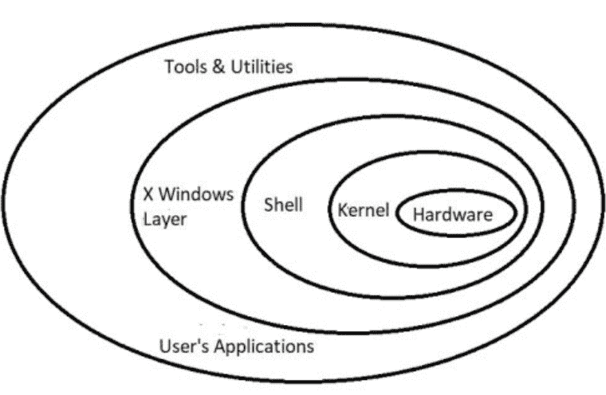

**图1.1：** UNIX系统架构

其包含以下层级：

- 硬件层

- 内核层

- Shell层

- Windowing层（即X Window系统）：与Shell层交互，同时可与应用程序和命令交互

- 实用程序与应用程序/工具层

如果将系统视为多层结构的集合，该操作系统通常被称为系统内核或简称内核。这种叫法强调了内核与用户程序的隔离性：用户程序不依赖底层硬件，在不同硬件上运行的UNIX系统之间迁移十分便捷。如果程序不依赖底层硬件的特定假设，下一层中的Shell、编辑器等程序就会通过调用一组定义明确的系统调用，与内核进行交互。系统调用用于实现与内核的交互，支撑程序的各类调用操作，以及内核与程序之间的数据交换。若干被称为命令的程序位于该层之上。其他应用程序可在下层程序的基础上开发。接下来我们逐一展开说明：

- **硬件层：** 为操作系统提供服务的最内层为硬件层，包含终端、终端控制器、磁盘、磁带、内存以及各类设备控制器。

- **内核：** 是操作系统的核心部分，直接与硬件交互，为用户程序提供服务。内核存储在名为“UNIX”的文件中，系统中同一时间仅运行一个内核。

用户程序通过一组属于内核一部分的标准系统调用与内核交互，这些系统调用提供内核的以下基础功能：

- **文件系统管理：** 包含由文件和目录组成的UNIX文件系统的管理，涵盖文件的创建、打开、读取、写入、关闭，以及其他文件系统相关操作，以及文件系统与硬件之间的数据传输。

- **内存管理：** 包含为程序分配内存、共享内存空间或释放内存。如果系统可用内存不足，内核会将程序临时写入名为交换设备的二级存储中，以此释放内存。

- **进程管理：** 在UNIX中，进程是正在执行中的程序。进程管理包含将各类进程调度到CPU执行，涵盖进程的创建、终止或挂起，同时也包含进程间通信功能。

- **存储管理：** 包含为用户数据分配二级存储磁盘，以及管理磁盘空闲空间。

- **设备管理：** 包含对终端、磁带机、磁盘驱动器、网络设备等外设的受控访问权限管理。

- **Shell：** 是UNIX中用户感知度最高的部分，它是命令解释器，负责解析用户输入的命令并传递给内核执行。每个使用UNIX的用户都会独立运行一个Shell程序，系统中运行的Shell数量等于当前使用系统的用户数量。Shell存在多种不同的类型

- 由史蒂夫·伯恩创建的Bourne shell是最流行的，且捆绑在各UNIX系统中。


- C shell曾深受UNIX程序员欢迎，由加州大学伯克利分校的比尔·乔伊创建。相比Bourne shell，C shell的优势如下：
  - 它支持命令别名功能；也就是说，我们可以为命令设置自定义别名，用短别名代替长命令来使用。
  - C shell具备命令历史功能，可调出此前输入过的命令。
- Korn shell是Bourne shell的超集，功能更强大，由AT&T贝尔实验室的大卫·科恩设计。
- 自由软件基金会GNU项目推出的Bourne Again Shell（简称Bash）是基于shell的程序。

### 实用工具和应用程序

UNIX拥有数百种实用工具。实用工具是UNIX中为用户提供支持的标准程序，大部分UNIX实用工具都以应用程序的形式提供：

- 文件管理（`rm`、`cat`、`ls`、`rmdir`、`mkdir`）。
- 用户管理（`passwd`、`chmod`、`chgrp`）。
- 进程管理（`kill`、`ps`）。
- 打印（`lp`、`troff`、`pr`）。
- 程序开发工具，如`sccs`、`make`、编辑器（`vi`和`ed`）以及编译器。
- UNIX电子邮件实用工具。

### 窗口层

UNIX的图形用户界面是独立于核心操作系统之上的一层。X Window系统是所有现代UNIX操作系统的基础图形层。X Window系统的作用是帮助系统接收来自键盘、鼠标等设备的输入，并在显示器上绘制图形对象。

从设备获取输入、绘制图形的工作由名为窗口管理器的软件完成。X有众多可用的窗口管理器，通常窗口管理器为专有软件，仅能在特定类型的UNIX上运行，其中部分为开源软件，可在所有安装了X的系统上运行。

X Window系统拥有许多独特且实用的功能，这些功能由X本身提供，因此所有X窗口管理器和所有UNIX/X11系统都通用。

## UNIX编程环境

UNIX是可移植操作系统，本质上为多用户、多任务环境设计，包含数百个功能单一、结构简单的函数，可灵活组合完成各类可设想的处理任务。UNIX系统被应用于三种不同的编程环境中。

### 个人环境

尽管UNIX最初为多用户环境设计，部分用户仍将其安装在个人电脑上，随着免费UNIX系统Linux的发明，这一趋势进一步加快。2001年，苹果系统将UNIX作为其内核。

### 分时环境

UNIX是多用户、多任务系统，运行于分时环境中，可通过单一处理单元处理多个任务。内核会维护当前任务列表，为每个任务分配时间片，之后切换到下一个任务，以此类推。通常情况下，内核在进程间切换的速度极快，每个用户都会产生独占系统资源的错觉。

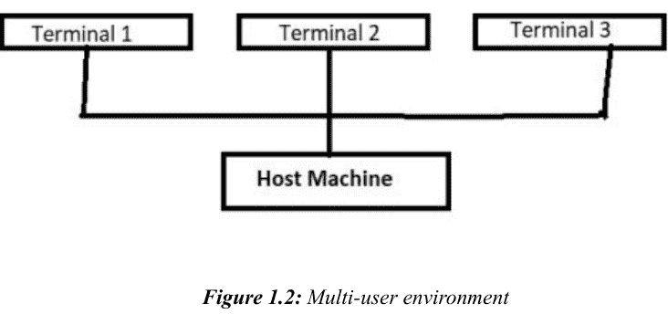

### 客户端-服务器环境

客户端/服务器计算环境将处理功能分配给服务器计算机和客户端计算机。在客户端/服务器模型中，数据处理负载由客户端计算机和性能更强大的服务器计算机共同承担。

服务器计算机专用于存储和管理数据，并响应客户端的请求：服务器接收客户端发来的结构化请求，处理请求的数据后将结果返回给客户端。客户端计算机通过接口接收用户输入，利用自身CPU处理部分信息，再将结果呈现给用户。

> **注意：** 在单用户环境中，一个程序可以拥有多个实例，因为默认情况下进程可能被拆分为两个进程，二者共享同一段代码。

## UNIX进程

正在执行的程序就是进程。在UNIX中，进程是工作单元。如果有`n`个用户同时执行同一个程序，那么系统中就有`n`个进程在运行。

进程通过执行一套严格的自包含指令序列运行，不会跳转到其他进程的指令序列中。所有进程并发执行，CPU在各进程间切换。所有UNIX命令都是经过编程的，因此执行时会成为系统中的进程。

### 进程属性

UNIX中的每个进程都具备若干属性（如表1.1所示），这些属性会影响进程的执行。

| 属性 | 含义 |
|---|---|
| `PID` | 进程标识，是唯一编号 |
| `PPID` | 父进程的进程ID |
| `UID` | 进程所属用户的用户ID |
| `GID` | 所属用户所属组的ID |
| `EUID` | 有效用户ID |
| `EGID` | 有效组ID |
| `Priority` | 进程运行的优先级 |

*表1.1：进程属性*

### 进程状态

进程的生命周期可以用一组状态来建模，每个进程在任意时刻都处于其中一种状态。在UNIX中，进程的生命周期总共会经历9个阶段，如图1.3所示：

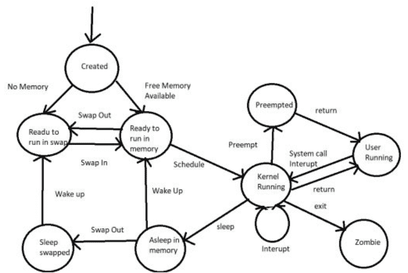

### 图1.3：UNIX进程状态

各进程状态的描述如表1.2所示：

| 进程状态 | 描述 |
|---|---|
| 用户态执行 | 在用户模式下运行 |
| 内核态执行 | 在内核模式下运行 |
| 内存中就绪 | 内核调度后即可运行 |
| 交换设备中就绪 | 进程已准备运行，但需要先换入内存，内核才能调度它 |
| 内存中睡眠 | 无法执行，正在等待某个事件发生 |
| 交换设备中睡眠 | 进程被阻塞，正在交换设备中等待事件 |
| 被抢占 | 进程正从内核态返回用户态，但内核抢占该进程以调度其他进程 |
| 已创建 | 新创建的进程尚未准备好执行 |
| 僵尸状态 | 进程刚执行完成，但尚未释放其资源 |

*表1.2：进程状态*

在UNIX中，进程以两种不同的模式执行：用户模式和内核模式（下一节会详细说明）。内存中就绪和被抢占本质上是同一种状态，做出区分只是为了强调进程进入被抢占状态的路径。

当进程执行系统调用、触发中断处理程序（时钟或输入输出中断）时，会处于内核模式。当内核完成相关工作后，进程会从内核模式切换回用户模式。但内核可以抢占这类任务，转而执行优先级更高的其他就绪任务。

### 进程的执行模式

- **用户模式**：用户进程执行时处于用户模式下，在该模式下，进程只能访问自身的指令和数据，无法访问内核的指令和数据，也无法访问其他进程的指令和数据。
- **内核模式**：当用户进程执行系统调用时，进程的执行模式会从用户模式切换为内核模式，由内核执行用户的请求。处于内核模式的进程可以访问内核和用户的地址空间。

典型的UNIX系统由一组进程组成：执行系统代码的操作系统进程，以及执行用户代码的用户进程。系统进程运行于内核模式，执行内存分配、系统记账、进程调度等管理和维护工作。用户进程运行于用户模式，用于执行程序和实用工具；当用户进程调用系统调用，或发生中断、异常时，会切换到内核模式。

> **注意：** UNIX并不适合实时处理，因为抢占仅能在进程即将从内核模式切换回用户模式时发生；当进程处于内核模式时，无法被抢占。

### 进程上下文

进程上下文代表进程的当前运行状态。进程的上下文包括其地址空间、栈空间、虚拟地址空间、寄存器集镜像、记账信息以及关联的内核数据结构以及状态信息。

通常来说，进程上下文包含以下三个组成部分：

1. **用户级上下文**：用户级上下文包含用户源文件编译后生成的基础用户程序。程序的基础元素分为代码段和数据段。代码段存储着程序只读的指令集。数据区是多个进程可访问的共享内存区域。虽然只有一个共享内存区域，但借助虚拟内存的概念，每个共享进程在自身地址空间中都可以拥有一个共享内存区域。用户栈区用于存储参数、返回值以及函数调用的指针。
2. **寄存器上下文**：寄存器级上下文用于存储进程未执行时，处理器寄存器中的进程状态信息。
3. **系统级上下文**：系统级上下文由操作系统管理进程所需的信息构成，分为静态部分和动态部分。静态部分包含进程表中每个进程的条目，用于存储内核随时可访问的进程控制信息。用户（U）区是静态上下文的另一个组成部分，存储了内核在进程上下文中执行时所需的额外控制信息。静态上下文的第三部分是每个进程的区域表，供内存管理系统将进程换入/换出主存使用。系统级上下文的动态部分是内核栈。内核栈用于内核模式下执行的进程，存储中断或过程调用发生时需要的信息。

*表1.3* 展示了当前系统中执行进程在不同上下文下可用的信息集合。

#### 表1.3：进程上下文

| 上下文类别 | 信息 |
|---|---|
| 用户级上下文 | |
| 进程代码段 | 与程序关联的可执行机器指令。 |
| 进程数据段 | 程序可访问的数据。 |
| 用户栈 | 包含执行用户代码的函数的局部变量、参数和指针。 |
| 寄存器上下文 | |
| 程序计数器 | 下一条待执行指令的地址。 |
| 栈指针 | 根据进程的运行模式，指向内核栈或用户栈的栈顶。 |
| 通用寄存器 | 这些寄存器的取值取决于具体的实现硬件。 |
| 处理器状态寄存器 | 进程被抢占时处理器的状态。 |
| 系统级上下文 | |
| 进程表条目 | 存储进程的状态。 |
| 每进程区域表 | 进程的虚拟地址到物理地址的映射关系及访问权限。 |
| 用户（U）区 | 上下文切换所需的进程控制信息。 |
| 内核栈 | 内核过程的栈帧。 |

### 进程关系

UNIX中的进程存在父子关系，如图1.4所示。每个进程都有一个父进程，以及一个或多个子进程。

进程ID `0`是调度进程，被称为交换进程（`swapper`）。交换进程是内核的一部分，也被称为系统进程。`init`进程（进程ID为`1`）是进程调度器，会启动shell。我们启动的所有进程都是shell的子进程，因此也是`init`进程的后代。`init`是一个普通用户进程，永远不会终止。

UNIX通过名为进程表的内部数据结构跟踪所有进程。当UNIX系统启动用于常规多用户操作时，内核会调用`/etc/init`程序。`init`进程的进程ID为`1`，并以超级用户权限（用户ID `0`）运行。`init`的运行方式随不同UNIX系统而异。

#### 4.3 BSD中的init进程

在4.3 BSD中，启动系统时`init`会执行shell脚本`/etc/rc`。该文件会执行一些记录工作，随后启动守护进程。之后`init`会读取`/etc/ttys`文件，确定多用户环境下哪些终端被激活。

#### UNIX System V中的init进程

在System V中，启动系统时`init`会读取`/etc/inittab`文件，根据运行级别的值将系统切换至不同模式（单用户或多用户）。常规多用户操作时会执行`/etc/rc`文件，启动各类守护进程。

无论哪种UNIX系统，`init`进程都会调用`fork`复制自身来激活终端。每个子进程会执行`/etc/getty`进程，设置终端速率、显示欢迎信息，并等待用户输入登录名。

Getty进程会执行`/bin/login`程序，检查`/etc/passwd`文件中是否存在该登录名。如果找到对应的登录名，会提示用户输入密码。若验证失败，Getty会给予用户三次输入登录名和密码的机会。

`init`、Getty和login进程都是以超级用户的用户ID和有效用户ID运行的。这些进程都使用相同的进程ID，因为`exec`系统调用过程中进程ID不会改变。

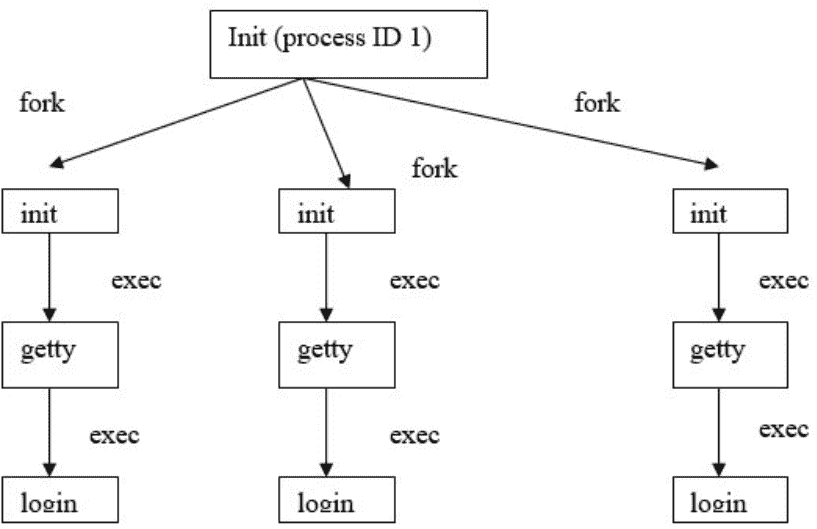

### 图1.4：进程关系

#### 登录程序

用户登录时，系统登录程序会完成以下设置：

- 使用`chdir`系统调用将当前工作目录设置为登录目录。
- 使用`setgid`和`setuid`系统调用，按照密码文件条目中指定的顺序，设置登录进程的有效组ID和有效用户ID。
- 执行`/etc/passwd`文件中指定的shell程序，若passwd文件中未指定shell，则执行`/bin/sh`。登录程序调用的shell被称为登录shell，会被视为所有进程的父进程。

#### Shell进程

Shell进程通常等待用户输入命令。当用户在命令行输入命令后，Shell会调用`fork`复制自身，并等待子进程终止。

子Shell进程会检查PATH环境变量以搜索命令文件。UNIX中的命令通常存放在`/bin`目录下。命令执行完成后，会调用`exit`系统调用，并携带退出状态退出，这会终止子进程，使得`wait`调用得以返回至父进程。

#### 网络登录

在4.3 BSD中，启动系统时`init`会执行shell脚本`/etc/rc`。该文件会执行一些记录工作，随后启动守护进程。该shell脚本启动的守护进程之一是`inetd`。

shell脚本终止后，`inetd`的父进程变为`init`。该守护进程可被使用TCP或UDP的服务器调用，它会代表多个服务创建套接字，并同时监听所有套接字。

## 文件和目录

UNIX文件系统的组织结构如下图所示：

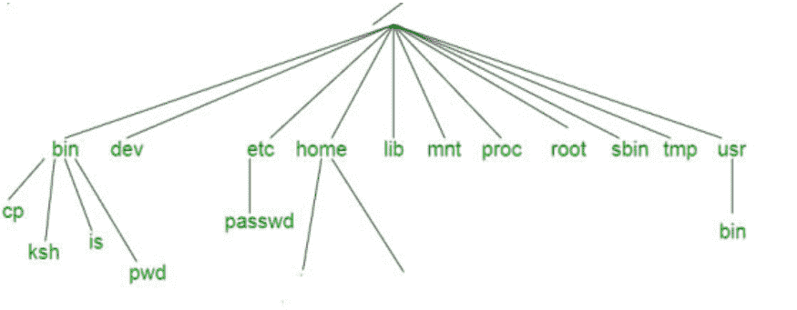

> *图1.5：UNIX目录结构*

UNIX文件系统是由目录和文件构成的分层树形结构，该树形结构会动态增减。文件系统树以单一根节点`/`起始，每个非叶节点都是包含文件的目录，叶节点则是目录、普通文件或特殊设备文件。

### 文件

在UNIX中，一切皆文件，这意味着UNIX中的数据、程序文件、目录、设备和链接都被视为文件。每个文件都有名称、所有者和访问权限。每个文件都会被分配一个唯一的inode编号。

文件的所有属性都存储在文件系统的inode条目中，inode条目会存储除文件名外的所有信息。文件名存储在目录中，通过指针与inode关联。每个inode通常包含以下内容：

- 文件内容在磁盘上的存储位置。
- 文件类型。
- 文件大小（以字节为单位）。
- 文件inode最后一次被修改的时间。
- 文件内容最后一次被修改的时间。
- 文件最后一次被读、写或其他操作访问的时间。
- 引用计数（文件拥有的不同名称的数量）。
- 文件所有者的ID。
- 文件的组ID。
- 文件的访问权限位。

在UNIX系统中，每个文件都关联一个非负整数，称为文件描述符。内核会在程序访问文件时，通过文件描述符来标识对应的文件。

每个文件或目录在目录项中都有对应的文件名。文件名中不能包含斜杠和空字符。部分UNIX系统限制文件名长度为14个字符，大多数其他系统允许文件名最长256个字符。

每个目录和文件在其父目录中都有对应的目录项。目录项会指定文件的属性，例如文件类型、文件大小、文件所有者、文件权限等。

根目录是目录树的第一个目录，其中包含自身的相关信息。每个目录还包含两个特殊目录项的信息：当前目录、当前目录的父目录。

> **注意：保留的索引节点（Inode）编号**
>
> - `0`：已删除的文件/目录。
> - `1`：取决于文件系统（对应文件系统创建时间/坏块数量等属性）。
> - `2`：指向文件系统的根目录。

### 路径名

每个文件或目录都由路径名唯一标识；路径名可以是绝对路径，也可以是相对某位置的相对路径。

绝对路径以根目录（`/`）开头，沿目录树的分支逐层向下，每层之间用`/`分隔，直到找到目标文件，例如`/usr/bin`。

相对路径是相对于某个参考点（通常是当前工作目录）指定的路径。例如，如果当前工作目录是`/usr/bin`，那么当前目录下名为`date`的文件的路径可以指定为`../date`。这表示系统需要先向上移动一级目录，再向下导航到`date`文件/目录。

### 文件类型

UNIX系统中所有资源都被视为文件。UNIX共有7种文件类型，如下图所示：

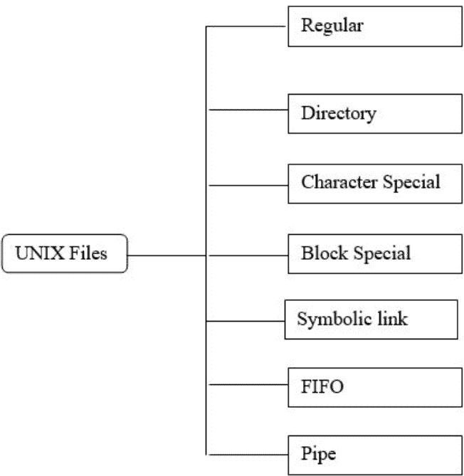

**图1.6：** *UNIX文件类型*

UNIX文件的类型描述如下：

- **普通文件：** 是一系列未格式化的字节。普通文件可以包含ASCII字符、二进制字符，或两者的混合。文本文件也属于普通文件。所有shell脚本、高级语言编写的程序，甚至目标代码在UNIX中都被视为普通文件。普通文件不包含头部、尾部、标签信息，也没有EOF（文件结束）字符作为文件的一部分。
- **目录文件：** 是一系列格式化的字节，包含其他文件和子目录的信息。目录会存储其所包含的每个文件/子目录的名称，以及对应的索引节点（inode）编号。对于目录文件，执行`ls -l`命令的输出结果中，第一个字符为`d`。要进入目录或列出目录中的文件，需要该目录的读权限；要在目录中创建文件或子目录，需要该目录的写权限。
- **特殊文件：** 代表键盘、磁带、磁盘、打印机等物理设备，包含字符文件、块文件、套接字等类型。操作系统通过这些文件与硬件进行通信。用于操作普通文件的命令同样适用于特殊文件，但操作系统会处理底层的设备操作。物理设备在`/dev`目录中表示。
- **管道（PIPE）：** 用于进程间通信的文件类型。管道的实现机制使得进程间即使不知道管道另一端进程的身份，也可以进行通信。管道大致分为命名管道和无名管道两类。
- **套接字（Socket）：** UNIX套接字用于建立同一台或不同机器上两个进程之间的通信。与其他文件类型类似，套接字也关联有文件描述符。
- **符号链接：** 是一种指向已存在文件的特殊文件类型，也叫软链接。可以通过原始文件名或链接名称访问目标文件的内容。
- **FIFO（先进先出队列）：** 是一种具有目录项、可通过路径名访问的文件，作用类似于两个进程之间的管道。

#### UNIX文件命名规范

每个文件或目录在目录项中都有对应的文件名。部分UNIX系统限制文件名长度为14个字符，大多数其他系统允许文件名最长256个字符。通常，UNIX系统的文件命名遵循以下规范：

- 文件名区分大小写。
- 文件名几乎允许使用所有键盘字符，以下字符除外：`| ; , ! @ # $ ( ) <> / \ " ' ` { } [ ] + = & ^ <space> <tab>`
- 可使用字符分隔符提升文件名的可读性。
- 在UNIX中，文件名不反映文件的功能。

#### 文件名与元字符

如果文件名包含`*`、`?`、`[`字符，shell会对文件名进行扩展。文件名中的`*`可替换为0个或多个允许的字符，`?`可替换为文件名中的任意单个字符，方括号用于指定特定字符组合的范围，字符范围通过方括号内的`-`指定。如果方括号内的第一个字符是`!`，则使用指定字符范围的补集。

*表1.4：文件命名使用的通配符模式*

| 通配符模式 | 扩展结果 |
|---|---|
| `*` | 当前目录下的所有文件。 |
| `?` | 文件名仅包含1个字符的所有文件。 |
| `[a-h]` | 文件名仅包含一个a到h范围内字符的文件。 |


| `[abcdefgh]` | 与上述模式相同。 |

| `[a-ef-h]` | 与上述模式相同。 |

| `*[0-9]` | 文件名以数字结尾的文件。 |

| `?[0-9]` | 文件名由两个字符组成、且以数字结尾的文件。 |

| `[a-zA-Z0-9]` | 文件名仅包含1个字母或数字的文件。 |

> **注意：** 在UNIX中，点号不是特殊字符，文件名可以包含也可以不包含点号。通常，以点号开头的文件名不会被`ls`命令列出。

### UNIX文件系统

每个磁盘驱动器会被划分为多个分区，每个分区可以包含一个文件系统。文件系统由一系列逻辑块组成，每个逻辑块的大小为512字节、1024字节，或512字节的任意其他整数倍。单个文件系统内的逻辑块大小统一，但不同文件系统的逻辑块大小可能不同。

文件系统由以下核心组件构成：

- 引导块
- 超级块
- 索引节点列表
- 数据块

引导块是第一个块，包含启动系统所需的引导代码。虽然系统启动仅需要1个引导块，但每个文件系统都会预留一个空的引导块。

超级块用于描述文件系统的状态，包含以下信息：

- 文件系统大小
- 空闲块数量
- 可用空闲块列表
- 下一个空闲块的索引
- 索引节点列表的大小
- 空闲索引节点数量
- 空闲索引节点列表
- 用于检查超级块是否被修改的标志位

索引节点列表是文件系统中所有索引节点的列表，为每个文件的索引节点包含一条条目。每个索引节点存储以下信息：

- 文件类型
- 权限
- 硬链接数量
- 所有者用户ID
- 所属组ID
- 文件大小
- 最后访问时间
- 最后修改时间
- 数据块的位置

最后，数据块紧接在索引节点列表之后，用于存储文件数据和管理数据。已分配的数据块仅属于单个文件系统。

### 重要的UNIX目录

*表1.5* 列出了UNIX系统中与管理系统资源（包括用户、文件、进程和设备）相关的重要目录：

| 目录 | 描述 |
| --- | --- |
| `/` | 根目录（内核所在目录）。 |
| `/etc` | 系统启动所需文件、通信支持文件，以及控制系统启动过程的脚本。 |
| `/etc/config` | 系统配置选项文件。 |
| `/etc/cron.d` | 定时任务访问文件和FIFO。 |
| `/etc/rc#.d` | 进入运行级别#（S、0、1、2、3）时执行的操作。 |
| `/usr` | 系统文件目录。 |
| `/usr/bin` | 系统二进制可执行文件。 |
| `/usr/etc` | 额外的系统通信及管理程序。 |
| `/usr/lib` | 目标文件库、邮件相关工具。 |
| `/var` | 管理程序及日志目录。 |
| `/var/adm` | 系统日志和账户文件。 |
| `/var/log` | 系统日志文件。 |
| `/var/spool/mail` | 邮件假脱机目录。 |
| `/var/mail` | 邮件假脱机目录。 |
| `/var/spool` | 定时任务、日志及其他假脱机数据的目录。 |
| `/dev` | 设备目录。 |
| `/home`、`/usr/users` | 用户主目录。 |
| `/usr/local` | 本地安装的软件和文件。 |
| `/tmp` | 包含系统中创建的临时文件。 |

**表1.5：重要的UNIX目录**

#### 结论

操作系统是一种特殊的系统软件，用于管理所有操作系统资源，方便用户开展工作。UNIX是一种多用户、多任务的可移植操作系统，支持文本处理、编程、通信等多种任务。UNIX操作系统可在多种不同的环境中运行。UNIX系统的主要组成部分包括内核、命令行解释器（Shell）以及实用工具和应用程序。在内核的功能中，最重要的是进程管理和文件管理。进程是程序的实例，可打开多个文件。系统中的每个进程都由不同的标识符来标识。每个进程在其生命周期内会经历9种状态。文件管理和各类文件相关功能将在下一章讨论，内容包括输入/输出函数、用于处理文件操作的各种系统调用和库函数，以及更多相关主题。

### 关键术语

- **内核**：操作系统的一部分，始终驻留在内存中，执行大多数核心任务。
- **多处理**：一种允许单个处理器同时处理驻留在内存中的多个程序的技术。
- **父进程**：一个控制其所创建的一个或多个子进程的任务。
- **子进程**：由父进程创建并控制的进程。
- **文件**：数据的集合。UNIX中的文件通常包括普通文件、目录和设备文件。
- **文件属性**：描述文件特征的信息。
- **init**：第一个非内核进程，因此是所有进程的父进程。
- **进程**：正在执行的程序。
- **进程ID**：进程的数字标识符。
- **目录**：作为其他文件和目录容器的文件类型。

### 技能测试

1. 下列哪些信息存储在`inode`结构中？
   - a. 文件大小
   - b. 文件所有者的名称
   - c. 文件的访问权限
   - d. 文件上次被修改或访问至今的所有日期
   - e. 符号链接的数量

2. 绝对路径以从根目录开始的路径开头。
   - a. 正确
   - b. 错误

3. 下列哪些当前目录中的文件可由正则表达式`a?b*`识别？
   - a. `afile`
   - b. `aab`
   - c. `abb`
   - d. `abc`
   - e. `axbb`
   - f. `abxy`

4. 可作为命令解释器的是？
   - a. 硬件
   - b. 内核
   - c. Shell
   - d. CPU

5. 在父进程退出前终止的进程称为？
   - a. 僵尸进程
   - b. 孤儿进程
   - c. 子进程
   - d. 以上选项均不正确

6. 上下文切换是指？
   - a. 内核从执行一个进程切换到执行另一个进程
   - b. 进程从内核模式切换到用户模式
   - c. 进程从内核模式切换到用户模式
   - d. 以上选项均不正确

### 答案

- 1. e
- 2. a
- 3. b-c-e
- 4. c
- 5. b
- 6. a

### 复习练习

- 1. 如果文件创建掩码被设置为777会发生什么？
- 2. UNIX对目录树的深度是否有根本限制？
- 3. 结合示例解释绝对路径和相对路径名。
- 4. 多道程序设计、多用户和多任务分别是什么意思？
- 5. 结合清晰的图表解释Unix中内核和Shell的关系。
- 6. 解释通配符`*`和`?`的含义。
- 7. 密码存储在哪里？
- 8. 解释标准的UNIX文件层次结构
- 9. UID和GID分别代表什么？

## 第2章

### 文件管理

文件是记录在辅助存储设备上的相关信息集合，或是逻辑上相关实体的集合。从用户的角度来看，文件是辅助存储设备为计算机程序提供输入、接收输出的最小单元。在存储层面，媒体文件只是比特、字节或记录的序列，其逻辑含义由文件所有者定义。用于管理数据存储中文件的结构和逻辑规则称为文件系统。要理解文件系统的内部运行机制，需要了解文件和目录如何向用户外部呈现，以及它们在系统中如何被内部表示。存储介质的不同分区中可能存在多个文件系统。本章将讨论UNIX文件系统的结构，以及用于操作文件的与文件系统相关的系统调用。

### 本章结构

本章将涵盖以下主题：

- 用于输入/输出的系统调用和库函数
- 用于处理所有已打开文件的内核数据结构
- 文件访问权限
- 用于维护用户密码和时效信息的标准文件
- UNIX文件系统的结构与操作

### 学习目标

学完本章后，你将能够：

- 了解UNIX操作系统如何在辅助存储设备中组织文件
- 理解与文件相关的活动，如命名、检索和共享
- 学习UNIX操作系统中文件保护策略的实现方式

### 文件输入/输出

文件输入/输出（I/O）是任何操作系统的重要功能，执行文件输入是为了给正在执行的进程提供信息以处理现有信息；执行文件输出是为了永久存储UNIX进程首次创建的信息或更新后的信息。UNIX维护部分内核数据结构来管理文件I/O，这些数据结构存储了访问和更新系统中所有已打开文件所需的元数据。UNIX文件I/O可通过C标准库函数或UNIX系统调用完成，本节将介绍用于执行UNIX文件I/O的各类系统调用。

### 文件输入/输出的内核数据结构

UNIX文件系统中用于管理已打开文件的以下三种数据结构：

- **内核文件表**：文件表包含任何进程打开的每个文件的条目，是全局数据结构，用于跟踪读写操作时的字节偏移量；该文件的每个条目都包含标志，用于指示读/写访问、阻塞/非阻塞等，且条目包含指向该文件v节点表条目的指针。内核文件表包含引用计数，用于显示文件被打开的次数。
- **进程级文件描述符表**：用于监控进程的所有已打开文件，每个条目包含指向内核文件表的指针。读写及其他系统调用中使用的文件描述符是该表中的索引。文件描述符是无符号正数，负值被保留用于表示“无值”或错误状态。0、1、2分别被保留用于“标准输入”“标准输出”和标准错误。
- **内存核心表**：内存核心表保存每个已打开文件的i节点的内存副本。


*图2.1：文件的内核数据结构*

任何进程打开文件时，都会在文件表中创建对应的条目，文件的i节点条目会被复制到v节点表中，同时会在进程级文件描述符表中创建条目。当进程关闭文件时，内核会删除进程级文件表中指向该文件的条目，并减少内核文件表中的引用计数。如果引用计数变为0，内核文件表的对应条目将被删除，文件随之关闭。当进程被`fork`时，会创建其父进程进程级文件表的副本，父子进程共享同一个文件指针。另外，同一文件可被同一进程或不同进程多次打开，这种情况下每次打开都会在全局文件表中生成不同的条目，每个条目都有独立的当前位置指针，关闭其中一个不会影响其他条目。

### UNIX文件I/O的系统调用

UNIX提供了基础文件I/O的系统调用，涵盖打开、创建、关闭、读写等操作。内核通过文件描述符引用所有已打开的文件，文件描述符是操作系统中分配给所有已打开文件的唯一整数。当打开已有文件或创建新文件时，内核会向进程返回一个文件描述符，该描述符还可用于读写等其他文件操作。

#### open函数

#### **open() 函数**

**open()** 函数用于打开已有的文件以进行读写操作。如果文件尚不存在，它还会创建一个新文件以方便后续的文件操作。

#### **原型**

```c
int open(char *pathname, int oflag, int mode);
```

如果文件打开成功，**open()** 函数会返回该文件的文件描述符。（若打开失败，返回值为−1。）所有其他系统调用都通过文件描述符（而非文件名）来标识文件。

第一个参数是需要打开的文件的路径名。**oflag** 包含以下1位标志，用于指定文件的打开方式：

- `O_RDONLY` /* 仅以读方式打开。 */
- `O_WRONLY` /* 仅以写方式打开。 */
- `O_RDWR` /* 以读写方式打开。 */
- `O_APPEND` /* 以追加模式打开（初始化时位置指针指向文件末尾而非开头）。 */
- `O_CREAT` /* 若文件不存在则创建文件。 */
- `O_TRUNC` /* 若文件已存在，且以写或读写方式打开，则将文件长度截断为0。 */

第三个参数仅在创建文件时使用，用于设置新文件的权限位。

##### **示例**

```c
#include <stdio.h>
#include <sys/types.h>
#include <sys/stat.h>
static char msg[] = "greeting message";
int main() {
    int fd;
    char buffer[80];
    fd = open("dfile.dat", O_RDWR | O_CREAT | O_EXCL | S_IREAD | S_IWRITE);
    if (fd != -1) {
        printf("datafile opened\n");
        write(fd, msg, sizeof(msg));
        close(fd);
    } else
        printf("data file already exists");
    exit(0);
}
```

本示例中创建了一个文件以写入问候消息。如果文件已存在，则会输出提示数据文件已存在的消息。

#### **close() 函数**

当进程不再需要文件时，会将其关闭。关闭文件会释放进程持有的该文件的所有锁。内核会减少文件表中该文件的引用计数。如果引用计数降至0，内核会释放文件表项，并释放打开文件时分配的内存。当进程终止时，内核会自动关闭该进程打开的所有文件。

#### **原型**

```c
int close(int fd);
```

其中`fd`是文件的文件描述符。函数执行成功时返回0，出错时返回-1。

#### **creat() 函数**

`creat()` 系统调用会在文件系统中创建一个新的空文件，同时创建对应的文件表项。如果已存在同名文件，内核会释放该文件的所有数据块，并在符合相应访问权限的前提下将文件大小设为0。内核会为新创建的文件分配一个新的I节点，并在父目录中创建对应条目。

#### **原型**

```c
int creat(char *pathname, int mode);
```

##### **等价于：**

```c
open(pathname, O_RDWR | O_CREAT | O_TRUNC, mode);
```

**creat** 函数仅以写模式打开新创建的文件，会分配并返回第一个未使用的文件描述符。若执行失败，返回-1。

##### **示例**

```c
#include <stdio.h>
#include <sys/types.h>
#include <sys/stat.h>
int main() {
    int fd;
    fd = creat("datafile.dat", S_IREAD | S_IWRITE);
    if (fd != -1) {
        printf("datafile.dat opened for read/write access\n");
    } else
        printf("Error in opening datafile.dat\n");
    close(fd);
    exit(0);
}
```

本示例中创建了一个同时具备读写权限的文件，新创建的文件始终以写模式打开。如果出现错误，程序会输出消息`Error in opening datafile.dat`。

#### **read() 函数**

`read` 系统调用用于从已打开的文件中读取数据。如果读取成功，返回读取到的字节数；如果遇到文件末尾，返回0。开始从文件读取数据时，内核会设置多种I/O参数，包括I/O模式、指示I/O将进入用户地址空间的标志、指示要读取字节数的计数字段、用户数据缓冲区的目标地址，以及指示I/O开始位置在文件中的字节偏移量的偏移字段。

#### **原型**

```c
ssize_t read(int fd, void *buff, size_t nbytes);
```

##### **示例**

```c
#include <fcntl.h> /* defines options flags */
#include <sys/types.h> /* defines types used by sys/stat.h */
#include <sys/stat.h> /* defines S_IREAD & S_IWRITE */
static char message[] = "File programming in C";
int main() {
    int fd;
    char buffer[80];
    fd = open("datafile.dat", O_RDWR | O_CREAT | O_EXCL, S_IREAD | S_IWRITE);
    if (fd != -1) {
        printf("datafile.dat opened for read/write access\n");
        write(fd, message, sizeof(message));
        lseek(fd, 0L, 0); /* go back to the beginning of the file */
        if (read(fd, buffer, sizeof(message)) == sizeof(message))
            printf(" Contents of the datafile are %s\n", buffer);
        else
            printf("Error in reading datafile\n");
        close(fd);
    } else
        printf("\n File already exists\n");
    exit(0);
}
```

本示例中首先创建了一个具备读写权限的文件，如果已存在同名文件，则会输出消息**File already exists**。文件创建完成后，会将消息**File programming in C**写入文件。下一步会将文件指针设置为文件开头，执行读取操作，检查读取到的内容是否与写入的消息一致：如果一致则输出读取到的内容，否则输出错误提示。

#### **write() 函数**

`write` 函数用于将缓冲区中的数据写入文件，要写入的字节数作为系统调用的第三个参数传入。执行成功时返回写入的字节数，出错时返回-1。如果第三个参数的值为0，且文件描述符对应的是普通文件，则可能返回0，也可能会检测到错误；对于特殊文件，该结果不可移植。

#### **原型**

```c
int write(int fd, void *buffer, size_t nbytes);
```

##### **参数说明**

- 第一个参数：`fd`代表文件描述符。
- 第二个参数：临时缓冲区，存储要写入文件的数据。
- 第三个参数：数据的大小，单位为字节。

#### **lseek() 函数**

`lseek()` 函数用于设置文件指针的当前位置。执行成功时返回新的位置，否则返回-1。


## 原型

```c
int lseek(int fd, off_t offset, int whence);
```

其中`fd`是要设置文件指针的文件的文件描述符；`offset`是文件指针需要调整的字节数；`whence`可以是以下值之一：

- `SEEK_SET`：`offset`是相对于文件开头的偏移量。
- `SEEK_CUR`：`offset`是相对于当前指针位置的偏移量。
- `SEEK_END`：`offset`是相对于文件末尾的偏移量。
- 对应`SEEK_SET`、`SEEK_CUR`、`SEEK_END`，`whence`分别可取`0`、`1`、`2`。

## 示例

```c
#include <stdio.h>
#include <fcntl.h>
int main() {
    int fd;
    long position;
    fd = open("datafile.dat", O_RDONLY);
    if (fd != -1) {
        position = lseek(fd, 0L, 2); /* seek 0 bytes from end-of-file */
        if (position != -1)
            printf("The length of datafile.dat is %ld bytes.\n", position);
        else
            perror("lseek error");
    } else
        printf("can't open datafile\n");
    close(fd);
}
```

本示例中以只读模式打开文件，若打开出错，会输出消息`can't open datafile`。文件成功打开后，文件指针会被设置到文件末尾。

## `link()` 函数

`link()` 系统调用用于将已有文件关联到一个新文件上。在UNIX系统中为文件创建关联时会生成一个新的目录项（硬链接），该目录项包含关联后的文件名以及原文件的I节点号。所有关联的文件都指向同一份数据，修改其中一个文件的内容会同步到所有关联文件中。简单来说，该操作相当于为文件创建一个新的名称。

## 原型

```c
int link(const char *original_name, const char *new_name);
```

执行成功时返回`0`，出错时返回`-1`。如果出现以下任一情况，`link()` 系统调用会失败：

- 原始名称不存在。
- 新名称已存在。
- 原始名称是一个目录，且当前用户不是超级用户。
- 尝试跨文件系统创建链接。

## 示例

```c
#include <stdio.h>
int main()
{
    if ((link("file.old", "file.new")) == -1) {
        perror("ERROR");
        exit(1);
    }
    exit(0);
}
```

在本示例中，会为名为`file.old`的文件创建名为`file.new`的新文件。如果出现错误，将输出`ERROR`提示。

## `unlink` 系统调用

`unlink` 系统调用会删除硬链接及对应的目录项，并降低文件的链接计数。如果链接计数降为`0`，文件内容也会被删除。如果文件被任意进程打开，在文件被关闭前其内容不会被删除。当进程关闭该文件时，内核会删除文件内容。

## 原型

```c
int unlink(const char *pathname)
```

其中`pathname`是需要被移除的链接文件的名称。要使`unlink()`调用成功，存储对应目录项的目录必须拥有写入和执行权限。调用成功时返回`0`，出错时返回`-1`。

## 示例

```c
#include <stdio.h>
int main()
{
    if ((unlink("file.old")) == -1) {
        perror("ERROR");
        exit(1);
    }
    exit(0);
}
```

在本示例中，如果解除链接成功，文件的目录项将被移除；如果出错，将打印错误提示。

## `dup()` 系统调用

`dup()` 系统调用会复制文件的文件描述符，新描述符与旧描述符指向同一个文件表项。`dup()` 系统调用会返回编号最小的可用文件描述符。两个文件描述符共享相同的文件偏移量和状态标志（读、写、追加）。

## 原型

```c
int dup(int fd)
```

该系统调用会返回该文件的一个新文件描述符，两个描述符可以互换使用来编辑文件。

## 示例

```c
#include <stdio.h>
#include <fcntl.h>
#include <sys/types.h>
#include <sys/stat.h>
int main()
{
    int fd;
    fd = open("file.dat", O_WRONLY | O_CREAT, S_IREAD | S_IWRITE);
    if (fd == -1) {
        perror("FILE already opened");
        exit(1);
    }
    close(1); /* close standard output */
    dup(fd); /* fd will be duplicated */
    close(fd); /* close the extra slot */
    printf("Hello\n");
    exit(0);
}
```

在本示例中，文件以只写模式创建。如果文件已存在，会发生错误并打印`FILE already opened`提示。随后会复制该文件，并关闭标准输出和原文件。此时唯一打开的文件是复制后的文件，`Hello`消息会被打印到该文件中。

## `stat` 和 `fstat` 系统调用

`stat()` 和 `fstat()` 系统调用用于获取文件状态信息，这些调用会返回文件所有者、i节点号、文件类型、文件大小、访问权限、文件访问时间等信息。

## 原型

```c
int stat(const char *pathname, struct stat *buf);
int fstat(int fd, struct stat *buf);
int lstat(const char *pathname, struct stat *buf);
```

其中`buf`是用户进程中用于存储文件状态信息的数据结构的地址。这些系统调用会将i节点表的字段写入`buf`中。`fstat` 系统调用用于获取已被文件描述符`fd`打开的文件的信息。`stat` 系统调用用于获取由路径名`pathname`指定的文件的信息，`lstat` 系统调用的功能与`stat`系统调用相同。

`stat`结构体包含以下信息：

```c
struct stat {
    dev_t st_dev; /* Device ID of device containing file. */
    ino_t st_ino; /* File serial number. */
    mode_t st_mode; /* Mode of file (see below). */
    nlink_t st_nlink; /* Number of hard links to the file. */
    uid_t st_uid; /* User ID of file. */
    gid_t st_gid; /* Group ID of file. */
    dev_t st_rdev; /* Device ID (if file is character or block special). */
    off_t st_size; /* For regular files, the file size in bytes. For symbolic links, the length in bytes of the pathname contained in the symbolic link. For a shared memory object, the length in bytes. For a typed memory object, the length in bytes. For other file types, the use of this field is unspecified. */
    time_t st_atime; /* Time of last access. */
    time_t st_mtime; /* Time of last data modification. */
    time_t st_ctime; /* Time of last status change. */
    blksize_t st_blksize; /* A file system-specific preferred I/O block size for this object. In some file system types, this may vary from file to file. */
    blkcnt_t st_blocks; /* Number of blocks allocated for this object. */
};
```

## 基础文件权限

在UNIX系统中，不同用户对文件的访问权限按照分配给他们的权限来设定。每个用户都有一个唯一的数字标识，称为`User_Id`。创建文件的用户是文件的所有者。用户还可以归属于某个用户组，组内所有成员共享相同的文件权限。既不是所有者也不属于该用户组的用户被称为“其他用户”。文件所有者可以为组成员和其他用户分配文件访问权限，访问权限分为读（`r`）、写（`w`）、执行（`x`）三类。可以使用`ls -l`命令查看目录中各文件被分配到的访问权限。

## 示例

```bash
>ls -l /usr/bin/new1
-rwxr-xr-x 1 user1 user1 8632 Sep 19 2021 /usr/bin/new1
```

在本示例中，`/usr/bin/new1`文件的所有者是`user1`，所属用户组为`user`。`-rwxr-xr-x`展示了文件的访问权限和文件类型：首字母代表文件类型为常规文件；接下来的3位是分配给所有者的权限，所有者可以读、写、执行该文件；再接下来的3位是分配给组成员的权限，最后3位是分配给其他用户的权限，组成员和其他用户只能读和执行该文件。文件访问权限用9位向量表示，前3位分配给所有者，中间3位分配给组成员，最后3位分配给其他用户。因此`rwxr-xr-x`对应的二进制为`110`，即所有者的权限十进制值为`4+2+0=6`，组成员的权限为`101`（`4+0+1=5`），其他用户的权限为`101`（`4+0+1=5`），因此`/usr/bin/new1`的完整权限十进制值为`755`。其中`r`位对应十进制`4`，`w`位对应十进制`2`，`x`位对应十进制`1`。

UNIX系统中每个用户对其文件的访问权限各不相同。每个用户都有一个唯一的标识数字用户ID（`user-Id`），用户还可以归属于一个或多个用户组，用户组可用于限制特定人群的访问权限。可以针对每个文件为所有者、组、其他用户分别设置读（`r`）、写（`w`）、执行（`x`）权限，使用`ls -l`命令即可查看这些权限。

```bash
>ls -l /usr/bin/new
-rwxr-xr-x 1 root root 8632 Sep 9 2008 /usr/bin/new
```

`/usr/bin/new`文件的所有者为`root`用户，所属用户组为`root`。`-rwxr-xr-x`表示该文件的访问权限：所有者对该文件有读、写、执行权限，组成员和其他用户仅有读和执行权限。权限用位向量表示，所有者、组、其他用户各占3位，因此`r-x`对应的二进制模式为`101`，十进制值为`4+1=5`。其中`r`位对应十进制`4`，`w`位对应十进制`2`，`x`位对应十进制`1`。

| 权限 | 用户（所有者） | 组 | 其他用户 |
| :--- | :----------- | :---- | :----- |
| r | 4 | 4 | 4 |
| w | 2 | 2 | 2 |
| x | 1 | 1 | 1 |

## 实际用户ID与有效用户ID、组ID

每个用户名和组名都会映射到一个唯一的无符号整数，分别称为用户ID和组ID。这种映射分别通过`/etc/passwd`和`/etc/group`文件实现。用户ID和组ID为`0`的情况通常被称为`root`，不过这只是一种惯例。每个UNIX进程都关联有用户ID和组ID；例如，当进程尝试打开文件进行写入操作时，会使用这些ID来判断是否应当授予该进程访问权限。这些ID构成了进程的有效权限，因为它们定义了进程可以执行和禁止执行的操作。这些ID通常被称为有效`uid`和`gid`。

## 设置用户ID（SUID）

通常情况下，程序以普通用户的权限运行。但存在一些场景，普通用户需要特殊权限来执行更改密码这类任务。每个用户的密码哈希值存储在`/etc/passwd`文件中，该文件仅超级用户可写入。当普通用户想要更改自己的密码时，需要更新这个文件，但普通用户没有该文件的写入权限。因此，密码修改程序必须以普通用户的身份运行，但同时拥有超级用户权限。针对这类场景，可执行文件会被设置一种名为设置用户ID（SUID）的特殊权限位。当该权限位被设置时，应用了该权限位的程序会以文件所有者的权限运行。在长格式文件列表中，该权限位会在所有者权限栏显示为“`s`”而非“`x`”。小写`s`表示SUID位和执行位均被设置，大写`S`表示仅设置了SUID位但未设置执行位。SUID位也可以设置在目录上。当目录设置了SUID位后，在该目录下创建的所有文件和子目录的所有者都会与该SUID目录的所有者一致，无论创建者是谁。

## 设置组ID（SGID）

如果用户执行设置了该权限位的程序，那么他会继承程序所有者所属组的组访问权限。SGID位在组执行权限位的位置会用大小写“`s`”替代“`x`”来表示。该权限位通常会被设置在邮件工具、打印工具等公用程序上。如果目录设置了SGID位，那么在该目录下创建的所有子目录和文件也会继承该组权限。当设置了该权限位的程序执行时，用户会自动继承拥有该程序的组的权限。目录上的SGID位意味着在该目录中创建的所有文件和子目录都会继承该目录的所属组。

## 粘滞位权限

粘滞位主要用于公共目录。它对于`/var/tmp`、`/tmp`这类共享临时目录尤为实用。所有用户都应当能够在这类临时目录中创建文件，以及读取、执行其他用户拥有的文件。如果目录开启了粘滞位，那么该目录中的文件仅当用户对该目录本身有写入权限，且用户是该文件的所有者、该目录的所有者或是超级用户（`root`）时，才能被删除或重命名。用户不允许删除其他用户拥有的文件。因此，粘滞位可以让文件归属于其所有者，避免用户在公共可写目录中删除或重命名其他用户的文件。

## 新文件的用户和组ID

新文件的用户ID会被设置为创建该文件的进程的有效用户ID。新文件的组ID可以是以下两者之一：

- 创建该文件的进程的有效组ID。
- 文件所在目录的组ID。

## 有效用户和组ID

对于大多数进程而言，有效用户ID（EUID）与用户ID（UID）相同，有效组ID（EGID）与组ID（GID）相同。当进程正在运行的可执行文件设置了设置用户ID（Set-UID）或设置组ID（Set-GID）位时，该进程的EUID/EGID会被设置为该可执行文件的UID/GID，而非执行该进程的用户的UID/GID。这是UNIX为用户授予明确、有限权限的机制，用于访问原本无法访问的资源。例如，更改密码需要写入`/etc/passwd`文件，普通用户没有该文件的写入权限。不过，设置了SUID的`root`程序`/bin/passwd`为该操作提供了受控的权限通道。

## 文件访问权限掩码

`stat`结构的`st_mode`成员存储了文件权限信息：

```c
/* st_mode mask: owner, group, other */
#define S_IRWXU 0070 /* read, write, execute: owner */
#define S_IRUSR 0040 /* read permission: owner */
#define S_IWUSR 0020 /* write permission: owner */
#define S_IXUSR 0010 /* execute permission: owner */
#define S_IRWXG 0070 /* read, write, execute: group */
#define S_IRGRP 0040 /* read permission: group */
#define S_IWGRP 0020 /* write permission: group */
#define S_IXGRP 0010 /* execute permission: group */
#define S_IRWXO 0007 /* read, write, execute: other */
#define S_IROTH 0004 /* read permission: other */
#define S_IWOTH 0002 /* write permission: other */
#define S_IXOTH 0001 /* execute permission: other */
```

## 用户文件创建模式——`umask()` 调用

UNIX使用四位八进制的`umask`值来确定新创建文件的默认权限。每个进程都有自己独立的`umask`，该值从父进程继承。`umask()` 系统调用用于设置进程的文件创建掩码，并返回掩码的先前值。创建文件时，掩码的低9位会被应用。默认情况下，UNIX内核在创建文件时为普通文件分配`666`权限，为目录分配`777`权限。当通过`open()`、`mkdir()`等系统调用创建文件或目录时，内核会从默认权限中减去进程的`umask`值，从而得到新文件或目录的最终访问权限。

## 示例


例如，如果设置的 `umask` 值为 044，内核会从普通文件的默认权限 666 中减去 044，最终得到 622 的权限。清除默认访问权限中的对应位，会限制文件的默认访问权限。

## 原型

```c
mode_t umask(mode_t cmask);
```

`cmask` 参数由 `st_mode` 掩码中任意九个常量的按位或构成。

## 示例

```c
#include <sys/types.h>
#include <sys/stat.h>

int main(void)
{
    int fd;
    int old_mask;

    old_mask = umask(0);
    fd = open("f1", O_WRONLY | O_CREAT | O_TRUNC, 0666);
    close(fd);
    printf("created f1: %o\n", 0666);

    fd = open("f2", O_WRONLY | O_CREAT | O_TRUNC, 0200);
    close(fd);
    printf("created f2: %o\n", 0200);

    umask(022);
    fd = open("f4", O_WRONLY | O_CREAT | O_TRUNC, 0777);
    close(fd);
    printf("created f4: %o\n", 0777 & ~022 & 0777);

    fd = open("f5", O_WRONLY | O_CREAT | O_TRUNC, 0200);
    close(fd);
    printf("created f5: %o\n", 0200 & ~022 & 0777);

    return 0;
}
```

在本示例中，当 `umask` 设置为 0 时，所有创建的文件都会拥有 `open()` 调用中指定的访问权限。当 `umask` 设置为 022 时，最终访问权限的计算方式为从 `open()` 调用提供的权限中减去 `umask` 值。

### `access()` 函数

`access()` 系统调用用于检查 `pathname` 参数指定的文件是否具备 `mode` 参数指示的访问权限。`mode` 值既可以是要检查的访问权限的按位或（`R_OK` 表示读权限，`W_OK` 表示写权限，`X_OK` 表示执行/搜索权限），也可以是存在性检查标志 `F_OK`。

#### 原型

```c
int access(const char *pathname, int mode);
```

如果 `access()` 调用成功，返回 0；否则返回 -1，并设置全局变量 `errno` 来指示错误。

## 更改所有者和更改权限

更改文件的所有者或权限是对文件 inode 的操作。执行更改文件所有者或权限的系统调用的进程，必须是超级用户或该文件的所有者。

#### 原型

```c
int chmod(const char *pathname, mode_t mode);
int fchmod(int fd, mode_t mode);
int chown(const char *pathname, uid_t owner, gid_t group);
```

所有权变更后，原所有者将失去对该文件的所有者级访问权限。`mode` 参数是 `stat` 结构的 `st_mode` 成员中定义的常量的按位或。

## 挂载和卸载文件系统

`mount` 系统调用用于将位于指定磁盘分区上的文件系统连接到现有文件系统层次结构中。这使得用户可以以文件系统的一部分来访问该磁盘分区上的数据，而不是将其视为原始的磁盘块序列。

#### 原型

```c
int mount(const char *source, const char *target,
          const char *filesystemtype, unsigned long mountflags,
          const void *data);
```

`mount()` 函数会将由源（`source`，通常为设备名称，也可以是目录名或虚拟占位符）指定的文件系统挂载到由目标（`target`）指定的目录上。`umount` 系统调用用于卸载文件系统，并释放其层级结构。

#### 原型

```c
int umount(const char *target);
```

`umount2()` 用于卸载挂载在目标上的（最顶层的）文件系统。

## 目录相关系统调用

与文件相关系统调用类似，UNIX 内核也定义了一组符合 UNIX 规范的目录操作相关系统调用：在 UNIX 中所有内容都被视为文件。这些系统调用用于创建、删除以及操作目录内容。

### `mkdir` 系统调用

`mkdir()` 函数用于创建由 `path` 参数指向的路径名所指定的新目录。

#### 原型

```c
int mkdir(const char *path, mode_t mode);
```

新目录的权限模式由 `mode` 参数初始化。`mode` 参数的权限部分会受进程的文件创建掩码影响。目录的所有者 ID 会被设置为进程的有效用户 ID。目录的组 ID 会被设置为进程的有效组 ID；如果父目录中设置了 `S_ISGID` 位，则目录的组 ID 会继承自父目录。新目录的 `S_ISGID` 位也会继承自父目录。

如果 `path` 指向的是符号链接，`mkdir()` 会调用失败，并将 `errno` 设置为 `EEXIST`。新创建的目录除自身（`.`）和父目录（`..`）的条目外为空。若调用成功，系统调用返回 0；否则返回 -1，不会创建目录，且 `errno` 会被设置为指示错误类型。

### `rmdir` 系统调用

`rmdir()` 系统调用用于删除由 `path` 参数指定的目录文件。

#### 原型

```c
int rmdir(const char *path);
```

若调用成功，`rmdir()` 函数返回 0；否则返回 -1，且全局变量 `errno` 会被设置为指示错误类型。如果此次调用后目录的链接计数变为 0，且没有其他进程打开该目录，则会释放该目录占用的存储空间。

### `chdir()` 系统调用

`chdir()` 系统调用用于将当前工作目录更改为由 `path` 参数指定的目录。执行 `chdir()` 系统调用的进程必须对目标目录拥有执行权限。

#### 原型

```c
int chdir(const char *path);
```

若调用成功，`chdir()` 返回 0；否则返回 -1，且 `errno` 会被设置为指示错误类型。

# UNIX 标准 I/O 库

在 UNIX 系统中，标准 I/O 库用于为程序提供流式 I/O 接口。流式 I/O 接口是一种向程序提供输入、写入程序输出结果的简单高效的方式。标准输入、标准输出、标准错误这三类流会在程序启动执行时默认打开并提供给程序。

## 流与 `FILE` 对象

流是一种可移植的读写数据的方式。流可以是文件，也可以是物理设备（例如打印机、显示器）。所有流都由 C 语言内部数据结构 `FILE` 定义。`FILE` 数据结构在 `stdio.h` 头文件中声明，可通过指向流的指针对其进行操作。

要对流执行 I/O 操作，只需在 C 程序中引用 `FILE` 结构即可。对流进行任何 I/O 操作前必须先将其打开，使用后必须关闭。

## I/O 缓冲

缓冲机制用于尽可能减少读写调用的次数。I/O 缓冲基本分为三种类型，具体将在后续章节介绍。

### 全缓冲/块缓冲

当流采用块缓冲模式时，会暂存大量字符并以块为单位写入。通常情况下所有文件都采用块缓冲。当缓冲区被填满时才会发生实际的 I/O 操作。

当对文件执行第一次 I/O 操作时，会调用 `malloc(3)` 并获取大小最优的缓冲区。“刷新”指的就是将标准 I/O 缓冲区的内容写入目标。缓冲区可以被标准 I/O 例程自动刷新（例如缓冲区被填满时），也可以通过显式调用 `fflush` 函数手动刷新。

除非标准输入和标准输出连接到交互式设备，否则它们都属于全缓冲流。

### 行缓冲 I/O

当流采用行缓冲模式时，字符会被暂存，直到输出换行符（`\n`），或从连接到终端设备的流（通常是标准输入）中读取输入。

这允许我们一次输出单个字符（例如使用 `fputc`），且知道实际的 I/O 操作只会在我们完成每行写入时才会执行。当流连接到终端时（例如标准输入、标准输出），通常会采用行缓冲模式。

### 无缓冲 I/O

标准 I/O 库不会对字符做缓冲处理。当输出流为无缓冲模式时，信息一旦写入就会立即显示在目标文件或终端上。

例如，使用前述的 `write(2)` 调用时，标准错误流通常采用无缓冲模式。所有错误信息都会尽快显示，无论其是否包含换行符。

## 流缓冲操作

UNIX 提供了缓冲操作，用于缓存信息以避免频繁访问外部存储设备。缓冲机制可以降低数据读写的耗时。

### `setbuf(3)`、`setvbuf(3)`

这些函数必须在流打开后、对流执行任何其他操作前调用。`setbuf(3)` 函数用于开启或关闭缓冲。

#### 原型

```c
void setbuf(FILE *stream, char *buf);
```

要启用缓冲，`buf` 必须指向长度为 `BUFSIZ` 的缓冲区。要禁用缓冲，需将 `buf` 设置为 `NULL`。可以使用 `setvbuf()` 来修改流的缓冲行为。

#### 原型

```c
int setvbuf(FILE *stream, char *buf, int mode, size_t size);
```

`mode` 参数必须是以下三个宏之一。可以将 `size` 参数设为 0 以获取延迟分配的缓冲区：

```c
#define _IOFBF 0 /* setvbuf should set fully buffered */
#define _IOLBF 1 /* setvbuf should set line buffered */
#define _IONBF 2 /* setvbuf should set unbuffered */
```

## 刷新流

调用 `fflush()` 时，给定输出对应的所有缓冲数据会被强制写入 `stream` 参数指向的 `FILE` 对象中，且流保持打开状态。如果 `stream` 参数设为 `NULL`，则会刷新所有已打开的输出流。

`fpurge()` 函数用于清除给定流中所有已缓冲的输入或输出数据。`fflush()` 会通过流底层的写入函数，强制将给定输出或更新流的所有缓冲数据写入目标，且不会影响流的打开状态。如果 `stream` 参数为 `NULL`，`fflush()` 会刷新所有已打开的输出流。`fpurge()` 会清除给定流中所有已缓冲的输入或输出数据。

```c
int fflush(FILE *stream);
int fpurge(FILE *stream);
```

## 打开流

`fopen()` 函数用于打开由 `pathname` 参数指向的字符串所指定名称的文件，并为该文件关联一个全缓冲流，同时会清除流的错误和文件结束标志符。

#### 原型

```c
FILE *fopen(const char *path, const char *mode);
```

`freopen()` 函数会首先尝试刷新流，并关闭与该流关联的所有文件描述符，但刷新或关闭文件描述符的成功或失败会被忽略。它会清除流的错误和文件结束标志符。

`freopen()` 函数会打开由 `pathname` 参数指向的字符串所指定名称的文件，并将 `stream` 参数指向的流与该文件关联。`mode` 参数的使用方式与 `fopen()` 相同。

#### 原型

```c
FILE *freopen(const char *path, const char *mode, FILE *stream);
```

`fdopen()` 函数用于将流与文件描述符关联。

#### 原型

```c
FILE *fdopen(int fildes, const char *mode);
```

以下是打开流的不同模式：

| 模式 | 描述 |
| --- | --- |
| `R` | 以只读方式打开文件 |
| `r+` | 以可读可写方式打开 |
| `W` | 将文件截断为零长度或创建供写入的文本文件 |
| `w+` | 以可读可写方式打开。若文件不存在则创建，否则截断文件 |
| `a` | 以写入方式打开。若文件不存在则创建文件 |
| `a+` | 以可读可写方式打开。若文件不存在则创建文件 |

*表 2.1：流打开模式*

以下是打开流的限制项：

| 限制项 | `r` | `w` | `a` | `r+` | `w+` | `a+` |
| --- | --- | --- | --- | --- | --- | --- |
| 文件必须已存在 | x |  |  | x |  |  |
| 原有文件内容会被丢弃 |  | x |  |  | x |  |
| 流可读取 | x |  |  | x | x | x |
| 流可写入 |  | x | x | x | x | x |
| 流仅可在末尾写入 |  |  | x |  |  | x |

*表 2.2：流的打开限制*

### 关闭流

`fclose()` 函数用于关闭文件，并将指定流与文件解除关联。若该流用于输出，会先调用 `fflush(3)` 写入所有缓冲数据。若标准库曾自动分配缓冲区，该缓冲区会被释放。

#### 原型

```c
int fclose(FILE *stream);
```

## 读写流

一旦流被打开，可进行三种不同类型的无格式化 I/O 操作：

- 单字符读写：每次读写一个字符，标准 I/O 函数会处理所有缓冲操作（若流为缓冲流）。
- 单行读写：使用 `fgets(3)` 和 `fputs(3)` 函数每次读写一行，每行以换行符结束。
- 直接 I/O：`fread(3)` 和 `fwrite(3)` 函数分别读写指定数量的对象，每个对象为指定大小。

### 单字符读取

以下是读取字符的原型：

```c
int fgetc(FILE *stream);
int getc(FILE *stream);
int getchar(void);
int getw(FILE *stream);
```

其中，`fgetc()` 函数从 `stream` 参数指向的流中读取下一个输入字符（若存在），或读取通过 `ungetc(3)` 推回流中的下一个字符。`getw()` 从 `stream` 指向的流中读取下一个 `int` 类型的值（若存在）。

### 单字符写入

以下是写入字符的原型：

```c
int fputc(int c, FILE *stream);
int putc(int c, FILE *stream);
int putchar(int c);
int putw(int w, FILE *stream);
```

`fputc()` 将一个字符（转换为无符号 `char` 类型）写入由 `stream` 指向的输出流（如显示器）。该函数可能会多次对 `stream` 求值，因此传递给 `putc()` 的参数不应是可能存在副作用的表达式。`putw()` 将指定的整数写入指定的输出流。

### 单行读取

以下是读取一行的原型：

```c
char *fgets(char *str, int size, FILE *stream);
char *gets(char *str);
```

`fgets()` 和 `gets()` 函数分别用于从 `stdin` 或指定流中读取一行内容到缓冲区。

### 单行写入

以下是写入一行的原型：

```c
int fputs(const char *str, FILE *stream);
int puts(const char *str);
```

`fputs()` 和 `puts()` 分别用于将 `str` 指向的字符串写入指定流和 `stdout`。

### 直接 I/O

直接 I/O 函数用于从 `FILE *stream` 对象中读写数据，对象大小由 `size` 参数指定。

#### 原型

```c
size_t fread(void *ptr, size_t size, size_t objs, FILE *stream);
size_t fwrite(const void *ptr, size_t size, size_t objs, FILE *stream);
```

其中，`fread()` 从 `stream` 指向的流中读取多个对象，并将其存储到 `ptr` 指向的位置，每个读取对象的字节大小由 `size_t` 指定。`fwrite()` 将 `ptr` 指向位置存储的对象写入 `stream` 参数指向的流中。

## [标准数据文件](https://)

> UNIX 维护一些标准数据文件来存储数据，用于管理用户的文件访问权限。这些文件仅可通过 root 权限访问，包含对应每个用户、组以及密码有效期的信息。所有这些文件都存储在 `/etc` 目录中。

### `/etc/passwd` 文件

`/etc/passwd` 文件是 ASCII 格式的文件，包含每个用户的条目。每个条目定义了应用于用户的基本属性。当使用 `mkuser` 命令向系统添加新用户时，`/etc/passwd` 文件会更新。`/etc/passwd` 文件中的条目格式如下：


进入`/path/to/xxx`目录，找到`xxx.json`。

在表达式`cvar = avar + bvar`中，加法运算符（`+`）将`avar`与`bvar`相加，得到它们的和`cvar`。

在`List.of(arg0, arg1, arg2)`中，`List`接口的工厂方法`of()`接受一系列的元素，返回包含它们的只读列表。

之后我们这样调用`cmd`命令：`cmd arg0 arg1 arg2`。

```
if (condVar > someVal) {console.log("xxx")}
```


`pid = fork(); if (pid < 0) printf("Fork failed \n"); else { if (pid == 0) { printf("In child process parent's pid is %d \n", getpid()); printf("In child process parent's pid is %d \n", getppid()); } else { printf("In parent process pid is %d \n", getpid()); printf("In parent process parent's pid is %d \n", getppid()); } }`

父进程设置的文件锁不会被子进程继承。在上面的示例中，如果`fork()`调用成功，它会向新创建的子进程返回0，或者向调用`fork()`的父进程返回新创建子进程的进程ID。两个进程会按照CPU的调度依次执行。如果`fork()`调用失败，它会返回一个负数值。

## 等待进程终止

进程确认子进程终止的最简单方式是使用`wait()`系统调用。调用`wait()`时，发起调用的进程会被挂起，直到它的一个子进程退出，此时该调用会返回子进程的退出状态。如果该进程存在僵尸子进程，调用会立即返回，并返回该僵尸子进程的退出状态。

调用`wait()`函数会执行一系列操作。系统会首先检查父进程是否存在子进程，如果不存在，`wait()`会返回-1。如果父进程存在已终止的子进程（即僵尸进程），`wait()`会返回该子进程的PID，并将其从进程表中移除。而如果父进程存在尚未终止的子进程，父进程会被挂起，直到收到子进程终止的信号。子进程终止时会立即发送该信号。

`wait()`还可以告知我们子进程的终止方式。要实现这个功能，我们需要向`wait()`传入一个整型变量。如果子进程是正常终止的，传入`wait()`的整型变量的高8位会被更新，低8位会被初始化为0。而如果子进程是异常终止的，整型变量的低8位会被更新，高8位会被初始化为0。如果发生核心转储错误，`wait()`返回的整数的第7位会被置1。

```c
/* example of wait() */
main() {
  int i, pid, exitstat, status;
  pid = fork();
  if (pid == 0) {
    printf("Enter exit stat:");
    scanf("%d", &i);
    exit(i);
  } else {
    wait(&status);
    if ((status & 0xff) != 0) /* abnormal exit */
    {
      printf("Signal interrupted\n");
    } else /* normal exit */
    {
      exitstat = (int) status / 256;
      printf("Exit status from %d was %d\n", pid, exitstat);
    }
  }
}
```

在这个示例中，子进程中用户会输入一个退出码，进程会携带该退出码退出。父进程会在`status`变量中接收这个退出码。我们可以通过检查`status`变量来获知退出的类型。`fork()`会在子进程中复制所有变量，因此全局变量也会被复制。如果我们在其中一个进程中修改变量的值，另一个进程中的对应变量不会受到影响。甚至指针变量指向的地址的值，在不同进程中也是相互独立的。

### 执行其他程序

现有进程可以通过执行`exec`系统调用来调用其他进程。`exec()`函数不会创建新进程，而是调用已有的进程，因此运行该函数的进程ID不会发生变化。`exec()`函数有多个不同的函数原型，如下所示：

- `int execl(const char *path, const char *arg, ...);`
- `int execlp(const char *file, const char *arg, ...);`
- `int execle(const char *path, const char *arg, ..., char *const envp[]);`
- `int execv(const char *path, char *const argv[]);`
- `int execvp(const char *file, char *const argv[]);`

`path`或`file`参数指定要调用的文件名，`arg`是指向字符串的指针，该字符串会作为参数传递给被调用的文件。按照惯例，第一个参数应当指向被执行文件对应的文件名。参数列表必须以NULL指针结尾。如果指定的文件名不包含斜杠(/)字符，`execlp()`和`execvp()`函数会复制shell的查找行为，来搜索可执行文件。搜索路径是环境变量`PATH`指定的路径。如果未指定该环境变量，默认会使用`/bin:/usr/bin`路径。此外，部分错误会被特殊处理。

新进程会继承旧进程的以下属性：进程ID、父进程ID、真实用户ID、真实用户组ID、会话ID、当前工作目录、根目录、文件模式创建掩码等。被调用进程的有效ID可能会根据设置用户ID位和设置用户组ID位的状态发生变化。如果新程序的设置用户ID位被置位，那么该进程的有效用户ID会变为程序的所有者ID。

### 访问用户信息

#### 用户详情

存在大量函数和系统调用，可以帮助我们获取UNIX用户的相关信息。`pwd.h`头文件中的`passwd`结构体存储了与`/etc/passwd`目录类似的用户信息，如下所示：

```c
#include <pwd.h>
struct passwd {
  char *pw_name; /* name of the user */
  char *pw_passwd; /* password */
  uid_t pw_uid; /* user id */
  gid_t pw_gid; /* group id */
  time_t pw_change;/* validity and password class */
  char *pw_class; /* password class */
  char *pw_gecos; /* full user name */
  char *pw_dir; /* login directory */
  char *pw_shell; /* user login shell */
  time_t pw_expire;/* password expiry date */
};
```

`getpwnam()`和`getpwuid()`函数会返回`passwd`结构体，该结构体提供了用户账户的相关信息。`getpwnam()`和`getpwuid()`函数会在用户数据库中搜索匹配用户名或UID的条目。`getuid()`用于获取已登录用户的用户ID。打印用户详情的示例如下：

```c
#include <pwd.h>
main() {
  struct passwd *pass;
  int uid;
  uid = getuid();
  pass = getpwuid(uid);
  printf("Login name: %s\n", pass->pw_name);
  printf("Encrypted Password: %s\n", pass->pw_passwd);
  printf("User ID: %d\n", pass->pw_uid);
  printf("Group ID: %d\n", pass->pw_gid);
  printf(" Password Age: %s\n", pass->pw_age);
  printf("Comment: %s\n", pass->pw_comment);
  printf("Login Dir %s\n", pass->pw_dir);
  printf("Shell: %s\n", pass->pw_shell);
}
```

## 用户组详情

`grp.h`头文件中的`group`结构体存储了与`/etc/group`类似的用户组信息，如下所示：

```c
#include <grp.h>
struct group {
  char *gr_name; /* group name */
  char *gr_passwd; /* group password */
  gid_t gr_gid; /* group id */
  char **gr_mem; /* pointer to group member names */
};
```

`getgid()`用于获取用户的用户组ID，而`getgrgid()`函数会填充`group`结构体。打印用户组信息的示例如下：

```c
#include <grp.h>
main() {
  int i;
  struct group *grp;
  grp = getgrgid(getgid());
  printf("Group Name %s\n", grp->gr_name);
  printf("Group Password %s\n", grp->gr_passwd);
  printf("Group ID %d\n", grp->gr_gid);
  printf("Group Members :");
  for (i = 0; grp->gr_mem[i]; i++)
    printf("\n: %s", grp->gr_mem[i]);
}
```

### 显示所有已登录用户的信息

`utmp.h`头文件中的`utmp`结构体存储了已登录用户的信息，与`/etc/utmp`文件的内容一致，如下所示。我们可以通过读取`/etc/utmp`文件中的已登录用户信息来填充该结构体：

```c
struct utmp {
  char ut_user[8]; /* User login name */
  char ut_id[4]; /* /etc/inittab id (usually line 2) */
  char ut_line[12]; /* device name (console, lnxx) */
  short ut_pid; /* short for compat. - process id */
  short ut_type; /* type of entry */
  struct exit_status ut_exit; /* The exit status of a process */
  time_t ut_time; /* time entry was made */
};
```

显示已登录用户信息的程序如下所示：

```c
#include <sys/types.h>
#include <stdio.h>
#include <utmp.h>
#include <pwd.h>
#define UTMP "/etc/utmp"
#define NAMELEN 8
main() {
  FILE *fp;
  struct utmp u;
  struct passwd *p;
  char temp[NAMELEN+1];
  fp = fopen(UTMP,"r");
  while (!feof(fp)) {
    fread(&u, sizeof(u), 1, fp);
    if (u.ut_name == NULL) continue;
    strncpy(temp, u.ut_name, NAMELEN);
    p = getpwnam(temp);
    if (p == NULL) continue;
    printf("%-10.8s %-10.8s %-30.30s %s\n", u.ut_name, u.ut_line, p->pw_gecos, ctime(&u.ut_time));
  }
  /* The ctime() converts time to ascii format. */
  fclose(fp);
  exit(0);
}
```

### 进程组

（至少在UNIX系统中）进程被组织为进程组，通常对应一个完整的作业。当单个shell命令由一系列过滤命令构成，这些命令通过管道将数据从一端传递到另一端时，这些进程（及其子进程）都属于同一个进程组。每个进程组都有一个进程组领导者，以及一个与进程组领导者进程ID对应的进程组编号。进程组领导者可以创建进程组，并向组内添加进程。只要组内至少存在一个进程，进程组就会持续存在，无论进程组领导者是否终止。从进程组创建到组内最后一个剩余进程离开该组的时间称为进程组的生命周期。组内最后一个进程可以选择终止，或加入其他进程组。进程可以通过`setpgid()`函数加入已有进程组，或创建新的进程组。

#### 函数原型

```c
int setpgid(pid_t pid, pid_t pgid);
```

进程只能修改自身或自身某一子进程的进程组ID。

### 会话

会话是一个或多个进程组的集合。进程可以使用`setsid()`函数创建新的会话。

#### 函数原型

```c
pid_t setsid(void);
```

如果该进程已经是进程组领导者，该函数会返回错误。如果该进程不是进程组领导者，那么该进程会同时成为会话领导者与进程组领导者，且进程组ID会被设置为该进程的进程ID。我们来看一个示例：

```c
#include <sys/types.h>
#include <unistd.h>
#include <stdio.h>
void main() {
  pid_t pid;
  printf("The process group ID is %d\n", (int)getpgrp());
  setsid();
  printf("The new process group ID is %d\n", (int)getpgrp());
}
```

### 信号

信号是异步软件中断，用于指示某个事件已经发生。信号通过名称标识，其定义在头文件`<signal.h>`中。信号的发送方式包括以下两种：

- 从一个进程发送到另一个进程（或自身）
- 从内核发送到进程

表3.1列出了BSD系统中所有可用的信号：

| 信号名称 | 信号编号 | 信号说明 |
|-------------|---------------|-------------------|
| SIGHUP | 1 | 终端线路挂断 |
| SIGINT | 2 | 中断程序 |
| SIGQUIT | 3 | 退出程序 |
| SIGILL | 4 | 非法指令 |
| SIGTRAP | 5 | 跟踪陷阱 |
| SIGABRT | 6 | 异常终止 |
| SIGEMT | 7 | 模拟指令执行 |
| SIGFPE | 8 | 浮点异常 |
| SIGKILL | 9 | 终止程序 |
| SIGBUS | 10 | 总线错误 |
| SIGSEGV | 11 | 段违规 |
| SIGSYS | 12 | 系统调用参数错误 |
| SIGPIPE | 13 | 向无读端的管道写入数据 |
| SIGALRM | 14 | 实时定时器到期 |
| SIGTERM | 15 | 软件终止信号 |
| SIGURG | 16 | I/O通道出现紧急情况 |
| SIGSTOP | 17 | 停止信号（非终端产生） |
| SIGTSTP | 18 | 终端产生的停止信号 |
| SIGCONT | 19 | 已停止的进程被恢复运行 |
| SIGCHLD | 20 | 子进程停止或退出时通知父进程 |
| SIGTTIN | 21 | 后台进程尝试读取终端 |
| SIGTTOU | 22 | 后台进程尝试写入终端 |
| SIGIO | 23 | 文件描述符可进行I/O操作 |
| SIGXCPU | 24 | CPU时间限制超出 |
| SIGXFSZ | 25 | 文件大小限制超出 |
| SIGVTALRM | 26 | 虚拟定时器到期 |
| SIGPROF | 27 | 性能分析定时器到期 |
| SIGWINCH | 28 | 窗口大小改变 |
| SIGINFO | 29 | 信息请求 |
| SIGUSR1 | 30 | 用户自定义信号1 |
| SIGUSR2 | 31 | 用户自定义信号2 |
| SIGTHR | 32 | 线程中断 |

*表3.1：BSD信号*

#### 向进程发送信号

`kill`系统调用用于将信号从一个进程发送到另一个进程或自身。发送信号时，发送进程与接收进程必须具有相同的有效用户ID，或者发送进程必须是超级用户。

##### 函数原型

```c
int kill(int pid, int sig);
```

如果`pid`为`0`，信号会发送给调用进程所在进程组的所有进程。如果`pid`为-1且用户不是超级用户，信号会发送给所有实际用户ID与发送进程有效用户ID相同的进程。如果`pid`为-1且用户是超级用户，信号会发送给除系统进程外的所有进程。如果`pid`为负数且不为-1，信号会发送给所有进程组ID等于`pid`的绝对值的进程。如果`pid`参数无效，系统会执行错误检查，但不会发送信号。

另一种向进程发送信号的方式是使用某些特定按键，系统会将其解释为向运行中的进程发送信号的请求。示例如下：

- **Ctrl + C：** 按住`Ctrl`键的同时按下键盘上的C键，系统会向运行中的进程发送INT信号（SIGINT）。默认情况下，该信号会导致进程立即终止。
- **Ctrl + Z：** 按住`Ctrl`键的同时按下Z键，系统会向运行中的进程发送TSTP信号（SIGTSTP）。默认情况下，该信号会导致进程暂停执行。
- **Ctrl + \：** 按住`Ctrl`键的同时按下\键，系统会向运行中的进程发送ABRT信号（SIGABRT）。默认情况下，该信号会导致进程立即终止。

注意这种冗余（即`Ctrl + \`与`Ctrl + C`效果相同）为我们提供了更大的灵活性，我们将在后续内容中解释。`kill`命令也用于向进程发送信号。`kill`命令接受两个参数：信号名称（或编号）和进程ID：

```bash
kill -<signal> <PID>
```

例如，要向PID为5342的进程发送`INT`信号，输入：

```bash
kill -INT 5342
```


这与在运行该进程的shell中按下*Ctrl-C*效果相同。如果未指定信号名称或编号，默认会向进程发送`TERM`信号，通常会导致进程终止。

某些硬件条件也会触发信号。例如，浮点错误、引用进程地址空间外的地址，不同UNIX实现中的对应硬件条件及其产生的信号各不相同。

## 信号处理

内核为每个信号都设置了默认处理方式。进程可以通过在程序中编写自定义代码来处理大多数信号，这种自定义代码称为信号处理程序。有两个信号无法被信号处理程序捕获：`SIGKILL`会始终终止进程，`SIGSTOP`会始终停止进程，这两个信号无法被信号处理程序处理。`signal()`系统调用用于为单个信号类型设置信号处理程序。`signal()`接受一个信号编号和一个信号处理函数指针，将该处理程序与指定信号关联。

### 函数原型

```c
void (*signal(int sig, void (*func)(int)))(int);
```

第一个参数`sig`是信号编号。第二个参数可以是`SIG_DFL`、`SIG_IGN`或信号处理程序的地址。`SIG_DFL`指定信号的默认处理方式，`SIG_IGN`告诉系统忽略该信号。

**示例：** 本示例中，打印消息`press del key`后会运行一个无限`for`循环。当按下*Del*键时，系统会向信号处理函数`sig_handle`发送中断信号（`SIGINT`）。该函数会打印消息`DEL key is pressed`，随后程序终止。

```c
#include <signal.h>

void sig_handle();

void main() {
  printf("press del key\n");
  signal(SIGINT, sig_handle);
  for(;;);
}

void sig_handle() {
  printf(" DEL key is pressed\n");
}
```

表3.2列出了`signal()`系统调用第一个参数所有可能的值。这些信号要么由`signal()`第二个参数指定的信号处理程序处理，若未设置自定义处理程序，则由系统处理。

| 信号 | 说明 |
|--------|-------------|
| `SIGALRM` | 进程可以通过调用`alarm()`函数设置闹钟：`unsigned int alarm(unsigned int sec);`。`sec`参数指定内核向进程发送`SIGALRM`信号之前需要等待的秒数。如果参数为0，会取消该进程之前设置的所有闹钟。`sleep()`函数通常会设置并捕获`SIGALRM`信号。 |
| `SIGINT` | 该中断信号通常在终端上按下中断键时产生。 |
| `SIGILL` | 该信号由依赖具体实现的硬件条件产生。 |
| `SIGUSR1` | 两个可用于进程间通信的用户自定义信号之一。 |
| `SIGUSR2` | 与`SIGUSR1`相同。 |
| `SIGXFSZ` | 当进程超出其文件大小限制时产生该信号。 |
| `SIGXCPU` | 当进程超出其软CPU时间限制时产生该信号。 |
| `SIGTERM` | `kill`命令发送的终止信号。 |

**表3.2：信号及其说明**

| 信号 | 说明 |
| --- | --- |
| `SIGPWR` | 断电时会生成该信号。如果电池有电，系统会继续运行。 |
| `SIGPIPE` | 如果写入进程继续向管道写入数据，而读取进程已经终止，就会生成该信号。 |
| `SIGQUIT` | 当按下`Ctrl+\`组合键时，终端驱动程序会生成该信号。该信号会发送给所有前台进程。 |
| `SIGTSTP` | 当按下`Ctrl+Z`组合键时，终端驱动程序会生成该交互式停止信号。该信号会发送给所有前台进程。 |
| `SIGSTOP` | 终端驱动程序生成该信号以停止所有前台进程。该信号无法被捕获和忽略。 |
| `SIGURG` | 该信号表示进程出现了紧急情况。 |
| `SIGCHLD` | 当进程停止时，该信号会发送给其父进程。通常该信号会被忽略，因此如果父进程希望在子进程状态变更时收到通知，就必须捕获该信号。 |
| `SIGIO` | 执行异步I/O时会生成该信号。 |
| `SIGSYS` | 该信号表示发生了无效的系统调用。 |

## 线程

线程是轻量级进程。线程有不同的执行状态，多个线程会共享彼此的状态。多个线程可以读写同一块内存区域，而不同的进程无法访问同一块内存区域。每个线程仍拥有自己独立的寄存器以及自己的栈，但其他线程可以读写该栈内存。

通常可以将进程看作是以下形式：进程 = 线程 + 代码、数据与内核上下文

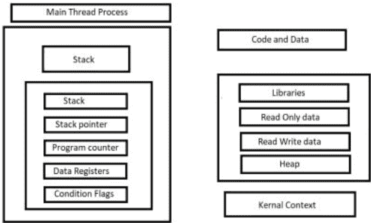

*图3.2：单线程进程*

进程可以为不同的活动设置独立的线程。为每个活动设置独立线程，可以让程序员把与该活动相关的动作定义为单一的动作与事件序列。

和进程关联的每个线程都有自己独立的逻辑控制流；所有线程共享代码、数据和内核上下文，且每个线程都有自己的线程ID。

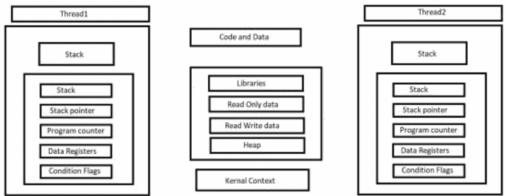

*图3.3：多线程进程*

为什么允许线程访问同一块内存？因为在操作系统内部，线程必须高度协同彼此的活动。以下是线程需要共享内存和独立内存的场景：

- 如果两个进程几乎同时发起文件系统读取调用，操作系统必须确保适当地对磁盘请求进行序列化。
- 当一个进程分配内存时，其对应的线程必须找到空闲内存并分配给该进程。必须确保多个线程分配的内存块互不重叠。让线程共享同一地址空间会让活动协同简单很多——程序员可以构建代表系统状态的数据结构，让线程读写这些数据结构，从而在需要处理请求时知道该做什么。

线程必须应对的一个复杂情况是异步性。异步事件会在线程执行过程中随机发生，如果程序员不采取措施限制异步性，这些事件可能会干扰线程的活动。示例如下：

- 发生中断，控制权从当前线程转移给中断处理程序。
- 发生时间片切换，控制权从一个线程转移到另一个线程。
- 运行在不同处理器上的两个线程读写同一块内存。

如果异步事件没有得到妥善控制，就可能导致异常行为。示例如下：

- 两个线程都需要发起磁盘请求。第一个线程开始对磁盘控制器进行编程（假设它是内存映射的，需要通过多次写入来指定磁盘操作）。与此同时，第二个线程运行在另一个处理器上，也发起内存映射写入来对磁盘控制器编程。磁盘控制器会被彻底搞混，读取到错误的磁盘块。
- 两个线程都需要向显示器写入内容。第一个线程开始构建请求，但在完成之前发生了时间片切换，第二个线程开始执行自己的请求。两个线程的操作组合起来生成了被禁止的请求序列，显示器甚至可能会冒烟。
- 出于计费需求，操作系统会追踪每个用户程序消耗的时长，还会统计所有用户程序消耗的总时长的累计值。两个线程先为各自的进程增加本地计数器的值，随后同时增加全局计数器的值。它们的增加操作相互干扰，导致记录的所有用户程序总消耗时长小于各个本地时长的总和。

因此，程序员需要协调多个线程的活动，避免这类问题发生。可以采用同步这一关键机制来协调多个线程的活动。这类操作可以让线程控制自身事件相对于其他线程事件的发生时机。合理使用该机制，程序员就可以避免上述类似问题。

### 结论

本章介绍了UNIX操作系统的进程子系统。进程子系统负责在各类进程需要时管理内存，调度进程执行，管控与进程相关的其他方面。

本章介绍了进程的内存布局以及内存管理的相关功能。

本章还介绍了UNIX进程的上下文，以及当进程被中断或CPU切换到另一个进程时如何进行上下文切换。

本章还介绍了进程如何通过`signal()`系统调用发送信号，来告知彼此异步事件的发生。

下一章将详细讨论所有进程间通信的方法。

### 复习练习

1. 编写一个程序，要求用户输入其想要分配的总字节数，随后使用从1开始的连续整数初始化所分配的内存，计算内存块中所有整数的和，并将最终结果输出到屏幕上。
2. 编写一个程序，通过调用`calloc()`函数分配一块内存空间，用于存放100个`float`类型的数据，随后重新分配这块内存，使其能够额外存放50个`float`类型的数据。
3. 编写一个程序，要求用户输入`float`类型数据的总数量，随后使用`calloc()`和`malloc()`函数分配两块大小与输入数量一致的内存块，并输出这两块内存块的初始值。
4. 编写一个程序，显示当前系统中所有已登录用户的信息。

# 第4章

# 进程间通信

## 引言

大多数现代操作系统都允许计算机系统中的多个进程并发执行。这些进程可以是独立的，也可以是协同的，即彼此共享数据，有时还需要彼此共享事件信息。操作系统提供进程间通信机制，用于在单系统或网络环境中运行协同进程。IPC可以是同步的，也可以是异步的。本章将介绍IPC，以及用于在不同进程间实现IPC的相关技术。

## 本章结构

本章将涵盖以下主题：

- 进程间通信及其不同方法
- 作为IPC手段的管道
- 作为IPC手段的FIFO
- 共享内存及其使用方法
- 使用消息队列发送和接收消息
- 使用信号量实现进程同步

## 学习目标

完成本章学习后，你将能够：

- 理解进程间通信的概念。
- 理解如何使用命名管道和非命名管道在两个协同进程间共享数据。
- 理解如何在协同进程间直接共享数据。
- 理解信号量在进程同步中的运行机制。

## 进程间通信（IPC）简介

两个进程可以使用操作系统提供的进程间通信技术相互通信。进程间通信可能是为了共享数据，也可能是为了传递事件通知。在传统的单处理环境中，单个进程内的模块可以通过全局变量和函数调用相互通信。在多处理环境中，不同进程运行在相互独立的地址空间下，操作系统必须提供专门的机制实现进程间通信。IPC的使用场景并不局限于单系统上的多进程通信。*图4.1*展示了单系统中通过不同IPC模式通信的三个进程。

> **图4.1：**单系统中的进程通信

> **图4.2：**多系统中的进程通信

### 进程间通信的方式

数据共享或进程间通信的主要方式如下：

- 文件
- 消息队列
- 管道
- 共享内存
- 套接字

进程间的通信通过信号和信号量实现同步。C语言库函数和系统调用可用于实现进程间通信。在UNIX环境中，共享信息可以处于不同的存储层级。用于共享信息的IPC方法取决于信息所处的存储位置，对应的IPC方法如下：

- 若待共享信息存储在文件系统的文件中，则使用`read()`、`write()`等内核系统调用在进程间共享信息，文件更新时需要一定的同步机制。
- 若信息存储在管道、消息队列或信号量中，则使用对应这些数据结构的内核系统调用在协作进程间共享信息。
- 若信息存储在共享内存中，两个进程可以直接访问该信息。一旦进程完成共享内存的创建，后续通信无需内核介入。
- 若信息存储在文件系统的文件中，两个进程可以共享该信息。通过文件相关的内核系统调用可访问文件中的信息，文件更新时需要一定的同步机制。
- 若信息存储在内核中，两个进程可以共享该信息，此时可通过管道、消息队列和信号量共享信息。
- 两个进程可以引用同一块共享内存区域。一旦进程完成共享内存的创建，两个进程可在完全不涉及内核的情况下访问信息。

> **图4.3：**进程间的信息共享

### 管道与FIFO

通过管道，一个进程的输出可以作为另一个进程的输入，如*图4.4*所示。一个进程向管道写入数据的同时，另一个进程从管道读取数据。管道使用前必须先打开。`pipe()`系统调用用于创建管道，并返回两个文件描述符：`fd[0]`和`fd[1]`，其中`fd[0]`用于读取，`fd[1]`用于写入。`pipe()`调用成功时返回0，失败时返回-1，并相应设置`errno`的值。在标准编程模型中，管道创建完成后，通过`fork()`创建两个（或多个）协作进程，使用`read()`和`write()`传递数据。

> **图4.4：**管道的读写操作

#### 单端关闭的管道

如果对写入端已关闭的管道执行读操作，读操作会返回0，表示到达文件末尾。如果对读取端已关闭的管道执行写操作，会生成`SIGPIPE`信号。如果我们忽略该信号或捕获信号后从信号处理函数返回，写操作会返回错误，且`errno`被设置为`EPIPE`。

## `popen()` I/O库函数

`popen()`函数是标准I/O库函数，用于创建管道并`fork`出另一个进程，实现从管道读取或向管道写入数据。

### 原型

```c
FILE *popen(char *cmd, char *type);
```

`cmd`参数是shell命令。`popen()`函数会`fork`并执行`cmd`指定的命令，随后返回一个`FILE`指针，该指针用于输入或输出，具体取决于`type`参数的值：若`type`为`r`，调用进程读取命令的标准输出；若`type`为`w`，调用进程向命令的标准输入写入数据。调用失败时，`popen()`返回`NULL`。

### `pclose()` I/O函数

`pclose()`函数用于关闭`popen()`函数创建的I/O流，返回执行命令的退出状态；如果流创建失败，则返回`-1`。

### 原型

```c
int pclose(FILE *stream);
```

#### 示例

本示例中，`popen()`函数执行`who`命令，将输出写入`fp`指针指向的文件中。`fgets()`函数读取该文件，将数据存储在字符串`user`中，随后通过`printf()`函数将`user`字符串的内容输出到标准输出，最后使用`pclose()`函数关闭管道。

```c
#include <stdio.h>
void main() {
    FILE *fp;
    char user[130]; /* line of data from unix command */
    fp = popen("who", "r"); /* Issue the command. */
    /* Read a line from file pointed by fp */
    while (fgets(user, sizeof(user), fp)) {
        printf("%s", user);
    }
    pclose(fp);
}
```

#### FIFO（先进先出队列）

FIFO即先进先出队列，是一种命名管道。UNIX中的FIFO支持进程间的单向数据流；但与非命名管道不同，FIFO关联有一个名称。FIFO允许无关联的进程访问同一个FIFO。FIFO是一种具有目录项、可通过路径名访问的文件，会永久存在于文件系统层级中。

##### 创建FIFO

FIFO可通过`mknod()`系统调用创建，该调用通常仅供超级用户创建目录项。但普通用户也可以使用`mkfifo`系统调用创建FIFO。

##### 原型

```c
int mkfifo(const char *pathname, mode_t mode);
```

其中`pathname`是FIFO的UNIX路径名。如果FIFO已存在，`mkfifo()`函数会返回`EEXIST`错误。FIFO创建完成后，必须通过`open()`系统调用或标准I/O库函数`fopen()`打开以进行读写操作。

#### 示例

本示例中，创建了一个名为`fifo`的FIFO，所有者对该FIFO拥有读写权限。如果FIFO已存在，程序会异常终止；否则正常结束。

```c
#include <stdlib.h>
int main() {
    int rc;
    int fifo_fds;
    char data[100];
    rc = mkfifo("fifo", S_IRUSR | S_IWUSR);
    if (rc != 0) {
        /* 原文内容截止，保留原有结构 */
    }
}
```

```c
perror("mkfifo failure");
exit(1);
}
exit(0);
/* EXIT_SUCCESS */
}
```

### 使用FIFO的进程间通信

FIFO即命名管道，用于两个协作进程间的进程间通信，而普通管道则用于父子进程间的通信。如图4.5所示，相互通信的两个进程被视为服务端和客户端进程。


> 图4.5：使用FIFO进行数据传输

#### 服务端进程

服务端进程会创建并打开一个FIFO来接收客户端请求，通过`read`函数读取客户端请求。由于若客户端终止，以只读模式打开的FIFO的`read`调用会返回0表示文件结束，此时服务端需要关闭FIFO并以`O_RDONLY`模式重新打开，直到收到下一个客户端请求前都会处于阻塞状态，因此服务端进程需要以读写模式打开FIFO。而对于始终以读写模式打开的FIFO，服务端的`read`调用永远不会返回0，只会阻塞在`read`调用中等待下一个客户端请求。

#### 示例

在以下示例中，会创建一个名为`fifo`的FIFO，并以读写模式打开。如果`fifo`已经存在，会返回错误，并打印错误信息**FIFO已存在**。服务端进程等待读取客户端的请求，如果客户端中途终止，会打印错误信息`read failed`；否则会将`fifo`接收到的消息打印到屏幕上。


```c
#include <fcntl.h>
#include <stdio.h>
#include <errno.h>
#define MSGSIZ 100
char *fifo = "fifo";
int main(int argc, char **argv){
    int fd;
    char msg_buf[MSGSIZ+1];
    if (mkfifo(fifo, 0666) == -1){
        if (errno == EEXIST)
            printf("\n FIFO already exists \n");
    }
    if ((fd = open(fifo, O_RDWR)) < 0)
        printf ("\nfifo open failed\n");
    for(;;) {
        if (read(fd, msg_buf, MSGSIZ+1) <0)
            printf ("\n message read failed \n");
        printf ("message received:%s\n", msg_buf);
    }
    exit(0);
}
```

## 客户端进程

客户端进程中会以`O_WRONLY`模式打开服务端创建的FIFO，从FIFO中读取服务端的回复并写入标准输出，随后关闭并删除该FIFO。

### 示例

在以下示例中，客户端进程以只写模式打开FIFO。如果FIFO打开操作成功，会检查要写入FIFO的消息长度是否大于用于临时存储消息的缓冲区`msg_buf`的大小，若大于则将所有消息复制到缓冲区`msg_buf`中，再逐个写入`fifo`。

```c
#include <fcntl.h>
#include <stdio.h>
#include <errno.h>
#define MSGSIZ 100
char *fifo = "fifo";
int main (int argc, char **argv){
    int fd, j, nwrite;
    char msg_buf[MSGSIZ+1];
    if (argc < 2){
        printf ("No message passed. \n");
        exit(1);
    }
    if ((fd = open(fifo, O_WRONLY | O_NONBLOCK)) < 0)
        printf("\n fifo open failed\n");
    for ( j = 1; j < argc; j++) {
        if (strlen(argv[j]) > MSGSIZ) {
            printf ("message is longer than buffer %s\n", argv[j]);
            continue;
        }
        strcpy (msg_buf, argv[j]);
        if ((nwrite = write(fd, msg_buf, MSGSIZ+1)) == -1)
            printf("\n message write failed \n");
        exit(0);
    }
}
```

## 消息队列

消息队列是内核驻留的进程间通信（IPC）机制。消息队列以链表形式存储在内核中，每个消息队列由唯一标识符标识，进程可向任意队列读写消息。一个进程可以先向队列写入部分消息后退出，这些消息后续可被其他进程读取。

队列中的每条消息具有以下属性：

- 长整型的消息队列标识符。
- 消息数据部分的长度。
- 数据。

内核为每个消息队列维护一个名为`msqid_ds`的数据结构，定义如下：

```c
/* one msqid structure for each queue on the system */
struct msqid_ds {
    struct ipc_perm msg_perm;
    struct msg *msg_first; /* first message on queue */
    struct msg *msg_last; /* last message in queue */
    time_t msg_stime; /* last msgsnd time */
    time_t msg_rtime; /* last msgrcv time */
    time_t msg_ctime; /* last change time */
    struct wait_queue *wwait;
    struct wait_queue *rwait;
    ushort msg_cbytes;
    ushort msg_qnum;
    ushort msg_qbytes; /* max number of bytes on queue */
    ushort msg_lspid; /* pid of last msgsnd */
    ushort msg_lrpid; /* last receive pid */
};
```

我们对其中的部分成员说明如下：

- `msg_perm`：定义于`linux/ipc.h`中的`ipc_perm`结构体对象，存储消息队列的权限信息，包括访问权限和创建消息队列的用户信息（uid）。
- `msg_first`：存储指向消息队列第一条消息（链表头）的指针。
- `msg_last`：存储指向消息队列最后一条消息（链表尾）的指针。
- `msg_stime`：最后一条发送到队列的消息的时间戳（`time_t`类型）。
- `msg_rtime`：从队列中取出的最后一条消息的时间戳。
- `msg_ctime`：队列最后一次被修改的时间戳。
- `wwait`和`rwait`：指向内核等待队列的指针，当消息队列的操作导致进程进入休眠状态时使用（例如队列已满，进程等待队列出现空位）。
- `msg_cbytes`：队列中存储的所有消息的字节总数。
- `msg_qnum`：消息队列中当前的消息总数。
- `msg_qbytes`：消息队列能存储的最大字节数。
- `msg_lspid`：发送最后一条消息的进程的进程ID。
- `msg_lrpid`：接收最后一条消息的进程的PID。

### 消息队列的创建与打开

进程可以创建新的消息队列，也可以连接到已有的消息队列，创建和连接操作都通过`msgget()`函数实现。

#### 原型

```c
int msgget(key_t key, int msgflg);
```

`key`是系统级的唯一队列标识符，用于描述目标队列。创建消息队列时会生成该标识符，其他进程通过该标识符连接到对应队列。`msgflg`参数是包含读写权限的标志位，可将其与`IPC_CREAT`或`IPC_EXCL`进行按位或运算，用于创建新消息队列或连接到已有消息队列。

创建新消息队列时，`msgid_ds`结构的以下成员会被初始化：

- `msg_qbytes`：设置为系统上限值。
- `msg_ctime`：设置为当前时间。
- `msg_perm.mode`：包含来自`msgflg`参数的读写权限。
- `msg_qnum`：设置为0。
- `msg_lspid`：设置为0。
- `msg_lrpid`：设置为0。
- `msg_stime`：设置为0。
- `msg_rtime`：设置为0。
- `msg_perm.uid`和`msg_perm.cuid`：设置为进程的有效用户ID。
- `msg_perm.gid`和`msg_perm.cgid`：设置为进程的有效组ID。

`msgget()`函数执行成功时返回消息队列ID，失败时返回-1。

### 向队列发送消息

向消息队列发送消息使用`msgsnd()`函数。

#### 原型

```c
int msgsnd(int msqid, const void *msgp, size_t msgsz, int msgflg);
```

`msqid`是`msgget()`返回的消息队列标识符，指针`msgp`指向要放入队列的消息。消息在`sys/msg.h`文件中以`msgbuf`结构体的形式定义，具体如下：

```c
struct msgbuf {
    long mtype;
    char mtext[1];
}
```

`mtext`的长度在编译时无限制，其上限由系统管理员设置。`msgsz`是消息的字节大小，`msgflg`可设置为0或`IPC_NOWAIT`。函数的返回值情况如下：

- 队列中消息数量过多。
- 消息队列的总字节数超过`msg_qbytes`限制。

如果`msgflg`设置为`IPC_NOWAIT`，函数会返回错误`EAGAIN`；如果未设置`IPC_NOWAIT`，则调用线程会进入休眠状态。

#### 示例

在本示例中，进程创建消息队列用于写入消息。如果消息队列创建失败，会打印错误信息且程序异常退出。消息队列创建成功后，会从键盘读取消息并发送到队列中。如果出现错误，消息队列将被销毁：

```c
#include <stdio.h>
#include <stdlib.h>
#include <errno.h>
#include <sys/types.h>
#include <sys/ipc.h>
#include <sys/msg.h>
struct msgbuf {
    long mtype;
    char mtext[200];
};
int main(void)
{
    struct msgbuf buf;
    int msgid;
    key_t key = 100;
    if ((msgid = msgget(key, 0644 | IPC_CREAT)) == -1) {
        perror("msgget");
        exit(1);
    }
    printf("Get message from keyboard\n");
    buf.mtype = 1; /* we don't really care in this case */
    while (gets(buf.mtext), !feof(stdin)) {
        if (msgsnd(msgid, (struct msgbuf *)&buf, sizeof(buf), 0) == -1)
            perror("message not sent properly");
    }
    if (msgctl(msgid, IPC_RMID, NULL) == -1) {
        perror("message queue destroyed");
        exit(1);
    }
    return 0;
}
```

### 从消息队列接收消息

`msgrcv()` 函数用于从消息队列中读取消息。

#### 原型

```c
int msgrcv(int msqid, void *msgp, size_t msgsz, long msgtyp, int msgflg);
```

其中`msqid`是消息标识符，`msgp`是用于存储读取到消息的缓冲区的指针，`msgsz`是存储消息的缓冲区数据部分的长度，从队列接收消息的类型由`msgtyp`参数决定。

下表展示了根据`msgtyp`参数的不同值会读取哪类消息：

| msgtyp | 对 msgrcv() 的作用 |
|--------|-------------------|
| 0 | 读取队列中的下一条消息，忽略其 mtype 值。 |
| 正数 | 读取队列中 mtype 等于指定 msgtyp 值的下一条消息。 |
| 负数 | 读取队列中第一个 mtype 字段小于等于 msgtyp 参数绝对值的消息。 |

*表 4.1：msgrcv() 的工作逻辑*

如果消息队列中没有指定类型的消息，那么后续行为将由`msgflg`参数的值决定。如果`msgflg`被设置为`IPC_NOWAIT`，函数会立即返回并携带`ENOMSG`错误；调用进程会被阻塞，直到发生以下情况：

- 消息队列被销毁。
- 指定类型的消息到达消息队列。
- 调用线程被中断；此时函数会返回`EINTR`错误。

如果`msgflg`额外设置了`MSG_NOERROR`位，当实际消息长度大于`msgsz`参数时，函数不会返回错误，而是会截断消息的多余部分。

#### 示例

```c
#include <stdio.h>
#include <errno.h>
#include <sys/types.h>
#include <sys/ipc.h>
#include <sys/msg.h>
struct msgbuf {
    long mtype;
    char mtext[200];
};
int main(void)
{
    struct msgbuf buf;
    int msqid;
    key_t key = 41;
    if ((msqid = msgget(key, 0644)) == -1) {
        /* connect to the queue */
        perror("message queue does not exist ");
        exit(1);
    }
    printf("Receiving messages from message queue \n");
    for (;;) {
        if (msgrcv(msqid, (struct msgbuf *)&buf, sizeof(buf), 0, 0) == -1) {
            perror("msgrcv");
            exit(1);
        }
        printf("%s\n", buf.mtext);
    }
    return 0;
}
```

### 销毁消息队列

消息队列通过 `msgctl()` 函数进行销毁。

#### 原型

```c
int msgctl(int msqid, int cmd, struct msqid_ds *buf);
```

其中，`msqid`是从`msgget()`获取的队列标识符。销毁队列时需要将`cmd`参数设置为`IPC_RMID`。只有有效用户ID等于超级用户，或等于与`msqid`关联的数据结构中的`msg_perm.uid`或`msg_perm.cuid`的进程，才能执行该`cmd`操作。

### 控制消息队列

`msgctl()` 系统调用用于对消息队列执行控制操作。

#### 原型

```c
int msgctl(int msqid, int cmd, struct msqid_ds *buf);
```

其中`msqid`是标识消息队列的唯一正整数，`cmd`用于指定消息控制操作。`cmd`可取以下值：

- `IPC_STAT`：返回指定消息队列ID对应的当前消息队列结构`msqid_ds`。
- `IPC_SET`：从`buf`参数中获取值，设置`msqid_ds`结构的`msg_perm.uid`、`msg_perm.gid`、`msg_perm.mode`、`msg_qbytes`成员。
- `IPC_RMID`：从系统中移除由`msqid`指定的消息队列标识符，并销毁该消息队列及其关联的数据结构。

`buf`指向用于消息队列数据操作的缓冲区。函数执行成功时返回`0`，否则返回`-1`，并设置`errno`值。

## 共享内存

管道、消息队列和FIFO的缺陷在于，两个进程交换信息时，信息必须经过内核传递。

### 创建共享内存

`shmget()` 用于获取共享内存段的访问权限。

#### 原型

```c
int shmget(key_t key, size_t size, int shmflg);
```

`key`参数是与共享内存关联的访问键值，`size`参数是请求的共享内存的大小（单位为字节），`shmflg`参数用于指定初始访问权限和创建控制标志。

### 控制共享内存段

`shmctl()` 函数用于修改共享内存段的权限及其他特性。

#### 原型

```c
int shmctl(int shmid, int cmd, struct shmid_ds *buf);
```

执行该命令的进程的有效用户ID必须是所属用户、创建者或超级用户。`cmd`参数可取以下控制命令：

- `SHM_LOCK`：将指定的共享内存段锁定在内存中。执行该命令的进程必须具有超级用户的权限。
- `SHM_UNLOCK`：解锁共享内存段。执行该命令的进程必须具有超级用户的权限。
- `IPC_STAT`：返回控制结构中包含的状态信息，并将其存放到`buf`指向的缓冲区中。执行该命令的进程必须具有该段的读权限。
- `IPC_SET`：设置有效用户ID、组ID和访问权限。执行该命令的进程的有效ID必须是所属用户、创建者或超级用户。
- `IPC_RMID`：移除共享内存段。

`buf`是`struct shmid_ds`类型的结构体，该结构体定义在`<sys/shm.h>`头文件中。

### 附加与分离共享内存段

`shmat()` 和 `shmdt()` 分别用于将共享内存段附加到调用进程的地址空间、以及从地址空间分离共享内存段。

#### 原型

```c
void *shmat(int shmid, const void *shmaddr, int shmflg);
int shmdt(const void *shmaddr);
```


`shmat()`函数会附加与共享内存标识符`shmid`关联的共享内存段，返回指向与该`shmid`关联的共享段头部的指针`shmaddr`。`shmdt()`用于分离位于`shmaddr`指定地址处的共享内存段。

### 示例

在本示例中，创建了一个用于读写的共享内存段。创建的段会被附加到当前程序中，字符串`str`会被写入到该段中。写入完成后，进程进入休眠状态，直到其他进程读取该字符串并向内存段中写入`*`。

### 服务端程序

```c
#include <sys/types.h>
#include <sys/ipc.h>
#include <sys/shm.h>
#include <stdio.h>
#define SHMSIZE 100
```

```c
#define SHM_KEY 1267
main() {
 char *str;
 int shmid;
 key_t key;
 char *shm, *s;
 key = SHM_KEY;
 /* Create the segment. */
 if ((shmid = shmget(key, SHMSIZE, IPC_CREAT | 0666)) < 0) {
  printf("Segment not created successfully");
  exit(1);
 }
 /* Now we attach the segment to our data space */
 if ((shm = shmat(shmid, NULL, 0)) == (char *) -1) {
  perror("shmat");
  exit(1);
 }
 s = shm;
 scanf("%s", &str);
 strcpy(s, str);
 *s = '\0';
 /* Process goes in sleep state until some other process read shared segment and put * */
 while (*shm != '*')
  sleep(1);
 exit(0);
}
```

客户端程序中，内存段被访问并附加到客户端进程。如果附加成功，则读取内存段中的字符串并打印到屏幕，直到找到空字符。一旦内存段为空，客户端进程会在段上放置一个`'*'`。服务器进程一旦找到`'*'`就会终止。

```c
#include <sys/types.h>
#include <sys/ipc.h>
#include <sys/shm.h>
#include <stdio.h>
```

```c
#define SHMSIZE 100
#define SHM_KEY 1267
main() {
 int shmid;
 key_t key;
 char *shm, *s;
 if ((shmid = shmget(SHM_KEY, SHMSIZE, 0666)) < 0) {
  printf("\n Memory segment not created successfully \n");
  exit(1);
 }
 if ((shm = shmat(shmid, NULL, 0)) == (char *) -1) {
  perror("shmat");
  exit(1);
 }
 /* Now read what the server put in the memory */
 for (s = shm; *s != NULL; s++)
  putchar(*s);
 putchar('\n');
 /*After reading characters from the shared memory. put * at the first location */
 *shm = '*';
 exit(0);
}
```

## 进程同步

两个并发进程在相互共享资源时必须进行同步，以避免系统死锁。UNIX使用信号量来控制两个进程之间对共享资源的访问。

### 信号量

信号量并非严格意义上的IPC形式；它是一种用于管控多个进程对共享资源访问的变量。信号量是一种携带整数值的资源，允许进程通过原子操作测试并修改该值来实现同步。这意味着，测试信号量值并依据测试结果将其设置为不同值的操作，能够保证不会有其他进程在操作过程中途介入干扰。进程在访问共享资源前需要执行测试操作，对共享资源的访问由信号量管控。请按照以下步骤在使用资源前检查信号量的值：

1. 进程测试控制资源访问的信号量。
2. 如果信号量的值为正，则只有该进程可以使用该资源。一旦进程获得资源访问权，它将信号量的值减1，以表示它已使用了一个单位的资源。
3. 如果信号量的值为0，进程进入睡眠状态；当进程唤醒时，它会再次检查信号量的值。
4. 完成资源使用后，信号量的值增加1，以使处于睡眠状态的其他进程可以获得访问权。

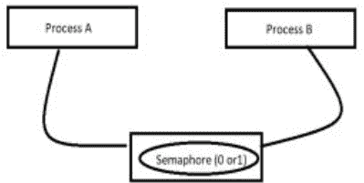

图4.6：信号量

### 信号量操作

对信号量可执行两种类型的操作：`wait`和`signal`。`wait`操作首先检查信号量的值是否满足指定条件，若满足则降低其值并返回；若不满足，则该操作会阻塞调用进程，直到信号量的值达到要求的值。`signal`操作会增加信号量的值，可能会唤醒一个或多个正在等待该信号量的进程。

### 信号量集

信号量集是一种将一组信号量整合存储的结构，允许进程对集合中的部分或全部信号量执行事务操作。事务指的是保证所有操作要么全部成功执行、要么完全不执行的机制。内核会为每个信号量集维护如下结构：

```c
struct semid_ds {
 struct ipc_perm sem_perm; /* 权限信息，参见ipc.h */
 time_t sem_otime; /* 最后一次semop()操作的时间 */
 time_t sem_ctime; /* 最后一次更改此结构的时间（模式更改） */
 struct sem *sem_base; /* 指向数组中第一个信号量的指针 */
 struct wait_queue *eventn;
 struct wait_queue *eventz;
 struct sem_undo *undo; /* 此数组上的撤销请求 */
 ushort sem_nsems; /* 数组中的信号量数量 */
};
```

各字段含义如下：

- `ipc_perm`：ipc_perm结构包含特定信号量的访问权限。
- `sem_otime`：最后一次`semop()`操作的时间（稍后会详细介绍）。
- `sem_ctime`：最后一次更改此结构的时间（模式更改）。
- `sem`：sem结构是内核用来维护信号量值集合的内部结构。
- `sem_undo`：此数组上的撤销请求数量。
- `sem_nsems`：信号量集中的信号量数量。
- `wait_queue`：`wait_queue`是指向任务结构的指针的循环列表。

## 创建信号量

使用`semget()`系统调用创建信号量或访问现有信号量，该调用返回信号量ID。

```c
int semget(key_t key, int nsems, int semflg);
```

参数`key`是不同进程用来标识此信号量集的唯一标识符。下一个参数`nsems`是要在新信号量集中创建的信号量数量；`semflg`参数指定新信号量集应具有的权限。如果`semflg`的值仅为`IPC_CREAT`，则它返回一个新创建的信号量集的标识符，或与`key`参数匹配的现有信号量集的标识符。如果`IPC_CREAT`与`IPC_EXCL`一起使用，则会创建新集合，如果信号量集已存在则返回–1。

## 控制信号量

创建信号量集后，使用`semctl()`系统调用控制整个集合或特定信号量。

```c
int semctl(int semid, int semnum, int cmd, union semun arg);
```

`semid`是信号量集的键标识符，`semnum`参数是信号量集中针对控制操作的目标信号量的索引。`cmd`参数控制信号量操作，其具有以下值：

- `IPC_STAT`：检索集合的`semid_ds`结构，并将其存储在`semun`联合中`buf`参数的地址处。
- `IPC_SET`：设置集合的`semid_ds`结构的`ipc_perm`成员的值。从`semun`联合的`buf`参数中获取值。
- `IPC_RMID`：从内核中销毁该集合。
- `GETALL`：给出集合中所有信号量的值。整数值存储在由联合的`array`成员指向的unsigned short整数数组中。
- `GETNCNT`：返回当前正在等待资源的进程数量。
- `GETPID`：返回执行最后一次`semop`调用的进程的PID。
- `GETVAL`：返回集合中单个信号量的值。

## 信号量操作 `semop()`

`semop()`系统调用用于对信号量集上的用户定义的一组信号量操作执行原子操作。

```c
int semop(int semid, struct sembuf *sops, unsigned int nsops);
```

参数`semid`是从`semget()`调用获得的数字，用于标识信号量集，下一个参数`sops`是指向用户定义的`struct sembuf`数组的指针，该数组填充了信号量命令；第三个参数`nsops`指定信号量操作结构的数量。

```c
struct sembuf {
 ushort sem_num; // 集合中针对操作的信号量编号
 short sem_op; // 定义在信号量上的操作
 short sem_flg;
};
```

`sem_num`是集合中针对操作的信号量编号，`sem_op`定义在信号量上的操作。它的含义取决于`sem_op`是正、负还是零。让我们看一下它们的情况：

| sem_op | 发生的情况 |
|---|---|
| 正 | `sem_op`的值被加到信号量的值上。程序使用这种方式将信号量标记为已分配资源。 |

**表4.2：`sem_op`变量取值**

| 取值 | 说明 |
|---|---|
| 负值 | 若`sem_op`的绝对值大于信号量的值，则调用进程将阻塞，直到信号量的值达到`sem_op`的绝对值。随后，`sem_op`的绝对值会从信号量的值中减去。这就是进程如何释放受信号量保护的资源。 |
| 0 | 该进程将等待，直到对应信号量的值变为0。`sem_flg`可设置为`IPC_NOWAIT`或`SEM_UNDO`。如果某个操作指定了`SEM_UNDO`，当进程退出时该操作会被撤销。 |

## 销毁信号量

可通过`semctl()`系统调用销毁信号量集。`cmd`参数被设置为`IPC_RMID`，该值指示`semctl()`移除此信号量集。参数`semnum`和`arg`在`IPC_RMID`上下文中无实际意义，可设置为任意值。

## 示例：假设我们信号量集中id为`semset_id`的信号量初始值为1

```c
/* 此函数使用给定路径名更新文件内容。 */
void update_file(char* file_path, int number) {
    /* 信号量操作结构体。 */
    struct sembuf sem_op;
    FILE* file;
    /* 等待信号量，除非其值非负。 */
    sem_op.sem_num = 0;
    sem_op.sem_op = -1; /* <-- 注释1 */
    sem_op.sem_flg = 0;
    semop(sem_set_id, &sem_op, 1); /* 注释2 */
    /* 我们已“锁定”信号量，可确保对文件的独占访问。 */
    /* 以某种方式操作文件，例如向其中写入一个数字。 */
    file = fopen(file_path, "w");
    if (file) {
        fprintf(file, "%d\n", number);
        fclose(file);
    }
    /* 最后，给信号量发送信号——将其值加1。 */
    sem_op.sem_num = 0;
    sem_op.sem_op = 1; /* <-- 注释3 */
    sem_op.sem_flg = 0;
    semop(sem_set_id, &sem_op, 1);
}
```

这段代码需要一些说明，尤其是关于`semop()`调用的语义，具体如下：

- **注释1：** 在访问文件前，我们使用`semop()`等待信号量。在`sem_op.sem_op`中传入-1表示：如果信号量的值大于等于1，则将其值减1后返回给调用者；否则（信号量值小于等于1），阻塞调用进程，直到信号量的值变为1，此时再返回给调用者。
- **注释2：** `semop()`的语义保证我们从该函数返回时，信号量的值为0。为什么？它的值不可能更小，否则`semop()`不会返回；由于后续我们会给信号量发送信号，它的值也不可能更大。
- **注释3：** 完成文件操作后，我们将信号量的值加1，可能会唤醒一个正在等待该信号量的进程。如果有多个进程在等待该信号量，最先被阻塞的进程会被唤醒并继续执行。

现在，假设任何试图访问文件的进程都仅通过调用我们的`update_file`函数完成。如你所见，函数执行过程中，信号量的值会先减1再加1。因此，信号量的值永远不会超过其初始值1。接下来我们检查两种场景：

- 没有其他进程同时执行`update_file`。这种情况下，我们进入函数时，信号量的值为1。第一次`semop()`调用后，信号量的值被减为0，因此我们的进程不会被阻塞。我们继续执行文件更新操作，通过第二次`semop()`调用，将信号量的值重新加回1。
- 另一个进程正在执行`update_file`函数。如果该进程已经通过了第一次`semop()`调用，此时信号量的值为0，当我们调用`semop()`时，我们的进程会被阻塞。当另一个进程通过第二次`semop()`调用给信号量发送信号时，会将信号量的值重新加回1，并唤醒被阻塞在该信号量上的进程，也就是我们的进程。我们随后进入文件处理代码的执行流程，最后通过第二次`semop()`调用将信号量的值重新加回1。

### 结论

进程间通信是允许两个进程相互通信的重要机制。进程间通信（IPC）既用于协作进程间共享数据，也可通过IPC控制其他进程的活动；IPC可用于单个进程内两个线程间的通信、单系统中两个进程间的通信，或分布式环境下不同进程间的通信。我们讨论了IPC的相关概念，包括所有IPC方法。本章还介绍了信号量的概念，用于进程同步，避免两个并发进程共享资源时发生死锁。下一章将讨论另一种基于socket的进程间通信方法，用于网络内或跨网络的客户端与服务器之间。

### 复习习题

- 信号量如何为多个进程提供对共享对象的访问权限？
- 定义UNIX中用于实现信号量的函数调用。
- 编写程序创建消息队列并向其发送一些数据。
- 编写程序在接收到消息队列上的可用数据后销毁该消息队列。
- 共享内存段是一片可附加到多个进程的内存区域。编写客户端和服务器程序，实现双方的数据来回传递。
- 编写程序展示客户端和服务器程序间的竞态条件。
- 如果`open`的参数是不存在的命令会发生什么？
- 编写程序，通过管道在父进程和子进程间发送和接收数据。

# 第5章：套接字编程

## 引言

套接字编程是服务器与客户端通信的方法。客户端在特定端口与服务器建立连接，服务器监听客户端的连接请求。服务器可同时与多个客户端通信，并以同步方式为这些客户端提供服务。本章讨论套接字作为客户端与服务器间的通信接口，用于发送和接收信息。

## 本章结构

本章将涵盖以下主题：

- 套接字
- 套接字类型
- 套接字数据结构
- 套接字通信的系统调用
- I/O模型
- 名称与地址转换

## 学习目标

阅读本章后，你将能够：

- 理解服务器与客户端通信的套接字概念和类型。
- 理解套接字通信涉及的各类系统调用的执行流程。
- 理解用于套接字通信的I/O模型。
- 理解用于名称转地址计算的系统调用。

## 套接字

套接字是应用进程与传输层之间的接口。套接字是应用进程向其他本地或远程应用进程发送/接收消息的媒介。这类通信常用于服务器进程与客户端进程之间。在UNIX中，这类套接字被称为UNIX域套接字，因为它们仅可用于同一主机上的进程间通信。在UNIX中，套接字由文件描述符定义——文件描述符是与打开文件关联的整数。相比之下，因特网域套接字支持多种通信协议。套接字可由内核支持，也可作为库实现，将调用转换为原生网络API。下图展示了套接字示意图：

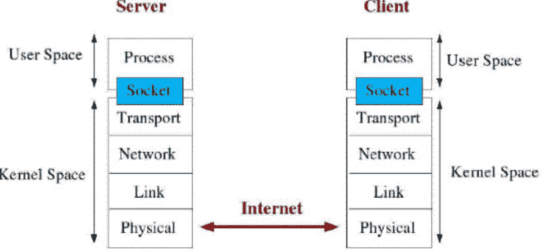

## 套接字类型

创建套接字时，程序需要指定地址域和要创建的套接字类型，仅当通信双方使用的套接字处于同一地址域且套接字类型相同时，两个进程才能相互通信。

两种广泛使用的套接字地址域是UNIX域和Internet域。在UNIX域中，共享同一文件系统的进程可以相互通信；而在Internet域中，进程不必处于同一文件系统中，它们可以位于Internet上的任意主机上并相互通信。这两种域类型都有各自专属的地址格式。在UNIX域中，地址在文件系统中有一条对应条目，以字符串形式表示。在Internet域中，套接字地址以网络上主机的32位IP地址表示，同时还需要一个16位无符号整数表示的端口号。

## 套接字数据结构

套接字的相关信息存储在名为`sockaddr`的数据结构中。`sockaddr`结构包含两个成员：`sa_family`和`sa_data`，其中`sa_family`成员用于存储协议地址族。

```c
struct sockaddr {
    unsigned short sa_family; // address family AF_xxx
    unsigned short sa_data[14]; // 14 bytes of protocol address
};
```

## 套接字通信的系统调用

客户端通过以下步骤建立套接字通信：

- 通过`socket()`系统调用创建套接字。


使用`connect()`系统调用将新创建的套接字连接到服务器地址。

通过`read()`和`write()`系统调用发送和接收数据。

服务器端通过以下步骤建立套接字通信：

- 通过`socket()`系统调用创建套接字。
- 使用`bind()`系统调用将新创建的套接字绑定到指定地址。对于Internet上的服务器套接字而言，地址由主机上的端口号组成。
- 通过`listen()`系统调用监听连接请求。
- 通过`accept()`系统调用接受来自客户端的连接请求，该调用通常会阻塞，直到有客户端与服务器建立连接。
- 通过`read()`和`write()`调用发送和接收数据。

表5.1展示了基于TCP和UDP协议，通过套接字实现服务器与客户端通信所使用的函数集合。

### 表5.1：不同套接字相关系统调用

| 协议类型 | 客户端操作 | 服务器端操作 |
|---------------|-------------------|--------------------|
| 面向连接（TCP） | `socket()`<br>`connect()`<br>`send()`<br>`recv()` | `socket()`<br>`bind()`<br>`listen()`<br>`accept()`<br>`send()`<br>`recv()` |
| 无连接（UDP） | `socket()`<br>`sendto()`<br>`recvfrom()` | `socket()`<br>`bind()`<br>`recvfrom()`<br>`sendto()` |

### 创建套接字（服务器端与客户端）

`socket()`系统调用用于创建套接字，并返回该套接字唯一的文件描述符。根据输入参数的不同，创建的套接字可以是流式（TCP）套接字，也可以是数据报（UDP）套接字。

##### 原型

```c
int socket(int domain, int type, int protocol);
```

其中`domain`参数可设置为`AF_INET`或`PF_INET`；`type`参数用于指定套接字类型，TCP流式套接字（如telnet、HTTP等）对应`SOCK_STREAM`，UDP数据报套接字对应`SOCK_DGRAM`；`protocol`参数取值为0时会根据套接字类型自动选择正确的协议，也可设置为`IPPROTO_TCP`选择TCP协议，或设置为`IPPROTO_UDP`选择UDP协议。

### 将套接字绑定到地址（服务器端）

`bind()`系统调用用于将套接字`sockfd`与本地机器上的端口关联。该函数仅在服务器需要处理接入连接时调用，若执行出错会返回-1。

##### 原型

```c
int bind(int sockfd, struct sockaddr *addr, int addrlen);
```

第一个参数`sockfd`是`socket()`系统调用返回的文件描述符值；`addr`是指向`sockaddr`结构的指针，该结构存储了本地机器的IP地址和端口号；`addrlen`是`sockaddr`结构的大小。

### 监听接入连接

`listen()`系统调用用于监听接入的连接请求，仅服务器在建立面向连接（TCP）套接字时需要调用该函数，执行出错时返回-1。

##### 原型

```c
int listen(int sockfd, int backlog);
```

其中`sockfd`是`socket()`函数调用返回的描述符值；`backlog`参数指定接入队列中允许等待的最大连接数，接入的连接会在队列中保留，直到被服务器接受。

### 发起连接

客户端调用`connect()`系统调用向服务器发起连接，该调用仅用于面向连接（TCP）套接字，执行出错时返回-1。

##### 原型

```c
int connect(int sockfd, struct sockaddr *addr, int addrlen);
```

其中`sockfd`是`socket()`函数调用返回的描述符值；`addr`是指向`sockaddr`结构的指针，该结构存储了服务器的IP地址和端口号；`addrlen`是`sockaddr`结构的大小。

### 接受接入队列中的连接

服务器使用`accept()`系统调用接受与套接字`sockfd`关联的接入队列中的连接，该调用仅用于面向连接（TCP）套接字。系统调用会返回一个新的套接字文件描述符，可用于在该连接上发送和接收信息，执行出错时返回`-1`。

##### 原型

```c
int accept(int sockfd, void *addr, int *addrlen);
```

其中`sockfd`是用于监听连接的套接字的描述符；`addr`是指向本地`sockaddr`结构的指针，该结构存储了发起连接的客户端的IP地址和端口号，该结构与存储服务器IP地址和端口号的结构不同；`addrlen`是前述`sockaddr`结构的大小。

### 通过套接字发送数据（面向连接）

连接建立后，客户端和服务器可通过`send()`系统调用实现客户端到服务器或服务器到客户端的信息发送。若客户端使用`send()`，则服务器需使用`recv()`，反之亦然。该函数成功时返回发送的字节数，执行出错时返回`-1`。

##### 原型

```c
int send(int sockfd, const void *msg, int len, int flags);
```

其中`sockfd`是用于发送数据的套接字的文件描述符；在客户端，`sockfd`与调用`connect()`时使用的套接字一致；在服务器端，`sockfd`是`accept()`调用返回的套接字；`msg`是指向待发送数据的指针；`len`是待发送数据的字节长度；`flags`参数设置为`0`。

### 通过套接字接收消息（面向连接）

`recv()`系统调用用于接收通过套接字发送的数据，函数返回实际接收到的字节数；若执行出错则返回-1，若对端已关闭连接则返回0。

##### 原型

```c
int recv(int sockfd, void *buf, int len, unsigned int flags);
```

其中`sockfd`是用于读取数据的套接字的描述符；在客户端，`sockfd`与调用`connect()`时使用的套接字一致；在服务器端，`sockfd`是`accept()`调用返回的套接字；`buf`是指向接收数据缓冲区的指针；`len`是缓冲区的最大字节长度；`flags`参数设置为0。

### 通过套接字接收消息（无连接）

该函数与`send()`类似，但用于无连接数据报场景，而非面向连接的通信。

##### 原型

```c
int sendto(int sockfd, const void *msg, int len, unsigned int flags, const struct sockaddr *toaddr, int addrlen);
```

其中`sockfd`是用于发送数据的套接字的描述符；`msg`是指向待发送数据的指针；`len`是待发送数据的字节长度；`flags`参数设置为0；`toaddr`是存储数据接收方IP地址和端口号的`sockaddr`结构；`addrlen`是前述`sockaddr`结构的大小。

### 关闭套接字

`close()`系统调用用于关闭套接字。

##### 原型

```c
void close(sockfd);
```

### 客户端程序

以下是在客户端运行的代码：

```c
#include <stdio.h>
#include <sys/types.h>
#include <sys/socket.h>
#include <netinet/in.h>
#include <netdb.h>
#include <string.h>
#define PORT 5000
#define HOST "uptu.ac.in"
#define DIRSIZE 8000
main(argc, argv)
int argc;
char **argv;
{
    char hostname[100];
    char dir[DIRSIZE];
    int sd;
    struct sockaddr_in sin;
    struct sockaddr_in pin;
    struct hostent *hp;
    strcpy(hostname, HOST);
    if (argc > 2) {
        strcpy(hostname, argv[2]);
    }
    if ((hp = gethostbyname(hostname)) == 0) {
        perror("gethostbyname");
        exit(1);
    }
    /* fill in the socket structure with host information */
    memset(&pin, 0, sizeof(pin));
    pin.sin_family = AF_INET;
    pin.sin_addr.s_addr = ((struct in_addr *)(hp->h_addr))->s_addr;
    pin.sin_port = htons(PORT);
    /* grab an Internet domain socket */
    if ((sd = socket(AF_INET, SOCK_STREAM, 0)) == -1) {
        perror("socket");
        exit(1);
    }
    /* connect to PORT on HOST */
    if (connect(sd, (struct sockaddr *)&pin, sizeof(pin)) == -1) {
        perror("connect");
        exit(1);
    }
    /* send a message to the server PORT on machine HOST */
    if (send(sd, argv[1], strlen(argv[1]), 0) == -1) {
        perror("send");
        exit(1);
    }
    /* wait for a message to come back from the server */
    if (recv(sd, dir, DIRSIZE, 0) == -1) {
        perror("recv");
        exit(1);
    }
    printf("%s\n", dir);
    close(sd);
}
```

### 服务端程序

以下是在服务端运行的代码：

```c
#include <stdio.h>
#include <sys/types.h>
#include <sys/socket.h>
#include <netinet/in.h>
#include <netdb.h>
#include <string.h>
#define PORT 5000
#define DIRSIZE 8000
main()
{
    char dir[DIRSIZE]; /* used for incoming dir name, and outgoing data */
    int sd, sd_current, cc, fromlen, tolen;
    int addrlen;
    struct sockaddr_in sin;
    struct sockaddr_in pin;
    /* get an internet domain socket */
    if ((sd = socket(AF_INET, SOCK_STREAM, 0)) == -1) {
        perror("socket");
        exit(1);
    }
    /* complete the socket structure */
    memset(&sin, 0, sizeof(sin));
    sin.sin_family = AF_INET;
    sin.sin_addr.s_addr = INADDR_ANY;
    sin.sin_port = htons(PORT);
    /* bind the socket to the port number */
    if (bind(sd, (struct sockaddr *)&sin, sizeof(sin)) == -1) {
        perror("bind");
        exit(1);
    }
    /* show that we are willing to listen */
    if (listen(sd, 5) == -1) {
        perror("listen");
        exit(1);
    }
    /* wait for a client to talk to us */
    addrlen = sizeof(pin);
    if ((sd_current = accept(sd, (struct sockaddr *)&pin, &addrlen)) == -1) {
        perror("accept");
        exit(1);
    }
    /* if you want to see the ip address and port of the client, uncomment the next two lines */
    /* printf("Hi there, from %s\n", inet_ntoa(pin.sin_addr));
    printf("Coming from port %d\n", ntohs(pin.sin_port)); */
    /* * get a message from the client */
    if (recv(sd_current, dir, sizeof(dir), 0) == -1) {
        perror("recv");
        exit(1);
    }
    /* get the directory contents */
    read_dir(dir);
    /* strcat (dir," DUDE"); */
    /* acknowledge the message, reply w/ the file names */
    if (send(sd_current, dir, strlen(dir), 0) == -1) {
        perror("send");
        exit(1);
    }
    /* close up both sockets */
    close(sd_current);
    close(sd);
    /* give client a chance to properly shutdown */
    sleep(1);
}
```

### I/O 模型

输入操作通常分为两个不同的阶段：

- 等待数据就绪。
- 将数据从内核缓冲区复制到进程中。

#### 阻塞式I/O模型

当套接字处于阻塞模式时，内核会将进程置于等待状态，直到有数据可读或数据完全写入。如果数据暂不可用，则持续等待直到数据就绪，并阻塞进程。如图5.2所示，应用以阻塞模式向内核请求数据。这种情况下，内核会将应用置于等待状态，直到数据可用。一旦数据可用并写入应用，应用就会恢复执行。

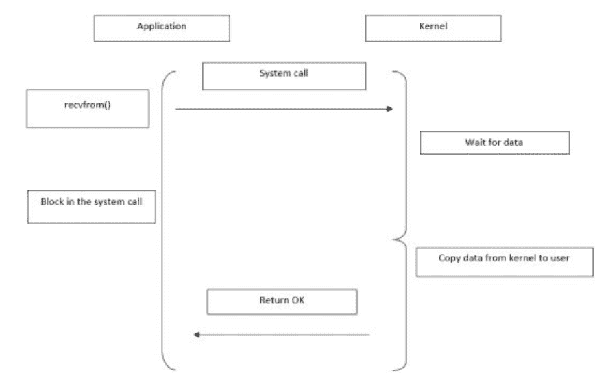

> 图5.2：I/O模型（阻塞式）框图

#### 非阻塞式I/O模型

当套接字处于非阻塞模式时，内核不会将进程置为睡眠状态，而是返回`EWOULDBLOCK`错误。非阻塞式I/O模型如图5.3所示：

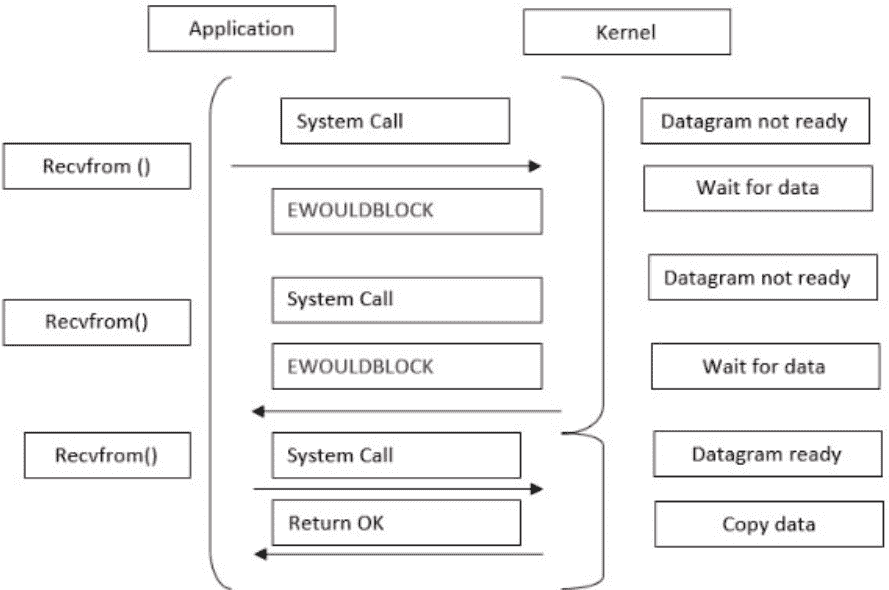

要接收数据，应用会重复调用`recvfrom`。调用过程中如果数据暂不可用，内核会返回`EWOULDBLOCK`错误。如果在`recvfrom`调用期间数据可用，则数据会被复制到应用的缓冲区中，函数成功返回。这个过程称为轮询，即应用持续轮询内核以查看是否有数据就绪。该过程会浪费CPU时间，但偶尔会在仅实现单一功能的系统中遇到这种模型。

#### I/O多路复用模型

该模型会在调用`select()`或`poll()`这类系统调用时阻塞进程，而非在实际I/O操作上阻塞。返回时，套接字处于可读状态，即任意一个描述符上已有数据就绪，进程调用`recvfrom()`获取实际数据。该模型的优势在于进程可以同时等待多个文件描述符就绪。如图5.4所示，应用执行`select()`系统调用；如果服务端数据尚未就绪，应用会阻塞该次系统调用，但应用本身仍处于运行状态。一旦数据可用，应用执行`recvfrom()`函数从内核接收数据，随后立即返回。

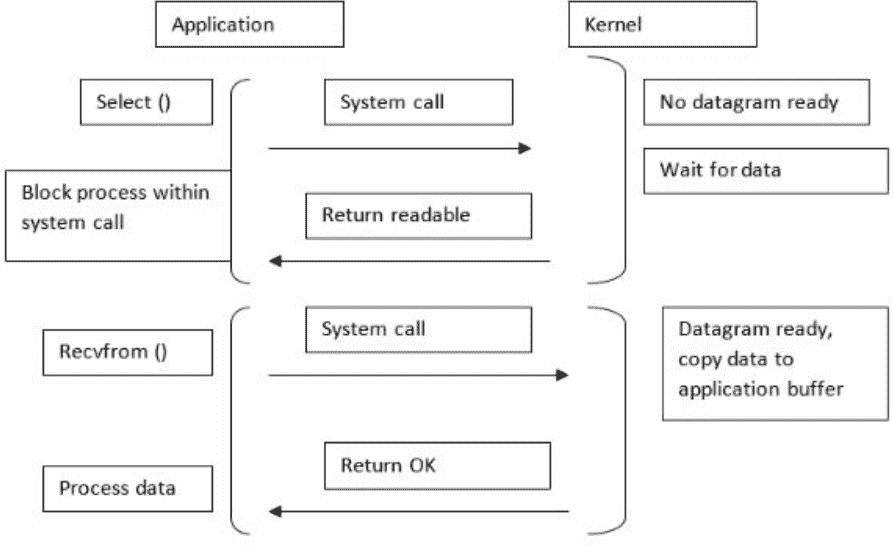

该模型的一个缺点是它需要两次系统调用而非一次。

#### 信号驱动式I/O模型

在该模型中，内核通过发送`SIGIO`信号通知进程数据已就绪。如图5.5所示，应用通过`sigaction()`函数启用信号处理器。启用后，应用会持续执行。一旦内核端数据就绪，内核会向应用发送`SIGIO`信号，该信号由应用端的信号处理器处理。此时，应用调用`recvfrom()`函数从内核接收数据，数据完全写入后应用恢复执行。

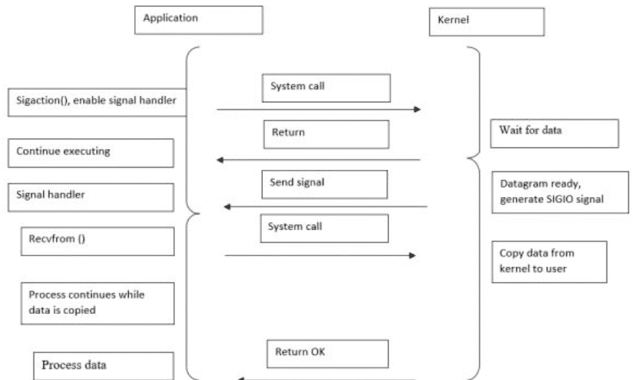

**图5.5：**信号驱动式I/O模型框图


首先，将套接字启用为支持信号驱动式I/O。执行`sigaction()`系统调用以安装用于处理I/O的信号处理器。一旦安装了处理器，系统调用会直接返回，不会阻塞进程。一旦数据报就绪，内核会向进程发送`SIGIO`信号，进程随后可以通过调用`recvfrom()`系统调用从信号处理器中读取数据报，也可以由进程的主函数读取该数据报。在此模式下，进程在等待数据报到达时不会被阻塞，而是持续执行。一旦数据报即将到达，信号处理器会通知进程。

## 异步I/O模型

在此类I/O模式下，会调用`io_read()`函数，向内核传入描述符、缓冲区指针、缓冲区大小（与`read()`函数中的参数一致）、文件偏移量以及数据到达的通知方式。整个操作完成后，系统调用会立即返回。该模式在等待I/O完成时无需阻塞进程。系统模型如图5.6所示。

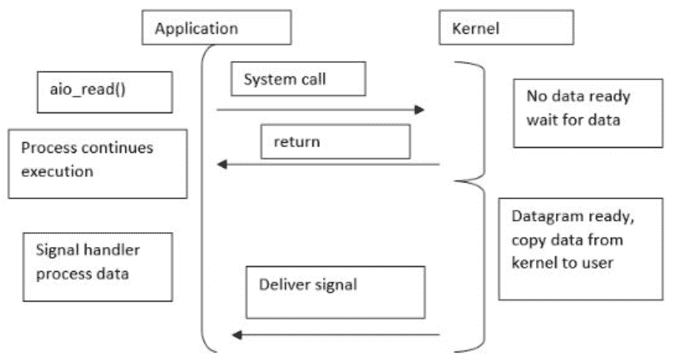

**图5.6：**异步I/O模型框图

该模型与信号驱动式I/O差异较大，因为其信号会在数据被复制到应用缓冲区之后才会生成。

## 名称与地址转换

DNS用于在主机名和IP地址之间做映射。主机名可以是简单名称（如`solaris`），也可以是完整限定域名（FQDN），例如`solaris.kohala.com`。

### 资源记录

DNS条目被称为资源记录（RR）。它定义了域名的所有相关信息，包括资源类型、协议族、服务器可缓存该RR的时长（单位为秒）、数据字段长度以及资源数据。下表展示了不同类型的资源记录。

| 资源记录类型 | 映射规则 |
| :--- | :--- |
| A | 将主机名映射为32位IPv4地址 |

**表5.2** 资源类型及其映射关系

| 类型 | 描述 |
|------|------|
| AAAA | 将主机名映射为128位IPv6地址 |
| PTR | 将IP地址映射为主机名。对于IPv4，需反转4个字节，每个字节转换为十进制ASCII值（0-255），再追加`in-addr.arpa`；对于IPv6地址，需反转128位地址的32个4位半字节，每个半字节转换为对应的十六进制ASCII值（0-9-a-f），再追加`ip6.int`。 |
| MX | 指定主机的邮件交换记录 |
| CNAME | 规范名称；例如CNAME会被分配给FTP、WWW等常用服务。 |

### gethostbyname()函数

`gethostbyname()`函数接受指定的主机名作为参数，返回对应的IP地址，可作为`connect()`函数的入参。该函数会查询A和AAAA记录，同时返回IPv4和IPv6地址。

#### 原型

```c
#include <netdb.h> /* Berkeley */
struct hostent *gethostbyname(const char *hostname);
```

`gethostbyname()`函数的入参是类似`www.yahoo.com`的字符串，返回一个包含丰富信息的`struct hostent`结构体，其中包含IP地址；额外信息还包括官方主机名、别名列表、地址类型、地址长度以及地址列表。

#### hostent结构体

`hostent`结构体包含来自主机数据库的主机相关信息，其成员如下：官方主机名、备用主机名、地址类型（IPv4或IPv6）、地址字节长度以及主机地址列表。

```c
/* <netdb.h> */
struct hostent {
    /* structure returned by network */
    char *h_name; /* official name of host */
    char **h_aliases; /* alias list */
    int h_addrtype; /* host address type */
    int h_length; /* length of address */
    char **h_addr_list; /* list of addresses from name server */
};
/* h_addrtype: always AF_INET */
/* h_length: always 4 */
/* h_addr_list[]: for multinode host */
int main() {
    int i;
    struct hostent *he;
    struct in_addr addr;
    // get the addresses of www.yahoo.com:
    he = gethostbyname("www.yahoo.com");
    if (he == NULL) {
        herror("gethostbyname"); // herror(), NOT perror()
        exit(1);
    }
    // print information about this host:
    printf("Official name is: %s\n", he->h_name);
    printf("IP address: %s\n", inet_ntoa(*(struct in_addr*)he->h_addr));
    printf("\n");
    exit(0);
}
```

上述代码的输出为所请求URL的官方名称和IP地址。

### gethostbyaddr()函数

`gethostbyaddr()`函数返回包含主机名称及其他相关信息的`hostent`结构体。

#### 原型

```c
#include <netdb.h>
struct hostent *gethostbyaddr(const char *addr, int len, int type);
```

对于TCP/IP协议，第一个入参`addr`应指向`struct in_addr`结构体或以网络字节序存储的无符号长整型，`len`通常为`sizeof(struct in_addr)`，`type`应为`AF_INET`。主机信息可通过解析器从系统等效于`/etc/hosts`的文件中获取。

```c
int main() {
    const char *ipstr = "66.94.230.32";
    struct in_addr ip;
    struct hostent *hp;
    if (!inet_aton(ipstr, &ip)) {
        errx(1, "can't parse IP address %s", ipstr);
    }
    if ((hp = gethostbyaddr(&ip, sizeof(ip), AF_INET)) == NULL) {
        errx(1, "no name associated with %s", ipstr);
    }
    printf("Host name: %s\n", hp->h_name);
    exit(0);
}
```

### 解析器

`gethostbyname()`和`gethostbyaddr()`函数使用`resolver`库函数获取主机信息。`resolver`函数会读取`/etc/resolv.conf`文件，获取DNS服务器的IP地址以启动查询。

### getservbyname()和getservbyport()函数

`getservbyname()`、`getservbyport()`和`getservent()`函数会顺序搜索服务数据库以识别服务，并按需建立连接：

- `getservbyname()`函数搜索服务数据库中与指定名称和协议匹配的服务，必要时建立连接。
- `getservbyport()`函数搜索服务数据库中与给定端口和指定协议匹配的服务，必要时建立连接。

上述三个函数会顺序搜索数据库，直到找到匹配项或抵达EOF。

#### 原型

```c
#include <netdb.h>
struct servent *getservbyname(const char *servname, const char *protname);
struct servent *getservbyport(int port, const char *protname);
```

#### servent结构体

```c
struct servent {
    char *s_name; /* official name of the service */
    char **s_aliases; /* zero-terminated list of alternate service names */
    int s_port; /* port number, in network byte order */
    char *s_proto; /* name of the protocol to use when contacting the service */
};
```

该结构体的成员如下：

- `s_name`：服务的官方名称。
- `s_aliases`：服务的备用名称零终止列表。
- `s_port`：服务监听的端口号，以网络字节序返回。
- `s_proto`：访问该服务时使用的协议名称。

这些函数使用静态数据存储，如果后续需要使用相关数据，必须将其复制到其他存储空间中。

## 总结

套接字是客户端与服务器之间的接口，无论两者位于单系统、局域网还是跨不同网络，都可用于收发数据。客户端程序通过面向连接或无连接的接口向服务器发送数据请求。本章已讨论所有与套接字编程相关的概念，包括不同类型的套接字、建立连接的函数，以及客户端与服务器之间收发消息的相关内容。本章重点介绍了UNIX环境下的套接字编程通信方法，UNIX平台用户还可根据需求使用其他多种环境，相关内容将在下一章讨论。

### 复习练习

1. 从命令行读取（1）可提取远程WWW服务器名称和待获取文件名的URL，（2）服务器端口号。使用`getservbyname`、`gethostbyname`、`socket`、`connect`创建与指定端口（如HTTP端口80）的服务器连接的套接字。

2. 一台主机上的进程使用哪些信息来识别另一台主机上的进程？

3. 服务器程序会向客户端程序请求并接收服务吗？

4. 使用`socket()`创建套接字，通过`gethostbyname()`将主机名转换为IP地址，然后调用`connect()`，传入包含目标服务器IP地址和端口的相关结构体。

# 第6章 内存管理

内存是计算机系统中的关键资源，内存管理是指对计算机内存的管理过程，内存分为主内存和次级内存。内存管理的目的是将各类可用内存高效分配给系统中运行或驻留的进程。它会跟踪内存中哪些部分正在使用、哪些部分空闲，在进程需要时为其分配内存。分配给运行进程的内存会在进程终止时释放，以便分配给其他请求内存资源的进程。UNIX操作系统通过交换和请求分页技术管理系统内存。本章将讨论所有与正确管理内存资源相关的概念和技术。

## 本章结构

本章将涵盖以下主题：

- 内存管理
- 操作系统内存的使用
- UNIX中运行进程的内存内容
- 交换技术
- 内存管理函数的实现
- 内存管理函数
- 函数调用期间的上下文切换

## 学习目标

阅读完本章后，读者将能够理解UNIX在C语言中的实现方式，以及UNIX操作系统如何广泛应用于C编程。本节将学习部分UNIX与C的接口概念，包括：

- 理解UNIX操作系统中不同类型内存资源的使用方式。
- 理解交换、请求分页等内存管理技术。
- 理解系统调用与内存管理函数。
- 理解函数调用期间的上下文切换。

涵盖的系统调用和库函数包括：

- 命令行参数与环境变量。
- 在UNIX上使用`fork()`和`exec()`实现C语言多任务。
- 使用`wait()`实现进程同步。
- 通过系统调用访问用户信息。
- 数据共享与进程间通信机制。
- 套接字编程基础。

## 内存管理

UNIX内核的内存管理组件负责管理处理器内存的内容。类UNIX操作系统采用复杂的内存管理算法以高效利用内存资源。在UNIX中，主要有三类内存资源：

- **主内存**：CPU主板上可用的物理内存，不包括处理器缓存、显存和其他外设内存。
- **文件系统内存**：本地磁盘或网络上可通过路径名访问的物理内存，不包括无法通过普通路径名寻址的原始设备、磁带驱动器、交换空间及其他存储设备。
- **交换设备**：交换设备是磁盘上用于存放当前未驻留在RAM或文件系统中的数据的物理存储区域。当交换设备位于独立磁盘或分区上时，可被高效使用。

## 操作系统内存的使用

为高效管理内存资源，内存会为操作系统自身功能以及正在执行的进程预留。部分内存始终被预留，无法供用户进程使用。

- **交换设备**：交换设备是磁盘上用于存放当前未驻留在RAM或文件系统中的数据的物理存储区域。当交换设备位于独立磁盘或分区上时，可被高效使用。
- **内核内存**：这是始终驻留在主内存中的操作系统私有内存。
- **缓存内存**：这是主内存的一部分，用于存放文件系统和I/O操作的相关元素。缓存内存不包括CPU缓存或磁盘驱动器。
- **虚拟内存**：虚拟内存包含运行在该机器上的所有进程的可寻址总内存空间。单个进程的总地址空间可分布在上述三种内存类型上。

## UNIX中运行进程的内存内容

UNIX上的进程使用内存来存放其数据、栈和映射文件：

- **数据段**：包含用于存放进程数据的已分配内存。
- **栈段**：该进程的这段内存存放执行栈，完全由操作系统管理。
- **映射文件**：进程的这部分内存包含在进程内存空间内访问的文件内容。

## 交换

交换发生在正在运行的进程需要物理内存中的虚拟页，但物理内存无可用空间时。此时操作系统会将部分页从主内存移出，并从交换设备调入所需的页。决定调入或调出哪些页的决策由调度器（交换调度器）做出。调度器至少每4秒唤醒一次，检查哪些进程可被换出。在主内存中空闲时间较长的进程最有可能被换出。若主内存中无此类进程，则会选择更大的进程进行换出。在交换设备中停留时间较长的较小进程最有可能被调入。为防止颠簸，在主内存中停留时间不足一定时长的进程不会被选中换出。被选中交换的页会根据其类型移动到对应位置：数据段的页会被移至交换空间，栈段的页会被移至交换空间；映射文件的页若被修改且为共享状态，则会被移回源文件；若被修改且为私有状态，则会被移至交换空间；若未被修改，则会被直接丢弃。

## 请求分页

请求分页是一种分页策略，仅在需要时才将页读入内存。请求分页仅将所需内存页与二级设备之间传输，而非传输整个进程。内核通过页表实现请求分页，页表可将逻辑页地址转换为物理页地址。页表使用二进制标志位检查页的有效性：若页驻留在主内存中则为有效，若当前驻留在二级内存中则为无效。当进程需要的内存页不在内存中时，会触发向内核的页错误中断。内核检查该页在二级内存中的引用是否有效，随后调度磁盘读取操作，将请求的页调入内存。页进入主内存后，会重启被中断的指令。

> **注意：** 伯克利在BSD（伯克利系统）中向UNIX引入了请求分页功能。

请求分页策略的优点在于，它允许将进程的虚拟地址更灵活地映射到机器的物理内存中，通常允许进程的大小超过可用物理内存的总量，同时允许更多进程同时驻留在主内存中。缺点在于，进程首次需要某页时可能会遇到额外的延迟。过多的页错误可能导致颠簸，且进程可能面临时序攻击的安全风险。

## mkdir系统调用

`mkdir()`函数会创建一个由`path`参数指向的路径名指定的新目录。

### 原型

```c
int mkdir(const char *path, mode_t mode);
```

新目录的权限由`mode`初始化。`mode`参数的权限部分会受进程的文件创建掩码修改。目录的所有者ID设置为进程的有效用户ID。目录的组ID设置为进程的有效组ID；如果父目录中设置了`S_ISGID`位，则目录的组ID继承自父目录。新目录的`S_ISGID`位继承自父目录。如果`path`指向符号链接，`mkdir()`会执行失败，并将`errno`设置为`EEXIST`。新创建的目录除了自身（`.`）和父目录（`..`）的条目外为空。执行成功时返回`0`，否则返回`-1`，不会创建目录，同时设置`errno`以指示错误。

## rmdir系统调用

`rmdir()`系统调用会删除由`path`参数指定的目录文件。该目录除了`"."`和`"..`之外不能有任何其他条目。

### 原型

```c
int rmdir(const char *path);
```

`rmdir()`函数执行成功时返回`0`；否则返回`-1`，同时设置全局变量`errno`以指示错误。删除目录条目前，系统会检查链接计数条目（可通过`ls -l`命令查看），以识别要删除的目录是否被其他进程打开。仅当该目录的链接计数为0且没有其他进程打开该目录时，目录才会被删除，此时该目录占用的空间会被释放。

## 内存管理函数

变量的内存可以动态分配和释放。

### malloc()函数

- `malloc`需要1个参数：你想要动态分配的字节数。如果内存分配成功，`malloc`会返回一个void指针。你可以将其赋值给指针变量，该变量将存储已分配内存的地址。如果内存分配失败（例如内存不足），`malloc`会返回NULL指针。

### free()函数

- 将指针传入`free`会释放已分配的内存。在使用完内存后释放内存是最佳实践。

```c
void free(void *ptr);
```

其中`ptr`是指针。参考以下示例：


```c
#include <stdio.h>
#include <stdlib.h>

int main() {
    int number;
    int *ptr;
    int i;

    printf("How many ints would you like to store? ");
    scanf("%d", &number);

    ptr = malloc(number * sizeof(int)); /* allocate memory */

    if (ptr != NULL) {
        for (i = 0; i < number; i++) {
            *(ptr + i) = i;
        }

        for (i = number; i > 0; i--) {
            printf("%d\n", *(ptr + (i - 1))); /* print out in reverse order */
        }

        free(ptr); /* free allocated memory */
        return 0;
    } else {
        printf("\nMemory allocation failed - not enough memory.\n");
        return 1;
    }
}
```

### `calloc()`函数

- `calloc`与`malloc`类似，但主要区别是默认情况下，分配的内存空间中存储的值均为0。而使用`malloc`分配的内存可能包含任意值。
- `ptr = (cast_type*) calloc(n, size);`
- `calloc`需要2个参数。第一个参数`n`是你想要为其分配内存的变量数量，第二个参数`size`是每个变量的大小。与`malloc`一样，如果内存分配成功，`calloc`会返回`void`指针`ptr`；否则返回`NULL`指针。参考以下示例：

```c
#include <stdio.h>
#include <stdlib.h>

int main() {
    float *ptr1;
    int i;

    ptr1 = calloc(3, sizeof(float));

    if (ptr1 != NULL) {
        for (i = 0; i < 3; i++) {
            printf("ptr1[%d] holds %05.5f, ", i, ptr1[i]);
        }

        free(ptr1);
        return 0;
    }
}
```

### `realloc()`函数

`realloc()`函数用于调整已分配内存块的大小，且不会丢失该内存位置中的数据。

```c
ptr = realloc(ptr, newsize);
```

`realloc`接受两个参数：第一个是指向所需调整大小的内存的指针，即`ptr`；第二个是需要重新分配的内存总字节数，即`newsize`。将`0`作为第二个参数传入，等同于调用`free`函数。若`realloc`执行成功，返回`void`指针；否则返回`NULL`指针。

```c
#include <stdio.h>
#include <stdlib.h>

int main() {
    int *ptr;
    int i;
    int number;

    printf("How many ints would you like to store? ");
    scanf("%d", &number);

    ptr = calloc(number, sizeof(int));

    if (ptr != NULL) {
        for (int i = 0; i < number; i++) {
            *(ptr + i) = i;
        }

        ptr = realloc(ptr, (number + 2) * sizeof(int));

        if (ptr != NULL) {
            printf("Now allocating more memory... \n");

            ptr[number] = 32; /* now it's legal! */
            ptr[number + 1] = 64;

            for (i = 0; i < (number + 2); i++) {
                printf("ptr[%d] holds %d\n", i, ptr[i]);
            }

            realloc(ptr, 0); /* same as free(ptr); - just fancier! */
            return 0;
        } else {
            printf("Not enough memory - realloc failed.\n");
            return 1;
        }
    } else {
        printf("Not enough memory - memory not successfully allocated\n");
        return 1;
    }
}
```

### `alloca()`函数

`alloca()`函数用于在调用函数的栈帧中分配空间。当调用`alloca()`的函数返回至其调用方时，这部分临时空间会被自动释放。`alloca()`函数会返回所分配空间的起始地址指针。如果分配操作导致栈溢出，程序行为将未定义。`alloca()`函数的可用性及行为取决于机器架构和编译器，许多系统中的该函数实现存在缺陷。

原型：

```c
#include <alloca.h>

void *alloca(size_t size);
```

### 跳转至其他函数

C语言程序允许跳转至其他函数中设置的标签。若要将控制权转移至其他函数，需使用`setjmp`和`longjmp`函数。一般而言，这类跳转应当避免，因为它们不被视为良好的编程实践。

原型：

```c
int setjmp(jmp_buf env);

void longjmp(jmp_buf env, int val);
```

参考以下示例：

```c
#include <setjmp.h>
#include <stdio.h>

jmp_buf ebuf;

void f(void);

int main(void) {
    int i;

    printf("1 ");

    i = setjmp(ebuf);

    if (i == 0) {
        f();
        printf("This will not be printed.");
    }

    printf("%d", i);
    return 0;
}

void f(void) {
    printf("2 ");
    longjmp(ebuf, 3);
}
```

### 总结

内存是计算机系统的重要资源。如果内存管理不当，会降低操作系统的整体性能。内存管理功能用于跟踪哪些内存区域已被使用、使用量多大，以及哪些内存区域空闲，可供需要内存空间的进程分配使用。内存管理功能同时控制系统中的主存和辅存。UNIX操作系统采用交换技术和请求分页技术来高效利用系统内存，内存可根据需求随时动态分配与释放。

### 选择题

1. 哪种技术允许执行未完全载入内存的进程？
   - a. 虚拟内存
   - b. 内存管理
   - c. 物理内存
   - d. 以上都不是

2. 以下哪项全部是UNIX系统调用？
   - a. `time()`、`chdir()`、`createdir()`、`execve()`
   - b. `chmod()`、`main()`、`waitpid()`、`exit()`
   - c. `open()`、`fork()`、`delete()`、`read()`
   - d. `lseek()`、`stat()`、`link()`、`kill()`

3. 发生缺页中断时，将页面调入内存的机制是？
   - a. 请求分页
   - b. 分段
   - c. 碎片化
   - d. 页面置换

4. 虚拟内存管理进程的逻辑地址空间。
   - a. 正确
   - b. 错误

5. 要使用动态内存分配函数，需要包含哪个头文件？
   - a. `stdlib.h`
   - b. `stdio.h`
   - c. `memory.h`
   - d. `alloc.h`

6. 以下哪个函数用于修改动态分配内存的大小？
   - a. `realloc()`
   - b. `malloc()`
   - c. `free()`
   - d. `alloca()`

7. 请指出以下关于虚拟内存的表述中哪些是正确的。
   - a. 它允许多个用户同时使用系统
   - b. 它扩展了多道程序设计的能力
   - c. 它扩展了地址空间
   - d. 它同时减少了外部碎片和内部碎片。

### 答案

- 1. (a)
- 2. (c)
- 3. (b)
- 4. (b)
- 5. (a)
- 6. (a)
- 7. (b)

### 问答题

1. 内存管理的核心目标是什么？
2. 交换技术和分页技术有什么区别？
3. 哪些进程不会被交换进程处理？说明原因。
4. 为什么UNIX不允许将内核内存换出到外存？

# 第7章 UNIX Shell与自定义环境

众所周知，UNIX操作系统中最直观的部分就是Shell，这也是用户需要了解的最重要组件。要执行任何任务，都需要向Shell下达命令。如果命令需要调用工具或应用程序，Shell会请求内核执行该程序。

Shell包含两个部分：第一部分是解释器，负责接收用户命令并将其转换为系统可识别的形式；第二部分是Shell的编程功能，支持我们编写对应的Shell脚本。Shell的另一项重要功能是自定义工作环境。在本章中，我们将详细介绍Shell作为解释器和环境定制工具的类别、特性与功能。

## 本章结构

本章将涵盖以下主题：

- UNIX Shell的功能与执行模式
- Shell执行周期
- UNIX标准Shell提供的特性
- Shell元字符的意义与用途
- 通过转义与引号避免元字符被解析
- 使用三个标准文件进行命令输入/输出
- 使用重定向操纵默认输入输出流
- `noclobber`选项的使用
- `/dev/null`文件的使用
- 命令组合
- 命令管道编排的意义
- 使用Shell环境变量自定义环境
- 理解与自定义用户配置文件

## 学习目标

学完本章后，你将能够：

- 掌握Shell的基础知识与功能
- 了解Shell的不同功能模式
- 理解执行Shell命令的相关概念
- 掌握命令组合与管道编排
- 了解用户配置文件相关概念

## Shell简介

Shell本质上是作为UNIX接口的程序。Shell常被称为命令解释器，因为它能够让系统识别用户的命令。系统提供了多种Shell，每种都有不同的特性，但都会影响命令的解析方式。Shell提供了构建UNIX环境的工具。Shell是UNIX中的实用工具，用户登录系统时会将其载入内存。登录过程中要执行的Shell会在`/etc/passwd`文件中对应用户的条目中列出。如果`/etc/passwd`文件中未指定Shell，则默认执行标准Shell`/usr/bin/sh`。

## UNIX Shell的执行模式

UNIX Shell主要有以下三种执行模式：

### 交互模式

在交互模式下，Shell会等待用户输入命令，随后对命令进行解析。去除所有错误后执行命令。命令中可以包含特殊符号，用于简化文件名、重定向输入输出。

### 编程模式

在编程模式下，系统会以Shell脚本的形式批量执行一组UNIX命令。许多内置命令会被整合为Shell脚本。与交互模式不同，脚本可以被保存，供后续重复执行。

### UNIX会话定制模式

UNIX Shell通过预定义的Shell变量控制会话行为。Shell变量用于设置用户的主目录、提示符、邮件配置等。部分Shell变量由系统自动设置，其余变量可由用户在启动文件中自定义。

## Shell解析周期

Shell命令处理通常分为五个步骤：

1. Shell启动后会在终端显示提示符。
2. Shell等待用户输入待执行命令。
3. Shell解析用户输入的命令。
4. Shell执行用户的请求。如果需要执行特定程序，Shell会在磁盘中搜索指定的程序文件。
5. 找到程序后，Shell会请求内核启动程序执行，自身进入休眠状态直至程序执行完成。如果程序需要从标准输入读取数据，会在执行过程中等待用户在命令提示符处输入内容。程序执行结束后，控制权会再次交还Shell，以执行下一个程序或命令。

## UNIX Shell的功能

*图7.1*展示了Shell执行的基本功能，后续章节将介绍这些功能的更多细节。

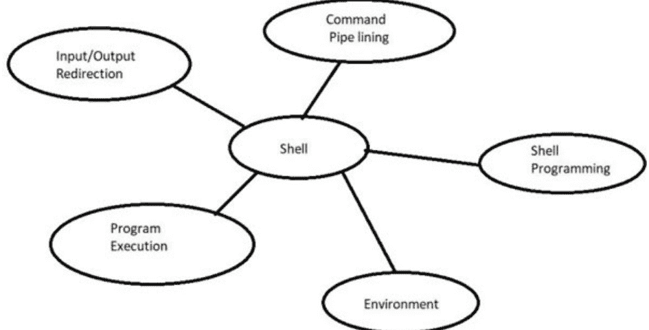

*图7.1：Shell的用途*

### 程序执行

Shell会发起所有由用户终端请求的程序的执行。要执行的程序以命令行形式在终端输入，格式如下：

```text
# Program-name list-of-arguments
```

Shell会扫描命令行，识别要执行的程序名称以及传递给该程序的参数值：直到第一个空白字符之前的内容，Shell都会视为程序名；各个参数也由空白字符分隔。如果程序名和参数之间存在多个空白字符，Shell会忽略多余的空白字符。

**示例：**

```bash
prog.sh first_arg second_arg
```

- `prog.sh`：程序名
- `first_arg`、`second_arg`：参数列表

### 输入/输出重定向

Shell会处理命令行中的输入/输出重定向。程序执行过程中，Shell会扫描输入命令中的特殊重定向运算符`<`、`>`和`>>`，能够将输入和/或输出重定向到文件，或从文件重定向输入和/或输出。

```bash
ls -l > file1
```

在前面的示例中，`ls -l`命令的输出被重定向到`file1`。如果`file1`已存在，其原有内容会被当前输出覆盖。正在执行的命令无需关心输出被重定向到哪里。我们来看两条完全相同的命令：

```bash
wc -l file1 # output: 10
wc -l < file1 # output: 10
```

第一种情况下，Shell确定要执行`wc`命令来统计`file1`文件的行数，它会打开`file1`文件并统计行数。第二种情况下，`wc`的执行方式略有不同：Shell扫描命令行时会识别输入重定向运算符`<`，`<`符号后面的内容是输入重定向来源文件的文件名；Shell执行`wc`命令时，会将其标准输入重定向到`file1`文件。

## 命令管道

与重定向运算符类似，Shell在扫描命令行时会识别`|`符号。对于每一个`|`符号，Shell会将`|`前一条命令的标准输出传递给`|`后的命令。


```bash
ls -l | wc -l
```

上述命令会输出当前目录下的文件总数：`ls -l`命令会列出当前目录下的文件和目录，并将结果写入标准输出，它感知不到`|`符号的存在；该命令的输出随后会被作为标准输入传递给`wc -l`命令，`wc -l`执行时会识别到输入内容是文件数量，进而计算标准输入的总行数。

#### 环境定制

Shell环境包含一组预定义的变量，这些变量被称为环境变量。Shell通过维护这些变量来控制、配置实用程序的行为，Shell变量的值通常由操作系统或通过初始化文件设置。UNIX系统中存在大量环境变量，包括：

- 用户主目录路径：`HOME`
- Shell命令的搜索路径：`PATH`
- 默认提示符：`PS1`
- 终端类型：`TERM`
- UNIX主机名：`HOSTNAME`

Shell提供了自定义环境的命令。

### Shell编程语言

Shell拥有独立的编程语言，用于编写shell脚本。与C、C++等其他函数式编程语言不同，后者需要将整个程序编译为可执行代码，而Shell编程语言是解释型的，这意味着Shell编程语言中编写的每一条语句都会被解释、逐行检查错误并执行。Shell编程就是使用Shell命令和Shell编程语言编写shell脚本的过程：Shell脚本是一系列用纯文本编写的命令，这些命令可以是内部或外部Shell命令，也可以是Shell编程结构，比如`if-then-else`结构、循环、`case`结构、变量、表达式等。

### Shell的类型

与大多数操作系统类似，UNIX的shell并非内置组件，而是UNIX系统中的普通程序。UNIX的shell会对内核和用户进行隔离，避免两者互相干扰。系统提供了多种shell，每种shell都具备不同的特性，可分为两大系列：Bourne shell系列和C shell系列。

#### Bourne shell系列

Bourne shell系列包含三种shell：Bourne shell（`/bin/sh`）以及它的两个衍生版本——Korn shell（`/bin/ksh`）和Bourne Again Shell（`/bin/bash`，简称BASH）。

##### Bourne shell

Bourne shell由AT&T实验室的Steve Bourne开发，是历史最悠久的UNIX shell，几乎所有UNIX版本都自带该shell。原始的、未做增强的Bourne shell与BASH不同，BASH是Linux系统中使用的增强版本，Bourne shell的命令采用算法语言（ALGOL）风格。

##### Korn shell

Korn shell由AT&T实验室的David G. Korn开发，是Bourne shell的超集，具备更多功能。它在Bourne shell的语法基础上，融合了C shell的所有交互特性，为Bourne shell新增了以下特性：

- 数组
- 文件名自动补全
- 命令别名
- 函数
- 命令历史与替换

Korn shell还有一个变体是POSIX，随HP-UX 11.0发布。在HP-UX系统中，`/bin/sh`是符合POSIX标准的shell，而原始的Bourne shell被安装在`/usr/old/bin/sh`路径下。

##### BASH（Bourne Again）Shell

Bash由自由软件基金会的Brian Fox开发，目前由Chester Ramey负责维护，是Bourne shell的增强版本，广泛应用于Linux系统。Bash在Korn shell的基础上新增了以下特性：

- 支持无限大小的数组
- `cd`命令的路径名自动修正
- 支持2到64任意进制的整数运算
- 支持文件名、主机名、变量名的自动补全

#### C shell系列

C shell系列包含C shell（`/bin/csh`）及其衍生版本tcsh（`/bin/tcsh`）。C shell由伯克利的Bill Joy开发，其命令风格与C语言语句类似；tcsh是C shell的兼容版本，在Linux系统中使用。C shell中类似C语言的命令设计初衷是提升编程效率，因为伯克利的程序员大多熟悉C语言。TENEX/TOP是C shell的更新版本，支持滚动查看命令历史，还可以通过箭头键列出命令。由于改进了多项特性，C shell在交互式使用场景中广受欢迎：

- **命令历史**：可以召回之前执行过的命令再次运行，这些命令在执行前还可以重新编辑。
- **命令别名**：可以为命令设置简短好记的名称。
- **文件名自动补全**：C shell会自动补全文件名，只需输入文件名的部分字符即可。
- **作业控制**：C shell可以执行多个进程，并发进程可以通过`jobs`命令进行控制。

由于以下原因，C shell在编写脚本时并不常用：

- 惰性解释器
- 不支持函数
- 输入/输出功能薄弱

#### 特性总结

下表总结了不同shell提供的特性：

|  | 命令历史 | 命令别名 | Shell脚本 | 文件名自动补全 | 命令行编辑 | 作业控制 |
| --- | --- | --- | --- | --- | --- | --- |
| Bourne | 否 | 否 | 是 | 否 | 否 | 否 |
| C | 是 | 是 | 是 | 是* | 否 | 是 |
| TC | 是 | 是 | 是 | 是 | 是 | 是 |
| Korn | 是 | 是 | 是 | 是* | 是* | 是 |
| BASH | 是 | 是 | 是 | 是 | 是 | 是 |

### 元字符与通配符

Shell元字符是特殊的符号，Shell会对其进行解析，而不是将其传递给命令。元字符列表如下：

| 元字符符号 | 含义 |
| --- | --- |

#### 表7.2：文件名替换元字符

| 符号 | 说明 |
| --- | --- |
| `?` | 文件名替换通配符：匹配单个字符 |
| `*` | 文件名替换通配符：匹配多个字符 |
| `[]` | 文件名替换通配符：匹配括号内的任意字符 |
| `<` | 输入重定向 |
| `<<` | 输入重定向（此处为文档） |
| `>` | 输出重定向 |
| `>>` | 输出重定向（追加） |
| `#` | 注释 |
| `()` | 命令分组 |
| `"cmd"` | 命令替换 |
| `$(Cmd)` | 命令替换 |
| `|` | 管道 |
| `;` | 命令顺序执行 |
| `&` | 后台运行命令 |
| `||` | 逻辑或运算符 |
| `&&` | 逻辑与运算符 |
| `$` | 扩展变量的值 |
| `\` | 避免对下一个字符进行解释 |

有时需要shell不解释这些符号。Shell提供了三种不同的选项来阻止对这些元字符的解释（将在下一节讨论）。

### 命令标准输入/输出

在UNIX系统中，包含大量UNIX命令的程序会自动连接到终端。终端由通用文件表示。当未指定文件名/路径名时，命令从通用文件读取输入，未指定文件名/路径名时将输出发送到通用文件。默认情况下，用于提供输入的通用文件（终端）称为标准输入；显示命令输出的通用文件（终端）称为标准输出，任何错误消息都会被发送到标准错误。当命令从标准输入读取输入、向标准输出写入输出时，意味着它从键盘读取输入、向屏幕写入输出，如图7.2所示。


*图7.2：标准输入/输出*

在UNIX中，标准输入通过名为`stdin`的通用文件访问，标准输出通过名为`stdout`的通用文件访问，标准错误通过名为`stderr`的通用文件访问。在UNIX中，每个文件都关联有一个编号。对文件执行的所有操作实际上都是对关联的文件描述符执行的。用于标准输出、标准输入和标准错误的通用文件始终处于打开状态，供运行的命令或程序访问。这些通用文件也有关联的文件描述符，可供访问和修改。保留给标准输入/输出的文件描述符如下：

| 文件名 | 文件描述符 |
| --- | --- |
| `stdin` | 0（键盘） |
| `stdout` | 1（屏幕） |
| `stderr` | 2（屏幕） |

*表7.3：标准文件对应的文件描述符*

> **注意：** 部分命令不会从标准输入读取输入。  
> **示例：** `cat file1`

### 重定向

默认情况下，每个命令或程序都会连接到用于输入和输出的标准文件。可以使用重定向临时更改此默认分配。重定向是指指定将使用哪个文件来替代任意标准通用文件，以提供输入或接收命令输出的过程。

#### 输出重定向

程序执行总会向shell提示符生成一些输出；但有些情况下需要将输出定向到其他地方，例如：

- 如果程序输出需要直接传输到打印机。
- 如果输出需要留待后续使用。
- 如果程序生成了大量输出，由于屏幕滚动过快，很难查看全部输出。

所有这些情况下，输出都可以重定向到其他位置，可以是文件或打印机。标准输出有两个基本重定向运算符`>`和`>>`。可以将`>`符号理解为一个箭头，指向要接收命令输出的文件。运算符的选择取决于用户希望如何处理输出。如果用户希望文件仅包含当前命令的输出，则使用`>`运算符。这种情况下，如果文件已存在内容，其内容将被当前命令的输出替换。

#### 示例

```bash
$ ls -l > file1
```

符号`>`被识别为特殊输出重定向运算符，该符号后的单词会被视为文件名。在上面的示例中，`ls -l`命令的输出被重定向到文件`file1`。如果`file1`已经存在，其内容会被当前输出替换。正在执行的命令不关心输出被重定向到哪里。

> **注意：** 如果`file1`尚不存在，UNIX会创建该文件并写入输出。如果用户希望将当前命令的输出追加到文件，重定向标记是两个`>>`符号。如果文件尚不存在，UNIX会创建该文件并重定向输出。考虑一个将两个文件按顺序拼接的示例：

```bash
$ cat file1 >> file2
```

在上面的示例中，`file1`的内容会被复制到`file2`中。

#### 使用`noclobber`实现安全I/O重定向

c shell中的`noclobber` shell变量，或bash、ksh中的`noclobber`选项，可以防止意外破坏文件的内容。重新考虑前面的重定向示例：

```bash
ls -l > file1
```

在这个示例中，如果`file1`已经存在，其内容会被`ls -l`命令的输出替换。如果启用了`noclobber`选项，就会阻止破坏文件内容，转而生成错误消息。设置`noclobber`的命令如下：

```bash
% set noclobber (C shell)
$ set -o noclobber
```

> **注意：** 如果用户明确希望在重定向时替换已有文件，需要在输出重定向运算符后加上感叹号（`!`）。

#### 示例

```bash
% ls -l > ! file1
```

下表展示了常见的标准I/O重定向方式：

| 功能 | Csh | sh |
| --- | --- | --- |
| 将标准输出发送到文件 | `prog > file` | `prog > file` |
| 将标准错误发送到文件 |  | `prog 2> file` |
| 将标准输出和标准错误发送到文件 | `prog >& file` | `prog > file 2>&1` |
| 从文件读取标准输入 | `prog < file` | `prog < file` |
| 将标准输出发送到文件末尾 | `prog >> file` | `prog >> file` |
| 将标准错误发送到文件末尾 |  | `prog 2>> file` |
| 将标准输出和标准错误发送到文件末尾 | `prog >>& file` | `prog >> file 2>&1` |
| 从键盘读取标准输入直到遇到c | `prog << c` | `prog << c` |
| 将标准输出通过管道传递给prog2 | `prog \| prog2` | `prog \| prog2` |
| 将标准输出和标准错误通过管道传递给prog2 | `prog \|& prog2` | `prog 2>&1 \| prog2` |

#### 输入重定向

与输出重定向类似，默认情况下程序的输入通过键盘终端提供。但有时执行程序需要大量输入。这种情况下，输入可以存储在文件中，之后用作正在执行的程序的输入。输入重定向运算符是小于号`<`。可以把它理解为指向命令的箭头。

#### 示例

```bash
$ mail George < mail_file
```

上面的命令将`mail_file`文件的内容发送给George。让我们考虑两个完全相同的命令：

案例1：`wc -l file1`

输出：`10`

案例2：`wc -l < file1`

输出：`10 file1`

在案例1中，shell确定要执行的`wc`命令用于统计`file1`文件的行数；它会打开`file1`文件并统计行数。在案例2中，`wc`的执行方式略有不同。shell扫描命令行时识别到输入重定向运算符`<`，`<`符号后的单词是输入重定向来源的文件名。shell执行`wc`命令时，将其标准输入重定向到`file1`文件。

> **注意：** 单个命令不能同时使用输入和输出重定向。

### 重定向错误

程序或命令生成的用于显示错误的标准流默认与标准输出流合并。考虑一个示例：

```bash
$ ls -l file1 file2
```

输出：

```text
Cannot access file2. No such file or directory

-rwxr-xr-x 1 workshop acs 532 May 21 15:31 file1
```

输出和错误消息都显示在同一个屏幕上。用户可以将标准错误重定向到文件，将输出保留在屏幕上，反之亦然。要做到这一点，用户需要在重定向运算符旁指定文件描述符。让我们重新考虑前面的示例：

```bash
$ ls -l file1 file2 1> out_file
```

输出：

```text
Cannot access file2. No such file or directory
$ cat out_file
-rwxr-xr-x 1 workshop acs 532 May 21 15:31 file1
```

错误消息显示在屏幕上，告知我们执行命令时出现问题，输出被重定向到`out_file`文件。错误消息和输出都可以重定向到文件，如下所示：

```bash
$ ls -l file1 file2 1> out_file 2> err_file
$ more err_file

Cannot access file2. No such file or directory

$ more out_file

-rwxr-xr-x 1 workshop acs 532 May 21 15:31 file1
```

#### 将错误消息和输出重定向到同一个文件

标准输出（STDOUT）和标准错误（STDERR）都可以被重定向到同一个文件。举个例子：

```bash
$ ls -l 1> out_file 2>&1
```

### 丢弃标准输出或标准错误

标准输出和标准错误可以单独或同时被丢弃，方法是将它们重定向到通过特殊只写文件`/dev/null`访问的空设备。

#### 示例

```bash
$ ls -l > /dev/null 2>&1
```

最左侧的重定向操作会将标准输出发送到`/dev/null`文件，`2>&1`表示将2号通道重定向到和1号通道相同的文件。

### 命令组合

命令可以通过以下两种方式组合：

- `{ command-list; }`
- `( command-list )`

第一种形式下，命令列表会被直接执行；第二种形式会将命令列表作为独立进程执行。例如，`(cd x; rm junk)`会在目录`x`中执行`rm junk`，且不会改变调用shell的当前目录；而`cd x; rm junk`这两条命令效果相同，但执行后调用shell会停留在目录`x`中。

### 命令管道

有时候需要执行一系列命令来完成任务。举个例子：如果用户想要生成当前目录下文件和目录的硬拷贝列表，我们会先用`ls -l`命令生成列表，通过重定向将命令输出存入某个文件，再用`lpr`命令打印该文件。

```bash
$ ls -l > file1
```

```bash
$ lpr file1
```

这两条命令可以通过管道（`|`）组合为一条命令，写法如下：

```bash
$ ls -l | lpr
```

当在两个命令之间建立管道后，第一个命令的标准输出会直接连接到第二个命令的标准输入。第一个命令的输出不会显示在屏幕上，因为它会直接通过管道传输给第二个命令。只有当第一个命令将输出写入标准输出、且第二个命令从标准输入读取数据时，这两个命令之间才能建立管道。

> 注意：管道是操作符而非命令，它会通知shell将第一个命令的输出重定向为第二个命令的输入。

再举个例子：如果当前目录下的文件和目录列表很长，输出会滚动到屏幕外，我们只能看到`ls -l`命令输出的最后一页。此时可以使用管道来逐页查看输出：

```bash
$ ls -l | more
```

### `tee`命令

`tee`命令会将命令或程序的输出复制到标准输出，同时也会将其复制到一个或多个文件中。`tee`命令会先创建用于存储输出的文件，如果该文件已存在，则会覆盖原有内容。若要防止覆盖已存在的文件，可以在使用`tee`命令时添加`-a`选项，加上该选项后，输出会被追加到文件末尾而非覆盖原有内容。

参考下面的示例：

```bash
$ ls -l | tee file_list
```

在上面的示例中，当前目录下的长文件和目录列表不仅会显示在监视器上，还会被复制到`file_list`文件中。

### UNIX环境变量

环境变量是用于控制用户环境的预定义变量。在shell环境中，变量通常用于与shell进行双向通信。例如，设置`PATH`变量可以告诉shell在哪些目录中查找命令；当当前目录变更时，shell会自动设置`PWD`变量的值。环境变量由shell管理，可被所有进程（包括子shell）继承。每个新进程都会获得这些变量的独立副本，这些本地副本可被读取、修改，并传递给子进程。

你可以通过如下命令设置环境变量：

- 在Bourne和Korn shell中：

  ```bash
  $ NAME=value
  ```

- 在C shell中：

  ```bash
  % setenv NAME value
  ```

#### `PATH`变量


`PATH`环境变量列出了命令的搜索目录。当在提示符后输入命令时，会按照`PATH`变量中列出的顺序依次搜索这些目录。设置`PATH`变量的语法如下：

```
$ PATH=:/usr/bin
```

如果指定了多个目录，会用`:`分隔，并按照列出的顺序搜索。空字符串表示当前目录。

> **注意：** `$0`会显示当前用户使用的shell名称。
> 外部程序`env`可以打印所有环境变量。

## `HOME`变量

`HOME`环境变量由登录进程设置，用于指定用户的主目录。执行不带任何参数的`cd`命令时，系统会自动切换到主目录。

## `PS1`变量

`PS1`变量是用于指定提示符的字符集合，默认通常是`$`字符，但用户可以将其修改为任意想要的字符。

## `PS2`变量

当系统判断需要开始新的一行命令、但上一行命令尚未完成时，会显示`PS2`变量对应的内容，默认通常是`>`字符。

## `MAIL`变量

`MAIL`变量包含用户邮箱的路径，该变量会在登录过程中根据用户配置文件进行设置。

## `CDPATH`变量

执行`cd`命令切换目录时，shell会首先在当前目录中搜索目标目录。如果在当前目录中找不到目标目录，`CDPATH`变量中包含的额外目录列表会被用来搜索。

```
$ CDPATH=$HOME
```

### 示例

```
$ cd ch_dir
```

shell会首先在当前目录中查找`ch_dir`目录；如果找不到，就会搜索`CDPATH`变量中列出的目录。

## `MAILCHECK`变量

`MAILCHECK`变量用于指定shell检查新邮件的时间间隔（单位为秒）。Bourne shell的默认值为600秒（10分钟），如果未设置该变量，shell会禁用邮件检查功能。

> **注意：** 将当前目录指定为搜索路径有时存在风险：比如用户在当目录中创建了一个和标准命令（如`who`）同名的程序，这个木马程序就会被误执行，替代原本的实际命令。
> **注意：** 如果将`MAILCHECK`设置为0，shell每次打印主提示符时都会检查新邮件。

## `MAILPATH`变量

Bourne shell只会检查`MAIL`变量指定的单个目录中的邮件通知。如果用户想要监控多个邮箱，就必须设置`MAILPATH`变量。`MAILPATH`是由冒号分隔的文件或目录列表，shell会检查这些路径下的邮件通知。

```
$ MAILPATH=/usr/spool/mail/George:/usr/spool/mail/cust_query
```

> **注意：** 如果设置了`MAILPATH`变量，shell会忽略`MAIL`变量，这两个变量不能同时使用。此外，登录进程还会定义其他几个常用的环境变量：

- `TERM`：定义终端类型
- `USER`或`LOGNAME`：定义用户ID
- `SHELL`：定义默认shell
- `TZ`：定义时区

## 用户配置文件

当用户登录UNIX系统时，shell会先显示提示符再等待输入。但在显示提示符之前，shell会执行两个初始化文件。第一个文件是`/etc/profile`，由系统管理员配置，其中包含了所有使用Bourne shell（`/bin/sh`）登录的用户的系统级默认设置。该文件的典型功能包括检查`MAIL`是否已设置、设置默认文件创建掩码（`umask`）、定义标准导出变量，文件中的命令都是简单的变量赋值操作。一个典型的`/etc/profile`文件内容如下：

```
# Set file creation mask
umask 022
##### Tell me where new mail arrives
MAIL=/usr/mail/$LOGNAME
```

```
# Add my /bin directory to the shell search sequence
PATH=/usr/bin:/usr/sbin:/etc::
##### Set terminal type
TERM=lft
##### Make some environment variables global
export MAIL PATH TERM
```

第二个文件是`.profile`，它存储在用户的主目录中，会在登录进程将`LOGNAME`和`HOME`变量添加到环境后自动执行。该文件可能包含系统管理员提供的默认设置，用户也可以修改`.profile`，添加任意想要在登录时执行的命令。该文件包含用户专属的shell变量定义，并会导出这些变量以定制用户环境，`.profile`中的命令可以覆盖`/etc/profile`中的设置。一个典型的`.profile`文件内容如下：

```
PATH=/usr/bin:/etc:/home/bin1:/usr/lpp/tps4.0/user::
epath=/home/gsc/e3
export PATH epath
```

`.profile`本质上是用户登录时执行的shell脚本，也可以在其中包含常规UNIX命令。修改`.profile`可以为用户定制专属的UNIX环境。

> **注意：** `.profile`是隐藏文件，因此不会出现在主目录的文件和目录标准列表中，可以使用`ls -a`命令查看它。

## 结论

shell是UNIX操作系统的重要组成部分，用户可以通过shell与内核交互。它是UNIX内核的命令解释器，除了命令解释功能外，UNIX shell还以shell脚本的形式提供编程能力。大多数系统管理任务都是通过shell脚本完成的，shell还可以控制环境变量。本章讨论了UNIX shell的所有特性和功能。下一章涵盖了Shell编程构造以及Shell脚本编写的详细内容。其中包含用于通过Shell脚本编写开发程序以解决问题的逻辑、控制及其他命令。

## 测试你的技能

1. 以下哪个命令可显示登录Shell？

a. `$SHELL`

b. `$0`

c. `echo $SHELL`

d. `echo $0`

2. 以下哪个命令可显示当前Shell？

a. `$SHELL`

b. `$0`

c. `echo $SHELL`

d. `echo $0`

3. 标准输出流的描述符是什么？

a. 0

b. 1

c. 2

d. 3

4. 标准输入流的描述符是什么？

a. 0

b. 1

c. 2

d. 3

5. 标准错误流的描述符是什么？

a. 0

b. 1

c. 2

d. 3

6. 以下哪个命令可创建Bash子Shell？

a. `bash`

b. `bsh`

c. `csh`

d. 以上均不是

7. 假设`dat_file`是文本文件，以下每个命令中存在的错误（若有）是什么？

a. `date | dat_file`

b. `dat_file | date`

## 答案

1. b

2. a

3. b

4. a

5. c

6. a

7. b

## 复习练习题

1. 将你目录中的文件列表存入名为`filelist`的文件中。（之后删除该文件！）

2. 创建一个包含短篇故事的文本文件，然后使用`spell`程序检查文件中单词的拼写。

3. 将`spell`程序的输出重定向到名为`errors`的文件中。

4. 输入命令`ls -l`并检查输出格式。将`ls -l`命令的输出通过管道传递给单词计数程序`wc`，以获取你目录中文件的数量。在你的主目录中创建自己的`bin`子目录，并将其加入搜索`PATH`中。

5. 解释为什么我们不能对`cal`、`date`、`man`和`which`命令使用输入重定向。

6. 解释为什么我们不能对`echo`命令使用输出重定向？

7. 如果我们依次使用以下命令：`Command1 | Command2`

a. `Command1`的必要要求是什么？

b. `Command2`的必要要求是什么？

8. 以下两个命令中有一个可以正常运行，另一个不行。哪个命令可以正常运行，另一个命令存在什么问题？

a. `date | more`

b. `more | date`

9. 我们能否对`vi`命令使用输入重定向？

10. 在执行相关命令前，请在此简要解释管道的概念，或引用先前章节的相关内容（若已解释过）。

## 实验实践

1. 执行`who`命令，将结果输出到名为`file1`的文件中。使用`more`命令查看该文件的内容。

2. 显示当前目录下文件和目录的详细列表，并将输出发送到打印机。

3. 反斜杠、双引号和单引号之间有什么区别？

4. 如何复制标准输出并将其发送到两个不同的文件？

5. 以下两条命令之间有何区别？

a. `cal > out_file`

b. `cal 1 > out_file`

6. 考虑命令`ls -l | tee`

a. `tee`命令的输入来自哪里？

b. 会创建多少个输出文件？

环境变量由你的Shell管理。环境变量与普通Shell变量（6.8）的区别在于，Shell变量仅在Shell的特定实例（例如Shell脚本）中局部有效，而环境变量会被你启动的任何程序（包括其他Shell（38.4））继承。也就是说，新进程会获得这些变量的独立副本，它可以读取、修改该副本，并再将其传递给自己的子进程。实际上，每个UNIX进程（不仅仅是Shell）都会将其环境变量传递给子进程。

## 第8章：使用Bourne Shell进行Shell编程

### 本章结构

在本章中，我们将涵盖以下主题：

- Shell简介
- UNIX Shell的用途
- 编写Shell脚本
- 了解Shell编程中使用的基础命令
- 如何使用Shell编程中的控制命令控制逻辑流

### 学习目标

读完本章后，你将能够掌握：

- 将Shell作为编程语言的高级概念
- Shell的特性与执行模式
- Shell编程构造
- Shell编程中的控制命令

### Shell编程简介

Shell本质上是一个充当UNIX接口的程序。Shell通常被称为命令解释器，因为它能让系统理解用户的命令。系统中提供了多种Shell，每种Shell都有不同的特性，但都会影响命令的解析方式。Shell提供了创建UNIX环境的工具。Shell的功能包括控制流原语、变量与字符串替换以及参数传递。Shell处理通常分为五个步骤执行，如上一章所述，这些步骤的细节将在后续章节中说明。

### 编写Shell脚本

Shell脚本用于自动化需要定期执行的任务，被系统管理员广泛使用。Shell脚本可以节省时间，因为你无需每次都输入命令，只需将命令存入文件作为Shell脚本，直接运行脚本即可。可以直接在终端中编写Shell脚本，示例如下：

```
$ ls -l | wc -l
```

我们可以通过使用`vi`等编辑器，将一系列Shell命令存入文件来编写Shell程序，之后可由Shell执行该文件。

```
$ vi my.sh
```

我们还需要通过`chmod`命令设置文件的可执行权限，来指定脚本可执行，示例如下：

```
$ chmod +x my.sh
```

之后可以在Shell提示符下执行它，方式如下：

```
$ my.sh
```

或

```
$ ./my.sh
```

以下是一个简单Shell脚本的示例：

```
$ vi my.sh
#my.sh
echo "My first shell script"
echo "Hello $LOGNAME"
echo "Date is `date`"
$ chmod +x my.sh
$ my.sh
```

输出结果：

```
My first shell script:
Hello usha
Date is Wed Feb 22 10:11:37 IST 2006
```

从上述第一个Shell脚本中，我们可以注意到：

- 脚本中，`#`表示从该位置开始到行尾的注释。
- `LOGNAME`是环境变量，`$LOGNAME`用于访问其值。
- 我们可以通过命令替换，使用反引号（`` `date` ``）来替换命令的输出，如示例所示。此处会执行`date`命令，其运行结果会替换`echo`输出中的对应内容。

### 变量

与所有编程语言一样，Shell也支持将值存入变量。我们可以在Shell中创建自定义变量并赋值。按照惯例，Shell变量名以字母或下划线（`_`）开头，后接零个或多个字母数字字符或下划线字符。

```
$ param=value
```

其中`value`可以是任意有效字符串，可使用单引号（`'value'`）或双引号（`"value"`）包裹，以允许字符串值中包含空格。若使用反引号（`` `value` ``）包裹，Shell会先对字符串进行求值，再将结果替换进去。这种方式通常用于执行命令，将命令输出作为变量的值。Shell变量存储的值可通过`echo`命令显示，Shell使用特殊的`$`符号后接变量名来替换其值，示例如下：

```
$ echo $param
```

Shell会先替换`param`中存储的值，再执行`echo`命令。多个变量的值可以同时被替换：

```
$ echo $param $count
```

这种情况下，Shell会先替换`param`和`count`的值，再执行`echo`命令。Shell变量声明后可在命令行任意位置使用：

```
$ my_dir=/users/home
$ ls $my_dir
```

在上例中，`ls`命令会通过变量`my_dir`显示`users/home`目录的内容。Shell变量也可以将命令名作为值存储：

```
$ my_command=cp
$ $my_command file1 file2
```

在上例中，Shell会先将`my_command`替换为`cp`，再执行`cp`命令将`file1`复制到`file2`。如果我们尝试显示未赋值的变量，Shell不会给出错误提示，而是显示空内容：

```
$ $var
```

以下是显示不同Shell变量值的示例：

```
# 命令：
$ day="Monday"
$ echo $day
# 输出：
Monday
# 命令：
$ day=`date +%a`
$ echo $day
# 输出：
Wed
```

参数赋值完成后，可通过`$param`或`${param}`语法访问参数的当前值。为变量赋值时需要注意以下几点：

- 等号前后不允许出现空格。
- 在Shell中，变量的值不像其他编程语言那样绑定数据类型。Shell变量的值始终被视为字符串，无论为其赋值的是什么类型的值。如果给变量赋值12，它会被视为字符串"12"，而非整数12。
- 和其他编程语言类似，Shell变量不需要在使用前声明，因为其值不绑定数据类型。

### 注释

注释的相关细节已在上一章讨论。和传统编程语言一样，Shell支持在程序中编写备注。Shell提供了`#`特殊符号用于编写注释：当程序中遇到`#`时，`#`之后到行尾的所有内容都会被视作注释；如果`#`位于行首，整行都会被当作注释。

```
# this line is to write remarks
cp $file1 $file2 # Test for the correct argument
```

### 引用字符串

对字符串加引号是为了控制Shell解释字符串中任意参数或变量的方式。可以使用单引号（`'`）和双引号（`"`）对字符串加引号。

#### 单引号

单引号用于把原本会被空白字符分隔的词语组合在一起，也可以用于保留空白字符。所有被单引号包裹的特殊字符都会被Shell忽略。举个例子，我们来看一个名为`per_data`的文件：

```
$ cat per_data
John miller 34 graduate
Bill Geirge 45 graduate
John Gates 50 graduate
```

在`per_data`文件中搜索匹配模式`Bill`：

```
$ grep Bill per_data
```

输出为：

```
Bill Geirge 45 graduate
```

如果搜索字符串是`John`，那么：

```
$ grep John per_data
```

上述命令的输出为：

```
John miller 34 graduate
John Gates 50 graduate
```

但如果需要专门查找`Bill Gates`，那么命令为：

```
$ grep 'Bill Gates' per_data
```

如果搜索模式没有被单引号包裹，会输出错误：

```
grep can't open Gates
```

这是因为`grep`命令会把第二个单词当作文件名。要搜索包含两个或更多单词的匹配模式，必须将搜索模式用单引号包裹。

再举个使用单引号保留空白字符的例子：

```
$ echo this example is to show use of single quotes
```

输出为：

```
this example is to show use of single quotes
```

要保留空白字符，需要把要显示的字符串用单引号包裹：

```
$ echo 'this example is to show use of single quotes'
```

输出为：

```
this example is to show use of single quotes
```

再举个展示单引号忽略特殊字符的例子：

```
$ var=23
```

```
$ echo $var
```

输出为23，`$var`会被替换为变量`var`的值。

```
$ echo '$var'
```

输出为`$var`，因为`$var`被单引号包裹，所以值的替换被忽略了。

#### 双引号

双引号的作用和单引号类似，但它不会忽略美元符号、反引号和反斜杠字符。举个例子，我们使用已经赋值为`bat`的变量`var`，以及常量字符串`man`。如果想要把二者组合得到结果`batman`，可能会尝试：

```
$varman
```

但这样不会生效，因为Shell会尝试评估名为`varman`的变量，而这个变量不存在。要得到想要的结果，我们需要通过加引号或者用大括号（`{}`）隔离变量的方式来分隔它们，如下所示：

- `$var"man` —— 给变量加引号
- `$var""man` —— 分隔参数
- `$var"man"` —— 给常量加引号
- `$var'man'` —— 分隔参数
- `$var\'man\'` —— 给常量加引号
- `$var\man` —— 分隔参数
- `${var}man` —— 隔离变量

以上方式都能生效，因为`"`、`'`、`\`、`{`、`}`都不是合法的变量名字符。

以下两种写法无法生效：


`'$var'man \$varman`

因为这两种写法会阻止变量替换的生效。使用大括号时，应该只包裹变量本身，不要包含`$`；否则大括号和`$`会被作为结果字符串的一部分，举个例子：

```
$ echo ${var}man
```

输出为`{bat}man`

#### 反斜杠

反斜杠用于给单个字符加引号。当单个字符跟在反斜杠后面时，该字符原本具有的特殊含义会被忽略。举个例子：

```
$ echo >
```

在上例中，Shell会把`>`视为重定向操作符，由于找不到对应的文件来转移标准输出，因此会生成错误。要忽略`>`操作符的特殊含义，需要在它前面加上`\`符号：

```
$ echo \>
```

输出为：`>`

如上一节所述，双引号不会忽略反斜杠。这意味着反斜杠可以用在双引号内部，用来忽略那些在双引号中原本不会被忽略的字符的特殊含义。

```
$ x=23
$ echo "\$x"
```

输出为：`$x`

### 命令替换

命令替换指的是将命令的标准输出插入到命令行的任意位置。Shell通过把命令用反引号（`` ` ``）包裹来实现命令替换。

```
$ echo current directory: `pwd`
```

输出为：`current directory: /users/home`；在这个命令中，`pwd`被视为普通字符串。

```
$ echo current directory: `pwd`
```

输出为：`current directory: /users/home`

### 特殊Shell变量

Shell启动时会自动设置一批变量，这些变量允许你引用命令行上的参数。

| 变量 | 用途 |
|------|------|
| `$#` | 命令行上的参数数量。 |
| `$-` | 传递给Shell的选项。 |
| `$?` | 最后执行的命令的退出值。 |
| `$$` | 当前进程的进程号。 |
| `$!` | 最近在后台执行的命令的进程号。 |
| `$n` | 命令行上的第`n`个参数，`n`的取值范围是1到9，从左到右读取。 |
| `$0` | 当前Shell或程序的名称。 |
| `$*` | 传递给Shell程序的所有命令行参数（`"$1 $2 … $9"`） |
| `$@` | 命令行上的所有参数，每个参数单独加引号（`"$1" "$2" … "$9"`） |

表8.1：带详情的Shell脚本内置参数

我们可以通过以下简单的脚本示例来演示这些变量：

示例：

```sh
echo "$#:" $#
echo '$#:' $#
echo '$?:' $?
echo '$$:' $$
echo '$!:' $!
echo '$3:' $3
echo '$0:' $0
echo '$*:' $*
echo '$@:' $@
```

当脚本带上一些参数执行时，会显示这些Shell变量的值，例如：

```
$ ./variables.sh one two three four five
```

输出为：

```
5: 5
$#: 5
$-:
$?: 0
$$: 12417
$!:
$3: three
$0: ./variables.sh
$*: one two three four five
$@: one two three four five
```

### shift命令

在命令行中跟在Shell脚本名后面的字符串列表会作为参数传递给Shell脚本。`$1`、`$2`–`$9`指的是Shell脚本的位置参数。如果参数数量大于9，就需要使用`shift`命令。`shift`命令用于对位置参数进行有效的左移操作：`$1`参数会被丢弃，`$2`的值会移到`$1`位置，以此类推，原本无法访问的第10个参数会变为`$9`。

以下是`shift`命令的示例：

```sh
echo "functioning of shift command"
echo $1
shift
echo $1
```

将上述代码保存为`shift.sh`文件并执行如下：

```
$ ./shift.sh shift command
```

该Shell脚本的输出如下：

```
functioning of shift command
shift command
```

### set命令

`set`命令用于显式初始化位置参数的值：

```sh
set a b c
```

`set`命令会分别将`a`、`b`、`c`赋值给`$1`、`$2`、`$3`。

以下是`set`命令的示例：

```sh
# set.sh content
set ONE TWO THREE
echo $1
echo $2
echo $3
```

保存并执行该脚本：

```
$ ./set.sh
```

输出为：

```
ONE
TWO
THREE
```

`EDITOR=/users/bin` `HOME=/users/George` `LOGNAME=George` `PATH=/users/bin`

`set`命令也用于重新赋值位置参数。位置参数会获取Shell脚本执行时从命令行传入的字符串的值，修改这些值的唯一方式是在执行过程中使用`set`命令。

### 交互式输入

Shell脚本可以接受交互式输入来设置脚本内的参数。Shell使用内置命令`read`从标准输入读取一行，并将空白字符分隔的单词赋值给变量。如果单词数量多于变量数量，多余的单词会存储在最后一个变量中。除非遇到文件结束条件，否则`read`命令的退出状态为0。如果从终端读取，按下*Ctrl + D*时会触发文件结束条件；如果从文件读取，文件中没有更多数据时会触发行结束条件。

看下面的例子：

```
$ vi add.sh
```

```shell
while read v1 v2
do
 echo $((v1 - v2))
done
```

执行时：

```shell
$ add.sh 23 13
10
25 5 20
Ctrl + D
$
```

我们再举一个例子：

```shell
$ read age name
39 Bill George
$ echo '$age\n$name'
39 Bill George
```

我们可以用这个简单的脚本来说明：

```shell
#!/bin/sh
echo "Input a phrase \c"
# This is /bin/echo which requires "\c" to prevent <newline>
read param
echo param=$param
```

当我们运行这个脚本时，它会提示输入，然后回显结果：

```shell
$ ./read.sh
Input a phrase
hello mca01 # I type in hello mca01 <return>
param=hello mca01
```

### 子Shell

如前所述，系统中对应每个终端存在多个Shell。此外，每次执行Shell脚本时，Shell都会创建一个子Shell。子Shell是用于执行程序的、完全独立的全新Shell。新的子Shell会运行在属于自己的Shell环境和局部变量中。子Shell无法感知父Shell中分配的局部变量，也不能修改父Shell中变量的值，同时也不能修改父Shell中内建环境变量的值。

以下是子Shell中局部变量的示例：

```shell
#### loc_var.sh
echo "initialize local variable x in sub shell"
x=50
echo $x
```

执行该脚本：

```shell
$ loc_var.sh
initialize local variable x in sub shell
50
Sub shell terminated
$ echo $x
$
```

这将显示空白，因为变量`x`在父Shell中没有被赋值。

以下是包含环境变量的子Shell示例：

```shell
#### shell_vars.sh
echo $PS1
PS1='=>'
```

保存并执行文件`shell_vars.sh`：

```shell
$ shell_vars.sh
$
=>
```

现在再次从父Shell中显示`PS1`变量：

```shell
$ echo $PS1
=>
```

这意味着子Shell中对环境变量所做的修改不会同步到父Shell中。

#### 导出变量

如前所述，子Shell无法感知父Shell中分配的局部变量。如果需要在子Shell中访问父Shell的局部变量，必须先将这些变量导出。导出变量即是将变量传递给子Shell。

以下是子Shell中局部变量的示例：

```shell
$ x=200
$ echo $x
200
```

`exp_var.sh`的内容为：

```shell
##### exp_var.sh
echo x = $x
echo x = $x
```

保存并执行脚本`exp_var`；输出为`x = `。由于子Shell中无法访问变量`x`，因此子Shell的输出是`x = `，而非200。

要将`x`导出到子Shell并在子Shell中访问`x`的值，需要先将`x`导出到子Shell。以下是导出局部变量的示例：

```shell
$ x=200
$ export x
$ exp_var.sh
x = 200
```

这次变量`x`被导出到了子Shell中；因此，本次输出为200。

### 比较测试操作符

内建Shell命令`test`用于测试逻辑条件：

### 测试表达式

表达式代表逻辑比较。测试操作符可用于数值比较、字符串比较或文件相关比较。条件语句会被判断为真或假。判断通过`test`命令或其等价操作符`[]`完成。如果条件判断结果为真，将设置零（TRUE）退出状态；否则设置非零（FALSE）退出状态。如果没有传入参数，将设置非零退出状态。

### 文件测试操作符

```
test [option] filename
```

所有Shell脚本都会处理文件。因此，`test`命令提供了一系列选项用于测试文件的各种属性。我们可以使用测试操作符检查文件是否存在、是否可读等。文件测试操作符可用的选项包括：

- **-r**：文件存在且可读时结果为真。
- **-w**：文件存在且可写时结果为真。
- **-x**：文件存在且可执行时结果为真。
- **-f**：文件存在且为普通文件时结果为真（对`csh`而言，是文件存在且不是目录时结果为真）。
- **-d**：文件存在且为目录时结果为真。
- **-h** 或 **-L**：文件存在且为符号链接时结果为真。
- **-c**：文件存在且为字符特殊文件时结果为真（即该特殊设备一次只能访问一个字符）。
- **-b**：文件存在且为块特殊文件时结果为真（即该设备以数据块为单位进行访问）。
- **-p**：文件存在且为命名管道（`fifo`）时结果为真。
- **-u**：文件存在且设置了**设置用户ID（setuid）**位时结果为真（即第三位为`s`或`S`）。
- **-g**：文件存在且设置了**设置组ID（setgid）**位时结果为真（即第六位为`s`或`S`）。
- **-k**：文件存在且设置了粘滞位时结果为真（第9位为`t`）。
- **-s**：文件存在且大小大于0时结果为真。

还有文件描述符的测试：

- **-t [file_descriptor]**：打开的文件描述符（默认是`1`，即标准输入）与终端关联时结果为真。

以上所有操作符本质都是一元操作符，它们只接收一个参数作为文件（包括目录）的名称。以下是文件测试的使用示例：

```shell
#### check a file
echo "Enter a filename"
read fname
if test -d $fname
then
 echo "$fname is a directory"
else
 echo "$fname is a file"
fi
```

### 字符串测试

存在字符串测试：我们可以检查字符串长度是否为零，或比较两个字符串，具体选项如下：

- **-z 字符串**：字符串长度为零时结果为真。
- **-n 字符串**：字符串长度非零时结果为真。
- **字符串1 = 字符串2**：字符串1与字符串2完全一致时结果为真。
- **字符串1 != 字符串2**：字符串1与字符串2不一致时结果为真。
- **字符串**：字符串不为NULL时结果为真。

以下是使用字符串测试的示例：

```shell
# check if string is null
echo "Enter a file name"
read fname
if test -z $fname
then
 echo "Enter a non null filename"
fi
```

它会提示输入文件名。如果没有输入文件名，将打印**请输入非空文件名。**

### 数值比较测试

测试操作符可用于比较两个数值，整数比较操作符如下：

- **n1 -eq n2**：整数`n1`与`n2`相等时结果为真。
- **n1 -ne n2**：整数`n1`与`n2`不相等时结果为真。
- **n1 -gt n2**：整数`n1`大于整数`n2`时结果为真。
- **n1 -ge n2**：整数`n1`大于等于整数`n2`时结果为真。
- **n1 -lt n2**：整数`n1`小于整数`n2`时结果为真。
- **n1 -le n2**：整数`n1`小于等于整数`n2`时结果为真。

以下是数值比较的示例程序：

```shell
# compare.sh
echo "Enter two numbers"
read n1 n2
if test $n1 -eq $n2
then
 echo "The numbers are equal"
elif test $n1 -gt $n2
 then
 echo "$n1 is greater than $n2"
else
 echo "$n2 is less than $n1"
fi
```

它会提示输入两个数值。如果两个数值相等，将打印*两个数值相等*；否则会判断更大的数值并输出对应信息。`test`命令也可以不使用`test`操作符，而是用`[`和`]`表示，示例如下：

```shell
if [ -d $fname ]
then
 echo "$fname is a directory"
else
 echo "$fname is a file"
fi
```

### test的逻辑操作符

还支持以下逻辑操作符：

### 取反操作符（!）

一元操作符`!`可与`test`命令搭配使用，用于反转任意表达式的判断结果。

```shell
[ ! -r /users/home/data ]
```

如果目录`/users/home/data`不可读，该条件判断结果为真。

#### 逻辑与操作符

`-a`和`&&`（二元）操作符可在`test`命令中对两个表达式执行逻辑与运算。

```shell
[ -f $file1 -a -r $file1 ]
```

如果变量`file1`存储的是普通文件且该文件可读，上述条件判断结果为真。

#### 逻辑或操作符

`-o`或`||`（二元）操作符可在`test`命令中对两个表达式执行逻辑或运算。

```shell
[ -f $file1 -o -r $file1 ]
```

如果变量`file1`存储的是普通文件，或者该文件可读，上述条件判断结果为真。

### 控制命令

Bourne Shell支持`if-then-else`结构、`case`结构、循环以及表达式求值等控制命令。

#### 条件if语句

这是最基础的控制流机制，使用`if`、`elif`和`else`命令/关键字来控制流程。

```shell
if condition1
then
 command list # if condition1 is true
elif condition2
then
 command list # if condition2 is true
else
 command list # if condition1 is false
fi
```

需要测试的条件通常通过`test`命令完成。`if`和`then`必须用换行符`<newline>`或分号`;`分隔。

以下是检查命令行参数数量的示例：

```shell
#!/bin/sh
if [ $# -ge 2 ]
```

```sh
if [ $# -eq 2 ]; then
echo $2
elif [ $# -eq 1 ]; then
echo $1
else
echo "No input"
fi
```

条件测试的格式要求有空格，`[` 后面和 `]` 前面各需要一个空格。该脚本会根据命令行参数是零个、一个还是多个，返回不同的结果。

首先，不带任何参数运行：

```sh
$ ./if.sh
No input
```

接下来，带一个参数运行：

```sh
$ ./if.sh one
one
```

然后，带两个参数运行：

```sh
$ ./if.sh one two
two
```

#### 条件case语句

若要在伯恩shell中根据参数的多个字符串值进行选择，可使用 `case` 语句：

```sh
case parameter in
pattern1|pattern1a) command list1;;
pattern2) command list2
command list1a;;
pattern3) command list3;;
*) ;;
esac
```

匹配模式中可以使用任意合法的文件名元字符。`;;` 用于结束每个选项，可以和选项最后一个命令在同一行，也可以另起一行写在命令之后。同一个`case`下可匹配的多个额外模式用竖线 `|` 分隔，如前面示例的第一个模式行所示。通配符 `?` 用于匹配任意单个字符，`*` 用于匹配任意数量的字符，二者可单独使用，也可和固定字符串搭配使用。

以下简单示例展示了条件`case`语句的用法：

```sh
#menu.sh
clear
echo "Press 1 to see directory listing "
echo "Press 2 to see users logged in"
echo "Press 3 to quit"
echo "Enter your choice"
read choice
case $choice in
1) ls ;;
2) who ;;
3) exit ;;
*) echo "Unknown option" ;;
esac
```


#### `while`命令

`while`命令会在条件为真时持续循环。每次都会先测试条件，若条件退出状态为0，则会重复执行`do`和`done`之间的命令列表，直到条件不再为真。

```sh
while condition
do
command list
[break]
[continue]
done
```

如果条件的退出状态非零，`do`和`done`之间的命令列表可能根本不会执行。以下是一个展示`while`循环的简单脚本：

```sh
#!/bin/sh
while [ $# -gt 0 ]
do
echo $1
shift
done
```

该脚本会接收参数列表，输出第一个参数，随后将列表左移，丢弃原本的第一个参数，循环执行直到所有参数都被左移处理完毕。

```sh
$ ./while.sh one two three
one
two
three
```

#### `until`命令

`until`是用于执行一组语句的控制命令，直到条件为真时才会停止。一旦条件变为假，控制流就会退出`until`循环。

```sh
until condition
do
command list while condition is false
done
```

每次循环开始时会先测试条件，条件为真时循环终止。`until`结构和`while`类似，区别在于只要`until`后的条件返回非零状态，就会执行命令列表。和前面示例功能相同的脚本如下：

```sh
#!/bin/sh
until [ $# -le 0 ]
do
echo $1
shift
done
```

注意，这里我们测试的是小于等于而非大于等于，这是因为`until`循环需要的是条件为假的情况。`until`和`while`循环都只在条件满足时才会执行，条件会在命令执行前被评估。同理，如果第一次测试条件时返回的状态为0，`do`和`done`之间的命令列表也可能根本不会执行。

#### `for`命令

遍历字符串值列表的一种方式是使用`for`命令。

```sh
for variable [in list_of_values]
do
command list
done
```

`list_of_values`是可选的，若不指定则默认使用`$@`。列表中的每个值会依次替换变量，直到列表被清空。可以使用通配符，它们会匹配当前目录下的文件名。以下是一个`for`循环示例，用于将所有以`old`结尾的文件复制为以`.new`结尾的同名文件。本示例中使用`basename`工具提取文件名的基础部分，以便我们替换文件后缀。

```sh
#!/bin/sh
for file in *.old
do
newf=`basename $file .old`
cp $file $newf.new
done
```

#### `break`命令

`break`命令用于立即退出循环。执行`break`命令时，控制流会立即跳转到循环后的下一条语句，程序随后正常运行。循环结构内的条件状态不起实际作用，其返回值（零或非零）取决于使用`break`命令的循环类型。以下是使用`break`命令的示例：

```sh
while :
do
read -p "Enter integer number ; " a
if [ $a -eq -1 ]
then
break
fi
done
echo $a
```

#### `continue`命令

`continue`命令会跳转到循环的下一次迭代，跳过循环体中剩余的命令。以下是一个用于输出偶数的Shell脚本示例：

```sh
for number in 1 2 3 4 5 6 7 8
do
case $number in
(1|3|5|7) continue ;;
esac
echo $number
done
```

运行后输出结果为`2 4 6 8`。

### 特殊字符串操作

我们还可以使用`expr`运算符获取字符串长度、提取子字符串，或在字符串中定位字符的位置。

计算字符串长度：使用带`.*`的`expr`命令：

```sh
$ expr "abcdefghijk" : '.*'
12
```

该命令会输出字符串的长度。使用以下方法提取子字符串：

```sh
$ expr "abcd" : '...(..)'
cd
```

点的数量对应要提取的字符数。例如要从字符串`abcd`中提取字符`cd`，我们需要跳过前2个字符，再提取2个字符。接下来，我们在字符串中定位字符的位置：

```sh
$ expr "abcdefg" : '[^d]*d'
4
```

该命令用于定位字符`d`在字符串`abcdefg`中的位置。`expr`命令的含义是跳过所有不是`d`的字符，直到找到字符`d`为止。

### 参数替换

你可以通过以下定义的运算符，抽象引用参数并根据条件设置替换参数的值。这里我们继续使用花括号`{}`来隔离变量及其运算符。

- `$parameter`：将参数的值替换到当前字符串中。
- `${parameter}`：作用同上。如果该参数和相邻字符串之间没有分隔符，使用花括号会更清晰。
- `$parameter=`：将参数设置为空值。
- `${parameter-default}`：如果参数未设置，则此处使用默认值作为替换值，参数本身不会被重新赋值。
- `${parameter=default}`：如果参数未设置，则将其赋值为默认值，并使用这个新值。
- `${parameter+newval}`：如果参数已设置，则使用新值；否则此处不替换任何内容。参数本身不会被重新赋值。
- `${parameter?message}`：如果参数未设置，则输出提示信息；如果参数已设置，则使用其当前值。

上述运算符中不能包含空格。如果在`-`、`=`、`+`或`?`前加冒号`:`，则会先测试参数是否为非空设置。为了演示这些特性的用法，我们使用以下测试脚本：

```sh
#!/bin/sh
param0=$0
test -n "$1" && param1=$1
test -n "$2" && param2=$2
test -n "$3" && param3=$3
```

```sh
echo "0: $param0"
echo "1: ${param1-1}: \c"
echo $param1
echo "2: ${param2=2}: \c"
echo $param2
echo "3: ${param3+3}: \c"
echo $param3
```

在该脚本中，我们首先测试变量是否存在，如果存在，则将参数赋值为该变量的值。接下来我们输出参数的值，允许进行替换操作。

第一次运行脚本时不传入任何参数：

```sh
$ ./parameter.sh
0: ./parameter.sh # always finds $0
1: 1: # substitute 1, but don't assign this value
2: 2: 2 # substitute 2 and assign this value
3: : # don't substitute
```

第二次运行脚本时传入参数：

```sh
$ ./parameter.sh one two three
0: ./parameter.sh # always finds $0
1: one: one # don't substitute, it already has a value
2: two: two # don't substitute, it already has a value
3: three: 3 # substitute 3, but don't assign this value
```

### 函数

伯恩Shell同样支持函数功能，它和C Shell中的别名有些类似，但灵活性更高。函数是可复用的代码，后续可以在UNIX代码中调用。函数的格式如下：

```sh
fcn () {
command;
}
```

其中`{`后面的空格和分号`;`都是必需的；如果`}`前有换行，则可以省略分号。允许使用额外的空格和换行。

```sh
ls() {
/bin/ls -sbF "$@";
}
ll() {
ls -al "$@";
}
```

第一个函数重新定义了`ls`，让标准的`/bin/ls`命令始终携带`-sbF`选项，并对传入的输入`"$@"`执行操作。第二个函数获取当前`ls`的值（即上一个定义的函数），并追加`-al`选项。函数在Shell脚本中非常实用。

#### 向函数传递参数

位置参数`$1`、`$2`、……、`$n`用于向函数传递参数。函数调用时会使用一组以空格分隔的字符串，为位置参数赋值。例如：

```shell
Shell_fun() {
  echo $1
  echo $2
}
```

要为`$1`和`$2`赋值，函数的调用方式如下：

```shell
Shell_fun "hell" "World"
```

#### 从函数返回

Shell函数通过四种不同的方式返回控制权：

- 更改函数内部局部变量的状态。
- 使用`exit`命令终止Shell脚本。
- 使用`return`命令退出函数，并向Shell脚本的调用部分返回值。
- 向终端输出内容。

以下是一个用于说明函数返回的示例脚本：

```shell
#!/bin/bash
fun1_ret() {
  c=`expr $1 + $2`
  return $c
}
fun1_ret 10 20
ret=$?
echo "sum is $ret"
```

保存并执行脚本`fun_ret.sh`：

输出结果为：

```shell
sum is 30
```

#### 信号陷阱

UNIX中运行的进程可以接收信号并做出响应。例如，当我们执行`kill -9`命令时，会向进程发送9号信号来终止它。UNIX允许你使用`trap`命令修改信号的默认处理方式。

##### `trap`命令的信号列表

`trap`会等待信号列表中指定的信号，如果信号出现，就执行对应的命令。参考以下示例：

```shell
#!/bin/bash
file=$1
pat=$2
trap 'rm -f test.$$' 1 2 15
if grep $pat $file > test.$$
then
  echo "Pattern found"
else
  echo "Pattern not found"
fi
rm -f test.$$
```

因此，如果在程序执行到`trap`行之前发送中断信号，中断会按照默认方式生效，也就是终止程序。如果在程序读取到这一行之后再发送中断信号，就会执行`trap`中定义的命令。

### 数组

Bourne Shell和C Shell不支持数组，但bash和Korn Shell支持数组。Korn Shell提供的数组功能仅支持一维，最多可包含1024个元素。

数组元素的赋值有两种方式。第一种是结合数组索引运算符`[]`使用标准变量赋值方法，例如：

```shell
my_arr[3]=arr3
```

值`arr3`会被赋值给索引为3的`my_arr`数组元素。

第二种为数组元素赋值的方法是使用`set`命令的变体，例如：

```shell
set -A my_arr arr1 arr2 arr3
```

这会将`arr1`赋值给变量`my_arr[0]`，将`arr2`赋值给变量`my_arr[1]`，依此类推。如果数组尚未创建，会先创建数组，再为对应的数组索引赋值。

引用数组元素的方式与其他Shell变量相同。例如，数组`my_arr`的第`i`个索引可以表示为`${my_arr[i]}`。索引`i`可以通过数学表达式生成。如果`*`放在索引位置，它会引用数组中所有以空格分隔的元素。如果省略`i`，会自动替换为索引0。

Shell提供了`#`运算符来统计数组中的元素总数，例如，`${#my_arr[*]}`会返回数组`my_arr`的元素总个数。`ksh`用于调用Korn Shell。

我们可以按如下方式声明数组并为其赋值：

```shell
$ myarr=(10 23 14 15 16)
```

打印数组的所有元素：

```shell
$ echo ${myarr[*]}
```

输出结果为：`10 23 14 15 16`。

打印数组的大小：

```shell
$ echo ${#myarr[*]}
```

输出：`5`。

为单个元素赋值请使用：

```shell
$ myarr[0]=15; myarr[1]=18
```

### 总结

UNIX是一组庞大的命令集合。用户可以通过组合这些简单的命令集来构建自己的复杂命令。UNIX中的软件开发概念从程序最顶层的Shell开始萌芽。UNIX Shell是一种功能齐全的编程语言，具备Shell环境、Shell变量、命令行参数、条件和控制结构。除了基础的编程工具外，Shell还提供了容量有限的数组、函数和信号捕获功能。Bourne Shell被认为是UNIX操作系统的主要Shell。

### 复习练习

1. 编写一个Shell脚本，重复显示指定单词若干次。【命令行参数：单词、次数】
2. 编写一个Shell脚本检查闰年。【命令行参数：四位数字的年份】
3. 编写一个Shell脚本，删除文件中所有包含单词UNIX的行。【命令行参数：文件名】
4. 编写一个Shell脚本比较两个文件，若两个文件内容相同则删除第二个文件。【命令行参数：文件1、文件2】
5. 编写一个Shell脚本计算一个数字的各位数字之和。【命令行参数：数字】
6. 编写一个Shell脚本计算一个数字的阶乘。
7. 编写一个Shell脚本，为文件中的每一行添加行号前缀。【命令行参数：文件名】
8. 编写一个Shell脚本，将文件中的所有小写字符转换为大写。【命令行参数：文件名】
9. 编写一个Shell脚本，将不含时间的日期复制到文件中。
10. 编写一个Shell脚本，检查给定文件是普通文件还是目录。
11. 编写一个Shell脚本，每15秒显示一次当前登录的用户。
12. 编写一个Shell脚本，从指定数字倒数到0。如果未提供参数，起始数字默认为10。【命令行参数：数字】
13. 编写一个Shell脚本，将当前目录中所有大写的文件名转换为小写。
14. 编写一个Shell脚本，将当前目录中所有文本文件的扩展名从`.txt`改为`.doc`。
15. 编写一个Shell脚本，在当前目录所有文本文件的末尾添加消息© MCA 2006-2007。
16. 编写一个Shell脚本，循环询问印度的首都是哪里。用户输入Delhi后程序终止。
17. 编写一个Shell脚本，检查指定用户是否已登录。
18. 编写一个Shell脚本，根据一天中的不同时段，分别输出“早上好”“下午好”或“晚上好”。
19. 编写一个Shell脚本，删除以命令行参数形式传入的文件。
20. 编写一个Shell脚本，统计文件中包含指定单词的行数。【命令行参数：单词、文件名】
21. 什么是系统变量和用户变量？请讨论任意五个系统变量。
22. 编写一个Shell脚本，反转输入数字`n`的各位数字。
23. 结合合适的示例，解释不同的Shell编程结构。
24. 解释以下变量的用途：
    - a. `$#`
    - b. `$*`
    - c. `$$`
    - d. `$?`
    - e. `PS1`
25. 编写一个Shell脚本，判断传入的参数个数是奇数还是偶数。

部分Shell脚本的解决方案如下：

```shell
#### Shell Script to display a word repeatedly
if [ $# -ne 2 ]
then
  echo "Usage: $0 word number"
  exit
else
  i=1
  while [ $i -le $2 ]
  do
    echo $1
    i=`expr $i + 1`
  done
fi
```

```shell
#### Shell Script to check for a leap year
if [ $# -ne 1 ]
then
  echo "Usage: $0 year"
  exit
fi
if [ `expr $1 % 4` -eq 0 -a \( `expr $1 % 100` -ne 0 -o `expr $1 % 400` -eq 0 \) ]
then
  echo "$1 is a Leap Year"
else
  echo "$1 is not a Leap Year"
fi
```

```shell
#### Shell Script to delete all lines containing the word UNIX
if [ $# -ne 1 ]
then
  echo "Usage: $0 filename"
  exit
else
  grep -v "UNIX" $1 > tmp
  mv tmp $1
fi
```

```shell
#### Shell Script to compare 2 files and delete the second file if found equal
if [ $# -ne 2 ]
then
  echo "Usage: $0 file1 file2"
  exit
else
  cmp -s $1 $2
  if [ $? -eq 0 ]
  then
    rm -f $2
  else
    echo "Files $1 and $2 are not identical"
  fi
fi
```

```shell
#### Shell Script to find the sum of digits of a number
if [ $# -ne 1 ]
then
  echo "Usage: $0 number"
  exit
else
  sum=0
  num=$1
  while [ $num -ne 0 ]
  do
    tmp=`expr $num % 10`
    sum=`expr $sum + $tmp`
    num=`expr $num / 10`
  done
  echo "The sum of digits is $sum"
fi
```


```shell
#### Shell Script to find factorial of a number
if [ $# -ne 1 ]
then
  echo "Usage: $0 number"
  exit
else
  fact=1
  count=1
  while [ $count -le $1 ]
  do
    fact=`expr $fact \* $count`
    count=`expr $count + 1`
  done
  echo "Factorial is $fact"
fi
```

```shell
#### Shell Script to prefix each line of a file by line number
if [ $# -ne 1 ]
then
```

#### 给文件添加行号的Shell脚本

```sh
#!/bin/sh
if [ $# -ne 1 ]
then
echo "Usage: $0 filename"
exit
else
nl $1 > tmp
mv tmp $1
fi
```

#### 将所有小写字符转换为大写的Shell脚本

```sh
#!/bin/sh
if [ $# -ne 1 ]
then
echo "Usage: $0 filename"
exit
else
tr "[a-z]" "[A-Z]" < $1 > tmp
mv tmp $1
fi
```

#### 提取文件中不含时间的日期信息的Shell脚本

```sh
date | cut -d" " -f1-3,6 > file
cat file
```

#### 检查文件是否为普通文件或目录的Shell脚本

```sh
#!/bin/sh
if [ $# -ne 1 ]
then
echo "Usage: $0 filename"
exit
fi
if [ -d $1 ]
then
echo It is a Directory
else
if [ -f $1 ]
then
echo It is a Regular File
else
echo It is neither a directory nor any regular file
fi
fi
```

#### 每15秒显示一次已登录用户的Shell脚本

```sh
while :
do
who -H
sleep 15
done
```

#### 从指定数字倒数至0的Shell脚本

```sh
#!/bin/sh
if [ $# -eq 0 ]
then
start=10
else
start=$1
fi
while [ $start -ge 0 ]
do
echo $start
start=`expr $start - 1`
done
```

#### 将所有大写文件名转为小写的Shell脚本

```sh
#!/bin/sh
for oldfile in *
do
newfile=`echo $oldfile | tr '[A-Z]' '[a-z]'`
if [ "$newfile" != "$oldfile" ]
then
mv "$oldfile" "$newfile"
fi
done
```

#### 将所有.txt扩展名改为.doc扩展名的Shell脚本

```sh
#!/bin/sh
for file in *.txt
do
lname=`basename "$file" .txt`
mv "$file" "${lname}doc"
done
```

#### 在当前目录所有文本文件末尾添加消息(C) MCA 2006-2007的Shell脚本

```sh
#!/bin/sh
for file in *.txt
do
echo "(C) MCA 2006-2007" >> $file
done
```

#### 验证印度首都的Shell脚本

```sh
#!/bin/sh
capital=Delhi
ans=""
while [ "$ans" != "$capital" ]
do
echo "Enter capital of India? "
read ans
done
```

#### 检查指定用户是否已登录的Shell脚本

```sh
#!/bin/sh
if [ $# -ne 1 ]
then
echo "Usage: $0 login_name"
exit
fi
who | grep $1 >/dev/null
if [ $? -eq 0 ]
then
echo $1 is currently logged in
else
echo $1 is currently not logged in
fi
```

#### 根据时间向用户问候的Shell脚本

```sh
#!/bin/sh
h=$(date | cut -c 12-13)
if [ $h -ge 4 -a $h -lt 12 ]
then
echo Good Morning
else
if [ $h -ge 12 -a $h -lt 17 ]
then
echo Good Afternoon
else
echo Good Evening
fi
fi
```

#### 删除命令行传入文件的Shell脚本

```sh
#!/bin/sh
if [ $# -lt 1 ]
then
echo "Usage: $0 file1 file2..."
exit
fi
max=$#
n=1
while [ $n -le $max ]
do
rm -r $1
shift
n=`expr $n + 1`
done
```

#### 统计包含指定单词的行数的Shell脚本

```sh
#!/bin/sh
if [ $# -ne 2 ]
then
echo "Usage: $0 word filename"
exit
fi
grep -c $1 $2
```

## 索引

### 符号

- `/etc/group` 文件 - 相关内容见<a href="#p51">51</a>

- 属性 <a href="#p52">52</a>

- `/etc/passwd` 文件 - 相关内容见<a href="#p50">50</a>

- 属性 <a href="#p51">51</a>

- `/etc/shadow` 文件 - 相关内容见<a href="#p52">52</a>、<a href="#p53">53</a>

- 属性 <a href="#p52">52</a>

- `_exit()` 函数 <a href="#p58">58</a>

### A

- 进程异常终止 - 相关内容见<a href="#p58">58</a>

- 触发条件 <a href="#p58">58</a>

- `abort()` 函数 <a href="#p58">58</a>

- `access()` 函数 <a href="#p42">42</a>

- `alloca()` 函数 <a href="#p141">141</a>

- `argc` 参数 <a href="#p58">58</a>

- `argv` 参数 <a href="#p58">58</a>

- 数组 <a href="#p194">194</a>、<a href="#p195">195</a>

- 异步I/O模型 <a href="#p125">125</a>、<a href="#p126">126</a>

### B

- 反斜杠 <a href="#p174">174</a>

- Bash shell - 相关内容见<a href="#p151">151</a>

- 特性 <a href="#p151">151</a>

- 块缓冲 <a href="#p45">45</a>

- 阻塞I/O模型 <a href="#p122">122</a>

- 引导块 <a href="#p20">20</a>

- Bourne Again Shell (Bash) <a href="#p7">7</a>

- Bourne shell <a href="#p7">7</a>、<a href="#p151">151</a>

- `break` 命令 <a href="#p189">189</a>

- `buf` <a href="#p36">36</a>

### C

- `chdir()` 函数 - 详见[44]

- `chdir` 系统调用 [44]

- 客户端进程 [90]

- `close()` 函数 - 详见[29]

- 语法 [29]

- 命令分组 [158]

- 命令行参数 [58]

- 命令管道 [159]

- 命令替换 [174]

- 注释 [171]

- `case`条件语句 [185, 186]

- `if`条件语句 [184, 185]

- 上下文组成部分 - 寄存器级上下文 [12]

- 系统级上下文 [12]

- 用户级上下文 [11, 12]

- `continue` 命令 [189]

- 控制命令 - 详见[184]

- `break` 命令 [189]

- `case`条件语句 [185, 186]

- `if`条件语句 [184, 185]

- `continue` 命令 [189]

- `for` 命令 [188]

- `until` 命令 [187, 188]

- `while` 命令 [187]

- `creat()` 函数 - 详见[29, 30]

- 语法 [29]

- C shell - 详见[7, 152]

- 优势 [7]

- 特性 [152]

### D

- 数据区 [60]

- 数据段 [135]

- 请求分页 - 详见[136, 137]

- 优势 [136]

- 劣势 [136]

- 目录相关系统调用 - 详见[43]

- `chdir` 系统调用 [44]

- `mkdir` 系统调用 [43]

- `rmdir` 系统调用 [44]

- 双引号 [173]

- `dup()` 函数 - 详见[35](#p35)、[36(#p36)]

- 语法 [35(#p35)]

### E

- 有效组ID（EGID）[40(#p40)]

- 有效用户ID（EUID）[40(#p40)]

- 环境变量 [59(#p59)]

- 执行模式 - 内核模式 [11(#p11)]

- 用户模式 [11(#p11)]

- `exit()` 函数 [58(#p58)]

### F

- `fclose()` 函数 [48(#p48)]

- `fflush()` 函数 [46(#p46)]

- 文件访问权限掩码 [40(#p40)]

- 文件输入/输出 - 详见[26(#p26)]

- 访问权限 [36(#p36)、38(#p38)]

- 组ID（GID）[38(#p38)]

- 内核数据结构 [26(#p26)、27(#p27)]

- `mount()` 函数 [43(#p43)]

- 系统调用 [27(#p27)]

- `unmount()` 函数 [43(#p43)]

- 用户ID（UID）[38(#p38)]

- 文件模式修改 [42(#p42)]

- 文件对象 [45(#p45)]

- 文件所有者修改 [42(#p42)]

- 先进先出（FIFO）- 详见[18(#p18)]

- 创建 [87(#p87)]

- 示例 [88(#p88)]

- 进程间通信 [88(#p88)]

- `fopen()` 函数 [47(#p47)]

- `for` 命令 [188(#p188)]

- `fork()` 函数 [64(#p64)]

- `free()` 函数 [137(#p137)、138(#p138)]

- `freopen()` 函数 [47(#p47)]

- `fstat()` 函数 - 详见[36(#p36)]

- 语法 [36(#p36)]

- 全缓冲 [45(#p45)]

- 函数 - 详见[192(#p192)]

- 参数传递 [192(#p192)]

- 返回值 [192(#p192)、193(#p193)]

### G

- `gethostbyaddress()` 函数 128、129

- `gethostbyname()` 函数 127

- `getpid()` 函数 56

- `getpwnam()` 函数 68

- `getpwuid()` 函数 68

- `getservbyname()` 函数 129、130

- `getservbyport()` 函数 129、130

- `getservent()` 函数 129

- 组ID（GID）- 文件设置 40

### H

- 堆 60

- `hostent` 结构体 127

### I

- 内存核心表 27

- 输入命令标准 154

- 输入重定向 157

- 交互式输入 177、178

- 交互模式 147

- 进程间通信（IPC）- 详见82、83

- 客户端进程 90

- FIFO 84、85、87

- 消息队列 91

- 消息队列控制 98

- 消息队列销毁 97

- 方法 83

- 单端关闭管道 86

- `pclose()` 函数 86

- 管道 84、85

- `popen()` 函数 86

- 进程 84

- 服务端进程 88、89

- I/O缓冲 - 详见45

- 块缓冲 45

- 全缓冲 45

- 行缓冲 45

- 无缓冲 45

- I/O模型 - 详见122

- 异步I/O模型 125、126

- 阻塞I/O模型 122

- I/O多路复用模型 123、124

- 非阻塞I/O模型 123

- 信号驱动I/O模型 124、125

### K

- 内核数据结构 - 文件输入/输出相关 26、27

- 内存核心表 27

- 内核文件表 26

- 每进程文件描述符表 26

- 内核文件表 26

- 内核函数 - 设备管理 6

- 文件系统管理 6

- 内存管理 6

- 进程管理 6

- 存储管理 6

- 内核模式 11、57

- 内核栈 12

##### Korn shell

- 相关内容见7、151

- 特性 151

### L

- 行缓冲 45

- `link()` 函数 - 详见33

- 语法 33

- 逻辑与运算符 184

- 逻辑运算符 - 详见184

- 逻辑与运算符 184

- 逻辑或运算符 184

- 取反运算符（`!`）184

- 逻辑或运算符 184

- `longjmp()` 函数 60

### `lseek()` 函数

- 相关内容见32、33

- 语法 32

### M

- `malloc()` 函数 137

- 内存映射文件 135

- 内存内容 - 数据段 135

- 内存映射文件 135

- 栈段 135

- 内存布局

## 索引

### 内存区域

- 代码区 [60](#60)

- 数据区 [60](#60)

- 堆 [60](#60)

- UNIX进程栈区 [60](#60)

- 栈区 [60](#60)

### 内存管理

- 概述 [134](#134)

- 请求分页 [136](#136)

- UNIX中的内存内容 [135](#135)

- 操作系统内存需求 [135](#135)

- 交换 [135, 136](#135,136)

### 内存管理函数

- 概述 [137](#137)

- `alloca()`函数 [141](#141)

- 函数分支设置 [141](#141)

- `calloc()`函数 [138, 139](#138,139)

- `free()`函数 [137, 138](#137,138)

- `malloc()`函数 [137](#137)

- `realloc()`函数 [139](#139)

### 内存资源

- 文件系统 [134](#134)

- 主存 [134](#134)

- 交换设备 [135](#135)

### 消息队列

- 概述 [91](#91)

- 属性 [91](#91)

- 控制 [98](#98)

- 创建 [93](#93)

- 销毁 [97](#97)

- `msg_cbytes` [92](#92)

- `msg_ctime` [92](#92)

- `msg_first` [92](#92)

- `msg_last` [92](#92)

- `msg_lrpid` [92](#92)

- `msg_lspid` [92](#92)

- `msg_perm` [92](#92)

- `msg_qbytes` [92](#92)

- `msg_qnum` [92](#92)

- `msg_rtime` [92](#92)

- `msg_stime` [92](#92)

- 打开 [93](#93)

- 接收 [95, 96](#95,96)

- `rwait` [92](#92)

- 发送 [93, 94](#93,94)

- `wwait` [92](#92)

### 元字符

- 概述 [153](#153)

- 符号 [153](#153)

### 目录与文件操作函数

- `mkdir()`函数 [43](#43)

- `mkdir`系统调用 [43](#43)

- `mount()`函数 [43](#43)

### 多路复用I/O模型 [123, 124](#123,124)

#### 名称与地址转换

- 概述 [126](#126)

- `gethostbyaddress()`函数 [128, 129](#128,129)

- `gethostbyname()`函数 [127](#127)

- `getservbyname()`函数 [129](#129)

- `getservbyport()`函数 [129](#129)

- `hostent`结构体 [127](#127)

- 资源记录（RRs）[126](#126)

### 命名管道 [18](#18)

### 非运算符（`!`）[184](#184)

### 非阻塞I/O模型 [123](#123)

### 正常终止 [58](#58)

### `open()`函数

- 概述 [27, 28](#27,28)

- 语法 [27](#27)

- `oflag`标志 [28](#28)

### 操作系统内存

- 高速缓存 [135](#135)

- 内核内存 [135](#135)

- 需求 [135](#135)

- 虚拟内存 [135](#135)

### 标准输出命令 [154](#154)

### 输出重定向 [155](#155)


# 参数替换 [190, 191](#190,191)

# 每进程文件描述符表 [26](#26)

# 管道 [18](#18)

- 类型
  - 命名管道 [18](#18)
  - 无名管道 [18](#18)

# 进程控制

- 概述 [64](#64)
- 进程创建 [64, 65](#64,65)
- 等待进程终止 [65, 66](#65,66)
- 程序执行 [67](#67)

# 进程控制块（PCB）[62, 63](#62,63)

# 进程组 [71](#71)

# 进程状态

- 概述 [61](#61)
- 创建状态 [62](#62)
- 执行状态 [62](#62)
- 内核模式状态 [62](#62)
- 就绪状态 [62](#62)
- 睡眠状态 [62](#62)
- 僵尸状态 [62](#62)

# 进程同步

- 概述 [102](#102)
- 信号量 [102, 103](#102,103)
- 信号量控制 [105](#105)
- 信号量创建 [104](#104)
- 销毁信号量 [106](#106)-[108](#108)
- 信号量操作（`semop`）[103, 105, 106](#103,105,106)
- 信号量集 [103, 104](#103,104)

# 进程终止

- 异常进程终止 [58](#58)
- 概述 [57](#57)
- 正常终止 [58](#58)

# 编程模式 [147](#147)

# 引用

- 概述 [171](#171)
- 反斜杠 [174](#174)
- 双引号 [173](#173)
- 单引号 [171, 172](#171,172)

# `read()`函数

- 概述 [30, 31](#30,31)
- 语法 [30](#30)

# `realloc()`函数 [139](#139)

# 错误重定向 [157, 158](#157,158)

# 重定向过程

- 概述 [155](#155)
- 输入重定向 [157](#157)
- 带`noclobber`选项的I/O重定向 [156](#156)
- 输出重定向 [155](#155)
- 错误重定向 [157, 158](#157,158)

# 资源记录（RRs）[126](#126)

# `rmdir()`函数 [44](#44)

# `rmdir`系统调用 [44](#44)

## 信号量

- 概述 [102, 103](#102,103)
- 控制 [105](#105)
- 创建 [104](#104)
- 操作（`semop`）[103, 105, 106](#103,105,106)
- 信号量集 [103, 104](#103,104)

# 服务器进程 [88](#88)

# 会话自定义模式 [147](#147)

# 会话 [72](#72)

# `set`命令 [177](#177)

# 设置组ID（SGID）[39](#39)

# `setjmp()`函数 [60](#60)

# 设置用户ID（SUID）[38, 39](#38,39)

# 共享内存

- 概述 [98](#98)
- 创建 [98](#98)
- 共享内存段
  - 附加 [99](#99)
  - 控制 [99](#99)
  - 分离 [99](#99)
  - 示例 [100, 101](#100,101)

# Shell [146](#146)

# Shell解释循环 [147](#147)

# Shell编程 [168](#168)

# Shell脚本

- 概述 [168](#168)
- 编写 [168, 169](#168,169)

# Shell类型

- 概述 [150](#150)
- Bourne Again Shell（Bash）[7](#7)
- Bourne shell [7](#7)
- Bourne shell系列 [151](#151)
- C shell [7, 152](#7,152)
- 特性总结 [152](#152)
- Korn shell [7](#7)

# Shell变量 [175](#175)

# `shift`命令 [176](#176)

# 信号驱动I/O模型 [124, 125](#124,125)

# 信号

- 概述 [72](#72)
- 示例 [74](#74)
- 处理 [75, 76](#75,76)
- 向进程发送 [74](#74)
- 捕获 [193, 194](#193,194)

# 单引号 [171, 172](#171,172)

# 套接字

- 概述 [18, 112](#18,112)
- 类型 [113](#113)

# 套接字通信

- 客户端套接字创建 [114](#114)
- 从传入队列接受连接 [116](#116)
- 发起连接 [115](#115)
- 通过面向连接套接字发送数据 [116](#116)
- 监听传入连接 [115](#115)
- 客户端 [113](#113)
- 服务端 [114](#114)
- 服务端套接字创建 [114, 115](#114,115)
- 将套接字绑定到服务端 [115](#115)
- 关闭套接字 [117](#117)-[119](#119)
- 系统调用 [113](#113)
- 套接字数据结构 [113](#113)
- 通过无连接套接字接收消息 [117](#117)
- 通过面向连接套接字接收消息 [117](#117)

# 栈区 [60](#60)

# 栈段 [135](#135)

# 标准数据文件

- 概述 [50](#50)
- `/etc/group`文件 [51](#51)
- `/etc/passwd`文件 [50](#50)
- `/etc/shadow`文件 [52, 53](#52,53)

# `stat()`函数

- 概述 [36](#36)
- 语法 [36](#36)

# 粘滞位权限 [39](#39)

## 流缓冲操作

- 概述 [46](#46)
- 单字符读取 [48](#48)
- 单字符写入 [49](#49)
- 关闭 [48](#48)
- 直接I/O [50](#50)
- 刷新 [46](#46)
- 单行读取 [49](#49)
- 单行写入 [49](#49)
- 打开 [47](#47)
- 读取 [48](#48)
- 写入 [48](#48)
- 流对象 [45](#45)

# 流对象 [45](#45)

# 字符串操作 [190](#190)

# 子Shell [179](#179)

# 交换 [135, 136](#135,136)

# 符号链接 [18](#18)

# 系统调用

- `close()`函数 [29](#29)
- `creat()`函数 [29](#29)
- `dup()`函数 [35](#35)
- 文件输入输出相关调用 [27](#27)
- `fstat()`函数 [36](#36)
- `link()`函数 [33](#33)
- `lseek()`函数 [32](#32)
- `open()`函数 [27](#27)
- `read()`函数 [30](#30)
- `stat()`函数 [36](#36)
- `unlink()`函数 [34](#34)
- `write()`函数 [31](#31)

# 系统级上下文

- 组成组件 [63, 64](#63,64)

# `tee`命令 [159](#159)

# 测试运算符

- 用于比较 [180](#180)-[183](#183)

# 文本区 [60](#60)

# 线程 [77](#77)-[79](#79)

# `umask()`调用 [41](#41)

# 无缓冲 [45](#45)

# 非格式化I/O类型

- 单字符类型 [48](#48)
- 直接类型 [48](#48)
- 单行类型 [48](#48)

# UNIX - 发展历史 [2, 3](#2,3)

# UNIX目录 [21](#21)

# UNIX域套接字 [112](#112)

# UNIX环境

- 执行模式 [57](#57)
- 进程执行 [57](#57)

# UNIX环境变量

- 概述 [160](#160)
- `cdpath`变量 [161](#161)
- `home`变量 [161](#161)
- `mailcheck`变量 [161](#161)
- `mailpath`变量 [162](#162)
- `mail`变量 [161](#161)
- `path`变量 [160](#160)
- 提示符字符串1（PS1）变量 [161](#161)
- 提示符字符串2（PS2）变量 [161](#161)

# UNIX特性

- 概述 [2, 3](#2,3)
- 设备独立性 [4](#4)
- 模块化 [4](#4)
- 多任务 [3](#3)
- 多用户 [3](#3)
- 网络功能 [4](#4)
- 可移植性 [3](#3)
- 安全性 [4](#4)
- 工具与实用程序 [4](#4)

# UNIX文件命名规范 [18](#18)

# UNIX文件

- 目录文件 [18](#18)
- 普通文件 [18](#18)
- 特殊文件 [18](#18)

# UNIX文件与目录

- 概述 [15](#15)
- 文件 [16](#16)
- 文件名与元字符 [19](#19)
- 文件类型 [17](#17)
- 路径名 [17](#17)
- UNIX文件命名规范 [18](#18)

# UNIX文件系统

- 概述 [19](#19)
- 引导块 [20](#20)
- `inode`列表 [20](#20)
- 超级块 [20](#20)

# UNIX进程

- 概述 [9, 56](#9,56)
- 属性 [9](#9)
- 上下文 [11](#11)
- 执行模式 [11](#11)
- 4.3BSD中的`init`进程 [13](#13)
- UNIX System V中的`init`进程 [13, 14](#13,14)
- 内存布局 [60](#60)
- 网络登录 [15](#15)
- 进程ID [56](#56)
- 关系 [13](#13)
- Shell进程 [15](#15)
- 状态 [10, 11](#10,11)

# UNIX编程环境

- 概述 [8](#8)
- 客户端-服务端环境 [8](#8)
- 个人环境 [8](#8)
- 分时环境 [8](#8)

# UNIX Shell函数

- 概述 [148](#148)
- 命令管道 [149, 150](#149,150)
- 环境定制 [150](#150)
- 输入输出重定向 [149](#149)
- 程序执行 [148](#148)
- Shell编程语言 [150](#150)

# UNIX Shell模式

- 概述 [146](#146)
- 交互模式 [147](#147)
- 编程模式 [147](#147)
- 会话自定义模式 [147](#147)

# UNIX标准I/O库

- 概述 [44](#44)
- 文件对象 [45](#45)
- I/O缓冲 [45](#45)
- 流对象 [45](#45)

# UNIX系统体系结构

- 概述 [5](#5)
- 硬件层 [6](#6)
- 内核 [6](#6)
- 外壳 [6](#6)
- 实用工具与应用程序 [7](#7)
- 窗口层 [7](#7)

# `unlink()`函数

- 概述 [34](#34)
- 语法 [34](#34)

# `unmount()`函数 [43](#43)

# 无名管道 [18](#18)

# `until`命令 [187, 188](#187,188)

# 用户标识符（UID）

- 文件的设置 [40](#40)

# 用户信息

- 访问 [68](#68)
- 用户组详情 [69](#69)
- 登录状态的显示 [70](#70)
- 用户详情 [68](#68)

# 用户模式 [11, 57](#11,57)

# 用户配置文件 [162, 163](#162,163)

# 变量

- 概述 [169-171](#169-171)
- 导出 [180](#180)

# `wait()`函数 [65](#65)

# `while`命令 [187](#187)

# `write()`函数

- 概述 [31](#31)
- 语法 [32](#32)
