# Unix 第二版（视觉快速启动指南）

## Dedication

To each other, Ashleigh, and Alex

## Acknowledgments

This book came together with the help of many talented and supportive people. A special thanks to Cliff Colby and Suki Gear for their support and confidence. Suki (a voice from the past) did a wonderful job as editor, while Brenda Benner did a phenomenal job as copy editor. Steve Talley, our technical editor, provided invaluable comments and perspective. Lori Lathrop did her usual stellar job indexing the book, and Kelli Kamel and Judy Zimola were great on the production end of things. Thanks to you all!

## 引言

问候，欢迎来到 Unix！在这本书中，你会找到开始使用 Unix 操作系统、提升技能并让 Unix 为你完成繁重工作所需的信息。本书重点介绍最常见的 Unix 命令，但也为你提供了聪明高效的工作思路。

## 你如何使用这本书？

我们设计这本书既可作为教程也可作为参考。如果你是 Unix 新手，你应该从开头开始，逐步学习前几章。随着你阅读章节的深入，你将在前几章学到的概念和命令基础上继续构建。然后，随着你变得更加熟练，你可以根据自己的需求挑选和选择主题。务必参考目录、索引和附录来查找信息。

每一章涵盖多个主题，每个主题都以独立的章节呈现。每个章节都以主题的简要概述开始，通常包括示例或描述何时以及如何使用命令。

接下来，你会找到一步一步的列表（或几个）来展示如何完成一个过程。请注意，你输入的代码显示为编号步骤，其后跟着描述，如下所示：

1. 你输入的代码将显示如下。

解释将显示如下。在这里，我们通常描述你正在输入的内容，提供替代方案，或提供相关信息的交叉引用。

如果编号步骤中的一行代码特别长，代码可能会换到第二行。只需输入显示的字符，不要在命令结束前按 Enter。

此外，在全书的代码列表中，屏幕上的一行代码可能会在书中换成两行。如果发生这种情况，续行将以 → 开始，看起来可能像：

```
The beginning of the code is here
→ and continues on this line.
```

有时你必须按特殊键或键组合——比如 `Ctrl+C`，这意味着按住 `Ctrl` 键并按 `C`。我们会为这些键使用特殊的键盘字体，但不会用于你可能输入的多个字母、数字或符号。

最后，大多数章节以几个实用的提示结束。在这里查找组合 Unix 命令的方法、使用命令更高效的建议，以及获取更多信息的思路。

## 你是谁？

我们假设你拿起这本书是因为你已经有使用 Unix 或任何类 Unix 操作系统的需求或兴趣，比如 Linux、Mac OS X、BSD、HP-UX、AIX、Solaris 或其他。我们假设

- 你想知道如何使用 Unix 在工作、学校或家中完成任务。

- 你可能已经有也可能没有 Unix 经验。

- 你不一定有其他更极客的，嗯，技术性的计算机技能或经验。

- 你想学习使用 Unix，但可能不想深入了解 Unix 系统的所有深奥细节。

简而言之，我们假设你想使用 Unix 来实现你的计算目标。你想知道你能做什么，了解某个命令所提供的潜力，并学会如何聪明地工作。非常聪明。

你可以通过本书做到所有这些事情。基本上，你只需要能够访问一个 Unix 账户或系统，以及一个（或多个）你想要实现的目标。

## 开始之前你需要了解什么？

当你开始学习 Unix 时，请记住以下关于键入命令的 Unix 约定：

- Unix 的术语和命令通常晦涩、神秘且看起来稀奇古怪。例如，列出文件或目录的命令就是 `ls`——简短而神秘。我们会一步一步地指导你学习这些命令，让你知道如何阅读它们并将其应用到自己的用途中。只需按顺序按照步骤操作即可。

- Unix 区分大小写，因此请按照本书中使用的大写形式键入命令。

- 每当你键入命令时，还必须按 `Enter` 键。例如，如果我们说：`1. funny-looking command goes here`，你要键入代码，然后按 `Enter`，这会将该命令发送到 Unix 系统。

- 某些命令带有与之关联的标志（额外的可用选项），可以让你获得额外的控制。例如，你可能会看到 `ls` 命令以 `ls -lo` 或 `ls -l -a` 等变体形式使用。无论哪种情况，`ls` 都会列出目录中的文件。可选的 `-l` 标志指定你想要长格式，可选的 `-a` 标志指定所有文件，包括隐藏文件（别担心，我们稍后会再讨论！）。只需记住，标志本质上就是你可以与给定命令一起使用的选项。

- 你也可以在同一行放置多个命令。你只需用分号（`;`）分隔命令，例如：`ls ; pwd`，这将列出当前目录中的文件（`ls`）并找出你所在的目录（`pwd`）——一步完成！

那么，记住这些要点，我们第一章见！

## 还有其他你应该知道的吗？

有！请随时通过 `unixvqs@raycomm.com` 与我们联系。我们欢迎你对本书的意见、建议以及相关问题。谢谢，我们期待你的来信！

## 给 Mac 用户的说明

为简单起见，我们统一使用 `Enter`（而不是 Return）、`Ctrl`（而不是 Control）、`Alt`（而不是 Option），并且我们（虽然不常）提到“回收站”（而不是“垃圾桶”）。这绝无不尊重不使用 PC 或 Windows 的用户之意——我们只是尽量使说明的复杂度降到最低。

```
ls ; pwd
```

## UNIX 入门

为了开启你的 Unix 之旅，我们将快速浏览一些基本概念和命令。在本章中，我们将帮你掌握基本的 Unix 技能，例如登录、列出和查看文件与目录。我们还会做一些探索，让你对全局有个了解。

### 本章内容

- 连接到 Unix 系统

- 登录

- 更改密码

- 列出目录和文件

- 更改目录

- 查明你在目录树中的位置

- 管道输入和输出

- 重定向输出

- 使用通配符

- 查看文件内容

- 探索系统

- 获取帮助

- 注销

这一章对所有想成为 Unix 专家的人来说都是必不可少的。如果你是 Unix 新手，应该从本章开头开始，按顺序阅读每一个跨页。掌握了这些基本技能后，你就可以跳过本书的其他部分，学习那些看起来对你有用或有趣的技能。如果你以前用过 Unix，你可以通读本章来复习基础知识，掸去可能存在的“蜘蛛网”。

本章涵盖的技能适用于你可能使用的任何 Unix 版本，包括通过本地互联网服务提供商使用的 Linux 或 BSD、工作中的 Solaris、AIX 或 HP-UX、家里的 Mac OS X 或 Linux 系统，或者你能找到的任何其他“风味”（这是技术术语）。但请记住，你在屏幕上看到的实际输出和提示符可能与本书中图示的略有不同。这些差异可能不会影响你所完成的步骤，但你应该意识到差异可能存在。（我们的示例将尽可能向你展示 Unix 系统的多样性。）

### SSH 偏好设置对话框

在“偏好设置”对话框中，你可以修复一些由于 SSH 程序与 Unix 系统通信方式而导致的特殊问题。只有在你真正开始使用 Unix 系统时，你才能识别出这些特殊问题，但你应该记住，大多数问题都可以在这里修复。例如：

- 如果你的 Backspace 和 Delete 键不起作用，请在 SSH 或 telnet 程序中查找定义这些键盘功能的选项。

- 如果你开始输入而屏幕上没有任何显示，请将本地回显设置为开。

- 如果你开始输入而所有内容出现两次，请将本地回显设置为关。

- 如果你希望能够在屏幕上向上滚动以查看 Unix 会话期间发生了什么，请将缓冲区大小改为更大的数值。

你具体有哪些选项会因程序而异，但这些都是常用的选项。设置完成后，单击“确定”即可。

## 连接到 Unix 系统

使用 Unix 的第一步是连接到 Unix 系统。具体的连接方式取决于你所使用的互联网连接类型，但以下步骤可以帮助你入门。

### 连接到 Unix 系统：

- 1. 首先，准备好你的连接信息，例如互联网协议地址或名称。

  如果你还没有这些信息，请联系你的系统管理员。（在本书中，我们使用“系统管理员”来指代你的服务台、ISP 技术支持热线，或者任何你可以联系到的、负责运行你的 Unix 系统并能为你提供帮助的人。）

- 2. 如有必要，连接到互联网。

  如果你使用 PPP 连接拨号到 ISP，现在就开始吧。如果你很幸运，在家、工作单位或学校使用全时互联网连接，或者你在家中使用 Mac 或 Linux 系统，则可以跳过此步骤。


## 3. 启动你的 SSH 程序并连接到 Unix 系统。

使用 `SSH`，你可以连接到远程计算机（例如 ISP 的计算机），并像那台远程计算机就在你桌上一样工作。本质上，`SSH` 将远程计算机的功能带到你的指尖，无论你身在何处。（有关连接技术的更多信息，请参阅“关于连接”侧边栏。）

### 关于连接

很久以前，当恐龙还在地球上漫步时，Unix 用户使用 `telnet` 连接到他们的系统。使用 `telnet` 时，你的密码以及你执行的所有操作都会直接通过网络传输，同一网络上的任何人都可以轻松读取。这确实很可怕！因此，越来越多的 ISP 和系统管理员要求使用一种名为 `SSH`（Secure SHell）的协议来连接他们的系统。使用 `SSH`，所有内容都会被加密，就像你在使用电子商务网站时看到 Web 浏览器中的小挂锁已关闭，网络连接被加密一样。

是的，我们知道你没有秘密，但如果黑客以你的身份登录到 ISP 的系统，那么这位黑客就已经赢得了 50% 的战斗，可以对该系统进行各种非法活动。此外，如果你邻居 19 岁的儿子通过你的电缆调制解调器连接嗅探（这是技术术语）你的用户标识（通常称为 `userid` 或 `user ID`）和密码（这完全有可能），他很可能猜出你的 eBay 密码、经纪账户密码或其他密码是相同或相似的。

在本书中，我们将使用 `SSH` 连接来展示示例。无论出于何种原因，如果你的系统管理员不要求使用 `SSH`，我们仍然建议你使用它；完全没有理由不使用，因为与 `telnet` 相比，`SSH` 没有任何缺点。如果你的系统不支持 `SSH`，你可以使用 `telnet` 或 `rlogin`/`rsh` 程序作为替代方案。

# 第 1 章

具体的连接方式取决于你使用的特定程序。对于 Windows 用户，我们推荐 `PuTTY`，这是一个免费的 `SSH` 客户端，可在 www.chiark.greenend.org.uk/~sgtatham/putty/ 获取。对于 Macintosh 用户（macOS X 之前的系统），我们推荐同样免费的 `MacSSH`，可在 http://pro.wanadoo.fr/chombier/ 获取。当然，在你登录到类 Unix 系统后，你也可以使用 Unix 的 `ssh` 命令来访问其他计算机。每个程序的工作方式略有不同，你需要参考相应的文档来了解其使用细节。

在本示例中，我们使用 `PuTTY` 连接到 Unix 系统。图 1.1 显示了连接对话框，我们在其中填写了主机名（各不相同）、端口（22）和协议（`SSH`）。如果你想快速上手，只需填写图 1.2 中显示的字段，然后点击“`Open`”。

4. 查看“`Categories`”（或许多其他程序中的“`Preferences`”对话框），熟悉你的选项。最初你不需要更改任何内容，但以后可能会想自定义颜色或其他设置。不过，`PuTTY` 通常提供了可用的默认设置。

5. 惊叹于 `login:` 提示符，如果你正确连接，就应该看到这个提示符（图 1.3），然后继续下一节。（`PuTTY` 显示的是 `login as:`，而大多数其他程序只显示 `login:`。不用担心这种差异；这只是该程序的特殊之处。）

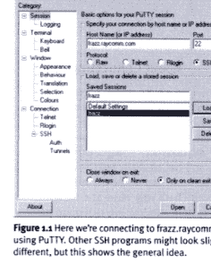

图 1.1 这里我们使用 `PuTTY` 连接到 frazz.raycomm.com。其他 `SSH` 程序可能看起来略有不同，但这展示了大致思路。


图 1.2 要快速入门，填写这些字段，然后点击“`Open`”。


图 1.3 `PuTTY` 显示来自 frazz.raycomm.com 的 `login as:` 提示符。

### 提示

- 如果修改了连接栏设置，可能需要断开与当前会话的连接，然后重新连接，新设置才会生效。有关断开会话的具体信息，请参阅你的文档。

- 正如“首选项”对话框侧边栏中提到的，除了查看缓冲区来查看已使用的命令外，你还可以使用命令来回顾已发出的命令。更多信息，请参阅第 3 章的“查看会话历史”。

## 写下你的具体登录流程的详细信息

在执行登录流程时，花点时间记下一些细节，以备将来参考。

- 你的用户 ID 或登录名（但不要写密码）：

- 用于连接到 Unix 系统的程序名称以及连接过程：

- 你的 Unix 系统名称（例如 frozz.raycomm.com 或 example.com）：

- 你的 Unix 系统的 IP 地址（例如 192.168.11.36 或 10.10.22.2）：

## 登录

连接到 Unix 系统后，下一步是登录，即向 Unix 系统表明你的身份。登录有几个目的，包括让你访问自己的电子邮件、文件和配置。同时，它也能防止你无意中访问他人的文件和设置，并防止你更改系统本身。

### 登录步骤：

1. 首先，准备好你的用户 ID（用户标识）和密码。如果没有，请联系系统管理员。

2. 在登录提示符处输入你的用户 ID，然后按回车。用户 ID 区分大小写，因此务必按照系统管理员指示的方式准确输入。

3. 在密码提示符处输入你的密码，然后按回车。没错，密码也区分大小写。

4. 阅读屏幕上出现的信息和消息。弹出的信息——当日消息——可能只是一句玩笑话，如图 1.4 所示；也可能包含系统策略信息、计划停机警告或有用的提示，如图 1.5 所示；也可能两者兼有；如果系统管理员无话可说，也可能两者都没有。

登录后，你将位于你的主目录中，个人文件和设置都存储在这里。你在 Unix 系统中的“位置”这个概念有点难以把握，我们将在本章中帮助你理解。

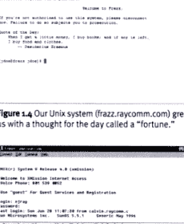

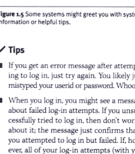

### 提示

- 如果登录后出现错误消息，请重试。你可能只是输错了用户 ID 或密码。哎呀！

- 登录时，你可能会看到一条关于失败登录尝试的消息。如果你曾经尝试登录但未成功，那么不用担心；该消息只是确认你曾尝试登录但失败了。然而，如果你（坐在键盘前）的所有登录尝试都成功了，或者失败登录尝试的次数似乎很多——比如五次或更多——那么你可能还需要向系统管理员提及该消息，系统管理员可以检查安全和登录尝试。这可能是一个警告：有未经授权的人正试图以你的身份登录。

## 使用 `passwd` 更改密码

几乎所有 Unix 系统都要求使用密码，以确保你的文件和数据归你所有，并确保系统本身免受破坏者和黑客的攻击。**代码清单 1.1** 展示了如何更改密码。

在你使用 Unix 的整个过程中，你可能会经常更改密码：

- 你可能希望在首次登录后更改系统管理员提供的密码。你懂的。

- 你可能会定期更改密码。许多 Unix 系统要求你每隔一段时间更改一次密码——甚至常见的是每 30 或 60 天更改一次。

- 如果你认为别人可能知道了你的密码，或者你把密码告诉了任何人（尽管你实在不应该这么做），你可能也会主动更改密码。

### 更改密码的步骤：

1. **`passwd`**

   首先，输入 `passwd`。

2. **`youroldpassword`**

   输入你的旧密码——也就是你当前使用的密码。（当然，输入的是你自己的旧密码，而不是我们在这里使用的示例！）请注意，当你输入密码时，屏幕上不会显示出来，以防有人在你身后偷看，看着你输入并问“你在干嘛？”

```
$ passwd
Changing password for ejr
(Current) Unix password:
New UNIX password:
Retype new UNIX password:
passwd: all authentication tokens updated
  → successfully
$
```

**代码清单 1.1** 使用 `passwd` 命令定期更改密码。

### 3. `yournewpassword`

输入你的新密码。查看“密码须知”侧边栏，了解选择密码的具体要求。

### 4. `yournewpassword`

在这里，你需要再次输入密码以验证。

系统会在更改生效后报告你的密码已成功更改（具体术语取决于系统）。这也在代码清单 1.1 中显示。

### Tips

- 在退出系统之前，通过在提示符下输入 `su - yourid` 来再次核对你的新密码。当然，这里要用你的真实用户名（或登录名）替换 `yourid`。此命令（切换用户）让你无需注销即可再次登录，因此如果你在更改密码时犯了错误，现在会收到登录失败的消息，你可以在真正断开连接之前发现问题。如果遇到问题，请在注销前联系你的系统管理员，以便解决问题。

- 在某些环境中，你将使用 `yppasswd` 而不是 `passwd` 来更改密码，甚至使用网页或其他方式更改密码。遇到疑问时，请遵循系统管理员告诉你的做法。 (“雷氏说要用这个其他命令”很可能会给我们所有人带来麻烦。)

### The Lowdown on Passwords

除了遵循系统管理员强制执行的任何密码指南外，你还应选择一个密码，该密码

- 至少六个字符长

- 你容易记住


- 不是任何语言任何词典中的单词或姓名
- 大写和小写字母、数字和符号的组合
- 与你的用户名不相似
- 与你最近使用过的密码不相同或不相似
- 不是你的电话号码、出生日期、孩子的出生日期、周年纪念日（即使你能记住）、母亲的娘家姓，或任何可能与你相关联的东西

# Listing Directories and Files with ls

你的 Unix 系统由存储各种信息的目录和文件组成，包括设置信息、配置设置、程序和选项，以及其他文件和目录。你可以把你的 Unix 系统想象成一棵树（实际上是树根），子目录从更高级别的目录中延伸出来。如图 1.6 所示，所有这些文件和目录都位于根目录内，根目录包含系统中的所有内容。

使用 `ls` 命令，你可以准确地了解 Unix 系统中的内容，从而了解你可以使用的资源。你可以列出你当前所在的目录或你指定的目录中的文件和目录。

## To list the files and directories of the directory you're in:

- `ls`

在 shell 提示符下，输入 `ls` 以列出当前目录中的文件和目录，在本例中是我们的主目录（代码清单 1.2）。

Figure 1.6 All files and directories are nested within the root directory, which serves to contain everything in the system.

```
[jdoe@frazZ jdoe]$ ls
limerick mail/ Project/ public_html/
* testfile testlink@ tmp/
[jdoe@frazZ jdoe]$
```

Code Listing 1.2 Use `ls` by itself to list the files and directories of the directory you're in.

## To list the files and directories of a specified directory:

- `ls /bin`

在这里，你输入 `ls` 命令加上目录名。如代码清单 1.3 所示，此命令列出 `/bin` 目录中的文件和目录，在其中你会找到系统命令和程序。

### Tips

- 你可以随时在任何地方通过输入 `ls /` 来列出根目录中的文件和目录。
- 想不起来那个讨厌的文件名？只需使用 `ls` 来帮助你回忆。或者，参考第 2 章中的 Finding Forgotten Files with `find`，它也可以帮助你记住文件名。
- 还有许多其他 `ls` 选项可用于控制你看到的文件信息的数量以及它们在屏幕上出现的格式。有关详细信息，请参阅第 2 章的 Listing Files and Directories with `ls` (More Goodies) 部分。

```
[jdoe@frazZ jdoe]$ ls /bin
arch*    domainname@  ipcalc*    open*    tar*
awk@     echo*        ipv6c     eys*     red@     unlink*
chmod*   fbresolution* login*    rm*      usleep*
chown*   fgrep@       ls*       rmdir*   vi@
consolechars* find*   lsb_release* rpm*     vim@
cp*      gawk*        mail*     rvi@     vim@
cpio*    gawk-3.1.6@  mkdir*    rview@
date*    gtar@        more*     sleep*   zcat*
dd*      gunzip*      mount*    sort*    zsh*
df*      gzip*        mv*       stat* 
dmesg*   hostname*    netstat*  stty*
dnsdomainname@ id@      nice*     su*
doexec*  gawk*        nisdomainname@ sync*
[jdoe@frazZ jdoe]$
```

Code Listing 1.3 Use `ls` with the name of a directory to list the contents of that directory (`/bin`, in this case).

```
[jdoe@frazzi jdoe]$ cd /
[jdoe@frazzi /]$ cd
[jdoe@frazzi jdoe]$ cd ~/home/jdoe/Project/
[jdoe@frazzi Project]$ cd /etc
[jdoe@frazzi etc]$ cd /home/jdoe/
[jdoe@frazzi jdoe]$ cd /home/jdoe/mail/
[jdoe@frazzi mail]$ cd ..
[jdoe@frazzi jdoe]$
```

代码清单 1.4 使用 `cd`，你可以更改目录并在系统中移动。注意本代码清单中的提示显示了当前目录的名称，这非常方便。

# 使用 cd 更改目录

要探索 Unix 及其功能，你需要在目录之间移动。你使用 `cd` 命令来实现这一点，它会将你从当前所在的目录带到你指定的目录。代码清单 1.4 说明了如何使用 `cd` 更改目录。

## 更改目录的方法：

- 1. `cd Projects`

  要移动到特定目录，输入 `cd` 加上目录名称。在此示例中，我们在目录树中向下移动到名为 `Projects` 的子目录。 （请参阅“向上和向下移动”侧边栏，了解 Unix 术语中“向上”和“向下”的含义。）

- 2. `cd ..`

  输入 `cd ..` 可向上移动一级目录树。

- 3. `cd /etc`

  这里，`/etc` 告诉系统查找位于系统根目录的 `etc` 目录。

### 向上和向下移动

在本书中，我们将讨论在 Unix 文件系统中“向上”和“向下”移动。向上移动意味着进入包含当前目录的目录——也就是说，更接近根目录。向下移动意味着进入由当前目录包含的子目录——也就是说，远离根目录。

### ✓ 提示

- 如果你不记得要更改到的目录名称，可以使用 `ls` 列出当前目录中的目录和文件，然后按上述方式使用 `cd`。 有关更多信息，请参阅上一节 *使用 ls 列出目录和文件*。
- 你可以从 Unix 系统中的任何位置返回到主目录，只需输入 `cd` 而不指定目录即可。
- 你通常可以使用波浪号 (`~`) 作为主目录的便捷快捷方式。 例如，如果你想更改到主目录中 `Projects` 目录下的 `Urgent` 目录，你可以使用类似 `cd /home/users/y/yourid/Projects/Urgent` 的命令，或者直接使用快捷方式 `cd ~/Projects/Urgent`。
- 请记住，你的主目录与系统根目录不同。 你可以把你的主目录想象成“我可以称之为自己的 Unix 系统的很小一部分”。 使用 Unix 系统的每个人都有自己的小个人区域。
- 当前目录始终用 `.` 表示，而下一个更高一级的目录（包含当前目录的目录）用 `..` 表示。 这就是为什么你使用 `cd ..` 来向上移动一个目录。 在第 10 章中，你将看到使用 `.` 指定运行脚本或程序时的当前目录的具体用法。
- 请访问第 2 章，了解有关目录和文件的更多信息。

```
[jdoe@frazzi jdoe]$ pwd
/home/jdoe
[jdoe@frazzi jdoe]$ ls ; pwd
codelisting1.2  codelisting1.4  mail/
public_html/  testlink#
codelisting1.3  limerick  Project/  testfile
tmp/
/home/jdoe
[jdoe@frazzi jdoe]$ cd
[jdoe@frazzi jdoe]$ cd /
[jdoe@frazzi /]$ pwd
/
[jdoe@frazzi /]$
```

代码清单 1.5 `pwd` 显示当前目录的名称，如果你一直在探索系统，这特别方便。 通过组合命令，你可以同时请求目录的名称和内容。

# 使用 pwd 找到自己的位置

当你开始使用 Unix 并在目录和文件中移动时，你可能会有点迷路——也就是说，忘记你所在的目录或子目录。 你可以使用 `pwd` 命令来提醒你所在的位置，如代码清单 1.5 所示。

你可以只请求目录名称，也可以更灵活地请求目录的名称及其内容，这要归功于 `ls`。

## 查找当前目录名称的方法：

- `pwd`

此命令显示你当前所在的目录的路径和名称。 路径列出了当前目录“上方”的每个目录，让你全面了解你相对于系统根目录的位置。

## 查找当前目录名称及其内容的方法：

- `ls ; pwd`


通过组合 `ls` 和 `pwd` 命令，你可以请求目录的名称和内容，如代码清单 1.5 所示。

### 提示

- 登录后立即输入 `pwd`。你会看到你的主目录在整个系统中的位置（即你主目录的完整路径名）。
- 在某些 Unix 系统上，你不需要使用 `pwd` 来查找自己的位置。有些系统默认在 shell 提示符中显示当前目录——例如 `/home/ejr>`。如果你想添加或删除此功能，或者想了解有关 shell 和自定义 shell 的更多信息，请参阅第 8 章，配置你的 Unix 环境。

## 管道输入与输出

一般来说，你可以将每个 Unix 命令（如 `ls`、`cd` 等）视为 Unix 执行的独立程序。例如，如果你在提示符下输入 `cat /etc/motd`，Unix 将显示 `/etc` 目录中 `motd` 文件的内容。每个程序都需要输入（在此例中，程序 `cat` 将 `/etc/motd` 的内容作为输入）并产生输出（即显示的结果）。

通常，你会希望按顺序运行程序。例如，你可以告诉 Unix 读取你的简历，然后对其进行拼写检查。这样，你就将两个命令连接在一起，并让它们按顺序运行。这种将一个程序的输出连接到另一个程序的输入的过程称为管道。根据你的需求，你可以将任意数量的命令通过管道连接在一起——每个命令的输出作为下一个命令的输入。

如图 1.7 所示，你可以使用管道符号（即 `|` 字符）将命令连接起来。在下面的示例中，我们将 `ls` 命令（用于列出目录内容）的输出通过管道传递给 `more` 命令（用于一次一屏地阅读结果）。有关 `more` 的详细信息，请参阅本章后面的“使用 more 查看文件内容”。

### 使用管道连接命令：

- `ls | more`

这里，你只需在两个命令之间加上一个管道符号。这段代码会生成当前目录中的文件列表，然后将结果通过管道传递给 `more`，`more` 再一次一屏地列出结果（参见图 1.7）。

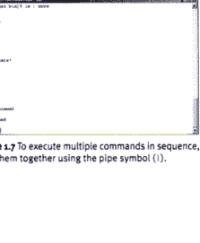

### 提示

- 如果你想连接两个以上的命令，也是可以的。只需按照你希望执行的顺序，不断添加命令（每个命令之间用管道符号分隔）即可。
- 请记住，每个命令的输出都会通过管道传递给下一个命令。因此，一个管道命令，如 `ls | spell | sort`，可以列出目录中的文件，然后对列表进行拼写检查，再将拼写错误的单词排序并显示在屏幕上。系统字典中能找到的文件名不会显示出来。
- 请参阅第 15 章了解有关运行拼写检查器的更多信息，参阅第 6 章了解有关排序的更多信息。

## 重定向输出

假设你已经编写好简历并对其进行了拼写检查。正如你在上一节中学到的，你在屏幕上看到的结果将是最后一个命令的输出——在本例中，是一份拼写错误的单词列表。很多时候，你会希望将最终输出重定向到其他位置，例如文件或打印机（如果你的环境支持打印机），而不是在屏幕上查看。你可以使用重定向来实现这一点，它会将最终输出发送到屏幕以外的其他地方。

如代码清单 1.6 所示，你通常会重定向输出结果到文件。请注意大于号（`>`），它表示程序的输出将被重定向到你在此符号后指定的位置（或文件名）。

在下面的示例中，我们将展示如何将输出重定向到一个新文件，以及如何将输出重定向并追加到现有文件。

```
[jdoe@frazz jdoe]$ ls /usr/local/bin > local.programs.txt
[jdoe@frazz jdoe]$ ls local*
localize localono local.programs.txt localyokel
[jdoe@frazz jdoe]$ ls /usr/bin >> other.programs.txt
[jdoe@frazz jdoe]$
```

代码清单 1.6：在此例中，`ls` 的输出被重定向到 `local.programs.txt`，如大于号（`>`）所示。星号通配符（`*`）充当字母或数字的占位符。最后，`/usr/bin` 的列表被追加到 `other.programs.txt` 文件中。

### 将输出重定向到新文件：

1. `ls /usr/local/bin > local.programs.txt`

在此例中，我们从 `ls` 命令和一个特定目录开始，加上一个大于号（`>`），然后指定一个文件名。这将把 `ls` 的输出重定向到一个名为 `local.programs.txt` 的文件。请小心操作！如果该文件已存在，它可能会被此处 `ls` 程序的输出所替换。

2. `ls local*`

这里，我们只是检查新的 `local.programs.txt` 文件是否已成功创建。星号通配符（`*`）指定我们希望列出所有以 `local` 开头的文件，例如 `localize`、`localono` 或 `localyokel`（参见代码清单 1.6）。有关通配符的实用信息，请参阅下一节“使用通配符”。

### 将输出追加到现有文件：

- `ls /usr/bin >> all.programs.txt`

将输出追加到现有文件与将其重定向到新文件类似；不过，不是创建新文件来保存输出（或替换现有文件的内容），而是将内容添加到现有文件的末尾。请注意，这里使用的是两个大于号，而不是一个。

### 提示

你可以同时使用管道和重定向。例如，你可以列出一个目录，通过管道将其传递给 `wc` 来统计条目数，然后将结果追加到 `directoryinfo` 文件中，如下所示：`ls | wc -l >> directoryinfo`。你可以在第 6 章中了解更多关于使用 `wc` 统计文件及其内容的信息。

## 使用通配符

```
[jdoe@frazZ Project]$ ls
keep keeper.jpg kept kidder.txt
→ kiddo kidnews kidneypie
→ kids kidupdate
[jdoe@frazZ Project]$ ls ki
kidder.txt kiddo kidnews kidneypie
→ kids kidupdate
[jdoe@frazZ Project]$ ls kid*
kidder.txt kiddo kidnews kidneypie
→ kids kidupdate
[jdoe@frazZ Project]$ ls k???
keep kept kids
[jdoe@frazZ Project]$ ls *dote
kidupdate
[jdoe@frazZ Project]$ ls ?up*
kidupdate
[jdoe@frazZ Project]$ ls k?d*
kidder.txt kiddo kidnews kidneypie
→ kids kidupdate
[jdoe@frazZ Project]$
```

代码清单 1.7 你使用通配符（`?` 或 `*`）作为缺失字符的占位符。

你可以把通配符看作是省略字母或数字的占位符。例如，如果你在找一个文件，但不确定你将其命名为 `kidnews` 还是 `kidupdate`，你可以包含一个通配符来代表不确定的部分。也就是说，你可以用 `ls kid*` 列出目录中的文件（代码清单 1.7），这将列出所有以字符 “kid” 开头的文件。在 resulting 列表中，你会找到一个名为 `kid` 的文件（如果存在的话），以及以 `kid` 开头但结尾各不相同的文件，例如 `kidnews`（啊，丢失的文件！），`kiddo`，或 `kidneypie`。

你可以在 Unix 中的几乎任何用途中使用通配符，尽管列出文件和目录很可能是最常见的用法。只需遵循以下准则：

- 你使用 `?` 作为一个字符或数字的占位符。
- 你使用 `*` 作为零个或多个字符或数字的占位符。零个字符，如果你好奇的话，指定搜索结果包含 `kid` 的所有变体，包括本身没有后缀的单词。
- 你可以在名称的任何位置包含通配符：在开头（`*kid`），中间某个位置（`k*d`），结尾（`ki*`），甚至在多个位置（`*kid*`）。

## 使用 more 查看文件内容

随着你对 Unix 越来越熟悉，你会想要开始探索文件的内容，包括一些程序文件和脚本，以及你（最终）创建的文件。查看文件内容最简单的方法之一是使用 `more` 命令，它告诉 Unix 将文件逐页显示在屏幕上。如图 1.8 所示，长文件会在每屏底部显示 “More”，这样你就可以使用空格键一次一屏地浏览文件。

### 使用 more 查看文件：

- 1. `more fortunes`
- 在提示符下，输入 `more` 加上你想要查看的文件名。你将看到所请求文件的 contents，从顶部开始（图 1.8）。
- 2. `Spacebar`
- 按空格键查看下一屏信息。在浏览文件时，你可以按 `B` 返回之前的屏幕。
- 3. `Q`
- 完成后，按 `Q` 返回 shell 提示符。

### 提示

- 如果你在使用 `more` 时只想查看额外的一行（而不是整屏），请按 `Enter` 而不是空格键。
- 你也可以使用 `less` 来查看文件。`less` 与 `more` 非常相似，但更强大、更灵活。
- 你也可以使用 `cat` 命令查看文件。有关完整信息，请参阅下一节。


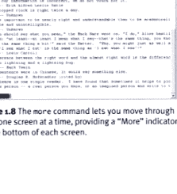

图 1.8 `more` 命令让你一次一屏地浏览文件，并在每屏底部提供 “More” 指示。

或

```
cat newer.programs newest.programs >
- all.programs
```

在这个示例中，我们添加了一个重定向符号（`>`）加上一个新文件名。这告诉 Unix 打印出这两个文件；然而，与其在屏幕上显示文件，它会将它们重定向到名为 `all.programs` 的文件。啊！这里 `cat` 做得比 `more` 更好。请参阅前文的 Redirecting Output，了解有关重定向命令的更多信息。

### 提示

- 如果你不小心对二进制文件使用了 `cat`，你可能会得到一整屏的垃圾。在某些系统上，你可以尝试 `stty sane` 来修复它——有关更多信息，请参阅第 3 章中的 Fixing Terminal Settings with `stty`。你也可以直接关闭终端窗口并重新登录来修复它。
- `tac` 命令就像 `cat` 一样，只是反向的。试试看！奇怪地好用，对吧？
- 你也可以使用 `more` 命令查看文件内容。有关详细信息，请参阅上一节。

## 探索系统

掌握了这些关键技能后，你就可以开始探索你的 Unix 系统了。在此过程中，你可以快速了解有哪些可用资源，并积累一些输入命令的实用经验。

把你的 Unix 系统想象成一个彻底防儿童误操作的房子：你可以到处看看、摸摸东西，但不会对自己或系统造成伤害。所以，不用担心！随便看看不会弄坏任何东西，即使你想破坏点什么，大多数 Unix 系统配置得足够完善，你也做不到。

表 1.1 显示了你可能会觉得最有趣或最有用的一些目录（本书附录 B 提供了更全面的目录列表）。你可以使用以下步骤开始探索。

### 探索本地安装的程序：

1. `cd /usr/bin`

   切换到 `/usr/bin`，这里存放着大多数已安装的程序。

2. `ls | more`

   列出文件（在此示例中为程序），并将输出通过管道传递给 `more`，以便一次一屏地阅读名称。

3. `ssh`

   输入你想运行的任何程序的名称；在此例中 `ssh` 允许你连接到另一台系统并像现在使用 Unix 系统一样使用它。

### 提示

- 你可以输入 `man` 后跟命令名称来了解更多关于 Unix 程序的信息。有关 Unix 帮助的信息请参见下一节。

## 常见的 Unix 目录及其内容

| 目录 | 内容 |
| --- | --- |
| `/bin` | 所有用户使用的基本程序和命令 |
| `/etc` | 系统配置文件和全局设置 |
| `/home` | 用户的主目录 |
| `/sbin` | 系统启动所需的程序和命令 |
| `/tmp` | 临时文件 |
| `/usr/bin` | 与 `/bin` 中的相比，对基本 Unix 系统功能不太核心但随系统安装的命令和程序 |
| `/usr/local` | 在系统上开发或定制的绝大多数文件和数据 |
| `/usr/local/bin` | 本地开发或安装的程序 |
| `/usr/local/man` | 本地程序的手册（帮助）页 |
| `/usr/share/man` | 手册（帮助）页 |
| `/var` | 可变数据，包括系统日志、程序的临时数据以及用户邮件存储 |

## 使用 `man` 获取帮助

偶尔，你可能需要一点帮助来回忆某个特定命令的作用。使用 `man`（是 “manual” 的缩写），你可以查找有关命令的信息并获得高效使用它们的提示。

图 1.9 显示了 Unix 帮助页（也称为 `man` 页，原因显而易见）中关于密码的示例。在以下步骤中，我们将向你展示如何查找特定的 Unix 命令并找到相关主题。

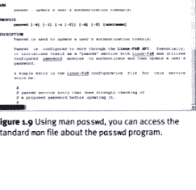

### 访问 `man` 页：

- `man passwd`

  在提示符下，输入 `man` 加上你需要帮助的命令名称（本例中为 `passwd`）。你将获得该命令的 `man` 页。使用空格键和 B 在文件中导航，就像使用 `more` 时一样。

### 查找特定的 `man` 页：

1. `man -k passwd`

   输入 `man -k` 加上你需要帮助的命令名称或主题（本例中为 `passwd`）。正如代码清单 1.9 所示，你会看到可能的 `man` 页、命令名称、`man` 页名称以及描述的列表。记下 `man` 页名称（如果存在多个同名页，则记下其编号），以便在下一步中引用。

   ```
   $ man -k passwd
   chpasswd (8)  - update password file in batch
   gpasswd (1)  - administer the /etc/group file
   mkpasswd (1)  - generate new password, optionally apply it to a user
   mkpasswd (8)  - Update passwd and group database files
   passwd (1)  - update a user's authentication tokens(s)
   passwd (5)  - password file
   userpasswd (1) - A graphical tool to allow users to change their passwords
   $
   ```

   代码清单 1.9 `man -k passwd` 给出了这些结果，显示了特定的与密码相关的 `man` 页。

2. `man 5 passwd`

   这里，你输入 `man`、你想查看的 `man` 页（本例中用 5 表示第 5 节——这是必要的，因为上一步列出了多个名为 `passwd` 的 `man` 页），以及命令名称（`passwd`）。图 1.9 显示了由此产生的 `man` 页。

### ✓ 提示

- 你可以复制一份 `man` 页，以便编辑或对其进行注释，为自己添加额外说明或删除与你无关的内容。只需输入 `man - command name | col -b -x > somefilename`。例如，使用 `man passwd | col -b -x > ~/my.password.command.notes` 在你的主目录下以 `my.password.command.notes` 的名称制作一份不带格式的 `passwd` `man` 页副本。然后你将使用编辑器（见第 4 章）来编辑、添加和调整重要要点。（`col -b -x` 命令修复了一些格式上的怪癖；没有它，所有带下划线的单词都会显示为 `_u_n_d_e_r_l_i_n_e_`。）
- 你可以使用 `apropos` 代替 `man -k` 标志。例如，你可能会这样使用：`apropos passwd`。
- 某些 Unix 系统可能需要在节号前加上 `-s`，如 `man -s 5 passwd`。

## 注销

当你结束会话时，你需要注销系统，以确保没有人冒充你访问你的文件。

### 注销方法：

- `logout`

  就是这样！只需输入 `logout`，系统就会清理一切并断开连接，`SSH` 程序很可能会完全消失。

### 提示

- 在某些 Unix 系统上，你可以输入 `exit` 或 `quit` 代替 `logout`，或按键盘上的 Ctrl D。

## 2 使用目录和文件

正如你在第 1 章学到的，目录和文件是 Unix 的核心；它们包含诸如设置信息、配置设置、程序和选项，以及你创建的任何内容。你每次输入 Unix 命令时都会访问目录和文件，因此你需要熟悉可以对它们执行的不同操作。

同样在本章中，我们将介绍的技能和命令适用于任何 Unix 版本。你在屏幕上看到的内容（特别是系统提示和响应）可能与本书中的示例略有不同。然而，一般思想和具体命令在所有 Unix 系统上都相同。

### 章节内容

- 创建目录
- 创建文件
- 复制目录和文件
- 列出目录和文件
- 移动目录和文件
- 删除文件
- 删除目录
- 查找文件
- 定位程序文件
- 使用硬链接进行链接
- 使用软链接进行链接

### 使用 `mkdir` 创建目录

你可以把目录想象成文件柜中的抽屉；每个抽屉包含一组相关联的文件。例如，你可能有几个用于未读杂志的文件抽屉，一个用于待办清单，另一个用于工作项目。

同样，你 Unix 系统中的目录充当其他目录和文件的容器；每个子目录包含更多相关的目录或文件，依此类推。你每次开始一个项目或有相关文件想要存储在同一位置时，很可能会创建一个新目录。你使用 `mkdir` 命令创建新目录，如代码清单 2.1 所示。


```
$ ls
Projects      all_programs.txt  local_programs.txt  schedule
Xrootenv.0    files             newer_programs      short.fortunes
all.programs  fortunes          newest.programs     temp
$ mkdir Newdirectory
$ ls -l
total 159
drwxrwxr-x  2 ejr  users  1024 Jun 29 11:40 Newdirectory
drwxrwxr-x  2 ejr  users  1024 Jun 28 12:48 Projects
-rw-rw-r--  1 ejr  users   7976 Jun 28 14:15 all.programs
-rw-rw-r--  1 ejr  users   7479 Jun 28 14:05 all.programs.txt
-rw-rw-r--  1 ejr  users    858 Jun 28 12:45 files
-rw-rw-r--  1 ejr  ejr  128886 Jun 27 09:05 fortunes
-rw-rw-r--  1 ejr  users      0 Jun 28 14:05 local.programs.txt
-rw-rw-r--  1 ejr  users    497 Jun 28 14:13 newer.programs
-rw-rw-r--  1 ejr  users   7479 Jun 28 14:13 newest.programs
lrwxrwxrwx  1 ejr  users     27 Jun 26 11:03 schedule -> /home/deb/Pre
-rw-rw-r--  1 ejr  ejr   1475 Jun 27 09:31 short.fortunes
drwxrwxr-x  2 ejr  users  1024 Jun 26 06:39 temp
$
```

代码清单 2.1 输入 `mkdir` 加上目录名即可创建新目录。按长格式列出文件会显示新目录。行首的 `d` 表示它是一个目录。

### 为目录（和文件）命名

当你开始创建目录（和文件）时，请记住以下准则：

- 目录和文件必须具有唯一名称。例如，你不能将一个目录命名为 `Golf` 同时将一个文件命名为 `Golf`。你可以有一个名为 `Golf` 的目录和一个名为 `golf` 的文件。大写字母的差异使每个名称唯一。顺便说一下，目录通常以首字母大写命名，而文件名通常全为小写。

- 目录和文件名不应包含以下字符：角括号（`< >`）、大括号（`{ }`）、方括号（`[ ]`）、括号（` `）、双引号（`"`）、单引号（`'`）、星号（`*`）、问号（`?`）、管道符号（`|`）、斜杠（`/ \`）、插入符号（`^`）、感叹号（`!`）、井号（`#`）、美元符号（`$`）、和号（`&`）以及波浪号（`~`）。

- 不同 `shell` 对特殊字符的处理方式不同，有些完全没有问题。一般来说，它们带来的麻烦大于价值。

- 通常，避免使用包含空格和连字符（`-`）的名称。你可以使用这些，但它们通常麻烦大于价值——也就是说，有些程序无法正确处理它们，因此你必须使用奇怪的变通方法。相反，使用句点（`.`）和下划线（`_`）来分隔单词、字符或数字。

- 使用描述目录或文件内容的名称，以便你能轻松记住它们。

### 创建目录：

1. `ls`

   首先列出现有目录，以确保计划的名称不会与现有目录或文件名冲突。

2. `mkdir Newdirectory`

   输入 `mkdir` 命令来创建新目录；在本例中，它名为 `Newdirectory`。参考侧边栏“为目录（和文件）命名”以获取准则。

3. `ls -l`

   现在你可以使用 `ls -l`（`-l` 标志指定长格式）来查看新目录的列表（代码清单 2.1）。`Newdirectory` 列表最左侧的 `d` 表示它是一个目录而不是文件。当然，在你信任 Unix 按你所说执行后，你可以跳过此验证步骤。

### 提示

- 如果你尝试使用已存在的文件或目录名创建目录，Unix 不会覆盖现有目录。相反，你会被告知已存在该名称的文件。尝试使用不同的名称。

- 使用 `-p` 标志一次创建多个目录和子目录。例如，如果你想创建一个名为 `Projects` 的新子目录，在其中创建一个名为 `Cooking` 的子目录，并在其中创建一个名为 `Desserts` 的子目录，你可以使用 `mkdir -p Projects/Cooking/Desserts` 一次完成所有操作。没有 `-p` 标志，你必须按顺序创建 `Projects`、`Cooking`，然后是 `Desserts`，这是一个更长的配方来创建相同的树结构。

## 使用 touch 创建文件

你将经常使用的一项技能是创建文件。你可以把创建文件想象成获得一个空桶，你以后可以用它装水……或沙子……或石头……或任何东西。当你创建一个文件时，你指定了一个空的空间，你可以用它来填充程序、活动日志、你的简历或配置——几乎任何你想要的东西，或者什么都没有。

当然，你总是可以通过在编辑器中写入内容并保存来创建文件，如第 4 章所述，但你有时会遇到只需要一个空文件作为以后使用的占位符的情况。你使用 `touch` 命令创建空文件，如代码清单 2.2 所示。

### 创建文件：

- 1. `touch file.to.create`

- 要创建文件，输入 `touch` 后跟文件名。这会创建一个空文件。

```
$ ls
$ touch file.to.create
$ ls -l file*
-rw-rw-r- 1 ejr users 0 Jun 29 11:53 file.to.create
$ touch -t 12312359 oldfile
$ ls -l
total 0
-rw-rw-r- 1 ejr users 0 Jun 29 11:53 file.to.create
-rw-rw-r- 1 ejr users 0 Dec 31 1998 oldfile
$ touch -t 200312312359 new.years.eve
$ ls -l
total 0
-rw-rw-r- 1 ejr users 0 Jun 29 11:53 file.to.create
-rw-rw-r- 1 ejr users 0 Dec 31 2003 new.years.eve
-rw-rw-r- 1 ejr users 0 Dec 31 1998 oldfile
$
```

代码清单 2.2 使用 `touch` 命令创建文件、更新其修改时间，或两者兼而有之。

### 2. `ls -l file*`

可选地，通过输入 `ls -l file*` 验证文件是否已创建。如代码清单 2.2 所示，你将看到新文件的名称及其长度（0）以及创建的日期和时间（如果正在跟随操作，很可能是在当前时间之前的几秒钟）。

### ✓ 提示

- 你也可以使用 `touch` 来更新文件的日期和时间。例如，在提示符下输入 `touch -t 12312359 oldfile` 将把 `oldfile` 的日期更新为当年 12 月 31 日 23 小时 59 分钟。或者，输入 `touch -t 200312312359 new_years.eve` 将把名为 `new_years.eve` 的文件更新为 2003 年的同一时间。

- 每次保存文件的更改时，系统都会自动更新日期和时间。有关编辑和保存文件的详细信息，请参阅第 4 章。

- 请参阅本章中的侧边栏“命名目录（和文件）”以获取文件命名指南。

## 使用 cp 复制目录和文件

```
$ cp -r /home/ejr/Projects
→ /home/shared/deb/Projects
$ ls /home/shared/deb/Projects
current  new.ideos  schedule
$
```

代码清单 2.3 使用 `cp -r` 复制目录。

在 Unix 中工作时，你经常想要复制目录和文件。例如，你可能想要复制正在处理的文件以保留一个原始的、未受损的版本。或者，你可能想要在重要目录和文件中保留重复的副本，以防你不小心删除它们或覆盖它们。事故确实会发生，根据墨菲定律。

无论你的原因是什么，你都使用 `cp` 命令复制目录和文件，如代码清单 2.3 所示。当你复制目录和文件时，你所做的只是将一个副本放在另一个位置；你保持原样不变。

### 复制目录：

- 1. `cp -r /home/ejr/Projects` → `/home/shared/deb/Projects`

  在 `shell` 提示符下，输入 `cp -r`，后跟旧目录名和新（待创建）目录名，以复制完整的目录。`r` 代表“递归”，如果这能帮助你记住它。

- 2. `ls /home/shared/deb/Projects`

  你可以使用 `ls` 加上新目录名来验证重复目录及其内容是否在预期位置（代码清单 2.3）。

### 复制文件：

```
$text

$ cp existingfile newfile

$ ls -l

total 7

-rw-rw-r-- 1 ejr users 1475 Jun 29 12:18


`existingfile`

`-rw-rw-r-- 1 ejr users 1475 Jun 29 12:37`

`newfile`

`-rw-rw-r-- 1 ejr users 2876 Jun 29 12:17`

`oldfile`

```
$ cp -i existingfile oldfile

cp: overwrite 'oldfile'? n

$
```

**代码清单 2.4** 只需使用 `cp` 复制文件并添加 `-i` 以要求系统在覆盖现有文件前提示你。

- 而不是移动目录和文件（使用 `mv`），考虑复制目录和文件（使用 `cp`），然后删除原始文件（使用 `rm`）。这样你就可以确保在重新组织目录和文件时拥有副本。前往本章中名为 *使用 mv 移动文件* 和 *使用 rm 删除文件* 的部分，了解这些主题的详细信息。

- 使用 `cp` 配合 `-i` 标志以强制系统在覆盖文件前询问你。然后，如果你喜欢这样，请访问第 8 章以了解如何使用别名与 `cp`，以便系统在覆盖文件前始终提示你。

- 1. **`cp existingfile newfile`**

  在提示符下，输入 `cp`，后跟旧文件名和新（待创建）文件名。

- 2. **`ls -l`**

  可选地，使用 `ls -l` 检查结果。`-l`（长格式）标志显示文件大小和日期，以便你可以看到复制的文件与新文件完全相同（**代码清单 2.4**）。

- 3. **`cp -i existingfile oldfile`**

  如果你使用 `-i` 标志使用 `cp`，它会在覆盖现有文件前提示你，也显示在代码清单 2.4 中。

### ✔ 提示

- 复制目录和文件时，你可以使用 **绝对（完整）** 名称，即从根目录开始计算（`/home/ejr/Projects`），或 **相对**（部分）名称，即指定相对于当前目录的文件或目录（`ejr/Projects`），并且在 Unix 文件系统的其他位置没有意义。使用绝对名称，你可以操作 Unix 系统中任何位置的目录和文件。使用相对名称，你只能参照当前位置操作文件。

- 你可以使用 `cmp` 和 `diff` 分别比较两个文件或两个目录的内容。例如，输入 `cmp filename1 filename2` 将比较指定文件的内容。使用 `diff` 或 `sdiff` 查看文件之间的差异。快速浏览第 6 章以获取更多信息。

- 你可以将目录和文件复制到或从他人的目录中。跳到第 5 章以了解如何获取访问权限，然后使用此处描述的复制过程。


## 使用 ls 列出目录和文件（更多功能）

如果你一直跟着学习，你可能已经是使用 `ls` 列出目录内容并验证文件和目录是否按预期复制的专家了。`ls` 还有几个方便的用途。特别是，你也可以用它来

- 列出文件名和信息，这对于区分相似的文件很有帮助（图 2.1）。

- 列出目录中的所有文件，包括隐藏文件，例如 `.profile` 和 `.login` 配置文件（代码清单 2.5）。有关配置文件的更多信息，请参阅第 8 章。

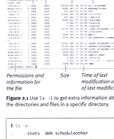

## 列出文件名和信息：

- `ls -l`

在 shell 提示符下，输入 `ls -l`（是小写的“L”，不是数字1）。你会看到目录中的文件列表随之出现，每个文件都有以下信息（代码清单 2.6）：

- 文件名

- 文件大小

- 最后修改日期

- 权限信息（有关权限的更多信息，请参阅第 5 章）

- 所有权和组 membership（也在第 5 章中介绍）

```
$ ls -a
. .stats deb.schedule other
.. current new.ideas schedule
Code Listing 2.5 If you want to see hidden files, use ls -a.
```

```
$ ls -l
total 13
-rw-rw-r-- 1 ejr users 2151 Jun 29 12:26 current
-rw-rw-r-- 2 ejr users 1475 Jun 29 12:35 deb.schedule
-rw-rw-r-- 1 ejr users 4567 Jun 29 12:26 new.ideas
drwxrwxr-x 2 ejr users 1024 Jun 29 13:06 other
-rw-rw-r-- 1 ejr users 1475 Jun 29 12:22 schedule
Code Listing 2.6 Use ls -l to see a listing of the contents of a directory in long format.
```

▲ 最后修改时间（如果文件最近被修改过）或最后修改年份（如果文件上次修改是在六个月前）。查看本章早些时候的 `touch`，了解文件修改日期可能在未来的情况。

## 列出目录中的所有文件：

- `ls -la`

在 shell 提示符下输入 `ls -a`，以列出目录中的所有文件，包括隐藏文件，并显示完整信息，如代码清单 2.7 所示。

### 提示

- 你可以通过给文件名以点（`.`）开头来隐藏文件。也就是说，`profile` 不会被隐藏，但 `.profile` 会被隐藏。

- 记住，你可以组合任何标志来指定多个选项。例如，如果你想以长格式（`-l`）列出所有文件（`-a`），你将使用 `ls -la`。

- 尝试 `ls -lR` 以获取当前目录、其包含的目录等的完整列表，直到没有子目录可供深入为止。

```
$ ls -la
total 22
drwxrwxr-x  3 ejr  users  1024 Jun 29 13:07 .
drwxrwxr-x  7 ejr  users  1024 Jun 29 12:16 ..
-rw-r--r--  1 ejr  users  6718 Jun 29 13:00 .stats
-rw-r--r--  1 ejr  users  2151 Jun 29 12:26 current
-rw-r--r--  2 ejr  users  1475 Jun 29 12:35 deb.schedule
-rw-r--r--  1 ejr  users  4567 Jun 29 12:26 new.ideas
drwxrwxr-x  2 ejr  users  1024 Jun 29 13:06 other
-rw-r--r--  1 ejr  users  1475 Jun 29 12:22 schedule
$
```

Code Listing 2.7 If you want to see everything, use ls -la.

## 使用 mv 移动文件

移动目录和文件意味着将它们从系统中的一个位置（将位置视为绝对文件路径，如 `/home/ejr/aFile`）移动到另一个位置（例如，`/temp/File` 或 `/home/ejr/AnotherFile`）。本质上，你只有一个文件版本，并且更改该版本的位置。例如，当你重新组织目录和文件时，你可能会移动一个目录。或者，你可能会移动一个文件以重命名它——也就是说，将文件从一个名称移动到另一个名称。

你使用 `mv` 来移动目录和文件，如代码清单 2.8 所示。

## 移动文件或目录：

1. `ls`

首先，使用 `ls` 验证要移动的文件名。如果你在更改文件名，你需要确保新文件名尚未被使用。如果你将文件移动到已存在的名称，旧文件的内容将被新文件的内容替换。

2. `mv existingfile newfile`

输入 `mv` 加上现有文件名和新文件名。对旧文件说再见，迎接新文件（代码清单 2.8）。

你使用完全相同的方法来移动目录；只需指定目录名称，如 `mv ExistingDirectory NewDirectory`。

3. `ls`

验证文件是否已位于你预期的位置。

```
$ ls
Complete existingfile oldfile
$ mv existingfile newfile
$ ls
Completed newfile oldfile
$
```

Code Listing 2.8 List files to see the current files, then use mv to rename one of the files.

### 提示

- 你也可以使用 `mv` 将文件移入或移出目录。例如，`mv Projects/temp/testfile /home/deb /testfile` 将 `testfile` 从当前目录的 `Projects` 和 `temp` 子目录移动到 Debs 主目录，并使用名称 `testfile`。

- 使用 `mv -i oldfilename newfilename` 以要求系统在覆盖（销毁）现有文件之前提示你。`-i` 代表“交互式”，它也适用于 `cp` 命令。

- 访问第 8 章，了解如何使用别名与 `mv`，以便系统在覆盖文件之前始终提示你，而你不必记住 `-i` 标志。


- 如果你使用 `mv` 并指定现有目录作为目标（如 `mv something ExistingDirectory`），那么在这种情况下，`something` 将被放置到 `ExistingDirectory` 中。`Something` 可以是文件或目录。

## 使用 rm 删除文件

```
$ ls
Completed          oldfile
Newfile            soon.to.be.gone.file
$ rm -i soon.to.be.gone.file
rm: remove 'soon.to.be.gone.file'? y
$ ls
Completed  newfile  oldfile
$
```

代码清单 2.9 使用 `rm -i` 安全、谨慎地删除目录和文件。

你可以轻易地——也许太轻易地——从你的 Unix 系统中删除（删除）文件。正如墨菲定律会告诉你的那样，在这样做之前三思而后行是个好主意：一旦你删除了一个文件，它就消失了（除非，当然，你恳求你的系统管理员从备份磁带中恢复它——但那是另一个故事）。无论如何，它是永久性的，不像 Windows 或 Macintosh 操作系统中的删除，那里的回收站或废纸篓给了你第二次机会。

你使用 `rm` 删除文件，如代码清单 2.9 所示。而且，正如你将在以下步骤中看到的，你可以一次删除一个文件，也可以一次删除多个文件。

### 删除一个文件：

- 1. `ls -l`

  列出当前文件夹中的文件以验证要删除的文件的名称。

- 2. `rm -i soon.to.be.gone.file`

  在你的 shell 提示符下，输入 `rm -i` 后跟要删除的文件的名称。

  `-i` 告诉系统在删除文件之前提示你（代码清单 2.9）。

- 3. `ls`

  它不见了，不是吗？

### 删除多个文件：

- 1. `ls -l *.html`

  列出文件以确保你知道要删除（并且不要删除）哪些文件。

- 2. `rm -i *.html`

  使用星号通配符（`*`），你可以一次删除多个文件。在此示例中，我们删除当前目录中以 `.html` 结尾的所有文件。（请参阅第 1 章，特别是名为 使用通配符 的部分，了解有关使用通配符的详细信息。）

或者

- 1. `rm -i dangerous`

  在这里，`-i` 指定在删除名为 `dangerous` 的目录或文件之前会提示你验证其删除。

- 2. `rm -ir dan*`

  这个有风险的命令会删除当前目录中以 `dan` 开头的所有目录或文件，以及以 `dan` 开头的子目录中的所有文件和子目录。如果你确定你确定，不要使用 `-i` 标志来在不提示你确认的情况下直接删除文件。（请记住，标志 `-ir` 也可写为 `-i -r` 或 `-ri` 或 `-r -i`。Unix 相当灵活。）

### 提示

- 如果你拥有系统管理员权限（并且以 `root` 身份登录，而不是使用你的用户 ID），在使用 `rm` 时要极其小心。不要仅仅删除你个人的目录或文件，你可能会删除系统目录和文件。查看名为 你真的能搞坏系统吗？ 的侧边栏。

### 你真的能搞坏系统吗？

通常，不能。当你使用个人用户 ID 登录 Unix 系统时，你能做的最坏的事情就是删除你自己的目录和文件。只要你以自己的身份登录，你输入的命令不会影响对 Unix 系统至关重要的任何内容，只会影响你自己的个人目录和文件。为 Unix 加一分——作为普通用户，你真的无法破坏系统。而对于 Windows 或 Macintosh 来说，情况则不同。

如果你拥有系统管理员权限，意味着你可以以 `root` 身份登录（从而访问所有系统目录和文件），如果你不极其小心，你可能会造成很大的破坏。出于这个原因，除非绝对必要，否则不要以 `root` 身份登录。

请参阅第 3 章，了解有关 `su` 的信息，`su` 可以帮助降低以 `root` 身份登录的风险。

### 使用 rm 删除文件

- 这是一个很好的时机提醒你使用方便的 `cp` 命令，在你过多地尝试 `rm` 之前，为你珍视的任何东西制作备份副本。即使系统管理员保留了良好的备份，如果你保留一份额外的副本放在身边，就会容易得多。尝试 `cp -r . backup-files` 来制作当前目录中所有内容的快速备份到 `backup-files` 目录中，这是一种占用空间——但有效——的方法。（只需忽略关于不将目录复制到其自身中的错误消息——系统会为你做正确的事情，你不必担心它。）

- 我们建议至少在你确定对不可撤销的删除感到舒适之前使用 `rm -i`。`-i` 标志会在命令执行前提示你验证你的命令。

- 访问第 8 章，了解如何使用别名与 `rm` 一起使用，以便即使你忘记 `-i` 标志，系统在删除目录或文件之前也会始终提示你。

- 如果你不小心得到一个具有有问题的文件名（例如以 `-` 开头，看起来对 Unix 来说像是一个命令标志，而不是文件名）的文件，你可以删除它（使用一个技巧）。使用 `rm -i -- badfilename` 来摆脱它。

## 删除目录

使用 `rmdir`

另一个实用的操作是用 `rmdir` 删除目录。可以把删除目录想象成修剪树木的枝条。也就是说，你不能坐在想剪掉的那根树枝上；你必须坐在相邻的树枝上，否则你会和剪下的树枝一起掉到地上。哎哟！同样地，当你删除目录时，你不能位于你想删除的目录中。

在删除目录本身之前，必须先删除该目录的内容（所有子目录和文件）。这样可以确认你要删除的内容，避免误删重要数据。在以下步骤中（如代码清单 2.10 所示），我们将演示如何先删除目录内容，再删除目录本身。

```
$ cd /home/ejr/Yourdirectory
$ ls -lo
total 7
drwxrwxr-x 2 ejr users 1024 Jun 29 20:59 .
drwxrwxr-x 8 ejr users 1024 Jun 29 20:59 ..
-rw-rw-r-- 1 ejr users 1475 Jun 29 20:59 cancelled.project.notes
-rw-rw-r-- 1 ejr users 2876 Jun 29 20:59 outdated.contact.info
$ rm *
$ cd ..
$ rmdir Yourdirectory
$ ls
Newdirectory all.programs.txt newer.programs short.fortunes
Projects files newest.programs temp
Xrotenv.@ fortunes newstuff touching
all.programs local.programs.txt schedule
$
```

代码清单 2.10 使用 `rmdir` 删除目录可能有点繁琐——但小心驶得万年船。

### 删除目录：

- 1. `cd /home/ejr/Yourdirectory`

  首先，输入 `cd` 加上要删除的目录名称，切换到该目录。

- 2. `ls -a`

  列出目录中的所有文件（`-a` 表示全部），包括可能存在的隐藏文件，并确认你不需要其中任何文件。如果只看到 `.` 和 `..`（分别表示当前目录及其父目录），可以直接跳到第 4 步。

- 3. 执行以下操作中的一项或两项：

  ▲ 如果目录中只有文件，输入 `rm *` 删除这些文件。

  ▲ 如果目录中有子目录，输入 `cd` 和子目录名称，基本上重复从第 1 步开始的过程。重复此过程，直到删除所有子目录。

  完成此步骤后，你应该得到一个完全空的目录，可以将其删除。

- 4. `cd ..`

  再次使用更改目录命令，向上移动一级，到达要删除目录的父目录。

- 5. `rmdir Yourdirectory`

  就这样，和这个目录说再见吧！完整的序列见代码清单 2.10。

### 提示

- 你可以一次删除多个目录。假设这些目录都是空的，只需像这样列出它们：`rmdir Yourdirectory Yourotherdirectory OtherDirectory`。

- 作为 `rmdir` 的替代方案，你可以使用带 `-r` 标志的 `rm` 一次性删除目录及其所有内容；例如，`rm -r Directoryname`。不过要小心！此方法会自动删除目录及其中的所有内容，因此你无法事先检查要删除的所有内容。如果系统在删除每个文件前都要求确认，而你确实、绝对、肯定、完全确定自己在做正确的事，可以使用 `rm -rf Directoryname` 强制立即删除。

- 如果你习惯使用较长的命令字符串，可以用完整的目录路径来指定命令，例如 `ls /home/ejr/DirectorytoGo` 或 `rm /home/ejr/DirectorytoGo/*`。如果你想绝对确保删除的是正确的目录，而不是系统中其他位置同名目录，这种技术尤其有用。

## 使用 find 查找遗忘的文件

那个文件到底去哪儿了？有时候，查找文件不只是对着电脑骂两句或用 `ls` 列出目录内容那么简单。此时可以使用 `find` 命令，它支持多种方式搜索，包括在整个目录树中查找（代码清单 2.11），或在指定目录中查找（代码清单 2.12）。

### 查找文件：

- `find . -name lostfile -print`


这条 `find` 命令指定从当前目录（以点 `.` 表示）开始，提供文件名（`-name lostfile`），并将结果打印到屏幕上（`-print`）。参见代码清单 2.11。

## 在特定目录中查找文件：

- `find /home/deb -name 'pending*' -print`

此命令会在 Deb 的主目录下查找所有以 pending 开头的文件。如果使用通配符进行搜索，必须用单引号括起来。

或者，你也可以一次在多个目录下查找文件，如下所示：

- `find /home/deb /home/ejr -name 'pending*' -print`

此命令会在 Deb 和 Eric 的主目录或其下的任何子目录中查找以 pending 开头的文件（代码清单 2.12）。

```
$ find . -name lostfile -print
/Projects/schedule/lostfile
$
```

代码清单 2.11 使用 `find` 定位缺失的文件。

```
$ find /home/deb -name 'pending*' -print
/home/deb/Projects/schedule/pending.tasks
$ find /home/deb /home/ejr -name 'pending*'
-print
/home/deb/Projects/schedule/pending.tasks
/home/ejr/pending.jobs.to.do.today.to.do
$
```

代码清单 2.12 通过使用通配符并指定多个目录，可以让 `find` 更加强大。

## 查找并操作文件：

+ `find ~/ -name "*.backup" -ok rm {} \;`

输入 `find` 加上通配表达式，后跟 `-ok`（用于执行以下命令，并进行确认），`rm`（要执行的命令），以及 `{}` `\;` 以将找到的每个文件作为参数填入命令。如果你想，例如，不经确认地压缩匹配的文件，你可以使用 `find ~/ -name "*.backup" -exec compress {} \;` 来为你完成工作。

## 提示

+ 在某些 Unix 系统上，你可能不需要 `-print` 标志。尝试不带 `-print` 标志输入 `find`。如果你在屏幕上看到结果，那么你不需要添加 `-print` 标志。

+ 避免从根目录开始 `find` 命令，如 `find / -name the_missing_file -print`。从根目录（用 `/` 表示）开始，你很可能会遇到每个你没有访问权限的目录的烦人错误信息，而这样的目录会有很多。当然，如果你以 root 身份登录，则不适用。

+ 如果你只知道部分文件名，可以使用带引号的通配符与 `find` 一起使用，如 `find . -name 'info*' -print`。

+ `find` 提供了大量章节的选项。如果你正在寻找基于任何特征的特定文件或文件，你可以用 `find` 找到它们。例如，你可以使用 `find /home/shared -mtime -3` 来查找在过去三天内修改过的所有位于 shared 目录下的文件。参见附录 C，其中列出了大量（但不全面）的选项。

## 使用 locate 查找丢失的文件

如果你正在寻找系统文件——即 Unix 系统本身的一部分程序或文件，而不是你个人主目录中的个人文件——请尝试使用 `locate` 来查找。它会给出你无法处理的更多结果，但这是一种快速简便的定位系统文件的方法。

`locate` 命令并非在所有 Unix 系统上都可用，但无论如何都值得一试。参见代码清单 2.13，了解 `locate` 的实际使用情况。

## 定位文件：

+ `- locate fortune`

如果你尝试定位 `fortune`，你将获得所有包含 "fortune" 的系统文件的列表。该列表包括 `fortune` 程序、`fortune` 程序使用的 `fortune` 数据文件以及相关内容。在大多数情况下，这是一个巨大的列表（代码清单 2.13）。

## 提示

+ - 尽可能将 `locate` 与 `grep` 结合使用（参见第 6 章中的 使用正则表达式与 `grep`），以缩小你的列表。

+ - 许多人使用 `locate` 快速查看包含相关文件的目录（`/usr/share/games/fortunes` 包含大量与 `fortune` 程序相关的文件），然后使用其他工具进行更仔细的查看。

+ - 并非所有系统都包含 `fortune`——它无疑只是一个有趣的东西，绝非必不可少。如果你“定位”不到它，请尝试 `bash` 或 `csh` 来看看 `locate` 的工作原理。（参见第 8 章，了解有关不同 shell 及其优缺点的更多信息。）

```
[jdoe@fraz jdoe]$ locate fortune
/usr/share/man/man6/fortune.6.bz2
/usr/share/doc/fortune-mod-1.0
/usr/share/doc/fortune-mod-1.0/cs
/usr/share/doc/fortune-mod-1.0/cs/HISTORIE
/usr/share/doc/fortune-mod-1.0/cs/LICENSE
/usr/share/doc/fortune-mod-1.0/cs/README
/usr/share/doc/fortune-mod-1.0/fr
/usr/share/doc/fortune-mod-1.0/fr/
  COPYING.linuxfr
/usr/share/doc/fortune-mod-1.0/fr/
  COPYING.glp
/usr/share/doc/fortune-mod-1.0/fr/ffr
...
/usr/share/games/fortunes/songs-poems
/usr/share/games/fortunes/sports.dat
/usr/share/games/fortunes/sports
/usr/share/games/fortunes/startrek.dat
/usr/share/games/fortunes/startrek
/usr/share/games/fortunes/translator-me.dat
/usr/share/games/fortunes/translate-me
/usr/share/games/fortunes/wisdom.dat
/usr/share/games/fortunes/wisdom
/usr/share/games/fortunes/work.dat
/usr/share/games/fortunes/work
/usr/share/games/fortunes/zippy.dat
/usr/share/games/fortunes/zippy
/usr/share/sol-games/fortunes.scm
/usr/share/games/fortune
[jdoe@fraz jdoe]$
```

代码清单 2.13 使用 `locate` 查找与大多数系统文件相关的所有内容——所有内容。

## 使用 ln 进行链接（硬链接）

假设你的老板刚刚为你雇了一名助手（是时候了，对吧？）。你需要确保你的新助手可以访问你的文件，这样你就可以把工作推给他。而且，你需要访问修订后的文件，以便跟上助手的工作情况——也许在下一次员工会议上为他的工作邀功。

一种让助手轻松访问你的文件的好方法是，从你的主目录创建一个硬链接。在创建硬链接时，你所做的只是从现有文件开始并创建一个链接，该链接（有点）将现有文件放置在助手的 home 目录中。链接不会创建文件的副本；相反，你创建了指向磁盘上同一物理文件的第二个指针。与 Macintosh 或 Windows 计算机中的别名或快捷方式的附加指针不同，这里的两个指针都引用同一个实际文件，因此从 Unix 系统的角度来看，文件实际上位于两个位置（参见代码清单 2.14）。

由于使用硬链接通常需要你有权访问另一个用户的主目录，你可以查阅第 5 章，了解有关使用 `chmod`、`chgrp` 和 `chown` 访问另一个用户的目录和文件的详细信息。

```
代码清单 2.14 硬链接让两个用户可以轻松共享文件。

$ ls /home/deb/Projects/schedule/our* /home/helper/our*
$ ls -l /home/helper/our*
$ ln /home/Projects/schedule/our.projects.latest /home/helper/our_projects
$ ls -l /home/helper/our*
-rw-r--r--  3 e j r   3 users 1055 Jun 26 11:00 /home/helper/our.projects
```

## 创建硬链接：

- 1. `ls -l /home/deb/Projects/schedule/our* /home/helper/our*`


首先，列出两个目录中的文件，以确保要链接的文件存在，并且目标目录中没有同名文件。这里，我们列出 `/home/deb/Projects/schedule` 和 `/home/helper` 中以 `our` 开头的文件。在此示例中，我们验证该文件确实存在于 Deb 的目录中，并且在 helper 的目录中未找到匹配文件（代码清单 2.14）。

- 2. `ln /home/deb/Projects/schedule/our.projects.latest /home/helper/our.projects`

这里，`ln` 在 helper 的主目录中创建一个名称相似的新文件并将两个文件链接在一起，本质上使同一个文件存在于两个主目录中。

- 3. `ls -l /home/helper/o*`

通过此代码，你的 helper 可以通过列出以 `o*` 开头的文件来验证文件是否存在。现在该文件在两个位置具有完全相同的内容。任何用户都可以修改文件，两个位置的内容都会发生变化。

## 提示

- 你可以像删除普通文件一样删除硬链接，使用 `rm` 加上文件名即可。参见本章中名为 使用 `rm` 删除文件 的部分。

- 如果一个用户删除了文件，另一个用户仍然可以从其目录访问该文件。

- 硬链接仅在同一文件系统内从文件到文件才有效。要链接目录或跨文件系统链接，你必须使用软链接，这将在下一节中介绍。

- 如果你想耍点小聪明，你可以使用硬链接来链接目录，而不仅仅是文件。在你想要链接目录的位置新建一个目录，然后使用 `ln /home/whoever/existingdirectory/* /home/you/newdirectory/` 来将旧目录中的所有文件硬链接到新目录。新文件不会自动链接，但你可以使用 `cron` 作业定期刷新链接——比如每天一次。有关 `cron` 的详细信息，请参阅第 9 章。

## 使用 ln -s 链接（软链接）

现在假设你想把整个工作量都推给你的新 helper。与其只给他访问单个文件，不如让他轻松访问你的整个项目目录。你可以使用软链接（使用 `ln -s` 创建）来实现这一点，它本质上为其他用户提供了指向你指定的文件或目录的快捷方式。

与硬链接一样，软链接允许文件同时存在于多个位置；然而，使用软链接时只有一个副本，而且软链接也可以链接目录。链接的文件或目录依赖于原始文件或目录——也就是说，如果原始文件或目录被删除，链接的文件或目录将不再可用。

软链接特别方便，因为它们既适用于目录也适用于单个文件，并且可在不同的文件系统之间工作（即不仅限于 `/home`，而是在整个 Unix 系统中的任何位置）。

与硬链接一样，软链接有时需要你有权访问另一用户的目录和文件。有关文件权限和所有权的更多信息，请参阅第 5 章，有关文件系统的详细介绍，请参阅第 7 章。

### 创建软链接：

- 1. `ls -l /home/deb /home/helper`

首先，列出两个用户主目录的内容。这里，我们验证要链接的目录确实存在于 Deb 的目录中，并且 helper 的目录中不存在匹配的目录或文件。参见代码清单 2.15。

- 2. `ln -s /home/deb/Projects /home/helper/Projects`

此命令创建软链接，以便 Deb 主目录的内容也可以从 helper 的主目录轻松访问。

- 3. `ls -la /home/helper`

列出 `/home/helper` 的内容显示了指向该目录的软链接的存在。注意代码清单 2.15 中显示链接的箭头。

## 提示

- 如果你只需要在同一文件系统内在两个文件之间创建链接，请考虑使用上一节中讨论的硬链接，即 使用 `ln` 链接（硬链接）。

```
$ ls /home/deb /home/helper
/home/deb:
Projects

/home/helper:
our_projects
$ ln -s /home/deb/Projects /home/helper/Projects
$ ls -la /home/helper/
total 11
d--------- 2 helper users 1024 Jun 29 21:18 .
drwxr-xr-x 11 root root 1024 Jun 29 21:03 ..
-rw-r--r-- 1 helper users 3768 Jun 29 21:03 .Adefaults
-rw-r--r-- 1 helper users 24 Jun 29 21:03 .bash_logout
-rw-r--r-- 1 helper users 220 Jun 29 21:03 .bash_profile
-rw-r--r-- 1 helper users 124 Jun 29 21:03 .bashrc
lrwxrwxrwx 1 ejr users 18 Jun 29 21:18 Projects -> /home/deb/Projects
-rw-r--r-- 3 ejr users 1055 Jun 26 11:00 our_projects
$
```

代码清单 2.15 使用 `ln -s` 创建软链接并连接目录。

## 使用你的 Shell

### 章节内容

- 发现你正在使用的 shell

- 理解 shell 和选项

- 更改你的 shell

- 临时更改你的 shell

- 在 bash shell 中使用补全

- 在 bash shell 中查看会话历史

- 在 zsh shell 中使用补全

- 在 zsh shell 中查看会话历史

- 在 ksh shell 中使用补全

- 在 ksh shell 中查看会话历史

- 在 csh shell 中查看会话历史

- 更改你的身份

- 修复终端设置

- 退出 shell

当你访问一个 Unix 系统时，你首先看到的是提示符，称为 shell 提示符，在此你与 Unix 交互。Shell 决定了你输入和重新输入命令的难易程度，以及你如何控制你的环境。Unix 的妙处在于你不必局限于一种 shell——也就是说，在大多数系统上你可以选择使用具有不同功能和能力的 shell。

在本章中，我们将查看你的 shell，展示如何更改你的 shell，并让你开始使用几种更常见的 shell。

### 发现你正在使用的 Shell

当你首次登录到你的 Unix 账户时，你将使用系统上的默认 shell。默认 shell、其功能和选项完全取决于你的系统管理员的指定。代码清单 3.1 和 3.2 显示了默认 shell 提示符在两个不同系统上如何不同的示例。

#### 要发现你正在使用的 shell：

- `echo $SHELL`

在你的 shell 提示符下，输入 `echo $SHELL`（大小写很重要！）。此命令告诉 Unix 显示（`echo`）有关 shell 设置的信息。顺便说一下，此信息包含在环境变量之一中，因此技术上的说法（你可能在 Unix 圈子里听到）是“`echo` 你的 shell 环境变量”。

系统的响应将是你的 shell 的完整路径——类似 `/bin/csh`、` /bin/bash` 或 `/bin/ksh`。

## ✓ 提示

- 你也可以使用 `finger userid` 来了解更多关于你的 shell 设置的信息，将你的登录名替换为 `userid`。你可以替换任何其他 `userid` 并查看其他账户持有者的可比信息。有关 `finger` 的更多信息，请参阅第 7 章。（一些系统不支持 `finger`，因为 `finger` 可能有点安全漏洞。）

- 你将在本章中关于不同 shell 及其功能找到更多信息。

```
xmision> echo $SHELL
/bin/csh
xmision> finger ejray
Login name: ejray   In real life: "RayComm
Directory: /home/users/eejray   Shell:
→ /bin/csh
On since Jul 23 06:58:48 on pts/16 from
→ calvin.raycomm.com
1 minute 28 seconds Idle Time
No unread mail
No Plan.
xmision>
```

代码清单 3.1 此 ISP 账户默认使用 `/bin/csh` shell。

```
[ejr@hobbes ejr]$ echo $SHELL
/bin/bash
[ejr@hobbes ejr]$ finger ejr
Login: ejr      Name: Eric J. Ray
Directory: /home/ejr   Shell: /bin/bash
On since Wed Jul 22 07:42 (MDT) on tty1
→ 3 hours 15 minutes idle
On since Thu Jul 23 08:17 (MDT) on ttyp0
→ from calvin
No mail.
Project:
Working on UNIX VQS.
Plan:
This is my plan-work all day, sleep all night.
[ejr@hobbes ejr]$
```


代码清单 3.2 在 `hobbes`，一个 Linux 系统上，默认 shell 是 `/bin/bash`。

# 理解 Shell 和选项

根据你使用的特定 Unix 系统，你可能有多个 shell 可供使用。表 3.1 描述了一些更常见的 shell。每个 shell 都有略微不同的功能和特性。请记住，shell 的差异并不影响你在 Unix 中能做什么；相反，它们影响你与系统交互的难易程度和灵活性。

你很可能将 `bash`、`ksh` 或 `tcsh`/`csh` 作为你的 shell，但你可以相当容易地切换到许多其他 shell。如代码清单 3.3 和 3.4 所示，你可以先找出哪些 shell 可供你使用。图 3.1 显示了一些 shell 及其相互关系。

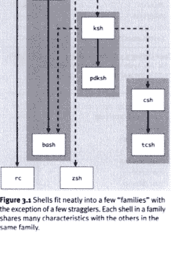

图 3.1 Shells fit neatly into a few "families" with the exception of a few stragglers. Each shell in a family shares many characteristics with the others in the same family.

**表 3.1 Common Unix Shells**

| Shell Name | Features |
| --- | --- |
| `sh` | This shell, which is the original Unix shell (often called the Bourne shell), is fine for scripting but lacks a lot of the flexibility and power for interactive use. For example, it doesn't have features like command completion, email checking, history, or aliasing. |
| `csh` and `tcsh` | This family of shells adds interactive uses but discards the popular scripting support that `sh`-related shells offer in favor of a C programming-like syntax. Because of the C syntax, this shell is often just called the C shell. Unless you're a C programmer, these are not likely to be your best choices. |
| `ksh`, `bash`, and `zsh` | These provide a good blend of scripting and interactive capabilities, but they stem from different sources (`bash` is most similar to `sh`, hence the Bourne Again SHell name). |

## 查看可用的 shell

- `cat /etc/shells`

在 shell 提示符下，输入`cat /etc/shells`以了解可供你使用的 shell。代码清单 3.4 和 3.5 显示了在两个不同系统上执行此命令的结果。

**提示**

- 在你急于跳到下一节并更改 shell 之前，最好先咨询你的系统管理员或帮助台，了解他们支持并认可哪些 shell。
- 如果在系统管理员或帮助台的支持方面各方面都相同，且你没有明确偏好，我们建议首选`zsh`，`bash`紧随其后。对于大多数用途，两者都很好。长期来看，power 用户会更喜欢`zsh`。

```
[ejr@hobbes]$ more /etc/shells
/bin/bash
/bin/sh
/bin/tcsh
/bin/csh
[ejr@hobbes]$
```

代码清单 3.3 在 Unix 系统上可用的 shell 的最小列表，包括基本内容但选择不多。

```
xmision> cat /etc/shells
/usr/local/bin/tcsh
/bin/csh
/usr/bin/csh
/bin/ksh
/usr/bin/ksh
/sbin/sh
/usr/bin/sh
/usr/local/bin/zsh
/usr/local/bin/bash
/usr/local/bin/nologin
/usr/local/bin/terminated
/usr/local/bin/xmenu.email
/usr/local/bin/xmenu.noshell
/usr/lib/uwcp/uucico
xmision>
```

代码清单 3.4 这些 shell 可通过 ISP 使用。注意该 ISP 使用的额外自定义 shell，包括提供特殊功能（如不允许登录）的 shell。

**提示**

- 更改 shell 后，你可能会遇到运行某些命令的问题，或提示符或显示不如原来好。这很可能是因为你的默认 shell 已由系统管理员精心定制。你可能需要自行设置和配置新 shell，第 8 章可以帮助你完成此操作。
- 有些系统不允许用户使用`chsh`来更改 shell。如果是这种情况，你需要向系统管理员发送电子邮件请求更改，或查看是否有替代方法，如图 3.2 所示。你也可以临时更改 shell，如下一节所述。
- 有关`su`命令的更多信息，请参阅本章后面的“使用`su`更改身份”。

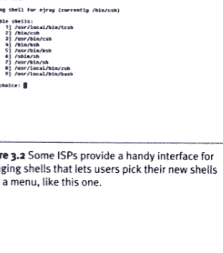

图 3.2 一些 ISP 提供了一个方便的更改 shell 界面，让用户可以从菜单中选择新 shell，如图所示。

## 临时更改你的 Shell

你可以通过创建子 shell 并使用它来代替原始 shell，从而临时更改 shell。你可以使用 Unix 系统上可用的任何 shell 创建子 shell。这意味着你可以查看`/etc/shells`文件并使用其中列出的 shell，或者使用系统其他位置安装的 shell（代码清单 3.6）。

### 查找可用的临时 shell

1. `cat /etc/shells`

   在 shell 提示符下，输入`cat /etc/shells`以了解 shells 文件中列出了哪些 shell。

   如果你在 shells 文件中找不到想要使用的 shell，请在系统其他位置查找其他已安装的 shell。

2. `ls /usr/local/bin/*sh`

   在 shell 提示符下，输入`ls /usr/local/bin/*sh`以在`/usr/local/bin`目录中找到其他 shell。请注意，并非所有以`sh`结尾的程序都是 shell，但大多数 shell 都以`sh`结尾（代码清单 3.6）。

### 创建临时 shell（子 shell）

- ♦ `/usr/bin/csh`

   在 shell 提示符下，输入你想要使用的临时 shell 的路径和名称。在此例中，我们使用位于`/usr/bin/csh`的`csh` shell。你可能会看到新的提示符，也许类似于代码清单 3.7 中显示的提示符。

```
[ejr@hobbes]$ cat /etc/shells
/bin/bash
/bin/sh
/bin/tcsh
/bin/csh
[ejr@hobbes]$ ls /usr/local/bin/*sh
/usr/local/bin/pdksh
[ejr@hobbes]$
```

代码清单 3.6 从`/etc/shells`检查 shell 列表并查找以`sh`结尾的其他程序，是找到系统上所有 shell 的一种好方法。

```
[ejr@hobbes]$ /usr/bin/csh
ej>
```

代码清单 3.7 输入 shell 名称（它实际上只是另一个 Unix 命令）以更改 shell。

### 退出临时 shell（子 shell）

- ♦ `exit`

   在 shell 提示符下，输入`exit`。你将被返回到启动子 shell 的那个 shell。如果创建了不止一个子 shell，你必须全部退出它们。

### 提示

- 使用临时 shell 是尝试其他 shell 及其选项的好方法。我们建议使用临时 shell 来尝试本章介绍的 shell。
- 你也可以经常使用 Ctrl+D 来退出子 shell，但这取决于系统配置。试试看。
- 请参阅第 1 章，特别是包含程序的目录列表，以查找其他 shell 位置。


```
bash-2.005$ ls
Complete  NewProject  bogus2
→ ftp      puppy
Completed News      dead_letter
→ mail     temp
Mail      access      files
→ public_html  testme
bash-2.005$ cd public_html/
bash-2.005$
```

代码清单 3.8 在此示例中，我们只输入了 `ls` 命令，然后输入 `"cd pub"` 并按下 `Tab` 键；`bash` 为我们完成了命令。

## 在 bash Shell 中使用补全

`bash` shell 的一个很酷的功能是命令参数补全，你可以只输入命令的一部分，按下 `Tab`，`bash` 就会为你补全命令（代码清单 3.8）。

### 在 bash shell 中使用补全：

- 1. `ls -l`

使用 `ls -l` 列出当前目录中的文件。

- 2. `cd pub Tab`

输入部分命令，然后按 `Tab` 补全命令。在此示例中，我们输入了 `cd` 命令和 `public_html` 目录的一部分（在示例中截断为 `pub`），然后按 `Tab` 补全它（参见代码清单 3.8）。

### 提示

- 补全仅在你在按 `Tab` 之前输入的字母只有一个可能匹配时才有效。例如，如果你输入 `cd pu`（对应 `public_html`），而另一个子目录名为 `puppy`，shell 会发出蜂鸣声并等待你输入足够多的字母以区分这两个子目录。

- 你可以使用补全来补全命令、命令中的目录名，以及几乎任何你可能输入且足够明确的内容。

## 在 bash Shell 中查看会话历史

`bash` shell 的另一个很酷的功能是它能让你轻松重用会话历史中的命令，会话历史会显示你在当前会话或之前会话中使用过的命令列表（代码清单 3.9）。查看历史记录对于回顾你的 Unix 会话、再次使用之前的命令（而不是重新输入它们）以及修改（而不是完全重新输入）复杂命令非常有用。

### 在 bash shell 中查看会话历史：

- 1. 使用 shell 一段时间，切换目录、重定向输出或执行其他任务。慢慢来。我们会等。

- 2. 按一次 `↑`。请注意，你上一个使用的命令会出现在命令行上，如代码清单 3.9 所示。要重新执行该命令，只需按 `Enter`。

- 3. 继续按 `↑` 或 `↓` 向后或向前滚动历史记录。当你找到想要使用的命令时，按 `Enter`。如果看到一个接近但不完全是你想要使用的命令，你可以编辑它。只需使用 `←` 和 `→` 键在行中移动，通过输入来插入文本，并使用 `Backspace` 或 `Delete` 删除文本。修改好命令后，按 `Enter`（你不必位于行尾即可）。

- 4. `history`

在 shell 提示符下输入 `history` 以查看之前输入的命令的编号列表。

```
[ejr@hobbes clean]$ ls
background.htm info.htm logo.gif
[ejr@hobbes clean]$ ls
background.htm info.htm logo.gif
[ejr@hobbes clean]$ history
1 free
2 id deb
3 id ejr
4 uname -a
5 ls
...
40 cd
41 cp .bash_history oldhistory
42 vi .bash_history
43 elm
44 ls -la
45 ls -la.e*
46 elm
47 lynx
48 history
49 vi .bash*nis*
50 history
51 cd clean
52 ls
53 ls
54 history
[ejr@hobbes clean]$ !40
cd
[ejr@hobbes ejr]$
```

代码清单 3.9 在此示例中，我们输入了第一个命令，然后按 `↑` 重用之前的 `ls` 命令。`!40` 循环使用了列表中的第 40 个命令。

#### 提示

- 当前会话的命令保存在内存中以便滚动浏览，而之前会话的命令保存在 `~/.bash_history` 文件中。你可以用任何编辑器编辑 `.bash_history` 来删除不需要的命令，或者直接删除该文件以清除整个历史记录，之后在你发出下一个命令时历史文件将被重新创建。（命令历史是编写脚本以自动执行这些命令的绝佳起点。第 10 章会给出具体说明。）

- 当你查看历史记录时，可以通过输入感叹号 `!` 和你想再次运行的命令的行号来复用命令。例如，输入 `!40` 即可重新运行第 40 条命令。

- 使用 `history` 后跟一个数字来指定要列出的项目数。例如，`history 10` 显示最后 10 条命令。

## 在 zsh Shell 中使用补全

`zsh` shell 也提供补全功能，但相比 `bash` shell 对高级用户来说增加了一些变化。基本上，你只需输入命令的一部分，按下 `Tab` 键，Z-shell 就会为你补全命令（代码清单 3.10）。

### 在 zsh shell 中使用补全：

1. `ls -l`

使用 `ls -l` 列出当前目录中的文件。

2. `cd pub Tab`

输入部分命令，然后按 `Tab` 键补全命令。在此示例中，我们输入了 `cd` 命令和 `public_html` 目录的一部分（在示例中截断为 `pub`），然后按 `Tab` 键将其补全（参见代码清单 3.10）。

### 提示

- 在 Z-shell 中，即使多个文件可能匹配你输入的部分命令，命令补全也有效。例如，如果你输入 `cd pu`（对应 `public_html`），并且还有另一个名为 `puppy` 的子目录，那么使用 `Tab` 补全名称时，shell 会显示选项（`public_html` 和 `puppy`），然后在你继续按 `Tab` 时在选项之间循环。

- 你可以使用命令补全来补全命令、命令中的目录名以及几乎你可能输入的任何内容。

- Z-shell 足够智能，只会显示你可切换到的子目录。`bash` 另一方面会显示文件和目录，并发出蜂鸣声——肯定没有那么有帮助。

```
$ ls
Complete    NewProject   bogus2
+ ftp        puppy
Completed   News         dead.letter
+ mail       temp
Mail        access       files
+ public_html           testme
$ cd public_html/
$
```

代码清单 3.10 在此示例中，我们只输入了 `ls` 命令，然后输入 `cd pub` 并按 `Tab` 键；`zsh` 为我们补全了命令。

#### 提示

- 如果你只是对命令做少量修改，可以快速轻松地编辑它。例如，如果你刚刚使用了 `cd /home/users/e/eric`，并且接下来想执行 `ls /home/users/e/eric`，你可以只输入 `^cd^ls` 来告诉系统用 `ls` 替换上一个命令中的 `cd`，然后重新发出命令。

- 当前会话的命令保存在内存中以便滚动浏览，而之前会话的命令保存在 `~/.zsh_history` 文件中。你可以用任何编辑器编辑 `.zsh_history` 来删除不需要的命令，或者直接删除该文件以清除整个历史记录，之后在你发出下一个命令时历史文件将被重新创建。

- 回顾会话历史是识别你的工作模式和需求的好方法。如果你发现自己反复使用同一系列命令，请考虑编写脚本以自动执行这些命令，如第 10 章所述。

- `bash` 中的大多数命令补全选项在 `zsh` 中也适用。试试看！

## 在 ksh Shell 中使用补全

`ksh` 是另一个提供命令补全的 shell。你输入部分命令，按两次 `Esc`，`ksh` 就会为你补全命令（参见代码清单 3.12）。在 `ksh` 中使用命令补全没有在 `zsh` 或 `bash` 中那么容易，但结果是一样的。

### 在 ksh shell 中使用补全：

1. `set -o emacs`

首先，你必须通过输入 `set -o emacs` 来启用命令补全。此命令启用命令补全并将其设置为使用 emacs 命令。（Emacs 是一个编辑器，但你不需要使用或熟悉它即可复用 `ksh` 命令。）

2. `ls -l`

使用 `ls -l` 列出当前目录中的文件。你这样做是为了知道可以在步骤 3 中切换到的目录（`public_html`）。

3. `cd pub Esc Esc`

输入部分命令。在此示例中，我们输入了 `cd` 命令和 `public_html` 目录的一部分（截断为 `pub`）。按两次 `Esc` 来补全命令。（根据你的终端仿真，你可能需要使用两次 `Ctrl+[` 而不是两次 `Esc`。）


```
$ ls
Complete  NewProject  bogus2  files
  + public_html      testme
Completed  News        chat.conf
  + ftp      puppy
Mail        access      dead_letter
  -> mail    temp
$ cd pub^[^
 ksh: pub: not found
$ set -o emacs
$ cd public_html/
$
```

代码清单 3.12 在列出文件和目录后，我们设置了选项，然后成功补全了一个命令。`^[^` 是当 shell 不知道如何使用它来补全命令时 `Esc` 在屏幕上显示的方式。

### 提示

- 如果你的系统上没有安装 `ksh`，你也可以寻找 `pdksh`，它是一个可自由分发且几乎与 `ksh` 相同的版本。
- 你也可以输入 `set -o vi` 来使用 vi 命令（而不是步骤 1 中给出的命令）。我们发现这并不那么直观或有效，因此我们推荐 emacs 模式。
- 有关编辑器的更多信息，请参阅第 4 章。
- 如果你使用 `ksh`，你可能希望将 `set -o emacs` 命令添加到你的个人配置文件中，这样你就不必在每个会话中手动输入该命令。请参阅第 8 章了解编辑配置文件的具体说明。

## ksh 历史导航命令

### 表 3.2

| COMMAND | FUNCTION |
|---|---|
| `Ctrl P` | 召回上一条命令 |
| `Ctrl N` | 召回下一条命令（仅在你已移动到上一条命令后才有效） |
| `Ctrl R something` | 获取包含 "something" 的上一条命令 |
| `Ctrl B` | 在命令内向后移动一个字符 |
| `Ctrl F` | 在命令内向前移动一个字符 |
| `Ctrl A` | 在命令内移至行首 |
| `Ctrl E` | 在命令内移至行尾 |
| `Ctrl D` | 删除当前字符 |

## 在 ksh shell 中查看会话历史：

- 1. `set -o emacs`

首先，你必须输入 `set -o emacs`。该命令启用历史重用和命令补全，并将 shell 设置为使用 emacs 命令。（Emacs 是一个编辑器，但目前你无需使用或熟悉它。）

- 2. 使用 shell 一段时间，切换目录、重定向输出或执行其他任务。

- 3. `Ctrl P`

使用 `Ctrl P` 召回上一条命令。表 3.2 显示了可用于在会话历史中导航的其他键盘组合。

在你完成召回并可选地编辑命令后，按 Enter（你不必位于行尾即可执行此操作）。

- 4. `history`

在 shell 提示符下输入 `history` 以查看你最近输入的命令列表（代码清单 3.13）。

注意每个命令旁边的命令编号。你可以输入 `!` 空格键 和命令的编号来重新运行它。

### 提示

如果你使用 `ksh`，你可能希望将 `set -o emacs` 命令添加到你的个人配置文件中，这样你就不必在每个会话中手动输入该命令。有关编辑配置文件的具体信息，请参阅第 8 章。

## 在 csh Shell 中查看会话历史

如果你是 C 程序员（或有 C 程序员可以求助），`csh` 可能是一个不错的 shell，因为其语法与 C 编程语言非常相似。`csh` 不提供命令补全，但历史功能与 `bash` 或 `zsh` 相当相似（参见代码清单 3.14）。总体而言，`csh` 是一款功能强大的脚本 shell（也是可接受的交互式 shell），适合那些愿意花时间和精力熟悉它的人。

## 在 csh shell 中查看会话历史：

- 1. 如果尚未进行，请使用 shell 一段时间，切换目录、重定向输出或执行其他任务。

- 2. `history`

在 shell 提示符下输入 `history` 以查看你最近输入的命令列表。注意每条命令行的编号（代码清单 3.14）。

- 3. `!10`

输入 `!` 后跟命令编号（中间无空格）以重新运行其中一条命令。在此示例中，我们重新运行命令 10。

### 提示

- 请参阅第 8 章，了解如何使 `csh` 更易用和更高效，特别是如果你没有其他 shell 选项可用。
- 你可以在会话历史中编辑命令。然而，对于 `csh`，重新输入命令远比编辑它们更容易。

```
xmision> history
1 ls
2 vi temp.info
3 ls
4 cd pub*
5 ls
6 cp *.pdf ..
7 cd ..
8 rm *.pdf
9 history
10 lynx
11 ftp ftp.wustl.edu
12 ls
13 vi .plan
14 finger ejr@roycomm.com
15 history
16 finger ejr@hobbes.roycomm.com
17 ls
18 pine
19 history
20 lynx
21 history
xmision> !10
```

代码清单 3.14 `csh` 也允许你按编号回收命令，尽管其他历史功能不可用。

- 如果你喜欢 `csh`，请检查你的系统上是否提供 `tcsh`。它与 `csh` 类似，但增加了命令补全和其他与 `bash` 相当的类似功能。
- 有时，历史长度默认设置为 0（不保留历史行）。如果你的历史似乎无法工作，请尝试 `set history=100` 以保存 100 行历史。将此添加到你的启动文件（下一章）中，如果你希望每次都可用。

## 使用 su 更改身份

偶尔，你可能需要使用除自己之外的用户 ID 登录，或需要重新使用自己的用户 ID 登录。例如，你可能想在注销前检查之前更改的配置设置是否有效。或者，如果你更改了 shell，你可能想在注销前检查它（顺便说一下，你应该这样做）。

你可以使用 `su`（substitute user）命令以其他用户身份登录（代码清单 3.15）或启动新的登录 shell。

```
[ejr@hobbes asr]$ ls
Projects testing
[ejr@hobbes asr]$ su asr
Password:
[asr@hobbes asr]$ ls
Projects testing
[asr@hobbes asr]$ su - ejr
Password:
[ejr@hobbes ejr]$ ls
Mail          editme        script2.sed
Projects      fortunes.copy scriptxtro.sed
Xrootenv.0    fortunes1.txt sedtest
above.htm     fortunes2.txt sorted_address.temp
address.book  groups        temp.htm
address.temp  history.txt   tempsport
axhome        html.htm      test
bogus         html.html     test2
chmod.txt     mail          testing.gif
clean         manipulate    testing.wp
compression   nsmail        typescript
[ejr@hobbes ejr]$ exit
[asr@hobbes asr]$ exit
[ejr@hobbes ejr]$ exit
```

代码清单 3.15 在一个用户和另一个用户之间来回切换（以及退出多个 shell）可能会有点令人困惑，但提示通常会告诉你你的身份和所在目录。

## 使用 su 以不同用户身份登录：

- `su osr`

在 shell 提示符下，输入 `su` 加上你要登录的用户的用户 ID。你会被提示输入密码，就像你第一次登录系统一样（代码清单 3.15）。如果你没有指定用户名，系统会假定你指的是 `root` 用户。如果你一开始就以 `root` 身份登录，就不会被提示输入密码。你现在将以新用户身份登录，并且能够像该用户一样工作，尽管你仍在与发出 `su` 命令之前相同的目录中，使用相同的设置。

## 使用 su 启动新的登录 shell：

- `su - yourid`

在 shell 提示符下，输入 `su - yourid`（当然，使用你自己的用户 ID 或你要切换到的用户的 ID）。添加连字符 `-` 将强制启动一个新的登录 shell，并根据该用户的设置设置所有环境变量和默认值。

## 返回到上一个 shell：

- `exit`

在 shell 提示符下输入 `exit` 以离开当前 shell 并返回到上一个 shell。如果你从原始登录 shell 使用 `exit`，你将完全退出 Unix 系统。

### 提示

- 如果你有 `root` 访问权限并且通过 `ssh` 登录系统以管理它，你应该使用 `su` 来提供额外的安全性。与直接以 `root` 身份登录并留下密码可能被窃取（或从你的本地系统被嗅探）的远程可能性相比，以自己的身份登录，然后使用 `su`（不带其他信息）切换到 `root`。


- 如果你使用 `su user`（不带连字符）`su` 到另一个用户，而新用户对当前目录没有读和执行权限，你会看到 shell 错误消息。你可以忽略这些。有关读和执行权限的更多信息，请参阅第 5 章。

## 使用 `stty` 修复终端设置

你可以用 shell 做另一件方便的事情，就是用它来修复终端程序中出现的那些烦人的问题。在第 1 章中，我们提到你可能会遇到诸如退格键和删除键无法正常工作之类的异常。你可以使用 `stty` 来修复这些问题（参见代码清单 3.16）。

### 使用 `stty` 修复退格键和删除键异常：

- `stty erase '^?'`

如果你习惯于退格键可以擦除光标左侧的字符，而你尝试时屏幕上却出现了一堆 `^?` 符号，你需要让终端了解你的偏好。输入 `stty erase Backspace` 来修复它（代码清单 3.16）。在某些情况下，取决于你的终端程序，你可能需要设置 `stty erase '^H'` 然后使用 `Ctrl H` 来退格。要输入此命令，输入 `stty erase Ctrl V Ctrl H`（代码清单 3.17）。

### 使用 `stty` 修复一般的终端异常：

- `stty sane`

在 shell 提示符下输入 `stty sane` 将修复许多异常。例如，如果你不小心发出了一个错误命令，突然屏幕上什么都没有显示，或者屏幕上出现一般的乱码，`stty sane` 可能会使你的终端会话恢复正常。`reset` 命令在修复混乱的终端时也经常有效。

```
xmission> ls ^?^?^?
: No such file or directory
xmission> stty erase '^?'
xmission> ls
```

代码清单 3.16 你通常可以通过使用 `stty` 命令来纠正混乱的 telnet 程序或 Unix 系统。这一条修复了错误的退格键。

```
xmission> jF^HH
jF^HH: Command not found
xmission> ls ^H^H
: No such file or directory
xmission> stty erase '^H'
xmission>
```

代码清单 3.17 此处的 `stty` 命令将删除键修复为像退格键一样工作。

## 提示

- 如果 `stty sane` 不能修复混乱的显示，请尝试注销并重新登录或重新启动你的终端程序。

- 你可以通过将适当的 `stty` 命令添加到你的配置文件中或在你的终端客户端中进行更改来永久修复退格键异常。有关配置文件的详细信息，请参阅第 8 章。有关 SSH 和 telnet 等终端程序的更多有用的详细信息，请参阅第 1 章。

## 第3章

### 退出 Shell

当你完成 Unix 会话后，需要退出 Unix shell。如果你一直在玩弄 `su` 和 shell 命令，你可能实际上拥有 shell 套 shell，需要从所有 shell 中退出。你所需要做的就是为每个 shell 输入一次 `exit`。

### 退出 shell 的方法：

- `exit`

在 shell 提示符下，输入 `exit`。搞定！

### ✔ 提示

- 如果你位于登录 shell 提示符处，你也可以输入 `logout` 而不是 `exit`。在所有其他 shell 中，则需要输入 `exit`。在某些情况下，你也可以按 `Ctrl D`，但这取决于你的本地系统配置。

- 一定要注销而不是简单地挂断或中断你的连接。如果你的 Unix 主机的设置严重错误，你的会话可能会保持打开状态，其他人就可以在你的 `userid` 下接续你离开的地方继续使用你的会话。

## 选择编辑器

基本上，所有编辑器都是设计用来做相同的事情：使你能够创建、修改和保存文本文件。这些文件可能包括配置文件、电子邮件消息或 shell 脚本——本质上是你能创建的任何文本文件。你选择哪种编辑器取决于你的具体需求以及你愿意学习多少。

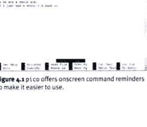

在本书中，我们将坚持使用三大编辑器，`pico`、`vi` 和 `emacs`，这很可能能提供你所需的所有功能。我们选择它们是因为 `pico`（可以说）是最容易使用的 Unix 编辑器，`vi` 是最强大的编辑器之一，并且几乎在每个 Unix 系统上都可用，而 `emacs` 提供了难以置信数量的选项，并且是即将成为 Unix 专业人士的人应该掌握的有用技能。

### 关于 `pico`

`pico` 是较为直接的 Unix 编辑器之一，并且因其极易使用而变得相当流行。特别是，如图 4.1 所示，它是菜单驱动且直观的。所有命令都可见，你可以轻松地打开、修改和关闭文件。如果你刚开始使用 Unix 或不需要能够一跃而过高大文件的编辑器，`pico` 是一个很好的选择。

`pico` 与 `pine` 邮件程序一起分发，所以如果你可以使用 `pine`，你很可能也拥有 `pico`。（参见第 1 章，了解如何确认 `pine` 和 `pico` 是否可用的提醒。）如果 `pico` 对你不可用，请让你的系统管理员安装它。

### 编辑器众多

顺便说一下，还有数十种其他编辑器，例如

- `ed`、`ex` 和 `red`，它们是简单的（在功能上，但不一定在用法上）逐行编辑器

- `joe` 和 `jed`，它们是相当简单的编辑器，在许多方面与 `pico` 相当

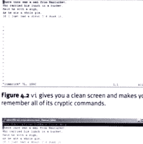

图 4.2 `vi` 为你提供干净的屏幕，并让你记住其晦涩的命令。

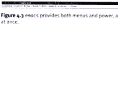

图 4.3 `emacs` 同时提供菜单和强大功能。

### 关于 `vi`

尽管 `vi` 很可能对 Unix 复杂且令人困惑的名声负有很大责任，但它提供了巨大的功能和灵活性——它能一跃而过高大文件并做更多、更多的事情。此外，`vi` 通用可用（不像 `pico`），因此出于这两个原因，你应该考虑花时间学习它。你可能会发现 `vi` 晦涩、违反直觉且挑剔，因此如果你不需要 `vi` 的功能，你可能想选择不同的编辑器。

如 图 4.2 所示，如果你使用 `vi`，你将没有菜单可用——你必须习惯使用像 `Esc :q` 或 `Esc :%s/vi is arcane/vi is powerful/` 这样的命令。

### 关于 `emacs`

使用 `emacs`，你开始理解 Unix 可以有多么难以置信地可定制。它可以“只是”一个编辑器——尽管是一个非常强大的编辑器，拥有各种有用的功能——也可以是电子邮件程序、文件管理器，或几乎任何其他东西。我们将只坚持编辑功能，但如果你发现你喜欢 `emacs`，请不要犹豫去探索网络以了解此编辑器的其他选项和功能。图 4.3 显示了你对 `emacs` 的预期，包括方便的（且相当熟悉的）菜单。

### 提示

- 你可以指定一个默认编辑器，该编辑器将在为你启动编辑器的程序中自动启动。第 8 章提供了有关设置你的编辑器环境变量的详细信息。

- 参见第 8 章了解有关配置文件更多信息，第 10 章了解有关 shell 脚本更多信息，第 11 章了解有关电子邮件更多信息。

- 你并不局限于一种编辑器。你可以在任何时候使用任何编辑器。我们经常使用 `pico` 来写邮件或纯文本，因为我们可以不假思索地输入。我们在真正需要强大功能时或只是想快速编辑而不使用 `pico` 的菜单——这些菜单对我们来说常常显得笨重——时切换到 `vi`。

## 开始使用 `pico` 并尝试操作

你可以使用以下步骤开始使用并尝试 `pico`。注意 `pico` 界面直观且易于导航，如图 4.4 所示。

### 开始使用 `pico` 并尝试操作：

- 1. `pico`

- 开始时，在 shell 提示符下输入 `pico`。程序启动后你会看到类似图 4.4 的界面，文本区域在窗口顶部，命令提示在底部。

- 如果你知道要编辑的文件名，在 shell 提示符下输入 `pico` 后跟要编辑的文件的路径和名称（例如 `hairyspiders`）。

- 2. hairy spiders

- 继续吧。输入一些内容——任何内容——只是为了试试。

- ▲ 使用 `Delete` 和 `Backspace` 来帮助编辑文本。

- ▲ 使用方向键向上、向下、向右或向左移动。

### 提示

- 使用 `-w` 选项启动 `pico`（例如 `pico -w filename`）以禁用自动换行。当编辑第 8 章中介绍的配置文件时，你会发现这特别有用。

- 在 `pico` 中，你会在底部菜单中看到 `^C`、`^J` 以及数十个其他 `^something` 字符。`^` 代表 `Ctrl`，所以 `^C` 是 `Ctrl C`，`^J` 是 `Ctrl J`，以此类推。


- 如果你输入 `pico` 并收到命令未找到的错误信息，请使用 `find`、`whereis` 或 `ls` 在可能目录（`/usr/bin` 或 `/usr/local/bin`）中搜索，以查看程序是否可用但不在 shell 能够找到的位置。参见第 1 章快速回顾。

- 在你建立文件并开始添加内容后，使用下一节中的说明保存你的更改。


- 你可以通过访问 `pico help` 获取有关 `pico` 功能的有用信息。参见本章后面 `Getting Help in pico` 部分。

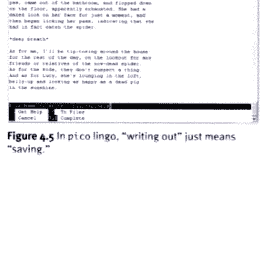

## 在 pico 中保存

你在编辑文件时通常会频繁保存文件——而且你应该这样做。记住，墨菲定律正在盯着你....

### 在 pico 中保存：

- 1. `Ctrl O`
- 定期使用 `Ctrl O` 保存（写出）你正在编辑的文本。
- 2. `hairyspiders`
- 为你的文件指定文件名（图 4.5）。

### 提示

- 在你第一次保存文件后想要保存新的更改时，只需按 `Ctrl O` 然后按 `Enter` 确认当前文件名并保存即可。
- 当你退出 `pico` 时，你会得到最后一次保存更改的机会。参见本章的 `Exiting pico` 了解具体说明。
- 如果你尝试将新文件保存到现有文件之上——这会摧毁原始文件——`pico` 会小心地询问你是否要覆盖该文件。是，则你将不再拥有原始文件。否，则你可以选择新的文件名。

## 在 pico 中剪切和粘贴文本块

当你在 `pico` 中输入时，你可能需要剪切和粘贴文本块，如图 4.6 所示。

### 在 pico 中剪切和粘贴文本：

- 1. `pico hairyspiders`
- 在 shell 提示符下，输入 `pico` 后跟要编辑的文件名。
- 2. 将光标移动到要剪切的文本的第一行。
- 3. `Ctrl ^`
- 按 `Ctrl ^` 来标记要剪切的文本的开头。（注意 `Ctrl ^` 实际上是 `Ctrl Shift 6`——它可能在不按 Shift 的情况下工作，也可能不工作。用你的终端程序试试看会发生什么。）
- 4. 使用方向键将光标移动到要剪切的文本的末尾。注意随着你选择，文本会被高亮显示（图 4.6）。
- 5. `Ctrl K`
- 这会“kuts”掉文本。
- 6. 使用方向键，将光标移动到要插入剪切文本的位置。
- 7. `Ctrl U`
- 使用此键组合将剪切的文本粘贴到文件的新位置。


### 提示

- 你可以在不将文本块粘贴回文件的情况下选择并剪切文本块。只需跳过步骤 6 和 7。
- 你可以尽可能多次地粘贴文本块。在你选择并剪切文本后，只需在每个想要插入剪切文本的位置按 `Ctrl U` 即可。
- 如果你没有选择文本，`Ctrl K` 只会剪切单行。

## 在 pico 中检查拼写

在 `pico` 中你可以做的另一件方便的事情是检查拼写，如图 4.7 和 4.8 所示。

## 如何在 pico 中拼写检查：

- 1. `pico hairyspiders`
  在 shell 提示符下，输入 `pico` 和要编辑的文件名。
- 2. `Ctrl T`
  按下此命令开始对文件进行拼写检查。`pico` 会在每个拼写错误的单词处停止（图 4.7）。
- 3. `correctspelling`
  输入被标记为拼写错误的单词的正确拼写，或按 `Enter` 接受当前拼写并继续到下一个单词。

## ✓ 提示

- 你可以随时按 `Ctrl C` 取消拼写检查。
- 由于 `pico` 中的拼写检查器功能不全，可以考虑通过在命令行中指定它来使用替代拼写检查程序，如 `pico -s ispell hairyspiders`，这样可以获得更多帮助。有关更多信息，请参阅第 15 章。
- 当整个文档拼写检查完成后，`pico` 会告诉你拼写检查已完成，你可以继续编辑文件（图 4.8）。

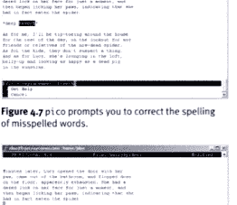

图 4.7 `pico` 会提示你更正拼写错误的单词的拼写。


图 4.8 `pico` 在过程完成后会通知你。

## 在 pico 中获取帮助

了解更多关于 `pico` 的一种好方法是访问 `pico` 帮助。除了找到问题的答案外，你还可以了解有关 `pico` 的功能和你可能不了解的能力（图 4.9）。

## 如何在 pico 中获取帮助：

- 1. `Ctrl G`
  在 `pico` 中，按 `Ctrl G` 访问帮助。
- 2. 浏览帮助页面：
  ▲ `Ctrl V` 将你向下移动到帮助页面。
  ▲ `Ctrl Y` 将你向上移动到帮助页面。
- 3. `Ctrl X`
  使用此组合退出帮助。

## 如何获取 pico 启动选项的帮助：

- ♦ `man pico`
  在 shell 提示符下，输入 `man pico` 以了解有关启动选项的更多信息，包括控制 `pico` 工作方式的各种选项。

## ✓ 提示

- ■ 注意观察 `pico` 状态行以获取当前信息、错误消息以及偶尔关于使用 `pico` 的提示。状态行是屏幕底部倒数第三行，位于菜单正上方，如图 4.9 所示。
- ■ 请记住，`pico` 实际上是一个非常基础的程序。如果你正在寻找一个不容易找到的命令或功能，它可能不存在。你可以考虑改用 `vi` 或 `emacs`。

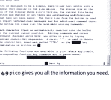

图 4.9 `pico` 为你提供所需的所有信息。

## 退出 pico

当你在 `pico` 中完成编辑后，将使用以下步骤退出它。

## 如何退出 pico：

- 1. `Ctrl X`
  在 `pico` 中，按下 `Ctrl X`。如果自上次保存文件以来你没有对文本进行任何更改，你将立即回到 shell 提示符。如果已进行更改，你将被提示“Save modified buffer”（图 4.10）。
- 2. 在“Save modified buffer”提示下：
  - 按 `Y` 如果你想保存更改。继续步骤 3。
  - 按 `N` 如果你不想保存更改。你将回到 shell 提示符。
- 3. `bighair y spiders`
  如果这是你第一次保存文件，请指定文件的名称。如果之前已保存过，按 `Enter` 确认当前文件名或更改名称以保存副本而不更改原始文件。

## ✓ 提示

- ▪ 缓冲区是计算机用于临时存储信息的地方，如果它被修改，意味着它临时存储了你尚未保存到磁盘的内容。

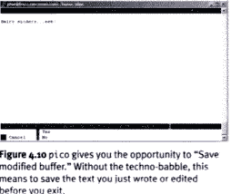

## 启动 vi 并尝试使用它

在你急于使用 `vi` 之前，请了解它有两个模式（两者看起来都像图 4.11）：

- **输入模式**（有时称为插入模式），在此模式下，你按下的键实际上会显示在正在编辑的文件中。你使用此模式来添加或更改文本。
- **命令模式**，在此模式下，每个按键都被解释为命令。你使用此模式来执行除输入文本外的所有操作。

许多人对 `vi` 感到困惑的是，它以命令模式启动，这意味着如果你刚开始输入，你可能会看到一些空白、字符和你输入的单词片段——本质上是一堆垃圾，并不完全代表你输入的内容——并且会听到很多蜂鸣声。因此，正如我们在以下步骤中向你展示的那样，你需要在启动 `vi` 后立即访问输入模式。

## 如何启动 vi：

- 1. `vi`
  在 shell 提示符下，输入 `vi`。程序启动后你会看到类似图 4.11 的内容。`~` 符号显示文件末尾以下的空白行。
- 2. `i`
  输入 `i` 进入输入模式。这本身是在命令模式下发出的命令，因此不会显示在屏幕上。

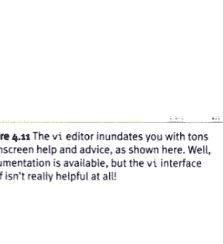

图 4.11 `vi` 编辑器用大量屏幕上的帮助和建议淹没你，如图所示。嗯，文档是可用的，但 `vi` 界面本身根本没有帮助！

## 3. 毛茸茸的蜘蛛潜伏

在输入模式下，输入你想要的任何内容。你输入的所有内容都会显示在屏幕上，直到你按下 `Esc` 返回命令模式。当你处于命令模式时，你可以使用箭头键逐行在文件中上下导航，并使用 `Ctrl F` 和 `Ctrl B` 分别向前和向后滚动一屏。

## ✓ 提示

- 要获取 `vi` 的帮助，输入 `man vi`。有关 `man` 手册的更多信息，请参阅第 1 章。
- 如果你不确定自己处于哪种模式，请按 `Esc` 进入命令模式。如果你已经处于命令模式，你会听到一声蜂鸣。如果你处于输入模式，你将切换到命令模式。
- 许多类 Unix 系统，包括 Linux 和 Mac OS，实际上在 `vi` 的位置提供了一个名为 `vim` 的程序。`vim`（VI iMproved）与 `vi` 类似，但功能丰富且更灵活，你仍然使用命令 `vi` 启动它。
- 你可以在访问 `vi` 时打开特定文件甚至多个文件。在 shell 提示符下，输入 `vi filetoedit`（或任何名称）以打开特定文件。或者，例如，输入 `vi *.html` 以打开目录中的所有 HTML 文档，然后使用 `Esc :n`（表示“下一个”）移动到每个后续文件。
- 有关在 `vi` 中编辑的更多详细信息，请参阅本章后面的“在 vi 中添加和删除文本”。

## 在 vi 中保存


你会想要经常保存对文档的更改，尤其是在学习使用 `vi` 的过程中（图 4.12）。在你习惯于在命令模式和输入模式之间切换之前，你可能会在以为自己在输入文本时意外输入命令，导致不可预测的结果。要保存文件，只需按照以下步骤操作。

### 在 `vi` 中保存文本：

- `Esc` `:w limerick`

按 `Esc` 退出输入模式进入命令模式，然后输入 `:w`（表示“写入”，即写入磁盘），后跟一个空格，然后是你要为文件使用的文件名（本例中为 `limerick`），然后按 `Enter`。如果文件已经保存过一次，只需按 `Esc` 并输入 `:w` 然后按 `Enter` 即可。

## 提示

- 如果你已经至少保存过一次文件，你可以一次性保存更改并退出 `vi`。在命令模式下，输入 `:wq`（表示“写入退出”）。有关退出 `vi` 的更多信息，请参阅本章后面名为“退出 `vi`”的部分。

- 如果你想将文件保存到现有文件上（在保存时覆盖原始文件），请在命令模式下使用 `:w! existingfilename`。`!` 强制 `vi` 覆盖原始文件。

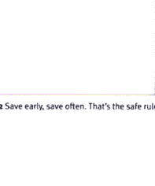

## 在 `vi` 中添加和删除文本

在 `vi` 中添加和删除文本比在 `pico` 中做同样的事情要复杂一些。在 `pico` 中，你基本上只需将光标放在想要更改的位置即可，而 `vi` 有一整套命令供你使用来指定更改应发生的位置。（表 4.1、4.2 和 4.3 仅列出了你的一小部分选项。）此外，要发出命令，你必须切换到命令模式。

### 在 `vi` 中添加或删除文本：

1. `vi`

   开始时，在 shell 提示符下输入 `vi`。

2. `i`

   切换到输入模式。

3. `There once was a man from Nantucket`

   输入一些你想要添加的文本。

4. `Esc`

   在发出命令之前按 `Esc` 进入命令模式。

5. 选择一个命令，基于你想要对文本执行的操作。

   表 4.1 列出了添加文本的命令。

   表 4.2 列出了删除文本的命令。

   表 4.3 列出了其他编辑命令。

6. `Esc dd`

   输入命令。在这里，我们正在删除当前行的文本。

表 4.1

`vi` 添加文本命令

| COMMAND | FUNCTION |
|---|---|
| `a` | 在光标后添加文本 |
| `A` | 在当前行末尾添加文本 |
| `i` | 在光标前插入文本 |
| `I` | 在当前行开头插入文本 |
| `o` | 在当前行后插入一个空白行 |
| `O` | 在当前行前插入一个空白行 |

表 4.2

`vi` 删除文本命令

| COMMAND | FUNCTION |
|---|---|
| `x` | 删除一个字符（光标下的字符） |
| `X` | 删除一个字符（光标后的字符） |
| `dd` | 删除当前行 |
| `5dd` | 删除从当前行开始的五行（显然，这里可以使用任何数字） |
| `dw` | 删除当前词 |
| `cw` | 更改当前词（删除它并用你接下来输入的词替换） |
| `r` | 用你接下来输入的字符替换光标下的字符 |
| `R` | 用你输入的文本替换现有文本（类似于大多数文字处理软件中的覆盖模式） |

表 4.3

其他实用的 `vi` 编辑命令

| COMMAND | FUNCTION |
|---|---|
| `y` | 复制当前行 |
| `p` | 在光标或行后粘贴复制的行 |
| `J` | 连接当前行和下一行 |
| `u` | 撤消上一次更改 |
| `U` | 撤消当前行上的所有更改 |
| `.` | 重复上一个命令 |

## 将文件导入 `vi`

你也可以通过将额外文件读入当前文件来在 `vi` 中合并多个文件，如图 4.13 所示。基本上，这意味着你将一个文件插入到你当前正在编辑的文件中。

### 在 `vi` 中导入文件：

1. `vi hairyspider`

   在 shell 提示符下，输入 `vi` 后跟要启动 `vi` 的文件名，在本例中为 `hairyspider` 文件。

2. `Esc :r filename`

   在文件中想要导入文本的位置，按 `Esc`，然后输入 `:r` 和你想要读入文件的文件名。

### 提示

`vi` 还允许你将命令的输出读入文件。例如，如果你想将特定目录中的文件列表读入文件，请在命令模式下使用 `Esc :r !ls`。

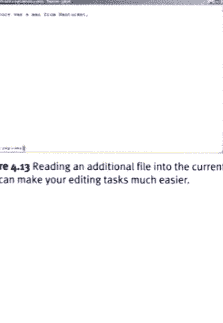

## 在 `vi` 中搜索和替换

`vi` 的一个更好的功能（以及相对于 `pico` 的优势）是它允许你在整个文件中进行搜索和替换。如下一节所示，你可以只查找特定的文本字符串（在 Unix 术语中称为正则表达式；见图 4.14），也可以查找文本并将其替换为其他文本，如图 4.15 所示。

### 在 `vi` 中查找文本字符串：

1. `vi hairyspider`

   首先，访问 `vi` 和特定文件。

2. `Esc /spider`

   进入命令模式，然后输入 `/` 后跟你要查找的文本。这里，我们查找的是“spider”，但你可能在查找“the fly”或“wiggled and jiggled and tickled inside her”。或者其他任何内容。

3. `Enter`

   按此键查找该术语的第一次出现。按 `N` 查找下一个。

### 在 `vi` 中搜索并替换：

1. `vi hairyspider`

   首先，访问 `vi` 和特定文件。

2. `Esc:%s/swallowed the fly/swallowed a spider to catch the fly/`

   输入 `Esc:%s/` 加上要查找的文本，然后是替换文本，如图 4.15 所示。这里，我们将“swallowed a fly”替换为“swallowed a spider to catch the fly”，但也许你可以放弃蜘蛛，直接服用一些抗酸剂。

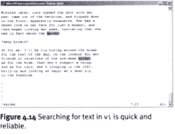

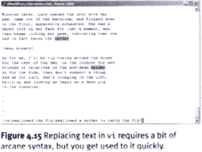

## ✓ 提示

- 搜索和替换功能的一个很好的用途是，如果你在 Unix 账户中最终得到了 DOS 文本文件（通过从 DOS 或 Windows 机器以二进制文件形式上传文本文件，最有可能）。如果你通过 Unix shell 查看 DOS 文件，文件中的所有行都会以 `^M` 结尾。但如果你在进行搜索和替换时尝试输入 `^M`，`^M` 不会显示。怎么办？按 `Ctrl V`，然后按 `Ctrl M`。只需使用 `:%s/ Ctrl V Ctrl M Ctrl M /g` 进行搜索和替换。`Ctrl V` 命令会“转义”下一个字符，因此你可以输入它，而不会实际执行该命令原本会执行的操作。如果你不转义 `Ctrl M`，`vi` 会认为你只是按了 `Enter` 并尝试执行未完成的命令。

- 有关使用正则表达式搜索的信息，请参阅第 6 章中关于 `grep` 的部分。

- 在命令末尾添加 `g` 可使其应用于文件中的所有出现项。否则，它仅应用于每行中的第一次出现。

## 退出 `vi`

呼！是时候退出 `vi` 了（图 4.16）。

### 退出 `vi`：

`Esc :q`

使用 `Esc` 进入命令模式，然后输入 `:q` 退出 `vi`。如果尚未保存最新更改，`vi` 将不会退出并会提示你使用 `!` 来覆盖。要不保存更改而退出，请使用 `:q!`，如图 4.16 所示。

### 提示

- 如果你并不真的想退出而是想编辑另一个文件，输入 `:e filename` 以打开新文件进行编辑。

- 我们建议你花几分钟时间尝试一下你在 `vi` 使用过程中会用到的一些命令。如果你认为不需要这一系列命令，请考虑使用 `pico` 而不是 `vi`。

- 熟悉 `vi` 需要一些练习，但花费的时间是值得的。有耐心并多加练习，你很快就会熟练使用 `vi`。慢慢来，深呼吸，继续前进。

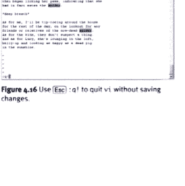

图 4.16 使用 `Esc :q!` 在不保存更改的情况下退出 `vi`。

## 开始使用 `emacs` 并尝试它

对于新手来说，`emacs` 在 `pico` 的用户友好性和 `vi`（或 `vim`）的强大功能之间提供了一个合理的中间地带。不过它并非在所有系统上都可用，所以你只能输入命令来看看是否能访问它。（如果你不能访问，请参考第 1 章。）

使用 `emacs`，你可以像预期那样直接输入，然后使用命令序列，也就是基本上是 `Ctrl` 键，来让 `emacs` 执行保存、退出等有用的操作。当你启动 `emacs` 时，它看起来可能非常像图 4.17。如果你在 Linux 系统上，“贴心”地打开了一个新窗口并给出图形版本，你会看到类似图 4.18 的内容。

### 启动 `emacs`：

- 1. `emacs`

  在 shell 提示符下，输入 `emacs`。程序启动后你会看到类似图 4.17 的内容。帮助信息可能存在也可能不存在，但无论如何你现在可以忽略它。


- 2. 今天早上我起床，下楼，在浴室里发现了一只巨大的蜘蛛。在我安静地镇定下来后，我在房子里到处寻找能装他的东西……孩子们的捉虫器（找不到……）……一个罐子……保鲜盒……带盖的杯子……沙拉旋转器（BwaaaahHaaa！）……

- 输入你想要的任何内容。

- 你可以使用方向键逐行在文件中上下导航。

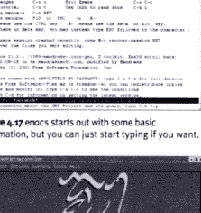

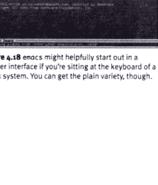

### 表 4.4

### 实用的 emacs 命令

| COMMAND | FUNCTION |
|---|---|
| `Ctrl X Ctrl F` | 打开一个新文件（现有或新建） |
| `Ctrl U` | 撤销上一次更改 |
| `Ctrl G` | 取消当前操作 |
| `Esc Esc Esc` | 退出菜单选择（及其他操作） |
| `Ctrl V` | 向下移动一页（屏幕） |
| `Alt V` | 向上移动一页（屏幕） |
| `Alt <` | 移到文件开头 |
| `Alt >` | 移到文件末尾 |

### 提示

- 要在 `emacs` 中获取帮助，输入 `man emacs`。有关 `man` 手册的更多信息请参见第 1 章。

- 如果 `emacs` “帮助”你以图形模式启动，但你想和我们一起在文本模式下操作，使用 `emacs -nw` 启动程序。（`-nw` 标志表示“无窗口”。）

`emacs` 使用 `Ctrl` 键和“meta”键来发出命令。PC 用户应使用 `Alt` 代替 meta 键（但你应该记住，在大多数 `emacs` 文档中你会看到 `M+` 或 `Meta+`）。对于那些键盘上确实有标有“Meta”的键的用户，请务必在看到 `Alt` 时使用它。Mac 用户应使用 `Option`。

- `emacs` 很有用，但也有一些怪癖。例如，如果你想访问帮助，按下 `Backspace` 键，该键会发出 `Ctrl H` 命令。要修复这种特殊情况，输入 `Alt X` 然后 `normal-erase-is-backspace`。

## 使用 emacs 菜单进行拼写检查

拼写检查是好事。学习使用 `emacs` 菜单也是好事。而在 `emacs` 中，学习拼写检查也能让你熟悉 `emacs` 菜单。使用 `F10`，然后根据需要按每个菜单、菜单项和子菜单的键字母来在菜单中导航。（你会在屏幕底部看到提示，如图 4.19 所示。）跟随操作，使用菜单对文件进行拼写检查。

### 使用 emacs 菜单进行拼写检查：

- 1. `emacs hairyspiders`

  首先，启动 `emacs` 和一个特定文件。

- 2. 按 `F10` 访问菜单。

- 3. `t`

  接下来，输入你想要的菜单的首字母——本示例目前使用 `t` 代表 `Tools`。

- 4. `0`

  尝试 `0`（零）进行拼写检查。

- 5. 按 `Enter` 并享受你的拼写检查。

### 提示

- 使用 `Esc Esc Esc` 退出你不想停留的地方（如菜单选择）。

- 阅读并跟随屏幕上的提示对于拥有幸福生活（或与 `emacs` 可容忍共存）至关重要。

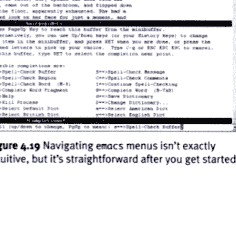

## 在 emacs 中保存

通过频繁保存来避免潜在的头痛。要在 `emacs` 中保存文件（图 4.20），请按照以下步骤操作。

### 在 emacs 中保存文本：

- `Ctrl X Ctrl S hairyspiders`

  按 `Ctrl X` 告诉 `emacs` 即将到来另一个命令，然后按 `Ctrl S` 保存。最后，输入你想要用于该文件的名称（本示例中为 `hairyspiders`），然后按 `Enter`。如果文件已经保存过一次，只需按 `Ctrl X Ctrl S`

### 提示

- 如果你在主目录（或你正在工作的目录）中四处查看，在尝试使用 `emacs` 后，你可能会注意到一堆以 `~` 结尾的文件名。那些是为你的方便和理智而创建的 `emacs` 备份文件。如果你不需要它们，只需用 `rm -i *~` 删除它们。如果你需要它们，只需使用 `mv oopsie~ oopsie` 即可恢复工作。

- 如果你想覆盖现有文件保存，使用 `Ctrl X Ctrl W`，然后输入现有文件名以覆盖原文件。

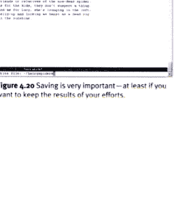

图 4.20 保存非常重要——至少如果你想保留你的努力成果的话。

## 退出 Emacs

哇！已经是退出 Emacs 的时间了（图 4.21）。

### 退出 Emacs：

- `Ctrl-X Ctrl-C`

按下 `Ctrl-X` 让 Emacs 知道还有另一条命令要来，然后按下 `Ctrl-C` 关闭。如果您尚未保存最新的更改，Emacs 会要求您决定是否要保存或丢弃未保存的更改，如图 4.20 所示。

### 提示

- 如果您最终进入了命令行但不想保存或做任何事情——您只是想返回文件——请使用 `Ctrl-G` 取消。

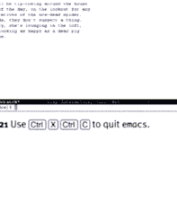

## 5. 控制所有权与权限

### 章节内容

- 理解文件所有权和权限
- 查找谁拥有什么
- 查找您所属的组
- 更改文件和目录的组关联
- 更改文件和目录的所有权
- 更改权限
- 将助记符权限转换为数字权限
- 更改权限默认值

Unix 和类 Unix 操作系统是多用户系统，其中您的文件与 Jane 的文件分开，Jane 的文件与 Joe 的文件分开，依此类推。您创建的任何文件都与其它用户的文件分开，通常不能被 Jane、Joe 或任何其它用户直接访问。

不过，有时您需要共享文件。例如，您可能正在与 Jane 合作一个项目，在这种情况下共享文件（而不是创建和维护单独的文件）是必不可少的。

本章提供了 Unix 文件权限和所有权的概述。对于许多系统而言，只有 `root` 用户才能进行所有权更改，因此您可能需要向系统管理员寻求帮助才能实际执行此操作。

### 理解文件所有权和权限

Unix 提供三种级别的文件所有权：

- **用户。** 指主要负责该文件单个用户 ID。您对自己创建的文件拥有此级别的所有权。

- **组。** 指与特定文件关联的用户组。组内的所有用户对文件交互具有相同的权限。

- **其他。** 指未被文件组或用户识别的任何用户。

在这些组内，您可以为文件访问和权限指定三个类别：

- **读。** 具有读权限的用户只能查看文件；他们不能对其进行更改。

- **写。** 具有写权限的用户可以更改或删除文件。

- **执行。** 具有执行权限的用户可以运行文件（程序或脚本）并查看目录。

在本章中，我们将向您展示一些可用于设置所有权和权限的命令（有时由您执行，通常由 `root` 用户执行）。请记住，您可以设置或更改您创建的文件的任何权限，也可能更改他人创建的文件的权限；然而，您可以更改哪些权限和所有权取决于系统。即使您目前不需要更改文件所有权或权限，您也应快速阅读本章，了解可能有哪些选项供您使用。

### 提示

- 关于所有权问题的一个有趣转折是，并非所有“所有者”都是人。程序或进程（在第 9 章中讨论）作为特定用户运行，如果它们创建文件，则这些文件具有反映程序个人和组成员身份的权限。有关更多信息，请参阅第 9 章。

- 一些类 Unix 操作系统具有控制特定文件访问的额外或补充手段。通常，您会知道是否在使用此类系统。现在只需知道此类事物存在：本章中的程序将处理您 99% 的需求。

### 查找谁拥有什么

更改所有权和权限的第一步是找出谁拥有哪些文件。您需要此信息来确定您是否可以更改权限。

### 查找谁拥有什么：

1. `cd`

   在 shell 提示符下，键入 `cd` 返回到您的主目录。

2. `ls -l`

   输入 `ls -l` 查看当前目录中文件的长列表。（参见代码清单 5.1。）左侧列包含十个字符，其中最后九个指定每个文件的权限：


```text
xmission> cd
/home/users/e/ejray
xmission> ls -l
total 60
drwx--x--x  2 ejray  users   512 Jul 21 13:32 Complete/
drwx--x--x  2 ejray  users   512 Jun 24 09:23 Completed/
drwx--x--x  2 ejray  users   512 Sep 15 1997 Mail/
drwx--x--x  2 ejray  users   512 Jun 24 09:35 NewProject/
drwx--x--x  2 ejray  users   512 Sep 15 1997 News/
drwx--x--x  2 ejray  users   512 Sep 15 1997 access/
-rw-------  1 ejray  users   163 Jul 22 07:28 bogus2
drwx-----x  2 ejray  www     512 Jul 24 04:44 chat.conf/
-rw-------  2 ejray  users   853 Sep 13 1997 dead.letter
-rw-------  1 ejray  users 14286 Jun 28 12:40 files
lrwxrwxrwx  1 ejray  users    27 Sep 15 1997 ftp -> /home/ftp/pub/users
-rw-------  1 ejray  users    36 Jul 24 12:09 limerick
drwx--x--x  2 ejray  users   512 Jun  8 13:32 mail/
drwx--s--x 15 ejray  www    2560 Jul 10 18:30 public_html/
drwx--x--x  2 ejray  users   512 Jul 22 08:23 puppy/
drwx--x--x  2 ejray  users   512 Jul 24 04:44 temp/
-rw-------  1 ejray  users     0 Jul 19 13:24 testme
```

### 代码清单 5.1 — 许多系统仅使用少数组名以便于文件共享和协作。

▲ `r` 表示读权限，`w` 表示写权限，`x` 表示执行权限。

▲ 第一个 `rwx` 是针对用户，第二组是针对组，最后一个是针对其他人。

▲ 如果用破折号 (`-`) 代替字母，则表示用户/组/其他人没有该级别的权限。例如，`rwx------` 表示用户具有读、写和执行权限，而组和其他人则完全没有任何权限。

中间的两列表示文件的所有者（在此示例中很可能是你的用户 ID）和文件的组归属。在代码清单 5.1 中，`ejray` 是所有文件的所有者。大多数文件都与 `users` 组关联，而只有少数目录与 `www` 组关联。

在此系统中，个人用户创建的文件会与用户的组关联，而用于 Web 的文件则具有 `www` 组关联。在其他系统中，文件的默认组可能与用户 ID 名称相同，如代码清单 5.2 所示。

### `ls -l /etc`

你也可以对系统目录，例如 `/etc`，使用 `ls -l` 命令。在这里，你会看到大多数文件都由 `root` 所有，可能具有各种不同的组归属（参见图 5.1）。

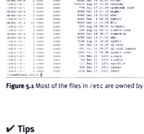

## Tips

- 有时你会看到对 `world-readable` 或 `world` 权限的引用。这与 `other` 相同。“Other” 只是指不是你，不是该组，而是其他任何人。
- 你也可能会听说 `s` 或 `SetUID` 权限，这表示程序或文件可以用文件所有者的有效用户 ID 运行（通常是 `root`）。例如，`/usr/bin/passwd` 具有 `s` 权限，因为你可以运行 `passwd` 来更改你的密码，但该命令需要以 `root` 身份运行才能实际修改密码数据库。
- 你也可能会在权限列表末尾看到一个 `t`，这表示粘滞位已设置。这主要意味着，在共享目录中，你只能删除自己的文件（而不会意外删除他人的文件）。

```
[ejr@hobbes permissions]$ ls -l
total 152
-rw-rw-r-- 1 ejr ejr 128889 Jul 24 14:33 sage.sayings
-rw-rw-r-- 1 ejr ejr 23890 Jul 24 14:33 sayings
[ejr@hobbes permissions]$
```

## Code Listing 5.2 有时组名和用户名相同，这取决于系统的设置方式。

## Finding Out Which Group You're In

如果你想与他人协作并共享文件，例如，你需要与团队中的其他人属于同一组。你的第一步是找出你所在的组，如代码清单 5.3 所示。

### To find out which group you're in:

- 1. `grep yourid /etc/passwd`

这里，`grep yourid` 从 `/etc/passwd` 文件中提取你的用户 ID（用户信息存储在该文件中）并将其显示出来，如代码清单 5.3 所示。从左到右，你可以看到

▲ 你的用户名

▲ 编码后的密码（或无，或 `x`，如果系统配置为“shadow”密码）

▲ 你的用户 ID（每个用户在系统中都有一个唯一的数字）

- 2. Note the number of the group.

你需要该数字来在步骤 3 中将其与组名匹配。在本例中，我们的组 ID 为 500。

- 3. `more /etc/group`

这里，我们使用 `more` 探索 `/etc/group` 文件的内容，以查看系统上当前定义了哪些组。如代码清单 5.4 所示，第一列包含组名，第三列包含组号，最后一个列包含系统管理员添加到该组的额外名称。用户可以属于多个附加组，这就是附加组成员身份的表示方式。

- 4. Match up the group number for your ID with the group name.

我们的数字为 500，在这里对应于 `ejr` 组名。

```
[ejr@hobbes permissions]$ grep ejr /etc/passwd
ejr::oag2,lyCyJKEJNE:500:Eric J. Ray:/home/ejr:/bin/bash
[ejr@hobbes permissions]$
```

Code Listing 5-3 你可以在 `/etc/passwd` 中找到大量信息，包括你的默认组号。

```
[ejr@hobbes permissions]$ cat /etc/group
knem::9:
wheel::10:root,ejr
mail::12:mail
news::13:news
uucp::14:uucp
man::15:
games::20:
gopher::30:
dip::40:
ftp::50:
nobody::99:
users::100:ejr,deb,osr,owr
floppy::x:19:
pppusers::x:230:
popusers::x:231:
slipusers::x:232:
postgres::x:233:
ejr::x:500:
bash::x:501:
csh::x:502:
osr::x:503:
owr::x:504:
deb::x:505:
[ejr@hobbes permissions]$
```

Code Listing 5-4 组文件列出组和附加成员（如 `users` 组所示）。

## Tips

- 如果你在协作进行一个项目，请让你的系统管理员为该项目创建一个专门的组。这样，你和你的团队成员就可以轻松共享文件。
- 你也可以使用 `groups` 或 `id` 命令，这提供了快速了解组成员身份的方法。它们提供了关于组成员身份（以及用户 ID）的基本细节，但不会用系统上其他最有趣且可能有用的细节淹没你。前往第 7 章了解更多信息。
- 查看第 1 章了解更多内容。
- 查看第 6 章了解关于 `grep` 的完整信息。

## Tips

- 如果你尝试更改组所有权并收到类似 "Not owner" 或类似晦涩的错误信息，你的用户 ID 没有必要的权限来做出更改。你将不得不请你的系统管理员提供帮助。
- 只有在有特定需要时才更改组关联；你不想不必要地让其他人访问你的文件。除非你是系统管理员，否则你将无法完全控制有权访问你文件的组的成员。
- 如果你更改了特定目录的组关联，你还需要检查包含它的目录的权限。用户将无法进入该特定目录（无论其组成员身份如何），除非他们对包含它的目录也具有读和执行权限。


- 就像第 2 章中介绍的 `cp` 和 `mv` 命令一样，你可以使用 `-R` 标志与 `chgrp` 一起使用，以递归地将更改应用于目录及其所有子目录和文件。例如，要将 LatestProject 目录及其所有内容与 project 组的关联更改，请从 LatestProject 上一级的目录中使用 `chgrp -R project LatestProject`。

## Changing Ownership of Files and Directories with chown

### Tips

- 在你更改文件的所有权后，你能对文件做什么取决于组和其他权限以及成员身份。然而，新所有者将能够对文件做任何事情。
- 当更改目录的所有权时，你可以添加 `-R` 标志到 `chown`，使其递归地应用于其下的所有文件和目录。
- 如果系统不允许你使用 `chown` 来赠送文件，请考虑使用 `cp` 来复制文件以达到同样的目的。如果你复制了别人拥有的文件（你有权限读取），复制的文件完全属于你了。（在这个赠送文件的例子中，接收者应使用 `cp`。）
- 即使你不能使用 `chown`，你仍可以请求系统管理员为你更改文件所有权："你能请用 `chown merrilee /home/shared/me/rowyourboat` 将我的 `rowyourboat` 文件的所有权更改为 Merrilee 吗？谢谢！"

假设你一直在处理一个名为 `rowyourboat` 的文件，而你的老板决定让同事 Merrilee 接手该项目。在这种情况下，为了完全把项目推给你的同事，你需要将文件的所有权从你更改为她。根据你的系统管理员如何设置系统，你通常可以使用 `chown` 来更改文件的所有权（代码清单 5.6）。

### To change ownership with chown

1. `ls -l`

   首先，在 shell 提示符下输入 `ls -l` 以验证文件的名称和所有权，如代码清单 5.6 所示。记住，所有权信息位于权限和链接信息之后。

2. `chown merrilee rowyourboat`

   输入 `chown`，后跟你想要转移所有权给的人的用户 ID 和文件名。在这种情况下，`chown` 命令将 `rowyourboat` 的所有权更改为 `merrilee`。`rowyourboat` 及其相关问题现在将属于她，生活将只是梦想。

```
[ejr@hobbes merrilee]$ ls -l
total 26
-rw-rw-r-- 1 ejr users 24850 Jul 24 15:17 rowyourboat
[ejr@hobbes merrilee]$ chown merrilee rowyourboat
[ejr@hobbes merrilee]$ ls -l
total 26
-rw-rw-r-- 1 merrilee users 24850 Jul 24 15:17 rowyourboat
[ejr@hobbes merrilee]$
```

Code Listing 5.6 Changing ownership of files transfers complete control.

## 使用 chmod 修改权限

假设你一直在处理一个名为 `rowyourboat` 的文件，并且希望下游的同事能够审阅它。为此，你需要给其他人访问该文档的权限。你可以为特定组中的人员授予访问权限，也可以为 Unix 系统上的所有人授予访问权限。具体来说，你可以为 `u` `ser`——也就是你自己、`g` `roup`、`o` `thers` 和 `a` `ll` 指定权限。

除了指定权限之外，你还可以指定某个人或组对你的文件拥有哪些程度的访问权限。例如，你可以指定 `r` `e` `ad`、`w` `rite` 和 `e` `x` `ecute` 访问权限，这取决于你信任他们不会破坏你的 `rowyourboat` 杰作的程度。

如代码清单 5.7 所示，你的第一步是查看当前的权限。然后，你可以根据需要设置权限、向其添加权限或移除权限。

### 查看当前权限：

- `ls -l r*`

首先，输入 `ls -l r*` 以获取当前目录中 `rowyourboat` 的长列表。代码清单 5.7 显示权限为 `-rwxr-x--`。这实际上是三组权限：

- 对于用户 `rwx`，在此示例中
- 对于组 `r-x`，此处
- 对于世界 `---`，此处

在此示例中，用户具有读、写和执行权限；组只有读和执行权限；所有其他用户都没有权限。

```
[ejr@hobbes permissions]$ ls -l r*
-rwxr-x-- 1 ejr users 152779 Jul 24 15:10 rowyourboat
[ejr@hobbes permissions]$
```

代码清单 5.7 使用 `ls -l` 查看文件的权限。

### 设置权限：

`chmod u=rwx,g=rx,o=r row*`

输入 `chmod` 并指定谁有权访问。在这种情况下，用户具有读、写和执行权限；组具有读和执行权限；其他人对当前目录中以 `row` 开头的所有文件具有读权限（代码清单 5.8）。

等号 `=` 指定命令中授予的权限是唯一适用的权限。任何先前的权限将被移除。

这里的通配符表达式 `row*` 指定命令适用于当前目录中以“row”开头的所有文件和目录。

```
[ejr@hobbes permissions]$ ls -l
total 332
-rw-rw-r-- 1 ejr users 24850 Jul 24 14:59 black
-rw-r--r-- 1 ejr users 152779 Jul 24 15:10 rowyourboat
-rw-r--r-- 1 ejr users 128889 Jul 24 14:33 sage.sayings
-rw-rw-r-- 1 ejr users 23890 Jul 24 14:33 sayings
[ejr@hobbes permissions]$ chmod u=rwx,g=rx,o=r row*
[ejr@hobbes permissions]$ ls -l
total 329
-rwxr-xr-- 1 ejr users 24850 Jul 24 14:59 black
-rwxr-xr-- 1 ejr users 152779 Jul 24 15:10 rowyourboat
-rwxr-xr-- 1 ejr users 128889 Jul 24 14:33 sage.sayings
-rwxr-xr-- 1 ejr users 23890 Jul 24 14:33 sayings
[ejr@hobbes permissions]$
```

代码清单 5.8 你可以设置权限以确保所有文件具有等效的权限。

### 添加权限：

```
chmod g+w rowyourboat
```

在 shell 提示符下，输入 `chmod`，后跟

- 类别。在这种情况下，我们使用了 `g`，表示组，但你也可以使用 `o` 表示其他人……当然也可以使用 `u` 表示用户，但你已经拥有该访问权限。你也可以使用 `a` 表示所有用户（包括 `u`、`g` 和 `o`）。
- 加号 `+` 表示你是在向现有权限添加权限，而不是设置绝对权限。
- 要授予的权限。在这里，我们使用了 `w`，表示写权限，但你也可以根据需要使用 `r` 表示读或 `x` 表示执行权限。
- 文件名 `rowyourboat`

### 移除权限：

```
chmod go-w rowyourboat
```

在 shell 提示符下，使用 `chmod go-w` 加上文件名即可移除除你本人、文件所有者之外的所有人的写权限。请注意，我们这次在一个命令中同时处理了组和其他人，虽然我们也可以使用 `chmod g-w rowyourboat` 和 `chmod o-w rowyourboat` 来实现同样的效果。

## 提示

- 你也可以使用 `chmod` 的 `-R` 标志递归地将你对权限所做的更改应用于目录中的所有文件和子目录。例如，`chmod -R go-rwx *` 撤销当前目录中所有文件、当前目录中的所有子目录以及所有子目录中的所有文件对除用户之外的所有人的所有权限。
- 表达权限的方式多达一百万种以上。例如，你可以使用 `chmod ugo= *`（注意 `*` 前面的空格）或 `chmod u-rwx,g-rwx, o-rwx *` 来撤销目录中所有文件的所有权限。（请注意，如果你尝试这样做，在你对它们做任何事情之前，你必须先将自己的权限加回到文件上。）
- 如果你想更改多个文件的权限，要么使用通配符表达式，要么用逗号分隔文件名（但不要加空格）。

## 将助记符权限翻译为数字权限

### 表 5.1

### 助记符权限的数字等价

| Mnemonic (rwx) permissions | Binary Equivalent | Numeric Equivalent |
|---|---|---|
| `--` | 000 | 0 |
| `-x` | 001 | 1 |
| `-w-` | 010 | 2 |
| `-wx` | 011 | 3 |
| `r--` | 100 | 4 |
| `r-x` | 101 | 5 |
| `rw-` | 110 | 6 |


| rwx | 111 | 7 |

正如你在本章中看到的，文件的权限以三组出现——`rwx`，即读、写和执行权限。而且，正如我们向你展示的，你通过指定每个权限是“开启”还是“关闭”来设置这些权限。例如，`ugo+rwx` 将用户、组和其他的读、写和执行权限设置为“开启”，而 `o+r-w` 将所有人的读和写设置为“开启”，`o-x` 将执行设置为“关闭”（在目录列表中用 `-` 表示）。

然而，与其用字母和连字符设置权限，你可以将它们翻译成数值，使用 1 表示“开启”，0 表示“关闭”。因此，`rw-`，读和写“开启”而执行关闭，将翻译成数字 `110`。你可以把它看作是二进制计数——`000`、`001`、`010`、`011`、`100`、`101`、`110`、`111`，其中在权限设置为“开启”的每个位置都有一个 1。

这些开启/关闭权限的组合（或二进制数）可以表示为 0 到 7 之间的唯一十进制数字，如表 5.1 所示。正是这些十进制数字用于设置权限。

### 使用数字等价设置权限：

- `chmod 777 rowyourboat`

输入 `chmod`，后跟用户、组和其他的所需权限，使用表 5.1 中列出的数字等价，然后是文件名。在此示例中，我们使用 `777` 将用户、组和其他的读、写和执行权限设置为“开启”。

或者，例如，`724` 将为用户提供完整的读、写和执行权限，组仅有写权限，其他仅有读权限。

### 提示

- 使用数字等价设置权限是绝对设置权限，而不是在现有权限上增加或减少。

- 数字等价并不会比使用 `ugo+rwx` 给你更多的控制；然而，你需要使用数字系统来设置创建新文件时适用的默认权限。有关完整说明，请参阅下一节《使用 umask 更改权限默认值》。

## 使用 umask 更改权限默认值

每次你创建文件时，Unix 系统都会为你应用默认权限。这很棒，因为对于许多用途，默认权限正是你想要的。在其他情况下，你会想要指定不同的默认权限。

你可以使用 `umask` 更改默认权限。`umask` 命令使用数字表示法表示权限（正如上一节所讨论的），但你在此处指定的数值与使用 `chmod` 时使用的数值不同。（不要问为什么。我们假设蝙蝠侠和罗宾一起合作，让这个命令只有在他们的力量被激活时才可供神奇双胞胎使用。）因此，你必须计算出你想要的权限的 `umask` 值，然后使用该值设置新的默认权限。

请注意，你不能默认设置执行权限，因此你实际上只是在计算 `u`、`g` 和 `o` 类别的读和写权限。

### 计算 umask 值：

1. `666`

   从 `666` 开始。同样，不要问为什么；这就是你应该开始的数字。

2. 计算出你将使用 `chmod` 命令设置所需权限时使用的数值。

   你可以回顾上一节《将助记符权限翻译为数字权限》，并查看该节中的表 5.1。

3. 将该数值从 `666` 中减去。

   例如，如果你将与 `chmod` 一起使用的数值为 `644`，则从 `666` 中减去该值：`666-644=022`。`022` 就是你将与 `umask` 一起使用的数字。

```
[ejr@hobbes permissions]$ umask 022
[ejr@hobbes permissions]$ touch tryit
[ejr@hobbes permissions]$ ls -l try*
-rw-r--r-- 1 ejr users 0 Jul 26 16:35 tryit
```

代码清单 5.9 使用 `umask` 为将来创建的文件设置默认权限。

### 使用 umask 设置默认文件创建权限：

- `umask 022`

输入 `umask` 加上你在本节前面的步骤中计算出的数字（代码清单 5.9）。

### 提示

- 使用 `umask` 所做的任何更改仅适用于当前 shell 会话。如果你想恢复到默认权限但不记得它们是什么，只需注销并重新登录，你就会恢复正常。

- 如果你想永久更改权限默认值——或者至少超出当前 shell 会话——请在第 8 章讨论的配置文件中更改它们。

- 你不能将默认权限设置为包含执行权限；这是一个安全特性，而不是 Unix 功能上的遗漏。例如，假设你新建一个文件并将你最喜欢的命令（或你经常忘记的命令）复制到其中。如果你不小心输入了文件名并且该文件是可执行的，你将运行该命令列表，后果可能不幸。因此你必须显式授予所有文件的执行权限。

- 是的，`666` 被认为是兽的数字。我们认为这只是巧合，但鉴于本节可能产生的混淆，我们并不确定。

- 使用 `umask` 或 `umask -s`（取决于你的特定 shell 和环境设置）来显示当前的 `umask` 设置。

## 操作文件

## 章节内容

- 计数文件和文件内容

- 查看文件开头

- 查看文件结尾

- 查找文本

- 使用正则表达式

- 进行全局更改

- 更改文件

- 比较文件

- 查找文件中的差异

- 排序文件

- 格式化文件

- 将文件重定向到两个位置

- 分割

正如你在第 4 章中学到的那样，你可以通过打开编辑器并进行想要的更改来相当轻松地处理文本。但你能做的不仅仅是在文件中复制、粘贴、剪切或移动文本。正如我们将在本章中讨论的那样，你可以操作整个文件并查看其特定部分，获取有关文件的信息，在文件中查找文本，比较文件并排序文件。各种有趣的东西！

在本章中，我们将使用大量标志来增强命令。如果你需要进一步的解释或稍后快速提醒，你可以在附录 C 中找到最常用命令及其标志的完整列表。

## 使用 wc 计数文件及其内容

Unix 最方便的功能之一让你可以计数文件及其内容。例如，你可以计数目录中的文件数量，或者可以计数文件中的单词数或行数。你使用 `wc` 命令进行计数，如代码清单 6.1 所示。

### 使用 wc 计数单词：

- `wc -w honeydo`

在 shell 提示符下，输入 `wc -w`（表示 words）和你想要计数单词的文件名。`wc` 会照做，如代码清单 6.1 所示。

### 使用 wc 计数行：

- `wc -l honeydo`

使用 `wc -l` 后跟文件名来计数文件中的行数（代码清单 6.2）。这对于诗歌或类似列表的东西很有用（例如，我们的“待办清单”总是至少有 73 项）。

### 提示

- 你可以通过使用 `ls l wc -l` 来计算常规文件和目录的数量，或使用 `ls -A l wc -l` 来计算所有文件和目录的数量（除 `.` 和 `..` 目录外）。

- 你也可以使用 `wc -c` 找出特定文件占用了多少字节。或者，你可以完全不使用任何标志使用 `wc` 来获取行数、单词数和字节数。

```
[e]r@hobbes manipulate]$ wc -w honeydo
235 honeydo
```

代码清单 6.1 使用 `wc -w` 计数文件中的单词数。本例中的“待办清单”离小说的长度还很远。

```
[e]r@hobbes manipulate]$ wc -l honeydo
85 honeydo
```

代码清单 6.2 然而，清单中有 85 个单独的项目，已经足够长了。

## 使用 head 查看文件开头

使用 `head`，如代码清单 6.3 所示，你可以迅速了解文件中的内容，通过查看前几行。这在浏览文件列表或尝试在多个内容相似的文件中查找特定文件时特别方便。

### 使用 head 查看文件开头：

- `head honeydo`

在 shell 提示符下，输入 `head` 后跟文件名。如代码清单 6.3 所示，你会看到屏幕上显示的前十行。请注意，“行”是由硬回车定义的，因此在某些情况下，一行可能会换行到许多屏幕行。

### 查看指定数量的行：

- `head -20 honeydo`

添加 `-20`（或你想要查看的行数）来查看特定数量的行。

### 查看多个文件的开头：

- `head honey* | more`

你可以通过将 `head`（加上文件名）管道到 `more` 来查看多个文件的顶部。请注意 `head` 方便地告诉你每个文件的名称，如代码清单 6.4 所示

```
[ejr@hobbes manipulate]$ head honeydo
Take garbage out
Clean litter box
Clean diaper pails
Clean litter box
Mow lawn
Edge lawn
Clean litter box
Polish swamp cooler
Buff garage floor
Clean litter box
[ejr@hobbes manipulate]$
```

代码清单 6.3 使用 `head` 只查看文件的顶部，这能让你以可管理的方式查看文件。


```
[ejr@hobbes manipulate]$ head honey* | more
==> honeyconsider <==
Mother-in-law visits next week
Cat mess in hall to clean up
Cat mess in entry to clean up
Cat mess in living room to clean up
Toddler mess in family room to clean up
Cat and toddler mess in den to clean up
IRS called again today
Neighbors on both sides looking for donations for the annual fund drive
Boss called last Friday and said it’s urgent
==> honeydo <==
Take garbage out
Clean litter box
Clean diaper pails
Clean litter box
Mow lawn
Edge lawn
Clean litter box
Polish swamp cooler
Buff garage floor
```

代码清单 6.4 在 `more` 的帮助下，`head` 让你能按顺序查看多个文件的开头。

## 使用 tail 查看文件结尾

有时，你可能还需要使用 `tail`，它会显示文件的最后几行。`tail` 特别适合查看页脚或更新页脚中的信息（参见代码清单 6.5）。与 `head`（前面几页已介绍）一样，`tail` 也提供了多种查看文件的选项。

### 使用 tail 查看文件结尾：

- `tail honeydo`

  在 shell 提示符下，输入 `tail` 后跟文件名。如代码清单 6.5 所示，屏幕将显示最后十行。

### 查看指定行数：

- `tail -15 honeydo`

  这里，你只需添加要查看的具体行数（`-15`）。

### 查看多个文件的结尾：

- `tail honey* | more`

  将 `tail` 命令和文件（用 `*` 表示多个文件）通过管道传给 `more`（代码清单 6.6）。

### 提示

- `head` 及其对应命令 `tail` 非常适合拆分长文件。使用 `wc -l` 计算行数。如果文件有 500 行，但你只关心开头和结尾的行，那么输入 `head -25 filename > newfilename` 将文件的前 25 行放入一个新文件。然后同样使用 `tail` 将文件的后 25 行放入另一个新文件。

```
[ejr@hobbes manipulate]$ tail honeydo
Empty diaper pails
Take garbage out.
-End of today's list-

Buy more garbage bags
Get cleaning supplies at store
Take cat to vet
Fix lawnmower

[ejr@hobbes manipulate]$
```

代码清单 6.5 `tail` 让你只需查看文件的结尾。

```
[ejr@hobbes manipulate]$ tail honey* | more
==> honeydo <==
Cat mess in entry to clean up
Cat mess in living room to clean up
Toddler mess in family room to clean up
Cat and toddler mess in den to clean up
IRS called again today
Neighbors on both sides looking for donations
for the annual fund drive
Boss called last Friday and said it's urgent
-End of today's list-

==> honey* <==
Empty diaper pails
Take garbage out
-End of today's list-

Buy more garbage bags
Get cleaning supplies at store
Take cat to vet
Fix lawnmower

--More--
```

代码清单 6.6 将 `tail` 与 `more` 结合使用，以查看多个文件的结尾。

## 使用 grep 查找文本

你可以通过多个文件搜索特定的字符串，然后在屏幕上查看匹配文件列表。使用 `grep` 命令即可实现（`grep` 代表“全局正则表达式打印”，曾经是 `ed` 或 `vi` 中实用、如今却相当冷门的命令），如代码清单 6.7 所示。我们将展示，你可以给 `grep` 添加几个标志以获得略有不同的结果。

### 使用 grep 查找文本字符串：

- `grep bucket limericks`

  在 shell 提示符下，输入 `grep`、要定位的文本（此处为 `bucket`）以及要搜索的文件（此处为 `limericks`）。`grep` 将返回文件中包含指定字符串的所有行，如代码清单 6.7 所示。

- `grep -5 bucket limericks`

  你可以指定在找到的文本字符串前后各显示若干行（比如 `-5`）。有时仅凭包含搜索字符串的那一行无法判断所需信息，因此在它周围添加几行有助于提供上下文（参见代码清单 6.8）。请注意，并非所有版本的 `grep` 都支持此选项，但对大多数版本有效。

- `grep -c Nantucket limericks`

  通过添加 `-c` 标志，你可以统计某个文本字符串在文件中出现的次数。

- `grep -v Nantucket limericks`

  或者，使用 `-v` 标志，你可以查找所有不包含指定字符串的行。

- `grep -i nantucket limericks`

  使用 `-i` 标志，你可以进行不区分大小写的搜索。这里，任何包含 `nantucket`、`Nantucket` 或 `nAntuCket` 的行都会被找到。

```
[ejr@hobbes manipulate]$ grep bucket limericks
Who carried his lunch in a bucket,
[ejr@hobbes manipulate]$
```

代码清单 6.7 使用 `grep` 查看文件中特定字符串的所有出现位置。

```
[ejr@hobbes manipulate]$ grep -5 bucket
> limericks
he strummed and he hummed,
and sang dumdeedum,
But him, a musician...who'd a thunk it?

There once was a man from Nantucket,
Who carried his lunch in a bucket,
Said he with a sigh,
As he ate a whole pie,
If I just had a donut I'd dunk it.

A nice young lady named Debbie,
[ejr@hobbes manipulate]$
```

代码清单 6.8 `grep` 还能显示字符串匹配实例周围的上下文。

### 提示

- 使用 `-n` 标志（例如 `grep -n string file`）打印找到的每一行并显示行号。

- 你可以对多个文件名使用 `grep`，例如 `grep Nantucket lim*` 或 `grep Nantucket lim* poetry humor`。

- 如果想更灵活一些，你也可以搜索空格，但需要使用引号，例如 `grep "from Nantucket" limerick*`。

- 了解 `grep` 的渊源，可以在酒吧里赢得书呆子式赌局。

## 使用 grep 进行正则表达式搜索

除了使用 `grep` 搜索简单的文本字符串外，你还可以使用 `grep` 搜索正则表达式。正则表达式有点像花哨的通配符，你使用符号来表示字符、数字或其他符号。使用正则表达式，你可以搜索文件的不同部分，例如行的末尾或与另一个指定文本字符串相邻的文本字符串。表 6.1 列出了一些更常见的正则表达式。

```
[e]r@hobbes manipulate]$ grep .logan limerick
Worked hard all day on a slogan,
You see, the slogan's still brogan.
[e]r@hobbes manipulate]$
```

代码清单 6.9 使用 `grep` 与正则表达式创建花哨的通配符命令。

### 使用 grep 进行正则表达式：

- `grep .logan limerick`


## `grep` 与正则表达式

输入`grep`，后跟正则表达式和文件名。在这里，我们使用了正则表达式`.logan`来查找所有前面有一个字符的`logan`实例（代码清单 6.9）。请注意，这种使用`.`来匹配单个字符的方式与使用`ls`时的`?`通配符非常相似。

你也可以使用多个句点来指定特定数量的字符。例如，要查找“Dogbert”和“Dilbert”，你可能会使用`grep D..bert plagiarized.sayings`。

在某些情况下，你可能需要根据使用的表达式和要查找的信息稍微不同地构建搜索字符串。查看表 6.1 中的其他示例以获取更多信息。

### 提示

- “正则表达式”在 Unix 文档和互联网讨论中通常缩写为`regexp`。
- 命令`egrep`与`grep`密切相关，为扩展正则表达式增加了一些灵活性，但从根本上工作方式相同。在许多系统上，`grep`命令实际上是`egrep`——当你输入其中任何一个时，你实际上运行的是`egrep`。
- 如果你需要在大型文件中搜索整个单词，请使用`fgrep`进行更快的搜索。它使用与`grep`相同的通用语法，但只搜索整个单词（而不是正则表达式），因此速度快得多。
- 有关通配符的详细信息，请参阅第 1 章。

### 表 6.1：正则表达式、示例和解释

| 正则表达式 | 功能 | 示例 | 解释 |
|---|---|---|---|
| `.` | 匹配任意字符 | `b.*rry` | 这会找到`berry`或`barry`的所有实例。 |
| `*` | 匹配前一项的零个或多个实例，因此`a*b`会找到`b`以及`ab`和`aaab`，但找不到`acb` | `grep "s*day" /home/ejr/schedule` | 在这里，`*`匹配`*`前面紧跟的项目的零个或多个。 |
| `^` | 仅匹配行开头处的字符串实例 | `grep "^Some" sayings` | 使用`^`，你指定搜索字符串必须出现在行的开头。示例会找到以`Some`开头的行，但不会找到以`Read Some`开头的行。 |
| `$` | 仅匹配行末尾处的字符串实例 | `grep "ach$" sayings` | 使用`grep ach$ sayings`，你可以找到`sayings`文件中所有以`ach`结尾的行。 |
| `\` | 转义（引用）下一个字符——因此你可以搜索`*`或`$`等也是运算符的字面字符 | `grep "\*" sayings` | `grep "*" sayings`搜索`sayings`文件中`*`的所有实例。`\`告诉`grep`将`*`字面解释为星号字符，而不是通配符。 |
| `[ ]` | 匹配集合中的任何成员，如`[a-z]`、`[0-6]`或`[321]`（三或二或一） | `grep "number[0-9]" specifications` | 使用方括号（`[ ]`）括起一组选项。这里，`number[0-9]`会匹配`specifications`文件中`number 1`、`number 2`、`number 3`等的所有实例。 |

## 使用其他正则表达式示例

在上一节中，我们向你展示了如何使用`grep`命令进行正则表达式搜索。不过，你也可以执行其他很棒的查找任务，我们将在本节中讨论。

### 查找具有特定特征的行

- `grep '^Nantucket' limerick`

  在这里，我们使用`grep`查找 limericks 中所有以`Nantucket`开头的行，如果有的话。

- `grep 'Nantucket$' limerick`

  同样，你可以找到以`Nantucket`结尾的行。

- `grep '^[A-Z]' limerick`

  或者，你可以通过包含`[A-Z]`正则表达式来查找以大写字母开头的行。

- `grep '^[A-Z,a-z]' limerick`

  在这里，你可以找到所有以任何字母开头但不是数字或符号的行。很花哨，对吧？

### 提示

- 你也可以将正则表达式与`awk`和`sed`一起使用。有关详细信息，请参阅本章中的“使用 sed 进行全局更改”和“使用 awk 修改文件”。

## 使用`sed`进行全局更改

另一个方便的命令是`sed`，它让你可以在不打开编辑器的情况下对文件进行多次更改。例如，作为一名新任 Web 管理员，你可能会使用`sed`将之前 Web 管理员的电子邮件地址的所有出现位置更改为你自己的地址。正如我们在本节中所示，你可以使用`sed`在文档内进行全局更改。

### sed 命令的组成

```
sed 's/oldaddr@raycomm.com/newaddr@raycomm.com/g' address.htm > address-new.htm
```

输入`sed`，后跟

- 一个单引号（`'`）
- 一个开头的`s`
- 一个斜杠（`/`）
- 你想要替换的文本（`oldaddr@raycomm.com`）
- 另一个斜杠（`/`）
- 替换文本（`newaddr@raycomm.com`）
- 另一个单引号（`'`）
- 另一个`/`
- `g`，它告诉`sed`全局应用更改。（如果你省略`g`，则每行只会更改第一次出现。）
- 应进行更改的文件名（`address.htm`）

你可以将输出重定向到一个新文件名（参见代码清单 6.10）或将其管道传输到另一个命令。你不能重定向到同一文件名，否则你的文件最终将没有内容。

```
[ejr@hobbes manipulate]$ sed 's/oldaddr@raycomm.com/newaddr@raycomm.com' /g address.htm > address-new.htm
[ejr@hobbes manipulate]$ head address-new.htm
<BODY BACKGROUND="/images/background.gif" BGcolor="#FFFFFF" TEXT="#000000" LINK="#000908" VLINK="#000000" ALINK="#ff0000">
<P>
Please send all comments to <A HREF="mailto:newaddr@raycomm.com">newaddr@raycomm.com</A>.
</P>
<TABLE BORDER=0>
<TR>
<TD WIDTH="150" VALIGN=TOP>
[ejr@hobbes manipulate]$
```

代码清单 6.10 你可以使用`sed`对文件进行更改，例如这里的地址更改。

### 提示

- 你可以让`sed`快速处理多个文档。参见第 10 章，了解如何使用循环创建 shell 脚本的信息。
- 因为`sed`命令可能很长且难以处理，因此将命令保存在单独的文本文件（以免重新输入）可能会有所帮助。例如，如果你将命令`s/oldaddr@raycomm.com/newaddr@raycomm.com/g`保存在名为`script.sed`的文件中，你可以发出`sed -f script.sed address.htm > address-new.htm`来运行`script.sed`文件中的`sed`命令。你的`script.sed`文件中可以包含任意数量的命令。

## 使用`awk`更改文件

虽然`sed`是按行处理的并且让你随心所欲地修改，但`awk`是按字段处理的，非常适合操作数据库或逗号分隔的文件。例如，如果你有一个地址簿文件，你可以使用`awk`来查找并更改你指定的字段中的信息，如代码清单 6.11 所示。在以下步骤中，我们将向你展示一些使用`awk`修改、例如地址簿文件的方法示例。

### awk 命令示例

1. `awk '{ print $1 }' address.book`

   在 shell 提示符下，使用命令`awk '{ print $1 }' address.book`来查看`address.book`文件并选择（并发送到标准输出）每条记录（行）中的第一个字段。更具体地说，从内到外开始：

   > `$1`引用每行中的第一个字段。除非另有指定，否则`awk`假定空格分隔字段，因此第一个字段从行首开始并持续到第一个空格。
   >
   > `{}`包含`awk`命令，引号是必要的以将`awk`命令绑定在一起（以便命令中的第一个空格不会被 shell 解释为命令的结束）。参见代码清单 6.11。

2. `awk -F ', ' '{ print $1 }' address.book`

   `-F`标志告诉`awk`使用其后的字符——在本例中为逗号加空格——作为字段分隔符。此更改使命令的输出更干净、更准确。如果你正在处理`/etc/passwd`，则会使用`-F:`来指定`:`为字段分隔符。

```
[ejr@hobbes manipulate]$ awk '{ print $1 }' address.book
Schmidt,
Feldman,
Brown,
Smith,
Jones,
[ejr@hobbes manipulate]$
```

代码清单 6.11 `awk`让你访问文件中的各个字段。

## De-what?


分隔文件使用特定字符来显示一个信息位结束和另一个开始的位置。每个信息片段都是一个单独的字段。例如，包含 "John, Doe, Thornton, Colorado" 的文件是逗号分隔的，字段之间带有逗号。其他文件，例如 `/etc/passwd` 文件，使用冒号 (`:`) 来分隔字段。几乎任何在内容中未使用的符号都可以用作分隔符。

```text
[ejr@hobbes manipulate]$ awk -F ', ' '{ print $2 " " $1 " " $7 }' address.book > phone.list
[ejr@hobbes manipulate]$ more phone.list
Sven Schmidt 555-555-8382
Fester Feldman
John Brown 918-555-1234
Sally Smith 801-555-8982
Kelly Jones 408-555-7253
[ejr@hobbes manipulate]$
```

代码清单 6.12：只需再稍加调整，`awk` 就能让你对文件进行大量处理，从而准确获得所需的信息。

### 3. `awk -F ', ' '{ print $2 " " $1 " " $7 }' address.book > phone.list`

使用这段代码，你可以按任意顺序从数据库中提取特定字段。虽然看起来复杂，但它只是在前一个示例的基础上多走了一步。我们不是打印地址簿中的单个字段，而是先打印字段 2，然后是一个空格，接着是字段 1，再一个空格，最后是字段 7。最后的部分只是将输出重定向到一个新文件中。这个示例会生成一份姓名和电话号码列表，如代码清单 6.12 所示。

### 4. `awk -F ', ' '/CA/ { print $2 $1 $7 }' address.book > phone.list`

你还可以指定一个匹配模式。这里，我们添加了 `/CA/` 来搜索并仅处理包含 `CA` 的行，因此只有这些行会出现在 `phone.list` 文件中。

### 提示

- 你可以使用 `awk -f script.awk filename` 从文件中加载 `awk` 脚本。与 `sed` 一样，这样可以最大限度地减少重复输入，对于这些冗长且复杂的命令来说非常有用。关于脚本编写的更多细节，请参阅第 10 章。
- 请参阅本章后面的“使用 `sort` 对文件排序”一节，并考虑将 `awk` 的输出通过管道传递给 `sort`。让 Unix 为你完成那些乏味的工作！

## 使用 cmp 比较文件

假设你一直在处理 `dearliza` 文件，并且想知道它与 `dearhenry` 文件有何不同。使用 `cmp`，你可以像代码清单 6.13 所示那样比较这两个文件。

### 使用 cmp 比较文件：

- `cmp dearliza dearhenry`

在 shell 提示符下，输入 `cmp`，后面跟上两个文件名。如代码清单 6.13 所示，这两个文件并不相同。

如果两个文件完全相同，你会直接回到 shell 提示符，`cmp` 不会给出任何提示。如果两个文件在其中一个文件结束之前一直相同——也就是说，前 100 行完全相同，但其中一个文件还有内容，而另一个已经结束——那么你会看到一条 `EOF`（end of file，文件结尾）消息，如代码清单 6.14 所示。

### 提示

- 你可以使用 `diff` 来了解文件差异的其他方面，详见下一节“使用 diff 查找文件差异”。
- Unix 会提供一条退出状态消息，你可以据此获取更多关于程序如何停止以及为何停止的信息。更多信息请参阅第 17 章的“使用高级重定向”。

```text
[ejr@hobbes manipulate]$ cmp dearliza dearhenry
dearliza dearhenry differ: char 20, line 2
[ejr@hobbes manipulate]$
```

代码清单 6.13：`cmp` 只给出两个文件之间第一处差异的实际情况。

```text
[ejr@hobbes manipulate]$ cmp limerick *limericks
cmp: EOF on limerick
[ejr@hobbes manipulate]$
```

代码清单 6.14：`cmp` 也会告诉你两个文件是否直到其中一个结束时都完全匹配（`EOF` 代表“end of file”，即文件结尾）。

```text
[ejr@hobbes manipulate]$ diff dearliza dearhenry
2,3c2,3
< Dear Liza,
< There's a hole in my bucket, dear Liza,
< dear Liza, dear Liza.
> Dear Henry,
> Please fix it dear Henry, dear Henry, dear
> Henry.
5,6c5,6
< Henry
> Liza
> PS, you forgot your toolbox last time.
[ejr@hobbes manipulate]$
```

代码清单 6.15：`diff` 会告诉你关于两个文件差异的所有信息，不过阅读起来并不轻松。

- 你也可以使用 `diff` 来找出哪些文件存在于一个目录中而不存在于另一个目录中。只需输入 `diff`，后面跟上两个目录的名称；例如，`diff /home/ejr/Directory ~/home/ejr/Newdirectory`。
- 你还可以查看下一节“使用 sdiff 查找文件差异”，了解另一种比较文件的方法。

## 使用 diff 查找文件差异

除了使用 `cmp` 来了解文件的差异之外，你还可以使用 `diff`。这个命令会具体告诉你两个文件在哪些位置不同，而不只是告诉你它们不同以及差异从哪一点开始（参见代码清单 6.15）。

### 使用 diff 查找差异：

- `diff dearliza dearhenry`

输入 `diff`，后面跟上两个文件名。与代码清单 6.15 一样，`diff` 的输出会显示只出现在其中一个文件中的行。来自文件 1 的行用 `<` 表示，来自文件 2 的行用 `>` 表示。每行上方是第一个文件中受影响的行号，然后是 `d`、`a` 或 `c`，接着是第二个文件中对应的行号：

- `d` 表示要使文件 1 与文件 2 匹配，必须从文件 1 中删除该行。
- `a` 表示要使文件 1 与文件 2 匹配，需要在文件 1 中添加文本。
- `c` 表示要使两个文件匹配，必须对该行进行更改。

### 提示

- 如果你在比较电子邮件或其他结构不那么严谨的文档，可以考虑添加 `-i`（不区分大小写）、`-B`（忽略空行）甚至 `-w`（忽略空格和制表符）等选项，以避免不重要的差异干扰你的结果。例如，你可以使用 `diff -iBw file1 file2` 来找出两个文件之间的所有差异，但不包括涉及空行、空格、制表符或大小写字母的差异。

## 使用 sdiff 查找文件差异

比较文件的另一种方法是使用 `sdiff`，它将两个文件并排显示在屏幕上，以便你能够直观地比较它们（参见代码清单 6.16）。

### 使用 sdiff 比较文件的方法：

- `sdiff dearliza dearhenry`

在 shell 提示符下，输入 `sdiff` 和要比较的文件名即可比较两个文件。输出结果如代码清单 6.16 所示，将两个文件的每一行并排呈现，并用

- `▲` 如果行完全相同
- `▲ <` 如果该行仅存在于第一个文件中
- `▲ >` 如果该行仅存在于第二个文件中
- `▲ |` 如果两者不同

### ✓ 提示

- 如果大多数行都相同，可以考虑使用 `-s` 标志以便不显示相同的行。例如，输入 `sdiff -s dearliza dearhenry`。
- 如果输出滚动得太快而无法阅读，请记住可以将整个命令通过管道传递给 `more`，例如 `sdiff dearliza dearhenry | more`。

```
[ejr@hobbes manipulate]$ sdiff dearliza dearhenry
July 25, 1998 July 25, 1998
Dear Liza, Dear Henry,
There's a hole in my bucket, dear Liza, dear Liza, dear Henry.
Liza. I Please fix it dear Henry, dear Henry.
Yours, Yours,
Henry | Liza
| PS, you forgot your toolbox last time.
[ejr@hobbes manipulate]$
```

代码清单 6.16 `sdiff` 将文件并排放置，以便你能轻松看到差异。

## 使用 sort 对文件排序

如果你想真正偷懒——呃，嗯，聪明——就让 Unix 为你排序文件吧。你可以使用 `sort` 例如按字母顺序对通讯录进行排序——与你可能随机输入地址的顺序相反（参见代码清单 6.17）。

### 使用 sort 对文件排序的方法：

- `sort address.book > sorted.address.book`


首先，输入`sort`，后跟要排序的文件名。Unix 会按字母顺序对文件中的行进行排序，并将排序后的结果输出到你指定的文件中（这里是`sorted.address.book`），如代码清单 6.17 所示。

```
[ejr@hobbes manipulate]$ more address.book
Schmidt, Sven, 1 Circle Drive, Denver, CO, 80221, 555-555-8382
Feldman, Fester, RR1, Billings, MT 62832, 285-555-0281
Brown, John, 1453 South Street, Tulsa, OK, 74114, 918-555-1234
Smith, Sally, 452 Center Ave., Salt Lake City, UT, 84000, 801-555-8982
Jones, Kelly, 14 Main Street, Santa Clara, CA, 95051, 408-555-7253
[ejr@hobbes manipulate]$ sort address.book
Brown, John, 1453 South Street, Tulsa, OK, 74114, 918-555-1234
Feldman, Fester, RR1, Billings, MT 62832, 285-555-0281
Jones, Kelly, 14 Main Street, Santa Clara, CA, 95051, 408-555-7253
Schmidt, Sven, 1 Circle Drive, Denver, CO, 80221, 555-555-8382
Smith, Sally, 452 Center Ave., Salt Lake City, UT, 84000, 801-555-8982
[ejr@hobbes manipulate]$ sort address.book > sorted.address.book
[ejr@hobbes manipulate]$ cat sorted.address.book
Brown, John, 1453 South Street, Tulsa, OK, 74114, 918-555-1234
Feldman, Fester, RR1, Billings, MT 62832, 285-555-0281
Jones, Kelly, 14 Main Street, Santa Clara, CA, 95051, 408-555-7253
Schmidt, Sven, 1 Circle Drive, Denver, CO, 80221, 555-555-8382
Smith, Sally, 452 Center Ave., Salt Lake City, UT, 84000, 801-555-8982
[ejr@hobbes manipulate]$
```

代码清单 6.17 在`sort`的帮助下，未排序的通讯录变得井然有序。

## ✓ 提示

- 如果有多个文件需要排序，可以使用 `sort file1 file2 file3 > complete.sorted.file`，输出将包含全部三个文件的内容——当然是已排序的。
- 你可以通过在命令中添加 `-t` 来对逗号分隔文件中的字段进行排序。例如，`sort -t , +1 address.book` 告诉 Unix 按第二个字段排序。`-t` 和其后的字符 (, ) 表示分隔字段的字符——这里是逗号。如果未给出字符，`sort` 认为空白字符标记字段之间的边界。`+1` 表示跳过第一个字段并按第二个字段排序。
- 你也可以进行数值排序，使用 `sort -n filename`。如果不使用 `-n` 标志，输出将基于数字中最左边的数字进行排序——例如 "1, 203, 50"——因为字母排序从字段左侧开始。

## 使用 `uniq` 去除重复项

如果你使用方便的`sort`命令对文件进行了排序，结果中可能会出现重复项。好吧，你的文件本身也可能包含重复项。无论如何，下面是如何查找和处理它们。如代码清单 6.18 所示，你可以通过将`uniq`命令（“unique”的缩写）与`sort`结合使用来去掉重复的行。

### 提示

- `uniq`仅查找相同的、相邻的（已排序）行。例如，如果你的通讯录中同时有 Jones 和 jones，`uniq`不会识别任一条目，因为它们的大小写不同。
- 你也可以使用 `-d` 标志来指定只查看重复的行。例如，假设你想查看同时出现在你的拼车文件和夜外出文件中的所有人。你只需使用 `sort carpool nightout | uniq -d`。

### 使用 `uniq` 去除重复项的方法：

- `sort address.book | uniq`

在 shell 提示符下，输入`sort`和文件名，然后输入`| uniq`将输出通过管道传递给`uniq`。`uniq`的输出将不包含任何重复条目（代码清单 6.18）。

```
[ejr@hobbes manipulate]$ more long.address.book
Schmidt, Sven, 1 Circle Drive, Denver, CO, 80221, 555-555-8382
Feldman, Fester, RR1, Billings, MT 62832, 285-555-0281
Brown, John, 1453 South Street, Tulsa, OK, 74114, 918-555-1234
Smith, Sally, 452 Center Ave., Salt Lake City, UT, 84000, 801-555-8982
Jones, Kelly, 14 Main Street, Santa Clara, CA, 95051, 408-555-7253
Schmidt, Sven, 1 Circle Drive, Denver, CO, 80221, 555-555-8382
Feldman, Fester, RR1, Billings, MT 62832, 285-555-0281
Brown, Jonathon, 1453 South Street, Tulsa, OK, 74114, 918-555-1234
Smith, Sally, 452 Center Ave., Salt Lake City, UT, 84000, 801-555-8982
Jones, Kelly, 14 Main Street, Santa Clara, CA, 95051, 408-555-7253
[ejr@hobbes manipulate]$ sort long.address.book | uniq
Brown, John, 1453 South Street, Tulsa, OK, 74114, 918-555-1234
Feldman, Fester, RR1, Billings, MT 62832, 285-555-0281
Jones, Kelly, 14 Main Street, Santa Clara, CA, 95051, 408-555-7253
Schmidt, Sven, 1 Circle Drive, Denver, CO, 80221, 555-555-8382
Smith, Sally, 452 Center Ave., Salt Lake City, UT, 84000, 801-555-8982
[ejr@hobbes manipulate]$
```

代码清单 6.18 使用`sort`与`uniq`去除重复项。

## 使用 `tee` 重定向到多个位置

假设你刚刚更新了通讯录文件，并且希望将其发送给你的老板，同时也保存在自己的文件中。你可以做到这一点，使用`tee`，它将输出重定向到两个不同的位置（参见代码清单 6.19）。

### 使用 `tee` 将输出重定向到两个位置的方法：

- `sort address.book new.addresses | tee sorted.all | mail boss@raycomm.com -s "Here's the address book, boss" -`

在 shell 提示符下，使用`tee`命令加上管道行中间的文件名，将排序后的信息同时发送到该文件名以及标准输出（当然，标准输出也可以重定向到另一个文件名）。在这里，我们将`sort`的结果发送到`sorted.all`文件并发送到标准输出，`mail`将接管并把文件发送给老板（有关花哨的邮件技巧，请参见第 11 章）。

### `Tee` 时间？

你可以把`tee`命令想象成类似水管工的管道接头——也就是说，它从一个位置取东西并将其发送到两个不同的地方。

```
[ejr@hobbes manipulate]$ sort address.book new.addresses | tee sorted.all | mail boss@raycomm.com -s "Here's the address book, boss"
[ejr@hobbes manipulate]$
```


代码清单 6.19 使用 `tee` 同时将输出发送到两个不同的位置。

## 使用 `tr` 进行更改

有时你只需要对文件进行更改，将一个词或字符的所有出现情况更改为另一个。例如，你可能在文件中颠倒了大小写（不小心打开了大写锁定……哎呀！）并需要修复它。或者你可能想将文档转换为单词列表（每行一个），以便进行排序或计数。`tr` 实用程序正是你需要的（参见代码清单 6.20）。

### 使用 `tr` 翻译大小写的方法：

- `cat limerick | tr a-zA-Z A-Za-z`

在 shell 提示符下，使用 `cat` 命令和管道将文件发送到 `tr`，后者将把小写翻译为大写，反之亦然。

### 使用 `tr` 换行的方法：

- `cat limerick | tr -c a-zA-Z "\n"`

将任何不是字母（大小写）的字符更改为换行符，从而将打油诗拆分为单词列表。`-c` 表示应将与第一个字符集不匹配的任何内容（这些字符的补集）更改为新字符。

```
[jdoe@frazz jdoe]$ cat limerick
There once was a man from Nantucket.
Who carried his lunch in a bucket,
Said he with a sigh,
As he ate a whole pie,
If I just had a donut I'd dunk it.

[jdoe@frazz jdoe]$ cat limerick | tr 'a-zA-Z' 'A-Za-z'
THERE ONCE WAS A MAN FROM nANTUCKET.
WHO CARRIED HIS LUNCH IN A BUCKET,
SAID HE WITH A SIGH,
AS HE ATE A WHOLE PIE,
IF I JUST HAD A DONUT I'D DUNK IT.

[jdoe@frazz jdoe]$ cat limerick | tr -c 'a-zA-Z' '\n'
There
once
was
a
man
from
Nantucket

Who
carried
his
lunch
in
a
bucket

Said
he
with
a
sigh

As
he
ate
a
whole
pie

If
I
just
had
a
donut
I
d
dunk
it
```

代码清单 6.20 使用 `tr` 翻译文件中的字符。

# 提示

- 与其使用 `cat` 将文件发送到 `tr`，不如使用绝妙的 Unix 重定向工具（本例中为 `<`）来完成。一个等效的转换大小写的命令是 `tr a-zA-Z A-Za-z < limerick`。

- 使用 `tr`，你可以完成各种转换。例如，你可以写点代码来让秘密信息在一定程度上保密：通过翻译字母来打乱你的文本，然后在需要时再翻译回来。例如，使用 `cat limerick | tr a-Ma-Mn-Zn-Z n-Zn-Za-Ma-M > limerick.rot13` 进行编码，使用 `cat limerick.rot13 | tr n-Zn-Za-Ma-M a-Ma-Mn-Zn-Z` 进行解码。这与第17章中讨论的 ROT13 相同，但如果用 `tr` 来做，则更加灵活和巧妙。

- 查看 `tr` 的手册页（`man tr`），了解它还能进行哪些其他酷炫的转换。

# 使用 `fmt` 进行格式化

当你一直不停地打字——也许是在写一部伟大的美国小说——你可能会发现自己正遭受着逐渐蔓延的页边距丑陋问题，就像代码清单 6.21 中所示的那样。别担心，`fmt` 可以帮你。只需让文本通过 `fmt` 处理，一切就会变得井井有条。

## 使用 `fmt` 格式化：

- ◆ `fmt spiderstory.unformatted`

- 在 shell 提示符下，只需让 `fmt` 做它该做的事，你就能搞定了。

## 提示

- ■ 你可以用一些便捷的标志来补充 `fmt`，使行更易读。例如，你通常可以使用 `fmt -u` 来使间距统一：单词之间一个空格，句子之间两个空格。

- 或者，试试用 `fmt -w` 指定格式化文本的宽度；例如，`-w 60` 将指定每行宽 60 个字符。

续下页

```
[jdoe@frazj jdoe]$ cat spiderstory.unformatted
This morning I
got up, went
downstairs, and found a HUMONGOUS spider
in the bathroom where the little potty is.
After I
quietly composed myself
from the shock (I didn't want
to alert the kids),

I looked around the
house for
something to put him in....the
kids' bug catcher thing
(nowhere to be found)....a jar....tupperware....a lidded
cup....the
salad spinner (BwaaaaHaaaAa!)....

I went back and checked on the spider and decided that I just couldn't face putting him in
something.
I mean, what if he got close to me...or TOUCHED
me!!!
And, since I hate the crunching sound and feel of
squashing bugs,
I knew I couldn't just kill him.
This spider had *bones*, I'm tellin' ya'. So, I
hunted for bug spray.
And hunted. But
nothing.
```

```
[jdoe@frazj jdoe]$ fmt spiderstory.unformatted
This morning I got up, went downstairs, and found a HUMONGOUS spider in
the bathroom where the little potty is. After I quietly composed myself
from the shock (I didn't want to alert the kids),
I looked around the house for something to put him in....the kids' bug
catcher thing (nowhere to be found)....a jar....tupperware....a lidded
cup....the salad spinner (BwaaaaHaaaAa!).
I went back and checked on the spider and decided that I just couldn't
face putting him in something. I mean, what if he got close to me...or
TOUCHED me?!? And, since I hate the crunching sound and feel of
squashing bugs, I knew I couldn't just kill
him. This spider had
*bones*, I'm tellin' ya'. So, I hunted for bug spray. And hunted. But
nothing.
```

代码清单 6.21 使用 `fmt`，你可以清理文档格式中的各种不规范之处。

# 使用 `pr` 准备打印

尽管老式行式打印机——那些吵闹得令人讨厌、逐字咔嗒作响的机器，或者逐行呼啸而过的点阵打印机——已经不太容易找到了，但 `pr` 命令在互联网时代正焕发新的生机。

为什么？因为没有什么能像纯文本那样快速、简单、有效且安全地发送电子邮件。纯文本不会附带病毒。纯文本适用于所有电子邮件系统，包括掌上电脑等。对于一次性的消息、页面和简短文档，纯文本的效果非常好——通常比文字处理器更好——这些内容根本不需要启动一个完整的文字处理器。代码清单 6.22 显示了一个用 `pr` 处理文本的示例。

## 使用 `pr` 处理：

- `pr spiderstory.formatted`

- 放心让 `pr` 大显身手，你将备受瞩目。

## 提示

- 有两个配合起来效果极佳的工具，那就是 `fmt` 和 `pr`。查看代码清单 6.22，看看 `fmt -u -w 30 spiderstory.unformatted | pr -2` 会为你带来什么效果。

- 如果你要打印需要他人审阅的内容，请使用 `-n` 和 `-d` 标志。使用这些标志，你会得到行号和双倍行距，这将使审阅过程更轻松。

- 再加入一个 `-T` 标志，这样输出就不必再假装适合打印机了——没有页眉、页脚或其他用于实际打印输出的分页。


`[jdoe@frazz jdoe]$ pr spiderstory.formatted`

2003-01-01 12: spiderstory.formatted Page 1

今天早上我起床，下楼，在小便盆所在的那间浴室里发现了一只巨大无比的蜘蛛。在我悄悄平复了震惊的情绪之后（我不想惊动孩子们），我就在屋子里到处找能把他装进去的东西……孩子们的捉虫器（怎么也找不到）……一个罐子……保鲜盒……带盖的杯子……沙拉甩干器（BwaaaHaaaHaaa！）……

我回去查看了那只蜘蛛，然后决定我实在无法面对把它装进什么东西里。我是说，要是他靠近我……或者碰到我呢！？而且，由于我讨厌踩扁虫子时那种咯吱的声音和感觉，我知道我不能就这么杀了他。这只蜘蛛“有骨头”，我跟你说。所以，我去找杀虫剂。找了又找。但什么都没有。

`[jdoe@frazz jdoe]$ fmt -u -w 30 spiderstory.unformatted | pr --columns=2`

2003-01-01 12:59 Page 1

今天早上我起床，下楼，在发现了一只巨大无比的蜘蛛在浴室里，小便盆在那里。在我悄悄平复了震惊的情绪（我不想惊动孩子们），我就在屋子里到处找能把他装进去的东西……孩子们的捉虫器（怎么也找不到）……一个罐子……保鲜盒……带盖的杯子……沙拉甩干器（BwaaaHaaaHaaa！）……

我回去查看了那只蜘蛛，然后决定我实在无法面对把他装进什么东西里。我是说，要是他靠近我……或者碰到我呢！？而且，由于我讨厌那种咯吱的声音和踩扁虫子的感觉，我知道我不能就这么杀了他。这只蜘蛛有“骨头”，我跟你说。所以，我去找杀虫剂。又找了。但什么都没有。

Code Listing 6.22 The `pr` utility can help you get your output spiffed up, even if you aren't printing it.

## Splitting Files with split

假设你正在摆弄你的新数码相机，想通过电子邮件与朋友和家人分享一张你新电脑的照片（还有什么东西够酷可以拍照呢？！）。你打开文件，将其附加到电子邮件中，然后——啊！——你的 ISP 无法发送该文件，因为它太大。虽然你可以修改文件本身——例如减小物理尺寸、减少使用的颜色数量或裁剪掉非必要部分——但你也可以直接用 `split` 来分割文件。例如，如果 ISP 告诉你不接受大于 `.51 MB` 的文件，你就可以使用 `split` 将文件分块发送——全部只需一个简单的命令（Code Listing 6.23）。

```
[jdoe@frazz split]$ ls -lh
total 1.1M
-rw-rwxr-x 1 jdoe jdoe1.0M Jan 1 12:42 mongopicure.jpg*
[jdoe@frazz split]$ ls -l
total 1060
-rw-rwxr-x 1 jdoe jdoe1879300 Jan 1 12:42 mongopicure.jpg*
[jdoe@frazz split]$ split -b 500k mongopicure.jpg
[jdoe@frazz split]$ ls -lh
total 2.1M
-rw-rwxr-x 1 jdoe jdoe1.0M Jan 1 12:42 mongopicure.jpg*
-rw-rw-r-- 1 jdoe jdoe500K Jan 1 13:03 xaa
-rw-rw-r-- 1 jdoe jdoe500K Jan 1 13:03 xab
-rw-rw-r-- 1 jdoe jdoe54K Jan 1 13:03 xac
[jdoe@frazz split]$ split -b 500k mongopicure.jpg chunk
[jdoe@frazz split]$ ls -lh
total 3.2M
-rw-rw-r-- 1 jdoe jdoe500K Jan 1 13:03 chunk aa
-rw-rw-r-- 1 jdoe jdoe500K Jan 1 13:03 chunk ab
-rw-rw-r-- 1 jdoe jdoe54K Jan 1 13:03 chunk ac
-rw-rwxr-x 1 jdoe jdoe1.0M Jan 1 12:42 mongopicure.jpg*
-rw-rw-r-- 1 jdoe jdoe500K Jan 1 13:03 xaa
-rw-rw-r-- 1 jdoe jdoe500K Jan 1 13:03 xab
-rw-rw-r-- 1 jdoe jdoe54K Jan 1 13:03 xac
[jdoe@frazz split]$ cat chunk aa chunk ab chunk ac > reconstitutedpicture.jpg
[jdoe@frazz split]$ cmp mongopicure.jpg reconstitutedpicture.jpg
[jdoe@frazz split]$
```

### To split files with split:

- `split -b 500k mongopicture.jpg`

  With that, `split` gives you three files (`xaa`, `xab`, `xac`) that are each 500 KB (the first two) or less (the last one, containing the leftovers). Mail each of those, and you've squeaked under the ISP's size limit.

### Tips

- Control the names of the files by adding a prefix at the end. For example, try `split -b 500k mongopicture.jpg chunk` to get three pieces called `chunk aa`, `chunk ab`, and `chunk ac`.
- Use `cat` to restore the original. For example, `cat xaa xab xac > reconstituted-picture.jpg`

## 关于系统的信息

7

现在是你窥探别人隐私的好机会！在本章中，我们将向你展示如何获取有关系统、其他用户以及你自己的用户 ID 的信息。

## 章节内容

- 查找系统信息
- 查看文件系统
- 确定磁盘使用情况
- 查找文件类型
- 了解其他用户
- 了解还有谁已登录
- 获取有关你的用户 ID 的信息

## 使用 uname 获取系统信息

如果你计划尝试一些新软件或需要弄清系统的特殊之处，了解有关你的 Unix 系统的信息可能会很有用。有些系统在你登录时会告诉你这些信息。然而，有时，尤其是当你使用 ISP 时，你可能没有被告知有关 Unix 系统的任何具体信息。你可以很容易地使用 `uname` 找出你使用的是什么类型的 Unix 系统，如代码清单 7.1 和 7.2 所示。

### 使用 uname 了解系统：

- 1. `uname`

  首先，输入 `uname` 以了解你所使用的系统类型。代码清单 7.1 和 7.2 中的 Unix 系统是 Solaris（又名 SunOS）。其他常见系统（绝非详尽列表）有 Linux、AIX、BSD 和 HP/UX。

- 2. `uname -sr`

  在命令中添加 `-sr` 标志，得到 `uname -sr`，以了解操作系统类型和发行级别。这对于确定特定软件是否与操作系统兼容很有用。

- 3. `uname -a`

  要获得全部信息，请使用 `uname -a` 打印所有信息，包括操作系统类型、主机名、版本和硬件。你在此处获得的具体信息会因系统而异。

```
ejroy@home $ ssh frizzy

Last login: Wed Oct 10 09:59:09 from frozz
Sun Microsystems Inc. SunOS 5.9 Generic
+ May 2002

ejroy@frizzy $ uname
SunOS
ejroy@frizzy $ uname -sr
SunOS 5.9
ejroy@frizzy $ uname -a
SunOS Frizzy 5.9 Generic_112233-01 sun4u sparc
+ SUNW,Ultra-5_10
```

代码清单 7.1 `uname` 命令的变体提供了有关系统的各种有趣或有用的信息。

```
ejroy@frizzy $ uname
Linux
ejroy@frizzy $ uname -sr
Linux 2.4.19-16mdk
ejroy@frizzy $ uname -a
Linux frazz. raycomm.com 2.4.19-16mdk #1 Fri
Sep 20 18:15:05 CEST 2002 i686 unknown
* unknown GNU/Linux
ejroy@frizzy $
```


代码清单 7.2 在不同的系统上，相同的命令提供略有不同的详细信息，尽管基本信息保持不变。

## 使用 df 查看文件系统

如果你习惯于 Windows 或 Macintosh（OS X 之前）操作系统，你可能习惯于拥有单独的硬盘驱动器（Windows 用户的`C:`、`D:`、`E:`，或 Mac 的真实名称），它们只是不同的存储空间。在 Unix 系统中，不同的存储空间被嫁接在整体树结构上——附加到已有的结构上，没有任何明确的区分来指示实际磁盘驱动器位于何处。例如，如果你在 Windows 计算机上有一个文件夹，你知道其中的所有子文件夹和文件都位于同一硬盘驱动器上。在 Unix 中，一切都位于根目录内，但任何不同的目录都可能位于不同的物理硬盘驱动器上。你可以把它想象成在人造圣诞树上嫁接一个新的分支。

这些被嫁接的存储空间称为文件系统。特别是如果你正在运行一个 Unix 系统（而不是仅仅使用它），你可能需要找出正在使用的文件系统（在技术术语中称为已挂载到系统），它们有多少空间，以及它们连接到 Unix 系统的位置（或其挂载点在哪里）。你可以使用`df`找到这些信息，如代码清单 7.3 和 7.4 所示。

如果你是系统管理员，你可以使用这些信息来帮助诊断系统出现的问题。如果你是好奇心高于平均水平的普通用户，你可以使用这些信息来满足你的好奇心或提醒系统管理员注意问题。例如，如果你在使用特定程序时遇到奇怪的错误或不可预测的结果，使用`df`可能会显示`/home`文件系统已满，或者你可能没有你认为已安装并挂载的`/dev/cdrom`文件系统。嗯！

### 提示

- 使用`df -k /home`确保使用情况以 1 Kbyte 块报告，而不是 512 字节块。添加`-k`标志还将确保你获得与代码清单 7.3 中所示类似的输出。

- 使用`df -h`获取“人类可读”的输出。这适用于大多数命令（例如`ls`）输出的边际可读文件信息。

- 你可以使用`df`指定特定目录来获取包含该目录的文件系统的状态报告。例如，你可能会使用`df /usr/local/src`来找出该目录挂载在何处以及其上有多少可用空间。

```
xmision- df
/               (/dev/dsk/c0t0d0s0): 154632 blocks      71721 files
/usr            (/dev/dsk/c0t3d0s0): 225886 blocks      144820 files
/proc           (/proc          ): 0 blocks             7830 files
/dev/fd         (fd             ): 0 blocks             0 files
/var            (/dev/dsk/c0t1d0s0): 1001142 blocks      962598 files
/tmp            (swap           ): 123682             95277 files
/usr/local      (/dev/dsk/c0t1d0s5): 630636 blocks      457211 files
/archive        (/dev/dsk/c0t1d0s3): 1180362 blocks      1789487 files
/var/mail       (mail.xmission.com:/var/mail): 2776576 blocks 143385 files
/home           (krunk1.xmission.com:/home): 20091072 blocks 13066932 files
/.web           (krunk1.xmission.com:/.web): 1019408 blocks 470095 files
/var/mail/lists (lists.xmission.com:/var/mail/lists): 293744 blocks 89732s
xmision-
```

代码清单 7.4 该大型 ISP 的文件系统要复杂得多。

## 使用 du 确定磁盘使用情况

另一个你可以获取的信息是 Unix 系统中磁盘空间的使用情况。你可以使用`du`来做到这一点，如代码清单 7.5 所示：

在 shell 提示符下，输入`du`。如代码清单 7.5 所示，你将获得有关当前目录以及所有子目录的磁盘使用信息。数字通常以 1 Kbyte 块为单位进行测量（如`df`所述）。你实际上可以通过使用`du -h`来读取输出。

### 提示

- 如果你在一个执行磁盘空间配额的系统上（大多数 ISP 都是如此），你可以找出你的配额是多少以及你离达到配额有多近。只需在 shell 提示符下输入`quota -v`即可。

- 你可以使用`du`加上路径名来检查单个目录或子目录中的磁盘使用情况（参见代码清单 7.6）。`du`会在打印结果时按子目录汇总使用情况。

- 使用`du -s`，可选择指定目录，只打印所用空间量的摘要。

```
[ejr@hobbes ejr]$ du
2 ./Mail
1 ./nsmail
1 ./netscape/cache/0F
3 ./netscape/cache/1A
22 ./netscape/cache
1 ./netscape/archive
172 ./netscape
1 ./Projects
28 ./wprc
3 ./axhome
5 ./groups
1 ./manipulate/empty
154 ./manipulate
1 ./mail
1 ./unixvqs/ch6
2 ./unixvqs
6 ./dupgroups
255 ./compression/Folder
670 ./compression/temp/BackupFolder
1921 ./compression/temp
670 ./compression/BackupFolder
4657 ./compression
5 ./clean
1 ./elm
15 ./editors
5619 .
[ejr@hobbes ejr]$
```

代码清单 7.5 `du`命令会详尽地报告当前目录及其子目录中的磁盘使用情况。

```
[ejr@hobbes ejr]$ du /home/ejr/compression
255 /home/ejr/compression/Folder
670 /home/ejr/compression/temp/BackupFolder
1921 /home/ejr/compression/temp
670 /home/ejr/compression/BackupFolder
4657 /home/ejr/compression
[ejr@hobbes ejr]$
```

代码清单 7.6 使用`du`并指定目录名可以得到更有针对性的结果。

## 使用 file 查找文件类型

如果你来自 Windows、Macintosh 或 DOS 背景，你可能习惯于访问文件并能够看到它们是什么类型的文件——HTML 文件、GIF、文档或任何其他类型。在 Unix 中，通过列出文件或显示目录内容通常无法判断文件类型。这时`file`就派上用场了，如代码清单 7.7 所示。

在 shell 提示符下，输入`file`，后跟路径（如果必要）和文件名，例如`file /usr/bin/pico`。你会看到与代码清单 7.7 中类似的输出。

### 提示

- 并非所有文件都具有使`file`正常工作的“魔术”信息，但大多数都有。在没有的情况下，你会得到一个最佳猜测的响应，就像代码清单 7.7 中的第二个响应一样。不幸的是，你无法通过查看来判断它是确定信息还是猜测，但如果它很简略（如第二个响应），请谨慎对待。

```
[ejr@hobbes ejr]$ file /usr/bin/pico
/usr/bin/pico: ELF 32-bit LSB executable,
  Intel 80386, version 1, dynamically ld
[ejr@hobbes ejr]$ file temp.htm
temp.htm: ASCII text
[ejr@hobbes ejr]$
```

代码清单 7.7 `file`命令提供了有关特定文件中包含何种数据的有用信息。

## 使用 finger 查找用户信息

使用`finger`命令，你可以查出当前谁登录到 Unix 系统，以及他们在做什么、登录了多久，以及其他一些窥探性的、可能与你无关的信息（代码清单 7.8）。

### 使用 finger 查找谁已登录：

1. `finger`

   在 shell 提示符下，输入`finger`以查看还有谁登录到系统并获取有关他们的一些信息（代码清单 7.8）。

2. `finger @stc.org`

   输入`finger @`，后跟主机名（在本例中为 stc.org）以查找另一个主机上谁已登录。


根据其他主机计算机的安全设置，查询不同主机并不总是有效。如果主机不允许，你会收到类似代码清单 7.8 中的消息。

```
[ejr@hobbes ejr]$ finger
Login       Name       Tty   Idle   Login Time   Office   Office Phone
asr                              *4     1          Jul 24 13:32
deb                              5      1          Jul 24 13:32
ejr         Eric J. Ray 1       3:20       Jul 22 07:42
ejr         Eric J. Ray p1      1:12       Jul 24 12:14 (calvin)
ejr         Eric J. Ray p0                 Jul 24 13:02 (calvin)
root                             *2     1d         Jul 25 15:13
[ejr@hobbes ejr]$ finger @stc.org
[stc.org]
No one logged on
[ejr@hobbes ejr]$ finger @osunwx.ucc.okstate.edu
[osunwx.ucc.okstate.edu]
finger: connect: Connection refused
[ejr@hobbes ejr]$
```

**代码清单 7.8** `finger` 命令通常会提供有关谁登录到不同系统的有趣信息。

## 了解用户使用 `finger` 的方法

1. `finger ejr`
   在 shell 提示符下，输入 `finger` 后跟你想了解的用户的用户 ID。你会得到大量信息，包括以下一些或全部：用户的姓名、主目录和默认 shell；何时、从何处以及登录了多久；以及他们选择提供的其他任何信息。代码清单 7.9 显示了两个活动各异的用户。`deb` 显然在闲逛，而 `ejr` 则拼命工作。

2. `finger ejray@xmmission.com`
   使用 `finger` 加上特定的用户地址，你可以了解其他系统上的用户。与普通的 `finger` 请求一样，有时它们会因安全原因被阻止。

```
[ejr@hobbes ejr]$ finger deb
Login: deb                  Name:
Directory: /home/deb       Shell: /bin/bash
Never logged in.
No mail.
No Plan.
[ejr@hobbes ejr]$ finger ejr
Login: ejr                  Name:
Directory: /home/ejr        Shell: /bin/bash
On since Wed Jul 22 07:42 (MDT) on tty1      2 hours 32 minutes idle
On since Wed Jul 22 06:58 (MDT) on ttyp1 from colvin
No mail.
Project:
Working on VQS.
Plan:
This is my plan-work all day, sleep all night.
[ejr@hobbes ejr]$ finger ejray@xmmission.com
[xmission.com]
Login      Name             TTY      Idle     When            Where
ejray      "RoyComm"      pts/57   <Jul 22 09:39> calvin.raycomm.c
[ejr@hobbes ejr]$
```

代码清单 7.9 `finger` 命令也可以提供特定用户的深入信息。

### ✓ 提示

- 你也可以使用 `who` 来嗅探用户信息（见下一节）。

- 你可以通过创建描述你的“plan”和“project”的文件，为任何通过 `finger` 获取你用户信息的人提供额外信息（如代码清单 7.9 中的 `ejr` 所做）。使用你喜欢的编辑器在你的主目录中创建 `.plan` 和 `.project` 文件。然后，更改保护设置，使文件对所有人可读（`chmod go+r .plan ; chmod go+r .project`），并且目录可访问（`chmod go+x .`）。有关 `chmod` 的具体信息，请参阅第 5 章。

- 通过 `finger` 获得的信息在诊断连接困难时可能很有用。特别是，系统管理员或帮助台人员可能会询问你连接的位置（`pts57`，适用于 `ejray@xmmission.com`）和你使用的软件类型。

## 使用 `who` 了解还有谁登录

如果你对使用 `finger` 获取的用户所有血腥细节不感兴趣，你可以改用 `who` 来获取基本信息。使用 `who` 你可以获得用户的姓名、连接信息、登录时间和主机名，如代码清单 7.10 所示。

```
[ejr@hobbes ejr]$ who
ejr tty1 Jul 22 07:42
root tty2 Jul 22 15:13
asr tty4 Jul 24 13:32
deb tty5 Jul 24 13:32
ejr ttyp1 Jul 24 12:14
  - (calvin.raycomm.com)
ejr ttyp0 Jul 24 13:02
  - (calvin.raycomm.com)
[ejr@hobbes ejr]$
```

代码清单 7.10 使用 `who` 来查找当前还有谁登录到系统。

## 使用 `who` 进行窥探

- `who`
  在 shell 提示符下，输入 `who`。你会得到如代码清单 7.10 所示的用户信息。可选地，你可以将 `who` 的输出通过管道传递给 `more`，如 `who | more`，这样会一次一屏地显示长结果列表。

### 提示

- 如果你是系统管理员或使用多个不同的用户 ID，你偶尔可能需要使用 `who` 的一种特殊情况，称为 `whoami`。只需在 shell 提示符下输入 `whoami`，它就会告诉你当前以哪个用户 ID 登录。

- 有关 `more` 和管道命令的更多信息，请参阅第 1 章。

## 使用 `w` 了解还有谁登录

另一种了解 Unix 系统上其他登录用户的方法是使用 `w`，它会告诉你谁已登录、他们在做什么以及一些其他细节（代码清单 7.11）。

要使用 `w` 查找谁已登录：

- `w`
  在 shell 提示符下，输入 `w`。你通常会看到与代码清单 7.11 中类似的输出。

顶行显示

- 时间
- 系统运行时间，以天、小时和分钟为单位（运行时间是指系统自重启以来经过的时间，对于 Unix 系统通常以周或月为单位衡量，而个人电脑通常以小时或天为单位）。
- 用户数量
- 系统负载平均值（这些数字表示在过去 1、5 和 15 分钟内排队等待运行的作业——程序或脚本）

```
[ejr@hobbes ejr]$ w
 1:49pm up 6 days,  4:21,  6 users, load average: 0.08, 0.02, 0.01
USER     TTY      FROM     LOGIN@   IDLE   JCPU   PCPU  WHAT
ejr      tty1              Wed 7am   3:36m  7.07s  6.81s -bash
root     tty2              Wed 3pm   28:46m 1.22s  0.32s -bash
asr      tty4              1:32pm   17:22  1.04s  0.30s pine
deb      tty5              1:32pm   3.00s  1.22s  0.42s lynx
ejr      tty1   calvin    12:14pm  1:28m  1.33s  0.57s vi hatryspiders
ejr      ttyp0  calvin    1:02pm   1.00s  1.70s  0.24s w
[ejr@hobbes ejr]$
```

代码清单 7.11 `w` 命令提供有关系统及其用户的海量信息

以下各行，每行对应一个已登录用户，显示

- 登录名
- `tty` 名称（与主机的连接）
- 远程主机名
- 登录时间
- 当前空闲时间（即键盘上按键被触碰以来的时间）
- `JCPU`（作业 CPU 时间，或当前连接上的作业的总处理时间，即 `tty`，对懂行的人来说）
- `PCPU`（进程 CPU 时间，或当前进程的处理时间）
- 当前进程的命令行

哇！正如你从代码清单 7.11 和 7.12 所见，不同系统的 `w` 命令会产生略有不同（但相似）的输出。

### Tip


## 使用 `w` 与 `grep` 结合查找用户信息

- 使用 `w` 与 `grep` 结合来查找（略微简略）关于特定用户的信息。例如，`w | grep ejr` 会给出有限的信息，但仅关于特定用户。有关管道命令的更多信息，请参阅第 1 章。

```
xmision> w
1:47pm up 38 day(s), 23:35, 36 users, load average: 1.58, 1.78, 1.75
...
ejroy pts/16 Thu 6am 1:14 -csh
...
```

代码清单 7.12 在不同系统上 `w` 会产生不同的信息。

## 使用 `id` 获取有关你的用户 ID 的信息

偶尔，你可能需要查找有关你的用户 ID 的信息，例如你的用户 ID 的数值以及你所属的组。此信息在共享文件时至关重要（第 5 章中有讨论），因为你需要它来让人们访问你的文件并访问他们的文件。你可以使用 `id` 轻松获取有关你的用户 ID 的信息，如代码清单 7.13 所示。

### 使用 `id` 检查用户 ID 信息

- `id`

在 shell 提示符下，输入 `id` 以查找你的用户 ID 的数值以及你所属的组（按名称和数值用户 ID 值）（参见代码清单 7.13）。有关 `/etc/group` 文件的更多信息，请参阅第 5 章中的“Finding Out Which Group You're In”。

## Tips

- 你也可以使用 `id` 检查其他人的状态，以了解他们属于哪些组。只需使用 `id userid`（当然将 `userid` 替换为其他人的用户 ID）。

- 使用 `groups` 来查找特定用户 ID 所属的组——以人类可读的方式。例如，`ejr` 属于 `ejr`、`wheel` 和 `users` 组，如代码清单 7.13 所示。

```
[ejr@hobbes ejr]$ id
uid=500(ejr) gid=500(ejr) groups=500(ejr),10(wheel),100(users)
[ejr@hobbes ejr]$ id deb
uid=505(deb) gid=505(deb) groups=100(users)
[ejr@hobbes ejr]$ groups ejr
ejr : ejr wheel users
```

代码清单 7.13 使用 `id` 获取有关用户 ID 和组成员身份的信息。

## 配置你的 UNIX 环境

### 章节内容

- 理解你的 Unix 环境
- 发现你的当前环境
- 添加或更改变量
- 查看你的 `zsh` 配置文件
- 更改你的 `zsh` 路径
- 更改你的 `zsh` 提示符
- 查看你的 `bash` 配置文件
- 更改你的 `bash` 路径
- 更改你的 `bash` 提示符
- 查看你的 `ksh` 配置文件
- 更改你的 `ksh` 路径
- 更改你的 `ksh` 提示符
- 查看你的 `csh` 配置文件
- 更改你的 `csh` 路径
- 更改你的 `csh` 提示符
- 设置别名

在第 3 章中，我们向你介绍了 Unix shell——它们是什么以及你可以用它们做什么。在本章中，我们将带你更进一步，看看如何使用 `zsh`、`bash`、`csh` 和 `ksh` shell 配置你的环境。通过配置你的环境，你可以让 Unix 系统适应你的需求，而不是适应可能不适合你的现有环境。这些配置技巧在不同 shell 之间略有不同，因此请确保你遵循适用于你所使用 shell 的说明。

## 理解你的 Unix 环境

*环境变量* 是 Unix 系统中的设置，指定了你、你的 shell 和 Unix 系统如何交互。当你登录到 Unix 系统时，它会设置你的标准环境变量——你想要使用的 shell 提示符、默认搜索路径以及帮助程序运行的其他信息等。你可以把你的环境变量想象成向熟食店下达的常订单，每天为你送同样的东西。你设置你的“常订环境变量”，Unix 系统就会在每个会话中为你提供，除非你另行指定。

基本上，就像熟食店的午餐一样，你可以通过两种方式配置你的环境：

- 更改当前会话的变量——有点像打电话为当天点特殊订单（例如在当天的三明治上加洋葱和额外奶酪）。你可以在 shell 提示符下执行此操作，如本章的 *添加或更改变量* 部分所述。
- 更改所有后续会话的变量——有点像更改你的标准订单（比如医生告诉你减少蛋黄酱并建议长期熟食订单使用芥末）。你可以在配置文件中执行此操作，如 *添加或更改变量* 之后的部分所述。

如果你想更改环境变量，你应该首先尝试从 shell 提示符为当前会话更改它们。这样，你可以在在配置文件中永久化更改之前先尝试更改。

当你在配置文件中更改环境时，请记住配置文件通常按特定顺序运行：

- 系统范围的配置文件（如 `/etc/profile`）在登录时首先运行。这些位于 `/etc` 中的系统范围配置文件（如果存在）有助于设置你的环境，但你无法更改它们。
- 接下来如果可用，则运行特定于你的 Unix 账户的配置文件（如 `~/.profile` 和 `~/.kshrc`）。如果你想更改系统范围文件中最初设置的環境变量，可以在你自己的个人文件中重置这些值。

这对你的意义在于，你自己的个人配置会覆盖系统配置。因此，在对配置文件进行更改时，请确保更改最后运行的配置文件。我们将在本章的相关部分告诉你应查找哪些具体文件。

在下一节的接下来的两个部分中，了解如何发现你当前的環境变量以及如何手动添加或更改環境变量。

### Tips

- 你可以使用 `echo $SHELL` 来提醒自己正在使用什么 shell。有关更多详细信息，请参阅第 3 章。
- 根据你使用的 shell，请在本章其他部分了解如何在系统配置文件中更改環境变量。

## Discovering Your Current Environment

更改环境的良好第一步是确定你拥有什么环境。使用本节中的步骤，你可以发现当前设置了哪些环境和 shell 变量——包括在配置文件中设置以及为当前会话设置的变量（代码列表 8.1 和 8.2）。

在执行这些步骤时，你可以查看本节中的侧边栏 Variables in Your Environment You Shouldn't Touch，以获取不应触碰的变量列表。然后，在下一节中，查看 Variables You Can Mess With，以找到可以更改的变量。

### To show your current environment in `zsh`, `bash`, or `ksh`

- `set`

在 shell 提示符下，输入 `set`。你将看到当前环境和 shell 变量的列表，如代码列表 8.1 所示。

```
[ejr@hobbes ejr]$ set
BASH=/bin/bash
BASH_VERSION=1.14.7(1)
COLUMNS=80
ENV=/home/ejr/.bashrc
EUID=500
HISTFILE=/home/ejr/.bash_history
HISTSIZE=1000
HISTSIZE=1000
HOME=/home/ejr
HOSTNAME=hobbes.raycomm.com
HOSTTYPE=i386
IFS=
LINES=24
LOGNAME=ejr
MAIL=/var/spool/mail/ejr
MAILCHECK=60
OLDPWD=/home/ejr/src/rpm-2.5.1
OPTERR=1
OPTIND=1
OSTYPE=Linux
PATH=/usr/local/bin:/bin:/usr/bin:/usr/X11R6/bin:/home/ejr/bin
PPID=1943
PS1=[\ue\h \W]\$
PS2=>
PS4=
PWD=/home/ejr
SHELL=/bin/bash
SHLVL=3
TERM=vt220
UID=500
USER=ejr
USERNAME=
_=cd
[ejr@hobbes ejr]$
```

代码列表 8.1 你可以使用 `set` 找到 `zsh`、`bash` 或 `ksh` shell 中存在哪些变量。

其中一些变量可能对你来说很熟悉（如显示你的 shell 或用户名），而其他变量可能更晦涩难懂（如显示你上次运行的命令的行，在本例中为 `_=cd`）。

### To show your current environment in `csh`

- `setenv`

在 shell 提示符下，输入 `setenv`。如代码列表 8.2 所示，预配置的变量将与 `bash` 或 `ksh` 提供的环境变量非常相似。


```
xmission> setenv
HOME=/home/users/e/ejroy
PATH=/usr/local/bin:/usr/local/bin/X11:/usr/openwin/bin:/usr/bin:/usr/ucb:/usr/bin:
LOGNAME=ejroy
HZ=100
TERM=vt100
TZ=MST7MDT
SHELL=/usr/bin/csh
MAIL=/var/mail/ejroy
PWD=/home/users/e/ejroy
USER=ejroy
EDITOR=pico -t
OPENWINHOME=/usr/openwin
MANPATH=/usr/man:/usr/local/man:/usr/openwin/man
LD_LIBRARY_PATH=/usr/local/lib:/usr/openwin/lib
PAGER=more
xmission>
```

代码列表 8.2 或者，使用 `setenv` 来了解 `csh` shell 中存在哪些变量。

### Tips

- 如果你像我们经常做的那样尝试使用 `show` 来显示环境变量（“显示”变量似乎很合理，对吧？），你可能会得到关于标准邮件目录和 MH 邮件程序的奇怪问题。只需按 Ctrl C 返回到你的 shell 提示符即可。
- 如果环境变量列表很长，你可以将 `set` 或 `setenv` 管道到 `more`，以便一次一屏地阅读变量。尝试 `set | sort | more` 或 `setenv | sort | more`。有关管道命令的提醒，请参阅第 1 章。

### Variables in Your Environment You Shouldn't Touch

在你急于更改环境之前，请注意有些东西你真的应该保持原样。这些由 shell 自动设置的变量会影响你的 Unix 系统的工作方式（如果你尝试更改其中一些变量，则可能不工作）！其中一些无法更改，但有些可以更改，结果不可预测。遇到疑问时，不要更改。有关可以更改的变量列表，请参阅下一节中的侧边栏 Variables You Can Mess With。

| Zsh, Bash, and Ksh | Csh | Description |
|---|---|---|
| `HISTCMD` |  | 跟踪来自历史记录的当前命令的编号。 |
| `HOSTTYPE` |  | 保存描述 shell 正在运行的硬件类型的字符串。 |
| `IFS` |  | 指定指示单词开始或结束的字符。 |
| `LINENO` |  | 包含 shell 或 shell 脚本中当前行的行号。 |
| `OLDPWD` |  | 包含先前的当前工作目录。 |
| `OSTYPE` |  | 保存描述 shell 正在运行的操作系统的字符串。 |
| `PPID` |  | 包含 shell 父进程的进程 ID。 |
| `PWD` | `csh` | 包含当前工作目录。 |
| `RANDOM` |  | 包含用于生成随机数的特殊值。 |
| `SECONDS` |  | 包含自 shell 启动以来经过的秒数。 |
| `SHELL` | `shell` | 包含当前 shell 的名称。 |
| `SHLVL` |  | 包含指示子 shell 级别的数字（如果 `SHLVL` 为 3，则存在两个父 shell，你必须退出总共三个 shell 才能完全注销）。 |
| `UID` |  | 包含当前用户的用户 ID。 |

## 添加或更改变量

在你探索过环境之后，你可能会确定想要设置一个当前不可用的变量，或更改一个变量以使其更好地满足你的需求。通常，你不会随意指定变量；你这样做是因为某个程序需要特定的变量才能运行。

### 可以修改的变量

下表列出了一些可以安全更改的变量。请记住，shell 本身可能不使用某个特定变量，例如 `NNTPSERVER`，而在 shell 下运行的程序可能会使用。 有时 shell 会分配默认变量，而在其他情况下，你需要手动设置值。

| Zsh, Bash, and ksh | Csh | Description |
|---|---|---|
| `CDPATH` | `cdpath` | 指定 `cd` 所指定的目录的搜索路径。这与 `PATH` 类似。 |
| `COLUMNS` |  | 指定编辑窗口的宽度，以字符为单位。 |
| `EDITOR` |  | 指定默认编辑器。 |
| `ENV` |  | 指定查找配置文件的位置。 |
| `HISTFILE` |  | 指定包含命令历史的文件名。 |
| `HISTFILESIZE` | `savehist` | 指定在历史文件中保留的最大行数。 |
| `HISTSIZE` | `history` | 指定在命令历史中保留的命令数。 |
| `HOSTFILE` |  | 指定包含用于扩展的主机名别名的文件名。 |
| `IGNOREEOF` | `ignoreeof` | 指定 Ctrl-D 不应退出 shell。使用 `IGNOREEOF=10`。 |
| `LINES` |  | 指定屏幕上的行数。 |
| `MAIL` | `mail` | 指定收件箱邮件的位置，以便 bash 可以通知你邮件到达。 |
| `MAILCHECK` | `mail` | 指定 bash 检查邮件的频率（以秒为单位）。 |
| `MAIL_WARNING` |  | 指定在你已读邮件但没有未读邮件时显示的消息。 |
| `noclobber` | `noclobber` | 指定 shell 在重定向输出时不应覆盖现有文件。 |
| `PATH` | `path` | 指定命令的搜索路径，包括用冒号分隔的多个路径。 |
| `PROMPT_COMMAND` |  | 指定在显示每个主提示符之前运行的命令（不适用于 ksh）。 |
| `PS1` | `prompt` | 指定主提示符。 |
| `PS2` |  | 指定默认的第二级提示符。 |
| `PS3` |  | 指定脚本中 `select` 命令的提示符。 |
| `PS4` |  | 指定跟踪脚本执行时使用的提示符。 |
| `TMOUT` |  | 指定在关闭 shell 之前等待输入的时间（以秒为单位）。 |
| `VISUAL` |  | 指定默认的视觉编辑器——通常与 `EDITOR` 相同，但会被不同的程序引用。 |

```text
[ejr@hobbes ejr]$ NNTPSERVER=news.xmission.com
[ejr@hobbes ejr]$ export NNTPSERVER
[ejr@hobbes ejr]$ echo $NNTPSERVER
news.xmission.com
[ejr@hobbes ejr]$
```

**Code Listing 8.3** 在 zsh、bash 和 ksh shell 中，你可以通过指定变量及其值，然后将变量导出到系统来添加新的环境变量。

按照本节中的步骤，你可以为当前会话添加或更改环境变量。如 **Code Listing 8.3** 所示，例如，你可以指定一个新闻服务器环境变量（称为 **`NNTPSERVER`**），某些 Usenet 新闻阅读器需要它来访问新闻（NNTP）服务器。

### 在 zsh、bash 或 ksh 中添加或更改变量：

1. **`NNTPSERVER=news.xmission.com`**

   在 shell 提示符下，输入变量名（在本例中为 **`NNTPSERVER`**），后跟 `=` 和你想要的变量值（此处为 `news.xmission.com`），如 Code Listing 8.3 所示。在此步骤中，你正在设置变量及其值，并使其可用于当前 shell 会话中运行的所有程序和脚本。

   如果值包含空格或特殊字符，请将值放在引号中。

2. **`export NNTPSERVER`**

   输入 `export` 后跟变量名。通过导出变量，你使其可用于当前 shell 会话中运行的所有程序和脚本（再次参见 Code Listing 8.3）。在导出之前，它是一个 shell 变量，不会被该 shell 启动的其他进程使用。

3. **`echo $NNTPSERVER`**

   可选地，输入 `echo` 后跟 `$` 和变量名，让 shell 告诉你变量被设置为什么值。

> **Tip**
>
> - 在 bash、ksh 或 zsh 中，通过输入 `export NNTPSERVER=news.xmission.com` 省去一步。

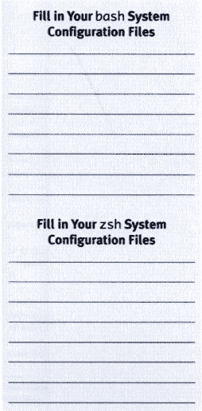

## 在 csh 中添加或更改变量：

1. `setenv NNTP_SERVER news.xmission.com`

   输入 `setenv`，后跟变量名、一个空格和变量的值。在此步骤中，你正在设置变量及其值，并让该环境变量可供当前 shell 会话中运行的所有程序和脚本使用（代码清单 8.4）。如果值包含空格或特殊字符，请用引号将值括起来。

2. `echo $NNTP_SERVER`

   可选操作：输入 `echo`，后跟一个 `$` 和变量名，shell 会告诉你该变量被设置成了什么值。

## 提示


如果希望更改或添加变量，使新设置在每次会话中都存在，请按照本章其余部分所述，使用配置文件中更改环境变量的说明。

第 12 章将进一步介绍新闻阅读器。

```
xmission> setenv NNTP_SERVER news.xmission.com
xmission> echo $NNTP_SERVER
news.xmission.com
```

代码清单 8.4：`csh` shell 的过程与 `bash` 和 `ksh` shell 的过程类似。

## 查看你的 zsh 配置文件

在配置文件中修改或添加 `zsh` 环境变量的第一步，是查看配置文件，这些文件会显示已显式定义的变量。如代码清单 8.5 所示，你可以使用 `more` 命令或你选择的编辑器来完成这一操作。

请记住，`zsh` 配置文件存在于两个位置：

- 系统级配置文件（如 `/etc/zprofile` 或 `/etc/zshenv`）
- 特定于你的 Unix 账户的配置文件（如 `~/.zprofile` 或 `~/.zshrc`）

```
jdoe@usley ~ $ more /etc/z* /etc/z*/zprofile /etc/z*/zshenv


/home/jdoe/.zprofile


# /etc/zprofile and ~/.zprofile are run for login shells


/home/jdoe/.zshenv

export X11HOME=/usr/X11R6


if (( EUID == 0 )); then
  path+=(/sbin /usr/sbin)
fi

typeset -U path
path+=(/path /X11HOME/bin /usr/bin /usr/bin /usr/local/bin)

PATH=$PATH:/home/jdoe/scripts

/home/jdoe/.zshrc

```

代码清单 8.5：你的 `zsh` 配置文件会设置你的环境变量以及 Unix 使用体验的其他特性。

（接下页）

```
# Reset prompts
PROMPT="%n@%m %~" # default prompt
RPROMPT="%~" # prompt for right side of screen

# bindkey -v # vi key bindings
bindkey -e # emacs key bindings

if [[ -r $ZDOTDIR/$HOME/.zshrc ]]; then
  if [[ -f /usr/share/zsh/$ZSH_VERSION/zshrc_default ]]; then
    source /usr/share/zsh/$ZSH_VERSION/zshrc_default
  fi
fi

# --------------------
/etc/zlogin

# /etc/zlogin and .zlogin are sourced in login shells.

# --------------------
/etc/zlogout

# /etc/zlogout and ~/.zlogout are run when an interactive session ends
# clear
# --------------------
/etc/zprofile
# --------------------
#
# --------------------
/etc/zshenv

export X11HOME=/usr/X11R6

if (( EUID == 0 )); then
  path=(/sbin /usr/sbin)
fi

typeset -U path
path=( $path $X11HOME/bin /bin /usr/bin /usr/local/bin )
# --------------------
/etc/zshrc

if [[ $(id -gn) = $USERNAME && $EUID -gt 14 ]]; then
  umask 002
else
  umask 022
fi
```

```
# Get keys working
if [[ $TERM = "linux" ]];then
  bindkey "^[2~" yank
  bindkey "^[3~" delete-char
  bindkey "^[5~" up-line-or-history
  bindkey "^[6~" down-line-or-history
  bindkey "^[1~" beginning-of-line
  bindkey "^[4~" end-of-line
elif [[ $TERM = "xterm" || $TERM = "rxvt" ]];then
  bindkey "^[2~" yank
  bindkey "^[3~" delete-char
  bindkey "^[5~" up-line-or-history
  bindkey "^[6~" down-line-or-history
  bindkey "^[1~" beginning-of-line
  bindkey "^[4~" end-of-line
fi

# Set prompts
PROMPT="%m%# %~" # default prompt
RPROMPT="%*" # prompt for right side of screen

# Some environment variables
path=($path $HOME/bin)
export HISTFILE=$HOME/.bash_history
export HISTSIZE=1000
export SAVEHIST=1000
export USER=$USERNAME
export HOSTNAME=$HOST

# bindkey -v # vi key bindings
bindkey -e # emacs key bindings

for profile_func (/etc/profile.d/* sh) source $profile_func
unset profile_func

# See comment at top.
if [[ -r $ZDOTDIR/.zshrc ]];then
  if [[ -f /usr/share/zsh/$ZSH_VERSION/zshrc_default ]];then
    source /usr/share/zsh/$ZSH_VERSION/zshrc_default
  fi
fi
jdoe@sulley ~ $
```

代码清单 8.5（续）

## 查看你的 zsh 配置文件

1. `more ~/.z* /etc/zl* /etc/zprofile /etc/zsh*`

在 shell 提示符下，输入 `more` 后跟每个可能的系统配置文件名来查看你的配置文件。如果你没有这里提到的所有文件（或任何文件），不用担心。只需记下你拥有的那些文件即可。代码清单 8.5 显示了你可能会看到的示例。

2. 为参考记录下系统配置文件及其运行顺序。（记住，最后一个文件中的设置会覆盖之前所有的设置。）我们的系统配置文件，全部由系统自动调用，包括

- `/etc/zshenv` 然后 `~/.zshenv`
- `/etc/zprofile` 然后 `~/.zprofile`
- `/etc/zshrc` 然后 `~/.zshrc`
- `/etc/zlogin` 然后 `~/.zlogin`

请记住，你拥有的文件可能与我们拥有的文件不同。

## 提示

- 特别注意任何文件中以路径和文件名结尾的行，或直接引用其他文件，例如一行单独的 `/etc/profile`。每条这样的行都引用了另一个在设置你环境中起作用的文件。请注意，其中一些行会引用并不直接配置你的环境的其他文件。
- 所有以 `#` 开头的行都是注释，其中包含帮助你更好地理解文件的说明。注释实际上什么都不做，但有助于你了解每个文件的作用。

某些文件包含像 `export HISTFILE=${HOME}/.bash_history` 这样的奇特内容，该文件引用了 `.bash_history` 文件，其中包含你已运行的命令列表。（看起来像是 Linux 发行商的失误。幸好你在检查他们，对吧？）

## 向你的 zsh PATH 添加内容

对环境最有用的更改之一是向默认路径添加内容，该路径由 `path` 语句决定。`path` 语句告诉 shell 在哪里查找命令、脚本和程序。也就是说，如果你发出一个命令，`path` 语句会告诉系统按特定顺序在每个命名目录中查找该命令：

请确保不要从路径中删除任何内容，除非你真的知道自己在做什么，但你可以随意向其中添加任意多个额外目录。例如，如果你开始编写脚本（见第 10 章所述），你可能会将它们放在 `scripts` 子目录中，并希望将该目录添加到你的路径中。

如下步骤所示，你通过首先确定 `path` 语句的位置，然后编辑包含它的文件来更改 `zsh` 路径（代码清单 8.6）。

## 要更改你的 zsh 路径：


- 1. `more ~/.zshenv ~/.zprofile ~/.zshrc`

首先以它们执行的顺序查看你的配置文件（仅限你可以编辑的那些）。

在你的系统配置文件中查找 path 语句。如代码清单 8.6 所示，它看起来会像 `PATH=/bin:/usr/bin:/opt/bin`。如果你有多个 path 语句，找到最后一个执行的那个。

记住不同系统会有不同的配置，因此你可能需要做一点挖掘才能找到你的个人 path 语句。

```
jdoe@sulley ~ $ more .zshrc

# See comment at top.

if [[ -r ${ZDOTDIR:-$HOME}/.zshrc ]] ;then
  if [[ -f /usr/share/zsh/$ZSH_VERSION/zshrc_default ]] ;then
    source /usr/share/zsh/$ZSH_VERSION/zshrc_default
  fi
fi

PATH=/bin:/usr/bin:/opt/bin

jdoe@sulley ~ $
```

代码清单 8.6 你将在配置文件中找到你的 path 语句。

## 第 8 章

- 2. `cp .zshrc .zshrc_backup`

备份包含 path 语句的文件，以便在出现问题或错误时可以恢复该文件。参见第 2 章，如果你需要有关复制文件的更多信息。

- 3. `vi .zshrc`

使用你喜欢的编辑器打开你想要更改其路径的文件。

- 4. `PATH=$PATH:$HOME/scripts`

在最后一个 path 语句正下方添加一个新的 path 语句。在此示例中，`$PATH` 将环境变量的当前值插入到环境变量定义中，并将其插入到你的主目录中的 `scripts` 目录中（图 8.1）。

- 5. 保存并退出编辑器。

如果需要帮助，请参阅第 4 章。

- 6. `su - yourid`

正如你在第 3 章中学到的，这个命令启动一个新的登录 shell，以便你可以在注销前测试你的更改。

- 7. `echo $PATH`

显示当前的 path 环境变量。这应该包括你刚刚添加的内容。它在那里，对吧？（参见代码清单 8.7。）

### 提示

- 如果你查看各种配置文件中的 path 语句，你可能会发现一个 path 语句只包含一个 `.`（点）。例如，你可能会看到类似 `PATH=/usr/bin:/usr/local/bin:.` 的内容。`.` 会将你的当前目录，无论它是什么，添加到你的路径中。请记住，通常更安全的做法是不在路径中包含当前目录，以免无意中运行你正在处理的程序。

```
jdoe@sulley ~ $ su - jdoe
Password:
jdoe@sulley ~ $ echo $PATH
/usr/bin:/opt/bin:/home/jdoe/scripts/
jdoe@sulley ~ $
```

代码清单 8.7 测试你对配置文件的编辑。

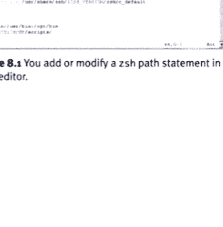

图 8.1 你在编辑器中添加或修改 zsh 路径语句。

- 你可以使用 `grep` 使查找设置路径的配置文件变得更容易。`grep -i path *.z*` 是一个不错的开始方法。

- 如果你在配置文件中看到类似 `path=($path $HOME/bin)` 的内容，那也没关系。继续在下一行使用本节所示的语法即可。这是 `zsh` 的一个特性，它理解用无数种不同方式表达同一命令。

## 更改你的 zsh 提示符

你的默认提示符（屏幕上你输入命令位置前方的文本）可能会因你的 Unix 系统而有所不同；你可能只看到一个美元符号（`$`），或美元符号加日期，或如“快速设置你的 zsh 提示符”侧边栏中所概述的其他信息。你可以将提示符设置为包含对你有用的信息。

实际上你拥有多个提示符：

- 主提示符，也就是你通常认为的 shell 提示符。这个提示符称为 `PS1`，或简称为 `PROMPT`。

- 辅助提示符，当系统需要额外信息来完成命令时你会看到它。在逻辑上，这个提示符被称为 `PS2`。

你可以按照以下步骤更改这两个提示符。首先找到你的提示符语句（代码清单 8.8），然后在编辑器中修改它（图 8.2）。

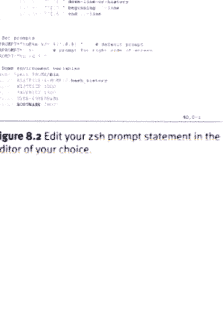

```
jdoe@sulley ~ $ grep -i PROMPT ~/.z* ; grep -i PS1 ~/.z*
/home/jdoe/.zshrc:# configuration for keys umask PROMPT and variable
/home/jdoe/.zshrc:# Set prompts
/home/jdoe/.zshrc:PROMPT="%n%m %3- %(!.#.$) "  # default prompt
/home/jdoe/.zshrc:# configuration for keys umask PROMPT and variable
/home/jdoe/.zshrc:# Set prompts
/home/jdoe/.zshrc:PROMPT="%n%m %3- %(!.#.$) "  # default prompt
jdoe@sulley ~ $
```

代码清单 8.8 使用 `grep` 在配置文件中搜索 `zsh` 提示符语句。

### 更改你的 zsh 提示符：

- 1. `grep -i PROMPT ~/.z*`; `grep -i PS1 ~/.z*`

首先，在你的主目录中的配置文件里搜索，如有必要，还可以在 `/etc` 目录中搜索，找到你的提示符语句。它看起来会像这样：`PROMPT="%n@%m %~ %(!.#.$)"  # default prompt`，如代码清单 8.8 所示。

侧边栏“快速设置你的 zsh 提示符”将帮助你理解这些符号。

- 2. `cp ~/.zshrc ~/.zshrc-backup; vi ~/.zshrc`

备份一份。`~/.zshrc` 文件很可能是设置提示符的地方，因为该文件只在你的 shell 交互式时才会被读取。

### 快速设置你的 zsh 提示符

你可以将提示符设置为包含各种信息。以下列表展示了使用哪些代码来向提示符添加特定类型的信息（同时帮助你理解现有提示符中的代码）：

- `%n` 显示当前用户的用户 ID——也就是你。

- `%~` 显示带路径的当前工作目录，在你的主目录内使用 `~` 记号。

- `%c` 显示不带路径的当前目录。

- `%t` 显示时间。

- `%D` 显示不带年份的日期。

- `%F` 显示带年份的日期。

- `\n` 强制换行，使提示符分成两行显示（你需要在提示符周围加上单引号）。

- `%m` 显示计算机的主机名（例如本书中的 frazz 和 hobbes 示例）。

- `%M` 显示计算机的完整域名。

```
jdoe@sulley ~ $ vi .zshrc
jdoe@sulley ~ $ su - jdoe
Password:
jdoe /home/jdoe $ PROMPT="$\n Top line \nNext
→ line $"
Top line
Next line $pwd
/home/jdoe
Top line
Next line $
```

代码清单 8.8 更新提示符后进行测试总是一个好主意。

- 3. `PROMPT="%n %d $ "`

例如，我们经常将提示符设置为包含两则小信息：用户 ID（因为我们有很多不同的账户，总能用它来提醒自己！）和日期（玩得开心时时间过得飞快，对吧？）。我们将这些信息添加到提示符中，而不是使用现有的默认提示符，但在开头用 `#` 号保留默认提示符，以防万一（图 8.2）。

- 4. 保存文件并退出编辑器。

- 5. `su - ejr`

使用更改后的提示符重新登录，试一下效果。

### 提示

- 请注意提示符代码末尾的空格：`PROMPT="%n %d $ "`。这个空格能让提示符更易于使用，因为它可以避免你的命令与提示符紧挨在一起。

- 你还可以将提示符设置为：你设置的信息显示在第一行，而实际的提示符出现在下一行（代码清单 8.9）。为此，请在环境变量设置中使用单引号（‘ ’）和 `$`，然后使用 `\n` 表示换行，例如 `PROMPT-$'%n %m\n $'`。这将强制 shell 将 `\n` 视为换行符，而不是提示符字符串中的普通字符。

## 查看你的 bash 配置文件

在修改或添加 bash 配置文件中的环境变量之前，第一步是查看配置文件，它们会显示已定义的变量。

如代码清单 8.10 所示，你可以使用 `more` 或你选择的编辑器来完成此操作。

请记住，配置文件按特定顺序运行：

- 系统范围的配置文件（如 `/etc/profile`）在登录时首先运行。

- 特定于你的 Unix 账户的配置文件（如 `~/.bash_profile` 或 `~/.profile`）如果可用，则接下来运行。

### 查看你的 bash 配置文件：

- 1. `more ~/.bash* ~/.profile /etc/bash* /etc/profile`


在 shell 提示符下，输入 `more` 然后跟上每个可能的系统配置文件名以查看你的配置文件。如果你没有这里提到的所有文件，不用担心。只需记下你拥有的文件即可。代码清单 8.10 显示了你可能看到的示例。请注意，其中一些行会引用其他文件，例如引用包含其他配置设置的 `.bashrc` 文件的 `ENV=$HOME/.bashrc` 行。

```
[ejr@hobbes ejr]$ more ~/.bash* ~/.profile /etc/bash* /etc/profile
...
/home/ejr/.bash_profile
...
# .bash_profile
# Get the aliases and functions
```

### 代码清单 8.10 你的配置文件设置了你的环境变量以及 Unix 体验的其他功能。

```
if [ -f ~/.bashrc ]; then
  . ~/.bashrc
fi
# User-specific environment and startup programs
PATH=$PATH:$HOME/bin
ENV=$HOME/.bashrc
USERNAME=""
export USERNAME ENV PATH
/home/ejr/.profile: No such file or directory
................
/etc/bashrc
................
# /etc/bashrc
# System-wide functions and aliases
# Environment stuff goes in /etc/profile
# Putting PS1 here ensures that it gets loaded every time
PS1="[\u@\h \W]\$ "
alias which="type -path"
...........
/etc/profile
................
# /etc/profile
# System-wide environment and startup programs
# Functions and aliases go in /etc/bashrc
PATH=$PATH:/usr/X11R6/bin
PS1="[\u@\h \W]\$ "
ulimit -c 10000000
if [ `id -gn` = `id -un` -a `id -u` -gt 14 ]; then
  umask 002
else
  umask 022
fi
USER=`id -un`
LOGNAME=$USER
MAIL="/var/spool/mail/$USER"
HOSTNAME="/bin/hostname"
HISTSIZE=1000
HISTFILESIZE=1000
export PATH PS1 HISTSIZE HISTFILESIZE USER LOGNAME MAIL
for i in /etc/profile.d/* sh ; do
  if [ -x $i ]; then
    . $i
  fi
done
unset i
[ejr@hobbes ejr]$
```

代码清单 8.10 继续

### 2. 为参考记录下系统配置文件及其运行顺序。

请记住，最后一个文件中的设置会覆盖之前的所有设置。我们的系统配置文件包括

- `/etc/profile` （如果存在，系统会自动调用）
- `~/.bash_profile` （如果存在，系统会自动调用）
- `~/.bashrc` （由 `~/.bash_profile` 调用）
- `/etc/bashrc` （由 `~/.bashrc` 调用）

请记住，你拥有的文件可能与我们拥有的文件不同。

#### 提示

- `bash` shell 有时会在配置文件之间形成链式引用，从前一个文件引用下一个文件。在编辑配置文件时，请注意保留引用和顺序，否则你可能会得到意外的结果。
- 所有以 `#` 开头的行都是注释，其中包含有助于你更好地理解文件的说明。注释实际上什么都不做，但它们有助于你了解每个文件的作用。

# 向你的 bash PATH 添加内容

你可以对环境做出的最有用的更改之一就是向默认路径添加内容，该路径由 `path` 语句决定。`path` 语句告诉 shell 在哪里查找命令、脚本和程序。也就是说，如果你发出一个命令，`path` 语句会告诉系统按特定顺序在每个命名目录中查找该命令。

请确保不要从路径中删除任何内容，除非你真的知道自己在做什么，但你可以随意向其中添加任意多个额外目录。

如下面的步骤所示，你可以通过首先确定 `path` 语句的位置，然后编辑包含它的文件来更改 bash 路径（代码清单 8.11）。

## 更改你的 bash 路径：

- 1. `more ~/.bash_profile ~/.bashrc`

  首先，按执行顺序查看你的配置文件（仅限你可以编辑的）。

  在系统配置文件中查找 `path` 语句。如代码清单 8.9 所示，它看起来会像 `PATH=/bin:/usr/bin:/usr/local/bin`。

  如果你有多个 `path` 语句，请找到最后执行的那个。

  请记住，不同的系统会有不同的配置，因此你可能需要做一些挖掘才能找到你的个人 `path` 语句。

- 2. `cp .bash_profile .bash_profile_backup`

  备份包含 `path` 语句的文件，以便在你犯错时可以恢复。 如果你需要有关复制文件的更多信息，请参阅第 2 章。

```
[ejr@hobbes ejr]$ more ~/.bash_profile
... ~/.bashrc
................
/home/ejr/.bash_profile
................
# .bash_profile

# Get the aliases and functions
if [ -f ~/.bashrc ]; then
  . ~/.bashrc
fi

PATH=/bin:/usr/bin:/usr/local/bin

# User-specific environment and startup programs

PATH=$PATH:/usr/local/games
ENV=$HOME/.bashrc
USERNAME=""

export USERNAME ENV PATH

-More-(Next file: /home/ejr/.bashrc)
```

代码清单 8.11 第一步是找出你的 `path` 语句的位置。

3. `vi .bash_profile`

   使用你喜欢的编辑器打开你要更改路径的文件。

4. `PATH=$PATH:$HOME/bin`

   在最后一条路径语句的正下方添加一条新的路径语句。在此示例中，`$PATH` 插入环境变量定义的当前值，并将其插入到你的主目录中的 `bin` 目录（图 8.3）。

   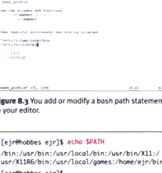

5. 保存文件并退出编辑器。

   如需帮助，请参阅第 4 章。

6. `su - yourid`

   正如你在第 3 章中学到的，这个命令启动一个新的登录 shell，以便你在注销前测试你的更改。

7. `echo $PATH`

   显示当前的路径环境变量。这应该包含你刚刚添加的内容。它在那里，对吧？（参见代码清单 8.12。）

### Tips

- 如果你查看各种配置文件中的路径语句，你可能会发现一条路径语句只包含一个 `.`（点）。例如，你可能会看到类似 `PATH=/usr/bin:/usr/local/bin:.` 的内容。`.` 会将你的当前目录，无论它是什么，添加到你的路径中。不过请记住，通常更安全的做法是不将当前目录放在路径中，以免无意中运行正在处理的程序。
- 你可以使用 `grep` 更轻松地找到设置路径的配置文件。`grep PATH .b*` 是一个不错的开始方法，`grep PATH /etc/*` 也是一个好办法。

```
[ejr@hobbes ejr]$ echo $PATH
/bin:/usr/bin:/usr/local/bin:/usr/bin/X11:/usr/X11R6/bin:/usr/local/games:/home/ejr/bin
[ejr@hobbes ejr]$
```

Code Listing 8.12 Using `echo`, you can verify that your new path statement exists.

如果以后要让系统配置文件更清晰，请将所有相关的更改放在一起。因此，你应该将路径语句放在一起，而不是在配置文件中随意插入一条完全随机的 `PATH` 语句。

## Changing Your bash Prompt

```
[ejr@hobbes ejr]$ grep PS1 ~/.bash* ~/.bashrc /etc/bashrc
/home/ejr/.bashrc:PS1="\u \d $ "
/etc/bashrc:PS1="[\u@\h \W]$ "
[ejr@hobbes ejr]$
```


# Code Listing 8.13 Use grep to search your configuration files for a prompt statement.

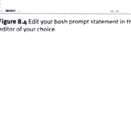

Figure 8.4 Edit your bash prompt statement in the editor of your choice.

根据你的 Unix 系统，默认情况下你的提示符可能只是一个美元符号（`$`），或者是一个美元符号和日期，或者如 “Setting Your bash Prompt Promptly” 侧边栏所述的其他信息。你可以设置提示符以包含对你有用的信息。

实际上 bash 中有多个提示符：

- 主提示符，通常被认为是 shell 提示符。此提示符称为 `PS1`。
- 当系统需要额外信息来完成命令时，你会看到的次要提示符。逻辑上，这个提示符称为 `PS2`。

你可以使用以下步骤更改这两个提示符中的任何一个。你首先找到提示符语句（代码清单 8.13），然后在编辑器中修改它（图 8.4）。

## 更改你的 bash 提示符

1. `grep PS1 ~/.bash* ~/.bashrc /etc/bashrc`

   首先，搜索位于你的主目录和 `/etc` 目录中的配置文件以找到你的提示符语句。它看起来会像 `PS1="$ "` 或 `PS1="[\u@\h \W]$ "`，如代码清单 8.13 所示。“Setting Your bash Prompt Promptly” 侧边栏将帮助你翻译这些符号。

2. `vi ~/.bashrc`

   因为带有提示符设置的文件位于系统范围的 `/etc` 目录中，我们不能直接更改它们，所以我们必须对 `~/.bashrc` 或主目录中的其他配置文件进行更改。

3. `PS1="\u \d $ "`

   例如，我们经常将提示符设置为包含用户 ID（因为我们在不同的系统上有足够多的不同账户，需要一个提醒）和日期（因为我们分散在各地）。我们在文件末尾添加此设置，以便它优先于从 `~/.bashrc` 文件引用的 `/etc/bashrc` 文件中的 `PS1` 设置（图 8.4）。

4. 保存文件并退出编辑器。

5. `su - ejr`

   使用你更改后的提示符重新登录以试用它。

## 提示

- 注意提示符代码中的尾随空格：`PS1="\u \d $ "`。这个空格可以帮助更轻松地使用提示符。
- 在配置文件中进行更改之前，考虑在 shell 提示符处更改你的 `PS1` 环境变量，如第 3 章所述。这样，你可以在配置文件中更改之前先试用修改后的 shell 提示符。

## 快速设置你的 bash 提示符

你可以将提示符设置为包含各种信息。以下列表显示了你可以使用什么代码将某些类型的信息添加到提示符中（以及帮助你翻译现有提示符中的代码）：

- `\u` 显示当前用户的用户 ID——也就是你。
- `\w` 显示当前工作目录的完整路径，在主目录内使用 `~` 表示法。
- `\W` 显示当前目录，不带路径。
- `\t` 显示时间。
- `\d` 显示日期。
- `\n` 强制换行，使提示符显示为分为两行。
- `\h` 显示计算机的主机名。

# 查看你的 ksh 配置文件

如代码清单 8.14 所示，你可以使用 `more` 或你选择的编辑器查看你的 ksh 配置文件。请记住，配置文件是按特定顺序运行的：

- 系统范围的配置文件（如 `/etc/profile`）在登录时首先运行。
- 特定于你的 Unix 账户的配置文件（如 `~/.profile`）如果可用则接下来运行。

## 查看你的 ksh 配置文件

1. `more /etc/profile ~/.profile`

   输入 `more` 后跟传统 Korn shell 配置文件的名称。你会看到类似代码清单 8.14 的内容。如前所述，查找列表中任何其他文件名或 `ENV` 语句，这将表明在配置你的 ksh 环境时起作用的其他文件。

2. 为你自己的信息，列出系统使用的系统配置文件及其被调用的顺序。对于我们的系统，我们有：

   - `/etc/profile`（由系统自动调用）
   - `~/.profile`（由系统自动调用）

## 提示

- `.profile` 文件在你启动新的登录 shell 时执行（通过登录或使用 `su - yourid`）。`.kshrc` 文件在你每次启动任何 ksh 子 shell 时都会被读取。

## 填写你的 ksh 系统配置文件

在这些文件中你可能会看到的专业术语，用于执行配置文件或脚本是 source 它。也就是说，当你登录时，你的 `.profile` 会 source `.kshrc`。

```
$ more /etc/profile ~/.profile
:::::::::::::::
/etc/profile
::::::::::::::
#ident "@(#)profile 1.1795/03/28 SMI"  /* Svr4.0 1.3 */
# The profile that all logins get before using their own .profile.
trap '' 2 3
export LOGNAME PATH
if [ "$TERM" = "" ]
then
    if /bin/i386
    then
        TERM=AT386
    else
        TERM=sun
    fi
    export TERM
fi
# Login and -su shells get /etc/profile services.
# -rsh is given its environment in its .profile.
case "$0" in
-sh | ksh | -ksh)
    if [ -f ~/.hushlogin ]
    then
        /usr/sbin/quota
    # Allow the user to break the Message-Of-The-Day only.
    trap "trap '' 2" 2
    /bin/cat -s /etc/motd
    trap '' 2
    /bin/mail -E
    case $? in
    0)
        echo "You have new mail."
        ;;
    2)
        echo "You have mail."
        ;;
    esac
    fi
esac
umask 022
trap 2 3
```

代码清单 8.14 在配置文件列表中查找文件名或路径名或 `ENV` 语句，以识别所有有助于设置你的环境的文件。

```
/home/users/e/ejray/.profile
------------------------
#
PATH=$PATH:$HOME/bin:.  # set command search path
export PATH
if [ -z "$LOGNAME" ]; then
  LOGNAME=`logname`  # name of user who logged in
  export LOGNAME
fi
MAIL=/usr/spool/mail/$LOGNAME # mailbox location
export MAIL
if [ -z "$PWD" ]; then
  PWD=$HOME  # assumes initial cwd is HOME
  export PWD
fi
if [ -f $HOME/.kshrc -a -r $HOME/.kshrc ]; then
  ENV=$HOME/.kshrc # set ENV if there is an rc file
  export ENV
fi
# If job control is enabled, set the suspend character to ^Z (control-z):
case $- in
*m*) stty susp '^z'
::
esac
set -o ignoreeof  # don't let control-d logout
PS1='$ '
export PS1
export ENV=$HOME/.kshrc
------------------------
/home/users/e/ejray/.kshrc
#
# If there is no VISUAL or EDITOR to deduce the desired edit
# mode from, assume vi(C)-style command line editing.
if [ -z "$VISUAL" -o -z "$EDITOR" ]; then
  set -o vi
fi
/etc/ksh.kshrc: No such file or directory
$
```

# 更改你的 ksh PATH


`path` 语句告诉 shell 在哪里查找命令、脚本和程序。例如，如果你发出一个命令，`path` 语句会告诉系统按特定顺序在命名目录中查找。

如下步骤所示，你通过首先确定 `path` 语句的位置，然后编辑包含它的文件来更改你的 `ksh` `path`（代码清单 8.15）。

## 更改你的 ksh path

1. `grep PATH ~/.profile ~/.kshrc`

首先，检查位于你的主目录中的配置文件中的 `path` 语句。如果你愿意，你也可以查看 `/etc/profile` 文件，但你不能编辑它。

2. 在你的系统配置文件中查找 `path` 语句。如代码清单 8.15 所示，它看起来会像 `PATH=/usr/bin:/usr/local/bin:/usr/sbin`。记住，如果你有多个 `path` 语句，找到最后执行的一个。如果你个人配置文件中根本没有 `path` 语句，那么添加一个。

3. `cp ~/.profile ~/.profile.backup`

复制包含 `path` 语句的文件，以便在你犯错时可以恢复。参见第 2 章，如果你需要有关复制文件的更多信息。

4. `vi ~/.profile`

使用你选择的编辑器编辑包含 `path` 语句的配置文件。

```
$ grep PATH ~/.profile ~/.kshrc
/home/users/e/ejray/.profile:PATH=/usr/bin:/usr/local/bin:/usr/sbin:
/home/users/e/ejray/.profile:export PATH
$
```

代码清单 8.15 首先，找出你的 `path` 语句的位置。

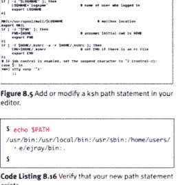

```
$ echo $PATH
/usr/bin:/usr/local/bin:/usr/sbin:/home/users/e/ejray/bin:.
$
```

**代码清单 8.16** — 验证你的新路径语句是否存在。

5. `PATH=$PATH:$HOME/bin`

在最后一条路径语句下方立即添加一条新的路径语句。在此示例中，`$PATH` 将环境变量的当前值插入到环境变量定义中，并将其插入到你的主目录中的 `bin` 目录（图 8.5）。

6. 保存文件并退出编辑器。

如需帮助，请参阅第 4 章。

7. `su - yourid`

正如你在第 3 章中学到的，这个命令会启动一个新的登录 shell，以便在注销之前测试你的更改。

8. `echo $PATH`

显示当前的路径环境变量。这应该包含你刚刚添加的内容（参见代码清单 8.16）。

## 更改你的 ksh 提示符

与 `bash` 类似，`ksh` 也有两个可以编辑的提示符：

- 你通常认为的 shell 提示符，即主提示符，称为 `PS1`。
- 当系统需要额外信息来完成命令时你会看到的次要提示符。逻辑上，这个提示符称为 `PS2`。

你可以使用以下步骤更改其中任何一个提示符（我们将在示例中修改 `PS1`）。你首先找到你的提示符语句（代码清单 8.17），然后在编辑器中修改它。

### 要更改你的 ksh 提示符

1. `grep PS1 /etc/profile ~/.profile ~/.kshrc`

首先，搜索位于你的主目录和 `/etc` 目录中的配置文件以查找你的提示符语句。它看起来像 `PS1="$ "` 或 `PS1="$PWD $ "`，如代码清单 8.17 所示。请记住，你只能编辑主目录中的文件，不能编辑 `/etc` 目录中的文件。设置你的 `ksh` 提示符提示侧边栏将帮助你翻译这些符号。

2. `vi ~/.profile`

使用你喜欢的编辑器编辑包含 `PS1` 设置的配置文件，或向主目录中的配置文件添加 `PS1` 设置。

3. `PS1="$LOGNAME in $PWD $ "`

将提示符更改为显示你想要的信息——在本例中为用户名和当前工作目录。

> **提示：** 请注意提示符代码中的尾随空格：`PS1="$ "`。这使得提示符比没有空格时更容易使用。

```
$ grep PS1 /etc/profile ~/.profile ~/.kshrc
/home/users/e/ejray/.profile:PS1="$ "
/home/users/e/ejray/.profile:export PS1
$
```

**代码清单 8.17** — 列出你的 `ksh` 配置文件并查找提示符语句。

### 快速设置你的 ksh 提示符

你可以将你的 `ksh` 提示符设置为包含一些不同类型的信息——但不如 `zsh` 或 `bash` shell 那么多。下面的列表显示了你可以使用什么代码向提示符添加某些类型的信息（以及帮助你翻译现有提示符中的代码）：

- `$LOGNAME` 显示当前用户的用户 ID——也就是你。
- `${PWD##*/}` 显示当前工作目录但不带路径。
- `$PWD` 显示带路径的当前工作目录。
- `$HOST` 显示计算机的主机名。

## 查看你的 csh 配置文件

如代码清单 8.18（见下一页）所示，你可以使用 `more` 或你选择的编辑器查看你的 `csh` 配置文件。与其他 shell 一样，`csh` 配置文件按特定顺序运行：

- 系统范围的配置文件（如 `/etc/csh.cshrc`）在登录时首先读取。
- 特定于你的 Unix 账户的主要配置文件（`~/.cshrc`）如果可用则接下来读取。
- `~/.login` 配置文件最后读取。

### 要查看你的 csh 配置文件

- `more .cshrc .login`

输入 `more`，后跟 `.cshrc` 和 `.login`，它们是 `csh` 配置文件的唯一可能名称。你会看到类似代码清单 8.18 的内容。对于我们的系统，我们有：

- `~/.cshrc`（由系统自动调用）
- `~/.login`（由系统自动调用）如果 shell 是登录 shell

> **提示：** `.cshrc` 文件在你启动任何类型的 `csh` shell 时执行。`.login` 文件在你启动新的登录 shell 时执行（通过登录或使用 `su - yourid`）。

## 填写你的 csh 系统配置文件

```
xmission> more .cshrc .login
................
.cshrc
# <B>(A)cshrc 1.6 91/09/05 SMI
set path = (/usr/local/bin /usr/local/bin/X11 /usr/openwin/bin /usr/bin
/usr/ucb /usr/etc /usr/local/games .)
alias pwd 'echo $cwd'
umask 066
if ($?USER == 0 || $?prompt == 0) exit
set filec
set history=40
set prompt="hostname" "
# Edit the following lines as you wish
setenv EDITOR "pico -t"
setenv OPENWINHOME /usr/openwin
setenv MANPATH /usr/man:/usr/local/man:/usr/openwin/man
setenv LD_LIBRARY_PATH /usr/local/lib:/usr/openwin/lib
setenv PAGER more
limit coredumpsize 0
# commands for interactive shells
alias ls 'ls -F'
alias cd 'cd \!*;echo $cwd'
alias home 'cd ~'
# MS-DOS aliases
alias dir 'ls -alg'
alias del 'rm -i'
alias delete 'rm -i'
alias copy 'cp -i'
alias md 'mkdir'
alias move 'mv -i'
alias cls 'clear'
alias clr 'clear'
alias type 'more'
# Terminal settings
setenv TERM vt100
/usr/bin/stty rows 24
/usr/bin/stty cols 80
/usr/bin/stty erase '^?'
```

Code Listing 8.18 Look for references to other paths or files in the listings, which might indicate other files used to set up your environment.

```
::::::::::::
.login
# <b>(#)Login 1.14 90/11/01 SMI
```


# general terminal characteristics

`/usr/bin/stty -crterase`

`/usr/bin/stty -tabs`

`/usr/bin/stty crt`

`/usr/bin/stty erase "^H"`

`/usr/bin/stty werase "^?"`

`/usr/bin/stty kill "^"`

`/usr/bin/stty new`

# environment variables

`setenv EXITIT 'set shw/bin/csh sw=4 ai report=2'`

`setenv MORE '-c'`

`setenv PRINTER lw`

# commands to perform at login

`w` # see who is logged in

`notice` # system information that must be read

#

# If possible, start the windows system. Give user a chance to bail out

```
if ( `tty` != "/dev/console" || $TERM != "sun" ) then
  exit# leave user at regular C shell prompt
endif
```
`xmission>`

Code Listing 8.18 continued

## Changing Your csh Path

The `path` statement tells the shell where to look for commands, scripts, and programs. So if you issue a command, the `path` statement tells the system to look for the command in the named directories in a specific order. As the following steps show, you change your csh path by first identifying where your `path` statement is located, then editing the file that contains it (Code Listing 8.19).

### To change your csh path:

- 1. `grep -i path ~/.cshrc ~/.login`

To begin, list the configuration files located in your home directory and in the `/etc` directory. Look through your system configuration files for a `path` statement. As Code Listing 8.19 shows, it'll look something like `set path = (/usr/local/bin /usr/local/bin/X11 /usr/openwin/bin /usr/bin)` If you have more than one `path` statement, find the last one executed.

- 2. `cp ~/.cshrc ~/.cshrc.backup`

Make a copy of the file containing the `path` statement so that you can recover if you make mistakes. See Chapter 2 if you need more information on copying files.

- 3. `vi ~/.cshrc`

Use the editor of your choice to edit the file with the `path` statement in it.

- 4. `set path = (/usr/local/bin /usr/bin`

`-> /usr/ucb /usr/etc`

`-> /home/users/e/ejray/bin)`

Edit the `path` statement to add the full path to the `bin` subdirectory in your home directory, as shown in Figure 8.6.

```
xmision> grep -i path ~/.cshrc ~/.login
.cshrc:set path = (/usr/local/bin /usr/local
-> /bin/X11 /usr/openwin/bin /usr/bin)
xmision>
```

Code Listing 8.19 Use `grep` to find the `path` statement in your configuration files.

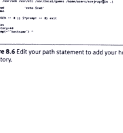

Figure 8.6 Edit your `path` statement to add your home directory.

```
xmision> echo $PATH
/usr/local/bin:/usr/local/bin/X11:
/usr/openwin/bin:/usr/bin:/usr/ucb:
/usr/etc:/usr/local/games:/home/users/e/
-ejray/bin:
xmission>
```

Code Listing 8.20 Here's your new `path` statement!

5. Save the file and exit from your editor. Refer to Chapter 4 for help if you need it.

6. `su - yourid`

As you learned back in Chapter 3, this command starts a new log-in shell so you can test your changes before logging out.

7. `echo $path`

Display the current `path` environment variable. This should include the addition you just made. Lo and behold! There it is! (See Code Listing 8.20.)

## 修改你的 csh 提示符

你的系统默认提示符可能只是一个美元符号 (`$`) 或者是一个美元符号和日期，或者如“快速设置你的 csh 提示符”侧边栏所述的其他信息。你可以使用以下步骤更改此提示符。你首先找到你的提示符语句（代码清单 8.21），然后在编辑器中修改它（图 8.7）。

### 如何更改你的 csh 提示符：

- 1. `grep prompt ~/.cshrc ~/.login`

开始时，列出位于你的主目录和 `/etc` 目录中的配置文件。在你的系统配置文件中查找你的提示符语句。它看起来像 `set prompt=" $ "` 或 `set prompt="hostname> "`。它很可能在你的 `.cshrc` 文件中，如代码清单 8.21 所示。

“快速设置你的 csh 提示符”侧边栏将帮助你翻译此代码。

- 2. `vi .cshrc`

使用你选择的编辑器编辑包含提示符设置的配置文件。

- 3. `set prompt="$LOGNAME > "`

将你的提示符设置为更合适的样式，如图 8.7 所示。

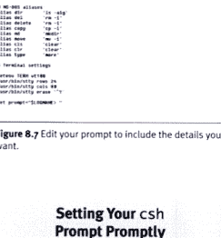

## 快速设置你的 csh 提示符

你可以将你的 csh 提示符设置为包含某些类型的信息，但没有 bash 或 zsh 提示符那么多。下面的列表显示了你可以使用什么代码向提示符添加某些类型的信息（以及帮助你翻译现有提示符中的代码）：

- `$LOGNAME` 显示当前用户的用户 ID——也就是你。

- `${cwd}` 显示带路径的当前工作目录。

- `uname -n`% 显示计算机的主机名。

```
xmision> grep prompt ~/.cshrc ~/.login
/home/users/e/ejroy/.cshrc:if ($?USER == 0 || $?prompt == 0) exit
/home/users/e/ejroy/.cshrc:set prompt="hostname> "
/home/users/e/ejroy/.login: exit# leave user at regular C shell prompt
xmision>
```

代码清单 8.21 提示符语句很可能在你的 `.cshrc` 文件中。

- 4. 保存文件并退出编辑器。

- 5. `su - yourid`


# 再次登录以试用（代码清单 8.22）

## 提示

- 注意提示符代码中的尾随空格：`set prompt="$LOGNAME > "`。这个额外的空格使提示符更容易使用。

```
xmision> su - ejray
Password:
Sun Microsystems Inc. SunOS 5.5.1 Generic May 1996
You have mail.
NOTE! As of 7/15/98, "tin" has been backed out its prior version. NNTP support was compiled in directly as well. We hope that this will stabilize its problems.

General questions email to "help" or "help@xmision.com".
Problems with the system mail to "support" or "support@xmision.com".

Type "acctstat" for a summary of your current account information.
Type "quota -v" to view your existing disk quota.
Type "help" for a list of online programs or "menu" for the assisted menu.
ejray>
```

代码清单 8.22 测试你的新提示符，看看你是否喜欢它。

## 设置别名

使用 `alias`

别名是一种昵称，你用它来更轻松地输入命令。例如，如果你经常使用命令 `mail -s "Lunch today?" deb < .signature`，你可以为此命令设置一个别名并将其命名为 `lunch`。然后，以后你只需输入 `lunch`，结果就与输入较长命令相同（图 8.8）。

### 如何使用 `alias` 设置别名：

1. 根据你使用的 shell 选择要编辑的适当文件。
   - `zsh` 用户应使用 `~/.zshrc`
   - `bash` 用户应使用 `~/.bashrc`
   - `ksh` 用户应使用 `~/.profile`
   - `csh` 用户应使用 `~/.cshrc`

   如果没有适当的文件，你可以使用不同的配置文件。许多人将所有别名存储在单独的 `.alias` 文件中。

2. `vi ~/.bashrc`

   编辑你选择的配置文件。

3. `alias quit="logout"`

   输入 `alias`，后跟你想用作别名的词、`=` 和你要创建别名的命令（用引号括起来）。在这里，我们将单词 `quit` 设置为系统命令 `logout` 的别名，这样我们就可以输入 `quit` 而不是 `logout`（图 8.8）。

4. 添加任意多个其他别名。有关更多想法，请参阅名为“值得设置的良好别名”的侧边栏。

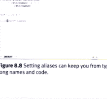

图 8.8 设置别名可以让你免于输入长名称和代码。

### 值得设置的良好别名

以下是一些你可能认为值得在系统上设置的别名：

- `alias rm="rm -i"` 会导致系统在所有删除操作时提示你。
- `alias quit="logout"` 让你可以使用 `quit` 作为 `logout` 的同义词。
- `alias homepage="lynx http://www.raycomm.com/"` 让你可以使用 `homepage` 启动 `lynx` 浏览器并连接到 Raycomm 主页（根据需要替换为你的主页）。

或者，如果你来自 DOS 背景，你可能会发现以下别名很有用：

- `alias dir="ls -l"` 让你可以使用 `dir` 列出文件。
- `alias copy="cp"` 让你可以使用 `copy` 复制文件。
- `alias rename="mv"` 让你可以使用 `rename` 移动或重命名文件。
- `alias md="mkdir"` 让你可以使用 `md` 创建目录。
- `alias rd="rmdir"` 让你可以使用 `rd` 删除目录。

```
xmmission> alias
cd  cd 1*;echo $cwd
clr  clear
cls  clear
copy cp -i
del rm -i
delete rm -i
dir ls -olg
home cd ~
ls ls -F
md mkdir
move mv -i
pwd echo $cwd
type more
xmmission>
```

Code Listing 8.23 Type `alias` at the shell prompt to see a list of aliases you've set.

5. Save the file and exit from the editor.
   - See Chapter 4 for details about saving and exiting in `vi` and `pico`.

6. `su - yourid`
   - Start a new log-in shell to test out the alias.

7. `alias`
   - Type `alias` at the shell prompt for a listing of all the aliases you have defined (Code Listing 8.23)

## Tips

- You can put aliases in other files, but it's customary to put them in the `.bashrc` file (or other appropriate rc file, such as `.cshrc`), so they'll be set automatically when you log in, rather than having to be manually set.
- You can also issue `alias` commands from the shell prompt to set aliases for the current session.
- Be sure to make a backup copy of any configuration files you plan to change before you change them. That way, if you mess up, you still have the original file to work with.

## Running Scripts AND Programs


Throughout this book, you’ve been running scripts and programs by typing in commands and pressing Enter. The commands zoom along to the Unix system, which responds by obediently doing whatever the command or script dictates. In doing this, you run the commands and scripts—called jobs in this context—right then and there.

You can also run jobs at specified times; run them on a schedule you set up, or start, stop, or delete them as you choose. Plus, you can find out when they are scheduled to run, time how long they take, or monitor them as they run. Sound cool? Great! Let’s take a look.

### Chapter Contents

- Running commands
- Scheduling one-time jobs
- Scheduling regularly occurring jobs
- Suspending jobs
- Checking job status
- Running jobs in the background
- Running jobs in the foreground
- Controlling job priority
- Timing jobs
- Finding running processes
- Deleting processes

## Running a Command


Throughout this book, you’ve been practicing running a single command. Unix doesn’t really care if you’re running a built-in command that came with the system, a program you installed later, or a script your best friend wrote—it’s all the same to Unix. Code Listing 9.1 shows some options on running a command.

## To run a command:

- `ls`

At the shell prompt, type the command and press Enter

## To run a specific command:

- `/home/jdoe/scripts/ls`

It’s certainly possible that you would want to write a script that would list the files in your directory in a special way—for example, a script to list the files and to save the listing into a new file for later reference. (You might name it something else but could certainly call it `ls` if you want to.) To run the specific script, enter the whole path to the script (so Unix doesn’t just run the first one it finds in your path). See Chapter 8 for more about path statements.

## Tips

- You can combine commands on the same line, as you’ve seen earlier in this book. Just use a `;` to separate the commands, and you’re set. For example, you could do `ls; pwd` to list files and show the current directory.

```
[jdoe@frazz Project]$ ls
keep keeper.jpg kept kidder.txt kiddo
+ kidnews kidneypie kids kidupdate
[jdoe@frazz Project]$ /bin/ls
keep keeper.jpg kept kidder.txt kiddo
+ kidnews kidneypie kids kidupdate
[jdoe@frazz Project]$ /home/jdoe/scripts/ls
keep keeper.jpg kept kidder.txt kiddo
+ kidnews kidneypie kids kidupdate
You listed these files.
[jdoe@frazz Project]$ ls ; pwd
keep keeper.jpg kept kidder.txt kiddo
+ kidnews kidneypie kids kidupdate
/home/jdoe/Project
[jdoe@frazz Project]$
```

Code Listing 9.1 To run a script, command, or program, just enter the name or the path and the name at the shell prompt.

- If you use a `&&` to combine commands, the system will run both in sequence but run the second only if the first succeeds. For example, you could use `mv todolist todolist.done && touch todolist` to move your to-do list to a different file and create a new to-do list. If the first command fails (for example, because you don’t have permission to create a new file), the second command won’t run.

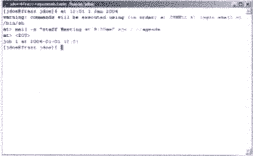

**Figure 9.1** 要安排一次性任务，只需指定时间和要运行的任务即可。

## 使用 at 安排一次性任务

有时，你可能需要安排任务在指定的时间运行一次。例如，你可以安排一封发给自己的电子邮件，提醒你参加员工会议。或者，你可以为同事安排会议提醒，其中包含会议议程。你可以使用 `at` 来安排这些和其他一次性任务，`at` 让你指定任务（或任务）应运行的时间。**Figure 9.1** 演示了安排关于那次重要员工会议的电子邮件。

### 使用 at 安排一次性任务：

1. `at 12:01 1 Jan 2004`

    首先，使用 `at` 加上时间说明来指定你希望任务运行的时间（Figure 9.1）。在此示例中，我们指定了时间、月份、日期和年份，尽管你可以创建各种其他时间说明，例如：

    - `at noon tomorrow`
    - `at 01/01/99`
    - `at 3:42am`
    - `at now + 3 weeks`
    - `at teatime`

    是的，`teatime` 是一个有效选项。顺便说一下，它是下午 4 点。

2. `mail -s "Staff Meeting at 8:30am" ejr < /agenda`

    指定任务。在这种情况下，它向用户（`ejr`）发送电子邮件，指定主题为 "Staff Meeting at 8:30am"，并发送名为 `agenda` 的文件的内容。有关使用 `mail` 的完整信息，请参阅第 11 章。

3. `Ctrl D`

    表示你已完成发出命令。

### 使用 at 安排顺序一次性任务：

1. `at midnight`

    使用 `at` 加上时间说明来指定你希望顺序任务运行的时间（Code Listing 9.2）。你可以像前一个示例中所示使用各种时间说明。

2. `tar -icf ~/bigdog.tar ~/HereKittyKitty`

    输入你希望运行的第一个任务。此任务将目录 `~/HereKittyKitty` 中的所有文件收集到一个名为 `~/bigdog.tar` 的单个文件中。第 13 章将告诉你更多关于使用 `tar` 进行归档的信息。

3. `gzip ~/bigdog.tar`

    输入下一个要运行的任务。这会压缩 `~/bigdog.tar` 文件，使其更易于存储和发送电子邮件。

4. `mutt -a bigdog.tar.gz -s "Read this by lunch time!" deb < /dev/null`

    指定序列中的下一个任务。在这里，我们使用 `mutt` 的命令行邮件选项来附加文件、指定主题并将整个内容发送给 Deb。有关使用 `mutt` 发送电子邮件的更多信息，请参阅第 11 章。

5. `Ctrl D`

    Ta-daaaa！使用此键组合来完成序列。

```
[ejr@hobbes ejr]$ at midnight
at> tar -icf ~/bigdog.tar ~/HereKittyKitty
at> gzip ~/bigdog.tar
at> mutt -a bigdog.tar.gz -s "Read this by lunch time!" deb < /dev/null
at>
at> <EOT>
warning: commands will be executed using
 - /bin/sh
job 12 at 2003-08-28 00:00
[ejr@hobbes ejr]$
```

Code Listing 9.2 要安排顺序一次性任务，只需指定时间并按你希望它们运行的顺序列出任务即可。

### 删除已安排的任务：


```
[ejr@hobbes ejr]$ atq
4    2003-08-28 12:01 a
9    2004-01-01 12:01 a
13   2003-08-27 16:00 a
12   2003-08-28 00:00 a
[ejr@hobbes ejr]$ atrm 12
[ejr@hobbes ejr]$ atq
4    2003-08-28 12:01 a
9    2004-01-01 12:01 a
13   2003-08-27 16:00 a
[ejr@hobbes ejr]$
```

Code Listing 9.3 通过指定任务编号来删除已安排的任务。

1. `atq`

    首先，使用 `atq` 显示等待在 `at` 队列中的任务列表（Code Listing 9.3）。显示计划时间的第二列应能提醒你每个任务是什么。指定每个任务的任务编号的第一列让你可以在下一步中识别要删除的任务。

2. `atrm 12`

    通过键入 `atrm` 和任务编号—in this case，任务编号为 `12`—to 删除排队的任务。

### Tips

- `atq` 也很方便用于查看你已安排的任务。
- 使用 `at` 给自己发送提醒。
- 如果你有一长串想要定期运行的命令，请考虑将它们制作成简短的 shell 脚本，然后使用 `at` 运行该 shell 脚本。从长远来看工作量更少，而且在告诉 `at` 要做什么时，你不必集中精力确保命令完全正确。有关 shell 脚本的完整信息，请参阅第 10 章。
- 不同版本的 Unix 有时以不同的方式呈现 `at` 的信息。你获得所需的所有信息，但排列方式可能略有不同。

## 使用 cron 安排定期执行的任务

假设你想在每天下班前不久给自己发送一条提醒消息——比如提醒关掉咖啡壶。或者，假设你想每周备份特定的文件。你可以通过使用 `crontab` 命令来安排命令或脚本在你指定的时间定期运行来实现这一点。这样做时，你可以安排任务在特定日期的特定时间发生，并且可以确信这些任务会在无人看管的情况下执行（图 9.2）。

## 如何使用 cron 安排定期执行的任务：

- 1. `crontab -e`

在 shell 提示符下，输入 `crontab`，后跟 `-e` 标志，这会让你编辑你的 cron 文件。如图 9.2 所示，你的 cron 文件会出现在你的默认编辑器中。它很可能为空（如果你之前没有设置过 cron 作业），但你可能已经有一些内容在里面。

- 2. `55 16 * * 1-5 mail -s "Go home now!" ejray@raycomm.com`

在 cron 文件的第一行，输入分钟、小时、月份中的日期、月份和星期几的值，然后是你想要运行的命令。有关指定时间和日期的更多详细信息，请参阅“那些奇怪的数字是什么？”侧边栏。在此示例中，我们在每个工作日下午 4:55 向 `ejray` 发送电子邮件，提醒他回家。

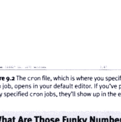

## 那些奇怪的数字是什么？

在输入 cron 作业时，你需要指定

- 分钟（0–59）
- 小时（0–23）
- 月份中的日期（1–31）
- 月份（1–12）
- 星期几（0–6，其中星期日为 0）

如果你用 `*` 替换数字，`cron` 将匹配所有可能的值，因此，如果作业安排为

- `1 * * * *`，它将在每个小时的一分钟后发生
- `15 3 * * *`，它将在每天凌晨 3:15 发生
- `59 23 31 * *`，它将在 11:59 p.m. 发生，一年七次（每个有 31 天的月份一次）
- `0 12 * * 0`，它将在星期日中午发生

你可以使用逗号分隔多个值。例如，如果你想在 12 月的整点和半点执行某项操作，你可能会使用 `0,30 * * 12 *`。

使用连字符 `-` 表示范围。例如，要安排某项任务在每天上午 9 点至下午 5 点的每个小时执行，请使用 `0 9-17 * * *`。

```
55 16 * * * mail -s "Go Home Now!" ejray@roycomm.com < /dev/null
-
-
-
-
-
-
-
-
-
-
-
-
-
-
-
-
"/tmp/crontab.16206" 3 lines, 192 characters written
crontab: installing new crontab
[ejr@hobbes ejr]$
```

代码清单 9.4 此作业每天提醒 `ejray` 回家。末尾的消息表明 cron 作业已成功输入。

3. 保存并关闭文件。

第 4 章将为你提供使用 `pico` 和 `vi` 保存和关闭的快速提醒。

如果你正确设置了时间和日期（也就是说，你没有意外将其设置为在一天的第 59 小时或类似时间发生），你将看到类似于代码清单 9.4 末尾的消息，确认一切就绪。（如果你安排某项任务在 55 小时、12 分钟、星期几的第九天发生，你会收到相应的错误消息。）

## 提示

- 安排 cron 作业时，你需要指定文件完整且绝对的路径——也就是说，指定 `/home/ejray/file` 而不是 `file`。此外，如果你编写了一个 shell 脚本并在 cron 作业中引用它，你也需要在 shell 脚本中指定路径。`cron` 在运行时不会检查你的个人环境变量设置，因此完整路径名是必不可少的。
- 使用 `crontab -l` 来显示你的 cron 作业列表。

## 挂起作业

假设你刚刚启动了一个不需要你输入的作业——比如使用 `ftp` 下载多个文件——而你突然意识到你现在必须完成其他事情。与其等待文件下载完成或完全停止作业，你可以改为挂起作业并稍后恢复（代码清单 9.5）。这样做，你可以让 Unix 系统按你的方式工作——也就是说，你不会失去为完成作业所做的进展，并且你也可以做其他需要做的事情。

```
[ejr@hobbes ejr]$ ftp calvin.raycomm.com
Connected to calvin.raycomm.com.
220 calvin Microsoft FTP Service (Version 2.0).
Name (calvin.raycomm.com:ejr): anonymous
331 Anonymous access allowed, send identity
  * (e-mail name) as password.
Password:
230 Anonymous user logged in.
Remote system type is Windows_NT.
ftp>
[!] Stopped
ftp calvin.raycomm.com
[ejr@hobbes ejr]$
```

代码清单 9.5 挂起作业就像按下 CD 播放器的暂停按钮一样。

## 如何挂起作业：

- `Ctrl+Z`

在作业运行时，按下这些键以挂起进程（代码清单 9.5）。`Ctrl+Z` 并不会真正终止进程；它会暂停作业，就像按下 CD 播放器的暂停按钮暂停 CD 一样。

## 提示

- 挂起作业后，你可以使用 `bg` 在后台重新启动它，使用 `fg` 在前台重新启动它，使用 `jobs` 检查其状态，或使用 `kill` 完全删除它。请参阅本章的相关部分，了解使用这些命令的详细信息。
- 你可以一次挂起任意多个作业。只需使用 `Ctrl+Z` 即可，然后如果需要，使用 `jobs` 检查每个已挂起作业的状态。
- 因为很容易忘记你已挂起作业，所以大多数 shell 在你尝试注销系统时会提醒你“有已停止的作业”。你应该在注销前恢复作业或终止它。是的，Unix 系统或多或少可以互换使用“已停止的作业”和“已挂起的作业”这两个术语。

## 使用 jobs 检查作业状态

```
[ejr@Hobbes ejr]$ jobs
[1]- Running ftp calvin.raycomm.com &
[2]+ Stopped (tty input) telnet
[3]  Stopped (signal) lynx
    http://www.raycomm.com/
[ejr@Hobbes ejr]$
```

Code Listing 9.6 查看作业可以让你知道你有哪些作业被挂起以及它们的状态。

偶尔，你可能同时运行或挂起了多个作业，需要快速了解作业的状态。使用 `jobs`，你可以查出作业是正在运行、已停止还是等待输入，如 Code Listing 9.6 所示。

## 要使用 jobs 检查作业状态：

- `jobs`

在 shell 提示符下，输入 `jobs`。你会看到当前作业的列表（即你已挂起或以其他方式控制的进程），它们处于运行或停止状态，如 Code Listing 9.6 所示。使用左侧的作业编号，你可以选择在后台或前台运行作业、恢复它们，或杀掉作业，如本章接下来的几节所述。

## Tip


Depending on your shell, you can often kill jobs with `kill` followed by a `%` and the job number or command name— for example, you could kill the `ftp` job in Code Listing 9.6 with `kill %ftp` or `kill %1`. See Deleting Processes with `kill` later in this chapter for more on killing jobs.

## 使用 bg 在后台运行作业

如果你运行的作业不需要你的输入，请考虑使用 `bg` 在后台运行它（Code Listing 9.7）。这样做，你可以在同时进行其他 Unix 活动时保持程序运行。

## 要使用 bg 在后台运行作业：

1. `jobs`

在 shell 提示符下，输入 `jobs` 以查看所有作业的列表，正在运行或已停止。注意左侧的作业编号。

2. `bg %1`

输入 `bg` 后跟 `%` 和你想在后台运行的作业的编号（Code Listing 9.7）。

## ✔ Tips

- ▪ 如果你想将最近挂起的作业放入后台，只需在提示符下输入 `bg`（不带编号）即可。
- ▪ 你也可以直接将作业放入后台，而无需先挂起它们。只需输入要运行的作业名称、一个空格和 `&`（例如 `bigdog &`）。`&` 会直接将作业移入后台。

```
[ejr@hobbes ejr]$ jobs
[1]-  Stopped (tty input) ftp
[2]+  Stopped (tty input) telnet
[3]   Stopped (signal) lynx
[4]+  Stopped  man telnet
[ejr@hobbes ejr]$ bg %1
[1]-  ftp calvin.raycomm.com &
[ejr@hobbes ejr]$
```

**Code Listing 9.7** 在后台重新启动挂起的作业让你可以同时做两件事或更多。要将作业移至后台，只需输入 `bg` 后跟 `%` 和作业编号。

```
[ejr@hobbes ejr]$ jobs
[1]+  Stopped ftp ftp.cdrcom.com
[ejr@hobbes ejr]$ fg %1
ftp ftp.cdrcom.com
```

Code Listing 9.8 输入 `fg` 加上作业编号会将该作业带入前台。当你将挂起的作业带入前台时，有时你会看到作业活动显示在屏幕上。其他时候，你只会看到提示符，需要召唤帮助才能看到程序的任何内容。

## 使用 fg 在前台运行作业

当你准备好恢复一个挂起的作业时，可以使用 `fg` 来实现。记住，当你挂起一个作业时，你所做的是将作业移入了停滞状态。`fg` 只是再次将作业移入前台（Code Listing 9.8），这样你就可以看到，例如，它正在做什么或提供输入。

## 要使用 fg 在前台运行作业：

1. `jobs`

在 shell 提示符下，输入 `jobs` 以列出所有已停止或正在运行的作业。注意左侧的作业编号。

2. `fg %1`

输入 `fg` 后跟你想带回前台的作业的编号（Code Listing 9.8）。根据你带回前台的作业，你可能看不到作业在屏幕上运行。有时你会被直接放回作业中并能够按提示输入信息。其他时候，你只会看到你返回的前台程序的提示符。如果是这种情况，尝试输入 `?`（用于帮助），这通常会强制程序在屏幕上显示内容并刷新显示。

## ✓ Tip

- ■ 你可以通过在 shell 提示符下输入 `fg`（不带作业编号）将最近挂起的作业带入前台。

## 使用 nice 控制作业优先级

假设你需要从互联网上下载一个巨大的文件，这可能需要一整个下午的时间。下载它会占用大量系统资源，并使系统对其他用户的响应时间变得慢得多。好吧，例子不太好。假设你的同事需要下载一个巨大的文件，并且会占用一整个下午的系统资源。你希望她能有礼貌，不要占用你需要使用的系统资源。

幸运的是，她可以使用 `nice` 来做到这一点，`nice` 允许她控制作业优先级。如代码清单 9.9 所示，你使用 1 到 19 之间的数字来设定作业的优先级，其中 1 表示有点友好（优先级较高），19 表示非常友好（优先级较低）。Unix 系统使用你提供的数字来确定要投入多少注意力处理该作业。

## 要使用 nice 控制作业顺序：

- `nice 19 slow script`

在 shell 提示符下，输入 `nice`，后跟适当的调整值（此处为 19），以及要运行的程序或脚本名称（代码清单 9.9）。在此示例中，`slow script` 以可能的最低优先级运行。

## 提示

- 要了解你需要有多友好，可以查看当前在 Unix 系统上运行了多少进程（以及是哪种类型）。你可以使用 `ps` 来做到这一点，如本章后面所述。
- 你可以使用 `nice` 并在后台运行作业——例如，使用 `nice 12 funscript &` 以 niceness 级别 12 在后台运行 `funscript`。

```
[ejr@hobbes ejr]$ nice 19 slow script
```

代码清单 9.9 通过使用 `nice` 加上调整值，你可以让 Unix 决定对你的作业努力工作到什么程度。

- 你可以直接输入 `nice` 加上作业名称（如 `nice sortaslow`）。这样会自动指定 10 作为友好度级别（默认设置）。
- 如果你是系统管理员并以 `root` 身份登录，你可以使用负数（低至 -20）与 `nice` 一起使用来提高优先级（`nice -16 priorityjob`）。
- 使用 `renice` 来更改正在运行作业的友好度。例如，使用 `renice 18 2958`（作业编号）。如果你是系统管理员，你可以增加或减少任何作业的友好度；如果你是平民——哎呀，我们是说你在公司里的普通计算机用户——你只能降低自己作业的优先级，而不能提高它。

## 使用 time 计时作业

有时，你可能想知道作业完成需要多长时间。你可以使用 `time` 命令来做到这一点，该命令根据内置的 Unix 计时器对作业进行计时。如代码清单 9.10 所示，你所要做的就是输入 `time`，后跟你想要计时的命令。

## 要使用 time 计时作业：

- `time slowscript`

在 shell 提示符下，输入 `time` 后跟完整的命令。命令完成后，系统会告诉你它花费了多长时间，如代码清单 9.10 所示。

## 要使用 time 比较作业时间：

1. `time ls /usr`

在 shell 提示符下，输入 `time` 后跟一个作业（此处为 `ls`）。

2. `time nice -n 19 ls /usr`

然后，输入 `time` 后跟另一个作业。在此示例中，我们比较常规 `ls` 命令与 `nice ls` 命令。如代码清单 9.10 所示，`nice ls` 命令的经过时间明显长于常规 `ls` 命令。

continued on next page

```
[ejr@hobbes running]$ time slowscript
0.0s user 0.0system 0:50.12elapsed 0%CPU
[ejr@hobbes running]$ time ls
bigdog, tar.gz  slowscript  testing.gif
0.03user 0.00system 0:00.08elapsed 78%CPU
[ejr@hobbes running]$ time nice -19 ls
bigdog, tar.gz  slowscript  testing.gif
0.03user 0.03system 0:00.06elapsed 93%CPU
[ejr@hobbes running]$ time -p nice -n 19 ls
foo
real 0.00
user 0.00
sys 0.00
[ejr@hobbes running]$
```

代码清单 9.10 输入 `time` 加上完整的作业命令即可了解作业时间。

# 提示

- 请记住，作业运行所需的时间可能会根据系统的当前负载或容量而有所不同。例如，作业在凌晨 2 点运行可能比下午 2 点运行所需的时间更短，因为凌晨时使用 Unix 系统的人很少，而下午时使用的人更多。
- 不同系统产生的 `time` 输出略有不同。在某些系统上，你会得到 `real`（时钟）时间、`user` 时间和 `system` 时间。`Real` 时间是指程序运行期间时钟经过的秒数，而 `user` 时间和 `system` 时间则分别指系统运行作业所需时间的不同度量。在其他系统上，你可能会得到一堆垃圾，如代码清单 9.11 所示，但信息的要点是相同的。
- 在 `ls` 示例的情况下，你实际上并不关心输出或错误——只关心时间——因此你可以创造性地将其全部丢弃。尝试 `time ls /usr > /dev/null 2>&1` 以将标准输出发送到 `/dev/null`（位桶）并将错误消息发送到标准输出（从而发送到位桶）。有关详细信息，请参阅第 17 章。
- 尝试 `time -p` 以获得更易于人类阅读的输出。


```
$ time slowscript
0.0User 0.0System 0:50.13elapsed 0%CPU
(0avgtext+0avgdata 0maxresident)k
0inputs+0outputs (219major+59minor)pagefaults
0swaps
$
```

## 代码清单 9.11 `time` 输出因系统而异。在这里，我们除了时间信息外，还得到了一堆需要解读的垃圾。

## 使用 `ps` 查看正在运行的进程

到目前为止，你所讨论的作业实际上都是进程的一种。进程是程序、脚本或命令——包括你在 Unix 系统中执行的任何操作。所有作业都是进程，但并非所有进程都是作业。

有时，你可能想查看 Unix 系统上正在运行哪些进程。你可以使用 `ps` 来实现这一点，如代码清单 9.12 所示。

### 使用 `ps` 查看正在运行的进程：

- `ps`

在 shell 提示符下，输入 `ps` 即可查看当前 shell 中正在运行的进程列表，包括当前 shell 的进程，以及其他任何作业（代码清单 9.12）。

你看到的具体信息会因系统而异。但通常，你会在最左侧看到 PID（进程标识）编号，最右侧则是进程名称。

```
[jdoe@frazz jdoe]$ ps
PID TTY TIME CMD
21016 pts/22 00:00:00 bash
21707 pts/22 00:00:00 ps
[jdoe@frazz jdoe]$ ps -a
PID TTY TIME CMD
21407 pts/3 00:00:00 su
21411 pts/3 00:00:00 bash
21441 pts/3 00:00:00 su
21444 pts/3 00:00:00 bash
19274 pts/11 00:00:05 xterm
23357 pts/12 00:00:04 xterm
13369 pts/5 00:00:00 zsh
23815 pts/9 00:00:00 su
23818 pts/9 00:00:00 bash
23878 pts/9 00:00:00 csh
23942 pts/9 00:00:01 ssh
23972 pts/18 00:00:00 su
23975 pts/18 00:00:00 bash
24103 pts/5 00:00:00 ssh
4658 pts/15 00:00:11 ssh
24318 pts/8 00:00:01 xterm
29188 pts/4 00:00:00 rxvt-2.7.9
29368 pts/4 00:00:00 rxvt
29440 pts/8 00:00:00 vi
23883 pts/20 00:00:02 xterm
27257 pts/16 00:00:01 ssh
6804 pts/20 00:00:00 xterm
26531 pts/20 00:00:02 xterm
21813 pts/22 00:00:00 su
21016 pts/22 00:00:00 bash
21708 pts/22 00:00:00 ps
[jdoe@frazz jdoe]$
```

代码清单 9.12 使用 `ps`，你可以查看当前正在运行的进程。

## 提示

- 你可以通过在 shell 提示符下输入 `ps -a` 查看其他用户正在运行的进程，输入 `ps -ax` 查看系统正在运行的进程（也称为守护进程）。`ps -ef` 变体通常对我们很有用。
- 在某些系统上，你可以通过输入 `ps -a -f` 更全面地了解当前正在运行的进程。`f` 标志表示“森林”视图，你不仅可以查看进程，还可以看到它们之间的相互关系，如**代码清单 9.13** 所示。
- `ps` 提供的运行结果因你使用的 Unix 版本不同而有很大差异。在 shell 提示符下输入 `man ps`，可以了解更多关于你特定 `ps` 功能的信息。

```
$ ps -a -forest
  PID TT  STAT TIME COMMAND
15043 p0  S     0:00 /bin/login -h calvin.raycomm.com -p
15044 p0  0:01  \_ -bash
16344 p0  T N 0:00  \_ sh ./slowscript
16345 p0  T N 0:00      \_ sleep 50
16449 p0  R     0:00      \_ ps f
15911 p1  S     0:00 /bin/login -h calvin.raycomm.com -p
15912 p1  S     0:01  \_ -bash
16216 p1  T     0:00      \_ telnet
16217 p1  T     0:00      \_ lynx http://www.raycomm.com/
16267 p1  T     0:00      \_ man telnet
16268 p1  T     0:00          \_ sh -c (cd /usr/man ; (echo -e '.pl 1100i'; cat
16269 p1  T     0:00              \_ sh -c (cd /usr/man ; (echo -e '.pl 1100i'; cat
16270 p1  T     0:00                  \_ sh -c (cd /usr/man ; (echo -e '.pl 1100i'; cat /usr/man/man1/telnet.1
16271 p1  T     0:00                      \_ /usr/bin/gtbl
16272 p1  T     0:00                      \_ sh -c (cd /usr/man ; (echo -e '.pl 1100i'
$
```

**代码清单 9.13** 森林视图让你更全面地了解正在运行的进程。

## 使用 `kill` 删除进程

除了挂起作业并将其放到前台和后台运行之外，你也可以选择直接彻底删除它们。例如，你可能在作业进行到一半时意识到自己搞砸了，需要重新执行。或者你可能已经访问并挂起了一个 `man` 页面，不再需要参考它。

使用 `kill`，你可以删除 Unix 系统上运行或挂起的几乎任何进程。如代码清单 9.14 所示，删除进程时，先列出进程，然后使用 `kill` 命令。

### 使用 `kill` 终止作业：

1. `jobs`

   在 shell 提示符下，输入 `jobs`，然后记下要终止的作业的编号或名称。

2. `kill %ftp`

   在大多数 shell 中，你可以使用 `kill` 加 `%`，再加上作业编号或命令名来终止作业——例如，你可以使用 `kill %ftp` 或 `kill %1` 终止一个作业编号为 1 的 `ftp` 作业。如果你的 shell 不配合，请继续往下看。

### 使用 `kill` 删除进程：

1. `ps`

   在 shell 提示符下，输入 `ps` 查看你当前所有作业的列表（代码清单 9.14）。记下你要删除的进程的 PID（进程标识）编号。

2. `kill 16217`

   输入 `kill 16217`，后面跟上你要删除的作业的 PID 编号。

```
$ ps -a -forest
PID TTY STAT TIME COMMAND
15911 p1 S 0:00 /bin/login -h calvin
  -> raycomm.com -p
15914 p1 S 0:01 _ -bash
16216 p1 T 0:00 _ telnet
16217 p1 T 0:00 _ lynx
http://www.raycomm.com/
$ kill -9 16217
$ ps -a -forest
PID TTY STAT TIME COMMAND
15911 p1 S 0:00 /bin/login -h calvin
  -> raycomm.com -p
15914 p1 S 0:01 _ -bash
16216 p1 T 0:00 _ telnet
$
```

代码清单 9.14 使用 `kill` 加上 PID 编号，你几乎可以删除系统上运行或挂起的任何进程。

## 提示

- 有时，你使用 `kill` 后会发现进程仍在继续运行。试试 `kill -9` 加上 PID 编号来删除该进程。
- 注意不要杀掉你当前的 shell 进程，否则你会突然发现连接断开。这样做就像锯断自己正坐着的树枝。
- 许多较新的 Unix 系统允许你使用 `pkill` 按名称而非编号来终止进程。例如，你可以使用 `pkill ftp` 来终止一个挂起的 `ftp` 会话。

## 编写基本脚本

## 10

## 本章内容

- 创建 shell 脚本
- 运行 shell 脚本
- 让脚本可执行
- 抢先了解脚本创建
- 在脚本中嵌入命令
- 循环脚本
- 创建 if-then 语句
- 接受命令行输入
- 在脚本运行期间接受命令行输入
- 调试脚本


到目前为止，在这本书中，你一直在输入命令（或者可能组合命令），按 `[Enter]`，然后等待 Unix 执行你指定的命令……接着输入命令，按 `[Enter]`，等待 Unix……再输入命令……你明白了吧，到现在你的手指可能已经累了。

使用 shell 脚本，你可以创建一系列命令，把它们保存为单个文件，然后随时执行——无需重新创建命令，也无需反复进行那些繁琐的输入。例如，假设你想对主目录中的所有 `.htm` 文件执行一次复杂的搜索替换操作。有了 shell 脚本，你可以花时间只构建一次命令，将命令保存为单个文件，然后随时将其应用到任何目录。你把困难的工作做一次，之后需要时就可以重复使用该脚本。

在本书中，我们将讨论使用 `sh`（Bourne）shell 创建脚本。脚本可以用任何 shell 编写——特别是 `zsh` 和 `bash` 非常适合编写脚本。

在本章中，我们将向你展示如何开始创建和使用 shell 脚本。我们不会深入讲解脚本编写的繁琐细节（谢天谢地，对吧？），但我们会提供足够的信息，让你能够创建自己的脚本并将其应用到特定用途中。

## 创建 shell 脚本

shell 脚本不过是一份供 Unix 执行的命令列表。要编写 shell 脚本，你需要：

- 打开你喜欢的编辑器并新建一个脚本文件。
- 以 `#!/bin/sh` 开头编写 shell 脚本。
- 一行一行地添加 shell 脚本代码。这些代码看起来会非常眼熟——它们与你在本书中已经使用过的代码类似。
- 保存并关闭文件。

在以下步骤中，我们将通过编写一个在屏幕上打印三行文字的脚本（图 10.1）来向你展示如何尝试这一过程。是的，我们知道——太棒了！——但总得从某处开始，你可以将同样的原理应用到你创建的其他 shell 脚本中。

### 创建 shell 脚本的步骤：

1. `pico myscript`

   首先，访问你选择的编辑器并新建一个文件。在这里，我们将其命名为 `myscript`。

2. `#!/bin/sh`

   在脚本的第一行输入 `#!/bin/sh`，这指定了应运行该脚本的 shell 的完整路径。

3. `# this is my first shell script`

   在下一行，输入一个 `#`（表示注释），然后添加你想写的任何其他备注。在脚本中使用大量注释始终是个好主意，有助于你了解脚本的用途。记住，注释仅供你自己参考，不会显示在屏幕上，也不会产生任何作用。

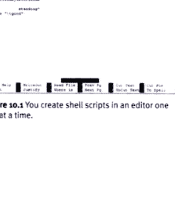

```
[ejr@hobbes scripting]$ sh myscript
friendsjustfriends

standing
good
```

代码清单 10.1 使用 `echo` 选项，你可以获得很好的理解。或者，也许只是一种朋友之间的很好理解。

4. `echo friendsjustfriends`

在脚本的下一行，输入 `echo` 后跟你希望在屏幕上看到的文本。在这里，`echo` 告诉 Unix 在屏幕上显示 `friendsjustfriends`——这是一条只属于朋友之间的消息。

5. `echo`

再添加一行，只写 `echo`，不加其他内容，以显示一个空行。

6. `echo "      standing"`

再添加一条 `echo` 命令。请注意，如果你像我们这里一样使用前导空格或制表符，则必须使用引号，如图 10.1 所示。

7. `echo -e "\tgood"`

使用 `-e` 标志加上 `\t`，你可以插入一个制表符。更多 `echo` 选项，请参阅“让 `echo` 更精彩”部分。

8. 保存并关闭你的脚本。

如果你需要保存文件并关闭编辑器方面的帮助，请查看第 4 章。

9. `sh myscript`

使用 `sh myscript` 来运行你的新脚本。这样做后，你会得到（字面意义上的）“很好的理解”，如代码清单 10.1 所示。嗒哒！你刚刚编写了你的第一个 shell 脚本！（有关运行脚本的更多信息和细节，请参阅下一节。）

### 提示

- 除非你强烈需要使用其他 shell（例如，如果你要利用仅在 `zsh` 中存在的功能），否则目前请坚持在你的脚本中使用 `sh`。

## 让 echo 更精彩

除了 `echo` 提供的基本打印到屏幕功能外，你还可以配合 `echo -e` 使用以下格式标志（`-e` 启用这些特殊格式特性）：

- `\b` 将光标向后移动一个空格。
- `\c` 强制后续文本与当前文本出现在同一行。
- `\f` 强制后续文本在指定水平位置出现在下一行。
- `\n` 强制后续文本出现在新的一行。
- `\t` 将后续文本输出缩进一个制表符。

例如，`echo -e "\tGreetings! \c"` 会将“Greetings!”向右移动一个制表符位置（由 `\t` 指定），并且不会在其后插入换行（由 `\c` 指定）。

## 运行 Shell 脚本

在编辑器中创建脚本并保存脚本文件后，下一步就是运行它，这意味着按提供的顺序执行脚本中的每个命令。（是的，你在上一节中已经做过这个操作，但我们将在此处进行扩展。）如图 10.2 所示，你通过使用 `sh` 命令（或你正在使用的 shell 的名称）后跟要运行的 shell 脚本的名称来执行此操作。

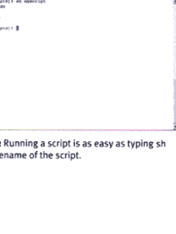

图 10.2 运行脚本就像输入 `sh` 加上脚本的文件名一样简单。

### 运行脚本：

- `sh myscript`

在 shell 提示符下，输入 `sh`（或你想要运行脚本的 shell 的名称，如 `ksh` 或 `csh`）后跟脚本的名称。在这种情况下，你实际上只是告诉 `sh` 运行并使用 `myscript` 文件中的命令列表。你会看到脚本的结果——在本例中，单词会出现在屏幕上，如图 10.2 所示。

### 提示

- 请注意，在此示例中，你明确告诉 Unix 要运行的脚本的名称（`myscript`）。当你这样做时，上一节中脚本顶部的 `#!/bin/sh` 行在技术上是多余的。只有当脚本可执行时，如下一节所述，它才是必不可少的。

## 使脚本可执行

在上一节中，我们向你展示了你可以通过输入 `sh` 后跟 shell 脚本文件的名称来运行 shell 脚本。你也可以使脚本可执行，这意味着你只需在 shell 提示符下输入脚本名称（省略 shell 的名称）即可运行它。这样做很方便，因为它允许你像使用任何其他命令一样方便地使用脚本。如代码清单 10.2 所示，在你可以直接执行脚本之前必须进行一些设置。

- 1. `head -2 myscript`

在 shell 提示符下，检查以验证你的脚本顶部确实有 `#!/bin/sh` 行来指定运行它的 shell。记住从第 6 章中 `head -2` 将列出指定文件的顶部两行。

- 2. `chmod u+x myscript`

在这里，使用 `chmod` 命令授予用户（也就是你）执行权限。有关设置权限的详细信息，请参阅第 5 章中名为使用 `chmod` 更改权限的部分。

- 3. `pwd ; echo $PATH`

显示当前目录的名称和完整路径，并验证当前目录是否在路径中。当前目录（你刚刚授予自己执行权限的目录）必须包含在路径中；否则，脚本将无法从 shell 提示符轻松执行。

- 4. `myscript`

在 shell 提示符下，输入脚本的名称。假设你的当前目录在路径中，脚本将运行。

```
[ejr@hobbes scripting]$ head -2 myscript
#! /bin/sh
# This is my first shell script
[ejr@hobbes scripting]$ chmod u+x myscript
[ejr@hobbes scripting]$ pwd ; echo $PATH
/home/ejr/scripting
/usr/local/bin:/bin:/usr/bin:/usr/X11R6/bin:/usr/local/games:/home/ejr/bin:/home/ejr/scripting
[ejr@hobbes scripting]$ myscript
friendsjustfriends

standing
good

[ejr@hobbes scripting]$
```

代码清单 10.2 在进行少量一次性准备后，你可以通过在 shell 提示符下输入脚本名称来运行可执行脚本。

下一页继续

## ✓ 提示

- 每次打开新脚本时，请检查以验证第一行是 `#!/bin/sh`，以便文件能正确运行。另请检查权限和你的路径，以确保你能从 shell 提示符运行脚本。（你几乎总是会发现使用可执行脚本比每次运行脚本时指定 shell 或路径更方便。）

- 如果当前目录不在路径中（无论是显式还是通过 `.` 记法，如 `PATH=/usr/bin:.:`），你将必须采取额外步骤来执行脚本。你可以

- 使用类似 `PATH=$PATH:/home/yourid/tempdir` 的命令将当前目录添加到路径中。有关此选项的更多信息，请阅读第 8 章。


- 使用 `./myscript` 而不是仅 `myscript` 来执行脚本。
- 将脚本移动到路径中的目录。

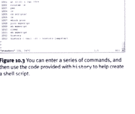

图 10.3 你可以输入一系列命令，然后使用 `history` 提供的代码来帮助创建 shell 脚本。

## 使用 history 为脚本做准备

如果你发现自己反复执行某个特定流程，请考虑将其制作成脚本。一种简单的方法是从会话历史开始创建脚本，如图 10.3 所示。基本上，你只需完成一次流程，然后使用会话历史来帮助为你构建脚本即可。

### 使用 history 为脚本做准备：

- 1. 完成你想要包含在脚本中的流程。

  我们等着。
- 2. 粗略统计你发出的命令数量。

  不必担心你使用命令的确切数量，但要有个概念是 3 条、30 条还是 300 条命令。
- 3. `history 20 > standbyou`

  完成流程后，输入 `history` 后跟脚本的大致命令数。估算命令数时，宁可多估，因为删除多余命令比添加缺失命令更容易。然后，将输出重定向到所需的文件名，就可以看到正在制作的脚本了。
- 4. `vi standbyou`

  使用你选择的编辑器编辑脚本文件，删除初始的行号和空格，并一般地将脚本整理成形。有关更多详细信息，请参阅本章前面的“创建 Shell 脚本”部分。

### 提示

- 如果你使用 `vi`，请执行全局搜索并替换以去掉左侧 `history` 引入的行号——只需使用 `Esc:%s/^\ .*/ //`（`^` 后一个空格，`//` 前两个），你就可以开始了。有关巧妙的 `vi` 技巧，请参阅第 4 章。

## 嵌入命令

假设你创建了一个脚本，它会在你每天登录时自动运行。该脚本例如可能会在屏幕上打印 “Greetings!” 并可能发送一条聪明的消息：“Say, you're looking sharp today!” 你可以用本章迄今为止学到的信息轻松做到这一点。

这里方便的做法是，在脚本中添加一行，告诉 Unix 执行所有这些操作，外加命名最近使用的文件——对于那些需要提醒自己上次在做什么的人来说很有用。你可以使用 `ls` 命令，但那样只会列出文件名，而不会将信息与早上的问候语整合在一起。相反，更好、更美观的做法是捆绑几个命令并与 `echo` 一起使用，如图 10.4 所示，将信息直接嵌入问候语中。

### 嵌入命令：

- 1. `vi myscript`

  首先，在你喜欢的编辑器中打开 `myscript` 或其他脚本。你的脚本可能看起来像图 10.4，屏幕上显示问候语。

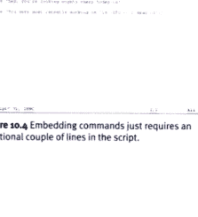

图 10.4 嵌入命令只需要在脚本中多加几行即可。

### 使用巧妙的日期

你可以使用 `date` 命令以任何格式输出任何日期。一般使用 `date "+Today is %A"`，但你可以使用以下任意或全部格式：

- `%d` 包含日期。
- `%y` 包含两位数的年份。
- `%Y` 包含四位数的年份。
- `%m` 包含数字月份。
- `%b` 包含缩写月份。
- `%B` 包含完整月份名称。
- `%a` 包含星期几的缩写。
- `%A` 包含星期几的完整名称。
- `%R` 包含小时和分钟的时间。
- `%D` 包含月/日/年格式的日期。

请查看 `man` 手册以获取其余几十种选项。

```
[ejr@hobbes scripting]$ myscript
Greetings! Say, you're looking mighty sharp today!

You were most recently working on figlet.
[ejr@hobbes scripting]$
```

代码清单 10.3 嵌入命令的结果可能令人印象深刻。

2. `echo "You were most recently working on `ls -1Fc ~/ | head -1` ."` 输入 `echo` 后跟你想要显示的描述性文本。然后在描述性文本中嵌入 `ls` 命令 (`ls -1Fc ~/ | head -1`)。请注意，嵌入的代码以 ` （点）开始和结束。

这里的嵌入命令列出主目录中最最近更改的文件或目录。`1` 提供每行一个条目，`F` 用 `/` 格式化目录名，以便我们能区分是在子目录还是文件上工作，`c` 按修改日期排序。然后我们将输出通过管道传递给 `head -1`，它显示文件的第一行。

3. 保存脚本并退出编辑器，然后试用它。如代码清单 10.3 所示

### 提示

- 你也可以将日期嵌入脚本中。尝试 `echo -e "Today is `date +%A`"` 如果你工作太多而忘记星期几。有关更多日期细节，请参阅侧边栏“使用巧妙的日期”。
- 当你嵌入依赖目录的命令时——例如 `ls` 或 `find`——务必指定完整路径。如果不指定，你将得到相对于脚本所在位置的路径，而不是相对于你运行脚本的位置的路径。
- 嵌入命令在很多方面很有用。你可以在任何想要一个程序基于另一个程序的输出而行动的时候使用它们，就像 `echo` 根据程序的输出显示某些内容一样。

## 循环你的脚本

假设你创建了一个脚本，想要将其应用于多个文件。例如，假设每天结束时你需要为 `www` 目录中的所有 `.html` 文件制作备份副本。你可以为每个单独的 `.html` 文件制作备份，但这工作量很大。更简单的方法是创建一个复制 `.html` 文件的简短脚本，然后循环该脚本以将其应用于 `www` 目录中的所有 `.html` 文件（图 10.5）。你只需创建一个简短的脚本；Unix 会为你完成繁琐的工作。

### 创建循环：

1. `vi head_ache`

   在 shell 提示符下，启动你的编辑器并打开你想要循环的脚本。在本例中，我们使用 `vi` 和 `head_ache` 文件。（当然，你也可以将脚本命名为 `html-backup` 或类似的平凡名称。）
2. `#!/bin/sh`

   告诉你的 Unix 系统使用哪个 shell 来运行 shell 脚本。在此示例中，我们通过 `#!` 告诉它使用 `/bin/sh` 运行 shell 脚本。
3. `cd ~/www`

   确保你位于循环将发生的目录中。在此示例中，我们的 shell 脚本位于主目录中，但循环将应用的文件位于 `www` 目录中。
4. `for i in `ls -1 *.html``

   好吧，别惊慌。将其读作：“查找 `.html` 文件列表中的项目。” 在此代码中，我们将嵌入命令的输出（`ls -1 *.html`）提供给 `for` 循环（即 `.html` 文件），如图 10.5 所示。顺便说一下，`ls` 命令上的 `-1` 标志强制输出为单列列表，这非常适合脚本使用，而不是多列，这在屏幕上易于阅读但不适合脚本。

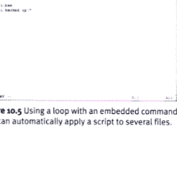

图 10.5 使用带有嵌入命令的循环，你可以自动将脚本应用于多个文件。

```
[ej@hobbes scripting]$ more head_ache
#!/bin/sh
cd ~/www
for i in `ls -1 *.html`
do
cp $i $i.bak
echo "$i backed up!"
done

[ej@hobbes scripting]$ ./head_ache
above.html backed up!
file1.html backed up!
html.html backed up!
reference.html backed up!
temp.html backed up!
[ej@hobbes scripting]$
```

代码清单 10.4 此循环在备份每个文件时报告进度。

循环对于在多个文档中进行搜索和替换特别方便。例如，如果你是新任 Webmaster，并且想用你的名字替换所有 `.html` 文件底部旧 Webmaster 的名字，你可以使用带有 `sed` 的循环来完成。查看第 6 章以获取有关 `sed` 的更多信息，它将有助于复杂的搜索，以及第 17 章，其中介绍了将 `sed` 引入循环。

5. `do`

   在 `for` 语句之后的下一行，输入 `do`。这告诉 Unix 系统以下信息将是需要应用的循环。
6. `cp $i $i.bak`

   在这里，我们复制（`cp`）指定的项目（`$i`）到备份文件（`$i.bak`）——即每个被复制的文件一个备份文件。因此，如果你最初有 72 个 `.html` 文件，你最终将拥有这 72 个原始文件，外加 72 个新的备份文件。
7. `echo "$i backed up!"`

   添加 `echo "$i backed up!"`，以便系统在屏幕上显示它已执行的操作。
8. `done`

   在下一行，宣布你已完成循环。
9. 保存它，使其可执行，然后试用。

   此示例脚本将为 `www` 目录中的所有 `.html` 文件制作备份副本，如代码清单 10.4 所示。

### 提示


循环指令可以复杂得多。例如，你可以创建一个循环来拼写检查目录中每个章节文件并报告每个文件中有多少个拼写错误。要做到这一点，在循环中使用此行：`echo -e "$i has \t `cat $i | spell | wc -l` misspelled words"`。这里再次只需一步一步地构建循环。

```
[ejr@hobbes scripting]$ ./deef
Greetings!  Say, you're looking mighty sharp today!

You were most recently working on scripting/.
Nope, no feedback yet
[ejr@hobbes scripting]$ touch feedback
[ejr@hobbes scripting]$ ./deef
Greetings!  Say, you're looking mighty sharp today!

You were most recently working on scripting/.
There's feedback on the latest project
[ejr@hobbes scripting]$
```

代码清单 10.5 反馈脚本产生的最后一行取决于找到的文件。

2. `if ls | grep feedback > /dev/null`

从 `if` 开始该行，然后跟上条件语句，在本例中为 `ls | grep feedback`。将其读作：“列出当前目录中的文件并搜索名为 feedback 的文件。如果该文件存在，则表达式为真。” 重定向到 `/dev/null` 只是丢弃 `grep` 的输出；你关心的是测试的结果，而不是找到或未找到的具体行。（参见图 10.6 中的完整脚本。）

3. `then echo "There's feedback on the latest project"`

在 `if` 语句之后的下一行，输入如果 `if` 语句为真时要执行的命令或要显示的消息。在此示例中，为真的 `if` 语句将导致 “There's feedback on the latest project” 打印在屏幕上。

4. `else echo "Nope, no feedback yet"`

在下一行，使用 `else` 后跟一个指定如果 `if` 语句为假时应发生什么的语句。在这里，我们指定如果未找到 `feedback` 文件或其中没有内容，则会打印 “Nope, no feedback yet”。

5. `fi`

在 `else` 语句之后立即宣布你已完成 `fi`。

6. 保存脚本并试用。

在此示例中，脚本将检查 `feedback` 是否存在并根据找到的内容打印不同的消息（代码清单 10.5）

## 关于 If-Then 的更多内容

使用本节提供的步骤，尝试以下其他 `if-then` 可能性：

- `[ -a filename ]` 检查文件是否存在。
- `[ ! -a filename ]` 检查文件是否不存在。`!` 符号（非）使此测试在前一个示例为“false”时报告为“true”。
- `[ -d name ]` 检查 `name` 是否存在且为目录。
- `[ first -nt second ]` 检查第一个文件或目录的修改日期是否比第二个更新。
- `[ first -ot second ]` 检查第一个文件或目录的修改日期是否比第二个更旧。
- `[ -n string ]` 检查字符串的长度是否大于 0。
- `[ -z string ]` 检查字符串是否为零长度。
- `[ string1 = string2 ]` 检查第一个字符串是否等于第二个。
- `[ string1 != string2 ]` 检查第一个字符串是否不等于第二个。
- `[ \( condition1 \) -a \( condition2 \) ]` 检查两个条件是否都为真（条件可以包含其他条件）。
- `[ \( condition1 \) -o \( condition2 \) ]` 检查 `condition1` 或 `condition2` 是否为真。

输入 `man test` 以获取有关创建条件语句的更多信息。

## 在脚本中接受命令行参数

假设你在每个月的月底需要向你的老板发送一份进度报告。你可能会设置一个脚本来给老板写一封电子邮件，提供合适的主题行，并发送包含进度报告的文件。你可能会让此脚本自动写给老板并填写主题行，但你希望使用命令行输入来告诉脚本你想要发送哪个文件。通过使用命令行输入，你可以让脚本更灵活，同时仍能将大部分流程自动化。你运行脚本并在 shell 提示符下指定输入，如图 10.7 所示。

### 在脚本中接受命令行参数：

- 1. `vi status-report`

使用你喜欢的编辑器编辑你的脚本。

- 2. `mail -s "Status report for $1" boss@example.com < ~/reports/$1`

输入命令，并在你希望使用命令行输入的第一项的每个位置使用 `$1`。在此示例中，脚本开始给老板发送消息，填写主题行（自动添加月份），并从你的主目录下的 `reports` 目录发送适当的月度报告（在命令行中指定的那个）。

- 3. 保存并退出，然后运行脚本（代码清单 10.6），不过你可能首先需要找到一个老板来接收你的状态报告并提供状态报告的内容。

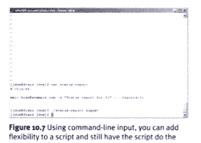

图 10.7 使用命令行输入，你可以为脚本增加灵活性，同时仍让脚本为你完成繁重的工作。

```
[ejrhobbes scripting]$ more status-report
#! /bin/sh

mail boss@whereever.com -s "Status report for $1"
  for $1" < ~/reports/$1

[ejrhobbes scripting]$ ./status-report
August
[ejrhobbes scripting]$
```

代码清单 10.6 通过提供命令行输入，你可以控制脚本的行为。

## ✓ 提示

- 要查看在命令行提供的信息，使用 `echo $*` 将其回显出来。`$*` 变量提供所有命令行输入，其中 `$1`、`$2` 和 `$3` 包含各个项目。
- 你也可以在脚本运行期间在指定点接受输入。有关更多详细信息，请参阅下一节。

## 在脚本运行时接受输入

在上一节中，我们向你展示了你可以要求在脚本运行之前提供信息，但很容易忘记输入信息，从而得不到预期的结果。你也可以在脚本运行时要求输入。脚本运行，你输入一些信息，然后脚本继续（可能）使用你输入的信息（图 10.8）。在此情况下，脚本会统计拼写错误的单词，但你可以将其应用于任何你想要的内容。

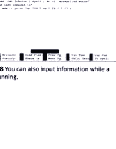

图 10.8 你也可以在脚本运行时输入信息。

### 在脚本运行时接受输入：

- 1. `pico retentive`

使用你喜欢的编辑器编辑你的脚本。

- 2. `echo -e "Which file do you want to analyze?"`

指定你在屏幕上看到的提示文本。在这里，屏幕上的文本将显示为 "Which file do you want to analyze?"

- 3. `read choice`

在脚本中你希望脚本接受信息的任何位置，输入 `read` 后跟接受输入的变量名。在这里，我们将变量命名为 `choice`。

- 4. `echo "Choice has `cat $choice | spell | wc -l` misspelled words"`

回显一个短语（和嵌入的命令）来检查拼写，统计拼写错误的单词，并报告指定文件的数量。在文件名应出现的地方，替换为 `$choice`。

```
[ejr@hobbes scripting]$ ./retentive
Which file do you want to analyze?
testfile
testfile has 11 misspelled words
and was last changed at 05:08 on Jan 12
[ejr@hobbes scripting]$
```

**Code Listing 10.7** 在脚本运行时接受输入有助于确保你不会忘记输入它，同时仍能获得自定义结果。

- **5.** `echo -e "and was last changed \c"`

回显另一行文字，并且（由于 `\c`）行尾没有换行符。

- **6.** `ls -l $choice | awk '{ print "at $8 "`

`.. on " $6 " " $7 }'`

这条非常长且复杂的行使用 `awk` 从 `ls -l` 对作为 `$1` 提供的文件的列表中提取时间、月份和月份日期字段（图 10.8）。有关 `awk` 的详细信息请参见第 6 章。

- **7.** 保存并退出。


你现在已经掌握了这个。

- **8.** `./retentive`

运行脚本（在使其可执行并在必要时指定当前目录之后）并在提示时提供文件名，如代码列表 10.7 所示。

### Tips

- 提示输入的一个很好的例子是配置文件。有关详细信息和具体示例，请参阅第 17 章中的使用输入来自定义你的环境。
- 有关设置配置文件和在登录时启动脚本的更多信息，请参阅第 8 章。
- 你可以使用类似 `echo -e "Please enter the name: \c"` 和 `read name` 的一组行，使输入行及其介绍都出现在同一行上。

### Debugging Scripts

在开发脚本时，你无疑会在使其正常运行时遇到一些问题。如图 10.9 所示，你可以通过在脚本运行时将其打印到屏幕上来帮助调试脚本。这样，你就可以跟随脚本的运行并查看问题可能出在哪里。

### To print the script onscreen as it runs:

- `sh -x retentive`

在 shell 提示符下，键入 `sh -x` 后跟脚本名称（以及你需要提供的任何额外信息）。`-x` 告诉 shell 既执行脚本（像往常一样），又打印出各个命令行，如图 10.9 所示。

### Tip

- 对此种调试输出，使用任何 shell 的名称，后跟 `-x`，后跟脚本名称即可。例如，尝试 `bash -x retentive`。

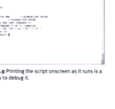

图 10.9 在脚本运行时将其打印到屏幕上是调试它的好方法。

## 11 SENDING AND READING EMAIL

如果你和我们一样，你的整天都围绕着在你的电子邮件收件箱中收到好东西以及发送“非常重要”的消息（当然，它们很重要，对吧？）。无论如何，发送和接收电子邮件很可能在你的 Unix 体验中会是相当常见的任务。

在本章中，我们将向你介绍一些 Unix 电子邮件程序，并向你展示如何开始使用它们。（当然，只使用适用于你所使用程序的说明！）然后，我们将向你展示在 Unix 中使用电子邮件可以做的一些巧妙的事情，例如创建签名文件和发送自动的休假电子邮件回复。

### Chapter Contents

- 选择电子邮件程序并开始使用
- 使用 pine 阅读电子邮件
- 使用 pine 发送电子邮件
- 自定义 pine
- 使用 mutt 阅读电子邮件
- 使用 mutt 发送电子邮件
- 使用 mail 阅读电子邮件
- 使用 mail 发送电子邮件
- 创建签名文件
- 转发传入消息
- 宣布缺席
- 配置 procmail
- 使用 procmail 回复电子邮件

### Choosing an Email Program and Getting Started

总体而言，在 Unix 系统上发送和接收电子邮件时，你会有两种程序可供选择：

- 安装在你的本地计算机或网络上并为你与 Unix 系统交互的电子邮件程序。你可能将这些程序称为邮件客户端，并且可能使用过像 Eudora、Outlook Express 或 Netscape Communicator、Messenger 中的邮件程序这样的程序。它们很方便，因为它们通常具有精美的界面，并且可以在你无需太多麻烦的情况下处理附件，但它们并不是真正的 Unix 电子邮件程序。这些程序还允许你将邮件存储在你的桌面系统（Windows 或 Macintosh）上。
- 你直接在 Unix 系统上访问和使用其的电子邮件程序。这些程序，例如 `pine`、`mutt` 和 `mail`，让你轻松发送和接收电子邮件。此外，`pine` 和 `mutt` 让你可以毫不费力地发送附件。由于邮件保留在 Unix 系统上，因此只要你能访问互联网，就能从任何地方访问你的邮件。

在本章中，我们将重点介绍你直接从 Unix 系统访问的电子邮件程序，因为这些才是真正的 Unix 电子邮件程序。虽然有数以亿计的不同程序可用，但你很可能可以访问以下其中一个（或多个）：

- `pine`：此程序易于使用，让你非常轻松地发送和接收电子邮件和附件。如果可用，我们推荐 `pine`。图 11.1 显示了其相对简单的界面。只需使用屏幕底部列出的菜单命令即可。

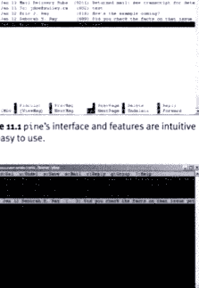


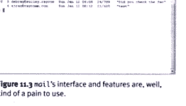

Figure 11.3 `mail` 的界面和功能，说实话，使用起来有点麻烦。

```
Red Hat Linux release 5.1 (Manhattan)
Kernel 2.0.34 on an i486
login: ejr
Password:
Last login: Sun Aug 2 07:41:00 on tty4
You have mail.
[ejr@hobbes ejr]$
```

Code Listing 11.1 登录时请仔细阅读显示 “You have mail” 的那一行。

- `mutt`: 这个程序用户友好度稍差，但它可以让你发送和接收邮件，并且能很好地处理附件。`mutt` 是我们在 `pine` 不可用时的第二选择，但如果你花点时间对其界面进行定制以满足你的需求，`mutt` 还是相当友好的。Figure 11.2 显示了它的界面，该界面为大多数用途提供了充足的功能。
- `mail`: 这个程序几乎在每个 Unix 系统上都可用；然而，如 Figure 11.3 所示，它使用起来相当困难，并且不提供直观的选项或命令。我们建议尽可能选择其他邮件程序。仅在紧急情况下使用此程序。

### Tips

你怎么知道有人给你发了东西？shell 在你登录时通常会宣布（但通常不会发出声音）“You have mail” 或 “You have new mail”，如 Code Listing 11.1 所示。也就是说，如果你确实有邮件在等待你。

- 你不仅限于使用普通的 Unix 邮件程序或 POP 邮件程序；你可以根据自己的具体偏好和需求使用其中一种或两种。你也不仅限于只使用一种 Unix 邮件程序，如果你有多个可用程序的话，尽管从两个不同的 Unix 程序中读取邮件有时会使你难以跟踪邮件在哪里。试用它们，看看哪个程序或程序组合能满足你的需求。
- 我们建议使用像这样的基于字符的邮件程序来阅读邮件。习惯了界面后，你可以比使用 GUI 邮件客户端（如 Outlook 或 Netscape mail）更快地浏览邮件，而且也不会有垃圾邮件图形出现在你面前。

## Reading Email with pine

使用 `pine` 的第一步很可能是阅读邮件。如 Figures 11.4 through 11.7 所示，你首先输入 `pine` 命令，然后根据你想要执行的操作逐屏操作。

### To read email with pine:

- 1. `pine`

在 shell 提示符下，输入 `pine` 启动程序。第一次使用 `pine` 时，它会在你开始之前询问你是否愿意被计为 `pine` 用户（见 Figure 11.4）。此后，你会看到正常的 main screen，如 Figure 11.5 所示。如果收到关于找不到 `pine` 命令的错误消息，请在系统上查找以尝试找到该程序。有关查找位置的详细信息，请参阅 Chapter 1。

- 2. `L`

按 `L` 查看文件夹列表，其中包括收件箱文件夹以及（最终）你设置的其他文件夹。

- 3. 使用 `↑` 和 `↓` 键在文件夹列表中上下移动（如果你有其他文件夹）。

- 4. `V`

按 `V` 查看所选文件夹。请注意，底部菜单中的默认选择会用 [brackets] 显示（见 Figure 11.6）。与其使用箭头键选择默认值，你也可以直接按 Enter。

- 5. 使用 `↑` 和 `↓` 键在邮件列表中上下移动。

你的未读邮件默认会出现在列表底部。

- 6. Enter

按 Enter 阅读所选邮件。

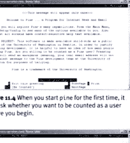


Figure 11.7 你真的想退出 `pine` 吗？只是确认一下。

- 7. Hmmm. Uh-huh. Wow. Marvy.

阅读你的邮件。按 `[x]` 退出当前邮件并返回当前文件夹的邮件索引。

- 8. `[Q]`

当你准备好退出 `pine` 时，按 `[Q]`。系统会提示你确认是否要退出，如 Figure 11.7 所示。只需按 `[Y]` 退出，或按 `[N]` 如果你真的不想退出。

### ✓ Tips


- 注意 `pine` 屏幕底部列出的菜单命令。你可以通过按相应的键来选择这些选项中的任何一个；`pine` 方便地不区分大小写，因此小写或大写命令都有效。

- 使用 `pine -i` 从收件箱开始，而不是从主菜单开始。

- 在浏览邮件时，你可以使用 `Tab` 跳转到文件夹中的下一封未读邮件。

- 通过在邮件在邮件列表中高亮显示时或在邮件在屏幕上打开时按 `D` 来删除邮件。当你退出程序时，`pine` 会验证你是否要丢弃已删除的邮件。只需按 `Y` 确认删除，或按 `N` 如果你真的不想删除邮件。（请注意，在 `pine` 中删除不会将它们发送到回收站，就像使用 Windows 邮件程序时按 `Delete` 键一样。在 Unix 中，按 `D` 真正会删除邮件……它们消失了！）

- 你可以通过在选择邮件时或阅读邮件时按 `R` 来回复邮件。

- 使用 `pine` 时，请留意屏幕底部菜单中的 `O`，表示有其他选项。

## Printing with pine

尽管许多 Unix 邮件程序不允许你打印到本地打印机，但 `pine` 可以。你所要做的就是选择 `%`，接受 `pine` 建议的 “attached to ansi” 默认打印输出，你的打印输出很可能会出现在你的常规打印机上。这种方式打印到本地打印机在使用某些通信程序（尤其是 Windows telnet）时不起作用，但在使用许多程序时有效。如果你坐在 Linux 或 Mac OS X 系统前，你也可以使用系统上的其他打印实用程序——“attached to ansi” 选项实际上是为通过 ssh 或 telnet 连接到 Unix 系统的人准备的。

## 使用 pine 发送电子邮件

我们接下来最喜欢用 `pine` 做的事情就是发送新邮件。通常，你会在已经启动 `pine`（图 11.8）的情况下发送邮件，但你也可以直接从 shell 提示符开始撰写新邮件（见提示）。

### 使用 pine 撰写并发送邮件的方法：

- 1. `pine`

  在 shell 提示符下输入 `pine` 以启动 `pine`，如果它尚未运行。

- 2. `C`

  按 `C` 撰写新邮件。

- 3. `Tab`

  按 `Tab` 在邮件头字段之间移动。填写抄送收件人（`cc:`）和主题行 `Subject:`。有关包含主题行的详细信息，请参阅名为《我们对主题的看法》的侧边栏。

  如果要发送附件，请在 `Attchmnt:` 行输入 Unix 文件名（如果合适，还包括路径）。例如，输入 `~/myfile`，其中包含完整路径名和文件名。

- 4. `Hi, John, when should we schedule that golf game -- er, um -- business meeting?`

  在消息窗口中输入你的邮件。图 11.8 显示了我们的邮件，已完整包含头信息和邮件正文。

- 5. `Ctrl X`

  准备好发送时，按 `Ctrl X`

  `pine` 会询问你是否确实要发送邮件。按 `Y`（或按 `Enter`）发送，或按 `N` 如果你不想发送。


图 11.8 在 `pine` 中准备邮件就像填空一样简单。

### 提示

- 与其输入某人的冗长电子邮件地址（如 `joeblow@somefancompany.com`），不如设置一个别名，这样你只需输入 `Joe` 或其他名称即可。要设置别名，请使用地址簿（从主菜单按 `A`）并按照给出的说明操作。

- 如果你在 shell 提示符下并且想在不使用 `pine` 主界面的情况下发送电子邮件，请输入 `pine` 后跟你想发送邮件的电子邮件地址（例如，`pine bigutz@raycomm.com`）。如果要向多个地址发送邮件，只需用逗号或空格分隔，如 `pine univqs@raycomm.com, info@raycomm.com`

## 我们对主题的看法

- 始终包含一个描述性的主题行，简洁地概括邮件内容。例如，与其说“给你”，不如说“关于 Baskins 提案的评论”。

- 切勿将主题行留空。许多人会丢弃没有主题的邮件，认为它们可能是垃圾邮件或不重要到不值得阅读。

- 切勿在主题行（或任何其他地方）使用全大写，因为收件人可能会认为你在大声咆哮。

- 注意垃圾邮件过滤器的工作方式。许多 ISP 使用它们来减少通过的垃圾邮件（像垃圾邮件一样一次性发送给数百或数千人的批量邮件）的数量。一些过滤器会丢弃主题行以全大写形式输入的邮件。其他过滤器会丢弃主题中感叹号过多的邮件。

## 第 11 章 自定义 pine

虽然 `pine` 使用起来相当直观，但它也非常强大，为你提供了大量自定义选项。图 11.9 显示了 `pine` 的自定义屏幕，以及你可以选择的其中一些选项。

### 自定义 pine 的方法：

- 1. `pine`

- 2. `M`

  按 `M` 访问主菜单。

- 3. `S`

  按 `S` 调出设置菜单。

- 4. `C`

  按 `C` 访问配置设置菜单，如图 11.9 所示。

- 5. 使用 `↑` 和 `↓` 键滚动浏览配置列表，`pine` 为你提供了大量可配置的选项。

表 11.1 描述了你可能觉得最有用的选项。

| Option | Description |
|--------|-------------|
| initial-keystroke-list | 指定 `pine` 启动时使用的键命令，就像你直接输入它们一样。 |
| nntp-server | 设置新闻服务器名称，以便在 `pine` 中阅读 Usenet 新闻，如第 12 章所述。 |
| quit-without-confirm | 允许你在没有“确定吗？”消息的情况下退出 `pine`。 |
| signature-at-bottom | 将你的自动签名放在回复邮件的末尾，而不是其上方。 |
| saved-msg-name-rule | 设置 `pine` 根据邮件的特征（发件人等）自动将保存的邮件归档到特定文件夹。 |
| fcc-name-rule | 设置你的发件邮件副本保存到特定文件夹。我们喜欢按收件人归档的选项，它会根据收件人归档邮件。 |
| use-only-domain-name | 设置 `pine` 发送所有外发邮件时仅使用域名，而不在 `From:` 行上使用机器名。例如，我们的邮件来自 `@raycomm.com`，而不是 `@frazz.raycomm.com`。 |


- 6. 按 `Enter`

  按 `Enter` 选择要更改的选项。

- 7. 做出你的选择或填写必要的信息。

- 8. 按 `E`

  按 `E` 退出配置菜单并返回设置菜单。系统会提示你保存更改。如果希望保存，按 `Y`；否则按 `N`。然后你会迅速返回主菜单。

### 提示

- 你可以自定义 `pine`，使其在启动时自动打开收件箱。在初始按键列表中，输入 `1`、`v`，然后按 `Enter` 即可指定初始字符。

## 使用 mutt 阅读电子邮件

如果使用 `mutt`，你会发现阅读电子邮件消息相当简单。如图 11.10 所示，只需用 `↑` 和 `↓` 键滚动消息列表，然后按 `Enter` 打开要阅读的消息。

### 使用 mutt 阅读电子邮件：

- 1. `mutt`

  在 shell 提示符下输入 `mutt` 启动程序。系统可能会询问你是否要为你创建文件夹，如代码清单 11.2 所示。我们建议让它替你完成这项工作，输入 `[yes]`（是）。

  如果不想创建文件夹，输入 `[no]`（否）。

  图 11.10 显示了 `mutt` 主屏幕。

- 2. 使用 `↑` 和 `↓` 键在邮件消息列表中上下移动。

  未读消息将位于列表底部。

- 3. `Enter`

  按 `Enter` 打开要阅读的消息。

- 4. `I`

  按 `I` 返回消息列表（索引），或按空格键向下滚动当前消息。图 11.10 显示了命令菜单，这有助于你记住 `mutt` 的一些基本操作。

- 5. `Q`

  按 `Q`（退出），然后向 `mutt` 道别。系统可能会提示你回答一些问题（例如，关于放弃已删除的消息或将已读消息移动到已读邮件文件夹）。只有当将来你会将 `mutt` 作为主要邮件客户端时，才回答 `yes`。


图 11.10 `mutt` 的主索引屏幕显示了许多选项。

```
[lawr@hobbes awr]$ mutt
/home/jdoe/Mail does not exist. Create it?
(Yes/No):
```

代码清单 11.2 `mutt` 将为你创建一个邮件目录。

### ✓ 提示

- 你可以自定义 `mutt` 的几乎所有方面，但只能通过编辑 `~/.muttrc` 配置文件来实现。如果你觉得 `mutt` 的灵活性可能适合你，可以在互联网上搜索示例 `.muttrc` 文件，了解它可以实现哪些功能。

- 你可以在查看消息或在消息索引屏幕上选中消息时按 `D` 删除消息。退出 `mutt` 时，系统会询问是否应将“Move unread messages to /home/yourid/mbox.”。此时，按 `N` 将它们保留在收件箱中，或按 `Y` 移动它们。


- 你可以在消息列表中选择消息或阅读消息时按 `R` 回复消息。
- 你可以从大多数屏幕按 `?` 访问 `mutt` 帮助（尽管其内容有限）。
- 你可以在消息索引中通过输入消息编号移动到特定消息。

## 使用 mutt 发送电子邮件

使用 `mutt` 发送消息与使用 `pine` 发送消息类似。最常见的情况是，你已经在使用 `mutt` 时编写一条消息（图 11.11）。

### 使用 mutt 编写并发送消息：

- 1. **mutt**

  首先，在 shell 提示符下输入 `mutt` 启动 `mutt`。
- 2. **M**

  按 `M` 开始编写新消息。
- 3. **Enter**

  在输入 `mutt` 要求的每项信息后按 `Enter`（见图 11.11）。填写 **To** 和 **Subject** 行。（参见本章前面的侧边栏 *我们对主题栏主题的一点看法*。）
- 4. 向你的读者打个招呼。

  什么？当你输入消息头内容（填写你想要的内容）后，你会直接进入 `vi`，面对一片空白的消息顶部。关于 `vi` 的用法，参见第 4 章的快速回顾。
- 5. John，

  我做了个梦，梦见我把闹钟装在了肚子里。我记得这个梦是因为，当闹钟响时，我发现自己按着肚脐试图关掉噪音。天哪……我需要休假！

  输入你的消息，无论内容是什么。


> **图 11.11** 你通过回答问题或填写空白（此处为 Subject：）来填写消息头，然后按 `Enter` 键继续。

## 6. Esc

完成后，按 `Esc`（进入命令模式）。

## 7. :wq

然后输入 `:wq` 保存你的工作并退出编辑器。

## 8. Y

按 `Y` 发送消息。如果你最终决定不想分享有关肚脐的细节，可以按 `E` 编辑你的消息，或按 `Q` 退出并忘记整件事。

### ✓ Tips

- 你可以将默认编辑器从 `vi` 改为 Unix 系统上可用的其他编辑器。你所要做的就是编辑你的 `~/.muttrc` 文件（如果不存在则创建它）并在文件中添加 `set editor="emacs"`（或你想要的编辑器）。有关更改变量的更多信息，请参阅第 8 章。
- 要从 shell 提示符发送快速消息，输入 `mutt` 后跟收件人的电子邮件地址，如 `mutt winchester@roycomm.com`。如果你想向多个地址发送电子邮件，只需用逗号或空格分隔，如 `mutt unixvgs@roycomm.com, info@roycomm.com`。

## Reading Email with mail

总体而言，使用 `mail` 比使用 `pine` 或 `mutt` 直观性稍差；然而，用 `mail` 阅读电子邮件尤其——嗯——具有挑战性。虽然我们建议尽可能使用其他程序来阅读电子邮件，但如果你足够大胆或别无选择，这里是用 `mail` 阅读电子邮件的步骤。图 11.12 说明了这个相当快速的任务。


图 11.12 `mail` 屏幕一点也不直观，但你可以查看你拥有的消息。

### To read email with mail:

- 1. mail

  在 shell 提示符下输入 `mail`。你会得到一条消息列表和一个提示符（图 11.12）。
- 2. 3

  输入你想要阅读的消息编号并按 `Enter`。
- 3. Marvelous...he’s such a jerk...oh, that’s neat....

  阅读你的消息。按 `N` 移动到下一条消息，或按 `more` 逐屏翻阅消息。
- 4. Q

  准备好时按 `Q` 退出 `mail`。

### ✓ Tips

- 如果有人啰嗦给你发了一条长消息，你的 Unix 系统可能会直接跳过该消息，只让你阅读最后几行。要完整阅读该消息，要么输入 `more` 逐页翻阅消息，要么输入 `s` 后跟消息编号将其保存到文件中，然后使用你选择的编辑器读取它。
- 输入 `h` 后跟消息编号以查看不同的消息头。例如，输入 `h 117` 以查看编号 117 之前的消息。
- 尽可能找到不同的邮件程序——能够应对 `mail` 在需要时是有用的，但这不是长期的好解决方案。

## Sending Email with mail

尽管 `mail` 的界面和功能不直观，但如果你只是想快速发送一条消息而不必在意细节，它是一个很棒的程序。如代码清单 11.3 所示，你可以在 `mail` 中或从 shell 提示符发送消息。你也可以相当轻松地使用 `mail` 发送文件。

### To compose and send a message using mail:

- 1. mail unixvqs@raycomm.com

  在 shell 提示符下，输入 `mail` 后跟收件人地址。如果你想向多个地址发送电子邮件，只需用逗号分隔但不要加空格，如 `mail putz@roycomm.com,putz2@roycomm.com`。如果你已经在 `mail` 中，只需输入 `m` 后跟地址或地址，如 `m putz@roycomm.com,deb@roycomm.com`。
- 2. So, anyway, Winchester had perched himself on my stereo turntable (those were sooooo low-tech, weren’t they?!). He was waiting for me to turn on the stereo so he could go back to sleep while spinning in circles. I used to let him sleep that way at night. Well, that was until one night the lid closed on him…

  输入你的消息正文（参见代码清单 11.3）。
- 3. Ctrl D

  在最后一行单独输入一个 `.`（点）或使用 `Ctrl D` 宣布你已完成，消息将被发送到收件人。

```
[ejr@Hobbes ejr]$ mail debroy
Subject: You’re in big trouble now!
So, anyway, Winchester had perched himself on my stereo turntable (those were sooooo low-tech, weren’t they?!). He was waiting for me to turn on the stereo so he could go back to sleep while spinning in circles. I used to let him sleep that way at night. Well, that was until one night when the lid closed on him…
EOT
[ejr@Hobbes ejr]$
```

Code Listing 11.3 Using `mail`, you can dash off a quick note by including the recipient’s address and the message text.

### 使用邮件发送文本文件：

```
mail unixvqs@raycomm.com < sendit.txt
```

在 shell 提示符下，输入 `mail` 后跟收件人的地址。然后使用 `<` 和文件名来重定向文件（`< sendit.txt`），这会告诉 Unix 将文件发送到提供的地址（代码清单 11.4）。

```
[ejr@hobbes ejr]$ mail unixvqs@roycomm.com
> < sendit.txt
[ejr@hobbes ejr]$
```

代码清单 11.4 要通过邮件发送文本文件，只需将文件重定向到 `mail`。

### 提示

- 请参阅第 9 章中的 Scheduling Regularly Occurring Jobs with cron，了解使用 `mail` 直接发送消息的更精致方法。
- 请参阅第 1 章中名为 Redirecting Output 的部分，了解重定向的复习。
- 你会注意到某些系统上的 `mail` 接口不提供主题行。在某些系统上，你可以通过包含 `-s` 加上主题文本来添加主题，如下所示：`mail -s "An old Winchester story... dumb cat!" unixvqs@roycomm.com`
- 你可以使用 `mutt` 也可使用 `mail` 实现所有这些命令行邮件发送选项，但使用 `mutt` 你会获得额外好处，包括能够发送附件。例如 `mutt -s "Sending that file" -a bigolefile.tgz suggest@example.com < /dev/null` 将一次性完成所有操作，包括附加那个大文件。不要用 `mail` 尝试这个！

## 创建签名文件


图 11.13 你的签名文件可以包含你想要的任何信息。发挥创意，但保持简洁！

如果你使用电子邮件有一段时间了，你肯定已经注意到签名文件，它们出现在消息底部，包含联系信息、公司名称，也许还有一句简短的搞笑引言或格言。你可以通过创建 `.signature` 文件（图 11.13）为你的外发消息添加签名。

### 创建签名文件：

1. `pico ~/.signature`
在 shell 提示符下，输入编辑器的名称（这里我们使用 `pico`，但你可以使用你选择的编辑器），指定主目录（使用 `~/`），然后指定 `.signature` 文件名。请注意文件名中的前导点，这会使文件隐藏。

2. `Eric J. Ray ejray@raycomm.com`
`My thoughts are my own ... is that OK, honey?`
继续输入你的签名信息（图 11.13）。我们建议你的 `.signature` 文件至少包含你的姓名和电子邮件地址。你还可以添加搞笑的说法（“你知道你是个极客，当你把去洗手间称为‘下载’时。”）或免责声明（“我的观点是我的，不是我的公司的。”）。你想要什么都可以。尽量让你的签名尽可能简短；过长的签名很难阅读。

3. 保存并退出文件。
如果你使用 `pico` 或 `vi`，你可以在第 4 章中获得快速提醒。

## ✓ 提示

- 如果你想让你的签名更华丽，使用 `figlet`，它是对字母的文本表示，如代码清单 11.5 所示。查看 www.yahoo.com 或你最喜欢的互联网搜索引擎并搜索 “figlet” 或 “figlet generator” 以获取有关创建自己的 figlet 的更多信息。
- 许多电子邮件纯粹主义者认为四行是最长的签名长度。如果你创建更长的签名，期望有些人会因此责骂你。
- `mutt` 和 `pine` 都会自动在外发邮件中包含 `.signature` 文件。

```
[ejr@hobbes ejr]$ more figlet

    ____       ____
   / __ \     / __ \
  / /_/ /____/ /_/ /____
 / ____/_____/ _, _/ ___/
/_/     /_/|_| |_|\___/

    ...figlet ASCII art...
```

代码清单 11.5 Figlets 很有趣也很花哨。


图 11.14 你所要做的就是告诉 Unix 你希望将你的消息转发到哪里。

## 提示

- 请咨询你的系统管理员，看看 `.forward` 文件是否真的能实现你想要的功能。许多较新的 Linux 和 Unix 系统会自动将邮件发送到 `procmail`（并忽略 `.forward` 文件），因此你可能需要使用 `procmail` 配方来转发你的邮件。它同样有效，只是不同。请参阅本章后面关于 `procmail` 的部分了解详情。
- 如果你愿意，你可以保留所有传入消息的副本（在你的收件箱中，就在它们通常所在的位置）并将其转发给不知情的收件人。只需输入 `yourid, otheraddress.com`（用当前系统上的你的用户 ID 替换 `yourid`，用要转发邮件的地址替换另一个）。
- 转发消息在你更换 ISP 时也很方便。你可以将发送到旧地址的所有消息转发到新地址，这有助于确保你在朋友和同事更新地址簿的同时仍能收到所有重要消息。

## 转发传入消息

假设你是某个大项目的老板，每个人都向你发送所有重要的相关电子邮件消息。你可以告诉 Unix 自动将这些传入消息转发给真正会采取行动的人。嘿，你是老板，对吧？或者也许你只是获得了不同的电子邮件帐户，并且希望将发送到旧地址的所有传入邮件转发到新地址。如图 11.14 所示，你所要做的就是创建一个 `.forward` 文件。

### 转发传入电子邮件消息：

1. `vi ~/.forward`
开始时，在 shell 提示符下输入 `vi`（或你使用的编辑器的相应命令），指示你的主目录（使用 `~/`），然后将 `.forward` 作为文件名。

2. `mynew@raycomm.com`
将文件第一行添加为你希望转发电子邮件的地址（图 11.14）。除了转发到单个地址外，你还可以使用包含多行多个地址的 `.forward` 文件，一次将传入邮件发送到多个地址。

3. 保存并关闭文件。
请参阅第 4 章，了解使用 `pico` 或 `vi` 保存和关闭文件的详细信息。

## 使用 vacation 宣布缺席

如果你计划休假并且将有一段时间无法查看邮件，让 Unix 帮你宣布缺席（图 11.15）。使用 `vacation` 程序，你可以让 Unix 向给你发邮件的每个人发送回复，说明你已不在办公室。

请记住，`vacation` 在不同的 Unix 系统和 ISP 之间差异很大。你拥有的可能与此处使用的“标准”形式不同。如果遇到任何问题，请务必向系统管理员咨询具体说明，同时也查看本章的 `procmail` 部分，因为许多较新的 Linux 和 Unix 系统使用 `procmail` 而不是 `.forward` 文件来告诉 `vacation` 回复你的邮件。

### 使用 vacation 发送“我正在休假”邮件：

1. `vi ~/vacation.msg`
在 shell 提示符下，输入 `vi ~/vacation.msg`。你需要编辑一条消息（实际上是一个模板），作为人们给你发邮件时应收到的休假通知，如图 11.15 所示。

2. `Subject: away from my mail!`
Thanks for emailing me about `$SUBJECT`. Fortunately for me, I’m taking a fabulous vacation mowing my lawn, doing laundry, and catching up on other things I can’t do because I usually work so much. If you would like me to stay on vacation, please email my boss (boss@example.com) and let her know. Thanks!
创建并编辑文本，说出你想要的内容。
文本中的 `$SUBJECT` 术语将被替换为发送给你的邮件的实际主题。


3. 保存文本并退出编辑器。
第 4 章详细介绍了在 `pico` 和 `vi` 中保存和退出的操作。

4. `vacation -I`
在 shell 提示符下输入 `vacation -I` 以启动 `vacation` 并告诉它回复所有传入邮件。你仍然会在收件箱中收到传入邮件。事实上，它们会堆积在你的收件箱中，等待你回来。

5. `cat ~/.forward`
查看主目录中的 `.forward` 文件，以验证其中包含对 `vacation` 程序的引用。你的 `.forward` 文件指定了邮件收到后应如何处理。在此示例中，它应由 `vacation` 处理。对 `vacation` 的引用通常由 `vacation` 程序自动插入，但如果没有，你需要编辑 `.forward` 文件并添加类似 `yourid, "|vacation yourid"` 的文本。当然，将上面的占位符替换为你的真实用户 ID，并可能包含 `vacation` 的完整路径（在我们的系统上为 `/usr/bin/vacation`）。（参见代码清单 11.6。）

代码清单 11.6 你的 `.forward` 文件应引用 `vacation` 文件。

```
[ejr@hobbes ejr]$ cat ~/.forward
ejr, "|vacation ejr"
[ejr@hobbes ejr]$
```

### 提示

- 在开始 `vacation` 之前，请记得取消订阅所有邮件列表。如果你不这样做，你会向一大群可能不在乎的人发送休假通知（更不用说你会真的惹恼列表管理员！）。或者更糟，你可能会导致邮件循环（你的列表邮件会被服务器确认，而确认邮件又会被发送休假通知），导致数百或数千条邮件积压在你的账户中。理论上不应该发生，但有时确实会发生。

### 停止 vacation 邮件：

- `mv .forward vacation-forward`
在 shell 提示符下，将引用 `vacation` 程序的 `.forward` 文件移动到不同的名称（在本例中为 `vacation-forward`）。你可以简单地删除它或移除对 `vacation` 的引用，但保存它以便下次休假时重复使用会更方便。

## 配置 procmail


让我们看看……老板发来的两条消息……字符串收藏家讨论组发来的 17 条消息……哦，妈妈发来的消息……还有……

你可以做的最方便的事情之一来让你的 Unix 生活更轻松，就是使用 `procmail`（一个邮件过滤程序）自动处理部分传入邮件。

在本节中，我们将向你展示如何配置 `procmail` 以便管理传入邮件。如图 11.16 和 11.17 所示，你需要做两件事来设置系统以使用 `procmail` 管理邮件：

- 为 `procmail` 指定设置（图 11.16）。例如，传入邮件通常直接放入你的收件箱；然而，`procmail` 在邮件到达收件箱之前就对其进行过滤，因此你需要告诉 `procmail` 你的邮件文件夹在哪里，以及其他事项。
- 告诉 `procmail` 执行其功能（图 11.17）。本质上，你创建一个 `.forward` 文件，将传入邮件发送给 `procmail` 进行处理，然后你才能看到它。此步骤对于许多系统来说不是必需的，特别是较新的 Linux 和 Unix 系统。

### 为 procmail 指定设置

1. `pico ~/.procmailrc`

   首先，访问你的编辑器并在主目录中创建 `.procmailrc` 文件。

2. `LOGFILE=$HOME/.mailog`

   为 `procmail` 提供一个记录其所有活动的位置，以便它能告诉你它做了什么：“我丢弃了老板发来的 7 条消息……将 Joe 发来的 3 条消息归档到 GolfBuddies 文件夹……”在此示例中，我们告诉 `procmail` 在主目录中保留一个名为 `.mailog` 的日志文件（图 11.16）。请留意此文件，因为它会随着时间推移而变得很大。


## 提示

- 请向你的系统管理员确认是否真的需要一个 `.forward` 文件。许多 Linux 和 Unix 系统会自动检查 `.procmailrc` 文件，即使没有 `.forward` 文件。
- 设置好 `procmail` 处理后，请耐心等待。有时 `procmail` 会按特定时间表处理邮件（例如每小时），因此测试可能需要花费一些时间。
- 使用 `tail -f .maillog` 来实时监控日志。这会告诉 `tail` 不断显示文件的末尾，即使文件正在被添加内容。使用 `Ctrl+C` 停止。

### 3. `PATH=/usr/bin:/usr/local/bin:/bin`

指定你的可执行程序的路径。现在就这样做是个好主意，以防你最终使用 `procmail` 更广泛地过滤或自动回复消息。

### 4. `DEFAULT=/var/spool/mail/yourid`

指定你的传入邮件的位置。请记住，过滤器在邮件到达收件箱之前就会获取邮件，因此你需要告诉 `procmail` 你的收件箱在哪里。请向系统管理员确认 `DEFAULT`。`(/var/spool/mail/yourid` 通常是位置，但并非总是如此，当然要使用你的真实用户 ID，而不是 `yourid`。)

### 5. `MAILDIR=$HOME/mail`

指定 `procmail` 应该找到你的邮件程序以及它创建的所有文件夹和信息的位置。如果你使用 `pine`，你可能会完全按照所示输入这一行。如果你使用 `mutt`，你可能需要使用 `Mail` 而不是 `mail`。

## 要启用 procmail 过滤

1. `pico ~/.forward`

   使用你喜欢的编辑器在你的主目录中创建 `.forward` 文件。
2. `"!IFS= '' && exec /usr/bin/procmail -- -f - || exit 75 #yourid"`

   完全按照所示输入文本，但将上面的 `yourid` 替换为你的用户 ID（图 11.17）。如果 `procmail` 不在 `/usr/bin`，请输入实际位置。`/usr/local/bin` 也是另一个可能的目录。
3. 保存并关闭文件。

   就这样！现在你只需等待传入消息，看看它们是否按你的预期被过滤（你将在下一节中设置）。

## 使用 procmail 回复邮件

`procmail` 可以帮助你自动或有选择地回复邮件。正如你将看到的，`procmail` 与转发邮件和使用 `vacation` 程序非常相似，但你可能会发现 `procmail` 更灵活。

## 要指定消息应如何被过滤（“编写配方”）

1. `vi ~/.procmailrc`

   在 `vi` 中访问你的 `.procmailrc` 文件。
2. 移到文件的末尾，设置信息下方。
3. `:0:`

   使用 `:0:` 开始一个新配方，如图 11.18 所示。（不要问为什么使用 `:0:`。这就是它的方式。）
4. `* ^TOGolfBuddies`

   设置 `procmail` 用于过滤的标准。这里。

   ▲ `* ^TO` 告诉 `procmail` 检查所有传入消息的 TO 行（实际上也包括 CC 行）。
   ▲ `GolfBuddies` 是要在 TO 行中匹配的文本（如 `TO: GolfBuddies@nowhere.nowhen.com`）。当然，你应该输入要查找的列表的实际名称（或你的邮件列表的别名，或其他内容），而不是 `GolfBuddies`。
5. `$MAILDIR/FriGolfBuddies`

   指定过滤后的邮件应去往的位置。在这种情况下，过滤后的邮件将进入 `FriGolfBuddies` 文件夹，但你可能会将邮件列表的消息过滤到 `listmail` 文件夹。
6. 保存并关闭文件。


## 要使用 procmail 转发邮件

1. `pico ~/.procmailrc`

   首先，访问你的编辑器并编辑你在主目录中之前创建的 `.procmailrc` 文件。
2. `:0:`

   在文件底部的空行添加 `:0:`，以启动 `procmail` 配方。这基本上告诉 `procmail` 在处理邮件时“锁定”你的邮件目录。
3. `! myotheremail@example.com`

   提供管道 `(!)` 和要发送邮件到的地址。
4. 保存并关闭文件。

   现在你收到的所有邮件都将自动转发到 `myotheremail@example.com`。

## 使用 procmail 丢弃垃圾邮件

以下配方。

```
:0:
* !TO. *cwr@*. *raycomm.com
$MAILDIR/spam
```

过滤未明确发送给用户 ID 为 `@` 前的 `cwr` 且末尾为 `raycomm.com` 的消息，并将它们放入名为 `spam` 的特殊文件夹。将垃圾邮件过滤器放在规则列表的末尾，以便所有来自你的邮件列表和其他重要消息都被先归档。测试此设置并确保你喜欢它且不会丢弃有价值的消息后，你可以将最后一行更改为 `/dev/null` 以直接丢弃垃圾。

有关更复杂和更复杂的垃圾邮件解决方案，请查看 `http://directory.google.com/Top/Computers/Software/Internet/Clients/Mail/Unix/Procmail/Filtering_Spam/` 上的选项。

# 使用 procmail 调用 vacation

1. `pico ~/.procmailrc`

   首先，打开你的编辑器并编辑你在主目录中之前创建的 `.procmailrc` 文件。
2. `:0 c`

   ```
   | /usr/bin/vacation jdoe
   ```

   在文件的底部新起一行，添加所示的配方，将邮件的副本（第一行末尾的 `c`）发送给 `vacation` 程序。有关 `vacation` 程序的更多信息，请参阅本章中的 Announcing an Absence with vacation。
3. 保存并关闭文件。

   现在你收到的所有邮件都将被存储并传递给 `vacation` 程序进行回复。

## Tips

- 你的 `.procmailrc` 文件是按顺序处理的。一旦某个配方匹配到一封传入的邮件，就会应用它。因此，如果你的第一个配方是上面的转发配方，`procmail` 甚至永远不会执行到后面的任何配方。如果没有配方匹配，邮件将被投递到你指定的 `DEFAULT` 位置（参见前面的 Configuring procmail）。
- 设置好 `procmail` 处理后，请耐心等待。有时 `procmail` 会按特定时间表（例如每小时）处理邮件，因此测试它可能需要花费一些时间。

## Sample procmail Recipes

以下带有注释的配方，应该能帮助你开始使用 `procmail` 进行过滤。

```
# Filter based on the To:, Cc: and similar headers

:0:
* !^TO.*@nw.*@raycomm.com

SMAILDIR/interesting
```


# Filter based on the subject

```
:0:
* ^Subject:.*Status Report.*

SMAILDIR/status-reports
```

# Filter based on sender

```
:0:
*^From:.*spammer@example.com

SMAILDIR/IN.TO-DELETE
```

# Filter directly to garbage, irrevocably, based on sender

```
:0:
*^From:.*spammer@example.com

/dev/null
```

# Filter based on size (greater than 1000 bytes)

```
:0:
* > 1000

SMAILDIR/longish
```

## ACCESSING THE INTERNET

到目前为止，本书中你一直在处理位于 Unix 系统上的文件和脚本。在本章中，我们将向你展示如何走出你的 Unix 系统，利用互联网上的信息。

## Chapter Contents

- Getting familiar with Unix Internet lingo
- Logging in to remote systems
- Communicating with other users
- Getting files from the Internet
- Sharing files on the Internet
- Surfing the Web
- Downloading the Web
- Checking connections
- Tracing connections
- Matching domain names
- Choosing a news reader
- Reading news

## Getting Familiar with Unix Internet Lingo

在利用本章中的信息进入互联网之前，你应该熟悉一些概念和术语。

服务器是一台存储文件并在被请求时“提供”它们的计算机。例如，你可以把 Web 服务器想象成一个存放 `.html` 文件的大仓库。它的工作是存储 `.html` 文件，等待另一台计算机请求文件，然后找到所请求的文件并“提供”给请求计算机。是的，你的 Unix 系统可能是 Web 服务器，但它不必是。

客户端是运行在你的 Unix 系统上并用于访问服务器上文件的程序。例如，你的 Lynx Web 浏览器就是一个客户端——也就是说，它运行在你的 Unix 系统上，并用于访问 Web 服务器上的文件。

IP（Internet Protocol）号码是特定计算机的地址。这个地址标识一台计算机，就像你的街道地址标识你的家一样。例如，每次你访问网页时都会使用 IP 号码。你可能会输入 `www.raycomm.com`（称为主机名），但在幕后，它会被翻译成特定的 IP 号码，例如 `192.168.141.12`。你会更经常使用主机名（例如 `www.ibm.com` 或 `www.compaq.com`），因为它们比一串数字更容易记住。无论你输入字符地址还是数字地址，你所做的都是访问特定计算机的特定地址。

## Table 12.1

## Internet Ports and Protocols

| Port | Protocol |
|------|----------|
| 21 | ftp |
| 22 | ssh |
| 23 | telnet |
| 70 | gopher |
| 80 | http |
| 119 | nntp |
| 8080 | http (usually for test servers) |

协议是计算机之间用于相互通信的语言。例如，`FTP`（文件传输协议）用于从一台计算机向另一台计算机传输文件。`HTTP`（超文本传输协议）用于在万维网上传输数据。

端口就像计算机的耳朵——它们是计算机监听连接的“位置”。大多数 Web 服务器运行在 80 端口，如果你连接到 `http://www.raycomm.com:80/`，你就是明确表示你想通过 HTTP 与 `www.raycomm.com` 计算机的 80 端口通信。你可以指定不同的协议（例如 FTP）或不同的端口（例如 8080），以不同方式与同一台计算机通信，如表 12.1 所示。

## 使用 ssh 登录远程系统

你可能已经在使用 `ssh` 连接你的 Unix 系统。不过，你也可以使用它连接并使用互联网上几乎任何其他计算机系统（假设你有权限登录），如代码清单 12.1 所示。

### 使用 ssh 连接到另一台计算机：

- 1. `ssh server.example.com`
- 在 shell 提示符下，输入 `ssh` 以及你想要连接的系统的名称。
- 2. 使用你访问该系统所拥有的说明登录。
- 可以推测，如果你通过互联网访问某个系统，你这样做是有原因的，并且拥有相应的权限。在某些情况下，你需要输入应用程序的名称，或者你可能像使用本机一样使用远程系统。
- 3. 使用完远程系统后，按照远程系统的说明和策略注销。

### 技巧

- ■ 如需 `ssh` 帮助，请在 shell 提示符下输入 `ssh` 并查看选项列表，或执行 `man ssh` 获取更多帮助。当你有活动会话时，使用 Enter `?` 获取当前会话的帮助。
- ■ 如果你在远程系统上有不同的登录名，可以使用 `ssh server.example.com -l otherusername` 来指定，从而更轻松地登录。或者，如果你觉得更好记，试试 `ssh otherusername@server.example.com`。

```
[jdoe@fraz jdoe]$ ssh server.example.com
jdoe@server's password:
jdoe /home/jdoe $ whoami
jdoe
jdoe /home/jdoe $ uname -a
Linux server.example.com 2.4.19-ac4 #13 SMP
* Sat Nov 16 05:38:56 MST 2002 i686 unknown
* unknown GNU/Linux
jdoe /home/jdoe $ logout
[jdoe@fraz jdoe]$
```

代码清单 12.1 使用 `ssh` 安全地连接到网络上的其他系统。

## 使用 telnet 登录远程系统

你可能已经在使用 `telnet` 连接你的 Unix 系统。不过，你也可以使用它连接并使用互联网上几乎任何其他计算机系统（假设你有权限登录），如图 12.1 所示。

### 使用 telnet 连接到另一台计算机：

- 1. `telnet ibm.okstate.edu`
- 在 shell 提示符下，输入 `telnet` 以及你想要连接的系统的名称。在此示例中，我们连接到俄克拉荷马州立大学的在线图书馆目录。
- 2. 注意登录时提示的转义字符（Escape character）——要快速查看，因为它会在屏幕上闪过。如果 `telnet` 连接中断或系统锁定，你应该按转义字符。在我们的示例中，转义字符是 Ctrl `]`，它会将我们返回到 `telnet` 提示符，以便我们退出连接（图 12.1）。
- 3. 使用你访问该系统所拥有的说明登录。可以推测，如果你通过互联网访问某个系统，你这样做是有原因的，并且拥有相应的权限。在某些情况下，你需要输入应用程序的名称。在我们的示例中，我们输入 `pete`，这是卡片目录的名称。在大多数其他系统中，你会像登录 Unix 系统一样，使用用户名和密码登录（图 12.2）。
- 4. 使用完远程系统后，按照远程系统的说明和策略注销。


### ✓ 技巧

- - 如需 `telnet` 帮助，请在 shell 提示符下输入 `telnet`，然后在 `telnet>` 提示符下输入 `?`。`open`、`close` 和 `exit` 将是你最常用的工具。
- - 你会发现，由于键盘仿真的特殊性，`telnet` 连接到图书馆和其他大型机通常难以使用。最好的办法是联系网站所有者，索要一份 FAQ 列表（带答案！）。你肯定不会第一个遇到问题。
- - 与 `telnet` 密切相关的程序 `tn3270` 是专门为与 IBM 大型机通信而设计的，IBM 大型机通常用于大学图书馆目录以及其他专业和学术系统。如果你知道自己正在与 IBM 大型机通信，那么使用 `tn3270` 可能会更好。

## 使用 write 与其他用户通信

大多数时候，当你连接到 Unix 系统时，你是在与计算机通信。不过，你也可以与登录到同一系统的其他人通信。`write` 非常适合向其他用户发送快速消息——有点像在他们的电脑上贴一张黄色便签，如图 12.3 所示。

### 使用 write 与其他用户通信的方法：

- 1. `write userid`


在 shell 提示符下，输入 `write` 后跟你想要发送消息的人的 `userid`。你会得到一个空白行和一个闪烁的光标，就等着你输入内容。

- 2. Wanna meet for lunch?

继续输入你的消息（图 12.3）。

- 3. `Ctrl D`

输入完毕后，按 `Ctrl D` 发送消息。你输入的内容会出现在对方用户的屏幕上（图 12.4）。

### 提示

- 请记住，`write` 消息会突然出现在收件人的屏幕上，可能会让人感到突兀！

- 如果你不想接收 `write` 消息，在 shell 提示符下输入 `mesg n`。该命令会阻止其他人在当前会话中向你发送 `write` 消息。输入 `mesg y` 即可再次启用 `write`。


图 12.3 你可以使用 `write` 向系统上的另一用户发送快速消息。


图 12.4 消息会突然出现在用户的屏幕上。

- 你可以使用 `wall` 命令向登录到系统的所有人发送类似 `write` 的消息。系统管理员在需要警告人们系统即将关闭时常常用 `wall`。

- 使用 `w` 或 `who` 来查找还有谁登录到系统。有关更多信息，请参阅第 7 章中名为 Learning Who Else Is Logged In with `who` 和 Learning Who Else Is Logged In with `w` 的部分。

## 使用 talk 与其他用户通信

你也可以使用 `talk` 与登录到系统的另一用户进行实时双向对话（非常类似于即时消息聊天）。如图 12.5 所示，你输入消息，对方输入他的消息，你们双方都会在屏幕上看到交流内容。

### 使用 talk 与其他用户通信的方法：

- 1. `talk deb`

在 shell 提示符下，输入 `talk` 和你想要交谈的人的 `userid`。对方用户将被提示输入 `talk` 和你的 `userid`。然后，你会看到如图 12.5 所示的 `talk` 屏幕。

- 2. You just wouldn’t have believed it!

I had just chased the dog for six blocks...Yeah, the stinkin’ pooch always thinks the garbage truck is stealing our stuff... Right. Hilarious.

Anyway, there I was huffing and puffing on the front porch, when a neighbor informed me that some kids were rooting through my trash. Like, what did they expect to find? Old panty hose and coffee filters? Nawww.

I stopped using panty hose for coffee filters a long time ago. It made me look too tan.

输入你想要的任何内容。每个按键都会显示在对方的屏幕上，因此他们会清楚地看到你打字的速度（以及打字的好坏）。

- 3. `Ctrl C`

完成后，断开连接。


图 12.5 `talk` 让你可以进行实时双向在线对话。

### 提示

- 你也可以与登录到其他 Unix 系统的人交谈。只需使用 `talk userid@wherever.com`。当然，填写对方实际的 `userid` 和地址，这通常与该人的电子邮件地址相同。防火墙经常——但并非总是——会阻止这些聊天。

- 如果有人请求与你进行 `talk`，只需输入 `talk` 和该人的 `userid`（如果该人的主机名与你的不同，则为 `userid@wherever.com`）。

- 与 `write` 一样，你可以在 shell 提示符下输入 `mesg n` 和 `mesg y` 来在当前会话中关闭和打开 `talk`。

- 虽然 `talk` 没有图形界面的即时消息程序那么酷，但它仍然相当不错，对吧？它也是向系统上更有经验的用户寻求帮助的好方法。

## 使用 ftp 从互联网获取文件

互联网的一些伟大信息资源是 FTP 站点，它们包含来自互联网各地的数十万个文件。FTP 站点类似于网站，但以目录为导向并使用不同的协议。它们通常不如网络那样有趣，但往往更实用。

访问 FTP 站点信息的最简单方法之一是使用匿名 `ftp`，它可以让你访问站点并将文件下载到你的计算机（代码清单 12.2 显示在下一页）。

### 通过匿名 ftp 获取单个文件：

- 1. `ftp calvin.raycomm.com`

在 shell 提示符下，输入 `ftp` 后跟你要连接的 FTP 站点的名称。当然，如果计算机有 IP 地址但没有名称，请改用 IP 地址输入。你将被提示登录，如代码清单 12.2 所示。

- 2. `anonymous`

对于用户名，输入 `anonymous`。 （如果你厌倦了输入 `anonymous`，输入 `ftp` 也几乎总是有效。）

- 3. `you@wherever.com`

使用你的电子邮件地址作为密码。向提供 FTP 服务的人表明身份是礼貌的。仅 `you@` 通常就足够了。

- 4. `cd /pub/files`

使用标准的 Unix `cd` 命令在目录树中移动到你想要的文件。


```
[ejr@hobbes ejr]$ ftp calvin.raycomm.com
Connected to calvin.raycomm.com.
220 calvin Microsoft FTP Service (Version 2.0).
Name (calvin.raycomm.com: ejr): anonymous
331 Anonymous access allowed, send identity (e-mail name) as password.
Password:
230 Anonymous user logged in.
Remote system type is Windows_NT.
ftp> cd /pub/files
250 CWD command successful.
ftp> binary
200 Type set to I.
ftp> hash
Hash mark printing on (1024 bytes/hash mark).
ftp> get jokearchive.gz
local: jokearchive.gz remote: jokearchive.gz
200 PORT command successful.
150 Opening BINARY mode data connection for jokearchive.gz (1481035 bytes).
######################################################################
######################################################################
######################################################################
######################################################################
######################################################################
######################################################################
######################################################################
######################################################################
######################################################################
######################################################################
######################################################################
######################################################################
######################################################################
######################################################################
######################################################################
######################################################################
######################################################################
######################################################################
######################################################################
######################################################################
######################################################################
######################################################################
######################################################################
######################################################################
######################################################################
######################################################################
######
226 Transfer complete.
1481035 bytes received in 4.07 secs (3.6e+02 Kbytes/sec)
ftp> quit
221
```

### Code Listing 12.2 使用匿名 `ftp` 从互联网各地的档案获取文件。

## 5. `binary`

指定文件类型——在此情况下为 `binary`，因为我们下载的是一个 `gzipped` 归档文件。对于 `README` 文件、文本文件和 `HTML` 文件，请指定 `ascii`。

## 6. `hash`

接下来，你可以选择输入 `hash` 来告诉 `ftp` 客户端在传输每 1,024 字节时显示一个哈希标记（`#`）。如果你正在传输小文件或使用快速连接，这可能不是必需的；然而，对于大文件和慢速连接，哈希标记会让你知道传输正在进行。

如果你将下载多个文件，请在继续之前查看本节侧边栏中的 `Getting Multiple Files`。获取单个文件和多个文件的说明在此步骤有所不同。

## 7. `get jokearchive.gz`

在 `ftp>` 提示符下，输入 `get` 和文件名即可从远程系统获取文件并将其放入你自己的账户中。

## 8. `quit`

完成后，只需输入 `quit`。

`continued on next page`

## Tips

- 如果 `FTP` 连接在你登录后似乎立即卡住，请尝试使用 `-yourid@wherever.com` 作为密码。`-` 字符会禁用系统公告并有助于保持你的 `ftp` 客户端正常运行。
- 一些防火墙——特别是家庭网络上的防火墙——对 `FTP` 协议的某些复杂性处理并不理想。如果你可以连接并登录，但无法列出文件或获取任何内容，防火墙可能是问题所在。登录后立即输入 `pass`（`passive`），问题应该就会消失。
- 另一个 `-` 的方便用途是查看屏幕上的文本文件。例如，输入 `get filename -` 即可让文本在屏幕上滚动显示。
- 不要使用 `get`，而是使用 `newer`（例如 `newer goodjokes.gz`）来获取与你已有文件同名但更新的文件。
- 如果你开始下载文件而 `FTP` 连接中断，输入 `reget` 和文件名即可从中断处继续传输。（当然，你必须先重新建立连接。）
- 你可以通过使用 `runique` 而不是 `get` 来告诉 `ftp` 客户端确保所有传输的文件都有唯一名称。这样，你可以确保文件不会覆盖本地系统上的现有文件。
- 使用常规的 `Unix` 命令如 `ls`、`pwd` 和 `cd` 在远程系统中移动，并在其前加上 `!` 以将其应用于你的系统。例如，`cd ..` 会将远程系统更改为下一个更高层目录，而 `!cd ..`（在 `ftp` 客户端内）会将本地系统更改为下一个更高层目录。当前本地目录是你的文件将被保存的位置。

## Getting Multiple Files

如果你将使用 `ftp` 获取多个文件，请按照本节中的步骤 1 到 6，然后

- `prompt`

可选地，输入 `prompt` 来告诉 `ftp` 客户端不要在获取每个单独文件时提示你。你会收到提示已设置为 `no` 的通知。如果你想重新打开它，再次发出 `prompt` 命令即可。

- `mget start*`


在 `ftp>` 提示符下，输入 `mget`（意为“multiple get”）后跟要匹配的字符串或文件名。在此示例中，我们使用 `start*` 来获取所有以 "start" 开头的文件名。你也可以使用 `mget *.gz`，例如，来获取具有 `.gz` 文件扩展名的文件。有关使用通配符的更多信息，请参阅第 1 章。

- `quit`

获取完文件后，只需输入 `quit`。

## Sharing Files on the Internet with ftp

通过 `ftp` 在 Internet 上共享文件与获取文件类似；不同之处在于，你不是检索文件，而是将文件提供给其他人（Code Listing 12.3）。

### To share files on the Internet with ftp:

- 1. `ftp ftp.raycomm.com`

按上一节所示打开 FTP 连接。

- 2. `youruserid`

使用你的 `userid` 登录。

- 3. `password`

输入你的密码。

- 4. `cd incoming`

使用标准的 Unix 目录命令（`ls`、`cd` 等）移动到你想要放置文件的目录（Code Listing 12.3）。`incoming` 通常是合适的目录名，尤其是在公共 FTP 服务器上。

- 5. `binary`

设置文件类型。对于除文本或 HTML 文件之外的任何文件，你都希望使用 `binary` 文件类型；对于文本或 HTML，请使用 `ascii`。

- 6. `put myjokes.gz`

输入 `put` 后跟你要提供的文件名。

- 7. `quit`

完成后输入 `quit`。

```
[ejr@hobbes ejr]$ ftp ftp.raycomm.com
Connected to www.raycomm.com.
220 ftp.raycomm.com FTP server (NcFTPd 2.1.2, * registered copy) ready.
Name (ftp.raycomm.com:ejray): ejray
331 User ejray okay, need password.
Password:
230- You are user #8 of 100 simultaneous users allowed.
230-
230 Logged in.
Remote system type is UNIX.
Using binary mode to transfer files.
ftp> cd incoming
250 "/home/ftp/pub/users/e/ejray/incoming" is new cwd.
ftp> binary
200 Type okay.
ftp> put myjokes.gz
local: myjokes.gz remote: myjokes.gz
200 PORT command successful.
150 Opening BINARY mode data connection.
226 Transfer completed.
128889 bytes sent in 15.5 secs (8.1 Kbytes/sec)
ftp> quit
221 C-ya!
[ejr@hobbes ejr]$
```

Code Listing 12.3 Using `put`, you can share your files with other people on the Internet.

## 提示

- 在接受传入文件的公共 FTP 服务器上，你可能无法列出传入目录中的文件或在其中看到任何内容。在这种情况下，你本质上只是把文件扔进一个大房间然后关上门。这允许 FTP 管理员在使其可供下载之前筛选传入的文件。

- 你可以使用 `mput` 命令使多个文件可用。

- 如果你一次传输大量文件——例如，你正把所有文件从旧的 ISP 迁移到新的 ISP——请考虑使用 `tar` 和 `gz` 来收集并压缩所有文件，然后只传输单个文件。有关这些命令的更多信息，请参阅第 13 章。

- 使用以 `!` 开头的常规 Unix 命令在本地系统中导航（例如，切换到包含要上传文件的目录）。例如，`pwd` 会显示另一系统上当前目录的路径和名称，而 `!pwd` 会显示本地系统上当前目录的路径和名称。

## 使用链接导航

- `↵`（或 `[Enter]`）跟随当前高亮的链接到新页面。

- `↩` 返回到上一页。

- `↓` 将高亮向下移动到文档中的下一个链接。

- `↑` 将高亮向上移动到文档中的上一个链接。

- `[Spacebar]` 或 `[Page Down]` 向下滚动到下一页。

- `[Page Up]` 或 `[B]` 向上滚动到上一页。

- `[Q]` 退出 `links`。


图 12.6 `links` 浏览器即使没有图像也能提供出色的冲浪功能。

## 使用 links 冲浪网络

使用 `links`，这款功能强大的基于文本的 Web 浏览器，你可以像使用 Netscape Navigator 或 Internet Explorer 一样冲浪网络，只是没有图形。这真的不是一件坏事；考虑到你不必处理弹出广告、横幅广告或类似的垃圾。只是内容，全天候。`links` 甚至支持表格和复杂的网页设计，这对于基于文本的浏览器来说是不寻常的（图 12.6）。使用 `links` 的相关优势是，你不必处理图形的缓慢下载时间、烦人的声音文件、插件或其他花哨的网页功能。

## 有用的 links 快捷键

- `/findme` 在文件中查找文本。（用你要查找的文本替换 `findme`。）这也便于快速在页面中导航。

- `?` 向后查找文本（从光标向上移动）通过文件。

- `D` 下载当前链接。

- `G` 转到地址或文件。你在提示符处输入地址。

- `Shift G` 让你编辑当前地址。

- `Esc` 通常让你退出（从当前菜单中退出）。

- `S` 弹出菜单来管理你的书签，包括为当前页面添加书签。

- `V` 让你在查看格式化的页面和查看 HTML 源代码之间切换。

- `Ctrl R` 重新加载当前页面并刷新屏幕。

### 使用 links 冲浪网络：

1. `links http://www.google.com/`

在 shell 提示符下，输入 `links` 后跟 `.html` 文件的名称或网站地址。在这里，我们访问的是 Google 网站（图 12.6）。

2. 冲浪网络或在 Google 上搜索你喜欢的主题。

有关详细信息，请参阅本节中的侧边栏 Navigating with links 和 Useful links Keystrokes。

3. `Q`

按 `Q` 退出并返回到 shell 提示符。就这样！

提示

按 `Esc` 在屏幕顶部弹出一个方便且非常熟悉的菜单。使用箭头键在菜单中导航，并使用 `Esc` 退出菜单。

## 使用 Lynx 冲浪网络

你也可以使用 `Lynx`，这是一款基于文本的 Web 浏览器，来冲浪网络。它没有 `links` 那么精致，也不能像 `links` 那样优雅地处理许多网页，但在你的工具箱中也有其位置。一般来说，你可以访问网络上丰富的资源（图 12.7），并且可以使用 `Lynx` 轻松下载和重新格式化页面。

### 使用 Lynx 冲浪网络：

1. `Lynx http://www.yahoo.com/`

在 shell 提示符下，输入 `Lynx` 后跟 `.html` 文件的名称或网站地址。在这里，我们访问的是 Yahoo 网站（图 12.7）。

如果你只输入 `Lynx`，你将得到系统的默认页面，这很可能是 Lynx 主页或你 ISP 的主页面。

2. 冲浪，冲浪，再冲浪！

有关详细信息，请参阅本节中的侧边栏 Navigating with Lynx 和 Useful Lynx Keystrokes。

3. `Q`

按 `Q` 退出并返回到 shell 提示符。就这样！


## 使用 Lynx 导航

- `↵`（或 `Enter`）跟随当前高亮的链接到新页面。

- `←` 返回到上一页。

- `↓` 将高亮向下移动到文档中的下一个链接。

- `↑` 将高亮向上移动到文档中的上一个链接。

- `M` 将你返回到会话中访问的第一个屏幕——你在步骤 1 中看到的那个。

- `Spacebar` 向下滚动到下一页。

- `B` 向上滚动到上一页。


图 12.8 如果不使用图形，一些网站会比其他网站不友好得多。

## 提示

- 如果你访问一个不适合 `lynx` 的页面，像图 12.8 所示的那样，按空格键滚动几次。通常你就能找到内容。

- `lynx` 是从 `.html` 文档中获取漂亮纯文本文件的好方法。尝试 `lynx -dump http://example.com/goodpage.html > newname.txt` 来启动 `lynx` 并让它将显示发送到标准输出，然后将输出重定向到名为 `newname.txt` 的文件。这将把页面的文本，不带 HTML 代码，保存在你的 Unix 账户中的文件中。


lynx 使查看本地 `.html` 文档变得非常容易，但它在一般 Web 浏览方面的灵活性不如 `links`。

## 有用的 lynx 键位

- `/findme` 在文件中查找文本。 （将 `findme` 替换为你要查找的文本。）
- `[?]` 让你访问帮助。
- `[D]` 下载当前链接。
- `[G]` 跳转到地址或文件。你在提示符处输入地址。
- `[Shift][G]` 让你编辑当前地址。
- `[A]` 将当前链接添加到你的书签列表。
- `[V]` 让你查看书签列表。
- `[Backspace]` 让你查看你访问过的页面列表（你的历史记录）。
- `[ ]` 让你在查看格式化的页面和查看 HTML 源代码之间切换。
- `[Ctrl][R]` 重新加载当前页面并刷新屏幕。

## 使用 wget 下载 Web

`wget` 实用程序允许你下载 Web 页面——甚至整个网站——以便离线使用。你只需指定一个 URL 以及你想要下载多少层级（距离起始页面的链接数），然后让 `wget` 去做它的事情（如代码清单 12.4 所示）。然后你可以在不连接互联网时使用这些网页，例如在飞机上、在酒店或在候诊室时。

### 如何使用 wget 下载 Web：

1. `wget http://www.cnn.com/`

在 shell 提示符下，输入 `wget` 后跟一个网站或 FTP 站点的 URL。在这里，我们访问的是 CNN 网站（代码清单 12.4）。
2. 吸取！
希望你有足够的空间。
3. `links index.html`

然后使用你喜欢的 Web 浏览器查看你的成果。

### ✓ 提示

我们建议使用单独的目录来包含不同网站的内容。否则，`wget` 要么会重命名文件以避免覆盖现有文件（从而破坏链接），要么会覆盖现有文件（从而使只有你下载的最后一个网站完整变得非常可能）。如果你使用 `wget` 的 `-x` 选项（如 `wget -x http://www.example.com/`），它会自动执行此操作。有关使用目录的更多信息，请参阅第 2 章。

```
jdoe /home/jdoe $ wget http://www.cnn.com/
--18:07:51--  http://www.cnn.com/
=> `index.html'
Resolving www.cnn.com... done.
Connecting to www.cnn.com[64.236.24.4]:80... connected.
HTTP request sent, awaiting response... 200 OK
Length: unspecified [text/html]

[ <=> ] 51,29053.28K/s

18:07:53 (53.28 KB/s) - `index.html' saved
[51290]
jdoe /home/jdoe $
```

代码清单 12.4 你可以使用 `wget` 下载你能处理的任意多的 Web 内容。

- `wget --recursive --level=2 http://www.example.com/` 让你获取一个网站的多个层级（本例中为两个）。要小心，因为很容易吃得太多。我们从 `www.cnn.com` 上的这个命令得到了超过 20 MB。
- `wget` 也适用于 FTP 站点。只需使用 `wget ftp://ftp.example.com` 或如果你需要指定密码则使用 `wget jdoe:iAsecret@ftp.example.com`。
- 查看 `wget` 的 `man` 手册（`man wget`）以了解更多有关可用 extensive 选项的信息。

```
[ejr@hobbes ejr]$ ping www.raycomm.com

PING www.raycomm.com (204.228.141.12): 56 data bytes
64 bytes from 204.228.141.12: icmp_seq=0 ttl=251 time=198.3 ms
64 bytes from 204.228.141.12: icmp_seq=1 ttl=251 time=197.7 ms
64 bytes from 204.228.141.12: icmp_seq=2 ttl=251 time=166.5 ms
64 bytes from 204.228.141.12: icmp_seq=3 ttl=251 time=157.5 ms

-- www.raycomm.com ping statistics --
4 packets transmitted, 4 packets received,
0% packet loss
round-trip min/avg/max = 157.5/178.0/197.7 ms
[ejr@hobbes ejr]$
```

代码清单 12.5 使用 `ping`，你可以查明是否可以连接到特定计算机。

## 使用 ping 检查连接

把使用 `ping` 想象成对远程计算机说“你在吗？”。例如，假设你试图连接一个网页但没有收到计算机的响应。与其等待并猜测发生了什么，不如输入 `ping` 来查明计算机是否正常运行且功能正常（代码清单 12.5）。

### 如何使用 ping 检查计算机：

- `ping www.raycomm.com`

在 shell 提示符下，输入 `ping` 和主机名来测试到特定主机的连接，如代码清单 12.5 所示。

根据你的 Unix 系统，它可能只检查一次连接并报告结果。或者，它可能每隔一秒左右继续骚扰另一台计算机，直到你告诉它停止。如果是这种情况，只需按 `Ctrl C` 即可停止它。

### 提示

- 如果你连接某台特定计算机时遇到问题，你可以考虑使用 `traceroute`，它会 `ping` 从 A 点到 B 点路径上的所有计算机。虽然 `ping` 告诉你主机是否响应，但 `traceroute` 会给你一个关于问题可能出在哪里的大致了解。有关 `traceroute` 的更多详细信息，请参阅下一节。
- `ping` 命令并不能提供远程计算机状态的明确答案。一些系统出于安全原因配置为不响应 `ping`。如果你从 `ping` 得到响应，系统肯定是启动的并且可以与之通信；然而，`ping` 没有响应可能与该系统的状态无关。

## 追踪连接

使用 `traceroute`

当你连接到远程计算机时，你实际上是通过一系列计算机（以及路由器和其他昂贵的互联网设备）进行连接。也就是说，你的计算机连接到另一台计算机，该计算机再连接到另一台，然后再连接到另一台，如此等等，直到你的计算机连接到你想要访问的那台计算机。

你发送或接收的数据实际上是通过路径以数据包（小块数据）的形式曲折传输，并在另一端重新组装成正确的顺序。但并非所有数据包都从发送计算机到目标计算机走完全相同的路线。互联网上的通信更像是发送大量信件，而不是打电话。它是一堆小消息被传递下去，而不是持续的连接。

```
ejroy> traceroute www.yahoo.com
traceroute to www16.yahoo.com (204.71.200.75), 30 hops max, 40 byte packets
 1 198.60.22.1 (198.60.22.1) 8 ms 2 ms 3 ms
 2 903.Hss15-0-0.0W1.SLTI.ALTER.NET (157.130.160.141) 18 ms 13 ms 14 ms
 3 124.ATM0-0-0.CR1.SF01.Alter.Net (137.39.68.9) 68 ms 65 ms 52 ms
 4 311.atm5-0.gw1.sf01.alter.net (137.39.13.49) 50 ms 50 ms 39 ms
 5 Hss11-0-8r1.NUQ.globalcenter.net (157.130.193.150) 40 ms 39 ms 28 ms
 6 pos0-1-155M.wr1.NUQ.globalcenter.net (206.132.160.25) 30 ms 48 ms 42 ms
 7 pos1-0-622M.wr1.SNV.globalcenter.net (206.251.0.74) 50 ms 67 ms 61 ms
 8 pos5-0-0-155M.cr1.SNV.globalcenter.net (206.251.0.185) 48 ms 48 ms 41 ms
 9 www16.yahoo.com (204.71.200.75) 43 ms 50 ms 53 ms
ejroy>
```

代码清单 12.6 使用 `traceroute`，你可以看到数据如何在你的计算机和远程计算机之间曲折传输。


```
jdoe /home/jdoe $ /usr/sbin/traceroute
  * www.google.com
traceroute to www.google.com
(216.239.51.101), 30 hops max, 38 byte packets
 1 192.168.1.1 (192.168.1.1) 0.907 ms
    0.683 ms 0.632 ms
 2 * * *
 3 * * *
 4 * * *
 5 * * *
 6 * * *
 7 * * *
 8 * * *
 9 * * *
10 * * *
11 * * *
12 * * *
13 * * *
14 * * *
15 * * *
16 * * *
17 * * *
18 * * *
19 * * *
20 * * *
21 * * *
22 * * *
23 * * *
24 * * *
25 * * *
26 * * *
27 * * *
28 * * *
29 * * *
jdoe /home/jdoe $
```

代码清单 12.7 有时，`traceroute` 在你和目标系统之间的防火墙上会出现问题。

许多防火墙不会通过 `traceroute` 使用的 `ICMP`（ping）数据包（给你一个技术术语）。如果你得到很多包含 `* * *` 的行，如代码清单 12.7 所示，那可能是问题所在。

使用 `traceroute`，你可以满足你的好奇心，或可能识别瓶颈。怎么做？ 你可以查出数据包到达目标计算机所走的路线，如代码清单 12.6 所示。例如，如果你发现通往你最喜欢的三个（但目前无法访问的）网站的路线都终止于一台特定的计算机，那就是网络中断所在之处，也是你在等待修复的地方。

## 使用 traceroute 追踪连接

- `traceroute www.yahoo.com`

在 shell 提示符下，输入 `traceroute` 加上连接中另一台计算机的地址。你会看到与代码清单 12.6 所示类似的结果。`traceroute` 输出中的每一行代表互联网上接收你的数据包并将其传递给下一台计算机的计算机（或其他设备）。

### 提示

- 如果你遇到连接问题，尝试使用 `traceroute` 追踪到多个不同、地理位置分散的主机以隔离问题。例如，如果你位于美国中西部，可以 `traceroute` 一直到 `www.altavista.digital.com`（物理位置在加利福尼亚州帕洛阿尔托），但无法 `traceroute` 到 `www.mit.edu`（在马萨诸塞州波士顿），那么互联网上你和东海岸之间很可能存在问题。
- 你可以通过使用 `-n` 标志来加快 `traceroute` 过程：例如，`traceroute -n hostname`。这仅使用 IP 号码检查路径，并且不将 IP 号码翻译成你熟悉的 `DNS`（域名服务器）地址。

## 将域名与 IP 号码匹配

在访问互联网上的计算机时，你通常输入域名（例如 `www.raycomm.com`），你的系统会将其翻译成 IP 号码（例如 `204.228.141.12`）。通常情况下，域名到 IP 号码的翻译不会出现问题。好吧，大多数时候，你甚至都不会注意到它发生了。偶尔，你会遇到类似“failed DNS lookups”的错误消息。所有这一切的意思是，`DNS` 服务器（可能在你的 Unix 系统上）无法将你提供的域名匹配到 IP 号码。

那么，你该怎么办？

- 只要耐心等待一两天，直到问题解决。（同时，确保问题不是你自己的拼写错误。）
- 使用 `nslookup` 或 `dig`，手动将域名转换为匹配的 IP 号码（代码清单 12.8）。然后你可以直接连接到 IP 号码，而不是使用域名。

### 使用 nslookup 将域名与 IP 号码匹配

- `nslookup www.raycomm.com`
  - `ns1.netrack.net`

在 shell 提示符下，输入 `nslookup` 后跟你想要查询的域名以及你希望为你查询的服务器（代码清单 12.8）。记住，如果你收到那些讨厌的“failed DNS lookup”消息，问题很可能出在你的名称服务器上；因此，你需要指定不同的名称服务器来为你匹配域名和 IP 号码。

```
jdoe /home/jdoe $ nslookup www.raycomm.com
+ ns1.netrack.net
Note: nslookup is deprecated and may be removed from future releases.
Consider using the 'dig' or 'host' programs instead. Run nslookup with the '-sil[ent]' option to prevent this message from appearing.
Server: ns1.netrack.net
Address: 206.168.112.164#53

Non-authoritative answer:
Name: www.raycomm.com
Address: 206.168.112.83
```

代码清单 12.8 你可以使用 `nslookup` 手动将域名翻译成 IP 地址。

### 使用 dig 将域名与 IP 号码匹配

- `dig @ns1.netrack.net www.raycomm.com`

在 shell 提示符下，输入 `dig`，后面跟上 `@server-you-want-to-query` 以及你想查找的域名（代码清单 12.9）。

#### 小贴士

- 你还可以进行反向查找（将号码匹配为名称）。这对于识别未知电子邮件的来源（根据邮件头中的 IP 地址）以及许多其他任务非常有用。使用 `nslookup 192.168.1.23`（替换为相应的 IP 地址）或 `dig -x 192.168.1.82` 来将号码匹配为名称。请注意，许多服务器只有一个 IP 号码，却支持许多域名，因此返回的结果可能不像看上去那样确定。
- 在大多数情况下，`nslookup` 输出的内容比 `dig` 更容易快速理解（代码清单 12.8）。但是，`dig`（配合适当的选项）可以提供一些额外信息，在某些情况下很有用。有关可用选项的信息，请参见 `man dig`。
- 你可以通过 `www.internic.net/cgi-bin/whois` 上的 `whois` 查询服务器查找备用域名服务器，并查找你想要的域名。所有域名都必须列出两个负责该域名的不同域名服务器。因此，列出的那些服务器中的任何一个都应该能够为你输入的域名提供 IP 号码。

```
jdoe /home/jdoe $ dig @ns1.netrack.net www.raycomm.com

; <<>> DiG 9.2.1 <<>> @ns1.netrack.net www.raycomm.com
;; global options: printcmd
;; Got answer:
;; ->>HEADER<<- opcode: QUERY, status: NOERROR, id: 32957
;; flags: qr rd ra; QUERY: 1, ANSWER: 1, AUTHORITY: 2, ADDITIONAL: 0

;; QUESTION SECTION:
;www.raycomm.com.          IN  A

;; ANSWER SECTION:
www.raycomm.com.      3585  IN  A   206.168.112.83

;; AUTHORITY SECTION:
raycomm.com.          3585  IN  NS  ns2.raycomm.com.
raycomm.com.          3585  IN  NS  ns1.raycomm.com.

;; Query time: 60 msec
;; SERVER: 206.168.112.16#53(ns1.netrack.net)
;; WHEN: Sun Jan 26 18:20:47 2003
;; MSG SIZE  rcvd: 85

jdoe /home/jdoe $
```

代码清单 12.9 你可以使用 `dig` 来查找域名和 IP 号码。

## 选择新闻阅读器

`Usenet` 新闻（通常称为 `Netnews` 或简称 `news`）是超过 20,000 个不同讨论组的集合，涵盖各种主题。存在几个主要的 `Usenet` 新闻组类别，以及数十个本地、区域和奇特类别。我们的 ISP 提供约 25,000 个新闻组，这相当典型。常见的 `Usenet` 分类边栏列出了 `Usenet` 的一些主要类别。你可以通过 Unix 系统阅读的新闻组取决于你的 ISP 或公司订阅了哪些。

你可以使用多种新闻阅读器阅读新闻，包括 `pine` 和 `tin`，我们将在本节中介绍。这两个都相当易于使用，并且在许多 Unix 系统上都有。

### 常见的 Usenet 分类

主要的 `Usenet` 类别包括：

- `comp.` 与计算机相关的话题
- `news.` `Usenet` 管理相关话题，包括新用户常问问题的答案
- `rec.` 娱乐相关话题
- `sci.` 与科学相关的话题


- `soc.` 社会/社会学话题
- `talk.` 纯粹为了讨论而讨论
- `misc.` 其他所有话题

其他常见的类别包括：

- `alt.` 几乎所有可以想象到的话题
- `bit.` 来自 Listserv 列表的讨论镜像（最初在 BITNET 网络上）
- `k12.` 教育话题，从幼儿园到高中（K-12）

还有数十个其他类别用于大学、州、公司和其他目的。请问你的系统管理员有哪些可用类别，或者自己看看。

## 使用 pine 阅读新闻

`pine` 非常适合阅读新闻，尤其是如果你使用 `pine` 阅读和发送电子邮件。`pine` 有一个易于使用的界面和大量功能。要使用 `pine` 阅读新闻，你需要：

- 配置 `pine` 以阅读新闻（图 12.9）
- 订阅一个或多个新闻组（图 12.10）
- 阅读你的新闻组消息（图 12.11）

### 配置 pine 阅读新闻：

1. `pine`

    在 shell 提示符下，输入 `pine`。

2. `M`

    按 `M` 进入 `pine` 的主菜单。

3. `S`

    按 `S` 进入 `pine` 的设置菜单。

4. `C`

    如设置菜单所示，按 `C` 进入配置界面（图 12.9）。

5. 向下滚动到 `nntp-server` 并按 `Enter`。

    NNTP 代表网络新闻传输协议，服务器就是你能找到新闻的地方。

6. `news.yourisp.com`

    输入新闻服务器名称——类似 `news.yourisp.com` 或 `news.yourserver.com`（当然，要替换成你的具体信息）。请向你的系统管理员咨询具体信息。

7. `E`

    按 `E` 退出配置界面。

8. `Y`

    按 `Y` 确认你确实要退出并保存更改。


图 12.9 你通常需要手动设置 `pine`，让它知道你的新闻服务器在哪里。


图 12.10 在 `pine` 中阅读新闻组之前，必须先订阅它们。


图 12.11 在这里，你可以选择要阅读的消息。

- 9. `Q` — 退出 `pine`。
- 10. `Y` — 确认你真的想要退出。

### 使用 pine 订阅新闻组：

- 1. `pine` — 首先，在 shell 提示符下输入 `pine`。
- 2. `L` — 按 `L` 查看文件夹列表。你会注意到文件夹列表底部现在有一个 news 部分。
- 3. `↓` — 滚动到 News on 部分。
- 4. `A` — 按 `A` 订阅一个新闻组。你必须订阅后组才会出现在你的列表中。
- 5. `Ctrl+T` — 按 `Ctrl+T` 获取所有新闻组的列表，然后使用方向键滚动列表直到找到你想尝试的组，如图 12.10 所示。请注意，在慢速连接上这可能相当耗时。
- 6. `S` — 按 `S` 订阅你在上一步中高亮的新闻组。
- 7. 继续订阅任何看起来有趣的组，重复相同流程。
- 8. `Q` — 按 `Q` 完成并准备退出 `pine` 时退出，或按 `Y` 确认，或直接移动到下一节阅读你的新新闻组。

### 使用 pine 阅读新闻组消息：

- 1. `pine` — 在 shell 提示符下输入 `pine`（除非你仍在上一节的 `pine` 中）。
- 2. `L` — 按 `L` 查看文件夹列表。
- 3. `Tab Tab Tab. Ah-ha!` — `Tab` 到 news 集合（图 12.11）。
- 4. `V` — 按 `V` 查看你选择的文件夹。
- 5. 阅读消息就像阅读邮件一样。查看第 11 章，快速回顾使用 `pine` 阅读、发送和回复的方法。

### 提示

- 订阅新闻组时，你可以在按 `A` 添加新订阅后直接输入新闻组名称（或名称的一部分），而不是搜索整个新闻组列表。
- 在 `pine` 的消息索引中使用 `$h`，先指定你想要排序（`$`），然后指定按消息线程排序（`h`）。使用 `$h` 会让新闻阅读变得更加愉快，减少挫败感。
- 订阅新闻组后，你可能会看到一些初始消息显示为“无消息正文”。只需向下滚动到其他消息即可。

## 使用 tin 阅读新闻

另一个可用于阅读新闻的程序是 `tin`，它与 `mutt` 邮件程序非常相似。你会发现它使用起来相当直观（就新闻阅读器而言），菜单选项和界面与 `mutt` 相似。然而，`tin` 只是一个新闻阅读器（不像 `pine`，它也是一个邮件程序），因此你的任务仅限于订阅新闻组（图 12.12）和阅读新闻组消息（图 12.13）。

### 使用 tin 订阅新闻组：

- 1. `tin` — 在 shell 提示符下输入 `tin`。你会看到一个列表（很可能为空），列出你已订阅的所有组，以及底部的一个菜单（图 12.12）。根据系统上的新闻配置，你可能需要输入 `tin -r`。
- 2. `Y` — 可选，按 `Y` 将整个新闻组列表“抓取”到阅读器中，以便查看你的选择。
- 3. `s rec.woodworking` — 输入 `s` 后跟新闻组名称以订阅新闻组。
- 4. `Q` — 如果想继续订阅其他新闻组就继续，然后按 `Q` 在完成后退出 `tin`。


### 使用 tin 阅读新闻组消息：

- 1. `tin` — 在 shell 提示符下输入 `tin`。
- 2. `2` — 输入你想阅读的新闻组的编号（编号在 `tin` 显示的新闻组列表中）。你可以使用你的 `↑` 和 `↓` 键导航，使用空格键移动到下一屏。
- 3. `1` — 同样按编号选择你想阅读的线程（图 12.13）。你可以使用你的 `↑` 和 `↓` 键导航，使用空格键移动到下一屏。
- 4. `Enter` — 再按一次 `Enter` 打开一个新闻组消息。
- 5. `N` — 使用 `N`（下一条）和 `P`（上一条）阅读消息，使用 `U` 返回线程列表。
- 6. `Q` — 按 `Q` 退出 `tin`。

# ✓ 提示

- 你可以通过按 `R` 回复任何新闻组消息，这将只向发布该消息的人发送你的回复。在 resulting 编辑器屏幕中输入你的消息，并使用 `S` 发送消息，`T` 进行拼写检查，`Q` 退出（取消），或 `E` 返回编辑器继续修改。
- 如果你宁愿回复整个新闻组，请按 `F`（跟进）而不是 `R`。
- 许多“二进制”组会发布编码的图片、程序和声音文件。保存新闻组帖子，然后使用 `uudecode`（在第 13 章讨论）将文件恢复到原始状态。
- 从任何 `tin` 屏幕按 `W` 开始向该新闻组发布新帖子。填写主题并在 resulting 编辑器屏幕中输入你的消息。
- 如果新闻组线程跑到你不想阅读的主题上，只需按 `K` 杀掉它。所有具有该主题的文章将被标记为已读，因此你不会再看到它们。
- 如果你的服务器不提供 `tin`，`slrn` 是另一个可能合适的新闻阅读器。
- 你可以从任何 `tin` 页面按 `H` 获取帮助。

## 处理编码与压缩文件

13

在使用 Unix 时，你可能会遇到编码或压缩文件，需要提取、解码、编码或以其他方式操作文件以便查看或使用它们。本章讨论了编码和压缩文件的不同方法。

### 章节内容

- 编码文件
- 解码文件
- 归档文件
- 解归档文件
- 压缩文件
- 解压缩文件
- 压缩单个文件
- 解压缩单个文件
- 压缩多个文件和目录
- 解压缩多个文件和目录
- 组合命令

## 编码文件

使用 `uuencode`

每当你通过电子邮件发送二进制文件（非文本文件）或发布到新闻组时，就会使用编码。虽然许多电子邮件程序和新闻阅读器会为你处理编码（因此你不需要处理这里的信息），但你偶尔可能需要自己操作。

文件必须被编码，以便能够通过 Internet 电子邮件和新闻网关完好无损地传输。如果你不编码文件且你的程序也不为你处理，文件将作为一堆无法使用的乱码到达（因为网关假设所有通过的文本都使用 7 位字，而二进制文件使用 8 位字，因此二进制文件会被损坏）。为防止乱码，只需在发送前使用 `uuencode` 对文件进行编码，如代码清单 13.1 所示。


```
[ejr@hobbes compression]$ ls
Folder        bigfile.uu   folderzip.zip   home.gz.uu
Zipadeedoodah file1.htm    fortunes1.txt   newzip.zip
bigfile.gz    file2.html   fortunes1.zip   ournewhouse.jpg
bigfile.new.gz folder.tar   gzip            temp
[ejr@hobbes compression]$ uuencode ournewhouse.jpg ourhouse.jpg > house.uu
begin 664 ourhouse.jpg
M"=6HE"...[truncated uuencoded data]...
[ejr@hobbes compression]$
```

代码清单 13.1. 使用 `uuencode` 编码文件，并可选择将输出重定向到磁盘。

### 使用 `uuencode` 编码文件：

```
[ejr@hobbes compression]$ uuencode
  ournewhouse.jpg house.jpg | mail -s
  "Here's the new picture" debray@roycomm.com
```

代码清单 13.2 你可以一次性 `uuencode` 并邮件发送以提高效率。

- `uuencode ournewhouse.jpg ourhouse.jpg`

  > `house.uu`

在 shell 提示符下，输入 `uuencode` 后跟

- 未编码文件的文件名（本例中为 `ournewhouse.jpg`）。
- 你希望（最终）解码后的文件名称（`ourhouse.jpg`）。
- 将输出重定向到新文件名的命令（`> house.uu`）。你添加这一部分是为了让文件保存在磁盘上而不是显示在屏幕上。我们使用了 `.uu` 扩展名，以便更容易记住文件是 `uuencoded` 的。

代码清单 13.1 列出了目录中的文件（以验证名称），然后对文件进行 `uuencode`。另请注意，它显示了 `uuencoded` 文件的顶部是什么样子的。

### 一次性使用 `uuencode` 编码并发送邮件：

- `uuencode ournewhouse.jpg house.jpg |`

  `mail -s "Here's the new picture"`

  `debray@roycomm.com`

在 shell 提示符下，使用 `uuencode` 后跟

- 未编码文件的文件名（本例中为 `ournewhouse.jpg`）
- 你希望（最终）解码后的文件名称（`house.jpg`）。
- 将输出通过管道传输的命令（`| mail -s "Here's the new picture" debray@roycomm.com`）。这会将文件发送到特定电子邮件地址，并在主题行中使用特定文本，`-s` 标志设置主题。有关更多关于发送文件和从 shell 提示符发送邮件的信息，请参阅第 11 章。

## 提示

- 如果你向使用 MIME 兼容电子邮件程序的人发送文件，你可以尝试使用 `base64` 编码，使用 `uuencode -m`。有关更多关于电子邮件的信息，请参阅第 11 章。
- Usenet 上相对较新的发展是使用 `yEnc`（`yencoding/` `ydecoding`）。在你的系统上查找 `yencode` 和 `ydecode`，或在需要时考虑安装它们。有关安装软件的更多信息，请参阅第 14 章。
- 另请查看第 11 章，了解有关会自动处理附件（包括为你编码文件）的电子邮件程序的信息。
- 你必须（手动或自动）对所有二进制文件（图形、程序、压缩文件等）在通过电子邮件发送之前进行编码。纯文本（文本文件、脚本或 HTML 文档）不需要编码。

代码清单 13.2 显示了此命令，并展示了 `uuencoded` 文件的一瞥。

## 解码文件

使用 `uudecode`

你会在通过电子邮件接收二进制文件时解码文件——这是使用编码文件唯一的方法。虽然大多数电子邮件程序和新闻阅读器会为你处理解码文件（因此你不需要这里的信息），但有时你可能需要手动执行。（提示：如果打开文件或电子邮件消息时看到类似代码清单 13.3 的内容，你就需要进行一些解码工作。为了避免乱码，请按代码清单 13.4 所示解码你的文件。

### 使用 `uudecode` 解码文件：

- `uudecode rowboat.uue`

在 shell 提示符下，输入 `uudecode` 后跟要解码的文件名（代码清单 13.4）。

```
[ejr@hobbes compression]$ uudecode rowboat.uue
[ejr@hobbes compression]$ ls -l row*
-rw-r--r-- 1 ejr users 128886 Jul 27
+ 09:52 rowboat.jpg
-rw-r--r-- 1 ejr users 177606 Jul 27
+ 09:51 rowboat.uue
[ejr@hobbes compression]$
```

代码清单 13.4 使用 `Udecoding` 解码文件很简单。

## 提示

- 当你收到一个编码文件时，你可能需要在解码之外还要对其进行解压缩或解压。有关详细信息，请参阅本章后面的相应部分。
- 如果你有一个怀疑是未编码的文件，请使用 `head` 加上文件名来查看文件的前十行。如果它确实是 `uuenencoded`，你会在顶部看到一行说明，如代码清单 13.3 所示。列表中的 `644` 是文件的权限，`rowboat.jpg` 是提取后文件将具有的文件名。有关文件权限的非常有趣的详细信息，请参阅第 5 章。

```
[ejr@hobbes compression]$ head rowboat.uue
begin 644 rowboat.jpg
M"C"=6H<"E"(C"B"C"E"C"E"C"E"C"E"C"E"C"E"C"E"C"E"C"E"C"E"C"
MC"#4FKN3JCKS.25Q0IFJR=SN97,A*H"B1J9B1Y;B4G-F46;FJT]"1A
M@GQ;V8R&AE"-O,:ST;GJN"IY,W4G-F48"XRR"1Q98IT,S4B";J8EVEP
M:7IA-4H*"B14-6AE;VYL-2IR9K6L;D9VJ09"1P;8S21T;R18-7DP
M;SM8FRS(&ST"G5E-10F-FA6-VAE-F4-BAE(AQU);G-E@1B7,9@GR
M9G0D;V18B6SN(&U-1A;F08W17B-H6@0-6;G9T1P7?G-6W-8AE-6@0
MFTB;V8P6SR,FET-7J-E;IF:6Y1-VA3"P8B6YD"C"U"-11;G-1984@F]X
M97,N"B*"C"@"E"C"@"E"C"@"M2i5879E($J$A)G"Y";B5AE(K1A;6EN
M8R1O98IT,B44V-R97-B*H"HB1E6S8V;E7,-6,8;7556;6-VAA-"1%
[ejr@hobbes compression]$
```

代码清单 13.3 使用 `head` 命令查看文件的顶部。“`begin`”行是提示它是一个 `uuenencoded` 文件的标志，具有 `644` 权限和 `rowboat.jpg` 的名称。

## 使用 `tar` 归档

偶尔，你会想要把一堆文件合并成一个文件，例如在归档信息时。你可以把它想象成把一堆玩具扔进玩具箱——也就是把一堆相关的内容存放在一个地方。

使用 `tar`（源自“tape archive”），你可以把一堆文件存储为单个未压缩的文件（参见代码清单 13.5）。你不仅会使用 `tar` 文件来存储信息，还会使用它来创建压缩和 `gzip` 文件的单一来源，这些内容将在本章后面讨论。


```
[ejr@hobbes compression]$ ls -l
total 2290
drwxrwxr-x  2 ejr users  1824 Jul 23 10:56 Feather
drwxrwxr-x  2 ejr users  1824 Jul 23 10:49 Zipodeedoodah
-rw-rw-r-- 1 ejr users  53678 Jul 23 06:42 bigfile.gz
-rw-rw-r-- 1 ejr users  53678 Jul 23 10:16 bigfile.new.gz
-rw-rw-r-- 1 ejr users  73989 Jul 23 10:16 bigfile.uu
-rw-rw-r-- 1 ejr users  128886 Jul 23 11:45 file1.htm
-rw-rw-r-- 1 ejr users  128886 Jul 23 11:45 file2.html
-rw-rw-r-- 1 ejr users  686080 Jul 23 10:41 folder.tar
-rw-rw-r-- 1 ejr users  268156 Jul 23 06:53 folder.zip
-rw-rw-r-- 1 ejr users  128886 Jul 23 06:37 fountains1.txt
-rw-rw-r-- 1 ejr users  55124 Jul 23 06:38 fortunes1.zip
-rw-rw-r-- 1 ejr users  0 Jul 23 11:21 gzip
-rw-rw-r-- 1 ejr users  73978 Jul 23 11:15 home.gz.uu
-rw-rw-r-- 1 ejr users  177607 Jul 27 09:34 house.uu
-rw-rw-r-- 1 ejr users  53792 Jul 23 06:52 newzip.zip
-rw-rw-r-- 1 ejr users  128886 Jul 23 08:19 ournewhouse.jpg
-rw-rw-r-- 1 ejr users  128886 Jul 27 09:52 rowboat.jpg
-rw-rw-r-- 1 ejr users  177686 Jul 27 09:51 rowboat.uu
drwxrwxr-x  3 ejr users  1024 Jul 23 12:56 temp
[ejr@hobbes compression]$ tar -cf tarredfilename.tar Feather
[ejr@hobbes compression]$
```

代码清单 13.5 Tarring 文件会将它们全部绑定到一个单一文件中。

## 使用 tar 归档目录：

- 1. `ls -l`

  首先，在 shell 提示符下输入 `ls -l` 以验证你要进行 tar 归档的目录名称。

- 2. `tar -cf tarredfilename.tar Feather`

  输入 `tar` 后跟

  ▲ `-cf` 标志（用于创建文件）

  ▲ 你希望归档文件具有的名称（本例中为 `tarredfilename.tar`）

  ▲ 要进行 tar 归档的目录或文件名称（此处为 `Feather`）

### 提示

- ■ 请参阅本章后面名为 `Combining Commands` 的部分，了解一次性组合和压缩文件的省时技巧。

- ■ `tar` 的某些版本也支持 `gzip`，因此你可以使用 `tar -czf tarredfilename.tgz Feather` 一次性进行 tar 归档并 `gzip` 压缩。

- ■ 你可以将 `v` 标志添加到 `tar` 命令标志中（`-vcf`），以获取正在进行 tar 归档内容的详细描述。

- ■ 如果你想听起来像真正的 Unix 极客，就把 tar 归档文件称为“tarballs”。

## 使用 tar 解归档文件

你还将使用 `tar` 来解归档文件，即将单个 tar 归档文件中的所有单独文件取出——就像把一堆玩具从玩具箱里倒出来一样——如 Code Listing 13.6 所示。

### 使用 tar 解归档文件：

- `tar -xf labrea.tar`

  在 shell 提示符下，输入 `tar -xf`（此处 `x` 表示提取），后跟你要解归档的 tar 归档文件名称。曾经被 tar 归档的一堆文件将被分离为原始文件或目录，如 Code Listing 13.6 所示。

### 使用 tar 解归档选定文件：

- `tar -xf labrea.tar "*mammoth*"`

  你也可以仅从 tar 文件中提取指定的文件。例如，你可能希望仅从备份归档中恢复一两个文件。此命令从 `labrea.tar` 文件中提取所有文件名中包含 `mammoth` 的文件，并将它们放回原处（Code Listing 13.7）。

### 提示

- 在解归档之前考虑将 tar 归档文件移至临时目录。解归档时，`tar` 会覆盖与提取文件同名的任何文件。使用临时目录可以防止这种情况发生。

- 使用 `tar -tf filename` 列出文件（也许是为了检查你的工作，或查找备份文件），而不会实际解归档文件。

```
[ejr@hobbes compression]$ tar -xf labrea.tar
[ejr@hobbes compression]$ ls -l labrea/
total 483
-rw-r--r-- 1 ejr users 53678 Jul 27 18:05
-> bigfile.gz
-rw-r--r-- 1 ejr users 128886 Jul 27
-> 10:06 mammoth.jpg
-rw-r--r-- 1 ejr users 177607 Jul 27
-> 10:05 house.uue
-rw-r--r-- 1 ejr users 128886 Jul 27
-> 10:06 rowboat.jpg
[ejr@hobbes compression]$
```

Code Listing 13.6 Untarring files reconstructs the original directory structure.

```
[ejr@hobbes compression]$ tar -xf labrea.tar
-> "*mammoth*"
[ejr@hobbes compression]$ ls -l labrea/*
-rw-r--r-- 1 ejr users 128886 Jul 27
-> 10:06 labrea/mammoth.jpg
[ejr@hobbes compression]$
```

Code Listing 13.7 Unarchive just a single file to replace a missing or corrupt file.

## 使用 compress 压缩文件

压缩文件只是意味着使其变小以占用更少的硬盘空间。这就像装满玩具箱，合上盖子，然后坐上去把内容物压实以便放入更小的空间。任何时候你创建将通过 FTP 发送或人们将通过 Web 访问的文件，你都希望压缩该文件，以便发送和下载所需的时间更少。如 Code Listing 13.8 所示，你使用 `compress` 命令来压缩文件。

```
[ejr@hobbes compression]$ ls -l *
-r--r--r-- 1 ejr users 501760 Jul 27
-> 10:06 labrea.tar
[ejr@hobbes compression]$ compress labrea.tar
[ejr@hobbes compression]$ ls -l *
-r--r--r-- 1 ejr users 297027 Jul 27
-> 10:06 labrea.tar.Z
[ejr@hobbes compression]$
```

Code Listing 13.8 Listing files before and after compressing them lets you see how much smaller the new file is.

### 使用 compress 压缩文件：

- `compress labrea.tar`

在 shell 提示符下，输入 `compress` 后跟文件名。在这里，我们正在压缩一个 tar 归档文件，其中包含多个文件。如 Code Listing 13.8 所示，压缩后的文件具有新的扩展名（`.Z`），表明其已压缩，并且它会替换原始的未压缩文件。

### 提示

- 你一次只能压缩一个文件。如果你有多个文件想要压缩，请考虑先使用 `tar` 将它们归档，然后压缩单个归档文件。请参阅本章前面名为 `Archiving with tar` 的部分。

- 你可以向 `compress` 添加 `-c` 标志，以保持原始文件不变并将压缩版本发送到标准输出（你很可能会指定名称并将其保存到文件中）。例如，你可能会使用 `compress -c labrea.tar > labrea.tar.Z`。请参阅第 1 章，了解有关重定向输出的一些非常有趣的信息，如此处所示。


## 使用 uncompress 解压缩文件

压缩文件对于减少其占用的磁盘空间很有用，但你不能直接对压缩文件做太多操作。至少不是直接操作。你需要先解压缩它。如代码清单 13.9 所示，你使用 `uncompress` 命令来完成此操作。

### 使用 uncompress 解压缩文件的方法：

- `uncompress labrea.tar.Z`

在 shell 提示符下，输入 `uncompress` 后跟要解压缩文件的完整文件名。压缩文件会被解压缩后的文件替换，该文件名称与原文件相同，但不带 `.Z` 后缀（参见代码清单 13.9）。

### 提示

- 请记住，解压缩后的文件占用的空间比压缩文件多得多，有时多很多。在解压缩文件之前，你可能想先向你的 ISP 检查存储配额，以确保不会超出限制。如第 7 章所述，你通常可以通过在 shell 提示符下输入 `quota -v` 来检查配额。
- 你可以添加 `-c` 标志到 `uncompress`，以保持原始文件不变并将解压缩版本发送到标准输出。例如，你可能会使用 `uncompress -c torred.tar.Z > torred.tar`。有关重定向输出的更多信息，请参见第 1 章，如此处所示。
- 你也可以使用 `gunzip` 来解压缩压缩文件。查看本章后面的使用 gunzip 解压缩 gzip 文件。

```
[ejr@hobbes compression]$ ls -l *
-rw-r--r-- 1 ejr users 297027 Jul 27 10:06 labrea.tar.Z
[ejr@hobbes compression]$ uncompress labrea.tar.Z
[ejr@hobbes compression]$ ls -l *
-rw-r--r-- 1 ejr users 501760 Jul 27 10:06 labrea.tar
[ejr@hobbes compression]$
```

代码清单 13.9 你可以用一个简单的命令解压缩文件，同时可能将磁盘使用量翻倍，如下所示。

## 使用 gzip 压缩文件或目录

如果你只想压缩单个文件或目录，你可能会选择 `gzip`，而不是 `compress`。`gzip` 更高效，因此你得到的文件比使用 `compress` 时更小。如代码清单 13.10 所示，你使用 `gzip` 的方式与使用 `compress` 几乎相同。

### 使用 gzip 压缩文件或目录的方法：

1. `ls -l z*`

在 shell 提示符下，使用 `ls -l` 确认你想要压缩的文件或目录的名称。在此示例中，我们正在查找 z（像 zipadeedoodah）文件。

2. `gzip zipadeedoodah.tar`

输入 `gzip` 后跟要压缩的文件或目录的名称。压缩后的文件将替换未压缩版本，并将获得新的 `.gz` 扩展名。

### 提示

- 你可以先将一组文件打包成 `tar`，然后使用 `gzip` 压缩单个文件。
- 如果你想保留原始未压缩文件的副本，尝试 `gzip -c filetogzip > compressed.gz`
- 如果压缩文件将由使用 Windows 的人访问，你应该考虑使用 `zip`，这将在本章后面讨论。虽然 `gzip` 在 Unix 世界中更方便，但 `gzip` 与 DOS 和 Windows 中使用的老式 Pkzip 或 `.zip` 文件不同。

```
[ejr@hobbes compression]$ ls -l z*
-rw-r--r-- 1 ejr users  507760 Jul 27 10:22 zipadeedoodah.tar
[ejr@hobbes compression]$ gzip zipadeedoodah.tar
[ejr@hobbes compression]$ ls -l z*
-rw-r--r-- 1 ejr users  239815 Jul 27 10:22 zipadeedoodah.tar.gz
[ejr@hobbes compression]$
```

代码清单 13.10 使用 `gzip` 压缩那些庞大的 tar 文件。

## 使用 gunzip 解压缩 gzip 文件

要访问已用 `gzip` 压缩的文件，你需要解压缩它们。你使用 `gunzip` 来完成此操作，如代码清单 13.11 所示。

### 使用 gunzip 解压缩 gzip 文件的方法：

1. `ls -l *.gz`

在 shell 提示符下，使用 `ls *.gz` 验证已压缩 gzip 文件的名称（代码清单 13.11）。

2. `gunzip zipadeedoodah.gz`

输入 `gunzip` 和要解压缩的文件名。`gunzip` 将解压缩文件并返回到 shell 提示符。

### 提示

- 当你使用 `gunzip` 解压缩文件时，你不需要输入文件扩展名。`gunzip zipadeedoodah` 与 `gunzip zipadeedoodah.gz` 一样有效。
- 你可能会遇到带有 `.tgz`（targed, gzipped）、`.tar.gz` 或只是 `.gz` 扩展名的已压缩 gzip 文件。它会优雅地处理所有这些。
- 某些系统不识别 `gunzip` 命令，因此你可能需要使用 `gzip -d` 来解压缩文件。
- 如果你有一个你知道是文本的压缩文件，例如 `oldfunnysayingsfromthenet.gz`，你可以解压缩它（而不删除原始文件）并通过单个命令查看它：`gzcat oldfunnysayingsfromthenet | more`。
- `gunzip` 了解如何解压缩大多数（压缩）文件，包括使用 `compress` 压缩的文件或来自 DOS/Windows 系统的 `.zip` 文件。

```
[ejr@hobbes compression]$ ls -l *.gz
-rw-r--r--  1 ejr  users  53678 Jul 23 06:42 bigfile.gz
-rw-r--r--  1 ejr  users  53678 Jul 23 10:16 bigfile.new.gz
-rw-r--r--  1 ejr  users  239819 Jul 27 10:22 zipadeedoodah.tar.gz
[ejr@hobbes compression]$ gunzip zipadeedoodah.tar
[ejr@hobbes compression]$ ls -l *
-rw-r--r--  1 ejr  users  501760 Jul 27 10:22 zipadeedoodah.tar
[ejr@hobbes compression]$ ls -l *.gz
-rw-r--r--  1 ejr  users  53678 Jul 23 06:42 bigfile.gz
-rw-r--r--  1 ejr  users  53678 Jul 23 10:16 bigfile.new.gz
[ejr@hobbes compression]$
```

代码清单 13.11 使用 `gunzip` 解压缩已压缩的 gzip 文件。

## 使用 zip 压缩文件和目录

如果你处理的文件和目录将在 Windows 平台上访问，你可能需要使用 `zip`（而不是 `gzip`）。这个 `zip` 类似于 DOS 或 Windows 的 zip，因此它比 `gzip` 更安全，`gzip` 虽然可以使用，但取决于 Windows 系统上可用的软件。`zip` 文件被压缩以节省磁盘空间，有时包含多个文件（参见代码清单 13.12）。

### 使用 zip 压缩文件或目录的方法：

- 1. `ls -l z*`

  在 shell 提示符下，使用 `ls -l` 来确认你想要压缩的文件或目录的名称。
- 2. `zip -r zipped zipadeedoodah`

  输入 `zip -r`，然后是你要创建的 zip 文件的名称（不带扩展名），然后是你要压缩的文件或目录的名称。然后只需在等待 Unix 压缩你的文件时转转手指（代码清单 13.12）。

### 提示

- 有些 Unix 系统不提供 `zip` 命令。在这种情况下，如果你需要与 Windows 用户共享文件，请使用 `gzip` 或 `compress`，发送文件，并告诉你的同事他们可以使用 WinZip 等程序来提取文件。
- 如果你压缩一个目录（记得包含 `-r` 递归参数），你会压缩其中所有的文件。
- 如果在这些示例之后你脑中挥之不去“Zip-A-Dee-Doo-Dah”这首曲子，试着哼唱“The Candy Man”或“I'd Like to Teach the World to Sing”，或吹奏“Colonel Bogey March”（《大河桥》主题曲）。


```
[ejr@hobbes compression]$ ls -l z*
-rw-r--r-- 1 ejr users 501760 Jul 27 10:22 zipadeedoodah
[ejr@hobbes compression]$ zip -r zipped zipadeedoodah
adding: zipadeedoodah (deflated 52%)
[ejr@hobbes compression]$ ls -l z*
-rw-r--r-- 1 ejr users 501760 Jul 27 10:22 zipadeedoodah
-rw-r--r-- 1 ejr users 239943 Jul 27 10:41 zipped.zip
[ejr@hobbes compression]$
```

### 代码清单 13.12 使用 `zip` 压缩文件，特别是那些你将与 Windows 用户共享的文件。

## 使用 `unzip` 解压压缩文件

你可以使用 `unzip` 解压压缩文件，这很合理，因为你肯定不会用 `unVelcro` 或 `unsnap` 来解压压缩文件（代码清单 13.13）。

### 使用 `unzip` 解压 `zip` 文件的方法：

- 1. `ls -l *.zip`

  在 shell 提示符下，使用 `ls *.zip` 验证 `zip` 文件的名称。

- 2. `unzip zipped.zip`

  输入 `unzip` 和要解压的文件名（带或不带 `.zip` 扩展名）。`unzip` 将解压缩文件并返回到 shell 提示符。

`gunzip` 也理解如何解压缩一些 `.zip` 文件，所以如果你愿意，可以使用 `gunzip` 代替 `unzip`。在 Unix 端，使用你觉得最容易的方法，或者如果你真的不在乎，就用 `gunzip`。如果你向 Windows 用户提供文件，`zip` 更可靠一些，因为它创建的格式更标准。

### 提示

如果你尝试解压一个文件，而要解压的文件或文件已存在，`unzip` 将提示你对每个文件进行判断，是否要覆盖（销毁）现有文件、取消解压过程，或将你要解压的文件重命名为安全名称。

```
[ejr@hobbes compression]$ ls -l *.zip
-rw-rw-r-- 1 ejr users 268156 Jul 23 06:53 folderzip.zip
-rw-rw-r-- 1 ejr users 55124 Jul 23 06:38 fortunes1.zip
-rw-rw-r-- 1 ejr users 53792 Jul 23 06:52 newzip.zip
-rw-r--r-- 1 ejr users 239943 Jul 27 10:41 zipped.zip
[ejr@hobbes compression]$ unzip zipped.zip
Archive: zipped.zip
replace zipadeedoodah.tar? [y]es, [n]o, [A]ll, [N]one, [r]ename: y
 inflating: zipadeedoodah.tar
[ejr@hobbes compression]$
```

代码清单 13.13 `unzip` 让你可以在不意外销毁文件的情况下解压缩文件。

## 处理编码和压缩文件

```
[ejr@hobbes compression]$ ls -l *.Z
-rw-r--r-- 1 ejr users 297207 Jul 27 10:06
    tar.gz
[ejr@hobbes compression]$ zcat tar.gz
    > tar xf -
[ejr@hobbes compression]$ ls -l
-rw-r--r-- 1 ejr users 501760 Jul 27 10:06
    tar.gz
[ejr@hobbes compression]$ ls -ld f*
drwxr-xr-x 2 ejr users 1024 Jul 27
    10:16 feather
[ejr@hobbes compression]$
```

**代码清单 13.15** 在找到压缩文件后，你可以同时解压缩和解包它们，然后使用 `ls -ld`（长格式和目录标志）来检查你的工作。

### 同时解压缩和解包：

- `zcat filename.tar.Z | tar xf -`

  在 shell 提示符下，输入 `zcat` 然后是文件名（与往常一样）并将该输出通过管道传递给 `tar`。在 `tar` 命令和标志后跟一个 `-`，这样 `tar` 就能够将文件保存到预期的名称（**代码清单 13.15**）。

### 同时打包和 `gzip`：

- `tar -cf - Feather | gzip > feather.tar.gz`

  在 shell 提示符下，按通常方式使用 `tar` 命令，但在文件名前添加 `-`（和一个空格），以便输出可以被管道传输。然后，将输出通过管道传递给 `gzip`，并将该输出重定向到一个带有 `.tar` 和 `.gz` 扩展名的文件名，以显示文件已被打包和 `gzip` 压缩（**代码清单 13.16**）。

```
[ejr@hobbes compression]$ ls -ld f*
drwxrwxr-x 2 ejr users 1024 Jul 23 10:56 feather
[ejr@hobbes compression]$ tar -cf - feather | gzip > feather.tar.gz
[ejr@hobbes compression]$ ls -l f*
-rw-r--r-- 1 ejr users 106752 Jul 27 10:54 feather
-rw-r--r-- 1 ejr users 128886 Jul 23 11:45 file1.htm
-rw-r--r-- 1 ejr users 128886 Jul 23 11:45 file2.html
-rw-r--r-- 1 ejr users 686080 Jul 23 10:41 folder.tar
-rw-r--r-- 1 ejr users 268150 Jul 23 06:51 folderzip.zip
-rw-r--r-- 1 ejr users 128886 Jul 23 06:37 fortunes1.txt
-rw-r--r-- 1 ejr users 55124 Jul 23 06:38 fortunes1.zip
[ejr@hobbes compression]$
```

**代码清单 13.16** 你也可以高效地同时打包和 `gzip`。

## 安装自己的软件

如果你使用 Unix 时间够长了，你最终会想要或需要安装新软件。安装软件可能只是安装你从朋友那里得到的 shell 脚本，也可能意味着编译并安装一个从互联网下载的完整程序。

在本章中，我们将探讨在 Unix 系统上安装软件的过程。按提供的顺序完成每个部分，并记住以下几点：

- 在 Windows 或 Macintosh 系统上执行相同操作相比，安装 Unix 软件的过程稍微复杂一些。
- 我们在此使用的示例可能与你为系统选择的程序或脚本所需的确切流程略有不同。
- 你应该向系统管理员咨询有关在系统上可以和不可以安装的内容的具体信息。许多 ISP 会让你安装你想要的软件，但其他人可能有特定限制，甚至可能使你在账户中编译软件变得不可能。
- 如果你没有系统管理员 `root` 访问权限，则安装软件会困难得多。

### 章节内容

- 理解 Unix 软件安装
- 查找 Unix 软件
- 下载、放置和解压缩软件
- 配置软件
- 编译和安装软件

## 理解 Unix 软件安装

在你的 Unix 系统上安装软件时，请记住两点。首先，大多数软件，包括脚本，都依赖于其他程序或脚本在系统内的特定位置可用。例如，一个脚本可能要求 `bash` shell 可用并且位于 `/bin/bash`。或者，一个程序可能期望它位于 `/usr/local/bin`，并且所有用户主目录都在 `/home` 下。因此，在安装过程中，你应特别注意确保所有其他必需的脚本或程序都可用。

其次，程序（但不是脚本）是编译的，这意味着它们从一种可能大多可读的语言（通常称为源代码）中取出，并翻译成计算机可读的文件（通常称为二进制文件）。在软件编译过程中，会内置硬件和操作系统特定的特征（或依赖项）。因此，编译为在特定平台和操作系统上运行的程序无法在其他平台上运行——也就是说，在 Pentium 上 Linux 编译的程序无法在 Alpha 上的 Linux、Pentium 上的 Solaris 或 SPARC 上的 Digital Unix 上运行。

事实上，大多数 Unix 程序是以源代码形式分发，而不是二进制文件，这样你可以在安装时为特定系统编译它们。

### ✓ 提示

- 在开始下一节之前，你可以先回顾第 1 章和第 2 章，了解有关探索你的 Unix 系统的信息，并回顾第 7 章，了解如何查找你使用的操作系统和硬件。

## 查找 Unix 软件


图 14.1 你可以在网络上的许多软件档案中找到你想要的所有软件，例如 HotScripts。

在你能够在 Unix 系统上安装软件之前，你必须找到软件并找到软件的正确版本。我们建议你在以下位置查找：

- 使用 Yahoo（`www.yahoo.com`）或 Google（`www.google.com`）搜索网络以找到可下载的软件。
- 访问特定的软件站点，例如 HotScripts，网址为 `www.hotscripts.com`（图 14.1），或 SourceForge，网址为 `http://sourceforge.net`，或 FreshMeat，网址为 `http://freshmeat.net`。

在使用这些资源时，你会遇到以下情况：

- Perl、shell 或其他脚本的代码：你通常必须下载、解压缩和解档，然后编辑一些文件以插入系统特定的设置。
- 程序的源代码：对于这些，你必须下载、解压缩和解档，然后设置一些系统特定的设置。然后，你必须 `make` 它们，这会告诉你系统上的 `make` 程序编译和安装程序。
- 预编译的二进制文件：你必须在可用名称中查找，并找到与你想要运行软件的系统相对应的名称（以及操作系统和平台）。然后，你必须下载它，解压缩它，并将其放在你想要的位置。这是 easiest 解决方案——当它有效时；然而，请记住，你可能下载它，解压缩它，然后发现它仍然无法工作，迫使你只能下载并编译源代码。

### 提示

- 如果你将下载和安装大量软件，并且没有显著的配额限制，请考虑使用甚至下载和安装 `rpm`。它是一个不错的压缩/安装/配置程序，使以这种特殊格式安装 Unix 软件就像在 Windows 或 Macintosh 上安装程序一样简单。它是 RedHat 和 Mandrake Linux 的标准，但已在许多不同的 Unix 系统上使用。Debian Linux 使用的 `apt` 包系统，其意图相似，正在变得越来越流行。
- 除非你是系统上的 `root`，否则你安装软件的选项将相当有限。如果想随时安装任何软件，请考虑使用家庭 Linux 系统进行实验。

## 下载、放置和解压缩软件

一旦你找到了想要安装的软件，下一步就是下载它，将其放到合适的位置，然后解压缩它（代码清单 14.1）。此过程包括你在本书其他部分已经学过的几个任务，因此我们在这里不会详细讲解。对于本节，我们假设你已经知道想要下载什么以及可以在哪里找到它。在示例中，我们使用 `links` 从 `www.yencode.org` 网站下载 yencode 的最新版本。

```
jdoe /home/jdoe $ mv yencode-0.46.tar.gz ~/src/
jdoe /home/jdoe $ cd ~/src
jdoe /home/jdoe/src $ tar -xzf yencode-0.46.tar.gz
jdoe /home/jdoe/src $ cd yencode-0.46
jdoe /home/jdoe/src/yencode-0.46 $
```

代码清单 14.1 下载软件并准备安装的过程相当直接。

## 下载、放置和解压缩软件：

- 1. `links www.yencode.org`

  使用 `links` 连接到软件存档、网站或你下载的任何来源。
- 2. 浏览到正确的位置。

  继续吧。我们会等你。
- 3. 通过在文件链接高亮时按 Enter 来选择要下载的文件。

  确认你想要下载该文件。
- 4. `Q`

  在传输完成后退出 `links` 程序。
- 5. `mv yencode-0.46.tar.gz ~/src/`

  将归档文件移动到主目录下的 `src` 子目录中。 （如有必要，先创建该目录。）你可以使用任何目录，但使用 `src` 目录是标准做法，因为许多程序期望它们将从 `src` 目录安装。
- 6. `cd ~/src`

  切换到 `src` 目录。
- 7. `tar -xzf rpm-2.5.1.tar.gz`

  使用 `tar` 解压并解包源代码归档。
- 8. `cd yencode-0.46`

  切换到你的新目录，并准备编译和安装。呼！有关大部分过程，请参阅代码清单 14.1。

### ✓ 提示

- 你也可以使用 `wget` 或 `ftp` 下载软件，如果你确切知道想要下载的软件的 URL，这可能更容易。

## 配置软件

下载并解压缩新软件后，你必须对其进行配置和调整以符合你的系统。一般来说，你所做的更改将是诸如

- 调整路径名（例如，将其安装到 `/home/yourid/bin` 而不是 `/usr/local/bin`，后者你可能无法安装软件）。
- 指定你正在使用的 Unix 系统类型。
- 插入你的电子邮件地址和类似数据。
- 选择两种或三种系统特定设置。每个系统应选择什么在你将使用的文件中都有明确标记。

如果你要安装一个将被编译的程序，你的步骤将与这些非常相似。如果你要安装一个脚本，步骤可能会有所不同，但请继续阅读这些步骤，因为对脚本和程序要更改的原则是相同的。

你在程序或脚本中必须做出的确切更改几乎总是记录在随软件提供的 `README` 文件中——在 `Makefile` 中（对于程序）或在你将运行的实际 `.pl` 或 `.sh` 文件中（对于脚本）。 （参见代码清单 14.2。）因此，请务必阅读这些文件！本节中的步骤假设你从下载的已解压缩和解包文件的主目录开始。


```
jdoe /home/jdoe/src/yencode-0.46 $ more README
This is yencode, an encoder/decoder package for the Usenet "yEnc" format, licensed under the GNU General Public License.

FEATURES
---
* Portable program for all Unix operating systems.
* The encoder can output single part or multipart yencoded archives of any size.
* Smart decoder can handle multiple files, including files specified out of order or with nonsense file names.
* Easy to use Usenet posting software enables one-liner posting of individual files or groups of files, including creation of SFV/CRC checksum files if desired.
* Optional scan mode: automatically locate and decode single or multipart yencoded archives in specified directories or recursively.
* Fully compliant with all versions of the yEnc specification (currently v1, v2, v3).
* Properly implements CRC values, including the pcr c32 on each part of multipart archives, and a crc32 for the last part of a multipart archive.
* Full internationalization (multilingual) support provided by GNU gettext.

For more information on yEnc, visit http://www.yenc.org/.

The yencode homepage is located at http://www.yencode.org/.

I do not have access to very many system types. If you have trouble compiling or installing this program, please email me (or send patches!) and I will try to add support for your operating system. This version has been tested on FreeBSD and Linux.

Internationalization support is currently only supported for English, because I'm an ignorant American. Translations are welcomed.

This program should be considered "alpha quality" software. It has not been extensively tested in real-world applications. Please email me with bug reports, comments, and suggestions.
--
Mail suggestions and bug reports to <bboy@bboy.net>.
jdoe /home/jdoe/src/yencode-0.46 $ ./configure
configure*
```

# 代码清单 14.2 查看说明是必不可少的。

## 配置软件：

- 1. `more README`

开始时，在 shell 提示符下输入 `more README`，以逐屏查看 `README` 文件。该文件应提供安装说明以及你需要提供的信息详情。

代码清单 14.2 显示了 `yencode README` 文件的一部分。

- 2. `ls configure`

输入 `ls configure` 以查看当前目录中是否存在名为 `configure` 的文件。

▲ 如果你有 `configure` 文件，只需继续执行步骤 3。

▲ 如果你没有 `configure` 文件，请跳到步骤 4。

- 3. `./configure --prefix=/home/jdoe`

通常你只需输入 `./configure` 来运行 `configure` 并让配置自行完成（代码清单 14.3），不过你可能需要做一些额外的工作。我们选择添加 `--prefix=/home/jdoe` 以将所有内容设置到 `jdoe` 的主目录中进行安装。`configure` 会为你生成一个特殊的 `Makefile`，这使得后续步骤变得容易得多。

- 4. `cp Makefile Makefile.bak`

在开始编辑 `Makefile` 之前，先制作一个备份副本，以便在出现任何错误时可以轻松恢复。如果你没有使用 `configure`，`Makefile` 就是你在上一节中解压的文件之一。否则，`Makefile` 是刚刚由 `configure` 创建的。

你几乎总会有 `Makefile`，但你也应该备份任何你将要编辑的其他文件。记住，`README` 文件会告诉你针对所使用特定软件应执行的操作。


```
jdoe /home/jdoe/src/yencode-0.46 $ ./configure --prefix=/home/jdoe
checking for a BSD compatible install... /usr/bin/install -c
checking whether build environment is sane... yes
checking for mawk... mawk
checking whether make sets $(MAKE)... yes
checking for mawk... (cached) mawk
checking for gcc... gcc
checking for C compiler default output... a.out
checking whether the C compiler works... yes
checking whether we are cross compiling... no
checking for executable suffix...
checking for object suffix... o
checking whether we are using the GNU C compiler... yes
checking whether gcc accepts -g... yes
checking for style of include used by make... GNU
checking dependency style of gcc... gcc3
checking for a BSD compatible install... /usr/bin/install -c
checking whether ln -s works... yes
checking for ranlib... ranlib
checking how to run the C preprocessor... gcc -E
checking for ANSI C header files... yes
checking for errno.h... yes
checking for getopt.h... yes
checking for libintl.h... yes
checking for memory.h... yes
checking for stdarg.h... yes
checking for stddef.h... yes
checking for stdlib.h... yes
checking for string.h... yes
checking for strings.h... yes
checking for termios.h... yes
checking for time.h... yes
checking for sys/time.h... yes
checking for unistd.h... yes
checking for arpa/inet.h... yes
checking for netdb.h... yes
checking for netinet/in.h... yes
...
Type `make' to build the package.
Type `make install' to install the package.

jdoe /home/jdoe/src/yencode-0.46 $
```

代码清单 14.3 `./configure` 程序会一直进行下去。

## 5. vi Makefile

使用你选择的文本编辑器编辑 `Makefile`，阅读其中的说明并检查目录和路径名、程序名等设置的准确性。如果不知道某项是什么或做什么，先忽略它。即使 `configure` 已自动为你设置好 `Makefile`，你仍应浏览一下，以确保它将内容放入正确的目录，并且不会期望你提供任何额外信息。

图 14.2 显示了 `yencode` 的 `Makefile`。我们所做的只是验证前缀（基本目录）。


图 14.2 幸运的是，许多程序只需要最少的更改。

## 6. 保存文件并退出编辑器。

好了！你已配置好软件安装！

### 提示

- 你需要采取的确切步骤将取决于软件。脚本会作为纯文本文件提供，你可能除了下载之外无需做任何事。然而，大多数时候，你也需要调整脚本以及程序（尽管脚本无需编译）。
- 一个好的经验法则是对 `Makefile` 进行最小的更改。做得比所需多通常会导致程序无法编译或产生大量错误信息。如果发生这种情况，只需回到你的备份 `Makefile`，制作一个新副本，然后重试，只做必要的修改。宁可改得太少，也不要花费时间和精力做太多更改。
- 在编辑脚本和其他设置文件时，请特别注意程序和文件的路径——路径中的一个小错误很难发现，并且会完全阻止新软件正常工作。

# 使用 make install 编译和安装

你的最后一步是在 Unix 系统上安装软件。对于某些程序，你只需把文件放进你想要它们存放的目录（通常程序或脚本放在 `~/bin`，有时 Web 用的脚本或程序放在 `cgi-bin`）。但对于另一些程序，你必须先编译再安装。

你可以使用 `make install` 来编译并安装，它会读取 `Makefile`（以了解如何把所有东西设置好），并替你完成编译和安装（代码清单 14.4）。同样，开始之前务必仔细阅读说明，并严格照做。

```
jdoe ~/home/jdoe/src/yencode-0.46 $ make
cd .
&& CONFIG_FILES= CONFIG_HEADERS=config.h \
/bin/sh ./config.status
config.status: creating config.h
config.status: config.h is unchanged
make all-recursive
make[1]: Entering directory `/home/jdoe/src/yencode-0.46'
Making all in intl
make[2]: Entering directory `/home/jdoe/src/yencode-0.46/intl'
make[2]: Nothing to be done for `all'.
make[2]: Leaving directory `/home/jdoe/src/yencode-0.46/intl'
Making all in po
make[2]: Entering directory `/home/jdoe/src/yencode-0.46/po'
...
gcc -DLOCALEDIR="/home/jdoe/share/locale" -DSYTYPE="i686-pc-linux-gnu" -I . -I .. -I ../lib -I ../intl -Wall -Wno-unused -g -O2 -c `test -f yencode.c || echo './'`yencode.c
gcc -Wall -Wno-unused -g -O2 -o yencode.o yencode.o file.o output.o ../lib/libmisc.a
make[3]: Leaving directory `/home/jdoe/src/yencode-0.46/src'
make[2]: Leaving directory `/home/jdoe/src/yencode-0.46/src'
make[2]: Entering directory `/home/jdoe/src/yencode-0.46'
make[1]: Leaving directory `/home/jdoe/src/yencode-0.46'
```

代码清单 14.4 `make` 会向屏幕倾倒出海量信息（但希望没有错误信息）。

### 使用 make install 编译并安装：

#### 1. make

首先，在 shell 提示符下（在包含你的程序设置文件的主目录中）输入 `make`，以设置你在上一节中指定的所有变量。代码清单 14.4 显示了 `make` 在屏幕上显示的内容。

如果你看到错误信息，且没有伴随着令人安心的“将继续使用其他内容”的消息，那么你可能需要回头编辑 `Makefile`。当你成功完成 `make`，且没有令人讨厌的错误信息时，就可以继续步骤 2 了。


```
jdoe /home/jdoe/src/yencode-0.46 $ make install
Making install in intl
make[1]: Entering directory `/home/jdoe/src/yencode-0.46/intl'
if test "$yencode" = "gettext" \ 
&& test "" = "intl-compat.o"; then \
/bin/sh ./mkinstalldirs in "*" echo "./mkinstalldirs" ; ; * echo "../mkinstalldirs" ;; 
* esac /home/jdoe/lib /home/jdoe/include; \
/usr/bin/install -c -m 644 libintl.h /home/jdoe/include/libintl.h; \
LIBTOOL=--mode=install \ 
/usr/bin/install -c -m 644 libintl.a /home/jdoe/lib/libintl.a; \
else \ 
; ; \
fi
if test 'no' = yes; then \
/bin/sh ./mkinstalldirs in "*" echo "./mkinstalldirs" ; ; * echo "../mkinstalldirs" ;; 
- esac /home/jdoe/lib; \
temp//home/jdoe/lib/t-char set.aliases; \
/home/jdoe/man/man5/ypostrc.5
Manual page describing the `../ypostrc' format.
...
make[2]: Leaving directory `/home/jdoe/src/yencode-0.46'
make[1]: Leaving directory `/home/jdoe/src/yencode-0.46'
jdoe /home/jdoe/src/yencode-0.46 $
```

代码清单 14.5 输入 `make install` 以完成安装过程。

- 2. `make install`

输入 `make install` 来完成该过程（参见代码清单 14.5）。

- 3. `~/bin/yencode`

试试这个新软件吧！（当然，请把 `yencode` 替换为你所安装的软件名称。）（参见代码清单 14.6。）哇！它居然能正常工作！

- 4. `cd ; rm -Rf ~/src/yencode*`

在确定一切正常之后，将完整的源代码树 tar 打包并用 gzip 压缩（以便日后可能需要重新安装）。或者，如果空间紧张，就保留 `Makefile` 以及你编辑过的其他文件，然后删除其余文件。（如果空间紧张，而且你没有为编译成功做过任何实质性改动，那就干脆全部删掉。）

```
jdoe /home/jdoe $ ~/bin/yencode
no input files
Try '~/bin/yencode --help' for more information.
jdoe /home/jdoe $ ~/bin/yencode --help
Usage: /bin/yencode [OPTION]... FILE...
Usenet file encoder.

-d, --debug            output extra debugging information while running
-e, --extension=EXT    use EXT for file extension instead of the default
-f, --force            overwrite existing files, never prompt
-l, --line=LEN         output lines that are LEN bytes in length
-m, --multipart=SIZE   create multipart output each containing SIZE bytes (defaults to 620k if SIZE is not specified)

-o, --output=DIR       create output in DIR instead of the current dir
-p, --paths            maintain paths in input filenames
-q, --quiet            inhibit all messages written to the standard output
--sfv=NAME             create SFV checksum file for all input files
--crc=NAME             create CRC checksum file for all input files
--help                 display this help and exit
--version              output version information and exit

Report bugs to bugs@yencode.org.
jdoe /home/jdoe/bin $
```

代码清单 14.6 它居然能正常工作！我们没对它做任何操作，但它就是能正常工作。

## ✓ 提示

- 要有耐心，如果遇到意外的错误或事情进展不顺利，就一步步排查。阅读 `Makefile` 和源代码是解决问题的最佳方法。

- 失败尝试后，输入 `make clean` 或 `make dist clean` 以清除垃圾，然后再重试。

- 有时某些事情不值得费劲。编译和安装新软件可能相当困难，有时你遇到的难题并不容易解决。例如在撰写本章时，我们有一个很棒的程序要安装，却花了大约四个小时调整和修复才能编译成功。（比我们计划的时间长了大约三个小时十五分钟。）任何人都有可能遇到这种情况，所以不要气馁，但可以随时寻求帮助或简单地寻找另一个功能基本相同的程序——现有的软件足够多，某个地方的技术困难不应该成为严重的障碍。

## 使用便捷工具

当你以为 Unix 已经很棒时……它变得更好了！Unix 为你提供了大量便捷的小工具——小型程序——可以让你的生活更轻松一些。例如，你可能想使用日历、计算器或交互式拼写检查器。这些工具中的任何一个都不太可能对你日常的 Unix 操作至关重要；然而，它们很方便，可以使用。向你的系统管理员询问你有哪些可用工具，或前往第 1 章探索你的系统并了解其中有什么。在本章中，我们将查看其中几个最有用的工具。

### 章节内容

- 使用日历工具
- 使用计算器工具
- 求值表达式
- 转换单位
- 交互式拼写检查
- 查询定义
- 打印你的工作
- 保留会话记录

## 使用 `cal` 进行日历管理

最方便的 Unix 工具之一是 `cal`，它——合乎逻辑地——是一个日历。了解今天的日期、12 月 31 日是星期几，或日历年的样子。如代码清单 15.1 所示，你只需输入 `cal` 和你想要的任何特定选项即可。

### 如何使用 `cal` 工具：

- 1. `cal`

在 shell 提示符下输入 `cal` 以查看当前月份的日历，如代码清单 15.1 所示。然后，开始尝试选项，如接下来的几个步骤所示。

- 2. `cal -j`

使用 `cal -j` 查看儒略日历，其中每个日期从年初开始编号。（此参数并非在所有系统上都有效。）

- 3. `cal 2004 | more`

将 `cal 2004` 管道传输到 `more` 以查看整年的日历。

- 4. `cal 12 1941`

输入 `cal` 加上特定日期以查看特定年份的日期。

## 提示

- 请注意 `cal` 符合 Y2K 标准。如果你请求 `cal 98`，你将得到公元 98 年的日历。也就是 1900 年前几年的日历。

- 将 `cal` 放入你的启动配置文件中，以便每次登录时都能提醒日期。有关详细信息，请参阅第 8 章。


```
October      November      December
Su Mo Tu We Th Fr Sa  Su Mo Tu We Th Fr Sa  Su Mo Tu We Th Fr Sa
          1  2          1  2  3  4  5  6          1  2  3  4
3  4  5  6  7  8  9     7  8  9 10 11 12 13     5  6  7  8  9 10 11
10 11 12 13 14 15 16  14 15 16 17 18 19 20    12 13 14 15 16 17 18
17 18 19 20 21 22 23  21 22 23 24 25 26 27    19 20 21 22 23 24 25
24 25 26 27 28 29 30  28 29 30                  26 27 28 29 30 31
31
[jdoe@frazz jdoe]$ cal 12 1941
December 1941
Su Mo Tu We Th Fr Sa
      1  2  3  4  5  6
7  8  9 10 11 12 13
14 15 16 17 18 19 20
21 22 23 24 25 26 27
28 29 30 31
[jdoe@frazz jdoe]$
```

### 代码清单 15.1 继续

```
xmission> bc
6*5
30
xmission>
```

### 代码清单 15.2 使用 `bc` 工具，你可以计算和计算再计算...

## 使用 `bc` 进行计算

Unix 甚至提供了一个方便的计算器工具，让你可以……呃……嗯……计算东西。只需使用 `bc`，如代码清单 15.2 所示

### 如何使用 `bc` 进行计算：

- 1. `bc`

在 shell 提示符下，输入 `bc`。你会发现自己处于一个空白行，等待进行数学运算。

- 2. `6*5`

输入你想要计算的数字、运算符、表达式或任何内容。使用 `+` 进行加法，`-` 进行减法，`*` 进行乘法，`/` 进行除法。答案出现在下一行（代码清单 15.2）。

- 3. `Ctrl D`

完成后退出 `bc`。

## ✓ 提示

- 你可以让 `bc` 在文件中计算表达式，使用 `bc filename`。当然，将 `filename` 替换为实际文件名。然后，`bc` 等待从命令行获取更多输入。

- 输入 `man bc` 以了解有关 `bc` 功能的更多详细信息。

## 使用 `expr` 求值表达式

Unix 还提供了 `expr`，可用于求值表达式。在此用法中，术语 expressions 指的是该词的数学、逻辑、科学含义。除了求值数学表达式之外，你还可以求值几乎任何其他内容。`expr` 工具常用于 shell 脚本——你很可能会在该上下文中获得 `expr` 的最大价值——但它在命令行上也同样适用，如代码清单 15.3 所示。

### 使用 `expr` 求值：

- `expr 3 \* 4`

在 shell 提示符下，输入 `expr` 后跟你应求值的表达式。在此示例中，我们将 3 乘以 4。我们必须使用 `\` 来转义保护 `*`，防止 shell 将其解释为通配符。

- `expr 5 % 3`

确定 5 除以 3 的模余数。答案出现在下一行代码清单 15.3。

- `a=$PWD; b=$HOME; expr $a = $b`

这个晦涩的表达式将 `a` 设置为当前目录，`b` 设置为 home 目录，并比较两者。如果返回 1 真，则你位于 home 目录中。如果返回 0 假，则你不在。

### 提示

- shell 脚本中的比较允许你检查某事是否属实，然后相应地采取行动。有关更多信息，请参阅第 10 章。

- `expr` 手册页并不特别有帮助；搜索互联网以获取 `expr` 的帮助。

```
[jdoe@frazzi jdoe]$ expr 3 \* 4
12
[jdoe@frazzi jdoe]$ expr 5 % 3
2
[jdoe@frazzi jdoe]$ a=$PWD; b=$HOME; expr
$ a = $b
1
[jdoe@frazzi bin]$ a=$PWD; b=$HOME; expr
$ a = $b
0
[jdoe@frazzi bin]$
```

代码清单 15.3 使用 `expr` 工具，求值表达式的值或其真值或缺乏真值是直接的。

## 使用 `ispell` 检查拼写

在第 4 章中，我们向你展示了如何拼写检查你的文件。Unix 还为你提供了 `ispell`，它提供了一种交互式拼写检查文件的方式，类似于许多文字处理程序的拼写检查功能图 15.1。


### 使用 `ispell` 检查拼写：

1. `ispell gudspell`

在 shell 提示符下，键入 `ispell` 后跟你想要拼写检查的文件名。你将被问及第一个据称拼写错误的单词，包含拼写错误的句子会显示出来，并提供可用于替换拼写错误单词的建议词，以及可能屏幕底部的菜单，如图 15.1 所示。关键菜单项列在表 15.1 中。

2. 使用 `ispell` 的菜单项完成拼写检查。

3. 按 `(Q)` 退出 `ispell`，保存所有更改。

### 提示

- `-b` 创建备份文件。

- `-s` 按可能正确性对猜测进行排序。

- `-B` 将连写词报告为拼写错误。

- `-m` 确保菜单出现在屏幕底部，假设它不会自动出现。

| ITEM | DESCRIPTION |

|------|-------------|

| [ ] | 接受你的拼写但不将其添加到词典中。 |

| R | 用你指定的词替换一个词在你键入 `R` 之后。 |

| A | 接受该词用于本次会话的剩余时间。 |

| I | 将该词插入你的词典。 |

| U | 将该词全部小写插入你的词典。 |

| Q | 退出 `ispell`，保存所有更改。 |

| X | 通过键入适当的数字，用建议的词替换高亮显示的词 |

```
[jdoe@frazz jdoe]$ look unf o
unfolded
unfolding
unfolds
unforeseen
unforgivable
unformatted
unfortunate
unfortunates
unfounded
[jdoe@frazz jdoe]$
```

## 使用 `look` 查询

说到拼写，你也可以让 Unix 只是在系统词典中为你查找一个词。就像说，“嘿，亲爱的，‘unforgivably’，像‘unforgivably lazy’这样，怎么拼？只需键入 `look` 和你想要查找的词的开头代码清单 15.5。

### 使用 `look` 查询定义：

- `look unf o`

✓ 提示

■ 你可以在 `vi` 中使用 `look`，使用 `[Esc]:!look unf o`，如图 15.2 所示。


## 使用 `lp` 打印

如果你的 Unix 系统连接了一台你可以访问的打印机，那么你可以使用 `lp` 实用程序轻松打印代码清单 15.6。`lp` 代表行式打印机 line printer……你知道，实际上是从黑暗时代就有的。如果使用 `lp` 打印并非轻而易举，那么你很可能遇到了系统问题，应该找系统管理员解决。

- `lp filename`

在 shell 提示符下，输入 `lp` 后跟要打印的文件名。通常，你会看到文件已发送到打印机的确认信息，如代码清单 15.6 所示。

- `lp -d otherprintername filename`

根据你的环境，你可能需要指定打印机名称。为此，可以添加一个 `-d` 目标标志，如下所示。

代码清单 15.6 使用 `lp` 实用程序打印文件、韵文等等。

```bash
[jdoe@frazz jdoe]$ lp -d hplaser
request id is lp-46 (1 file(s))
[jdoe@frazz jdoe]$ lp -d hplaser
- limerick.rot13
request id is hplaser-85 (1 file(s))
[jdoe@frazz jdoe]$
```

- 关于文本格式化的信息，请参阅第 6 章。你可以将数据通过管道传递给 `lp`，例如 `fmt ugly | pr | lp`，一次性完成文档格式化、添加页眉页脚并打印。

- 使用 `lprq` 获取打印机队列的信息。`lprq` 通常只会响应“就绪”，但如果你在合适的时间运行它或者有很多人在打印，它会告诉你哪些任务正在排队等待打印。

## 使用 `script` 记录会话


有时候,你可能需要记录一次 Unix 会话——例如，如果你将 Unix 用于课程作业，或者需要将会话记录提交给不信任你的老板。你可以使用 `script` 来实现这一点，它会记录你在 `shell` 提示符下输入的每一条命令（代码清单 15.7）。你可以把输入 `script` 想象成按下磁带录音机上的“录音”按钮。

```
[ejr@hobbes ch15]$ more covermybutt
Script started on Fri Aug 28 14:30:16 2005
[ejr@hobbes ch15]$ pwd
/home/ejr/ch15
[ejr@hobbes ch15]$ who
root     tty1    Aug 28 14:18
ejr      tty0    Aug 28 14:20
    -> (calvin.raycomm.com)
ejr      tty1    Aug 28 14:28
    -> (calvin.raycomm.com)
[ejr@hobbes ch15]$ ps ax
PID TTY STAT TIME COMMAND
  1 ? S  0:02 init [3]
  2 ? SW  0:00 [kflushd]
  3 ? SW< 0:00 [kswapd]
 48 ? S  0:00 /sbin/kerneld
229 ? S  0:00 syslogd
238 ? S  0:00 klogd
260 ? S  0:00 crond
272 ? S  0:00 inetd
283 ? S  0:00 lpd
298 ? S  0:00 sendmail: accepting connections on port 25
310 ? S  0:00 gpm -t ms
321 ? S  0:00 httpd
355 ? S  0:00 nmbd -D
368 1 S  0:00 /bin/login - root
369 2 S  0:00 /sbin/mingetty tty2
370 3 S  0:00 /sbin/mingetty tty3
371 4 S  0:00 /sbin/mingetty tty4
372 5 S  0:00 /sbin/mingetty tty5
373 6 S  0:00 /sbin/mingetty tty6
375 ? S  0:00 update (bdflush)
381 1 S  0:00 -bash
402 ? S  0:00 in.telnetd
436 ? S  0:00 in.telnetd
249 ? S  0:00 /usr/sbin/atd
327 ? S  0:00 httpd
328 ? S  0:00 httpd
329 ? S  0:00 httpd
330 ? S  0:00 httpd
331 ? S  0:00 httpd continued
continued
332 ? S  0:00 httpd
333 ? S  0:00 httpd
334 ? S  0:00 httpd
335 ? S  0:00 httpd
403 p0 S  0:00 /bin/login -h calvin -> raycomm.com -p
404 p0 S  0:00 -bash
437 p1 S  0:00 /bin/login -h calvin -> raycomm.com -p
438 p1 S  0:00 -bash
449 p1 S  0:00 ispell gudspeler
450 p0 S  0:00 script covermybutt
451 p0 S  0:00 script covermybutt
452 p3 S  0:00 bash -i
455 p3 R  0:00 ps ax
[ejr@hobbes ch15]$ exit
Script done on Fri Aug 28 14:30:44 2005
[ejr@hobbes ch15]$
```

代码清单 15.7 使用 `script` 是保留记录的好方法。

# 使用 script 记录会话的步骤：

- 1. `script covermybutt`

在 `shell` 提示符下，输入 `script` 开始记录你的操作。你可以将记录保存到指定的文件名，例如 `script covermybutt`。如果不指定文件，Unix 会将记录保存到当前目录下的 `typescript` 文件中。

- 2. 做你的事情。几个小时后见。

- 3. `Ctrl+D`

操作完成后，按 `Ctrl+D` 停止记录会话。

- 4. `more covermybutt`

使用 `more` 或你选择的编辑器查看记录。代码清单 15.7 显示了一个示例记录。

# 提示

- 基于屏幕的程序，例如 `vi`、`pico`、`pine`、`mutt` 或 `links`，往往会破坏 `script` 的输出。你仍然可以阅读内容，但格式常常会变得混乱不堪，如图 15.3 所示。

- 如果你想同时记录自己做了什么以及发生了什么，可以使用 `script`（“天哪，我输入了 `rm unbackedupdata`，然后执行了 `ls`，果然，`ls` 的输出显示我惹上大麻烦了。”）。另一方面，如果你只想要输入的命令列表而不关心结果，请查看第 3 章的 `history` 命令（“天哪，我输入了 `rm unbackedupdata`，然后输入了 `ls`，接着就退出了系统，哭了起来。”）。


## 使用 sudo 模拟 root

正如你现在所知，以 `root` 身份登录会赋予你修改整个 Unix 系统的能力，而不仅仅是你个人有权限访问、读取或修改的目录和文件。当然，拥有如此大的权力也伴随着责任——不要搞砸整个系统就是其中之一。特别是在你学习系统管理时，你可能想通过以 `sudo` 登录来尝试这些技能。使用 `sudo` 工具，你可以像 `root` 一样运行某些命令，但风险没有成为 `root` 那么大。真正的 `root` 用户必须授予使用 `sudo` 的权限，有时权限仅限于使用特定的实用程序——你需要自行尝试。

```
[jdoe@frazz jdoe]$ cd /var/log
[jdoe@frazz log]$ tail messages
tail: messages: Permission denied
[jdoe@frazz log]$ sudo tail messages

We trust you have received the usual lecture from the local System Administrator. It usually boils down to these two things:

#1) Respect the privacy of others.
#2) Think before you type.

Password:
Jan 25 06:01:01 frazz CROND[22809]: (root) CMD (nice -n 19 run-parts /etc/cron.hourly)
Jan 25 06:01:01 frazz CROND[22818]: (mail) CMD (/usr/bin/python -S /usr/lib/mailman/cron/qrunner)
Jan 25 06:01:01 frazz su(pam_unix)[22814]: session opened for user news by (uid=0)
Jan 25 06:01:01 frazz su(pam_unix)[22814]: session closed for user news
Jan 25 06:01:02 frazz msec: unable to run chage: chage: unknown user: ejray
Jan 25 06:01:03 frazz msec: changed mode of /var/log/news/nntpsend.log from 660 to 640
Jan 25 06:02:00 frazz CROND[22865]: (mail) CMD (/usr/bin/python -S /usr/lib/mailman/cron/qrunner)
Jan 25 06:03:00 frazz CROND[22867]: (mail) CMD (/usr/bin/python -S /usr/lib/mailman/cron/qrunner)
Jan 25 06:04:00 frazz CROND[22872]: (mail) CMD (/usr/bin/python -S /usr/lib/mailman/cron/qrunner)
Jan 25 06:04:17 frazz sudo: jdoe : TTY=pts/1 ; PWD=/var/log ; USER=root ; COMMAND=/usr/bin/tail messages
[jdoe@frazz log]$
```

代码清单 16.1 `sudo` 命令让你能够做普通用户无法做的事情，但风险没有成为 `root` 那么大。


```
1001 jdoe@foo $ sudo ls
Password:
My mind is going. I can feel it.
Password:
Take a stress pill and think things over.
Password:
He has fallen in the water!
1002 jdoe@foo $
```

### 代码清单 16.2 更令人惊讶的是，`sudo` 还有幽默感。

请注意，所有 `sudo` 的使用都会被记录。如果你的系统管理员不希望你尝试以 root 身份操作，不要在除自己系统之外的任何系统上使用 `sudo`。在代码清单 16.2 中，我们展示了普通用户与拥有权限操作之间的区别。

### 使用 sudo 模拟 root：

1. `cd /var/log; tail messages`

   以普通用户的身份，尝试查看 `/var/log` 中的系统日志文件。在 Linux 系统上，通常是 `/var/log/messages`；在 Solaris 系统上，通常是 `/var/log/syslog`。其他 Unix 变体会有其他但类似的位置。

   请注意，其中一些文件需要 root 权限才能查看，而另一些则不需要。如果你能以自己的身份查看文件，请选择另一个文件来看看 `sudo` 如何提供帮助。

2. `sudo tail messages`

   在上一次尝试被拒绝权限后，在命令前加上 `sudo` 以尝试以 root 权限发出相同的命令。

3. `******`

   在有趣的警告之后输入你的密码，然后注意这次命令成功了（参见代码清单 16.1）。

- 如果你没有获得使用 `sudo` 的权限（不仅仅是技术上的权限，而是实际的“你可以这样做”的许可），不要使用。所有使用 `sudo` 的操作都会被记录，你很可能会为自己的行为负责。

- 只要可能，最好只在需要时使用 `sudo`，而不是成为 root。任何拼写错误都可能带来问题，有意识地在想要以 root 权限操作时加上 `sudo` 是件好事。

- 使用 `sudo` 一次后，你可以在一段时间内（通常为五分钟）再次使用它而无需再次输入密码。

- 一些版本的 `sudo` 在密码输入错误时会显示相当有趣的提示（代码清单 16.2）。不过，如果你故意去查看这些提示，很可能会极大地惹恼你的系统管理员。

## 使用 su 成为 root

成为 root，前提是你知道 root 密码，其实非常容易。要做到这一点，你只需使用 `su` 命令（在第 3 章的 Changing Your Identity with su 小节中介绍过），将身份切换为 root（代码清单 16.3）。

再次强调：在 Unix 系统上成为 root 意味着承担很大的责任。首先，你必须对自己输入的内容和输入位置极其小心。每个系统管理员都有一个关于因粗心使用 root shell 而在不同程度上破坏系统的恐怖故事。我们也做过同样的事。其次，你必须对自己的行为负很大责任。你可以读取任何内容、查看任何内容、监视任何内容并更改任何内容。因此，你很容易侵犯用户的隐私。不要这样做。

### 如何成为 root：

- 1. `su`

输入 `su` 以成为 root。

- 2. `******`

在提示时输入 root 密码。注意，成功后你会看到不同的提示符（`#`）。这是你成功并且现在已是 root 的确认（代码清单 16.3）。

- 3. `exit`

使用 `exit` 或 `Ctrl D` 退出 root shell 并重新成为自己。

```
jdoe ~/home/jdoe $ su
Password:
[root@sulley jdoe]# exit
jdoe ~/home/jdoe $ su -
Password:
[root@sulley root]#
```

代码清单 16.3 成为 root  remarkably easy。

### 提示

- 与使用 `su` 成为自己（或其他用户）一样，你可以使用 `su -` 来确保所有 root 环境变量都设置正确。如果你只使用 `su` 而不带连字符，环境变量等将不会为你设置，只有 root 身份。哪种方法更合适完全取决于你的情况。如果你使用其中一种方法时出现意外的错误信息（例如文件未找到），请尝试另一种方法。

- 如果你是通过 `telnet`（而不是 `ssh`）连接到系统，请不要成为 root。root 密码可能会被恶意用户“嗅探”，如果黑客获得了你的 root 密码，你可能会陷入大麻烦。你最好的选择是使用 `ssh`，或者如果 `ssh` 完全不可能，则使用 `sudo`。

- 通常，你必须先以自己的身份登录系统，然后再成为 root。能够直接远程以 root 身份登录的系统很少见。再次，这是一种安全措施，有助于最大限度地减少入侵的可能性。即使有人获得了系统上的 root 密码，如果他们不能同时以普通用户身份登录，他们也无法以 root 身份行事。

- Unix 系统上没有真正的秘密。如果你有什么必须保密的东西，你必须对其进行加密，否则 root 用户（以及其他用户）也可能知道它。

## 启动、停止和重启守护进程

作为 root，你可以在系统上做任何事情，但你不应该有太多事情要做。一般来说，Unix（或 Linux）系统配置为所有应该一直运行的程序（如 Web 服务器软件、邮件服务器软件或类似程序）在系统启动时都会自动在后台启动。然后你作为 root 只需要处理危机和问题。（哈！说起来容易做起来难。）

话虽如此，有时你需要启动或停止这些守护进程（在后台运行的程序——详情请参阅第 9 章）。例如，假设你收到系统用户之一的电子邮件，抱怨 Web 服务器（或技术上说是 `httpd` 守护进程）没有运行。作为系统管理员，你必须启动它。

### 如何启动守护进程：

- 1. `ps -ef | grep httpd`

验证 Web 服务器确实没有运行。有时用户是错的。如果你看到列出 `httpd` 的行（除了报告你正在运行的命令的那一行），`httpd` 处于活动状态，无需启动。问题可能出在其他地方。

- 2. `cd /etc/init.d`

切换到包含通用 init（初始化）脚本的目录。该目录很可能是 `/etc/init.d` 或 `/etc/rc.d/init.d/`，如代码清单 16.4 所示。

- 3. `sudo ./httpd start`

使用 `sudo ./httpd`（以绝对确保你运行的是当前目录中的 `httpd`，而不是系统其他位置同名程序）并 `start`。`/etc/init.d` 目录中的 `httpd` 是一个用于使用适当选项启动守护进程的脚本。

- 4. `ps -ef | grep httpd`

验证 Web 服务器现在是否正在运行。

### 提示

- 要停止守护进程，使用相同的流程，但使用 `stop`（例如，`sudo ./httpd stop`）来干净地停止守护进程。

- 有时你可能需要重启守护进程。你可以先停止它，然后再启动它，但在许多情况下你也可以使用 `restart` 或 `reload`（例如，`sudo ./httpd restart`）。

- 小心停止或重启你不熟悉的守护进程。Unix 有很多相互依赖关系，通常并不明显，停止你认为不需要的东西可能会产生意想不到的后果。


```
[jdoe@frozzy jdoe]$ ps -ef | grep httpd
jdoe 656 21562 0 04:51 pts/5 00:00:00 grep httpd
[jdoe@frozzy jdoe]$ cd /etc/init.d
[jdoe@frozzy init.d]$ sudo ./httpd start
Password:
Starting httpd-perl: [ OK ]
Starting httpd: [ OK ]
[jdoe@frozzy init.d]$ ps -ef | grep httpd
root 793 1 0 04:52 ? 00:00:00 httpd-perl -f /etc/httpd/conf/ht
apache 794 793 0 04:52 ? 00:00:00 httpd-perl -f /etc/httpd/conf/ht
apache 795 793 0 04:52 ? 00:00:00 httpd-perl -f /etc/httpd/conf/ht
apache 796 793 0 04:52 ? 00:00:00 httpd-perl -f /etc/httpd/conf/ht
apache 800 793 0 04:52 ? 00:00:00 httpd-perl -f /etc/httpd/conf/ht
root 808 1 0 04:52 ? 00:00:00 httpd -D PERLPROXIED -D HVE_PHP4
apache 816 808 0 04:52 ? 00:00:00 httpd -D PERLPROXIED -D HVE_PHP4
apache 817 808 0 04:52 ? 00:00:00 httpd -D PERLPROXIED -D HVE_PHP4
apache 818 808 0 04:52 ? 00:00:00 httpd -D PERLPROXIED -D HVE_PHP4
apache 819 808 0 04:52 ? 00:00:00 httpd -D PERLPROXIED -D HVE_PHP4
jdoe 822 21562 0 04:52 pts/5 00:00:00 grep httpd
[jdoe@frozzy init.d]$
```

# 代码清单 16.4 有时你必须手动启动系统守护进程。

## 更改系统配置

Unix 系统的大多数（几乎全部）系统配置文件都包含在 `/etc` 目录中。如果是特定于某个用户的配置设置，该设置将位于用户的 home 目录中；否则，整个系统的配置设置都位于 `/etc` 目录中。

我们在这里不会涉及太多更改——在开始乱搞系统配置之前，你真的应该知道自己在做什么。然而，如果你是 root，你应该可以玩得开心，所以这里有一个好玩的东西可以尝试。在下面的示例中，你将看到如何更改每日消息（aka，`motd`），用户在登录系统时会被此消息迎接（图 16.1 和 16.2）。

### 如何更改 motd：

+ 1. `sudo vi /etc/motd`
+ 使用 `sudo` 获取 root 权限并编辑 `/etc/motd` 文件。
+ 2. 嘿，你的丝袜上有皱纹！哦……对不起，你没穿丝袜！
+ 呃。哎呀！在文件中添加你喜欢的口号、格言或评论。记住，登录系统的每个人都会看到这条消息，所以保持干净……并且友善！（图 16.2）
+ 3. `logout`
+ 注销，以便你可以重新登录并查看你的杰作。
+ 4. `ssh yoursystem.example.com`
+ 重新登录以查看新消息。


图 16.1 任何用户在登录时都会看到 `motd`。


图 16.2 在具有 root 权限的用户编辑后，它……呃……不一样了。

## 提示

+ - `/etc/motd` 文件对于向系统用户提供警告、说明和评论非常方便。特别是在你计划进行系统停机或维护时，用 `/etc/motd` 中的消息警告用户是很不错的。
+ - `/etc` 中你可能做的几乎任何其他更改也会影响系统上的每个人。请小心。
+ - 根据你在 `/etc` 中选择更改或编辑的内容，你可能需要重启相应的守护进程（正如上一节所述）才能使更改生效。如果看起来你的更改没有生效，请重启守护进程。
+ - Unix 手册页通常也会描述在 `/etc` 中找到的配置文件。使用 `man filename`（例如，`man exports`）来了解配置的作用。

## 监控系统

监控系统是系统管理员的关键职责之一。你需要确保系统上的所有事物都如预期般运行，否则大喊大叫、报警、订购新的硬盘驱动器，或做其他必要的事情。在单用户系统上，真的没什么可做的，但在拥有许多用户的较大系统上，监控是系统管理员工作的重要部分。

其中，你可以监控系统日志（位于 `/var/log`）、已登录的用户以及整体系统负载。

### 如何监控日志：

+ - `sudo tail -1000 /var/log/messages`
+ - | `more`
使用 `sudo` 获取 root 权限并查看 `messages` 日志文件的末尾（最后 1,000 行）。`tail` 的输出被管道到 `more`，以便你可以实际阅读它。

或

+ - `sudo tail -f /var/log/httpd/error_log`
如果你正在寻找特定事件的发生情况，可以使用 `tail -f` 来持续显示日志，因为在此日志的情况下，新错误被添加到其中。在此示例中，我们正在查看 Web 服务器的错误日志的最后部分，如图 16.3 所示。


图 16.4 `top` 实用程序有助于监控系统状态。

## ✓ 提示

+ 有很多东西需要监控，也有许多需要跟进的事情。花时间阅读手册页、搜索网络并向周围的人请教技巧。存在各种各样的额外实用程序，可以使这些过程对你更简单。
+ 开发在你登录时自动运行的 shell 脚本并进行“正常”的系统检查。通过这样做，你不必手动进行例行检查，并且可以快速了解正在发生的事情。
+ 使用 `top -d 2 | grep Mem` 来进行可用内存的运行状态检查。根据需要从 `top` 输出中 `grep` 其他特征。
+ 任何与平常不同的东西都值得关注。查看手册页或搜索网络以确定无疑。

### 如何监控用户：

+ `w`; `who`
你甚至不需要 `sudo` 来执行这个，但你确实需要留意已登录的用户以及他们来自哪里。过一段时间后，你会认识到模式并对它们做出反应。如果 `jdoe` 通常在上午 9 点登录并在下午 4 点注销，并且总是从同一系统登录，那么你看到 `jdoe` 突然在凌晨 1 点从不同的地址登录，你应该怀疑 `jdoe` 的秘密密码可能不再那么秘密了。

或

+ `last`
`last` 实用程序会告诉你谁登录（和注销）以及何时、从哪里登录，如代码列表 16.5（在下一页）所示。很好的信息，特别是在你不在线并始终主动监控 `w` 和 `who` 的情况下。

### 如何监控系统负载：

+ `top`
使用 `top` 来监控你的系统负载，如图 16.4 所示。不同的系统会显示截然不同的模式，但如果你习惯在系统一切正常时检查 `top`，你将能够更好地判断何时出现异常，甚至在需要时判断出了什么问题。按 Q 退出 `top`。


```
[jdoe@frazzi init.d]$ w; who
5:05am up 42 days, 18:42, 22 users, load average: 0.44, 0.40, 0.38
USER     TTY      FROM         LOGIN@   IDLE   JCPU   PCPU   WHAT
root     vc/1     -            15Dec02  42days  0.06s  0.06s  -bash
ejray    pts/0     -            16Dec02  41days  0.00s  ?      -
ejray    pts/1     -            Sat 6am  12:28m 0.88s  0.77s  ssh mike
ejray    pts/2     -            28Dec02  28days  0.25s  0.25s  /bin/zsh
jdoe     pts/6     192.168.1.104 4:58am 1:12 0.02s  0.02s  tail -f /var/log/httpd/
ejray    pts/19    mike.raycomm.c Sat12pm 12:28m 1.05s  0.94s  ssh sulley
root     vc/1
 :0      Dec 15 10:25
         Dec 16 16:10
ejray    pts/0
         Dec 16 16:11
jdoe     pts/6
         Jan 27 04:58 (192.168.1.104)
ejray    pts/8
         Dec 23 19:49
ejray    pts/17
         Jan 7 18:29
ejray    pts/20
         Jan 4 08:31
jdoe     pts/16
         Jan 13 19:39 (192.168.1.104)
ejray    pts/19
         Jan 25 12:03 (mike.raycomm.com)
ejray    pts/22
         Jan 25 12:03
[jdoe@frazzi init.d]$ last
jdoe     pts/6     192.168.1.104 Mon Jan 27 04:58 still logged in
jdoe     pts/6     192.168.1.104 Mon Jan 27 04:57 - 04:58 (00:01)
jdoe     pts/6     192.168.1.104 Mon Jan 27 04:55 - 04:57 (00:01)
jdoe     pts/6     192.168.1.104 Sun Jan 26 18:05 - 20:16 (02:11)
jdoe     pts/6     mike.raycomm.c Sat Jan 25 12:12 - 06:52 (18:40)
ejray    pts/19    mike.raycomm.c Sat Jan 25 12:03 still logged in
ejray    pts/19    mike.raycomm.c Sat Jan 25 12:02 - 12:02 (00:00)
jdoe     pts/6     mike.raycomm.c Sat Jan 25 10:35 - 12:11 (01:36)
jdoe     pts/19    192.168.1.104 Tue Jan 21 20:59 - 00:11 (03:12)
jdoe     pts/19    192.168.1.104 Mon Jan 13 20:59 - 23:56 (02:57)
jdoe     pts/16    192.168.1.104 Mon Jan 13 19:39 - 23:34 (03:54)
jdoe     pts/23    192.168.1.104 Sun Jan 12 06:02 - 08:14 (02:12)
jdoe     pts/14    192.168.1.104 Mon Jan 6 20:54 - 23:42 (02:47)
ejray    pts/17    frazzi.raycomm.co Thu Jan 2 20:50 - 06:27 (1:09:36)
ejray    pts/4     Wed Jan 1 04:55 gone - no logout
wtmp begins Wed Jan 1 04:55:40 2003
[jdoe@frazzi init.d]$
```

代码清单 16.5 你可以使用 `w; who` 和 `last` 来留意当前登录的用户以及他们来自何处。


图 16.5 使用 `watch` 来留意系统。

### 跟上 watch

作为系统管理员，你几乎必须长着后脑勺的眼睛，并意识到可能发生的各种活动。`watch` 命令就是你的朋友。它可以帮你留意几乎任何你想要监控的东西（用户、系统或文件）。

```
sudo watch last
```

使用 `watch` 来监控特定命令的输出。当有东西发生变化时，你会在 `watch` 输出中看到它（图 16.5）。在此例中，我们监控的是谁登录以及何时登录。

```
sudo watch --differences=cumulative ls -l /var/spool/mail
```

你可以通过监控 `ls -l /var/spool/mail` 目录来查看邮件是否正在投递。额外的标志会显示自你启动 `watch` 以来累积的差异。

`watch` 工具非常实用，但有时直接使用类似 `tail -f /var/log/httpd/access_log` 来跟踪 Web 服务器访问日志，或编写一个 shell 脚本来定期运行或记录 `last` 会更简单。总之，`watch` 有用，但它并不是监控系统状况的唯一方式。

在轻松一点的方面，你也可以使用 `watch` 来定期运行一些程序。例如，`watch -n 5 fortune` 将每五秒显示一条新的 fortune。

## 第 16 章

## 使用 dmesg 检查启动信息

有时你可能需要超出运行系统中可用信息的额外信息，来了解配置或硬件。系统会自动探测硬件并在此时生成各种潜在有用的信息，但这些信息被深藏在系统的内部。使用 `dmesg` 来获取你需要的内容……以令人震惊的详细程度。

- `dmesg | more`

使用 `dmesg`（借助 `sudo` 和 `more`）来深入了解系统（代码清单 16.6）。

或

- `dmesg | mail goodfriend@example.com -s "Help me understand"`

如果真的卡住了，可以将 `dmesg` 的输出发送给朋友寻求建议。

- 一点知识可能是危险的：请谨慎使用你的 `root` 权限。

- 有关从命令行发送文件和数据的更多信息，请参阅第 11 章。


```
[jdoe@frazzi jdoe]$ dmesg | more

x38 pty s configured

Serial driver version 5.05c (2001-07-08) with HUB-6 MANY_PORTS MULTIPORT SHARE_IRQ SERIA
L_PCI ISAPNP enabled

ttyS00 at 0x3f8 (irq = 4) is a 16550A

Uniform Multi-Platform E-IDE driver Revision: 7.00alpha2

ide: Assuming 33Mhz system bus speed for PIO modes; override with idebus=xx

PIIX4: IDE controller on PCI bus 00 dev 39

PIIX4: chipset revision 1

PIIX4: not 100% native mode; will probe irqs later

ide0: BM-DMA at 0x1440-0x1447, BIOS settings: hda:pio, hdb:DMA

ide1: BM-DMA at 0x1448-0x144F, BIOS settings: hdc:DMA, hdd:pio

hda: QUANTUM FIREBALL LM30.8, ATA DISK drive
hdb: Maxtor 32049H2, ATA DISK drive
hdc: SAMSUNG DVD-ROM SD-612, ATAPI CD/DVD-ROM drive

ide0 at 0x1f0-0x1f7,0x3f6 on irq 14

ide1 at 0x170-0x177,0x376 on irq 15

hda: 5863344 sectors (30020 MB) w/1900KiB Cache, CHS=3649/255/63, UDMA(33)
hdb:40021632 sectors (20491 MB) w/2048KiB Cache, CHS=2491/255/63, UDMA(33)

Partition check:
/dev/ide/host0/bus0/target0/lun0: p1 p4 p5 p6 >
/dev/ide/host0/bus0/target0/lun0:<6> [EZD] [remap p0->1] [2491/255/63] p1 >
p1: <solaris: [s0] p5 [s1] p6 [s2] p7 [s3] p8 [s4] p9 [s5] p10 [s6] p11 [s7] p12 >
RAMDISK driver initialized: 16 RAM disks of 32000K size 1024 blocksize
md: md driver 0.90.0 MAX_MD_DEVS=256, MD_SB_DISKS=27
md: Autodetecting RAID arrays.
md: autorun ...
...

Mounted devfs on /dev
Freeing unused kernel memory: 136k freed
Real Time Clock Driver v1.10e
usb.c: registered new driver usbdevfs
usb.c: registered new driver hub
usb-uhci.c: $Revision: 1.275 $ time 18:49:04 Sep 20 2002
usb-uhci.c: High bandwidth mode enabled
PCI: Found IRQ 9 for device 00:07.2
PCI: Sharing IRQ 9 with 00:10.0
usb-uhci.c: USB UHCI at I/O 0x1400, IRQ 9
usb-uhci.c: Detected 2 ports
usb.c: new USB bus registered, assigned bus number 1
hub.c: USB hub found
hub.c: 2 ports detected
--More--
```

## 代码清单16.6 `dmesg`实用程序可帮助您查看启动时发生的情况，包括已启动的进程和已发现的硬件。

## 设置日期和时间

对于系统管理员来说，设置日期和时间非常重要。为什么？因为如果您在日志文件中发现某些不当或可能存在问题的情况，例如，来自特定位置的重复登录失败尝试，您希望能够准确地将您的日志文件与其他位置的同事的日志文件进行交叉对照。只有两台主机上的时间都非常接近准确，才能做到这一点。

### 使用`ntpdate`设置时间：

- `sudo /usr/sbin/ntpdate 192.168.96.3`

使用`ntpdate`并指定时间服务器名称当前可用服务器列在`www.ntp.org`将系统时钟更新为当前准确时间代码清单16.7。如果您收到关于套接字正在使用的错误消息，请使用`ps -ef | grep ntp`找到正在运行以保持时间同步的`ntp`守护进程。如果发生这种情况，您的时间可能是正常的，不需要设置。或者

- `sudo date -s "Tues Jan 27 5:30:23 2003"`

如果您的系统没有`ntpdate`，则必须手动设置时间。使用`sudo date`以及其余所需信息。如果您只需要更改时间，比如只提供时间，例如`sudo date -s 5:45`。

## 提示

- 最好使用`ntpdate`或让`ntpd`守护进程运行，以使时间始终保持最新。手动使用`date`是较差的第二选择。

```
[jdoe@frazz jdoe]$ sudo /usr/sbin/ntpdate
+ 192.168.96.3
27 Jan 05:26:50 ntpdate[1470]: adjust time
+ server 192.168.96.3 offset -0.004140 sec
[jdoe@frazz jdoe]$ sudo date -s 5:30
Mon Jan 27 05:30:00 MST 2003
[jdoe@frazz jdoe]$ sudo date -s "Tues Jan 28
+ 5:30:21"
Tue Jan 28 05:30:21 MST 2003
[jdoe@frazz jdoe]$ sudo date -s "Tues Jan 28
+ 5:30:21 2004"
Password:
Wed Jan 28 05:30:21 MST 2004
[jdoe@frazz jdoe]$ sudo date -s "Mon Jan 27
+ 5:30:21 2003"
Mon Jan 27 05:30:21 MST 2003
[jdoe@frazz jdoe]$ date
Mon Jan 27 05:35 2003
[jdoe@frazz jdoe]$ sudo /usr/sbin/ntpdate
+ 192.168.96.3
27 Jan 05:30:18 ntpdate[1616]: step time
server 192.168.96.3 offset -7.329083 sec
[jdoe@frazz jdoe]$ sudo /usr/sbin/ntpdate
+ 192.168.96.3
27 Jan 05:30:44 ntpdate[1622]: adjust time
server 192.168.96.3 offset 0.000479 sec
[jdoe@frazz jdoe]$
```

## 代码清单16.7 设置日期并确保其保持最新是`root`用户的重要职责。

## 精彩的 UNIX 技巧

在整本书中，我们向你提供了 Unix 构建块——单个 Unix 命令、脚本技术以及其他你可以单独使用或相互结合的见解。在本章中，我们将向你展示一些巧妙的 Unix 用法。你可能会认为这是“高级”章节，但我们在这里展示的大多数内容只是你已经在前几章中学到的内容的组合。

### 章节内容

- 清理 HTML 文档
- 在多个文档中搜索和替换
- 生成报告
- 使用输入来自定义你的环境
- 使用 ROT13 编码
- 在 shell 脚本中嵌入 ROT13 编码
- 制作备份
- 使用高级重定向

### 提示

- 为了获得更华丽的结果，我们喜欢使用`tidy -indent -quiet --doctype loose -modify sampled.doc.html`，它会抑制`tidy`的信息性消息，使输出成为 HTML 4 文档，整齐地缩进输出，并用修改后的文件替换原文件代码清单 17.2。所有这些，只需一个命令。
- 考虑使用`tidy`与`sed`脚本在下一节中描述一起使用，以一次性完成大量清理。


```
[jdoe@frazz public_html]$ tidy -indent -quiet -doctype loose sampled.html
line 10 column 6 - Warning: discarding unexpected </ul>
<!DOCTYPE html PUBLIC "-//W3C//DTD HTML 4.01 Transitional//EN">
<html>
<head>
<meta name="generator" content="HTML Tidy, see www.w3.org">
<title>
Jdoe's Home Page
</title>
</head>
<body>
<h1>
Making Unix Work, One Day at a Time
</h1>
<p>
Read these tips, when I get around to writing them, and weep.
</p>
<ul>
<li>
To be written
</li>
<li>
To be written later
</li>
<li>
To be written next week
</li>
</ul>
<address>
jdoe@example.com
</address>
</body>
</html>
HTML & CSS specifications are available from
* http://www.w3.org/
To learn more about tidy see
* http://www.w3.org/People/Raggett/tidy/
Please send bug reports to Dave Raggett
* care of <html-tidy@w3.org>
Lobby your company to join W3C, see
* http://www.w3.org/Consortium
[jdoe@frazz public_html]$
```

代码清单 17.2 带有适当标志的 `tidy` 命令几乎能创造奇迹。


## 使用 sed 在多个文档中搜索和替换

在第 6 章中，我们谈到了 `sed` 以及如何使用它在文件中一次一个地搜索和替换。虽然我们确信你仍在从执行此操作带来的强大感觉中恢复，但现在我们将向你展示如何将 `sed` 与 shell 脚本和循环结合起来。通过这样做，你可以将搜索和替换条件应用于多个文档。例如，你可以搜索目录中所有 `.html` 文档并对它们进行相同的更改。在此示例（图 17.2）中，我们删除了所有 `<BLINK>` 标签，这对一些 HTML 纯粹主义者来说是冒犯性的。

在开始之前，你可能想先查看第 6 章以复习 `sed` 基础知识，并查看第 10 章以复习脚本和循环。

要对多个文档进行搜索和替换：

- 1. `vi thestinkinblinkintag`

使用你选择的编辑器创建一个新脚本。将文件命名为你想要的任何名称。

- 2. `#!/bin/sh`

使用应运行脚本的程序名称开始 shell 脚本。

- 3. `for i in `ls -1 *.htm*``

开始一个循环。在这种情况下，循环将处理当前目录中的所有 `.htm` 或 `.html` 文档。

- 4. `do`

表示循环内容的开始。

下一页继续

5. `cp $i $i.bak`

在更改文件之前为每个文件制作备份副本。记住，墨菲定律正在注视着你。

6. `sed "s/<\/\*BLINK\*\/>/g" $i > $i.new`

指定你的搜索条件和替换文本。这行有很多内容，但不要惊慌。从左到右，此命令包含 `sed` 后跟

- `"`，它开始命令。
- `s/`，它告诉 `sed` 搜索某些内容。
- `<`，它是要搜索的第一个字符。
- `\/`，它允许你搜索 `/`。`(\` 转义 `/`，以便 `/` 可用于搜索。)
- `*`，它指定前一个字符（`\/`）的零个或多个，which 负责打开和关闭标签（有无 `/` 开头）。
- `BLINK`，它表示要搜索的其余文本。请注意，这仅搜索大写字母。如果你 HTML 文档可能使用小写标签，你需要添加一行。
- `//`，它结束搜索部分和替换部分（替换部分中没有内容，因为标签将被替换为空）。
- `g`，它告诉 `sed` 在所有出现的位置进行更改（全局），而不是每行仅第一个出现的位置。
- `"`，它关闭命令。
- `$i` 在循环运行时会被每个文件名依次替换。
- `> $i.new` 表示输出被重定向到一个新文件名。

（参见代码清单 17.3。）

## 生成报告

with `awk`

在第 6 章中，我们向你展示了如何使用 `awk` 编辑分隔文件，这很酷，因为它可以让你从分隔文件中提取特定的信息，例如姓名和电话号码。如 Code Listing 17.4 所示，你也可以使用 `awk` 生成报告。我们从 `ls -la` 命令的信息开始，然后使用 `awk` 生成关于谁拥有什么的报告。

## 使用 awk 生成报告：

- `ls -la | awk '{print $9 " owned by " $3 } END { print NR " Total Files" }'`

哇！一般来说，将 `ls -la` 管道传输到冗长的 `awk` 命令。 （是的，这就是 awkward 的由来。）`awk` 然后打印第九个字段（`$9`）、词语 "owned by"、然后第三个字段（`$3`），并且在输出结束时，打印处理的记录总数（`print NR " Total Files"`）。Code Listing 17.4 显示了打印的报告。

## Tip

- 请记住，如果你经常使用，可以将 `awk` 嵌入到 shell 脚本中，就像之前的 `sed` 示例一样。

```
[ejr@hobbes /home]$ ls -la | awk '{print $9 " owned by " $3 } END { print NR " Total Files" }'
. owned by root
.. owned by root
admin owned by admin
anyone owned by anyone
asr owned by asr
awr owned by awr
bash owned by bash
csh owned by csh
deb owned by deb
debray owned by debray
ejr owned by ejr
ejray owned by ejray
ftp owned by root
httpd owned by httpd
lost+found owned by root
merrlee owned by merrlee
oldstuff owned by 1000
pcquest owned by pcquest
raycomm owned by pcquest
samba owned by root
shared owned by root
22 Total Files
[ejr@hobbes /home]$
```

Code Listing 17.4 使用 `awk` 生成快速报告。

## 使用输入来自定义你的环境

早在第 8 章，我们就谈到了通过自定义登录时运行的配置文件来设置你的环境变量。你可以通过在启动脚本运行时要求输入来进一步自定义你的环境变量。例如，你可以设置你的配置文件（它们实际上是脚本），以便它们要求你指定会话的默认编辑器（Code Listing 17.5）。

## 使用输入来自定义你的环境：

- 1. `vi ~/.bash_profile`

使用你喜欢的编辑器编辑你的脚本，并移动到文件的末尾。

- 2. `echo -e "Which editor do you want as the default? (vi or pico)"`

使用 `echo -e`，指定将提示你输入信息的文本（Figure 17.3）。

- 3. `read choice`

在下一行，添加 `read` 后跟要读取的变量名。我们选择了 `choice`，因为我们使用此输入来设置首选的 `EDITOR` 环境变量。

- 4. `if [ $choice = "vi" ]`

开始一个 `if` 语句——在本例中，测试 `vi` 选项。

- 5. `then EDITOR=/usr/bin/vi ; export EDITOR ; echo "You chose vi!"`

这里，`then` 子句将 `EDITOR` 环境变量设置为 `vi`，导出环境变量，并宣布你的选择。

```
[ejr@hobbes ejr]$ su - ejr
Password:
Which editor do you want as the default?
(vi or pico)?
vi
You chose vi!
[ejr@hobbes ejr]$
```

Code Listing 17.5 当系统询问你的偏好时，你就知道你处于领先地位。


Figure 17.3 将此迷你脚本添加到你的 `.zprofile`、`.bash_profile` 或 `.profile` 配置文件末尾。


### 6. `elif [ $choice = "pico" ]`

使用 `elif`（else if）检查你的其他选项。此语句涵盖 `pico` 选项。

### 7. `then EDITOR=/usr/bin/pico ; export → EDITOR ; echo "You chose pico!"`

此 `then` 子句将 `EDITOR` 环境变量设置为 `pico`，导出环境变量，并宣布你的选择。

### 8. `else echo "Editor unchanged"`

设置一个 `else` 语句，如果在 `read` 提示时未输入任一选项，将使用它。在此示例中，如果未输入 `vi` 或 `pico`，它只会说编辑器未更改。

### 9. `fi`

结束 `if` 语句。

### 10. 保存并退出。

### 11. `su - yourid`

在 shell 提示符下，键入 `su -` 后跟你的 `userid` 再次登录并测试修订后的登录脚本（Code Listing 17.5）。

> ✓ Tip
> - 如果你从具有不同功能的不同远程位置访问系统，此技术对于设置 `TERM`（inal）环境变量非常有用。

## 使用 sed 进行 ROT13 编码

在 Usenet 新闻组（以及其他地方），文本经常使用一种称为 ROT13 的方法进行编码，ROT13 是 “rotate (the alphabet by) 13” 的缩写。也就是说，`A` 变为 `N`，`B` 变为 `O`，以此类推。如果文本被编码，人们必须额外操作才能解码消息。例如，如果消息包含一个冒犯性的笑话，不想看笑话的人就不会看到。同样，如果消息是电影评论，不想知道结局的人也不会被剧透。相反，使用 ROT13 编码的消息可能看起来像这样：

```
Tbbq sbe lbh--lbh svtherq vg bhg! Naq ab, gurer'f ab chapuyvar. Ubcr lbh rawblrq gur obbx! Qrobenu naq Revp
```

使用 `sed` 进行 ROT13 编码（和解码）是一种很棒的方法，`sed` 可以让你轻松地操作文本。

### 使用 sed 进行 ROT13 编码的方法：

- 1. `vi script.sed`

    使用你选择的编辑器创建一个名为 `script.sed` 的文件。因为我们使用的命令会被重复使用，我们将使用 `sed` 脚本而不是只在 shell 提示符下输入。

- 2. `y/abcdefghijklmnopqrstuvwxyzABCDEFGHIJKLMNOPQRSTUVWXYZ/`

    从 `y` 开始命令。`y` 是 `sed` 用于转换字符的命令（大写转小写或你指定的内容）。

    在 `y` 之后，输入一个斜杠（`/`），要查找的原始字符（所有小写和大写字符），再输入另一个斜杠。

- 3. `y/abcdefghijklmnopqrstuvwxyzABCDEFGHIJKLMNOPQRSTUVWXYZ/nopqrstuvwxyzabcdefghijklmNOPQRSTUVWXYZABCDEFGHIJKLM/`

    在第二个斜杠之后，添加转换字符（小写字母，从 `n` 开始循环到 `m`，然后大写从 `N` 到 `M`），然后再加一个斜杠来结束替换字符串。

- 4. 保存脚本并退出编辑器。

- 5. `sed -f script.sed limerick | more`

    通过将其应用于文件来测试 ROT13 编码。这里我们将其应用于 `limerick` 文件，然后将输出通过管道传递给 `more` 以供你检查。你会看到你得到的全是乱码。要更彻底地测试，使用 `sed -f script.sed limerick | sed -f script.sed | more` 将其两次通过处理器。你应该在这个管道的末尾得到正常的文本（代码清单 17.6）。

### 提示

- 文本旋转 13 的原因很简单，因为字母表中有 26 个字母，所以你可以使用同一个程序进行编码或解码。如果你旋转不同的数字，你需要有单独的程序来编码和解码。

- 查看下一节，了解如何将这个冗长的过程制作成 shell 脚本，使其更容易反复使用。

```
[ejr@hobbes creative]$ sed -f script.sed limerick
Bhe snibevgr yvzrevpx
1.
Gurer bapr jnf n zna sebz Anaghpxrg,
Jub pneevrq uvf yhapu va n ohpxrg,
Fnvq ur jvgu n fvtv,
Nf ur ngr n jubyr cvr,
Vs V whfg unq n qbahg V'q qhax vg.
[ejr@hobbes creative]$ sed -f script.sed limerick | sed -f script.sed
Our favorite limerick
1.
There once was a man from Nantucket,
Who carried his lunch in a bucket,
Said he with a sigh,
As he ate a whole pie,
If I just had a donut I'd dunk it.
```

代码清单 17.6 一个精妙的 `sed` 命令可以对消息进行 ROT13 编码和解码。


图 17.4 一个简短的 shell 脚本使 ROT13 变得像，嗯，像 EBG13 一样简单。

## 将 ROT13 编码嵌入到 Shell 脚本中

如果你完成了上一节中的步骤，你可能会注意到你做了很多打字。而且，天哪，如果你完成了步骤 3 和 5，你的手指可能现在正处于罢工状态。如果你计划频繁地使用 ROT13 进行编码或解码，请考虑将 `sed` 命令嵌入到 shell 脚本中，以避免每次编码或解码文本时都重新输入它们，如图 17.4 所示。你可以在这里开始之前参考第 10 章，了解 shell 脚本的详细信息。

### 创建 ROT13 shell 脚本的方法：

- 1. `vi rot13`

    开始一个新的 shell 脚本来处理你的命令。

- 2. `#!/bin/sh`

    添加必要的 shell 规范，如图 17.4 所示。

- 3. `/bin/sed y/abcdefghijklmnopqrstuvwxyzABCDEFGHIJKLMNOPQRSTUVWXYZ/nopqrstuvwxyzabcdefghijklmNOPQRSTUVWXYZABCDEFGHIJKLM/`

    指定 `sed` 程序（使用完整路径）以使程序更灵活，并指定编码和解码 ROT13 文本的命令。最好让 shell 脚本自包含，所以我们不引用外部文件中的 `sed` 脚本，而是直接将其放在这里的命令行中。

- 4. `/bin/sed y/abcdefghijklmnopqrstuvwxyz\n zABCDEFGHIJKLMNOPQRSTUVWXYZ/nopqr\n - stuvwxyzabcdefghijklmnopqrstuvwxyzNOPQRSTUVWXYZ\n -> ZABCDEFGH IJKLM/ "$1"`

    这里，我们添加了 `$1` 以将文件名从命令行（像 `rot13 thisfile` 这样）传递给 `sed`。

- 5. `/bin/sed y/abcdefghijklmnopqrstuvwxyz\n zABCDEFGHIJKLMNOPQRSTUVWXYZ/nopqr\n - stuvwxyzabcdefghijklmnopqrstuvwxyzNOPQRSTUVWXYZ\n - ZABCDEFGH IJKLM/ "$1" | more`

    接下来，将输出通过管道传递给 `more`，这样你就可以一次一屏地查看文件。

- 6. 保存并退出文件。

- 7. `chmod u+x rot13`

    使 shell 脚本可执行，这样你就可以直接输入名称 `rot13` 而不是 `sh rot13`

- 8. `./rot13 limerick`

    测试脚本。由于我们在不在路径中的目录中开发此脚本，我们必须使用 `./rot13` 执行脚本。如果你将脚本开发在路径中的目录里，你应该只需输入 `rot13` 即可。

> ✓ Tip
> - 你还可以内置一个选项，将脚本的输出重定向到文件并保存以备后用。基本上，你所做的就是创建一个 `if-then` 语句，并为自己提供自动将输出重定向到文件名的选项，如代码清单 17.7 所示。有关脚本和 `if-then` 语句的更多信息，请参阅第 10 章。


```
[ejr@hobbes creative]$ more rot13
#! /bin/sh
#
#  If the first item (after the script name) on the command
#  line is save or s, and the second item is a readable file
#  then do the first case.
if [ \( "$1" = "save" -o "$1" = "s" \) -a \( -r "$2" \ ) ]
then
#
#  This case saves the ROT13 output under the same filename with
#  a rot13 extension.
/bin/sed y/abcdefghijklmnopqrstuvwxyzABCDEFGHIJKLMNOPQRSTUVWXYZ/nopqrstuvwxyzabcdefghijklmNOPQRSTUVWXYZ + UVWXYZABCDEF GHIJKLM/ "$2" > "$2".rot13
else
#
#  This case pipes the ROT13 output to more, because a save
#  wasn't specified.
/bin/sed y/abcdefghijklmnopqrstuvwxyzABCDEFGHIJKLMNOPQRSTUVWXYZ/nopqrstuvwxyzabcdefghijklmNOPQRSTUVWXYZ + UVWXYZABCDEF GHIJKLM/ "$1" | more
fi

[ejr@hobbes creative]$
```

代码清单 17.7 如果你想让脚本更精妙，你可以结合其他章节中最实用的部分，制作出杰作。

## 使用 rsync 进行备份

`rsync` 实用程序是一种时尚的方式来同步文件和目录，无论是本地还是跨网络。我们喜欢用它来做备份，这样我们就不用担心搞砸了。是的，我们可以使用 `cp` 或其他同样无聊的东西，但我们喜欢 `rsync` 的速度和灵活性。在此示例中，我们在本地复制文件，但同样可以轻松地将远程备份到其他服务器上的某个位置。

### 使用 rsync 进行备份：

+ 1. `mkdir ~/ .BACKUPDIR`

+ 创建一个目录来存放你的备份。理想情况下，你会在与备份内容不同的物理磁盘上创建目录，但尽力而为。我们正在创建备份目录作为主目录的子目录，这将有助于保护我们免受自作自受的损害，但无法抵御磁盘故障。（我们相信系统管理员会保护我们免受磁盘故障的影响……呃，Eric，你的备份是最新的，对吧？）

+ 2. `rsync -v -a /home/jdoe/data ~/ .BACKUPDIR`

+ 指定 `rsync` 命令、`-v`（详细）和 `-a`（归档）选项，以及源目录和目标目录（代码清单 17.8）。

+ 等待它进行初始备份（显示每个被复制的文件）。第一次备份需要一段时间，但不会比使用 `cp` 更长。

```
[jdoe@frazZ bin]$ rsync -v -a /home/jdoe/data ~/ .BACKUPDIR
building file list ... done
data/
data/#scratch#
data/#ll. programs#
data/#local. programs. txt#
data/*scratch*
data/1
data/2
data/Mail/
data/News/
data/Project/
data/Project/keep
data/Project/keeper.jpg
data/Project/kept
data/Project/kidder.txt
data/Project/kiddo
data/Project/kidnews
data/Project/kidneypie
data/Project/kids
data/Project/kidupdate
data/address. book
data/address. book~
data/all. programs
data/b
data/backup-files/
data/backup-files/.Xauthority
data/backup-files/.bash_history
data/backup-files/.bash_logout
data/backup-files/.bash_profile
data/backup-files/.bashrc
data/backup-files/.mailcap
data/backup-files/.screenrc
data/backup-files/.ssh/
...
wrote 24841142 bytes  read 14708 bytes
-> 741965.67 bytes/sec
total size is 24779055  speedup is 1.00
[jdoe@frazZ bin]$ 
[jdoe@frazZ jdoe]$ rsync -v -a /home/jdoe/data ~/ .BACKUPDIR
building file list ... done
data/newer. programs.txt
wrote 30149 bytes  read 36 bytes  20123.33 -> bytes/sec
total size is 24765461  speedup is 820.46
[jdoe@frazZ jdoe]$
```

代码清单 17.8 `rsync` 实用程序是制作备份的便捷工具。请注意，第一次之后的所有更新所需的时间要少得多。

## ✓ 小提示

- 如果您的系统上没有 `rsync`，请重新查看第 14 章了解如何安装它。
- 当您随后运行 `rsync` 时，您会发现它快得多，因为它只复制发生更改的文件。很方便，是吧？
- 如果您开始通过网络进行备份，`rsync` 会给您带来很多好处。例如，您可以将您的 Web 服务器内容与朋友位于不同服务器上的内容同步。有关详细信息，请参阅 `rsync` 手册页（`man rsync`）。

## 使用 stderr 的高级重定向

在整本书中，我们一直在将输入重定向到输出，将一个命令的输出通过管道传递给另一个命令的输入，并且通常使用相当高级的技巧。您能相信重定向还有更多用途吗？

Unix 提供三个用于用户与系统之间通信的通道（技术上称为文件描述符）：

- 标准输入（`stdin`），指的是在 shell 提示符下提供信息或接受来自另一个程序的信息。
- 标准输出（`stdout`），指的是您在发出命令后在屏幕上看到快速滚动的输出——例如，如果您发出命令 `find / -name test`。
- 标准错误（`stderr`），包括您在发出命令后可能看到在屏幕上滚动的错误消息。您可以将此通道视为“第二个”输出通道。

到目前为止，您一直在使用 `<`、`>`、`|`、`>>` 以及有时使用 `tee` 来重定向 `stdin` 和 `stdout`。`stderr` 上的所有内容只是伴随 `stdout`。将 `stderr` 的单独重定向加入您的技能库，可以让您的 Unix 体验更加灵活。

3. `time -p ls 1> /dev/null`

或者您可以将 `stdout` 发送到湮灭之地（`/dev/null`，它会将其直接丢弃），并在屏幕上看到 `stderr`。

4. `time -p ls 2>&1 1> /dev/null`

或者您可以将 `stderr` 发送到 `stdout`，并将 `stdout` 发送到湮灭之地。这看起来显然毫无意义，但在 shell 脚本中很有用，如果您只关心某个操作是成功还是失败的话。

## 小提示

- 如果您使用的是 `zsh`，则需要指定 `time` 的完整路径（`/usr/bin/time`）。`time` 是 `zsh` 的特殊内置命令，因此它的工作方式与其他 shell 略有不同。
- 在 `csh` 中分别重定向 `stdout` 和 `stderr` 更具挑战性，但您可以使用 `time -p ls >& /dev/null` 完成同样的事情。
- 如果您将 `stderr` 和 `stdout` 都发送到 `/dev/null`，可以通过 `echo $?` 来查明您的命令是否成功。如果您是第一个向 `unixvqs2@raycomm.com` 发送关于此操作价值的有效原创示例的人，您将获得加分。

## UNIX 参考

### 表 A.a

### 附录表摘要

| 表编号 | 描述 |
|---|---|
| Table A.1 | Unix 入门 |
| Table A.2 | 使用目录和文件 |
| Table A.3 | 使用您的 Shell |
| Table A.4 | 创建和编辑文件 |
| Table A.5 | 控制文件所有权和权限 |
| Table A.6 | 操作文件 |
| Table A.7 | 获取有关您的系统的信息 |
| Table A.8 | 配置您的 Unix 环境 |
| Table A.9 | 运行脚本和程序 |
| Table A.10 | 编写基本脚本 |
| Table A.11 | 发送和阅读电子邮件 |
| Table A.12 | 访问互联网 |


| Table A.13 | 处理编码和压缩文件 |

| Table A.14 | 安装软件 |

| Table A.15 | 使用便捷实用程序 |

在本附录中，您将找到关于 Unix 命令和标志的相当全面的参考，以及每个命令的示例和描述。我们组织本附录以与本书大致平行，以便您可以轻松查阅关键命令和相关标志，而不必被一长串命令淹没。

表 A.a 总结了本附录中的内容。

表 A.1–A.15 包含与编号相同的章节所涵盖主题相关的命令和标志（第 16 章和第 17 章没有引入太多新命令，因此这些章节的命令包含在其他附录中的类似命令中）。除了各章节中讨论的命令和标志之外，您还会发现一些相关的命令和选项，它们可能在您的 Unix 冒险中有用、能唤起您记忆的参考信息，以及帮助您开始并进行其他项目的想法。如果您在寻找一份全面的命令标志参考，请查看附录 C。

## 表 A.1

### 快速入门 Unix：生存技能

| Command | Description |

|---|---|

| `apropos` keyword | 查找 keyword 的适当手册页。 |

| `cat` file | 在屏幕上显示文件内容或将文件内容提供给标准输出。 |

| `cat` file1 file2 | 显示 file1 和 file2。 |

| `cd` | 从 Unix 系统中的任何位置返回到你的主目录。 |

| `cd` .. | 在目录树中向上移动一级。 |

| `cd` `/etc` | 更改为相对于系统根目录的 `/etc` 目录。 |

| `cd` `~/subdir` | 使用波浪号 (`~`) 作为主目录的便捷快捷方式。 |

| `cd` Projects | 相对于当前目录移动到 Projects 目录。 |

| `col` -b | 过滤输入中的退格和反向换行。用于使手册页可编辑且不带奇怪格式。 |

| `Ctrl D` | 关闭当前进程（通常是 shell）以及如果你关闭登录 shell 则关闭你的 Unix 会话。 |

| `exit` | 关闭当前 shell，如果你在登录 shell 中则关闭你的 Unix 会话。 |

| `less` file | 用于逐屏查看文件。 |

| `logout` | 关闭你的 Unix 会话。 |

| `ls` | 列出文件和目录。 |

| `ls` `/` | 列出根目录中的文件和目录。 |

| `ls` `/directory` | 列出 directory 中的文件和目录。 |

| `ls` -a | 列出所有文件和目录，包括隐藏文件。 |

| `ls` -c | 按修改日期列出文件和目录。 |

| `ls` -l | 以长格式列出文件和目录，并提供额外信息。 |

| `ls` -lh | 以长格式列出文件和目录，并提供额外信息和可读的尺寸。 |

| `man` 5 command | 查看 command 手册页的指定章节（5）。有时用作 `man` -s 5 command。 |

| `man` command | 查看 command 的手册（帮助）页。 |

| `man` -k keyword | 查找 keyword 的适当手册页。 |

| `more` file | 更改你的密码。 |

| `passwd` | 显示你当前所在的目录的路径和名称。 |

| `pwd` | 重置 shell 以修复显示问题。 |

| `reset` | 尝试修复意外、突然且奇怪的显示问题。 |

| `stty` sane | 无需注销即可重新登录。 |

| `su` - yourid | 成为 root 用户。 |

| `su` | 以 root 用户的权限运行命令。 |

| `sudo` command |  |

## 使用目录和文件

| COMMAND | DESCRIPTION |

|---|---|

| `cp` existingfile newfile | 将 existingfile 复制到名为 newfile 的文件。 |

| `cp` -i existingfile oldfile | 将 existingfile 复制到名为 newfile 的文件，在覆盖现有文件前提示你。 |

| `cp` -r `/Projects` `/shared/Projects` | 将目录 `/Projects` 复制到新名称 `/shared/Projects`，指定递归复制。 |

| `find` . -name lostfile -print | 在当前目录或子目录中查找名为 lostfile 的文件。 |

| `find` `/home` -name `"pending*"` -print | 在主目录或子目录中查找所有名称以 `"pending"` 开头的文件。 |

| `find` `/home/shared` -mtime -3 -print | 查找在过去三天内被修改的 shared 目录中的所有文件。 |

| `find` ~ -name `"*.backup"` -exec compress {} \; | 压缩当前目录中名称包含 `"backup"` 的所有文件，无需确认。 |

| `find` ~ -name `"*.backup"` -ok rm {} \; | 查找并在确认后删除当前目录中所有名称以 `".backup"` 结尾的文件。 |

| `ln` `/home/a/*` `/home/b/*` | 将 a 目录中的所有文件硬链接到 b 目录中的文件。 |

| `ln` afile alink | 链接 afile 和 alink，使同一文件本质上存在于两个不同的目录中。 |

| `ln` -s `/home/deb/Projects` `/home/helper/Project` | 从 `/home/deb/Projects` 创建到 `/home/helper/Project` 的软链接。 |

| `locate` string | 查找名称中包含 string 的文件。 |

| `mkdir` Newdirectory | 创建一个名为 Newdirectory 的新目录。 |

| `mv` existingfile newfile | 将 existingfile 重命名为 newfile。 |

| `mv` -i oldfile newfile | 将 oldfile 重命名为 newfile，要求系统在覆盖（销毁）现有文件前提示你。 |

| `rm` badfile | 删除 badfile。 |

| `rm` -i * | 交互式删除，在删除前提示。适用于 Unix 认为其为命令标志的有问题名称的文件。 |

| `rm` -i badfile | 交互式删除 badfile。 |

| `rm` -ir dan* | 交互式删除当前目录中以 `"dan"` 开头的所有目录或文件，以及以 `"dan"` 开头的子目录中的所有文件和子目录。 |

| `rmdir` Yourdirectory | 删除空目录 Yourdirectory。 |

| `touch` newfile | 创建一个名为 newfile 且无内容的文件。 |

| `touch` -t 200112312359 oldfile | 将 oldfile 的文件日期更新为 2001 年 12 月 31 日 23 小时 59 分钟。 |

| `which` command | 找出 command 的完整路径。这对于查看具有相同名称的多个命令中将执行哪一个很有价值。 |

| `whereis` file | 找出 file 的完整路径以及相关文件。 |

## Table A.3

### Working with Your Shell

| COMMAND | DESCRIPTION |

|---|---|

| `!10` | Rerun command 10 from the history list in `csh` or `zsh`. |

| `bash` | Start a `bash` subshell or run a `bash` script. |

| `chsh` | Change your shell. |

| `csh` | Start a `csh` (C) subshell or run a `csh` shell script. |

| `echo` `$SHELL` | Display the value of the `$SHELL` environment variable. |

| `exit` | Leave the current shell and return to the previous one, or log out of the log-in shell. |

| `history` | View a numbered list of previous commands. |

| `ksh` | Start a `ksh` (Korn) subshell or run a `ksh` shell script. |

| `r` 2 | Repeat a specific command in `ksh` from the history output (in this case command 2). |

| `set` -o emacs | Enable command completion with emacs commands in the `ksh` shell. |


| `set -o vi` | Enable command completion with vi commands in the ksh shell. |
| `sh` | Start a sh (Bourne) subshell or run a sh shell script. |
| `stty erase '^?'` | Make Delete erase characters to the left of the cursor. |
| `stty erase '^H'` | Make Ctrl H erase characters to the left of the cursor. Type `stty erase` then press Ctrl V Ctrl H. |
| `su - yourid` | Start a new log-in shell as yourid. |
| `su user` | Switch user to user. |
| `tcsh` | Start a tcsh subshell or run a tcsh shell script. |
| `zsh` | Start a zsh subshell or run a zsh shell script. |

## Table A.4

### Creating and Editing Files

| COMMAND | DESCRIPTION |
|---|---|
| `ed` | Choose a line-oriented text editor. |
| `emacs` | Choose a tremendously powerful, somewhat easy to use text editor. |
| `emacs -n` | Open emacs and force a terminal-window- (not graphical window-) oriented session. |
| `emacs filename` | Open emacs and edit filename. |
| `joe` | Choose a fairly friendly editor. |
| `pico` | Choose for menu-oriented, user-friendly text editing. |
| `pico filename` | Open and edit filename in pico. |
| `pico -w filename` | Disable word wrapping for filename in pico. This is particularly useful for configuration files. |
| `vi` | Choose a powerful editor with lots of power but little ease of use. |
| `vi filename` | Open and edit filename in vi. |

## Table A.5

### Controlling File Ownership and Permissions

| COMMAND | DESCRIPTION |
|---|---|
| `chgrp` | Change the group association of files or directories. |
| `chgrp groupname filename` | Change the group association of filename to groupname. |
| `chgrp -R group directory` | Recursively change the group association of directory and all subdirectories and files within it to group. |
| `chmod` | Change the permissions for a file or directory. |
| `chmod a-w file` | Remove write permission for file for all (everyone). |
| `chmod g+w file` | Add write permission for file for the current group. |
| `chmod -R go-rwx *` | Revoke all permissions from everyone except the user for all files in the current directory and all subdirectories and their contents. |
| `chmod u=rwx,g=rx,o=r file` | Set the permissions on file to user read, write, and execute, group read and write, and others read. |
| `chmod ugo- *` | Revoke all permissions for everything in the current directory from everyone. |
| `chown` | Change the ownership of files or directories. |
| `chown -R user directory` | Recursively change the ownership of Directory and all contents to user. |
| `chown user file` | Change the ownership of file to user. |
| `umask 022` | Specify the default permissions for all created files. |

## Table A.6

### Manipulating Files

| Command | Description |
|---|---|
| `awk` | Manipulate a file as a database. |
| `awk '/CA/{ print $2 $1 $7 }' file` | Select (and display) three fields in each record in file on lines that contain "CA". |
| `awk '{ print $1 }' file` | Select (and display) the first field in each record in file. |
| `awk -f script.awk file` | Run an awk command from a script called script.awk on file. |
| `awk -F, '{ print $1 }' file > newfile` | Select the first field in each record in file, specifying that a "," separates fields, and redirect the output to newfile. |
| `awk -F: '{ print $2 " " $1 " in " $7 }' file` | Select (and display) several fields and some text for each record in file, using a colon (:) as a field delimiter. |
| `basename` | Remove the path from a filename, leaving only the name proper. Good to use in scripts to display just a filename. |
| `cmp newfile oldfile` | Compare newfile to oldfile. |
| `crypt` | Encrypt or decrypt a password-protected file. |
| `csplit` | Divide files based on line number or other characteristics. |
| `diff -b newfile oldfile` | Find differences (ignoring white space) between newfile and oldfile. |
| `diff Directory Newdirectory` | Find differences between Directory and Newdirectory. |
| `diff -i newfile oldfile` | Find differences (except in case) between newfile and oldfile. |


# 表 A.6

## 操作文件（续）

| COMMAND | DESCRIPTION |
|---|---|
| `diff -iBw file1 file2` | Find all differences between `file1` and `file2` except those involving blank lines, spaces, tabs, or lowercase/uppercase letters. |
| `diff newfile oldfile` | Find the differences between `newfile` and `oldfile`. |
| `diff -w newfile oldfile` | Find differences (ignoring spaces) between `newfile` and `oldfile`. |
| `fmt file` | Reformat `file` so it has even lines and a nicer appearance. |
| `fold -w 60 file` | Reformat `file` so no lines exceed a specified length (60 characters here). |
| `grep expression file` | Find `expression` in `file` and view the lines containing `expression`. |
| `grep -c expression file` | Count how many times `expression` appears in `file`. |
| `grep -i expression file` | Find all lines containing `expression` in `file`, using any capitalization (case-insensitive). |
| `grep -n expression file` | Display each found line and a line number. |
| `grep "Nantucket's" limerick*` | Find the lines in the `limerick` files that end with "Nantucket". |
| `grep -v expression file` | Find all lines in `file` that do not contain `expression`. |
| `grep "^[A-Z,a-z]" limerick` | Find all the lines in `limerick` that start with any letter, but not with a number or symbol. |
| `grep "^[A-Z]" limerick` | Find all the lines in `limerick` that start with a capital letter. |
| `grep "^There" limerick*` | Find all the lines in the `limerick` files that start with "There". |
| `grep -5 'word[1234]' file` | Find words, `word2`, `word3`, or `word4` in `file` and view the surrounding five lines as well as the lines containing the words. |
| `head -20 file` | View the first 20 lines of `file`. |
| `head file` | View the first 10 lines of `file`. |
| `pr file` | Reformat `file` for printing, complete with headers and footers. |
| `pr --columns=2 file` | Reformat `file` for printing, complete with headers and footers and two columns. |

## 操作文件（续）

| COMMAND | DESCRIPTION |
|---|---|
| `sdiff newfile oldfile` | 查看 `newfile` 和 `oldfile` 之间的差异。 |
| `sdiff -s newfile oldfile` | 查看 `newfile` 和 `oldfile` 之间的差异，不显示相同的行。 |
| `sed` | 根据命令行输入或 `sed` 脚本对文件进行修改。 |
| `sed 's/old/new/g' file.htm > file.htm` | 搜索 `file.htm` 中的内容并将 "old" 的每个出现替换为 "new"。 |
| `sed -f script.sed file > file` | 运行 `script.sed` 中的命令，将其应用于 `file`，并用处理后的内容替换 `file`。 |
| `split -b 500k file` | 将 `file` 拆分为 500 KB 的块。 |
| `sort file | uniq` | 对 `file` 进行排序并发送到 `uniq` 以消除重复项。 |
| `sort file > sortedfile` | 按字母顺序对 `file` 中的行进行排序并将排序结果输出到 `sortedfile`。 |
| `sort file1 | tee sorted | mail boss@raycom.com` | 对 `file1` 进行排序，并使用 `tee` 同时将其发送到文件 `sorted` 和标准输出，后者会被邮件发送给老板。 |
| `sort file1 file2 | uniq -d` | 对文件和 `file2` 一起排序并找出所有重复的行。 |
| `sort file1 file2 file3 > bigfile` | 对 `file1`、`file2` 和 `file3` 的内容进行排序和合并，并将排序后的输出放入 `bigfile`。 |
| `sort -n file` | 对 `file` 进行数值排序。 |
| `sort -t , +2 file` | 按逗号分隔文件中第三个字段进行排序。 |
| `sort -t , file` | 对逗号分隔文件中的字段进行排序；`-t` 后面的字符 `,` 表示分隔符。 |
| `spell file` | 检查 `file` 中所有单词的拼写。返回可能拼写错误的单词列表。 |
| `tail -15 file` | 查看 `file` 的最后 15 行。 |
| `tail file` | 查看 `file` 的最后 10 行。 |
| `tidy file.html` | 清理 `file.html` 使其成为“良好”的 HTML，并且可选地使其更易于阅读和维护。 |
| `tr A-Za-z a-zA-Z < file` | 在 `file` 中将大写字母改为小写，小写字母改为大写。 |
| `uniq` | 与已排序的文件一起使用以消除重复行。 |
| `wc -b file` | 统计 `file` 中的字节数。 |
| `wc file` | 统计 `file` 中的行数、单词数和字节数。 |
| `wc -l file` | 统计 `file` 中的行数。 |
| `wc -w file` | 统计 `file` 中的单词数。 |

# 附录 A

# 表 A.7 获取系统信息

| Command | Description |
|---------|-------------|
| `df /usr/local/src` | 查看文件系统挂载位置以及已使用和可用的空间。 |
| `df -k /home` | 查找 `/usr/local/src` 挂载的位置以及其上可用的空间。 |
| `du /home` | 获取当前目录以及所有子目录的磁盘使用信息。 |
| `du -k` | 获取磁盘使用信息，以 1 KB 块为单位测量。 |
| `du -h` | 获取磁盘使用信息，以人类可读的方式显示。 |
| `file /usr/bin/pico` | 查看 `/usr/bin/pico` 的文件类型。查看有关它们的一些信息。 |
| `finger` | 查看还有谁登录到系统以及获取有关他们的一些信息。 |
| `finger @stc.org` | 获取关于用户 `@stc.org` 的信息。 |
| `finger ejr` | 获取有关系统上用户 `ejr` 的信息。 |
| `finger ejray@mission.com` | 获取有关用户 `ejray@mission.com` 的信息。 |
| `id` | 查找你的用户 ID 的数值以及你所属的组（按名称和数值用户 ID）。 |
| `id otheruser` | 检查其他人的状态以了解他们所属的组。 |
| `quota` | 查找你是否超出配额。 |
| `quota -v` | 查看你的当前配额设置和空间使用情况。 |
| `uname` | 用于查找你使用的是什么类型的 Unix 系统。 |
| `uname -a` | 打印所有系统信息，包括 Unix 系统类型、主机名、版本和硬件。 |
| `uname -sr` | 查找系统类型和发行级别。 |


| `watch` | 监控文件或其他数据的更改。 |
| `w` | 获取有关系统上其他用户的信息以及他们正在做什么。 |
| `who` | 获取有关系统上其他用户的信息。 |
| `whoami` | 查找你当前登录的用户 ID。 |

# 表 A.8

## 配置你的 Unix 环境

| COMMAND | DESCRIPTION |
|---|---|
| `alias ourterm="longhonking + command -w -many -flags + arguments"` | 创建别名 `ourterm` 以替代命令 `longhonking command -w -many -flags arguments`。 |
| `set` | 查找在 `zsh`、`bash` 和 `ksh` 中设置的环境变量及其当前值。 |
| `set VARIABLE="long value"` | 在 `csh` 中使用，用于设置包含空格或特殊字符的 `VARIABLE` 的值。 |
| `set VARIABLE=value` | 在 `csh` 中使用，用于将 `VARIABLE` 设置为 `value`。 |
| `setenv` | 在 `csh` 中使用，用于查找设置的环境变量及其当前值。 |
| `setenv VARIABLE value` | 在 `csh` 中使用，使 `VARIABLE` 在当前 shell 中可供其他脚本使用。 |
| `VARIABLE="long value"` | 在 `zsh`、`bash` 和 `ksh` 中使用，用于设置包含空格或特殊字符的 `VARIABLE` 的值。 |
| `VARIABLE=value` | 在 `zsh`、`bash` 和 `ksh` 中使用，用于将 `VARIABLE` 设置为 `value`。 |
| `export VARIABLE` | 在 `zsh`、`bash` 和 `ksh` 中使用，使 `VARIABLE` 的值可供其他脚本使用。 |

## 表 A.9

### 运行脚本和程序

| COMMAND | DESCRIPTION |
|---|---|
| `at 01:01 1 Jan 2004` | 安排作业或作业在 2004 年 1 月 1 日 01:01 运行。 |
| `at 01/01/04` | 安排作业在 1/1/04 运行。 |
| `at 3:42am` | 安排作业在上午 3:42 运行。 |
| `at noon tomorrow` | 安排作业在明天中午运行。 |
| `at now + 3 weeks` | 安排作业在三周后运行。 |
| `at teatime` | 安排作业在下午 4 点运行。 |
| `atq` | 查看 `at` 队列中的作业。 |
| `atrm 3` | 删除指定的排队作业（本例中为 3）。 |
| `batch` | 安排作业在系统负载允许时运行。 |
| `bg` | 在后台运行最近挂起或受控的作业。 |
| `bg %2` | 在后台运行作业 2。 |
| `crontab -e` | 编辑默认编辑器中的 `crontab` 以安排定期进程或作业。 |
| `Ctrl Z` | 挂起正在运行的作业、程序或进程。 |
| `fg` | 在前台运行最近挂起或受控的作业。 |
| `fg 1` | 在前台运行作业 1。 |
| `jobs` | 查看当前受控作业的列表。 |
| `kill %ftp` | 通过名称或作业编号终止作业。 |
| `kill 16217` | 终止进程号 16217。 |
| `kill -9 16217` | 终止进程 16217；`-9` 标志可让你终止常规 `kill` 无法影响的进程。 |
| `nice` | 以“友好”方式运行作业——速度较慢且对系统和其他用户的影响较小。数字越大越友好，最高为 19。10 为默认值。 |
| `nice -n 19 slowscript` | 以优先级 19 以友好方式运行 `slowscript`。 |
| `pkill badjob` | 终止名为 `badjob` 的进程。 |
| `ps` | 查看你正在运行的当前进程列表。 |
| `ps -a` | 查看所有进程，包括其他用户的进程。 |
| `ps -f` | 查看进程及其相互关系（森林视图）。 |
| `ps -x` | 查看系统本身正在运行的进程（也称为守护进程）。 |
| `renice 19 processid-of -- slowscript` | 以优先级 19 更友好地运行 `slowscript`（更改友好度）。 |
| `time script` | 计时 `script` 运行所需的时间（实际时间和系统时间）。 |
| `top` | 实时监控系统负载和进程。 |

## 表 A.10

## 编写基本脚本

| COMMAND | DESCRIPTION |
|---|---|
| `case ... in ... esac` | 在 shell 脚本中使用以对多种情况执行不同的操作。 |
| `clear` | 清屏。 |
| `continue` | 在 shell 脚本中使用以跳过循环中剩余的命令并从循环开头重新开始。 |
| `echo` | 在屏幕上显示语句或环境变量的值。 |
| `echo "Your shell is $SHELL"` | 在屏幕上显示“Your shell is”以及你的 shell 名称。 |
| `echo -e "\tA Tab Stop"` | 向右移动一个制表位并在屏幕上打印“A Tab Stop”。 |
| `for ... do ... done` | 在 shell 脚本中使用条件和命令指定重复发生的循环。 |
| `getopts` | 在 shell 脚本中使用以从命令行读取标志。 |
| `if ... then ... else ... fi` | 在脚本中使用（带条件和命令）以设置条件进程。 |
| `read variable` | 在脚本中使用以从终端获取输入（变量）。 |
| `sh -x script` | 执行 `script` 并要求脚本在执行时显示每一行命令。 |
| `sleep 4h5m25s` | 在此处暂停 4 小时、5 分钟和 25 秒。 |
| `sleep 5s` | 暂停 5 秒。 |
| `test` | 在脚本中使用以检查给定语句是否为真。 |
| `test expression` | 查看 `expression` 是否为真或假——通常与条件语句一起使用。 |
| `while ... do ... done` | 在 shell 脚本中使用以在条件为真时执行循环。 |

## 表 A.12

### 访问互联网

| Command | Description |
|---|---|
| `dig @nameserver.some.net www.raycomm.com` | 从名称服务器 `nameserver.some.net` 查找名称 `www.raycomm.com`。 |
| `dig -x 192.168.12.52` | 查找对应 IP 地址 `192.168.12.52` 的名称。 |
| `ftp ftp.raycomm.com` | 使用 FTP 协议向 `ftp.raycomm.com` 传输文件。 |
| `irc wazoo irc.netcom.com` | 连接到 `irc.netcom.com` 上的 `irc` 服务器并使用昵称 `wazoo`。 |
| `links` | 启动 `links` 网页浏览器。 |
| `links http://www.google.com/` | 在 `http://www.google.com/` 启动 `links` 网页浏览器。 |
| `lynx -dump http://url.com > newname.txt` | 从 `http://url.com` 的 HTML 文档中获取名为 `newname.txt` 的精美纯文本文件。 |
| `lynx` | 启动 Lynx 网页浏览器。 |
| `lynx http://www.yahoo.com/` | 在 `http://www.yahoo.com/` 启动 Lynx 网页浏览器。 |
| `mesg n` | 拒绝 `talk` 和 `write` 消息。 |
| `mesg y` | 接受 `talk` 和 `write` 消息。 |
| `nn` | 阅读 Usenet 新闻。 |
| `nslookup www.raycomm.com > nameserver.some.net` | 从名称服务器 `nameserver.some.net` 查找名称 `www.raycomm.com`。 |
| `nslookup www.raycomm.com` | 查找主机 `www.raycomm.com` 的 IP 地址。 |
| `ping www.raycomm.com` | 测试到主机 `www.raycomm.com` 的连接。 |
| `rn` | 阅读 Usenet 新闻。 |
| `ssh somewhere.com` | 安全地连接到名为 `somewhere.com` 的互联网计算机并使用它。 |
| `slrn` | 阅读 Usenet 新闻。 |
| `talk deb` | 与 ID 为 `deb` 的所有者进行交互式交谈。 |
| `talk id@wherever.com` | 与系统 `wherever.com` 上的用户 `id` 进行交互式交谈。 |


`telnet somewhere.com` | 连接到名为 `somewhere.com` 的互联网计算机并使用它。

`tin` | 阅读 Usenet 新闻。

`tin comp.unix.userfriendly` | 从 `comp.unix.userfriendly` 组阅读 Usenet 新闻。

`tn3270 library.wherever.edu` | 连接到名为 `library.wherever.edu` 的主机计算机，该计算机使用 IBM 大型机类型的操作系统，如许多图书馆卡片目录。

`traceroute www.yahoo.com` | 识别你与主机 `www.yahoo.com` 之间的计算机和其他设备。

`traceroute -n hostname` | 检查到 `hostname` 的路径而不解析中间主机名以获得更快的結果。

`trn` | 阅读 Usenet 新闻。

`trn comp.unix.shell` | 从 `comp.unix.shell` 组阅读 Usenet 新闻。

`wall` | 向系统上的所有用户发送类似 `write` 的消息。

`wget http://www.example.com/` | 下载 `http://www.example.com/` 找到的文件。

`wget -r -2 -l 2 http://www.example.com/` | 下载 `http://www.example.com/` 找到的文件，下载深度为网页结构的两级。

`write otherid` | 向同一系统上的用户 `otherid` 发送消息。

## 附录 A

### 表 A.13 处理编码和压缩文件

| COMMAND | DESCRIPTION |
|---------|-------------|
| `compress -c file.tar > file.tar.Z` | 压缩 `file.tar` 并以 `.Z` 结尾的相同名称保留原始文件。 |
| `compress file.tar` | 压缩 `file.tar`。命名文件将被替换为以 `.Z` 结尾的同名文件。 |
| `gunzip archive.tar.gz` | 解压缩（un-gzip）`archive.tar`。文件名末尾包含 `.gz` 是可选的。 |
| `gzip archive.tar.gz` | Gzip（压缩）`archive.tar`。压缩文件将替换未压缩版本并具有新的 `.gz` 扩展名 |
| `gzip -c file.tar.gz > compressed.gz` | Gzip `file.tar.gz` 并保留原始未压缩文件的副本。 |
| `gzip -d` | 解压缩（un-gzip）一个文件。文件名末尾包含 `.gz` 是可选的。 |
| `tar -cf newfile.tar Directory` | 创建一个包含 `Directory` 中所有文件和目录的新 tar 归档。 |
| `tar -czf newfile.tgz Directory` | 创建一个包含 `Directory` 中所有文件和目录的新压缩 tar 归档。 |
| `tar -v` | 为 `tar` 添加 `-v` 标志以详细描述正在发生的情况。 |
| `tar -xf archive.tar "file"` | 从 tar 归档中提取名称包含 `file` 的文件。 |
| `tar -xf archive.tar` | 提取 `archive.tar` 的内容。 |
| `tar -xzf archive.tgz` | 解压缩并提取 `archive.tgz` 的内容。 |
| `uncompress archive.tar.Z` | 解压缩 `archive.tar.Z` 得到同名但不带 `.Z` 后缀的文件。 |
| `uncompress -c archive.tar.Z > archive.tar` | 解压缩 `archive.tar.Z` 并保留原始文件。 |
| `unzip zipped` | 解压缩 `zipped` 而不指定扩展名。 |
| `uuencode afile.jpg a.jpg > tosend.uue` | 对 `afile.jpg` 和 `a.jpg` 进行 Uuencode 并将编码输出保存为 `tosend.uue`。 |
| `uuencode -m` | 使用 `-m` 标志使用 `uuencode` 指定 base64 编码，如果你的 `uuencode` 版本支持。 |
| `gzcat archive.gz` | `more` | 不删除原始文件的情况下即时解压缩 `archive.gz` 以读取内容。 |
| `zip zipped file` | 从 `file` 创建一个名为 `zipped` 的新 zip 文件。 |
| `yencode file` | 从 `file` 创建一个新 yencoded 文件。 |

### 表 A.14 安装软件

| COMMAND | DESCRIPTION |
|---|---|
| `make` | 设置、链接和编译新程序。 |
| `make clean` | 在再次尝试之前清除混乱安装产生的垃圾。 |
| `make install` | 完成新程序的安装。 |

### 表 A.15 使用便捷工具

| COMMAND | DESCRIPTION |
|---|---|
| `bc` | 使用计算器进行加、减、乘、除等运算。 |
| `bc bcfile` | 执行 `bcfile` 中指定的计算，然后从命令行进行更多计算。 |
| `expr` | 评估数学或逻辑表达式。 |
| `cal` | 查看当前月份的日历。 |
| `cal 12 1941` | 查看 1941 年 12 月的日历。 |
| `cal 1999` | 查看 1999 年的日历。 |
| `cal -j` | 查看儒略日历。 |
| `calendar` | 查看从文件 `~/.calendar` 读取的当前日期的提醒。 |
| `fortune` | 显示一条 fortune、格言、引言或任何出现的内容。 |
| `ispell gudspeler` | 交互式拼写检查 `gudspeler` 文件。 |
| `look` | 在系统词典中查找一个词。 |
| `lp` | 打印文件。 |
| `rsync file backupfile` | 远程同步（复制）`file` 到 `backupfile`。 |
| `script` | 在当前目录中名为 `typescript` 的文件中记录你的操作。 |
| `script covermybutt` | 在文件 `covermybutt` 中记录你的操作。 |
| `units` | 将一种单位转换为另一种单位。 |

## WHAT’S WHAT AND WHAT’S WHERE

在使用 Unix 时，你无疑会遇到看起来很重要或有趣的目录，但通常很难知道哪些文件属于哪些程序，更难弄清某些目录的用途。因此，我们试图通过本附录中的信息来提供一些帮助。

表 B.1 列出了重要的 Unix 文件和目录。

表 B.2 列出了常见 Unix 目录的内容。实际上，这些目录的内容（及其存在）因系统而异，但这里描述的配置相当标准。

## Table B.2

### 常见 Unix 目录及其内容

| DIRECTORY | CONTENTS |
|---|---|
| `/bin` | 所有用户使用的基本程序和命令。 |
| `/boot` | 系统引导加载程序使用的文件。 |
| `/dev` | 设备（CD-ROM、串行端口等）和特殊文件。 |
| `/etc` | 系统配置文件和全局设置。 |
| `/etc/skel` | 个人用户的模板配置文件。 |
| `/etc/X11` | X Window 系统的配置文件和信息。 |
| `/home` | 用户的主目录。 |
| `/lib` | 基本共享库和内核模块。 |
| `/mnt` | 临时挂载文件系统的挂载点。 |
| `/opt` | 附加应用程序软件包的目录。 |
| `/proc` | 内核和进程信息的位置（虚拟文件系统）。 |
| `/root` | `root` 用户/系统管理员的主目录。 |
| `/sbin` | 系统引导所需的基本程序和命令。 |
| `/tmp` | 临时文件。 |
| `/usr/bin` | 比 `/bin` 中的内容对基本 Unix 系统功能不太重要但随系统安装的命令和程序。 |
| `/usr/include` | C 程序的标准包含文件和头文件。 |
| `/usr/lib` | 编程和已安装软件包的库。 |
| `/usr/local` | 在系统上开发或定制的绝大多数文件和数据。 |
| `/usr/local/bin` | 本地开发或安装的程序。 |
| `/usr/local/man` | 本地程序的手册（帮助）页。 |
| `/usr/local/src` | 本地开发或安装程序的源代码。 |
| `/usr/sbin` | 额外的非必需标准系统二进制文件。 |
| `/usr/share` | 共享（系统无关）数据文件。 |
| `/usr/share/dict` | 词表。 |
| `/usr/share/man` | 标准程序的手册（帮助）页。 |
| `/usr/share/misc` | 各种共享的系统无关数据。 |
| `/usr/src` | 标准程序的源代码。 |


## Unix 目录

| `/usr/X11R6` | X Window 系统，版本 11 第 6 版。 |
| `/usr/X386` | X Window 系统，版本 11 第 5 版，x86 平台。 |
| `/var` | 可变数据，包括系统日志、程序的临时数据和用户邮件存储。 |
| `/var/account` | 如适用，记账日志。 |
| `/var/cache` | 特定于应用程序的缓存数据。 |
| `/var/cache/fonts` | 本地生成的字体。 |
| `/var/cache/man` | 手册页的格式化版本。 |
| `/var/crash` | 如适用，系统崩溃时存储的信息。 |
| `/var/games` | 可变游戏数据。 |
| `/var/lock` | 各种程序创建的锁文件。 |
| `/var/log` | 日志文件和目录。 |
| `/var/mail` | 用户邮箱文件。 |
| `/var/run` | 运行时可变文件。 |

### 常见 Unix 目录及其内容（续）

| DIRECTORY | CONTENTS |
|---|---|
| `/var/spool` | 通用应用程序 spool 数据。 |
| `/var/spool/cron` | 包含 cron 和 at 作业计划。 |
| `/var/spool/lpd` | 行式打印机守护进程打印队列。 |
| `/var/spool/mail` | 包含用户的传入邮件。 |
| `/var/state` | 系统的可变状态信息。 |
| `/var/state/editorname` | 编辑器备份文件和状态信息。 |
| `/var/state/misc` | 各种可变数据。 |
| `/var/tmp` | 系统在重启后保留的临时文件。 |
| `/var/yp` | 网络信息服务（NIS）使用的数据库文件。 |

## COMMAND FLAGS

本附录提供了许多（但当然不是全部）Unix 命令和程序的列表，以及许多相关的命令行标志。

通常，标志为仅从命令行输入运行的程序提供了全面的选项选择，也为许多其他程序提供了功能概述。请记住，命令标志仅触及交互式程序（如 `pico`、`vi`、`links` 或 `pine`）或特别复杂的程序（例如依赖特殊表达式的 `grep` 或 `tr`）或使用多个文件或信息源的程序（如 `procmail`）的能力的表面。

表 C.1 应为您提供这些 Unix 命令的简要提醒和进一步学习的起点。虽然我们在此列出的标志在我们的系统上有效，但在不同系统、不同 Unix 版本或不同 shell 上可能会有所不同。请查阅本地手册页以获取具体信息。

请注意，同一行上用逗号分隔的多个等效命令或标志。 此外，多个标志（除非矛盾）可与所有命令一起使用。 `[]` 括号表示其中一个所包含的选项可能被使用。

### 表 C.1：命令和标志

| COMMAND/FLAG | DESCRIPTION |
|---|---|
| `alias` | 用来创建命令别名。 |
| `archie` | 用来查询 Archie 风格的匿名 FTP 数据库。 |
| `-c` | 以区分大小写的方式搜索。 |
| `-e` | 搜索精确字符串。 |
| `-r regexp` | 使用正则表达式搜索。 |
| `-s` | 不区分大小写地搜索。 |
| `-o name` | 搜索并将结果放入文件 `name` 中。 |
| `-l` | 提供结果以供其他程序处理。 |
| `-t` | 按日期排序结果。 |
| `-n hits` | 指定要检索的最大命中数。 |
| `-N level` | 将 Archie 礼貌度设置为 `level`。默认值为 0，最大值为 35/65。 |
| `-h hostname` | 指定要查询的主机名。 |
| `-L` | 列出已知的 Archie 服务器。 |
| `-V` | 在搜索过程中提供反馈。 |
| `at` | 用来安排、检查或删除排队执行的作业。 |
| `-V` | 显示版本信息。 |
| `-q queue` | 指定要使用的队列（以字母形式）。字母越大越礼貌。 |
| `-m` | 在作业完成后向用户发送邮件通知。 |
| `-f file` | 从文件读取作业。 |
| `-l` | 列出队列，就像 `atq` 一样。 |
| `-d` | 删除已安排的作业，就像 `atrm` 一样。 |
| `atq` | 用来显示已安排作业的队列。 |
| `-q queue` | 指定要使用的队列（以字母形式）。 |
| `atrm` | 用来从队列中移除作业。 |
| `-q queue` | 指定要使用的队列（以字母形式）。 |
| `awk` | 用来将文件作为数据库进行操作。 |
| `-F fieldseparator` | 指定字段分隔符。 |
| `-v variable=value` | 将变量设置为值。 |
| `-f program-file` | 指定包含 awk 程序源文件的文件或文件。 |
| `--help` | 打印帮助信息。 |
| `--version` | 打印版本信息。 |
| `--` | 指定选项列表的结束。 |
| `bash` | 使用高效、用户友好的 shell `bash`。 |
| `-c string` | 从字符串读取命令。 |
| `-i` | 使 shell 交互式，而非非交互式，如在 shell 脚本中。 |
| `-s` | 指定应从标准输入读取除已给出之外的附加选项。 |
| `-, --` | 表示选项的结束并停止进一步的选项处理。 |
| `--norc` | 指定不读取 `~/.bashrc`。 |
| `--profile` | 指定不读取系统范围或个人配置文件。 |
| `--rcfile file` | 指定替代配置文件。 |
| `--version` | 显示 `bash` 版本号。 |
| `--posix` | 指定 Posix 兼容性，有助于使内容在系统之间更具可移植性。 |
| `batch` | 用来在系统负载较低时安排作业。 |
| `bg` | 用来将作业移至后台。 |
| `cal` | 用来显示日历 |
| `-j` | 使用从 1 月 1 日起按年份编号的日数显示儒略日。 |
| `-y` | 显示当前年份的日历。 |
| `month year` | 指定月份（1 到 12）和年份（1 到 9999）。 |
| `cat` | 用来将文本发送到标准输出，通常是屏幕。 |
| `-b, --number-nonblank` | 指定对所有非空白输出行进行编号。 |
| `-n, --number` | 指定对所有输出行进行编号。 |
| `-s, --squeeze-blank` | 指定用单个空白行替换相邻的空白行。 |
| `-V, --show-control-chars` | 指定以 "^A" 为前缀显示控制字符。 |
| `-A, --show-all` | 指定显示所有控制字符。 |
| `-E, --show-ends` | 指定在每行末尾显示 "$"。 |
| `-T, --show-tabs` | 指定将制表符显示为 "^I"。 |
| `--help` | 显示帮助消息。 |
| `--version` | 显示版本号。 |
| `cd` | 用来更改工作目录。 |
| `chgrp` |  |
| `-c, --changes` | 指定列出所有权实际更改的文件。 |
| `-f, --silent, --quiet` | 抑制无法更改的文件的错误消息。 |
| `-v, --verbose` | 指定描述更改的所有权。 |
| `-R, --recursive` | 指定递归更改目录及其内容的所有权。 |
| `--help` | 显示帮助消息。 |
| `--version` | 显示版本信息。 |
| `chmod` |  |
| `-c, --changes` | 指定列出权限实际更改的文件。 |
| `-f, --silent, --quiet` | 抑制错误消息。 |
| `-v, --verbose` | 指定描述更改的权限。 |
| `-R, --recursive` | 指定递归更改目录及其内容的权限。 |
| `--help` | 显示帮助消息。 |
| `--version` | 显示版本信息。 |
| `chown` |  |
| `-c, --changes` | 指定列出所有权实际更改的文件。 |

## 表 C.4

### 命令和标志（续）

| COMMAND/FLAG | Description |
|---|---|
| `-f, --silent, --quiet` | 抑制无法更改的文件的错误消息。 |
| `-v, --verbose` | 指定描述更改的所有权。 |
| `-R, --recursive` | 指定递归更改目录及其内容的所有权。 |
| `--help` | 显示帮助消息。 |
| `--version` | 显示版本信息。 |
| `chsh` | 用来更改你的登录 shell。 |
| `-s, --shell` | 指定新的登录 shell。 |
| `-l, --list-shells` | 显示 `/etc/shells` 中的 shell。 |
| `-u, --help` | 打印帮助消息。 |
| `--version` | 打印版本信息。 |
| `cmp` | 用来比较两个文件。 |


## 表 C.1

### 命令和标志（续）

| COMMAND/FLAG | DESCRIPTION |
|---|---|
| `-l` | 显示字节编号（文件中起始字节）在十进制中，以及每个差异的差异字节以八进制显示。 |
| `-s` | 仅显示不同文件的退出状态，不显示任何内容。 |
| `compress` | 用来压缩和扩展归档。 |
| `-c` | 指定 `compress`/`uncompress` 输出到标准输出（通常是你的屏幕）并保持文件不变。 |
| `-r` | 指定递归处理目录。 |
| `-V` | 显示版本信息。 |
| `cp` | 用来复制文件或目录。 |
| `-a`, `--archive` | 指定保留文件结构和属性。 |
| `-b`, `--backup` | 指定在覆盖文件之前备份文件。 |
| `-d`, `--no-dereference` | 指定将符号链接复制为符号链接，而不是它们指向的文件。 |
| `-f`, `--force` | 指定覆盖所有现有目标文件。 |
| `-i`, `--interactive` | 覆盖前需要提示。 |
| `-l`, `--link` | 指定制作硬链接而不是文件的副本。 |
| `-P`, `--parents` | 通过将源文件名附加到目标目录名来完成目标文件名。 |
| `-p`, `--preserve` | 指定保留原始文件特征，包括权限和所有权。 |
| `-r` | 指定递归复制目录。 |
| `-s`, `--symbolic-link` | 指定制作符号链接而不是文件的副本。 |
| `-u`, `--update` | 指定不覆盖更新的文件。 |
| `-v`, `--verbose` | 在复制前显示文件名。 |
| `-x`, `--one-file-system` | 将操作限制在单个文件系统。 |
| `-R`, `--recursive` | 指定递归复制目录。 |
| `--help` | 打印帮助消息。 |
| `--version` | 打印版本信息。 |
| `-S`, `--suffix backup-suffix` | 指定备份文件的后缀。 |
| `crontab` | 用来维护 `crontab` 文件。 |
| `-l` | 显示当前 `crontab`。 |
| `-r` | 删除当前 `crontab`。 |
| `-e` | 在默认编辑器中打开 `crontab`。 |

### 命令和标志（续）

| COMMAND/FLAG | DESCRIPTION |
|---|---|
| `df` | 用来显示磁盘空间空闲信息。 |
| `-a`, `--all` | 指定处理所有文件系统，包括特殊文件系统（例如 CDROM、MSDOS）。 |
| `-i`, `--inodes` | 显示 `inode`（磁盘元素）使用信息。 |
| `-k`, `--kilobytes` | 以 1 KB 块而不是 512 字节块显示大小。 |
| `-h` | 以人类可读格式提供文件大小。 |
| `-P`, `--portability` | 使用 Posix 标准输出格式。 |
| `-T`, `--print-type` | 显示每个文件系统的类型。 |
| `-t`, `--type=fstype` | 仅显示指定文件系统类型。 |
| `-x`, `--exclude-type=fstype` | 仅显示非指定文件系统类型。 |
| `--help` | 打印帮助信息。 |
| `--version` | 打印版本信息。 |
| `diff` | 用来显示文本文件之间的差异。 |
| `-b` | 指定忽略尾随空白（空格和制表符）并将其他空白视为等效。 |
| `-i` | 指定不区分大小写的比较。 |
| `-t` | 指定在输出中将制表符字符扩展为空格。 |
| `-w` | 指定忽略所有空白。 |
| `-c` | 指定列出差异并附带三行上下文。 |
| `-C number` | 指定列出差异并附带 `number` 行上下文。 |
| `-e` | 指定输出 `ed` 编辑器的脚本以从第一个文件重新创建第二个文件。 |
| `-f` | 指定输出脚本以从第二个文件创建第一个文件。这不适用于 `ed`。 |
| `-h` | 指定快速且不一定完整的比较。 |
| `-n` | 指定输出脚本以从第二个文件创建第一个文件，并附带每个命令的更改行总数。 |
| `-D string` | 输出第一个和第二个文件的合并版本，并附带 C 控制以编译为第一个或第二个文件。 |
| `-r` | 指定 `diff -ff` 应递归处理两个给定目录共有的子目录 |
| `-s` | 输出相同（而非不同）文件的名称。 |
| `-S name` | 在指定文件名处开始目录比较。 |
| `dig` | 用来查找 IP 号码或域名。 |
| `-b ip-address` | 指定设置查询的源 IP 地址。 |
| `-f filename` | 指定从文件（`filename`）读取查找请求。 |
| `-p portnumber` | 指定使用端口号而不是标准 53。 |
| `-t type` | 指定查询类型。 |
| `-x` | 指定反向查找（地址到名称）。 |
| `du` | 用来显示磁盘使用信息。 |
| `-a`, `--all` | 显示所有文件的信息。 |

### 命令和标志（续）

| COMMAND/FLAG | DESCRIPTION |
|---|---|
| `-b`, `--bytes` | 以字节为单位显示大小。 |
| `-c`, `--total` | 显示所有参数的总计。 |
| `-k`, `--kilobytes` | 以千字节为单位显示大小。 |
| `-h`, `--human-readable` | 以人类可读格式提供文件大小。 |
| `-l`, `--count-links` | 显示所有文件大小，包括在其他地方计数的链接文件。 |
| `-s`, `--summarize` | 仅显示每个参数的总计。 |
| `-x`, `--one-file-system` | 指定不处理其他文件系统上的目录。 |
| `-L`, `--dereference` | 显示链接文件或目录使用的空间，而不仅仅是链接本身使用的空间。 |
| `-S`, `--separate-dirs` | 单独计数目录。 |
| `--help` | 打印帮助信息。 |
| `--version` | 打印版本信息。 |
| `elm` | 用于发送和接收邮件。 |
| `-a` | 指定箭头光标。 |
| `-c` | 展开指定的别名并退出。 |
| `-d level` | 指定调试输出。 |
| `-f folder` | 指定读取的文件夹，而不是收件邮件文件夹。 |
| `-h`, `-?` | 显示帮助消息。 |
| `-t file` | 将命名文件读入消息编辑器。 |
| `-m` | 禁用菜单。 |
| `-s subj` | 指定邮件消息的主题。 |
| `-v` | 显示版本信息。 |
| `-z` | 指定如果没有邮件则不启动 `elm`。 |
| `emacs` | 用于编辑文件。 |
| `file` | 指定要编辑的文件名。 |
| `+number` | 指定转到指定的行号。 |
| `-q` | 指定不加载初始化文件。 |
| `-u user` | 指定加载用户的初始化文件。 |
| `-t file` | 指定使用文件作为终端。 |
| `expr` | 用于计算表达式。 |
| `--help` | 指定显示帮助信息。 |
| `--version` | 指定显示版本信息。 |
| `fg` | 用于将作业移至前台。 |
| `file` | 用于确定文件类型。 |
| `-m list` | 指定具有魔术数字的替代文件列表（有助于指示文件类型）。 |
| `-z` | 尝试查看压缩文件。 |
| `-b` | 指定简要输出模式。 |
| `-c` | 检查魔术文件。 |
| `-f file` | 指定从文件中读取要检查的文件名。 |
| `-L` | 指定跟随符号链接。 |
| `find` | 用于在 Unix 系统中查找文件。 |

### 命令和标志（续）

| COMMANDS/FLAG | DESCRIPTION |
|---|---|
| `-daystart` | 指定从今天开始测量所有时间，而不是 24 小时前。 |
| `-depth` | 指定在目录之前处理目录内容。 |
| `-follow` | 指定跟随符号链接。 |
| `-help`, `--help` | 打印帮助消息。 |
| `-maxdepth levels` | 指定从起始目录级别向下下降多少层。 |
| `-mindepth levels` | 指定从起始目录级别开始处理时向下多少层。 |
| `-mount`, `-xdev` | 指定不下降到其他文件系统上的目录。 |
| `-noleaf` | 指定不针对 Unix 系统进行优化，例如 CD-ROM 目录需要此选项。 |
| `--version` | 打印版本信息。 |
| `-amin n` | 查找 `n` 分钟前访问过的文件。 |
| `-anewer file` | 查找比修改时间更晚访问过的文件。 |
| `-atime n` | 查找 `n` 天前访问过的文件。 |
| `-cmin n` | 查找状态 `n` 分钟前更改过的文件。 |
| `-cnewer file` | 查找状态比文件修改时间更晚更改过的文件。 |
| `-ctime n` | 查找状态 `n` 天前更改过的文件。 |
| `-empty` | 查找空文件。 |


## find 选项

| `-fstype` `type` | 查找指定类型文件系统上的文件。 |
| `-gid` `n` | 查找数字组 ID 为 `n` 的文件。 |
| `-group` `gname` | 查找组名为 `gname` 或对应组 ID 的文件。 |
| `-ilname` `pattern` | 查找符号链接名称中包含模式文本的文件，不区分大小写。 |
| `-iname` `pattern` | 查找名称中包含模式的文件，不区分大小写。 |
| `-inum` `n` | 查找 inode 编号为 `n` 的文件。 |
| `-ipath` `pattern` | 查找路径中包含模式的文件，不区分大小写。 |
| `-iregex` `pattern` | 查找名称中包含正则表达式模式的文件，不区分大小写。 |
| `-links` `n` | 查找链接数为 `n` 的文件。 |
| `-lname` `pattern` | 查找符号链接名称中包含模式的文件。 |
| `-mmin` `n` | 查找最后修改时间为 `n` 分钟前的文件。 |
| `-mtime` `n` | 查找最后修改时间为 `n` 天前的文件。 |
| `-name` `pattern` | 查找名称为 `pattern` 的文件。 |
| `-newer` `file` | 查找比 `file` 修改时间更晚修改过的文件。 |
| `-nouser` | 查找没有对应数字用户 ID 的用户名 的文件。 |
| `-nogroup` | 查找没有对应数字组 ID 的组名 的文件。 |
| `-path` `pattern` | 查找路径与 `pattern` 匹配的文件。 |
| `-regex` `pattern` | 查找名称中包含正则表达式模式的文件，区分大小写。 |
| `-size` `n[bckw]` | 查找使用 `n` 个块、字节、千字节或字，分别占用空间的文件。 |
| `-type` `type` | 查找指定类型的文件，其中 `b` 为块（缓冲）特殊，`c` 为字符（非缓冲）特殊，`d` 为目录，`p` 为命名管道（FIFO），`f` 为普通文件，`l` 为符号链接，或 `s` 为套接字。 |
| `-uid` `n` | 查找数字用户 ID 为 `n` 的文件。 |
| `-used` `n` | 查找状态更改后 `n` 天访问过的文件。 |
| `-user` `uname` | 查找由用户或数字 ID `user ID` 拥有 的文件。 |
| `-exec` `command` `\;` | 执行命令。 |

## 表 C.1 命令和标志（续）

| 命令/标志 | 描述 |
|--------------|-------------|
| `-fprint` `file` | 打印完整文件名到文件中。 |
| `-ok` `command` `\;` | 执行命令并确认。 |
| `-print` | 将结果打印到标准输出。 |
| `-s` | 用于显示有关用户的信息。 |
| `-l` | 显示登录名、真实姓名、终端名称和写状态、空闲时间、登录时间、办公地点和办公电话号码。 |
| `-p` | 指定多行格式，包含 `-s` 选项的信息加上用户的家目录、家庭电话号码、登录 shell、邮件状态，以及 `.plan`、`.project` 和 `.forward` 文件的内容。 |
| `-m` | 禁用匹配用户名。 |
| `-fmt` | 用于格式化文件。 |
| `-c`, `--crown-margin` | 指定保留前两行的缩进。 |
| `-p`, `--prefix=chars` | 指定用开头字符组合行。 |
| `-s`, `--split-only` | 指定仅拆分长行，不合并短行。 |
| `-t`, `--tagged-paragraph` | 指定第一行的缩进与下一行不同。 |
| `-u`, `--uniform-spacing` | 指定确保单词之间有一个空格，句子后有两个空格。 |
| `-w`, `--width=n` | 指定最大行宽（默认为 75 个字符）。 |
| `--help` | 指定显示用法消息。 |
| `--version` | 指定显示版本信息。 |
| `ftp` | 用于向 FTP（文件传输协议）归档中放置文件或从中获取文件。 |
| `-v` | 指定以详细方式输出响应和统计信息。 |
| `-n` | 限制自动登录。 |
| `-i` | 在多文件传输期间关闭交互式提示。 |
| `-d` | 启用调试输出。 |
| `-g` | 显示通配符（“globbing”）。 |
| `grep` | 用于显示匹配给定模式的行。 |
| `-n` | 显示匹配行前后各 `n` 行。 |
| `-A` `n`, `--after-context=n` | 显示匹配行后 `n` 行。 |
| `-B` `n`, `--before-context=n` | 显示匹配行前 `n` 行。 |
| `-C` `n`, `--context` | 显示匹配行周围两行的上下文。 |
| `--version` | 显示版本信息。 |
| `-c`, `--count` | 显示每个文件的匹配计数。 |
| `-e` `pattern` | 明确指定模式。 |
| `-f` `file`, `--file=file` | 从文件中读取模式。 |
| `-h`, `--no-filename` | 指定在输出中不显示文件名。 |
| `-i`, `--ignore-case` | 不区分大小写搜索。 |
| `-L`, `--files-without-match` | 打印第一个匹配文件的名称。 |
| `-l`, `--files-with-match` | 打印第一个匹配文件的名称。 |
| `-n`, `--line-number` | 显示输出行号。 |
| `-q`, `--quiet` | 抑制输出并在首次匹配时停止扫描。 |

## 表 C.1 命令和标志（续）

| COMMAND/FLAG | DESCRIPTION |
|---|---|
| `-s`, `--silent` | 抑制错误消息。 |
| `-v`, `--invert-match` | 反转匹配以选择相反的文件。 |
| `-w`, `--word-regexp` | 仅查找 whole words 的匹配。 |
| `-x`, `--line-regexp` | 仅查找整行的匹配。 |
| `gzip` | 用于压缩（gzip）或扩展文件。 |
| `-a` `--ascii` | 指定将 ASCII 文本模式下的行尾转换为符合 Unix 惯例。 |
| `-c` `--stdout` | 在保持原始文件不变的同时将输出发送到标准输出。 |
| `-d` `--decompress` | 解压缩文件。 |
| `--uncompress` |  |
| `-f` `--force` | 强制压缩或解压缩。 |
| `-h` `--help` | 显示帮助消息。 |
| `-l` `--list` | 列出有关压缩文件的信息。 |
| `-verbose` | 显示有关归档文件的附加信息。 |
| `-L` `--license` | 显示 `gzip` 许可证。 |
| `-n` `--no-name` | 指定不保存原始文件名和时间。 |
| `-N` `--name` | 指定在压缩时始终保存原始文件名和时间戳信息。 |
| `-q` `--quiet` | 抑制所有警告。 |
| `-r` `--recursive` | 指定递归进入子目录。 |
| `-S` `.suf` `--suffix` `.suf` | 指定替代后缀。 |
| `-t` `--test` | 测试压缩文件完整性。 |
| `-v` `--verbose` | 显示每个处理文件的名称和百分比减少量。 |
| `-V` `--version` | 显示版本信息。 |
| `head` | 用于输出文件的第一部分。 |
| `-c`, `--bytes` `n[b,k,m]` | 显示文件的前 `n` 字节，以 `b`（512 字节块）、`k`（1 KB 块）或 `m`（1 MB 块）为单位。 |
| `-n` `N`, `--lines` `n` | 显示文件的前 `n` 行。 |
| `-q`, `--quiet`, `--silent` | 指定不显示文件名。 |
| `-v`, `--verbose` | 显示文件名。 |
| `--help` | 显示帮助消息。 |
| `--version` | 显示版本信息。 |
| `id` | 用于显示真实和有效用户 ID 以及组 ID。 |
| `-g`, `--group` | 仅显示组 ID。 |
| `-G`, `--groups` | 仅显示补充组。 |
| `--help` | 显示帮助消息。 |
| `-n`, `--name` | 显示用户或组名，而非数字。 |
| `-r`, `--real` | 显示真实的，而非有效的用户 ID 或组 ID。 |
| `-u`, `--user` | 仅显示用户 ID。 |
| `--version` | 显示版本信息。 |
| `jobs` | 用于显示受控作业列表。 |
| `-l` | 显示作业的附加信息（长列表）。 |
| `-p` | 显示作业进程 ID。 |
| `-n` | 显示自通知以来已停止或退出的作业。 |

下一页继续

## 表 C.1

命令和标志（续）

| COMMAND/FLAG | DESCRIPTION |
|---|---|
| `kill` | 用于终止进程。 |
| `-s` | 指定发送的 kill 信号。 |
| `-p` | 指定仅打印进程 ID 而不发送 kill 信号。 |
| `-l` | 显示信号名称列表。 |
| `less` | 用于分页浏览文件；类似于 `more`。 |


## 表 C.1

| `-?`, `--help` | 显示命令摘要。 |
| `-a` | 指定在可见显示下方开始搜索。 |
| `-bn` | 指定每个文件的缓冲区数量。 |
| `-B` | 指定自动缓冲区分配。 |
| `-c` | 指定不滚动，而是从顶部重新绘制每个屏幕。 |
| `-C` | 指定不滚动，而是清除并显示新文本。 |
| `-d` | 对哑终端抑制错误消息。 |
| `-e` | 指定在到达文件末尾后向下移动时自动退出。 |
| `-E` | 指定到达文件末尾时自动退出。 |
| `-f` | 强制打开所有文件。 |
| `-g` | 指定仅突出显示最后找到的字符串。 |
| `-G` | 指定不突出显示找到的字符串。 |
| `-hn` | 指定向后滚动的最大行数（n）。 |
| `-i` | 指定不区分大小写的搜索，除非搜索字符串包含大写字母。 |
| `-I` | 指定始终不区分大小写的搜索。 |
| `-jn` | 指定目标行应在屏幕上的位置。 |
| `-k filename` | 指定打开并解释 `filename` 作为 `lesskey` 文件。 |
| `-m` | 指定详细提示，显示查看文件的百分比。 |
| `-M` | 指定更详细的提示。 |
| `-n` | 抑制行号。 |
| `-N` | 指定为每行显示的行号。 |
| `-ofilename` | 告诉 `less` 在查看时将输入复制到 `filename`。 |
| `-Ofilename` | 告诉 `less` 在查看时将输入复制到 `filename` 并在不确认的情况下覆盖。 |
| `-ppattern` | 指定从 `pattern` 的第一次出现开始显示。 |
| `-q` | 指定安静操作，仅在某些错误时响铃。 |
| `-Q` | 指定完全安静操作，永不响铃。 |
| `-r` | 指定直接显示控制字符，即使可能导致显示问题。 |
| `-s` | 将连续的空白行压缩为单个空白行。 |
| `-S` | 指定长行应被截断，而不是换行。 |
| `-u` | 指定应将退格和回车发送到终端。 |
| `-U` | 指定应将退格、制表符和回车视为控制字符。 |
| `-V`, `--version` | 显示版本号。 |
| `-w` | 指定用空白行而非波浪号（~）表示文件末尾后的行。 |
| `-xn` | 设置每 `n` 列的制表位。 |
| `-X` | 禁用 `termcap` 初始化字符串。 |
| `-yn` | 指定滚动的最大行数。 |

### 命令和标志（续）

| Command/Flag | Description |
|---|---|
| `-n` | 指定滚动窗口大小为 `n`。 |
| `--` | 指定文件名引用字符。 |
| `--` | 表示选项结束。 |
| `links` | 用于以字符模式浏览 Web，但支持表格和框架。 |
| `-g` | 指定在适当的终端上以图形模式运行。 |
| `-async-dns n` | 指定按需查找域名（o）或预先查找（i）。 |
| `-max-connections n` | 指定并发 Web 连接的最大数量。 |
| `-max-connections-to-host n` | 指定到特定主机的并发连接最大数量。 |
| `-retries n` | 指定检索 Web 页面的重试次数。 |
| `-receive-timeout n` | 指定检索 Web 页面时的超时长度（以秒为单位）。 |
| `-unrestartable-receive` | 指定不可重启连接的超时。 |
| `-timeout n` |  |
| `-format-cache-size n` | 指定为更快检索而缓存的 Web 页面数量。 |
| `-memory-cache-size n` | 指定缓存内存量（以千字节为单位）。 |
| `-http-proxy name:n` | 指定 HTTP 代理的名称和端口号，如有需要。 |
| `-ftp-proxy name:n` | 指定 FTP 代理的名称和端口号，如有需要。 |
| `-download-dir path` | 指定默认下载目录。 |
| `-anonymous` | 指定限制功能以在匿名账户中运行。 |
| `-no-connect` | 指定将 `links` 作为单独进程运行，而不是在现有进程内运行。 |
| `-version` | 指定显示版本号。 |
| `-help` | 指定打印帮助信息。 |
| `ln` | 用于在文件之间创建链接。 |
| `-b`, `--backup` | 在删除文件前备份文件。 |
| `-f`, `--force` | 覆盖目标文件。 |
| `-i`, `--interactive` | 在覆盖文件前提示。 |
| `-n`, `--no-dereference` | 尝试替换符号链接。 |
| `-s`, `--symbolic` | 指定在可能时创建符号链接。 |
| `-v`, `--verbose` | 指定在链接前显示文件名。 |
| `--help` | 打印帮助消息。 |
| `--version` | 打印版本信息。 |
| `-S`, `--suffix backup-suffix` | 指定备份文件的后缀。 |
| `-V`, `--version-control {numbered,existing,simple}` | 指定版本控制为编号、现有或简单，如同 `cp`。 |
| `locate` | 用于查找名称或路径中包含特定字符串的文件。 |
| `-u` | 指定从根目录开始创建 Locate 数据库。 |
| `-U path` | 指定从 `path` 开始创建 Locate 数据库。 |
| `-e dir,dir,...` | 指定从 Locate 数据库中排除目录。 |
| `-f fstype` | 指定从数据库中排除指定文件系统类型上的文件。 |
| `-c` | 指定在更新数据库时处理 `/etc/updatedb.conf` 文件。 |
| `-l n` | 指定安全级别为 0（不检查，更快），或 1（检查，更慢）。 |
| `-i` | 指定执行不区分大小写的搜索。 |

continued on next page

## 表 C.1

## 命令和标志（续）

| COMMAND/FLAG | DESCRIPTION |
|---|---|
| `-q` | 指定使用安静模式并抑制所有错误消息。 |
| `-n n` | 指定将显示的结果数量限制为 `n`。 |
| `-r regex`, `--regexp=regex` | 指定使用正则表达式搜索数据库。 |
| `-o name`, `--output=name` | 指定要创建的数据库。 |
| `-d path`, `--database=path` | 指定要搜索的数据库路径。 |
| `-h`, `--help` | 指定打印帮助信息。 |
| `-v`, `--verbose` | 指定在创建数据库时使用详细模式。 |
| `-V`, `--version` | 指定显示版本号。 |
| `look` | 用于在系统词典中查找单词。 |
| `-d` | 指定使用词典（字母数字）字符集和顺序。 |
| `-f` | 指定使用不区分大小写的搜索。 |
| `-a` | 指定使用备用词典 `/usr/share/dict/web2`。 |
| `-t` | 指定要比较的字符串的结尾。 |
| `lp` | 用于打印文件。 |
| `-c` | 指定在打印前将文件复制到 spool 目录。 |
| `-d name` | 指定将文件打印到打印机名称。 |
| `-i n` | 指定要修改的现有作业编号 `n`。 |
| `-m` | 指定在作业完成后发送电子邮件。 |
| `-n copies` | 指定要打印的副本数量。 |
| `-q priority` | 指定作业优先级，从 1 到 50（最高）。 |
| `-s` | 指定不报告 resulting 作业 ID。 |
| `-t name` | 指定提交作业的名称。 |
| `-H handling` | 指定 immediate、hold、resume 或 `hh:mm` 以确定作业何时打印。 |
| `-P page-list` | 指定要打印的页码。 |
| `ls` | 用于列出目录内容。 |
| `-a`, `--all` | 列出所有文件。 |
| `-b`, `--escape` | 使用反斜杠序列打印非图形字符的八进制代码。 |
| `-c`, `--time=ctime`, `--time=status` | 按状态更改时间排序，而非修改时间。 |
| `-d`, `--directory` | 列出目录名称，而非内容。 |
| `-f` | 不对目录内容进行排序。 |
| `--full-time` | 提供完整而非简化的时间列表。 |
| `-g` | 不执行任何操作；为向后兼容。 |
| `-h` | 以人类可读格式提供文件大小。 |
| `-i`, `--inode` | 显示每个文件的索引号。 |
| `-k`, `--kilobytes` | 以千字节显示文件大小。 |
| `-l`, `--format=long`, `--format=verbose` | 显示文件名、文件权限、硬链接数、所有者、组、字节大小和时间。 |

## 表 C.1

## 命令和标志（续）

| Commands/flag | Description |
|---|---|
| `-blink` | 如果可能，指定在彩色模式下使用高强度背景颜色。 |


## 表 C.1
## 命令和标志

| `-book` | 指定书签页作为初始文件。 |
| `-buried_news` | 指定在 Netnews 中将嵌入的 URL 自动转换为链接。 |
| `-cache=n` | 指定在内存中缓存 n 个文档。 |
| `-case` | 指定在页面内进行大小写敏感搜索。 |
| `-cfg-file` | 指定替代 Lynx 配置文件。 |
| `-child` | 指定不保存到磁盘并在第一个文档中用 D 快速退出。 |
| `-color` | 如果可能，指定彩色模式。 |
| `-cookies` | 切换 cookie 的处理。 |
| `-core` | 切换崩溃时是否生成 core dump。 |
| `-crawl -traversal` | 指定将每个浏览的页面输出到文件。 |
| `-dump` | 指定将指定页面的格式化输出转储到标准输出。 |
| `-editor=editor` | 启用使用指定编辑器进行编辑。 |
| `-emacskeys` | 启用 emacs 风格的键移动。 |
| `-enable_scrollback` | 在通信程序支持时切换滚动回。 |
| `-error_file=FILE` | 指定保存错误代码的位置。 |
| `-force_html` | 指定起始文档被视为 HTML。 |
| `-force_secure` | 切换 SSL cookie 的安全标志。 |
| `-from` | 切换是否使用 From 头。 |
| `-ftp` | 指定不允许 FTP 访问。 |
| `-get_data` | 从标准输入检索表单数据并转储结果。 |
| `-head` | 请求 MIME 头。 |
| `-help` | 显示帮助消息。 |
| `-hiddenlinks= [merge,listonly,ignore]` | 指定隐藏链接的处理方式。 |
| `-historical` | 切换使用 # 或 --> 作为注释结束符。 |
| `-homepage=URL` | 为会话设置主页 URL。 |
| `-image_links` | 切换是否显示所有图像的链接。 |
| `-index=URL` | 将默认索引文件设置为指定 URL。 |
| `-ismap` | 切换客户端图像映射链接的呈现。 |
| `-link=NUMBER` | 指定爬取文件的起始编号。 |
| `-localhost` | 指定仅在本地主机上浏览。 |
| `-locexec` | 启用从本地文件执行本地程序。 |
| `-mime_header` | 显示文档源的 MIME 头。 |
| `-minimal` | 切换最小或有效注释解析。 |
| `-newschunk size=n` | 指定分块新闻列表中的文章数 n。 |
| `-newsmaxchunk=n` | 指定在分块前新闻文章的最大数量。 |
| `-nobrowse` | 禁用目录浏览。 |
| `-nocc` | 禁用发送邮件时用户副本的提示。 |
| `-nocolor` | 禁用彩色模式。 |
| `-noexec` | 禁用本地程序执行。 |

## 表 C.1
## 命令和标志（续）

| 命令/标志 | 描述 |
|---|---|
| `-nofilereferer` | 禁用文件 URL 的 Referrer 头。 |
| `-nolist` | 在格式化文本输出（转储）中禁用链接列表。 |
| `-nolog` | 禁止将错误消息邮寄给文档所有者。 |
| `-nopause` | 禁用状态消息上的暂停。 |
| `-noprint` | 禁用打印。 |
| `-noredir` | 禁用自动重定向。 |
| `-noreferer` | 禁用所有 URL 的 Referrer 头。 |
| `-nosocks` | 禁用 SOCKS 代理使用。 |
| `-nostatus` | 禁用检索状态消息。 |
| `-number_links` | 为链接编号。 |
| `-p authID:PASSWD` | 为受保护的代理服务器设置 ID 和密码。 |
| `-popup` | 切换单选 SELECT 选项作为弹出窗口或单选按钮列表的处理方式。 |
| `-post_data` | 从标准输入发送表单数据，并以 POST 方式转储结果。 |
| `-preparsed` | 指定在查看时对 HTML 源进行预解析并重新格式化。 |
| `-print` | 启用打印。 |
| `-pseudo_inlines` | 切换无 ALT 字符串的内联图像的伪 ALT 文本。 |
| `-raw` | 切换初始字符集的 8 位字符转换或 CJK 模式的默认设置。 |
| `-realm` | 指定仅允许访问初始域中的 URL。 |
| `-reload` | 指定清空代理服务器缓存并重新加载文档。 |
| `-resubmit_posts` | 切换在重新访问表单返回的文档时是否强制重新提交表单。 |
| `-login` | 禁用 rlogin 命令。 |
| `-selective` | 将目录浏览限制为使用 www_browseable 指定的目录。 |
| `-show_cursor` | 指定在当前链接开头显示光标。 |
| `-source` | 将输出作为 HTML 源代码发送到标准输出。 |
| `-telnet` | 禁用 Telnet 命令。 |
| `-term=TERM` | 为 lynx 指定终端类型。 |
| `-tlog` | 切换 Lynx 跟踪日志。 |
| `-trace` | 启用 WWW 跟踪模式。 |
| `-traversal` | 从起始文件开始跟踪链接。 |
| `-underscore` | 切换在转储中使用下划线。 |
| `-useragent=Name` | 指定备选的 Lynx User-Agent 头名称。 |
| `-validate` | 仅接受 HTTP URL 进行验证。 |
| `-version` | 显示版本信息。 |
| `-vikeys` | 启用类似 vi 的按键移动。 |
| `-width=n` | 指定转储格式化的列数。 |
| `man` | 用于显示在线手册页。 |
| `-C config_file` | 指定要使用的 man_config 文件。 |
| `-M path` | 指定搜索手册页的目录。 |
| `-P pager` | 指定使用哪个分页程序（more 或 less）。 |
| `-S section_list` | 指定要搜索的手册章节列表。 |
| `-a` | 指定显示所有匹配的手册页，而不仅仅是默认的第一个。 |

续下页

## 表 C.1
## 命令和标志（续）

| 命令/标志 | 描述 |
|---|---|
| `-c` | 在显示之前重新格式化源手册页。 |
| `-d` | 指定不显示手册页，而是显示调试信息。 |
| `-D` | 显示并打印调试信息。 |
| `-f` | 提供 whatis 信息。 |
| `-h` | 打印帮助消息。 |
| `-k` | 提供与 apropos 相同的信息。 |
| `-K` | 在所有手册页中搜索字符串。 |
| `-m system` | 为系统指定备选手册页。 |
| `section, -s section` | 指定从给定章节显示手册页。 |
| `-w, --path` | 指定不显示手册页，而是打印文件路径。 |
| `-W` | 指定不显示手册页，而是仅打印文件名，不附带附加信息。 |
| `mail` | 用于发送和接收邮件。 |
| `-v` | 指定详细模式并显示传递详情。 |
| `-i` | 指定忽略中断信号。 |
| `-I` | 指定即使输入不来自终端也使用交互模式。 |
| `-n` | 启动时禁止读取 mail.rc。 |
| `-N` | 阅读邮件时禁止初始显示消息头。 |
| `-s subject` | 在命令行指定主题。 |
| `-c addresses` | 指定抄送（CC）地址。 |
| `-b addresses` | 指定密送（BCC）地址。 |
| `-f file` | 读取文件内容进行处理，并将未删除的消息返回此文件。 |
| `mkdir` | 用于创建目录。 |
| `-m, --mode mode` | 类似 chmod 那样设置所创建目录的权限模式。 |
| `-p, --parents` | 创建目录以及任何必要的父目录。 |
| `--help` | 显示帮助消息。 |
| `--version` | 显示版本信息。 |
| `more` | 用于一次一屏地查看文件。 |
| `-num` | 指定屏幕上的行数。 |
| `-d` | 指定出错时给出提示且不响铃。 |
| `-l` | 指定在文件中的 Ctrl L 之后不暂停。 |
| `-f` | 指定计算逻辑行而不是屏幕行。 |
| `-p` | 指定不滚动，而是清除并显示新文本。 |
| `-c` | 指定不滚动，而是从顶部绘制每个屏幕。 |
| `-s` | 指定将多个空行压缩在一起。 |
| `-u` | 指定禁止下划线。 |
| `+/string` | 指定要查找的字符串，并从该字符串处开始显示文件。 |
| `+num` | 指定从第 num 行开始。 |
| `mutt` | 使用一个小巧但非常强大的基于文本的电子邮件程序。 |
| `-a file` | 指定将文件附加到你的消息中。 |


## 表 C.1 命令和标志（续）

| 命令/标志 | 描述 |
|--------------|-------------|
| `-b address` | 指定密送（BCC）收件人。 |
| `-c address` | 指定抄送（CC）收件人。 |
| `-e command` | 指定在初始化文件之后运行的配置命令。 |
| `-f mailbox` | 指定要加载的邮箱。 |
| `-h` | 指定要读取的初始化文件，而不是 `~/.muttrc`。 |
| `-H draft` | 指定用于创建邮件的草稿文件。 |
| `-i include` | 指定要在邮件中包含的文件。 |
| `-m type` | 指定默认邮箱类型。 |
| `-n` | 指定忽略系统配置文件。 |
| `-p` | 指定恢复一条推迟的邮件。 |
| `-R` | 指定以只读模式打开邮箱。 |
| `-s subject` | 指定邮件的主题。 |
| `-v` | 指定显示版本信息。 |
| `-x` | 指定模拟 mailx 编辑模式。 |
| `-y` | 指定以列出所有指定的邮箱开始。 |
| `-z` | 指定在使用 `-f` 时如果没有邮件则不启动。 |
| `-Z` | 指定打开第一个包含新邮件的指定邮箱。 |

## 表 C.1 命令和标志（续）

| 命令/标志 | 描述 |
|---|---|
| `mv` | 用于重命名或移动文件。 |
| `-b, --backup` | 指定在删除文件前制作备份。 |
| `-f, --force` | 指定覆盖所有现有目标文件。 |
| `-i, --interactive` | 要求在覆盖文件前提示。 |
| `-v, --verbose` | 在移动前显示文件名。 |
| `--help` | 打印帮助信息。 |
| `--version` | 打印版本信息。 |
| `-S, --suffix backup-suffix` | 指定备份文件的后缀。 |
| `nice` | 用于以不同优先级运行程序。 |
| `-n adjustment, -adjustment, --adjustment=adjustment` | 将调整数字添加到初始优先级。 |
| `--help` | 显示帮助信息。 |
| `--version` | 显示版本信息。 |
| `password` | 用于为系统设置密码。 |
| `pico` | 以光标位于文件第 n 行开始启动 pico。 |
| `-d` | 指定 `(Delete)` 键擦除光标所在字符而不是其左侧字符。 |
| `-e` | 启用文件名补全。 |
| `-f` | 指定使用功能键执行命令。 |
| `-j` | 指定允许 goto 命令指示目录。 |
| `-k` | 指定“剪切文本”从光标位置删除字符到行尾。 |
| `-nn` | 启用每 n 秒邮件通知。 |
| `-o dir` | 指定操作目录。 |
| `-rn` | 指定 justify 命令的右边界列为 n。 |
| `-G gid,...` | 指定仅匹配其真实组 ID 在列表中的进程。 |
| `-l` | 指定同时列出进程名以及进程 ID。 |
| `-n` | 指定仅列出最新的匹配进程。 |
| `-P ppid,...` | 指定仅匹配其父进程 ID 在列表中的进程。 |
| `-s sid,...` | 指定仅匹配其进程会话 ID 在列表中的进程。 |
| `-t term,...` | 指定仅匹配其控制终端 ID 在列表中的进程。 |
| `-u euid,...` | 指定仅匹配其有效用户 ID 在列表中的进程。 |
| `-U uid,...` | 指定仅匹配其真实用户 ID 在列表中的进程。 |
| `-v` | 指定匹配给定特征的相反情况。 |
| `-x` | 指定仅精确匹配。 |
| `pkill` | 用于根据名称或其他特征向进程发送 kill 信号。 |
| `-f` | 指定匹配完整路径。 |
| `-g pgrp,...` | 指定仅匹配在指定进程组 ID 下的进程。 |
| `-G gid,...` | 指定仅匹配其真实组 ID 在列表中的进程。 |
| `-n` | 指定仅列出最新的匹配进程。 |
| `-P ppid,...` | 指定仅匹配其父进程 ID 在列表中的进程。 |
| `-s sid,...` | 指定仅匹配其进程会话 ID 在列表中的进程。 |
| `-t term,...` | 指定仅匹配其控制终端 ID 在列表中的进程。 |
| `-u euid,...` | 指定仅匹配其有效用户 ID 在列表中的进程。 |
| `-U uid,...` | 指定仅匹配其真实用户 ID 在列表中的进程。 |
| `-v` | 指定匹配给定特征的相反情况。 |
| `-x` | 指定仅精确匹配。 |
| `-signal` | 指定发送给每个匹配进程的信号（数字或名称）。 |
| `procmail` | 用于处理传入邮件。 |
| `-v` | 指定显示版本信息。 |
| `-p` | 指定保留现有环境。 |
| `-t` | 指定稍后重试失败的投递。 |
| `-f name` | 指定使用 name 重新生成分隔邮件的 From 行。 |
| `-o` | 指定覆盖伪造的 From 行。 |
| `-Y` | 指定忽略任何 Content-Length 字段。 |
| `-a argument ...` | 指定传递给 procmail 的参数。 |
| `-d recipient` | 指定投递模式。 |
| `m` | 用于报告进程状态（请注意 ps 参数在使用或不使用 , 时均有效，并警告你将来不要使用 -）。 |
| `ps` | 用于报告进程状态（请注意 ps 参数在使用或不使用 , 时均有效，并警告你将来不要使用 -）。 |
| `-l` | 指定长格式。 |
| `-n` | 指定以用户名和启动时间显示的用户导向格式。 |
| `-j` | 指定 jobs 格式。 |
| `-s` | 指定信号格式。 |
| `-v` | 指定 vm（虚拟内存）格式。 |
| `-m` | 显示线程信息。 |

## 表 C.5

## 命令和标志（续）

| 命令/标志 | 描述 |
|---|---|
| `-H` | 指定“森林”树形格式。 |
| `-f` | 显示完整列表。 |
| `-a` | 显示同一终端上其他用户的进程。 |
| `-x` | 显示没有控制终端的进程（守护进程）。 |
| `-S` | 显示子进程 CPU 时间和页面错误的总和。 |
| `-w` | 指定宽幅输出，不截断命令行。 |
| `-h` | 禁用标题显示。 |
| `-r` | 仅显示正在运行的进程。 |
| `-n` | 指定用户和 wchan 字段以数字格式输出。 |
| `-txx` | 仅指定控制终端为 tty xx 的进程。 |
| `-pids` | 仅列出指定的进程。 |
| `--help` | 显示帮助信息。 |
| `--version` | 显示版本信息。 |
| `pr` | 用于转换并重新格式化文件以进行打印或显示。 |
| `-n, --columns=n` | 指定在页面上创建 n 列。 |
| `-c, --show-control-chars` | 指定使用脱字符表示法（^G）和八进制反斜杠表示法。 |
| `-d, --double-space` | 指定输出采用双倍行距。 |
| `-D, --date-format=FORMAT` | 指定使用 FORMAT 作为页眉日期格式。 |
| `-F, -f, --form-feed` | 指定使用换页符而不是换行符来分隔页面。 |
| `-h header, --header=header` | 指定在页眉中使用居中的标头而不是文件名。 |
| `-t, --omit-header` | 指定省略页眉和页脚。 |
| `-T, --omit-pagination` | 指定省略页眉、页脚以及所有分页。 |
| `-v, --show-nonprinting` | 指定使用八进制反斜杠表示法显示不可打印字符。 |
| `-W w, --page-width=w` | 指定页面宽度为 w 个字符（默认为 72）。 |
| `--help` | 指定显示帮助信息。 |
| `--version` | 指定显示版本信息。 |
| `pwd` | 用于显示当前工作目录的名称。 |
| `--help` | 显示帮助信息。 |
| `--version` | 显示版本信息。 |
| `quota` | 用于显示磁盘使用情况和限额。 |
| `-g` | 显示执行用户所属组的组配额。 |
| `-v` | 显示未分配存储空间的文件系统上的配额。 |
| `-q` | 仅显示超出配额的文件系统的信息。 |
| `renice` | 用于更改作业的优先级（niceness 值）。 |
| `-g` | 指定强制将参数解释为进程组 ID。 |
| `-u` | 指定强制将参数解释为用户名。 |
| `-p` | 指定要求参数为进程 ID。 |
| `rm` | 用于删除文件。 |
| `-f, --force` | 指定覆盖所有已存在的目标文件。 |
| `-i, --interactive` | 在覆盖之前需要提示确认。 |
| `-R, --recursive` | 指定递归复制目录。 |
| `-v, --verbose` | 在移动之前显示文件名。 |

## 表 C.1

## 命令和标志（续）

| 命令/标志 | 描述 |
|---|---|


## rsync 选项

| 选项 | 说明 |
|---|---|
| `-W, --whole-file` | 指定完整复制文件，不进行增量检查。 |
| `--no-whole-file` | 指定不要在不检查的情况下复制整个文件。 |
| `-x, --one-file-system` | 指定不跨文件系统边界。 |
| `-B, --block-size=SIZE` | 指定校验和块大小（默认为 700）。 |
| `-e, --rsh=COMMAND` | 指定 `rsh` 的替代命令（可能是 `ssh`）。 |
| `--rsync-path=PATH` | 指定远程机器上 `rsync` 的路径。 |
| `-C, --cvs-exclude` | 指定以与 `CVS` 相同的方式自动忽略文件。 |
| `--existing` | 指定仅更新已存在的文件。 |
| `--ignore-existing` | 指定忽略接收端已存在的文件。 |
| `--delete` | 指定删除发送端不存在的文件。 |
| `--delete-excluded` | 指定同时删除接收端被排除的文件。 |
| `--delete-after` | 指定在传输后删除，而不是传输前。 |
| `--ignore-errors` | 指定即使存在 I/O 错误也执行删除。 |
| `--max-delete=NUM` | 指定删除的文件数不超过 `NUM`。 |
| `--partial` | 指定保留部分传输的文件。 |
| `--force` | 指定即使目录非空也强制删除。 |
| `--numeric-ids` | 指定在目标上使用数字 ID 设置权限。 |
| `--timeout=n` | 指定以秒为单位设置 I/O 超时。 |
| `-I, --ignore-times` | 指定即使文件长度和时间匹配也进行复制。 |
| `--size-only` | 指定仅当文件大小不同时才复制文件。 |
| `--modify-window=n` | 指定认为等效的时间范围（`n` 秒）。 |
| `-T --temp-dir=path` | 指定在目录 `path` 中创建临时文件。 |
| `--compare-dest=DIR` | 指定相对于路径比较目标文件。 |
| `-z, --compress` | 指定传输时压缩文件。 |
| `--exclude=string` | 指定排除匹配 `string` 的文件。 |
| `--exclude-from=file` | 指定排除文件中列出的模式。 |
| `--include=string` | 指定包含匹配 `string` 的文件。 |
| `--include-from=file` | 指定包含文件中列出的模式。 |
| `--version` | 指定显示版本号。 |
| `--daemon` | 指定以 `rsync` 守护进程模式运行。 |
| `--no-detach` | 指定不从父进程分离。 |
| `--address=ADDRESS` | 指定绑定到指定地址。 |
| `--config=file` | 指定备用的 `rsyncd.conf` 文件。 |
| `--port=PORT` | 指定备用的 `rsync` 端口号。 |
| `--blocking-io` | 指定对远程 shell 使用阻塞 I/O。 |
| `--no-blocking-io` | 指定关闭 `--blocking-io`。 |
| `--stats` | 指定显示一些文件传输统计信息。 |
| `--progress` | 指定在传输过程中显示进度。 |
| `--log-format=format` | 指定使用指定的格式记录文件传输日志。 |
| `--password-file=file` | 指定从文件获取密码。 |
| `--bwlimit=n` | 指定将 I/O 带宽限制为 `n` KBps。 |

## 附录 C

## 表 C.1

### 命令和标志（续）

| COMMAND/FLAG | DESCRIPTION |
|---|---|
| `--read-batch=string` | 指定从 `string` 开始读取批处理文件集。 |
| `--write-batch=string` | 指定从 `string` 开始写入批处理文件集。 |
| `-h, --help` | 指定显示帮助信息。 |
| `sed` | 用于批处理模式下处理和编辑文件。 |
| `-e` | 指定将下一个参数作为命令。 |
| `-f` | 指定从命名文件或文件中获取编辑命令。 |
| `-n` | 抑制默认输出。 |
| `set` | 用于设置变量。 |
| `setenv` | 用于更改或添加环境变量（`csh`）。 |
| `screen` | 用于在一个物理窗口中管理多个虚拟屏幕。 |
| `-a` | 指定在每个窗口中包含所有功能。 |
| `-A` | 指定将所有窗口的大小调整为当前终端的大小。 |
| `-c file` | 指定使用 `file` 覆盖默认配置文件（`~/.screenrc`）。 |
| `-d,-D` | 指定将另一个正在运行的 `screen` 从控制终端分离。 |
| `-d -r` | 指定重新附加会话，如有必要先分离。 |
| `-d -R` | 指定重新附加会话，如有必要先分离或创建。 |
| `-d -RR` | 指定重新附加会话，如有必要先分离或创建，如果有多个会话可用则使用第一个会话。 |
| `-D -r` | 指定重新附加会话，如有必要先分离并远程注销。 |
| `-D -R` | 指定立即附加，在通知其他用户后。 |
| `-D -RR` | 指定立即附加，在对其他会话做必要处理后。 |
| `-e xy` | 指定命令字符（默认为 `Ctrl Aa`），指定为 `^Aa`。 |
| `-f, -fn, -fa` | 指定流控制设置关闭、开启或自动。 |
| `-h n` | 指定历史记录大小为 `n` 行。 |
| `-l, -ln` | 指定打开或关闭登录模式。 |
| `-ls, -list` | 指定显示现有 `screen` 会话列表。 |
| `-m` | 指定强制创建新会话。 |
| `-D -m` | 指定以分离模式启动 `screen`。 |
| `-D -m` | 指定以分离模式在现有进程中启动 `screen`。 |
| `-q` | 指定抑制显示错误消息和退出代码。 |
| `-r` | 指定恢复已分离的 `screen` 会话。 |
| `-R` | 指定尝试恢复找到的第一个可用的已分离 `screen` 会话。 |
| `-s string` | 指定默认 shell 为 `string`。 |
| `-S name` | 指定使用 `name` 作为新会话的名称。 |
| `-t name` | 指定默认 shell 或指定程序的标题。 |
| `-v` | 指定显示版本号。 |
| `-wipe` | 指定删除已销毁的会话。 |
| `-x` | 指定以多显示模式附加到会话。 |
| `-X` | 指定向正在运行的 `screen` 会话发送指定命令。 |
| `ssh` | 用于安全地登录远程系统并运行命令。 |
| `-a` | 指定不转发身份验证代理连接。 continued on next page |
| `-a` | 指定转发身份验证代理连接。 |
| `-b bind_address` | 指定如果有多个接口可用，则从该接口传输。 |
| `-c blowfish\|3des\|des` | 指定要使用的加密方法。 |
| `-e ch|^` | 指定具有 `pty` 的会话的转义字符（默认：`~`）。 |
| `-f` | 指定 `ssh` 在命令运行前转入后台。 |
| `-g` | 指定远程主机可以连接到本地转发的端口。 |
| `-i identity_file` | 指定从中读取身份密钥的文件。 |
| `-l login_name` | 指定在远程机器上登录时使用的用户名。 |
| `-n` | 指定忽略标准输入。 |
| `-N` | 指定不执行远程命令。 |
| `-o option` | 指定按配置文件中提供的选项给出选项。 |
| `-p port` | 指定要连接到远程主机的端口。 |
| `-P` | 指定用于传出连接的非特权端口（>1024）。 |
| `-q` | 指定应抑制警告和诊断消息。 |
| `-s` | 指定请求在远程系统上调用子系统。 |
| `-t` | 指定分配伪 `tty`。 |
| `-T` | 指定不分配伪 `tty`。 |
| `-v` | 指定提供详细输出。 |
| `-x` | 指定禁用 X11 转发。 |
| `-X` | 指定启用 X11 转发。 |
| `-C` | 指定压缩所有传输数据。 |
| `-F configfile` | 指定替代配置文件。 |
| `-L port:host:hostport` | 指定从本地到远程的端口转发。 |
| `-R port:host:hostport` | 指定从远程到本地的端口转发。 |
| `-D port` | 指定从本地到远程的动态端口转发。 |
| `-1` | 指定仅使用协议版本 1。 |
| `-2` | 指定仅使用协议版本 2。 |
| `-4` | 指定仅使用 IPv4 地址。 |
| `-6` | 指定仅使用 IPv6 地址。 |
| `split` | 用于将文件拆分为较小的部分。 |
| `-b, --bytes=n` | 指定在每个输出文件中放入 `n` 字节（使用 `k` 表示千字节，`m` 表示兆字节）。 |


### 命令与标志

| `-c, --line-bytes=n` | 指定在每个输出文件中放入不超过 `n` 字节的行。 |
| `-l, --lines=n` | 指定在每个输出文件中放入 `n` 行。 |
| `--verbose` | 指定提供详细输出。 |
| `--help` | 指定显示帮助信息。 |
| `--version` | 指定显示版本信息。 |
| `sort` | 用于按行对文本文件进行排序。 |
| `-c` | 检查文件是否已排序。 |
| `-m` | 将已排序的文件合并在一起。 |
| `-b` | 忽略每行开头的额外空格。 |

## 表 C.1

### 命令与标志（续）

| 命令/标志 | 说明 |
|---|---|
| `-v, --verbose` | 指定始终显示文件名。 |
| `--help` | 显示帮助信息。 |
| `--version` | 显示版本信息。 |
| `talk` | 用于与其他用户交谈。 |
| `tar` | 用于创建 tar 归档文件。 |
| `-A, --concatenate, --concatenate` | 指定将 tar 文件追加到归档中。 |
| `-c, --create` | 创建新归档。 |
| `-d, --diff, --compare` | 识别归档与文件系统之间的差异。 |
| `--delete` | 从归档中删除文件。 |
| `-r, --append` | 将文件追加到归档中。 |
| `-t, --list` | 列出归档的内容。 |
| `-u, --update` | 用较新的文件更新归档。 |
| `-x, --extract, --get` | 从归档中提取文件。 |
| `--atime-preserve` | 指定不更改访问时间。 |
| `-b, --block-size n` | 指定块大小为 `n`*512 字节。 |
| `-C, --directory DIR` | 切换到指定目录。 |
| `--checkpoint` | 处理时显示目录名称。 |
| `-f, --file` | 使用指定的文件或设备。 |
| `--force-local` | 无论文件名如何，强制使用本地归档文件。 |
| `-h, --dereference` | 处理链接文件，而非符号链接。 |
| `-i, --ignore-zeros` | 指定忽略归档中的零（不将其解释为文件结束符）。 |
| `-k, --keep-old-files` | 指定保留旧文件，不进行覆盖。 |
| `-K, --starting-file file` | 从归档中的文件 `file` 开始处理。 |
| `-l, --one-file-system` | 指定保持位于当前文件系统中。 |
| `-m, --modification-time` | 指定不提取文件修改时间。 |
| `-M, --multi-volume` | 指定按多卷归档处理。 |
| `-N, --after-date date, --newer date` | 存储晚于 `date` 的文件。 |
| `-o, --old-archive, --portability` | 指定旧归档格式。 |
| `-O, --to-stdout` | 指定将文件提取到标准输出。 |
| `-p, --same-permissions, --preserve-permissions` | 指定提取所有权限数据。 |
| `-P, --absolute-paths` | 指定保持绝对路径。 |
| `--remove-files` | 指定移除已添加到归档中的文件。 |
| `-s, --same-order, --preserve-order` | 指定与归档匹配的文件名列表。 |
| `--same-owner` | 指定以相同的所有者提取文件。 |
| `-T, --files-from file` | 从文件 `file` 中获取要提取或创建的文件名称。 |
| `--totals` | 显示所创建文件的总字节数。 |
| `-v, --verbose` | 显示已处理文件的详细信息。 |
| `-V, --label name` | 创建卷名为 `name` 的归档。 |

## 表 C.1

### 命令与标志（续）

| 命令/标志 | 说明 |
|---|---|
| `--version` | 显示版本信息。 |
| `-w, --interactive, --confirmation` | 执行操作前需要确认。 |
| `-W, --verify` | 创建归档后验证归档中的信息。 |
| `--exclude file` | 指定从归档中排除文件 `file`。 |
| `-X, --exclude-from file` | 指定从归档中排除文件 `file` 中列出的文件。 |
| `-Z, --compress, --uncompress` | 指定压缩或解压缩归档。 |
| `-z, --gzip, --ungzip` | 指定使用 gzip 处理归档。 |
| `--use-compress-program program` | 指定压缩程序的名称为 `program`。 |
| `tee` | 用于从标准输入读取，并写入标准输出和文件。 |
| `-o, --append` | 追加到指定文件而非覆盖。 |
| `--help` | 打印帮助信息。 |
| `-i, --ignore-interrupts` | 指定忽略中断信号。 |
| `--version` | 打印版本信息。 |
| `telnet` | 用于连接和使用远程计算机。 |
| `-8` | 指定 8 位操作，这不是 telnet 的默认设置。 |
| `-E` | 禁用转义字符。 |
| `-L` | 指定输出时采用 8 位操作。 |
| `-a` | 尝试使用当前用户名自动登录。 |
| `-d` | 启用调试输出。 |
| `-r` | 指定登录仿真。 |
| `-e character` | 指定用于控制命令模式访问的转义字符。 |
| `-l user` | 指定用于远程登录的用户。 |
| `-n tracefile` | 开始将连接跟踪记录到 `tracefile`。 |
| `tidy` | 用于验证、更正和清理 HTML 文件。 |
| `--config file` | 指定从文件 `file` 中设置选项。 |
| `-indent, -i` | 指定对元素内容进行缩进。 |
| `-omit, -o` | 指定省略可选的结束标签。 |
| `-wrap n` | 指定在第 `n` 列换行输出。 |
| `-upper, -u` | 指定以大写形式输出标签。 |
| `-clean, -c` | 指定用 CSS 样式属性替换格式标签。 |
| `-raw` | 指定输出大于 127 的字符值时保持不变。 |
| `-ascii` | 指定输入使用 Latin-1（ISO 8859-1）字符集，输出使用 US ASCII 字符集。 |
| `-latin1` | 指定输入和输出均使用 Latin-1（ISO 8859-1）字符集。 |
| `-iso2022` | 指定输入和输出均使用 ISO 2022 字符集。 |
| `-utf8` | 指定输入和输出均使用 UTF-8 字符集。 |
| `-mac` | 指定输入使用 MacRoman 字符集。 |
| `-numeric, -n` | 指定输出数字实体而非命名实体。 |
| `-modify, -m` | 指定直接修改原始文件。 |
| `-errors, -e` | 指定仅显示错误而不修改原始文件。 |

下页继续

## 表 C.3

### 命令和标志（续）

| 命令/标志 | 描述 |
|---|---|
| `-quiet, -q` | 指定抑制额外输出。 |
| `-f file` | 指定将错误写入文件。 |
| `-xml` | 指定输入为格式良好的 XML。 |
| `-asxml` | 指定将 HTML 转换为格式良好的 XML。 |
| `-slides` | 指定根据 `<H2>` 元素将文件拆分为幻灯片。 |
| `-help, -h` | 指定显示帮助信息。 |
| `-configuration-option value` | 指定将任何可配置选项设置为 `value`。 |
| `time` | 用于对作业进行计时。 |
| `tin` | 用于阅读 Usenet 新闻。 |
| `-c` | 创建或更新所列组的索引，并将所有文章标记为已读。 |
| `-f file` | 指定用于 newsrc 数据的文件。 |
| `-h` | 显示帮助信息。 |
| `-H` | 显示 tin 的介绍。 |
| `-I dir` | 指定保存新闻组索引文件的目录。 |
| `-m dir` | 指定要使用的邮箱目录。 |
| `-M user` | 将未读文章邮寄给 `user`。 |
| `-n` | 指定仅加载活动的、已订阅的组。 |
| `-q` | 指定启动时不检查新的新闻组。 |
| `-P` | 清除所有不存在的文章。耗时，尤其是在慢速连接上。 |
| `-r` | 指定从 nntpserver 远程读取新闻。 |
| `-s dir` | 将文章保存到指定目录。 |
| `-S` | 保存未读文章，以便以后使用 `-R` 选项阅读。 |
| `-u` | 为所有组创建和更新索引文件。 |
| `-U` | 在后台启动 tin 以更新索引文件，同时阅读新闻。 |


| `-v` | 为某些命令指定详细模式。 |
| `-w` | 允许快速发布。 |
| `-z` | 指定仅在有新新闻或未读新闻时启动 `tin`。 |
| `-Z` | 检查新新闻或未读新闻。 |
| `touch` | 用于更改文件时间并创建空文件。 |
| `-a, --time=atime, --time=access, --time=use` | 仅更改访问时间。 |
| `-c, --no-create` | 指定不创建尚不存在的文件。 |
| `-d, --date time` | 使用给定的（而非当前）时间更新文件。 |
| `-m, --time=mtime, --time=modify` | 仅更改修改时间。 |
| `-r, --reference file` | 使用参考文件的时间更新文件。 |
| `-t [[CC]YY]MMDDhhmm[.ss]` | 指定用于设置时间的时间参数。 |
| `--help` | 显示帮助信息。 |
| `--version` | 显示版本信息。 |
| `tr` | 用于转换或删除字符。 |
| `--help` | 指定显示帮助信息。 |
| `--version` | 指定显示版本信息。 |
| `traceroute` | 用于确定数据包到达网络主机的路由。 |
| `-f` | 指定首次探测使用的初始生存时间（TTL）。 |
| `-F` | 指定探测的“不分片”设置。 |
| `-d` | 启用套接字级调试。 |
| `-g` | 指定源路由网关。 |
| `-i` | 指定用于探测的网络接口。 |
| `-I` | 指定使用 ICMP ECHO 而非 UDP 数据报。 |
| `-m` | 指定要使用的最大跳数。 |
| `-n` | 指定不查找地址的域名。 |
| `-p` | 设置探测的 UDP 基端口号。 |
| `-r` | 指定忽略路由，直接发送到所连接网络上的主机。 |
| `-s` | 指定 IP 地址作为探测源。 |
| `-v` | 指定详细输出并列出所有接收到的数据包。 |
| `-w` | 指定等待探测响应的秒数。 |
| `umask` | 用于设置文件创建掩码。 |
| `unalias` | 用于从列表中移除别名。 |
| `-a` | 移除所有别名定义。 |
| `uname` | 用于显示系统信息。 |
| `-m, --machine` | 显示机器或硬件类型。 |
| `-n, --nodename` | 显示节点或主机名。 |
| `-r, --release` | 显示操作系统发行号。 |
| `-s, --sysname` | 显示操作系统名称。 |
| `-v` | 显示操作系统版本。 |
| `-a, --all` | 显示上述所有信息。 |
| `--help` | 显示帮助信息。 |
| `--version` | 显示版本信息。 |
| `uniq` | 用于从排序列表中移除重复行。 |
| `-u, --unique` | 仅输出唯一行。 |
| `-d, --repeated` | 仅输出重复行。 |
| `-c, --count` | 输出每行出现的次数，后跟每行的文本。 |
| `--number, -f, --skip-fields=number` | 指定在检查唯一性之前要忽略的字段数。 |
| `+number, -s, --skip-chars=number` | 指定在检查唯一性之前要跳过的字符数。 |
| `-w, --check-chars=number` | 指定要比较的字符数。 |
| `--help` | 打印帮助信息。 |
| `--version` | 打印版本信息。 |
| `units` | 用于从一种单位转换为另一种单位。 |

## 表 C.3

## 命令和标志（续）

| COMMAND/FLAG | DESCRIPTION |
|---|---|
| `-c, --check` | 指定检查单位数据文件是否有效。 |
| `--check-verbose` | 指定检查单位数据文件是否有效，并输出详细信息。 |
| `-o format, --output-format` | 指定数字输出的格式（使用 `printf` 语法）。 |
| `-o format` | 指定数字输出的格式（使用 `printf` 语法）。 |
| `-f filename, --file filename` | 指定使用 `filename` 作为单位数据文件。 |
| `-h, --help` | 指定显示帮助信息。 |
| `-q, --quiet, --silent` | 指定安静输出并抑制提示。 |
| `-s, --strict` | 指定不转换为倒数单位。 |
| `-v, --verbose` | 指定更详细的输出。 |
| `-V, --version` | 指定显示版本号。 |
| `unzip` | 用于操作和解压 zip 文件中的压缩文件。 |
| `-f` | 指定仅解压比磁盘上更新的文件。 |
| `-l` | 以简短格式列出归档文件。 |
| `-p` | 将文件提取到标准输出。 |
| `-t` | 测试归档文件的准确性和完整性。 |
| `-T` | 将时间戳设置为与归档中最新的文件相同。 |
| `-u` | 从归档更新现有文件并在需要时创建新文件。 |
| `-v` | 显示详细或诊断版本信息。 |
| `-z` | 显示归档注释。 |
| `-j` | 丢弃路径并将所有文件放在当前目录中。 |
| `-n` | 指定永不覆盖现有文件。 |
| `-o` | 覆盖现有文件而不提示。 |
| `-P password` | 需要密码来解密 zip 文件条目。 |
| `-q` | 安静地执行操作，不显示大多数状态信息。 |
| `-qq` | 更安静地执行操作。 |
| `uudecode` | 用于解码由 `uuencode` 创建的文件。 |
| `-o file` | 将输出定向到 `file`。 |
| `uuencode` | 用于编码二进制文件。 |
| `-m` | 指定 MIME（Base 64）编码。 |
| `vacation` | 用于自动回复邮件。 |
| `-I` | 初始化 `.vacation.db` 文件并启动 `vacation`。 |
| `-a alias` | 指定 `vacation` 用户的别名，这样发送到该别名的邮件会生成回复。 |
| `-j` | 指定始终回复，无论 To: 或 CC: 地址如何。 |
| `-tn` | 指定对同一发件人重复回复之间的天数。 |
| `-r` | 指定如果可用则使用 "Reply-To:" 头部。 |
| `-?` | 显示简短的帮助信息。 |
| `vi` | 用于强大的文本编辑。 |
| `-s` | 指定无交互反馈。 |
| `-l` | 指定 LISP 程序编辑设置。 |
| `-L` | 列出崩溃后保存的文件名。 |
| `-R` | 强制只读模式。 |

## 表 C.1

## 命令和标志（续）

| COMMANDS/FLAG | DESCRIPTION |
|---|---|
| `-r filename` | 恢复崩溃后保存的 `filename` 编辑文件。 |
| `-t tag` | 以光标位于标签位置开始编辑器。 |
| `-V` | 指定详细输出并将输入回显到标准错误。 |
| `-x` | 指定与 `ex` 相同的加密选项并提示输入密钥。 |
| `-wn` | 指定默认窗口大小。 |
| `-x` | 指定与 `ex` 相同的加密选项并提示输入密钥，假定所有文本均已加密。 |
| `+command, -c command` | 启动编辑器并执行指定的命令。 |
| `n` | 用于显示谁已登录以及他们正在做什么。 |
| `-h` | 禁用标题。 |
| `-n` | 忽略当前进程和 CPU 时间的用户名称。 |
| `-s` | 指定简短格式，省略登录、jCPU 和 PCPU 时间。 |
| `-f` | 切换远程主机名的显示。 |
| `-V` | 显示版本信息。 |
| `watch` | 用于以全屏输出重复执行程序。 |
| `-h, --help` | 指定显示帮助信息。 |
| `-v, --version` | 指定显示版本号。 |
| `-n, --interval` | 指定用 `n` 覆盖默认的 2 秒间隔。 |
| `-d, --differences` | 指定在连续更新之间显示差异。 |
| `--cumulative` | 指定保留所有更改的高亮显示。 |
| `wc` | 用于统计文件中的字节数、单词数和行数。 |
| `-c, --bytes, --chars` | 仅显示字节计数。 |
| `-w, --words` | 仅显示单词计数。 |
| `-l, --lines` | 仅显示换行符计数。 |
| `--help` | 显示帮助信息。 |
| `--version` | 显示版本信息。 |
| `wget` | 用于下载文件或整个网站。 |
| `-V, --version` | 指定显示版本号。 |
| `-h, --help` | 指定显示帮助信息。 |
| `-b, --background` | 指定作为后台进程启动。 |
| `-e command, --execute command` | 指定在启动过程结束时执行命令。 |
| `-o logfile, --output-file=logfile` | 指定将所有消息记录到指定文件。 |


| `-a` `logfile`, `--append-output=logfile` | 指定将所有消息追加到指定文件。 |

| `-d`, `--debug`, | 指定显示调试信息。 |

| `-q`, `--quiet` | 指定抑制输出。 |

| `-v`, `--verbose` | 指定提供详细输出（默认设置）。 |

| `-nv`, `--non-verbose` | 指定提供非详细、非安静输出。 |

| `-i` `file`, `--input-file=file` | 指定从给定文件读取 URL。 |

## Table C.1

## 命令和标志（续）

| Command/Flag | Description |
|---|---|
| `-F` `--force-html` | 指定强制将输入视为 HTML 文件。 |
| `-B` `URL`, `--base-URL` | 指定在指定文件中为相对链接添加 URL 前缀。 |
| `-t` `n`, `--tries=n` | 指定重试次数。使用 0 表示无限。 |
| `-O` `file`, `--output-document=file` | 指定将所有文档连接为文件或 `-` 表示标准输出。 |
| `-nc` `--no-clobber` | 指定不要销毁与下载文件同名的文件。 |
| `-c` `--continue` | 指定继续获取部分下载的文件。 |
| `--progress=type` | 指定进度指示器的类型为 "`dot`" 和 "`bar`"。 |
| `-N` `--timestamping` | 指定启用时间戳。 |
| `-S` `--server-response` | 指定打印服务器发送的头和响应。 |
| `-spider` | 指定验证页面但不下载它们。 |
| `-T` `seconds` `--timeout=seconds` | 指定读取超时长度（以秒为单位）。 |
| `--limit-rate=n` | 指定将下载速度限制为每秒 n 字节（或使用 k 表示千字节，使用 m 表示兆字节）。 |
| `-w` `n` `--wait=n` | 指定在每次检索之间等待指定的秒数（n）。 |
| `--waitretry=n` | 指定在重试失败下载之前等待的时间间隔。 |
| `--random-wait` | 指定在请求之间等待随机间隔。 |
| `-Y` `on/off`, `--proxy=on/off` | 指定打开或关闭代理支持。 |
| `-Q` `quota` `--quota=quota` | 指定自动检索的下载配额（以 b、k 或 m 为单位）。 |
| `-nd` `--no-directories` | 指定在递归检索时不创建目录层次结构。 |
| `-x` `--force-directories` | 指定在递归检索时始终创建目录层次结构。 |
| `-NH` `--no-host-directories` | 指定不创建以主机名前缀的目录。 |
| `--cut-dirs=number` | 指定忽略（扁平化）特定数量的目录层级。 |
| `-P` `prefix` | 指定要使用的目录前缀。 |
| `--directory-prefix=prefix` |  |
| `-E` `--html-extension` | 指定为文件名追加 `.html`。 |
| `--http-user=user` | 指定用于 HTTP 服务器的用户名 `user` 和密码 `password`。 |
| `--http-passwd=password` |  |
| `-C` `on/off` `--cache=on/off` | 指定避免或使用服务器端缓存。 |
| `--cookies=on/off` | 指定使用或禁用 cookie。 |
| `--load-cookies` `file` | 指定在首次检索前从文件加载 cookie。 |
| `--save-cookies` `file` | 指定在会话结束时将 cookie 保存到文件。 |
| `--ignore-length` | 指定忽略 "`Content-Length`" 头。 |
| `--header=additional-header` | 指定定义要传递给 HTTP 服务器的 `additional-header`。 |
| `--proxy-user=user` | 指定用于代理服务器身份验证的用户名 `user` 和密码 `password`。 |
| `--proxy-passwd=password` |  |
| `--referer=url` | 指定在 HTTP 请求中包含 "`Referer: url`" 头。 |
| `-s` `--save-headers` | 指定将 HTTP 服务器发送的头保存到文件中。 |
| `-U` `agent-string` | 指定要发送到 HTTP 服务器的 `agent-string`。 |
| `--user-agent=agent-string` |  |
| `-nr` `--dont-remove-listing` | 指定不删除 FTP 检索生成的临时列表文件。 |
| `-g` `on/off` `--glob=on/off` | 指定打开或关闭 FTP globbing（通配符使用）。 |
| `--passive-ftp` | 指定使用被动 FTP 检索方法以便在防火墙后使用。 |
| `--retr-symlinks` | 指定检索符号链接指向的文件。 |
| `-r` `--recursive` | 指定打开递归检索。 |
| `-l` `depth` `--level=depth` | 指定递归检索的最大深度。 |
| `--delete-after` | 指定文件下载后立即删除。 |
| `-k` `--convert-links` | 指定转换文档中的链接以便本地查看。 |
| `-K` `--backup-converted` | 指定使用 `.orig` 后缀备份原始版本。 |
| `-m` `--mirror` | 指定打开适合镜像的选项。 |
| `-p` `--page-requisites` | 指定下载显示页面所需的所有文件。 |
| `-A` `acclist` `--accept` `acclist` | 指定要接受或拒绝的文件名模式列表。 |
| `-R` `rejlist` `--reject` `rejlist` |  |
| `-D` `domain-list` | 指定要跟随的域。 |
| `--domains=domain-list` |  |
| `--exclude-domains` `domain-list` | 指定不跟随的域。 |
| `--follow-ftp` | 指定从 HTML 文档跟随 FTP 链接。 |
| `--follow-tags=list` | 指定使用 `list` 作为指示链接的标签。 |
| `-G` `list` `--ignore-tags=list` | 指定忽略列出的标签以指示链接。 |
| `-H` `--span-hosts` | 指定从多个主机递归检索。 |
| `-L` `--relative` | 指定仅跟随相对链接。 |
| `-I` `list` | 指定下载时要跟随的目录列表（使用通配符）。 |
| `--include-directories=list` |  |
| `-X` `list` | 指定下载时要排除的目录列表（使用通配符）。 |
| `--exclude-directories=list` |  |
| `-np` `--no-parent` | 指定不从父目录下载。 |

### `whereis`

用于查找有关指定文件的信息。

- `-b`

指定仅搜索二进制文件。

- `-m`

指定仅搜索手册页。

- `-s`

指定仅搜索源文件。

- `-u`

指定搜索不寻常的条目，即二进制、手册和源条目少于一个的文件。

- `-B`

指定更改或限制 `whereis` 搜索二进制文件的位置。

- `-M`

指定更改或限制 `whereis` 搜索手册页的位置。

- `-S`

指定更改或限制 `whereis` 搜索源文件的位置。

- `-f`

指定结束目录列表并开始用于 `-B`、`-M` 或 `-S` 选项的文件名列表。

### `who`

用于显示谁登录到系统。

- `-m`

指定 "`me`"，即 "`who am I?`"

- `-q`, `--count`

显示登录名和已登录用户总数。

- `-i`, `-u`, `--idle`

显示空闲时间。

- `H`, `--heading`

显示列标题。

- `w`, `-T`, `--mesg`, `--writable`

显示用户消息状态。

- `--help`

显示帮助信息。

- `--version`

显示版本信息。

# 索引

A

绝对（完整）名称，31

加法（`+`），在计算器实用程序中，313

别名命令，184–185，363，376

别名

覆盖文件，34

删除目录或文件，37

设置，184–185

别名，185

`all.programs` 文件，20

`.alt` 新闻组，272

和号（`&`），组合命令，188

匿名 `ftp`，257–260

追加输出，16

`apropos` 命令，23，356

`apt` 软件包系统，297

`archie` 命令，376

归档文件，283–284

参数补全

在 `bash` shell 中，55

在 `zsh` shell 中，58

`ASCII` 文件，使用 `ftp` 指定，259

星号（`*`）符号

在 `cron` 文件中，192

乘法，在计算器实用程序中，313

在正则表达式中，113

通配符，17，36，101，102


# 索引

`at` 命令，189–190，364

`atq` 命令，191，364

`atrm 3` 命令，364

`awk` 命令，116–117，342，360，376

## B

反斜杠（`\` ）字符，在正则表达式中，113

备份文件

使用 `cp`，37，162，167，174

`emacs`，89

使用 `pico`，84

使用 `rsync`，350–351

`backup-files` 目录，37

base 64 编码，281

`basename` 命令，360

`bash` shell

添加环境变量，153

优点，50

别名，185

参数补全，55

配置文件，164–166

创建脚本，205

当前环境，150

功能，49

标志，376

路径语句，167–168

提示符，169–170

重定向输出，353

`batch` 命令，364，377

`bc` 实用程序，313，369

`bg` 命令，196，364，377

二进制文件

定义，296

显示内容，20

编码，281

新闻组，278

预编译，297

使用 `ftp` 指定，259

上传，84

`.bit` 新闻组，272

启动消息，332–333

括号（`[]`），在正则表达式中，113

缓冲区，2，5，77

## C

`cal` 实用程序，310–312，369，377

计算器实用程序，313

日历实用程序，369

大写，在电子邮件消息中，229

插入符号（`^`）字符

在 `pico` 中，72

在正则表达式中，113

`case` 命令，365

# 索引

`dmesg` 实用程序，332–333

DNS（域名服务器），269，271

美元符号（`$`）

在环境变量中，163

在正则表达式中，113

设置 `bash` 提示符，169

设置 `csh` 提示符，182

设置 `ksh` 提示符，176

DOS 环境

别名，184

压缩文件，289

文本文件，84

下载文件，266，298–299。另见 `ftp` 命令；`telnet` 命令

`du` 命令，362

重复目录，30–31

消除重复文件，123

# E

`echo $NNTP_SERVER`，153，154

`echo` 选项，207，365

`echo $PATH` 命令，160，168，175

`echo $SHELL` 命令，48，149，358

`ed` 编辑器，70，359

`EDITOR` 变量，152

编辑器 另见 `emacs`、`pico` 和 `vi`

功能，70

默认，71，235

`EDITOR` 环境变量，343–344

`jed`，70

`joe`，70

行编辑，70

`elif` 语句，344

`el` 命令，366

`else` 语句，344

`emacs` 编辑器

命令，87

退出，90

功能，71

标志，380

帮助，87，88

保存，89

拼写检查，88

启动，86–87

Unix 参考，359

`emacs` 模式

设置，61

查看会话历史，63

电子邮件程序。另见 `mutt` 和 `pine`

基于字符，225

编码文件，281

礼仪，229

转发传入消息，241

MIME 兼容，281

签名文件，239–240

类型，224

休假消息，242–243

嵌入命令，在 shell 脚本中，212–213，214

空目录，39

编码文件，280–281，368

加密信息，324

`ENV` 变量，152

环境变量

自动设置，151

更改，148，152–155

配置，148–149

自定义，343–344

查看，150–151

等号（`=`），设置权限，101

错误消息

组所有权，98

登录，6

使用 `make install`，306

`mtpdate` 实用程序，334

`pine`，226

root 权限，324

shell，66

启动 `pico`，72

转义字符，在 `telnet` 中，253–254

`/etc` 目录，327，373

感叹号（`!`）

使用 `ftp`，262

循环命令，57

可执行 shell 脚本，209–210

执行权限，92，93，98，100，105

`exit` 命令，24，54，66，68，356，358

`exit` 命令编辑器，70

退出状态消息，118

`export` 命令，153，158，363

`expr` 实用程序，314，369

# F

`fcc-name-rule` 选项，`pine`，230

反馈脚本，217

`fg` 命令，197，364，380

字段

在分隔文件中，116

从数据库中提取，117

`figlets`，240

`file` 命令，139，362，380

文件描述符，352

文件扩展名，压缩文件，289

文件所有权

更改，99

默认组号，95

文件共享，93

组成员身份，94，95，97，146

级别，92

设置权限，101，105

查看权限，100

文件系统

存储空间，135

查看，136–137

文件类型，识别，139


files. See also editors; Internet; permissions

归档，283–284

备份文件，89，350–351

更改

使用 `awk` 命令，116–117

使用 `tee` 命令，125–126

逗号分隔的，116，122

比较，31，118，119，120

压缩，190，286，368

内容，19–20

控制访问，92

控制名称，132

复制，30–31

损坏，285

创建，108

使用 `touch` 命令创建，28–29

解码，282

默认权限，104

显示，14，18

消除重复，123

编码，280–281，368

查找，40–41，178–179

查找文本，111

格式化，127–128

生成报告，342

全局更改，115

隐藏，33

列出，9–10，17，32–33

定位，42

操作，360–361

丢失，285

覆盖，34，73，80，89，291

准备打印，129–130

重定向输出，15–16，124，353

删除，35–37，44

重新组织，34

搜索并替换文本，339–341

共享，93

排序，121–122

拆分，131–132

翻译字符，125，345

解归档，285

解压缩，287

解压，289，291

查看开头，109

压缩，262，288，290

过滤消息，229，247

`find` 命令，40–41，357，380

`finger` 命令，48，140–142，362，382

防火墙，260，269

标志，Unix 参考，376–408

`fmt` 命令，127–128，318，360，382

`fold`，360

页脚，318

`for ... do ... done`，365

“forest” 视图，202

格式化文件，127–128

`fortune` 实用程序，369

转发传入电子邮件消息，241

FreshMeat 网站，297

`ftp` 命令

下载软件，299

标志，382

获取文件，257–260

共享文件，261–262

FTP（文件传输协议）

定义，251

防火墙和，260

发送压缩文件，286

## G

生成报告，342

`get` 命令，与 `ftp`，259，260

`getopts` 命令，365

全局更改，115，211，215

Google.com，297

`grep` 命令

查找

配置文件，160，161，162，168，169，176，180

运行的守护进程，334

路径语句，174

文本，111

标志，382–383

与 `locate` 命令一起使用，42

内存状态，239

使用正则表达式，112–113

搜索文本，84

组级别，文件所有权，92，95–96，98，146

`groups` 命令，96

`gunzip`，287，289，291，292，368

`gzcat`，368

`gzip` 命令

归档目录，284

合并 `tar` 文件，190

压缩文件，288

标志，383

与 `tar` 命令一起使用，293

解压文件，289

压缩 FTP 文件，262

## H

黑客，获取密码，3

硬链接，43–44

硬件信息，332–333

`hash` 标记（`#`）与 `ftp`，259

`head` 命令，109，360，383

页眉，318

隐藏文件，33

`HISTCMD` 变量，151

`HISTFILE` 变量，152

`HISTFILESIZE` 变量，152

`-history` 命令，56，59，63，211，358

`HISTSIZE` 变量，152

`hobbes` 系统，48

主目录，6，12

主机名，250

`HOSTFILE` 变量，152


HOSTTYPE 变量，151

HotScripts 网站，297

小时（0-23），使用 cron 指定，192

HTML 文件

使用 tidy 实用程序清理，336-338

使用 ftp 指定，259

HTTP（超文本传输协议），251

httpd 守护进程，325

连字符（-）

在 cron 文件中，192

与 ftp，260

在目录和文件名称中，27

在前台，197

调度

一次性，189-191

定期发生，192-193

暂停，194

计时，199-200

`jobs` 命令，195，364，383

`joe` 编辑器，70，359

K

k12 新闻组，272

Kbyte 块，137

键盘功能，SSH 设置，2

键盘快捷键，浏览会话历史，63

`kill` 命令，195，203，364，384

Korn shell，参见 ksh shell

ksh shell

添加环境变量，153

参数补全，61

配置文件，171-173

当前环境，150

功能，49

路径语句，174-175

提示符，176

重定向输出，353

I

ICMP 数据包，269

`id` 命令，96，146，362

if-then 语句，216-218，365

`IFS` 变量，151

`IGNOREEOF` 变量，152

initial-keystroke-list 选项，pine，230

输入模式，78，81，220

输入，管道传输，14

插入模式，参见输入模式

安装软件，306-308

Internet

与其它用户通信，255-256

连接

检查，267

跟踪，268-269

下载网页，236

文件

获取，257-260

共享，261-262

登录远程系统，252-254

匹配域名，270-271

新闻阅读器

选择，272

pine，273-275

tin，276-278

Unix Internet 行话，250-251

网页浏览，263-265

IP（Internet 协议）号码，250，270-271

`irc` 命令，367

`ispell` 实用程序，316，369

J

JCUP（作业 CPU 时间），145

`jed` 编辑器，70

`jobs`

检查状态，195

控制优先级，198

定义，187

运行

在后台，196

L

`last` 实用程序，329

`less` 命令，356，384

逐行编辑器，70

`LINENO` 变量，151

行

在配置文件中，158

计数，108

具有特定特征，114

`LINKS` 变量，152

links 网页浏览器

标志，385

导航，262，263

网页浏览，263

Linux 系统，hobbes，48

`ln` 命令

标志，385

硬链接，43-44

软链接，45-46

本地回显，SSH 设置，2

`locate` 命令，342，357，385-387

记录登录过程，5

`logout` 命令，24，356

`look` 实用程序，317，369

循环 shell 脚本，214-215

丢失文件，定位，42

`lp` 实用程序，318，369

`lpa` 实用程序，318

`ls` 命令

更改你的 shell，53

## 索引

复制目录，30–31

探索已安装程序，21

文件所有权，94

列出目录和文件，9–10，32–33，188

使用 pwd 命令，13

重定向输出，16

验证文件所有权，97–98

查看权限，100

Lynx 网页浏览器，264–265，367，387–389

### M

MacSSH 程序，4

“magic”信息，139

mail 邮件程序

- 界面，225

- 消息头，236

- 使用其阅读邮件，236

- 发送邮件，237–238

邮件循环，243

`MAIL` 变量，152

`MAILCHECK` 变量，152

邮件列表，取消订阅，243

`MAIL_WARNING` 变量，152

make clean 程序，369

make install 程序，305，306，369

make 程序，297，369

Makefile 程序，300，302，304，308，372

`man` 命令

- 优点，329

- 定义，356

- 标志，389–390

匹配域名，270–271

匹配模式，117

单位换算，315

内存状态检查，329

`mesg` 命令，255，256，367

“meta”键，emacs，87

mget 启动命令，与 ftp 配合使用，260

分钟（0-59），使用 cron 指定，192

.misc 新闻组，272

`mkdir` 命令，26–27，350，357

助记符权限，103

监控系统，328–330

more 命令

- 标志，390

- 与 ls 命令配合使用，14

- 阅读邮件，236

- 查看文件内容，18，20

motd 文件，327

挂载点，135

移动目录和文件，34

mput 命令，与 ftp 配合使用，262

mutt 邮件程序

- 命令行邮件选项，190，238

- 自定义，333

- 标志，390–391

- 界面，225

- 邮件目录，245

- 发送邮件，234–235

- 签名文件，240

`mv` 命令，31，34，243，357

### N

命名约定

- 目录和文件的命名，27

- 有问题的文件名，37

nice 中使用负数，198

Netnews。参见 Usenet

.news 新闻组，272

新闻服务器，153

`nice` 命令，198，364，391

`no` 命令，367

nntp-server 选项，pine，230

`NNTP SERVER` 变量，153

`noclobber` 变量，152

`nslookup` 命令，270，271，367

ntp 守护进程，334

ntpdate 实用工具，334

数字等价物，104–105

数字等价物，设置权限，103

按数字排序文件，122

### O

`OLDPWD` 变量，151

一次性任务，189–190

`OSTYPE` 变量，151

其他级别，文件所有权，92，94

输出

- 垃圾输出，200

- 管道传输，14

- 重定向，15，16，20，82，115，124，238，348，352–354

覆盖文件，34，73，80，89，291

### P

数据包，268

pass 命令，与 ftp 配合使用，260

`passwd` 命令，7，356，391

密码

- 更改，7–8

- 检查，51

- 被泄露，3，66

- 编码，95

- 登录失败尝试，6–7

- FTP 260

- 手册页，22

- root，324

- 使用 sudo 实用工具，323

路径名，13，300

路径语句

- .（点）在其中，168

- 添加，160

- bash shell，167–168

- 代码列表，159

- csh shell，180–181

- 编辑，180–181

- 查找，167，174，178–179，180

- ksh shell，174–175

- 用于 time 实用工具，354

- 验证，168，175

- zsh shell，159–160

`PATH` 变量，152

pdsh shell，61

句点（.），

- 查找特定数量的字符，112–113

- 目录和文件命名中使用，27

Perl shell，297

权限

- 更改，93–94，100–102

- 默认文件创建，105

- 设置，92，101，103

- 个人配置，149，154，155，177

`pgrep` 命令，392

pico 编辑器，359。另见 shell 脚本

- 配置 procmail，244

- 剪切和粘贴文本块，74

- 退出，77

- 功能，70

- 标志，391–392

- 帮助，72，76

- 保存，73

- 签名文件，239–240

- 拼写检查，75

- 启动，72

pine 邮件程序

- 自定义，230–231

- 标志，392

- 界面，224，227

- 邮件目录，245

- pico 编辑器，70

- 使用其打印，227

- 阅读邮件，226–227

- 使用其阅读新闻，273–275

- 发送邮件，228–229

- 签名文件，240

`ping` 命令，267，367，392

管道命令，14，318

管道符号（|），14，352

`pkill` 命令，204，364，393

pl 命令，300

加号（+）符号，设置权限，102

端口，251

`PPID` 变量，151

`pr` 命令，129–130，360，394

预编译二进制文件，297

打印

- 使用 lp 实用工具，318

- 使用 pine，227

进程。另见 shell 脚本

- 定义，201

- 删除，203

- 查找正在运行的进程，201–202

procmail 程序

- 配置，244–245

- 过滤消息，247

- 标志，393–394

- 转发传入邮件消息，241，247

- 回复邮件，246


### Q

问号（？）

- 在 `telnet` 中，254
- 通配符，17

`quit` 命令，24，259，260

`quit-without-confirm` 选项，`pine`，230

`quota` 命令，362，394

### R

`r 2` 命令，358

`RANDOM` 变量，151

`rc` 文件，185

读权限，92，98，100，104，93

`read` 变量，365

`README` 文件，300，301，302，372

`.rec` 新闻组，272

配方，`procmail`，246，248

使用脚本记录保存，319–320

回收命令，57，61，64

`red` 编辑器，70

重定向输出

- 示例，15–16
- 到文件，82，115，238
- 到多个位置，124
- 打印，20
- 使用 `stderr`，352–354

正则表达式

- 创建花哨的通配符，112–113
- 查找具有特定特征的行，114

相对（部分）名称，31

设置提醒，191

远程系统，登录

- 使用 `ssh`，252
- 使用 `telnet`，253–254
- 删除
  - 目录，38–39
  - 文件，35–37，44

- `renice` 命令，198，364，394
- 在 `vi` 中替换文本，83–84
- 生成报告，342
- `reset` 命令，356，395
- 恢复挂起的作业，196
- 反向查找，271
- `rm` 命令，31，35，44，357，394–395
- `rmdir` 命令，38–39，357，395
- `rn` 命令，367

根目录

- 以 `root` 权限操作，321–323，331
- 避免使用 `find` 命令，41
- 更改系统配置，327
- 检查启动消息，332–333
- 守护进程，325–326
- 监控系统，328–330
- `root` 用户，321，324
- 设置日期和时间，334
- `su`（切换用户）命令，66，324
- 系统管理员权限，36

ROT13 编码

- 与 `sed` 命令配合使用，345–346
- 在 shell 脚本中，347–349

`rpm` 程序，297

`rsync` 工具，350–351，369，395–397

### S

- `s`（SetUID）权限，94
- “保存修改后的缓冲区”提示，77
- `saved-msg name-rule` 选项，`pine`，230
- `sci` 新闻组，272
- `screen` 命令，397
- `script` 工具，319–320，369
- 脚本。参见 shell 脚本。另请参阅作业；进程；程序
- `scripts` 子目录，159
- 滚动，SSH 设置，2
- `sdiff` 命令，120，361
- 在 `vi` 中搜索文本，83–84
- `SECONDS` 变量，151
- 安全问题。另请参阅密码
  - 执行权限，105
  - 注销过程，68
  - `su`（切换用户）命令，66

`sed` 命令

- 复杂搜索，215
- 标志，395–397
- 进行全局更改，115
- 与 ROT13 编码配合使用，345–346
- 搜索和替换文本，339–341
- 与 `vi` 配合使用，338

分号（`;`），分隔命令，188

服务器，250

查看会话历史

- 在 `bash` shell 中，56–57
- 在 `csh` shell 中，62，64
- 在 `ksh` shell 中，62–63
- 在 `zsh` shell 中，59–60

`set` 命令，363，397

`set -o emacs` 命令，358

`set -o vi` 命令，358

`setenv` 命令，363，397

`sh`（Bourne）shell。另请参阅 shell 脚本

- 创建脚本，205
- 功能，49

`sh` 命令，53，207，208，300，358，365

“影子”密码，95

shell

- 更改
  - 使用 `chsh`，51–52
  - 临时更改，53–54
  - 你的身份，65–66
- 命令
  - `bash`，55，7，164–170
  - `csh`，64，180–183
  - `ksh`，61，63，171–176
  - `zsh`，58–60，155–163
- 默认值，48
- 选项，49–50
- 从 shell 发送电子邮件消息，235
- 终端设置，67

shell 提示符，47

shell 脚本

- 命令行输入，219–221
- 比较，314
- 创建，206–207，211
- 调试，222
- 定义，205，206
- 删除进程，203
- 在脚本中嵌入命令，212–213，214
- 可执行文件，209–210
- `if-then` 语句，216–218
- 列出文件，188
- 循环，214–215
- 在脚本中进行 ROT13 编码，347–349
- 运行，208，364
- `sed` 命令，339–341
- 系统检查，329
- 编写，365

`SHELL` 变量，151

`SHLVL` 变量，151

`show` 命令，151

`signature-at-bottom` 选项，`pine`，230

签名文件，239–240

单引号（'），163

斜杠（/），与 `sed` 命令配合使用，345–346

`sleep` 命令，365

`slrn` 命令，367

嗅探，3

`.soc` 新闻组，272

软链接，45–46

软件

- 编译，305
- 配置，300–304
- 注意事项，295–296
- 下载和解压缩，298–299
- 查找，297
- 安装，295，306–308，369

`sort` 命令，121–122，361，398–399

排序文件，14，121–122

源代码，296，297，308

`SourceForge` 网站，297，336

空格键，与 `Lynx` Web 浏览器配合使用，265

目录和文件名中的空格，27

垃圾邮件过滤器，229，247

特殊字符

- 在目录和文件名中，27
- 在 `pico` 中，72

拼写检查

- 更正拼写错误的文件名，14
- `emacs`，88
- `ispell` 工具，316
- 在 `pico` 中，75
- 在 shell 脚本中，215

`spell` 命令，361

`split` 命令，131–132，361，398

`src` 目录，299

`ssh` 命令

- 连接到远程系统，21，252
- 标志，397–398
- `root` 权限，324
- Unix 参考资料，367

SSH（Secure SHell），2，3，4

标准错误（`stderr`），352

`stderr`（标准错误），352–354

`stdout`（标准输出），352

粘滞位，94

`stty` 命令，20，67，356，358

`su`（切换用户）命令

- 成为 `root`，324
- 更改你的身份，65–66
- 定义，356，358
- 标志，399

子目录。另请参阅权限

- 更改，58
- 创建，27
- 删除，39

订阅新闻组

- 使用 `pine`，274–275
- 使用 `tin`，276–277

减法（-），在计算器工具中，313

`sudo last` 工具，330

`sudo` 工具

- 以 `root` 身份操作，322–323，326
- 标志，399
- 监控系统，328–330
- 设置日期和时间，334

超级用户。参见根目录

挂起作业，194

系统管理员。另请参阅根目录

- 创建特殊组，96
- 安装软件，295
- 与 `nice` 一起使用负数，198
- 所有权更改，91，98
- 删除文件，56
- shell 支持，50
- `su`（切换用户）命令，66


### 系统级配置文件

- `bash` shell，164
- `csh` shell，177
- 定义，149
- `ksh` shell，171
- `zsh` shell，155，158

### T

- `tar` 命令，20，110，245，361，399–400
  - 存档，190，283
  - 标志，400–401
  - 与 `ftpgetp` 搭配，293
  - 压缩文件，262
- `talk` 命令，256，367，400
- `talk` 新闻组，272
- `tcsh` shell，49，64，358
- `tee` 命令，124，352，401
- `telnet` 命令，253–254，324，367，401
- `telnet` 程序，2，3
- 临时 shell，53–55
- `TERM` 环境变量，344
- 终端设置，使用 `stty` 修复，67
- `test` 命令，365
- 发送文本文件，238
- `tidy` 工具，336–338，361，401–402
- 时间
  - 设置，334
  - 使用 `touch` 命令更新，29
- `time` 脚本，364
- `time` 工具，353，402
- 设定作业时间，199–200
- `tin` 新闻阅读器，276–278，367，402
- `TMOUT` 变量，152
- `tn3270` 程序，254，367
- `top` 命令，329，364
- `touch` 命令，28–29，357，402
- `tr` 命令，125，126，361，403
- `traceroute` 命令，268–269，367
- 传输文件。参见 `ftp` 命令；`telnet` 命令
- 转换字符，125，345
- `trn` 命令，367
- 故障排除，终端设置，67。另请参阅错误消息

### U

- `UID` 变量，151
- `umask` 命令，104，359，403
- `unalias` 命令，403
- `uname` 命令，134，362，403
- `unarchiving files`, 285
- `uncompress` command, 287, 293, 368
- `uncompressing files`, 287
- `underscore` (_), in names for directories and files, 27
- `uniq` command, 123, 361, 403
- `units` utility, 315, 369, 403–404
- `Unix-like operating systems`, file permissions, 92
- `unitor` command, 293
- `unzip` command, 291, 368, 404
- `unzipping`
  - directories, 291
  - files, 289, 291
- `use-only-domain-name` option, `pine`, 230
- `Usenet`
  - newsgroup categories, 272
  - reading news
    - with `pine`, 273–275
    - with `tin`, 276–278
- `user level`, file ownership, 92
- `userid information`, 146
- `utilities`
  - calculator, 313
  - calendars, 310–312
  - converting measurements, 315
  - definition, 309
  - `dmesg`, 332–333
  - evaluating expressions, 314
  - looking up references, 317
  - `ntpdate`, 334
  - printing, 318
  - `rsync`, 350–351
  - session records, 319–320
  - spell-check, 316
  - `su` (substitute user), 322, 323
  - `sudo`, 322–323, 326, 327, 328–330, 334
  - `tidy`, 336–338
  - `watch`, 331
- `uudecode` command, 282, 292, 368, 404
- `uencode` command, 280, 368, 404

### V

- `vacation` command, 242–243, 366, 404–405
- `VARIABLE="long value"`, 363
- `VARIABLE=value`, 363
- `vi` editor, 359. See also shell scripts
  - adding and deleting text, 81
  - command mode, 78, 79, 82
  - commands, 81
  - exiting, 85
  - features, 71
  - help, 79
  - importing files into, 82
  - saving in, 80
  - search and replace feature, 83–84
  - starting, 78
- `vim` (VI Improved), 79
- `VISUAL` variable, 152

### W

- `#` command, 144–145, 329, 330, 362
- `wall` command, 367
- `watch` utility, 331, 362, 405
- `wc` command, 16, 108, 361
- `Web surfing`, 263–265, 297
- `wget` command, 266, 299, 367, 405–407
- `whereis` command, 357, 407
- `which` command, 357
- `while ... do ... done`, 365
- `who` command, 142, 143, 329, 330, 362, 407
- `whoami` command, 143, 362
- `whois` query server, 271
- `wildcards`
  - advantages, 17
  - with the `find` command, 40–41
  - with the `grep` command, 112–113
  - setting permissions, 101
- `Windows environment`, compressed files, 289
- `word wrapping`, disabling in `pico`, 72
- `words`
  - counting, 108
  - looking up with `look`, 315
- `world permissions`, 94
- `w` command, in `vt`, 80
- `write` command, 255, 367, 408
- `write permissions`, 92, 100, 104

### Y

- `Y2K compliant calendars`, 310
- `Yahoo.com`, 297
- `ydecode` command, 281, 408
- `yEnc`, in `Usenet`, 281
- `yencode` command, 281, 298–299, 304, 368

### Z

- `zip` command, 290, 368–408
  - directories, 290
  - files, 262, 288, 290
- `zsh` shell
  - adding environmental variables, 153
  - advantages, 50
  - argument completion, 58
  - configuration files, 155–158
  - creating scripts, 205
  - current environment, 150
  - features, 49
  - flags, 408
  - path statements, 159–160
  - prompt, 161–163
  - redirecting output, 353
  - specifying path, 354

### Need to learn Unix fast?

Try a Visual QuickStart!

- Takes an easy, visual approach to teaching Unix, using pictures to guide you through the system and show you what to do.
- Works like a reference book—you look up what you need and then get straight to work.
- No long-winded passages—concise, straightforward commentary explains what you need to know.
- Affordably priced, because buying a computer book shouldn’t be an investment in itself.


Deborah S. Ray and Eric J. Ray, authors of many books on computing, are recipients of several awards from the Society for Technical Communication, including an International Distinguished Technical Communication award. Deborah publishes TECHWR-L (www.techwr-l.com), a high-profile, high-traffic Web site for technical writers, and teaches professional communication at the University of Colorado at Denver. Eric is a senior technical writer for Sun Microsystems, working on the Solaris operating system. When they’re not engrossed in technical stuff, the Rays spend time with family and work on their home.
