# UNIX Shell 编程

受限 Shell............................................................................................... 266

为 architect@open.edu 准备，Terry Waugh

美国美国打印

第一次印刷：2003年3月

06 05 04 03 4 2 1

我们已尽力使本书尽可能完整和准确，但不隐含任何保证或适用性。所提供的信息按“现状”提供。对于因使用书中包含的信息而导致的任何损失或损害，作者和出版者对任何个人或实体不承担法律责任。

## 制作人员

- 接纳编辑：Katie Purdum
- 开发编辑：Scott Meyers
- 执行编辑：Charlotte Clapp
- 文字编辑：Gene Breeze
- 索引员：Erika Millen
- 技术编辑：Jessica McCarthy
- 室内设计：Michael Watson
- 封面设计：Gary Adair
- 页面布局：Susan Geisel

## 献辞

给我的父亲，Harry Wood

给 Gregory、Linda 和 Julia，赋予我生命的意义——Stephen Bourne

## 关于作者

Stephen Bourne 是一家技术公司 Tech 的所有。在此之前，他是 Pipeline Associates 的总裁兼首席执行官，该公司专门从事彩色打印。Bourne 是多本 Unix 和 C 语言编程畅销书籍作者，包括畅销的《Programming in C》。他还担任过 Shell Library 系列编辑。1985年他遇到 Patrick Wood 时，他是贝尔实验室的技术人员成员。他们共同创立了 Pipeline Associates, Inc. 这家咨询公司，他在那里担任副总裁。他们合著了《Exploring the Unix System》、《Unix Security》和《Topics in C》。

Patrick Wood 是 Electronics 新泽西公司 Fitness 的首席技术官（CTO）。Bourne 是畅销书籍《Unix Shell Programming》的作者。

## 我们想听听你的意见！

作为本书的读者，你是我们最重要的评论家和评论者。我们重视你的意见，并想知道我们做得好的地方、可以做得更好的地方、你希望我们出版的领域，以及任何其他想法。你可以通过电子邮件或直接写信告诉我们你对这本书不满意的地方——以及我们可以做什么来增强我们的书籍。请注意，我无法帮助你解决与本书主题相关的技术问题，而且由于收到的邮件量很大，我可能无法回复每条信息。写信时，请务必包含本书的书名和作者，以及你的姓名和电话或邮箱地址。我会仔细审查你的评论，并将其与参与本书的作者和编辑分享。

电子邮件：feedback@samublishing.com

邮寄：Mike Tauber

副出版商：Sams Publishing

201 West Indianapolis

Indianapolis, IN 46290 USA

## 读者服务

欲了解更多关于本书或其他 Sams Publishing 出版书籍的信息，请访问我们的网站 www.samublishing.com。在搜索框中输入 ISBN（不包括连字符）或书名即可找到你正在寻找的书籍。

# 第 1 章 引言

Unix 操作系统已成为一种标准操作系统，这并不是秘密。对于已经使用 Unix 许多年的程序员来说，这并不令人意外：Unix 系统为程序开发提供了一个优雅且高效的环境。毕竟，这正是 Dennis Ritchie 和 Ken Thompson 在 20 世纪 60 年代在贝尔实验室开发 Unix 时所追求的。

Unix 系统最强大的特性之一是其丰富的程序集合。标准操作系统分发了 200 多个基本命令。这些命令（也称为工具）可以完成任何任务，从计算文件行数、发送电子邮件，到显示任何所需年份的日历。

但 Unix 系统的真正实力并不完全来自于这个庞大的命令集合，还来自于这些命令组合以执行复杂功能时的高优雅性和易用性。

为了实现这一目标，并为用户与 Unix 系统核心（内核）之间提供一个缓冲区，开发了 Shell。Shell 只是一个读取你输入的命令并将其转换为 Unix 系统易于理解的形式的程序。它还包含基本的编程结构，允许你进行决策、循环和在变量中存储值。

随 Unix 系统分发的标准 Shell 由 AT&T 的发行提供的，该版本演变为由 Stephen Bourne 编写的 Bourne shell 以及其他近期 Shell。该标准的当前修订版本是 IEEE Std 1003.1-2001 中的《Shell and Utilities》，也称为 POSIX 标准。这种 Shell 就是我们在书中向你教授的内容。

本书中的示例是在运行 SunOS 5.7 的 Sparcstation Ultra-30 和运行 Silicon Graphics Iris 6.5 的 Octane 上编写的；除15 章的 Bash 示例外，所有示例都使用了 Korn shell，尽管许多在 Bash 中运行。

许多 Unix 系统都是 Bourne shell 的派生版本以及不符合 POSIX 标准的工具。我们将在可能的情况下指出这一点，然而，由于不同供应商的 Unix 版本非常多，无法满足所有的差异。

# 引言

本书假设你已经熟悉 Unix 系统的基础知识；也就是说，你知道如何登录；如何创建、编辑和删除文件；以及如何操作目录。但以防你有一段时间没有使用 Unix，我们将在第 2 章“基础知识快速回顾”中解释基础。除了基础文件命令外，文件名替换、I/O 重定向和管道在第 2 章中也会也会。

第 3 章“什么是 Shell?”将揭示它的真实面目。你将在每次登录系统时，学习 shell 程序是如何启动的、它是如何解析命令行的、以及它是如何为你执行其他程序的。第 3 章的一个关键点是，shell 仅仅是一个程序；仅此而已。

第 4 章“手手工具箱”为 shell 编程提供了许多实用的工具。你将学习使用 `cut`、`patch`、`grep`、`sort` 和 `uniq`。承认吧，这些工具的选择为你在书中其余部分开发的程序奠定了基础。第 4 章详细讨论了正则表达式，它们被 `sed`、`grep` 和 `ed` 等许多 Unix 命令使用。

第 5 章教你如何利用 shell 编写程序。你将学习如何使用自己的命令；变量是什么；如何做决策；使用 shell 的 `for`、`while` 和 `until` 循环；以及如何让命令从终端或文件读取数据。第 6 章“我能引用你的话吗？”专门讨论了 shell 最引人入胜（且通常令人困惑）的方面之一：我们为什么要解释引号。

到此时，shell 中所有的基础编程构造都已涵盖，你将能够编写 shell 程序来解决你的问题。

第 11 章“环境”涵盖了一个对于真正理解 shell 如何运行至关重要的主题；你将学习本地变量和环境变量；如 `HOME`、`PATH` 和 `CPATH` 等特殊变量；以及如何设置 `.profile` 文件。

第 12 章“更多关于参数”涵盖了第 13 章“处理收尾工作”，而第 14 章“角色列表”展示了一个名为 `role` 的文件目录命令的最终版本，该命令在贯穿书中得到了开发。

附录 A“总结”总结了 IEEE POSIX 标准 shell 的特性。

附录 B“更多信息”列出了参考文献和资源，包括可以下载不同 shell 的网站。

本书的哲学是通过示例进行教学。选定的示例比许多言语更有效。“一画胜于千言”……这句谚语对示例同样适用。我们鼓励你输入每个示例并在你的系统上进行测试，因为通过这样做，你可以精通 shell 编程。你不应该害怕实验。改变程序示例中的命令以查看效果，或者添加不同的选项以使程序更有用或更健壮。

在大多数章节的末尾，你会发现练习题。这些可以作为课堂环境中的作业，或者由你自己来测试你的进度。

本书教授 IEEE POSIX 标准 shell。文中注了与早期 Bourne shell 版本的兼容性，而这些情况通常会更多。

Unix® Shell Programming, Third Edition. Unix® Shell Programming, Third Edition, ISBN: 0-672-32490-3

# 引言

本书第一版的感谢：我们要感谢 Tony Iannino 和 Dick Fritz 编辑手稿。我们还感谢 Julian Colvin 以其如往常的魔力对本书进行了文字校对工作。最后，我们要感谢我们的策划编辑 Zak，以及已故的我们的制作编辑 Maureen Connelly。这两位不仅在自己的工作领域表现得出色，而且与他们合作也是一种真正的享受。

对于本书的第一修订版，我们要感谢 Steven Levy 和 Ann Baker 的贡献，并感谢来自 Sams 的以下人员：Phil Kennedy、Wendy Ford 和 Scott Arant。

对于本书的第二次修订版，我们要感谢我们的策划编辑 Kathryn Purdum、我们的项目编辑 Charlotte Clapp 以及我们的文字校编辑 Geneil Breeze。

Unix® Shell Programming, Third Edition. Unix® Shell Programming, Third Edition, ISBN: 0-672-32490-3

## 第 2 章 基础知识快速回顾

## 本章内容

- 基础命令
- 操作文件
- 操作目录
- 文件名替换
- 标准输入/输出和 I/O 重定向
- 管道
- 标准错误
- 更多命令
- 命令总结
- 练习

本章对 Unix 系统进行了回顾，包括文件系统、基础命令、文件名替换、I/O 重定向和管道。

## 一些基础命令

### 显示日期和时间：date 命令

`date` 命令告诉系统打印日期和时间：

```
$ date
Sat Jul 20 14:42:56 EDT 2002
```

`date` 输出星期、月份、日期、时区和年份。

### 查找登录用户：who 命令

`who` 命令可以获取当前所有用户的信息：

```
$ who
pat     tty26 Jul 19
suth    tty37 Jul 19
steve   tty25 Jul 19
```

### 输出字符：echo 命令

`echo` 命令在终端打印你输入的任何内容（或回显）：

```
$ echo this is a test
this is a test
$ echo not out a longer line with echo?
why not out a longer line with echo?
$ echo
```

```
echo two three four five
one two three four five
```

## 基础知识快速回顾

Unix 系统仅识别三种文件：普通文件、目录文件和特殊文件。普通文件就是如此：系统上的任何文件都包含数据、文本、程序指令，或者在本章稍后部分描述。正如其名称所示，特殊文件对 Unix 系统有特殊含义，通常与某种形式的 I/O 关联。

文件名可以由键盘上的任何字符（甚至是某些不可用的字符！）组成，只要名称字符总数不超过 255。如果指定的字符超过 255 个，Unix 系统将忽略多出的字符。

## 基础知识快速回顾

`ls`

READ_ME

names

tmp

此输出表示当前目录下包含三个名为 READ_ME、`names` 和 `tmp` 的文件。（注意：`ls` 的输出可能因系统而异。例如，在 Unix 系统上，`ls` 将输出发送到终端时会产生多列输出；在其他系统上，可能会为不同类型的文件使用不同的颜色。你始终可以使用 `-1` 选项强制单列输出）。

## 显示文件内容：cat 命令

你可以使用 `cat` 命令查看文件内容。`cat` 的参数是你想查看内容的文件名。

```
cat names
Susan
Jeff
Benny
Allan
Ken
```


### 统计文件中的单词数：wc 命令

通过 `wc` 命令，你可以获取文件中包含的行数、单词数和字符数的总计数。再次，需要文件名作为此命令的参数：

```
wc names
1 5 27 names
```

`wc` 命令列出三个数字，后面跟着文件名。第一个数字代表文件中的行数（5），第二个数字是文件中单词数（在这种情况下也是 5），第三个数字是文件中字符数（27）。

## 命令选项

大多数命令允许在执行命令时指定选项。这些选项通常遵循相同的格式：

```
-letter
```

也就是说，命令选项是一个符号后紧跟一个单个字母。例如，要统计文件中包含的行数，给 `wc` 命令提供 `-l` 选项（那是字母 l）：

```
wc -l names
5 27 names
```

要统计文件中的字符数，则指定 `-c` 选项：

```
wc -c names
5 27 names
```

## 基础知识快速回顾

最后，`-w` 选项可以统计文件中包含的单词数：

```
$ wc -w names
5 names
```

某些命令要求将选项列在文件名参数之前。例如，`sort names -r` 是可以接受的，而 `wc -l` 则不是。我们可以概括地说，命令选项在命令行上应该位于文件名之前。

## 复制文件：cp 命令

使用 `cp` 命令可以复制文件。命令的第一个参数是要复制的文件名（称为源文件），第二个参数是用于放置副本的文件名（称为目标文件）。你可以如下所示复制 `names` 文件并将其命名为 `saved_names`：

```
$ cp names saved_names
```

执行此命令会导致 `names` 文件被复制到名为 `saved_names` 的文件中。与许多 Unix 命令一样，在 `cp` 命令成功执行后显示命令提示符即表示执行成功。

## 重命名文件：mv 命令

可以使用 `mv` 命令重命名文件。`mv` 命令的参数与 `cp` 命令的格式相同。第一个参数是待重命名的文件名，第二个参数是新名称。例如，要将文件 `saved_names` 重命名为 `hold_it`，可以使用以下命令：

```
$ mv saved_names hold_it
```

在执行 `mv` 或 `cp` 命令时，Unix 系统并不关心作为第二个参数的文件是否已经存在。如果存在，该文件的内容将被丢失。例如，如果存在一个名为 `old_names` 的文件，执行命令

```
$ cp old_names old_names
```

会将文件复制到 `old_names`，在此过程中破坏 `old_names` 原有的内容。同样，命令

```
$ mv names old_names
```

会将 `names` 重命名为 `old_names`，即使文件 `old_names` 在执行命令之前就已存在。

## 删除文件：rm 命令

要从系统删除删除文件，请使用 `rm` 命令。`rm` 的参数就是要删除的文件名：

> 3. 假设你拥有对该文件的写入权限。

## 基础知识快速回顾

```
$ rm hold_it
```

你可以通过在命令行上指定所有文件来使用 `rm` 命令同时删除多个文件。例如，以下命令将删除 `wb`、`collect` 和 `mon` 三个文件：

```
$ rm wb collect
```

## 操作目录

假设你有一组文件、建议书和信件。（此处由于原文存在大量 OCR 错误和重复乱码，已根据指令要求进行核心逻辑翻译与清理）。

# 基础知识快速回顾

按照习惯，目录名 `..` 始终引用上一层级的目录。例如，在登录并被置于主目录 `/users/steve` 后，路径 `..` 将引用 `users` 目录。如果你执行了适当的命令将工作目录改为 `documents/letters`，那么路径 `../` 将引用 `steve` 目录，而 `../proposals/new.hire` 将引用 `proposals` 目录下的 `new.hire` 文件。注意，在这种情况下，大多数情况下，通常有多种方法指定特定文件的路径。另一个习惯用例是单点 `.`，它始终指向当前目录。现在是时候检查用于目录操作的命令了。

## 显示你的当前工作目录：pwd 命令

`pwd` 命令用于通过告知你当前工作目录的名称来帮助“定位方向”。

回想图 2.3 中的目录结构。你登录系统后被放置的目录称为你的主目录。你可以从图 2.3 推断出用户 steve 的主目录是 `/users/steve`。因此，无论 steve 如何登录系统，他都会自动被放置在这个目录内。为了验证这一点，可以执行 `pwd`（打印工作目录）命令：

```
$pwd
/users/steve
```

命令的输出验证了 steve 的当前工作目录是 `/users/steve`。

## 更改目录：cd 命令

你可以使用 `cd` 命令来更改你的工作目录。该命令的参数是你想更改的目录名称。

假设你刚刚登录系统并被放置在你的主目录 `/users/steve` 中。这如图 2.4 中的箭头所示。

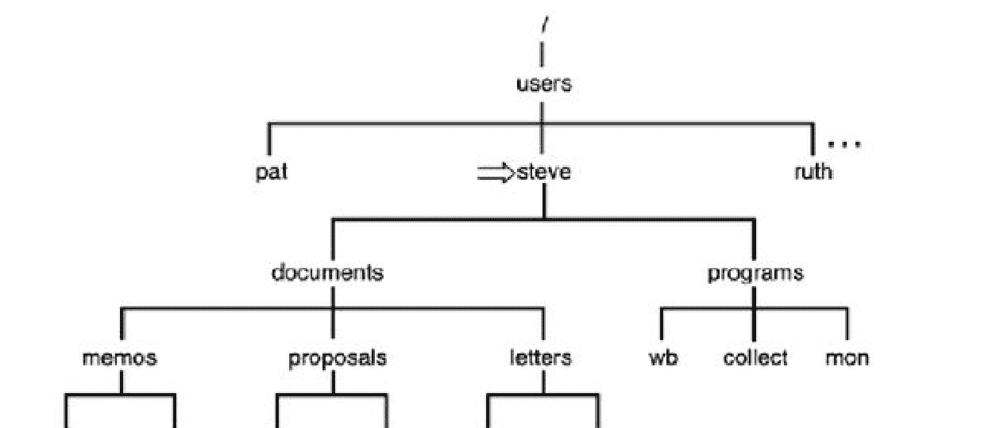

为 architect@open.com 准备，Terry Young

# 基础知识快速回顾


你知道有两个目录位于 steve 主目录的“下方”：`documents` 和 `programs`。事实上，可以通过在终端执行 `ls` 命令来验证这一点：

```
$ ls
documents
programs
```

`ls` 命令列出 `documents` 和 `programs` 目录的方式与在你之前的示例中列出其他普通文件的方式相同。

要更改当前工作目录，请执行 `cd` 命令，随后是要更改的目录名称：

```
$ cd documents
```

执行此命令后，你将被放置在 `documents` 目录内，如图 2.5 所示。

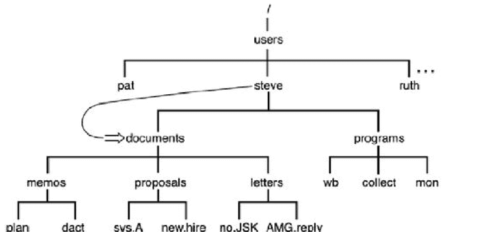

图 2.5：`cd documents`。你可以在终端通过执行 `pwd` 命令验证工作目录已更改：

```
$ pwd
/users/steve/documents
```

在目录中向上跳一级最简单的方法是执行命令

```
$ cd ..
```

因为按照习惯，`..` 始终指向上一级目录（称为父目录）；见图 2.6。

```
$ cd ..
$ pwd
/users/steve
```

# 基础知识快速回顾

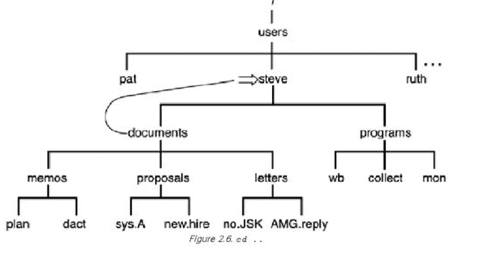

如果你想进入 `letters` 目录，可以通过提供相对路径 `documents/letters` 使用 `cd` 命令进入（见图 2.7）：

```
$ cd documents/letters
```


你可以通过使用 `..` 使用 `cd` 命令返回父目录：

```
$ cd ..
/users/steve
```

或者你可以使用完整路径 `/users/steve` 而不是相对路径：

```
$ cd /users/steve
```

最后，第三种方法是不带带任何参数回到主目录：

```
$ cd
/users/steve
```

## 关于 ls 命令

当你输入 `ls` 命令时，会列出当前工作目录的文件。但你也可以通过为该命令提供参数来获取其他目录的文件列表。首先让我们回到主目录：

```
$ cd
/users/steve
```

现在让我们看看当前工作目录下的文件：

```
$ ls
documents
proposals
proposals
```

如果你将其中一个目录的名称提供给 `ls` 命令，就可以获取该目录的内容。因此，通过输入命令 `ls` 即可查看 `documents` 目录的内容：

```
$ ls documents
letters
memo
```

要查看子目录 memos，遵循类似的步骤：

```
$ ls documents/memo
plan
```

如果你为 `ls` 命令指定一个非目录参数，它只会回显该文件名：

```
$ ls documents/memo/plan
documents/memo/plan
```

`ls` 命令的一个选项允许你判断特定文件是否为目录，以及其他属性。`-l`（字母 l）提供了目录文件中更详细的描述。如果你如图 2.6 所示位于 steve 的主目录，以下内容说明了提供 `-l` 选项的效果：

```
$ ls -l
total 2
drwxr-xr-x 2 steve 3725 358 Jun 25 documents
drwxr-xr-x 2 steve 3725 1219 Jun 25 memo
-rw-r--r-- 1 steve 3725 89 Jun 25 wb
```

每行列中的连字符表示 `collect`、`memo` 和 `wb` 这三个是普通文件而不是目录。

## 创建目录：mkdir

使用 `mkdir` 命令创建目录。该命令的参数就是你想创建的目录名称。例如，假设你仍在处理图 2.7 所示的目录结构，并想在 `documents` 和 `programs` 同级创建一个名为 `misc` 的新目录。如果你当前位于主目录，输入命令 `mkdir misc` 即可实现效果：

```
$ mkdir misc
```

现在如果你执行 `ls` 命令，你应该看到新目录被列出来：

```
$ ls
documents
misc
programs
```

目录结构现在如图 2.8 所示。

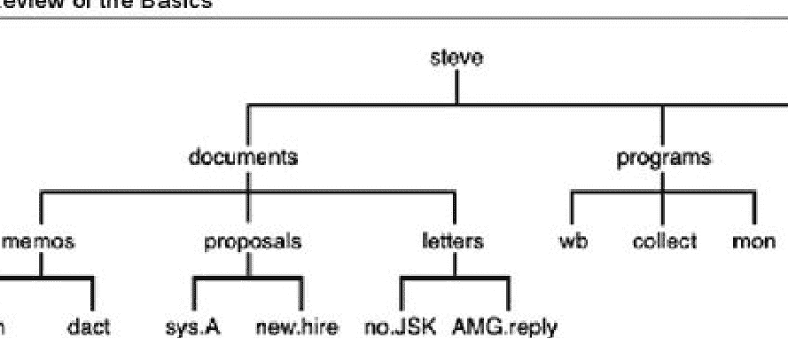

## 将文件从一个目录复制到另一个目录

`cp` 命令可以将文件从一个目录复制到另一个目录。例如，你可以将 `programs` 目录下的文件 `wb` 复制到 `misc` 目录并重命名为 `wbx`：

```
$ cp programs/wb misc/wbx
```

由于这两个文件位于不同的目录中，甚至不需要为它们指定不同的名称：

```
$ cp programs/wb misc/wb
```

当目标文件与源文件同名时（当然是在不同的目录中），只需在第二个参数中指定目标目录即可：

```
$ cp wb collect mon ../misc
```

当执行此命令时，Unix 系统会识别出第二个参数是目录名称，并将源文件复制到该目录。新文件将与源文件同名。你可以通过在目标目录名称之前列出要复制的文件，一次复制多个文件到目录中。如果你当前处于 `programs` 目录，执行命令：

```
$ pwd
/users/steve/misc
$ cp ../programs/misc collect
```

要将文件从另一个目录复制到当前目录并保持同名，可以使用当前目录始终可以被引用为 `.`。

上述命令将来自 `../programs` 目录的 `collect` 文件复制到当前目录 (`/users/steve/misc`)。

## 在目录之间移动文件

你记得 `mv` 命令可以重命名文件。然而，当该命令的两个参数引用不同的目录时，文件实际上是从第一个目录移动到第二个目录。例如，首先从家目录切换到 documents 目录：

```
cd documents
$
```

假设你现在决定认为 `memos` 目录中的文件 `plan` 实际上是一个提案（proposal）而不是备忘录（memo）。因此你想将其从 `memos` 目录移动到 `proposals` 目录。以下操作即可实现：

```
mv memos/plan proposals/plan
$
```

与 `cp` 命令一样，如果源文件和目标文件同名，只需提供目标目录的名称。

```
mv memos/plan proposals
```

与 `cp` 命令类似，只需在目录名称之前列出所有要移动的文件，即可将一组文件同时移动到一个目录：这将 `wb`、`collect` 和 `mon` 三个文件移动到目录。你也可以使用 `mv` 命令重命名目录。例如，将 `programs` 目录重命名为 `bin`。

```
mv programs bin
$
```

## 链接文件：ln 命令

简单来说，`ln` 命令为你提供了一种方便的方法，为一个文件赋予多个名称。命令的通用格式为：

```
ln from to
```

这会将文件 `from` 链接到 `to`。

回图 2.8 中 steve 的目录结构。在该目录中，他存储了一个名为 `wb` 的程序。假设他也想把该程序命名为 `writeback`。最明显的方法是创建一个 `wb` 的副本命名为 `writeback`：

```
cp wb writeback
$
```

这种方法的缺点是现在消耗了两倍的磁盘空间。此外，如果 steve 忙忘了，他可能会忘记为 `writeback` 创建新副本，导致他认为是同一个程序产生了两个不同的副本。

通过将 `wb` 链接到新名称，可以避免这些问题：

```
$ ln writeback wb
```

现在不是存在两个文件副本，而是只有一个具有两个名称的文件：`wb` 和 `writeback`。这两个文件已通过 Unix 系统逻辑链接。对你而言，看起来就像你有两个不同的文件。执行 `ls` 命令会显示它们分别存在：

```
$ ls
collect
wb
writeback
```

看下当你执行 `ls -l` 时发生了什么：

```
$ ls -l
total 5
-rw-r--r-- 2 steve steve 3725 Jun 25 13:31 collect
-rw-r--r-- 2 steve steve 1219 Jun 25 13:31 mon
-rw-r--r-- 2 steve steve 899 Jun 25 13:30 wb
-rw-r--r-- 2 steve steve 899 Jun 25 13:30 writeback
```

steve 前面的链接数，`collect` 为 1，而 `wb` 和 `writeback` 为 2。该数字是指向文件的链接数，通常对于未链接的文件为 1。因为 `wb` 和 `writeback` 是链接的，所以这些文件为 2。这意味着你可以对一个文件进行多次链接。你可以删除两个链接中的任意一个，另一个将保留：

```
$ rm writeback
$ ls -l
total 4
-rw-r--r-- 1 steve steve 3725 Jun 25 13:31 collect
-rw-r--r-- 1 steve steve 1219 Jun 25 13:31 mon
-rw-r--r-- 1 steve steve 899 Jun 25 13:30 wb
```

注意链接数从 2 变为 1，是因为其中一个链接被删除了。通常情况下，链接用于目录。例如，假设 pat 想要访问 steve 的 `wb`。由于 pat 不想创建一个 `wb` 的副本（如第 11 节所述，为了避免浪费空间和产生一致性问题），他可以将其链接到自己的目录：

```
$ ls -l
/users/pat/bin
total 4
-drwxr-xr-x 1 pat pat 3725 Jun 25 13:31 collect
-drwxr-xr-x 1 pat pat 1219 Jun 25 13:31 mon
-rw-r--r-- 2 steve steve 899 Jun 25 13:30 wb
-rw-r--r-- 2 steve steve 899 Jun 25 13:30 writeback
```

注意 `wb` 前的链接数是 2，这说明它被链接了两次。如果 pat 删除其中一个一个，该文件仍然存在：

```
$ rm wb
$ ls -l
total 4
-drwxr-xr-x 1 pat pat 3725 Jun 25 13:31 collect
-drwxr-xr-x 1 pat pat 1219 Jun 25 13:31 mon
-rw-r--r-- 1 steve steve 899 Jun 25 13:30 wb
```

链接数从 2 变为 1，是因为其中一个链接被删除了。通常情况下，链接用于目录。

## 基础知识快速回顾

在结束此讨论之前，最后一点：`ln` 命令的通用格式与 `cp` 和 `mv` 相同，这意味着你可以使用 `ln files directory` 格式一次将一组文件链接到一个目录。

删除目录：你可以使用 `rmdir` 命令删除目录。删除目录的条件是该目录内不能包含任何文件。如果在执行 `rmdir` 时目录内有文件，你将无法删除该目录。要删除你之前创建的 `misc` 目录，可以使用以下命令：

```
# rmdir /users/steve/misc
```

再次强调，上述命令仅在 `misc` 目录不包含文件时才有效；否则会发生以下情况：

```
# rmdir /users/steve/misc
rmdir /users/steve/misc not empty
```

如果发生这种情况且你仍然想删除 `misc` 目录，你必须在重新执行 `rmdir` 命令之前先删除该目录中包含的所有文件。

删除目录及其包含文件的另一种方法是使用 `rm` 命令的 `-r` 选项。格式非常简单：

```
rm -r dir
```

其中 `dir` 是你要删除的目录名称。`rm` 会删除指定的目录及其其中所有的文件（包括目录）。

## 文件名替换

### 星号 (*)

Unix 系统一个实际上由 Shell 处理的强大功能是文件名替换。假设你的当前目录下有这些文件：

```
$ ls
chap1
chap2
chap3
chap4
```

假设你想在终端打印这些文件的内容。那么，你可以利用 `cat` 命令允许一次指定多个文件名的这一特性。执行后，文件内容将一个接一个地显示：

```
$ cat chap1 chap2 chap3 chap4
...
```

但你也可以输入

```bash
$ cat *
```

并获得相同的结果。Shell 会自动将当前目录下所有文件的名称替换为 `*`。如果你在 `echo` 命令中使用 `*`，也会发生相同的替换：

```
$ echo *
chap1 chap2 chap3 chap4
$
```

在这里，`*` 再次被替换为当前目录下包含的所有文件的名称，`echo` 命令在终端上显示它们。

在命令行中出现 `*` 的任何地方，Shell 都会执行替换：

```bash
$ echo *
chap1 chap2 chap3 chap4 : chap1 chap2 chap3 chap4
$
```

`*` 也可以与其他字符结合使用，以限制替换的文件名。例如，假设在当前目录下不仅有 `chap1` 到 `chap4`，还有文件 `a`、`b` 和 `c`：

```
$ ls *
a
b
c
chap1:
chap2
chap3
chap4
```

要仅显示以 `chap` 开头的文件内容，你可以输入

```
$ cat chap*
```

`chap` 匹配任何以 `chap` 开头的文件名。所有此类文件名都会在命令行被替换。

`*` 不限于文件名的末尾；它也可以用于开头或中间：

```
$ echo *t1
chap1
$ echo *t*
chap1 chap2 chap3 chap4
$ echo *x
$
```

在第一个 `echo` 中，`*t1` 指定了所有以字符 `t1` 结尾的文件名。在第二个 `echo` 中，第一个 `*` 匹配 `t` 之前的所有内容，第二个 `*` 匹配之后的所有内容；因此，所有包含 `t` 的文件名都会被打印。因为没有以 `x` 结尾的文件，所以最后一种没有发生替换。因此，`echo` 命令显示 `*x`。

### 匹配单个字符

星号 (`*`) 匹配零或多个字符，这意味着 `x*` 匹配文件 `x` 也匹配 `x1`、`x2`、`xabc` 等。问号 (`?`) 恰好匹配一个字符。因此 `cat?` 打印所有名称为一个字符的文件，正如 `cat??` 打印所有以 `x` 开头的两个字符的文件一样。

```
$ ls le
aaa
aax
alice
h
bb
cc
report1
report2
report3
$ echo *
a b c
$ echo *
aaa
$ echo ??
aaa bb cc
$ echo ***
aax alice bb cc report1 report2
```

在上述示例中，`??` 匹配两个字符，而 `*` 匹配零个到末尾。其效果不是匹配两个或更多字符的文件名。

匹配单个字符的另一种方法是在方括号 `[ ]` 内提供一个用于匹配的字符列表。例如，`[abc]` 匹配字母 `a`、`b` 或 `c`。它与 `^` 类似，但允许你选择要匹配的字符。`[0-9]` 匹配从 0 到 9 的字符。指定字符范围的唯一限制是第一个字符在字母表中必须小于最后一个字符，因此 `[z-f]` 不是有效的范围指定。

通过在列表中混合匹配范围，你可以执行一些复杂的替换。例如，`[a-np-z]` 匹配所有以字母 `n` 或 `p` 到 `z` 开头的文件（或者简单地说，匹配任何小写字母但 `o` 以外的字符）。

如果 `[` 后的第一个字符是 `[!`，则匹配的含义将反转。也就是说，匹配除括号内以外的任何字符。

```
[!a-z]
```

匹配任何小写字母以外的字符，

```
*[!o]
```

匹配任何不以小写字母 `o` 结尾的文件。

表 2.1 给出了文件名替换的一些示例。

| 命令 | 说明 |
| :--- | --- |
| `echo *` | 打印以 a 开头的文件名 |
| `cat *.c` | 打印所有以 .c结尾的文件 |
| `rm *` | 删除所有包含点的文件 |
| 命令 | 说明 |
| :--- | --- |
| `ls x*` | 列出所有以 x 开头的文件 |
| `rm *` | 删除当前目录下的所有文件（注意：使用此命令时要小心） |
| `echo a *b` | 打印所有以 a 开头并以 b 结尾的文件 |
| `cp ../programs/*` | 将 ../programs 下的所有文件复制到当前目录 |
| `ls [a-z]*[0-9]` | 列出以小写字母开头且以数字结尾的文件 |

## 标准输入输出与 I/O 重定向

### 标准输入和输出

大多数 Unix 系统命令从终端获取输入并将生成的输出发送回终端。命令通常从称为标准输入的地方读取输入，默认指向你的终端。同样，命令通常将其输出写入标准输出，默认也是指向你的终端。这一概念如图 2.9 所示。

回想 `who` 命令的结果显示当前登录的用户。更正式地说，`who` 命令将登录用户列表写入标准输出。这如图 2.10 所示。

如果执行 `sort` 命令时没有文件名参数，该命令将从标准输入获取输入。与标准输出一样，这默认是你的终端。

## 基础知识快速回顾

从终端向命令输入数据时，在输入完最后一个数据项后，必须同时按下 `Ctrl` 和 `d` 键（文本中为 `Ctrl+d`）。这告诉命令你已经完成了数据输入。例如，让我们使用 `sort` 命令对以下四个名称进行排序：Tony, Barbara, Harry, Dick。我们不先将这些名称写入文件，而是直接从终端输入：

- `sort`
- Tony
- Barbara
- Harry


- Dick
- Clifford
- Barbara
- Dick
- Harry
- Tony

由于没有为 `sort` 命令指定文件名，因此输入是从标准输入（即终端）获取的。在输入完第四个名字后，按下 `Ctrl` 和 `d` 键以标示数据的结束。此时，`sort` 命令对这四个名称进行了排序，并将结果显示在标准输出设备（也是终端）上。这如图 2.11 所示。

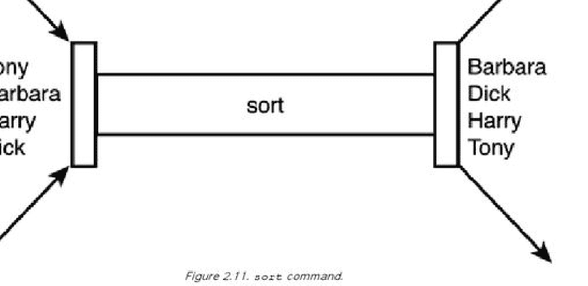

图 2.11: `sort` 命令

`wc` 命令是另一个示例，如果在命令行上没有指定文件名，它将从标准输入获取输入。下面的示例展示了如何使用该命令统计从终端输入的行数：

- `wc -l`
- This is text that
- is typed on the
- standard input.
- 输出:
- 5

请注意，用于结束输入的 `Ctrl`+`d` 不会被 `wc` 命令计为单独的一行。此外，由于没有为 `wc` 命令指定文件名，只有行数（3）被列为命令的输出。（回想一下，该命令通常在计数之后直接打印文件名。）

## 输出重定向

通常用于标准输出的命令输出可以很容易地重定向到文件。这种功能被称为输出重定向。

如果在任何通常将输出写入标准输出的命令后尾追加 `>file` 符号，则该命令的输出将写入文件，而不是你的屏幕：

```bash
$ who > users
oko tty1 Sep 12 07:10
as tty1 Sep 12 13:12
ruth tty2 Sep 12 10:10
pat tty24 Sep 12 13:07
steve tty25 Sep 12 13:03
```

此命令行执行了 `who` 命令并将其输出写入文件 `users`。注意，终端没有出现任何输出。这是因为输出已从默认输出设备（终端）重定向到指定的文件中：

```bash
$ cat users
oko tty1 Sep 12 07:10
as tty1 Sep 12 13:12
ruth tty2 Sep 12 10:10
pat tty24 Sep 12 13:07
steve tty25 Sep 12 13:03
```

如果命令有输出到文件，且该文件已包含某些数据，这些数据将会丢失。考虑这个例子：

```bash
$ echo line 1 > users
$ cat users
line 1
$ echo line 2 >> users
$ cat users
line 1
line 2
```

第二个 `echo` 命令使用了另一种类型的输出重定向，由字符 `>>` 表示。这对字符会将内容追加到指定的文件中。因此，文件的原有内容不会丢失，新输出只需添加到末尾即可。

通过使用重定向追加字符 `>>`，你可以使用 `cat` 将一个文件的内容追加到另一个文件的后面：

```bash
$ cat file1
This is in file1.
$ cat file2
This is in file2.
$ cat file1 >> file2
Append file1 to file2
This is in file2.
This is in file1.
```

回想一下，给 `cat` 指定多个文件名会导致显示第一个文件，紧接着显示第二个文件，依此类推：

```bash
$ cat file1
This is in file1.
$ cat file2
This is in file2.
$ cat file1 file2
This is in file1.
This is in file2.
$ cat file1 file2 > file3
将两个文件的输出都重定向到 file3
```

## 基础知识快速回顾

```bash
$ cat file
This is in file1.
This is in file2.
$
```

现在你可以看到 `cat` 命令名字的来源了：当与多个文件一起使用时，它的效果是将文件连接在一起。

顺带提，shell 识别一种特殊格式的输出重定向。如果你输入

```bash
> file
```

且前面没有跟命令，shell 会为你创建一个空的（即字符长度为 0）的文件。

## 输入重定向

如果命令有输出到文件，且该文件已包含某些数据，这些数据将会丢失。（等等，这段文字似乎是 OCR 源文件中的重复/错误，但根据上下文：）

shell 识别一种特殊格式的输出重定向。如果你输入 `> file` 且前面没有跟命令，shell 会为你创建一个空的（即字符长度为 0）的文件。

shell 将从默认输出设备（终端）重定向到指定文件的输出。（注：提供的 OCR 文本在此处断开了，我根据标准的 shell 行为进行了重构）。

用于结束输入的 `Ctrl`+`d` 不会被 `wc` 命令计为单独的一行。此外，由于没有为 `wc` 命令指定文件名，只有行数（3）被列为命令的输出。

## 管道

当在两个命令之间建立管道时，第一个命令的标准输出将连接到第二个命令的标准输入。你知道 `who` 命令会将登录用户列表写入标准输出。此外，你知道如果没有为 `wc` 命令指定文件名参数，它将从标准输入获取输入。因此，`who` 命令输出的登录用户列表将自动成为 `wc` 命令的输入。注意，你不会在终端看到 `who` 命令的输出，因为它被直接管道到了 `wc` 命令。这如图 2.13 所示。

```bash
$ who | wc -l
$5
```

# 基础知识快速回顾

任何两个程序之间都可以建立管道（pipe），前提是第一个程序将其输出写到标准输出，而第二个程序从标准输入读取输入。

管道的另一个示例是，假设你想统计目录中包含的文件数量。通过了解 `ls` 命令会每个文件显示一行输出的这一事实，你能够使用与之前相同的方法：

```
$ ls | wc -l
 10
```

输出结果当前目录包含 10 个文件。

你还可以形成一个由两个以上程序组成的流水线（pipeline），其中上一个程序的输出作为下一个程序的输入。

## 过滤器（Filters）

`filter`（过滤器）一词在 Unix 术语中通常指代任何可以从标准输出读取输入、对输入执行某些操作并将结果写回标准输出的程序。更简练地说，过滤器是任何可以在流水线中两个程序之间使用的程序。因此，在之前的流水线中，`wc` 被认为过滤器。`ls` 则不是，因为它没有从标准输入读取输入。其他例子如 `cat` 和 `sort` 是过滤器；而 `who`、`date`、`cd`、`pwd`、`echo`、`rm`、`mv` 和 `cp` 则不是。

## 标准错误（Standard Error）

除了标准输入和标准输出，还有另一个被称为标准错误的地方。这是大多数 Unix 命令写入其错误信息的地方。与另外两个“标准”位置一样，标准错误默认与你的终端关联。在大多数情况下，你并不知道标准输出和标准错误之间的区别：

```
ls n
* not found
```

在这里，“not found”消息实际上是由 `ls` 命令写入标准错误的，而不是标准输出。你可以通过重定向 `ls` 命令的输出来验证此消息没有被写入标准输出：

```
ls n > foo
* not found
```

因此，即使你将标准输出重定向到了文件 `foo`，你仍然会在终端上打印出该消息。

前面的示例说明了标准错误的原因：这样即使标准输出被重定向到文件或管道到另一个命令，你想在屏幕上错误信息仍然显示在终端上。

你可以使用以下符号将标准错误重定向到文件：

```
command 2> file
```

在 `2` 和 `>` 之间不允许有空格。通常打算发送到标准错误的错误信息将被重定向到指定的文件中，类似于标准输出被重定向的方式。

```
ls 2> errors
cat errors
* not found
```

## 关于命令更多

## 在一行中输入多个命令

只要你用分号隔开每个命令，就可以在一行中输入多个命令。例如，你可以通过在同一行输入 `date` 和 `pwd` 命令来查找当前时间以及当前工作目录：

```
date; pwd
Sat Jul 20 14:43:25 EDT 2002
/users/pat/bin
```

你可以在一行中串联任意数量的命令，只要每个命令都由分号分隔。

## 将命令发送到后台

通常，你输入一个命令然后等待命令结果在终端显示。对于你目前为止看到的所有例子，这段等待时间通常很短——可能只有一两秒。然而，你可能需要运行需要数秒甚至几分钟执行的命令。在这种情况下，你必须等待命令执行完毕才能继续工作，或者将命令发送到后台。

如果你在输入命令后跟着一个安符字符 (`&`)，该命令将被发送到后台执行。你就可以继续其他工作。该命令的标准输出仍将定向到你的终端；如果命令没有读取任何标准输入，它将停止并等待你将其带回前台（我们将在第 15 章“交互与非标准 Shell 特性”中详细讨论）。

```
$ sort data > & Send the work to the background
[1]  Process id
$ date Your terminal is immediately available to do work
Sat Jun 20 14:55:09 EDT 2002
```

当命令被发送到后台时，Unix 系统会自动显示两个数字。第一个称为作业号（job number），第二个是进程 ID（process id）。在前面的示例中，1 是作业号，1258 是进程 ID。作业号被某些 Shell 命令使用，你将在第 15 章学习更多。进程 ID 唯一地标识你发送到后台的命令，并用于获取有关命令的状态信息。这是通过 `ps` 命令实现的。

## ps 命令

`ps` 命令提供有关系统上运行的进程的信息。不带任何选项的 `ps` 会打印你的进程状态。如果你在终端输入 `ps`，你将得到几行描述你正在运行的进程：

```
$ ps
PID TTY TIME COMMAND
1955 01:0:21 sh The shell
1953 01 0:00 ps This ps command
1258 01 0:10 sort The previous sort
```

`ps` 命令打印四列信息：PID，进程 ID；TTY，运行进程的终端号；TIME，进程使用的时间（分钟和秒数）；以及 COMMAND，进程名称。（进程示例中的 `sh` 是你登录时启动的 Shell，它已经使用了 2 秒计算机时间。）在命令完成之前，它会出现在 `ps` 命令的输出中作为一个运行进程。前面的示例中的进程号 1353 是输入的 `ps` 命令，1258 是 `sort`。

在使用 `-f` 选项时，`ps` 会打印更多关于你进程的信息，包括父进程 ID (PPID)、启动时间 (STIME) 以及命令参数。这里的进程号 195 是 `ps -ef` 命令，1258 是前面示例中的 `sort`。

```
$ ps -ef
UID PID PPID STIME COMMAND
steve 195 1 10:58:59 tty1 -sh
steve 1258 0 14:45:04 sort data
```

## 命令总结

表 2.2 总结了本章回顾的命令。在表中，`file` 指文件，`file(s)` 指多个文件，`dir` 指目录，`dir(s)` 指多个目录。

| 命令 | 说明 |
| --- | --- |
| cat file(s) | 显示 file(s) 内容，若未提供则使用标准输入 |
| cd dir | 切换目录到 dir |
| cp file,file2 | 将 file复制到 file2 |
| cp file(s) dir | 将 file(s) 复制到 dir |
| date | 显示日期 |
| echo args | 显示参数 |
| ln file1,file2 | 将 file1 链接到 file2 |
| ln file(s) dir | 将 file(s) 链接到 dir |
| ls file(s) | 列出 file(s) |
| ls dir(s) | 列出 dir(s) 中的文件，若未指定 dir(s) 则列出当前目录 |
| mkdir dir | 创建目录 dir |
| mv file,file2 | 将 file 移动到 file2（若两者指向同一目录则重命名） |
| mv file(s) dir | 将 file(s) 移动到目录 dir |
| ps | 列出活动进程信息 |
| pwd | 显示当前目录路径 |
| rm file(s) | 删除 file(s) |
| rmdir dir(s) | 删除空 dir(s) |
| sort file(s) | 对 file(s) 的行排序，若未提供则使用标准输入 |
| wc file(s) | 统计 file(s) 的行、单词和字符，若未提供则使用标准输入 |
| who | 显示登录用户 |

## 练习

- 1：假设你的当前目录中有以下文件：

```
$ ls
fe96
jan12.02
jan19.02
jan26.02
jan33.02
jan95
jan90
jan97
jan06
mat98
memol
```

# 基础知识快速回顾

memo10

memo02

memo2.sv

t-

以下命令的输出是什么？

```
echo *               echo [0-9]*
echo m[a-df-z]*     echo [A-Z]*
echo *               echo *
echo ????         echo *02
echo jam?? feb* mar?? echo [fjm][ae][]*
```

2: 以下命令序列的效果是什么？

```
ls -l wc -1      rm ???
who i | wc -1      mv -rp /users/steve/backup
ls *.c wc -1      rm *.o
who i sort        cd; pwd
cp memo ..       plotdata 2>>error &
```

Unix® Shell 编程，第三版。Unix® Shell编程，第三版，ISBN: 0-672-32490-3

为 architect@openunix.com, Terry Wyatt 准备

Copyright © 2003 by Sam Publishing. 此下载文件仅供个人使用并受服务条款约束。任何其他用途均需事先获得出版者的书面许可。严禁未经授权的复制、修改和/或分发，并将违反相关法律。保留所有权利。

* 由 Neith*

## 第 3 章 什么是 Shell？

## 本章内容

- 内核与工具
- 登录 Shell (Login Shell)
- 向 Shell 输入命令
- Shell 的职责

在本章中，你将学习什么是 Shell 及其它的作用。

## 内核与工具

Unix 系统本身在逻辑上分为两个部分：*内核*（kernel）和*工具*（utilities）（见图 3.1）。

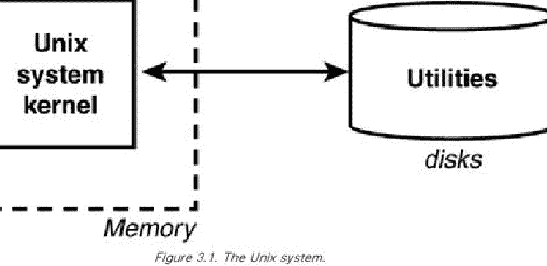

内核是 Unix 系统的核心，从计算机开启并*启动*（booted）直到关闭，它一直留在计算机的内存中。

另一方面，工具位于计算机的磁盘上，仅在需要时才加载到内存中。你在 Unix 系统下几乎每一个命令都被归类为工具；因此，程序存储在磁盘上，只有在你请求执行该命令时才会被加载到内存。例如，当你执行 *date* 命令时，Unix 系统将名为 *date* 的程序从计算机磁盘加载到内存中并启动执行。

Shell 也是一个工具程序。每当你登录系统时，它都会被加载到内存中执行。

## 什么是 Shell？

事实上，学习终端或窗口上的第一个 Shell 启动时发生的精确事件序列是非常值得的。

## 登录 Shell (Login Shell)

终端通过直接连线、调制调器或网络连接到 Unix 系统。在第一的情况下，一旦你打开终端（如有必要，按几次回车键），你的屏幕上就会出现 login: 消息。在第二的情况下，你必须先拨打计算机号码并连接，然后才会出现 login: 消息。最后的情况下，你可能通过 ssh、telnet、login 等程序通过网络连接，或者使用某种网络化窗口系统（例如 X Window System）来启动终端仿真器（例如 xterm）。

对于系统上的每个物理终端端口，一个名为 getty 的程序处于激活状态。这如图 3.2 所示。

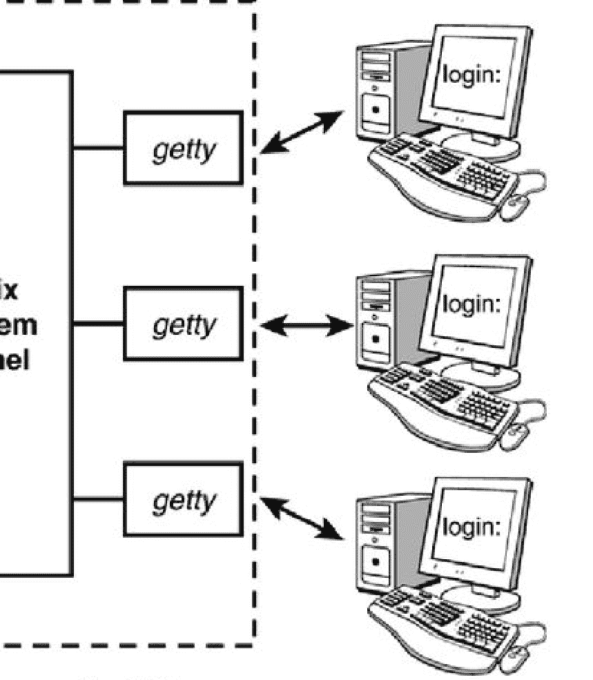

Unix® Shell 编程，第三版。Unix® Shell编程，第三版，ISBN: 0-672-32490-3

为 architect@open.com, 由 Terry Newham 准备

Copyright © 2003 by Prentice Publishing. 此下载文件仅供个人使用并受服务条款约束。任何其他用途均需事先获得书面许可……严禁未经授权的使用、复制和/或分发，并将违反相关法律。保留所有权利。

## 什么是 Shell？

Unix 系统——更准确地说是一个名为 init 的程序——当系统允许用户登录时，会自动在每个终端端口启动一个 getty 程序。getty 确定波特率，在指定的终端上显示 login: 消息，然后等待某人输入。一旦有人输入字符并按回车键，getty 程序就会消失；但在它消失之前，它会启动一个 login 程序来完成登录过程（见图 3.3）。它还会将你在终端输入的字符传递给 login——这些字符推测代表了你的用户名。

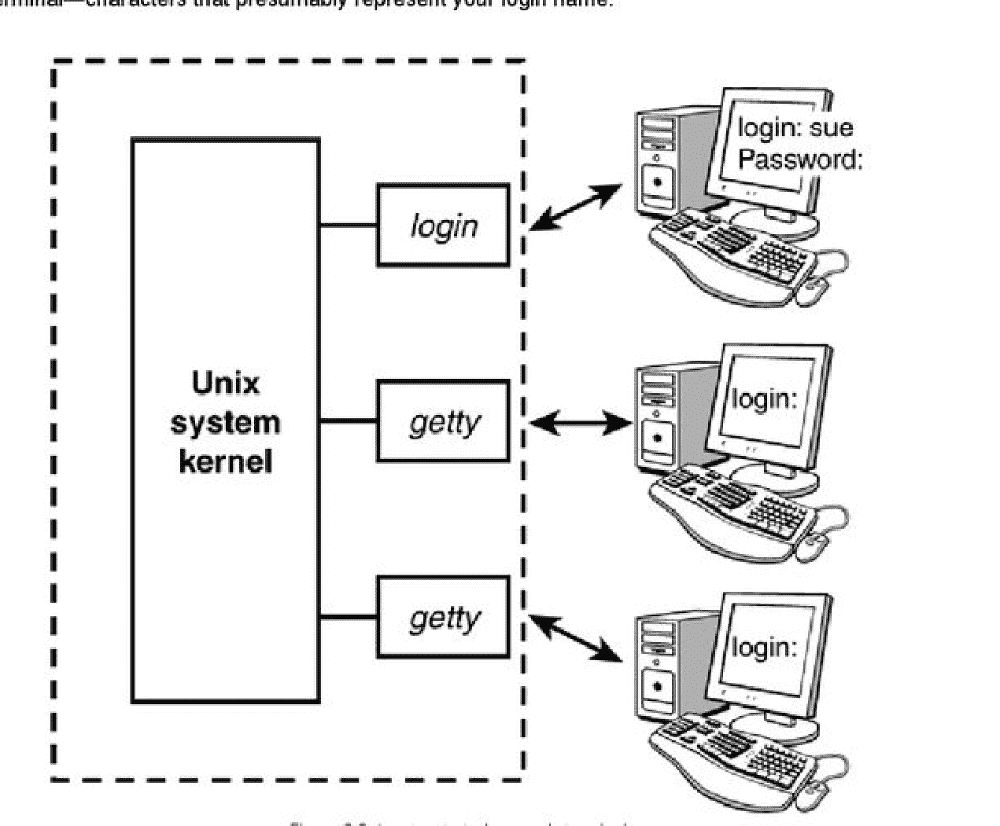

图 3.3. 在 sue 的终端上启动 login。


当 `login` 开始执行时，它会在终端上显示字符串 `Password:` 并等待你输入密码。在你输入密码后，`login` 将通过对比 `/etc/passwd` 文件中的对应条目来验证你的用户名和密码。该文件系统中的每个用户都有一行。该行指定了（除其他内容外）用户名、主目录以及用户登录时启动的程序。最后一部分信息（启动的程序）存储在每行的最后一个冒号之后。

## 什么是 Shell？

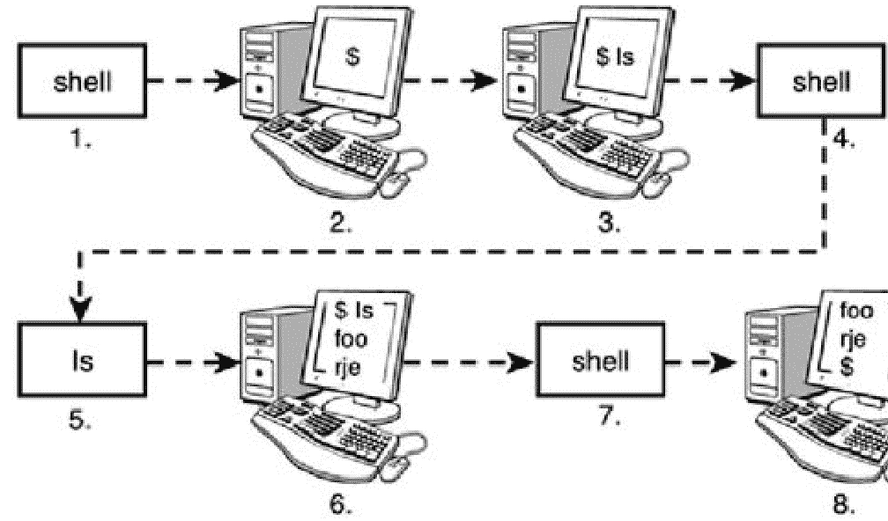

程序将结果输出到标准输出，除非被重定向或管道到另一个命令中，否则它将显示在你的终端上。同样，如果程序从标准输入读取输入，除非从文件重定向或从另一个命令管道输入，否则它将等待你输入内容。

当命令执行完毕后，控制权再次返回给 `shell`，它等待你的下一个命令。

请注意，只要你还登录系统，这个循环就会持续。当你注销系统时，`shell` 的执行将终止，Unix 系统会在终端上启动一个新的 `getty` 或 `rlogind` 等并等待其他人登录。这个循环如图 3.7 所示。

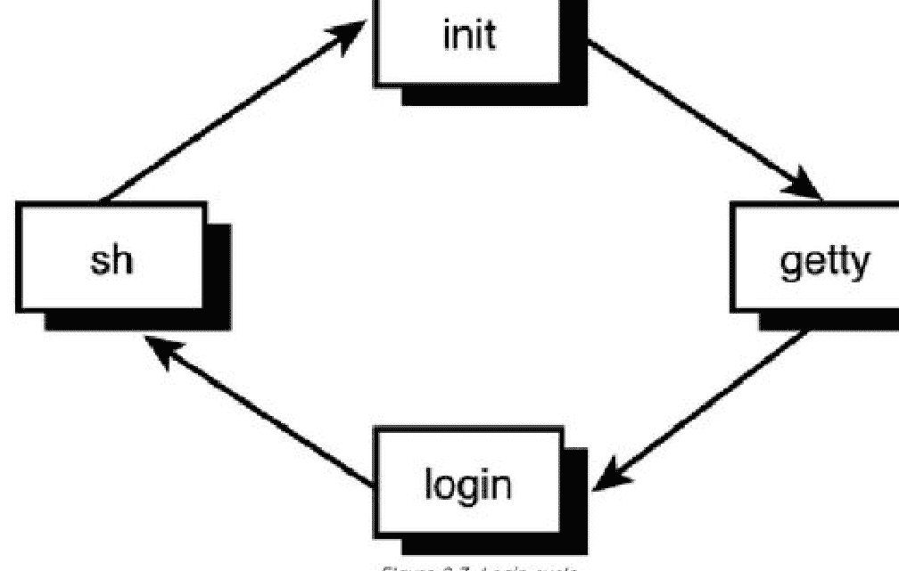

《Unix Shell 编程》，第三版。Unix Shell Programming, Third Edition, ISBN: 0-672-32490-3

为 `architect@open.windows.com` 准备，Terry Stevens

Copyright © 2003 Oarch Publishing. 此下载文件仅供个人使用，受服务条款限制。任何其他用途均需获得出版者的事先书面许可。未经授权的使用、复制和/或分发均违反相关法律。保留所有权利。

### 什么是 Shell？

你需要意识到 `shell` 只是一个程序。它在系统中没有特殊权限，这意味着任何有能力和热忱的人都可以创建自己的 `shell` 程序。这实际上是今天存在各种类型 `shell` 的原因，包括由 Stephen Bourne 开发的早期 Bourne shell；由 David Korn 开发的 Korn shell；主要用于 Linux 系统的“Bourne again shell”（`bash`）；以及由 Bill Joy 开发的 C shell。

## Shell 的职责

现在你知道 `shell` 会分析你输入的每一行内容，并启动所选程序的执行。但 `shell` 还有其他职责，如图 3.8 所示。

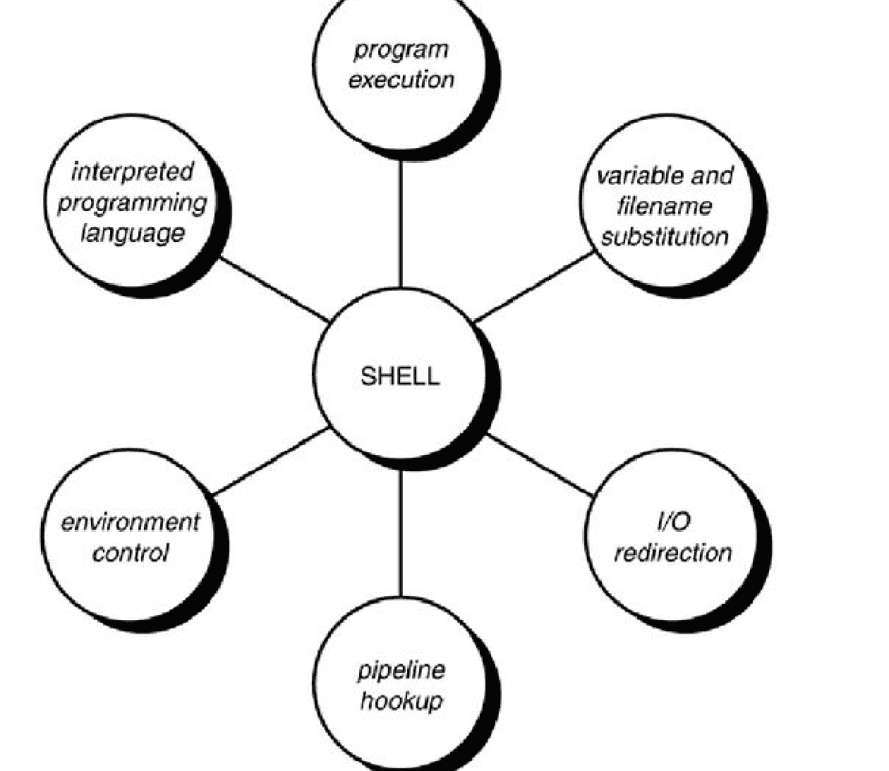

图 3.8。`shell` 的职责。

### 程序执行

`shell` 负责执行你从终端请求的所有程序。每当你向 `shell` 输入一行内容时，`shell` 都会分析该行并决定要做什么。对于 `shell` 而言，每一行都遵循相同的基本格式：

`程序名 参数1 参数2 ...`

输入到 `shell` 的行更正式地被称为“命令行”。`shell` 扫描命令行，确定要执行的程序名称以及要传递给程序的参数。

`shell` 使用特殊字符来确定程序名称的开始和结束位置，以及每个参数的开始和结束位置。这些字符统称为空白字符，包括空格字符、水平制表符和行结束字符。`shell` 会简单地忽略连续出现的空白字符。当你输入命令时：

```
mv tmp/mazewers games
```

`shell` 扫描命令行，并将从 `shell` 开始到第一个空白字符之前的所有内容视为要执行的程序名：`mv`。到下一个空白字符为止的字符集是 `mv` 的第一个参数：`tmp/mazewers`。到下一个空白字符之前的字符集是 `mv` 的第二个参数：`games`。在分析命令行后，`shell` 接着执行 `mv` 命令，并给它两个参数 `tmp/mazewers` 和 `games`。

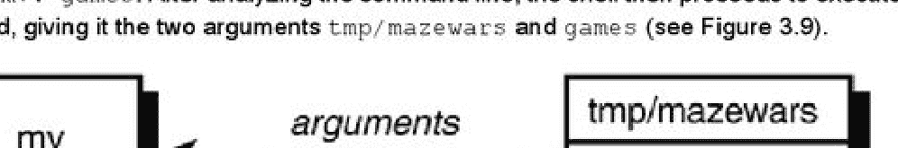

图 3.9：带有两个参数的 `mv` 执行。

如前所述，`shell` 会忽略连续出现的空白字符。这意味着当 `shell` 处理这条命令行时：

```
echo      when    do    we    eat?
```

它向 `echo` 程序传递了四个参数：`when`、`do`、`we` 和 `eat`。

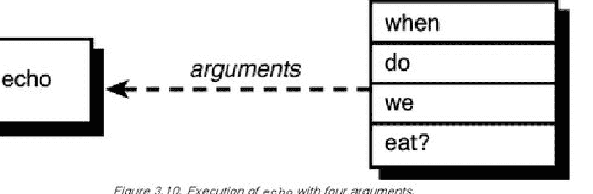

图 3.10：带有四个参数的 `echo` 执行。

由于 `echo` 接收参数并简单将它们显示在终端上，并用空格分隔每个参数，因此以下输出变得易于理解：

```
echo      when    do    we    eat?
when do we eat?
```

事实是，`echo` 从未见过这些空格；它们被 `shell` “吞掉”了。

我们之前提到，`shell` 会搜索磁盘，直到找到你想执行的程序，并请求 Unix 内核执行它。这在大多数情况下是事实。然而，有些命令 `shell` 是知道如何执行的。这些内置命令包括 `cd`、`pwd` 和 `echo`。

### 变量和文件名替换

与其他任何语言一样，`shell` 允许你为变量赋值。每当你在命令行上指定一个以 `$` 开头的变量时，`shell` 就会执行替换。事实上，`shell` 还会执行文件名替换。`shell` 扫描命令行并确定要使用的文件名。命令行后面的单词是输入重定向的文件名。

假设你使用：

```
$ ls /tmp
```

`shell` 识别 `ls` 为程序，并将 `/tmp` 为参数。但如果你使用：

```
$ ls < /tmp
```

`shell` 识别 `ls` 为程序，并从文件 `/tmp` 重定向输入。这在第 5 章“变量与函数”中有详细介绍。

### 什么是 Shell？

## I/O 重定向

`shell` 负责处理命令行上的输入和输出。`shell` 扫描命令行中的重定向字符 `<` 或 `>`。当你输入命令：

```
echo Remember | tee
```

`shell` 识别重定向字符，并将命令行上的下一个单词作为输出重定向的文件名。如果 `reminder` 已经存在且你具有写入权限，之前的内容将会丢失；如果你没有访问权限，`shell` 会向你报错。

对于程序而言，它只知道输出正在被重定向，而不知道 `shell` 已将其重定向到文件。让我们来看两个几乎相同的命令：

```bash
$ wc -l users
5 users
$ wc -l < users
5
```

在第一情况下，`shell` 分析命令行并确定程序名为 `wc`，并将 `-l` 和 `users` 作为参数传递。

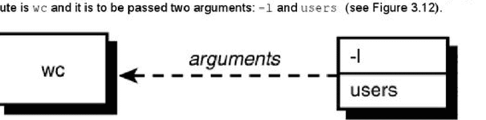

当 `wc` 开始执行时，它看到传递了两个参数。第一个参数 `-l` 告诉它计算行数。第二个参数指定了要统计的文件名。因此，`wc` 打开 `users` 文件，计算行，并将结果同文件名一起打印到终端。

在第二情况下，`wc` 的操作略有不同。`shell` 在扫描命令行时发现了重定向字符 `<`。命令行后面的单词是输入重定向的文件名。在从命令行“吞掉” `users` 后，`shell` 随后启动 `wc` 程序的执行，将其标准输入重定向自文件 `users`，并将其作为唯一的参数 `-l` 传递。

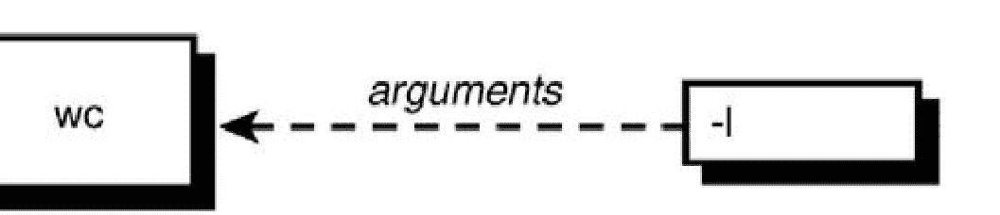

### 什么是 Shell？

当我们这次开始执行命令时，Shell 看到它传递了单个参数 `-l`。由于没有指定文件名，我们将其视为要统计标准输入中行数的指示。我们统计标准输入中的行数，却并没有意识到它实际上在统计 `users` 文件的行数。最终的计数显示在终端上，但没有文件名，因为我们没有提供文件名。

理解这两个命令执行上的差异对你来说非常重要。如果你对这一点仍然不清楚，请复习前面的章节。

## 管道连接

正如 Shell 扫描命令行以寻找重定向字符一样，它也会寻找管道字符 `|`。对于它找到的每一个此类字符，它都会将 `|` 之前命令的标准输出连接到 `|` 之后命令的标准输入。它会启动这两个程序的执行。

因此，当你输入：

```
who | wc -l
```

Shell 找到了分隔 `who` 命令和 `wc` 命令的管道符号。它将前一个命令的标准输出连接到标准输入，然后启动这两个命令的执行。当 `who` 命令执行时，它会列出登录的用户列表并将结果写入标准输出，并不知道这些结果不是发送到终端而是发送到了另一个命令。

当 `wc` 命令执行时，它识别出没有指定文件名，并统计标准输入上的行数，不知道标准输入并非来自终端，而是来自 `who` 命令的输出。

## 环境控制

## 解释型编程语言

Shell 有其内置的编程语言。这种语言是解释型的，这意味着 Shell 会逐行分析语言中的每个语句并执行它。这与 C 和 FORTRAN 等编程语言不同，在这些语言中，编程语句在执行之前通常会被编译成机器可执行的形式。

与编译型语言相比，解释型语言开发的程序通常更容易调试和修改。然而，它们的执行时间通常比同类程序长得多。

Shell 编程语言提供了你在大多数其他编程语言中找到的特性。它具有循环结构、判断语句、变量和函数，并且是面向过程的基于 IEEE POSIX 标准的现代 Shell 具有许多其他特性，包括数组、数据类型和内置算术操作。

Unix® Shell Programming, Third Edition. Unix® Shell Programming, Third Edition, ISBN: 0-672-32490-3

为节选内容准备，Tomorrow

Copyright © 2003 by Wiley Publishing. 本下载文件仅供个人使用，并受服务条款限制。任何其他用途均需事先获得书面许可。严禁未经授权的使用、复制和/或发行，并将违反相关法律。保留所有权利。

# 第 4 章 工具

本章内容：

- 正则表达式
- `cut`
- `paste`
- `sed`
- `tr`
- `grep`
- `sort`
- `uniq`
- 练习题

本章详细描述了一些常用的 Shell 编程工具。涵盖了 `cut`、`paste`、`sed`、`grep`、`uniq` 和 `sort`。你对这些工具的使用越发精练，编写 Shell 程序来解决你的问题就越容易。事实上，这对于 Unix 系统提供的所有工具都是如此。

## 正则表达式

在深入学习工具之前，你需要学习正则表达式。正则表达式被多个不同的 Unix 命令使用，包括 `ed`、`sed`、`awk`、`grep`，以及在有限范围内的 `vi`。它们提供了一种方便且一致的方法来指定匹配的模式。

当你使用文件名替换时，Shell 会识别有限形式的正则表达式。记住，星号 (`*`) 表示匹配零或多个字符，问号 (`?`) 表示匹配任何单个字符，而中括号结构 `[...]` 指定匹配括号内的任何字符。上述程序识别的正则表达式比 Shell 识别的复杂得多。此外请注意，星号和问号在程序以及 Shell 中的处理方式不同。

在本节中，我们假设你熟悉 `ex` 或 `ed` 等基于行的编辑器。有关这些编辑器的更多信息，请参见附录 B，“更多信息”。

### 匹配字符：点 (.)

正则表达式中的点 `.` 匹配任何单个字符，无论它是什么。正则表达式

- `r.` 指定了一个匹配 `r` 后面紧跟任意单个字符的模式。

正则表达式

`.`

匹配一个被两个字符包围的 `x`。

## ed 命令

```
/ ... /
```

在正在编辑的行中向前搜索第一个包含任何三个被空格包围的字符的行：

```
$ ed intro
24g
/ Print all the lines
Unix 操作系统由 Ken Thompson 和 Dennis Ritchie 在 20 世纪 60 年代在贝尔实验室开创。Unix 系统的设计目标之一是创建一个促进高效程序开发的环境。
/ Look for three chars surrounded by blanks
Unix 操作系统由 Ken
/ Repeat last search
Thomas and Dennis Ritchie at Bell Laboratories
Change all p/f to XX
15g/ Let's see what happened
Unix 操作系统由 Ken
TomXXX and Dennis Ritchie at Bell Laboratories
in the late 20 世纪 60 年代.Unix 系统的设计目标之一是创建一个 ann
```

## 交易工具

### 匹配字符选择：[...] 结构

假设你正在编辑一个文件，并想在 `ed` 中搜索字符的第一次出现，这很容易：你只需要输入命令

`/the/`

会导致 `ed` 在其缓冲区中向前搜索，直到找到包含指定字符字符串的行。`ed` 将显示的第一行是：

| ed intro | 查找包含的行 |

| :--- | :--- |

| /the/ | | |

| in the late 1960s. | 主要目标之一 |

注意，文件的第一行也包含该词，但它位于句子的开头，因此以大字母 T 开头。你可以使用正则表达式告诉 `ed` 搜索 `the` 或 `The` 的第一次出现。就像文件名替换一样，字符 `[` 和 `]` 可以在正则表达式中使用，指定匹配括号内的字符之一。因此，正则表达式

`[Tt]`

将匹配一个小写或大写字母，后面紧跟字符 `he`：

| ed intro | 查找 the 或 The |

| :--- | :--- |

| /[Tt]/ | | |

| Unix 操作系统由 Ken 开创 | 继续搜索 |

| in the late 1960s. | 主要目标之一 |

可以在括号内指定一个字符范围。这可以通过用连字符 `-` 分隔范围的起始和结束字符来实现。因此，要匹配任何 0 到 9 的数字，你可以使用正则表达式

`[0123456789]`

或者更简洁地，你可以直接写

`[0-9]`

要匹配大写字母，你写

`[A-Za-z]`

这里是使用 `ed` 的一些示例：

```
$ ed intro
查找包含数字的行
20
/[0-9]
在前 50 行中。主要目标之一是
/[A-Z]
查找以大写字母开头的行
Unix 操作系统由 Ken
Thompson 和 Dennis Ritchie 在贝尔实验室开创
/Apple
将所有大写字母替换为 's'
1,60/[^~A-Z]//q
1,59
he "mix operating system was pioneered by "en
thomson and ritchie "at "abactories
在前 50 行中。"of the primary goal is
the design of the mix system was created to create
environment that promoted efficient program
development
```

脱字符 `^` 作为括号后的第一个字符出现时，匹配将反转。例如，正则表达式

```
[^A-Za-z]
```

匹配除大写字母以外的任何字符。同样，

```
[^A-Za-z]
```

匹配任何非字母字符。

```
$ ed intro
删除非字母字符
1,60/[^A-Za-z]//q
1,59
Unix 操作系统由 Ken
Thompson 和 Dennis Ritchie 在贝尔实验室开创
inter the primary goal is
The Unix system was created to create an
environment that promoted efficient program development
```

### 匹配零或多个字符：星号 (*)

你知道星号在 shell 替换中用于匹配零或多个字符。在形成正则表达式时，星号用于匹配正则表达式中前一个字符的零次或多次出现。

例如，正则表达式

```
x*
```

匹配零、一个、两个、三个、……个大写的 X。

> 回想一下，shell 使用 * 用于此目的。

匹配一个或多个大写的 X，因为该表达式指定了一个 X，后面紧跟零或多个 X。类似类型的模式经常用于匹配一个或多个空白格的出现。

```
$ lotspaces
85
1.5p
Thin is an example of a
file that contains a lot
of blank spaces 将多个空格替换为单个空格
1.0/ /g
1.5p
This is an example of a
file that contains a lot
```

## 工具

Unix 操作系统是由肯·丹尼斯·里奇在美国的贝尔实验室开创的。Unix 系统的主要目标之一是创建一个快速、推广、高效且可移植的操作系统。

这种特殊结构中有一个特殊情况值得注意。如果括号中只包含一个数字，例如：

```
\(10\)
```

该数字指定前面的正则表达式必须恰好匹配该次数。

```
[a-zA-Z]\(7\)
```

匹配恰好七个字母字符；

```
\.(10\)
```

匹配恰好十个字符。

注意，当执行最后一次替换命令时，文件的该行并没有五个字符；因此，在这一行上匹配失败，并被原样保留。

如果括号中包含单个数字且后面紧跟一个逗号，则必须至少匹配指定次数前面的正则表达式。因此：

```
\(5,\)
```


匹配至少五个连续的加号。同样，如果存在超过五个，则匹配最大的数字：

Unix 系统是由肯·汤普森（Ken Thompson）和丹尼斯·里奇（Dennis Ritchie）在 90 年代后期在贝尔实验室开发的。Unix 系统的目标之一是创建一个非常强大的 shell。

### 保存匹配的字符：`\(...\)`

通过在反斜括号内包含字符，可以捕获正则表达式中匹配的字符。这些捕获的字符存储在编号为 1 到 9 的“寄存器”中。

例如，正则表达式

```
\(\(\)\)
```

匹配行的第一个字符（无论是什么），并将其存储在寄存器 1 中。要检索存储在特定寄存器中的字符，使用结构 `\n`，其中 `\n` 是数字 1–9。

因此，正则表达式

```
\*(.*?\)
```

匹配行的第一个字符并将其存储在寄存器 1 中。然后，表达式根据 `\1` 匹配寄存器 1 中存储的任何内容。该正则表达式的最终效果是：如果行的前两个字符相同，则匹配这两个字符。如果这个例子看起来不清楚，请重新检查。

正则表达式

```
\*(.*)\*
```

匹配所有行，其中行的第一个字符（`*`）与行的最后一个字符（15）相同。`\*` 匹配中间的所有字符。

连续出现的 `\(...\)` 会被分配给连续的寄存器。因此，当使用以下正则表达式匹配某些文本时：

```
\(\(\...\)\)\)
```

行的前三个字符将存储在寄存器 1 中，接三个字符存储在寄存器 2 中。

在 `ed` 中使用替换命令时，寄存器也可以作为替换字符串的一部分被引用：

```bash
$ ed phonebook
1.5
Alice Cheeba 971-555-2015
Barbara Swingle 201-555-5257
Liz Stachium 212-555-2298
Susan Goldberg 201-555-7776
Tony Iannino 973-555-1238
1.6/\*(.*?)\/ Switch the two fields
1.7
971-555-2015 Alice Cheeba
201-555-5257 Barbara Swingle
212-555-2298 Liz Stachium
201-555-7776 Susan Goldberg
973-555-1238 Tony Iannino
```

电话文件中，姓名和电话号码通过一个制表符（tab）隔开。正则表达式

```
(\*)
(\)
```

表示匹配到第一个制表符为止的所有字符（`\ ` 和 `\)` 之间的字符），将它们分配给寄存器 1，并匹配制表符之后的所有字符并将它们分配给寄存器 2。替换字符串

```
\2 \1
```

指定了寄存器 2 的内容，后跟一个空格，然后是寄存器 1 的内容。因此，当 `ed` 对文件的第一行应用替换命令时：

Alice Cheba 973-555-2015

它匹配制表符之前的所有内容（Alice Cheba）并将其存储到寄存器 1，匹配制表符之后的所有内容（973-555-2015）并存储到寄存器 2。然后，它将匹配的字符（整行）替换为寄存器 2 的内容（973-555-2015）后跟一个空格，以及寄存器 1 的内容（Alice Cheba）：

973-555-2015 Alice Cheba

如你所示，正则表达式是强大的工具，允许你匹配复杂的模式。表 4.1 总结了正则表达式识别的特殊字符。

表 4.1 正则表达式字符

| 符号 | 含义 | 匹配 |
|---|---|---|
| . | 任意字符 | |
| .. | 后面跟任意两个字符 | |
| ^ | 行首 | ^word | 仅当 word 出现在行首时匹配 |
| $ | 行尾 | x$ | 仅当 x 是行的最后一个字符时匹配 |
| ^INSERT | 一行仅包含 INSERT 字符的行 | |
| ^ | 不包含任何字符的行 | |
| 前一个表达式的零或多次出现 | x* | 一个或多个连续的 x |
| ** | 零或多个字符 | |
| [chars] | 括号内的任意字符 | *w | 后面跟零或多个字符，再跟一个小写或大写的 t |
| [t] | 小写字母 | |
| [A-Z] | 小写或大写字母 | |
| [chars] | 任意字符 | [0-9] | 任意字母数字 |
| 不在字符内 | [^a-zA-Z0-9] | 任意非字母数字 |
| (min,max) | 前一个表达式的最少和最多次数 | {1,5} | 至少 1 到 5 次 |
| (...) | 匹配某些文本 | \(\(\...\)\) | 行的前三个字符将存储在寄存器 1 中，接三个字符存储在寄存器 2 中 | [0-9]{3} | 至少 3 到 9 位数字 |

## 工具箱

```
$ who | cut -c10-16
console
tty2
tty8
tty10
$
```

你知道吗，`cut` 可以显示第 10 到 16 个字符位置的终端标识符？很简单！你只需要在终端执行该命令，并数出相应的字符位置即可。

你可以使用 `cut` 从一行中提取你想要的任意数量的不同字符。在这里，`cut` 被用于显示所有登录用户的用户名和登录时间：

```
$ who | cut -c1-8,18-
root Feb 24 06:54
steve Feb 24 01:55
george Feb 24 09:15
dawn Feb 24 15:55
$
```

选项 `-c1-8,18-` 的意思是“提取第 1 到第 8 个字符（用户名）以及从第 18 个到行尾的字符（登录时间）”。

### -d 和 -f 选项

当你需要从具有固定格式的文件或命令中提取数据时，如前所述的 `cut` 命令非常有用。

例如，你可以对 `who` 命令使用 `cut`，因为用户名始终显示在第 1-8 个字符位置、第 10-16 位，而登录时间在第 18-29 位。遗憾的是，并不是所有的数据都排列得整齐！例如，查看 `/etc/passwd`：

```
$ cat /etc/passwd
root:x:0:0:The Super User:/root:/bin/bash
cron:x:1:Daemon for tasks:
bin:x:2:The bin user
nnp:x:3:/usr/sbin:/usr/sbin/nologin
gami:x:4:The Owner of desirable Devices:
steve:x:100:/home/steve:/bin/bash
other:x:99: Sealed by system program:
```

`/etc/passwd` 包含了你计算机系统上所有用户的名称。它还包含其他信息，如你的用户 ID、主目录以及登录时启动的程序名称。回到 `cut` 命令，你可以发现此文件数据对齐方式与 `who` 的输出不同。因此，无法使用 `-c` 选项来获取系统所有可能的用户列表。

`/etc/passwd` 格式的一个特点是字段是用冒号 `:` 分隔的。由于每行之间的字段长度可能不同，你知道可以通过“数列数”来获取每行中的相同字段。

`-d` 和 `-f` 选项用于数据由特定字符分隔的情况。在这种情况下，`cut` 命令的格式变为：

```
cut -dchar -ffields
```

其中 `dchar` 是分隔数据每个字段的字符，`fields` 指定了要从文件中提取的字段。字段编号从 1 开始，并可以使用与之前指定字符位置相同的格式来指定字段编号（例如 `-f1,2,8`、`-f1-3`、`-f4-`）。

要从 `/etc/passwd` 提取系统所有用户的用户名称，你可以输入以下命令：

```
cut -f1 /etc/passwd      提取字段 1
root
daemon
bin
uucp
amp
steve
other
```

鉴于每个用户的主目录都在第 6 字段，你可以将系统的每个用户与其主目录关联如下：

```
cut -f1,6 /etc/passwd      提取字段 1 和 6
root/
daemon/
bin/
uucp:/usr/uucp
amp/
steve:/home/steve
other/
```

如果该命令用于从文件中提取字段且未提供 `-d` 选项，`cut` 使用制表符作为默认分隔符。

以下描述了使用 `cut` 命令时的常见陷阱。假设你有一个名为 `phonebook` 的文件，内容如下：

```
cat phonebook
Alice Graham    973-555-2015
Beatrice Swingle 201-555-2257
Jeff Goldberg   201-555-3378
Liz Stachaus    212-555-2298
Susan Goldberg   201-555-7776
Tony Iannino    973-555-1295
```

如果你想获取电话簿中的名字，你的直觉可能是像所示那样使用：

```
cut -c1-15 phonebook
Alice Graham    9
Beatrice Swingle 2
Jeff Goldberg   2
Liz Stachaus    212
Susan Goldberg   9
Tony Iannino    97
```

这并不是你想要的！发生这种情况是因为在 `phonebook` 文件中名字和电话号码之间是用制表符而不是空格分隔的。而且，在使用 `-c` 选项时，制表符被视为单个字符。因此，它提取了上例中每行的前 15 个字符，得到所示结果。

鉴于字段是通过制表符分隔的，你应该使用 `-f` 选项来切割：

```
$ cut -f1 phonebook
Alice Chebbah
Barbara Swangle
Jeff Goldberg
Liz Stearns
Susan Goldberg
Tony Iannino
```

好多了！记住，你不需要用 `-d` 选项指定分隔符，因为 `cut` 默认假设制表符是分隔符。

## 工具

### -s 选项

`-s` 选项告诉 `paste` 从同一个文件中粘贴行，而不是从交替文件中。如果只指定了一个文件，其效果是将文件中的所有行合并在一起，并用制表符或用 `-d` 选项指定的分隔符进行分隔。

```
$ paste -s names
Tony Emanuel Lucy Fred
$ lo | paste -d= file's output, use space as delimiter
addresses into lotmpaces names numbers phonebook
```

在前面的示例中，输出被管道传递给 `paste`，它从标准输入（`-`）合并（`-s` 选项），用空格（`-d` 选项）分隔每个字段。当然，你可能会从第 2 章“基础回顾”中记得，命令

```
echo *
```

的效果同样很好（而且显然更简单直观）。

## sed

`sed` 是一个用于编辑数据的程序。它是流编辑器（stream editor）的缩写。与 `ed` 不同，`sed` 不能交互式使用。但是，它的命令非常简单。`sed` 命令的形式为

```
sed command file
```

其中 `command` 是应用到指定文件每一行的 `ed` 风格命令。如果没有指定文件，则假设为标准输入。由于 `sed` 将指定的命令应用于输入的每一行，它会将结果写入标准输出。

回想一下之前示例中的文件介绍：

```
$ cat intro
The Unix operating system was pioneered by Ken
Thompson and Dennis Ritchie at Bell Laboratories
in the late 1960s. One of the primary goals in
the design of the Unix system was to create an
environment that promoted efficient program
```

假设你想将所有的 "Unix" 替换为文本 "UNIX"。这在 `sed` 中很容易实现：

```
$ sed 's/Unix/UNIX/' intro
 Substitute Unix with UNIX
The Unix operating system was pioneered by Ken
Thompson and Dennis Ritchie at Bell Laboratories
in the late 1960s. One of the primary goals in
the design of the UNIX system was to create an
environment that promoted efficient program
```

现在，养成在双单引号中使用 `sed` 命令的习惯。以后，你就会知道何时需要引号，以及何时如何改用双引号。

**`sed` 命令 `s/Unix/UNIX/`** 被应用于输入的每一行。无论该行是否被命令更改，它都会写入标准输出。注意，**`sed`** 会对原始输入文件进行更改。要使更改永久，你必须将 **`sed`** 的输出重定向到一个临时文件，然后将该文件移动回原来：

```
$ sed 's/Unix/UNIX/' > intro temp
Make And make permanent
mv temp intro
```

在覆盖原始文件之前，务必确保对文件进行了正确的更改；之前可以在两个命令之间包含一个 `cat temp` 命令，以确保 `sed` 按计划执行成功。

如果你的文本中某行包含多个 'Unix'，前面的 **`sed`** 只会将每行中的第一个出现处更改为 'UNIX'。通过在 s 命令末尾添加全局*global* 选项 `g`，你可以确保一行中字符串的多次出现都会被更改。在这种情况下，**`sed` 命令**将：

```
$ sed 's/Unix/UNIX/g' > intro > temp
$ who -c18
root
ruth
steve
pat
$
```

或者，你也可以使用 **`sed`** 在编辑命令中使用正则表达式，删除从第一个空格（标记用户名结束）到行末尾的所有字符：

```
$ who sed 's/.* //'
root
ruth
steve
pat
$
```

**`sed` 命令**表示将空格以及其后直到行尾的任何字符（`.*`）替换为空（`//`）；也就是说，删除你输入中每行从第一个空格开始到行末尾的字符。

### -n 选项

我们指出 `sed` 总是将输入的每一行写入标准输出，无论其是否被更改。然而，你可能想使用 `sed` 从文件中提取某些行。为了这个目的，请使用 `-n` 选项。此选项告诉 `sed` 除非明确指示，否则不要打印任何行。因此，你可以使用 `sed` 选择性地打印文本。例如，为了只打印文件中的两行（行号或行范围），可以使用可以使用：

```
$ sed -n '1,2p' intro
Just print the first lines
The UNIX operating system was pioneered by Ken
Thompson and Dennis Ritchie at Bell Laboratories
```

如果不是使用行号，而是在 `p` 命令之前加上一个用斜杠括起来的字符串，`sed` 将打印标准输入中包含这些字符的行。下面的示例展示了如何使用 `sed` 显示包含特定字符串的行：

```
sed -n '/UNIX/p'
Just lines containing UNIX
The UNIX operating system was pioneered by Ken
design of the UNIX system was to create an
```

### 删除行

要删除整行文本，请使用 `d` 命令。通过指定行号或数字范围，你可以从输入中删除特定的行。下面的示例使用 `sed` 删除了 `intro` 中的前两行：

```
sed '1,24d'
Delete lines 1 and 2
in the late 1960s. One of the primary goals in
the the UNIX system was to create an
environment that promoted efficient program
development.
```

记得通过 `sed` 删除输入到输出的所有行，文本中剩余的行——即输出内容。通过在 `d` 命令之前加上一个字符串，你可以使用 `sed` 删除包含该文本的行。在下面的示例中，`sed` 用于删除包含 UNIX 单词的行：

```
sed '/UNIX/a'
Delete all lines containing
Thompson and Dennis Ritchie at Bell Laboratories
in the late 1960s. One of the primary goals in
environment that promoted efficient program
development.
```

`sed` 的威力远超我们在这里展示的。`sed` 具有循环、构建多个命令合并为单个脚本的功能。

### 表 4.2 sed 示例

| 命令 | 描述 |
|---|---|
| sed '5d' | 删除第 5 行 |
| sed '/20,25$' | 输出第 20 到 25 行 |
| sed '1,10s/unix/g' | 在任何出现处将 unix |
| sed '/jan/5' | 输出包含 Jan 的行 |
| sed 's/...d' | 删除最后一个 |
| sed -n '/s/p' | 输出包含 s 的行 |
| sed 's/...d' | 删除最后一个 |
| sed -n '/UNIX/p' | 打印包含 UNIX 的行 |


`tr` 用于翻译标准输入中的字符。`tr` 的通用形式是 `tr` 必须从文件重定向标准输入，其中 `from-chars` 和 `to-chars` 是一个或多个单字符。输入的任何 `from-chars` 中的字符将被翻译为 `to-chars` 中对应的字符。翻译的结果写入标准输出，保持原始文件不变。在最简单的情况下，`tr` 可以将一个字符转换为另一个。回想一下本章之前的文件：

```
$ Unix operating system was pioneered by Ken
Thompson and Dennis Ritchie at Bell Laboratories
in the late 1960s. One of the primary goals in
the design of the Unix system was to create an
environment that promoted efficient program
development.
```

下面展示了如何使用 `tr` 将所有的 e 转换为 x：

```
$ Unix operating system was pioneered by Ken
Thompson and Dennis Ritchie at Bell Laboratories
in the late 1960s. One of the primary goals in
the design of the Unix system was to create an
environment that promoted efficient program
development
```

`tr` 的输入必须从文件重定向，因为 `tr` 期望从标准输入。展示一个更实用的示例，回想你用于提取系统上每个用户名和主目录的管道：

```
$ cut -d: -f1,6 /etc/passwd
root:
cron:in:
uucp:/users/uucp
amg:
steve:/users/steve
other:
```

你可以通过将冒号转换为制表符来产生更易读的输出，只需在管道末尾加上适当的 `tr` 命令即可：

```
$ cut -d: -f1,6 /etc/passwd | tr : :
root
cron

uucp /users/uucp
amg
steve /users/steve
other
```

单引号之间包含的是一个制表符（尽管你看不见——听我们的没错吧）。它必须包含在引号中以防止被 shell 解析，并给 `tr` 一个机会看到它。字符的八进制表示可以按格式给给 `tr`：

```
\nn
```

## 工具工具

其中 nnn 是字符的八进制值。例如，制表符字符的八进制值为 11。如果你打算使用这种格式，请务必将字符包含在引号中。`tr` 命令

```bash
tr : '\017'
```

将所有冒号转换为制表符，正如前面的示例所示。表 4.3 列出了你经常可能需要以八进制形式指定的字符。

表 4.3: 某些 ASCII 字符的八进制值

| 字符 | 八进制值 |

|---|---|

| 响铃 (Bell) | 7 |

| 退格格 (Backspace) | 10 |

| 制表符 (Tab) | 11 |

| 换行 (Newline) | 12 |

| 行终止 (Linefeed) | 12 |

| 分页 (Formfeed) | 14 |

| 回车 (Carriage Return) | 15 |

| 转义键 (Escape) | 33 |

在下面的示例中，`tr` 接收 `date` 的输出并将所有空格转换为换行符。最终结果是输出的每个字段都出现在不同的行。

```bash
$ date | tr '\12' Translate spaces to newlines
Sep
Jul
20
19:13:46
EDT
2002
```

`tr` 还可以接受字符范围进行翻译。例如，下面显示了如何将 intro 中的小写字母转换为对应的大写字母：

```bash
$ tr '[a-z]' '[A-Z]' < intro
The UNIX OPERATING SYSTEM WAS PIONEERED BY KEN
THOMPSON AND DENNIS RITCHIE AT BELL LABORATORIES
IN THE LATE 60s. ONE OF THE PRIMARY GOALS IN
DESIGN OF THE UNIX SYSTEM WAS TO CREATE AN
ENVIRONMENT THAT PROMOTED EFFICIENT PROGRAM
DEVELOPMENT.
```

字符范围 `[a-z]` 和 `[A-Z]` 被包含在引号中，防止 shell 将第一个范围替换为目录中 a 到 z 的文件，将第二个范围替换为 A 到 Z 的文件。（你认为如果不存在这样的文件会发生什么？）

通过反转 `tr` 的顺序，你可以用它将大写字母转换为小写字母：

```bash
$ tr '[A-Z]' '[a-z]' < intro
The unix operating system was pioneered by ken
thompson and dennis ritchie at bell laboratories
in the late 60s. one of the primary goals in
design of the unix system was to create an
environment that promoted efficient program
development. 
```

Unix® Shell Programming, 第三版。Unix® Shell Programming, Third Edition, ISBN: 0-672-32490-3

版权所有 © 2007 Morgan Kaufmann Publishers. 此下载文件仅供个人使用，并受服务条款限制。任何其他用途均需获得版权所有者的书面许可。严禁未经授权的使用、复制和/或分发，违反相关法律。保留所有权利。

## 工具工具

### -s 选项

你可以使用 `tr` 的 `-s` 选项来“压缩”（squeeze）`to-chars` 中多个连续出现的字符。换句话说，如果在进行翻译后，`to-chars` 中指定的字符连续出现一次或以上，则这些字符将被替换为单个字符。

例如，以下命令将所有空格转换为制表符，并将多个制表符替换为单个制表符：

```bash
tr -s ' ' '\t'
```

因此，输入中的一个冒号或多个连续冒号将被替换为输出中的单个制表符。

假设有一个包含大量空格的文件，内容如下：

```bash
$ cat lotsspaces
Thin      is an example of a
file      contains a lot
      blank spaces.
$
```

你可以使用 `tr` 的 `-s` 选项并通过指定空格字符作为第一个和第二个参数来压缩多个空格：

```bash
$ tr -s ' ' < lotsspaces
Thin      is an example of a
file      contains a lot
      blank spaces.
$
```

`tr` 选项的作用是“将空格字符转换为空格字符，并将输出中的多个空格替换为单个空格。”

### -d 选项

`tr` 可用于从输入流中删除单个字符。在这种情况下，`tr` 的通用格式为：

```bash
tr -d chars < fromchars
```

其中 `from-chars` 中列出的任何单个字符将从标准输入中删除。在下面的示例中，`tr` 被用于删除文件中所有的空格：

当然，你可能意识到也可以使用 `sed` 来实现相同的结果：

```bash
$ sed 's/ /g' < lotsspaces
TheUnixOperationspioneeredbyKen
ThomasandRichardatBell Laboratories
interleavedthe1960s. Oneoftheprimarygoalswas
theporttheUnixsystem to createan
environmentthat promotedefficientprogram
$
```

这在 Unix 系统中并不起见；解决特定问题总有多种方法。在我们刚刚看到的案例中，任何一种方法都是满意的（即 `tr` 或 `sed`）；然而，在这种情况下 `tr` 是更好的选择，因为它处理的问题较小，执行速度可能更快。

表 4.4 总结了如何使用 `tr` 翻译和删除字符。请记住，`tr` 只作用于单个字符。如果你需要翻译任何比单个字符长的内容（例如将所有的 unix 转换为 UNIX），你必须使用不同的程序（如 set）。

表 4.4 tr 示例

| 命令 | 描述 |

| --- | --- |

| tr 'A' 'a' | 将所有大写 X 转换为小写 x |

| tr '(' ')' | 将所有左括号转换为右括号 |

| tr '[a-z]' '[A-Z]' | 将所有小写字母转换为大写 |

| tr '[A-Z]' '[a-z]' | 将所有大写字母转换为小写 |

| tr -s ' ' '\t' | 将多个空格压缩为制表符 |

| tr -d ' ' | 删除所有空格 |

| tr -d '0-9' | 删除所有数字 |

## 工具工具

## 66

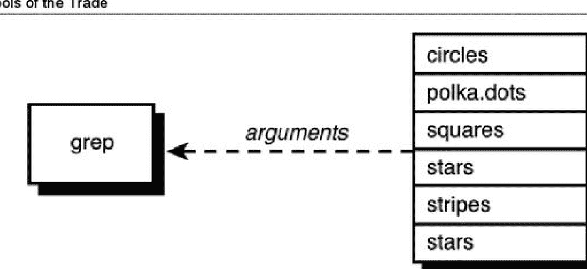

图 4.1. grep * stars。

然而，将星号括在引号中可以移除其在 shell 中的特殊含义：

- * grep * stars

- * 星号 (*) 是一个特殊字符

- 5 * 20

引号告诉 shell 忽略包含其中的字符。然后它执行了 grep，向其传递了两个参数（不带外围的引号；shell 在此过程中去除了它们）和 stars（见图 4.2）。

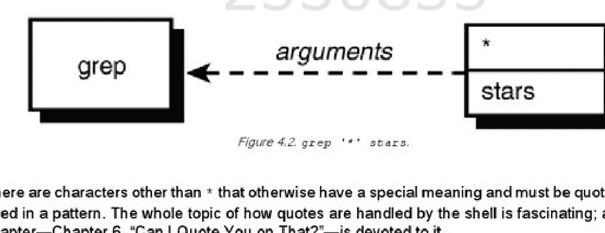

图 4.2. grep '*' stars。

除了这些字符外，还有其他字符具有特殊含义，并且在模式中使用必须用引号括。关于 shell 如何处理引号的话题非常迷人；整整一个章节——第 6 章，“我可以引用你吗？”——都是专门介绍它的。

如果未指定文件名，`grep` 将从标准输入读取输入。因此你可以在管道的另一侧使用 `grep` 来扫描命令输出以查找某些内容。例如，假设你想找出 jim 是否已登录。你可以使用 `grep` 搜索 `who` 的输出：

```
$ who jim
type      Feb 20 10:25
```

注意，通过指定文件，`grep` 会自动扫描其标准输入。如果用户 jim 没有登录，你将只会得到一个新的提示提示符，因为 `grep` 找不到 jim 的输出：

```
$ who grep jim
```

《Unix Shell 编程》，第三版。Unix Shell Programming, Third Edition, ISBN: 0-672-32490-3

为 architect@ocean.com 准备。此下载文件仅供个人使用，并受服务条款限制。任何其他用途均需获得版权所有者的许可。

版权 © 2009 O'Reilly Media。严禁未经授权的复制、改编和/或发行，这将违反适用法律。保留所有权利。

## 工具工具

## 正则表达式和 grep

让我们再次查看 intro 文件：

### cat intro

UNIX 操作系统由 Ken Thompson 和 Dennis Ritchie 在 20 世纪 60 年代末贝尔实验室创立。设计 UNIX 系统的主要目标之一是创建一个促进高效开发的环境。

`grep` 允许你像 `ed` 那样使用正则表达式来指定你的模式。根据这些信息，这意味着你可以指定模式

```
[tt]he
```

来让 `grep` 搜索小写或大写的 T，后面跟着字符 he。

所以这里是如何使用 `grep` 提取所有包含字符 th 或 The 的行：

### grep [tt]he

UNIX 操作系统由 Ken 在 20 世纪 60 年代末创立。设计 UNIX 系统的主要目标之一是创建一个

`grep` 的 `-i` 选项表示在匹配过程中不区分大写字母和小写字母。也就是说，命令

```
grep -i 'the' intro
```

告诉 `grep` 在对 intro 匹配模式时忽略大小写。因此，包含 TH 或 the 的行将被打印出来，包含 T、THE 等的行也将将被打印出来。

表 4.5 显示了你可以为 `grep` 指定的其他类型的正则表达式表达式，以及它们匹配的模式类型。

| 命令 | 输出 |

| --- | --- |

| grep '[A-Z]*' list | list 中包含大写字母的行 |

| grep '[0-9]*' data | data 中包含数字的行 |

| grep '[A-Z].*[0-9]*' list | list 中包含以大写字母开头并结尾的五字符模式的行 |

| grep '\.pic$' list | 以 .pic 结尾的 list 行 |

*表 4.5 的 grep 示例*

## -v 选项

有时你对不包含特定模式的行感兴趣，这时你可以使用 `-v` 选项。如果用户 jim 没有登录，你将只会得到一个新的提示提示符，因为 `grep` 找不到 jim 的输出：

```
$ who grep jim
```

```
$ who jim
type      Feb 20 10:25
```

使用 `-v` 选项来查找不包含特定模式的行。

## -l 选项

有时你可能只想知道匹配模式的文件名，而不是具体的行。例如，假设你想知道哪些文件中包含该模式。你可以使用 `grep -l` 来列出这些文件名：

```
$ grep -l 'pattern' *
```

因为 `grep -l` 会列出文件名，你可以将输出传递给 `wc` 来计算包含模式的文件：

```
$ grep -l 'pattern' * | wc
```

## -n 选项

如果在 `grep` 中使用 `-n` 选项，则每一行前面都会带有其相对行号。从之前的示例中，你看到 test.c 是三个文件之一；以下显示了如何定位这些行：

```
$ grep -n 'the' test.c
13:type      Feb 20 10:25
```

正如你可以看到的，这用于 test.c 的 13、197 和 198 行。

## sort

你熟悉 `sort` 的基本操作：

默认情况下，`sort` 取指定输入文件的每一行并按升序排序。特殊字符根据字符的内部编码进行排序。例如，在以 ASCII 编码的机器上，空格字符内部表示为数字 32，而双引号表示为 34。这意味着前者将排在后者之前。注意，排序顺序取决于实现，尽管你通常可以保证 `sort` 在字母输入上符合预期，但数字、标点和特殊字符的顺序并不总是保证的。我们假设在所有示例中都使用 ASCII 字符集。

`sort` 有许多选项可以为执行排序提供更多灵活性。我们在这里描述几个选项：

### -u 选项

`-u` 选项排序时消除输出中的重复行。

```
$ sort -u names
Charlie
Emmanuel
Fred
Lucy
Ralph
Tony
```

在这里你看到重复的 Tony 行从输出中消除了。

### -r 选项

使用 `-r` 选项反转排序顺序：

```
$ sort -r names
Tony
Ralph
Lucy
Fred
Emmanuel
Charlie
```

### -o 选项

默认情况下，`sort` 将排序后的数据写入标准输出。要将其写入文件，你可以使用输出重定向：

## 工具箱

$ sort names > sorted_names

或者，你可以使用 `-o` 选项来指定文件。只需在 `-o` 之后列出输出文件名即可：

$ sort names -o sorted_names$

这会将 names 进行排序并将结果写入 sorted_names。通常情况下，你想对文件中的行进行排序，并让排序后的数据替换原始文件。输入

$ sort names > names$

是行不通的——它最终会清空 names 文件。然而，使用 `-o` 选项，为输出文件和输入文件指定相同的名称是安全的：

```
$ sort names -o names
$ cat
$ Charlie
$ Emanuel
$ Fred
$ Lucy
$ Ralph
$ Tony
$ Tony
```

## -n 选项

假设你有一个包含如下所示 (x, y) 数据点对的文件：

```
$ cat data
5 11
2 12
2 33
23 2
15 11
-6
14 -9
```

假设你想将这些数据输入到一个名为 `plotdata` 的绘图程序，但该程序要求输入的数据按 x 值（每行的第一个值）升序排序。

`sort` 的 `-n` 选项指定行的第一个字段视为数字，并按算术数值进行排序。比较不使用 `-n` 选项和使用 `-n` 选项的输出：

```
$ sort data
-5 11
14 -9
15 6
2 12
23 2
3 27
$ sort -n data
算术排序
-5 11
2 12
3 33
```

| 5 | 27 |

| 14 | -9 |

| 15 | 6 |

| 23 | 2 |

### 跳过字段

如果你必须按 y 值（即每行的第二个数字）对数据文件进行排序，你可以可以使用选项

```
+1
```

而不是 `-n`。`+1` 表示跳过第一个字段。同样，`+5n` 意味着跳过每行的前五个字段并对数据进行数值排序。字段默认由空格或制表符分隔。如果使用了不同的分隔符，则必须使用 `-t` 选项。

```
$ sort -n1 data 排序时跳过第一个字段
| 14 | -9 |
| 23 | 2 |
| 15 | 6 |
| -5 | 12 |
| 2 | 27 |
| 3 | 33 |
```

## -t 选项

如所述，如果你跳过了字段，`sort` 假设跳过的字段是由空格或制表符分隔的。`-t` 选项并非如此。在这种情况下，`-t` 之后的字符被视为分隔符字符。

再次查看我们的示例密码文件：


```
$ cat /etc/passwd
root:0:0:The super user:/usr/bin/bash
steve:100:0:/users/steve:/usr/bin/bash
bin:3:3:The owner of system files:
cron:1:1:Cron Daemon for periodic tasks:
george:5:75:/users/george:/usr/bin/bash
np:300:300:/users/np:/usr/bin/bash
uooico:5:5:/users/uooico:/usr/bin/uooico
amg:6:6:The Owner of assignable services:
sysinfo:10:10:access to System Information:/usr/bin/bash
mail:301:301:/usr/mail
```

如果你想按用户名（每行的第一个字段）排序，只需执行该命令即可。

如果改为按冒号分隔的字段（包含你的用户 ID）对文件排序，你需要使用算术排序，跳过前两个字段 (`+2n`)，并指定该字符作为字段分隔符 (`-:`)。

```
$ sort -2n -t:/ /etc/passwd 按用户 ID 排序
root:0:0:The Super User:/usr/bin/bash
cron:1:1:Cron Daemon for periodic tasks:
bin:3:3:The owner of system files:
uooico:5:5:/users/uooico:/usr/bin/uooico
amg:6:6:The Owner of Assignable Services:
```

## 工具箱

```
$ sed 644 /etc/passwd > /tmp/passwd
$ mv /tmp/passwd /etc/passwd
mv: 444 mode denied
mv: cannot unlink /etc/passwd
```

自然地，`/etc/passwd` 是 Unix 系统中最重要的文件之一。因为只有超级用户被允许对该文件进行写入。这就是为什么 `mv` 命令失败了。

## 其他选项

`uniq` 的 `-c` 选项类似于带有选项的 `uniq`（即删除重复行），每行输出的前面都会显示该行在输入中出现的次数。

| 名字 | uniq -c | 出现次数 |
| :--- | :--- | :--- |
| Charlie | 1 |  |
| Emanuel | 1 |  |
| Fred | 1 |  |
| Lucy | 1 |  |
| Ralph | 1 |  |
| Tony | 2 |  |

## 练习

1: 下列正则表达式会匹配什么内容？

```
x*
xx
x(1,5)
x(5,)
x(10)
[0-9]*
[0-9]
[0-9][0-9]*
[A-Za-z][A-Za-z0-9]*
[A-Za-z0-9]{1,1}
*Regular
\.,.\|#
```

2: 下列命令的效果是什么？

```
who | grep 'mary'
who | grep 'mary'
grep 'tomilla' ch*
ls -1 | sort -c
sed 's/.*/ > text.out
sed 's/\/[H]ailix\/(TM)/g > text.out
date | cut -d: -f1-16
date | cut -c11-25 | sed 's/[0-9]\(1,2\)/\1/'
```

3: 编写命令完成

- a. 查找所有用户名至少四个字符的登录用户
- b. 查找系统中所有用户 ID 大于 99 的用户
- c. 查找系统中用户 ID 大于 99 的用户数量
- d. 按文件大小从大到小列出你目录中的所有文件

# 第 5 章：我们出发了

本章内容

- 脚本文件
- 变量
- 内置整数算术
- 练习

基于第 3 章“什么是 Shell？”的讨论，你应该意识到，每当你输入类似下面的内容时：

```
who | wc -l
```

你实际上是在为 shell 编写程序！这是因为 shell 正在解释命令行，识别管道符号，将第一个命令的输出连接到第二个命令的输入上，并启动这两个命令的执行。

在本章中，你将学习如何编写自己的命令以及如何使用 shell 变量。

## 脚本文件

shell 程序可以直接在终端中输入，例如：

```
$ who | wc -l
```

或者，可以先将其输入到一个文件中，然后由 shell 执行该文件。例如，假设你一天中需要多次查找登录用户的数量。每次需要信息时都输入一遍管道命令是不合理的，但为了示例起见，让我们使用文件 `nu`（number of users 的缩写），其内容就是之前显示的管道命令：

```
$ cat nu
who | wc -l
$
sh: nu: cannot execute
```

要执行文件 `nu` 包含的命令，你只需要将 `nu` 作为命令名称输入到 shell 中：

```
$ nu
sh: nu: cannot execute
```

哎！我们忘记提到了一点。在你以这种方式执行程序之前，你必须更改文件的权限并使其具有可执行性。这是通过 `chmod` 命令实现的。要给文件 `nu` 添加权限，你只需输入：

> 注意，这里的错误在不同的 shell 之间会有不同。

```
$ chmod 755 nu
```

## 我们出发了

`chmod` 命令的 `+x` 告诉 shell 将后面的文件设为可执行。shell 要求文件在被执行之前必须同时是可读和可执行的。

```
$ls -l nu
-rw-r--r-- 1 user group Jul 10 11:42 nu
chmod +x nu
$ls -l nu
-rwxr-xr-x 1 user group Jul 10 11:42 nu
```

现在你已经将其设置为可执行，请再次尝试：

```
$ nu
```

这次成功了。你可以将任何命令放入一个文件中，将该文件设为可执行，然后只需通过向 shell 输入其文件名即可执行其内容。这既简单又强大。标准的 shell 机制如 I/O 重定向和管道也可以应用于你自己的程序：

```
$ nu > tally
```

假设你正在处理一个名为 `stats` 的文件，每当你想要打印一份提案的新副本时，都需要以下命令序列：

```
$ cat stats | wc -l | sort
```

再次，你可以通过简单将此命令序列放入一个文件中——让它运行——每当你需要获取提案的新副本时只需使用该名称（标准输入由其发出）。在下一个示例中，假设你想编写一个名为 `stats` 的 shell 程序，打印日期和时间、登录用户数以及你的当前目录。你知道获取这些信息的三个命令序列是 `date`、`wc -l` 和 `pwd`：

```
$ cat stats
date
wc -l
pwd
chmod +x stats
```

你可以给 `stats` 添加一些 `echo` 命令来使输出更有信息量：

```
$ cat stats
echo The current date and time is: date
echo The number of users on the system is: wc -l
echo Your working directory is: pwd
$ stats
```

执行它：

the current date and time is: Jul 10 12:27

The number of users on the system is: 13

Your working directory is: /users/documents

记得 `echo` 不带任何参数时会跳过一行。不久后将看到如何让消息和数据显示在同一行，如下：

The current date and time is: Jul 10 12:27

## 注释

shell 语言如果没有注释语句是不完整的。注释是在程序内部插入备注或说明的方法，这些内容对程序的执行没有影响。

当 shell 在单词开头遇到特殊字符 `#` 时，它会将从 `#` 开始到行尾的所有内容视为注释并忽略。如果 `#` 在行首，整行都被 shell 视为注释。以下是有效注释的示例：

```
## Here is an entire comment line
who | wc -l      # count the number of users
```

```
## Test to see if the correct arguments were supplied
#
```

注释对于目的不直观或足够复杂的命令非常有用，如果你在一周后再次查看程序，可能会忘记它们为什么在那里或它们的作用是什么。明智地使用注释有助于 shell 程序更容易调试和维护——无论是对于你自己还是对于可能支持你程序的他人。

让我们回到 `stats` 程序并插入一些注释：

```
$ cat stats
## stats -- prints: number of users logged on, current working directory
echo The current date and time is: date
```

> 注意，# 可能是你的默认删除字符。如果是这样，要在 emacs 或 vi 等编辑器输入该字符，你需要在它前面加一个 \ 对其进行“转义”。或者，你可以使用 `escape` 命令更改你的删除字符。

## 我们出发了

```
echo
echo The number of users on the system is:
who | wc -l
```

```
echo
echo Your current working directory is:
pwd
```

额外的空行在程序空间上占用的微乎其微，但极大地提高了程序的可读性。shell 会直接忽略它们。

## 变量

与几乎所有的编程语言一样，shell 允许你将值存储在*变量*中。变量以字母、数字或下划线 `_` 开头，后面跟着零或多个字母、数字或下划线字符。

要在变量中存储一个值，你只需编写变量名，紧接着是一个等号，然后紧接着你想要存储在变量中的值：

```
variable=value
```

例如，要将值 1 赋值给 shell 变量，你只需要写：

```
count=1
```

将值 `/users/steve/bin` 赋值给 shell 变量 `my_bin`，你只需要写：

```
my_bin=/users/steve/bin
```

这里有几点很重要。首先，等号两边都不允许空格。记住这一点，尤其是当你习惯了在运算符周围插入空格时。在 shell 语言中，不能插入空格。

其次，与其他编程语言不同，shell 完全没有数据类型的概念。当你给 shell 变量赋值时，无论该值是什么，shell 都会将其解释为一个字符串。当你将 1 赋值给变量 `count` 时，shell 仅仅是将字符 1 存储在变量中，并没有存储一个整数值。如果你在用 C 或 Pascal 等语言进行编程，所有变量都必须声明。由于 shell 没有数据类型的概念，变量在使用之前不需要声明；你只需要在需要使用它们时赋值即可。正如你将在在本节后面部分看到的，shell 支持通过内置操作对包含字符串的 shell 变量进行操作。由于 shell 是一种解释型语言，你可以直接在终端上为变量赋值：

```
$count=1               将 1 赋值给 count
$ my_bin=/users/steve/bin  将 /users/steve/bin 赋值给 my_bin
$
```

现在你已经知道如何给变量赋值了，接下来是什么？Unix® Shell Programming, Third Edition。Unix® Shell Programming, Third Edition, ISBN: 0-672-32490-3 Prepared for architect@opensource.com. 此下载文件仅供个人使用，并受服务条款限制。任何其他用途均需版权所有者的事先书面许可。© 2003 Llikely Publishing。严禁未经的使用、复制和分发，否则将违反法律。保留所有权利。

## 显示变量

`echo` 命令用于显示存储在 shell 变量中的值。要这样做，你只需写：

```
echo $variable
```

`$` 对 shell 来说是一个特殊字符。如果 `$` 后面跟着一个有效的变量名，shell 将认为此指示该变量中存储的值应在该处被替换。因此，当你输入：

```
echo $count
```

shell 会将 `$count` 替换为其中存储的值；然后执行 `echo` 命令：

```
echo count
```

记住，shell 在执行命令之前会执行变量替换（见图 5.1）。你可以同时替换多个变量的值：

```
$ echo $my_bin
/users/steve/bin
$ echo $my_bin $count
/users/steve/bin 1
```

在第二个示例中，shell 替换了 `my_bin` 和 `count` 的值，然后执行 `echo` 命令（见图 5.2）。变量的值可以用于命令行的任何地方，如下面的示例所示：

```
$ ls $my_bin
text
$ pwd
/users/steve/documents/ 我们在哪里？
$ cd $my_bin 切换到我的 bin 目录
$ pwd
/users/steve/bin
```

Unix® Shell Programming, Third Edition.Unix® Shell Programming, Third Edition. ISBN: 0-672-32490-3 Prepared for architect@opengroup.edu. 此下载文件仅供个人使用，并受服务条款限制。任何其他用途均需版权所有者的事先书面许可。(C) 2003 O'Reilly Media。严禁未经的使用、复制和分发，否则将违反法律。保留所有权利。

```
$ number=99
echo There are number bottles of beer on the wall
There are 99 bottles of beer on the wall
$
```

这里是更多示例：

- `$ command=sort`
- `$ command names`
- Charles
- Emmanuel
- Fred
- Lucy
- Tony
- Tony
- `$ command=wc`
- `$ options=-l`
- `$ file=name`
- `$ command option $file`
- names

所以你看到，甚至命令的名字也可以存储在变量中。由于 shell 在确定要执行的程序名称及其参数之前执行替换，它会扫描行：

```
command option $file
```

并转换为：

```
wc -l names
```

然后它执行 `wc`，传递 `-l` 和 `names` 两个参数。变量可以赋值给其他变量，如下一个示例所示：

```
$ value=10
$ value2=value1
echo $value2
Value1
$ value2=$value1
$ echo $value2
10
```

没做对。

这样好多了。

记住，每当你想要使用该变量的值时，必须在变量名之前放置一个美元符号。

## 空值

当你尝试显示一个没有赋值的变量时，会发生什么？尝试一下。

```
$ echo noise
没有给它赋值
$
```

你没有得到错误信息。`echo` 命令到底显示了任何内容吗？让我们更精确地确定一下：

```
$ echo Scrooge:
用冒号包围它的值
```

$

所以你看到，`count` 的值没有被替换为字符。不包含值的变量被称为包含空值。当 shell 执行替换时，任何空值都会从命令行中完全移除，不留痕迹：

```
$ wc -1 names
names
$
```

这解释了为什么它行得通。有时你可能需要在程序中显式地将变量设为空。可以通过简单地为变量赋值来实现，例如：

```
dataflag=
```

或者，你可以在等号后列出相邻的引号。所以

```
dataflag=""
```

和

```
dataflag=''
```

都有给 `dataflag` 赋值空值的效果。注意，赋值

```
dataflag=" "
```

与上述三个不等，因为它给 `dataflag` 赋值了一个空格字符；这与赋值没有字符不同。

文件名替换与变量

这里有一个谜题：如果你输入：

```
x="*"
```

shell 是将字符存储到变量 `x` 中，还是将当前目录下所有文件的名称存储到变量 `x` 中？让我们试试看：

```
我们现在有哪些文件？
```

```
$ ls -n
addresses
intro
lotspaces
names
nu
numbers
phonebook
stat
x="*"
$ echo $x
addresses intro lotspaces names nu numbers phonebook stat
```

## 我们出发了

从这个小示例中可以学习到很多东西。当执行

```
x="*"
```

时，文件列表是存储在变量 `x` 中的，还是在执行

```
echo $*
```

时由 shell 执行了替换？

答案是，shell 在给变量赋值时并不会执行文件名替换。因此，

```
x="*"
```

将单个字符 `*` 赋值给 `x`。这意味着在执行 `echo` 命令时，是由 shell 执行了文件名替换。事实上，当执行

```
echo $*
```

时，发生的精确步骤顺序如下：

1. shell 扫描该行，将 `\*` 替换为 `x` 的值。
2. shell 重新扫描该行，遇到 `\*`，然后替换为当前目录下所有文件的名称。
3. shell 启动 `echo` 的执行，将文件列表作为参数传递（见图 5.3）。

这种求值顺序非常重要。记住，shell 首先进行变量替换，然后进行文件名替换，最后将该行解析为参数。

## ${variable} 结构


假设你有一个存储在变量 `filename` 中的文件名。如果你想重命名文件，使得新名称与旧名称相同，但在末尾添加一个 X，你的第一反应可能是输入

```
$filename $filenameX
```

当 shell 扫描这条命令行时，它会同时替换变量 `filename` 的值以及变量 `filenameX` 的值。shell 认为 `filenameX` 是该变量的完整名称，因为它完全由有效的名称字符组成。为了避免这个问题，你可以通过将整个名称（但不包括领先的美元符号）括在大括号中来界定变量的结束，例如：

```
${filename}
```

这消除了歧义，`mv` 命令随后按如下方式工作：

```
mv $filename $filenameX
```

记住，只有当变量名的最后一个字符后面跟着字母、数字或下划线时，大括号才是必要的。

## 内置整数算术

POSIX 标准 shell 提供了一种对 shell 变量进行整数算术的机制，称为算术扩展。注意，一些旧版本的 shell 不支持此功能。

算术扩展的格式为

```
$((expression))
```

其中 `expression` 是使用变量和运算符的算术表达式。有效的变量是那些包含数值的变量（允许有前后空格）。有效的运算符取自 C 语言，并列在附录 A“Shell 总结”中。计算 `expression` 的结果会被替换到命令行中。例如，

```
echo $((i))
```

将 shell 变量 `i` 加 1 并打印结果。注意，变量前面不需要有美元符号。因为 shell 知道在算术扩展中出现的唯一有效项是运算符、数字和变量。如果变量未定义或包含 NULL 字符串，则其值被假设为 0。因此，如果我们没有给变量赋值任何值，我们仍然可以在整数表达式中使用它：

```
$ echo a               变量 a 未设置
$ echo $((a = a + 1))   等同于 a = 0 + 1
$ echo a               现在包含 1
```

注意，赋值是一个有效的运算符，并且在上述示例的第二个 `echo` 命令中执行了赋值替换。

表达式内部可以自由使用圆括号来强制分组，例如：

```
echo $((i = (10) * 3))
```

如果你想在不使用 `echo` 或其他命令的情况下执行赋值，你可以将赋值移动到算术扩展之前。

要将变量 `i` 乘以 5并将结果赋值回 `i`，你可以写

```
i=$((i * 5))
```

注意，双括号内的空格是可选的，但赋值在外部时是不允许空格的。

最后，为了测试 `i` 是否大于 0 或小于等于 100，你可以写

```
result=$((i > 0 && i <= 100))
```

如果表达式为真，则给 `result` 赋值 1；如果为假，则赋值 0：

```
$ i=$((i > 0 && i <= 100))
$ echo $i
0
```

这就是我们对编写命令和使用变量的介绍。下一章将详细介绍 shell 中的引用机制。

## 练习

- 1：以下哪些是有效的变量名？

```
1235
HOMEDIR
file.name
file_name
limit
```

- 2：假设你的 HOME 目录是 `/users/steve`，并且你拥有如下所示的子目录：

（图像描述）

假设你刚刚登录系统并执行了以下命令：

```
$ mkdir /users/steve/documents
$ cd ~/docs/letters
$ cp ~/docs/proposals
```

编写命令来完成以下操作：

- a. 列出 `documents` 目录的内容。
- b. 将 `letters` 目录中的所有文件复制到 `proposals` 目录。
- c. 将 `letters` 目录中所有名称包含大写字母的文件移动到当前目录。
- d. 统计 `memos` 目录中的文件数量。

以下命令会产生什么影响？

- a. `ls $let/..`
- b. `cat $prop/sys.A >> $let/no.JSK`
- c. `echo $let/*`
- d. `cp $let/no.JSK $progs`
- e. `cd $prop`

- 3：编写一个名为 `nf` 的程序，显示当前目录下的文件数量。输入该程序并测试。

- 4：编写一个名为 `whos` 的程序，显示登录用户的排序后的列表。仅显示用户名，不显示其他信息。输入该程序并测试。

## 第 6 章，我能引用这句话吗？

本章内容

- 单引号
- 双引号
- 反斜符
- 命令替换
- 练习题

本章将向你介绍 shell 脚本编程语言的一个独特特性：它解释引号字符的方式。基本上，shell 识别四种不同类型的引号字符：

- 单引号字符 `''`
- 双引号字符 `""`
- 反斜符字符 `\`
- 反引号字符 `` ``

上述列表中的前两个和最后一个字符必须成对出现，而反斜符字符本质上是单目的。这些引号中的每一个对 shell 来说都有不同的含义。我们将在本章的不同章节中分别介绍它们。

### 单引号

在 shell 中，你可能需要使用引号有很多理由，其中之一是为了保留通常会被空白字符分隔的字符。让我们来看一个例子。这里有一个包含姓名和电话号码的 `phonebook` 文件：

```
$ phonebook
Alice Smith 973-555-2015
Barbara Swingle 201-555-2257
Liz Stern 212-555-2298
Susan Goldberg 201-555-3776
Susan Topple 212-555-4932
Tony Iannino 973-555-1295
```

要在我们的电话簿文件中查找某人（为了示例，这里文件保持得很小），请使用 `grep`：

```
$ grep phonebook
Alice Cheeba 973-555-2015
$
```

看看当你查找 Susan 时发生了什么：

## 我能引用这句话吗？

```
$ grep Susan phonebook
Susan Goldberg 201-555-7776
Susan Topple 212-555-4932
$
```

有两行都包含 Susan，这解释了输出的两行内容。解决这个问题的一种方法是正确地指定名称。例如，你可以指定姓：

```
$ grep Susan Goldberg phonebook
grep: can't open Goldberg
Susan Goldberg 201-555-7776
Susan Topple 212-555-4932
$
```

回想一下，shell 使用一个或多个空白字符来分隔行上的参数，之前的命令行导致 `grep` 接收了三个参数：*Susan、Goldberg 和 phonebook*（见图 6.1）。

当执行 `grep` 时，它将第一个参数视为模式，将剩余参数视为要查找该模式的文件名。在这种情况下，`grep` 认为它应该在文件 **Goldberg 和 phonebook** 中查找 Susan。因此，它尝试打开文件 Goldberg，但没有找到它，并发布了错误消息：

```
grep: can't open Goldberg
```

然后它转到下一行 *phonebook*，打开它，搜索模式 *Susan*，并打印出两个匹配的行。这个问题的根源在于尝试将空白字符解析为程序的参数。这可以通过将整个参数括在一对单引号内来实现：

```
$ grep 'Susan Goldberg' 'phonebook'
```

当 shell 看到第一个引号时，它会忽略任何特殊字符，直到它看到闭合引号。

```
$ grep 'Susan Goldberg' 'phonebook'
Susan Goldberg 201-555-7776
$
```

在这种情况下，shell 遇到了第一个 ' ，并忽略了直到找到结尾 ' 之前的任何特殊字符。因此，Susan 和 Goldberg 之间的空格（这通常会分隔两个参数）被 shell 忽略了。因此，shell 将命令行分为两个参数：第一个是 Susan Goldberg（包含空格字符），第二个是 phonebook。然后它执行了 grep，并向其传递了这两个参数（见图 6.2）。

图 6.2. `grep 'Susan Goldberg' phonebook`.

随后，`grep` 提取了第一个参数 Susan Goldberg，并在第二个参数 phonebook 指定的文件中查找它。请注意，shell 会从命令行中移除引号，不会将它们传递给程序。

无论引号之间包含多少个空格，shell 都会保留它们。

在第一种情况下，shell 从命令行中移除引号并不会将它们传递给程序。在第二种情况下，shell 从命令行中移除引号并不会将它们传递给程序。

图 6.3. `echo 'Susan Goldberg' phonebook`.

图 6.4. `echo 'Susan Goldberg' phonebook`.

无论引号之间包含多少个空格，shell 都会保留它们。

在第一种情况下，shell 从命令行中移除引号并不会将它们传递给程序。在第二种情况下，shell 从命令行中移除引号并不会将它们传递给程序。

## 我能引用那句话吗？

```
$ echo 'How are you today,
> John
$ 
```

即使是回车键，如果包含在引号内，shell 也会忽略它：在输入第一行后，shell 看到引号未匹配，它会等待你输入。作为 shell 正在等待你完成命令的指示，它将其提示符字符从 $ 变为 >。这被称为你的次级提示符（secondary-prompt character），shell 每当等待你完成命令时都会显示。

在给变量赋值包含空格或特殊字符的值时，也需要引号：

```
$ message="I must say, this is fun"
$ echo message
$ I must say, this is fun
$ text="means all files in the directory"
$ echo
names no numbers phonebook stat means all files in the directory
```

在给变量 `message` 和 `text` 赋值时需要引号，是因为其中嵌入了空格。在前面的示例中，你被提醒 shell 在变量名替换之后仍然会进行文件名替换，这意味着在执行 `echo` 之前，* 会被替换为当前目录下所有文件的名称。有一种方法可以消除这种困扰，那就是使用双引号。

### 双引号

双引号的工作原理与单引号类似，但它们不是限制性的。单引号告诉 shell 忽略所有包含在内的字符，而双引号说是忽略大部分字符。具体来说，双引号不会忽略以下三个字符：

- 美元符号 (`$`)
- 反引号 (`` ``)
- 反斜符 (`\`)

美元符号未被忽略，意味着 shell 在双引号内部执行变量替换。

```
$ x=
$ echo $x
addresses into lotspaces names nu numbersbook stat
$ echo '$x'
```

## 我可以引用它吗？

在这里，我们看到了引号、单引号、双引号之间的主要区别。在第一种情况下，shell 看到星号并替换当前目录下的所有文件名。在第二种情况下，shell 保持单引号内的字符不变，导致显示为 \*。在最后一种情况下，双引号指示 shell 在双引号内执行变量替换。因此，shell 会对 $ 进行替换。由于在双引号内不进行文件名替换，\* 随后被作为要显示的值传递给 `echo`。

所以，你想替换变量的值，但不想让 shell 正确处理替换后的字符，你必须将变量包含在双引号内。

这里有另一个说明双引号和无引号区别的示例：

```bash
$ address=39 East 12th Street
> New York, N. Y. 10000
echo $address
39 East 12th Street New York, N. Y. 10000
echo "$address"
39 East 12th Street New York, N. Y. 10000
```

赋值给 `address` 的值包含在单引号还是双引号中并没有区别。shell 在两种情况下都会显示次级命令提示符，告诉它正在等待相应的闭合引号。

在将两行地址赋值给 `address` 后，通过 `echo` 显示了变量的值。注意 `address` 显示在单行上。原因与导致以下内容相同：

```bash
echo one
two three four
```

显示为

one two three four

回想一下，shell 会从命令行中移除空格、制表符和换行符（即空白字符），并将其切割成参数。在情况下

```bash
echo address
```

shell 简单地删除了嵌入的换行符，将其处理为空格或制表符：作为参数分隔符。然后它将九个参数传递给 `echo` 进行显示。`echo` 永远没有机会处理那个换行符；shell 先处理了它（见图 6.5）。

当使用命令

```bash
echo "address"
```

时，shell 会像以前一样替换 `address` 的值，但双引号告诉它保留任何嵌入的空白字符。因此，在这种情况下，shell 向 `echo` 传递了一个参数——一个包含嵌入换行符的参数。`echo` 简单地在终端上显示它的单个参数；图 6.6 说明了这一点。换行符由字符 `\n` 表示。

双引号可以用来向 shell 隐藏单引号，反之亦然：

```bash
$ x='Hello, he said'
$ echo $x
'Hello, he said'
$ article='Keeping the Logins from lagging, Bell Labs Record'
$ echo $article
'Keeping the Logins from Lagging, Bell Labs Record '
```

### 反斜杠

基本上，反斜杠等同于在单个字符周围加上单引号，但有少数微小的例外。反斜杠引用紧随其后的单个字符。其通用格式为

`\c`

其中 `c` 是你想要引的字符。该字符上带有的任何特殊含义都会被移除。这里有一个示例：

```bash
$ echo
syntax error: 'newline or ; unexpected'
$ echo \> 
$
```

在第一种情况下，shell 看到 > 并认为你想要将 `echo` 的输出重定向到文件。因此，它期望后面跟着一个文件名。因为没有跟着，shell 发出了错误信息。在下一种情况下，反斜杠移除了 > 的特殊含义，因此它被传递给 `echo` 进行显示。

```bash
$ x=*
$ echo \$x
x
```

在这种情况下，shell 忽略了紧随反斜杠的 $，结果没有执行变量替换。

由于反斜杠会移除其后字符的特殊含义，你能猜到如果那个字符是反斜杠会发生什么吗？对，它移除了反斜杠的特殊含义：

```bash
$ echo \\
$
```

自然，你也可以写成

```bash
$ echo '\'
$
```

### 使用反斜杠换行延续

正如开头提到的，这其中的一个例外是当行尾的反斜杠被用于续行时：

```bash
echo one \
two three four
```

### 双引号内部的反斜杠

我们之前注意到，在双引号内部，反斜杠可以用来转义某些字符。如果反斜杠后面跟随的是 $, ", \ 或反斜杠以外的任何字符，则反斜杠会被简单移除。如果反斜杠后面跟随的是 $, ", \ \ 或反斜杠本身，则该字符被保留：

```bash
$ x="1"
echo "\$x"
1
echo "\\"
"
echo "\\\"
\
```

## 我可以引用你吗？

### 反引号 (Back Quote)

反引号与之前遇到的任何类型的引号都不同。它的目的不是保护字符免受 shell 的影响，而是执行包含在其中的命令，并将命令的标准输出插入到命令行该位置。使用反引号的一般格式为：

```
command
```

其中 `command` 是要执行的命令名称，`output` 是要插入该位置的内容。

这里有一个示例：

```
echo The Date and time is: date
date and time is: Wed Aug 28 14:28:43 EST 2002
```

当 shell 开始对命令行进行初始扫描时，它发现了反引号并预期后面跟着一个命令名称。在这种情况下，shell 发现要执行 `date` 命令。因此，它执行 `date` 并命令行上的 "date" 替换为 `date` 的输出。随后，它以正常方式将命令行转换为参数，并启动 `echo` 命令的执行。

```
echo Your current working directory is: pwd
Your current working directory is: /users/steve/shell/chaf
```

在这里，shell 执行 `pwd`，将其输出插入命令行，然后执行 `echo`。请注意，在接下来的章节中，所有使用 `$(...)` 的地方都可以使用反引号。

### $(...) 结构

POSIX 标准 shell 支持使用 `$(...)` 结构进行命令替换。其一般格式为 `$(command)`，在反引号方法中，`command` 是其标准输出要替换到命令行上的命令名称。例如：

```
echo The Date and time is: $(date)
date and time is: Wed Aug 28 14:28:43 EST 2002
```

出于以下几个原因，这种方法比反引号更好。首先，使用正引号和反引号组合的复杂命令可能更容易阅读，特别是当你使用的类型在视觉上与单引号和反引号没有区别时；其次，`$(...)` 结构可以很容易嵌套，允许在命令替换内部进行命令替换。反引号也可以进行嵌套，但会有点复杂。你将在本节中看到一个嵌套命令替换的示例。

> 注意，使用反引号进行命令替换不再是首选方法；但我们在这里介绍它，是因为有许多旧的 shell 程序仍在使用它。此外，如果你以后需要编写可移植到不支持新的 `$(...)` 结构的 Unix 系统 shell 程序，你也应该了解反引号。


## 我可以引用你吗？

你并不限于在括号之间执行单个命令：如果用分号隔开，可以执行多个命令。此外，还可以使用管道。这里有一个 `nu` 程序的修改版本，用于显示登录用户数：

```
$ cat nu
echo There $(who | wc -l) users logged in
$ nu
Execute it if
There are 13 users logged in
```

由于单引号会保护所有内容，以下输出应该是清晰的：

```
$ echo $(who | wc -l) tells how many users are logged in
$ (who | wc -l) tells how many users are logged in
```

但命令替换在双引号内会被解释：

```
$ echo "You have $(ls | wc -l) files in your directory"
nYou have 7 files in your directory
```

（是什么导致了问号前面的空格？）请记住，shell 负责执行括号之间的命令。`echo` 命令看到的只是 shell 插入的输出。

假设你正在编写一个 shell 程序，并想将当前日期和时间赋值给变量 `now`，可能是为了以后在报告顶部显示它，或者将其记录到文件中。这里的问题在于，你想办法获取输出的日期并将其赋值给变量。可以使用命令替换来实现：

```
$ now=$(date) Execute date and store the output in now
$ echo See what got assigned
Wed Aug 28 14:47:26 EST 2002
```

当你写下：

```
now=$(date)
```

shell 意识到 `date` 的整个输出将赋值给 `now`。因此，你不需要给 `$(date)` 加上双引号。

即使命令产生的输出超过单行也可以存储在变量中：

```
$ filelist=$(ls)
$ echo filelist
addresses into list names numbers phonebook stat
```

这里发生了什么？除非 `ls` 的换行符被存储在 `filelist` 变量中，否则你得到的是一个水平的文件列表。当 shell 在处理 `echo` 命令行替换 `filelist` 的值时，换行符被掉了。在变量周围加上双引号将保留换行符：

```
$ echo "$filelist"
addresses
into
list
names
nu
```

要将文件内容存储到变量，你可以使用 `cat`：

```
$ namelist=$(cat names)
$ echo "$names"
Charlie
Emanuel
Fred
Lucy
Ralph
Tony
Tony $
```

如果你想将第一个字符的所有出现处更改为其他内容。在之前的示例中，`firstchar=$(echo $filename | cut -cl)` 获取文件名的第一个字符，我们如何使用这个字符来更改所有出现的地方？两步法是一个方法：

```
$ firstchar=$(echo $filename | cut -cl)
$ filename=$(echo $filename | tr "$firstchar" "u")
```

或者使用单层嵌套命令替换也可以执行相同的操作：

```
$ filename=/users/steve/memos
$ filename=$(echo $filename | tr "$firstchar$(cut -cl)"*")
```

## 我可以引用你吗？

`sed` 通常用于“编辑”值。在这里它用于提取最后一个：

```
$ file=user.txt
$ lastchar=$(echo $file | sed 's/.*\)/\1/')
$ echo $lastchar
```

sed 命令周围的单引号非常重要，因为它们防止了 shell 对反斜杠进行处理（双引号也可以作用？）。最后，命令替换可以嵌套（如上文示例）。

## expr 命令

虽然 POSIX 标准支持内置整数算术运算，但旧的 shell 不支持。你可能会看到使用一个名为 `expr` 的 Unix 程序进行命令替换，它评估命令行上的表达式并输出结果：

```
$ expr 1 + 2
3
```

每个操作数传递给 `expr` 必须是独立的参数，这解释了以下内容的输出：

```
$ expr 1-2
-1
```

## 你能保证这一点吗？

`expr` 识别常用的算术操作符：+ 加法、- 减法、/ 除法、* 乘法以及 % 取模（余数）。

```bash
$ expr 10 + 20 / 2
20
```

乘法、除法和取模优先级高于减法。因此，在上面的示例中，除法是在加法之前执行的

```bash
$ expr 17 * 6
expr: syntax error
$
```

发生了什么？答案是：shell 看到了 * 并将其替换了你目录下所有文件的名称！必须对其加上引号以防止被 shell 解析：

```bash
$ expr '17' * 6
102
$
```

那不是正确的方法。记住，`expr` 必须将每个运算符和操作数视为独立的参数；上一个例子将整个表达式作为一个参数发送了。

```bash
$ expr 17 \* 6
102 $
```

自然地，`expr` 的一个或多个参数可以是存储在 shell 变量中的值，shell 无论如何都会处理替换：

```bash
$ i=1
$ expr $(expr i + 1)
$ echo i
$
```

这是在 shell 变量上进行算术运算的旧方法。与之前显示的操作相同，仅使用命令替换机制将 `expr` 的输出赋值回变量：

```bash
$ i=1
$ expr $(expr i + 1)      给 i 加 1
$ echo i
$
```

在旧版 shell 中，你更有可能看到使用反引号配合 `expr` 运行：

```bash
$ `expr i + 1`      给 i 加 1
$ echo i
$
```

请注意，与 shell 内置的算术运算不同，`expr` 只评估整数算术表达式。如果你需要进行浮点数计算，可以使用 `awk`。还要注意 `expr` 还有其他操作符。最常用的之一是 `:` 操作符，用于将第一个操作数中的字符与第二个操作数提供的正则表达式进行匹配。默认情况下，它返回匹配到的字符数。

`expr` 命令

```bash
expr "file" - ".*"
```

返回变量 `file` 中存储的字符数，因为正则表达式 * 匹配字符串中的所有字符。有关 `expr` 的更多信息，请参阅你的 Unix 用户手册。表 A.5 总结了 shell 处理引号的方式。

## 练习

1：给定以下赋值：

```bash
$ x=
$ y=one
$ z=two
> three
$ now=$(date)
$ symbol='
```

以及你当前目录下的这些文件：

```bash
$ echo *
names testi u v zebra
```

以下命令的输出将是什么

```bash
echo *** error
echo 'Im 5 * 4 > 18 ?'
echo $x
echo What is your name?
echo $y
echo Would you like to play a game?
echo "$y"
echo \$symbol
echo $z i wc -l
echo \$symbol
echo "$z" wc -l
echo \\"
echo '$z' i wc -l
echo \\"
echo _now
echo \"
echo hello symbol out
echo \"
echo "***"
echo I don't understand
```

- 2：编写命令来移除 shell 变量 `text` 中存储的所有空格字符。确保将结果赋值回 `text`。首先使用 `tr` 完成，然后用 `sed` 执行相同的操作。

- 3：编写命令来统计 shell 变量 `text` 中存储的字符数。编写统计所有字符的命令。（提示：使用 `sed` 和 `wc`。）如果特殊字符序列存储在 `text` 内部会发生什么？

- 4：编写命令将文件 `names` 中的唯一行赋值给 shell 变量 `namelist`。

## 第7章 参数传递

本章内容

- shift 命令

- 练习

在学习了如何处理传递给程序的参数后，shell 程序将变得有用得多。在本章中，你将学习如何编写接收命令行输入参数的 shell 程序。回想你在第5章中编写的“Away We Go”程序，该程序通过 `tbl`、`nroff` 和 `lp` 运行 `sys.caps`：

```bash
$ cat run
tbl sys.caps | nroff -mm -Tlp | lp | lp
```

假设你需要通过同一命令序列运行除 `sys.caps` 以外的文件。你可以为每个文件创建一个单独的 `run` 版本，或者修改 `run` 程序，以便你可以在命令行上指定要运行的文件名。

## 参数传递

每当你执行一个 shell 程序时，命令行后的任何内容都存储在第一个参数中。另一个例子是，`new.hire` 将存储在这个参数中。当 shell 看到 `$1` 时，位置参数的替换与其他类型的替换是相同的。

.

## $$ 变量

每当你执行一个 shell 程序时，特殊变量 `$$` 会获取命令行上输入的参数个数。正如你将在下一章中看到的，程序可以通过测试此变量来确定是否使用了正确的参数数量。

下一个名为 `args` 的程序是为了让你更熟悉参数传递给 shell 程序的方式。学习每个示例的输出，并确保你理解了：

```bash
$ args
查看程序
echo arg 1=$1; arg 2=$2; arg 3=$3;
$ args
执行它
echo 3 arguments
echo arg 1=$a; arg 2=$b; arg 3=$c;
尝试使用两个参数
$ args ab
echo 2 arguments
echo arg 1=$a; arg 2=$b; arg 3=;
未赋值的 args 为
尝试不带参数运行
$ args
echo 0 arguments
echo arg 1=; arg 2=; arg 3=;
尝试引号
$ args"
echo arg 1=$a; arg 2=$b; arg 3=;
查看以 x 开头的文件
$ args *text
echo arg 1=$1; arg 2=$extra; arg 3=;
尝试文件名替换
$ args my_bin/users/steve/bin
变量替换
$ args *
echo 1 arguments
echo arg 1=/users/steve/bin; arg 2=; arg 3=;
```

## 传递参数

```
$ $7 (cat names) 传递名字的内容
7 个参数传递
arg 1=charlie; arg 2=manuel; arg 3=fred;
$
```

如你所见，即使在执行 shell 程序时，shell 也会进行其正常的命令行处理。这意味着在为你的程序指定参数时，你可以利用文件名替换和变量替换等常规便利功能。

## $* 变量

特殊变量 `$*` 指向传递给程序的所有参数。这对于接收不确定或可变数量参数的程序非常有用。稍后你会看到更多实际示例。这里有一个说明其用法的程序：

```
$ cat arg2
echo $* arguments passed
echo they are '*'
$arg2 a b
2 arguments passed
they are a b:
$arg2 one two
2 arguments passed
they are one two:
$arg3
0 arguments passed
they are :
$arg4
8 arguments passed
they are: args2 names nu phonebook stat extra:
$
```

## 一个在电话簿中查找某人的程序

这里是之前示例中的电话簿文件：

```
$ cat phonebook
Alice Cheeba 973-555-2013
Barbara Bangle 201-555-9257
Liz Stachiu 212-555-2298
Susan Goldberg 201-555-3779
Susan Topple 212-555-4932
Tony Iannino 973-555-1265
$
```

你已经如何使用 `grep` 在文件中查找某人：

```
$ grep cheeb phonebook
Alice Cheeba 973-555-2013
$
```

而且如果你想通过全名查找某人，最好给它加上引号以保持参数完整：

```
$ grep "Susan T" phonebook
Susan Topple 212-555-4932
$
```

如果能写一个用来查找某人的 shell 程序就太好了。我们将该程序命名为 `lu`，并将要查找的名字作为它的参数：

```
$ cat lu
## 在电话簿中查找某人
#
grep $1 phonebook
```

这里是 `lu` 的示例用法：

```
$ lu Alice
Alice Cheeba 973-555-2015
$ lu Susan
Susan Goldberg 201-555-7776
Susan Topple 212-555-4932
$ lu 'Susan T'
grep: can't open
phonebook:Susan Goldberg 201-555-7776
phonebook:Susan Topple 212-555-4932
```

在在上一个示例中，你仔细地用双引号包裹了 Susan；那么发生了什么？再次查看 `lu` 中执行 `grep` 的时候：

```
$ grep $1 phonebook
```

尽管将 Susan 包裹在双引号内会导致其作为一个单一参数传递给 `lu`，但当 shell 用 `$1` 替换 `grep` 命令时，它将其作为两个参数传递给 `grep`。（记得我们在讨论变量替换时也进行过这类讨论——首先 shell 替换变量的值；然后它将行分割为）

你可以通过在 `lu` 程序中将 `$1` 包裹在双引号内（为什么不用单引号呢？）来缓解这个问题：

```
$ cat lu
## 在电话簿中查找某人 -- 版本 2
#
grep "$1" phonebook
#
```

现在再尝试一次：

```
$ lu Tony
Tony Iannino 673-555-1265
$ lu 'Susan T'
Susan Topple 212-555-4932
```

这仍然有效。现在再次尝试这个

## 一个向电话簿添加某人的程序

让我们继续开发处理电话簿文件的程序。你可能想向文件中添加某人，特别是因为我们的电话簿文件非常小。你可以写一个接受两个参数的程序：要添加的名字和电话。然后你只需要将名字和号码用制表符隔开写入电话簿文件的末尾即可：

```
$ cat add
#
## 向电话簿添加某人
#
echo "$1 $2" >> phonebook
```

虽然你看不出来，但在上面的 `echo` 命令中，有一个制表符分隔了 `$1` 和 `$2`。这个制表符必须加引号才能传递给 `echo` 而不被 shell 吞掉。让我们尝试一下程序：

```
$ add "Stromboli Pizza" 973-555-9478
Stromboli Pizza 973-555-9478
$ cat phonebook
Alice Osborne 973-555-2015
Barbara Swingle 201-555-9257
Billy Bach 212-555-7618
Liz Stachiu 212-555-2268
Susan Goldberg 212-555-7738
Susan Topple 212-555-4932
Tony Iannino 973-555-1293
Stromboli Pizza 973-555-9478
```

由于我们的电话簿文件非常小，你可能想向文件中添加某人。虽然你看不出来，但在上面的 `echo` 命令中，有一个制表符分隔了 `$1` 和 `$2`。这个制表符必须加引号才能传递给 `echo` 而不被 shell 吞掉。让我们尝试一下程序：

```
$ add "Stromboli Pizza" 973-555-9478
Stromboli Pizza 973-555-9478
$ cat phonebook
Alice Osborne 973-555-2015
Barbara Swingle 201-555-9257
Billy Bach 212-555-7618
Liz Stachiu 212-555-2268
Susan Goldberg 212-555-7738
Susan Topple 212-555-4932
Tony Iannino 973-555-1293
Stromboli Pizza 973-555-9478
```

由于我们的电话簿文件非常小，你可能想向文件中添加某人。虽然你看不出来，但在上面的 `echo` 命令中，有一个制表符分隔了 `$1` 和 `$2`。这个制表符必须加引号才能传递给 `echo` 而不被 shell 吞掉。让我们尝试一下程序：

```
$ add "Stromboli Pizza" 973-555-9478
Stromboli Pizza 973-555-9478
$ cat phonebook
Alice Osborne 973-555-2015
Barbara Swingle 201-555-9257
Billy Bach 212-555-7618
Liz Stachiu 212-555-2268
Susan Goldberg 212-555-7738
Susan Topple 212-555-4932
Tony Iannino 973-555-1293
Stromboli Pizza 973-555-9478
```


由于我们的电话簿文件非常小，你可能想向文件中添加某人。虽然你看不出来，但在上面的 `echo` 命令中，有一个制表符分隔了 `$1` 和 `$2`。这个制表符必须加引号才能传递给 `echo` 而不被 shell 吞掉。让我们尝试一下程序：

```
$ add "Stromboli Pizza" 973-555-9478
Stromboli Pizza 973-555-9478
$ cat phonebook
Alice Osborne 973-555-2015
Barbara Swingle 201-555-9257
Billy Bach 212-555-7618
Liz Stachiu 212-555-2268
Susan Goldberg 212-555-7738
Susan Topple 212-555-4932
Tony Iannino 973-555-1293
Stromboli Pizza 973-555-9478
```

## 一个从电话簿中删除某人的程序

没有一组能够查找或添加某人的程序的程序是完整的，如果不包含一个从电话簿中删除某人的程序。我们将该程序命名为 `rem`，并将要删除的名字作为它的参数。本质上，你想删除文件中包含指定名字的行。`grep` 的 `-v` 选项可以使用这里，因为它打印不匹配文件的行：

```
$ cat rem
## 从电话簿中删除某人
grep -v "$1" phonebook > /tmp/phonebook
mv /tmp/phonebook phonebook
```

`grep` 将所有不匹配的行写入 `/tmp/phonebook`。在 `grep` 完成后，旧的电话簿就被 `/tmp` 中的新文件替换了。

```
$ rem "Stromboli Pizza"
$ cat phonebook
Alice Cheeba 973-555-2013
Barbara Bangle 201-555-9257
Billy Bach 212-555-7618
Liz Stachiu 212-555-2298
Susan Goldberg 201-555-3779
Susan Topple 212-555-4932
Tony Iannino 973-555-1265
$ rem Susan
```

第一个案例（Stromboli Pizza 被删除）运行良好。在第二种情况下，然而，两个条目都被删除了，因为它们都匹配模式。你可以使用程序将它们重新添加回电话簿：

```
$ add "Susan Goldberg" 201-555-7776
$ add "Susan Topple" 212-555-4932
```

在第 8 章“决策，抉择”中，你将学习如何确定是否找到了多个匹配条目，如果是的话。例如，你可能想提醒用户发现了多个匹配，并需要对名字进行进一步限定。（这非常有帮助，因为如果传递空字符串作为参数，大多数 `grep` 的实现会匹配所有内容）。

## 传递参数

以达到相同的结果。`sed` 命令周围需要双引号，以确保 `$1` 的值被替换，同时确保 shell 不会看到如下命令行：

```
sed /Stromboli_Pizza/d phonebook > /tmp/phonebook
```

并向 `sed` 传递三个参数而不是两个。

## `${n}`

如果你向程序提供了超过九个参数，你将无法通过 `$10`、`$11` 等访问第 10 个及以上的参数。如果你尝试通过编写代码来访问第 10 个参数：

```
$10
```

shell 实际上会替换 `$1` 的值并在后面跟上 `0`。相反，必须使用格式：

```
${n}
```

因此，要直接访问第 10 个参数，你必须在程序中写成：

```
${10}
```

## `shift` 命令

`shift` 命令允许你有效地移动位置参数。如果你执行命令：

```
shift
```

之前存储在 `$2` 中的任何内容将赋值给 `$1`，之前存储在 `$3` 中的内容将赋值给 `$2`，以此此类推。`$1` 的旧值将不可恢复地丢失。当此命令执行时，`$#` 也会减 1。

```
$ shift a b c d e
5 b c d e
4 b c d e
3 c d e
2 e
1 e
0
```

如果你在没有变量可以移动时尝试 `shift`（即当 `$#` 等于零时），你将收到来自 shell 的错误消息（错误信息会随 shell 的不同而异）：

```
$ shift: bad number
```

其中 `shift` 是被执行的程序名称。你可以通过在 `shift` 后面紧跟一个 `count` 来一次性移动多个“位置”，例如：

```
shift 3
```

此命令的效果与执行执行三次独立的 `shift` 相同：

```
shift
shift
shift
```

`shift` 命令在处理数量数量的参数时非常有用。当你学习第 9 章“循环”时，你会看到它的实际应用。

## 练习题

- 1: 修改 `shift`，使其在调用 `lookup` 时忽略大小写。
- 2: 如果你忘记为 `shift` 提供参数会怎样？如果参数为空（例如 `shift ""`）会发生什么？
- 3: 本章中的程序在以下示例中有一个缺陷：

```
$ shift fred
tty0 Sep 4 14:53
```

输出表明 `fred` 已经登录，而我们本是在检查它是否登录。修改 `shift` 来解决这个问题。
- 4: 编写一个名为 `twice` 的程序，它接受一个整数参数并使其其值翻倍：

```
$ twice 15
30
$ twice 0
```

如果输入非整数值会发生什么？如果省略了参数会发生什么？
- 5: 编写一个名为 `home` 的程序，它接受用户名作为唯一参数并打印该用户的家目录。

```
$ home steve
/users/steve
```

`/users/steve` 是 `steve` 的家目录。（提示：回家目录是存储在 `/etc/passwd` 文件中的第六个字段）。
- 6: 编写一个名为 `suffix` 的程序，通过将第二个参数给的字符添加到第一个参数指定的文件末尾来重命名文件。
- 7: 编写一个名为 `unsuffix` 的程序，从第一个参数指定的文件名末尾删除第二个参数给的字符。因此：

```
suffix memol .sv
应该将 memol 重命名为 memol.sv.
unsuffix memol.sv .sv
unsuffix test
```

应该将 `memol.sv` 重命名为 `test.sv`。确保字符是从末尾删除的，因此结果应该是将 `test` 重命名为 `test`。（提示：使用 `sed` 和命令替换。）

## 第 8 章 抉择，抉择

**本章内容**

- 退出状态
- `test` 命令
- `else` 结构
- `exit` 命令
- `elif` 结构
- `case` 命令
- 空命令 (Null Command):
- `&&` 和 `||` 结构
- 练习题

本章引入了一个句在几乎所有编程语言中都存在的语句：`if`。它允许你测试一个条件，然后根据测试结果改变程序执行的流。

`if` 命令的通用格式为：

```
if command;
  then
    command
fi
```

其中执行 `command` 并测试其退出状态。如果退出状态为零，则执行 `then` 和 `fi` 之间的命令；否则，将跳过它们。

## 退出状态

每当任何程序在 Unix 系统下完成执行时，它都会返回一个退出状态。按照惯例，某些命令的“失败”数值结果可能随 Unix 版本的不同而变化，但成功总是以零退出状态为标志。例如，如果 `cp` 命令复制失败，它会返回一个非零状态。在管道中，退出状态是管道中最后一个命令的退出状态。因此：

抉择，抉择

`who | grep fred`

`grep` 的退出状态被 shell 用作管道的退出状态。在这种情况下，退出状态为零意味着在执行此命令时发现了 `fred`。

## `$?` 变量

shell 变量 `$?` 会由 shell 自动设置为上一次执行的命令的退出状态。自然地，你可以使用 `echo` 在终端上显示它的值。

```
$ cp phone
$ echo $?
"succeeded"
$ cp backup
cp: cannot access backup
$ echo $?
"Failed"
who
root console who logged on
wilms tty0 Jul 8 10:06
tty1 Jul 8 12:36
hbarney tty4 Jul 8 14:57
betty tty5 Jul 8 15:03
$ who | grep barney
hbarney tty4 Jul 8 14:57
$ echo $?
打印最后一个命令 (grep) 的退出状态
"succeeded"
$ who | grep fred
$ echo $?
"Failed"
最后一个 echo 的退出状态
```

让我们写一个名为 `on` 的 shell 程序，用来告诉我们指定的用户是否登录了系统。要检查的用户名将通过命令行传递给程序。如果用户已登录，我们将打印一条关于此的消息；否则，我们什么都不说。这里是程序：

```
$ cat
## 确定某是否登录

user="$1"

if who | grep "$user"
then
echo "$user is logged on"
```

在命令行上输入的第一个参数被存储在 shell 变量 `user` 中。然后 `if`

```
who | grep "$user"
```

并测试 `grep` 返回的退出状态。如果退出状态为零，说明 `grep` 在 `who` 的输出中找到了该用户。在这种情况下，将执行随后的 `echo` 命令。如果退出状态不为零，则该用户未登录，将跳过 `echo` 命令。出于美观考虑，`echo` 命令在左侧进行了缩进（此类目的使用制表符，因为输入一个制表符比输入等数量的空格要容易）。在这种情况下，`then` 和 `fi` 之间仅包含一个命令。当包含更多命令且嵌套深度加深时，缩进对程序的可读性会产生显著影响。随后的示例将说明这一点。

以下是命令的一些示例用法：

```
$ who
root Jul 8 10:30
herney tty03 Jul 8 12:38
fred tty04 Jul 8 13:40
joanne tty07 Jul 8 06:35
tony tty
lulu tty23 Jul 8 08:55
```

我们知道他在线：

```
$ id
tony tty15 Jul 8 08:30
tony is logged on
```

我们知道他在线：

```
$ date
joanne tty07 Jul 8 06:35
ann is logged on
```

这些是从哪里来的呢？

我们必须解决程序中的两个问题。当指定的用户登录时，`who` 输出中对应的行也会被显示。这可能不是什么坏事，但程序要求只显示一条消息，而不显示其他任何内容。这一行的显示不仅是因为 `grep` 在管道中返回了退出状态：

```
$ who grep "user"
```

它还执行了匹配行并输出到标准输出的正常功能，而我们实际上对此并不感兴趣。我们可以通过将 `grep` 的输出重定向到系统的“垃圾桶” `/dev/null` 来丢弃它的输出。这是系统上的一个特殊文件，你可以从中读取（并立即获得文件结束）或向其写入。当你向其写入时，这些位就会进入天空中的那个大桶：

```
who grep "user" > /dev/null
```

第二个问题出现在用带参数 `ann` 执行程序时。即使 `ann` 没有登录，`grep` 仍然匹配了用户 `joanne` 的字符。当你需要更严格的模式规范时（这种方法你在第四章“工具箱”中学习过，我们在那里讨论了正则表达式），由于 `who` 在每行输出的列中列出每个用户名，我们可以通过在模式前加上字符 `^` 将模式锚定在行首：

```
who grep "^user" > /dev/null
```

但这还不够。如果你搜索模式 `bob`，`grep` 仍然会匹配像如下的行：

```
hobby tty07 Jul 8 09:35
```

你需要做的是同样将模式锚定在行尾。

## 决策，抉择

```bash
## cat on
## 确定某人是否已登录 -- 版本 2
user="fuser"
if grep "fuser" >/dev/null
then
echo "fuser is logged on"
fi

$ who
Who's on now?
root    console Jul 8 10:37
barney  tty3 Jul 8 12:23
fred    tty3 Jul 8 11:40
joanne tty7 Jul 8 08:35
tony    tty6 Jul 8 08:30
kain    tty3 Jul 8 09:55

$ lulu
lulu is logged on
$ ann
Try this again
```

如果没有指定参数，`user` 将为空。此时 `grep` 将在 `who` 的输出中查找以空白字符（`^ `）开头的行。它将找不到任何内容，并仅返回命令提示符。在下一节中，你将看到如何测试是否向程序提供了正确数量的参数，如果没有，则采取某些操作。

## `test` 命令

名为 `test` 的内置 shell 命令通常用于测试命令中的一个或多个条件。它的通用格式是：

```
test expression
```

其中 `expression` 代表你正在测试的条件。`test` 评估表达式，如果结果为真，它返回状态零；否则，结果为假，并返回非零退出状态。

## 字符串运算符

作为 `test` 用法的示例，如果 shell 变量名包含字符 `julio`，则以下命令返回零退出状态：

```
test "name" = julio
```

`=` 用于测试两个值是否相同。在这种情况下，我们正在测试 shell 变量 `name` 的内容是否与字符 `julio` 相同。

## 决策，抉择

你可以使用表 8.1 中列出的第三个运算符来测试 shell 变量是否为空值：

```bash
test "$day"
```

如果 `day` 不为空，则返回真；如果为空，则返回假。在这种情况下引号是不必要的，因为 `test` 不在乎在这种情况下是否看到了参数。尽管如此，你在这里使用引号会更好，因为如果变量完全由空白字符组成，如果不包含在引号内，shell 将丢弃该参数。

```bash
$ blanks=
$ test blanks
$ echo $?
$ test "blanks"
$ echo $?
0
is it not null?
False-it's null
And now?
True-it's not null
```


在第一的情况下，`test` 没有接收到任何参数，因为 shell 消耗了 blanks 中的四个空格。在第二种情况下，`test` 接收到了一个由四个字符组成的参数；显然不是为空的。

当我们似乎在详述空格和引号时，请意识到这是一个棘手的问题，也是 shell 编程错误的常见源头。理解这里的原理真的是非常有好处的，可以以后以后避免很多编程上的头疼问题。

还有另一种测试字符串是否为空的方法，那就是使用表 8.1 中之前列出的最后两个运算符之一。`-n` 运算符如果参数不为空则返回退出状态 0。将此运算符理解为测试非零长度。

`-z` 运算符测试参数以检查它是否为空，如果不为空则返回退出状态 0。将此运算符理解为测试后续参数长度是否为零。

```bash
test -n "$day"
```

如果 `day` 至少包含一个字符，则返回退出状态 0。命令

```bash
test -z "$dataflag"
```

如果 `dataflag` 包含任何字符，则返回退出状态 0。

不要惊讶，上述两个运算符都期望后面跟着一个参数；因此，养成将该参数封装在双引号内的习惯。

```bash
$ nullvar
$ nonnullvar-abc
$ test -n "$nullvar"
$ echo $?
Does nullvar have nonzero length?
No
And what about nonnullvar?
$ test -n "$nullvar"
$ echo $?
Yes
Does nullvar have zero length?
Yes
$ test -z "$nullvar"
$ echo $?
And nonzero?
```

注意 `test` 对其参数可能很挑剔。例如，如果 shell 变量 `symbol` 包含等号，看看尝试测试它的零长度会发生什么：

```bash
$ echo symbol
$ test -z 'Symbol'
sh test: argument expected
```

该运算符的优先级高于 `-z` 运算符，所以 `test` 期望后面有一个参数。为了避免这个问题，你可以将命令写为：

```bash
test "$symbol" = =
```

如果 `symbol` 为空，则为真；如果为空，则为假。`symbol` 前的 X 防止了 `test` 将存储在 `symbol` 中的字符解释为运算符。

## test 的替代格式

`test` 命令被 shell 程序员频繁使用，以至于该命令的替代格式也得到了认可。这种格式提高了命令的可读性，特别是在用于 `if` 命令中使用时。

你可能记得 `test` 命令的通用格式：

```bash
test expression
```

这也可以用替代格式表示为

```bash
[ expression ]
```

`[` 是命令的名字（谁说命令名称必须是字母数字了？）。它启动了 `test` 命令的执行，且仅在这种格式下，`test` 期望在表达式末尾看到一个闭合的 `]`。当然，空格必须出现在 `[` 之后和 `]` 之前。

你可以用这种替代格式重写上一个示例中的 `test` 命令：

```bash
$ -z "$nullvar"
$ echo $?
```

在 `if` 命令中使用时，这种替代格式如下：

```bash
if [ "$name" = julie ]
then echo "Would you like to play a game?"
fi
```

使用哪种格式的命令取决于你；我们更喜欢 `[...]` 格式，因此在书的剩余部分我们将使用它。

## 整数运算符

`test` 有一系列运算符用于执行整数比较。表 8.2 总结了这些运算符。

### 表 8.2 test 整数运算符

| 运算符 | 如果满足则返回真（退出状态为0） |
|---|---|
| `int -eq int2` | 等于 `int2` |
| `int -ge int2` | 大于等于 `int2` |
| `int -gt int2` | 大于 `int2` |
| `int -le int2` | 小于等于 `int2` |
| `int -lt int2` | 小于 `int2` |
| `int -ne int2` | 不等于 `int2` |

（注：此处后续内容与前文重复，已按要求保留翻译）

## 文件运算符

几乎每个 shell 程序都会处理一个或多个文件。因此，`test` 提供了大量的运算符来对文件进行各种询问。这些运算符中的每一个都是一元性的，意味着它们期望后面跟着一个参数。在所有情况下，这都是文件名。

### 表 8.3 常用文件运算符

| 运算符 | 如果满足则返回真（状态 0） |
| --- | --- |
| `-d` | 是目录 |
| `-e` | 存在 |
| `-t` | 是普通文件 |
| `-r` | 文件对进程可读 |
| `-n` | 文件无长度 |
| `-w` | 文件对进程可写 |
| `-x` | 文件是可执行的 |
| `-z` | 文件是符号链接 |

```bash
-n /users/steve/phonebook
```

指示的文件是否至少包含一个字节的信息。这非常有用，例如，如果你在程序中创建了一个错误日志文件，并想查看是否有内容写入了它：

```bash
if [ -s SERFILE ]
then
	echo "Error found:"
	sERFILE
fi
```

## 决策，抉择

### 逻辑取非运算符

一元逻辑取非运算符可以放在任何其他测试表达式之前，用于对该表达式评估的结果取反。例如：

```
[ -r /users/steve/phonebook ]
```

如果 `/users/steve/phonebook` 不可读，则返回零退出状态（真）；并且：

```
[ -f "mailfile" ]
```

如果 `$mailfile` 指定的文件不存在或不是普通文件，则返回真。最后，

```
[ $x1 != "$x2" ]
```

如果 `$x1` 与 `$x2` 不相同，且显然等同于

```
[ $x1 = "$x2" ]
```

则返回真。

### 逻辑与（AND）运算符 -a

`-a` 运算符执行两个表达式的逻辑与（AND）操作，只有当两个连接的表达式都为真时才返回真。因此：

```
[ -f "mailfile" -a -r "mailfile" ]
```

如果 `$mailfile` 指定的文件是普通文件且你可以读取，则返回真。在 `-a` 运算符周围放置了额外的空格以提高表达式的可读性，这对它的执行没有影响。

命令

```
[ "count" -ge 0 -a "count" -lt 10 ]
```

如果变量 `$count` 包含一个大于等于 0 且小于 10 的整数值，则为真。`-a` 运算符的优先级低于整数比较运算符（字符串和文件运算符也是如此），这意味着前面的表达式的评估方式为：

```
[ ("count" -ge 0) -a ("count" -lt 10 ) ]
```

正如你预期的那样。

### 括号

顺便一下，你可以在测试表达式中使用括号来改变评估顺序；只需确保对括号加上引号，因为它们对 shell 具有特殊含义。因此，要将前面的示例转换为测试命令，你会写成：

```
[ \[("count" -ge 0\) -a \[("count" -lt 10\) ]
```

按照惯例，括号周围必须有空格，因为 `test` 期望将它们视为独立的参数。

### 逻辑或（OR）运算符 -o

`-o` 运算符与 `-a` 运算符类似，但它形成两个表达式的逻辑或（OR）。也就是说，如果第一个表达式为真或第二个表达式为真，则表达式的评估结果为真。

```
[ -n "mailopt" -o -r $HOME/mailfile ]
```

如果变量 `mailopt` 不为空或你可以读取 `$HOME/mailfile`，则此命令为真。

`-o` 运算符的优先级低于 `-a` 运算符，这意味着表达式

```
[ "sa" -eq 0 - "sb" -eq 2 -a "sc" -eq 10 ]
```

被 `test` 评估的方式为：

```
[ "sa" -eq 0 - "sb" -eq 2 -a "sc" -eq 10 ]
```

当然，如果有必要，你可以使用括号来改变这种顺序：

```
[ \( "sa" -eq 0 - "sb" -eq 2 \) -a "sc" -eq 10 ]
```

你将在书中看到很多 `test` 命令。附录 A 中“Shell 摘要”中的表 A.11 总结了所有可用的测试运算符。

### else 结构

名为 `else` 的结构可以添加到 `if` 命令中，其通用格式所示：

```
command;
then
  command
  command
else
  command
  command
fi
```

这种形式的命令执行方式与之前一样：执行 `command` 并测试其退出状态。如果状态为 0，则执行 `then` 和 `else` 之间的后续命令，跳过 `else` 和 `fi` 之间的命令。否则，退出状态为非零，跳过 `then` 和 `else` 之间的命令，并执行 `else` 和 `fi` 之间的命令。在任何情况下，只有一组命令会被执行：如果退出状态为 0 则执行第一组，如果为非零则执行第二组。

现在让我们写 `on` 的一个修改版本。我们不再打印请求的用户是否登录，而是让命令打印此效果的消息。这是该程序的第 3 版本：

```bash
cat en
## 确定是否有人登录 -- 版本 3
#
user="user"

if who grep "$user" /dev/null
then
  echo "User is logged on"
fi
```

Unix® Shell Programming, Third Edition. Unix® Shell Programming, Third Edition, ISBN: 0-672-3490-3

## 决策，抉择

122

## 决策，抉择

128

## 决策，抉择

130

## 决策，抉择

131

等待，我注意到原始 OCR 有一些显著的重复伪影，并且页码（如“122”、“128”等）实际上被嵌入了文本中。让我重新检查源文本。

现在让我们写 `on` 的一个修改版本。我们不再打印请求的用户是否登录，而是让命令打印此效果的消息。这是该程序的第 3 版本：

```bash
cat en
## 确定是否有人登录 -- 版本 3
#
user="user"

if who grep "$user" /dev/null
then
  echo "User is logged on"
fi
```

Unix® Shell Programming, Third Edition. Unix® Shell Programming, Third Edition, ISBN: 0-672-3490-3

## 决策，抉

```
mv /tmp/phonebook phonebook
$ rm Susan Goldberg Try it out
Incorrect number of arguments.
Usage: rem name
```

`exit` 命令返回退出状态 1，表示“失败”，以备其他程序检查该状态。你可以如何使用 `if-else` 而不是使用 `exit` 来编写前面的程序（提示：查看 on 的最后一个版本）？

使用 `exit` 还是 `if-else` 取决于你。有时 `exit` 是一种快速退出程序的更方便的方法，特别是在清晨早操作的时候。

### elif 结构

随着程序变得越来越复杂，你可能会发现自己需要编写如下形式的嵌套 if 语句：

```
if command;
    command
    ...
else
    if command;
        command
        ...
    else
        if command;
            command
            ...
        else
            command
    fi
fi
```

当你需要做出的比 `if-else` 结构提供的双向决策更多的时，这种命令序列非常有用。在这种情况下，会进行多级决策，如果满足了前面的条件之一，则执行最后一个 `else` 子句。

例如，假设你想编写一个名为 `greetings` 的程序，每当你登录系统时，它都会打印一句友好的“早上好”、“下午好”或“晚上好”。为了示例起见，请考虑从午夜到早晨、中午到下午 6 点、以及下午 6 点到晚上的任何时间段。

要编写这个程序，你必须找出现在是什么时间。`date` 命令完全可以胜任此任务。查看此命令的输出：

```
$ date
Wed Aug 26 10:42:01 EDT 2002
$
```

`date` 输出的格式是固定的，你在编写问候语时可以利用这一优势，因为这意味着时间始终出现在字符第 12 到第 19 位。实际上，对于这个程序，你只需要显示在第 12 和 13 位的小时。因此，要从 `date` 获取小时，你可以写：

```
$ date | cut -c12-13
10
$
```

现在，编写 `greetings` 程序的任务就很直观了：

```
$ cat greetings
#
## Program to print a greeting
#
hour=$(date | cut -c12-13)

if [ "$hour" -ge 0 -a "$hour" -le 11 ];
then
    echo "Good morning"
else
    if [ "$hour" -ge 12 -a "$hour" -le 17 ];
    then
        echo "Good afternoon"
    else
        echo "Good evening"
    fi
fi
```

如果 `hour` 大于等于 0（午夜）且小于等于 11（直到 11:59:59），则显示“Good morning”。如果 `hour` 大于等于 12（中午）且小于等于 17（直到下午 5:59:59），则显示“Good afternoon”。如果上述两个条件都不满足，则显示“Good evening”。

```
$ greetings
Good morning
$
```

正如所提到的，`greetings` 中使用的嵌套 if 命令序列非常常见，因此有一个专门的 `elif` 结构，可以更方便地表达这种序列。该结构的通用格式为：

```
if command;
then
    command
    ...
elif command2;
then
    command
    ...
elif command3;
then
    command
    ...
else
    command
    ...
fi
```

依次执行 `command`、`command`...`command` 并检查它们的退出状态。一旦其中一个命令返回退出状态零，紧接着 `then` 之后列出的命令将被执行，直到遇到另一个 `elif`、`else` 或 `fi`。如果没有一个命令返回零退出状态，则执行可选 `else` 之后列出的命令。

你可以使用这种新格式重写 `greetings` 程序，如下：

```bash
## cat greetings
## Program to print a greeting -- version 2
#
hour="$(date | cut -c12-13)"

if [ "$hour" -ge "06" -le "11" ]; then
    echo "Good morning"
elif [ "$hour" -ge "12" -le "17" ];
then
    echo "Good afternoon"
else
    echo "Good evening"
fi
```

这个版本更容易读，而且不会因为过度缩进而导致消失在右边界之外。顺便一下，你应该注意 `date` 提供了大量的选项。其中一个 `%H` 可以直接从 `date` 获取小时：

- date +%H

10

作为一个练习，你应该修改 `greetings` 以利用这个事实。

### 另一个版本的 rem

为 `rem` 程序增加一些健壮性的另一种方法是在执行删除之前检查匹配的条目数量。如果有多个匹配项，你可以发布一条此类似的信息并终止程序的执行。但问题是，你该如何确定匹配条目的数量呢？一种方法是对 `phonebook` 文件进行普通的 `grep`，并统计输出的匹配数量。如果匹配数量大于1，就可以发布相应的消息。

```bash
## cat rem
## Remove someone from the phonebook -- version 3
#
if [ "$1" -ne 1 ]; then
    echo "Incorrect number of arguments"
    echo "Usage: rem name"
    exit 1
fi
name=$1
matches=$(grep "$name" phonebook | wc -l)

if [ "$matches" -gt 1 ]; then
    echo "More than one match; please qualify further"
elif [ "$matches" -eq 1 ]; then
    grep -v "$name" > /tmp/phonebook
    mv /tmp/phonebook phonebook
else
    echo "I couldn't find $name in the phone book"
fi
```

在执行参数检查后，将位置参数 `$1` 赋值给变量 `name` 以增加程序的可读性。随后， `$name` 比 `$1` 清得多。

`if...elif...else` 命令检查匹配数量是否大于 1。如果是，则打印“More than one match”。如果不是，则测试匹配数量是否等于 1。如果是，则从电话簿中删除该条目。如果不是，则匹配数量必然为 0，此时会显示消息来提醒用户这一事实。

注意 `grep` 命令在该程序中使用了两次：首先用于确定匹配数量，然后使用 `-v` 选项删除单个条目。


这里是 `rem` 第三版本的的一些示例运行：

```
$ rem
Incorrect numbers of arguments.
$ rem name
$ Susan
More than one match; please qualify further
$ rem Susan Topple
$ rem 'Susan Topple'
$ couldn't find Susan Topple in the phone book
```

现在你有了一个相当健壮的 `rem` 程序：它检查参数数量是否正确，如果没有提供正确数量则打印正确的用法；它还确保从电话簿文件中恰好删除了一个条目。

## case 命令

`case` 命令允许你将单个值与其他值进行比较，并在找到匹配项时执行一个或多个命令。该命令的通用格式为：

```
case value in
  pat1)
    command
    command
    ...
    command;
  pat2)
    command
    command
    ...
    command;
  patm)
    command
```

## 决策，选择

```bash
command
  ...
  command;

esac
```

字符串值将与 `pat`, ..., `pat`, ... 连续进行比较，直到找到匹配项。一旦找到匹配项，将执行匹配值之后、双分号 之前列出的命令。到达双分号后，`case` 的执行将终止。如果没有找到匹配项，则 `case` 中列出的任何命令都将被执行。

以下是 `case` 用法的一个示例，这个名为 `number` 的程序接收一个数字，并将其转换为对应的英文单词：

```bash
cat number
## 将数字翻译为英文
#
if [ "$1" -ne 1 ];
then
  echo "Usage: number digit"
  exit 1
fi
case "$1" in
  0) echo zero;
  1) echo one;
  2) echo two;
  3) echo three;
  4) echo four;
  5) echo five;
  6) echo six;
  7) echo seven;
  8) echo eight;
  9) echo nine;
esac
```

现在来测试它：

```bash
$ number 0
zero
$ number 3
three
$ number
Usage: number digit
Try no arguments
$ number 17
Try a two-digit number doesn't match any of the values listed in the case, so none of the echo commands executed.
```

最后一个用例展示了当你输入多个数字时会发生什么：`$1` 不匹配 `case` 中列出的任何值，因此没有任何 `echo` 命令被执行。

## 特殊模式匹配字符

壳（shell）在 `case` 模式中使用的特殊字符与你在进行文件名替换时使用的特殊字符相同。也就是说，`?` 可以用于指定任意单个字符；`*` 可以用于指定任意字符零次或多次出现；而 `[...]` 可以用于指定括号内的任意单个字符。

由于模式 `*` 可以匹配任何内容（就像它用于文件名替换时可以匹配目录下的所有文件一样），它经常被用在 `case` 的末尾作为“兜底”（catchall）值。也就是说，如果 `case` 中之前的没有任何值都不匹配，那么这个值就保证会被匹配。这里是 `number` 程序的第二个版本，它包含一个兜底情况。

```bash
cat number
## 将数字翻译为英文 -- 版本 2
#
if [ "$1" -ne 1 ];
then
  echo "Usage: number digit"
  exit 1
fi
case "$1" in
  0) echo zero;
  1) echo echoone;
  2) echo two;
  3) echo three;
  4) echo four;
  5) echo five;
  6) echo six;
  7) echo seven;
  8) echo eight;
  9) echo nine;
  *) echo "Bad argument; please specify a single digit";
esac
$ number 9
nine
$ number 99
Bad argument; please specify a single digit
```

另一个名为 `ctype` 的程序，它可以打印作为参数提供的单个字符的类型。字符类型包括数字、大写字母、小写字母和特殊字符（前三个类别之外的任何字符）。作为额外检查，程序会确保参数仅是单个字符。

```bash
cat ctype
## 分类作为参数的字符
#
if [ $# -ne 1 ];
then
  echo Usage: ctype char
  exit 1
fi
## 确保只输入了一个字符
char="$1"
numchars=$(echo "$char" | wc -c)
if [ "$numchars" -ne 1 ];
then
  echo Please type a single character
  exit 1
fi
## 现在进行分类
```

```bash
case "char"
  in
    [0-9]) echo digit;
    [a-z]) echo lowercase letter;
    [A-Z]) echo uppercase letter;
    *) echo special character;
  esac
```

一些示例运行结果：

```bash
$ ctype -a
Please type a single character
$ ctype 7
Please type a single character
```

## 用于调试程序的 -x 选项

似乎有些不对。我们程序中的计数部分似乎没有正常工作。这似乎是引入 shell 的 `-x` 选项的好时机。你可以通过输入 `sh -x` 加上程序名称及其参数来跟踪任何程序的执行过程。这将启动一个启用了 `-x` 选项的新 shell 来执行程序。在这种模式下，命令在执行时会打印在终端上，前面带有一个加号 `+`。让我们试一下。

```bash
$ sh -x ctype a
+ char=a
+ echo a
+ wc=2
+ [ 2 -ne 1 ]
+ echo Please type a single character
+ exit
+ Trace execution
+ equals
+ Assignment of $1 to char
+ wc returned 2
```

跟踪输出表明，当执行

```bash
echo "$char" | wc -
```

时，`wc` 返回了 2。但为什么呢？`wc` 的输入中似乎只有一个字符。事实是，实际上给给了 `wc` 两个字符：`echo` 自动在每行末尾打印的“不可见”换行符。因此，程序实际上在测试字符数是否等于二：即 `echo` 添加的换行符。回到 `ctype` 并替换读取以下内容的 `if` 命令：

```bash
if [ $# -ne 1 ];
then
  echo Please type a character
  exit 1
fi
```

再次尝试：

```bash
$ ctype a
lowercase letter
$ ctype abc
Please type a character
$ ctype b
digit
$ ctype k
uppercase letter
$ ctype 
special character
```

现在看起来工作正常了（如果你在使用 `*` 时不加引号会怎样？）。在第 12 章“参数”中，你将学习如何开启此功能。在离开 `ctype` 之前，这里有一个避免了使用 `wc` 的版本，通过 `case` 处理所有字符：

```bash
cat ctype
## 分类作为参数的字符 -- 版本 2
if [ $# -ne 1 ];
then
  echo Usage: ctype char
  exit 1
fi
## 现在确保只输入了一个字符
char=$1
case "$char" in
    [0-9]) echo digit;
    [a-z]) echo lowercase letter;
    [A-Z]) echo uppercase letter;
    *) echo special character;
esac
```

## 返回 case

`|` 符号用在两个模式之间时具有逻辑或（OR）的效果。也就是说，模式

```
pat1 | pat2
```

指定了匹配 `pat1` 或 `pat2` 中的任意一个。例如，

```
-1 | list
```

匹配值 `-1` 或 `list`，而

```
dmd620 | tty5620
```

可以重写为使用 `case` 语句而不是 `if-else`。这里有一个程序版本。这次，我们利用了 `date` 的 `%H` 选项会将两位小时输出到标准输出的特性。

```bash
$ cat greetings
#
## 输出问候信息的程序 -- case 版本
hour=$(date +%H)
```

```bash
case $hour
in
  07 | [1[0]]) echo "Good morning";
      echo "Good afternoon";
  1[2-7]      echo "Good evening";
esac
```

从 `date` 获取的两位小时赋值给 shell 变量 `hour`。然后执行 `case` 语句。`hour` 的值与第一个模式比较：

```
07 | [1[0]]
```

匹配任何以零开头并跟随任意字符（凌晨到上午 9:00），或任何以一开头并跟随零或一的数值（10:00 或 11:00）。第二个模式

```
1[2-7]
```

匹配以一开头并跟随数字 2 到 7 任意一个的数值（正午到下午 5:00）。最后一个情况，即兜底，匹配任何其他内容（下午 6:00 到晚上 11:00）。

## 决策，抉择

$ date
Wed Aug 28 15:45:12 EDT 2002
$ greetings
下午好

现在是讨论 shell 内置空命令（null command）的好时机。这个命令的格式简单就是 `:`

- 它的目的是——你猜对了——什么什么都不做。那么它有什么用呢？在大多数情况下，它用于满足必须出现命令的要求，特别是在 `if` 语句中。假设你想确保变量 `system` 中存储的值存在文件 `/users/steve/mail/systems` 中，如果不存在，你想输出一条错误信息并退出程序。于是你开始编写类似下面的代码：

```bash
if grep "system" /users/steve/mail/systems > /dev/null
then
```

但你不知道在 `then` 之后写什么；你想测试文件中是否存在 `system`，并且当 `grep` 成功时你不想执行任何特殊操作。遗憾的是，shell 要求在 `then` 之后必须写一个命令。这时空命令派上用场了：

```bash
if grep "system" /users/steve/mail/systems > /dev/null
else
    echo "system is not a valid system"
    exit 1
fi
```

这样，如果系统是有效的，则什么都不执行。如果无效，就会输出错误信息并退出程序。

当出现这类情况时，记住这个简单的命令。

## && 和 || 结构

shell 有两个特殊结构，允许你根据前一个命令的成功或失败来执行命令。如果你觉得这听起来和 `if` 语句相似，那么确实如此。它实际上是 `if` 的一种简写形式。

如果你写

`command1 && command2;`

在任何 shell 期望看到命令的地方，`command1` 将被执行，如果它返回的退出状态为零，则执行 `command2`。如果 `command1` 返回非零状态，`command2` 将被跳过。

例如，如果你写：

`sort bigdata > /tmp/sortout && mv /tmp/sortout bigdata`

那么只有在 `sort` 成功时才会执行 `mv` 命令。注意，这等同于写：

```bash
if sort bigdata > /tmp/sortout
then
    mv /tmp/sortout bigdata
fi
```

这条命令：

```bash
[ -z "EDITOR" ] && EDITOR=/bin/ed
```

测试变量 `EDITOR` 的值。如果它是空的，则将其赋值为 `/bin/ed`。

`||` 的工作原理类似，不同在于只有在第一个命令的退出状态为非零时才会执行第二个命令。如果你写：

```bash
grep "$name" phonebook || echo "Couldn't find $name"
```

只有当 `grep` 失败时才会执行 `echo` 命令（即如果在 `phonebook` 中找不到 `$name` 或者无法打开 `phonebook`）。在这种情况下，等效的命令看起来如下：

```bash
if grep "$name" phonebook
then
else
    echo "Couldn't find $name"
fi
```

你可以在这些命令的左侧或右侧编写管道。在左侧，被测试的退出状态是管道中最后一个命令的状态；因此：

```bash
who | grep "$name" > /dev/null || echo "$name's not logged on"
```

当 `grep` 失败时，会产生 `echo` 的效果。

`&&` 和 `||` 也可以在命令行上组合：

```bash
who | grep "$name" > /dev/null && echo "$name's not logged on"
|| echo "$name's logged on"
```

（记住，当 `||` 用在行尾时，它向 shell 发出行延续信号。）第一个 `echo` 在 `grep` 成功时也会执行；第二个在失败时执行。

这些结构经常用于 `if` 语句中：

```bash
if valid "$days" && timeout
then
    sendmail "$user@$days" $message
fi
```

如果 `valid` 返回退出状态为零，则执行 `timeout`。`if` 会测试该程序的退出状态。如果为零，则执行 `sendmail` 程序。如果 `valid` 返回非零退出状态，则不执行 `timeout`，并且该状态将用作 `if` 测试的退出状态。在这种情况下，`sendmail` 不会被执行。

在前面的命令中使用 `&&` 运算符类似于“逻辑与”；两个程序都必须返回退出状态为零，才能执行 `sendmail` 程序。事实上，你甚至可以将前面的部分写成：

```bash
valid "$days" && timeout sendmail "$user@$days" $message
```

当 `||` 用在 `if` 中时，效果类似于“逻辑或”：

```bash
if endofmonth || specialrequest
then
    sendreports
fi
```

如果 `endofmonth` 返回零退出状态，则执行 `sendreports`；否则，执行 `specialrequest`，如果它的退出状态为零，则执行 `sendreports`。最终效果是，如果 `endofmonth` 或 `specialrequest` 返回的退出状态为零，就会执行 `sendreports`。

在第 8 章“循环往复”中，你将学习如何在程序中编写循环。然而，在进入章节之前，请尝试以下练习。

## 练习

- 1: 编写一个名为 `valid` 的程序，如果它的参数是 shell 变量名则打印 "yes"，否则打印 "no"：

```bash
$ valid foo_bar
yes
$ valid 123
no
```

（提示：为合法的变量名定义正则表达式，然后寻求 `grep` 或 `sed` 的帮助。）

- 2: 编写一个名为 `t` 的程序，以 24 小时或 p.m. 格式显示时间。例如：

```bash
$ date
Wed Aug 28 15:45:12 EDT 2002
$ t
```

使用 `date` 和 `who` 命令转换 24 小时时间。

- 3: 编写一个名为 `mys` 的程序，如果成功则打印文件的退出状态：

```bash
$ mys
0
```

- 4: 编写一个名为 `is` 的程序，如果它的参数是 "yes" 则返回退出状态 0，否则返回 1。

- 5: 编写一个名为 `who` 的程序，打印登录的用户数量。

## 循环往复

```bash
for i in 1 2 3
do  echo $i
done
```

若要尝试一下，你可以直接在终端输入这些内容，就像输入其他 shell 命令一样：

```
for i in 1 2 3
> do
  echo $i
> done
```


当 shell 等待输入 `done` 来结束 `for` 命令时，它会显示次级命令提示符。当输入 `done` 后，shell 将继续执行循环。因为 `in` 后面列出了三个单词（`1`, `2`, `3`），循环体（在本例中是单个 `echo` 命令）将总执行三次。

循环第一次执行时，列表中的第一个单词 `1` 被赋值给变量 `1`。然后执行循环体。列表中的下一个单词 `2` 被赋值给 `1` 并重新执行 `echo` 命令，在终端显示 `2`。列表中的第三个单词 `3` 被赋值给循环的第三次并执行 `echo` 命令。这导致在终端上显示 `3`。此时，列表中没有更多单词，因此循环完成，shell 显示你的命令提示符以告知你已完成。

回想第 7 章“传递参数”中的 `run` 命令，它允许你通过 `tbl` 或 `ip` 运行文件：

```
cat run

tbl $1 | mroff - $1 | ip
```

如果你想通过这个程序运行 `memo1` `memo2` `memo4` 等文件，你可以在终端输入以下内容：

```
for file in memo1 memo2 memo3 memo4
> do
  run $file
done
request id is laseri-33 (standard input)
request id is laseri-34 (standard input)
request id is laseri-35 (standard input)
request id is laseri-36 (standard input)$
```

四个单词 `memo1`、`memo2`、`memo3` 和 `memo4` 将按顺序赋值给变量 `i`，`run` 程序将以该变量的值作为参数执行。执行结果将与你输入的以下命令相同：

```
run memo1
request id is laseri-33 (standard input)
run memo2
request id is laseri-34 (standard input)
run memo3
request id is laseri-35 (standard input)
run memo4
request id is laseri-36 (standard input)$
```

Unix Shell 编程。第三版。Unix Shell Programming, Third Edition, ISBN: 0-672-32490-3
为学生@openpress.com 准备。此下载文件仅供个人使用，并受服务条款约束。任何其他用途均需事先获得版权所有者的书面同意。严禁未经授权的使用、复制和/或分发，否则将违反相关法律。保留所有权利。

## 循环往复

顺便提一下，它在 `for` 的单词列表中允许文件名替换，这意味着之前的循环也可以这样写：

```
for file in memo[1-4]
do
    run $file
done
```

如果你想通过 `run` 运行当前目录下的所有文件，你可以输入：

```
for file in *
do
    run $file
done
```

如果文件 `fileelist` 包含你想要通过 `run` 运行的文件列表，你可以输入：

```
files=$(cat filelist)
for file in $files
do
    run $file
done
```

来运行每个文件，或者更简洁地：

```
for file in $(cat filelist)
do
    run $file
done
```

如果你发现自己正在使用 `run` 程序一次处理多个文件，你可以进入 `run` 程序内部并修改它，允许将任意数量的文件作为参数传递给程序。

```bash
## cat run
## process files through nroff -- version 2
#
for file in f*
do
    tbl $file | nroff -Tlp | ip
done
```

记住，特殊符号 `$*` 代表在命令行上输入的所有参数。所以如果你通过输入以下命令执行新版本的 `run`：

```
run memo1 memo2 memo3 memo4
```

那么 `for` 列表中的 `$*` 将被替换为四个参数 `memo1`、`memo2`、`memo3` 和 `memo4`。当然，你也可以输入：

```
run memo[1-4]
```

达到相同的结果。

## 变量

既然我们谈到了 `$*`，让我们更详细地观察它。我们将编写一个程序 `args`，它将显示命令行上输入的所有参数，每行一个。

## 循环往复

```bash
cat args
echo Number of arguments passed is $#
```

```bash
for arg in $*
do
    echo $arg
done
```

现在来尝试一下：

- 1 args a b c
Number of arguments passed is 3
b c

- 2 args 'a' b c
Number of arguments passed is 2
a b
c

在第二的情况下，尽管 `b` 是作为一个单个参数传递给 `args` 的，但 `for` 命令中的 `$*` 仍被 shell 替换为 `a b c`，即三个单词。因此循环执行了三次。

由于 shell 将 `$*` 的值替换为 `$1`、`$2` 等 等，如果你改为使用特殊 shell 变量 `"$*"`，它将被替换为 `"$1"`、`"$2"` 等。在 `"$*"` 周围加上双引号是必要的，因为如果没有它们，它的行为就像 `"$@"` 一样。

```bash
cat args
echo Number of arguments passed is $#
```

```bash
for arg in "$@"
do
    echo "$arg"
done
```

- 1 args a b c
Number of arguments passed is 3
"a b" "c"

- 2 args 'a' b c
Number of arguments passed is 2
a b
c

## 循环往复

```
until command,
do
  command
  command
  ...
```

与 `while` 循环类似，如果 `do` 和 `done` 之间的命令在 `command` 第一次执行时返回零退出状态，那么这些命令可能永远不会执行。

`until` 命令对于那些等待特定事件发生的程序非常有用。例如，假设你想查看 sandy 是否已登录，因为你必须交给她一些重要的东西。你可以给她发送电子邮件，但你知道她通常在每天傍晚时候没抽空读邮件。一种方法是使用第 8 章“做抉择，再抉择”中的 `on` 命令来查看 sandy 是否登录：

```bash
$ sandy
sandy is not logged on
```

你可以在整天中都运行这个程序，直到 sandy 最终登录，或者你可以编写自己的程序来持续检查，直到她登录为止。让我们把这个程序命名为 `mon`，并让它接受一个参数：你想要监控的用户名。与其让程序不断检查该用户是否登录，我们将每分钟只检查一次。为了这一点，你需要了解一个名为 `sleep` 的命令，它可以根据指定的秒数暂停程序的执行。因此，Unix 命令（这一个内置命令）

```bash
sleep n
```
暂停程序的执行 n 秒。在该时间间隔结束时，程序将从停止的地方继续执行——即执行紧随 `sleep` 之后的命令。

```bash
$ cat mon
## 等待直到指定用户登录
#
if [ "$#" -ne 1 ];
then
  echo "Usage: mon user"
  exit 1
fi
user="$1"
## 每分钟检查一次用户登录
#
until who | grep "$user" > /dev/null
do
  sleep 60
done
## 当我们到达这里时，用户已经登录了
#
echo "$user has logged on"
```

在检查是否提供了参数后，程序将 `$1` 赋值给 `user`。然后进入一个 `until` 循环。该循环将一直执行，直到 `grep` 返回的退出状态为零；也就是说，直到指定的用户登录。只要用户未登录，循环体——即 `sleep` 命令——就会执行。该命令使程序暂停一分钟（60 秒）。在一分钟结束时，`until` 之后的管道将被重新执行，并重复过程。

当 `until` 循环退出时——意味着被监控的用户已登录——终端将显示相应的消息。

- *mon sandy* | 时间流逝

  sandy has logged on

像这里这样使用该程序并不十分实用，因为它会将你的程序卡在等待 sandy 登录上。一个更好的主意是在后台运行它，这样你就可以使用终端进行其他工作：

- *mon sandy* | 在后台运行它

  [!] 4356 任务编号和进程 ID

  next nextemo 开始工作

sandy has logged on 稍后发生

所以现在你可以工作了，而 `mon` 程序会在后台继续运行，直到 sandy 登录，或者循环退出系统。

由于 `mon` 每分钟只检查一次用户登录情况，它可能没有机会发现你错过了那条单行消息（你可能正在使用文件编辑器，甚至没有注意到它是何时出现并离开你的屏幕的）。此外，如果消息送来时你正在使用 `vi` 等文件编辑器，它可能会让你的屏幕变得一团糟，你仍然会错过它。将消息写入终端的更好替代方案可能是发送邮件。实际上，你可以通过为程序添加一个选项来让用户选择自己的喜好，如果选择了该选项，则表示消息将通过邮件发送。如果没有选择该选项，消息将显示在终端。

在 `mon` 的版本中，为此目的增加了 `-m` 选项：

```bash
cat mon
## 等待直到指定用户登录
#
if [ "$#" -ne 1 ];
then
  echo "Usage: mon user"
  exit 1
fi
user="$1"
## 每分钟检查一次用户登录
#
until who | grep "$user" > /dev/null
do
  sleep 60
done
## 当我们到达这里时，用户已经登录了
#
echo "$user has logged on"
```

## 关于循环的更多内容

### 退出循环

有时，你可能想要从循环中立即退出。要退出循环（而不是退出程序），你可以使用 `break` 命令，其格式非常简单：

```bash
break
```

当 `break` 执行时，控制权会被立即发送到循环之外，程序将像正常 own一样继续执行 `done` 之后的命令。该 Unix 命令除了返回零退出状态外没有其他作用。`false` 命令同样无其他作用，但它返回非零退出状态。如果你使用

```bash
while true
done
```

那么 `while` 循环理论上将无限执行，因为 `true` 总是返回零退出状态。顺便说一下，`:` 命令也无其他作用，它总是返回零退出状态，因此一个“无限”循环也可以这样建立：

```bash
while :
done
```

由于 `false` 总是返回非零退出状态，循环

## 循环往复

它在理论上会永远执行下去。`break` 命令通常用于退出这类无限循环，通常在检测到某些错误条件或处理结束时：

```
while true
  cmd=$(getcmd)
  if [ "$cmd" = quit ]; then
    break
  else
    processcmd "$cmd"
  fi
done
```

`while` 循环将继续执行 `getcmd` 和 `processcmd` 程序，直到其等于 `quit`。在那个节点，将执行 `break` 命令，从而导致循环退出。`break` 命令的格式如下：

```
break n
最内层的循环将被立即执行，因此在
for file
  do
    while [ "$count" -lt 10 ]; do
      if [ -n "$error" ]; then
        break 2
      fi
      ...
    done
  done
```

如果 `error` 不为空，则 `while` 和 `for` 循环都会退出。

## 跳过循环中的剩余命令


`continue` 命令与 `break` 类似，它不会导致循环退出，而只是跳过循环中剩余的命令。循环的执行将恢复正常继续。与 `break` 一样，`continue` 后面可以跟一个数字，因此：

```
continue n
```
会导致最内层循环中的命令被跳过；但循环的执行随后将正常继续。

```
for file
  do
    if [ -e "$file" ]; then
      echo "$file not found!"
      continue
    fi
    # Process the file
    # ...
  done
```

会检查 `file` 的每个值以确保文件存在。如果不存在，则打印一条消息并跳过对该文件的进一步处理。循环的执行将从列表中的下一个值继续。注意，前一个示例等同于以下写法：

```
for file
  if [ ! -e "file" ];
  then
    echo "file not found"
  else
    # Process the file
    # ...
  fi
done
```

## 在后台执行循环

只需在 `done` 之后放置一个符号 `&`，即可将整个循环发送到后台执行：

```
$ for file in memo [1-4]
> do
  run file
> done & 
[ $? -eq 0
```

```
request id is laseri-85 (standard input)
request id is laseri-87 (standard input)
request id is laseri-88 (standard input)
request id is laseri-92 (standard input)
```

将其发送到后台

## 循环上的 I/O 重定向

你可以对整个循环进行 I/O 重定向。重定向到循环的输入适用于循环中所有从标准输入读取数据的命令。从循环重定向到文件的输出适用于循环中所有写入标准输出的命令：

```
$ for i in 1 2 3 4
> do
  echo $i
> done > loop
cat loop
```

> 将循环的输出重定向到 `loop`

你可以通过显式重定向循环内部命令的输入/输出来覆盖整个循环的输入或输出重定向。要强制命令的输入或输出来自或去终端，可以使用 `/dev/tty` 始终指向你的终端这一特性。在下面的循环中，`echo` 命令的输出被显式重定向到终端，以覆盖应用于循环的全局重定向：

```
for file
do
    echo "Processing file $file" > /dev/tty
    ...
done > output
```

`echo` 的输出被重定向到终端，而其余部分进入文件 `output`。自然地，你也可以重定向循环的标准错误输出，只需在 `done` 之后加上 `2>$file` 即可：

```
while [ "$data" -ne TRUE ];
do
    ...
done 2> errors
```

此处，循环中所有写入标准错误的命令的输出将被重定向到文件 `$errors`。

## 将数据管道入和输出循环

命令的输出可以管道到循环中，而循环的整个输出也可以按预期方式管道到命令中。这是一个将命令输出管道到 `wc` 的高度构造示例：

```
for i in 1 2 3 4
do
  echo $i
done | wc
```

## 在单行中输入循环

如果你在编写代码以在命令行中提供这种灵活性，你会发现它开始变得复杂。理想情况下，shell 内置命令 `getsopt` 用于处理命令行参数。该命令的通用格式为：

```
getsopt options variable
```

`getsopt` 命令被设计在循环内部执行。每次循环时，`getsopt` 都会确定下一个行参数以及它是否为一个值。此判断通过检查参数是否以减号开头，并且后面跟着 `option` 内部的任何单字符来实现。如果是这样，`getsopt` 将匹配的选项字母返回到指定的变量中，并返回零状态。

如果符号后面的字母不在 `option` 内部，`getsopt` 在返回零状态之前会将一个问号存储在变量中。它还会在向标准错误写入一条错误消息。

如果命令行上没有剩余参数，或者下一个参数不以减号开头，`getsopt` 将返回一个非零状态。

假设你想让 `getsopt` 为名为 `foo` 的命令识别选项 `-a`、`-i` 和 `-r`。

`foo gets` 可能看起来像这样：

```
getsopt air option
```

在这里，第一个参数 `--air` 指定了命令接受的三个选项，而 `option` 变量指定了如前所述 `getsopt` 将使用的变量。

`getsopt` 命令允许在命令行上对选项进行“堆叠”。通过在单个减号后跟随一个或多个连续的选项字母来实现。例如，我们的 `foo` 命令可以这样执行：

## 循环往复

`foo -a -r -i`

如下：

```
foo -ari
```

使用这种堆叠功能。

`getopts` 还可以处理选项后必须跟随参数的情况。例如，添加到 `mon` 命令中的新选项 `-t` 需要一个后续跟随的参数。为了处理带参数的选项，`getopts` 要求选项和参数之间至少有一个空格字符。此外，此类选项不能进行堆叠。

要告知 `getopts` 某个选项带有后续参数，请在 `getopts` 命令行中的选项后写一个冒号。因此，我们这个接受 `-m` 和 `-t` 选项的 `mon` 程序应该这样调用 `getopts`：

```
getopts mt: option
```

如果 `getopts` 在需要参数的选项后没有找到参数，它会在指定的变量中存储一个问号并向标准错误输出错误消息。否则，它会将实际的参数存储在 `OPTARG` 中。

关于 `getopts` 的最后一点说明：命令使用了另一个特殊变量 `OPTIND`。该变量初始被设置为 1，并且每次 `getopts` 返回时都会更新，以对下一个待处理的命令行参数进行编号。

这是使用 `getopts` 命令处理命令行参数的 `mon` 第三版本。它还包含了正确注释的更改，用于向运行程序的用户发送邮件。

```bash
## cat mon
#
## 等待指定用户登录 -- 版本 3
#
## 设置默认值
mailopt=FALSE
interval=0

## 处理命令选项
while getopts mt: option
do
  case "$option"
  in
    m) mailopt=TRUE;
    t) interval=$OPTARG;
    echo) echo "mon: [-m] [-t] user"
      echo " -m means通过邮件接收通知"
      echo " -t means每隔几秒检查一次。"
      exit 1;;
  esac
done

## 指定了用户名
if [ "$OPTIND" -gt "$#" ];
then
  echo "Missing user name!"
  exit 2
fi
```

Unix® Shell Programming, Third Edition. Unix® Shell Programming, Third Edition, ISBN: 0-672-32490-3

为 architect@open.com 准备。此下载仅供个人使用，并受服务条款限制。任何其他用例都需要版权所有者的书面同意。© 2003 Prentice-Wesley Publishing。严禁未经授权的使用、复制和/或传播，将违反相关法律。保留所有权利。

## 循环往复

```bash
shiftcount=$((OPTIND - 1))
shift shiftcount
user=$1
#
## 检查用户是否登录
#
until who grep "$user" > /dev/null
do
  sleep interval
done
#
## 当我们到达这里时，用户已经登录了
#
if [ "$mailopt" = FALSE ];
then
  echo "$user has logged on"
else
  runner=$(who am i | cut -c1-8)
  echo "$user has logged on" | mail runner
fi
```

`mon` 用户名:

缺少文件

`mon`:非法选项 `-z`

用法: `mon [-m] [-t] user`

`-m means通过邮件接收通知`

`-t means每隔 n 秒检查一次。`

`mon -t 600 ann &`

`[1] 5702`

为 `ann` 每隔 10 分钟检查一次。

## 当执行行

`mon -t 400 ann &`

时，`mon` 内部的 `while` 循环发生了以下情况：`getopt` 执行并将选项中的字符变量存储，将 `OPTIND` 设置为二，并返回零退出状态。随后执行 `case` 命令以确定 `option` 中存储了什么。`case` 匹配表示选中了“发送邮件”选项，因此 `mailopt` 被设置为 TRUE。（注意 `>` 被加了引号，以移除其作为 shell 模式匹配字符的特殊含义。）

执行第二个 `getopt`，`getopts` 将字符 `t` 存储其中，将下一个命令行参数（600）存储在 `OPTARG` 中，将 `OPTIND` 设置为三，并返回零退出状态。`case` 匹配 `option` 中存储的字符 `t`。与该分支关联的代码将存储在 `OPTARG` 中的值 600 复制到变量 `interval` 中。

执行第三个 `getopt`，`getopts` 返回非零退出状态，表示选项结束。程序随后检查 `OPTARG` 的值是否与 `$t` 匹配，以确保命令行上输入了用户名。如果 `OPTIND` 大于 `$#`，则命令行上没有剩余参数，用户忘记了用户名参数。否则，执行 `shift` 命令将用户名参数移动到 `$1`。实际位移次数是 `OPTIND` 值减一。

程序的其余部分保持不变；但唯一的变化是使用 `interval` 变量来指定睡眠的秒数。

Unix Shell Programming, Third Edition. Unix Shell Programming, Third Edition, ISBN: 0-072-32490-3

为 architect@epson.com 准备。此下载文件仅供个人使用，并受服务条款限制。任何其他使用可能需要版权所有者的书面同意，© 2003 Addison-Wesley。严禁未经授权的使用、复制和/或传播并将违反相关法律。保留所有权利。

## 循环往复

## 练习题

1：修改 `prargs` 程序，在每个参数前加上它的数字。因此输入

```
prargs a 'b' 'c' 'd'
```

应该得到以下输出：

```
1: a
2: b
3: c
4: d
```

2：修改 `mon` 程序以也打印用户登录的 tty。也就是说，输入

```
mon -n
```

应该显示用户登录到了 tty。

3：为 `mon` 添加 `-n` 选项以反转监控功能。因此

```
mon -f /tmp/data &
```

应该定期检查 sandy。

4：编写一个在后台运行的程序，在每个间隔结束时统计登录的用户数以及在该期间运行的进程数。允许使用它指定间隔（见上一个题），默认为 10 分钟。利用特殊变量 `$` 被设置为后台最后执行的命令的进程号这一事实。因此

```
collect -t 900 > state &
```

5：编写一个名为 de 的程序，在文件中搜索指定的模式，就像 grep 一样。对于文件中匹配的每一行，打印其周围的“窗口”。也就是说，打印匹配行之前的行、匹配行以及匹配行之后的行。确保正确处理匹配文件第一行和匹配文件最后一行的特殊情况。

6：修改 `wgrep` 以接受一个可选的 `-w` 选项来指定窗口大小；这样

```
wgrep -w 3 UNIX text
```

应该打印 `text` 中包含模式 `UNIX` 的每一行之前之后的各三行。

7：修改 `wgrep` 以接受任意数量的文件名作为参数。在每行输出前加上该匹配所发生的文件名（如 grep）。

## 第 10 章：读取与打印数据

本章内容

- `read` 命令

- `printf` 命令

- 练习题

在本章中，你将学习如何使用 `read` 命令从终端或文件读取数据，以及如何使用 `printf` 命令向标准输出打印格式化数据。

## read 命令

`read` 命令的通用格式为：

```bash
read variables
```

当执行此命令时，shell 会从标准输入读取一行，并将读取到的第一个单词赋值给列表中的第一个变量，读取到的第二个单词赋值给第二个变量，依此类推。如果行中的单词多于变量的数量，则多余的单词将赋值给最后一个变量。例如，命令：

```
read x y
```

从标准输入读取一行，将读取到的第一个单词存储在变量 `x` 中，将剩余部分存储在变量 `y` 中。由此可见，命令

```bash
read text
```

会将整行读取并存储到 shell 变量 `text` 中。

## 用于复制文件的程序

让我们让 `read` 命令用起来。我们将编写一个 `cp` 命令的简化版本，它将比标准的 Unix 版本更具用户友好性。我们将其命名为 `mycp`，并赋予它两个参数：源文件和目标文件。如果目标文件已经存在，我们将通知用户并询问他（或她）是否要继续复制。如果回答是 "yes"，我们就继续；否则，不执行。

```bash
## cat myfile
mycp
## 复制文件
#
if [ "$#" -ne 2 ];
then
    echo "Usage: mycp from to"
    exit
fi
from="$1"
to="$2"

## 检查目标文件是否存在
if [ -e "$to" ];
then
    echo "$to already exists; overwrite (yes/no)?"
    read answer

    if [ "$answer" = yes ];
    then
        echo "Copy not performed"
        exit 0
    fi
else
    # 目标文件不存在或输入了 "yes"
    cp "$from" "$to"
    # 继续复制
fi
```

## 现在进行测试：

```
$ls - 环周围有哪些文件？
addresses
intro
lotspaces
mycp
names
numbers
phonebook
stat
mycp
Usage mycp from to
mycp names name2
if [ $1 != -1 ];
then
-rw-x "$1" steve
-rw-x "$2" steve
mycp names numbers
numbers already exists; overwrite (yes/no)?
fi
Copy not performed
No arguments
Make a copy of names
Did it work?
Try to overwrite an existing file
steve 43 Jul 20:12 names
steve 43 Jul 21:14 names2
```

要完成测试用例，需要回答 yes 并确保程序继续复制。关于 `mycp` 命令有几点值得注意。首先，如果文件已存在，将执行 `echo` 命令来提示 yes/no 响应。随后的 `read` 命令会让 shell 等待你输入内容。请注意，shell 在等待你输入数据时不会为你提供提示符；这需要你自己在程序中添加提示消息。

用户输入的数据被存储在变量 `answer` 中，然后与字符 'yes' 进行比较，以决定是否继续复制。测试中的代码检查 `answer`：

```bash
[ "$answer" = yes ]
```

这是必要的，以防用户在没有输入任何数据的情况下按下 Enter 键。在这种情况下，shell 会在 `answer` 中存储空值，如果省略引号，测试将发出错误消息。

《Unix Shell 编程》，第三版。第三版，ISBN: 0-672-32490-3

为 architect@example.com 准备。此文件仅供个人使用，并受服务条款约束。任何其他用途均需获得版权所有者的事先书面许可。严禁未经授权的使用、复制和分发。保留所有权利。

## 特殊 echo 字符

`mycp` 的一个小困扰是，执行 `echo` 命令提醒用户文件已存在时，用户输入的响应会出现在下一行。这是因为 `echo` 命令在最后一个参数之后总是自动显示一个终止换行符。

如果给 `echo` 的最后一个字符是特殊字符 `\c`，就可以抑制这一点。这告诉 `echo` 在显示完最后一个参数后留在原地，不要到下一行。如果你将 `mycp` 中的 `echo` 命令改为如下所示：

```bash
echo "to already exists; overwrite (yes/no)? \c
```

用户的输入将紧接着同一行输入。请记住，`\c` 由 `echo` 解析而不是 shell 解析，这意味着它需要加引号，这样反斜杠才能让 `echo` 输出。

`echo` 解析其他特殊字符。这些字符前面都必须有一个反斜杠。它们总结在表 10.1 中。

表 10.1. `echo` 转义字符

| 字符 | 输出 |

| --- | --- |

| `\b` | 退格 |

| `\f` | 不带终止换行符的行 |

| `\n` | 换行 |

| `\r` | 回车 |

| `\t` | 制表符 |

| `\\` | 反斜杠字符 |

| `\nn` | ASCII 值为 n 的字符，其中 n 是一到三位的数字 |

## 改进版本的 mycp

（由于提供的文本在后续部分存在重复和损坏，此处已根据上述逻辑提供了完整的翻译内容。）

## 读取与打印数据


```bash
# 如果文件不存在，则将文件添加到 coplist 中
# 或者用户说可以覆盖

if [ -e "file" ];
then
    echo "$file 已存在；覆盖吗？(yes/no) "
    read answer

    if [ "$answer" = "yes" ];
    then
        coplist="$coplist $file"
    else
        coplist="$coplist $from"
    fi
fi

# 现在执行复制——首先确保有内容需要复制
if [ -n "$coplist" ];
then
    cp $coplist "$file"      # 继续复制
fi
```

在进入解释之前，让我们先看一些示例输出。

- * 1 ls

bin

lu

names

prog

lu

- * 1 ls

an

prog

- * mycp

  * Usage: mycp file1 file2

    myfile exists

  * mycp prog1 prog2

    Usage: mycp file1 file2

    myfile dir

    bin/prog 已存在；覆盖吗？(yes/no)?

    已存在；覆盖吗？(yes/no)?

- * 1 -l "

查看周围环境

bin 里面有什么？

没有参数

最后一个参数不是目录

合法用法

查看发生了什么

| total 5 | | | | | |

| :--- | :--- | :--- | :--- | :--- |

| -EW-E-- | 1 steve | 543 | Jul 19 14:10 | lu |

| -EW-E-- | 1 steve | 949 | Jul 21 17:11 | names |

| -EW-E-- | 1 steve | 198 | Jul 19 09:55:55 | |

| -EW-E-- | 1 steve | 498 | Jul 21 17:11 | prog2 |

| -EW-E-- | 1 steve | 498 | Jul 21 17:11 | prog2 |

> 在最后一种情况下，execution 被覆盖了，而 lu 没有，正如用户的请求一样。

当程序开始执行时，它将参数数量保存在变量 `numargs` 中。这样做是因为它在随后的 `shift` 命令中会被更改。

接下来，只要参数数量大于1，就会执行一个循环。这个循环的目的是获取行的最后一个参数。在此过程中，它将第一个参数剥离到 shell 变量 `filelist` 中，该变量包含了所有要复制的文件列表。

语句

```bash
filelist="$1 "
```

意思是取 `filelist` 的上一个值，添加一个空格，紧跟着 `$1` 的值，然后将结果存回 `filelist`。执行 `shift` 命令以将所有参数向后“移动”一位。最终，`$` 将等于 1，此时，`filelist` 将包含一个由空格分隔的所有待复制文件的列表，而 `$` 将包含最后一个参数，即目标文件（或目录）。要查看它是如何工作的，请考虑命令执行时 `while` 循环的执行

```bash
mycp names prog1 prog2 lu
```

图 10.1 展示了变量在循环每次迭代中的值变化。第一行显示了进入循环前的变量状态。

| $1 | $2 | $3 | $4 | $5 | filelist |

| :--- | :--- | :--- | :--- | :--- | :--- |

| 5 | names | prog1 | prog2 | lu | null |

| 4 | prog1 | prog2 | lu | bin | names |

| 3 | prog2 | lu | bin | names | prog1 |

| 2 | lu | bin | names | prog2 | |

| 1 | bin | names | prog1 | prog2 | lu |

图 10.1. 处理命令参数。

进行了一个测试以确保命令行上至少输入了两个参数，如果输入了两个两个，则该参数必须是目录。如果任一条件不满足，将向用户显示用法信息，程序以状态 1 退出。

随后，进入一个 `for` 循环，逐个检查列表中的每个文件以查看其是否存在。如果存在，则提示用户。如果用户想要覆盖文件，或者文件本身不存在，则将该文件添加到变量 `copylist` 中。这里使用的技术与在 `filelist` 中累积参数的技术相同。

当退出 `for` 循环时，`copylist` 包含了所有待复制文件的列表。如果每个目标文件都存在，或者用户对每个文件都输入了 "no"，则列表将为空。因此进行了一个测试以确保 `copylist` 非空，如果有效，则执行复制。

花些时间回顾 `mycp` 的逻辑；它很好地说明了你在书中学到的许多特性。本章末的一些练习将有助于测试你对该程序的理解。

## 菜单驱动型程序

`read` 命令的一个特点是，它允许你编写菜单驱动的 shell 程序。例如，我们将回到书中的程序 `add_lu` 和 `rem`，并将它们的执行整合到一个程序中，我们将其命名为 `role`（电话通讯录程序）。`role` 将向用户显示一个选项列表，然后根据选择执行相应的程序。这里是该程序：

```bash
## cat role
# 用于查找、添加和
# 从电话录中删除人员的通讯录程序
```

## 读取与打印数据

```bash
#
# 循环直到选了有效选项
#
until [ -n "validchoice" ];
do
    # 显示菜单
    echo
    您是否想：
```

- 1. 在电话簿中查找某人

2. 向电话簿中添加某

3. 从电话簿中删除这些人

请选择以上选项之一 (1-3): \c

```bash
#
# 读取并处理选择
#
read choice
echo
case $choice in
1) 
    echo "输入要查询的名字: \c"
    read name
    if [ -n "$name" ]; then validchoice=TRUE
2)
    echo "输入要添加的姓名: \c"
    read name
    echo "输入号码: \c"
    read number
    add "$name $number"
    validchoice=TRUE
3)
    echo "输入要删除的姓名: \c"
    read name
    rem "$name"
    validchoice=TRUE
*)
    echo "选择无效"
esac
```

如果 `$choice` 不为零，则将带有命令行传递的参数进行调用。程序退出。否则，将执行 `until` 循环，直到变量 `validchoice` 不为空。变量变为为空的唯一方法是在执行以下命令：

```bash
validchoice=TRUE
```

在选择 1、2 或 3 的情况下执行。否则，程序将继续循环，直到做出了这些选择之一。

| zele Bill | 快速查找 |

| :--- | :--- |

| Billy beach | 201-555-7618 |

| zele role | 这次我们看菜单吧 |

- 1. 在电话簿中查找某人

2. 向电话簿中添加某

3. 从电话簿中删除这些人

请选择以上选项之一 (1-3): 4

选择无效

您是否想：

- 1. 查找某人

2. 向电话簿中添加某人

3. 从电话簿中删除这些人

请选择以上选项之一 (1-3): 0

选择无效

您是否想：

- 1. 查找某人

2. 向电话簿中添加某人

3. 从电话簿中删除这些人

请选择以上选项之一 (1-3): 1

输入要查询的名字: Tony

Tony Iannuccio 973-555-1234

## 变量与临时文件

如果一个或多个个人同时使用 `rolo` 程序，可能会出现潜在问题。查看 `rem` 程序并看看你是否能发现它。问题发生在用于创建电话文件新版本的临时文件 `/tmp/phonebook` 上。

```bash
grep -v "phonebook" /tmp/phonebook
mv /tmp/phonebook phonebook
```

如果一个人同时使用 `rolo` 删除条目，电话文件可能会变乱，因为临时文件会被所有 `rolo` 用户使用。自然地，这种情况发生的概率（即多个用户同时执行这两个命令）很小，但这种可能性仍然存在。无论如何，这在通处理临时文件时提供了一个重要的点。

在编写供多人运行的脚本时，请确保你的临时文件是唯一的。一种方法是在用户主目录下创建临时文件。另一种方法是选择一个对于特定进程唯一的临时文件名。为了做到这一点，你可以使用特殊的 shell 变量 `$$`，包含了当前进程的进程 ID (PID)：

```bash
echo $$
468
ps PID TTY COMMAND
468 co 00:00 sb
6470 co 00:03 ps
```

如所示，`$$` 等于你登录 shell 的进程 ID。由于 Unix 上的每个进程使用唯一的进程 ID，在文件名中使用 `$$` 的值可以最大限地减少另一个进程使用相同文件的可能性。因此你可以将 `rem` 中的那两行替换为这些：

> *实际上，这取决于用户的文件创建掩码（称为 umask）。如果一个人创建了 `/tmp/phonebook` 且其他人无法写入，那么后来来尝试创建的人将收到来自 shell 的错误消息。结果是，第一个用户的文件将得到正确更新，而第二个用户的文件则会发生损坏*

```bash
grep -v "Name" phonebook > /tmp/phonebook
mv /tmp/phonebook
```

如果 `$choice` 不为零，则将带有命令行传递的参数进行调用。程序退出。否则，将执行 `until` 循环，直到变量 `validchoice` 不为空。变量变为为空的唯一方法是在执行以下命令：

```bash
validchoice=TRUE
```

在选择 1、2 或 3 的情况下执行。否则，程序将继续循环，直到做出了这些选择之一。

读取与打印数据

在第 12 节“关于格式的更多”中，你将学习如何保留前导空白字符，以及如何对输入数据的解析进行某些控制。

## printf 命令

虽然 `echo` 足够显示简单的消息，但有时你可能想要打印格式化输出：例如，对齐数据列。Unix 系统提供了 `printf` 命令。熟悉 C 编程语言的人会发现许多相似之处。

`printf` 命令的通用格式为

```c
printf("%s", arg);
```

其中 `format` 是一个描述要显示的后续参数的字符串。（注意，格式字符串是一个单一参数，因此养成用引号括起来的习惯是好的，因为它包含空格。）格式字符串中不以百分号（%）开头的字符将写入标准输出。以百分号（%）为开头的的一个或多个字符被称为转换规范（conversion specifications），它们告诉 `printf` 应该显示相应的参数。格式字符串中的每个 `%` 号都应该有一个对应的参数，特殊的转换规范 `%%` 除外，它会显示单个 `%` 号。

这里有一个 `printf` 的简单示例：

```bash
printf("%d\n", 10);
This is a number: 10
$
```

`printf` 不像 `echo` 那样向输出添加换行符；然而，`printf` 理解与 `echo` 相同的转义字符（参考本章前面的表 10.1），因此在格式字符串末尾添加 `\n` 会导致提示符出现在行。

虽然这是一个 `echo` 可以轻松处理的简单情况，但它有助于说明转换（%d）是如何被 `printf` 解析的：当 `printf` 扫描格式字符串时，它会不加修改地输出字符串中的每个字符，直到遇到百分号；然后它读取 `d` 并识别出它应该被下一个参数（该参数可能是一个整数）替换在该参数（10）发送到标准输出之后，`printf` 看到 `\n` 并输出一个换行。

表 10.2 总结了转换规范字符。

| 字符 | 描述 |

|---|---|

| d | 整数 |

| u | 无符号整数 |

| o | 八进制整数 |

| x | 十进制整数，使用 a-f |

| X | 十进制整数，使用 A-F |

| c | 单个字符 |

| s | 字面字符串 |

| b | 包含反斜杠转义字符的字符串 |

| % | 百分号 |

表 10.2 printf 转换规范字符

## 读取与打印数据

第一个转换规范字符全部用于显示整数。`%d` 显示有符号整数，`%u` 显示无符号整数；`%a` 也可以用于显示数的正表示法（注意结果取决于机器）。默认情况下，整数以八进制或十六进制数显示，没有前导 0 或 0x，但我们将在以后向你如何启用它。

字符串使用 `%s` 或 `%b` 打印；`%b` 用于字面打印字符串，不对反斜杠转义字符进行任何处理；`%hb` 用于强制解释字符串中的反斜杠转义字符。

这里是一些示例：

```bash
printf("the octal value for %d is %o\n", 20)
the octal value for 20 is 24
printf("the hexadecimal value for %d is %x\n", 30)
the hexadecimal value for 30 is 1e
printf("the unsigned value for %d is %u\n", -1000)
-1000
the unsigned value for -1000 is 4294967296
printf("this string contains a backslash escape: %b\ntest\\ring")
this string contains a backslash escape: test\ring
printf("this string contains an interpreted escape: %b\ntestmetring")
this string contains an interpreted escape: testmetring
printf("a string: %s and a character: %c\n", "hello", A)
a hello and a character: A
```

在最后一个 `printf` 中，`%c` 用于显示单个字符。如果对应的字符串超过一个字符，则只显示第一个：

```bash
printf("just the first character: %c\n", "abc")
a
```

转换规范的通用格式为

```
%flags[width][precision]type
```

`type` 是表 10.2 中的转换字符。如你所示，只有百分号和类型是必需；其他参数是可选的可修改的。有效的标志有 `+`、`#` 和空格字符。

- `-` 使打印的值左对齐；当我们使用 `width` 修饰符时，这更有意义。

- `+` 使 `printf` 在整数前加上 `+ -` 号（默认情况下，只有负整数会打印符号）。

- `#` 使 `printf` 分别在八进制整数前加 `0`，在十六进制数前加 `0x` 或 `0X`。

- 空格字符使 `printf` 打印前导空格。

```bash
printf("%d\n", 10)
This is a number: 10
```

## 读取和打印数据

| 修饰符 | 含义 |

| --- | --- |

| - | 值左对齐。 |

| + | 在整数前加 + 或 .。 |

| (space) | 在正整数前加空格字符。 |

| # | 在八进制整数前加 0，在十六进制整数前加 0x 或 0X。 |

| width | 字段的最小宽度；** 表示将下一个参数作为宽度。 |

| precision | 整数显示的最小数字位数；字符串显示的最大字符数；** 表示将下一个参数作为精度。 |

这是一个简单的示例，使用使用 `printf` 来对齐文件中的两列数字：

```bash
$ cat align
## Align two columns of numbers
# (适用于长度在 12 位以内的数字，包括符号)

cat align *
while read number1 number2; do
  printf "%12d%12d\n" $number1 $number2
done
cat data
1234      7960
593       -595
355       304
1234      995
-394       -493
```

在第 12、14 和 15 章中，你将看到更多关于 `printf` 的内容。但请先尝试以下练习。

## 练习

- 1: 如果要复制的一个或多个文件不存在，`mycp` 会发生什么？你能提供什么建议来更好地处理这种情况吗？

- 2: 如果文件名中包含对 shell 有特殊含义的字符（如 `;` 或 `|`），`mycp` 会发生什么？

- 3: 编写一个名为 `mymv` 的程序，使其对 `mv` 命令的操作类似于 `mycp` 命令的操作。为了生成这个新程序，你对 `mycp` 做了多少修改？

- 4: 修改 `mycp`，在未提供参数时提示输入参数。修改后的典型执行结果如下：

```bash
$ mycp
Source file name: voucher
Destination file name: voucher.sv
```

确保该程序允许使用文件名子字符指定一个或两个文件。

- 5: 为 `mycp` 添加一个 `n` 选项，用于抑制对目标文件存在性的常规检查。

- 6: 修改 `mycp`，使用 `sed` 代替 `while` 循环来处理命令行输入的参数。

- 7: 修改 `rolo` 使用的 `rem` 程序，如果找到多个条目，程序将提示用户要删除的条目。

这是一个会话示例：


```bash
$ rolo
...
Please select one of the above (1-3): j

Enter name to be removed: Susan
More than one match; please select the one to remove:
Susan Goldberg Remove (y/n)? m
Susan Topple   Remove (y/n)? y
```

- 8: 修改 `rolo`，在每次做出选择并处理后重新显示菜单。允许用户退出此操作，或者选择菜单中的选项以退出程序。
- 9: 如果在添加、查找或删除选项中只按回车（Enter），`rolo` 程序会发生什么？
- 10: 修改 `lu` 使用 `printf` 打印名称和电话号码，使得长度在 40 个字符以内的名称能够列对齐（提示：使用 `cut -f` 并利用电话录字段是用制表符分隔的特性）。

# 第 11 章 你的环境

## 本章内容

- 本地变量
- 导出变量
- PS1 和 PS2
- HOME, James
- 你的 PATH
- 当前目录
- 关于子 shell 的更多内容
- Your_profile 文件
- TERM 变量
- TZ 变量
- 练习

当你登录系统时，实际上获得了自己的 shell 程序的副本。这个 shell 维护了所谓的你的环境——一个与系统上其他用户不同的环境。这个环境从你登录开始一直维护到你注销。在本章中，你将详细学习这种环境，并看到它如何与编写和运行程序相关。

## 本地变量

在你的计算机输入以下名为 `vartest` 的程序：

```bash
$ cat vartest
echo $x
```

`vartest` 由一个单独的 `echo` 命令组成，显示被冒号包围的变量 `x` 的值。从终端为变量 `x` 分配任何值：

```bash
$ x=100
```

这里我们选择了 100。问题：你认为执行 `vartest` 时会显示什么？

答案：

```bash
$ vartest
:
```

`vartest` 并不知道该值。因此，它的值为空。这一点很快就会变得。

## 你的环境

这是另一个示例：

```bash
$ cat vart2
echo $x
```

现在问题是：`vart2` 的值是多少？

```bash
$ x=50
$ vartest
:100
```

所以你看到 `vart2` 并没有改变登录 shell 中 `x` 的值。当你要求执行 `vart2` 时，它会启动一个新的 shell，给它一个空的本地变量列表（见图 11.2）。`vart2` 中的第一个命令被执行（将 50 分配给 `x`），子 shell 环境中本地变量 `x` 的值将是 50（见图 11.3）。注意，这与登录 shell 中仍然保持 100 值的变量 `x` 没有任何关系。

### 你的环境

当 `vart2` 执行完毕后，子壳将会消失，任何分配了值的变量也会随之消失。

## 导出变量

有一种方法可以让子壳知道某个变量的值，那就是通过 `export` 命令将其导出。该命令的格式简单如下：

```
export variables
```

其中 `variables` 是你导出的变量名列表。对于从该点开始执行的任何子壳，导出变量的值都将传递给子壳。

这里有一个名为 `vart3` 的程序，用于说明局部变量和导出变量之间的区别：

```bash
$ cat vart3
echo x = $x
echo y = $y
$
```

在登录 shell（login shell）中为变量 `x` 和 `y` 赋值，然后运行 `vart3`：

```bash
$ x=100
$ y=10
$ vart3
x =
y =
$
```

x 和 y 都是局部变量，因此它们的值没有被传递给运行 `vart3` 的子壳。现在让我们导出变量 `y` 并再次尝试：

```bash
$ export y
$ vart3
Make y known to subshells
x =
y = 10
$
```

这一次，`vart3` 知道了 `y`，因为它是一个导出变量。从概念上讲，每当执行子壳时，导出变量列表会被“复制”到子壳，而局部变量列表则不会（见图 11.4）。

| y = 10 | 导出变量 | 局部变量 | x = 100 |

| :--- | :--- | :--- | :--- |

| | | login shell | |

| y = 10 | 导出变量 | vartest3 (subshell) | 局部变量 |

图 11.4。`vartest3` 的执行。

现在是另一个问题了：你认为如果子壳改变导出变量的值会发生什么？在子壳结束后，父 shell 会知道吗？为了回答这个问题，这里有一个名为 `vartest4` 的程序：

```bash
$ vartest4
export x=30
y=5
$
```

我们假设你没有更改 `x` 和 `y` 的值，且 `y` 仍然是导出的。

```bash
$ vartest4
echo $x
100
$
```

子壳甚至无法改变导出变量 `y` 的值；它仅仅改变了在执行时传递给其环境的 `y` 的副本（见图 11.5）。就像局部变量一样，当子壳消失时，导出变量的值也会之消失。没有办法从子壳内部更改父 shell 中变量的值。

| y = 10 | 导出变量 | 局部变量 | x = 100 |

| :--- | :--- | :--- | :--- |

| | | login shell | |

| y = 5 | 导出变量 | vartest4 (subshell) | 局部变量 |

图 11.5。`vartest4` 的执行。

### 你的环境

$ HOME=/users/steve/book  修改它

$pwd

/users/steve

$ cd

$pwd

/users/steve/book  看看发生了什么

## 你的 PATH

回回到第 10 章“读取和打印数据”中的 `rolo` 程序：

- role Liz

Liz Stachiw 212-555-2298

让我们看看这个目录是在哪里被创建的：

```
$ pwd
/users/steve/bin
```

好了，现在切换到你想去的任何目录：

```
$ cd
回到主目录
```

现在尝试在电话簿中查找 Liz：

- role Liz

sh: rolo: not found

除非你已经知道这个讨论将引向何处，否则你很可能会得到上述结果。每当你输入一个要执行的程序名称时，shell 都会搜索目录列表，直到找到可执行文件。找到后，它就会启动执行。这个目录列表包含在一个名为 `PATH` 的特殊 shell 变量中。该变量在你登录系统时会自动为你设置。我们设置的内容如下：

```
$ echo PATH
/bin:/usr/bin
```

你的 `PATH` 值可能略有不同。如所述，`PATH` 指定了由冒号（:）分隔的目录。在前面的示例中，三个目录是：`/bin`、`/usr/bin` 和 `.`（你可能记得，它代表当前目录）。当你输入程序名称时（例如 `rolo`），shell 会从左到右搜索 `PATH` 中出的目录，直到找到名为 `rolo` 的可执行文件。它首先在 `/bin` 中查找，然后在 `/usr/bin` 中，最后在当前目录下查找名为 `rolo` 的可执行文件。一旦找到 `rolo`，shell 就会执行它；如果 shell 没有找到，它会发出“未找到”的消息。

路径

```
/bin:/usr/bin
```

> 实际上，shell 稍微智能一点，它会记录你执行的每个命令所在的位置。当你重新执行其中一个命令时，shell 会记住它是在哪里找到的，不再再次进行搜索。这一特性被称为哈希（hashing）。

Unix Shell Programming, Third Edition. Unix Shell Programming, Third Edition, ISBN: 0-672-32490-3

Copyright © by O'Reilly Publishers. 此下载文件仅供个人使用，并受服务条款的约束。任何其他使用均需要版权所有者的事先书面许可。严禁未经授权的使用、复制和分发，否则违反相关法律。保留所有权利。

### 你的环境

指定 `/bin`，然后是当前目录，最后是 `/usr/bin`。要先搜索当前目录，你需要在路径开头加上点：

```
./:bin:/usr/bin
```

出于安全考虑，通常让你的当前目录在系统目录之前被搜索并不是一个好主意。²

指定当前目录的点是可选的；例如，路径

```
:/bin: /usr
```

与前一个等效；然而，在本文中，为了清晰起见，我们将使用点指定当前目录。

你始终可以通过指定要执行的文件的路径来覆盖 `PATH` 变量。如果你输入

```
/bin/date
```

shell 会直接去 `/bin` 执行 `date`。在这种情况下，`PATH` 被忽略了，就像你输入

```
../bin/lu
```

或者

```
/rolo
```

最后这种情况解释了为什么你无法从你的 HOME 目录执行 `rolo`：`/users/steve/bin` 没有包含在你的 `PATH` 中，所以 shell 找不到 `rolo`。这是一个很容易纠正的问题。你只需将此目录添加到你的 `PATH` 中：

```
$ PATH=/bin:/bin/..:/users/steve/bin
$ 
```

现在，`/users/steve/bin` 中的任何程序都可以从任何地方执行：

```
$ pwd 我在哪儿？
$ /users/steve
$ rolo list
$ grep: can't find phonebook
$ 
```

这次 shell 找到了 `rolo` 并执行了它，但 `grep` 找不到 `phonebook` 文件。回看 `rolo` 程序，你会发现 `grep` 错误信息是来自 `lu` 的。再看一遍 `lu`：

```
$ cat /users/steve/bin/lu
$ 在电话簿中查找某人 -- 版本 3
```

```
if [ $ -ne 1 ]
then
echo "Incorrect number of arguments"
echo "Usage: lu"
exit 1
```

> ¹ 是为了避免所谓的特洛伊马问题：有人存储了他们版本的命令以及 cd（该命令将你切换到他们可以写入的目录，并等待另一个用户切换到该目录并运行它）。如果 `PATH` 指定先搜索当前目录，那么恶意版本就会被执行：这将获取输入的密码然后打印出 bounty（赏金）。用户将使用了错误的密码。

Unix Shell Programming, Third Edition. Unix Shell Programming, Third Edition, ISBN: 0-672-32490-3

Copyright © 2003 by O'Reilly Media. 此文档文件仅供个人使用，并受服务条款的约束。任何其他使用均需要版权所有者的事先书面许可。严禁未经授权的使用、复制和分发，否则违反相关法律。保留所有权利。

### 你的环境

```
$ cd /users/steve/bin
$ cat role

# 从电话簿中添加和删除人员的电话簿 程序
```

grep "name"

phonebook

`grep` 正在尝试在程序所在的当前目录下打开 `phonebook` 文件。`PATH` 指定了用于搜索要执行程序的目录，而不是文件类型。因此，`lu` 必须精确定位 `phonebook`。有几种方法可以解决这个问题——一种方法是让每个人的主目录下都有 `phonebook` 文件；如果程序引用该文件为 `$HOME/phonebook`，那么它将相对于运行程序的用户的主目录。

```:
当你在特定目录下对大量不同文件进行工作时，这种方法是很好的：第二种方法直接在 `grep` 中列出 `phonebook` 的完整路径：

```

grep "lu" /users/steve/bin/phonebook

```

但假设你想让其他人使用你的 `role`（以及相关的 `lu`、`add` 和 `rem` 程序）。他们会有自己的副本，然后你就得维护这些副本了。如果你对 `role` 做了微小的更改会怎样？你要用它来更新所有副本吗？更好的解决方案可能是只保留一份 `role` 副本，但允许其他用户访问它。

如果你将所有 `phonebook` 的引用显式地引用你的，所有使用 `lu` 的用户都会使用你的电话簿，而不是他们自己的。让我们尝试另一种：定义一个名为 `PHONEBOOK` 的变量并将其设置为 `$HOME/phonebook`。如果你导了这个变量，`lu`、`rem` 和 `add`（它们作为子 shell 执行）可以使用 `PHONEBOOK` 的值来引用文件。这种方法的优点是，如果将来你更改了 `phonebook` 文件的目录，你只需要更改 `role` 中的这一个变量，其他三个程序保持不变。

这是由 `lu`、`add` 和 `rem` 修改后的新 `role` 程序。

```

$ cd /users/steve/bin

$ cat role

```

grep "name"
> 3 这可以通过赋予他们指向 `lu` 的所有目录的权限，以及程序本身的执行权限来实现。他们始终可以复制自己的程序，但你不需要维护它们了。

Unix Shell Programming, Third Edition. Unix Shell Programming, Third Edition, ISBN: 0-672-3290-3

© 2001 Prentice Hall Publishing. 此下载文件仅供个人使用，并受服务条款的约束。任何使用均需要版权所有者的事先书面许可无
版权所有者。严禁未经授权的使用、复制和分发，否则违反相关法律。


## 你的环境

```

# 将 PHONEBOOK 指向电话簿文件

# 并将其导出，以便其他程序知道它

#

```

```bash

PHONEBOOK=$HOME/phonebook

export PHONEBOOK

```

```bash

if [ -f "$PHONEBOOK" ]

then

    echo "No phone book file in $HOME"

    exit 1

fi

```

```bash

# 如果提供了参数，则执行查找

if [ "$#" -ne 0 ]

then

    lu "$"

    exit

fi

```

```bash

validchoices=""

## 将其置为空

```

```bash

# 循环，直到选出一个有效的选项

until [ -n "$validchoice" ]

do

    # 显示菜单

    echo

    您想执行以下操作：

```

-1. 查找某人
2. 将某人添加到电话簿
3. 从电话簿中删除某人

请选择上述选项之一 (1-3): \c

```bash

# 读取并处理选择

#

read choice

echo

case "$choice" in

  1) echo "Enter name to look up: \c"

     read name

     lu "$name"

     validchoice=TRUE;

  2) echo "Enter name to be added: \c"

     read name

     echo "Enter number: \c"

     add "$name" "$number"

     validchoice=TRUE;

  3) echo "Enter name to be removed: \c"

     read name

     rem "$name"

     validchoice=TRUE;

     echo "Bad choice";

esac

```

Unix® Shell Programming, Third Edition. Unix® Shell Programming, Third Edition, ISBN: 0-672-32490-3

版权 © 2009 O'Reilly Media, Inc. 此下载文件仅供个人使用，并受服务条款限制。任何其他使用均需事先获得版权所有者的书面许可。严禁未经授权的使用、复制和/或分发，否则将违反法律。保留所有权利。

## 你的环境

```bash

## cat

# 将某添加到电话簿文件的程序

#

```

```bash

if [ "$1 -ne 2 ];

then

    echo "Incorrect number of arguments"

    echo "Usage: add name number"

    exit 1

fi

echo "$1 $2" >> PHONEBOOK

sort -u PHONEBOOK PHONEBOOK

# cat lu

```

```bash

## 在电话簿中查找某人

```

```bash

if [ "$1 -ne 1 ];

then

    echo "Incorrect number of arguments"

    echo "Usage: lu name"

    exit 1

fi

```

```bash

name="$1"

grep "$name" PHONEBOOK

```

```bash

if [ $? -ne 0 ];

then

    echo "I couldn't find $name in the phone book"

fi

```

```bash

cat rem

## 从电话簿中删除

```

```bash

if [ "$1 -ne 1 ];

then

    echo "Incorrect number of arguments"

    echo "Usage: rem name"

    exit 1

fi

name="$1"

```

```bash

# 查找匹配项的数量

```

```bash


`matches=$(grep "$name" PHONEBOOK | wc -l)`

# 如果有多个匹配项，则发出消息，否则删除它

```bash
if [ "$matches" -gt 1 ];
then
    echo "More than one match; please qualify further"
elif [ "$matches" -eq 1 ];
then
    grep -v "$name" PHONEBOOK > /tmp/phonebook;
    mv /tmp/phonebook PHONEBOOK
else
    echo "I couldn't find $name in the phone book"
fi
```

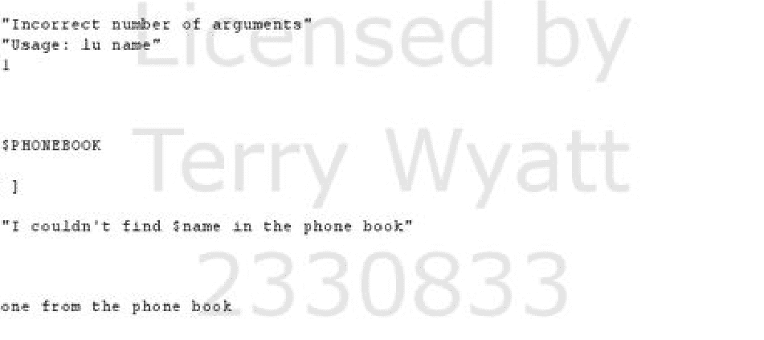

Unix® Shell Programming, Third Edition. Unix® Shell Programming, Third Edition, ISBN: 0-672-32490-3

由 Terminology 为 open.com 准备。
版权 © 2003 Prentice Publishing. 此下载文件仅供个人使用，并受服务条款限制。任何其他使用均需事先获得版权所有者的书面许可。严禁未经授权的使用、复制和/或分发，否则将违反法律。保留所有权利。

## 你的环境

（为了更加用户友好，在 `lu` 的末尾添加了一个测试，以检查 `grep` 是否成功；如果没有成功，将向用户显示消息。）

现在来测试它：

```bash
$ cd
$ sale biz
No phonebook file in /users/steve/
$ mv /users/steve/bin/phonebook
$ sale biz
Liz Stachiah
Return home
Could lookup
212-555-2298您想执行以下操作：
```

-1. 查找某人
2. 将某人添加到电话簿
3. 从电话簿中删除某人

请选择上述选项之一 (1-3): 2

```bash
Enter name to be added: Teri Zak
Enter number: 201-555-6000
$ sale Teri
Teri Zak 201-555-6000
```

`rolo`, `lu` 和 `add` 看起来运行正常。`rem` 也经过了测试，以确保它没问题。如果你仍然想单独运行 `lu`、`rem` 或 `add`，必须预先定义 `PHONEBOOK` 并导出它：

```bash
$ PHONEBOOK=$HOME/PHONEBOOK
$ export PHONEBOOK
$ lu
$ couldn't find Harmon in the phone book
```

### 当前目录

你的当前目录也是你环境的一部分。看看这个名为 `cdtest` 的小 shell：

```bash
$ cd cdtest
cd /users/steve/bin
$pwd
```

该程序进入了 `/users/steve/bin` 并执行 `pwd` 以验证更改已生效。让我们运行一下它：

```bash
$pwd
/users/steve
$ cd cdtest
/users/steve/bin
```

现在来回答这个价值百万的问题：如果你现在执行 `pwd` 命令，你会在 `/users/steve` 还是 `/users/steve/bin` 中？

Unix® Shell Programming, Third Edition. Unix® Shell Programming, Third Edition, ISBN: 0-672-32490-3

为 open.com 准备
©2009 John Publishing. 此下载文件仅供个人使用，并受服务条款限制。任何其他使用均需事先获得版权所有者的书面许可。保留所有权利。

## 你的环境

```bash
$pwd
/users/steve
```

你的当前目录也是你环境的一部分。看看这个名为 `cdtest` 的小 shell：

```bash
$ cd cdtest
cd /users/steve/bin
$pwd
```

该程序进入了 `/users/steve/bin` 并执行 `pwd` 以验证更改已生效。让我们运行一下它：

```bash
$pwd
/users/steve
$ cd cdtest
/users/steve/bin
```

现在来回答这个价值百万的问题：如果你现在执行 `pwd` 命令，你会在 `/users/steve` 还是 `/users/steve/bin` 中？

## 关于子 shell (Subshells)

对于你来说，理解子 shell 如何工作以及它们如何交互非常重要。现在你知道子 shell 无法更改父 shell 的变量值，无法更改其当前目录。假设你想编写一个程序来设置你希望每次登录时使用的变量值。例如，假设你有一个如下文件：

```bash
$ set var
BOOK=/users/steve/book
PATH=/usr/spool/ucublic
CDPATH=/users/steve/docs/memos
DB=/usr/local/data
```

你现在知道如果你执行 `vars`，赋值给这些变量的值在程序执行完毕后将无法访问，因为 `vars` 是在子 shell 中运行的：

```bash
$ vars
$ echo BOOK
/users/steve/book
```

### . 命令

幸运的是，有一个 shell 内置命令叫做 `.`（读作 "dot"），其通用格式为

- `file`

其目的是在当前 shell 中执行文件的内容。也就是说，文件中的命令就像是在那个点手动输入的一样。不会启动子 shell 来执行程序。shell 使用你的 `PATH` 变量来查找文件，就像执行其他程序一样。

```bash
$ vars      在当前 shell 中执行 vars
$ echo BOOK
Noozah!
$ /users/steve/book
```

因为没有启动子 shell 来执行程序，任何赋值给变量的变量在程序执行完成后都会存在。由此推断，如果你有一个包含如下命令的程序 `db`：

```bash
$ cat db
DATA=/usr/2/data
RPTS=$DATA/rpts
BIN=$DATA/bin
$
```

```bash
$ cd $DATA
executing db with the "dot" command
```

```bash
$ .db
```

在当前 shell 中定义 `DATA`、`RPTS` 和 `BIN` 三个变量，然后让你切换到 `$DATA` 目录。

```bash
$ pwd
/usr/2/data$
```

最后这一步引出了一个有趣的讨论点。如果你是那些必须支持不同目录层次结构的 Unix 用户之一，每当你需要处理其中一个目录时，你都可以创建一个像 `db` 这样的程序。在程序中，你还可以包含其他变量的定义；例如，你可能想更改 `PS1` 提示符使其看起来像 DB——这让你知道数据库已经设置好了。你可能还想修改 `PATH` 以包含一个与数据库相关的程序目录，这样就可以通过 `cd` 命令轻松访问数据库中的目录。你甚至可以更改 `HOME`，使得不带任何参数的 `cd` 命令直接返回你的数据库目录。

如果你进行了这类更改，你可能希望在子 shell 中执行 `db`，这样在你完成数据库工作后，当前 shell 会留出所有修改后的变量。正确的做法是在子 shell 内部启动一个新的 shell，并将所有修改后的变量导出到该 shell。然后，当你完成数据库工作后，可以通过按下 `Ctrl-D` “退出”该 shell。让我们来看看它是如何工作的。这里是 `db` 的新版本：

```bash
$ cat db
# 设置并导出与数据库相关的变量
#
HOME=/usr/2/data
BIN=$HOME/bin
RPTS=$HOME/rpts
DATA=$HOME/data
PATH=$BIN:$PATH
CD=$HOME:$RPTS
PS1="db:"
export HOME BIN RPTS DATA PATH CD PS1
# 启动一个新的 shell
#
/usr/bin/sh
```

### 你的环境

`HOME` 目录被设置为 `/usr/data`，变量 `BIN`、`RPTS` 和 `DATA` 相此 `HOME` 定义（这是一个好主，以防你以后需要将目录结构移动到其他地方：你只需要在程序中更改 `HOME` 变量）。

接下来，修改 `PATH` 以包含数据库的 `bin` 目录，并将 `CDPATH` 变量设置为搜索当前目录、`HOME` 目录和 `RPTS` 目录（假设包含子目录）。

在导出这些变量（正如你记得的，它们必须将值置到随后生成的子 shell 环境中）之后，启动标准 shell `/usr/bin/sh`。从那里开始，这个新 shell 处理在终端中输入的命令。向此 shell 输入 `Ctrl+Z`，控制权返回 `db`，进而将控制权返回给你的登录 shell。

```bash
$ db
DB: echo HOME
/usr/data
/usr/data/rpts
PID TIME COMMAND
123 13 0:40 sh
761 13 0:01 sh
765 13 0:01 sh
769 13 0:03 ps
DB: /root
$ echo HOME
/users/steve
运行它
尝试 CDPATH
它有效了
查看正在运行的进程
你的登录 shell
运行 db 的 shell
从 db 启动的新 shell
目前完成
恢复正常
```

`db` 的执行过程如图 11.7 所示（其中我们展示了感兴趣的导出变量，而不一定是环境中存在的所有变量）。

## exec 命令

在你从 `db` 启动新 shell 之后，你并不想在 shell 完成后继续执行任何操作，这一点从程序中 `/usr/bin/sh` 之后没有后续命令可以看出。与其让 `db` 等待新 shell 完成，不如使用 `exec` 命令用新程序 (`/usr/bin/sh`) 替换当前程序 (`db`)。`exec` 的通用格式为

`exec program`

其中 `program` 是要执行的程序名称。因为 `exec` 的程序替换了当前程序，所以少了一个运行的进程；此外，被 `exec` 的程序的启动时间比 Unix 系统执行进程的方式更快。

要在 `db` 程序中使用 `exec`，你只需将最后一行替换为：

```bash
exec /usr/bin/sh
```

如所述，执行此操作后，`db` 将被 `/usr/bin/sh` 替换。这意味着在 `exec` 之后添加任何命令都是没有意义的，因为它们永远不会被执行。

`exec` 可关闭标准输入并用任何想要读取的文件重新打开它。要将标准输入更改为文件，使用如下形式的 `exec` 命令：

```bash
exec < file
```

任何后续从标准输入读取数据的命令将从文件中读取。标准输出的重定向也是类似的。命令

```bash
exec > report
```

将所有后续写入标准输出的输出重定向到文件 `report`。注意，这里 `exec` 并不是像之前描述那样用于启动新程序的执行；在这里它被用于重新分配标准输入或标准输出。

如果你使用 `exec` 重新分配标准输入，随后将其重新分配到其他地方，你可以隐式地执行另一个 `exec`。将标准输入重新分配回终端，你需要写：

```bash
exec < /dev/tty
```

标准输出的重新分配也存在同样的讨论。

## (...) 和 { ...; } 结构

有时你可能出于某些原因想组合一组命令。例如，你想将一个 `sort` 以及随后执行的 `plotdata` 程序放入后台执行。你可以通过将一组命令括在括号中对它们进行分组。第一种形式允许由子 shell 执行命令，后者形式由当前 shell 执行。

以下是一些示例，说明了它们是如何工作的：

```bash
$ x=50
$ (x=100)
在子 shell 中执行
$ echo $x
50
没有改变
$ (x=100; )
在当前 shell 中执行
$ echo $x
100
$ pwd
我在哪里？
/users/steve
$ cd bin; ls
切换到 bin 并执行 ls
add
greetings
number
phonebook
rem
role
$ pwd
没有变化
/users/steve
$ { cd bin; }
这应该改变我
$pwd
/users/steve/bin
$
```

如果括在大括号中的命令都在同一行，在最后一个命令后要加分号。

## 你的环境

```bash
## 检查用户是否登录
#
until who i | grep "$user" > /dev/null
do
    sleep interval
done
#
## 当运行到这里时，用户已经登录
#
if [ "mailopt" = FALSE ];
then
    echo "user has logged on"
else
    runner=$(who am i | cut -c1-8) mail runner
    echo "user has logged on"
fi
```

整个程序可以被包含在括号中，但我们决定在将剩余部分发送到后台之前进行参数检查和解析。

> > mon fred
提示符返回，这样你可以继续工作
fred 已登录

请注意，当在 shell 程序将命令发送到后台时，shell 不会打印进程 ID（pid）。

## 向子壳传递变量的另一种方法

如果你想将变量发送到子壳，除了设置并导出（export）变量之外，还有另一种方法可以实现。在命令行上，你可以在命令名称之前对任意数量的变量进行赋值。例如：

```bash
DBHOME=/user/data DBID=452
```

将变量 `DBHOME` 和 `DBID` 及其指定的值放入 `dbrun` 的环境中，然后 `dbrun` 获取它们。这些变量在当前 shell 中是不可知的；它们仅为 `dbrun` 的执行而创建。事实上，执行上述命令的行为与输入以下相同：

```bash
DBHOME=/user/data; DBID=452; export DBHOME DBID; dbrun
```

这是一个简短的示例：

```bash
cat foo
echo fx:
foo2
cat foo2
echo fx:
foo3
foo 或 foo2 不知晓
尝试这种方法
x 对 foo 是已知的
s x=100 foo1
:100:
```

《Unix Shell 编程》，第三版。Unix Shell Programming, Third Edition, ISBN: 0-672-32490-3

为 architect online 准备。此下载文件仅供个人使用，并受服务条款限制。在未获得 © 2003 New Riders Publishing 版权所有者事先书面许可的情况下，严禁未经授权的使用、复制和/或分发，此类行为违反了适用法律。保留所有权利。

## 你的环境

196
以及它的子壳
:100;
eche $sx;
当前 shell 仍然不知晓
:

因此，这样定义的变量在子壳中的行为与其他常规的导出变量一致。

## 你的 .profile 文件

在第 3 章“什么是 Shell？”中，你学习了登录序列。当你的 shell 执行你的命令并等待你输入第一个命令时，该序列即完成。然而，在执行之前，登录 shell 会执行系统上的两个特殊文件。第一个是 `/etc/profile`。该文件由系统管理员设置，通常执行诸如检查你是否有邮件（你认为“You have mail.” 消息是从哪里来的？）、设置你的默认文件创建（你的 umask）、给标准导出变量赋值，并确保管理员在你登录时已执行相关操作。

第二个自动执行的文件是你家目录下的 `.profile`。你的系统管理员可能在你获得账户时给了你默认的 `.profile` 文件。查看其内容：

```bash
$ SHELL/.profile
PATH=$HOME/bin:/usr/bin:/usr/sbin:$PATH
export PATH
```


在这里你看到一个仅设置了 `PATH` 并将其导出的 `.profile` 文件。

你可以更改你的 `.profile` 文件，以便在每次登录时包含任何你命令。你可以在 `.profile` 文件中放置命令，以覆盖在 `/etc/profile` 中设置的配置（通常是环境变量）。注意，`/etc/profile` 和 `.profile` 中的命令是由你的登录 shell 执行的（就像你一登录就立即输入了：

```bash
$ /etc/profile
$ .profile
```

这使得对环境的更改在程序执行后仍然有效。

这是一个 `.profile` 示例，它将 `PATH` 设置为包含自己的 `bin` 目录，设置了 `CDPATH`，更改了主、次命令提示符，将删除字符更改为退格键（`CtrlH`），并使用第 8 章（“决策，决策”）中的欢迎程序打印一条友好的信息。

```bash
$ HOME/.profile
PATH=$HOME/bin:/usr/bin:/usr/bin::
CDPATH=$HOME:$HOME/documents
PS1=""
PS2=""
export PATH CDPATH PS1 PS2
stty echo erase CTRL+
echo
greetings
```

Unix® Shell 编程，第三版。Unix® Shell Programming, Third Edition, ISBN: 0-672-32490-3

为 Prentice Publishing 准备。此下载文件仅供个人使用，并受服务条款限制。任何其他用途均需版权所有者的书面许可。严禁未经授权的使用、复制和/或分发，此类行为违反了适用法律。保留所有权利。

# 你的环境

使用此 `.profile` 时，登录序列看起来如下：

```bash
login: steve
Password:
Good morning  来自 greetings 的输出
=>      New PS1
```

# TERM 变量

如果你倾向于使用超过一种类型的终端，`.profile` 是放置一些提示代码的好好地方。一个用于提示终端类型的代码示例可能如下所示：

```bash
if [ -z "$TERM" ]; then
  echo "What terminal are you using?"
  read TERM
fi
```

## TZ 变量

`TZ` 变量通常设置在 `/etc/profile` 或你的 `.profile` 中。如果没有设置，则会使用特定于实现的默认值。根据终端类型，`TZ` 变量被用于计算时间。例如，如果 `TZ` 设置为 `EST`：

```bash
$ TZ=EST
date
Wed Oct 18 15:24:00 2023
```

## 练习

- 1：编写一个名为 `myrm` 的程序，接受要删除的文件名作为参数。如果设置了全局 `MAXFILES`，则将其作为最大删除数量无需询问。如果没有设置该变量，则使用 10 作为最大值。如果要删除的文件数量超过此计数，在删除以下文件之前请求用户确认：

```bash
$ ls | wc -l
25
$ myrm *
Remove 25 files (y/n)
files not removed
$ MAXFILES=100 myrm *
All removed
```

- 2：有两个程序 `prog1` 和 `prog2`：

```bash
$
e1=100
export e1
e2=200
e1=300 prog2
$ cat prog2
echo $1 $2 $3 $4
```

输入以下内容后，你预期输出是什么？

```bash
$ e2=200 e2
$ cd -40 prog1
```

- 3：修改本章的角色，使用户可以将电话簿存在家目录下而不限于家目录下。这可以通过要求用户在执行之前设置导出的 `PHONEBOOK` 变量来实现。检查该变量是否为有效文件。如果没有设置该变量，让程序假设电话簿像以前一样位于用户的目录下。以下是一些示例：

```bash
$ PHONEBOOK=/users/steve/personal lu Gregory
973-555-0170
Gregory
$ PHONEBOOK=/users/pat/phonebook lu Toritos
973-555-2234
Toritos
```

在前面的示例中，我们假设用户 `steve` 已获得 `pat` 的电话簿文件的读取权限。

## 第 12 章 更多关于参数

本章内容

- 参数替换
- `$0` 变量
- `set` 命令
- `IFS` 变量
- `readonly` 命令
- `unset` 命令
- 练习题

在本章中，你将学习更多关于参数的知识。技术上讲，参数包括传递给程序的参数（位置参数）、如 `$#` 等特殊 shell 变量以及普通变量（称为关键字参数）。

位置参数不能像下面所示赋值；然而，可以使用 `set` 命令重新赋值。关键字参数通过编写以下形式赋值：

```
variable=value
```

这种格式比上述更通用；实际上，你可以一次分配多个关键字参数，使用：

```
variable=value...
```

如下所示：

```
$ x=100 y=200 z=50
$ echo $x $y $z
100 200 50
```

## 参数替换

在最简单的形式，要替换参数的值，只需在参数前加上美元符号，例如 `$1` 或 `$5`。

`${parameter}`

如果参数名称后面的字符可能导致冲突，可以将名称放在大括号内，例如`${file}`。

```
mv file $file
```

这条命令会在 `$file` 指定的文件名末尾添加 `x`，因为 shell 会替换第二个参数的值。正如第 7 章“传递参数”中所提到的，访问位置参数时必须放在大括号内，例如`${10}`。

## `${parameter:-value}`

这种构造表示如果参数为空，则替换参数的值，否则替换 `value`。例如，在命令行：

```
echo Using editor ${EDITOR:-bin/vi}
```

shell 在 `EDITOR` 不为空时替换其值，否则替换 `/bin/vi`。它的效果与以下写法相同：

```bash
if [ -n "$EDITOR" ]
then
    echo Using editor $EDITOR
else
    echo Using editor /bin/vi
fi
```

## 命令行

```
${EDITOR:-bin/ed}
```

存储在变量 `EDITOR` 中的程序（假设是一个文本编辑器），如果 `EDITOR` 为空，则启动 `/bin/ed`。以下是该构造的一个简单测试：

```
$ ${EDITOR:-bin/ed}
echo ${EDITOR:-bin/vi}
/bin/ed
$ ${EDITOR:-} Set it null
echo ${EDITOR:-bin/vi}
/bin/vi
```

这个版本与上一个相似，只有当参数不为空时才使用 `value`，但它也被赋值给了参数（注意该构造）。你不能通过这种方式为位置参数赋值。

该构造的典型用法是测试导出变量是否已设置，如果没有，则将其设置为默认值，例如：

```
$ PHONEBOOK=$HOME/phonebook
```

这表示如果 `PHONEBOOK` 已设置，则保持原样；否则将其设置为 `$HOME/phonebook`。

注意，前面的示例不能作为命令执行，因为替换后的 shell 会尝试执行：

```
$ PHONEBOOK=${HOME/phonebook}
sh: /users/steve/phonebook: cannot execute
```

为了将此构造作为独立命令，通常使用空命令。如果你写：

```
$ (PHONEBOOK=$HOME/phonebook)
PHONEBOOK
$ (PHONEBOOK:-$HOME/phonebook)
echo $PHONEBOOK
/users/phonebook
$ (PHONEBOOK:-foobar)
echo $PHONEBOOK
/users/phonebook
```

shell 仍然会执行替换（评估命令行的剩余部分），但不会执行任何内容（执行空命令）。

查看是否已赋值

不应改变它

它没有

## `${parameter?:value}`

如果参数为空， shell 将替换其值；否则，shell 将 `value` 写入标准错误并退出（如果是从你的登录 shell 执行的，你将被注销）。如果 `value` 被省略或未设置：

```
prog: parameter null or not set
```

这是一个来自终端的示例：

```
PHONEBOOK
$ (PHONEBOOK:"PHONEBOOK file")
No PHONEBOOK file!
$ (PHONEBOOK?:)
Don't give a value
sh: parameter null or not set $
```

通过这种构造，你可以轻松检查由程序命名的组变量是否已设置且为空，例如：

```
$ (TOOLS?) $(EXTFOOLS?) $(TOBLIN?)
```

## `${parameter:+value}`

这个在参数不为空时替换 `value`；否则不替换任何内容。

```
trace
$ echo options:$(trap:"trace mode")
options: trace mode
trace
$ echo options:$(trap:"trace mode")
options: $
```

本节中任何构造的 `value` 部分都可以是命令替换；只有当该值被使用时，shell 才会执行它。

```
WORKDIR=$(DBDIR:-$(pwd))
```

如果 `DBDIR` 不为空，则将其值赋值给 `WORKDIR`；否则执行 `pwd` 命令并将结果赋值给 `WORKDIR`。`pwd` 仅在 `$DBDIR` 为空时执行。

## 模式匹配构造

POSIX shell 四种执行模式匹配的参数替换构造。注意，某些旧 shell 不支持此功能。

在每种情况下，构造接受两个参数：变量名（或参数编号）和模式。shell 搜索变量的内容以匹配模式。如果匹配模式，shell 将替换命令行中的变量值，并删除匹配部分。如果未匹配模式，则替换变量的所有内容。在任何情况下，变量的内容保持不变。

这里使用“模式”一词是因为 shell 允许使用与文件名替换和值中相同的模式匹配字符：`*` 匹配零或多个字符，`[...]` 匹配集合中的任意字符，`!` 匹配不在集合中的任意字符。

当你写出构造：

```
$variable@pattern
```

shell 检查变量以判断其是否以指定的模式结尾。如果是，则在命令行上替换变量的内容，并从右侧删除最短的匹配模式。

如果你使用构造：

```
$variable#pattern
```

shell 再次检查变量以判断其是否以模式结尾。然而，这次它会从右侧删除最长的匹配模式。这仅在模式中使用 `*` 时才有用。否则，`%` 和 `#` 的行为相同。

`#` 以类似的方式使用，以强制模式匹配发生在左侧而不是右侧。因此，构造：

```
$variable%pattern
```

告诉 shell 替换命令行上的变量值，并从左侧删除模式。

最后，构造：

```
$variable##pattern
```

工作类似于 `#` 形式，从左侧删除模式的最长出现。

记住，在所有情况下，都不会对变量本身进行永久更改；你影响的只是在命令行上的替换内容。此外，记住模式匹配是锚定的。对于 `%` 和 `#` 构造，变量必须以指定的模式结尾；对于 `#` 和 `##` 构造，变量必须从左侧开头。

以下是一些示例，展示这些构造是如何工作的：

```
$ var-testcase
 echo Svar
testcase
 echo $(variable)
testcase             Remove e from right
             Svar               Variable is unchanged
testcase             Remove smallest match from right
 echo $(var*)
```

# 关于参数更多

| | |

|---|---|---|

| testca | 移除最长匹配 |

| $ echo $(var3*c) | |

| to | 从左侧移除最小匹配 |

| $ echo $(var8*c) | |

| stcase | 从左侧移除最小匹配 |

| $ echo $(var8*s) | |

| tcase | 从左侧移除最长匹配 |

| $ echo $(vartest) | 从左侧移除 test |

| case | |

| $ echo $(var) | 无匹配 |

| testcase | | |

这些构造体有许多实际用途，尽管这些示例似乎没有表现出来。例如，以下测试用于检查变量中存储的文件名是否以两个字符 `:o` 结尾：

```bash
if [ ${file%.o} = $file ]
then
    # file 以 .o 结尾
fi
```

另一个示例，这是一个与 Unix 系统 `basename` 命令工作完全相同的 Shell 程序：

```bash
$ cat mybasename
echo ${1##*/}/
```

该程序显示其参数，并移除了最后一个 `/` 之前的所有字符：

```bash
$ mybasename /usr/spool/ucppublic
uucpublic
$ mybasename $HOME
stevs
$ mybasename memos
memos
```

# ${variable}

这让你能够计算存储在变量内部的字符数。例如，

```bash
$ text-shell
echo $$(text)
```

注意，某些旧版本的 Shell 不支持此功能。

本节描述的每个参数替换构造体都总结在附录 A，“Shell Summary”中的表 A.3 中。

Unix® Shell Programming, Third Edition. Unix® Shell Programming, Third Edition, ISBN: 0-672-32490-3

为 architect@open.edu 准备。此下载文件仅供个人使用，并受服务条款限制。任何其他用途均需在使用版权前事先获得书面许可。严禁未经的复制和/或发行，违反法律。保留所有权利。

Copyright © 2003 Noison Publishing.

# 关于参数更多

# $0 变量

每当你执行一个 Shell 程序时，Shell 都会将程序名称存储在特殊变量 `$0` 中。当你有两个或多个以不同名称链接的程序，并且你想知道执行的是哪一个时，这种用法可以非常有优势。它对于显示错误消息也有用，因为消除了程序对文件名的依赖。如果通过 `$0` 引用程序名称，随后重命名程序将无需修改程序本身：

```bash
# cat lu
# 在电话簿中查找某
#
if [ "$1 -ne 1 ];
then
    echo "Incorrect number of arguments"
    echo "Usage: $0"
    exit 1
fi

name=$1
grep "$name" PHONEBOOK
if [ "$1 -ne 0 ];
then
    echo "I couldn't find $name in the phone book"
fi
$ PHONEBOOK=$HOME/phonebook
$ export PHONEBOOK
$ lu Trak
Terri Zak 201-555-0000
$ lu Terri Zak
Incorrect number of arguments
Usage: name
$ mv lu lookup
$ lookUp Terri Zak
Incorrect number of arguments
Usage: lookup name
```

## set 命令

Shell 的 `set` 命令是一个双用途命令：它既用于设置 Shell 选项，也用于重新定位位置参数 `$1`、`$2` 等。

## -x 选项

此选项开启 Shell 中的跟踪模式（trace mode）。它对当前 Shell 执行的作用，类似于第 8 章“决策，决策”中 `sh -x ctype a` 命令对执行 c 程序所起的作用。从执行 `set -x` 命令开始，所有后续执行的命令都由 Shell 打印到标准错误，并在是在文件名、变量和命令设置以及 I/O 重定向之后。被跟踪的命令前会有加号符号。

Unix Programming, Third Edition. Unix® Programming, Third Edition, ISBN: 0-672-32490-3

为 architect@open.source.com 准备

Copyright © 2003 by Wiley Publishing. 此下载文件仅供个人使用，并受服务条款限制。任何其他用途均需获得版权所有者的事先书面许可。严禁未经的使用、复制和/或发行，违反适用法律。保留所有权利。

# 关于参数更多

```bash
$ x -x
$ set -x
$ echo -dx
$ echo greetings lu rem rolo
add greetings lu rem rolo
$ cmdwc
$ cmdx
$ ls | scmd -1
+ in
+ wc -1
$
```

### Set 命令跟踪选项

你可以通过执行带 `+x` 选项的 `set` 来随时关闭跟踪模式：

```bash
$ set +x
$ set -x
$ ls | wc -1
$
```

恢复正常

你应该注意，跟踪选项不会传递给子 Shell。但你可以通过运行带有 `-x` 选项的 Shell 紧跟上要执行的程序名称来跟踪子 Shell 的执行，例如：

```bash
sh -x rolo
```


或者你可以在文件内部插入 `set -x` 命令。事实上，你可以在程序中插入任意数量的 `set -x` 和 `set +x` 命令，按需开启或跟踪模式。

# 不带参数的 set

如果你不给 `set` 任何参数，你将获得环境中所有变量（无论是本地还是导出的）的字母列表：

```bash
$ set
show all variables
CDPATH=/users/steve/usr/spool
EDITOR=/bin/vi
HOME=/users/steve
IFS=
LOGNAME=steve
MAIL=/users/steve/mail/steve
MAIL_RECEIVED=
PATH=/users/steve/bin:
PHONEBOOK=/users/steve/phonebook
PS1=
PWD=/users/steve/misc
SHELL=/bin/sh
TERM=xterm
TTY=
TEST=
```

# 使用 set 重新分配位置参数

没有办法可以直接给位置参数赋值；例如：

```
1=100
```

Unix Shell Programming, Third Edition. Unix Shell Programming, Third Edition, ISBN: 0-672-32490-3

为 architect@open-source.com, Terry Smith 准备。Copyright © 2009 by Global Publishing. 此下载文件仅供个人使用，并受服务条款限制。任何其他用途均需获得版权所有者的事先书面许可。严禁未经的使用、复制和/或发行，违反法律。保留所有权利。

# 关于参数更多

这些参数在执行 Shell 程序时初始设置。改变它们的唯一方法是使用 `shift` 或 `set` 命令。如果在命令行将单词作为参数给 `set`，这些单词将被分配给位置参数 `$1`、`$2` 等。之前存储在位置参数中的值将永久丢失。

```bash
set a b
```

将 `a` 分配给 `$1`，`b` 分配给 `$2`，`$33`。`$#` 也变为 3。

```bash
set one two four
echo $1:$2:$3
one:two:four
set echo
$#
```

这应该是 4。现在 `$#` 引用的是什么？

```bash
one two four
done
```

所以在执行 `set` 之后，一切看起来都运行是一致的：`# $`，以及没有列表的 `for` 循环。`set` 经常以此方式用于从文件或终端“解析”数据。这里有一个名为 `words` 的程序：它统计在行中输入的单词数（使用 Shell 对“单词”的定义）：

```bash
+ cat words
# 统计一行的单词
#
read line
set line
echo $$
words
```

这里有一行供你计数。

运行它！

该程序将行存储在 Shell 变量 `line` 中，然后执行命令：

```bash
set line
```

这会导致存储在 `line` 中的每个单词都被分配给位置参数。变量 `$@` 也设置为已分配的单词数，即该行中的单词数。

# --

尝试向 `words` 输入一个以 `-` 开头的行并看看发生什么：

```bash
+ words
-1 + 5 = 4
words: -1: bad option(s)
```

Unix Shell Programming, Third Edition. Unix® Shell Programming, Third Edition, ISBN: 0-672-32490-3

为 architect@openservices.com 准备。此下载文件仅供个人使用，并受服务条款限制。任何其他用途均需获得 Copyright © 2003 by Wiley Publishing 的事先书面许可。严禁未经的使用、复制和/或发行，违反法律。保留所有权利。

已执行。在 Shell 执行替换后，命令行看起来是这样：

```
set -i + 5 = 4
```

当 `set` 执行时，它看到 `-` 并认为选择了一个选项，这解释了错误信息。

`words` 的另一个问题是如果你给它一个完全由空白字符组成的行，或者行为空：

```bash
$ words Just Enter is pressed
CPATH=/users/steve:usr/bin
EDITOR=/bin/vi
HOME=/users/steve
IFS=
LOGNAME=steve
MAIL=/users/steve/mail/steve
MAILSIZE=600
PATH=/usr/bin:/users/steve/bin:
PROFILE=/users/steve/phonebook
PS1=$
STTY=
PWD=/users/steve/misc
SHELL=/bin/sh
TERM=xterm
TMOUT=
TZ=US-EAST-EDT
cd=~
*$
$
```

为了防止这两个问题发生，你可以对 `set` 使用 `--` 选项。这告诉 `set` 不要命令行上的后续参数解释为选项。它防止了在输入空行时 `set` 显示所有变量。

因此 `words` 中的 `set` 命令应该改为：

```bash
set -- $line
```

通过添加 `while` 循环和整数算术，`words` 程序可以轻松修改为统计标准输入中的总单词数，从而让你拥有自己的 `wc` 版本：

```bash
$ cat words
#
# 统计标准输入中的所有单词
#
```

```bash
count=0
while read line
do
	set -- $line
	count=$(( count + 1 ))
done
echo $count
#
```

# 关于参数的更多信息

在读取每行后，都会执行 `set` 命令，以利用 `$#` 会被赋值为行单词数这一特点。为 `set` 提供了 `--w` 选项，以防某些行以 `-` 开头或完全由空白字符组成。

然后将 `$#` 的值加到变量 `count` 中，并读取下一行。当退出循环时，显示 `count` 的值。这代表读取的单词总数。

- * words < /etc/passwd

567

- wc -w < /etc/passwd

567

与 wc 进行比对

（我们的版本比 `wc` 慢得多，因为后者是用 C 语言编写的。）

这里有一种统计目录中文件数量的快速方法：

- * set a

- echo $#n0

这比 `ls | wc` 快得多，因为第一种方法使用了内置命令。通常情况下，如果你尝试尽可能使用 shell 的内置命令，你的 shell 程序运行速度会快得多。

# set 的其他选项

`set` 接受其他几个选项，每个选项都通过在选项前加加 `-` 来启用，通过在选项前加减 `+` 来禁用。我们在这里描述的 `-x` 选项是最常用的。其他的总结在附录 A 中的表 A.9 中。

# IFS 变量

有一个特殊的变量叫做 `IFS`，代表内部字段分隔符（Internal Field Separator）。shell 在解析来自 `read` 命令的输入、命令替换输出（反引号机制）以及执行变量替换时，会使用该变量的值。如果将其输入命令行，它会被视为一个普通的空白字符（即单词分隔符）。

查看设置了什么：

```bash
$ echo "IFS"
```

嗯，这并不怎么启发！要确定其中存储的实际字符，可以将 `echo` 的输出管道到 `od`（八进制转储）命令，并带有 `-b`（字节显示）选项：

> 这种技术在大型目录上可能不起，因为你可能会超过命令行的限制（具体取决于不同的 Unix 系统）。对于此类目录，当在其他命令中进行文件名替换时也会导致问题，例如 `echo` 或 `for file in *`。

Unix® Shell Programming, Third Edition. Unix® Shell Programming, Third Edition, ISBN: 0-672-32490-3

Copyright © 2006 O'Reilly Media. 此下载文件仅供个人使用，受服务条款限制。任何其他用途都需要版权所有者的事先书面许可。

# 关于参数的更多信息

```bash
$ echo 'IFS' | ed -b
000000 040 011 012 012
000004
```

显示的数字列是相对于输入开始的偏移量。接下来的数字是 `od` 读取的字符的八进制等值。第一个数字是 `040`，它是空格字符的 ASCII 值。后面跟着 `011`（制表符），然后是 `012`（换行符）。下一个字符是另一个换行符；这是由 `echo` 写入的。这些 IFS 的字符并不意外；它们就是我们在整本书中讨论过的“空白”字符。

你可以将 `IFS` 改为任何你单个或多个字符。当你想要解析字段不是由普通空白字符分隔的数据行时，这非常有用。例如，我们注意到 shell 会从你使用 `read` 命令读取的任何行开头删除任何空白字符。你可以在执行 `read` 之前将 `IFS` 改为仅换行符，这样就能保留前导空格（因为 shell 不将其视为分隔符）：

```bash
$ read line                尝试这种“旧”方法
$ echo '$Line'
$ Here's a line
$ IFS=-
设置为仅换行符
$ read line                再次尝试
$ Here's a line
$ echo '$Line'            领先空格被保留
```

要将 `IFS` 改为仅换行符，输入左引号，然后按回车键，在下一行输入右引号。在这些引号内无法输入额外的字符，因为它们会被存储在 `IFS` 中，然后供 shell 使用。

现在让我们将 `IFS` 改为更可见的内容，比如冒号：

```bash
$ IFS=
$ read x y z
123:345:678
$ echo $x
123
$ echo $y
678
$ list=one:two:three
$ for x in $list; do echo $x;
done
two
tree
$ var=a:b:c
$ echo $var
abc
```

因为 `IFS` 被改为冒号，当读取该行时，shell 将行分为三个单词：123，345 和 678，它们分别存储在变量 `x`、`y` 和 `z` 中。在下一个示例中，shell 在 `for` 循环中替换 `list` 值时使用了 `IFS`。最后一个示例显示，shell 在执行变量赋值时不使用 `IFS`。

更改 `IFS` 通常与执行 `set` 命令配合使用：

# 关于参数的更多信息

```bash
$ x=100
$ echo $x
100
$ unset x
从环境中移除 x
$ echo $x
```

# unset 命令

有时你可能想从环境中移除变量的定义。要做到这一点，你输入 `unset` 后后跟变量名：

```bash
$ x=100
$ echo $x
100
$ unset x
```

# readonly 命令

你不能取消只读变量。此外，变量 `IFS`、`MAILCHECK`、`PATH`、`PS1` 和 `PS2` 无法取消。此外，某些变量也不支持 `unset` 命令。

## 练习

- 1: 给定以下变量赋值：

```bash
$ EDITOR=/bin/vi
$ DB=
$ EDITTAG=yes
$ POSHERDX=
```

> *默认情况下，Bash 产生如 `declare -r variable` 的输出。要获得 POSIX 兼容的输出，必须带有 `-posix` 命令行选项运行 Bash，或者使用 `-o posix` 选项运行命令。*

## 关于参数的更多内容

以下命令的结果是什么？

```
echo $EDITOR
echo $EDITOR:-/bin/ed
echo $IFS:-/usr/pat/db
echo ${IFS:-/usr/users/pat/db}
echo ${PROBOOK:-}
echo ${EDITTLAG:+${EDITOR:-/bin/ed}
```

2: 重写第 5 到 7 章中的主程序，使用 `set` 命令从 `/etc/passwd` 中提取主目录。如果行中的某个字段为空，程序会发生什么？例如：

```
steve:123::/users/usr:/bin/ksh
```

在这里，第一个字段为空（:）。

3: 利用 shell 构造 `$(var)` 返回存储在 var 中的字符数 这一事实，用 shell 重写 `wc`。务必使用整数算术！（注意：将你的 `IFS` 变量更改为仅换行符，以便保留输入中的空白字符，并使用 shell `read` 命令的 `-c` 选项来忽略输入结尾的反斜杠）。

4: 写一个名为 `rightmatch` 的函数，接受如下所示的两个参数：

```
rightmatch value pattern
```

```
$ rightmatch test .c
test
$ rightmatch /usr/spool:/uocpublic/*
/usr/spool
$ rightmatch /usr/spool:/uocpublic *
/usr/spool/uocpublic
$
```

最后一个示例显示，如果 `rightmatch` 函数不以指定的模式结尾，它应该直接输出它的第一个参数。

5: 写一个名为 `leftmatch` 的函数，其工作原理与练习 4 中开发的 `rightmatch` 函数类似。它的两个参数应如下：

```
leftmatch pattern value
```

以下是一些示例用法：

```
$ leftmatch /usr/spool:/usr/spool:/uocpublic
uocpublic
$ leftmatch s.main.c
main.c
$
```

6: 写一个名为 `substring` 的函数，该函数使用练习 4 和 5 中开发的 `leftmatch` 和 `rightmatch` 函数来从值的左右侧移除模式。它应该接受如下三个参数：

```
$ substring /usr/spool:/usr/spool:/uocpublic /uocpublic
spool
$ substring s.main.c .e
main
$ substring s.main.c .e
Only left match
```

```
main.c
$ substring x. s.main.c .e  No matches
s.main.c
$
```

7: 修改之前练习中开发的 `substring`、`leftmatch` 和 `rightmatch` 函数，使其能够接受选项，允许你从指定值的左侧或右侧移除尽可能可能的模式匹配。

## 第13 章：遗留问题

## 本章内容

- eval 命令

- Wait 命令

- trap 命令

- 关于 I/O 的更多内容

- 函数

- type 命令

- 练习题

我们将一些由于某种原因在逻辑上不适合前面章节的命令和功能放在了本章中。它们的呈现顺序没有特殊的理由。

## eval 命令

本节描述了 shell 中另一个比较不寻常的命令：`eval`。它的格式如下：

```
eval command-line
```

其中 `command-line` 是你在终端上输入的普通命令行。然而，当你在它前面加上 `eval` 时，效果是 shell 会扫描两次命令行并执行它。对于简单的情况，这实际上没有影响：

```
$ eval echo hello
hello
$
```

但考虑以下不使用 `eval` 的示例：

```
$ pipe|1
$ ls Pipes wc -l
ii: No such file or directory
wc: No such file or directory
l-1: No such file or directory
$
```

这些错误来自 `ls`。shell 在变量替换之前会处理管道和 I/O 重定向，因此它永远不会识别 `pipe` 内部的管道符号。`1`、`wc` 和 `-1` 这三个参数被作为参数传递给 `ls`。

> 实际上，发生的情况是 `eval` 仅仅执行传递给它的参数的命令；shell 处理命令行并将参数传递给 `eval`，然后在 `eval` 执行命令时再次执行该操作。结果是 shell 扫描了两次命令行。

## 在命令序列前面加上 eval 可以得到想要的结果：

```
eval ls | wc -l
16
```

当 shell 第一次扫描命令行时，它会将 `|` 替换为 `pipe` 的值。然后 `eval` 导致它解析该行，此时 `|` 被 shell 识别为管道符号。

`eval` 命令经常用于在在一个或多个变量内部构建命令行的 shell 程序。如果变量包含任何 shell 必须在命令行上直接看到的字符（即不是替换的结果），`eval` 就会非常有用。命令终止符（`;`）、I/O 重定向（`<`、`>`）和引号字符都是必须直接出现在命令行上才能对 shell 具有特殊意义的字符。

对于下一个示例，考虑编写一个脚本，其目的是显示传递给它的最后一个参数。你在第 10 章“读取和打印数据”中的 `mycp` 程序中需要获取最后一个参数。你是通过位移参数来实现的。

## 遗留问题

### Wait 命令

如果你将一个命令提交到后台，它将与你的当前 shell 异步运行。有时，你可能希望等待进程完成。例如，你可能发送了一个大型 `sort` 到后台，现在想等待它。你可以在终端中尝试 `wait` 命令：

```
# sort big-data &
$ date
# Oct 2 15:05:42 EDT 2002
$ wait
```

## $ 变量

如果你只有一个进程在后台运行，那么不带参数的 `wait` 就足够了。然而，如果你在后台运行多个命令并想等待其中一个，你可以利用这样一个事实：shell 将最后执行的后台命令的进程 ID 存储在特殊变量 `$!` 中。因此命令是：

```
wait
```

如前提到的，如果你发送了多个命令到后台，可以保存该变量的值以便以后使用：

# prog1

pid1=$!

# prog2

pid2=$!


`wait` `$pid1`

# 等待 prog1 完成

`wait` `$pid2`

# 等待 prog2 完成

## `trap` 命令

在执行 shell 程序期间，如果你在终端上按下 *Delete* 或 Break 键，通常该程序会立即终止，并返回你的命令提示符。这并不总是如理想的。例如，你可能会留下一堆没有清理的临时文件。

> 某些 Unix 系统使用 `Ctrl+c` 而不是 Delete 键来实现此目的。你可以通过 `st` 命令确定使用的是哪种序列。

# 遗留

## 217

在终端按下 Delete 键会向执行中的程序发送所谓的“信号”。程序可以指定在接收到信号时应该采取的操作。这是通过 `trap` 命令完成的，其通用格式为

```
trap commands signals
```

其中 `commands` 是一个或多个命令，每当接收到 `signals` 中指定的任何信号时，就会执行这些命令。
不同类型的信号被分配了数字，最常用的信号总结在表 13.1 中。更完整的列表位于附录 A“Shell 参考手册”中的 `trap` 命令下。

表 13.1. 常用信号编号

| 信号 | 产生原因 |
|---|---|
| 0 | 退出 shell |
| 1 | 挂断电话 (Hangup) |
| 2 | 中断（例如，Delete, Ctrl+c） |
| 15 | 软件终止信号（由 kill 默认发送） |

作为 `trap` 命令的示例，以下内容展示了当有人尝试从终端终止程序时，如何删除文件并退出：

```
trap "rm WORKDIR/work WORKDIR/dataout; exit" 2
```

从执行此操作的 shell 程序来说，如果程序接收到信号 2，两个文件 `work$` 将被自动删除。如果用户在执行此 trap 后中断了程序的执行，你可以确保这两个文件会被清理。随之而来的 `exit` 是必要的，因为如果不执行它，程序将在接收到信号时离开的位置继续运行。

信号 1 在挂断电话时产生：无论是故意挂断线路，还是文件中的线路被意外断开。你可以通过将信号 1 添加到信号列表中来修改 `trap` 以移除两个受保护的文件：

```
trap "rm WORKDIR/work WORKDIR/dataout; exit" 1 2
```

现在，当 shell 挂断或按下 Delete 键时，这些文件将被删除。
如果指定的用于 `trap` 的命令包含多个命令，则必须被括在引号中。另外请注意，shell 在 `trap` 命令执行时以及在接收到列出的信号之一时，都会扫描命令行。在前面的示例中，`WORKDIR` 和 `WORKDIR$` 的值将在执行 `trap` 命令的**那一刻**被替换。如果你想在使用接收到信号 1 或 2 时的值（例如，`WORKDIR` 可能尚未被定义），你可以将命令放在单引号内：

```
trap '\''rm WORKDIR/work WORKDIR/dataout; exit'' 1 2
```

`trap` 命令可以用来让你的程序更具用户友好。在下一章中，当我们重新查看 `rolo` 程序时，由 Delete 键产生的信号会将用户带回主菜单。通过这种方式，此键可以在不退出程序的情况下中止当前操作。

Unix® Shell Programming, Third Edition. Unix® Shell Programming, Third Edition, ISBN: 0-672-32490-3

为 open@text.com, Trevor 准备
Copyright © 2003 by Global Publishing. 此下载文件仅供个人使用，受服务条款限制。任何其他使用均需版权所有者的事先书面许可。禁止未经授权的使用、复制和分发，违反违反法律。保留所有权利。

# 无参数的遗留

执行不带参数的 `trap` 会显示你已经修改过的任何 trap。

```
$ trap echo logged off at $(date) >>$HOME/logoffs: 0

$ trap

trap List changed traps

trap 'echo logged off at $(date) >>$HOME/logoffs' EXIT

Ctrl+D log off

login: log back in

Password:

$ cat $HOME/logoffs See what happened

logged off at Wed Oct 25 15:11:38 EST 2002
```

每当 shell 接收到信号 0 时，就会设置一个 trap。该信号在 shell 退出时都会产生。由于这是在登录 shell 中设置的，因此当你注销时会触发该 trap。此 trap 的目的是将登录时间写入文件 `$HOME/logoffs`。命令被括在单引号中，以防止 shell 在定义 trap 时执行 `date`。

然后执行不带参数的 `trap` 命令，结果显示针对信号 0 (EXIT) 的已更改的操作。接下来，steve 注销，然后再次登录以查看 trap 是否生效。通过显示 `$HOME/logoffs` 的内容证实了 steve 在注销时执行了 `echo` 命令。

# 忽略信号

如果为 `trap` 列出的命令为空，则指定的信号在接收到时会被忽略。例如，命令

```
trap "" 2
```

指定要忽略中断信号。在执行某些你不希望被中断的操作时，你可能想要忽略某些信号。

请注意，要忽略某个信号必须指定第一个参数，且它不等同于以下内容，后者有其独立的含义：

```
trap 2
```

如果你忽略了某个信号，所有的子 shell (`subshells`) 都会忽略该信号。然而，如果你指定了接收到信号后采取的操作，所有子 shell 在接收到该信号时仍会采取默认操作。对于我们描述的信号，这意味着子 shell 将终止。

假设你执行了命令 `trap "" 2`，然后执行一个子 shell，该子 shell 又执行了其他程序作为子 shell。如果产生了中断信号，它将对正在执行的 shell 或子 shell 产生任何影响，因为它们会忽略该信号。

相反，如果你不是执行之前的 `trap` 命令，而是执行

```
trap : 2
```

然后执行你的子 shell，在接收到中断信号时，当前 shell 将什么都不做（执行空命令），但所有活跃的子 shell 将终止。

## 重置

当你更改了接收信号时的默认操作后，可以通过简单省略第一个参数再次使用 `trap` 来改回来；因此

```
trap 1 2
```

会将信号 1 或 2 的操作重置为默认。

## 更多关于 I/O

你已经知道标准构造 `<` `>` `>>` 分别用于输入重定向、输出重定向和追加输出重定向。你还知道可以通过简单的写入重定向任何命令的标准错误：

```
command 2> file
```

有时你可能需要在程序中显式地写入标准错误。你可以通过将命令的标准输出重定向到标准错误：

```
command > &2
```

符号 `>` 将输出重定向到后续的文件描述符。文件描述符 0 是标准输入，1 是标准输出，2 是标准错误。

因此，若要向标准错误写入错误消息，你写道

```
echo "Invalid number of arguments" >&2
```

经常，你可能希望将程序的标准输出和标准错误收集到同一个文件中。如果你知道文件名，这非常简单：

```
command >file 2>&
```

在这里，command 的标准输出和标准错误都将被写入 `file`。你也可以写成

```
command >foo 2>&1
```

来实现相同的效果；标准输出被重定向到 foo，标准错误被重定向到标准输出（已经重定向到 foo）。注意 shell 会沿着命令行从左到右评估重定向，最后的示例不能写成

```
command 2>&1
```

因为这将首先将标准错误重定向到标准输出（默认是终端），然后将标准输出重定向到 foo。

你记得你还可以使用 `exec` 命令在程序中重定向标准输入或输出：

```
exec < datafile
```

将标准输入重定向自文件 `datafile`。随后执行的从标准输入读取命令将从 `datafile` 读取。命令

```
exec > /tmp/output
```

对标准输出执行相同的操作：所有后续写入标准输出的命令都将写入 `/tmp/output`（除非显式重定向到其他地方）。自然地，标准错误也可以通过这种方式重新分配：

```
exec 2> /tmp/errors
```

在这里，所有到标准错误的输出都将进入 `/tmp/errors`。

<& 和 >&

字符 `>-` 的作用是关闭标准输出。如果前面有一个文件描述符，则关联的文件会在内部关闭。因此，写入（这种不实际的操作）

```
ls >-
```

会导致 `ls` 的输出无处可去，因为标准输出在 `ls` 执行之前就被 shell 关闭了。

使用 `<&-` 的输入情况也是类似的。

```
wc <&-
0 0 0
```

## 内联输入重定向

如果 `<<` 字符紧跟在格式如下的命令后面：

```
command <<$word
```

shell 将其随后的行作为命令的标准输入，直到找到某一行仅包含 `word` 内容的行。这里是终端上的一个小示例：

```
wc -l <<ENDOFDATA      使用直到 ENDOFDATA 的行作为标准输入
> here's a line
> and another
> and yet another
> ENDOFDATA
$
```

在这里，shell 将输入到 `wc` 标准输入的每一行都喂给它，直到遇到仅包含 ENDOFDATA 的行。

内联重定向在 shell 程序内部使用是一项强大的功能。它允许你直接在程序中指定命令的标准输入，从而避免了先将其写入单独文件，或使用 `echo` 将其引入命令的标准输入的需求。

```
$ cat mailbox
mail $ <<END-OF-DATA
```

注意：

我们的每月计算机用户小组会议
将于 2002 年 10 月 4 日（星期五）在
Sam 的 LA-308 室举行。请尽力参加。

```
END-OF-DATA
```

Unix® Shell Programming, Third Edition. Unix® Shell Programming, Third Edition, ISBN: 0-672-32490-3
为 architects@open.source 准备。
版权所有 © 2003 Prentice Publishing. 此下载文件仅供个人使用，并受服务条款限制。任何其他使用均需事先书面许可。未经授权的使用、复制和/或分发被严格禁止，并违反适用法律。保留所有权利。

## 遗留问题

## 221

要对 `users_list` 文件中包含的所有小组成员执行此程序，你可以写：

```
mailmsg $cat users_list
```

shell 对重定向的输入数据执行参数替换，执行反引号中的命令，并识别反斜杠字符。然而，任何特殊字符（如 `*`、`|` 和 `\`）都会被忽略。如果你在这些行中拥有美元符号、反引号或反斜杠，且不希望它们被 shell 解释，你可以在它们前面加一个反斜杠字符。或者，如果你想让 shell 保持输入行完全不触，你可以在 `<<` 之后的单词前面加一个反斜杠。

```
$ cat foobar
> SHONE
> ****
> \foobar
> date
> FOobar Terminates the input
/users/steve
****
foobar
Wed Oct 2 15:23:15 EDT 2002
$
```

在这里，shell 提供了直到 FOOB 的所有行作为 `cat` 的输入。它替换了 `HOME` 的值，但没有替换 `foobar`，因为它前面有一个反斜杠。`date` 命令也被执行了，因为反引号被解释了。

```
$ cat <<FOOB
> <<
> SHONE
> FOOB
> \
> date
HOME
$
```

FOOB 前面的反斜杠告诉 shell 忽略后面的行。它忽略了美元符号、反斜杠和反引号。
当 `<<` 之后的单词是破折号（`-`）时，请谨慎使用，只需确保它足够特殊，这样意外缩进后续行的概率就微乎其微。
如果 `<<` 之后的第一个字符是破折号（`-`），输入中的领先制表符将被 shell 删除。这对于重定向文本的缩进非常有用。

```
$ cat <<-END
> Indented lines
> So there you have it
END
Indented lines
So there you have it
$
```

## Shell 存档

内联输入重定向功能的用途之一是创建 shell 存档文件。通过这种技术可以将一个或多个相关的 shell 程序放入单个文件中，然后使用标准的 Unix 邮件命令发送给他人。当收到存档时，只需在它上运行 shell 即可轻松“解包”。

Unix Shell Programming, Third Edition. Unix Shell Programming, Third Edition, ISBN: 0-672-32490-

版权所有 © 2003 O'Reilly Media. 此下载仅供个人使用，并受服务条款限制。任何其他使用均需获得版权所有者的事先书许可。未经授权的使用、复制和/或分发被严格禁止并违反适用法律。保留所有权利。

## 遗留问题

例如，这里是 rolo 使用的 `lu`、`add` 和 `rem` 程序的存档版本：

```bash
# cat rolesohu
# rolo 使用的存档程序。
echo Extracting lu
cat lu <<THE-END-OF-DATA
#
# 在电话簿中查找某
if [ "$1" -ne 1 ];
then
    echo "Incorrect number of arguments"
    echo "Usage: lu name"
    exit 1
fi
name=$1
grep "$name" PHONEBOOK
if [ $? -ne 0 ];
then
    echo "I couldn't find $name in the phone book"
fi
THE-END-OF-DATA
echo Extracting.add
cat add <<THE-END-OF-DATA
#
# 将某人添加到电话簿文件的程序
if [ "$1" -ne 2 ];
then
    echo "Incorrect number of arguments"
    echo "Usage: add name number"
    exit 1
fi
echo "$1" >> PHONEBOOK
sort -o PHONEBOOK PHONEBOOK
THE-END-OF-DATA
echo Extracting rem
cat rem <<THE-END-OF-DATA
#
# 从电话簿中移除某人
if [ "$1" -ne 1 ];
then
    echo "Incorrect number of arguments"
    echo "Usage: rem name"
    exit 1
fi
```

Unix® Shell Programming, Third Edition. Unix® Shell Programming, Third Edition, ISBN: 0-672-32490-

为 architect 准备。© 2003 O'Reilly Media.

## 遗留问题

```bash
if [ "matches" -gt i ];
then
    echo "More one match; please further""
elif [ "matches" -eq i ];
then
    grep -v "name" PHONEBOOK > /tmp/phonebook
    mv /tmp/phonebook PHONEBOOK
else
    echo "couldn't find name in the phone book"
fi
-THE-END-OF-DATA
$
```

为了完成文件，这个存档应该包含 rolo，但我们为了节省空间没有这样做。

现在你有一个名为 `rolosubs` 的文件，包含了三个程序的源代码，可以通过以下方式发送给他人：

```
$ mail tony@isys.com < rolosubs    发送存档
$ mail tony@isys.com             给 tony 发送邮件
tony.
```

我给你发了包含 `lu`、`add` 和 `rem` 程序的 shell 存档，rolo 本身稍后发送。

Pat
Chris

当你从邮件中收到文件时，可以通过在文件上运行 shell（先删除邮件在文件开头添加的头部）来提取这三个程序：

```
$ sh rolosubs
Extracting lu
Extracting add
Extracting rem
$ la add rem
add
lu
rem
$
```

用于创建 `rolosubs` 存档的 shar 程序非常简单：

```bash
$ cat shax
# 从文件列表创建 shell 存档的程序
#
echo "sh"
echo "To restore, type sh archive"
echo "sh"
for file
do
echo "echo Extracting $file"
echo "cat $file <<-THE-END-OF-DATA"
cat $file
echo "THE-END-OF-DATA"
done
```


学习此 `shar` 程序的运行原理，请参考 `rolosubs` 文件的内容。记住，`shar` 实际上创建了一个 shell 程序。

Unix Shell Programming, Third Edition.

## 遗留

### 224

更复杂的归档程序允许对整个目录进行归档，并检查传输过程中确保没有数据丢失（参见本章末尾的练习 2 和 3）。Unix 的 `sum` 命令可用于为程序生成校验和。该校验和是在发送端为归档包中的每个文件生成的，然后可以在 shell 中包含的命令在接收端验证该校验和。如果它们不匹配，则可以显示错误信息。

### 函数

POSIX 标准 shell 支持函数概念；注意其他 shell 可能不支持此功能。

要定义一个函数，你使用以下通用格式：

```
name () { command; ... command; }
```

其中 `name` 是函数的名称，括号表示 shell 正在定义一个函数，花括号之间的命令定义了函数的体。每当执行函数时，这些命令都会被执行。注意，`(` 与第一个命令之间必须至少有一个空格字符，并且如果最后一个命令与闭合括号 `}` 位于同一行，则必须用分号隔开。

以下定义了一个名为 `nu` 的函数，它用于显示登录用户数：

```
nu () { wc -l; }
```

执行函数的方法与执行普通命令相同：只需向 shell 输入其名称即可：

```
$ nu
$ 22
```

命令行中函数命令后列出的参数将赋值给位置参数 `$1`, `$2`, ...`，就像任何其他命令一样。名为 `nrun` 的函数会对文件作为参数运行 `tbl`、`nroff` 和 `ip`：

```
$ nrun () { tbl $1 | nroff -m -Tip | ip; }
$ nrun mem
Run it on memol
request id is laser-33 (standard input):
$
```

函数仅存在于定义它的 shell 中；也就是说，它们不能传递给子 shell。此外，由于函数在当前 shell 中执行，对当前目录或变量的更改在函数执行完成后仍然保留：

```
$ db () {
PATH=$usr2/data
PS1=$DB
cd /usr2/data
}
$ db
Execute it
```

如你所见，函数定义可以跨越任意行。shell 会显示你的次级命令提示符，直到你用 `}` 关闭函数。

### 遗留 225

你可以将常用函数的定义放在你的 `.profile` 中，这样每当你登录时它们都可用。或者，你可以将定义分组在一个文件中（例如 `myfuncs`），然后通过输入以下命令在当前 shell 中执行该文件：

```
. myfuncs
```

这样做的效果是 `myfuncs` 内部定义的任何函数都被读取并定义到当前 shell 中。

以下名为 `mycd` 的函数利用了函数在当前环境中运行的特性。它模拟了 Korn `cd` 命令的操作，该命令具有将当前目录路径的部分替换为其他内容的能力（更多细节请参见第15章“交互和非标准 shell特性”中对 `cd` 的讨论）。

```
$ myfuncs
See what's inside
# new cd function:
# mycd dir switches dir
# mycd old Substitute new for old in current directory's path
mycd (
if [ $ -le 1 ];
then
# 正常情况 -- 0 或 1 个参数
cd $$
elif [ $ -eq 2 ];
then
# 特殊情况 --用 $2 替换 $1
cd $(echo $PWD | sed "s|$1|$2")
else
# cd 不能超过两个参数
echo mycd: bad argument count
exit 1
)
fi
$ myfuncs
Read in definition
$ /users/store
Change directory
$ mycd /users/pat
Did it work?
$ /users/pat
$ mycd pat tony
Substitute tony for pat
$ pod
/users/tony
```

在定义函数后，它的执行速度将比等效的 shell 文件快。这是因为 shell 不需要再在目录中搜索程序、打开文件并将其内容读入内存。

函数的另一个优势是，如果需要，可以将所有相关的 shell 程序分组在一个文件中文件中。例如，第11章“你的环境”中的 `add`、`lu` 和 `rem` 程序可以定义为 `role` 内部的函数。这种方法的模板如下：

```
$ cat role
# 以函数形式编写的 rolo 程序
# 用于向电话文件添加某人的函数
```

### 遗留 226

```
add () (
# 在此处放置 add 程序的命令
)
# 在电话簿中查找某人的函数
lu () (
# 在此处放置 lu 程序的命令
)
# 从电话簿中删除某人的函数
rem () (
# 在此处放置 lu 程序的命令
)
```

在定义了函数后，它的执行速度将比等效的 shell 文件快。这是因为 shell 不需要再在目录中搜索程序、打开文件并将其内容读入内存。（重复）

### 删除定义

要从 shell 中删除函数，你使用带有 `-f` 选项的 `unset` 命令。

```
$ unset -f nu
$ type nu: not found
```

### 返回

如果你执行一个函数，它的返回状态是最后执行的命令的状态。如果省略，返回状态为 0。你可以通过 `$?` 变量访问它的值，并对其进行测试，例如：

```
$ nu () { wc -l; }
$ nu
22
$ $?
22
```

返回状态用于所有方式终止执行。（重复）

### 练习

- 1：使用 `eval` 编写一个名为 `reco` 的程序，按倒序打印其参数。
- 2：修改本章介绍的 `shar` 程序以处理目录。`shar` 应该识别来自不同目录的输入文件，并确保在解包归档时必要时创建这些目录。还允许 `shar` 用于归档整个目录。
- 3：修改 `shar`，在归档中包含每个文件的字符计数，并将每个提取出的文件的计数与原始文件的计数进行比较。如果发生差异，则应记录错误，如下：

```
add: expected 345 characters, extracted 343.
```

## 第 14 章 重温 Rolo

本章内容：

- 设计考虑
- rolo
- add
- lu
- display
- rem
- change
- listall
- 示例输出
- 练习题

本章介绍了 rolo 程序的最终版本。该版本增加了额外的选项，并允许更通用的条目类型（不仅仅是姓名和数字）。本章的各个章节将讨论 rolo 中的各个程序，从 rolo 本身开始。在本章的最后，展示了示例输出。

### 设计考虑

一个更实用的通讯录（rolodex）应该允许电话簿中存储姓名和数字以外的内容。你可能还想在那里存储地址（甚至是电子邮箱地址）。新的 rolo 程序允许电话簿中的条目由多行。例如，一个典型的条目可能是：

> Steve's Ice Cream
444 6th Avenue
New York City 10001
212-555-3021

为了增加程序的灵活性，我们允许单个条目包含任意数量的行。因此，电话簿中的另一个条目可能可能是：

> YMCA
(201) 555-2344

为了在逻辑上将电话簿文件中的一个条目隔离开，每个条目都被“打包”成单行。通过将每个条目末尾的换行符替换为特殊字符来实现的。我们任意选择了脱字符 `^`。这里唯一的限制是该字符不能作为条目本身的一部分。

使用这种技术，第一个条目将存储在电话簿中作为：

> Steve's Ice Cream "444 6th Avenue New York City 10001-212-555-3021"

第二个条目显示为：
YMCA* (201) 555-2344*

你很快就会看到，当条目以这种格式存储时，处理它们变得多么方便。现在我们将描述为通讯录程序编写的每个程序。

### rolo

```bash
# rolo - 用于查找、添加、
# 删除和修改电话簿条目的 rolodex 程序
# 设置 PHONEBOOK 指向电话簿文件
# 并导出它以便其他程序知道它
# 如果已经设置，则保持原样
if [ -z "$PHONEBOOK" ]; then
    export PHONEBOOK="$HOME/phonebook"
fi
export PHONEBOOK
if [ ! -e "$PHONEBOOK" ]; then
    echo "PHONEBOOK 不存在!"
    echo "我应该为你创建一个吗 (y/n)?"
    read answer
    if [ "$answer" = "y" ]; then
        exit 1
    fi
fi
$PHONEBOOK || exit 1 # 如果创建失败则退出
# 如果提供了参数，则执行查找
if [ "$#" -ne 0 ]; then
    lu "$@"
    exit 1
fi
# 设置中断（DELETE 键）捕捉以继续循环
trap "continue" 2
# 循环直到用户选择 'exit'
while true
do
    # 显示菜单
    echo "你想："
    echo "1. 查找某人"
    echo "2. 向电话簿添加人员"
    echo "3. 从电话簿中删除某"
    echo "4. 修改电话簿中的条目"
    echo "5. 列出电话簿中的所有姓名和数字"
    echo "6. 退出此程序"
    echo "请选择上方的一项 (1-6): "
    read choice
    #
    # 读取并处理选择
    #
    echo
    case "$choice" in
        1)
            echo "输入要查找的姓名: "
            read name
            if [ -z "$name" ]; then
                echo "忽略查找"
            else
                lu "$name"
            fi
            ;;
        2)
            add
            ;;
        3)
            echo "输入要删除的姓名: "
            read name
            if [ -z "$name" ]; then
                echo "忽略删除"
            else
                rem "$name"
            fi
            ;;
        4)
            echo "输入要修改的姓名: "
            read name
            if [ -z "$name" ]; then
                echo "忽略修改"
            else
                change "$name"
            fi
            ;;
        5)
            listall
            ;;
        6)
            exit 0
            ;;
        *)
            echo "错误选择"
            ;;
    esac
done
```

该程序并没有要求用户在主目录下有一个电话簿文件，而是在启动时检查变量 `PHONEBOOK` 是否已设置。如果没有设置，它将设置为默认值 `$HOME/phonebook`。无论何种情况，程序都会检查电话簿文件是否存在，如果不存在，则立即退出并询问用户是否想要创建一个初始文件。添加此功能是为了让第一次使用 rolo 的用户由程序为他们创建一个空的电话簿文件。

此版本的 rolo 还在菜单中添加了几个项目。由于单个条目可能很长，增加了一个编辑选项，允许你编辑特定的条目。以前，修改条目的唯一方法是删除它并添加一个全新的，这种策略在条目较小时是完全可以接受的。

另一个选项允许列出整个电话簿。使用此选项，将显示每个条目的的第一行和最后一行。正如前面所描述的，由于条目可以包含任意数量的行，当它们以这种格式存储时，处理它们将变得非常方便。现在我们将描述为通讯录程序编写的每个程序。

### add

```bash
# 向电话簿文件添加条目的程序
#
echo "输入你的新条目"
echo "完成后，直接按回车键。"
first=
entry=
while true
do
  echo -n "> "
  read line
  if [ -n "$line" ]; then
    entry=$line=$'\n'
    if [ -z "$first" ]; then
      first=$line
    fi
  else
    break
  fi
done
echo "$entry" >> PHONEBOOK
sort -o PHONEBOOK
echo "$first 已添加到电话簿"
```

该程序向电话簿添加条目。它不断提示用户输入行，直到输入一个单独的回车键（即空行）。当 while 循环退出时，新条目被添加到电话簿的末尾，并对文件进行排序。

### lu

```bash
## 在电话簿中查找某人
#
name=$1
grep "$name" PHONEBOOK > /tmp/matches$$
if [ ! -s /tmp/matches$$ then
    echo "找不到 $name"
else
    # 显示所有匹配的条目
    while read line
    do
        display "$line"
    done < /tmp/matches$$
fi
```

### display

```bash
# 从电话簿显示条目
#
echo
echo
----------------
entry=$1
info="--"
set entry
for line in "$2" "$3" "$4" "$5" "$6" "$7"
do
    printf "%s %1-34.3s %s\n" "$info" "$line" "$info"
done
echo
echo
echo
```

正如提到的，该程序显示作为其参数的条目。为了让输出更美观，程序实际上“绘制”了一张通讯录卡片。display 的典型输出看起来像：

> Steve's Ice Cream
444 6th Avenue
New York City 10003
212-555-3021

# 重温 Rolo

在跳过一个行并显示卡片顶部后，程序将显示 IFS 更改为 `^`，并执行 `set` 命令将每个“行”分配给不同的位置参数。例如，如果条目等于

Steve's Ice Cream 444 6th Avenue-New York City 10003-212-555-3021-

执行 `set` 命令会将 Steve's Ice Cream 分配给 $1，将 444 6th Avenue, New York City 10003 分配给 $3，并将 212-555-3021 分配给其他。

执行 `set` 后，程序进入一个恰好执行六次的循环，无论该条目包含多少行（这确保了 roodex 卡片的统一性——如果需要，可以修改程序来“绘制”更大的卡片）。如果像之前对 Steve's Ice Cream 执行了 `set` 命令，则 $5 和 $6 将为空，导致产生两个空行来“填充”卡片的底部。

`printf` 命令显示一行宽度恰好为 38 个字符的文本：前导后后空格，接着是行的前 34 个字符，最后是一个空格和一个字符。

```bash
rem
## 从电话簿中删除某人
name=$
# 获取匹配条目并保存到临时文件
grep "$name" PHONEBOOK > /tmp/matches$
if [ ! -s /tmp/matches$ ]
then
	echo "I can't find name in the phone book"
	exit 1
fi
# 逐个显示匹配条目并确认删除
while read line
do
	display "$line"
	echo "Remove this entry (y/n)? \c"
	read answer < /dev/tty
	if [ "$answer" = y ]
then
		break
	fi
done < /tmp/matches$
rm /tmp/matches$
if [ "$answer" = y ]
then
	grep -v "$line*" PHONEBOOK > /tmp/phonebook$$
```
```
$ /tmp/phonebook$$ PHONEBOOK
echo ! - "Selected entry has been removed"
else
  fi
echo "Entry not removed"
```


`rem` 程序收集所有匹配条目到一个临时文件中。如果文件大小为零，则未找到匹配项，并会发出相应的消息。否则，对于每个匹配项，程序会显示该条目并询问用户是否删除该条目。这为用户提供了保障，确保用户想要删除的条目与程序想要删除的条目，即使在特殊情况下也是如此。

在输入 `y` 后，执行 `break` 命令退出循环。在循环外部，程序测试 `answer` 的值以确定退出循环的方式。如果其值不等于 `y`，则由于某种原因，用户并不想删除该条目。否则，程序将通过 `grep` 排除所需行以外的所有行来执行删除（在这里，`grep` 指定的模式通过锚定行首和行尾来仅匹配整行）。

# change

```bash
#
# 修改电话簿中的条目
#
name=$
#
# 获取匹配条目并保存到临时文件
#
grep "$name" PHONEBOOK > /tmp/matches
if [ ! -s /tmp/matches ];
then
  echo "I can't find name in the phone book"
  exit 1
fi
#
# 逐个显示匹配条目并确认修改
#
while read line
do
  display "$line"
  echo "Change this entry (y/n)? \"
  read answer < /dev/tty
  if [ "$answer" = y ];\nthen
    break
  fi
done < /tmp/matches
rm /tmp/matches
if [ "$answer" != y ];
then
  exit
fi
#
# 在确认的条目上启动编辑器
```

```bash
#
echo "$line" | tr ' ' '\012' > /tmp/ed$$
```

```bash
echo "Enter changes with ${EDITOR:-/bin/ed"
trap '' SIG 2  # 如果编辑时按了 DELETE，则不终止
EDITOR=/tmp/ed$$
```

```bash
#
# 删除旧条目并插入新条目
```

```bash
grep -v "$line" > /tmp/phonebook$$
tr '\012' < /tmp/ed$$; echo >> /tmp/phonebook$$
# 最后一次 echo是为了恢复被 tr 丢失的末尾换行
```

```bash
sort /tmp/phonebook$$ -o PHONEBOOK
rm /tmp/ed$$ /tmp/phonebook$$
```

`change` 程序允许用户编辑电话簿中的条目。内部字段分隔符被设置为 `^`，因为这是我们想要修改的一个项（使用默认编辑器——记住变量 `EDITOR` 可以设置为不同的编辑器）。由 `2` 生成的信号被忽略，这样如果用户按下 Delete 键，程序就不会退出。

## Rolo 重复习

你是否想：
...
请选择上述选项之一 (1-6): 2

输入你的新条目
完成后，只需在行尾按一次回车键。
>> YMCA
>> 973-555-2344

YMCA 已添加到电话簿
你是否想：
...
请选择上述选项之一 (1-6): 2

输入你的新条目
完成后，只需在行尾按一次回车键。
>> Maureen Connelly
>> 10 Mainland Drive
>> Hashbrook Heights, N.J. 07604
>> 201-555-6008

Maureen Connelly 已添加到电话簿
你是否想：
...
请选择上述选项之一 (1-6): 2

输入你的新条目
完成后，只需在行尾按一次回车键。
>> Teri Zak
>> (地址请参见 Maureen Connelly)
>> 201-555-6060

Teri Zak 已添加到电话簿
你是否想：
...
请选择上述选项之一 (1-6): 5

Maureen Connelly 201-555-6000
Steve's Ice Cream 212-555-3021
Teri Zak 201-555-6060
YMCA 973-555-2344

你是否想：
...
请选择上述选项之一 (1-6): 1
输入要查询的名字: Maureen Connelly

Maureen Connelly
Hayden Book Company
10 Mainland Drive
Hashbrook Heights, N.J. 07604
201-555-6008

Teri Zak

Unix® Shell Programming, 第三版. Unix® Shell Programming, 第三版, ISBN: 0-672-32490-3
由 O'Reilly Media 为架构师准备。此下载文件仅供个人使用，并受服务条款的约束。任何使用均需事先书面许可，版权所有 © 2003 O'Reilly Media。严禁未经授权的使用、复制和/或分发，这些行为违反了适用法律。保留所有权利。

## Rolo 重复习

Hayden Book Company
(地址请参见 Maureen Connelly)
201-555-0260

你是否想：
请选择上述选项之一 (1-6): 
输入要修改的名字: Maureen

Maureen Connelly
Hayden Book Company
10 Midland Drive
Hambrouck Heights, NJ 07604
201-555-0260

修改此人 (y/n)? yn
使用 /bin/ed 输入更改内容
101
Maureen Connelly
Hayden Book Company
10 Midland Drive
Hambrouck Heights, NJ 07604
201-555-0260

修改拼写错误
Hayden Book Company
101

你是否想：
请选择上述选项之一 (1-6): $

这里没有测试的函数是删除条目。
希望这个示例能让你对如何开发更大的 shell 以及如何使用系统提供的许多编程工具有所见解。除了内置命令外，rolo 依赖 `tr`、`grep`、编辑器、`sort` 以及 `mv` 和 `cm` 等标准文件系统命令来完成工作。这种让你能够轻松连接所有这些工具的简单与优雅，构成了 Unix 系统所需的极性。

关于下载 rolo 程序的更多信息，请参见附录 B。

第 15 章“交互与非标准 shell 特性”向你介绍了 shell 的交互式功能以及两个在 POSIX 标准 shell 中未发现的优秀功能的 shell。

## 练习

- 1: 修改 rolo，使得在查询电话簿时不区分字母大小写。

Unix® Shell Programming, 第三版. Unix® Shell Programming, 第三版, ISBN: 0-672-32490-3
为学术目的准备，Terry Young
版权所有 © 2003 Wiley Publishing。此下载文件仅供个人使用，并受服务条款的约束。任何其他使用均需事先书面许可版权 © 2003 Wiley。严禁未经授权的使用、复制和/或分发，这些行为违反了适用法律。保留所有权利。

## Rolo 重复习

- 2: 为 rolo 添加一个 `-m` 命令行选项，用于向命令行后跟随的人员发送邮件。让 rolo 在电话簿中查找该人员，并在匹配的条目中寻找字符串 `mail-ladder`，其中地址是该人的邮件地址。启动编辑器（进入更改模式）允许用户输入邮件地址。编辑完成后，将消息发送给用户。如果在电话簿中未找到邮件地址，则提示输入。

在菜单中也添加一个邮件选项，以便可以交互式选择。提示要发送邮件的人名。

- 3: 在添加 `-m` 选项后，添加一个 `-f` 选项，指定邮件内容来自命令行后跟随的文件。

```bash
rolo -n tony memo
```

应该查找 tony 并向他发送文件 memo 内容。

- 4: 你能想出其他使用 rolo 的方法吗？例如，它可以被用作小型通用数据库程序（例如用于存储食谱或员工数据）？

- 5: 修改 rolo，使用命令行后跟随的文件而不是导出的 `PHONEBOOK` 变量来指定邮件内容来自该文件。rolo 在每个用户的家目录下包含该用户的路径，例如：

```bash
$ HOME/rolo
/steve
```

然后向 rolo 中添加一个选项，允许用户交互式查找其他用户。该选项应位于菜单中。提示要发送邮件的人名。例如：

```bash
-u Pizza
```

让 rolo 在电话簿中查找 Pizza，无论谁在运行 rolo。程序通过查看家目录下的 `.rolo` 就能找到它。

- 7: 为 rolo 添加一个 `-s` (send) 选项，向指定的用户发送邮件。所以

```bash
-s tom
```

应该查找 tom 并将 rolodex 条目发送给用户。

Unix® Shell Programming, 第三版. Unix® Shell Programming, 第三版, ISBN: 0-672-32490-3
由 O'Reilly Media 为架构师准备。© 2003 Wiley Publishing。此下载文件仅供个人使用，并受服务条款的约束。任何其他使用均需事先书面许可。版权所有 © 2003 Wiley。

## 交互交互式与非标准 shell 特性

- 1: 修改 rolo，使得在查询电话簿时不区分字母大小写。

- 2: 为 rolo 添加一个 `-m` 命令行选项，用于向命令行后跟随的人员发送邮件。让 rolo 在电话簿中查找该人员，并在匹配的条目中寻找字符串 `mail-ladder`，其中地址是该人的邮件地址。启动编辑器（进入更改模式）允许用户输入邮件地址。编辑完成后，将消息发送给用户。如果在电话簿中未找到邮件地址，则提示输入。

在菜单中也添加一个邮件选项，以便可以交互式选择。提示要发送邮件的人名。

- 3: 在添加 `-m` 选项后，添加一个 `-f` 选项，指定邮件内容来自命令行后跟随的文件。

```bash
rolo -n tony memo
```

应该查找 tony 并向他发送文件 memo 内容。

- 4: 你能想出其他使用 rolo 的方法吗？例如，它可以被用作小型通用数据库程序（例如用于存储食谱或员工数据）？

- 5: 修改 rolo，使用命令行后跟随的文件而不是导出的 `PHONEBOOK` 变量来指定邮件内容来自该文件。rolo 在每个用户的家目录下包含该用户的路径，例如：

```bash
$ HOME/rolo
/steve
```

然后向 rolo 中添加一个选项，允许用户交互式查找其他用户。该选项应位于菜单中。例如：

```bash
-u Pizza
```

让 rolo 在电话簿中查找 Pizza，无论谁在运行 rolo。程序通过查看家目录下的 `.rolo`就能找到它。

- 7: 为 rolo 添加一个 `-s` (send) 选项，向指定的用户发送邮件。所以

```bash
-s tom
```

应该查找 tom 并将 rolodex 条目发送给用户。

### 获取正确的 shell

大多数 shell 都遵循一种允许你选择程序运行文件的约定。如果文件的第一行两个字符是 `#!`，该行的剩余部分指定了解释器。所以

```bash
#!/usr/bin/ksh
```

指定 Korn shell 

```bash
#!/usr/bin/bash
```

指定 Bash。注意你可以在这里放置任何你想要的程序，作为一个 Perl 程序开头以

```bash
#!/usr/bin/perl
```

强制 shell 执行此功能时要谨慎，因为许多程序（如 Perl）在每个 Unix 上并没有存放在标准位置。此外，这不是 POSIX 标准指定的功能。

### ENV 文件

当你启动 shell 时，它执行的操作之一是在你的环境中查找一个名为 `ENV` 的变量。如果找到，`ENV` 指定的文件将被执行，就像登录时执行 profile 一样。

如果你决定拥有 ENV 文件，你应该在你的 `.profile` 文件中导出 `ENV` 变量：

```bash
$ cat profile
ENVPATH=/alias
export ENV
```

对于 Bash，ENV 文件只有当 Bash 以 sh 名称调用或带有 posix 命令行选项时，或者在执行 `set -posix` 之后才会读取。默认情况下，当非交互 Bash shell 启动时（例如当你运行一个 shell 程序时），它从 `BASH_ENV` 环境变量指定的文件读取命令，而当交互 Bash shell 启动时（例如通过在命令行提示符输入 bash），它不这样做。

## 交互式与非标准 Shell 特性

```bash
cat .profile
SHELL=/usr/bin/ksh
export SHELL
```

该变量被某些应用程序（如 vi）用于确定在执行 shell 转义字符（shell escape）时启动哪个 shell。在这种情况下，你希望确保每次启动新 shell 时，获取的是你想要的 shell，而不是旧版本的 Bourne shell。

## 命令行编辑

行编辑模式（Line edit mode）是 shell 的一项功能，允许你使用内置命令来编辑命令行，这些命令模拟了两种流行编辑器中的操作命令。POSIX 标准提供了模拟 vi 的能力；然而，Bash 和 Korn shell 也支持 emacs 行编辑模式。我们在附录 A “总结”中的表 A.4 中列出了完整的 vi 命令集。

如果你曾使用过过这些编辑器中的任何一个，你会发现 shell 内置的编辑器是它们全屏版本的忠实复刻。如果你从未用过屏幕编辑器，不要被吓到。这是 shell 中最有用的功能之一。事实上，在学习如何使用 shell 的内置编辑器之后，你将能够很费力地学会 vi 或 emacs。

要开启行编辑模式，请使用带有 `-o` 模式选项的 `set` 命令，模式可以是 vi 或 emacs：

```bash
set -o vi
```

注意，你可以将此内容放入你的 `.profile` 或 ENV 文件中，以便自动启动开启了你所选编辑模式的 shell。

## Command Shell 历史记录

如前所述，shell 会保留之前输入过的命令的历史记录。每当你按下 Enter 键执行命令时，该命令就会添加到此历史列表的末尾。命令列表实际上存储在一个文件中，这意味着你可以在登录会话之间访问之前输入的命令。默认情况下，历史列表保存在你的主目录中，名为 `.sh_history`（除非以 `--POSIX` 选项开头，否则 Bash 为 `.bash_history`）。你可以通过设置 `HISTFILE` 变量为任何你名称来更改它。该变量可以在 `.profile` 文件中设置并导出。

自然地，shell 回忆的命令数量是有限制的。此限制的默认值随实现而异，但 POSIX 标准要求其至少为 128；Korn shell 的默认值为 128；Bash 的默认值为 500。每次登录时，shell 都会自动将你的历史截断到该长度。

你可以通过 `HISTFILE` 变量控制历史记录的大小。你可能会发现默认大小无法满足你的需求，这时你可能希望将 `HISTSIZE` 变量设置为较大的值，例如 500 或 1000。你分配给 `HISTSIZE` 的值可以在 `.profile` 中设置并导出：

```bash
cat .profile
HISTSIZE=500
export HISTSIZE
```

对于分配给 `HISTSIZE` 的值要合理。值越大，越更多的磁盘空间来存储历史文件，shell 搜索整个历史文件的时间也越长。

## vi 行编辑模式

在开启 vi 行编辑器后，你将处于输入模式。你可能不会察觉输入模式有任何不同，因为你输入和执行命令的方式与在启动 vi 行编辑器之前几乎完全一样：

```bash
$ set -o vi
echo hello
bell
pwd
/users/pat
```

要使用行编辑器，你必须按下 ESCAPE 或 Esc 键进入命令模式，该按键通常在键盘的左上角。当你进入命令模式时，光标会向左移动到最后一个输入的字符。当前字符就是光标所处的字符；稍后我们会详细说明当前字符。进入模式后，你可以使用 vi 命令。注意，vi 命令后面不需要跟点号。

在输入长命令时遇到的一个问题是，你可能会在输入后发现命令行中存在错误。无例外，错误位于行开头。在命令模式下，你可以自由移动光标而不干扰命令。当你将光标移动到错误位置后，可以将该字母或多个字母改为任何你字符。

在下面的示例中，下划线 (\_) 代表一个字符。命令行将通过一次或多次按键，显示为应用按键后的行状态：

| 按键前 | 按键后 |
| :--- | :--- |
| mary had a little lab | $ mary had a little lab |
| mary had a little la | $ mary had a little la |
| h | $ mary had a little la |
| l | $ mary had a little lab |
| mary had a little lab | $ mary had a little lab |

当光标位于你想更改的字符之后时，可以使用 `x` 删除当前字符（“X”掉它）。

```bash
$ mary had a little lab x $ mary had a little lab
```

注意，当 `r` 被删除时，`b` 向左移动了并且现在是当前字符。

要向命令行添加字符，可以使用 `i` 和 `a` 命令。`i` 命令在当前字符之前插入字符，`a` 命令在当前字符之后添加字符。这两个命令都会将你带入输入模式。返回命令模式，必须按下 Esc。

首先，让我们看看如何移动光标。`H` 键让光标向左移动，`L` 键让它向右移动。尝试进入命令模式并按几次 `H` 和 `L`。光标会在行内移动。如果你尝试将光标移出行的左侧或右侧，它会向你发出“哔”声。

# 交互式与非标准 Shell 特性

```bash
$ echo this is a test
```

每次使用 k 命令时，当前行都会被命令历史中的上一行替换。


$ echo this is a test      k $ cd /tmp

$ cd /tmp               k $ pwd

```
要执行显示的命令，只需按下 Enter 键即可。
```

$ pwd                    Hit Enter

/tmp

-

```
`j` 命令是 `k` 命令的反向操作，用于显示历史记录中的下一个命令。

`/` 用于在命令历史中搜索包含特定字符串的命令。当输入 `/` 并紧跟一个字符串时，shell 会反向搜索历史记录，找到最近执行的、在任何位置包含该字符串的命令。该命令将被显示。如果历史中没有某行包含该字符串，shell 会向终端发出“哔”声。当输入 `/` 时，当前行会被 `/` 替换。

```
$tmp

-                    Esc /Enter    /test_
```

按下 Enter 键后将开始搜索。

要执行搜索结果得到的命令，必须再次按下 Enter 键。

```
$ echo this is a test      $ echo this is a test

this is a test             Hit Enter

-
```

如果显示的命令不是你感兴趣的那个，你可以通过输入 `/` 并按下 Enter 继续在命令历史中搜索。shell 将使用你上一次执行该命令时输入的字符串。

当你从历史记录中找到命令（无论是通过 `k`、`j` 还是 `/`），可以使用我们讨论过的其他命令来编辑它。请注意，你并没有实际更改历史中的命令：该命令在输入后是被更改。相反，你编辑的是历史中命令的副本，当你按下 Enter 时，它本身将进入历史记录。

表 15.1. 基础 vi 行编辑命令。

| 命令 | 含义 |
| :--- | :--- |
| h | 向左移动一个字符。 |
| l | 向右移动一个字符。 |
| b | 向左移动一个单词。 |
| w | 向右移动一个单词。 |
| u | 移动到行首。 |
| e | 移动到行尾。 |
| x | 删除光标处的字符。 |
| dw | 删除光标处的单词。 |
| xc | 修改光标处的字符。 |

Unix® Shell Programming, Third Edition. Unix® Shell Programming, Third Edition, ISBN: 0-672-32490-3

| 命令 | 含义 |
| :--- | :--- |
| a | 进入输入模式并在当前字符后插入文本。 |
| i | 进入输入模式并在当前字符前插入文本。 |
| k | 从历史记录中获取上一个命令。 |
| j | 从历史记录中获取下一个命令。 |
| /string | 在历史记录中搜索包含 string 的最近命令；如果 string 为空，将使用上一个字符串。 |

# 行编辑模式

开启 emacs 行编辑器后，你可能永远不会察觉到任何不同，因为你可以像以前一样输入并执行命令：

```
$ set -emacs

$ echo hello

$ ls

$ pwd

$ /usr/bin
```

要使用行编辑器，你只需输入 emacs 命令。emacs 命令要么是控制字符——即按住 Ctrl 键加另一个字符——要么以 ESC 键开头。你可以随心所欲输入 emacs 命令；没有像 vi 行编辑器那样有独立的模式。请注意，emacs 命令后面不需要跟随 Enter。你只有几个命令可以尝试。完整列表请参考 Bash 或 Korn shell 的文档。

首先，查看光标的移动。Ctrl+b 将光标向左移动，Ctrl+f 将其向右移动。尝试按几次 Ctrl+b 和 Ctrl+f。光标应该会在行内移动。如果你尝试将光标移动到行的左侧或右侧，行将直接忽略你的操作。

| 输入 | 结果 |
| :--- | :--- |
| mary had a little lamb Ctrl+b | mary had a little laich |
| mary had a little lamb Ctrl+f | mary had a little lamb |
| mary had a little lamb Ctrl+a | mary had a little lamb |
| mary had a little lab Ctrl+e | mary had a little lab_ |

当光标位于想要更改的字符上时，可以使用 Ctrl+d 删除当前字符。

| 输入 | 结果 |
| :--- | :--- |
| mary had a little lamb Ctrl+d | mary had a little lab |

注意，当删除 b 时，光标移动到了左侧，现在是当前字符。字符插入在当前字符之前。

| 输入 | 结果 |
| :--- | :--- |
| mary had a little lamb m | mary had a little lamb |
| mary had a little lamb s | mary had a little labb. |
| mary had a little lab Ctrl+h | mary had a little lamb_ |

注意，光标删除字符（通常是 s 或 Ctrl+h）始终会删除光标左侧的字符。Ctrl+a 和 Ctrl+e 可用于将光标移动到命令行的开头和结尾。

| 输入 | 结果 |
| :--- | :--- |
| mary had a little lamb Ctrl+a | mary had a little lamb |
| mary had a little lamb Ctrl+e | mary had a little lamb_ |

注意，Ctrl+f 命令将光标置于行最后一个字符的右侧。（当你不在 emacs 模式时，光标始终位于行末尾，即最后一个字符的右侧。）当你位于行尾时，输入的任何字符都将追加到行尾。

```
$ mary had a little lamb_

$ 
```

移动光标的另外两个命令是 Esc 和 b。Esc 将光标移动到当前单词的末尾，单词是由空格或标点符号分隔的字母、数字字符串。Esc b 将光标移动到单词的开头。

```
$ mary had a little lambda_ Esc b $ mary had a little lambda_

$ mary had a little lambda_ Esc b $ mary had a little lambda_

$ mary had a little lambda_ Esc c $ mary had a little lambda_

$ mary had a little lambda_ Esc e $ mary had a little lambda_

$ mary had a little lambda_ Esc f $ mary had a little lambda_
```

随时按下 Enter 键，当前行将作为命令执行。

```
$ mary had a little lambda_ Enter: enters command

sh: mary: not found
```

# 从历史访问命令

现在学习了如何编辑当前行。正如之前提到的，shell 保留了最近输入命令的历史。要访问这些命令，你可以使用 emacs Ctrl+p 和 Ctrl+r。Ctrl+p 将终端上的当前行替换为之前输入的命令，并将光标放在行尾。假设刚刚输入了这些命令：

```
$ pwd

/users/jat

$ cd /tmp

$ echo this is a test

this is a test
```

现在使用 Ctrl+p 访问它们：

```
$ Ctrl+p $ echo this is a test_
```

每次使用 Ctrl+p 时，当前行都会被命令历史中的上一行替换。

```
$ echo this is a test_ $ cd /tmp_

$ cd /tmp_ $ Ctrl+p $ pwd_
```

要执行显示的命令，只需按下 Enter 键。

```
$ pwd_

/tmp_

$
```

## 交互式与非标准 Shell 特性

Ctrl+r 用于搜索命令历史中包含特定字符串的命令。按下 Ctrl+r，然后输入要搜索的字符串，最后按 Enter 键。随后 shell 将在命令历史中搜索最近一次执行且包含该字符串的命令。如果找到了，将显示该命令；否则 shell 会向终端发出“哔”声。当输入 Ctrl+r 时，shell 会将当前行替换为

```
$ Ctrl+r test  $ Rtest_
```

按下 Enter 键后开始搜索。

```
$ Rtest_  Enter  $ echo this is a test_
```

要执行搜索结果中显示的命令，必须再次按下 Enter。

```
$ echo this is a test  Hit Enter again

this is a test $
```

要继续在命令历史中进行搜索，只需再次输入 Ctrl+r 然后按 Enter。Bash 处理 Ctrl+r 的方式略有不同。当你输入 Ctrl+r 时，Bash 会将当前行替换为 (reverse-i-search)-

```
$ Ctrl+s  (reverse-i-search) :
```

```
(reverse-i-search) ' c echo this is a test

(reverse-i-search) c echo this is a test d (reverse-i-search) cd: /tmp
```

注意 Bash 如何通过将光标放置在命令上来处理编辑。与 shell 一样，通过按下 Enter 执行命令。

当你在历史记录中找到命令（通过 Ctrl+p、Ctrl+n 或 Ctrl+u），可以使用我们讨论过的其他 emacs 命令来编辑该命令。请注意，你并没有实际更改历史中的命令：该命令在输入后是无法更改的。相反，你正在编辑历史中命令的一个副本，当你按下 Enter 时，该副本将被输入到历史中。

表 15.2 汇总了基本的行编辑命令。

| 命令 | 含义 |
| :--- | :--- |
| Ctrl+b | 向左移动一个字符 |
| Ctrl+f | 向右移动一个字符 |
| Ctrl+e | 向前移动一个单词 |
| Ctrl+b | 向后移动一个单词 |
| Ctrl+a | 移动到行首 |
| Ctrl+e | 移动到行尾 |
| Ctrl+d | 删除当前字符 |
| Ctrl+x | 删除当前行 |
| erase char | (用户定义的删除字符，通常为 # 或 Ctrl+h)，删除上一个字符 |
| Ctrl+p | 从历史中获取上一个命令 |
| Ctrl+n | 从历史中获取下一个命令 |
| Ctrl+r | 搜索包含字符串的最近一次命令行 |

## 访问历史的其他方法

还有几种值得注意的访问命令历史的其他方法。

### history 命令

`history` 命令的操作在 Korn shell 和 Bash 之间不同，因为它不属于 POSIX 标准的一部分。

Korn shell 的历史记录会将你最后 16 条命令写入标准输出：

```
$ history

507 cd shell

508 cd child

509 vi in

510 ps

511 echo HISTSIZE

512 cat /etc

513 cp int.sv

514 history

515 exit

516 cd shell

517 cd child

518 vi all

519 run -n5 all

520 ps

521 lpr all.out

522 history
```

左侧的数字仅仅是相对命令编号（数字 1 将是你历史记录中的第一个或最旧命令）。

在不带任何参数的情况下，Bash `history` 命令会将你的整个历史记录（由 `HISTSIZE` 变量指定）列出标准输出。如果你想查看最后几条命令，必须指定参数指定要显示的命令数：

```
$ history 10

512 cp int.sv

513 history

514 exit

515 cd shell

516 cd child

517 vi all

518 run -n5 all

519 ps

520 lpr all.out

521 history
```

### fc 命令

`fc` 命令允许你针对历史记录中的一个或多个命令启动编辑器，或者简单地将历史命令列表写入你的终端。在后一种形式中（通过 `fc` 的 `-l` 选项指示），它就像在历史记录中输入一样，但更灵活（你可以指定要列出的命令范围，或者获取比最后 16 条更多或更少的命令）。例如，命令

```
$ fc -l 510 515
```

将命令 510 到 515 写入标准输出，而命令

```
$ fc -n -1 -20
```

将最后 20 条命令写入标准输出，且前面不带行号 (`-n`)。假设你刚刚执行了一条长命令，并决定将该命令转换为一个名为 `runx` 的 shell 程序。你可以使用 `fc` 从历史中获取命令并/或使用重定向将该命令转换为：

```
$ fc -n -1 -20 > runx
```

(`fc` 命令可以配合 `-s` 选项使用，对任何符合 POSIX 标准的 shell 都。)

### !! 命令

Bash 和 Shell 都有 `!!`，用于重新执行上一个命令：

```
$ !!

date

Thu Oct 24 14:39:40 EST 2002
```

注意，`!` 和字符串之间不能存在空格。

## 函数

Bash 和 Shell 都具有 POSIX 标准中不具备的函数功能。

### 局部变量

Bash 和 Shell 函数可以具有局部变量，使得递归函数成为可能。它们使用 `typeset` 命令定义，例如

```
typeset j
```

在使用 shell 一段时间后，你可能会开发出一组在交互会话中喜欢的函数。定义此类函数的好地方是放在你的 ENV 文件中，这样每次你启动新 shell 时它们都会加载。

### 自动加载函数

Shell 允许你设置一个名为 `FPATH` 的特殊变量，类似于你的 `PATH` 变量。如果你尝试执行一个尚未定义的函数，Shell 会在你 `FPATH` 变量中由冒号分隔的目录列表中搜索与函数名匹配的文件。如果找到了该文件，将在当前 shell 中执行它。推测在该内部某处会有该函数的定义。

## 整数算术

Bash 和 Shell 都支持在不进行算术扩展的情况下评估算术表达式。语法是 `$((...))` 但去掉了美元符号。由于不进行扩展，该结构可以在不需要变量赋值或冒号运算符的情况下使用：

## 交互式与非标准 Shell 特性

```bash
$ x=10

if ((x - x * 12));
  echo $x
fi
```

这种结构的价值在于它允许在 `if`、`while` 和 `until` 命令中使用算术表达式，而不是 `test`。比较运算符在比较结果为假时会将退出状态设置为非零值，在结果为真时将其设置为零值。因此，

```bash
if (( i == 100 ));
```

其效果是测试 `i` 是否等于 `100` 并恰当地设置退出状态。这种知识使得整数算术成为包含 `if` 命令的理想选择：

```bash
if (( i == 100 ));
then
fi
```

如果 `i` 等于 100，`(( i == 100 ))` 返回退出状态零（真），否则返回一（假），这与编写以下代码的效果相同：

```bash
if [ "$i" -eq 100 ];
then
fi
```

使用 `(( ))` 而不是 `test` 的优势之一是在测试过程中执行算术运算：

```bash
if (( i / 10 == 0 ));
then
fi
```

在这里，如果 `i` 除以 10 不等于 0，则比较返回真。
`while` 循环也可以受益于整数算术。例如：

```bash
x=0
while ((x++ < 100));
do
  commands
done
```

会执行命令 100 次。（注意，某些旧版本的 Korn Shell 和 Bash 不支持 `++` 和 `--`）。

## 整数类型

Shell 和 Bash 都支持整数数据类型。你可以使用 `typeset` 命令配合 `-i` 选项将变量声明为整数

```bash
typeset -i variables
```

其中 `variables` 是任何有效的 Shell 变量名。可以在声明变量时为它们分配初始值。

## 交互式与非标准 Shell 特性

使用 `(( ))` 结构对整数变量执行算术运算比非整数变量略快，因为 Shell 在内部将整数变量的值存储为二进制数，而不是字符字符串。

整数变量不能赋值整数值或整数表达式以外的内容。如果你尝试给它分配非整数，Korn Shell 会打印出 `bad number` 消息：

```bash
$ type -i i
$ i=bad number
ksh: i had bad number
```

Bash 则简单地忽略不包含数值的字符串，并对任何同时包含数字和其他字符的内容生成错误：

```bash
$ typeset -i i
$ i=ibello
$ echo $i
0
$ i=hello
bash: value too great for base (error token "ibello")
$ i=85
$ echo $i
0
```

前面的示例表明，整数值表达式可以赋值给整数变量，甚至不需要使用 `(( ))` 结构。这在 Bash 和 Korn shell 中均成立。

## 不同进制的数字

Korn shell 和 Bash 允许你在不同进制下执行算术运算。要用这些 Shell 编写不同进制的数字，你使用表示法

```
base#=number
```

例如，要用八进制（base 8）表示值 100，你写道

```bash
8#100
```


你可以在任何允许整数值的地方编写不同进制的常量。要将八进制的 `100` 赋值给整数变量 `i`，你可以写

```bash
$ typeset -i i=8#100
$ echo $i
100
$ i=50
$ echo $i
80
$ (( i = 16*a5 + 16*120 ))
$ echo $i
700
```

注意，在 Korn shell 中，赋值给整数变量的第一个值的进制将固定该变量后续所有替换的进制。换句话说，如果你第一次给变量 `i` 赋值八进制数，那么之后每次在命令行替换 `i` 的值时，Korn shell 都会使用 `8$value` 表示法以八进制替换。

## 交互式与非标准 Shell 特性

因为示例中赋值给 `i` 的第一个值是八进制 `8#100`，所有对 `i` 的替换都将是八进制的。当下次将十进制 `50` 赋值给 `i` 然后显示 `i` 时，我们得到值 `8#62`，这等同于八进制的 `50`。

在前面的示例中，使用 `(( ))` 结构将两个十六进制值 `a5` 和 `120` 相加。结果随后再次以八进制显示。

Bash 使用了两种 base...

## 交互式与非标准 Shell 特性

```bash
$ ll1
nsh: ll1: command not found
$
```

## 格式

`alias name` 列出别名名称的值。不带参数的 `alias` 命令会列出所有别名。Korn shell 在启动时会自动定义以下别名：

```bash
onload='typeset -fu'
functions='typeset -f'
history='typeset -i'
integer='typeset'
local='typeset -s'
suspend='kill -STOP'
```

注意上一个例子，`r` 实际上是带有 `-e` 选项的 `fc` 命令的别，`history` 是 `fc -l` 的别名。Bash 默认不定义别名。

## 删除别名

`unalias` 命令用于从列表中删除别名。格式为：

```
unalias name
```

这会移除该别名。别名章节到此结束。如果你开发了一组在登录会话期间喜欢的别名定义，你可能希望将它们定义在一个文件中，以便它们对你来说始终可用。

## 数组

Korn shell 和 Bash 提供了有限的数组能力（数组不是 POSIX 标准的一部分）。数组可以包含无限数量的元素（受内存限制）；Korn 数组限制为 `4096` 个元素。两个 shell 的数组索引都从零开始。通过中括号内的下标访问数组。你不需要声明 shell 数组的最大尺寸，只需为元素赋值即可。你所分配的值与普通变量相同：

```
arr[0]=hello
arr[1]=some text
arr[2]=users
```

要从数组中检索元素，编写数组名称，后跟包含在中括号内的元素编号。该结构必须包含在花括号内，花括号前有一个美元符号符号 `$`：

```bash
$ echo ${array[0]}
hello
$ echo ${array[1]}
some text
$ echo ${array[2]}
users
$ echo $array
hello
```

从上一个例子可以看出，如果没有指定下标，则使用元素 `0`。如果你在执行替换时忘记了大括号，会发生以下情况：

```bash
$ echo ${array[1]}
hello[1]
```

在上一个例子中，`array` 的值被替换（`array[0]` 内部的值 `hello`），然后带有 `[1]` 进行回。注意，由于 shell 在变量替换后执行文件名替换，shell 将尝试在当前目录的文件中匹配模式 `[1]`。结构 `[*]` 可用于在命令行上替换数组的所有元素，每个元素之间用空格字符分隔：

```bash
$ echo ${array[*]}
hello some text users
```

结构 `$#*` 可用于替换数组中的元素数量：

```bash
$ echo ${#*}
```

注意，这里报告的数量是存储在数组中的实际值数量，而不是存储数组元素使用的最大下标。

| 命令 | 输出 |
| :--- | :--- |
| `array[10]` | 显示所有元素 |
| `echo ${#array}` | hello some text users |
| `echo ${#array}` | 元素数量: 4 |

你可以通过将数组传递传递 `typeset -i` 向 shell 声明整数数组：

```bash
$ typeset -i data
```

可以使用 `(( ))` 结构对数组元素进行整数计算：

```bash
$ typeset -i array
$ array[0]=100
$ array[1]=-50
$ array[2]=array[0]+array[1]
$ echo ${array[2]}
50
$ i=1
$ echo ${array[1]}
-50
$ array[3]=array[0]+array[2]
$ echo ${array[3]}
100
```

注意，在双括号内引用数组元素时，你不仅可以省略美元符号和花括号，当数组被声明为整数类型时，也可以省略它们。还需要注意，下标中使用的变量之前不需要美元符号。

以下名为 `reverse` 的程序从标准输入读取多达 `4096` 行，然后按逆序将它们写回标准输出：

```bash
# cat reverse
# 读取行到数组 buf
typeset line=0
while (( line < 4096 )) && read -a buf[line];
do
	line=$((line + 1))
done
# 现在按逆序打印行
while (( line >= 0 )); do
	line=$((line - 1))
	echo "${buf[line]}"
done
# reverse
line one
line two
line three
$ line three
line two
line one
$
```

在上一个例子中，`array` 的值被替换（`array[0]` 内部的值 `hello`），然后带有 `[1]` 进行回。注意，由于 shell 在变量替换后执行文件名替换，shell 将尝试在当前目录的文件中匹配模式 `[1]`。`while` 循环只要读取了 `4096` 行且 `CDHIST[0]` 初始化为当前目录就会一直执行。以下函数 `cdh` 允许将目录更改到列表中指定的目录：

```bash
cd() {
    # 读取行到数组 buf
    typeset line=0
    while (( line < 4096 )) && read -a buf[line];
    do
        line=$((line + 1))
    done
    # 现在按逆序打印行
    while (( line >= 0 )); do
        line=$((line - 1))
        echo "${buf[line]}"
    done
    case "$1" in
        ")
            cd "$HOME"
            ;;
        -*)
            cd "$1"
            ;;
    esac
}
```

## 交互式与非标准 Shell 特性

```bash
$ cat cdh
CDHIST[0]=$PWD
# 初始化 CDHIST[0]
alias cdh='cdh'
```

```bash
cdh() {
  typeset -i cdlen=0
  if [ $# -eq 0 ]; then # 无参数时默认为 HOME
    set -- "$HOME"
  fi
  cdlen=${#CDHIST[@]}
# CDHIST 中的元素数量
  case "$1" in # 打印目录列表
    -l)
      i=0
      while [ [ $i -lt $cdlen ]; do
        printf "%ld %s\n" "$i" "${CDHIST[$i]}"
        ((i++))
      done
      return
    -[0-9]*)
      i=$((#-1)) # 跳转到列表中的目录
      cd '${CDHIST[$i]}';
      # 去开头的横杠
    *)
      cd '$'
      # 跳转到新目录
  esac
}
CDHIST[$cdlen]=$PWD
```

```bash
$ cdh /tmp
$ cd -l
0 /users/pat
1 tmp
$ cd -1
0 /users/pat
1 tmp
2 /usr/spool
```

表 15.3 总结了 Korn shell 和 Bash 中的各种数组构造。

表 15.3 数组构造

| 构造 | 含义 |
| --- | --- |
| $(array(i)) | 替换元素 i 的值 |
| $array | 替换第一个元素 (array[0]) 的值 |
| ${array[*]} | 替换所有元素的值 |
| ${array[@]} | 元素的个数 |
| array[i]=val | 将 val 存储到 array(i) |

## 作业控制

Shell 提供了控制作业的便利。作业是任何命令序列。例如：

```bash
who -l wc
```

当命令在后台启动（带有 `&`）时，Shell 会打印方括号 `[]` 内的作业号以及进程号：

```bash
$ who -l & 
[1] 032
$
```

当作业完成时，Shell 会打印消息：

```bash
$ [n] + sequence
```

其中 n 是完成作业的编号，sequence 是用于创建该作业的命令序列文本。

`jobs` 命令可用于打印尚未完成的作业状态。

```bash
$ jobs 
[2] + Running make bah & 
[1] Running monitor &
[1] Running pic chapcht | troph > aps.out
```

作业号后的 `+` 和 `-` 分别标记当前作业和上一个作业。当前作业是最后一个发送到后台的作业，上一个作业是倒数第二个发送到后台的作业。内置命令可以使用作业号或当前/上一个作业作为参数。

Shell 的内置命令可用于终止后台的作业。其参数可以是进程号，或者是百分号 `%` 后跟作业号、`+`（当前作业）、`-`（上一个作业）或另一个 `%`（当前作业）。

```bash
$ pic chapcht i | troph > aps.out & 
$ jobs 
[2] + Running | troph > aps.out & 
$ kill ! 
[1] Done pic chapcht | troph > aps.out
```

前面的 `kill` 命令可以使用 `%+` 或 `%%` 来引用同一个作业。

命令序列的第一个字符也可以用于引用作业；例如，在上例中使用 `kill %%` 是有效的。

## 停止的作业与 fg 和 bg 命令

如果你正在前台运行作业（不带 `&`）并想挂起它，可以按下 Ctrl+z 键。作业停止执行，Shell 会打印消息：

```bash
$ [n] Stopped (SIGTSTP) sequence
```

停止的作业是当前作业。要继续执行，必须使用 `fg` 或 `bg` 命令。带参数的 `fg` 命令导致当前作业在前台恢复执行，而 `bg` 使作业在后台恢复执行。你也可以配合 `fg` 或 `bg` 使用作业号、`+`、`-` 或前缀为 `%` 来指定 `fg` 和 `bg` 命令的任何作业。这些命令会打印命令序列，提醒你什么被带到了前台或发送到了后台。

```bash
$ troph memo | photo 
Ctrl+z 
[1] Stopped (SIGTSTP) troph memo | photo 
$ bg 
[1] troph memo photo &
```

前面的序列是作业控制中最常用的操作之一：将错误在前台启动的作业发送到后台。

如果后台运行的作业需要从终端读取输入，它会被停止，并打印消息：

```
[n] - Stopped (SIGTTIN) sequence
```

随后可以使用 `fg` 命令将其带回前台。在向 `fg` 作业输入输入后，可以再次停止（通过 Ctrl+Z）并返回后台。

# 交互式与非标准 Shell 特性

## 杂杂

## cd 命令的其他特性

`cd` 的 `-` 参数始终意味着“上一个目录”。

```
$ pwd
$ /usr/bin/cd
$ cd /usr/spool/uucp
$ pwd
$ /usr/spool/uucp
$ cd to previous directory
$ /usr/bin/cd prints out name of new directory
$ /usr/spool/uucp location
```

如你所见，`cd -` 可以毫不费力地两个目录之间切换。

shell 的 `cd` 命令具有将当前目录路径的一部分替换为其他内容的能力（Bash 和 POSIX 标准 shell 不支持此功能）。格式如下：

```bash
cd old
```

`cd` 尝试将当前目录路径中第一次出现的字符串 `old` 替换为新字符串。

```
$ pwd
$ /usr/spool/uucp/pat Change pat to steve and cd
$ cd pat steve
$ /usr/spool/uucp/pat prints out name of new directory
$ pwd
$ /usr/spool/uucp/pat Confirm location
$
```

# 波浪号替换

如果一个单词以波浪号（~）字符开头，shell 会扫描单词的剩余部分并执行以下操作：如果波浪号是单词中的唯一字符，或者该字符紧跟在斜杠（$）之后，则替换 HOME 变量的值：

```
$ echo ~steve
/user/pat
$ grep Korn ~/.shell/chapter9/ksh
The Korn shell is a new shell developed
by Bourne shell at AT
for the Bourne shell would also run under the Korn
system V. The Korn shell provides you with
idea of the compatibility of the Korn shell with Bourne's,
the Bourne and Korn shells.
The main features added to the Korn shell are:
$
```

如果斜杠后的单词部分是 `/etc/passwd` 中的用户登录名，则将该用户的登录名替换为该用户的 HOME 目录。

```
$ echo ~steve
/usr/steve
$ echo ~pat
/user/pat
$ grep Korn ~/.shell/chapter9/ksh
The Korn shell is a new shell developed
by David Korn at AT
```

# 交互式与非标准 shell 特性

在 Korn shell 和 Bash 中，如果 `-` 是 `+` 或 `-`，则分别替换 `PWD` 或 `OLDPWD` 的值。`PWD` 和 `OLDPWD` 由 `cd` 设置，分别是当前和上一个目录的全名；POSIX 标准 shell 不支持 `~` 和 `-`。

```
$ pwd
/usr/spool/uocppublic/steve
$ cd
$ pwd
/users/pat
$ echo +
/users/pat
$ echo --
/usr/spool/uocppublic/steve
```


除了上述替换外，shell 还会检查冒号（`:`）后的波浪号并对其进行替换（用于 `PATH` 解析）。

# 搜索顺序

值得列出当你输入命令名称时 shell 使用的查找顺序：

1. shell 首先检查该命令是否为保留字（例如 `for` 和 `do`）。
2. 如果它不是保留字且未加引号，下一个 shell 将检查其别名（`alias`）列表，如果找到匹配项，则执行替换。如果别名定义以空格结尾，则尝试对该名称进行别名替换。结果将与保留字列表进行比较，如果不是保留字，shell 继续执行第 3 步。
3. 接下来，shell 检查命令的函数列表，如果找到则执行。
4. shell 检查该命令是否为内置命令（例如 `cd` 和 `pwd`）。
5. 最后，shell 搜索 `PATH` 以定位命令。
6. 如果仍未命令，则输出“`command not found`”错误信息。

# 兼容性总结

表 15.4 总结了 POSIX 标准 shell、Korn shell 和 Bash 与本章描述特性的兼容性。在表中，“X”表示支持的特性，“UP”表示 POSIX shell 中的可选特性（这些在 POSIX 规范中被称为“用户可移植性”特性），“POS”表示仅在以 `ash` 名称调用或使用 `--POSIX` 命令行选项调用，或者在执行 `set -o POSIX` 后才支持的特性。

| 表 15.4 POSIX Shell, Korn Shell and Bash 兼容性 | POSIX | Korn | Bash |
| :--- | :---: | :---: | :---: |
| env file | X | X | |
| vi edit mode | | X | |
| brace edit mode | | | X |
| fo command | | | X |
| x command | | | X |

| POSIX shell | Korn shell | Bash |
| :--- | :---: | :---: | :---: |
| Let | | | |
| Functions | X | X | X |
| local variables | X | X | X |
| allowed via FORTH | | X | |
| Integer expressions with ((..)) | X | X | |
| Integer data type | X | X | |
| in different bases | X | X | |
| Octal number, Decimal | | X | |

别名 (`Aliases`)
数组 (`Arrays`)
作业控制 (`Job control`)
`od -`
旧与新
`~-`

## 练习题

- 仅使用内置命令编写一个函数，打印指定目录下的所有文件名。其输出应类似于 `find` 的输出：
```
$ find /users/pat

/users/pat

/users/pat/bin

/users/pat/ksh

/users/pat/if

...
```
（提示：Bash 和 Korn 函数可以是递归的。）

- 编写一个 shell 函数 `octal`，将作为命令行参数的八进制数转换为十进制并打印出来，每行一个：
```
$ octal 10 12

$ 9

$ 10
```
（Korn shell 提示：如果将其他进制数赋值给变量，会先转换为十进制。）

- 修改 `cdh` 函数，使提示符（`PS1`）显示当前目录；例如：
```
/users/pat: cdh /tmp

/tmp: cdh

/users/pat:
```

- 修改 `cdh` 函数，允许用户在历史文件中通过前加连字符来指定目录的部分名称：
```
/etc: cdh -l

0 /users/pat

1 /tmp

2 /users/wyatt

3 /usr/spool/ucpublic

4 /usr/local/bin

5 /etc
```

```
/etc: cdh -pub

/usr/spool/ucpublic: cdh -bin

/usr/local/bin:
```

- （仅限 Bash 用户）向 `cdh` 函数添加 Korn shell 的 `cd old new` 功能。

# 附录 A. Shell 总结

本目录包含

- 启动
- 命令
- 注释
- 参数与变量
- 命令重入
- 引用
- 文件名替换
- I/O 重定向
- 导出变量与子壳执行
- 函数
- 作业控制
- 命令总结

本附录总结了根据 IEEE Std 1003.1-2001 标准的标准 POSIX shell 的主要特性。

## 启动

在命令行上为 shell 提供的选项与通过 `set` 命令指定的选项相同。此外，还指定了以下选项：

```
-e commands

-i

-s
```

shell 是交互式的。信号 `2`、`3` 和 `15` 被忽略。
命令从标准输入读取。

## 命令

输入到 shell 的命令的通用格式为：

```
command arguments
```

其中 `command` 是要执行的程序名称，`arguments` 是该程序的参数。命令名和参数之间由空白字符分隔，通常是空格、制表符和换行符（更改变量 `IFS` 会影响此设置）。

如果将多个命令之间用分号 (`;`) 分隔，则可以在同一行输入多个命令。

每个执行的命令都会返回一个数字，称为退出状态 (`exit status`)；`0` 表示成功，非零表示失败。

## Shell 总结

管道符号 `|` 可将一个命令的标准输出连接到另一个命令的标准输入，例如：

```
who | wc -l
```

退出状态是管道中最后一个命令的退出状态。在管道开头放置一个 `!` 会导致整个管道的退出状态变为管道中命令退出状态的逻辑取反。

如果命令序列以安培符号 (`&&`) 结束，则它将在后台异步运行。shell 会在终端显示该命令的进程 ID (`pid`) 和作业 ID (`jid`)。

如果行的最后一个字符是反斜杠 (`\`)，则命令输入可以继续到下一行。

字符 `&&` 只有在前一个命令返回零退出状态时，才会执行后面的命令。`||` 只有在前一个命令返回非零退出状态时，才会执行后面的命令。例如，在

```
who | grep "fred" >/dev/null; echo "fred logged on"
```

只有当 `grep` 返回零退出状态时，才会执行 `echo`。

## 注释

如果一个单词以字符 `#` 开头，shell 将该行的剩余部分视为注释并直接忽略它。

## 参数与变量

参数有不同的“类型”：shell 变量、特殊参数和位置参数。

### Shell 变量

shell 变量名必须以字母或下划线 (`_`) 开头，后面可以跟随任意数量的字母、数字或下划线。可以通过以下方式为 shell 变量赋值：

```
variable=value
```

对 `value` 不进行文件名替换。

### 位置参数

每当执行 shell 程序时，程序名被赋值给变量 `$0`，命令行上输入的参数分别赋值给变量 `$1`、`$2` 等。位置参数也可以通过 `set` 命令赋值。参数 1 到 9 可以显式引用。大于 9 的参数必须包含在大括号内，例如 `${10}`。

### 特殊参数

表 A1 总结了特殊的 shell 参数。

#### 表 A.1. 特殊变量

| 参数 | 含义 |
| :--- | :--- |
| `$#` | 传递给程序的参数数量；或执行 `set` 语句设置的参数数量 |
| `$*` | 汇总引用所有位置参数为 `$1`, `$2`, ... |
| `$@` | 与 `$*` 相同，除非用双引号括起 (`"$@"`)，则汇总引用所有位置参数为 `"1"`, `"2"`, ... |
| `$0` | 正在执行的程序名称 |
| `$$` | 正在执行的程序的进程 ID |
| `$!` | 上一个发送到后台执行的进程的 ID |
| `$?` | 上一个不在后台执行的命令的退出状态 |
| `$-` | 当前生效的选项标记（参见 `set` 语句） |

除了这些参数，shell 还有一些其他使用的变量。表 A.2 总结了这些变量中较重要的。

#### 表 A.2. Shell 使用的其他变量

| 变量 | 含义 |
| :--- | :--- |
| `CWD` | 当未使用完整路径执行时，shell 执行所在的目录。 |
| `ENV` | 交互式启动时，shell 在当前环境下执行的文件名。 |
| `HISTORY` | 如果设置，指定一个用于存储命令历史的文件。如果没有设置或文件不可写，则使用 `HOME/.history`。默认值至少为 128。 |
| `HOME` | 如果设置，指定主目录；或者在未指定主目录时进行更改。 |
| `IFS` | 内部字段分隔符；shell 用于在解析命令行时划分单词、用于 `sets` 和后台执行的命令，以及在执行参数替换时。通常包含三个字符：水平空格、制表符和换行符。 |
| `LINEENO` | 当前执行脚本的行号。 |
| `MAIL` | 邮件消息数。 |
| `PATH` | 可执行文件的搜索路径。 |
| `PID` | 当前 shell 的进程 ID。 |
| `PS1` | 第一个提示符字符串。 |
| `PS2` | 第二个提示符字符串。 |
| `PS3` | 第三个提示符字符串。 |
| `PWD` | 当前工作目录。 |

## 文件名替换

对 `value` 不进行文件名替换。

## Shell 总结

管道符号 `|` 可将一个命令的标准输出连接到另一个命令的标准输入，例如：

```
who | wc -l
```

退出状态是管道中最后一个命令的退出状态。在管道开头放置一个 `!` 会导致整个管道的退出状态变为管道中命令退出状态的逻辑取反。

如果命令序列以安培符号 (`&&`) 结束，则它将在后台异步运行。shell 会在终端显示该命令的进程 ID (`pid`) 和作业 ID (`jid`)。

如果行的最后一个字符是反斜杠 (`\`)，则命令输入可以继续到下一行。

字符 `&&` 只有在前一个命令返回零退出状态时，才会执行后面的命令。`||` 只有在前一个命令返回非零退出状态时，才会执行后面的命令。例如，在

```
who | grep "fred" >/dev/null; echo "fred logged on"
```

只有当 `grep` 返回零退出状态时，才会执行 `echo`。

## 注释

如果一个单词以字符 `#` 开头，shell 将该行的剩余部分视为注释并直接忽略它。

## 参数与变量

参数有不同的“类型”：shell 变量、特殊参数和位置参数。

## Shell 变量

shell 变量名必须以字母或下划线 (`_`) 开头，后面可以跟随任意数量的字母、数字或下划线。可以通过以下方式为 shell 变量赋值：

```
variable=value
```


## 位置参数

每当执行 shell 程序时，程序名被赋值给变量 `$0`，命令行上输入的参数分别赋值给变量 `$1`、`$2` 等。位置参数也可以通过 `set` 命令赋值。参数 1 到 9 可以显式引用。大于 9 的参数必须包含在大括号内，例如 `${10}`。

## 特殊参数

表 A1 总结了特殊的 shell 参数。

### 表 A.1. 特殊变量

| 参数 | 含义 |
| :--- | :--- |
| `$#` | 传递给程序的参数数量；或执行 `set` 语句设置的参数数量 |
| `$*` | 汇总引用所有位置参数为 `$1`, `$2`, ... |
| `$$` | 与 `$` 相同，除非用双引号括起 `"$#"`，则汇总引用所有位置参数为 `"1"`, `"2"`, ... |
| `$0` | 正在执行的程序名称 |
| `$$` | 正在执行的程序的进程 ID |
| `$:` | 上一个发送到后台执行的进程的 ID |
| `$?` | 上一个不在后台执行的命令的退出状态 |
| `$-` | 当前生效的选项标记（参见 `set` 语句） |

除了这些参数，shell 还有一些其他使用的变量。表 A.2 总结了这些变量中较重要的。

### 表 A.2. Shell 使用的其他变量

| 变量 | 含义 |
| :--- | :--- |
| `CWD` | 当未使用完整路径执行时，shell 执行所在的目录。 |
| `ENV` | 交互式启动时，shell 在当前环境下执行的文件名。 |
| `HISTORY` | 如果设置，指定一个用于存储命令历史的文件。如果没有设置或文件不可写，则使用 `HOME/.history`。默认值至少为 128。 |
| `HOME` | 如果设置，指定主目录；或者在未指定主目录时进行更改。 |
| `IFS` | 内部字段分隔符；shell 用于在解析命令行时划分单词、用于 `sets` 和后台执行的命令，以及在执行参数替换时。通常包含三个字符：水平空格、制表符和换行符。 |
| `LINEENO` | 当前执行脚本的行号。 |
| `MAIL` | 邮件消息数。 |
| `PATH` | 可执行文件的搜索路径。 |
| `PID` | 当前 shell 的进程 ID。 |
| `PS1` | 第一个提示符字符串。 |
| `PS2` | 第二个提示符字符串。 |
| `PS3` | 第三个提示符字符串。 |
| `PWD` | 当前工作目录。 |

## 文件名替换

对 `value` 不进行文件名替换。

## 命令重入

shell 保留了最近输入的命令列表，可用数量取决于 `HISTSIZE`（默认 128），存储历史的文件取决于 `HISTFILE`（默认 `$HOME/.sh_history`）。由于命令历史存储在文件中，在注销并重新登录后这些命令仍然可用。
你有三种方式可以访问命令。

## fc 命令

内置命令 `fc` 允许对命令历史中的一个或多个命令运行编辑器。当你写入命令并离开编辑器时，编辑后的命令版本将被执行。编辑器由 `FCEDIT` 变量决定（默认为 `ed`）。可以使用 `-e` 选项配合 `fc` 指定编辑器而非 `FCEDIT`。

`-s` 选项允许在不先调用编辑器的情况下执行命令。`fc -s` 命令内置了简单的编辑功能；格式为 `old=new` 的参数可用于将待重新执行的命令中首次出现的字符串旧字符串更改为新字符串。

# Shell 总结

## vi. 行编辑模式

Shell 内置了 vi 屏幕编辑器的实现，并将其缩小到单行。当开启 vi 模式时，你默认处于一个类似于 vi 输入模式的状态。你可以输入命令，其方式与 vi 模式关闭时完全相同。然而，在任何时候，你都可以按 Esc 键进入编辑模式。此时，vi 命令将由 shell 解析。你可以对当前命令行进行编辑，就像对命令历史中的任何行一样。在命令模式或输入模式下，在任何位置按 Enter 键都会执行该命令。

表 4.4 列出了 vi 模式下所有的编辑命令：`[count]` 是任意整数，并可以省略。

| 命令 | 含义 |
| --- | --- |
| erase | (删除字符，通常为 Ctrl+h 或 ;) 之前的上一个字符。 |
| Ctrl+w | 删除上一个由空格分隔的单词。 |
| kill | (行字符，通常为 Ctrl+a 或 ;) 删掉整行。 |
| EOF | (行尾字符，Ctrl+d) 如果当前行为空，则终止 shell。 |
| Ctrl+v | 下一个字符；如果前面有 Ctrl+v，则可以在命令行或搜索字符串中输入字符、erase 字符和 kill 字符。 |
| Enter | 执行当前行。 |
| Esc | 进入编辑模式。 |

## 输入模式命令

| 命令 | 含义 |
| --- | --- |
| `[count]` | 从历史记录中获取上一个命令。 |
| `[count]-` | 从历史记录中获取上一个命令。 |
| `[count]+` | 从历史记录中获取下一个命令。 |
| `[count]*` | 从历史记录中获取下一个命令；默认是存储的最早的命令。 |
| `[count]/string` | 搜索最近的命令字符串；如果 string 为空，将使用上一个字符串（由 Enter 或 Ctrl+z 结束）；如果 string 以 \ 开头，则搜索以 string 开头的行。 |
| `?string` | 搜索包含 string 之前的行；与 / 相同，搜索最近的命令。 |
| `n` | 重复上一次 / 或 ? 命令。 |
| `t` | 重复上一次 / 或 ? 命令的反向搜索方向。 |
| `[count]l or [count]space` | 光标向右移动一个字符。 |
| `[count]w` | 光标向右移动单词。 |
| `[count]b` | 光标向右移动下一个空格分隔的单词。 |
| `[count]e` | 光标移动到单词末尾。 |
| `[count]a` | 光标移动到当前空格分隔单词末尾。 |
| `[count]h` | 光标向左移动一个字符。 |
| `[count]b` | 光标向左移动单词。 |
| `[count]-` | 光标向左移动上一个空格分隔的单词。 |
| `0` | 光标移动到行首。 |
| `^` | 移动到第一个非空白字符。 |
| `$` | 光标移动到行尾。 |
| `[count]i` | 移动到指定的列，默认为 1。 |
| `[count]fc` | 光标向右移动字符 c。 |
| `[count]fb` | 光标向左移动字符 c。 |
| `[count]f` | 与 f 后跟 h。 |
| `[count],` | 重复上一次 f、r、t 或命令。 |
| `[count]U` | i 的反向。 |
| `[count]I` | 进入输入模式并在字符后输入文本。 |
| `[count]A` | 在行末尾追加文本；与 a 相同。 |
| `[count]C` | 删除指定的字符并进入输入模式；如果移动为 c，则删除整行。 |
| `[count]D` | 从行尾删除字符并进入输入模式。 |
| `[count]s` | 与 c 相同。 |
| `[count]d` | 删除指定的字符；如果移动为 d，则删除整行。 |
| `[count]x` | 删除指定的字符到行尾；与 d 相同。 |
| `[count]o` | 进入输入模式并在行的第一个单词前插入文本。 |
| `[count]p` | 将上一次修改的内容放在光标前。 |
| `[count]b` | 将上一次修改的内容放在光标后。 |
| `[count]y` | 使用 b 和 y 复制指定的字符；如果移动为 y，则复制整行。 |
| `[count]Y` | 复制指定的字符到行尾；与 y 相同。 |
| `[count]r` | 进入输入模式并覆盖行上的字符。 |
| `[count]R` | 用 c 替换当前字符。 |
| `[count]u` | 删除字符。 |
| `[count]-` | 删除前面的命令。 |
| `[count].` | 重复上一次文本修改命令。 |
| `[count]~` | 反转当前命令的大小写并移动光标。 |
| `[count]+` | 将命令追加到上一个命令并输入模式；默认为最后一个单词。尝试生成文件名；如果找到匹配，则用匹配项替换当前单词并输入模式。 |
| `[count]#` | 列出当前单词的文件。 |
| `[count]Tab` | 补全当前单词的路径；如果单词是目录，则追加 /；如果是文件，则追加空格。 |
| `[count]Ctrl` | 撤销上一次文本修改。 |
| `[count]Ctrl` | 将当前行恢复原始状态。 |
| `[count]key` | 软功能键——如果定义了任何名称字母，将执行它。 |
| `[count]vi` | 在 count 行执行 vi 编辑器；如果省略 count，则使用当前行。 |
| `[count]$` | 重新打印当前行。 |
| `[count]Enter` | 执行当前行。 |
| `[count]Enter` | 执行当前行。 |
| `[count]I` | 在行首插入 # 并将行输入命令历史（与 I#Enter 相同）。 |

## 引用

识别四种类型的引用机制。它们总结在表 A 中。

### 引用总结

| 引用 | 说明 |
| --- | --- |
| ... | 移除所有包含字符的含义 |
| "..." | 移除除 \ 之外的所有包含字符的含义 |
| `\c` | 移除后续字符的特殊含义；双引号移除 $、换行符等人的含义，但这些不会被解释；如果作为行的最后一个字符，则用于换行（换行符会被删除） |
| `'command'` | 执行命令并在该点插入标准输出 |

### 波浪号替换

行上的每个单词和变量都会被检查是否以 ~ 开头。如果匹配，单词或变量的剩余部分加上 / 将替换为主目录。如果不存在匹配，文本保持不变。

## 算术表达式

通用格式：`$ ( expression )`

shell 评估整数表达式。expression 可以包含常量、shell 变量（不需要前加美元符号）和运算符。运算符按优先级递减排序为：

- 一元负号
- 位非
- 逻辑取反
- 乘法、除法、取余
- 加法、减法
- 左移、右移
- <= 比较
- 等于、不等于
- 位与 (AND)
- 位异异 (XOR)
- 逻辑或 (OR)
- expr1 : expr2 条件运算符
- = 赋值
- +=, -=, <<, >>

示例

如果最后一个表达式为非零，括号本身为（真），如果最后一个表达式为零，则为一（假）。C 运算符 sizeof 并不是标准要求的。星号 (*) 表示

## 文件名替换

行上的每个单词和变量都会被检查是否以 * 开头。如果存在匹配，单词或变量的剩余部分加上 / 将替换。文件名替换字符总结在表 A.6。

表 A.6. 文件名替换
| 字符 | 含义 |
|---|---|
| `?` | 匹配单个字符。 |
| `*` | 匹配零或多个字符。 |
| `[chars]` | 匹配 chars 中的任何单个字符；可以使用 Cr-Cd 格式匹配 Cr 到 Cd 之间的字符（例如 `[A-Z]` 匹配任何大写）。 |
| `![chars]` | 匹配不在 chars 中的任何单个字符；可以指定字符范围。 |

## I/O 重定向

扫描命令行时，shell 寻找特殊的重定向 <。如果找到，将处理并从命令行中移除（以及相关的参数）。表 A.7 总结了 shell 支持的 I/O 重定向类型。

表 A.7. I/O 重定向
| 构建 | 含义 |
|---|---|
| `<file` | 从文件重定向输入。 |
| `>file` | 输出重定向到文件，如果不存在则创建，如果存在则重置。 |
| `>1file` | 输出重定向到文件，如果存在则创建并重置；忽略 shell -C 选项。 |
| `>>file` | 类似于 >，仅当文件已存在时将输出重定向到文件。 |
| `<<word` | 重定向输入直到达到限制；行上进行参数替换，反引号命令将执行并解释反斜杠字符；如果 word 中的任何单词被引用，则不进行处理，如果 word 前面有 -，则删除行首制表符。 |
| `<4digit` | 标准输入从文件描述符 digit 的文件重定向。 |
| `>4digit` | 标准输出重定向到文件描述符 digit 的文件。 |
| `<4-` | 关闭标准输入。 |
| `>-` | 关闭标准输出。 |
| `<>file` | 打开读写。 |

注意文件名替换不在 file 上执行。表第一列列出的任何构建都可以加上文件描述符，以对该描述符关联的文件产生相同的效果。

# Shell 总结

文件句符 0 与标准输入相关，1 与标准输出相关，2 与标准错误相关。

# 导出变量与子壳执行

除了 shell 内置命令外的命令通常在“新的” shell 中执行，称为子壳（subshell）。子壳无法更改父 shell 中变量的值，它们只能访问由父 shell 隐式或显式导出给它们的变量。如果子壳更改了这些变量之一的值，并希望它自己的子壳知道这一点，它必须在执行子壳 之前显式地导出（export）该变量。

当子壳完成执行时，它可能设置的任何变量父 shell 均无法访问。

# (...) 结构

如果将一个或多个命令放在括号内，这些命令将在子壳中执行。

# { ... } 结构

如果将一个或多个命令放在大括号内，这些命令将由当前 shell 执行。

通过这种结构和 (...) 结构，可以将 I/O 重定向并管道至一组命令的输入或输出，并且可以通过在末尾放置 `&` 将该集合发送到后台执行。例如，

```
(prog1; prog2; prog3) & 2>errors
```

将列出的三个程序提交到后台执行，并将所有三个程序的标准错误重定向到文件。

# 更多关于 Shell 变量

通过在命令行命令名之前对参数进行赋值，可以将 shell 变量放入命令的环境中，例如：

```
PHONEHOME=/home/misc/phone role
```

在这里，变量 `PHONEHOME` 被赋予指定的值，然后放入 `role` 的环境中。如果执行的是以下内容，当前 shell 的环境将保持不变：

```
(PHONEHOME=/home/misc/phone; export PHONE BOOK; role)
```

# 函数

函数的形式如下：

```
name () compound-command
```

其中 `compound-command` 是封装在 `(...)`、`{...}` 中的命令集，可以是 `for`、`case`、`until` 或 `while` 命令。通常情况下，函数定义采用如下：

```
name() { command, command, ...command; }
```

其中 `name` 是定义在当前 shell 中的函数名（函数不能导出）。函数定义可以跨任意行。可以执行 `return` 命令来终止函数的执行，而不会终止 shell（参见 `return` 命令描述）。

例如，

```
nf() { ls | wc -l; }
```

定义了一个名为 `nf` 的函数，用于统计当前目录下的文件数量。

# 作业控制

## Shell 作业

每个在后台运行的命令序列都被分配一个作业号。分配未使用的最低可用数字。作业可以通过作业 ID 引用，其格式为作业号，后跟文件名的首字母，或者使用 `?` 字符串。可以将以下内置命令作为参数：`kill`、`fg`、`bg` 和 `wait`。约定 `&` 和 `%` 分别引用当前和上一个作业；`%` 指当前作业。当前作业是最近的后台作业或在前台运行的作业。上一个作业是之前的那个作业。约定 `$string` 指名称包含 `string` 的作业；`$$string` 指包含 `string` 的作业。可以使用 `jobs` 命令列出所有运行作业的状态。

如果开启了 `set` 命令的 `monitor` 选项，shell 在每个作业完成时会打印消息。当你尝试退出 shell 时有作业正在运行，系统会打印一条消息提醒你。如果你立即尝试退出 shell，交互式 shell 默认启用退出监控。

# 停止作业

如果 shell 运行在支持作业控制的系统上，并且开启了 `set` 命令的 `monitor` 选项，在前台运行的作业可以放到后台，反之亦然。`Ctrl+z` 停止当前作业。`bg` 命令停止后台作业。`fg` 命令将后台或停止的作业带回前台。

当后台作业尝试从终端读取内容时，它会被停止，直到被带回前台。后台作业的输出通常来自终端。如果执行了 `kitty`，后台作业的输出将被禁用，写入终端的作业将停止，直到被带回前台。当 shell 退出时，所有停止的作业将被杀死。

## 命令总结

本节总结了 shell 的内置命令。实际上，这些命令中的某些（如 `echo` 和 `test`）并不是内置在 shell 中的，而是必须由 POSIX 兼容系统作为工具提供。它们在 Bash 和 Korn shell 中是内置的，由于在 shell 脚本中频繁频繁，我们还是决定在此列出它们。

以下命令按字母顺序组织，以便参考。

# Shell 总结

## bg 命令

通用格式：`bg job_id`

如果启用了作业控制，则由 `job_id` 标识的作业放入后台。如果没有给出参数，则将最近挂起的作业放入后台。

示例

```
bg &
```

## break 命令

通用格式：`break`

执行此命令会导致最内层的 `for`、`while` 或 `until` 循环立即终止。执行将从紧随循环的命令继续。

如果使用了格式

```
break n
```

其中 `n` 是一个大于或等于 1 的整数，则自动终止 `n` 个内层循环的执行。

## case 命令

通用格式：

```
case value in

pat1) command
    command
    ...
    command;

pat2) command
    command
    ...
    command;

patn) command
    command
    ...
    command;

esac
```


单词 `value` 会连续与 `pat1`、`pat2` 到 `patn` 进行比较，直到找到匹配项。匹配模式后紧跟着出现的命令将被执行，直到遇到双分号（`;`）。此时，`case` 的执行终止。

如果没有模式匹配 `value`，则 `case` 内部的命令都不会执行。模式 `*` 匹配任何内容，通常作为 `case` 中的最后一个模式作为“通配”情况。

shell 元字符 `*`（零或多个字符）、`?`（匹配任意单个字符）和 `[...]`（匹配括号内的任何字符）可以用于模式。字符 `|` 可用于指定两个模式的逻辑或关系，例如：

```
pat1|pat2
```

这意味着匹配 `pat1` 或 `pat2`；

## alias 命令

通用格式：`alias=name [name...]`

`alias` 命令将 `string` 赋值给 `name`。每当 `name` 被用命令时，shell 都会用 `string` 替换它。

示例

```
alias li='ls -l'
alias dir=$(pwd)'
```

如果 `alias` 以空格结尾，shell 会列出别名。

格式

```
alias name
```

会导致打印 `name` 的别名。

## . 命令

通用格式：`. file`

`.` 命令像输入命令一样读取文件。注意 `file` 不必是可执行的。

格式

```
. file
```

会导致 shell 搜索 `file`，注意变量仍然有效。

## : 命令

通用格式：`:`

这本质上是一个空命令。经常用于：

示例

```
if | grep /null
then
else
  echo "not found"
fi
```

命令返回状态码为 0。

# Shell 总结

```
case $f1 in
  -l) opt=TRUE;
  -w) wopt=TRUE;
  -c) dept=TRUE;
  *) echo "Unknown option";
esac
```

```
case choice in
  [1-9]) valid=TRUE;
  *) echo "Please choose a number from 1-9";
esac
```

# cd 命令

通用格式：`cd directory`

执行此命令会导致 shell 将指定的目录设置为当前目录。如果省略了目录，shell 将 `HOME` 变量中指定的目录设置为当前目录。

如果变量 `CDPATH` 不为空，则 `directory` 必须是一个完整路径（例如 `/users/steve/documents`）或相对于当前目录的相对路径（例如 `documents`、`..`）。

如果 `CDPATH` 不为空且 `directory` 不是全路径，shell 会在 `CDPATH` 中由冒号（`:`）分隔的目录列表中搜索包含该目录的目录。

示例

```
cd documents/memos    切换到 documents/memos 目录
cd                     切换到 HOME 目录
```

参数 `-` 会导致 shell 将上一个目录设置为当前目录。系统会打印出新当前目录的路径。

示例

```
pwd
/usr/lib/wucp
cd /
cd
pwd/usr/lib/wucp
```

`cd` 命令将 shell 变量 `PWD` 设置为新的当前目录，并将 `OLDPWD` 设置为上一个目录。

# continue 命令

通用格式：`continue`

在 `for`、`while` 或 `until` 循环内部执行此命令会导致跳过 `continue` 之后的所有命令。循环的执行将正常继续。

如果使用了格式

```
continue n
```

则会跳过最内 `n` 层循环内的命令。循环的执行将正常继续。

# echo 命令

Unix® Shell Programming, Third Edition. Unix® Shell Programming, Third Edition, ISBN: 0-672-32490-3

为 openuser.com 准备。版权所有 © 2003 由 Wiley Publishing。此下载文件仅供个人使用，并受服务条款限制。任何其他用途均需获得版权所有者的书面许可。严禁授权的使用、复制和/或分发，这违反了相关法律。保留所有权利。

# Shell 总结

通用格式：`echo args`

此命令导致 `args` 被写入标准输出。`args` 中的每个单词由一个空格分隔。末尾会写入一个换行符。如果省略了 `args`，效果等同于跳过一行。

某些反斜杠字符对 `echo` 具有特殊含义，如表 A.8 所示。

表 A.8. echo 转义字符

| 字符 |  |
| --- | --- |
| \a | 警报 |
| \b | 退格 |
| \c | 不带终止换行符的行 |
| \f | 分页 |
| \n | 回车 |
| \t | 制表符 |
| \v | 垂直制表符 |
| \ | 反斜杠字符 |
| \nn | ASCII 值为 n 的字符，其中 n 是以零开头的一到三位八进制数 |

记住将这些字符括起来，以便 `echo` 解释它们而不是 shell。

示例

- * `echo hello`
  bin docs mail miss src
- * `echo`

- * 列出当前目录下的所有文件
- 跳过一行

- * `echo 'XAY'`
  Y
- * `echo 'Sales Report'`

- * 打印 X 和 Y，用制表符分隔
  在显示 Sales Report 之前跳过两行

- * Sales Report
  - `echo "Wake up!!"a"`
  Wake up !$

- * 打印消息并让终端鸣叫

## eval 命令

通用格式：`eval args`

执行此命令会导致 shell 评估 `args` 然后执行结果。这对于让 shell 有效地对命令行进行“双扫描”非常用。

示例

```
$ x=abc def
$ y=$sx
$ echo $y
$ eval echo $y
abc def
$
```

将 `sx` 赋值给 `y`

## exec 命令

通用格式：`exec args`

Unix® Shell Programming, Third Edition. Unix® Shell Programming, Third Edition, ISBN: 0-672-32490-3

为 credit@openservice.com 准备。此下载文件仅供个人使用，并受服务条款限制。任何其他用途均需获得版权所有者的书面许可。严禁授权的使用、复制和/或分发，这违反了版权。保留所有权利。

版权所有 © 2003 由 Wiley Publishing。

# Shell 总结

当 shell 执行 `exec` 命令时，它会带有指定的参数启动指定的命令。与作为新进程执行的其他命令不同，该命令会替换当前进程（即不会创建新进程）。命令开始执行后，将不再返回到启动 `exec` 的程序。

如果仅指定了 I/O 重定向，shell 的输入和输出将相应重定向。

# 示例

| `exec /bin/sh` | 用 sh 替换当前进程 |
| `exec < datafile` | 将标准输入重定向到 datafile |

# exit 命令

通用格式：`exit n`

执行 `exit` 会导致当前 shell 程序立即终止。程序的退出状态是提供的整数 `n` 的值。如果提供 `n`，则退出状态为退出前执行的最后一个命令的状态。

按照惯例，退出状态为零表示“成功”，非零表示“失败”（例如错误条件）。shell 在评估 `if`、`while` 和 `until` 命令的条件以及使用 `&&` 和 `|` 结构时使用这一惯例。

# 示例

| `who grep > /dev/null` | 以 grep 退出 |
| `exit i` | 以 i 退出 |
| `if finduser` | 退出状态为 0 |
| `then` | |
| `fi` |

注意从登录 shell 执行 相当于注销。

# export 命令

通用格式：`export variables`

`export` 命令告诉 shell 将指定的变量标记为导出；这些值将被传递给子 shell。

# 示例

```
export PATH
export x1 date
```

可以使用以下格式设置变量

```
export variable=value...
```

```
PATH=$HOME:/bin; export PATH
CDPATH=$HOME:/local/ucpublic; export CDPATH
```

可以重写为

Unix® Shell Programming, Third Edition. Unix® Shell Programming, Third Edition, ISBN: 0-672-32490-3

# Shell 总结

```
export PATH=$HOME:/bin
CDPATH=$HOME:/local/ucpublic
```

导出未设置时，`export` 带有 `-p` 的输出是导出的变量及其值的列表

```
export variable=value
```

如果变量已导出但未设置。

# false 命令

通用格式：`false`

`false` 命令简单的返回一个非零退出状态。

# fc 命令

通用格式：`fc -lnr first last`

```
fc -s=old-new first
```

`fc` 命令用于编辑历史中的命令。指定的命令范围从 `first` 到 `last`，其中 `first` 和 `last` 可以是命令数或字符串；负数被视为当前数的偏移量；字符串指定具有该字符串的最早命令。命令被读入编辑器并在退出编辑器后执行。如果没有指定编辑器，则使用 shell 变量 `FCEDIT` 的值；如果 `FCEDIT` 未设置，则使用 `ed`。

`-l` 选项从 `first` 到 `last` 列出命令（即不调用编辑器）。如果也选择了 `-n` 选项，这些命令前面没有命令号。

`-r` 选项会反转命令的顺序。

如果未指定 `last`，默认为 `first`。如果未指定 `first`，对于编辑默认为上一个命令，对于列表默认为 `-18`。

```
fc -s=old-new first
```

在命令中的字符串 `old` 替换为 `new` 后重新执行第一个命令。如果未指定 `old=new`，则命令不会更改。

# 示例

| `fc -1` | 列出最后 16 条命令 |
| `fc -e vi` | 将最后一个命令读入 vi |
| `fc 100 110` | 将命令 100 到 110 读入 FCEDIT |
| `fc -` | 重新执行上一个命令 |

# Shell 总结

## ~fg 命令

通用格式：`fg job_id`

如果启用了作业控制，则会将由 `job_id` 指定作业调至前台。如果没有提供参数，则将最近一次挂起的作业或最后一次发送到后台的作业调至前台。

示例

```
fg $2
```

## ~for 命令

通用格式：

```
for var in word1; word2 ... wordn
do
  command
  command
  ...
  done
```

执行此命令会导致 `do` 和 `done` 之间包含的命令执行，执行次数等于 `in` 之后列出的单词数量。

在循环第一次执行时，第一个单词—word—被赋值给 `var` 并执行 `do` 和 `done` 之间的命令。在循环第二次执行时，第二个列出的单词—word—被赋值给 `var` 并再次执行循环中的命令。此过程一直持续直到列表中的最后一个变量—word—被赋值给 `var` 并执行 `do` 和 `done` 之间的命令。此时，循环执行终止。随后继续执行紧随 `done` 之后的命令。

特殊格式

```
for var
do
  ...
ndone
```

表示位置参数 "1", "2", ... 将被用于列表中，并等同于

```
...
done
```

示例

```bash
# 对当前目录下的所有文件运行 nroff
for file in *
do
  nroff -tip file | lpr
done
```

## getopts 命令

通用格式：`getopts options var`

此命令处理命令行参数。`options` 是一组有效单字母选项的列表。如果 `options` 中的任何字母后跟着一个冒号 `:`，则该选项在命令行上有一个后续的参数，该参数与选项之间必须用至少一个空格字符隔开。

每次调用 `getopts` 时，它都会处理下一个命令行参数。如果找到有效选项，`getopts` 将匹配的选项字母存储在指定的变量 `var` 中，并返回零退出状态。

如果指定了无效选项（即未列在 `options` 列表中），`getopts` 将 `?` 存储在 `var` 中并返回零退出状态。它还会向标准错误输出一条错误信息。

如果某个选项需要后续参数，`getopts` 将匹配的选项字母存储在 `var` 中，并将后续命令行参数存储在特殊变量 `OPTARG` 中。如果命令行上没有剩余参数，`getopts` 将 `?` 存储在 `var` 中向标准错误输出错误信息。

如果命令行上没有更多选项（即下一个命令行参数不以 `-` 开头），`getopts` 返回非零退出状态。

特殊变量 `OPTIND` 也被 `getopts` 使用。它初始被设置为 1，并在每次 `getopts` 返回时进行调整，指示要处理的下一个命令行参数的编号。

参数 `--` 可以放在命令行上以指定命令行参数的结束。

`getopts` 支持堆叠参数，例如

```
repx -iau
```

这等同于

```
repx -i -a -u
```

带有后续参数的选项不能堆叠。

如果使用格式

```
getopts var args
```

`getopts` 将解析由 `args` 指定的参数而非命令行参数。

示例

```bash
usage="Usage: foo [-r] [-O outfile] infile"
while getopts ro: opt; do
  case $opt in
    r)
      rflag=1;
    o)
      flag=1;
      outfile=$OPTARG;
      echo "$usage"
      exit 1;;
    esac
  esac
done
if [ $OPTIND -gt $# ]; then
  echo "Usage input file!"
  exit 2
fi
shift $((OPTIND - 1))
file=$1
...
```

## hash 命令

通用格式：`hash commands`

此命令告诉 shell 查找指定的命令并记住它们所在的目录。如果未指定 *hash*，则显示哈希命令的列表。

如果使用格式

```
hash -r
```

shell 将从其哈希列表中移除所有命令。下次执行任何命令时，shell 将使用其标准的搜索方法来查找命令。

示例

```bash
hash role whoq
将 role 和 whoq 添加到哈希列表
hash
 打印哈希列表
hash -r
 移除哈希列表
```

## if 命令

通用格式：

```
if command;
then
    command
command
```

执行 `command;` 并测试其退出状态。如果状态为零，则执行直到 `fi` 之前的命令。否则，跳过直到 `fi` 之前的所有命令。

示例

```bash
if grep fsysnames > /dev/null
then
    echo "fsys is a valid system name"
fi
```

如果 `grep` 返回退出状态零（即在文件 `fsysnames` 中找到了 `$sys`），则执行 `echo` 命令；否则跳过它。

内置命令 `test` 通常用作 `if` 后的命令。

示例

```bash
if [ $# -eq 0 ];
then
    echo "Usage: [-i] file..."
    exit 1
fi
```

为 `if` 增加一个 `else` 子句，当命令返回非零退出状态时执行它。在这种情况下，`if` 的通用格式变为

```bash
else command;
then
    command
command
else
```

```
command
command
...
fi
```

如果 `command;` 返回退出状态为零，则执行直到 `else` 之前的命令，并跳过 `else` 和 `fi` 之间的命令。否则，`command;` 返回非零退出状态，跳过 `then` 和 `else` 之间的命令，并执行 `else` 和 `fi` 之间的命令。

示例

```bash
if [ -z "line" ]
then
echo "I couldn't find $name"
else
echo "line"
```

在上述示例中，如果 `line` 长度为零，则执行显示 Couldn't find $name 的 `echo` 命令；否则，执行显示 `line` 值的 `echo` 命令。

`if` 的最终格式适用于需要做双向决策的情况。其通用格式为

```bash
if command;
then
command
command
...
elif command_2;
then
command
command
...
elif command_n;
then
command
command
...
else
command
command
...
fi
```


按顺序评估 `command`, ..., `command, command;` 直到其中一个命令返回退出状态为零，此时执行紧随 `then` 之后的命令（直到另一个 `elif`、`else` 或 `fi`）；如果命令返回退出状态为零，则执行列在 `else` 之后的命令（如果存在）。

示例

```bash
if [ "choice" = a ]
then
add i *
elif [ "choice" = d ]
then
delete i *
elif [ "choice" = 1 ]
then
list
```

## Shell 总结

```bash
else
    echo "Bad choice!"
    exit 72
fi
```

## jobs 命令

通用格式：`jobs`

打印活动作业列表。如果指定了 `-l` 选项，还会列出每个作业的详细信息，包括其进程 ID（PID）。如果指定了 `-p` 选项，则只列出进程 ID。

如果 `jobs` 命令提供了可选的 `job_id`，则仅列出该作业的信息。

示例

```
$ sleep 100 &
[1] 1104
$ jobs
[1] Running
sleep 100 &
```

## kill 命令

通用格式：`kill -signal`

`kill` 命令向指定的进程发送信号，其中 `job` 是进程 ID 数字或作业 ID，`signal` 是一个数字或 `<signal>` 中指定的信号名称之一（参见本章中关于陷阱层（trap layer）的描述）。`-l` 选项列出这些名称。使用 `-l` 选项提供的信号数字将列出对应的信号名称。使用 `-1` 选项配合的进程将列出被终止进程的名称（如果它是通过信号终止的）。

在提供信号名称时也可以使用 `-s` 选项，在这种情况下，名称前的横杠不使用（见下例）。

如果未指定 `signal`，则使用 `TERM`。

示例

```
kill -9 1234
kill -HUP $2
kill -s TERM $2
kill &1
```

注意，命令行上可以为 `kill` 命令提供多个进程 ID。

## newgrp 命令

通用格式：`newgrp group`

此命令将你的实际组 ID (`GID`) 更改为 `group`。如果没有指定参数，它会将你切回默认组。

示例

```
newgrp group      切换到 group 
newgrp             切回默认组
```

如果新组关联了密码，且你未列在该组的成员列表中，系统将提示你输入密码。

## Shell 总结

`newgrp -1` 将你切回登录组。
$

## pwd 命令

通用格式：`pwd`

此命令告诉 shell 打印当前的工作目录，并将其写入标准输出。

示例

```
$ pwd
/users/steve/documents/memos
$ cd
$ pwd
/users/steve
```

## read 命令

通用格式：`read vars`

此命令导致 shell 从标准输入读取一行，并将行中连续的空白分隔的单词赋值给变量 `vars`。如果列出的变量少于行中的单词数，多余的单词将存储在最后一个变量中。

仅指定一个变量的效果是将整行读取并赋值给该变量。
`read` 的退出状态为零，除非遇到文件结束（EOF）条件。

示例

```
$ read hours mins
10 15
$ echo "Hours: $mins"
10 15
$ read num rest
3 East 12th Street, New York City 10003
$ echo "Num: $rest"
3 East 12th Street, New York City 10003
$ read line
Here is an entire line \
$ echo "Line: $line"
Here is an entire line
```

注意在最后一个示例中，在 `read` 时，开头的空白字符会被 shell “吃掉”。
如果这引发问题，你可以更改 `IFS`。

另外注意，在读取行时，反斜杠字符会被 shell 解释，任何通过的反斜杠（双反斜杠将作为单个反斜杠通过）在显示变量值时会被 `echo` 解释。

`read` 的 `-r` 选项表示不要将行尾的字符视为续延续。

## readonly 命令

通用格式：`readonly vars`

此命令告诉 shell 列出的变量不能被赋值。这些变量可以在 `readonly` 命令命令行上可选地被赋值。如果你随后尝试给 `readonly` 变量赋值，shell 将抛出错误信息。

`readonly` 变量有助于确保你不会意外覆盖变量的值。它们也有利于确保使用 shell 程序的人无法更改特定变量的值（例如，他们的 `HOME` 目录或 `PATH`）。`readonly` 属性不会传递给子壳。

`readonly` 配合 `-p` 选项打印你的 `readonly` 变量列表。

示例

```
$ readonly db=/users/steve/database  给 DB 赋值并设为只读
$ db=0
db:=/users/steve/database
```

## return 命令

通用格式：`return`

`return` 命令用于退出函数并向调用者返回退出状态。如果未指定状态，则返回上一个执行命令的状态。

## set 命令

通用格式：`set args`

`set` 命令用于设置 shell 选项并显示当前的位置参数。

`-a` 选项导出所有当前定义的变量。
`-c` 选项将字符串作为命令执行。
`-e` 选项导致 shell 在命令以非零状态退出时立即退出。
`-f` 选项将函数定义存入历史记录中。
`-h` 选项显示命令的哈希表。
`-l` 选项防止通配符展开（文件名扩展）。
`-n` 选项防止 hereoc（在此文档字符串）中变量的扩展。
`-u` 选项在变量未设置时抛出错误。
`-v` 选项开启详细输出。
`-vi` 选项将编辑器设置为 vi。
`-x` 选项开启跟踪模式。

命令 `-o` 在不跟随任何选项时，的效果是列出所有 shell 模式。

shell 变量 `$-` 包含当前的选项设置。

`args` 中的每个单词被分别设置为位置参数 `$1`, `$2`, ...。如果第一个单词以负号开头，则设置 `--` 选项以避免解释该值。

如果提供了 `args`，`*` 将被设置为命令执行后的参数数量。

## Shell 总结

| 含义 | 选项 |
| --- | --- |
| allexport | as -a |
| errxit | as -e |
| ignoreeof | the shell to |
| monitor | as -m |
| noclobber | as -c |
| noexec | as -n |
| noglob | as -f |
| nolog | the history. |
| nounset | as -u |
| verbose | as -v |
| vi | The editor is set to. |
| xtrace | as -x |

表格 A10. Shell 模式
| 模式 | 含义 |
| --- | --- |
| allexport | as -a |
| errxit | as -e |
| ignoreeof | the command must be used to |
| monitor | as -m |
| noclobber | as -c |
| noexec | as -n |
| noglob | as -f |
| nolog | function definitions in the |
| nounset | as -u |
| verbose | as -v |
| vi | The editor is set to. |
| xtrace | as -x |

## shift 命令

通用格式：`shift`

`shift` 命令用于向左移动位置参数。每调用一次，`$1` 被丢弃，`$2` 变成 `$1`，`$3` 变成 `$2`，以此类推。如果指定了参数 `n`，则将参数向左移动 `n` 位。

示例

```
$ set a b c d
$ echo $1
b
$ shift
$ echo $1
c
```

# Shell 总结

此命令会导致位置参数 `$1`, `$2`, ..., `$n` 向左“移动”一位。也就是说，`$2$` 被赋值给 `$1`，`$3$` 被赋值给 `$2$`，以此此类推，`$n` 被赋值给 `$n-1`。`#` 会随之进行调整。

如果使用以下格式：

```
shift n
```

则将向左移动 `n` 位。

示例
- * set a b c d
- echo $#n
  4
- a b c
- shift
- echo $#n
  3
- b d
- shift 2
- echo $#n
  2
- d

## test 命令

通用格式：

`test condition`

或

`[ condition ]`

shell 评估条件，如果评估结果为 TRUE（真），则返回零退出状态。如果评估结果为 FALSE（假），则返回非零退出状态。如果使用 `[ condition ]` 格式，则在 `[` 之后和 `]` 之前必须紧跟一个空格。

`condition` 由一个或多个运算符组成，如表 A.11 所示。`-` 运算符的优先级高于 `-o` 运算符。在任何情况下，可以使用括号来分组子表达式。记住，括号对 shell 具有意义，且必须加引号。操作数（包括括号）必须用一个或多个空格分隔，以便 `test` 将其视为参数。

`test` 通常用于 `if`、`while` 或 `until` 命令中的条件测试。

示例

```
# 检查 perms 是否可执行
if test -x /etc/perms
then
...

# 检查它是目录还是可读普通文件
if [ -d sfile -o -f sfile -r sfile ]
then
...
```

Unix® Shell Programming, Third Edition. Unix® Shell Programming, Third Edition, ISBN: 0-672-32490-3

为 architect@openservice 。此下载文件仅供个人使用，受服务条款约束。任何其他用途均需获得版权所有者的书面许可。严禁未经授权的使用、复制和/或发行，否则违反版权。保留所有权利。

# Shell 总结

表 A.11. 运算符

| 运算符 | 如果满足以下条件返回 TRUE（零退出状态） |
| --- | --- |
| 文件运算符 | |
| -b | 文件是块文件 |
| -c | 文件是字符特殊文件 |
| -d | 文件是目录 |
| -e | 文件存在 |
| -t | 文件是普通文件 |
| -u | 文件设置了组 ID (SGID) old位 |
| -l | 文件是符号链接 |
| -k | 文件设置了粘滞位 (sticky bit) |
| -z | 文件长度为空 |
| -p | 文件是命名管道 |
| -r | 进程可读 |
| -s | 文件是套接字 |
| -n | 文件长度非零 |
| -f | 与终端关联的文件描述符（1 为默认） |
| -u | 文件设置了用户 ID (SUID) old位 |
| -w | 进程可写 |
| -x | 文件可执行 |

## 字符串运算符

- - string; 不为空
- -n string; 不为空（必须被 test 识别）
- -z string; 为空（必须被 test 识别）
- string1=string2; string1 与 string2 相同
- string1!=string2; string1 与 string2 不相同

# 整数比较运算符

- - int1=int2; int1 等于 int2
- int1-ge int2; int1 大于或等于 int2
- int1-gt int2; int1 大于 int2
- int1-le int2; int1 小于或等于 int2
- int1<int2; int1 小于 int2
- int1!=int2; int1 不等于 int2

# 布尔运算符

- - expr; expr 为 FALSE；否则返回 TRUE
- expr1=expr2; expr1 为 TRUE 且 expr2 为 TRUE
- expr1-o expr2; expr1 为 TRUE 或 expr2 为 TRUE

# times 命令

通用格式：`times`

执行此命令会导致 shell 向输出中中写入该 shell 及其所有子进程所使用的总时间。对于每项，会列出两个数字：首先是累积时间，然后是增强系统时间。

注意 `times` 不报告内置命令使用的时间。

示例

Unix® Shell Programming, Third Edition. Unix® Shell Programming, Third Edition, ISBN: 0-672-32490-3
为 architect@open.semanticweb 。此下载文件仅供个人使用，受服务条款约束。任何其他用途均需事先许可。
Copyright © 2003 by Wiley Publishing. 严禁未经授权的使用、复制和/或发行，否则违反适用法律。保留所有权利。

# Shell 总结

1 times 输出进程使用的时间
1m 9s 1 min., 9 secs. 用户时间, 2 mins., 9 secs. 系统时间
8m22.23s 6m22.01s 子进程使用

## trap 命令

通用格式：`trap commands signals`

此命令告诉 shell 每当接收到 `signals` 中列出的任何信号时，执行相应的命令。列出的信号可以通过名称或数字指定。

此命令告诉 shell 每当接收到 `signals` 中列出的任何信号时，执行命令。列出的信号可以通过名称或数字指定。

表 A.11. 运算符

| 运算符 | 如果满足以下条件返回 TRUE（零退出状态） |
| --- | --- |
| 文件运算符 | |
| -b | 文件是块文件 |
| -c | 文件是字符特殊文件 |
| -d | 文件是目录 |
| -e | 文件存在 |
| -t | 文件是普通文件 |
| -u | 文件设置了组 ID (SGID) |
| -l | 文件是符号链接 |
| -k | 文件设置了粘滞位 |
| -z | 文件长度为空 |
| -p | 文件是命名管道 |
| -r | 进程可读 |
| -s | 文件是套接字 |
| -n | 文件长度非零 |
| -f | 与终端关联的文件描述符（1 为默认） |
| -u | 文件设置了用户 ID (SUID) |
| -w | 进程可写 |
| -x | 文件可执行 |

## 字符串运算符

- - string; 不为空
- -n string; 不为空（必须被 test 识别）
- -z string; 为空（必须被 test 识别）
- string1=string2; string1 与 string2 相同
- string1!=string2; string1 与 string2 不相同

# 整数比较运算符

- - int1=int2; int1 等于 int2
- int1-ge int2; int1 大于或等于 int2
- int1-gt int2; int1 大于 int2
- int1-le int2; int1 小于或等于 int2
- int1<int2; int1 小于 int2
- int1!=int2; int1 不等于 int2

# 布尔运算符

- - expr; expr 为 FALSE；否则返回 TRUE
- expr1=expr2; expr1 为 TRUE 且 expr2 为 TRUE
- expr1-o expr2; expr1 为 TRUE 或 expr2 为 TRUE

# times 命令

通用格式：`times`

执行此命令会导致 shell 向输出中写入该 shell 及其所有子进程所使用的总时间。对于每项，会列出两个数字：首先是累积时间，然后是增强系统时间。

注意 `times` 不报告内置命令使用的时间。

示例

1 times 输出进程使用的时间
1m 9s 1 min., 9 secs. 用户时间, 2 mins., 9 secs. 系统时间
8m22.23s 6m22.01s 子进程使用

## trap 命令

通用格式：`trap commands signals`

此命令告诉 shell 每当接收到 `signals` 中列出的任何信号时，执行相应的命令。列出的信号可以通过名称或数字指定。

# Shell 总结

```
until command;
do
  command
  command
  ...
done
```


执行 `command;` 并测试其退出状态。如果状态为非零，则执行包含在 `do` 和 `done` 之间的命令。然后，再次执行 `command;` 并测试其状态。如果状态为非零，则再次执行 `do` 和 `done` 之间的命令。`command;` 的执行以及后续 `do` 和 `done` 之间命令的执行将一直持续，直到 `command;` 返回零退出状态，此时循环终止。继续执行 `done` 之后的命令。

请注意，由于 `command,` 在进入循环时会立即进行评估，如果它在第一次执行时返回零退出状态，则 `do` 和 `done` 之间的命令可能永远不会执行。

### 示例

```bash
# 睡眠 60 秒，直到 jack 登录

until ps | grep jack > /dev/null

  sleep 60

done

echo jack has logged on
```

上述循环将持续进行，直到它返回零退出状态（即在 who 的输出中找到了 jack）。此时，循环终止，并执行随其后的 `echo` 命令。

# Wait 命令

通用格式：`wait *job`

此命令导致 shell 挂起其执行，直到标识为 `job` 的进程完成执行。`job` 可以是进程 ID `pid` 或作业 ID `job_id`。如果没有提供 `job`，shell 将等待所有子进程完成执行。如果列出了多个进程，`Wait` 将等待它们全部完成。

`wait` 用于等待那些已发送到后台执行的进程。

### 示例

```bash
sort large_file > sorted_file &

  继续处理

  现在等待 sort 完成

...

  wait

plotdata sorted_file
```

变量 `$` 可用于获取最后一个发送到后台的进程的进程 ID。

# while 命令

通用格式：

```bash
while command;
do
  command
  command
  ...
done
```

执行 `command;` 并测试其退出状态。如果状态为零，则执行包含在 `do` 和 `done` 之间的命令。然后，再次执行 `command;` 并测试其状态。如果状态为零，则再次执行 `do` 和 `done` 之间的命令。`command;` 的执行以及后续 `do` 和 `done` 之间命令的执行将一直持续，直到 `command,` 返回非零退出状态，此时循环终止。执行执行 `done` 之后的命令。

请注意，由于 `command,` 在进入循环时会立即进行评估，如果它在第一次执行时返回非零退出状态，则 `do` 和 `done` 之间的命令可能永远不会执行。

### 示例

```bash
# 用空行填充剩余的缓冲区

while [ $lines -le $maxlines ]
do
  echo >> $BUFFER
  lines=$((lines + 1))
done
```

## 附录 B. 更多信息

本附录

- 在线文档
- Web 上的文档
- 书籍

关于 Unix 系统的信息非常多；然而，我们在这里性地列出了一些对 shell 程序员特别有价值的书目和网站。所有的网站和 URL 在本书出版时都是有效的，但正如互联网上的常见情况，在你阅读时，某些内容可能已经无法访问。

有一份参考资料是你不能错过的，那就是针对你特定系统的 Unix 文档。它提供了关于每个命令语法和各种选项的详细描述。

### 在线文档

如果没有你系统文档的打印版，可以使用 `man` 命令来获取关于任何特定 Unix 命令的信息（Unix 用户称为“man pages”）。其格式为：

```bash
man command
```


某些系统有一个名为 `info` 的交互式文档。要调用它，只需输入 `info`。启动后，只需输入 `h` 即可查看教程。

请注意，由于磁盘空间限制，某些较小的系统可能没有在线文档。然而，这些信息可以在 Web 上和打印版中找到。

# Web 上的文档

本书作者维护着 `www.kochan-wood.com` 网站。你可以在那里下载程序；获取练习题答案；并了解更多关于 Unix、C 编程语言以及在那里编程的信息。

Web 上关于 POSIX 标准文档的最佳地点是 `www.open.org`。该网站由 The Open Group 维护，它是一个与 IEEE 合作创建了当前 POSIX 规范的国际财团，并可以在其网站上访问。你必须先注册才能阅读，注册是免费的。访问文档的 URL 为 `www.open.org/html`。你还可以在 `www.open.org/pubs/catalog/inf.html` 购买 Open Group Unix 文档的打印版（标准仅提供下载或 CD-ROM 版本，尽管你可能仍然在 Amazon.com 找到一些旧的、绝版的纸质本）。

自由软件基金会在 `www.fsf.org/manual` 维护各种 Unix 工具程序（包括 Bash）的在线文档。

# 更多信息

Korn shell 的开发者 David Korn 维护着 `kshell.com`。它包含了文档、下载、关于 Korn shell 书籍的信息以及指向其他 shell 信息的链接。

如果你想尝试 Korn shell，或者使用没有符合 POSIX 标准的 shell 的系统，可以从 `www.research.att.com/unix/download/` 免费下载各种 Unix 系统的 Korn shell 执行文件。

如果你只能访问 Windows 系统但仍想尝试 shell 编程，或者只是想体验一下 Unix，请从 `cygwin.com` 安装 Cygwin 软件包。基础系统包含 Bash，你还可以下载 zsh 等其他 shell。尽管它运行在 Windows 上，但系统的整体感觉非常像 Unix。它提供了一个可用的 X Window 系统来增强 Unix 的视觉效果和体验。最棒的是，整个 Cygwin 软件包都是免费的。

# 书籍

# O'Reilly & Associates

关于 Unix 相关主题书籍的最佳来源之一是 O'Reilly & Associates (`www.ora.com`)。他们的书籍涵盖了广泛的主题，可以通过他们的网站、在线书商和书店购买。他们的网站还有许多关于 Unix 和 Linux 的有用文章。

两本关于 Unix 和 Linux 的良好参考书：

- Unix in a Nutshell: V Edition, 3rd Edition, A. Robbins, O'Reilly & Associates, 1999 (ISBN 1569242744)
- Linux in a Nutshell, 3rd Edition. E. Siever, S. Spainhour, J. P. Huffman, and S. Figgins, O'Reilly & Associates, 2000 (ISBN 0596000251)

四本从入门到高级的 Perl 好籍：

- Learning Perl, 3rd Edition, L. R. Schwartz and T. Phoenix, O'Reilly & Associates, 2001 (ISBN 0596001320)
- Perl in a Nutshell, 2nd Edition, S. Spainhour, E. Siever, and N. Patwadn, O'Reilly & Associates, 2002 (ISBN 0596002416)
- Programming Perl, 3rd Edition, L. Wall, T. Christiansen, and J. Orwant, O'Reilly & Associates, 2000 (ISBN 0596000278)
- Advanced Perl Programming, S. Srinivasan, O'Reilly & Associates, 1997 (ISBN 1569522024)

一本涵盖了 POSIX 标准版本的 awk 以及 GNU 版本的好书：

- Sed & Aw, 2nd Edition, D. Dougherty and A. Robbins, O'Reilly & Associates, 1997 (ISBN 1569222255)

# 更多信息

本书提供了一系列由多年经验的 Unix 专家编写的讲义，与读者分享他们的经验：

- **Unix Unleashed**, Robin Anderson and Andy Johnston, Sams Publishing, 2001 (ISBN 067232251X)。

本书提供了关于 Red Hat Linux 广泛主题的详细信息，从安装到多媒体：

- **Red Hat Linux 8**, Billy Ball, Sams Publishing, 2002 (ISBN 0672323458X)。

学习如何高效地安装 Red Hat Linux 并获取你的系统输出：

- **Sam Teach Yourself Red Hat Linux 8.0 in 24 Hours**, Aron Hsiao, Sams Publishing, 2003 (ISBN 067232475X)。

该书涵盖了广泛的 FreeBSD 相关主题。其方法详尽，并提供了其他地方找不到的信息：

- **FreeBSD**, Michael Urban and Brian Tiemann, Sams Publishing, 2001 (ISBN 067322064)。

从基础开始学习 FreeBSD。这是唯一提供 FreeBSD 操作系统所有细节的入门级教程：

- **Sam Teach Yourself FreeBSD in 24 Hours**, Michael Urban and Brian Tiemann, 2002 (ISBN 067324245)。

# 其他出版商

这是由 AT&T 生成的 System V Release 4 标准文档集。虽然内容详尽，但这套两书于 20 世纪 90 年代初：

- *User's Reference Manual/System Administrator's Reference*, Prentice Hall, 1992 (ISBN 0139513108)。

本书包含了 Korn shell 的完整内容，并由其创建者合作：

- *The New Shell Command and Programming Language*, 2nd Edition, D. Korn and M. Bolsky, Prentice Hall, 1995 (ISBN 0131827006)。

关于 C shell 的深度参考：

- *The Unix C Shell Field Guide*, G. Anderson and P. Anderson, Prentice Hall, 1986 (ISBN 013937681)。

由创建者对 AWK 语言的完整描述：

- *The AWK Programming Language*, A. V. Aho, B. W. Kernighan and P. J. Weinberger, Addison-Wesley, 1998 (ISBN 0201079811)。

一本高级 Unix 编程书籍：

- *The Unix Programming Environment*, B. W. Kernighan and R. Pike, Prentice Hall, 1984 (ISBN 013937681)。

一本高级 Linux 编程书籍：

- *Advanced Linux Programming*, M. Mitchell, J. Oldham, and A. Samuel, New Riders Publishing, 2001 (ISBN 0735710430)。

Unix® Shell Programming, Third Edition. Unix® Shell Programming, Third Edition, ISBN: 0-672-32490-3

版权 © 2003 Peach Publishing. 此下载文件仅供个人使用，并受服务条款限制。任何其他用途均需获得版权所有者的事先书面许可。严禁未经授权的使用、复制和/或分发，违反法律。保留所有权利。

# 索引

301

- 命令, 273
- (加号), 172
- 命令, 273
- (python), 172
- 选项 (`cd` 命令), 264
- 选项
- `set` 命令, 206, 207, 208
- 选项 (`set` 命令), 290
- (逻辑与), 121
- (逻辑或)运算符, 222
- (点), 43, 44
- 命令, 189, 190, 191, 278
- 命令, 180, 191
- 路径名, 10
- 构造, 51, 52
- 精度修饰符, 171
- (tash), 9
- 命令, 245, 246
- 命令, 244, 245, 272
- 错误状态, 111
- 信号, 294
- 信号数量, 217
- 信号, 294
- 信号数量, 217
- 信号, 294
- 数字, 217
- 信号, 294
- 信号数量, 273
- 信号, 294
- 信号, 264
- `<`重定向运算符, 275
- `<`重定向运算符, 275
- `<charzero`, 220
- `<`重定向运算符, 276, 220, 221
- `<`重定向运算符, 275
- `<<`左中括号> 重定向运算符, 275
- `=`信号, 273
- 命令, 273
- 运算符, 116
- (问号), 129
- 文件名提交, 215
- `[`构造, 275
- `[`命令 (斜体), 273
- `[`构造, 46, 47, 129
- (null) 命令, 134
- `[`构造, 273
- `[`命令]
- `[`命令], 272
- `[`命令], 272
- `[`命令], 272
- `[`命令], 272
- `[`命令移动 (斜体), 272
- `[`命令移动 (vi) (斜体), 273
- `[`命令 (斜体), 272
- `[Fc` (斜体), 273
- `[`命令], 272
- `[`命令], 272
- `[`命令], 272
- `[`命令], 272
- `[`命令], 272
- `[`命令] (斜体), 273

# 符号

- `!` (逻辑非) 运算符, 121
- `=`运算符, 116
- (井号), 76, 172, 202, 269
- 命令, 273
- 构造, 241
- 美元符号, 36, 45, 169
- `$` 变量, 244, 245, 272
- `$` 变量, 273
- `$` 变量, 103, 140, 270
- `$` 变量, 166, 270
- (构造), 96, 97, 99, 274
- `$` 变量, 140, 270
- `$` 变量, 270
- `$` 变量, 104, 270
- `$` 变量, 112, 113, 114, 270
- `$` 变量, 140, 141, 276
- 构造, 260
- 构造, 260
- (参数), 271
- (参数), 273
- 数组, 271
- 构造, 260
- 构造, 260
- 构造, 200, 201, 273
-冒号值, 200, 201, 273
-冒号值, 199, 200, 271
- (参数标记), 271
- (参数模式), 273
- (参数模式), 271
- (参数值), 271
- (参数值), 271
- (参数值), 271
- 构造 (初始化), 84, 85
- (百分号), 126, 237
- `&` 构造, 134, 135, 268
- (单引号), 96, 97, 98, 274
- (构造), 275
- (括号), 125
- (构造), 193, 194, 195, 276
- (反斜杠), 93, 94, 95
- 延续符, 94
- (双引号), 91, 92, 93, 276
- (分号), 273
- (分号命令, 273
- (星号), 47, 48, 49, 120, 136
- 文件名提交, 19, 20, 275

Unix Shell Programming, Third Edition. Unix Shell Programming, Third Edition, ISBN: 0-672-32490-3
为 Michael Scott, Inc. 准备 (`http://www.pearson.com`)
本文仅供个人使用并受服务条款限制。任何其他用途均需获得版权所有者的事先书面许可。未经授权的复制和/或分发被严格禁止并违反相关法律。保留所有权利。

# 索引

302

- 命令 (vi), 273
- Tc 命令 (vi), 273
- 命令 (vi), 273
- 命令 (vi), 272
- W 命令 (vi), 272
- 命令 (vi), 273
- `[`双左括号] 重定向运算符, 275
- `[`左角括号] 重定向运算符, 275
- `[`左角括号] 符号, 275
- `[`左角括号] 重定向运算符, 275
- `[`左角括号] 字符, 220
- `[`左角括号] 重定向运算符, 275
- `[`左角括号] 重定向运算符, 275
- `[`括号]
- flame 替换, 271
- vescape, 281
- vescape, 158
- `=` 创建, 43, 56
- `^` 命令 (vi), 273
- `^` 下划线, 273
- (退格), 96
- `[`分号], 193, 194, 195, 276
- (冒号), 60, 51
- (或大括号), 257
- (管道符号), 133, 134, 269
- 模式匹配, 119
- 构造, 133, 135, 136
- (管道), 42
- 构造, 133, 135, 136
- 波浪号, 274
- 命令 (vi), 273

- 参数, 224
- 函数, 224
- `$` 变量, 224
- `$` 变量, 273
- `$` 变量, 103, 140, 270
- `$` 变量, 166, 270
- `$` 变量, 140, 270
- `$` 变量, 104, 270
- `$` 变量, 112, 113, 114, 270
- `$` 变量, 140, 141, 276
- 命令 (vi), 273
- 命令 (vi), 273
- 命令 (vi), 273
- 命令 (vi), 272
- 命令 (vi), 272
- 命令 (vi), 273
- `[c` 命令 (vi), 273
- `[Tc` 命令 (vi), 273
- `[`命令 (vi), 273
- 命令 (vi), 272
- `[W` 命令 (vi), 272
- 命令 (vi), 273
- `[`双左括号] 重定向运算符, 275
- `[`左角括号] 重定向运算符, 275
- `[`左角括号] 符号, 275
- `[`左角括号] 重定向运算符, 275
- `[`左角括号] 字符, 220
- `[`左角括号] 重定向运算符, 275
- `[`左角括号] 重定向运算符, 275
- `[`括号]
- flame 替换, 271
- vescape, 281
- vescape, 158
- `=` 创建, 43, 56
- `^` 命令 (vi), 273
- `^` 下划线, 273
- (退格), 96
- `[`分号], 193, 194, 195, 276
- (冒号), 60, 51
- (或大括号), 257
- (管道符号), 133, 134, 269
- 模式匹配, 119
- 构造, 133, 135, 136
- (管道), 42
- 构造, 133, 135, 136
- 波浪号, 274
- 命令 (vi), 273

## 索引

## 303
- Unix 编程, The, 300
- Bourne shell, 1, 38
- Bourne, Stephen, 1, 38
- 大括号 (), 257
- 括号 (),
- 文件名替换, 21, 275
- `break` 命令, 147, 148, 234, 279
- Break 键, 216
- 退出，循环
- 退出循环, 147, 148

## C
- c 转义字符, 281
- c 转义序列, 158
- C 命令 (vi), 273
- c 版本替换, 169
- c option sh 命令, 268
- unix 命令, 74
- wc 命令,
- c 选项 (`set` 命令), 290
- `case` (*), 45, 243
- `case` 命令, 279, 290
- 模式匹配命令, 129, 130, 131
- `&` 结构, 134, 135, 136
- (星号), 120
- (问号), 129
- 管道符号 (|), 133, 134
- 语法, 128, 135
- `case` 语句, 163
- `cat` 命令, 606
- `cd` 命令, 10, 11, 12, 13, 128, 180
- - 选项, 264
- `cd` 函数, 256, 260
- `CDPATH` 变量, 188, 190
- `ctype` 程序, 197
- `change` 命令, 234, 235
- 修改命令提示符, 181
- `cd` 命令, 10, 11, 12, 13
- 组, 228, 269
- 字符
- # (井号), 76
- = (等号), 79
- 提取文件
- `cut` 命令, 53, 54, 55, 56
- 多个字符, 19, 20
- 单字符, 21
- 换行符, 39
- 任意字符, 43, 48
- 行尾, 45, 46
- `grep` 命令, 64, 65, 66, 67, 78
- 参数替换命令, 202, 203
- 精确的字符数, 49, 50, 51
- 保存的匹配字符, 51, 52
- 正则表达式摘要, 52
- 0 或多个字符, 47, 48, 49
- `echo` 命令, 5
- 从标准输入翻译, 60, 61, 62, 63, 64
- (下划线), 79
- 子进程, 216
- 关闭标准输入, 220
- 命令输出, ba, 281, 262
- 逗号 (,), 273
- 命令 (vi), 273
- 命令文件, 76
- 注释, 76, 78
- # (井号), 78
- 创建, 76
- 示例, 77, 78
- 执行进程, 76, 77
- 向传递参数, 102, 103
- `$` 变量, 103, 104
- `$` 变量, 104
- $) 变量, 108
- 电话簿文件, 194, 105, 106, 107, 108
- shell 命令, 106, 109
- 命令历史, 242, 243
- .., 244
- (另见编辑模式) 访问,
- 使用 `fc` 命令访问, 246, 250
- 使用命令历史访问, 249
- 使用 `rm` 命令访问, 251
- 编辑, 283
- 文件位置, 271
- 大小, 271
- zcat, 242, 253
- 命令文件, 39
- 修改命令提示符, 181
- 命令替换, 98
- (... 结构, 96, 97, 98, 274
- 表达式, 99, 100, 101
- (反引号), 96, 274
- 命令行编辑, 242
- 命令行工具, (命令)
- 命令, 268, 269
- .., 100
- (另见命令文件, 程序)
- (句号), 189, 190, 191, 278
- `alias`, 254, 255, 256
- 定义, 254, 255, 256
- 移除, 256
- `aws`, 74
- `bg`, 27
- `break`, 147, 239, 234
- 模式匹配命令, 129, 130, 131
- 管道符号 (|), 133, 134

## 304
- 执行权限, 76, 77
- 命令历史, 242, 243
- 248
- (另见编辑模式) 访问, 271
- 使用命令访问, 249, 250
- 使用命令历史访问, 240, 251
- 编辑, 263
- 文件管理器, 271
- 大小, 271
- 尺寸, 242, 243
- 命令选项, 6
- 命令提交, 95
- 96, 97, 98, 274
- `expr` 命令, 99, 100, 101
- (双引号), 97
- 命令行编辑, 242
- 继续到下一行, 116, 260
- `cp`, 7, 116
- - 选项, 54, 55, 59
- - 选项, 54, 55, 56
- 示例, 53, 54
- 数据, 4, 87
- 5, 106, 263, 281
- 转义字符, 158
- emacs 模式, 248
- 输入, 36, 38
- 多个, 26
- `eval`, 214, 251
- `expr`, 192, 193, 286
- 异步执行, 216
- 在后台执行, 269
- 退出, 174, 502
- 状态, 269
- `export`, 262, 293
- 扫描, 99, 100
- `expr`, 99, 101
- `false`, 26
- `fc`, 248, 250, 271, 283
- `fg`, 261, 282, 284
- `for`, 284
- - 变量, 140
- @ 变量, 140, 141
- 示例, 138, 139, 140
- `for` which, 163, 141, 142
- 语法, 138
- 普通格式, 268
- `get`, 151, 152, 153, 264, 285
- `grep`, 104, 105
- - 选项, 68
- - 选项, 67
- `sort`, 69
- 语法, 64, 65, 66, 67
- 分组, 193, 194, 195, 276
- `hash`, 268
- 历史, 249
- `if`, 266, 267, 288
- `&` 结构, 133, 134, 135, 136
- `else` 结构, 125, 126, 127
- `else` 结构, 122, 123, 124
- 状态, 111, 112, 113, 114
- 语法, 111
- 测试条件, in: (见注释)
- 结构, 134, 135, 136
- `info`, 200
- , 277, 288
- `ki`, 261, 268
- `lo`, 16, 17, 18, 19
- `ls`, 5, 6, 13, 14
- `mn`, 298
- `mid`, 4
- 在同一行输入多个命令, 268
- `m` 移动文件, 16
- 重命名文件, 7
- `newhtop`, 268, 269
- 空命令 (冒号), 134
- `paste`, 56
- - 选项, 57
- - 选项, 59
- 示例, 56, 57
- 语法, 56
- 语法, 66
- `perl`, 74
- `print`, 169, 170, 171, 172, 233
- 转换规范字符, 169, 170
- 转换规范修符, 171, 172
- 语法, 169, 170, 171
- 语法, 169
- 打印信息, 295
- `ps`, 20, 53
- `pwd`, 10, 117, 289
- `rf`, 250, 251
- `read`, 268
- 语法, 156
- 就绪, 211, 239, 290
- `return`, 226, 290
- 返回信息, 29, 30
- `type` 命令, 227
- `m`, 7, 8
- `rmdir`, 18
- 两次前的语法, 214, 215
- `sed`, 58
- - 选项, 60
- - 选项, 59, 60
- 示例, 58, 59, 60
- 语法, 50
- 在后台发送, 29
- `set`, 199, 204, 208, 233, 290
- - 选项, 206, 207, 208
- - 选项, 204, 205
- 无参数执行, 295
- 带位置的命名, 206, 236
- `sh` 选项, 131, 132
- `shift`, 108, 109, 291, 292
- - 选项, 71
- - 选项, 70, 71
- - 选项, 69
- - 选项, 71, 72
- - 选项, 69
- 摘要, 30
- `vest`, 292, 293
- 替代格式, 118
- 文件操作符, 118, 119, 120

## 索引

## 305
- 逻辑 AND (-), 121
- 逻辑否定 (), 121
- 逻辑 OR (-), 122
- 括号, 121
- 字符串操作符, 114, 115, 116, 117, 118
- 语法, 114
- 次数, 293, 294
- 兼容性, 265, 266
- 显示文件内容, 121
- `cat` 命令, 6
- 字符, 269
- 继续 命令, 148, 149
- 转换规范字符, 169, 170
- 转换规范方法, 171, 172
- 协调世界时间, 197
- 拷贝, 65
- - 选项, 63, 64
- 语法, 65
- 示例, 61, 62, 64
- 语法, 69
- `trap`, 217, 218, 294
- 无参数执行, 218
- 忽略信号, 218
- 重置, 219
- 信号数字, 217
- 计数, 219
- 检查目标文件, 158, 159
- `echo` 转义字符, 158
- 最终列表, 160, 161
- 初始列表, 156, 157
- `read` 命令, 157
- `true`, 293
- `type`, 227, 295
- 用法, 233
- `alias`, 256, 295
- 文件中的单词, `wc` 命令, 6
- `cmp` 命令, 17
- Ctrl+c (vi), 273
- Ctrl+m (vi), 273
- Ctrl+v (vi), 273
- Ctrl+v (vi), 272
- Ctrl+w (vi), 272
- 括号, 27
- unis-选项, 74
- - 选项, 73, 74
- 示例, 73
- 语法, 72
- 当前目录, 187, 188
- 当前程序, 替换新程序, 192, 193
- 当前工作目录, `unset`, 211, 295
- `unt`, 143, 144, 145, 246, 295
- 语法, 143, 144, 145, 146, 147
- `vi` 行模式, 244, 245, 246, 272
- `cd` 命令, 10, 11, 12, 13
- 定义, 8
- 显示 $, 245
- d2, 246
- d0, 244
- a, 238
- b, 244
- 命令, 272, 273
- dv, 246
- h, 243, 244, 245
- j, 246
- j, 244, 245, 246
- k, 244, 244, 246
- l, 245
- wo, 24, 243, 244, 245
- `wait`, 219
- `pwd` 命令, 10
- -d 选项, 54, 55, 56
- - 选项, 54, 55, 56
- 语法, 52, 53
- `$` 变量, 216
- 示例, 216
- 语法, 216
- `while`, 142, 143, 296, 297
- `whistle`, 4, 5
- `ww`, 221
- Gwin, 299
- 网站, 299

# 索引

## 306

- 别名 (aliases), 256
- 目录
  - `rmdir` 命令, 19
  - 重复行, 69
- 文件
  - `rm` 命令, 7
  - 函数定义, 226
  -文本行
    - `sed` 命令, 66
    - 电话录条目, 197, 106, 124, 125, 128, 233, 34
    - 变量, 211
    - 分隔符字符, 16
    - `sort` 命令, 71, 72
- 设计
  - `rolodex` 程序, 228, 229
  - 目标文件, 7
  - 检查, 158, 159
  - 目录, 6, 8
- (另见)
- 更改
  - `cd` 命令, 10, 11, 12, 13
  - 复制文件, 112
  - 创建
    - `mkdir` 命令, 14
    - 当前目录, 187, 188
    - 当前工作目录, 9, 10, 11, 13
    - 显示, 10
  - 删除
    - `mkdir` 命令, 19
    - 目录结构, 9
    - 主目录, 9
    - 区分, 181, 182
    - 列出文件
      - `ls` 命令, 13, 14
      - 移动移动
      - 父级目录, 11
    - 路径, 9
    - 路径名, 10
    - 路径名, 10
    - 相对路径, 9
    - 根目录, 9
    - 工作目录
      - 打印, 289
      - 跟踪模式, 205
      - 程序, 232
      - 显示
        - 当前工作目录
        - `wpwd` 命令, 10
  - 删除
  - `date` 命令, 4
  - 文件内容
    - `cat` 命令, 6
    - 文件列表
      - `ls` 命令, 5, 8, 13, 14
    - 变量列表, 265
    - 登录用户
      - `who` 命令, 4
      - 电话录条目, 232, 239
    - 旅程, 218
    - 变量值, 80
- 文档
  - 手页, 298
  - 教程, 298
  - 网站, 298, 299
  - cygen, 299
  - 自由软件基金会 (Free Software Foundation)
  - shell, 298
  - POSIX 标准, 298
  - 美元符号 ($), 36, 46, 199
  - 双引号 ("), 91, 92, 93, 274
- 开发
  - shell, 299
  - 重复行, 60
  - 复制
    - 行, 72, 73, 74
    - dw 命令, (91), 245
  - (-e) 器, 120
  - 选项
    - `echo` 命令, 271
    - (`set` 命令), 290
    - `echo` 命令, 5, 106, 183, 280
    - 转义字符, 158
  - 编辑模式命令 (vi), 272, 273
  - 编辑模式
    - emacs, 246, 249
    - 命令, 248
    - 光标, 240
    - vi, 243, 244
      - dw 命令, 243
      - 命令, 243, 245, 246
      - 输入模式, 243
- 编辑
  - 命令历史, 283
  - 命令行编辑, 242
  - 文件
    - `sed` 命令, 58, 59, 60
    - 电话录条目, 234, 235
  - 流编辑器 (`sed`), 58
    - (-d) 选项, 60
    - (-n) 选项, 59
    - 示例, 58, 59, 60
- 数组元素
  - 赋值, 256
  - 恢复, 257
  - elf 结构, 125, 126
  - elf 结构, 122, 124
  - emacs 行编辑模式命令, 246, 247, 248
  - 命令, 246
  - 光标, 246
  - 跟踪模式, 204, 205
  - 行尾, 146
  - 匹配, 45, 46
  - exit 命令 (vi), 272, 273
  - 列出, 235, 236
  - 查找, 232
  - 角色列表, 229, 230, 231
- ENV 文件, 241, 242
- ENV 变量, 241, 270
- 环境
  - (另见变量)
    - 已定义, 174
    - ENV 文件, 211, 242
    - 子 shell, 175
  - 环境控制, 42
  - eof 命令, 106
  - eq (eq) 操作符, 119
  - 等号, (5), 70, 116, 273
  - erase 命令, 272
  - remix shell 命令, 281
  - exit
    - 标准错误, 228
    - ESC 命令, 272
    - 转义字符, 281
    - 转义字符, 281
    - `eval` 命令, 214, 215, 261
  - 评估表达式
    - exp 命令, 99, 100, 101
    - `exec` 命令, 192, 193, 201, 282
  - 执行权限
    - 执行命令, 76, 277
    - 命令, 30, 38, 40
    - 同步执行, 216
    - 后台执行, 269
    - 执行前扫描, 214
    - 当前 shell 中的文件, 188, 190, 191
    - 函数, 224
    - 终止命令, 226
- 任务
    - 后台执行, 261, 279
    - 前台执行, 262, 284
    - 后台执行, 149
- 练习
    - 文件 1, 30, 31
    - 文件 10, 172
    - 文件 12, 212, 213
    - 文件 13, 227
    - 文件 14, 238, 239
    - 文件 15, 256, 267
    - 文件 214
    - 文件 5, 86, 87
    - 文件 6, 101
    - 文件 7, 110, 110
    - 文件 8, 136, 137
    - 文件 9, 154, 155
    - exit 命令, 124, 252
    - EXIT 信号, 294
    - exit状态, 111, 112, 268
    - 变量, 112, 113, 114
    - 非零值, 111
    - `read` 命令, 167, 168, 169
    - 零, 111
- 循环
    - `break` 命令, 147, 148
    - 程序, 282
- 扩展
    - 算术扩展, 85, 86
    - `export` 命令, 282, 283
    - `export` 选项, 180
    - 导出的变量, 177, 178, 179, 180, 276
    - 导出变量, 177, 178, 179, 180, 276, 282, 283
    - 算术表达式, 251, 252, 274, 275
  - 评估表达式
    - exp 命令, 99, 100, 101
    - 表达式 (正则表达式), 43
    - 结构, 51, 52
    - 星号, (4), 70, 48, 49
    - 插入符号 (^), 44
    - 美元符号 ($), 45, 46
    - 组选项, 186
    - n 选项, 180
    - v 选项, 287
    - 示例, 64, 65, 66, 67
    - 语法, 64
    - 周期性, (1), 43, 44
    - 总结, 252
    - 结构, 46, 47
    - 结构, 49, 50, 51
- 从文件中提取字符
  - `cut` 命令, 53, 54, 55, 56

## 307

- . 5
- (另见目录)
  - profile, 196, 197
- 存档文件
  - 创建, 221, 222, 223, 224
  - 命令文件, 76
  - 注释, 76, 79
  - 创建, 76
  - 示例, 77, 78
  - 执行权限, 76, 77
  - 命令历史文件, 76 (另见命令历史)
- 复制
  - 目标文件, 158, 159
  - `cp` 命令, 7, 15
  - `echo` 转义字符, 158
  - 最终代码列表, 160, 161, 162
  - 初始代码列表, 156
  - `read` 命令, 157
  - `wc` 命令, 6
- 删除
  - `rm` 命令, 7, 8
  - 目标文件
  - 显示内容
    - `cat` 命令, 6
    - 在行中重复, 72, 73, 74
- 编辑
    - `sed`, 58, 59, 60
    - ENV 文件, 241, 242
    - 从当前 shell 提取字符, 188, 189, 190
    - `cut` 命令, 53, 54, 55, 56
    - 文件描述符, 198
    - 文件操作符, 120
    - 文件状态, 40, 275
    - 星号, 19
    - 问号, 21
    - 多字符匹配, 19, 20
    - 单字符匹配, 21
    - 变量, 92, 63, 64
    - 括号, 21
    - 文件名, 5
- 链接
  - 悬空符号链接, 18
  - 符号链接, 17, 18, 19
- 列出
  - is 命令, 5, 6, 18, 169, 270
- 在目录间移动
  - `mv` 命令, 16
  - 普通文件, 5
- 路径
  - CP 变量, 16
  - PATH 变量, 182, 163, 184, 185, 187, 270
- 电话簿文件
  - 添加条目, 105, 100
  - 从中删除条目, 107, 108
  - 查找条目, 104, 105
  - 读取数据, 156
  - `wc` 命令, 7
- 搜索
  - `grep` 命令, 64, 65, 66, 67, 68
- 排序
  - 算术排序, 70, 71
  - 分隔符字符, 71, 72
  - 重复行, 69
  - 反转排序顺序, 69
  - 跳过的字段, 71
  - 将排序后的数据写入标准输出, 69, 70
- 源文件, 7
- 特殊文件, 5
- 临时文件, 166, 167
- 读取
  - 命令, 278
  - 过滤器, 217
  - 主目录, 181, 182
  - 电话录条目, 104, 105, 232
  - 命令, 204
  - 变量, 140
  - @variable, 140, 141
  - 示例, 138, 139, 140
  - 列表, 41, 142
- 语法
  - 前台，执行任务, 19, 28
  - 前台，运行任务, 262
- 格式化输出
  - 打印, 169, 170, 171, 172
  - 命令语法, 169
  - 转换规范, 169, 170
  - 转换规范修符, 171, 172
  - 示例, 169, 170, 171, 172
  - 自由, 240
  - FPATH 变量, 251
  - 自由软件基金会
  - 网站, 298
  - FreeBSD, 未发布, 300
  - 全路径名, 9
  - 函数, 256, 277
  - 进展, 225, 226
  - 参数, 224
  - 自动列出的函数, 261
  - cdsh, 258, 259, 260
  - 定义, 224
  - 删除, 225
  - 执行, 224
  - mycd 函数, 256
  - 递归函数, 251
  - 停止执行, 290
  - 终止执行, 226

## G

- -(ge) 操作符, 119
- `get` 命令, 151, 152, 253, 284
- 程序, 92, 34
- 格林治标准时间 (Greenwich Mean Time), 197
- `grep` 命令
  - 选项, 68
  - n-选项, 68
  - v 选项, 67

## 309

- h 命令, 248, 244, 245
- h (`set` 命令), 290
- `hash` 命令, 286
- 层级结构, 9
- HISTFILE 变量, 270, 271
- `history` 命令, 249
- 历史文件: (另见 history)
- HISTSIZE 变量, 270, 271
- 主目录, 9
- 识别, 181, 182
- HOME 变量, 181, 182
- HUP 信号, 294
- 字符 (-), 172

## I

- i 命令, 243, 246, 273
- i 命令, (273)
- I/O (输入/输出), 219, 220
- 过滤器, 27
- 格式化
  - 转换规范, 160, 170
  - 转换规范方法, 171, 172
  - 打印, 169, 170, 171, 172
  - 命令语法, 169
  - 转换规范, 169, 170
  - 转换规范修符, 171, 172
  - 示例, 169, 170, 171, 172
  - 自由, 240
  - FPATH 变量, 251
  - 自由软件基金会
  - 网站, 298
  - FreeBSD, 未发布, 300
  - 全路径名, 9
  - 函数, 256, 277
  - 进展, 225, 226
  - 参数, 224
  - 自动列出的函数, 261
  - cdsh, 258, 259, 260
  - 定义, 224
  - 删除, 225
  - 执行, 224
  - mycd 函数, 256
  - 递归函数, 251
  - 停止执行, 290
  - 终止执行, 226

# 索引

# 310

- KILL 信号, 24
- killing
- 任务 (Jobs), 281, 288
- Korn shell, 249
- Korn shell web, 299
- Korn, 38, 240

# L

- (L 运算符), 120
- command(), 243, 244, 245
- command(), 273
- option
    - `grep` 命令, 68
    - `wc` 命令, 6
- 语言:
    - + (参见编程语言)
    - shell 编程语言, 42
    - shell 编程语言: 78, 79, 80, 81, 82, 83, 84, 86
- (le- 运算符), 193
- 学习 Perl, 74
- 学习 Perl, 209
- 左移位置, 108, 109
- 换续符, 244
- 行号程序, 219
- LINENO 变量, 275
- 行
    - (的), 72
    - 删除
    - `set` 命令, 60
    - 重复行
    - 删除, 69
    - 重复, 72, 73, 74
    - 行号程序, 210
    - 拼接
    - `paste`, 56, 57, 58
    - 模式匹配
        - 行首, 45
        - 行尾, 46
        - 排序, 69
        - 算术排序, 70, 71
        - 测试测试符, 71, 72
        - 重复行, 69
        - 恢复排序顺序, 69
        - 跳过的字段, 71
        - 将已排序的数据重写到标准输出, 69
- 链接
    - 文件
        - 悬挂符号链接, 18
        - 在命令中, 15, 17, 18, 19
        - 符号链接, 18
- 在 shell 中, 299
- listall 程序, 235, 236
- 行
    - 是, 5, 6, 13
    - 电话条目, 235, 236
    - 变量, 205
- 在 option 中
    - `sort` 命令, 71
    - 在命令中, 16, 17, 18, 19
    - 本地变量, 174, 175
- 登录用户
    - 显示
    - 命令, 4, 5
- 逻辑与 运算符 (-), 121
- 逻辑取反运算符 (0), 122
- 逻辑或 运算符 (=), 122
- 登录 shell, 33, 34, 35, 36
- getty 程序, 33, 34
- int 程序, 36
- 登录
    - .profile, 196, 197
    - 登录语法, 37
    - 登录 shell, 33, 34, 35, 36
    - 查找,
        - 电话簿条目, 232
        - 查找电话簿条目, 104, 105
- 循环,
    - 跳出, 147, 146, 279
    - 在命令中执行, 149
    - `for` 命令
        - `$` 变量, 140
        - @ 变量, 141
        - 示例, 158, 150
        - 列表, 141, 142
        - 语法, 139
    - IO 扩展, 149, 150
    - 将数据管道输入和输出, 159
    - 简写符号, 150, 151
    - 在命令中结束, 149, 280
    - 终止, 279
    - 在行上输入, 150, 151
    - `until` 命令, 144, 145, 146, 147
        - 示例, 144, 145, 146, 147
        - 语法, 143, 144
    - `while` 命令, 142, 143
        - 是, 5, 6, 13
        - (-) 运算符, 119
    - lu 程序, 104, 232

# M

- m option (`set` 命令), 290
- MAIL 变量, 270
- MAILCHECK 变量, 270
- MAILPATH 变量, 270
- `man` 命令, 298
- man pages, 298
- 匹配模式, 129, 130, 131
    - `&` 结构, 134, 136, 136
    - 星号 (*), 120
    - ? (问号), 129
    - 任意字符, 45, 44
    - 行首, 45, 44
    - 行尾, 45, 46
    - `grep` 命令
        - (-) option, 68
        - -n option, 68
        - -v option, 67
        - 示例, 64, 65, 66, 67
        - 语法, 64
    - 参数替换, 202, 203
    - 字符精度, 49, 50, 51
    - 保存匹配字符, 51, 52
    - 特殊字符, 46, 47
    - 正则表达式摘要, 52
    - 一个或多个字符, 47, 48, 49
    - [] 结构, 129
    - | 结构, 134, 135, 136
    - 菜单驱动程序。(参见 regex 程序)

# 索引

- 消息
    - 任务消息, 277
- `mkdir` 命令, 14
- 模式
    - 访问模式, 14
    - 禁用, 205
    - 启用, 204
    - 行模式, 272, 273
    - 命令, 272, 273
    - 命令, 244, 245, 246
    - 光标, 246
    - emacs, 247, 248
    - 输入
        - 程序, 144, 146, 147, 151, 152, 153
        - 监视 shell 模式, 291
        - 挂载 shell 模式, 291
    - 文件
        - 多文件命令, 16
    - 多个字符, 19, 20
    - 多个命令, 28
    - 在行上输入, 268
    - 移动文件, 16
    - 重命名文件, 7
    - 目标文件, 每个, 158, 159
    - `echo` 字符, 160
    - 最终代码, 160, 161, 162
    - 初始代码, 156, 157
    - `read` 命令, 167
- 新 Korn Shell 命令和语言,
    - 在, 300
    - 新命令, 286, 289
    - 换行符 (*n*), 39
    - 转义字符 (*n*), 158
    - glob shell 模式, 291
    - noexec shell 模式, 291
    - 记录 shell 模式, 291
    - 非零退出状态, 268
    - 空命令 (:), 134
    - 空值, 81, 82
    - 数字程序, 167, 169
    - 数字程序, 210
    - 数字
        - 下一个退出状态, 111, 112
        - 112, 213, 114
        - 非零值, 114
        - 零, 111
        - 任务数字, 29
        - 数字程序, 210
        - 信号数字, 217, 284

# Q

- o (option (命令)), 290
- 转换字符, 169
- option
    - 短命令, 68, 70
    - o (option (命令)), 291
    - 运算符, 274, 275
    - 文件运算符, 120
    - 整数运算符, 118, 119, 120
    - 逻辑与 运算符 (-a), 121
    - 逻辑取反运算符 (i), 122
    - 逻辑或 运算符 (o), 122
    - 字符串运算符, 114, 115, 116, 117, 118
    - options (命令), 6, 7
    - 运算符
        - 逻辑或 运算符 (-o), 122

# P

- p 命令 (vi), 273
- p 命令 (vi), 273
- option
    - `export` 命令, 198, 270
    - 参数替换, 198, 270
    - `$(parameter)` 结构, 271
    - `$(variable)` 结构, 203
    - `$(parameter#)` 结构, 271
    - `$(parameter=parameter)` 结构, 271
    - `$(parameter&)` 结构, 271
    - `$(parameter=value)` 结构, 271
    - `$(parameter=value)` 结构, 271
    - `$(parameter=value)` 结构, 271
    - `$(parameter?value)` 结构, 271
    - `$(parameter=colon:value)` 结构, 201, 271
    - `$(parameter-colon:value)` 结构, 200, 271
    - `$(parameter:colon:value)` 结构, 200, 201, 271

# N

- e 转义字符, 281
- i 转义字符, 158
- 命令 (vi), 272
- N 命令 (vi), 272
- `grep` 命令, 58
- `sed` 命令, 58, 90
- `sort` 命令, 70, 71
- n option (`set` 命令), 290
- 命名
    - 文件
        - vm 命令, 7
    - 命名
        - 文件名, 5
        - 路径, 8, 10
        - pathname, 10
        - .pathname, 10
        - 全路径, 9
        - 相对路径, 9
        - 变量, 78
    - ne-运算符, 109
    - 运算符, 109
    - 逻辑与 运算符 (-a), 121
    - 逻辑取反运算符 (i), 122
    - 逻辑或 运算符 (-o), 122
    - 普通文件, 5
    - 方向, 24, 25, 41, 42, 276
    - 输出, (参见 I/O (input/output))
- O'Reilly and Associates
    - 推荐阅读, 299
    - 网站, 299

# Index

- `$(parameter)`, 199, 200, 271
- 模式匹配, 202, 203
- 参数, 199, 269
    - 示例, 64, 65, 66, 67
    - 语法, 64
    - 参数构造, 202, 203
    - 精确字符数, 49, 50, 51
    - 保存的匹配字符, 51, 52
    - (参见, 变量)
    - 关键字, 199
    - 赋值
    - 参数提交, 199, 270, 271
    - `$variable_construct`, 203
    - `$parameter_construct`, 271
    - `$pattern_construct`, 271
    - `$variable_value_construct`, 271
    - `$pattern_value_construct`, 271
    - `$pattern_value_construct`, 201, 201, 271
    - `$parameter_construct`, 199, 200, 271
    - 特殊字符, 46, 47
    - 正则表达式摘要, 52
    - 零或多个字符, 47, 48, 49
    - 结构, 171
    - 结构, 134, 135, 136
    - 百分号 (, 169), 277
    - 点 (, 43, 44)
    - 命令, 188, 190, 191, 278
    - `$pathname`, 10
    - `$pathname`, 10
    - `perl` 命令, 74
    - perl in a Shell, 299
    - 权限
        - 执行权限
        - 命令文件, 76, 77
    - 电话钩子
        - 正则化, 228
        - 设计考虑, 228, 229
    - 条目
        - 增加, 231
        - 删除, 124, 125, 126, 128, 123, 234
        - 显示, 232, 233
        - 编辑, 234, 235
        - 列表, 235, 236
        - 查找, 232
        - 列表系统, 229, 230
        - 示例输出, 236, 237, 238
    - 电话簿文件
        - 模式匹配, 202, 203
        - 位置参数, 11
        - 赋值, 199, 205, 206
        - 父级目录 (PFDs), 29
        - 父级进程, 216
        - 括号, 211
    - 粘贴
        - 变量到子 shell, 195, 196, 276
        - 赋值参数, 102, 103
        - `$variable`, 104
        - `$variable`, 104
        - `$pathname`, 108
        - 电话簿文件, 104, 105, 106, 107, 108
        - 待机, 108
        - `paste` 命令, 56
        - -option, 57
        - -option, 68
        - -examples, 56, 57
        - 语法, 56
        - 增加到, 105, 106
        - 从...中删除条目, 107, 108
        - 查找, 104, 105
        - PHONEBOOK 变量, 184, 185, 186, 187
        - 管道 (proc), 120
        - 管道符号 (), 174
        - 结构, 134, 135, 136, 134, 135, 136
        - 管道输入, 25
        - 管道输出, 150

# 索引

## 313

- 命令语法, 169
- 转换规范, 169, 170
- 转换修符, 171, 172
- 示例, 170, 171, 172
- 任务状态, 261
- 活动进程列表, 298
- 工作目录, 299
- 进程 ID (PIDs), 28
- 进程, 288
- (参见另见)
- 后台进程, 298
- 等待, 216
- 子进程, 216
- 定义, 36
- 父进程, 216
- PIDs (进程 ID), 26
- 管道进程, 25, 26, 27
- PPID (父进程 ID), 29
- 返回状态, 28, 30
- 配置文件 (profile), 188, 197
- 程序逻辑, (循环)
- Perl 编程, 74
- Perl 编程, 299
- 程序, 108
- (参见另见 find 命令, 命令)
- 添加, 105, 106, 231
- 广告, 171
- args, 103, 140, 141, 142
- 更改, 224, 235
- 显示, 233
- 退出状态, 111, 122
- `$` 变量, 112, 113, 114
- monzero 值, 111
- 零, 111
- 退出, 111
- getty, 33, 94
- int, 34
- 忽略, 218
- 信号号, 217
- 发送, 217
- 捕获, 216, 217, 218
- 列表, 235, 236
- 登录, 34, 35
- lu, 104, 105, 232
- me, 14, 145, 146, 147, 151, 152
- mycp
- 目标文件, 检查, 158, 159
- `echo` 转义字符, 158
- 最终代码列表, 160, 161, 162
- 代码列表, 157
- `read` 命令, 157
- 数字, 162, 167, 168
- # 变量
- 向其传递参数, 102, 103
- `$` 变量, 103, 104
- `$(n)` 变量, 108
- 电话簿文件, 104, 105, 106, 107, 108
- `shift` 命令, 108, 109
- rem, 107, 124, 125, 127, 128, 233, 294
- rem 选项, 98
- 全部, 256
- 删除 (删除), 257
- 重命名文件
- -mv 命令, 7
- 重复字符
- `echo` 命令, 5
- 用新程序, 192, 193
- 重置
- 陷, 219
- 限制 shell, 262, 263
- `return` 命令, 226, 290
- 反转程序, 258
- 反转
- 排序顺序, 69
- `rm` 命令, 7
- `rmdir` 命令, 18
- robe, 162, 163, 164, 165, 229, 230
- case 语句, 163
- `echo` 命令, 163
- roled 程序, 228
- 添加程序, 231
- 更改程序, 234, 235
- 设计考虑, 226, 229
- 显示, 252, 253
- 列表程序, 256
- lua 程序, 222
- PHPROC_VARIABLE, 184, 185, 186, 187
- rem man, 124, 125, 127, 128, 233
- ro 命令, 162, 163, 164, 165, 229, 230
- `echo` 命令, 231
- 示例运行, 163, 164
- 临时文件, 166, 167
- 根目录, 9
- rh (限制), 262, 263
- run 命令文件, 77
- 向其传递参数, 102, 103
- 运行。(参见执行)

## S

- s (-) 运算符, 120
- s 命令, 273
- s 转换规范字符, 169
- soption
- `fc` 命令, 271
- `paste` 命令, 58
- `sh` 命令, 266
- soptions
- - 命令, 63
- 24 小时学会 FreeBSD, 300
- 24 小时学会 Red Hat Linux 8, 300
- 24 小时学会 Shell 编程, 299
- 24 小时学会 Unix, 299
- 匹配字符, 52
- 排序顺序, 256
- 搜索
- 64
- (参见另见匹配)文件
- `grep` 命令, 64, 65, 66, 68
- 电话簿条, 104, 105, 232
- 排序顺序, 265
- 次级程序, 91
- Sed & Aw, 299
- `sed` 命令, 58, 59
- 示例, 50
- 语法, 58
- shels, 241
- 分号, 266
- (分号) 命令, 273
- `set` 命令, 198, 204, 206, 238, 290
- -option, 206, 207, 208
- -x 选项, 204, 205
- 无参数执行, 25
- 向其赋值位置参数, 205, 206
- `sh` 命令
- -option, 131, 132, 133
- shell, 32, 33
- 执行, 38, 39
- 定义, 38
- 列表, 36, 38
- 文件提交, 40
- 输入重定向, 41
- shell, 32, 33, 35
- getty 程序, 33, 34
- init 程序, 24, 39
- 输入重定向, 41
- 管道钩子, 42
- shell 编程语言, 42
- 注释, 78, 79
- 变量, 70, 80, 81, 82, 83, 85, 86
- trace
- 禁用, 208
- 启用, 204, 205

## 索引

## 322

- 变量
- 向其赋值, 40
- shell 创建, 221, 222, 223, 224
- shell 编程语言, 42
- 注释, 78
- `$` 变量, 103, 104
- `$` 变量, 108
- `$(variable)` 结构, 84, 85
- 算术表达式, 86
- 向其赋值, 79
- 显示值, 80
- 示例, 81
- 文件替换, 82, 83, 84
- 命名规范, 79
- 空值, 81
- 位置参数, 102, 108, 109, 269
- 变量替换, 80
- shell 变量. (shells)
- Bash, 240
- 兼容性, 255, 266
- job-job, 227
- 消息, 277
- 停止, 277
- Korn, 240
- 限制 shell (rsh), 262
- 选择, 241
- 子 shell, 175, 177, 188, 276
- shell 命令, 108, 109, 291, 292
- 信号
- 忽略, 219
- 发送, 217
- 信号处理程序, 217, 294
- 捕获, 216, 217, 218
- 单字符
- 匹配, 215
- 单引号 ('), 88, 89, 90, 91, 274
- 命令, 271
- 命令历史文件, 242
- 在其中跳过命令, 142, 148, 260
- 斜斜杠 (/), 9
- `sort` 命令, 69
- +in 选项, 71
- -n 选项, 71
- -o 选项, 70
- -r 选项, 71
- -t 选项, 72
- 排序文件, 69
- 算术引号, 70, 71
- 分隔符字符, 71, 72
- 重复行, 69
- 反转排序顺序, 69
- 跳过文件, 71
- 将排序数据写入标准输出, 69, 70
- 源文件, 7
- 特殊文件, 5
- 特殊变量. (参见变量)
- 标准错误, 28
- 重定向, 219
- 版本化, 211
- 标准输入, 22, 23
- 关闭, 220
- 从此处翻译字符, 60, 61, 62, 63, 64
- 标准输出, 22
- 关闭, 220
- 将排序数据写入, 69, 70
- 启动
- shell, 268
- 状态, 263
- 状态
- 退出状态, 111, 212, 266
- `$` 变量, 112, 113, 114
- 非零变量, 111
- `read` 命令, 167, 168, 169
- 零, 111
- 任务, 261
- 进程状态, 29, 30
- 停止
- 函数代码, 220
- 任务, 242, 267
- 循环, 279
- 流编辑器 (`sed`), 68
- -o 选项, 60
- -n 选项, 59
- 示例, 58, 59
- 语法, 65
- 语法, 65
- 流编辑器 (`sed`), 68
- 字符串操作符, 114, 115, 116, 117
- 向其传递变量, 195, 196, 276
- 替换
- 替换
- 变量, 80, 40, 275

# 索引

## 316

- `$(parameter[colon])construct`, 200, 201, 271
- `$(parameter[colon])value`, 207, 201, 271
- 参数匹配 matching_construct, 202, 203
- 波浪号替换, 264, 265, 274
- 替换 substitution(command), 95
- $i. construct, 96, 97, 98, 99, 274
- 表达式 command, 99, 100, 101
- (backpopts), 96, 274
- 命令总结, 90
- 挂起
- 行尾, 45, 46
- `grep` 命令, 64, 65, 66, 67, 68
- 参数分布 distribution_constructs, 202, 203
- 质数数量字符, 48, 49, 50, 51
- 保存的匹配项, 51, 52
- 特殊字符, 46, 47
- 正则表达式总结, 52
- z 或更多字符, 47, 48, 49
- 搜索
- `grep` 命令, 64, 65, 66, 67, 68
- 波浪号 (-), 273
- 波浪号替换, 264, 265
- 波浪号替换, 264, 269
- 时间
- 时间替换, 274
- 已使用的时间记录, 293
- 时区
- tZ 变量, 197, 198
- 时间/日期
- 任务 Jobs, 262
- 符号链接, 18

## T

- t("*") 转义字符, 261
- t("*'") 转义字符, 158
- t 选项
- `sort` 命令, 71, 72
- 敲击 tapping
- 信号 signals, 294
- TERM , 166, 167
- TERM 信号, 294
- TERM 变量, 121
- 终端类型, 197
- 终止
- 函数执行, 226
- 任务 jobs, 263
- 日志 logs, 279
- `test` 命令, 292
- 替代格式, 118
- 文件操作, 120
- 整数运算, 118, 119, 120
- 逻辑与操作符 (-), 121
- 逻辑与非反 (l), 121
- 逻辑或操作符 (-o), 122
- 括号 parentheses, 121
- 字符串操作符, 114, 115, 116, 117
- 语法, 114
- 测试 testing
- `if` 条件命令, 114
- 文件操作, 120
- 整数运算, 118, 119
- 逻辑与操作符 (-a), 121
- 逻辑与非反 (l), 121
- 逻辑或操作符 (-o), 122
- 括号, 121
- 字符串操作符, 114, 115, 116, 117
- 语法, 114
- `date` 命令, 4
- 时间命令, 293, 294
- 工具, (文本命令)
- tTr 命令
- -d 选项, 63, 64
- 示例, 61, 62, 63
- 语法, 60
- 跟踪模式 trace mode
- 禁用, 205
- 启用, 204, 205
- 翻译 transating
- 来自输入的字符, 60, 61, 62, 63, 64
- `trap` 命令, 216, 217, 218
- `trap` 执行参数, 219
- 忽略信号, 218
- 重置 trips, 219
- 信号编号, 217
- 语法, 217
- traps
- 创建, 216, 217
- 显示, 218
- 重置, 218
- 信号编号, 217
- `true` 命令, 295
- `while` 程序, 142
- `type` 命令, 227, 295
- 类型 types
- 整数, 252, 253
- 数据 (ya), 79
- tZ 变量, 197, 198
- .. 72
- (另参见行)
- 字符, 53, 54, 55, 56
- 从标准输入翻译, 60, 61, 62, 63, 64
- 编辑 editing
- `sed` 命令, 58, 59, 60
- 删除
- 复制, 72, 73, 74
- 行号程序, 210
- 拼接在一起, 56, 57, 58
- 排序, 60, 71, 72
- 模式匹配 matching
- 任意字符, 43, 44
- 行首, 44, 45
- u 命令, 273
- uU (vi), 273
- 通用规范命令, 169
- uu 选项
- `sort` 命令, 69
- uu 选项 (`set` 命令), 291
- uumask 命令, 295
- 空值作为命令, 255, 296
- 下划线 (_), 79, 243
- < 选项, 74

## 317

- - 选项, 73, 74
- 示例, 72, 73
- 语法, 72
- 《Unix Shell Field Guide》,300
- 《Unix in Notch[:colon] System V Edition》,299
- 《Unix Programmer's Manual, Volume II》,74
- 《Unix Programming Environment》,74, 300
- 《Unix Unleashed》,300
- `unset` 命令, 211, 295
- `unit` 命令, 144, 145, 146, 147, 295, 296
- 示例, 144, 145, 146, 147
- 语法, 143, 144
- 用户 users
- 已登录的, 89
- 显示, 4, 5
- 用户版,300
- 《Windows/System/Administrator's Manual》,300
- 32
- (另参见命令, shell)
- 已定义, 32
- 工具 utilities, (参见命令)
- v () 字符, 281
- v 选项
- v (option 命令), 291
- `grep` 命令, 67
- 赋值给参数, 199
- 赋值给变量, 40, 79
- 逻辑与, 128, 129
- 模式匹配, 129, 190
- 管道 ( ), 133, 134
- 显示, 286
- 空值, 81, 82
- 赋值给参数, 199, 205, 206
- 赋值给变量, 78, 269, 270
- $, 216
- $, 270
- $$, 103, 104, 166
- $$, 270
- $$, 104, 204, 270
- $$, 112, 113, 114, 217, 270
- $$, 104, 140
- $, 104, 141, 270
- $$, 108, 109, 110, 181, 270
- $, 11,,   ,    , 12, 13, 14, 15, 16, 17, 18, 19, 20, 21, 22, 23, 24, 25, 26, 27, 28, 29, 30, 31, 32, 33, 34, 35, 36, 37, 38, 39, 40, 41, 42, 43, 44, 45, 46, 47, 48, 49, 50, 51, 52, 53, 54, 55, 56, 57, 58, 59, 60, 61, 62, 63, 64, 65, 66, 67, 68, 69, 70, 71, 72, 73, 74, 75, 76, 77, 78, 79, 80, 81, 82, 83, 84, 85, 86, 87, 88, 89, 90, 91, 92, 93, 94, 95, 96, 97, 98, 99, 100, 101, 102, 103, 104, 105, 106, 107, 108, 109, 110, 111, 112, 113, 114, 115, 116, 117, 118, 119, 120, 121, 122, 123, 124, 125, 126, 127, 128, 129, 130, 131, 132, 133, 134, 135, 136, 137, 138, 139, 140, 141, 142, 143, 144, 145, 146, 147, 148, 149, 150, 151, 152, 153, 154, 155, 156, 157, 158, 159, 160, 161, 162, 163, 164, 165, 166, 167, 168, 169, 170, 171, 172, 173, 174, 175, 176, 177, 178, 179, 180, 181, 182, 183, 184, 185, 186, 187, 188, 189, 190, 191, 192, 193, 194, 195, 196, 197, 198, 199, 200, 201, 202, 203, 204, 205, 206, 207, 208, 209, 210, 211, 212, 213, 214, 215, 216, 217, 218, 219, 220, 221, 222, 223, 224, 225, 226, 227, 228, 229, 230, 231, 232, 233, 234, 235, 236, 237, 238, 239, 240, 241, 242, 243, 244, 245, 246, 247, 248, 249, 250, 251, 252, 253, 254, 255, 256, 257, 258, 259, 260, 261, 262, 263, 264, 265, 266, 267, 268, 269, 270, 271, 272, 273, 274, 275, 276, 277, 278, 279, 280, 281, 282, 283, 284, 285, 286, 287, 288, 289, 290, 291, 292, 293, 294, 295, 296, 297, 298, 299, 300
