# UNIX 教科书 第三版

献给我的家人

S.M.S.

献给我的家人

R.M.K.

## 第三版序言

本书《UNIX：教科书》的第三版在范围和内容方面都融入了许多重大变化和增补，与前几版相比。它是一本关于现代、二十一世纪 UNIX 操作系统的教科书。它采用入门式风格，与前几版的风格非常相似。除了四章系统编程内容外，本书可供完全的新手以及经验丰富的 UNIX 系统用户在非正式和正式的学习环境中非常成功地使用。

我们部署的用于说明本版中所有内容的两个 UNIX 系统是 `PC-BSD` 和 `Solaris`。这两个系统与任何当代、名义上的 UNIX 发行版以及其他类 UNIX 操作系统（如 `Linux` 和 `OS X`）相比，有许多使其更优越且非常不同的特点。本书涵盖了许多主题，这些主题是传统、更传统的 UNIX 教科书方法无法包含的，例如 `Zettabyte` 文件系统 `ZFS` 和高度开发的 `KDE` 或 `Gnome` GUI 桌面环境。然而，传统基于文本的命令行界面仍然是我们介绍 UNIX 的一个非常重要的组成部分。

## 本书第三版的变更

由于 `PC-BSD` 和 `Solaris` UNIX 自上一版出版以来在应用程序用户界面方面有了许多重要的功能增添，并且 UNIX 现在在市场上比以前更广泛地分布，我们认为有必要在书中增加关于这些增添的教学材料，包括：

- 显示桌面 `KDE` `PC-BSD` 和 `Gnome` `Solaris` 作为 UNIX 的基础系统实现。
- 增加自定义 `vi`、`vim` 和 `emacs` 的方法。
- 增加关于 `Python` 编程语言及其在 UNIX 中使用的完整教程章节。
- 提供关于 `git` 命令的完整教程，以及使用 `Github`。
- 增加四章关于 UNIX 系统编程和 UNIX API 的全新完整章节。
- 修订网络和互联网络章节，使其与当前标准保持一致。
- 完整涵盖系统调用接口、UNIX 内核中的文件、文件相关数据结构、文件 I/O 模型以及文件操作 API。
- 对 UNIX 进程和线程进行广泛覆盖，包括 UNIX 内核中与进程相关的数据结构、进程管理 API 以及信号处理。
- 全面涵盖使用管道、命名管道 `FIFO` 和套接字在 UNIX 中进行进程间通信。
- 全面涵盖使用 UNIX TCP/IP 进行互联网络：使用套接字实现 Internet 服务的客户端-服务器软件，包括使用 `select` 系统调用设计和实现并发服务器以及对并发客户端的需求。
- 提供生产质量客户端-服务器软件设计和实现中重要实践考虑的覆盖。
- 完全修订关于 X Window 系统的教程部分，现在包括编写 `Xlib` 和 `Xcb` 代码。
- 增加一章新的、详尽的 UNIX 系统管理章节，详细说明在自己的 PC 上安装、维护以及更新/升级 `PC-BSD` 和 `Solaris` 系统。
- 增加一章关于 `ZFS` 的完整参考章节，`ZFS` 是 `PC-BSD` 和 `Solaris` 上的默认文件系统。
- 增加一章关于虚拟化方法的完整章节，说明 `PC-BSD` `jails` 和 `iocage`、`Solaris` `zones`，以及使用 `VirtualBox` 在流行的主机系统上安装各种客户操作系统。
- 增加许多新的图表、表格、交互式 shell 会话、章节内教程、章节内练习以及章节末问题。
- 提供对许多新命令的覆盖并增强对现有命令的覆盖。
- 为书中几乎所有内容提供重要的 Web 资源最新 URL。
- 通过将所有 shell 脚本、`Python` 和 `C` 程序以及印刷书中展示的其他编程代码安装在 `Github` 仓库中，以提高其可用性，便于轻松下载到本地仓库。
- 重新设计文本版式，以提供更易用的主动学习文档。

与上一版一样，在你查看我们本版包含的内容时，以及就本书所有材料的编排和呈现而言，需要牢记的一个非常重要的事实是，我们在大学层面拥有近 65 年的实践教学经验。我们对本书的持续构想源于我们不愿使用庞大、难以处理的 UNIX 参考资料或简短的“nutshell”指南来教授有意义、完整且相关的入门课程。我们仍然坚信，采用教科书方法，结合章节内教程和练习，以及每章末尾有用的习题集，可以让我们为课堂讲座-实验室-家庭作业的呈现方式介绍所有重要的 UNIX 主题。我们已继续以与最佳学习成果一致的方式微调这种教科书呈现方式，即旧主题和新主题经过深思熟虑的编排、开发完善且及时的课程、在线实验室问题以及与书中章节顺序同步的家庭作业练习/问题。正如早期版本一样，由于我们对基础和高级主题的覆盖深度和广度大大增加，任何有兴趣进一步提升专业知识的人也会发现这本教科书有用。

## 本书第三版的目的

我们的主要目的仍然是对 UNIX 应用用户界面 `AUI` 进行教学性描述，并且我们也力求以这种方式让读者深入了解系统的内部工作原理，同时解释一些重要的 UNIX 概念、数据结构和算法。我们揭示系统内部工作原理的显著例子是对 UNIX 文件、进程和 I/O 重定向概念的深入描述。

我们的次要目的是在 `C/C++` 库和 UNIX 系统调用方面广泛描述 UNIX 应用编程接口 `API`。在撰写第三版时，特别是对于系统编程章节，我们假设读者已具备 `C/C++` 编程的基础到中级知识。

本教科书的第三个目的是描述一些对 `C/C++` 软件和 shell 脚本开发者重要的 UNIX 软件工程工具。

## 呈现格式

本新版中每个章节的教学结构遵循两种相似的格式之一：shell 会话格式，或教程格式。在 shell 会话格式中 `除第 3、16、22-25 章外所有章节均使用`，采用以下大纲：

- 学习目标
- 引言
- 按章节和子章节组织的主题讨论和背景
- 作为 shell 会话呈现的说明性命令或主题说明，其中用户输入所示命令并显示结果
- 强化所讨论主题或在 shell 会话中交互完成内容的章节内练习
- 摘要
- 与所介绍主题对应的章节末问题和练习

在教程格式中 `用于第 3、16、22–25 章`，采用以下大纲：

- 学习目标
- 引言
- 按章节和子章节组织的主题讨论和背景
- 一个或多个示例会话或练习会话教程，用于说明特定章节或子章节中的命令和感兴趣的主题
- 以 shell 会话形式呈现的说明性命令或主题说明，其中用户输入所示命令并显示结果
- 在章节练习，用于强化在示例或练习会话中讨论的内容、某个主题，或在 shell 会话中交互完成的内容
- 摘要
- 与所介绍主题对应的章节末问题

本版增加了许多新的图表和表格，并增添了许多新的章节内教程、交互式 shell 会话、章节内练习和章节末问题。我们在介绍新命令或实用程序时增加了更多语法框。这些语法框描述了命令的确切语法 `以及基本语法的任何其他相关变体`、其用途、命令产生的输出，以及其实用的选项和功能。此外，每章都包含对本章所涵盖材料的总结。书中还附有术语表。

## 文本阅读路径

如果本书用作 UNIX 入门课程的主要教材，应涵盖第 1–15 章和第 22 章。如果本书用作操作系统概念与原理课程的主要教材的配套读物，则章节的覆盖范围应由课程主要主题的顺序决定，但应包括第 4、9、10、18–21、24 和 25 章。对于 `C/C++` 或 shell 编程课程，第 1、4–17 章以及第 3 章的相关部分将对学生有很大帮助。第 17 章的覆盖程度取决于课程性质——入门课程中部分覆盖，高级课程中全面覆盖。对于 UNIX 系统管理课程，应使用第 4–11 章、22、23、24、25 章以及第 12–15 章的相关部分。在系统编程课程中，应涵盖第 12–16 章、18–21 章，以及第 4–11 章和第 24–25 章的相关部分。最后，在 UNIX 网络编程课程中，应使用第 11 章、18–21 章，以及第 12–16 章的相关部分。

## 字体设计

本书对各种类型的文本项目使用了以下字体。

| Font | Text Item |
|---|---|
| *Minion Pro, italic* | 关键术语：<br>- 你当前所在的目录被称为 *当前工作目录。* |
| **Minion Pro, bold** | 文件/目录/符号常量/菜单路径：<br>- 目录首先被删除，然后是文件 `myfile2`。<br>- 进行 `Options` 菜单选择 `Save Options`<br>- 进行下拉菜单选择 `File>Quit`<br>- 具有 `AF_INET` 地址族的套接字被称为 *Internet 域套接字。*<br><br>命令、程序代码、命令和程序的输出以及选项：<br>- 使用 `man` 和 `whatis` 命令查找有关 `passwd` 命令的信息。<br>- `date` 命令的输出为 `Thu Apr 7 13:53:30 PKT 2016`。<br>- 你可以使用 `-l` 选项来显示长列表。<br>- 以下会话显示了 `for_demo1` 文件中的 Bourne shell 脚本<br>```<br>$ cat for_demo1<br>#!/bin/sh<br>for people in Debbie Jamie John Kitty Kuhn Shah<br>do<br>    echo "people"<br>done<br>exit 0<br>$<br>```<br><br>按键：<br>- `<Enter>`, `<Alt+V>`, `<F1>`, `a`<br><br>提示、消息、对话框、窗口：<br>- 运行 `write` 或 `talk` 命令的用户会看到消息 `Permission denied`。 |


- 系统随后显示 `login:` 提示。

- 在打开的 `Find file:` 对话框中...

- 在 `Save` 窗口中单击 `OK` 按钮。

用户输入：

```
[bob@pcbsd-923] ~% ssh 192.168.0.8
```

```
Password for bob@pcbsd-2467: XXX |
```

## 补充材料

所有使用本教材的用户均可获得各种补充材料，合格的教师还可获得额外材料。

### 本教材所有用户可用的材料

- 你可以使用网络浏览器并从以下 Github 仓库检索材料：

```
https://github.com/bobk48/unixthetextbook3
```

## 第三版致谢

我们于 2013 年秋季开始撰写这第三版，并在 2016 年春季完成。没有许多人的帮助，完成这样大规模的修订是不可能的。首先，作者衷心感谢本书编辑 Randi Cohen 在整个项目中给予的支持、指导、 reassurance、专业精神和理解。她是顶尖的。此外，我们还想对 CRC Press 的 Amber Donley 和 Joette Lynch 以及 Deanta Publishing Services 的 Michelle van Kampen 表示热烈而衷心的感谢，感谢他们在本书制作过程中所表现出的专业细致和极其周到的工作。

我们向以下对本版进行审阅并提供宝贵反馈和大量准确而富有洞见的评论的审阅者表示衷心的感谢。我们特别感谢 Richard Fox 教授，他细致地阅读了手稿并提出了许多有用的建议，大大提升了最终成果。

- Hussein Abdel-Wahab Old Dominion University
- Gregory B. Newby Compute Canada
- Richard Fox Northern Kentucky University

## 第二版和第一版致谢

感谢 AWL 的 Marilyn Lloyd 对本书在制作阶段提出的许多优秀建议和出色工作。我们也感谢 Joyce Wells 为本书设计了精美的封面。还要感谢 AWL 的 Katherine Harutunian 提出的许多宝贵建议和支持。整个 Addison Wesley 团队的工作都很出色！特别感谢 Dartmouth Publishing 的 Keith Henry 和 Alisa Andreola 在校对和内页设计方面的出色工作。

我们还感谢以下审阅者审阅了本书的第二版。

- Robert Albright — University of Delaware
- Hussein Abdel-Wahab — Old Dominion University
- Dunren Che — Southern Illinois University
- C. Michael Costanzo — University of California, Santa Barbara
- Robert M. Cubert — University of Florida
- James P. Durbano — University of Delaware
- Nisar Hundewale — Georgia State University
- Mark Hutchenreuther — California Polytechnic State University
- Stephen P. Leach — Florida State University
- Susan Lincke-Salecker — University of Wisconsin Parkside
- Mike Qualls — Grossmont Community College
- Daniel Tomasevich — San Francisco State University
- Paul Tymann — Rochester Institute of Technology
- Troy Vasiga — University of Waterloo

我们谨此感谢 Ronald E. Bass、Thomas A. Burns、Chuck Lesko、Toshimi Minoura、Selmer Moen、Gregory B. Newby、Dr. Marianne Vakalis 和 Dr. G. Jan Wilms 在审阅本书第一版时提出的富有洞见的评论。

## 个人致谢

Syed Mansoor Sarwar 我感谢我的父母、妻子、孩子和兄弟姐妹给予我的爱、支持和信任。他们一直是我生活中的积极影响，在许多方面帮助了我，始终是我最大的支持者。我永远无法回报他们多年来给予我的恩典。我的母亲是母爱的典范，过去几年一直在与严重疾病作斗争。我祈祷她身体健康、心情平静。我的父亲即使在 94 岁高龄仍是一位热爱阅读的人，是智慧、勇气、关怀、智力、逻辑推理和心理韧性的象征，始终是我追求知识发现、理性思考和服务同类的灵感。没有他和我妻子的持续鼓励和支持，写这本书是不可能的。

我的妻子 Robina 和孩子们 Maham、Ibraheem 和 Hassan 在整个项目期间一直极其耐心和支持。谢谢你们的理解和支持，伙计们！没有你们我不可能做到。在撰写本书第二版时，Hassan 和 Maham 在中学就读，而当时的“小不点” Ibraheem 在学前班。现在，Hassan 是 `infinione` 的 CEO，`infinione.com` 是一家他于南加州大学 USC 大三时创立的洛杉矶科技公司。Maham 是获得奖学金的应届毕业生，主修纺织设计，并在全国比赛中获得最佳设计师奖。她的几件设计作品已通过 Beech tree 等知名女性时装品牌进行市场推广。Ibraheem 现在是一位身高 6'2" 的年轻少年，热爱数学和科学，目标是成为顶尖科学家，同时也是职业篮球运动员。

我特别感谢我的姐妹 Rizwana 和 Farhana，以及兄弟 Aqeel、Nadeem、Masood 和 Nabeel 的友谊和关怀。我向他们、我的大嫂 Maimoona、Sadaf 和 Farzana，以及我的小舅子 Hamid 表示衷心的感谢，他们在需要时照顾了我们的父亲和病重的母亲。朋友们，我将永远感激你们为我们的父母承担了我应尽的服务。我希望有一天能以某种形式回报你们。

我感谢教我使用、管理和内部原理以及 UNIX 编程的老师们。他们是爱荷华州立大学的 James Davis、Doug Jacobson 和 Arthur Oldehoeft，以及俄勒冈研究生院和波特兰州立大学的 Jim Binkley。我在职业生涯中最艰难的条件下撰写了这本书。我感谢旁遮普大学信息技术学院 PUCIT 的同事们，

GIS Center、工商信息技术学院（IBIT）、化学研究所以及空间科学系在起起落落中一直支持着我。祝愿他们都能拥有平静的生活和出色的职业生涯。各位同事，你们是我能希望得到的最好的同事。感谢你们一直陪伴在我身边！


我还要感谢那些在我生命中发挥积极作用的朋友、同事、老师、学生和专业人士。他们按任意顺序排列：R. A. Khan、Mohammad Ishaq、已故的 Ghulam us Saqlain Naqvi、Shahid H. Bokhari、Mohammad Ali Maud、Haroon Babri、Wasif Khan、Norman Scott、Janice Jenkins、Art Pohm、James Davis、Arthur Oldehoeft、Thomas Piatkowski、Douglas Jacobson、已故的 James "Jolly" Triska、已故的 Charlie Wright、David Schmidt、Terry Smay、Zartash Uzmi、Tariq Jadoon、Sohaib Khan、Aamer Mahmood、Asim Loan、已故的 Masood Ahmad、Sohail Aftab、Jahangir Ikram、Tariq Butt、Asim Rasul、Hamid Ch、Ejaz Ashraf、Shahzad Sarwar、Murtaza Yousaf、Waqar Jaffrey、Kamran Malik、Sadeeqa Khan、Shahid Farid、Hassan Khan、Sidra Faisal、Zobia Sohail、Laeeq Aslam、Faisal Bukhari、Waheed Iqbal、Faisal Aslam、Fawaz Bokhari、Nasteen Fatima、Muddassir Arshad、Esha Aftab、Fakhra Jabeen、Aisha Khan、Amina Mustanser、Tayyaba Tariq、Saima Ali、Umair Babar、Imran Farid、Mehvish Poshni、Khurram Shahzad、Zubair Nawaz、Adeel Nisar、Ahmad Ghazali、Asif Sohail、Muhammad Farooq、Kashif Murtaza、Nazar Khan、Aasim Ali、Qudsia Hamid、Muhammad Haris、Nida Samad、Zia Afzal、Syed Muhammad Ali、Samreen Jawed、Anzar Ahmad、Rukhsana Kauser、Madiha Khalid、Mian Mubasher、Sanam Ahmad、Sarah Riaz、Asim Siddique、Tariq Saeed、Mehwish Khurshid、Adnan Asif、Saleem Akhtar、Aamir Raza、Mohsin Omer、Saeed Abbasi、Muhammad Shafiq、Aree Kareem、Muhammad Ajmal、Athar Pasha、Ansiul Haq、Shamaila Gull、Javed Sami、Ahsan Sharif、Shaukat Ali、Aurangzeb Alamgir、已故的 Saeed Nagra、Shahid Ghazi、Asghar Iqbal、Fauzia Adeeba、Maryam Nawaz、Khawaja Imran Nazir、Shahzad Shaukat、Syed Mazahir Ali Akbar Naqvi、Saad Rasool、Anum Azhar、Aitzaz Chaudhary、Aziz Inan、Zia Yameye、Shahid Ghazi、Asghar Iqbal、Fauzia Adeeba、Maryam Nawaz、Kitty Tilton、Jamie Strohecker、Debbie Spear、Lorraine Yoder、Mathew Kuhn、Tanya Crenshaw、Peter Osterberg、Robert Albright 以及最后但同样重要的是，我在波特兰大学的导师，已故的 Tom Nelson。

我感谢爱荷华州立大学、波特兰大学、波特兰社区学院、LUMS 和 PUCIT 的许多学生在本书材料开发过程中给予我的帮助。还要感谢波特兰大学、LUMS 和 PUCIT 的同事们，他们帮助我在本书的三版中安装和使用 UNIX 系统。他们是 Kent Thompson、Dale Frakes、Abid Latif "Pasoorri"、Arif Butt 和 Rizwan Malik。我的办公室工作人员 Zubair Siddique、Muhammad Azhar 和 Humayun Ejaz 帮助我完成了本版书中的所有图表。谢谢你们，先生们！

最后但同样重要的是，我还要感谢我的合著者 Bob Koretzky 给予的帮助、鼓励和信任。Bob，在整个项目中你给予了我极大的支持。没有你，完成这项任务是不可能的！我期待与你合作未来的项目，包括《Linux: The Textbook》的第二版。

Robert M. Koretzky 我感谢我的家人，多年来给予我所有的爱和持续的支持。特别感谢我的孙子 Victor 和 Garvey。我还要感谢 Mansoor Sarwar，感谢他的友谊、智慧、耐心以及持续的支持和启发。

## 操作系统概述

- 解释什么是操作系统
- 简要描述操作系统服务
- 描述字符和图形用户界面
- 讨论不同类型的操作系统
- 简要描述 UNIX 操作系统
- 概述当代系统的结构
- 简要描述 UNIX 操作系统的结构
- 详细介绍一些重要的系统设置
- 简要描述 UNIX 操作系统的历史
- 提供不同类型 UNIX 系统的概述

如今有许多操作系统可供使用，有些通用性足够高，可以运行在任何类型的计算机上（从个人计算机，即 PC，到大型机），有些则专门设计用于在特定类型的计算机系统上运行，包括用于控制机器人等机械设备运动的实时计算机系统、平板电脑和手机。在本章中，我们将描述操作系统的目的以及不同类别的操作系统。在描述不同类型的操作系统以及 UNIX 在此分类中的位置之前，我们将介绍当代计算机系统的分层图并讨论操作系统的基本目的。

然后我们描述不同类型的操作系统以及用于对它们进行分类的参数。然后，我们确定UNIX所属的类别，并简要讨论UNIX家族的不同成员。

使用UNIX的人包括应用程序开发人员、系统分析师、程序员、管理员、业务经理、学者，以及只想阅读电子邮件的人。从1969年作为实验室研究工具最初诞生以来，它在学术界得到进一步发展，随后被认可用于商业用途。在今天的版本中，UNIX具有复杂但易于学习、可扩展且易于定制以适应个人计算风格的基础功能。理解其经久不衰和广泛吸引力的一个关键，是研究其演变历史。

### 1.2 什么是操作系统？

计算机系统由各种硬件和软件资源组成，其分层视图如图1.1所示。操作系统的主要目的是促进这些资源得到方便、高效、公平、有序和安全的使用。它允许用户使用应用软件——电子表格、文字处理器、Web浏览器、电子邮件软件和其他程序。程序员使用语言库、系统调用和程序生成工具（例如文本编辑器、编译器和版本控制系统）来开发软件。如果一次只允许一个用户使用计算机系统，包括单用户桌面系统、笔记本电脑、平板电脑和手机，那么公平性显然不是问题。但是，如果允许多个用户使用计算机系统，公平性和安全性是操作系统设计人员需要处理的两个主要问题。

硬件资源包括键盘、触摸板、显示屏（也可能是触摸屏）、主存储器（通常称为随机存取存储器或RAM）、磁盘驱动器、网络接口卡（NIC）和中央处理器（CPU）。软件资源包括应用程序，例如文字处理器、电子表格、游戏、图形工具、图片和视频处理工具，以及Web浏览器等与互联网相关的工具。这些应用程序位于图表的最高层，构成应用程序用户界面（AUI）。AUI通过语言库和系统调用接口与操作系统内核连接。系统调用接口包含一组函数，应用程序和库例程可以使用这些函数来执行特定服务的内核代码，例如读取文件。语言库和系统调用接口构成了通常所称的应用程序编程接口（API）。内核是操作系统的核心，CPU调度、内存管理、磁盘调度和进程间通信等问题都在内核中处理。图1.2以扩展形式显示了UNIX操作系统的各层，我们也在其中进行了简要描述。


图1.1 当代计算机系统的分层视图。

查看操作系统有两种方式：自顶向下和自底向上。在自底向上视图中，操作系统可以被视为一种软件，它以高效、公平、有序和安全的方式分配和释放系统资源（硬件和软件）。例如，操作系统决定在程序加载和执行之前为其分配多少RAM空间。操作系统确保特定打印机一次只打印一个文件，防止磁盘上的现有文件

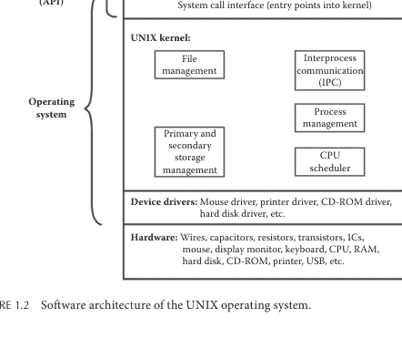

被另一个文件意外覆盖，并进一步保证，当交给CPU处理的程序执行完成后，该程序会释放CPU，以便其他程序可以执行。因此，操作系统可以被视为资源管理器。


在自顶向下视图中（我们在本教科书中支持这一观点），操作系统可以被视为一种将您与硬件资源的复杂性隔离开来的软件。因此，您不必处理与这些资源交互这一极其困难（有时对大多数用户来说不可能）的任务。例如，作为计算机系统的用户，您不必编写代码来将您的工作保存为硬盘上的文件、使用鼠标作为点击设备、使用触摸屏或触摸板，或者在特定打印机上打印。此外，您不必为购买并安装到系统中的新设备（例如鼠标、磁盘驱动器或DVD）编写新软件。操作系统负责处理复杂的硬件资源，并为您提供一台功能全面、接口简单易用的机器。这台机器允许您使用简单命令在磁盘上检索和保存文件、在打印机上打印文件以及从DVD播放电影。从某种意义上说，操作系统提供了一个比物理机器更易于使用的虚拟机。例如，您可以使用`cp memo letter`这样的命令将备忘录文件复制到计算机硬盘上的letter文件，而不必担心备忘录和letter文件在磁盘上的位置、磁盘的结构和大小、磁盘驱动器的品牌，以及系统上各种驱动器（软盘、CD-ROM和一个或多个硬盘驱动器）的数量或名称。

## 1.3 操作系统服务

操作系统为用户提供许多现成的服务。这些服务大多数旨在让您高效、安全地运行软件，包括应用程序和程序开发工具。有些服务用于维护性任务，例如跟踪您使用系统的时间。因此，主要的操作系统服务为以下安全和高效的操作和流程提供机制：

- 程序执行
- 程序执行的输入和输出操作
- 进程之间的通信
- 错误检测与报告
- 所有类型文件的操作
- 用户与安全管理

对这些服务的详细讨论超出了本教科书的范围，但在相关内容出现时，我们会简要介绍它们。

## 1.4 字符（命令行）与图形用户界面

为了使用计算机系统，你必须向其操作系统发出命令。输入设备，例如键盘，用于发出命令。如果你使用键盘向操作系统发出命令，则操作系统具有字符用户界面（CUI），通常称为命令行界面。如果向操作系统发出命令的主要输入设备是指点式设备，例如鼠标、触摸屏或触摸板，则操作系统具有图形用户界面（GUI）。大多数，如果不是全部，操作系统都具有字符和图形界面，你可以使用其中任何一种。有些系统以命令行作为主要界面，但允许你运行提供 GUI 的软件。诸如 DOS 和 UNIX 之类的操作系统具有 CUI，而 Mac OS、OS/2 和 Microsoft Windows 主要提供 GUI，但具有允许用户进入类似 DOS 或 UNIX 的终端屏幕的功能。尽管 UNIX 以 CUI 作为其基本界面，但它可以运行基于 X Window System（Project Athena，MIT）的软件，该软件提供 GUI 界面。此外，大多数 UNIX 系统现在都具有最先进的基于 X 的 GUI。运行在 Apple 产品上的 Mac OS X（Darwin）是最为人所知的基于 GUI 的 UNIX 系统。我们将在第 23 章讨论 UNIX GUI。

尽管 GUI 使计算机更易于使用，但它为你提供了一个自动化设置，减少了灵活性。GUI 还在你和想要在计算机上执行的任务之间呈现了一层额外的软件，从而使任务变慢。相比之下，CUI 为你提供了对计算机系统的最终控制，并允许你以任何你想要的方式运行应用程序。CUI 也更高效，因为你在和计算机上的任务之间只需要最少的软件层，从而使你能够更快地完成任务。它也是可塑的，并给予用户更多控制。由于许多人习惯于 Nintendo 和 Web 浏览器等流行小工具和应用程序的图形界面，字符界面呈现出一种不熟悉且有时难以向计算机系统传达命令的风格。然而，计算机科学的学生通常在几次动手操作后就能应对这一挑战。

## 1.5 操作系统类型

操作系统可以根据同时可以使用系统的用户数量以及系统可以同时运行的进程（正在执行的程序）数量进行分类。这些标准导致了三种类型的操作系统：

- 单用户、单进程系统：这些操作系统仅允许一次一个用户使用计算机系统，并且用户一次只能运行一个进程。此类操作系统通常用于 PC。这些操作系统的例子是 Mac OS 的早期版本、DOS 以及微软的许多 Windows 操作系统。
- 单用户、多进程系统：顾名思义，这些操作系统仅允许单个用户使用计算机系统，但用户可以同时运行多个进程。这些操作系统也用于 PC。此类操作系统的例子是 OS/2、Windows XP Workstation 以及批处理操作系统。批处理在大型机计算机中仍然常用，并且包括 UNIX、Microsoft Windows、Linux 和 Mac OS 在内的大多数现代操作系统都在批处理模式下执行某些任务。甚至包括 Android 和 iOS 在内的智能手机操作系统也在批处理模式下执行任务。
- 多用户、多进程系统：这些操作系统允许多个用户同时使用计算机系统，并且每个用户可以同时运行多个进程。这些操作系统通常用于支持组织中多个用户的计算机，例如大学和大型企业。这些操作系统的例子是 UNIX、Linux、Windows NT Server、MVS 和 VM/CMS。

多用户、多进程系统用于通过复用 CPU 等昂贵资源来提高计算机系统的资源利用率。这种能力导致系统吞吐量增加（单位时间内完成的进程数）。资源利用率增加的原因是，在一个具有多个进程的系统中，当一个进程执行输入或输出时（例如，从键盘读取输入、捕获鼠标点击或向硬盘上的文件写入），CPU 可以从该进程中取走并给予另一个进程——有效地同时运行这两个进程，让它们都取得进展（一个执行输入/输出，另一个使用 CPU）。当当前进程执行 I/O 时将 CPU 分配给另一个进程的机制称为多道程序设计。多道程序设计是所有当代多用户、多进程操作系统的关键。在单进程系统中，当使用 CPU 的进程执行 I/O 时，CPU 会处于空闲状态，因为没有其他进程可以在同一时间使用 CPU。

允许用户与正在执行的程序交互的操作系统称为交互式操作系统，而不允许的则称为批处理操作系统。批处理系统在无需人工干预即可运行程序时很有用，例如运行工资单程序的系统。VMS 操作系统同时具有交互式和批处理界面。几乎所有著名的当代操作系统（UNIX、Linux、DOS、Windows 等）都是交互式的。UNIX 和 Linux 也允许程序以批处理模式执行，程序在后台运行（有关 UNIX 中“后台进程执行”的详细信息，请参阅第 10 章）。多用户、多进程和交互式操作系统称为分时系统。在分时系统中，CPU 快速地从一个进程切换到另一个进程。这种操作方法使系统中的所有进程都能取得进展，让每个用户都感觉自己单独使用系统。分时操作系统的例子是 UNIX、Linux 和 Windows NT Server。

## 1.6 UNIX 家族

多年前，UNIX 这个名称指的是单一的操作系统，但现在它被用来指代一个操作系统家族，这些操作系统在用户界面方面是原始系统的分支。Eric Lévenez（www.levenez.com/unix）在本书撰写时列出了超过 270 种 UNIX 变种的名称。该家族的一些成员是 AIX、BSD、DYNIX，

FreeBSD、HP-UX、Linux、MINIX、NetBSD、SCO、Solaris、OpenSolaris、SunOS、System V、XENIX、PC-BSD、OpenBSD、Mac OS X（Darwin）和 XINU。在第 1.8 节中，我们简要介绍了最受欢迎且在开发上具有影响力的一些 UNIX 系统的历史。

## 1.7 UNIX 软件架构

图 1.2 显示了基于 UNIX 的计算机系统的分层图，标识了系统的软件组件及其与用户和硬件的逻辑接近程度。我们从下至上简要描述每一层软件。

### 1.7.1 设备驱动层

设备驱动层的作用是与各种硬件设备交互。它包含用于与每个设备交互的独立程序，包括硬盘驱动器、软盘驱动器、CD-ROM 驱动器、键盘驱动器、鼠标驱动器、触控板驱动器和显示驱动器。当用户命令或应用程序需要执行硬件相关操作，例如文件读取转换为一次或多次磁盘读取时，这些程序代表 UNIX 内核执行。用户无法直接访问这些程序，因此不能将其作为命令执行。

### 1.7.2 UNIX 内核

UNIX 内核层包含实际的操作系统。UNIX 内核的主要功能在图 1.2 中列出，本节对其进行描述。此外，内核还执行若干其他任务以实现计算机系统的公平、有序和安全使用。这些任务包括管理 CPU、打印机和其他 I/O 设备。内核确保没有任何用户进程永远占用 CPU，多个文件不会同时打印到打印机上，并且用户无法终止其他用户的进程。

#### 1.7.2.1 进程管理

内核的这一部分以创建、挂起、恢复和终止的方式管理进程。它还为进程之间通信提供各种机制，并在分时系统中调度 CPU 同时执行多个进程。进程间通信（IPC）是客户端-服务器型软件的关键，而该软件是 Internet 应用的基础，包括网页浏览（HTTP）、文件传输（FTP）和远程登录（SSH）。UNIX 系统提供三种主要的 IPC 机制/通道：

- 管道：同一台计算机上运行的两个或多个进程可以使用管道作为 IPC 通道。通常，这些进程具有父子或兄弟关系。管道是驻留在主内存中的临时通道，由内核创建，通常代表父进程创建。
- 命名管道：命名管道，也称为 FIFO，是一种驻留在磁盘上的永久通信通道，可供同一台计算机上运行的两个或多个相关或不相关进程用于 IPC。


### 1.7.2.2 文件管理

内核的这一部分管理文件和目录，也称为文件夹。它执行所有与文件相关的任务，包括文件创建和删除、目录创建和删除、在文件和目录上设置访问权限，以及维护其属性，如文件大小。文件操作通常需要磁盘操作。在多用户系统中，用户绝不允许直接操作磁盘，因为磁盘包含属于其他用户的文件，并且用户访问磁盘会带来安全威胁。只有内核必须执行所有与文件相关的操作，例如文件删除。此外，只有内核必须决定为文件分配多少空间以及分配在何处。

### 1.7.2.3 主内存管理

内核的这一部分以有序的方式分配和释放 `RAM`，以便每个进程都有足够的空间正常执行。它还确保分配给一个进程的部分或全部空间不属于其他进程。分配给进程在内存中执行所用的空间称为其地址空间。内核确保没有任何进程访问不属于其地址空间的内存区域。内核在主内存中维护可分配给进程的空闲区域。执行此任务的内核代码称为空闲空间管理器。当程序要加载到主内存中时，空闲空间管理器为其分配足够的空间，加载器将程序加载到该空间中。内核还记录所有进程在内存中的位置，以便当进程尝试访问不属于它的主内存空间时，内核可以终止该进程并向用户给出有意义的消息。当进程终止时，内核会释放分配给该进程的空间并将其放回空闲空间池，以便重复使用。

### 1.7.2.4 磁盘管理

内核还负责维护空闲和已用磁盘空间，以及磁盘空间的有序和公平分配与释放。它决定为新创建的文件分配多少空间以及分配在何处。执行此任务的内核代码称为磁盘存储管理器。此外，内核还执行磁盘调度，当对同一磁盘的多个文件读取、写入等请求到达时，决定下一个提供服务的请求。

### 1.7.3 系统调用接口

系统调用接口层包含进入内核代码的入口点。因为内核管理着所有系统资源，任何涉及访问系统资源的<|message|>用户或应用程序请求都必须由内核代码处理。但出于安全原因，用户进程不能被赋予对内核代码的开放访问权限。为了使用户进程能够调用内核代码的执行，`UNIX` 提供了几个进入内核的开口，或函数调用，被称为系统调用。有许多系统调用处理进程、文件和其他系统资源的操纵。这些调用经过充分测试，其中大多数已使用多年，因此其使用带来的安全风险远小于允许任何用户代码执行该任务的情况。

### 1.7.4 语言库

语言库是一组预先编写并预先测试的编程语言中的函数，可供程序员在开发软件时使用。库的可用性和使用节省了时间，因为程序员不必从头编写这些函数。该层包含多种语言的库，包括 `C`、`C++`、`C#`、`Java`、`Perl` 和 `Python`。例如，对于 `C` 语言，有多个库，包括字符串库（包含用于处理字符串的函数，例如比较两个字符串的函数）和数学库（包含用于数学运算的函数，例如求角度的余弦值）。

正如我们在本章前面所述，库和系统调用接口构成了通常被称为 `API` 的东西。换句话说，使用 `C` 等语言编写软件的程序员可以在其代码中使用各种 `C` 库和系统调用中提供的预写函数。

### 1.7.5 UNIX Shell

`UNIX` shell 是一个在你登录时开始运行并解释你输入的命令的程序。最流行的 shell 有 Bourne shell（`sh`）、Bourne Again shell（`bash`）、C shell（`csh`）、TC shell（`tcsh`）和 Korn shell（`ksh`）。我们在 Bourne shell 和 C shell 中展示 shell 命令和 shell 脚本的使用（见第 12 章至第 15 章）。

### 1.7.6 应用程序

应用程序层包含所有可供你使用的应用程序（工具、命令和实用程序）。典型的 `UNIX` 系统包含数百个应用程序；我们在本教材中讨论最有用和最常用的应用程序。当你使用的应用程序需要操纵系统资源（例如读取文件）时，它需要调用执行该任务的某些内核代码。应用程序可以通过以下两种方式之一找到要执行的适当内核代码：（1）使用适当的库函数；（2）使用系统调用。库调用是对内核的更高级别接口，比系统调用更容易使用。然而，所有库调用最终都会使用系统调用来开始执行适当的内核代码。因此，软件中使用库调用会导致执行速度略有变慢。对语言库和系统调用的详细讨论通常超出了本教材的范围。然而，我们在第 16 章关于 `Python` 以及第 18 章至第 21 章关于 `UNIX` 系统编程中讨论并展示了多个库调用和系统调用的使用。

用户可以使用系统上可用的任何命令或应用程序。正如我们在本章前面提到的，这一层通常被称为 `AUI`。

### 1.8 UNIX 操作系统的开发

`UNIX` 如何取得其在市场上的地位和地位？因为它是一个多用户、多进程操作系统，可以运行在世界上大多数计算机用户使用的从非常小到非常大型的 `X86` 架构硬件上。这意味着它被休闲的个人用户在其家庭计算机上使用，一直到商业设施中云配置的 60 处理器服务器。它可以用 `Opera` 或 `Firefox` 等标准浏览器将你的家庭计算机连接到互联网。此外，绝大多数互联网服务器都在 `UNIX` 或 `Linux` 机器上运行。

三个主要 `UNIX` 家族之间到底有什么区别？基本上是内核及其 `API`、文件系统、设备驱动程序基础，以及在一定程度上它们使用的桌面管理系统。因此，实际上现在只有两个真正的 `UNIX` 操作系统家族：`BSD` 家族，在我们的书中以名为 `PC-BSD` 的 `FreeBSD` 分支为例，以及 `Solaris` 家族。两个家族都有一个显著特征，即从 `Z` 文件系统（`ZFS`）启动并在内核中包含 `ZFS`。在撰写本书时，其他 `NIX` 类系统（`Linux`、`OS X`）都没有此功能。

使用 `UNIX` 操作系统的人是应用程序开发人员、系统分析师、网页程序员、系统管理员、业务经理、学者，以及只是想阅读电子邮件的人。从 1969 年作为实验室研究工具的最初构想开始，它在学术界得到进一步发展，然后被认可用于商业用途。今天的 `UNIX` 具有复杂但易于学习的基础功能，因为它具有 `GUI`，并且可扩展且易于根据用户的计算风格进行定制。`GUI` 与 `Windows` 或 `OS X` 机器上的 `GUI` 相当。理解其长寿和异构吸引力的主要关键之一是研究其演变的历史，内容如下。

#### 1.8.1 起源

在描述 `UNIX` 的演变之前，我们首先要问，为什么这个操作系统如此“友好”且易于适应？部分答案是，这个不断演进的操作系统被世界各地接受和使用，是为了满足一个非常异构的计算机用户群体的需求和活动而开发的。它因许多多样化、有时甚至相互对立的个人和群体的努力与合作而成长、改变和改进。

`UNIX` 随着计算机硬件、软件应用程序、网络和其他“计算机革命”组成部分的发展而不断成长、改变和改进。`UNIX` 项目始于个人和主观的努力，但爆炸式地发展成为通用和通用的技术工具。因此，其各种受众必须在这个工具中发现了一些基本优势——特别是最大的受众，普通用户。分离这些各种用户群体对 `UNIX` 开发的影响

困难。此外，由于该系统从根本上是一个开放的软件系统——也就是说，源代码在用户社区中自由分发——其演变在一定程度上受到了民粹主义思维的影响。例如，开发资源和源代码存储库（如 `GitHub`）在二十一世纪加速了这种开发模式。未来，它将继续以这种方式发展，这要归功于开放软件基金会等组织，以及互联网在社会生活、学术环境以及商业和专业环境中的普遍使用。

正是 `UNIX` 的底层核心功能将多样化的受众聚集到一个社区中——与其说是社会学意义上的，不如说是独立的、DIY 的、智力意义上的。随着你深入研究本教材的主题，你可能会想知道自己在 `UNIX` 社区中的位置，以及它的功能如何适应你的使用。基本上，与计算机交互的方式将是你使用 `UNIX` 操作系统时最重要的、最令人振奋的和最关键的方面。

其他当代操作系统的开发动机和依据与促使 `UNIX` 诞生和发展的动机和依据完全不同（主要是商业化，而 `UNIX` 主要是用户友好、基于文本的操作系统）。`UNIX` 的历史记录了系统应该如何开发，而不管你认为该系统应该如何构建，你认为它应该如何运行（无论你的用户视角如何），以及你认为谁应该控制该开发。

图 1.3 描述了从 1969 年到现在开发的 `UNIX` 系统的三个主要分支。每个分支中里程碑版本开发的大致日期显示在左侧。

`UNIX` 支持小组（`USG`）、`UNIX` 系统开发实验室（`USDL`）和 `UNIX` 系统实验室（`USL`）是 `AT&T` 的商业衍生机构。`UNIX` 程序员工作台（`PWB`）最初是通过 `USG` 分发的。


20 世纪 60 年代中期，贝尔实验室开始了开发一个名为 `MULTICS` 的多用户操作系统的协作工作。这个新操作系统功能固有的最大缺点之一是，完成多用户的简单任务所需的软件和硬件的复杂性。在 `MULTICS` 项目失败后，肯·汤普森、丹尼斯·里奇和贝尔实验室的其他人开发了一个名为 `UNIX` 的多用户操作系统，它最初运行在 `DEC PDP-7` 计算机上，后来移植到 `PDP-11` 计算机上。`UNIX` 与 `MULTICS` 的不同之处在于，它允许单个用户轻松创建进程。

20 世纪 70 年代初期的最重要的历史发展是，大部分操作系统被重新编码为高级编程语言 `C`。当时，大多数操作系统程序是用低级编程语言编写的，称为汇编语言，该语言专门针对特定制造商的计算机使用的处理器的架构进行定制。因此，用低级语言编写的操作系统在不同制造商的不同处理器计算机之间不可移植。用 `C` 编写的 `UNIX` 具有很强的可移植性。此外，`C` 以及其他高级语言比汇编语言更容易编程，而汇编语言通常很困难。

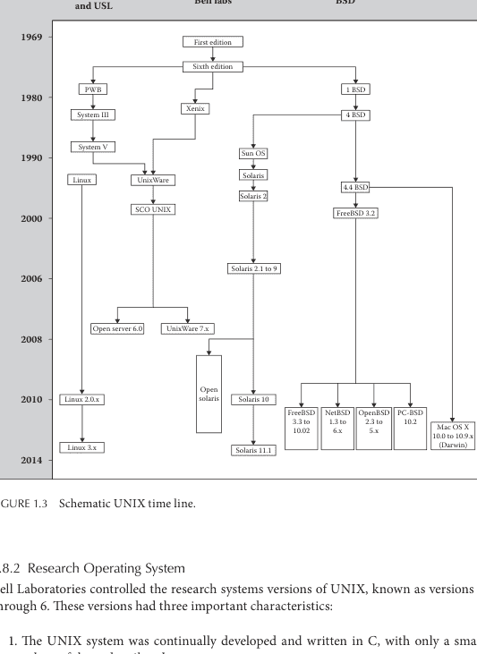

**图 1.3** 示意 `UNIX` 时间线。

### 1.8.2 研究操作系统

贝尔实验室控制着 `UNIX` 的研究系统版本，即 1 到 6 版。这些版本具有三个重要特征：

- `UNIX` 系统不断以 `C` 语言开发和编写，只有很小一部分代码针对目标处理器进行定制。
- 版本以 `C` 源代码形式分发，可以由获得系统任何研究版本的人轻松修改和改进以增加功能。
- 系统的设计允许用户并发运行多个进程，并通过 `IPC` 通道连接这些进程，包括管道、`FIFO` 和套接字，如第 1.7.2 节所述。我们将在第 9 章介绍该设计方面的实现。

### 1.8.3 AT&T System V

为应对 20 世纪 80 年代初不断变化的商业环境，贝尔实验室/`AT&T` 将 `UNIX` 的后续版本许可为 `System III`，最终在 1983 年起以 `System V` 发布。`UNIX` 的这一主分支继续发展，如图 1.3 所示，直至 `System V` 第 4 版（`SVR4`），随后在 20 世纪 90 年代中期至后期再次分化并演变为 `SCO UNIX` 而得以延续。目前，有四个主要基于 `System V` 的 `UNIX` 系统：`AIX 7.x`、`OpenServer 6.x`、`UnixWare 7.x`、`Solaris 11.x`、`OpenSolaris` 及其变种，以及 `HP-UX 11i v3`。

### 1.8.4 Berkeley Software Distributions

加州大学伯克利分校在 20 世纪 80 年代至 90 年代期间在其第二主分支上启动并维护了 `UNIX` 的开发。合同协议使操作系统可免费提供给大学，因此这些版本在很大程度上促进了 `UNIX` 的普及。这些版本作为伯克利软件发行版（`BSD`）发布，分别为 `3BSD` 和 `4BSD-4.4BSD`。最近，`BSD UNIX` 以 `FreeBSD` 及其分支 `PC-BSD`、`OpenBSD` 和 `NetBSD` 的形式存续。今天，`BSD UNIX` 最流行的变种是 `FreeBSD 10.x`、`OpenBSD 5.x`、`NetBSD 6.x` 和 `Mac OS X 10.9.x`（`Darwin`）。

在本书中，我们主要在 `PC-BSD` 下展示示例命令。在适当的情况下，我们还讨论 `Solaris` 的特性。

### 1.8.5 History of Shells

`Shell` 作为 `UNIX` 实用程序的发展与系统本身的发展并行。Steven R. Bourne 编写了第一个商业可用的 shell，即 Bourne shell。它在 1979 年的第七版中提供，是许多 `System V` 版本的默认 shell。`C shell` 由 Bill Joy 在 20 世纪 70 年代末主要编写，并在 `2BSD` 中很快提供。引入时，它为编写 shell 脚本提供了类似 `C` 程序的编程接口。在 `C shell` 发展之后，Korn shell 于 1986 年在 `SVR4` 中正式引入。由贝尔实验室的 David Korn 编写，它包含 Bourne shell 命令的超集，但功能更强。它还包含 `C shell` 的一些有用特性。我们将在第 2 章中更详细地讨论 `UNIX shell` 的发展历史。

三个主要 shell 具有略有不同的特性和命令集。在本教材中，我们讨论所有 `UNIX shell` 和版本共有的特性和命令集。每当我们讨论特定于某个 shell 或版本的特性或命令时，我们会明确说明。

### 1.8.6 Current and Future Developments

对于除 `Solaris` 和 `FreeBSD` 之外的所有其他 `UNIX` 变种来说，最令人兴奋和最具挑战性的当前 `UNIX` 开发可能集中于将 `ZFS` 纳入内核，并让启动磁盘使用 `ZFS`。`ZFS` 由 `Sun Microsystems` 在 2006 年将其纳入 `Solaris` 系列之前几年开发。它现在仅是 `Solaris`（及其非商业等价物 `OpenIndiana`）和 `FreeBSD`（及其分支 `PC-BSD`）的标准文件系统。自 `Sun` 被 `Oracle` 收购以来，`ZFS` 的源代码开发基本上沿着两个分支进行：`Oracle Solaris` 分支和开放分支。

`UNIX` 系统未来面临的另一个主要挑战是将 `systemd` 纳入内核。目前，`systemd` 是一套系统管理守护进程、库和实用程序，旨在作为 `Linux` 的中央管理和配置平台。`systemd` 用于当前 `Linux` 内核的大多数当前实现和官方发行版中。它是 `Linux` 的 `init` 系统（由 `Linux` 内核在 `Linux` 启动过程中调用以初始化用户空间并在之后管理所有进程的过程），从而取代了 `UNIX System V` 和 `BSD` 风格的 `init` 守护进程。名称 `systemd` 遵循了使守护进程更容易区分的惯例，即文件名以字母 d 结尾。`systemd` 是否会被纳入 `UNIX` 内核还有待观察。

最后，用各种其他软件系统取代 `X Window System` 协议有望带来更小、更有效的 GUI 系统。`Wayland` 是一种协议，规定了显示服务器（称为 `Wayland compositor`）与其客户端之间的通信，以及该协议的 `C` 语言参考实现。

## 1.9 VARIATIONS IN UNIX SYSTEMS

如图所示 1.3 所示，`UNIX` 系统的开发从单一核心沿着三个主分支进行。分支的分歧和相似之处在很大程度上是由 20 世纪 70 年代和 80 年代贝尔实验室和 `AT&T` 的法律许可安排造成的。分歧的主要优势是每个分支都拥有命令和功能丰富的操作系统。早期的贝尔实验室版本作为源代码被自由复制和分发，学术和商业用户可以轻松修改以适应其硬件和软件。这种改编导致操作系统各个方面演进方式的激增。即使是 `System V` 和 `BSD` 的后期版本，也可以通过操作系统版本供应商提供的便利进行轻松修改，即使源代码不可用。许多后期版本是兼容性版本，旨在在特定实现与其 perceived 竞争对手之间提供统一性。这些兼容性版本及其分支的重要贡献是提供了一定程度的同质性，无论您使用的是 `SVR4`、`Solaris`、`4.4BSD`、`Linux` 还是 Apple `OS X` 的现代衍生产品。

分歧的缺点是，在一个版本上运行的程序甚至命令在另一个版本上无法运行，从而削弱了系统本身固有的用户友好性优势。人们曾尝试标准化 `UNIX`——例如通过 IEEE 可移植操作系统接口（`POSIX`）。该软件标准不仅涵盖 `UNIX`，而且特别规定了程序操作和用户界面，而将其实现留给开发者。已采用了多个标准，还有更多已经提出了许多标准。例如，采用的 `POSIX` 标准规定了 shell 和工具集的标准化。

迄今为止，最全面、覆盖范围最广的标准化机制是单一 `UNIX` 规范（`SUS`）。这是一个面向计算机操作系统的标准族，要获得 `UNIX` 名称的资格，就必须符合该规范。`SUS` 的核心规范由奥斯汀小组（Austin Group）制定和维护，该小组是 `IEEE`、`ISO/IEC JTC 1/SC 22` 和开放集团（`Open Group`）的联合工作组。

## 摘要

操作系统是一种运行在计算机系统硬件上的软件，用于管理其硬件和软件资源。它还为计算机系统的用户提供了一台简单、易于使用的虚拟机器。操作系统提供的基本服务包括高效、安全的程序执行、I/O 操作、进程间通信、错误检测与报告以及文件操作。

操作系统按可同时使用系统的用户数量和可同时在系统上执行的进程数量进行分类：单用户单进程、单用户多进程和多用户多进程操作系统。此外，允许用户与其正在执行的程序（进程）交互的操作系统称为交互式系统，不允许交互的则称为批处理系统。多用户、多进程交互式系统称为分时系统，`UNIX` 就是典型例子。多用户、多进程系统的目的是通过在并发执行的进程之间切换系统资源来提高资源利用率。这种能力带来了更高的系统吞吐量，即单位时间内完成的进程数量。


要使用计算机系统，用户需要向操作系统发出命令。如果操作系统通过键盘接受命令，则它具有命令行用户界面（`CUI`）。如果操作系统允许用户通过鼠标等点击设备发出命令，则它具有图形用户界面（`GUI`）。尽管 `UNIX` 自带 `CUI` 作为其基本界面，但它可以运行基于 `X Window` 系统（麻省理工学院 Athena 项目）的软件，从而提供 `GUI`。现在大多数 `UNIX` 系统都同时具有这两种界面。运行在 Apple 产品上的 `Mac OS X`（`Darwin`）是最著名的基于 `GUI` 的 `UNIX` 系统。

计算机系统由多个硬件和软件组件组成。典型 `UNIX` 系统的软件组件由多个层次构成：应用程序、`shell`、语言库、系统调用接口、`UNIX` 内核和设备驱动程序。内核是 `UNIX` 操作系统的主要部分，负责执行与系统资源配置和回收相关的所有任务。`shell` 和应用程序层包含通常所说的应用程序用户界面（`AUI`）。语言库和系统调用接口包含应用程序编程接口（`API`）。

`UNIX` 的历史发展以开放系统方法为特征，即源代码在用户间自由分发。许多 `UNIX` 版本的发展沿着三条主要分支推进。其中两条分支，即 `Oracle Solaris` 和 `FreeBSD`，可以分别最好地描述为商业分支和学术分支。各版本的兼容性发布旨在使系统标准化。`POSIX` 和 `SUS` 是相关的标准化工作。真正的 `UNIX` 系统未来两个令人振奋且具有挑战性的新进展是：将 `ZFS` 纳入内核，以及用 `Wayland` 等系统取代 `X Window` 系统协议。

## 问题与练习

- 1. 什么是操作系统？

- 2. 操作系统有哪三种类型？它们之间有何不同？

- 3. 什么是分时系统？请准确描述。

- 4. 典型当代操作系统提供的主要服务有哪些？这些服务的基本目的是什么？

- 5. 分别列出 `CUI` 和 `GUI` 的一个优点和一个缺点。

- 6. `CUI` 和 `GUI` 之间有什么区别？`UNIX` 系统最流行的 `GUI` 是什么？它是在哪里开发的？

- 7. `API` 和 `AUI` 分别包含什么？

- 8. 什么是操作系统内核？`UNIX` 内核执行的主要任务有哪些？

- 9. 什么是系统调用？系统调用接口的目的是什么？

- 10. 如果你使用 `ssh` 命令访问 `UNIX` 系统，请写下登录和注销的逐步确切过程。在此过程中尽可能多地包含描述性细节，以便如果你忘记如何登录，可以随时参考这份书面过程。

- 11. 什么是 `shell`？列出最流行的 `UNIX shell`。登录到你的 `UNIX` 计算机系统，并记下所使用的 `shell` 提示符。

- 12. 如何判断你所登录的计算机系统上使用的是 `UNIX` 主要分支中的哪个变体（参见图 1.3）？

- 13. 如果你正在设计一个 `POSIX` 标准，你会把哪些内容包含在内？在回答此问题之前，你可能需要研究已经采用和已经提出的标准。

- 14. 如果你正在设计一个 `SUS` 标准，你会把哪些内容包含在内？在回答此问题之前，你可能需要研究本章和在线资料中简要介绍的已采用的 `SUS` 标准。

- 15. `UNIX` 的直接前身是什么系统？该前身和 `UNIX` 本身最初是在哪里开发的，由谁开发？

- 16. 列出 `UNIX` 开发的主要版本和三条主要分支。哪条是商业分支？哪条是学术分支？

- 17. 在 `UNIX` 的早期发展过程中，有哪些三个重要特性帮助它普及？请解释这些特性如何适用于作为 `UNIX` 用户的你，无论你从什么角度出发。

- 18. 说出作为大多数 `UNIX` 系统基础的两个最流行的 `UNIX` 系统。它们是在哪里开发的？

- 19. 通过浏览网页追溯 `UNIX` 的历史。迄今为止已经开发了多少个 `UNIX` 系统？开发了多少个非 `UNIX` 系统？在个人电脑上，最流行的 `UNIX` 系统是什么？你认为它为什么如此流行？

- 20. 说出 `UNIX` 家族中五个流行的成员。你的 `UNIX` 系统的名字是什么？

- 21. 在 20 世纪 60 年代末和 70 年代初，数字设备公司（`DEC`）是分时系统发展的关键参与者。浏览网页，找到一篇关于 `RSTS`（`DEC` 开发的一个操作系统）的文章。它的全名是什么？它运行在哪些机器上？它的主要特点是什么？

## UNIX 操作系统“快速入门”

### 目标

- 介绍 `UNIX` 字符用户界面（`CUI`），并展示 `UNIX` 命令的通用结构

- 描述如何连接并登录到运行 `UNIX` 操作系统的计算机，尤其是 `PC-BSD` 和 `Solaris`

- 解释如何管理和维护文件与目录

- 展示在哪里可以获取 `UNIX` 命令的在线帮助

- 演示如何使用一组初学者实用命令

- 描述什么是 `UNIX shell`

- 简要描述一些常用的 `shell`

- 涵盖基本命令和操作符

```
alias, biff, cal, cat, cd, chsh, cp, csh, echo, exit, hostname, login, logout, lp, lpr, ls, man, mesg, mkdir, more, mv, passwd, PATH, pg, pwd, rm, rmdir, set, ssh, su, sudo, talk, telnet, unalias, uname, whatis, whereis, who, whoami, write
```

### 2.1 引言

要在 `UNIX` 中高效地开始工作，初学者需要按照以下呈现的顺序了解八个循序渐进的课题：

1. 如何在 `UNIX` 命令行上输入语法正确的命令。与 `UNIX` 系统交互最有用的模式之一是基于文本的键入命令。

2. 如何使用我们展示的标准方法之一登录和退出运行 `UNIX` 的计算机。`UNIX` 允许用户自主进入操作系统，执行文本导向和图形导向的操作组合，并优雅地退出。

3. 如何在文件结构中维护和组织文件。创建树状结构的文件夹（也称为目录），并以合理的方式将文件存储在这些文件夹中，对于在 `UNIX` 中高效工作至关重要。

4. 如何获取关于命令及其用法的帮助。在基于命令的 `CUI` 环境中，能够快速轻松地了解如何正确使用命令对于高效工作至关重要。

5. 如何执行一小套必要的实用命令来设置或定制你的工作环境。一旦初学者熟悉了构建文件维护命令的正确方法，添加一组实用命令会让每次会话更高效。

6. 使用 `UNIX shell` 的基本方式、它们是什么，以及如何在你登录时查明当前运行的是哪个 `shell`。

7. 更改你的 `shell` 的方法，以及什么是 `shell` 环境变量。

8. 什么是 `shell` 元字符。

要想成功地将本章作为进入本书其余部分的跳板，你应该按照呈现的顺序阅读并遵循这些说明。每一章都建立在前一章信息的基础上，并将为你提供在 `UNIX` 操作系统中编程所需的概念、命令工具和方法。在本章中，主要命令都配有简化的语法说明，这将为本书其余部分厘清通用的组成部分，如下所示：

#### 语法

命令及其选项和参数在命令行上的准确输入语法。

- 用途：命令的具体用途

- 输出：执行命令结果的简短说明

- 常用选项/功能：最常用、最有用的选项和选项参数的列表

### 2.2 UNIX 命令的结构

由于 `UNIX` 同时依赖于图形界面和基于文本的 `CUI`，因此正确输入的语法对于确保后续命令的正确执行至关重要。

当用户成功登录到一台 `UNIX` 计算机后，屏幕上会出现一个 `shell` 提示符，例如 `$` 字符。`shell` 提示符仅仅是来自……

一个命令参数，`m*`。第四个包含命令 `lpr`，两个选项，`P` 和 `n`，两个选项参数，`spr` 和 `3`，以及一个命令参数，`proposal.txt`。

你还必须使用经验法则：如果命令执行正确，那么你将被返回到 `shell` 提示符；如果执行不正确，那么会在命令行上显示错误消息，然后你将被返回到 `shell` 提示符。例如，如果你在命令行输入 `xy` 然后按下 `<Enter>`，通常你会收到一条错误消息，称找不到此类命令，然后你将被返回到 `shell` 提示符，以便你可以输入一个有效的命令。

此经验法则并不能保证你通过在命令行输入语法正确的命令而想要实现的目标就会被实现。也就是说，你可以执行一个命令且没有任何错误消息。但该命令可能并未完成你想要它完成的事情，仅仅是因为你使用了错误的选项或命令参数。

### 2.3 LOGGING ON AND LOGGING OFF

如何登录 `UNIX` 计算机然后优雅地退出？

使用以下其中一种通用方法，或其混合版本：

- *Stand-alone*: 使用独立系统，例如本书中使用的 `PC-BSD` 或 `Solaris` 系统，其中 `UNIX` 是硬件上唯一的 operating system。

- *Remote*: 从运行 `UNIX` 或其他 operating system 的计算机连接到运行 `UNIX` 的远程计算机。

- *Virtual*: 在虚拟环境中将 `UNIX` 作为 guest operating system 启动，例如 `VirtualBox` 或 `VMware`，而另一个 operating system 是 host 系统。

这些通用方式是用户在典型的 `UNIX` 会话中采取的第一步：以自主的方式正确地访问 `UNIX` 系统。

这些方式的更详细描述如下：


## 1. *Stand-alone*
这种方式是最常见的情况，也是我们在本书其余部分使用 `PC-BSD` 和 `Solaris` 采用的方法，涉及坐在可以完全独立运行的计算机前。这并不意味着独立计算机未连接到局域网 `LAN`、内联网或互联网。

相反，用户与 `UNIX` 的连接是专用于一次一个用户（或可能在不同时间分别登录同一系统的许多自主用户）坐在计算机前并登录以在该硬件平台上专门使用 `UNIX`。

## 2. *Remote*
使用这种方式有几种变体。以下是两种可能的场景：

### a.
你坐在像传统终端那样连接到大型机计算机的计算机前。这也可以是连接到服务器的瘦客户端 `thin client`（配置和能力极少的设备）。它通过高速通信链路连接到另一台或多台计算机，这些计算机都通过 `LAN` 或互联网互连。在终端上，在其屏幕上出现的控制台或命令窗口中，你与 `operating system` 的接口运行在另一台甚至多台计算机上。这是一种共享资源方法，其中许多不同终端上的多个用户可以共享单个 `UNIX` 系统。

### b.
你坐在独立计算机前，并通过 `PuTTY`、`Secure Shell SSH`、或 `SSH X Windows` 转发（`TCP` 端口转发的变体）等软件，通过高速电信链路连接到另一系统。然后 `PuTTY` 或 `SSH` 软件成为你的图形连接，允许你登录并使用运行 `UNIX` 的远程计算机或系统。这通常是一种共享资源方法，其中许多不同远程计算机上的多个用户可以共享单个 `UNIX` 系统。

## 3. *Virtual*
你在面前坐的计算机上安装并运行了 `UNIX` 或类 `UNIX operating system`，例如 `Linux`、`OS X` 或其他 `operating system`，并且你在该计算机上安装了 `VirtualBox` 或 `VMware` 等虚拟环境。然后，当你想要使用 `UNIX` 系统时，你只需切换环境，使虚拟环境中的 `UNIX` 系统成为你用于与计算机硬件交互的系统。

我们本章不介绍虚拟连接，但在第 25 章“Virtualization Methodologies”中，我们介绍了 `VirtualBox` 等虚拟环境。

在以下小节中，我们介绍了三种实用、有用、简单且流行的连接和登录/注销运行 `UNIX` 系统的计算机的方式，如第 2.3 节所述。

我们展示的三种方式是：

1. `PC-BSD` 和 `Solaris` 的独立登录和注销。
2. 从运行 `Microsoft Windows` 的计算机通过 `PuTTY` 程序远程登录到运行 `PC-BSD` 的 `UNIX` 计算机。
3. 从运行 `PC-BSD UNIX` 的 `UNIX` 客户端计算机通过 `SSH` 客户端远程登录到另一台远程 `UNIX` 主机计算机。

这三种方式的共同点是，你的第一个任务是以有效且自主的用户身份正确地向 `UNIX` 系统识别自己。为此，你需要输入一个由有效字符组成的有效用户名或登录名。然后你必须为该用户名输入一个有效密码。

自行确定，或向你的指导教师或站点的系统管理员寻求帮助。请注意，你可能需要采用混合的登录和注销方式。

### 2.3.1 独立登录连接到 PC-BSD 和 Solaris

本节所示的登录和注销流程是标准流程，在所有 `UNIX` 和类 `UNIX` 系统之间仅有细微差别。这假定在你使用计算机之前，有人已经优雅地注销或重新启动了计算机，但并未关闭系统。

在本节中，假定你正在登录一台已运行的计算机，其操作系统为 `PC-BSD UNIX` 或 `Solaris`。如前所述，登录时向 `UNIX` 系统识别身份是你的首要任务。为此，你需要输入一个由有效字符组成的有效用户名，或登录名。然后你为该用户名输入一个有效密码。

请注意，在命令行上输入时，`UNIX` 是区分大小写的！

#### 2.3.1.1 PC-BSD 登录和注销

`PC-BSD` 的登录窗口如图 2.1 所示。

在登录窗口中，你应在用户名字段中键入你的用户名，然后默认保持桌面管理器为 `KDE`。如果计算机上之前安装了其他窗口或桌面管理系统，你可以在登录窗口中选择其中之一。

在登录窗口的密码字段中，输入你的密码。最后，点击如图 2.1 所示的右向箭头，即可登录。在 `PC-BSD` 上，`KDE` 桌面管理系统默认出现在屏幕上。

要优雅地终止与运行 `PC-BSD` 的计算机的连接，请执行 `Kickoff` 应用程序启动器菜单选项 `Leave>Log Out`。

#### 2.3.1.2 Solaris 登录和注销

`Solaris` 的登录窗口如图 2.2 和 2.3 所示。

会出现两个连续的登录窗口，允许你在第一个窗口中输入用户名，在第二个窗口中输入密码。在 `Solaris` 上，登录后，`Gnome` 桌面管理界面默认出现在屏幕上。

要注销，请执行下拉菜单 `System>Logout` 选项。

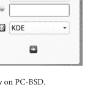


FIGURE 2.2 Stand-alone login window #1 on Solaris.

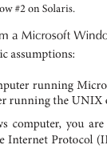

FIGURE 2.3 Stand-alone login window #2 on Solaris.

### 2.3.2 通过 PuTTY 从 Microsoft Windows 计算机连接

在本节中，我们做出以下基本假设：

- 1. 你坐在运行 `Microsoft Windows` 的计算机前，尝试连接到运行 `UNIX` 操作系统的计算机并登录。
- 2. 在你的 `Microsoft Windows` 计算机上，你已连接到 Internet，或一个你知道要登录的 `UNIX` 计算机的 Internet 协议（IP）地址的内联网。
- 3. 你已在 `Microsoft Windows` 计算机上下载并安装了 `PuTTY` 程序，或系统管理员已为你完成此操作。这里未给出下载此软件和安装它的细节。截至撰写时，`PuTTY` 程序最新的下载站点为：`http://www.chiark.greenend.org.uk/~sgtatham/putty/download.html`。
- 4. 你使用 `PuTTY` 通过 `SSH` 连接到 `UNIX` 计算机。
- 5. 你知道一对有效的用户名和密码，可以让你登录到 `UNIX` 计算机。

一旦你执行 `PuTTY` 程序，你使用有效的用户名/密码对，然后你就可以在控制台窗口或终端屏幕中输入命令。你输入的内容如下所示以粗体文本显示，并且始终在键盘上按下 `<Enter>` 键之后。

开始时，在 `Microsoft Windows` 计算机上，双击 `PuTTY` 程序图标，或从开始菜单>程序子菜单中选择 `PuTTY`。当 `PuTTY` 程序首次启动时，`PuTTY` 配置对话框窗口会打开在屏幕上，类似于图 2.4。

# FIGURE 2.4 PuTTY configuration dialog window.

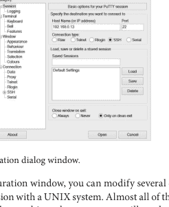

从 `PuTTY` 配置窗口，你可以修改控制你与 `UNIX` 系统交互会话的多个参数。这些参数几乎都可以保持默认值。大多数用户在此配置窗口中需要做的唯一两件事是输入他们尝试连接和登录的 `UNIX` 计算机的主机名（或 IP 地址），并点击用于 `SSH` 的协议按钮，如图 2.4 所示。如果你在“连接类型”中点击 `SSH` 按钮，端口号会自动设置为 22。你需要知道你想登录的 `UNIX` 计算机的主机名或 IP 地址是什么。然后点击 `Open` 按钮，一个控制台窗口将打开在屏幕上，如图 2.5 所示，从而允许你登录到 `UNIX` 计算机。

如前所述，在登录过程中，向 `UNIX` 系统识别身份是你的首要任务。为此，你需要输入一个由有效字符组成的有效用户名，或登录名。然后你为该用户名输入一个有效密码。你的用户名和密码中都可以使用有效和无效字符。

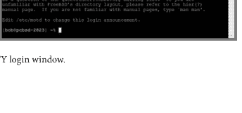

# FIGURE 2.5 PuTTY login window.

请咨询你的系统管理员或指导老师，了解在你想要登录的 `UNIX` 系统上这些字符是什么，如果他们尚未告诉你这些字符是什么。

如图 2.5 所示，响应 `login:` 提示时，你在 `UNIX` 系统上输入你的用户名，然后按下键盘上的 `<Enter>`。在我们的例子中用户名是 `bob`，如图 2.5 所见。请记住 `UNIX` 是区分大小写的。当出现 `Password:` 提示时，输入你在 `UNIX` 系统上的密码，然后按下键盘上的 `<Enter>`。最后，命令行提示符出现在屏幕上，如图 2.5 所见。

要终止你的连接，在命令行提示符下输入 `logout` 然后按下键盘上的 `<Enter>`，或在空白行按下 `<Ctrl+D>`——即同时按住键盘上的 `<Ctrl>` 和 `D` 键。注销在一定程度上取决于系统，并且可以由本地系统管理员根据 `UNIX` 的特定安装进行定制。在 `C shell` 中，`logout` 命令是优雅离开系统的默认方式。


如果你使用 Bourne shell 或 Korn shell，按住 `<Ctrl+D>` 或输入 `exit` 将实现同样的效果。然后你将被注销系统，当前的 PuTTY 会话将结束，所有 PuTTY 窗口都将关闭。

如果你在会话期间启动了一个新的 shell 而在注销前没有退出该 shell，UNIX 将提示 Not login shell，并且你将无法立即注销。在这种情况下，按下 `<Ctrl+D>` 新 shell 将终止。此外，如果你启动了不止一个 shell 并且在注销前没有退出这些 shell，你将必须使用 `<Ctrl+D>` 分别终止每个 shell。在某些系统上，你在命令行输入 `exit` 来终止一个 shell 进程。在任何情况下，你随后将能够使用前面描述的 `logout` 过程离开系统。

### 2.3.3 通过 SSH 客户端在 UNIX 机器之间连接

这种方式允许一个 UNIX 计算机上的用户使用 SSH 协议远程登录并注销另一台 UNIX 计算机。如第 11 章所述，`SSH` 是 LAN 或 Internet 上计算机之间的一种加密通信通道。

在使用这种方式之前，两个系统必须能够通过 `SSH` 通道相互通信，我们将在第 11 章中展示如何做到这一点。此外，正如前面所述，用户必须知道有效的用户名/密码对才能登录到远程系统！

我们展示了三种可能的情况。第一，如果用户之前已成功从客户端登录到主机并且身份验证密钥未更改。第二，如果用户从未成功从客户端登录过主机。第三，如果用户之前已登录过主机但自上次成功登录以来主机的身份验证密钥已更改。这些是在使用这种远程登录方法时可能遇到的实际状况。

用户输入的内容以粗体文本显示：

- 1. 之前已成功登录：

```
[bob@pcbsd-923] ~% ssh 192.168.0.8
Password for bob@pcbsd-2467: XXX
```

Last login: Mon Sep 21 17:20:51 2015 from 192.168.0.13

FreeBSD 10.2-RELEASE-p4 (GENERIC) #0: Tue Aug 18 15:15:36 UTC 2015

Output truncated...

[bob@pcbsd-2467] ~% Execute command line UNIX commands...

[bob@pcbsd-2467] % logout

Connection to 192.168.0.8 closed.

[bob@pcbsd-923] ~%

#### 2. 从未登录过：

```
[bob@pcbsd-923] ~% ssh 192.168.0.6
```

The authenticity of host '192.168.0.6 (192.168.0.6)' can't be established.

RSA key fingerprint is 47:62:a2:9b:24:9e:5e:51:49:3b:80:aa:91:a3:fd:de.

No matching host key fingerprint found in DNS.

Are you sure you want to continue connecting (yes/no)? yes

Warning: Permanently added '192.168.0.6' (RSA) to the list of known hosts.

Password: XXX

Last login: Mon Sep 21 17:06:59 2015 from 192.168.0.13

Oracle Corporation SunOS 5.11 11.2 June 2014

bob@solaris:~$ Execute command line UNIX commands...

bob@solaris:~$ logout

Connection to 192.168.0.6 closed.

[bob@pcbsd-923] ~%

#### 3. 之前登录过但主机密钥已更改：

```
[bob@pcbsd-923] ~% ssh 192.168.0.8
```

@@@@@@@@@@@@@@@@@@@@@@@@@@@@@@@@@@@@@@@@@@@@@@@@@@@@@@@@@@@@@@

@ WARNING: REMOTE HOST IDENTIFICATION HAS CHANGED! @

@@@@@@@@@@@@@@@@@@@@@@@@@@@@@@@@@@@@@@@@@@@@@@@@@@@@@@@@@@@@@@

IT IS POSSIBLE THAT SOMEONE IS DOING SOMETHING NASTY!

Someone could be eavesdropping on you right now (man-in-the-middle attack)!

It is also possible that a host key has just been changed.

The fingerprint for the ECDSA key sent by the remote host is 43:e8:cf:33:d5:ed:dd:05:d9:a9:a5:9d:1d:18:1d:2b.

Please contact your system administrator.

Add correct host key in `/usr/home/bob/.ssh/known_hosts` to get rid of this message.

Offending ECDSA key in `/usr/home/bob/.ssh/known_hosts`:2

ECDSA host key for 192.168.0.8 has changed and you have requested strict checking.

Host key verification failed.

```
[bob@pcbsd-923] ~% cd /usr/home/bob/.ssh
```

```
[bob@pcbsd-923] ~/.ssh$ rm known_hosts
```

```
[bob@pcbsd-923] ~/.ssh$ cd
```

```
[bob@pcbsd-923] ~$ ssh 192.168.0.8
```

The authenticity of host '192.168.0.8 (192.168.0.8)' can't be established.

ECDSA key fingerprint is 43:e8:cf:33:d5:ed:dd:05:d9:e9:a5:9d:d3:18:1d:2b.

No matching host key fingerprint found in DNS.

Are you sure you want to continue connecting (yes/no)? yes

Warning: Permanently added '192.168.0.8' (ECDSA) to the list of known hosts.

Password for bob@pcbsd-2467: XXX

Last login: Sat Sep 19 11:24:47 2015 from 192.168.0.13

FreeBSD 10.2-RELEASE-p4 (GENERIC) #0: Tue Aug 18 15:15:36 UTC 2015

Output truncated...

[bob@pcbsd-2467] ~% Execute command line UNIX commands...

[bob@pcbsd-2467] ~% logout

Connection to 192.168.0.8 closed.

[bob@pcbsd-923] ~%

在所有这些场景中，都假定用户在客户端和主机系统上拥有相同用户名的账户，并且可能拥有相同的密码。

在场景 2 中，在你输入 `yes` 并按 `<Enter>` 键后，密钥会在主机和客户端上生成。

在场景 3 中，首次尝试建立 `SSH` 连接失败后，错误消息表明主机上的身份验证密钥已更改。因此，需要删除客户端机器 `[bob@pcbsd-923]` 上 `/usr/home/bob/.ssh/known_hosts` 文件中的冲突密钥——具体做法是删除该文件。然后会生成一个新密钥，随即可以进行交换，登录过程得以继续。

这些会话中显示 `Execute command line UNIX commands...` 的那一行是用户输入我们本章及本书其余部分中展示的任何有效 UNIX 命令的位置。最后，在输入 `logout` 后，用户切断 `SSH` 通道连接，并返回本地客户端系统的命令行提示符。

### 2.4 文件维护命令与 UNIX 命令使用帮助


使用我们介绍过的三种方式之一首次登录新的 UNIX 系统后，你的第一个操作是构建和组织你的工作区及其中的文件。根据某种逻辑方案组织文件的操作称为文件维护。一种组织文件的逻辑方案可以是创建一些用于存储文件的文件夹（bins），按文件内容的主题或创建日期来存放。在接下来的各节中，你将输入一些文件创建和维护命令，生成如图 2.6 所示的结构。请按顺序完成后续各节中的操作，以便更好地理解文件维护到底是什么。此外，关键的是你要回顾

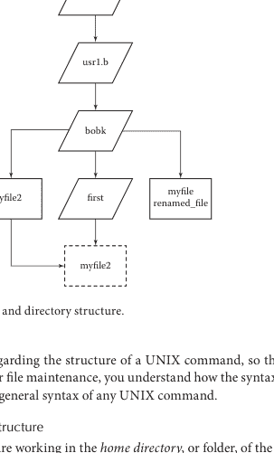

图 2.6 文件和目录结构示例。

第 2.2 节中关于 UNIX 命令结构的内容，这样当你开始输入文件维护命令时，你就会明白你所输入内容的语法如何符合任何 UNIX 命令的一般语法。

### 2.4.1 文件和目录结构

当你首次登录时，你将在与用于登录的用户名和密码所对应的那个用户的主目录（或文件夹）中工作。你当前所在的任何目录都称为当前工作目录，并且在任何给定时间只有一个当前工作目录处于活动状态。使用示意图来可视化文件和目录的结构会很有帮助。图 2.6 是名为 `bobk` 的用户的主目录和文件结构示例。在该图中，目录用平行四边形表示，普通文件（例如，包含文本或二进制指令的文件）用矩形表示。`路径名`（或路径）只是用文本方式指定你正在使用的 UNIX 系统完整文件结构中某个目录或文件的位置。例如，图 2.6 中文件 `myfile2` 的路径是 `/usr1.b/bobk/myfile2`。该路径的指定从整个文件系统的根（`/`）开始，下降到名为 `usr1.b` 的文件夹，然后再次下降到名为 `bobk` 的主目录。

如图 2.6 所示，名为 `myfile`、`myfile2` 和 `renamed_file` 的文件存储在 `bobk` 目录下或其中。`bobk` 下方是一个名为 `first` 的子目录。在接下来的各节中，你将在登录 UNIX 系统时所用的用户名的主目录中创建这些文件和子目录结构。

### 2.4.2 查看文件内容

要开始使用文件，可以使用 `cat` 命令创建新文件。`cat` 命令的语法如下：

#### 语法

```bash
cat [options] [file-list]
```

**用途**：按顺序连接一个或多个文件，或在控制台窗口中显示它们

**输出**：将 `file-list` 中的文件内容一次一个文件地显示在屏幕上

**常用选项/功能**：

- `-E` 在每行末尾显示 `$`
- `-n` 在显示的行上添加行号
- `--help` 显示命令用途及每个选项的简要说明

`cat` 命令是 *连接* 的缩写，允许你连接文件。在示例中，你将把键盘输入的内容连接到当前工作目录中正在创建的新文件。这是通过重定向字符 `>` 实现的，它会将你在标准输入（此处为键盘）中输入的内容重定向到名为 `myfile` 的文件中。如第 2.2 节所述，这种用法只涉及 `cat` 命令，而不涉及选项、选项参数或命令参数。它仅仅使用了命令、一个重定向字符和一个目标（即目的地）`myfile`，重定向将发送到该文件。

这是命令行上输入的多命令最简单的示例，与第 2.2 节所示的单命令相对。在多命令中，你可以使用连接运算符（如此处所示的重定向字符）将单个 UNIX 命令串联成一条链。

```bash
$ cat > myfile
This is an example of how to use the cat command to add plain text
to a file
<Ctrl+D>
$
```

你可以根据需要输入任意多行文本，并在键盘上按 `<Enter>` 来区分文件中的行。然后，在新的一行中，按住 `<Ctrl+D>`，文件就会根据你输入的命令在当前工作目录中创建。由于这是一个使用键盘创建的纯文本文件，你可以通过以下方式查看该文件的内容：

这是一个使用单一 UNIX 命令的简单示例。

```bash
$ more myfile
This is an example of how to use the cat command to add plain text
to a file
$
```

`more` 命令的一般语法如下：

#### 语法

```bash
more [options] [file-list]
```

**用途**：将 `file-list` 中的文件连接/显示在屏幕上，一次显示一屏

**输出**：将 `file-list` 中的文件内容一次一页地显示在屏幕上

**常用选项/功能**：

- `-E/str` 在包含 `str` 的第一行之前两行开始显示
- `-nN` 每屏/每页显示 N 行
- `+N` 从文件第 N 行开始显示文件内容

`more` 命令一次显示文件的一屏。如果文件有多页，你可以按键盘上的 `<Space>` 键继续查看后续页面，或按 `Q` 键退出。Solaris 有一个名为 `pg` 的命令，其功能与 `more` 命令相同。

### 2.4.3 创建、删除和管理文件

要将一个文件的内容复制到另一个文件中，请使用 `cp` 命令。`cp` 命令的一般语法如下：

#### 语法

```bash
cp [options] file1 file2
```

**用途**：将 `file1` 复制到 `file2`；如果 `file2` 是目录，则在该目录中复制一份 `file1`

**输出**：复制的文件

**常用选项/功能**：

- `-i` 如果目标已存在，则在覆盖前提示确认
- `-p` 保留被复制文件的访问权限和修改时间
- `-r` 递归复制文件和子目录

例如，要将名为 `myfile` 的文件精确复制一份并命名为 `myfile2`，请键入以下内容：

```bash
$ cp myfile myfile2
$
```

这种 `cp` 命令的用法需要两个必需的命令参数。第一个参数是已存在且要复制的源文件。第二个参数是目标文件，即复制后文件的名称。请注意，许多 UNIX 命令既可以将普通或常规文件作为参数，也可以将目录文件作为参数。这可能会改变命令所完成的基本任务。此外还值得注意的是，不仅文件名可以作为参数，路径名也可以。这会改变命令在文件系统路径结构中的操作位置。

若要更改文件或目录的名称，可以使用 `mv` 命令。`mv` 命令的一般语法如下：

#### 语法

```
mv [options] file1 file2
mv [options] file-list directory
```

**用途：** 第一种语法：将 `file1` 重命名为 `file2`  
第二种语法：将 `file-list` 中的所有文件移动到 `directory`

**输出：** 重命名或移动后的文件

#### 常用选项/功能

- `-f` 无论目标文件的访问模式如何，都强制移动
- `-i` 覆盖目标文件之前提示用户

在下面的用法中，`mv` 命令的第一个参数是源文件名，第二个参数是目标名称。

```
$ mv myfile2 renamed_file
$
```

此时，注意 UNIX 命令中空格的使用非常重要。如果你从 Windows 10 系统得到一个文件名中带有一个或多个空格的文件，该怎么办？如何在 UNIX 中处理这个文件？答案很简单。每当需要在命令中将该文件名作为参数使用时，请用双引号（`"`）将文件名括起来。例如，你可能会从 Windows 10 系统的某人那里收到一封电子邮件，并从中分离出一个文件，比如 `latest revisions october.txt`。

要在 UNIX 系统中处理这个文件——也就是将该文件名作为 UNIX 命令中的参数——请将整个名称用双引号括起来。要将该文件重命名为更短的名称，正确的命令是：

```
$ mv "latest revisions october.txt" laterevs.txt
$
```

若要删除文件，可以使用 `rm` 命令。`rm` 命令的一般语法如下：

#### 语法

```
rm [options] file-list
```

**用途：** 从文件结构（和磁盘）中删除 `file-list` 中的文件

**输出：** 已删除的文件

#### 常用选项/功能

- `-f` 无论 `file-list` 的访问模式如何，都强制删除
- `-i` 在删除 `file-list` 中的文件之前提示用户
- `-r` 如果 `file-list` 是一个目录，则递归删除其中的文件；请谨慎使用！

要从当前工作目录中删除文件 `renamed_file`，请输入：

```
$ rm renamed_file
$
```

执行文件维护时，你将用到的最重要命令是 `ls` 命令。`ls` 命令的一般语法如下：

#### 语法

```
ls [options] [pathname-list]
```

**用途：** 将**路径名列表**所指定目录中的文件和目录名称发送到显示屏幕

**输出：** **路径名列表**所指定目录中的文件和目录名称；或者，如果**路径名列表**仅包含文件名，则只显示这些名称

#### 常用选项/功能


`-F` 在目录名后显示斜杠字符（`/`），在二进制可执行文件后显示星号（`*`），在符号链接后显示“at”字符（`@`）

`-a` 显示所有文件的名称，包括隐藏文件

`-i` 显示 inode 编号

`-l` 显示长列表，包括文件访问模式、链接数、所有者、组、文件大小（以字节为单位）和修改时间

`ls` 命令将列出当前工作目录或文件夹中的文件或文件夹名称。此外，与我到目前为止使用过的其他命令一样，如果在命令的 `pathname-list` 参数中包含完整的路径名规范，那么你就可以列出该路径名列表中的文件和文件夹名称。要查看当前工作目录中现有的文件名称，请输入以下内容：

```
$ ls
Desktop
Mail
XF86Config.new
kdeinit.core
order.asp.html
order.asp_files
myfile
myfile2
$
```

请注意，你得到的文件名列表很可能与这里列出的不同，因为除了我们一起创建的 `myfile` 和 `myfile2` 之外，你的系统还会自动在你的主目录中放置一些文件，就像我们的示例中那样。另外请注意，这个文件名列表中不包含 `renamed_file`，因为我们已经删除了该文件。

接下来你将执行的命令实际上只是 `ls` 命令的一种替代或修改形式，它包含了命令名和选项。如下所示

第 2.2 节，一个 UNIX 命令具有可在命令行与命令一起输入的选项，以更改基本命令的行为。在 `ls` 命令的情况下，选项 `l` 和 `a` 会生成所有普通文件和系统（点）文件的更长列表，并提供有关文件的其他相关信息。不要忘记在 `s` 和破折号之间放置空格字符。再次记住第 2.2 节的内容，空格分隔或划分在命令行上输入的 UNIX 命令的各个组成部分。

现在，输入以下命令：

```
$ ls -la
drwxr-xr-x  10 bobk  wheel     1024 Oct 11 13:42 .
drwxr-xr-x  17 bobk  wheel      512 Sep 20 16:30 ..
lrwxr-xr-x   1 bobk  wheel        32 Oct 11 13:13
-rw-------   1 bobk  wheel       197 Oct 11 13:13 .ICEauthority
-rw-------   1 bobk  wheel       105 Oct 11 13:13 .Xauthority
-rw-r--r--   2 bobk  wheel       797 Jan 16 2004 .cshrc
-rw-r--r--   2 bobk  wheel       251 Jan 16 2004 .profile
drwxr-xr-x   2 bobk  wheel       512 Apr 15 15:11 .qt
-rw-r--r--x   1 bobk  wheel        14 Apr 15 08:06 .xinitrc
-rw-r--r--x   1 bobk  wheel        14 Apr 15 08:06 .xsession
drwxr-xr-x   3 bobk  wheel       512 Sep 20 16:29 Desktop
drwx------   7 bobk  wheel       512 Apr 15 16:40 Mail
-rw-r--r--   1 bobk  wheel      2798 Apr 17 16:07 XF86Config.new
-rw-------   1 bobk  wheel    7360512 Sep 20 16:29 kdeinit.core
-rw-r--r--   1 bobk  wheel     35394 Apr 17 15:23 order.asp.html
drwxr-xr-x   2 bobk  wheel      1024 Apr 17 15:23 order.asp_files
-rw-r--r--   2 bobk  wheel       797 Jan 16 2004 myfile
-rw-r--r--   2 bobk  wheel       797 Jan 16 2004 myfile2
$
```

正如你在该屏幕显示中所看到的（显示了我们主目录中的文件列表，并且不会与你主目录中的文件列表相同），当前工作目录中每个文件的信息以八列显示。第一列显示文件的类型，其中 `d` 代表目录，`l` 代表符号链接，`–` 代表普通或常规文件。也在第一列中，以 `r`、`w` 或 `x` 显示该文件对用户、组和其他人的访问模式。第二列显示指向该文件的链接数。第三列显示该文件所有者的用户名。第四列显示该文件的组名。第五列显示该文件在磁盘上占用的字节数。第六列显示该文件最后修改的日期。第七列显示该文件最后修改的时间。第八列也是最后一列，显示文件名。这种执行命令的方式是列出有关文件更完整信息的好方法。使用更完整信息的示例是（1）以便你能知道字节大小并能够将文件放入某种便携式存储介质中，或（2）显示访问模式，以便你可以更改特定文件或目录的访问模式。

你也可以通过使用 `ls` 命令的另一种变体来获取当前工作目录中单个文件的列表，如下所示：

```
$ ls -la myfile
-rw-r--r-- 1 bobk wheel 797 Jan 16 2015 myfile
$
```

这种变体会显示名为 `myfile` 的特定文件的长列表及相关信息。你在命令行上输入内容的分解为 1) `ls`，命令名，2) `-la`，选项，以及 3) `myfile`，命令参数。

如果你在输入时出错，拼错了命令名或命令的其他部分怎么办？在命令行上输入以下内容：

```
$ lx -la myfile
lx: not found
$
```

UNIX 返回的 `lx: not found` 是错误信息。UNIX 操作系统中没有 `lx` 命令，因此会显示错误信息。如果你输入了不存在的选项，也会收到错误信息。如果你提供了当前工作目录中不存在的文件名，也会收到错误信息。这说明了 UNIX 命令执行的一个重要点。如果没有显示错误信息，则命令已正确执行，结果可能或可能不会出现在屏幕上，这取决于命令实际执行的操作。如果你收到错误信息显示，你必须在 UNIX 执行你输入的命令之前纠正错误。排版错误约占初学者所犯错误的 98%。

### 2.4.4 创建、删除和管理目录

文件维护的另一个关键方面是你在计算机上的 UNIX 账户中用于创建、删除和组织目录的一组程序和相关的 UNIX 命令。在遍历文件系统时，你要么向上移动要么向下移动以到达你想要使用的目录。直接位于当前工作目录之上的目录被称为当前工作目录的父目录。直接位于当前工作目录之下的目录或目录被称为当前工作目录的子目录。有关文件系统结构的更多信息，请参阅第 4 章。初学者最常见的错误是文件放置错误。他们无法使用 `ls` 命令列出文件名，因为他们已将文件放置或创建在文件结构中当前工作目录之上或之下某个目录中。当你创建文件时，如果你也在自己的主目录下创建了一组逻辑组织的目录，你将知道在哪里存储文件。在以下命令集中，我们在主目录下创建一个目录并使用该新目录来存储文件。

要创建当前工作目录下的新目录，你使用 `mkdir` 命令。`mkdir` 命令的一般语法如下：

```
SYNTAX

mkdir [options] dirnames

Purpose: Creates directory or directories specified in dirnames
Output: New directory or directories
Commonly used options/features:
  -m MODE Create a directory with given access modes
  -p Create parent directories that don’t exist in the pathnames specified in dirnames
```

要创建名为 `first` 的子目录或子文件夹于当前工作目录下，输入以下内容：

```
$ mkdir first
$
```

此命令现在已在当前工作目录下创建了一个名为 `first` 的新子目录。参考图 2.6 以获取此新子目录目录位置的图形描述。

为了将当前工作目录更改为此新子目录，你使用 `cd` 命令。`cd` 命令的一般语法如下：

```
SYNTAX

cd [directory]

Purpose: Change the current working directory to directory or return to the home directory when directory is omitted
Output: New current working directory
```

要通过沿路径结构向下进入名为 `first` 的指定目录来将当前工作目录更改为 `first`，输入以下内容：

```
$ cd first
$
```

你始终可以使用 `pwd` 命令验证当前工作目录是什么。`pwd` 命令的一般语法如下：


### SYNTAX

```
pwd
```

**Purpose:** Displays the current working directory on screen  
**Output:** Pathname of current working directory

你可以通过输入以下内容来验证 `first` 现在是当前工作目录：

```
$ pwd
/usr1.b/bobk/first
$
```

UNIX 在命令行上的输出显示当前工作目录或文件夹的路径名。如前所述，此路径是 UNIX 运行的计算机完整文件结构中的文本路线，以当前工作目录结束。在此输出示例中，路径从 `/` 开始，即文件系统的根目录。然后下降到目录 `usr1.b`，这是运行 UNIX 的计算机上文件系统的一个主要分支。然后下降到目录 `bobk`，另一个分支，是用户的家目录名称。最后下降到名为 `first` 的分支，即当前工作目录。

在某些系统上，根据默认设置，确定当前工作目录的另一种方法可以简单地查看命令行提示符。此提示符可能以当前工作目录的完整路径为前缀，以当前工作目录结尾。

你可以通过输入以下内容返回到主目录，或子目录 `first` 的父目录：

```
$ cd
$
```

另一种方法是输入以下内容，其中波浪号字符 (`~`) 解析为，或是主目录完整路径的替代：

```
$ cd ~
$
```

要验证你现在已上升到主目录，输入以下内容：

```
$ pwd
/usr1.b/bobk
$
```

你也可以通过输入以下内容上升到主目录之上，有时称为当前工作目录的父目录：

```
$ cd ..
$
```

在此命令中，两个句点 (`..`) 代表父目录，或当前工作目录之上的分支。不要忘记在 `cd` 和第一个句点之间输入空格字符。要验证你已上升到主目录的父目录，输入以下内容：

```
$ pwd
/usr1.b
$
```

要下降到主目录，输入以下内容：

```
$ cd
$
```

要验证主目录中以字母 `my` 开头的有两个文件，输入以下命令：

```
$ ls my*
myfile myfile2
$
```

命令行上 `y` 之后的星号 (`*`) 被称为元字符，或代表模式的字符；在这种情况下，模式是任何一组字符。当你按下键盘上的 `<Enter>` 键后 UNIX 解析命令时，它会搜索当前工作目录中以字母 `my` 开头并以其他任何内容结尾的所有文件。

组织目录的另一个方面是在目录之间移动文件，或更改目录中文件的位置。例如，你现在在主目录中有文件 `myfile2`，但你希望将其移动到名为 `first` 的子目录中。参见图 2.6，了解在此阶段更改文件组织的图形描述。要实现这一点，你可以使用为 `mv file-list directory` 命令说明的第二种语法方法，将文件 `myfile2` 移入名为 `first` 的子目录。要实现此目的，输入以下内容：

```
$ mv myfile2 first
$
```

要验证 `myfile2` 确实在名为 `first` 的子目录中，输入以下内容：

```
$ cd first
$ ls
myfile2
$
```

你现在将上升到主目录，并尝试使用 `rm` 命令删除或删除一个文件。注意：使用此命令时应非常小心，因为

一旦文件被删除，恢复它的唯一方法是从你或系统管理员对文件系统进行的归档备份中恢复。

```
$ cd
$ rm myfile2
rm: myfile2: No such file or directory
$
```

你收到错误消息是因为在主目录中，名为 `myfile2` 的文件不存在。它已被移动到了名为 `first` 的子目录中。

目录组织还包括删除空目录或非空目录的能力。用于删除空目录的命令是 `rmdir`。`rmdir` 命令的一般语法如下：

#### 语法

```
rmdir [options] dirnames
```

+ **用途：** 删除 `dirnames` 中指定的空目录
+ **输出：** 删除目录
+ **常用选项/功能：**
+ - **-p** 同时删除空的父目录
+ - **-r** 递归删除当前目录下的文件和子目录

要删除当前工作目录下方的整个目录，请键入以下命令：

```
$ rmdir first
rmdir: first: Directory not empty
$
```

由于文件 `myfile2` 仍在名为 `first` 的子目录中，`first` 不是空目录，因此你会收到 `rmdir` 命令不会删除该目录的错误消息。如果该目录是空的，`rmdir` 就会完成删除。删除非空目录的一种方法是使用带 `-r` 选项的 `rm` 命令。`-r` 选项会递归地下沉到子目录中，并在实际删除目录本身之前删除其中的任何文件。使用此命令时要小心，因为可能会无意中删除目录和文件。要了解此命令如何删除非空目录，请键入以下命令：

```
$ rm -r first
$
```

目录 `first` 和文件 `myfile2` 现在已从文件结构中删除。

### 2.4.5 使用 man 命令获取帮助

UNIX 系统上一个非常方便的工具是在线帮助功能，可通过 `man` 命令实现。`man` 命令的一般语法如下：

#### 语法

```
man [options] [-s section] command-list
man -k keyword-list
```

**用途：** 第一种语法：一次显示一屏 `command-list` 中命令的 UNIX 参考手册页  
第二种语法：显示与 `keyword-list` 中的关键字相关的命令摘要

**输出：** 一次显示一屏手册页

#### 常用选项/功能：

+ - **-k** `keyword-list` 在数据库中搜索 `keyword-list` 中的关键字摘要并显示它们
+ - **-s** `sec-num` 搜索节号 `sec-num` 的手册页并显示它们

要使用 `man` 命令获取有关 `ls` 命令用法和选项的帮助，例如，请键入以下命令（针对 PC-BSD 显示）：

```
$ man ls
```

```
LS(1)
FreeBSD General Commands Manual LS(1)
NAME
ls - list directory contents
SYNOPSIS
ls [-ABCFGHLPRTWZabcd fghiklmnopqrstuxwxl] [file ...]
DESCRIPTION
```

对于每个命名非目录类型文件的操作数，`ls` 会显示其名称以及任何请求的关联信息。对于每个命名目录类型文件的操作数，`ls` 会显示该目录中包含的文件名，以及任何请求的关联信息。

如果未给出操作数，则显示当前目录的内容。如果给出了多个操作数，则先显示非目录操作数；目录和非目录操作数分别按字典顺序排序。

以下选项可用：

按 `<SPACE>` 继续，或按 `q` 退出 `q`

```
$
```

这个来自 UNIX 的输出是一个 UNIX 手册页，即 man 页，它给出了命令用法的概要，展示了选项，并提供了简要说明，帮助你理解该命令应如何使用。如示例所示，在显示一页后键入 `q`，会返回命令行提示符。按键盘上的空格键，则会一次一屏地显示与 `ls` 命令相关的手册页的更多内容。

要获取使用所有 UNIX 命令及其选项的帮助，请使用 `man man` 命令转到 UNIX 参考手册页。

### 表 2.1 UNIX 手册的章节

| Section | What It Describes |
| --- | --- |
| 1 | User commands |
| 2 | System calls |
| 3 | Language library calls (C, FORTRAN, etc.) |
| 4 | Devices and network interfaces |
| 5 | File formats |
| 6 | Games and demonstrations |
| 7 | Environments, tables, and macros for troff |
| 8 | System maintenance–related commands |


The pages themselves are organized into eight sections, depending on the topic described and the topics that are applicable to the particular system. Table 2.1 lists the sections of the manual and what they contain. Most users find the pages they need in Section 2.1. Software developers mostly use library and system calls and thus find the pages they need in Sections 2.2 and 2.3. Users who work on document preparation get the most help from Section 2.7. Administrators mostly need to refer to pages in Sections 2.1, 2.4, 2.5, and 2.8.

The manual pages comprise multipage, specially formatted, descriptive documentation for every command, system call, and library call in UNIX. This format consists of seven general parts: name, synopsis, description, list of files, related information, errors, warnings, and known bugs. You can use the `man` command to view the manual page for a command. Because of the name of this command, the manual pages are normally referred to as UNIX man pages. When you display a manual page on the screen, the top-left corner of the page has the command name with the section it belongs to in parentheses, as with `ls(1)`, seen at the top of the output manual page.

The command used to display the manual page for the `passwd` command is:

```
$ man passwd
```

The manual page for the `passwd` command now appears on the screen, but we do not show its output. Because they are multipage text documents, the manual pages for each topic take up more than one screen of text to display their entire contents. To see one screen of the manual page at a time, press the space bar on the keyboard. To quit viewing the manual page, press the `Q` key on the keyboard.

There is no `-k` option listed on a PC-BSD system, but there is one on a Solaris system. And the `-k` option works on both systems!

Now type this command:

```
$ man pwd
```

If more than one section of the man pages has information on the same word and you are interested in the man page for a particular section, you can use the `-S` option (in Solaris it is lowercase `s`). The following command line therefore displays the man page for the `read` system call and not the man page for the shell command `read`.

```
$ man -s2 read
```

The command `man -s3 fopen fread strcmp` sequentially displays man pages for three C library calls: `fopen`, `fread`, and `strcmp`.

On a Solaris system, using the `man` command includes typing the command with the `-k` option, thereby specifying a keyword that limits the search. The search then yields useful man page headers from all the man pages on the system that contain just the keyword reference. For example, the following session yields the on-screen output on a Solaris system:

```
% man -k passwd
1. passwd(4) /usr/share/man/man4/passwd.4
passwd - password file
2. passwd(lopenssl) /usr/share/man/man1openssl/passwd.lopenssl
passwd - compute password hashes
3. passwd(1) /usr/share/man/man1/passwd.1
passwd - change login password and password attributes
4. slapd-passwd(5ldap) /usr/share/man/man5ldap/
slapd-passwd.5ldap
slapd-passwd - /etc/passwd backend to slapd
5. getpw(3c) /usr/share/man/man3c/getpw.3c
getpw - get passwd entry from UID
6. vino-passwd(1) /usr/share/man/man1/vino-passwd.1
vino-passwd - change vino login password
7. pwconv(1m) /usr/share/man/man1m/pwconv.1m
pwconv - installs and updates /etc/shadow with information from /
/etc/passwd
8. SSL_CTX_set_default_passwd_cb(3openssl) /usr/share/man/
man3openssl/SSL_CTX_set_default_passwd_cb.3openssl
SSL_CTX_set_default_passwd_cb,
SSL_CTX_set_default_passwd_cb_userdata
- set passwd callback for encrypted PEM file handling
9. SSL_CTX_set_default_passwd_cb_userdata(3openssl) /usr/share/
man/man3openssl/SSL_CTX_set_default_passwd_cb_userdata.3openssl
SSL_CTX_set_default_passwd_cb,
SSL_CTX_set_default_passwd_cb_userdata
- set passwd callback for encrypted PEM file handling
```

### 2.4.6 Other Methods of Obtaining Help


To get a short description of what any particular UNIX command does, you can use the `whatis` command. This is similar to the command `man -f`. The general syntax of the `whatis` command is as follows:

### SYNTAX

```
whatis keywords
```

Purpose: Search the whatis database for abbreviated descriptions of each keyword

Output: Prints a one-line description of each keyword to the screen

The following is an illustration of how to use `whatis`.

The output of the two commands are truncated.

```
$ whatis man
...
man(1)      -format and display the online manual pages
...
$
```

You can also obtain short descriptions of more than one command by entering multiple arguments to the `whatis` command on the same command line, with spaces between each argument. The following is an illustration of this method:

```
$ whatis login set setenv
...
login(1)    -sign on
...
set(1)      -set runtime parameters for session
...
setenv(1)   -change or add an environment variable
...
$
```

The following in-chapter exercises ask you to use the `man` and `whatis` commands to find information about the `passwd` command. After completing the exercises, you can use what you have learned to change your login password on the UNIX system that you use.

### EXERCISE 2.1

Use the `man` command with the `-k` option (in both PC-BSD and Solaris) to display abbreviated help on the `passwd` command. Doing so will give you a screen display similar to that obtained with the `whatis` command, but it will show all apropos command names that contain the characters `passwd`.

### EXERCISE 2.2

Use the `whatis` command (in both PC-BSD and Solaris) to get a brief description of the `passwd` command shown in Exercise 2.1, and then note the difference between the commands `whatis passwd` and `man -k passwd`.

## 2.5 UTILITY COMMANDS

There are several major commands that allow the beginner to be more productive when using the UNIX system. A sampling of these kinds of utility commands is given in the following sections, and is organized as system setups, general utilities, and communications commands.

### 2.5.1 Examining System Setups

The `whereis` command allows you to search along certain prescribed paths to locate utility programs and commands, such as shell programs. The general syntax of the `whereis` command is as follows:

### SYNTAX

```
whereis [options] filename
```

Purpose: Locate the binary, source, and man page files for a command

Output: The supplied names are first stripped of leading pathname components and extensions, then pathnames are displayed on screen

Commonly used options/features:

- `b` Search only for binaries
- `s` Search only for source code

For example, if you type the command `whereis csh` on the command line, you will see a list of the paths to the C shell program files themselves. Note that the paths to a built-in, or internal, command cannot be found with the `whereis` command. We provide more information about internal and external shell commands in Chapter 10.

When you first log on, it is useful to be able to view a display of information about your userid, the computer or system you have logged on to, and the operating system on that computer. These tasks can be accomplished with the `whoami` command, which displays your userid on the screen. The general syntax of the `whoami` command is as follows:

### SYNTAX

```
whoami
```

Purpose: Displays the effective user id

Output: Displays your effective user id as a name on standard

The following shows how our system responded to this command when we typed it on the command line.

```
$ whoami
bobk
$
```

The following in-chapter exercises give you the chance to use `whereis`, `whoami`, and two other important utility commands, `who` and `hostname` to obtain important information about your system.

### EXERCISE 2.3

On a PC-BSD system, use the `whereis` command to locate binary files for the Korn shell, the Bourne shell, the Bourne Again shell, the C shell, and the Z shell. Are any of these shell programs not available on your system?


### EXERCISE 2.4

Use the `whoami` command to find your username on the system that you're using. Then use the `who` command to see how your username is listed, along with other users of the same system. What is the on-screen format of each user's listing that you obtained with the `who` command? Try to identify the information in each field on the same line as your username.

### EXERCISE 2.5

Use the `hostname` command to find out what host computer you are logged on to. Can you determine from this list whether you are using a stand-alone computer or a networked computer system? Explain how you can know the difference from the list that the `hostname` command gives you.

#### 2.5.2 Printing and General Utility Commands

##### 2.5.2.1 For PC-BSD

A very useful and common task performed by every user of a computer system is the printing of text files at a printer. The command to perform printing on a PC-BSD system is `lpr`. The general syntax of the `lpr` command is as follows:

### SYNTAX

```
lpr [options] filename
```

Purpose: Send files to the printer

Output: Files sent to the printer queue as print jobs

Commonly used options/features:

- `P` printer Send output to the named printer
- `#` copies Produce the number of copies indicated for each named file

The following `lpr` command, when using PC-BSD, accomplishes the printing of the file named `order.eps` at the printer designated on our system as `spr`. Remember from Section 2.2 that no space is necessary between the option (in this case `-P`) and the option argument (in this case `spr`).

```
$ lpr -Pspr order.eps
$
```

The following `lpr` command, when using PC-BSD, accomplishes the printing of the file named `memo1` at the default printer.

下面的复合命令将主命令与 `lpr` 命令组合在一起，并通过 UNIX 管道（`!`）重定向字符将它们连接起来，以便在名为 `hp1` 的打印机上打印描述 `ls` 命令的手册页。这在 PC-BSD 上可以正常工作。

```
$ man ls | lpr -P hp1
```

##### 2.5.2.2 针对 Solaris

下面展示了如何在 Solaris 上使用 `lp` 命令执行打印任务。

Solaris 中 `lp` 命令的一般语法如下：

```
lp [选项][选项参数] 文件
```

用途：将文件提交到指定的系统打印机进行打印，或修改挂起的打印作业

输出：打印的文件或修改后的打印队列

常用选项/功能：
- `-d` 目标 打印到选定的目标
- `-P` 页码列表 按页码列表中的指定打印所选页面

在第一条命令中，要打印的文件名为 `file1`。在第二条命令中，要打印的文件名为 `sample` 和 `phones`。请注意，`-d` 选项用于指定要使用的打印机。对于 `lp` 命令，指定打印份数的选项是 `-n`。

```
$ lp -d spr file1
request id is spr-983 (1 file(s))

$ lp -d spr -n 3 sample phones
request id is spr-984 (2 file(s))
```

在通用个人生产力实用命令中，最有用的一条是 `cal` 命令，它显示某年或某月的日历。`cal` 命令的一般语法如下：

```
cal [ [月份]年份 ]
```

用途：以文本形式在屏幕上显示日历

输出：显示某月或某年的日历

可选参数 `month` 可以是 1 到 12 之间的数字，`year` 可以是 0–9999。与 UNIX 系统一样，`cal` 命令符合 Y2K 标准。如果未指定任何参数，该命令将显示当前年份当前月份的日历。如果只指定一个参数，则该参数被解释为年份。因此，`cal 3 2005` 命令显示 2005 年 3 月的日历。命令 `cal 1969` 显示 1969 年的日历，这一年是 UNIX 操作系统诞生之年。

### 2.5.3 通信命令

`write` 命令用于向当前登录系统的另一个用户发送消息。该命令的语法和简要说明如下：

```
语法

write 用户名 [终端]
```

用途：在登录名为 `username` 的用户的终端屏幕或控制台窗口上写入信息；该用户必须已登录系统，且该用户的终端必须具有 `mesg` 命令授予的写入访问权限。
输出：在另一个用户的控制台窗口上显示消息。

下面命令行对话会话中的示例说明了此命令的用法。执行 `write` 命令的前提是发送方（预期会有回复）和接收方都执行 `mesg y` 命令，以允许对其各自的终端屏幕或控制台窗口进行写入。`who` 命令用于确定你要写入的用户是否已登录。在本例中，发送方（`sarwar`）和接收方（`bobk`）都登录到计算机 `upibm7`，`sarwar` 在终端 `ttyp0` 上，`bobk` 在终端 `ttyC2` 上。接收方的屏幕上会显示消息（可能显得有些杂乱），但这不会对用户正在进行的任何工作造成损害。在 shell 下，按 `<Enter>` 键即可重置屏幕；在 `vi` 编辑器（将在第 3 章讨论）中，可以同时按下键盘上的 `<Ctrl>` 和 `R` 键来重置屏幕。还要注意，发送消息是通过同时按住键盘上的 `<Ctrl>` 和 `D` 键来完成的。

```
发送方（sarwar）的屏幕
$mesg y
$who
bobk      upibm7:ttyC2   Oct12   13:47 :34
sarwar    upibm7:ttyp0   Oct12   14:20 :15
$write bobk ttyC2
Bob,
How are the new chapter revisions coming along?
Take care,
Mansoor
<Ctrl+D>
接收方（bobk）的屏幕
```

```
$mesg y
$
Message from sarwar@upibm7.egr.up.edu on ttypo at 14:26
Bob,

How are the new chapter revisions coming along?
Take care,
Mansoor
EOF
```

`mesg` 命令分别启用或禁用来自其他用户通过 `write` 和 `talk` 命令发送的实时单向消息和聊天请求。`mesg y` 命令允许他人使用 `write` 或 `talk` 命令与你发起通信。如果你认为自己被 `write` 或 `talk` 打扰得太频繁，可以通过执行 `mesg n` 命令关闭该权限。当你这样做时，运行 `write` 或 `talk` 命令的用户将看到“Permission denied”消息。当 `mesg` 命令不带参数使用时，它会返回当前的权限值 `n` 或 `y`。

`biff` 命令让系统知道你是否希望在收到电子邮件时立即得到通知。系统会通过在你的终端上发出哔声来通知你。你可以使用命令 `biff y` 启用通知，使用 `biff n` 禁用通知。当 `biff` 命令不带参数使用时，它会显示当前设置 `n` 或 `y`。

### 2.6 命令别名


`alias` 命令可用于为命令创建化名或昵称。`alias` 命令在 Bourne、Korn 和 Bourne Again（Bash；Solaris 中的默认 shell）shell 中有一种语法，在 C shell（PC-BSD 的默认 shell）中有另一种语法；下面的示例展示了这两种形式。`alias` 命令的一般语法如下：

```
语法

alias [名称 [=字符串] ...]   在 Bourne、Korn、Bash shell 中
alias [名称 [字符串]]        在 C shell 中

用途：为命令名称创建字符串化名
输出：可用于命令的化名
```

昵称通常是为命令创建的，但也可以用于其他项目，例如命名电子邮件群组。C shell 和 Bash 都允许你一次从命令行创建别名，也可以将多个别名放入特定 shell 的资源文件中。

命令别名可以放在 `.profile` 文件或 `.login` 文件中，但通常放在 `.bashrc` 文件（适用于 Solaris 中的 Bash shell）和 `.cshrc` 文件（适用于 C

## 表 2.2 各种 Shell 的一些有用别名

| Bourne、Korn 和 Bash Shell | C Shell |
|---|---|
| `alias dir='ls -la\!*'` | `alias dir 'ls -la\!*'` |
| `alias rename='mv\!*'` | `alias rename 'mv\!*'` |
| `alias spr='lpr -Psp r\!*'` | `alias spr 'lpr -Psp r\!*'` |
| `alias ls='ls -C'` | `alias ls 'ls -C'` |
| `alias ll='ls -ltr'` | `alias ll 'ls -ltr'` |
| `alias page='more'` | `alias page 'more'` |

shell in PC-BSD)。 `.profile` 或 `.login` 文件在你登录时执行，而 `.cshrc` 或 `.bashrc` 文件在每次启动 C 或 Bourne shell 时执行。

表 2.2 列出了一些可放入这些文件中的有用别名。如果通过这些方式之一在你的环境中设置，则会话中的别名允许你使用名称 `dir`、`rename`、`spr`、`ls`、`ll` 和 `page` 作为命令，将其替换为引号中给出的实际命令。因此当你输入 `dir unixbook` 时，shell 会执行 `ls -la unixbook` 命令。

当你使用 `alias` 命令且不带任何参数时，它会列出当前默认设置的所有别名。

以下会话说明了使用 Bourne、Korn 或 Bash shell 时此命令的使用。

所示的别名是我们在 PC-BSD 系统上找到的，可能与你的系统默认定义的别名不同。

```
$ alias
dir='ls -la'
rename='mv'
spr='lpr -Pspr'
ls='ls -C'
ll='ls -ltr'
page='more'
$
```

使用 C shell 运行同一命令会产生以下输出：

```
% alias
dir ls -la
rename mv
spr lpr -Pspr
ls ls -C
ll ls -ltr
page more
%
```

你可以使用 `unalias` 命令从别名列表中删除一个或多个别名。

在 Solaris 中，使用 Bash shell 时，你可以使用 `unalias -a` 选项从别名列表中删除所有别名。你也可以在 PC-BSD 中使用 `unalias -a`，前提是你在 Bash shell 中。在 PC-BSD 或 Solaris 中默认情况下不能在 C shell 中使用 `unalias -a`，你必须一次取消别名一个。

在以下 PC-BSD/Solaris/Bash 会话中，两个 `unalias` 命令中的第一个删除了 `ls` 的别名，第二个删除了别名列表中的所有别名。请注意，在执行 `unalias ls` 命令后，第一个 `alias` 命令的输出中不再包含 `ls` 命令的别名。使用第二个 `alias` 命令不会产生任何输出，因为 `unalias -a` 命令删除了别名列表中的所有别名。

```
$ unalias ls
$ alias
dir='ls -la'
rename='mv'
spr='lpr -Psp r'
ll='ls -ltr'
page='more'
$ unalias -a
$ alias
$
```

在以下章节练习中，你将使用 `write`、`alias` 和 `unalias` 命令来练习其语法并更深入地了解其用途。你还将检查一个跟踪可以登录的用户系统的文件。

### EXERCISE 2.6

使用 `write` 命令与已登录系统的朋友进行通信。

### EXERCISE 2.7

使用 `alias` 命令显示系统中命令的昵称（别名），如果有的话。如果没有，请为自己创建几个有用的别名，根据你可能经常且有益地用作昵称命令的情况。然后，在 PC-BSD 中使用 `unalias` 删除其中一个或多个。在 Solaris 中使用 `unalias -a` 删除所有别名。在你取消所有默认或定义的别名后，如何重新启用它们？

### EXERCISE 2.8

显示你的系统上 `/etc/passwd` 文件的内容，以确定有多少用户可以登录系统。

## 表 2.3 初学者的有用命令

| 命令 | 其作用 |
|---|---|
| `<Ctrl+D>` | 终止一个进程或命令 |
| `alias` | 允许你为命令创建伪名 |
| `biff` | 通知你新的电子邮件 |
| `cal` | 在屏幕上显示日历 |
| `cat` | 允许连接文件 |
| `cd` | 允许你更改当前工作目录 |
| `cp` | 允许你复制文件 |
| `exit` | 结束你启动的 shell |
| `hostname` | 显示你登录的主机计算机的名称 |
| `login` | 允许你使用有效的用户名/密码对登录计算机 |
| `lpr` or `lp` | 允许打印文本文件 |
| `ls` | 允许你显示当前工作目录中的文件和目录名称 |
| `man` | 允许你查看命令或主题的手册页 |
| `mesg` | 允许或禁止向屏幕写入消息 |
| `mkdir` | 允许你创建新目录 |
| `more` | 允许一次一屏地查看文件内容 |
| `mv` | 允许你移动路径位置或重命名文件 |
| `passwd` | 允许你在计算机上更改密码 |
| `pg` | Solaris 命令，一次显示文件的一屏 |
| `pwd` | 允许你查看当前工作目录的名称 |
| `rm` | 允许你从文件结构中删除文件 |
| `rmdir` | 允许删除目录 |
| `talk` | 允许你向其他用户发送实时消息 |
| `telnet` | 允许你登录网络或互联网上的计算机 |
| `unalias` | 允许你取消定义命令的伪名 |
| `uname` | 显示运行计算机的操作系统信息 |
| `whatis` | 允许你查看命令的简要描述 |
| `whereis` | 显示命令和实用程序在某些关键目录中的路径 |
| `who` | 允许你查找当前在系统上的用户的登录名 |
| `whoami` | 显示你的用户名 |
| `write` | 允许系统上的用户之间进行实时消息传递 |

### 2.7 UNIX SHELL 简介

当你登录并使用控制台窗口或终端使用 CUI 时，UNIX 系统会启动一个充当你与 UNIX 内核之间接口的程序。此程序称为 UNIX shell，执行你在键盘上输入的命令。当 shell 开始运行时，它会给你一个提示并等待你的命令。当你输入命令并按 `<Enter>` 时，shell 会解释你的命令并执行它。如果你输入不存在的命令，shell 会告诉你，然后重新显示提示并等待你输入下一个命令。由于 shell 的主要目的是解释你的命令，因此它也被称为 UNIX 命令行解释器。

一个 shell 命令可以是内部/内置的，也可以是外部的。执行内部命令的代码是 shell 进程的一部分，但处理外部命令的代码则驻留在文件系统中，以二进制可执行程序文件或 shell 脚本的形式存在。（我们在第 10 章详细描述了 shell 如何执行命令。）由于 shell 执行从键盘输入的命令，当它发现无法再从键盘读取任何内容时就会终止。你可以通过在新行的开头按下 `<Ctrl+D>` 来通知你的 shell。shell 一旦接收到 `<Ctrl+D>`，就会终止并将你注销系统。系统随后会再次显示 `login:` 提示符，告知你需要重新登录才能使用它。

shell 会解释符合第 2.2 节结构的单个 UNIX 命令——即假设命令行中的第一个词是你想要执行的命令的名称。它假设其余以连字符 `-` 开头的词是选项（可能后跟选项参数），其余的则是命令参数。

在读取你的命令行后，它会确定该命令是内部命令还是外部命令。它通过使用自身代码中的相应代码段来处理所有内部命令。要执行外部命令，它会在文件系统结构中搜索多个目录（参见第 4 章），查找具有该命令名称的文件。然后它假设该文件包含要执行的代码并运行该代码。


shell 搜索以查找对应外部命令的文件的目录名称存储在名为 `PATH`（或在 C shell 中为 `path`）的 shell 变量中。在 Bourne、Korn 和 Bash shell 中，目录名称由冒号分隔，而在 C shell 中则由空格分隔。存储在 `PATH` 变量中的目录名称构成了 shell 的搜索路径。你可以通过在 Bourne、Korn、Bash 和 C shell 中使用 `echo $PATH` 命令来查看你的变量的搜索路径。

以下是使用该命令在登录 shell 中运行的两个示例会话，首先是 Bourne shell，然后是 C shell。请注意，在 Bourne shell 中，搜索路径包含由冒号分隔的目录名称，而在 C shell 中，目录名称由空格分隔。

```
$ echo $PATH
/usr/sbin:/usr/X11/include/X11:../users/faculty/sarwar/bin:/usr/ucb
:/bin:/usr/bin:/usr/include:/usr/X11/lib:/usr/lib:/etc:/usr/etc:/usr
/local/bin:/usr/local/lib:/usr/local/games:/usr/X11/bin
$
```

```
% echo $path
/usr/sbin /usr/X11/include/X11 . /users/faculty/sarwar/bin /usr/ucb /bin
/usr/bin /usr/include /usr/X11/lib /usr/lib /etc /usr/etc /usr/local/bin /usr/local/lib /usr/local/games /usr/X11/bin
%
```

`PATH`（或 `path`）变量定义在名为 `.profile`（Solaris）或 `.login`（PC-BSD）的隐藏文件（也称为点文件）中。如果你在这些文件中找不到该变量，它就在你所使用的 shell 特有的启动文件（也是一个点文件）中。你可以通过更改该变量的值来更改 shell 的搜索路径。要仅临时更改当前会话的搜索路径，你可以在命令行更改 `PATH` 的值。要永久更改，你需要在相应的点文件中更改该变量的值。

在下面的 Bash shell 示例中，搜索路径通过两个目录 `~/bin` 和 `.`（当前目录）进行了扩充。而且，搜索从 `~/bin` 开始，以当前目录结束。

在编辑或更改 `PATH` 变量时要小心，以免丢失系统管理员为系统所有用户设置的默认搜索路径的任何组件。

```
$ PATH=~/bin:$PATH:.
$
```

你可以通过使用 `echo $SHELL` 命令来确定你的登录 shell，如第 2.8.3 节所述。每个 shell 在与其关联的隐藏文件中设置了多个其他环境变量。我们在第 2.8.4 节中描述了这些文件，并在第 4 章中对 UNIX 文件进行了详细讨论。

### 2.8 各种 UNIX Shell

每个 UNIX 系统都附带多种 shell，其中 Bash 和 C shell（我们基础系统 Solaris 和 PC-BSD 中的默认 shell）是最常见的。Bourne、Korn、TC 和 Z shell 较少流行，但在某些应用和与 UNIX 系统交互的方式中提供了优势。当你登录时，一种特定的 shell 类型开始执行。该 shell 被称为你的登录 shell，由你的 UNIX 系统的系统管理员确定。如果你想使用不同的 shell，你可以通过运行系统上可用的相应命令来实现。例如，如果你的登录 shell 是 Bash，但你想使用 C shell，你可以通过使用 `csh` 命令来实现。

#### 2.8.1 Shell 程序

本质上，shell 程序本身是用 C 编程语言实现的，允许你进行解释性编程（与编译型编程相对）。它在两个意义上实现了这一点：首先，你可以使用简单的单个或复杂的多个 UNIX 命令，通过重定向运算符和/或 `sed`、`awk` 或 `grep` 等实用程序连接起来，来完成常见任务；其次，通过用户编写的脚本文件，这些文件以 shell 解释语言编写，可自动化并简化那些常见、也许高度重复的任务。这种解释语言具有 Perl、Tcl 或 Python 等任何其他结构化、高级编程语言的所有特性。shell 语言只是没有其他常见脚本语言那么复杂。这一事实应该告诉你为什么有这么多不同的 shell，就像有许多不同的高级编程和脚本语言一样。

**表 2.4 Shell 位置和程序名称**

| Shell | PC-BSD 系统上的位置 | 程序（命令）名称 |
|---|---|---|
| rc | NA | rc |
| Bourne shell | `/bin/sh` | `sh` |
| C shell | `/bin/csh` | `csh` |
| Bourne Again shell | `/usr/local/bin/bash` | `bash` |
| Z shell | NA | `zsh` |
| Korn shell | NA | `ksh` |
| TC shell | `/bin/tcsh` | `tcsh` |

编程语言有随着时间推移而演进和增长的倾向，这取决于用户的需求，而 shell 程序正是这种演进的典型代表。表 2.4 列出了最常见的 shell 及其在 PC-BSD 系统上的位置，以及这些 shell 的程序名称。

表 2.4 中显示的位置对于大多数 UNIX 系统来说是典型的。如果你在系统上找不到某个 shell 所显示的位置，或无法使用第 2.5.1 节中所示的 `whereis` 命令，请咨询你的指导教师或系统管理员。

图 2.7 追溯了各种 shell 家族的发展，并表明每个家族的功能随着在层级中位置的升高而不断增强。Bourne shell（`sh`）是主要 shell 家族的“祖母”，功能几乎最少。层级顶部附近的是 Korn shell（`ksh`），它包含了 Bourne shell 的所有功能以及更多功能。`rc` 和 `zsh` shell 是异类，无法轻易与任何主要 shell 家族关联。

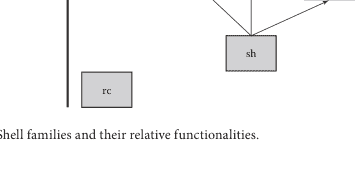

**图 2.7 Shell 家族及其相对功能。**

### 2.8.2 哪种 Shell 适合你的需求？

大多数 shell 执行相似的功能，了解它们实现方式的细节对于决定为特定任务使用哪种 shell 很重要。此外，在一次会话中使用多个 shell 是一种常见做法，尤其是在 shell 脚本文件程序员中。

例如，你可能会使用 Bourne shell 或 Korn shell 来利用其编程能力，并使用 C shell 来执行单个命令。我们将在第 2.8.3 节进一步讨论此示例。主要 shell 功能的相似性总结在表 2.5 中。

### 2.8.3 如何更改你的 Shell

你可以通过在首次登录计算机系统时在命令行键入 `echo $SHELL` 来轻松确定你的默认 shell 是什么。

问题是：为什么你会想更改默认 shell，或者更进一步，甚至使用额外的 shell？答案是你想要另一个 shell 更大、或在某种意义上在质量上不同的功能。

例如，你的默认 shell 可能是 C shell（`csh`）。你的朋友给你提供了一个很棒且有用的 Bourne shell 脚本，让你能够利用 Bourne shell 脚本编程能力，该脚本如果在 C shell 下运行将无法工作。你可以在运行默认 C shell 的同时运行 Bourne shell 来使用此脚本。因为 UNIX 是一个多进程操作系统，所以一次可以有多个命令行解释器处于活动状态。这并不意味着单个命令会被多次解释；它仅仅意味着输入、输出和错误被“挂钩”到当前控制它们的 shell 进程上。有关进程和 shell 命令输入/输出的更多信息，请参见第 10 章。

你可以通过以下两种方式之一更改 shell：

1. 将其更改为你系统上每次后续登录会话的新默认值，以及

2. 在默认 shell 之上或与默认 shell 并发地创建额外的 shell 会话。

这两种方法的先决条件是你要更改到的 shell 在你的系统上可用。

要更改默认 shell，登录后键入 `chsh` 然后按 `<Enter>`。根据你的系统，你将被提示输入你要更改到的 shell 的名称。

在 PC-BSD 系统上，你需要输入超级用户密码才能执行 `chsh` 命令。Solaris 中没有 `chsh` 命令。

**表 2.5 Shell 相似性**

| 功能 | 描述 |
|---|---|
| 执行 | 执行程序和命令的能力 |
| I/O 处理 | 控制程序和命令的输入和输出 |
| 编程 | 执行一系列程序和命令的能力 |

输入你想要切换到的 shell 的位置——例如，输入 `/usr/bin/sh` 以切换到 Bourne shell。如果此方法在你的系统上不起作用，请咨询你的指导老师或系统管理员以获得更多帮助。


要在此默认 shell 之上创建或运行额外的 shell，只需在命令行上输入 shell 程序的名称（参见表 2.4），即可在任何时候运行该 shell。以下会话说明了使用此方法将默认的 Bash shell（使用 `$` 作为 shell 提示符）更改为 C shell（显示 `%` 作为 shell 提示符）。

```
$ echo $SHELL
/usr/bin/bash
$ csh
%
```

第一条命令行允许你确定你的默认 shell。在本例中，系统显示默认设置是 Bash shell。第二条命令行允许你运行 C shell。第四行显示你已成功，因为默认的 C shell 提示符出现在你的显示器上。如果 C shell 在你的系统上不可用或你无法访问它，你将在第三行之后收到错误消息。如果你的搜索路径不包含 `/usr/bin`，你必须将 `csh` 替换为 `/usr/bin/csh`，或者将 `/usr/bin` 包含在你的 shell 的搜索路径中，然后使用 `csh` 命令。

要终止或离开这个新的临时 shell 并返回到你的默认登录 shell，请在空白行上按住 `<Ctrl+D>`。如果这种终止新 shell 的方式不起作用，请在命令行上输入 `exit` 然后按 `<Enter>`。这样做会停止新 shell 的运行，默认 shell 提示符会出现在你的显示器上。如果你在桌面上打开了一个控制台或终端窗口，输入 `exit` 也会关闭此控制台或终端窗口。

以下章节练习要求你使用 `whereis` 命令确定各种 shell 是否在你的系统上可用，并对于那些可用的 shell，使用 `man` 命令阅读它们的手册页。

#### EXERCISE 2.9

使用第 2.5.1 节中说明的 `whereis` 命令，验证表 2.4 中列出的各种 shell 的位置。所有这些 shell 都在你的系统上可用吗？如果你在表 2.4 中显示的位置找不到它们，它们位于何处？

#### EXERCISE 2.10

使用第 2.4.5 节中说明的 `man` 命令，阅读表 2.4 中列出且在你的系统上的每个 shell 的手册页。

### 2.8.4 Shell Start-Up Files and Environment Variables

每个 shell 的行为、其执行命令和程序的机制、其如何处理命令和程序的 I/O，以及如何对其进行编程，都受某些环境变量设置的影響。

每个 UNIX 系统都有一个初始系统启动文件，通常在 Solaris 中命名为 `.profile`，在 PC-BSD 中命名为 `.login`。该文件包含 shell 和一些其他实用程序的重要环境变量的初始设置。此外，当你启动特定 shell 时，会执行特定 shell 的隐藏文件。它们被称为 shell 启动文件，C shell 为 `.cshrc`，Bash 为 `.bashrc`。这些隐藏文件最初由系统管理员为所有用户的安全使用进行配置。表 2.6 列出了 Bash、Bourne、Korn 和 C shell 共有的一些重要环境变量；C shell 变量名（如适用）以小写形式跟在 Bash、Bourne 和 Korn shell 变量名之后。请注意，你的系统管理员可能未设置其中某些变量，例如 `ENV`。

以下章节练习让你查看你的环境变量的设置。它们假设你最初运行的是 Bourne 或 Korn shell。如果不是，请按照第 2.8.3 节所述运行其中之一，然后再做练习。

#### EXERCISE 2.11

在你的系统默认登录 shell 提示符下，输入 `set | more` 然后按 `<Enter>`。你的屏幕上显示了什么？识别并列出表 2.6 中显示的所有环境变量的设置。

#### EXERCISE 2.12

在 shell 提示符下，输入 `csh` 或 `bash` 取决于你的默认系统登录 shell，然后按 `<Enter>`。接下来，输入 `setenv | more` 然后按 `<Enter>`。识别并列出表 2.6 中显示的所有环境变量的设置。

除了 shell 之外，还有几个其他程序也有自己的隐藏文件。这些文件用于设置和配置这些程序执行的运行环境。我们将在第 4 章和第 5 章中讨论其中一些隐藏文件。它们被称为隐藏文件，因为当你列出你的主目录中包含的文件名时——例如，使用 `ls -l` 命令和选项（参见第 4 章）——这些文件不会出现在列表上。隐藏文件名称始终以句点 (`.`) 开头，例如 `.login`。

**Table 2.6 Shell Environment Variables**

| Environment Variable | What It Affects |
|---|---|
| `CDPATH`, `cdpath` | The alias names for directories accessed with the `cd` command |
| `EDITOR` | The default editor used in programs such as the e-mail program Elm |
| `ENV` | The path along which UNIX looks to find configuration files |
| `HOME`, `home` | The name of the user’s home directory when the user first logs on |
| `MAIL`, `mail` | The name of the system mailbox file |
| `PATH`, `path` | The directories that a shell searches to find a command or program |
| `PS1`, `prompt` | The shell prompt that appears on the command line |
| `PWD`, `cwd` | The name of the current working directory |
| `TERM` | The type of console terminal being used |

### 2.9 SHELL 元字符

除字母和数字之外的多数字符对 shell 具有特殊含义。这些字符称为 shell 元字符，因此在 shell 命令中若想将其作为字面字符使用，必须以特定的语法方式指定。因此，请尽量不要在命名文件时使用它们。此外，当这些字符在命令中使用时，字符前后不需要空格。然而，为了清晰起见，你可以在 shell 元字符前后使用空格。表 2.7 包含 shell 元字符的列表及其用途。

### 表 2.7 Shell 元字符

| 元字符 | 用途 | 示例 |
|---|---|---|
| `<换行>` | 结束一条命令行 | |
| `<空格>` | 在命令行为元素分隔 | `ls /etc` |
| `<制表符>` | 在命令行为元素分隔 | `ls /etc` |
| `#` | 开始注释 | `# 这是一条注释行` |
| `" ;` | 引用多个字符但允许替换 | `"$file" bak` |
| `$` | 结束行并引用 shell 变量 | `$PATH` |
| `&` | 提供命令的后台执行 | `command &` |
| `'` | 引用多个字符 | `'$100,000'` |
| `( )` | 在子 shell 中执行命令列表 | `(command1; command2)` |
| `*` | 匹配零个或多个字符 | `chap* ps` |
| `[ ]` | 插入通配符 | `[a-s]` 或 `[1,5-9]` |
| `^` | 开始一行和否定符号 | `[^3-8]` |
| `` ` ` `` | 替换命令 | `PS1='`command`'` |
| `{ }` | 在当前 shell 中执行命令列表 | `{command1; command2}` |
| `|` | 在命令间创建管道 | `command1 | command2` |
| `;` | 在顺序执行中分隔命令 | `command1; command2` |
| `<` | 重定向命令的输入 | `command < file` |
| `>` | 重定向命令的输出 | `command > file` |
| `?` | 用通配符替换 lab? 正好一个字符 | |
| `/` | 用作根目录和 `/usr/bin` 作为路径名中的组件分隔符 | |
| `\` | 转义/引用单个字符；`\n command arg1 \` 用于引用 `<换行>` 字符 `arg2 arg3` 以允许命令的延续 `\? command` 在下一行 | |
| 仅 C 和 Korn Shell | | |
| `!` | 在历史列表中开始事件规范和当前事件 | `!!`, `!$` |
| `%` | C shell 提示符，或指定作业号的起始字符 | `%` 或 `%3` |
| `~` | 命名主目录 | `~/.profile` |

shell 元字符允许你在一条命令行为多个目录中的多个文件指定。我们将在后续章节中描述这些字符的使用，但在此给出一些简单示例以解释一些常用元字符的含义：

- `*`
- `?`
- `~`
- `[ ]`


`?.txt` 字符串可用于所有在 `.txt` 前有一个字符的文件，如 `a.txt`、`G.txt`、`@txt` 和 `7.txt`。`[0-9].c` 字符串可用于目录中所有在 `.c` 前有一个数字的文件，如 `3.c` 和 `8.c`。`lab1/c` 字符串代表 `lab1/c`。请注意反斜杠 (`\`) 用于引用（转义）斜杠字符（`/`）。

以下命令打印当前目录中所有文件名长度为两个字符且扩展名为 `.html` 的文件，且第一个字符为数字，第二个为大写或小写字母。这些文件打印的打印机为 `spr`。

```
$ lpr -P spr [0-9][a-zA-Z].html
$
```

请注意 `[0-9]` 表示 0 到 9 之间的任意数字，而 `[a-zA-Z]` 表示任意小写或大写字母。以下命令显示当前目录中所有长度为六个字符且扩展名为 `.c` 的文件，其中前三个字符为 `lab`，第四个为数字，其余为任意两个字符。

```
$ ls lab[0-9]?? .c
lab11a.c lab1a1.c lab123.c lab4ab.c
$
```

### 2.10 SUDO 和 SU 命令

`sudo` 命令允许被许可的用户以超级用户身份执行命令，或根据安全策略承担另一用户的角色。`su` 命令允许普通用户切换用户角色或在系统上模拟超级用户。超级用户对系统上的所有内容具有文件权限和访问特权。

在以下各章所示的许多操作中，尤其是在第 23 章系统管理中，将需要执行 `su` 命令以完成所示任务。为了使用此命令，需要知道 `root` 或超级用户密码。

我们在第23章23.9.3.1节中对`sudo`命令进行了更完整的说明。

下面是在PC-BSD系统上使用`su`命令的一个示例：

```
[bob@pcbsd-923] % su
Password: XXX
[bob@pcbsd-923] /usr/home/bob#
```

## 小结

UNIX操作系统以其基于文本的命令执行而最为著名，但在二十一世纪它也拥有颇具竞争力的图形用户界面（GUI）环境。本章旨在让你熟悉CUI（字符用户界面）UNIX命令的基本结构，还向你展示了如何通过三种流行且典型的登录方法登录，以及如何优雅地注销。

初学者必须能够进行基本的文件维护，本章介绍了一组核心的CUI文件维护命令及其选项。这些命令在本书其余部分都会用到。最后，我们演示并举例说明了一些基本实用命令——最重要的是允许你打印文件的命令及其选项，以及`alias`（别名）命令。

登录UNIX计算机后，系统会运行一个名为`shell`的程序，它会给你一个提示符，并等待你输入命令——这些命令可以是单独的命令，也可以是通过重定向或管道运算符连接的多个命令。`shell`程序用C语言编写，是一个解释器，因此具有与高级语言相同的结构化编程能力。当你输入命令并按`<Enter>`键时，`shell`会解释并尝试执行该命令，它假定命令行中的第一个单词就是命令的名称。`shell`命令可以是内建命令或外部命令。`shell`拥有执行内建命令的代码，但外部命令的代码存放在文件中。为了执行外部命令，`shell`会逐一搜索多个目录，以定位包含该命令代码的文件。如果找到了该文件，并且其中包含代码（二进制或`shell`脚本），就会执行它。`shell`为了定位外部命令文件而搜索的目录名称集合称为搜索路径。搜索路径存储在`shell`变量`PATH`（Bourne、Korn和Bash `shell`）或`path`（C `shell`）中。你可以通过在`PATH`中添加新目录名或删除其中一些现有目录名来更改`shell`的搜索路径。

有几种`shell`可供你使用。这些`shell`在命令行级别的使用便利性以及其编程语言可用的功能方面有所不同。基于UNIX的系统中，最常用的`shell`是`Bash`和`C Shell`。`Bourne shell`是最古老的，并且具有优秀的编程语言。`C shell`具有更方便、更丰富的命令级界面。`Korn shell`兼具两者的某些优点，并且是`Bourne shell`的超集。

某些被称为`shell`元字符的字符对`shell`具有特殊含义。由于`shell`会以特殊方式处理它们，因此不应在文件名中使用这些字符。如果必须在命令中使用它们，你需要对它们进行引号引用，以便`shell`按字面意义处理它们。

## 问题与练习

- 1. 在你的主目录中创建一个名为`UNIX`的目录。你使用了什么命令行来完成此操作？

- 2. 给出一个命令行，用于显示文件 `lab1`、`lab2`、`lab3` 和 `lab4`。你还能给出另外两个完成相同操作的命令行吗？用于显示文件 `lab1.c`、`lab2.c`、`lab3.c` 和 `lab4.c` 的命令行是什么？（提示：使用`shell`元字符。）

- 3. 给出一个PC-BSD命令行，用于在名为`upmpr`的打印机上打印你主目录中所有以字符串`memo`开头、以`.ps`结尾的文件。你使用了什么命令行来完成此操作？

- 4. 给出将命令 `who -H` 昵称为 `W` 的命令行。分别给出Bourne和C `shell`版本。如果你希望每次启动新`shell`时都执行该命令，你会把它放在哪里？

- 5. 在你的系统上输入命令 `man ls > ~/UNIX/ls.man`。该命令会将`ls`命令的手册页放入你`~/UNIX`目录（即你在问题1中创建的目录）中的`ls.man`文件里。给出在实验室打印机上打印此文件两份的命令。在PC-BSD上实现此打印你会使用什么命令行？在Solaris上你会使用什么命令？

- 6. 你的环境中`mesg`值设置为什么？如果它是开（on）状态，你将如何关闭当前会话？你如何让它在每次登录时都关闭？

- 7. 在PC-BSD中，命令 `lpr -Pppr [0-9]*.jpg` 的作用是什么？解释你的答案。

- 8. 使用`passwd`命令更改你的密码。如果你在网络中，请注意你可能必须使用`yppasswd`命令来修改你的网络登录密码。此外，请确保遵守系统管理员为设置良好密码而制定的规则！

- 9. 使用正确的术语（例如，命令、选项、选项参数和命令参数），指出以下UNIX单命令的组成部分。

  - `ls -la *.exe`

  - `lpr -Pwr file27`

  - `chmod g+rwX *.*`

- 10. 查看表2.3中列出的每个有用命令的手册页。对你来说，手册页的哪个部分描述性最强？每个手册页中显示的哪个选项对初学者最有用？请解释。

- 11. 当前有多少用户登录到你的系统？你使用了什么命令来查明这一点？

- 12. 确定你的计算机运行的操作系统名称。你使用了什么命令来发现这个？

- 13. 给出在 PC-BSD 系统上显示 `socket`、`read` 和 `connect` 系统调用的手册页的命令行。在 Solaris 计算机上命令行会是什么？

- 14. 什么是 `shell`？它的用途是什么？

- 15. `shell` 命令有哪两种类型？它们之间有什么区别？

- 16. 列出五个 UNIX `shell` 的名称。哪些是最流行的？什么是登录 `shell`？输入什么来终止 `shell` 的执行？如何终止你的登录 `shell` 的执行？

- 17. 你认为哪些 `shell` 是其他 `shell` 的超集？换句话说，哪些 `shell` 拥有其他 `shell` 的完整命令集加上自己的命令？你能在子集 `shell` 中找到任何不在超集 `shell` 中的命令吗？参考图 2.7。

- 18. `shell` 的搜索路径是什么？用于在 Bourne、C 和 Korn `shell` 中维护它的 `shell` 变量的名称是什么？这个变量通常位于哪个文件（即在哪个文件中）？

- 19. 你的环境中搜索路径设置为什么？你是如何查明的？设置你的搜索路径，使你的 `shell` 在查找你输入的命令时搜索你的当前目录和你的 `~/bin` 目录。你的 `shell` 以什么顺序搜索搜索路径中的目录？为什么？

- 20. 什么是隐藏文件？在登录到 System V 和 BSD UNIX 系统时执行的隐藏文件的名称是什么？

- 21. 什么是 `shell` 启动文件？C `shell` 的这个文件的名称是什么？这个文件存储在哪个目录（即在哪个目录中）？

- 22. 对于每个 `shell`，正如在该 `shell` 的手册页上所讨论的那样，哪些重要特性似乎对你作为 UNIX 的新手、中级或高级用户最为重要？解释这些特性对你的重要性，与其他可用的 `shell` 及其特性相比。

- 23. 假设你的登录 `shell` 是 C `shell`。你收到一个使用 Bourne `shell` 运行的 `shell` 脚本。你将如何执行它？清楚地写下你将使用的所有步骤。

## 编辑文本文件

### 目标

- 解释在 UNIX 系统上编辑文本文件的一般用途

- 展示 `vi`、`vim` 和 `gvim` 的基本功能以及如何自定义它们

- 展示 GNU `emacs` 的基本功能以及如何自定义它

- 涵盖命令和原语

```
cp, emacs, gvim, ls, pwd, sh, vi, vim, who
```

### 3.1 引言与快速入门

在本章中，我们使用以下在我们两个基础现代 UNIX 系统 PC-BSD 和 Solaris 中通常可用的编辑器：`vi`、`vim`、`gvim` 和 GNU `emacs`。

#### 3.1.1 快速入门：通过这些编辑器的最简单路径

为了强调键盘键在这些编辑器中的使用方式，我们提供以下关于用于执行命令或更改模式的键的参考：

1. 按下 Escape 键表示为 `<Esc>`

2. 按下 Enter 键表示为 `<Enter>`


### 3. 同时按下 `<Ctrl>` 键与其他单个键组合表示为 `<Ctrl+X>`，其中你按住 `<Ctrl>` 键并同时按下 X 键（或该组合的有效键）。

### 4. 同时按下 Alt 键与其他单个键组合表示为 `<Alt+X>`，其中你按住 `<Alt>` 键并同时按下 x 键（或该组合的有效键）。

### 5. 3. 和 4. 的变体显示为 `<Ctrl+X>` a [b]，其中你首先同时按下并释放 `<Ctrl>` 和 x，然后按下 a 键，并可选择按下 b 键（或任何有效的单个键或字符字符串组合）。

### 6. 在 PC-BSD 和 Solaris 上的 GNU emacs 中，文献中提到的 Meta 键就是 `<Alt>` 键。

你在键盘上输入或按住的内容以粗体文本显示。

### 3.1.1.1 对于 vi、vim 和 gvim

- 在 shell 提示符下，通过输入 `vi file1` 然后按下 `<Enter>` 来运行程序。

- 输入 `A`。

- 输入一些文本。

- 按下 `<Esc>`。

- 输入 `:` （冒号）。

- 输入 `wq` 然后按下 `<Enter>`。

你现在在默认目录中有一个名为 `file1` 的文件，其中包含你输入的文本。如果 GNU emacs 未安装在你的系统上，请跳到下一小节，获取有关如何安装它的一般说明。然后执行以下操作：

### 3.1.1.2 对于 GNU emacs

- 在 shell 提示符下，通过输入 `emacs file2` 然后按下 `<Enter>` 来运行程序。

- 输入一些文本。

- 按住 `<Ctrl+U>`，然后 `<Ctrl+X>`，然后 `<Ctrl+C>`。

你现在在默认目录中有一个名为 `file2` 的文件，其中包含你输入的文本。

### 3.1.2 对 UNIX 编辑器的初步评论

正如你在第 3.1.1 节中所看到的，使用 `vi`、`vim` 和 `gvim`，你不能立即开始向正在编辑的文件中输入文本。你必须处于插入模式才能做到这一点；这就是第二步输入 `A` 所做的。`Vi`、`vim` 和 `gvim` 具有模式。

在 GNU emacs 中，你可以立即开始向文件中输入文本。`Emacs` 是一个无模式编辑器。

我们在本章中使用键入的命令，并使用图形输入和编辑模式来呈现教程信息。

必须认识到，`vi`、`vim` 和 `gvim` 通常使用相同的命令并且基本功能相同。但 `vim` 和 `gvim` 不仅更

graphical—allowing you to work more efficiently in GUI environments such as those on our base modern UNIX systems, PC-BSD and Solaris—but they also have an improved and expanded command structure. This will become more evident to you, for example, in Section 3.2.9, where `vim` has special improved macro-writing capabilities that `vi` does not.

At the time of writing, both PC-BSD and Solaris have `vi`, `vim`, and `gvim` preinstalled if you have done a basic installation of the system as detailed at the beginning of Chapter 23. But GNU emacs is not preinstalled. Therefore, you must look ahead to Chapter 23, Section 23.7, "System Updates and Software Upgrades by Using a Package Manager." In that section, you will be shown how to use the appropriate package management facilities to obtain GNU emacs for your system. In the App Café in PC-BSD, you must browse Categories>Editors for Emacs and install it. From the Solaris IPS repository, you must browse Development>Editors, and install gnu-emacs.

We will not cover the details of the installation of any of the editors we demonstrate here. In addition, if you are logging into a UNIX system via a terminal window, such as with PuTTY from a Windows machine, many of the graphical modes and techniques shown in this chapter will not be available to you. But that does not prevent you from using the traditional typed commands and keyboard edits that we show.

## 3.1.3 Using Text Editors

Modern UNIX uses both a GUI, with powerful window management systems like Gnome and KDE, and a CUI. Therefore, to do useful things such as execute multiple commands from within a script file, write e-mail messages, or create C language programs, you must be familiar with one or perhaps multiple ways of entering text into a file. In addition, you must also be familiar with how to edit existing files efficiently—that is, to change their contents or otherwise modify them in some way. Text editors allow you to view a file's contents, similar to the more command, so that you can identify the key features of the file, and then read and utilize the information contained in it. For example, a file without any extension, such as `foo` (rather than `foo.txt`) might be a text file that you can view with a text editor.


The editors that we consider here are all considered full-screen display editors. That is, on the display screen or monitor that you are using to view or edit a file, you are able to see a portion of the file, which fills most or all of the window allocated to the text editor screen display. You are also able to move the cursor, or point, to any of the text you see in this full-screen display, with either the arrow keys on the keyboard or with a mouse. That text material is usually held in a temporary storage area in computer memory called the editor buffer. If your file is larger than one screen, the buffer contents change as you move the cursor through the file. The difference between a file, which you edit, and a buffer is crucial. For text-editing purposes, a file is stored on disk as a sequence of data. When you edit that file, you edit a copy that the editor creates, which is in the editor buffer. You make changes to the contents of the buffer—and can even manipulate several buffers at once—but when you save the buffer, you write a new sequence of data to the disk, thereby saving the file.

### TABLE 3.1 Basic Text-Editing Functions

| Function | Description |
|---|---|
| Cursor movement | Moving the location of the insertion point or current position in the buffer |
| Cut or copy, paste | "Ripping out" text blocks or duplicating text blocks, reinserting ripped or duplicated blocks |
| Deleting text | Deleting text at a specified location or in a specified range |
| Inserting text | Placing text at a specified location |
| Opening, starting | Opening an existing file for modification, beginning a new file |
| Quitting | Leaving the text editor, with or without saving the work done |
| Saving | Retaining the buffer as a disk file |
| Search, replace | Finding instances of text strings, replacing them with new strings |

Another important operational feature of all the editors discussed in this chapter is that, traditionally, their actions are based on keystroke commands, whether they are a single keystroke or combinations of keys pressed simultaneously or sequentially. Because one of the primary input devices in `UNIX` is the keyboard, using the correct syntax of keystroke commands is mandatory. But the keyboard method of input, once you have become accustomed to it, is as efficient or, for some users, even more efficient than mouse/GUI input. Keystrokes also are more flexible, giving you more complete and customizable control over editing actions. Generally, you should choose the editor you are most comfortable with, in terms of the way you prefer to work with the computer. However, your choice of editor also depends on the complexity and quantity of text creation and manipulation that you want to do. Practically speaking, editors such as `vi`, `vim`, `gvim`, and `GNU emacs` are capable of handling complex editing tasks in multiple windows on multiple files, and provide you with a visual software development environment, as well as document production and management capability. But to take advantage of that power, you have to learn the mechanics of the commands that are needed to perform those tasks and how they are implemented either graphically or by typing them—and retain that knowledge. The basic functions common to the text editors that we cover here are listed in Table 3.1, along with a short description of each function.

## 3.2 USING THE `vi`, `vim`, AND `gvim` EDITORS

The `vi`, `vim`, and `gvim` `UNIX` text editors have almost all the features of a word processor and have tremendous flexibility in creating text files. They are complex to learn, but their advantages give you the ability to create, manipulate, and use the kinds of text files that the full range of `UNIX` users, from absolute novice to seasoned veteran, commonly work with. We will proceed in the following section and subsections by demonstrating `vi` as a text-only interface editor, then move to a more graphical interface approach with `vim` and `gvim`.


# Buffers

As we mentioned in Section 3.1, the notion of a buffer as a temporary storage facility for the text that you are editing is very useful and important in `vi`, `vim`, and `gvim`. The main buffer, sometimes referred to as the editing buffer or the work buffer, is the main repository for the body of text that you are trying to create or to modify from some previous permanently archived file on disk. The general purpose buffer is where your most recent "ripped-out" (cut/copied) text is retained. Indexed buffers allow you to store more than one temporary string of text.

## 3.2.1 Basic Shell Script File Creation, Editing, Execution

Shell Script File: Practice Session 3.1 shows how to create a script file, or collection of UNIX commands that are executed in sequence, and then execute the script. We present more about shell programming and script files in Chapters 12 through 15. For this example, we assume that you are running the Bourne shell. If you are running some other shell by default, go back to Chapter 2, Section 2.8, and review how to identify and change shells.

In PC-BSD, to run an interactive shell, such as the Bourne shell shown in Practice Session 3.1, on top of your login shell (which is the C shell by default in that system), at the C shell prompt you type `sh` and press `<Enter>`.

If you are using Solaris, do Practice Session 3.1 for the Bourne Again (`Bash`) shell, which is the default shell in that system, and don't change shells.

And do not worry too much if you make an error in Steps 2, 3, and 4; you can go through the rest of the script file discussion and then come back to this example after you have learned some of the editing commands and become more familiar with them.

### 3.2.1.1 Practice Session 3.1

- Step 1: At the shell prompt, start `vi` by typing `vi firscrip` and then pressing `<Enter>`. The `vi` screen appears on your display.
- Step 2: Type `A`. Then type `ls -la` and then press `<Enter>`.
- Step 3: Type `who` and then press `<Enter>`.
- Step 4: Type `pwd` and then press the `<Esc>` key. At this point, your screen should look like that shown in Figure 3.1.
- Step 5: Type `:wq` and then press `<Enter>`.
- Step 6: At the shell prompt, type `sh firscrip` and then press `<Enter>`.
- Step 7: Note the results. How many files do you have in your present working directory? What are their names and sizes? Who else is using your computer system? What is your present working directory?

```
ls -la
who
pwd
**
**
**
**
**
**
**
**
**
**
**
**
**
**
**
**
```

FIGURE 3.1 File `firscrip` after Step 4.

In Practice Session 3.1, you accomplished these things:

- At Step 2, typing `A` took `vi` out of Command mode (which is what `vi` starts in by default) and placed it in one of the forms of Insert mode. In other words, anything that you typed at the keyboard was appended as text on the first line in the text area of the editor.
- When you pressed the `<Esc>` key in Step 4, `vi` was taken out of Insert mode and put back into Command mode.
- When you typed `:` in Step 5, that was a valid Command mode prefix character for the two commands that followed, and put `vi` in Last Line mode.
- When you typed `wq` after the `:`, `vi` interpreted those commands in Last Line mode as write out or save the file, and quit the editor.
- Step 6 executes the Bourne shell script file.

## 3.2.2 How to Start, Save a File, and Exit

When you need to do UNIX text editing that gives you as much functionality as a typical word processor, you can use the `vi` text editor. To start `vi` from the command line, use the following general syntax (anything enclosed in square brackets `[ ]` is optional):

### SYNTAX

```
vi [options] [file(s)]
```

**Purpose:** Allows you to edit a new or existing text file(s)

**Output:** With no options or file(s) specified, you are placed in the `vi` program and can begin to edit a new buffer

### Commonly used options/features:

- `+n` Begin to edit file(s) starting at line number `n`
- `+/exp` Begin to edit at the first line in the file matching string `exp`


The operations that you perform in `vi` fall into two general categories: Command mode operations, which consist of key sequences that are commands to the editor to take certain actions, and Insert mode operations, which allow you to input text.

The general organization of the `vi` text editor and how to start, exit, and switch modes are illustrated in Figure 3.2. The general organization of `vim` and `gvim`, and how to start, exit, and switch modes in those editors, is the same as shown for `vi` in Figure 3.2.

For example, to change from Command mode, which you are in when you first enter the editor, to Insert mode, type a valid command, such as `A` to append text at the end of the current line. Certain commands that are prefixed with the `:`, `/`, `?`, or `:!` characters are echoed or shown to you on the last line on the screen and must be terminated by pressing `<Enter>`. Last Line mode, sometimes called ex mode because it is derived from the ex editor, allows you to execute certain commands and leave the editor. To change from Insert mode to Command mode, press the `<Esc>` key.

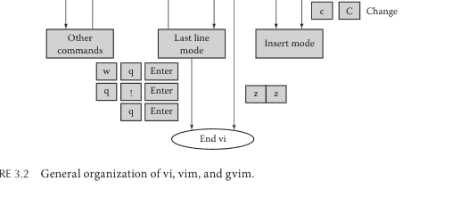

FIGURE 3.2 General organization of `vi`, `vim`, and `gvim`.

在 `vi` 中执行的按键命令区分大小写；例如，大写 `A` 在当前行的末尾字符之后追加新文本，而小写 `a` 则在光标所在字符之后追加新文本。

要启动 `vi`，在 shell 提示符下，输入 `vi`（并可选择指定选项和文件名），然后按 `<Enter>`。你现在处于命令模式。要进入插入模式，输入 `A`，你现在能够在文件的第一行插入文本。

输入文本后，你可以按 `<Esc>` 键进入命令模式。

在创建或操作文本的任何阶段，你都可以按键盘上的 `u` 键来撤销上一次操作。

从命令模式，你可以通过输入 `:w filename` 并按 `<Enter>`，将刚插入到缓冲区中的文本保存到磁盘上的文件，其中 `filename` 是你想要保存文本到的文件名。要退出编辑器，输入 `:q`。

## 3.2.3 vi 命令的格式和操作模式

在命令模式下，按键的通用语法是：

```
[#1] operation [#2] target
```

其中：

+ `[ ]` 中的任何内容都是可选的；
+ `#1` 是可选的数字，例如 `5`，指定要执行的操作次数；
+ `operation` 是你想要完成的操作，例如删除文本行；
+ `#2` 是可选的数字，例如 `5`，指定受操作影响的目标数量；以及
+ `target` 是你想要对之执行操作的文本，例如整行文本。

请注意，如果当前行是操作的目标，则指定目标的语法与操作语法相同；例如，`dd` 删除当前行。此外，该通用语法的变体是光标移动命令，其中你可以省略数字和操作，只需按单词、句子、段落或节移动光标。表 3.2 列出了命令模式中使用的该通用语法和变体的一些具体示例。

如前所述，当你启动 `vi` 时，它处于命令模式。当你想处于插入模式而不是命令模式时，按一个有效的键来实现更改。其中一些键显示在表 3.3 中。

插入文本后，你可以编辑文本，将光标移动到缓冲区中的新位置，并从命令模式中保存缓冲区并退出编辑器。当你想从插入模式更改为命令模式时，按 `<Esc>` 键。

要保存缓冲区并退出编辑器，按 `:` 键（冒号）进入末行模式。在末行模式中有用的通用命令显示在表 3.4 中。

### TABLE 3.2 Examples of Vi Command Syntax

| Command | Action |
|---|---|
| `cw` | 更改单词。 |
| `cc` | 更改行。 |
| `c$` | 更改从当前位置到行尾的文本。 |
| `C` | 同 `c$`。 |
| `dd` | 删除当前行。 |
| `7 dd` | 删除 7 行。 |
| `d$` | 删除从当前位置到行尾的文本。 |
| `D` | 同 `d$`。 |
| `5dw` | 删除 5 个单词。 |
| `d7,14` | 删除缓冲区中第 7 行到第 14 行。 |
| `d}` | 删除到下一个段落。 |
| `d^` | 删除回行首。 |
| `d/ pat` | 删除到模式的第一次出现为止。 |
| `dn` | 删除到模式的下一个出现为止。 |
| `dF x` | 删除到当前行上的 x 包括 x 为止。 |
| `dt x` | 删除到当前行上的 x 但不包括 x 为止。 |
| `dL` | 删除到屏幕上的最后一行。 |
| `dG` | 删除到文件末尾。 |
| `gqap` | 重新格式化当前段落为文本宽度（`vim` 和 `gvim`）。 |
| `g~w` | 切换单词的大小写（`vim` 和 `gvim`）。 |
| `guw` | 将单词改为小写（`vim` 和 `gvim`）。 |
| `gUw` | 将单词改为大写（`vim` 和 `gvim`）。 |
| `p` | 在光标后插入最后删除或 yank 的文本。 |
| `gp` | 同 `p`，但使光标停留在插入文本的末尾（`vim` 和 `gvim`）。 |
| `gP` | 同 `P`，但使光标停留在插入文本的末尾（`vim` 和 `gvim`）。 |
| `]p` | 同 `p`，但匹配当前缩进（`vim` 和 `gvim`）。 |
| `[p` | 同 `P`，但匹配当前缩进（`vim` 和 `gvim`）。 |
| `P` | 在光标前插入最后删除或 yank 的文本。 |
| `r x` | 用 x 替换字符。不需要使用 `<Esc>`！ |
| `R text` | 用新文本替换（覆盖），从光标开始。`<Esc>` 结束替换模式。 |
| `s` | 替换字符。`<Esc>` 结束替换模式。 |
| `4s` | 替换四个字符。`<Esc>` 结束替换模式。 |
| `S` | 替换整行。`<Esc>` 结束替换模式。 |
| `u` | 撤销上一次更改。 |
| `<Ctrl+R>` | 重做上一次更改（`vim` 和 `gvim`）。 |
| `U` | 恢复当前行，如果你尚未移离它。 |
| `x` | 删除当前光标位置。 |
| `X` | 删除后退一个字符。 |
| `5X` | 删除之前的 5 个字符 |
| `.` | 重复上一次更改。 |
| `<Ctrl+A>` | 更改大小写并移动光标右移。 |
| `<Ctrl+>` | 增加光标处的数字（`vim` 和 `gvim`）。 |
| `<Ctrl+X>` | 减少光标处的数字（`vim` 和 `gvim`）。 |

### 表 3.3 从命令模式切换到插入模式的重要键

| Key | Action |
|---|---|
| `a` | 在光标所在字符之后追加文本 |
| `A` | 在当前行最后一个字符之后追加文本 |
| `c` | 开始更改操作，允许你修改文本 |
| `C` | 从光标位置更改到当前行末尾 |
| `i` | 在光标所在字符之前插入文本 |
| `I` | 在当前行开头插入文本 |
| `o` | 在当前行下方打开一个空白行并将光标置于该行 |
| `O` | 在当前行上方打开一个空白行并将光标置于该行 |
| `R` | 开始覆盖文本 |
| `s` | 替换单个字符 |
| `S` | 替换整行 |

### 表 3.4 命令模式的重要命令

| Command | Action |
|---|---|
| `: n, m w file` | 将第 n 到 m 行写入新文件。 |
| `: n, m w >> file` | 将第 n 到 m 行追加到现有文件。 |
| `:r filename` | 读取并在当前光标位置插入文件 `filename` 的内容 |
| `:wq` | 保存缓冲区并退出 |
| `:w` | 保存当前缓冲区并停留在编辑器中。 |
| `:w filename` | 将当前缓冲区保存为 `filename` |
| `:w! filename` | 用当前文本覆盖 `filename` |
| `:w!` | 写入文件（覆盖保护）。 |
| `:w! file` | 用当前文本覆盖文件。 |


| `:w % .new` | 将当前缓冲区命名为 file 的文件写入为 file.new。 |

| `:q` | 退出 vi（如果进行了更改则失败）。 |

| `:q!` | 不保存缓冲区退出 vi。 |

| `:Q` | 退出 vi 并调用 ex。 |

| `:vi` | 在 Ø 命令后返回 vi。 |

| `ZZ` | 退出 vi，仅在上次保存后进行了更改时保存文件 |

| `%` | 在编辑命令中替换为当前正在编辑的文件名。 |

| `#` | 在编辑命令中替换为备用文件名。 |

目前，我们建议你使用键盘上的方向键在缓冲区中移动光标。也可以使用键盘上的 `h`、`j`、`k` 和 `l` 键来移动光标。在 `gvim` 中，你可以使用鼠标及其按钮！

以下练习会话将介绍表 3.2 至 3.4 中介绍的一些命令：

## 3.2.3.1 练习会话 3.2

步骤 1：在 shell 提示符下，输入 `vi firstvi` 然后按 `<Enter>`。

步骤 2：输入 `A`，然后输入 `This is the first line of a vi file.` 然后按 `<Enter>`。

步骤 3：输入 `This is the line of a vi file.` 然后按 `<Enter>`。

步骤 4：输入 `is the 3r line of a vi.` 

步骤 5：按下 `<Esc>` 键。

步骤 6：输入 `:w` 然后按 `<Enter>`。

步骤 7：使用键盘上的方向键将光标定位到文件第二行中单词 `line` 的字符 `l` 上。

步骤 8：输入 `i` 然后输入 `2nd`。

步骤 9：按下 `<Esc>` 键。

步骤 10：使用方向键将光标定位到文件第三行的任意位置。

步骤 11：输入 `I` 然后输入 `This`。

步骤 12：按下 `<Esc>` 键。

步骤 13：使用键盘上的方向键将光标定位到该行中 `3r` 的字符 `r` 上。

步骤 14：输入 `a` 然后输入 `d`。

步骤 15：按下 `<Esc>` 键。

步骤 16：输入 `A` 然后输入 `file`。

步骤 17：按下键盘上的 `<Esc>` 键。你的屏幕显示应类似于图 3.3。

步骤 18：输入 `:wq`。你将回到 shell 提示符。

以下章节练习要求你应用在前一个练习会话中学到的一些操作。

## 练习 3.1

使用 `vi` 你开始编辑昨天创建的文件。你想在仍在 `vi` 中的情况下保存它的一个副本并使用不同的文件名，但你不想退出此编辑会话。你如何在 `vi` 中实现此结果？

## 练习 3.2

如果你在 `vi` 中完成了五个操作然后在命令模式下输入 `5u` 会发生什么？

## 3.2.4 光标移动和编辑命令

在命令模式下，多个命令可完成光标移动和文本编辑任务。表 3.5 列出了重要的光标移动和键盘编辑命令。如

我们已经指出的那样，光标的逐字符或逐行移动可以用方向键轻松完成，或者也可以使用键盘上的 `h`、`j`、`k` 和 `l` 键。

以下练习会话让你继续使用表 3.5 中介绍的命令编辑你在练习会话 3.2 中创建的文件。

```
This is the first line of a vi file.
This is the 2nd line of a vi file.
This is the 3rd line of a vi file.
~
~
~
~
~
~
~
~
~
~
~
~
~
~
```

图 3.3 文件 `firstvi`。

# 表 3.5 光标移动和键盘编辑命令

| Command | Action |

|---|---|

| `1G` | 将光标移动到文件的第一行 |

| `G` | 将光标移动到文件的最后一行 |

| `0` (zero) | 将光标移动到当前行的第一个字符 |

| `<Ctrl+l+O>` | 报告光标位置的 行号 和 列号 |

| `$` | 将光标移动到当前行的最后一个字符 |

| `w` | 将光标向前移动一个词一次 |

| `b` | 将光标向后移动一个词一次 |

| `x` | 删除光标位置的字符 |

| `dd` | 删除当前光标位置所在的行 |

| `u` | 撤消最近的更改 |

| `r` | 用接下来输入的内容替换当前光标位置的字符 |

## 3.2.4.1 练习课 3.3

步骤 1：在 shell 提示符下，输入 `vi firstvi` 然后按 `<Enter>`。

步骤 2：输入 `G`。光标移动到文件的最后一行。

步骤 3：同时按住 `<Ctrl>` 和 `g` 键。在屏幕显示的最后一行，`vi` 报告如下：

```
"firstvi" line 3 of 3 - - 100%-- col 1
```

这是对你正在编辑的缓冲区的报告、当前行号、缓冲区中的总行数、该行代表的缓冲区百分比以及光标的当前列位置。

步骤 4：输入 `o`。文件第三行下方打开一个新行

步骤 5：输入 `This is the 5th line of a vi file`。输入 `<Esc>`。

步骤 6：输入 `0`（零）。光标移动到你刚刚输入的行的第一个字符。

步骤 7：输入 `$`。光标移动到当前行的最后一个字符。

步骤 8：输入 `O`。当前第四行上方打开一个新行。

步骤 9：输入 `This is the 44th line of a va file`。输入 `<Esc>`。

步骤 10：使用箭头键将光标定位到此行中 `44` 的第一个 `4` 上。

步骤 11：输入 `x`。

步骤 12：使用箭头键将光标定位到此行中 `va` 中的 `a` 上。

步骤 13：输入 `r` 然后输入 `i`。

步骤 14：输入 `dd`。

步骤 15：输入 `:wq` 返回到 shell 提示符。

步骤 16：在 shell 提示符下，输入 `more firstvi` 然后按 `<Enter>`。`more` 在此文件中显示有多少行包含文本？

## 3.2.5 Yank 和 Put（复制和粘贴）以及 Substitute（搜索和替换）

每个文字处理器都能够复制和粘贴文本，也能够搜索旧文本并将其替换为新文本。复制和粘贴是通过 `vi` 命令 `yank` 和 `put` 实现的。一般来说，你按顺序使用 `yank` 和 `put`，并且仅在 `yank` 和 `put` 之间移动光标（使用任何光标移动命令或方法）。表 3.6 给出了 `yank` 和 `put` 的语法示例。

简单的 `vi` 形式的搜索和替换是通过使用 `substitute` 命令实现的。该命令在 Last Line 模式下执行，在该模式下你用 `:` 字符作为命令前缀，并通过按 `<Enter>` 终止命令。`substitute` 命令在状态行上的格式为：

```
:[range]s/pattern/string[/option(s)][count]
```

其中：

+   - 任何用 `[ ]` 括起来的内容都是非强制性的；
+   - `:` 是 Last Line 模式命令的冒号前缀；
+   - `range` 是缓冲区中行的有效规范（或当前行是范围）；
+   - `s` 或 `substitute` 是 `substitute` 命令的语法；
+   - `/` 是搜索的分隔符；
+   - `pattern` 是你想要替换的文本或对象；
+   - `/` 是替换的分隔符；
+   - `string` 是新的文本或对象；

### 表 3.6 Yank 和 Put 命令的语法示例

| 命令语法 | 其实现的功能 |

|---|---|

| `y2w` | 从当前光标位置开始向右，`yank` 两个词 |

| `4yb` | 从当前光标位置开始向左，`yank` 四个词 |

| `yy` or `Y` | `Yank` 当前行 |

| `p` | 在当前光标位置之后放置 `yank` 的文本 |

| `P` | 在当前光标位置之前放置 `yank` 的文本 |

| `5p` | 在当前光标位置之后将缓冲区中的 `yank` 文本放置五次 |

| `y` | 复制当前行 |

| `YY` | 复制当前行 |

| `" x yy` | 复制当前行到寄存器 `x` |

| `ye` | 复制文本到词尾 |

| `yw` | 与 `ye` 相同，但包含词后的空白 |

| `y$` | 复制行的剩余部分 |

| `" ; x dd` | 删除当前行到寄存器 `x` |

| `" ; x d` | 删除到寄存器 `x` |

| `" ; x p` | 放置寄存器 `x` 的内容 |

| `y]` | 复制到下一个节标题 |

| `J` | 将当前行与下一行连接 |

| `gJ` | 与 `J` 相同，但不插入空格（`vim` 和 `gvim`） |

| `:j` | 与 `J` 相同 |

| `:j !` | 与 `gJ` 相同 |

`/option(s)` 是命令的修饰符，通常为 `g` 表示全局；并且

`count` 是从当前位置开始执行命令的行数。

`pattern` 和 `string` 的语法可以非常明确和复杂，可能采用正则表达式的形式。（我们在第 7 章第 7.2 节中介绍了更多关于正则表达式形成的的信息。）表 3.7 给出了 `substitute` 命令的语法示例，包括仅 `vim/gvim` 的构造。

### 表 3.7 Substitute 命令的语法示例

| 命令语法 | 其实现的功能 |

|:---|:---|

| `:s/john/jane/` | 在当前行仅替换一次，将单词 `jane` 替换为单词 `john`。 |

| `:s/john/jane/g` | 在当前行将每个单词 `john` 替换为单词 `jane`。 |


| `:1,10s/big/small/g` | 在第 1–10 行将每个单词 `big` 替换为单词 `small`。 |
| `:1,$s/men/women/g` | 在整个文件中将每个单词 `men` 替换为单词 `women`。 |
| `:'<,'>s/this/that/g` | 首先在命令模式下选择范围，方法是输入 `<Ctrl+V>` 并使用箭头键。然后输入 `:`。将单词 `this` 替换为单词 `that`（`vim`、`gvim` 仅限）。 |
| `:s/\<tim\>/tom/` | 仅用单词 `tom` 替换整个单词 `tim`，而不是在任何字符串中部分匹配 `tim`。 |
| `:%s/terrible/wonderful/gc` | 使用 `c` 选项交互式地将单词 `terrible` 替换为单词 `wonderful`（`vim`、`gvim` 仅限）。 |
| `:%s/^ /=line(".") "." /g` | 使缓冲区中所有行的行号永久成为每行的一部分（`vim`、`gvim` 仅限）。 |

练习课 3.4 向你展示如何使用 `vi` 命令 `yank` 和 `put` 来复制和粘贴。它还允许你使用 `vi` `substitute` 命令进行单个和多次搜索并替换文本。

## 3.2.5.1 练习课 3.4

- 步骤 1：在 shell 提示符下，输入 `vi multiline` 然后按 `<Enter>`。
- 步骤 2：输入 `A` 然后输入 `Windows is the operating system of choice for everyone`。
- 步骤 3：按 `<Esc>` 键。你已离开插入模式，现在处于命令模式。
- 步骤 4：按 `0`（零）键。光标移动到第一行的第一个字符。
- 步骤 5：输入 `yy`。此操作将第一行 `yank`，或复制，到一个特殊缓冲区。
- 步骤 6：输入 `7p`。此操作将第一行 `put`，或粘贴，七次，创建七个包含与第一行相同文本的新行。光标现在应位于第八行的第一个字符上。
- Step 7: Type `1G`。此操作将光标置于缓冲区第一行的第一个字符上。
- Step 8: 同时按住 `<Shift>` 和 `;` 键。这样会在 `vi` 屏幕显示底部状态行中放置一个 `:`，允许你输入命令。
- Step 9: Type `s/everyone/students/` 然后按 `<Enter>`。第一行末尾的单词 `everyone` 被替换为单词 `students`。
- Step 10: 使用方向键将光标定位到第二行的第一个字符上。
- Step 11: Type `:s/everyone/computer scientists/` 然后按 `<Enter>`。
- Step 12: 在缓冲区的第三行到第八行上重复步骤 8–10，将 `everyone` 这个词分别替换为 `engineers`、`system administrators`、`web servers`、`scientists`、`networking` 和 `mathematicians`。
- Step 13: Type `:1,$s/Windows/UNIX/g` 然后按 `<Enter>`。你已在文件的全部八行中全局将单词 `Windows` 替换为单词 `UNIX`。正确吗？
- Step 14: Type `:wq`。你现在已保存更改并退出 `vi`。

## 3.2.6 vim and gvim

`Vim` 和 `gvim` 是众多增强的、“改进”的 `vi` 版本中的两个例子。以下小节说明了使用 `vim` 和 `gvim` 相对于传统 `vi` 编辑器的一些优势。

### 3.2.6.1 Vim Enhancements

以下 `vim` 的功能增强了 `vi` 功能，特别是其中第一个所示的功能，是你可以用来加快使用 `vim` 和 `gvim` 编辑任务的建议，超出 `vi` 的功能：

- `vimrc`

如果你想启用 `vim` 和 `gvim` 的任何改进功能，你应该创建一个 `~/.vimrc` 文件。即使此文件为空，它也会启用我们在本节中说明的功能！

- `Help`

在 `vim` `Last Line` 模式下，输入 `help` 或按 `F1` 功能键。

`Vim` 打开一个帮助缓冲区，为你提供对其功能的详尽帮助。在帮助缓冲区中处于 `Last Line` 模式时，输入 `q` 退出帮助。

- `Multiple Windows`

`Last Line` 模式命令 `split` 将当前窗口分成两部分。然后你可以使用 `<Ctrl+W> j` 将光标向上移动到一个窗口，使用 `<Ctrl+W> k` 向下移动到一个窗口。例如，`Last Line` 模式命令 `split new.c` 将窗口分割并开始编辑名为 `new.c` 的文件。要关闭窗口，请使用正常的 `vim` 退出命令 `ZZ` 或 `:q!`。

- `Multiple Levels of Undo`

与 `vi` 不同，你可以使用 `undo` 命令撤消命令历史中数步之前的操作。例如，在 `Command` 模式下输入 `u` 会撤消 `vim` 中的上一个操作，在 `Command` 模式下输入 `3u` 会撤消你在 `vim` 中执行的最后三个操作。撤消级别默认为 `1000`。你也可以使用 `<Ctrl+R>` 多次重做。例如，`3 <Ctrl+R>` 会重做最后用 `u` 撤消的 3 个操作。

- `Visual Mode`

输入 `v` 会使 `vim` 进入 `Visual` 模式。然后你可以突出显示一段文本并在其上执行 `vim` `Command` 模式操作。`v` 命令按字符选择文本。`<Ctrl+V>` 命令按块选择文本。`V` 命令选择当前行。有关 `vim` 中此功能的更多详细信息，请参阅第 3.2.6.2 节。

- `The incsearch and hlsearch Environmental Options (Incremental Search and Highlight Search)`

对于增量搜索，默认情况下，在你输入字符串后才开始搜索。使用以下选项：

```
:set incsearch
```

增量搜索将被执行。`vim` 编辑器会在你输入搜索字符串的第一个字符时开始搜索。随着你输入更多字符，搜索会被细化。

对于高亮搜索选项，设置该选项会打开搜索高亮。该选项由以下命令启用：

```
:set hlsearch
```

启用该选项后，任何搜索都会高亮显示搜索匹配的字符串。

- `The cindent Environmental Option and the = Command Option`

与 `vi` `autoindent` 类似，`vim` 编辑器执行更具体的缩进形式。`cindent` 选项使用以下命令设置：

```
:set cindent
```

这会打开 C 风格缩进。每一新行将根据 C 缩进标准自动缩进正确数量。

## `:make` 命令

要使用 `make` 文件编译 C 程序并修正错误，你可以在 `Last Line` 模式下输入以下命令：

```
make
```

这会运行 `make` 命令并捕获输出。命令完成后编辑器会开始编辑第一个文件。下一步是修复错误。之后你需要跳转到导致下一个错误的行的位置。这是通过以下命令完成的：

```
cn
```

该命令会跳转到下一个错误的位置，即使它在另一个文件中。

你可以继续修复问题并使用 `cn`，直到所有问题都解决或你想要重新编译为止。如果你想再次查看当前错误信息，请使用命令：

```
cc
```

## Last Line 模式命令历史

当你在 `Last Line` 模式下时，你可以使用 `<Up>` 方向键调出旧的命令历史条目，然后可以使用 `<Down>` 方向键向前跳转到更新的命令。然后，当你在历史中定位到该先前命令后按下 `<Enter>`，该先前命令将被再次执行。

在 `vim` 中你可以使用四种历史记录，但其中最重要的两种是：

- `Last Line` 模式命令历史
- `/` 和 `?` 搜索命令历史

你的搜索历史对你最有用，特别是当你输入复杂的搜索条件时，你不希望每次重复该搜索时都要重新输入！

另外两种历史记录用于表达式和 `input()` 函数的输入行。

例如，你已执行了一个 `Last Line` 模式命令，输入了另外五个 `Last Line` 模式命令，然后又想重复第一个命令。要做到这一点，在 `Last Line` 模式下按五次 `<Up>` 方向键。另一种方法是输入你想要返回的 `Last Line` 模式命令的前几个字母。

`<Up>` 键会使用已输入的文本并与历史中的行进行比较。只有匹配的行才会被使用。

如果你没有找到想要的行，请使用 `<Down>` 方向键返回到你输入的内容并进行修正。你也可以输入 `<Ctrl+U>` 重新开始。

要查看 `Last Line` 模式命令历史中的所有行，在 `Last Line` 模式下输入：

```
history
```

你将在屏幕底部看到本次会话的 `Last Line` 模式命令的完整历史记录。

在 `Last Line` 模式下输入 `history/` 将显示本次会话的整个搜索历史记录。

`<Ctrl+P>` 的作用与 `<Up>` 方向键相同，只是它不考虑你已输入的内容。`<Ctrl+N>` 的作用与 `<Down>` 方向键相同。

### Last Line 模式命令行窗口

在 `Last Line` 模式命令历史中输入文本以修改先前的命令然后执行它是可以的，但很困难。

使用历史中 `Last Line` 模式命令的修改形式更好的方法是，在 `Command` 模式下通过输入以下命令打开命令行窗口：


Vim 现在会在屏幕底部打开一个小型实用窗口。它包含命令行历史和末尾的一行空行，类似于以下示例：

```
+------------------------------------------------------------+
|other window |
|~ |
|:first.c==========================================|
|:w second.c |
|:w third.c |
|:w fourth.c |
|:w fifth.c |
|:w sixth.c |
|:history
|: |
|:command-line==================================|
||
~/project.c
+------------------------------------------------------------+
```

在这个小型实用窗口的缓冲区中，你处于 `Insert` 模式，可以使用 `Insert` 模式命令修改文本并移动命令。你可以使用方向键移动。

现在在该行上按下 `<Enter>`，该命令将被执行。命令行窗口随后关闭。`<Enter>` 命令会执行光标下的行。这在 vim 处于 `Insert` 模式或 `Command` 模式时都有效。

不幸的是，在命令行窗口中做的更改会丢失！它们不会对命令历史本身产生任何更改，但你在命令行窗口中执行的命令会像所有其他已执行命令一样被添加到历史记录末尾。此外，一次只能打开一个命令行窗口。

当你想查看旧的命令历史，定位到特定命令，编辑它并执行它时，命令行窗口非常有用。

历史中的搜索命令可以通过定位它并修改它来用于查找新内容。例如，如果在命令行窗口中的某行包含 `:s/everyone/computer scientists/`，你可以在命令行窗口中定位它并修改并执行它。

## 单词补全

当你在输入时输入部分单词，你可以通过使用 `<Ctrl+P>`（搜索上一个匹配单词）和 `<Ctrl+N>`（搜索下一个匹配项）让 vim 搜索补全。

## 录制和回放

`.`（句点）命令在 `Command` 模式下重复上一次更改。要在 vim `Command` 模式下完成多个复杂更改，你可以使用录制和回放功能。录制和回放有三个步骤：

1. `q(register)` 命令开始将按键记录到名为 `register` 的键中。寄存器名必须是字母表中的一个字母。
2. 输入你想要记录到寄存器中的命令。
3. 要结束录制，请按 `q`。

你现在可以通过输入 `@register` 命令执行宏。例如，你有一个缓冲区中看起来像这样的文件名列表：

```
stdio.h
fcntl.h
unistd.h
stdlib.h
```

而你想要的是以下内容：

```
#include "stdio.h"
#include "fcntl.h"
```

```
#include "unistd.h"
#include "stdlib.h"
```

你从第一行的第一个字符开始。接下来，在命令模式下，执行以下命令：

```
qa
^
i#include "<Esc>
$
a"<Esc>
j
q
```

这些命令执行以下操作：

+   1. 在寄存器 `a` 中开始录制宏。
+   2. 移至行首。
+   3. 在行首插入字符串 `#include "`。
+   4. 移至行尾。
+   5. 在行尾追加双引号 (`"`) 字符。
+   6. 转到下一行。
+   7. 停止录制宏。

现在你已经做过一次工作，你可以通过输入命令 `"@a"` 三次来重复该更改。

`"@a"` 命令前面可以加上一个计数，这将使宏执行该次数。在这种情况下，你需要输入：`"3@a"`。

## EXERCISE 3.3

你如何为 `/` 和 `?` 命令打开一个唯一的 history 窗口？

## EXERCISE 3.4

如果要正确执行修改版的替换命令 `:s/everyone/computer scientists/`，光标在缓冲区中必须位于何处？

## EXERCISE 3.5

你可以在录制和回放会话中包含 Last Line 模式命令，例如 substitute，或写入文件吗？

### 3.2.6.2 Vim Visual Mode

由于 vi 没有图形化的、或“可视的”选择和操作文本块的方法，我们使用 vim Visual 模式。在 vim 中，Visual 模式是图形化且简单地选择文本块以便对其使用指定操作符的方式。以下将简要描述 Visual 模式的功能并给出一个简单示例。Vim Visual 模式允许你对可以图形化选择的文本块应用命令，即使你可能不在 GUI 环境中。一般来说，以前所示的所有 vi 命令和操作模式在 vim 和 gvim 中都适用。

使用 Visual 模式分为三个步骤：

+   第 1 步：将光标移动到文本块的起始位置，使用 `"v"`（字符模式）、`"V"`（行模式）或 `<Ctrl+v>`（块模式）标记块的开始。光标下的字符将被用作块的开始。
+   第 2 步：根据你正在使用的终端或控制台窗口提供的功能，使用键盘上的箭头键、键盘上的 `h`、`j`、`k` 或 `l` 键，或使用鼠标和鼠标按钮移动到文本块的末尾。从你开始 Visual 模式的字符开始，直到包括光标下的字符为止的文本都会被高亮显示。一般来说，`v` 和 `V` 模式允许定义非矩形块，而 `<Ctrl+v>` 仅允许定义矩形块。
+   第 3 步：输入指定的操作符命令。步骤 2 中高亮的字符将根据指定操作符的性质进行操作。

你可以在使用指定操作符之前随时使用 `<Esc>` 停止块的定义。

一个简单的示例说明了如何使用 Visual 模式进行复制和粘贴：

+   第 1 步：在 shell 提示符下输入 `vim visualtest1`，然后在键盘上按 `<Enter>`。
+   第 2 步：在打开的缓冲区中输入三到四行长度不均的任意文本（每行五到十个词）。在其中一些行的开头加上一些空格。
+   第 3 步：将光标定位在缓冲区的第一行的第一个字符上。
+   第 4 步：输入 `v`。在最后一行显示中你会收到已进入 Visual 模式的通知！现在你可以定义块，该块将是步骤 2 文本的全部或可能仅一部分。

步骤 5：使用你选择的输入设备扩展高亮区域，直到步骤 2 中输入的所有文本都被高亮显示。如果你在定义块时出错，使用 `<Esc>` 停止块定义并从缓冲区中的第一个字符重新开始高亮，直到你得到所需的块定义。

步骤 6：输入 `y`。

步骤 7：在最后一行显示中你会看到刚刚 yank 的行数报告。

步骤 8：将光标定位在缓冲区的最后一行的任何位置。

步骤 9：输入 `o`。缓冲区最后一行下方会打开一个新行。按 `<Esc>`。

步骤 10：输入 `p`。步骤 6 中 yank 的块会被放回缓冲区，从步骤 9 中打开的新行开始并向下继续。如果你愿意，可以保存文件。

### 3.2.6.3 Using Gvim to Cut and Paste between Multiple Open Buffers

为了说明使用 gvim 作为现代图形化 UNIX 文本编辑器的速度和效率，并描述 gvim 的一些功能，以下练习会话允许你使用 gvim 在两个不同的文件中创建文本，在两个不同的窗口中打开这些文件的缓冲区，并在这些缓冲区之间进行复制和粘贴。

一般来说，以前所示的所有 vi 命令和操作模式在 vim 和 gvim 中都适用。

### 3.2.6.4 Practice Session 3.5

步骤 1：在 shell 提示符下，输入 `gvim gvim1` 然后按 `<Enter>` 键。

步骤 2：输入 `A` 然后输入 `This is the first line of text`。然后按 `<Enter>` 键两次。

步骤 3：输入 `This is the third line of text`。然后按 `<Enter>` 键。

步骤 4：从 gvim 下拉菜单中，选择 `Window>Split`。你现在正在查看同一个缓冲区的两个窗口。

步骤 5：从 gvim 下拉菜单中，选择 `File>Save`。单击保存窗口中的 OK 按钮。缓冲区保存到文件 `gvim1`。

步骤 6：使用鼠标并用鼠标左键单击下窗口的任意位置。你现在正在下缓冲区中工作。

步骤 7：从 gvim 下拉菜单中，选择 `File>Save As`。在名称框中，将文件名更改为 `gvim2`，然后选择保存按钮。缓冲区保存为 `gvim2`，你现在通过两个窗口查看缓冲区。

步骤 8：活动缓冲区仍在下窗口中可见。使用鼠标和键盘上的 `<Delete>` 键将下窗口中的单词 `first` 更改为单词 `second`，并将单词 `third` 更改为单词 `fourth`。

Step 9: 在顶部窗口的任意位置单击。

Step 10: 选择 gvim 下拉菜单 `File>Open`。向下滚动并在当前目录中打开 `gvim1`，通过选中它并选择 OK 按钮。此时你应该在上部窗口看到 `gvim1`，在下部窗口看到 `gvim2`。

Step 11: 在底部窗口的任意位置单击。

Step 12: 使用鼠标和左鼠标按钮高亮文本 `This is the second line of text`。确保在完成选择该行时光标在句点上闪烁。


### Step 13
选择 `gvim` 下拉菜单 `Edit>Copy`。你已在下部缓冲区中通过图形方式“yank”了一行文本。

### Step 14
单击上部窗口缓冲区中的第二个空白行。

### Step 15
选择 `gvim` 下拉菜单 `Edit>Paste`。行 `This is the second line of text.` 现在位于上部窗口缓冲区的第二行。你可以使用 `gvim` 下拉菜单选择 `Edit>Undo` 来纠正复制和粘贴中的错误。

### Step 16
重复步骤 11 至 15，将行 `This is the fourth line of text.` 从下部窗口缓冲区复制并粘贴到上部窗口缓冲区。完成后，你的屏幕显示应与图 3.4 相似。

### Step 17
当活动窗口缓冲区为上部窗口时，选择 `gvim` 下拉菜单 `File>Save-Exit`。

### Step 18
在 shell 提示符下，输入 `more gvim1`。屏幕上出现了什么？对文件 `gvim2` 也做同样的操作。屏幕上出现了什么？

## 3.2.7 Changing vi, vim, and gvim Behavior

一般来说，本节所示的所有环境选项命令都适用于 `vi`、`vim` 和 `gvim`。请注意，由于 `vim` 代表 `vi improved`，`vim` 和 `gvim` 具有更多环境选项。如前所述，你可以创建一个空的 `~/.vimrc` 文件以启用此处所示的许多行为更改。我们还建议你修改 `~/.exrc` 和 `~/.vimrc` 文件以实现行为更改


illustrated, depending on which editor you want the changes to be implemented in. If you put a vim-specific behavior-changing option in the `.exrc` file, when you run `vi`, you will probably get a warning message in `vi`, but not a fatal error message.

你可以修改多种环境选项来自定义 `vi`、`vim` 和 `gvim` 编辑器的行为，无论是在编辑器中的特定时间，还是对每个编辑器会话。这些选项包括，例如，指定最大行长度并自动将光标换行到下一行、在编辑文件时显示行号、以及显示编辑器所处的模式。你可以使用大多数选项的全名或缩写。一些最重要的有用选项及其缩写总结在表 3.8 中。另请参阅表 3.9 以了解 `set` 命令的使用摘要。

`Last Line` 模式中的 `set` 命令会更改环境选项。可以使用 `set` 命令修改的环境选项有两种类型：切换选项，其为“开”或“关”，以及需要使用参数的选项。

例如，在键入 `:set showmode` 之后，你已将模式显示切换为“开”，编辑器会在屏幕底部显示当前模式。如果你随后键入 `:set noshowmode`，则已将模式显示切换为“关”。同样，在键入 `:set nu` 之后，`vi` 会显示文件中所有行的行号。要关闭行号显示，请键入 `:set nonu`。执行 `:set ai` 命令后，下一行将与上一行的开头对齐。此有用功能可让你轻松缩进使用 `vi` 撰写的源代码。在新行上按下 `<Ctrl+D>` 可将光标移动到上一个缩进级别。

### TABLE 3.8 Important Environmental Options for Vi, Vim, and Gvim

| Option | Abbreviation | Purpose |
|---|---|---|
| `autoindent` | `ai` | 将新行与上一行的开头对齐。 |
| `ignorecase` | `ic` | 在搜索过程中忽略字母的大小写（使用 `/` 或 `?` 命令）。 |
| `list` | `list` | 显示不可见字符，例如 `^I` 代表 `<Tab>`，`$` 代表行尾字符。 |
| `nolist` | `nolist` | 关闭不可见字符的显示。 |
| `noignorecase` | `noic` | 指示大小写区分。 |
| `number` | `nu` | 在编辑文件时显示行号；行号不会作为文件的一部分保存。 |
| `nonumber` | `nonu` | 隐藏行号。 |
| `scroll` |  | 设置使用 `<Ctrl+D>` 命令向上滚动 `vi` 屏幕时滚动的行数。 |
| `set` |  | 显示所有已设置的 `vi` 变量。 |
| `all` |  | 显示所有已设置的 `vi` 变量及其当前值。 |
| `showmode` | `smd` | 在屏幕右下角显示当前 `vi` 模式。 |
| `noshowmode` | `nosmd` | 关闭操作模式显示。 |
| `wrapmargin` | `wm` | 以从行尾开始的字符数设置换行边距，假设行长为 80 个字符。 |

### 表 3.9 末行模式语法

| Last line mode syntax | What it does |
|---|---|
| `abbr command` | |
| `:ab in out` | 在插入模式中使用 `in` 作为 `out` 的缩写。 |
| `:unab in` | 删除 `in` 的缩写。 |
| `:ab` | 列出缩写。 |
| `map!, map commands` | |
| `:map string sequence` | 将字符字符串映射为命令序列。使用 `#1`、`#2` 等表示功能键。 |
| `:unmap string` | 删除字符字符串的映射。 |
| `:map` | 列出已映射的字符字符串。 |
| `:map! string sequence` | 将字符字符串映射到输入模式序列。 |
| `:unmap! string` | 删除输入模式映射（可能需要使用 `<Ctrl+V>` 引号括起字符）。 |
| `:map!` | 列出为输入模式映射的字符字符串。 |
| `qx` | 将键入的字符记录到字母 `x` 指定的寄存器中（`vim` 和 `gvim`）。 |
| `q` | 停止录制（`vim` 和 `gvim`）。 |
| `@x` | 执行字母 `x` 指定的寄存器。使用 `@@` 重复上一个 `@` 命令。 |
| `set command` | |
| `:set x` | 启用布尔选项 `x`，显示其他选项的值。 |
| `:set nox` | 禁用选项 `x`。 |
| `:set x=value` | 为选项 `x` 指定值。 |
| `:set` | 显示已更改的选项。 |
| `:set all` | 显示所有选项。 |
| `:set x?` | 显示选项 `x` 的值。 |

要随时查看编辑器中所有环境选项的列表（您已修改的选项和默认值），请输入 `:set all`。

要查看您已修改的环境选项列表，无论是仅限于此会话还是所有会话，请输入 `:set`。

当您在编辑器会话中使用 `set` 修改环境选项时，选项仅对该会话有效！

如果您想为所有 `vi`、`vim` 和 `gvim` 会话自定义环境选项，则需要在主目录中的 `.exrc` 文件中放置您的选项。您可以使用 `set` 命令按如下方式在 `.exrc` 文件中修改一个或多个选项（键入两个键盘键 `<Ctrl+C>` 将终止 `cat` 命令）：

```
$ cat > .exrc

set wm=5 showmode nu ic

<Ctrl+C>

$
```

`wm=5` 选项将换行边距设置为 5，是需要参数的 `set` 命令的一个示例。也就是说，每行最长为 75 个字符。`ic` 选项允许您在不考虑字符大小写的情况下搜索字符串。因此，在设置此选项后，`/Hello/` 命令会搜索字符串 `hello` 和 `Hello`。

## 练习 3.6

在查看表 3.8 和 3.9 之后，选择几个您最喜欢的环境选项，然后将它们放入您的 `~/.exrc` 文件中。通过运行 `vi` 进行测试。

## 练习 3.7

如果您尚未这样做，请将 `set showmode` 环境设置放入您的 `~/.exrc` 和 `~/.vimrc` 文件中。运行 `vim` 然后运行 `gvim`。在这两个编辑器中执行各种操作。您所在的模式是否在两个编辑器的模式行中都显示？

### 3.2.8 从 vi、vim 和 gvim 中执行 Shell 命令

有时您希望在不退出 `vi` 然后重新启动的情况下执行 shell 命令。您可以在命令模式下通过在命令前加上 `:!` 来执行。 例如，键入 `:! pwd` 将显示您当前目录的路径名，而键入 `:! ls` 将显示您当前目录中所有文件的文件名。执行 shell 命令后，编辑器将返回到命令模式。

### 3.2.9 vi、vim 和 gvim 键盘宏

`Vi`、`vim` 和 `gvim` 提供了各种宏功能；宏是一种按键构造，使用一个或多个紧凑的按键集来表示另一个更大的按键集，这些按键集被替换为单个紧凑的按键集。宏在 `vi`、`vim` 和 `gvim` 中用于以下原因：

- 1. 在插入模式下，构造缩写。例如，在文本文件中经常重复使用相同文本块。
- 2. 在命令模式下，`vi`、`vim`、`gvim` 命令可以关联或映射到其他键，例如键盘顶部的功能键。
- 3. 复杂的命令及其参数可以通过单个按键或更短的按键序列触发。


以下是 `vi`、`vim` 和 `gvim` 各种宏操作的简要总结说明，其中两个在下面指示的子节中进行了介绍：

文本缩写（第 3.2.9.1 节），在插入模式下运行。缩写仅在 `vi`、`vim` 和 `gvim` 插入模式下有效。

按键映射（第 3.2.9.2 节和第 3.2.9.3 节），可在插入模式或命令模式下运行，并使用 `map!` 和 `map` 末行模式命令。

一旦定义，`map!` 序列仅在插入模式下触发，而 `map` 序列仅在 `vi`、`vim` 和 `gvim` 命令模式下触发。

**文本缓冲区执行**，仅在命令模式下运行。一旦文本被放置在任何命名文本缓冲区中，该文本就可以像一系列 `vi`、`vim` 和 `gvim` 命令一样被执行。

在下面的各节中，我们将描述并给出一些 `vi`、`vim` 和 `gvim` 宏设施的示例，并给出一个可在 `gvim` 中使用的专用 `vim` 宏功能的额外示例。表 3.9 总结了 `abbr`、`map!` 和 `map` 命令的用途。

## 3.2.9.1 用于插入模式的文本缩写宏

为了在输入文本时节省击键次数，在最后一行模式下，使用 `abbr`（缩写）或仅使用 `ab` 命令。

它具有以下一般语法形式：

```
:ab[br] [abbreviation abbreviated]
```

其中：

- `:` 使你进入最后一行模式；
- `[ ]` 表示可选组件；
- `ab` 或 `abbr` 是创建缩写的命令；
- `abbreviation` 是一个有效的连续字符（不允许空格）字符串；并且
- `abbreviated` 是你希望放置在缓冲区中的替换文本。

对于我们的系统，字符串 `Know this stuff!` 将被替换到该行，并且你将不再处于插入模式。

> **注意：** 使用 `abbr` 时，你在输入时文本会显示出来，并且在你在缩写之前和之后输入非字母数字字符之前，不会对缩写进行替换。如下一节所示，这与使用 `map!` 或 `map` 命令进行击键映射不同。

以下是创建 Python 程序文件时一些有用的缩写。

```
:ab 1 #!/usr/local/bin/python
:ab 2 from Tkinter import *
:ab 3 import os
:ab 4 import sys
```

## 3.2.9.2 用于插入模式的击键映射宏

`map`，在下一小节中显示，作用于在命令模式下输入的字符，而 `map!`，在本小节中显示，作用于在插入模式下输入的字符。

如上一节所示，`abbr` 不会在你在缩写字符串之前和之后输入非字母数字字符之前替换文本。请注意编辑器在你输入时回显缩写的每个字符，以防你真的想要将代表缩写的字符字符串作为你想要的文本中的实际字符字符串。击键映射以更依赖击键和时间的方式工作。用于插入模式的击键映射由最后一行模式 `map!` 命令处理，其采用以下一般形式：

```
:map! [substitution substituted]
```

其中：

- `:` 使你进入最后一行模式；
- `[ ]` 表示可选组件；
- `map!` 是创建键盘映射的命令；
- `substitution` 是一个有效的连续字符（不允许空格）字符串；并且
- `substituted` 是你希望放置在缓冲区中的替换文本。

例如，在最后一行模式下，如果你输入 `map! ts This will save you time!` 然后按下 `<Enter>`，`ts` 就是替换项。然后，在插入模式下的任何位置，当你在很短的时间内（大约半秒以内）输入 `ts` 时，字符串 `This will save you time!` 将被替换到该行，并且你仍将处于插入模式。如果你输入得更慢，则会插入字面字符串 `ts`。

击键序列 `<Ctrl+V>` 将允许你转义映射，只要你在宏前加上它。因此，无论你输入 `<Ctrl+V> ts` 的速度有多快，你都会得到插入的字面字符串 `ts`。

可以通过最后一行模式 `unmap!` 命令取消重新映射缩写，后跟输入你想要取消的替换项。此外，如果你只是在最后一行模式下输入 `map!`，你将获得所有活动映射的列表。你会看到编辑器默认已经定义了几个映射。

## 3.2.9.3 用于命令模式的击键重新映射宏

命令模式重新映射是通过 `map` 最后一行模式命令完成的。

`map` 命令的一般形式如下。

```
:map [substitution substituted]
```

其中：

- `:` 使你进入最后一行模式；
- `[ ]` 表示可选组件；
- `map` 是创建键盘映射的命令；
- `substitution` 是一个有效的连续字符（不允许空格）字符串；并且
- `substituted` 是你希望放置在缓冲区中的替换文本。

一些编辑器命令键在命令模式下不能被重新映射。这些键的两个例子是 `:`（冒号）和 `u`。

可以通过最后一行模式 `unmap` 命令取消重新映射替换，后跟输入你想要取消的重新映射。此外，如果你只是在最后一行模式下输入 `map`，你将获得所有活动映射的列表。你会看到编辑器默认已经定义了几个映射。

作为示例，在最后一行模式下，如果你输入 `map #8 :wq<Ctrl+V><Ctrl+Enter>` 然后按下 `<Enter>`，键盘顶部的功能键 `F8` 就是替换项。被替换的是将缓冲区写入文件并退出编辑器的命令。`<Ctrl+V>` 和 `<Ctrl+Enter>` 击键是在命令行上输入控制字符的方式，在本例中为命令末尾的 `<Enter>` 键。完成此映射后，只要你在命令模式下，按下功能键 `<F8>`，缓冲区将被写入默认文件，并且你将退出编辑器。

另一个有趣且有用的示例是以下 `map` 命令，可以将其放在你的 `.exrc` 文件中，以便在编辑器会话期间使用功能键 `<F3>` 生成 C 程序构造的骨架：

```
map #3 i#include <stdio.h>^Mmain(argc, argv)^Mint argc;^Mchar *argv[];^M{^M}^M^[
```

其中：

`^` 表示按下 `<Ctrl+V>`，然后按 `<Esc>`；而

`^M` 表示按下 `<Ctrl+V>`，然后按 `<Enter>` 键

此映射命令定义中的相对空格数量控制骨架结构的缩进。此外，`^M` 条目将骨架结构的每个组成部分放到新的一行。

## 3.2.9.4 Vim/Gvim 宏示例

这里是练习会话 3.4 的重复，稍作扩展，使用 `vim` 特定的宏命令序列来实现与练习会话 3.4 相同的目标，但采用了另一种方式。

## 3.2.9.5 练习会话 3.6

步骤 1：在 shell 提示符下，输入 `vim unixos2`，然后按键盘上的 `<Enter>` 键。

步骤 2：在 `vim` 中，输入 `A`，然后输入以下 10 行文本，每行各占一行：

```
computer scientists
students
hackers
systems analysts
newbies
UNIX gurus
computer programmers
systems administrators
network administrators
LINUX users
```

步骤 3：按 `<Esc>`，然后将光标放在第一行文本的任意位置。

步骤 4：输入 `q a`。这会进入录制模式，并将你即将录制的宏与 `a` 键关联。

步骤 5：输入 `I`。此时光标位于插入模式下第一行的开头。

步骤 6：输入 `UNIX is the operating system of choice for`，并在单词 `for` 中的 `r` 后面留一个空格。按 `<Esc>`。

步骤 7：将光标放在第二行文本的任意位置。

步骤 8：输入 `q`。这将结束录制模式。

步骤 9：输入 `a@9`。这会“回放”用 `a` 键定义的宏九次，对第一行下方的每一行各执行一次，并插入文本字符串 `UNIX is the operating system of choice for`。

步骤 10：保存文件，将其打印出来，并记住其中的内容。

## 3.3 EMACS 编辑器

`emacs` 编辑器是 UNIX 文本编辑器中最复杂、可定制性最强的编辑器，它为您在编辑文本文件的方式上提供了最大的自由度、灵活性和控制力。它可以针对非常特定的技术应用（如程序源代码开发）格式化文本，并且比文字处理器更有效。在这种应用中使用它可以使程序开发过程更高效。此外，在 `emacs` 程序中的多个窗口内，您可以完成各种各样的个人生产力和操作系统任务，例如发送电子邮件、执行 shell 命令和脚本。但是，在获得更多控制、特性和功能的同时，也需要额外学习更复杂的按键命令结构。对于某些用户而言，这种复杂性可以通过使用我们将在后续章节中强调的图形化输入和命令执行形式来部分抵消，而对于其他用户则完全可以抵消。

为了强调 GNU `emacs` 中键盘按键的使用方式，我们在此重复本章开头显示的下述说明：

- 1. 按 Escape 键表示为 `<Esc>`
- 2. 按 Enter 键表示为 `<Enter>`
- 3. 同时按 `<Ctrl>` 键和另一个单键表示为 `<Ctrl+X>`，即按住 `<Ctrl>` 键的同时按 `X` 键（或该组合中任何有效的键）。


- 4. 同时按 `<Alt>` 键和另一个单键表示为 `<Alt+X>`，即按住 `<Alt>` 键的同时按 `X` 键（或该组合中任何有效的键）。

- 5. 3 和 4 的一种变体表示为 `<Ctrl+X>` a [b]，即首先同时按下并松开 `<Ctrl>` 和 `X`，然后按 `a` 键，并且可选地按 `b` 键（或任何有效的单键或字符串组合。

- 6. 在适用于 PC-BSD 和 Solaris 的 GNU emacs 中，许多 GNU emacs 文献中提到的 Meta 键就是 `<Alt>` 键。

在开始之前，必须认识到，`vi`、`vim` 和 `gvim`（上一节中的编辑器）与 `emacs` 中有一些描述各自编辑器功能的常见术语，但这些术语在两大编辑器家族之间并不具有相同的含义。

如你在 3.1.2 节中所见，使用 `vi`、`vim` 和 `gvim` 时，不能立即开始向正在编辑的文件输入文本。你必须处于插入模式才能这样做，这正是第二步输入 `A` 所做的事情。`Vi`、`vim` 和 `gvim` 有模式。而在 GNU `emacs` 中，你可以立即开始在文件中输入文本。`Emacs` 是一种无模式编辑器。

`Vi`、`vim` 和 `gvim` 在三种不同的模式下运行：命令模式、插入模式和末行模式。`Emacs` 是一种无模式编辑器，意思是当你启动 `emacs` 时，你不必切换模式即可立即在键盘上输入字符并将文本输入缓冲区，也不必切换模式即可将缓冲区保存到文件。

例如，`emacs` 确实具有主要操作模式，如 Lisp 模式、Python 模式和 C 模式，但它们用于特殊的文本格式化，以及在编辑用于这些语言应用程序的文件时的专门操作。这与允许你在编辑器的重大操作形式之间切换不同，正如上一节中 `vi`、`vim` 和 `gvim` 的命令模式、插入模式和末行模式那样。`emacs` 中的按键命令语法本身与 `vi` 不同，并且比 `vi` 更复杂，涉及使用 `<Ctrl>` 和 `<Alt>` 前缀字符，如前所述。`emacs` 中的点和光标位置的概念也比 `vi` 更精细、更具体。在 `emacs` 中，点是在缓冲区中当前进行编辑的位置；点被假定位于光标的左边缘，或者始终位于字符或空白之间（按下空格键时在文本文件中输入的内容）。当你想使用剪切/复制/粘贴操作时，这种差异就变得很重要。在 `vi` 中，拽出操作会从主缓冲区移除文本，非常类似于剪切/复制；而在 `emacs` 中，拽出操作更像是将文本粘贴到主缓冲区中。缓冲区的概念在 `emacs` 中非常重要，并且 `emacs` 中的缓冲区概念与 `vi` 中的非常相似。

目前，UNIX 有一种主要的 `emacs`“品牌”：GNU `emacs`。在下面的插图、练习、实践会话和问题中，我们在 PC-BSD 和 Solaris 中均使用 GNU `emacs` 24.3.1 的图形形式，它运行在自己的框架中。

如果你因为工作在纯文本控制台或终端中而无法运行图形化的 `emacs`，你仍然可以通过按键盘上的 `<Esc>` 键，然后按单反引号（`` ` ``）键来访问 `emacs` 屏幕顶部的菜单栏。然后你可以通过按所需菜单项的字母键在菜单栏选项中逐级下拉。例如，按 `f` 键可以访问“文件”下拉菜单选项，然后按 `s` 键可以保存当前缓冲区。遗憾的是，在 `emacs` 的纯文本显示中，你无法访问速度按钮菜单选项。表 3.10 给出了 `emacs` 命令的汇总。

## 3.3.1 启动 Emacs、Emacs 屏幕显示、Emacs 一般概念和功能

在控制台窗口中从命令行启动 `emacs` 程序的一般语法如下（方括号 `[ ]` 中的任何内容都是可选的）：

### 表 3.10 emacs 命令摘要

| 命令 | 操作 |
|---|---|
| `<Ctrl+X> <Ctrl+F>` | 访问一个文件 (`find-file`) |
| `<Ctrl+X> <Ctrl+R>` | 以只读方式访问文件，不允许更改 (`find-file-read-only`) |
| `<Ctrl+X> <Ctrl+V>` | 代替上次访问的文件访问另一个文件 (`find-alternate-file`) |
| `<Ctrl+X> 4 f` | 在另一个窗口中访问文件 (`find-file-other-window`) |
| `<Ctrl+X> 5 f` | 在新框架中访问文件 (`find-file-other-frame`) |
| `<Alt+X> find-file-literally` | 以不转换内容的方式访问文件 (显示控制字符等) |
| `<Ctrl+X> <Ctrl+S>` | 将当前缓冲区保存到其文件 (`save-buffer`) |
| `<Ctrl+X> s` | 将一个或全部缓冲区保存到其文件 (`save-some-buffers`) |
| `<Alt+->` | 忘记当前缓冲区已被更改 (`not-modified`) |
| `<Ctrl+X> <Ctrl+W>` | 使用指定的文件名保存当前缓冲区 (`write-file`) |
| `<Alt+X> set-visited-file-name` | 更改当前缓冲区将被保存的文件名 |
| `<Ctrl+R>` | 查看您当前正在被询问的缓冲区 |
| `<Ctrl+H>` | 显示有关这些选项的帮助信息 |
| `<Ctrl+X> <Ctrl+C>` | 退出 `emacs` |
| `<Ctrl+X> <Ctrl+Z>` | 挂起 `emacs` 并退出到 shell |

#### 语法

```
emacs [options] [file(s)]
```

**用途：** 允许您编辑新的或现有文件

**输出：** 如果未指定选项或文件，`emacs` 将运行并在欢迎屏幕缓冲区中开始或打开

### 常用选项/功能：

- `- +n` 从第 `n` 行开始编辑文件
- `- -nw` 在不打开窗口的情况下运行 `emacs`，在基本 GUI 环境中有用

```
emacs file1 file2 file3 Open three buffers in emacs on three different files at the same time
```

例如，如果您在我们的 base PC-BSD 系统中的终端窗口中输入 `emacs alien` 运行 `emacs` 程序，`emacs` 将启动并显示欢迎屏幕缓冲区。

要关闭在 `emacs` 框架底部窗口中打开的欢迎屏幕缓冲区显示，同时光标在顶部窗口中闪烁，请使用 `emacs` 下拉菜单选项 **删除其他窗口**。或者您可以输入 `<Ctrl+X> 1`。在任何一种情况下，您屏幕上只会显示一个缓冲区，类似于图 3.5。

图 3.5 中标记的 `emacs` 屏幕显示的主要组件的简要描述如下 (注意：项目 J、A、B、D 和 C 位于所谓的 *模式行* 上)：

- A. 当前缓冲区的名称：这是您在此窗口中编辑的实体或“文件”的名称。在图 3.5 中，缓冲区的名称为 `alien`。
- B. 主要和次要模式：不同的主要模式用于编辑不同类型的文件，如 C 程序、Lisp 或 HTML，特殊配置的主要模式定义次要模式。在图 3.5 中，仅显示主要模式 Fundamental，未设置次要模式。
- C. 屏幕上显示的文本百分比：显示缓冲区中文本有多少在屏幕上可见。在图 3.5 中，当前缓冲区中的所有文本都显示在屏幕上。
- D. 当前行号：当前缓冲区中光标的行位置显示在此处。
- E. 微型缓冲区：`emacs` 的信息和问题/提示出现在此处。在图 3.5 中，屏幕上显示 Wrote `/usr/home/bob .emacs`，因为帮助文件初始屏幕显示缓冲区已关闭。
- F. 速度按钮栏：这允许您图形化地执行快速、常见的操作。
- G. 菜单栏：这为您提供下拉菜单，其中包含所有重要的 `emacs` 操作。
- H. 文本：您正在编辑的实际文本显示在此处。

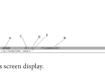

图 3.5 第一个 GNU `emacs` 屏幕显示。

- I. 滚动条：滚动条允许您图形化地滚动或在文本中移动。
- J. 状态指示器：使用两位字符代码来告诉您有关文件的信息。在图 3.5 中，`U-` 和两个连字符 (`U-- -`) 表示文件在 `emacs` 中未更改，与保存到磁盘的版本相同，并且您可以对文件进行操作。

### 3.3.1.1 Emacs 帮助

`Emacs` 提供各种帮助命令，均可通过键序列 `<Ctrl+H>` 或图形方式使用功能键 `<F1>` 访问。您也可以输入 `<Ctrl+H> <Ctrl+H>` 查看帮助命令列表。您可以使用 `<Space>` 和 `<Del>` 滚动列表，然后输入您想要的帮助命令。要取消，请输入 `<Ctrl+G>`。许多帮助命令在其信息显示在特殊的帮助缓冲区中。在此缓冲区中，您可以输入 `<Space>` 和 `<Del>` 滚动并按 `<Enter>` 跟随超链接。

以下是获取主题或命令帮助的最通用方法：

```
<Ctrl+H> a topic(s) <Enter>
```

这会搜索名称与参数 `topic(s)` 匹配的命令。参数可以是关键字、关键字列表或正则表达式。

```
<Ctrl+H> i d m emacs <Enter> i topic <Enter>
```

这会在 `emacs` Info 手册的索引中搜索 `topic`，显示找到的第一个匹配项。按 `,` (逗号) 查看后续匹配项。您可以使用正则表达式作为 `topic`。


```
<Ctrl+H> i d m emacs <Enter> s topic <Enter>
```

类似，但搜索手册的文本而不是索引。

```
<Ctrl+H> <Ctrl+F>
```

这会使用 Info 显示 emacs FAQ。

```
<Ctrl+H> p
```

这会根据关键字显示可用的 emacs 包。

帮助命令语法的摘要可在表 3.11 中找到。

### 3.3.1.2 图形功能

emacs 最有用的图形功能是图 3.5 中显示为 F 和 G 的菜单栏和速度按钮栏。这些功能将 emacs 的所有功能集成到一个

## 表3.11 帮助命令语法汇总

|  |  |
|---|---|
| `<Ctrl+H> a topics <Enter>` | 显示名称与主题匹配的命令列表（`apropos-command`）。 |
| `<Ctrl+H> b` | 显示所有活动的键绑定——先是次要模式绑定，然后是主模式绑定，最后是全局绑定（`describe-bindings`）。 |
| `<Ctrl+H> c key` | 显示键序列 `key` 所绑定的命令名称（`describe-key-briefly`）。这里 `c` 代表"字符"。若要获取关于 `key` 的更详细信息，请使用 `<Ctrl+H> k`。 |
| `<Ctrl+H> d topics <Enter>` | 显示文档与主题匹配的命令和变量（`apropos-documentation`）。 |
| `<Ctrl+H> e` | 显示 *Messages* 缓冲区（`view-echo-area-messages`）。 |
| `<Ctrl+H> f function press <Enter>` | 显示名为 `function` 的 Lisp 函数的文档（`describe-function`）。由于命令就是 Lisp 函数，因此这也适用于命令。 |
| `<Ctrl+H> h` | 显示 HELLO 文件，其中展示了各种字符集的示例。 |
| `<Ctrl+H> i` | 运行 Info，即 GNU 文档浏览器（`info`）。emacs 手册可在 Info 中查看。 |
| `<Ctrl+H> k key` | 显示 `key` 所运行命令的名称和文档（`describe-key`）。 |
| `<Ctrl+H> l` | 显示您最近 300 次按键的描述（`view-lossage`）。 |
| `<Ctrl+H> m` | 显示当前主模式的文档（`describe-mode`）。 |
| `<Ctrl+H> n` | 显示 emacs 近期变更的新闻（`view-emacs-news`）。 |
| `<Ctrl+H> p` | 按主题关键字查找软件包（`Finder-by-keyword`）。这会使用软件包菜单缓冲区列出软件包。 |
| `<Ctrl+H> P package <Enter>` | 显示名为 `package` 的软件包的文档（`describe-package`）。 |
| `<Ctrl+H> r` | 在 Info 中显示 emacs 手册（`info-emacs-manual`）。 |
| `<Ctrl+H> s` | 显示当前语法表的内容（`describe-syntax`）。语法表说明哪些字符是开定界符，哪些是单词的一部分，等等。 |
| `<Ctrl+H> t` | 进入 emacs 交互式教程（`help-with-tutorial`）。 |
| `<Ctrl+H> v var <Enter>` | 显示 Lisp 变量 `var` 的文档（`describe-variable`）。 |
| `<Ctrl+H> w command <Enter>` | 显示哪些键运行名为 `command` 的命令（`where-is`）。 |
| `<Ctrl+H> C coding <Enter>` | 描述编码系统 `coding`（`describe-coding-system`）。 |
| `<Ctrl+H> C <Enter>` | 描述当前使用的编码系统。 |
| `<Ctrl+H> F command <Enter>` | 进入 Info 并转到记录 emacs 命令 `command` 的节点（`Info-goto-emacs-command-node`）。 |
| `<Ctrl+H> I method <Enter>` | 描述输入法 `method`（`describe-input-method`）。 |
| `<Ctrl+H> K key` | 进入 Info 并转到记录键序列 `key` 的节点（`Info-goto-emacs-key-command-node`）。 |
| `<Ctrl+H> L language-env <Enter>` | 显示语言环境 `language-env` 中使用的字符集、编码系统和输入法的信息（`describe-language-environment`）。 |
| `<Ctrl+H> S symbol <Enter>` | 根据您正在编辑的编程语言显示 `symbol` 的 Info 文档（`info-lookup-symbol`）。 |
| `<Ctrl+H> ?` | 如果光标位于特殊文本区域，则显示该区域的帮助消息（`displaylocal-help`）。（例如，这些区域包括 *Help* 缓冲区中的链接。） |

图形交互风格：当菜单选项呈灰色时，表示在当前操作级别上该选项不可用。以下简要描述每个菜单栏项所完成的任务。

- 文件：打开、保存和关闭缓冲区、文件、窗口和框架的功能
- 编辑：修改缓冲区中文本的方法
- 选项：进行配置更改的功能
- 缓冲区：列出当前打开的缓冲区的下拉菜单
- 工具：文件和应用程序功能
- 帮助：emacs 的大量文档和在线手册

快速按钮栏包含单按钮操作，用于（1）文件和缓冲区操作；（2）常见文本编辑操作，如剪切和粘贴；（3）打印、搜索和更改首选项。

### 3.3.1.2 缓冲区、文件、窗口和框架

emacs 中最重要的概念是缓冲区，即 emacs 当前正在编辑的文本对象。这与文件不同，文件是存储在磁盘上的文本对象。简单来说，这种区分是因为：（1）emacs 中当前正在修改和查看的对象不可能是磁盘上存储的对象，因为您尚未保存编辑内容；（2）emacs 可以处理不是文件且永远不会成为文件的对象，例如在 UNIX 命令行中键入的命令的输出。当您首次启动 emacs 并指定要编辑的文件时，您查看的是 emacs 为该文件创建的缓冲区，这通常称为 emacs 框架，其中打开了一个窗口，让您能够看到缓冲区的内容。框架由一个窗口或多个平铺窗口、下拉菜单和快速按钮栏菜单、模式行以及小缓冲区组成。在练习课 3.12、3.13 和 3.14 中，您将仅使用一个框架中的多个窗口来查看 emacs 中的多个缓冲区。

### 3.3.1.2 点、标记和区域

emacs 中第二个最重要的概念是点和标记，以及它们所划定的文本区域。点位于光标所高亮字符之前的空白处。标记通过将光标放在某个字符上然后按住 `<Ctrl+Space>` 或 `<Ctrl+@>` 来设置，它也位于光标所高亮字符之前的空白处。您要在剪切和复制等操作中处理的文本区域，是点和标记之间的所有文本。例如，在文本行 "Now is the time for all good men" 中，如果光标位于单词 "Now" 中的字母 "N" 上或将其高亮（点位于 "N" 之前的空白处），并且通过将光标放在单词 "time" 中的字母 "i" 上并按住 `<Ctrl+Space>` 来将标记设置在 "i" 之前，那么区域被定义为 "Now is the t"。

### 3.3.3 访问文件、保存文件和退出

UNIX 将数据永久存储在文件中，因此你用 emacs 编辑的大部分文本都来自一个文件并保存到一个文件中。要在运行 emacs 时编辑一个文件，你需要将文件读入缓冲区并准备包含文件文本副本的该缓冲区。这称为访问文件。注意：emacs 编辑命令作用于 emacs 内部缓冲区中的文本。你的更改只有在将缓冲区保存到文件时才会被写入文件本身。

除了访问和保存文件外，emacs 还可以删除、复制、重命名和向文件追加内容，保持它们的多个版本，并对文件目录进行操作。

以下是你可以执行的一些基本操作来访问文件、保存它们，然后优雅地退出 emacs：

- 访问新文件

要在 emacs 内部访问新文件，请在下拉菜单中选择 `File>Visit New File`。在屏幕上出现的 Find File 窗口的 Name 栏中，输入新的文件名，然后选择 OK。如果唯一打开的缓冲区是欢迎窗口，它将关闭，你将编辑一个以新文件名命名的缓冲区。

你也可以通过输入 `<Ctrl+X> <Ctrl+F>` 来实现同样的操作。然后在 minibufffer 中输入文件名。

- 不退出 Emacs 而保存到文件

在当前缓冲区输入一些文本后，选择下拉菜单 `File> Save`。

你也可以通过输入 `<Ctrl+X> <Ctrl+S>` 来实现同样的操作。

- 保存有未保存更改的文件并退出 Emacs：

如果你对缓冲区进行了未保存的更改，并选择了下拉菜单 `File>Quit`，emacs 会在屏幕上弹出一个 Question 对话框询问你以下内容：


so that it may be used as an alias for commands in the C shell. In Practice Session 3.8, we ask you to insert the file you created in Practice Session 3.7 into your home directory `.cshrc` file, so that, upon subsequent logins, these DOS-aliased commands will be available. Before you begin Practice Session 3.8, do the following (if you are using Solaris, do the following practice session and its preparation for Bash using the correct syntax of the Bash alias commands; also use the Bash configuration file `.bashrc` in your home directory, in place of the C shell `.cshrc` configuration file shown):

- 1. Use the `ls -la` command to find out if you have a `.cshrc` file in your home directory. If you do not, then use `emacs` to create a new file named `.cshrc` with nothing in it.

- 2. Find out which shell you are currently using by typing `echo $SHELL`. On our system, PC-BSD, the C shell is the default shell. If you are using Solaris, the default shell is Bash.

If you make a mistake anywhere in the following exercise, you can revert to using the graphical form of editing using the mouse and pull-down menus, including undo, inside the `emacs` window for expediency.

## 3.3.4.1 Practice Session 3.8

Step 1: At the shell prompt, type `emacs alien` and then press `<Enter>`. Close the Welcome Screen as noted in Section 3.3.1 by holding down `<Ctrl+X>` and then pressing the `1` numeric key. The file you created in Practice Session 3.7 is loaded into the buffer, and your screen display should look similar to the one shown in Figure 3.6.

Step 2: Using the arrow keys, position the cursor to the right of the `*` character at the end of the third line.

Step 3: Press `<Enter>`

Step 4: Type `alice dir/w ls`

Step 5: Hold down `<Ctrl+A>`. The cursor moves to the beginning of the line.

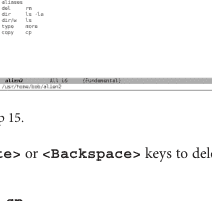

FIGURE 3.7 Display after Step 15.

Step 12: Use the `<Delete>` or `<Backspace>` keys to delete the letters c and e from the word `alice`.

Step 13: Type `as copy cp`.

Step 14: Hold down `<Ctrl+X>` `<Ctrl+W>`.

Step 15: At the Write file: prompt, erase anything on the line with the `<Backspace>` key, and type `alien2` and then press `<Enter>`. Your screen display should now look similar to the one shown in Figure 3.7.

Step 16: Hold down `<Ctrl+H>` and then press the a key. The minibufffer area shows a prompt for you to obtain help. Hold down `<Ctrl+G>`. Doing so cancels your help request.

Step 17: Hold down `<Ctrl+X>` `<Ctrl+C>` to quit `emacs` and return to the shell prompt.

Step 18: From the shell prompt, type `emacs .cshrc` and then press `<Enter>`. The contents of your `.cshrc` file now appear in the editing buffer.

Step 19: Position the cursor with the arrow keys on the keyboard on any blank line in the file. Hold down `<Ctrl+X>` and then press the i key on the keyboard. This will allow you to insert the contents of a file into the current buffer at the position of the cursor.

Step 20: In the minibufffer, type `alien2`. The lines of text from `alien2`'s DOS aliases should now be inserted into the file `.cshrc` after and below where you positioned the cursor in Step 19.

## 3.3.5 击键宏

`emacs` 文本编辑器包含一个简单易用的功能，允许你定义击键宏，或可记录然后随时回放的击键集合。此功能允许你将重复的多击键操作定义为单个命令，然后按需执行该命令——次数不限。击键可以包括 `emacs` 命令和一系列击键。宏也可以保存为名称，甚至保存到文件中，以便在后续的 `emacs` 编辑会话中使用。表 3.15 显示了一些最重要的键盘宏命令列表。

有关如何记录、编辑、列出和删除击键宏的更完整描述和详细说明，请参阅第 3.3.13.5 节。

练习会话 3.9 让你使用表 3.15 中介绍的一些命令创建一个新的文本文件。

### 3.3.5.1 练习会话 3.9

步骤 1：在 shell 提示符下，输入 `emacs datafile` 然后按 `<Enter>`。

`emacs` 屏幕出现在你的显示器上。

步骤 2：按住 `<Ctrl+X>` `<Shift+9>`。这些操作开始你的键盘宏定义。如果你在后续步骤中任何地方犯了错误，只需按住 `<Ctrl+G>` 即可取消当前宏定义。

步骤 3：输入 `1 2 3 4 5 6 7 8 9 10` 然后按 `<Enter>`。

步骤 4：按住 `<Ctrl+X>` `<Shift+0>`。这些操作结束你的宏定义。

步骤 5：按住 `<Ctrl+X>` `e`。这样会重放你刚刚定义的宏，在缓冲区中放置另一行数字 1 到 10。

步骤 6：重复步骤 5 再八次，使你的显示与图 3.8 所示相似。

步骤 7：按住 `<Ctrl+X>` `<Ctrl+S>`。这些操作将缓冲区保存到文件 `datafile`。

步骤 8：按住 `<Ctrl+X>` `<Ctrl+C>` 退出 `emacs`。


图 3.8 步骤 6 后的显示。

## 3.3.6 剪切或复制与粘贴以及搜索和替换


如我们之前提到的，每个文字处理器都具有剪切或复制文本然后将该文本粘贴回文档中，以及搜索旧文本并将其替换为新文本的能力。由于 emacs 操作可以完全通过文本激活，即使用一系列击键来执行命令，剪切或复制和粘贴是相当复杂的操作。它们是通过 Kill Ring 实现的，即文本通过将其杀死而保留在缓冲区中，然后通过将其拉取到所需位置而恢复到文档中。全局搜索和替换则相对简单一些，可以通过无条件替换或交互式替换来实现。

标记只是在缓冲区中的一个占位符。例如，要从文档中剪切三个词然后在另一个位置粘贴回去，将光标移至你想剪切的第一个词之前并按 `<Esc+c+D>` 三次。这三个词随后被剪切到 Kill Ring。由于 Kill Ring 是一个 FIFO 缓冲区，你现在可以将光标移动到想要恢复这三个词的位置并按 `<Ctrl+y>`。这三个词会被拉取到文档中，顺序与它们从文档中被剪切时的顺序相同，从左到右。

要复制三个词的文本然后在另一个位置粘贴回去，通过将光标定位在三个词之后来设置标记，然后在该位置按 `<Ctrl+@>`。然后重新定位光标到三个词之前；你现在已在光标和标记之间定义了一个区域。文档中只有一个标记。按 `<Esc+w>` 将光标和标记之间的文本发送到 Kill Ring；文本被发送，但不会从屏幕显示中清除。要在另一个位置恢复这三个词，将光标移至那里并按 `<Ctrl+y>`。这三个词将在新位置恢复。表 3.13 给出了 emacs 的重要 kill 和 yank 命令。

全局搜索和替换可以是无条件的，即在不提示的情况下将你想要替换为新文本的旧文本的每个出现都替换掉，也可以是交互式的，即 emacs 在每次将旧文本的出现替换为新文本之前提示你。此外，替换的语法可以包含正则表达式，我们在此不涉及。

例如，要从当前位置到文档末尾无条件地将单词 men 替换为单词 women，按 `<Esc+x>`，输入 `replace-string`，然后按 `<Enter>`。然后会提示你输入旧字符串。输入 men 然后按 `<Enter>`。然后会提示你输入新字符串。输入 women 然后按 `<Enter>`。所有出现都会被替换，无需进一步提示。

要实现交互式替换，只需按 `<Esc+x>`，输入 `query-replace`，然后按 `<Enter>`。然后你可以输入旧字符串和新字符串，但在旧字符串的每个出现处，你都有机会选择是否将其替换为新字符串。表 3.14 显示了在交互式搜索和替换过程中你可以采取的操作。练习会话 3.10 包含复制和粘贴以及全局搜索和替换的进一步示例，既有无条件也有交互式。你的目标是输入一行文本，将其复制到 Kill Ring，然后将其粘贴到文档中七次。然后使用交互式搜索和替换以及无条件搜索和替换修改原始行和每行粘贴内容的文本。完成练习会话 3.10 后，你的屏幕显示应与图 3.9 相似。

### 表 3.14 交互式搜索和替换

| 搜索和替换操作 | 按键 |
|---|---|
| 向前搜索 | `<Ctrl+S>` |
| 向后搜索 | `<Ctrl+R>` |
| 正则表达式搜索 | `<Ctrl+Alt+S>` |
| 反向正则表达式搜索 | `<Ctrl+Alt+R>` |
| 选择上一个搜索字符串 | `<Alt+P>` |
| 选择下一个后续搜索字符串 | `<Alt+N>` |
| 退出增量搜索 | `<Enter>` |
| 撤销上一个字符的效果 | `<Del>` |
| 中止当前搜索 | `<Ctrl+G>` |
| 交互式替换文本字符串 | `<Alt+%> ` |
| 使用正则表达式 | `<Alt+X>` `query-replace-regexp` |
| 替换此项，继续下一个 | `<Space>` 或 y |
| 替换此项，不移动 | , |
| 跳过下一个不替换 | `<Del>` 或 n |
| 替换所有剩余匹配项 | ! |
| 回到上一个匹配项 | ^ |
| 退出查询替换 | `<Enter>` |
| 进入递归编辑（`<Ctrl+Alt+C>` 退出） | `<Ctrl+R>` |

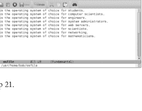

### 图 3.9 第 21 步后的显示。

#### 3.3.6.1 练习 3.10

步骤 1：在 shell 提示符下，输入 `emacs osfile` 然后按 `<Enter>`。

步骤 2：输入 `Windows is the operating system of choice for everyone.`

步骤 3：按 `<Ctrl+@>`。标记现在设置在你在步骤 2 中输入的行末尾。用图形光标和鼠标左键高亮整行第一行。这将定义将被放入 Kill Ring 的区域。

步骤 4：按 `<Esc+W>`。此操作将区域复制到 Kill Ring。

步骤 5：按 `<Enter>` 在缓冲区中开始新行，应为空。光标应位于此新行的开头。

步骤 6：按 `<Ctrl+Y>`。第一行文本现在从 Kill Ring 粘贴到下一空白行。

步骤 7：重复步骤 5 和 6 再六次，使缓冲区中现在有八行文本，都包含文本 `Windows is the operating system of choice for everyone.`

步骤 8：将光标定位在缓冲区第一行中 Windows 的 W 上。

步骤 9：此时保存缓冲区 `<Ctrl+X>` `<Ctrl+S>`。

步骤 10：按 `<Esc+X>`。然后输入 `query-replace` 并按 `<Enter>`。这些操作开始交互式搜索和替换。提示 `Query replace:` 出现。

步骤 11：输入 `everyone` 然后按 `<Enter>`。提示 `with:` 出现。

步骤 12：输入 `students` 然后按 `<Enter>`。提示 `Query replacing everyone with students: (? for help)` 出现。

步骤 13：在键盘上按 `<Space>` 将第一行中的单词 everyone 替换为单词 students，并且提示 `Query replacing everyone with students: (? for help)` 再次出现。

步骤 14：按 `<Enter>`。提示 `Replaced 1 occurrence` 出现。

步骤 15：将光标定位在缓冲区第二行中单词 everyone 的 e 上。

步骤 16：重复步骤 10–14，每次交互式地将单词 everyone 替换为单词 `computer scientists`、`engineers`、`system administrators`、`web servers`、`scientists`、`networking` 和 `mathematicians`，分别在缓冲区第 2–8 行。

确保你在执行步骤 16 的第二次到第八次时，始终将光标定位在你想要替换文本的当前行的上一行！

步骤 17：将光标定位在缓冲区第一行中 Windows 的 W 上。

步骤 18：按 `<Esc+X>`。然后输入 `replace-string` 并按 `<Enter>`。这些操作开始无条件搜索和替换。提示 `replace string:` 出现。

步骤 19：输入 `Windows` 然后按 `<Enter>`。提示 `Replace string Windows with:` 出现。

步骤 20：输入 `UNIX` 然后按 `<Enter>`。提示 `Replaced 8 occurrences` 出现。正确？

步骤 21：使用 `<Ctrl+X><Ctrl+S>` 保存缓冲区，使用你计算机系统上可用的设施打印它，并使用 `<Ctrl+X>` `<Ctrl+C>` 退出 emacs。你的屏幕显示应如 图 3.9 所示。

以下章节练习要求你应用你在之前的练习中学习到的一些操作：

### 练习 3.8

运行 `emacs` 并定义键盘宏命令，自动删除

- a. 一行中未指定长度的每隔一个词，
- b. 一个未指定长度的文件中的每隔一行，
- c. 一个未指定长度的文件中未指定长度的行中的每隔一个词和每隔一行。

### 练习 3.9

编写一个键盘宏，如第 3.3.5 节所示，完成练习 3.10 中步骤 10–14 所示的所有操作。

为了进一步练习 emacs，请完成本章末尾的问题 16。

### 3.3.7 如何使用 GNU Emacs 进行纯图形编辑

到目前为止，在我们的工作中，可以在单个基于文本的终端窗口中使用 emacs 并获得所示结果。如果你通过第 2 章中描述的方法之一连接到 UNIX，你很可能通过一个称为 X Window System 的中介与操作系统交互，这将允许你在图形环境中完成所有 emacs 工作。我们将在第 22 章中介绍有关 X Window System 及其一些设施的更多信息（例如 GUI 的特定功能）。就学习 emacs 而言——如果你使用的是 UNIX 和 X Window System——你可能能够在屏幕显示上以自己的框架运行 emacs，或者可能同时在屏幕显示上的多个框架中运行。请注意，在我们的基础 UNIX 系统 PC-BSD 和 Solaris 中，GNU 图形 emacs 的最新版本可通过这些系统中第 23 章所述的软件包管理设施获得。

### 3.3.8 编辑数据文件


以下练习演示了使用图形 GNU emacs 对在练习 3.9 中创建的数据文件进行进一步编辑。在 PC-BSD 和 Solaris 中，使用 X Window System 在 KDE 或 Gnome 桌面默认窗口环境下运行的 GNU emacs 的外观和感觉非常类似于在任何其他具有 GUI 的操作系统（如 Windows 10 或 Mac OS X）下运行的文字处理器或桌面出版应用程序。在以下练习中，我们使用的是 GNU emacs 24.3.1。

## 3.3.8.1 练习 3.11

步骤 1：在终端或控制台窗口中，在 shell 提示符下，输入 `emacs datafile` 然后按 `<Enter>`。你的屏幕显示应类似于 图 3.8 所示。

步骤 2：使用鼠标将光标定位到缓冲区中第十行的开头处的字符 1 上，然后单击鼠标左键。光标现在位于字符 1 上。

步骤 3：单击并按住鼠标左键位于字符 1 上，然后拖动鼠标，使整第十行都被高亮显示，包括行尾数字 10 右侧的一个字符。松开鼠标左键。

整第一行应该被高亮显示。

步骤 4：使用鼠标将光标定位，使箭头指向 emacs 屏幕顶部菜单选项 Edit。单击鼠标左键。会出现一组下拉菜单选项，类似于图 3.10 所示。

步骤 5：选择 Copy 菜单选项。你在步骤 3 中高亮显示（选择）的文本现在被保存在一个临时缓冲区中。

步骤 6：按下 `<Enter>`。这将在缓冲区的底部打开第十一行。

步骤 7：将鼠标移动到第十一行的第一个字符位置上方，并单击鼠标左键。光标现在位于缓冲区中的该位置。

步骤 8：选择下拉菜单选项 Edit>Paste。你现在已将缓冲区中第十行的 10 个字符粘贴到缓冲区中的第十一行。你的屏幕显示现在应类似于图 3.11。

步骤 9：选择下拉菜单选项 File>Save (current buffer)。在出现的 Write file: 对话框中，将文件保存在你的主目录中，命名为 `datafile11`，然后选择下拉菜单选项 File>Exit Emacs。


图 3.10 emacs Edit 下拉菜单。


图 3.11 编辑并添加第 11 行后的数据文件。

## 3.3.9 如何在图形化 Emacs 中启动、保存文件和退出

如练习课 3.11 所示，此文本编辑器为你提供了专属的鼠标/GUI 便捷性。这种处理文本文件的方法对初学者和经验丰富的用户都最有效。在进行练习课 3.12 时，该练习从编辑你在练习课 3.7 中创建的文件开始，你将能够比较使用按键命令与鼠标/GUI 交互的操作速度和便捷性。请注意，图 3.10 所示的下拉菜单中，某些菜单选项也显示了按键命令。单击菜单选项按钮或按下键盘键会实现同样的效果。这种灵活性增加了你使用 emacs 的便捷性。

PC-BSD 的练习课 3.12 让你编辑你在本节练习课 3.7 开始时创建的文件 `alien`。该练习课让你使用 emacs 创建了一个简单的 C-shell 脚本别名文件。你现在将对其进行修改，使其可作为 Bourne shell 的别名使用。你还将修改主目录中现有的文件 `.shrc`，以便当你登录并使用 Bourne shell 时，文件 `alien3` 中的别名命令可供你使用。在开始练习课 3.12 之前，请执行以下准备步骤（如果你使用的是 Solaris，请修改主目录中的 `.bashrc` 文件，并按照本练习课为 Bash 而非 Bourne shell 进行操作）：

准备步骤 1：使用 `ls -la` 命令查明你的主目录中是否有 `.shrc` 文件。如果你主目录中没有 `.shrc` 文件，则使用 `emacs` 创建一个名为 `.shrc` 的新空文件。然后退出 `emacs`，并输入 `chmod u+x .shrc` 并按下 `<Enter>`。

准备步骤 2：通过输入 `echo $SHELL` 并按下 `<Enter>` 来查明你当前使用的 shell。如果你使用的是 C shell，系统将响应 `/bin/csh`。如果你使用的是 Bourne shell，系统将响应 `/bin/sh`。

准备步骤 3：如果你根据步骤 2 的确定未使用 Bourne shell，请在现有 shell 提示符下切换到 Bourne shell，输入 `sh` 然后按下 `<Enter>`。

### 3.3.9.1 练习课 3.12

步骤 1：在 shell 提示符下，输入 `emacs alien` 然后按下 `<Enter>`。你在练习 3.7 中创建的文件已加载到缓冲区中，emacs 缓冲区的内容看起来像图 3.6 所示。使用光标和鼠标进行光标定位，使用键盘键进行文本输入和删除来修改文件，使其看起来像这样：

```
#DOS aliases

alias del="rm"

alias dir="ls -la"

alias type="more"
```

步骤 2：使用鼠标和鼠标左键将光标定位到第三行末尾的双引号字符 (`"`) 的右侧。

步骤 3：按下 `<Enter>` 打开一个空白行并将光标置于该行的开头。

步骤 4：输入 `alice dirw="ls"`。

步骤 5：使用鼠标和鼠标左键将光标定位到 `alice` 中的字符 `a`。

步骤 6：按住鼠标左键并移动鼠标，使单词 `alice` 及其后面的空格被高亮显示。在屏幕顶部，选择 Edit 下拉菜单中的 Cut 选项，将单词 `alice` 从缓冲区剪切出来。

步骤 7：输入 `alias`。

步骤 8：将鼠标移动到单词 `alias` 中的第二个字符 `a` 上方。单击鼠标左键。

步骤 9：按下键盘上的 `<Down>` 箭头键两次。光标现在应位于以下行的空白行开头，该行内容为 `alias type="more"`。

步骤 10：从 Edit 下拉菜单中选择 Paste。被剪切的单词 `alice` 已被放回缓冲区，并置于该行的开头。

步骤 11：使用鼠标和鼠标左键将光标定位到单词 `alice` 的末尾，字符 `e` 之后。

步骤 12：使用 `<Delete>` 或 `<Backspace>` 键删除单词 `alice` 中的字母 `c` 和 `e`。

步骤 13：输入 `as copy="cp"`。

步骤 14：继续将光标移动到适当位置并添加必要的字符。

步骤 15：从下拉菜单 File 中选择 Save Buffer As...

步骤 16：在屏幕上打开的 Write file: 对话框中，将文件保存为 `alien3`。

步骤 17：从 File 下拉菜单中选择 File>Open File。 在打开的 Find file: 对话框中，在 Show Hidden Files 的框中打上复选标记。 找到并选择 `.shrc` 文件（应位于你的主目录中）并选择 Open。 一个新的缓冲区在屏幕上打开，其中包含 `.shrc` 文件的内容。将光标定位在 `.shrc` 文件缓冲区的任意空白行上。

步骤 18：从 File 下拉菜单中选择 File>Insert file... 在打开的对话框中，选择 `alien3` 并插入它。 来自 `alien3` 的 DOS 别名的文本行现在应插入到你在步骤 17 中指定的位置的 `.shrc` 文件中。


## 图 3.13 Tools 下拉菜单。

某种程度上可以理解，这种编辑器也应该能够编译、链接、调试并记录源代码的修订历史，以及执行程序本身。在 emacs 中，利用其内置功能即可轻松实现。之所以具备这种一体化的功能，是因为在字符终端和控制台的时代，而不是离开编辑器去完成外部任务，你可以在编辑器内部完成常见任务。在现代 UNIX 中，我们现在可以简单地在窗口之间切换而从不离开编辑器。但能够利用该程序的多重功能仍然非常有用，主要是为了提高效率。

练习 3.13 允许你输入 C 程序的源代码并使用编辑器的特殊功能正确缩进文本、编译和链接源代码，并根据编译时错误实施修订。然后你可以在终端窗口中执行该程序进行测试。该程序的目的是允许用户输入一个整数，然后再输入另一个整数，第一个整数将被提升为第二个整数所指示的幂。

关于路径的说明：如果正在执行的 shell 的路径包含 emacs 保存编译后可执行程序的工作目录，则你可以运行该程序。否则，你将必须包含该目录的路径。例如，当我们进行练习 3.13 时，emacs 将源代码和可执行文件保存在我们系统的当前工作目录 `/root` 中。在运行程序之前，由于我们知道我们运行的是 C shell，我们通过输入 `echo $PATH` 检查了路径变量。路径显示中包含了 emacs 保存我们文件的工作目录。有关如何查看路径和设置路径变量的信息，请参阅第 2 章，第 2.7 节和第 2.8 节。有关 UNIX 软件开发过程工具的更多信息，请参阅第 17 章。程序的源代码如下。


```c
#include <math.h>
main()
{
    float x,y;
    printf("This program takes x and y values from stdin and displaysx^y.\n");
    printf("Enter integer x: ");
```

```
scanf("%f", &x);
printf("Enter integer y: ");
scanf("%f", &y);
printf("x^y is: %6.3f\n", pow((double)x, (double)y));
}
```

### 3.3.11.1 练习课 3.13

步骤 1：在 `shell` 提示符下，输入 `emacs power.c`。注意此新缓冲区的 `major mode` 被设置为 `C/l` 模式。

步骤 2：完全按照所示输入程序源代码。使用 `<Tab>` 键来产生 `C` 源代码中显示的缩进。你的 `emacs` 屏幕显示应与图 3.14 相似。

步骤 3：从下拉菜单中，选择 `File>Save`（当前缓冲区）。

步骤 4：从下拉菜单中，选择 `Tools>Compile...` 在 `minibuf-fer` 中，提示 `Compile command: make -k` 出现。使用 `backspace` 键擦除 `make -k`，然后为替换它，输入 `cc power.c -lm -o power`。`emacs` 框架中会出现一个新的缓冲区窗口，显示编译/链接过程的进度。

步骤 5：从下拉菜单中，选择 `Tools>Compile...` 在 `minibuf-fer` 中，提示 `Compile command: cc power.c -lm -o power` 应出现。按下 `<Enter>` 接受此编译/链接命令。

如果在输入 `C` 代码时出现错误，重复步骤 2 到 5，直到没有错误信息阻止编译和链接！底部缓冲区窗口的

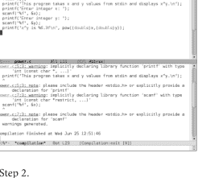

图 3.14 显示了警告信息，但没有阻止编译和链接的异常。

步骤 6：如果已从 `power.c` 源代码中删除所有语法错误，你应该得到与图 3.14 相似的屏幕显示，这在底部缓冲区窗口中表明你已成功编译并链接了 `power.c`。

步骤 7：现在你可以退出 `emacs`，并在终端窗口中通过在命令行输入 `power` 来测试程序。记住必须为当前 `shell` 设置路径，以便在文件 `power` 所在的目录中的可执行程序能够运行。

### 3.3.12 在多个缓冲区中工作

如前面的练习所示，可以将一个缓冲区插入另一个缓冲区，并同时打开窗口到不同的缓冲区，其中一些缓冲区甚至可能不包含你想要编辑的文本。当你想要从之前创建的许多其他缓冲区或文件中组合缓冲区的內容时，此功能很重要。下面的练习课将向你展示如何在 `emacs` 框架内打开的多个缓冲区之间创建、移动以及复制和粘贴。

### 3.3.12.1 练习课 3.14

步骤 1：在你的主目录下创建一个名为 `multi` 的子目录，并将该子目录设为当前工作目录。

步骤 2：在 `shell` 提示符下，输入 `emacs newfile`。你现在应该正在编辑缓冲区 `newfile`，且只有一个窗口。

步骤 3：在 `emacs` 中，选择下拉菜单 `File>New Window Below`。框架现在应水平分割，这样你就有两个窗口，一个在另一个之上，两者都显示 `newfile` 的内容。

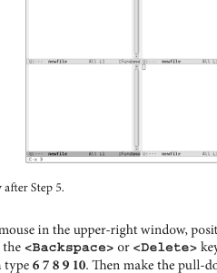

图 3.15 步骤 5 后的显示。

步骤 7：单击鼠标在右上窗口，将光标定位在 5 的右侧，并使用 `<Backspace>` 或 `<Delete>` 键擦除数字 1、2、3、4 和 5。然后输入 6 7 8 9 10。然后选择下拉菜单 `File>Save As`。在屏幕上出现的 `Write file:` 对话框中，在 `Name:` 框中输入 `secondrow`。文件将保存在文件夹 `multi` 中。然后选择 `OK`。

步骤 8：单击鼠标在左上窗口。选择下拉菜单 `File>Open File`。在屏幕上出现的 `Find file:` 对话框中，在 `Name` 对话窗格中突出显示文件 `firstrow`。然后选择 `Open`。你现在应该有与图 3.16 相似的屏幕显示，左上窗口显示 `firstrow` 的内容，其余三个窗口显示 `secondrow` 的内容。

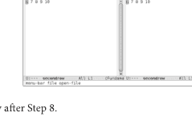

图 3.16 步骤 8 后的显示。

步骤 9：单击鼠标在左下窗口，将光标定位在 0 的右侧，擦除 6、7、8、9 和 10，并输入 11 12 13 14 15。然后选择下拉菜单 `File>Save As`。在屏幕上出现的 `Write file:` 对话框中，在 `Name:` 框中输入 `thirdrow`。然后选择 `OK`。

步骤 10：单击右上窗口并选择下拉菜单 `File>Open File`。在屏幕上出现的 `Find file:` 对话框中，在 `Name` 对话窗格中突出显示文件 `secondrow`。然后，选择 `Open`。

步骤 11：单击左下窗口，并选择下拉菜单 `File>Open File`。在 `minibuff er` 中，输入 `thirdrow`。你的屏幕显示现在应与图 3.17 相似。

步骤 12：单击鼠标在右下窗口，并选择下拉菜单 `File>Save As`。在 `Write file:` 对话框中，在 `Name:` 框中输入 `four`。选择 `OK`。单击左下窗口，并选择下拉菜单 `File>Open File`。在打开的 `Find file:` 对话框中，突出显示 `thirdrow` 并打开它。

步骤 13：单击鼠标在右下窗口，并使用 `backspace` 键擦除 11、12、13、14 和 15。然后使用下拉菜单选择 `Edit>Copy` 和 `Edit>Paste` 将 1 2 3 4 5、6 7 8 9 10 和 11 12 13 14 15 复制到右下窗口的前三行。你的屏幕显示应与图 3.18 相似。

步骤 14：最后，在右下窗口为当前窗口时，选择下拉菜单 `File>Save As`。在 `Write file:` 对话框中，在 `Name` 框中输入 `four`。覆盖旧的缓冲区 `four`。然后在不保存任何缓冲区的情況下退出 `emacs`。


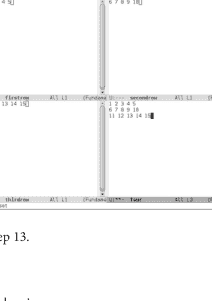

### 3.3.13 修改 Emacs 行为

本节描述了自定义和修改 GNU `emacs` 行为的基本方法。这包括以下操作：

- 使用 `Options` 菜单修改选项。
- 使用 `Custom`（基于 GUI 的界面）更改偏好和选项，并结合该界面，同时使用传统的键入 `<Alt+X> customize` 命令集。
- 使用 `abbrev` 编写击键缩写。
- 编写击键宏命令，如第 3.3.5 节所示。
- 重新定义键盘按键。
- 编写 `emacs Lisp`（`elisp`）代码来自定义 `emacs` 的行为，并将该代码直接输入到你的 `~/.emacs` 启动配置文件中。

所有这些操作都可以对你的 `~/.emacs` 启动配置文件进行更改，从而为你提供更定制化和个性化的 `emacs` 会话，根据你为特定应用程序输入文本的特定需求和方法进行定制。此外，正如将要看到的，`elisp` 代码是由你所执行的操作生成的。但你实际上不需要知道如何用 `elisp` 编程的任何细节就能实现所有这些操作！

以下小节描述并举例说明了所有给定的操作。此外，表 3.15 和表 3.16 总结了实现 `<Alt+X> customize`、击键缩写 `abbrev` 以及编写击键宏的重要击键。

### TABLE 3.15 Some Ways to Change Emacs Behavior

| Customization Action | Keystrokes |
|---|---|
| Abbrevs | |
| Add global abbrev | `<Ctrl+X> a g` |
| Add mode-local abbrev | `<Ctrl+X> a l` |
| Add global expansion for this abbrev | `<Ctrl+X> a i g` |
| Add mode-local expansion for this abbrev | `<Ctrl+X> a i l` |
| Explicitly expand abbrev | `<Ctrl+X> a e` |
| Expand previous word dynamically | `<Alt+/>` |
| Macros | |
| Start defining a keyboard macro | `<Ctrl+X> ( or <F3>` |
| End keyboard macro definition | `<Ctrl+X> ) or <F4>` |
| Execute last-defined keyboard macro | `<Ctrl+X> e or <F4>` |


| Append to last keyboard macro | `<Ctrl+U> <Ctrl+X>` ( |

| Name last keyboard macro | `<Alt+X> name-last-kbd-macro` |

| Insert Lisp definition in buffer | `<Alt+X> insert-kbd-macro` |

| Customize variables and faces | `<Alt+X> customize` |

| Simple customization with `<Alt+X> customize` | |

| `(global-set-key (kbd "<Ctrl+<C> g"))` | |

| `'search-forward'` | |

| `(global-set-key (kbd "<Alt+#>"))` | |

| `'query-replace-regexp'` | |

### 3.3.13.1 Using the Options Menu

自定义 emacs 行为最简单快捷的方法是使用 GNU emacs 下拉菜单中的 Options 选项，如图 3.19 所示。例如，如果你在 Highlight Matching Parentheses 选项旁边打上复选标记，缓冲区中所有匹配的左右括号在你输入时都会被高亮显示。

此选项仅对当前 emacs 会话有效。如果你想在所有未来的 emacs 会话中保留此选项，请做出 Options 菜单选择 Save Options。以下有效的 elisp 行将自动写入你的 `~/.emacs` 文件中，位于 `custom-set-variables` 组下。

```
(show-paren-mode t)
```

### EXERCISE 3.10

显示你将使用的 emacs Help 设施击键序列，以查找 `show-paren-mode` 选项是什么。然后，列出 Help 设施对 `show-paren-mode` 选项描述的前几行。

你也可以从 Options 菜单按组进行自定义，如果你做出 Customize Emacs 选择，然后做出其下的任何子选择。例如，如果你做出 Options>Customize Emacs>Top-Level Customization Group 选择，一个新缓冲区将在屏幕上打开，并允许你从所有自定义变量的子组中进行选择。

下一节将展示如何以键入命令的方式实现这种自定义。

## TABLE 3.16 Keystroke Macros

| Keystrokes | Command Name | Action |
|---|---|---|
| `<Ctrl+X> (` | `kmacro-startmacro` | Start macro definition. |
| `<F3>` | `kmacro-startmacro-or-insertcounter` | Start macro definition. If pressed while defining a macro, insert a counter. |
| `<Ctrl+X> )` | `kmacro-end-macro` | End macro definition. |
| `<F4>` | `kmacro-end-orcall-macro` | End macro definition (if definition is in progress) or invoke last keyboard macro. |
| `<Ctrl+X> e` | `kmacro-end-andcall-macro` | Execute last keyboard macro defined. Can type e to repeat macro. |
| `<Ctrl+X> <Ctrl+K> n` | `name-last-kbdmacro` | Name the last macro you created (before saving it). |
| (none) | `insert-kbd-macro` | Insert the macro you named into a file. |
| (none) | `macroname` | Execute a named keyboard macro. |
| `<Ctrl+X> q` | `kbd-macro-query` | Insert a query in a macro definition. |
| `<Ctrl+U> <Ctrl+X> q` | (none) | Insert a recursive edit in a macro definition. |
| `<Ctrl+Alt+C>` | `exit-recursive-edit` | Exit a recursive edit. |
| `<Ctrl+X> <Ctrl+K> b` | `kmacro-bind-tokey` | Bind a macro to a key (`<Ctrl+X> <Ctrl+K> 0-9` and A-Z are reserved for macro bindings). Lasts for current session only. |
| `<Ctrl+X> <Ctrl+K> Space` | `kmacro-step-editmacro` | Edit a macro while stepping through it. |
| `<Ctrl+X> <Ctrl+K> l` | `kmacro-editlossage` | Turn the last 100 keystrokes into a keyboard macro. |
| `<Ctrl+X> <Ctrl+K> e` | `edit-kbd-macro` | Edit a keyboard macro by typing `<Ctrl+X> e` for the last keyboard macro defined, `<Alt+X>` for a named macro, `<Ctrl+X> l` for lossage, or keystrokes for a macro bound to a key. |
| `<Ctrl+X> <Ctrl+K> Enter` | `kmacro-editmacro` | Edit the last keyboard macro. |
| `<Ctrl+X> <Ctrl+K> <Ctrl+E>` | `kmacro-editmacro-repeat` | Edit the last keyboard macro again. |
| `<Ctrl+X> <Ctrl+K> <Ctrl+T>` | `kmacro-swap-ring` | Transpose last keyboard macro with previous keyboard macro. |
| `<Ctrl+X> <Ctrl+K> <Ctrl+D>` | `kmacro-deletering-head` | Delete last keyboard macro from the macro ring. |
| `<Ctrl+X> <Ctrl+K> <Ctrl+P>` | `kmacro-cycle-ringprevious` | Move to the previous macro in the macro ring. |
| `<Ctrl+X> <Ctrl+K> <Ctrl+N>` | `kmacro-cycle-ringnext` | Move to the next macro in the macro ring. |
| `<Ctrl+X> <Ctrl+K> <Ctrl+R>` | `apply-macro-toregion-lines` | Apply this macro to each line in a region. |

## 图 3.19 选项菜单选项。


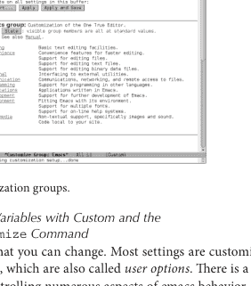

## 图 3.20 Emacs 定制组。

### 3.3.13.2 使用 Custom 和 `<Alt+X> customize` 命令更改 Emacs 变量

Emacs 有许多可更改的设置。大多数设置都可以通过更改变量的设置来进行定制，这些变量也称为用户选项。可定制的变量数量庞大，控制着 Emacs 行为的方方面面。另有一类设置此处不涉及，即决定字体、颜色和其他文本属性的 faces。

要浏览和更改设置（包括变量和 faces），请在 Emacs 命令提示符下输入 `<Alt+X> customize`。这会创建一个定制缓冲区，使你可以浏览按逻辑组织的设置列表，编辑并设置这些设置的值，然后永久保存。

定制设置按定制组进行组织。这些组再汇聚成更大的组，直到形成一个名为 Emacs 的主组，如图 3.20 中缓冲区顶部附近所示。

`<Alt+X> customize` 创建的定制缓冲区与图 3.20 类似。


如果你已经知道某个特定设置或定制组的名称并希望定制它，可以使用命令 `<Alt+X> customize-option`、`<Alt+X> customize-face` 或 `<Alt+X> customize-group` 直接前往。

图 3.20 中缓冲区的主要部分显示了“Emacs”定制组，其中包含多个其他子组（如“Editing”“Convenience”等）。每个子组的内容显示在该组的单行描述中。

组的状态显示该组中的设置是否已被编辑、设置或保存。

定制缓冲区的大部分内容不可更改，但它包含许多可编辑字段。例如，在定制缓冲区顶部有一个用于搜索设置的可编辑字段，旁边有一个 Search 按钮。还有一些按钮和链接，你可以通过单击鼠标或移动光标到该处并按 `<Enter>` 来激活。例如，像“[Editing]”这样的组名就是链接；激活其中一个链接会打开该组的另一个定制缓冲区。

在任何特定的定制缓冲区中，你可以按 `<Tab>`（`widget-forward`）前进到下一个按钮或可编辑字段。按 `<Shift+Tab>`（`widget-backward`）返回到上一个按钮或可编辑字段。

### 3.3.13.2.1 浏览和搜索设置

在由 `<Alt+X> customize` 创建的顶层定制缓冲区中，你可以通过链接进入“Emacs”定制组的子组。这些子组可能包含可供你定制的设置；也可能包含更深层的子组，处理 Emacs 中更加专门的子系统。当你在图形界面中浏览定制组的层级结构时，你会发现一些需要根据自己的个人偏好以及想要高效编辑的文本文档的性质来定制的设置。

### 3.3.13.2.2 更改变量

下面是一个变量（或用户选项）在特定定制缓冲区中的示例。要访问该变量，可以从顶层 emacs 组逐级进入 `Editing>Killing` 组，然后左键单击指向“Kill Ring Max”文本的小菱形：

```
Kill Ring Max: 60
[State]: STANDARD.
Maximum length of kill ring before oldest elements are thrown away.
```

第一行显示变量名为 `kill-ring-max`，为了便于查看格式化为“Kill Ring Max”。它的值是 60。在我们的图形显示中，变量名后面的行指示该变量的定制状态；在此示例中，`STANDARD` 表示你尚未更改该变量，因此其值为默认值。`[State]` 按钮提供一个用于定制该变量的操作菜单。

定制状态下方是该变量的说明文档。要为 Kill Ring Max 输入新值，只需点击该值右侧并编辑即可。当你开始修改文本时，`[State]` 行将变为：

```
[State]: EDITED, shown value does not take effect until you set or save it.
```

编辑值并不会立即生效。要使其生效，必须通过左键单击 `[State]` 按钮并选择 `Set for Current Session` 来设置变量。

然后变量的状态变为：

`[State]: SET for current session only.`

此时，你可以进行菜单选择 `Save for Future Sessions`。

此外，你不必担心指定一个无效的值；`Set for Current Session` 操作会检查有效性，并且不会安装不可接受的值。

当你设置一个变量时，新值仅在当前 emacs 会话中生效。要将值保存到未来会话，请使用 `[State]` 按钮并选择 `Save for Future Sessions` 操作。保存自定义设置是通过将 elisp 代码写入文件来实现的，最常见的是你的 `~/.emacs` 文件。未来的 emacs 会话在启动时会自动读取此文件，从而再次调用并建立自定义设置。

你也可以通过使用 `[State]` 按钮并选择 `Erase Customization` 菜单选项来将变量恢复为其标准值。重置操作有四种，如下所示。

- `Undo edits`: 如果你已修改但尚未设置变量，则此操作会将自定义缓冲区中的文本恢复为与实际值相匹配。
- `Reset to saved`: 这会将变量的值恢复为上次保存的值，并相应地更新文本。
- `Erase customization`: 这会将变量设置为其标准值。你已有的任何保存值也会被删除。
- `Set to backup value`: 这会将变量设置为在此会话中在自定义缓冲区中设置过的一个先前值。如果你自定义了一个变量然后将其重置，从而丢弃了自定义值，你可以使用此操作再次取回被丢弃的值。

有时记录特定自定义的注释很有用。使用 `[State]` 菜单中的 `Add Comment` 项来创建输入注释的字段。

### 3.3.13.2.3 Globally Saving Customizations for a Group

在任何组的自定义缓冲区的顶部，你可以通过选择 `[Apply]` 或 `[Apply and Save]` 按钮来保存该组缓冲区中显示的所有自定义设置。 `[Apply]` 仅为当前会话保存，而 `[Apply and Save]` 通过在 `~/.emacs` 文件中放入 elisp 代码来相应地修改 `~/.emacs` 文件，从而为未来会话保存。

### 3.3.13.2.4 More about Emacs Variables

变量是一个具有值的 elisp 符号。符号的名称是变量名。变量名可以包含可在文件中出现的任何字符，但大多数变量名由用连字符分隔的普通单词组成。

变量的名称描述了其在 emacs 环境中的作用。大多数变量还具有文档字符串，描述了变量的用途、应具有的值类型以及将如何使用该值。

你可以使用帮助命令 `<Ctrl+H> v Describe variable: somevariablename` in the minibuffer 来查看变量的文档，例如 `somevariablename`。要使用此功能，输入命令 `<Ctrl+H> v`；系统会在 minibuffer 中提示你 `Describe variable:`；然后输入变量名，例如 `somevariablename`，并按 `<Enter>`。

Elisp 使用变量进行内部记录，但如前所述，对不会专门编写 elisp 程序的用户而言最有趣的变量是那些供用户更改的变量——这些称为可自定义变量或用户选项。

Elisp 允许任何变量（有少数例外）具有任何类型的值。然而，许多变量只有在赋予特定类型的值时才有意义。例如，如第 3.3.13.2.2 节所示，只有数字才是 `kill-ring-max` 的有意义值，它指定 kill ring 的最大长度；如果你将 `kill-ring-max` 分配一个文本字符串作为值，则诸如 `<Ctrl+Y>`（yank）之类的命令会发出错误。另一方面，一些变量并不关心你分配给它们的值的类型或种类；例如，如果一个变量对 `nil` 值有一种效果，对非 `nil` 值有另一种效果，那么任何不是符号 `nil` 的值都会引发第二种效果，而不管其类型如何（按惯例，我们通常使用值 `t`——代表“真”的符号——来指定非 `nil` 值）。如果你使用自定义缓冲区设置变量，就不必担心赋予它无效的类型：自定义缓冲区通常只允许你输入有意义的值。如有疑问，请使用 `<Ctrl+H> v Describe variable: somevariablename` 来检查变量的文档字符串，以了解它期望的值类型。

### 3.3.13.2.5 Examining and Setting Variables

以下是如何检查和设置用户选项值的一些示例。此语法的第一个一般形式是：

```
<Ctrl+H> v variablename <Enter>
```

此一般形式使用 emacs 帮助函数，带 `v` 选项，并显示变量 `variablename` 的值和文档。

第二个一般形式实现了变量值的更改：

```
<Alt+X> set-variable <ENTER> var <ENTER> value <ENTER>
```

这会将变量 `var` 的值更改为 `value`。

它读取你在 minibuffer 中输入的变量名，并提供补全，并显示变量的值和文档。例如：

```
<Ctrl+H> v fill-column <ENTER>
```

一个新的缓冲区打开并显示以下内容：

```
fill-column is a variable defined in 'C source code'.
```

其值为 70

设置后会自动变为缓冲区本地变量。

如果满足以下谓词，则该变量可作为文件本地变量安全使用

其值

为 `'integerp'`.

文档：

自动换行应发生的列。

交互式地，你可以用 `<Ctrl+X> f` 设置本地值

你可以自定义此变量。

点击下划线文字 customize，你可以使用一个缓冲区来更改此变量的值。

设置特定可定制变量最方便的按键方法是输入 `<Alt+X> set-variable`。这会使用 minibuffer（带补全）读取变量名，然后再次在 minibuffer 中读取你输入的新值的 elisp 表达式（你可以通过 `<Alt+N>` 将旧值插入 minibuffer 进行编辑）。例如：


```
<Alt+X> set-variable <ENTER> fill-column <ENTER> 75 <ENTER>
```

将 `fill-column` 设置为 75。

`<Alt+X> set-variable` 仅限于用户选项、可定制变量，但你可以用类似的 elisp 表达式设置任何变量：

```
(setq fill-column 75)
```

要执行此类表达式，输入 `<Alt+;:>`（eval-expression）并在 minibuffer 中输入表达式。或者，转到 *scratch* 缓冲区，输入表达式，然后输入 `<Ctrl+J>`。

以这种方式设置变量仅影响当前 emacs 会话。唯一能改变未来会话中变量的方法是在你的初始化文件中将更改作为 Lisp 语句写入。

### 3.3.13.3 Init File Syntax

你的 GNU emacs 系统的初始化文件 `~/.emacs` 包含 elisp 表达式。每个 elisp 表达式由一个函数名后跟参数组成，所有内容都用括号括起来。例如：

```
(setq fill-column 60)
```

调用函数 `setq` 将变量 `fill-column` 设置为 60。

你可以用 `setq` 设置任何 Lisp 变量，但对于某些变量 `setq` 不会起作用。

`setq` 的第二个参数是变量新值的表达式。这可以是常量、变量或函数调用表达式。在你的 `~/.emacs` 文件中，大多数情况下使用常量。它们可以是：

- Numbers: 数字以十进制书写，可选择以减号开头。
- Strings: Lisp 字符串语法与 C 字符串语法相同，并具有一些额外功能。使用双引号字符（"）开始和结束字符串常量。
- Characters: Lisp 字符常量语法由 `?` 后跟一个字符或以 `\` 开头的转义序列组成。
- True: `t` 代表“真”。
- False: `nil` 代表“假”。
- Other Lisp objects: 写一个单引号（`'`）后跟你想要的 Lisp 对象。

### 3.3.13.4 Keystroke Abbreviations or Abbrevs

就像普通语言中的缩写一样，`abbrev` 是一个在你插入时展开为通常更长或更长的文本字符串的词。`Abbrev` 由用户定义以特定方式展开。例如，你可能将 Bob 定义为展开为 Better off built 的 abbrev。然后你可以通过输入 Bob `<Space>` 将 Better off built 插入到缓冲区中。

第二种缩写功能，我们在此不举例，称为动态 abbrev 展开。你使用显式命令使用动态 abbrev 展开，通过查找缓冲区中以这些字母开头的其他词来展开光标前面的字母。

`Abbrev` 仅在 `Abbrev mode`、一种缓冲区本地次要模式启用时展开。禁用 `Abbrev mode` 不会导致 abbrev 定义被遗忘，但在再次启用 `Abbrev mode` 之前它们不会展开。命令 `<Alt+X> abbrev-mode` 切换 `Abbrev mode`；使用数字参数时，如果参数为正则打开 `Abbrev mode`，否则关闭。

你可以在编辑会话期间交互式地定义 abbrevs，而不管 `Abbrev mode` 是否启用。你也可以将 abbrev 定义列表保存在文件中，然后在以后的会话中重新加载使用。

#### 3.3.13.4.1 Defining Abbrevs

以下是定义和管理 abbrevs 的方法：`<Ctrl+X> a g`

定义一个 abbrev，使用光标前的一个或多个词作为其展开（`add-global-abbrev`）。

`<Ctrl+X> a l`

类似，但为当前主要模式定义一个缩写（`add-mode-abbrev`）。

`<Ctrl+X> a i g`

将缓冲区中的一个词定义为缩写（`inverse-add-global-abbrev`）。

`<Ctrl+X> a i l`

将缓冲区中的一个词定义为模式特定的缩写（`inverse-add-mode-abbrev`）。

`<Alt+X> define-global-abbrev <Enter> abbrev <Enter> expression <Enter>`

将缩写定义为扩展为表达式的缩写。

`<Alt+X> define-mode-abbrev <Enter> abbrev <Enter> expression <Enter>`

将缩写定义为扩展为表达式的模式特定缩写。

`<Alt+X> kill-all-abbrevs`

丢弃所有缩写定义，留下一个空白状态。

通常定义缩写的方法是输入你希望缩写扩展成的文本，将光标置于其后，然后键入 `<Ctrl+X> a g`。这会使用迷你缓冲区读取缩写本身，然后将其定义为光标之前一个或多个词的缩写。与许多其他 emacs 命令一样，你可以使用数字参数指定应取光标之前多少个词作为扩展。例如，要定义缩写 Bob，插入文本 Better off built 然后键入 `<Ctrl+U> 3 <Ctrl+X> a g Bob <Enter>`。

对 `<Ctrl+X> a g` 使用零参数意味着使用区域的内容作为正在定义的缩写的扩展。

要删除缩写定义，请对缩写定义命令给出负参数，如以下任一方式：

`<Ctrl+U> - <Ctrl+X> a g`

`<Ctrl+U> - <Ctrl+X> a l`

第一种方式删除全局定义，而第二种方式删除模式特定定义。

`<Alt+X> kill-all-abbrevs` 删除所有缩写定义，既包括全局也包括本地。

#### 3.3.13.4.2 控制缩写扩展

当 `Abbrev` 模式启用时，只要缩写在缓冲区中位于光标正前方，并且你键入一个自插入的空白或标点字符，如 `<Space>` 或逗号等，缩写就会扩展。更精确地说，任何不是词构成字符的字符都会扩展缩写，而任何词构成字符都可以成为缩写的一部分。最常用的使用缩写的方式是插入它，然后插入一个标点或空白字符以扩展它。

以下命令用于控制缩写扩展。

```
<Alt+'>
```

将前缀与随后要扩展的缩写分开（`abbrev-prefixmark`）。

```
<Ctrl+X> a e
```

扩展光标前的缩写（`expand-abbrev`）。即使 `Abbrev` 模式未启用，此命令也有效。

```
<Alt+X> expand-region-abbrevs
```

扩展区域中发现的一些或全部缩写。

如果你错误地扩展了缩写，可以通过键入 C-/（undo）来撤销扩展。这会撤销缩写扩展的插入并恢复缩写文本。你也可以使用命令 `<Alt+X> unexpand-abbrev` 来取消上一次扩展而不删除终止字符。

#### 3.3.13.4.3 列出和编辑缩写

`<Alt+X> list-abbrevs`

显示所有缩写定义的列表。带数字参数时，仅列出本地缩写。

```
<Alt+X> edit-abbrevs
```

允许你通过在 emacs 缓冲区中编辑它们的列表来添加、更改或删除缩写定义。缩写缓冲区称为 *Abbrev*，并且处于 Edit>Abbrev 模式。在此缓冲区中键入 `<Ctrl+C> <Ctrl+C>` 以按缓冲区中指定的方式安装缩写定义，并删除未列出的任何缩写定义。

命令 `edit-abbrevs` 和 `list-abbrevs` 除了分别在窗口和缓冲区中显示列表外是相同的。

#### 3.3.13.4.5 保存缩写

以下命令允许你在编辑会话之间保留缩写定义：

```
<Alt+X> write-abbrev-file <Enter> filename <Enter>
```

保存到 `filename` 描述所有已定义的缩写。

```
<Alt+X> read-abbrev-file <Enter> filename <Enter>
```

从 `filename` 读取并按该文件中指定的方式定义缩写。

```
<Alt+X> define-abbrevs
```

从当前缓冲区中的定义定义缩写。

```
<Alt+X> insert-abbrevs
```

将所有缩写及其扩展插入当前缓冲区。

`<Alt+X> write-abbrev-file` 使用迷你缓冲区读取文件名，然后将所有当前缩写定义的描述写入该文件。这用于在稍后会话中使用以保存缩写定义。文件中的文本是一系列 Lisp 表达式，当执行时定义与你当前拥有的相同的缩写。

`<Alt+X> read-abbrev-file` 使用迷你缓冲区读取文件名，然后读取该文件，根据文件内容定义缩写。函数 `quietly-read-abbrev-file` 类似，但不会在回显区显示消息；你不能交互式调用它，主要用于你的 init 文件。如果任一函数以 `nil` 作为参数调用，它将使用变量 `abbrev-file-name` 指定的文件，默认为 `~/emacs.d/abbrev_defs`。这是你标准的缩写定义文件，Emacs 在启动时会自动从中加载缩写。

如果更改了任何缩写，每当 Emacs 提供保存所有文件时（对于 `<Ctrl+X> s` 或 `<Ctrl+X> <Ctrl+C>`），它都会提供自动保存缩写。它将它们保存在 `abbrev-file-name` 指定的文件中。此功能可通过将变量 `save-abbrevs` 设置为 `nil` 来禁止。


命令 `<Alt+X> insert-abbrevs` 和 `<Alt+X> define-abbrevs` 与前面的命令类似，但作用于 emacs 缓冲区中的文本。`<Alt+X> insert-abbrevs` 在光标后将所有当前缩写定义的描述插入当前缓冲区；`<Alt+X> define-abbrevs` 解析整个当前缓冲区并相应地定义缩写。

## 3.3.13.5 击键宏命令

类似于第 3.3.5 节中的简要介绍，本节更全面地描述了如何记录、保存、编辑和列出命令序列到宏中，以便以后方便重复。键盘宏是由 emacs 用户定义的命令，以缩短形式表示另一组按键序列。例如，如果你发现自己即将键入三种不同的击键组合 400 次，你可以通过定义一个执行这三种击键组合的更短的键盘宏来加快工作，然后再执行它 399 次。

你通过执行和记录其定义命令来定义键盘宏。在定义键盘宏时，定义正在被第一次执行。当你关闭定义时，键盘宏已定义并已执行一次。然后你可以按需多次调用宏以重复命令。

### 3.3.13.5.1 击键宏：基本用法

以下是定义和使用击键宏的基本操作。

`<F3>`

开始定义键盘宏（`kmacro-start-macro-or-insert-counter`）。

`<F4>`

双用途功能键。如果正在定义键盘宏，则结束定义；否则，执行最近的键盘宏（`kmacro-end-or-call-macro`）。

`<Ctrl+U> <F3>`

重新执行上一个键盘宏，然后将其键追加到其定义中。

`<Ctrl+U> <Ctrl+U> <F3>`

在不重新执行的情况下将键追加到上一个键盘宏。

`<Ctrl+X> <Ctrl+K> r`

在区域开始的每一行上运行上一个键盘宏（`apply-macro-to-region-lines`）。

要开始定义键盘宏，输入 `<F3>`。从那时起，你的按键继续被执行，但同时也成为宏定义的一部分。Def 出现在模式行中。当你完成后，输入 `<F4>`（`kmacro-end-or-call-macro`）以终止定义。例如：

```
<F3> <Alt+F> Mansoor <F4>
```

定义一个宏，先向前移动一个词，然后在点处插入 Mansoor。 `<F3>` 和 `<F4>` 不会成为宏的一部分。

定义宏后，它是最近定义的键盘宏，你可以用 `<F4>` 调用它。在示例中，这与再次输入 `<Alt+F> Mansoor` 具有相同的效果。

`<F4>` 命令的两个作用：如果你正在定义宏，它会结束宏；否则调用宏。

你也可以为 `<F4>` 提供一个数字前缀参数 n，这意味着调用宏 n 次。参数为零会无限重复宏，直到出现错误或你输入 `<Ctrl+G>` 终止它。

在结束键盘宏的定义后，你可以通过输入 `<Ctrl+U> <F3>` 将更多击键追加到其定义中。这相当于普通的 `<F3>`，然后重新输入到目前为止的整个定义。因此，它会按先前定义的方式重新执行宏。如果你将变量 `kmacro-execute-before-append` 改为 `nil`，则在追加之前不会重新执行现有宏（默认值为 `t`）。你也可以通过输入 `<Ctrl+U> <Ctrl+U> <F3>` 在不重新执行的情况下添加到上一个键盘宏定义的末尾。

当命令通过迷你缓冲区读取参数时，你的迷你缓冲区输入会连同命令一起成为宏的一部分。因此，当你重放宏时，命令会得到与你输入宏时相同的参数。例如：

```
<F3> <Ctrl+A> <Ctrl+K> <Ctrl+X> b Mansoor <Enter> <Ctrl+Y>
<Ctrl+X> b <Enter> <F4>
```

定义一个宏，删除当前行，将其 yank 到缓冲区 Mansoor，然后返回到原始缓冲区。命令 `<Ctrl+X> <Ctrl+k> r`（`apply-macro-to-region-lines`）会在区域中开始的每一行上重复最后定义的键盘宏。它逐行执行，通过将点移动到行首然后执行宏。

所有定义的键盘宏都记录在键盘宏环中。只有一个键盘宏环，由所有缓冲区共享。基本的键盘宏环操作是

`<Ctrl+X> <Ctrl+K> <Ctrl+K>`

执行键盘宏环头部 的键盘宏（`kmacro-end-or-callmacro-repeat`）。

`<Ctrl+X> <Ctrl+K> <Ctrl+N>`

将键盘宏环旋转到下一个宏（更早定义）（`kmacrocycle-ring-next`）。

`<Ctrl+X> <Ctrl+K> <Ctrl+P>`

将键盘宏环旋转到上一个宏（更晚定义）（`kmacrocycle-ring-previous`）。

注意：键盘宏环中存储的宏的最大数量由可自定义变量 `kmacro-ring-max` 决定。

### 3.3.13.5.2 命名、保存和调用或使用键盘宏

以下是命名、保存和调用或使用键盘宏的方法，特别是关于将它们保留在你的 `~/.emacs` 或 init 文件中，以便在 emacs 的所有未来会话中可用（下面用 [ ] 括起来的任何内容都是可选的）。

- 1. `<Ctrl+X> <Ctrl+K> n <Enter> macroname <Enter>`

为最近定义的键盘宏（`kmacro-name-last-macro`）提供一个命令名称（仅限当前 emacs 会话期间）。如果你希望保存键盘宏以供以后使用，你可以使用此语法为其命名。此序列作为参数读取名称，通过在迷你缓冲区中提示名称，并使用迷你缓冲区提供的名称并定义该名称，以便你可以执行最后的

keyboard macro, in its current form, using that name. The macro name is an elisp symbol, and defining it in this way makes it a valid command name for invoking or using it with `<Alt+X>`, or for binding a key to it with `global-set-key`. If you specify a name that has a prior definition other than a keyboard macro, you get an error.

- 2. `<Ctrl+X> <Ctrl+K> b <Enter> key <Enter>`

将最近定义的键盘宏绑定到一个键序列（仅在当前 emacs 会话期间有效） (`kmacro-bind-to-key`)。

- 3. `<Alt+X> insert-kbd-macro <Enter> [macroname <Enter>]`

在当前缓冲区中以 elisp 代码形式插入键盘宏的定义。如果未提供已定义的 `macroname`，则将最后定义的键盘宏作为 elisp 代码插入。

- 4. `<Alt+X> macroname <Enter>`

在当前缓冲区中调用 `macroname`。

- 5. 按下功能键 `<F4>` 调用最后定义的键盘宏。

### 3.3.13.5.3 Saving Keyboard Macros for Future Sessions

一旦键盘宏有了名称，您就可以将其定义保存在文件中，特别是保存在 `~/.emacs` 文件或您可能用于在启动时初始化 emacs 的其他初始化文件中。通过执行以下步骤，它可以在所有未来的编辑会话中使用。

完成此操作的步骤如下：

- 1. 打开您想要保存定义的文件，使其成为当前缓冲区。这通常是 `~/.emacs`。

- 2. 使用命令 `<Alt+X> insert-kbd-macro <Enter> macroname <Enter>`

这使用您之前已定义的 `macroname`，并将键盘宏所代表的等效 elisp 代码插入到当前缓冲区中。

- 3. 保存当前缓冲区。如果您保存的文件是初始化文件 `~/.emacs`，则该宏将在 emacs 的所有未来会话中定义。

## 3.3.13.6 Redefining Keyboard Keys

本节描述键绑定，它将键映射到命令，以及键映射，它记录键绑定。它还解释了如何自定义键绑定，这是通过编辑您的 init 文件完成的。

### 3.3.13.5.4 Keys, Commands, and Variables

Emacs 并不会直接为键分配含义。相反，emacs 为命名命令分配含义，然后通过将它们绑定到命令来为键赋予含义。

正如您在前几节中看到的，每个命令都有一个名称，通常由几个用连字符分隔的词组成——例如，`insert-kbd-macro` 或 `abbrev-file-name`。内部而言，每个命令都是 Lisp 函数的 emacs 形式，与该命令关联的操作是通过运行该函数来执行的。

键与命令之间的绑定或映射记录在称为键映射的表中。

“`<Ctrl+N>` 将光标垂直向下移动一行”的效果是，将 `next-line` 命令的垂直移动绑定到键序列 `<Ctrl+N>`。如果您将 `<Ctrl+N>` 重新绑定到 `forward-word` 命令，`<Ctrl+N>` 将向前移动一个词。键被绑定到一个命令。

变量是用于存储值的名称。我们在第 3.3.13.2 节中描述的变量旨在进行自定义：emacs 中的某些命令或机制会检查该变量并根据您在自定义时为其分配的值来行为。

### 3.3.13.5.5 Keymaps


Emacs 命令是 elisp 函数，其定义提供了交互式使用。与每个 elisp 函数一样，命令都有一个函数名，通常由小写字母和连字符组成。按键序列（简称为键）是作为一个整体具有意义的一系列输入事件。输入事件包括字符、功能键和鼠标按钮——所有可以发送到计算机的输入。键序列的含义来自其绑定，该绑定决定了它运行什么命令。

键序列与命令函数之间的绑定记录在称为键映射的数据结构中。Emacs 有许多这样的键映射，每个键映射在特定场合使用。

全局键映射是最重要的键映射，因为它始终生效。全局键映射定义了 Fundamental 模式的键；其中大多数定义适用于大多数或所有主要模式。每个主要或次要模式都可以拥有自己的键映射，从而覆盖全局定义的一些键。

例如，自插入字符 `g` 是自插入的，因为全局键映射将其绑定到 `self-insert-command` 命令。标准 emacs 编辑字符如 `<Ctrl+A>` 也从全局键映射获得其标准含义。重新绑定键的命令，如 `<Alt+X>` `global-set-key`，通过在全局映射的适当位置存储新绑定来工作。

大多数现代键盘除了字符键外还有功能键。功能键发送的输入事件与字符键相同，键映射可以为其设置绑定。键序列可以混合功能键和字符。例如，如果您的键盘有 `<Home>` 功能键，emacs 可以识别像 `<Ctrl+X>` `<Home>` 这样的键序列。您甚至可以混合鼠标事件和键盘事件，例如 `S-down-mouse-1`。

在文本终端上，键入功能键实际上会向计算机发送一系列字符；序列的确切细节取决于功能键和终端类型。 （通常序列以 `ESC [` 开头）。如果 emacs 正确理解您的终端类型，它会自动将此类序列处理为单个输入事件。

### 3.3.13.5.6 前缀键映射

Emacs 在每个键映射中只存储单一事件。解释由多个事件组成的键序列涉及一系列键映射：第一个键映射给出第一个事件的定义，该定义是另一个键映射，用于查找序列中的第二个事件，依此类推。像 `<Ctrl+X>` 或 `<Esc>` 这样的前缀键拥有自己的键映射，其中保存着紧跟该前缀之后的事件定义。

前缀键通常就是用于查找后续事件的键映射。该定义也可以是一个 elisp 符号，其函数定义就是后续的键映射；效果相同，但它为前缀键提供了一个命令名，可用作该前缀键用途的说明。因此，`<Ctrl+X>` 的绑定是符号 `Control-X-prefix`，其函数定义是用于 `<Ctrl+X>` 命令的键映射。`<Ctrl+C>`、`<Ctrl+X>`、`<Ctrl+H>` 和 `<Esc>` 作为前缀键的定义出现在全局映射中，因此这些前缀键始终可用。

某些前缀键映射存储在具有名称的变量中。

- `ctrl-x-map` 是用于 `<Ctrl+X>` 之后字符的映射的变量名。
- `help-map` 用于 `<Ctrl+H>` 之后的字符。
- `esc-map` 用于 `<Esc>` 之后的字符。因此，所有元字符实际上都由该映射定义。
- `ctl-x-4-map` 用于 `<Ctrl+X>` 4 之后的字符。
- `mode-specific-map` 用于 `<Ctrl+C>` 之后的字符。

### 3.3.13.5.7 局部键映射

到目前为止，我们已经解释了全局映射的方方面面。主模式通过在局部键映射中提供自己的键绑定来自定义 Emacs。例如，C 模式覆盖 `<Tab>` 使其为 C 代码缩进当前行。次要模式也可以拥有局部键映射；每当次要模式生效时，其键映射中的定义会覆盖主模式的局部键映射和全局键映射。此外，缓冲区中的部分文本可以指定自己的键映射，这些键映射会覆盖所有其他键映射。

局部键映射可以通过将某个键定义为前缀键映射来将该键重新定义为前缀键。如果该键在全局也被定义为前缀，那么它的局部定义和全局定义（两者都是键映射）会被有效地合并：两个定义都用于查找前缀键之后的事件。例如，如果某个局部键映射将 `<Ctrl+C>` 定义为前缀键映射，而该键映射将 `<Ctrl+Z>` 定义为一个命令，这就为 `<Ctrl+C>` `<Ctrl+Z>` 提供了局部含义。这不会影响其他以 `<Ctrl+C>` 开头的序列；如果这些序列没有自己的局部绑定，其全局绑定仍然有效。

### 3.3.13.5.8 交互式更改键绑定

重新定义 Emacs 键的方式是更改其在键映射中的条目。你可以更改全局键映射，在这种情况下，更改在所有主模式中生效（除了那些对同一键具有自身覆盖性局部绑定的主模式），或者你可以更改局部键映射，这会影响所有使用相同主模式的缓冲区。

下面描述如何为当前 Emacs 会话重新绑定键（有关如何通过将键绑定放入你的 `~/.emacs` 文件中使其影响未来 Emacs 会话的说明，请参阅第 3.3.13.5.9 节）：

1. `<Alt+X>` `global-set-key` `<Enter>` key command `<Enter>`

   在全局定义 key 以运行 command。

2. `<Alt+X>` `local-set-key` `<Enter>` key command `<Enter>`

   在局部（当前生效的主模式下）定义 key 以运行 command。

3. `<Alt+X>` `global-unset-key` `<Enter>` key

   使 key 在全局映射中变为未定义。

4. `<Alt+X>` `local-unset-key` `<Enter>` key

   使 key 在局部（当前生效的主模式下）变为未定义。

例如，下面将 `<Ctrl+Z>` 绑定到 shell 命令，取代 `<Ctrl+Z>` 的常规全局定义：

```
<Alt+X> global-set-key <Enter> <Ctrl+Z> shell <Enter>
```

`global-set-key` 命令在键之后读取命令名称。按下键后，会出现类似这样的消息，以便你确认正在绑定所需的键：

```
Set key <Ctrl+Z> to command:
```

你可以用同样的方式重新定义功能键和鼠标事件；只需在需要指定要重新绑定的键时按下功能键或点击鼠标即可。你也可以用同样的方式重新绑定包含多个事件的键。Emacs 会持续读取要重新绑定的键，直到它是一个完整的键（也就是说，不是前缀键）。因此，如果你为键输入 `<Ctrl+F>`，那就是结束；它会立即进入迷你缓冲区以读取命令。但如果你输入 `<Ctrl+X>`，由于它是前缀，它会再读取一个字符；如果那是 4（另一个前缀字符），它会再读取一个字符，依此类推。例如：

```
<Alt+X> global-set-key <Enter> <Ctrl+X> 4 $ spell-other-window <Enter>
```

将 `<Ctrl+X>` 4 $ 重新定义为运行（虚构的）命令 `spell-other-window`。

你可以使用 `global-unset-key` 删除一个键的全局定义。这会使该键未定义；如果你输入它，emacs 只会发出蜂鸣声。类似地，`local-unset-key` 会使一个键在当前主模式键映射中未定义，这会使全局定义（或没有定义）在该主模式中重新生效。

如果你重新定义（或取消定义）了一个键，并且随后希望撤回该更改，取消定义该键并不能解决问题；你需要用其标准定义重新定义该键。

要查找键的标准定义名称，请进入一个你从未进行过键重映射的 emacs 会话中的 Fundamental 模式缓冲区，并输入 `<Ctrl+H>` c。因此，如果你想防止自己误调用某个命令，最好禁用该命令而不是取消定义该键！

### 3.3.13.5.9 在你的初始化文件中重新绑定键

如果你有一组你一直喜欢使用的键绑定，你可以在初始化文件中通过编写 elisp 代码来指定它们。使用 elisp 编写键绑定有几种方法。最简单的方法是使用 `kbd` 函数，它将键序列的文本表示转换为可以作为参数传递给 `global-set-key` 的形式，其表示方式与我们迄今为止编写键序列的方式类似。例如，以下是如何将 `<Ctrl+Z>` 绑定到 shell 命令。

```
(global-set-key (kbd "C-z") 'shell)
```

`shell` 命令名称前的单引号 (`'`) 表示它是一个常量符号而不是变量。如果你省略引号，emacs 会尝试将 `shell` 评估为变量。

### 3.3.13.5.10 示例

以下是一些额外的示例，包括绑定功能键和鼠标事件：

```
(global-set-key (kbd "<Ctrl+C> y") 'clipboard-yank)
```

```
(global-set-key (kbd "<Ctrl > <Alt+Q>") 'query-replace)
```

```
(global-set-key (kbd "<f5>") 'flyspell-mode)
```

```
(global-set-key (kbd "<Ctrl ><f5>") 'linum-mode)
```

```
(global-set-key (kbd "<Ctrl > <right>") 'forward-sentence)
```


```
(global-set-key (kbd "<mouse-2>") 'mouse-save-then-kill)
```

## EXERCISE 3.11

+ a. 仅通过键盘按键使用 emacs Help 函数来查明六个示例中每个键序列所绑定的命令的作用。例如，对于 `forward-sentence`，Help 提供了什么解释？列出 Help 函数提供的答案。

b. 六个示例中命令的默认键序列绑定，如果有的话，是什么？列出有默认键序列绑定的命令的默认键序列绑定列表。

## EXERCISE 3.12

将六个键序列绑定到命令的示例全部放入你的 `~/.emacs` 文件中，并根据练习 3.10 中的发现对其进行测试。

## 3.4 vi AND EMACS COMMAND TABLES (TABLES 3.17 AND 3.18)

## 3.5 SUMMARY

在本章中，我们介绍了 `vi`/`vim` 和 `emacs`，这两个是 UNIX 提供的最有用的文本编辑器家族。我们以命令行文本方式和图形方式对这两个编辑器家族都进行了介绍。编辑器之所以有用，是因为现代 UNIX 既是文本驱动的也是基于 GUI 的操作系统。普通用户完成的常见操作，例如编辑脚本文件、编写电子邮件消息或创建 C 语言程序，都是使用文本编辑器完成的。全屏显示编辑器显示填充屏幕显示的大部分或全部的文件部分。光标或点可以移动到屏幕显示中显示的任何文本。编辑文件涉及编辑编辑器创建的副本，称为缓冲区。按键命令是与这些编辑器交互的主要方式之一。使用 GUI 与这两个编辑器家族交互既节省时间又易于学习。所使用的编辑器应符合用户的个人标准。

我们展示了如何修改若干环境选项来自定义 `vi`、`vim` 和 `gvim` 编辑器的行为，无论你只是在一次会话中处于编辑器中还是在每次编辑器会话中。这些 `vi`、`vim` 和 `gvim` 用户选项包括指定最大行长度并自动将光标换行到下一行、在编辑文件时显示行号，以及显示编辑器所处的模式。我们展示了如何为大多数选项使用全名或缩写名。

我们描述了自定义和修改 GNU `emacs` 行为的基本方法。这包括以下自定义过程操作：使用 `emacs` 选项菜单修改选项；使用 `Custom`（基于 GUI 的界面）更改首选项和选项，并结合该界面，还使用传统的键入 `<Alt+X>` `customize` 命令集；使用 `Abbrev` 编写按键缩写；编写按键宏命令；如何重新定义键盘键；以及将 `emacs` Lisp（`elisp`）代码直接放入你的 `~/.emacs` 启动配置文件中以自定义 `emacs` 的行为。

这些 UNIX 文本编辑器共有的最重要的功能是光标移动、剪切/复制和粘贴、删除文本、插入文本、打开现有文件、创建新文件、退出、保存以及搜索和替换。

## 表 3.17 vi、vim、gvim 汇总

| Vi 语法 | | |

|---|---|---|

| 命令 | 操作 | |

| `cw` | 更改单词。 | |

| `cc` | 更改整行。 | |

| `c$` | 更改从当前光标位置到行尾的文本。 | |

| `C` | 与 `c$` 相同。 | |

| `dd` | 删除当前行。 | |

| `7 dd` | 删除七行。 | |

| `d$` | 删除从当前光标位置到行尾的文本。 | |

| `D` | 与 `d$` 相同。 | |

| `5dw` | 删除五个单词。 | |

| `d7,14` | 删除缓冲区中第七至第十四行。 | |

| `s` | 替换字符。按 `<Esc>` 结束替换模式。 | |

| `4s` | 替换四个字符。按 `<Esc>` 结束替换模式。 | |

| `S` | 替换整行。按 `<Esc>` 结束替换模式。 | |

| `u` | 撤销最后一次更改。 | |

| `<Ctrl+R>` | 重做最后一次更改（`vim` 和 `gvim`）。 | |

| `U` | 如果尚未离开当前行，则恢复该行。 | |

| `x` | 删除当前光标位置的字符。 | |

| `X` | 向后删除一个字符。 | |

| `5X` | 删除前五个字符。 | |

| `.` | 重复上一次更改。 | |

| `~` | 切换大小写并将光标右移。 | |

| `<Ctrl+A>` | 将光标处的数字加一（`vim` 和 `gvim`）。 | |

| `<Ctrl+X>` | 将光标处的数字减一（`vim` 和 `gvim`）。 | |

### Vi 模式键

| 键 | 操作 | |

|---|---|---|

| `a` | 在当前光标所在字符之后追加文本。 | |

| `A` | 在当前行最后一个字符之后追加文本。 | |

| `c` | 开始更改操作，允许你修改文本。 | |

| `C` | 更改从光标位置到当前行行尾的内容。 | |

| `i` | 在当前光标所在字符之前插入文本。 | |

| `I` | 在当前行行首插入文本。 | |

| `o` | 在当前行下方打开一个空白行，并将光标置于该行。 | |

| `O` | 在当前行上方打开一个空白行，并将光标置于该行。 | |

### Vi 命令模式

| 命令 | 操作 | |

|---|---|---|

| `:wq` | 保存缓冲区并退出。 | |

| `:w` | 保存当前缓冲区并停留在编辑器中。 | |

| `:w filename` | 将当前缓冲区保存到 `filename`。 | |

| `:q` | 退出 `vi`（如果已有修改则失败）。 | |

| `:q!` | 不保存缓冲区直接退出 `vi`。 | |

| `:Q` | 退出 `vi` 并调用 `ex`。 | |

| `:vi` | 在 `Q` 命令后返回 `vi`。 | |

| `ZZ` | 退出 `vi`，仅当自上次保存后有修改时才保存文件。 | |

## 表 3.17（续） vi、vim、gvim 汇总

### Vi 光标移动命令

| Vi 光标移动命令 | 操作 |

|---|---|

| `1G` | 将光标移动到文件的第一行。 |

| `G` | 将光标移动到文件的最后一行。 |

| `0`（零） | 将光标移动到当前行的第一个字符。 |

| `<Ctrl+G>` | 以行号和列号的形式报告光标位置。 |

| `$` | 将光标移动到当前行的最后一个字符。 |

| `w` | 每次将光标向前移动一个单词。 |

| `b` | 每次将光标向后移动一个单词。 |

| `x` | 删除光标位置的字符。 |

| `dd` | 删除当前光标所在行。 |

| `u` | 撤销最近的更改。 |

| `r` | 用接下来输入的内容替换当前光标位置的字符。 |

### Vi 复制和放置命令语法

| Vi 复制和放置命令语法 | 作用 |

|---|---|

| `y2w` | 从当前光标位置开始向右复制两个单词。 |

| `4yb` | 从当前光标位置开始向左复制四个单词。 |

| `yy` 或 `Y` | 复制当前行。 |

| `p` | 将复制的文本放置在当前光标位置之后。 |

| `P` | 将复制的文本放置在当前光标位置之前。 |

### Vi 替换命令语法

| Vi 替换命令语法 | 作用 |

|---|---|

| `:s/john/jane/` | 将当前行中的单词 `john` 替换为 `jane`，仅一次。 |

| `:s/john/jane/g` | 将当前行中的每个单词 `john` 都替换为 `jane`。 |

### Vi 环境选项

### 最后一行模式语法

| 最后一行模式语法 | 作用 |

|---|---|

| `abbr` 命令 | |

| `:ab in out` | 在插入模式下，用 `in` 作为 `out` 的缩写。 |

| `:unab in` | 移除 `in` 的缩写。 |

| `:ab` | 列出所有缩写。 |

| `map!`、`map` 命令 | |

| `:map` | 列出已映射的字符串。 |

| `:map! string sequence` | 将字符串 `string` 映射到输入模式序列。 |

| `:unmap! string` | 移除输入模式映射（可能需要用 `<Ctrl+V>` 引用这些字符）。 |

| `:map!` | 列出为输入模式映射的字符串。 |

### set 命令

| set 命令 | |

|---|---|

| `:set x` | 启用布尔选项 `x`，显示其他选项的值。 |

| `:set` | 显示已更改的选项。 |

| `:set all` | 显示所有选项。 |

| `:set x?` | 显示选项 `x` 的值。 |

## 表 3.18 Emacs 概要

### Emacs 命令

| 命令 | 操作 |

| --- | --- |

| `<Ctrl+X><Ctrl+F>` | 访问一个文件 (`find-file`) |

| `<Ctrl+X><Ctrl+R>` | 以只读方式访问文件，不允许对其进行更改 (`find-file-read-only`) |

| `<Ctrl+X><Ctrl+V>` | 改为访问另一个文件，而不是上次访问的文件 (`find-alternate-file`) |

| `<Ctrl+X><Ctrl+S>` | 将当前缓冲区保存到其文件中 (`save-buffer`) |

| `<Ctrl+X> s` | 将一个或所有缓冲区保存到其文件中 (`save-some-buffers`) |

| `<Alt+~>` | 忘记当前缓冲区已被更改 (`not-modified`) |


| `<Ctrl+X><Ctrl+W>` | 使用指定的文件名保存当前缓冲区 (write-file) |
| `<Ctrl+H>` | 显示有关这些选项的帮助信息 |
| `<Ctrl+X><Ctrl+C>` | 退出 emacs |
| `<Ctrl+X><Ctrl+Z>` | 挂起 emacs 并退出到 shell |
| `Emacs 帮助命令` |  |
| `<Ctrl+H> a topics <Enter>` | 显示名称与 topics 匹配的命令列表 (`apropos-command`)。 |
| `<Ctrl+H> b` | 显示所有活动键绑定——先是次要模式绑定，然后是主要模式绑定，最后是全局绑定 (`describe-bindings`)。 |
| `<Ctrl+H> c key` | 显示键序列 key 所绑定的命令名称 (`describe-key-briefly`)。 这里 c 代表 "character"。 要获取有关 key 的更详细信息，请使用 `<Ctrl+H> k`。 |
| `<Ctrl+H> d topics <Enter>` | 显示文档与 topics 匹配的命令和变量 (`apropos-documentation`)。 |
| `<Ctrl+H> e` | 显示 *Messages* 缓冲区 (`view-echo-area-messages`)。 |
| `<Ctrl+H> f function <Enter>` | 显示名为 function 的 Lisp 函数的文档 (`describe-function`)。 由于命令是 Lisp 函数，因此这也适用于命令。 |
| `<Ctrl+H> r` | 在 Info 中显示 emacs 手册 (`info-emacs-manual`)。 |
| `<Ctrl+H> s` | 显示当前语法表的內容 (`describe-syntax`)。 语法表说明哪些字符是打开的分隔符，哪些是单词的一部分，等等。 |
| `<Ctrl+H> t` | 进入 emacs 交互式教程 (`help-with-tutorial`)。 |
| `<Ctrl+H> K key` | 进入 Info 并转到记录键序列 key 的节点 (`Info-goto-emacs-key-command-node`)。 |
| `<Ctrl+H>` | 显示特殊文本区域的帮助信息，如果光标位于其中 (`display-local-help`)。 （例如，“帮助”缓冲区中的链接。） |

## Emacs 光标移动

| `要移动的实体` | `向后` | `向前` |
| --- | --- | --- |
| 字符 | `<Ctrl+B>` | `<Ctrl+F>` |
| 单词 | `<Alt+B>` | `<Alt+F>` |
| 行 | `<Ctrl+P>` | `<Ctrl+N>` |
| 移至行开头（或结尾） | `<Ctrl+A>` | `<Ctrl+E>` |
| 句子 | `<Alt+A>` | `<Alt+E>` |
| 段落 | `<Alt+{>` | `<Alt+}>` |
| 页面 | `<Ctrl+X> [` | `<Ctrl+X> ]` |
| `要删除的实体` | `向后` | `向前` |
| 字符（删除，而非杀死） | `<Del>` | `<Ctrl+D>` |
| 单词 | `<Alt+Del>` | `<Alt+D>` |
| 行（至行尾） | `<Alt+O>` | `<Ctrl+K>` |
|  | `<Ctrl+K>` |  |
| 句子 | `<Ctrl+X> DEL` | `<Alt+K>` |
| 杀死区域 | `<Ctrl+W>` |  |
| 将区域复制到杀死环 | `<Alt+W>` |  |
| 粘贴上次杀死的内容 | `<Ctrl+Y>` |  |

## Emacs 交互式搜索和替换

| `搜索和替换操作` | `按键` |
| --- | --- |
| 向前搜索 | `<Ctrl+S>` |
| 向后搜索 | `<Ctrl+R>` |
| 正则表达式搜索 | `<Ctrl+Alt+S>` |
| 反向正则表达式搜索 | `<Ctrl+Alt+R>` |
| 选择上一个搜索字符串 | `<Alt+P>` |
| 选择下一个搜索字符串 | `<Alt+N>` |
| 退出增量搜索 | `<Enter>` |
| 撤销上一个字符的效果 | `<Del>` |
| 中止当前搜索 | `<Ctrl+G>` |
| 交互式替换文本字符串 | `<Alt+%> ` |
| 使用正则表达式 | `<Alt+X> query-replace-regexp` |
| 替换此项，继续下一个 | `<Space>` 或 y |
| 替换此项，不移动 | , |
| 跳过下一个不替换 | `<Del>` 或 n |
| 替换所有剩余匹配项 | ! |
| 返回到上一个匹配项 | ^ |
| 退出 query-replace | `<Enter>` |
| 进入递归编辑（`<Ctrl+Alt+C>` 退出） | `<Ctrl+R>` |

## 更改 Emacs 行为

| 自定义操作 | 按键 |
| `缩写` |  |
| 添加全局缩写 | `<Ctrl+X> a g` |
| 添加模式本地缩写 | `<Ctrl+X> a l` |
| 为此缩写添加全局展开 | `<Ctrl+X> a i g` |
| 为此缩写添加模式本地展开 | `<Ctrl+X> a i l` |
| 显式展开缩写 | `<Ctrl+X> a e` |
| 动态展开前一个词 | `<Alt+/>` |
| `宏` |  |
| 开始定义键盘宏 | `<Ctrl+X> ( ` 或 `<F3>` |
| 结束键盘宏定义 | `<Ctrl+X> ) ` 或 `<F4>` |
| 执行上次定义的键盘宏 | `<Ctrl+X> e ` 或 `<F4>` |
| 向上次键盘宏追加 | `<Ctrl+U> <Ctrl+X> ( ` |
| 为上次键盘宏命名 | `<Alt+X> name-last-kbd-macro` |
| 在缓冲区中插入 Lisp 定义 | `<Alt+X> insert-kbd-macro` |
| 自定义变量和外观 | `<Alt+X> customize` |

## 问题与练习

### Vi, Vim, Gvim

1. 尽管有功能强大且花哨的字处理器，为什么文本编辑仍然很重要？
2. 列出 10 个常用的文本编辑操作。
3. UNIX 中最流行的四个文本编辑器是什么？你最喜欢哪一个？为什么？
4. 什么是编辑器缓冲区？
5. 本题假设你在使用 PC-BSD 上的 C shell，并且将从你的主目录在系统上执行你将创建的文件。 如果你运行的是 Solaris，请对以下 shell 脚本文件做出适当更改以使其在 Bash 中工作。 请注意 Solaris 中没有 `/etc/shells` 文件，因此可以从你的 shell 脚本文件中省略该行。
   a. 如何确保你的搜索路径包含你保存以下脚本文件的目录，并且该文件具有执行权限？
   使用你系统上的 `vi` 并创建一个 C shell 脚本文件，其中包含以下行：

```
#!/bin/csh
```

```
echo $SHELL
```

```
cat /etc/shells
```

然后将文件保存为 `sheller` 并退出 `vi`。在 C shell 提示符下，输入 `sheller` 然后按 `<Enter>`。
+ b. 你的屏幕上出现了什么？特别是，有哪些 shell 可用？
6. 在你的系统上运行 `vi`。创建并编辑一段文本，你希望它成为一封电子邮件正文，解释 `vi` 编辑器的基本功能。例如，你的消息的一部分可能会描述插入模式和命令模式之间的区别。该文件应至少有一页长（45 到 50 行文本）。然后将文件保存为 `vi_doc.txt`。将文本正文插入电子邮件消息并发送给自己。
7. 在你的系统上运行 `vi` 并创建一份定义文件，用你自己的话定义，不要查阅教科书：
+ 全屏显示编辑器
+ 无模式编辑器
+ 文件与缓冲区
+ 击键命令
+ 替换与搜索
+ 文本文件与二进制文件
然后参考本章的相关部分检查你的定义。做出必要的更正或补充。用 `vim` 重新编辑文件以纳入你所做的任何更正或补充，然后使用系统上可用的打印命令打印出该文件。
8. 编辑你在问题 7 中创建的文件，并使用 `yank`、`put` 和 `D` 或 `dd` 命令将你的定义文本的顺序更改为 (d)、(a)、(c) 和 (b)。使用系统上可用的打印命令打印出该文件。
b. 你将如何测试该环境变量是否确实在实现用户选项更改，而不是 `~/.exrc` 或 `~/.vimrc` 文件中的内容？
c. 你将使用什么语法在 `SETENV` 命令中更改多个用户选项？
d. `EXINIT` 变量中的这些更改是否在所有 `vi`、`vim` 和 `gvim` 会话中都保持持久？如果你注销并重新登录系统，`EXINIT` 是否仍然包含你对它的更改和添加？为什么？
10. 给出一个 `vi` 替换命令行的确切语法，该语法仅在文件的每一行中将离散单词 `ate` 替换为单词 `ion`，其中文件中有一些以字符串 `ate` 结尾的单词。


## 11.
给出一个 `vim` 替换命令行的确切语法，该语法在文件的每一行中交互式地搜索并将单词 `cold` 替换为单词 `cool`，其中文件中存在多个相距甚远的单词 `cold` 实例。

## 12.
采用以下用于创建 C 程序模板骨架的 `map` 命令，并将其放入你的 `~/.exrc` 文件中：

`map #3 "^[^#include <stdio.h> ^Mmain(argc, argv) ^M int argc;^M char *argv[];^M(^M)^M^M[`

其中：

`^[` 表示按下 `<Ctrl+v>` 然后 `<Esc>`

`^M` 表示按下 `<Ctrl+v>` 然后 `<Enter>` 键

正如文本所述，`map` 命令定义中空格的相对数量控制着骨架构造的缩进。此外，`^M` 条目将骨架构造的每个组件放在新行上。

a. 确保头组件和其他部分的骨架的相对缩进是正确的。

b. 将 `#include <stderr.h>`、`#include <stdlib.h>` 和 `#include <string.h>` 作为头信息添加到骨架中。

c. 在空白 `vi` 缓冲区中运行 `map` 命令并测试它。

## 13.
为了练习使用命令行窗口重用搜索历史中的任何先前搜索，使用 `vim` 编辑你在练习课 3.4 中创建的文件 `multiline`。然后一次搜索一个词，分别搜索 `engineers`、`system administrators`、`web servers`、`scientists`、`networking` 和 `mathematicians`，从缓冲区的第一个字符开始。在你的搜索历史中打开一个命令行窗口。修改搜索历史中 `scientists`、`networking` 和 `mathematicians` 的搜索命令，使其成为将单词 `people`、`homeserver gurus` 和 `UNIX students` 分别替换为单词 `scientists`、`networking` 和 `mathematicians` 的命令。保存文件。

## GNU Emacs

### 14.
本题假设你正在运行 `PC-BSD`，并且可以交互式启动一个新的 `shell`，即 `Bourne Again shell` 或 `Bash`，该 `shell` 已默认安装在该系统上。为此，在 `C shell` 提示符下只需输入 `bash` 然后按 `<Enter>`。如果存在 `~/.bashrc`，在开始之前，请务必使用 `cp` 命令备份现有的 `~/.bashrc` 文件。为此，输入 `cp .bashrc .bashrc_bak` 然后按 `<Enter>`。如果由于任何原因你在做此问题时破坏了 `~/.bashrc` 文件的内容，你可以通过输入 `cp .bashrc_bak .bashrc` 然后按 `<Enter>` 来恢复原始文件。

本问题不适用于 `Solaris`。

如果你的主目录中没有 `.bashrc` 文件，请使用 `emacs` 创建一个并将其保存为主目录中的空文件（其中没有任何内容）。另外，输入 `chmod u+X .bashrc` 然后按 `<Enter>`。

使用 `emacs` 编辑主目录中的 `~/.bashrc` 文件，然后使用 `<Ctrl+x> I` 命令将你在练习课 3.12 中创建的文件 `alien3` 插入到缓冲区中。保存缓冲区，退出 `emacs`，并注销你的计算机系统。再次登录到你的计算机系统，交互式启动一个新的 `Bash shell`，方法是在命令行输入 `bash`（以便新的 `~/.bashrc` 生效），并通过在 `shell` 提示符下输入它们以及必要的正确参数来测试 `alien3` 中包含的 `DOS` 别名。它们应该与你在练习课 3.12 的步骤 21 中运行 `Bourne shell` 别名时得到的结果相同。

在不注销系统的情况下，你还能以什么其他方式立即在此交互式会话中调用 `~/.bashrc` 文件？

### 15.
正如你在练习课中所看到的，你可以在 `emacs` 中同时编辑多个文件，其中每个文件的内容都保存在不同的缓冲区中。先在 `shell` 提示符下使用 `cp` 命令复制你在练习课 3.9 中创建的文件 `datafile`。命名此副本为 `datafile2`。使用 `emacs` 用命令 `<Ctrl+x><Ctrl+f>` 打开两个文件 `datafile` 和 `datafile2`。你可以使用 `<Ctrl+x> b` 在缓冲区之间切换。然后同时编辑它们，并使用 `<Ctrl+@>`、`<Ctrl+w>` 和 `<Ctrl+y>` 在两者之间剪切并粘贴三到四行。

不要保存对文件 `datafile` 所做的更改！

### 16.
编写一个键盘宏，如第 3.3.13.4 节所述，以完成练习课 3.10 的步骤 10–16 中所示的所有操作。

### 17.
尝试在纯文本窗口中使用 `emacs`，并仅使用击键命令。

要做到这一点，你必须从控制台或终端窗口启动 `emacs`，通过输入 `emacs -nw newfile` 来执行。`-nw` 选项指定 `emacs` 将以非图形模式运行。然后，在控制台或终端窗口中，非图形化的 `emacs` 将在缓冲区 `newfile` 上打开。如第 3.3 节所述，你仍然可以通过按下键盘上的转义 `<ESC>` 键然后按下单引号 (`) 键来访问 `emacs` 屏幕顶部的菜单栏菜单。然后，你可以通过按下你想要选择的菜单选项的字母键来逐级进入菜单栏选项。例如，按下键盘上的 `f` 键可让你访问 `File` 下拉菜单选项，然后按下键盘上的 `s` 键可让你保存当前缓冲区。

### 18.
为了比较按键与图形 `emacs`，请重复问题 15，但使用纯图形 `emacs`——即不允许使用任何按键命令。这次，在 `UNIX shell` 提示符下使用 `cp` 命令制作 `datafile` 的两个副本，命名为 `datafilex` 和 `datafilexx`。打开全部三个文件，并使用 `X Window emacs` 的多缓冲区和多窗口功能，仅使用鼠标在文件之间进行剪切和粘贴。与问题 15 相同，不要将更改保存到文件 `datafile`。

### 19.
在 `emacs` 中使用 `emacs` 发送电子邮件的能力。向你的朋友之一发送一封电子邮件，在 `emacs` 内部撰写邮件正文并发送。

### 20.
使用 `emacs` 中的 `<Alt+X> customize` 设施查找以下值的数值：`Global Mark Ring Max`、`Tab Width`、`Fill Column`、`Standard Indent`、`Undo Limit`，并提供你为每个找到的值的列表。

### 21.
什么 `emacs` 命令切换 `Abbrev` 模式？什么 `emacs` 命令删除所有 `abbrev` 定义，包括全局定义？

### 22.
使用 `Abbrev` 在 `emacs` 中将以下缩写定义为全局缩写，使用等号 (`=`) 左侧的单词作为缩写，并列出你用来创建这些缩写的命令和按键，以及调用它们的方法：

`now = Now is the time for all good women to come to the aid of their country.`

`BSD = PC-BSD`

`SUN = Oracle Solaris`

### 23.
定义一个 `GNU emacs` 键盘宏，当调用时，自动在光标处输入全部 26 个小写字母，按字母顺序排列，每个字母之间用一个空格分隔。将该宏命名为 `le` 并将其绑定到键 `1`（数字键 1）供本次 `emacs` 会话使用。给出定义此宏并调用它的确切步骤、命令和输入内容。

### 24.
定义一个 `GNU emacs` 键盘宏，当调用时，自动在光标处输入整数 1 到 10，每个数字之间用一个空格分隔。将该宏命名为 `row` 并将其绑定到键 `x`，以便名称和键绑定

## 文件和文件系统结构

### 目标

- 简要解释 `UNIX` 文件系统结构和 `ZFS` 文件系统
- 解释 `UNIX` 文件概念
- 讨论 `UNIX` 支持的各种文件类型
- 描述文件的属性
- 解释路径名的概念
- 解释用户对 `UNIX` 文件系统的视图
- 描述对 `UNIX` 文件系统的用户界面——浏览文件系统
- 讨论文件在 `UNIX` 系统内部的表示
- 描述 `UNIX` 文件如何存储在磁盘上
- 解释 `UNIX` 中标准文件的概念
- 涵盖命令和原语

```
~ , . , .. , / , PATH, cd, echo, file, getconf, ls, mkdir, pwd, rmdir
```

## 4.1 引言

大多数计算机用户使用他们所使用的计算机系统的文件系统结构。在使用计算机系统时，用户不断执行与文件相关的操作：创建、读取、写入/修改或执行文件。因此，用户需要了解 `UNIX` 中的文件是什么，文件如何组织和管理，它们在操作系统内部如何表示，以及它们如何存储在磁盘上。在本章中，对文件表示和存储的描述进行了简化，这是由于本教材的范围所致。有关这些主题的更多细节可在操作系统概念和原理书籍以及 `UNIX` 内部书籍中找到。

## 4.2 UNIX 文件概念

`UNIX` 操作系统众多卓越特性之一就是其文件概念。这一概念简单却强大，实现了对所有系统资源统一的视图。在 `UNIX` 中，文件是一串字节。句号。因此，一切，包括网络接口卡、磁盘驱动器、`USB` 闪存盘、键盘、打印机、简单/普通（文本、可执行等）文件或目录，都被视为文件。因此，正如在文件类型和文件系统结构下所述，所有输入输出设备在 `UNIX` 中都被视为文件。

## 4.3 文件类型

`UNIX` 支持七种文件类型：

- 简单/普通文件
- 目录
- 符号（软）链接
- 字符特殊文件


- 块特殊文件
- 命名管道（FIFO）
- 套接字

你可以使用 `ls -l` 命令来显示文件的类型，如表 4.3 所示。

### 4.3.1 简单/普通文件

简单/普通文件用于在二级存储设备上存储信息和数据，通常是磁盘。普通文件可以包含 C、C++、C#、Java、PHP、ROR、Python、Perl、LISP 等的源程序；你通过编译（和链接）源程序创建的可执行程序或应用程序，如编译器、数据库工具、桌面出版工具、绘图软件等；PostScript 代码、图片、音频、图形等。UNIX 对这些文件中的任何一个都不做特殊处理。它不对文件的内容赋予结构或含义，因为每个文件都只是一串字节。文件内容的含义是由使用/处理该文件的应用程序赋予的。例如，对 UNIX 来说，C 程序文件与 HTML 网页文件或视频剪辑文件没有区别。然而，C 编译器（如 `cc` 或 `gcc`）、Web 浏览器（如 `Firefox`）和视频播放器（如 `RealPlayer`）会以不同的方式处理这些文件。

`as` 14 letters in System V and 255 letters in Berkeley Software Distributions (BSD)。大多数当代 UNIX 系统遵循 BSD 命名方案。你可以在 PC-BSD 系统上使用 `getconf` 命令来显示文件名的最大字符数，如下所示：

```
$ getconf _XOPEN_NAME_MAX
255
$
```

如果出现错误信息，则可以使用 `getconf NAME_MAX` 命令。虽然你可以使用任何字符作为文件名，但我们强烈建议不要使用不可打印字符、空白字符（空格和制表符）以及 shell 元字符（见第 2 章所述），因为它们作为文件名的一部分很难处理。你可以为文件名添加自己的或应用程序定义的扩展名，但这些扩展名对 UNIX 系统毫无意义。例如，你可以给文档加上 `.exe` 扩展名，给可执行程序加上 `.doc` 扩展名。有些应用程序需要扩展名，但其他应用程序不需要。例如，所有 C 编译器都要求 C 源码程序文件具有 `.c` 扩展名，但并非所有 Web 浏览器都要求网页文件具有 `.html` 扩展名。即使如此，仍应使用扩展名——这有助于跟踪哪些文件用于何种目的。一些常用的扩展名在表 4.1 中给出。

## 4.3.2 目录

目录包含其他文件和/或目录的名称（术语目录和子目录可互换使用）。在某些系统中，文件夹、抽屉或柜子等术语用于表示目录。任何操作系统中的目录文件都由一系列目录项组成，尽管目录项的内容因系统而异。在 UNIX 中，目录项的结构如图所示 4.1。

`inode` 号码为四个字节长，是磁盘上一个数组的索引值。该数组的一个元素称为索引节点，更常用称为 `inode`，包含文件的属性，如文件大小（以字节为单位）。当你创建新文件时，UNIX 内核会为其分配一个 `inode`。因此，UNIX 中每个唯一的文件都有一个唯一的 `inode`（和

### 表 4.1 某些应用程序常用的扩展名

| 扩展名 | 文件内容 |
|---|---|
| `.bmp`, `.jpg`, `.jpeg`, `.gif` | 图像 |
| `.c` | C 源码 |
| `.C`, `.cpp`, `.cc` | C++ 源码 |
| `.java` | Java 源码 |
| `.class` | Java 类文件 |
| `.html`, `.htm` | 网页文件 |
| `.o` | 目标代码 |
| `.ps` | Postscript 代码 |
| `.Z`, `.gz` | 压缩 |

`inode` 号码）。`inode` 的细节以及内核如何使用它来访问磁盘上的文件内容将在第 4.6 节中讨论。

### 图 4.1 目录项的结构。

| Inode number | File name |
|---|---|

## 4.3.3 链接文件

类型为链接的文件“指向”现有文件。链接文件的内容是现有文件的路径名。因此，链接文件允许你通过文件系统结构中的另一条路径访问现有文件并共享它，而无需复制其内容。UNIX 中链接的概念在第 8 章中进行了全面讨论。但就目前而言，系统在为现有文件创建符号链接时创建类型为链接的文件。符号链接是 BSD UNIX 的产物，但目前几乎所有版本的 UNIX 都提供。

## 4.3.4 特殊（设备）文件

特殊文件，也称为设备节点，是访问硬件设备的手段，包括键盘、磁盘、磁带驱动器、图形卡、网络卡和打印机。每个硬件设备至少关联一个特殊文件——命令或应用程序通过访问特殊文件来访问相应的设备。特殊文件分为两种类型：字符特殊文件和块特殊文件。字符特殊文件对应于字符型设备，如键盘，块特殊文件对应于块型设备，如磁盘。特殊文件通常放置在 `/dev` 目录中（有关更多详细信息，请参阅第 4.4 节）。

应用程序和命令以与读取或写入普通文件相同的方式读取和写入外围设备文件。这种能力是 UNIX 中输入输出被称为设备无关的主要原因。各种特殊设备模拟物理设备，因此被称为伪设备。这些设备允许你在不使用物理连接到它的设备的情况下与 UNIX 系统交互。这些设备变得越来越重要，因为它们允许通过网络或调制解调器使用 UNIX 系统，或在 X Window System 等窗口系统中使用虚拟终端（见第 23 章）。

## 4.3.5 命名管道（FIFO）

UNIX 有多种工具可使进程相互通信。这些工具是无处不在的客户端-服务器软件范式的基础，被称为进程间通信（IPC）机制（通常称为 IPC 原语或 IPC 通道）。这些原语称为管道、命名管道（也称为 FIFO）和套接字（严格遵循 System V 的系统具有一种称为传输层接口（TLI）的机制）。这些原语在第 18 至 21 章的“系统编程”下进行了详细讨论。在这里，我们简要提及每个原语的目的，以便你能理解每个机制的需求并理解 FIFO 的需求。

管道是内核内存中的一个区域（内核缓冲区），允许两个进程相互通信，前提是这些进程运行在同一台计算机系统上并且彼此相关；通常，这种关系是父子关系或兄弟关系。FIFO 是一个文件（命名管道类型），允许两个进程相互通信，如果这些进程在同一台计算机上；然而，进程之间不必通过父子或兄弟关系相关。我们将在第 9 章中在命令级别说明管道和 FIFO 的使用。

## 4.3.6 套接字

套接字可以被同一台计算机或不同计算机上的进程用来相互通信；这些计算机可以位于网络（内联网）上或互联网上。套接字可以属于不同的地址族，每个地址族指定进程用于通信的协议套件。例如，应用层协议如超文本传输协议（HTTP）使用 TCP/IP 协议套件中的地址族 `AF_INET` 的套接字进行通信（有关 TCP/IP 的详细讨论请参见第 11 章）。地址族为 `AF_INET` 的套接字也称为互联网域套接字，这意味着运行在互联网上计算机上的进程可以使用该域的套接字相互通信。地址族为 `AF_UNIX` 的套接字可用于在 UNIX 操作系统下在同一台机器上运行的进程之间的通信。这种套接字也称为 UNIX 域套接字。在 System V UNIX 计算机上，套接字文件类型意味着 UNIX 域套接字。

## 4.4 文件系统结构

与操作系统的文件系统结构相关的问题有三个。第一个是系统中的文件从用户角度如何组织。第二个是文件如何存储在辅助存储（通常是硬盘）上。第三个是如何操作文件（读取、写入等）。在本章中，我们将讨论第一个问题，即 UNIX 系统中文件和目录的用户视图。正如迄今为止的情况，我们的重点将放在 PC-BSD UNIX 上。

### 4.4.1 文件系统组织

UNIX 文件系统是分层结构且呈树状，但方向是倒置的，根在顶部。因此，文件系统结构从一个主目录开始，称为根目录，并且可以在其下有任意数量的文件和子目录，以任何期望的方式组织。这种结构导致目录与其子目录/文件之间存在父子关系。典型的 UNIX 系统包含数百个文件和目录。对于我们的 PC-BSD 系统，根目录下，UNIX 术语中表示为 `/` 的文件和目录，如以下会话所示：

```
$ ls -l /
 total 46
 -r--r--r-- 1 root root 6142 Feb 25 01:20 COPYRIGHT
drwxr-xr-x 2 root root 47 Feb 25 01:19 bin
```


```
drwxr-xr-x  8 root root      43 Aug 14 14:43 boot
drwxr-xr-x  3 root root       3 Jul  9 19:00 compat
drwxr-xr-x  3 root root       3 Jul  9 19:10 data
dr-xr-xr-x  8 root root     512 Aug 14 14:43 dev
--w-------  1 root root    4096 Aug 14 14:43 entropy
drwxr-xr-x 21 root root     116 Aug  8 09:42 etc
lrwxr-xr-x  1 root root       9 Jul  9 19:05 home -> /usr/home
drwxr-xr-x  3 root root      50 Feb 25 01:20 lib
drwxr-xr-x  3 root root       5 Jul  9 18:57 libexec
drwxr-xr-x  2 root root       2 Feb 25 01:19 media
drwxr-xr-x  2 root root       2 Feb 25 01:19 mnt
dr-xr-xr-x  1 root root       0 Aug 16 13:44 proc
drwxr-xr-x  2 root root     142 Feb 25 01:20 rescue
drwxr-xr-x  7 root root      17 Jul  9 14:33 root
drwxr-xr-x  2 root root     134 Jul  9 19:05 sbin
lrwxr-xr-x  1 root root      11 Feb 25 01:21 sys -> usr/src/sys
drwxrwxrwt 22 root root      37 Aug 16 09:46 tmp
drwxr-xr-x 20 root root      20 Jul  9 19:10 usr
drwxr-xr-x 25 root root      25 Aug 14 14:43 var
$
```

请注意，根目录包含 46 个文件和目录，其中 42 个目录，两个普通文件和两个符号链接（参见第 8 章）。此外，还有当前目录（`.`）和当前目录的父目录（`..`）。你可以使用 `-al` 选项显示所有文件的长列表，包括目录以及其他点文件。我们系统文件和目录的整体用户视图如图 4.2 所示。

### 4.4.2 主目录和当前工作目录

当你登录时，UNIX 系统会将你置于一个特定的目录，称为你的主/登录目录。例如，图 4.2 中名为 `sarwar` 的目录是登录名为 `sarwar` 的用户的主目录。在使用 C、`tcsh`、`Bash` 或 Korn shell 时，你可以使用波浪号（`~`）字符指定你的主目录。你在任何特定时间所在的目录称为你的当前工作目录（也称为当前目录）。当前工作目录也表示为 `.`（读作“点”）。当前工作目录的父目录表示为 `..`（读作“点点”）。

本章后面我们将描述你可以用以确定主目录和当前工作目录的命令。我们还将确定你可以用以与 UNIX 文件系统进行交互的命令。

### 4.4.3 路径名：绝对和相对

在分层文件系统中，文件或目录由路径名指定。路径名可以以三种方式指定：（1）从根目录开始，（2）从当前工作目录开始，（3）从用户主目录开始。当路径名从根目录开始指定时，它被称为绝对路径名，因为它

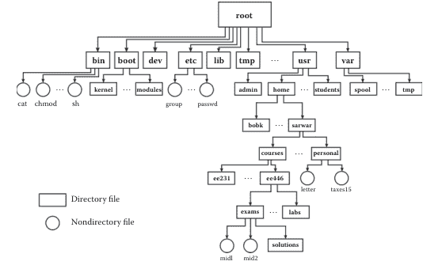

FIGURE 4.2 Typical UNIX file structure.

可以被文件系统结构中的任何用户从任何位置使用。例如，`/home/faculty/sarwar/courses/ee446` 是用户 `sarwar` 主目录下 `ee446` 目录的绝对路径名。位于 sarwar 主目录下的名为 `mid1` 的文件的绝对路径名为 `/home/faculty/sarwar/courses/ee446/exams/mid1`。

以当前工作目录或用户主目录开头的路径名称为 **相对路径名**。当用户 `sarwar` 登录时，系统会将其置于其主目录 `/home/faculty/sarwar`。在主目录中，`sarwar` 可以使用相对路径名 `./courses/ee446/exams/mid1` 或 `courses/ee446/exams/mid1` 指定文件 `mid1`（见图 4.2）。用户 `sarwar`（或 `ee446` 目录中的任何其他人）可以用相对路径名 `exams/mid1` 指定同一文件。`mid1` 文件的所有者（或以所有者身份登录的任何人）也可以使用路径名 `~/courses/ee446/exams/mid1` 或 `$PATH/courses/ee446/exams/mid1` 从文件结构中的任何位置指定它。或者，你也可以从个人目录指定 `ee446` 为 `../courses/ee446`。

典型的 UNIX 系统有多个包含数据和系统文件的磁盘驱动器，但作为用户，你不必担心需要访问的文件位于哪个磁盘驱动器上。在 UNIX 中，多个磁盘驱动器和/或磁盘分区可以挂载在同一文件系统结构上，使其作为目录访问，而不是像 MS-DOS 和 Microsoft Windows 中那样作为命名驱动器 A:、B:、C: 等访问。你可以通过指定其路径名，就像它们是单个磁盘/分区上的文件结构的一部分一样，来访问这些磁盘和/或分区上的文件和目录。这样可以对系统中的所有文件和目录提供统一的视图，你不必担心记住驱动器的名称以及它们包含的文件和目录。

## 4.4.4 Some Standard Directories and Files

每个 UNIX 系统都包含一组标准文件和目录。标准目录包含一些特定文件。本节我们讨论一些重要的目录。你可以浏览 Web Resources（表 4.4）中列出的第一个网站，以了解有关 FreeBSD（和 PC-BSD）目录层次结构的更多信息。

`Root directory (/):` 根目录位于文件系统层次结构的顶部，用斜杠（`/`）表示。它包含一些标准文件和目录，从某种意义上说，它是包含所有抽屉、文件夹和文件的总柜。

`/bin:` 也称为二进制目录，`/bin` 目录包含大多数 UNIX 程序/命令的二进制（即可执行）映像，这些程序/命令对于启动和修复单用户和多用户环境至关重要。这些命令包括 `cat`、`chmod`、`cp`、`csh`、`date`、`echo`、`kill`、`ln`、`ls`、`mkdir`、`mv`、`pgrep`、`ps`、`pwd`、`rm`、`rmdir`、`sh`、`stty`、`sync`、`tar`、`tcsh`、`test` 和 `unlink`。超级用户和普通用户都可以使用这些程序。

在 BSD 上，`/usr/bin` 目录与 `/bin` 不同。在 Solaris 上，`/usr` 和 `/usr/bin` 目录是同一事物，因为 `/bin` 是指向 `/usr/bin` 的符号链接。在 BSD 上，`/usr/bin` 目录包含数百个可执行程序，这些程序对于启动或修复系统并非必需。其中一些最常用的有 `CC`、`awk`、`cal`、`clear`、`diff`、`du`、`env`、`file`、`find`、`finger`、`gdb`、`gunzip`、`gzip`、`head`、`join`、`last`、`less`、`locate`、`man`、`nl`、`pstree`、`quota`、`spell`、`ssh`、`sudo`、`tail`、`time`、`top`、`uniq`、`vi`、`w`、`wc`、`which`、`who`、`whomi`、`zcat`、`zdiff` 和 `zgrep`。在我们的 BSD 上，`/usr/bin` 包含 486 个文件，在 Solaris 上它包含 1205 个文件。

`/boot:` 该目录包含在系统引导过程中使用的程序和配置文件。`/boot/loader` 文件是系统加载器，即实际将内核加载到内存中并使其可运行的程序。`/boot/defaults` 目录包含引导的标准配置文件。在某些系统上，它可能仅包含 `loader.conf` 文件。`/boot/kernel` 目录包含 1500 多个在启动时要加载到内存中的内核可执行模块。`/boot/modules` 目录包含可在运行时加载到内核中的第三方模块。

`/dev:` `/dev` 目录，也称为设备目录，包含与计算机连接的设备对应的文件，包括终端、磁盘驱动器、CD-ROM 驱动器、磁带驱动器、调制解调器、显卡、网卡、打印机等。这些文件称为特殊文件，已在第 4.3.4 节中描述。

该目录为计算机连接的每个设备至少包含一个文件。每个设备都有一个名称和一个编号，表示设备的特殊文件同时反映两者。`/dev` 目录中的一些示例文件如下：`ada0` 是第一个串行高级技术附件（SATA）硬盘，`kbd0` 表示键盘，`cd0` 表示光盘 0，`cdrom` 表示 CD-ROM（它是 `cd0` 的符号链接，`dvd` 也是如此），`pp0` 表示并行端口，`lpt0` 用于打印机，`tty's` 用于（电传打字机）终端，`usb` 用于通用串行总线端口。`/dev/pts` 目录用于管理伪终端。


一个系统可能拥有每种类型的多个设备——例如，10 块硬盘或分区、20 个终端、100 个伪终端、两块固态硬盘（SSD）等等。我们基于 PC-BSD 的系统中，`/dev` 目录下共有 124 个文件。在中等规模到大型组织的基于网络的 UNIX 环境中，该目录可能包含数百个甚至超过 1000 个文件。

## `/etc`

`/etc` 目录包含系统配置和管理所需的命令、文件和脚本。普通用户通常不被允许使用该目录中的命令和文件。该目录中的部分文件和子目录包括 `crontab`、`csh`、`cshrc`、`csh.login`、`csh.logout`、`inetd.conf`、`login.access`、`login.conf`、`passwd`、`printcap`、`profile`、`rc.d`、`rcp`、`shells`、`services`、`ssh`、`ssl` 和 `termcap`。对该目录中大多数文件的讨论超出了本教科书的范围。不过，我们会在本节末尾简要讨论 `/etc/passwd` 文件。我们还会在第 18 章至第 21 章的“系统编程”部分以及第 22 章“系统管理”中讨论该目录中的另外几个文件。

## `/lib`

库目录包含针对某一给定语言的若干相关文件，这些文件集中存放在一个称为归档文件的单一文件中。当今典型的 UNIX 系统包含 C 和 C++ 的库。其中一种语言的归档文件可被使用该语言开发的应用程序所使用。`/lib` 目录包含对 `/bin` 和 `/sbin` 目录中的可执行程序至关重要的库。`/usr/lib` 目录包含共享库和归档型库（由 `ar` 命令创建）。

## `/tmp`

`/tmp` 目录被多个命令和应用程序用于存放临时文件。你也可以将该目录用于自己的临时文件。该目录中的所有文件都会被定期删除，以免磁盘（或磁盘的某个分区）被临时文件填满。`/tmp` 目录中文件的存活时间由系统管理员设定，并因系统而异，但通常只有几分钟。系统重启时，`/tmp` 中的文件可能存在，也可能不存在。

## `/usr`

`/usr` 目录包含若干子目录，这些子目录除其他内容外，还存放着大多数实用程序、系统守护进程（参见第 10 章）、应用程序、编程工具、标准 C 头文件、共享库和归档型语言库、手册页和其他重要文档，以及源代码（BSD 和第三方）。该目录中两个最重要的子目录是 `bin` 和 `lib`，它们分别包含大多数 UNIX 命令（实用程序、工具等）的二进制映像和语言库。

## `/usr/home`

`/usr/home` 目录通常以某种方式组织，用于存放系统所有用户的主目录。例如，系统管理员可以在该目录下创建子目录，以便为某些类型的用户存放主目录。例如，图 4.2 中展示的大学设置中，行政人员、教师、职员、学生等各类用户的主目录各有一个子目录。这些子目录分别标记为 `admin`、`faculty` 和 `students`。我们的系统管理员创建了一个名为 `/home` 的符号链接（参见第 8 章），指向 `/usr/home`，如下面的会话所示。

```
% ls -ld /home
lrwxr-xr-x 1 root root 9 Jul 9 19:05 /home -> /usr/home
%
```

这意味着，如果某个用户（比如 `john`）切换到他/她的主目录并运行 `pwd` 命令，命令输出将是 `/usr/home/john`，而不是 `/home/john`。我们将在第 8 章中讨论 UNIX 中的链接，包括符号链接。

## `/var`

`/var` 目录包含多用途的日志文件、临时文件和假脱机文件。在其他几个目录中，`/var/mail` 目录包含用于接收和保存用户收到的传入电子邮件消息的文件。当你阅读新邮件时，邮件来自该目录中的某个文件。`/var/spool/mqueue` 目录包含未送达的邮件队列，而 `/var/spool/output` 目录包含行式打印机假脱机目录。`/var/tmp` 目录包含在系统重启之间保留的临时文件。

## `/etc/passwd`

`/etc/passwd` 文件中包含系统中每个用户的一行记录，并描述该用户。每一行有七个字段，以冒号分隔。该行的格式如下。

```
login_name:password:user_ID:group_ID:user_info:home_directory:login_shell
```

`login_name` 是用户被系统识别的登录名，也是用户在登录时输入的名称。`password` 字段在较新的系统（从 System V Release 4——SVR4 开始）中包含虚拟密码 `x` 或 `*`，而在较旧的系统中则包含加密后的密码。较新版本将加密密码存储在 `/etc/master.passwd` 文件中。只有超级用户（即 `root`）对主密码文件具有读写访问权限；其他任何人都无法读取该文件。POSIX 要求 `user_ID`（UID）为整数类型。通常，超级用户的 UID 被指定为 0。其他几个登录名也被分配了已知（或来自已知范围）的 UID。通常，UID 1–499 或 1–999 被保留。根据你所使用的 UNIX 系统，UID 1,000–32,767 或 1,000–65,536 被分配给像你我这样的“普通”用户。在使用 32 位 UID 的系统中，该范围为 1,000–4,294,967,296。`group_ID` 标识用户所属的组，它同样是介于 0 到 65,535 之间的整数，通常保留整数 0–99。`user_info` 字段包含关于用户的信息，通常是用户的完整姓名。`home_directory` 字段包含用户主目录的绝对路径名。最后一个字段 `login_shell` 包含用户登录 shell 的绝对路径名。当用户登录时，系统会执行该字段中指定路径名所对应的命令。连续两个冒号表示该字段值为空，这在 `user_info` 字段中有时会出现。下面的会话显示了系统中 `/etc/passwd` 文件中关于用户 `sarwar` 的那一行：

```
% cat /etc/passwd | grep "sarwar"
sarwar:*:1004:1008:Mansoor Sarwar:/home/sarwar:/bin/csh
%
```

在这一行中，登录名为 `sarwar`，密码字段包含 `*`，用户 ID 为 1004，组 ID 为 1008，个人信息为用户的全名（Mansoor Sarwar），主目录为 `/home/sarwar`，登录 shell 为 `/bin/csh`，即 C shell。我们通常会在登录后通过运行 `/bin/sh` 命令使用 Bourne shell。

以下章节中的练习让你在 UNIX 机器上练习浏览文件系统，并帮助你理解 `/etc/passwd` 文件的格式。

## EXERCISE 4.1

进入你系统上的 `/dev` 目录并识别一个字符特殊文件和一个块特殊文件。

## EXERCISE 4.2

查看你系统上的 `/etc/passwd` 文件以确定你的用户 ID。

## 4.5 NAVIGATING THE FILE STRUCTURE

现在，我们描述一些用于浏览 UNIX 文件系统、创建文件和目录、确定文件属性、确定主目录的绝对路径名、确定当前工作目录的路径名以及确定文件类型的有用命令。讨论基于图 4.2 所示的文件结构和用户名 `sarwar`。

### 4.5.1 Determining the Absolute Pathname for Your Home Directory

当你登录时，系统会将你置于主目录中。你可以使用 `echo` 和 `pwd` 命令找到主目录的完整路径名。

不带参数时，`echo` 命令会在屏幕上显示一个空行。你可以使用 `echo` 命令按如下方式确定主目录的绝对路径名：

```
$ echo $HOME
/home/sarwar
$
```

其中 `HOME` 是 Bourne shell 中的一个 shell 变量（占位符）。shell 使用此变量来跟踪主目录的绝对路径名。在 C shell 中，该变量为 `home`。我们将在第 12 章至第 15 章中详细讨论 shell 变量和 `echo` 命令。

另一种显示主目录绝对路径名的方法是使用 `pwd` 命令。你使用此命令来确定你当前所在的目录的绝对路径名，即当前工作目录，也称为当前目录。此命令不需要任何参数。当你登录时，UNIX 系统会将你置于主目录中。你可以在登录后立即使用 `pwd` 命令来显示主目录的绝对路径名，如下所示：

```
$ pwd
/home/sarwar
$
```

## Commonly used options/features

- `-F` Display / after directories, * after binary executables, and @ after symbolic links
- `-a` Display names of all files, including hidden files . , .. , and so on.
- `-i` Display inode number and file name


### `-l` 选项
Display long list that includes access permissions, hard link count, owner, group, file size (in bytes), and modification time

如果命令不带任何参数使用，它会显示当前工作目录中的文件和目录名称。以下会话说明了 `ls` 和 `cd` 命令在有参数和无参数时的使用方式。`pwd` 命令显示当前目录的绝对路径名。除了隐藏文件外，`ls` 命令会显示当前目录中所有文件和目录的名称。`cd courses` 命令用于将 `courses` 目录设为当前目录。`cd ee446/exams` 命令使 `ee446/exams` 成为当前目录。`ls ~` 和 `ls $HOME` 命令显示主目录中的文件和目录名称。不带任何参数的 `cd` 命令会将你置于主目录中。换句话说，它使主目录成为你的当前目录。

```
$ pwd
/home/sarwar
$ ls
Desktop  Downloads  Images  Videos  personal
Documents  GNUstep  Music  courses  unix3e
$ cd courses
$ ls
ee231  ee446
$ cd ee446/exams
$ pwd
/home/sarwar/courses/ee446/exams
$ ls
mid1  mid2
$ ls ~
Desktop  Downloads  Images  Videos  personal
Documents  GNUstep  Music  courses  unix3e
$ ls $HOME
Desktop  Downloads  Images  Videos  personal
Documents  GNUstep  Music  courses  unix3e
$ cd
$ ls
Desktop  Downloads  Images  Videos  personal
Documents  GNUstep  Music  courses  unix3e
$
```

我们在本章的其余部分以及本书的其他章节中演示了使用各种选项的 `ls` 命令。我们将术语 `flag` 和 `option` 互换使用。

在典型的 UNIX 系统中，你不能访问系统中的所有文件和目录。特别是，你通常不能访问许多与系统管理相关的重要文件和目录，以及属于其他用户的文件和目录。然而，你有权读取一些目录和文件。下面的会话说明了我们有权进入并列出其中许多其他目录的内容，例如 `/` 和 `/usr` 目录。

```
$ cd /usr
$ ls
bin  home  jails  lib32  libexec  obj  ports  share  swap
games  include  lib  libdata  local  pbi  sbin  src  tests
$ cd /
$ ls
COPYRIGHT  compat  entropy  lib  mnt  root  tmp
bin  data  etc  libexec  proc  sbin  usr
boot  dev  home  media  rescue  sys  var
$ cd
$ ls /usr
bin  home  jails  lib32  libexec  obj  ports  share  swap
games  include  lib  libdata  local  pbi  sbin  src  tests
$
```

如果不带任何选项，`ls` 命令不会显示所有文件和目录；特别是，它不会显示隐藏文件的名称。这些文件的示例包括 `.`、`..`、`.bash_history`、`.bashrc`、`.config`、`.cshrc`、`.history`、`.login`、`.mailrc`、`.profile`、`.rhosts`、`.shrc`、`.ssh` 和 `.xsession`。我们已经讨论过 `.` 和 `..` 目录。一些更重要的隐藏文件的用途在表 4.2 中进行了总结。

你也可以通过使用带 `-a` 选项的 `ls` 命令来显示目录中的所有文件和目录名称，包括隐藏文件。在下面的会话中，`cd` 命令将你放置在你的主目录中，而 `ls -a` 命令显示你主目录中的所有文件和目录，包括隐藏文件。

```
$ cd
$ ls -a
.  .gnome2  .lesshst  .shrc  Downloads
..  .gtkrc-2.0  .login  .ssh  GNUstep
.bash_history  .history  .login_conf  .windowlab  Images
.cinnamon  .i3  .mail_aliases  .xprofile  Music
.config  .icewm  .mailrc  .xscreensaver  Videos
.cshrc  .icons  .profile  .xsession  courses
.fluxbox  .ideskrc  .ratpoisonrc  .zshrc  personal
.fvwm-crystal  .kde4  .rhosts  Desktop  unix3e
.gconf  .kde4  .screenrc  Documents
$
```

### 表 4.2 一些重要的隐藏文件及其用途

| 文件名 | 用途 |
|---|---|
| `.` | 当前工作目录 |
| `..` | 当前工作目录的父目录 |
| `.bash_history` | 包含在 bash 下执行的命令历史 |
| `.bashrc` | Bash shell 的设置 |
| `.cshrc` | C shell 的设置 |
| `.exrc` | vi 的设置 |
| `.login` | 如果 c 或 tcsh shell 是登录 shell，则为 shell 的设置；在登录时执行 |
| `.mailrc` | mail 和 mailx 的设置和地址簿 |
| `.profile` | 如果 Bourne 或 Korn shell 是登录 shell，则为 shell 的设置；在登录时执行 |
| `.rhosts` | 受信任主机的域名（详见第 11 章） |
| `.shrc` | 如果 Bourne shell 是登录 shell，则为 shell 的设置；在登录时执行 |
| `.ssh` | 你将使用 `ssh` 命令被允许登录的服务器的密钥。密钥在你首次尝试在服务器上建立会话时存储 |
| `.xsession` | 自定义 X 会话脚本 |

`/usr` 目录中的 C 程序文件。我们将在本章后面以及第 6 章和第 7 章中详细讨论元字符和正则表达式的使用。

### 4.5.3 创建文件

在使用计算机系统时，你需要创建文件和目录：文件用于存储你的工作，目录用于更有效地组织你的文件。你可以通过使用各种工具和应用程序（如编辑器）来创建文件，并通过使用 `mkdir` 命令来创建目录。在第 3 章中，我们讨论了文本编辑器 `vim` 和 `emacs`，你可以使用它们来创建包含纯文本的文件。你可以通过使用各种应用程序和工具（如编译器）来创建非文本文件，编译器将高级语言（如 C）的源代码翻译并生成包含相应可执行代码的文件。

### 4.5.4 创建和删除目录

我们在第 2 章中简要讨论了 `mkdir` 和 `rmdir` 命令。在这里，我们全面介绍这些命令。你可以通过使用 `mkdir` 命令来创建目录。以下是该命令的简要说明。

```
SYNTAX

mkdir [option] directory-names

Purpose: Create directories specified in directory-names
```

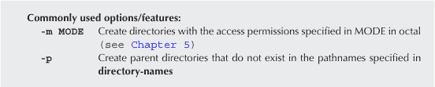

这里，`directory-names` 是要创建的目录的路径名。当你登录后，可以使用下面的命令在主目录中创建一个名为 `memos` 的子目录。新创建目录的访问权限由当前 `umask` 值决定（见 Chapter 5）。可以使用如下 `ls -ld memos` 命令确认目录是否创建成功：

```bash
$ mkdir memos
$ ls -ld memos
drwxr-xr-x 2 sarwar faculty 68 Aug 15 07:42 memos
$
```

同样，你也可以使用以下命令在 `/tmp` 目录中创建一个名为 `test_example` 的目录：

```bash
$ mkdir /tmp/test_example
$
```

在主目录中，你可以使用带有 `-p` 选项的 `mkdir` 命令创建 `professional` 目录及其子目录 `letters`，如下所示：

```bash
$ mkdir -p professional/letters
$
```

可以使用 `rmdir` 命令删除空目录。如果目录不为空，则必须先删除其中的文件和子目录，才能删除该目录。要删除非空目录，需要使用带有 `-r` 选项的 `rm` 命令（见 Chapter 6）。下面简要介绍 `rmdir` 命令。


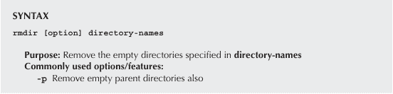

以下命令从当前工作目录中删除 `letters` 目录。如果 `letters` 不为空，`rmdir` 命令会显示错误信息：`rmdir: letters: Directory not empty`。如果 `letters` 是一个文件，命令会显示错误信息：`rmdir: letters: Not a directory.`

```
$ rmdir letters
$
```

以下命令从当前工作目录中删除目录 `letters`，并从主目录中删除 `memos`。

```
$ rmdir letters ~/memos
$
```

如果 `~/personal` 目录仅包含一个名为 `diary` 的空子目录，你可以使用以下命令删除这两个目录。

```
$ rmdir -p ~/personal/diary
$
```

## 4.5.5 Determining File Attributes

你可以通过使用带有各种选项的 `ls` 命令来确定文件的属性。这些选项可以一起使用，且顺序无关紧要。例如，你可以使用 `-l` 选项获取目录的长列表，从而显示文件的属性，如文件所有者，具体如下：

```
$ ls -l
total 5
drwxr-x--- 2 sarwar faculty 512 Jan 23 09:37 courses
drwxr-x--- 2 sarwar faculty 12 May 01 13:22 memos
drwxr-x--- 2 sarwar faculty 163 May 05 23:13 personal
$ ls -l ~/courses/ee446/exams
-rw-r--r-- 1 sarwar faculty 1512 Mar 12 11:10 mid1
-rw-r--r-- 1 sarwar faculty 1485 May 19 14:34 mid2
drwxrwxrwx 2 sarwar faculty 63 May 12 13:44 solutions
$
```

`ls -l` 命令显示的信息在表 4.3 中进行了总结。

在上述两次使用 `ls -l` 命令中，`courses`、`memos`、`personal` 和 `solutions` 是目录，而 `mid1` 和 `mid2` 是普通文件。如前所述，我们将在第 5 章讨论访问权限和用户类型。文件的拥有者是 `sarwar`，他属于 `faculty` 组。其余字段的值不言自明。

你可以使用 `ls` 命令的 `-i` 选项来显示文件和目录的 inode 编号。要显示目录的 inode 编号，需要使用 `ls -id` 命令。以下使用示例显示 `greeting` 文件的 inode 编号为 6278611，而目录 `courses`、`memos` 和 `personal` 的 inode 编号分别为 6555603、6555456 和 6555324。

```
$ ls -i greeting
6278611 greeting
```

建议你阅读系统上 `ls` 命令的在线手册页，或查阅本书在 CRC Press 网站上的命令附录，以获取该命令的详细描述。

通过使用 shell 元字符和正则表达式，你可以指定文件系统结构中的特定文件和目录集，或文件中或目录中的特定字符串集。例如，以下命令可在 C shell 中使用，以显示 `~/courses/ee446` 目录中所有以 `lab` 开头后跟零个或多个字符的文件的长列表，其中第一个字符不能为 5，且文件扩展名为 `.c`。

```
$ ls -l ~/courses/ee446/lab[^5]*.c
...
$
```

同样，以下命令可用于显示当前目录中所有文件名长度为四个字符且扩展名为 `.html` 的文件 inode 编号和名称。文件名必须以字母开头，其后跟任意两个字符，并以 1 到 5 之间的数字结尾。

```
$ ls -i [a-zA-Z]??[1-5].html
...
$
```

以下命令在 C shell 下显示主目录中所有不以数字开头且以 `.c` 或 `.C` 结尾的文件名。换句话说，该命令显示所有不以数字开头 C 和 C++ 源程序文件的文件名。在 Bourne shell 下，你可以将 `^` 字符替换为 `!` 字符。因此，`ls ~/[^0-9]*.[c,C]` 命令会产生相同的结果。

```
$ ls ~/[^0-9]*.[c,C]
...
$
```

## 4.5.6 Determining the Type of a File's Contents

由于 UNIX 不支持文件扩展名，你可以为任何文件使用任何扩展名。这意味着你可以使用 `.jpg` 扩展名为可执行程序文件。因此，你不能仅通过查看文件名来确定文件内容的类型。由于许多软件工具需要使用扩展名且用户可能依赖扩展名，因此扩展名仍然很重要。在 UNIX 中，你可以使用 `file` 命令找到文件内容的类型。该命令主要用于确定文件是否包含文本或二进制数据。做到这一点很重要，因为文本文件可以在终端屏幕上显示，而显示二进制文件的内容会在终端屏幕上显示“乱码”，并且可能冻结终端，因为它可能会将某些二进制值解释为控制代码。该命令的语法如下。

### SYNTAX

```
file [option] file-list
```

Purpose: Attempt to classify files in `file-list`

Commonly used options/features:

  - `-f FILE`   Use `FILE` as a file of file-list

The following session shows a sample run of the command. In this case, the types of the contents of all the files in the root directory are displayed.

```
$ file /*
/COPYRIGHT: ASCII text
/bin:       directory
/boot:      directory
/compat:    directory
/data:      directory
/dev:       directory
/entropy:   regular file, no read permission
/etc:       directory
/home:      symbolic link to '/usr/home'
/lib:       directory
/libexec:   directory
/media:     directory
/mnt:       directory
/proc:      directory
/rescue:    directory
/root:      directory
/sbin:      directory
/sys:       broken symbolic link to 'usr/src/sys'
/tmp:       sticky directory
/usr:       directory
/var:       directory
$
```

The following session shows a few more types of files.

```
$ cd /bin
$ file cat freebsd-version rcp sh
cat:        ELF 64-bit LSB executable, x86-64, version 1
            (FreeBSD), dynamically linked (uses shared libs),
            for FreeBSD 10.0 (1000510), stripped
freebsd-version: POSIX shell script, UTF-8 Unicode text executable
rcp:        setuid ELF 64-bit LSB executable, x86-64, version
            1 (FreeBSD), dynamically linked (uses shared
            libs), for FreeBSD 10.0 (1000510), stripped
```

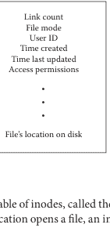

FIGURE 4.3 Contents of an inode.


The UNIX kernel also maintains a table of inodes, called the `inode table`, in the main memory for all open files. When an application opens a file, an `inode` is allocated from the `inode table` and the contents of the file's `inode` on the disk are copied into it. The `inode number` is used to index the `inode table`, allowing quick access to the attributes of an open file. When a file's attributes (e.g., file size) change, the `inode` in main memory is updated; disk copies of `inodes` are updated at fixed intervals. For files that are not open, their `inodes` reside on the disk. Some of the contents of an `inode` are shown in Figure 4.3.

The `link count` field specifies the number of different names the file has within the system. This count is also known as the hard link count (see Chapter 8 for details on links). The `file mode` field specifies what the file was opened for (read, write, etc.). The `user ID` is the ID of the owner of the file. The `access permissions` field specifies who can access the file for what type of operation (discussed in more detail in Chapter 5). The file's location on disk is specified by a number of direct and indirect pointers to disk blocks containing file data.

A typical computer system has several disk drives. Each drive consists of a number of platters with two surfaces (top and bottom). Each surface is logically divided into concentric circles called tracks, and each track is subdivided into fixed size portions called sectors. Tracks at the same position on both surfaces of all platters comprise a cylinder. Disk input/output (I/O) takes place in terms of one sector, also called a disk block. For this reason, disks are known as block devices. Traditionally, the sector size for hard disks has been 512 bytes. Newer hard disks use 4K-byte (i.e., 4096-byte) sector sizes. CD-ROMs and DVD-ROMs use 2K-byte (i.e., 2048-byte) sector sizes.

A sector may be addressed by using a four-dimensional address comprising `<disk #, cylinder #, surface #, and sector #>`. This four-dimensional address is translated to a linear (one-dimensional) block number, and most of the software in UNIX deals with block addresses because they are relatively easy to deal with. These blocks start with the sector numbered as 0 on the outermost cylinder on the topmost surface (i.e., the topmost track of the outermost cylinder), which is assigned block number 0. The block numbers increase through the rest of the tracks in that cylinder, through the rest of the cylinders on the disk, and then through the rest of the disks. The diagram shown in Figure 4.4 is a logical view of

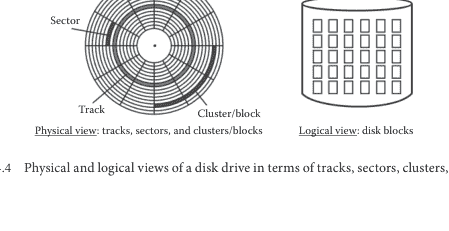

图4.4 磁盘驱动器以磁道、扇区、簇和磁盘块表示的物理视图和逻辑视图。

一个由磁盘块数组组成的磁盘系统。文件空间以两个、四个或八个磁盘块的簇为单位进行分配。

图4.5展示了如何利用打开文件的`inode`编号从磁盘访问文件的属性（包括文件内容）。它还展示了目录`~/courses/ee446/labs`的内容，以及UNIX内核如何将文件`lab1.c`的`inode`映射到其在磁盘上的内容。如前所述，并且如图所示，目录由一组条目`<inode编号，文件名>`组成。访问（读取或写入）`lab1.c`的内容需要使用其`inode`编号来索引内存中的`inode`表，从而获得该文件的`inode`。如前所述，`inode`除其他信息外，还包含`lab1.c`在磁盘上的位置。

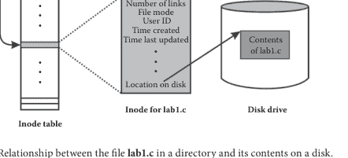

图4.5 目录中的文件`lab1.c`与其磁盘内容之间的关系。

`inode`以包含文件内容的磁盘块编号的形式，包含`lab1.c`在磁盘上的位置。UNIX文件的位置具体如何在`inode`中指定，以及它如何存储在磁盘上，这些细节超出了本教材的范围。这些细节可以在任何关于UNIX内部机制的书籍中找到。

## 4.6 标准文件和文件描述符

当应用程序需要对文件执行I/O操作时，必须先打开文件，然后执行文件操作（读、写、定位等）。UNIX会自动为它执行的每一条命令打开三个文件。命令从其中一个文件读取输入，并将其输出和错误消息发送到另外两个文件。这些文件被称为标准文件：标准输入（`stdin`）文件、标准输出（`stdout`）文件和标准错误（`stderr`）文件。默认情况下，这些文件连接到执行命令的终端。也就是说，`shell`使命令输入来自终端键盘，命令输出和错误消息发送到终端（或者在`ssh`会话或运行X Window系统的UNIX系统中的`xterm`的情况下，发送到控制台窗口，详见第23章）。可以使用重定向运算符将这些默认文件更改为其他文件：`<`用于输入重定向，`>`用于输出和错误重定向。

在UNIX中，每个打开的文件都关联一个小整数，称为文件描述符。整数值0、1和2分别是`stdin`、`stdout`和`stderr`的文件描述符，也被称为标准文件描述符。内核使用文件描述符执行文件操作（例如文件读取），如图4.6所示。内核使用文件描述符索引每个进程的文件描述符表，以获得指向系统级文件表的指针。文件表除其他信息外，还包含指向`inode`表中文件`inode`的指针。一旦访问了文件的`inode`，就可以通过使用直接指针和间接指针访问文件的相应磁盘块来执行所需的文件操作，如第4.6节所述。


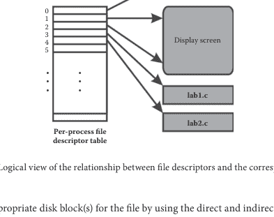

图4.7 文件描述符与对应文件之间关系的逻辑视图。


回顾一下，在 UNIX 中，每个设备（包括终端）都由一个文件表示。图 4.7 所示的图描绘了文件与其文件描述符之间的关系。这里，我们假设文件 `lab1.c` 和 `lab2.c` 为了某些文件操作（比如文件读取）而打开，分别具有文件描述符 3 和 4，这些描述符是内核在打开文件时分配给它们的。我们在前一段和第 4.6 节中，通过文件表、inode 表以及文件在磁盘上的存储，已经描述了这种关系的细节；另见图 4.5 和图 4.6。

UNIX 系统允许在单次执行一条命令（包括 shell 脚本）时，将标准文件更改为其他文件。这种将标准文件更改为其他文件的概念称为输入、输出和错误重定向。我们将在第 9 章详细讨论输入、输出和错误重定向。这里我们简要提及标准文件和文件描述符，因为大多数明确需要外部输入的 UNIX 命令都从标准输入获取输入，除非输入来自作为命令行参数传递给命令的文件（或文件列表）。类似地，大多数产生输出的 UNIX 命令会将输出发送到标准输出。这些信息对于正确理解和使用后续章节中的命令非常重要。

## 4.7 文件结束（EOF）标记

每个 UNIX 文件都有一个文件结束（EOF）标记。从文件读取输入的命令在到达文件末尾时会读取 EOF 标记。对于可以存储的文件，EOF 标记的值不是字符；它通常是一个小的负整数，例如 -1。当输入文件连接到键盘时，在新行上按 `<Ctrl-D>` 是 UNIX 的 EOF 标记。这就是为什么像 `cat` 这样的命令从键盘读取输入时（参见第 6 章），当你在一行开头按 `<Ctrl-D>` 时会终止。

## 4.8 文件系统

文件系统是一个存储在磁盘或磁盘分区上的具有自身根目录的目录层次结构，挂载在（粘贴到）一个目录下。文件系统中的文件和目录通过它们被挂载的目录进行访问。本教材中对文件系统的所有引用均指本地文件系统。UNIX 网络文件系统（NFS）的描述超出了本教材的范围，但在第 11 章中简要提及。

PC-BSD 和 Solaris 使用 ZFS 文件系统，该文件系统由 Oracle 于 2006 年 6 月首次为 Solaris 发布。它于 2007 年 4 月成为 FreeBSD 的一部分。它是一种符合 POSIX 的文件系统，可靠、灵活且可扩展，具有内置压缩和用于文件系统备份和恢复的高级功能。然而，ZFS 的标志是其对最大数据完整性的关注，可保护用户数据免受各种错误的影响，包括由存储介质衰减、电流尖峰、意外磁盘写入等引起的错误。它通过使用多种技术来实现这种数据完整性，包括数据复制。ZFS 文件系统的功能和问题将在第 23 章“系统管理”下的“系统管理”中更详细地讨论。浏览“网络资源”中列出的相关网站（表 4.4），以了解有关 ZFS 文件系统的更多信息。

## 摘要

在 UNIX 中，文件是一系列字节。这种简单而强大的概念及其实现导致系统中几乎所有东西都是文件；用户和进程不是。UNIX 支持七种类型的文件：普通文件、目录、符号链接、字符特殊文件、块特殊文件、命名管道（也称为 FIFO）和套接字。任何类型的文件都不支持文件扩展名，但运行在 UNIX 系统上的应用程序可以要求使用自己的扩展名。

UNIX 中的每个文件都有几个与其关联的属性，包括文件名、所有者名称、上次修改日期、链接计数和文件在磁盘上的位置。这些属性存储在磁盘上的一个区域，称为 inode。当文件被打开时，其 inode 会被复制到内核的一个区域，称为 inode 表，以便更快地访问其属性。目录中的每个文件都有一个与其关联的条目，该条目包括文件名称及其 inode 编号。内核通过从其目录条目中读取文件的 inode 编号并使用该 inode 编号索引 inode 表来访问打开文件的属性，包括其内容。

UNIX 文件结构是分层的，具有根目录，系统中的所有文件和目录都在其下。每个用户都有一个称为用户主目录的目录，在登录系统时他或她会被放置在该目录中。多个磁盘驱动器和/或磁盘分区可以挂载在同一个文件系统结构上，从而允许将其作为目录访问，而不是像 MS-DOS 和 Microsoft Windows 中那样作为命名驱动器 A:、B:、C: 等访问。这种方法提供了对系统中所有文件和目录的统一视图，用户不必担心记住驱动器的名称以及它们包含的文件（和目录）。

目录（主要）在用户主目录下可以创建和删除。文件结构可以通过使用各种命令（`mkdir`、`rmdir`、`cd`、`ls` 等）进行导航。您可以使用文件的绝对或相对路径名指定系统中的文件。绝对路径名以根目录开头，相对路径名以用户主目录或当前工作目录开头。

UNIX 为每个命令自动打开三个文件，以便从中读取输入并向其发送输出和错误消息。这些文件称为标准输入（`stdin`）、标准输出（`stdout`）和标准错误（`stderr`）。默认情况下，这些文件附加到命令执行的终端；即，命令输入来自终端键盘，命令输出和错误消息发送到终端的屏幕显示。默认文件可以使用重定向原语更改为其他文件：`<` 用于输入重定向，`>` 用于输出和错误重定向。

内核为每个打开的文件关联一个小整数。该整数称为文件描述符。内核使用文件描述符对文件执行操作（例如，读取）。`stdin`、`stdout` 和 `stderr` 的文件描述符分别为 0、1 和 2。

每个 UNIX 文件都有一个文件结束（eof）标记，这是一个小的负整数，例如 -1。如果命令从键盘读取输入，则 eof 标记为 `<Ctrl+D>`。

### 表 4.4 UNIX 文件系统的网络资源

| URL | 描述 |
|---|---|
| http://www.freebsd.org/doc/en_US.ISO8859-1/books/handbook/dirstructure.html | 该网站包含 FreeBSD 目录层次结构的全面描述。 |
| http://en.wikipedia.org/wiki/ZFS | 该网站描述了 ZFS 文件系统。 |
| http://www.badnow.tv/tutorials/zfs | 这些网站包含关于 ZFS 文件系统的非常好的教程，描述了 ZFS 的安装及其各种功能的维护。 |
| http://www.freebsd.org/doc/en_US.ISO8859-1/books/handbook/filesystems-zfs.html |  |
| http://www.princeton.edu/~unix/Solaris/troubleshoot/zfs.html | 该网站讨论了 ZFS 文件系统的管理。 |
| http://2007.asiabsdcon.org/papers/P16-paper.pdf | 该网站包含一篇描述将 ZFS 移植到 FreeBSD 的论文。 |

## 问题和练习

- 1. 什么是 UNIX 中的文件？
- 2. UNIX 是否支持任何文件类型？如果是，请列出它们。UNIX 是否支持文件扩展名？
- 3. 什么是目录条目？它由什么组成？
- 4. UNIX 中的特殊文件是什么？什么是字符特殊文件和块特殊文件？运行 `ls /dev | wc -w` 命令以查找系统拥有的特殊文件数量。
- 5. 什么是进程间通信？请列出 UNIX 提供的三种用于进程间通信的工具。
- 6. 画出你的 UNIX 机器的层级文件结构，类似于图 4.2 所示。展示前两层的文件和目录。同时标出你的主目录所在位置，以及主目录下的文件和目录。
- 7. 给出三条可用于列出主目录绝对路径名的命令。
- 8. 写出你系统中 `/etc/passwd` 文件中包含你登录信息的那一行。你的登录 shell、用户 ID、主目录和组 ID 分别是什么？你的系统是将加密密码存放在 `/etc/passwd` 文件中，还是 `/etc/shadow` 文件中？
- 9. 如果 `/etc/passwd` 文件中那一行的最后一个字段被替换成 `/usr/bin/date`，会发生什么情况？为什么？
- 10. 你机器上根目录和主目录的 inode 编号是多少？给出你用来查找这些 inode 编号的命令。
- 11. 在你的主目录下创建一个名为 `memos` 的目录。进入该目录，并使用 `vi` 等编辑器之一创建一个名为 `memo.james` 的文件。给出该文件的三个路径名。
- 12. 给出一条命令，用于在问题 11 中创建的 `memos` 目录下创建一个名为 `personal` 的子目录。
- 13. 复制 `memo.james` 文件并将其放入你的主目录中。将复制的文件命名为 `temp.memo`。给出两条完成此任务的命令。
- 14. 为你的 `memos` 目录画一个类似于图 4.5 所示的示意图。清楚显示所有目录项，包括其中所有文件和目录的 inode 编号。

## 文件与文件系统结构 • 181

- 20. 使用 Bourne shell 和 C shell 中的两种不同方法显示主目录的绝对路径名。你的系统在 `/` 目录下是否使用了任何符号链接？如果有，请使用 shell 命令显示这些符号链接。
- 21. ZFS 文件系统的基本特征是什么？它最早是在何时成为 Solaris 的一部分，哪个版本？FreeBSD 又是在何时采用的？
- 22. 你的 UNIX 系统中文件名的最大长度（以字节/字符计）是多少？你使用什么命令获得的答案？


## 23. 浏览以下目录，并从中识别五个常用的命令、工具、实用程序和守护进程：`/bin`、`/sbin`、`/usr/bin`、`/usr/sbin`、`/usr/local/bin` 和 `/usr/local/sbin`。清楚说明每个命令、工具、实用程序或守护进程的用途以及它所在的目录名称。

## 文件安全

### 目标

- 展示 UNIX 提供的三种保护与安全机制
- 描述 UNIX 文件的用户类型
- 讨论可以对 UNIX 文件执行的基本操作
- 解释 UNIX 中文件访问权限/特权（privileges）的概念
- 讨论用户如何确定文件的访问权限
- 描述用户如何设置和更改文件的权限
- 涵盖相关命令和原语

`?`, `~`, `*`, `chmod`, `groups`, `ls -l`, `ls -ld`, `umask`, `umask -S`

### 5.1 引言

正如我们之前指出的，分时系统带来了巨大的好处。然而，它也带来了保护其中硬件和软件资源的主要挑战。这些资源包括输入/输出（I/O）设备、中央处理单元（CPU）、主内存，以及存储用户文件的辅助存储设备。CPU 运行用户进程和内核进程，主内存在系统运行时存储用户进程以及重要的操作系统代码和数据结构，而辅助存储设备则永久性地存储用户文件和操作系统代码。本章我们仅讨论如何保护用户文件免受其他用户的未授权访问。UNIX 提供了三种机制来保护你的文件。

保护用户文件最基本的方案是给每个用户一个登录名和密码，允许用户使用系统（参见第 2 章）。为防止他人访问你的文件，请严格保密你的计算机账户密码。第二种方案是通过将单个文件转换成一种完全不可读的形式来保护它们。与原始版本不同，采用加密方式进行。这项技术用于保护你最重要的文件，使得即使有人以某种方式在系统上获得了这些文件的访问权限，其内容也无法被理解。第三种文件保护方案允许你通过为文件关联访问权限来保护文件，这样只有一部分用户才能对这些文件执行一部分文件操作。换句话说，文件的拥有者可以决定将这些文件的访问权限授予谁。三种机制都在本章中进行了描述，重点在于第三种方案。

### 5.2 基于密码的保护

第一种允许你防止其他用户访问你的文件的机制是登录密码方案。每个 UNIX 基于计算机系统的用户都被分配一个登录名（用户在 UNIX 系统中被识别的名称）和一个密码。登录名和密码都由系统管理员分配，并且用户进入并使用 UNIX 系统时需要提供这两者。所有登录名都是公开信息，可以在 `/etc/passwd` 文件中找到。然而，一个用户的密码只提供给该用户本人。这种方案可防止用户访问彼此的文件。用户被鼓励通过使用 `passwd` 命令（参见第 2 章）经常更改密码。在某些联网系统中，你可能需要使用 `yppasswd` 或 `nispasswd` 命令来更改网络上所有计算机系统的密码。PC-BSD 具有 `yppasswd` 命令，你可以浏览其手册页来了解它。请咨询你的讲师关于你在特定系统上需要使用的命令。通常，只有系统管理员可以更改登录名。在某些 UNIX 安装中，用户也可以更改自己的用户名。

这种保护方案的有效性取决于用户密码的保护程度如何。如果有人知道你的密码，那个人就可以登录系统并访问你的文件。主要有三种方式可以发现用户的密码。

- 1. 你作为账户的所有者，告知他人你的密码。
- 2. 一个用户的密码可以被另一用户猜出。
- 3. 一个用户的密码可以通过“暴力破解”猜出。

在任何情况下都不要让任何人知道你的密码。作为安全措施，你应定期更改密码。始终选择他人难以猜测的密码。好的密码是由字母、数字和标点符号混合而成的——但你必须容易记住。切勿将密码写在纸上，也不要使用生日或亲戚、朋友、著名运动员或喜爱的电影演员的名字作为密码。此外，避免使用单词作为密码。

通过“暴力破解”，有人试图通过尝试所有可能的字符组合来学习你的密码，直到找到用户的密码为止。猜测某人的密码是一个耗时过程，黑客常常用这种方法。如果密码很长并且由字母、数字和标点符号组成，暴力破解方法会使入侵者的工作变得更加耗时。为了说明使用更复杂密码的重要性，请考虑一个密码恰好为八个字符且仅由十进制数字组成的系统。这将允许最多 `10^8`（1 亿）个密码，暴力破解方法在最坏情况下分析中必须遍历这些密码。如果同一系统要求密码由数字和大写字母的混合组成（总共 36 个符号：10 个数字和 26 个大写字母），密码空间将包含 `36^8`（约 2.8 万亿）个密码。如果系统要求密码由数字、大写字母和小写字母的混合组成，密码空间将包含 `62^8`（约 218 万亿）个密码。想象一下，如果密码还可以包含标点符号，密码空间会有多大！许多系统在输入无效密码后强制短暂（例如，5 秒）延迟，然后才显示下一个登录提示，以使入侵者的工作更难。

以下章节练习要求你弄清楚如何在你的系统上更改密码。

### EXERCISE 5.1

在某些 UNIX 系统中你不允许更改密码。你的系统允许你更改密码吗？如果是，请更改你的密码。你使用了什么命令？

注意：务必记住你的新密码，因为如果你忘记了，你将不得不请求系统管理员将你的密码重置为新值，除非你的系统允许你将密码改回之前的密码。

### 5.3 基于加密的保护

在第二种保护方案中，使用软件工具将文件转换为与其原始版本完全不同的形式。转换后的文件称为加密文件，将文件转换为加密文件的过程称为加密。相同的工具用于执行将加密文件转换回其原始形式的逆过程，称为解密。你可以使用此技术来保护你最重要的文件，以便即使其他人获得了访问权限，其内容也无法被理解。图 5.1 说明了加密和解密过程。

UNIX 命令 `crypt` 可用于加密和解密你的文件。你可以通过运行 `man crypt` 命令了解有关此命令的更多信息。本章将在第 7 章中详细讨论此命令。


FIGURE 5.1 Process of encryption and decryption.

### 5.4 基于访问权限的保护

第三种文件保护机制可防止用户在未以文件所有者的身份登录时访问彼此的文件。作为文件所有者，您可以为文件附加某些访问权限，以规定谁可以、谁不可以对各种类型的文件操作进行访问。该方案基于 UNIX 下用户类型、访问权限类型以及允许对文件执行的操作类型。在没有此保护方案的情况下，用户可以访问彼此的文件，因为 UNIX 文件系统结构（见图 4.2）有一个单一的根，所有系统中的文件都挂在其下。全书中我们将访问权限、访问特权和访问权利这三个术语同义使用。

UNIX 系统中的每个用户都属于一个用户组，该组由系统管理员在为用户分配系统账户时指定。用户可以属于多个组，但典型的 UNIX 用户只属于一个组。系统中所有组及其成员关系都列在文件 `/etc/group` 中（见图 4.2）。该文件每组一行，行的最后一个字段包含该组成员的登录名。文件的用户可以是文件的所有者、与所有者属于同一组的用户，或系统上拥有账户的任何其他人。这些分别构成了 UNIX 文件的三种用户类型：user、group 和 others。作为文件所有者，您可以指定谁可以访问它。文件的组名称为文件的组所有者。

一旦用户登录系统，他/她对 UNIX 系统而言就以一个整数编号为人所知，即用户 ID（`UID`），而不是用户的登录名。每个 UNIX 系统都有一个特殊用户，无论文件上的访问权限如何，都可以访问系统上的所有文件。该用户管理（管理）您的 UNIX 系统，通常称为超级用户或系统管理员。超级用户的登录名为 `root`，用户 ID 为 `0`。

您可以通过显示 `/etc/group` 文件来查看系统上所有用户组的列表，如下所示。

```
$ more /etc/group
root :0:root,davis
other :1:
bin :2:root,bin,daemon
sys :3:root,bin,sys,adm
adm :4:root,daemon,adm
uucp :5:root,uucp
mail :6:root
tty :7:root,tty,adm
lp :8:root,lp,adm
uucp :9:root,nuucp
staff :10:
daemon :12:root,daemon
sysadmin :14:davis
nobody::60001:
noaccess::60002:
nogroup::65534:
utadmin::100:
faculty::101:
ra::102:
courses::103:zartash
student::104:ank
...
$
```


该文件中系统上每个组有一行，每行有四个以冒号分隔的字段。第一个字段指定组名，第二个字段指定有关组的某些信息，第三个字段以数字形式指定组 ID，最后一个字段指定属于该组的用户的以逗号分隔的列表。例如，`bin`组具有组 ID 2，其成员为用户`root`、`bin`和`daemon`。如果某行的成员列表缺失（例如`faculty`组），则表示其成员关系在`/etc/passwd`文件中指定。系统管理员在向系统添加用户时将用户设为某个组的一部分。该组称为用户的默认组。用户的默认组成员关系在`/etc/passwd`文件中用户的条目中指定。系统管理员可以通过将用户的用户名放在组的成员以逗号分隔的列表中，使用户成为另一个组（除其默认组外）的一部分。您可以使用`groups`命令显示用户在系统上所属的组。以下会话显示`sarwar`仅属于`faculty`组；`zartash`属于`faculty`和`courses`组；`davis`是三个组的成员：`faculty`、`root`和`sysadmin`；`root`属于11个组：`other`、`root`、`bin`、`sys`、`adm`、`uucp`、`mail`、`tty`、`lp`、`nuucp`和`daemon`。

```
$ groups sarwar
faculty
$ groups zartash
faculty courses
$ groups davis
faculty root sysadmin
$ groups root
other root bin sys adm uucp mail tty lp nuucp daemon
$
```

### 5.4.2 文件操作/访问权限的类型

在 UNIX 中，可以与文件关联三种访问权限/特权：读（`r`）、写（`w`）和执行（`x`）。文件上的读权限允许您读取文件，写权限允许您写入或删除文件，执行权限允许您执行/运行文件。执行权限应仅为可执行文件设置，即包含二进制代码（即由编译器生成的可执行代码）的文件或

#### 表 5.1 UNIX 中文件权限的汇总

| 用户类型 | 权限类型 |  |  |
|---|---|---|---|
|  | 读取 (`r`) | 写入 (`w`) | 执行 (`x`) |
| 用户 (`u`) | X | X | X |
| 组 (`g`) | X | X | X |
| 其他 (`o`) | X | X | X |

`shell`脚本，因为对其他类型的文件设置它没有任何意义。我们将在第 5.4.3 节讨论目录上执行权限的目的。

由于有三类文件用户和每种用户类型有三种权限类型，一个 UNIX 文件与其关联着九种类型的权限，如表 5.1 所示。请注意，权限是按行读取的。如第 4 章所述，访问权限存储在文件的文件节点中。

X 的值可以是 1（权限授予）或 0（权限未授予）。因此，表示一种权限类型需要一个比特位，表示一种用户类型的文件权限总共需要三个比特位。换句话说，文件的用户在给定时间可以具有文件八种（2³）可能的权限类型中的一种。八进制数可以表示从 0 到 7 的这八个三位访问权限值，如表 5.2 所示。访问权限 0（二进制 000）和 7（二进制 111）分别表示无访问权限和所有权限。

表达三种类型文件用户的权限所需的九个比特位导致文件权限可能的访问权限值为三位八进制数 000–777。第一个八进制数字指定文件所有者的权限，第二个数字指定文件所有者所属组的权限，第三个数字指定其他所有人的权限。在`ls -l`命令的输出中，权限的比特值为 0 时显示为连字符 (`-`)，值为 1 时根据表中比特位的位置显示为`r`、`w`或`x`。因此，用户文件的八进制权限值为 0（未授予权限）可以写为`---`，而权限值为 7（授予全部三个权限）可以表示为`rwx`。以下会话中`ls -l`命令的输出显示，`/etc/passwd`文件对系统上的每个人都是只读的

#### 表 5.2 文件对用户的可能访问权限值、其八进制等价值及其含义

| `r` | `w` | `x` | 权限的八进制数字 | 含义 |
|---|---|---|---|---|
| 0 | 0 | 0 | 0 | 无权限 |
| 0 | 0 | 1 | 1 | 仅执行权限 |
| 0 | 1 | 0 | 2 | 仅写入权限 |
| 0 | 1 | 1 | 3 | 写入和执行权限 |
| 1 | 0 | 0 | 4 | 仅读取权限 |
| 1 | 0 | 1 | 5 | 读取和执行权限 |
| 1 | 1 | 0 | 6 | 读取和写入权限 |
| 1 | 1 | 1 | 7 | 读取、写入和执行权限 |

除`root`外，`root`具有读取和写入权限。`client.c`文件对所有者（`sarwar`）和组（`faculty`）具有读取和写入权限，对其他人具有只读权限。

```
$ ls -l /etc/passwd
-rw-r--r-- 1 root sys 33020 Jul 10 15:47 /etc/passwd
$ ls -l client.c
-rw-rw-r-- 1 sarwar faculty 1277 Dec 19 07:30 client.c
$
```

由于一个用户可以属于多个组，你可以通过组来扩展对文件的访问以适应不同的用户。

### 5.4.3 目录的访问权限

接下来，我们将看看读取、写入和执行权限对目录意味着什么。对目录的读取权限允许你读取目录的内容；请回忆，目录的内容是其中文件和目录的名称。因此，`ls`命令可用于列出其内容。对目录的写入权限允许你在其中创建新目录或文件，或从中删除现有条目。对目录的执行权限是搜索目录的权限，但不能从中读取或写入。因此，如果你没有目录的执行权限，你就不能使用`ls -l`命令列出其内容，也不能使用`cd`命令将其设为当前目录。如果目录路径名中的任何组件不包含执行权限，情况也是如此。我们将在第 5.5.2 节演示目录上搜索权限的这些方面。

### 5.5 确定和更改文件访问权限

以下各节描述了如何确定文件和目录的访问权限，以及如何更改它们以增强或限制某人对你的文件的访问。

#### 5.5.1 确定文件访问权限

你可以使用带有`-l`或`-ld`选项的`ls`命令来显示文件和/或目录列表的访问权限。以下是带有这两个选项的`ls`命令的简要说明。

```
SYNTAX
ls -l [file-list]
ls -ld [directory-list]

Purpose: First syntax: Display the long list of files and/or directories in the space-separated file-list on the display screen; in the case where file-list contains directories, display long list of all the files in these directories
Second syntax: Display the long list of directories in directory-list on the display screen.
```

如果没有指定文件列表，命令会列出当前工作目录中所有文件（除隐藏文件外）的长列表。添加`-a`选项到命令行以在显示中包含隐藏文件。考虑以下会话。

```
$ ls -l
drwxr-x---   2 sarwar faculty   512 Jul 29 17:35 courses
-rw-rw-rwx   1 sarwar faculty    12 May 01 13:22 labs
-rw-r--r--   1 sarwar faculty   163 May 05 23:13 temp
$
```

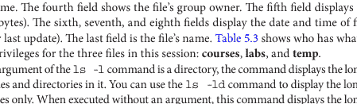

输出的第一字段中最左边的字符表示文件类型（`d`表示目录，`—`表示普通文件）。第一字段中剩下的九个字符显示用户、组和其他人各自的文件访问权限。第二字段表示指向该文件的硬链接数（在第 8 章中讨论）。第三字段显示所有者的登录名。第四字段显示文件的组所有者。第五字段显示文件的大小（以字节为单位）。第六、第七和第八字段显示文件的创建日期和时间（或最后更新时间）。最后一个字段是文件名。表 5.3 显示了在此会话中三个文件`courses`、`labs`和`temp`对三种类型用户的访问权限。

如果`ls -l`命令的参数是一个目录，命令会显示其中所有文件和目录的长列表。你可以使用`ls -ld`命令仅显示目录的长列表。执行时不带参数，此命令会显示当前目录的长列表，如以下会话中的第一个命令所示。第二个和第三个命令显示，当`ls -ld`命令使用目录列表作为参数执行时，它只会显示那些目录的长列表。如果`ls -ld`命令的参数是一个文件，命令会显示该文件的长列表。第四个命令`ls -ld pvm/*`显示`pvm`目录中所有文件和目录的长列表。


```
$ ls -ld
drwxr-x--x 2 sarwar faculty 11264 Jul  8 22:21 .
$ ls -ld ABET
drwx------ 2 sarwar faculty   512 Dec 18 1997 ABET
$ ls -ld ~/Images courses/ee446
drwx------ 3 sarwar faculty   512 Apr 30 09:52 courses/ee446
```

### 表 5.3 对文件 courses、labs 和 temp 的三种类型用户的访问权限

| 文件名 | 用户 | 组 | 其他 |
|---|---|---|---|
| courses | 读、写、搜索 | 读和搜索 | 无权限 |
| labs | 读、写、执行 | 读、写、执行 | 读、写、执行 |
| temp | 读、写、执行 | 读 | 读 |

```
drwx--x--x 2 sarwar faculty 2048 Dec 18 1997 /home/sarwar/
Images
$ ls -ld pvm/*
drw------- 3 sarwar faculty 512 Dec 18 1997 pvm/examples
drw------- 2 sarwar faculty 1024 Oct 27 1998 pvm/qsort
-rw------ 1 sarwar faculty 1606 Jun 19 1995 pvm/Book_PVM
-rw------ 1 sarwar faculty 7639 Sep 11 1998 pvm/Jim_Davis
$
```

## 5.5.2 更改文件访问权限

你可以使用 `chmod` 命令更改文件的访问权限。以下是该命令的简要说明。

#### 语法

```
chmod [options] octal-mode file-list
chmod [options] symbolic-mode file-list
```

用途：更改/设置 `file-list` 中文件的权限

常用选项/功能：

- `-R` 递归地遍历目录，更改/设置每个目录下所有文件和子目录的权限
- `-f` 强制指定访问权限；如果你是文件所有者，则不会产生错误信息

符号模式，也称为模式控制词，其形式为 `<who><operator><privilege>`，其中 "who"、"operator" 和 "privilege" 的可能取值如表 5.4 所示。该表还显示了在 `chmod` 命令中使用 `+` 和 `–` 运算符来添加和删除权限。

请注意，`u`、`g` 或 `o` 只能与 `=` 运算符一起用作权限。"who" 和 "privilege" 可以使用多个值，例如 "who" 字段的 `ug` 和

### 表 5.4 符号模式组件的值

| Who | Operator | Privilege |
|---|---|---|
| u 用户 | + 添加权限 | r 读位 |
| g 组 | - 删除权限 | w 写位 |
| o 其他 | = 设置权限 | x 执行/搜索位 |
| a 所有 |  | u 用户当前权限 |
| ugo 所有 |  | g 组当前权限 |
|  |  | o 其他人当前权限 |
|  |  | l 锁定权限位 |
|  |  | s 设置用户或组 ID 模式位 |
|  |  | t 粘滞位 |

# 表 5.5 chmod 命令示例及其用途

| 命令 | 用途 |
|---|---|
| chmod 700 * | 将当前目录中所有文件（包括目录）的访问权限设置为：所有者可读、写、执行，其他任何人都无访问权限 |
| chmod 740 courses | 将 `courses` 的访问权限设置为：所有者可读、写、执行，组用户只读，其他人无访问权限 |
| chmod 751 ~/courses | 将 `~/courses` 的访问权限设置为：所有者可读、写、执行，组用户可读、执行，其他人仅可执行 |
| chmod 700 ~ | 将主目录的访问权限设置为：所有者可读、写、执行（即搜索），其他人无任何权限 |
| chmod u=rwx courses | 将 `courses` 的所有者访问权限设置为可读、写、执行，同时保持组用户和其他人的权限不变 |
| chmod ugo-rw sample 或 chmod a-rw sample | 不允许任何人读取或写入 `sample` |
| chmod a+x sample | 赋予所有人对 `sample` 的执行权限 |
| chmod g=u sample | 使 `sample` 的组权限与其用户（所有者）权限一致 |
| chmod go= sample | 移除组用户和其他人对 `sample` 的所有访问权限 |

“权限”字段中。表 5.5 列出了一些有用的 `chmod` 命令示例及其用途。

下面的会话演示了如何查看和设置文件的访问权限。`chmod` 命令用于更改（或设置）访问权限，`ls -l`（或 `ls -ld`）命令用于显示相应 `chmod` 命令的效果。执行 `chmod 700 courses` 命令后，`courses` 文件的所有者对其拥有读、写和执行权限，其他任何人都没有权限。`chmod g+rx courses` 命令为组用户添加对 `courses` 文件的读和执行权限；所有者和其他人的权限保持不变。`chmod o+r courses` 命令为其他人添加对 `courses` 文件的读权限。`chmod a-w *` 命令取消当前目录中所有文件对所有用户的写权限。`chmod 700 [l-t]*` 命令将文件名以“l”到“t”开头的所有文件的访问权限设置为 700，最后一个 `ls -l` 命令的输出显示了这一点，该输出显示 `labs` 和 `temp` 文件的访问权限已更改为 700。

```
$ cd
$ ls -l
drwxr-x--- 2 sarwar faculty 512 Apr 23 09:37 courses
-rwxrwxrwx 1 sarwar faculty 12 May 01 13:22 labs
-rwxrwxr-- 1 sarwar faculty 163 May 05 23:13 temp
$ chmod 700 courses
$ ls -ld courses
drwx------ 2 sarwar faculty 512 Apr 23 09:37 courses
```

```
$ chmod g+rx courses
$ ls -ld courses
drwxr-x--- 2 sarwar faculty 512 Apr 23 09:37 courses
$ chmod o+r courses
$ ls -ld courses
drwxr-xr-- 2 sarwar faculty 512 Apr 23 09:37 courses
$ chmod a-w *
$ ls -l
dr-xr-x--- 2 sarwar faculty 512 Apr 23 09:37 courses
-r-xr-xr-x 1 sarwar faculty 12 May 01 13:22 labs
-r-xr-x-- 1 sarwar faculty 163 May 05 23:13 temp
$ chmod 700 [l-t]*
$ ls -l
dr-xr-x--- 2 sarwar faculty 512 Apr 23 09:37 courses
-rwx------ 1 sarwar faculty 12 May 01 13:22 labs
-rwx------ 1 sarwar faculty 163 May 05 23:13 temp
$
```

可以使用带 `-R` 选项的 `chmod` 命令来设置一个或多个目录下所有文件和目录的访问权限。在下面的会话中，第一条命令将名为 `courses` 的目录下所有文件和目录的访问权限递归设置为 711。第二条命令将 `~/personal/letters` 下所有文件和目录的访问权限递归设置为 700。“递归”意味着遍历指定目录（在此例中为 `courses` 和 `~/personal/letters`）下的所有子目录。

```
$ chmod -R 711 courses
$ chmod -R 700 ~/personal/letters
$
```

如果在 `chmod` 命令中只用一位八进制数字指定访问权限，则该命令会将此权限设置为“其他人”的访问权限；“用户”和“组”的访问权限均设置为 0（即无访问权限）。如果在 `chmod` 命令中指定两位八进制数字，则该命令会将其分别设置为“组”和“其他人”的访问权限；“用户”的访问权限设置为 0。在下面的会话中，第一条 `chmod` 命令将 `courses` 目录的“其他人”访问权限设置为 7（rwx），并将所有者和组的访问权限设置为 0（---）。第二条 `chmod` 命令将 `personal` 目录的“组”和“其他人”访问权限分别设置为 7（rwx）和 0（---），并且文件所有者无任何访问权限。`ls -l` 命令显示了这些命令的结果。


```
$ chmod 7 courses
$ chmod 70 personal
$ ls -l
d----rwx 2 sarwar faculty 512 Nov 10 09:43 courses
d---rwx-- 2 sarwar faculty 512 Nov 10 09:43 personal
drw------ 2 sarwar faculty 512 Nov 10 09:43 sample
$
```

# 5.5.3 目录的访问权限

如前所述，对目录的读权限允许你读取目录的内容（请回忆，目录的内容是其中文件和目录的名称），写权限允许你在目录中创建文件或从中删除现有文件或目录，而目录的执行权限则是搜索目录的权限。需要注意的是，如果没有搜索权限，目录上的读和写权限是没有意义的。因此，你必须同时拥有目录的读和执行权限才能列出其内容。同样，你必须同时拥有目录的写和执行权限才能在其内创建文件。

在下面的会话中，目录 `courses` 的写权限已被关闭。因此，你不能使用 `mkdir` 命令在该目录中创建子目录 `ee345`，也不能将文件 `foo` 复制到其中。同样，由于你没有目录 `personal` 的搜索权限，你不能使用 `cd` 命令进入（切换到）该目录。如果目录 `sample` 有一个子目录，比如 `foobar`，且其执行权限已打开，你仍然不能切换到 `foobar`，因为 `sample` 的搜索权限已关闭。最后，由于目录 `personal` 的读权限已关闭，即使其上已打开搜索权限，你也不能使用 `ls` 命令显示其中文件和目录的名称。

```
$ chmod 600 sample
$ chmod 500 courses
$ chmod 300 personal
$ ls -ld courses personal sample
dr-x------ 2 sarwar sarwar 512 Aug 4 06:36 courses
d-wx----- 2 sarwar sarwar 62 Aug 4 06:36 personal
drw------ 2 sarwar sarwar 88 Aug 4 06:36 sample
$ mkdir courses/ee345
mkdir: courses/ee345: Permission denied
$ cp foo courses
cp: courses/foo: Permission denied
$ cd sample
cd: sample: Permission denied
$ ls -l personal
total 0
ls: personal: Permission denied
$
```

下一个会话显示，仅拥有目录的读或写权限不足以读取其内容（例如使用 `ls` 命令显示）或在其内创建文件或目录。例如，目录 `dir1` 已打开写权限，但你不能将文件 `prog1.cpp` 复制到其中，因为其搜索权限已关闭。同样，你也不能从 `dir2` 中删除文件 `f1`。在使用 `chmod u+x dir2` 命令打开其搜索权限后，你就可以删除文件 `f1`。

```
$ ls -ld dir?
d-w------ 2 sarwar sarwar 2 Aug 4 06:59 dir1
d-w------ 2 sarwar sarwar 3 Aug 4 06:59 dir2
$ cp prog1.cpp dir1
cp: dir1/prog1.cpp: Permission denied
$ rm dir2/f1
rm: dir2/f1: Permission denied
$ chmod u+x dir2
$ ls -ld dir2
d-wx----- 2 sarwar sarwar 3 Aug 4 06:59 dir2
$ rm dir2/f1
$
```

下面的本章练习要求你使用 `chmod` 和 `ls -ld` 命令来了解它们的工作方式，并加深你对 UNIX 文件访问权限的理解。

## EXERCISE 5.2

使用 `mkdir` 命令创建三个名为 `courses`、`sample` 和 `personal` 的目录。设置目录 `sample` 的访问权限，使你拥有全部三个权限，你所在组的用户只有读权限，而系统的其他用户没有任何访问权限。展示你的操作过程。

## EXERCISE 5.3

使用 `chmod o+r sample` 命令允许其他用户对目录 `sample` 进行读访问。使用 `ls -ld sample` 命令确认已为其他用户启用 `sample` 的读权限。

## EXERCISE 5.4

使用前面的会话充分理解读、写和执行权限对目录的工作方式。在你的系统上运行该会话并验证结果。

# 5.5.4 默认文件访问权限

创建新文件或目录时，UNIX 会根据当前掩码值设置其访问权限。在 UNIX 系统上，可执行文件和目录的默认访问权限为 `777`，文本文件的默认访问权限为 `666`。然而，这些默认权限可能会因系统上设置的掩码值而不同。如果掩码位为 `1`，则对应的权限将被禁用；如果为 `0`，则权限将由系统根据掩码当前值和默认权限的布尔逻辑表达式确定。我们将在本节后面描述该表达式。

你可以使用 `umask` 命令显示当前掩码值或将其设置为新值。以下是该命令的简要说明。

### SYNTAX

```
umask [-S] [mask]
```

Purpose: 将新创建的文件和目录的访问权限位设置为 `0`，如果掩码中对应的位被设置为 `1`。其他权限位是通过涉及掩码值和默认权限的布尔逻辑表达式确定的。如果没有参数，命令会显示掩码的当前值。使用 `-S` 选项时，命令会以符号形式显示掩码值（见以下段落）。

当命令不带参数执行时，它会以八进制形式显示位掩码的当前值，如以下会话中的第一个命令所示。最右边的九位（即最右边的三个八进制数字）用于用户、组和其他人，最左边的三位（即最左边的八进制数字）用于第 5.6 节中描述的特殊访问位。`umask -S` 命令以符号形式显示掩码的值，显示为新创建的目录或可执行文件为用户、组和其他人所设置的访问权限。

```
$ umask
0022
$ umask -S
u=rwx,g=rx,o=rx
$
```

当使用掩码作为参数时，`umask` 命令可用于设置掩码值。掩码值可以指定为三位或四位八进制数。在以下会话中，我们展示了如何不使用和带 `-S` 选项使用 `umask` 命令。

```
$ umask 077
$ umask
0077
$ umask -S u=rwx,g=,o=
$ umask
0077
$
```

`umask` 命令通常放在 System V UNIX 的系统启动文件 `~/.profile` 中，或 BSD UNIX 的 `~/.login` 或 `~/.cshrc` 文件中，以便每次登录系统时执行。

`umask` 的参数是一个以八进制指定的位掩码，标识在创建新文件时要关闭的权限位。其他访问权限位的值由布尔表达式计算得出

```
A = B AND C' = BC'
```

这里，`A` 是分配给新创建文件或目录的文件访问权限，`B` 是默认访问权限（目录或可执行文件为 `777`，文本文件为 `666`），`C` 是当前掩码值。`C'`（读作“非 C”或“C prime”）称为否定，或 `C` 的 1 的补码。二进制数的 1 的补码是通过将 1 替换为 0，将 0 替换为 1 获得的。例如，四位二进制数 `1011` 的 1 的补码是 `0100`。两个二进制变量的按位布尔函数 AND 当且仅当两个位都为 1 时返回 1；否则返回 0。在计算上述等式中的 `A` 时，AND 函数比较 `B` 和 `C'` 中相应的位，当且仅当两个位都为 1 时返回 1；否则返回 0。

我们现在展示几个 UNIX 如何为给定掩码为新创建的文件和目录分配文件访问权限的示例。我们使用上述布尔表达式确定掩码值为 `022` 时为新创建的目录或可执行文件的访问权限。

```
C = 022      = 000 010 010
C'           = 111 101 101
B = 777      = 111 111 111
A = B AND C' = 111 101 101 = 755 (octal) = 111101101 (binary)
                    rwxr-xr-x (symbolic)
```

因此，文件访问权限为 `755`（用户可读、写、执行，组和其他人可读和执行）。对于文本文件，`B` 为 `666`。因此，新创建的文本文件的访问权限将为 `644`，如下所示：

```
C'           = 111 101 101
B = 666      = 110 110 110
A = B AND C' = 110 100 100 = 644 (octal) = 110100100 (binary)
                    rw-r--r-- (symbolic)
```

掩码值为 `077` 时，新创建的文本文件的访问权限将为 `600`，如下所示：

```
C = 077      = 000 111 111
C'           = 111 000 000
B = 666      = 110 110 110
A = B AND C' = 110 000 000 = 600 (octal)
                    rw------ (symbolic)
```


我们现在进行一个 Bourne shell 会话来验证上述结果。请注意，将掩码设置为 `022` 时，新创建的目录（`labs`）和可执行文件（`hello`）的权限为 `755`（`rwxr-xr-x`），而新创建的文本文件 `tempfile` 的权限为 `644`（`rw-r--r--`），如上计算。将掩码设置为 `077` 时，目录（`lectures`）和可执行文件（`greeting`）的权限为 `700`（`rwx------`），文本文件（`textfile`）的权限为 `600`（`rw------`）。

```
$ umask 022
$ mkdir labs
$ cc hello.c -o hello
$ cat > tempfile
date
pwd
$ ls -ld labs hello tempfile
-rwxr-xr-x 1 sarwar sarwar 6945 Aug 5 22:27 hello
drwxr-xr-x 2 sarwar sarwar 2 Aug 5 22:26 labs
-rw-r--r-- 1 sarwar sarwar 9 Aug 5 22:30 tempfile
$ umask 077
$ mkdir lectures
$ cc hello.c -o greeting
$ cat > testfile
date
echo "Hello, world!"
$ ls -ld lectures greeting testfile
-rwx------ 1 sarwar sarwar 6945 Aug 5 22:28 greeting
drwx------ 2 sarwar sarwar 2 Aug 5 22:27 lectures
-rw------- 1 sarwar sarwar 26 Aug 5 22:29 testfile
$
```

作者更喜欢使用 `077` 的掩码值，这样他们新建的文件总能以完全受保护的方式创建，即文件对所有者具有完全访问权限，而对其他人没有任何权限。此掩码允许你拥有一个完全私密的系统，不允许其他用户读取、写入或执行你的文件，或读取、写入或搜索你的目录。请记住，你可以使用 `chmod` 命令根据需要更改文件的访问权限。另一个常见的 `umask` 值是 `027`，它给予组成员默认权限，而不给予其他人权限。

下面的章节练习要求你使用 `umask` 命令来确定当前的文件保护掩码。

## EXERCISE 5.5

运行本节中所示和讨论的所有 shell 会话，以确保它们在你的系统上也能正常工作，并理解 `umask` 命令的使用方式以及 UNIX 系统如何决定新创建的文件和目录的访问权限。

## 5.6 SPECIAL ACCESS BITS

除了本章所述的九个常用访问权限位之外，还有三个额外的位具有特殊意义。这些位被称为 set-user-ID（SUID）位、set-group-ID（SGID）位和 sticky 位。

### 5.6.1 Set-User-ID (SUID) Bit

我们之前已经展示过，外部 shell 命令都有对应的文件，其中包含二进制可执行代码或 shell 脚本。这些文件中的程序在执行任务的能力方面没有任何特殊之处。通常，当一个命令执行时，它是在发出命令的用户访问权限下运行的，这就是本章所述访问权限系统的工作方式。然而，许多 UNIX 命令需要写入对正常运行这些命令的用户而言受保护的文件。例如 `/etc/passwd` 文件就是这样一个文件，它包含用户的登录信息（参见第 4 章）。只有超级用户才被允许写入此文件以执行诸如添加新登录和更改用户组 ID 等任务。然而，UNIX 用户通常被允许执行 `passwd` 命令来更改他们的密码。因此，当用户执行 `passwd` 命令时，该命令代表运行此命令的用户更改 `/etc/passwd` 文件中的用户密码。问题在于，我们希望用户能够更改密码，同时他们又不能对 `/etc/passwd` 文件具有写访问权限，以防止该文件中其他用户的信息被泄露。注意，在 Solaris 上，发生变化的是不可读的主密码文件 `/etc/shadow`。

如前所述，当一个命令执行时，它以运行该命令的用户权限运行。另一种说法是，当一个命令运行时，它以运行该命令的用户的有效用户 ID 执行。UNIX 有一种优雅的机制来解决前一段所述的问题——以及许多其他类似的安全问题——它允许命令更改其有效用户 ID 并在某种程度上获得特权。此机制允许诸如 `passwd` 之类的命令执行其工作，同时不损害系统的完整性。每个 UNIX 文件都有一个额外的保护位与之关联，称为 SUID 位。如果可执行程序所在文件的此位被设置，则程序在执行时会获得文件所有者的权限。因此，如果一个文件由 `root` 所有并且其 SUID 位被设置，则它以超级用户权限运行。例如，`passwd` 命令就设置了此位。因此，当你运行 `passwd` 命令时，它可以写入 `/etc/passwd` 文件（用新密码替换现有密码），即使你没有权限写入该文件。

还有一些其他 UNIX 命令需要 `root` 所有权并设置 SUID 位，因为它们访问和更新操作系统资源（文件、数据结构等），而普通用户不得拥有这些资源的权限。其中一些命令是 `lp`、`mail`、`mkdir`、`mv` 和 `ps`。开发维护分数文件的计算机游戏软件作者可以对 SUID 位做出另一种用途。当为此类软件设置 SUID 位时，它可以在用户玩游戏时更新分数文件，尽管同一用户不能通过显式写入来更新分数文件。

如果所有者的执行位为 `s`（或 `S`），则启用 SUID 位。如果同时启用 SUID 位和执行位，则在 `ls -l` 命令的输出中该位显示为 `s`。如果 SUID 位启用但执行位未启用，则 `ls -l` 命令会将其显示为 `S`。以下会话显示了每种情况的示例。

```
$ ls -l cp.new foo
-rwSr--r-- 1 sarwar faculty 14 Aug 4 23:38 cp.new
-r-sr-xr-x 1 sarwar faculty 30 Aug 5 05:27 foo
$
```

可以使用以下语法的 `chmod` 命令来设置 SUID 位。

#### 语法

```
chmod 4xxx file-list
chmod u+s file-list
```

用途：更改/设置 `file-list` 中文件的 SUID 位。

这里，`xxx` 是八进制数，用于指定用户、组和其他人的读、写、执行权限；八进制数字 `4`（二进制 `100`）用于设置 SUID 位。设置 SUID 位时，如果用户已经拥有执行权限，则用户的执行位会被设置为 `s`（小写）；否则设置为 `S`（大写）。下面的会话演示了这些命令语法的用法。第一条命令 `ls -l cp.new` 用于显示 `cp.new` 文件的执行权限已设置。`chmod 4710 cp.new` 命令用于设置 SUID 位，并将其他九个权限位设置为八进制 `710`。第二条 `ls -l cp.new` 命令显示 `x` 位值已变为 `s`。随后的两条 `chmod` 命令用于将 SUID 位和执行位清零。`ls -l cp.new` 命令用于显示执行权限已从所有者处取消。`chmod u+s cp.new` 命令用于再次设置 SUID 位，最后一条 `ls -l cp.new` 命令显示该位值为 `S`（大写），因为在设置 SUID 位之前执行位并未设置。

```
$ ls -l cp.new
-rwx--x-- 1 sarwar faculty 14 Aug 4 23:26 cp.new
$ chmod 4710 cp.new
$ ls -l cp.new
-rws--x--- 1 sarwar faculty 14 Aug 4 23:26 cp.new
$ chmod u-s cp.new
$ chmod u-x cp.new
$ ls -l cp.new
-rw----x-- 1 sarwar faculty 14 Aug 4 23:26 cp.new
$ chmod u+s cp.new
$ ls -l cp.new
-rwS--x--- 1 sarwar faculty 14 Aug 4 23:26 cp.new
$
```

尽管 SUID 位的想法是合理的，但如果实现不正确，可能会危及系统安全。例如，如果某个 set-UID 程序的权限为

```
$ chmod g+s cp.new
$ ls -l cp.new
-rwxr-S--x 1 sarwar faculty 14 Aug 4 23:26 cp.new
$
```

可以使用一条 `chmod` 命令设置或重置 SUID 和 SGID 位。因此，命令 `chmod ug+s cp.new` 可用于在 `cp.new` 文件上执行此任务。也可以通过在访问权限的八进制数前面加上 `6` 来同时设置 SUID 和 SGID 位以及访问权限位（读、写、执行），因为最左边的八进制数字 `6`（二进制 `110`）表示同时设置 SUID 和 SGID 位。因此，命令 `chmod 6754 cp.new` 可用于设置 `cp.new` 文件的 SUID 和 SGID 位，并将其访问权限设置为 `754`。

## 5.6.3 粘滞位

12 个访问位中的最后一个，即粘滞位，当其他用户的执行位为 `t`（或 `T`）时处于开启状态，如下面 `/tmp` 的示例所示。


```
$ ls -l / | grep tmp
drwxrwxrwt 66 root root 86 Aug 5 05:56 tmp
$
```

可以为目录设置粘滞位，以确保非特权用户无法删除或重命名该目录中属于其他用户的文件。你必须是该目录的所有者，或拥有适当的权限，才能为其设置粘滞位。有些系统不允许非超级用户设置粘滞位。它通常用于包含多个用户所有文件的共享目录。

上述命令的输出显示，由 `root` 拥有的 `/tmp` 目录开启了粘滞位。它对所有人具有读、写和执行权限。这意味着任何用户都可以在 `/tmp` 中创建文件或目录。但是，由于粘滞位已开启，除超级用户外的任何用户都不能删除其不拥有的文件或目录。因此，UNIX 允许你删除在 `/tmp` 中自己拥有的任何文件，但不能删除其他文件或目录，因为你并不是这些文件和目录的所有者。

最初，这个位被设计用来通知内核：由于程序会被频繁使用，程序的代码段将被共享，或保留在主内存或交换空间中。因此，当为一个程序设置此位时，系统会尝试在该程序执行完毕后，将其可执行代码（仅代码段）保留在内存中——这些进程实际上会“驻留”在内存中。如果由于某种原因，系统需要该程序占用的内存空间来加载另一个程序，则开启了粘滞位的程序会被保存到交换空间（磁盘上用于临时保存进程的特殊区域）。也就是说，如果为某个程序设置了粘滞位，该程序执行完毕后，其代码段要么保留在内存中，要么保留在交换空间中。当再次执行该程序时，如果程序在内存中，它会立即开始执行。如果程序在交换空间中，加载它所需的时间比从磁盘上作为 UNIX 文件加载要短得多。这种方案的优点是，

因此，如果带有粘滞位（sticky bit）的程序被频繁执行，它会被执行得更快。

这种功能对于编译器、汇编器、编辑器以及 `ls` 和 `cat` 等命令很有用，这些程序在典型的计算机系统环境中经常被使用。然而，必须注意不要让太多程序设置此位。否则，由于可用空间不足，系统性能会下降，设置了粘滞位的程序会占用越来越多的空间。这种粘滞位的历史用法在更新的 UNIX 系统中（从 4.4BSD 开始）不再需要，因为虚拟内存系统使用页面置换算法，不会移除最近使用的程序页/段。因此，PC-BSD 不允许你在非目录文件上设置粘滞位，如本节末尾的 shell 会话所示。

可以使用以下任一语法来设置粘滞位。

### SYNTAX

```
chmod lxxx file-list
chmod +t file-list
```

Purpose: Change/set the sticky bit for files in file-list

这里，`xxx` 是指定读、写和执行权限的八进制数字，而八进制数字 `1`（二进制 `001`）指定要设置粘滞位。当设置粘滞位时，如果 `others` 已具有执行权限，则 `others` 的执行位将被设置为 `t`；否则，将被设置为 `T`。以下 PC-BSD 上的会话说明了这些命令语法的用法。命令 `chmod 1751 cp.new` 试图为 `cp.new` 文件设置粘滞位并将其访问权限设置为 `751`，但失败了。同样，命令 `chmod +t cp.new` 试图为 `cp.new` 文件设置粘滞位，但也失败了。如这些命令的输出所示，PC-BSD 不允许你为非目录文件启用粘滞位。它确实允许你使用命令 `chmod +t dir1` 为 `dir1`，一个目录，设置此位。另一方面，Solaris 允许你为非目录文件和目录设置粘滞位。以下会话中小写 `t` 和大写 `T` 的解释与 SUID 和 SGID 位的小写 `s` 和大写 `S` 的解释相同。

```
$ ls -l cp.new
-rw-rw-rw- 1 sarwar sarwar 14 Aug 4 23:38 cp.new
$ ls -ld dir1
drwxr-xr-x 2 sarwar sarwar 2 Aug 5 07:59 dir1
$ chmod 1751 cp.new
chmod: cp.new: Inappropriate file type or format
$ chmod +t cp.new
chmod: cp.new: Inappropriate file type or format
$ chmod +t dir1
$ ls -ld dir1
drwxr-xr-t 2 sarwar sarwar 2 Aug 5 07:59 dir1
```

```
$ chmod o-x dir1
$ ls -ld dir1
drwxr-xr-T 2 sarwar sarwar 2 Aug 5 07:59 dir1
$
```

## EXERCISE 5.6

运行本节中所示和讨论的所有 shell 会话，以确保它们在你的系统上也能正常工作，并了解 `chmod` 命令如何用于在你的 UNIX 系统上设置和重置特殊访问权限位（SUID、SGID 和粘滞位）。另外，查明 SGID 和粘滞位是否可以在你的系统上同时设置在文件和目录上。

## SUMMARY

分时系统必须确保一个用户的 文件免受系统其他用户（意外或恶意）的未经授权访问。UNIX 为此提供了多种机制，其中之一基于访问权限。可以通过告知系统文件所有者、组（与所有者在同一组的用户）和 `others`（系统上的其他所有人）允许对文件执行的操作类型（读、写和执行）来保护文件。UNIX 允许用户属于多个组。只有系统管理员，也称为 UNIX 术语中的超级用户，才能将你添加到组或从组中移除。你可以使用 `groups` 命令显示你（或任何用户）所属的组。这些九个常用的访问权限由位表示。此信息存储在文件的 `inode` 中。当用户尝试访问文件时，系统根据存储在 `inode` 中的文件的访问权限允许或禁止访问。

可以使用 `ls -l` 命令查看文件的访问权限。当用于目录时，此命令会显示目录中所有文件的属性。可以使用 `ls -ld` 命令查看目录的访问权限。文件的拥有者可以通过使用 `chmod` 命令更改其访问权限。`umask` 命令通常放在 System V UNIX 的 `~/.profile` 文件中以及 BSD UNIX 的 `~/.login` 或 `~/.profile` 文件中，允许用户指定一个位掩码，告知系统对用户、组和 `others` 禁用的访问权限。当 UNIX 系统创建文件时，它会根据位掩码和目录、可执行文件和文本文件的默认访问权限来设置文件的访问权限。分配给新创建文件的访问权限（`A`）由表达式 `A=B AND C'` 给出，其中 `B` 是文件的默认权限，`C` 是位掩码的值，`AND` 是按位 `AND` 的布尔函数。在典型的系统中，掩码设置为 `022` 作为新创建文件和目录的默认权限。对于完全安全的系统，应设置为 `077`。你可以通过 `umask` 命令以八进制显示当前标志的值，并使用 `umask -S` 命令以符号形式显示标志。

UNIX 还允许设置三个额外的位——设置用户 ID（SUID）、设置组 ID（SGID）和粘滞位。SUID 和 SGID 位允许用户执行访问重要系统资源（包括 `passwd`、`ls`、`mkdir` 和 `ps`）的命令，这些资源

| Bit: 12 | 11 | 10 | 9 | 8 | 7 | 6 | 5 | 4 | 3 | 2 | 1 |

|---|---|---|---|---|---|---|---|---|---|---|---|

| SUID | SGID | Sticky | r | w | x | r | w | x | r | w | x |

| 用于特殊访问权限的位 | 所有者的访问权限 | 所属组的访问权限 | 其他人的访问权限 |

## 图 5.2 chmod 命令中指定的 UNIX 文件访问权限位的位置。

否则不允许访问。粘滞位可以为目录设置，以确保无特权用户无法在该目录中删除或重命名其他用户的文件。只有目录的所有者，或具有适当权限的其他人，才能为目录设置粘滞位。它通常为共享目录设置，这些目录包含由多个用户拥有文件，例如 `/tmp` 是 UNIX 文件系统结构。历史上，粘滞位曾有另一用途。它可以为频繁使用的实用程序设置，以便 UNIX 在使用后将其保留在主内存或磁盘上的固定区域，即交换空间中。此功能使随后访问这些文件比从磁盘作为普通文件加载要快得多。然而，由于大多数现代多用户分时系统使用需求分页、需求分段和分页分段的高级算法实现的虚拟内存系统，使用粘滞位使程序驻留在内存或交换空间中已不再需要。其对目录的使用仍然有用且必要。因此，所有现代 UNIX 系统都支持目录的粘滞位，但对文件的粘滞位支持已不再普遍维护。例如，PC-BSD 不为非目录文件提供粘滞位支持，但 Solaris 提供了。

`chmod` 命令中使用的 12 个访问权限位的最终格式如图 5.2 所示。

## 问题与练习

- 1. UNIX 中可用的三种基本文件保护方案是什么？

- 2. 列出所有可能的由数字和标点字母组成的两字母密码。

- 3. 如果计算机系统允许由十进制数字和标点符号随机组合而成的六字符密码，使用暴力破解方法入侵用户账户时，用户最多需要尝试多少个密码？为什么？

- 4. 如果系统允许使用数字、大写字母、小写字母和标点符号组成密码，最多可以形成多少个密码？假设密码必须为 12 个字符长。


## 5. 假设黑客试图猜测一个由八个字符组成的密码，使用大写字母、小写字母和数字。进一步假设系统在每次密码猜测后强制延迟 5 秒。黑客在最坏情况下猜测密码需要多长时间？如果我们允许使用五个标点符号作为密码字符重复此练习。为什么？展示你的全部计算过程。

## 6. 基于访问权限的文件保护是如何工作的？以文件的各种用户类型和他们可以执行的操作类型为基础回答。实现此方案需要多少个权限位？为什么？

## 7. UNIX 中的读、写和执行权限是如何工作的？用一些例子说明你的答案。

## 8. 你的系统上存在多少个用户组？你是如何得到答案的？你是哪些组的成员，你的默认组是什么？`root` 在你的系统上是哪些组的成员？有多少个？你是如何获得答案的？如果你使用了任何命令，请显示命令及其输出。

## 9. 在当前工作目录中创建一个文件 `test1`，并将其访问权限设置为自己可读可写，所在组用户可读，其他人无权限。你使用了什么命令来设置权限？给出另一个能达到同样效果的命令。

## 10. 用户 `sarwar` 使用命令 `chmod 700 $HOME` 为其主目录设置访问权限。如果其主目录中的文件 `cp.new` 的读取权限为 `777`，任何人都可以读取此文件吗？为什么或为什么不？解释你的答案。

## 11. 每个命令的效果是什么？解释你的答案。

- a. `chmod 776 ~/lab5`
- b. `chmod 751 ~/lab?`
- c. `chmod 511 *.c`
- d. `chmod 711 --/*`
- e. `ls -l`
- f. `ls -ld`
- g. `ls -l ~/personal`
- h. `ls -ld ~/personal`

## 12. 对于目录、对于执行操作没有意义的文件类型，执行权限意味着什么？举例说明。

## 13. 在你的主目录中创建一个文件 `dir1` 并使用 `cp /etc/passwd dir1/mypasswd` 命令将 `/etc/passwd` 文件复制到其中。使用 `chmod` 命令使其仅具有搜索权限并执行以下命令。这些命令执行的结果是什么？结果对你有意义吗？解释。

- a. `cd dir1`
- b. `ls`
- c. `rm dir1/mypasswd`
- d. `cp /etc/passwd dir1`

## 14. 应执行什么 `umask` 命令才能将权限位掩码设置为 `037`？使用该掩码时，你在系统上创建的任何新文件会具有哪些默认访问权限？为什么？你应该将此命令放在哪里，以便每次登录系统时该掩码都生效？

## 15. 给出一个用于设置默认访问模式的命令行，使得对于新建的可执行文件或目录，你拥有读、写和执行权限，你的组拥有读和执行权限，而所有其他用户没有任何权限。你如何对其进行测试，以确保它能正确工作？

## 16. 给出一些 `chmod` 命令行，使其执行与 `mesg n` 和 `mesg y` 命令相同的任务。提示：每个硬件设备，包括你的终端，在 `/dev` 目录中都有一个关联的文件。

## 17. 设置用户 ID（SUID）、设置组 ID（SGID）和粘滞位的用途分别是什么？

## 18. 给出一个命令行，为文件 `cp.new` 设置全部三个特殊访问位（SUID、SGID 和粘滞位）。提示：使用八进制模式。

## 19. 在 UNIX 系统中，`cat` 命令归 `root` 所有，并且设置了其 SUID 位。你认为这种设置是否存在问题？请解释你的答案。

## 20. 某些 UNIX 系统不允许用户使用 `passwd` 命令更改其密码。这种限制是如何强制实施的？这种做法是好是坏？为什么？

- f. `chmod +t ~/dir1`
- g. `chmod ugo-r ~/prog1`
- h. `chmod a-rw ~/prog1`
- i. `chmod ug+x ~/dir1`
- j. `chmod go= ~/dir1`
- k. `chmod u=rwx ~/prog1`
- l. `chmod g=o ~/dir1`
- m. `chmod o=wx ~/dir1`

# 基本文件处理

## 目标

- 讨论如何显示文件内容
- 解释复制、追加、移动/重命名以及删除文件
- 描述如何确定文件的大小
- 讨论用于比较文件的命令
- 描述如何合并文件
- 讨论打印机控制命令
- 涵盖命令和原语

```
> , >> , ^ , [ ] , * , ? , cancel, cat, cp, diff, head, lp, lpc, lpq, lpr, lprm, lpstat, lptest, less, ls, more, mv, nl, pg, pr, rm, tail, uniq, wc
```

## 6.1 引言

本章介绍如何在 UNIX 中执行一些基本的文件操作。这些操作主要针对非目录文件，不过其中一些也适用于目录；我们之前已在第 4 章中讨论了最常用的目录操作。在讨论本章中的文件操作时，我们还会描述相关命令并给出示例，以说明如何使用这些命令来执行所需操作。请记住，关于某个特定命令的完整信息可以通过 `man` 命令获取。

## 6.2 查看文本文件的内容

查看文件是为了识别其内容。你可以使用多个 UNIX 命令在显示屏幕上显示文本文件的内容。这些命令之间的区别在于：所显示的文件内容量、所显示的文件内容部分（文件的开头、中间或结尾部分），以及文件内容是每次显示一屏还是每次显示一页。请记住，你只能查看那些你拥有读权限的文件。此外，你还必须对要显示文件的路径名中涉及的所有目录拥有执行（搜索）权限。查看并不意味着编辑、写入或更新——只是查看。

### 6.2.1 查看完整文件

你可以使用 `cat` 命令在屏幕上显示一个或多个文件的完整内容。但是，由于该命令不会一次一屏或一页地显示文件内容，因此对于大于一页（即一屏）大小的文件，你只能看到最后一页。以下是 `cat` 命令的简要说明。

```
SYNTAX
cat [options] [file-list]

Purpose: Concatenate/display the files in file-list on standard output (screen by default), one after another
Output: Contents of the files in file-list displayed on the screen, one file at a time
Commonly used options/features:
-e Display $ at the end of each line; works in conjunction with the -v option
-n Put line numbers with the displayed lines
-t Display tabs as ^I and form feeds as ^L
-v Display nonprintable characters, except for the tab, form feed, and newline characters
```

在这里，`file-list` 是一个可选参数，由用空格分隔的一个或多个文件的路径名组成。例如，以下命令显示当前工作目录中 `student_records` 文件的内容。如果该文件大于一页，其内容会快速滚动离开显示屏幕。

```
% cat student_records
John Doe ECE 3.54
Pam Meyer CS 3.61
Jim DAVIS CS 2.71
Jason Kim ECE 3.97
Amy Nash ECE 2.38
%
```

以下命令显示目录 `~/courses/ee446/labs` 中 `lab1` 和 `lab2` 文件的内容。该命令在显示完 `lab1` 的内容后不会暂停。

```
$ cat ~/courses/ee446/labs/lab1 ~/courses/ee446/labs/lab2
[ contents of lab1 and lab2 ]
$
```

正如第 4 章所述，shell 元字符可用于指定文件名。可以使用 `cat *` 命令显示当前目录中所有文件的内容。`cat exam?` 命令显示当前目录中以字符串 `exam` 开头并后跟一个字符的文件内容，例如 `exam1`。可以使用 `cat lab*` 命令显示当前目录中以字符串 `lab` 开头的所有文件的内容。

如命令语法所示，`file-list` 是一个可选参数。因此，当 `cat` 命令不带任何参数使用时，它会一次从标准输入读取一行并将其发送到标准输出。回想一下，默认情况下，命令的标准输入是键盘，标准输出是显示屏。因此，当 `cat` 命令不带参数执行时，它会从键盘读取输入并一次一行地在屏幕上显示。命令在用户在新行上按下 `<Ctrl+D>`、UNIX 结束文件 `EOF` 时终止。如本书所述，用户键入的文本以粗体显示。


```
% cat
This is a test.
This is a test.
In this example, the cat command takes input from stdin (keyboard)
and sends it to stdout (screen), one line at a time.
However, this is not a typical use of this command. It is normally
used to display contents of a file, one line at a time, until it
encounters the end-of-file marker. When the cat command reads
input from stdin,
<Ctrl+D> is the end-of-file marker, as shown below.
<Ctrl+D>
%
```

有时，你需要带行号查看文本文件。你通常在软件开发阶段，源代码编译产生带有行号的编译器错误时需要这样做。UNIX 工具 `nl` 允许你带行号显示文本文件的内容。因此，`nl student_records` 命令会带行号显示 `student_records` 文件中的行，如以下会话所示。`cat -n student_records` 命令也可以执行相同的任务。

```
% nl student_records
1    John Doe ECE 3.54
2    Pam Meyer CS    3.61
3    Jim DAVIS CS    2.71
4    Jason Kim  ECE    3.97
5    Amy Nash ECE    2.38
%
```

此外，如果你需要带时间戳和页码显示文件，可以使用 `pr` 实用程序。它像 `cat` 命令一样显示文件内容，但它还会将文件划分为页面并为每个页面插入页眉。页眉包含今天的日期、当前时间、文件名和页码。`pr` 命令与 `cat` 命令类似，可以一个接一个地显示多个文件。以下会话说明了 `pr` 命令的简单用法。

```
% pr student_records
Aug 25 19:49 2014 student_records Page 1

John Doe ECE 3.54
Pam Meyer CS 3.61
Jim DAVIS CS 2.71
Jason Kim ECE 3.97
Amy Nash ECE 2.38
<Blank lines until the end of page>
%
```

你可以通过连接 `nl`、`pr` 和 `lp`（或 `lpr`）命令来打印带行号和页眉的文件。此方法在第 9 章中讨论。

## 6.2.2 一页一页地查看文件

如果要查看的文件大于一页，可以使用 `more` 命令，也称为 UNIX 分页器，一屏一屏地显示文件。以下是该命令的简要说明。

```
SYNTAX
more [options] [file-list]

Purpose: Concatenate/display the files in file-list on standard output a screenful at a time
Output: Contents of the files in file-list displayed on the screen, one page at a time
Commonly used options/features:
+/str  Start two lines before the first line containing str
-nN    Display N line per screen/page
+N     Start displaying the contents of the file at line number N
```

不带 `file-list` 运行时，`more` 命令与 `cat` 命令类似，一次从键盘读取一行并将其发送到显示屏。如果将 `file-list` 作为参数给出，命令会一屏一屏地显示 `file-list` 中文件的内容

`time`. 要显示下一屏，按 `<Space>`. 要显示文件中的下一行，按 `<Enter>`. 在屏幕左下角，命令会显示到该点为止已显示的文件百分比。 要显示下一行，按 `<Space>`. 要返回到 shell，按 `q` 或 `Q` 键。

以下命令以一屏为单位显示当前工作目录中的示例文件。运行此命令等同于运行 `cat sample | more` 命令。我们将在第 9 章详细讨论 `|` 运算符，即管道运算符。

```
$ more sample
[contents of sample]
$
```

以下命令以一屏为单位显示当前工作目录中文件 `sample`、`letter` 和 `memo` 的内容。文件按其在命令中出现的顺序显示。

```
$ more sample letter memo
[contents of sample, letter, and memo]
$
```

以下命令在完全显示第一页后，以每页 10 行的方式逐页显示目录 `/usr/include/sys` 中的文件 `param.h` 的内容。

```
$ more -n10 /usr/include/sys/param.h
[contents of /usr/include/sys/param.h]
$
```

以下命令逐页显示当前工作目录中所有具有 `.c` 扩展名的文件的内容（即包含 C 源代码的文件）。

```
$ more ./*.c
[contents of all .c files in the current directory]
$
```

`less` 命令也可以用于逐页查看文件。它与 `more` 命令类似，但更高效，并且具有 `more` 中不可用的许多功能。它支持许多 `vi` 和 `vim` 命令模式命令。例如，它允许文件内容向前和向后移动一或多行，重新显示屏幕，以及向前和向后进行字符串搜索。它还无需读取整个文件即可开始显示文件，这使其对于大文件比 `more` 命令或 `vi` 或 `vim` 编辑器更高效。

## 6.2.3 查看文件的开头或结尾

能够查看文件的开头（从开头开始的几行）或结尾（从结尾开始的几行）对于识别文件中存储的数据类型很有用。例如，`head` 操作可用于识别 PostScript 文件或 uuencoded 文件，这些文件具有特殊头信息，而 `tail` 信息可用于检查日志文件或错误文件末尾的状态信息。（我们在第 7 章讨论文件的编码和解码。）用于显示文件开头行或结尾行的 UNIX 命令是 `head` 和 `tail`。以下是 `head` 命令的简要说明。

### SYNTAX

```
head [option] [file-list]
```

**Purpose:** 显示 **file-list** 中的文件初始部分（即开头）；默认开头大小为 10 行

**Output:** **file-list** 中文件的开头显示在监视器屏幕上

**Commonly used options/features:**

- `-N` 显示前 N 行

如果没有选项和 **file-list** 参数，命令将从标准输入（默认为键盘）获取输入。以下会话说明了 `head` 命令的使用。`cat sample` 命令用于显示 `sample` 文件的内容。`head sample` 命令显示 `sample` 文件的前 10 行。`head -5 sample` 命令显示 `sample` 的前 5 行。

```
$ cat sample
Ann
Ben
Chen
David
Eto
Fahim
George
Hamid
Ira
Jamal
Ken
Lisa
Mike
Nadeem
Oram
Paul
Queen
Rashid
Srini
Tang
Ursula
Vinny
Wang
X Window System
Yen
Zen
$ head sample
Ann
Ben
Chen
David
Eto
Fahim
George
Hamid
Ira
Jamal
$ head -5 sample
Ann
Ben
Chen
David
Eto
$
```

你可以通过将它们指定为 `head` 命令的参数来显示多个文件的开头。例如，`head sample memol phones` 命令显示 `sample`、`memol` 和 `phones` 文件的每文件前 10 行。每个文件的开头前面都有 === filename === 位于左上角。

以下命令显示文件 `otto` 的前 10 行，表明该文件是 PostScript 文件。命令的输出提供了有关文件的其他信息，包括用于创建它的软件名称、文件中的总页数以及页面方向。所有这些信息在打印文件之前都很重要。


```
$ head otto
%!PS-Adobe-3.0
%%BoundingBox: 54 72 558 720
%%Creator: Mozilla (Firefox) HTML->PS
%%DocumentData: Clean7Bit
%%Orientation: Portrait
%%Pages: 1
%%PageOrder: Ascend
%%Title: Otto Doggie
%%EndComments
%%BeginProlog
$
```

同样，以下命令显示 `data` 是一个 `uuencoded` 文件，并且在 `uudecode` 后（见第 7 章），原始文件将存储在文件 `data.99` 中。

```
$ head -4 data
begin 600 data.99 M.01$3T4L($I092!#.B`@,#'P.3`P.3H@0T4Z(`^@("@
('134CH9@kE,4I$ M;6EL9ZY C,VT2 (#P,RXR,C(N,C R,CH@-
3`S+C,S,RXS,S,S"E-A=G<A-BP@ M4WEE9"!.-C`P,$#P-34Z144Z4U(Z< V$R=V$R0
`5P+F5D=3HU,#,N,3SQ+C$R
$
```

`tail` 命令用于显示一个或多个文件的末尾部分（尾部）。例如，它有助于确认 PostScript 文件是否有正确的结尾，或者 `uuencoded` 文件在最后一行是否具有所需的结束标记。以下是该命令的简要说明。

### 语法

```
tail [option] [file-list]
```

+ **用途：** 显示 `file-list` 中文件的末尾部分（即尾部）；默认的尾部大小为 10 行
+ **输出：** 将 `file-list` 中文件的尾部显示在监视器屏幕上
+ **常用选项/功能：**
+ `-f` 显示文件的尾部后，跟随文件的增长，并在内容追加到文件时显示新添加的行。使用此选项运行的 `tail` 命令通过 `<Ctrl+>` 终止。
+ `+n` 对于 `+n`，从文件开头开始显示 n 行；对于 `-n`，显示文件末尾前 n 行（或 n 个单位）；默认情况下，n 为 10
+ `-n N` 显示前 N 行
+ `-r` 以相反顺序显示行（最后一行先显示）

与 `head` 命令类似，如果没有将 `file-list` 作为参数给出，`tail` 命令会从标准输入读取输入。下面的会话演示了 `tail` 命令如何在带选项和不带选项的情况下使用。我们使用与 `head` 命令相同的示例文件。`tail sample` 命令显示示例文件的最后 10 行（默认的尾部大小），`tail -5 sample` 命令显示示例文件的最后 5 行。`tail +12 sample` 命令显示从第 12 行开始的文件尾部（而不是最后 12 行）。最后，`tail -5r sample` 命令以相反顺序显示示例文件的最后 5 行。

```
$ tail sample
Queen
Rashid
Srini
Tang
Ursula
Vinny
Wang
X Window System
Yen
Zen
$ tail -5 sample
Vinny
Wang
X Window System
Yen
Zen
$ tail +12 sample
Lisa
Mike
Nadeem
Oram
Paul
Queen
Rashid
Srini
Tang
Ursula
Vinny
Wang
X Window System
Yen
Zen
$ tail -5r sample
Zen
Yen
X Window System
Wang
Vinny
$
```

下面的命令显示 `otto` 和 `data` 文件具有正确的 PostScript 和 `uuencoded` 结尾。

```
$ tail -5 otto
8 f3
( ) show
pagelevel restore
showpage
%EOF
$ tail data
M;W@0:&V9O IN;W0@=') I960@;W5T(&90<B!I;VY G('1I;64N('! {;W=E=F5R
M*"!T;R1B92IS=6-C97-S9G5L+"IY;W4@;7S5="!T@I (96QL;RP@5V] R;&OA
"(OH~
end
$
```

`tail` 命令的 `-f` 选项在需要查看正在增长的文件尾部时非常有用。当你运行一个需要很长时间才能完成的模拟程序（几分钟、几小时或几天），并希望在数据生成时看到程序产生的数据时，这种情况经常发生。如果你的 UNIX 系统运行 X Window 系统（见第 22 章），这样做会很方便。在 X 环境中，你可以在 `xterm`（一个控制台窗口）中运行 `tail` 命令来监控新生成的数据，同时并继续做其他工作。下面的命令显示 `sim.data` 文件的最后 10 行，并在新行追加到文件时显示新行。你可以按 `<Ctrl+C>` 终止该命令。

```
$ tail -f sim.data
... last 10 lines of sim.data ...
... more data as it is appended to sim.data ...
```

有时，在识别 UNIX 系统中的问题时，系统管理员需要显示 `/var` 目录中不断增长的文件，因为内核和应用程序不断向它们追加新消息，包括 `/var/spool`、`/var/mail` 和 `/var/log` 目录中的文件。系统管理员可以使用 `tail -f` 命令在文件被追加时查看这些文件，如下面的会话所示，显示 `/var/log/messages` 文件中的最后 10 行，并在新消息追加到此文件时继续显示来自内核和应用程序的新消息。

```
$ tail -f /var/log/messages
... last 10 lines of /var/log/messages ...
... more data as it is appended to /var/log/messages ...
```

在下面的章节内练习中，要求你使用 `cat`、`head`、`more`、`pr` 和 `tail` 命令来显示文本文件的不同部分，可以带页面标题和编号，也可以不带。

## 练习 6.1

将 6.2.1 节中使用的 `student_records` 文件插入到当前目录。向其中添加 10 条学生记录。使用 `cat student_records` 和 `cat -n student_records` 命令显示该文件的内容。这两个命令的输出之间有什么区别？

## 练习 6.2

使用 `more` 和 `pr` 命令显示 `student_records` 文件。你使用了什么命令行？

## 练习 6.3

显示 `/etc/passwd` 文件中位于包含你的登录名的行之前两行的内容。你使用了什么命令行？

# 练习 6.4

给出显示 `student_records` 文件的开头七行和最后七行的命令。

## 6.3 复制、移动和删除文件

在本节中，我们描述了在文件结构中对文件执行复制、移动/重命名和删除/移除操作的命令。讨论的命令是 `cp`、`mv` 和 `rm`。

### 6.3.1 复制文件

UNIX 中复制文件的命令是 `cp`。以下是该命令的简要说明。

```
SYNTAX
cp [options] file1 file2

Purpose: Copy file1 to file2. If file2 is a directory, make a copy of file1 in this directory.
Commonly used options/features:
-f Force copying if there is no write permission on file2
-i If file2 exists, prompt before overwriting
-p Preserve file attributes such as owner ID, group ID, permissions, and modification times
-r Recursively copy files and subdirectories
```

你必须有读取源文件（`file1`）的权限，并且有执行（搜索）包含 `file1` 和 `file2` 的目录的权限。此外，如果目标目录中尚不存在 `file2`，你必须对包含 `file2` 的目录具有写权限。如果 `file2` 已存在，你不需要对包含它的目录具有写权限，但你必须对 `file2` 具有写权限。如果目标文件（`file2`）存在，默认情况下，如果你有权限写入该文件，它将被覆盖而不会通知你。若要在覆盖现有文件前提示你，需要使用 `-i` 选项。如果你没有权限写入目标文件，你将被告知此事。如果你没有权限读取源文件，屏幕上会出现错误消息。

下面的 `cp` 命令行将 `temp` 的副本制作到 `temp.bak` 中。`ls` 命令显示了执行 `cp` 命令前后的当前目录状态。图 6.1 以图形形式显示了相同的信息。

```
$ ls
memo  sample      temp
$ cp temp temp.bak
$ ls
memo  sample      temp  temp.bak
$
```

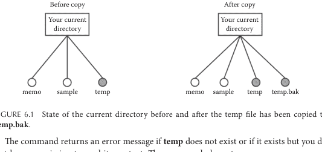

# 图 6.1 `temp` 文件被复制到 `temp.bak` 之前和之后的当前目录状态。


如果 `temp` 不存在或存在但你没有权限读取其内容，命令会返回错误消息。如果 `temp.bak` 存在且你没有权限写入它，命令也会返回错误消息。下面的会话说明了这些情况。第一个错误消息报告是因为当前目录中不存在 `letter` 文件。第二个错误消息报告是因为你没有权限读取 `sample` 文件。最后一个命令报告错误消息是因为 `temp.bak` 存在且你没有写入权限。你可以通过使用 `-f` 选项来覆盖缺少写权限的情况，如下一个命令所示。`ls -l memo temp.bak` 命令用于显示复制确实已发生；也就是说，数据已被复制，但文件的时间戳为当前时间。如果你想同时复制源文件的数据和属性，你需要使用带有 `-f` 和 `-p` 选项的 `cp` 命令，如下面的最后一个 `cp` 命令所示。最后的 `ls -l memo temp.bak` 命令用于显示数据和文件属性（如时间戳）都已被复制。

```
% ls -l
total 3
-rw-r----- 1 sarwar faculty 371 Aug 28 07:01 memo
--wxx----- 1 sarwar faculty 164 Jul 25 12:35 sample
-r-xr----- 1 sarwar faculty 792 Aug 28 07:01 temp
-r-xr----- 1 sarwar faculty 792 Aug 28 07:05 temp.bak
% cp letter letter.bak
cp: letter: No such file or directory
% cp sample sample.new
cp: sample: Permission denied
% cp memo temp.bak
cp: temp.bak: Permission denied
% cp -f memo temp.bak
% ls -l memo temp.bak
-rw-r----- 1 sarwar faculty 0 Aug 28 07:01 memo
--wxx----- 1 sarwar faculty 0 Aug 28 07:22 temp.bak
% cp -fp memo temp.bak
% ls -l memo temp.bak
```

```
-rwxr---- 1 sarwar faculty 0 Aug 28 07:01 memo
-rwxr---- 1 sarwar faculty 0 Aug 28 07:01 temp.bak
%
```

下面的命令将你主目录中的 `.profile` 文件复制到你主目录中的 `sys.backups` 子目录下的 `.profile.old` 文件中。此命令无论你在运行命令时所在的目录如何都有效，因为路径名以你的主目录开头。你应该在更改 `~/.profile` 文件中指定的运行时环境之前执行此命令，以便在设置新环境时出现问题时，你拥有先前工作环境的备份副本。该命令在 `~/.profile` 不存在、你没有权限读取它、`~/sys.backups` 目录不存在或你没有对其执行（搜索）和写权限、或 `.profile.bak` 存在但你没有权限读取它时产生错误消息。

```
% cp ~/.profile ~/sys.backups/.profile.bak
%
```

下面的命令将当前目录中以字符串 `lab` 开头的所有文件复制到 `~/courses/ee446/backups` 目录。该命令还会在任何源文件已存在于 `backups` 目录中时提示你是否覆盖。在这种情况下（复制多个文件），如果 `backups` 不是目录或不存在，屏幕上会显示错误消息，告知目标必须是目录。

```
% cp -i lab* ~/courses/ee446/backups
%
```

如果你想将完整目录复制到另一个目录，你需要使用带有 `-r` 选项的 `cp` 命令。此选项递归地将文件和子目录从源目录复制到目标目录。这是一个有用的选项，你可以用它定期创建重要目录的备份。因此，下面的命令递归地将 `~/courses` 目录复制到 `~/backups` 目录。

```
$ cp -r ~/courses ~/backups
$
```

此命令创建 `~/courses` 目录的副本，包括 `~/courses` 目录下的所有文件和目录层次结构，并将其放置在 `~/backups` 目录下。图 6.2 显示了执行命令前后你的主目录（`~`）的状态。

### 6.3.2 移动文件

文件可以从文件结构中的一个目录移动到另一个目录。在 UNIX 中，此操作如果在同一文件系统上，也可能只是重命名文件。重命名

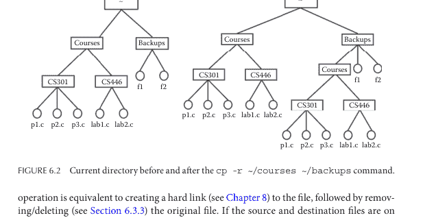

图6.2 执行 `cp -r ~/courses ~/backups` 命令前后当前目录的状态

移动操作相当于为文件创建一个硬链接（参见第8章），然后移除/删除（参见6.3.3节）原文件。如果源文件和目标文件位于不同的文件系统上，移动操作会将源文件物理复制到目标位置，然后移除源文件。移动文件的命令是 `mv`。下面是对该命令的简要说明。

```
语法
mv [选项] file1 file2
mv [选项] file-list directory

用途：第一种语法：将 file1 移动到 file2，或将 file1 重命名为 file2
第二种语法：将 file-list 中的所有文件移动到 directory

常用选项/特性：
- -f 忽略目标文件的权限，强制移动
- -i 在覆盖目标文件前提示用户
```

对于包含源文件（描述中的 `file1`）的目录，你必须具有写和执行访问权限，但不需要对该文件本身具有读、写或执行权限。同样，对于包含目标/目的文件（描述中的 `file2`）的目录，你必须具有写和执行权限；对于目标文件路径名中的每个目录，你必须具有执行权限；如果目标文件已存在，你还需要具有写权限。如果目标文件已存在，默认情况下它会直接被覆盖，而不会通知你。如果你使用 `-i` 选项，则在覆盖目标文件之前会提示你。

下面的命令将 `temp` 移动到 `temp.moved`。在这种情况下，`temp` 文件被重命名为 `temp.moved`。如果 `temp` 不存在，或者你对它所在的目录没有执行权限，`mv` 命令会返回一条错误消息。该命令

```
$ mv temp temp.moved
$
```

在 `temp.moved` 已存在而你没有写权限时，会提示你是否移动该文件。

下面的命令将 `temp` 作为 `temp.old` 文件移动到 `backups` 目录。图6.3展示了移动 `temp` 文件前后当前目录的状态。

```
$ mv temp backups/temp.old
$
```

下面的命令是强制移动；无论目标文件 `temp.moved` 的权限如何，你都可以使用它来强制移动。

```
$ mv -f temp temp.moved
$
```

下面的命令将 `dir1` 中的所有文件和目录（不包括隐藏文件）移动到 `dir2` 目录。如果 `dir2` 不是目录、不存在，或者你对它没有写和执行权限，命令会失败，并在屏幕上显示错误消息。

```
$ mv dir1/* dir2
$
```

命令执行后，`dir1` 中只包含隐藏文件。你可以使用 `ls -a` 命令确认 `dir1` 的状态。

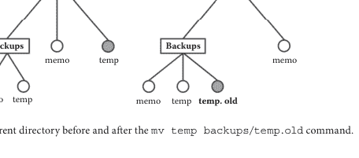

图6.3 执行 `mv temp backups/temp.old` 命令前后当前目录的状态

## 6.3.3 移除/删除文件

当文件不再需要时，应将它们从文件结构中移除，以释放磁盘空间供新的文件和目录复用。UNIX 中用于移除（删除）文件的命令是 `rm`。下面是对该命令的简要说明。

```
语法
rm [选项] file-list

用途：从文件结构（和磁盘）中移除 file-list 中的文件
常用选项/特性：
- f 无论 file-list 的权限如何，强制移除
- i 在移除 file-list 中的文件之前提示用户
- r 递归移除作为参数传入的目录中的文件。这会移除该目录下的所有内容，因此在使用此选项之前请确保你确实想要这样做。
```

如果 `file-list` 中的文件是路径名，则你需要对路径名中的所有目录组件具有读和执行权限，并且对最后一个目录（包含要删除的文件）具有读、写和执行权限。你还必须对这些文件本身具有写权限，才能在你删除它们时不会提示你。如果你从终端运行该命令，并且对要删除的文件没有写权限，该命令会显示你对文件的访问权限，并提示你确认是否删除它。

```
$ rm temp
$ rm temp backups/temp.old
$ rm -f phones grades ~/letters/letter.john
$ rm ~/dir1/*
$
```

第一条命令从当前目录中移除 `temp`。第二条命令从当前目录中移除 `temp` 文件，并从当前目录的 `backups` 目录中移除 `temp.old` 文件。图6.4展示了该命令的语义。第三条命令移除 `phones`、`grades` 和 `~/letters/letter.john` 文件，无论它们的访问权限如何。第四条命令移除 `~/dir1` 目录中的所有文件，但目录本身不会被移除。


现在，考虑以下使用一些 shell 元字符特性的命令（参见第7章）。

```
$ rm [kK]*.prn
$ rm [a-kA-Z]*.prn
$
```

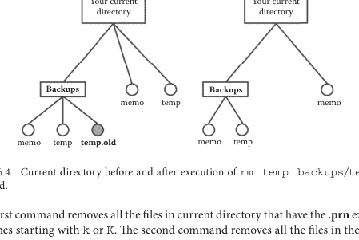

FIGURE 6.4 Current directory before and after execution of rm temp backups/temp.old command.

第一个命令删除当前目录中扩展名为 `.prn` 且名称以 `k` 或 `K` 开头的所有文件。第二个命令删除当前目录中扩展名为 `.prn` 且名称以小写字母 `a` 到 `k` 或大写字母开头的全部文件。

在第 4 章中，我们谈到了删除目录并指出 `rmdir` 命令只能用于删除空目录。带 `-r` 选项的 `rm` 命令可用于递归删除非空目录。因此，以下命令会递归删除您主目录中的 `OldDirectory`。此命令在您没有权限删除文件时会提示您。如果您不想让系统提示并希望强制递归删除 `~/OldDirectory`，则使用 `rm -rf ~/OldDirectory` 命令。此命令是您必须永远不要执行的一类命令，除非您真的了解其可能带来灾难性后果：完整目录层次结构中所有文件和目录的丢失。但如果您想释放一些磁盘空间，该命令还是非常有用的。

```
$ rm -r ~/OldDirectory
$
```

通常应将 `-i` 和 `-r` 选项组合起来递归删除目录（本例中为 `~/OldDirectory`），如下所示命令。`-i` 选项用于交互式删除，使用此选项时 `rm` 命令会在删除文件前提示您。这样可以确保您不会误删重要文件。

```
$ rm -ir ~/OldDirectory
rm: examine files in directory /home/sarwar/OldDirectory (y/n)? y
rm: remove /home/sarwar/OldDirectory/John.11.14.2013 (y/n)? y
rm: remove /home/sarwar/OldDirectory/Tom.2.24.2011 (y/n)?
...
$
```

## 6.3.4 Determining File Size

您可以使用多个 UNIX 命令来确定文件的大小。用于此目的且在所有 UNIX 版本中都可用的两个常用命令是 `ls -l` 和 `wc`。我们在第 5 章中描述了 `ls -l` 命令，在那里我们使用它来确定文件的访问权限。我们在此在确定文件大小的上下文中重新介绍该命令。

正如我们之前提到的，`ls -l` 命令会显示作为其参数指定的目录（或目录）中的文件和目录的长列表。您必须对目录具有读和执行权限才能成功对其运行 `ls` 命令；要查看列表，无需对目录中的文件具有任何权限。如果未指定参数，命令将给出当前目录的输出。此命令的输出有九个字段，第五个字段给出文件大小，单位为字节（参见第 5.5 节）。在以下命令中，`lab2` 文件的大小为 709 字节。

```
$ ls -l lab2
-rw-r--r-- 1 sarwar faculty 709 Apr 5 11:23 lab2
$
```

此命令也会显示目录文件的大小。您也可以通过在命令行中指定多个文件并用空格分隔来获取多个文件的大小。例如，以下命令显示 `lab1` 和 `lab2` 文件的大小分别为 163 字节和 709 字节。

```
$ ls -l lab1 lab2
-rw-r--r-- 1 sarwar faculty 163 Jul 9 16:47 lab1
-rw-r--r-- 1 sarwar faculty 709 Apr 5 11:23 lab2
$
```

以下命令使用 shell 元字符 `*` 来显示 `~/courses/ee446` 目录中所有文件的长列表。

```
$ ls -l ~/courses/ee446/*
... output of the command ...
$
```

而 `ls -l` 是一个通用命令，可用于确定一个或多个文件的许多属性，包括其以字节/字符为单位的大小，`wc` 是一个专用命令，仅显示文件大小。以下是 `wc` 命令的简要说明。

### SYNTAX

```
wc [options] file-list
```

Purpose: Display sizes of the files in file-list as number of lines, words, and characters

常用选项/功能：

- `-c` Display only the number of characters
- `-l` Display only the number of lines
- `-w` Display only the number of words

```
% wc sample
4 44 227 sample
```

第一个命令显示当前工作目录中 `sample` 文件的行数、词数和字符数。`sample` 的大小为 4 行、44 个词和 227 字节。

```
% wc letter sample test
44 250 letter
4 44 227 sample
2 12 90 test
50 306 total
```

第二个命令显示当前工作目录中 `letter`、`sample` 和 `test` 文件的相同信息。此命令输出的最后一行还显示了三个文件的总行数、总词数和总字节数。

```
% wc -c letter sample test
1687 letter
227 sample
90 test
2004 total
```

第三个命令显示 `letter`、`sample` 和 `test` 中的字符数。最后一个命令显示可以在单个命令中使用多个选项；在这种情况下，输出是命令行中三个文件的词数和字母数。

```
% wc -lw letter sample test
44 250 letter
4 44 sample
2 12 test
50 306 total
```

在 FreeBSD 上，带目录参数的 `wc` 命令会返回三个数字以及目录名称：0、1 和目录中目录项的数量，包括 `.`（点）和 `..`（点点）目录，如下所示：

```
$ wc /etc
0 1 116 /etc
```

这仅适用于目录内容为普通文件和目录的目录。然而，对于包含设备（字符特殊和块特殊）文件和其他类型文件的目录，不会产生这种样式的输出。

`wc` 命令可以用 shell 元字符如 `*` 和 `?`。以下命令显示目录 `/usr/include/sys` 中所有文件大小。

```
% wc /usr/include/sys/*
61 332 2213 /usr/include/sys/_bitset.h
63 320 2150 /usr/include/sys/_bus_dma.h
64 397 2626 /usr/include/sys/_ccallout.h
...
52 275 1868 /usr/include/sys/_timeval.h
115 721 4722 /usr/include/sys/_types.h
74 346 2396 /usr/include/sys/_umtx.h
51 303 303 /usr/include/sys/_unrhd.r.h
208 867 7563 /usr/include/sys/_aac_ioctl.h
125 677 4268 /usr/include/sys/acct.h
...
416 1720 14861 /usr/include/sys/acl.h
```

向文件追加意味着在文件内容的末尾放置新数据。如果文件不存在，则会创建它以包含新数据。追加操作在应用程序或用户需要通过向其中添加数据来扩充文件时很有用。以下命令语法用于将一个或多个文件或键盘输入追加到文件末尾。

```
cat [file-list] >> destination-file
```

目的：将 `file-list` 中的文件内容按命令行指定的顺序追加到 `destination-file` 的末尾。

`>>` 运算符是 UNIX 追加运算符。我们将在第 9 章详细讨论 `<`、`>` 和 `>>` 运算符。该章节描述了如何将命令的输入从键盘读取为来自文件，以及如何将命令的输出和错误消息从终端（或控制台窗口）重定向到文件。在本章中，我们仅使用这些运算符来描述如何将新数据追加到文件当前内容的末尾，以及如何使用 `cat` 命令组合多个文件的内容并将它们放入一个文件中。

以下会话说明了追加操作的工作方式。`cat sample >> temp` 命令将 `sample` 文件的内容追加到 `temp` 文件的末尾。此命令之前和之后的 `cat` 命令显示了相关文件的内容。`cat` 命令语法可用于将多个文件追加到一个文件，如命令 `cat memo1 memo2 memo3 >> memos.record` 所示。

将 `memo1`、`memo2` 和 `memo3` 文件的内容追加到 `memos.record` 文件的末尾。


```
$ cat temp
This is a simple file used to illustrate the working of append operation. The new data will be appended right below this line.
$ cat sample
These are the new data that will be appended at the end of the test file.
$ cat sample >> temp
$ cat temp
This is a simple file used to illustrate the working of append operation. The new data will be appended right below this line.
These are the new data that will be appended at the end of the test file.
$ cat memo1 memo2 memo3 >> memos.record
$
```

如果没有可选的 `file-list` 参数（参见命令说明），该命令可用于将键盘输入追加到 `destination-file` 的末尾。下面的 `cat >> test.letter` 命令从键盘获取输入并将其追加到名为 `test.letter` 的文件。当你在新行上按下 `<Ctrl+D>` 时，命令终止。

```
$ cat test.letter
John Doe
12345 First Lane
Second City, State 98765
$ cat >> test.letter
September 1, 2014
Dear John:
This is to inform you ...
...
<Ctrl+D>
$ cat test.letter
John Doe
12345 First Lane
Second City, State 98765
September 1, 2014
Dear John:
This is to inform you ...
...
$
```

## 6.5 合并文件

以下命令语法可用于将多个文件合并为一个文件。

### SYNTAX

```
cat [file-list] > destination-file
```

目的：将 `file-list` 中的文件内容按命令行指定的顺序合并，并放入 `destination-file`

如果 `destination-file` 已存在，则会被覆盖。如果您没有对 `destination-file` 的写权限，命令会显示错误信息，告知您无权写入该文件。若不使用可选的 `file-list` 参数，您可以使用该命令将键盘输入写入 `destination-file`。因此，此命令语法可用于创建新文件，其内容为从键盘输入的内容，直到您在新行按下 `<Ctrl+D>` 为止，就像上一节中 `cat >> test.letter` 命令的情况一样。

以下会话说明了该命令带参数的工作方式。`ls -l` 命令用于查看文件的权限。`wc memo?` 命令显示当前目录中以字符串 `memo` 开头并在其后跟有一个或多个字母的所有文件的大小。第三个命令将 `memo1`、`memo2` 和 `memo3` 文件的内容合并并按命令中出现的顺序放入 `memos.y2k14` 文件中。`wc memos.y2k14` 命令用于确认 `memos.y2k14` 文件的行数、词数和字符数与三个 `memo` 文件合并后的总数相同。执行 `cat memo1 memo2 memo3 > memos.2014` 命令显示您无权写入 `memos.2014`。

```
% ls -l
-rwxr--r-- 1 sarwar faculty 1687 Jan 10 19:15 memo1
-rwxr--r-- 1 sarwar faculty 1227 Feb 19 14:37 memo2
-rwxr--r-- 1 sarwar faculty 790 Sep 1 19:16 memo3
-r-------- 1 sarwar faculty 9765 Jan 15 22:11 memos.2014
% wc memo?
 44 250 3352 memo1
 34 244 4083 memo2
 12 112 907 memo3
 90 606 3704 total
% cat memo1 memo2 memo3 > memos.y2k14
% wc memos.y2k14
 90 606 3704 memos.y2k14
% cat memo1 memo2 memo3 > memos.2014
memos.2014: Permission denied.
%
```

您也可以使用以下命令序列完成 `cat memo1 memo2 memo3 > memos.y2k14` 的任务。

```
$ cat memo1 > memos.y2k14
$ cat memo2 >> memos.y2k14
```

```
$ cat memo3 >> memos.y2k14
$
```

以下章节练习要求您练习使用 `cp`、`mv`、`ls -l`、`wc` 和 `cat` 命令以及用于向文件追加内容的运算符。

## EXERCISE 6.5

将您主目录中的 `.profile` 文件（或在基于 BSD UNIX 的系统中为 `.login`）复制到您主目录中名为 `backups` 的目录下的 `.profile.old` 文件（或 `.login.old`）。假设您位于主目录中。您使用了什么命令？

## EXERCISE 6.6

在您主目录中创建一个名为 `new.backups` 的目录，并将 `backups` 目录中的所有文件移动到 `new.backups`。您使用了什么命令？

## EXERCISE 6.7

显示 `~/ece345` 目录中文件 `lab3` 的字节大小。您使用了什么命令？

## EXERCISE 6.8

给出一个命令，将 `~/courses/ece446` 目录中的所有文件追加到 `~/courses` 目录中的名为 `BigBackup.ece446` 的文件中。

## 6.6 COMPARING FILES

有时，您需要比较程序代码或其它文档的两个版本，以找出它们之间的差异。您可以使用 `diff` 命令执行此任务。该命令比较两个文件，并以可用于将一个文件转换为另一个文件的命令/指令的形式显示它们之间的差异。以下是该命令的简要说明。

### SYNTAX

```
diff [options] [file1] [file2]
```

目的：逐行比较 `file1` 和 `file2`，并以可用于将 `file1` 转换为 `file2` 或反之的 `ed` 编辑器命令/指令系列的形式显示它们之间的差异；如果使用 `-` 作为 `file1` 或 `file2`，则从标准输入读取

常用选项/功能：

- `-b` 忽略行尾的空白（空格和制表符），并将其它空白字符串视为相等
- `-e` 生成并显示可执行的 `ed` 编辑器脚本，以将 `file1` 改为 `file2`
- `-h` 进行快速比较（`-e` 选项在此情况下不能使用）

# 表 6.1 由 diff 生成的文件转换指令

| Instruction | Description for Changing file1 to file2 |
|---|---|
| L1aL2, L3<br>> lines L2 through L3 | 在 `file1` 的第 `L1` 行后追加来自 `file2` 的第 `L2` 至 `L3` 行 |
| L1, L2cL3, L4<br>< lines L1 through L2 in file1<br>---<br>> lines L3 through L4 in file2 | 将 `file1` 中的第 `L1` 至 `L2` 行更改为 `file2` 中的第 `L3` 至 `L4` 行 |
| L1, L2dL3<br>< lines L1 through L2 in file1 | 从 `file1` 中删除第 `L1` 至 `L2` 行 |

`file1` 和 `file2` 参数可以是目录。如果 `file1` 是目录，`diff` 会在其中搜索名为 `file2` 的文件并将其与 `file2`（第二个参数）进行比较。如果 `file2` 是目录，`diff` 会在其中搜索名为 `file1` 的文件并将其与 `file1`（第一个参数）进行比较。如果两个参数都是目录，该命令会比较这两个目录中具有相同名称的所有文件对。

如果比较的文件相同，`diff` 命令不会产生任何输出。在不使用任何选项的情况下，`diff` 命令会生成一系列供 `ed` 编辑器使用的指令，可用于将 `file1` 转换为 `file2`（如果文件不同）。指令为 `a`（添加）、`c`（更改）和 `d`（删除），在表 6.1 中有描述。

以下会话说明了 `diff` 命令的简单用法。


```
$ cat Fall_OH
Office Hours for Fall 2014
Monday
9:00 - 10:00 A.M.
3:00 - 4:00 P.M.
Tuesday
10:00 - 11:00 A.M.
Wednesday
9:00 - 10:00 A.M.
3:00 - 4:00 P.M.
Thursday
11:00 A.M. - 12:00 P.M.
2:00 - 3:00 P.M.
4:00 - 4:30 P.M.
$ cat Spring_OH
Office Hours for Spring 2015
Monday
9:00 - 10:00 A.M.
3:00 - 4:00 P.M.
Tuesday
10:00 - 11:00 A.M.
1:00 - 2:00 P.M.
Wednesday
9:00 - 10:00 A.M.
Thursday
11:00 A.M. - 12:00 P.M.
$ diff Fall_OH Spring_OH
1c1
< Office Hours for Fall 2014
---
> Office Hours for Spring 2015
6a7
> 1:00 - 2:00 P.M.
9d9
< 3:00 - 4:00 P.M.
12,13d11
< 2:00 - 3:00 P.M.
< 4:00 - 4:30 P.M.
$
```

指令 `1c1` 要求 `ed` 编辑器将 `Fall_OH` 文件中的第一行（Office Hours for Fall 2014）更改为 `Spring_OH` 文件中的第一行（Office Hours for Spring 2015）。指令 `6a7` 要求 `ed` 编辑器在 `Fall_OH` 的第 6 行后追加 `Spring_OH` 中的第 7 行。指令 `12,13d11` 要求 `ed` 编辑器从 `Fall_OH` 中删除第 12 行和第 13 行。

以下会话说明了使用 `-e` 选项的 `diff` 命令以及如何将该命令的输出提供给 `ed` 编辑器以使 `Fall_OH` 与 `Spring_OH` 相同。该命令用于向您展示命令输出的样子。第二个 `diff` 命令（带 `> diff.script`）用于将命令输出（`ed` 脚本）保存到 `diff.script` 文件中。`cat >> diff.script` 命令用于通过添加包含 `w` 和 `q` 的两行，将 `diff.script` 文件转换为完整的 `ed` 编辑器工作脚本。如前所述，该命令以 `<Ctrl+D>` 结束。最后，运行 `ed` 命令根据 `diff -e` 命令生成的脚本更改 `Fall_OH` 的内容，使其与 `Spring_OH` 相同。数字 `209` 和 `177` 显示了执行 `ed` 命令前后 `Fall_OH` 文件的大小。最后一条命令 `diff Fall_OH Spring_OH` 用于确认两个文件相同。

```
$ diff -e Fall_OH Spring_OH
12,13d
9d
6a
1:00 - 2:00 P.M.
.
1c
Office Hours for Spring 2015
.
$ diff -e Fall_OH Spring_OH > diff.script
$ cat >> diff.script
w
q
<Ctrl+D>
$ ed Fall_OH < diff.script
209
177
$ diff Fall_OH Spring_OH
$
```

大多数系统都有一个名为 `diff3` 的命令，可用于进行三向比较；即可以组合三个文件。

## 6.7 在文本文件中定位和删除重复内容

您可以使用 `uniq` 命令删除文件中除一个副本外的所有连续重复行。该命令适用于排序后的文件，尽管它也可以在未排序的文件上工作，如示例所示。我们将在第 7 章讨论排序。以下是该命令的简要说明。

```
SYNTAX
uniq [options] [input-file] [output-file]

Purpose: Remove repetitious lines from the sorted input-file and send unique (nonrepeated) lines to output-file. The input-file does not change. If no output-file is specified, the output of the command is sent to standard output. If no input-file is specified, the command takes input from standard input.

Commonly used options/features:
-c  Precede each output line by the number of times it occurs
-d  Display the repeated lines
-f N Ignore the first N fields in input lines while doing comparisons
-i  Perform case-sensitive comparison of input lines
-s C Ignore the first C characters in input lines while doing comparisons
-u  Display the lines that are not repeated
```

以下会话说明了 `uniq` 命令的工作原理。`cat` 命令用于显示示例文件的内容。`uniq sample` 命令显示只有连续的重复行才被视为重复。`uniq -c sample` 命令显示文件中每行的行数。`uniq -d sample` 命令用于仅输出重复行。最后，`uniq -d sample out` 命令将命令的输出发送到 `out` 文件。`cat out` 命令用于显示 `out` 的内容。请注意，如果重复行相邻，`uniq` 命令仅适用于未排序的文件。

```
$ cat sample
This is a test file for the uniq command.
It contains some repeated and some nonrepeated lines.
Some of the repeated lines are consecutive, like this.
Some of the repeated lines are consecutive, like this.
```

Some of the repeated lines are consecutive, like this.

And, some are not consecutive, like the following.

Some of the repeated lines are consecutive, like this.

The above line, therefore, will not be considered a repeated

line by the uniq command, but this will be considered repeated!

$ uniq sample

This is a test file for the uniq command.

It contains some repeated and some nonrepeated lines.

Some of the repeated lines are consecutive, like this.

And, some are not consecutive, like the following.

Some of the repeated lines are consecutive, like this.

The above line, therefore, will not be considered a repeated

line by the uniq command, but this will be considered repeated!

$ uniq -c sample

1 This is a test file for the uniq command.

1 It contains some repeated and some nonrepeated lines.

3 Some of the repeated lines are consecutive, like this.

1 And, some are not consecutive, like the following.

1 Some of the repeated lines are consecutive, like this.

1 The above line, therefore, will not be considered a

repeated

2 line by the uniq command, but this will be considered

repeated!

$ uniq -d sample

Some of the repeated lines are consecutive, like this.


`line by the uniq command, but this will be considered repeated!`

```
$ uniq -d sample out
```

```
$ cat out
```

Some of the repeated lines are consecutive, like this.

`line by the uniq command, but this will be considered repeated!`

```
$
```

在下面的章节练习中，你将使用 `diff` 和 `uniq` 命令来体会它们所执行任务的价值。

## EXERCISE 6.9

复制第 6.6 节中给出的交互会话，以体会 `diff` 命令的工作方式。

## EXERCISE 6.10

给出一个命令，以删除文件 `~/personal` 目录下名为 `phones` 的文件中除一个之外的所有连续重复行。假设你不在自己的主目录中。

# 6.8 PRINTING FILES AND CONTROLLING PRINT JOBS

我们在第 2 章简要讨论了用于打印文件的 UNIX 命令。在本节中，我们将全面介绍文件打印，包括与打印和打印机控制相关的命令。这些命令包括用于打印文件、检查打印机上打印请求/作业的状态以及取消打印作业的命令。我们描述了在 PC-BSD 和 Solaris 中都可用的命令。

### 6.8.1 UNIX Mechanism for Printing Files

打印文件的过程与显示文件的过程类似；在这两种情况下，一个或多个文件的内容都会发送到输出设备。在显示输出的情况下，输出设备是显示屏，而在打印输出的情况下，输出设备是打印机。另一个主要区别源于这样一个事实：每个用户都有一个单独的显示屏，但许多用户可能共享一个典型的 UNIX（或任何分时）系统上的单个打印机。因此，当你使用 `cat` 或 `more` 命令显示文件时，UNIX 会立即将文件内容发送到显示屏。然而，当你打印文件时，其内容不会立即发送到打印机，因为打印机可能正忙于打印其他文件（你的或其他用户的）。为处理多个请求，先到先得（FCFS）机制会将打印请求放入与你发送打印请求关联的打印机相关联的队列中，并在打印机可用时按其顺序处理请求。

UNIX 为系统中的每台打印机维护一个打印请求队列，称为打印队列。每个请求称为一个作业。作业会被分配一个编号，称为作业 ID。当你使用命令打印文件时，系统会制作你文件的临时副本，为你的请求分配作业 ID，并将作业放入命令行为其指定的打印机关联的打印队列中。当打印机完成当前作业后，它会从打印队列的前端获取下一个作业。因此，当打印机可用并且你的作业位于打印队列的头部时，你的作业就会被处理。

一个名为打印机调度程序或打印机守护进程的 UNIX 进程执行维护打印队列并将打印作业导向正确打印机的任务。此进程称为 `lpd`。它在系统启动时在后台开始执行，并等待你的打印请求。我们将在第 10 章讨论守护进程，但现在，你可以将守护进程视为一个运行的进程，你在它与你的终端交互时并不察觉其存在。

System V 和 BSD 对打印和控制打印作业有不同的命令集。由于许多当代 UNIX 系统同时兼容 System V 和 BSD，因此它们包含两套命令。表 6.2 包含两套系统的打印相关命令列表；所有命令在 PC-BSD 和 Solaris 中均可用。超级用户——系统管理员——通常使用最后两个命令，`lpc` 和 `lptest`。

### 6.8.2 Printing Files

如表 6.2 所示，你可以在 System V 兼容的 UNIX 系统上使用 `lp` 命令打印文件，在 BSD 兼容的 UNIX 系统上使用 `lpr` 命令打印文件。它

## 表 6.2 PC-BSD 和 Solaris 中都可用的打印相关命令列表

| System V 兼容 UNIX | BSD 兼容 UNIX | 用途 |
|---|---|---|
| `lp` | `lpr` | 提交文件进行打印 |
| `lpstat` | `lpq` | 显示一个或多个打印机的打印作业状态 |
| `cancel` | `lprm` | 从打印队列中移除/清除一个或多个作业 |
|  | `lpc` | 启动打印机控制程序 |
|  | `lptest` | 生成波纹图案以测试打印机 |

必须非常注意的是，你绝不要尝试用 `lp` 或 `lpr` 命令打印非文本文件，尤其是包含控制字符的文件（例如可执行文件如 `a.out`）。这样做不会打印出你想要的内容并会浪费大量打印纸。甚至不要尝试测试。如果不小心发送了非文本文件的打印请求，请立即关闭打印机并通知你的系统管理员你需要帮助。

下面是对 `lp` 命令的简要描述。

#### 语法

```
lp [options] file-list
```

用途：提交打印 `file-list` 中文件的请求

## 常用选项/功能：

- `-P page-list` 打印 `page-list` 中指定的页
- `-d ptr` 将打印请求发送到 `ptr` 打印机
- `-m` 打印完成后发送电子邮件
- `-n N` 打印 `file-list` 中文件(s)的 `N` 份；默认是一份
- `-t title` 在横幅页上打印标题
- `-w` 打印完成后向用户终端写入信息

下面的会话展示了如何使用带选项和不带选项的 `lp` 命令。第一个命令在默认打印机上打印示例文件。系统管理员为系统上的用户设置默认打印机。第一个打印请求的作业 ID 为 `cpr-981`，这告诉你打印机名称为 `cpr`。第二个命令使用 `-d` 选项指定示例文件应打印在 `spr` 打印机上。第三个命令用于在 `qpr` 打印机上打印 `sample` 和 `phones` 文件各三份。

```
% lp sample
request id is cpr-981 (1 file(s))
% lp -d spr sample
request id is spr-983 (1 file(s))
% lp -d qpr -n 3 sample phones
request id is qpr-984 (2 file(s))
%
```

如前所述，`lp` 命令的 BSD 对应命令是 `lpr` 命令。下面是对该命令的简要描述。

#### 语法

```
lpr [options] file-list
```

用途：提交打印 `file-list` 中文件的请求

## 常用选项/功能：

- `-# -N N` 打印 `file-list` 中文件(s)的 `N` 份；默认是一份
- `-P ptr` 将打印请求发送到 `ptr` 打印机
- `-T title` 在横幅页上打印标题
- `-m` 打印完成后发送电子邮件
- `-p` 使用 `pr` 命令格式化输出

下面的会话展示了 BSD 版本的命令，它们执行与 `lp` 命令相同的打印任务。因此，第一个 `lpr` 命令发送打印示例文件到默认打印机的打印请求。第二个命令发送打印示例文件到 `spr` 打印机的请求。第三个命令在 `qpr` 打印机上打印 `sample` 和 `phones` 文件各三份。

```
% lpr sample
% lpr -P spr sample
% lpr -P qpr -# 3 sample
%
```

你可以使用以下命令打印 `sample` 文件，并在 `pr` 命令生成的每页上加上页眉信息。竖线符号（`|`）称为管道符号，我们将在第 9 章详细讨论。

```
% pr sample | lpr
%
```

你也可以使用 `lpr -p sample` 命令执行相同的任务。你可以使用以下命令打印带有行号和每页 `pr` 页眉的 `sample` 文件。你也可以使用 `nl sample | lpr -p` 命令执行相同的任务。

```
$ nl sample | pr | lpr
$
```

你可以通过指定适当的标志使 `lpr` 命令打印非标准文本文件，例如 TEX 文件。例如，你可以使用 `-t` 选项打印 `troff` 文件，使用 `-n` 选项打印 `nroff` 文件。

### 6.8.3 查找你的打印请求状态

在 System V 兼容系统中，`lpstat` 命令可用于显示打印机上打印作业的状态。下面是对 `lpstat` 命令的简要描述。

#### 语法

```
lpstat [options]
```

用途：显示打印机上打印作业的状态

## 常用选项/功能：

- `-d` 显示使用 `lp` 命令发送到默认打印机的打印作业状态
- `-o job-ID-list` 显示 `job-ID-list` 中的打印作业状态；用空格分隔作业 ID，多个作业时将请求用双引号括起来
- `-p printer-list` 显示 `printer-list` 中指定的打印机上的打印作业状态
- `-u user-list` 显示 `user-list` 中用户的打印作业状态


不带任何选项时，`lpstat` 命令会显示所有正在打印或等待在默认打印机打印队列中的你的打印作业状态。下面的会话中的命令展示了该命令的一些典型用法。`lpstat -p` 命令显示网络上所有打印机的状态。`lpstat -p qpr` 显示 `qpr` 打印机上的打印作业状态。`lpstat -u sarwar` 显示用户 `sarwar` 的所有打印作业。命令的输出显示 `sarwar` 提交了三个打印作业：两个到 `qpr`（作业 ID 为 `qpr-3998` 和 `qpr-3999`）和一个到 `tpr`（作业 ID 为 `tpr-203`）。最后，`lpstat -a` 命令显示所有处于活动状态并接受打印作业的打印机。

```
$ lpstat -p
printer cpr is idle. enabled since Tue Sep 2 10:43:48 GMT 2014. available. printer mpr faulted. enabled since Mon Sep 1 10:48:29 GMT 2014. available. printer qpr now printing qpr-53. enabled since Mon Sep 1 10:48:29 GMT 2014. available. printer spr is idle. enabled since Mon Sep 1 10:48:29 GMT 2003. available.
$ lpstat -p qpr
printer qpr now printing qpr-53. enabled since Mon Sep 1 10:48:29 GMT 2014. available.
$ lpstat -u sarwar
qpr-3998 sarwar 93874 Sep 2 22:05 on qpr
qpr-3999 sarwar 93874 Sep 2 22:05
tpr-203 sarwar 93874 Sep 2 22:05 on tpr
$ lpstat -a
cpr accepting requests since Tue Sep 2 10:43:48 GMT 2014
spr accepting requests since Mon Sep 1 10:48:29 GMT 2014
$
```

以下是 `lpstat` 命令的 BSD 对应命令 `lpq` 的简要说明。

### 语法

```
lpq [options]
```

用途：显示打印机上打印作业的状态

常用选项/功能：

- `-P printer-list` 显示 `printer-list` 中指定打印机上的打印作业状态
- `-l` 显示使用 `lpr` 命令发送到默认打印机的打印作业的长格式状态

最常用的选项是 `-P`。在以下会话中，第一个命令用于显示 `mpr` 打印机上打印作业的状态。命令输出显示打印机队列中有四个作业：作业 3991、3992、3993 和 3994。活动作业位于打印队列的头部。当打印机准备好打印时，它将首先打印活动作业。第二个命令显示 `qpr` 打印机没有任何要打印的作业。

```
$ lpq -Pmpr
mpr is ready and printing
```

| 排名 | 所有者 | 作业 | 文件 | 总大小 |
| --- | --- | --- | --- | --- |
| 活动 | sarwar | 3991 | mail.bob | 1056 字节 |
| 第 1 | sarwar | 3992 | csh.man | 93874 字节 |
| 第 2 | davis | 3993 | proposals1.nsa | 2708921 字节 |
| 第 3 | tom | 3994 | memo | 8920 字节 |

```
$ lpq -Pqpr
no entries
$
```

## 6.8.4 取消你的打印作业

如果你意识到自己提交了错误的文件进行打印，你会希望取消打印请求。执行此任务的 System V 命令是 `cancel`。以下是该命令的简要说明。

### 语法

```
cancel [options] [printer]
```

用途：取消通过 `lp` 命令发送的打印请求——也就是将这些作业从打印队列中移除

常用选项/功能：

- `jobID-list` 取消 `jobID-list` 中指定的打印作业
- `-u login` 取消用户 `login` 发出的所有打印请求

以下命令展示了如何取消打印作业。你可以使用 `lpstat` 或 `lpq` 命令显示打印机上打印作业的作业 ID，如第 6.8.3 节所示。第一个命令取消打印作业 `mpr-3991`。第二个命令取消用户 `sarwar` 在所有打印机上的所有打印请求。你只能取消自己的打印作业。因此，最后一个命令只有在 `sarwar` 或超级用户运行时才有效。

```
$ cancel mpr-3991
request "mpr-3991" canceled
$ cancel -u sarwar mpr
request "mpr-3992" canceled
request "mpr-3995" canceled
$
```

`cancel` 命令的 BSD 对应命令是 `lprm`。以下是该命令的简要说明。

### 语法

```
lprm [options] [jobID-list] [user(s)]
```

用途：取消使用 `lpr` 命令发出的打印请求——即从打印队列中移除这些作业；`jobID-list` 中的作业 ID 取自 `lpq` 命令的输出

常用选项/功能：

- 移除用户拥有的所有打印作业
- `-P ptr` 指定 `ptr` 打印机的打印队列

以下 `lprm` 命令执行与上一节中描述的 `cancel` 命令相同的任务。

```
$ lprm -P mpr 3991
mpr-3991 dequeued
$ lprm -P mpr sarwar
mpr-3997 dequeued
mpr-3998 dequeued
$
```

当不带参数运行时，`lprm` 命令会移除当前活动的作业，前提是该作业属于你。

以下章内练习将帮助你练习使用与打印相关的命令。

## 练习 6.11

你如何在打印机 `ece_hpl` 上打印文件 `memo` 的五份副本？请分别给出 System V 和 BSD UNIX 的命令。

这两个文件是相同的。`uniq` 命令可以用于删除连续重复的行，只保留其中一次出现。使用 `-d` 选项，该命令可以用于显示重复的行。

`lp`（System V）或 `lpr`（BSD）命令可用于在打印机上打印文件。`lpstat`（System V）或 `lpq`（BSD）命令可用于检查打印机上所有打印作业（请求）的状态（等待、打印中等）。`cancel`（System V）或 `lprm`（BSD）命令可用于从打印机队列中移除打印作业，从而不打印请求的文件。所有这些打印命令在 PC-BSD 和 Solaris 中均可用。

## 问题与习题

1. 列出你可以在 UNIX 文件上执行的 10 种操作。

2. 给出一条命令行，用于查看当前工作目录中所有文件的大小（以行数和字节数表示）。

3. `tail -10r ../letter.John` 命令的作用是什么？

4. 给出一条查看你的主目录大小的命令。给出一条显示主目录中所有文件大小的命令。

5. 给出一条命令，用于显示 `students` 文件中从第 25 行开始的所有行。

6. 给出一条命令，用于复制主目录中 `courses` 目录下的所有文件和目录。假设你在主目录中。给出另一条命令，假设你不在主目录中，来完成同样的任务。

7. 重做问题 6，但给出的命令需要保留文件的修改时间和权限。

8. `cp -r ~/courses ~/backups` 和 `cp -r ~/courses/ ~/backups` 命令之间有什么区别？

9. 给出 `rm` 命令的一个选项，该选项可以保护你不会意外删除文件，尤其是当你在命令中使用 `*` 和 `?` 等通配符时。

10. 以下命令分别做什么？

    a. `cp -f sample sample.bak`
    b. `cp -fp sample sample.bak`
    c. `rm -i ~/personal/memo*.doc`
    d. `rm -i ~/unixbook/final/ch??.prn`
    e. `rm -f ~/unixbook/final/*.o`
    f. `rm -f ~/courses/ece446/lab[1-6].c[c]`
    g. `rm -r ~/NotNeededDirectory`
    h. `rm -rf ~/NotNeededDirectory`
    i. `rm -ri ~/NotNeededDirectory`

11. 给出一个命令，用于将 `lab1`、`lab2` 和 `lab3` 文件从 `~/courses/ece345` 目录移动到主目录中的 `newlabs.ece345` 目录。如果目标目录中已存在同名文件，则该命令应提示用户进行确认。


### 12. 给出一个命令，用于显示 `~/personal/phones` 文件中不重复的行。

### 13. 参考章节内练习 9。给出一系列命令，用于保存 `ed` 编辑器的命令序列，并使用这些命令使 `sample` 和 `example` 成为相同的文件。

### 14. 你的主目录中有一个名为 `tryit&` 的文件。请重命名该文件。你使用了什么命令？

### 15. 给出一个命令，用于显示主目录中 `courses/ece345` 目录下所有以字符串 `prog` 开头、后跟零个或多个字符、并以字符串 `.c` 结尾的文件的属性。

### 16. 参考问题 15。给出一个命令，用于查找 `prog` 和 `.c` 之间恰好有两个英文字母的文件名。你能否给出另一条命令行来完成同样的任务？

### 17. 给出一个命令，用于分屏显示 `gotcha` 和 `M*A*S*H` 文件。

### 24. `tail -15 file1` 和 `tail +15 file1` 命令之间有什么区别？下列哪个命令等同于 `cat file1`：`tail -$ file`、`tail -1 file1` 还是 `tail +1 file1`？为什么？

### 25. `more -n5 file1` 命令的作用是什么？

### 26. `more` 和 `less` 命令之间有什么区别？在你看来，这两个命令哪个更强大、更用户友好？为什么？

### 27. 在当前目录中创建一个名为 `f1` 的文件。该文件的 inode 编号是多少？将该文件移动到你的主目录并命名为 `f1.moved`。移动后的文件的 inode 编号是多少？将移动后的文件移动到 `/tmp` 目录。 `/tmp/f1.moved` 文件的 inode 编号是多少？为什么 `f1` 和 `f2` 的 inode 编号相同？为什么 `/tmp/f1.moved` 的 inode 编号与 `f1`（或 `~/f1.moved`）的不同？

# 高级文件处理

## 目标

- 解释文件压缩及其执行方式
- 解释排序过程以及文件如何排序
- 讨论在 UNIX 文件结构中搜索命令和文件
- 讨论正则表达式的构成和使用
- 描述如何在文件中搜索表达式、字符串和模式
- 描述如何执行文件中字段的剪切和粘贴等数据库类操作
- 讨论文件的编码和解码
- 解释文件加密和解密
- 涵盖相关命令和原语

```
>, ~, compress, crypt, crypto, cut, egrep, fgrep, find, grep, openssl, paste, pcat, sort, uncompress, uuencode, uudecode, whereis, which, zcat
```

## 7.1 引言

在本章中，我们介绍一些更高级的文件处理操作，并展示如何在 UNIX 中执行这些操作。但在介绍这些操作之前，我们先讨论一个重要的主题——正则表达式，它是一组规则，可以使用一系列特殊文本字符来指定一个或多个字符串。在讨论这些操作的同时，我们还介绍相关的 shell 命令和工具，这些命令和工具会用到正则表达式。我们还会举例说明如何使用这些命令来执行所需的操作。

## 7.2 压缩文件

减小文件大小被称为文件压缩，它具有空间和时间两方面的优势。压缩后的文件占用的磁盘空间更少，在网络或互联网环境中从一台计算机传输到另一台计算机所需的时间更短，并且复制所需的时间也更少。压缩文件需要花费时间，但如果一个文件需要被复制或传输多次，压缩文件所花费的时间可能只是总节省时间的一小部分。此外，如果压缩后的文件需要长时间存储在辅助存储设备（例如磁盘）上，那么节省的磁盘空间可能是相当可观的。压缩的另一个结果是，压缩后的文件看起来像乱码。然而，这不是问题，因为该过程是完全可逆的，压缩文件可以转换回其原始形式。如果你能从压缩版本中完全恢复原始文件，这种压缩称为无损压缩。无损压缩技术通常用于文本文件。也存在有损压缩技术。这些技术用于减小文件大小，以便在网络上存储、处理和传输其内容。有损压缩技术通常用于图像文件，例如 JPEG。在本章中，我们讨论用于压缩和解压缩文本文件及可执行文件的工具。我们还会讨论用于显示和搜索压缩文件的命令。

UNIX 操作系统有许多用于压缩和解压缩文件以及对压缩文件执行各种操作的命令。这些命令包括传统的 UNIX 文件压缩和解压缩命令 `compress` 和 `uncompress`，以及 GNU 工具 `g zexe`（压缩可执行文件）、`gzip`（用于压缩文件）、`gunzip`（用于解压缩使用 gzip 压缩的文件）、`zcat`（用于显示压缩文件；`gzcat` 功能相同）、`gzcmp`（用于比较压缩文件）、`gzforce`（用于强制将 .gz 扩展名添加到压缩文件上，以便 gzip 不会再次压缩它们）、`z more`（用于逐页显示压缩文件）以及 `zgrep`（用于压缩文件的 grep 命令；它搜索可能被压缩的文件中的正则表达式）。本节将主要讨论文件压缩和解压缩。尽管 GNU 工具（gzip 和 gunzip）优于 compress 和 uncompress 命令，但为了内容的完整性，我们两种命令集都会讨论。

### 7.2.1 compress 命令

`compress` 命令读取作为参数传递给它的文件内容，分析其中重复出现的模式，然后通过使用自适应利基-伦佩尔编码为这些模式替换为更少字符来减少字符数。压缩文件的内容与原始文件完全不同。压缩文件包含不可打印字符，因此在屏幕上显示压缩文件会显示一堆控制字符或乱码。`compress` 命令将压缩后的文件保存为一个与原始文件同名、并附加 `.Z` 扩展名的文件。该文件与原始文件具有相同的访问权限和修改日期。原始文件将从文件结构中删除。

以下是 `compress` 命令的简要说明；`uncompress` 命令的语法和使用的选项与它完全相同。

### SYNTAX

```
compress [option] file-list
```

Purpose: Compress files in file-list

Output: The compressed .Z file or standard output if input is from standard input

## Commonly used options/features:

- `-c` Write compressed file to the display screen instead of a .Z file
- `-f` Force compression; no prompts
- `-v` Display compression percentage and the names of compressed files

With no file argument or `-` as an argument, the `compress` command takes input from standard input (keyboard by default), which allows you to use the command in a pipeline (see Chapter 9). We normally use the command with one or more files as its arguments. In the following session, we use the command with one file, `t2`, as its argument. The compressed file is stored in the `t2.Z` file, and the `t2` file is removed from the file system.

```
$ cat t2
This file is being used to test various commands and tools. Long
live UNIX! UNIX rules the networking world!!
$ compress t2
$ cat t2.Z
'6e@
!_L'7g@ÖS
    :O.C
0rÔ_"'iÂ,!CPYEoÕIq7A°Ic'a'I°
        P_3)uI 1
$
```

The following session illustrates the use of `compress` with the `-v` (verbose) option and multiple files. Note that the use of the shell metacharacter `?` denotes a single character and that the output of the `compress` command with the `-v` option shows the percentage of compression performed on the source files. Note that `t2` and `t3` have been compressed only a little, but `t4` has been compressed to 58% of its original size, from 4083 bytes to 2371 bytes.


```
% ls -l t?
-rw-r--r-- 1 sarwar faculty 116 Aug 30 19:35 t2
-rw-r--r-- 1 sarwar faculty 99 Aug 30 19:32 t3
-rw-r--r-- 1 sarwar faculty 4083 Aug 30 19:33 t4
% compress -v t2 t3 t4
t2.Z: 93% compression
t3.Z: 90% compression
t4.Z: 58% compression
% ls -l t?.Z
```

```
-rw-r--r-- 1 sarwar faculty 108 Aug 30 19:35 t2.Z
-rw-r--r-- 1 sarwar faculty 89 Aug 30 19:32 t3.Z
-rw-r--r-- 1 sarwar faculty 2371 Aug 30 19:33 t4.Z
%
```

## 7.2.2 The uncompress Command

You can use the `uncompress` command to uncompress the compressed files and put them in the corresponding original files (i.e., the names of the compressed files without `.Z` extensions). The following session shows the use of the `uncompress` command. Note that `uncompress` ignores the `-v` option.

```
% uncompress t1.Z t2.Z t3.Z t4.Z
% ls -l t?
-rw-r--r-- 1 sarwar faculty 116 Aug 30 19:35 t2
-rw-r--r-- 1 sarwar faculty 99 Aug 30 19:32 t3
-rw-r--r-- 1 sarwar faculty 4083 Aug 30 19:33 t4
%
```

The `uncompress -v t?.Z` command performs the same task if the current directory contains only these four file names that start with `t` followed by one other character and have the `.Z` extension. Note that the output of the `uncompress` command goes into a file with the original file name.

As given in the command description, multiple files can be displayed by the `zcat` command. For example, the command `zcat t2.Z t3.Z t4.Z` displays the uncompressed forms of the three files `t2.Z`, `t3.Z`, and `t4.Z`.

## 7.2.3 The gzip Command

The `gzip` command is the GNU tool for compressing files. The compressed file is saved as a file that has the same name as the original, with an extension `.gz` appended to it. As is the case with the `compress` command, the compressed files retain the access/modification times, ownership, and access privileges of the original files. The original file is removed from the file structure. With no file argument or with `-` as an argument, the `gzip` command takes input from standard input (keyboard by default), which allows you to use the command in a pipeline (see Chapter 9). We normally use the command with one or more files as its arguments. Here is a brief description of the command.

### SYNTAX

```
gzip [option] [file-list]
```

Purpose: Compress each file in `file-list` and store it in `filename.gz`, where `filename` is the name of the original file. If no file is specified in the command line or if `-` is specified, take input from standard input.

Output: The compressed `.gz` file or standard output if input is from standard input

```
% gunzip bash.man.gz
% gzip bash.man tcsh.man
% gzip -l bash.man.gz tcsh.man.gz
      compressed uncompressed ratio uncompressed_name
          105342      367470  71.3% bash.man
           77715      239996  67.6% tcsh.man
          183057      607466  69.8% (totals)
% gunzip *.man.gz
% ls -l *.man
-rw-r--r-- 1 sarwar faculty 367470 Aug 30 21:39 bash.man
-rw-r--r-- 1 sarwar faculty 239996 Aug 30 21:39 tcsh.man
%
```

## 7.2.5 gzexe 命令

`gzexe` 命令可用于压缩可执行文件。用 `gzexe` 命令压缩的可执行文件仍然可执行，可以通过其名称执行。如果用 `gzip` 命令压缩可执行文件则不然。因此，如果文件要从一台计算机传输到另一台计算机——例如通过互联网通过电子邮件传输——为了节省磁盘空间和网络带宽，可执行文件会用 `gzexe` 命令进行压缩。下面是对该命令的简要描述。

### SYNTAX

`gzexe [options] [file-list]`

目的：将 `file-list` 中给出的可执行文件压缩；备份文件创建在 `file-name~` 中，应在压缩文件成功创建后删除

常用选项/功能：

- `-d` 解压缩已压缩文件

以下会话说明了 `gzexe` 命令的使用。注意，当你用 `gzexe` 命令压缩可执行文件 `sh.temp` 时，它会在 `sh.temp~` 文件中创建原始文件的备份。`sh.temp` 文件被压缩后，可以像普通可执行文件一样执行。`gzexe -d sh.temp` 命令用于解压缩已压缩的 `sh.temp` 文件。压缩版本的备份保存在 `sh.temp~` 文件中。

```
% cp /bin/sh sh.temp
% file sh.temp
sh.temp: ELF 64-bit LSB executable, x86-64, version 1 (FreeBSD), dynamically linked (uses shared libs), for FreeBSD 10.0 (1000510), stripped
% gzexe sh.temp
sh.temp:        49.2%
% ls -l sh*
-rw-------  1 sarwar faculty  71133 Aug 30 21:59 sh.temp
-rw-------  1 sarwar faculty 139264 Aug 30 21:59 sh.temp~
% gzexe -d sh.temp
49.2%
% ls -l sh*
-rw-------  1 sarwar faculty 139264 Aug 30 22:00 sh.temp
-rw-------  1 sarwar faculty 139264 Aug 30 21:59 sh.temp~
%
```

## 7.2.6 zcat 和 zmore 命令


将压缩文件转换回原始文件然后再显示它是一个耗时的过程，因为文件创建需要磁盘 I/O。如果您只想查看原始文件的内容，可以使用 UNIX 命令 `zcat`（压缩文件的 `cat` 命令），它显示用 `compress` 或 `gzip` 压缩的文件的内容。该命令在显示之前会解压缩文件。原始文件保持不变。`zmore` 命令可用于一次显示一屏压缩文件。当未给出文件或 `-` 作为参数时，这些命令从 `stdin` 读取输入。两个命令都允许您指定一个或多个文件作为参数。下面是对 `zcat` 命令的简要描述。

## SYNTAX

```
zcat [options] [file-list]
```

目的：将压缩文件以其原始形式连接并发送到标准输出；如果未指定文件，则从标准输入获取输入

常用选项/功能：

- `-h` 显示帮助信息
- `-r` 递归操作子目录
- `-t` 测试压缩文件的完整性

在以下会话中，`gzip` 命令用于压缩 `bash.man` 文件并将其存储在 `bash.man.gz` 文件中。当使用 `more` 命令显示压缩文件时，屏幕上会显示乱码。`zmore` 命令用于显示原始文件的内容。我们没有使用 `zcat` 命令，因为 `bash.man` 是一个大型、多页文件。

```
$ gzip bash.man
$ more bash.man.gz
<<BB>^HA<FE>T<97><C3>
<DD><A0><CC><D<AE>><B2><B0><G<FE>><BC><0C<DC><99><DD><8F><AC><"<E3>
<8E>_f<PA><E4><D9><0<8F><P9><0<E4><FP>/u<BE>><FP><F9><BA><FA><FA>I
<F5><E4>w<D5><BE>□<BE>x<DE>><AF><FB><AB>x<BF><FA><FA><BB><F8>i<B7>□
<F9><C3>'i97zu<BB><BE><BD>,
<F9><EF><BD><P7><EF><BD><F7><AC>z<F6><A7><EA>O
<F0><C5>oA0A<EB><BE><AD><BE><C5>??<F9><F0><E1>,
<FB>zu"Wu<F5><W<D5>Uf
<D1>m<B6><B6>Ý<F7>/ <E3><B8>y<B7>Z<D5><EB><C5>Y1<DB><F5>e<CF>
p<D1>.
<9B><97><EF><BD><P7>Y<F5><8F><A3><FE><BB><FA>=
...
% zmore bash.man.gz
```

```
BASH(1)                                                                 BASH(1)
NAME
    bash - GNU Bourne-Again SHell
SYNOPSIS
    bash [options] [command_string [f file]]
COPYRIGHT
    Bash is Copyright (C) 1989-2013 by the Free Software
    Foundation, Inc.
DESCRIPTION
    Bash is an sh-compatible command language interpreter
    that executes commands read from the standard input or from a
    file. Bash also incor-
...
%
```

在以下会话中，`zcat` 命令解压缩 `t2.gz` 文件并将其输出发送到标准输出（本例中为显示屏）。`t2.gz` 文件保持完整。

```
% gzip t2
% zcat t2.gz
This file will be used to test various UNIX and Linux commands and
tools.
UNIX and Linux rule the networking world!
%
```

如该命令描述中所述，`zcat` 命令可以显示多个文件。例如，可以使用 `zcat t1.Z t2.Z t3.Z` 来显示三个文件 `t1.Z`、`t2.Z` 和 `t3.Z` 的未压缩形式。`zcat` 命令也可以用于显示用 `compress` 命令压缩的文件——即扩展名为 `.Z` 的文件。

在以下章节练习中，您将使用 `compress`、`uncompress`、`gzip`、`gunzip`、`zmore` 和 `zcat` 命令来了解它们的语法和语义。

## EXERCISE 7.1

创建本节中使用的 `t2` 文件。使用 `compress` 命令压缩该文件。你使用了什么命令行？

## 练习 7.2

创建本节中使用的 `bash.man` 文件。使用 `gzip` 命令压缩该文件。你使用了什么命令行？

## 练习 7.3

在显示屏上显示 `t2` 文件的压缩版本。你使用了什么命令行？

## 练习 7.4

给出解压缩练习 7.1 和 7.2 中生成的压缩文件的命令行。解压缩后的（原始）文件去哪了？另外，重复第 7.2.1 节至 7.2.6 节中显示的 shell 会话。

## 7.3 排序文件

排序意味着根据某些标准对一组项目进行排序。在计算机术语中，它意味着将一组项目（例如，整数、字符或字符串）按升序（下一个项目大于或等于当前项目）或降序（下一个项目小于或等于当前项目）排序。因此，例如，整数集合 `{10, 103, 75, 22, 97, 52, 1}` 如果按升序排序会变成 `{1, 10, 22, 52, 75, 97, 103}`，如果按降序排序会变成 `{103, 97, 75, 52, 22, 10, 1}`。同样，字典中的单词按升序列出。因此，单词 `apple` 出现在单词 `apply` 之前。

排序是一种常用的操作，也在各种软件系统中执行。使用排序的系统包括

- 字典中的单词
- 电话簿中人员的姓名
- 航空公司预订系统，根据航班号在机场终端机上按航班号排序显示航班的到达和出发时间
- 药房中现成处方的显示人员姓名
- 来自注册办公室的班级名单中列出的学生姓名

排序过程基于使用每个项目的字段或部分，称为排序键。为了确定排序列表中每个项目的位置，你通过使用它们的键字段比较列表中的项目（通常一次两个）。用作键的字段的选择取决于要排序的项目。如果项目是个人记录（例如，学生员工记录），姓氏、学生 ID 和社会安全号码是常用的键之一。如果项目是机场的航班到达和出发时间，航班号和城市名称是常用的键。

UNIX `sort` 实用程序可用于对文本（ASCII）文件中的项目进行排序。以下是该实用程序的简要描述。

### 语法

```
sort [options] [file-list]
```

目的：对 `file-list` 中的 ASCII 文件中的行进行排序

输出：将排序后的文件输出到标准输出

常用选项/功能：

- `-b` 忽略前导空白
- `-d` 根据通常的字母顺序排序：忽略除字母、数字和空白以外的所有字符
- `-f` 将小写字母和大写字母视为等价
- `+n1[-n2]` 指定字段作为排序键，从 `+n1` 开始，到 `-n2` 结束（如果未指定 `-n2`，则到行尾）；字段编号从 0 开始
- `-r` 按逆序排序

如果在 `file-list` 中未指定文件，`sort` 会从标准输入读取输入。`sort` 命令的输出会发送到标准输出。默认情况下，`sort` 将每一行从第一列开始视为键。换句话说，它根据所有字段的内容从左到右重新排列文件中的行——即以换行符（`n`）分隔的字符串。以下会话说明了使用 `sort` 以及带和不带某些选项的使用方法。`students` 文件包含要排序的项目（学生记录，每行一条）。每行包含四个字段：名字、姓氏、电子邮件地址和电话号码。每个字段由一个或多个空格字符分隔。

```
% cat students
John Johnsen      john.johnsen@tp.com      503.555.1111
Hassaan Sarwar    hsarwar@k12.st.or        503.444.2132
David Kendall     d_kendall@msnbc.org      229.111.2013
John Johnsen      j.johnsen@psu.net        301.999.8888
Ibraheem Sarwar   ibraheem@abc.sci.com     222.123.4567
Kelly Kimberly    kellyk@umich.gov         555.123.9999
Maham Sarwar      smsarwar@k12.st.or       713.888.0000
Jamie Davidson    j.davidson@uet.edu       515.001.1212
Nabeel Sarwar     n.sarwar@xyz.net         434.555.1212
```


```
% sort students
David Kendall     d_kendall@msnbc.org      229.111.2013
Hassaan Sarwar    hsarwar@k12.st.or        503.444.2132
Ibraheem Sarwar   ibraheem@abc.sci.com     222.123.4567
Jamie Davidson    j.davidson@uet.edu       515.001.1212
John Johnsen      j.johnsen@psu.net        301.999.8888
John Johnsen      john.johnsen@tp.com      503.555.1111
Kelly Kimberly    kellyk@umich.gov         555.123.9999
Maham Sarwar      smsarwar@k12.st.or       713.888.0000
```

注意，学生文件中的行按所有字符从左到右升序排列（整个行用作排序键）。以下命令使用从姓氏（即第二个字段，字段编号 `1`）开始的整行内容作为排序键对文件进行排序。

```
% sort +1 students
Jamie Davidson    j.davidson@uet.edu    515.001.1212
John Johnsen      j.johnsen@psu.net     301.999.8888
John Johnsen      john.johnsen@tp.com   503.555.1111
David Kendall     d_kendall@msnbc.org   229.111.2013
Kelly Kimberly    kellyk@umich.gov      555.123.9999
Hassaan Sarwar    hsarwar@k12.st.or     503.444.2132
Ibraheem Sarwar   ibraheem@abc.sci.com  222.123.4567
Nabeel Sarwar     n.sarwar@xyz.net      434.555.1212
Maham Sarwar      smsarwar@k12.st.or    713.888.0000
%
```

以下命令使用电话号码作为排序键并按逆序对文件排序，同时忽略前导空白（空格和制表符）。`+3` 选项指定电话号码为排序键（因为电话号码是最后一个字段），`-r` 选项通知 `sort` 以逆序显示排序输出，`-b` 选项要求 `sort` 工具忽略字段之间的前导空白。

```
% sort +3 -r -b students
Maham Sarwar      smsarwar@k12.st.or    713.888.0000
Kelly Kimberly    kellyk@umich.gov      555.123.9999
Jamie Davidson    j.davidson@uet.edu    515.001.1212
John Johnsen      john.johnsen@tp.com   503.555.1111
Hassaan Sarwar    hsarwar@k12.st.or     503.444.2132
Nabeel Sarwar     n.sarwar@xyz.net      434.555.1212
John Johnsen      j.johnsen@psu.net     301.999.8888
David Kendall     d_kendall@msnbc.org   229.111.2013
Ibraheem Sarwar   ibraheem@abc.sci.com  222.123.4567
%
```

如果字段由多个空格分隔，并且空格数量因行而异（如学生文件的情况），则 `-b` 选项很重要。原因是空格字符（按 ASCII 值）比所有字母和数字都要“小”，如果不跳过空白，将产生意外的输出。排序键可以组合，其中一个作为主键，其他的作为次键，按优先顺序指定（主键在前）。以下命令以姓氏作为主键、电话号码作为次键对学生文件进行排序。

## 常用选项/功能：

| 选项 | 描述 |
| --- | --- |
| `-exec CMD` | 如果命令 `CMD` 返回 `0` 作为其退出状态（对于成功执行的命令为真值），则被搜索的文件满足条件；`CMD` 必须以带引号的分号（`\;`）结尾。 |
| `-inum N` | 搜索 inode 编号为 `N` 的文件。 |
| `-links N` | 搜索链接数为 `N` 的文件。 |
| `-name pattern` | 搜索符合指定模式的文件。 |
| `-newer file` | 搜索在 `file` 之后被修改过（即比 `file` 更新）的文件。 |
| `-ok CMD` | 类似于 `-exec`，但首先会提示用户确认。 |
| `-perm octal` | 如果文件的权限为八进制，则搜索该文件。 |
| `-print` | 显示通过其余条件找到的文件的路径名。 |
| `-size ±N[c]` | 搜索大小为 `N` 块的文件；`N` 后跟 `c` 可用于以字符为单位衡量大小；`+N` 表示大小大于 `N` 块，`-N` 表示大小小于 `N` 块。 |
| `-user name` | 搜索由用户名或 ID 名拥有的文件。 |
| `\( expr \)` | 如果 `expr` 为真则为真；用于将条件与 OR 或 AND 组合分组。 |
| `! expr` | 如果 `expr` 为假则为真。 |

附录 A 中给出了更多条件。你可以使用 `[-a]` 或一个空格对两个条件进行逻辑 AND，使用 `-o` 进行逻辑 OR。注意，左括号 `\( ` 或右括号 `\)` 前后以及 `-o` 前后至少需要一个空格。复杂的表达式可以用括号 `\( ` 和 `\)` 括起来。我们现在讨论一些示例。

`find` 命令最常见的用法是搜索一个或多个目录中的文件，如第一个示例所示。这里，该命令在你的主目录中搜索 `USA.gif` 和 `Pakistan.gif` 文件，并显示包含它们的目录的路径名。如果被搜索的文件出现在多个目录中，则显示所有目录的路径名。

```
$ find ~ \( -name USA.gif -o -name Pakistan.gif \) -print
/home/sarwar/myweb/USA.html
/home/sarwar/myweb/Pakistan.html
$
```

以下命令显示你的主目录中以 `.c` 和 `.C` 结尾的所有文件的绝对路径名。

```
$ find ~ \( -name '*.c' -o -name '*.C' \) -print
...
$
```

下一个命令递归搜索 `/usr/include` 目录中名为 `socket.h` 的文件，并打印该文件的绝对路径名。

以下示例说明了 `whereis` 命令的使用方法。第一个命令用于定位 `ftp` 命令。第二个命令用于定位 `cat` 命令的可执行文件。最后一个命令定位 `find`、`compress` 和 `tar` 命令的信息。

```
$ whereis ftp
ftp: /usr/bin/ftp /usr/share/man/en.UTF-8/man1/ftp.1.gz
$ whereis -b cat
cat: /bin/cat
$ whereis find compress tar
find: /usr/bin/find /usr/share/man/en.UTF-8/man1/find.1.gz
compress: /usr/bin/compress /usr/share/man/en.UTF-8/man1/
compress.1.gz
tar: /usr/bin/tar /usr/share/man/en.UTF-8/man1/tar.1.gz
$
```

在这些命令的输出中，目录 `/usr/bin`、`/usr/local/bin`、`/usr/ucb` 和 `/usr/sbin` 包含命令的可执行文件，目录 `/usr/man` 包含多个子目录，其中包含 UNIX 在线手册的各个部分，文件 `/etc/tar` 是指向 `/usr/sbin/tar` 的符号链接，而 `/usr/include` 目录包含头文件。

在一个系统中存在命令的多个版本时，可以使用 `which` 实用程序来确定当你在使用的 shell 中输入命令时所执行的版本的所在位置（绝对路径名）。当命令不按其规范工作时，可以使用 `which` 实用程序来确定执行该命令版本的绝对路径名。由于 `PATH` 变量中搜索路径的设置方式（参见第 2 章和第 4 章），本地版本的命令可能会执行。而且，由于代码最近的更新，本地版本可能已损坏；也许它不能与系统上安装的新库正常配合工作。`which` 命令以 `command-list`（实际上是命令的文件列表）作为参数，并将其绝对路径名返回到标准输出。

在下面的章节内练习中，你将练习使用 `find`、`sort` 和 `whereis` 命令，并体会 `find` 命令与 `whereis` 命令之间的区别。

## Exercise 7.6


给出一个对名为 `students` 的文件进行排序的命令，按以电子邮件地址开头的整行进行排序。

## Exercise 7.7

给出一个命令，用于查找 `traceroute` 命令的可执行代码在你的系统上的位置。

## Exercise 7.8

你有一个名为 `phones` 的文件在你的目录结构中的某个位置，但你不记得它所在的目录的路径名。你会使用什么命令来定位它？

## 7.5 正则表达式

正则表达式是由常量和操作符符号（称为操作符）组成的序列，表示一组字符串，通常称为搜索模式，用于在文件内容中搜索所需字符串。UNIX 中的不同工具和命令支持不同的操作符集，但以下操作符几乎被所有支持正则表达式的 UNIX 工具所支持：`()`、`[]`、`.`、`^`、`$` 和 `*`。`*` 操作符可用于指定前一个元素的零次或多次出现。例如，`a*` 表示空字符串、`a`、`aa`、`aaa` 等。正则表达式 `^a` 表示以 `a` 开头的行。类似地，`.com` 表示字符串 `Acom`、`acom`、`Bcom`、`bcom`、`Ccom`、`ccom` 等。正则表达式 `aa*` 表示 `a`、`aaa`、`aaaa` 等。它等价于正则表达式 `a+`。

一些工具使用额外的操作符，如 `|`、`?` 和 `+`。`?` 操作符可用于指定前一个元素（一个字符或一个模式）的零次或一次出现。例如，`a?` 指定一个没有字符的字符串（空字符串）或仅包含 `a` 的字符串。`+` 操作符可用于指定前一个元素的一次或多次出现。例如，`a+` 表示 `a`、`aa`、`aaa` 等。`|` 指定备选。例如，`a|b`、`pray|prey` 或 `a|b*`。正则表达式 `a|b*` 表示空字符串、`a`、`b`、`bb`、`bbb` 等。`()` 操作符用于指定操作符的作用域和优先级。例如，`pr(a|e)y` 表示 `pray` 或 `prey`，因此等价于 `pray|prey`。

一些常用的允许使用正则表达式的 UNIX 工具是 `awk`、`ed`、`egrep`、`grep`、`sed`、`vi` 和 `vim`，但这些工具对正则表达式的支持程度并不相同。`awk` 和 `egrep` 对正则表达式的支持最好，而 `grep` 的支持最弱。

表 7.1 列出了正则表达式操作符、其名称、示例用法、含义以及支持它们的工具。正则表达式操作符与 shell 元字符重叠，但你可以使用单引号将它们括起来以防止 shell 对其进行解释。最后一列中的“All”一词表示所有提到的工具都支持相应的操作符。为简洁起见，我们在第四列中未对字符串使用引号。

表 7.2 列出了 `vim` 编辑器中一些常用的正则表达式及其含义。毋庸置疑，正则表达式在 `vim` 命令中使用。我们在第 7.6 节中讨论 `grep` 和 `egrep` 的示例。在正则表达式 `\.c/` 中，反斜杠字符（`\`）用于转义点（`.`）的特殊含义并取其字面含义。

表 7.3 列出了一些使用正则表达式的 `vim` 命令示例及其含义。请注意，这些命令在你在 `vim` 的命令模式下时使用。在下面的章节内练习中，你将在 `vim` 编辑器中使用正则表达式以欣赏其强大功能。

### 表 7.1 正则表达式运算符及其在 UNIX 工具中的支持情况

| 名称/功能 | 运算符 | 示例用法 | 含义 | 支持工具 |
|---|---|---|---|---|
| 选择 (OR) | | | x | y | z | x, y 或 z | `awk`, `grep` |
| 任意字符 | . | .com | Acom, acom, Bcom, bcom, Ccom, ccom, ... | 全部 |
| 行首 | ^ | ^x | 以 x 开头的行 | 全部 |
| 连接 (AND) | 无 | xyz | xyz | 全部 |
| 行尾 | $ | x$ | 以 x 结尾的行 | 全部 |
| 转义序列：取消其后元字符的特殊含义 | \ | \* | * | `ed`, `sed`, `vi` |
| 分隔符：标记正则表达式的开始或结束 | / | /L..e/ | Love, Live, Lose, Lase, ... | `ed`, `sed`, `vi` |
| 分组 | ( ) 或 \( \) | (xy)+ | xy, xxyy, xxyyxy, ... | 全部 |
| 可选 | ? | xy? | x, xy | `awk`, `egrep` |
| 重复 (0 次或多次) | * | xy* | x, xy, xyy, xyyy, ... | 全部 |
| 重复 (1 次或多次) | + | xy+ | xy, xyy, xyyy, ... | `awk`, `egrep` |
| 匹配方括号内包含的任意字符。 | [ ] | /[Hh]ello/ | Hello, hello | 全部 |
| 匹配方括号内不包含的任意字符。 | [^] | /[^A-KM-Z]ove/ | Love | 全部 |

### 表 7.2 vim 中正则表达式示例及其含义

| 正则表达式 | 含义 | 示例 |
|---|---|---|
| /^Yes/ | 以字符串 Yes 开头的行 | Yes... Yesteryear... Yesterday... 等等 |
| /th/ | 单词中任意位置出现的字符串 th | the, there, path, bathing, 等等 |
| /:$/ | 以冒号结尾的行 | ... following: ... below: ... follows: 等等 |
| /[0-9]/ | 一个数字 | 0, 1, ..., 9 |
| [a-z][0-9]/ | 一个小写英文字母后跟一个数字 | a0, a1, a9, ..., b0, b1, ..., b9, ..., z0, ..., z1, ... z9 |
| /\..c/ | 以 .c 结尾的任意单词（所有 C 源码文件） | lab1.c, program1.c, client.c, server.c, 等等 |
| /[a-zA-Z ]*/ | 由字母（大写或小写）和空格组成的任意字符串；无数字和标点符号 | 所有不含数字和标点符号的字符串，例如 Hello world |

### 表 7.3 说明正则表达式用法的一些常用 vim 命令

| / [0-9] / | 在当前文件中向前搜索单个独立的数字字符；字符串中包含的数字不会被识别。 |
| ?\.c [1-7] ? | 向后搜索以 .c 结尾后跟 1 到 7 之间单个数字的单词或字符串中的单词。 |
| :1,$s/:/./ | 搜索整个文件并将行尾的冒号 (:) 替换为句号 (.)。 |
| :.,$s/^\[Hh\]ello / Greetings / | 从当前行到文件末尾，将以单词 "Hello" 和 "hello" 开头的行替换为单词 "Greetings." |
| :1,$s/^ */ | 删除文件中所有行开头的一个或多个空格。 |

## 练习 7.9

创建一个包含单词 "UNIX"、"Linux"、"Windows" 和 "DOS" 的文件。确保该文件中的某些行以这些单词结尾。使用 `vim` 编辑器在整个文档中将字符串 Windows 替换为 UNIX。你使用了什么命令？

## 练习 7.10

在练习 7.9 中编辑文档时，在 `vim` 中运行命令 `:1,$s/DOS\.\/LINUX\/(/gp`。该命令对文档做了什么？

## 7.6 搜索文件

UNIX 具有强大的文件搜索实用程序，可让你查找文本文件中包含特定表达式、字符串或模式的行。例如，如果你有一个包含公司员工记录的大文件，每行一条记录，你可能想要搜索包含 John Johnsen 信息的行。允许进行文件搜索的实用程序有 `grep`、`egrep` 和 `fgrep`。以下是这些实用程序的简要说明。

#### 语法

```
grep [options] pattern [file-list]
egrep [options] [string] [file-list]
fgrep [options] [expression] [file-list]
```

用途：搜索 `file-list` 中的文件以查找给定的模式、字符串或表达式；如果没有 `file-list`，则从标准输入读取

输出：在标准输出上输出包含给定模式、字符串或表达式的行

### 常用选项/功能：

- `-c` 仅打印匹配行的数量
- `-i` 在匹配过程中忽略字母的大小写
- `-l` 仅打印包含匹配行的文件名称
- `-n` 连同匹配行一起打印行号
- `-s` 用于 shell 脚本；抑制错误消息（返回状态在成功时设为零，在不成功时设为非零——参见第 10 章）
- `-v` 打印不匹配的行
- `-w` 将给定的模式作为字符串进行搜索

在三者中，`fgrep` 命令是最快但最受限的；`egrep` 是最慢但最灵活的，允许充分使用正则表达式；而 `grep` 的速度合理，在正则表达式支持方面也相当灵活。在下面的会话中，我们将使用描述中所示的一些选项来演示这些命令的使用。我们在这些会话中使用与第 7.4 节中描述 `sort` 实用程序时所使用的相同 `students` 文件。我们使用 `cat` 命令来显示该文件。


```
% cat students
John Johnsen      john.johnsen@tp.com      503.555.1111
Hassaan Sarwar    hsarwar@k12.st.or        503.444.2132
David Kendall     d_kendall@msnbc.org      229.111.2013
John Johnsen      j.johnsen@psu.net        301.999.8888
Ibraheem Sarwar   ibraheem@abc.sci.com     222.123.4567
Kelly Kimberly    kellyk@umich.gov         555.123.9999
Maham Sarwar      smsarwar@k12.st.or       713.888.0000
Jamie Davidson    j.davidson@uet.edu       515.001.1212
Sandy Khan        sandy.khan@isu.edu       515.101.9009
Nabeel Sarwar     n.sarwar@xyz.net         434.555.1212
%
```

`grep`实用程序最常见且最简单的用法是显示文件中包含特定字符串、单词或模式的行。在下面的会话中，我们显示`students`文件中包含字符串`Sarwar`的那些行。行按其在文件中的出现顺序显示。

```
$ grep Sarwar students
Hassaan Sarwar    hsarwar@k12.st.or        503.444.2132
Ibraheem Sarwar   ibraheem@abc.sci.com     222.123.4567
Maham Sarwar      smsarwar@k12.st.or       713.888.0000
Nabeel Sarwar     n.sarwar@xyz.net         434.555.1212
%
```

`grep`命令可以与`-n`选项一起使用，以显示带有行号的输出行。在下面的会话中，`students`文件中包含字符串`John`的行将附带行号显示。

```
% grep -n John students
1: John Johnsen      john.johnsen@tp.com      503.555.1111
4: John Johnsen      j.johnsen@psu.net        301.999.8888
%
```

```
$ grep -n include *.c
client.c: 21: #include <stdio.h>
client.c: 22: #include <ctype.h>
client.c: 23: #include <string.h>
labl.c: 13: #include <stdio.h>
grep: can't open server.c
$
```

你也可以使用`grep`命令的`-l`选项来显示模式出现的文件名。然而，它不会显示包含该模式的行。在下面的会话中，假设`~/States`目录包含每个美国州的一个文件，并且该文件被假设包含该州的所有城市名称（例如，Portland）。因此，`grep`命令显示包含单词“Portland”的文件名称——即拥有名为 Portland 的城市的州名称。

```
$ grep -l Portland ~/States
Maine
Oregon
$
```

某些字符同时被 shell 和 `grep`特殊处理。因此，为了确保 shell 将期望的正则表达式传递给 `grep`，你需要将正则表达式用单引号或双引号括起来。你可以使用反斜杠（`\`）来转义字符，除非该字符是换行符（n）。单引号（`'`）会引用除它自身以外的每个字符。双引号（`"`）会引用除 `$`、`|` 或 `'` 以外的每个字符。因此，你可以用 `'` 替换 `"` 在任何使用用 `"` 括起来的正则表达式的命令中，该命令仍会工作，但反之则不成立。在下面的会话中，我们可以互换使用单引号和双引号。用单引号和双引号括起来的表达式也会原样传递给 `grep` 和 `egrep`。

以下命令显示 `students` 文件中以字母 A 到 H 开头的行。在该命令中，`^` 指定行的开头。

```
% grep '^[A-H]' students
Hassaan Sarwar hsarwar@k12.st.or 503.444.2132
David Kendall d_kendall@msnbc.org 229.111.2013
%
```

以下命令显示 `students` 文件中包含至少八个连续小写字母的行。

```
% grep '[a-z]\{8\}' students
Ibraheem Sarwar ibraheem@abc.sci.com 222.123.4567
Maham Sarwar smsarwar@k12.st.or 713.888.0000
Jamie Davidson j.davidson@uet.edu 515.001.1212
%
```

```
% egrep -v Kimberly\|Nabeel students
John Johnsen      john.johnsen@tp.com      503.555.1111
Hassaan Sarwar    hsarwar@k12.st.or       503.444.2132
David Kendall     d_kendall@msnbc.org     229.111.2013
John Johnsen      j.johnsen@psu.net       301.999.8888
Ibraheem Sarwar   ibraheem@abc.sci.com    222.123.4567
Maham Sarwar      smsarwar@k12.st.or     713.888.0000
Jamie Davidson    j.davidson@uet.edu      515.001.1212
Sandy Khan        sandy.khan@isu.edu     515.101.9009
%
```

以下命令显示 `students` 文件中以字母 J 开头的行。注意使用 `^` 来表示一行的开头。

```
% egrep "^J" students
John Johnsen      john.johnsen@tp.com      503.555.1111
John Johnsen      j.johnsen@psu.net       301.999.8888
Jamie Davidson    j.davidson@uet.edu      515.001.1212
%
```

以下命令显示 `students` 文件中以字母 J 或 K 开头的行。注意 `^J` 和 `^K` 表示以字母 J 和 K 开头的行。

```
% egrep "^J|^K" students
John Johnsen      john.johnsen@tp.com      503.555.1111
John Johnsen      j.johnsen@psu.net       301.999.8888
Kelly Kimberly    kellyk@umich.gov       555.123.9999
Jamie Davidson    j.davidson@uet.edu      515.001.1212
%
```

`egrep \^J\|^K students` 命令可以产生相同的结果。然而，`egrep "^J|^K" students` 命令使用更简单的语法。作为经验法则，如果你需要在正则表达式中转义多个特殊字符，请将正则表达式用单引号或双引号括起来，具体视情况而定。

在以下本章练习中，你将使用 `grep` 系列命令来了解它们的各种特性。

### Exercise 7.11
给出一个用于显示 `~/Personal/Phones` 文件中包含以字符串 `David` 开头的单词的行命令。

### Exercise 7.12
给出一个用于显示 `~/Personal/Phones` 文件中包含区号为 `212` 的电话号码的行命令。电话号码存储为 `xxx-xxx-xxxx`，其中 `x` 是 0 到 9 的数字。

### Exercise 7.13
显示你主目录中所有包含单词 `"main"`（不含引号）的文件名。

## 7.7 CUTTING AND PASTING

你可以使用 `cut` 和 `paste` 命令在 UNIX 中处理以表格形式存储数据的。表格由行组成，每行包含一条记录，每条记录有固定数量的字段。字段通常由制表符或空格分隔，尽管可以使用任何字段分隔符。`cut` 命令允许你从一个或多个文件中切出一个或多个字段并发送到标准输出。换句话说，你可以使用 `cut` 命令在文件中的字段边界处垂直切片表格。以下是该命令的简要说明。

```
SYNTAX
```


`cut -b` `list` `[-n]` `[file-list]`

`cut -c` `list` `[file-list]`

`cut -f` `list` `[-d` `char]` `[-s]` `[file-list]`

**Purpose:** Cut out fields of a table in a file  
**Output:** Fields cut by the command

### Commonly used options/features

| Option | Description |
| --- | --- |
| `-b list` | Treat each byte as a column and cut bytes specified in the list |
| `-c list` | Treat each character as a column and cut characters specified in the list |
| `-d char` | Use the character `char` instead of the `<Tab>` character as field separator |
| `-f list` | Cut fields specified in the list |
| `-n` | Do not split characters (used with `-b` option) |
| `-s` | Do not output lines that do not have the delimiter character |

这里，`list` 是以逗号分隔的列表，使用连字符 `-` 指定字节、字符或字段的范围。以下会话说明了 `cut` 命令的一些常用选项和特性。在本节中，我们使用文件 `student_addresses`，其内容由 `cat` 命令显示。

```
% cat student_addresses

John Doe jdoe@xyz.com 312.111.9999 312.999.1111

Pam Meyer meyer@uop.pk 666.222.1212 666.555.1212

Jim Davis jamesd@aol.org 713.999.5555 713.413.0000

Jason Kim j_kim@up.org 434.000.8888 434.555.2211

Amy Nash nash@state.gov 888.111.4444 888.827.3333

%
```

该文件有五个字段，从左到右编号为 1-5：名字、姓氏、电子邮件地址、家庭电话号码和工作电话号码。虽然我们可以使用任何字符作为字段分隔符，但我们选择了 `<Tab>` 字符以获得“列状”外观。

to the table and the output of the following cut and paste commands. You can display a table of first and last names by using the `-f` option. Note that `-f1,2` specifies the first and the second fields of the `student_addresses` file.

```
% cut -f1,2 student_addresses

John Doe

Pam Meyer

Jim Davis

Jason Kim

Amy Nash

%
```

We generate a table of names (first and last) and work phone numbers by slicing the first, second, and fifth fields of the table in the `student_addresses` file.

```
$ cut -f1,2,5 student_addresses

John Doe 312.999.1111

Pam Meyer 666.555.1212

Jim Davis 713.413.0000

Jason Kim 434.555.2211

Amy Nash 888.827.3333

%
```

To generate a table of names and e-mail addresses, we use the following command. Here, `-f1-3` specifies fields 1–3 of the `student_addresses` file.

```
% cut -f1-3 student_addresses

John Doe jdoe@xyz.com

Pam Meyer meyer@uop.pk

Jim Davis jamesd@aol.org

Jason Kim j_kim@up.org

Amy Nash nash@state.gov

%
```

We recommend that you run this command on your machine to determine whether the desired output is produced. If the desired output is not produced, you have not used the `<Tab>` character as the field separator for some or all of the records. In such a case, correct the table and try the command again.

`login` IDs and home directories. The first two lines of the output are for comments, as they start with `#`.

```
$ cut -d: -f5,1,6 /etc/passwd

# $FreeBSD$

#

root:Charlie &: /root

toor:Bourne-again Superuser:/root

daemon:Owner of many system processes:/root

...

sshd:Secure Shell Daemon:/var/empty

smmsp:Sendmail Submission User:/var/spool/clientmqueue

...

sarwar:Syd Mansoor Sarwar:/home/sarwar

...

$
```

Note that the `-d` option is used to specify `:` as the field separator, and it is also displayed as the field separator in the output of the command. For blank delimited files, use one or more space characters (blanks) after `-d\`, as shown in the following example. The `cat` sample command is used to display the blank delimited file, called `sample`, and the `cut -d\ -f1,6 sample` command is used to display fields 1 and 6 of this file.

```
$ cat sample

1 John CS Senior john@net2net.com 3.45

2 Jane CS Junior jane@net2net.com 3.76

3 Sara CS Senior sara@net3net.vom 3.33

$ cut -d\ -f1,6 sample

1 3.45

2 3.76

3 3.33

$
```

The `paste` command complements the `cut` command; it concatenates files horizontally (the `cat` command concatenates files vertically). Hence, this command can be used to paste tables in columns. The following is a brief description of the command.

### SYNTAX

```
paste [options] file-list
```


+ **Purpose:** Horizontally concatenate files in file-list; use standard input if `-` (i.e., a hyphen) is used as a file
+ **Output:** Files in file-list pasted (horizontally concatenated)
+ **Commonly used options/features:**
+   - **-d list** Use list characters as line separators; `<Tab>` is the default character

Consider the file `student_records`, which contains student names (first and last), major, and current GPA.

```
% cat student_records

John Doe ECE 3.54

Pam Meyer CS 3.61

Jim Davis CS 2.71

Jason Kim ECE 3.97

Amy Nash ECE 2.38

%
```

We can combine the two tables, `student_records` and `student_addresses_shortened`, horizontally and generate another by using the `paste` command in the following session. In order to keep the resultant table small, we have used a shortened version of the original `student_addresses` file called `student_addresses_shortened`, which contains the first name, last name, and work phone number only, as shown below. We generated this table by using the `cut -f1,2,5 student_addresses > student_addresses_shortened` command. Note that the output of the `paste` command is displayed on the display screen and is not stored in a file. The resultant table has seven fields.

```
% cat student_addresses_shortened

John Doe 312.999.1111

Pam Meyer 666.555.1212

Jim Davis 713.413.0000

Jason Kim 434.555.2211

Amy Nash 888.827.3333

% paste student_records student_addresses_shortened

John Doe ECE 3.54 John Doe 312.999.1111

Pam Meyer CS 3.61 Pam Meyer 666.555.1212

Jim Davis CS 2.71 Jim Davis 713.413.0000

Jason Kim ECE 3.97 Jason Kim 434.555.2211

Amy Nash ECE 2.38 Amy Nash 888.827.3333

%
```

Suppose that you want to use the `student_addresses_shortened` and `student_records` tables to generate and display a table that has student names, majors, and home phone numbers. You may do so in one of two ways. When you use the first method, you cut the appropriate fields of the two tables, put them in separate files with the fields in the order you want to display them, paste the two tables in the correct order, and remove the tables. The following session illustrates this procedure and its result. Note that the new table is not saved as a file when the following commands are executed. If you want to save the new table in a file, use the `paste table1 table2 > students_table` command. The `students_table` contains the columns of `table1` and `table2` (in that order) pasted together.

```
% cut -f1-3 student_records > table1

% cut -f4 student_addresses > table2

% paste table1 table2

John Doe ECE 312.111.9999

Pam Meyer CS 666.222.1212

Jim Davis CS 713.999.5555

Jason Kim ECE 434.000.8888

Amy Nash ECE 888.111.4444

% rm table1 table2

%
```

上面概述的流程在空间和时间上都很昂贵，因为你必须执行四个命令，在磁盘上生成两个临时文件（`table1` 和 `table2`），并在所需表格显示后删除这些临时文件。你可以用以下命令使用不同的方法实现同样的效果。

```
% paste student_records student_addresses | cut -f1-3,8

John Doe ECE 312.111.9999

Pam Meyer CS 666.222.1212

Jim Davis CS 713.999.5555

Jason Kim ECE 434.000.8888

Amy Nash ECE 888.111.4444

%
```

这里，你首先使用 `paste student_records student_addresses` 命令将两个文件中的表格合并成一个包含九列的表格，然后使用 `cut -f1-3,8` 命令显示所需的表格。显然，第二种方法是在完成任务时首选的方式，因为不会创建临时文件并且只需要一个命令。如果你想将结果表格保存到 `students_table` 文件中，使用命令 `paste student_records student_addresses | cut -f1-3,8 > students_table`。

### 7.8 编码和解码

电子邮件以明文形式传输，而某些电子邮件系统对邮件正文中包含的某些字符很挑剔，例如 `mail` 和 `mailx` 实用程序中第一列的波浪号字符（`~`）。对于 `mail` 等没有方便附件支持的邮件系统来说，这是一个严重问题，当你需要附加图片、视频或可执行程序（二进制文件）等项目时。你可以使用 UNIX-to-UNIX 编码（`uuencode`）实用程序将此类文件转换为仅包含可打印 ASCII 字符且第一列为字母的格式，然后将此文件的内容作为电子邮件正文通过电子邮件发送。接收者可以将电子邮件正文中 `uuencode` 的内容保存到文件中，并使用 `uudecode` 实用程序将此文件转换回原始格式。本节讨论这两个实用程序，首先给出其简要描述。

#### 语法

```
uuencode [option] [source-file] decode_label

uuencode [-o output-file] [source-file] decode_label
```

用途：将源文件从二进制转换为 ASCII
输出：第一种语法：源文件的编码版本输出到标准输出
第二种语法：源文件的编码版本输出到 `output-file`

# 常用选项/功能：

-   `-m` 使用 Base64 编码方法而不是标准算法

```
uudecode [options] [encoded-file]
```


用途：将 `encoded-file` 从 ASCII 解码为二进制
输出：将 `encoded-file` 的二进制版本放入名为 `decode-label` 的文件中，即 `uuencode` 命令的第二个参数

# 常用选项/功能：

- `-i` 不覆盖文件
- `-p` 将解码后的（二进制）文件版本发送到标准输出
- `-o output_file` 将解码后的（二进制）文件版本发送到 `output_file`

`uuencode` 命令将文件的编码（ASCII）版本发送到标准输出。如果命令中未指定 `source-file`，则命令从标准输入读取输入。输出在 ASCII 版本的头部（第一行）中包含 `decode_label`。

`uudecode` 实用程序从 `uuencode` 的（ASCII）文件重建原始文件并将其放入名为 `decode_label` 的文件中。使用 `-p` 选项时，命令将二进制版本发送到标准输出。此选项在管道中使用 `uudecode` 命令（参见第 9 章）。`uuencode` 和 `uudecode` 命令都保留它们转换的原始文件。图 7.1 所示的图表说明了 `uuencoding` 和 `uudecoding` 的过程。

你可以通过使用 `>` 符号将输出重定向到文件，如以下会话中 `uuencode a.out alarm.out > sarwar.out` 命令所示。这样做时，编码输出会进入文件 `sarwar.out`，`decode_label` 为 `alarm.out`。

```
% cat a.out

ELF >'@@?

@@@@@@@@@@@@ ' '( '??000P?@$$Q?T/libexec/ld-elf.

so.FreeBSD>FreeBSD
```


图 7.1 `uuencoding` 和 `uudecoding` 的过程。

```
% uuencode -o sarwar.out a.out alarm.out
% head sarwar.out
begin 755 alarm.out
M7T5,1@(!'OD'(!'(/@!!!'8'5'... ',$'@'...
M...' $'... '($' '9'8'... %'0'... '!' $'... '$'
M0'...'P'$'... '#''0'... '@'...'P' '0'...'@'...
M' '0'...' )...'5'... '4'...'0'...'...
M10'...'...' $...'0,(...'Q'@'...
M'...' $' &!' R'@'...' #(' &',@8'... (...
M' 'H'@' '0'... (...' @'8' #P'... '/' (8'... 'A@
M...' '@'0'... *!...'...'...'P' $'...' !' !@"...
M&')'...'8'D'... #...'...'...'...' $'...' $'...' !' $#E=&O$
% uudecode sarwar.out
% cat alarm.out
ELF >'@?@
@@@@@@@@?@@@ ''(' !?@00P?@$SQ?t/libexec/ld-elf.so.FreeBSD>FreeBSD
V?)g)|i1Nk??|CE??Pv??qX
????
'n????
'C?
u???
'libc++.so.1_Jv_RegisterClasseslibcxxrt.so.llibm.so.5libc.so.7__prognameenvironprintf_init_tlsatexit_edata__bss_start_endFBSD_1.09?(z??
'
?
'
'H?g??H????5 ?&? @?%? h??????%? h??????%? h??????%?v h????UH??AWAV
AUATSP??|M?P?4S|C?M?|P?=?c uL?=Z I?E?-4I?$H?+?+?fffff.?H?H?
?H?????|t?u?|H?T
H???G????P????'H??????@((???'i)H) ?I?I????I?=I?I?M?t1l2?ffff.?H??'H?r
D??L??
...
'H7?g?H????5? ?8? @?8? h??????8? h??????8~- h??????8?v h?????UH??AWAV
AUATSPIT?M?P?S!C?M? |?H?=c uL7=Z 1?E?-4I?S?H?7+?FEEE.?H?H?
?H?????7?z?u?I?H7?
H???G???P????'H??????@?(????'?H) ?I?I?????I?=I?I?M?7tI2?fffff.? 
H??'!H??r

...
D??L??
% ls -l a.out sarwar.out
-rwX-xr-x 1 sarwar faculty 7121 Jul 13 12:25 a.out
-rw-r--r-- 1 sarwar faculty 9840 Aug 31 11:17 sarwar.out
%
```

请注意 `uuencoded` 文件 `sarwar.out` 的第一行上的标签 `alarm.out`。`uudecode` 命令将文件 `sarwar.out` 翻译并把原始内容放入文件 `alarm.out` 中。如预期，`a.out` 和 `alarm.out` 包含相同的数据。如果你想在 `a.out` 中重建原始文件，请在 `uudecode` 命令中使用 `a.out` 作为标签，如 `uudecode -o sarwar.out a.out`。`uudecode sarwar.out` 命令会在 `a.out` 文件中生成原始二进制文件。

`uuencode` 生成的输出大约比原始文件大 38%。因此，为了高效利用网络带宽，你应该在 `uuencode` 之前先压缩二进制文件，并在解码后对其进行解压缩。对于大型图片文件或包含多媒体数据（如视频）的文件来说，这一点尤其重要。

## 7.9 文件加密和解密

我们在第 5 章中简要描述了文件的加密和解密过程。在这里，我们借助 UNIX 命令 `crypt` 更详细地描述这些过程。

请回顾，加密是将文件转换为与其原始版本完全不同的形式的过程，而转换后的文件称为加密文件；将加密文件转换回其原始形式的逆过程称为解密。图 7.2 和 7.3 说明了这些过程。

你加密文件是为了防止他人读取它们。你也可以加密你的电子邮件消息，以防止黑客即使能够在消息通过网络传输时截获网络，也无法理解你的消息。在 UNIX 系统上，你可以使用 `crypt` 命令来加密和解密你的文件。以下是该命令的简要说明。

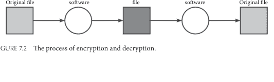

图 7.2 加密和解密的过程。

### SYNTAX

```
crypt [options]
```

**Purpose:** Encrypt (decrypt) standard input and send it to standard output

**Output:** Encrypted (decrypted) version of the input text

**Commonly used options/features:**

- `key` Password to be used to perform encryption (and decryption)
- `-k` Use the value of the environment variable `CRYPTKEY`

默认情况下，`crypt` 命令从标准输入读取输入并将其输出发送到标准输出。可选参数 `key` 是在加密和解密过程中使用的密码。该命令主要与实际文件一起使用，而不是键盘输入，因此 `crypt` 命令常用的语法是：

```
crypt key < original_file > encrypted_file
```

要解密加密文件，过程会根据以下语法反转：

```
crypt key < encrypted_file > original_file
```


请记住，两个命令都必须使用相同的 `key`。用户选择大于号（`>`）后面的文件名。可以指定多个源文件，但命令只加密第一个文件并忽略其余文件。这些命令的语义如图 7.3 所示。请注意，原始文件（待加密的文件）保持不变，必须在生成加密版本后显式从系统中删除。

以下会话说明了使用 `crypt` 加密和解密名为 `memo1` 的文件。`crypt !hskr45$ < memo1 > secret_memo1` 命令使用 `hskr45$` 作为密钥加密 `memo1`（在当前工作目录中），并将加密版本放入 `secret_memo1` 文件中，也在当前工作目录中。`crypt` 命令前后的 `cat` 命令显示了原始文件和加密文件的内容。请注意，加密文件 `secret_memo1` 的内容不可读，这正是目的所在。另请注意，执行完 `cat secret_memo1` 命令后，你的 `shell` 提示符可能会变得混乱。如果发生这种情况，你应该注销然后重新登录。


```
$ cat memo1

Dear Jim:

This is to inform you that the second quarter earnings do not

look good. This information will be made public on Monday next

week when The Wall Street Journal reports the company earnings.

Of course, the company stock will take a hit, but we need to keep

the morale of our employees high. I am calling a meeting of the

vice presidents tomorrow morning at 8:00 to talk about this

issue in the main conference room. See you then. Make sure this

information does not get out before time.

Nadeem
```

```
$ crypt hskr45$< memo1 > secret_memo1

$ cat secret_memo1

.???&??

?k7??6?2?1<?~?eb?'!&I'?w??

]?b?e?Q???_?R?Y?????xI?=???-A?5x?1?#?98

2G?W?WF?????□?2V?????r?7???+?cR?W?2S?+? ?????????

+?C7A???"?"?□?□???cR?HT??□?□?+?KOBM?Q+D□WF?MfW[O?K???8?|-nL&?????-

□T?W#?<??T□OffW['!? ?B??? ? ?'□

???\?*BM°^????=?)?)?\?W?2?□K□? s???2WA???#??-???S???N? ?

???8?????□?#?4?"?H?"?d?□?J?X?□?□???[TY??HT?S?Q?□

B?C????N&????_?□?□?□?1_ (?<?□"? ?

...
$
```

解密文件 `secret_memo1` 并将原始版本放入文件 `original_memo1` 的命令如下。`cat` 命令确认原始文件已恢复。

```
$ crypt hskr45$< secret_memo1 > original_memo1

$ cat original_memo1

Dear Jim:

This is to inform you that the second quarter earnings do not

look good. This information will be made public on Monday next

week when The Wall Street Journal reports the company earnings.

Of course, the company stock will take a hit, but we need to keep

the morale of our employees high. I am calling a meeting of the

vice presidents tomorrow morning at 8:00 to talk about this

issue in the main conference room. See you then. Make sure this

information does not get out before time.

Nadeem
$


另外，`crypt` 命令不会删除它加密（或解密）的文件，加密后你需要自行删除原始文件。还要注意，`crypt` 命令使用的加密算法与 `/etc/passwd` 或 `/etc/shadow` 文件中用于加密用户密码的算法不同。此外，即使超级用户，如果没有正确的密钥，也无法解密加密文件。

`crypt` 命令使用的加密技术曾在二战期间用于德国恩尼格玛密码机，不过 `crypt` 中使用的某些参数使得该命令生成的输出比恩尼格玛密码机的输出更难破译。然而，针对这类机器的攻击方法众所周知。因此，`crypt` 提供的安全级别极低，绝不能用于要求极高安全级别的文档。不过，普通用户并不熟悉这些攻击方法，使用 `crypt` 仍是一种相当不错的文件保护方式。

如果你的工作需要更高级别的安全文档和通信，你应该使用 `openssl` 工具。它支持 `crypto` 库，该库允许你使用多种加密功能，包括以下：

- 使用密码进行加密和解密
- 公钥和私钥的创建与管理
- 公钥加密操作
- 处理加密电子邮件

`openssl` 和 `crypto` 的详细内容超出了本书的范围。你可以使用 `man openssl` 和 `man crypto` 命令进一步了解它们。

以下章节内练习将让你通过实践操作练习使用 `crypt`、`cut`、`paste`、`uudecode` 和 `uuencode` 命令，并帮助你理解它们的语义。

## 练习 7.14

创建第 7.7 节中使用的 `student_addresses` 和 `student_records` 文件，然后运行本节中描述的 `cut` 和 `paste` 命令，看看这些命令是如何工作的。

## 练习 7.15

从 `/usr/bin` 目录中复制某个命令的可执行代码，并对其进行 `uuencode` 编码。运行 `ls -l` 命令并报告编码文件的大小。然后对编码文件执行 `uudecode`，将其还原为原始文件。

## 练习 7.16

在你的系统上尝试本节中给出的 `crypt` 命令会话。

## 摘要

有时需要在文本和非文本文件上执行一些高级操作。这些操作包括压缩和解压缩文件内容，对文件进行排序，在文件系统结构中搜索文件和命令，在文件中搜索特定字符串或模式，执行类似数据库的操作从表中切分字段或将表粘贴在一起，将非 ASCII 文件转换为 ASCII，以及加密和解密文件。UNIX 中提供了多种工具来执行这些任务。

其中一些工具能够通过使用由常量和运算符组成的单个字符字符串来指定一组字符串，称为正则表达式。正则表达式通常被称为搜索模式，用于在文件内容中搜索所需字符串。允许使用正则表达式的实用程序有 `awk`、`ed`、`egrep`、`grep`、`sed` 和 `vim`。本章将描述正则表达式及其在 `vim`、`egrep` 和 `grep` 中的使用。

`compress` 和 `gzip` 命令可用于压缩和解压缩文件，其中 `gzip` 是两者中更灵活的。`uncompress`、`gunzip` 和 `gzip -d` 命令可分别用于解压缩由 `compress` 和 `gzip` 命令压缩的文件。`gexec` 命令可用于压缩可执行文件，而 `gexec -d` 命令可用于解压缩它们。用 `gexec` 压缩的文件可以在不显式解压缩的情况下执行。`zcat` 和 `zmore` 命令可用于在不显式解压缩的情况下显示压缩文件。

`sort` 命令可用于对文本文件进行排序。每行包含一个记录，其中包含多个字段，并且文件中所有行的字段数相同。文本文件也可以通过使用 `cut` 和 `paste` 命令像表一样处理，这两个命令分别允许对表中的列进行切分和粘贴。`sort`、`cut` 和 `paste` 命令可以通过管道组合起来，根据不同的标准生成表。

`find` 和 `whereis` 命令可用于搜索 UNIX 文件系统结构以确定文件和命令的位置。特别是 `find` 命令非常强大，允许您根据多个标准（如文件大小）搜索文件。`which` 命令可用于确定执行的是哪个版本的命令，以防系统上存在多个版本。

UNIX 还提供了一系列强大的实用程序，用于在文本文件中搜索字符串、表达式和模式。这些实用程序是 `grep`、`egrep` 和 `fgrep`。在这三者中，`fgrep` 最快但最受限；`egrep` 是最灵活的但也是最慢的；`grep` 则是中庸之道——速度合理且相当灵活。

`uuencode` 和 `uudecode` 实用程序在用户想要通过电子邮件发送非 ASCII 文件（如多媒体文件），但邮件系统不允许附件时很有用。`uuencode` 实用程序可用于将非 ASCII 文件转换为 ASCII 文件，而 `uudecode` 可将 ASCII 文件转换回原始的非 ASCII 版本。因此，发送者在通过电子邮件发送非 ASCII 文件作为邮件正文的一部分之前使用 `uuencode` 命令，而接收 `uuencoded` 文件的接收者使用 `uudecode` 将其转换回原始形式。

在 UNIX 系统中，`crypt` 命令可用于加密和解密用户希望保密的文件。将加密文件转换回原始文件的技术是众所周知的。然而，普通用户并不熟悉这些技术，因此使用 `crypt` 可实现相当不错的文件保护方案。如果您的工作需要更高级别的安全文档和通信，您应使用 `openssl` 和 `crypto` 工具。

## 问题与练习

- 1. 列出你认为的五种高级文件处理操作。
- 2. 什么是正则表达式？以下正则表达式指定了什么？
  - a. `a|bc*`
  - b. `(a|b)*`
  - c. `a|(b*)c+`
- 3. 给出在当前正在编辑的整个文档中将字符串 `DOS` 替换为字符串 `UNIX` 的 `vi` 命令。将文档中以这些字符串开头或结尾的行中出现的所有 `DOS` 和 `Windows` 字符串替换为字符串 `UNIX` 的命令是什么？
- 4. 给出在正在编辑的文件中删除以 `B`、`F`、`b` 和 `f` 开头的四个字母单词的 `vi` 命令。
- 5. 给出将文档中所有 C 源码文件重命名为 C++ 源码文件的 `vi` 命令。注意：C 源码文件以 `.c` 结尾，C++ 源码文件以 `.cpp` 结尾。
- 6. 什么是文件压缩？压缩文件和解压缩文件这两个术语是什么意思？UNIX 中有哪些可用于执行压缩和解压缩的命令？首选命令是哪些？为什么？
- 7. 在你的目录结构中取三个大文件——一个文本文件、一个 PostScript 文件和一个图片文件——并使用 `compress` 命令压缩它们。哪个文件被压缩得最多？文件大小减少的百分比是多少？使用 `gzip` 命令压缩同一批文件。`compress` 还是 `gzip` 压缩效果更好？使用 `uncompress` 和 `gunzip` 命令解压缩文件。展示你的工作。
- 8. 什么是排序？举例说明你的答案。列出排序的四个应用。列出可用于执行排序的 UNIX 实用程序。
- 9. 访问 `http://cnn.com/weather` 并记录以下亚洲主要城市的最高和最低温度：吉隆坡、卡拉奇、东京、拉合尔、马尼拉、新德里和雅加达。在名为 `asiapac.temps` 的文件中，构建一个 ASCII 表，每行一个城市，顺序为：城市名称、最高温度和最低温度。

以下是示例行。

```
Tokyo 78 72
```


给出执行以下操作的命令。

- a. 按城市名称对表格进行排序。
- b. 按高温对表格进行排序。
- c. 按城市名称作为主键、低温作为次要键对表格进行排序。

10. 对于第 7.6 节中的 `students` 文件，给出一个按姓氏作为排序键对文件中的行进行排序的命令。

11. 可用于文件搜索的命令有哪些？说明每个命令的目的。

12. 给出一个搜索你的主目录并显示所有在 `/etc/passwd` 文件之后创建的文件路径名的命令。

13. 给出一个搜索你的主目录并删除所有 PostScript 和 `.gif` 文件的命令。该命令必须在删除文件前征求你的许可（提示你）。

14. 在你的 UNIX 系统上，找到所有大小大于 1000 字节的文件需要多长时间？你使用了什么命令？

15. 命令 `grep -n '^' student_addresses` 有什么作用？假设 `student_addresses` 是我们在第 7.6 节中使用的相同文件。

b. `grep '\<K' students`

c. `grep <K students`

22. 给出一个命令，显示 `~/courses/ece446` 目录中所有包含单词“UNIX”的文件的文件名。

23. 给出一个命令，生成系统中所有用户的用户名表以及他们的个人信息。从 `/etc/passwd` 文件中提取此信息。

24. 使用 `student_addresses` 和 `student_records` 表生成一个表，其中每一行包含姓氏、工作电话号码和 GPA。

25. 假设你有一个图片文件 `campus.bmp`，你想通过电子邮件发送给朋友。给出将文件转换为 ASCII 形式、减小其大小并在发送电子邮件前对其进行加密所需的命令序列。

26. 文件加密的目的是什么？请命名可在 UNIX 中用于加密和解密文件的命令。给出加密名为 `~/personal/memo7` 的文件的命令，并将其存储在 `~/personal/memo_007` 文件中。确保当加密文件被解密时，它会被放回 `~/personal/memo7` 文件中。给出解密加密文件的命令。

27. 以下有什么区别：
a. encryption and encoding?
b. encoding and compression?
c. compress and zip?

28. 将 `bash`、`sh` 和 `csh` 的 man 手册存储在一个名为 `shell_man_pages` 的文件中。使用 `gzip` 命令以不同的压缩级别进行压缩。展示你的工作并确定执行最大压缩的命令，以及压缩比。

29. 给出以下命令的替代语法。
`uuencode -o sarwar.out a.out alarm.out`
提示：使用第 6 章讨论的重定向输出。

30. 解码由问题 25 中的命令生成的 uuencoded `sarwar.out` 文件，使得 uudecoded 内容保存为 `a.out` 而不是 `alarm.out`。

## 文件共享

### 目标

- 解释共享文件的方式
- 讨论实现文件共享的 UNIX 方案和命令
- 详细描述 UNIX 硬链接和软链接（符号链接）并讨论其优缺点
- 涵盖命令和原语
  `*`, `~`, `ln`, `ln -f`, `ln -s`, `ls -i`, `ls -l`

## 8.1 引言

当一组人共同完成一个项目时，他们需要共享信息。如果要共享的信息在计算机系统上，团队成员必须共享文件和目录。例如，合著一本书的作者或从事软件项目的软件工程师需要共享与项目相关的文件和目录。在本章中，我们讨论在计算机系统中实现文件共享的几种方法。本章对文件共享的讨论主要集中在文件如何在 UNIX 系统中由各个目录的各个用户访问。在第 17 章的版本控制主题中，我们将讨论团队成员如何在不丢失工作的情况下同时处理一个或多个文件。

可以使用多种方法让一组用户共享文件和目录。在本章中，我们描述了重复共享文件、团队成员的通用登录、为共享文件设置适当的访问权限、团队成员的通用组以及通过链接共享。所有这些方法都可用于让 UNIX 系统中的用户团队共享文件和目录。虽然我们描述了每种技术，但本章主要致力于讨论在基于 UNIX 的计算机系统中通过链接共享。

## 8.2 重复共享文件

处理文件最简单的方法是复制这些文件并分发给所有团队成员。成员可以将这些副本放在自己的账户（目录结构）中的任何位置，并以任何他们想要的方式操作它们。如果团队成员要依次处理共享文件(s)，这种方案效果很好，但在团队成员要同时处理这些文件时则存在明显问题。在前一种情况下，团队成员依次对共享文件的其中一份副本进行操作并完成手头的任务。在后一种情况下，由于成员修改的是自己的副本，副本变得不一致，并且没有任何一份共享文件的副本反映出所有团队成员完成的工作。这种结果违背了共享的目的。

## 8.3 团队成员的通用登录

在此方案中，系统管理员创建一个由团队成员组成的新用户组，并为他们创建一个新的账户，他们都可以访问该账户；也就是说，他们都知道该账户的登录名和密码。团队拥有在此账户下由任何团队成员创建的所有文件和目录，并且每个人都可以访问它们。

这是一种简单且效果相当好的方案，尤其适用于团队数量较少且团队稳定不变的情况；也就是说，他们长期保持在一起。这种情况适用于撰写书籍的作者团队，或从事大型软件项目的编程团队，这些项目需要几个月才能完成。然而，该方案也有几个缺点。首先，团队成员必须为当前项目使用单独的账户，并且不能使用自己的常规账户来访问共享文件和目录。其次，系统管理员必须为组织中成立的每个新团队创建一个新账户。如果项目的持续时间很短，并且每个新项目都成立新团队，那么这样做可能会给管理员带来相当大的额外工作。在类似大学的环境中，学生团队为完成课程项目而组建，每学期或每季度都会产生大量团队，这种方案对系统管理员来说可能是一个真正的头疼问题。

## 8.4 对共享文件设置适当的访问权限

在此方案中，团队成员决定将所有共享文件放在其中一名成员的账户下，并且对这些文件的访问权限设置成所有团队成员都可以访问。如果只有该团队的成员构成用户组（请回顾第5章中关于所有者、组和其他用户的讨论），这种方案效果很好，因为如果组中还有其他用户，他们也会获得对共享文件的访问权限。例如，假设两名大学教授 Art Pohm 和 Jim Davis 属于用户组 `faculty`。他们决定将共享文件放在 Davis 的账户中，但将所有共享文件的组访问权限设置为对所有共享文件可读、可写、可执行。用户组 `faculty` 中的所有教授随后将对这些文件拥有相同的访问权限，这会带来安全问题。特别是，如果要共享的信息只是账户中存储的总信息的一小部分（例如，成员拥有的数十个文件和目录中的两个普通文件），那么向组中的所有用户敞开大门的风险就太高，必须使用更好的技术。

## 8.5 团队成员的通用组

该方案的工作方式与前一种方案完全相同，只是系统管理员创建一个仅由团队成员组成的新用户组。所有团队成员都拥有个人登录，并设置其文件的访问权限，以便团队的其他成员可以访问。这种文件共享方案有效且经常被使用，尤其是在与版本控制机制结合使用时（参见第17章）。

在第5.6.3节中，我们展示了如何为目录设置粘滞位，以允许一组用户在其中共享文件和目录，但确保非特权用户无法删除或重命名该目录中其他用户的文件。

## 8.6 通过链接进行文件共享

如第4章所述，UNIX 文件的属性存储在其磁盘上的 inode 中。当文件被打开时，其 inode 被复制到主内存中，从而可以快速访问其内容。在本节中，我们描述了如何使用 inode 实现一种机制，允许你使用多个路径名访问一个文件。系统管理员通常使用这种方案，通过各种其他目录允许访问某些文件和目录。因此，例如，系统上所有用户的家目录都可以通过 `/home` 或 `/usr/home` 访问。如第4章所述，在 PC-BSD（FreeBSD）上，普通用户的命令、工具和实用程序位于 `/bin`、`/usr/bin` 和 `/usr/local/bin` 目录中，而用于系统管理的命令、实用程序、守护进程（参见第10章）和工具则位于 `/sbin`、`/usr/sbin` 和 `/usr/local/sbin` 目录中。

链接是一种在要共享的文件与希望访问该文件的用户的目录项之间建立连接的方法。因此，当我们说一个文件有 N 个链接时，我们是指该文件在文件系统层次结构中的某个位置有 N 个目录项。因此，链接通过为要共享的文件提供不同的访问路径来帮助文件共享。然而，对这些文件访问权限的适当设置控制了共享的程度。你可以为你没有任何访问权限的文件创建链接，但这毫无意义。因此，通过链接进行文件共享首先是通过建立指向它们的链接来为共享文件创建访问路径，然后通过设置这些文件的适当访问权限来实现。

UNIX 支持两种类型的链接：硬链接和软/符号链接。`ln` 命令可用于创建这两种类型的链接。本章的其余部分讨论了在 UNIX 系统中创建这两种链接的方法及其内部实现。

### 8.6.1 硬链接

硬链接是指向文件 inode 的指针。当文件在 UNIX 中创建时，系统会为该文件分配一个唯一的 inode，并在创建文件的目录中创建一个条目。如我们在第4章中所讨论的，目录项由一个有序对（inode 编号，文件名）组成。文件的 inode 编号用于访问其属性，包括在磁盘上读取或写入（更改）其内容（参见第4章）。

假设你在当前工作目录中创建一个文件 `Chapter3`，系统为该文件分配 inode 编号 52473；该文件的目录项为 `(52473, Chapter3)`。

如果我们假设你的当前工作目录之前包含文件 `Chapter1` 和 `Chapter2`，其逻辑结构如图 8.1 (a) 所示。 新文件已用灰色阴影突出显示。 图 8.1 (b) 显示了包含当前工作目录的磁盘块的内容。 该目录项与文件内容之间的连接如图 8.1 (c) 所示。 `Chapter3` 的目录项中的 inode 编号用于索引主内存中的 inode 表，以便访问文件 inode。 inode 包含 `Chapter3` 的属性，包括其在磁盘上的位置。

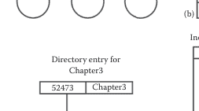

| Inode # | File |
|---|---|
| 1076 | . |
| 2083 | .. |
| 13059 | Chapter1 |
| 17488 | Chapter2 |
| 52473 | Chapter3 |

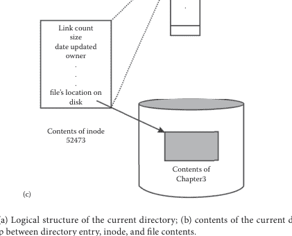

**FIGURE 8.1** (a) 当前目录的逻辑结构；(b) 当前目录的内容；(c) 目录项、inode 与文件内容之间的关系。

以下是 `ln` 命令的简要说明：

### SYNTAX


`ln [options] existing-file new-file`

`ln [options] existing-file-list directory`

```
- **Purpose:** 第一种语法：为 existing-file 创建一个链接并命名为 new-file
- 第二种语法：在 directory 中为 existing-file-list 中的普通文件创建链接，链接具有与原始文件相同的名称
- **Commonly used options/features:**
  - **-f** 强制创建链接；如果 new-file 已存在则不提示
  - **-n** 如果 new-file 已存在则不创建链接
  - **-s** 为 existing-file 创建符号链接并命名为 new-file
```

不带任何选项的 `ln` 命令会为文件创建硬链接，前提是用户对通向该文件的路径中的所有目录具有执行权限。以下会话说明了如何使用 `ln` 命令在包含 `existing-file` 的同一目录中创建硬链接。此示例的唯一目的是说明 `ln` 命令的用法；它并不代表你在实践中建立和使用硬链接的方式。

```
$ ls -il

13059 -rwx------ 1 sarwar faculty 398 Mar 11 14:20 Chapter1

17488 -rwx------ 1 sarwar faculty 5983 Apr 17 11:57 Chapter2

52473 -rwx------ 1 sarwar faculty 9352 Aug 20 23:09 Chapter3

$ ln Chapter3 Chapter3.hard

$ ls -il

13059 -rwx------ 1 sarwar faculty 398 Mar 11 14:20 Chapter1

17488 -rwx------ 1 sarwar faculty 5983 Apr 17 11:57 Chapter2

52473 -rwx------ 2 sarwar faculty 9352 Aug 20 23:09 Chapter3

52473 -rwx------ 2 sarwar faculty 9352 Aug 20 23:09 Chapter3.hard

$
```

`ls -il` 命令显示了当前工作目录中所有文件的一些属性，包括它们的 inode 编号。命令 `ln Chapter3 Chapter3.hard` 为文件 `Chapter3` 创建了一个硬链接；硬链接的名称为 `Chapter3.hard`。系统在当前工作目录中为 `Chapter3` 创建了一个新的目录项 `52473`, `Chapter3.hard`。因此，你可以通过访问 `Chapter3.hard` 来引用 `Chapter3`，因为这两个名称都指向磁盘上的同一个文件。第二个 `ls -il` 命令用于确认 `Chapter3.hard` 和 `Chapter3` 是同一个文件的两个名称，因为它们具有相同的 inode 编号 `52473`，因此具有相同的属性。因此，当为 `Chapter3` 创建硬链接时，会在链接所在的目录中建立指向其 inode 的新指针（在本例中为 `Chapter3.hard`），如图 8.2 所示。

请注意，`ls -il` 命令的输出还显示 `Chapter3` 和 `Chapter3.hard` 的链接计数均为 2。因此，当为文件创建硬链接时，文件的链接计数会增加 1。也就是说，同一个文件在文件结构中以两个名称（即两个路径名）存在。当你删除具有多个硬链接的文件时，UNIX 系统会将文件 inode 中的链接计数减 1。如果得到的链接计数为 0，系统会删除

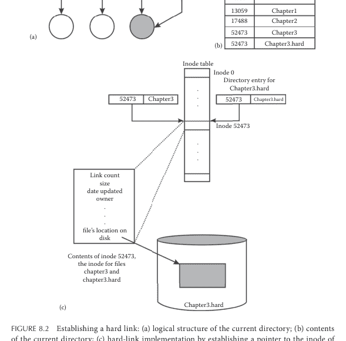

**FIGURE 8.2** 建立硬链接：(a) 当前目录的逻辑结构；(b) 当前目录的内容；(c) 通过建立指向文件 inode 的指针来实现硬链接。

该文件的目录项释放了文件的 inode 以及分配给该文件的所有其他内核资源，以便它们可以被重用，并取消分配分配给该文件的磁盘块，以便它们可以用于存储将来创建的其他文件和/或目录。

如果新的链接计数不为 0，则仅删除被移除文件的目录项；文件内容和其他目录项（硬链接）保持完整。以下会话说明了这一点。

```
$ rm Chapter3

$ ls -il

13059 -rwx------ 1 sarwar faculty 398 Mar 11 14:20 Chapter1

17488 -rwx------ 1 sarwar faculty 5983 Apr 17 11:57 Chapter2

52473 -rwx------ 1 sarwar faculty 9352 Aug 20 23:09 Chapter3.hard

$
```

该会话清楚地表明，删除 `Chapter3` 会导致该文件的目录项被移除，但文件仍然存在于磁盘上，并且可以通过 `Chapter3.hard` 访问。该链接具有 `Chapter3` 的 inode 编号和文件属性，只是链接计数如预期般从 2 递减到 1。

以下 `ln` 命令可用于在当前工作目录中创建一个名为 `memo6.hard` 的硬链接，指向文件 `~/memos/memo6`。`ls -il` 命令用于在创建指向它的硬链接之前查看文件的属性。

```
$ ls -il ~/memos/memo6

83476 -rwx------ 1 sarwar faculty 1673 May 29 11:22 /home/sarwar/memos/memo6

$ ln ~/memos/memo6 memo6.hard

$
```

执行 `ln` 命令后，您可以运行 `ls -il` 命令来确认两个文件（`~/memos/memo6` 和 `memo6.hard`）具有相同的 inode 编号和属性，如以下会话所示。

```
$ ls -il ~/memos/memo6

83476 -rwx------ 2 sarwar faculty 1673 May 29 11:22 /home/sarwar/memos/memo6

$ ls -il memo6.hard

83476 -rwx------ 2 sarwar faculty 1673 May 29 11:22 memo6.hard

$
```

输出显示了两件重要的事情：首先，链接计数增加了 1；其次，两个文件都由相同的 inode `83476` 表示。图 8.3 以图形方式显示了硬链接。

### 当前目录的内容

| Inode # | File |
|---|---|
| 1076 | . |
| 2083 | .. |
| 13059 | Chapter1 |
| 17488 | Chapter2 |
| 52473 | Chapter3 |
| 83476 | memo6.hard |

### ~/memos 的内容

| Inode # | File |
|---|---|
| 1076 | . |
| 2083 | .. |
| 83468 | memo01 |
| ... | ... |
| 83476 | memo6 |
| ... | ... |

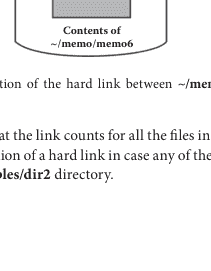

FIGURE 8.3 `~/memos/memo6` 与当前目录中的 `memo6.hard` 之间硬链接的图形表示。

在以下会话中，`ln` 命令为目录 `~/unixbook/examples/dir1` 中的所有非目录文件创建硬链接。硬链接位于目录 `~/unixbook/examples/dir2` 中，并具有 `dir1` 目录中原始文件的名称。第二个参数 `dir2` 必须是现有目录，并且您必须对其具有执行和写入权限。请注意，`dir1` 和 `dir2` 中所有文件的链接计数均为 2。`-f` 选项用于强制创建硬链接，以防 `f1`、`f2` 或 `f3` 中的任何文件已存在于 `~/unixbook/examples/dir2` 目录中。

```
$ cd unixbook/examples

$ more dir1/f1

Hello, World!

This is a test file.

$ ls -l dir1

-rw------ 1 sarwar faculty 35 Jun 22 22:21 f1

-rw------ 1 sarwar faculty 68 May 16 21:03 f2

-rw------ 1 sarwar faculty 94 Jul 11 11:39 f3

$ ln -f ~/unixbook/examples/dir1/* ~/unixbook/examples/dir2

$ ls -l dir1

-rw------ 2 sarwar faculty 35 Jun 22 22:21 f1

-rw------ 2 sarwar faculty 68 May 16 21:03 f2

-rw------ 2 sarwar faculty 94 Jul 11 11:39 f3

$ ls -l dir2
```


`-rw------ 2 sarwar faculty 35 Jun 22 22:21 f1`

`-rw------ 2 sarwar faculty 68 May 16 21:03 f2`

`-rw------ 2 sarwar faculty 94 Jul 11 11:39 f3`

```
$ more dir2/f1

Hello, World!

This is a test file.

$
```

您可以运行以下命令在您的主目录中为文件 `/home/sarwar/unixbook/examples/demo1` 创建一个硬链接。硬链接作为文件 `demo1` 出现在您的主目录中。如果 `demo1` 已存在于您的主目录中，您可以使用 `-f` 选项覆盖它。如果 `demo1` 存在于主目录中并且您未使用 `-f` 选项，则屏幕上会显示错误消息，告知您 `demo1` 文件已存在。您必须对路径名 `/home/sarwar/unixbook/examples/demo1` 中的目录具有执行权限，并且 `demo1` 必须是文件。

```
$ ln -f /home/sarwar/unixbook/examples/demo1 ~
$
```

用户 `sarwar` 可以运行以下命令在 `bob` 的主目录中的目录 `dir1` 中创建指向文件 `/home/sarwar/unixbook/examples/demo1` 的硬链接 `demo1`。`bob` 目录中的链接名称为 `demo1`，与原始文件相同。图 8.4 显示了链接的建立。

```
$ ln -f /home/sarwar/unixbook/examples/demo1 /home/bob/dir1
$
```

用户 `sarwar` 必须对 `bob` 的主目录具有执行权限，并且对 `dir1`（创建链接的目录）具有执行和写入权限。用户 `bob` 必须对 `sarwar` 目录结构中的 `demo1` 具有适当的访问权限才能访问此文件。因此，如果 `sarwar` 和 `bob` 在同一用户组中，并且 `bob` 需要编辑 `demo1`，则 `sarwar` 必须将文件的组访问权限设置为读和写。然后，`bob` 能够通过例如从其主目录使用 `vim demo1` 命令来编辑 `demo1`。

以下命令完成相同的任务。请记住，`sarwar` 运行此命令。

```
$ ln -f ~/unixbook/examples/demo1 /home/bob/dir1
$
```

您可以运行以下命令为 `~/unixbook/examples` 目录中的所有非目录文件创建硬链接。硬链接驻留在 `unixbook/examples`

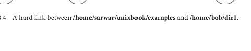

FIGURE 8.4 `/home/sarwar/unixbook/examples` 与 `/home/bob/dir1` 之间的硬链接。

用户 `john` 的主目录中的目录并具有原始文件的文件名。用户 `john` 必须首先在其主目录中创建 `unixbook` 目录，并在其 `unixbook` 目录中创建 `examples` 目录。您必须对 `john` 的 `unixbook` 目录具有执行权限，并且对其 `examples` 目录具有执行和写入权限，才能使命令成功运行并完成任务。

```
$ ln -f ~/unixbook/examples/* /home/john/unixbook/examples
$
```

## 8.6.2 硬链接的缺点

硬链接是传统上用于粘合 UNIX 文件系统结构的方式，UNIX 文件系统结构通常包含多个文件系统。然而，硬链接存在一些问题和限制，使其对普通用户来说吸引力降低。

第一个问题是，硬链接不能在位于不同文件系统的文件之间建立。如果您在自己的目录结构之间建立链接，以主目录作为顶层目录，或者在与您相同的文件系统上的另一用户目录结构中的文件之间建立链接，则此限制不是问题。但是，如果您想在 `/bin` 目录中的文件（命令）和您自己的文件结构中的文件之间创建硬链接，它很可能不会成功，因为在几乎所有系统上，`/bin` 目录和您的目录结构都位于不同的文件系统上。下面的命令说明了这一点。在此示例中，我们尝试将名称 `del` 赋予位于 `/bin` 目录中的 UNIX 命令 `rm`。由于 `rm` 命令位于一个文件系统（我们的系统上的 `/`）中，而我们的目录结构位于另一个文件系统（我们的系统上的 `/usr/home`）中，因此 UNIX 不允许我们在当前目录中的文件和 `/bin/rm` 之间创建硬链接 `del`。

```
$ ln /bin/rm del
ln: del: Cross-device link
$
```

当具有多个链接的文件被移动到另一个文件系统时，此问题也会出现。下面的会话说明了这一点。`ls -il` 命令显示 `Chapter3` 和 `Chapter3.hard` 是指向同一文件的硬链接（请注意相同的 inode 号）。`mv` 命令用于将文件 `Chapter3` 移动到 `/tmp` 目录，而 `/tmp` 目录与当前包含 `Chapter3`（和 `Chapter3.hard`）的目录是不同的文件系统。请注意，在执行 `mv` 命令后，`Chapter3.hard` 和 `/tmp/Chapter3` 的链接计数各为 1，并且文件具有不同的 inode；`/tmp/Chapter3` 的 inode 为 472，而 `Chapter3.hard` 仍为旧的 inode 52473。请注意，尽管 `set` 命令失败，但 `mv` 命令是成功的。`ln` 命令无法将 `/tmp/Chapter3` 链接到 `temp.hard`，因为这两个文件位于不同的文件系统。

```
$ ls -il
total 2
13059 -rw-r--r-- 1 sarwar faculty 398 Mar 11 14:20 Chapter1
17488 -rw-r--r-- 1 sarwar faculty 5983 Jan 17 11:57 Chapter2
52473 -rw-r--r-- 2 sarwar faculty 9352 May 28 23:09 Chapter3
52473 -rw-r--r-- 2 sarwar faculty 9352 May 28 23:09 Chapter3.hard
$ mv Chapter3 /tmp/Chapter3
mv: /tmp/Chapter3: set owner/group (was: 1004/1008): Operation not permitted
$ ls -il
total 2
13059 -rw-r--r-- 1 sarwar faculty 398 Mar 11 14:20 Chapter1
17488 -rw-r--r-- 1 sarwar faculty 5983 Jan 17 11:57 Chapter2
52473 -rw-r--r-- 2 sarwar faculty 9352 May 28 23:09 Chapter3.hard
$ ls -il /tmp/Chapter3
472 -rw-r--r-- 1 sarwar root 9352 Aug 23 10:03 /tmp/Chapter3
$ ln /tmp/f3 temp.hard
ln: temp.hard: Cross-device link
$
```

第二个问题是，只有超级用户才能创建目录的硬链接。当非超级用户尝试创建目录 `myweb` 的硬链接时，`ln` 命令会给出错误消息，如

```
$ ln ~/myweb myweb.hard
ln: /home/sarwar/myweb: Is a directory
$
```

第三个问题是，一些编辑器会删除您正在编辑的文件的现有版本，并将新版本放在新文件中。这样一来，对已删除文件的任何硬链接都无法访问新文件，从而违背了链接（文件共享）的目的。幸运的是，常用的编辑器都没有这样做。因此，[第 3 章](#) 中讨论的文本编辑器（`vim` 和 `emacs`）是安全的。

在下面的章节练习中，您将使用 `ln` 和 `ls -il` 命令来创建和识别硬链接，并验证硬链接的一个严重限制。

### EXERCISE 8.1

在您的主目录中创建一个包含此问题的 `Ch8Ex1` 文件。为此文件建立一个硬链接，也在您的主目录中，并将链接命名为 `Ch8Ex1.hard`。使用 `ls -il` 命令验证链接是否已建立。您在该命令的输出中使用了哪个字段进行验证？

### EXERCISE 8.2

在您的 UNIX 系统上执行 `ln /tmp ~/tmp` 命令。该命令的目的是什么？执行该命令时会发生什么？结果合理吗？为什么或为什么不？

## 8.6.3 软链接/符号链接

软链接/符号链接解决了硬链接固有的所有问题，因此比硬链接使用得更频繁。它们在概念上和实现方式上都与硬链接不同。它们确实有相关的成本，我们将在第 8.6.4 节中讨论，但它们极其灵活，可以用于在机器和网络之间链接文件。

你可以使用带有 `-s` 选项的 `ln` 命令创建软链接。以下会话说明了软链接的创建。

```
$ ls -il
total 2
```


13059 -rw-r--r-- 1 sarwar faculty 398 Mar 11 14:20 Chapter1

17488 -rw-r--r-- 1 sarwar faculty 5983 Jan 17 11:57 Chapter2

52473 -rw-r--r-- 2 sarwar faculty 9352 May 28 23:09 Chapter3

52473 -rw-r--r-- 2 sarwar faculty 9352 May 28 23:09 Chapter3.hard

```
$ ln -s Chapter3 Chapter3.soft
$ ls -il
```
total 2

13059 -rw-r--r-- 1 sarwar faculty 398 Mar 11 14:20 Chapter1

17488 -rw-r--r-- 1 sarwar faculty 5983 Jan 17 11:57 Chapter2

52473 -rw-r--r-- 2 sarwar faculty 9352 May 28 23:09 Chapter3

52473 -rw-r--r-- 2 sarwar faculty 9352 May 28 23:09 Chapter3.hard

52479 lrwxr-xr-x 1 sarwar faculty 8 Aug 23 13:57 Chapter3.soft -> Chapter3

$

`ln -s Chapter3 Chapter3.soft` 命令用于在当前工作目录中为文件 `Chapter3` 创建一个符号链接，并将符号链接命名为 `Chapter3.soft`。`ls -il` 命令的输出显示了许多重要项目，揭示了符号链接的实现方式以及在输出中如何识别它们。

- 首先，原文件 `Chapter3` 和链接文件 `Chapter3.soft` 具有不同的 inode 号：`Chapter3` 为 52473，`Chapter3.soft` 为 52479，这意味着它们是不同的文件。
- 其次，原文件 `Chapter3` 的文件类型为 `-`（普通文件），而链接文件 `Chapter3.soft` 的类型为 `l`（链接）。
- 第三，`Chapter3`（和 `Chapter3.hard`）的链接计数未发生变化，而 `Chapter3.soft` 的链接计数为 1，这进一步表明这两个文件是不同的。
- 第四，文件大小不同：原文件 `Chapter3` 为 9352 字节，链接文件 `Chapter3.soft` 为 8 字节。
- 最后，链接文件的名称后面跟着 `-> Chapter3`，即 `Chapter3.soft` 所指向的文件的路径名；`->` 符号后面的字符串指定为 `ln -s` 命令中的第一个参数。

现有文件的路径名是链接文件的内容，这也解释了链接文件的大小（单词 `Chapter3` 中的 8 个字符）。图 8.5 显示了当前目录的逻辑文件结构、当前目录中的目录条目，以及一个图表，显示 `Chapter3` 和 `Chapter3.soft` 确实是独立的文件，并且链接文件包含其所链接的文件的路径名。

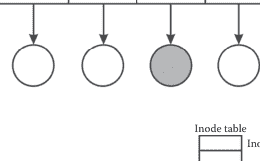

| Inode # | File |
|---|---|
| 1076 | . |
| 2083 | .. |
| 13059 | Chapter1 |
| 17488 | Chapter2 |
| 52473 | Chapter3 |
| 52479 | Chapter3.soft |

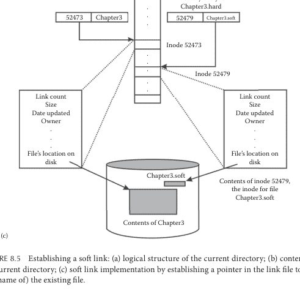

**FIGURE 8.5** 建立软链接：(a) 当前目录的逻辑结构；(b) 当前目录的内容；(c) 通过在链接文件中建立指向（现有文件的）路径名的指针来实现软链接。

总之，当你创建符号链接时，会创建一个类型为 `l` 的新文件。该文件包含 `ln -s` 命令第一个参数中指定的现有文件的路径名。当你引用链接文件时，UNIX 系统会看到该文件的类型为 `l`，并读取链接文件以找到你所引用的实际文件的路径名。例如，对于 `cat Chapter3.soft` 命令，系统会读取 `Chapter3.soft` 的内容以获取要显示的文件名（本例中为 `Chapter3`），并将其内容发送到标准输出。因此，你会看到 `Chapter3` 的内容被显示。

你可以在文件系统之间创建软链接。在以下会话中，我们为 `/bin` 目录创建了一个符号链接。符号链接的名称为 `symlinktobin`，它被放置在当前目录中。请注意，`/bin` 和 `symlinktobin` 的 inode 号不同，正如预期的那样。

```
$ ln -s /bin symlinktobin
$ ls -ild symlinktobin /bin
34 drwxr-xr-x 2 root root 47 Feb 25 2014 /bin
4633 lrwxr-xr-x 1 sarwar faculty 4 Aug 24 15:24 symlinktobin -> /bin
$
```

在以下会话中，我们展示了一个示例，创建一个软链接，使文件及其符号链接位于不同的文件系统中。

```
$ cp Chapter3 /tmp
$ ln -s /tmp/Chapter3 temp.soft
$ ls -il /tmp/Chapter3 temp.soft
473 -rw-r--r-- 1 sarwar faculty 9352 Aug 23 15:38 /tmp/Chapter3
52497 lrwxr-xr-x 1 sarwar faculty 13 Aug 23 15:38 temp.soft -> /tmp/Chapter3
$
```

这里，文件 `Chapter3` 从包含该文件的一个文件系统复制到包含 `/tmp` 目录的另一个文件系统。然后，使用 `ln -s /tmp/Chapter3 temp.soft` 命令为复制的文件创建符号链接。该命令可正常工作，建立了 `temp.soft` 中指向 `/tmp/Chapter3` 的符号链接。请注意，两个文件的 inode 号不同，表明这两个文件是不同的；`temp.soft` 包含其作为符号链接的文件的路径名，`/tmp/Chapter3`。请回忆在第 8.6.1 节中，建立 `/tmp/Chapter3` 和 `temp.hard` 之间的硬链接的类似调用失败了。

以下会话显示了如何为目录中的所有文件创建符号链接，包括目录文件。`ln -sf ~/unixbook/examples/dir1/* ~/unixbook/examples/dir2` 命令为目录 `~/unixbook/examples/dir1` 中的所有文件创建软链接，并将它们放在目录 `~/unixbook/examples/dir2` 中。你必须对 `dir2` 目录具有执行和写入权限，并且对路径名中的所有目录具有执行权限。`-f` 选项用于强制创建软链接，以防 `~/unixbook/examples/dir2` 中已存在文件 `f1`、`f2` 或 `f3`。在某些系统上，`-f` 和 `-s` 选项可能无法一起使用，在这种情况下，你将只使用 `-s` 选项。

```
$ cd ~/unixbook/examples
$ more dir1/f1
Hello, World!
This is a test file.
$ ls -l dir1
-rw------ 1 sarwar faculty 35 Jun 22 22:21 f1
```

```
-rw------ 1 sarwar faculty 168 Jun 22 22:33 f2
-rw------ 1 sarwar faculty 783 Jun 22 22:35 f3
$ ln -sf ~/unixbook/examples/dir1/* ~/unixbook/examples/dir2
$ ls -l dir2
```

```
lrwxr-xr-x 1 sarwar faculty 38 Jun 22 22:54 f1 -> /home/sarwar/unixbook/examples/dir1/f1
lrwxr-xr-x 1 sarwar faculty 38 Jun 22 22:54 f2 -> /home/sarwar/unixbook/examples/dir1/f2
lrwxr-xr-x 1 sarwar faculty 38 Jun 22 22:54 f3 -> /home/sarwar/unixbook/examples/dir1/f3
$ more dir2/f1
Hello, World!
This is a test file.
$
```


你可以在主目录中运行以下命令，为文件`/home/sarwar/unixbook/examples/demo1`创建一个符号链接。该软链接在你的主目录中显示为名为`demo1`的文件。如果主目录中已存在`demo1`，你可以使用`-f`选项覆盖它。如果主目录中存在`demo1`且未使用`-f`选项，则屏幕上会显示错误消息，告知`demo1`文件已存在。你必须对路径名`/home/sarwar/unixbook/examples/demo1`中的目录具有执行权限，并且`demo1`必须是一个文件。

```
$ ln -sf /home/sarwar/unixbook/examples/demo1 ~
$
```

用户`sarwar`可以运行以下命令，在`bob`的主目录中的`dir1`目录下创建一个名为`demo1`的软链接，该链接指向`/home/sarwar/unixbook/examples/demo1`文件。图 8.6 显示了软链接是如何建立的。

```
$ ln -sf /home/sarwar/unixbook/examples/demo1 /home/bob/dir1
$
```


## FIGURE 8.6 A soft link between (a) /home/sarwar/unixbook/examples/demo1 and (b) /home/bob/dir1.

用户`sarwar`必须对`bob`的主目录具有执行权限，并且对`dir1`（创建软链接的目录）具有执行和写入权限。用户`bob`必须对`sarwar`目录结构中的`demo1`具有适当的访问权限才能访问此文件。因此，如果`sarwar`和`bob`在同一用户组中并且`bob`需要编辑`memo1`，那么`sarwar`必须将文件的组访问权限设置为读写。用户`bob`然后就可以例如从他的主目录使用`vi demo1`命令来编辑`demo1`。

以下命令完成相同的任务。请记住`sarwar`运行此命令。

```
$ ln -sf ~/unixbook/examples/demo1 /home/bob/dir1
$
```

你可以使用以下`ln`命令为`~/unixbook/examples`目录中的所有文件，包括目录文件，创建软链接。这些软链接位于`john`主目录中的`unixbook/examples`目录中，并具有原始文件的名称。用户`john`必须在其主目录中创建`unixbook`目录，并在其`unixbook`目录中创建`examples`目录。为了使命令成功运行，你必须对`john`的`unixbook`目录具有执行权限，并且对他的`examples`目录具有执行和写入权限。

```
$ ln -sf ~/unixbook/examples/* /home/john/unixbook/examples
$
```

### 8.6.4 Pros and Cons of Symbolic Links

如前所述，符号链接没有硬链接的问题和限制。因此，可以为目录建立符号链接，也可以在文件系统之间建立符号链接。此外，只要文件路径名不被更改——即原始文件未被移动——指向符号链接的文件就可以通过任何类型的编辑器进行编辑，而不会产生任何不良影响。

符号链接也有一个硬链接所没有的自身问题：如果符号链接指向的文件从一个目录移动到另一个目录，就无法再通过该链接访问它。原因在于链接文件包含文件结构中文件原始位置的路径名。当文件位置发生变化时，链接就会变成悬空链接；也就是说，它指向一个在指定（原始）位置不存在的文件。如果原始文件被删除，你也会得到一个悬空指针。以下会话说明了这一点。

```
$ mv /tmp/Chapter3 .
$ cat temp.soft
cat: temp.soft: No such file or directory
$
```


假设 `temp.soft` 是指向文件 `/tmp/Chapter3` 的符号链接。`mv` 命令用于将 `/tmp/Chapter3` 移动到当前工作目录。`cat` 命令失败

因为软链接仍然指向路径名为 `/tmp/Chapter3` 的文件。这一结果相当合乎逻辑，但仍然是一个缺点；在硬链接中，只要移动的文件仍在同一文件系统中，`cat` 命令就不会失败。

符号链接的其他一些缺点是 UNIX 必须支持一种额外的文件类型（链接类型），并且为每个链接都必须创建一个新文件。创建链接文件会导致额外的 inode 的空间开销、存储其所链接文件路径名所需的磁盘空间，以及其他内核数据结构。符号链接还会导致文件操作变慢，因为每次引用该文件时，都必须打开并读取链接文件，才能到达实际文件。然后对实际文件进行读取或写入处理，如果通过符号链接引用文件，则需要执行额外的磁盘访问。

在下面的章节练习中，你将使用 `ln -s` 和 `ls -il` 命令来创建和识别软链接，并验证你可以在文件系统之间创建软链接。

## EXERCISE 8.3

建立一个指向你在练习 8.1 中创建的文件 `Ch8Ex1` 的软链接。将软链接命名为 `Ch8Ex1.soft`。验证链接是否已建立。你使用了哪些命令来建立链接并验证其创建？

## EXERCISE 8.4

在你的 UNIX 系统上执行 `ln -s /tmp ~/tmp` 命令。命令的目的是什么？执行命令时会发生什么？结果合理吗？为什么或为什么不？

## SUMMARY

可以使用多种技术来允许一组用户共享 UNIX 文件和目录。最常用的文件共享方法有：复制要共享的文件并分发给团队成员、为团队成员建立一个公共账户、对要共享的文件设置适当的权限、为团队成员设置一个 UNIX 用户组，以及在所有团队成员的目录中建立指向共享文件的链接。本章的主要主题是通过硬链接和软链接进行文件共享。然而，团队成员同时访问共享文件的问题在此未讨论（参见第 17 章）。

硬链接允许你通过另一个名称引用现有文件。尽管硬链接是 UNIX 用于粘合文件系统结构的主要机制，但它有几个缺点。首先，现有文件及其链接必须位于同一文件系统内。其次，只有超级用户才能创建目录的硬链接。第三，将文件移动到另一个文件系统会破坏对其的所有链接。

软链接可用于克服与硬链接相关的问题。当为文件创建软链接时，会创建一个新文件，其中包含其所链接文件的路径名。此文件的类型为 `link`。软链接在访问文件所需的时间和链接文件的空间开销方面代价高昂。文件访问期间的时间开销发生是因为必须打开链接文件，以便读取（或写入，具体情况而定）实际文件的路径名，然后才进行实际的文件打开和读取（或写入）过程。包含原始文件路径名的链接文件导致了空间开销。

硬链接和软链接均使用 `ln` 命令建立。创建软链接时，使用 `-s` 选项与该命令一起使用。`ls -i -l` 命令用于识别（或确认建立）链接。此命令输出的第一字段标识目录中文件的 inode 编号，且文件的所有硬链接与原始文件具有相同的 inode 编号。第二字段的第一个字母表示文件类型（`l` 表示软链接），其余字母指定文件权限。第三字段标识文件硬链接的数量。每个简单文件在创建时都有一个硬链接。最后一个字段标识文件名；软链接的名称后跟 `-> filename`，其中 `filename` 是原始文件的名称。`-f` 选项可用于强制创建链接——即用新创建的链接覆盖现有文件。

## QUESTIONS AND PROBLEMS

- 1. 在 UNIX 中可以使用哪五种方法来允许一组用户共享文件？
- 2. UNIX 中的链接是什么？UNIX 支持哪种类型的链接？它们之间有何不同？
- 3. 硬链接有什么问题？
- 4. 删除你在练习 8.1 中创建的文件 `Ch8Ex1`。显示 `Ch8Ex1.hard` 和 `Ch8Ex1.soft` 的内容。会发生什么？你使用了什么命令来显示文件？结果合理吗？为什么或为什么不？
- 5. 在你的系统上搜索 `/usr/bin` 目录并识别其中的三个链接。写下这些链接的名称。它们是硬链接还是软链接？你是如何知道的？
- 6. 在你的主目录中，你能否在你的系统上建立指向 `/etc/passwd` 的硬链接和软链接？为什么？你使用了什么命令？你对命令执行的结果满意吗？
- 7. 每个 UNIX 目录至少有两个硬链接。为什么？
- 8. 你能找到文件硬链接和软链接的数量吗？如果可以，需要使用什么命令？
- 9. 假设你在当前目录中有一个名为 `shared` 的文件，它有五个硬链接。请给出显示所有这些链接的绝对路径名的命令序列。（提示：使用 `find` 命令。）

- 10. 在你的主目录中创建一个目录 `dir1`，并在其中创建三个文件 `f1`、`f2` 和 `f3`。请朋友在其主文件目录中创建一个目录 `dir2`，并将 `dir1.hard` 和 `dir1.soft` 作为其子目录。创建指向你 `dir1` 中所有文件的硬链接和软链接，分别放在朋友的 `~/dir2/dir1.hard` 和 `~/dir2/dir1.soft` 目录中。给出你为此执行的命令序列。

- 11. 对于问题 10，硬链接和软链接的 inode 号分别是多少？你使用了什么命令来确定它们？链接文件（硬链接和软链接）的 contents 是什么？你是如何得到这些答案的？

- 12. 符号链接的优缺点是什么？

- 13. 清楚地描述如何在 UNIX 中通过使用链接（硬链接和软链接）来实现文件共享。特别是，除了建立要共享文件的链接之外，你还需要做其他事情吗？

- 14. 假设你有一组数据文件，例如 `file1.data`，…，`file9.data`，需要在你所在的小组中的 100 个程序之间共享（只读）。讨论以下每种情况所涉及的开销：
  + a. 设置权限
  + b. 创建硬链接
  + c. 创建软链接
  + d. 为每个文件制作单独的私有副本

- 15. 浏览根目录（`/`）及其子目录。识别 10 个软链接并将其写成表格，同时写出每个链接的名称以及它所在的目录。

- 16. 符号链接存在 *悬空指针* 问题。它是什么？请举例说明。

- 17. 硬链接可能无法在文件系统之间建立。这一硬链接限制的技术原因是什么？（*提示：考虑 inode 和文件系统。*）

网络接口卡。命令输出和错误消息也可以写入文件。对于命令要从文件读取或写入文件，它必须先打开该文件。

命令读取其输入并发送其输出和错误消息的默认文件，称为标准输入、标准输出和标准错误。在 UNIX 中，这些文件被称为命令的标准文件。命令的输入、输出和错误可以通过 UNIX 中的文件重定向功能重定向到其他文件。这使你能够将多个命令连接起来执行单一现有命令无法完成的复杂任务。我们将在本章讨论 UNIX 中标准文件以及输入、输出和错误重定向的概念。

## 9.2 标准文件

在 UNIX 中，内核为每个命令自动打开三个文件，以便从中读取输入并向其发送输出和错误消息。这些文件被称为标准文件：标准输入（`stdin`）、标准输出（`stdout`）和标准错误（`stderr`）。默认情况下，这些文件与命令执行的终端相关联。更具体地说，键盘是标准输入，而显示屏（或你登录的控制台）是标准输出和标准错误。因此，每个命令默认情况下都从键盘获取输入，并将输出和错误消息发送到显示屏（或控制台窗口），如图 9.1 所示。回顾我们在第 4 章中对每个进程文件描述符表的解释。在本章的其余部分，我们将监视器屏幕、显示屏、控制台窗口和显示窗口等术语互换使用。

## 9.3 输入重定向

输入重定向是通过使用小于号（`<`）实现的。以下语法用于将键盘从命令的标准输入中分离并将其连接到 `input-file`。因此，如果 `command` 从标准输入读取其输入，则该输入将来自 `input-file`，而不是命令运行的终端所连接的键盘。该

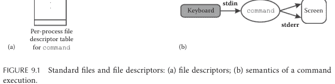

图 9.1 标准文件和文件描述符：（a）文件描述符；（b）命令执行的语义。

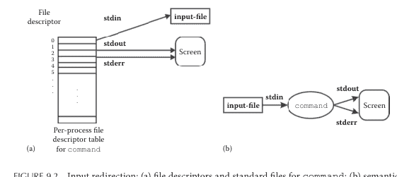

## FIGURE 9.2 Input redirection: (a) file descriptors and standard files for command; (b) semantics of input redirection.

命令语法的语义如 Figure 9.2 所示。请注意，命令的输入来自 `input-file`。

### SYNTAX

```
command < input-file
```


# Purpose: Input to command comes from input-file instead of from the keyboard

例如，命令 `cat < tempfile` 从 `tempfile` 读取输入（而不是键盘，因为 `cat` 的标准输入已连接到 `tempfile`），并将其输出发送到显示屏。因此，`tempfile` 的内容有效地显示在监视器屏幕上。此命令与 `cat tempfile` 不同，在后者中 `tempfile` 作为命令行参数传递给 `cat` 命令；`cat` 的标准输入不会改变，仍然是命令运行所在的终端所连接的键盘。

类似地，在命令 `grep "John" < Phones` 中，`grep` 命令从当前目录中的 `Phones` 文件读取其输入，而不是从键盘读取。命令的输出和错误消息都发送到显示屏。同样，此命令与 `grep "John" Phones` 不同，在后者中 `Phones` 文件作为参数传递给 `grep`；`grep` 的标准输入不会改变，仍然是命令执行的终端所连接的键盘。然而，从用户角度来看，`grep` 命令在两种情况下的净效果是相同的。类似地，在大多数情况下使用 `<` 是不需要的，因为命令无论如何都会从文件中读取。

`cat` 和 `grep` 命令如果未从命令行传递文件参数，则从标准输入获取输入。`tr` 命令仅从标准输入获取输入并将其输出发送到标准输出。命令不使用文件作为命令行参数工作。因此，输入重定向通常与 `tr` 命令一起使用，如 `tr -s " " < Bigfile`。当执行此命令时，它会用单个空格替换 `Bigfile` 中的多个空格。

## 9.4 OUTPUT REDIRECTION

输出重定向是通过使用大于号（`>`）实现的。以下语法用于将显示屏从 `command` 的标准输出分离并将其连接到 `output-file`。因此，如果 `command` 将其输出写入/发送到标准输出，则输出会进入 `output-file`，而不是命令运行所在的终端所连接的监视器屏幕。错误消息仍会发送到显示屏，如前所述。命令语法的语义如 Figure 9.3 所示。

### SYNTAX

```
command > output-file
```

Purpose: Send output of command to the file `output-file` instead of to the monitor screen

考虑 `cat > newfile` 命令。回想一下，`cat` 命令将其输出发送到标准输出，默认情况下为显示屏。此命令语法将显示屏从 `cat` 命令的标准输出分离并将其连接到 `newfile`。`cat` 的标准输入仍连接到键盘。当执行此命令时，它会创建一个名为 `newfile` 的文件，其内容是你从键盘输入的内容，直到你在新行的第一列按下 `<Ctrl-D>`。如果 `newfile` 已存在，默认情况下会被覆盖。

类似地，命令 `grep "John" Phones > Phone_John` 将其输出（包含单词 `"John"` 的 `Phones` 文件中的行）发送到名为 `Phone_John` 的文件，而不是在监视器屏幕上显示。命令的输入来自 `Phones` 文件。命令在 `grep` 在 `Phones` 中遇到文件结束符（`eof`）字符时终止。

在网络环境中，可以使用以下命令对你当前登录的计算机（客户端计算机）上驻留的文件 `datafile` 进行排序，

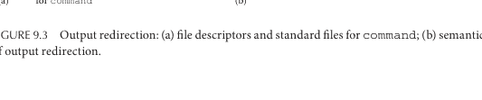

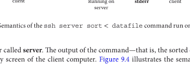

### FIGURE 9.4 Semantics of the ssh server sort < datafile command run on mymachine.

在名为 `server` 的计算机上。命令的输出——即排序后的数据——发送到客户端计算机的显示屏。Figure 9.4 说明了此命令的语义。

```
$ ssh server sort < datafile
$
```

此命令是说明如何在网络环境中利用多台计算机并发执行各种任务的一个很好的例子。如果你的计算机（称为客户端）有一个要排序的大文件 `datafile`，并且你不想在各种计算机上制作该文件的多个副本以防止它们不一致，则此命令很有用。此命令允许你执行该任务。如果服务器具有你被允许使用但不允许在你的机器上复制的专用 UNIX 工具，此类命令也很有用。我们将在第 11 章讨论与网络相关的 UNIX 命令和实用程序。我们使用此示例来说明 UNIX I/O 重定向功能的强大功能，而不是偏离网络环境中的计算。

以下会话显示了本地（客户端）机器上 `Students` 文件的内容以及在 `sarwar` 登录下在远程（服务器）机器 `198.102.10.20` 上执行的 `sort` 命令的输出。由于 `sarwar` 的登录受密码保护，系统在运行远程计算机上的 `sort` 命令并在本地计算机上显示其输出之前提示他输入密码。请注意，我们展示了虚构的 `ssh` 服务器的 Internet 协议（IP）地址，但会话是在真实的远程机器上执行的。

```
$ cat Students
John Doe    ECE   3.54  A
Pam Meyer   CS    3.61  A
Jim Davis   CS    2.71  B
John Doe    ECE   3.54  A
Jason Kim   ECE   3.97  A
Amy Nash    ECE   2.38  C
$ ssh sarwar@198.102.10.20 sort < Students
Password for sarwar@pcbsd-srv:
Amy Nash    ECE   2.38  C
Jason Kim   ECE   3.97  A
Jim Davis   CS    2.71  B
```

```
John Doe   ECE   3.54   A
John Doe   ECE   3.54   A
Pam Meyer  CS    3.61   A
$
```

## 9.5 组合输入和输出重定向

输入和输出重定向可以一起使用，其语法如下面的命令描述所示。

### 语法

```
command < input-file > output-file
command > output-file < input-file
```


目的：命令的输入来自 `input-file` 而不是键盘，命令的输出发送到 `output-file` 而不是显示屏

使用此语法时，`command` 从 `input-file` 读取输入（不是从终端连接的键盘），并将其输出发送到 `output-file`（不是发送到显示屏），如图 9.5 所示。

在 `cat <lab1 > lab2` 命令中，`cat` 命令从 `lab1` 文件读取输入并将输出发送到 `lab2` 文件。该命令的净效果是 `lab1` 的副本被创建在 `lab2` 中。因此，该命令行等价于 `cp lab1 lab2`，前提是 `lab2` 不存在。如果 `lab2` 是已存在的文件，则两个命令的语义不同。`cat <lab1 > lab2` 命令会截断 `lab2`（将其大小设为零并将读写指针设为第一个字节位置）并用 `lab1` 的内容覆盖它。由于 `lab2` 并未重新创建，其属性（例如访问权限和链接计数）不会改变。而在 `cp lab1 lab2` 命令中，不仅 `lab1` 中的数据被复制到 `lab2` 中，其 inode 中的属性也会被复制到 `lab2` 的 inode 中。因此，`cp` 命令会将 `lab1` 的真正副本（数据和属性）复制到 `lab2` 中。

在下面的章节练习中，你将练习 UNIX 的输入和输出重定向功能的使用。

## EXERCISE 9.1

编写一个 shell 命令，统计当前工作目录中名为 `memo` 的文件中的字符数、单词数和行数，并在显示屏上显示这些值。使用输入重定向。


## EXERCISE 9.2

重复练习 9.1，但将输出重定向到名为 `counts.memo` 的文件。使用 I/O 重定向。

## 9.6 使用文件描述符进行 I/O 重定向

如第 4.6 节所述，UNIX 内核为每个打开的文件关联一个小的整数，称为该文件的文件描述符。标准输入、标准输出和标准错误的文件描述符分别为 0、1 和 2。Bourne、Korn、Bash 和 POSIX shell 允许你打开文件并为其关联文件描述符；C shell 不允许使用文件描述符。其他描述符，通常从 3 开始使用，是在进程同时打开文件时使用的。这些描述符称为用户定义文件描述符。这些描述符的上限（从而进程可同时打开的文件数）因系统而异，可通过运行 `uname -n` 命令确定。每个描述符用于索引一个内核表，称为每个进程的文件描述符表，如第 4.7 节简要讨论的那样。关于此主题的更详细讨论可在第 18 章至第 21 章中找到。在以下各节中，我们描述了在 Bourne、Korn、Bash 和 POSIX shell 下的 I/O 和错误重定向。我们在第 9.13 节中讨论 C shell 语法并给出示例。

通过使用文件描述符，标准输入和标准输出可以在 Bourne、Korn、Bash 和 POSIX shell 中分别使用 `0<` 和 `1>` 操作符进行重定向。因此，`cat 1> outfile`，等价于 `cat > outfile`，从标准输入读取输入并将其发送到 `outfile`；错误消息发送到显示屏。类似地，`ls -l foo 1> outfile` 等价于 `ls -l foo > outfile`。该命令的输出（`foo` 的长列表）进入名为 `outfile` 的文件，而其产生的错误消息发送到显示屏。

文件描述符 0 可以与 `<` 操作符一起用作前缀，以明确指定从文件重定向输入。下面所示的命令中，`grep` 命令的输入是当前工作目录中 `tempfile` 的内容。

```
$ grep "John" 0< tempfile

... command output ...

$
```

## 9.7 重定向标准错误

命令的标准错误可以使用 `2>` 操作符重定向（即将标准错误的文件描述符与 `>` 操作符关联），如下所示。

#### 语法

```
command 2> error-file
```

目的：`command` 生成的错误消息默认发送到 `stderr`，现被重定向到 `error-file`

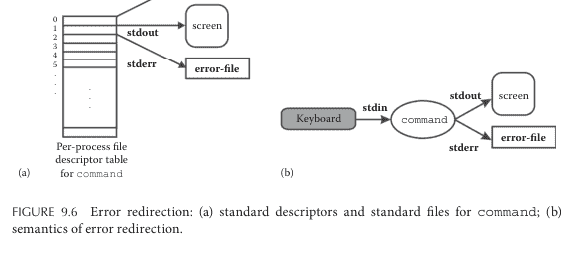

## FIGURE 9.6 Error redirection: (a) standard descriptors and standard files for command; (b) semantics of error redirection.

使用这种语法，`command` 从键盘获取输入，将输出发送到监视器屏幕，而 `command` 产生的任何错误信息都发送到 `error-file`。命令语法的语义如图 9.6 所示。`Command` 的输入可以来自作为命令行参数传递的文件。

命令 `grep "John" Phones 2> error.log` 从 `Phones` 文件中读取输入，将输出发送到显示屏，`grep` 产生的任何错误信息都写入名为 `error.log` 的文件。如果 `error.log` 已存在，则会被覆盖；否则，将创建该文件。以下示例展示了如何将 `ls -l` 的标准错误重定向到文件。

```
$ ls -l foo 2> error.log

... long listing for foo if no errors ...

$
```

`ls -l foo` 的输出会发送到显示屏，错误信息则进入 `error.log`。因此，如果 `foo` 不存在，错误信息 `ls: foo: No such file or directory` 会写入 `error.log` 文件，如以下会话所示。消息的实际措辞因系统而异，但基本都会告知你 `foo` 不存在。

```
$ ls -l foo 2> error.log
$ cat error.log
ls: foo: No such file or directory
$
```

在许多情况下，保持标准错误连接到显示屏而不将其重定向到文件是有用的。例如，当执行 `cat lab1 lab2 lab3 > all` 将 `lab1`、`lab2` 和 `lab3` 文件合并到名为 `all` 的文件中时，你会希望知道这三个输入文件是否存在，或者你是否有权限读取它们。在这种情况下，将错误信息重定向到文件意义不大，因为你希望立即看到命令执行的結果。

## 9.8 REDIRECTING stdout AND stderr IN ONE COMMAND

标准输出和标准错误可以重定向到同一个文件。一种明显的方法是使用文件描述符和 `>` 符号将 `stdout` 和 `stderr` 重定向到同一文件，如以下命令所示。

```
$ cat lab1 lab2 lab3 1> cat.output 2> cat.errors
$
```

在这种情况下，`cat` 命令的输入来自 `lab1`、`lab2` 和 `lab3` 文件，其输出进入 `cat.output` 文件，任何错误信息进入 `cat.errors` 文件，如图 9.7 所示。注意，虽然图 9.7b 中未显示，但文件 `lab1`、`lab2` 和 `lab3` 在被 `cat` 命令打开以供读取时会被分配文件描述符。如果三个 “lab” 文件中任一不存在，或你对其中任一文件没有读权限，命令会产生错误信息。

以下命令将 `cat` 命令的 `stdout` 和 `stderr` 重定向到 `cat.output.errors` 文件。因此，同一个文件 `cat.output.errors` 包含 `cat` 命令的输出，以及命令可能产生的任何错误信息。

```
$ cat lab1 lab2 lab3 1> cat.output.errors 2>&1
$
```

在此命令中，字符串 `2>&1` 告诉命令 `shell` 使描述符 2 成为描述符 1 的副本，从而使错误信息进入与命令输出相同的位置。类似地，字符串 `1>&2` 可用于告诉命令 `shell` 使描述符 1 成为描述符 2 的副本。因此，以下命令完成相同的任务。图 9.8 显示了这两个命令的语义。

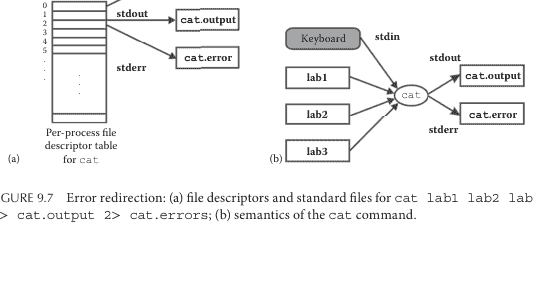

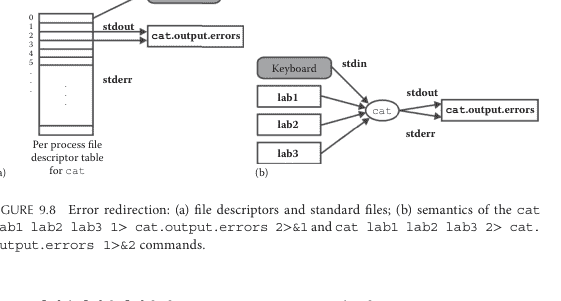

FIGURE 9.8 Error redirection: (a) file descriptors and standard files; (b) semantics of the `cat lab1 lab2 lab3 1> cat.output.errors 2>&1` and `cat lab1 lab2 lab3 2> cat.output.errors 1>&2` commands.

```
$ cat lab1 lab2 lab3 2> cat.output.errors 1>&2
$
```


对文件重定向的命令行内容的求值是从左到右进行的。因此，如果一种记法依赖于另一种记法，重定向必须按从左到右的顺序指定。在前面的命令中，首先 `stderr` 被更改为文件 `cat.output.errors`，然后 `stdout` 成为 `stderr` 的副本。因此，命令的输出和错误都进入同一个文件 `cat.output.errors`。

因此，以下命令不具有前面两个命令的效果。原因在于，在此命令中，`stderr` 在输出重定向之前被设为 `stdout` 的副本。因此，`stderr` 首先成为 `stdout` 的副本（此时为显示屏），然后 `stdout` 被更改为文件 `cat.output.errors`。因此，命令的输出进入 `cat.output.errors`，而错误进入显示屏。图 9.9 中显示的序列说明了此命令的语义。

```
$ cat lab1 lab2 lab3 2>&1 1> cat.output.errors
$
```

注意，图 9.9a 和 b 相同，因为执行 `cat lab1 lab2 lab3 2>&1` 不会对 `stdout` 和 `stderr` 做出任何更改——它们在命令执行前后的连接仍为显示屏。

## 9.9 REDIRECTING stdin, stdout, AND STDERR IN ONE COMMAND

标准输入、标准输出和标准错误可以在单个命令中根据以下语法进行重定向。

### 图 9.9 输出和错误重定向：（a）`cat` 命令的文件描述符和标准文件；（b）执行 `cat lab1 lab2 lab3 2>&1` 后且 `stdout` 和 `stderr` 未改变时的标准文件；（c）执行 `cat lab1 lab2 lab3 2>&1 1> cat.output.errors` 后的标准文件；以及（d）命令语义。

#### 语法

```
command 0< input-file 1> output-file 2> error-file
```

目的：命令的输入来自 `input-file` 而非键盘，命令的输出发送到 `output-file` 而非显示屏，命令产生的错误信息发送到 `error-file` 而非显示屏

文件描述符 `0` 和 `1` 不是必需的，因为它们分别是 `<` 和 `>` 运算符的默认值。此命令语法的语义如 图 9.10 所示。对命令行内容中文件重定向的求值是从左到右进行的，因此重定向的顺序很重要。请考虑以下命令语法。对于第一个命令，如果 `input-file` 未找到，错误信息会发送到显示屏，因为 `stderr` 尚未被重定向。对于第二个命令，如果 `input-file` 未找到，错误信息会进入 `error-file`，因为 `stderr` 已被重定向到该文件。

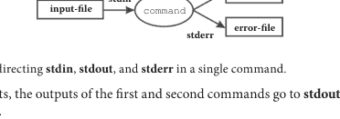

图 9.10 在单个命令中重定向 `stdin`、`stdout` 和 `stderr`。

如果 `error-file` 存在，则第一个和第二个命令的输出分别进入 `stdout` 和 `output-file`。

```
command 1> output-file 0< input-file 2> error-file
command 2> error-file 1> output-file 0< input-file
```

下面的 `sort` 命令对名为 `students` 的文件中的行进行排序，并将排序后的文件存储在 `students.sorted` 中。如果由于 `students` 文件不存在而导致 `sort` 命令无法启动，错误信息会如图所示发送到显示屏，而不会进入 `sort.error` 文件。原因是在 shell 确定 `students` 文件不存在时，`stderr` 仍连接到控制台。

```
$ sort 0< students 1> students.sorted 2> sort.error
cannot open students: No such file or directory
$
```

对于下面的命令，如果由于 `students` 文件不存在而导致 `sort` 命令失败，错误信息会进入 `sort.error` 文件。原因是在 shell 确定 `students` 文件不存在之前，已处理了错误重定向。

```
$ sort 2> sort.error 0< students 1> students.sorted
$ cat sort.error
cannot open students: No such file or directory
$
```

## 9.10 不覆盖文件内容进行重定向（追加）

默认情况下，输出和错误重定向会覆盖目标文件的内容。要将命令产生的输出或错误追加到文件末尾，请将 `>` 运算符替换为 `>>` 运算符。`>>` 的默认文件描述符为 `1`，但也可以使用文件描述符 `2` 将错误追加到文件中。在下面的命令中，`ls -l` 的输出被追加到 `output.dat` 文件，错误信息被追加到 `error.log` 文件。

```
$ ls -l 1>> output.dat 2>> error.log
$
```

下面的命令将文件 `memo` 和 `letter` 的内容追加到文件 `stuff` 的末尾。如果命令产生任何错误信息，它会进入 `error.log` 文件。如果 `error.log` 已存在，其内容会被错误信息覆盖。

```
$ cat memo letter >> stuff 2> error.log
$
```

如果您想保留 `error.log` 的现有内容并将新的错误信息追加到其中，请使用下面的命令。对于此命令，`error.log` 的先前内容会与 `cat` 命令产生的任何错误信息一起追加。

```
$ cat memo letter >> stuff 2>> error.log
$
```

`Bourne shell` 默认会在命令的 `stdout` 或 `stderr` 被重定向到它时覆盖文件，但 `Korn`、`C` 和 `Bash shell` 具有 `noclobber` 选项，可防止您意外覆盖重要文件。我们在第 9.13 节中讨论 `C shell` 的此选项，但在此处讨论 `Korn` 和 `Bash shell` 的此选项。

您可以通过使用带有 `-o` 选项的 `set` 命令在 `Korn` 和 `Bash shell` 中设置 `noclobber` 选项，如下所示。当然，如果您想永久设置此选项，请将该命令放入您的 `~/.profile` 文件中。

```
$ set -o noclobber
$
```

在 `Bash shell` 中，您也可以通过使用 `set -C` 命令设置该选项。当您设置 `noclobber` 选项时，您可以通过使用 `>|` 运算符强制覆盖文件。

在下面的章节练习中，您将练习在命令行中使用 UNIX shell（不包括 C shell）的输入、输出和错误重定向功能。

## 练习 9.3

编写一个命令，统计当前工作目录中名为 `memo` 的文件中的字符数、单词数和行数，并将这些值写入文件 `memo.size`。如果命令失败，错误信息应进入文件 `error.log`。使用 I/O 和错误重定向。

## 练习 9.4

编写一个 shell 命令，使用 `mail` 命令将文件 `greetings` 的内容发送到 `doe@domain.com`。如果 `mail` 命令失败，错误信息应进入文件 `mail.errors`。使用输入和错误重定向。

## 练习 9.5

重复练习 9.2，但将错误信息追加到 `mail.errors` 的末尾。

# 9.11 UNIX 管道

UNIX 系统允许将一个命令的 `stdout` 连接到另一个命令的 `stdin`。你可以通过使用管道字符（`|`）按照以下语法来实现。

#### 语法

```
command1 | command2 | command3 | ... | commandN
```


目的：`command1` 的标准输出连接到 `command2` 的 stdin，`command2` 的 stdout 连接到 `command3` 的 stdin，...，`commandN−1` 的 stdout 连接到 `commandN` 的 stdin

图 9.11 说明了此命令的语义。

因此，管道允许你将一个命令的输出作为另一个命令的输入。通过管道连接的命令称为过滤器。过滤器属于一类 UNIX 命令，它们从 stdin 读取输入，以某种特定方式处理它，然后发送到 stdout。管道和过滤器在 UNIX 中经常用于执行无法用单个命令完成的复杂任务。一些常用的过滤器有 `cat`、`compress`、`crypt`、`grep`、`less`、`lp`、`more`、`pr`、`sort`、`tr`、`uniq` 和 `wc`。如果管道输出端的命令处理输入的速度比与其输入端相连的命令慢，管道会存储多余的数据，并按先进先出原则将其提供给输出端的命令。因此，如果图 9.11 中的 `cmd2` 处理传入数据的速度比 `cmd1` 产生数据的速度慢，`cmd1` 产生多余的数据将被存储在 `cmd1` 和 `cmd2` 之间的管道中，并按先进先出原则提供给 `cmd2`。在 PC-BSD 中，管道可存储的最大数据量由 `/usr/include/limits.h` 中的符号常量 `_POSIX_PIPE_BUF` 决定。

例如，在 `ls -l | more` 中，`more` 命令将其输入作为 `ls -l` 的输出。此命令的净效果是 `ls -l` 的输出一次显示一屏。管道真的像水管一样，接收 `ls -l` 的输出并将其作为输入提供给 `more`，如图 9.12 所示。

此命令没有使用磁盘将 `ls -l` 的标准输出连接到 `more` 的标准输入，因为管道是在主内存的内核区实现的。就 I/O 重定向操作符而言，该命令等价于以下命令序列。

```
$ ls -l > temp
$ more < temp (or more temp)
```


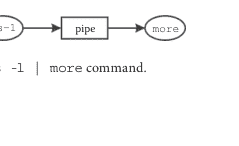

# 图 9.12 `ls -l | more` 命令的语义。

```
[contents of temp]
$ rm temp
$
```

正如你所见，不仅需要三个命令才能完成相同的任务，而且命令序列也极其缓慢，因为涉及文件读写操作。请回忆，文件存储在二级存储设备上，通常是磁盘。在典型的当代计算机系统中，磁盘操作比主内存（随机存取存储器 [RAM]）操作慢约一百万倍。然而，管道的实际性能增益要小得多，这是由于 UNIX 内核对文件块的高效缓存以及半导体磁盘的使用。

你可以使用第 7 章讨论的 `sort` 实用程序对文件中的行进行排序。假设你有一个名为 `student_records` 的文件，你想对其进行排序，并且该文件可能包含一些重复的行，你希望这些重复行在排序后的文件中只出现一次。`sort -u student_records` 命令可以完成此任务。正如我们在第 6 章讨论的，如果 `uniq` 命令得到 `student_records` 的排序版本且其中包含重复行，它也可以完成此任务。一种执行此任务的方法是使用以下命令。`more` 命令用于显示 `student_records` 的内容。

```
$ more student_records
John Doe      ECE   3.54
Pam Meyer     CS    3.61
Jim Davis     CS    2.71
John Doe      ECE   3.54
Jason Kim     ECE   3.97
Amy Nash      ECE   2.38
$ sort student_records > student_records_sorted
$ uniq student_records_sorted
Amy Nash      ECE   2.38
Jason Kim     ECE   3.97
Jim Davis     CS    2.71
John Doe      ECE   3.54
Pam Meyer     CS    3.61
$
```

使用管道，可以通过一条命令完成相同的任务，如下所示：

```
$ sort student_records | uniq
Amy Nash      ECE   2.38
```

| 姓名 | 部门 | GPA |
|---|---|---|
| Jason Kim | ECE | 3.97 |
| Jim Davis | CS | 2.71 |
| John Doe | ECE | 3.54 |
| Pam Meyer | CS | 3.61 |

$
有时，你可能需要连接多个命令。下面的命令行演示了多管道的使用，形成了命令管道。在此命令行中，我们使用了 `grep` 和 `sort` 过滤器。

```
$ who | sort | grep "john" | mail -s "John's Terminal" doe@coldmail.com
$
```

该命令对 `who` 的输出进行排序，并将包含字符串 `"john"` 的行（如果存在）作为电子邮件消息发送给 `doe@coldmail.com`，主题行为 `"John's Terminal"`。就输入和输出重定向而言，该命令行等价于以下命令序列。

```
$ who > temp1
$ sort < temp1 > temp2
$ grep "john" temp2 > temp3
$ mail -s "John's Terminal" doe@coldmail.com < temp3
$ rm temp1 temp2 temp3
$
```

使用管道的命令不使用任何磁盘文件，但前面的命令序列需要三个临时磁盘文件和六次磁盘 I/O（读和写）操作。I/O 操作的数量可能更高，这取决于这些文件的大小、系统负载（即当前使用系统的用户数量）以及系统上运行的其他进程的运行时行为。

因此，管道是 UNIX 的一个特性，允许两个 UNIX 命令（进程）相互通信。因此，管道在 UNIX 中提供了一种进程间通信（IPC）机制。更具体地说，它可以用作同一系统上两个相关进程之间的通道，使它们能够相互通信。通常，进程具有父子关系（参见第 10 章），但具有共同祖先（父进程、祖父进程等）的进程也可以使用管道进行通信。从程序员的角度来看，我们将在第 19 章详细讨论使用管道的 IPC。进程之间的通信是单向的。例如，在 `ls | more` 中，`ls` 的输出被 `more` 作为输入读取。因此，单向通信是从 `ls` 到 `more`。对于进程之间的双向通信，至少需要使用两个管道。这在命令 shell 级别无法实现，但在 C/C++ 中可以通过使用 `pipe()` 系统调用来实现。我们也在第 19 章探讨这一主题。

I/O 重定向和管道可以在单个命令中使用，如下所示：

```
$ grep "John" < Students | lpr -P spr
$
```

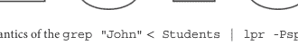

图 9.13 `grep "John" < Students | lpr -Pspr` 命令的语义。

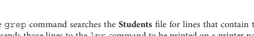

图 9.14 `egrep 'A$' < ece446.grades | sort > ece446.As.sorted` 命令的语义。

在这里，`grep` 命令搜索 `Students` 文件中包含字符串 `"John"` 的行，并将这些行发送给 `lpr` 命令，以便在名为 `spr` 的打印机上打印。图 9.13 说明了此命令的语义。

在下面的命令中，`egrep` 从 `ece446.grades` 读取输入，并将其输出（以字符 A 结尾的行）发送给 `sort` 实用程序，`sort` 对这些行进行排序并将它们存储在当前目录中名为 `ece446.As.sorted` 的文件中。最终结果是，获得 ECE446 课程 A 等级的学生的姓名、成绩和等级存储在当前目录中的 `ece446.As.sorted` 文件中。图 9.14 说明了此命令的语义。

```
$ egrep 'A$' < ece446.grades | sort > ece446.As.sorted
$
```

假设在第 9.4 节运行 `ssh server sort < datafile` 命令之前，你想确保本地系统上的 `datafile` 与服务器上名为 `~/research/pvm/datafile.server` 的更新副本一致。你可以复制 `datafile.server` 并将其与本地副本 `datafile` 进行比较。但这样你将有三个副本，如果不小心可能会删除错误的副本。在这种情况下，你可以运行以下命令，在不将 `datafile.server` 复制到你的（本地）计算机的情况下查看本地副本与服务器上副本之间的差异。

```
$ ssh server cat ~/research/pvm/datafile.server | diff datafile -
```


在这种情况下，`cat` 命令在服务器端运行，其输出作为输入提供给在本地机器上执行的 `diff` 命令。`diff` 命令的输出也发送到本地机器的显示屏上。图 9.15 说明了此命令的语义。

## 9.12 重定向与管道组合

你不能单独使用重定向运算符和管道将命令的 `stdout` 重定向到文件并同时将其连接到另一个命令的 `stdin` 在单个命令行中。然而，你可以使用 `tee` 实用程序来实现这一点。你可以使用此实用程序告诉命令 `shell` 将命令的 `stdout` 发送到作为 `tee` 参数指定的一个或多个文件，

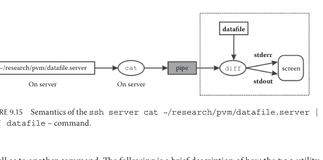

## FIGURE 9.15 Semantics of the ssh server cat ~/research/pvm/datafile.server | diff datafile - command.

以及发送给另一个命令。下面是对 `tee` 实用程序通常用法的简要描述。

```
SYNTAX

command1 | tee file1 file2 ... fileN | command2

Purpose: Standard output of command1 is connected to the stdin of tee, and tee sends its input to files file1 through fileN as well as the stdin of command2
```

此命令语法的语义是 `command1` 被执行，其输出存储在 `file1` 到 `fileN` 文件中，同时作为输入发送给 `command2`。`tee` 实用程序的使用示例在以下命令中给出。

```
$ cat names students | grep "John Doe" | tee file1 file2 | wc -l

$
```

此命令从 `names` 和 `students` 文件中提取包含字符串 `"John Doe"` 的行，将这些行通过管道传递给 `tee` 实用程序，`tee` 将这些行的副本写入 `file1` 和 `file2`，同时将它们发送给 `wc -l`，后者将输出发送到显示屏。因此，`names` 和 `students` 文件中包含字符串 `"John Doe"` 的行被保存到 `file1` 和 `file2` 中，并且此类行的行数显示在监视器屏幕上。图 9.16 说明了此命令行的语义。此类命令在 `shell` 脚本中很有用，其中需要在脚本后面对 `file1` 和 `file2` 执行不同的操作。

## 9.13 OUTPUT AND ERROR REDIRECTION IN THE C SHELL

执行输入、输出和追加操作 (`<`, `>`, `>>`) 的运算符在 C shell 中与在其他 shell 中一样工作，如前所述。然而，在 C shell 中，这些运算符不能使用文件描述符。此外，错误重定向在 C shell 中的工作方式与其他 shell 不同。在 C shell 中，输出和错误重定向的运算符是 `>&`。

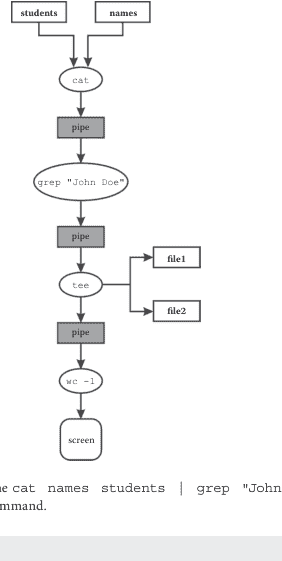

FIGURE 9.16 Semantics of the cat names students | grep "John Doe" | tee file1 file2 | wc -l command.

### SYNTAX

```
command >& file
```

Purpose: Redirect stdout and stderr of command to file

例如，以下命令将 `ls -l foo` 命令的输出和错误重定向到 `error.log` 文件。命令的标准输入仍连接到键盘。请注意，我们使用 `%` 符号作为 shell 提示符，这是 C shell 的默认值。

```
% ls -l foo >& error.log

%
```

C shell 没有单独重定向 `stderr` 的运算符。然而，如果命令在子 shell 中执行，则可以通过将命令用括号括起来，使命令的 `stdout` 和 `stderr` 连接到不同的文件。以下会话说明了这一点。

```
% find ~ -name foo -print >& output.error.log
% (find ~ -name foo -print > foo.paths) >& error.log

%
```

你的当前 `shell` 进程的子进程，也称为子 `shell`，执行所有外部 `shell` 命令。执行第一个命令时，`find` 命令的输出和错误会进入 `output.error.log` 文件。因为子 `shell` 进程要等到整行命令被处理完才创建，所以由于 `>&` 运算符，父 `shell` 进程的 `stdout` 和 `stderr` 被重定向到 `error.log` 文件。因此，子 `shell` 的 `stdout` 和 `stderr` 也被重定向到 `error.log` 文件。

在第二个命令中，`find` 命令在子 `shell` 下执行并继承父 `shell` 的标准文件。当括号中的 `find` 命令执行时，它将命令的 `stdout` 重定向到 `foo.paths` 文件；命令的 `stderr` 仍连接到 `error.log`。因此，`find` 命令的输出进入 `foo.paths` 文件，而命令产生的错误进入 `error.log` 文件。图 9.17 说明了第二个 `find` 命令的语义。

你可以使用 `>& &` 运算符将 `stdout` 和 `stderr` 重定向并追加到文件中。例如，`ls -l foo >& & output.error.log` 将 `ls` 命令的 `stdout` 和 `stderr` 重定向并追加到 `error.log` 文件。

C shell 还允许使用 `|&` 运算符将命令的 `stdout` 和 `stderr` 连接到另一个命令的 `stdin`。下面是对该运算符的简要描述。

### SYNTAX

```
Command1 |& command2
```

Purpose: Redirect stdout and stderr of command1 to command2, that is, pipe stdout and stderr of command1 to command2

在以下命令中，`cat` 命令的 `stdout` 和 `stderr` 连接到 `grep` 命令的 `stdin`。因此，`cat` 命令的输出或其产生的任何错误，例如由于 `file1` 或 `file2` 缺少读权限而产生的错误，都作为输入提供给 `grep` 命令。

```
% cat file1 file2 |& grep "John Doe"

%
```

I/O 重定向和管道运算符（ `|` 和 `|&` ）可以在单个命令中使用，如以下会话所示。此命令是前一个命令的扩展，

## 图 9.17 命令 (find ~ -name foo -print > foo.paths) >& error.log 的逐步语义。

其中 `grep` 命令的 `stdout` 连接到 `sort` 命令的 `stdin`。此外，`sort` 命令的 `stdout` 和 `stderr` 连接到 `wc -l` 命令的 `stdin`。因此，如果命令行成功完成，它会显示包含字符串 `"John Doe"` 的 `file1` 和 `file2` 中的行数。

```
% cat file1 file2 | grep "John Doe" | sort | wc -l
```

在下面的本章练习中，你将练习使用 UNIX 管道、`tee` 命令以及 C shell 的错误重定向功能。

## 练习 9.6

编写一个 shell 命令，对文件 `students.records` 进行排序并将包含 `"Davis"` 的行存储到名为 `Davis.record` 的文件中。使用管道和 I/O 重定向。


## 练习 9.7

编写一个命令，将文件 `Scores` 复制到 `Scores.bak`，并通过 `mail` 命令将 `Scores` 的排序版本发送给 `professor@university.edu`。

## 练习 9.8

编写一个 C shell 命令，使用 `cat` 命令和 `>&` 运算符将你主目录中的文件 `Phones` 复制到文件 `Phones.bak`（也在你的主目录中）。

C shell 有一个特殊的内置变量，可以让你在输出重定向时保护文件不被覆盖。这个变量称为 `noclobber`，并且在设置时可防止现有文件被输出重定向覆盖。你可以使用 `set` 命令设置该变量并使用 `unset` 命令取消设置它。或者，你可以将 `set noclobber` 命令放在你的 `~/.cshrc` 文件（或其他启动文件）中。


`% set noclobber`

your interactive session

...

`% unset noclobber`

`%`

```
```

如果设置了 `noclobber` 变量，命令 `cat file1 > file2` 会在 `file2` 已存在时生成错误消息。如果 `file2` 不存在，则会创建它并将 `file1` 的数据复制到其中。命令 `cat file1 >> file2` 在 `file2` 存在且 `noclobber` 设置时有效，但在 `file2` 不存在时会生成错误消息。你可以使用 `>`, `>>!` 和 `>>&!` 运算符来覆盖 `noclobber` 变量设置时的效果。因此，即使 `noclobber` 变量已设置且 `file2` 存在，命令 `cat file1 >! file2` 也会将 `file1` 的数据复制到 `file2`。对于 `cat file1 >>! file2` 命令，如果 `noclobber` 变量已设置且 `file2` 不存在，则会创建 `file2` 并将 `file1` 的数据复制到其中。`>>&!` 运算符的工作方式与 `>>!` 运算符类似。

## 9.14 I/O 和错误重定向回顾

表 9.1 总结了 Bourne、Korn 和 C shell 中的输入、输出和错误重定向运算符。我们在本章中没有讨论其中一些运算符；我们将在第 12 章至第 15 章的 shell 编程中详细讨论它们。我们将这些运算符包含在此表中，因为这似乎是将它们全部一起展示的最合适位置。请注意，所有适用于 Bourne 和 Korn shell 的运算符也适用于 Bash shell。

## 9.15 FIFOs

FIFO，也称为命名管道，也可用于系统上两个进程之间的通信。虽然通过管道通信的进程必须通过你执行的共同祖先进程相互关联，但进程

## 表 9.1 Bourne、Korn 和 C shell 中重定向运算符及其含义

| Operator | Bourne Shell | Korn Shell | C Shell |
|---|---|---|---|
| < file | Input redirection | Input redirection | Input redirection |
| > file | Output redirection | Output redirection | Output redirection |
| >> file | Append standard output | Append standard output | Append output |
| 0< file | Input redirection | Input redirection |  |
| 1> file | Output redirection | Output redirection |  |
| 2> file | Error redirection | Error redirection |  |
| 1>> file | Append standard output to file | Append standard output to file |  |
| 2>> file | Append standard error to file | Append standard error to file |  |
| <&m | Attach standard input to file descriptor m | Attach standard input to file descriptor m |  |
| >&m | Attach standard output to file with descriptor m | Attach standard output to file with descriptor m |  |
| m>&n | Attach file descriptor m to file descriptor n | Attach file descriptor m to file descriptor n |  |
| <&- | Close standard input | Close standard input |  |
| >&- | Close standard output | Close standard output |  |
| m<&- or m>&- | Close file descriptor m | Close file descriptor m |  |
| >& file |  |  | Output and error redirection |
| >| file |  | Ignore noclobber and assign standard output to file |  |
| >>| file |  | Ignore noclobber and append standard output to file |  |
| >! file |  |  | Ignore noclobber and assign standard output to file |
| >>! file |  |  | Ignore noclobber and append standard output to file; if file does not exist, create it |
| >>&! file |  |  | Ignore noclobber and append standard output and standard error to file |
| cmd1 | cmd2 | Connect standard output of command cmd1 to standard input of command cmd2 | Connect standard output of command cmd1 to standard input of command cmd2 | Connect standard output of command cmd1 to standard input of command cmd2 |

(Continued)

# 表 9.1（续）Bourne、Korn 和 C Shell 中的重定向运算符及其含义

| 运算符 | Bourne Shell | Korn Shell | C Shell |
|---|---|---|---|
| cmd1 | &cmd2 |  | 将命令 `cmd1` 的标准输出和标准错误连接到命令 `cmd2` 的标准输入 |
| (cmd>/dev/tty)>&file | | | 将 `cmd` 命令的标准错误重定向到文件。 |
| | & | | 允许命令的 stdout 和 stderr 连接到另一命令的 stdin |

使用 FIFO 进行通信不必具有这种关系——它们可以是在一个系统上独立执行的程序。对于管道和 FIFO 的命令行使用，这意味着管道只能用于通过管道连接的命令之间的通信，而 FIFO 可用于单独运行的命令之间的通信。管道和 FIFO 之间的另一个区别是，管道是 UNIX 内核维护的主内存缓冲区且没有名称，而 FIFO 是在磁盘上创建并具有像文件名一样的名称。这意味着与文件一样，FIFO 在用于进程间通信之前必须先创建并打开。因此，访问 FIFO 需要访问其所在的二级存储设备。

管道是进程持久的，这意味着它们只要创建它们的进程存在就存在。大多数 UNIX 系统上的 FIFO 是文件系统持久的，这意味着它们会一直存在于系统上，直到被显式删除/移除或相关文件系统被卸载（即从系统中移除）为止。

你可以使用 `mk nod()` 系统调用或 `mkfifo()` 库调用在程序中创建 FIFO，也可以使用 `mkfifo` 命令在 shell 会话中创建文件。我们在本节讨论 FIFO 的命令行使用。我们将在系统编程章节（第 18 章至第 21 章）中讨论 FIFO、管道以及相关的系统调用和库调用。下面是对 `mkfifo` 命令的简要描述。

#### 语法

```
mkfifo [option] file-list
```

+   **用途：** 创建 `file-list` 中给出的路径名的 FIFO
+   **输出：** 为 `file-list` 中给出的路径名在相关目录中创建 FIFO
+   **常用选项/功能：**
+   - `-m mode` 将新创建的 FIFO 的访问权限设置为“mode”，访问权限的指定方式与 `chmod` 命令相同，例如 `666`，表示每个人都有读和写权限，无人有执行权限

在下面的会话中，我们使用第一个命令创建名为 `myfifo1` 的 FIFO，其默认权限基于 `umask` 的当前值（参见第 5 章中的讨论）。我们

使用第二个命令创建名为 `myfifo2` 的 FIFO，其所有者具有读和写权限，所有其他用户无权限。我们使用 `ls -al myfifo1 myfifo2` 命令来显示两个 FIFO 的访问权限。请注意，两个 FIFO 的长列表中的第一个字符是 "p"，表示 `myfifo1` 和 `myfifo2` 是 FIFO（命名管道）类型。

```
$ mkfifo myfifo1

$ mkfifo -m 600 myfifo2
```


```
$ ls -l myfifo3 myfifo4

prw-r--r-- 1 sarwar faculty 0 Aug 9 08:30 myfifo3

prw------ 1 sarwar faculty 0 Aug 9 08:31 myfifo4

$
```

两个命令 `cmd1` 和 `cmd2` 可以通过名为 `myfifo1` 的 FIFO 进行通信的通用方法如下所示的命令序列。

```
cmd1 < myfifo1 &
cmd2 infile | tee myfifo1 | cmd3
```

请注意，我们在后台运行第一个命令（参见第 10 章了解后台进程），以便我们可以运行 `cmd2`。当我们执行 `cmd1` 时，它会阻塞，因为 `myfifo1` 为空。请注意，如果 `myfifo1` 是一个文件，`cmd1` 会阻塞并立即返回。当 `cmd2` 的输出通过 `tee` 实用程序发送到 `myfifo1` 和 `cmd3` 时，`cmd1` 解锁并开始处理 `myfifo1` 中的数据。命令 `cmd1` 和 `cmd3` 的输出发送到标准输出（即显示屏）。图 9.18 使用图表帮助说明了这些语义。

在下面的会话中，命令序列显示系统上运行的所有进程的状态、守护进程的数量以及系统上运行的进程总数。两个 `cat` 命令会阻塞，直到有内容写入 `myfifo1` 和 `myfifo2`。`ps -a` 命令将系统上运行的所有进程的状态发送到 `tee` 命令，该命令将此数据重定向到两个 FIFO，同时将其发送到 `grep` 命令。`grep` 命令从其输入中（即 `ps -a` 命令的输出）提取所有守护进程，并通过管道将其发送到 `wc -l` 命令。因此，第一个 `cat` 命令显示系统上运行


图 9.18 命令序列 `cmd1 < myfifo1 &` 后跟 `cmd2 infile | tee myfifo1 | cmd3` 的执行语义。

on the system. 第二个 `cat` 命令的输出是系统上运行的进程数，而第三个命令（`ps -a`）的输出是系统上运行的守护进程数。如输出最后两行所示，在运行此命令序列时，系统运行着 20 个进程，其中两个是守护进程。

```
$ cat myfifo1 &
$ cat myfifo2 | wc -l &
$ ps -a | tee myfifo1 myfifo2 | grep 'd$' | wc -l
  PID TT  STAT TIME COMMAND
1533 v0- I  0:00.01 /bin/sh /usr/local/sbin/PCDMd
1548 v0- IN 3:43.82 /bin/sh /usr/local/sbin/pbid
1790 v0  Is+ 0:00.00 /usr/libexec/getty Pc ttyv0
1791 v1  Is+ 0:00.00 /usr/libexec/getty Pc ttyv1
...
1797 v7  Is+ 0:00.00 /usr/libexec/getty Pc ttyv7
56478 1  Is  0:00.24 -csh (csh)
57216 1  S  0:00.12 /bin/sh
58002 1  S  0:00.01 cat myfifo1
58045 1  S  0:00.01 cat myfifo2
58046 1  I  0:00.01 wc -l
58089 1  R+ 0:00.02 ps -a
58090 1  S+ 0:00.01 tee myfifo1 myfifo2
58091 1  S+ 0:00.02 grep d$
58092 1  S+ 0:00.01 wc -l
    2
$   20
```

此会话中输出的顺序取决于三个命令的调度；上面显示的输出是我们系统产生的输出，也是最可能的输出。一个有趣的练习是想出一个命令序列，以确保输出始终按此处所示的相同顺序产生。

当你不再需要使用 FIFO 时，可以像删除普通文件一样删除它。这意味着你可以使用 `unlink()` 系统调用（在进程内部）或在命令行中使用 `rm` 命令从文件系统层次结构中删除 FIFO。在下面的会话中，我们使用 `rm` 命令删除 `myfifo1` 和 `myfifo2` FIFO。`rm` 命令执行前后的 `ls` 命令输出显示，这两个 FIFO 确实已被删除。

```
$ ls
myfifo1 myfifo2
$ rm myfifo1 myfifo2
$ ls
$
```


以下章节练习旨在让你练习使用 `mkfifo` 命令并帮助你通过动手操作理解其语义。

## EXERCISE 9.9

使用单个命令创建三个 FIFO，分别命名为 `fifo1`、`fifo2` 和 `fifo3`。写下你用于执行给定任务的命令。

## EXERCISE 9.10

创建一个名为 `fifo4` 的 FIFO，其访问权限设置为所有者和组可读可写，其他人无权限。显示你用于完成给定任务的命令。

## EXERCISE 9.11

在你的系统上尝试本节给出的 shell 会话。你的系统是否以与我们会话中相同的顺序产生输出？如果不是，显示你在你的系统上产生的输出。

## SUMMARY

UNIX 为每个命令自动打开三个文件，以便从中读取输入并向其发送输出和错误消息。这些文件称为标准输入（`stdin`）、标准输出（`stdout`）和标准错误（`stderr`）。默认情况下，这些文件连接到命令执行的终端。因此，shell 使命令输入来自键盘，其输出和错误消息发送到显示器屏幕。

这些默认文件可以通过使用重定向运算符进行更改：`<` 用于输入重定向，`>` 用于输出和错误重定向。

三个标准文件可以通过使用数字 `0`（`stdin`）、`1`（`stdout`）和 `2`（`stderr`）来引用，称为三个标准文件的 *文件描述符*。UNIX 中所有打开的文件都通过类似的整数引用，内核使用这些整数对这些文件执行操作。

在 Bourne、Korn、Bash 和 POSIX shell 中，大于号（`>`）与描述符 `1` 和 `2` 结合使用，分别重定向标准输出和标准错误。

一个命令的标准输出可以通过 UNIX 管道（`|`）连接到另一个命令的标准输入。管道在主内存中创建，用于将一个命令的输出传递给另一个命令，而无需创建磁盘文件，有效地使两个命令相互通信。因此，管道被称为进程间通信（IPC）通道，允许同一机器上的相关命令在 shell 和应用程序级别相互通信。通过管道通信的进程必须通过共同祖先相关；关系通常是父子或兄弟。

I/O 和错误重定向功能和管道可以一起使用来实现强大的命令行。然而，重定向运算符和管道单独使用无法将命令的标准输出重定向到文件并同时将其连接到另一个命令的标准输入。`tee` 实用程序可用于完成此任务，将命令的标准输出发送到一个或多个文件以及另一个命令。命令和 `tee` 通过管道连接。

C shell 不支持使用文件描述符进行 I/O 和错误重定向。此外，将命令的标准输出和标准错误重定向到不同文件的方式在 C shell 中与其它 shell 的指定方式不同。

FIFO，也称为命名管道，允许系统上的相关或不相关进程进行通信。与管道不同，管道是内存缓冲区，而 FIFO 是在二级存储设备上创建的文件。对于命令行使用，你可以使用 `mkfifo` 命令创建 FIFO。`mknod()` 系统调用或 `mkfifo()` 库调用可用于在进程内部创建 FIFO。当你不再需要 FIFO 时，可以使用运行中的程序（进程）内的 `unlink()` 系统调用或命令行上的 `rm` 命令将其删除。我们在第 18 章至第 21 章关于 UNIX 系统编程中讨论与管道和 FIFO 相关的 UNIX 系统调用和库调用。

## QUESTIONS AND PROBLEMS

- 1. 什么是标准文件？请列出它们并说明其用途。
- 2. 简要描述输入、输出和错误重定向。写出各两种命令以展示重定向操作符的简单使用和组合使用。
- 3. UNIX 中的文件描述符是什么？标准文件的文件描述符是什么？如何在 Bourne、Korn、Bash 和 POSIX shell 中将 I/O 和错误重定向操作符与标准文件的文件描述符结合使用以执行重定向？
- 4. 对文件 `data1` 进行排序并将排序后的文件放入名为 `data1.sorted` 的文件中。给出使用输入和输出重定向的命令。
- 5. 给出使用管道和输出重定向完成问题 4 任务的命令。
- 6. 给出一组等价于命令 `ls -l | grep "sarwar" > output.p3` 的命令，该命令仅使用 I/O 重定向操作符。给出的命令与你的命令序列的性能如何比较？解释原因。
- 7. `tee` 命令的用途是什么？给出一个等价于问题 6 中的命令的命令，该命令使用 `tee` 命令。
- 8. 编写 UNIX shell 命令以完成以下任务。
  a. 统计名为 `data1` 的文件中的字符数、单词数和行数，并在显示屏上显示输出。
  b. 统计 `ls -l` 命令输出中的字符数、单词数和行数，并在显示屏上显示输出。
  c. 与 b 部分相同，但将输出重定向到名为 `data1.stats` 的文件。

9. 给出搜索文件 `datafile` 中字符串 `"Internet"` 的命令，将命令的输出发送到名为 `Internet.freq` 的文件，并将任何错误消息发送到文件 `error.log`。绘制该命令的图表，类似于本章中所示的图表，以说明其语义。

10. 给出完成问题 9 任务的命令，但命令的输出和任何错误消息都进入名为 `datafile` 的文件。

11. 给出搜索 `/etc/passwd` 中包含字符串 `"sarwar"` 的行的命令。

12. 将命令的输出存储在当前目录中名为 `passwd.sarwar` 的文件中。如果命令失败，错误消息也必须进入同一文件。

13. UNIX 管道是什么？管道与输出重定向有何不同？举例说明你的答案。

14. 在 Bourne shell 下，以下命令做什么？
  a. `cat 1> letter 2> save 0< memo`
  b. `cat 2> save 0< memo 1> letter`
  c. `cat 1> letter 0< memo 2>&1`
  d. `cat 0< memo | sort 1> letter 2> /dev/null`
  e. `cat 2> save 0< memo | sort 1> letter 2> /dev/null`

15. 在 Bourne shell 下考虑以下命令。
  a. `cat memo letter 2> communication 1>&2`
  b. `cat memo letter 1>&2 2> communication`
在每种情况下，如果
  a. 两个文件（`memo` 和 `letter`）都存在于当前工作目录中，且
  b. 两个文件之一不存在于当前工作目录中，
`cat` 命令的输出和错误消息会去哪里？

16. 使用 `mail` 命令向 `doe@domain.com` 发送电子邮件消息。假设消息在名为 `greetings` 的文件中。给出一条使用输入重定向的命令和一条使用管道的命令。任何错误消息应追加到文件 `mail.error`。

17. 在你的 UNIX 系统上执行以下命令时会发生什么？为什么这些命令会产生它们产生的结果？
  a. `cat letter >> letter`
  b. `cat letter > letter`

18. 使用输出重定向，将问候信息 `"Hello, World!"` 发送到朋友的终端。

19. 给出一个显示当前登录到系统中的用户数量的命令。

20. 给出一个显示第一个登录到系统的用户的登录名的命令。

21. 以下命令有什么区别？
a. `grep "John Doe" Students > /dev/null 2>&1`
b. `grep "John Doe" Students 2>&1 > dev/null`

22. 给出一个显示当前目录内容的命令，（文件名称）每行三个文件。

23. 给出一个从名为 `Phones` 的文件读取输入，从文件中删除不必要的空格，对文件进行排序，并删除其中重复行的命令。

24. 对文件进行重复问题 23，但文件已删除不必要的空格但仍包含重复行的版本。

25. 以下命令做什么？
a. `uptime | cat - who.log >> system.log`
b. `zcat secret_memo.Z | head -5`

26. 给出一个执行以下命令任务的命令，但 `diff` 命令在名为 `server` 的机器上运行：`ssh server cat ~/research/pvm/datafile.server | diff datafile -`

27. 给出一个显示名为 `employees` 的文件中未重复行的命令。仅显示重复行的命令是什么？

28. 给出一个显示最新创建目录的长列表的命令。

`_POSIX_OPEN_MAX` 变量在 `/usr/include/limits.h` 文件中。显示你的命令及其输出并解释你的答案。

## 32. 管道在你的系统上可以存储多少数据？使用 shell 命令获得你的答案。你使用了什么命令？显示命令及其输出。提示：查找 `/usr/include/limits.h` 文件中定义的符号常量。

## 33. 以下命令的输出是什么？给出你的答案的理由。

```
cat file1 file2 |& grep "John Doe" | sort |& wc -l
```

## 34. 以下命令的目的是什么？

```
cat /usr/include/limits.h | nl | grep_POSIX_OPEN_MAX
```


## 35. 以下命令做什么？

+ a. `mail mike@somewhere.org < to_do`
+ b. `cat Phones | sort | uniq | pr | lpr`

## 进程

- 描述进程的概念，以及在单 CPU 计算机系统上执行多个进程
- 解释 shell 如何执行命令
- 讨论进程属性的静态和动态显示
- 讨论 UNIX 进程的主内存映像
- 简要描述 CPU 调度和 UNIX 中的调度类的概念
- 解释前台和后台进程的概念，包括守护进程的描述及其用途
- 描述命令的顺序和并行执行
- 讨论 UNIX 中的进程和作业控制：前台和后台进程，顺序和并行进程，挂起进程，将前台进程移至后台及其反之，以及终止进程
- 描述 UNIX 进程层次结构
- 涵盖命令和原语

`Ctrl+C`, `Ctrl+D`, `Ctrl+Z`, `Ctrl+`, `;;`, `&`, `( )`, `bg`, `fg`, `jobs`, `kill`, `nice`, `nohup`, `page size`, `ps`, `ptree`, `size`, `sleep`, `top`


正如我们之前提到的，进程是正在执行的程序。该程序可能是汇编语言代码，由用 C++ 等高级语言编写的源程序编译后生成的可执行代码，用 LISP、JavaScript、Perl、解释型 C（`CINT`）或 UNIX shell 编写的解释型代码。UNIX 系统在每次运行外部命令时都会创建一个进程，并在命令执行完毕后将其从系统中移除。我们将程序和命令这两个术语互换使用。

进程创建和终止是 UNIX 系统执行外部命令所使用的唯一机制。在典型的分时系统（如 UNIX）中，允许多个用户使用计算机系统并同时运行多个进程，每天会创建和终止数百到数千个进程。请记住，计算机中的 CPU 执行进程，而典型的系统只有一个 CPU。问题是，单 CPU 系统如何同时执行多个进程？即使对于具有多个 CPU 或 CPU 中具有多个核心的系统，进程数量也大于 CPU 或核心的数量。进程数量大于 CPU 或 CPU 核心数量的系统如何同时执行这些进程？对该主题的详细讨论超出了本教材的范围，但在第 10.2 节和第 10.5.1 节中我们简要讨论了它。本章后面，我们将讨论查看进程的静态和动态状态、前台和后台进程、守护进程、作业、进程和作业属性以及进程和作业控制。我们将分时和多任务这两个术语同义使用。

## 10.2 CPU 调度：同时运行多个进程

在典型的包含单个 CPU 并运行分时操作系统的计算机系统中，通过快速地在各个进程之间切换 CPU 来同时执行多个进程。也就是说，一个进程执行很短一段时间，然后 CPU 从其手中夺走并交给另一个进程。新进程执行很短一段时间，然后 CPU 交给下一个进程。此过程一直持续，直到序列中的第一个进程再次使用 CPU 为止。进程在 CPU 中“处于”状态然后被切换“出”CPU 的时间称为量子或时间片。量子通常非常短：对于典型的 UNIX 系统，通常为一秒或更短。在 Solaris 上，进程的量子取决于进程的优先级。对于分时用户进程，量子为 40 毫秒。对于更高优先级的进程，量子值更大。例如，优先级为 0 的内核线程的量子为 200 毫秒，优先级为 10 的内核线程的量子为 160 毫秒。在 FreeBSD 中，量子值为 0.1 秒。当 CPU 空闲/空闲（即未被任何进程使用）或当前进程已完成其量子时，内核使用算法来决定下一个使用 CPU 的进程。选择获得 CPU 使用权的进程所使用的技术称为 CPU 调度。执行此任务的内核代码称为短期 CPU 调度器，或 CPU 调度器。

从当前正在执行的进程中夺走 CPU 并将其交给新调度的进程的过程称为上下文切换。此任务由内核的另一部分执行，称为调度程序。在具有多个 CPU 或具有多个核心的 CPU 的系统上，例如英特尔、AMD 和其他公司生产的系统，如果系统上的进程数量超过系统中的 CPU 数量（或

（单 CPU 系统的核心），CPU 调度和上下文切换仍然会发生。因此，在一个有多用户运行多个进程的系统上，调度器和分派器协同工作，让你感觉自己像是唯一使用系统的人。虽然对 CPU 调度算法的深入讨论超出了本书的范围，但我们简要而简单地介绍了 UNIX SV、FreeBSD 和 Solaris 调度器的工作原理。

在分时系统中，每个进程都会被分配一个优先级值，优先级最高的进程将获得下一个 CPU 使用权。可以使用多种方法为进程分配优先级值。一种简单的方法是基于进程进入系统的时间。在这种方案中，通常最先进入系统的进程被分配最高优先级并获得下一个 CPU 使用权；结果称为先到先服务（FCFS）调度算法。另一种方案是根据进程使用 CPU 的时间量分配优先级值。因此，刚刚到达的进程，或大部分时间执行输入和/或输出（I/O）操作的进程，获得最高优先级。大部分时间执行 I/O 的进程称为 I/O 密集型进程。I/O 密集型进程的例子是 `vim` 等文本编辑器。在轮转（RR）调度算法中，CPU 会按顺序为进程队列中的每个进程提供一个时间片，一个接一个地进行。这种算法是分时系统的自然选择，因为所有用户都希望看到自己的进程取得进展。如果你对其他 CPU 调度算法感兴趣，我们鼓励你阅读一本关于操作系统原理和概念的书籍。实现 CPU 调度算法的操作系统代码称为处理器调度器。包括 UNIX 在内的大多数操作系统的调度器都在内核中。

UNIX System V 调度算法是上述所有算法以及更多算法的混合体。它使用一个简单的公式为系统中准备运行的每个进程分配优先级值。系统中每个进程的优先级值每秒重新计算一次。调度时，CPU 会分配给优先级数字最小的进程。如果多个进程具有相同的优先级数字，则按 FCFS 原则做出决定。用于计算优先级值的公式是

`priority value = threshold priority + nice value + ( recent CPU usage/2 )`,

其中 `threshold priority` 通常为 40 或 60 的整数，`nice value` 是正整数，默认值通常为 10，但可以是 -20 到 19 的值（某些 UNIX 系统上为 20），`CPU usage` 是进程使用 CPU 的时钟滴答数（在旧系统上为 1/60 或 1/50 秒，其中 60 或 50 为电网频率的 Hz）。在现代 UNIX 系统上，时钟滴答要小得多，并且不基于电网频率计算。时钟中断服务例程（ISR）每时钟滴答更新每个进程的 CPU 使用情况，增加当前使用 CPU 的进程的滴答计数。时钟 ISR 在使用上述公式重新计算进程优先级之前，将每个进程的滴答计数除以二。这种除以二被称为应用衰减函数，因为它使之前 CPU 使用的影响呈指数级下降。因此，进程最近的 CPU 使用对进程优先级的影响更大，而历史 CPU 使用的影响会逐渐减弱。因此，使用 CPU 的进程的 CPU 使用值会增加，而所有其他进程的 CPU 使用值会减少。

你可以使用 `nice` 或 `renice` 命令为你的进程分配更高的 `nice` 值，但非超级用户不能将 `nice` 值设置为负数。较高的 `nice` 值意味着较高的优先级值，因此优先级较低。所以，当你增加进程的 `nice` 值时，你就是在对其他用户进程友好。公式清楚地表明，进程最近的 CPU 使用量越高，其优先级值越高，优先级越低。因此，UNIX 倾向于最近使用 CPU 时间较少的进程。`vim` 等文本编辑器获得的优先级高于计算 π（π）值的进程，因为 `vim` 大部分时间都在等待 I/O——即读取键盘输入、读写磁盘以及在屏幕上显示文件数据或键盘输入。另一方面，计算 π 的进程大部分时间都在进行计算——即使用 CPU。每秒重新计算所有进程的优先级值会导致进程优先级动态变化（上下浮动）。在第 10.5 节中，我们将进一步探讨 UNIX 调度概念，特别是关于 PC-BSD 和 Solaris。

## 10.3 UNIX 进程状态

UNIX 进程可以处于多种状态之一，从一个状态移动到另一个状态，最终完成执行，正常或异常地结束并退出系统。进程在完成工作并优雅地退出系统时正常终止。进程在因异常（错误条件）或其所有者或超级用户干预而退出系统时异常终止。进程所有者可以通过使用命令或特定的键击来干预并终止进程。我们将在本章后面讨论这些命令和键击。进程可能处于的主要状态如图 10.1 中的状态图所示。

等待状态涵盖了多个状态；我们在此使用该术语是为了保持图表的简单性。属于等待状态的一些状态列在表示该状态的椭圆下方。表 10.1 简要描述了这些 UNIX 进程状态。出于简洁性考虑，并且为了保持本书的范围，UNIX 进程可能处于的其他状态未包含在此讨论中。

## 10.4 Shell 命令的执行

Shell 命令可以是内部（内置）或外部的。内部/内置命令是指其代码是 shell 进程的一部分的命令。一些常用的内部命令是 `.`（点命令）、`bg`、`cd`、`continue`、`echo`、`exec`、`exit`、`export`、`fg`、`jobs`、`pwd`、`read`、`readonly`、`return`、`set`、`shift`、`test`、`times`、`trap`、`umask`、`unset` 和 `wait`。外部命令是指其代码在文件中的命令；文件内容可以是二进制代码或 shell 脚本。一些常用的外部命令是 `grep`、`more`、`cat`、`mkdir`、`rmdir`、`ls`、`sort`、`ftp`、`telnet`、`lp` 和 `ps`。Shell 创建一个新进程来执行命令。在命令进程执行期间，shell 会等待其完成。在本节中，我们将描述 shell（或任何进程）如何创建另一个


## 图 10.1 UNIX 进程状态图。

## 表 10.1 UNIX 进程状态简要说明

| State | Description |
|-------|-------------|
| Ready | 进程已准备好运行但没有 CPU。根据调度算法，调度器决定将 CPU 分配给另一个进程。多个进程可以处于此状态，但在单 CPU 机器上，只有其中一个可以执行/运行，即使用 CPU。 |
| Running | 进程正在实际运行，即使用 CPU。 |
| Waiting | 进程正在等待某个事件。可能的事件包括 I/O 操作完成，例如磁盘/终端读写，子进程完成，父进程正在等待一个或多个子进程退出，或进程本身正在等待被唤醒，因为它已被置于睡眠状态。 |
| Swapped | 进程已准备好运行，但已被暂时放到磁盘上，交换空间；也许它需要更多内存，而此时没有足够的可用内存。 |
| Zombie | 一个正在死亡的进程被称为僵尸状态。通常，当进程的父进程在它执行退出调用之前终止时，它就变成僵尸进程。进程已完成并发现父进程没有等待。僵尸进程在实际意义上已完成且不驻留在内存中，但它们仍有一些内核资源分配给它们，无法从系统中移除。所有僵尸及其存活的子进程最终都会被祖父进程 `init` 进程收养，该进程会将它们从系统中移除。 |

`process` and executes external commands. You can use the `type` command to determine if your command is built in or external, as shown in the following session. Under Bash, you can use the `-a` option to display all the locations of a command, as follows. You can see that the `bg` command is built in but also has an external version. However, by default, the built-in version is executed. The Bourne shell may be invoked through two executables available at two different places in your file system structure.


```
$ type bg

bg is a shell builtin

$ type -a bg

bg is a shell builtin

bg is /usr/bin/bg

$ type -a sh

sh is /usr/bin/sh

sh is /usr/sbin/sh

$
```

A UNIX process can create another process by using the `fork()` system call, which creates an exact main memory copy of the original process (i.e., the process that calls `fork()`). Both processes continue execution, starting with the statement that follows the `fork`. The forking process is known as the *parent process*, and the created (forked) process is called the *child process*, as shown in Figure 10.2. Here, we show a Bourne shell that has created a child process (another Bourne shell). We discuss the use of `fork()` and other system calls needed for the creation of processes and *interprocess communication* (IPC) in Chapters 18–21.

For executing an external binary command, a mechanism is needed that allows the child process to become the command to be executed. The UNIX system call `exec()` can be used to do exactly that, allowing a process to overwrite itself with the executable code for another command. A shell uses the `fork()` and `exec()` calls in tandem to execute an external binary command. Figure 10.3 shows the sequence of events for the execution of an external command `sort`, whose code is in a binary file, `/usr/bin/sort`.

The execution of a shell script (a series of shell commands in a file; see Chapters 12–15) is slightly different from the execution of a binary command/file. In the case of a shell script, the current shell creates a child shell and lets the child shell execute commands in the script file one by one. Each command in the script file is executed in the same way that commands from the keyboard are; that is, the child shell creates a child for every


FIGURE 10.2 Process creation via the fork system call.

## UNIX shell 执行二进制程序 sort 的步骤

### 第 1 步：Shell 使用 fork 创建子进程

### 第 2 步：子进程使用 exec 用对应于 sort 命令的可执行文件覆盖自身。

### 第 3 步：sort 开始执行，而 "sh" 等待命令完成。当 sort 完成时，子进程终止，"sh" 重新开始执行，等待用户输入另一个要执行的命令。


图 10.3 UNIX shell 执行二进制程序 sort 的步骤。

## UNIX shell 执行 shell 脚本的步骤

### 第 1 步

### 第 2 步

### 第 3 步


图 10.4 UNIX shell 执行 shell 脚本的步骤。

它执行的命令。当子 shell 在脚本文件中执行命令时，父 shell 等待子进程终止。当子 shell 在脚本文件中遇到 `eof` 标记时，它会终止。子 shell 的唯一目的，就像任何其他 shell 一样，是执行命令，而 `eof` 表示“没有更多命令”。当子 shell 终止时，父 shell 退出等待状态并恢复执行。此事件序列如图 10.4 所示，该图还显示了脚本文件中 `find` 命令的执行。

除非在包含 shell 脚本的文件中另有指定，否则子 shell 的类型与父 shell 相同。也就是说，如果父 shell 是 Bourne shell，则子 shell 也是 Bourne shell。因此，默认情况下 shell 脚本由父 shell 的“副本”执行。然而，为任何 shell 编写的 shell 脚本（C、TC、Bourne、Bash、Korn 等）都可以执行，而不管当前 shell 的类型如何。为此，只需在包含 shell 脚本的文件的第一行中指定应执行脚本的子 shell 类型，格式为 `#!full-path-name-of-the-shell`。例如，以下行规定子 shell 为 C shell，因此此行之后的脚本在 C shell 下执行。

```
#!/bin/csh
```

此外，你可以通过将该 shell 作为当前 shell 的子进程运行、在其下执行命令并终止该 shell 来在另一个 shell 中执行命令。子 shell 也称为子 shell。请记住，运行各种 shell 的命令为 Bourne shell 的 `sh`、C shell 的 `csh`、TC shell 的 `tcsh`、Korn shell 的 `ksh`，以及 Bourne Again shell 的 `bash`。要启动新的 shell 进程，只需运行你想要运行的 shell 对应的命令即可。

在下面的会话中，当前 shell 是 C shell，Bourne shell 作为其子进程运行。`echo` 命令在 Bourne shell 下执行。然后启动 Bash shell，并在其下执行 `echo` 命令。`ps` 命令显示正在运行的三个 shell。最后，当连续按下 `<Ctrl+D>` 时，Bash 和 Bourne shell 都被终止，控制权返回到原始 shell，即 C shell。第一个 `<Ctrl+D>` 终止 Bash shell，将控制权交还给 Bourne shell。你也可以通过运行 `exit` 命令退出 shell。图 10.5 说明了涉及的所有步骤，显示了进程之间的父子关系。


图 10.5 在子 shell（也称为子 shell）下执行命令。

```
% ps

PID TT STAT TIME COMMAND

44387 5 Ss 0:00.97 -csh (csh)

45878 5 R+ 0:00.01 ps

% /bin/sh

$ echo "This is Bourne shell."

This is Bourne shell.

$ bash

[sarwar@pcbsd-srv ~]$ echo "This is Bourne Again SHell."

This is Bourne Again SHell.

[sarwar@pcbsd-srv ~]$ ps

PID TT STAT TIME COMMAND

44387 5 Is 0:00.97 -csh (csh)

45910 5 I 0:00.02 /bin/sh

45935 5 S 0:00.07 bash

46008 5 R+ 0:00.01 ps

[sarwar@pcbsd-srv ~]$ <Ctrl+D>

$ <Ctrl+D>

%
```


# 10.5 进程属性

每个 UNIX 进程都有多个属性，包括所有者 ID（在 UNIX 术语中称为用户 ID [`UID`]）、进程 ID（`PID`）、父进程的 PID（`PPID`）、进程名称、进程状态、启动进程所执行的命令、进程优先级、进程启动时间、进程消耗的 CPU 时间百分比、进程消耗的主内存百分比、进程在虚拟内存中的大小、进程当前在主内存中的大小、进程状态、进程正在等待的事件（如果它未运行），以及进程已运行的时间长度。从用户和程序员的角度来看，这些属性中最有用之一是 `PID`，它用作本章后面讨论的多个进程控制命令的参数。

UNIX 提供了多个工具，允许你监视当前在系统上运行的进程的属性、更改你的进程的状态，并在它们上执行各种操作，包括停止/重新启动它们、向它们发送特定消息、让它们相互通信以及终止它们。在本章中，我们将讨论一些命令和工具，这些命令和工具允许我们静态和动态地监视进程的属性，以及执行上面所述的对进程的各种操作。

## 10.5.1 进程属性的静态显示

`ps` 命令可用于查看系统中当前进程属性的快照。`PC-BSD` 和 `Solaris` 都有自己的带多个选项的该命令版本。然而，其中几个命令是通用的。首先，我们详细讨论 `PC-BSD` 版本的命令，然后讨论 `Solaris` 版本的附加功能。以下是 `PC-BSD` 版本 `ps` 命令的简要说明。

### SYNTAX

```
ps [options]
```


Purpose: Report static (one shot) information about process status/attributes

Output: A header line and a snapshot of the attributes of processes running on the system

## Commonly used options/features:

- `-G` Display information about processes running under user groups specified in the comma-separated list of group IDs; no space before or after the comma
- `-H` Display information about threads visible to the UNIX kernel
- `-l` Display the list of keywords that may be used with the `-O` or `-o` option
- `-o` Display information about the comma- or space-separated keywords after the PID field in the default output. You can assign the header of your choice for a keyword by putting an = after the keyword, followed by the header value.
- `-U` Display information about the processes for the users specified in the comma-separated list of usernames; no spaces before or after the commas
- `-a` Display information about your and other user's processes
- `-c` Display only the name of the executable file and not the whole pathname
- `-d` Display the hierarchical structure for processes, showing parent-child and sibling relationships between processes using indentation
- `-e` Display the environmental information for each process
- `-j` Display for each process information about the following keywords: user, pid, ppid, pgid, sid, jobc, state, tt, time, and command.
- `-l` Display for each process information about the following keywords: uid, pid, ppid, cpu, pri, nice, vsz, rss, wchan, state, tt, time, and command.
- `-m` Display information sorted according to memory usage (highest usage first)
- `-o` Similar to `-O`, except that it does not show the default fields and you can change header texts for multiple using multiple `-o` options. If no headers are specified with keywords, the header line is not displayed.
- `-p` Display information about the processes specified in the list of PIDs
- `-r` Display information sorted according to CPU usage (highest usage first)
- `-u` Display for each process information about the following keywords: user, pid, `%cpu`, `%mem`, vsz, rss, tt, state, start, time, and command.
- `-v` Display for each process information about the following keywords: user, pid, state, time, sl, re, pagein, vsz, rss, lim, tsize, `%cpu`, `%mem`, and command.
- `-x` Display information about processes that do not have controlling terminals (including daemons)

The output of the `ps` command is sorted first by the terminals associated with processes and then by their PIDs. You can change the default sort order by using different options. If multiple such options are specified, the command exercises the last option. The shell sessions in this section demonstrate the use of the `ps` command with and without options. We ran all of them on a PC-BSD machine running the C shell.

The output of the PC-BSD version of the `ps` command, as shown in the following session, displays five fields about processes, whose attributes are displayed one per line: process ID (`PID`), the terminal the process is attached to (`TT`), process state (`STAT`), the CPU time the process has consumed (`TIME`), and the command used by the user to run the process (`COMMAND`). The output shows that two processes are attached to terminal 1: `-csh` (the login C shell) and `ps`, and two are attached to terminal 2: `-csh` (the login C shell) and `vim` text editor. The `-` in front of a shell, as in `-csh`, indicates that it is the login shell. The PIDs of the processes attached to terminal 1, `-csh` and `ps`, are 37838 and 41626, and have run for 19 seconds and 1 second each, respectively. Similarly, the PIDs of the processes running on terminal 2, `-csh` and `vim`, are 41496 and 41619, and each has run for 27 and 19 seconds each, respectively.

```
% ps

  PID TT  STAT      TIME COMMAND

37838 1  Ss   0:00.19 -csh (csh)

41626 1  R+   0:00.01 ps

41496 2  Ss   0:00.27 -csh (csh)

41619 2  S+   0:00.25 vim canleave

%
```


The state of a process is displayed as a character string—for example, `Ss`, `S+`, and `R+` in the previous session. Table 10.2 explains the various characters in the string listed under the process state (`STAT`) column.

Thus, the process with the `Ss` state is a session leader process that is currently sleeping—that is, waiting for less than 20 seconds. Similarly, the process with the `S+` state is a foreground process that has been waiting for less than 20 seconds. Finally, the process with the

## TABLE 10.2 A Brief Description of the UNIX Process States Displayed by the ps Command under PC-BSD

| First Character | Description | Additional Character | Description |
|---|---|---|---|
| D | Process on a disk or other short-term interruptible wait | + | Foreground process |
| I | Idle process—waiting for > 20 s | < | Process has raised scheduling priority |
| L | Process waiting for a lock | E | Exiting process |
| R | Runnable process waiting to get CPU | J | Process in a "jail" |
| S | Sleeping process—waiting for < 20 s | L | Process locked in core—for example, for raw I/O |
| T | Stopped/suspended process | N | Process has reduced CPU-scheduling priority |
| W | Idle interrupt process/thread | s | Session leader process—for example, login shell |
| Z | Zombie process | V | Suspended during a `vfork(2)` |
|  |  | W | Swapped-out process |
|  |  | X | Process is being traced or debugged |

`R+` 状态是一个前台进程，该进程已准备好运行并等待被调度使用 CPU。我们在第 10.6 节详细讨论了前台和后台进程。

`ps -u` 命令显示运行该命令的用户所属的所有进程的长列表。`VSZ` 是进程的虚拟大小，`RSS`（驻留集大小）是进程在内存中的实际大小。两种大小均以千字节为单位。请注意，`sarwar` 已在五个不同的终端上登录，并运行了五个登录 C shell。

```
% ps -u

USER       PID %CPU %MEM    VSZ   RSS TT  STAT STARTED      TIME COMMAND

sarwar 37838  0.0  0.1 25548 3900  1  Is+   6:15AM  0:00.20 -csh

(csh)

sarwar 41937  0.0  0.1 25548 3900  3  Is+   7:06AM  0:00.20 -csh

(csh)

sarwar 41985  0.0  0.1 25548 3576  4  Is+   7:07AM  0:00.10 -csh

(csh)

sarwar 44387  0.0  0.1 25548 3940  5  Ss    7:38AM  0:00.50 -csh

(csh)

sarwar 44716  0.0  0.1 16592 2304  5  R+    7:41AM  0:00.02 ps -u

sarwar 44428  0.0  0.1 25548 3900  6  Is    7:38AM  0:00.18 -csh

(csh)

sarwar 44675  0.0  0.1 16992 2800  6  I+    7:40AM  0:00.06 /bin/sh

/usr/bin/man

sarwar 44688  0.0  0.1 14788 2632  6  S+    7:40AM  0:00.03 more

%
```

你可以指定一个以逗号分隔的 UID 列表来显示属于它们的进程的相同信息，如 `ps -u 1004,1009,1020` 所示。作为提醒，`UID` 是 `/etc/passwd` 文件中一行的第三个字段。请注意，前三个进程的状态为 `Is+`，这意味着它们是前台空闲会话领导进程。换句话说，它们是未在 20 秒以上使用 CPU 的前台登录 shell 进程。

你可以在 PC-BSD 和 Solaris 上使用 `-U` 选项来显示属于选项后指定的以逗号分隔的用户名用户的进程的默认状态。在以下示例中，显示了用户 `sarwar` 所属的所有进程。`ps -U john,davis,goldman,ibraheem` 命令显示用户 `john`、`davis`、`goldman` 和 `ibraheem` 所属的所有进程的默认状态。

```
% ps -U sarwar

  PID TT  STAT      TIME COMMAND

 4964  -  I    0:00.04 sshd: sarwar@pts/1 (sshd)

 8980  -  S    0:00.29 sshd: sarwar@pts/2 (sshd)

 4967  1  Is+   0:00.17 -csh (csh)

 8983  2  Ss    0:00.37 -csh (csh)

13011  2  R+    0:00.02 ps -U sarwar

%
```

你也可以使用用户的以逗号分隔的 UID 列表来显示相同的信息。因此，`ps -U 1004` 命令显示 UID 为 1004 的用户所属的所有进程的默认状态。类似地，`ps -U 1004,1005,1001` 命令显示 UID 为 1001、1004 和 1005 的用户所属的所有进程的默认状态。

你可以使用 `-a` 和 `-x` 选项来显示你的进程、属于其他用户的进程、系统进程以及未附加到任何控制终端的进程的信息，例如守护进程。你可以通过使用 `ps -ax | wc -l` 命令来确定在 PC-BSD 系统上运行的进程总数，包括所有系统进程和守护进程。输出包含一个标题行和 `ps -ax` 和 `wc -l` 进程各一行。因此，如果不计入因命令行本身而创建的两个进程，我们的 PC-BSD 系统上当前正在运行 130 个进程。

```
% ps -ax | wc -l

    133

%
```

你可以通过使用 `ps -e | wc -l` 命令来确定在 Solaris 机器上运行的进程数。

你可以使用 `-H` 选项来显示内核可见的线程，在 Solaris 中称为轻量级进程（LWPs），在你的系统上运行的进程中。`ps -axH | wc -l` 命令的输出显示其输出为 506。在这 506 行中，一行为输出标题，每条 `ps -axH` 和 `wc -l` 命令各一行。因此，在当前运行的 130 个进程中，正在运行 503 个内核可见线程。

```
% ps -axH | wc -l

    506

%
```

而 `-j`、`-l`、`-u` 和 `-v` 选项允许你按已知顺序显示预定关键字的数值和标准标题信息，`-O` 和 `-o` 选项允许你显示自定义输出：你选择的关键字的值，按你喜欢的顺序排列，并带有你喜欢的标题。在以下会话中，我们展示了使用这些选项的 `ps` 命令。关键字 `dsiz`、`ssiz` 和 `tsiz` 分别是进程内存映像的数据、栈和文本/代码段的大小（以千字节为单位）。`wchan` 是进程正在等待的事件。会话中的最后一个命令显示了如何自定义输出的标题。

```
% ps -O dsiz,ssiz,tsiz,vsz,rss,wchan

PID DSIZ SSIZ TSIZ  VSZ  RSS  WCHAN TT  STAT    TIME COMMAND
```

```
34860 172 128 348 25548 3940 pause 1 Ss 0:00.28 -csh

(csh)
```


`35024 16 128 32 16592 2304 - 1 R+ 0:00.00 ps -O`

`dsiz,ssiz,tsiz,vsz`

`29019 172 128 348 25548 3976 ttyin 4 Is+ 0:00.31 -csh (csh)`

`% ps -o dsiz,ssiz,tsiz,lwp,nlwp,wchan,pcpu,pmem,flags,args`

DSIZ SSIZ TSIZ LWP NLWP WCHAN %CPU %MEM F COMMAND

172 128 348 100733 NLWP 1 pause 0.0 0.1 10004002 -csh (csh)

16 128 32 100622 1 - 0.0 0.1 10004002 ps -o

dsiz,ssiz,tsiz,lwp,nl

172 128 348 100690 1 ttyin 0.0 0.1 10004002 -csh (csh)

`% ps -o user,pid=SON -o ppid=MOM -o args`

USER SON MOM COMMAND

sarwar 34860 34857 -csh (csh)

sarwar 35281 34860 ps -o user,pid=SON -o ppid=MOM -o args

sarwar 29019 29016 -csh (csh)

`%`

其中的一些字段和对应的关键字很明显，我们在本章前面已经讨论过其中一些。然而，我们现在要讨论的一些关键字是新的且不明显的。你可以通过使用 `ps -L` 命令来显示所有关键字，如下所示：

```
% ps -L
%cpu %mem acflag acflg args blocked caught class comm command cow
cpu cputime dsiz egid egroup emul etime etimes euid f fib flags
gid group ignored inblk inblock jid jobc ktrace label lim
lockname login logname lstart lwp majflt minflt msgsrcv msgsnd
mwchan ni nice nivcsw nlwp nsigals nsigs nswap nvcs w nvcsw oublk
oublk paddr pagein pcpu pending pgid pid pmem ppid pri re rigid
rgroup rss rtpr io ruid ruser sid sig sigcatch sigignore sigmask sl
ssiz start stat state svgid svuid systime taddr tdev tdnam time
tpgid tsid tsiz tt tty ucomm uid upr uprocp user usertime usrpri
vsize vsz wchan xstat
%
```

表 10.3 显示了一些常用的关键字及其含义。请注意，这些字段在 `ps` 命令输出的头部以大写形式显示（例如，`command` 对应 `COMMAND`，`pid` 对应 `PID`）。

### 表 10.3 ps 命令常用显示字段/关键字的简要说明

| Field | Description | Field | Description |
|---|---|---|---|
| command | Command executed to create process | ppid | Parent's process ID |
| dsiz | Data size in kilobytes | pri | Scheduling priority |
| cpu | Short-term CPU usage for scheduling | rss | Real process size (kilobytes) in memory |
| flags | Flags indicating process states/events | sid | Session ID; PID of the session leader |
| lwp | Lightweight process (thread) ID | ssiz | Stack size in kilobytes |
| majflt | Total page faults (same as PAGEIN) | started | Time the process was started |
| mwchan | Event or lock of the locked/blocked process | stat | Process state |
| nlwp | Number of threads tied to an LWP | time | Time the process has executed for |
| pcpu | CPU utilization up to one previous minute | tsiz | Text (code) size in kilobytes |
| pgid | Process group ID | tt | Terminal the process is attached to |
| pid | Process ID | vsz | Virtual size of the process in kilobytes |
| pmem | Percentage of memory used by process | wchan | Event (or address) on which a process waits |


图 10.6 UNIX 进程的内存映像。

数据、栈和文本/代码段是进程内存映像的一部分。UNIX 进程内存映像的另外三个部分是：共享库、堆和环境。图 10.6 显示了 UNIX 进程的内存映像。环境由命令行参数和五个 shell 变量（`HOME`、`PATH`、`SHELL`、`USER` 和 `LOGNAME`）组成，可通过指向两个空终止字符串指针数组的指针访问。栈从高内存向低内存增长，而堆从低内存向高内存增长。文本和已初始化数据部分由 `exec(2)` 系统调用从程序文件中读取，而未初始化数据（bss）段由 `exec(2)` 初始化为零。

你也可以使用 `size` 命令来显示可执行程序的文本/代码、已初始化数据和未初始化数据（bss）的大小（以字节为单位）。以下是该命令在 PC-BSD 和 Solaris 上分别以 `/usr/bin/sort` 为参数的示例运行。在这两种情况下，第四个数是文本和数据段的总大小（即前三个数字之和）以十进制表示。对于 PC-BSD 版本，第五个数是总大小的十六进制表示。

```
% size /usr/bin/sort
    text    data    bss dec     hex filename
   52748    2656    468860092  eabc/usr/bin/sort
%
$ size /usr/bin/sort
69657 + 1584 + 44012 = 115253
$
```

下面的语法框简要描述了 Solaris 版本的 `ps` 命令。

#### 语法

```
ps [options]
```


# 常用的显示选项/功能

- `-G` 显示具有给定组 ID（GIDs）的进程信息，GIDs 以逗号分隔的列表给出；逗号前后无空格
- `-L` 显示每个进程中的 LWP（即线程）数量
- `-P` 显示 LWP 绑定（即在上面执行的）处理器的编号（PSR）
- `-c` 根据内核和用户组中的优先级显示进程信息；`sched` 进程始终列在顶部
- `-d` 显示所有进程，除会话领导者（用户进程的登录 shell 和内核进程的 `sched` 进程）
- `-e` 与 `-A` 选项相同：显示所有进程的信息，包括会话领导者
- `-f` 显示完整列表，包括进程所有者 ID（UID）、进程 ID（PID）、父进程 ID（PPID）、C（已废弃）、进程启动时间（STIME）、TTY、执行时间（TIME）、完整命令行（CMD）
- `-l` 显示长列表：状态（S）、UID、PID、PPID、C（已废弃）、PRI、NI、ADDR、SZ、WCHAN、TTY、TIME、CMD
- `-t` 显示与终端关联的进程列表；例如，`console`、`pts/4`、`term/a` 等
- `-u` 或 `-U` 显示属于 UID 或 lognames 列表中的进程，UID 或 lognames 以逗号分隔的列表给出

## Solaris 版本的 `ps` 命令选项

Solaris 版本的 `ps` 命令支持 PC-BSD 版本命令的以下选项：`S`、`a`、`e`、`r`、`v`、`w` 和 `x`。但是，你在调用它们时不需要在前面加上连字符——例如 `ps r`。同样，`-o` 选项在 Solaris 下也像在 PC-BSD 下一样工作，但并非与表 10.3 中列出的所有关键字或 PC-BSD 上 `ps -L` 命令显示的那些关键字一起工作。它支持以下关键字，其中大多数与 PC-BSD 上的 `ps` 版本相同：`user`、`ruser`、`group`、`rgroup`、`uid`、`ruid`、`gid`、`rgid`、`pid`、`ppid`、`pgid`、`sid`、`taskid`、`ctid`、`pri`、`opri`、`pcpu`、`pmem`、`vsz`、`rss`、`osz`、`nice`、`class`、`time`、`etime`、`stime`、`zone`、`zoneid`、`f`、`s`、`c`、`lwp`、`nlwp`、`psr`、`tty`、`addr`、`wchan`、`fname`、`comm`、`args`、`projid`、`project`、`pset` 和 `lgrp`。

Solaris 上 `ps` 命令的输出显示四个字段，如下所示，其中 `pts/1` 是伪终端 1：

```
$ ps

  PID TTY      TIME CMD

 7243 pts/1    0:00 bash

 7247 pts/1    0:00 ps

$
```

以下会话中的示例运行展示了使用各种选项的 `ps` 命令。请注意，`ps -l` 命令的输出包含已废弃的字段 `F` 和 `ADDR`，以及旧式（已废弃）的 `PRI`（在上一段显示的关键字列表中称为 `opri`），其中 `PRI` 值越低优先级越高。你可以同时使用 `-y` 和 `-l` 选项来排除已废弃字段 `F` 和 `ADDR` 的列，包含 `RSS` 列，并以流行的方式显示 `PRI` 值。

```
$ ps -l

  F S   UID   PID   PPID  C PRI NI ADDR   SZ WCHAN    TTY TIME CMD

  0 O 1007  9784  9624  0  40 20    ? 2333       pts/2 0:00 ps

  0 S 1007  9624  9621  0  50 20    ? 2546       ? pts/2 0:00 bash
$ ps -ly

  S   UID   PID   PPID  C PRI NI  RSS SZ WCHAN    TTY TIME CMD

  S 1007 14081 14080 0  50 20 2284 10188 ? pts/5 0:00 bash

  O 1007 14116 14081 0  40 20 1472  9332       pts/5 0:00 ps
$ pagesize

4096

$
```

第一列 `S` 显示进程的状态。Solaris 中的进程状态在表 10.4 中简要描述，同时还列出了一些与 PC-BSD 上 `ps` 命令显示的字段不同的字段。请注意 `ps` 命令处于运行状态，而 `bash` 正在等待事件；本例中的事件是其子进程（即前台运行的 `ps` 命令）的终止。`NI` 显示进程的 `nice` 值；值越高，进程的优先级越低。你可以使用 `-c` 选项显示进程的优先级。`SZ` 字段显示进程在虚拟内存中的大小（以页为单位）。你可以通过运行 `pagesize` 命令来显示系统上的页面大小。如前所示，我们系统上的页面大小为 4096（即 4k）字节。我们已在本节前面讨论了 `ps -ly` 命令输出中的其余字段。

### 表 10.4 Solaris 上 `ps` 命令输出中某些字段的简要说明

| Field | Meaning |
|-------|---------|
| CLS | Scheduling class:
  FSS Fair share scheduling
  FX Fixed
  IA Interactive
  RT Real-time
  SYS System
  SDC System duty cycle
  TS Time-sharing |
| LTIME | Execution time for a reported LWP |
| NI | Nice value: The nice value of a process; another parameter used in the computation of a process's priority value |
| S | Process state:
  O Currently running on a CPU (or a core)
  R Ready to run but not scheduled yet
  S Sleeping for an event to complete
  T Stopped: background, suspended, or being traced
  W Waiting for the CPU usage to drop below the upper water mark
  Z Zombie process (finished/terminated but is still using some kernel resources) |
| STIME | Process start time |
| SZ | Size of the process in virtual memory in pages. You can use the `pagesize` command to determine the page size on your system. |
| TTY | Terminal: Shows the name of the terminal a process is attached to |

你可以通过运行以下命令来欣赏旧式和新式优先级显示之间的差异。`PRI` 的第一列为新式，第二列为已废弃的 `PRI`。请注意在旧式和新式中为这两个进程显示的优先级值。

```
$ ps -c -o pid,pri,opri,args

PID PRI PRI COMMAND

20041 59 40 ps -c -o pid,pri,opri,args

20033 49 50 -bash

$
```

你可以使用 `-t` 选项显示与特定终端关联的进程，如以下会话所示。`ps -eLP` 命令显示正在运行

每个进程以及线程运行的 CPU（在 `PSR` 下显示），在本例中为 CPU 0。请注意，`sched` 只有一个线程，而处理所有 ZFS 请求的 `zpool-rp` 进程在我们的系统上运行着 141 个内核可见线程，如 `ps -eL | grep "zpool" | wc -l` 命令的输出所示。`ps -eL | wc -l` 命令的输出显示系统当前运行着 416 个 LWPs。会话中的最后一个命令展示了如何使用 `-o` 选项显示系统上运行的所有进程的各种属性。

```
$ ps -t pts/2

  PID TTY      TIME CMD

  9624 pts/2    0:00 bash
```

```
$ ps -eL

  PID   LWP PSR TTY          LTIME CMD

    0     1   0 ?           0:01 sched

    5     1   0 ?           0:00 zpool-rp

    5     2   0 ?           0:00 zpool-rp

    5     3   0 ?           0:00 zpool-rp

    5     4   0 ?           0:00 zpool-rp

    5     5   0 ?           0:00 zpool-rp

  ...

 14079   1   0 ?           0:00 sshd

 14069   1   0 pts/3       0:00 man
```


`14076   1   0 pts/3       0:00 less`

`14105   1   0 pts/5       0:00 ps`

```
$ ps -eL | grep "zpool" | wc -l
  141
```

```
$ ps -eL | wc -l
  416
```

```
$ ps -e -o user,uid,pid,ppid,pri,nice,vsz,rss,nlwp,args
  USER     UID   PID  PPID PRI NI   VSZ   RSS NLWP COMMAND
  root       0     0     0  96  SY     0     0    1 sched
  root       0     5     0  99  SD     0     0  141 zpool-rpool
  root       0     6     0  99  SD     0     0    1 kmem_task
  root       0     1     0  59 20  3084 1964    1 /usr/sbin/init
  root       0     2     0  98  SY     0     0    2 pageout
  root       0     3     0  60  SY     0     0    1 fsflush
  root       0     7     0  60  SY     0     0    1 intrd
  root       0     8     0  60  SY     0     0    5 vmtasks
  root       0     9     0  99  SD     0     0    1 postwaitq
  ...
  sarwar  1007  9624  9621  49 20 10188 2300    1 -bash
  root       0  9620   516  59 20 16660 3892    1 /usr/lib/ssh/sshd
  sarwar  1007  9523  9522  59 20 19548 5420    1 /usr/lib/ssh/sshd
  sarwar  1007  9838  9624  59 20  9460 1556    1 ps -e -o
$
```

在第 10.2 节中我们简要讨论了 UNIX SV 中调度的工作方式。这里，我们讨论 PC-BSD 和 Solaris 中调度的工作方式。在 PC-BSD（即 FreeBSD）中，线程的优先级值范围在 0 到 255 之间。阈值优先级设置为 120。系统中用户进程的优先级每四个时钟滴答（通常为 40 毫秒）使用以下公式计算一次：

`priority value = threshold priority + nice value + ( recent CPU usage/2 )`.

优先级值小于阈值优先级时设为 120。此计算导致进程的优先级基于最近的 CPU 使用率线性下降。每秒对每个进程的最近 CPU 使用率应用一次数字衰减滤波器（即衰减函数）。

与旧版本的 `ps` 和 `top` 命令在报告优先级时先减去 84 不同，新版本的这些命令报告线程的优先级值，就像它们存储在与之关联的内核数据结构中一样。表 10.5 显示了分配给不同类别进程/线程的优先级类。优先级值越高表示优先级越低。ITHD 类用于处理中断的线程。

下半部分内核线程和实时用户线程的优先级是固定的，不会改变。内核线程的优先级分配方式旨在造成最小延迟并防止无限阻塞。此外，下半部分（中断）线程可能不会被中断（抢占）。因此，在这些优先级类下执行的线程的执行可能不会被交错。然而，根据其最近的 CPU 使用率，用户线程的优先级可能会随时间变化（增加或减少），方式与第 10.2 节中所述类似。这意味着用户级线程可能会在与不同优先级相关联的队列之间上下移动。因此，我们说 UNIX 使用多级反馈队列调度。最高优先级队列中的多个线程按 FCFS 基础调度。

Solaris 中的 CPU 调度工作方式相当不同，并且有多个调度器同时运行。全局而言，有 170 个优先级值；0 为最低，169 为最高。优先级值越高表示优先级越高。与 FreeBSD 和大多数其他 UNIX 系统不同，每个线程，包括内核线程，都可以被抢占，并且更高优先级的线程可以抢占更低优先级的线程。这允许高优先级实时线程

## 表 10.5 FreeBSD 中各种类别进程/线程的优先级范围和优先级类分配

| Process/Thread Category | Priority Range | Priority Class |
|---|---|---|
| Lower-half kernel (interrupt) | 0–47 | ITHD |
| Real-time user | 48–79 | REALTIME |
| Top-half kernel | 80–119 | KERN |
| Time-sharing user | 120–223 | TIMESHARE |
| Idle user | 224–255 | IDLE |

### 表10.6 Solaris中各类进程/线程的优先级范围与优先级类别分配

| 进程/线程类别 | 优先级范围 | 优先级类别 |
|---|---|---|
| 内核下半部分（中断） | 160+ |  |
| 实时 | 100–159 | RT |
| 系统/内核 | 60–99 | SYS |
| 交互式、分时、固定、公平共享 | 0–59 | IA、TS、FX、FSS |

用于抢占内核线程。因此，在单处理器系统中，只要系统中存在可运行的实时进程，就没有内核或分时进程运行。表10.6显示了Solaris中分配给不同类别进程/线程的优先级类别。

在接下来的章内练习中，你将使用带选项和不带选项的 `ps` 命令来了解命令的输出。

### 练习10.1

使用 `ps` 命令显示当前会话中正在运行的进程的状态。你能识别出你的登录 shell 吗？它是什么？

### 练习10.2

运行命令以显示系统上所有正在运行的进程的状态。你运行了什么命令？它们的 PID 是什么？所有进程的父进程的 PID 是什么？

### 10.5.2 进程属性的动态显示

如果想要实时监控进程的 CPU 活动和属性，可以使用 `top` 命令。默认情况下，它按以下进程属性显示系统中 CPU 占用率最高的进程的状态：PID、所有者的登录名、进程中的线程数、进程优先级、进程的 nice 值、进程在虚拟内存中的大小、进程的驻留部分（即进程在主内存中的当前大小）、进程状态、进程已执行的时间、进程使用的 CPU 时间百分比，以及用于调用进程的命令名。在 PC-BSD 上，该命令还会显示进程（或线程）运行所在的 CPU 编号（或核心编号）。`top` 命令会持续运行，直到你按下 `<q>` 或 `<Q>`；在 PC-BSD 上大约每秒更新一次状态，在 Solaris 上每五秒更新一次。更新周期可以通过执行 `top` 命令时的命令行选项指定，也可以在 `top` 运行期间通过交互式命令指定。显示状态的进程数量取决于显示屏幕的大小，或在基于 GUI 的系统中取决于窗口大小。在小型显示屏或窗口中，通常为 15–30 行，每行对应一个进程。

该命令还会在一个简短的头部中显示若干其他重要的系统统计信息；该头部由 5–8 行组成，显示在进程和/或线程统计信息之前。头部信息取决于运行该命令的 UNIX 变体。PC-BSD 和 Solaris 的头部中常见的信息包括：平均负载、系统已启动并运行的时间（天:小时:分钟:秒）、当前时间、系统中的进程数、睡眠进程数、僵尸进程数、CPU 利用率（空闲时间、用户时间、内核/系统时间、中断处理时间的百分比）、主内存用户区的使用情况（总量和空闲量）以及交换空间（总量和空闲量）。Solaris 版本还会按每秒显示以下数值：上下文切换、陷阱、中断、系统调用、缺页错误、换入和换出的内存（以千字节为单位），以及通过 `fork(2)` 和 `vfork(2)` 系统调用创建的子进程数（在第 19 章讨论）。PC-BSD 版本还显示上一次使用的 PID 和虚拟内存（按需分页）信息，包括最常使用（MFU）页面数和最近最少使用（LRU）页面数。Mac OS X（Darwin）上 `top` 命令的头部还包括驻留（内存中）共享库、缺页错误、传入和传出网络流量以及磁盘读/写操作的信息。表10.7展示了 `top` 命令在 PC-BSD、Solaris 和 Mac OS X（Darwin）上的头部快照。

### 表10.7 PC-BSD 和 Solaris 上 top 命令的头部

**PC-BSD 版本**

```
last pid: 68271; load averages: 0.05, 0.18, 0.22 up 44+04:02:01 13:45:14

100 processes: 1 running, 98 sleeping, 1 zombie
```


CPU: 0.0% user, 0.0% nice, 0.3% system, 0.1% interrupt, 99.6% idle

Mem: 32M Active, 671M Inact, 1776M Wired, 1423M Free

ARC: 1232M Total, 465M MFU, 342M MRU, 16K Anon, 142M Header, 283M Other

Swap: 2048M Total, 2048M Free

### Solaris 版本

```
load averages: 0.00, 0.00, 0.00; up 4+05:56:55 18:51:51

56 processes: 55 sleeping, 1 on cpu

CPU states: 99.9% idle, 0.0% user, 0.1% kernel, 0.0% iowait, 0.0% swap

Kernel: 222 cxtsw, 523 intr, 51 syscall

Memory: 4060M phys mem, 2980M free mem, 1024M total swap, 1024M free swap
```

### Mac OS X（Darwin）版本

```
Processes: 75 total, 2 running, 73 sleeping, 372 threads 13:50:38

Load Avg: 0.26, 0.23, 0.18 CPU usage: 0.9% user, 1.4% sys, 97.5% idle

SharedLibs: 4146K resident, 15M data, 0B linkedit.

MemRegions: 8959 total, 680M resident, 21M private, 439M shared.

PhysMem: 1220M wired, 965M active, 1142M inactive, 3327M used, 4863M free.

VM: 158G vsize, 1043M framework vsize, 12740(0) pageins, 0(0) pageouts.

Networks: packets: 21688/7786K in, 14229/3289K out.

Disks: 68678/2474M read, 26190/2661M written.
```

`top` 命令的大部分功能都可以在 `top` 运行时通过交互式命令来选择。下面的语法框和表10.8简要描述了 PC-BSD 上 `top` 命令的交互式按键操作。

## 表 10.8 PC-BSD 下 top 的交互式按键简要说明

| 命令 | 含义 |
|---|---|
| H | 显示/切换线程统计信息在单独的行上 |
| P | 按 CPU 显示/切换 CPU 使用率统计信息 |
| S | 显示/切换系统进程 |
| ^L | 重绘屏幕 |
| h or ? | 显示交互式按键的摘要 |
| k | 终止其空格分隔的 PID 列表指定的进程 |
| n or # | 更改要显示的进程数 |
| o | 按 cpu、res、size、time 等排序显示 |
| r | 更改作为空格分隔 PID 指定的进程列表的 nice 值 |
| s | 更改周期性更新时间（以秒为单位） |
| t | 切换 top 进程的显示 |
| z | 切换空闲进程的显示 |

### SYNTAX

```
top [options]
```

Purpose: Display and periodically update information about processes currently running on the system

Output: The various attributes of processes currently running on the system, periodically updated

## 常用选项/功能：

- N Display status of N processes
- -H Display statistics for each thread of a multithreaded process, one line per thread
- -I Do not display idle processes
- -P Display CPU usage statistics on a per-CPU basis
- -S Display/toggle system processes
- -U username Display statistics for only those processes belonging to username
- -a Display full command line for each process
- -o field Sort display by field, a header of a column in output in lowercase—for example, cpu, pri, res, or time
- -s Update screen every time seconds; default is 5
- -t Do not display the top process
- -z Do not display idle system processes

The options -a, -H, -I, -P, -S, -t, and -z are really toggles.

The `top` command on Solaris supports all of the features that its PC-BSD counterpart supports. In most cases, even the options and interactive keystrokes are the same. In a few cases, the interactive command strokes and option letters are different. The following syntax box and Table 10.9 give a brief description of the interactive keystrokes of the `top` command on Solaris.

## 表 10.9 Solaris 下 top 的交互式按键简要说明

| 命令 | 含义 |
|---|---|
| H or t | 切换线程在单独行上显示。 |
| M | 按内存使用情况排序显示（相当于执行了 top -o size 命令） |
| N | 按 PID 排序显示（相当于执行了 top -o pid 命令） |
| P | 按 CPU 使用率排序显示（相当于执行了 top -o cpu 命令） |
| T | 按 CPU 时间排序显示（相当于执行了 top -o time 命令） |
| h or ? | 显示交互式按键的摘要 |
| k | 终止其空格分隔的 PID 列表指定的进程 |
| n or # | 更改要显示的进程数 |
| r | 更改作为空格分隔 PID 指定的进程列表的 nice 值 |
| s | 更改周期性更新时间（以秒为单位） |

### SYNTAX

```
top [options]
```


## 常用选项/功能：

The `N`, `-I`, `-S`, `-U`, `-o`, and `-s` options are common between the PC-BSD and Solaris versions of `top`.

- `-a` Display statistics for all processes to the extent possible
- `-c` Display full command line for each process
- `-t` Display statistics for each thread of a multithreaded process, one line per thread

We show some example sessions of the `top` command primarily under PC-BSD because most of the options and interactive keystrokes under the two systems are common. Almost all of the uncommon options and interactive keystrokes use different letters, but provide the same features. The following is a run of the command without any options. The command output shows that the system has been up and running for almost 33 days without crashing. The last PID assigned is 75597. Further, 106 processes are currently in the system, with one running, 104 sleeping, and one in the zombie state. At the top-right corner is the current time that is updated when `top` updates its output. The MySQL daemon (`mysqld`), owned by the user `david`, is the second-highest priority process after `top`. It has 41 threads, has a size of 207M bytes out of which 43.552M bytes is in the main memory, and has run

## 表 10.10 top 命令输出各字段的简要说明

| 字段 | 含义 |
|---|---|
| up | 系统运行时间：系统已持续运行的总时间（天+小时:分钟:秒），期间未中断 |
| CPU | CPU 利用率：用户、nice、系统、中断处理和空闲时间所占的百分比 |
| Mem | 物理内存：活动、非活动、固定（包括 BIO 层数据和代码）、缓存、buf（用于 BIO 层磁盘缓存的字节数）、空闲 |
| ARC | 自适应替换缓存（ARC）：一种比最近最少使用（LRU）算法性能更好的页面替换算法，MRU（最近使用）字节、MFU（最常使用）字节、anon（正在传送）字节、头部字节以及其他杂项字节 |
| Swap | 交换空间：当前预留的总量和空闲（未使用）量 |
| PID | 进程 ID：进程的 ID |
| USERNAME | 进程所有者的用户名 |
| THR | 线程：进程中的线程数 |
| PRI | 优先级：决定进程何时被调度的优先级值；进程的优先级值越小，其优先级越高 |
| NICE | Nice 值：进程的 nice 值；计算进程优先级值时使用的另一个参数。该值的范围是 -20 到 19（在 Solaris 和其他一些 UNIX 系统上最高为 20） |
| SIZE | 大小：进程内存映像（文本、数据和堆栈）的大小，以千字节为单位 |
| RES | 常驻内存：当前驻留在物理内存中的进程内存量，以千字节为单位 |
| STATE | 进程状态：进程的当前状态——例如，start（启动）、sleep（睡眠）、run（运行，或在对称多处理器 [SMP] 系统上为 CPU n，如 CPU2）、idl（空闲）、zomb（僵尸）、stop（停止）、wait（等待）、lock（锁定）——或进程正在等待的当前事件——例如，select（等待 select 系统调用返回） |
| C | CPU 编号：进程运行的 CPU 编号——例如，2 表示 CPU2。编号从 0 开始 |
| TIME | 进程运行时间：进程已运行的时间量（分钟:秒），不包括在就绪队列中或等待 I/O 设备所花的时间 |
| WC CPU | 加权 CPU 使用率：近期 CPU 利用率，计算进程调度优先级时使用的一个参数 |
| COMMAND | 命令：列出用于启动此进程的命令。在 System V UNIX 中，需要 `-f` 选项才能看到完整命令；否则，仅显示路径名的最后一个组件 |

运行了 55 分 45 秒。通过表 10.10，你可以了解头部信息中的其他值以及进程的属性。如果你观察命令输出片刻，就会发现进程会随着其优先级的变化而上下移动。同样，头部中的统计数据也会定期更新。

```
% top

last pid: 75597; load averages: 0.19, 0.25, 0.22 up

32*21:31:09 07:14:21

106 processes: 1 running, 104 sleeping, 1 zombie

CPU: 0.1% user, 0.0% nice, 2.6% system, 0.2% interrupt, 97.1% idle

Mem: 38M Active, 662M Inact, 1287M Wired, 592K Cache, 1914M Free
```

```
ARC: 931M Total, 374M MFU, 331M MRU, 16K Anon, 139M Header, 86M Other

Swap: 2048M Total, 2048M Free
```

```
PID USERNAME  THR PRI NICE  SIZE   RES STATE   C  TIME    WCPU  COMMAND

75567 sarwar   1   20   0  19772K 2852K CPU2   2  0:00     0.98% top

2355 david    41   20   0  207M  43552K sbwait 1  55:45    0.00% mysqld

1445 root     1   20   0  14404K 1812K select 1  51:28    0.00% powerd

1808 haldaemon 2   20   0  63524K 8148K select 2  29:17    0.00% hald

1853 root     1   20   0  23264K 2668K select 1  23:43    0.00% hald-addon-storage

2460 malik    6   39  19  88284K 48720K uwait 0  22:06    0.00% virtuoso-t

2200 malik    5   52   0  202M  30772K select 1  15:38    0.00% pc-systemupdatertra

2339 malik    4   49   0  906M  141M select 3  14:12    0.00% kdeinit4

1496 root     1   27   0  12268K 1720K hanslp 0  9:52     0.00% swapxd

1442 root     1   20   0  25340K 3652K select 3  7:29     0.00% ntpd

1742 root     1   20   0  60832K 6068K select 0  1:38     0.00% sshd

1233 root     1   20   0  14428K 1872K select 1  1:04     0.00% syslogd

2387 root     2   25   0  192M  28116K select 3  0:55     0.00% pc-mounttray

2436 malik    1   20   0  449M  68736K select 1  0:41     0.00% korgac

1745 root     1   20   0  16524K 2072K hanslp 1  0:31     0.00% cron

1703 root     1   20   0  64328K 13632K select 1  0:29     0.00% python2.7
```


# top 交互

在 `top` 运行期间，你可以使用各种交互按键与它交互。按 `h` 可以显示允许你与 `top` 交互的各种按键。当你使用一条交互命令时，`top` 会就你想要它执行的任务向你提出一个或多个问题。例如，按 `n` 时，`top` 会提示你输入要显示的进程数量。你输入该数字并按 `<Enter>` 键，`top` 就会开始显示有关该数量进程的信息。类似地，如果要终止一个进程，按 `k`，`top` 会提示你输入要终止进程的 PID。

你输入要终止的进程的 PID 并按 `<Enter>` 即可让 `top` 终止该进程。因此，如果你想显示用户 `bob` 所拥有的进程的实时状态，你按 `u` 并输入该用户的登录名。以下输出显示了对 `bob` 进程的监控。

```
ARC: 931M Total, 374M MFU, 331M MRU, 16K Anon, 139M Header, 86M Other

Swap: 2048M Total, 2048M Free

Username to show: bob

    PID USERNAME THR PRI NICE   SIZE   RES STATE   C   TIME   WCPU

                                                  COMMAND

78800 bob       1   20    0 19772K 2876K CPU0    0   0:01   0.59%

                                                  top

73317 bob       1   36    0 25548K 3904K pause   3   0:00   0.00%

                                                  csh

78671 bob       1   20    0 86100K 6948K select  3   0:00   0.00%

                                                  sshd

73450 bob       1   21    0 14788K 2632K ttyin   2   0:00   0.00%

                                                  more
```

## 按 CPU 显示统计信息

如果你想让 `top` 按 CPU 显示 CPU 统计信息，你按 `P`。以下输出显示了系统中四个 CPU（或核心）的统计信息，`CPU0`–`CPU3`。

```
last pid: 80339;  load averages:  0.25,  0.29,  0.28   up

32+22:35:07  08:18:19

116 processes: 1 running, 114 sleeping, 1 zombie

CPU 0:  0.4% user,  0.0% nice,  0.7% system,  0.0% interrupt,

                                                   98.9% idle

CPU 1:  0.4% user,  0.0% nice,  8.8% system,  0.0% interrupt,

                                                   90.8% idle

CPU 2:  0.0% user,  0.0% nice,  0.7% system,  0.4% interrupt,

                                                   98.9% idle

CPU 3:  0.0% user,  0.0% nice,  0.7% system,  0.0% interrupt,

                                                   99.3% idle

Mem: 47M Active, 663M Inact, 1289M Wired, 592K Cache, 1902M Free

ARC: 931M Total, 374M MFU, 331M MRU, 16K Anon, 139M Header, 86M

                                                              Other

Swap: 2048M Total, 2048M Free

    PID USERNAME THR PRI NICE   SIZE   RES STATE   C   TIME   WCPU

                                                  COMMAND

80921 sarwar   1   20    0 19772K 3032K CPU1    1   0:00   0.78%

                                                  top

2355 malik    41   20    0  207M 43552K swait   1  55:50   0.00%

                                                  mysqld
```

```
1445 root      1  20    0 14404K  1812K select  3 51:33    0.00%

                                 powerd

1808 haldaemon 2  20    0 63524K  8148K select  2 29:20    0.00%

                                 hald

1853 root      1  20    0 23264K  2668K select  3 23:45    0.00%

                                 hald-addo

...
```

## 显示系统进程

在下面的会话中，我们展示了你可以通过按 `S` 来显示系统进程。请注意，内核进程有 170 个对内核可见的线程。空闲进程在系统没有进程可运行时运行。系统在发生中断时退出空闲状态——例如，用户在键盘上按下键或时钟滴答。

```
...

ARC: 931M Total, 374M MFU, 331M MRU, 16K Anon, 139M Header, 86M Other

Swap: 2048M Total, 2048M Free

  PID USERNAME THR PRI NICE  SIZE   RES STATE   C   TIME  WCPU

                                      COMMAND

     11 root      4 155 ki31    0K   64K CPU3    3 3129.1 400.00%

                                      idle

  80921 sarwar    1  20    0 19772K 3032K CPU0    0  0:03   0.59%

                                      top

     21 root      1  16    -    0K   16K syncer   3 106:34  0.29%

                                      syncer

     12 root     24 -84    -    0K  384K WAIT    3 384:39  0.00%

                                      intr

      0 root    170   8    0    0K 2720K -       3 307:24  0.00%

                                      kernel

      4 root      5  -8    -    0K   96K tx->tx   2  72:46  0.00%

                                      zfskern

     14 root      1 -16    -    0K   16K -       2  64:36  0.00%

                                      rand_harv

...
```


我们现在展示在 Solaris 机器上 `top` 的一个示例运行。正如你所见，系统已运行约六天，目前有 59 个进程，其中 1 个在使用 CPU，其余 58 个处于睡眠状态（即等待某个事件发生）。此外，在过去一秒钟内发生了以下内核事件：215 次上下文切换、187 次陷阱、500 次中断、342 次系统调用和 149 次页面错误。CPU、主内存和交换空间的统计信息以与 PC-BSD 上 `top` 命令输出相似的方式显示。最后，请注意，当前正在运行进程统计信息第三列中的 `NLWP` 代表 LWP 的数量，等同于 PC-BSD 上 `top` 命令输出中显示的 `THD`（线程）。服务管理设施（`SVC`）主启动守护进程（`svc.startd`）和 SVC 配置守护进程（`svc.configd`）分别关联了 12 和 23 个 LWP。

```
$ top

load averages: 0.00, 0.00, 0.00; up 5+23:32:07 12:27:03

59 processes: 58 sleeping, 1 on cpu

CPU states: 99.9% idle, 0.0% user, 0.2% kernel, 0.0% iowait, 0.0% swap

Kernel: 215 ctxsw, 187 trap, 500 intr, 342 syscall, 149 flt

Memory: 4060M phys mem, 2970M free mem, 1024M total swap, 1024M free swap

PID USERNAME NLWP PRI NICE SIZE RES STATE TIME CPU COMMAND

15538 sarwar 1 59 0 10M 2292K sleep 0:00 0.01%
bash

15548 sarwar 1 59 0 4208K 2460K cpu/1 0:00 0.01% top

15537 sarwar 1 59 0 19M 5432K sleep 0:00 0.01%
sshd

1215 smmsp 1 59 0 7020K 1472K sleep 0:00 0.00%
sendmail

13 root 12 59 0 37M 29M sleep 0:06 0.00%
svc.startd

86 root 1 59 0 9760K 1060K sleep 0:03 0.00%
in.mpathd

15543 sarwar 1 59 0 19M 5448K sleep 0:00 0.00%
sshd

567 root 28 59 0 98M 16M sleep 0:06 0.00% fmd

47 root 9 59 0 4332K 2792K sleep 0:02 0.00%
dlmgmtd

845 root 4 59 0 3228K 1408K sleep 0:02 0.00%
devchassisd

15 root 23 59 0 20M 19M sleep 0:18 0.00%
svc.configd

76 netadm 6 59 0 4476K 2768K sleep 0:07 0.00%
ipmgmtd

213 root 6 59 0 13M 3676K sleep 0:02 0.00%
devfsadm

1217 root 1 59 0 7016K 1840K sleep 0:03 0.00%
sendmail

...
```

你可以使用表 10.8 和表 10.9 中列出的交互式按键来观察它们对命令显示的影响。

## EXERCISE 10.3

尝试在你的系统上运行之前会话中的 `top` 命令。你的系统上运行了多少个进程？最高优先级进程的优先级和 nice 值是多少？

## 10.6 进程和作业控制

UNIX 负责与进程和作业管理相关的多个活动，包括进程创建、进程终止、在前台和后台运行进程、挂起和恢复进程，以及在前台和后台之间切换进程。作为 UNIX 用户，你可以通过本节讨论的 shell 命令请求进程和作业控制任务。

### 10.6.1 前台和后台进程及相关命令

当你输入命令并按下 `<Enter>` 时，shell 执行该命令并通过显示 shell 提示符返回。在你的命令执行期间，你无法访问 shell，因此在当前命令完成并 shell 返回之前无法执行任何命令，即继续工作。当命令以这种方式执行时，我们称它们在前台执行。默认情况下，每个进程都在前台运行，从键盘获取输入并将输出发送到显示屏。

UNIX 允许你在命令执行的同时获得 shell 提示符并提交其他命令。这种功能称为在后台运行命令。你可以通过在命令末尾加上一个与号（`&`）来在后台运行命令。当然，在图形环境中，你可以在一个终端窗口中在前台运行命令，打开另一个终端窗口，并在新终端窗口中使用 shell。然而，这种活动会花费时间和消耗额外的系统资源。

后台进程相对于其前台对应进程的优先级较低。因此，它们只有在没有更高优先级进程需要时才能使用 CPU。当后台进程生成发送到显示屏的输出时，屏幕看起来会混乱，但如果你同时使用另一个应用程序，你的工作不会以任何方式改变。你可以退出应用程序然后重新进入以获得更清晰的屏幕。某些应用程序如 `vim` 允许你在不退出它的情况下重绘屏幕。在 `vim` 中（参见第 3 章），在命令模式下按下 `<Ctrl+L>` 即可实现。

在前台和后台执行命令的语法如下。注意命令与 `&` 之间不需要空格，但为了清晰可以使用空格。

```
SYNTAX

command (for foreground execution)

command & (for background execution)
```

现在考虑在 Bourne shell 下执行的以下命令。它搜索整个文件结构以查找名为 `foo` 的文件，并将包含此文件的目录的路径名存储在文件 `foo.paths` 中。错误消息被发送到文件 `/dev/null`，这是 UNIX 的黑洞：进去的东西永远不会出来。注意，对于 C shell，`2>` 应替换为 `>&`。该命令可能需要几分钟，也许几个小时，具体取决于文件结构的规模、系统负载（以登录用户数计）以及系统上运行的进程数。因此，如果你想在命令执行时在系统上做其他工作，就无法做到，因为该命令在前台执行。

```
$ find / -name foo -print > foo.paths 2> /dev/null
...
$
```

`find` 命令非常适合在后台执行，因为在它运行期间，你可以访问 shell 并进行其他工作。因此，前面的命令应按如下方式执行：

```
$ find / -name foo -print > foo.paths 2> /dev/null &
[1] 23467
$
```

方括号中显示的数字由 shell 返回，是该进程的作业号（也称为作业 ID）；另一个数字是该进程的 PID。在此，`find` 命令的作业号为 1，PID 为 23467。作业是不在前台运行且只能在与其关联的终端访问的进程。此类进程通常在后台运行或处于挂起状态。

执行不需要用户干预且耗时较长的任务的命令是后台执行的良好候选。一些例子是对大文件进行排序（`sort` 命令）、编译大型程序（`cc`、`gcc`、`CC`、`make` 等）、计算密集型程序，例如判断一个大整数是否为质数的程序，以及在大型文件结构中搜索一个或多个文件（`find` 命令）。涉及终端 I/O 的命令，例如 `vim` 编辑器，当然不适合在后台执行。原因在于，当此类命令在后台执行时，它会停止从键盘接受输入。必须将命令带回前台后，它才能重新开始运行。`fg` 命令允许你将后台进程带到前台。

在前台运行命令时，你可能需要挂起它以返回 shell，在 shell 下执行某些操作，然后返回到挂起的进程。例如，假设你正在用 `vim` 编辑 C 程序文件中间，需要编译程序以确定某些错误是否已纠正。你可以保存对文件的更改，挂起 `vim`，编译程序以查看编译结果，然后返回 `vim`。你可以通过按 `<Ctrl+Z>` 挂起前台进程，使用 `fg` 命令将挂起的进程移至前台，使用 `bg` 命令将挂起的进程移至后台。因此，你可以通过按 `<Ctrl+Z>` 挂起 `vim`，编译程序以识别其他错误，然后使用 `fg` 命令恢复挂起的 `vim` 会话。

### SYNTAX

```
fg [%jobid]

bg [%jobid-list]
```


目的：语法 1：将作业号为 `jobid` 的进程在前台恢复执行或将后台进程移至前台；`jobid` 以 `%` 开头
语法 2：将作业号在 `jobid-list` 中的挂起进程/作业在后台恢复执行；`jobid` 以 `%` 开头

## 常用选项/功能

- `%` 或 `%+` 当前作业
- `%-` 上一个作业
- `%N` 作业号为 `N` 的作业
- `%Name` 以 `Name` 开头的作业
- `% ?Name` 包含 `Name` 的命令

如果有多个挂起的进程，不带参数的 `fg` 命令会将当前进程带到前台，不带参数的 `bg` 命令会将当前进程在后台恢复执行。任何特定时间使用 CPU 的作业称为当前作业。

你可以使用 `jobs` 命令显示所有挂起（停止）和后台进程的作业号，并识别其中哪个是当前进程。当前进程在 `jobs` 命令的输出中用 `+` 标识，之前的进程用 `-` 标识。下面是对该命令的简要描述。

### SYNTAX

```
jobs [option] [%jobid-list]
```

目的：显示 `jobid-list` 中指定的挂起和后台进程的状态；不带列表时，显示当前作业的状态

## 常用选项/功能

- `-l` 同时显示作业的 PID

在以下会话中，我们展示了 `fg`、`bg`、`<Ctrl+Z>` 和 `jobs` 命令的使用。我们在后台运行 `sort` 和 `cp` 命令。`sort` 和 `cp` 命令的 jobID 和 PID 对分别为 `[1]` `60149` 和 `[2]` `60156`。`sort bigdata` 命令在当前运行的进程/作业中，如 `jobs` 和 `jobs -l` 命令的输出以及 `ps` 命令输出中进程的 `R` 状态所示。`cp bigdata bigdata1` 命令已被交换到磁盘上，如 `ps` 命令输出中进程的 `D` 状态所示。

```
% sort bigdata > bigdata.sorted &
[1] 60149
```

```
% cp bigdata bigdata1 &
[2] 60156
% ps
  PID TT  STAT      TIME COMMAND
 56222 1  Ss   0:00.67 -csh (csh)
 60149 1  R    0:07.94 sort bigdata
 60156 1  S    0:00.00 -csh (csh)
 60157 1  D    0:00.34 cp bigdata bigdata1
 60164 1  R+   0:00.00 ps
% jobs
[1] + Running            sort bigdata > bigdata.sorted
[2] - Running            cp bigdata bigdata1
% jobs -l
[1] + 60149 Running       sort bigdata > bigdata.sorted
[2] - 60156 Running       cp bigdata bigdata1
%
```

在下面的会话中，第一个 `fg` 命令将当前作业带到前台。`fg %2` 命令将作业号 2 带到前台。也可以使用唯一标识作业的字符串代替作业号。如果字符串中包含空格，则该字符串用双引号括起来。第三个 `fg` 命令说明了这种约定。`jobs -l` 命令如预期所示，显示两个作业都处于挂起状态。`ps` 命令的输出显示 `cp bigdata bigdata1` 命令的状态为 `T W`，这意味着该进程已被挂起并暂时换出到磁盘。我们使用 `bg %1 %2` 命令启动两个被挂起进程的后台执行。随后我们通过使用 `jobs` 命令确认此状态，该命令显示两个进程都在运行，其中 `sort` 进程当前正在使用 CPU。我们还展示了不带参数的 `bg` 命令会将当前（或唯一的被挂起）进程放入后台。`ps -p 60149` 命令显示 `sort` 进程处于运行状态，并且已在系统中运行了 11 分钟 3.78 秒。

```
% fg
sort bigdata > bigdata.sorted
<Ctrl+Z>
Suspended
% fg %2
cp bigdata bigdata1
<Ctrl+Z>
Suspended
% fg "%sort"
sort bigdata > bigdata.sorted
<Ctrl+Z>
Suspended
% jobs -l
[1] + 60149 Suspended      sort bigdata > bigdata.sorted
[2] - 60156 Suspended      cp bigdata bigdata1
```

```
% ps
PID TT STAT TIME COMMAND
56222 1 Ss 0:00.96 -csh (csh)
60149 1 T 0:29.29 sort bigdata
60156 1 TW 0:00.00 -csh (csh)
60157 1 TW 0:00.00 cp bigdata bigdata1
61261 1 R+ 0:00.02 ps
% bg %1 %2
[1] sort bigdata > bigdata.sorted &
[2] cp bigdata bigdata1 &
% jobs
[1] + Running sort bigdata > bigdata.sorted
[2] - Running cp bigdata bigdata1
% fg %1
sort bigdata > bigdata.sorted
<Ctrl+Z>
Suspended
% bg
[1] sort bigdata > bigdata.sorted &
% jobs
[1] + Running sort bigdata > bigdata.sorted
[2] - Running cp bigdata bigdata1
% ps -p 60149
PID TT STAT TIME COMMAND
60149 2 R 11:03.78 sort bigdata
%
```

正如本节前面所讨论的，我们在此讨论以下会话作为额外示例，以解释 `fg` 和 `<Ctrl+Z>` 命令的工作方式。`gcc -o lab8 lab8.c` 命令用于编译 `lab8.c` 文件中的 C 程序，并将可执行文件放入名为 `lab8` 的文件中。理解编译的含义并不是重点，`gcc` 命令的语法和语义的更完整讨论将在第 17 章中给出。在这里，我们只是强调启动时间长或已执行相当长时间的进程通常是适合被挂起的进程的良好候选。暂停 `vim` 命令的示例仅作为说明。此事件序列显示在以下会话中。请注意，`vim` 被挂起后 `ps` 命令的输出显示 `vim` 的状态为 `T`，这意味着 `vim` 已被挂起/停止。

```
% ps
PID TT STAT TIME COMMAND
587 1 Ss 0:00.17 -csh (csh)
616 1 R+ 0:00.00 ps
% vim lab8.c
#include <stdio.h>
#define SIZE 100
```

```
int main (int argc, char *argv[])
{
...
<Ctrl+Z>
Suspended
% ps
PID TT   STAT   TIME COMMAND
 587 1  Ss   0:00.41 -csh (csh)
 812 1  T    0:00.13 vim lab8.c
1035 1  R+   0:00.02 ps
% gcc -o lab8.c lab8.c
% fg %1
#include <stdio.h>
#define SIZE 100
main (int argc, char *argv[])
{
...
:q!
%
```


在下面的本章练习中，你将通过使用 `bg`、`fg` 和 `jobs` 命令练习前台和后台进程的创建和管理。

## EXERCISE 10.4

在你的系统上运行本节中介绍的会话，以练习前台和后台进程的创建以及使用 `bg` 命令将进程从前台切换到后台以及使用 `fg` 命令反向切换。使用 `jobs` 命令显示活动和挂起进程的作业 ID。

## 10.6.2 UNIX Daemons

尽管任何在后台运行的进程都可以称为守护进程，但在 UNIX 用语中，守护进程是指在后台运行的系统进程。守护进程经常在 UNIX 中用于向用户或运行中的软件提供各种类型的服务并处理系统管理任务。例如，打印、日志记录、电子邮件、网页浏览、通过 Secure Shell 的远程登录、文件传输、通过社交网络网站的交互以及 finger 服务都是通过守护进程提供的。打印服务由打印机守护进程 `lpd` 提供。Finger 服务（参见第 11 章）由 finger 守护进程 `fingerd` 处理。`inetd` 守护进程，通常称为 UNIX 超级服务器，通过在系统启动时生成相关的服务器守护进程来处理各种 Internet 相关服务。访问 `/etc/inetd.conf` 文件以查看此守护进程在你的系统上提供的服务。该文件为 `inetd` 提供的每项服务都有一行。

## 10.6.3 Sequential and Parallel Execution of Commands

你可以在一条命令行为这些命令的顺序和/或并行执行输入多个命令。以下是指定在一行命令中顺序执行命令的语法的简要说明。

### SYNTAX

```
cmd1; cmd2; ...; cmdN
```

Purpose: Execute commands `cmd1`, `cmd2`, ..., `cmdN` sequentially as separate processes

Note that the semicolon is used as a command separator and, therefore, does not follow the last command. No spaces are needed before and after a semicolon, but you can use spaces for clarity. These commands execute one after the other, as though each were typed on a separate line. In the following session, the `date` and `echo` commands execute sequentially as separate processes. The first session is on PC-BSD running C shell and the second is on Solaris running Bash. Note the difference between the outputs of the `date` command on the two systems.

```
% date; echo Hello, World!

Sat Sep 20 10:27:50 PKT 2014

Hello, World!

%
```

```
$ date; echo Hello, World!

Saturday, September 20, 2014 10:29:05 PM PKT

Hello, World!

$
```

You can specify parallel execution of commands in a command line by ending each command with an ampersand (`&`). The commands that end with `&` also execute in the background. No spaces are required before or after `&`, but you can use spaces for clarity. When you execute a command in the background, the shell displays the following pair as output: `[jobID] PID`, where the first job ID is 1, increasing linearly by adding one to the last-used job ID. Like PIDs, a job ID may be recycled if it has not been assigned to a process currently. The following is a brief description of the syntax for parallel execution of shell commands specified in one command line.

### SYNTAX

```
cmd1& cmd2& ... cmdN&
```

Purpose: Execute commands `cmd1`, `cmd2`, ..., `cmdN` in parallel as separate processes

The following sessions were executed on PC-BSD under C shell and Solaris under Bash, respectively. The `date` and `echo` commands execute in parallel and in the background, followed by the sequential execution of the `uname` and `who` commands in the foreground. In general, since the `who` command executes at the end, its output is always displayed at the end. The outputs of the other three commands (`date`, `echo`, and `uname`) may be displayed in any order. This order is due to the scheduling of processes and the amount of time each takes to execute. Thus, the same output order may or may not be reproduced if you execute the command line again. In the following session, the outputs are displayed in the order `echo`, `uname`, `date`, and `who` for PC-BSD, and `echo`, `date`, `uname`, and `who` for Solaris. The job and process ID pairs for the `date` and `echo` commands are `[1] 15167` and `[2] 15168`, respectively, on PC-BSD. Similarly, the job and process IDs for the `date` and `echo` commands on Solaris are `[1] 6802` and `[2] 6803`, respectively.

```
% date& echo Hello, World!& uname; who

[1] 15167

[2] 15168

Hello, World!

FreeBSD

Sat Sep 20 10:31:51 PKT 2014

malik          pts/0        Aug 14 09:45  (:0)

sarwar         pts/1        Sep 20 10:27  (static-host202-147-168-98.link.net.pk)

[2]  + Done                     echo Hello, World!

[1]  + Done                     date

%
```

```
$ date& echo Hello, World!& uname; who

[1] 6802

[2] 6803

Hello, World!

Saturday, September 20, 2014 03:35:57 PM PKT

SunOS

[1]- Done                     date

[2]+ Done                     echo Hello, World!

root     console    Sep 19 17:13
```


sarwar   pts/1      Sep 20 15:30    (static-host202-147-168-98.link.net.pk)

$
```
The last & in a command line puts all the commands since the previous & in one process. In the following command line, therefore, the `date` command executes as one process and all the commands in `who; whoami; uname; echo Hello, World! &` as another process. The job and process ID pairs for these processes are `[1] 49380` and `[2] 49381`, respectively, on PC-BSD.
```
% date & who ; whoami ; uname ; echo Hello, World! &

[1] 49380

[2] 49381

[sarwar@pcbsd-srv] ~/unix3e/ch10% Sat Sep 20 17:49:58 PKT 2014

malik          pts/0        Aug 14 09:45  (:0)

sarwar         pts/1        Sep 20 17:45  (182.178.199.200)

malik                 pts/2        Sep 20 10:59 (:0)

sarwar

FreeBSD

Hello, World!

<Enter>

[2]  Done             ( who; whoami; uname; echo Hello, World! )

[1]  + Done            date

%
```
As shown in the following session, when run on Solaris, the job ID and process ID pair for the two processes are `[1] 7540` and `[1] 7544`, respectively. Note that whereas job IDs for the two jobs on PC-BSD are 1 and 2, they are 1 each on Solaris. Further, the process IDs for the two processes on PC-BSD are two consecutive numbers, whereas they are nonconsecutive on Solaris. This means that under PC-BSD, these processes were created right after each other and were assigned consecutive job IDs and consecutive process IDs. On the other hand, after the creation of the `date` process, three other processes with process IDs 7541, 7542, and 7543 were created before the second process in our command line was created. This explains both of our processes getting job ID 1 each. Note that we replace `!` in the `echo` command with `\!` in Bash under Solaris. Finally, as shown in the shaded regions of the two sessions, since the shell prompt returns on both systems after the two processes (jobs) have been created but before any or some output has been displayed on the screen, we have to hit the `<Enter>` key to display the shell prompt again.
```
$ date & who; whoami; uname; echo Hello, World\! &

[1] 7540

Saturday, September 20, 2014 10:54:27 PM PKT

root        console     Sep 19 17:13

sarwar      pts/1       Sep 20 22:48     (182.178.199.200)

[1]+ Done                   date

sarwar

SunOS

[1] 7544

$ Hello, World!

<Enter>

[1]+ Done                   echo Hello, World\!

$
```
As will be discussed briefly in Chapter 12, UNIX allows you to group commands and execute them as one process by separating commands using semicolons and enclosing them in parentheses. This is called command grouping. Because all the commands in a command group execute as a single process, they are executed by the same subshell. However, all the commands execute sequentially, one after the other. The following is a brief description of the syntax for command grouping.

#### 语法
```
(cmd1; cmd2; ...; cmdN)
```
目的：按顺序执行命令 `cmd1`、`cmd2`、...、`cmdN`，但作为一个进程

因此在下面的会话中，`date` 和 `echo` 命令按顺序执行，但作为一个进程。
```
% (date; echo Hello, World!)
Sat Sep 20 22:14:52 PKT 2014
Hello, World!
%
```
你可以通过用其他命令或命令组分隔命令组，将命令分组与顺序执行结合起来。在下面的会话中，`date` 和 `echo` 命令作为一个进程执行，然后 `who` 命令作为单独的进程执行。
```
% (date; echo Hello, World!); who
Sun Sep 21 08:05:55 PKT 2014
Hello, World!
root          pts/0    Aug 14 09:45 (:0)
sarwar        pts/1    Sep 21 08:05 (39.59.18.169)
malik         pts/2    Sep 20 10:59 (:0)
%
```
命令组可以嵌套。因此，`((date;echo Hello, World!);who)` 和 `((date;echo Hello, World!);(who; uname))` 都是有效命令并产生预期结果。当组作为单独的进程执行时，命令分组更有意义，如下面的会话所示。
```
% (date ; echo Hello, World!)&
[1] 40563
% Sun Sep 21 08:08:42 PKT 2014
Hello, World!
[1] Done
( date; echo Hello, World! )
```
```
malik                 pts/2        Sep 20 10:59  (:0)
sarwar
[1]  - Done                     ( date; echo Hello, World )
FreeBSD
% <Enter>
[2]     Done                    ( who; uname )
%


在第二个命令组中，`(date; echo Hello, World)`和`(who; uname)`在后台执行，而`whoami`命令在前台执行；这三个命令并行执行。同样，输出的顺序取决于这些命令的调度。

在下面的章节练习中，你将练习 UNIX 命令的顺序和并行执行。

## 练习 10.5

在你的系统上运行本节中提供的会话，以练习 shell 命令的顺序和并行执行。

## 练习 10.6

以下哪些命令按顺序运行，哪些并行运行？有多少个进程并行运行？`(who; date) & (cat temp; uname & whoami)`

### 10.6.4 命令和进程的异常终止

当你运行一个命令时，它在成功完成任务后正常终止。一个命令（进程）可能因你传递给它的错误参数而过早终止，例如将目录参数作为`cp`命令的源文件，或因运行时错误而终止。有时，你可能还需要异常终止一个进程。异常终止的需求出现在你使用合法但错误的參數运行进程时（例如`find`命令的错误文件名），或当命令花费太长时间完成时，也许是由于无限循环。在这里，我们讨论与前台和后台进程相关的异常终止。

你可以通过按 `<Ctrl+C>` 或从另一个 shell 使用 `kill` 命令来终止前台进程。你可以通过以下两种方式之一终止后台进程：（1）使用 `kill` 命令，或（2）先通过使用 `fg` 命令将进程带到前台，然后按 `<Ctrl+C>`。`kill` 命令的主要目的是向进程发送信号（也称为软件中断）。UNIX 操作系统使用信号来引起进程的注意。你可以向你拥有或有权操作的进程发送 UNIX 系统支持的任何一种信号类型。进程在接收到信号后可以采取以下三种操作之一：

+ 1. 接受 UNIX 内核确定的默认操作
+ 2. 忽略信号
+ 3. 拦截信号并采取用户定义的操作

对于大多数信号，默认操作除了其他一些事件外，总是导致进程终止。忽略信号对进程没有任何影响。用户定义的操作被指定为程序语句（通常是函数调用），它将控制权转移到进程中的特定代码段。在 shell 脚本中，你可以使用 Bourne shell 中的 `trap` 命令指定这些操作。C shell 通过 `onintr` 命令提供有限的信号处理。在 C 程序中，你可以使用库调用 `signal` 指定这些操作。我们将在第 13 章和第 15 章分别详细讨论 `trap` 和 `onintr` 命令。我们将在第 19 章详细描述 `signal(2)` 系统调用。快速查看时，可在 PC-BSD 或 Solaris 系统上使用 `man signal` 或 `man 3 signal` 命令查看其手册页。PC-BSD 上也可以使用 `man -S3 signal` 命令。

信号可以因各种原因而产生。这些原因中的一些由进程本身引起，而另一些则与进程外部有关。由进程内部事件引起的信号称为内部信号，或陷阱（不要与 Bourne shell 中的 `trap` 命令混淆）。例如，进程中执行除零指令会产生陷阱。由进程外部事件或计算机系统中的硬件设备引起的信号称为外部信号。如果外部信号是针对 CPU 或磁盘控制器等硬件设备，则称为硬件中断或中断。旨在引起一个或多个进程注意的外部事件在 UNIX 术语中称为软件中断或信号。例如，当进程尝试执行不存在的指令或访问其不允许访问的内存区域（例如属于其他进程或 UNIX 内核的内存）时，会为该进程生成内部信号。你可以通过按 `<Ctrl+C>`、注销或使用 `kill` 命令生成外部信号。`kill` 命令可用于向进程发送任何类型的信号。以下是 `kill` 命令的简要说明。

#### 语法

```
kill [-s signal_name] proc-list

kill [-signal_number] proc-list

kill [-signal_number] proc-list

kill -l [exit_status]
```

目的：语法 1-3：将 `signal_number` 或符号 `signal_name` 的信号发送到其 PID 或 jobID 在以空格分隔的 `proc-list` 中指定的进程；`jobID` 必须以 `%` 开头。

Syntax 4: 命令 `kill -l` 会返回所有信号的列表以及它们的编号和名称（Solaris）；在 PC-BSD 上，仅显示不带 SIG 前缀的符号名称且不显示编号。操作数 `exit_status` 指定一个信号编号或已终止或已完成的进程的退出状态。

## Commonly used options/features:

- 1 `HUP` (Hang-up)
- 2 `INT` (Interrupt: `<Ctrl+<C>>`)
- 3 `QUIT` (Quit: `<Ctrl+\>`)
- 6 `ABRT` (Abort)
- 9 `KILL` (Sure kill: Nonignorable, noninterceptable)
- 14 `ALRM` (Alarm clock)
- 15 `TERM` (Software termination: the default signal number)

你可以使用 `kill -1`（数字一）命令向你的所有进程发送默认信号。只有超级用户才能向其他用户拥有的进程发送信号。因此，超级用户可以使用此命令向系统上运行的所有进程发送信号。你可以使用 `kill -l`（小写 L）命令显示你的 UNIX 系统支持的信号。以下在 PC-BSD 上执行的命令显示它支持 32 种信号类型。`signal` 系统调用的手册页显示 PC-BSD 支持 33 种信号类型。你可以使用 `man signal` 命令自行验证。语法框显示了一些常用信号的详细信息。

```
% kill -l

HUP INT QUIT ILL TRAP ABRT EMT FPE KILL BUS SEGV SYS PIPE ALRM

TERM URG STOP

TSTP CONT CHLD TTIN TTOU IO XCPU XPSZ VTALRM PROF WINCH INFO USR1

USR2 LWP

%
```

Solaris 支持 72 种信号类型，如以下会话所示。

```
$ kill -l

1) SIGHUP      2) SIGINT      3) SIGQUIT      4) SIGILL

5) SIGTRAP     6) SIGABRT     7) SIGEMT       8) SIGFPE

9) SIGKILL     10) SIGBUS      11) SIGSEGV     12) SIGSYS

13) SIGPIPE     14) SIGALRM     15) SIGTERM     16) SIGUSR1

17) SIGUSR2     18) SIGCHLD     19) SIGPWR      20) SIGWINCH

21) SIGURG      22) SIGIO       23) SIGSTOP     24) SIGTSTP

25) SIGCONT     26) SIGTTIN     27) SIGTTOU     28) SIGVTALRM

29) SIGPROF     30) SIGXCPU     31) SIGXFSZ     32) SIGWAITING

33) SIGLWP      34) SIGFREEZE   35) SIGTHAW     36) SIGCANCEL

37) SIGLOST     38) SIGXRES     39) SIGJVM1     40) SIGJVM2

41) SIGRTMIN    42) SIGRTMIN+1  43) SIGRTMIN+2  44) SIGRTMIN+3

45) SIGRTMIN+4  46) SIGRTMIN+5  47) SIGRTMIN+6  48) SIGRTMIN+7

49) SIGRTMIN+8  50) SIGRTMIN+9  51) SIGRTMIN+10  52) SIGRTMIN+11

53) SIGRTMIN+12  54) SIGRTMIN+13  55) SIGRTMIN+14  56) SIGRTMIN+15

57) SIGRTMAX-15  58) SIGRTMAX-14  59) SIGRTMAX-13  60) SIGRTMAX-12

61) SIGRTMAX-11  62) SIGRTMAX-10  63) SIGRTMAX-9   64) SIGRTMAX-8

65) SIGRTMAX-7   66) SIGRTMAX-6   67) SIGRTMAX-5   68) SIGRTMAX-4

69) SIGRTMAX-3   70) SIGRTMAX-2   71) SIGRTMAX-1   72) SIGRTMAX

%
```


表 10.11 显示了 `kill` 命令的一些示例及其含义。
挂断信号在你注销时生成，中断信号在你按下 `<Ctrl+C>` 时生成，退出信号在你按下 `<Ctrl+\>` 时生成。`kill` 命令向作为参数指定的 PID 的进程发送信号号 15。此信号的默认操作是终止接收它的进程。此信号可以被进程拦截并忽略，就像大多数其他信号一样。为了终止忽略信号 15 或其他信号的进程，必须向其发送信号号 9，即所谓的 sure kill。`kill` 命令会终止 `proc-list` 中给出的所有进程，前提是这些进程属于使用 `kill` 的用户。以下 PC-BSD 上的会话展示了 `kill` 命令的一些使用实例。但不要杀死登录 shell 进程，因为它会让你注销。

```
% jobs -l

[1]  + 14338 Running          sort bigdata > bigdata.sorted

[2]  - 14667 Running          cp biggerdata biggerdata.bak

[3]    14668 Running          grep sh biggerdata > lines.sh

% kill 14668

% kill -2 14667

[3]    Terminated             grep sh biggerdata > lines.sh

% kill -9 14338

[2]    Interrupt              cp biggerdata biggerdata.bak

% jobs
```

## TABLE 10.11 Some Examples of the kill Command and Their Meanings

| Command | Meaning |
|---|---|
| `kill 1234` | 向 PID 为 1234 的进程发送默认信号（SIGTERM） |
| `kill -9 1234` | 向 PID 为 1234 的进程发送 SIGKILL（保证终止信号） |
| `kill -s kill 1234` | |
| `kill -s KILL 1234` | |
| `kill -9 1234 -1004` | 向 PID 为 1234 的进程以及所有进程组 ID（PGID）为 1004 的进程发送 SIGKILL（保证终止信号） |
| `kill -s kill 1234 -1004` | |
| `kill -- -1004` | 向所有进程组 ID 为 1004 的进程发送 SIGTERM |
| `kill -- -1004` | |

```
[1]    Killed                 sort bigdata > bigdata.sorted

% jobs

%
```

在第一种情况下，`kill` 命令向 PID 为 14668 的进程发送信号号 15。在第二种情况下，信号号 2（SIGINT）被发送到 PID 为 14667 的进程。在这两种情况下，由于指定的信号号未被拦截，进程被终止。`kill` 命令可以用一条命令行终止多个进程。例如，命令 `kill -9 13586 20581` 终止 PID 为 13586 和 20581 的进程。

进程 ID 0 可用于引用当前登录期间创建的所有进程。因此，`kill -9 0` 命令终止由当前登录产生的所有进程，如以下会话所示。请注意，该命令已终止 `sarwar` 当前登录会话产生的所有进程，包括维护与客户端 Secure Shell 登录连接的进程。因此，你会看到本地机器的提示符，一个在 MacBook Pro 上运行 Bash 的终端窗口，运行在 Mac OS X（Darwin）下，`MacBook-Pro:~ syedsarwar$`。这会产生严重后果，因为在这种情况下 `kill` 终止进程的顺序是未知的。因此，如果登录 shell 和维护与客户端机器 Secure Shell 连接的进程首先被终止，那么在登录 shell 下执行的进程会继续运行。你会在再次登录时注意到这一点，并意识到 `ssh` 命令建立与远程机器的连接所需的时间比平时更长，并且一旦你连接并运行登录 shell，系统响应时间很差。`ps` 命令会显示你的前一次登录的后台进程仍在运行，如以下会话中阴影部分所示。请注意这些“残留”进程的状态为 D（已换出）和 DL（已换出并锁定），并且它们与任何终端都不相关（注意负的终端号）。你需要终止这些进程以改善系统响应时间，如会话的最后一行所示。

```
% ps -U sarwar

PID TT   STAT      TIME COMMAND

15361 -  S     0:00.01 sshd: sarwar@pts/1 (sshd)

15368 1  Ss    0:00.07 -csh (csh)

15424 1  D     0:07.05 sort bigdata

15437 1  D     0:00.60 cp biggerdata biggerdata.bak

15456 1  D     0:01.31 grep sh biggerdata

15521 1  R+    0:00.00 ps -U sarwar

15158 2-  DL   1:58.99 sort bigdata

% kill -9 0

Connection to 192.102.169.10 closed.

MacBook-Pro:~ syedsarwar$ ssh sarwar@192.102.169.10

Password for sarwar@pcbsd-srv:

Last login: Sun Oct  5 10:17:45 2014 from 139.15.192.135
```

```
FreeBSD 10.0-RELEASE-p6 (GENERIC) #0 acf484b(releng/10.0): Mon Feb

24 15:14:38 EST 2014

Welcome to FreeBSD!

...

% ps

  PID TT  STAT      TIME COMMAND

15424 1-  DL    0:23.56 sort bigdata

15437 1-  D     0:09.15 cp biggerdata biggerdata.bak

15456 1-  D     0:21.06 grep sh biggerdata

15158 2-  DL    1:59.38 sort bigdata

15866 3  Ss    0:00.06 -csh (csh)

15913 3  R+    0:00.00 ps

% kill 15158 15424 15437 15456

%
```

`kill` 命令也适用于作业号。因此，可以使用以下命令终止作业号为 1 的进程。你可以通过在命令行中指定它们的作业号来终止多个进程。例如，`kill -9 %1 %3` 可用于终止作业号为 1 和 3 的进程。

```
$ kill -9 %1

[1] + Killed find / -name foo -print > foo.paths &

$
```

当你注销时，你会话中运行的所有进程都会收到挂断信号（信号号 1）并按默认操作终止。如果你希望进程在你注销后继续运行，你需要以忽略挂断信号的方式执行它们。你可以使用 UNIX 命令 `nohup` 来完成此任务。以下是该命令语法的简要说明。

### SYNTAX

```
nohup command [args]
```

目的：执行 `command` 并忽略挂断信号

你需要对需要很长时间才能完成的进程使用 `nohup` 命令，例如对包含数十万条客户记录的大文件进行排序的程序。显然，你会将此类程序在后台运行，以便以较低的优先级运行。以下是 `nohup` 命令使用的简单示例。在这里，`find` 命令在后台运行，并且在你注销或通过 `kill` 命令向其发送信号号 1（挂断）时不会被终止。如果命令的输出未被重定向，则默认情况下会附加到 `nohup.out` 文件中。

```
$ nohup find / -name foo -print 1> foo.paths 2> /dev/null &

[1] 62808

$ kill -1 62808

$ jobs

[1]+ Running  nohup find / -name foo -print > foo.paths 2> /dev/null &

$ kill 62808

$ <Enter>

[1]+ Terminated  nohup find / -name foo -print > foo.paths 2> /dev/null

$ jobs

$
```

如果用分号分隔命令，你可以用 `nohup` 运行它们。在下面的会话中，`GenData` 生成一些数据并将其放入名为 `employees` 的文件中，而 `sort` 命令对文件进行排序并将排序后的版本存储在 `employees.sorted` 文件中。

```
$ nohup GenData > employees ; sort employees > employees.sorted &

[2] 15931

$
```


在下面的本章练习中，你将使用 `kill` 命令练习异常终止进程，并使用 `nohup` 和 `ps -a` 命令体会如何在注销时仍能运行不会终止的进程。

## EXERCISE 10.7

给出一个用于终止 PID 为 `10974` 且 `jobID` 为 `3` 的进程的命令。

## EXERCISE 10.8

运行第一个 `nohup` 命令，使用 `ps` 验证命令正在执行，注销，再次登录，并使用 `ps -a` 命令确定 `find` 命令是否仍在运行。

## 10.7 PROCESS HIERARCHY IN UNIX

当你打开 UNIX 系统时，内核在执行一些检查和其他日常任务后，会从头创建第一个进程。在 PC-BSD 中，该进程称为 `kernel`，在 Solaris 中称为 `sched`。该进程没有父进程，其 PID 为 `0`。该进程的 PPID 也为 `0`。然后它会生成多个其他进程，这些进程旨在处理多个重要的内核任务，包括与虚拟内存、文件处理、中断处理相关的任务，以及在启动时执行各种任务，例如

初始化硬件端口。表 10.12 给出了其中一些进程及其用途的列表。

### TABLE 10.12 Some of the Key Processes Created by kernel (on PC-BSD) and sched (on Solaris)

| PC-BSD | Solaris | Purpose |
|---|---|---|
| init | init | Granddaddy of all user processes; all user-level services, including all Internet services, and user processes run under the children of this process. |
| pagedaemon | pageout | Read/write pages from/to disk |
| bufdaemon | fsflush | Supplies clean pages/buffers by writing dirty pages/buffers to disk |
| zfskern | zpool-rpool | Performs I/O tasks related to ZFS pools |
| intr | intrd | Handles all interrupts (lower-half of the kernel) |
| vmdaemon | vmtasks | Moves processes from main memory to disk storage |

`init` 进程是所有创建的用户进程的鼻祖，只要系统处于运行状态。`init` 进程的 PID 为 `1`，并以超级用户权限运行。该进程的可执行二进制文件位于 PC-BSD 下的 `/sbin/init` 文件中，在 Solaris 下位于 `/usr/sbin/init`。该进程在执行 `/etc/rc` 文件中给出的多个活动后，读取 `/etc/ttys` 文件以确定哪些 I/O（终端）线路应处于活动状态。对于每条活动线路，`init` 从 `/etc/getty` 启动一个 `getty` 进程。`getty` 进程也以超级用户模式运行，根据 `/etc/termcap` 文件中指定的设置终端属性，例如波特率。然后它显示 `login:` 提示符，邀请你登录到终端。

在 `login:` 提示符下，当你输入登录名并按下 `<Return>` 时，`getty` 进程会派生一个子进程。子进程执行 `exec` 系统调用，以你的登录名为参数成为登录进程。登录进程提示你输入密码并检查你的登录名和密码的有效性。如果它发现两者都正确，登录进程会 `exec` 成为你的登录 `shell`。如果登录进程在 `/etc/passwd` 文件中找不到你的登录名或发现你输入的密码与 `/etc/passwd` 文件中的密码不匹配，它会显示错误消息并终止。控制权返回到 `getty` 进程，后者重新显示 `login:` 提示符。一旦进入你的登录 `shell`，你可以进行工作并通过按下 `<Ctrl+D>` 或运行 `exit` 命令终止 `shell`。 当你这样做时，`shell` 进程终止，控制权返回到 `getty` 进程，后者显示 `login:` 提示符，生活继续。

当你通过 `ssh` 命令登录时，远程机器上的 `sshd` 守护进程（Secure Shell 服务器进程）会为你创建一个子 `sshd` 进程（你的私有 `sshd`），该进程处理与你的客户端的通信。服务器 `sshd` 返回去寻找来自其他客户端的更多 SSH 连接请求。你的私有 `sshd` 再生成另一个 `sshd` 进程，该进程用伪终端 `pts/1` 覆盖自身，提示你输入密码。当你输入正确的密码后，它会为你运行登录 `shell` 进程。默认情况下，登录 `shell` 在 PC-BSD 上为 C `shell`，在 Solaris 上为 Bash。你在你的

login `shell`。当你按下 `<Ctrl+D>` 注销时，你的登录 `shell` 会连同你的私有 `sshd` 守护进程一起终止。你也可以通过运行 `exit` 命令注销。

图 10.7 和 10.8 分别以示意图形式展示了 Solaris 和 PC-BSD 上在终端和伪终端登录时的进程层次结构。在 Solaris 和 PC-BSD 上，两个进程 `ps` 和 `more` 分别在登录 `shell` Bash 和 C `shell` 下运行。

因此，当你登录到 UNIX 系统时，系统会为你创建第一个进程，即你的登录 `shell`。登录 `shell` 通过为你执行的每个命令创建进程来解释/执行你的命令（有关命令执行的细节请参见第 10.3 节）。

在系统的整个生命周期中，存在两个 UNIX 进程：`kernel`（PC-BSD）或 `sched`（Solaris）以及 `init`。`getty` 进程监控一条终端线路，只要终端连接到系统，该进程就一直存在。你的登录 `shell` 进程只要你保持登录状态就一直存在。所有其他进程通常是短暂的，只在命令或实用程序执行期间存在。

你可以在 Solaris 上使用 `ptree` 命令以图形形式显示系统中当前正在运行的进程的进程树，显示父子关系。你可以显示某个进程或某个用户的进程树。在下面的会话中，我们使用 `ptree -a davis` 命令显示用户 `davis` 的进程层次结构。


FIGURE 10.8 UNIX process hierarchy on PC-BSD with logins on a terminal and a pseudo terminal.

输出显示 `davis` 运行的所有进程的始祖进程，正如预期的那样，是 `init` 进程。输出进一步显示 `davis` 正在通过 SSH 会话使用系统，并且当前正在使用 Bash。如果没有 `-a` 选项，`init` 进程的行，即进程 `516`（即 `sshd` 守护进程）的父进程，将不会显示。`ptree -a 'pgrep sshd'` 命令显示 `sshd` 守护进程的进程层次结构。

```
$ ptree -a davis

1       /usr/sbin/init

    516     /usr/lib/ssh/sshd

        26087 /usr/lib/ssh/sshd

            26088 /usr/lib/ssh/sshd

                26095 -bash

                    26188 ptree -a davis

$ ptree -a 'pgrep ssh'

1       /usr/sbin/init

    516     /usr/lib/ssh/sshd
```

```
26087 /usr/lib/ssh/sshd

26088 /usr/lib/ssh/sshd

    26095 -bash

        26192 ptree -a 516 26087 26088

$
```

在 PC-BSD 下，你可以使用 `ps -auxd` 命令显示进程之间的父子关系。然而，该命令的输出不如 `ptree` 命令完整和精美，如下面的会话所示。你可以尝试在你的系统上运行 `ps -auxfd | more` 命令，以查看系统上的完整进程层次结构。

```
% ps -dU sarwar

  PID TT  STAT      TIME COMMAND

 93204 -   S   0:00.18 sshd: sarwar@pts/1 (sshd)

 93207 1   Ss  0:00.45 -csh (csh)

 96636 1   R+  0:00.02 -- ps -dU sarwar

%
```


在 PC-BSD 上，你可以运行 `ps -aflx | more` 命令来显示系统上运行的所有进程以及它们的一些重要属性，包括 PID、PPID、优先级、nice 值、虚拟大小、当前在主内存中的大小、状态、等待的事件以及用于启动进程的完整命令名称。你可以通过执行 `ps -e -o user,pid,ppid,comm` 命令在 Solaris 上显示所有正在运行的进程的用户名、PID、PPID 和完整命令名称。我们使用了这两个命令的输出来构建图 10.7 和 10.8 中所示的两个系统的进程层次结构。

## SUMMARY

进程是正在执行的程序。作为分时系统，UNIX 允许同时执行多个进程。在只有一个 CPU 的计算机系统上，进程通过调度 CPU 时间并在称为量子的一段时间内将其分配给每个进程来实现并发执行。UNIX 系统为每个进程分配一个优先级，当 CPU 可用时，它会分配给优先级最高的进程。优先级类别以及对各种类别进程分配优先级的方式在 PC-BSD 和 Solaris 上是不同的。

shell 通过使用 `fork` 和 `exec` 系统调用创建子进程来执行命令。当一个进程使用 `fork` 系统调用时，UNIX 内核会创建该进程的主内存的精确映像。shell 本身执行内部命令。外部二进制命令由子 shell 通过 `exec` 调用用命令的代码覆盖自身来执行。对于由 shell 脚本组成的外部命令，子 shell 会逐条执行脚本文件中的命令。

每个 UNIX 进程都有多个属性，包括进程 ID（PID）、父进程 ID（PPID）、进程名称、进程状态（运行、挂起、交换、僵尸等）、进程执行的终端、进程已运行的时间长度以及进程优先级。`ps` 命令可用于查看这些属性的静态显示。`top` 命令可用于查看系统上运行的进程的各种系统统计信息和属性的动态显示，并允许通过各种按键进行交互命令。

UNIX 进程可以在后台或前台运行。前台进程在完成之前控制终端，因此在前台进程运行时 shell 不能用于其他任何操作。当进程在后台运行时，它会返回 shell 提示符，以便用户在进程执行时可以进行其他工作。由于后台进程以较低的优先级运行，因此耗时长的命令是后台执行的良好候选。提供各种服务的后台系统进程称为守护进程。一组命令可以作为单独的进程或作为一个进程成组运行。多个命令可以通过使用分号（` ; `）作为命令分隔符从一条命令行为单独的进程运行；这些命令用括号括起来可以作为一个进程执行。命令可以通过使用与号（`&`）作为命令分隔符并发执行。

挂起进程、将它们从前台移动到后台以及反之亦然、能够显示其状态、通过信号中断它们以及终止它们统称为作业控制，UNIX 拥有一组允许这些操作的命令。前台进程可以通过按下 `<Ctrl+Z>` 然后执行 `bg` 命令来挂起并移动到后台。已挂起和后台进程可以通过使用 `fg` 命令移动到前台。被挂起或在后台运行的命令也称为作业。`jobs` 命令可用于查看所有作业的状态。您可以通过按下 `<Ctrl+C>` 来终止前台进程。

`kill` 命令可以用其 PID 或作业 ID 终止进程。该命令可用于向进程发送各种类型的信号或软件中断。收到信号后，除了一个信号外，进程可以采取默认（内核定义）操作、采取用户定义操作或忽略它。没有进程可以忽略 `kill -9` 命令，即确保终止信号，这是 UNIX 设计者设置以确保系统上运行的每个进程都可以被终止。`nohup` 命令执行的命令即使在用户注销后仍会继续运行。`kill -9 0` 命令是用户当前登录关联的所有进程的确保终止命令。

您可以在运行 Bash 的 Solaris 系统上使用 `ptree` 命令来显示您或其他用户的进程的树结构。使用 `-a` 选项，显示的输出包含祖父级 init 进程的一行。类似地，您可以在 PC-BSD 上使用 C shell 下的 `ps -d` 命令来查看系统上进程之间父子关系和兄弟关系的较不复杂的版本。`ps -auxfd` 命令显示系统上所有进程的完整层次结构，而 `ps -d` 命令显示特定用户的进程层次结构。

## QUESTIONS AND PROBLEMS
- 1. 什么是进程？进程的进程 ID 是什么？
- 2. 什么是 CPU 调度？分时系统如何在一个 CPU 的计算机系统上运行多个进程？简要但精确地说明。
- 3. 命名三种著名的 CPU 调度算法。哪些是 UNIX 调度算法的一部分？
- 4. 进程可以处于哪些主要状态？每种状态关于进程状态说明了什么？
- 5. UNIX shell 中内置（内部）命令和外部命令有什么区别？
- 6. UNIX shell 如何执行内置和外部命令？用示例解释你的答案。
- 7. 命名三个进程属性。
- 8. UNIX 中 `nice` 命令的目的是什么？
- 9. UNIX 中什么是前台和后台进程？你如何将 shell 命令作为前台和后台进程运行？分别举例说明。
- 10. 在 UNIX 术语中，什么是守护进程？给出五个守护进程的例子。
- 11. UNIX 中的信号是什么？给出三个信号的例子。进程收到信号后可能采取哪些操作？写出向 PID 为 10289 的进程发送这些信号的命令。
- 12. 给出一个显示系统上所有正在运行进程状态的命令。
- 13. 给出一个返回系统上正在运行进程总数的命令。
- 14. 计算一个最近 CPU 使用率为 31、阈值优先级为 60、nice 值为 20 的 UNIX 进程的优先级数。展示你的计算过程。
- 15. 给出终止一个后台进程的步骤序列（带命令）。
- 16. 在你的 UNIX 系统上创建一个僵尸进程。使用 `ps` 命令显示该进程及其状态。
- 17. `ps -auxw` 或 `ps auxw` 命令是最有用的命令之一。它显示什么？解释你的答案。
- 18. 给出两个在 10 秒后运行 `date` 命令的命令。利用 `sleep` 命令；阅读相关手册页以了解如何使用它。
- 19. 运行一个命令，在一小时后提醒你去吃午饭，通过显示消息 Time for Lunch!

20. 给出一个并行运行 find 和 sort 命令的命令。

21. 给出一个不会因按 `<Ctrl+C>` 而终止的 UNIX 进程的例子。

22. 在同一条命令行上运行以下命令，使其在你注销时不会终止。你使用了什么命令？

`find / -inum 23476 -print > all.links.hard 2> /dev/null`
`find / -name foo -print > foo.paths 2> /dev/null`

23. 在你的 shell 下运行以下命令序列。三个 pwd 命令的输出是什么？为什么最后两个 pwd 命令的输出不同？

```
$ pwd
$ sh
$ cd /usr
$ pwd
...
$ <Ctrl+D>
$ pwd
...
```

24. 在你的系统上运行 top 命令。最高优先级进程的优先级和 nice 值是多少？运行命令使 top 显示有关前 10 个进程的信息并每七秒刷新一次输出。你使用了什么命令？

25. 当你监视 top 会话时，显示用户 john 的进程。你使用了什么命令？展示你的操作。

26. 使用 p tree 命令显示当前会话中运行的进程的树结构。你使用了什么命令？所有进程的祖父进程是什么，其进程 ID 是什么？你将使用什么命令来显示用户 kent 在你的系统上运行的进程的树层次结构？

27. 你 UNIX 系统上进程 ID 为 0、1、2 和 3 的进程名称是什么？你是如何得到答案的？展示你的操作。

28. 假设你在一个会话中运行各种程序——ssh、vim 等——并且终端锁死或远程登录程序崩溃，导致你与主机断开连接。或者，也许你的键盘或鼠标突然停止工作。解释你如何从另一个终端登录并使用一系列 UNIX 命令从这种情况中恢复。给出你将使用的 UNIX 命令序列。

29. 你将使用什么命令来显示系统上进程的层次结构？PID 为 0 的进程名称是什么？该进程有多少个子进程，它们的名称是什么？init 进程的可执行文件的路径名是什么？

30. 编写命令以显示内核进程（所有进程的鼻祖）和 init 进程（所有用户进程的鼻祖）中的线程数。内核进程在你的系统上运行了多长时间？你是如何得知的？

31. `ps -U root,bin,goldman,ibraheem` 命令显示属于用户 root、bin、goldman 和 ibraheem 的所有进程的默认状态。然而，输出不显示进程所有者的登录名。写下在 PC-BSD 和 Solaris 上能够显示每个进程用户名的命令，并在你的机器上给出一个示例运行结果。

32. 你将在 Solaris 上使用什么命令行来显示在优先级类 SYS 下运行的所有进程？在你的系统上运行该命令的结果是什么？你将使用什么命令来显示在 TS（时间共享）优先级类下运行的进程总数？

33. 什么是 SDC 优先级类？给出至少一个在此优先级类下运行的进程的例子。

34. 在进程的优先级值被重新计算之前，对进程的 CPU 使用率应用衰减函数的目的何在？举例说明。

## 网络和互联网络

### 目标

- 描述网络和互联网络并解释它们为何被使用
- 简要讨论 TCP/IP 协议套件、IP地址、协议端口以及 Internet 服务和应用
- 解释客户端-服务器软件模型是什么以及它如何工作
- 讨论用于电子通信、远程登录、文件传输、远程命令执行、追踪 Internet 路由以及状态报告的各种网络软件工具
- 详细描述 Secure Shell 和其他安全命令
- 涵盖命令和原语
  `finger, ftp, ifconfig, host, nslookup, ping, rcp, rlogin, rsh, r uptime, rwho, scp, sftp, slogin, ssh, talk, telnet, traceroute`

### 11.1 引言

计算机网络和 Internet 的历史可以追溯到 1960 年代后期，当时美国国防部的先进研究项目署（ARPA）开始资助网络研究。这项研究在 1970 年代后期导致了一个广域网，称为 ARPANET，拥有五个节点——UCLA、斯坦福、加州大学圣巴巴拉分校、犹他大学和 BBN。1982 年，使用传输控制协议/Internet 协议（TCP/IP）的原型 Internet 开始运行，并被少数学术机构、工业研究组织和美国军方使用。到 1983 年初，所有连接到 ARPANET 的美国军事站点都已接入 Internet，Internet 上的计算机数量为 562 台。到 1986 年，这一数字已增长四倍多，达到 2308 台。从那时起，规模

在接下来的10年里，互联网（的规模）每年翻一番，直到1996年它服务了约950万台计算机。第一个Web浏览器名为Mosaic，由国家超级计算应用中心（NCSA）开发，并于1991年推出。因此，到1995年，万维网（缩写为www，或简称Web）浏览取代了文件传输协议（FTP），成为互联网的主要用途。第一个网站info.cern.ch于1991年8月6日上线。自从本书第二版撰写以来，社交网站对互联网的使用产生了重大影响。Facebook、Flickr、YouTube、Reddit、Twitter、Tumblr、Dropbox和Pinterest都是在这段时期诞生的。截至本书撰写时，Facebook和Twitter分别拥有超过15.9亿和超过3.2亿的月活跃用户，每天产生超过50亿次点赞和5亿条推文。

如今，互联网服务于超过10.1亿台主机；约有10亿个网站和超过147亿个网页在线；Google索引了495亿个网页；互联网上存储的数据超过1佑字节（10^24字节）；全球超过40%的人口使用互联网（即超过29.3亿用户）；超过12亿个域名在使用；每天发送超过2000亿封电子邮件；世界上263个国家、殖民地或领土以及争议领土中有超过259个提供互联网接入。预计到2020年，全球超过60%（50亿）的人口将通过互联网连接。UNIX在一般的网络世界和特别的互联网络世界中占有特殊地位，因为大多数网络协议最初都是在UNIX平台上实现的。此外，运行在基于UNIX的计算机上的服务器进程提供了大部分互联网服务。

## 11.2 计算机网络与互联网络

当两个或更多计算机硬件资源（计算机、打印机、扫描仪、绘图仪等）连接在一起时，就构成了一个计算机网络。网络或互联网络上的硬件资源通常被称为主机。图11.1 (a) 显示了一个包含六个主机H1–H6的网络的示意图。

根据网络上两个主机之间的最大距离，计算机网络被分为局域网（LAN）、城域网（MAN）和广域网（WAN）。连接一个房间、一栋建筑或一个校园的多栋建筑中的主机的网络称为LAN。LAN上主机之间的距离可以从几米到大约一公里不等。用于连接一个城市内或小城市之间主机的网络称为MAN。MAN上主机之间的距离约为1至20公里。用于连接一个州或一个国家内主机的网络称为WAN。WAN也被称为长距离网络。WAN上主机之间的距离在几十公里到几千公里之间。

互联网络是网络的网络。互联网络可用于连接一个校园内的网络或相距数千公里的网络。互联网络中的网络通过称为路由器或网关的专用设备相互连接。互联网是遍布全世界的数万个网络的普遍互联网络。图11.1 (b) 显示了一个由四个网络组成的互联网络。这四个网络Net1–Net4通过五个路由器R1–R5连接。并非所有网络都直接相连，两个网络可以通过多个路由器相互连接。


图11.1 (a) 六个主机的网络；(b) 四个网络的互联网络。

例如，在图11.1 (b) 中，Net2和Net4未直接连接，而Net3和Net4通过R4和R5两个路由器直接相连。注意，路由器R4还直接连接Net3和Net1。像R4这样能够连接两个以上网络的路由器称为多端口路由器。

## 11.3 采用计算机网络与互联网络的原因

与独立的个人计算机、强大的小型计算机、大型计算机或超级计算机相比，使用计算机网络有许多原因。主要原因如下：

- 共享计算资源：计算机网络的用户可以共享硬件资源，包括计算机、打印机、绘图仪和扫描仪，以及软件资源，如文件（数据和软件）。
- 网络作为通信媒介：网络是居住遥远的人们之间一种廉价、快速且可靠的通信媒介。
- 成本效率：以同样的价格，使用工作站网络比使用小型计算机或大型计算机能获得更强大的计算能力。
- 性能降级更少：使用单一强大的小型计算机、大型计算机或超级计算机时，如果计算机出现问题（例如主存储器中有一位损坏），工作将戛然而止。而使用计算机网络，如果一台计算机崩溃，网络上的其余计算机仍可运行，从而允许工作继续进行。

## 11.4 网络模型

在网络的设计和实现过程中出现了各种各样的问题，这些问题决定了两个最著名的网络模型的设计：

- 1. 用于连接硬件资源的物理通信介质或通信信道的类型：它可以是简单的RS-232电缆、电话线、同轴电缆、光纤电缆、微波链路或卫星链路。

+   2. 网络的拓扑结构——即主机在网络上的物理排列方式：一些常用的拓扑结构有总线、环形、网状和通用图。
+   3. 一组用于允许网络上的主机在发起数据传输前访问物理介质的规则，称为协议。
+   4. 用于在局域网中将应用数据（如网页）从一台主机路由到另一台主机，或在互联网络中从一个网络中的主机路由到另一个网络中的主机的协议。
+   5. 用于在局域网中将数据从一台主机上的进程传输到另一台主机上的进程，或在互联网络中从一个网络中的主机上的进程传输到另一个网络中的主机上的进程的协议。
+   6. 网络软件用于提供特定应用（如 ftp）所使用的协议。

两个最著名的网络模型是国际标准化组织的开放系统互连参考模型（通常称为 OSI 七层参考模型）和 TCP/IP 五层模型。OSI 模型于 1981 年提出，TCP/IP 模型则于 20 世纪 70 年代后期提出。1982 年 3 月，美国国防部采用 TCP/IP 模型作为所有军事网络的标准。TCP/IP 模型源于 ARPA，是互联网的基础，因此也被称为互联网协议模型。该模型由五个层组成，每层都有特定的目的和与其相关的一组协议。图 11.2 显示了这两个模型，以及两者之间的近似映射。

由于 TCP/IP 模型在互联网中使用，这将是我们关注的重点。就前面列出的六个问题而言，TCP/IP 模型中的第一层处理前两个问题，第二层处理第三个问题，第三层处理第四个问题，第四层处理第五个问题，第五层处理第六个问题。就其实现而言，前四层处理主机之间通信的细节，而第五层处理由


图 11.2 ISO 和 TCP/IP 分层模型、两者之间的映射以及一组层的通用目的。

各种应用程序提供的互联网服务的细节。第一层的大部分由硬件处理（使用的通信介质类型、主机连接到介质的方式等）。主机中的网络接口卡（NIC）处理第一层的其余部分和第二层。第二层由介质访问控制（MAC）地址、网卡、驱动程序和交换机组成。第 3 层和第 4 层在大多数现有系统上完全在操作系统内核中实现。前两层是网络硬件特定的，而其余层则独立于物理网络。在处理开销变得显著的新型千兆以太网接口中，网络接口卡中使用 TCP 卸载引擎（TOE）技术将 TCP/IP 堆栈的处理卸载到网络控制器。

## EXERCISE 11.1

请教你的系统管理员：你的局域网上连接了多少台主机？它们是什么类型的计算机（PC 或工作站）？

## EXERCISE 11.2

你的网络的物理介质是什么（同轴电缆、双绞线或光纤）？请向你的讲师或系统管理员询问你的网络拓扑结构（总线、环形等）。

## EXERCISE 11.3

以太网是最常用的局域网链路层协议。你的局域网使用以太网吗？如果不使用，它使用什么？

## 11.5 THE TCP/IP SUITE

TCP/IP 模型中的各个层与若干协议相关联。这些协议构成了通常被称为 TCP/IP 套件的内容，如图 11.3 所示。

套件中大多数协议的描述超出了本教材的范围，但我们简要描述了与我们的讨论最相关的协议的目的。作为用户，你看到的应用层是以可以执行以调用各种互联网服务的应用程序和实用程序的形式出现的。一些常用的应用程序用于电子邮件、网页浏览、文件传输和远程登录。我们将在第 11.8 节讨论一些最有用的应用程序。

### 11.5.1 TCP and UDP

传输层的目的是将应用数据从你的机器传输到远程机器，反之亦然。这种交付服务可以是简单的尽力而为服务，不保证应用数据的可靠交付，也可以是保证应用数据可靠且按序交付的服务。用户数据报协议（UDP）提供尽力而为的交付服务，而传输控制协议（TCP）则提供完全可靠、按序交付。UDP 是一种无连接协议；也就是说，它只是将应用数据发送到目的地而无需建立虚拟


## FIGURE 11.3 The TCP/IP.

在发送数据之前与目的主机建立连接。因此，在发送数据之前，发送方主机的 UDP 软件不会与接收方主机的 UDP 软件“对话”。TCP 是一种面向连接的协议，它在传输应用数据之前在发送方和接收方主机之间建立虚拟连接，从而实现数据的可靠、无差错且有序传输。当然，建立连接的开销使得 TCP 比 UDP 更昂贵。许多众所周知的 Internet 应用例如 ftp 使用 TCP。效率比无差错、有序传输更重要的应用，例如视频流，使用 UDP。在 Internet 术语中，由 TCP 传输的数据包称为段，由 UDP 传输的数据包称为数据报。

由于在任何时候可能有多个客户端和服务器进程同时使用 TCP 和/或 UDP，这些协议通过 16 位正整数（0–65,535）标识主机上运行的每个进程，称为端口号。0 到 1023 的端口号称为众所周知端口，由 Internet 分配号码管理局（IANA）控制。众所周知的服务例如 http 被分配在众所周知范围内的端口（不包括 0）。其中大多数服务允许使用 TCP 或 UDP，IANA 尝试为给定服务在 TCP 和 UDP 上分配相同的端口号。例如，ssh 服务被分配端口号 22，http（Web）服务器被分配端口号 80，适用于 TCP 和 UDP。大多数客户端可以在任何端口上运行，并在客户端进程开始执行时由操作系统分配端口。一些众所周知的客户端例如 rlogin 和 ssh 需要在客户端-服务器身份验证协议中使用保留端口。这些客户端被分配 513–1023 范围内的端口。

## 11.5.2 Routing of Application Data: The Internet Protocol (IP)

正如我们之前提到的，网络层负责将应用数据路由到目的主机。负责此任务的协议是 Internet 协议（IP），它在自己的数据包中传输包含应用数据的 TCP 段或 UDP 数据报，这些数据包称为 IP 数据报。路由算法是无连接的，这意味着 IP 路由是尽力而为的路由，并不保证 TCP 段和 UDP 数据报的交付。需要保证交付的应用使用 TCP 作为其传输层协议，或将其内置于应用本身。IP 有两个版本：旧版本是 IPv4，新版本是 IPv6（通常称为 IPng 或 Internet Protocol: The Next Generation）。在本教材中，我们主要讨论 IPv4。IP 使用的实际路由算法超出了本文的范围。然而，我们描述了 Internet 路由的一个关键组件——IP 地址（命名）方案，用于唯一标识 Internet 上的主机。

路由的关键在于 IP 为 Internet 上的每个主机分配唯一的标识。IP 通过唯一标识主机所在的网络，然后在该网络上唯一标识主机来实现。ID 在 IPv4 中为 32 位正整数，在 IPv6 中为 128 位正整数，被称为主机的 IP 地址。每个 IP 数据报中都有发送方和接收方的 IP 地址。发送方的 IP 地址允许接收方识别并响应发送方。主机和路由器通过检查 IP 数据报上的目的 IP 地址来执行路由。

在 IPv4 中，IP 地址分为三个字段：地址类、网络 ID 和主机 ID。地址类字段标识地址的类别并决定网络 ID 和主机 ID 字段使用的位数。该方案产生五个地址类：A、B、C、D 和 E，其中 A、B 和 C 最为常见。Figure 11.4


FIGURE 11.4 IPv4 address classes.

显示了五种地址类型的结构。属于 D 类和 E 类的 IP 地址具有特殊用途，其讨论超出了本教材的范围。一个中央机构，网络信息中心（NIC；www.internic.net），分配所有 IP 地址。

可以连接到 Internet 的 A、B 和 C 类网络的最大数量由表达式给出：2^7 + 2^14 + 2^21。这里，7、14 和 21 分别是用于指定 A、B 和 C 类地址中网络 ID 的位数。因此，有 2^7 个 A 类网络，2^14 个 B 类网络和 2^21 个 C 类网络。这些数字的总和为 2,113,664 个网络。同样，用于识别三类地址中主机 ID 的位数可用于得出可以连接到 Internet 的主机的最大数量。因此，每个 A 类网络大约有 2^24 个主机，每个 B 类网络有 2^16 个主机，每个 C 类网络有 2^8 个主机。三种类型网络上所有主机的总和为 3,758,096,400 个主机。实际的 A、B 和 C 类网络和主机的数量比所示数字略小，这是由于一些特殊地址（例如广播地址和本地主机地址）。广播地址用于寻址网络上的所有主机。本地主机地址用于主机向自身发送数据报。因此，以本地主机为目的地址的 IP 数据报永远不会放到网络上。

为了减缓 IPv4 地址的使用速度并减少 Internet 路由器上路由表的增长，Internet 工程任务组（IETF；www.ietf.org）在 1993 年引入了无类别域间路由（CIDR）。在 CIDR 下，IPv4 中的网络地址空间可在任意地址位边界上分配，而不一定在 8 位段上。Internet 上有很多无类别网络。

A 类地址的数量非常少，因此这些地址仅分配给非常大的商业组织、教育机构和政府机构，例如美国国家实验室、麻省理工学院（MIT）、加州大学伯克利分校、贝尔实验室和 NASA。B 类地址的数量相对较大，这些地址分配给大型商业组织和教育机构。因此，像 IBM 和 Oracle 这样的公司，像爱荷华州立大学这样的教育机构，以及众多其他国家和国际大学都分配了 B 类地址。C 类地址的总数相当大，因此这些地址分配给个人和中小型组织，例如本地 Internet 服务提供商、小型咨询和软件公司、社区学院和大学。

尽管 IPv4 地址方案可用于标识大量网络和主机，但它无法应对 Internet 的快速增长。IPv6 的众多优点之一是可以连接极大量的主机。凭借 128 位地址，Internet 上的主机最大数量将增加到大约 2^128，这大于 3.4 × 10^38。这个数字大约是现今世界人口的 6 × 2^28 倍。IPing 的一个缺点是，由于地址大小非常大，记住 IPv6 地址变得非常困难。然而，由于大多数用户更喜欢使用符号名称，记住 IPv6 地址不应构成问题。此外，与 DDN 类似的某些紧凑表示法也已为 IPv6 地址提出。许多大型公司和学术机构已被分配 IPv6 地址，包括 Google、IBM、Intel、Microsoft、MIT、UC Berkeley 和爱荷华州立大学。你可以使用 host 命令来查明某个组织是否已被分配 IPv6 地址，如下所示

```


`% host berkeley.edu`

`berkeley.edu has address 169.229.216.200`

`berkeley.edu has IPv6 address 2607:f140:0:81::f`

`berkeley.edu mail is handled by 10 mx.berkeley.edu.`

`%`

请注意，IPv6 地址以冒号十六进制表示法显示。在这种表示法中，使用两个十六进制数字指定地址的每个字节。在地址的每两个字节——即四个十六进制数字——之间插入一个冒号（`:`）。如果两个连续冒号之间的数字不是四位数字，它表示两字节序列中的最低有效半字节。例如，示例地址中的 `81` 实际上是 `0081`，`0` 是 `0000`，`f` 是 `000f`。两字节序列的最右边的十六进制数字对应于 128 位地址的最低有效两个字节。最后，两个连续的冒号位于最低有效十六进制数字与前一个十六进制数字之间，表示全部为零。伯克利.com 的 128 位 IPv6 地址，由 32 个半字节组成，因此表示如下：

MSD
2 6 0 7 F 1 4 0 0 0 0 0 0 0 8 1 0 0 0 0 0 0 0 0 0 0 0 0 0 0 0 F
LSD

大多数 UNIX 命令和工具已增强为处理冒号十六进制表示法中的 IPv6 地址，如下所示

```
% host 2610:130:101:100::9

9.0.0.0.0.0.0.0.0.0.0.0.0.0.0.0.0.0.1.0.1.0.1.0.0.3.1.0.0.1.6.2.i

p6.arpa domain name pointer thumb.iastate.edu.

%
```

这里，十六进制数字按重要性逆序显示——即先显示最低有效十六进制数字。正如你所见，IPv6 地址属于 `thumb.iastate.edu`。对 IPv6 地址的更详细讨论，包括地址每个字节的目的，已超出本书范围。

## 11.5.2.1 IPv4 地址的点分十进制表示法

尽管主机和路由器将 IPv4 地址作为 32 位二进制数处理，但人们很难记住它们。因此，IPv4 地址以点分十进制表示法（DDN）给出。在这种表示法中，IPv4 地址的全部四个字节以其十进制等价形式书写，并用点分隔。因此，32 位 IP 地址

```
11000000 01100110 00001010 00010101
```

在 DDN 中写成

```
192.102.10.21
```

DDN 中属于五个地址类的有效 IP 地址范围如表 11.1 所示。表中给出的一些地址是特殊地址。

图 11.5 所示的互联网络通过四个路由器 `R1`–`R4` 连接四个网络。`Net1` 是一个 A 类网络，`Net3` 是一个 B 类网络，`Net2` 和 `Net4` 是 C 类网络。识别网络类别的方法是查看该网络上主机 IP 地址中最左边的十进制数字——在本例中为路由器的 IP 地址。请注意，路由器被分配的 IP 地址数量与它们连接的网络数量相同。例如，路由器 `R1` 连接 `Net1` 和 `Net2`，具有 IP 地址 `121.1.1.1` 和 `192.102.10.1`。同样，`R3` 被分配了三个 IP 地址，因为它互连了三个网络 `Net1`、`Net3` 和 `Net4`。

在特殊地址中，`127.0.0.0`（或 `127.x.x.x`，其中 `x` 可以是 0 到 255 之间的任意数字），也称为 `localhost`，由主机用于向自身发送数据包。它也常用于在应用程序在互联网上使用之前对其进行测试。另一个特殊地址是主机 ID 字段全为 1 的地址，即定向广播地址。该地址用于向网络上的所有主机发送数据包——即在本地网络上广播，其主机将该地址用作目标地址。

## 表 11.1 IPv4 地址类和有效 IP 地址

| 地址类 | 有效 IP 地址范围 |  |
|---|---|---|
|  | 最低 | 最高 |
| A | 0.0.0.0 | 127.255.255.255 |
| B | 128.0.0.0 | 191.255.255.255 |
| C | 192.0.0.0 | 223.255.255.255 |
| D | 224.0.0.0 | 239.255.255.255 |
| E | 240.0.0.0 | 247.255.255.255 |


图 11.5 一个由四个网络组成的互联网络，其中一个 A 类、一个 B 类和两个 C 类网络。

## 表 11.2 顶级互联网域

| 域类型 | 顶级域 | 分配给/用于 |
|---|---|---|
| 特殊 | ARPA | 专门用于互联网；目前为 second-e164.arpa、in-addr.arpa、ip6.arpa、uri.arpa、urn.arpa |
| 通用 | ACCOUNTANTS | Knob Town, LLC |
|  | ACTOR | United TLD HoldCo, Ltd. |
|  | AERO | 保留给航空运输业成员 |
|  | AIRFORCE | United TLD HoldCo, Ltd. |
|  | ARMY | United TLD HoldCo, Ltd. |
|  | ATTORNEY | United TLD HoldCo, Ltd. |
|  | BEER | Top-Level Domain Holdings Limited |
|  | BIKE | Grand Hollow, LLC |
|  | BIZ | 保留给企业 |
|  | BUILDERS | Atomic Madison, LLC |
|  | CAREERS | Wild Corner, LLC |
|  | CHRISTMAS | Uniregistry, Corp. |
|  | CHURCH | Holly Fields, LLC |
|  | COM | 保留给商业组织 |
|  | COOP | 保留给合作协会 |
|  | EDU | 保留给美国经美国教育部国家认可 accrediting 机构名单上机构认证的后中学教育机构 |
|  | GOV | 保留给美国政府 |
|  | INFO | 自 .com 以来第一个不受限制的顶级域，因此任何人——企业、营销人员等——都可以使用 |
|  | INT | 保留给政府间条约建立的组织 |
|  | MIL | 保留给美国军方 |
|  | MUSEUM | 保留给博物馆 |
|  | NAME | 保留给个人 |
|  | NET |  intended for internet service providers (ISPs) and telephone service providers |
|  | ORG |  intended for noncommercial communities but all are eligible to register |
|  | PRO |  restricted to credentialed professionals (this domain is being established) |
|  | ... |  |
|  | ZIP | Charleston Road Registry, Inc. |
|  | ZONE | Outer Falls, LLC |
| 国家代码 | AU | Australia |
|  | DE | Germany (Deutschland) |
|  | FI | Finland |
|  | JP | Japan |
|  | PK | Pakistan |
|  | ... |  |
|  | UK | United Kingdom |
|  | US | United States of America |


## 图 11.6 互联网域名层次结构的一部分。

名称系统（DNS）。DNS 实现了一个分布式的名字到地址映射数据库。一组专用主机运行名为名称服务器的服务器进程，这些进程接收来自应用程序软件（也称为客户端软件；参见第 11.7 节）的请求并协同工作，将域名映射到相应的 IP 地址。每个组织至少运行一个名称服务器，通常是 Berkeley Internet Name Domain（BIND）程序。应用程序使用 `gethostname` 等解析器函数来调用 DNS 服务。`gethostname` 解析器函数将主机名（简单或完全限定）映射到其 IP 地址，而 `gethostbyaddr` 将 IP 地址映射到其主机名。

一种替代的、且较旧的 DNS 服务使用方案是使用静态 `hosts` 文件，通常为 `/etc/hosts`。该文件包含域名及其 IP 地址，每行一个。以下命令显示了 Solaris 上示例 `/etc/hosts` 文件。

```
$ more /etc/hosts

#

# Copyright 2009 Sun Microsystems, Inc. All rights reserved.

# Use is subject to license terms.

#
```


# Internet host table

```
::1              localhost

127.0.0.1         localhost loghost

202.147.169.197   solarissrv

203.128.0.6       yamsrv1.ece.gatech.edu loghost

203.128.0.1       shahlami

192.168.1.1       suraj-ge0

$
```

该方案存在两个问题。首先，其实现取决于系统管理员如何配置系统。其次，由于互联网的庞大规模及其当前的增长速度，静态文件可能非常庞大。

你可以使用 `ifconfig` 命令查看和设置网络接口参数，包括 IP 地址、`localhost`、网络掩码、广播地址和最大传输单元（`MTU`）。网络掩码，也称为子网掩码，是 TCP/IP 使用的位掩码，用于识别主机是否在远程网络上或本地子网上。广播地址由主机中的 IP 层使用，用于将数据报发送到子网上的所有主机或远程网络。Ethernet 广播地址为全 1。TCP/IP 网络中的 `MTU` 是 IP 数据报（数据包）的最大大小，取决于用于连接到其他主机的链路层技术。以下是该命令在 Solaris 上的一个示例运行。命令输出显示你登录到一台主机，该主机具有 `localhost` 以及 IPv4 和 IPv6 地址的网络接口。对于 IPv4，`localhost` 为 `127.0.0.1`，`MTU` 为 8232 字节，网络掩码为 `ff000000`；网络 IP 地址为 `202.147.169.197`，`MTU` 为 1500 字节，网络掩码为 `ffffffe0`；广播 IP 地址为 `202.147.169.223`。对于 IPv6，`localhost` 为 `::1`，`MTU` 为 8252 字节，外部流量的 IP 地址为 `fe80::dad3:85ff:fe7b:21fe`，`MTU` 为 1500 字节。系统管理员可以启用或禁用这些接口或其任何参数。关于该命令输出及其用于查看和设置各种网络参数的各种选项的进一步讨论超出了本书的范围。

```
$ ifconfig -a

lo0: flags=2001000849<UP,LOOPBACK,RUNNING,MULTICAST,IPv4,VIRTUAL>

mtu 8232 index 1 inet 127.0.0.1 netmask ff000000

net0: flags=10001000843<UP,BROADCAST,RUNNING,MULTICAST,IPv4,PHYSRUNNING> mtu 1500 index 2 inet 202.147.169.197 netmask ffffffe0

broadcast 202.147.169.223

lo0: flags=2002000849<UP,LOOPBACK,RUNNING,MULTICAST,IPv6,VIRTUAL>

mtu 8252 index 1 inet6 ::1/128

net0: flags=120002004841<UP,RUNNING,MULTICAST,DHCP,IPv6,PHYSRUNNING> mtu 1500 index 2 inet6 fe80::dad3:85ff:fe7b:21fe/10

$
```

`ifconfig` 命令通常位于 PC-BSD 上的 `/sbin` 目录和 Solaris 上的 `/usr/bin` 目录中。如果出现诸如 `ifconfig: Command not found` 之类的错误消息，你应该在搜索路径中包含相关目录并重新执行该命令。你可以运行 `cat /etc/hosts` 命令来显示网络上主机的域名和 IP 地址。

你可以使用 `host` 命令对作为命令行参数传递给它的主机的域名执行 DNS 查找。该命令允许你显示域名对应的 IP 地址或反之。在以下会话中，我们使用 `host` 命令显示主机 `iastate.edu`、`berkeley.edu` 和 `facebook.com` 的 IP 地址，以及两个 IPv6 地址对应的域名。`host iastate.edu` 命令的输出显示了 `iastate.edu`（爱荷华州立大学）的 IPv4 和 IPv6 地址。它还显示有 10 台机器处理爱荷华州的电子邮件。第二条命令的输出显示给定的 IPv6 地址属于 `thumb.iastate.edu`。第四条和第六条命令的输出显示了 `berkeley.edu` 和 `facebook.com` 的 IPv4 和 IPv6 地址，以及它们各自有 10 台主机处理电子邮件。最后一条命令的输出显示名称服务器未能将 IP 地址 `198.175.96.33` 映射到任何域名，这并不意味着该域名不存在。

```
% host iastate.edu

iastate.edu has address 129.186.1.99

iastate.edu has IPv6 address 2610:130:101:100::9

iastate.edu mail is handled by 10 mailin.iastate.edu.

% host 2610:130:101:100::9

9.0.0.0.0.0.0.0.0.0.0.0.0.0.0.0.0.0.0.0.1.0.1.0.1.0.0.3.1.0.0.1.6.2.i

p6.arpa domain name pointer thumb.iastate.edu.

% host thumb.iastate.edu

thumb.iastate.edu has address 129.186.1.99

thumb.iastate.edu has IPv6 address 2610:130:101:100::9

% host berkeley.edu

berkeley.edu has address 169.229.216.200

berkeley.edu has IPv6 address 2607:f140:0:81::f

berkeley.edu mail is handled by 10 mx.berkeley.edu.

% host 2607:f140:0:81::f

f.0.0.0.0.0.0.0.0.0.0.0.0.0.0.0.0.0.0.0.1.8.0.0.0.0.0.0.0.0.4.1.f.7.0.6.2

i.p6.arpa domain name pointer wf-web-prod-03.IST.Berkeley.EDU.

% host facebook.com

facebook.com has address 173.252.120.6

facebook.com has IPv6 address 2a03:2880:2130:cf05:face:b00c:0:1

facebook.com mail is handled by 10 msgin.vvv.facebook.com.

% host 198.175.96.33

Host 33.96.175.198.in-addr.arpa not found: 3 (NXDOMAIN)

%
```

在 Solaris 和某些其他 UNIX 系统上，你可以使用 `nslookup` 命令执行 DNS 查找。以下是该命令的一个示例运行。

```
$ nslookup stanford.edu

Server:              208.67.222.222

Address:  208.67.222.222#53

Non-authoritative answer:

Name:    stanford.edu

Address: 171.67.215.200

$
```

同样地，你可以使用 `dig` 命令在 Solaris、其他一些 UNIX 系统以及 Linux 上执行 DNS 查询。PC-BSD 不支持 `dig`。下面是在 Solaris 上运行该命令的一个示例。

```
$ dig stanford.edu

;; <<>> DiG 9.6-ESV-R11 <<>> stanford.edu

;; global options: +cmd

;; Got answer:

;; ->>HEADER<<- opcode: QUERY, status: NOERROR, id: 5939

;; flags: qr rd ra; QUERY: 1, ANSWER: 1, AUTHORITY: 3, ADDITIONAL: 0

;; QUESTION SECTION:

;stanford.edu.               IN      A

;; ANSWER SECTION:

stanford.edu.       1800    IN      A       171.67.215.200

;; AUTHORITY SECTION:

stanford.edu.       172800  IN      NS      Argus.stanford.edu.

stanford.edu.       172800  IN      NS      Atalante.stanford.edu.
```


`stanford.edu.`       172800  IN      NS      Avalonne.stanford.edu.

;; Query time: 566 msec

;; SERVER: 202.147.169.201#53(202.147.169.201)

;; WHEN: Sat Oct 24 23:46:22 PKT 2015

;; MSG SIZE  rcvd: 112

$
```
## 11.5.5 请求评论（RFCs）

TCP/IP 标准由一系列文档描述，这些文档被称为请求评论（RFCs）。RFC 最初作为 Internet 草案发布，并被放置在已知的 RFC 仓库中，供所有 Internet 用户审阅和反馈。审查过程完成后，草案可以成为标准。但并非所有 RFC 都是 Internet 标准文档；有些仅供参考，其他的是实验性的。

RFC 引用格式如下：

```
### Title. Authors (up to three). Issue date. (Format: TXT=size-in-bytes, PS=size-in-bytes, PDF=size-in-bytes) (Obsoletes xxx) (Obsoleted by RFC###) (Updates RFC####) (Updated by RFC####) (Also FYI ###) (Status: ssssss)
```

其中 `####` 是一个四位十进制数；`Format` 可以是 `TXT`（ASCII）、`PS`（PostScript）和 `PDF`（便携式文档格式）；`Status` 可以是 `UNKNOWN`、`PROPOSED STANDARD`、`DRAFT STANDARD`、`STANDARD`、`INFORMATIONAL`、`EXPERIMENTAL` 或 `HISTORIC`。下面是一个引用示例：

```
1180 TCP/IP tutorial. T.J. Socolofsky, C.J. Kale. Jan-01-1991. (Format: TXT=65494 bytes) (Status: INFORMATIONAL)
```

你可以通过访问 `ftp` 或网站上维护的任何仓库来查看和下载 RFC。访问 RFC 最常见的方法是浏览 `www.ietf.org/rfc.html` 上的网页。截至本章撰写时，该网页上维护的 RFC 索引中有 7842 个 RFC 可用，最后一个于 2016 年 4 月作为信息性文档提交。如果你想收到新 RFC 公告的通知，可以订阅以下分发列表：`http://mailman.mail-archive.com/mailman/listinfo/rfc-dist`。

要在浏览器中显示 RFC 的文本版本，在浏览器的位置字段中输入 `http://www.ietf.org/rfc/rfcNNNN.txt`，其中 `NNNN` 是 RFC 编号。因此，要显示 RFC 2020 的文本版本，在浏览器的位置字段中输入 `http://www.ietf.org/rfc/rfc2020.txt`。

以下章节练习旨在通过学习网络上主机的域名和 IP 地址来加深你对自身网络环境的理解。你还将使用 `host` 命令将域名转换为 IP 地址，反之亦然。

## EXERCISE 11.4

给出你在局域网上某些主机的域名。如有需要，请向你的指导教师寻求帮助。你是如何获得答案的？

## EXERCISE 11.5

列出练习 11.4 中识别的主机的 IP 地址，格式为 `DD.N`。你的网络属于哪一类（A、B、C 或无类）？你是如何得知的？

## EXERCISE 11.6

你的网络是否有 IPv6 地址？其值是多少？显示你用来获得此问题的答案的命令。

## EXERCISE 11.7

在你的系统上重复本节中给出的演示 `host` 命令的 shell 会话。你得到的结果相同吗？如果不同，你的命令输出与本节中显示的输出有何不同？

## EXERCISE 11.8

浏览 `www.ietf.org/rfc.html` 网页，找到 RFC1118 的引用并写下来。

## 11.6 互联网服务和协议

大多数用户都不了解互联网协议及其体系结构的复杂性——而且他们也不需要了解。他们通过使用实现各种互联网服务的应用层协议的程序来访问互联网。一些最常用的服务及其对应的协议列于表 11.3 中。服务按字母顺序排列，而不是按使用频率排列。您可以在主机上显示 `/etc/services` 文件以查看互联网服务及其众所周知的端口号。

UNIX 操作系统有一些网络相关服务，这些服务不一定在其他操作系统中可用。它们包括显示 LAN 中登录到主机的所有用户的服务、远程执行命令、网络实时聊天和远程复制。我们将在第 11.8 节中讨论其中大多数服务的实用程序。

## 11.7 客户端-服务器软件模型

互联网服务是使用一种范式实现的，其中服务的软件被划分为两个部分。运行在用户登录的主机上的部分称为客户端软件。处理客户端请求并且通常在主机启动时开始运行的部分称为服务器软件。一方面，服务器永远运行，等待客户端请求到来。收到请求后，它为客户端提供服务并等待下一个请求。另一方面，客户端仅在用户运行客户端提供的服务的程序时才开始运行。它通常提示用户输入（命令和/或数据），将客户端请求传输到服务器，接收服务器的响应，并将响应转发给用户。大多数客户端会以某种“quit”或“exit”命令终止。

许多应用程序是面向连接的客户端-服务器模型，其中客户端向服务器发送连接请求，服务器接受或拒绝该请求。如果服务器接受请求，则客户端和服务器通过虚拟连接连接。从这一点开始，客户端将用户命令作为请求发送给服务器。服务器进程为客户端请求提供服务并向客户端发送响应，客户端以特定格式将响应发送给用户。客户端与相应服务器之间的通信——以及客户端与用户的交互——由应用程序提供的服务的协议决定。图 11.7 显示了客户端-服务器软件模型的概述。

因此，当您运行 Firefox 等程序在网上冲浪时，您的主机上会启动一个 `http` 客户端进程。默认情况下，大多数客户端会显示拥有客户端运行的主机的组织的首页，尽管它可以设置为任何页面，包括空白页。当您想查看某个站点的网页时，您将该站点的统一资源定位符（URL）提供给客户端进程。对于显示首页，URL 的格式为：

```
http://host/page
```


其中 `host` 可以是具有您要显示的首页的计算机的完全限定域名或 IP 地址（以 DDN 表示），`page` 是包含要显示页面的文件的路径名——例如，`http://cnn.com`、`http://www.stroustrup.com`、`http://mitadmissions.org/index.php` 和 `http://profiles.stanford.edu/russ-altman`。客户端尝试与 URL 对应的站点上的 `http` 服务器进程建立连接。如果站点正在运行 `http` 服务器并且没有诸如密码之类的安全保护，则在客户端和服务器之间建立连接。然后服务器将网页发送给客户端，客户端将其显示在屏幕上，任何音频或视频组件都会发送到相应的设备。请注意，如果您想通过浏览器访问 `ftp` 站点，可以用 `ftp` 替换 `http`，或者如果您想通过 Secure Shell（SSH）协议远程登录，可以用 `ssh` 替换。

您可以通过使用相应的命令来调用大多数互联网服务的大多数客户端程序，例如 `ssh` 用于 SSH 服务，`ftp` 用于 FTP 服务。其中大多数命令允许将服务器运行的主机的域名或 IP 地址作为命令的参数。一些命令还允许端口号作为参数。具有这种灵活性的客户端软件被称为完全参数化客户端。这类客户端在提供的灵活性方面很重要。它们还允许通过在不为人知的端口上运行更新的服务器软件并使用客户端联系它来测试更新的服务器软件。`telnet` 客户端是一个很好的完全参数化客户端的例子，在第 11.8 节中讨论。

## 11.8 应用软件

在 UNIX 主机的网络上，有许多实现刚才讨论的应用层协议的程序可用。在这里描述的最常用的应用程序中，其中一些仅在基于 UNIX 和 Linux 的系统上可用，而另一些则可供互联网上的所有主机使用。

TABLE 11.3 Popular Internet Services and Corresponding Protocols

| Service | Protocol |
|---|---|
| Electronic mail | SMTP (Simple Mail Transfer Protocol) |
| File transfer | FTP (File Transfer Protocol) |
| Remote login | SSH (Secure Shell) and TELNET |
| Web browsing | HTTP (Hyper Text Transfer Protocol) and HTTPS (HTTP Secure) |


FIGURE 11.7 Depiction of the client–server software model.

## 11.8.1 显示主机名

基于网络的应用程序使用 `user@host` 地址格式来在 Internet 上的网络中标识一个用户。你可以使用 `hostname` 和 `uname` 命令来显示你当前登录的主机的名称。在某些系统上，主机名以简短的简单名称格式显示，而在其他系统上则以长格式的 FQDN 显示。如果你必须识别你在网络上登录的主机，可以使用 `hostname -s` 命令来显示简短格式，它只是主机名，即 FQDN 格式中最左边的字符串。某些系统不允许你在使用 `-s` 选项，除非你是超级用户。你可以使用 `uname -n` 命令以 FQDN 格式显示你当前登录的计算机的主机名。`uname -a` 命令显示有关主机的完整信息，包括其运行的操作系统和 CPU 的名称。在 Solaris 上，你可以使用 `-X` 选项按行显示扩展信息，每行一项。以下是 Solaris 上 `hostname` 和 `uname` 命令的一些示例。

```
$ hostname

solarissrv

$ uname -n

solarissrv

$ uname -a

SunOS solarissrv 5.11 11.2 i86pc i386 i86pc

$ uname -X

System = SunOS

Node = solarissrv

Release = 5.11

KernelID = 11.2

Machine = i86pc

BusType = <unknown>

Serial = <unknown>

Users = <unknown>

OEM# = 0

Origin# = 1

NumCPU = 4

$
```

以下是 PC-BSD 上 `hostname` 和 `uname` 的示例运行。

```
% hostname

pcbsd-srv

% uname -n

pcbsd-srv

% uname -a

FreeBSD pcbsd-srv 10.0-RELEASE-p6 FreeBSD 10.0-RELEASE-p6 #0

acf484b(releng/10.0) : Mon Feb 24 15:14:38 EST 2014 root@avenger:/usr/obj/root/pcbsd-build-10.0-EDGE/git/freebsd/sys/GENERIC amd64

%
```

## 11.8.2 显示使用网络主机的用户列表

你可以使用 `rwho`（remote who，远程 who）命令来显示当前使用你网络上机器的用户的相关信息。此命令的输出类似于 `who` 命令的输出。输出行包含用户的登录名、用户登录的计算机和终端，以及登录的日期和时间。最后一个字段为空，表示用户当前正在终端上输入；否则，它显示用户上次在键盘上输入后的小时数和分钟数。你可以使用 `-a` 选项与 `rwho` 命令一起使用，以包含当前处于空闲状态的用户。以下会话显示了该命令的示例输出。

```
$ rwho | more

bobk      upibm7:ttyC4      Jul 26 12:03

dfrakes   upibm47:ttyp2     Jul 26 11:49

lulay     upsuni7:pts/0      Jul 26 10:17

oster     upsuni7:pts/2      Jul 26 12:28

sarwar    upibm7:ttyp2      Jul 26 11:15

$
```

你可以使用 `rusers`（remote users，远程用户）命令来显示登录到本地网络上的机器的用户的名称。当前使用某台机器的用户的登录名按每台机器一行显示。以下是该命令的简要说明。

### SYNTAX

```
rusers [options] [host_list]
```

Purpose: Display the login names of the users logged on to all the machines on your local network

Output: Information about the users logged on to the hosts on your local network, one line per machine

Commonly used options/features:

- `-a` Display a host name even if no user is using it
- `-l` Display the user information in a long format similar to that displayed by the `who` command

`rusers` 命令向网络上的所有主机广播查询，询问它们回复用户信息。它收集所有回复并按接收顺序显示信息。以下是该命令的简单运行示例。请注意，主机名显示在 16 个字符的字段中，这就是为什么名称中的 `edu` 部分没有完全显示。正如命令的输出所示，用户 `kent` 在 `upibm8.egr.up.edu` 主机上登录了两次，`sarwar` 登录到 `upsun29.egr.up.edu`，而用户 `kittyt` 和 `deborahs` 登录到 `upibm6.egr.up.edu`，其中 `kittyt` 登录了两次。

```
$ rusers  more

upibm48.egr.up.e  kent  kent
```

你可以通过将主机作为参数指定给 `rusers` 命令来显示登录到特定主机的用户名称。以下命令显示登录到 `upibm7` 主机的用户登录名。

```
$ rusers upibm7

upibm7.egr.up.edu upppp44 upppp upppp26 kathek khnguyen upppp14

leslie sarwar sarwar

$
```

如以下会话所示，你可以使用 `-a` 选项使用 `rusers` 命令，即使没有用户登录到这些主机，也显示主机名称。这样可以让你查出网络上所有主机的名称。

```
$ rusers -a | more

upsun12.egr.up.edu

...

upsun27.egr.up.edu

upibm48.egr.up.edu kent kent

upsun29.egr.up.edu sarwar

upsqnt.egr.up.edu

...
```


upibm3.egr.up.edu

upibm6.egr.up.edu kittyt kittyt deborahs

$

### 11.8.3 显示网络上主机的状态

你可以使用 `ruptime`（远程 uptime）命令来显示连接到你的局域网的所有计算机的状态。输出的每一行具有以下格式：计算机（主机）名称、系统状态（up/down）、计算机已运行（或已关闭）的时间（+ 号前的数字表示天数）、登录到每个主机的用户数以及每个主机的负载系数。以下是该命令的简要说明。

```
SYNTAX

ruptime [opts]

Purpose: Show status of machines on the LAN

Output: Status of machines, including machine name, up/down status, time a machine has been up (or down) for (machine uptime), and the number of users logged on the machine
```

#### 常用选项/功能：

- `-a` 包括那些空闲一小时或更长时间的用户
- `-l` 按负载平均值排序后显示输出
- `-t` 按运行时间排序后显示输出
- `-u` 按用户数量排序后显示输出

以下会话演示了使用和不使用 `-u` 选项的 `uptime` 命令。

```
$ uptime | more

upibm      up 1+09:16,   0 users,   load 0.00, 0.00, 0.00

...

upsun29    up  69+23:51,   2 users,   load 1.48, 1.35, 1.32

$ uptime -u | more -u

upibm      up 1+09:25,   10 users,  load 0.00, 0.00, 0.00

upibm      up 12+01:01,   4 users,   load 0.10, 0.04, 0.04

upibm      up  8:25,      2 users,   load 0.00, 0.00, 0.03

upibm      up  69+23:57,  1 user,    load 1.30, 1.31, 1.31

...

$
```

请注意 `upsun29` 已运行近 70 天。

在以下章节练习中，你将使用 `uptime`、`rwho` 和 `rusers` 命令来了解它们的语法和输出。你也会对互联网主要用途有一个概念。

# EXERCISE 11.9

使用你的系统上的 `uptime` 命令来查明有多少主机连接到你的局域网。

# EXERCISE 11.10

使用 `rwho` 和 `rusers` 命令显示当前登录到网络上主机的用户的信息。

# EXERCISE 11.11

询问你的朋友和同学他们最常用的两种网络服务。它们是什么？哪一种更受欢迎？你问了多少人？

## 11.8.4 测试网络连接

你可以使用 `ping` 命令来测试网络或其上特定主机的状态。如果你的系统上 `ping` 命令不起作用，使用 `type ping` 命令查找其位置，更新你的搜索路径，然后再次尝试该命令。它通常位于

Solaris 上的 `/usr/sbin` 目录和 PC-BSD 上的 `/sbin` 目录。在 PC-BSD 上，你也可以使用 `whereis ping` 命令来查找命令的位置。以下是该命令的简要说明。

#### SYNTAX

```
ping [options] hostname
```

Purpose: Send IP datagrams to hostname to test whether it is on the network (or Internet); if the host is alive, it simply echoes the received datagram.

Output: Message(s) indicating whether the machine is alive

#### 常用选项/功能：

- `-c count` 发送并接收 `count` 个数据包
- `-f` 每秒发送 100 个数据包或网络能处理的尽可能多的数量；只有超级用户可以使用此选项
- `-s packetsize` 发送 `packetsize` 数据包；默认是 56 字节（加上 8 字节头部）

以下 PC-BSD 上的会话说明了使用和不使用选项的 `ping` 命令。某些系统的命令输出不同，命令会一直显示回显消息直到你按下 `<Ctrl+C>`。我们在以下会话中使用了 `-c` 选项来发送并接收三个消息。`-c` 和 `-s` 选项用于发送并接收三个 32 字节的消息加上 8 字节的 ICMP 头部。请注意，如最后一个命令的输出所示，超过 56 字节的消息是不允许的。

```
% ping stanford.edu

PING stanford.edu (171.67.215.200): 56 data bytes

PING stanford.edu (171.67.215.200): 56 data bytes

64 bytes from 171.67.215.200: icmp_seq=0 ttl=231 time=286.052 ms

64 bytes from 171.67.215.200: icmp_seq=1 ttl=231 time=286.336 ms

64 bytes from 171.67.215.200: icmp_seq=2 ttl=231 time=286.038 ms

64 bytes from 171.67.215.200: icmp_seq=3 ttl=231 time=286.395 ms

64 bytes from 171.67.215.200: icmp_seq=4 ttl=231 time=285.864 ms

64 bytes from 171.67.215.200: icmp_seq=5 ttl=231 time=286.047 ms

<Ctrl+C>

--- stanford.edu ping statistics ---

6 packets transmitted, 6 packets received, 0.0% packet loss

round-trip min/avg/max/stddev = 285.864/286.122/286.395/0.185 ms

% ping -c 3 stanford.edu

PING stanford.edu (171.67.215.200): 56 data bytes

64 bytes from 171.67.215.200: icmp_seq=0 ttl=231 time=286.161 ms

64 bytes from 171.67.215.200: icmp_seq=1 ttl=231 time=286.175 ms

64 bytes from 171.67.215.200: icmp_seq=2 ttl=231 time=285.770 ms

--- stanford.edu ping statistics ---

3 packets transmitted, 3 packets received, 0.0% packet loss

round-trip min/avg/max/stddev = 285.770/286.035/286.175/0.188 ms
```

```
% ping -c 3 -s 32 stanford.edu

PING stanford.edu (171.67.215.200): 32 data bytes

40 bytes from 171.67.215.200: icmp_seq=0 ttl=231 time=285.965 ms

40 bytes from 171.67.215.200: icmp_seq=1 ttl=231 time=285.657 ms

40 bytes from 171.67.215.200: icmp_seq=2 ttl=231 time=307.640 ms

--- stanford.edu ping statistics ---

3 packets transmitted, 3 packets received, 0.0% packet loss

round-trip min/avg/max/stddev = 285.657/293.087/307.640/10.291 ms

% ping -c 3 -s 128 stanford.edu

ping: packet size too large: 128 > 56: Operation not permitted

%
```

Solaris 版本的 `ping` 命令仅告知你指定的主机是否存活。只有超级用户才允许使用该命令的选项。以下是几个示例用法。注意，虽然你可以使用 `-c` 选项，但你不允许使用 `-s` 选项指定小于或大于默认大小（56 字节）的包大小。


`$ ping stanford.edu`

stanford.edu is alive

`$ ping -c 3 stanford.edu`

stanford.edu is alive

`$ ping -c 3 -s 32 stanford.edu`

ping: bad data size: stanford.edu

`$ ping -c 3 -s 128 stanford.edu`

ping: bad data size: stanford.edu

```
$
```

你可以用主机的 IP 地址代替其主机名。例如，你可以使用 `ping 171.67.215.200` 代替 `ping stanford.edu`，如下所示

```
$ ping 171.67.215.200

171.67.215.200 is alive

$
```

### 11.8.5 显示用户信息

你可以使用 `finger` 命令显示本地或远程主机上的用户信息。显示的信息是从用户 `~/.plan` 和 `~/.project` 文件中提取的。以下是该命令的简要说明。

```
SYNTAX

finger [options] [user-list]

Purpose: Display information about the users in user_list; without a user_list, the command displays a short status report about all the users currently logged on to the specified hosts
```

输出：从 `~/.project` 和 `~/.plan` 文件中提取的用户信息
常用选项/功能：
  - `-m` 仅将 `user-list` 匹配到登录名
  - `-s` 以简短格式显示输出

以下会话显示了命令的最简单用法，其中显示了主机上用户 Birch Tree 的信息。

```
% finger Birch

Login: tree                          Name: Birch Tree

Directory: /usr/home/tree            Shell: /bin/csh

On since Sat Oct 18 21:55 (PKT) on pts/1 from 102.102.241.10

No Mail.

Plan: To become an informed and efficient UNIX user.

%
```

你可以使用 `finger` 命令的 `-s` 选项以简短格式显示命令的输出，并使用 `-m` 选项仅将 `user-list` 匹配到登录名。`finger -m Tree` 命令显示的信息与 `finger Birch` 命令相同，如果用户的登录名是 `tree`（网络命令将大小写字母视为相同）。然而，如果用户的登录名是 `btree` 而登录名 `birch` 在系统中不存在，`finger` 命令会显示相应的告知信息。

在不带任何参数运行的情况下，`finger` 命令返回当前登录到你的机器上的所有用户的状态。显示的信息量会有所不同，具体取决于你的主机运行的 UNIX 系统。以下命令运行分别在 PC-BSD 和 Solaris 系统上。

```
% finger

Login      Name                 TTY   Idle  Login Time     Office Phone

davis      James Davis          pts/0  1d    Aug 14 09:45

sarwar     Mansoor Sarwar       pts/1          Tue      22:43

%
```

```
$ finger

Login      Name                 TTY     Idle    When        Where

root       Super-User          console 7:09  Sat 16:39

sarwar     Mansoor Sarwar       pts/1           Wed 03:50  39.59.92.15

$
```

你可以使用 `finger` 命令显示互联网上主机上的用户信息，前提是该主机提供 `finger` 服务并且正在运行 `finger` 服务器（`fingerd`；`finger` 守护进程）。大多数系统上远程 `finger` 已被禁用。以下命令可用于显示 `iastate.edu` 主机上用户 Pohm 的信息。

```
% finger Pohm@iastate.edu
[iastate.edu]
Trying 129.186.1.99...
Iowa State University site-wide finger server.
Use 'finger "/h"@iastate.edu' for help information.
NetID:      Real Name:                     Address:                          Phone:
---------- ------------------------------- --------------------------------- ------
avpohm      Pohm, Arthur V
%
```

输出的格式总体上是相同的，但会因站点而异。尝试执行 `finger davis@iastate.edu` 命令以查看输出的差异。以下会话显示了当站点包含多个具有指定名称的用户（本例中为 Cohen）或指定用户不存在时，`finger` 命令的输出。

```
% finger Cohen@iastate.edu

[iastate.edu]

Trying 129.186.1.99...

Iowa State University site-wide finger server.

Use 'finger "/h"@iastate.edu' for help information.

3 entries found.

NetID:  Real Name:                     Address:

Phone:

---------- ------------------------------- ---------------------------------

cacohen  Cohen, Cassidy A               3312 West St,  Ames

IA +1 847 231 6283

ccohen   Cohen, Chantel                 2585 Campus Postal

Sta, +1 931 494 7748

dcohen   Cohen-Corticchiato, Denis [GE 253 Science I, Ames

IA +1 515 294 4477

[sarwar@pcbsd-srv] ~%
```

```
% finger sarwar@iastate.edu

[iastate.edu]

Trying 129.186.1.99...

Iowa State University site-wide finger server.

Use 'finger "/h"@iastate.edu' for help information.

NOT FOUND: sarwar

%
```

如果主机未运行 `finger` 服务器，`finger` 命令会向你显示 Connection refused 消息，如下所示

```
% finger crenshaw@up.edu

[up.edu]

finger: connect: Connection refused

%
```


如果 DNS 无法为域名找到映射，`finger` 命令会返回相应的错误消息。出现这种情况时，你可以运行 `host` 命令查找目标主机的 IP 地址，然后改用 IP 地址而不是域名重新运行 `finger` 命令。

以 `*@hostname` 作为参数时，命令会显示当前登录到 `hostname` 的所有用户状态。某些站点对通配符 `*` 的使用有限制——例如，要求所有查询至少使用两个字符。大多数站点今天都不允许使用通配符 `*`。

在下面的章节练习中，你将使用 `ping` 和 `finger` 命令来了解它们的语法和各种特性。

## EXERCISES 11.12

运行 `ping` 命令以确定你所知道的远程主机是否处于开启状态。

## EXERCISES 11.13

给出在你的 UNIX 主机上显示你自己的信息的命令。

## EXERCISES 11.14

给出在你的主机上显示用户的信息的命令，该用户的名字或姓氏为“John”。

## EXERCISES 11.15

给出一个命令以显示当前登录到站点 `cmu.edu` 的所有用户的信息。

## 11.8.6 远程登录

大多数 UNIX 系统支持三个允许你登录到远程主机的命令。其中两个基于远程登录的 Internet 服务，分别是 `telnet` 和 `ssh`，另一个是 BSD 命令（由大多数 UNIX 系统支持），称为 `rlogin`。我们按以下顺序讨论全部三个：`telnet`；`rsh`（远程 shell），以及所有 `r` 命令（远程不安全命令，命令和数据以明文传输）；以及 `ssh`（Secure Shell），以及所有 `s` 命令（远程安全命令，命令和数据通过加密通道传输）。

### 11.8.6.1 Telnet

`telnet` 协议旨在允许你通过网络连接到远程计算机。该协议允许你不仅登录到基于 UNIX 的计算机系统，还可以登录到任何支持 `telnet` 协议并在其上运行 `telnet` 服务器进程的计算机系统。例如，你可以将基于 UNIX 的计算机系统连接到基于 Windows 的 PC。虽然你通常需要在远程系统上拥有有效账户，但某些远程机器允许你在没有账户的情况下登录。连接建立后，你的主机或终端（或 GUI 环境中的显示窗口）充当连接到远程主机的终端。从这一点开始，你终端上的每个按键都会发送到远程主机。正如我们之前提到的，`telnet` 以客户端-服务器软件实现。换句话说，你要连接的主机必须在其为其指定的众所周知的端口上运行 `telnet` 服务器进程，而你的命令执行会在你的主机上启动 `telnet` 客户端进程。`telnet` 服务器的众所周知端口是端口号 `23`。由于 `telnet` 协议基于 TCP，`telnet` 客户端和服务器进程在提示你输入之前会建立虚拟连接。同一主机或不同主机上运行的多个 `telnet` 客户端进程可以与同一个 `telnet` 服务器进程通信——也就是说，多个用户可以通过 `telnet` 使用远程主机。

启动 `telnet` 客户端进程的 UNIX 命令是 `telnet`。以下是该命令的简要说明。

### SYNTAX

```
telnet [options] [host [port]]
```

Purpose: To connect to a remote system host via a network; the host can be specified by its name or IP address in dotted decimal notation

常用选项/功能：
- `-a` Attempt automatic login
- `-l` Specify a user for login

`telnet` 客户端工作在两种模式：输入模式和命令模式。未带参数执行时，客户端进入命令模式并显示 `telnet>` 提示符。带主机参数运行时，客户端显示 `login:` 提示符以获取你的登录名和密码。一旦客户端与服务器之间建立连接，你将直接与 `telnet` 客户端交互。建立与服务器的连接后，客户端进入输入模式。在此模式下，客户端根据远程主机上的服务器支持情况，采用逐字符或逐行输入模式；默认模式为逐字符。所有输入模式数据，除 `<Ctrl+]>`，即 `telnet` 转义字符外，都是远程操作系统的命令，通过 `telnet` 服务器进程传输给它。`telnet` 转义字符使 `telnet` 进入命令模式。一旦进入命令模式，你可以使用 `?` 或 `help` 命令显示 `telnet` 命令的简要摘要。表 11.4 显示了一些有用的 `telnet` 命令及其用途。

`telnet` 命令最常见的用法是不带选项。以下会话显示了使用 `telnet` 登录到网络上另一台主机 `upsuns29` 的用法。如图所示，连接与 `upsuns29` 建立后，会提示你输入登录名和密码（显示为 `*` 字符序列）。你必须在 `upsuns29` 上拥有有效的用户账户才能通过 `telnet` 使用它。

# 表 11.4 常用 Telnet 命令

| 命令 | 含义 |
|---|---|
| `?` 或 `help` | 显示 telnet 命令列表及其用途 |
| `close` 或 `quit` | 关闭 telnet 连接 |
| `mode` | 尝试进入行模式或字符模式 |
| `open host` | 与 host 建立 telnet 连接 |
| `z` | 挂起 telnet 会话并返回本地主机；使用 `fg` 命令恢复 telnet 会话 |

```
$ telnet upsun29

Trying 192.102.10.89...

Connected to upsun29.egr.up.edu. Escape character is '^]'.

UNIX(r) System V Release 4.0 (upsun29.egr.up.edu) login: sarwar

Password: ********

Last login: Sat Oct 18 10:05:37 from up You have mail.

DISPLAY = ('') TERM = (vt100)

$
```

以下会话展示了如何使用 `telnet` 命令登录到远程站点（网络）上的主机。请注意，你必须使用要 `telnet` 的主机的 FQDN。主机的 IP 地址为 `191.220.19.2`，因此你也可以执行 `telnet 191.220.19.2` 命令达到相同结果。会话还显示，你可以通过按下 `<Ctrl+]>` 将 `telnet` 切换到命令模式，并在退出前运行各种 `telnet` 命令。某些命令，例如 `status`，在完成任务后会将你返回到输入模式。在以下会话中，我们展示了如何使用 `z` 命令挂起 `telnet` 客户端并将控制权转移到本地主机的 shell。`ps` 命令显示本地机器上进程的状态。`fg` 命令恢复到 `telnet` 客户端。`<Ctrl+]>` 命令将 `telnet` 切换到命令模式，而 `quit` 命令终止 `telnet` 会话。

```
$ telnet pccaix.sycrci.pcc.edu

Trying 192.220.19.2...

Connected to pccaix.sycrci.pcc.edu. Escape character is '^]'.

telnet (pccaix)

AIX Version 4

(C) Copyrights by IBM and by others 1982, 1996. login: msarwar

msarwar's Password:

Last login: Mon Jul 28 16:57:29 PDT 2003 on /dev/pts/1 from 192.220.11.131

[ YOU HAVE NEW MAIL ]

$
...
<Ctrl+]> 
telnet> z
Suspended
$ ps
```

```
$ fg
telnet pccaix.sycrci.pcc.edu
...
<Ctrl+]>
telnet> quit
$
```

如以下会话所示，你可以使用 `telnet` 命令连接到不在知名端口上运行的 `telnet` 服务器。在此例中，服务器运行在端口号 `5000` 上。但请务必以 `guest` 登录，不要注册任何内容。

```
$ telnet chess.net 5000

Trying 174.129.236.93...

Connected to chess.

Escape character is '^]'.

WELCOME TO...

        *

        /*\
        \*/
        *<*>*<*>*
        (*)
...
```

```
You are "guest173". You may use this name to play unrated games.
...
chess$ quit
chess.net: Train with grandmasters, play with friends. (TM)
...
$
```


你可以用知名端口号作为可选参数运行 `telnet` 命令，以调用各种基于连接触发的 Internet 服务——即响应客户端连接请求的服务。虽然现在提供此类服务的站点已不多，但其中包括在知名端口 `79` 和 `13` 上提供的 `finger` 和 `daytime` 服务。以下会话中，我们使用 `telnet` 命令连接到 `iastate.edu` 上的 `finger` 服务器并显示用户 `Pohm` 的信息。

```
$ % telnet iastate.edu 79

Trying 129.186.1.99...

Connected to iastate.edu.

Escape character is '^]'.

Pohm

Iowa State University site-wide finger server.

Use 'finger "/h"@iastate.edu' for help information.

NetID: Real Name: Address: Phone:

-------------------------------- ------------------------------ ----------

avpohm Pohm, Arthur V

Connection closed by foreign host.

$
```

### 11.8.6.2 rlogin 命令

`rlogin` 命令允许你登录到本地网络上的主机。所有为常规登录执行的隐藏文件也会为远程登录执行。因此，登录后你将被置于主目录并执行登录 shell。正如我们之前提到的，`rlogin` 命令最初是为 BSD UNIX 设计的，但在所有内置 BSD 支持的系统上均可运行（例如基于 System V 的 AIX）。以下是 `rlogin` 命令的简要说明。

#### 语法

```
rlogin [options] host
```

用途：通过网络连接到远程 UNIX 主机；主机可以用其名称或点分十进制表示法的 IP 地址指定

### 常用选项/功能：

- `-e C` 将转义字符设为 `C`（默认值为 `~`）
- `-l user` 在远程主机上使用 `user` 作为登录名

你可以使用 `rlogin` 命令登录到网络上的 UNIX 主机，前提是你拥有远程主机上的有效登录名和密码。以下会话展示了如何使用该命令连接到网络上的 UNIX 主机 `upsun29`。请注意，与我们系统上的设置不同，如果本地和远程主机的登录名和密码相同，`rlogin` 命令可能不会提示你输入登录名和密码。由于 `rlogin` 命令可以用 IP 地址代替主机名，因此 `rlogin 192.102.10.29` 命令也能完成同样的任务。使用完远程系统后，你可以使用 `logout` 命令从远程系统注销并返回本地系统。在以下会话中，我们还展示了你可以使用 `hostname` 和 `whoami` 命令来确认你是以同一用户（`sarwar`）登录，并且登录的机器是 `upsun29`。

```
$ rlogin upsun29

Password: xxxxxx

...

You have mail. DISPLAY = () TERM = (vt100)

$ hostname

upsun29.egr.up.edu

$ whoami

sarwar

$ logout

Terminal session terminated by sarwar rlogin: connection closed.

$ hostname

upsun25.egr.up.edu

$
```

你可以使用 `-l` 选项使用与登录到本地主机不同的登录名进行远程登录。你可以使用以下命令以用户名 `perform` 登录到远程主机 `upsun`。（请注意 `upsun` 与你的主机在同一局域网。）`rlogin` 命令会提示你输入密码，并且你必须拥有该用户的密码才能成功登录。如果密码不正确，`rlogin` 会让你尝试其他登录名（或同一登录名）几次。

```
$ rlogin upsun -l perform

Password: xxxxxx

Last login: Mon Nov 20 12:08:12 from upsun21.up.edu

SunOS 5.11 11.2 (UPSUN_SERVER) #5: Fri Nov 14 17:31:44 PST 2014

DISPLAY 5 (upx46:0.0)

TERM 5 (vt100)

$ whoami

perform

$ hostname

upsun.egr.up.edu

$
```

以下会话展示了登录到不在本地网络上的 UNIX 主机。这里，`cs00.syi.pcc.edu` 是互联网上某主机的 FQDN，用户为 `msarwar`。当然，`cs00` 必须输入 `msarwar` 的有效密码才能登录。你也可以使用 `rlogin -l msarwar@cs00.syi.pcc.edu` 命令来建立此会话。

```
$ rlogin cs00.syi.pcc.edu -l msarwar

msarwar's Password: xxxxxx

Last login: Wed Nov 22 06:41:41 2003 on /dev/pts/2 from upibm7.

egr.up.edu

[YOU HAVE NEW MAIL]

$ whoami

msarwar

$ hostname

cs00

$
```

在以下章节练习中，你将使用 `rlogin` 和 `telnet` 命令来了解它们如何用于登录网络或互联网上的远程主机。

### EXERCISE 11.16

使用 `telnet` 和 `rlogin` 命令在你的局域网上的一台主机上建立远程登录会话。请注意，如果远程系统未运行相应的服务器进程（例如 `telnetd` 或 `in.telnetd`；使用 `ps -el` 命令可确定这一点），你将无法建立这些会话。

### EXERCISE 11.17

尝试与主机 `locis.loc.gov` 建立 `telnet` 会话，并按自己的节奏浏览该图书馆。

### EXERCISE 11.18

在你的系统上重复本节中所示的 `telnet` 的所有会话。你的结果与我们的一致吗？

### 11.8.7 远程命令执行

你可以使用 `rsh`（远程 shell）命令在本地网络上的远程主机上执行命令。远程登录是一个相对耗时的过程，但如果远程登录的目的只是执行少数几个命令，`rsh` 命令为你在远程机器上执行命令提供了一种更快的方式。我们在第 9 章中使用了该命令来说明 UNIX 中 I/O 重定向的强大功能；现在我们对其进行正式讨论。以下是该命令的简要说明。

#### SYNTAX

```
rsh [options] host [command]
```

**Purpose:** 在同一网络上的远程机器 **`host`** 上执行命令，如果未指定命令则执行 `rlogin` 命令

**Commonly used options/features:**

- `-l user` 使用 `user` 作为远程主机的登录名

当你在远程机器上执行命令时，你在远程机器上的当前目录被设置为你的主目录，并且使用远程机器上的登录 shell 来执行命令。仅在执行 `rsh` 命令之前执行 shell 环境隐藏文件（C shell 的 `.cshrc`、C shell 的 `.chrc` 等）。通用环境文件（`.login` 和 `.profile`）不会被执行。远程命令的标准文件（`stdin`、`stdout` 和 `stderr`）连接到用于本地命令的标准文件——默认为你的终端。因此，当使用 I/O 重定向时，除非要执行的命令用单引号括起来，否则重定向的文件取自你的本地机器。我们将在本节后面讨论这一概念，并且在所有情况下都假设 `upsun10` 是本地机器，而 `upsun29` 是远程机器。

以下命令行在受信任主机 **`upsun29`** 上执行 `ps` 命令，其输出发送到 **`upsun10`**（本地机器）的显示屏。命令行的语义如图 11.8 所示。

```
$ rsh upsun29 ps

    PID    TTY     TIME    CMD

6525 pts/0   0:02    -bash

6565 pts/0   0:00    -bash

6566 pts/0   0:00    sort data | uniq > sorted_data

$
```

以下命令行在 **`upsun29`** 上执行 `sort students` 命令，从 **`upsun29`** 上的 **`students`** 文件中读取输入，并将结果发送回本地机器 **`upsun10`** 上的 **`sorted_students`** 文件。如果 `students` 文件不存在，错误消息也会发送回 **`upsun10`**。该命令的语义如图 11.9 所示。


FIGURE 11.8 Semantics of the `rsh upsun29 ps` command.

图 11.9 `rsh upsun29 sort students > sorted_students` 命令的语义。


$ `rsh upsun29 sort students > sorted_students`

$

```
在下面的命令行中，`sort` 命令从本地机器 `upsun10` 上的 `students` 文件读取输入。与前一个命令一样，输出被发送到本地机器上的 `sorted_students` 文件。
```

$ `rsh upsun29 sort < students > sorted_students`

$

如果你希望 `sort` 命令从本地文件 `students` 读取输入并将排序结果存储在远程机器上的 `sorted_students` 文件中，你必须用引号引起来远程命令并进行输出重定向，如下所示：

```
$ cat students | rsh upsun29 'sort > sorted_students'
```

你可以将 I/O 重定向运算符与管道运算符结合起来，创建强大的命令行，这些命令行可以从本地和远程文件获取输入，在本地和远程机器上执行命令，并将最终结果发送到本地或远程机器上的文件。我们在第 9 章中讨论了一些这样的命令行，现在我们应该重新回顾一下。

当 `rsh` 命令不带参数使用时（参数是可选的），它会退回到 `rlogin` 命令。在这种情况下，`rlogin` 命令的所有规则都适用，并且在正常登录期间执行的所有隐藏文件都会被执行。下面的会话展示了不带参数使用 `rsh` 命令的情况。在第一个示例中，该命令用于登录同一网络上的 `upsun29`。在第二个示例中，`rsh` 命令用于登录互联网上不同网络上的主机。

```
$ rsh upsun29

Last login: Mon Oct 20 18:31:17 from upibm7.egr.up.ed

Sun Microsystems Inc.
```

```
SunOS 5.5.1 Generic May 2014

) SPLAY 5 ( TERM 5 (vt100)

$
$ rsh cs00.syi.pcc.edu -l msarwar

msarwar's Password:

Last login: Mon Oct 20 18:56:07 PST 2014 on /dev/pts/2 from

upibm7.egr.up.edu

[ YOU HAVE NEW MAIL]
```

## 11.8.8 文件传输

你可以使用 `ftp`（文件传输协议）命令在同一网络或另一个网络上的远程机器之间传输文件。该命令通常用于在互联网上的远程主机之间传输文件。以下是该命令的简要说明。

### SYNTAX

`ftp [options] [host]`

目的：从远程主机或向远程主机传输文件
常用选项/功能：
- `d` 启用调试
- `i` 禁用多文件传输时的提示
- `v` 显示所有远程响应

正如我们在本章前面提到的，文件传输协议是一种基于 TCP 的客户端-服务器协议。当你运行 `ftp` 命令时，你的主机上会启动一个 `ftp` 客户端进程，并尝试与远程主机上运行的 `ftp` 服务器进程建立连接。如果在客户端发起连接请求之前远程主机上未运行 `ftp` 服务器进程，则连接不会建立，并且 `ftp` 命令会显示 `Unknown host` 错误消息。运行 `ftp` 服务器进程的站点称为 `ftp` 站点。当与远程 `ftp` 站点建立了 `ftp` 连接后，你可以运行多个 `ftp` 命令以有效使用此实用程序。但是，你必须具有适当的访问权限才能向远程站点传输文件。表 11.5 列出了一些有用的 `ftp` 命令。

大多数 `ftp` 站点要求你在使用该站点传输文件时拥有该站点的有效登录名和密码。一些站点允许你使用 `anonymous` 作为登录名，使用 `guest` 或你的完整电子邮件地址作为密码来建立 `ftp` 会话。此类站点被称为允许匿名 `ftp`。换句话说，匿名 `ftp` 是一种使用 `ftp` 协议下载公共文件的方法。匿名登录通常只能下载。如果你拥有 `ftp` 站点计算机上的账户（即不是匿名登录），那么你几乎肯定被允许下载和上传文件。

下面的会话说明了如何使用 `ftp` 实用程序对站点 `ftp.FreeBSD.org` 进行匿名 `ftp` 并传输 10.1 版本的压缩内核。在此过程中，

## 表 11.5 有用的 ftp 命令摘要

| 命令 | 含义 |
|---|---|
| `! [cmd]` | 在本地机器上运行 `cmd`；如果没有 `cmd` 参数，则调用交互式 shell |
| `Help [cmd]` | 显示 `cmd` 的摘要；如果没有 `cmd` 参数，则显示所有 `ftp` 命令的摘要 |
| `ascii` | 将 `ftp` 通道设为 ASCII 模式；用于传输 ASCII 类型文件，如文本文件 |
| `binary` | 将 `ftp` 通道设为二进制模式；用于传输非 ASCII 文件，如包含可执行代码或图片的文件 |
| `cd` | 更改目录；类似于 UNIX `cd` 命令 |
| `close` | 关闭与远程主机的 `ftp` 连接，但仍停留在 `ftp` 中 |
| `dir remotedir localfile` | 将 `remotedir` 的列表保存到本地主机的 `localfile` 中；对于较长的目录列表很有用，因为 `ftp` 命令不能使用管道 |
| `get remotefile [localfile]` | 将 `remotefile` 传输到本地机器当前工作目录中的 `localfile`；如果未指定 `localfile`，则使用 `remotefile` 作为本地文件名 |
| `ls [dname]` | 显示指定目录 `dname` 的内容；如果未指定则为当前目录 |
| `mget remotefiles` | 从远程主机向本地主机传输多个文件 |
| `mput localfiles` | 从本地主机向远程主机传输多个文件 |
| `open [hostname]` | 尝试与远程主机建立连接；如果未指定 `hostname` 参数则提示输入 |
| `put localfile [remotefile]` | 将 `localfile` 传输到远程主机的 `remotefile`；如果未指定 `remotefile`，则使用 `localfile` 作为远程文件名 |
| `quit` | 终止 `ftp` 会话 |
| `user [login_name]` | 如果无法通过指定 `user_name` 作为命令参数在远程主机上以用户身份登录；如果未指定 `user_name` 则出现提示 |

我们演示了 `ftp` 命令 `cd`、`get`、`ls` 和 `pwd` 的使用。我们还演示了在本地主机上执行 `ls` 命令。最后，我们使用 `quit` 命令终止 `ftp` 会话。该站点对匿名 `ftp` 不需要任何密码。因此，在提示输入密码时按 `<Enter>`。

```
% ftp ftp.FreeBSD.org

Trying 149.20.53.23:21 ...

Connected to ftp.geo.FreeBSD.org.

220 This is ftp0.isc.freebsd.org - hosted at ISC.org

Name (ftp.FreeBSD.org:sarwar): anonymous

331 Please specify the password.

Password: <Enter>

230-

230-This is ftp0.isc.FreeBSD.org, graciously hosted by

230-Internet Systems Consortium - ISC.org.

230-

230-FreeBSD files can be found in the /pub/FreeBSD directory.

230-

230 Login successful.

Remote system type is UNIX.

Using binary mode to transfer files.

ftp> cd pub/FreeBSD

250-ISO images of FreeBSD releases may be found in the releases/

ISO-IMAGES

250-directory. For independent files and tarballs, see individual

250-releases/${machine}/${machine_arch} directories. For example,

250-releases/amd64/amd64 and releases/powerpc/powerpc64.

250 Directory successfully changed.

ftp> pwd

Remote directory: /pub/FreeBSD

ftp> cd releases/i386

250 Directory successfully changed.

ftp> pwd

Remote directory: /pub/FreeBSD/releases/i386

ftp> ls

229 Entering Extended Passive Mode (|||55844||).

150 Here comes the directory listing.

lrwxr-xr-x  1 ftp  ftp  17 Jan 17  2014 10.0-RELEASE ->


i386/10.0-RELEASE

lrwxr-xr-x  1 ftp  ftp  13 Oct 22 15:43 10.1-RC3 ->

i386/10.1-RC3

drwxrwxr-x 13 ftp  ftp  25 Jun 20  2013 8.4-RELEASE

lrwxr-xr-x  1 ftp  ftp  16 Jan 16  2013 9.1-RELEASE ->

i386/9.1-RELEASE

lrwxr-xr-x  1 ftp  ftp  16 Sep 30  2013 9.2-RELEASE ->

i386/9.2-RELEASE

lrwxr-xr-x  1 ftp  ftp  16 Jul 11 14:21 9.3-RELEASE ->

i386/9.3-RELEASE

drwxrwxr-x  3 ftp  ftp   5 Jul 02 16:26 ISO-IMAGES

-rw-r--r--  1 ftp  ftp  637 Nov 23  2005 README.TXT

drwxrwxr-x  8 ftp  ftp   9 Oct 23 17:21 i386

226 Directory send OK.

`ftp>` `cd` `10.1-RC3`

250 Directory successfully changed.

`ftp>` `ls`

229 Entering Extended Passive Mode (|||64206||).

150 Here comes the directory listing.

-rw-r--r--  1 ftp  ftp    661 Oct 22 01:41 MANIFEST

-rw-r--r--  1 ftp  ftp 62269164 Oct 22 01:41 base.txz

-rw-r--r--  1 ftp  ftp  1428452 Oct 22 01:41 doc.txz

-rw-r--r--  1 ftp  ftp   883080 Oct 22 01:41 games.txz

-rw-r--r--  1 ftp  ftp 77467572 Oct 22 01:41 kernel.txz

-rw-r--r--  1 ftp  ftp 33221748 Oct 22 01:41 ports.txz

-rw-r--r--  1 ftp  ftp 115163384 Oct 22 01:41 src.txz

```
226 Directory send OK.
ftp> get kernel.txz
local: kernel.txz remote: kernel.txz
229 Entering Extended Passive Mode (|||61444||).
150 Opening BINARY mode data connection for kernel.txz (77467572 bytes).
100% |******************************************| 75651 KiB 174.60 KiB/s
00:00 ETA
226 Transfer complete.
7746752 bytes received in 07:13 (174.48 KiB/s)
ftp> ll s
kernel.txz
ftp> quit
421 Timeout.
%
```

一旦建立了 `ftp` 连接，大多数站点会将你置于二进制模式，以便你可以传输非 ASCII 文件，例如包含音频和视频剪辑的文件。你可以通过使用 `binary` 命令显式地将 `ftp` 会话置于二进制模式，这可确保正确的文件传输。你可以通过使用 `ascii` 命令恢复到 ASCII 模式。

在下面的章节练习中，你将使用 `ftp` 命令从 Internet 上的远程主机传输文件。

## EXERCISE 11.19

使用 `mget` 命令，通过匿名 `ftp` 会话连接到主机 `ftp.FreeBSD.org` 并将与 10.1 版本相关的所有文件传输到你的系统。

## 11.8.9 Remote Copy

你可以使用 `ftp` 命令在另一个网络上的远程主机之间传输文件，但这样做需要你登录到远程主机。你可以使用 `rcp`（remote copy）命令在同一局域网上的远程机器之间复制文件，而无需登录到远程主机。如果你在本地区域环境中使用基于网络的文件系统，例如网络文件系统（NFS），则不需要此命令。在这种情况下，你的文件存储对你完全透明，你可以从网络上的任何主机访问它们，而无需指定包含它们的主机名。以下是该命令的简要说明。

### SYNTAX

```
rcp [options] [host:]sfile [host:]dfile

rcp [options] [host:]sfile [host:]dir
```

Purpose: To copy `sfile` to `dfile`

### Commonly used options/features:

- `-p` Attempt to preserve file modify and access times; without this option, the command uses the current value of `umask` to create file permissions
- `-r` Recursively copy files at `sfile` to `dir`

从语法可以明显看出，你可以将文件从你的主机传输到远程主机，或从一个远程主机传输到另一个远程主机。如果远程主机不“信任”你的本地主机，`rcp` 命令将失败。你的本地主机名必须在远程机器上的 `/etc/hosts.equiv` 文件中，才能成为受信任的主机，并且才能使用 `rcp`、`rsh` 和 `rlogin` 命令。你还必须拥有有效的用户名和密码才能在远程主机之间传输文件。文件中一行的格式为：

```
hostname [username]
```

- 字符可以在主机名和用户名之前以拒绝访问。`+` 字符可以用在主机名或用户名的位置以匹配任何主机或用户。以下是一些这样的条目。

```
uph pux  sarwar      Allows access to the user sarwar on the host uphpux

+ sarwar            Allows the user sarwar access from any host

upaix-sarwar        Denies access to the user sarwar on the host upaix

-pc1                Denies access to all users on the host pc1

pccvm               Allows access to all users on the host pccvm
```

如果你使用的主机不是受信任的主机——即未列在 `/etc/hosts.equiv` 文件中——你需要在远程主机上的主目录中创建一个名为 `.rhosts` 的文件，其中包含你将使用 `rcp` 命令的主机名以及你在该主机上的登录名。因此，如果远程主机是 `upsun29` 而你想在名为 `upsun10` 的主机上使用 `rcp` 命令，则 `upsun29` 上的 `~/.rhosts` 文件中的条目将如下所示（假设你在 `upsun10` 上的登录名是 `sarwar`）。

```
upsun10    sarwar
```

此条目通知网络软件，即在 UNIX 内核中，`sarwar` 是 `upsun10` 主机上的受信任用户。

```
$ rcp ~/unixbook/Chapter[1-9].doc upsun29:unixbook.backup

$
```

下面的 `rcp` 命令将 `upsun29` 上的 `~/ece446/projects` 目录中的所有 C 和 C++ 源文件复制到你的机器上的 `~/swprojects.backup` 目录。

```
$ rcp upsun29:ecc446/projects/*.[c,C] ~/swprojects.backup

$
```

正如我们之前提到的，你也可以使用 `rcp` 命令将文件从一个远程主机复制到另一个远程主机。下面的 `rcp` 命令用于将 `www1` 主机的整个主目录复制到 `www2` 主机。注意使用 `-r` 选项递归复制子目录，并使用 `-p` 选项保留现有的修改时间和访问权限。

```
$ rcp -rp www1:* www2:

$


下面的章节练习让你在环境中练习使用 `rcp` 命令。

## EXERCISE 11.20

使用 `rcp` 命令将文件从你的机器复制到网络上的另一台机器。你使用了什么命令？它做了什么？

## 11.8.10 Secure Shell and Related Commands

源自 BSD 的 `r` 命令（`rsh`、`rcp`、`rlogin` 等）是不安全的，`telnet` 也是如此。Secure Shell（`SSH`）是它们的现代替代品，消除了对 `.rhosts` 和 `hosts.equiv` 文件的需求，并且可以通过加密密钥对用户进行身份验证；它还提高了其他基于 TCP/IP 的应用程序的安全性，例如 X Windows 转发，该转发通过 SSH 加密连接透明地“隧道传输”它们。处理安全连接协议的程序称为 Secure Shell daemon，`sshd`。

`rsh` 命令的安全版本称为 `ssh`。`rsh` 和其他 UNIX `r` 命令以明文（有时称为纯文本）与远程主机通信，而 `ssh` 使用强加密来传输数据，包括命令、密码和文件。每当你的数据传输到你的网络时，`ssh` 会自动对其进行加密，并在数据到达预期接收者时自动解密。结果是透明加密——即发送方和接收方都不知道加密/解密过程。

由于这些原因，`ssh` 已成为 LAN 或 Internet 中安全终端连接的事实标准。例如，`ssh`、`scp` 和 `sftp` 使用的加密会话可以防止任何人在嗅探数据包时理解正在进行的通信。此外，`ssh` 中使用的身份验证方法可以防止任何类型的欺骗，例如 IP 地址欺骗。

`SSH` 版本 2 是 PC-BSD 和 Solaris 的默认协议。它有三个组件：

- `1.` `SSH Transfer Protocol`: Handles server identification, encryption algorithm and key encryption, and manages the channel between client and server

- `2.` `SSH` 认证协议：验证客户端机器上用户登录角色的有效性

- `3.` `SSH` 通道协议：处理远程 shell 会话、端口转发或 X11 转发的加密通道和逻辑连接状态

以下小节假定 `ssh` 服务已在不仅你的客户端本地计算机上，而且在远程服务器主机上默认安装并已启动。我们不提供如何获取或安装 `ssh` 客户端或服务器程序的细节，但我们提供了如何对 `sshd` 守护进程进行初步配置以及如何在 PC-BSD 和 Solaris 上启动/重启守护进程的说明。

默认情况下，`sshd` 在我们的 PC-BSD 和 Solaris 系统上均已启用并启动，要使用本节所示的 `ssh` 命令，我们只需让本地客户端机器和远程服务器机器上的守护进程最初交换加密密钥，如以下示例会话所示。

有关 `ssh`、`scp` 和 `sftp` 命令的更完整描述，请参阅这些命令的手册页。

## 11.8.10.1 ssh 的初步配置以及如何启动/重启 sshd 守护进程

以下小节给出了 PC-BSD 和 Solaris 上 `ssh` 的初步配置信息，并展示了如果守护进程未在默认情况下启动，或因某种原因已停止，如何启动或重启守护进程。

### 1. PC-BSD 上 ssh 的配置

如果你不想在使用 `ssh` 时输入密码，并且使用 RSA 或 DSA 密钥进行身份验证，可以在运行其他应用程序之前运行 `ssh-agent` 命令。X 用户通常通过他们的 `.xsession` 或 `.xinitrc` 文件来执行此操作。有关详细信息，请参阅 `ssh-agent` 的手册页。

#### a. 使用 `ssh-keygen` 命令生成密钥对并将其放置在你的 `$HOME/.ssh` 目录中。你的公钥是 `$HOME/.ssh/id_dsa.pub` 或 `$HOME/.ssh/id_rsa.pub`，具体取决于你分别使用 DSA 或 RSA 进行身份验证。

#### b. 将你的公钥发送给为你设置提交者权限的人员，以便将其放入 `/etc/ssh-keys/` 中的你的登录项中。默认情况下，在我们的 PC-BSD 和 Solaris 机器上，这些密钥已自动生成并存储。

### 2. 在 PC-BSD 上启动或重启 sshd

要确定 `sshd` 是否正在运行，或重启服务，运行以下命令序列：

```
% /etc/rc.d/sshd start

sshd already running? (pid=1523)
```

```
% /etc/rc.d/sshd restart

Stopping sshd.
Waiting for PIDS: 1523
Starting sshd.
%
```

启动 `ssh` 守护进程的另一种方法是，通过在 `/etc/rc.conf` 文件中添加以下行，在启动时自动启动 `sshd` 服务器：

```
sshd_enable="YES"
```

现在通过在命令行输入以下内容启动 `sshd` 服务器：

```
% /etc/rc.d/sshd start
```

### 1. Solaris 上 ssh 的配置

在本地客户端机器上，检查文件 `/etc/ssh_config` 和 `/etc/ssh/sshd_config`，分别是 `ssh` 的客户端和服务器端配置文件。这些文件中未被注释掉的行（即第一个字符不是 `#`），是你的 `ssh` 会话的配置设置，分别作为客户端和服务器。

### 2. 在 Solaris 上启动或重启 sshd

要启动远程服务器上的 `sshd`，如果它尚未运行，运行以下命令：

```
$ svcadm enable svc:/network/ssh:default
```

要重启远程服务器上的 `sshd`，输入以下内容：

```
$ svcadm restart svc:/network/ssh:default
```

## 11.8.10.2 ssh 命令

`ssh` 命令允许你执行基本上与 `telnet`、`rlogin` 和 `rsh` 命令相同的任务，但方式更安全。如果你机器名在远程主机上的 `/etc/host.equiv` 或 `/etc/shosts.equiv` 文件中找到，并且你的登录名在你的机器和远程机器上相同，则允许你登录到远程主机或在其上执行命令。如果你登录名在本地和远程主机上不同，并且你的本地机器名和其上的登录名包含在 `~/.rhosts` 或 `~/.shosts` 文件中，也允许你登录到远程主机。`ssh` 还使用额外的安全功能，包括公钥加密，在允许用户登录到远程机器之前对用户及其主机进行身份验证。我们仅描述 `ssh` 命令中一些相当基本的功能，这些功能用于远程登录、远程执行命令以及在客户端和服务器机器之间传输文件。以下是 `ssh` 命令的简要描述：

### SYNTAX

```
ssh [-option(s)] [-option argument(s)] [command]
```

Purpose: `ssh`（SSH 客户端）是一个用于登录远程机器并在远程机器上执行命令的程序。它旨在取代 `rlogin` 和 `rsh`，并在不安全的网络上为两台不被信任的主机之间提供安全的加密通信。

Output: 通过安全通道到网络或互联网上的主机的远程连接

### Common Options and Features:

- `-D [bind_address:]port` 指定本地“动态”应用级端口转发。这通过在本地端分配一个套接字来监听端口，可选择绑定到指定的 `bind_address`。

- `-L [bind_address:]port:host:hostport` 指定本地（客户端）主机的给定端口应转发到远程端的给定主机和端口。

- `-l login_name` 指定在远程机器上登录的用户名。这也可以在配置文件中按主机指定。

你可以使用 `ssh` 命令像使用 `rsh` 命令一样登录到远程主机或在远程主机上执行命令。例如，在以下会话中，从 PC-BSD 客户端机器开始，你在名为 `192.168.0.12` 的远程主机 `ssh` 服务器上启动一个 `ssh` 会话，使用默认用户名（在本例中与本地客户端机器上的用户名相同），然后退出远程主机：

```
% ssh 192.168.0.12

The authenticity of host '192.168.0.12 (192.168.0.12)' can't be established.
RSA key fingerprint is 37:a2:db:ce:97:17:ce:37:26:bf:58:9d:a2:ed:1c:0f.
No matching host key fingerprint found in DNS.
Are you sure you want to continue connecting (yes/no)? yes
Warning: Permanently added '192.168.0.12' (RSA) to the list of known hosts.
Password: xxxxx
Last login: Tue Sep 23 08:51:38 2014

OpenIndiana (powered by illumos) SunOS 5.11 oi_151a9

November 2013

$
...
```


$ logout

Connection to 192.168.0.12 closed.

%

请注意，由于这是本地客户端首次与远程服务器主机建立 ssh 连接，因此需要进行身份验证密钥交换。在每次后续连接中，如果密钥未更改，则无需密钥交换。

使用以下命令，你使用用户名 `sarwar` 登录到主机 `192.168.0.13`，使用 `uname -a` 命令显示服务器端机器的信息，退出登录，然后在客户端机器上使用 `uname -a` 命令显示客户端机器的信息。请注意，由于这不是客户端和服务器机器之间的首次 ssh 连接，因此不会进行身份验证密钥交换。

```
% ssh -l sarwar 192.168.0.13

Password:

Last login: Sun Oct 12 17:32:20 2014 from 202.147.169.196

Oracle Corporation    SunOS 5.11    11.2    June 2014

$ uname -a

SunOS solaris srv 5.11 11.2 i86pc i386 i86pc

$ logout

Connection to 202.147.169.197 closed.

% uname -a

FreeBSD pcbsd-srv 10.0-RELEASE-p6 FreeBSD 10.0-RELEASE-p6 #0

acf484b(releng/10.0) : Mon Feb 24 15:14:38 EST 2014    root@

avenger:/usr/obj/root/pcbsd-build-10.0-EDGE/git/freebsd/sys/

GENERIC    amd64

%
```

我们现在讨论使用 `ssh` 进行远程命令执行。11.8.7 节中讨论的所有 `rsh` 命令都可以使用 `ssh` 替换 `rsh` 来工作。以下是一些附加命令。以下命令在远程服务器主机 `192.168.0.13`（Solaris 机器）上执行 `ps -A | grep d$` 命令，并在本地客户端机器上显示该远程主机上所有守护进程的状态。如图所示，由于 `ssh` 的默认配置，你将被提示输入密码。

```
% ssh 192.168.0.13 ps -A | grep d$

Password: xxxxxx

0 ?        0:00 sched

7 ?        0:03 intrd

47 ?       0:09 dimgmtd

304 ?      0:00 nwamd

535 ?      4:14 syslogd

39 ?       0:09 netcfd

66 ?       3:20 kcfd

518 ?      0:00 hald-add

76 ?       0:38 ipmgmtd

93 ?       0:00 pfexecd

478 ?      0:00 in.ndpd

16991 ?    0:00 sshd

```

以下命令在远程服务器主机 `192.168.0.14`（PC-BSD 机器）上执行 `ps -axl | grep d$` 命令，并在本地客户端机器上显示远程主机上运行的所有守护进程的状态。

```
$ ssh 192.168.0.14 ps -axl | grep d$

Password for sarwar@pcbsd-srv: xxxxxx

  0   8     0  0 -16   0       0   16 psleep   DL   - 2:56.64 [paged

  0  23     0  0 -16   0       0   16 adflush   DL   - 0:34.12 [softd

1001 6481 6480  0  20  0 181552 25432 select    I   - 2:00.18 akonad

$
```

在以下会话中，`ps -e1 | grep d$` 命令在远程 Solaris 机器上运行，其输出被管道传输到在本地 PC-BSD 机器上运行的 `grep sshd$` 命令。命令行输出的是远程主机上运行的 ssh 守护进程的状态。

```
% ssh 122.147.110.13 'ps -e | grep d$' | grep sshd$

Password: xxxx

  512 ?        0:07 sshd

 25023 ?       0:00 sshd

 25024 ?       0:00 sshd

%
```

## 11.8.10.3 The scp Command

`scp` 命令是 `rcp` 命令的安全版本。这意味着在对本地主机和用户进行适当身份验证后，复制操作将在加密会话下进行。11.8.9 节中讨论的所有命令都可以使用 `scp` 替换 `rcp` 来工作。以下命令将你当前目录中的 `prog4.c` 文件复制到 `upsun29` 上的 `~/courses/cs213/programs/` 目录中。

```
$ scp prog4.c upsun29:~/courses/cs213/programs/

Password: xxxxxx

...

$
```

你可以使用 `upsun29` 的 IP 地址 `122.147.110.17` 代替其符号名称，如下所示：

```
$ scp prog4.c 122.147.110.17:~/courses/cs213/programs/

Password: xxxxxx

...

$
```

以下命令会递归地将 `122.147.110.17` 主机上的整个主目录复制到本地机器的当前目录。不要忘记在 `~` 后的空格字符后输入句点。

```
% scp -r 122.147.110.17:~ .

Password: xxxxxx

temp                          100%    0     0.0KB/s   00:00

.profile                      100%  568     0.6KB/s   00:00

.local.login                  100%  170     0.2KB/s   00:00

welcomesir                    100%  139     0.1KB/s   00:00

known_hosts                   100%  397     0.4KB/s   00:00

scp: /export/home/sarwar/.bash_history: Permission denied

.local.cshrc                  100%  166     0.2KB/s   00:00

ps.man                        100%  28KB   27.9KB/s   00:00

bigdata                       3%  327MB  11.2MB/s   12:35 ETA

<Ctrl+C> Killed by signal 2.

%
```

请注意，我们使用 `<CTRL+C>` 终止了命令，正如命令输出的最后一行所示。

## 11.8.10.4 The sftp Command

`sftp` 命令是 `ftp` 命令的安全版本。它与 `ftp` 命令的工作方式完全相同，只是文件传输前会进行更强的身份验证，并且传输在加密会话中进行。以下会话显示了在 `sftp` 中执行的示例命令。

Connecting and getting help

```
% sftp 192.168.0.12

Password: xxxxxx

Connected to 202.147.169.197.

sftp> ?

Available commands:

bye                          Quit sftp

cd path                      Change remote directory to 'path'

chgrp grp path               Change group of file 'path' to 'grp'

chmod mode path              Change permissions of file 'path'

                             to 'mode'

chown own path               Change owner of file 'path' to 'own'

df [-hi] [path]              Display statistics for current

                             directory or filesystem containing

                             'path'

exit                         Quit sftp
```


`get [-Ppr] remote [local]`    Download file

`reget remote [local]`         Resume download file

| Command | Description |
|---|---|
| `help` | Display this help text |
| `lcd path` | Change local directory to 'path' |
| `ll [ls-options [path]]` | Display local directory listing |
| `mkdir path` | Create local directory |
| `ln [-s] oldpath newpath` | Link remote file (-s for symlink) |
| `lpwd` | Print local working directory |
| `ls [-laFhlnrSt] [path]` | Display remote directory listing |
| `lumask umask` | Set local umask to 'umask' |
| `mkdir path` | Create remote directory |
| `progress` | Toggle display of progress meter |
| `put [-Ppr] local [remote]` | Upload file |
| `pwd` | Display remote working directory |
| `quit` | Quit sftp |
| `rename oldpath newpath` | Rename remote file |
| `rm path` | Delete remote file |
| `rmdir path` | Remove remote directory |
| `symlink oldpath newpath` | Symlink remote file |
| `version` | Show SFTP version |
| `!command` | Execute 'command' in local shell |
| `!` | Escape to local shell |
| `?` | Synonym for help |
| `sftp>` |  |

### Listing the local present working directory

```
sftp> lpwd

Local working directory: /usr/home/bob

sftp>
```

### Listing the remote present working directory

```
sftp> pwd

Remote working directory: /home/bob

sftp>
```

### Listing the files in the remote present working directory

```
sftp> ls

Desktop    passwordlist  sshlogin    sshlogin.txt  test1.c

sftp>
```

### List the files in the local present working directory

```
sftp> lls

1stxcbdraw  USBint      bsdsetfile1  qt_progs2    test8.c

1stxcbdraw.c  Videos     bsdsetfile2  qt_progs3    vi.txt

1stxcbdraw.x- alien      bsdsshman    qt_progs4    xcb_events

...Output truncated

sftp>
```

### Uploading a single file named alien to the remote host

```
sftp> put alien

Uploading alien to /home/bob/alien

alien                100%   98     0.1KB/s   00:00

sftp>
```

### Uploading multiple files that all end in .txt to the remote host

```
sftp> mput *.txt

Uploading emacs.txt to /home/bob/emacs.txt

emacs.txt           100%   20KB  20.5KB/s  00:00

Uploading fvwm.txt to /home/bob/fvwm.txt

fvwm.txt            100%  458KB 458.2KB/s  00:01

Uploading vi.txt to /home/bob/vi.txt

vi.txt              100%   50KB  50.3KB/s  00:00

sftp>
```

### Getting (or downloading) single or multiple files from the remote to the local system

```
sftp> get testfile

Fetching /home/bob/testfile to testfile

/home/bob/testfile  100%   22    0.0KB/s   00:00

sftp>
```

### Switching from one directory to another directory in local and remote machines

On the remote machine:

```
sftp> cd test

sftp>
```

On the local machine:

```
sftp> lcd Documents

sftp>
```

### Creating new directories on local and remote machines

On the remote machine:

```
sftp> mkdir test

sftp>
```

On the local machine:

```
sftp> lmkdir Documents

sftp>
```

### Removing a directory or file on the remote machine

```
sftp> rm Report.xls

sftp> rmdir Documents

sftp>
```

请注意，要从远程位置删除/移除任何目录，该目录必须为空。

退出 sftp：

```
sftp> quit

%
```

下面的章节练习让你在环境中使用 `ssh`、`scp` 和 `sftp` 命令进行练习。

## EXERCISE 11.21

使用 `ssh`、`scp` 和 `sftp` 命令访问你局域网上的远程主机，远程执行一个命令，并将文件从你的机器复制到网络上的另一台机器。你使用了什么命令？它们的语义是什么？写一段简短的描述说明你是如何操作的，以及本地系统和远程系统的输出是什么。

## 11.8.10.5 Packaged ssh Applications

除了前面展示的可以在终端或控制台窗口中执行的命令行 `ssh` 操作外，在 UNIX 和 Windows/OS X 机器上还有两个非常强大且便捷的图形前端应用程序可供使用，它们完成的功能与 `ssh`、`scp` 和 `sftp` 相同。

第一个应用程序称为 FileZilla，它允许你通过 SSH 连接进行文件和目录传输。我们将在第 23 章系统管理中讨论其功能。

第二个应用程序是 PuTTY，正如我们在第 2 章中所示，它允许你通过 SSH 连接从 Windows 机器登录并在 UNIX 机器上执行命令。

## 11.8.11 Interactive Chat

你可以使用 `talk` 命令与主机上的用户或通过网络上的远程主机进行交互式聊天。以下是该命令的简要说明。

```
SYNTAX

talk user [tty]

Purpose: To initiate interactive communication with user who is logged in on a tty terminal
```


`user` 参数是该人在你主机上的登录名。如果要联系的人在另一台主机上，请使用 `login_name@host` 作为 `user`。`tty` 参数在该人多次登录到同一主机时是必需的。

当你使用 `talk` 命令发起通信请求时，另一用户会在其屏幕上收到一条消息，被告知请求。

另一用户需要执行 `talk` 命令来响应你。这建立了一个通信通道，双方的显示屏幕被分成两半。上半部分包含你输入的文本，下半部分包含另一用户的回复。你和另一用户可以同时输入。`talk` 命令只是将你在键盘上输入的字符复制到另一用户的屏幕上。聊天会话可以在任一方按下 `<Ctrl+L>` 时终止。如果你正在使用 `vim` 编辑器并且在通信过程中屏幕损坏，可以使用 `<Ctrl+L>` 重新绘制屏幕。

假设用户 `sarwar` 想与另一用户 `bob` 交谈，并且两人登录在同一主机上。`sarwar` 发出的以下命令会向 `bob` 发起 `talk` 请求。

```
$ talk bob
```

`sarwar` 按下 `<Enter>` 后，`bob` 屏幕顶部会显示以下消息。

```
[Waiting for your party to respond]

Message from Talk_Daemon@upibm7.egr.up.edu at 13:36 ...

talk: connection requested by sarwar@upibm7.egr.up.edu.

talk: respond with: talk sarwar@upibm7.egr.up.edu
```

当 `bob` 运行 `talk sarwar` 命令时，`bob` 和 `sarwar` 的屏幕都被分成两半，上半部分显示消息 `[Connection established]`，并且光标移动到两个屏幕的顶部。`bob` 和 `sarwar` 现在可以开始交谈。如果 `bob` 想在使用 `shell` 时忽略 `sarwar` 的请求，他只需按 `<Enter>` 即可。

如果 `bob` 登录在另一台主机上——比如 `upsun29`——`sarwar` 需要运行以下命令来发起 `talk` 请求。

```
$ talk bob@upsun29
```

如果 `sarwar` 登录在 `upibm7` 上一次，而 `bob` 想与 `sarwar` 通信，他对前述请求的响应应为 `talk sarwar@upibm7`。如果 `bob` 在 `upsun29` 上多次登录，`sarwar` 发出的以下命令会在终端 `tty p2` 上发起 `talk` 请求（`bob` 登录的终端之一）。

```
$ talk bob@upsun29 tty p2
```

如果你想阻止所有 `talk` 请求，因为用户不断用太多请求打扰你，请执行：

```
$ mesg n
$
```

此命令仅对当前会话有效。如果你想在每次登录时都阻止所有 `talk` 和 `write` 请求，请将此命令放入你的 `~/.profile` 文件中，在 Solaris 上或

`~/login` file on PC-BSD。执行此操作只是简单地移除了 `/dev` 目录中你的终端文件对你的组和其他用户的写权限。因此，你也可以通过在终端文件上使用 `chmod 600` 命令来实现同样的效果，如以下会话所示。注意在执行 `mesg n`、`mesg y`、`chmod 600 /dev/pts/2` 和 `chmod 620 /dev/pts/2` 命令之前和之后，`/dev/pts/2` 文件权限的变化。

```
% who
david              pts/0     Oct  9 08:17 (:0)
sarwar             pts/1     Oct 25 13:23 (182.185.251.51)
% ls -l /dev/pts/2
crw--w----  1 sarwar  tty    0x98 Oct 25 15:46 /dev/pts/2
% mesg n
% ls -l /dev/pts/2
crw-----   1 sarwar  tty    0x98 Oct 25 15:47 /dev/pts/2
% mesg y
% ls -l /dev/pts/2
crw--w----  1 sarwar  tty    0x84 Oct 25 13:45 /dev/pts/2
% chmod 600 /dev/pts/2
% ls -l /dev/pts/2
crw-------  1 sarwar  tty    0x84 Oct 25 13:45 /dev/pts/2
% chmod 620 /dev/pts/2
% ls -l /dev/pts/2
crw--w----  1 sarwar  tty    0x98 Oct 25 15:51 /dev/pts/2
%
```

如果不带任何参数，`mesg` 命令会显示当前状态。

在下面的章节练习中，你将使用 `talk` 命令与网络上的朋友建立聊天会话，并体会该命令的各种特性。

### EXERCISE 11.22

使用 `talk` 命令与当前已登录的朋友建立聊天会话。

### EXERCISE 11.23

运行系统上的最后一个 `shell` 会话，以识别你的终端文件的路径名并验证 `mesg n` 和 `mesg y` 命令对你的终端文件权限的影响。

## 11.8.12 Tracing the Route from One Site to Another

`traceroute` 命令使用 IP 协议的生存时间 `TTL` 字段来显示你的电子邮件消息、`ssh` 命令以及从 `ftp` 站点下载的文件从你的主机到远程主机以及反向所走的路由，即路径上的路由器名称。

它还能让你感受到路由的速度。由于该命令会带来一定的安全威胁，大多数系统管理员会禁用其执行。安全威胁源于这样一个事实：通过显示到 Internet 上某主机的路由，有人可以推断出该主机所连接的网络的内部结构以及该网络上某些机器的 IP 地址。以下是该命令的简单执行示例，用以展示其输出并更深入地演示 Internet 的内部工作原理。以下命令显示了从俄勒冈州波特兰一台 PC-BSD 机器到 `cs.berkeley.edu` 的路由。

```
% traceroute cs.berkeley.edu
traceroute to cs.berkeley.edu (128.32.244.172),  64 hops max, 52 byte packets
1  qwestmodem.domain.actdsltmp (192.168.0.1)  0.814 ms  0.803 ms
0.805 ms
2  ptld-dsl-gw49.ptld.qwest.net (207.225.84.49)  38.010 ms
38.741 ms 37.543 ms
3  ptld-agw1.inet.qwest.net (207.225.86.129)  38.800 ms  37.511 ms
37.248 ms
4  svl-edge-20.inet.qwest.net (67.14.12.129)  54.657 ms  54.800 ms
54.614 ms
5  65.115.64.166 (65.115.64.166)  63.803 ms  58.525 ms  57.449 ms
6  dc-oak-corel--tri-ispl-10ge.cenic.net (137.164.47.154)  59.694 ms
80.097 ms  74.864 ms
7  dc-oak-agg1--oak-corel-10ge.cenic.net (137.164.47.112)
64.220 ms  64.496 ms  63.003 ms
8  137.164.50.31 (137.164.50.31)  65.394 ms  61.800 ms  65.839 ms
9  t2-3.inr-202-recev.Berkeley.EDU (128.32.0.39)  63.811 ms
61.207 ms
t2-3.inr-201-sut.Berkeley.EDU (128.32.0.37)  60.933 ms
10 evans-eecs-br-10GE.EECS.Berkeley.EDU (128.32.255.54)  85.975 ms
63.822 ms  64.347 ms
11  * * *
12  * * *
13  * * *
%
```


默认探测数据报即数据包长度为 40 字节，但你可以在目标主机名之后指定更大的长度，如 `traceroute cs.berkeley.edu 64` 所示。如我们示例运行输出的第一行所示，PC-BSD 版本的 `traceroute` 使用 52 字节的数据包大小。跟踪中的一行包含 `traceroute` 发送的三个 52 字节数据包从一个路由器即一次跳跃到下一个路由器所花费的时间。输出还包含从我们的主机到目标主机途中的各个路由器的 IP 地址。从我们的主机到 `cs.berkeley.edu` 总共经过了 13 次跳跃。Berkeley 机器位于一个 B 类网络上，网络 ID 为 128.32.244，主机 ID 为 172。如果 `traceroute` 在五秒超时间隔内未收到响应，它会为该探测打印一个星号 `*`。其中一些星号是

无法解释，可能是在 BSD（或其他相关操作系统）网络代码中的 bug 的结果。

以下是 Solaris 上 `traceroute` 命令的输出。请注意，此版本使用 30 跳和 40 字节的数据包。在这种情况下，路由经过了 11 跳。从我们位于美国俄勒冈州波特兰的主机到位于美国加利福尼亚州伯克利的 `cs.berkeley.edu` 的数据单向传输时间，在两种情况下都略超过半秒。请注意，在 PC-BSD 版本中距离为 11、12 和 13 跳，而在 Solaris 版本中距离为 11 跳的网关，要么不发送 ICMP 超时时间消息，要么发送的消息 TTL 太小而无法到达我们。

```
$ traceroute cs.berkeley.edu

traceroute to cs.berkeley.edu (128.32.244.172), 30 hops max, 40 byte packets

1 qwestmodem.domain.actdsltmp (192.168.0.1) 0.833 ms 0.822 ms 0.713 ms

2 ptld (207.225.84.49) 40.396 ms 66.589 ms 38.356 ms

3 ptld (207.225.86.129) 37.581 ms 37.196 ms 37.710 ms

4 svl-edge-20.inet.qwest.net (67.14.12.129) 54.609 ms 54.626 ms 54.853 ms

5 65.115.64.166 (65.115.64.166) 57.936 ms 58.196 ms 58.836 ms

6 dc-oak-core1-tri-ispl-10ge.cenic.net (137.164.47.154) 58.465 ms 60.132 ms 61.275 ms

7 dc-oak-aggl-oak-core1-10ge.cenic.net (137.164.47.112) 62.278 ms 59.974 ms 61.523 ms

8 137.164.50.31 (137.164.50.31) 63.568 ms 62.180 ms 62.294 ms

9 t2-3.inr-201-sut.Berkeley.EDU (128.32.0.37) 58.946 ms t2-3.inr-202-reccev.Berkeley.EDU (128.32.0.39) 60.258 ms t2-3.inr-201-sut.Berkeley.EDU (128.32.0.37) 60.120 ms

10 evans-eecs-br-10GE.EECS.Berkeley.EDU (128.32.255.54) 62.424 ms 59.990 ms 59.202 ms

11 * * *

$
```


## 11.9 重要互联网组织

表 11.6 列出了管理互联网并制定其发展计划和政策的一些重要组织名称。

### 表 11.6 管理互联网并制定其发展计划和政策的重要组织

| 组织 | 目的 |
|---|---|
| Internet Society (ISOC)<br>www.isoc.org | 一个成立于鼓励和促进互联网使用的国际非营利组织。ISOC 是互联网架构委员会（IAB）的东道主。 |
| Internet Architecture Board (IAB)<br>www.iab.org | 一个负责制定互联网和 TCP/IP 套件的政策和标准的团体。 |
| Internet Engineering Task Force (IETF)<br>www.ietf.org | 一个由个人组成的开放团体（网络设计师、供应商、运营商和研究人员），负责互联网架构的演进和互联网的平稳运行。IETF 负责为互联网和 TCP/IP 套件设计和测试新技术。IETF 是 IAB 的技术部门。 |
| Internet Research Task Force (IRTF)<br>www.irtf.org | 一个负责推动对互联网演进至关重要的研究的人员团体，涉及协议、应用、架构和技术等所有相关领域。IRTF 是 IAB 的研究部门。 |
| Internet Assigned Numbers Authority (IANA)<br>www.iana.org | 为众所周知的互联网服务分配域名和协议端口号，例如 `ftp`。 |
| Internet's Network Information Center (InterNIC)<br>www.internic.net | 维护当前运营的顶级域名注册机构的列表、新顶级域名的信息、关于注册机构的问题报告以及已注册域名的信息。 |
| Internet Corporation for Assigned Names and Numbers (ICANN)<br>www.icann.org | ICANN 是一个技术协调机构，其主要目标是确保互联网名称和号码分配系统的稳定性。任何希望成为具有直接访问 ICANN 指定顶级域名的注册机构的企业都必须由 ICANN 认可。 |

## 11.10 网络资源

表 11.7 列出了网络和互联网相关概念、组织和 UNIX 命令的有用网站。

### 摘要

计算机网络始于 1969 年 10 月 29 日晚上 10:30，UCLA 学生 Charley Kline 在 ARPANET 上发送了第一条成功消息。当时，ARPANET 由四台主机组成。如今，由于无处不在的互联网，没有网络的计算是不可想象的。网页浏览、文件传输、交互式聊天、电子邮件和远程登录是当今计算机用户常用的一些知名服务。电子商务现象改变了人们日常事务的处理方式和全球范围内的商业活动。UNIX 在网络总体以及互联网络方面占有特殊地位，因为大多数网络协议最初都是在 UNIX 平台上实现的。如今，基于 UNIX 的计算机运行着提供大部分互联网服务的大多数服务器进程。

互联网络软件的核心基于 TCP/IP 协议套件。该套件包括多个协议，其中最著名的是用于传输和路由应用数据的 TCP 和 IP 协议。互联网路由的关键是 32 位 IP 地址（IPv4）和 128 位地址（IPv6）。使用最广泛的互联网服务是网页浏览（以及它提供的所有服务，如电子商务和社交网络网站）、电子邮件、文件传输和远程登录。UNIX 系统不仅支持所有互联网服务，而且还具有额外的实用程序来支持本地网络活动。

本章讨论的主题包括网络和互联网络的总体结构、网络模型、TCP/IP 套件、IP 地址、域名系统（DNS）、互联网协议和服务，以及用于执行网络和 internetworking-related tasks。These utilities are implemented by using the client-server software model. The utilities discussed in this chapter are `finger` (for finding information about users on a host), `ftp` and `sftp` (for file transfer), `ifconfig`, `host`, and `nslookup` (for translation of domain names to IP addresses and vice versa), `ping` (to find the status of a host), `rcp` and `scp` (to remote copy on a UNIX host), `rlogin` (to remote login on a UNIX host), `rsh` and `ssh` (for logging on to a remote host on a network and remote command execution), `ruptime` (to display information about UNIX hosts on a LAN), `rwho` (to display users who are currently logged on to UNIX hosts in a LAN), `talk` (for interactive chat), `telnet` (for remote login), and `traceroute` (for tracing the route of data from your host to a destination host)。

### 表 11.7 网络和 Internet 相关策略、文档和 UNIX 命令的 Web 资源

| URL | Description |
|---|---|
| www.openssh.com | OpenSSH 的主页，OpenSSH 是一个免费的 `ssh` 版本。 |
| www.iana.org/domain-names.htm | 该页面提供了有关域名和域名服务的详细信息。 |
| www.chiark.greenend.org.uk/~sgtatham/putty/ | PuTTY 的主页（PuTTY 是 UNIX 和 Win32 平台上 `telnet` 和 `ssh` 的免费实现）。 |
| www.linuxgazette.com/issue64/dellomodarme.html | 关于 `ssh` 命令套件的入门文章：`sftp`、`scp` 等 |
| www.isi.edu | 南加州大学（USC）信息科学研究所（ISI）的主页。ISI 是 Internet 相关信息的有用资源，例如 Internet 历史、国家代码以及知名 Internet 服务的协议端口号。 |
| www.isoc.org/internet/history/ | 该页面包含大量关于 Internet 历史的文档，包括其基础设施、标准、增长和未来。 |
| www.zakon.org/robert/internet/timeline/ | 该页面提供了 Internet 历史的详细时间线，包括 Internet 用户、主机和域数量的统计数据。 |
| en.wikipedia.org/wiki/Internet protocol suite | 该页面包含 TCP/IP 协议套件的历史。 |
| www.ietf.org/rfc.html | 该页面包含有关 RFC 的所有你需要知道的信息。 |
| www.ietf.org/download/rfc-index.txt | 该页面以文本形式包含 RFC 索引。 |
| www.iana.org/domains/root/db | 该页面包含 IANA 根区域（即顶级域）数据库。 |
| www.internetlivestats.com/total-number-of-websites/ | 该页面维护着全球网站总数的实时计数器。 |
| http://www.worldwidewebsize.com/ | 该页面维护着 Internet 在网页数量方面的规模。 |
| news.netcraft.com/archives/2014/04/02/april-2014-web-server-survey.html | 该页面维护着关于 Internet 上 Web 服务器数量和类型的最新调查，以及 Web 服务器的增长历史。 |
| www.datacenterknowledge.com/archives/2009/05/14/who's-got-the-most-web-servers/ | 该页面包含有关谁拥有最多 Web 服务器的最新信息。 |
| en.wikipedia.org/wiki/List_of_TCP_and_UDP_port_numbers | 所有知名和已注册端口的 TCP 和 UDP 端口号列表。 |
| en.wikipedia.org/wiki/List_of_virtual_communities_with_more_than_1_million_users | 该页面包含有关社交网站（虚拟社区）注册用户数量的最新信息。 |
| zephoria.com/social-media/top-15-valuable-facebook-statistics/ | 该页面维护着关于 Facebook 的最新前 20 名统计数据。 |
| www.internetworldstats.com/stats.htm | 该页面维护着关于全球 Internet 用户的最新统计数据。 |

| URL | Description |
|---|---|
| ftp.isc.org/www/survey/reports/2014/01/ | 该页面包含有关 Internet 域名数量的最新信息。 |
| www.isc.org/services/survey/ | 该页面包含有关 Internet 上主机数量的最新信息。 |
| www.factshunt.com/2014/01/world-wide-internet-usage-facts-and.html | 该页面包含有关全球 Internet 使用事实的最新信息。 |
| http://www.ftp-sites.org/ | 该页面虽然相当陈旧，但包含已知 `ftp` 站点的列表。 |
| https://www.freebsd.org/doc/handbook/mirrors-ftp.html | 该页面包含 FreeBSD 官方来源的全球 `ftp` 站点列表。 |
| ftp://ftp.FreeBSD.org/pub/FreeBSD/ | 官方 FreeBSD 来源的匿名 `ftp` 站点，允许大量同时连接。 |
| https://en.wikipedia.org/wiki/ARPANET | 该页面描述了 ARPANET 的历史以及 Internet、电子邮件和 `ftp` 的简要早期历史。 |

## QUESTIONS AND PROBLEMS

- 1. 什么是计算机网络，为什么它们很重要？
- 2. 什么是 `internetwork`？什么是 Internet？
- 3. 构成 Internet 主要支柱的关键协议是什么？它们是在哪里开发的？
- 4. 什么是 IPv4 地址？其大小是多少位和字节？什么是点分十进制表示法？IPv6 地址的大小是多少位和字节？
- 5. IPv4 地址的类别有哪些？给定一个二进制形式的 IPv4 地址，如何判断该地址属于哪个类别？当地址以点分十进制表示时，如何判断其类别？
- 6. 什么是 DNS？请命名可用于将主机名转换为其 IP 地址的 UNIX 命令。
- 7. 列出以下顶级域中各有两个域名的网站：edu、com、gov、int、mil、net、org、autos、beer、biz、careers、cancerresearch、church、museum、au、de、ir、kw、pk 和 uk。你是如何找到它们的？不要使用本教材中给出的示例。
- 8. 阅读 `ftp://ftp.isi.edu/in-notes/iana/assignments/port-numbers` 文件，以识别以下知名服务的端口号：`ftp`、`http`、`time`、`daytime`、`echo`、`ping`、`ssh` 和 `quote-of-the-day`。
- 9. `finger` 协议的超时时间是多少？你是如何得到答案的？
- 10. 在 `iastate.edu` 域中，有多少用户的姓名包含 Johnston？ 你是如何查到的？ 写下你的命令。
- 11. 给出一个完成与以下命令相同任务的命令。

```
rsh upsun29 sort < students > sorted_students
```

- 12. 通过绘制类似于图 14.8 和 14.9 所示的图表，展示以下命令的语义。假设本地机器的名称为 `upsun10`。

```
cat students | ssh upsun29 sort | ssh upsun21 uniq > sorted_uniq_students
```

- 13. 显示你系统上的 `/etc/services` 文件并列出以下服务的知名端口号：`daytime`、`time`、`quote-of-the-day`（`qotd`）、`echo`、`smtp` 和 `finger`。你都找到了吗？这些端口号与问题 8 中找到的端口号是否一致？
- 14. 使用 `telnet` 命令通过 `mit.edu` 的 `daytime` 服务获取当前时间。写下你的命令。
- 15. 使用匿名 `ftp` 从主机 `nic.merit.edu` 的 `nsfnet/statistics` 目录获取文件 `history.netcount` 和 `history.hosts`。这些文件包含 NSFNET 基础设施上的国内和国外网络和主机的数量。根据这些文件中的统计数据，互联网在网络数量和主机数量方面的规模是多少？尽管统计数据有些过时，你预测一年后的规模会如何？为什么？展示你的计算过程。
- 16. 你在网络上某台主机的 `~/.rhosts` 文件中创建了以下条目。

```
host1    john.doe

host2    mike.birch
```

如果 `john.doe` 和 `mike.birch` 是你网络中主机 `host1` 和 `host2` 上的用户会怎样？这两个用户都属于你的用户组。
- 17. 给出一个显示你网络上所有主机的简单名称的命令。
- 18. 使用 `telnet` 命令显示 `mit.edu` 上所有姓名包含 Smith 的用户的信息。显示你用来获得答案的命令。
- 19. 给出显示 `mit.edu` 上姓名包含 Chen 的用户信息的分页命令。存在多少这样的用户？
- 20. 描述以下命令的语义。明确说明哪些命令在本地执行，哪些在远程主机上执行。该命令的输出是什么？

```
ssh cs00.syi.pcc.edu " ps -el | grep d$ | grep '\<httpd'$ | wc -l"
```

- 21. 使用 `traceroute` 命令确定从你的主机到 `loc.gov` 的路由。从你的主机到 `locis.loc.gov` 的数据大约需要多长时间？如果他们的站点阻止 `traceroute`，则跳过此问题或访问提供 `traceroute` 服务的网站，例如 `traceroute.org` 或 `ping.eu/traceroute`。
- 22. 找到提供 `quote-of-the-day`（`qotd`）服务的主机。今天的每日名言是什么？
- 23. 当 IP 数据报发送到 `localhost` 时会产生什么种类的网络流量。
- 24. 以下哪个域名没有 IPv6 地址：`google.com`、`twitter.com`、`amazon.com`、`instagram.com`、`ibm.com`？ 显示你的命令及其输出。
- 25. Google 和 IBM 使用多少台机器（主机）来处理其邮件服务？你是如何查到的？ 显示你用来获得答案的命令，以及这些命令的输出。
- 26. 使用 `ifconfig` 命令给出本地和网络接口在 IPv4 和 IPv6 地址方面的以下信息：`localhost` 地址和网络 IP 地址以及它们的 MTU。
- 27. 具有以下 IPv6 地址的主机的域名是什么：`2a03:2880:2130:cf05:face:b00c:0:1`？ 显示你用来获得答案的命令，以及这些命令的输出。

# 入门 Bourne Shell 编程

### 目标

- 介绍 shell 编程的概念
- 讨论 shell 程序是如何执行的
- 描述 shell 变量的概念和用法
- 讨论命令行参数如何传递给 shell 程序
- 解释命令替换的概念
- 描述一些基本编码原则
- 讨论 Bourne shell 脚本的各种控制结构
- 解释 Bourne shell 中函数的概念
- 编写并讨论一些 shell 脚本
- 描述 Bourne shell 脚本如何进行调试
- 涵盖命令和原语


`*, =, ", ', ', &, <, >, ;, |, \, /, [], :, break, case, continue, exit, export, env, for, if, ls, read, readonly, set, sh, shift, test, while, until, unset`

## 12.1 引言

Bourne shell 不仅仅是一个命令解释器。它拥有自己的编程语言，可用于编写 shell 程序来执行任何现有命令都无法完成的各种任务。shell 程序，通常称为 shell 脚本，由要在 shell 中执行的 shell 命令组成，一次执行一个命令，并存储在普通的 UNIX 文件中。shell 允许使用一种读写存储位置，即 shell 变量，供用户和程序员用作完成任务的草稿区。shell 还包含程序控制流命令，也称为语句，可允许 shell 脚本中的命令非顺序执行以及命令块的重复执行——类似于 C 等高级编程语言。

## 12.2 运行 Bourne Shell 脚本

运行 Bourne shell 脚本有三种方法。三种方法的第一步都是通过为文件现有的访问权限添加执行权限，使脚本文件可执行。你可以通过运行以下命令来做到这一点，其中 `script_file` 是包含 shell 脚本的文件名。

```
$ chmod u+x script_file
$
```

显然，在这种情况下，你仅对自己使脚本可执行。但是，如果你还希望其他用户能够执行它，可以为文件设置适当的访问权限。使脚本文件可执行后，你可以键入 `./script_file` 作为命令来执行 shell 脚本，如下所示：

```
$ ./script_file
... Output of the script if any ...
$
```

如果你的搜索路径（`PATH` 变量）包含当前目录（`.`），你可以直接使用 `script_file` 命令，而无需使用 `./script_file` 命令。本章其余部分我们假设你的 `PATH` 变量包含当前目录。

如第 10 章所述，当前 shell 进程的子进程执行脚本。因此，使用此方法时，脚本在你使用 Bourne shell 时执行正确，但在你使用任何其他 shell 时则不执行。如果你当前使用的是其他 shell，请先执行 `/bin/sh` 命令运行 Bourne shell，然后再运行 `script_file` 命令，如以下示例所示。这里我们假设你的当前 shell 是 C shell（提示符为 `%`）。脚本执行完成后，我们按 `<Ctrl+D>` 终止 Bourne shell 并返回到 C shell。

```
% /bin/sh
$ script_file
... Output of the script if any ...
$ <Ctrl+D>
%
```

执行 shell 脚本的第二种方法是使用脚本文件作为其参数运行 `/bin/sh` 命令。因此，以下命令执行 `script_file` 中的 shell 脚本。

```
$ /bin/sh script_file
... Output of the script if any ...
$
```

如果你的 `PATH` 变量包含 `/bin` 目录，你可以直接使用 `sh` 命令，而无需使用 `/bin/sh` 命令。

第三种方法，也是最常用的方法，是强制当前 shell 无论你的当前 shell 为何都在 Bourne shell 中执行脚本。你可以通过以下行开始 shell 脚本来实现。

```
#!/bin/sh
```

当你的当前 shell 遇到字符串 `#!` 时，它将该行的其余部分作为要执行的 shell 的绝对路径名，在该 shell 下执行文件中的脚本。如果你的当前 shell 是 C shell，你可以将此行替换为冒号（`:`），它在 Bourne shell 中称为空命令。当 C shell 读取 `:` 作为第一个字符时，它会运行一个 Bourne shell 进程来执行脚本中的命令。`: `命令返回 true。我们将在本章后面讨论命令的返回值。

在本章中，我们将使用 `chmod u+x script_file` 命令使 `script_file` 对文件所有者可执行，并使用 `./script_file` 命令运行脚本。

## 12.3 Shell 变量及相关命令

变量是具有名称的主内存位置。它允许你使用其名称而不是其地址来引用内存位置。shell 变量的名称可以由数字、字母和下划线组成，第一个字符为字母或下划线。因为主内存是读写存储，所以你可以读取变量的值或为其分配新值。对于 Bourne shell，变量的值始终是字符字符串，即使你存储的是数字也是如此。变量值的长度在理论上没有限制。

Shell 变量可以是两种类型之一：shell 环境变量和用户定义变量。环境变量用于自定义 shell 运行的环境以及 shell 命令的正确执行。每个在 shell 中作为其子进程执行的命令都会收到这些变量的副本。其中大多数变量在你登录时 `/etc/profile` 文件执行时初始化。该文件由你的系统管理员编写，以为系统所有用户设置一个通用环境。你可以通过在 `~/.profile` 启动文件中为其中一些或全部变量分配不同的值，以及定义其他变量来自定义你的环境，该文件在你登录时执行。表 12.1 列出了你可以更改其值的环境变量的大多数。我们在前几章中描述了一些这些变量。

## 表 12.1 一些重要的可写 Bourne Shell 环境变量

| 环境变量 | 变量用途 |
|---|---|
| `CDPATH` | 包含 `cd` 命令按顺序搜索的目录名称，以查找作为参数传递给它的目录的位置；如果未设置此变量，`cd` 命令会搜索当前目录 |
| `EDITOR` | 包含诸如电子邮件程序等程序中使用的默认编辑器的名称 |
| `ENV` | 包含 UNIX 在其中查找配置文件路径 |
| `HOME` | 包含登录 shell 在你首次登录时在目录结构中放置你的目录的名称 |
| `MAIL` | 包含用户系统邮箱文件的名称 |
| `MAILCHECK` | 包含一个数字，指定 shell 应多久（以秒为单位）检查用户邮箱是否有新邮件并相应地通知用户 |
| `PATH` | 包含用户的搜索路径——即 shell 搜索以查找外部命令或程序的目录序列 |
| `PPID` | 包含父进程的进程 ID |
| `PS1` | 包含出现在命令行上的主 shell 提示符，通常设置为 `$` |
| `PS2` | 包含在 shell 认为命令未完成时显示在命令第二行的次要 shell 提示符，通常在命令以反斜杠（`\\`）结束时，即转义字符。 通常设置为 `>`。 |
| `PWD` | 包含当前工作目录的绝对路径名 |
| `TERM` | 包含用户控制台终端的类型 |

## 表 12.2 一些重要的只读 Bourne Shell 环境变量

| 环境变量 | 变量用途 |
|---|---|
| `$0` | 程序名称 |
| `$1–$9` | 命令行参数 1–9 的值 |
| `$*` | 所有命令行参数的值 |
| `$@` | 所有命令行参数的值；如果 `$@` 被引号括起来，如 `"$@"`，则每个参数单独加引号 |
| `$#` | 命令行参数的总数 |
| `$$` | 当前进程的进程 ID（PID） |
| `$?` | 最近一次命令的退出状态 |
| `$!` | 最近一次后台进程的 PID |

命令行参数的值在命令行上传递给 shell 脚本。命令行参数的例子是 `cp` 命令中的源文件和目标文件。一些其他只读 shell 变量用于跟踪当前进程的进程 ID、最近一次后台进程的进程 ID 以及最后一次命令的退出状态。一些重要的只读 shell 环境变量列在表 12.2 中。这些只读变量是在进程被调用时建立的，而不是像其他环境变量那样在登录时建立。

用户定义的变量在 shell 脚本中用作临时存储位置，其值可以在程序执行时更改。这些变量也可以设为只读并传递给在其中定义的 shell 脚本中执行的命令。与大多数其他编程语言不同，在 Bourne shell 编程语言中，你不必声明和初始化 shell 变量。未初始化的 shell 变量默认初始化为空字符串。

你可以使用不带任何参数的 `set` 命令显示所有 shell 变量（包括用户定义变量）的名称及其当前值。如本章后面所述，`set` 命令也可以用于更改一些只读 shell 环境变量的值。以下是我们在机器上运行 `set` 命令的一个示例。

```
$ set
BLOCKSIZE=K
CLICOLOR=true
EDITOR=vi
GROUP=faculty
HOME=/home/sarwar
HOST=pcbsd-srv
HOSTTYPE=FreeBSD
IFS='
'
LANG=en_US.UTF-8
LOGNAME=sarwar
MACHETYPE=x86_64
MAIL=/var/mail/sarwar
MANPATH=/usr/share/man:/usr/local/man:/usr/share/openssl/man:/usr/pbi/man:/usr/local/lib/perl5/5.16/man:/usr/local/lib/perl5/5.16/perl/man
MORE=-erX
```


`NO_PROXY`=127.0.0.1,localhost

`OPTIND`=1

`OSTYPE`=FreeBSD

`PAGER`=more

`PATH`=/usr/local/share/pcbsd/bin:/sbin:/bin:/usr/sbin:/usr/bin:/usr/games:/usr/pbi/bin:/usr/local/sbin:/usr/local/bin:/home/sarwar/bin

`PPID`=35570

`PS1`='$ '

`PS2`='> '

`PS4`='+ '

`PWD`=/home/sarwar

`REMOTEHOST`=static-host202-147-168-98.link.net.pk

`SHELL`=/bin/csh

`SHLVL`=1

`SSH_CLIENT`='202.147.168.98 50256 22'

```
```


```

`SSH_CONNECTION`='202.147.168.98 50256 202.147.169.196 22'

`SSH_TTY`=/dev/pts/1

`TERM`=xterm-color

`USER`=sarwar

`VENDOR`=amd

`_`=`MAC`

`no_proxy`=127.0.0.1,localhost

$
```

你也可以使用 `env`（System V）和 `printenv`（BSD）命令来显示环境变量的名称及其值，但列出的内容不如 `set` 命令显示的完整。特别是，输出不包含任何用户自定义变量。下面是在我们运行 `set` 命令的同一系统上 `env` 命令的示例输出。

```
$ env
VENDOR=amd
SSH_CLIENT=202.147.168.98 50256 22
LOGNAME=sarwar
PAGER=more
LANG=en_US.UTF-8
no_proxy=127.0.0.1,localhost
OSTYPE=FreeBSD
NO_PROXY=127.0.0.1,localhost
MACH_TYPE=x86_64
CLICOLOR=true
MAIL=/var/mail/sarwar
PATH=/usr/local/share/pcbsd/bin:/sbin:/bin:/usr/sbin:/usr/bin:/usr/games:/usr/pbi/bin:/usr/local/sbin:/usr/local/bin:/home/sarwar/bin
EDITOR=vi
HOST=pcbsd-srv
REMOTEHOST=static-host202-147-168-98.link.net.pk
PWD=/home/sarwar
GROUP=sarwar
TERM=xterm-color
SSH_TTY=/dev/pts/1
HOME=/home/sarwar
USER=sarwar
SSH_CONNECTION=202.147.168.98 50256 202.147.169.196 22
HOSTTYPE=FreeBSD
SHELL=/bin/csh
MORE=-erX
MANPATH=/usr/share/man:/usr/local/man:/usr/share/openssl/man:/usr/pbi/man:/usr/local/lib/perl5/5.16/man:/usr/local/lib/perl5/5.16/perl/man
```

```
BLOCKSIZE=K
SHLVL=1
$
```

在下面的章节练习中，你将创建一个简单的 shell 脚本并使其可执行。此外，你将使用 `set`、`printenv` 和 `env` 命令来显示系统上 shell 变量的名称和值。

## EXERCISE 12.1

显示你 UNIX 机器上所有 shell 变量的名称和值。你使用了什么命令？

## EXERCISE 12.2

创建一个文件，其中包含 shell 脚本，由 `date` 和 `pwd` 命令组成，每行一个。使文件可执行并运行该 shell 脚本。列出完成此任务的所有步骤。

### 12.3.1 Reading and Writing Shell Variables

在 Bourne shell 中赋值语句的语法如下。命令语法 `variable=value` 包含通常所知的赋值语句，其目的是为变量赋值。赋值语句的求值是从右到左进行的。因此，先求值 `value`，然后将其赋给 `variable`。如果在求值 `value` 时出现问题，则会报告错误。

### SYNTAX

```
variable1=value1 [variable2=value2 ... variableN=valueN]
```

目的：将值 `value1`、...、`valueN` 分别赋给变量 `variable1`、...、`variableN`；等号 `=` 前后不允许有空格

请注意，语法中等号 `=` 前后没有空格。如果值包含空格，则必须用引号将值括起来。单引号和双引号的工作方式不同，如本节后面所述。你可以通过在变量名前面加上美元符号 `$` 来引用（即访问）变量的当前值；`$` 与变量名之间没有空格。你可以使用 `echo` 命令来显示 shell 变量的值。

单引号用于保留所有字符的字面含义，除了单引号本身。双引号保留所有字符的字面含义，除了单引号、美元符号和反斜杠。反斜杠保留其后字符的字面含义，除了 `\n`。换行符（`\n`）具有特殊含义，为了保留此含义，它必须用单引号括起来，如 `'\n'`。双引号中的反斜杠保持字面意义，除非它位于以下字符之前：反斜杠、单引号、双引号、美元符号和换行符。用 `$'` 和 `'` 括起来的字符保留所有字符的字面含义，除了单引号和反斜杠。`\t` 和 `\b` 也具有特殊含义，分别代表制表符和退格符。

下面的会话显示了引用的几个示例，`$$` 代表执行 `echo` 命令的进程的 PID——即当前 shell 进程。你可以通过运行 `ps` 命令并验证 61358 确实是当前 Bourne shell 进程的 PID 来证明这一点。

```
$ echo '$name * ? \'
$name * ? \
$ echo "$ $ * \n ?"
$ * \n ?
$ echo "$$ * \n ?"
61358 * \n ?
$ echo "\$\' \" \\ \\\n"
$ \' " \\ n
$ echo $'a d ? * " $'
a d ? * " $
$ echo $'a \ ? * " $'
Syntax error: Bad escape sequence
$ echo $'a ' ? * " $'
>
```

下面的会话显示了 shell 变量如何被创建和读取，以及如何更改其值。

```
$ name=John
$ echo $name
John
$ name=John Doe
Doe: not found
$ name=John date
Sun Aug 3 09:44:35 PKT 2014
$ echo $name
$ name="John Doe"
$ echo $name
John Doe
$ name=John*
$ echo $name
John.Bates.letter John.Johnsen.memo John.email1
$ echo "$name"
John*
$ echo "The name $name sounds familiar!"
The name John* sounds familiar!
$ echo \$name
$name
```

```
$ echo '$name'
$name
$
```

如果赋值语句的右边没有用引号括起来并且包含空格，shell 会假定右边第二个及后面的单词构成一个命令，并尝试执行它们。如果假定的命令不对应有效命令，shell 会显示错误信息，如前一会话中 `name=John Doe` 和 `name=John date` 语句所示。此外，在执行完 `name=John*` 语句后，如果在 `echo` 命令中未对 `$name` 加引号，shell 会列出当前工作目录中与 `John*` 匹配的文件名，其中 `*` 被视为 shell 元字符。在这种情况下，必须用引号括住变量 `$name` 才能引用 `John*`，例如 `echo "$name"`。然而，如果当前目录中没有以字符串 `John` 开头的文件，`echo John*` 命令会显示 `John*`。

仅由 `$variable` 组成的命令会将 `variable` 的值作为 shell 命令执行。如果 `variable` 的值包含有效命令，则会产生预期结果。如果 `variable` 不包含有效命令，shell 会按预期显示相应的错误信息。以下会话用若干示例说明了这一点。会话中使用的变量为 `command`。

```
$ command=pwd
$ $command
/home/sarwar/unixb3e/examples
$ command=hello
$ $command
hello: not found
$
```


## 12.3.2 命令替换

命令替换允许你用其输出替换一个命令。以下是命令替换的简要说明。请注意第一种语法中使用了反引号（也称为重音符）。在本书的示例 shell 会话和脚本中，我们将使用第一种语法。

### SYNTAX

```
`command`
```

Or

```
$(command)
```

Purpose: Execute command and substitute `command` or `$(command)`, if you use this syntax) with the output of the command

以下会话用几个示例说明了这一概念。在第一个赋值语句中，变量 `command` 被赋值为 `pwd`。在第二个和第三个赋值语句中，`pwd` 命令的输出被赋给 `command` 变量。

```
$ command=pwd

$ echo "The value of command is: $command."

The value of command is: pwd.

$ command=`pwd`

$ echo "The value of command is: $command."

The value of command is: /home/sarwar/unix3e.

$ command=$(pwd)

$ echo "The value of command is: $command."

The value of command is: /home/sarwar/unix3e.

$
```

命令替换可以在任何命令中指定。例如，在以下会话中，`echo` 命令执行前会先用 `date` 命令的输出替换 `date`。

```
$ echo "The date and time are `date` ."

The date and time are Thu Jul 24 23:59:11 PKT 2014.

$
```

我们在本章以及第 13 章中以多种方式演示了命令替换的实际应用。

以下章节练习旨在强化 shell 变量的创建与使用以及命令替换的概念。

### EXERCISE 12.3

将你的全名赋给名为 `myname` 的 shell 变量并输出其值。你是如何完成此任务的？展示你的操作。

### EXERCISE 12.4

将 `echo "Hello, world!"` 命令的输出赋给 `myname` 变量，然后显示 `myname` 的值。列出你为完成工作而执行的命令。

## 12.3.3 导出环境

当在一个 shell 中创建变量时，后续 shell 并不会自动访问它。`export` 命令会将变量的值传递给后续 shell。因此，当一个 shell 脚本在另一个 shell 脚本中被调用并执行时，除非它们被显式地使其可用，否则它不会自动访问原始（即调用者）脚本中定义的变量。`export` 命令可用于将一个或多个 shell 变量的值传递给任何后续脚本。所有读写 shell 环境变量都可供每个命令、脚本和子 shell 使用，因此在初始化时它们会被导出。以下是 `export` 命令的简要说明。

### SYNTAX

```
export [name-list]
```

**Purpose:** Export the names and copies of the current values in `name-list` to every command executed from this point on

以下会话展示了 `export` 命令的简单用法。`name` 变量被初始化为 `John Doe` 并被导出到当前 shell 下执行的后续命令以及在当前 shell 下运行的任何子 shell。

```
$ name="John Doe"

$ export name

$
```

我们现在通过一些简单的 shell 脚本来说明导出 shell 变量的概念。请考虑以下会话。请注意，显示在 `display_name` 文件中的单行 shell 脚本即使我们在执行此脚本之前将 `name` 变量初始化为 `John Doe`，也显示空字符串。原因是在运行脚本之前 `name` 变量未被导出，而脚本中使用的 `name` 变量是脚本本地的。由于此本地变量 `name` 未初始化，`echo` 命令显示空字符串——每个未初始化变量的默认值。

```
$ cat display_name

echo $name

exit 0

$ name="John Doe"

$ ./display_name

$
```

你可以使用 `exit` 命令将控制权转移到调用进程——在前一会话中即当前 shell 进程。`exit` 命令的唯一参数是一个可选的整数，它作为终止进程的退出状态返回给调用进程。所有 UNIX 命令在成功时返回零退出状态（即它们成功执行任务并正常终止），在失败时返回非零。命令的返回状态值存储在只读环境变量 `$?` 中，可由调用进程检查和/或显示。在 shell 脚本中，通常会检查命令的状态并采取后续操作。我们在

some shell scripts later in the chapter. When the `exit` command is executed without an argument, the UNIX kernel sets the return status value for the script.

In the following session, the `name` variable is exported after it is initialized, thus making it available to the `display_name` script. Because the `name` variable is exported before the `display_name` script is executed, the script displays John Doe and not a null string as was the result of its execution in the previous session. The session also shows that the return status of the `display_name` script is 0. Note that you can combine the initialization of a variable and exporting it in one command as in `export name="John Doe"`.

```
$ name="John Doe"

$ ./export name

$ ./display_name

John Doe

$ echo $?

0

$
```

We now show that a copy of an exported variable's value is passed to any subsequent command. In other words, a command has access to the value of the exported variable only; it cannot assign a new value to the variable. Consider the script in the `export_demo` file.

```
$ cat export_demo

#!/bin/sh

name="John Doe"

export name

display_change_name

display_name

exit 0
```
```
$ cat display_change_name

#!/bin/sh

echo $name

name="Plain Jane"

echo $name

exit 0
```
```
$ ./export_demo

John Doe

Plain Jane

John Doe
```


当 `export_demo` 脚本被调用时，`name` 变量被设置为 `John Doe` 并被导出，使其成为在 `export_demo` 下执行的所有命令的环境的一部分。`display_change_name` 脚本中的第一个 `echo` 命令显示导出的变量（非局部）`name` 的值为 `John Doe`。它随后初始化

一个局部变量 `name`，值为 `Plain Jane`。因此第二个 `echo` 命令回显局部变量 `name` 的当前值并显示 `Plain Jane`。当 `display_change_name` 脚本执行完毕后，`display_name` 脚本执行并显示导出的（非局部）`name` 的值，从而显示 `John Doe`。

## 12.3.4 Resetting Variables

变量在初始化它的脚本运行期间会保留其值。你可以通过显式地将其初始化为 `null` 或使用 `unset` 命令将变量的值重置为 `null`（所有变量的默认初始值）。下面是对该命令的简要说明。

### SYNTAX

```
unset [name-list]
```

Purpose: Reset or remove the variable or function corresponding to the names in `name-list`, where `name-list` is a list of names separated by spaces

我们将在第 13 章讨论 Bourne shell 中的函数，因此我们在此将 `unset` 命令的讨论限制在变量上。以下会话展示了该命令的简单用法。变量 `name` 和 `place` 分别被设置为 `John` 和 `Corvallis`，`echo` 命令显示这些变量的值。`unset` 命令将 `name` 重置为 `null`。因此，`echo "$name"` 命令显示一个空字符串（空白行）。

```
$ name=John place=Corvallis
$ echo "$name $place"
John Corvallis
$ unset name
$ echo "$name"
$ echo "$place"
Corvallis
$
```

以下命令删除变量 `name` 和 `place`。

```
$ unset name place
$
```

另一种重置变量的方法是显式地为其分配空值，即在 `=` 后不赋值直接按 `<Enter>`，例如

```
$ country=
$ echo "$country"
$
```

## 12.3.5 Creating Read-Only Defined Variables

在编程时，有时需要使用常量。你可以使用字面常量，但使用符号常量是良好的编程实践，主要因为它使代码更易读。另一个使用符号名称的原因是，在代码的各个位置使用的常量可能需要更改。使用符号常量时，只需在一处更改，而字面常量必须在所有使用处更改。符号常量可以在 Bourne shell 中通过使用 `readonly` 命令初始化变量并使其只读来创建。该命令在 shell 脚本中很少使用，但我们为了完整覆盖 shell 变量而简要讨论它。下面是对该命令的简要说明。

```
SYNTAX
readonly [name-list]
Purpose: Prevent assignment of new values to the variables in name-list
```

在以下会话中，`name` 和 `place` 变量在分别用 `John` 和 `Ames` 初始化后被设为只读。一旦它们变为只读，对任一变量的赋值都会失败。

```
$ name=John
$ place=Ames
$ readonly name place
$ echo "$name $place"
John Ames
$ name=Art
name: is read only
$ place="Ann Arbor"
place: is read only
$
```

当 `readonly` 命令不带参数执行时，它会显示所有只读变量，如以下会话所示：

```
$ readonly
name
place
$
```

在某些 UNIX 系统上，`readonly` 命令的输出会显示只读变量列表以及这些变量的值。

## 12.3.6 从标准输入读取

到目前为止，我们已经展示了如何在命令行级别静态地为 shell 变量赋值，或在程序中使用赋值语句。如果您想编写一个交互式的 shell 脚本以提示用户输入键盘输入，则需要使用 `read` 命令将用户输入存储到 shell 变量中。此命令允许您读取一行标准输入。以下是该命令的简要说明。

```
SYNTAX
read variable-list
Purpose: Read one line from standard input and assign words in the line to variables in variable-list
```


一行以由空白字符分隔的单词形式读取（`<Space>` 或 `<Tab>` 字符，取决于 shell 环境变量 `IFS` 的值）。单词按其出现的顺序从左到右分配给变量。如果行中的单词数大于 `variable-list` 中的变量数，则最后一个变量将被分配多余的单词。如果一行中的单词数少于变量数，则剩余变量将被重置为空。

我们通过 `read_demo` 文件中的以下脚本来说明 `read` 命令的语义。

```
$ cat read_demo

#!/bin/sh

echo -n "Enter input: "

read line

echo "You entered: $line"

echo -n "Enter another line: "

read word1 word2 word3

echo "The first word is: $word1"

echo "The second word is: $word2"

echo "The rest of the line is: $word3"

exit 0

$
```

我们现在展示键盘输入如何被该脚本中的 `read` 命令读取。在以下运行中，您输入相同的输入：`UNIX rules the network computing world!`。第一个 `read` 命令将整个输入取出并放入 shell 变量 `line` 中，不带换行字符。在第二个 `read` 命令中，您输入的第一个单词被分配给变量 `word1`，第二个单词被分配给变量 `word2`，其余行（不带换行字符）被分配给变量 `word3`。用于显示这些变量值的 `echo` 命令的输出证实了这一点。

```
$ ./read_demo

Enter input: UNIX rules the network computing world!

You entered: UNIX rules the network computing world!

Enter another line: UNIX rules the network computing world!

The first word is: UNIX The second word is: rules

The rest of the line is: the network computing world!

$
```

在两个 `echo` 命令中使用的 `-n` 选项用于强制光标在 `echo` 命令显示引号文本后保持在同一行。如果您不使用此字符，光标会移动到下一行，这是在显示信息和错误消息时您希望看到的行为。然而，当您提示用户进行键盘输入时，您应将光标保持在提示符前，以获得更友好的用户界面。

在兼容 BSD 和 System V 的 UNIX 系统上，包括 PC-PSD，Bourne shell `echo -e` 命令中可使用若干特殊字符作为控制字符。这些字符以反斜杠（`\`）开头。因此，例如，`read_demo` 脚本中的 `echo -n "Enter input: "` 命令可以用 `echo -e "Enter input: \c"` 替换。表 12.3 列出了其中一些控制字符及其含义。请注意，在某些 UNIX 系统上，您可能必须使用双反斜杠（`\\`）而不是单反斜杠才能使特殊字符生效。例如，使用 `\\c` 而不是 `\c` 来保持光标在同一行。

在下面的章节练习中，您将使用 `read` 和 `export` 命令练习在 shell 脚本中从 stdin 读取并将变量导出到子进程。

## EXERCISE 12.5

给出从键盘读取值到 `myname` 变量并将其导出，以便在任何子 shell 中执行的命令都可以访问该变量的命令。

### TABLE 12.3 Special Characters for the echo -e Command

| Character | Meaning |
|---|---|
| `\b` | Backspace |
| `\c` | Prints line without moving cursor to next line |
| `\f` | Form feed |
| `\n` | Newline (move cursor to next line) |
| `\r` | Carriage return |
| `\t` | Horizontal tab |
| `\v` | Vertical tab |
| `\\` | Backslash (escape special meaning of backslash) |
| `\0N` | Character whose ASCII number is octal N (it is 0 and not o) |

Note: You might have to use `\\` instead of `\` on some UNIX systems.

## EXERCISE 12.6

复制 `myname` 变量的值到另一个变量 `anyname`。使 `anyname` 变量只读并 `unset` 掉 `myname` 和 `anyname` 变量。发生了什么？展示你的全部工作。

## 12.4 PASSING ARGUMENTS TO SHELL SCRIPTS

在本节中，我们描述了命令行参数如何传递给 shell 脚本以及如何被其操作。如我们在第 12.3 节中讨论的，你可以将命令行参数，或位置参数，传递给一个 shell 脚本。这些参数的值，从第一个参数开始，分别存储在变量 `$1`、`$2`、`$3`、`$4` 等中。变量名 `$0` 包含脚本文件名（即命令名）。在某些 UNIX 系统上，最多只有前九个参数存储在这些变量中。你可以使用这些变量的名称来引用这些参数的值。如果引用的位置参数未被传入参数，其值为 null。环境变量 `$#` 包含脚本执行时传入的参数总数。变量 `$*` 和 `$@` 都包含所有参数的值，但 `$@` 在用作 `"$@"` 时会为每个单独的参数加上引号。`cmdargs_demo` 文件中的 shell 脚本展示了如何使用这些变量。

```
$ cat cmdargs_demo

#!/bin/sh

echo "The command name is: $0."

echo "The number of command line arguments passed as parameters is $#."

echo "The values of the command line arguments are: $1 $2 $3 $4 $5 $6 $7 $8 $9 $10 $11"

echo "Another way to display the values of all of the arguments is: $@."

echo "Yet another way is: $*."

exit 0

$ ./cmdargs_demo a b c d e f g h i j k l m n

The command name is: cmdargs_demo.

The number of command line arguments passed as parameters is 9.

The values of the command line arguments are: a b c d e f g h i j k.

Another way to display the values of all of the arguments: a b c d e f g h i j k l m n.

Yet another way is: a b c d e f g h i j k l m n.

$ ./cmdargs_demo One Two 3 Four 5 6

The command name is: cmdargs_demo.

The number of command line arguments passed as parameters is 6.

The values of the command line arguments are: One Two 3 Four 5 6.

Another way to display the values of all of the arguments: One Two 3 Four 5 6.

Yet another way is: One Two 3 Four 5 6.

$
```

在 shell 仅在 shell 变量 `$1`–`$9` 中同时维护最多九个位置参数的系统上，你可以编写能够接受并处理超过九个参数的脚本。为此，使用 `shift` 命令。默认情况下，该命令将命令行参数向左移动一个位置，使 `$2` 变成 `$1`，`$3` 变成 `$2`，依此类推。第一个参数 `$1` 被移出。一旦移位，参数就无法恢复到原始值。移位的位数可以多于一个，并作为命令的参数指定。以下是该命令的简要说明。

### SYNTAX

```
shift [N]
```


### Purpose: Shift the command line arguments N positions to the left

`shift_demo`文件中的脚本展示了`shift`命令的语义。第一个`shift`命令将第一个参数移出并将剩余参数向左移动一个位置。第二个`shift`命令将当前参数向左移动三个位置。三个`echo`命令用于分别显示程序名 (`$0`) 的当前值、所有位置参数的值 (`$@`) 以及前三个位置参数的值。脚本执行的结果显而易见。

```
$ cat shift_demo

#!/bin/sh

echo "The program name is $0."

echo "The arguments are: $@"

echo "The first three arguments are: $1 $2 $3"

shift

echo "The program name is $0."

echo "The arguments are: $@"

echo "The first three arguments are: $1 $2 $3"

shift 3

echo "The program name is $0."

echo "The arguments are: $@"

echo "The first three arguments are: $1 $2 $3"

exit 0
```

```
$ ./shift_demo 1 2 3 4 5 6 7 8 9 10 11 12

The program name is shift_demo.

The arguments are: 1 2 3 4 5 6 7 8 9 10 11 12

The first three arguments are: 1 2 3

The program name is shift_demo.

The arguments are: 2 3 4 5 6 7 8 9 10 11 12

The first three arguments are: 2 3 4

The program name is shift_demo.

The arguments are: 5 6 7 8 9 10 11 12

The first three arguments are: 6 7 8
```

参数为：5 6 7 8 9 10 11 12
前三个参数为：5 6 7
$

`set`命令可用于更改位置参数的值。该命令最有效的用法是与命令替换结合使用。以下是该命令的简要说明。

#### 语法

```
set [options] [argument-list]
```

用途：将位置参数的值设置为参数列表中的参数；当不带参数执行时，`set`命令会显示所有 shell 变量的名称及其当前值（如第 12.3 节所示）。

下面这个会话展示了`set`命令的一个简单交互用法。执行`date`命令以表明其输出包含六个字段。`set `date``命令将位置参数设置为`date`命令的输出。具体来说，`$1`被设置为 Sat，`$2`为 Jul，`$3`为 26，`$4`为 16:29:35，`$5`为 PKT，`$6`为 2014。`echo "$@"`命令显示所有位置参数的值。第三个`echo`命令以常用格式显示日期。

```
$ date

Sat Jul 26 16:29:35 PKT 2014

$ set `date`

$ echo "$@"

Sat Jul 26 16:29:55 PKT 2014

$ echo "$2 $3, $6"

Jul 26, 2014

$
```

`set`命令常用的一个选项是`--`。它用于告知`set`命令：如果第一个参数以 `-` 开头，不应将其视为`set`命令的选项。`set_demo`中的脚本展示了该命令的另一种用法。当脚本以一个文件参数运行时，它会生成一行包含文件名、文件 inode 编号和文件大小（以字节为单位）的信息。请注意，在某些系统上，`size`变量需要设置为`$5`。使用`set`命令将`ls -l`命令的输出赋给位置参数`$1-$9`作为新值。如果你不记得`ls -l`命令的输出格式，我们建议你在学习这段代码之前，先对某个文件运行该命令。对于普通文件，输出中的第一个字符串以 `-` 开头。因此，使用`--`选项后，`set`命令不会将 `-`（权限字符串的第一个字符）视为该命令的一个选项开头，而是按字面意思处理。

```
$ cat set_demo

#!/bin/sh

filename="$1"

set -- `ls -l $filename`

perms="$1"

size="$5"

set `ls -i $filename`

inode="$1"

echo "File Name:      $filename"

echo "Inode Number:   $inode"

echo "Permissions:    $perms"

echo "Size (bytes):   $size"

exit 0

$ ./set_demo lab1

File Name:  lab1

Inode Number:   679

Permissions:    -rwxr--r--

Size (bytes):   243

$
```

在接下来的章节练习中，你将使用`set`和`shift`命令来加深对命令行参数及其处理的理解。

### 练习 12.7

编写一个 shell 脚本，显示所有命令行参数，将它们向左移动两个位置，然后重新显示这些参数。展示脚本以及几个示例运行。

### 练习 12.8

更新练习 12.7 中的 shell 脚本，使其在完成原有任务后，将位置参数设置为`who | head -1`命令的输出，并再次显示这些位置参数。

## 12.5 注释与程序头

你应该养成在程序中添加注释的习惯，以描述特定命令序列的用途。有时，你甚至应该简要描述某个变量或赋值语句的用途。此外，你应该为你编写的每个 shell 脚本使用程序头。这些只是良好的软件工程实践。程序头是一组用于解释脚本的引言注释。程序头和代码内注释有助于被指派维护（即修改或增强）代码的程序员快速理解你的代码。它们也能帮助你理解自己的代码，尤其是当你在一段时间后重新阅读这些代码时。很久以前，在程序代码中添加注释或为程序创建单独的文档并不常见。这样的程序，当由程序员接手，或者

一个团队，很难理解和维护，通常被称为遗留代码。你可能会在文献中找到遗留代码的不同定义。

一个好的程序头必须至少包含以下项目。此外，你可以根据认为重要或在组织或团队的编码规范中常用的内容插入其他项目。

- 1. 包含脚本的文件名
- 2. 作者姓名
- 3. 编写日期
- 4. 最后修改日期
- 5. 脚本的用途（一到两行）
- 6. 用于实现手头问题解决方案的算法的简要描述

注释行，包括程序头中的每一行，必须以井号（`#`）开头，如

```
# This is a comment line.
```

然而，注释不必从新行开始；它可以跟随命令，如：

```
set -- `ls -l lab1`  # Assign new values to positional parameters

and

# if the first argument starts with a -, do

not

# consider it an option for the set command.

# This is to handle the output of the ls -l

# command if lab1 is an ordinary file.
```

以下是`set_demo`脚本的示例头。

```
# File Name:        ~/Bourne/examples/set_demo

# Author:           Syed Mansoor Sarwar

# Date Written:     August 10, 1999

# Modified:         May 21, 2004 (by the original author)

# Date Last Modified: July 27, 2014 (by the original author)

# Purpose:          To illustrate how the set command works

# Brief Description: The script runs with a filename as the only command

#                    line argument, saves the filename, runs

#                    the set command
```


```
# to assign output of ls -il command to positional
# arguments ($1-$9), and displays file name, its
# inode number, file permissions, and its size in bytes.
```

为了简洁起见，我们在此教材中没有展示所有示例脚本的程序头。

# 12.6 程序控制流命令

程序控制流命令/语句用于确定 shell 脚本中语句执行的顺序。控制脚本流程的语句有三种基本类型：双向分支、多向分支以及一个或多个命令的重复执行。Bourne shell 中用于双向分支的语句是 `if`，用于多向分支的语句是 `if` 和 `case`，用于重复执行某些代码的语句是 `for`、`while` 和 `until`。

## 12.6.1 if-then-elif-else-fi 语句

`if` 语句最基本的形式用于单向分支，但该语句也可以用于双向和多向分支。以下是多向 `if` 语句的语法和简要描述。等宽字体中的单词是关键字，必须按语法中所示使用。中括号中的所有内容都是可选的。所有命令列表都旨在帮助你完成手头的任务。

```
SYNTAX

if expression

    then

    [elif expression

        then

            then-command-list]

    ...

    [else

        else-command-list]

fi

Purpose: To implement two-way or multiway branching
```

这里，`expression` 是一个命令列表。`expression` 中命令的执行会返回 `true`（成功）或 `false`（失败）的状态。我们讨论 `if` 语句的三个版本，它们共同构成了语句的完整语法和语义。`if` 语句的第一个版本不带任何可选功能，这就产生了该语句通常用于单向分支的语法。

```
SYNTAX

if expression

    then

        then-commands

fi

Purpose: To implement two-way branching
```

如果 `expression` 为 `true`，则执行 `then-commands`；否则，执行 `fi` 之后的命令。语句的语义如图 12.1 所示。

`expression` 可以使用 `test` 命令进行求值。它评估一个表达式并返回 `true` 或 `false`。该命令有两种语法：一种使用关键字 `test`，另一种使用括号。以下是该命令的简要描述。

```
SYNTAX

test [ expression ]

Or.

[[expression]]

Purpose: To evaluate expression and return true or false status
```

关于这种第二种语法的一个重要点是，普通（内部）括号表示可选的 `expression`，而等宽（外部）括号是必需的，因为


图 12.1 `if-then-fi` 语句的语义。

它们构成了测试语句。此外，在运算符、括号、方括号或操作数之前和之后至少需要一个空格。如果需要将测试表达式继续到下一行，你必须在按 `<Enter>` 之前使用反斜杠 (`\`)，以免 shell 将下一行视为单独的命令。回想一下 `\` 是一个 shell 元字符。我们在第一个会话中演示了 `test` 命令的使用，但随后使用 `[]` 的更简单语法。

`test` 命令支持许多用于测试文件和整数、测试和比较字符串，以及逻辑连接两个或多个表达式以形成复杂表达式的运算符。表 12.4 描述了在大多数 UNIX 系统上 `test` 命令支持的运算符的含义。

我们使用 `if` 语句修改 `set_demo` 文件中的脚本，使其仅接受一个命令行参数，并检查该参数是否为文件或目录。如果脚本未带参数或带多于一个命令行参数运行，或命令行参数不是普通文件，则脚本返回错误消息。脚本文件的名称为 `if_demo1`。

### 表 12.4 test 命令的运算符

| 文件测试 |  | 整数测试 |  | 字符串测试 |  |
|---|---|---|---|---|---|
| 表达式 | 返回值 | 表达式 | 返回值 | 表达式 | 返回值 |
| `-d file` | True if file is a directory | `int1 -eq int2` | True if int1 and int2 are equal | `str` | True if str is not an empty string |
| `-f file` | True if file is an ordinary file | `int1 -ge int2` | True if int1 is greater than or equal to int2 | `str1 = str2` | True if str1 and str2 are the same |
| `-r file` | True if file is readable | `int1 -gt int2` | True if int1 is greater than int2 | `str1 != str2` | True if str1 and str2 are not the same |
| `-s file` | True if length of file is nonzero | `int1 -le int2` | True if int1 is less than or equal to int2 | `-n str` | True if the length of str is greater than zero |
| `-t [filedes]` | True if file descriptor filedes is associated with the terminal | `int1 -lt int2` | True if int1 is less than int2 | `-z str` | True if the length of str is zero |
| `-w file` | True if file is writable | `int1 -ne int2` | True if int1 is not equal to int2 |  |  |
| `-x file` | True if file is executable |  |  |  |  |

### 形成复杂表达式的运算符

|  |  |  |  |
|---|---|---|---|
| `!` | Logical NOT operator: true if the following expression is false | `(expression)` | Parentheses for grouping expressions; at least one space before and one after each parenthesis |
| `-a` | Logical AND operator: true if the previous (left) and next (right) expressions are true | `-o` | Logical OR operator: true if the previous (left) or next (right) expression is true |

```
$ cat if_demo1

#!/bin/sh

if test $# -eq 0

then

    echo "Usage: $0 ordinary_file"

    exit 1

fi

if test $# -gt 1

then

    echo "Usage: $0 ordinary_file"

    exit 1

fi

if test -f "$1"

then

    filename=$1

    set -- `ls -l $filename`

    perms="$1"

    size="$5"

    set `ls -i $filename`

    inode="$1"

    echo "File Name:        $filename"

    echo "Inode Number:     $inode"

    echo "Permissions:      $perms"

    echo "Size (bytes):     $size"

    exit 0

fi

echo "$0: argument must be an ordinary file"

exit 1

$ ./if_demo1

Usage: if_demo1 ordinary_file

$ ./if_demo1 lab1 lab4

Usage: if_demo1 ordinary_file

$ ./if_demo1 dir1
```


`if_demo1`: argument must be an ordinary file

```
$ ./if_demo1 lab1

File Name:      lab1

Inode Number:   679

Permissions:    -rwxr--r--

Size (bytes):   243

$
```

在前面的脚本中，第一个 `if` 语句在你不带任何命令行参数运行脚本时显示错误消息并退出程序。第二个 `if` 语句在你带多于一个参数运行脚本时显示错误消息并退出程序。第三个 `if` 语句在前两个条件为假时执行——也就是说，如果你仅带一个参数运行脚本。此 `if` 语句在命令行参数是普通文件时产生所需的结果。如果传递的参数是

不是普通文件，第三个 `if` 语句的条件为假，并显示错误信息 `if_demo1`: argument must be an ordinary file。`exit` 命令用于将控制权从脚本中取出。我们通常在脚本因错误条件而终止时使用 `1` 作为 `exit` 的参数（即退出状态）。退出状态 `0` 用于脚本的正常终止。

脚本编写中的一个重要实践是正确缩进其中的命令/语句。程序的适当缩进增强了其可读性，使其更易于理解和维护。然而，空白既不影响程序的语法正确性，也不影响其执行时的效率。请注意我们在示例脚本中使用的缩进样式，并在编写自己的脚本时遵循它。

我们现在讨论 `if` 语句的第二个版本，它也允许双向分支。以下是该语句的简要描述。

### SYNTAX

```
if expression

    then

        then-commands

    else

        else-commands

fi
```

Purpose: To implement two-way branching

如果 `expression` 为真，则执行 `then-commands` 中的命令；否则，执行 `else-commands` 中的命令，然后执行 `fi` 之后的命令。该语句的语义如图 12.2 所示。

接下来，我们使用 `if-then-else-fi` 语句重写 `if_demo1` 程序，并使用 `test` 命令的替代语法。 resulting 脚本在 `if_demo2` 文件中，如以下会话所示。请注意，该程序看起来更简洁、更易读。

```
$ cat if_demo2

#!/bin/sh

if [ $# -eq 0 ]

    then

        echo "Usage: $0 ordinary_file"

        exit 1

fi

if [ $# -gt 1 ]

    then

        echo "Usage: $0 ordinary_file"

        exit 1

fi

if [ -f "$1" ]
```


FIGURE 12.2 Semantics of the if-then-else-fi statement.

```
then

    filename=$1

    set -- `ls -l $filename`

    perms="$1"

    size="$5"

    set `ls -i $filename`

    inode="$1"

    echo "File Name:        $filename"

    echo "Inode Number:     $inode"

    echo "Permissions:      $perms"

    echo "Size (bytes):     $size"

    exit 0

else

    echo "$0: argument must be an ordinary file"

    exit 1

fi

exit 0

$
```

最后，我们讨论 `if` 语句的第三个版本，它用于实现多路分支。以下是该语句的简要描述。

### SYNTAX

```
if expression1

    then

        then-commands
```

```
elif expression2

    elif1-commands

elif expression3

    elif2-commands

...

else

    else-commands

fi
```

Purpose: To implement multiway branching

如果 `expression1` 为真，则执行 `then-commands` 中的命令。如果 `expression1` 为假，则评估 `expression2`，如果它为真，则执行 `elif1-commands` 中的命令。如果 `expression2` 也为假，则评估 `expression3`。如果 `expression3` 为真，则执行 `elif2-commands` 中的命令。如果 `expression3` 也为假，则执行 `else-commands` 中的命令。任何命令列表的执行都将 followed by `fi` 之后命令的执行。你可以在 `if` 语句中使用任意数量的 `elif` 来实现多路分支。该语句的语义如图 12.3 所示。

我们修改 `if_demo` 文件中的脚本，以便如果命令行参数是目录，程序将显示目录中文件和子目录的数量，不包括隐藏文件。此外，程序在处理之前确保命令行参数是当前目录中存在的文件或目录。除了使用两个 `if` 语句，我们还在


实现中使用了 `if-then-elif-else-fi` 语句。 resulting 脚本在 `if_demo3` 文件中，如以下会话所示。

```
$ cat if_demo3

#!/bin/sh

if [ $# -eq 0 ]

then

    echo "Usage: $0 file"

    exit 1

elif [ $# -gt 1 ]

then

    echo "Usage: $0 file"

    exit 1

elif [ -d "$1" ]

then

    nfiles=`ls "$1" | wc -w`

    echo "The number of files in the $1 directory is $nfiles"

    exit 0

else

    ls "$1" 2> /dev/null | grep "$1" 2> /dev/null 1>&2

    if [ $? -ne 0 ]

    then

        echo "$1: not found"

        exit 1

    fi

    if [ -f "$1" ]

    then

        filename=$1

        set -- `ls -l $filename`

        perms="$1"

        size=$5

        set `ls -i $filename`

        inode="$1"

        echo "File Name:          $filename"

        echo "Inode Number:       $inode"

        echo "Permissions:        $perms"

        echo "Size (bytes):       $size"

        exit 0

    else

        echo "$0: argument must be an ordinary file or directory"

        exit 1

    fi

fi

$ ./if_demo3 /bin/ls

File Name:          /bin/ls

Inode Number:      12035

Permissions:       -r-xr-xr-x

Size (bytes):      29512

$ ./if_demo3 lab2

lab2: not found

$ ./if_demo3 lab1 lab2

Usage: if_demo3 file

$ ./if_demo3 ~

The number of files in the /home/sarwar directory is 14

$ ./if_demo3 lab1

File Name:         lab1

Inode Number:      679

Permissions:       -rwxxr--r--

Size (bytes):      243

$


如果参数是目录，则将其中不包括目录和隐藏文件的文件数量保存在 `nfiles` 变量中。执行命令 `ls "$1" 2> /dev/null | grep "$1" 2>/dev/null 1>&2` 来检查作为命令行参数传递的文件是否存在。标准错误重定向到 `/dev/null`（UNIX 黑洞），标准输出通过使用 `1>&2` 重定向到标准错误。因此，该命令不产生任何输出或错误消息；其唯一目的是在 `$?` 中设置命令的返回状态值。如果命令行参数存在，`ls` 命令成功，`$?` 包含 `0`；否则，它包含非零值。如果命令行参数是文件，则显示所需的文件相关数据。请注意使用命令替换和管道来设置 `nfiles` 变量的值。

在下面的章内练习中，您将练习 `if` 语句、命令替换和位置参数操作的使用。

## EXERCISE 12.9

创建 `if_demo2` 脚本文件，并使用无参数、多个参数和仅一个参数运行它。在使用一个参数运行脚本时，使用目录作为参数。会发生什么？输出有意义吗？

## EXERCISE 12.10

编写一个 shell 脚本，其单个命令行参数是一个文件。如果使用普通文件运行程序，程序将显示该文件的拥有者姓名和最后更新时间。如果使用多个参数运行程序，它将生成有意义的错误消息。

## 12.6.2 The for Statement

`for` 语句是 Bourne shell 中可用于在 shell 脚本中重复执行命令块的三个语句中的第一个。这些语句通常称为循环。以下是对该语句的简要描述。

### SYNTAX

```
for variable [in argument-list]
do
    command-list
done
```

Purpose: 作为 `argument-list` 中项目数量的次数执行 `command-list` 中的命令；如果 `argument-list` 中没有可选部分，则在命令行上提供参数

`argument-list` 中的项目一个接一个地分配给变量，`command-list` 中的命令（也称为循环体）每次分配执行一次。这个过程允许 `command-list` 中的命令作为 `argument-list` 中项目数量的次数执行。Figure 12.4 说明了 `for` 命令的语义。Items 可以是单词的数量。


`for_demo1` 文件中的以下脚本显示了使用可选参数的 `for` 命令的使用。变量 `people` 一个接一个地分配 `argument-list` 中的单词，每次回显变量的值，直到列表中没有单词为止。那时，控制流出 `for` 语句，执行 `done` 后的命令。然后执行 `for` 语句后的代码，在本例中是 `exit 0` 语句。

```
$ cat for_demo1
#!/bin/sh
for people in Debbie Jamie John Kitty Kuhn Shah
do
    echo "$people"
done
exit 0
$ ./for_demo1
Debbie
Jamie
John
Kitty
Kuhn
Shah
$
```

`user_info` 文件中的以下脚本将现有（即有效）登录名列表作为命令行参数，并显示每个登录名和拥有该登录名的用户的全名，每行一个登录名。在示例运行中，`user` 变量的第一个值为 `dheckman`。`echo` 命令显示 `dheckman:` 后跟 `<Tab>`，光标停留在当前行。第一个 `grep` 命令用于检查 `dheckman` 在 `/etc/passwd` 文件中是否有条目。如果答案是否，则对第二个命令行参数重复该过程。如果找到 `dheckman`，第二个 `grep` 命令在 `/etc/passwd` 文件中搜索登录名 `dheckman`，并将其管道传输到 `cut` 命令，该命令显示 `/etc/passwd` 行中 `dheckman` 的第五个字段（他的全名）。该过程对剩余两个登录名 (`ghacker` 和 `msarwar`) 重复。没有用户留在命令行上传递的列表中，因此控制流出 `for` 语句，执行 `exit 0` 命令将控制权转回 shell。`grep` 命令中的命令替换 "`echo $user:`" 可以替换为 "`$user:`"。

```
$ cat user_info
#!/bin/sh
for user
do
# Don't display anything if a login name is not found in /etc/
passwd
grep "^"`echo $user:`" /etc/passwd 1> /dev/null 2>&1
if [ $? -eq 0 ]
```

```
then
    echo -n "$user:   "
    grep "^""echo $user:":" /etc/passwd | cut -f5 -d':'
fi
done
exit 0
$ ./user_info dheckman ghacker sarwar
dheckman:  Dennis R. Heckman
ghacker:   George Hacker
sarwar:    Syed Mansoor Sarwar
$
```

## 12.6.3 while 语句

`while` 语句，也称为 `while` 循环，允许根据表达式的条件重复执行一段代码。以下是该语句的简要说明。

```
SYNTAX
while expression
do
    command-list
done

Purpose: To execute commands in command-list as long as expression evaluates to true
```

表达式会被求值，如果求值结果为真，则 `command-list` 中的命令会被执行，然后再次对表达式求值。这种表达式求值和执行 `command-list` 的序列，被称为一次迭代，会重复进行，直到表达式求值为假。此时，控制流会退出 `while` 语句并执行 `done` 之后的语句。图 12.5 描述了 `while` 语句的语义。

为了使循环表现良好，即最终终止并允许脚本中其余代码的执行，表达式中导致真值的变量和/或条件必须在 `command-list` 中的命令中得到正确处理。表达式始终求值为真的循环被称为非终止循环或无限循环。无限循环通常是由于设计和/或编程不当造成的，是不期望的，因为它们会持续占用 CPU 时间而没有任何有用的任务。然而，一些应用程序确实需要无限循环。例如，为 HTTP 服务等互联网服务提供服务的服务器都是无限期运行的程序，等待客户端请求。例如在 HTTP 服务的情况下，客户端请求通过 Web 浏览器（即 HTTP 客户端）如 Mozilla Firefox 发出。一旦服务器接收到客户端请求，它会处理请求，向客户端发送响应，然后等待下一个客户端请求。终止具有无限循环的进程的唯一方法是通过使用 `kill` 命令杀掉它。或者，如果进程在前台运行，按下


图 12.5 `while` 语句的语义。

`<Ctrl+C>` 也能奏效，除非进程被设计为忽略 `<Ctrl+C>`。在这种情况下，你需要通过按下 `<Ctrl+Z>` 将进程放到后台，然后使用 `kill -9` 命令终止它。有关进程的详细信息请参见第 10 章。

`while_demo` 文件中的脚本展示了 `while` 循环的简单用法。当你运行此脚本时，`secretcode` 变量被初始化为 `agent007`，并且会提示你进行猜测。你的猜测存储在本地变量 `yourguess` 中。如果你的猜测不是 `agent007`，`while` 循环的条件为真，`do` 和 `done` 之间的命令将被执行。此程序会礼貌地显示一条信息告知你猜错了，并提示你再次猜测。你的猜测再次存储在 `yourguess` 变量中，并对循环条件进行测试。此过程会一直持续，直到你输入 `agent007` 作为猜测。此时，循环条件变为假，控制流退出 `while` 语句。`done` 之后的 `echo` 命令会执行，祝贺你成为优秀基因库的一员！

```
$ cat while_demo
#!/bin/sh
secretcode=agent007
echo "Guess the code!"
echo -e "Enter your guess: \c"
read yourguess
```


```
while [ "$secretcode" != "$yourguess" ]
do
	echo "Good guess but wrong. Try again!"
	echo -e "Enter your guess: \c"
	read yourguess
done
echo "Wow! You are a genius!!"
exit 0
$ ./while_demo
Guess the code!
Enter your guess: star wars
Good guess but wrong. Try again! Enter your guess: columbo
Good guess but wrong. Try again! Enter your guess: agent007
Wow! You are a genius!!
$
```

### 12.6.4 until 语句

`until`语句的语法与`while`语句相似，但其语义不同。而`while`语句的循环体在表达式求值为真时执行，在`until`语句中，循环体在表达式求值为假时执行。以下是该语句的简要说明。

```
SYNTAX
until expression
do
	command-list
done

Purpose: To execute commands in command-list as long as expression evaluates to false
```

图 12.6 说明了`until`语句的语义。`until_demo`文件中的代码执行与`while_demo`文件中的脚本相同的任务（参见第 12.6.3 节），但它使用`until`语句而不是`while`语句。因此，`do`和`done`之间的代码（循环体）只要你的猜测不是`agent007`就会被执行。

```
$ cat until_demo
#!/bin/sh
secretcode=agent007
echo "Guess the code!"
echo -n "Enter your guess: "
read yourguess
until [ "$secretcode" = "$yourguess" ]
do
echo "Good guess but wrong. Try again!"
echo -n "Enter your guess: "
```

## 图12.6 until语句的语义。


```
read yourguess
done
echo "Wow! You are a genius!" exit 0

$ ./until_demo

Guess the code!

Enter your guess is Inspector Gadget
Good guess but wrong. Try again!

Enter your guess is Peter Sellers
Good guess but wrong. Try again!

Enter your guess is agent007
Wow! You are a genius!!

$
$
```

`break`和`continue`命令可用于中断循环体的顺序执行。`break`命令将控制权转移到`done`之后的命令，从而提前终止循环。`continue`命令将控制权转移到`done`，这会重新评估条件，从而继续循环。在这两种情况下，循环体中位于这些语句之后的命令都不会被执行。因此，这些语句几乎总是在`if`或`if-else`结构中使用。图12.7说明了这些命令的语义。

```
while condition
do
  cmd1
  ...
  break
  ...
  cmdn
done
echo "..."
...
```

```
while condition
do
  cmd1
  ...
  continue
  ...
  cmdn
done
echo "..."
...
```

本次迭代结束，并且不再有更多迭代

本次迭代结束，继续下一次迭代

## 图12.7 break和continue命令的语义。

在下面的章内练习中，你将使用`for`、`while`和`until`语句编写带循环的`shell`脚本。

## 练习12.11

编写一个`shell`脚本，将你网络中的主机名列表作为命令行参数，并显示这些主机是在线还是离线。使用`ping`命令显示主机状态，并使用`for`语句处理所有主机名。

## 练习12.12

使用`while`语句重写练习12.11中的脚本。再使用`until`语句重写一次。

### 12.6.6 case语句

`case`语句提供了一种类似于嵌套`if`语句的多路分支机制。不过，`case`语句提供的结构可读性更强。只要可行，就应该使用`case`语句——也就是当你测试单个变量与几个不同模式的匹配时。如果希望测试多个变量，则不应使用`case`语句。下面是该语句的简要说明。

```
SYNTAX
case test-string in
pattern1)   command-list1
            ;;
pattern2)   command-list2
            ;;
...
patternN)   command-listN
            ;;
esac
```

用途：实现类似嵌套`if`的多路分支


## 图12.8 case语句的语义。

`case`语句将`test-string`中的值与所有模式的值逐一比较，直到找到匹配项，或者不再有模式可与`test-string`匹配。如果找到匹配项，则执行相应命令列表中的命令，控制权退出`case`语句。如果没有找到匹配项，控制权也会退出`case`。然而，在`case`语句的典型使用中，通配符模式可以匹配`test-string`的任何值。这种通配符模式也称为默认情况（`default case`），它允许执行一组命令来处理`test-string`的值不匹配任何模式时的异常（即错误）条件。成对的分号（`;;`）用于界定命令列表。如果没有`;;`，将会执行下一个模式的命令列表中的第一条命令，导致程序出现意外行为。图12.8描绘了`case`语句的语义。

`case_demo`文件中的以下脚本展示了`case`语句的一个简单但具有代表性的用法。它是一个菜单驱动程序，显示选项菜单并提示你输入一个选项。你的选项被读入一个名为`option`的变量。然后，`case`语句将你的选项与四个可用模式（本例中为单个字符）逐一进行匹配，当找到匹配时，执行相应的命令列表（本例中为单个命令）。因此，在提示符下，如果你输入`d`并按`<Enter>`，就会执行`date`命令，控制权退出`case`。然后，程序在`exit 0`命令执行后退出。该脚本的几个示例运行位于本会话中的代码之后。

```
$ cat case_demo
#!/bin/sh
echo "Use one of the following options:"
echo "  d:   To display today's date and present time"
```


``` 
echo " l:  To see the listing of files in your present working directory"
echo " w:  To see who's logged in"
echo " q:  To quit this program"
echo -n "Enter your option and hit <Enter>: "
read option
case "$option" in
    d)  date
        ;;
    l)  ls
        ;;
    w)  who
        ;;
    q)  exit 0
        ;;
esac
exit 0
$ ./case_demo
Use one of the following options:
    d:  To display today's date and present time
    l:  To see the listing of files in your present working directory
    w:  To see who's logged in
    q:  To quit this program
Enter your option and hit <Enter>: d
Sat Jul 26 17:28:19 PKT 2014
$ ./case_demo
Use one of the following options:
    d:  To display today's date and present time
    l:  To see the listing of files in your present working directory
    w:  To see who's logged in
    q:  To quit this program
Enter your option and hit <Enter>: w
malik            pts/0        Jul 15 08:11
davis            pts/1        Jul 27 16:11 (39.59.91.120)
sarwar           pts/2        Jul 27 16:48
jacob            pts/3        Jul 26 16:03
$ ./case_demo
Use one of the following options:
    d:  To display today's date and present time
    l:  To see the listing of files in your present working directory
    w:  To see who's logged in
    q:  To quit this program
Enter your option and hit <Enter>: a
$
```

从 `w` 选项的输出来看，似乎 `davis` 是通过远程登录使用系统，最有可能是通过 `ssh` 会话。注意，当你输入一个有效选项时，会显示预期的输出。然而，当你输入的输入不是有效选项时（前一个会话中的 `a`），程序不会给你任何反馈。原因是 `case` 语句将你的输入与所有模式逐一匹配，并在没有匹配时退出。我们需要稍微修改脚本，以便当你输入无效选项时，脚本会告诉你并然后终止。为此我们添加以下代码。

```
*) echo "Invalid option; try running the program again."
    exit 1
    ;;
```

我们还增强了脚本，使大写和小写输入被视为相同。我们在模式中使用管道符号（`|`）来指定逻辑或操作。增强后的代码和一些示例运行如下所示。

```
$ cat case_demo
echo "Use one of the following options:"
echo "  d or D:    To display today's date and present time"
echo "  l or L:    To see the listing of files in your present working directory"
echo "  w or W:    To see who's logged in"
echo "  q or Q:    To quit this program"
echo -n "Enter your option and hit <Enter>: "
read option
case "$Option" in
    d|D)    date
            ;;
    l|L)    ls
            ;;
    w|W)    who
            ;;
    q|Q)    exit 0
            ;;
    *)      echo "Invalid option; try running the program again."
            exit 1
            ;;
esac
exit 0
$ ./case_demo
Use one of the following options:
    d or D:    To display today's date and present time
    l or L:    To see the listing of files in your present working directory
    w or W:    To see who's logged in
```

```
$ { date; echo -n "Hello, "; echo "world!"; }
Sat Aug  2 06:35:27 PKT 2014
Hello, world!
$ { date; echo -n "Hello, "; echo "world!"; } > groupout
$ more groupout
Sat Aug  2 06:35:40 PKT 2014
Hello, world!
$ { date; echo; ps; echo; echo "Hello, world!"; }
Sat Aug  2 06:36:39 PKT 2014
PID TT  STAT   TIME COMMAND
31078 1 Is   0:00.21 -csh (csh)
31113 1 S    0:00.05 /bin/sh
31371 1 R+   0:00.01 ps
Hello, world!
$ (date; pwd)
Sun Aug  3 12:47:24 PKT 2014
/home/sarwar
$ (date; pwd) > groupout
$ cat groupout
Sun Aug  3 12:52:42 PKT 2014
/home/sarwar
$ (date; echo; ps; echo; echo "Hello, world!")
Sat Aug  2 06:37:18 PKT 2014
PID TT  STAT   TIME COMMAND
31078 1 Is   0:00.21 -csh (csh)
31113 1 S    0:00.06 /bin/sh
31421 1 S+   0:00.00 /bin/sh
31423 1 R+   0:00.02 ps
Hello, world!
$
```

本会话中命令的输出不言自明。请注意，没有创建子 shell 来执行 `{ date; echo; ps; echo; echo "Hello, world!"; }` 中的命令。然而，`(date; echo; ps; echo; echo "Hello, world!")` 中的命令是在子 shell 下执行的，子 shell 的 PID 为 `31421`。

## SUMMARY

每个 UNIX shell 都有一种编程语言，允许你编写程序来执行现有命令无法完成的任务。这些程序通常被称为 shell 脚本。最简单的形式，shell 脚本由 shell 逐条顺序执行的 shell 命令列表组成。更高级的脚本包含程序控制流语句，用于实现多路分支和脚本中命令块的重复执行。由 Bourne shell 命令、语句和特性组成的 shell 程序称为 Bourne shell 脚本。

### 练习

6. 编写一个 shell 脚本，该脚本将目录作为必需参数接收，并显示其中所有零长度文件的文件名。进行适当的错误检查。

7. 编写一个 shell 脚本，从当前目录中删除所有零长度的普通文件。进行适当的错误检查。

8. 修改第 6 题中的脚本，使其删除作为可选参数传递的目录中的所有零长度普通文件。如果未指定目录参数，脚本将使用当前工作目录作为默认参数。进行适当的错误检查。

9. 使用 `if_demo2` 作为其参数运行第 12.6.1 节中的 `if_demo2` 脚本。输出对你有意义吗？为什么或为什么不？


10. 编写一个 shell 脚本，将计算机系统上的登录名列表作为命令行参数接收，并显示这些登录名以及拥有这些登录名的用户的全名（包含在 `/etc/passwd` 文件中），每行一个。如果登录名无效（即在 `/etc/passwd` 文件中未找到），则显示登录名但全名为空。输出行的格式为 登录名：用户名。

11. 当你运行用反引号（重音符）括起来的独立命令时，会发生什么，例如 `date`？为什么？

12. 当你输入以下 shell 命令序列时会发生什么？

- a. `name=date`
- b. `$name`
- c. `` `$name` ``

13. 查看你的 `~/.profile` 和 `/etc/profile` 文件并列出导出的环境变量及其值。每个变量的用途是什么？

14. 编写一个 Bourne shell 脚本，将登录名列表作为其参数，并显示每个用户在局域网环境中登录的终端数量。

15. 编写一个 Bourne shell 脚本 `domain2ip`，将域名列表作为命令行参数接收并显示其 IP 地址。使用 `nslookup` 命令。以下是该程序的示例运行。

```
$ domain2ip usc.edu up.edu redhat.com

Name: usc.edu

Address: 128.125.253.136

Name: up.edu

Address: 64.251.254.23
```

```
Name: redhat.com

Address: 209.132.183.105

$
```

16. 修改第 12.6.6 节中的 `case_demo` 文件中的脚本，使其允许你尝试任意数量的选项，并且只有在使用 `q` 选项时才退出。

17. 编写一个 Bourne Shell 脚本，显示以下菜单并提示你输入一个字符以调用菜单选项，如下所示：

- a. 列出当前工作目录中的所有文件
- b. 显示今天的日期和时间
- c. 调用第 14 题的 shell 脚本
- d. 显示文件是简单文件还是目录
- e. 为文件创建备份
- f. 启动安全 shell（ssh）会话
- g. 启动 ftp 会话
- h. 退出

选项 (c) 要求你输入登录名列表；对于选项 (d) 和 (e)，在调用 shell 命令/程序之前插入文件名提示。对于选项 (f) 和 (g)，在启动 ssh 或 ftp 会话之前插入域名（或 IP 地址）提示。该程序应允许你任意多次尝试任何选项，并且只有在输入选项 x 时才退出。你应采用的一种良好的编程实践是增量构建代码——即编写一个选项的代码，测试它，然后再进行下一个选项。

18. 修改第 17 题的 Bourne Shell 脚本，使其在子 shell 下执行每个选项的代码。在子 shell 启动以运行选项代码之前，显示子 shell 的 PID。

19. `echo *` 命令的用途是什么？在你的系统上运行该命令并解释命令的输出。

对两个命令组的修正版本进行适当的更改，以便在每种情况下，`date` 和 `pwd` 命令的输出都写入 `file1`，而 `who` 和 `echo` 命令的输出重定向到 `file2`。然后，证明第一组中的命令在子 shell 下执行，而第二组中的命令在当前 shell 下执行。对于第一种情况，展示两种显示子 shell PID 的方法。

# 高级 Bourne Shell 编程

### 目标

- 讨论数值数据处理
- 描述 shell 脚本中命令的标准输入如何从脚本内部的数据重定向
- 解释 Bourne shell 的信号/中断处理能力
- 描述如何使用文件描述符执行文件 I/O 以及如何在 shell 脚本内部重定向标准文件
- 解释 Bourne shell 中的函数
- 讨论 Bourne shell 脚本的调试
- 涵盖命令和原语

`|, <, >, >>, clear, exec, expr, grep, kill, more, read, sort, stty, trap`

## 13.1 引言

本章我们讨论 Bourne shell 的几个重要高级特性。它们包括数值数据处理、here 文档、信号和信号处理，以及从 shell 脚本内部重定向标准文件。我们还讨论了 Bourne shell 对函数的支持，该函数允许程序员编写通用且模块化的代码。最后，我们描述了如何调试 Bourne shell 脚本。

## 13.2 数值数据处理

所有 Bourne shell 变量的值都以字符字符串形式存储。虽然此特性使符号数据处理变得有趣且容易，但它确实使数值数据处理变得有点具有挑战性。原因在于整数数据实际上以字符字符串形式存储。为了对其执行算术和逻辑运算，您需要将它们转换为整数，对整数数据执行必要的运算，并确保结果转换回字符字符串以便正确存储在 shell 变量中。幸运的是，Bourne shell 命令 `expr` 可以做到这一点。以下是该命令的简要说明。

#### 语法

```
expr args
```

用途：计算表达式参数 `args` 并将结果发送到标准输出

常用选项/特性：

- - | 强制创建链接；如果 new-file 已存在则不提示
- - & 如果 new-file 已存在则不创建链接
- =, !=, >=, 整数比较运算符：等于、大于、大于或
- <, <=, != 等于、小于、小于或等于、不等于
- +, -, *, /, % 整数算术运算符：加、减、乘、整数除法（返回商）、余数

Shell 元字符如 `*` 必须在表达式中转义，以便将其视为字面量而不是 shell 元字符。在以下会话中，第一个 `expr` 命令将 shell 变量 `var1` 的值递增 1。第二个 `expr` 命令计算 `var1` 的平方。最后两个 `echo` 命令显示了 `expr` 命令用于对 `var1` 执行整数除法和整数余数运算的用法。

```
$ var1=10
$ var1=`expr $var1 + 1`
$ echo $var1
11
$ var1=`expr $var1 \* $var1`
$ echo $var1
121
$ echo `expr $var1 / 10`
12
$ echo `expr $var1 % 10`
1
$
```

下面的 `countup` 脚本以命令行参数的形式接收一个整数，并在同一行中按升序显示从 1 到给定数字的数字范围。在脚本中，我们使用简单的 while 循环来显示当前数字（从 1 开始），然后计算下一个数字，直到当前数字大于作为命令行参数传递的数字为止。

```
$ cat countup
#!/bin/sh
if [ $# != 1 ]
then
    echo "Usage: $0 integer-argument"
    exit 1
fi
target="$1"    # Set target to the number passed at the command
                # line
current=1       # The first number to be displayed
# Loop here until the current number becomes greater than the target
while [ $current -le $target ]
do
    echo -n "$current"
    current=`expr $current + 1`
done
echo    # Move cursor to the next line
exit 0
$ ./countup 5
1 2 3 4 5
$
```

下面的脚本 `addall` 以命令行参数的形式接收一系列整数并显示它们的和。while 循环将参数列表中的下一个数字添加到运行总和中（初始化为 0），更新已添加数字的计数，并将命令行参数向左移动一个位置。然后循环重复，直到命令行参数中的所有数字都已相加。代码后面的示例运行采用前八个完全平方数的列表并返回它们的和。


# addall 脚本示例

```
$ cat addall
#!/bin/sh
# File Name:    ~/unixbook/examples/Bshell/addall
# Author:       Syed Mansoor Sarwar
# Written:      August 18, 2004
# Modified:     August 18, 2004, July 28, 2014
# Purpose:      To demonstrate use of the expr command in processing
#               numeric data
#
# Brief Description:
#               Maintain the running sum of numbers in a numeric
#               variable called sum, initialized to 0. Read the next
#               integer and add it to sum. When all the integers
#               specified as command line arguments have been read,
#               display the answer, and terminate the program. If
#               the program is run with no arguments, inform the
#               user of the command syntax.
if [ $# = 0 ]
```

then

    echo "Usage: $0 number-list"

    exit 1

fi

sum=0    # Running sum initialized to 0

count=0  # Count the count of numbers passed as arguments

while [ $# != 0 ]

do

    sum=`expr $sum + $1`      # Add the next number to the running sum

    count=`expr $count + 1`  # Update count of numbers added so far

    shift                     # Shift the counted number out

done

# Display final sum

echo "The sum of the given $count numbers is $sum."

exit 0

$ ./addall

Usage: ./addall number-list

$ ./addall 1 4 9 16 25 36 49 64

The sum of the given 8 numbers is 204.

$
尽管这个例子清晰地解释了数值数据处理，但它不过是一台整数加法机器。现在我们给出一个更有用的例子，它使用了 UNIX 文件系统。`fs`（表示文件大小）文件包含一个脚本，该脚本将一个目录作为可选参数，并返回其中所有非目录文件的大小（以字节为单位）。在某些 UNIX 系统上，运行 `fs` 命令会调用 `xfs`。如果你的系统上发生这种情况，请将此脚本的名称改为 `files`，或改为你喜欢的任何名称。

当你在没有命令行参数的情况下运行该程序时，脚本会假定你的当前目录作为参数。如果你使用多个命令行参数运行它，脚本会显示命令语法并终止。当你仅用一个非目录参数执行它时，程序同样会显示命令语法并退出。如果程序以一个不存在的文件作为参数运行，它会显示一条错误消息并终止。

## 核心代码

此脚本的核心是以下代码，当脚本以目录作为命令行参数运行时，会执行这段代码。

```
ls $directory | more | while read file
do
...
Done
```

这段代码使用 `ls` 命令生成目录中的文件列表，通过 `more` 命令将列表转换为每行一个文件名的列表，并使用 `read` 命令逐一读取列表中的每个文件名，直到列表中没有剩余文件为止。`read` 命令如果读取到一行则返回 `true`，读取到 EOF 标记时返回 `false`。

循环体——即 `do` 和 `done` 之间的代码——在文件是普通文件时，将该文件的大小加到运行总和上。当目录列表中没有剩余名称时，程序会显示该目录中所有非目录文件占用的总字节数，并终止。

如果 `file` 变量的值对应的文件不存在，`[ ! -e "$file" ]` 表达式返回 `false`，并显示错误消息 `Usage: fs [directory name]`，如示例运行中所示，其中 `unix3e` 是一个不存在的目录。在某些系统上，该消息可能显示为 `./fs` 而不是 `fs`，就像我们这节会话中那样。`file="$directory"/"$file"` 语句用于构造相对于命令行参数所指定目录的文件相对路径名。如果没有这一语句，`set -- "ls -l "$file""` 命令只有在目录包含当前目录的名称时才会成功。

# fs 脚本示例

```
$ cat fs
#!/bin/sh
# File Name: ~/unix3e/BourneShell/fs
# Author: Syed Mansoor Sarwar
# Written: August 18, 2004
# Modified: May 8, 2004, August 20, 2004, Jul 28, 2014
# Purpose: To add the sizes of all the files in a directory
#          passed as command line argument
# Brief Description:
# Maintain running sum of file sizes in a numeric variable
# called sum, starting with 0. Read all the file names
# by using the pipeline of the ls, more, and while commands.
# Get the size of the next file and add it to the running
# sum. Stop when all file names have been processed and
# display the answer.
if [ $# = 0 ]    # If no command line argument, the
                 # set directory to current directory
then
    directory="."
elif [ $# != 1 ]    # If more then one command line argument
                      # then display command syntax
then
    echo "Usage: $0 [directory name]"
    exit 1
elif [ ! -e "$1" ]    # If one command line argument, but file
                       # does not exist, display error message
then
    echo "$1: File does not exist"
    exit 1
elif [ ! -d "$1" ]    # If one command line argument, but is
                       # not a directory, show command syntax
then
    echo "Usage: $0 [directory name]"
```

exit 1

else

    directory="$1"    # If one command line argument and it is a

                        # directory, prepare to perform the task

fi

# Get file count in the given directory; for empty directory,

# display a

# message and quit.

file_count=`ls $directory | wc -w`  # Get count of files in the

                                    # directory

if [ $file_count -eq 0 ]            # If no files, display error


# message

```bash
then
    echo "$directory: Empty directory."
    exit 0
fi
```

# For each file in the directory specified, add the file size to the running total. The more command is used to output file names one per line so can read command can be used to read file names.

`sum=0` # Running sum initialized to 0.

```bash
ls "$directory" | more |
while read file
do
    file="$directory"/"$file"  # Store the relative path name for each file
    if [ -f "$file" ]            # If it is an ordinary file
    then # then
        set -- `ls -l "$file"`  # Set command line arguments
        sum=`expr $sum + $5`      # Add file size to the running total.
    fi
```

# Code to decrement the file_count variable and display the final sum if the last file has been processed.

```bash
if [ "$file_count" -gt 1 ] # Are more files left? If so, continue.
then
    file_count=`expr $file_count - 1`
else
    # Spell out the current directory
    if [ "$directory" = "." ]
    then
        directory="your current directory"
    fi
    echo "The size of all ordinary files in $directory is $sum bytes."
fi
done
exit 0
```

```
$ 
$ pwd
/home/sarwar/unix3e/ch13
$ ./fs /bin
Usage: ./fs [directory name]
$ ./fs unix3e
unix3e: File does not exist
$ ./fs ~/unix3e
The size of all ordinary files in /home/sarwar/unix3e is 0 bytes.
$ ./fs ..
The size of all ordinary files in .. is 0 bytes.
$ ./fs .
The size of all ordinary files in your current directory is 4716 bytes.
$ ./fs /
The size of all ordinary files in / is 10238 bytes.
$ ./fs /bin
The size of all ordinary files in /bin is 1635367 bytes.
$ ./fs dir1
dir1: Empty directory.
$
```

## EXERCISE 13.1

创建 `addall` 脚本到你的目录中，并用斐波那契数列的前 10 个数字运行它。结果是什么？程序是否产生正确的结果？如果你不熟悉斐波那契数列，请浏览以下网站：http://en.wikipedia.org/wiki/Fibonacci_number。

## 13.3 THE HERE DOCUMENT

Bourne shell 的 here document 功能允许你将脚本中命令的标准输入重定向，并将其附加到脚本内的数据中，以特定格式包装，如下所述。显然，此功能适用于从标准输入获取输入的命令。该功能主要用于显示菜单，尽管此功能还有一些其他重要用途。维护数据在脚本内部的优点是消除了如果数据保存在单独文件中所需额外的文件操作，如打开和读取。结果是程序运行速度更快。以下是 here document 的简要说明。

### SYNTAX

```
command << [-] input_marker
... input data ...
input_marker
```

目的：使用 here document 中的数据作为输入来执行命令——数据位于输入开始和结束标记 `input_marker` 之间

`input_marker` 是你选择用来为 `command` 包装输入数据的字符串。结束标记必须单独占一行，并且不能被任何空格包围。命令和变量替换在 here document 数据被定向到命令的 stdin 之前执行。可以使用引号来防止这些替换或在 here document 中包含任何引号。`input_marker` 可以用引号括起来以防止整个文档中的任何替换，如：

```
command << 'Marker'
...
'Marker'
```

在 `<<` 后使用连字符 `-` 可以删除 here document 中各行以及结束 here document 的标记的开头制表符（不是空格）。此功能允许 here document 和分隔标记符合脚本的缩进。以下会话说明了这一点：

```
while [ ... ] do
grep ... <<- DIRECTORY
    John Doe ...
    ...
    Art Pohn ... DIRECTORY
...
done
```

最后一点，但非常重要：使用 here document 的命令的输出和错误重定向必须在命令行中指定，而不是在结束 here document 的标记之后。同样，将命令的标准输出通过管道与其他命令连接也是如此，如以下会话所示。请注意，`grep ... <<- DIRECTORY 2> errorfile | sort` 命令可以被 `(grep ... 2> errorfile | sort) <<- DIRECTORY` 替换。

```
while [ ... ] do
    grep ... <<- DIRECTORY 2> errorfile | sort John Doe ...
```

Art Pohn ... DIRECTORY
...
Done

我们可以用一个简单的例子来说明 here document 特性的用法，即将 `cat` 命令的 stdin 重定向自 here document。`heredoc_demo` 文件中的脚本用于向用户显示一条消息，然后向作为命令行参数传递的收件人发送一条消息。在下面的会话中，我们使用了两个 here document：一个以 `<< DataTag` 开始并以 `DataTag` 结束；另一个以 `<< WRAPPER` 开始并以 `WRAPPER` 结束。

```
$ cat heredoc_demo
#!/bin/sh
cat << DataTag
This is a simple use of the here document. This data is the
input to the cat command.
DataTag
# Second example
mail -s "Weekly Meeting Reminder" $1 << WRAPPER
Hello,
This is a reminder for the weekly faculty meeting tomorrow.
Mansoor
WRAPPER
echo "Sending mail to $1 ... done."
exit 0
$ ./heredoc_demo eecsfaculty
This is a simple use of the here document. These data are the
input to the cat command.
Sending mail to eecsfaculty ... done.
$
```

下面的脚本更有用，并且更好地利用了 here document 特性。`dext`（目录专家）脚本维护了一个包含姓名、电话号码和电子邮件地址的目录。脚本以姓名作为命令行参数运行，并使用 `grep` 命令显示与该姓名对应的目录条目。`grep` 命令中使用 `-i` 选项以忽略字母的大小写。


`$ more dext`

```#!/bin/sh

if [ $# = 0 ]

then

echo "Usage: $0 name"

exit 1

fi

user_input="$1"

grep -i "$user_input" << DIRECTORY

    John Doe        555.232.0000    johnd@somedomain.com

    Jenny Great     444.6565.1111   jg@new.somecollege.edu

    David Nice      999.111.3333    david.nice@xyz.org

    Don Carr        555.111.3333    dcarr@old.hoggie.edu

    Masood Shah     666.010.9820    shah@garments.com.pk

    Jim Davis       777.000.9999    davis@great.adviser.edu

    Art Pohm        333.000.8888    art.pohm@great.professor.edu

    David Carr      777.999.2222    dcarr@net.net.gov

DIRECTORY

exit 0
```

`$ ./dext`

```
Usage: ./dext name
```

`$ ./dext Pohm`

```
    Art Pohm        333.000.8888    art.pohm@great.professor.edu
```

`$ ./dext Carr`

```
    Don Carr        555.111.3333    dcarr@old.hoggie.edu

    David Carr      777.999.2222    dcarr@net.net.gov
```

`$`

如果某个姓名有多个条目，`grep` 命令会显示所有条目。你可以通过将 `grep` 命令的输出通过管道传递给 `sort` 命令并将其括在括号中，如 `(grep -i "$user_input" | sort)`，来按排序顺序显示条目。我们在第 13.6 节中增强了 `dext` 脚本以包含此功能，以及从命令行接受多个姓名。

下面的章节练习旨在强化你对 Bourne shell 的 here document 特性的理解。

## EXERCISE 13.2

在你的系统上创建 `dext` 脚本并运行它。尝试尽可能多的不同输入。脚本是否能正确工作？

## 13.4 INTERRUPT (SIGNAL) PROCESSING

我们在第 10 章讨论了信号的基本概念，在那里我们将其定义为可以发送给进程的软件中断。我们还指出，接收到信号的进程可以采取三种可能的操作之一：

- 1. 采取由 UNIX 内核定义的默认操作
- 2. 忽略该信号
- 3. 采取程序员定义的操作

## TABLE 13.1 Some Important Signals, Their Numbers, and Their Purpose

| Signal Name | Signal # | Purpose |
|---|---|---|
| SIGHUP (hang up) | 1 | Informs the process when the user who ran the process logs out, and the process terminates |
| SIGINT (keyboard interrupt) | 2 | Informs the process when the user presses <Ctrl+C> and the process terminates |
| SIGQUIT (quit signal) | 3 | Informs the process when the user presses <Ctrl+\> or <Ctrl+/> and the process terminates |
| SIGKILL (sure kill) | 9 | Terminates the process when the user sends this signal to it with the `kill -9` command |
| SIGSEGV (segmentation violation) | 11 | Terminates the process upon memory fault when a process tries to access memory space that does not belong to it |
| SIGTERM (software termination) | 15 | Terminates the process when the `kill` command is used without any signal number |
| SIGTSTP (suspend/stop signal) | 18 | Suspends the process; usually <Ctrl+Z> |
| SIGCHLD (child finishes execution) | 20 | Informs the process of termination of one of its children |

在 UNIX 中，可以向正在运行的程序发送多种类型的信号。其中一些信号可以通过键盘等硬件设备发送，但所有信号都可以通过 `kill` 命令发送，如第 10 章所述。导致硬件中断（以及信号）最常见事件是在你按下 <Ctrl+C> 时产生，被称为键盘中断。此事件的默认内核定义操作是前台进程终止。导致进程接收到信号的其他事件包括子进程终止、进程访问不属于其地址空间的主内存位置，以及通过执行不带任何信号号的 `kill` 命令而产生的软件终止信号。进程的地址空间是进程合法拥有并允许访问的主内存区域。表 13.1 列出了一些重要信号、其编号及其用途。信号编号或相应的符号名称可用于通过 `kill` 命令生成相应的信号。

Bourne shell 的中断处理特性允许你编写可以忽略信号、为这些信号采取由 UNIX 内核定义的动作，或在向其发送特定类型信号时执行特定命令序列的程序。此特性比 C shell 的特性强大得多，后者仅允许程序忽略键盘中断（<Ctrl+C>）[见第 15 章]。`trap` 命令可用于拦截信号。下面是对该命令的简要描述。

```
SYNTAX

trap ['command-list'] [signal-list]

Purpose: To intercept signals specified in signal-list and take default kernel-defined action, ignore the signals, or execute the commands in command-list; note that quotes around command-list are required
```

当你在脚本中使用 `trap` 命令而不带任何参数（即没有 `command-list` 和没有 `signal-list`）时，脚本在接收到信号时会采取默认操作。

因此，使用不带任何参数的 `trap` 命令是多余的。当 `trap` 命令在单引号中未指定任何命令时，脚本会忽略 `signal-list` 中的信号。当同时指定 `command-list` 和 `signal-list` 时，脚本收到 `signal-list` 中指定的信号后，将执行 `command-list` 中的命令。

接下来，我们增强第 12 章中 `while_demo` 文件里的脚本，使你无法通过 <Ctrl+C>（信号编号 2）、不带任何参数的 `kill` 命令（信号编号 15）或 `kill -1` 命令（产生 SIGHUP 信号）来终止该程序。增强后的版本位于 `trap_demo` 文件中，如以下会话所示。请注意，`trap` 命令被用来忽略信号 1、2、3、15 和 18。

示例运行可以说明这一点。

```#!/bin/sh

# Intercept signals 1, 2, 3, 15, and 18 and ignore them

trap '' 1 2 3 15 18

# Set the secret code

secretcode=agent007

# Get user input

echo "Guess the code!"

echo -e "Enter your guess: \c"

read yourguess

# As long as the user input is the secret code (agent007 in this case), loop here; display a message and take user input again.

# When the user input matches the secret code, terminate the loop
```


# and execute the echo command that follows.

```bash
while [ "$secretcode" != "$yourguess" ]
do
echo "Good guess but wrong. Try again!"
echo -e "Enter your guess: \c"
read yourguess
done
echo "Wow! You are a genius!"
exit 0
```

```
$ ./trap_demo
Guess the code!
Enter your guess: codecracker
Good guess but wrong. Try again!
Enter your guess: <Ctrl+C>
Good guess but wrong. Try again!
Enter your guess: agent007
Wow! You are a genius!
$
```

要终止忽略终端中断的程序，你必须使用 `kill` 命令。可以先按 `<Ctrl+Z>` 挂起进程，再用 `ps` 命令获取该进程的 PID，然后用 `kill` 命令终止它。或者，你可以从另一个终端登录，然后按前一句所述使用 `ps` 和 `kill` 命令。

你可以修改 `trap_demo` 文件中的脚本，使其忽略信号 1、2、3、15 和 18，清除显示屏幕，并关闭回显。关闭回显后，你在键盘上输入的任何内容都不会显示出来。接下来，它会提示你输入口令并保存口令。然后它会再次提示你输入相同的口令，以确保你记得刚才输入的口令。为此，它给了你两次机会。如果两次输入的口令不一致，它会提醒你短期记忆欠佳并退出。如果两次输入的口令一致，它会清除显示屏幕并提示你再次猜口令。如果输入的不是原始口令，显示屏幕会被清除，并提示你再次猜测。程序只有在你输入原始口令后才会终止。当你输入原始口令后，显示屏幕会被清除，屏幕左上角会显示一条消息，并重新打开回显。由于终端中断被忽略，你无法通过按 `<Ctrl+C>` 来终止程序。`stty -echo` 命令会关闭回显，因此当你输入原始口令（或任何猜测）时，屏幕上不会显示这些内容。`stty echo` 命令会打开回显。`clear` 命令会清除显示屏幕，并把光标定位到左上角。最终脚本位于 `canleave` 文件中，如以下会话所示。

```bash
$ cat canleave
#!/bin/sh
# File Name:    ~/unix3e/BourneShell/canleave
# Author:       Syed Mansoor Sarwar
# Written:      August 18, 2004
# Modified:     May 8, 2004, Jul 29, 2014
# Purpose:      To allow a user to leave his/her terminal for a
#               short duration of time by locking the terminal
after taking a code from the user. Terminal is
#               unlocked only when the user re-enters the same
#               code. Ignores command line arguments.
#
# Brief Description:
#               Clear screen and turn off echo (i.e., do not display what
#               the user types at the keyboard). Take user code, save it,
#               and ask the user to re-enter his/her code just to make sure
#               that the user remembers the code that he/she has entered.
#               It is done twice. If the user does not enter the same code,
#               the program terminates after displaying a message for the
#               user. The user is prompted to enter the original code. If
#               the user enters the wrong code, the program keeps on
#               prompting the user until he/she enters the original code.
#               The keyboard is then unlocked, echo is turned on, and
#               program exits.
```

## 忽略信号 1、2、3、15 和 18
```bash
trap '' 1 2 3 15 18
```

## 清屏，将光标定位到左上角，并关闭回显
```bash
clear
stty -echo
```

## 设置秘密代码
```bash
echo -n "Enter your code word: "
read secretcode
echo " "
```

## 为确保用户记住代码词，要求用户再次输入秘密代码
```bash
echo -n "Enter your code word again: "
read same
if [ $secretcode != $same ]
then
    clear
    echo "Wrong code. Try again."
fi
echo -n "Enter your code word again: "
read same
if [ $secretcode != $same ]
then
    clear
    echo "Work on your short-term memory before using this code!"
    echo "Goodbye!"
    exit 1
fi
```

## 键盘已锁定。按 <Enter> 继续
```bash
clear
echo -n "Keyboard locked. Hit <Enter> to continue."
read ignore
clear
```

## 获取用户猜测以解锁终端
```bash
clear
echo -n "Enter the code word: "
read yourguess
echo " "
```

## 只要用户输入不是原始代码词，就在此循环
```bash
while [ "$secretcode" != "$yourguess" ]
do
clear
echo "Wrong code. Try again."
echo -n "Enter the code word: "
read yourguess
done
clear
echo "Back again!"
stty echo
exit 0
$
```

你可以使用此脚本在短暂离开终端前锁定它——例如，去取打印件或拿一罐汽水；因此得名 `canleave`。使用它可以节省原本用于注销和登录程序的时间。以下本章练习旨在强化你对 Bourne shell 信号处理功能的理解。

## EXERCISES 13.3

在你的 UNIX 系统上测试 `trap_demo` 和 `canleave` 文件中的脚本。它们按预期工作吗？确保你理解它们。

# 13.5 THE exec COMMAND AND FILE I/O

`exec` 命令是 UNIX 加载器的命令级版本。通常，`exec` 命令用于用新进程替换当前进程。因此，在 shell 下执行时，`exec cmd` 会用 `cmd` 覆盖当前 shell。`exec` 命令也可以用于打开和关闭文件描述符。

当 `exec` 命令与重定向操作符结合使用时，它允许命令和 shell 脚本读写任何类型的文件，包括设备。本节我们描述该命令的两种用途，但主要关注第二种用途。

## 13.5.1 Execution of a Command (or Script) in Place of Its Parent Process

`exec` 命令可用于运行命令（或脚本）以取代执行该命令的进程，通常是 shell。它适用于所有 shell。以下是该命令的简要说明。

```
SYNTAX
exec command
```


Purpose: Overwrite the code for command on top of the process that executes the exec command (the calling process), which makes command run in place of the calling process without creating a new process

运行此命令后，控制无法返回到调用进程。当 `exec` 命令完成后，控制返回到调用进程的父进程。如果调用进程是你的登录 shell，控制将返回到 `getty` 进程，该进程在 `exec` 命令执行完毕后显示 Login: 提示符，如下所示：

```
% exec date

Thu Jul 31 17:57:39 PKT 2014

Login:
```

当 `exec date` 完成后，控制不会返回到 shell 进程，而是返回到 `getty` 进程——即登录 shell 进程的父进程。此命令执行的语义如图 13.1 所示。

如果命令在登录 shell 的子 shell 下运行，控制将返回到登录 shell，如以下会话所述。这里，C shell 作为登录 shell 的子进程运行，此处登录 shell 也是 C shell，并在子 C shell 下运行 `exec date`。当 `exec date` 命令执行完毕后，控制返回到登录 C shell。图 13.2 中从左到右的三个图表描绘了这些步骤的语义。

```
% ps

PID TT STAT TIME COMMAND

29301 4 Ss 0:00.05 -csh (csh)

41055 4 R+ 0:00.00 ps

% /bin/csh

% ps

PID TT STAT TIME COMMAND

29301 4 Ss 0:00.06 -csh (csh)

41084 4 S 0:00.00 /bin/csh

41097 4 R+ 0:00.01 ps

% exec date

Thu Jul 31 18:16:01 PKT 2014

% ps

PID TT STAT TIME COMMAND

29301 4 Ss 0:00.06 -csh (csh)

41133 4 R+ 0:00.01 ps

%
```


FIGURE 13.1 Execution of the exec date command under the login shell.


## 图 13.2 在登录 shell 的子 shell 下执行 exec date 命令。

## 13.5.2 通过 exec 命令进行文件 I/O

不同的 shell 允许同时使用不同数量的文件描述符。如第 7 章所述，其中三个描述符被保留用于标准输入（0）、标准输出（1）和标准错误（2）。使用重定向运算符与 `exec` 命令可以对所有这些描述符进行 I/O。表 13.2 描述了 `exec` 命令用于文件 I/O 的语法。

当从命令行执行时，`exec < sample` 命令会使 `sample` 文件中的每一行都被视为一条命令并由当前 shell 执行。这是因为 shell 进程，其唯一目的是从 stdin 读取命令并执行它们，执行了 `exec` 命令；由于 `sample` 文件被连接到 stdin，shell 从该文件读取其命令。shell 在执行完最后

## 表 13.2 exec 命令用于文件 I/O 的语法

| Syntax | Meaning |
|---|---|
| exec < file | Opens file for reading and attaches standard input of the process to file |
| exec > file | Opens file for writing and attaches standard output of the process to file |
| exec >> file | Opens file for writing, attaches standard output of the process to file, and appends standard output to file |
| exec n< file | Opens file for reading and assigns it the file descriptor n |
| exec n> file | Opens file for writing and assigns it the file descriptor n |
| exec n<< tag ... tag | Opens a here document (data between << tag and tag) for reading; the opened file is assigned a descriptor n |
| exec n>> file | Opens file for writing, assigns it file descriptor n, and appends data to the end of file |
| exec n>&m | Duplicates m into n; whatever goes into file with file descriptor n will also go into file with file descriptor m |
| exec <&- | Closes standard input |
| exec >&- | Closes standard output |
| exec n<&- | Closes file with descriptor n attached to stdin |
| exec n>&- | Closes file with descriptor n attached to stdout |

行后终止。当从 shell 脚本内部执行时，此命令会导致脚本其余部分的 stdin 被连接到 `sample`。以下会话说明了当该命令在命令行执行时此命令的语义。如图所示，`sample` 文件包含两个命令：`date` 和 `echo`。Bourne shell 通过 `/bin/sh` 命令在登录 shell 下运行，而登录 shell 是 C shell。当执行 `exec < sample` 命令时，`sample` 文件中的命令会被执行，Bourne shell（登录 C shell 的子进程）在完成 `sample` 中最后一个命令的执行后终止（第三次 `ps` 命令的输出显示在 `exec < sample` 命令执行完成后只有登录 shell 在运行），并且控制权返回到登录 shell。

```
% cat sample

date

echo "Hello, world!"

% ps

PID TT STAT TIME COMMAND

41407 1 Ss 0:00.72 -csh (csh)

43286 1 R+ 0:00.02 ps

% /bin/sh

% ps

PID TT STAT TIME COMMAND

41407 1 Is 0:00.15 -csh (csh)

41802 1 S 0:00.04 /bin/sh

41901 1 R+ 0:00.02 ps

% exec < sample

Thu Jul 31 18:41:38 PKT 2014

Hello, world!

% ps

PID TT STAT TIME COMMAND

41407 1 Ss 0:00.50 -csh (csh)

41914 1 R+ 0:00.00 ps
```


因此，实际上，当从命令行执行 `exec < sample` 命令时，它会将当前 shell 的 stdin 连接到 `sample` 文件。当此命令从 shell 脚本执行时，它会将 shell 脚本的 stdin 连接到 `sample` 文件。在任何一种情况下，都必须执行 `exec < /dev/tty` 命令来重新将 stdin 连接到终端。这里，`/dev/tty` 是表示 shell 执行所在的终端的伪终端。以下会话说明了从命令行使用此命令的情况。这些步骤的语义如图 13.3 所示。

类似地，当从命令行执行 `exec > data` 命令时，它会将当前 shell 的 stdout 连接到 `data` 文件。因此，它会导致在 shell 下执行的后续所有命令的输出都进入 `data` 文件。因此，你看不到任何命令的输出在屏幕上。为了再次在屏幕上看到输出，你需要执行 `exec > /dev/tty` 命令。执行此操作后，你可以查看内容


## FIGURE 13.3 Execution of the csh and exec < sample commands under the login shell.

of the `data` file to see the outputs of all the commands executed prior to this command. When the `exec > data` command is executed from a shell script, it causes the outputs of all subsequent commands to go to the `data` file until the `exec > /dev/tty` command is executed from within the shell script.

The following session illustrates the use of this command from the command line. Note that, after the `exec > data` command has completed its execution, the outputs of all subsequent commands (`date`, `echo`, and `more`) go to the `data` file. In order to redirect the output of commands to the screen, the `exec > /dev/tty` command must be executed, as shown in the following session. Note that our system has an AMD64 CPU and, as expected, is running FreeBSD UNIX.

```
$ exec > data

$ date

$ echo "Hello, world!"

$ uname -sm

$ exec > /dev/tty

$ date

Thu Jul 31 19:27:46 PKT 2014

$ more data

Thu Jul 31 19:27:12 PKT 2014

Hello, world!

FreeBSD amd64

$
```

Similarly, you can redirect standard output and standard error for a segment of a shell script by using the following command:

```
exec > outfile 2> errorfile
```

In this case, output and error messages from the shell script following this line are directed to `outfile` and `errfile`, respectively. (Obviously, file descriptor `1` can be used with `>` to redirect output.) If output needs to be reattached to the terminal, you can do so by using:

```
exec > /dev/tty
```

Once this command has executed, all subsequent output goes to the monitor screen. Similarly, you can use the `exec 2> /dev/tty` command to send errors back to the display screen.

Consider the following shell session. When `exec.demo1` is executed, `file1` gets the line containing `Hello, world!`, `file3` gets the contents of `file2`, and `file4` gets the line `This is great!`. The shell script between the commands `exec < file2` and `exec < /dev/tty` takes its input from `file2`. Therefore, the command `cat > file3` is really `cat < file2 > file3`. The `cat > file4` command takes input from the keyboard as it is executed after the `exec < /dev/tty` command has been executed (which reattaches the stdin of the script to the keyboard). Figure 13.4 illustrates the semantics of the three `cat` commands in the shell script.

```
$ more exec.demo1

cat > file1

exec < file2

cat > file3

exec < /dev/tty

cat > file4

$ ./exec.demo1

Hello, world!

<Ctrl+D>

This is great!

<Ctrl+D>

$ more file1

Hello, world!

$ more file2

[Contents of file2.]

$ more file3

[Contents of file3.]

$ more file4

This is great!

$
```

Now, we develop a shell script, `diff2`, which uses the file I/O features of the Bourne shell. It takes two files as command line arguments and compares them line by line. If the files are the same, it displays a message that says so, and the program terminates. If one file is smaller than the other, it displays a message informing you of that and exits. As soon as the program finds the lines at which the two files differ, it displays an error message informing you of the lines from both files that are different and terminates. The following is the script and a few sample runs.

## FIGURE 13.4 Detachment and reattachment of stdin and stdout inside a shell script.

```
$ cat diff2

#!/bin/sh

# File Name:  ~/unix3e/BourneShell/diff2

# Author:     Syed Mansoor Sarwar

# Written:    August 28, 2004

# Modified:   August 28, 2004, July 29, 2014

# Purpose: To see if the two files passed as command line


# arguments are same or different

## Brief Description
Read a line from each file and compare them. If the lines are the same, continue. If they are different, display the two lines and exit. If one of the files finishes before the other, display a message and exit. Otherwise, the files are the same; display an appropriate message and exit

```bash
if [ $# != 2 ]
then
    echo "Usage: $0 file1 file2"
    exit 1
elif [ ! -f "$1" ]
then
    echo "$1 is not an ordinary file"
    exit 1
elif [ ! -f "$2" ]
then
    echo "$2 is not an ordinary file"
    exit 1
else
    :
fi
file1="$1"
file2="$2"

# Open files for reading and assign them file descriptors 3 and 4
exec 3< "$file1"
exec 4< "$file2"

# Read a line each from both files and compare. If both reach EOF,
# then files are the same. Otherwise, they are different. 0<&3 is
# used to attach standard input of the read line1 command to file
# descriptor 3, 0<&4 is used to attach standard input of the read
# line2 command to file descriptor 4.

while read line1 0<&3
do
    if read line2 0<&4
    then
        # if lines are different, the two files are not the same
        if [ "$line1" != "$line2" ]
        then
            echo "$1 and $2 are different."
            echo " $1: $line1"
            echo " $2: $line2"
            exit 1
        fi
    else
        # if EOF for file2 reached, file1 is bigger than file2
        echo "$1 and $2 are different and $1 is bigger than $2."
        exit 1
    fi
done
# if EOF for file1 reached, file2 is bigger than file1. Otherwise,
# the two files are the same. 0<&4 is used to attach standard
# input of read to file descriptor 4
if read line2 0<&4
then
    echo "$1 and $2 are different and $2 is bigger than $1."
    exit 1
else
    echo "$1 and $2 are the same!"
    exit 0
fi
# Close files corresponding to descriptors 3 and 4

exec 3<&-
exec 4<&-
```


```bash
$ cat test1
Hello, world!
Not the same!
Another line.
$ cat test2
Hello, world!
$ cat test3
Hello, world!
Not the same!
$ cat test4
This is different file.
Hello, world!
$ ./diff2 file1 file2
Usage: ./diff2 file1 file2
$ ./diff2 test1 test2 test3
Usage: ./diff2 file1 file2
$ ./diff2 test1 test1
test1 and test1 are the same!
$ ./diff2 test1 test3
test1 and test3 are different and test1 is bigger than test3.
$ ./diff2 test1 test2
test1 and test2 are different and test1 is bigger than test2.
$ ./diff2 test2 test3
test2 and test3 are different and test3 is bigger than test2.
$ ./diff2 test1 test4
test1 and test4 are different.
test1: Hello, world!
test4: This is different file.
$
```

`exec` 命令用于打开和关闭文件。`exec 3< "$file1"` 和 `exec 4< "$file2"` 命令打开作为命令行参数传递的文件以供读取，并将它们分配文件描述符 3 和 4。从此时起，你可以使用这些描述符读取两个文件。命令 `read line1 0<&3` 和 `read line2 0<&4` 分别从文件描述符为 3（`file1`）和 4（`file2`）的文件中读取下一行。命令 `exec 3<&-` 和 `exec 4<&-` 关闭两个文件。第一个 `if` 语句 `else` 部分中的冒号符号（`:`）是一个空语句，仅返回 true。你可以使用 Bourne shell 命令 `true` 实现相同目的。顺便说一下，`false` 命令，如人们所期望的那样，返回 false。

在下面的章节练习中，你将使用 `exec` 命令将 shell 的 I/O 重定向到普通文件。Shell 脚本中的 I/O 重定向概念以及使用文件描述符进行文件 I/O 也得到了强化。

## EXERCISE 13.4

编写一个命令，将你的 shell 的 stdin 更改为名为 `data` 的文件，将 stdout 更改为名为 `out` 的文件，两者均在当前工作目录中。如果 `data` 文件包含以下行，执行命令后会发生什么？

```
echo -n "The time now is: "
date
echo -n "The users presently logged on are: "
who
```


## EXERCISE 13.5

完成练习 13.4 中的步骤后，在 shell 提示符下输入命令时会发生什么？结果对你有意义吗？写出将环境恢复正常的命令。

## EXERCISE 13.6

创建一个包含 `diff2` 脚本的文件并尝试使用不同的输入。

## 13.6 FUNCTIONS IN THE BOURNE SHELL

Bourne shell 允许你编写函数。函数由一系列命令组成，称为函数体，并被赋予一个名称。你可以通过使用函数名来调用函数体中的命令。

### 13.6.1 Reasons for Using Functions

函数通常在脚本的各个位置重复使用一段代码时使用。通过将这段代码制作成函数，你可以节省输入时间。因此，如果脚本中某段代码在九个不同的地方使用，你可以将其创建为函数，并在需要插入的位置通过使用函数名来调用它。函数的另一个优点是，对代码的任何更改，否则需要在九个地方进行，现在只需在一个地方进行，即在函数体中。权衡之处在于，将控制权转移到函数代码并返回到调用代码（即函数被调用/调用的位置）的机制需要时间，这会略微增加脚本的运行时间。

## 13.6.2 函数定义

在使用函数之前，你必须先定义它。对于经常使用的函数，你应该将其定义放在你的 `~/.profile` 文件中。这样，shell 在你登录时就会将其记录在环境中，并在你使用系统时允许你调用它们。特定于脚本的函数的定义通常放在包含该脚本的文件中。在 `~/.profile` 文件中定义函数后，在使用它之前，必须使用 `.`（点）命令执行该 `~/.profile` 文件，除非你想注销然后重新登录。你也可以在交互式使用 shell 时定义函数。这些定义在你定义这些函数时所在的会话期间有效。

函数定义的语法如下所示：

```
name () command
```

其中 `name` 是函数的名字（也称为标签），`command` 是函数的主体。对于函数主体包含多个命令的情况，命令列表用大括号 `{` 和 `}` 括起来。这允许你以以下方式格式化函数定义：

```
function_name () command

function_name () { command-list; }

function_name () {

    command-list

}

function_name ()

{

    command-list

}
```

`function_name` 是你选择的函数名称，`command-list` 中的命令构成函数主体。以下会话显示了对应于四种函数定义方式的示例函数定义以及前三种函数的示例运行。`function4` 和 `function5` 函数的输出将与 `function3` 相同。

```
$ function1 () date
$ function2 () { uname -s; }
$ function3 () { date; echo "Hello, world!"; ps; }
$ function4 () {
> date
> echo "Hello, world!"
> ps
> }
$ function5 ()
```
```
> {
>   date
>   echo "Hello, world!"
>   ps
> }
$ function1

Sat Aug 2 18:11:32 PKT 2014

$ function2

FreeBSD

$ function3

Sat Aug 2 18:13:56 PKT 2014

Hello, world!

PID TT  STAT      TIME COMMAND

82778 1  Is       0:00.17 -csh (csh)

82807 1  S        0:00.13 /bin/sh

85195 1  R+       0:00.02 ps

$
```

请注意，函数没有 `export` 命令。因此，函数定义仅对定义它们的 shell 可见。

## 13.6.3 函数调用/调用

函数体中的命令在函数被调用——即被调用——之前不会执行。你可以通过将其名称用作命令来调用函数。当你调用一个函数时，其主体会被执行，控制权会返回到函数调用之后的命令。如果你从命令行调用函数，函数执行完毕后控制权会返回到 shell。

在函数内部声明的变量在函数外部可见，可以相应地访问。为了使变量对函数局部，可以使用关键字 `local`，如以下示例中的函数 `f1`。局部变量继承了在 surrounding 作用域中定义的同名变量的值和已导出及只读标志。如果 surrounding 作用域中没有这样的变量，则局部变量初始化为空。Bourne shell 使用动态作用域。这意味着在调用者函数中定义的局部变量可供被调用函数访问。以下会话中也演示了这一点，其中变量 `x` 在 `f1`（调用者函数）内部定义为 `local`，并且可供 `f2`（被调用函数）访问。然而，`x` 在 `f1` 外部不可访问。另一方面，变量 `y` 未定义为 `local`，并且在 `f1` 外部可访问。`echo $x`、`echo $y` 和 `f2` 命令的输出验证了这些作用域规则。

```
$ f1 () { local x=10; y=20; f2; }
$ f2 () { echo "x is $x"; echo "y is $y"; }
$ f1

x is 10

y is 20

$ echo $x
```
```
$ echo $y

20

$ f2

x is

 y is 20

$
```

## 13.6.4 函数的更多示例

以下名为 `machines` 的函数的执行会返回你本地网络上所有计算机的名称。

```
$ machines ()
> {
>   date
>   echo "These are the machines on the network: "
>   ruptime | cut -f1 -d' ' | more
> }
$ ./machines

Thu Jul 31 20:23:28 PKT 2014

These are the machines on the network: upibm0

...

upsun1

...

upsun29

$
```

我们现在增强第 13.3 节中描述的 `dext` 脚本，使其能够在命令行上接受多个名称。增强版本还使用函数 `OutputData` 来显示作为命令行参数传递的每个名称的一个或多个输出记录（即目录中的行）。对于名称对应的多行情况，该函数会按排序顺序显示它们。脚本之后显示了几个示例运行。

```
$ cat dext
#!/bin/sh

if [ $# = 0 ]
then
    echo "Usage: $0 name"
    exit 1
fi

OutputData()
{

echo "Information about $user_input"
(grep -i "$user_input" | sort) << DIRECTORY


John Doe      555.232.0000      johnd@somedomain.com
Jenny Great   444.6565.1111     jg@new.somecollege.edu
David Nice    999.111.3333      david.nice@xyz.org
Don Carr      555.111.3333      dcarr@old.hoggie.edu
Masood Shah   666.010.9820      shah@Garments.com.pk
Jim Davis     777.000.9999      davis@great.adviser.edu
Art Pohm      333.000.8888      art.pohm@great.professor.edu
David Carr    777.999.2222      dcarr@net.net.gov

`DIRECTORY`
```
echo      # 两条记录之间留一个空行
}
# 只要至少有一个命令行参数（姓名），
# 取第一个姓名，调用 OutputData 函数在
# DIRECTORY 中搜索并显示包含该姓名的行，将
# 该姓名向左移动一个位置，然后重复该过程。

while [ $# != 0 ]
do
    user_input="$1"  # 获取下一个命令行参数（姓名）
    OutputData       # 显示下一个姓名的信息
    shift            # 获取下一个姓名
done
exit 0
```

```
$ ./dext john
Information about john
    John Doe      555.232.0000      johnd@somedomain.com

$ ./dext jim
Information about jim
    Jim Davis     777.000.9999      davis@great.adviser.edu

$ ./dext pohm masood carr
Information about pohm
    Art Pohm      333.000.8888      art.pohm@great.professor.edu

Information about masood
    Masood Shah   666.010.9820      shah@Garments.com.pk

Information about carr
    David Carr    777.999.2222      dcarr@net.net.gov
    Don Carr      555.111.3333      dcarr@old.hoggie.edu
$
```

在下面的章节练习中，你将编写一个简单的函数和一个使用它的 Bourne shell 脚本。

## EXERCISES 13.7

编写一个名为 `menu` 的函数来显示以下菜单。然后编写一个使用该函数的 shell 脚本。

```
Select an item from the following menu:

d. to display today's date and current time,

f. to start an ftp session,

t. to start a telnet session, and

q. to quit.
```

### 13.7 DEBUGGING SHELL PROGRAMS

你可以通过使用 `sh` 命令的 `-x`（echo）选项来调试 Bourne shell 脚本。此选项在变量替换后但在执行之前显示脚本的每一行。你可以将 `-x` 选项与 `-v`（verbose）选项结合使用，以在执行前按脚本文件中的原样显示脚本的每一行。你也可以从命令行调用 `sh` 命令来运行脚本，或者将其作为脚本的一部分，如 `#!/bin/sh -xv`。在后一种情况下，在调试完成后删除 `-xv` 选项。

在下面的会话中，我们展示了如何调试 shell 脚本。`debug_demo` 文件中的脚本会提示你输入一个数字。如果输入 1 到 9 之间的值，它会显示 `Good input!` 并退出。如果输入其他值，它就直接退出。当脚本被执行且你输入 4 时，它会显示消息 `debug_demo: [4: not found`

```
$ cat debug_demo

#!/bin/sh

echo -e "Enter a digit: c"

read var1

if ["$var1" -ge 1 -a "$var1" -le 9 ]

then

    echo "Good input!"

fi

exit 0

$ ./debug_demo

Enter a digit: 4

./debug_demo: [4: not found

$
```


我们通过使用 `sh -xv debug_demo` 命令来调试程序。运行跟踪中的阴影部分显示了问题区域。在这种情况下，错误是由 `if` 语句条件的错误生成的。对阴影区域更仔细的检查显示，`[` 与 `4` 之间缺少空格是问题所在。换句话说，

`Bourne shell` 具有强大的 I/O 功能，允许显式处理文件。`exec` 命令可用于打开文件以供读取或写入，并将一个称为文件描述符的小整数与之关联。命令 `exec n< file` 打开文件以供读取并分配文件描述符 `n`。命令行 `exec n> file` 打开文件以供写入并分配文件描述符 `n`。此功能允许编写用于处理文件的脚本。命令行 `exec n<&-` 可用于关闭描述符为 `n` 的文件。`exec` 命令还提供各种其他文件相关功能，包括打开一个 here document 并为其分配文件描述符，这允许在脚本的任何位置使用 here document。

`Bourne shell` 程序可以通过使用 `sh` 命令的 `-x` 和 `-v` 选项进行调试。此技术允许在变量替换后但在执行前查看用户脚本中的命令。

# QUESTIONS AND PROBLEMS

- 1. 为什么需要 `expr` 命令？
- 2. 什么是 here document？为什么它有用？
- 3. 编写一个 `Bourne shell` 脚本 `cv`，它将立方体的边长作为命令行参数并显示立方体的体积。
- 4. 修改第 13.2 节中的 `countup` 脚本，使其接受两个整数命令行参数。脚本在第一个数字小于第二个数字时按升序显示这两个整数之间的数字（包括这两个数字），如果第一个数字大于第二个数字，则按降序显示。脚本名为 `count_up_down`。
- 5. 编写一个 `Bourne shell` 脚本，提示你输入用户 ID 并显示你的登录名、你的姓名和你的主目录。
- 6. 编写一个 `Bourne shell` 脚本，它将整数列表作为命令行参数并显示它们的平方列表以及平方列表中数字的总和。
- 7. 编写一个 `Bourne shell` 脚本，它将机器名作为参数并显示一条消息告知主机是否在本地网络上。
- 8. `UNIX` 中的信号是什么？`Bourne shell` 脚本中可以拦截哪些类型的信号？
- 9. 编写一个 `Bourne shell` 脚本，它将文件名和目录名作为命令行参数，如果在给定目录下找到该文件且为普通文件，则删除该文件。如果文件（第一个参数）是目录，则将其删除（包括其下的所有文件和子目录）。
- 10. 编写一个 `Bourne shell` 脚本，它将目录作为参数并删除其下所有具有 `.o`、`.ps` 和 `.jpg` 扩展名的普通文件。如果未指定参数，则使用当前目录。

11. 在第 13.5 节中增强 `diff2` 脚本，使其显示两个文件不同的行号。

12. 在第 11 题的 `diff2` 脚本基础上进行增强，如果仅将一个文件作为参数传递给它，则使用标准输入作为第二个文件。

13. 为第 12 章第 16 题编写一个 `Bourne shell` 脚本，但使用函数来实现各种选项的服务代码。

14. 假设一个函数 `f` 首先被定义，随后 `f` 被定义为一个变量。在提供第二个定义后，`f` 是否引用该函数还是该变量？为什么？展示一个 shell 会话来支持你的答案。

15. 编写一个 `Bourne shell` 脚本，实现以下菜单选项：

+   a. 显示系统使用的 CPU
+   b. 显示计算机使用的操作系统的名称
+   c. 在屏幕上用垂直制表符分隔显示 a 和 b
+   d. 显示在系统上已执行的命令的完整路径名
+   e. 显示进程可打开的最大文件数
+   f. 显示用户在系统上可同时拥有的最大进程数

你的程序不应在信号 1、2、3、15 和 18 上终止。利用一个函数来显示程序菜单。

提示：查阅以下命令的手册页：`hash`、`ulimit`、`uname`。

## 入门 C Shell 编程

### 目标

- 介绍 shell 编程的概念
- 描述 C shell 程序如何被执行
- 解释 C shell 中 shell 变量的概念和用法
- 讨论命令行参数如何传递给 C shell 程序
- 讨论命令替换的概念
- 描述一些基本编码原则
- 编写并讨论几个示例 C shell 脚本
- 涵盖命令和原语
  `*`, `=`, `"`, `'`, `'`, `&`, `<`, `>`, `;`, `|`, `\`, `/`, `[]`, `()`, `continue`, `csh`, `exit`, `env`, `foreach`, `goto`, `head`, `if`, `ls`, `set`, `setenv`, `shift`, `switch`, `while`, `unset`, `unsetenv`

### 14.1 引言

`C shell` 不仅仅是一个命令解释器，它拥有自己的编程语言，可用于编写 shell 程序来执行任何现有命令都无法完成的各种任务。`C shell` 中的 shell 程序，通常称为 shell 脚本，由 shell 执行的 shell 命令组成，并存储在普通的 `UNIX` 文件中。shell 允许使用读写存储位置，即 shell 变量，使用户或程序员的工作更轻松，并为程序员提供临时存储以完成任务。`C shell` 还具有程序控制流命令

### 14.2 运行 C Shell 脚本

语句，允许 shell 脚本的编写者实现多路分支和命令块的重复执行。

有三种方法可以运行 `C shell` 脚本。所有三种方法的第一步都是通过为文件添加执行权限使脚本文件可执行。你可以通过运行以下命令来做到这一点，其中 `script_file` 是包含 shell 脚本的文件名。

```
% chmod u+x script_file

%
```

显然，在这种情况下你仅对自己使脚本可执行。但是，如果你也希望其他用户能够执行它，可以为文件设置适当的访问权限。一旦使脚本文件可执行，你就可以键入 `./script_file` 作为命令来执行 shell 脚本，如下所示：

```
% ./script_file

... Output of the script if any ...

%
```

如果你的搜索路径（`path` 变量）包含当前目录（`.`），你可以直接使用 `script_file` 命令，而不必使用 `./script_file` 命令。本章其余部分我们假设你的 `path` 变量包含当前目录。

如第 10 章所述，当前 shell 进程的子进程执行脚本。因此，使用此方法时，脚本在你使用 `C shell` 时执行正确，但在你使用任何其他 shell 时则不执行。如果你当前使用的是其他 shell，请先执行 `/bin/csh` 命令运行 `C shell`，然后再运行 `script_file` 命令，如以下示例所示。这里我们假设你的当前 shell 是 `Bourne shell`（提示符为 `$`）。脚本执行完成后，我们按 `<Ctrl+D>` 终止 `Bourne shell` 并返回到 `C shell`。

```
$ /bin/csh

% ./script_file

... Output of the script if any ...

% <Ctrl+D>

$
```

执行 shell 脚本的第二种方法是使用脚本文件作为其参数运行 `/bin/csh` 命令。因此，以下命令执行 `script_file` 中的 shell 脚本。

```
% /bin/csh script_file

... Output of the script if any ...

%
```

如果你的路径变量包含 `/bin` 目录，你可以直接使用 `csh` 命令，而不必使用 `/bin/csh` 命令。

第三种方法，也是最常用的方法，是强制当前 shell 在 `C shell` 中执行一个脚本，而不管你的当前 shell 是什么。你可以通过以下行开始一个 shell 脚本来实现这一点：

```
#!/bin/csh
```


当你的当前 shell 遇到字符串 `#!` 时，它会将该行的其余部分作为要执行的 shell 的绝对路径名，在该 shell 下执行文件中的脚本。

在本章中，我们将使用 `chmod u+x script_file` 命令使 `script_file` 对文件所有者可执行，并通过使用 `./script_file` 命令运行脚本。

## 14.3 SHELL VARIABLES AND RELATED COMMANDS

变量是分配了名称的主内存位置。这使你可以使用其名称而不是其地址来引用内存位置。shell 变量的名称由数字、字母和下划线组成，第一个字符为字母或下划线。由于主内存是读写存储，你可以读取变量的值或为其分配新值。在 C shell 下，变量的值可以是字符字符串或数值。变量的值作为字符串存储的长度在理论上没有限制；实际限制由行的长度决定。

Shell 变量可以是两种类型之一：shell 环境变量和用户定义变量。你可以使用环境变量来自定义 shell 运行的环境以及 shell 命令的正确执行。变量的副本会作为其子进程传递给在 shell 中执行的每个命令。这些变量中的大多数在登录脚本执行时根据系统管理员设置的環境进行初始化。你可以通过在 `~/.login` 和 `~/.cshrc` 启动文件中为其中一些或全部变量分配适当的值来进一步自定义你的环境，这些文件在你登录时也会执行。有关启动文件的讨论，请参阅第 2 章。表 14.1 列出了你可更改值的大多数环境变量。

表 14.1 中列出的 shell 环境变量是可写的，这意味着你可以为它们分配任何值以使你的 shell 环境满足你的需求。其他 shell 环境变量是只读的。也就是说，你可以使用这些变量的值，但不能直接更改它们。这些变量最常用于处理命令行参数，也称为位置参数，即在命令行上传递给 shell 脚本的参数。命令行参数的例子是 `cp` 命令中的源文件和目标文件。一些其他只读 shell 变量用于跟踪当前进程的进程 ID、最近的后台进程的进程 ID 以及上一条命令的退出状态。一些重要的只读 shell 环境变量列在表 14.2 中。

用户定义变量在 shell 脚本中用作临时存储位置，其值可在程序执行时更改。这些变量可以设为全局并传递给在定义它们的 shell 脚本中执行的命令。与大多数编程语言一样，你必须在使用 C shell 变量之前声明它们。对未声明的 C shell 变量的引用会导致错误。

你可以使用不带任何参数的 `set` 命令显示所有 shell 变量环境变量和用户定义变量及其当前值。以下是在运行 PC-BSD 的机器上运行 `set` 命令的示例。

```
% set

_

addsuffix

anyerror

argv ()

autocorrect

autoexpand

autolist      ambiguous

autorehash

complete      enhance

correct       cmd

csubstonl
```

### TABLE 14.1 Some Important Writable C Shell Environment Variables

| Environment Variable | Purpose of the Variable |
|---|---|
| `cdpath` | 目录名称列表，`cd` 命令会逐一搜索这些目录以找到作为参数传递给它的目录；如果未设置此变量，`cd` 命令会搜索当前目录 |
| `home` | 你的主目录名称，C shell 在你首次登录时会将你置于此目录 |
| `mail` | 你的系统邮箱文件名称 |
| `path` | 包含你的搜索路径的变量——shell 搜索以查找你尝试运行的外部命令或程序的目录 |
| `prompt` | 主 shell 提示符，出现在命令行上，通常设置为 `%` |
| `prompt2` | 当 shell 认为输入的命令不完整时显示在命令第二行的次要 shell 提示符，通常当命令行以反斜杠 `\`、转义字符结尾时 |
| `cwd` | 当前工作目录的名称 |
| `term` | 用户控制台终端的类型 |

### TABLE 14.2 Some Important Read-Only C Shell Environment Variables

| Environment Variable | Purpose of the Variable |
|---|---|
| `$argv[0]` or `$0` | 执行程序的名称 |
| `$number` or `${number}` | 等同于 `$argv[number]`，其中 `number` 可以是 0、1、2、... |
| `$argv[*]` or `$*` | 所有命令行参数的值 |
| `$#argv` or `$#` | 命令行参数的总数 |
| `$$` | 当前进程的进程 ID PID；通常用作文件名扩展以创建最可能唯一的文件名 |
| `$!` | 最近后台进程的 PID |

```
cwd /home/sarwar
dirstack  /home/sarwar
echo_style bsd
edit
euid 1004
euser  sarwar
filec
gid 1008
group  faculty
history 100
home /home/sarwar
killring 30
loginsh
mail /var/mail/sarwar
owd
path (/usr/local/share/pcbsd/bin /sbin /bin /usr/sbin /usr/bin /usr/games /usr/pbi/bin /usr/local/sbin /usr/local/bin /home /sarwar/bin .)
prompt %{\033[0;\e[n\$m:\~\007%}[\$B\$n\$m\$b] %B%~%b#
prompt2 %R?
prompt3 CORRECT>%R (y|n|e|a)?
savehist 100
shell /bin/csh
shlvl 1
status 0
tcsh6.18.01
term xterm-color
tty pts/1
uid 1004
user sarwar
version tcsh 6.18.01 (Astron) 2012-02-14 (x86_64-amd-FreeBSD)
options wide,nls,dl,al,kan,sm,rh,color,filec
%
```

`@` 命令显示相同的信息。你可以使用 `env`（System V）和 `printenv`（BSD）命令来显示环境变量及其值。以下是我们在同一台运行 `set` 命令的机器上运行 `env` 命令的示例输出。

```
% env

USER=sarwar

LOGNAME=sarwar

HOME=/home/sarwar

MAIL=/var/mail/sarwar

PATH=/usr/local/share/pcbsd/bin:/sbin:/bin:/usr/sbin:/usr/bin:/usr/games:/usr/pbi/bin:/usr/local/sbin:/usr/local/bin:/home/sarwar/bin:.
```

```
TERM=xterm-color

BLOCKSIZE=K

SHELL=/bin/csh

SSH_CLIENT=182.185.191.114 52885 22

SSH_CONNECTION=182.185.191.114 52885 202.147.169.196 22

SSH_TTY=/dev/pts/1

HOSTTYPE=FreeBSD

VENDOR=amd

OSTYPE=FreeBSD

MACHETYPE=x86_64

SHLVL=1

PWD=/home/sarwar

GROUP=faculty

HOST=pcbsd-srv

REMOTEHOST=182.185.191.114

LANG=en_US.UTF-8

EDITOR=vi

PAGER=more

MANPATH=/usr/share/man:/usr/local/man:/usr/share/openssl/man:/usr/pbi/man:/usr/local/lib/perl5/5.16/man:/usr/local/lib/perl5/5.16/perl/man

NO_PROXY=127.0.0.1,localhost

no_proxy=127.0.0.1,localhost

CLICOLOR=true

MORE=-erX
%
```


在下面的章节练习中，你将创建一个简单的 shell 脚本并使其可执行。此外，你将使用 `set` 和 `env` 命令来显示环境中 shell 变量的名称和值。

## EXERCISE 14.1

显示你的 UNIX 机器上所有 shell 变量的名称和值。你使用了什么命令？

## EXERCISE 14.2

创建一个文件，该文件包含一个 shell 脚本，由 `date` 和 `who` 命令组成，每行一个。使文件可执行并运行该 shell 脚本。列出完成此任务的所有步骤。

## 14.4 READING AND WRITING SHELL VARIABLES

你可以使用任意三个命令来为一个或多个 shell 变量（环境变量或用户定义）赋值（写入）：`@`、`set` 和 `setenv`。`set` 和 `setenv` 命令用于将字符串赋给变量。区别在于 `setenv` 命令

声明并初始化一个全局变量，而 `set` 命令则声明并初始化一个局部变量。你可以使用 `@` 命令为局部变量赋整数值。以下是 `@` 和 `set` 命令的简要说明。我们将在第 14.3.3 节中描述 `setenv` 命令。

### SYNTAX

```
set [variable1=[strval1]] variable2 [=strval2] ... variableN [=strvalN]

@ [variable1=numval1] variable2 [=numval2] ... variableN [=numvalN]
```

目的：将值 `strval1`、`...`、`strvalN` 或 `numval1`、`...`、`numvalN` 分别赋给变量 `variable1`、`...`、`variableN`，其中值可以是字符串值 `strval`，也可以是数值 `numval`

对于 `@` 和 `set` 命令，在 `=` 符号前或后不需要空格，但可以使用空格以提高清晰度。如果值包含空格，则必须用括号将值括起来。仅使用变量名调用 `set` 命令会声明该变量并为其赋空值。与 Bourne shell 不同，其中每个变量都会自动初始化，在 C shell 中你必须声明变量才能初始化和使用它。如果不带任何参数，`set` 和 `@` 命令会显示所有 shell 变量及其值。多词值会用括号显示。我们将在第 15 章详细介绍 `@` 命令。你可以通过在变量名前面插入美元符号（`$`）来引用（即读取）变量的当前值。你可以使用 `echo` 命令来显示 shell 变量的值。

在下面的会话中，我们展示了如何读取和写入 shell 变量。

```
% echo $name

name: Undefined variable.

% set name

% echo $name

% set name = John

% echo $name

John

% set name = John Doe II

% echo $name

John

% echo $Doe $II

% set name = (John Doe)

% echo $name

John Doe

% set name = John*

% echo $name

John.Bates.letter John.Johnsen.memo John.email1

% set name = "John*"

% echo "$name"

John*
```

```
% echo "The name $name sounds familiar!"

The name John* sounds familiar!

% echo \$name

$name

% echo '$name'

$name
```

前面的会话表明，如果包含空格的值没有用引号括起来，shell 会将第一个单词赋给该变量，并将剩余部分作为初始化为空的变量。换句话说，命令 `set name = John Doe II` 将 `name` 变量初始化为 `John`，并声明 `Doe` 和 `II` 为初始化为空的字符串变量。当你显示一个初始化为空的变量时，shell 会显示一个空行。此外，在执行 `set name=John*` 命令后，如果 `$name` 在 `echo` 命令中没有用引号括起来，shell 会列出当前工作目录中与 `John*` 匹配的文件名，其中 `*` 被视为 shell 元字符——也就是说，文件以字符串 `John` 开头，后跟 0 个或多个字符。如果你的当前目录中没有任何以字符串 `John` 开头的文件，`set name = John*` 命令会返回错误消息 `set: No match.`，随后执行的 `echo $name` 命令会显示 `name` 变量以前的值，在本例中为 `John Doe`。运行 `echo *` 命令会显示当前目录中所有文件的名称。前面的会话还表明，可以使用单引号来按字面意义处理 `name` 变量的值。事实上，你可以使用单引号来按字面意义处理整个字符串。反斜杠字符可用于转义任意单个字符（包括 `$`）的特殊含义，并按字面意义处理它。在 C shell 中，为了转义 `!` 的特殊含义，如果 `!` 后面紧跟除空格外任意字符，则必须在 `!` 符号前使用反斜杠（`\`）。

仅由 `$variable` 组成的命令会导致该变量的值作为 shell 命令被执行。如果 `variable` 的值包含有效命令，则会产生预期结果。如果 `variable` 不包含有效命令，shell 会（如预期那样）显示相应的错误消息。以下会话通过示例说明了这一点。本会话中使用的变量是 `command`。

```
% set command = pwd

% $command

/usr/home/sarwar/unix3e/ch14

% set command = hello

% $command

hello: Command not found.

%
```

### 14.4.1 命令替换

当命令用反引号（也称为重音符）括起来时，shell 会执行该命令，并用命令的输出替换该命令（包括反引号）。这个过程称为命令替换。下面是对命令替换的简要描述。

```
'syntax'

'command'

Purpose: Execute command and substitute its output for 'command'
```

下一个会话将说明这一概念。在第一个赋值语句中，名为 `command` 的变量被赋值为 `pwd`。在第二个赋值语句中，`pwd` 命令的输出被赋值给 `command` 变量。

```
% set command = pwd

% echo "The value of command is: $command."

The value of command is: pwd
```

命令替换可以在任何命令中指定。例如，在下面的命令行中，`date` 命令的输出会在 `echo` 命令执行之前替换掉 `'date'`。

```
% echo "The date and time are 'date'."

The date and time are Sun Sep 7 14:12:13 PKT 2014.
```

## 练习 14.3

将你的全名赋给一个 shell 变量 `myname`，并输出它的值。你是如何完成这个任务的？请展示你的操作。

## 练习 14.4

将命令 `echo "Hello, world!"` 的输出赋给 `myname` 变量，然后显示 `myname` 的值。列出你为完成此任务所执行的命令。

## 14.2 导出环境

当创建一个变量时，它不会自动被后续的 shell 所知。`setenv` 命令会将变量的值传递给后续的 shell。因此，当一个 shell 脚本将变量的值传递给后续的 shell 时，当一个 shell 脚本……

当它从另一个 shell 脚本中被调用并执行时，它不会自动访问原始（调用者）脚本中定义的变量，除非这些变量被明确地提供给该脚本。你可以使用 `setenv` 命令为字符串变量赋值，并将该变量的值传递给作为该脚本子进程执行的后续命令。由于所有可读写的 shell 环境变量都可供每个命令、脚本和子 shell 使用，因此它们由 `setenv` 命令初始化。`setenv` 命令等同于创建一个变量，然后用 `export` 命令将其导出，使其值在 Bourne shell 中可供所有后续 shell 使用。下面是 `setenv` 命令的简要说明。

#### 语法

```
setenv [variable [strval]]
```

用途：为变量 `variable` 赋一个字符串值 `strval`，并导出 `variable` 及其值的一个副本，以便从此刻起执行的每个命令都能使用它。

下面的会话演示了 `setenv` 命令的一个简单用法。`name` 变量被初始化为 `John Doe`，并导出到当前 shell 以及当前 shell 下运行的任何子 shell 所执行的后续命令中。请注意，与 `set` 命令不同，`setenv` 命令要求您将多词值用双引号括起来，而不是用圆括号。

```
% setenv name "John Doe"

% echo $name

John Doe

%
```


下一个会话通过一些简单的 shell 脚本说明导出 shell 变量的概念。

```
% cat display_name
```
```
#!/bin/csh
echo $name
exit 0
```
```
%
% set name=(John Doe)
% ./display_name
name: Undefined variable.
%
```

注意，即使我们在执行此脚本之前刚刚初始化了 `name` 变量，`display_name` 文件中的脚本仍然会显示一条未定义变量的错误消息。原因是：交互式声明的 `name` 变量在运行脚本之前没有被导出，而脚本中使用的 `name` 变量是脚本自身的局部变量。由于这个局部变量 `name` 未初始化，`echo` 命令会显示错误消息。如前所述，与 Bourne shell 不同，C shell 要求变量必须先声明才能使用。

## C Shell 编程入门 ■ 539

您可以使用 `exit` 命令将控制权从正在执行的程序中转移出去，并将其传递给调用进程（在上一个会话中就是当前的 shell 进程）。`exit` 命令的唯一参数是一个可选的整数，该整数作为终止进程的退出状态返回给调用进程。所有 UNIX 命令在成功时都返回退出状态 `0`——也就是说，在成功完成其任务后返回 `0`，失败时返回非零。命令的返回状态值存储在只读环境变量 `$?` 中，调用进程可以检查该变量。在 shell 脚本中，根据手头的任务，可以检查命令执行的状态，然后采取后续操作。在本章稍后部分，我们将展示在一些 shell 脚本中使用只读环境变量 `$?` 的示例。当 `exit` 命令不带参数执行时，UNIX 内核会为脚本设置返回状态值。

在下面的会话中，`name` 变量在初始化后被导出，从而使其可用于 `display_name` 脚本。该会话还显示 `display_name` 脚本的返回状态为 `0`，这表明 `display_name` 执行成功。

```
% setenv name "John Doe"
% ./display_name
John Doe
% echo $?
0
%
```

现在我们来展示，导出变量的值的一个副本会被传递给任何后续命令。也就是说，命令只能访问导出变量的值，而不能为该变量赋新值。请看 `export_demo` 文件中的以下脚本。

```
% cat export_demo
```
```
#!/bin/csh
setenv name "John Doe"
display_change_name
echo "$name"
```
```
% cat display_change_name
```
```
#!/bin/csh
echo "$name"
set name = (Plain Jane)
echo "$name"
exit 0
```
```
% ./export_demo
John Doe
Plain Jane
John Doe
%
```

当调用 `export_demo` 脚本时，`name` 变量被设置为 `John Doe` 并导出，使其成为在 `export_demo` 下作为其子进程执行的命令环境的一部分。`display_change_name` 脚本中的第一个 `echo` 命令显示已导出变量 `name` 的值。然后，它初始化一个名为 `name` 的局部变量并将其设置为 `Plain Jane`。因此，第二个 `echo` 命令回显局部变量 `name` 的当前值并显示 `Plain Jane`。当 `display_change_name` 脚本结束后，`display_name` 脚本执行 `echo` 命令并显示已导出的 `name` 变量的值，从而显示 `John Doe`。

## 14.4.3 重置变量

变量在其初始化所在的脚本执行期间一直保持其值。你可以使用 `unset` 和 `unsetenv` 命令从环境中移除变量。以下是这些命令的简要说明。

### 语法

```
unset variable-list
unsetenv variable
```

用途：从环境中移除指定的变量。`variable-list` 中的变量以空格分隔。`unset` 命令用于由 `set` 或 `@` 命令声明的变量。`unsetenv` 命令用于由 `setenv` 命令声明的变量。

下面我们展示 `unset` 命令的一个简单用法。变量 `name` 和 `place` 分别被设置为 `John` 和 `Corvallis`，`echo` 命令显示这些变量的值。`unset` 命令将使用 `set` 命令定义的 `name` 变量重置为 null。因此，`echo "$name"` 命令应显示一条消息，说明 `name` 变量未定义。然而，该命令输出的却是 `John Doe`。如果你回看上一个 shell 会话，你会发现 `name` 是使用 `setenv name "John Doe"` 命令初始化为 `John Doe` 的。在下一个会话中，`unset name` 命令取消了使用此命令定义的 `name` 变量的定义，但使用 `setenv` 命令定义的 `name` 变量仍然保持定义状态，其值为 `John Doe`。当我们在下一个会话中运行 `unsetenv name` 命令时，使用 `setenv name "John Doe"` 命令定义的 `name` 变量被取消定义，`echo "$name"` 命令显示错误消息“`name: Undefined variable.`”。

```
% set name=John place=Corvallis
% echo "$name $place"
John Corvallis
% unset name
% echo "$name"
John Doe
```

```
% echo "$place"
Corvallis
% unsetenv name
% echo "$name"
name: Undefined variable.
$
```

以下命令从环境中移除使用 `set` 命令定义的变量 `name` 和 `place`：

```
% unset name place
%
```

要重置变量，请使用仅带变量名的 `set` 命令显式地为其赋予 null 值。或者你也可以不为变量赋值，只需在 `=` 号后按 `<Enter>` 键，如下所示。

```
% set country=
% echo "$country"
% set place
% echo $place
%
```

在这里，`set` 命令用于将 `country` 和 `place` 变量重置为 null。

## 14.4.4 从标准输入中读取

到目前为止，我们已经展示了如何在命令行静态地为 shell 变量赋值或使用赋值语句。如果你想编写一个交互式 shell 脚本，提示用户进行键盘输入，你需要使用 `set` 命令将用户输入存储到 shell 变量中，语法如下。

### 语法

```
set variable = $<
set variable = `head -1`
```

用途：从 stdin 中读取一行到 `variable` 中；注意 '`head -1`' 中使用了反引号（重音符）。

这些命令允许你将一行键盘输入读取到 `variable` 中。某些 C shell 实现不支持第一条 `set` 命令，但第二条 `set` 命令在所有实现中都有效。你可以使用第二条命令的语法将键盘输入的第一行赋给 `variable`。与 Bourne shell 不同，C shell 的键盘输入功能不允许将一行中的单词赋给多个变量。但是，一行中的单词以数组形式存储，你可以通过变量名来访问它们（我们将在第 15 章中讨论数组）。

我们用 `keyin_demo` 文件中的一个脚本来说明第二条 `set` 命令的语义，如下所示：

```
% cat keyin_demo
```
```
#!/bin/csh
echo -n "Enter input: "
set line = `head -1`
echo "You entered: $line"
exit 0
%
```

在下面的运行中，输入 `UNIX rules the network computing world!`。`set` 命令将整个输入放入 shell 变量 `line` 中，不带换行符。`echo` 命令的输出显示 shell 变量 `line` 的内容。

```
% ./keyin_demo
Enter input: UNIX rules the network computing world!
You entered: UNIX rules the network computing world!
%


`-n`选项与`echo`命令一起使用，使光标停留在同一行。如果不使用此选项，光标将移动到下一行，这在显示信息和错误消息时是你希望看到的。但是，当你提示用户进行键盘输入时，应将光标保持在提示符之前，以获得更友好的用户界面。大多数基于 BSD UNIX 的 UNIX 系统中的 C shell 运行 BSD 版本的`echo`命令，该版本不支持`\c`选项以及 System V 版本的`echo`命令支持的其他选项。BSD 版本支持标准的 ASCII 控制序列，可用于显示其他特殊字符，例如 `<Ctrl+H>` 表示退格，`<Ctrl+G>` 表示响铃。

在下面的章内练习中，你将使用`set`命令练习在 shell 脚本中从 stdin 读取内容。

## 练习 14.5

编写命令，从键盘读取一个值到`myname`变量中并将其导出，以便在任何子 shell 中执行的命令都可以访问该变量。

## 14.5 向 SHELL 脚本传递参数

在本节中，我们描述命令行参数如何传递给 shell 脚本并供其操作。正如我们在 14.3 节中讨论的，你可以将命令行参数（也称为位置参数）传递给 shell 脚本。这些参数的值

参数可以通过使用名称 `$argv[number]` 来引用，其中 `number` 可以取 0、1、2 等值，`$argv[0]` 指的是程序（或命令）名称。位置参数也可以使用 `$number` 或 `${number}` 记法来指定，例如 `$0`、`$1`、`$2` 等，或 `${0}`、`${1}`、`${2}` 等。大括号用于将 `number` 与其后可能出现的字符隔开。如果脚本中引用的位置参数未作为参数传递，则其初始化为 null 值。然而，在显示此类参数时，`$number` 记法工作正常，但 `$argv[number]` 记法会产生错误信息，`argv: Subscript out of range.`，这仅仅意味着你正在为不存在的元素索引 `argv` 数组。你可以使用名称 `$#argv` 或 `$#` 来引用脚本执行时传递的总参数数。名称 `$argv[*]`、`argv` 或 `$*` 指的是所有参数的值。名称 `$argv[0]` 和 `$0` 指的是脚本文件名称（即命令名称）。在下面的会话中，我们使用 `cmdargs_demo` 文件中的 shell 脚本来展示如何使用这些变量。

```
% cat cmdargs_demo

#!/bin/csh

echo "The command name is $0."

echo "The number of command line arguments is $#argv."

echo "-n "The values of the command line arguments are: "

echo "$1 $2 $3 $4 $5 $6 $7 $8 $9 $10 $11 $12"

echo "Another way to display command line arguments is: $argv[*]"

echo "Yet another is: $*"

exit 0

% ./cmdargs_demo 1 2 3 4 5 6 7 8 9 10 11 12

The command name is cmdargs_demo.

The number of command line arguments is 12.

The values of the command line arguments are: 1 2 3 4 5 6 7 8 9 10 11 12

Another way to display command line arguments is: 1 2 3 4 5 6 7 8 9 10 11 12

Yet another is: 1 2 3 4 5 6 7 8 9 10 11 12

% ./cmdargs_demo One Two 3 Four 5 6

The command name is cmdargs_demo.

The number of command line arguments is 6.

The values of the command line arguments are: One Two 3 Four 5 6

Another way to display command line arguments is: One Two 3 Four 5 6

Yet another is: One Two 3 Four 5 6

%
```

C shell 能够在同一时间维护尽可能多的命令行参数，取决于命令行长度允许。你可以编写脚本逐个处理命令行参数，通过将参数向左移动一个位置来实现。为此，使用 `shift` 命令。默认情况下，此命令将命令行参数向左移动一个位置，将 `$argv[2]` 移动到 `$argv[1]`，`$argv[3]` 变为 `$argv[2]`，依此类推。第一个参数 `$argv[1]` 被移出。一旦移位，参数就无法恢复到原始值。如果作为命令的参数指定，可以移动多个位置。以下是该命令的简要说明。

### SYNTAX

```
shift [variable]
```

Purpose: Shift the words in variable one position to the left; if no variable name is specified, the command line arguments are assumed

`shift_demo` 文件中的脚本展示了 `shift` 命令与隐式变量以及命令行参数的语义。`shift` 命令将第一个参数移出，并将剩余参数向左移动一个位置。三个 `echo` 命令分别用于显示程序名称的当前值、所有位置参数 (`$argv[*]`) 以及前三个位置参数的值。脚本执行的结果显而易见。

```
% cat shift_demo

#!/bin/csh

echo "The name of the program is $0."

echo "The arguments are: $argv[*]."

echo "The first three arguments are: $argv[1] $argv[2] $argv[3]."

shift

echo "The name of the program is $0."

echo "The arguments are: $argv[*]."

echo "The first three arguments are: $argv[1] $argv[2] $argv[3]"

exit 0

% ./shift_demo 1 2 3 4 5 6 7 8 9 10 11 12

The name of the program is shift_demo.

The arguments are: 1 2 3 4 5 6 7 8 9 10 11 12.

The first three arguments are: 1 2 3.

The name of the program is shift_demo.

The arguments are: 2 3 4 5 6 7 8 9 10 11 12.

The first three arguments are: 2 3 4

%
```

位置参数的值可以通过使用 `set` 命令并以 `argv` 作为其参数来更改。此命令最有效的用法是与命令替换结合使用。以下是该命令的简要说明。

### SYNTAX

```
set argv = [argument-list]
```

Purpose: Set values of the positional arguments to the arguments in argument-list

下面是该命令的一个简单交互式用法。执行 `date` 命令以显示输出包含六个字段。`set argv = 'date'` 命令根据 `date` 命令的输出设置位置参数。特别是，`$argv[1]` 被设置为 Sat，`$argv[2]` 被设置为 Aug，`$argv[3]` 被设置为 7，`$argv[4]` 被设置为 13:26:42，`$argv[5]` 被设置为 PDT，而 `$argv[6]` 被设置为 2004。`echo $argv[*]` 命令显示所有位置参数的值。第三个 `echo` 命令以常用的形式显示日期。

```
% date

Sun Sep 7 08:25:04 PKT 2014

% set argv = 'date'

% echo $argv[*]

Sun Sep 7 08:25:17 PKT 2014

% echo "$argv[2] $argv[3], $argv[6]"

Sep 7, 2014

%
```

`set_demo` 中的脚本展示了该命令的另一种用法。当脚本使用文件参数运行时，它会生成一行，其中包含文件名、文件的 inode 编号以及文件大小（以字节为单位）。`set` 命令用于将 `ls -il` 命令的输出分配为位置参数 `$argv[1]` 到 `$argv[9]` 的新值。我们展示了 `ls -il` 命令的输出，以防你不记得该命令输出的格式。

```
% cat set_demo

#!/bin/csh

set filename = $argv[1]
```


``` 
set argv = 'ls -il $filename'

set inode = $argv[1]

set perms = $argv[2]

set size = $argv[6]

echo "File Name:      $filename"

echo "Inode Number:   $inode"

echo "Permissions:    $perms"

echo "Size (bytes):   $size"

exit 0

% ./set_demo lab3

File Name: lab3

Inode Number: 4313

Permissions: -rw-r--r--

Size (bytes): 221

% ls -il lab3

4313 -rw-r--r-- 1 sarwar sarwar 221 Sep 7 08:30 lab3

%
```

在下面的章节练习中，你将使用 `set` 和 `shift` 命令以强化对命令行参数的使用和处理。

## EXERCISE 14.6

编写一个 shell 脚本，显示所有命令行参数，将它们向左移动两个位置，然后重新显示它们。展示脚本以及几个示例运行。

## EXERCISE 14.7

更新练习 14.1 中的 shell 脚本，以便在完成此任务后，它将位置参数设置为 `who | head -1` 命令的输出并再次显示位置参数。

## 14.6 COMMENTS AND PROGRAM HEADERS

你应该养成在程序中添加注释的习惯，以描述特定命令序列的目的。有时，你甚至应该简要描述变量或赋值语句的目的。此外，你应该为编写的每个 shell 脚本使用程序头。这些都是良好的软件工程实践。程序头是一组用于解释脚本的介绍性注释。程序头和代码内注释有助于被分配维护（即修改或增强）你的代码的程序员快速理解它。它们也有助于你理解自己的代码，特别是如果你在一段时间后重新阅读它。很久以前，在程序代码中添加注释或为程序创建单独的文档并不是常见做法。这样的程序在被程序员或团队继承时非常难以理解和维护，通常被称为遗留代码。你可能会在文献中找到遗留代码的不同定义。

一个好的程序头必须至少包含以下项目。此外，你可以根据认为重要或在你的组织或团队的编码规则中常用的任何其他项目插入。

- 1. 包含脚本的文件名
- 2. 作者姓名
- 3. 编写日期
- 4. 最后修改日期
- 5. 脚本的目的（在一两行内）
- 6. 用于实现问题的解决方案的算法的简要描述

注释行，包括程序头中的每一行，必须以井号（`#`）开头，如下所示。

```
# This is a comment line.
```

然而，注释不必从新行开始；它可以跟随命令，如下所示

```
set Var1=a Var2 Var3=b  # Assign "a" to Var1, "b" to Var3, and
# declare a variable Var2 with an initial
# value of null.
```

以下是 `set_demo` 脚本的示例头。

```
# File Name:        ~/Cshell/examples/set_demo
# Author:           Syed Mansoor Sarwar
# Date Written:     August 10, 1999 (by the original author)
# Modified:         May 21, 2004 (by the original author)
# Last Modified     September 7, 2014
# Purpose:          To illustrate how the set command works
# Brief Description: The script runs with a filename as the only
#                    command line argument, saves the filename,
#                    runs the set command to assign the output
#                    of the ls -il command to positional
#                    arguments ($1-$9), and displays file name,
#                    its inode number, file permissions, and
#                    file size (in bytes).
```

出于简洁的原因，我们在此教材中并未展示所有示例脚本的程序头。

## 14.7 PROGRAM CONTROL FLOW COMMANDS

程序控制流命令/语句用于确定 shell 脚本中语句执行的顺序。控制脚本流程的四种基本类型的语句是双向分支、多向分支、重复执行一组命令/语句，以及通过某种跳转或 `goto` 语句将控制转移到特定语句。C shell 中用于双向分支的语句是 `if` 语句，用于多向分支的语句是 `if` 和 `switch` 语句，用于重复执行某些代码的语句是 `foreach` 和 `while` 语句。此外，C shell 还有一个 `goto` 语句，允许你跳转到程序中的任何命令。

### 14.7.1 The if-then-else-endif Statement

`if` 语句最基本的形式用于单向分支，但该语句也可以用于多向分支。以下是该语句的简要描述。等宽字体中的单词是关键字，必须按所示使用。方括号中的所有内容都是可选的。所有的命令列表都旨在帮助你完成手头的任务。

#### 语法

```
if (expression) then
then-command-list
[else if (expression) then
then-command-list
...
else
else-command-list]
endif
```

用途：实现双向或多向分支。

这里，表达式是一个命令列表。表达式中命令的执行返回真（成功）或假（失败）状态。我们讨论 `if` 语句的三个版本，它们共同构成了该语句的完整语法和语义。`if` 语句最基本的用法是不带任何可选功能，其语法如下，通常用于双向分支。

#### 语法

```
if (expression) then
then-commands
endif
```

用途：实现双向分支。

如果表达式为真，则执行 `then-commands`；否则，执行 `endif` 之后的命令。该语句的语义如图14.1所示。


你可以使用多种运算符来构成表达式，这些运算符用于测试文件、测试和比较整数及字符串，并通过逻辑连接两个或多个表达式来构成复杂表达式。表14.3描述了可用于构成表达式的运算符及其含义。与文件无关的运算符按优先级（从高到低）排列：括号、一元、算术、移位、关系、位运算和逻辑。

我们使用上述 `if` 命令的语法来修改 `set_demo` 文件中的脚本，使其只接受一个命令行参数，并检查该参数是文件还是目录。如果脚本运行时不带参数或带有多于一个参数，或者命令行参数不是

# 表14.3 用于构成表达式的 C Shell 运算符

| 运算符 | 功能 | 运算符 | 功能 |
|---|---|---|---|
| 括号 |  | 关系运算符 |  |
| `()` | 改变求值顺序 | `>` | 大于 |
|  |  | `<` | 小于 |
|  |  | `>=` | 大于或等于 |
|  |  | `<=` | 小于或等于 |
|  |  | `!=` | 不等于（用于字符串比较） |
|  |  | `==` | 等于（用于字符串比较） |
| 一元运算符 |  | 位运算符 |  |
| `-` | 一元减 | `&` | 与 |
| `~` | 按位取反 | `^` | 异或 |
| `!` | 逻辑非 | `|` | 或 |
| 算术运算符 |  | 逻辑运算符 |  |
| `%` | 取余 | `&&` | 与 |
| `/` | 除 | `||` | 或 |
| `*` | 乘 |  |  |
| `-` | 减 |  |  |
| `+` | 加 |  |  |
| 移位运算符 |  |  |  |
| `>>` | 右移 |  |  |
| `<<` | 左移 |  |  |
| 文件和字符串相关运算符 |  |  |  |
| 运算符 | 功能 | 运算符 | 功能 | 运算符 | 功能 |
| `-d` 文件 | 如果文件是目录则为真 | `-e` 文件 | 如果文件存在则为真 | `-f` 文件 | 如果文件是普通文件则为真 |
| `-o` 文件 | 如果用户拥有该文件则为真 | `-r` 文件 | 如果文件可读则为真 | `-w` 文件 | 如果文件可写则为真 |
| `-x` 文件 | 如果文件可执行则为真 | `-z` 文件 | 如果文件长度为零字节则为真 |  |  |

普通文件。脚本文件名为 `if_demo1`。该文件的内容及其示例运行如下。


`% cat if_demo1`

```#!/bin/csh

if ( ( $#argv == 0 ) || ( $#argv > 1 ) ) then

    echo "Usage: $0 ordinary_file"

    exit 1

endif

if ( ! -e $1 ) then

    echo "$1 : non-existent file"

    exit 1

endif

if ( -d $1 ) then

    echo "$1 : directory"

    echo "Usage: $0 ordinary_file"

    exit 1

endif

if ( -f $1 ) then

    set filename = $argv[1]

    set fileinfo = `ls -il $filename`

    set inode = $fileinfo[1]

    set perms = $fileinfo[2]

    set size = $fileinfo[6]

    echo "File Name:      $filename"

    echo "Inode Number:   $inode"

    echo "Permissions:    $perms"

    echo "Size (bytes):   $size"

    exit 0

endif

echo "$0: argument must be an ordinary file"

exit 1
```

`% ./if_demo1`

`Usage: if_demo1 ordinary_file`

`% ./if_demo1 lab1`

`lab1 : non-existent file`

`% ./if_demo1 dir1`

`dir1 : directory`

`Usage: if_demo1 ordinary_file`

`% ./if_demo1 lab3`

`File Name:      lab3`

`Inode Number:   4313`

`Permissions:    -rw-r--r--`

`Size (bytes):   221`

`%`

在上述脚本中，如果你运行脚本，第一个包含复合表达式的 `if` 语句实例会显示错误消息并退出程序。

没有命令行参数或参数多于一个时。第二个和第三个 `if` 语句分别检查作为命令行参数指定的文件是否存在且不是目录。第四个 `if` 语句在你仅使用一个存在于目录层级中且不是目录的命令行参数运行脚本时执行。如果命令行参数是普通文件，则会产生所需的结果。如果传入的参数不是普通文件，则第二个 `if` 语句的条件为假，并显示错误信息 `if_demo1: argument must be an ordinary file`。注意，当脚本因错误条件而退出时，其退出状态为 `1`，而当脚本成功执行并产生所需结果时，退出状态为 `0`。

脚本编写中的一个重要实践是正确缩进其中的命令/语句。程序的适当缩进增强了其可读性，使其更易于理解、调试和维护（添加或删除功能）。请注意本教材中示例脚本使用的缩进样式，并在编写脚本时遵循该样式。

`if` 语句语法的第二个实例也允许双向分支。以下是该语句的简要描述。

### SYNTAX

```
if (expression) then
then-commands
else
else-commands
endif
```

Purpose: To implement two-way branching

If `expression` is true, the commands in `then-commands` are executed; otherwise, the commands in `else-commands` are executed, followed by the execution of the first command after `endif`. The semantics of the statement are shown in Figure 14.2.

我们使用 `if-then-else-endif` 语句重写 `if_demo1` 程序。 resulting script is in the `if_demo2` file, as shown in the following session. Notice that the program looks cleaner and more readable.

```
% cat if_demo2
#!/bin/csh

if ( ( $#argv == 0 ) || ( $#argv > 1 ) ) then
echo "Usage: $0 ordinary_file"
exit 1
endif

if ( ! -e $1 ) then
echo "$1 : non-existent file"
exit 1
```


FIGURE 14.2 Semantics of the if-then-else-endif statement.

```
endif
if ( -d $1 ) then
    echo "$1 : directory"
    echo "Usage: $0 ordinary_file"
    exit 1
endif
if ( -f $1 ) then
    set filename = $argv[1]
    set fileinfo = `ls -il $filename`
    set inode = $fileinfo[1]
    set perms = $fileinfo[2]
    set size = $fileinfo[6]
    echo "File Name:        $filename"
    echo "Inode Number:     $inode"
    echo "Permissions:      $perms"
    echo "Size (bytes):     $size"
    exit 0
else
    echo "$0: argument must be an ordinary file"
    exit 1
endif

%
```

`if` 语句的第三个版本用于实现多向分支。以下是该语句的简要描述。

### SYNTAX

```
if (expression1) then
then-commands
else if (expression2) then
else-if1-commands
else if (expression3) then
else-if2-commands
...
else
else-commands
endif
```

Purpose: To implement multiway branching

If `expression1` is true, the commands in `then-commands` are executed. If `expression1` is false, `expression2` is evaluated, and if it is true, the commands in `else-if1-commands` are executed. If `expression2` is false, `expression3` is evaluated. If `expression3` is true, `else-if2-commands` are executed. If `expression3` is also false, the commands in `else-commands` are executed. The execution of any command list is followed by the execution of the command after `endif`. You can use any number of `else-ifs` in an `if` statement to implement multiway branching. The semantics of the statement are illustrated in Figure 14.3.

我们增强 `if_demo2` 脚本中的脚本，以便如果命令行参数是目录，程序会显示其中文件和子目录的数量，不包括隐藏文件。如果目录为空，脚本会通知你。实现还涉及在整个过程中使用 `if-then-else-endif` 语句。 resulting script is in the


`if_demo3` 文件，如以下会话所示。正如你所见，虽然它包含更多功能，但它比前两个版本更优雅。

```
% cat if_demo3
#!/bin/csh

if ( ( $#argv == 0 ) || ( $#argv > 1 ) ) then


`echo "Usage: $0 ordinary_file"`

`else if ( ! -e $1 ) then`

`echo "$1 : non-existent file"`

`else if ( -d $1 ) then`

`set nfiles = `ls $1 | wc -w``

`if ($nfiles == 0) then`

`echo "$1 : Empty directory"`

`else`

`echo "The number of files in $1 is : $nfiles."`

`endif`

`else if ( -f $1 ) then`

`set filename = $argv[1]`

`set fileinfo = `ls -il $filename``

`set inode = $fileinfo[1]`

`set perms = $fileinfo[2]`

`set size = $fileinfo[6]`

`echo "File Name:      $filename"`

`echo "Inode Number:   $inode"`

`echo "Permissions:    $perms"`

`echo "Size (bytes):   $size"`

`else`

`echo "$0: argument must be an ordinary file"`

`endif`

```
% ./if_demo3

Usage: if_demo3 ordinary_file

% ./if_demo3 lab1

lab1 : non-existent file

% ./if_demo3 dir1

dir1 : Empty directory

% ./if_demo3 .

The number of files in . is : 17.

% ./if_demo3 lab3

File Name:      lab3

Inode Number:   4313

Permissions:    -rw-r--r--

Size (bytes):   221

%
```

如果命令行参数是一个已存在的文件，则会显示所需的文件相关数据。如果参数是一个目录，则其包含的文件数（包括目录和隐藏文件）会保存在 `nfiles` 变量中并显示。如果参数是一个不存在的文件或目录，则会显示错误信息 `if_demo3: argument must be an existing file or directory`。脚本的示例运行展示了这些情况。相同的运行也展示了脚本在不带参数和带多个参数运行时预期的输出。

在以下章节练习中，你将练习 `if` 语句、命令替换以及位置参数的操纵。

## EXERCISE 14.8

创建 `if_demo2` 脚本文件，并在不带参数、带多个参数以及仅带一个参数的情况下运行它。在使用一个参数运行脚本时，使用一个目录作为参数。会发生什么？脚本的输出有意义吗？

## EXERCISE 14.9

编写一个 shell 脚本，其唯一的命令行参数是一个文件。如果使用普通文件运行该程序，程序会显示文件的所有者姓名和最后更新时间。如果程序使用多个参数运行，则会生成有意义的错误信息。

## 14.7.2 The foreach Statement

`foreach` 语句是 C shell 中用于在 shell 脚本中重复执行一组命令的两个语句中的第一个。这些语句通常被称为循环。以下是该语句的简要描述。

### SYNTAX

```
foreach variable (argument-list)

    command-list

end
```

Purpose: To execute commands in `command-list` as many times as the number of strings in `command-list`; if `argument-list` is `$argv`, the arguments are taken from the command line arguments

`argument-list` 中的字符串一次一个地分配给 `variable`，并且 `command-list` 中的命令，也称为循环体，会为每次分配执行一次。此过程允许 `command-list` 中的命令执行次数与 `argument-list` 中的单词数相同。图 14.4 描述了 `foreach` 命令的语义。

以下在 `foreach_demo` 文件中的脚本展示了 `foreach` 命令与可选参数一起使用。变量 `person` 被一次一个地分配 `argument-list` 中的字符串，每次变量的值都会被 `echo`，直到列表中不再有字符串。此时，控制流退出 `foreach` 语句，并执行 `end` 之后的命令。然后，执行 `foreach` 语句之后的 code（本例中仅有 `exit` 语句）。

## FIGURE 14.4 Semantics of the foreach statement.

```
% cat foreach_demo

#!/bin/csh

foreach person ( Debbie Jamie John Kitty Kuhn Shah )

    echo $person

end

exit 0

% ./foreach_demo

Debbie

Jamie

John

Kitty

Kuhn

Shah

%
```

以下在 `user_info` 文件中的脚本接受一组已存在的（有效的）登录名作为命令行参数，并显示每个登录名以及拥有该登录名的用户的全名，每行一个。在示例运行中，`user` 变量的第一个值是 `dheckman`。`echo` 命令显示 `dheckman:` 后跟一个 `<Tab>`，并且光标停留在当前行。`grep` 命令在 `/etc/passwd` 文件中搜索 `dheckman` 并将其通过管道传递给 `cut` 命令，后者显示 `dheckman` 的 `/etc/passwd` 行中的第五个字段（他的全名）。该过程对剩余的两个登录名（`ghacker` 和 `sarwar`）重复执行。当命令行传递的列表中不再有用户时，控制流退出 `foreach` 语句并执行 `exit 0` 命令


is executed to transfer control back to shell. The command substitution "`echo $user`:" in the `grep` command can be replaced by "^"$user":" . The `> &` operator is used to redirect the output and error message generated by the `grep` command to `/dev/null`, the UNIX black hole. It is so done because the purpose of the `grep` command is to check whether a login name specified at the command line exists in `/etc/passwd` file or not. The subsequent `if` statement checks the return status (saved in `$?` ) of the `grep` command; `0` means success.

```
% cat user_info

#!/bin/csh

foreach user ( $argv )

# Don't display anything if a login name is not in /etc/passwd

grep "^`echo $user`:" /etc/passwd >& /dev/null

if ( $? == 0 ) then

echo -n "$user : "

grep "^`$user`:" /etc/passwd | cut -f5 -d':'

endif

end

exit 0
```

## 14.7.3 The while Statement

The `while` statement, also known as the `while` loop, allows repeated execution of a block of code based on the condition of an expression. The following is a brief description of the statement. Figure 14.5 illustrates the semantics of the `while` statement.

```
while (expression)

command-list

end
```


# Purpose
To execute commands in command-list so long as expression evaluates to true

The expression is evaluated and, if the result of the evaluation is true, the commands in `command-list` are executed and expression is evaluated again. This sequence of expression evaluation and execution of `command-list`, known as iteration, is repeated until the expression evaluates to false. At that time, control comes out of the `while` statement and the statement following `end` is executed.

The variables and/or conditions in the expression that result in a true value must be properly manipulated in the commands in `command-list` for well-behaved loops—that is, loops that eventually terminate and allow execution of the rest of the code in a script. Loops in which the expression always evaluates to true are known as infinite loops. Infinite loops, also known as nonterminating loops, are usually a result of poor design and/or programming, are undesirable because they continuously use CPU time without accomplishing any useful task. However, some applications require infinite loops. For example, all the servers for Internet services, such as the HTTP server, are programs that run indefinitely, waiting for client requests. Once a server has received a client request, it processes it, sends a response to the client, and waits for another client request. The only way to terminate a process with an infinite loop is to kill it by using the `kill` command. Or, if the process is running in the foreground, pressing `<Ctrl+C>` would do the trick, unless the process is designed to ignore `<Ctrl+C>`. In that case, you need to put the process in the background by pressing `<Ctrl+Z>` and using the `kill -9` command to terminate it. We discussed UNIX processes, including the foreground and background processes, in Chapter 10.


FIGURE 14.5 Semantics of the `while` statement.

The following script in the `while_demo` file shows a simple use of the `while` loop. When you run this script, the `secretcode` variable is initialized to `agent007`, and you are prompted to make a guess. Your guess is stored in the local variable `yourguess`. If your guess is not `agent007`, the condition for the `while` loop is true and the commands between `while` and `end` are executed. The program displays a tactful message informing you of your failure and prompts you for another guess. Your guess is again stored in the `yourguess` variable and the condition for the loop is tested. This process continues until you enter `agent007` as your guess. This time, the condition for the loop becomes false, and control comes out of the `while` statement. The `echo` command following `done` executes, congratulating you for being part of a great gene pool!

```
% cat while_demo

#!/bin/csh

set secretcode = agent007

echo "Guess the code!"

echo -n "Enter your guess: "

set yourguess = `head -1`

while ("$secretcode" != "$yourguess")

    echo Good guess but wrong. Try again!

    echo -n "Enter your guess: "

    set yourguess = `head -1`

end

echo "Wow! You are a genius!!"

exit 0

% ./while_demo

Guess the code!

Enter your guess: star wars

Good guess but wrong. Try again!

Enter your guess: columbo

Good guess but wrong. Try again!

Enter your guess: agent007

Wow! You are a genius!!

%
```


## 14.7.4 The `break`, `continue`, and `goto` Commands

The `break` and `continue` commands can be used to interrupt the sequential execution of the loop body. The `break` command transfers control to the command following `end`, thus terminating the loop prematurely. A good programming use of the `break` command is to transfer control out of a nested loop. The `continue` command transfers control to `end`, which results in the evaluation of the loop condition again, hence continuation of the loop. In both cases, the commands in the loop body following these statements are not executed. Thus they are typically part of a conditional statement such as an `if` statement.

The `goto` command can be used to transfer control to any location in the script. The following is a brief description of the command.

### SYNTAX

```
goto label
```

Purpose: To execute the command at the label

The `goto` command transfers control to the command at `label:`, a tag for the command. The use of `goto` is considered a bad programming practice because it makes debugging of programs a daunting task. For this reason, we do not recommend its use, with

# 图 14.6 `break`、`continue` 和 `goto` 命令的语义。

the exception perhaps of transferring control out of a nested loop—all loops and not just the one that has the `goto` command in it. Figure 14.6 illustrates the semantics of these commands.

在下面的章节练习中，你将使用 `foreach` 和 `while` 语句编写带有循环的 C shell 脚本。

## EXERCISE 14.10

编写一个 shell 脚本，该脚本将网络上的主机名列表作为命令行参数，并显示主机是否处于启动或关闭状态。使用 `ping` 命令显示主机的状态，并使用 `foreach` 语句处理所有主机名。

## EXERCISE 14.11

使用 `while` 语句重写练习 14.10 中的脚本。

## 14.7.5 The `switch` Statement

`switch` 语句提供了一种与嵌套 `if` 语句类似的多路分支机制。然而，`switch` 语句提供的结构更易读。你应该在可以时使用 `switch` 语句——也就是说，当你测试单个变量与多个不同模式时。你不会在想要测试多个变量时使用它。以下是该语句的简要描述。

### SYNTAX

```
switch (test-string)

case pattern1:

    command-list1

    breaksw

case pattern2:

    command-list2

    breaksw

...

...

default:

    command-listN

    breaksw

endsw
```

Purpose: To implement multiway branching as with a nested `if`

`switch` 语句将 `test-string` 中的值与所有模式的值逐一比较，直到找到匹配项或没有更多模式可与 `test-string` 匹配为止。如果找到匹配项，则执行相应的 `command-list` 中的命令，并且控制流离开 `switch` 语句。如果未找到匹配项，则控制流转到 `command-listN` 中的命令。你不需要为 `switch` 语句包含 `default`。图 14.7 说明了 `switch` 语句的语义。

`switch_demo` 文件中的以下脚本展示了 `switch` 语句的简单但具有代表性的用法。它是一个菜单驱动程序，显示选项菜单


FIGURE 14.7 Semantics of the `switch` statement.

并提示你输入一个选项。你的输入被读入名为 `option` 的变量中。然后 `switch` 语句将你的 `option` 与其中一个四个可用模式（本例中为单个字符）逐一匹配，并在找到匹配项时执行相应的 `command-list`。因此，如果你在提示符下输入 `d` 并按 `<Enter>`，则 `date` 命令将被执行，并且控制流离开 `switch`。随后执行 `exit 0` 命令以正常终止程序。请注意，C shell 对方括号内的项目执行逻辑或。因此，这里大写和小写字母被视为相同。脚本的代码后面跟着几次示例运行。

```
% cat switch_demo

#!/bin/csh

echo "Use one of the following options:"
echo " d or D: To display today's date and present time"
echo " l or L: To see listing of files in your working directory"
echo " w or W: To see who is logged in"
echo " q or Q: To quit this program"
echo -n "Enter your option and hit <Enter>: "
set option = `head -1`

switch ("$option")

case [dD]:
    date
    breaksw

case [lL]:
    ls
    breaksw

case [wW]:
    who
    breaksw

case [qQ]:
    exit 0
    breaksw

default:
    echo "Invalid option; try running the program again."
    exit 1
    breaksw

endsw

exit 0
```

```
% ./switch_demo

Use one of the following options:
d or D: To display today's date and present time
l or L: To see listing of files in your working directory
w or W: To see who is logged in
q or Q: To quit this program
Enter your option and hit <Enter>: d
Sun Sep 7 11:23:00 PKT 2014
```

```
% ./switch_demo

Use one of the following options:
d or D: To display today's date and present time
l or L: To see listing of files in your working directory
w or W: To see who is logged in
q or Q: To quit this program
Enter your option and hit <Enter>: L
cmdargs_demo    foreach_demo        shift_demo
display_change_name keyin_demo      switch_demo
display_name     lab3               user_info
export_demo      set_demo           while_demo
```


# switch_demo 示例会话

```
% ./switch_demo

Use one of the following options:

d or D: To display today's date and present time

l or L: To see listing of files in your working directory

w or W: To see who is logged in

q or Q: To quit this program

Enter your option and hit <Enter>: q
```

```
% ./switch_demo

Use one of the following options:

d or D: To display today's date and present time

l or L: To see listing of files in your working directory

w or W: To see who is logged in

q or Q: To quit this program

Enter your option and hit <Enter>: a

Invalid option; try running the program again.

%
```


## SUMMARY

每个 UNIX shell 都有一种编程语言，允许你编写用于执行无法通过使用现有命令完成的任务的程序。这些程序通常称为 shell 脚本。在最简单的形式中，shell 脚本由 shell 依次逐一执行的 shell 命令列表组成。更高级的脚本使用程序控制流语句来实现多路分支、脚本中命令块的重复执行、从循环中转移控制或将控制转移到脚本中的任何命令。由 C shell 命令、语句和功能组成的 shell 程序称为 C shell 脚本。

`shell` 变量是主要内存位置，它们被赋予名称，并且可以通过这些名称而不是相关内存位置的地址来读取和写入。`shell` 变量有两种类型：环境变量和用户定义变量。环境变量由 `shell` 在用户登录时初始化，由 `shell` 维护以提供用户友好的工作环境。用户定义变量用作脚本中的临时存储，以完成手头的任务。一些环境

`variables`, such as the positional parameters, are read only in the sense that the user cannot change their values without using the `set` command.

The C shell commands for processing shell variables are `set` and `setenv` (for setting values of positional parameters and displaying values of all environment variables), `env` (for displaying values of all shell variables), `unset` and `unsetenv` (for removing shell variables from the environment set by using the `set` and `setenv` commands, respectively), `set` with `$<` or `'head -1'` (for assigning keyboard input as values of variables), and `shift` (for shifting command line arguments to the left by one or more positions).

The program control flow statements `if` and `switch` allow the user to implement multiway branching, and the `foreach` and `while` statements can be used to implement loops. The `continue`, `break`, and `goto` commands can be used to interrupt the sequential execution of a shell program and transfer control to a statement that (usually) is not the next statement in the program layout.

## QUESTIONS AND PROBLEMS

Note: All scripts should be written using the C shell language

- 1. What is a shell script? Describe three ways of executing a shell script.
- 2. What is a shell variable? What is a read-only variable? How can you make a user-defined variable read only? Give an example to illustrate your answer.
- 3. Which shell environment variable is used to store your search path? Change your search path interactively to include the directories `~/bin` and `.` . What would this change allow you to do? Why? If you want to make it a permanent change, what would you do? See Chapter 2 if you have forgotten how to change your search path.
- 4. What will be the output if the shell script `keyin_demo` in Section 14.3.5 is executed and you give * as input each time you are prompted?
- 5. Write a shell script that takes an ordinary file as an argument and removes the file if its size is zero. Otherwise, the script displays the file's name, size, number of hard links, owner, and modify date (in this order) on one line. Your script must do the appropriate error checking.
- 9. Run the script in `if_demo2` in Section 14.6 with `if_demo2` as its argument. Does the output make sense to you? Why?
- 10. Modify the script in `if_demo2` in Section 14.6 so that it takes two ordinary files as arguments and displays information about both. Also, the script should display an error message if a special file is passed to it as an argument.
- 11. Write a shell script that takes a list of login names on your computer system as command line arguments and displays these login names and full names of the users who own these logins (as contained in the `/etc/passwd` file), one per line. If a login name is invalid (not found in the `/etc/passwd` file), display the login name but nothing for the full name. The format of the output line is login name: user name.
- 12. What happens when you run a stand-alone command enclosed in back quotes (grave accents), such as `` `date` ``? Why?
- 13. What happens when you execute the following sequence of shell commands?
  a. `set name=date`
  b. `$name`
  c. `'$name'`
- 14. Take a look at your `~/.login` and `~/.cshrc` files and list the environment variables that are exported, along with their values. What is the purpose of each variable?
- 15. Write a shell script that takes a list of login names as its arguments and displays the number of terminals that each user is logged on to in a LAN environment.
- 16. Write a shell script `domain2ip` that takes a list of domain names as command line arguments and displays their IP addresses. Use the `nslookup` command. The following is a sample run of this program.

```


`% domain2ip up.edu redhat.com`

Name: `up.edu`

Address: `192.220.208.9`

Name: `redhat.com`

Address: `207.175.42.154`

`%`

```
- 17. Modify the script in the switch_demo file in Section 14.6.5 so that it allows you to try any number of options and quits only when you use the q option.

- 18. Write a shell script that displays the following menu and prompts for one-character input to invoke a menu option, as follows:

  a. List all files in the present working directory
  b. Display today's date and time
  c. Invoke the shell script for Problem 15
```

+   d. 显示一个文件是普通文件还是目录
+   e. 为一个文件创建备份
+   f. 启动一个 telnet 会话
+   g. 启动一个 ftp 会话
+   h. 退出

选项 `(c)` 要求你向用户询问一个登录名列表。对于选项 `(d)` 和 `(e)`，在调用 shell 命令/程序之前提示用户输入文件名。对于选项 `(f)` 和 `(g)`，在启动 `telnet` 或 `ftp` 会话之前提示用户输入域名（或 IP 地址）。程序应允许用户任意多次尝试任何选项，并且只有当用户输入选项 `(h)` 时才退出。良好的编程实践是增量构建代码——即编写一个选项的代码，测试它，然后再进行下一个选项。编写此 shell 脚本时使用这种代码开发风格。

## 19. 编写一个 shell 脚本从键盘读取一个字符串。如果该字符串是系统目录结构中目录的路径名，脚本以以下格式显示其中所有类型文件的计数：

+   Directories :
+   Block special files :
+   Character special files :
+   Link files :
+   FIFOs :
+   Ordinary files :
+   Sockets :

脚本显示该目录中所有普通文件的累积大小（以字节为单位）。进行适当的异常处理。

# Advanced C Shell Programming

## Objectives

- To discuss numeric data processing
- To describe array processing
- To discuss how standard input of a command in a shell script can be redirected to data within the script
- To explain signal/interrupt processing capability of the C shell
- To cover the commands and primitives
  `=, +=, -=, *=, /=, %=, ==, <=, >=, |, &, (), <<, @, <^Z>, <^C>, clear, kill, onintr, set, stty`

### 15.1 INTRODUCTION

We did not discuss four features of C shell programming in Chapter 14: processing of numeric data, array processing, the here document, and interrupt processing. In this chapter, we discuss these features and give some example scripts that use them. We also describe how C shell scripts can be debugged.

### 15.2 NUMERIC DATA PROCESSING

The C shell has a built-in capability for processing numeric data. It allows you to perform arithmetic and logic operations on numeric integer data without explicitly converting string data to numeric data and vice versa. You can use the `@` command to declare numeric variables, the variables that contain integer data. This command allows declaration of local variables only. The following is a brief description of the command.

### SYNTAX

```
@ variable [operator expression] [variable [operator expression]] ...
```

Purpose: To declare variable to be a numeric variable, evaluate the arithmetic expression, apply the operator specified in operator to the current value of variable and the value of expression, and assign the result to variable

Expressions are formed by using the arithmetic and logic operators summarized previously in Table 14.4. Although octal numbers can be used in expressions by starting them with 0, the final value of an arithmetic expression is always expressed in decimal numbers. The elements of an expression must be separated by one or more spaces unless the elements are `(, ), &, |, <, and >`. Table 15.1 describes the possible assignment operators that can be used.

In the following interactive session, the numeric variables `value1` and `value2` are initialized to 10 and 15, respectively. The `echo` command is used to show that the assignments work properly.

```
% @ value1=10

% @ value2=15

% echo "$value1 $value2"

10 15

%
```

In the following session, the `@` command declares two variables, `difference` and `sum`, and initializes them to the values of the expressions to the right of the respective `=` signs. These actions result in the variables `difference` and `sum` taking the values −5 and 25, respectively.

```
% @ difference = ( $value1 - $value2 ) sum = ( $value1 + $value2 )

% echo "$difference $sum"

-5 25

%
```


## TABLE 15.1 Assignment Operators for the @ Command

| Operator | Meaning |
|---|---|
| `=` | Assigns the value of the expression on the right-hand side of `=` to the variable preceding it |
| `+=` | Adds the value of the expression on the right-hand side of `=` to the current value of the variable preceding it and assigns the result to the variable |
| `-=` | Subtracts the value of the expression on the right-hand side of `=` from the current value of the variable preceding it and assigns the result to the variable |
| `*=` | Multiplies the value of the expression on the right-hand side of `=` by the current value of the variable preceding it and assigns the result (product) to the variable |
| `/=` | Divides the value of the variable preceding `=` by the value of the expression on the right-hand side of `=` and assigns the result (quotient) to the variable |
| `%=` | Divides the value of the variable preceding `=` by the value of the expression on the right-hand side of `=` and assigns the remainder to the variable |

你可以使用 `++` 和 `--` 运算符，这些运算符也用于大多数当代高级语言，包括 C、C++ 和 Java，来将变量的值增加或减少 1。因此，`@ var1++` 和 `@ var1--` 分别增加和减少数值变量 `var1` 的值。类似地，我们可以使用以下语法将 `var1` 的值增加或减少 N。

```
@ var1 += N

@ var1 -= N
```

在下面的会话中，我们通过示例展示如何使用这些运算符。

```
% @ result = $value1 + $value2

% echo $result

25

% @ result++

% echo $result

26

% @ result += 1

% echo $result

27

% @ result = ( $result + 1 )

% echo $result

28

% @ result--

% echo $result

27

% @ result -= 1

% echo $result

26

% @ result -= $value1

% echo $result

16

%
```

你也可以使用 `set` 命令声明的变量来存储数值数据。因此，在下面的会话中，变量 `side`、`area` 和 `volume` 是通过使用 `set` 命令声明的，并通过使用 `@` 命令赋予数值。`echo` 命令显示这些变量的值。

```
% set side = 10 area volume

% @ area = $side * $side

% @ volume = $side * $side * $side

% echo $side $area $volume

10 100 1000

%
```

在下面的章节练习中，你将通过使用 `set` 和 `@` 命令执行数值数据处理。

## EXERCISE 15.1

声明两个数值变量 `var1` 和 `var2`，分别初始化为 10 和 30。给出两个将产生并显示它们的和与积的命令版本。

## 15.3 ARRAY PROCESSING

数组是存储在连续内存位置的同一类型项的有名集合。数组项根据其在数组中的位置编号，第一个项位于位置 1。你可以通过使用数组名称后跟方括号中的项编号来访问数组项。因此，你可以使用 `people[k]` 来引用名为 `people` 的数组中的第 k 个元素。此过程称为数组索引。你可以通过以下方式使用 `set` 命令为字符串和整数声明数组。

### SYNTAX

```
set array_name = ( array elements )
```

Purpose: To declare `array_name` to be an array variable containing "array elements" in parentheses

你可以通过使用前面加上美元符号 `$` 的数组名称来访问整个数组的内容，例如 `$name`。你可以通过使用前面加上 `$#` 的数组名称，如 `$#name`，或简单地使用 `$#`，就像在 Bourne shell 中一样，来访问数组中的元素总数。`$?name` 的值为 1，如果命名数组已被初始化，则为 0，如果未被初始化。

在下面的会话中，我们定义了一个包含六个项的字符串数组，称为 `students`，初始化为括号中包含的字符串。整个数组的内容可以通过使用 `$students` 访问，如第一个 `echo` 命令所示。因此，`echo $#students` 命令显示 6（`students` 数组的大小），而 `echo $?students` 命令显示 1，告知你该数组已被初始化。我们还展示了如何声明一个空数组，称为 `empty`，以及如何使用另一个数组的元素初始化一个数组；在这种情况下为空数组。

```
% set students = ( David James Jeremy Brian Art Charlie )

% echo $students

David James Jeremy Brian Art Charlie

% echo $#students

6

% echo $?students

1

% set empty = ()

% echo $empty

% echo $#empty

0

% echo $?empty

1
```

```
% set students = ( $empty )

% echo $students

%
```

在下面的会话中，我们展示了如何访问和更改 `students` 数组的元素。你可以通过将其索引为 `$students[i]` 来访问 `students` 数组中的第 i 个元素。你可以通过使用 `i-j` 作为索引值，如 `$students[i-j]`，来显示从位置 i 的元素到位置 j 的元素的数组元素范围。在下面的会话中，`set` 命令将 `students` 数组的第二个元素从 "James" 改为 "Steve Jobs"。第一个 `echo` 命令显示数组的所有元素。第二个 `echo` 命令显示 `students` 数组中的第二项。第三个 `echo` 命令显示 `students` 数组的四个元素，从位置 2 的项开始。最后一个 `set` 命令，我们尝试为 `students` 数组的第七个槽位分配一个值，显示一旦定义，数组的大小是固定的，不能更改。但是，你可以通过为其分配一组新值来重新定义一个新大小的数组，如下面的会话中第三个 `set` 和第四个 `echo` 命令所示。最后，你可以将一个数组的子数组分配给另一个数组变量，如最后两个 `set` 和 `echo` 命令所示。图 15.1 描述了原始的和修改后的 `students` 数组。

```
% set students[2] = "Steve Jobs"

% echo $students

David Steve Jobs Jeremy Brian Art Charlie

% echo $students[2]

Steve Jobs

% echo $students[2-5]

Steve Jobs Jeremy Brian Art

% set students[7] = Jamal

set: Subscript out of range.

% set students = ( "Dennis Ritchie" "Ken Thompson" David James Jeremy "Linus Torvalds" Brian Art Charlie Jamal "Steve Jobs" )

% echo $students
```


FIGURE 15.1 The students array (a) before and (b) after changing the contents of the second slot.

Dennis Ritchie Ken Thompson David James Jeremy Linus Torvalds
Brian Art Charlie Jamal Steve Jobs
```
% set UNIX_Authors = ( $students[1-2] )
% echo $UNIX_Authors
Dennis Ritchie Ken Thompson
%
```

与其它变量一样，数组变量也可以使用 `unset` 命令从环境中删除。在下面的会话中，`unset` 命令被用来释放 `students` 数组。`echo` 命令用于确认数组确实已被释放。

```
% unset students

% echo $students

students: Undefined variable.

%
```

任何使用 `set` 命令赋予多个值的 shell 变量都会成为数组变量。因此，当一个变量被赋值为命令的多词输出时，它会成为一个数组变量，并将输出的每个字段按空格分隔存储在单独的数组槽中。在下面的会话中，`files` 是一个数组变量，其元素是当前工作目录中所有文件的文件名。`numfiles` 变量包含当前目录中文件的数量。`echo $files[3]` 命令显示第三个数组元素。

```
% set files = `ls` numfiles = `ls | wc -w`

% echo $files

cmdargs_demo foreach_demo1 if_demo1 if_demo2 keyin_demo

% echo $numfiles

5

% echo $files[3]

if_demo1

%
```

你也可以使用 `set` 命令声明的数组来包含数值数据。在下面的会话中，`num_array_demo` 文件包含一个脚本，该脚本使用一个名为 `Fibonacci` 的整数数组，计算数组中整数的总和，并在屏幕上显示总和。`Fibonacci` 数组包含斐波那契数列的前 10 个数字。如果你不熟悉斐波那契数列，该数列的前两个数字是 0 和 1，下一个斐波那契数是通过将前两个数字相加计算得出的。因此，斐波那契数列的前 10 个数字是 0、1、1、2、3、5、8、13、21 和 34。因此，斐波那契数列可以用数学方法表示如下。

`num_array_demo` 文件中的以下脚本文档齐全且相当容易理解。它显示了前 10 个斐波那契数字的总和。代码后跟脚本的示例运行。

```
% cat num_array_demo

# File Name:      ~/unixbook/examples/Cshell/num_array_demo

# Author:         Syed Mansoor Sarwar

# Written:        August 16, 2004

# Last Modified:  August 16, 2004; September 13, 2014

# Purpose:        To demonstrate working with numeric arrays

# Brief Description: Maintain running sum of numbers in a numeric

#                   variable called sum, starting with 0.

#                   Read the next array value and add it to sum.

#                   When all elements have been read, stop and

#                   display the answer.

#!/bin/csh

# Initialize the Fibonacci array to any number of Fibonacci

# numbers - first ten in this case

set Fibonacci = ( 0 1 1 2 3 5 8 13 21 34 )

@ size = $#Fibonacci    # Size of the Fibonacci array

@ index = 1             # Array index initialized to point to

                        # the first element

@ sum = 0               # Running sum initialized to 0

while ( $index <= $size )

    @ sum = $sum + $Fibonacci[$index]  # Update the running sum

    @ index++                          # Increment array index by 1

end

echo "The sum of the given $#Fibonacci numbers is $sum."

exit 0

% ./num_array_demo

The sum of the given 10 numbers is 88.

%
```

尽管此示例清楚地解释了数值数组处理，但它几乎没有实际用途。我们现在给出一个更有用的示例，其中 `fs` 文件包含一个脚本，该脚本将目录作为可选参数，并返回其中所有普通文件的大小（以字节为单位）。如果在命令行上未给出目录名，脚本将使用当前目录。如果指定了多个参数，脚本将显示错误消息并终止。当仅使用一个非目录参数执行时，程序再次显示错误消息并退出。当仅使用一个参数执行且该参数为目录时，程序会使用 `set files = `ls $directory'` 命令将字符串数组变量 `files` 初始化为指定目录中所有文件的文件名。数值变量 `nfiles` 使用 `@ nfiles = $#files` 命令初始化为指定目录中文件的数量。然后，计算每个普通

```
@ nfiles = $#files # Number of files in the specified directory

# into nfiles

@ index = 1      # Array index initialized to point to the first

# file name

@ sum = 0        # Running sum initialized to 0

if ( "$nfiles" == 0 ) then

    echo "$directory : Empty directory"

    exit 0

endif

while ( $index <= $nfiles )    # For as long as a file name is

    # left in files

    set thisfile = $directory/$files[$index]

    if ( -f "$thisfile" ) then   # If the next file is an

        # ordinary file

        set argv = `ls -l $thisfile`  # Set command line arguments

        @ sum = $sum + $argv[5]       # Add file size to the running

        # total

        @ index++

    else

        @ index++

    endif

end

echo "The size of all ordinary files in $directory is $sum bytes."

exit 0

% ./fs unix3e

unix3e : File does not exist

% ./fs /usr/bin

Usage: fs [directory name]

% ./fs dir1

dir1 : Empty directory

% ./fs

The size of all ordinary files in . is 7360 bytes.

% ./fs ~

The size of all ordinary files in /home/sarwar is 0 bytes.

% ./fs ~/unix3e

The size of all ordinary files in /home/sarwar/unix3e is 0 bytes.

% ./fs /

The size of all ordinary files in / is 10238 bytes.
```


```
% ./fs /usr/bin

The size of all ordinary files in `/usr/bin` is 232019634 bytes.

%
```

在接下来的章节练习中，你将编写一个 C shell 脚本，该脚本使用数值数据处理命令来操作数值数组。

## 练习 15.2

编写一个 C shell 脚本，其中包含两个数值数组 `array1` 和 `array2`，分别初始化为集合 `{1,2,3,4,5}` 和 `{1,4,9,16,25}`。该脚本生成并显示一个新数组，其元素为两个数组中对应元素之和。因此，结果数组的第一个元素为 `1 + 1 = 2`，第二个元素为 `2 + 4 = 6`，依此类推。

## 15.4 此处文档

C shell 的此处文档（here document）功能允许你将脚本中命令的标准输入重定向到脚本内的数据。显然，此功能适用于从标准输入读取输入的命令。该功能主要用于显示菜单，不过在其它方面也很有用。以下是此处文档的简要描述。

```
SYNTAX

command <<[-] input_marker

... input data ...

input_marker

Purpose: To execute command with its input coming from the here document—data between the input start and end markers "input_marker"
```

`input_marker` 是你选择用来包裹命令输入数据的单词。结束标记必须单独占一行，并且不能被任何空格包围。命令和变量替换会在此处文档数据被定向到命令的标准输入之前执行。可以使用引号来防止这些替换，或者在此处文档中括起任何引号。`input_marker` 可以用引号括起来，以防止整个文档中的任何替换，如下所示：

```
command <<Marker

...

Marker
```

`<<` 后的连字符 `(-)` 可用于删除此处文档中各行以及结束此处文档的标记前的制表符（而非空格）。此功能允许此处文档和分隔标记与脚本的缩进保持一致。最后但非常重要的一点：使用此处文档的命令的输出重定向和错误重定向必须在该命令行中指定，而不能放在此处文档结束标记之后。将命令的标准输出通过管道与其他命令连接时也是如此，如下面的会话所示。有关示例，请参见第 13.3 节。

我们通过将 `cat` 命令的标准输入从文档重定向的简单示例来说明此处文档的用法。`heredoc_demo` 文件中的以下脚本首先向用户显示一条消息，然后向通过命令行参数传入其电子邮件地址的人员发送一封邮件。

```
% cat heredoc_demo

#!/bin/csh

cat << DataTag

This is a simple use of the here document. This data is the

input to the cat command.

DataTag

# Second example

mail -s "Weekly Meeting Reminder" $argv[1] << WRAPPER

Hello,

This is a reminder for the weekly faculty meeting tomorrow.

Mansoor

WRAPPER

echo "Sending mail to $argv[1] ... done."

exit 0

% ./heredoc_demo ecefaculty

This is a simple use of the here document. This data is the

input to the cat command.

Sending mail to ecefaculty ... done.

%
```

以下脚本更有用，并且更好地利用了此处文档功能。这个名为 `dext`（directory expert，目录专家）的脚本维护了一个包含姓名、电话号码和电子邮件地址的目录。运行该脚本时以姓名作为命令行参数，并使用 `grep` 命令显示与该姓名对应的目录条目。`grep` 命令使用了 `-i` 选项以忽略字母大小写。

```
% more dext

#!/bin/csh

if ( $#argv == 0 ) then

echo "Usage: $0 name"

exit 1

endif

set user_input = "$argv[1]"

grep -i "$user_input" << DIRECTORY

John Doe        555.232.0000    johnd@somedomain.com

Jenny Great     444.6565.1111   jg@new.somecollege.edu

David Nice      999.111.3333    david_nice@xyz.org

Don Carr        555.111.3333    dcarr@old.hoggie.edu

Masood Shah     666.010.9820    shah@Garments.com.pk
```

```
Jim Davis      777.000.9999      davis@great.adviser.edu

Art Pohm       333.000.8888      art.pohm@great.professor.edu

David Carr     777.999.2222      dcarr@net.net.gov
```

```
DIRECTORY

exit 0

% ./dext

Usage: dext name

% dext Pohm

      Art Pohm       333.000.8888      art.pohm@great.professor.edu

% ./dext Carr

      Don Carr       555.111.3333      dcarr@cold.hoggie.edu

      David Carr     777.999.2222      dcarr@net.net.gov

% ./dext david

      David Nice     999.111.3333    david_nice@xyz.org

      David Carr     777.999.2222      dcarr@net.net.gov

%
```


在脚本中维护目录的优势在于，它省去了一些额外的文件操作，例如打开和读取——如果目录数据保存在单独的文件中，这些操作是必需的。这样做的结果是程序运行得更快。

完成以下章内练习将加深你对 C shell 的 here 文档特性的理解。

## 练习 15.3

在你的系统上创建 `dext` 脚本并运行它。尝试尽可能多不同的输入。脚本是否正常工作？

## 15.5 中断（信号）处理

我们在第 10 章讨论了信号的基本概念，将其定义为可以发送给进程的软件中断。我们还指出，接收信号的进程可以采取以下三种可能的操作之一：

1. 接受由 UNIX 内核决定的默认操作
2. 忽略该信号
3. 采取程序员定义的操作

在 UNIX 中，有多种类型的信号可以发送给进程。其中一些信号可以通过硬件设备（如键盘）发送，但所有这些信号都可以通过 `kill` 命令发送，如第 10 章和第 13 章所述。导致硬件中断（以及信号）的最常见事件是在你按下 `<Ctrl+C>` 时产生的，这被称为键盘中断。该事件作为其默认操作，会导致前台进程终止。其他导致进程接收信号的事件包括：子进程终止、进程访问不属于其地址空间（即程序拥有并被允许访问的主内存区域）的主内存位置，以及执行不带任何信号编号的 `kill` 命令所造成的软件终止信号。表 15.2 列出了一些重要的信号、它们的编号（可用于通过 `kill` 命令生成这些信号）及其用途。

### 表 15.2 一些重要信号、其编号及其用途

| 信号名称 | 信号编号 | 用途 |
|---|---|---|
| SIGHUP（挂起） | 1 | 当运行该进程的用户注销时通知进程，并终止进程 |
| SIGINT（键盘中断） | 2 | 当用户按下 `<Ctrl+C>` 时通知进程，并终止进程 |
| SIGQUIT（退出信号） | 3 | 当用户按下 `<Ctrl+\>` 或 `<Ctrl+/>` 时通知进程，并终止进程 |
| SIGKILL（确定终止） | 9 | 当用户通过 `kill -9` 命令向进程发送此信号时终止进程 |
| SIGSEGV（段违规） | 11 | 当进程试图访问不属于它的内存空间时，因内存错误而终止进程 |
| SIGTERM（软件终止） | 15 | 当使用不带任何信号编号的 `kill` 命令时终止进程 |
| SIGTSTP（挂起/停止信号） | 18 | 挂起进程，通常是 `<Ctrl+Z>` |
| SIGCHLD（子进程执行完毕） | 20 | 通知进程其某个子进程已终止 |

C shell 的信号处理特性允许你编写无法通过终端中断（`<Ctrl+C>`）来终止的程序。与 Bourne shell 对信号处理的支持相比，该特性非常有限。用于拦截和忽略 `<Ctrl+C>` 的命令是 `onintr`。下面是该命令的简要说明。

#### 语法

```
onintr [options]
```

用途：忽略终端中断（`<Ctrl+C>`）或拦截它并将控制权转移到任意命令

- 常用的选项/特性：
  - 忽略终端中断
  - `label`：将控制权转移到“`label`”处的命令

当你在没有指定任何选项的情况下使用 `onintr` 命令时，如果进程正在运行期间按下 `<Ctrl+C>`，就会执行进程终止的默认操作。因此，不使用任何选项的 `onintr` 命令是多余的。在这里，我们增强了第 14 章 `while_demo` 文件中的脚本，以便你无法通过 `<Ctrl+C>` 终止该程序的执行。增强版本位于 `onintr_demo` 文件中，如下一个会话所示。注意，当你按下

`<Ctrl+C>` 在执行此程序时。标签处的代码是一个 `goto` 命令，将控制转移到 `onintr` 中断命令，以重置代码的中断处理能力，从而有效地忽略 `<Ctrl+C>`。一个示例运行说明了这一点。

```
% cat onintr_demo

#!/bin/csh

# Intercept <Ctrl+C> and transfer control to the command at

# backagain:

onintr interrupt

# Set the secret code

set secretcode = agent007

# Get user input

echo "Guess the code!"

echo -n "Enter your guess: "

set yourguess = `head -1`

# As long as the user input is not the secret code (agent007 in

# this case), loop here: display a message and take user input

# gain. When the user input matches the secret code, terminate the

# loop and execute the following echo command.

while ( "$secretcode" != "$yourguess" )

 echo "Good guess but wrong. Try again!"

 echo -n "Enter your guess: "

 set yourguess = `head -1`

end

echo "Wow! You are a genius!"

exit 0

# Code executed when you press <Ctrl+C>

interrupt:

 echo "Nice try -- you cannot terminate me by <Ctrl+C>!"

 goto backagain
% ./onintr_demo

Guess the code!

Enter your guess: codecracker

Good guess but wrong. Try again!

Enter your guess: <Ctrl+C>

Nice try -- you cannot terminate me by <Ctrl+C>!

Guess the code!

Enter your guess: Lionking

Good guess but wrong. Try again!

Enter your guess: agent007
```

```
Wow! You are a genius!

%
```

在前面的脚本中使用 `onintr` 命令的净效果是忽略键盘中断。您可以通过使用带 `-` 选项的命令来实现相同的效果。因此，`onintr_demo` 程序中的整个中断处理代码可以用 `onintr -` 命令替换；在任何标签处都不需要代码，但这样当您按下 `<Ctrl+C>` 时，代码不会为你显示任何消息。

要终止忽略终端中断的程序，您必须使用 `kill` 命令。您可以通过按下 `<Ctrl+Z>` 挂起进程，使用 `ps` 命令获取进程的进程 ID（PID），然后使用 `kill` 命令终止它来实现。

您可以修改 `onintr_demo` 文件中的脚本，使其忽略键盘中断，清除显示屏并关闭回显。这样，无论您在键盘上输入什么，都不会显示。接下来，它会提示您两次输入代码词。如果您两次输入的代码词不同，它会提醒您短期记忆不好并退出。如果您输入相同的代码词，它会清除显示屏并提示您再次猜测代码词。如果您没有输入原始代码词，屏幕将被清除并提示您再次猜测。程序不会在您输入原始代码词之前终止。当您输入它时，显示屏将被清除，一条消息显示在屏幕左上角，回显被打开。由于终端中断被忽略，您无法通过按下 `<Ctrl+C>` 来终止程序。`stty -echo` 命令关闭回显。因此，当您输入原始代码词（或任何猜测）时，它不会显示在屏幕上。`clear` 命令清除显示屏并将光标定位在左上角。`stty echo` 命令打开回显。 resulting 脚本在 `canleave` 文件中，如以下会话所示。

```
% cat canleave

#!/bin/csh

# File Name:      ~/unix3e/CShell/canleave

# Author:         Syed Mansoor Sarwar

# Written:        August 18, 2004

# Modified:       May 8, 2004, September 15, 2014

# Purpose:        To allow a user to leave his/her terminal for a

#                 short duration of time by locking the terminal

#                 after taking a code from the user. Terminal is

#                 unlocked only when the user re-enters the same

#                 code. Ignores command line arguments. Does not
```


# terminate with <Ctrl+C>.

## Brief Description

Clear screen and turn off echo (i.e., do not display what the user types at the keyboard).

Take user code, save it, and ask the user

```
# 重新输入他的/她的代码只是为了确保
# 用户记得他/她输入的代码。
# 它执行两次。如果用户没有
# 输入相同的代码，程序在显示一条消息后终止
# 给用户。用户会被提示输入原始代码。如果
# 用户输入了错误的代码，程序会一直提示
# 用户直到他/她输入原始代码。键盘随后被解锁，
# 回显被打开，程序退出，
# 允许用户再次使用他的/她的系统。
# 忽略终端中断
onintr -

# 清屏，将光标定位到左上角，
# 并关闭回显
clear
stty -echo

# 设置秘密代码
echo -n "Enter your code word: "
set secretcode = `head -1`
echo ""

# 为了确保用户记得代码词
echo -n "Enter your code word again: "
set same = `head -1`
echo ""
if ( $secretcode != $same ) then
echo "Work on your short-term memory before using this code!"
exit 1
endif

# 键盘已锁定。按 <Enter> 继续。
clear
echo -n "Keyboard locked. Hit <Enter> to continue."
set ignore = `head -1`
clear

# 获取用户猜测以解锁终端
echo -n "Enter the code word: "
set yourguess = `head -1`
echo ""

# 只要用户输入不是原始代码词，就循环
# 在这里：显示一条消息并再次获取用户输入。当用户
# 输入与秘密代码词匹配时，终止循环并
# 执行以下 echo 命令。

while ( "$secretcode" != "$yourguess" )
    clear
    echo -n "Enter the code word: "
    set yourguess = `head -1`
end

# 将终端设置为回显模式
clear
echo "Back again!"
stty echo
exit 0
%
```

你可以使用此脚本在离开终端去取打印件或拿一罐汽水之前锁定你的终端；因此得名 `canleave`（可以离开）。使用它可以为你节省否则需要用于注销和登录程序的时间。

### 15.6 调试 SHELL 程序

你可以使用 `csh` 命令的 `-x`（回显）选项来调试你的 C shell 脚本。此选项在变量替换后但在执行前显示脚本的每一行。你可以将 `-x` 选项与 `-v`（详细）选项结合使用，以在脚本执行前按其在脚本文件中的显示方式显示每一行命令。你也可以从命令行调用 `csh` 命令来运行脚本，或者将其作为脚本的一部分，如 `#!/bin/csh -xv`。

在下面的会话中，我们展示了如何调试 shell 脚本。`debug_demo` 文件中的脚本会提示你输入一个数字。如果输入 1 到 9 之间的值，它会显示一条消息告知你输入正确并退出。如果输入其他值，它会相应地告知并退出。当我们执行脚本并输入 4，一个有效输入时，它会显示消息 `var1cat: Undefined variable`。同样，当我们运行脚本并输入 10，一个无效输入时，我们也会得到相同的错误消息。

```
% cat debug_demo

#!/bin/csh

echo -n "Enter a digit: "

set var1 = `head -1`

if (($var1 >= 1) && ($var1 <= 9)) then

    echo "Good input is $var1!!"

else

    echo "Bad input is $var1!!"

endif

exit 0

% ./debug_demo

Enter a digit: 4

var1cat: Undefined variable.

% ./debug_demo

Enter a digit: 10

var1cat: Undefined variable.

%
```

我们通过使用 `csh -xv debug_demo` 命令来调试程序。运行时跟踪的最后两行输出显示了问题区域。某种程度上，`$var1` 变量后面跟着字符序列 `cat canleave`。我们在 `echo` 命令末尾的 `$var1` 和 `!!` 之间加了一个空格。这有所帮助，因为输出变为 `Good input is 4 cat canleave`。我们随后意识到问题出在两个 `echo` 命令末尾的两个连续感叹号 `!!` 上。感叹号在 C shell 中有特殊含义，表示之前事件的开始；`!!` 表示紧接其前的事件。这意味着 `cat canleave` 是在此命令之前执行的命令。通过转义两个 `!` 之一，如 `$var1\!!`，或删除其中一个 `!`，如 `$var1!`，可以解决此问题。在我们解决此问题后，脚本可以正常工作。

```
% csh -xv debug_demo

echo -n "Enter a digit: "

echo -n Enter a digit:

Enter a digit: set var1 = 'head -1'

set var1 = 'head -1'

head -1

4

if ( ( "$var1" >= 1 ) && ( "$var1" <= 9 ) ) then

if ( ( 4 >= 1 ) && ( 4 <= 9 ) ) then

echo "Good input is $var1cat canleave"

var1cat: Undefined variable.
%
```


对于较大的脚本，可能很难识别问题区域。在这种情况下，你应该在脚本的不同位置使用 `echo` 命令来缩小有问题的代码区域。这类似于在调试 C、C++ 和 Java 等高级语言中的代码时使用 `cout` 或 `printf` 语句。

以下章节练习旨在增强你对 C shell 的中断处理和调试功能的理解。

## EXERCISE 15.4

在你的 UNIX 系统上测试 `onintr_demo` 和 `canleave` 文件中的脚本。它们按预期工作吗？确保你理解它们。如果你的版本不能正常工作，请使用 `csh -xv` 命令调试它们。

## 摘要

C shell 具有内置的数值整数数据处理能力，包括算术、逻辑和移位运算。结合该语言的数组处理功能，程序员可以相对轻松地编写用于处理大型数据集的有用程序。数值变量可以通过使用 `@` 和 `set` 命令进行声明和处理。

C shell 的 here document 功能允许脚本中命令的标准输入附加到脚本中的数据。使用此功能可使程序更高效。原因是不需要额外的文件相关操作，如打开文件和读取文件，因为数据在脚本文件内，并且在脚本加载时可能已加载到主内存中。

C shell 还允许用户编写忽略诸如终端中断（`<Ctrl+C>`）等信号的程序。此有用的功能可用于其他用途，例如在程序正在更新文件中间时禁用程序终止。`onintr` 命令可用于调用此功能。

C shell 程序可以通过使用 `csh` 命令的 `-x` 和 `-v` 选项进行调试，如 `csh -xv filename`。此技术允许在变量替换后但在执行前查看用户脚本中的命令。

## 问题与练习

- 1. C shell 中需要 `expr` 命令吗？
- 2. 什么是 here document？为什么它有用？
- 3. 修改第 15.3 节中的 `num_array_demo` 脚本，使其将要相加的数字作为命令行参数。 使用 `while` 控制结构和整数数组。
- 4. 如果 `students` 是一个数组，以下两个命令有什么区别？请参阅第 15.3 节中的第二个 shell 会话，了解 `students` 数组的当前值。解释你的答案。
  - a. `set UNIX_Authors = $students[1-2]`
  - b. `set UNIX_Authors = ( $students[1-2] )`
- 5. 第 15.4 节中的 `dext` 脚本接受单个名称作为命令行参数。修改此脚本，使其接受名称列表作为命令行参数。 使用 `foreach` 控制结构实现你的解决方案。
- 6. 第 15.5 节中讨论的 `canleave` 文件中的脚本旨在忽略键盘中断。如何终止此程序？请精确说明。
- 7. 编写一个 C shell 脚本，该脚本将整数作为命令行参数并在屏幕上显示它们的和。
- 8. 编写一个 C shell 脚本，该脚本从键盘接收一个整数，并显示等于从键盘输入的数字的斐波那契数。 因此，如果用户输入 7，则你的脚本显示前七个斐波那契数。
- 9. UNIX 中的信号是什么？C shell 脚本中可以拦截哪些类型的信号？
- 10. 增强问题 7 的代码，使其不能通过按下 `<Ctrl+C>` 终止。 当用户按下 `<Ctrl+C>` 时，你的脚本应向用户给出一条消息并继续。
- 11. 修改问题 6 中的脚本，使其将要相加的整数作为 here document 读取。
- 12. 增强 `onintr_demo` 脚本，使其将代码词和代码词的类别（例如，科学家、电视新闻主播、政治家、名人、电影、运动员）作为输入。 然后它通知用户类别并给用户 10 次机会猜测代码词。
- 13. 编写一个 C shell 脚本，实现以下菜单选项：
  - a. 显示你的系统使用的中央处理器（CPU）的名称。
  - b. 显示你的计算机使用的操作系统的名称。
  - c. 在屏幕上以垂直制表符分隔显示 a. 和 b. 的结果。
  - d. 显示在你的系统上已执行的命令的完整路径名。
  - e. 显示一个进程可能打开的最大文件数。
  - f. 显示一个用户在系统上可能拥有的最大同时进程数。

你的程序在用户按下 `<Ctrl+C>` 时不应终止。

提示：查阅以下命令的手册页：`hash`、`ulimit`、`uname`。

# Python

## Objectives

- 对 Python 编程语言进行概述
- 涵盖 Python 的基本语法
- 展示如何在 UNIX 系统上安装和运行 Python
- 提供在 UNIX 环境中使用 Python 的若干基本实用示例
- 涵盖命令和原语
  `python`

## 16.1 INTRODUCTION

在 UNIX 环境中，如果你面临需要编写脚本或编程的任务，首先要决定的就是要采用什么编程模型来完成该任务。简单来说，这意味着使用三种主要编程模型中的任何一种：过程式/命令式编程模型、面向对象编程 OOP 模型，或逻辑编程模型。当然，你完成任务的好坏取决于你拥有的脚本编写或编程经验。而且，如果你与一群人一起完成此任务，他们的经验和偏好也很重要。但，你如何根据任何一种模型来表述任务，最重要的是与你使用这些模型的经验有关。对于 UNIX 中存在的庞大数量的可能的脚本编写或编程任务，没有简单的指导原则可以应用任何一种模型。

然而，完成任务的根本在于你对实现所选模型的语言语法的熟悉程度。

这就是为什么我们详细解释 Python 语法的原因。Python 可以利用所有这些编程模型，实际上还可以混合模型中使用的技术。我们在此对此做一些评论，并在接下来的几节中举例说明模型的一些简单用法。

Python 是一种高级、结构化（在此情况下，这意味着由常规组件构建）、解释型编程（或脚本）语言，与 C 或 Java 等低级编译语言相反。如前所述，它也是一种多范式编程语言，允许你使用来自三种主要范式的数据抽象。对于我们的目的来说，“脚本编写”和“编程”可以被视为同一件事。

### 16.1.1 Python Program Data Model

尽管 Python 是一种多范式编程语言，但其实际基础如下：

Python 程序中的一切都可以被称为对象，其中的对象一词与 OOP 中的含义完全相同。这些对象有三个部分：标识符、类型和值。

例如，当你在 Python 解释器中交互式地，或在 Python 模块、脚本文件或模块库中执行 `X = 62.25` 赋值时，会创建一个实数对象类型；它具有 62.25 的值，并被识别为指向其在内存中位置的对象的指针。`X` 是引用其在内存中特定位置的标识符。

在 Python 和 Java 等 OOP 语言中，对象所假设的类型赋予它在称为其类的特定集合中的成员资格。对象的类在一定程度上限制并定义了所谓的可以在其上或与其一起执行的方法或操作。

当创建某种类型的特定对象时，该特定对象称为该类型的实例。通常，对象的身份和类型不能被更改。它们被称为不可变。如果对象的值可以被修改，则该对象被称为可变。引用其他对象以获得值和类型的对象被称为容器。

对象还可以定义其自身所包含数据的属性或特征，甚至在它们上使用的方法。属性是与对象关联的属性或值。方法是一个类内部的函数，当方法被调用时，它对这些对象执行某种操作。

属性和方法是使用点（`.`）运算符访问的，如以下示例所示：

```
x = 2 + 4j creates a complex number x.
```

```
A = a.real uses a method known as real to extract the real part (an attribute) of a.
```

```
c = [1, 2, 3] creates an instance of type list identified as c of the integers 1, −2, and −3.
```

```
c.append(7) adds a new element to c using the append method.
```


## 16.1.2 终极 Python 参考

在开始本节之前，以及在你继续阅读本章的其余部分时，以“自上而下”的方式阅读并尝试理解你所使用的 Python 版本的 Python 在线文档中的以下参考会很有帮助。

《Python 语言参考：2.7X 版》，Guido van Rossum 和 Fred L. Drake, Jr. 著

无论你能从这份参考中带走多少自上而下的原则，都将在你的 Python 编程体验中非常重要，无论是在本章还是以后，都能让你在更大的背景下看到复杂的细节。而且我们已在表 16.6 中对上述参考做了总结，该表位于本章末尾。

## 16.1.3 终极参考词汇表

对该参考中部分术语的简化且简略的词汇表如下：

`Class`：创建用户定义对象的模板。类定义通常包含操作类实例的方法定义。

`Expression`：可被求值为某个值的语法片段。换句话说，表达式是诸如字面量、名称、属性访问、运算符或函数调用等表达式元素的累积，它们都返回一个值。

与许多其他语言不同，并非所有语言结构都是表达式。还有一些语句不能用作表达式，例如 `print` 或 `if`。赋值也是语句，而不是表达式。

`Immutable`：具有固定值的对象。不变对象包括数字、字符串和元组。此类对象不可更改。如果需要存储不同的值，则必须创建一个新对象；例如，字典中的键。

`Iterable`：能够一次返回其成员的对象。可迭代对象的例子包括所有序列类型（如列表、字符串和元组）以及一些非序列类型，如 `dict` 和 `file`，以及你定义了 `__iter__()` 或 `__getitem__()` 方法的任何类的对象。可迭代对象可用于 `for` 循环以及许多其他需要序列的地方。当可迭代对象作为参数传递给内置函数 `iter()` 时，它会返回该对象的迭代器。该迭代器适用于对值集合进行一次遍历。使用可迭代对象时，通常无需自己调用 `iter()` 或处理迭代器对象。`for` 语句会自动为你完成此操作，在循环期间创建一个临时的无名变量来保存迭代器。

`mutable`：可变对象可以改变其值但保持其类标识。

`Pythonic`：一个想法或代码片段，它紧密遵循 Python 语言最常见的用法，而不是使用其他语言中常见的结构来实现代码。例如，Python 中的常见用法是使用 `for` 语句遍历可迭代对象的每个元素。许多其他语言都没有这种结构，因此不熟悉 Python 的人有时会改用数值计数器：

```
for i in range(len(money)):
    print money[i]
```

Pythonic 的写法：

```
for bills in money:
    print bills
```


`Sequence`：支持通过`__getitem__()`特殊方法使用整数索引进行高效元素访问并定义返回序列长度的`len()`方法的可迭代对象。一些内置序列类型是`list`、`str`、`tuple`和`unicode`。请注意，`dict`也支持`__getitem__()`和`__len__()`，但被视为映射而非序列，因为查找使用任意不可变键而不是整数。

`type`：对象的种类，例如整数或字符字符串。

## 16.1.4 Python 标准类型层次结构

对象的类型描述了对象的 Python 数据结构表示形式，以及可在该对象上执行的方法和操作。表 16.1 列出了类型类别，其后是对表中某些类别的简要描述。

`None`类型有一个包含空对象（无值的对象）的单一值。它的真值为`False`。

- `Numeric types`：布尔值、整数、长整数、浮点数和复数。
- `Sequence types`：序列表示由非负整数索引的有序对象集合，包括字符串、Unicode 字符串、列表和元组。
- `Mapping types`：映射对象表示由另一组几乎任意键值索引的任意对象集合。与序列不同，映射对象是无序的，可以由数字、字符串和其他对象索引。字典是唯一的内置映射类型，类似于哈希。
- `Set types`：集合是唯一项的无序集合。与序列不同，集合不提供索引或切片操作。它们也与字典不同，因为它们没有

## 表 16.1 Python 类型分类

| 分类 | 名称 | 描述 |
|---|---|---|
| None | None | 空对象 |
| 数字 | int | 普通整数 |
|  | Long | 任意精度整数 |
|  | Float | 浮点数 |
|  | Complex | 复数 |
|  | Bool | 布尔值（True 或 False） |
| 序列（不可变） | str | 字符字符串 |
|  | Unicode | Unicode 字符字符串 |
|  | tuple | 元组 |
| 序列（可变） | list | 列表 |
|  | bytearray | 由 bytearray() 返回 |
| 映射 | dict | 字典 |
| 集合 | set | 可变集合 |
|  | FrozenSet | 不可变集合 |
| 可调用 | BuiltinFunctionType | 内置函数 |
|  | BuiltinMethodType | 内置方法 |
|  | type | 内置类型和类的类型 |
|  | object | 所有类型和类的祖先 |
|  | FunctionType | 用户定义函数 |
|  | InstanceType | 类对象实例 |
|  | MethodType | 绑定类方法 |
|  | UnboundMethodType | 未绑定类方法 |
| 模块 | ModuleType | 模块 |
| 类 | object | 所有类型和类的祖先 |
| 类型 | type | 内置类型和类的类型 |
| 文件 | file | 文件 |
| 内部 | CodeType | 字节编译代码 |
|  | FrameType | 执行帧 |
|  | GeneratorType | 生成器对象 |
|  | TracebackType | 异常的堆栈回溯 |
|  | Slice | 由扩展切片生成 |
|  | Ellipsis | 用于扩展切片 |
| 经典 | ClassType | 旧式类定义 |
|  | InstanceType | 旧式类实例 |

对象没有关联的键值。此外，放入集合中的项必须是不可变的。

**可调用类型：** 这些表示支持函数调用操作的对象。有几种具有此属性的对象，包括用户定义函数、内置函数、实例方法和类。

类和类型：当你定义一个类时，类定义通常会产生`type`类型的对象。

模块：模块类型是一个容器，保存使用`import`语句加载的对象。

文件：文件对象表示一个打开的文件，由内置`open()`函数返回。

内部类型：解释器使用的对象会暴露给用户，例如回溯对象、代码对象、帧对象、生成器对象、切片对象和省略号对象。

代码对象：这些表示原始字节编译的可执行代码，即字节码，通常由内置`compile()`函数返回。

帧对象：这些用于表示执行帧，最常出现在回溯对象中。

回溯对象：这些在发生异常时创建并包含堆栈跟踪信息。

生成器对象：这些是在调用生成器函数时创建的（参见第 6 章“函数和函数式编程”）。每当函数使用特殊的`yield`关键字时，就定义了一个生成器函数。

切片对象：这些用于表示扩展切片语法中的切片，例如`a[i:j:stride]`、`a[i:j, n:m]`或`a[..., i:j]`。

省略号对象：省略号对象用于表示切片中的省略号（`...`）。此类型只有一个对象，通过内置名称`Ellipsis`访问。它没有属性并求值为`True`。

经典类：在 Python 2.2 之前的版本中，类和对象使用现在已弃用的完全不同的机制实现。然而，为了向后兼容，这些类，称为经典类或旧式类，仍然得到支持。

## 16.1.5 我们做出的基本假设

本章中我们做出的四个基本且重要的假设是

- 1. 你的 UNIX 系统上安装了 Python 2.X。此安装是在 UNIX 系统安装到你使用的计算机时由系统管理员完成的，或由你完成。在我们的基础 UNIX 系统 PC-BSD（我们用它来说明本书中的所有内容）上，Python 2.7.9 已作为系统本身安装的一部分预先安装。
- 2. 执行 Python 程序的路径以及本章中你创建的所有 Python 脚本的执行路径都包括当前工作目录，该

你希望在其中使用Python！如果你不知道（鉴于你正在使用的特定shell，我们使用C shell，提示符为`%`）你的执行路径被设置为什么，请回到第2.8节，检查你的路径并进行正确设置。例如，在C shell中，你可以在shell提示符下输入`echo $path`来查看你的执行路径。在我们的基础UNIX系统PC-BSD上，Python默认安装在`/usr/local/bin`。
- 3. 你在没有集成开发环境（IDE）的控制台或终端窗口中编写Python。因此，基本流程如下：在你喜欢的文本编辑器中编辑Python脚本，将它们保存到当前工作目录，并在该当前工作目录中执行Python。你可以通过在其“解释器”shell窗口中输入命令来交互式地执行Python。当你对Python更加熟悉时，你可能会希望使用IDE来提高使用该语言的效率。
- 4. 总的来说，无论何时我们要求你在Python命令行上输入内容，我们都会用粗体字标明要输入的内容。

计算机程序按照特定的顺序从头到尾执行并完成其目标。它们可能在该顺序内“分支”，也许只执行部分指令，这基于某些逻辑测试或条件。它们还可能重复运行某些操作片段，要么是预先确定的次数，要么是根据变化的条件不确定地重复。Python符合这种模型，并使用以下层级方案运行：

- 1. Python程序（或脚本）中的所有内容都由模块化组件组成。
- 2. 这些模块化组件包含语法正确的Python语句。
- 3. 这些语句包含表达式。
- 4. 这些表达式创建并操作对象。

## 16.1.6 运行Python

以下小节说明了我们用来运行Python的三种方式。

### 16.1.6.1 方式1 (交互模式)

在控制台或终端窗口中，你输入`python`。程序执行后，你会看到Python命令提示符`>>>`。然后，你在Python命令行上输入单行或多行Python代码，并立即看到结果。使用此模式的一个好理由是，你可以直接在解释器中一次一行地测试一小段Python代码。下面是一个简单的例子：

### 示例 16.0.a

```
>>> print "How about some more?"

How about some more?

>>>
```

要将一行Python代码提交给解释器，请在该行末尾按键盘上的`<Enter>`键。

### 16.1.6.2 方式2 (脚本模式)

你使用自己选择的文本编辑器创建并保存包含多条格式正确的Python命令的文件，称为脚本文件，可能命名为`first.py`，保存在你执行Python的当前工作目录中。

然后，你使用`python`命令并带上`first.py`作为命令参数来运行Python。使用此模式的一个好理由是，如果你的脚本中包含超过几行的代码，并且你不想每次运行都重新输入这些代码。下面是一个简单的例子（`%`是C shell命令提示符）：

### 示例 16.0.b

```
% python first.py
```


其中 `first.py` 是当前工作目录中包含大量语法正确的Python命令的文件，并且Python程序位于你UNIX环境中的程序执行路径中。

这种执行Python代码的方法有时被称为将其作为用户编写的库模块来运行。

如果 `first.py` 中的命令不包含任何定向到屏幕的输出（例如使用 `print` 语句），那么 `shell` 提示符会立即重新出现，并且当脚本文件终止时，你将不在Python解释器中！

### 16.1.6.3 方式3 (导入脚本模式)

与方式2类似，你使用自己选择的文本编辑器创建并保存包含多条Python命令的脚本文件，可能命名为 `first.py`，保存在你执行Python的当前工作目录中。

然后，你运行Python，并在Python命令提示符下使用 `import` 命令将脚本文件导入Python。使用此模式的一个好理由是，如果你的脚本文件包含函数定义。下面是一个简单的例子：

### 示例 16.0.c

```
>>> import first
>>>
```

其中 `first` 是不带 `.py` 扩展名的文件。它应包含Python命令并位于当前工作目录中。现在，`first.py` 中的对象、语句、表达式和模块（如Python函数）在Python解释器中对你可用。使用此模式的一个好理由是，将这些结构和函数引入当前的交互式Python会话。

注意：一旦你通过按住键盘上的 `<Ctrl>` 和 `D` 键退出 Python，当前的交互式会话即告结束，你在 Python 中创建的环境也会丢失。

## 16.1.7 Python 的用途

Python 可以完成多种编程任务，大致可分为以下几类示例：

- Shell 脚本
- 系统编程
- 网络和互联网脚本
- 数据库编程
- 系统管理脚本
- 图形用户界面（GUI）脚本
- 科学与数学编程
- 数据挖掘

在本章中，我们使用了所示的所有三种 Python 运行模式，并给出 Python 语言的初学者入门介绍。我们还遵循所示的层级模式，大致从该模式的最底层到最顶层。本章其余部分可分为三部分：

- 第 16.2 节介绍如何安装 Python。
- 第 16.3 节在该模型框架内给出 Python 的基本语法。
- 第 16.4 节给出一些简单的、已实际演练的示例，展示在 UNIX 中可以使用 Python 完成的某些实际编程任务类别。

我们使用 Python 2.7.9，这是本书编写时更为成熟和通用的 Python 版本，它随我们的基础 UNIX 系统 PC-BSD 捆绑并提供，且会自动安装。运行 Python 2.X 的一个优势是，已有大量现成的 Python 2.X 程序和模块库，你可以将它们整合到自己的程序中。在必要之处，我们会指出 Python 2.X 和 Python 3.X 之间的差异，这些差异对于初学者程序员来说并不难克服。

## 16.2 如何在 PC-BSD 和 Solaris 系统上安装 Python

PC-BSD 和 Solaris 都预装了某个版本的 Python，普通用户即可使用。但是，如果你在安装其他 UNIX 操作系统时，该系统并未包含 Python，或者你想要在系统现有版本之外再安装一个更新版本，或者想要替换现有版本，那么你可能需要在系统上安装 Python。本节内容有四种可能的途径。请注意，由于系统管理员安装你的系统的方式存在差异，并且你安装的 UNIX 版本也各不相同，下一节中的四步安装过程可能需要由系统管理员替你完成！一个类似情况的典型例子是：你的 `/usr/bin` 中没有 C 编译器，或者你想要升级到最新的 `gcc` 编译器，却不知道在有无包管理器的情况下该如何操作。

### 16.2.1 在 PC-BSD 上安装 Python

要了解你正在使用的计算机上是否已安装 Python 2.7.X，最简单的方法是在控制台或终端窗口的 `shell` 提示符下输入 `python` 并按 `<Enter>` 键。我们在 PC-BSD 系统上执行此操作时，会得到以下结果：

```
[bob@pcbsd-6064] % python

Python 2.7.9 (default, Feb 12 2014, 19:30:28)

[GCC 4.2.1 Compatible FreeBSD Clang 3.3 (tags/RELEASE_33/final 183502)] on freebsd10

Type "help", "copyright", "credits" or "license" for more information.

>>>
```

三个大于符号 (`>>>`) 是 Python 解释器提示符，表示你已经进入 Python 环境！

要退出到终端窗口的命令行提示符，请在 `>>>` 之后按 `<Ctrl-D>`。

系统响应的第一行显示此系统上运行的是 Python 2.7.9。

如果在终端窗口的命令行上收到错误消息，例如 `command not found`，则可能是你的系统尚未安装 Python，或者你没有权限访问它。这时你需要联系系统管理员安装该程序，或授予你执行它的权限。

本章中的每个程序都可以在 Python 2.7.9 中完成，但如果你想运行第 16.4.4 节中的示例，则必须获取 Python 2.7.9（或你阅读本书时 2.7 版本的最新发行版）并将其安装到你的系统上。

在 PC-BSD 系统上安装 Python 最简单的方法是，以超级用户身份使用命令 `pkg install python`，然后按照 `pkg` 程序提供的提示进行操作。例如，如果你想要安装 Python 2.7.X 或 Python 3.X，可以输入 `pkg install python27` 或 `pkg install python3`。如果你确实安装了 Python 3.X，则在命令行上输入 `python3.4` 来运行它。

### 16.2.2 在 Solaris 上安装 Python

对于 Solaris，你可以使用 IPS 包管理器升级随系统预装的 Python 版本。如果你在 Solaris 下运行默认的 GNOME 桌面，我们建议你使用图形版本的 IPS 包管理器来下载并安装最新版本的 Python 2.7.X。有关图形化 IPS 包管理器在 Solaris 中的外观，请参见本章末尾的图 16.22。我们不提供在本书中图形化使用 IPS 包管理器的安装说明。

chapter，但在本章第 23 章“UNIX 系统管理基础”中，我们确实会详细介绍如何在 Solaris 上使用命令行、基于文本的 IPS 包管理器来安装软件包。

## 16.3 基本设置和语法，以及获取帮助

要在本章后面的部分中以实际示例使用 Python，首先有必要熟悉该语言的语法；例如，如何将其用作计算器来执行单行 Python 代码以完成简短、有意义的任务。

如果您需要了解 Python 中某个特定模块、关键字或主题的帮助，您始终可以按如下方式输入 `help` 函数调用以进入帮助系统：

```
>>>help()
Welcome to Python 2.7! This is the online help utility.

If this is your first time using Python, you should definitely

check out

the tutorial on the Internet at http://docs.python.org/tutorial/.

Enter the name of any module, keyword, or topic to get help on

writing

Python programs and using Python modules. To quit this help

utility and

return to the interpreter, just type "quit".

To get a list of available modules, keywords, or topics, type

"modules",

"keywords", or "topics". Each module also comes with a one-line

summary

of what it does; to list the modules whose summaries contain a

given word

such as "spam", type "modules spam".

help>
```


### 16.3.1 打印文本、注释、数字、分组运算符和表达式

关于计算器如何工作，您必须首先了解的事项之一是如何在计算器上输入数字和数学表达式。与其列出所有语法规则，我们将做一些示例来说明并让您练习这些规则。

在 Python 命令行上或在文件中输入任何 Python 代码之前，您需要了解以下几点重要注意事项。

- 1. 四空格规则：您在每行 Python 代码上放置的缩进空格非常重要！由于 Python 是一种使用特定结构块的结构化编程语言，这些块由您在每行上给出的缩进来分隔或定义（不像其他使用特定打印字符来分隔块的语言）。这意味着您必须将 Python 结构的块垂直对齐，从左侧开始，并且就我们的目的而言，每个缩进块使用四个空格。例如，以下示例显示了此四空格缩进限制：

```
Block 1 head

xxxxxxxxxx

xxxxxxxxxx

Block 2 head

xxxxxxxxxx

xxxxxxxxxx

Block 3 head

xxxxxxxxxx

xxxxxxxxxx

end of Block 3

end of Block 2

end of Block 1
```

其中块 1、2、3 等及其语句 `xxxxxxxxxx` 垂直对齐，每个块从左到右缩进四个空格。接下来将更详细地展示这一点。

- 2. 正常顺序和应用顺序求值：Python 使用的数学表达式的执行顺序是 PEMDAS：括号、指数、乘法、除法、加法和减法。有关 Python 表达式中运算符优先级的更详细说明，请参阅表 16.2。

### 表 16.2 Python 求值顺序

| 运算符 | 描述 |
|---|---|
| `()` | 括号（分组） |
| `f(args...)` | 函数调用 |
| `x[index:index]` | 切片 |
| `x[index]` | 下标 |
| `x.attribute` | 属性引用 |
| `**` | 指数运算 |
| `~x` | 按位非 |
| `+x, -x` | 正号、负号 |
| `*, /, %` | 乘法、除法、余数 |
| `+, -` | 加法、减法 |
| `<<, >>` | 按位移位 |
| `&` | 按位与 |
| `^` | 按位异或 |
| `|` | 按位或 |
| `in, not in, is, is not, <, <=, >, >=, <>, !=, ==` | 比较、成员资格、恒等 |
| `not x` | 布尔非 |
| `and` | 布尔与 |
| `or` | 布尔或 |
| `lambda` | Lambda 表达式 |

我们希望 Python 做的第一件事是打印，或回显，我们在键盘上输入的一行文本。这可以通过在 Python 2.7 命令提示符下输入以下内容来完成：

```
>>>print "This is the number of fingers I am holding up:"

This is the number of fingers I am holding up:
```

在 Python 3.X 中，`print` 语句变成了函数，因此在 Python 3.X 中前一个示例的语法将是：

```
>>>print("This is the number of fingers I am holding up:")

This is the number of fingers I am holding up:
```

要在 Python 命令脚本文件中添加注释，您在要注释的行前放置井号（`#`）。例如，在交互模式下：

```
>>> # This is a comment, which you can use to annotate your script file code.

...
>>> # Anything after the # is ignored by python.

...
>>>print "You could have comments appear like this:" # and the comment after is ignored.

You could have comments appear like this:
>>> # You can also use the pound sign to comment out a piece of code:

...
>>> # print "This won't run."

...
>>> print "This will run."

This will run.

>>>
```

在此交互会话中，当出现 `...` 时，只需在 Python 命令行上按 `<Enter>` 即可。

引号用于字符串字面量。要在字符串字面量中包含单引号，请将其放在双引号内。例如：

```
>>> '"Don\'t," he said.'

'"Don\'t," he said.'
>>> print('"Don\'t," he said.')

"Don't," he said.
>>> s = 'First place.\nSecond place.'          # \n means newline
>>> s                                         # without print(),
\n is included in the output
'First line.\nSecond line.'
```

```
>>> print(s)    # with print(), \n
produces a new line
First place.
Second place.
```

三重引号用于包含长行的字符串字面量。

接下来，我们想将一些文本与 Python 为我们求值的算术表达式结合起来：

```
>>> print "Not Ring Fingers", 7 - (1 + 1)

Not Ring Fingers 5
```

请注意，在求值数学表达式时，Python 首先求值括号中的内容，先进行 `1 + 1` 的加法，然后从左到右用 `2` 从 `7` 中减去。

## EXERCISE 16.1

让 Python 求值以下表达式，并列出 Python 打印的内容：

- 1. `((7 + 5) * (3 + 2))/(6/18)`
- 2. 如何修改上一个表达式使其产生数值答案，以及为什么？
- 3. `3 + 2 + 1 - 5 + 4 % 2 - 1 / 4 + 6`
- 4. 百分号（`%`）是什么类型的运算符？

我们也可以在算术表达式中使用关系运算符，例如小于（`<`）、大于（`>`）、大于或等于（`>=`）和小于或等于（`<=`）。

例如：

```
>>> print "Is it true that 3 + 1 < 5 - 7?"

Is it true that 3 + 1 < 5 - 7?
>>> print 3 + 1 < 5 - 7

False
>>> print "Is it greater?", 4 > -2

Is it greater? True
>>> print "Is it greater or equal?", 4 >= -2

Is it greater or equal? True
>>> print "Is it less or equal?", 4 <= -2

Is it less or equal? False
```

## EXERCISE 16.2

- 1. 输入以下 Python 语句的结果是什么，为什么？
- `>>> 5 + 7 >= 6 <= 78 - 9`
- `>>> 5 + 7 >= 6 >= 78 - 9`

```
>>> (5 + 7>= 6 >= 78 - 9)/8
>>> (5 + 7>= 6 >= 78 - 9)/-8
```

### 16.3.2 Variables

像 Python 这样高级编程语言的一个重要特性是提供名称让你引用计算对象。名称代表，或在任何特定感兴趣的计算环境中代表，对象可以取的值或值；因此它被称为“变量”。

Python 变量名可以包含字母、数字和下划线（`_`）字符，但必须以字母开头。如果你在变量名使用上收到错误信息，它可能是 Python 中的保留字或关键字。表 16.3 列出了 31 个在 Python 语句中不能用作变量名的关键字。

在 Python 3.X 中，`exec` 不再是关键字，但 `nonlocal` 是。

在下面的简单示例中，我们定义了一些变量并使用它们：

```
>>> pie=3.14159
>>> radius=10
>>> pie* (radius*radius)
314.159 >>> circumference=2*pie*radius
>>> circumference
62.8318
```


### 16.3.3 Functions

Python 提供了一种称为函数的编程构造，允许你定义自己的命名过程，并在代码中以模块化方式重用这些过程。你可以将函数视为一个黑盒机器，它将函数调用或调用前存在的命名对象作为输入，在黑盒内部使用只能在黑盒内部看到的名称进行处理，然后通过赋值语句将它们作为命名对象吐出，供 Python 程序使用。

函数定义的一般形式是：

```
def name (formal parameters):
    body of the function
    return (returned parameters)
```

TABLE 16.3 Python 2.7.X Keywords

| and | del | from | not | while |
| as | elif | global | or | with |
| assert | else | if | pass | yield |
| break | except | import | print | |
| class | exec | in | raise | |
| continue | finally | is | return | |
| def | for | lambda | try | |

其中 `name` 是你给函数的名字（确保你没有使用 Python 关键字），“形式参数”是传递给函数以便它对其执行某些操作的命名对象，并且可选地，“返回参数”是被你的程序使用的命名对象。

你可以使用三种基本方式执行函数：

- 1. 使用方式 1（交互模式），并在 Python 命令行提示符下的解释器中输入或复制粘贴函数定义中的每一行代码。
- 2. 使用方式 2（脚本模式），并在具有 `.py` 扩展名的文件中创建函数定义。然后在 shell 提示符下以函数定义文件名加扩展名作为 Python 命令的参数运行 Python。
- 3. 使用方式 3（导入脚本模式），并导入一个文件（有时称为模块），你已用文本编辑器创建并包含函数定义，将其导入到当前 Python 会话中。然后你可以在该文件中使用的函数定义和命名对象。

使用函数定义在 Python 中使用第一种方式的简单示例如下。在 Python 命令提示符下输入以下七行 Python 代码。省略号（`...`）是另一种形式的 Python 提示符，要求输入更多命令行。记住要缩进所示的行，并在每行后按键盘上的 `<Enter>`。

```
>>> w = 7
>>> x = 12
>>> def add(a, b):
...     c = a + b
...     return (c)
...
>>> z = add(w, x)
>>> z
19
>>>
```

从这个例子中，我们可以称 `w` 和 `x` 为传递给函数定义的实际参数，`a` 和 `b` 为函数定义体中使用的形式参数，`c` 为返回参数。请注意，为了使返回参数在函数定义后在你的 Python 会话的其余部分中使用，你必须将函数调用或调用的右侧的等号左侧分配一个命名变量。

使用方式 3（导入脚本模式）将函数定义带入 Python 的简单示例如下：

使用你选择的文本编辑器在你执行 Python 的当前工作目录中创建以下文件，命名为 `math1.py`：

`cond2` 是一个测试条件，其真值决定是否执行附加的语句块
`else` 是默认情况，执行最后的语句

使用 Way 1（交互模式）在 Python 中使用此结构的简单示例如下（请记住在输入每一行后按下键盘上的 `<Enter>`）。

## Example 16.2

```
>>> x = 1
>>> if x == 0: # the == is a logical, or Boolean operator
    print "x equal 0"
    elif x == 1: #one or more of these optional blocks are
    # allowed
        print "x equal 1"
    else:        #optional block
        print "x is something else"
x equal 1
>>>
```

## EXERCISE 16.3

- 1. 如果在 Example 16.2 中省略 `elif` 块，会打印出什么？
- 2. 如果将第一行改为 `x = 3`，并在 Example 16.2 中省略 `else` 行，会打印出什么？
- 3. 如果在 Example 16.2 中将第一行改为 `x = 1.8`，会打印出什么？

也可以将条件执行块嵌套在彼此内部。例如：

## Example 16.3

```
>>> w = 36
>>> y = 13
>>> z = 20
>>> if w < 37:
...     print "w is less than 37"
...     if y > 13:
...         print "y is greater than 13"
...     elif y == 13:
...         print "y is equal to 13"
...     else:
...         print "y is less than 13"
...     if z > 21:
...         print "z is greater than 21"
...     elif z == 21:
...     print "z is equal to 21"
...     else:
...         print "z is less than 21"
... else:
...     print "w is greater than or equal to 37"
...
w is less than 37
y is equal to 13
z is less than 21
>>>
```

### 16.3.5 Determinate and Indeterminate Repetition Structures and Recursion

Python 可以以两种基本方式重复程序或脚本文件结构的一部分：通过确定性重复结构或不确定性重复结构。传统上，确定性重复结构称为计数重复，而不确定性重复结构称为逻辑重复。这两种方法分别使用 `for` 过程语句和 `while` 过程语句实现。一般来说，如果你在编写代码时就提前知道想要执行代码块的重复次数，就使用 `for` 语句，如果不知道（例如，当你允许用户在脚本文件运行时输入重复次数时），就使用 `while` 语句。

当然，可以通过不使用特定的结构化编程方法来实现这两种重复方式；例如，通过使用条件执行和非结构化切换来获得相同的结果。但我们选择在 Python 中展示结构化的方法。

确保在 `while` 执行的不确定性重复块中包含的语句体中，继续执行的测试条件会变为假。否则，这将导致无限重复！要停止正在执行的脚本文件的无限重复，请按住键盘上的 `<Ctrl>` 和 `C` 键。

根据 Guido van Rossum 在 Python 语言参考中对 Pythonic 的定义，Python 中的常见技术是使用 `for` 语句遍历可迭代对象的全部元素。许多其他语言都没有这种构造，因此不熟悉 Python 的人有时会改用数值计数器：

```
>>>for i in range(len(money)):
...     print money[i]
```

Pythonic 的方式是：

```
>>>for bills in money:
...     print bills
```

Pythonic 的方式可以被描述为迭代，而传统的语言构造可以被描述为计数。

`for` 结构可以对任何可迭代序列重复执行一组操作，例如字符串、列表、元组或类中的用户定义的可迭代对象。

`for` 语句结构的一般形式是：

```
for a certain number of times
    repeat these statements
```

`while` 结构可以在测试条件为真时重复执行一组操作。

`while` 语句结构的一般形式是：

```
while a certain condition is true
    repeat these statements
```

对象 `K` 是可迭代的，如果它能成功运行以下代码。该代码还显示了传统 `for` 循环结构之类的计数迭代形式可以用 `while` 结构实现（请注意缩进，并在最后一个省略号 `...` 后按 `<Enter>`）：

```
>>>K = [22,33,44,55]                #Lists are iterable.
>>>c = K.__iter__()                #c is the counter
>>>while 1:
...     #execute while true
...     try:
...         item = c.next()            #get the next one
```


...         print item                 # Do some operations on each item

...                                     # as you count through it

...     except StopIteration:          #Nothing left

...         break

...

22

33

44

55

>>>

```

以下是这两种重复形式的两个简单示例。我们使用 Way 2（脚本模式）来运行它们：

将以下三行 Python 保存为当前工作目录中的名为 `for1.py` 的文件（请注意 Python 脚本文件中的关键字为粗体）：

## Example 16.4

```
limit = [1, 2, 3, 4, 5]

for number in limit:

    print "number of repeats %d" % number
```

然后在你的 shell 命令行上使用命令 `python for1.py` 执行 Python。你的输出应为：

```
number of repeats 1

number of repeats 2

number of repeats 3

number of repeats 4

number of repeats 5
```

将下面七行 Python 代码保存到当前工作目录中名为 `while1.py` 的文件中。注意 Python 脚本文件中的关键字以粗体显示。

## 示例 16.5

```
s= int(raw_input("Enter an Integer"))

i = 0

numbers = []

while i < s:

    numbers.append(i)

    i = i + 1

print "numbers now: ", numbers
```

然后在你的 shell 命令行上使用命令 `python while1.py` 执行 Python。当提示输入整数时，输入 6 然后按下键盘上的 <Enter>。你的输出应为

```
numbers now: [0]

numbers now: [0, 1]

numbers now: [0, 1, 2]

numbers now: [0, 1, 2, 3]

numbers now: [0, 1, 2, 3, 4]

numbers now: [0, 1, 2, 3, 4, 5]
```

每次运行都尝试使用不同的输入整数来运行同一个脚本文件，以确认不确定重复正在发生。

Python 可以实现的另一种有趣的不确定重复方法是递归。基本上，递归是对计算体进行重复以累积中间结果，直到达到某种基本状态，在那一点计算会产生最终结果。以下是一个递归过程的示例，它计算整数的阶乘，以 Python 函数实现，该函数以不确定的次数调用或调用自身 Python 关键字

以粗体显示，我们使用方式 3 [导入脚本模式] 来执行脚本：

## 示例 16.6

```
def factR(n):

    if n == 1:

        return n

    else:

        return n*factR(n - 1)
```

如果你在当前执行 Python 的当前工作目录中创建一个名为 `FactR.py` 的文件中的函数定义，那么在 Python 解释器中输入以下内容将产生输入参数的阶乘：

```
>>> import FactR

>>> FactR.factR(7)

5040

>>>
```

## 练习 16.4

- 1. 如果你在运行示例 16.6 的代码时提供一个实数，例如 9.76，你会得到什么错误信息？为什么会出现此错误信息？
- 2. 如何在 Python 中找到实数的阶乘？例如从 1.？

### 16.3.6 文件输入和输出

如果回顾本章开头，Python 在 UNIX 环境中能够完成的编程任务 Python 2.X 和 Python 3.X 之间最显著的差异之一在于文本表示和处理领域！

文件操作的一般形式为

```
name = open(filename, mode)

name.method(argument(s))

name.close()
```

其中：
`name` 是当前过程中的文件对象名称
`open` 是打开 Python 与外部文件连接的关键字

`filename` 是外部文件的名称，可能包括目录路径等
`mode` 是访问文件的方法，如从中读取或写入文件
`method` 是可以在打开的外部文件上执行的操作之一
`argument(s)` 是对 `method` 中指定的操作的一个或多个限定符
`close` 是与外部文件连接的终止

模式可以是 `r`、`w` 或 `a`，分别表示读取 默认，意味着打开时不需要指定此项以读取）、写入或追加到文件。文件如果不存在将被创建，并以写入或追加方式打开。打开时以写入方式打开将被截断。添加 `b` 到模式以用于二进制文件。添加 `+` 到模式以允许同时读写。

打开文件的首选方式是使用内置的 `open()` 函数。添加 `U` 到模式以使用通用换行支持打开文件进行输入。

在以下示例中，我们说明了一些对文件进行的简单操作，例如如何打开、写入/从中读取以及关闭文件。

在第一个示例中，我们将一段文本字符串输入到一个命名文件中。运行 Python 并在解释器中输入以下三行代码：

## 示例 16.7

```
>>> file = open('sometext', 'w')

>>> file.write('This is a line of text.')

>>> file.close()

>>>
```

然后，当你在执行 Python 的同一工作目录中时，在 UNIX shell 提示符下 输入以下行 显示为 `%`：

```
% more sometext

This is a line of text.

%
```

在下一个示例中，我们使用你喜欢的文本编辑器将一些整数数据输入到外部文件中，然后对该数据执行一些 Python 操作。运行你喜欢的文本编辑器并在你命名的文件 `somedata.txt` 中输入以下四个整数 每行一个整数：

```
23

33

43

54
```

然后，运行 Python 并执行以下代码行。变量名为 `x1` 的是一个列表，我们将在第 16.3.7 节中更详细地讨论。 因此，列表元素

`x1[0]` 是从外部文件第一行读取的列表的第一个元素。`float` 和 `int` 函数将文件中的文本字符串转换为整数和实数：

## 示例 16.8

```
>>> file = open('somedata.txt')    #the default mode is reading

>>> x1 = file.readlines()

>>> x1

['23\n', '33\n', '43\n', '54\n']

>>> s = float(x1[0])

>>> s

23.0

>>> r = int(x1[0])

>>> r

23

>>> s + r

46.0

>>> file.close()

>>>
```

我们也可以将列表元素，例如数字，写入外部文件。例如，以下 Python 代码使用 `write` 方法将三个列表放入名为 `listw.txt` 的文件中：

## 示例 16.9

```
>>> L = [1, 2, 3]

>>> M = [4, 5, 6]

>>> N = [7, 8, 9]

>>> F = open('listw.txt','w')

>>> F.write(str(L) + '\n')

>>> F.write(str(M) + '\n')

>>> F.write(str(N) + '\n')

>>> F.close()

>>>
```

在 shell 命令行上，查看 `listw.txt` 的内容：

```
%more listw.txt

[1, 2, 3]

[4, 5, 6]

[7, 8, 9]

%
```

## 练习 16.5

- 1. 你使用什么命令将示例 16.8 中列表 `x1` 的前三个元素相加并打印该和？
- 2. 示例 16.8 第 4 行显示的 `\n` 字符是什么？
- 3. 如果你编辑文件 `somedata.txt`，并在文本编辑器中将数字 23、33、43 和 54 输入到单行而不是四行不同行中，保存文件，然后尝试在 Python 上对新的 `somedata.txt` 执行示例 16.8 中的相同操作会发生什么？
- 4. 关闭文件后，你还能以任何方式访问值 43 和 54 吗？
- 5. 你将如何指定列表 `x1` 的第三个元素？

## 16.3.7 列表和列表函数

在 Python 的组织方案的最低层级，列表是一个对象，可以包含多种可能不同类型的元素。就像购物清单可以包含来自商店的不同种类的东西，例如食品、家庭用品、汽车用品等等，Python 列表可以由不同类型的元素组成，如整数、实数、字符串等等；事实上，任何类型的 Python 对象。例如：


`>>>A = [ 34, 'Bob', 54.76, [4,7,9]]`

是一个表达式，将整数 34、字符串 `"Bob"`、实数 54.76 以及由数字 4、7 和 9 组成的另一个列表分配给名为 `A` 的变量。列表索引是整数，从 0 开始。因此，以下 Python 语句产生的结果为：

```
>>>A[2]
54.76
>>>A[0]
34
>>>A[3][2]
9
```

2×2 矩阵（或数组）可以指定为：

```
B = [[x1, x2], [y1, y2]]
```

以下是作用于对象的 Python 代码（请注意，你的结果将与此处显示的输出不同，因为示例中显示的数字是随机生成的）：

## 示例 16.10

```
>>> import random # random is a function from the Standard Library
>>> x = list(list (random.random() for i in range(3)) for j in range(3))
>>> x
[ [0.1455440585876967, 0.7525092872509719,
0.30168961326498955], [0.6967960669374997, 0.8715621457012694,
0.24960628132632423], [0.891389814359208, 0.9591605275600708,
0.5240885874508074] ]
>>>
```

## 16.3.8 字符串、字符串格式化转换和序列操作

### 16.3.8.1 字符串

字符串是 Python 中表示文本的对象类，主要以单引号和双引号形式出现，两者可以互换。例如：

```
>>> 'program', "program's"
('program',"program's")
>>>
```

为了在表达式中格式化字符串，你可以使用 `%` 二进制运算符根据特定格式定义将值格式化为字符串。在代码行中，在 `%` 运算符左侧，放入具有一个或多个代码类型的格式字符串。在 `%` 符号右侧，放入你想要替换类型的对象。

运算符 `(s % k)` 生成格式化的字符串，给定格式字符串 `s` 和元组或映射对象（字典）中的对象集合。字符串 `s` 可以是标准或 Unicode 字符串。格式字符串包含两种类型的对象：普通字符（保持不变）和转换说明符，每个说明符都用关联元组或映射的元素表示的格式化字符串替换。

如果 `k` 是元组，转换说明符的数量必须与 `k` 中的对象数量完全匹配。如果 `k` 是映射，每个转换说明符必须与映射中的有效键名关联，使用括号。每个转换说明符以 `%` 字符开头，以表 16.4 中所示的转换字符之一结束。

## 表 16.4 字符串格式化转换

| 字符 | 输出格式 |
|-----------|---------------|
| d, I | 十进制整数或长整数 |
| u | 无符号整数或长整数 |
| o | 八进制整数或长整数 |
| x | 十六进制整数或长整数 |
| X | 十六进制整数（大写字母） |
| f | 浮点数作为 [–] m.dddddd |
| e | 浮点数作为 [–] m.dddddd e±xx |
| E | 浮点数作为 [–] m.dddddd E±xx |
| g, G | 对指数小于 –4 或大于精度的情况使用 `%e` 或 `%E` |
| s | 字符串或任何对象。格式化代码使用 `str()` 生成字符串 |
| r | 生成与 `repr()` 生成相同的字符串 |
| c | 单个字符 |
| % | 字面 `%` |

以下示例允许你对字符串执行一些基本操作，例如连接它们（将它们的字符加在一起）、在其中嵌入转义序列（以包含特殊字符）、查找它们的长度（表示其长度的整数），或切片它们（提取它们较小的子字符串部分）。

## 示例 16.11

```
>>> a = 'programming'
>>> b = 'programmer\n'
>>> c = 'programs'
>>> print (a + ' ' + b + c)
programming programmer
programs
>>> len(a+b+c)        #len is the length operator
30
>>> d = a[0:3] + b[3:7] + c[7]  #b[3:7] is gram
>>> d
'programs'
>>> b[3:]
'grammer\n'
>>> print b[3:]
grammer
>>> q = c[:]
>>> q
'programs'
>>>
```

## 16.3.8.2 序列操作

可以在序列类型对象上执行三种重要且有用的操作，即索引、切片和扩展切片。字符串和元组等对象是不可变的，创建后无法修改。但列表可以用以下运算符进行修改（表 16.5）。

以下部分描述并给出了对可变对象进行的一些序列操作的示例。

## 表 16.5 索引、切片和扩展切片操作

| 操作 | 描述 |
|---|---|
| s[n] | 返回 s 的第 n 个元素 |
| s[i] = x | 索引赋值 |
| s[i:j] = r | 切片赋值 |
| s[i:j:stride] = r | 扩展切片赋值 |
| del s[i] | 删除一个元素 |
| del s[i:j] | 删除一个切片 |
| del s[i:j:stride] | 删除一个扩展切片 |

对序列进行索引：

使用偏移量获取组件，其中第一个元素的索引偏移量为零（0）。

负索引从末尾向后计数，其中最后一个元素的偏移量为 −1。

`s[0]` 获取第一个元素，`s[1]` 获取第二个元素，以此类推。

`s[-2]` 获取倒数第二个元素。

对序列进行切片：

从序列中提取从 i 到 j−1 的连续部分。

切片边界 i 和 j 默认分别为 0 和序列长度 `len(s)`。

`s[1:4]` 检索偏移量 1-3 的元素。

`s[1:]` 从偏移量 1 检索到序列对象的末尾。

`s[:-1]` 从偏移量 0 检索到倒数第二个元素。

`s[:]` 复制序列对象。

对序列进行扩展切片：

第三个元素是步长，默认为 1，添加到提取的每个元素的偏移量上。

`s[::2]` 是序列中每隔一个项目。

`s[::-1]` 是序列的反转。

`s[4:1:-1]` 从偏移量 4 检索，直到但不包括 1，反向进行。

切片赋值：

在可变对象上，删除序列的元素然后重新插入新的元素。

分配给切片 `s[i:j]` 的可迭代对象不必大小相同。

分配给扩展切片 `s[i:j:k]` 的可迭代对象必须大小匹配。

以下是关于整数列表的序列对象操作的几个交互式代码示例：

```
>>>m = [0, 1, 2, 3, 4, 5, 6, 7, 8, 9]
>>>n = m[::2]
>>>m
[2, 6, 10, 14, 18]
>>>p = m[::−2]
>>>p
```

```
[20, 16, 12, 8, 4]
>>>q = m[0:5:2]
>>>q
[2, 6, 10]
>>>r = m[5:0:-2]
>>>r
[12, 8, 4]
>>>s = m[:5:1]
>>>s
[2, 4, 6, 8, 10]
>>>t = m[5:-1]
>>>t
[20, 18, 16, 14]
>>>u = m[6::1]
>>>u
[14, 16, 18, 20]
>>>v = m[5::-1]
>>>v
[12, 10, 8, 6, 4, 2]
>>>w = m[5:0:-1]
>>>w
[12, 10, 8, 6, 4]
>>>
```

以下是关于不同对象格式化表达式的进一步使用的交互式代码示例。

## 示例 16.12

```
>>>x = 400
>>>y = 75.142783
>>>z = "master"
>>>d = {'x':13, 'y':1.54321, 'z':'unive'}
>>>q = 1234567812345678L
>>>print 'x is %d' % x
x is 400
>>>print '%10d %f' % (x,y)
400 75.142783
>>>print '%+010d %E' % (x,y)
+0000000400 7.514278E+01
>>>print '%(x)-10d %(y)0.3g' % d
13 1.54
>>>print '%0.4s %s' % (z, d['z'])
mast unive
>>>print '%*. *f' % (5,3,y)
75.143
>>>print 'q = %d' % q
q = 1234567812345678
```

以下是关于整数列表切片操作的更多交互式代码示例。

```
>>>x = [1,2,3,4,5]
>>>x[1] = 6
>>>x
[1, 6,3,4,5]
>>>x[2:4] = [10,11]
>>>x
[1, 6,10,11,5]
>>>x[3:4] = [-1,-2,-3]
>>>x
```


`[1, 6,10,-1,-2,-3,5]`

```
>>>x[2:] = [0]

>>>x

[1, 6, 0]

>>>
```

切片赋值可以提供一个可选的步长参数。赋值语句右侧的参数必须与被替换的切片具有完全相同数量的元素。以下是此操作的几个交互式代码示例。

```
>>>y = [1, 2, 3, 4, 5]

>>>y[1::2] = [10, 11]

>>>y

[1, 10, 3, 11, 5]

>>>y[1::2] = [30, 40, 50]

Traceback (most recent call last):

  File "<stdin>", line 1, in <module>

ValueError: attempt to assign sequence of size 3 to extended slice of size 2

>>>
```

## 练习 16.6

- 1. 如果不打印示例 16.11 第 4 行中连接的字符串，而只在 Python 命令行输入 `a + b + c`，你会得到什么回显？
- 2. 变量 `c` 中有 12 个字符。为什么连接 `a`、`b` 和 `c` 的长度返回 30 个字符？
- 3. 用于从字符串中提取子字符串的第一个索引值是什么？
- 4. 用于从字符串中提取子字符串的最后一个索引值是什么？
- 5. 示例 16.11 中显示的索引操作 `[:]` 实现了什么？
- 6. `a[1:3]` 返回什么，为什么？

# 16.3.9 元组

与 16.3.7 节中描述的列表对象类似，Python 元组是一个简单的对象，它使用任何其他对象类型创建数据结构。元组支持列表的大多数相同操作，例如索引、分片和连接。但在创建后，你不能像列表那样修改元组的内容。

这作为数据结构中使用的序列对象最重要的特征；它不能被更改。以下示例使用方式 2（脚本模式）执行代码，并展示了在数据库中元组的创建、查询和操作。

## 示例 16.13

使用你喜欢的文本编辑器，在你运行 Python 的当前工作目录中创建以下六行文件（命名为 `data.txt`）：

```
Conditions,23,45.8

Methods,12,11.75

Objects,40,17.1

Modules,1023,1.4

Dictionaries,45,120.75

Comprehensions,5,234.75
```

接下来，再次使用你的文本编辑器，在当前工作目录中创建以下文件（命名为 `searcher.py`）：

```
filename = "data.txt"

collections = []

for line in open(filename):

    fields = line.split(",")

    name = fields[0]

    uses = int(fields[1])

    value = float(fields[2])

    card = (name,uses,value)

    collection.append(card)

print(collection[0])

print(collection[3][2])

sum = 0.0

for name, uses, value in collection:

    sum += uses / value

print sum
```

然后，在 shell 提示符下，输入 `python searcher.py`
你应该在屏幕上看到以下输出：

```
('Conditions', 23, 45.8)

1.4

734.9710205576091

>>>
```

# 16.3.10 集合

Python 中的另一个基本对象类型是集合，它是一个无序的对象集合，其中没有重复元素。集合作为无序序列的显著特征是，你不能使用我们对列表和元组说明的序列上的索引操作来寻址或索引集合中的元素。要创建集合并对其执行一些操作，请执行以下示例。 （你可以省略输入所示的注释！）

## 示例 16.14

```
>>> x = set([1.0, 2.0, 3.0, 4.0])

>>> x

set([1.0, 2.0, 3.0, 4.0])

>>> z = set([10,11,12,13,14])

>>> z

set([10, 11, 12, 13, 14])

>>> q = set("Hello")

>>> q

set(['H', 'e', 'l', 'o'])        #no repeated elements

>>> a = z | q                     #union of z and q

>>> a

set(['e', 'H', 10, 11, 12, 13, 14, 'l', 'o'])  #ordered ascending

>>> r = set([9, 8, 7, 6])

>>> b = q | r

>>> b

set(['e', 6, 7, 8, 'H', 'l', 'o', 9])  #ordered ascending even though r is descending!

>>> c = r | a

>>> c

set(['e', 6, 7, 8, 9, 10, 11, 12, 13, 14, 'l', 'o', 'H'])

>>> c = r & a                      #intersection of r and a

>>> c

set([])                           #the empty set

>>> x.add(5.0)                     #add an element

>>> x

set([1.0, 2.0, 3.0, 4.0, 5.0])

>>> x.remove(4.0)                  #remove an element

>>> x

set([1.0, 2.0, 3.0, 5.0])

>>> x.update([6.0, 7.0, 8.0])      #add multiple elements

>>> x

set([1.0, 2.0, 3.0, 5.0, 6.0, 7.0, 8.0])

>>>
```

# 练习 16.7

- 1. 在示例 16.14 中，为什么 `c` 最终是空集合？
- 2. 如果你用一次 `x.add` 命令添加三个数字 `5.0`，集合 `x` 会包含什么？ 如果你用 `x.update` 命令添加三个数字 `5.0`，集合 `x` 会包含什么？
- 3. 你能使用切片赋值语句为元组的元素重新分配新值吗？

# 16.3.11 字典

字典是一种数据结构或“容器”，它充当可以被索引的对象表，或者它的各个部分可以通过键寻址。键可以是字符串或几种其他 Python 对象之一。容器不是像列表那样的序列对象。以下是一个使用字符串作为键的字典创建示例。

```
>>> function = {

...     "name":"operator",

...     "class":"arithmetic",

...     "number": 12

... }

>>> function

{'number': 12, 'name': 'operator', 'class': 'arithmetic'}

>>>
```

键是字符串 `"name"`、`"class"` 和 `"number"`，字段数据是 `"operator"`、`"arithmetic"` 和 `12`，而大括号是允许你定义字典的语法。

键及其字段数据呈现的顺序不一定与你定义它们的顺序相同！

下面是一种从我们刚刚创建的表 `function` 中提取值，然后更改其中一个数据值的方法：

```
>>> n = function.get("number")

>>> n

12

>>> function["class"]="logical"

>>> function

{'number': 12, 'name': 'operator', 'class': 'logical'}

>>>
```

`object`, such as entries in a Python dictionary. The `sort` method is a list method that works on Python lists (there is no need to type in the comments).

```
>>> K = {'x':1, 'y':2, 'z':3}      #creates the dictionary

>>> K

{'y':2, 'x':1, 'z':3}             #not a sequence, thus comes

                                 #back in any order

>>>for key in sorted(K):

...     print key, '=', K[key]     #press Enter twice here

...

x = 1

y = 2

z = 3

>>>
```


## 16.3.12 生成器

一种 Python 函数式程序执行技术，它利用数据流、流和进程管道的高级编程方法，并在函数逐步执行时保留输出生成的状态，被称为生成器。生成器仅在调用 `next` 方法（或 Python 3.X 中的 `next()`）时才产生一组输出结果。`next` 方法由 Python 的 `yield` 语句执行。当需要在程序执行期间的特定时间按需、可能分步创建大量数据时，就会调用生成器函数。`next` 内置函数逐步引导你并生成输出。以下示例展示了如何创建和调用生成器函数（无需输入注释）：

### 示例 16.15

```
>>> def generadd(Q):
...     for i in range(Q):
...         yield i      #generates the next value
...         i += 1
...
>>> for i in generadd(4):  #whenever the function is called,
                          #the values are generated
...     print i
...
0
1
2
3
>>> z = generadd(6)        #this passes 6 to generadd
>>> z                     #this will show you the compiled
generator object
<generator object generated at 0x284f6f4>
>>> next(z)               #the next built-in steps you
                        #through and generates the value
```

```
0
>>> next(z)
1
>>> next(z)
2
>>> next(z)
3
>>> next(z)
4
>>> next(z)
5
>>> next(z)
Traceback (most recent call last):
  File "<stdin>", line 1, in <module>
StopIteration
>>>
```

以下示例展示了如何在名为 `regen.py` 的文件中实现递归生成器函数，该文件可使用你喜欢的文本编辑器创建。首先按所示创建文件 `regen.py`，然后使用 Way3（导入脚本模式）完成本章练习 16.8：

### 示例 16.16

```
def abc():
    a = deff()
    for i in a:
        yield i
    yield 'abc'

def deff():
    a = ijk()
    for i in a:
        yield i
    yield 'deff'

def ijk():
    for i in (1, 2, 3):
        yield i
    yield 'ijk'
```

## 练习 16.8

- 1. 给出将示例 16.16 中的三个函数导入 Python 解释器的确切 Python 代码，假设必须使用 Way 3（导入脚本模式）。
- 2. 给出在 Python 命令行上调用示例 16.16 中的三个函数的确切 Python 代码。
- 3. 给出允许你逐步执行示例 16.16 中三个函数的调用以生成其输出结果直到达到 `StopIteration` 的确切 Python 代码。列出递归过程中每一步生成的输出。

## 16.3.13 协程

在上一节中，我们介绍了生成器函数，它们使用 `yield` 提供输出结果。Python 生成器函数也可以使用 `yield` 语句“消费”结果。此外，应用于生成器对象的两个新方法 `send()` 和 `close()` 为消费和提供值的对象创建了一个框架。定义这些对象的生成器函数称为协程。协程使用 `yield` 语句在表达式的右侧消费值，如下所示。

```
value = (yield)
```

使用此语法，执行在此语句处暂停，直到使用参数调用对象 `send` 方法：

```
coroutine.send(data)
```

然后，执行恢复，`value` 被赋值为 `data` 的值。为了表示计算结束，我们使用 `close()` 方法关闭协程。这会在协程内部引发 `GeneratorExit` 异常，我们可以用 `try/except` 子句捕获它。

下一个示例说明了这些概念。它是一个协程，用于打印匹配提供的模板模式的字符串：

### 示例 16.17

```
>>>def grepper(template):
...     print ('Searching for ' + template)
...     try:
...         while True:
...             x = (yield)
...             if template in x:
...                 print x
...     except GeneratorExit:
...         print "Done"
...
>>> q = grepper("Pythonista")
>>> q.next()
Pythonista
>>> q.send("After doing this section, you will be known as a Pythonista")
After doing this section, you will be known as a Pythonista
>>> q.send("Not a very Pythonic answer")
```
>>> q.send("Python makes C look high maintenance and too complex*")
>>> q.close()
Done
>>>
```

当我们调用 `q.send` 时传入一个值，协程 `q` 中的求值会在语句 `line= (yield)` 处恢复，其中发送的值被赋给变量 `line`。求值在 `q` 内部继续，如果该行匹配则打印出来，循环进行直到再次遇到语句 `line= (yield)`。然后，求值在 `q` 内部暂停并恢复到调用 `q.send` 的位置。

我们可以将调用 `send()` 的函数与产生 `yield` 的函数串联起来，以实现复杂的行为，类似于流式处理或管道处理，这在本书前面关于 shell 编程的章节中已有说明。在下一个示例中，函数 `read` 将名为 `text` 的字符串拆分为单词并将每个单词发送给另一个协程。

## Example 16.18

```
>>> def read(text, next_coroutine):
...     for line in text.split():
...         next_coroutine.send(line)
...     next_coroutine.close()
```

每个单词都被发送到绑定到 `next_coroutine` 的协程，导致 `next_coroutine` 开始执行，而该函数暂停并等待。它等待直到 `next_coroutine` 暂停，此时该函数通过发送下一个单词或以 Done 退出而恢复。

如果我们将此函数与示例 16.17 中定义的函数 `grepper` 组合成管道，我们可以创建一个程序，只打印出匹配特定单词的单词。

```
>>> text = "0110 1100 0101 1000 1010 0111 1111 0001 0110"
>>> found = grepper('01')
>>> found.next()
Looking for 01
>>> read(text, found)
0110
0101
1010
0111
0001
0110
Done
>>>
```

`x = (yield)` 等待每个发送的单词，并在到达时将控制权交还给 `read`。

## EXERCISE 16.9

- 1. (a) 将示例 16.17 中的代码放入一个文件中（如果尚未完成），并使用方式 3（导入脚本模式），在模板 `"1201"` 上调用协程 `grepper`。
- (b) 然后使用该模板搜索以下内容：`"0120 1201 1020"`、`"3012 3013 3212"`、`"12010203101213012"`。
- (c) 当你使用适当的命令时，屏幕上会打印出什么，与示例 16.17 中函数定义后的后续代码所示类似？
- 2. (a) 将示例 16.18 中的代码放入一个文件中（如果尚未完成），并使用方式 3（导入脚本模式），在字符串 `"Python is the most Pythonic enterprise a Pythonista can practice"` 上调用协程 `read`。
- (b) 然后使用协程 `grepper` 和 `read` 搜索字符串 `"Python"`。


- (c) 当你使用适当的命令时，屏幕上会打印出什么，与示例 16.18 中函数定义后的后续代码所示类似？

## 16.3.14 Objects and Classes

OOP 是一种编程模型，它将概念表示为具有字段（描述对象的属性）和相关联的称为方法的过程的对象。对象通常是类的实例，用于相互交互以设计应用程序和计算机程序。一些 OOP 语言的例子有：Smalltalk、C++、C#、Java、Perl、Ruby、PHP 和 Python。

OOP 中使用的一些常用术语如下：

Class：为对象定义的用户模型，定义该类中任何对象的特征。特征是数据成员（类变量和实例变量）和方法，通过点符号访问。

Class variable：由类的所有实例共享的变量。类变量在类内部但在类的任何方法之外定义。

Data member：保存与类及其对象相关联的数据的类变量或实例变量。

Instance variable：在方法内部定义且仅属于类的当前实例的变量。

Inheritance：将一个类的特征转移到从它派生的其他类的过程。

Instance：某一类的单个对象。例如，属于类 Circle 的对象是类 Circle 的一个实例。

Instantiation：创建类的一个实例。

Method：在类定义中定义的一种特殊函数。

Object：由其类定义的数据结构的一个唯一实例。对象可以包含数据成员（类变量和实例变量）和方法。

类定义的一般形式为：

```
class ClassName:
    'Optional class documentation string'
    class_suite
```

该类有一个文档字符串，可以通过 `ClassName.__doc__` 访问。

`class_suite` 由定义类成员、数据属性和方法的所有组件语句组成。

以下交互式代码非常简单地说明了 OOP 类的继承模型及其层次结构性质。请确保在代码的第二行按 `<Enter>`。无需输入注释行号。

```
>>> class tab: pass                #Line 1
...                                 #Line 2
>>> tab.name = 'Mansoor Sarwar'     #Line 3
>>> tab.age = 25                    #Line 4
>>> print tab.name,tab.age          #Line 5
Mansoor Sarwar 25
>>> x = tab()                       #Line 6
>>> y = tab()                       #Line 7
>>> x.name                          #Line 8
Mansoor Sarwar
>>> y.name = 'Alan Turing'          #Line 9
>>> tab.name, x.name, y.name        #Line 10
('Mansoor Sarwar', 'Mansoor Sarwar', 'Alan Turing')
>>>
```

对这段代码的逐行分析和描述如下。

Line 1：从关键字 `class` 开始，你将其命名为 `tab`。你使用关键字 `pass` 将类分配给一个空的命名空间对象，即它目前还没有类成员、属性或方法。类是一个对象！

Line 2：继续按 `<Enter>`。

话虽如此，异常，或程序的意外结束，是代表错误的 Python 对象。为了因程序解释器发现的某些异常而终止程序执行流程，Python 有两种可以结束程序的异常处理结构。这些结构是

- 1. 使用例如 `try:...except:...else:` 的异常处理，如示例 16.15 所示，以及标准异常——例如 `StopIteration`，如示例 16.13 所示。
- 2. 断言，例如使用 `assert` 语句。

`try:...except:...else:` 的一般形式是：

```
try:
    Some operations...
    ...
except ExceptionI:
    If there is an Exception, do this...
else:
    If there is no Exception then, do this...
```

下面是一个简单的异常测试示例，它在当前工作目录中打开一个新文件，向文件写入一些内容，然后正常退出。

### Example 16.20

```
>>> try:
...     handler = open("datafile", "w")
...     handler.write("This is a data file for testing
... exception handling!!")
... except IOError:
...     print "Error: Can't find file or write data"
... else:
...     print "File write successful"
...     handler.close()
...
File write successful
>>>
```

## EXERCISE 16.10

- 1. 列出另外五个标准异常，它们所表示的异常的一般类别，以及你用来获取其名称的来源。
- 2. 修改示例 16.18 的代码，使其将整数 1,2,3,4,5,6,7,8,9 和 10 作为字符串列表写入名为 `datafile` 的文件。

## 16.3.16 Modules, Global and Local Scope in Functions

在某种抽象层面上，Python 中的一切都是一个模块，甚至 Python 本身也是如此。Python 模块是一个容器或包，其中包含我们在本章介绍中谈到的所有层级对象、语句、表达式和其他模块化组件，这些组件对于完成预期任务或子任务是必要的。模块可能包含函数定义、类操作和变量赋值。基本上，只有两种类型的 Python 模块：由你编写的模块，或来自某个外部库的模块，如 Python 标准库。内置的标准库包含超过 200 个模块，并且在线上还有许多其他模块资源可供程序员使用，这样她就不必“重新发明轮子”，可以这么说。

一个可能的 Python 程序的模块化构造示意图如下。

```
Python shell ---> First Module.py ---> Second Module.py, etc. --->
Standard Library
>> commands   <---objects   <---objects   <---objects
results
```

下面的示例取自示例 16.1 中的代码，展示了你创建的模块——碰巧是一个函数——的组成和使用：

如果尚未这样做，请使用你喜欢的文本编辑器将示例 16.1 中的代码输入到名为 `arith1.py` 的文件中（或将 `math1.py` 重命名为 `arith1.py`）。然后在 Python 命令行输入以下 Python 代码行：

### Example 16.21

```
>>> import arith1
>>> A = arith1.add(3.5,4.2)
>>> B = A + arith1.subtract(16.78,20.45)
>>> C = arith1.multiply(B,5.0)
>>> D = arith1.divide(A,C)
>>> D
0.13487133984028396
>>>
```

注意示例 16.1 的代码与示例 16.19 中的代码有何不同：

- 1. 你使用 `import` 而不是 `from...import`。
- 2. `arith1` 中的函数是通过引用 `arith1.function_name` 来寻址或触及的。

## EXERCISE 16.11

1. 在完成示例 16.21 之后，如果你在 Python 命令行输入 `b`，会得到什么结果，为什么？
2. 在完成示例 16.21 之后，在 Python 命令行输入 `del arith1`。然后输入 `D = arith1.divide(A,C)` 并按下键盘上的 `<Enter>`。你会得到什么结果，为什么？
3. 编辑文件 `arith1.py`，并注释掉函数中的所有 `return` 语句。然后，重新执行示例 16.21 中显示的命令。`D` 等于什么，为什么？

一个可以导入并使用来执行 UNIX 操作系统命令的标准库库模块的简单示例如下所示。在 Python 命令行输入所示的命令（示例中给出的输出结果可能与你在屏幕上看到的不同，具体取决于你系统的具体情况）：

### Example 16.22a


```
>>> import os
>>> File = os.popen('pwd')
>>> File.read(50)
'/usr/home/bob/n'
>>> for line in os.popen('ls -la f*'): print(line.rstrip())
#Press Enter twice!
...
-rw-r--r-- 1 bob bob 42 Feb 14 23:07 func1.py
-rw-r--r-- 1 bob bob 222 Feb 14 23:08 func1.pyc
-rw-r--r-- 1 bob bob 27 Feb 14 21:54 func2.py
-rw-r--r-- 1 bob bob 207 Feb 14 21:47 func2.pyc
```

## 16.4 PRACTICAL EXAMPLES

为了开始本节，建议你阅读并尝试理解以下两个 Python 在线文档中的参考资料，以获得对 Python 结构的更好的“自上而下”概述：

- 1. `Python Language Reference: Release 2.7.X` by Guido van Rossum and Fred L. Drake, Jr.

- 2. `Python standard library`, particularly the `sys` and `os` modules.

在本章的前几节中，我们通过编写和执行小型（1–25 行）脚本文件和函数，概述了 Python 语言及其语法。

在本节中，我们将详细介绍 Python 在现实世界计算机编程中的一些实际应用，其中包含更大的（25–50 行）用户编写的模块、函数和脚本。

如第 16.1 节所述，Python 可用于完成围绕 shell 脚本编写、系统编程、网络和 Internet 脚本编写、数据库编程、系统管理脚本编写、GUI 脚本编写、科学和数学编程以及数据挖掘的任务。

我们将首先编写 Python 脚本文件，以实现 UNIX shell 脚本所实现的功能，目标是让你熟悉 Python。

### 16.4.1 另一种编写 Shell 脚本文件的方式

如果你尚未阅读并完成第 12 章至第 15 章中的示例和练习，你应该阅读并完成它们，以便回顾并更好地掌握在 UNIX 环境中进行基础和高级 shell 脚本编程的感觉。在本节中，我们不回顾 shell 脚本的基础知识，而是提供方法和实用示例，包括重写第 12 章至第 15 章中的部分 shell 脚本，说明如何使用 Python 语言的语法和结构实现 UNIX shell 脚本所能完成的功能。使用 Python 的优势在于它是一种更健壮、可扩展的语言，拥有比任何 UNIX 脚本语言都多得多的特性和功能。

#### 16.4.1.1 重写 Bourne 和 tcsh 脚本

我们从一个简单的 Bourne shell 脚本重写为 Python 的示例开始。首先给出用于打印某个目录路径是否存在于我们文件系统中的 Bourne shell 脚本，然后在示例 16.22b 中展示其 Python 等价版本。你应该输入并运行这两个代码示例，并注意你在系统上的输出：

# 示例 16.22b

```
#!/bin/sh
if [ -d "/usr/bin" ] ; then
    echo "/usr/bin is a directory"
else
    echo "/usr/bin is not a directory"
fi
```

```
#!/usr/local/bin/python
import os
if os.path.isdir("/usr/bin"):
    print "/usr/bin is a directory"
else:
    print "/usr/bin is not a directory"
```

对于 Bourne shell 脚本的 Python 版本，我们可以使用方式 2（脚本模式）运行脚本文件。关于 Python 代码需要注意的重要事项是

- 1. 在脚本文件顶部导入了一个名为 `os` 的标准库模块。

- 2. `os.path` 是一个嵌套模块，除了 `os` 标准库模块中的工具外，还提供了目录和路径名工具。

# 练习 16.12

- 1. 给出你在 UNIX shell 命令行上运行示例 16.22b 中所示的 Bourne shell 脚本时使用的确切语法。

2. 参考在线文档，标准库中还有哪些其他 `os` 模块可以用来实现与示例 16.22b 中 Python 代码相同的功能？

3. 编辑示例 16.22b 的 Python 代码，将 `/usr/bin` 替换为 `/usr/bin/yyy`。做出此更改后运行它时，你会得到什么程序输出？

另一个从 Bourne shell 脚本转换为 Python 的简单示例如下。Bourne shell 脚本取自第 12 章。

# 示例 16.23

Bourne shell 代码

```
#!/bin/sh
echo "Enter input: \c"
read line
echo "You entered: $line"
echo "Enter another line: \c"
read word1 word2 word3
echo "The first word is: $word1:"
echo "The second word is: $word2:"
echo "The rest of the line is: $word3:"
exit 0
```

Python 代码

```
#!/usr/local/bin/python
import sys
s = raw_input("Enter input:")
print "You entered:", s
r = raw_input("Enter another line:")
words = r.split(' ')
print "The first word is:", words[0]
print "The second word is:", words[1]
rest = (' '.join(words[2:]))
print "The rest of the line is:", rest
sys.exit() #normal exit status
```

请注意示例 16.23 中使用的 Python 字符串方法和切片。

# 练习 16.13

- 1. 给出示例 16.23 中使用的两个列表索引或切片示例。

- 2. 给出示例 16.23 中的两个字符串方法示例。

下面是另一个将 Bourne shell 脚本转换为 Python 的示例。Bourne shell 脚本 `cmdargs_demo` 取自第 12.4 节。

# 示例 16.24

```sh
#!/bin/sh
echo "The command name is $0."
echo "The number of command line arguments passed as parameters is: $#."
echo "The value of the command line arguments are: $1 $2 $3 $4"
echo "$5 $6 $7 $8 $9."
echo "Another way to display values of all the arguments: $@."
echo "Yet another way is: $*."
exit 0
```

```python
#!/usr/local/bin/python
import sys
x = (sys.argv)
print "The command name is ", sys.argv[0]
print "The number of command line arguments passed as parameters is: ", len(sys.argv)
print "The value of the command line arguments are: ", x[1:]
print "Another way to display values of all the arguments: ", sys.argv[1:]
print "Yet another way is: ", sys.argv[slice(1,9)]
sys.exit()
```

与 Bourne shell 在语法和结构上类似，C shell 具有功能能力，可以通过 Python 轻松实现。以下是脚本文件 `if_demo1` 的示例，取自第 14.6.1 节，其语法结构和程序功能已转换为 Python 脚本文件，你应该以方式 2（脚本模式）运行它。请注意，在我们的 Python 转换中，我们还有条件地检查是否将隐藏文件或点（`.`）文件作为参数输入：

# 示例 16.25


```sh
#!/bin/csh
if ( $#argv == 0 ) || ( $#argv > 1 ) then
echo "Usage: $0 ordinary_file"
exit 1
endif
if ( -f $argv[1] ) then
set filename = $argv[1]
set fileinfo = 'ls -l1 $filename'
set inode = ${filename[1]}
```

```
set size = $fileinfo[5]
echo "Name      Inode      Size"
echo
echo "$filename    $inode    $size"
exit 0
endif
echo "$0: argument must be an ordinary file"
exit 1
```

Python code

```
#!/usr/local/bin/python
import os
import sys
if len(sys.argv) == 1 or len(sys.argv) > 2:  #check for no or too many arg(s)
    print "Usage: ", sys.argv[0], "is not an ordinary file"
    sys.exit(1)
if sys.argv[1].startswith('.'):      #added check for dot files
    print "Usage: ", sys.argv[1], "is a dot file"
    sys.exit(1)
if os.path.isfile(sys.argv[1]):      #bingo, get stats
    filename = sys.argv[1]
    fileinfo = os.stat(filename)
    print "Filename  inode   size"
    Print " "
    print filename, fileinfo.st_ino, fileinfo.st_size
    sys.exit(0)
else:                               # argument must be a directory
    print sys.argv[1], " argument must be an ordinary file"
    sys.exit(1)
```

## 16.4.2 基本用户文件维护

与计算机交互的一个非常有用且重要的方面是你能多有效地维护系统上的文件。Python 标准库，以及许多用户编写的库和模块，可以帮助你在 UNIX 中高效地完成此操作。你可以利用 Python 丰富的语法和多范式编程能力，远超任何 UNIX shell 程序所能提供的操作系统和文件维护功能。本节假设你已经阅读并完成了第 4 章到第 9 章中关于文件操作的练习和问题。用户文件维护包括在你的系统上、在你自己的账户中创建、保存、组织和删除文件。第 23 章描述并详细说明了系统管理员如何以系统范围的方式执行同样的操作。以下各节是对该章内容的良好准备。

### 16.4.2.1 使用 Python 手动挂载和卸载 USB 闪存盘

普通用户执行的一种非常常见且频繁的基本用户文件维护操作是在其系统上部署 USB 闪存盘。这通常是为了维护文件、保存或归档它们，或许是为了在两台计算机之间传输文件。以下是一个使用 Python 在 UNIX 计算机上手动挂载和卸载 USB 闪存盘的简单示例（以我们的基础 UNIX 系统 PC-BSD 为例）。

在实际执行示例 16.26 中的 Python 代码以实现将 USB 闪存盘挂载和卸载到你的用户账户文件系统之前，必须先考虑一些初步程序和问题。我们假设 USB 闪存盘上的文件系统结构是 MS-DOS 文件系统。

- 许多具有 Gnome 或 KDE 等 GUI 界面的 UNIX 系统（例如 Oracle Solaris，即当前的 Solaris 系列 UNIX 系统）会自动将 USB 闪存盘挂载到文件系统，并将其作为桌面图标提供。因此，在这类系统上执行以下示例（示例 16.26）是不可行的。这与你在非 UNIX 系统上的体验类似。PC-BSD 出于安全和其他管理原因不会这样做。PC-BSD 在 KDE 下会提供一个系统“托盘”图标，称为“挂载托盘”，允许你半自动地挂载 USB 闪存盘等项目。它位于屏幕右下角，如果你右键单击它，可以做出几个影响挂载托盘的弹出菜单选择。此外，从 KDE 桌面启动应用程序启动器中，你可以从“系统设置”菜单中进行选择。“系统设置”图标之一是“可移动设备”。当你单击此图标时，可以打开或关闭自动挂载，并配置可移动媒体的其他设置。默认情况下，自动挂载是关闭的。此设置与挂载托盘的功能无关。如果你关闭自动挂载并退出挂载托盘，如示例 16.26 所示，可移动媒体如 USB 闪存盘或硬盘的挂载可以手动完成。

示例 16.26 中的 Python 代码将允许你手动执行挂载托盘所做的相同挂载和卸载操作。通过挂载托盘挂载和手动挂载，USB 闪存盘上的文件系统都将挂载在你自己的文件系统分支中，并且你将拥有 USB 闪存盘上的文件。

- 当你将 USB 闪存盘插入计算机的 USB 连接器之一时，它会作为 `/dev` 中的设备条目出现。如果没有出现，请勿使用它。大多数流行的 USB 闪存盘品牌都可以在我们的 Solaris 和 PC-BSD 系统上使用。

and exercises. 你也可以通过在控制台窗口中以超级用户身份输入 `pc-mounttray &` 来重新启动它。

## EXERCISE 16.14

- 1. 卸载 USB 闪存驱动器的 Python 命令的确切语法是什么？

- 2. 还有哪些其他文件系统格式可用，它们的名称是什么，如果你的 USB 闪存驱动器上存在这些不同的文件格式，你将如何修改示例 16.26 中的命令以适应这些不同的文件格式？

- 3. 在正确卸载 USB 闪存驱动器后，USB 目录中有什么？在卸载它并将闪存驱动器从计算机中物理拔出后，它是否仍显示为 `/dev` 中的设备？

- 4. 尝试将其他外部 USB 设备挂载到你的文件系统，例如 Android 手机、Nexus 7 平板电脑、iPad、iPhone、mp3 音乐播放器等等。你能得到什么结果？这些设备中是否有任何一个可以作为外部文件系统挂载到你的 UNIX 计算机上？

- 5. 尝试挂载外部 USB 硬盘驱动器（通常位于带电外壳中）。我们在第 23 章中提供了有关如何执行此操作的更多说明。

### 16.4.2.2 备份你的文件

我们不会深入讨论在维护 UNIX 系统时备份 UNIX 系统上的文件这一普遍必要性，因为这些原因对所有用户来说都应该显而易见。

根据 UNIX 系统专业人士的说法，作为普通用户，甚至作为系统管理员，在备份系统时，你必须考虑一个易于记忆且重要的注意事项集合。这个注意事项集合可以用简单的问题形式提出，即“如何、何物、为何、何时、何处以及谁？”这些简单问题的部分答案可以相互衔接，我们给出如下精选示例答案列表：

> “如何”是指在本地磁盘上，备份到 Dropbox，手动备份到 USB 闪存驱动器，备份到家庭网络上的另一台计算机，通过 `cron` 自动备份，手动备份到另一块硬盘，完全备份，增量备份，备份到 RAID，或这些的任何变体和组合。

> “何物”是指你个人文件的部分、全部、仅某些类型的文档、整个主目录、整个磁盘驱动器、多个磁盘驱动器等等。

> “为何”是指决定你备份的“何物”的相对重要性。

> “何时”是指每小时、每天一次、每周一次、每月一次、每次保存特定文件时，以及具体时间，例如凌晨 3 点。

> “何处”在很大程度上与“如何”相同。

> “谁”是指你本人，通过 `cron` 自动执行、指定的系统管理员、Dropbox.com。

为了给你一个在备份你自己的用户文件时应采用的审慎策略的想法，你现在正在阅读的这段文字包含的文件以以下方式归档：

- 1. 定期保存到本地计算机上的硬盘驱动器

- 2. 定期保存到安装在该本地计算机上的 USB 闪存驱动器

- 3. 定期保存到连接到局域网的另一台计算机上的另一块硬盘

- 4. 保存到 Dropbox.com

本节中的以下示例和程序假定你已完成第 16.4.2.1 节，以准备完成接下来介绍的示例。如果你正在使用 Sun Solaris 系列的 UNIX 系统，如 Solaris，并且由于在那里提到的限制而未完成此示例，你仍然可以在自动挂载的 USB 闪存驱动器上执行这些示例。

我们将在本节中使用 `rsync` 命令来实现我们的备份策略。此命令与 `cp` 类似，只是它更高效、更快。

最重要的是，`rsync` 会“同步”两个文件或目录结构，以便一个中的更改会反映在 `rsync` 副本中，无论是本地驱动器之间，还是通过局域网 LAN 或互联网远程。


它可以本地复制或通过任何远程 shell，特别是 `ssh`，复制到/从另一台主机。它有大量选项控制其行为的各个方面，并允许非常灵活地指定要复制的文件集。`rsync` 命令使用“快速检查”算法（默认）查找需要传输的文件，该算法查找大小或最后修改时间已更改的文件。我们鼓励你查阅 `rsync` 手册页以获取更多信息。

`rsync` 命令的一般形式为

### 本地

```
rsync [OPTION(S)...] SRC... [DEST]
```

### 跨网络

```
Pull: rsync [OPTION(S)...] [USER@]HOST:SRC... [DEST]
Push: rsync [OPTION(S)...] SRC... [USER@]HOST:DEST
```

其中 `OPTION(S)` 是 `rsync` 命令的有效选项，`SRC` 是源文件或目录，`DEST` 是目标路径。

接下来的五个示例将使用 Python 标准库模块，并在 Python “包装器”中嵌入 Bourne shell 命令（即嵌入在 Python 代码中的 UNIX shell 命令），主要使用 `os.system`，来实现以下功能：

- 1. 将硬盘上的单个文件备份到已挂载的 USB 闪存驱动器
- 2. 将硬盘上用户主目录下的单个目录备份到已挂载的 USB 闪存驱动器上的目录
- 3. 将硬盘上用户主目录下的单个目录以 Push 模式备份到本地局域网上的另一个网络位置
- 4. 将硬盘上的目录以滚动、增量的方式备份到已挂载的 USB 闪存驱动器中，每次运行 Python 脚本时都会创建源目录的“快照”
- 5. 自定义系统命令，以显示当前工作目录中匹配特定模式的文件的权限

下面的简单示例展示了如何使用 Python 将硬盘上的单个文件备份到你在示例 16.26 中挂载并连接到系统文件系统的 USB 闪存驱动器。它假设你在当前工作目录中有一个普通文件名为 `rsynctest`，并且 USB 闪存驱动器上的目标路径为 `/usr/home/bob/USBint`。

### Example 16.27

```
>>>import os
>>>os.system('rsync -av rsynctest /usr/home/bob/USBint')
sending incremental file list
rsynctest
sent 192 bytes received 35 bytes 454.00 bytes/sec
total size is 92 speedup is 0.41
>>>
```

下面的示例展示了如何使用 Python 将硬盘上的整个目录备份到你在示例 16.26 中挂载并连接到系统文件系统的 USB 闪存驱动器。它假设你在当前工作目录下有一个名为 `syncdir` 的目录，并且 USB 闪存驱动器上的目标路径为 `/usr/home/bob/USBint`。

### Example 16.28

```
>>>import os
>>>os.system('rsync -av syncdir /usr/home/bob/USBint')
sending incremental file list
syncdir/
syncdir/Chap16.doc
syncdir/backup1.py
syncdir/ossystem.py

sent 280,176 bytes received 77 bytes 186,835.33 bytes/sec
total size is 279,855 speedup is 1.00
0
>>>
```

下面的示例展示了如何使用 Python 将硬盘上的整个目录备份到本地局域网上的远程位置。它假设：

- 1. 你的本地主机和远程主机上都运行着 `ssh` 守护进程
- 2. 你在当前工作目录下有一个名为 `syncdir2` 的目录，其中包含一些文件
- 3. 当要求输入密码时，你在远程主机上输入你的密码
- 4. 远程主机的目标路径为 `bob@192.168.0.7:/Users/b/unix3e`

### Example 16.29

```
>>import os
>>os.system('rsync -av -e ssh syncdir2 bob@192.168.0.7:/Users/b/unix3e')
The authenticity of host '192.168.0.7 (192.168.0.7)' can't be established.
RSA key fingerprint is 64:62:9c:46:2a:ef:ba:7d:45:02:40:6e:b5:7e:f2:f5.
No matching host key fingerprint found in DNS.
Are you sure you want to continue connecting (yes/no)? yes
Warning: Permanently added '192.168.0.7' (RSA) to the list of known hosts.
Password:
building file list ... done
syncdir2/
syncdir2/Chap16.doc
syncdir2/backup1.py
syncdir2/ossystem.py

sent 280,171 bytes received 96 bytes 16,985.88 bytes/sec
total size is 279,855 speedup is 1.00
0
>>>
```

### EXERCISE 16.15

- 1. 重复示例 16.16 至 16.29 所示的操作，将示例中显示的文件名和目录路径替换为你计算机系统和本地网络上的路径。完成向 USB 闪存驱动器备份文件后，务必在从机器的 USB 连接器上拔出该驱动器之前先卸载它。

下面的示例展示了如何为硬盘上的目录创建“快照”的滚动备份方案，并将目录内容归档到你在示例 16.26 中挂载并连接到系统文件系统的 USB 闪存驱动器上的多个（五个）备份目录中。假设包含一些文件的源目录存在。每次执行此 Python 脚本时，它都会回收最旧的（第五个）归档目录，并使用 `rsync` 命令创建新的完整备份：

### Example 16.30

```
#!/usr/local/bin/python
import os
import shutil
target = "/usr/home/bob/USBint/"
i = 1
while i <= 5:
    temp_path = target + str(i) + "/"
    if not os.path.exists (temp_path):
        try:
            os.makedirs (temp_path)
            print "Created " + temp_path
        except:
            print " Could not create " + temp_path
    i = i + 1
print "Deleting the oldest archive"
shutil.rmtree (target + "5")
print "Recycle the backups"
os.rename (target + "4", target + "5")
os.rename (target + "3", target + "4")
os.rename (target + "2", target + "3")
# Unlike some other rolling snapshot schemes that use cp -al,
    we do full
#backup copies across devices, filesystems, etc. with the following-
os.system('cp -a ' + target + "1" + " " + target + "2")
os.system('rsync -av /usr/home/bob/python/' + " " + target + "1")
```

下面是另一个使用 Python 执行简单系统管理的示例。它自定义了一个 shell 命令，以显示当前工作目录中匹配特定模式的文件上设置的权限：

### Example 16.31

```
#!/usr/local/bin/python
import stat, sys, os, string, commands
```


```python
try:
    #Getting search pattern from user and assigning it to a list
    pattern = raw_input("Enter the file pattern to search for:\n")
    #defining a 'find' string and assigning results to a variable
    commandString = "find " + pattern
    commandOutput = commands.getoutput(commandString)
    findResults = string.split(commandOutput, "\n")
    #output find results, along with permissions
    print "Files:"
    print commandOutput
    print "****************************"
    for file in findResults:
        mode=stat.S_IMODE(os.lstat(file)[stat.ST_MODE])
        print "\nPermissions for file ", file, ":"
        for level in "USR", "GRP", "OTH":
            for perm in "R", "W", "X":
                if mode & getattr(stat,"S_I"+perm+level):
                    print level, " has ", perm, " permission"
                else:
                    print level, " does NOT have ", perm, " permission"
except:
    print "Error - check your input of file matching pattern"
```

总之，我们使用 `rsync` 将硬盘上的文件和目录备份到 USB 闪存驱动器、本地网络上的远程主机，以及以滚动方式备份到 USB 闪存驱动器。我们还演示了一个简单且对系统管理有用的 UNIX 文件维护命令。在第 23 章中，我们将探索更稳健的策略和示例，说明如何备份用户文件和系统文件，以及如何使用 shell 命令和 Python 代码执行常见的系统管理任务。

## 16.4.3 使用 Python 和 Tkinter 部件的图形用户界面

到本章为止，我们一直以基于文本的方式与 Python 交互，即在 Python shell 中输入命令，或在文本编辑器中输入，然后执行 Python 以将输出结果以文本形式查看。在本节中，我们将使用 Python 构建一个基于“部件”的 GUI，部件是 window gadget 的简称，我们仍然以文本形式创建 Python 代码，但会以部件图形的形式看到 Python 脚本的输出结果。

为此，我们假设以下条件成立：

- 1. 你正在使用图形用户界面环境与 UNIX 系统交互，例如 KDE 或 Gnome。在我们的基础 UNIX 系统 PC-BSD 中，我们在安装系统时安装了默认的 KDE 桌面环境。因此，Python 中具有 GUI 功能。
- 2. 你的 PC-BSD 上安装了 Python 2.7.9，正如我们在第 16.2 节中所示。
- 3. 你正在使用 BSD 系列的 UNIX，例如我们的基础系统 PC-BSD。
- 4. 如果你使用的是 Solaris 系列的 UNIX 系统，例如 Oracle Solaris 或 OpenIndiana，你可以使用第 16.2 节中提到的 IPS 包管理器的图形版本，将 Python 安装更新到 Python 2.7.X。此外，如果你使用 IPS 包管理器在 Solaris 中升级到 Python 2.7.X，Tkinter 图形包的安装已经为你完成。当你在 Solaris 中升级到 Python 2.7.X 时，要启动 Python 2.7.X 版本，需要在命令行中输入 `python2.7`。

### 16.4.3.1 获取 Tkinter 和基本部件构造

与 Python 一起工作的标准部件 GUI 包称为 `Tkinter`。要向 Python 添加部件 GUI 组件和功能，你必须能够导入 `Tkinter` 包。你可以轻松测试默认的 Python 系统是否可用 `Tkinter` 包。在 Python 命令行中输入：

```
>>> import Tkinter
```

如果出现模块不存在的错误消息，或类似的错误消息，则必须从 FreeBSD ports 仓库安装 Tkinter 包。在 PC-BSD 窗口左下角使用 kickoff 应用程序启动器，并在“应用程序 > 系统”下启动一个 XTerm 窗口。在该窗口中，以超级用户身份输入以下命令：

```
% pkg install py27-tkinter
```

`pkg` 包管理器可能会更新到最新版本，然后，通过输入 `y` 同意安装包，`Tkinter` 将安装到正确的目录中。然后你就可以在 Python 中将 `Tkinter` 导入为模块。

基本上，`Tkinter` 部件 GUI 脚本构造分为两部分。第一部分是使用一组通用构造工具和 `Tkinter` 部件模块集来构造你的部件。第二部分是从 Python 代码构建你的应用程序程序，实现你想要完成的功能，然后将其“挂钩”到第一部分的部件构造器。

`Tkinter` 部件可以构造为显示并挂钩到你的 Python 应用程序代码，要么使用 OOP，其中部件是 `Tkinter` 部件主类的对象实例，要么可以使用函数式编程方法进行构造。我们选择后者方法，因为它对初学者来说更容易，即使在我们最后的示例中你也应该能够看出 OOP 是 `Tkinter` GUI 编程中必不可少但不是强制性的部分。

使用 `Tkinter` 部件的一般形式如下。

```
>>> widget = Widget.method (master, option=value,
option=value,...)
```

where

- `widget` 是你在 Python 脚本中为所创建和使用的特定实例分配的名称。
- `Widget` 是 `Tkinter` 模块中 widget 类的主实例。
- `method` 是对 widget 主实例执行的可选过程。
- `master` 是我们的 widget 实例所附加到的容器。
- `option` 是描述你特定实例的图形实体或修饰符。
- `value` 是 `option` 可以取到的特征之一。

下面的简单示例展示了一个完整的 `Tkinter` Python 脚本，以及它创建的 widget。你应该使用方式 2（脚本模式）执行这四行代码：

#### Example 16.32

```
>>> from Tkinter import *
>>> w = Label(None, text = 'First Python GUI')
>>> w.pack()
>>> w.mainloop()
```

要关闭 widget，只需点击“destroy window”按钮（在图 16.1 中 GUI 窗口的右上角）即可在其中创建 widget。你可能需要展开窗口才能看到所有的窗口操作按钮。以下由示例 16.32 说明的 `Tkinter` widget 脚本的通用特征是：

1. `Tkinter` 编程是事件驱动的，这意味着你调用 `Tkinter` 并将其置于等待状态，在此状态下它等待事件发生，例如在 destroy window 按钮上点击鼠标按钮，或键盘输入，等等。你创建并保留在屏幕上的 widget 通常仅在 `Tkinter` 等待事件发生时存在，或直到你销毁窗口。你也可以在脚本中构造退出处理事件以关闭 widget 及其窗口。
2. 示例 16.32 的第 1 行将所有 `Tkinter` 模块导入到当前会话中。
3. 示例 16.32 的第 2 行将 widget 类 `Label`，连同其修改选项分配给你的对象 `w`。
4. 示例 16.32 的第 3 行使用 `Tkinter` `pack` 几何管理器将元素整合到 `w` 中。`Tkinter` 中有三种几何管理器可用：`pack`、`grid` 和 `place`。我们将在接下来列出的示例中使用 `pack` 和 `grid` 几何管理器。`grid` 几何管理器将每个窗口或框架视为行和列的表格，使你能够更好地控制 widget 及其组件放置的位置。


5. 示例 16.32 的第 4 行启动了 `Tkinter` 进入的事件驱动循环，并将带有你修改选项的 `Label` widget 构造在屏幕上。

## 16.4.3.2 Tkinter Core Widget Dictionary


以下是 Tkinter 中核心 widget 类的图形库，或“字典”，以及生成每个核心 widget 类的 Tkinter Python 代码。图形库可作为视觉参考，让你选择要将应用程序挂接到哪种 widget（见图 16.2 至 16.18）：

### Example 16.33

`Label` widget:

```
from Tkinter import *
def label():
    master = Tk()
    w = Label(master, text="Label")
    w.pack()
    mainloop()
label()
```

### Example 16.34

`Button` widget:

```
from Tkinter import *
import sys
def quit():
    print "Out of Here"
    sys.exit()
def button():
    master = Tk()
    b = Button(master, text="Button", command=quit)
    b.pack()
    mainloop()
button()
```


FIGURE 16.2 Tk Label display.


FIGURE 16.3 Tk Button display.

### Example 16.35

`Canvas` widget:

```
from Tkinter import *
def canvas():
    master = Tk()
    master.title("Canvas")
    w = Canvas(master, width=200, height=100)
    w.pack()
    w.create_line(0, 0, 200, 100)
    w.create_line(0, 100, 200, 0, fill="red", dash=(4, 4))
    w.create_rectangle(50, 25, 150, 75, fill="blue")
    mainloop()
canvas()
```

### Example 16.36

`Checkbutton` widget:

```
from Tkinter import *
def checkbutton():
    master = Tk()
    var = IntVar()
    c = Checkbutton(master, text="Checkbutton", variable=var)
    c.pack()
    mainloop()
checkbutton()
```

### Example 16.37

`Entry` widget:

```
from Tkinter import *
def entry():
    master = Tk()
    master.title("Entry")
    e = Entry(master)
```


FIGURE 16.4 Tk Canvas display.


FIGURE 16.5 Tk CheckButton display.


图 16.6 Tk TextEntry 显示。

```
e.pack()
mainloop()
entry()
```

## 示例 16.38

`Frame` 部件：

```
from Tkinter import *
def frame():
    master = Tk()
    master.title("Frame")
    Label(text="above Frame separator").pack()
    separator = Frame(height=2, bd=1, relief=SUNKEN)
    separator.pack(fill=X, padx=5, pady=5)
    Label(text="below Frame separator").pack()
    mainloop()
frame()
```

## 示例 16.39

`ListBox` 部件：

```
from Tkinter import *
def listbox():
    master = Tk()
    master.title("Listbox")
    listbox = Listbox(master)
```


图 16.7 Tk Frame 显示。


图 16.8 Tk ListBox 显示。

```
listbox.pack()
for item in ["one", "two", "three", "four"]:
    listbox.insert(END, item)
mainloop()
```

## 示例 16.40 Menu 部件

```
from Tkinter import *
def menu():
    root = Tk()
    root.title("Menu")
    def hello():
        print "I am here"
    # create a toplevel menu
    menubar = Menu(root)
    menubar.add_command(label="1stMenu", command=hello)
    menubar.add_command(label="2ndMenu", command=root.quit)
    root.config(menu=menubar)
    mainloop()
menu()
```

## 示例 16.41 RadioButton 部件

```
from Tkinter import *
def radiobutton():
    master = Tk()
    master.title("RadioButton")
    v = IntVar()
    Radiobutton(master, text="One", variable=v, value=1).pack(anchor=W)
    Radiobutton(master, text="Two", variable=v, value=2).pack(anchor=W)
```

# 图 16.9 Tk Menu 显示。


# 图 16.10 Tk RadioButton 显示。


```
Radiobutton(master, text="Two", variable=v, value=2).
pack(anchor=W)
mainloop()
radiobutton()
```

## 示例 16.42

`Scale` 部件

```
from Tkinter import *
def scale():
    master = Tk()
    master.title("Scale")
    w = Scale(master, from_=0, to=100)
    w.pack()
    w = Scale(master, from_=0, to=200, orient=HORIZONTAL)
    w.pack()
    mainloop()
scale()
```

## 示例 16.43

`Scrollbar` 部件

```
from Tkinter import *
def scrollbar():
    master = Tk()
    master.title("Scrollbar")
```


图 16.11 Tk Scale "Slider" 显示。


图 16.12 Tk Scrollbar 显示。


## 示例 16.44

`PanedWindow`部件

```
from Tkinter import *
def panedwindow():
    m1 = PanedWindow()
    m1.pack(fill=BOTH, expand=1)
    left = Label(m1, text="PanedWindow left")
    m1.add(left)
    m2 = PanedWindow(m1, orient=VERTICAL)
    m1.add(m2)
    top = Label(m2, text="PanedWindow top")
    m2.add(top)
    bottom = Label(m2, text="PanedWindow bottom")
    m2.add(bottom)
    mainloop()
panedwindow()
```

## 示例 16.45

`Spinbox`部件

```
from Tkinter import *
def spinbox():
```


图 16.13 Tk `PanedWindow`显示。


图 16.14 Tk `Spinbox`显示。

```
master = Tk()
master.title("Spinbox")
w = Spinbox(master, from_=0, to=10)
w.pack()
mainloop()
spinbox()
```

## 示例 16.46

`Text`部件

```
from Tkinter import *
def text():
    master = Tk()
    master.title("Text")
    textBox = Text(master,wrap=WORD)
    textBox.grid()
    mainloop()
text()
```

## 示例 16.47

`LabelFrame`部件

```
from Tkinter import *
def labelframe():
    master = Tk()
    group = LabelFrame(master, text="LabelFrame", padx=5, pady=5)
    group.pack(padx=10, pady=10)
    w = Entry(group)
    w.pack()
    mainloop()
labelframe()
```


图 16.15 Tk Text Box 显示。


图 16.16 Tk `LabelFrame`显示。


图 16.17 Tk `OptionMenu`显示。


图 16.18 Tk `Message`显示。

## 示例 16.48

`OptionMenu`部件

```
from Tkinter import *
def optionmenu():
    master = Tk()
    master.title("OptionMenu")
    variable = StringVar(master)
    variable.set("one") # default value
    w = OptionMenu(master, variable, "one", "two", "three")
    w.pack()
    mainloop()
optionmenu()
```

## 示例 16.49

`Message`部件

```
from Tkinter import *
def message():
    master = Tk()
    master.title("Message")
    w = Message(master, text="the message")
    w.pack()
    mainloop()
message()
```

### 16.4.3.3 将 Tkinter 部件钩接到 Python 中的应用程序：示例

鉴于 Tkinter 中可用的核心部件部件库，以及你迄今为止的 Python 编程知识，你已准备好进行以下示例。以下简单示例允许用户在部件的对话框框中输入一个文本字符串，并将该字符串作为标签回显到另一个部件中。示例之后是对代码的逐行描述/解释（见图 16.19 和 16.20）：

第 8 行。使用赋值语句声明对象 `ent`，并使用 `Entry` 部件构造它。

第 9 行。使用 `Entry` 上的 `pack` 方法打包 `ent` 部件并定位它。

第 10 行。使用赋值语句声明对象 `btn`，使用 `Button` 部件构造它，并定位并指定其上显示的文本。还使用 `Lambda` 匿名内联函数调用第 3 行定义的 `reply` 函数，该函数在被调用时求值。当 `Lambda` 函数被调用时，使用 `Entry` 上的 `get` 方法。

第 11 行。打包并定位 `btn` 部件。

第 12 行。启动事件循环。

即使示例 16.50 使用函数式编程语法和数据抽象，在检查了它的逐行描述/解释之后，你应该开始看到 Tkinter GUI 脚本基本上由 OOP 类实例对象组成。所有这些实例中的方法都来自 Tkinter 中核心部件上的方法。

下面的示例将使用 Tkinter 构造一个华氏度到摄氏度的温度转换 GUI。代码之后是对脚本的逐行描述/解释（见图 16.21）：

## 示例 16.51

温度转换

```
from Tkinter import *
# These colors are set in several places, but this lets us
# change in only one.
mainbg = '#8888FF';
activebg = '#AAAAFF';
root = Tk()
root.title('Temp Conversion')
# This grids the widget object where indicated, then returns
# it.
def mkgrid(r, c, w):
    w.grid(row=r, column=c, sticky='news')
    return w
# This computes the Celsius temperature from the Fahrenheit.
```


```python
def findcel():
    famt = ftmp.get()
    if famt == '':      #not double quote, 2 single quotes
        cent.configure(text='')
    else:
        famt = float(famt)
        camt = (famt - 32) / 1.8
        # A method (configure) applied to an object (cent) that
        # is converted to a string (str(camt)).
        cent.configure(text=str(camt))

    # The rest hooks the Fahrenheit and Celsius Temperatures into
    # the grid graphics manager widgets.
    flab = mkgrid(0, 0, Label(root, text="Fahrenheit Temperature",
                          anchor='e', bg=mainbg))
    clab = mkgrid(1, 0, Label(root, text="Celsius Temperature",
                          anchor='e', bg=mainbg))
    ftmp = mkgrid(0, 1, Entry(root, bg=mainbg))
    cent = mkgrid(1, 1, Label(root, text="", relief='sunken',
                          anchor='w', bg=mainbg))
    elab = mkgrid(0, 2, Label(root, text='', bg=mainbg))
    fbut = mkgrid(1, 2, Button(root, text="Compute Celsius",
                          bg=mainbg, activebackground=activebg,
                          command=findcel))

    # Starts the root main event loop
    root.mainloop()
```

以下是示例 16.51 的代码逐行描述/解释，注释行已从计数中省略：

- 第 1 行。从 `Tkinter` 导入所有内容。
- 第 2 行。以十六进制数字指定主窗口背景和按钮颜色。
- 第 3 行。以十六进制数字指定活动窗口背景。
- 第 4 行。创建主顶级窗口，通常称为 `root`。
- 第 5 行。对 `root` 应用 `title` 方法，并将顶级窗口命名为 Temp Conversion。
- 第 6 行。定义函数 `mkgrid`，该函数使用 `grid` 几何管理器定位部件。
- 第 7 行。在 `mkgrid` 的 `w` 参数上调用 `grid` 方法，并设置行和列号以及部件单元内额外空间分配的选项。
- 第 8 行。将 `w` 返回给主调用脚本。
- 第 9 行。将部件钩接到应用程序开始。定义函数 `findcel`，将温度转换值带入 GUI。接下来的七行 Python 计算温度转换。
- 第 10 行。使用 `get` 方法获取输入的华氏温度 `ftmp` 并将其赋给变量 `famt`。
- 第 11 行。如果华氏变量 `famt` 为 null，则转到第 12 行。
- 第 12 行。使用 `configure` 方法将摄氏变量 `cent` 设置为 null。
- 第 13 行。否则。
- 第 14 行。将输入为华氏温度的字符串转换为浮点数。
- 第 15 行。华氏转摄氏的转换公式；`camt` 为摄氏温度。
- 第 16 行。使用 `configure` 方法将变量 `camt` 作为字符串赋给变量 `cent`。
- 第 17 行。接下来的 11 行代码创建了 widget 实例并将计算的温度转换挂钩到它们上。在网格位置 0,0 处放置一个 `Label` widget，其文本为“Fahrenheit Temperature”，并将该 widget 赋给对象 `flab`。使用第 6 行定义的 `mkgrid` 函数来执行此操作。
- 第 18 行。第 17 行代码的延续。
- 第 19 行。在网格位置 1,0 处放置一个 `Label` widget，其文本为“Celsius Temperature”，并将该 widget 赋给对象 `clab`。使用第 6 行定义的 `mkgrid` 函数来执行此操作。
- 第 20 行。第 19 行代码的延续。
- 第 21 行。在网格位置 0,1 处放置一个 `Entry` widget，并将该 widget 赋给对象 `ftmp`。使用第 6 行定义的 `mkgrid` 函数来执行此操作。
- 第 22 行。在网格位置 1,1 处放置一个 `Label` widget，允许在其中显示摄氏温度，并将该 widget 赋给对象 `cent`。使用第 6 行定义的 `mkgrid` 函数来执行此操作。
- 第 23 行。第 22 行代码的延续。
- 第 24 行。在网格位置 0,2 处放置一个 `Label` widget，其中不显示任何内容，并将该 widget 赋给对象 `elab`。使用第 6 行定义的 `mkgrid` 函数来执行此操作。
- 第 25 行。在网格位置 1,2 处放置一个 `Button` widget，其文本为“Compute Celsius”，并将该 widget 赋给对象 `fbut`。该 widget 触发命令以调用从第 9 行开始定义的函数 `findcel`。使用第 6 行定义的 `mkgrid` 函数来执行此操作。
- 第 26 行。第 25 行代码的延续。
- 第 27 行。第 26 行代码的延续。
- 第 28 行。启动主 `root` 事件循环。

尽管之前的示例是一个功能性程序设计，但你应该能够从这段逐行描述/解释中认识到，底层的核心 widgets 来自 `Tkinter` 的 OOP 类，我们已将其实例化为对象。示例使用了这些类的 `methods`，但我们的脚本文件的结构仍然是功能性和声明性的。

## EXERCISE 16.16

- 1. Python 方法和 Python 函数有什么区别？
- 2. 在 `grid` 几何管理器中，widget 可以放置的单元格编号从哪里开始，编号索引如何演变？例如，在示例 16.51 中，`grid` 位置 0,2 表示什么？
- 3. 什么代码会将“quit”按钮放在网格单元格 0,2 中而不是空白标签？

### 16.4.4 使用 Python 的多线程并发

你必须问自己的第一个关于 UNIX 如何以及为何如此运行的问题是：鉴于现代计算机硬件的有限资源和特性，UNIX 如何为系统的所有用户最大化性能和效率？用户程序，例如 Python，如何体现这种技术？

UNIX 的答案是

首先，通过将硬件，即 `CPU(s)`、主内存和外围内存，分解为多个虚拟机器：简而言之，虚拟化。

然后，通过在该虚拟化机器上并发执行指令——这意味着不是按任何特定顺序执行，甚至可能同时全部执行。

最后，通过确保文件系统中生成和存储的数据在时间上是持久的。

Python 作为创建用户程序的 UNIX 工具，可以通过一种称为线程的机制以及线程对指令的并发执行来实现并发。这与使用线程的 UNIX 系统编程非常相似。

Python 解释器并非完全线程安全。为了支持多线程 Python 程序，有一个全局锁，称为全局解释器锁或 `GIL`，必须由当前线程持有，然后它才能安全地访问 Python 对象。如果没有锁，即使是最简单的操作也可能在多线程程序中引起问题：例如，当两个线程同时递增同一对象的引用计数时，引用计数可能只递增一次而不是两次。

因此，存在一条规则，即只有获取了 `GIL` 的线程才能操作 Python 对象或调用 Python/C API 函数。为了模拟执行的并发性，解释器会定期尝试切换线程。锁也在可能阻塞的 I/O 操作周围释放，例如读写文件，以便其他 Python 线程可以在此期间运行。

这对 Python 性能的主要影响是，Python 线程无法利用多处理器或多核处理器架构。线程切换只能在解释器中单个字节码的执行之间发生。解释器检查线程切换的频率由 `sys.setcheckinterval()` 函数设置。默认情况下，解释器在每 100 条字节码指令后检查线程切换。

在使用扩展模块时，解释器可能会调用用 C 编写的函数。除非专门编写为与线程化 Python 解释器交互，否则这些函数会阻塞所有其他线程的执行，直到它们完成执行。因此，扩展模块中的长时间运行的计算可能会限制使用线程的有效性。然而，标准库中的大多数 I/O 函数已被编写为在线程环境中工作。

#### 16.4.4.1 使用函数式编程范式 的 Python 线程示例

我们展示了 `thread`（Python 3.X 中的 `_thread`）和 `threading` 模块，并且本节中呈现的示例使用 `thread` 模块。


除非你需要 `threading` 模块中更强大的 OOP 工具和功能，否则选择在很大程度上取决于程序员和编程团队的偏好，以及编程设计目标/方法。我们在第 16.4.5 节中介绍 `threading` 模块提供的一些函数。

基本的 `thread` 模块不强制 OOP，如果你习惯于函数式编程，则非常易于使用。如前所述，`thread` 模块在 Python 3 中已重命名为 `_thread`。

该模块为处理共享其全局数据空间的多个控制线程（也称为轻量级进程或任务）提供了低级原语。对于同步，提供了简单的锁（也称为互斥锁）。

### 16.4.4.1.1 thread 函数参考

`thread` 模块定义了以下常量和函数：

```
exception thread.error: Raised on thread-specific errors.
```

```
thread.LockType: This is the type of lock object.
```

`thread.start_new_thread(function, args[, kwargs])`: 启动一个新线程并返回其标识符。线程执行名为 `function` 的函数，并使用参数列表 `args`（必须是元组）。可选的 `kwargs` 参数指定关键字参数的字典。当函数返回时，线程静默退出。当函数因未处理的异常而终止时，会打印堆栈跟踪，然后线程退出（但其他线程继续运行）。

`thread.interrupt_main()`: 在主线程中引发 `KeyboardInterrupt` 异常。子线程可以使用此函数中断主线程。

`thread.exit()`: 引发 `SystemExit` 异常。如果未捕获，这将导致线程静默退出。

`thread.allocate_lock()`: 返回一个新的锁对象。锁的方法稍后描述。锁初始时为未锁定状态。

`thread.get_ident()`: 返回当前线程的“线程标识符”。这是一个非零整数。其值没有直接含义；它旨在用作魔术 cookie，例如用于索引线程特定数据的字典。线程标识符在线程退出并创建另一个线程时可能会被回收。

`thread.stack_size([size])`: 返回创建新线程时使用的线程栈大小。

`Lock` 对象具有以下方法：

`lock.acquire([waitflag])`: 如果没有可选参数，此方法无条件地获取锁，如果必要则等待直到被其他线程释放（一次只有一个线程可以获取锁——这就是它们存在的原因）。

`lock.release()`: 释放锁。锁必须先前已被获取，但不一定是同一线程。

`lock.locked()`: 返回锁的状态：如果已被某个线程获取则返回 `True`，否则返回 `False`。

由于基本线程模块比下一小节中稍后介绍的更高级的 `threading` 模块要简单一些，我们先给出它的示例。该模块为平台上可用的任何线程系统提供可移植接口：其接口在 PC-BSD 和 Solaris 上以相同的方式工作，以及在安装了 `pthreads` POSIX 线程实现（包括 Linux 等）的任何系统上。Python 脚本使用 Python `thread` 模块可在所有这些平台上工作而无需更改源代码。

## 16.4.4.1.2 Examples

让我们从实验一个部署主线程接口的脚本开始。

示例 16.52 中的脚本一次只启动一个线程，直到你在控制台输入 `x` 然后按 `<Enter>` 为止：

# Example 16.52

```
import thread
def child(tid):
    print('Started thread', tid)
def parent():
    i = 0
    while 1:
        i += 1
        thread.start_new_thread(child, (i,))
        if raw_input() == 'x': break
parent()
% python Example16_52.py
Started thread 1
Started thread 2
Started thread 3
Started thread 4
x
%
```

示例 16.52 中到底发生了什么？启动了一个线程，然后它立即死亡，程序无限循环，允许你创建连续的新线程。此示例中只做了两次线程调用：导入 `thread` 模块和创建线程的调用。要启动一个线程，请调用 `thread.start_new_thread` 函数。此调用将一个函数（或其他可调用对象）作为元组参数，并启动一个新线程以执行对所传函数的调用并使用所传参数。

下面是另一个示例，它迭代创建同时存在、并行运行的新线程：

# Example 16.53

```
import thread, time
def counter(myId, count):    # function that will run in each
                            thread
    for i in range(count):
        time.sleep(1)           # simulate useful code here
        print '[%s] => %s' % (myId, i)
for i in range(5):            # call start_new_thread 5 times
    thread.start_new_thread(counter, (i, 3)) # loop the newest
                                            thread 3 times
time.sleep(5)                 # prevents exit from parent too
                              early
print 'Main thread exiting.'  # all threads are destroyed by
                              default
```

当我们执行此脚本文件时，我们得到：

```
% python Example16_53.py
[4] => 0
[2] => 0
[1] => 0
[3] => 0
[0] => 0
[0] => 1
[4] => 1
[1] => 1
[2] => 1
[3] => 1
[2] => 2
[4] => 2
[3] => 2
[0] => 2
[1] => 2
Main thread exiting.
%
```

`Example 16.53` 到底发生了什么？创建并同时运行了五个线程。在每个线程内部，计数器值从 0 到 4 被打印到标准输出。函数 `counter` 中的 `time.sleep(1)` 方法用于模拟可能用于执行某些系统编程任务的代码。

## EXERCISE 16.17

如果 `Example 16.52` 中启动的每个线程都要执行某些操作，你会在给定代码的哪一行之后放置执行该工作的代码行？

## EXERCISE 16.18

在所示的 `Example 16.53` 的输出中，你会注意到打印的 `myId` 变量的值的顺序并不总是相同的。为什么会这样？

## EXERCISE 16.19

如果你多次运行 `Example16_53.py`，每次连续运行程序时打印的 `myId` 的顺序是否相同？为什么会或不会？

## 16.4.4.2 Python Thread Example Using the OOP Model

`threading` 模块在低级 `thread` 模块之上构建了更高级别的线程接口。如果你希望你的应用程序更好地利用多核机器的计算资源，建议你使用 `multiprocessing` 模块。然而，

如果希望同时运行多个 I/O 密集型任务，`threading` 仍然是一个合适的模型。

### 16.4.4.2.1 threading Functions Reference

`threading` 模块定义了以下函数和对象：

```
threading.active_count()
```

```
threading.activeCount()
```

返回当前存活的线程对象的数量。返回的计数等于 `enumerate()` 返回的列表的长度。

```
threading.Condition()
```

一个工厂函数，返回一个新的条件变量对象。条件变量允许一个或多个线程等待，直到被另一个线程通知。

```
threading.current_thread()
```

```
threading.currentThread()
```

返回当前线程对象，对应于调用者的控制线程。

```
threading.enumerate()
```

返回当前存活的所有线程对象的列表。该列表包括守护线程、由 `current_thread()` 创建的虚拟线程对象以及主线程。它不包括已终止的线程和尚未启动的线程。

```
threading.Event()
```


一个工厂函数，返回一个新的事件对象。事件管理一个标志，可以通过 `set()` 方法设置为 true，并通过 `clear()` 方法重置为 false。`wait()` 方法会阻塞直到标志为 true。

```
class threading.local
```

表示线程本地数据的类。这些是值特定于线程的数据。要管理线程本地数据，只需创建一个 `local` 的实例（或其子类）并在其上存储属性，例如：

```
mydata = threading.local()
mydata.x = 1
```

实例的值对于不同的线程是不同的。

```
threading.Lock()
```

一个工厂函数，返回一个新的原始锁对象。一旦线程获取了它，后续获取尝试将被阻塞，直到它被释放；任何线程都可以释放它。

```
threading.RLock()
```

一个工厂函数，返回一个新的可重入锁对象。

```
threading.Semaphore([value])
```

一个工厂函数，返回一个新的信号量对象。

```
threading.BoundedSemaphore([value])
```

一个工厂函数，返回一个新的有界信号量对象。

```
class threading.Thread
```

表示控制线程的类。该类可以以有限的方式安全地进行子类化。

```
class threading.Timer
```

一个在指定间隔过去后执行函数的线程。

```
threading.settrace(func)
```

为从 `threading` 模块启动的所有线程设置跟踪函数。函数 `func` 将在每个线程的 `run()` 方法被调用之前传递给 `sys.settrace()`。

```
threading.setprofile(func)
```

为从 `threading` 模块启动的所有线程设置分析函数。函数 `func` 将在每个线程的 `run()` 方法被调用之前传递给 `sys.setprofile()`。

```
threading.stack_size([size])
```

返回创建新线程时使用的线程堆栈大小。

```
exception threading.ThreadError
```

因各种线程相关错误而引发，如下所述。

### 16.4.4.2.2 Thread Class Objects

`threading` 模块的 `Thread` 类提供了适用于接下来介绍的多线程示例的方法，并且通常适用于所有基于 Python OOP 的线程同步 techniques. 所有描述的方法都可以在 `Thread` 类上使用，并且是原子执行的。对于本章的目的而言，原子意味着不会被中断。有关原子操作更广泛应用的示例，请参阅第 18 章至第 21 章。

`Thread` 类表示在单独的控制线程中运行的活动。有两种方式指定活动：通过将可调用对象传递给构造函数，或通过在子类中重写 `run()` 方法。子类中不应重写其他方法（构造函数除外）。换句话说，仅重写此类 的 `__init__()` 和 `run()` 方法。

一旦创建了线程对象，其活动必须通过调用线程的 `start()` 方法来启动。这会在单独的控制线程中调用 `run()` 方法。

一旦线程的活动启动，线程就被视为存活。当其 `run()` 方法终止时——无论是正常终止还是因未处理的异常而终止——线程就不再存活。`is_alive()` 方法用于测试线程是否存活。

其他线程可以调用线程的 `join()` 方法。这会阻塞调用线程，直到被调用 `join()` 方法的线程终止。

线程有一个名称。名称可以传递给构造函数，并通过 `name` 属性读取或更改。线程可以被标记为守护线程。该标志的意义在于，当仅剩下守护线程在运行时，整个 Python 程序就会退出。初始值继承自创建线程。标志可以通过 `daemon` 属性设置。

此构造函数应始终使用关键字参数调用。

参数为：

- `group` 应为 None；保留用于将来扩展 ThreadGroup 类时使用。
- `target` 是由 `run()` 方法调用的可调用对象。默认为 None，表示不调用任何内容。
- `name` 是线程名称。默认情况下，会构造一个唯一名称，形式为 "Thread-N"，其中 N 为一个小的十进制数字。
- `args` 是目标调用的参数元组。默认为 `()`.
- `kwargs` 是目标调用的关键字参数字典。默认为 `{}`.

如果子类重写了构造函数，它必须在对线程执行任何其他操作之前确保调用基类构造函数（`Thread.__init__()`）。

`Thread` 类上的方法为：

`start()`

启动线程的活动。它必须每个线程对象最多调用一次。它安排对象的 `run()` 方法在单独的控制线程中被调用。如果在同一线程对象上调用多次，此方法将引发 `RuntimeError`。

`run()`

其缺点如下。

生产者无法添加超过缓冲区容量的数据。

消费者无法从空缓冲区中取数据，

所有对象 的操作必须同步。

我们在第 16.4.5 节中讨论了生产者-消费者模型的更多问题，并在该节中给出了一个示例 Python 程序，以说明使用条件变量的模型解决方案。

## 16.4.4.2.4 OOP Threads Example

下面是一个示例，说明了使用 OOP 和 Python 线程的基本方法。我们首先以代码块的形式描述示例 Python 代码中发生的情况。然后，我们完整地展示实际的示例代码。最后，我们展示在 UNIX 命令行上运行代码时的示例输出。

对于初学者来说，将以下 OOP 示例的基本方法和结构与之前介绍的 Python 线程代码示例进行比较将非常有启发性。

示例 16.54 的组件如下所示，以代码块的形式展示（块以开始该块的代码行上的注释标出）。

Block 1. Import the Thread class from the threading module

为什么要这样做？`Thread` 类，如第 16.4.4.2.2 节所示，包含许多有用的方法，可让您构建和操作线程。使用它可以避免您必须定义自己的函数或方法来执行相同的操作。不这样做意味着您必须编写低级系统编程函数来实现线程创建和同步，然后以某种方式将该代码与更高级别的 Python 函数式编程代码拼接在一起。

Block 2. Subclass your own thread, named Threader, by defining it as a child class based on Thread, and also define the constructor properties of it:

Block 3. Define a run method in the Threader class. This run method is always executed when we call the start method of any object in our Threader class.

`sleep` 函数使线程在特定时间内处于非活动状态。这种随机定时休眠将确保代码不会执行得太快，以至于我们无法注意到任何变化。

Block 4. The most important block. Create three objects. Call the start method of each object, which, in turn, executes the run method of each object.

您需要调用每个对象的 `join` 方法，否则程序将在线程完成执行之前终止。

# 示例 16.54


```python
from threading import Thread                #Block 1.
from random import randint
import time
class Threader(Thread):                     #Block 2.
    def __init__(self, val):
        ''' Constructor. '''
        Thread.__init__(self)
        self.val = val
    def run(self):                          #Block 3.
        for i in range(1, self.val):
            print('Value %d in thread %s' % (i, self.getName()))
            # Sleep for random time
            GoToSleep = randint(1, 5)
            print('%s sleeping for %d seconds...' % (self.getName(), GoToSleep))
            time.sleep(GoToSleep)
if __name__ == '__main__':                  #Block 4.
    # Declare Threader class
    Threader_Object1 = Threader(4)
    Threader_Object1.setName('Thread 1')
    Threader_Object2 = Threader(4)
    Threader_Object2.setName('Thread 2')
    Threader_Object3 = Threader(4)
    Threader_Object3.setName('Thread 3')
    # Run the threads!
    Threader_Object1.start()
    Threader_Object2.start()
    Threader_Object3.start()
    # Wait ...
    Threader_Object1.join()
    Threader_Object2.join()
    Threader_Object3.join()
#Exuent ...
    print('Main Terminating...')
```

程序在 UNIX 命令行上运行时的输出如下：

```
% python Example16.54.py
Value 1 in thread Thread 1
Thread 1 sleeping for 3 seconds...
Value 1 in thread Thread 3
Thread 3 sleeping for 5 seconds...
Value 1 in thread Thread 2
Thread 2 sleeping for 2 seconds...
Value 2 in thread Thread 2
Thread 2 sleeping for 2 seconds...
Value 2 in thread Thread 1
Thread 1 sleeping for 1 seconds...
Value 3 in thread Thread 1
Thread 1 sleeping for 4 seconds...
Value 3 in thread Thread 2
Thread 2 sleeping for 4 seconds...
Value 2 in thread Thread 3
Thread 3 sleeping for 5 seconds...
Value 3 in thread Thread 3
Thread 3 sleeping for 3 seconds...
Main Terminating...
%
```

## 练习 16.20

如果你希望线程执行一些实际的工作，你会在示例 `16.54` 的哪个代码块中，并且在该代码块的什么位置放置 Python 代码来实现该工作？

# 16.4.5 通信线程：使用条件变量的生产者-消费者问题

在计算中，生产者-消费者问题是多对象同步的经典示例。我们在第 `16.4.4.2.3` 节中讨论了生产者-消费者模型所涉及的一些问题。在本节中，我们提供了更多细节和一个实际示例，以进一步说明这一重要的计算机科学概念在 Python 中的应用。

该问题涉及两个对象，生产者和消费者，它们共享一个用作队列的公共固定大小缓冲区。生产者生成数据片段，将其放入缓冲区并重新开始生产。与此同时，消费者正在消费数据，即一次移除一个数据片段。

问题的关键在于确保生产者在缓冲区满时不会向其中添加数据，并且消费者不会尝试从空缓冲区中移除数据。

问题的解决方案是，对于生产者而言，如果缓冲区已满，则要么进入睡眠，要么丢弃数据。当消费者下一次从缓冲区中移除一项时，它会通知生产者，后者重新开始填充缓冲区。同样，如果消费者发现缓冲区为空，它可以进入睡眠。下一次生产者将数据放入缓冲区时，它会唤醒正在睡眠的消费者。

这样，执行线程在清醒时就会“相互交谈”。

### 16.4.5.1 线程间信号：条件变量

任何线程库的主要组成部分，特别是 SUSv3 或 POSIX 兼容的线程库，都存在条件变量。使用条件变量允许一个线程向其他线程指示共享变量或其他资源的状态发生了变化。例如，如果一个线程在另一个线程完成某事之前等待它才能继续。

条件变量预设与此条件相关联的是某个锁，类似于第 `21` 章中提到的互斥锁的特性。锁提供了对共享变量访问的互斥，但条件变量指示变量状态的变化。必须维护此锁。

Python 中条件变量的两个主要方法为 `wait()` 和 `notify()`。

### 16.4.5.2 Python 条件变量实现

为了使用条件变量实现生产者-消费者模型，我们将首先部署在第 `16.4.5` 节中首次介绍的更高级的 `threading` 模块。

该节中有用的函数和方法描述和解释在此重复。

#### 16.4.5.2.1 Python 条件变量及相关方法

条件变量具有 `acquire()` 和 `release()` 方法，它们调用相关锁的相应方法。它还具有 `wait()` 方法，以及 `notify()` 和 `notifyAll()` 方法。这三个方法必须仅在调用线程已获取锁时调用，否则会引发 `RuntimeError`。

`wait()` 方法释放锁，然后阻塞直到被同一条件变量在另一个线程中的 `notify()` 或 `notifyAll()` 调用唤醒。一旦被唤醒，它会重新获取锁并返回。也可以指定超时。

`notify()` 方法唤醒一个正在等待条件变量的线程，如果有线程在等待的话。`notifyAll()` 方法唤醒所有正在等待条件变量的线程。

`notify()` 和 `notifyAll()` 方法不会释放锁；这意味着被唤醒的线程不会立即从其 `wait()` 调用返回，而只会在调用 `notify()` 或 `notifyAll()` 的线程最终放弃锁的所有权时才返回。

这种使用条件变量的编程风格，使用锁来同步对某些共享全局变量的访问。对特定状态变化感兴趣的线程会反复调用 `wait()` 直到看到期望的状态，而修改状态的线程会在以可能对其中一个等待者来说是期望状态的方式更改状态时调用 `notify()` 或 `notifyAll()`。例如，以下代码是具有无限缓冲区容量的通用生产者-消费者情况。

```
# Consume one item
cv.acquire()
while not an_item_is_available():
    cv.wait()
get_an_available_item()
cv.release()

# Produce one item
cv.acquire()
make_an_item_available()
```

```
cv.notify()
```

```
cv.release()
```

在选择 `notify()` 和 `notifyAll()` 之间时，请考虑一次状态变化是否只对一个或多个等待线程感兴趣。在典型的生产者-消费者情况下，向缓冲区添加一项只需要唤醒一个消费者线程。

下面是用于实现此目的的方法列表。

```
threading.Condition()
```

一个工厂函数，返回一个新的条件变量对象。条件变量允许一个或多个线程等待，直到被另一个线程通知。

```
acquire(*args)
```

获取底层锁。此方法调用底层锁上的相应方法；返回值是该方法返回的内容。

```
release()
```

释放底层锁。此方法调用底层锁上的相应方法；没有返回值。

```
wait([timeout])
```

等待直到被通知或超时发生。如果调用此方法的线程尚未获取锁，则会引发 `RuntimeError`。


唤醒所有等待此条件的所有线程。此方法与 `notify()` 类似，但唤醒所有等待线程而不是一个。如果调用此方法的线程尚未获取锁，则会引发 `RuntimeError`。

## 16.4.5.3 一个示例

下面的 Python 代码将本章的许多思想和语法结构结合起来，以说明多线程程序中生产者-消费者问题的 Python 解决方案。它使用 OOP 部署 `threading` 模块及其方法来启动两个线程，`Producer` 和 `Consumer`。这些线程相互通信并共享条件变量的状态，我们将其方便地命名为 `condition`。

示例 16.55 到底发生了什么？程序布局的主要块的简要说明，以及代码运行核心的描述如下：

Block 1：这是程序的初始化部分，其中导入了 `threading` 模块、子模块 `Thread` 和类 `Condition`。此外，变量 `buffer` 和 `condition` 被初始化。变量 `condition` 源自 `Condition` 类，因此可以使用该类的 方法。

Block 2：这定义了派生自 `Thread` 模块的类 `Producer`。它还指定，在一个确定的重复循环中，我们将多少次向缓冲区添加数据。在此示例中，我们只向缓冲区添加确定数量的数据对象。`Producer` 中使用条件变量的机制在此得到解释。

Block 3：这定义了派生自 `Thread` 模块的类 `Consumer`。数据如何从缓冲区中移除也被指定。`Consumer` 中使用条件变量的机制在此得到解释。

Block 4：`Producer` 启动，然后 `Consumer` 启动。

此程序的关键执行顺序，以及它如何实现其目标，描述如下：

- 0. `Producer` 线程将数据放入缓冲区并在条件实例上调用 `notify()` 方法。
- 1. `Consumer` 线程在消费前检查缓冲区是否为空。
- 2. 如果缓冲区为空，则在条件实例上调用 `wait()` 方法。
- 3. `wait()` 方法阻塞 `Consumer` 线程并同时释放与条件关联的锁。此锁由 `Consumer` 线程持有，因此它失去了对锁的持有。
- 4. 除非 `Consumer` 线程被通知，否则它将不会运行。
- 5. `Producer` 线程可以获取锁，因为锁已被 `Consumer` 线程释放。
- 6. `Producer` 线程将数据放入缓冲区并在条件实例上调用 `notify()` 方法。
- 7. 一旦在条件上完成 `notify()` 方法，`Consumer` 线程会被唤醒但不执行。
- 8. `notify()` 方法不会释放锁。即使在 `notify()` 之后，锁仍由 `Producer` 持有。
- 9. `Producer` 线程通过使用 `condition.release()` 显式释放锁。
- 10. `Consumer` 线程再次开始运行。回到步骤 0。

请在我们接下来展示的代码中追踪这 11 个步骤：

### Example 16.55

```
from threading import Thread, Condition        #Block 1.
import time
import random
buffer = []
MAX_NUM = 10
condition = Condition()

class Producer(Thread):                        #Block 2.
    def run(self):
        global buffer
        for i in range(10):
            condition.acquire()
            if len(buffer) == MAX_NUM:
                print "Queue full, Producer waiting"
                condition.wait()
                print "Queue empty, Producer notified"
            buffer.append(i)
            print "Data Produced", i
            condition.notify()
            condition.release()
            time.sleep(random.random())

class Consumer(Thread):                        #Block 3.
    def run(self):
        global buffer
        for i in range(10):
            condition.acquire()
            while not buffer:
                print "Queue empty, Consumer waiting"
                condition.wait()
                print "Data added to queue, Consumer notified"
```

```
i = buffer.pop(0)
print "Data Consumed", i
condition.notify()
condition.release()
time.sleep(random.random())
Producer().start()
Consumer().start()            # Block 4.
```

上述示例的输出如下：

```
% python Example16_55.py
Data Produced 0
Data Consumed 0

Queue empty, Consumer waiting
Data Produced 1
Data added to queue, Consumer notified
Data Consumed 1
Queue empty, Consumer waiting
Data Produced 2
Data added to queue, Consumer notified
Data Consumed 2
Data Produced 3
Data Produced 4
Data Produced 5
Data Consumed 3
Data Produced 6
Data Consumed 4
Data Produced 7
Data Consumed 5
Data Produced 8
Data Produced 9
Data Consumed 6
Data Consumed 7
Data Consumed 8
Data Consumed 9
%
```

## 练习16.21（参见示例16.55）

简要说明变量 `MAX_NUM` 的用途。按照程序的结构方式，该变量必须取什么值才能成功部署（即防止缓冲区溢出）？

## 练习16.22

从运行该程序一次的输出可以看出，数据在缓冲区中的生产和消费是零星的。也就是说，有时数据被产生后立即被消费，有时数据被产生后不会立即被消费。此外，你会注意到，如果你多次运行该程序，每次运行可能会产生不同的生产和消费模式（图16.22）。为什么会这样？


### 图16.22 Python 2.7的包管理器显示。

## 总结

我们使用 Python 2.7.x 版本对 Python 编程语言进行了广泛介绍。我们结合三种主要的计算机编程范式，说明了其所有编程能力和语法结构。我们展示了在 PC-BSD 和 Solaris 这两个基础系统上全新安装 2.7.x 或 3.x 版本，或升级这两个版本的详细步骤。我们展示了 Python 的所有基本语法，包括数字和表达式、变量、语句、从用户获取输入、函数、Python 中的 OOP、模块、保存和执行 Python 脚本、字符串和序列操作，以及错误处理。我们还提供了一些实际示例，例如编写 shell 脚本文件的另一种方式、重写 Bash 和 tcsh 脚本、基本用户文件维护、备份文件、使用 rsync 进行远程复制，以及使用 Tkinter 进行图形编程。

## 表16.6 Python语法和命令总结

### Python Shell中的交互式帮助

| 命令 | 说明 |
|---|---|
| `help()` | 调用交互式帮助 |
| `help(m)` | 显示模块 `m` 的帮助 |
| `help(f)` | 显示函数 `f` 的帮助 |
| `dir(m)` | 显示模块 `m` 中的名称 |

### 模块导入

```
import module_name
from module_name import name, ...
from module_name import *
```

### 常见数据类型

| 类型 | 说明 | 字面量示例 |
|---|---|---|
| int | 32位整数 | 3, -4 |
| long | 大于32位的整数 | 101L |


| `float` | 浮点数 | 3.0, -6.55 |
| `complex` | 复数 | 1.2J |
| `bool` | 布尔值 | True, False |
| `str` | 字符序列 | 'Python' |
| `tuple` | 不可变序列 | (2, 4, 7) |
| `list` | 可变序列 | [2, x, 3.1] |
| `dict` | 映射 | { x:2, y:5 } |

### 常见语法结构

**赋值语句**

```
var = exp
```

**控制台输入/输出**

```
var = input( [ prompt ] )
var = raw_input( [ prompt ] )
print exp[,]
```

**选择**

```
if (boolean_exp):
    stmt ...
[elif (boolean_exp):
    stmt ...]
[else:
    stmt ...]
```

**重复**

```
while (boolean_exp):
    stmt ...
```

**迭代**

```
for var in iterable_object(sequence suite):
    stmt ...
```

**函数定义**

```
def function_name( parameters ):
    stmt ...
```

**函数调用**

```
function_name( arguments )
```

## 表16.6（续）Python语法和命令总结

**类定义**

```
class Class_name [ (super_class) ]:
    [ class_variables ]
    def method_name( self, parameters ):
        stmt ...
```

**对象实例化**

```
obj_ref = Class_name( arguments )
```

**方法调用**

```
obj_ref.method_name( arguments )
```

**异常处理**

```
try:
    stmt ...
except [exception_type] [, var]:
    stmt ...
```

### 常见内置函数

| 函数 | 返回值 |
|---|---|
| `abs(x)` | x的绝对值 |
| `dict()` | 空字典，例如：`d = dict()` |
| `float(x)` | 将整数或字符串x转换为浮点数 |
| `id(obj)` | obj的内存地址 |
| `int(x)` | 将浮点数或字符串x转换为整数 |
| `len(s)` | 序列s中的项目数 |
| `list()` | 空列表，例如：`m = list()` |
| `max(s)` | s中项目的最大值 |
| `min(s)` | s中项目的最小值 |
| `open(f)` | 打开文件名f进行输入 |
| `ord(c)` | c的ASCII码 |
| `pow(x,y)` | x的y次方 |
| `range(x)` | 一个包含x个整数的列表，从0到x-1 |
| `round(x,n)` | 浮点数x四舍五入到n位 |
| `str(obj)` | obj的字符串表示形式 |
| `sum(s)` | 数值序列s的和 |
| `tuple(items)` | 项目元组 |
| `type(obj)` | obj的数据类型 |

### 常见数学模块函数

| 函数 | 返回值（均为浮点数） |
|---|---|
| `ceil(x)` | 大于等于x的最小整数 |
| `cos(x)` | x弧度的余弦值 |
| `degrees(x)` | 将x弧度转换为角度 |
| `radians(x)` | 将x角度转换为弧度 |
| `exp(x)` | e的x次方 |
| `floor(x)` | 小于等于x的最大整数 |

# 表 16.6（续）Python 语法和命令摘要

| `hypot(x, y)` | sqrt(x * x + y * y) |
| `log(x [, base])` | 以 base 为底 x 的对数，若未给出 base 则为自然对数 |
| `pow(x, y)` | x ** y |
| `sin(x)` | x 弧度的正弦 |
| `sqrt(x)` | x 的正平方根 |
| `tan(x)` | x 弧度的正切 |
| `pi` | 数学常数 pi 精确到 15 位有效数字 |
| `e` | 数学常数 e 精确到 15 位有效数字 |

## 常用字符串方法

返回（除非另有说明为 str）

| S.method() |  |
|---|---|
| `capitalize` | S 首字符大写 |
| `center(w)` | S 在宽度为 w 个字符的字符串中居中 |
| `count(sub)` | int sub 在 S 中不重叠出现的次数 |
| `find(sub)` | int sub 在 S 中首次出现的索引，若未找到则为 -1 |
| `isdigit()` | bool 若 S 全部为数字字符则为 True，否则为 False |
| `islower(), isupper()` | bool 若 S 全部为小写/大写字符则为 True，否则为 False |
| `join(seq)` | 将 seq 中的所有项连接成一个字符串，以 S 为分隔符 |
| `lower(), upper()` | S 的小写/大写副本 |
| `lstrip()` | S 的副本，去掉前导/尾部空白，或两者都去掉 |
| `rstrip()` |  |
| `split([sep])` | S 中的标记列表，以 sep 为分隔符；若未给出 sep，则分隔符为任意空白 |

## 将数字格式化为字符串

语法：`format_spec % numeric_exp`

`format_spec`

width（可选）；在指定列数中对齐；负值左对齐，以 0 开头则零填充

precision（可选）；对浮点数显示指定精度的位数；默认 6

type（必需）；d（十进制整数），f（浮点数），s（字符串），e（浮点数 []）指数记法

x = 123，y = 456.789 的示例

`% x --> 123`

`% x --> 000123`

`$8.2f % y --> 456.79`

`"8.2e" %y--> 4.57e+02`

`"-8s"%y "Hello" -> Hello ...`

# 表 16.6（续）Python 语法和命令摘要

| 常用列表方法 | 结果/返回 |
|---|---|
| L.method() |  |
| `append(obj)` | 将 obj 追加到 L 末尾 |
| `count(obj)` | 返回 L 中 obj 出现的次数的 int |
| `index(obj)` | 返回 L 中 obj 首次出现的索引；若 obj 不在 L 中则引发 ValueError |
| `pop([index])` | 返回指定索引处的项，或若未给出索引则返回 L 末尾的项；若 L 为空或索引超出范围则引发 IndexError |
| `remove(obj)` | 从 L 中移除 obj 的首次出现；若 obj 不在 L 中则引发 ValueError |
| `reverse()` | 原地反转 L |
| `sort()` | 原地对 L 进行排序 |

| 常用元组方法 | 返回 |
|---|---|
| T.method() |  |
| `count(obj)` | 返回 T 中 obj 出现的次数 |
| `index(obj)` | 返回 T 中 obj 首次出现的索引；若 obj 不在 T 中则引发 ValueError |

| 常用字典方法 |  |
|---|---|
| D.method() | 结果/返回 |
| `clear()` | 从 D 中移除所有项 |
| `get(k, [val])` | 若 k 在 D 中返回 D[k]，否则返回 val |
| `has_key(k)` | 若 k 在 D 中返回 True，否则返回 False |
| `items()` | 返回 D 中键值对的列表；每个列表项为两项元组 |
| `keys()` | 返回 D 的键的列表 |
| `pop(k, [val])` | 移除键 k，返回映射值或若 k 不在 D 中则返回 val |
| `values()` | 返回 D 的值的列表 |

| 常用文件方法 | 结果/返回 |
|---|---|
| F.method() |  |
| `read([n])` | 返回 F 中接下来的 n 个字符的字符串，若未给出 n 则返回到 EOF |
| `readline([n])` | 返回到下一个换行符的字符串，或若指定则最多 n 个字符 |
| `readlines()` | 返回 F 中所有行的列表，每个项为一行 |
| `write(s)` | 将字符串 s 写入 F |


| `writelines(L)` | 将序列 `L` 中的所有字符串写入 `F` |
| `close()` | 关闭文件 |

## 问题与练习

- 1. 输入以下 Python 代码，缩进如所示，并注意你得到的错误信息。然后，在每次错误信息后，输入正确的缩进，直到可以执行全部八行代码。

  ```
  x= 23
  if x==27:
      print "no go"
      print "why?"
      elif x ==26:
          print "still a no go"
      else:
          print "why?"
  ```

- 2.

  a. 将示例 16.2 中显示的代码转换为可使用方式 3（导入脚本模式）执行的函数脚本文件。命名该函数脚本文件为 `testcase.py`。将其保存在当前工作目录中。函数应允许你在每次调用时输入不同的 `x` 值作为输入参数，并在屏幕上打印结果。

  b. 该函数如何在 Python 中被引入并调用？使用几个 `x` 值对其进行测试。

- 3.

  a. 将示例 16.3 中显示的代码转换为可使用方式 3（导入脚本模式）执行的函数脚本文件。命名为 `nested.py`，并将其保存在当前工作目录中。函数应允许你在每次调用时输入不同的 `w`、`y` 和 `z` 值作为输入参数，并在屏幕上打印结果。

  b. 该函数如何在 Python 中被引入并调用？使用几个 `w`、`y` 和 `z` 值对其进行测试。

- 4. 根据以下伪代码计划，

  ```
  for i <- 1 to length(A)
      j <- i
      while j > 0 and A[j-1] > A[j]
          swap A[j] and A[j-1]
          j <- j - 1
  ```

  编写并测试一个脚本文件，使用方式 2（脚本模式），该脚本文件：

  a. 允许用户将一个列表 `A` 中以随机顺序保存的单个数字（实数或整数）作为参数传递给它，并且

  b. 使用 `for` 和 `while` 重复结构将列表 `A` 中的数字排序为升序，以便其值可以从低到高、从左到右打印在屏幕上。

- 5. 在 Python 中创建一个函数脚本文件，使用方式 3（导入脚本模式）来执行它。将其命名为 `factIter.py`，并让它使用 `while` 不定重复结构计算一个整数的阶乘。在 Python 命令行上使用多个整数值对其脚本文件进行测试。

- 6. 给出列表推导式的定义，以及 Python 中推导式函数组件如何在列表、集合和字典上工作。

- 7. 类似于示例 16.10，编写一个使用方式 3（导入脚本模式）执行的 Python 函数脚本文件。它必须部署列表函数，并在 Python 命令行调用时，允许你输入矩阵的索引整数，并输出生成的随机数矩阵。

- 8. 将你在问题 16.7 中创建的 Python 函数脚本文件转换为一个新的 Python 函数脚本文件，将随机数矩阵写入名为 `matrixout.txt` 的文件，类似于示例 16.9 中所做的那样。

- 9.

  + a. 将示例 16.13 中的脚本文件转换为新的方式 3（导入脚本模式）函数脚本文件，该文件将文件名作为函数的输入参数获取。

  + b. 将示例 16.13 的脚本文件所处理的数据文件 `data.txt` 重命名为 `data2.txt`。用文件名 `data2.txt` 测试你的新函数脚本文件。

  + c. `collection[2]`、`collection[2][1]` 和 `collection[1][1]` 的值是多少？在你的新函数脚本文件运行后，如何在 Python 命令行上获取这些值？

- 10. 使用方式 2（脚本模式）执行它，创建一个 Python 字典，表示你选择的 3×3、二维实数矩阵。在同一个脚本文件中，让它按如下方式打印出矩阵的元素

  `row 1`

  `row 2`

  `row 3`

- 11. 在完成示例 16.14 之后，并使用 Python 标准库参考文档，查找并列出一些可用的基本集合操作（给出每个操作的基本语法）。

- 12. 类似于示例 16.8 和 16.20，并使用方式 3（导入脚本模式）：

  + a. 编写一个 Python 函数脚本文件，它接受文件名作为参数，并且

  + b. 在其中使用一套健壮的 `try...except...else:` 错误处理语句来测试文件名，并且

  + c. 打开 a 中指定的文件，读取文件中的一组整数到一个列表中，并且

  + d. 将列表中的所有元素转换为整数，并且

  + e. 生成一个新的整数列表，其中包含所有整数的平方，并且最后

  + f. 打印所有整数的平方列表。

  然后，使用错误的文件名或不在当前工作目录中的文件名的文件，测试你的错误处理语句。

- 13. 修改示例 16.19 中的 `arith1.py` 中的代码，使变量 `c` 在所有四个函数（`add`、`subtract`、`multiply` 和 `divide`）中都声明为全局变量。例如：

  ```
  def add(a,b):
      global c
      c = a + b
  #NO RETURN STATEMENT!
  ```

  然后：

  + a. 将文件保存为 `arith2.py`。

  + b. 导入 `arith2`，并重做本章练习 16.10。

  + c. 在导入并使用某些数字参数调用文件 `arith2` 之后，在 Python 命令行上的任何特定点输入 `>>>arith2.c` 时，你得到的结果是什么？请解释。

- 14. 取第 12.4 节中所示的名为 `cmdargs_demo` 的 Bourne shell 脚本，并将其转换为使用方式 2（脚本模式）运行的 Python 代码。你的 Python 转换应该找到作为命令参数指定的目录中所有普通（常规）和点（`.`）文件的字节大小，并将它们加起来打印出总数。它应该跳过子目录。它应该包含来自原始 Bourne shell 脚本的错误处理语句的分支结构。

  提示：以下 Python 代码将普通和点文件在指定目录中的文件字节大小的运行总和相加或累积：

  ```
  x = sum(os.path.getsize(f) for f in os.listdir(directory) if os.path.isfile(f))
  ```

- 15. 编写一个使用方式 2（脚本模式）的 Python 脚本，它接受当前工作目录中的一个普通文件作为参数，如果其大小为零字节，则从文件系统中删除该文件。否则，脚本应在一行上显示文件的名称、大小、硬链接数和 inode 号（按此顺序），并带有标题；类似于示例 16.25 中所示。你的脚本必须进行适当的异常处理；例如，它不应处理隐藏文件或当前工作目录中的子目录文件。

- 16. 按照示例 16.30，将你自己在 UNIX 系统上选择的目录名作为备份源替换，并将该选定目录中的所有文件备份到

  

  FIGURE 16.23 TempConversion cell layout.

  a mounted USB thumb drive on your system in a rolling scheme of three directories. Then, make changes to the source files and directory on the hard drive, and run the script file again to see how the changes have been synchronized in the files and directory on the USB thumb drive.

- 17. Beginning with the Tkinter script shown in Example 16.51, add Python and Tkinter code to allow the user to do not only Fahrenheit-to-Celsius conversions, but also Celsius-to-Fahrenheit conversions. The layout of the widgets in the Tkinter GUI for this problem can look similar to Figure 16.23.

- 18. Add a single operating system call to the Example 16.52 code that executes the `ps` command. Every time you press `<Enter>` and start a new successive thread, that thread should execute the `ps` command with output to stdout.


- 19. Add a single operating system call to the Example 16.53 code that executes the `ping -c 5 google.com` command. Every thread will then ping google.com "simultaneously."

- 20. Write a program using Python threads that pings 10 different hosts simultaneously.

- 21. Starting with the Python code from Example 16.55, rewrite the program so that an indeterminate number of values are produced by the producer and consumed by the consumer. Termination of the program can be achieved with `<Ctrl-Z>` if necessary.

# UNIX Tools for Software Development

## Objectives

- To summarize computer programming languages at different levels

- To discuss interpreted and compiled languages and the compilation process

- To briefly describe the software engineering life cycle

- To discuss UNIX program generation tools for C to perform the following tasks: editing, indenting, compiling (of C, C++, and Java programs), handling module-based software, creating libraries, source code management, and revision control

- To describe UNIX tools for static analysis of C programs: verifying code for portability and profiling

- To discuss UNIX tools for dynamic analysis of C programs: debugging, tracing, and monitoring performance

- To cover the commands and primitives `ar`, `emacs`, `g++`, `gcc`, `gdb`, `get`, `git` (and all related commands), `grep`, `help`, `indent`, `javac`, `make`, `nm`, `ranlib`, `rlog`, `strip`, `time`

## 17.1 INTRODUCTION

A typical UNIX system supports several high-level languages, both interpreted and compiled. These languages include C, C++, Pascal, Java, LISP, and FORTRAN. However, most of the application software for the UNIX platform is developed in the C language, the language in which the UNIX operating system is written. Thus, a range of software engineering tools are available for use in developing software in this language. Many of these tools can also be used for developing software in other programming languages, C++ in particular.

## 17.2 COMPUTER PROGRAMMING LANGUAGES


Computer programs can be written in a wide variety of programming languages. The native language of a computer is known as its `machine language`, the language comprising the instruction set of the `CPU` inside the computer. Recall that the instruction set of a `CPU` consists of instructions that the `CPU` understands. These instructions enable the performance of various types of operations on data, such as arithmetic, logic, shift, and I/O operations. Today’s `CPU`s are made of bistate devices (devices that operate in on or off states), so `CPU` instructions are in the form of 0s and 1s (0 for the off state and 1 for the on state). The total number of instructions for a `CPU` and the maximum length (in bytes) of an instruction is `CPU` dependent. Whereas reduced instruction set computer (`RISC`)-based `CPU`s have several hundred simple instructions, complex instruction set computer (`CISC`)-based `CPU`s have a much smaller number of complex instructions. A program written in a `CPU`’s `machine language` is known as `machine program`, commonly known as `machine code`. The `machine language` programs are the most efficient because they are written in a `CPU`’s native language. However, they are the most difficult to write because the `machine language` is very different from any spoken language; the programmer has to write these programs in 1s and 0s, and a change in one bit can cause major problems. Debugging `machine language` programs is a very challenging and time-consuming task. For these reasons, programs today are rarely written in `machine languages`.

In `assembly language` programming, `machine` instructions are written in English-like words, called mnemonics. Because programs written in `assembly language` are closer to the English language, they are relatively easier to write and debug. However, these programs must be translated into the `machine language` of the `CPU` used in your computer before you can execute them. This process of translation is carried out by a program called an `assembler`. You have to execute a command to run an `assembler`, with the file containing an `assembly language` program as its argument. Although `assembly languages` are becoming less popular, they are still used to write time-critical programs for controlling real-time systems (e.g., the controllers in drilling machines for oil wells) that have limited amounts of main storage.

In an effort to bring programming languages closer to the English language—and make programming and debugging tasks easier—high-level languages (`HLLs`) were developed. Commonly used high-level languages are `Ada`, `C`, `C++`, `Java`, `JavaScript`, `Python`, `BASIC`, `FORTRAN`、`LISP`、`SASL`、`Pascal` 和 `Prolog`。其中一些语言是解释型语言（例如，`JavaScript`、`LISP`、`SASL` 以及所有 shell 脚本），而另一些则是编译型语言（例如，`C`、`C++` 和 `Java`）。一方面，用解释型语言编写的程序是由一个名为解释器的程序逐条指令执行，而无需将其翻译成计算机中使用的 `CPU` 的 `machine code`。另一方面，用编译型语言编写的程序必须在执行前被翻译成底层 `CPU` 的 `machine code`。这种翻译由一个名为 `compiler` 的程序完成，它生成高级语言程序的汇编版本。汇编版本在生成可执行代码前还需要经过进一步的翻译。由于编译型语言可直接由 `CPU` 执行，而解释型语言则由一段软件（解释器）执行，因此编译型语言的运行速度比解释型语言快很多倍。

然而，`Java` 语言并非以传统意义上的方式被编译。`Java` 程序被翻译成一种称为 `Java` 字节码的形式，然后由解释器解释执行。

为了进一步简化编写计算机程序的任务，甚至比高级语言更高的语言也被开发出来。它们包括脚本语言和可视化语言，如 `UNIX` shell 编程、`Perl`、`Visual BASIC` 和 `Visual C++`。其中一些语言是解释型的；另一些是编译型的。图 17.1 显示了各种类型编程语言与计算机硬件的接近程度、其使用的便捷性以及程序执行的相对速度。

随着编程语言级别的提高，编写程序的任务变得更容易，程序也变得更易读。代价是使用高级语言编写的程序运行时间更长。对于解释型程序，程序运行时间增加的原因在于有另一段程序（解释器）在运行程序。对于编译型语言，编译过程耗时更长，且生成的 `machine code` 通常比手工用 `assembly language` 编写的代码大得多。然而，时间得以节省，因为在高级语言中编程的便捷性


图 17.1 编程语言的级别、示例、编程便捷性以及执行速度。

远远超过了代码量的增加。图 17.1 还显示了一些语言语句示例，以展示随着编程语言级别的提高，程序的可读性如何增强。

## 17.3 编译过程

由于本章的重点是 `UNIX` 工具——主要针对 `C` 编程语言（一种编译型语言）——在继续之前，我们需要简要描述编译过程。正如我们在 17.2 节中所说，用编译型语言编写的计算机程序必须被翻译成程序将要执行的计算机系统所使用的 `CPU` 的 `machine code`。这种翻译通常是一个三步过程，包括编译、汇编和链接。编译过程将源代码（例如 `C` 程序）翻译成计算机系统所使用的 `CPU` 的相应汇编代码。然后汇编代码被翻译成相应的 `machine code`，称为目标代码。最后，目标代码被翻译成可执行代码。图 17.2 概述了翻译过程。

目标代码由 `machine` 指令组成，但它不可执行，因为源程序可能使用了汇编器无法解析引用的某些库函数，因为这些函数的代码不在源文件（s）中。`linker` 执行将程序的目标代码和库中的目标代码链接（连接）的任务，并生成可执行二进制代码。

`C` 程序的翻译在编译前会经过预处理阶段。`C` 预处理器翻译以 `#` 符号开头的程序语句。图 17.3 概述了 `C` 程序的编译过程。整个翻译过程由单个编译器命令完成。我们将在本章后面讨论各种 `UNIX` 编译器。


图 17.2 将高级语言程序翻译成可执行代码的过程。


图 17.3 将 C 程序翻译成可执行代码的过程。

## 17.4 软件工程生命周期

软件产品是在一系列阶段中开发的，这些阶段 collectively 称为软件生命周期。文献中存在并在实践中使用的生命周期模型有多种。用于特定产品的生命周期取决于其规模、待开发软件的性质

developed (scientific, business, etc.), and the design methodology used (object oriented or classical). Some of the commonly used life cycle models are build-and-fix, waterfall, and spiral. The common phases in most life cycle models are requirement analysis, specifications, planning, design, coding, testing, installation, and maintenance. A full discussion of life cycle models and their phases is outside the scope of this textbook, but we discuss the coding phase in detail—in particular, the UNIX program development tools that can be used in this phase.

The program development process consists of three steps: program generation, static analysis of the source code, and dynamic analysis of the executable code. The purpose of the program generation phase is to create source code and generate the executable code for the source code. Hence, it involves tools for editing text files, indenting the source code properly, compiling the source code, handling module-based software, creating libraries, managing the source code, and controlling revisions. The static analysis phase consists of verifying the source code for portability and measuring metrics related to the source code (e.g., the number of calls to a function and the time taken by each function). The dynamic analysis phase comprises debugging, tracing, and monitoring the performance of the software, including testing it against product requirements. In the rest of this chapter, we describe UNIX tools for all three steps. The depth of discussion on each tool depends on its usefulness for an average software developer, the frequency of its use, and how widely it is available on various UNIX platforms.

## 17.5 PROGRAM GENERATION TOOLS

The program generation phase consists of creating source code and generating the executable code for it. Hence, it involves tools for editing text files, indenting the source code properly, compiling the source code, handling module-based software, creating libraries, managing the source code, and controlling revisions. We now discuss the UNIX tools for supporting these tasks.

### 17.5.1 Generating C Source Files

Any text editor can be used to generate C program source files. We discussed the most frequently used UNIX editors, including `vim` and `emacs`, in Chapter 3.

### 17.5.2 Indenting C Source Code

Proper indentation of source code is an important part of good coding practice, primarily because it enhances the readability of the code, and readable code is easier to maintain (debug, correct, and enhance). The best-known indentation style for C programs was proposed by Brian Kernighan and Dennis Ritchie in The C Programming Language (1978), the first book on the C language. It is commonly known as the K&R (Kernighan and Ritchie) indentation style. Most non-C programmers are not familiar with this style unless they have read the book. The UNIX utility `indent` can be used to indent a C program properly. This utility is available in PC-BSD but not in Solaris. The following is a brief description of the `indent` command.

### SYNTAX

```
indent input-file [output-file] [options]
```

Purpose: This command reads a syntactically correct program specified in `input-file`, indents it according to some commonly accepted C program structure, and saves the formatted program in `output-file` if it is specified in the command line. If the output file is not specified, the formatted version replaces the original version after saving the original version in a file that has the same name as `input-file` and extension `.bak`.

Commonly used options/features:

- `/*INDENT OFF*/` `/*INDENT ON*/` The source code between these two comments is not formatted by `indent`
- `-bl` Format according to Pascal-like syntax


- `-br` Format according to the more commonly used K&R-like syntax, the default setup

Several other options allow you to format your code in various styles. You can specify these options before or after the file names. The `indent` command makes sure that the names of input-file and output-file are different; if they are the same, it gives an error message and quits. We show a simple use of the command in the following session using the C program file called `second.c`. The `indent` command saves the original contents of the source file `second.c` in the `second.c.bak` file in the current directory.

```
% more second.c
#include <stdio.h>
main()
{
    int i, j;
    for (i=0,j=10; i < j; i++)
    {
        printf("UNIX Rules the Networking World!\n");
    }
}
% indent second.c
% cat second.c
#include <stdio.h>
main()
{
    int         i       , j;
    for (i = 0, j = 10; i < j; i++) {
        printf("UNIX Rules the Networking World!\n");
    }
}
%
```

In the following in-chapter exercise, you will use `indent` to practice indentation of C programs.

## 练习 17.1

创建前面描述的 `second.c` 文件，并使用 `indent` 命令按照 K&R 风格对其进行缩进。你使用了哪些命令？

## 17.5.3 编译 C、C++ 和 JAVA 程序

在 UNIX 上可用的 C 编译器有多个，包括 `cc`、`xlc` 和 `gcc`。UNIX 上最常用的 C 编译器是 GNU C/C++ 编译器 `gcc`。该编译器是为 ANSI C 编写的，ANSI C 是 C 语言最新的标准。所有 C++ 编译器，例如 GNU C++ 编译器 `g++`，也可以用来编译 C 程序。`g++` 编译器会调用 `gcc` 并使用必要的选项使其识别 C++ 源代码。虽然本节主要讨论 `gcc` 编译器，但我们也展示了 C++ 和 Java 程序的几个小例子，以及使用 `g++` 和 `javac` 编译器进行编译的例子。我们在本章其余部分的例子中使用 `cc` 编译器；所有例子对 `gcc` 编译器也适用。下面是对 `gcc` 命令的简要描述。本节中讨论的大多数 `gcc` 编译器选项也适用于 `cc` 编译器。GNU 编译器已预装在 PC-BSD 上，但在 Solaris 上不可用。因此，如第 23 章第 7.3 节所示，我们使用 `pkg` 命令下载并安装了 Solaris 的 GNU 编译器包。然后，在 PC-BSD 上，默认编译命令是 `gcc48`，在 Solaris 上是 `gcc`。在下面的会话中，我们将编译命令简单显示为 `gcc`。

`gcc` 命令可以带选项也可以不带选项使用。我们在此描述一些基本选项，并在本章后面的部分描述一些选项。即使是初学者也常用的一种选项是 `-o`。你可以使用此选项告知 `gcc` 将可执行代码存储在特定文件中，而不是默认的 `a.out` 文件中。在下面的会话中，我们展示了使用和不使用 `-o` 选项编译 `first.c` 文件中的 C 程序。`gcc first.c` 命令会在 `a.out` 文件中生成可执行代码，而 `gcc -o slogan first.c` 命令会在 `slogan` 文件中生成可执行代码。`ls` 命令用于显示两个 `gcc` 命令生成的可执行文件的名称。

### SYNTAX

```
gcc [options] file-list
```

Purpose: 此命令可用于调用 C 编译系统。执行时，它会预处理、编译、汇编并链接以生成可执行代码。可执行代码默认放在 `a.out` 文件中。该命令接受多种类型的文件，并根据命令行中指定的选项对其进行处理。文件可以是归档文件（`.a` 扩展名）、C 源文件（`.c` 扩展名）、C++ 源文件（`.C`、`.cc` 或 `.cxx` 扩展名）、汇编文件（`.s` 扩展名）、预处理文件（`.i` 扩展名）或目标文件（`.o` 扩展名）。当文件扩展名无法识别时，命令会假定该文件为目标或库/归档文件。`file-list` 中指定的文件。

### 常用选项/功能：

- `-ansi` 强制完全符合 ANSI 标准。

- `-c` 抑制链接阶段并保留目标文件（扩展名为 `.o`）。

- `-g` 为 `gdb`（GNU 调试器）创建符号表、分析配置和调试信息。

- `-llib` 链接到 `lib` 库。

- `-mconfig` 为 `config` CPU 优化代码（`config` 可以指定多种 CPU，包括 Intel 80386、80486、Motorola 68K 系列、RS6000、AMD 29K 系列和 MIPS 处理器）。

- `-o file` 在 `file` 中创建可执行文件，而不是默认文件 `a.out`。

- `-O[level]` 优化。你可以指定 `0-3` 作为 `level`；通常 `level` 数字越高，优化级别越高。如果 `level` 为 0，则不进行优化。

- `-pg` 提供用于分析工具 `gprof` 的分析信息。

- `-S` 不汇编或链接 `.c` 文件，并将汇编版本留在对应的 `.s` 扩展名文件中。

- `-v` 详细模式：显示被调用的命令。

- `-w` 抑制警告。

```
% cat first.c
#include <stdio.h>
int main ()
{
    printf("UNIX Rules the Networking World!\n");
    return (0);
}
% ls
first.c  second.c
% gcc first.c
% ls
a.out  first.c  second.c
% a.out
UNIX Rules the Networking World!
% gcc -o slogan first.c
% ls
a.out  first.c  second.c slogan
% slogan
UNIX Rules the Networking World!
%
```

如果你的 shell 的搜索路径不包含当前目录（`.`），你会收到消息 `a.out`: Command not found.，如下面的会话所示。如果发生这种情况，你有两个选择：你可以以 `./a.out` 的方式运行命令（即明确告知 shell 它应该运行当前目录中的 `a.out` 文件），或将当前目录包含在你的 shell 的搜索路径中并重新运行命令为 `a.out`。下面的会话说明了这两种选项。请注意，对搜索路径的更改仅对当前会话有效；要永久更改搜索路径，需要在 `~/.login` 或 `~/.cshrc` 文件中更改 `path` 变量的值（详见第 2 章）。

```
% a.out
a.out: Command not found.
% ./a.out
UNIX Rules the Networking World!
% set path = ($path ~)
% a.out
UNIX Rules the Networking World!
%
```

在 Bash 下，搜索路径可使用 `PATH=$PATH:.` 命令进行更改。要永久更改，需要在 `~/.profile` 或 `~/.bash_profile` 文件中更改 `PATH` 变量的值。

## 17.5.3.1 处理多个源文件

你可以使用 `gcc` 命令在单条命令行中编译和链接多个 C 源文件并创建可执行文件。例如，你可以使用以下命令行为 C 源文件 `driver.c`、`stack.c` 和 `misc.c` 创建名为 `polish` 的可执行文件。

```
% gcc driver.c stack.c misc.c -o polish
%
```

如果三个源文件之一被修改，你需要重新输入整条命令行，这会产生两个问题。首先，三个文件都会被编译成各自的目标模块，尽管只有其中一个需要重新编译。这会导致编译时间变长，特别是文件较大时。其次，当处理三个文件时，重新输入整行可能不是大问题，但当文件数量多得多时，你肯定不会喜欢这样做。为避免这些问题，你应该为所有源文件创建目标模块，然后只重新编译已更新的模块。所有目标模块随后被链接在一起以创建单个可执行文件。


你可以使用带`-c`选项的`gcc`命令为 C 源文件创建目标模块。当使用`-c`选项编译程序时，编译器会在当前目录中留下目标文件。目标文件的名称为源文件名并带`.o`扩展名。你可以使用另一条`gcc`命令链接多个目标文件。在下面的会话中，我们分别编译三个源模块——`driver.c`、`stack.c`和`misc.c`——以创建它们的目标文件，然后使用另一条`gcc`命令将它们链接并创建单个可执行文件`polish`。

```
% gcc -c driver.c
% gcc -c stack.c
% gcc -c misc.c
% gcc misc.o stack.o driver.o -o polish
% polish
[output of the program]
%
```

你也可以使用`-c`选项同时编译多个文件。在下面的第一条命令行中，我们使用一条命令编译全部三个源文件以生成目标文件。编译器在编译时会显示文件名称。命令行中列出文件的顺序并不重要。第二条命令行链接三个目标文件并生成一个可执行文件`polish`。

```
% gcc -c driver.c stack.c misc.c
% gcc misc.o stack.o driver.o -o polish
%
```

现在如果更新了其中一个源文件，你只需使用`gcc -c`命令生成该源文件对应的目标文件。然后使用第二条`gcc`命令行再次链接所有目标文件以生成可执行文件。

## 17.5.3.2 链接库

UNIX 系统上的 C 编译器在编译时会自动为你的程序链接适当的库。然而，有时你必须显式地告诉编译器链接所需的库。你可以通过使用带`-l`选项的`gcc`命令来实现，其后紧跟库名称中在字符串`lib`之后且在扩展名之前的字母。大多数库位于`/lib`目录中。你需要为每个需要链接的库使用单独的`-l`选项。在下面的会话中，我们将数学库（`/lib/libm.a`）链接到`power.c`文件中程序的目标代码。我们使用第一条`gcc`命令行来显示如果未链接数学库时编译器产生的错误消息。该消息说符号`pow`在`power.o`文件中未找到，而该文件正是使用它的地方。数学库的名称为`libm.a`，因此我们在`-l`选项后使用字母`m`，该字母位于字符串`lib`之后并在扩展名之前。

```
% cat power.c
#include <stdio.h>
#include <math.h>

int main()
{
    float x,y;
    printf ("The program takes x and y from stdin and displays x^y.\n");
    printf ("Enter integer x: ");
    scanf ("%f", &x);
    printf ("Enter integer y: ");
    scanf ("%f", &y);
    printf ("x^y is: %6.3f\n", pow((double)x,(double)y));
    return(0);
}
% gcc power.c
/tmp//ccnEwHNH.o: In function `main':
power_lib.c:(.text+0x73): undefined reference to `pow'
collect2: ld returned 1 exit status
% gcc power.c -lm -o power
% power
The program takes x and y from stdin and displays x^y.
Enter integer x: 9.82
Enter integer y: 2.3
x^y is: 191.362
%
```

## 17.5.3.3 编译 C++ 和 Java 程序

你也可以使用`gcc`编译器来编译 C++ 程序。包含 C++ 源代码的文件必须具有以下扩展名之一：`.C`、`.CPP`、`.cpp`、`.c++`或`.cc`。

Java 源代码被编译（翻译）成 Java 字节码，并由 Java 虚拟机（JVM）解释，也称为 Java 解释器。我们 UNIX 系统上的 Java 编译器称为`javac`，而 JVM 是`java`。因此，为了运行一个文件中的 Java 程序，例如`Hello.java`，我们使用`javac`编译器来编译它。它生成 Java 字节码并将其存储在`Hello.class`文件中，该文件使用`java`命令进行解释，如以下会话所示。

```
% javac Hello.java
$ java Hello
Hello, world!
%
```

在下面的章节练习中，你将使用`gcc`和`javac`编译器命令在你的 UNIX 系统上编译简单的 C、C++ 和 Java 程序并运行它们。

## EXERCISE 17.2

在你的 UNIX 系统上创建简单的 C、C++ 和 Java 程序。编译并运行它们，以了解两个编译器（`gcc`和`javac`）以及 Java 虚拟机`java`的基本工作原理。

## 17.5.4 处理基于模块的 C 软件

大多数有用的 C 软件分为多个源文件（`.c`和`.h`）。这种软件结构相比于存储在单个文件中的单体程序有几个优势。首先，它导致更模块化的软件，从而产生更小的程序文件，编辑、编译、测试和调试所需的时间更少。它还允许仅重新编译已修改的源文件，而不是整个软件系统。此外，多模块结构支持信息隐藏，这是面向对象（OO）设计和编程的关键特性。

然而，多模块实现也有其缺点。首先，你必须知道构成整个系统的文件、这些文件之间的相互依赖关系，以及自上次创建可执行系统以来已修改的文件。此外，当处理多模块 C 软件时，将多个文件编译成可执行文件有时会变得麻烦，因为必须输入两条很长的命令行：一行用于为所有 C 源文件创建目标文件，另一行用于将目标文件链接以创建单个可执行文件。解决这种不便的一种简单方法是创建一个执行此工作的简单 shell 脚本。这种技术的缺点是，即使只有一个源文件（或头文件）被修改，所有目标文件都会被重新创建，其中大部分是不必要的。

UNIX 有一个更强大的工具称为`make`，它允许你管理多个模块的编译成可执行文件。`make`实用程序读取一个名为`makefile`的规范文件，该文件描述了软件系统的模块如何相互依赖。`make`实用程序使用`makefile`中的依赖关系规范以及各个组件被修改的时间，以最小化重新编译量。当你的软件系统由数十个文件和几个可执行程序组成时，此实用程序非常有用。在这样的系统中，记住并跟踪所有头文件、源文件、目标文件和可执行文件可能是一场噩梦。以下是`make`实用程序的简要描述。

### SYNTAX

```
make [-f makefile]
```

Purpose: Updates a file based on the dependency relationship stored in a `makefile` called `makefile`; the dependency relationship is specified in `makefile` in a particular format.

### Commonly used options/features:

- `-f` 此选项允许你指示`make`从任何文件中读取相互依赖规范；如果没有此选项，文件名将被视为`makefile`或`Makefile`。
- `-h` 显示所有选项的简要说明。
- `-n` 不运行任何`makefile`命令；仅显示它们。
- `-s` 以静默模式运行，不显示任何消息。

`make`实用程序基于文件的相互依赖关系、需要构建的目标文件（例如，可执行文件或目标文件）和用于构建目标文件而执行的命令。这些相互依赖关系、目标和命令在`makefile`中作为`make`规则指定。以下是`make`规则的语法。

### SYNTAX

```
target-list: dependency-list
Or
target-list: dependency-list

Or

target-list:: dependency-list

<Tab> command-list
```

目的：`make`规则的语法


使用 `:` 操作符时，如果目标的修改时间小于 `dependency-list` 中的任何文件，则认为目标已过时。如果操作符是 `!`，则在检查并重新创建 `dependency-list` 中的源文件后，目标始终会被重新创建。使用 `::` 操作符时，如果在 `dependency-list` 中未指定源文件，则目标始终会被重新创建。在 `:` 和 `!` 操作符的情况下，如果 `make` 被中断，目标会被删除，但在 `::` 操作符的情况下则不会。本书中，我们仅使用最常用的 `:` 操作符。

`makefile` 由一组 `make` 规则组成，这些规则描述了用于创建可执行文件的文件之间的依赖关系。`make` 实用程序使用 `makefile` 中的规则来确定构成你的程序的文件中哪些需要重新编译和重新链接以重新创建可执行文件。因此，例如，如果你修改了一个头文件（`.h`），`make` 实用程序会重新编译所有包含该头文件的文件。包含该头文件的文件必须在相应的 `makefile` 中指定。

以下 `makefile` 可用于第 17.5.3 节中讨论的 `power` 程序。

```
% cat makefile
# Sample makefile for the power program
# Remember: each command line starts with a <TAB>
power: power.c
	cc power.c -o power -lm
%
```

如果可执行文件 `power` 存在，并且源文件 `power.c` 自可执行文件创建以来未被修改，运行 `make` 将给出 `power.c` 的可执行文件是最新的消息。因此，`make` 无需重新编译和重新链接 `power.c`。有时，你需要强制重新制作可执行文件，因为例如包含在你的源代码中的系统头文件之一已更改。为了强制重新创建可执行文件，你需要更改最后的更新时间。一种常用的方法是使用 `touch` 命令，然后重新运行 `make`。以下会话说明了这些要点。

```
% make
make: 'power' is up to date.
```

```
% touch power.c
% make
cc power.c -o power -lm
%
```

当你使用 `touch` 命令并将其参数设为一个或多个现有文件时，它会将它们的最后更新时间设置为当前时间。当使用不存在的文件作为参数时，它会创建一个零长度（即空）的文件，其名称与该参数相同。

在下面的章节练习中，你将使用 `make` 命令为单个源文件创建可执行文件。

## EXERCISE 17.3

为 `power.c` 文件中的 C 程序创建可执行代码，并将其放在名为 `XpowerY` 的文件中。使用前面给出的 `makefile`，使用 `make` 实用程序执行此任务。运行 `XpowerY` 以确认程序正常工作。

为了展示 `make` 实用程序的进阶用法，我们将 `power.c` 文件中的 C 程序划分为两个文件：`power.c` 和 `compute.c`。以下会话显示了这些文件的内容。`compute.c` 文件包含 `compute` 函数，该函数由 `power.c` 中的 `main` 函数调用。为了生成 `power` 文件中的可执行文件，我们需要独立编译两个源文件，然后将它们链接起来，如会话末尾的两个 `cc` 命令行所示。

```
% cat power.c
#include <stdio.h>

double compute(double x, double y);
int main()
{
    float   x,y;
    printf ("The program takes x and y from stdin and
    displays x^y.\n");
    printf ("Enter integer x: ");
    scanf ("%f", &x);
    printf ("Enter integer y: ");
    scanf ("%f", &y);
    printf ("x^y is: %6.3f\n", compute(x,y));
}
% cat compute.c
#include <math.h>
double compute (double x, double y)
{
    return (pow ((double) x, (double) y));
}
```

```
% cc -c compute.c power.c
% ls
compute.c compute.o power.c  power.o
% cc compute.o power.o -o power -lm
%
```

在这种情况下，两个源文件的依赖关系相当简单。要创建可执行文件 `power`，我们需要两个目标模块：`power.o` 和 `compute.o`。如果 `power.c` 或 `compute.c` 中的任一文件被更新，可执行文件就需要重新创建。图 17.4 显示了对依赖关系的第一次分析。

因此，对应于此依赖关系的 `make` 规则如下。注意，由于 `compute.c` 文件中的 `compute` 函数使用了该库中的 `pow` 函数，必须链接数学库。

```
power:      power.o compute.o
            cc power.o compute.o -o power -lm
```

我们还知道，目标文件 `power.o` 是由源文件 `power.c` 构建的，而目标文件 `compute.o` 是由源文件 `compute.c` 构建的。图 17.5 显示了对依赖关系的第二次分析。

因此，创建两个目标文件的 `make` 规则为

```
power.o:    power.c
            cc -c power.c
```


图 17.4 `make` 依赖树的第一次分析。


图 17.5 `make` 依赖树的第二次分析。

```
compute.o: compute.c
	cc -c compute.c
```

最终的 `makefile` 如下所示

```
% cat makefile
power:
	power.o compute.o
	cc power.o compute.o -o power -lm
power.o: power.c
	cc -c power.c
compute.o: compute.c
	cc -c compute.c
%
```

然后我们使用前述的 `makefile` 执行 `make` 工具：

```
% make
cc power.o compute.o -o power -lm
%
```

在下面的章节练习中，你将使用 `make` 工具为划分为两个文件的 C 源代码创建可执行代码。

## EXERCISE 17.4

创建两个源文件 `power.c` 和 `compute.c`，并按照刚才讨论的步骤使用 `make` 工具创建可执行文件 `power`。

我们现在改变该软件的结构，将其划分为六个文件，分别称为 `main.c`、`compute.c`、`input.c`、`compute.h`、`input.h` 和 `main.h`。这些文件的内容在以下会话中显示。注意，`compute.h` 和 `input.h` 文件包含 `compute` 和 `input` 函数的声明（原型），但不包含其定义；定义位于 `compute.c` 和 `input.c` 文件中。`main.h` 文件包含向用户显示的两个提示。图 17.6 显示了新的依赖树。

```
% cat compute.h
/* Declaration/Prototype of the "compute" function */
double compute(double, double);
% cat input.h
/* Declaration/Prototype of the "input" function */
double input (char *);
% cat main.h
/* Declaration of prompts to users */
#define PROMPT1 "Enter the value of x: "
#define PROMPT2 "Enter the value of y: "
```


图 17.6 示例 C 软件的 `make` 依赖树。

```
% cat compute.c
#include <math.h>
#include "compute.h"
double compute (double x, double y)
{
    return (pow ((double) x, (double) y));
}
```

```
% cat input.c
#include <stdio.h>
#include "input.h"
double input(char *s)
{
    float x;
    printf ("%s", s);
    scanf ("%f", &x);
    return (x);
}
```


```
% cat main.c
#include <stdio.h>
#include "main.h"
#include "compute.h"
#include "input.h"
int main()
{
    double x, y;
    printf ("The program takes x and y from stdin and displays x^y.\n");
    x = input (PROMPT1);
    y = input (PROMPT2);
    printf ("x^y is: %6.3f\n", compute(x,y));
}
```

要生成软件的可执行文件，你需要为三个源文件生成目标文件并将它们链接成单个可执行文件。完成此任务所需的命令如下。注意，如前所述，在将`compute.o`文件链接以生成`power`文件中的可执行文件时，仍需要链接数学库。

```
% cc -c main.c input.c compute.c
% cc main.o input.o compute.o -o power -lm
%
```

对应于此依赖关系的`makefile`为

```
% cat makefile
power:		main.o input.o compute.o
	cc main.o input.o compute.o -o power -lm
main.o:		main.c main.h input.h compute.h
	cc -c main.c
input.o:		input.c input.h
	cc -c input.c
compute.o:	compute.c compute.h
	cc -c compute.c
%
```

执行`make`命令会导致执行`makefile`中所有目标关联的规则。

```
% make
cc main.o input.o compute.o -o power -lm
%
```

在下面的章节练习中，你将使用`make`工具为多模块 C 源代码创建可执行文件。

## EXERCISE 17.5

创建刚才讨论的三个源文件和头文件，然后使用`make`命令在文件`power`中创建可执行文件。使用前述的`makefile`执行你的任务。

如果`make`规则不在`makefile`（或`Makefile`）文件中，则需要使用`-f`选项运行`make`命令，如`make -f my.makefile`。

如前述`makefile`所示的`make`规则包含一些可以删除的冗余命令。`make`工具有一个预定义规则，可为每个规则调用`cc -c xxx.c -o xxx.o`命令，如下所示

```
xxx.o: xxx.c zzz.h
	cc -c xxx.c
```

此外，`make`工具能够识别出目标文件的名称通常与源文件的名称相同。这种能力被称为标准依赖关系；正因为如此，你可以从目标`xxx.o`对应的依赖列表中省略`xxx.c`。因此，下面的`makefile`与之前给出的`makefile`同样有效。

```
% cat makefile
power:          main.o input.o compute.o
	cc main.o input.o compute.o -o power -lm

main.o:         main.h input.h compute.h

input.o:        input.h

compute.o:      compute.c compute.h
	cc -c compute.c
%
```

使用这个`makefile`运行`make`命令会产生以下结果：

```
% make
cc main.o input.o compute.o -o power -lm
%
```

`make`工具支持简单宏，允许进行简单的文本替换。你必须在使用宏之前定义宏；宏通常放在`makefile`的顶部。宏定义的语法如下。

#### 语法

```
macro_name = text
```

用途：将`$(macro_name)`的每一次出现替换为`text`。

有了这条规则之后，`makefile`其余部分中每一次出现的`$(macro_name)`都会用`text`替换。此外，`make`工具还有一些内置宏，例如`CFLAGS`，它们被设置为默认值，并由内置规则使用，例如针对预定义规则执行`cc $(CFLAGS) -c xxx.c -o xxx.o`命令，如前所述。

`CFLAGS`宏的默认值通常是`-O`（用于优化），但可以将其改为`cc`编译器的任意其他标志。在我们的系统上，`CFLAGS`被设置为空；也就是说，没有默认选项。`make`工具为内置规则使用几个内置宏。

下面的`makefile`展示了用户定义宏的用法，以及一些可以在命令行调用的实用`make`规则。它还表明，`make`规则的命令并不总是编译器或链接器命令；它们可以是任何 shell 命令。

```
% cat makefile
CC = cc
OPTIONS = -O4 -o
OBJECTS = main.o input.o compute.o
SOURCES = main.c input.c compute.c
HEADERS = main.h input.h compute.h

power:
    main.c $(OBJECTS) -lm

main.o: main.c main.h input.h compute.h
input.o: input.c input.h
compute.o: compute.c compute.h

all.tar: $(SOURCES) $(HEADERS) makefile
    tar cvf - $(SOURCES) $(HEADERS) makefile > all.tar

clean:
    rm *.o
```

执行`make`命令时，最后两个目标（`all.tar`和`clean`）的命令不会被执行，因为这些目标不依赖任何东西，也没有任何东西依赖它们。你可以将这些目标作为参数传递给`make`，从而调用与这些目标关联的命令。将这些规则放在`makefile`中的好处是，你不必记住要归档哪些文件（在本例中是使用`tar`命令）以及最终可执行文件创建后要删除哪些文件。`make clean`命令会调用`rm *.o`命令，以删除在为该软件创建可执行文件的过程中生成的所有目标文件。下面的会话展示了将两个目标作为命令行参数执行`make`时的输出。`tar`归档文件被放在`all.tar`文件中。

```
% make all.tar clean
tar cvf - main.c input.c compute.c main.h input.h compute.h makefile > all.tar
a main.c
a input.c
a compute.c
a main.h
a input.h
a compute.h
a makefile
rm *.o
```

在接下来的本章练习中，你将在自己的系统上运行前面的会话，以进一步加深对`make`工具的理解。

请注意，如果`mathlib.a`不存在，则会创建它。如果它已存在且其中包含`input.o`和`compute.o`模块，这些模块将被替换为命令行中指定的模块。一旦归档文件在当前目录中创建完成，你就可以使用像`cc`这样的编译器命令将其链接到`main.c`文件，如下所示：

```
% cc main.c mathlib.a -o power
%
```

你可以使用`q`选项将目标模块追加到现有归档文件的末尾。因此，在下面的示例中，目标模块`input.o`和`compute.o`会被追加到现有归档文件`mathlib.a`的末尾。如果`mathlib.a`归档文件不存在，则会创建它。

```
% ar q mathlib.a input.o compute.o
%
```

一旦你创建了包含某些目标模块的归档文件，就可以删除原始模块以节省磁盘空间，如下所示：

```
% rm compute.o input.o
%
```

## 17.5.5.2 显示归档文件的目录

你可以使用带`t`选项的`ar`命令显示归档文件的目录。以下命令中的第一条显示`mathlib.a`归档文件的目录，第二条以详细格式显示该归档文件（类似于`ls -l`命令的输出）。

```
% ar t mathlib.a
input.o
compute.o
% ar -tv mathlib.a
rw-r--r-- 1004/1004 1472 Nov  2 06:37 2014 input.o
rw-r--r-- 1004/1004 1208 Nov  2 06:37 2014 compute.o
%
```

## 17.5.5.3 从归档文件中删除目标模块

你可以使用带`d`选项的`ar`命令从归档文件中删除一个或多个目标模块。在下面的会话中，第一条`ar`命令从`mathlib.a`归档文件中删除目标模块`input.o`，第二条命令显示新的目录，确认`input.o`目标模块已从归档文件中删除。


```text
% ar d mathlib.a input.o
% ar t mathlib.a
compute.o
%
```

请注意，从头创建全新的归档比使用`d`、`q`和`r`键修改现有归档更高效。

## 17.5.5.4 从归档中提取对象模块

你可以使用`ar`命令配合`x`键从归档中提取一个或多个对象模块。提取的模块仍保留在归档中。以下命令行可用于从`stringlib.a`归档中提取对象模块`cpstr.o`并将其放入当前目录。

```text
% ar x stringlib.a cpstr.o
%
```

你可以使用`ls -l cpstr.o`命令查看`cpstr.o`对象文件已被提取，并使用`ar t mathlib.a`命令查看该对象文件仍是归档的一部分。

虽然我们展示了从命令行使用`ar`命令，但你也可以将该命令作为`makefile`的一部分运行，以便在可执行文件创建后创建软件产品的对象文件归档。这样做允许将来使用作为软件一部分创建的任何通用对象模块。这些模块包含一个或多个函数。它在`makefile`的末尾通过显式的`make`规则完成，如下所示：

```makefile
mathlib.a:      input.o compute.o
    ar rv mathlib.a input.o compute.o
    rm input.o compute.o
```

以下`makefile`是上一节`makefile`的增强版，可用于创建名为`mathlib.a`的`input.o`和`compute.o`归档。它然后在创建可执行文件`power`之前使用归档`mathlib.a`删除`input.o`和`compute.o`文件。

```makefile
% cat makefile
CC = cc
OPTIONS = -O4 -o
OBJECTS = main.o input.o compute.o
SOURCES = main.c input.c compute.c
HEADERS = main.h input.h compute.h

power:      main.o mathlib.a
    $(CC) $(OPTIONS) power main.o mathlib.a -lm
main.o:     main.c input.h compute.h

mathlib.a:  input.o compute.o
    ar rv mathlib.a input.o compute.o
    rm input.o compute.o
```

```makefile
all.tar:      $(SOURCES) $(HEADERS) makefile
				 tar cvf - $(SOURCES) $(HEADERS) makefile > all.tar

clean:
				 rm *.o
%
```

对于这些规则中的每一条，`make`实用程序都会执行一系列内置命令，使用`cc`命令生成对象模块，并使用`ar`命令归档该对象模块。以下是上述`makefile`的示例运行。

```text
% make
cc -O2 -pipe -c input.c
cc -O2 -pipe -c compute.c
ar rv mathlib.a input.o compute.o
r - input.o
r - compute.o
rm input.o compute.o
cc -O4 -o power main.o mathlib.a -lm
%
```

在下面的章节练习中，你将使用`ar`命令配合不同的选项，以欣赏其在处理对象文件库时的各种特性。

### EXERCISE 17.7

使用刚刚讨论的命令创建一个归档，从归档中删除一个对象文件，显示归档的目录表，并从归档中提取一个对象文件。展示你的工作。

## 17.5.5.5 使用 MRI Librarian

你可以使用`-M`选项运行`ar`命令来调用 MRI librarian，它允许你使用来自标准输入的命令来管理库。在以下会话中，我们展示了如何使用`ar`命令的此接口来创建归档，向归档添加模块，列出当前归档中的模块，删除归档，提取归档，保存归档中的更改，并关闭`ar`的此接口。请注意，MRI librarian 的默认提示符为`AR >`。

```text
% ar -M
AR >create math2lib.a
AR >addmod input.o compute.o
AR >list
rw-r--r-- 1004/1004 1480 Nov  2 11:15 2014 input.o
rw-r--r-- 1004/1004 1232 Nov  2 11:15 2014 compute.o
AR >delete compute.o
AR >list
rw-r--r--  1004/1004      1480 Nov  2 11:15 2014 input.o
AR >addmod compute.o
AR >list
rw-r--r--  1004/1004      1480 Nov  2 11:15 2014 input.o
rw-r--r--  1004/1004      1232 Nov  2 11:15 2014 compute.o
AR >extract input.o
AR >list
rw-r--r--  1004/1004      1480 Nov  2 11:15 2014 input.o
rw-r--r--  1004/1004      1232 Nov  2 11:15 2014 compute.o
AR >save
AR >end
%
```

在此会话中，`create`命令用于创建归档，`addmod`用于向新创建的归档添加一个或多个对象模块，`list`用于列出当前归档中的对象文件，`delete`用于从归档中删除一个或多个归档，`extract`用于从归档中提取模块，`save`用于将归档保存到磁盘，`end`用于退出 MRI librarian。

你可以通过`open`命令打开现有归档来处理它，例如`open mathlib.a`。你可以浏览`ar`的手册页以了解有关 MRI librarian 的更多功能。请注意，与其修改现有归档，即从归档中删除和添加现有对象，更高效的方法是删除现有归档并从头创建全新的归档。

### EXERCISE 17.8

在你的系统上重复之前的会话，以了解 MRI librarian 的工作原理。

## 17.5.6 使用库

库是对象模块的归档。因此，使用库涉及创建库，对库中的模块排序，以及显示库信息。我们在上一节中以多种方式讨论了库的创建和操作。在本节中，我们讨论其余两个操作：对归档排序和显示库信息。

### 17.5.6.1 对归档排序

由`ar`命令创建的归档文件中，对象文件没有按特定顺序维护。在某些 UNIX 系统上，无论调用函数和被调用函数是否在同一模块或不同模块中，被调用函数都必须出现在调用函数之前。这是问题所在，因为`cc`和`ld`命令无法定位对象模块，除非它们按正确顺序排列。当它们无法定位对象模块时，在遇到归档中对象模块的函数调用时，这些命令会显示未定义符号错误消息。处理此问题的最简单方法是使用`ranlib`实用程序，它为作为其参数传递的一个或多个归档添加目录表。

该实用程序执行的任务与`ar`命令的`s`键相同。以下是`ranlib`实用程序的简要说明。

### SYNTAX

```text
ranlib [archive-list]
```

Purpose: Adds a table of contents to each archive in `archive-list`

以下`ranlib`命令为`mathlib.a`归档添加目录。`ar s mathlib.a`命令也可以用来执行相同的任务。

```text
$ ranlib mathlib.a
$
```

## 17.5.6.2 Displaying Library Information

`nm`实用程序可用于显示库和目标文件的符号表（名称、类型、大小、入口点等）。该命令为库或目标文件中的每个对象（函数和全局变量）显示一行。此输出告知您库中可用的函数以及这些库函数所依赖的函数。每行输出包括对象的大小（以字节为单位）、对象的类型（数据对象、函数、文件等）、对象的范围以及对象的名称。这些信息对于调试库非常有用。以下是该实用程序的简要说明。

### SYNTAX

```text
nm key archive-name [file-list]
```

Purpose: Allows display of the symbol table of the library and object files specified in `file-list`

常用选项/功能：

- `-V` Display the version number of the command
- `-n` Display symbols according to their address and not alphabetically
- `-s` Display names of the modules that contain the definitions of the symbols


在以下会话中，使用 `nm -V` 命令显示 `nm` 命令的版本，并使用 `nm mathlib.a` 命令显示我们在 17.4 节中创建的 `mathlib.a` 库的信息。

```
$ nm -V
GNU nm 2.17.50 [FreeBSD] 2007-07-03
Copyright 2007 Free Software Foundation, Inc.
This program is free software; you may redistribute it under the terms of the GNU General Public License.  This program has absolutely no warranty.
```

```
$ nm mathlib.a

input.o:
0000000000000000 T input
                U printf
                U scanf

compute.o:
0000000000000000 T compute
                U pow
%
```

`nm` 命令的输出显示它包含两个对象模块：`input.o` 和 `compute.o`。此外，`printf`、`scanf` 和 `pow` 符号未定义（`U`），而符号 `input` 和 `compute` 位于库中相关对象模块的文本（代码）段中。

`nm` 和 `grep` 命令通常一起运行以检索有关特定对象的信息。以下命令演示了对数学库（`/usr/lib/libm.a`）使用 `nm` 命令。命令输出显示 `pow` 函数位于 `e_pow.o` 模块中。

```
% nm -s /usr/lib/libm.a | grep "pow"
imprecise_pow1 in imprecise.o
pow1 in imprecise.o
powf in e_powf.o
pow in e_pow.o
0000000000000000 T imprecise_pow1
                U pow

0000000000000000 W pow1
e_powf.o:
0000000000000000 T powf
e_pow.o:
0000000000000000 T pow
%
```

## 17.5.7 Version Control

研究表明，软件产品的成本约有三分之二花费在维护上。正如我们之前提到的，软件产品的维护包括纠正性维护和增强。在纠正性维护中，修复部署后发现的错误和 bug。在增强中，产品得到增强以包含更多功能，例如改进的用户界面。无论其类型如何，维护都意味着更改和/或修改产品的源代码并生成新的可执行文件。这意味着使用版本控制系统（VCS）。随着您对源代码的修订，您可能需要撤销对其所做的更改并返回到软件的早期版本。此外，如果个人或程序员团队正在处理某段软件，他们应该能够在本地和自主地维护可编辑（可修改）的版本，以便在方便的时候将它们合并在一起。

`Git` 和 `GitHub` 是原子级、分布式、面向内容的 VCS。原子级意味着当您对软件包进行快照时，其中的所有内容都在同一时间点被捕获在快照中。分布式意味着您正在处理整个软件包对所有协作者来说在任何时候都是本地可用的。面向内容意味着当您将软件的不同分支工作合并时，只考虑沿您正在合并的分支的文件中行的内容。这里，内容意味着“有形式”，而上下文意味着“有意义”。`Git` 在操作您的软件文件和目录时只考虑内容；软件项目的个人、协作者或集成者负责软件包中文件的合并上下文。导致内容冲突的项目不同开发线的合并由 `Git` 通过几种有用的策略和机制指示，其解决可通过作为 `Git` 插件提供的许多工具来辅助。但只有编写和测试软件如何工作的人，以及管理该过程的人，才负责解决合并上下文冲突。

## EXERCISE 17.9

给出一个你认为是在修订控制系统中进行内容跟踪的详细示例。然后将该示例与你认为的上下文跟踪进行对比。

`Git` 作为源代码维护工具，是用于跟踪随时间对一组源代码文件所做的更改的软件数据库。虽然程序员最常使用它来协调对软件源代码的更改，但您可以使用 `Git` 跟踪任何类型的内容。`Git` 可以

- Examine the state of your source code project at earlier points in time

- Show the differences among various states of the project, and the files present at those states

- Split the project development into multiple independent lines, called branches, which can evolve separately

- Regularly recombine branches by merging, or reconciling, the changes made in two or more branches

- Allow many people to work on a project simultaneously, sharing and combining their work as needed

`Git` 是新一代分布式 VCS 的成员。较旧的系统如 `SCCS`、`RCS`、`CVS` 和 `Subversion` 是集中的，这意味着有一个单一的中央项目内容和历史副本，所有用户都必须参考它。如果中央副本不可用，所有用户必须等待中央副本再次上线。分布式系统如 `Git` 没有中央副本。每个用户都有一个完整、独立的副本

整个项目历史的副本，称为仓库，以及对所有版本控制功能的完全访问。网络访问仅在同一开发团队或组的成员之间共享更改时才需要。

`Git` 的分布式特性适应了许多不同的交互方式或工作流程。个人可以直接在他们个人的仓库之间共享工作。`Git` 是社交编程网站 `GitHub` 背后的技术，`GitHub` 包含许多知名开源项目，其中最著名的是 Linux 内核。

我们在一个基于示例的教程演示中讨论了 `Git` 和 `GitHub`。对于 `Git` 和 `GitHub`，以下小节将包括：

- 1. `Git` 如何使用，以及它在 UNIX 系统上如何工作

- 2. `Git` 术语、数据结构、对象和操作的高层次概述

- 3. `Git` 暂存模型的图形和文字说明，什么是有向无环图（DAG），以及对象存储内容更细粒度的视图

- 4. 如何创建、编辑、分支和合并 `Git` 仓库分支的简短和长示例

- 5. 将 `GitHub` 作为远程仓库的探索

- 6. 如何使用 `git clone`、`git push` 和 `git pull` 在本地仓库和 `GitHub` 之间传输仓库内容的三个基本示例

为了从本节中获得最有用的信息，建议你首先阅读前三个小节中的高层次背景材料。然后多次进行后续三个部分中的示例，直到你对使用 `Git` 和 `GitHub` 感到舒适为止。最后，务必完成本章中的所有练习和本章末尾关于 `Git` 和 `GitHub` 的习题集。

## 17.5.7.1 Git 用途是什么以及它如何工作？

`Git` 用于管理一个或多个源代码项目仓库，每个仓库都打包在其自己的目录中，你为该项目中的源代码文件创建该目录。仓库是一个数据库，包含归档和管理项目修订和历史所需的所有信息。在 `Git` 中，与大多数 VCS 一样，仓库归档了整个项目的完整副本，以及对其的所有修订。

所需。所有这些仓库数据都存储在你的工作目录根部的一个名为 `.git` 的隐藏子目录中。

简单来说，有了 `Git` 和 `GitHub`，你可以管理你的源代码仓库并以独立、协作或集成管理的方式工作。我们在此介绍的大多数入门材料都针对独立开发者。从学习的角度来看，你首先需要知道如何在独立方式下使用 `Git`。然后我们还展示了一些协作工作流程，特别是与 `GitHub` 相关的。我们不涉及 `Git` 或 `GitHub` 的集成管理技术和命令。

## EXERCISE 17.10

你认为在软件开发和维护计划中，版本控制系统所实现的功能方面，项目集成者的角色会是什么？

## 17.5.7.2 基本 Git 术语

以下是我们在示例中通篇使用的基本 `Git` 术语词汇表。此词汇表分为几类，反映了 `Git` 仓库本身的基本结构。

### 17.5.7.2.1 顶层术语

`Repository`：仓库是工作目录，内部包含你想要维护和控制的源代码文件、对象存储和索引，如图 17.7 所示。仓库在其自身容器内自给自足的优势在于，该容器可以本地和全球共享。

仓库也可以被视为一组提交的集合，每个提交都是项目工作树在过去某个日期的样子，无论是在你的机器上还是别人的机器上。它还定义了 `HEAD`，标识当前工作树源自的分支或提交。它包含一组分支和标签，用于按名称标识某些提交。


工作目录：工作目录是你文件系统上的任意目录，该目录关联着一个仓库，通常以其中包含名为 `.git` 的子目录来表示。它包括该目录中的所有文件和子目录。

## 17.5.7.2.2 主要数据结构


对象存储库：随着你执行更多的提交操作，它保存了源代码随时间的变更。它位于工作目录的`.git`子目录中。其主要组件或数据结构是`blobs`、`trees`、`commits`和`tags`。

索引（暂存区）：这是一个缓存，或工作树与仓库之间的中间区域。你可以将变更添加到索引中，并逐步构建下一个提交。当索引内容完成后，你再从索引中提交。它还用于在合并失败时保存信息（你的版本、他们的版本和当前状态）。与你可能使用过的其他类似工具不同，Git 并不会直接从工作树提交变更到仓库。相反，变更首先在索引中进行。将其视为在执行提交之前逐一 double-check 你的添加或修改的一种方式。你也可以称其为暂存区。

### 17.5.7.2.3 对象存储库中的基本对象类型

**Blobs**：每个文件的每个版本都表示为一个`blob`。`Blob`是“binary large object”的缩写，是计算机中常用的术语，用来指代可以包含任何数据且其内部结构被程序忽略的变量或文件。`blob`被视为不透明的。`blob`保存文件的数据，但不包含有关文件或其名称的任何元数据。

**Trees**：树对象表示一个层级的目录信息。它记录一个目录中所有文件的`blob`标识符、路径名以及少量元数据。它还可以递归地引用其他子树对象，从而构建完整的文件和子目录层次结构。

**Commits**：提交对象保存每次引入到仓库中的变更的元数据，包括作者、提交者、提交日期和日志消息。每个提交都指向一个树对象，该树对象在一次完整的快照中捕获了提交时仓库的状态。初始提交，或根提交，没有父提交。大多数提交只有一个提交父节点。然而，正如我们后面所解释的，一个提交，称为合并提交，可以引用多个父节点。提交是你项目在某个时间点的状态，或你的工作树的状态。`HEAD`在你进行提交时的状态将成为该提交的父节点。这就是创建修订历史的方式。

一个更易处理、更易理解且更熟悉的标签名，如`Ver-1.0-Beta`，对人类更有用。

### 17.5.7.2.4 组件和操作

- *Working tree:* 工作树是一个数据结构组件，表示源代码文件和目录在仓库历史中的任意给定点的状态。有时被引用为索引的内容，对于 Git 初学者而言，最好的理解方式是将其视为数据结构树，当你创建或检出一个提交时，它会加载或填充工作目录中的文件和目录。
- *Adding:* 将文件从工作目录放入索引以进行暂存。
- *Branch:* 分支只是一个提交线的名称，也称为引用。它是定义其历史的提交的父系关系——因此典型的“项目开发分支”概念。可以简单地将其视为项目中的不同开发线。Git 中的分支只是一个“标签”，指向一个提交。你可以通过父指针获得完整历史。分支默认仅本地于你的仓库。
- *Checking out:* 将仓库的一个分支带入工作目录称为检出。
- *Directed acyclic graph (DAG):* `DAG`是仓库状态的图，显示所有提交以及提交之间的父子关系。它也是分支、标签和`HEAD`位置的良好图形表示，如果这些包含在图中。参见第 17.5.7.4 节以获取更完整和描述性的信息。
- *Master:* 大多数仓库中的主开发线是在名为`master`的分支上进行的。它是主开发分支的默认名称。
- *HEAD:* 你的仓库使用`HEAD`来定义当前检出的是什么。如果你检出一个分支，`HEAD`象征性地引用该分支，表示在下一次提交操作后应更新分支名称。如果你检出一个特定的提交，`HEAD`仅引用该提交。这被称为分离的`HEAD`，例如当你检出一个标签名时就会发生。
- *Clone:* 克隆是整个仓库的复制副本，包含其所有数据结构、文件、配置等。
- *Merge:* 合并是分支的相反操作——即分支及其提交的融合。

### EXERCISE 17.11

你认为在你的 UNIX 系统上删除本地仓库的最快和最简单的方法是什么？

### 17.5.7.3 Git 暂存模型

Git 有三种主要状态，你的文件可能处于其中之一：已修改、已暂存和已提交。已修改意味着你已更改了文件，但尚未将其提交到数据库中。已暂存意味着你已指定一个已修改文件在其当前版本中进入你的下一个提交快照。已提交意味着数据已安全地存储在你的 Git 仓库数据库中。它被保存为对象存储中四种类型对象的构成的数据结构。

Git 项目的三个主要部分在图 17.8 中可见。它们是工作目录（你在其中最初添加、创建或修改文件）、索引或暂存区（你在其中准备文件以放入仓库）以及仓库（即保存在工作目录的`.git`子目录中的数据库）。

对象存储位于工作目录的`.git`子目录中，是 Git 存储项目元数据和对象数据库的地方。这是 Git 最重要的部分，也是你在克隆仓库以与其他软件开发团队或组的成员协作时所复制的内容。工作目录包含项目一个版本的单个检出副本。这些文件从仓库目录中的压缩数据库中取出并放置在磁盘上，供你使用或通过`git checkout`命令修改。索引是包含在工作目录的`.git`子目录中的一个文件，存储有关将进入你下一次提交的内容的信息。

基本的 Git 工作流程如下：

- 1. 你在工作目录中放置新文件、删除文件或修改文件。
- 2. 你暂存文件，将它们的快照添加到索引中。
- 3. 你执行提交，它会将暂存区中的文件按其当前状态取出并永久存储到你的对象存储中。

如果文件的特定版本在对象存储中，则被视为已提交。如果它已被修改但已添加到索引中，则为已暂存。如果自检出以来它已被更改但尚未暂存，则为已修改。


### 17.5.7.4 有向无环图

为了规划或可视化仓库结构的历史，可以使用有向无环图（`DAG`），或提交图。图的名称源于提交的流动沿着图的箭头进行（有向），并且你无法通过跟随箭头形成一个封闭的提交圆圈（无环）。我们在图 17.9 中展示了一个示例，并将采用这种图形辅助来帮助你可视化我们展示的各种提交的状态和历史。

在图 17.9 中，圆圈代表提交，箭头从一个提交指向其父提交。时间在`DAG`中从左到右流动，尽管在任何提交上没有精确的时间或日期戳对应关系。只是暗示图中左侧的提交比右侧的提交更早。对于大多数人来说，这是不符合直觉的；通常我们看到箭头指向其后继。在`DAG`中，箭头从子提交指向父提交。第一个提交没有父提交，被称为根提交；它是此仓库历史中的初始提交。大多数提交只有一个父提交，表明它们以线性方式从项目单一先前状态演变，通常合并一组相关的更改或编辑。具有多个父提交的提交称为合并提交。这表明该提交将提交图一个分支上的更改合并到另一个分支上的提交中。

图 17.9 中`DAG`的另外两个重要特征。“`release`”分支上的最后一个提交顶部有一个标签，可能包含该提交名称的描述性缩写——也许是“Version 1.0”，表示这是软件项目的首次发布。此外，字母“H”代表`HEAD`的位置，或`master`分支上当前检出的提交。从现在开始，我们将在此类图中省略箭头。

此图片右侧的标签——`release`、`master`和`dev`——是命名分支。分支名称指的是该分支上的最新提交。此类提交称为分支的尖端。分支本身被定义为图中所有可从尖端通过沿历史向后跟随父箭头到达初始提交的提交的集合。


图 17.9 示例`DAG`。

### 17.5.7.5 对象存储的内容

现在我们已经说明了工作目录的结构、提交如何暂存，以及如`DAG`所示的仓库的总体布局，我们现在可以更细致地查看对象存储中包含的对象。图 17.10 显示了在对象存储中发现的四种对象类型以及这些对象之间的关系。

请记住图 17.9 中所示的`DAG`，时间从左到右流动，箭头从子节点指向父节点。从顶部开始，我们看到右侧代表分支名称的矩形，以及代表标签对象的另一个较小的正方形。名称默认为`master`，但可以分配更有意义的文本。标签是一个简写标签，可能代表初始发布号或软件代码的版本。圆圈代表提交。因此该图显示了两个提交。三角形代表树对象，可以将其视为目录或提交与`blob`之间的链接信息。最后，在底部有一系列`blob`，显示链接到指向它们的树。

在下一节中，我们讨论几个涉及 Git 和 GitHub 的示例。在讨论这些示例之前，我们先简要介绍一下`git`命令。

#### SYNTAX

```
git [options] [option arguments] <command> [<command arguments>]
```

Purpose: A distributed version control system with a rich command set that tracks the content of changes in source code files

#### Commonly used commands and command arguments:

| `add <file>` | Stage a file to the index |
| `commit` | Take a snapshot of the working tree |


| `config --global username "<name>"` | Configure a repository global username |

| `log --oneline` | Display a short log of commits on the current branch |

| `init` | Initialize a repository in the current directory |

| `status` | Display the status of a repository |


## 17.5.7.6 使用 Git 和 GitHub 的示例

我们展示几个说明如何使用 Git 和 GitHub 的示例。每个示例都包括以下内容：

- 1. 示例中涵盖的主题
- 2. 示例的目标
- 3. 理解示例的介绍性材料
- 4. 示例中使用的 Git 命令
- 5. 执行示例的前提条件
- 6. 详细步骤
- 7. 结论

### Example 17.1: A Short Introduction to Git

Objectives: To briefly illustrate the Git staging model, and how to see differences between the various states of the parts of the repository.

Introduction: As shown previously, the workflow in Git basically follows a pattern of add, edit, modify, stage, and commit. This is the staging model. In this example, we show the essential Git commands that allow you to do that, repetitively if necessary. As you do more commits you add, in a linear fashion, more nodes on the branch named `master` downstream, after you create the first node in this example. Earlier commits are called upstream commits. The history of the repository flows downstream from the initial commit to the latest commit. Similar to the UNIX `diff` command, the four basic forms of the `git diff` command allow you to examine and compare the files and directories present during different states of the repository.

Git commands referenced: Table 17.1 shows the Git commands, and a brief description of each, that are used in this example. It is arranged in the order presented. Any argument enclosed in `< >` is a string of text. In order to get a more complete description of all the commands in the table, you can look at the man page for a particular command. For example, `man git-status` gives you a complete man page for the `git status` command.

Prerequisites: The following are the prerequisites for carrying out this example:

- 1. Having Git installed on your PC-BSD or Solaris system
- 2. Reading through and doing the in-chapter exercises shown in the previous subsections

Procedure: Do the following steps, in order, to meet the objectives of this example.

- 1. Create a working directory within which your Git repository will exist, and make that the current working directory.

```
% mkdir short-git
```

## 表 17.1 引用的 Git 命令

| 命令 | 描述 |
|---|---|
| `git config --global user.name "<name>"` | 设置此仓库中提交的作者 |
| `git config --global user.email <email_address>` | 设置此仓库中提交的作者的电子邮件地址 |
| `git init` | 在工作目录中创建 `.git` 目录，初始化仓库存在所需的数据结构和对象 |
| `git status` | 报告工作目录中的文件与索引之间的差异，以及哪些文件未被跟踪。 |
| `git add <file>` | 将文件暂存到索引 |
| `git commit` | 对索引进行快照，包括文件和目录 |
| `git diff` | 显示两个项目状态之间的差异，此形式表示工作目录和索引 |
| `git diff <commit_identifier>` | 显示工作树与特定标识的提交之间的差异 |
| `git diff --cached <commit_identifier>` | 显示索引中已暂存文件与特定标识的提交之间的差异 |
| `git diff <commit_id_1> <commit_id_2>` | 显示两个项目状态之间的差异，此形式为提交 `commit_id_1` 和 `commit_id_2` 之间 |
| `git log --oneline` | 以简略格式显示提交历史 |

```
% cd short-git
%
```

- 2. 对 Git 进行初始配置。

```
% git config --global user.name "your_name"
% git config --global user.email your_email_address
%
```

- 3. 在当前工作目录中初始化一个仓库。

```
% git init
%
```

此命令在 `/usr/home/bob/short-git/.git/` 中初始化一个空的 Git 仓库。

- 4. 创建并保存一个简短的 C 程序，命名为 `hello.c`，在当前工作目录中，如下所示：

```
% cat hello.c
#include <stdio.h>
int main()
{
    printf("%s\n" , "Hello Linus");
    return 0;
}
%
```

- 5. 编译 `hello.c`，并列出当前工作目录中的文件。

```
% gcc47 hello.c
% ls
a.out  hello.c
%
```

- 6. 使用 `git status` 命令检查此时仓库的状态。它会显示你位于名为 `master` 的分支上，可以进行初始提交，未跟踪的文件是 `a.out` 和 `hello.c`，并且你可以使用 `git add` 暂存这些文件。

```
% git status
On branch master
Initial commit
Untracked files:
  (use "git add <file>..." to include in what will be committed)
    a.out
    hello.c
nothing added to commit but untracked files present (use "git add" to track)
%
```

- 7. 仅使用 `git add` 命令暂存源代码文件 `hello.c`。

```
% git add hello.c
%
```

- 8. 现在进行初始提交。

```
% git commit
%
```

使用默认文本编辑器将消息 `Added the Hello Linus program` 放在出现的文件第一行，然后保存并退出该文件。


```
/usr/home/bob/short-git/.git/COMMIT_EDITMSG: 13 lines, 285 characters.
[master (root-commit) 0527389] Added the Hello Linus program
 1 file changed, 6 insertions(+)
 create mode 100644 hello.c
```

### 9. 查看仓库的状态。

```
% git status
On branch master
Untracked files:
  (use "git add <file>..." to include in what will be committed)
    a.out
nothing added to commit but untracked files present (use "git add" to track)
%
```

### 10. 现在让我们在文件 `hello.c` 中进行更改，并使用 `git diff` 命令的某些形式跟踪更改。首先，使用你喜欢的文本编辑器编辑文件，并在第四行在单词 `Linus` 后添加 `Torvalds`，如以下命令输出所示：

```
% nl hello.c
  1 #include <stdio.h>
  2 int main ()
  3 {
  4     printf("%s\n", "Hello Linus Torvalds");
  5     return 0;
  6 }
%
```

### 11. 检查仓库的状态。输出显示文件自上次提交以来已被更改，但尚未为新提交暂存。

```
% git status
On branch master
Changes not staged for commit:
  (use "git add <file>..." to update what will be committed)
  (use "git checkout -- <file>..." to discard changes in working directory)
        modified:   hello.c
Untracked files:
  (use "git add <file>..." to include in what will be committed)
        a.out
no changes added to commit (use "git add" and/or "git commit -a")
%
```

### 12. 现在我们使用 `git diff` 查看工作目录中内容与索引之间的差异。

```
% git diff
diff --git a/hello.c b/hello.c
index f907257..621aad0 100644
--- a/hello.c
+++ b/hello.c
@@ -1,6 +1,6 @@
#include <stdio.h>
int main ()
{
-    printf("%s\n", "Hello Linus");
```

```
+     printf("%s\n", "Hello Linus Torvalds");
return 0;
}
%
```

### 13. 现在将文件 `hello.c` 暂存起来以便进行新的提交。

```
% git add hello.c
%
```

### 14. 如果你执行 `git diff`，由于工作目录和索引之间没有差异，因此不会有输出。

```
% git diff
%
```

### 15. 现在使用命令的另一种形式：`git diff --cached commit`，以查看索引中暂存的文件与任意给定提交之间的差异。如果省略 `commit` 参数，则默认使用 `HEAD` 作为提交。记住从术语表中，`HEAD` 是对当前提交的引用。输出应与步骤 12 完全相同。这是因为工作目录中的内容与对象存储中看到的当前提交相同：`HEAD`，即当前的最后一次提交。

```
% git diff --cached
diff --git a/hello.c b/hello.c
index f907257..621aad0 100644
--- a/hello.c
+++ b/hello.c
@@ -1,6 +1,6 @@
#include <stdio.h>
int main ()
{
-    printf("%s\n", "Hello Linus");
+    printf("%s\n", "Hello Linus Torvalds");
    return 0;
}
%
```

### 16. 现在使用 `git commit` 的 `-m` 选项提交更改，该选项允许你在命令行上直接添加提交信息行，而无需在编辑器中输入。

```
% git commit -m "Added Torvalds to Linus"
[master 37664b9] Added Torvalds to Linus
1 file changed, 1 insertion(+), 1 deletion(-)
%
```

### 17. 使用 `git log` 命令以简略格式 `--oneline` 选项检查提交历史。

```
% git log --oneline
37664b9 Added Torvalds to Linus
0527389 Added the Hello Linus program
%
```

### 18. 通过使用 `git diff commit1 commit2` 查看迄今为止的两个提交之间的差异，其中 `commit1` 可以引用为 `0527389`，`commit2` 可以引用为 `37664b9`。这些引用在步骤 17 中的 `git log --oneline` 命令输出中可见。

```
% git diff 0527389 37664b9
diff --git a/hello.c b/hello.c
index f907257..621aad0 100644
--- a/hello.c
+++ b/hello.c
@@ -1,6 +1,6 @@
#include <stdio.h>
int main ()
{
-    printf("%s\n", "Hello Linus");
+    printf("%s\n", "Hello Linus Torvalds");
    return 0;
}
%
```

### 19. 使用 `git diff` 检查仅提交 `0527389` 的差异。

```
% git diff 0527389
diff --git a/hello.c b/hello.c
index f907257..621aad0 100644
--- a/hello.c
+++ b/hello.c
@@ -1,6 +1,6 @@
#include <stdio.h>
int main ()
{
- printf("%s\n", "Hello Linus");
+ printf("%s\n", "Hello Linus Torvalds");
    return 0;
}
%
```

### 20. 尽可能多次重复步骤 4–19，每次在工作目录中创建或修改新的或现有文件。此外，反复在多个新目录中创建新仓库来重复整个示例以获得练习会很有帮助。每次，你都使用 `git add` 暂存文件，然后使用 `git commit` 提交添加或修改。然后如 `git diff` 及其四种变体所示检查差异。随着你进行更多提交，你以线性方式在名为 `master` 的分支上不断添加更多下游节点。

结论：这个简短的示例说明了 Git 中的暂存模型。它引入了一组小的 Git 命令，允许你实现该模型，一次或重复使用，并查看提交之间的差异。

## EXERCISE 17.12

`git diff` 命令与 UNIX 的哪个命令类似？

## Example 17.2: Creating, Editing, and Branching a Git Repository

目标：介绍创建、编辑 Git 仓库并在 Git 仓库中沿不同分支开发 C 源码项目的 Git 命令。展示如何合并不同分支。

介绍：为了理解并利用上一节中展示的 Git 概念，我们提供了一个完整的 Git 示例，演示仓库创建、编辑、分支和合并。维护源代码文件及其历史是 Git 的主要目标。在下面的示例中，我们在包含 Git 仓库的目录中使用文本编辑器按需创建 C 源码文件。将文件以这种方式引入工作目录并不排除通过任何其他可行方式将这些文件放入该目录，例如从另一个目录或文件系统复制。我们然后编辑这些文件以更改其内容并提交这些更改。最后，我们展示如何创建分支，以便源代码的不同开发线可以在其上进行，以及如何合并不同分支。我们在整个示例中刻意强调了暂存模型，或编辑-暂存-提交工作流模型，如上一节所述。我们有意没有执行会产生合并冲突的分支提交和合并。解决内容冲突的机制和策略在超出本节范围的其他 Git 参考资料中更有用，就像解决上下文冲突的机制和策略一样。


引用的 Git 命令：表 17.2 显示了本示例中使用的 Git 命令及其简要描述，按呈现顺序排列。任何用 `< >` 括起来的参数都是文本字符串。为了获得表中所有命令的更完整描述，你可以查看特定命令的手册页。例如，`man git-status` 会为你提供 `git status` 命令的完整手册页。

## 先决条件

执行本示例的先决条件如下：

- 1. 系统上安装了最新版本的 Git，可由普通用户从命令行执行。在 PC-BSD 上，Git 已预装。对于 Solaris，请参阅第 17.5.7.9 节的附录，了解如何安装 Git。
- 2. 能够使用文本编辑器，如 `vi`、`vim` 或 `emacs`，来创建 C 程序源代码文件。
- 3. 已复习并完成第 17.1 节中关于 Git 概念的章节练习。这不仅能让你从上到下概念性地了解 Git，而且

向你展示如何获取 Git 帮助并在系统上使用手册页来查看 Git 命令。

## 表 17.2 使用的 Git 命令

| `git init` | 在当前目录创建 Git 仓库 |
| `git status` | 查看仓库中每个文件的状态 |
| `git add <file>` | 将文件暂存以便下次提交 |
| `git commit` | 使用描述性信息提交已暂存的文件 |
| `git log` | 查看仓库的提交历史 |
| `git config --global user.name "<name>"` | 定义在所有仓库中使用的作者姓名 |
| `git config --global user.email <email>` | 定义在所有仓库中使用的作者电子邮件 |
| `git checkout <commit-id>` | 将之前的提交移动到工作目录 |
| `git tag -a <tag-name> -m "<description>"` | 创建指向最近一次提交的带注释标签 |
| `git revert <commit-id>` | 通过应用新提交来撤销指定的提交 |
| `git reset --hard` | 将跟踪的文件重置为与最近一次提交匹配 |
| `git clean -f` | 删除未跟踪的文件 |
| `git reset --hard` / `git clean -f` | 永久撤销未提交的更改 |
| `git branch` | 列出所有分支 |
| `git branch <branch-name>` | 使用工作目录作为其基础创建新分支 |
| `git checkout <branch-name>` | 使工作目录和 HEAD 与指定分支匹配 |
| `git merge <branch-name>` | 将分支合并到已检出的分支中 |
| `git branch -d <branch-name>` | 删除分支 |
| `git rm <file>` | 从工作目录中删除文件（如果适用）并停止跟踪该文件 |

## 4. 示例 17.1 的完成

步骤：按所示顺序执行步骤，以实现此示例的目标。这是一个长且详细的示例。如果你犯了错误，对于不熟悉命令的初学者来说这是不可避免的，只需在与步骤 1 中所示名称不同的新目录中重新开始即可。

- 1. 创建用于保留源代码项目文件历史记录的仓库的第一步是创建一个目录，供仓库存在。我们将此目录命名为 `first-git`。然后你可以对 Git 进行非常基础的配置，以向系统标识自己。

```
% mkdir first-git
% cd first-git
% git config --global user.name bob
% git config --global user.email "your_email_address"
%
```

- 2. 使用你选择的文本编辑器创建一个名为 `first.c` 的 C 源代码文件。将其保存在当前工作目录中，应为 `first-git`。

- 3. 下一个命令初始化仓库，这使得 Git 程序在当前工作目录中可用。现在 `first-git` 中有一个 `.git` 子目录，用于存储我们仓库的所有跟踪数据。`.git` 文件夹是 Git 仓库与普通文件夹之间的唯一区别，因此删除它将使你的项目恢复为未版本化的文件集合。

```
% git init
Initialized empty Git repository in /usr/home/bob/first-git/.git/
%
```

- 4. 在我们尝试开始创建修订之前，先查看新仓库的状态。执行以下命令：

```
% git status
On branch master
Initial commit
Untracked files:
  (use "git add <file>..." to include in what will be committed)
        first.c

nothing added to commit but untracked files present (use "git add" to track)
%
```

此状态消息告诉你我们即将进行初始提交，并且我们没有任何要提交的内容，只有未跟踪的文件。未跟踪文件是指不受版本控制的文件。Git 不会自动跟踪文件，因为通常项目中存在一些我们不想保留在修订控制下的文件。这些可能是 C 程序创建的二进制文件、编译后的 Python 模块（`.pyc` 文件）或任何其他不必要的文件。为了使项目保持小巧高效，你应仅跟踪源文件，并省略任何可以从这些文件生成的內容。后者内容是构建过程的一部分，而不是修订控制。

- 5. 下一步将文件 `first.c` 暂存以准备进行第一次提交。

```
% git add first.c
%
```

我们将 `first.c` 添加到下一次提交的索引快照中。Git 对创建快照的术语称为暂存，因为我们可以在实际提交到项目历史之前添加或删除多个文件。索引保存工作树的內容快照，并且该快照被用作下一次提交的内容。因此，在对工作目录进行任何更改并在运行 `commit` 命令之前，你必须使用 `add` 命令将任何新文件或已修改文件添加到索引中。

- 6. 现在我们使用 `git status` 命令检查仓库状态。

```
% git status
On branch master


初始提交
待提交的更改：
（使用 "git rm --cached <file>..." 来取消暂存）
    新文件：  first.c
%
```

现在，`first.c` 不再是未跟踪文件，而是显示为已暂存等待提交。

- 7. 我们准备好提交了。

```
% git commit
%
```

提交的第一步是使用 Git 启动的默认文本编辑器，在该文件中将 The initial commit 作为第一行添加。然后保存并退出该文件。

```
/usr/home/bob/first-git/.git/COMMIT_EDITMSG: 10 lines, 245 characters.

[master (root-commit) 74088f6] The initial commit

 1 file changed, 1 insertion(+)

 create mode 100644 first.c
```

- 8. 我们需要一个新的命令 `git log` 来查看项目修订历史。当你执行此命令时，Git 将输出有关我们第一次提交的信息：

```
% git log

commit 74088f645993f3df16f2756562Eea38c271357e0

Author: bob <your_email_address>

Date:   Mon Nov 10 18:59:44 2014 -0800

    The initial commit

%
```

- 9. 我们继续向工作目录添加新的 C 源码文件。使用你选择的文本编辑器创建两个名为 `second.c` 和 `third.c` 的 C 源码文件。将它们保存在当前工作目录中，应为 `first-git`。

- 10. 我们现在需要暂存这两个新文件，以便将它们提交到我们的仓库中。

```
% git add second.c third.c
%
```

- 11. 查看仓库的状态。

```
% git status

On branch master

Changes to be committed:

  (use "git reset HEAD <file>..." to unstage)

        new file:   second.c

        new file:   third.c

%
```

- 12. 查看仓库的历史记录。

```bash
% git log
commit 74088f645993f3df16f27565628ea3c271357e0
Author: bob <your_email_address>
Date: Mon Nov 10 18:59:44 2014 -0800
The initial commit
```

- 13. 提交这两个新文件。

```


```bash
% git commit
Use the text editor that automatically launches to add second.c and third.c added as the first line in the file. Then save the file and quit the text editor.
/usr/home/bob/first-git/.git/COMMIT_MSG: 8 lines, 255 characters.
[master 4ea0534] second.c and third.c added
2 files changed, 2 insertions(+)
create mode 100644 second.c
create mode 100644 third.c
```

`git add` 命令用于暂存新文件。它也可以用于暂存已修改的文件。为了演示，使用文本编辑器修改之前创建的 C 源码文件 `first.c`、`second.c` 和 `third.c`。然后查看仓库的状态。Git 列出已跟踪文件为已修改。

然后查看仓库的状态。Git 列出已跟踪文件为已修改。

```bash
% git status
On branch master
Changes not staged for commit:
(use "git add <file>..." to update what will be committed)
(use "git checkout -- <file>..." to discard changes in working directory)
modified:   first.c
modified:   second.c
modified:   third.c
no changes added to commit (use "git add" and/or "git commit -a")
```

## 16. 暂存这些已修改的文件。

```bash
% git add first.c second.c third.c
```

## 17. 现在提交已修改的、已暂存的文件。`commit` 的 `-m` 选项允许你在命令行上指定提交信息，而不是打开文本编辑器。这是一种快捷方法；它与我们之前的提交具有完全相同的效果。

```bash
% git commit -m "Revised all three files"

[master b0a6b40] Revised all three files

3 files changed, 3 insertions(+)

%
```

## 18. 我们现在可以按如下方式显示历史记录：

```bash
% git log --oneline

b0a6b40 Revised all three files

4ea0534 second.c and third.c added

74088f6 The initial commit

%
```

`git log` 命令带有格式化选项。目前我们展示 `--oneline` 标志，如 `git log --oneline`。

## 19. 将输出压缩到单行是了解仓库的一种方法。另一个有用的配置是向 `git log` 传递文件名：

```bash
% git log --oneline second.c

b0a6b40 Revised all three files

4ea0534 second.c and third.c added

%
```

## 20. 到目前为止，我们已将项目的版本记录到 Git 仓库中。维护这些副本为我们提供了备份。更重要的是，我们可以拥有项目的独立状态版本，可用于创建多个开发分支或跟踪。我们的下一个目标是能够查看项目的先前状态，回滚到它们，并在必要时重置未提交的更改。首先，让我们返回到提交 `4ea0534 second.c and third.c added` 的仓库状态。`HEAD` 现在位于 `4ea0534`。

`git checkout` 命令将 `HEAD` 定位到我们想要的任何提交，一直可以追溯到初始提交。

```bash
% git checkout 4ea0534

Note: checking out '4ea0534'.

%
```

你处于分离的 `HEAD` 状态。你可以四处查看，进行实验性更改并提交它们，并且可以在此状态下丢弃你所做的任何提交，而不会影响任何分支，只需执行另一次 `checkout` 即可。

如果你想创建一个新分支来保留你创建的提交，可以使用 `-b` 再次使用 `checkout` 命令。例如：

```bash
% git checkout -b new_branch_name

HEAD is now at 4ea0534... second.c and third.c added

%
```

## 21. 让我们回到初始提交。

```bash
% git checkout 74088f6

Previous HEAD position was 4ea0534... second.c and third.c added
```

## 22.

我们可以在此时检查仓库的状态。

```bash
% git status

HEAD detached at 74088f6

nothing to commit, working directory clean

%
```

## 23.

之前所有的步骤都在 `master` 分支上进行，我们的第二个和第三个提交就位于该分支。要检索我们的完整历史记录，我们只需检出整个分支即可。这是对分支的一个非常简短的介绍，但足以让我们在提交之间进行导航。以下命令会让 Git 将我们的 `working directory` 更新为反映 `master` 分支快照的状态。它会为我们重新创建 `second.c` 和 `third.c` 文件，并且 `first.c` 的内容也会被更新。我们现在已回到项目整个提交历史的当前状态。

```bash
% git checkout master

Previous HEAD position was 74088f6... The initial commit

Switched to branch 'master'

%
```

## 24.

标签是对软件项目中的里程碑或发布的引用。它们让开发者能够轻松浏览和检出重要的修订版本。例如，我们现在可以使用 `v1.0` 标签来引用第三个提交，而不必使用其随机的 ID。要查看现有标签的列表，执行不带任何参数的 `git tag`。因此，我们可以将此标记为 C 程序模块的稳定版本。`-a` 选项告诉 Git 创建一个带注释的标签，这让我们可以记录我们的姓名、日期和通过 `-m` 选项指定的描述性信息。我们可以通过以下方式将其最终确定，并为最近的提交加上版本号：

```bash
% git tag -a v1.0 -m "Stable version of the software"

%
```

## 25.

现在我们可以向 `working directory` 添加 C 模块以供实验，而不提交这些模块。使用你选择的文本编辑器创建一个名为 `experiment.c` 的实验性 C 源代码文件，并将其保存到当前工作目录中。

## 26.

然后暂存该文件。

```bash
% git add experiment.c

%
```

## 27.

检查仓库的状态。

```bash
% git status

On branch master

Changes to be committed:

(use "git reset HEAD <file>..." to unstage)

    new file: experiment.c

%
```

## 28. 提交该文件。

```bash
% git commit -m "Add an experimental C program"

[master 1707e3e] Add an experimental C program

1 file changed, 1 insertion(+)

create mode 100644 experiment.c

%
```

## 29. 查看仓库的提交历史。

```bash
% git log

commit 1707e3e6f3e12ef1eaa20417dd601bb11180d731

Author: bob <your_email_address>

Date:   Mon Nov 10 19:32:31 2014 -0800

    Add an experimental C program

commit b0a6b40c4ab515fb10c036b0d7d2ebcacd281865

Author: bob <your_email_address>

Date:   Mon Nov 10 19:16:05 2014 -0800

    Revised all three files

commit 4ea0534d1e88d297d38a0c63e31dab8b6da7c5ca

Author: bob <your_email_address>
```


## 30. 让我们回到我们的稳定版本。记住 `v1.0` 标签现在是第三个提交 ID 的快捷方式。

```
% git checkout v1.0
```

Note: checking out 'v1.0'.

```
%
```

你处于 `detached HEAD` 状态。你可以四处查看、进行实验性更改并提交它们，并且你可以在此状态下丢弃所做的任何提交，而不会影响任何分支，只需执行另一次 `checkout` 即可。

如果你想创建一个新分支来保留你创建的提交，你可以使用 `-b` 再次使用 `checkout` 命令来执行此操作（现在或以后）。例如：

```
% git checkout -b new_branch_name
```

HEAD is now at `b0a6b40... Revised all three files`

```
%
```

## 31. 在查看了站点的稳定版本后，我们决定放弃在第 25 步开始的 C 代码实验。但是，在撤销对仓库的更改之前，我们需要返回到 `master` 分支。如果我们不这样做，我们所有的更新都将位于某个不存在的分支上。你永远不应该直接对之前的修订版本进行更改。

```
% git checkout master
```

Previous HEAD position was `b0a6b40... Revised all three files`

Switched to branch 'master'

```
%
```

## 32. 现在使用 `git log` 命令检查我们仓库的历史记录。这会给出我们上次执行的名为 `Add an experimental C program` 的提交的简写名称。

```
% git log --oneline
```

`1707e3e Add an experimental C program`

`b0a6b40 Revised all three files`

`4ea0534 second.c and third.c added`

`74088f6 The initial commit`

```
%
```

## 33. 现在我们想通过删除最近的提交来恢复我们的稳定发布。在运行下一个命令之前，请确保将 `1707e3e` 更改为你的系统 Git 为实验性 C 代码提交提供的 ID。此外，我们使用的命令 `git revert` 会撤销我们将其作为参数指定的提交。

```
% git revert 1707e3e
%
```

你将被放入默认文本编辑器，这允许你更改回滚提交的标题。保持提交标题不变，保存文件并退出编辑器。

## 34. 查看 working directory 中的文件，并查看你的提交历史。

```
% ls
```

`first.c second.c third.c`

```
% git log --oneline
```

`03ece49 Revert "Add an experimental C program"`

`1707e3e Add an experimental C program`

`b0a6b40 Revised all three files`

`4ea0534 second.c and third.c added`

`74088f6 The initial commit`

```
%
```

请注意，Git 并没有删除 `Add an experimental C program` 提交，而是撤销了其中包含的更改，然后添加了一个显示回滚的提交。因此，我们的第五个提交和我们的第三个提交代表完全相同的快照，如下所示。再次说明，Git 的设计目的是永不丢失历史记录：第四个快照仍然可以访问，以防我们想继续开发它。

## 35. 现在我们可以尝试添加一个文件，我们肯定会完全删除它。使用文本编辑器创建一个名为 `dumbc.c` 的文件，然后编辑 `first.c` 进行少量修改。现在查看存储库的状态。

```
% git status
```

On branch `master`

Changes not staged for commit:

  (use "`git add <file>...`" to update what will be committed)

  (use "`git checkout -- <file>...`" to discard changes in working directory)

	modified:   `first.c`

Untracked files:

  (use "`git add <file>...`" to include in what will be committed)

	`dumbc.c`

no changes added to commit (use "`git add`" and/or "`git commit -a`")

```
%
```

## 36. 我们有一个需要更改的已跟踪文件和一个未跟踪文件。首先，我们将处理已跟踪的 `first.c`。

```
% git reset --hard
```

HEAD is now at `03ece49 Revert "Add an experimental C program"`

```
%
```

这会将所有已跟踪文件更改为与最近一次提交相匹配。你也可以向此命令传递文件名以仅重置该文件——例如，`git reset --hard first.c`。`--hard` 标志才是真正更新文件的原因。运行不带任何标志的 `git reset first.c` 只会取消暂存该文件，而不会更改其内容。在任何情况下，`git reset` 仅操作工作目录和暂存区，因此我们的 `git log` 历史记录保持不变。

## 37. 现在删除 `dumb.c` 文件。当然，我们可以手动删除它，但使用 Git 重置更改可以在大型团队处理多个文件时消除人为错误。运行以下命令：

```
% git clean -f
```

Removing `dumb.c`

```
%
```

这将删除所有未跟踪文件。`dumb.c` 被删除后，`git status` 应该告诉我们我们有一个“干净”的工作目录，这意味着我们的项目存储库与最近一次提交相匹配。请注意使用 `git reset` 和 `git clean`。两者都操作工作目录，而不是已提交的快照。与 `git revert` 不同，它们会永久撤销更改，因此在使用它们之前请确保你真的想要删除正在处理的内容。

## 38. 要开始创建和使用分支，列出此时存在的分支。

```
% git branch
```

* `master`

```
%
```

此命令显示唯一的当前分支，名为 * `master`。`master` 分支是 Git 的默认分支，它旁边的星号表示它当前已被检出。这意味着 `master` 分支中最新的快照位于工作目录中。每个项目只有一个工作目录，一次只能检出一个分支。

## 39. 在我们开始创建新分支之前，先查看一些之前的提交。首先获取存储库提交历史的简写列表。

```
% git log --oneline
```

`03ece49 Revert "Add an experimental C program"`

`1707e3e Add an experimental C program`

`b0a6b40 Revised all three files`

`4ea0534 second.c and third.c added`

`74088f6 The initial commit`

```
%
```

## 40. 接下来，检出 `Add an experimental C program` 提交。

```
% git checkout 1707e3e
```

Note: checking out '1707e3e'.

```
%
```

你处于分离的 HEAD 状态。你可以四处查看，进行实验性更改并提交它们，并且可以通过执行另一次检出来丢弃在此状态下所做的任何提交，而不会影响任何分支。

如果你想创建一个新分支来保留你创建的提交，你可以这样做（现在或以后），方法是再次使用 `checkout` 命令并加上 `-b`。例如：

```
% git checkout -b new_branch_name
```

HEAD is now at `1707e3e... Add an experimental C program`

```
%
```

HEAD 通常位于开发分支的尖端，这意味着你位于该分支上。但当我们检出之前的提交时，HEAD 移动到了分支的中间。我们不再位于 `master` 分支，因为它包含比 HEAD 更新的快照。这在之前的命令的 Git 分支输出中有所体现，该输出告诉我们我们当前不在任何分支上。

## 41. 我们现在可以从此提交创建一个分支。将其命名为 `test`。

```
% git branch test
%
```

## 42. 为了能够向新分支添加提交，通过检出切换到该分支。

```
% git checkout test
```


## 43. 修改文件并保存
使用你喜欢的文本编辑器对文件 `experiment.c` 做一些小的修改，以便我们可以在此分支上开始开发。务必保存修改后的 `experiment.c`

## 44. 暂存修改
现在暂存修改后的 `experiment.c`。

```
% git add experiment.c
```

```
% git status
```
On branch test

Changes to be committed:

  (use "git reset HEAD <file>..." to unstage)

        modified:  experiment.c

## 45. 提交创建分支
下面的提交将在我们的项目仓库中创建一个分支，如图 17.11 所示。

```
% git commit -m "Modified experiment.c"
```
[test 1ff0291] Modified experiment.c

 1 file changed, 1 insertion(+)

## 46. 查看提交历史
以简略形式查看提交历史。

```
% git log --oneline
```
1ff0291 Modified experiment.c

1707e3e Add an experimental C program

b0a6b40 Revised all three files

4ea0534 second.c and third.c added

74088f6 The initial commit

分叉前的历史被视为新分支的一部分。因此，由于我们位于分支 `test` 上，`test` 的历史可以追溯到第一次提交。项目仓库具有复杂的历史，但每个单独的分支仍然具有线性的历史。快照和提交以线性方式一个接一个发生。这意味着我们可以像步骤 1–37 中那样在分支内工作。


## 47. 向 test 分支添加快照
让我们再向 `test` 分支添加一个快照。将 `experiment.c` 重命名为 `experiment2.c`，然后使用以下 Git 命令更新仓库。

```
% mv experiment.c experiment2.c
% git status
```
On branch test
Changes not staged for commit:
  (use "git add/rm <file>..." to update what will be committed)
  (use "git checkout -- <file>..." to discard changes in working directory)
        deleted:      experiment.c
Untracked files:
  (use "git add <file>..." to include in what will be committed)
        experiment2.c
no changes added to commit (use "git add" and/or "git commit -a")
```
```
% git rm experiment.c
```
rm 'experiment.c'
```
```
% git status
```
On branch test
Changes to be committed:
  (use "git reset HEAD <file>..." to unstage)
        deleted:      experiment.c
Untracked files:
  (use "git add <file>..." to include in what will be committed)
        experiment2.c
```
```
% git add experiment2.c
% git status
```
On branch test
Changes to be committed:
  (use "git reset HEAD <file>..." to unstage)
        renamed:      experiment.c -> experiment2.c

`git rm` 命令告诉 Git 停止跟踪 `experiment.c`（如果需要则删除它），而 `git add` 开始跟踪 `experiment2.c`。最终状态输出中 `renamed: experiment.c -> experiment2.c` 消息显示我们只是重命名文件时 Git 知道。你本可以只对 `experiment.c` 进行编辑更改以证明分支向前移动并进行另一次提交。我们的快照已暂存并准备好提交。

## 48. 新的提交
我们现在沿着新分支进行一次新的提交。

```
% git commit -m "Renamed experiment.c to experiment2.c"
```
[test 27d1e0d] Renamed experiment.c to experiment2.c

 1 file changed, 0 insertions(+), 0 deletions(-)


# FIGURE 17.12 DAG of project repository.

```
renamed experiment.c => experiment2.c (100%)
```

## 49. 查看分支提交历史
查看此分支上的提交历史。我们的项目仓库现在如 图 17.12 所示。

```
% git log --oneline
```
27d1e0d Renamed experiment.c to experiment2.c

1ff0291 Modified experiment.c

1707e3e Add an experimental C program

b0a6b40 Revised all three files

4ea0534 second.c and third.c added

74088f6 The initial commit

## 50. 切换回 master 分支
现在我们将从 `master` 分支再分出一个分支。为此，先使用 `git checkout` 命令将 HEAD 切换回 `master` 分支。

```
% git checkout master
```
Switched to branch 'master'

## 51. 列出分支
现在你已回到 `master` 分支，列出此仓库中的分支。

```
% git branch
```
* master

test
```
```
% git log --oneline
```
03ece49 Revert "Add an experimental C program"

1707e3e Add an experimental C program

b0a6b40 Revised all three files

4ea0534 second.c and third.c added

74088f6 The initial commit

## 52. 创建 modules 分支
我们现在将创建一个新的分支，从 `master` 分支分出并命名为 `modules`。

```
% git branch modules
```


### 53. 使模块分支为当前分支。
```
% git checkout modules
Switched to branch 'modules'
%
```

### 54. 在你喜欢的文本编辑器中，创建一个名为 `module1.c` 的 C 程序文件。然后暂存 `module1.c`。
```
% git add module1.c
%
```

### 55. 检查仓库的状态。
```
% git status
On branch modules
Changes to be committed:
  (use "git reset HEAD <file>..." to unstage)
        new file:   module1.c
%
```

### 56. 现在提交 `module1.c`。
```
% git commit -m "Added module1.c"
[modules 9b37c23] Added module1.c
 1 file changed, 1 insertion(+)
 create mode 100644 module1.c
%
```

### 57. 在你喜欢的文本编辑器中，在文件 `first.c`、`second.c` 和 `third.c` 中添加对 `module1.c` 中 C 代码的引用。

### 58. 暂存你在 `first.c`、`second.c` 和 `third.c` 中所做的更改。
```
% git add first.c second.c third.c
%
```

### 59. 检查项目仓库的状态。
```
% git status
On branch modules
Changes to be committed:
  (use "git reset HEAD <file>..." to unstage)
        modified:   first.c
        modified:   second.c
        modified:   third.c
%
```

### 60. 提交对文件 `first.c`、`second.c` 和 `third.c` 的更改。
```
% git commit -m "Add references to module1.c"
[modules 436a966] Add references to module1.c
 3 files changed, 3 insertions(+)
%
```

### 61. 现在检查此分支上的提交历史。
```
% git log --oneline
436a966 Add references to module1.c
9b37c23 Added module1.c
03ece49 Revert "Add an experimental C program"
1707e3e Add an experimental C program
b0a6b40 Revised all three files
4ea0534 second.c and third.c added
74088f6 The initial commit
%
```
此时项目仓库的 DAG 如图 17.13 所示。

### 62. 为合并 `modules` 分支与 `master` 分支做准备，请执行以下操作。首先，切换到 `master` 分支，然后检查工作目录中的文件。最后查看沿 `master` 分支所见的仓库提交历史。
```
% git checkout master
Switched to branch 'master'
% ls
first.c second.c third.c
% git log --oneline
03ece49 Revert "Add an experimental C program"
1707e3e Add an experimental C program
b0a6b40 Revised all three files
4ea0534 second.c and third.c added
74088f6 The initial commit
%
```

### 63. 我们现在将 `modules` 分支与 `master` 分支合并。此命令始终合并到当前分支。`modules` 分支保持不变。使用 `git log --oneline` 检查历史记录，以确保 `modules` 的提交历史已添加到 `master` 的提交历史中。表示仓库最终状态的 DAG 如图 17.14 所示。
```
% git merge modules
Updating 03ece49..436a966
```


FIGURE 17.14  DAG of final state of project repository.

Fast-forward
    first.c   | 1 +
    module1.c | 1 +
    second.c  | 1 +
    third.c   | 1 +
    4 files changed, 4 insertions(+)
    create mode 100644 module1.c
```
```
% git log --oneline
436a966 Add references to module1.c
9b37c23 Added module1.c
03ece49 Revert "Add an experimental C program"
1707e3e Add an experimental C program
b0a6b40 Revised all three files
4ea0534 second.c and third.c added
74088f6 The initial commit
%
```

**结论：** 在本示例中，我们使用文本编辑器在包含 Git 仓库的目录中按需创建了 C 源代码文件。然后我们编辑这些文件以更改其内容并提交这些更改。最后，我们展示了如何创建分支以沿不同分支进行源代码的不同开发路线，以及如何合并不同分支。我们在整个示例中强调了暂存模型，或编辑-暂存-提交工作流模型，如上一节所述。

## EXERCISE 17.13
在什么情况下你会想在与 C 程序开发和构建过程相关的 Git 仓库中跟踪或暂存其他类型的文件？

## EXERCISE 17.14
如果在步骤 63 之后，你在工作目录中创建一个新的文本文件，但不暂存也不提交，在你执行 `checkout` 到初始提交之后，该文件是否仍在工作目录中？为什么/为什么不？

## 17.5.7.7 GitHub 作为远程仓库

GitHub 是一个流行的远程仓库，您可以在其中轻松、安全地与团队协作进行软件项目的开发和维护。我们首先提供有关 Git URL 和 refspec 的一些背景信息。然后，在本节的示例中，我们展示了如何使用 UNIX 命令行将文件从本地仓库传输到 GitHub 仓库的基础知识。我们还展示了如何从 GitHub 获取文件并将其检索回本地仓库。这些操作的基础和准备工作在 UNIX 命令行上通过我们迄今为止所展示的 Git 命令来加速。因此，完成前面关于 Git 的小节对于理解此处所示的 GitHub 交互是必要的。我们还引入了新的 Git 命令，以便您能够与 GitHub 远程仓库协作。

我们没有展示如何在 GitHub 上获取账户，或如何使用 GitHub 的基于 Web 的 GUI 界面创建新仓库。假设在所有示例中，您都可以通过 Web 浏览器在 `www.github.com` 上完成这两个基本步骤，并且可以导航到我们显示的 URL。您系统上的仓库称为本地或当前仓库，而像 GitHub 这样的仓库称为远程仓库。

使用 `git remote` 命令及其选项和参数来创建、删除、操作和查看远程仓库。例如，要向当前本地仓库添加远程引用规范，或 refspec，请使用 `git remote add` 命令及其选项和参数。您也可以查看 `.git/config` 文件中已定义为远程的内容。您添加的所有远程仓库都记录在 `.git/config` 文件中，可以使用 `git config` 及其选项和参数进行操作。

引用远程仓库的基本 Git 命令是

| `git clone` | 将远程仓库传输到本地仓库 |
| `git fetch` | 从远程仓库检索对象及其相关数据结构 |
| `git pull` | 将远程仓库中的更改合并到对应的本地分支 |
| `git push` | 将对象及其相关数据结构复制到远程仓库 |
| `git ls-remote` | 列出给定远程仓库中的引用 |

### 17.5.7.7.1 Git URL

对于 `git remote` 命令，Git 将对远程仓库的引用参数形式命名为统一资源定位符（URLs）。引用本地文件系统上仓库的 Git URL 可以是：
```
/pathname/repo.git
file:///pathname/repo.git
```


第一种引用形式使用 UNIX 文件系统中的硬链接，在当前和远程仓库之间直接共享完全相同的对象。第二种且首选的形式是复制数据而不是通过链接共享。

引用远程系统上仓库的 Git URL 可以采用多种形式。这些形式包括 `http`、`https`、`ssh`、`scp`、`rsync` 和 `ftp`。我们在示例中使用的主要且首选的通过 `http` 或 `https` 指定远程仓库的方式如下。

```
http://github.com/pathname/repository_name
```

```
https://github.com/pathname/repository_name
```

其中 `pathname` 是 GitHub 上的用户名，`repository_name` 是该用户的特定命名仓库。命名仓库不必以 `.git` 后缀结尾。这两种 URL 形式是 GitHub 最青睐的。

服务器防火墙通常允许 `http` 端口 `80` 和 `https` 端口 `443` 保持开放，并且在 PC-BSD 上默认情况下 `ssh` 的端口 `22` 也是开放的。

对于必须通过广域网（如互联网）检索数据的远程仓库，您还可以使用 Git 原生协议，该协议指的是 Git 内部用于传输数据所使用的自定义协议。原生协议 URL 的示例包括

```
git://example.com/pathname/repo.git
```

```
git://example.com/~user/pathname/repo.git
```

这些形式由 Git 用于匿名读取发布仓库。您可以使用这些 URL 形式进行 `clone` 和 `fetch`。

Git 原生协议可以通过 `ssh` 连接进行隧道传输，使用以下 URL 规范：

```
ssh://[user@]github.com[:port]/pathname/repo.git
```

其中 `user@` 是本地系统上的客户端 `ssh` 用户名，`port` 是客户端上除默认端口 `22` 之外的可选端口指定，`pathname` 是 GitHub 上的用户名，`repo.git` 是 GitHub 上特定仓库的名称。

要与远程仓库协作，对初学者来说，了解 17.5.7 节开头讨论的那些命令的一些背景知识会很有帮助。因为初学者的大部分工作流程都涉及使用 `git push` 和 `git pull` 命令，因此了解这些命令的底层假设和基础非常重要。

在你将远程仓库克隆到本地之后，`git pull` 和 `git push` 命令会使两个仓库在内容方面保持同步。关于保持仓库同步，最重要的是要记住，就内容而言，一个仓库由两部分组成：一个对象存储库和一组引用，或 `refs`——换句话说，一个提交图和一组指定提交的分支名称和标签。当你克隆一个仓库时，例如使用命令 `git clone URL/repository`，Git 会按所示顺序执行以下操作：

- 创建一个本质上是远程仓库副本的新本地仓库
- 在 `.git/config` 中添加一个名为 `origin` 的远程，以引用正在克隆的仓库：

```
[remote "origin"]
fetch = +refs/heads/*:refs/remotes/origin/*
url = URL/repository
```

配置文件中包含 `fetch` 的那一行是 `refspec`，一个赋值语句，它指定了两个仓库中一组 `refs` 之间的对应关系：冒号左侧的模式命名远程中的 `refs`，与冒号右侧的模式相关联，后者是本地仓库中对应的 `refs`。

- 运行命令 `git fetch origin`，它会更新我们对远程分支的本地 `refs`（在此情况下会创建它们），并要求远程发送我们完成这些 `refs` 历史所需的任何对象（对于这个新仓库，就是全部）。
- 检出远程仓库的当前分支（其 `HEAD` 引用），为你提供一个工作目录，以及其中的 `.git` 目录——也就是说，一个从远程仓库克隆的复制本地仓库。

因此现在你可以按如下方式执行 `git show-ref` 命令并查看本地仓库 `refs`：

```
$ git show-ref --abbrev master

b5216a81 refs/heads/master

b5416a91 refs/remotes/origin/master
```


当你给出 `git pull` 命令时，Git 首先对当前分支执行对远程的 `fetch`，更新远程的本地跟踪 refs 并获取完成这些 refs 历史所需的任何新对象——也就是说，所有可从新分支尖端到达的提交、标签、树和 blob。然后它尝试将当前本地分支更新为与远程中对应分支相匹配。如果只有一侧向分支添加了内容，则此操作会成功，这称为快进更新，因为一个引用只是沿着分支向前移动以追上另一个。

如果两侧都已向分支提交，则 Git 必须做一些事情将两个版本的分支历史合并为一个共享版本。默认情况下，这是合并：Git 将远程分支合并到本地分支，生成一个新提交，该提交通过其父指针引用历史的两侧。这很可能会导致合并冲突。

当你给出 `git push` 命令时，Git 会使用你的本地仓库分支内容更新远程中的对应分支，并发送远程完成远程仓库新状态所需的任何对象。如果更新不是快进，则此操作会失败，Git 会建议你先执行 `git pull` 以解决仓库之间的差异。

远程跟踪分支中没有任何东西将你在本地仓库所做的事情与远程绑定；这种关系是单向的。每个远程跟踪分支只是你仓库中的一个分支，就像其他任何分支一样，一个指向特定提交的引用。它们之所以称为“远程”，只是因为它们指向一个远程仓库。它们跟踪远程中对应分支的状态，你可以使用命令 `git pull` 更新它们。

一个仓库可以有多个远程，可以在任何时候设置；请参阅示例 17.3 中的 `git remote add` 命令。如果最初克隆的仓库不再可用，你可以通过编辑特定本地仓库的 `.git/config` 文件来修复其 URL。你也可以使用 `git remote rm` 完全删除一个远程引用。此命令也会删除该远程仓库的远程跟踪分支。

## 17.5.7.8 GitHub 示例

以下部分说明了你作为远程仓库与 GitHub 的基本交互，使用的是从 UNIX 命令行发出的 Git 命令。

### 示例 17.3：基本 GitHub 操作

目标：在 GitHub 上的现有账户中创建一个新仓库，并从本地仓库将文件传输到新的 GitHub 仓库。

介绍：在本示例中，我们首先创建一个包含新 Git 仓库的工作目录。然后我们向这个新本地仓库添加一个文件并使用 `git push` 命令将该文件推送到 GitHub 上的仓库。

引用的 Git 命令：表 17.3 显示了本示例中使用的 Git 命令及其简要描述，按呈现顺序排列。任何用 `< >` 括起来的参数都是文本字符串。为了获得表中所有命令的更完整描述，你可以查看特定命令的手册页。例如，`man git-push` 会为你提供 `git push` 命令的完整手册页。

# 表 17.3 git 命令

| Command | Description |
|---|---|
| git init | Add a Git repository in the current directory |
| git add <file> | Stage <file> for the next commit |
| git commit -m "Message" | Execute a commit with Message automatically added using the -m option. |
| git remote add origin <path> | Identify the valid <path> as a Git remote repository reference |
| git push -u origin master | Transmit the branch named master to the current remote repository and add upstream tracking information |
| git remote -v | List the remotes defined for this repository |

Prerequisites: The following are the prerequisites for carrying out this example:

- 1. Having an account on GitHub and knowing how to add a new repository to that account
- 2. Having completed the previous subsections that familiarize you with Git commands executed on the UNIX command line
- 3. Having an Internet connection and a suitable Web browser installed and operating on your UNIX system
- 4. Local and remote GitHub repositories with only one branch each
- 5. Having completed Example 17.2

Procedure: Do the following steps, in the order presented, to meet the objectives of this example.

- 1. Create the working directory and make it the current directory.
```
% mkdir githubtest
% cd githubtest
%
```

- 2. Add a new file to the directory.
```
% touch README.md
%
```

- 3. Initialize Git in this new directory.
```
% git init
Initialized empty Git repository in /usr/home/bob/githubtest/.git/
%
```

- 4. Stage the file README.md, and do an initial commit to the repository.
```
% git add README.md
% git commit -m "First Commit"
[master (root-commit) f971bid] First Commit
1 file changed, 0 insertions(+), 0 deletions(-)
create mode 100644 README.md
%
```

5. In your Web browser, navigate to GitHub at www.github.com, log in, and create a new repository in your GitHub account. Name that repository test.

6. Use the `git remote` command to designate your GitHub repository test as a remote repository for the local repository we created in steps 1-4. To find the URL to designate as the GitHub repository, look in the URL bar of your browser when you are in the GitHub repository named test that you created in step 5. On our system, in our browser, the URL to this new repository on GitHub is `https://github.com/bobk48/test.git`
```
% git remote add origin https://github.com/bobk48/test.git
%
```

7. Use the `git push` command to take the local repository and move it up to GitHub. Supply the username and password for the GitHub repository as needed.
```
% git push -u origin master
Username for 'https://github.com': bobk48
Password for 'https://bobk48@github.com': xxx
Counting objects: 3, done.
Writing objects: 100% (3/3), 207 bytes | 0 bytes/s, done.
Total 3 (delta 0), reused 0 (delta 0)
To https://github.com/bobk48/test.git
```


```
 * [new branch]      master -> master

Branch master set up to track remote branch master from origin.

%
```

### 8. Check the names of the files in the local repository.

```
% ls

README.md

%
```

In your browser, check the content of the repository `test`.

### 9. Use the `git remote` command to list the remote repositories for this local repository.

```
% git remote -v

origin https://github.com/bobk48/test.git (fetch)

origin https://github.com/bobk48/test.git (push)

%
```

What this output shows you is that you can transfer (using the `git push` command) new content to the remote repository, and get content from it (using the `git fetch` command).

### 10. To add a new file to the GitHub repository from the local repository, first create the file with your favorite text editor.

```
% vi newfile.txt

... Create and save a new textfile named newfile.txt ...

```

```
newfile.txt: new file: 1 lines, 47 characters.

%
```

### 11. List the files in your working directory.

```
% ls

README.md newfile.txt

%
```

### 12. Stage `newfile.txt` and commit it.

```
% git add newfile.txt

% git commit -m "second new file added"

[master 4dc2de7] second new file added

1 file changed, 1 insertion(+)

create mode 100644 newfile.txt

%
```

### 13. Now use `git push` again to push the contents of the repository to your GitHub repository.

```
% git push origin master

Username for 'https://github.com/': bobk48

Password for 'https://bobk48@gmail.com@github.com/': xxx

Counting objects: 4, done.

Delta compression using up to 2 threads.

Compressing objects: 100% (2/2), done.

Writing objects: 100% (3/3), 325 bytes | 0 bytes/s, done.

Total 3 (delta 0), reused 0 (delta 0)

To https://github.com/bobk48/test.git

f971bid..4dc2de7 master -> master

%
```

In your browser, check the content of your GitHub repository named `test`. You should see the same files there that are in your local repository along the branch `master`.

> Conclusions: By designating a GitHub repository as a remote repository reference using an https URL, we accomplished moving files up from a local repository to a GitHub repository.

## 练习 17.15

What refspec URL and fetch assignments are listed for the repository `test`? What branch refspecs are listed? How did you find this out?

## 练习 17.16

What Git command do you use locally to put an earlier, or upstream, commit into the working directory?

## 示例 17.4：克隆 GitHub 仓库

目标： 将现有的远程 GitHub 仓库克隆到新的本地仓库中。

介绍： 为了在软件开发和维护团队成员之间共享现有 GitHub 仓库的内容，通常的做法是将完整的仓库从 GitHub 克隆或复制到新的本地仓库中。在之前的示例 17.3 中，我们首先创建了一个工作目录并在其中创建了一个新的 Git 仓库。然后我们向这个新的本地仓库添加了一个文件，并使用 `git push` 命令将该文件推送到 GitHub 上的现有仓库。在本示例中，我们将使用 `git clone` 命令从现有的远程 GitHub 仓库创建一个全新的本地 Git 仓库。然后我们将向本地仓库添加一个新文件，并使用 `git push` 将该文件传输到 GitHub 仓库。为了简化初学者的操作，远程 GitHub 仓库上只有一个分支。

引用的 Git 命令： 表 17.4 显示了本示例中使用的 Git 命令及其简要描述，按呈现顺序排列。任何用 `< >` 括起来的参数都是文本字符串。若要获取表中所有命令的更完整描述，可以查看特定命令的手册页。例如，`man git-clone` 会给出 `git clone` 命令的完整手册页。

先决条件： 执行本示例的先决条件如下：

- 1. 已完成之前的小节，使你熟悉在 UNIX 命令行上执行的 Git 命令
- 2. 拥有互联网连接，并在你的 UNIX 系统上安装并运行合适的 Web 浏览器
- 3. 已完成示例 17.3，并且你的 Web 浏览器已指向在该示例中创建的测试仓库，以便你可以检查其内容
- 4. 拥有 GitHub 上的一个账户，其中包含在示例 17.3 中创建的现有仓库 `test`。

### 表 17.4 引用的 Git 命令

| 命令 | 描述 |
|---|---|
| `git clone <remote_designation>` | 将完整的仓库从指定的远程仓库传输到本地仓库，保持分支和文件结构 |
| `git status` | 显示仓库的当前状态 |
| `git add <object(s)>` | 将指定的对象暂存到索引 |
| `git commit -m "Message"` | 提交索引中暂存文件的内容 |
| `git push <remote_designation> master` | 将工作目录传输到指定的远程仓库的 `master` 分支 |

操作步骤： 按以下顺序执行步骤，以实现本示例的目标：

- 1. 在你的 UNIX 系统的 home 目录下创建一个新的空目录，命名为 `github_clone`，并将该目录设为当前工作目录。

```

% mkdir github_clone

% cd github_clone

%

```

这个新目录将作为文件系统着陆区，在其中下一步所示的 `git clone` 命令将复制整个远程 GitHub 仓库。

- 2. 使用 `git clone` 命令将远程 GitHub 仓库的内容传输到当前工作目录。请记住，我们在命令中显示的 URL 与你在系统上看到的不同，因此请做出适当的更改。

```

% git clone https://github.com/bobk48/test

Cloning into 'test'...

remote: Counting objects: 6, done.

remote: Compressing objects: 100% (3/3), done.

remote: Total 6 (delta 0), reused 6 (delta 0)

Receiving objects: 100% (6/6), done.

```


Checking connectivity... done.

%

```
- 3. 列出工作目录的内容。它应包含来自你在示例 17.3 中 GitHub 仓库的完整仓库。列出的目录是克隆仓库的工作目录。如果你进入该目录，你的 GitHub 仓库中的所有内容都在 test 中。
```

% `ls`

test

%

```
- 4. 将目录 test 设为当前目录，以便在其中放置一个新文件，然后将该文件传输到 GitHub 仓库。
```

% `cd test`

%

```
test 目录现在是 Git 术语中的你的工作目录。

- 5. 使用你喜欢的文本编辑器，在目录 test 中创建一个新文件，内容随意。保存文件并退出文本编辑器。
```

% `vi newfile2.txt`

newfile2.txt: new file: 1 lines, 58 characters.

%

```
6. 列出目录 test 的内容。

```
% `ls`

README.md  newfile.txt  newfile2.txt

%
```

7. 使用 `git status` 命令检查本地仓库的状态。

```
% `git status`

On branch master

Your branch is up-to-date with 'origin/master'.

Untracked files:

  (use "git add <file>..." to include in what will be committed)

        newfile2.txt

nothing added to commit but untracked files present (use "git add" to track)

%
```

8. 将新文件暂存并提交到本地仓库，以便准备将其传输到 GitHub。

```
% `git add newfile2.txt`
% `git commit -m "Added newfile2.txt to test"`

%
```

9. 使用 `git push` 将新文件传输到名为 test 的 GitHub 仓库的 master 分支上。

```
% `git push https://github.com/bobk48/test master`

Username for 'https://github.com': your_username

Password for 'https://bobk48@gmail.com@github.com': xxx

Counting objects: 4, done.

Delta compression using up to 2 threads.

Compressing objects: 100% (3/3), done.

Writing objects: 100% (3/3), 371 bytes | 0 bytes/s, done.

Total 3 (delta 0), reused 0 (delta 0)

To https://github.com/bobk48/test

   4dc2de7..b651617 master -> master

%
```

10. 在你的 Web 浏览器中，查看名为 test 的 Github 仓库。它现在应包含你在步骤 9 中推送到其中的文件。

结论：创建与 GitHub 仓库完全相同的本地仓库最简单的方法是使用 `git clone` 命令。

## EXERCISE 17.17

对于仓库 test 列出了哪些 refspec URL 和 fetch 赋值？列出了哪些分支 refspec？ 你是如何得知的？

## EXERCISE 17.18

在完成示例 17.3 和 17.4 之后，哪些 UNIX 命令可以让你使用名为 test 的在线 GitHub 仓库中的内容来更新示例 17.3 中的仓库 test？

## EXERCISE 17.19

你可以使用什么 Git 命令来查看当前分支中提交的简略列表及其提交注释？

## Example 17.5: Pulling from a GitHub Repository

目标：展示如何从 GitHub 仓库分支获取内容并通过将其与本地仓库分支合并来添加到本地仓库的机制。

介绍：从 GitHub 仓库共享内容的 easiest 方法是使用 `git pull` 命令。此命令结合了 `git fetch` 和 `git merge`，以便可以将 GitHub 仓库分支的内容复制到你的本地仓库之一的分支上。我们创建一个新的本地工作目录，并在其中创建一个仓库以接收来自 GitHub 上的远程源的内容。然后我们使用 GitHub 仓库 `https://github.com/bobk48/unixthetextbook3` 作为远程源，该仓库包含你现在正在阅读的书籍的所有源代码示例。

引用的 Git 命令：表 17.5 显示了在此示例中使用的 Git 命令及其简要描述，按呈现顺序排列。任何用 `< >` 括起来的参数都是文本字符串。为了获得表中所有命令的更完整描述，你可以查看特定命令的手册页。例如，`man git-pull` 会为你提供 `git pull` 命令的完整手册页。

先决条件：执行此示例的先决条件如下：

- 1. 知道如何使用 Web 浏览器 GUI 界面导航到 `www.github.com`
- 2. 已完成之前的小节，这些小节让你熟悉在 UNIX 命令行上执行的 Git 命令
- 3. 拥有互联网连接，并且在你的 UNIX 系统上安装并运行了合适的 Web 浏览器
- 4. 已完成示例 17.3 和 17.4

### TABLE 17.5 Git Commands Referenced

| Command | Description |
|---|---|
| `git init` | 在工作目录中创建 `.git` 目录，初始化仓库存在所需的数据结构和对象 |
| `git status` | 报告工作目录中的文件与索引之间的差异，以及哪些文件未被跟踪 |
| `git add <file>` | 将文件暂存到索引 |
| `git commit -m "<Message>"` | 对索引进行快照，包括文件和目录，并自动添加 `<Message>` |
| `git pull <ref> master` | 从远程 `<ref>` 指定的 master 分支检索到当前分支 |

- 2. 已完成之前的小节，这些小节让你熟悉在 UNIX 命令行上执行的 Git 命令
- 3. 拥有互联网连接，并且在你的 UNIX 系统上安装并运行了合适的 Web 浏览器
- 4. 已完成示例 17.3 和 17.4

Procedure: 按呈现的顺序执行以下步骤，以实现此示例的目标：

- 1. 首先设置一个新的本地仓库工作目录并将其初始化为 Git 仓库。

```
% `mkdir unixthetextbook3`
% `cd unixthetextbook3`
% `git init`

Initialized empty Git repository in `/usr/home/bob/unixthetextbook3/.git/`

%
```

- 2. 在新仓库中放置一个文件。

```
% `touch Readme.txt`

%
```

- 3. 检查新仓库的状态。

```
% `git status`

On branch master

Initial commit

Untracked files:

  (use "git add <file>..." to include in what will be committed)

        Readme.txt

nothing added to commit but untracked files present (use "git add" to track)

%
```

- 4. 暂存 Readme.txt 文件，并对新仓库进行初始提交。

```
% `git add Readme.txt`
% `git commit -m "first commit"`

[master (root-commit) 57e0400] first commit

 1 file changed, 0 insertions(+), 0 deletions(-)

 create mode 100644 Readme.txt

%
```

- 5. 使用 `git pull` 命令获取并合并整个 unixthetextbook3 仓库的 master 分支。

```
% `git pull https://github.com/bobk48/unixthetextbook3`

master

From https://github.com/bobk48/unixthetextbook3

%
```

你被放置在默认编辑器中。保持第一行，即编号 1，不变，并保存并退出文件。

```
* branch master -> FETCH_HEAD
```


1 Merge branch 'master' of https://github.com/

bobk48/unixthetextbook3

2

# Please enter a commit message to explain why

this merge is necessary,

4 # especially if it merges an updated upstream into

a topic branch.

5 #

6 # Lines starting with '#' will be ignored, and an

empty message aborts

7 # the commit.

`/usr/home/bob/unixthetextbook3/.git/MERGE_MSG`: 7 lines, 295 characters.

Merge made by the 'recursive' strategy.

`.gitattributes` | 22

++++++

`.gitignore` | 43

++++++++++++++

`README.md` | 4 ++

`chap22_code/xlib_xcb_programs/1stxcbdraw.c` | 115

++++++++++++++++++++++++++++++++++++++++++++++++++++++++++++++

`chap22_code/xlib_xcb_programs/2ndxcb_events.c` | 102

++++++++++++++++++++++++++++++++++++++++++++++++++++++++++++++

`chap22_code/xlib_xcb_programs/test1.c` | 59

++++++++++++++++++++++++++++++++++++++++++++

`chap22_code/xlib_xcb_programs/test2.c` | 21

++++++

`chap22_code/xlib_xcb_programs/test3.c` | 53

++++++++++++++++++++++

`chap22_code/xlib_xcb_programs/test4.c` | 99

++++++++++++++++++++++++++++++++++++++++++++++++++++++++++++

`chap22_code/xlib_xcb_programs/test7.c` | 98

++++++++++++++++++++++++++++++++++++++++++++++++++++++++++

`chap22_code/xlib_xcb_programs/test8.c` | 132

++++++++++++++++++++++++++++++++++++++++++++++++++++++++++++++++++++

`chap22_code/xlib_xcb_programs/xcb_events.c` | 146

++++++++++++++++++++++++++++++++++++++++++++++++++++++++++++++++++++

...

create mode 100644 `qt/qt_progs3/qt_progs3`

create mode 100644 `qt/qt_progs3/qt_progs3.pro`

create mode 100644 `qt/qt_progs4/Makefile`

create mode 100644 `qt/qt_progs4/qt4.cpp`

create mode 100644 `qt/qt_progs4/qt4.o`

create mode 100644 `qt/qt_progs4/qt_progs4`

create mode 100644 `qt/qt_progs4/qt_progs4.pro`

<Output Truncated>

6. 检查工作目录的内容。

```
% ls
The current contents of the unixthetextbook3 repository
%
```

> 结论：使用 `git pull` 命令，你可以将内容从 GitHub 仓库分支获取并放到本地仓库分支上。

## EXERCISE 17.20

对于仓库 `unixthetextbook3` 列出了哪些 refspec URL 和 fetch 赋值？你是如何得知的？

## 17.5.7.9 Solaris Git 安装附录

以下步骤将允许你在 Solaris 系统上安装 Git：

- 1. 成为超级用户。

+ `bob@solaris:~$ su`

+ `Password: xxxxxx`

- 2. 使用 `pkg info` 命令检查在你的 Solaris 默认在线仓库中有哪些 Git 可用。注意其名称为 `/developer/versioning/git`。

+ `root@solaris:~# pkg info -r git`

+ Name: `developer/versioning/git`

+ Summary: `git` - Fast Version Control System

+ Description: `Git` is a free & open source, distributed version control system designed to handle everything from small to very large projects with speed and efficiency.

+ Category: Development/Source Code Management

+ State: Not installed

+ Publisher: `solaris`

+ Version: 1.7.9.2

+ Build Release: 5.11

+ Branch: 0.175.2.0.0.42.1

+ Packaging Date: June 23, 2014 01:29:36 AM

+ Size: 22.91 MB

+ FMRI: `pkg://solaris/developer/versioning/git@1.7.9.2,5.11-0.175.2.0.0.42.1:20140623T012936Z`

+ `root@solaris:~#`

- 3. 使用 `pkg install` 安装 Git。

+ `root@solaris:~# pkg install developer/versioning/git`

+ Packages to install: 1

```
Create boot environment: No
Create backup environment: No
Services to change: 1
DOWNLOAD          PKGS      FILES      XFER (MB)   SPEED
Completed         1/1       334/334    8.5/8.5     454k/s
PHASE             ITEMS
Installing new actions            496/496
Updating package state database   Done
Updating image state              Done
Creating fast lookup database     Done
root@solaris:~#
```

4. 你现在已在 Solaris 系统上拥有 Git。

## 17.6 静态分析工具

对程序进行静态分析涉及在不执行程序的情况下分析程序的结构和属性。这些分析通常旨在确定代码在多个平台上的可移植性水平、代码行数（LOC）、程序中函数调用/点（FPs）的数量以及代码中每个函数所占时间的百分比。在软件项目的规划阶段，LOC 和 FPs 等参数通常用于软件成本模型中，用于估算完成软件项目所需的个人月数，从而估算软件成本。

静态分析工具允许你衡量这些参数。在以下各节中，我们讨论了一些有用的 UNIX 工具，这些工具允许你执行这些分析。我们的重点是 `lint` 实用程序，但我们也简要描述了 `prof` 实用程序。

### 17.6.1 验证代码的可移植性

大多数 C 编译器在检查类型不匹配方面做得相当好，但很少处理可移植性。你可以使用 `lint` 实用程序检查你的 C 软件的可移植性。它是 UNIX 中用于开发高质量、干净且可移植的 C 软件的最有用工具之一，但也是最不被理解和使用的工具之一。它检测可能成为错误、不可移植或浪费系统资源的程序特性。虽然 `lint` 可以与许多类型的文件一起使用，包括 C 程序、汇编和预处理器文件，但此处的讨论仅限于其与 C 程序文件一起使用。它在 Solaris 中不可用。因此，我们在 PC-BSD 下展示此工具的使用。

你只需学会忽略此类信息。下面是对 `lint` 实用程序的简要描述。


## SYNTAX

```
lint [options] file-list
```

Purpose: Allows checking of C programs, specified in `file-list`, for features that can be bugs, nonportable, or wasteful of system resources

## Commonly used options/features:

- `-c` Check type casts (coercions) of questionable validity
- `-s` Produce one-line error messages (or warnings) only
- `-u` Suppress complaints about external variables and functions used and not defined, or vice versa; useful for running `lint` on a subset of modules of a software
- `-v` Suppress complaints about unused arguments in functions

我们通过以下会话中所示的简单程序并存储在`cat.c`文件中来演示`lint`的使用。该程序从`stdin`读取输入并将其发送到`stdout`。从某种意义上说，它就是`cat`命令的简单版本。我们使用了带有`-ba`选项的`nl`命令来为所有源代码行（包括空白行）编号，因为`lint`错误消息中报告的行号包括空白行。

```
% nl -ba cat.c
     1   /* Copy stdin to stdout */
     2
     3   #include <stdio.h>
     4
     5   int main(int argc, char *argv[])
     6   {
     7       char c;
     8       int     i, j;
     9
    10       while ((c=getchar()) != EOF)
    11           putchar(c);
    12   }
%
```

该程序在编译器没有任何错误消息的情况下编译通过。它运行也没有问题，会回显从键盘输入的每一行，直到你按下`<Ctrl+D>`，即 UNIX 上新行中的 EOF 字符。程序的编译和执行在以下会话中显示。

```
% a.out
Hello there!
Hello there!
Let's see how it goes.
```

Let's see how it goes.

That's all, folks!

That's all, folks!

<Ctrl+D>

%

我们现在使用`lint`命令来查看它是否能检测到`cat.c`程序中任何潜在有问题的特性。以下是`lint`在`cat.c`上的运行结果。

```
% lint cat.c
cat.c:
cat.c(8): warning: i unused in function main [192]
cat.c(8): warning: j unused in function main [192]
cat.c(12): warning: function main falls off bottom without
returning value [217]
cat.c(5): warning: argument argc unused in function main [231]
cat.c(5): warning: argument argv unused in function main [231]
_types.h(61): warning: struct __timer never defined [233]
_types.h(62): warning: struct __mq never defined [233]
stdio.h(142): warning: struct pthread mutex never defined [233]
stdio.h(143): warning: struct pthread never defined [233]
lint: cannot find llib-lc.ln
Lint pass2:
__srg et used( cat.c(10) ), but not defined
__stdin p used( cat.c(10) ), but not defined
putc used( cat.c(11) ), but not defined
__swbuf used( cat.c(11) ), but not defined
getc used( cat.c(10) ), but not defined
__stdout p used( cat.c(11) ), but not defined
__isthreaded used( cat.c(10) ), but not defined
%
```

输出的前五行是关于你的程序源代码的警告。这些警告解释起来相当清楚，可以通过在源代码中进行必要的更改来消除。行 12 的警告意味着`main()`函数没有显式的`return`语句。其余的深奥警告和注释是关于头文件和库函数的，可以忽略。在以下会话中，我们展示了程序的新版本，使用新版本时`lint`命令的输出，新代码的编译以及示例运行。请注意，`lint`没有报告任何错误。这就是在 UNIX 平台上开发生产质量 C 代码的方式。

```
% nl -ba cat_new.c
     1    /* Copy stdin to stdout */
     2
     3    #include <stdio.h>
     4
     5   int main()
     6   {
     7
     8       char c;
     9
    10      while ((c=getchar()) != EOF)
    11          (void) putchar(c);
    12
    13      return(0);
    14  }
```

```
% lint cat_new.c
cat_new.c:
_types.h(61): warning: struct __timer never defined [233]
_types.h(62): warning: struct __mq never defined [233]
stdio.h(142): warning: struct pthread mutex never defined [233]
stdio.h(143): warning: struct pthread never defined [233]
lint: cannot find llib-lc.ln
Lint pass2:
__srget used( cat_new.c(9) ), but not defined
__stdin used( cat_new.c(9) ), but not defined
putc used( cat_new.c(10) ), but not defined
__swbuf used( cat_new.c(10) ), but not defined
getc used( cat_new.c(9) ), but not defined
__stdout used( cat_new.c(10) ), but not defined
__isthreaded used( cat_new.c(9) ), but not defined
% cc cat_new.c
% a.out
Long live lint!
Long live lint!
%
```

以下本章练习旨在让你了解`lint`实用程序的使用，并帮助你理解它产生的一些错误消息。

## EXERCISE 17.21

仔细阅读本节中呈现的所有会话，以了解`lint`的工作原理。在你的系统上，`lint`对`cat.c`的第一个版本是否产生相同的错误消息？

你可以在代码中放置一些特殊的注释，这些注释会被`lint`特殊处理。当`lint`遇到这些特殊注释时，它会执行特定于该注释的操作。我们讨论一个特殊的注释，它通知`lint`某些函数永远不会返回。

诸如`exit()`和`exec()`之类的系统调用不会返回，`return`调用也不例外，`lint`都无法理解。这种情况会导致`lint`产生不同类型的错误报告（或警告）。`/*NOTREACHED*/`注释可以放在此类调用之后，通知`lint`程序代码的此路径永远无法到达。

当`lint`读取此注释时，它不会产生虚假警告。以下会话显示了`/*NOTREACHED*/`的使用。


```
% cat sample.c
...
    if (fd == -1) {
        printf("File open failed.");
        exit(0);
        /*NOTREACHED*/
    }
...
%
```

`lint`命令可以使用几个命令行选项运行。例如，`-c`选项检查可疑有效性的类型转换。因此，`lint`对以下代码中的`s = (int *) i;`语句报告警告：

```
$ cat test.c
int main()
{
    char *s;
    int i=100;
    s = (int *) i;
    return(0);
}
% lint test.c
test.c:
test.c(6): warning: illegal pointer combination, op = [124]
test.c(6): warning: s set but not used in function main [191]
lint: cannot find llib-lc.ln
Lint pass2:
$ lint -c test.c
(8) warning: illegal combination of pointer and integer, op CAST
(9) warning: assignment type mismatch: pointer to char "=" pointer to int
$
```

我们强烈建议您在编译模块之前创建一个`make`规则来运行`lint`实用程序。以下是示例`make`规则及其执行：

```
% cat makefile
SOURCES = compute.c input.c main.c
LINTFLAGS = -c
...
lint: $(SOURCES)
```

```
lint $(LINTFLAGS) $(SOURCES)
...
% make lint
lint -c compute.c input.c main.c
...
%
```

虽然`lint`检查了大部分可移植性功能，但它不检查几件事。它不检查`printf`调用中的控制字符串是否与相应变量的类型匹配。它也不确保变量在前七个字符后是唯一的。除了这些小例外，`lint`是无故障的，应该定期使用以从生产软件中去除粘性物质。

## 17.6.2 源代码度量

您可以使用UNIX工具`prof`来显示您的代码配置文件，具体来说是使用的函数和每个函数所花费的时间百分比。此信息允许您更密切地关注导致软件瓶颈的那些函数。

有时，您会想知道程序在每个函数上花费的时间。当程序执行时，您可以使用此信息通过优化它们来提高程序某些部分的性能。UNIX有两个主要工具用于分析程序性能：`prof`和`gprof`。两个工具都允许您的程序跟踪每个函数被调用的次数和每个函数花费的时间。`gprof`工具比`prof`提供更多数据，但两者在识别程序的昂贵部分和执行路径方面都很有效。两个工具的使用非常相似，它们生成类似的输出。我们只讨论`prof`，但显示的步骤也适用于`gprof`。

使用`prof`的第一步是使用特定选项编译您的程序，该选项要求编译器在目标模块中插入适当的代码来计数每个函数执行的次数和每个函数花费的时间。为了完全测试您的程序，请使用`cc`编译器命令并使用`-p`选项，如下所示：

```
% cc -p matrix_mult.c -o mm
%
```

在您的程序成功编译后，运行它。执行会在名为`mon.out`的文件中生成运行时数据，格式为`prof`可以读取的格式。然后您使用此文件中的`prof`实用程序来显示程序配置文件。`gprof`工具在PC-BSD和Solaris上都可用。然而，`prof`仅在Solaris上可用。

## 17.7 动态分析工具

程序的动态分析涉及其在运行时的分析。正如我们之前提到的，这个阶段包括软件的调试、跟踪和性能监控，包括针对产品需求的测试。在本节中，我们将讨论两个有用的UNIX工具，用于跟踪程序的执行和调试（`gdb`），以及以实际时间单位（`time`）测量程序的运行时间。

## 17.7.1 源代码调试

软件调试的任务耗时且困难。它包括在代码执行时监控代码的内部工作，检查程序变量的值和函数返回的值，以及使用特定输入参数执行函数。正如我们之前所说，许多C程序员倾向于在程序的各个地方使用`printf`调用（C++为`cout`）来定位bug的来源然后去除它。这项技术简单，对于小型程序效果很好。然而，对于大型软件，其中错误可能隐藏在函数调用层次结构的深处，此技术最终会花费大量编辑时间来在源文件中添加和删除`printf`（或`cout`）调用。在这种情况下，更有效的调试方法是使用符号调试器。典型的符号调试器提供了几个设施来观察程序的运行时行为，包括以下内容：

- 运行程序
- 设置断点
- 单步执行
- 列出源代码
- 编辑源代码
- 访问和修改变量
- 跟踪程序执行
- 搜索函数和变量
- 识别程序崩溃时正在做什么

UNIX平台上有几个符号调试器，最常见的是免费的GNU调试器，`gdb`。Solaris和PC-BSD上的默认源代码调试器分别是`adb`和`gdb`。它们提供了类似的设施。`adb`是`mdb`的链接，模块化调试器，允许您检查进程、用户进程核心转储以及实时操作系统和操作系统转储。我们主要描述`gdb`，因为它是大多数UNIX系统上的标准调试器。尽管`gdb`也有几个用于调试C++类的功能，但我们只讨论其用于调试C程序的功能。以下是该实用程序的简要描述。

### 语法

```
gdb [options] [executable-file [core-file or PID]]
```

**目的：**允许对使用C或C++源文件生成的**可执行文件**中的程序进行源级调试和执行；或**核心文件**，由于C/C++程序崩溃而创建；或正在运行的程序的进程ID（**PID**）

### 常用选项/功能：

- **`-c file`** 将文件 `file` 作为核心转储进行检查（即 UNIX 在程序崩溃时创建的文件）
- **`-h`** 列出所有选项及其简要说明
- **`-n`** 不从任何 `.gdbinit` 初始化文件运行命令
- **`-x file`** 从文件 `file` 执行 `gdb` 命令（如果未指定 `file`，则从 `.gdbinit` 初始化文件执行）

启动时，`gdb` 会搜索 `.gdbinit`。搜索顺序为：当前目录 `(.)` 然后是主目录 `(~)`。`-x` 选项允许您使用任何文件作为启动文件。表 17.6 给出了一些常用 `gdb` 命令的简要描述。

### 17.7.1.1 使用 gdb

在用 `gdb`（或其他调试器）调试程序之前，您必须使用 `-g` 编译器选项编译它，以便在可执行文件中包含符号表和重定位、调试和剖析信息。此信息由调试和剖析工具使用。我们使用 `bugged.c` 文件中的程序来展示 `gdb` 的各种功能。该程序提示您输入键盘输入，显示输入并退出。我们使用多个函数来演示 `gdb` 在设置断点和在函数边界显示堆栈跟踪、通过逐条执行程序语句跟踪程序执行、查看变量的类型和值等方面的功能。以下会话显示了程序代码、未使用 `-g` 选项编译它以及其执行情况。

```
% nl -ba bugged.c
     1   /*
     2    * Sample C program bugged with a nasty error
     3    */
     4
     5
     6   #include <stdio.h>
     7
     8   #define PROMPT  "Enter a string: "
     9
    10   void get_input(char *, char *);
    11   void null_function1 ();
    12   void null_function2 ();
    13
    14   int main ()
    15   {
    16       char *s_val, *temp;
    17
    18       temp = s_val;
    19       null_function1 ();
     20        null_function2 ();
     21        get_input (PROMPT, temp);
     22        (void) printf ("You entered: %s\n", s_val);
     23        (void) printf ("The end of buggy code!\n");
     24        return (0);
     25    }
     26
    27    void get_input (char *prompt, char *str)
    28    {
```

## 表 17.6 常用 gdb 命令

| 命令 | 简要说明 |
|---|---|
| break | break `<line_num>` : 在行号 `line_num` 处设置断点 |
|  | break `<function_name>` : 在函数 `function_name` 处设置断点 |
| continue | continue : 在断点后继续执行 |


| `clear` | `clear <line>` : 删除在行号 `line` 设置的断点 |
|  | `clear <function>` : 删除在函数 `function` 设置的断点 |
| `delete` | `delete <num>` : 删除断点编号 `num` |
|  | `delete` : 删除所有断点编号 |
| `frame` | `frame` : 显示所有堆栈帧 |
|  | `frame <num>` : 将当前堆栈帧设置为帧编号 `num` |
| `help` | `help <num>` : 列出命令类的简要说明 |
|  | `help command` : 显示命令或命令类 `command` 的简要说明 |
| `info` | `info break` : 显示当前断点的信息 |
|  | `info frame` : 显示当前堆栈帧的信息 |
|  | `info locals` : 显示当前堆栈帧上局部变量的内容 |
|  | `info registers` : 显示 CPU 寄存器的值 |
| `list` | `list` : 列出程序的接下来的几行（默认 10 行） |
|  | `list <line>` : 列出行号 `line` 周围的 10 行 |
|  | `list <start>,<end>` : 列出从行 `start` 到行 `end` 的 10 行 |
|  | `list <function>` : 列出函数的 10 行 |
| `next` | `next` : 类似 `step` 命令，但将函数调用视为一条指令 |
|  | `next <count>` : |
| `print` | `print <expr>` : 显示表达式 `expr` 的值 |
|  | `print identifier` : 显示标识符的当前值 |
| `quit` | `quit` : 退出 `gdb` |
| `set` | `set <var> = <expr>` : 将变量 `var` 设置为表达式 `expr` |
| `step` | `step` : 执行下一条程序指令，单步进入函数（即不将函数调用视为一条指令） |
|  | `step <count>` : 执行程序代码的接下来的 `count` 行 |
| `run` | `run [command-line-args]` : 执行作为 `gdb` 命令参数的程序 |
| `whatis` | `whatis identifier` : 显示标识符的类型 |

```
29        (void) printf("%s", prompt);
30        for (*str = getchar(); *str != '\n'; *str = 
getchar())
31            str++;
32            *str = '\0'; /* string terminator */
33    }
34
35    void null_function1 ()
36    { }
37
38    void null_function2 ()
39    { }
40
```

```
% cc bugged.c -o bugged
% bugged
Enter a string: Need gdb!
Segmentation Fault
%
```

请注意，该程序会提示你输入，并在未回显键盘输入内容的情况下出现故障。在 C 编程中这种情况很常见，尤其是在刚接触 C 的程序员或不注意在程序中初始化变量并依赖编译器的程序员身上。是时候使用 `gdb` 了！

## 17.7.1.2 进入 gdb 环境

正如我们前面所说，为了进入 `gdb` 环境，你必须使用 `-g` 编译器选项编译你的 C 程序。该选项会创建一个包含符号表以及程序的调试、重定位和剖析信息的可执行文件。源程序成功编译后，你就可以使用 `gdb` 命令来调试代码，如以下会话所示。我们运行了 `gdb -q` 命令以防止显示介绍性信息。请注意，`(gdb)` 是 `gdb` 调试器的提示符。

```
% cc -g bugged.c -o bugged
% gdb -q bugged
(gdb)
```

进入 `gdb` 环境后，你可以运行许多命令来监控代码的执行。你可以使用 `help` 命令获取有关 `gdb` 命令的信息。如果不带任何参数，`help` 命令会显示所有 `gdb` 命令类的名称。命令类指定了你可以在可执行代码、核心文件或进程上执行的操作类型。在一个命令类下，你可以运行该类可用的命令。你可以通过将命令名作为参数传递给 `help` 命令来获取有关任何 `gdb` 命令类的信息。在以下会话中，`help` 命令显示了所有 `gdb` 命令的名称，而 `help tracepoints` 命令显示了命令类 `tracepoints` 的简要描述以及 `gdb` 在该类下支持的命令。

```
(gdb) help
List of classes of commands:
aliases -- Aliases of other commands
breakpoints -- Making program stop at certain points
data -- Examining data
files -- Specifying and examining files
internals -- Maintenance commands
obscure -- Obscure features
running -- Running the program
stack -- Examining the stack
status -- Status inquiries
support -- Support facilities
tracepoints -- Tracing of program execution without stopping the program
user-defined -- User-defined commands
Type "help" followed by a class name for a list of commands in that class.
Type "help" followed by command name for full documentation.
Command name abbreviations are allowed if unambiguous.
(gdb) help tracepoints
Tracing of program execution without stopping the program.
List of commands:
actions -- Specify the actions to be taken at a tracepoint
collect -- Specify one or more data items to be collected at a tracepoint
delete tracepoints -- Delete specified tracepoints
disable tracepoints -- Disable specified tracepoints
enable tracepoints -- Enable specified tracepoints
end -- Ends a list of commands or actions
passcount -- Set the passcount for a tracepoint
save-tracepoints -- Save current tracepoint definitions as a script
tdump -- Print everything collected at the current tracepoint
tfind -- Select a trace frame;
tfind end -- Synonym for 'none'
tfind line -- Select a trace frame by source line
tfind none -- De-select any trace frame and resume 'live' debugging
tfind outside -- Select a trace frame whose PC is outside the given range
tfind pc -- Select a trace frame by PC
tfind range -- Select a trace frame whose PC is in the given range
```


```
tfind start -- Select the first trace frame in the trace buffer
tfind tracepoint -- Select a trace frame by tracepoint number
trace -- Set a tracepoint at a specified line or function or address
tstart -- Start trace data collection
tstatus -- Display the status of the current trace data collection
tstop -- Stop trace data collection
while-stepping -- Specify single-stepping behavior at a tracepoint
Type "help" followed by command name for full documentation.
Command name abbreviations are allowed if unambiguous.
(gdb) help trace
Set a tracepoint at a specified line or function or address.
Argument may be a line number, function name, or '*' plus an address.
For a line number or function, trace at the start of its code.
If an address is specified, trace at that exact address.
Do "help tracepoints" for info on other tracepoint commands.
(gdb)
```

除了 `gdb` 特定命令外，`gdb` 还允许你执行所有 `shell` 命令。

## 17.7.1.3 执行程序

你可以使用 `run` 命令在 `gdb` 环境中运行程序。以下命令执行名为 `bugged` 的程序。

```
(gdb) run
Starting program: /usr/home/sarwar/unix3e/ch17/gdb/bugged
Enter a string: Need gdb!
Program received signal SIGSEGV, Segmentation fault.
0x0000000000400951 in get_input (prompt=0x400a76 "Enter a string:", str=0x0) at bugged.c:30
30     for (*str = getchar(); *str != '\n'; *str = getchar())
Current language: auto; currently minimal
(gdb)
```

程序（现在是一个进程）会提示你输入。当你输入输入内容（本例中为 Need gdb!）并按下 `<Enter>` 后，进程在尝试执行第 30 行的命令时失败。对初学者和不熟悉 UNIX 术语的人来说，该错误信息相当晦涩。错误信息只说明了在执行第 30 行语句时，进程收到了类型为 `SIGSEGV`（段错误，即地址空间违规）的信号。信息解释说，由于 Segmentation fault，`SIGSEGV` 被发送给了程序。段错误是由 UNIX 内核在进程尝试访问其未被授权的内存区域（段）时产生的

允许访问。换句话说，你的进程尝试访问一个不属于其地址空间的内存位置。

## 17.7.1.4 列出程序代码

你可以使用 `list` 命令来显示源程序的全部或部分内容。默认情况下，它会显示你作为参数指定的行（或函数）周围的 10 行。你可以显示特定函数中的代码行或某一范围的行。在下面的示例中，`list get_input` 命令用于显示 `get_input` 函数周围代码的 10 行，而 `list 14,27` 命令用于显示 14–27 行的源程序。请注意，`list get_input` 命令会显示函数代码开始前的五行和之后的五行。为了显示该函数代码的前 10 行，我们使用 `list get_function,` 命令。由于 `get_function` 的代码少于 10 行，因此也会额外显示函数之后的几行。使用 `help list` 命令可获取有关 `list` 命令的更多信息。

```
(gdb) list get_input
23     (void) printf("The end of buggy code!\n");
24     return (0);
25 }
26
27 void get_input(char *prompt, char *str)
28 {
29     (void) printf("%s", prompt);
30     for (*str = getchar(); *str != '\n'; *str = getchar())
31         str++;
32     *str = '\0'; /* string terminator */
(gdb) list get_input,
28 {
29     (void) printf("%s", prompt);
30     for (*str = getchar(); *str != '\n'; *str = getchar())
31         str++;
32     *str = '\0'; /* string terminator */
33 }
34
35 void null_function1 ()
36 { }
(gdb) list 14,27
14 int main ()
15 {
16     char *s_val, *temp;
17
18     temp = s_val;
19     null_function1 ();
20     null_function2 ();
```

```
21      get_input(PROMPT, temp);
22      (void) printf("You entered: %s.\n", s_val);
23      (void) printf("The end of buggy code!\n");
24      return (0);
25  }
26
27  void get_input(char *prompt, char *str)
(gdb)
```

## 17.7.1.5 跟踪程序执行

要找出我们的进程出了什么问题，我们需要确定代码中可能有问题的部分。有几种方法可以做到这一点，包括逐行跟踪整个程序、跟踪函数的语句、对特定函数的调用以及对变量的更改。我们通过使用 `gdb` 的 `where` 或 `backtrace` 命令回溯程序，如以下会话所示。两个命令的输出相同：程序发生故障的位置以及如何到达该位置。如何到达的部分由命令显示的函数调用序列标识，该序列在编程语言术语中也称为堆栈跟踪（也称为堆栈帧或激活记录）。第 `#0` 行显示堆栈顶部，显示发生崩溃的 `get_input()` 函数的语句，而 `#1` 行显示 `get_input()` 函数是在 `main()` 函数的第 21 行被调用的。`main()` 函数被称为调用者，而 `get_input()` 函数被称为被调用者。

```
(gdb) where
#0 0x0000000000400951 in get_input (prompt=0x400a76 "Enter a
    string: ", str=0x0) at bugged.c:30
#1 0x0000000000400862 in main () at bugged.c:21
(gdb) backtrace
#0 0x0000000000400951 in get_input (prompt=0x400a76 "Enter a
    string: ", str=0x0) at bugged.c:30
#1 0x0000000000400862 in main () at bugged.c:21
(gdb)
```

命令的输出显示，程序在 `get_input()` 函数的第 30 行的内存地址 `0x0000000000400951` 处收到 `SIGSEGV` 信号时正在运行。堆栈帧显示调用序列为 `main()` => `get_input()`，并且程序在崩溃时正在执行第 30 行的 `*str = getchar()` 语句（参见上一节中的程序列表）。请注意，该行代码包含两个赋值语句和一个比较语句。在所有这些语句中，我们都解引用了字符串指针 `str`。两个语句使用了 C 库函数 `getchar()`。该库函数经过充分测试，已使用了多年。因此，问题一定出在指针变量 `str` 上。我们将在后面的章节中继续研究这个问题。

## 17.7.1.6 设置断点


逐条语句查看全部或部分代码的执行过程称为程序/代码跟踪。为了跟踪代码，你需要在程序中设置断点。你可以使用表 17.1 中描述的 `break` 命令来跟踪程序直到特定的语句或函数。它允许你在控制流到达你想要更仔细研究的行或函数之前不间断地运行程序。这种通过停止程序来跟踪的方式称为设置断点。如前一节所示，`main` 函数从第 14 行开始，但其第一个可执行语句在第 18 行。我们在 `main()` 中的第一个可执行语句处设置断点并运行程序。程序在第 18 行停止执行，这是我们设置的唯一断点，该行语句为 `temp = s_val;`

```
(gdb) break main
Breakpoint 1 at 0x40083f: file bugged.c, line 18.
(gdb) run
Starting program: /usr/home/sarwar/unix3e/ch17/gdb/bugged

Breakpoint 1, main () at bugged.c:18
18          temp = s_val;
Current language:  auto; currently minimal
(gdb)
```

## 17.7.1.7 单步执行你的程序

始终在程序中设置断点，以便能够逐条语句查看全部或部分代码的执行过程。逐条语句跟踪程序执行的过程称为单步执行你的程序。单步执行结合变量跟踪，可以让你仔细研究程序执行过程。单步执行可以用 `step` 命令完成，该命令执行下一条程序语句，如果该语句是函数调用则进入函数。你可以使用 `next` 命令单步执行代码，但它会将函数完整执行。如果你在跟踪一个变量，它会在变量作用域内的语句执行时显示该变量的值。运行 `help scope` 命令可获取有关作用域规则的更多信息。

在上一会话中设置 `main` 的断点并运行程序后，我们然后使用 `next` 命令逐条运行程序的每个语句。执行第三次 `next` 语句后，控制流到达 `main()` 函数第 21 行的 `get_input (PROMPT, temp);` 函数调用。我们然后使用 `step` 命令进入并执行 `get_input()` 函数中的每个语句。第一个 `step` 命令将控制转移到 `get_input()` 函数中的第一个可执行语句，即 `for` 循环。第二个 `step` 语句提示你进行键盘输入。只要你在输入 `Hello World!` 后按下 `<Enter>`，系统就会显示错误信息 `Program received signal SIGSEGV, Segmentation fault`，以及有问题的源代码语句和行号（本例中为 30）以及 `str` 变量的值。错误信息第二行的开头十六进制数字是导致异常的 `getchar()` 函数的内存地址（`0x0000000000400951`）。我们可以使用 `x` 命令显示此内存位置的内容。该命令的输出显示错误发生在 `getchar()` 函数的第 178 个字节。我们仍然不知道程序崩溃的原因。

```
(gdb) next
19        null_function1 ();
(gdb) next
20        null_function2 ();
(gdb) next
21        get_input (PROMPT, temp);
(gdb) step
get_input (prompt=0x400a76 "Enter a string: ", str=0x0) at
bugged.c:29
29        (void) printf("%s", prompt);
(gdb) step
30        for (*str = getchar(); *str != '\n'; *str = getchar())
(gdb) step
Enter a string: Hello world!
Program received signal SIGSEGV, Segmentation fault.
0x0000000000400951 in get_input (prompt=0x400a76 "Enter a string: ", str=0x0) at bugged.c:30
30        for (*str = getchar(); *str != '\n'; *str = getchar())
(gdb) x 0x0000000000400951
0x400951 <get_input+177>:    0x8b480a88
(gdb)
```

## 17.7.1.8 访问标识符（变量和函数）

你可以使用各种 `gdb` 命令访问程序源中标识符（变量或函数）的位置并查看其类型、值和使用位置。在以下会话中，我们通过示例说明了这些命令的使用。命令的输出相当不言自明。`print s_val` 和 `print str` 命令显示 `s_val` 和 `str` 变量的值均为零，而 `whatis str` 命令显示 `str` 变量的类型声明为 `char *`，正如预期的那样。

```
(gdb) delete
Delete all breakpoints? (y or n) y
(gdb) run
The program being debugged has been started already.
Start it from the beginning? (y or n) y
Starting program: /usr/home/sarwar/unix1e/ch17/gdb/bugged
Enter a string: Hello world!
Program received signal SIGSEGV, Segmentation fault.
```

```
0x0000000000400951 in get_input (prompt=0x400a76 "Enter a string:
", str=0x0) at bugged.c:30
30         for (*str = getchar(); *str != '\n'; *str = getchar())
(gdb) whatis str
type = char *
(gdb) print s_val
$1 = 0x0
(gdb) print str
$1 = 0x0
(gdb)
```

## 17.7.1.9 修复错误

在发现程序在第 30 行出现故障后，你应该做的第一件事是确定导致故障的语句中涉及的变量。然后你应该显示这些变量的值。

会话立即显示传递给 `get_input()` 函数的实际参数 `s_val` 的值为 `nil`（`0`）。这导致 `get_input()` 函数中的形式参数 `str` 的初始值也为 `nil`。当我们解引用 `str` 变量以存储用户输入时，我们尝试访问地址为 `0` 的内存位置。该位置属于 UNIX 内核空间，用于存储操作系统的常驻部分。因此，进程尝试写入超出其地址空间的、即不属于它的位置。这次尝试是一种明显的违规行为，会导致向正在运行的程序发送 `SIGSEGV` 信号，从而导致其终止——这是该信号的默认操作。因此，当你从命令行运行程序时，你会看到错误信息 `Segmentation Fault`。图 17.15 说明了段错误。

要修复程序中的错误，你所需要做的就是将 `s_val` 指针初始化为已分配给程序的内存空间，静态或动态分配。我们使用一个名为 `user_input[SIZE]` 的字符数组，并将 `s_val` 指针设置为指向


图 17.15 导致程序失败的内存（段）访问违规。

数组的第一个字节。修订后的 `main()` 函数如下所示，其中包括其编译和正确执行。代码中的更改是程序中第 8 行、第 17 行和第 19 行的添加，内容如下。


```
% nl -ba working.c
1   /*
2    * Sample C program bugged with a nasty error
3    */
4
5   #include <stdio.h>
6
7   #define PROMPT "Enter a string: "
8   #define SIZE  255
9
10  void get_input(char *, char *);
11  void null_function1 ();
12  void null_function2 ();
13
14  int main ()
15  {
16      char *s_val, *temp;
17      char user_input[SIZE];
18
19      s_val = user_input; /* Initialize s_val to an array */
20      temp = s_val;
21      null_function1 ();
22      null_function2 ();
23      get_input(PROMPT, temp);
24      (void) printf("You entered: %s\n", s_val);
25      (void) printf("The end of buggy code!\n");
26      return (0);
27  }
28
29  void get_input(char *prompt, char *str)
30  {
31      (void) printf("%s", prompt);
32      for (*str = getchar(); *str != '\n'; *str = 
33          getchar())
34          str++;
35      *str = '\0'; /* string terminator */
36  }
37
38  void null_function1 ()
39  { }
40  void null_function2 ();
```

```
41      { }
42

% cc bugged.c -o working
% working
Enter a string: Hello World!
You entered: Hello World!
The end of buggy code!
%
```

## 17.7.1.10 离开 gdb 并收尾

你可以使用 `quit` 命令离开 `gdb` 并返回到你的 shell。

```
(gdb) quit
%
```

一旦你的代码经过调试，你就可以通过从二进制文件中删除由 C 编译器的 `-g` 选项生成的、供调试和性能分析工具使用信息来减小二进制文件的大小，从而释放一些磁盘空间。你可以通过使用 `strip` 命令来做到这一点。从文件中剥离的信息包含符号表和重定位、调试和性能分析信息。在以下会话中，我们展示了在执行 `strip` 命令之前和之后的 `working` 文件的长列表。请注意，文件大小已从 8318 字节减少到 5552 字节，节省了约 33% 的磁盘空间。或者，你也可以使用各种选项重新编译源代码以生成优化的可执行文件。

```
% ls -l working
-rw-r--r--x 1 sarwar faculty 8318 Nov 10 08:25 working
% strip working
% ls -l working
-rw-r--r--x 1 sarwar faculty 5552 Nov 10 08:27 working
%
```

在下面的章节练习中，你将大量使用 `gdb` 来了解其各种功能。

### EXERCISE 17.22

浏览本节讨论的所有 `gdb` 命令，以欣赏 `gdb` 的工作原理。如果本节中使用的某些命令在你的系统上不起作用，请使用 `help` 命令列出 `gdb` 命令，并使用你所使用的 `gdb` 版本中可用的命令。

## 17.7.2 运行时间性能

程序或任何 shell 命令的运行时间性能可以使用 `time` 命令进行测量和显示。该命令报告三个时间：实际时间、系统时间和用户时间，格式为小时:分钟:秒。实际时间是所花费的实际时间，由程序运行完成，系统时间是程序执行期间系统（内核）活动所花费的时间，例如处理时钟中断，而用户时间是程序代码执行所花费的时间。由于 UNIX 是一个分时系统，实际时间并不总是等于系统时间和用户时间之和，因为在你的程序执行期间可能有许多其他用户进程在运行。以下是该命令的简要说明。

### SYNTAX

```
time [command]
```

用途：报告命令的运行性能，以其执行时间为衡量标准。它报告三种时间：实际时间（命令执行所花费的实际时间）、系统时间（命令执行期间花费在系统活动上的时间）以及用户时间（命令代码本身所花费的时间）。

`time` 命令有两个版本：C shell 的内置命令和 `/usr/bin/time` 命令。内置 `time` 命令的输出相当晦涩，而 `/usr/bin/time` 命令的输出则非常易读。当 C shell 版本的 `time` 命令在没有命令参数的情况下执行时，它会报告当前 C shell 已运行的时间长度。报告的时间包括其所有子进程所花费的时间——即在该 shell 下运行的所有命令。另一个版本的命令不具备此功能。`time` 命令将其输出发送到 `stderr`。因此，如果你想将 `time` 命令的输出重定向到磁盘文件，你必须将它的 `stderr`（而不是 `stdout`）重定向到该文件。

以下 `time` 命令在 C shell 下执行，报告当前 shell 已运行的时间：36 分钟 53.51 秒。在输出中，`u` 代表用户时间，`s` 代表系统时间。

```
% time
0.804u 0.540s 36:53.51 0.0% 5812+327k 9+122io 15pf+0w
%
```

以下命令报告 `find` 命令所花费的时间。为了简洁起见，我们没有显示 `find` 命令因某些目录访问权限不当而产生的错误消息。请注意输出看起来多么整洁

```
% ls -l bigdata
-rw-r--r-- 1 sarwar faculty 1678770176 Nov 10 08:37 bigdata
% /usr/bin/time cp bigdata bigdata.old
20.94 real 0.00 user 2.55 sys
%
```

如前所述，用户时间和系统时间之和并不总是等于实际时间，尤其是在程序空闲且一段时间未使用 CPU 的情况下。在第一个 `time` 命令的输出中，实际时间为 20.94 秒，显然不等于用户时间和系统时间之和（分别为 0.00 和 2.55 秒）。

由于 `time` 命令可用于测量任何程序的运行时间，你可以将其与你自己的可执行文件一起使用——二进制映像或 shell 脚本。以下会话显示了 `quick_sort` 程序在执行对 `in_data` 文件中的数字进行排序时的运行时间。请注意，实际时间等于系统时间加上用户时间，因为该命令是在深夜系统未运行任何其他用户进程时运行的。在第二个命令中，我们复制：

```
% /usr/bin/time quick_sort in_data
    51.2 real      48.6 user      2.6 sys
%
```

还有其他测量程序运行时间的方法，可以提供更好的精度。但使用 `time` 命令来执行此任务是最简单的方法，我们当然向初学者推荐它。

## 17.8 WEB RESOURCES

表 17.7 列出了各种编程语言以及用于程序开发的 UNIX 命令和工具的有用网站。

## SUMMARY

UNIX 支持所有当代高级语言（包括解释型和编译型），包括 C、C++、Java、Javascript、FORTRAN、BASIC 和 LISP。我们描述了 C 等编译语言的程序在可以执行之前必须经历的翻译过程。我们还简要描述了一个典型的软件工程生命周期，并详细讨论了程序开发过程以及 UNIX 中用于该生命周期阶段的工具。工具的讨论集中在它们用于开发高质量 C 软件的使用上。

程序开发过程包括三个阶段：代码生成、静态分析和动态分析。UNIX 代码生成工具包括文本编辑器（`emacs`、`pico` 和 `vi`）、C 语言增强工具（`cb` 和 `indent`）、编译器（`cc`、`gcc`、`xlc`、`CC`、`cpp` 和 `g++`）、用于处理基于模块的软件的工具（`make`）、用于创建库的工具（`ar`、`nm` 和 `ranlib`），以及最常用的版本控制工具 `Git`/Github 及其相关命令。

`Git` 是一个源代码维护工具。它是一个软件数据库，用于跟踪随时间对一组源代码文件所做的更改。虽然它最常被程序员用来协调对软件源代码的更改，但你可以使用 `Git` 来跟踪任何类型的内容。`Git` 执行以下任务：

- 检查你在较早时间点的源代码项目的状态
- 显示项目各种状态之间的差异以及这些状态下存在的文件

### 表 17.7 最常用的编程语言的网络资源，以及程序开发的 UNIX 命令和工具

- 通用页面：Shell 命令、Shell 编程、高级 UNIX 和程序开发工具


www.tutorialspoint.com/unix/unix-manpage-help.htm

一个关于 UNIX shell 命令、UNIX shell 编程、高级 UNIX 以及许多重要 UNIX 工具和资源的网页

tacpa.org/notes/linux/devTools.html

一个关于 UNIX/Linux 开发工具的网页

### 编程语言

www.perl.com

Perl 语言主页

http://www.bell-labs.com/usr/dmr/www/chist.html

C 语言历史，由 Dennis Ritchie 撰写

www.stroustrup.com/C++.html

C++ 语言页面，由语言设计者 Bjarne Stroustrup 维护

www.oracle.com/java/index.html

Java 的主页

www.oracle.com/technetwork/java/index.html

Java 编程语言精要

www.gnu.org/software/java/java.html

GNU 与 Java 语言

www.haskell.org/haskellwiki/Haskell

Haskell 编程语言

www.eiffel.com

Eiffel 编程语言主页

www.smalltalk.org

Smalltalk 编程语言主页

www.visualbasic.org

Visual BASIC 专业人士协会页面

gcc.gnu.org/fortran

GNU FORTRAN 主页

www.sigapl.org

ACM SIGPLAN APL 分会

en.wikipedia.org/wiki/AWK

AWK 的维基百科

www.grymoire.com/Unix/Awk.html

一个关于 AWK 的不错教程

### HTML 活动

### 编译器

### Make 和库工具

## 表 17.7 （续）最常用的编程语言的网络资源，以及程序开发的 UNIX 命令和工具

### 通用页面：Shell 命令、Shell 编程、高级 UNIX 和程序开发工具

| capone.mtsu.edu/csdept/FacilitiesAndResources/make.htm | 关于 `make` 实用程序的一个小型教程 |

| heather.cs.ucdavis.edu/~matloff/UnixAndC/CLanguage/Make.html | 关于 `makefile` 和库的非常好的教程 |

### gdb 和 GNU 软件测试工具

| http://www.gnu.org/software/gdb/gdb.html | `gdb` 的主页，GNU 项目调试器 |

| http://www.gnu.org/manual/ | GNU 软件包的在线文档 |

### 使用 Git/GitHub 进行版本控制

| http://gitref.org/ | `Git` 的综合参考网站 |

| http://git-scm.com/ | `Git` 的开源网站托管在 GitHub 上 |

| https://github.com/ | GitHub 托管网站 |

| en.wikipedia.org/wiki/GitHub | GitHub 的维基百科网站 |

- 将项目开发拆分为多个独立的分支，称为分支，可以单独演进

- 通过合并，或协调，在两个或多个分支中进行的内容更改，定期重新组合分支内容

- 允许许多人同时在项目上工作，根据需要随时在方便的时间共享和组合他们的工作

`Git` 和 `GitHub` 是原子级、分布式、面向内容的版本控制系统。原子级意味着当你对软件进行快照时，其中的所有内容都在同一时刻被捕获在快照中。分布式意味着你正在处理的整个软件包始终在本地对所有协作者可用。面向内容意味着当你将软件工作的不同分支合并时，只考虑你正在合并的分支中文件中的行内容。`Git` 使用几种有用的策略和机制来指示合并内容冲突，并使用作为 `Git` 插件的几种工具来解决它们。但只有编写、构建和测试软件如何工作的人，以及管理该过程的人，才负责解决合并上下文冲突。

静态分析阶段的目的是识别软件中可能存在的错误或不可移植的特征，并测量诸如代码行数（`LOC`）、功能点（`FPs`）和函数重复次数等指标。可用于此目的的 UNIX 工具包括 `lint`、`prof` 和 `dprof`。

动态分析阶段的目的是在程序执行期间分析程序。此阶段使用的工具旨在跟踪程序执行以调试它们并衡量其运行时间性能，即执行时间。软件生命周期此阶段常用的 UNIX 工具是调试器（`gdb` 等）和用于测量程序运行时间的工具（`time`）。

UNIX 有用于软件生命周期其他阶段的工具，但讨论它们超出了本教材的范围。

## 问题与练习

1. 编译型语言和解释型语言有什么区别？各举三个例子。

2. 分别给出汇编语言和高层语言各一个应用领域。

3. 编译器对源程序执行哪些步骤以生成可执行文件？说明每一步的目的。要精确。

4. `cc` 命令的 `-o`、`-l` 和 `-xO` 选项有什么用途？为每个选项给出一个示例命令行并描述其作用。

5. 给出创建名为 `prog` 的可执行文件的编译器命令，源文件为 C 源文件 `myprog.c` 和 `misc.c`。假设 `misc.c` 使用了数学库中的某些函数。说明每个命令的用途。

6. 程序开发过程的三个步骤是什么？每个步骤主要执行哪些任务？写出可用于这些任务的 UNIX 工具名称。

7. 给出一个 shell 命令，可用于确定存储在 `scheduler.c` 文件中的程序的 `LOC`。

8. 写出使用 `make` 工具自动化重新编译和重新链接过程的优点和缺点，与手动执行此任务相比。

9. 考虑以下 `makefile` 并回答后面的问题。

```
CC = cc
OPTIONS = -xO4 -o
OBJECTS = main.o stack.o misc.o
SOURCES = main.c stack.c misc.c
HEADERS = main.h stack.h misc.h
polish: main.c $(OBJECTS)
	$(CC) $(OPTIONS) power $(OBJECTS) -lm
main.o: main.c main.h misc.h
stack.o: stack.c stack.h misc.h
misc.o: misc.c misc.h
```

列出以下内容：

a. 宏的名称

b. 目标的名称

c. 每个目标所依赖的文件

d. 用于构建第 (b) 部分中命名的目标的命令

10. 对于问题 9 中的 `makefile`，给出软件的依赖树。

11. 对于 `main.o`、`stack.o` 和 `misc.o` 目标会执行哪些命令？你是如何知道的？

12. 对于问题 9 中的 `makefile`，如果你在系统上运行 `make` 命令会发生什么？显示该命令的输出。

13. 使用 `nm` 命令确定 `socket` 库（`/usr/lib/libsocket.a`）中 `select` 调用的大小。该调用的代码大小是多少？

14. 给出确定包含 `strcmp` 函数的库的命令行。该函数的大小是多少？

15. 如果你尝试再次使用 `Git`/`GitHub` 检出同一个文件会发生什么？为什么？

16. 创建一个与图 17.16 完全相同的三分支提交仓库。在三个分支上的提交之间修改任意数量的文本文件。保持分支 `master` 的默认名称，但将另外两个分支分别命名为 `test` 和 `dev`，如图 17.16 所示。

17. 创建一个与图 17.17 完全相同的三分支提交仓库。在三个分支上的提交之间修改任意数量的文本文件。保持分支 `master` 的默认名称，但将另外两个分支分别命名为 `test` 和 `dev`，如图 17.17 所示。


图 17.16 示例三分支提交仓库。


图 17.17 示例三分支提交仓库。

18. 作为使用 `git pull` 在示例 17.5 中从列出的 GitHub 仓库获取本书源代码的替代方法，使用 `git clone` 命令，如示例 17.4 所示，从你的 UNIX 系统的 `home` 目录执行。`Git` 在你的本地机器上创建的包含源代码文件的仓库目录的名称会是什么？

19. 在做此题之前，先阅读第 24 章关于 Zettabyte 文件系统的所有内容，包括章节内的练习和问题。然后，用你自己的话描述 `Git`、`GitHub` 和 `ZFS` 之间的差异和相似之处。例如，命令 `zfs snapshot` 和 `git commit` 非常相似。它们在什么方面不同？你认为是否可以使用 `zpool` 和 `zfs` 命令实现与使用 `Git` 和 `GitHub` 相同或相似的结果？还需要哪些其他 UNIX 命令来增强 ZFS 文件系统命令，以获得与 `Git` 和 `GitHub` 的功能、命令和能力相似的结果？


20. 以下代码旨在提示你从键盘输入整数，读取你的输入并在屏幕上显示它。该程序编译时有一个警告，但不能正常工作。使用 `gdb` 工具查找程序中的错误。它们是什么？修复错误，重新编译程序并执行它以确保修正后的版本正常工作。显示程序的工作版本。

```
#include <stdio.h>

#define PROMPT "Enter an integer: " void get_input (char *, int *);
int main ()
{
    int user_input;
    get_input(PROMPT, user_input);
    (void) printf("You entered: %d.\n", user_input);
}

void get_input(char *prompt, int *ival)
{
    (void) printf("%s", prompt);
    scanf ("%d", &ival);
}
```

21. `time sh` 命令行在 C shell 下执行时会做什么？

22. 给出将 `/usr/bin/time polish` 命令的输出重定向到名为 `polish_output` 的文件的命令行。假设你使用的是 Bourne shell。

## 系统编程 I

## 文件系统管理

### 目标

- 解释系统编程的概念
- 简要描述系统调用的概念
- 讨论 UNIX 中系统调用的执行细节
- 简要描述 UNIX 中系统调用的类型
- 解释 UNIX 中文件和文件描述符的概念
- 讨论每个进程的文件描述符表、系统范围的文件表和 inode 表的概念
- 简要讨论标准 I/O 和低级 I/O
- 详细描述文件数据和属性的 I/O 系统调用
- 简要描述与目录相关的系统调用和设置文件属性的目的
- 讨论 UNIX 中文件空洞的概念
- 讨论几个小程序以说明各种系统调用在文件数据和属性的 I/O 和管理中的使用
- 讨论阻塞 I/O 和重启系统调用的概念
- 简要解释用于操作目录和文件属性的几个系统调用和 C 库函数
- 涵盖系统调用、库调用和原语

```
access(), chdir(), chmod(), chown(), close(), closedir(),
creat(), fstat(), lseek(), lstat(), mkdir(), open(),
opendir(), printf(), read(), readdir(), rename(), rewinddir(),
seekdir(), stat(), telldir(), truncate(), umask(), unlink(),
utime(), write()
```

## 18.1 引言

内核负责 UNIX 操作系统的稳态维护，并且内核通过系统调用接口（SCI）向用户程序提供服务。这种维护是通过使用三种技术实现的：虚拟化、并发性和持久性。虚拟化允许设备，例如单核或多核 CPU，表现得好像是许多 CPU 同时以分时方式运行。并发性允许多线程或多进程程序访问硬件的虚拟化资源。持久性允许数据通过对诸如固态硬盘（SSD）等设备的 I/O 机制随时间保留。

在本章和接下来的三章中，我们描述了 SCI 的各个组件如何在其角色中实现虚拟化、并发性和持久性。本章涉及持久性。第 19 章涉及虚拟化和并发性。第 20 章涉及虚拟化和并发性的通信方面。第 21 章涉及与虚拟化、并发性和持久性相关的各种实际问题。

在本章中，我们讨论 SCI 提供的用于文件处理的 API 的使用。我们假设读者熟悉通过标准 I/O 库进行文件处理，该库基于 ISO C 标准规范构建，并在多个操作系统平台上可用，包括 UNIX 和 Microsoft Windows。我们对文件处理的覆盖重点是使用常规文件执行数据 I/O。我们还研究了如何通过读取某些内核数据结构来访问和显示文件的属性。我们没有详细描述用于更改文件属性的系统调用，但简要解释了它们，以便您可以自行探索。此外，我们不涵盖目录处理的细节。然而，我们提供了执行此类任务的相关系统调用和库函数的摘要。我们对各个主题的覆盖与底层内核数据结构和操作系统概念密切相关，如适用。对于我们示例 C 程序的编译，我们使用 `gcc48`，这是 PC-BSD 上的标准编译器命令。如果您使用的是 Solaris，您可以使用 `gcc` 命令。

## 18.2 什么是系统编程？

应用程序编程是编写程序为用户提供服务的技能，包括文字处理、文本和图形编辑、视频处理、语音流以及 Web 浏览等互联网服务。系统编程是编写内核代码以管理系统硬件的能力，包括主内存和磁盘空间管理、磁盘格式化和碎片整理、CPU 调度以及通过设备驱动程序管理 I/O 设备。编写编译器或操作系统的任何部分 code 也属于系统编程的范畴。应用程序编程要求用户熟练使用语言库，而系统编程则要求对计算机硬件、汇编语言以及像 C 这样的语言有高度的理解。

在 UNIX 术语中，系统编程使用系统调用接口来访问硬件资源，如 CPU、磁盘和文件、主内存，以及进程和文件的状态。此类程序包括，例如，一个 shell、一个语言汇编器或编译器、提供有关计算机硬件资源信息的工具，包括 CPU、磁盘和主内存的使用情况；以及提供软件资源状态的程序，如进程和文件。

## 18.3 进入 OS 内核的入口点

控制从用户进程转移到 OS 内核有几个原因。这些原因总体上分为四个类别，被称为进入内核的四个入口点，如图 18.1 所示。由于这些入口点的目的是调用内核中的相关代码片段以提供不同的服务，因此它们也被称为进入内核的服务点。

其中两个入口点，`trap` 和 `interrupt`，是由计算机硬件引起的。`interrupt` 是外围硬件设备发送给 CPU 的一种“信号”，以引起其注意。例如，在磁盘控制器完成读取磁盘块（或簇）之后，它需要通知 CPU。为此，它会产生一个 `interrupt`，并且内核接管控制以执行用于服务此 `interrupt` 的代码，称为该 `interrupt` 的 `interrupt service routine (ISR)`。

而外围设备会产生 `interrupt`，CPU 本身会产生 `trap` 以处理正在执行的代码中的异常。CPU 这样做的原因有几个，包括执行非法指令（不在 CPU 指令集中的指令）、潜在的运行时错误，如除零情况，以及指令试图访问进程地址空间之外的主内存区域。

在 UNIX 术语中，`signal` 是一种允许中断进程的机制。在计算机科学文献中，它也被称为软件 `interrupt`。在第 13.4 节中，我们已相当详细地讨论了这一主题。然而，讨论的重点是 shell 级别的信号处理。表 13.1 显示了一些常用的信号及其用途。请注意，其中一些信号是通过按键生成的，但大多数是软件生成的。我们将在第 19 章中从系统程序员的角度详细讨论信号和信号处理。

第四个入口点，`system call`，是本章及接下来三章讨论的主题。

## 18.4 系统调用的基础

SCI 是一种允许用户进程在操作系统内核中执行一段代码的机制。进程使用系统调用来调用服务，以允许访问硬件设备和内核资源（代码和数据），而在多用户、分时系统中进程通常不被允许访问这些资源。这种限制是必要的，以保护属于内核和其他用户的资源（数据和代码）免受用户意外或蓄意访问。系统调用接口确保这种保护和安全。

### 18.4.1 什么是系统调用？

用户进程不被允许直接访问计算机硬件，如磁盘驱动器和内核数据结构，以确保属于其他用户和内核的资源保持受保护。然而，用户确实需要访问其在系统上拥有的资源，如文件，以及有关各种系统资源（硬件和软件）的信息，如 CPU 利用率或系统上运行的任何进程数量。系统调用是一种允许进程执行特权任务的机制，而无需通过直接访问（读取或写入）I/O 设备或执行一段内核代码来执行这些任务。

因此，系统调用是进入 UNIX 内核代码的入口点。换句话说，它是进程在内核中执行一段代码的方式，确保不属于该进程的资源得到保护。UNIX 提供这种机制来提供以下几种类型的服务，包括：

- 打开一个文件
- 读写文件数据和属性
- 访问文件属性
- 设置文件属性
- 获取有关系统硬件和操作系统的信息
- 创建一个进程
- 创建进程之间通信的通道
- 获取进程的注意并使其执行特定任务
- 获取有关系统上当前正在运行的进程的信息
- 创建和终止进程
- 停止进程
- 使进程等待不同的事件
- 创建进程之间通信的通信通道
- 访问进程属性
- 访问硬件资源的使用情况，如内存和 CPU 利用率

这些服务点通过 *wrapper*（库）函数提供，每个系统调用一个。系统程序员使用这些库函数来调用相关服务。

## 18.4.2 系统调用的类型

有几种系统调用处理 UNIX 服务的各个方面。我们将其归类如下：

- 进程控制
- 文件管理
- 设备管理
- 信息维护
- 通信


在本章及本书后续关于系统编程的章节中，我们将主要介绍与进程控制、文件管理和进程间通信相关的一些常用系统调用。我们在本章讨论与文件管理相关的系统调用。在第 19 章和第 20 章中，我们将描述用于进程管理和进程间通信的系统调用。

## EXERCISE 18.1

浏览网络上的 UNIX 系统调用手册页，并列出第 18.4.2 节中列出的五种类型中每种类型的两个系统调用及其用途。

## 18.4.3 系统调用的执行

虽然了解系统调用执行的低级细节对于学习系统编程和精通它并非必要，但了解这些细节可以增强你对操作系统执行系统调用所经历过程的理解。这些步骤依赖于硬件，并且因系统而异。以下是一个示例步骤序列。

1. 用户程序调用一个充当系统调用包装器的库函数。

2. 该库函数：

    a. 将系统调用的参数放在进程栈上。
    b. 通过寄存器或栈，或作为`trap`函数的参数传递一个唯一标识系统调用的调用号（`N`）（见下一要点）。
    c. 执行一条 CPU 指令，在某些 CPU 上称为`trap`指令（如摩托罗拉微处理器），以将 CPU 模式从用户模式切换到内核/系统模式并将控制转移到 UNIX 内核中的`syscall()`函数。

3. `syscall()`函数是系统调用处理程序，执行以下任务：

    a. 根据调用号识别被调用的系统调用。
    b. 将适当数量的参数从用户栈复制到内核栈。
    c. 使用调用号索引调度表（其中包含指向系统调用服务例程的指针）以执行所请求服务的代码。

4. 相应服务的代码执行并：

    a. 返回值被放置在一到两个寄存器中，以便将其传输给调用进程（失败时返回值为 -1）。
    b. 失败时，相应的错误代码被放置在寄存器中。

5. 控制转移回库代码，该库代码执行以下任务：

    a. 发生错误时，将在 4(ii) 中放置在寄存器中的错误代码保存到已知位置（用于`errno`）。
    b. 执行`trap`指令之后的指令。

6. 用户程序的执行继续。

图 18.2 给出了这些步骤的图示。

## 18.5 文件：整体概览

回想一下，在 UNIX 中几乎所有东西都是字节序列：文件、目录、I/O 设备、网卡等等。此外，UNIX 将所有文件都视为字节流。因此，它一致地处理所有文件。我们在第 4 章讨论了 UNIX 中目录项的结构，由文件名和 inode 号组成，以及文件描述符的概念。我们可以通过文件的 inode 在不打开它的情况下访问文件或其属性。使用相应的系统调用打开文件后，其内容通过其文件描述符访问。


*FIGURE 18.2 The sequence of steps required for the execution of a system call.*

### 18.5.1 文件描述符、文件描述符表、文件表和 inode 表

我们在第 4 章和第 9 章中详细讨论了文件描述符的概念。然而，那次讨论侧重于标准文件描述符在 I/O 和 shell 命令错误重定向中的使用。在本章中，我们从系统程序员的角度关注文件描述符的概念和使用，包括标准文件描述符。

文件描述符是非负整数，从 0 开始，用于索引每个进程的文件描述符表（PFDFTs）。我们在第 4 章（第 4.7–4.9 节）中讨论了这一概念，并在第 9 章的大部分内容中从第 9.6 节开始讨论。图 4.6 显示了 PFDFTs、系统范围的文件表（SFTs）、inode 表以及文件在二级存储上的内容之间的关系。

多个 UNIX 系统调用，包括`open()`、`creat()`、`pipe()`和`socket()`，会为它们打开或创建的文件、管道和套接字返回文件描述符。通过这些描述符使用`read()`和`write()`系统调用与这些对象进行通信。我们将在本章后面讨论`open()`和`creat()`系统调用，并在第 19 章和第 20 章中分别描述`pipe()`和`socket()`调用。

进程也通过文件描述符执行数据 I/O 和错误输出，这三个文件由 UNIX 内核为每个进程自动打开。正如第 4 章和第 9 章中所讨论的，这些文件被称为标准文件：标准输入、标准输出和标准错误。标准输入是进程从其获取输入的默认位置。标准输出是进程输出的默认位置，而标准错误是进程产生的错误所发送到的文件。标准输入、标准输出和标准错误的整数值分别为 0、1 和 2。因此，系统调用返回的第一个描述符默认为 3。但是，如果关闭其中一个标准文件，执行`open()`、`creat()`、`pipe()`或`socket()`系统调用时，将返回第一个可用描述符，从 0 开始。

### 18.5.2 为什么需要两张表？

UNIX PPFDT 跟踪进程已打开的所有文件。SFT 跟踪任意时刻 UNIX 系统中所有已打开的文件，并将 PPFDT 与 inode 表链接起来，如图 18.3 所示。

为什么 UNIX 内核的设计者需要 SFT？为什么不能让 PPFDT 中的条目直接指向 inode 表中的条目？答案是，由于 UNIX 允许同一个文件被多次同时打开，因此需要跟踪多个读/写文件指针（参见 18.8.5 节）。因此，inode 不能用于存储文件的所有属性，需要一个单独的数据结构来维护被多次同时打开的文件的文件指针。SFT 就是这样一个数据结构的数组（即表）。注意，在图 18.3 中，一个文件在两个不同进程`P1`和`P2`中被打开。在`P1`中，该文件的文件描述符为 3，在`P2`中为 5。由于该文件被打开了两次，它在 SFT 中有两个条目，这两个条目都指向该文件的 inode。SFT 中的每个条目都包含当前读/写文件指针的位置。

## 练习 18.2

浏览 Solaris 上的`<limits.h>`文件，以确定系统上 PPFDT 的大小。它是什么？请明确写出头文件中给出的确切定义。


*图 18.3 PPFDT、SFT、inode 表与辅助存储之间的关系。*

## 练习 18.3

你的系统上 SFT 的大小是多少？你是如何得到答案的？请写明你的系统是 Solaris 还是 FreeBSD。

## 18.6 基本文件 I/O 范式

UNIX 中的基本文件 I/O 范式是打开、读取、写入和关闭。这意味着进程必须先打开文件，然后才能对其执行数据 I/O（即读/写）操作。如果文件不存在，则应在执行数据 I/O 之前创建并打开该文件。如果使用`open()`系统调用创建文件（详见 18.8.1 节），则可以根据指定为参数的访问权限创建并打开文件。但是，如果使用`creat()`系统调用创建文件（见 18.8.2 节），则必须显式使用`open()`系统调用才能进行 I/O。当对文件执行 I/O 操作时，读/写文件指针的位置可能会改变，以便在文件中所需的字节位置执行读/写操作。我们将在 18.8.5 节讨论这个问题。读取或写入文件的属性不需要打开文件。我们将在 18.8 节讨论该主题。

## 18.7 标准 I/O 与低级 I/O

UNIX API 为文件 I/O 提供了两个接口：一个通过标准 I/O 库，另一个通过 SCI。由于 SCI 直接位于内核之上，语言库构建在 SCI 之上，因此通过 SCI 进行的 I/O 称为低级 I/O。由于 C 标准库（CSL）接口构建在 SCI 之上，因此它易于使用，但比 SCI 慢。

通过 SCI 进行低级 I/O 接口在时间上更高效，因为它直接与 UNIX 内核交互。但它很繁琐，因为程序员需要处理缓冲区问题，例如缓冲区分配/释放以及选择合适的 I/O 块大小。

### 18.7.1 C 标准库

CSL 实现基于 ISO C 标准规范，该规范已在多种操作系统上实现，包括 UNIX、Linux 和 Microsoft Windows。因此，使用该库编写的代码可跨操作系统移植。该库由一组预定义且经过充分测试的函数、常量和头文件组成。它为你提供了处理从字符 I/O 到文件 I/O、从时间相关函数到复杂数学函数、从字符串操作到信号处理等任务的机制。该库中的头文件包含数百种变量类型、函数和宏。为了完整性，某些定义在多个文件中重复。例如，`NULL`在多个头文件中都有定义。表 18.1 列出了构成 CSL 的头文件。

### 18.7.2 使用 C 标准库进行文件数据 I/O

标准 I/O 库 API 使用简单，处理缓冲区分配以及使用合适大小的块以在时间（包括 CPU 和时钟）上实现最优 I/O 的问题

## 表 18.1 C 标准库头文件及其用途

| 头文件 | 用途 |
| --- | --- |
| `<assert.h>` | 它包含一个名为`assert`的宏，可用于诊断程序中做出的假设是否正确。 |
| `<ctype.h>` | 它包含一组用于测试字符属性的函数（即字符是否为十进制数字、控制字符等）。它还包含两个用于将小写字符转换为大写，反之亦然的函数。 |
| `<errno.h>` | 它包含`errno`变量的定义，该变量由系统调用和某些库函数设置。它还包含一些表示不同错误代码的宏。 |
| `<float.h>` | 它包含一组常量和宏，以机器相关的方式处理浮点值。 |


| `<limits.h>` | 它包含不同变量类型的最小值和最大值，包括 `signed char`、`unsigned char`、`int`、`unsigned int`、`short int`、`unsigned short int`、`long` 和 `unsigned long`。 |

| `<locale.h>` | 它包含货币符号和日期格式。 |

| `<math.h>` | 它包含数学函数，包括 `sin`、`cos`、`tan`、`sqrt`、`log`、`ceil` 和 `floor`。 |

| `<setjmp.h>` | 它包含一个宏、一个函数和一个变量，用于绕过正常的函数调用/返回机制。 |

| `<signal.h>` | 它包含用于信号处理的函数和宏（在第 13 章和第 15 章中讨论）。 |

| `<stdarg.h>` | 它包含用于处理函数中可变数量参数的函数和宏。 |

| `<stddef.h>` | 它包含变量类型和宏，其中一些也出现在其他头文件中。 |

| `<stdio.h>` | 它包含用于 I/O 的变量类型、函数和宏。 |

| `<stdlib.h>` | 它包含用于通用任务的变量类型、函数和宏，包括从 ASCII 到浮点的转换、随机数生成以及动态内存分配/释放。 |

| `<string.h>` | 它包含用于处理字符数组（即字符字符串）的变量类型、函数和宏。 |

| `<time.h>` | 它包含用于处理日期和时间、包括从一种格式转换为另一种格式的变量类型、函数和宏。 |

times)。该库中的函数使用 SCI 中可用的文件 I/O 调用。使用合适大小的缓冲区和块大小的目的是通过最小化 `read()` 和 `write()` 系统调用的次数来最小化磁盘 I/O 操作的次数（参见第 18.8.3 节和第 18.8.4 节）。

标准 I/O 库支持三种类型的缓冲 I/O：全缓冲、行缓冲和无缓冲。ISO C 标准要求标准输入和标准输出对于非交互式设备必须是全缓冲的。另一方面，标准错误从不全缓冲；它通常是无缓冲的，以便错误消息能尽早显示。

当我们使用标准 I/O 接口打开一个文件时，我们会得到一个指向对象 `FILE` 的指针，称为文件指针。我们使用该指针和标准 I/O 库函数执行所有后续文件操作。当我们使用 SCI 打开一个文件时，我们会得到一个类型为 `int` 的对象，称为文件描述符。我们使用该描述符和相关的系统调用对文件执行所有后续 I/O 操作。另一个用于这两个对象的术语是文件句柄。在本书中，我们主要处理低级 I/O 接口。

当我们使用标准 I/O 库接口打开一个文件时，会将一个流与该文件关联。取决于所使用的字符集，一个字符可以用一个或多个字节表示。因此，流 I/O 取决于字符的“宽度”以字节为单位，并确定流的“方向”。当流被创建时它没有方向，其方向由用于对流执行 I/O 的函数类型设置。当我们使用 `open()` 系统调用打开一个文件时，会将一个字节序列与文件关联起来，并且所有后续 I/O 都以字节序列的形式进行。

我们假设读者熟悉使用标准 I/O 库进行文件 I/O，并且不再进一步讨论它。

## 18.7.3 通过系统调用在 UNIX 中进行低级 I/O

表 18.2 显示了用于文件 I/O 的 UNIX 系统调用及其用途。我们将在本章讨论其中大部分系统调用，其余的将在第 19 章讨论。如第 18.4.3 节所述，这些实际上是包装函数，最终会将控制权连同相应的调用号和调用参数一起传递给系统调用 `syscall()`，以便执行适当的内核函数来为相关系统调用服务。你需要包含 `<fcntl.h>` 文件才能使用 `open()` 和 `creat()` 系统调用。对于 `close()` 和 `lseek()` 系统调用，你需要使用 `<unistd.h>` 文件。最后，要使用 `read()` 和 `write()`，你需要包含 `<sys/types.h>` 和 `<unistd.h>` 文件。

在本章中，我们讨论用于对文件执行以下操作的系统调用：创建、打开、关闭、读取、写入、为随机访问做准备、删除对文件的硬链接以及获取文件属性。你将在本章末尾给出的一些编程练习中练习其中一些剩余的调用。

## 表 18.2 用于文件 I/O 的 UNIX 系统调用

| 创建、打开以进行 I/O、关闭 |  |
|---|---|
| `creat()` | 创建一个文件 |
| `open()` | 打开或创建并打开一个文件 |
| `close()` | 关闭一个文件 |
| 数据 I/O |  |
| `read()` | 从打开的文件中读取 |
| `write()` | 向打开的文件写入 |
| 创建和删除文件（硬链接） |  |
| `link()` | 为文件创建硬链接 |
| `unlink()` | 删除对文件的硬链接，如果由此产生的链接计数变为零，则删除该文件 |
| `remove()` | 与 `unlink()` 相同 |
| 为随机访问做准备 |  |
| `lseek()` | 设置文件以进行随机访问 |

## 18.7.4 系统调用失败与错误处理

UNIX 系统调用在失败时返回 `-1`。因此，在代码中使用系统调用时，必须首先检查调用是否失败，并使用适当的代码来处理它。在大多数情况下，你希望通过使用 C 标准库函数 `perror()` 向用户显示适当的错误消息，并通过使用 `exit()` 系统调用终止程序执行。

## EXERCISE 18.4

浏览 `<stdio.h>` 并确定其中定义了多少个函数和宏。

## EXERCISE 18.5

列出用于字符和文件处理的标准 I/O 库调用。对每个调用给出一个一句话的描述。

## 18.8 文件操作

在本节中，我们讨论用于访问和操作文件数据和属性的 UNIX 系统调用。我们的重点将放在以下操作上：

- 打开一个文件
- 创建一个文件
- 读取文件数据
- 向文件写入数据
- 定位读写文件指针以进行随机访问
- 截断文件
- 关闭文件
- 检查文件的存在
- 删除文件
- 获取并显示文件属性

我们将主要关注在普通文件中操作数据。然而，我们讨论了对所有类型文件的文件属性的访问、显示和修改。我们不讨论目录的操作，但简要描述了执行此操作的系统调用接口。处理套接字和 FIFO 的系统调用在第 20 章和第 21 章中详细描述。

### 18.8.1 打开和创建文件

你可以使用 `open()` 系统调用打开现有文件以进行读取、写入或同时执行这两种操作。如果文件不存在，你可以使用 `creat()` 系统调用创建它并打开以供写入。显然，从新创建的空文件中读取是没有意义的。你也可以通过在 `open()` 调用中指定适当的标志来创建文件，以请求内核在文件不存在时创建文件，并将其设置为读取、写入或两者兼有。以下是这两个系统调用的简要描述。

```
#include <fcntl.h>
int open(const char path, int flags, ... /* mode_t mode * / );
Success: Non-negative integer, called a file descriptor
Failure: -1 and kernel variable errno set to indicate the type of error
```

```
#include <fcntl.h>
int creat(const char path, mode_t mode);
Success: Non-negative integer, called a file descriptor
Failure: -1 and kernel variable errno set to indicate the type of error
```

`open()` 调用原型中的第三个参数 `(... )` 表示剩余参数的数量和类型可能不同。`creat()` 调用中的 `mode` 参数用于指定新创建文件的访问权限（参见第 5 章）。这两个调用都返回一个非负整数，称为打开文件的描述符，可用于使用 `read()` 和 `write()` 系统调用（稍后讨论）执行所需 I/O 操作，改变读写文件指针的位置以进行随机访问，并使用 `close()` 系统调用关闭文件。返回的描述符是 PPIDT 中第一个未使用的描述符，从描述符 0 开始。如果文件成功打开，读写文件指针将被设置为文件开头。这意味着第一次读或写操作从文件的第一个字节开始。两个调用在失败时都返回 `-1`。

对 `<fcntl.h>` 文件中列出的两个或多个常量进行按位或运算形成 `flags` 参数。表 18.3 显示了一些常用的文件 I/O 标志及其含义。`open()` 调用可能因多种原因而失败。表 18.4 给出了 regular 文件调用失败的一些常见原因，以及保存在 `errno` 变量中的相应符号值。

由于 `creat()` 系统调用创建文件并默认仅以写入方式打开它，因此以下调用彼此等效：

```
creat(pathname, mode);
open(pathname, O_WRONLY | O_CREAT | O_TRUNC, mode);
```

## TABLE 18.3 Commonly Used Flags for File I/O

| Flag | Meaning |
|------|---------|
| `O_RDONLY` | 仅以只读方式打开文件。 |


| `O_WRONLY` | 仅以只写方式打开文件。 |

| `O_RDWR` | 以读写方式打开文件。 |

| `O_CREAT` | 如果文件不存在则创建文件。如果你使用此选项，必须将新创建文件的访问权限作为第三个参数 `mode` 指定。 |

| `O_APPEND` | 每次写操作都在文件末尾追加。 |

| `O_TRUNC` | 如果文件存在，其长度将被设置为 0。以前的文件内容将不再可访问。 |

# 表 18.4 `open()` 系统调用失败的几个常见原因

| 失败原因 | `errno` 的值 |
|---|---|
| 路径中的某个组件不存在。 | `ENOENT` |
| 路径中的某个组件不是目录。 | `ENOTDIR` |
| 指定的文件是一个目录。 | `EISDIR` |
| 路径中的某个组件未设置搜索权限。 | `EACCESS` |
| 进程已打开系统允许的最大文件数，即 `PPFDT` 已满。 | `EMFILE` |
| 系统已达到可同时打开的最大文件数限制（即系统范围的文件表已满）。 | `EMFILE` |
| 文件打开操作被信号中断。 | `EINTR` |
| 路径中的某个组件超过文件名大小限制（255 个字符）或整个路径超过 1023 个字符。 | `ENAMETOOLONG` |
| 指定的文件是特殊文件，但与该文件关联的设备不存在。 | `ENXIO` |
| 指定了 `O_CREAT` 标志以创建文件，但文件系统为只读。 | `EROFS` |
| 指定了 `O_CREAT` 标志且在为新文件创建 inode 或为待创建文件创建目录项时发生错误。 | `EIO` |
| 指定了 `O_CREAT` 和 `O_EXCL` 标志且路径中指定的文件已存在。 | `EEXIST` |

`open()` 系统调用会跟随符号链接并访问该链接指向的文件的数据或属性。如果您想读取符号链接的数据或属性，则必须使用 `readlink()` 系统调用。同样，`creat()` 系统调用只能创建普通文件。如果您想创建符号链接，应使用 `symlink()` 系统调用。您应浏览这些调用的手册页以了解更多信息。

## 练习 18.6

给出 `symlink()` 和 `readlink()` 系统调用的原型。简要描述这些调用的每个参数。

## 18.8.2 关闭文件

您可以使用 `close()` 系统调用关闭文件，该调用以文件描述符作为参数并释放与给定描述符对应的 `PPFDT` 槽位。以下是该调用的简要描述。

```
#include <unistd.h>
int close(int fd);
Success: 0
Failure: -1 and kernel variable errno set to indicate the type of error
```

`close()` 系统调用可能因多种原因而失败。两个常见的原因在表 18.5 中给出，并附有与这些错误对应的 `errno` 变量的符号值。

# 表 18.5 `close()` 系统调用失败的常见原因

| 失败原因 | `errno` 的值 |
|---|---|
| `fd` 不是活动描述符，即不对应已打开的文件。 | `EBADF` |
| 文件关闭操作被信号中断。 | `EINTR` |

如果一个已打开的文件被多个进程引用——也就是说，如果多个 `PPFDT` 中的条目指向 `SFT` 中的一个条目——则关闭文件只会释放相关 `PPFDT` 中的条目并将引用计数减一。只有当该引用计数变为零时，文件才会被关闭。当进程终止时，内核会自动关闭其所有已打开文件。

在下面的示例中，我们打开作为唯一命令行参数传递的文件，显示该文件的描述符，然后关闭该文件。示例程序的编译和执行显示了程序输出。请注意，默认编译器命令在 Solaris 和 PC-BSD 上分别为 `gcc` 和 `gcc48`。我们展示了在 BSD 系统上编译程序。我们使用带有 `-w` 选项的编译器命令以抑制警告信息。

```
% cat open_close.c
#include <fcntl.h>
#include <unistd.h>

int main(int argc, char *argv[])
{
    int fd;

    /* Open file */
    if (argc == 1) {
        printf("No file specified as command line argument.\n");
        exit(1);
    }
    if ((fd = open(argv[1], O_RDONLY)) == -1) {
        perror("File opening");
        exit(1);
    } else
        printf("The file descriptor is %d.\n",fd);
    /* Close file */
    if (close(fd) == -1) {
        perror("File closing");
        exit(1);
    }
    else
        printf("File closed successfully.\n");
    exit(0);
}
```

```
% gcc48 -w open_close.c
% ./a.out foobar
The file descriptor is 3.
File closed successfully.
%
```

请注意，这是该进程打开的第一个也是唯一一个文件。由于内核已经为该进程打开了标准文件，因此当程序打开 `foobar` 时，内核分配了文件描述符 3。

我们现在稍微修改程序，使其先关闭标准输入，然后再打开作为命令行参数传递给它的文件。为此，我们只需要在 `open()` 系统调用之前插入以下行即可：

```
close(0);
```

以下是更新后的程序：

```
% cat open_close.c
#include <fcntl.h>
#include <unistd.h>
int main(int argc, char *argv[])
{
    int fd;
    /* Open file */
    if (argc == 1) {
        printf("No file specified as command line argument.\n");
        exit(1);
    }
    close(0); /* Close standard input */
    if ((fd = open(argv[1], O_RDWR)) == -1) {
        perror("File opening");
        exit(1);
    } else
        printf("The file descriptor is %d.\n",fd);
    /* Close file */
    if (close(fd) == -1) {
        perror("File closing");
        exit(1);
    }
    else
        printf("File closed successfully.\n");
    exit(0);
}
% gcc48 -w open_close.c
% ./a.out foobar
```

The file descriptor is 0.

File closed successfully.

%

正如你所见，正如预期的那样，内核将文件描述符 0 分配给了新打开的文件 `foobar`。

## EXERCISE 18.7

编译并运行第 18.8.1 节和 18.8.2 节中给出的程序。它们是否按预期工作？

## 18.8.3 Reading from a File

一旦使用 `open()` 系统调用打开了文件，就可以使用 `read()` 系统调用读取其内容。以下是 `read()` 调用的简要说明。

```
#include <sys/types.h>
#include <unistd.h>
ssize_t read(int fd, void *buf, size_t nbytes);
Success: 0
Failure: -1 and kernel variable errno set to indicate the type of error
```

此调用尝试从文件描述符为 `fd` 的文件读取 `nbytes` 字节到 `buf` 指向的主内存区域。数据从读写文件指针的当前位置开始读取。完成后，`read()` 调用返回实际读取的字节数，可能少于 `nbytes`。文件指针按实际读取的字节数前进。对于普通文件，如果文件在文件结束符 `EOF` 之前还有这些字节，则调用保证读取 `nbytes`。然而，对于管道或套接字等其他文件，参见第 19 章和第 20 章，则不能保证。`read()` 系统调用在遇到 `EOF` 时返回 0。

失败时，`read()` 返回 -1，并且 `errno` 被设置为指示失败原因。表 18.6 显示了 `read()` 调用对于普通文件失败的一些常见原因。

TABLE 18.6 Some Common Reasons for the `read()` System Call to Fail


| Reason for failure | Value of `errno` |
| --- | --- |
| The `fd` argument is not a valid descriptor for reading. | `EBADF` |
| The `buf` argument points to a memory location outside the process address space. | `EFAULT` |
| An I/O error occurred while reading from the file system. | `EIO` |
| The file reading operation was interrupted. | `EINTR` |
| The pointer associated with the `fd` argument is negative. | `EINVAL` |
| The `nbytes` value is greater than `INT_MAX`, i.e., the maximum value of an integer. | `EINVAL` |

## 18.4 Writing a File

一旦使用 `open()` 或 `creat()` 系统调用打开了文件，就可以使用 `write()` 系统调用向其写入。以下是 `write()` 调用的简要说明：

```
#include <sys/types.h>
#include <unistd.h>

ssize_t write(int fd, const void *buf, size_t nbytes);

Success: 0
Failure: -1 and kernel variable errno set to indicate the type of error
```

此调用尝试从 `buf` 指向的主内存区域写入 `nbytes` 字节到文件描述符为 `fd` 的文件。数据从读写文件指针的当前位置开始写入。完成后，`write()` 调用返回实际写入的字节数，可能少于 `nbytes`。文件指针按实际写入的字节数前进。对于普通文件，如果磁盘未满或文件大小未超过 UNIX 系统支持的最大文件大小，则调用保证写入 `nbytes`。然而，对于套接字等其他文件，参见第 20 章，则不能保证。

### TABLE 18.7 Some Common Reasons for the write() System Call to Fail

| Reason for failure | Value of `errno` |
| --- | --- |
| The `fd` argument is not a valid descriptor for writing | `EBADF` |
| The `fd` argument is associated with a negative pointer. | `EINVAL` |
| File size limit for the process or the maximum file size limit has reached | `EFBIG` |
| The file system containing the file is full. | `ENOSPC` |
| The user's quota of disk blocks on the file system containing the file has been exhausted. | `EDQUOT` |
| An I/O error occurred while reading from the file system. | `EIO` |
| The file reading operation is interrupted. | `EINTR` |
| The `nbytes` value is greater than `INT_MAX`, i.e., the maximum value of an integer. | `EINVAL` |

我们现在增强 `open_close.c` 程序并将其转换为文件复制程序 `cpy`，其语法如下：

```
#include <fcntl.h>
#include <unistd.h>

#define SIZE 512

void closefd(int);
```

该程序将源文件，即现有文件，复制到目标文件，即不存在的文件。示例程序的编译和执行显示了程序输出。

```
% cat cpy.c
#include <fcntl.h>
#include <unistd.h>

#define SIZE 512

void closefd(int);
```

```
int main(int argc, char *argv[])
{
    int rfd, wfd, nr, nw;
    char buf[SIZE];

    if (argc != 3) {
        printf("Inappropriate number of command line arguments.\n");
        exit(0);
    }
    /* Open the source file for reading */
    if ((rfd = open(argv[1], O_RDONLY)) == -1) {
        perror("Source file opening");
        exit(1);
    }
    /* Open the destination file for writing */
    if ((wfd = open(argv[2], O_CREAT | O_WRONLY | O_TRUNC, 0666)) == -1) {
        perror("Creation and opening of destination file");
        exit(1);
    }
    while ((nr = read(rfd, buf, sizeof(buf))) != 0) {
        if (nr == -1) {
            perror("File reading");
            exit(1);
        }
        nw = write(wfd, buf, nr);
    }
    closefd(rfd);
    closefd(wfd);
    return(0);
}
void closefd(int fd)
{
    if (close(fd) == -1) {
        perror("File closing");
        exit(1);
    }
}
% gcc48 -w cpy.c
% ./a.out cpy.c cpy_bak.c
% ls -l
total 18
-rw-r-xr-x 1 sarwar faculty 7960 Jan 29 23:27 a.out
-rw-r--r-- 1 sarwar faculty 788 Jan 29 23:27 cpy.c
-rw-r--r-- 1 sarwar faculty 788 Jan 29 23:29 cpy_bak.c
%
```

## 练习 18.8

编译并运行第 18.8.4 节中给出的程序。它们是否按预期工作？

## 练习 18.9

在第二个 `open()` 系统调用中移除 `O_TRUNC` 标志。这会产生什么影响？请解释你的答案。

## 18.8.5 定位文件指针：随机访问

你可以使用 `lseek()` 来改变读/写文件指针的位置。该服务允许你随机访问文件数据。以下是该调用的简要描述。

```
#include <unistd.h>
off_t lseek(int fd, off_t offset, int whence);
Success: 0
Failure: -1 and kernel variable errno set to indicate the type of error
```

该调用根据 `whence` 参数的值，将描述符 `fd` 所对应文件的读/写文件指针的位置设置为 `offset`。描述符的重定位按照表 18.8 进行。

成功完成后，`lseek()` 返回从文件开头到结果偏移位置的字节数。失败时返回 `-1`，并设置 `errno` 以指示错误原因。因此，如果你想向文件追加数据，应使用以下语句将文件指针设置到文件末尾：

```
n = lseek(fd, 0L, SEEK_END);
```

请注意，此调用将文件指针设置为距当前 EOF 0 字节处，并返回文件指针的新位置（以字节为单位）。新位置也表示文件的大小（以字节为单位）。因此，当 `lseek()` 返回时，`n` 包含文件的大小（以字节为单位）。

### 表 18.8 读/写文件指针的重定位，用于随机访问文件数据

| `whence` 的值 | 读/写指针的位置 |
|---|---|
| `SEEK_SET` | 位置/偏移量设置为距文件开头 `offset` 字节处。 |
| `SEEK_CUR` | 位置/偏移量设置为距指针当前位置 `offset` 字节处。 |


| `SEEK_END` | 位置/偏移量设置为距文件末尾 `offset` 字节处（即文件大小加上 `offset`）。 |

| `SEEK_HOLE` | 位置/偏移量设置为下一个大于或等于 `offset` 的洞的起始位置。 |

| `SEEK_DATA` | 位置/偏移量设置为下一个大于或等于 `offset` 的非洞（即数据区域）的起始位置。 |

你可以使用以下语句确定文件指针的当前位置。当调用返回时，`n` 包含从文件开头到文件指针当前位置的字节数。

```
n = lseek(fd, 0L, SEEK_CUR);
```

此调用仅适用于能够寻址（seeking）的文件对象。对其他类型的文件使用 `lseek()` 会失败，并设置 `errno` 以指示原因。三种这样的文件类型是管道（pipe）、FIFO 和套接字（socket），以及无法寻址的设备文件，如键盘。表 18.9 显示了 `lseek()` 调用失败的一些常见原因。

`lseek()` 调用允许你将文件指针定位到 EOF 之外。如果稍后在该位置写入数据，则会在之前的 EOF 与 `lseek()` 后文件指针的位置之间创建一个空洞。该空洞包含空字节，即包含零的字节。图 18.4 显示了一个带空洞的文件的状态。

`create_holes.c` 程序在其命令行参数所指定的文件中创建三个各 512 字节的空洞。在程序示例运行后，我们使用 `ls -l data` 命令显示带空洞的 `data` 文件的大小。我们使用 `tail data | od` 命令以八进制转储（使用 `od` 命令）显示原始文件的内容以及插入空洞后的内容。注意，八进制转储中使用星号（`*`）来表示一系列零。一个空洞中的零的计数将如预期的那样为 512。注意，你不能使用 `tail data` 命令查看空洞，因为它不显示空字节。

### 表 18.9 `lseek()` 系统调用失败的一些常见原因

| 失败原因 | `errno` 的值 |
|---|---|
| `fd` 参数不是打开的文件描述符。 | `EBADF` |
| `fd` 参数与一个无法寻址的文件相关联：管道、FIFO 或套接字。 | `ESPIPE` |
| 对于非字符特殊文件，`whence` 参数或结果偏移量为负。 | `EINVAL` |
| 结果偏移量无法用 `off_t` 表示。 | `EOVERFLOW` |
| 在 `offset` 之后没有数据区域（`SEEK_DATA`）或空洞区域（`SEEK_HOLE`）。 | `ENXIO` |


```
% cat create_holes.c
#include <fcntl.h>
#include <unistd.h>
#include <string.h>

#define HSIZE      512L

int main(int argc, char *argv[])
{
    int fd, i, n, nholes, nw;
    char *buf="Random data for creating holes.";

    /* Open the given file */
    if (argc != 3) {
        printf("Inappropriate number of command line
arguments.\n");
        exit(0);
    }
    nholes = atoi(argv[2]);
    if ((fd = open(argv[1], O_WRONLY)) == -1) {
        perror("File opening");
        exit(1);
    }
    for (i=0; i<nholes; i++) {
        n = lseek(fd, HSIZE, SEEK_END);
        nw = write(fd, buf, strlen(buf));
    }
    if (close(fd) == -1) {
        perror("File closing");
        exit(1);
    }

    return(0);
}

% man bash > data
% ls -l data
-rw-r--r-- 1 sarwar faculty 367470 Jan 30 09:53 data
% tail data | od
0000000 020040 020040 020040 070040 071141 067145 064164 071545
0000020 071545 020040 020040 067564 063011 071157 062543 020040 072151
0000040 020040 067151 067564 020011 020141 072563 071542 062550
0000060 066154 020054 064167 061551 020150 060555 020171 062542
0000100 071440 067564 070160 062145 060440 020163 005141 020040
0000120 020040 020040 072440 064556 027164 005012 020040 020040
0000140 020040 040440 071162 074541 073040 071141 060551 066142
0000160 071545 066440 074541 067040 072157 024040 062571 024564
0000200 061040 004545 074145 067560 072162 062145 005056 020012
0000220 020040 020040 020040 064124 071145 020145 060555 020171
0000240 062542 067440 066156 020171 067157 020145 061541 064564
0000260 062566 061440 070157 067562 062543 071563 060440 020164
0000300 020141 064564 062555 005056 005012 043412 052516 041040
0000320 071541 020150 027064 044463 004411 030062 032061 043040
0000340 061145 072562 071141 020171 004462 004411 020040 020040
0000360 020040 041040 051501 024110 024461 000012
0000373
% gcc48 -w create_holes.c
% ./a.out data 3
% ls -l data
-rw-r--r-- 1 sarwar faculty 369099 Jan 30 09:54 data
% tail data | od
0000000 020040 020040 020040 072440 064556 027164 005012 020040
0000020 020040 020040 040440 071162 074541 073040 071141 060551
0000040 066142 071545 066440 074541 067040 072157 024040 062571
0000060 024564 061040 004545 074145 067560 072162 062145 005056
0000100 020012 020040 020040 020040 064124 071145 020145 060555
0000120 020171 062542 067440 066156 020171 067157 020145 061541
0000140 064564 062566 061440 070157 067562 062543 071563 060440
0000160 020164 020141 064564 062555 005056 005056 043412 052516
0000200 041040 071541 020150 027064 004463 004411 030062 032061
0000220 043040 061145 072562 071141 020171 004462 004411 020040
0000240 020040 020040 041040 051501 024110 024461 000012 000000
0000260 000000 000000 000000 000000 000000 000000 000000 000000
*
0001240 000000 000000 000000 000000 000000 000000 051000 067141
0001260 067544 020155 060544 060564 063040 071157 061440 062562
0001300 072141 067151 020147 067550 062554 027163 000000 000000
0001320 000000 000000 000000 000000 000000 000000 000000 000000
*
0002300 000000 000000 000000 000000 000000 000000 060522 062156
0002320 066557 062040 072141 020141 067546 020162 071143 060545
0002340 064564 063556 064040 066157 071545 000056 000000 000000
0002360 000000 000000 000000 000000 000000 000000 000000 000000
*
0003340 000000 000000 000000 000000 051000 067141 067544
0003360 020155 060544 060564 063040 071157 061440 062562 072141
0003400 067151 020147 067550 062554 027163
0003412
% tail data
    unit.

    Array variables may not (yet) be  exported.

    There may be only one active coprocess at a time.
```

## 练习 18.10

编译并运行第18.8.5节给出的程序。它是否按预期工作？

## 练习 18.11

将空洞大小改为2K。编译并运行该程序。验证其是否能正确工作。

## 18.8.6 截断文件

截断文件意味着从文件尾部删除内容。如第18.8.4节所示，使用带有`O_TRUNC`标志的`open()`系统调用是截断的一种特例：文件大小被缩减为0，读写文件指针和`EOF`均被设置为0。你可以使用`truncate()`或`ftruncate()`系统调用来截断文件。以下是这些命令的简要说明。


```
#include <unistd.h>
int truncate(const char *path, off_t length);
int ftruncate(int fd, off_t length);
Success: 0
Failure: -1 and kernel variable errno set to indicate the type of error
```

这两个函数会将现有文件截断为`length`字节。两者的区别在于：`truncate()`作用于路径名，而`ftruncate()`作用于文件描述符。如果`length`小于文件的现有长度，则文件超出`length`字节的内容将不再可访问。如果`length`大于当前文件大小，则文件大小会增加到`length`，并且原EOF与新EOF之间的空间会用零填充，形成一个空洞（参见第18.8.5节）。

`truncate.c`程序接受两个命令行参数：一个文件和一个数字。它通过`lseek()`系统调用显示文件大小，通过`truncate()`系统调用将文件截断为第二个参数指定的大小，并显示截断后文件的大小。示例运行显示了名为`data`的文件在截断前后的大小。请注意，输入文件的大小也通过`ls -l data`命令得到确认。`tail`命令用于显示`data`文件在截断前后的尾部内容。

```
% cat truncate.c
#include <fcntl.h>
#include <unistd.h>

#define HSIZE 512L

int main(int argc, char *argv[])
{
    int fd, newfilesize, size_o, size_t;
    /* Open the given file */
```

```
if (argc != 3) {
    printf("Inappropriate number of command line arguments.\n");
    exit(0);
}
newfilesize = atoi(argv[2]);
if ((fd = open(argv[1], O_WRONLY)) == -1) {
    perror("File opening");
    exit(1);
}
size_o = lseek(fd, 0, SEEK_END); /* Size of original file */
if (truncate(argv[1], newfilesize) == -1) {
    perror("Truncating file");
    exit(1);
}
size_t = lseek(fd, 0, SEEK_END); /* Size of truncated file */
printf("The size of the original file is %d bytes.\n", size_o);
printf("The size of the truncated file is %d bytes.\n", size_t);
if (close(fd) == -1) {
    perror("File closing");
    exit(1);
}
return(0);
}
```

```
% man cat > data
% ls -l data
-rw-r--r-- 1 sarwar faculty 4083 Jan 31 14:15 data
% tail data
```

## BUGS

Because of the shell language mechanism used to perform output redirection, the command "`cat file1 file2 > file1`" will cause the original data in `file1` to be destroyed!

The `cat` utility does not recognize multibyte characters when the `-t` or `-v` option is in effect.

```
% gcc48 -w truncate.c
% ./a.out data 1024
The size of the original file is 4083 bytes.
The size of the truncated file is 1024 bytes.
% tail data
```

The options are as follows:

-   `-b`    Number the non-blank output lines, starting at 1.
-   `-e`    Display non-printing characters (see the `-v` option), and display a dollar sign (`'$'`) at the end of each line.
-   `-l`    Set an exclusive advisory lock on the standard output file descri

## EXERCISE 18.12

Compile and run `truncate.c`. Does it work as intended?

## 18.8.7 Removing a File

You can use the `unlink()` system call to remove a file from the file system structure. The following is a brief description of the call.

```
#include <unistd.h>
int unlink(const char *path);
Success: 0
Failure: -1 and kernel variable errno set to indicate the type of error
```

This system call essentially decrements by one the hard link count for the file stored in its inode. If the resultant link count becomes zero and no process has the file open, the file is removed from the file system. If link count becomes zero but one or more processes have the file open, the removal of the file is delayed until the reference count for the file becomes zero. If the link count is not zero, the file remains in the file system structure and its directory entry is removed. Once a file has been removed from the file system, its directory entry, inode, and all other kernel resources associated with the file are returned to the system for recycling.

On successful completion, `unlink()` returns `0`. It returns `-1` on failure and `errno` is set to indicate the reason for failure. Table 18.10 shows some common reasons for the `unlink()` call to fail for regular files.


The `create_holes_delete.c` program shown in the following is an updated version of the `create_holes.c` program discussed in Section 18.8.5. The program saves the size of the original file, creates holes in it, displays the sizes of the original file and the file with holes, and then removes the file with holes. The program determines the sizes of the original and new file (with holes) by using the `lseek()` system call. The sample run shows the sizes of original file and the file with holes. The `ls -l data` command shows that the program did remove the file with holes.

```
% cat create_holes_delete.c
#include <fcntl.h>
#include <unistd.h>
```

## TABLE 18.10 Some Common Reasons for the `unlink()` System Call to Fail

| Reason for Failure | Value of `errno` |
|---|---|
| The named file is a directory. | `EISDIR` |
| The file specified in `path` does not exist. | `ENOENT` |
| A component in `path` is not a directory. | `ENOTDIR` |
| Search permission is denied on a component of `path`. | `EACCES` |
| Write permission does not exist on the directory containing the file/link to be removed. | `EACCES` |
| A component in `path` exceeds the file name size limit (255 characters) and the entire `path` exceeds the 1023 characters. | `ENAMETOOLONG` |
| An I/O error occurred while deleting the directory entry for the file or deallocating file's inode. | `EIO` |
| The file to be removed resides on a read-only file system or device. | `EROFS` |

```
#include <string.h>
#define HSIZE 512L
int main(int argc, char *argv[])
{
    int fd, i, n, nholes, nw, size_o, size_h;
    char *buf="Random data for creating holes.";
    /* Open the given file */
    if (argc != 3) {
        printf("Inappropriate number of command line arguments.\n");
        exit(0);
    }
    nholes = atoi(argv[2]);
    if ((fd = open(argv[1], O_WRONLY)) == -1) {
        perror("File opening");
        exit(1);
    }
    size_o = lseek(fd, 0, SEEK_END); /* Size of original file */
    for (i=0; i<nholes; i++) {
        n = lseek(fd, HSIZE, SEEK_END);
        nw = write(fd, buf, strlen(buf));
    }
    size_h = lseek(fd,0,SEEK_END); /* Size of file with holes */
    if (close(fd) == -1) {
        perror("File closing");
        exit(1);
    }
    printf("The size of the original file is %d bytes.\n", size_o);
```

```
printf("The size of the file with holes is %d bytes.\n", size_h);
    unlink(argv[1]);
    return(0);
}
```

```
% man bash > data
% ls -l data
-rw-r--r-- 1 sarwar faculty 367470 Jan 30 09:59 data
% gcc48 -w create_holes_delete.c
% ./a.out data 3
The size of the original file is 367470 bytes.
The size of the file with holes is 369099 bytes.
% ls -l data
ls: data: No such file or directory
%
```

`remove()` 系统调用对于文件而言等价于 `unlink()` 系统调用。

## EXERCISE 18.13

编译并运行 `create_holes_delete.c`。它是否按预期工作？

## 18.9 从文件 inode 获取文件属性

回想一下，UNIX inode 包含文件的 most 属性，包括以下内容：

- 大小（以字节为单位）
- 用户（所有者）ID
- 组 ID（所有者的）
- 文件模式和访问权限
- 硬链接计数
- 创建、最后访问和最后修改的时间
- 指向二级存储上文件块的指针

请注意，文件的名称和文件读写指针的当前位置并未存储在文件的 inode 中。文件的名称，如第 4 章和第 18.11 节所述，存储在文件的目录项中，而如第 18.5.2 节所述，文件指针存储在 SFT 中。你可以通过使用 `stat()`、`lstat()` 和 `fstat()` 系统调用来获取存储在文件 inode 中的文件属性的副本。这些调用会填充 `stat` 结构（`struct stat`），该结构定义在 `<sys/stat.h>` 中，并用各种属性的值填充。我们将在第 18.9.1 节和第 18.9.2 节分别讨论 `stat` 结构和这三个调用。

### 18.9.1 The `stat` Structure

文件的 most 属性，但并非全部，都存储在文件的 inode 中。例如，如第 4 章所述，文件的 inode 编号驻留在文件的目录项中，而不驻留在文件的 inode 中。`stat` 结构描述了 inode 的一部分。该结构的定义在 Solaris 和 FreeBSD 上相似。以下是该结构在 FreeBSD 上的外观：


```c
struct stat {
    __dev_t      st_dev;          /* inode's device */
    ino_t        st_ino;          /* inode's number */
    mode_t       st_mode;         /* inode protection mode */
    nlink_t      st_nlink;        /* number of hard links */
    uid_t        st_uid;          /* user ID of the file's owner */
    gid_t        st_gid;          /* group ID of the file's group */
    __dev_t      st_rdev;         /* device type */
    struct timespec st_atim;      /* time of last access */
    struct timespec st_mtim;      /* time of last data modification */
    struct timespec st_ctim;      /* time of last file status change */
    off_t        st_size;         /* file size, in bytes */
    blkcnt_t     st_blocks;       /* blocks allocated for file */
    blksize_t    st_blksize;      /* optimal blocksize for I/O */
    fflags_t     st_flags;        /* user defined flags for file */
    __uint32_t   st_gen;          /* file generation number */
    __int32_t    st_lspare;
    struct timespec st_birthtim;  /* time of file creation */
    unsigned int : (8 / 2) * (16 - (int)sizeof(struct timespec));
    unsigned int : (8 / 2) * (16 - (int)sizeof(struct timespec));
};
```

结构的大多数字段都是自解释的，但并非全部。一些需要更多解释的字段在表 18.11 中简要描述。

`<sys/stat.h>` 文件为 `st_mode` 字段定义了 24 个不同的 24 位标志，用于文件类型、访问权限、特殊权限位等。程序员不需要知道这些值是什么，但你应该浏览头文件以查看这些字段。`<sys/stat.h>` 文件还包含几个用于检查文件类型的宏。每个宏都以 `st_mode` 值作为参数，对应于指定的类型

### 表 18.11 Commonly Used Fields of `struct stat` Defined in `<sys/stat.h>`

| Field | Meaning |
|-------|---------|
| `st_mode` | • 文件的访问权限<br>• 文件类型<br>• 特殊权限位的状态：`SUID`、`SGID` 和 `sticky`（参见第 5 章） |
| `st_ctim` | 文件属性被更改的时间，例如通过 `chmod` 命令更改文件访问权限 |
| `st_birthtim` | 文件的 inode 被创建的时间 |
| `st_blocks` | 分配给文件的 512 字节块的数量 |

### 表 18.12 在 `<sys/stat.h>` 中为检查文件类型而定义的宏

| Macro | Test |
| --- | --- |
| `S_ISBLK(m)` | 测试块特殊文件 |
| `S_ISCHR(m)` | 测试字符特殊文件 |
| `S_ISDIR(m)` | 测试目录 |
| `S_ISFIFO(m)` | 测试命名管道 (FIFO) |
| `S_ISLNK(m)` | 测试符号链接 |
| `S_ISREG(m)` | 测试普通文件 |
| `S_ISSOCK(m)` | 测试套接字 |
| `S_ISWHT(m)` | 测试白块 (未实现) |

并且如果测试为真则求值为非零值。如果求值为 0 则测试为假。表 18.12 包含这些宏及其用途。

## 18.9.2 使用系统调用填充 stat 结构

你可以使用以下三个系统调用中的任何一个来使用文件的属性填充 `stat` 结构：`stat()`、`lstat()` 和 `fstat()`。以下是这些调用的简要描述。

```
#include <sys/types.h>
#include <sys/stat.h>
int stat(const char *path, struct stat *sb);
int lstat(const char *path, struct stat *sb);
int fstat(int fd, struct stat *sb);
Success: 0
Failure: -1 and kernel variable errno set to indicate the type of error
```

`stat()` 系统调用读取 `path` 参数中指定的文件的信息并将其存储在由 `sb` 指向的 `stat` 结构 (`struct stat`) 中。此结构定义在 `<sys/stat.h>` 中。`path` 变量中的所有组件都必须是可搜索的（即必须具有执行权限）。对命名文件的访问权限无关紧要，因为此调用不处理文件的内容。如果命名文件是符号链接，`stat()` 系统调用返回链接指向的文件的信息。

`lstat()` 系统调用的工作方式与 `stat()` 系统调用类似，只是如果命名文件是符号链接，则调用返回有关链接文件本身的信息，而不是其指向的位置。`fstat()` 系统调用返回有关打开文件的信息。

## 18.9.3 显示文件属性

一旦你通过使用上述系统调用中的一个获得了文件属性并将其存储在 `struct stat` 类型的变量中，你就可以使用用于输出的标准 I/O 函数（如 `printf()` 和 `sprintf()`）来显示它们。例如，下面给出的 `stat.c` 程序将作为命令行参数传递的文件的属性读入 `sv` 变量（`struct stat` 类型）。然后如果它是普通文件，则显示文件的大小（以字节为单位）。否则，它使用库调用 `perror()` 显示错误消息。

```
% cat stat.c
#include <sys/stat.h>
#include <sys/types.h>
int main(int argc, char *argv[])
{
    struct stat sv;
    if (argc != 2) {
        printf("Inappropriate number of command line arguments.\n");
        exit(0);
    }
    if (stat(argv[1], &sv) == 0 && S_ISREG(sv.st_mode))
        printf("File size is %d bytes\n", sv.st_size);
    else
        perror("stat");
}
```

```
% gcc48 -w stat.c
% ./a.out stat.c
File size is 374 bytes
% ls -l stat.c
-rw-r--r-- 1 sarwar faculty 374 Jan 29 23:52 stat.c
% ./a.out ~
stat: No such file or directory
% ./a.out /usr
stat: No such file or directory
%
```

请注意，`./a.out ~` 和 `./a.out /usr` 命令的错误消息在 Solaris 上为 `stat: error 0`。

## 18.9.4 访问和操作文件属性

UNIX 提供了几个用于修改文件属性的系统调用，包括文件访问权限、文件所有者和文件访问时间。我们不详细讨论这些系统调用。表 18.13 包含与文件属性操作相关的一些系统调用的简要描述及其用途。

### 练习 18.14

浏览 Solaris 上的 `stat` 结构定义。FreeBSD 和 Solaris 上此结构的定义有什么区别？

### 表 18.13 用于访问和更改文件属性的附加系统调用

| Accessing and Setting File Attributes | |
| --- | --- |
| `access()` | 检查文件访问权限 |
| `chmod()` | 设置文件访问权限 |
| `chown()` | 更改文件所有者 |


| `rename()` | 重命名文件 |

| `umask()` | 检查和设置 umask |

| `utime()` | 更改访问和修改时间 |

### 练习 18.15

编译并运行第 18.9.3 节中讨论的 `stat.c`。它是否按预期工作？

### 练习 18.16

浏览 BSD 和 Solaris 上表 18.13 中给出的系统调用的手册页。编写小型程序来练习它们。

## 18.10 重新启动系统调用

我们应该编写能够重新启动在执行期间被中断的系统调用的代码。这种情况在使用 `read()` 和 `write()` 系统调用执行阻塞 I/O 时会出现。我们将在第 19 章和第 20 章中详细讨论阻塞 I/O，同时讨论用于相关进程之间通信的通信通道，即 UNIX 管道的概念。我们已在第 9 章中详细讨论了管道的命令行使用。

简单地说，阻塞输入意味着 `read()` 系统调用等待，因为没有可读取的内容，因为管道为空。当 `read()` 系统调用交互式地从键盘读取输入时，另一个阻塞的例子。`read()` 调用会阻塞，直到用户输入键盘输入。同样，在管道的上下文中，如果管道已满，则 `write()` 系统调用会阻塞。

当 `read()` 系统调用从慢速设备执行阻塞读取时，可能会被中断。当 `read()` 调用用于交互式地从键盘读取输入时，它可能在等待用户输入时被中断。大多数现代 UNIX 实现会自动重新启动此类系统调用。如果你不确定你的代码是否会在此类系统上运行，你需要编写代码来显式处理中断的系统调用的重新启动。以下代码片段可用于此目的。

```c
Repeat:
    if ((nr = read(fd, buf, SIZE)) == -1) {
        switch(errno) {
        case EINTR:  goto repeat;
```

break;

/* handle other errors */

default:

}

我们在第 20 章中针对网络相关的系统调用，特别是 `select()` 系统调用，解决了这个问题。

## 18.11 用于操作目录的系统调用

UNIX 提供了一组用于创建、删除和更改目录的系统调用。表 18.14 列出了这些调用及其用途。我们将不再进一步讨论这些调用。但是，你将在本章末尾的编程练习中练习它们。

作为系统程序员，你不需要了解目录的内核数据结构的细节。然而，这种知识增强了你对 UNIX 操作系统的理解以及作为程序员的技能。最重要的目录数据结构在 `<sys/dirent.h>` 文件中定义。以下是 Solaris 中与文件系统无关的目录条目的定义。

```c
struct dirent {
    ino_t       d_ino;      /* "inode number" of entry */
    off_t       d_off;      /* offset of disk directory entry */
    unsigned short d_reclen; /* length of this record */
    char        d_name[1];  /* name of file */
};
```

在 FreeBSD 中，目录条目定义为

```c
struct dirent {
    __uint32_t d_fileno;    /* file number of entry */
    __uint16_t d_reclen;    /* length of this record */
    __uint8_t  d_type;      /* file type, see below */
```

| TABLE 18.14 UNIX System Calls Related to Directories |

| System Call | Purpose |

| `chdir()` | Change directory |

| `mkdir()` | Create directory |

| `rmdir()` | Remove directory |

| `remove()` | Remove an empty directory; equivalent to `rmdir()` |

| `rename()` | Rename a directory |

```c
__uint8_t d_namlen;    /* length of string in d_name */
char    d_name[255 + 1]; /* name must be no longer than this */
};
```

两个系统中的定义都有三个共同字段：文件的 inode 号（在 FreeBSD 下称为文件号）、文件名以及目录条目的长度。BSD 定义包含两个额外字段：名称字段中字符串的长度以及条目所代表的文件类型。类型字段在这里并非严格必需，因为 inode 包含此信息，如第 18.9 节所述。Solaris 定义包含磁盘目录条目偏移量的额外字段。

你可以使用多个 C 库函数来操作目录，包括 `opendir()`、`closedir()`、`readdir()`、`telldir()`、`seekdir()` 和 `rewinddir()`。

## EXERCISE 18.17

浏览前面提到的用于操作目录的调用的手册页，以了解它们的语法和语义。然后编写小型程序使用它们，以增强你对这些调用的理解。

## 18.12 重要网络资源

表 18.15 列出了 UNIX 系统编程及相关主题的有用网站。

| TABLE 18.15 Web Resources for the UNIX System Programming and Related Topics |

| https://www.freebsd.org/ | Home page for FreeBSD. Contains a lot of useful material, including FreeBSD source, manual pages, support, SVN repository, forums, user groups, etc. |

| http://www.oracle.com/technetwork/server-storage/solaris11/documentation/index.html | Webpage for Oracle Solaris 11 product documentation. |

| http://www.gnu.org/ | Homepage for the free operating system GNU by the Free Software Foundation. Work on GNU's kernel, The Hurd, started in 1990 (before work on Linux had started). |

| http://www.tutorialspoint.com/index.htm | An excellent site for tutorials on almost all known programming languages, including C, and development environments. |

| http://www.tutorialspoint.com/c_standard_library/index.htm | The C standard library. |

| www.compileonline.com (http://www.tutorialspoint.com/codingground.htm) | A great free site for online editing, compiling, and running programs in almost any language from assembly language to Python and from Algol-68 to Ruby. |

## SUMMARY

UNIX 为软件开发提供了两种 API：语言库和系统调用接口。应用程序程序员通常使用语言库提供的接口，而系统程序员主要使用系统调用接口。我们描述了 UNIX 系统调用及其在文件数据和属性 I/O 的小型程序中的使用。我们的重点是常规文件。

在讨论系统调用之前，我们解释了四种导致控制转移到内核代码的事件。它们是中断、陷阱、信号和系统调用，其中前两种由系统硬件引起，后两种主要由软件引起。我们还讨论了执行系统调用时发生的事件的细节。我们简要讨论了 C 标准库以及标准 I/O 与通过系统调用的低级 I/O 之间的区别。

我们讨论了用于常规文件数据 I/O 和文件属性 I/O 的系统调用，使用 `open()`、`creat()`、`read()`、`write()`、`close()`、`truncate()` 和 `stat()` 系统调用。对于随机 I/O，我们使用 `lseek()` 系统调用将文件指针设置为下一个读或写操作应执行的字节。我们展示了 `lseek()` 和 `write()` 系统调用的使用，以说明如何在 UNIX 下的常规文件中创建空洞。我们通过使用 `od` 命令显示其八进制转储来展示文件中创建的空洞。


我们简要讨论了几个用于访问和操作文件属性和目录的系统调用和 C 库函数。这些调用是：`access()`、`chdir()`、`chmod()`、`chown()`、`closedir()`、`mkdir()`、`opendir()`、`read()`、`readdir()`、`rename()`、`rewinddir()`、`seekdir()`、`telldir()`、`umask()`、`utime()`。

我们还展示了 `stat` 结构和目录条目的内核数据结构，如 `<sys/stat.h>`、`<limits.h>` 和 `<sys/limits.h>` 文件所述。

最后，我们展示了如何使用一小段代码在系统调用在执行中间被中断且底层操作系统内核未自动重启它时重启系统调用。这种中断可能发生在对慢速设备、键盘以及管道、FIFO 和套接字等文件进行阻塞 I/O 时发生。

## QUESTIONS AND PROBLEMS

- 1. What is a system call? List names of three system calls in each of the following categories:

  - a. Process control

  - b. File management

  - c. Device management

  - d. Information maintenance

  - e. Communications

2. 清楚地描述使用标准 C 库进行文件 I/O 与使用 UNIX 系统调用接口进行文件 I/O 之间的区别。

3. 在标准 I/O 的上下文中，什么是流？请举例说明。

4. 什么是 FILE 对象？它包含什么？创建一个名为 `foo` 的文件，使用标准 C 库函数打开它并显示该文件的描述符。

5. 清楚地描述 PPFDTs 与 SFT 之间的差异。用示例说明你的答案。

6. 用文字描述在什么情况下，多个 PPFDTs 中的同一条目会指向 SFT 中的同一条目。

7. 当一个进程在多个 PPFDTs 的指针都指向 SFT 中该文件的条目时执行 `close()` 系统调用关闭文件描述符时会发生什么？

8. PPFDT 在 Solaris 和 BSD 上的大小是多少？提示：在 Solaris 上浏览 `<limits.h>` 文件，在 BSD 上浏览 `<limits.h>` 和 `<sys/syslimits.h>` 文件。

9. `lseek()` 系统调用在成功执行后返回什么？

10. 编写一段代码，打开名称作为命令行参数传递的文件，并将读写文件指针设置为文件开头。

11. 编写一个程序，接受以下命令行参数：`file`、`position`、`nbytes`。它从文件的位置字节开始显示 `nbytes` 字节的文件内容。进行适当的错误处理。

12. 增强第 18.8.5 节中的 `create_holes.c` 程序，使其从命令行获取空洞大小，并在空洞后附加从作为第二个命令行参数指定的文件中获取的数据。编译并展示该程序的几次示例运行。

13. 如果一个文件有多个硬链接，执行 `unlink()` 系统调用会有什么效果？

14. 给出用于创建新文件以进行读写操作的 `open()` 系统调用的语法。

`open(pathname, O_RDWR | O_CREAT | O_TRUNC, mode);`

15. 给出使用 `creat()`、`open()` 和 `close()` 系统调用执行此操作的系统调用序列。

16. 编写一个 C 程序来验证 UNIX 内核从描述符 0 开始按顺序分配文件描述符。展示你的程序的源代码和执行情况。

17. 运行 `man csh >> bigdata` 命令五次创建一个大文件。然后，在其中创建三个大小分别为 4K、8K 和 16K 字节的空洞。使用 `ls -l bigdata` 命令显示文件大小。然后使用 `du bigdata` 命令确定文件大小。阅读 `du` 命令的手册页以确定使用的块大小，以便你可以执行此任务。现在验证 `bigdata` 文件包含等于 28K 字节的空洞。

## 18. 以下程序的目的是什么？解释你的答案。

```
int main(void)
{
    int nr, nw;
    while ((nr = read(0, &c, 1)) != 0)
        nw = write(1, &c, 1);
    return(0);
}
```

## 19. 编写一个 C 程序，该程序接受文件作为命令行参数，如果文件为空则输出 Yes，如果不为空则输出 No。展示源代码、源代码的编译情况以及几次示例运行。

## 20. 如果我们在第 18.8.4 节中的 `cpy.c` 程序中不使用 `O_TRUNC` 标志会发生什么？

## 21. 修改第 18.8.6 节中讨论的 `truncate.c` 程序，使其接受任意数量的文件作为命令行参数，并将它们截断为作为最后一个参数指定的长度。它以表格形式显示原始文件和截断文件的名称和大小，并从文件系统中删除截断的文件。展示几次示例运行。

## 22. 修改第 18.8.6 节中讨论的 `truncate.c` 程序，使其接受三个命令行参数。前两个参数是文件名，其中第一个是现有文件的名称。第三个参数指定新的文件长度。程序创建名称为第二个参数给出的文件，将第一个文件复制到其中，根据第三个参数截断文件，显示原始文件和截断文件的大小，从文件系统中删除截断文件并终止。展示几次示例运行。

## 23. 浏览 `<stdio.h>` 文件并识别以下值的（或宏）值：

- 系统允许同时打开的最大文件数

- 标准文件的宏

- 定义 `SEEK_CUR`、`SEEK_END` 和 `SEEK_SET` 的宏

## 24. 浏览 `<stdio.h>` 文件并识别所有函数及其用途。

## 25. 编写一个程序，用一个硬链接打开一个文件，并使用 `unlink()` 系统调用删除该文件。使用 `write()` 系统调用从打开的文件中读取数据并发送到标准输出。会发生什么？你的程序能够读取文件数据吗？解释你的答案。

26. 明确说明 `stat()`、`fstat()` 和 `lstat()` 系统调用之间的区别。如果需要显示链接类型文件的属性，你会使用哪一个调用？为什么？

27. 编写一个 C 程序，使用 `stat()` 系统调用显示作为命令行参数传递的文件的路径的文件大小和最后修改时间。然后程序打开该文件，向其中追加数据，并使用 `fstat()` 系统调用读取并显示该文件的文件大小和修改时间。

28. 增强问题 27 中的程序，使其将文件作为命令行参数，并在输出中首先显示文件类型，然后显示文件大小（字节）、文件的 inode 编号、文件的访问权限、指向该文件的硬链接数、文件以 512 字节块计的大小以及最后修改时间。编译该程序并展示其对普通文件、目录、链接文件、字符特殊文件和块特殊文件的执行情况。

29. 修改第 18.9.3 节中讨论的 `stat.c` 程序，以便如果命令行参数是链接文件，则显示有关链接文件的信息而不是链接指向的位置。进行适当的错误处理。

30. 编写一个简单的 UNIX shell：

+   a. 显示提示符并等待用户输入以 `<Enter>` 结束的命令

+   b. 执行 shell 命令并再次提示用户输入

+   c. 当用户按下 `<Ctrl+D>` 时终止

你应使用自己的代码实现以下命令；即它们是内置（固有）shell 命令：

| 命令 | 目的 |
|---|---|
| `finfo file` | 显示文件的以下属性：类型、硬链接数、用户 ID、访问权限 |
| `truncate file size` | 将文件大小截断为 `size` 字节 |
| `holes file number` | 如果文件是普通文件，则在文件中创建 `number` 个空洞 |
| `mkdir dname` | 创建目录 `dname` |
| `rmdir dname` | 删除目录 `dname` |
| `cd [dname]` | 更改目录到 `dname` |

对于所有其他 shell 命令的执行，使用库函数 `system()`。进行适当的错误处理。你除了标准 I/O 库调用外，还需要使用以下系统和库调用：`chdir()`、`mkdir()`、`rmdir()`、`truncate()`、`lseek()`、`stat()` 和 `system()`。

## 系统编程 II

### 进程管理与信号处理

### 目标

- 解释进程和线程的概念

- 描述进程控制块（PCB）的一般概念及其在 UNIX 中的实现

- 讨论 UNIX 进程的主内存和磁盘映像的细节

- 详细描述线程，包括用户级和内核级线程

- 解释线程之间的差异和共同点

- 讨论 UNIX 中基本进程管理概念：进程创建、进程终止、等待子进程终止并获取其终止状态、用另一个程序覆盖进程映像、创建僵尸进程、进程与其子进程之间共享打开文件、以及复制文件描述符

- 解释 UNIX 中信号的概念、信号生成和信号处理

- 使用多个小型程序中的各种系统和库调用解释进程管理概念

- 简要解释用于操作目录和文件属性的若干系统调用和 C 库函数

- 涵盖系统调用、库调用、命令和原语 `alarm()`、`dup()`、`dup2()`、`exec l()`、`execve()`、`execle()`、`exit()`、`file`、`fork()`、`gcc48`、`getpid()`、`getppid()`、`getuid()`、`getgid()`、


```
kill(), ls, open(), signal(), size, wait(), waitpid(),
wait3(), wait4(), wait6()
```

## 19.1 引言

在本章中，我们讨论 UNIX SCI 和库提供的 API 在进程创建、终止和管理方面的使用。我们还描述了软件中断的生成和处理，在 UNIX 用语中通常称为信号。我们的介绍从进程和线程的概念开始，然后转向 UNIX 进程控制块的介绍、UNIX 进程的内存和磁盘映像的结构、静态和动态链接、单线程和多线程进程、用户级和内核级线程，以及进程和线程之间的差异。我们还涉及临界区和临界区问题。

我们对 UNIX 进程管理的处理涵盖以下内容：进程创建的系统和库调用、进程终止和向父进程报告状态、获取进程 ID 和父进程 ID、创建和处理僵尸进程、进程用另一个可执行映像覆盖自身、复制文件描述符、进程间文件共享、向进程发送不同类型的中断（UNIX 信号）、处理信号以及在程序中设置闹钟。如同往常一样，我们对各个主题的介绍与底层内核数据结构和操作系统概念紧密相关。就像第 18 章中的程序一样，我们在 PC-BSD 和 Solaris 上使用默认的 GNU C 编译器编译示例 C 程序。我们 PC-BSD 和 Solaris 系统上的默认编译器分别是 `gcc48` 和 `gcc`。我们在 PC-BSD 上展示程序的编译和执行。

## 19.2 进程和线程

在本节中，我们讨论进程和线程的概念。我们的讨论侧重于两者的概念化、它们的创建方式、执行所需的系统资源、它们的地址空间、两者之间的相似之处以及它们之间的差异。在对通用进程的讨论之后，我们主要关注 UNIX 进程。线程的讨论涵盖用户级和内核级线程库。

### 19.2.1 什么是进程？

对进程的简化和高层次的看法是，它是一个正在执行的程序。进程执行从进入进程的入口点开始（通常是 `main` 函数的第一条语句），并按顺序继续，一次一条程序语句。因此，与进程相关联有一个程序计数器，它控制程序语句的执行顺序，包括函数调用。在函数调用时，控制转移到被调用函数并执行函数中的第一条语句，然后按顺序逐条语句执行函数剩余的代码体。在从函数返回时，调用函数中函数调用之后的语句将被执行。进程执行就这样继续，直到执行完进程中的最后一条语句。

对一个进程进行更深入的观察会发现，它实际上由以下三个实体组成：

- 1. 地址空间

- 2. CPU 状态

- 3. 进程控制块

进程的地址空间由进程的主存映像决定，如第 10 章第 10.5.1 节所述。CPU 寄存器在任意时刻的值，包括程序计数器的值，构成了进程的 CPU 状态。我们将在下一小节中描述进程的主存映像的增强版本——进程的地址空间，以及进程的进程控制块（PCB）。

### 19.2.2 进程控制块

PCB 是内核数据结构，用于跟踪进程的运行时属性。在 UNIX 中，进程的 PCB 由两部分组成：`proc` 结构和 `u` 区域。`proc` 结构包含进程的调度相关信息，而 `u` 区域包含有关信号处理、资源分配以及指向 `proc` 结构的引用。进程的 `proc` 结构无论进程处于何种状态始终保留在主存中。然而，`u` 区域只有在进程处于运行状态时才位于主存中。

`proc` 结构包含 `PID` 和 `PPID`、其优先级、调度和等待队列、内存管理信息（分页和分段）、进程状态以及信号处理掩码。`u` 区域包含指向 `proc` 结构的指针、被阻塞进程的 CPU 状态（即上下文）、`UID` 和 `GID`、当前目录、进程的 CPU 使用情况、进程所连接的终端、信号处理信息以及 `PPFDT`。

进程不能直接访问其 PCB；内核会根据需要更新进程的 `proc` 结构字段。例如，当进程优先级发生变化时，内核代码会更新进程 PCB 中的调度优先级字段。虽然 `u` 区域是进程映像的一部分，但进程只能通过代表进程执行的内核代码，例如系统调用的代码，来访问它。

### 19.2.3 进程内存映像（进程地址空间）

我们在第 10 章中详细讨论了 UNIX 进程的内存映像。如前所述，进程内存映像，也称为进程映像，由若干个部分组成，如图 10.6 所示。图 19.1 显示了进程映像的完整版本，包括位于映像顶部的 `u` 区域。进程的内存映像划定了进程可以合法访问的主存区域（多个），称为进程地址空间。

进程映像中的某些区域只有在进程仍在系统中（运行或等待事件）时才会出现；其他区域无论是主存中的进程还是磁盘上的可执行映像，都是进程映像不可分割的一部分。例如，环境、栈、共享（动态链接）库、堆和未初始化数据部分仅在进程仍在系统中时才需要。这些区域在图 19.1 中被标记为“运行时区域”。我们已在本章和/或其他章节中讨论了进程地址空间的大多数部分，除了共享库。

### 图 19.1 UNIX 进程的主存映像（进程地址空间）。

默认情况下，所有现代 C 编译器，包括 `gcc`，都通过在运行时将所有库调用链接到相关库代码来生成可执行代码。当进程调用库函数时，如果该库的代码尚未因该进程或另一进程之前的引用而驻留在内存中，则会将其加载到内存中。一旦库的代码被加载到内存中，它就会为任何进程的后续引用而常驻内存。这种将库代码链接到可执行代码的方式称为动态链接，使用这种方式的库称为共享库。因此，动态链接的库始终是共享的。

动态链接主要出于以下原因而优于静态链接：

- 1. 生成的可执行代码体积更小。这意味着保存它所需的磁盘空间更少，加载到主存所需的时间更短，并且在执行期间可能需要的内存更少（如果在执行期间未调用库函数）。

- 2. 库代码只需加载一次内存，并由多个进程共享。

- 3. 如果库被更新，只要库调用的原型不变，就无需再次生成（重新链接）新的可执行代码。

动态链接的主要缺点是，如果程序引用的库此前没有被任何进程引用过，因而其代码尚未被加载到主存中，那么程序的执行速度会较慢。

### 19.2.4 进程磁盘映像

UNIX 中可执行文件的磁盘映像包含五个部分，如图 19.2 所示。这五个部分是：头部（header）、文本/代码（text/code）、数据（data）、重定位信息（relocation information）和符号表（symbol table）。头部部分包含以下信息：

- 魔数

- 文本/代码区域的大小

- 数据区域的大小

- 已初始化数据区域（bss）的大小

- 符号表的大小

- 文本/代码区域入口点信息及标志

可执行文件的魔数描述了文件中可执行代码的类型。几种类型包括：编译器生成的二进制可执行文件、shell 脚本、Perl 脚本和 Python 代码。尽管“魔数”一词现在常用于计算机文献中描述文件格式和协议，但它最早是在 UNIX 第七版中用于标识可执行文件的类型。第 4 章讨论的 UNIX `file` 命令利用文件中的魔数来识别文件类型。

重定位信息描述程序是否可重定位。如果可执行代码无论被加载到内存中的哪个位置都能运行，那么它就是可重定位的。不可重定位的程序必须被加载到主存中的特定区域才能正确执行。


如第 10 章所述，可以使用 `size` 命令显示可执行文件的文本/代码、数据和 bss 段的大小。下面的会话展示了如何使用 `file`、`ls -l` 和 `size` 命令来显示可执行文件 `a.out` 和 `cpy` 的类型、以字节为单位的大小，以及它们的代码、数据和 bss 段以字节为单位的大小，还有它们大小之和的十进制和十六进制表示。

```
% file a.out cpy
a.out: ELF 64-bit LSB executable, x86-64, version 1 (FreeBSD),
    dynamically linked (uses shared libs), for FreeBSD 10.0 (1000510),
    not stripped
cpy:  ELF 64-bit LSB executable, x86-64, version 1 (FreeBSD),
    dynamically linked (uses shared libs), for FreeBSD 10.0 (1000510),
    not stripped
% ls -l a.out cpy
-rwxr-xr-x 1 sarwar sarwar 8153 Feb  7 22:52 a.out
-rwxr-xr-x 1 sarwar sarwar 7960 Feb 21 14:32 cpy
% size a.out cpy
    text    data     bss     dec     hex filename
    2599    520     24    3143    c47 a.out
    2484    504     24    3012    bc4 cpy
%
```

`file` 命令的输出显示 `a.out` 和 `cpy` 都是 ELF 64 位格式的可执行文件。`ls -l` 命令的输出显示它们的大小分别为 8153 和 7960 字节。最后，`size` 命令的输出显示了它们的文本、数据和 bss 段的大小（以字节为单位），以及它们大小之和。

### 练习 19.1

静态链接和动态链接有什么区别？

### 练习 19.2


使用 `size` 命令确定 UNIX 命令 `find` 和 `sort` 的可执行文件的文本、数据和 bss 段的大小。展示命令的运行过程及其输出。

## 19.2.5 什么是线程？

当一个进程从其 `main` 函数调用某个函数时，执行控制权从 `main` 函数转移到被调用函数的代码。从该函数返回后，调用者函数中紧随函数调用之后的语句被执行。如果被调用的函数又调用了另一个函数，控制权会转移到新被调用的函数，再返回其调用者，并最终返回到 `main` 函数。因此，程序执行时存在单一的控制流，也称为执行线程（通常简称为线程）。该线程通常从 `main` 函数开始，依次移动到各个被调用的函数，最终返回到 `main` 函数。当 `main` 函数执行完毕时，进程中唯一的执行线程以及进程本身都会终止。这样的进程被称为单线程进程，其中唯一的线程被称为主线程。我们也可以说，单线程进程只关联一个程序计数器（PC），在任意给定时刻，PC 的值决定了线程中下一条将要执行指令的地址。

所有传统程序都会生成单线程进程。图 19.3 显示了一个典型的单线程 C 程序，其中程序执行从 `main` 函数开始，并在调用不同函数时依次经过它们。进程从 `main` 到其他函数再返回所遵循的单一执行路径——也就是贯穿程序的执行线程——如图 19.4 所示。请注意，唯一的执行线程如何按照以下顺序从一个函数移动到另一个函数并返回：

```
main -> f1 -> f2 -> f1 -> main -> f3 -> main -> f1 -> main
```

```
Code
#include <stdio.h>

int main(int argc, char* argv[])
{
    int i;
    char c;

    printf("Hello, world!\n");
    ...
    f1(...);
    ...
    f3(...);
    ...
    f1(...);
    ...
    exit(0);
}
void f1(int i, int* ip)
{
    ...
    if (...) 
    then
        f2(...);
    else
        ...
}
void f2(char c)
{
    ...
}
void f3(char* s)
{
    ...
}
```

图 19.3 只含主线程的单线程进程。

使用此类库被称为内核级线程。内核处理进程和线程，包括它们的调度。

有多个库可用于实现用户级和内核级线程。POSIX 标准 `Pthreads` 可作为用户级或内核级库提供。`Win32` 线程可作为内核级库提供。

几乎所有现代通用操作系统的内核都是多线程的。这意味着它们可以同时为多个系统调用提供服务。这是通过将对应于系统调用的代码作为线程运行而不是函数调用来实现的。因此，例如，来自同一进程或不同进程中的线程对 `read()` 系统调用的多次调用可以同时得到服务。提供此类多线程服务的操作系统内核被称为多线程内核。

我们使用库调用来创建、终止和管理线程。如果线程库用于内核线程，则每个库调用最终都会调用一个系统调用。内核将拥有线程的知识并负责管理它们，包括它们的调度。否则，用户级库管理线程。

在图 19.5 中，我们展示了一个具有四个线程的多线程进程：主线程、函数 `f1()` 的两个线程以及函数 `f3()` 的一个线程。一个设计为成为线程的函数必须以终止线程的库函数结束，例如 `pthread_exit(...)`。我们使用 `Pthreads` 库函数的名字来创建和终止线程。请注意，你需要在程序中包含头文件 `/usr/include/pthread.h`，并在使用 `gcc` 编译器编译时使用 `-pthread` 选项将 `Pthreads` 库与可执行代码链接，如下所示

```
gcc48 -w -pthread prog.c -o prog
```

单线程和多线程进程的典型图形表示如图 19.6 所示。

## 19.2.6 进程和线程的共性和差异

进程和线程有几个共同点。例如，每个都有自己的 ID、栈和程序计数器。

进程和线程之间也有几个差异。例如，虽然进程在其自己的地址空间中运行，但进程中的线程在其进程的地址空间中运行。同样，进程拥有自己的数据和文本（代码）区域，但线程共享进程中的文本和数据区域。

## 19.2.7 线程之间的数据共享与临界区问题

线程之间的数据共享是一把双刃剑。虽然这通过防止数据重复从而节省内存空间，但它确实要求线程在访问数据时以互斥方式访问，通过在访问数据前锁定数据，访问后解锁。如果不这样做，进程产生的结果将取决于线程内指令访问共享数据的顺序，结果可能正确也可能不正确。这称为竞态条件，进程产生的最终结果取决于不同线程中指令访问共享数据的顺序。

```
Code
#include <stdio.h>
#include <pthread.h>

int main(int argc, char* argv[])
{
    int i;
    char c;

    printf("Hello, world!\n");
    ...
    pthread_create(..., ..., f1, ...);
    ...
    pthread_create(..., ..., f3, ...);
    ...
    pthread_create(..., ..., f1, ...);
    ...
    exit(0);
}
void f1(int i, int* ip)
{
    ...
    if (...)
    then
        f2(...);
    else
        ...
    pthread_exit(...);
}
void f2(char c)
{
    ...
    pthread_exit(NULL);
}
void f3(char* s)
{
    ...
    pthread_exit(NULL);
}
```

图 19.5 具有四个线程的多线程进程，包括主线程。


图 19.6 (a) 单线程进程和 (b) 多线程进程的典型图形表示。

线程中访问共享数据的代码段被称为临界区。因此，访问共享数据的多个临界区必须互斥地执行，一个接一个地执行。换句话说，当有对多个临界区执行的同时请求时，这些临界区的执行必须被序列化。如何实现这种互斥被称为临界区问题。文献中提供了几种解决该问题的方案。然而，对该主题的进一步讨论超出了本书的范围。如果你有兴趣了解更多关于该主题的内容，你可以阅读一本关于操作系统原理或操作系统概念的教科书。

## EXERCISE 19.3

浏览网络并写下除我们在第 19.2.5 节中讨论过的之外，可用于用户级线程的三种线程库的名称。

## EXERCISE 19.4

`Bakery Algorithm` 是 N 进程临界区问题的优雅解决方案。浏览网络或查阅一本关于操作系统原理和概念的书籍，了解该算法的作者姓名。作者是谁？

## 19.3 PROCESS MANAGEMENT CONCEPTS

进程管理包含多项内容，从进程创建到终止以及中间的一切，包括挂起一个进程，让一个进程等待某个事件例如子进程的终止，向一个进程发送信号（软件中断），处理信号，在一个进程中设置闹钟，以及在 PPFDT 中复制文件描述符。表 19.1 显示了一些用于进程管理的系统调用。

TABLE 19.1 The UNIX System Calls for Process Management

|  |  |

|---|---|

| `fork()` | 创建调用进程的克隆（即子进程） |

| `execve()` | 覆盖调用进程的主内存映像 |

| `wait()` | 挂起调用进程并等待子进程终止 |

| `waitpid()` | 等待具有给定 PID 的进程终止 |

| `exit()` | 终止调用进程并将状态返回给该进程的父进程 |

| `getpid()` | 获取调用进程的 PID |

| `getppid()` | 获取调用进程的父进程的 PPID |

| `getuid()` | 获取调用进程所有者的 UID |

| `getgid()` | 获取调用进程所有者的 GID |

| `signal()` | 通过忽略它、采取默认（内核定义）操作或采取为相关信号指定的程序员定义操作来处理信号 |

| `kill()` | 向一个进程发送特定类型的信号；通常用于终止一个进程 |

| `alarm()` | 为给定秒数设置闹钟信号 |

| `dup()`, `dup2()` | 在 PPFDT 中复制文件描述符 |

## EXERCISE 19.5

浏览 `execve()` 系统调用的手册页并列出此调用的所有变体名称，包括系统调用和库调用。

## EXERCISE 19.6

浏览 `wait()` 系统调用的手册页并列出此调用的所有变体名称，包括系统调用和库调用。

### 19.3.1 Getting the Process ID and the Parent Process ID


你可以使用`getpid()`和`getppid()`调用来显示进程的 ID（PID）及其父进程的 ID（PPID）。以下是这些调用的简要描述。

```
#include <sys/types.h>
#include <unistd.h>

pid_t getpid();

Success: The ID of the process (PID)
Failure: -1 and kernel variable errno set to indicate the type of error
```

```
#include <sys/types.h>
#include <unistd.h>

pid_t getppid();

Success: The ID of the parent process (PPID)
Failure: -1 and kernel variable errno set to indicate the type of error
```

以下会话中的`pids.c`程序展示了这些调用的使用。编译和运行此程序会显示进程的 PID（26438）及其父进程的 PID（16733）。请注意，进程的父进程是登录 shell（`-csh`），其 PID 为 16733，如`ps`命令的输出所示。

```
% cat pids.c
void main(void)
{
    printf("Child's PID = %d\n", getpid());
    printf("Parent's PID = %d\n", getppid());
}
% gcc48 -w pids.c -o pids
% ./pids
Child's PID = 26438
Parent's PID = 16733
% ps
PID TT  STAT  TIME COMMAND
16733 1  Ss  0:02.23 -csh (csh)
26830 1  R+  0:00.01 ps
%
```

## EXERCISE 19.7

编译并运行`pids.c`程序，以确保它在你的系统上能正常工作。

## EXERCISE 19.8

浏览`getpgrp()`和`getpgid()`系统调用的手册页。每个调用的用途是什么？

### 19.3.2 创建进程的克隆

在 UNIX 中创建进程的唯一方法是由一个进程创建自身的克隆——即进程主内存映像的副本以及大部分相关内核数据结构（在本节后面讨论）。进程可以使用`fork()`系统调用来实现此目的。克隆被称为子进程，而`fork()`的调用者被称为父进程。两个进程都有其唯一的进程 ID（PIDs）。以下是`fork()`系统调用的简要描述。

```
#include <sys/types.h>
#include <unistd.h>

pid_t fork(void);

Success: 0 to the child process and the PID of child to the parent process
Failure: -1 and kernel variable errno set to indicate the type of error
```

如你所见，`fork()`调用返回类型为`pid_t`的值，该类型在头文件`/usr/include/sys/types.h`中定义为 32 位整数。这意味着你会在赋值语句中使用`fork()`，例如

```
pid_t pid;
...
pid = fork();
...
```

一旦`fork()`完成子进程的创建并在返回之前，父进程和子进程就开始作为独立进程并发运行。两者都执行`fork()`之后的语句，即用于保存`fork()`调用返回值的赋值语句。`fork()`调用向子进程返回 0，并向父进程返回子进程的 PID。很难理解一个系统调用如何返回两个值，因为一个函数只能返回一个值。请注意，`fork()`能够返回两个值，是因为一旦子进程被创建，`fork()`就必须在两个进程中完成执行，并在两个进程中各返回一个值。

- 环境
- 根目录
- 设置用户 ID（SUID）和设置组 ID（SGID）状态
- 信号设置
- 闹钟响起前的剩余时间
- 文件创建掩码的值，`umask`

尽管子进程是父进程内存映像的精确副本，但两者在许多方面有所不同：

- 两个进程都有各自的进程 ID（PIDs）。
- 两者有不同的父进程。
- 两者拥有各自的 PPFDT 副本。
- 子进程的资源利用率被设置为 0。
- 子进程只有一个执行线程，而如果父进程是多线程的，其他线程不会释放它们持有的资源。

由于父进程和子进程拥有相同的 PPFDT 副本，两者都可以使用父进程在创建子进程前已打开的文件进行 I/O，并且这种 I/O 在两个进程中都可见。换句话说，由于任一进程的`read()`、`write()`和`lseek()`调用导致文件指针位置的变化，在另一个进程中也是可见的。因此，如果任一进程从已打开的文件中读取 N 字节，文件指针将递增 N，父进程或子进程的下一次读或写操作将在文件指针的新位置执行。

`fork()`调用可能因表 19.2 中列出的原因而失败。

#### TABLE 19.2 Reasons for the `fork()` System Call to Fail

| 失败原因 | `errno` 的值 |
|---|---|
| 系统上同时运行的进程的最大数量限制将被超过 | `EAGAIN` |
| 用户下可运行的进程的最大数量限制将被超过 | `EAGAIN` |
| 进程的资源限制已达到 | `EAGAIN` |
| 新进程的交换空间不足 | `ENOMEM` |

`vfork()`系统调用是`fork()`的轻量级版本。它像`fork()`一样创建子进程，但不复制父进程的地址空间；它按需复制地址空间——即当子进程的内存映像需要时。`vfork()`系统调用特别是在子进程在其创建后立即使用`execve()`系统调用（或其变体）或`exec()`库调用（或其变体）来覆盖自身时，用来代替`fork()`使用另一个可执行代码来实现。这在像`shell`程序这样的应用程序中完成，该程序通过在`fork()`之后立即使用`exec()`调用（`exec()`、`execl()`、`execve()`、`fexecve()`等）来执行外部命令。`exec()`调用将在本章后面介绍。

## EXERCISE 19.9

如果你浏览`fork()`系统调用的手册页，你会看到`vfork()`和`rfork()`调用的名称。这些调用各自的用途是什么？

## 19.3.3 向父进程报告状态

UNIX 进程通过`_exit()`系统调用或`exit()`库调用向其父进程报告其终止状态。由于大多数程序员使用`exit()`调用终止进程，我们将在全书中讨论它。进程通过`exit()`调用的唯一参数将其终止状态传递给父进程，通常为 0 或 1。值 0 用于表示进程成功完成，而 1 表示其终止不成功。

父进程通过使用`wait()`类的系统调用（见第 19.3.4 节）接受此状态。实际上，终止进程的状态保存在该进程的`proc`结构中。分配给该进程的所有数据结构和资源都被释放，除了其`proc`结构。`proc`结构在父进程读取子进程的退出状态后才释放回内核。如果一个进程没有使用`exit()`调用终止自身，内核会自动将该进程的终止状态发送给其父进程。

请注意，子进程与其父进程通过`exit()`和`wait()`系统调用进行会合，父进程通过这次会合接收子进程的退出状态及其终止原因。这是 UNIX 中可用的最简单的进程间通信形式。通过为`exit()`参数关联不同的含义，子进程可以向其父进程传达有意义的消息。我们将在第 20 章详细讨论 UNIX 进程之间通信的问题。

## 19.3.4 收集子进程的状态

进程可以使用`wait()`系统调用等待子进程终止并了解其终止原因。进程可以使用`waitpid()`系统调用等待特定子进程的终止。下面是对这些系统调用的简要描述。

```
#include <sys/types.h>
#include <sys/wait.h>

pid_t wait(int *status);
pid_t waitpid(pid_t wpid, int *status, int options);

Success: PID of the child process
Failure: -1 and kernel variable errno set to indicate the type of error
```


`wait()` 调用可能因多种原因而失败。其中一些原因列在表 19.3 中。

## TABLE 19.4 Values of the `wpid` Parameter for the `wait4()` and `waitpid()` System Calls and Children Processes Waited for

| `wpid` | The Caller Waits for |
|------|----------------------|
| -1 | Any child process |
| 0 | Any child process in the process group of the caller |
| > 0 | The child with PID `wpid` |
| < -1 | Any child process whose process group ID equals the absolute value of `wpid` |

## TABLE 19.5 The Equivalences of the `wait4()` System Calls

| `wait4(..., ..., ..., 0);` | `waitpid(..., ..., ...);` |
| `wait4(-1, ..., ..., ...);` | `wait3(..., ..., ...);` |
| `wait4(-1, ..., 0, 0);` | `wait(...);` |

pages for these calls and by browsing through the header file `/usr/include/sys/wait.h`. The man pages also describe several macros that you may use to determine the status of a terminated child process. For example, you can find out if a child process terminated due to the arrival of a signal and, if so, the number of the signal that caused the process to terminate. These macros are defined in `/usr/include/sys/wait.h`.

当指定 `WNOHANG` 选项且没有进程可报告状态时，`wait4()` 和 `wait3()` 不会阻塞，并以 PID 0 返回。表 19.5 显示了 `wait4()` 调用与其他 `wait()` 类调用的几个等价关系。

以下会话中的 `fork.c` 程序使用 `fork()` 系统调用创建子进程。子进程在显示其 PID 和其父 PID 后终止。父进程等待子进程，并在显示其 PID 和子进程的 PID 后终止。请注意，父进程显示的 PID 与预期一样，与子进程显示的父 PID 相同。

```
% cat fork.c

#include <unistd.h>

extern int errno;

int main(void)
{
    int pid, status;

    pid = fork();

    if (pid == -1) {
        perror("Fork failed.");
        exit(1);
    }

    /* Child process */
    if (pid == 0) {
        printf("\nCHILD: Child here with PID = %d.\n", getpid());
        printf("CHILD: My Mom has PID = %d.\n", getppid());
        exit(0);
    }

    /* Parent process */
    wait(&status);
    printf("\nPARENT: Mom here with PID = %d.\n", getpid());
    printf("PARENT: Well done, child!\n\n");
    exit(0);
}
```

```
% gcc48 -w fork.c -o fork
% ./fork
CHILD: Child here with PID = 28375.
CHILD: My Mom has PID = 28374.
PARENT: Mom here with PID = 28374.
PARENT: Well done, child!
%
```

## 19.3.5 覆盖进程映像

一个进程可以用另一个可执行映像覆盖自身。可以使用 `execve()` 和 `fexecve()` 系统调用来实现。 这两个调用在向调用者进程传递参数的方式上有所不同。以下是这些调用的简要说明。

```
#include <unistd.h>

int execve(const char *path, char *const argv[], char *const envp[]);

int fexecve(int fd, char *const argv[], char *const envp[]);

Success: Control does not return to the caller process because it has been overwritten with a new executable

Failure: -1 and kernel variable errno set to indicate the type of error
```

在 `execve()` 调用中，`path` 是包含新进程可执行映像的普通文件的路径名。在 `fexecve()` 系统调用的情况下，`fd` 是包含新进程映像的文件的文件描述符。该文件可能包含二进制可执行代码或由解释器执行，如 shell 或 Perl 脚本。脚本文件以以下格式的行开头：

```
#! interpreter [arg]
```

`execve()` 系统调用实际上用解释器覆盖调用者进程，并将脚本文件作为参数传递给它。如果第一行未指定 `arg` 参数，则脚本文件被指定为传递给解释器的第一个参数；否则，它被指定为第二个参数。`argv` 参数是指向以空字符结尾的字符串指针的以空字符结尾的数组的指针，这些字符串成为脚本或二进制可执行文件的命令行参数。`envp` 参数在结构上与 `argv` 类似，包含不同环境变量的值。

如果要覆盖调用者进程的文件是二进制可执行文件，则它就像用命令行参数执行的 C 中的 `main` 程序一样被执行，如下所示：

```
int main(int argc, char **argv, char **envp)
```

其中 `argc` 是包括程序名在内的命令行参数的数量，而 `argv` 和 `envp` 如前一段所述。

调用者进程中打开的文件描述符在新进程中保持打开状态，除了为其设置了 `close-on-exec` 标志的描述符之外。调用者进程中被设置为忽略的信号在新进程中仍然被忽略，而调用者进程中被设置为捕获的信号在新进程中被设置为默认动作。新进程还继承调用者进程的以下标识和属性：PID、PPID、PGID、工作目录、根目录、控制终端、访问组、资源使用情况、计时器、资源限制、信号掩码和 `umask`。

`execve()` 和 `fexecve()` 系统调用可能因不同原因而失败，其中一些列在表 19.6 中。

通过 `execve()` 和 `fexecve()` 调用指定的用可执行映像覆盖进程的系统调用接口相当繁琐。UNIX 提供了几个具有更易用接口的库函数来执行相同的任务。其中最简单的是 `execl()` 库调用，它是 `execve()` 系统调用的前端。我们在本书中讨论的示例中使用了此调用。以下是该调用的简要说明。

```
#include <unistd.h>

int execl(const char *path, const char *arg, ... /*, (char *)0 */);

Success: Control does not return to the caller process because it has been overwritten with a new executable

Failure: -1 and kernel variable errno set to indicate the type of error
```


`execl()` 调用可能因与 `execve()` 系统调用失败相同的理由而失败。以下会话中显示的 `fork_exec_1.c` 程序创建一个子进程，该子进程用 `/bin/date` 文件中的可执行文件覆盖自身以显示今天的日期和

### 表 19.6 execve() 或 fexecve() 系统调用失败的一些原因

| 失败原因 | errno 的值 |
|---|---|
| path 参数中除最后一个组件外的某个组件不是目录。 | ENOTDIR |
| path 参数中作为最后一个组件指定的普通文件未找到。 | ENOENT |
| 未授予 path 中目录的搜索权限。 | EACCES |
| path 中的最后一个组件不是普通文件。 |  |
| path 中的最后一个组件没有执行权限。 |  |
| 普通文件在头中没有有效的魔数。 | ENOEXEC |
| 进程需要的虚拟内存超过系统设定的限制。 | ENOMEM |
| 调用的三个参数之一或多个指向非法地址。 | EFAULT |
| 读取文件时发生错误。 | EIO |
| fd 参数不是有效的文件描述符。 | EBADF |

current time. Thus, the child becomes the date process. The parent process displays the PID of the child process, waits for the child process to terminate, and displays the PID of the terminated child process. The sample run of the program shows that, as expected, the PID displayed by the parent for the child process and that of the terminated child process are the same.

```
% cat fork_exec_1.c

#include <unistd.h>

extern int errno;

int main(void)

{

    int pid, status;

    pid = fork();

    if (pid == -1) {

        perror("Fork failed");

        exit(1);

    }

    /* Child process */

    if (pid == 0) {

        execl("/bin/date", "date", (char *) NULL);

        perror("execl failed");

        exit(1);

    }

    /* Parent process */

    printf("Child PID = %d.\n", (int) pid);

    pid = wait(&status);

    printf("Child with PID %d has terminated.\n", (int) pid);

    exit(0);

}

% gcc48 -w fork_exec_1.c -o fork_exec1

% ./fork_exec1

Child PID = 37831.

Sun Mar 15 10:04:49 PKT 2015

Child with PID 37831 has terminated.

%
```

The `fork_exec_2.c` program creates a child process that creates a directory, called `dir1`, in the current directory using the `execl()` call. The parent process creates a file called `foo` in `dir1`, opens this file, writes the Hello, world! message into `foo`, resets the file pointer to the beginning of the file, reads back the Hello, world! message from `foo`, displays this message on standard output, removes `foo` from `dir1`, and removes the now empty `dir1`. The compilation and a sample run of the program are shown in the following session.

```
% cat fork_exec_2.c

#include <fcntl.h>

#include <unistd.h>

#include <errno.h>

#define SIZE 512

#define MODE 0644

#define Message "Hello, world!\n"

extern int errno;

int main(void)

{

    int n, nr, nw, fd, pid, status;

    char buf[SIZE];

    pid = fork();

    if (pid == -1) {

        perror("Fork failed");

        exit(1);

    }

    /* Child process */

    if (pid == 0) {

        execl("/bin/mkdir", "mkdir", "dir1", (char *) NULL);

        perror("execve failed.\n");

        exit(1);

    }

    /* Parent process */

    while (((pid = wait(&status)) == -1) && errno == EINTR)

        ;

    if (pid == -1) {

        perror("Wait failed");

        exit(1);

    }

    /* Open or create dir1/foo file */

    if ((fd = open("dir1/foo", O_RDWR|O_CREAT, MODE)) == -1) {

        perror("Open failed");

        exit(1);

    }

    /* Write to foo */

    if ((nw = write(fd, Message, strlen(Message))) == -1 ) {

        perror("Write failed");

        exit(1);

    }

    /* Rewind file pointer */

    n = lseek(fd, 0L, SEEK_SET);

```

```
/* Read back from foo */

if ((nr = read(fd, buf, nw)) == -1) {

    perror("Read failed");

    exit(1);

}

/* Throw on standard output */

write(1, buf, nr);

if (close(fd) == -1) {

    perror("File closing");

    exit(1);

}

/* Remove dir1/foo to make dir1 an empty directory */

unlink("dir1/foo");

/* Remove the now empty directory dir1 */

rmdir("dir1");

exit(0);

}

```

```
% gcc48 -w fork_exec_2.c -o fork_exec2

% ./fork_exec2

Hello, world!

%
```


## EXERCISE 19.10

Compile and run the preceding program on your system. Does it produce the expected output?

### 19.3.6 Creating a Zombie Process

A process whose parent is not waiting (i.e., is sleeping or has finished execution) when it terminates cannot report its termination status to its parent and is called a zombie process. It has completed its work but some of the resources allocated to it may not be returned to the system. Eventually, `init`, the grandparent of all user processes, takes over the parenthood of the zombie process, receives its status, and releases the remaining system resources.

The following piece of code spawns a child process and puts the parent process to sleep for 10 seconds. The child process displays its PID and exits. Because the parent process is not waiting when the child terminates, the child process becomes a zombie. In the sample run, we suspend the parent process by pressing `<Ctrl+Z>` and use the `ps` command to display the status as zombie. Note that the child process is marked as `<defunct>` and its status is `Z` (for zombie). We bring the zombie process into the foreground by using the `fg` program.

```
% cat create_zombie.c
int main(void)
```
```
{
    int pid;
    pid = fork();
    if (pid == -1) {
        perror("Fork failed");
        exit(1);
    }
    /* Child process */
    if (pid == 0) {
        printf("Child's PID = %d\n", getpid());
        exit(0);
    }
    /* Parent process */
    printf("Parent's PID = %d\n", getpid());
    sleep(10);
    /* Parent process does not wait for the child */
    /* process and child becomes a zombie process */
    exit(0);
}
```
```
% gcc48 -w create_zombie.c -o create_zombie
% ./create_zombie
Parent's PID = 14978
Child's PID = 14979
<Ctrl+Z>
Suspended
% ps
  PID TT  STAT      TIME COMMAND
14522 1  Ss       0:00.42 -csh (csh)
14978 1  T        0:00.00 ./create_zombie
14979 1  Z        0:00.00 <defunct>
14986 1  R+       0:00.01 ps
% fg
zombie
%
```

在 Solaris 下的示例运行如下所示。注意你需要使用 `ps -al` 命令来显示僵尸进程的状态。

```
% ./create_zombie
Parent's PID = 12295
Child's PID = 12296
<Ctrl+Z>
Stopped (user)
```
```
% ps -al
F S UID PID PPID C PRI NI ADDR SZ WCHAN TTY TIME CMD
0 Z 1007 12296 12295 0 0 - - 0 - ? 0:00 <defunct>
0 T 1007 12295 12294 0 40 20 ? 432 pts/1 0:00 ./create_zombie
0 O 1007 12297 12294 0 40 20 ? 2318 pts/1 0:00 ps
0 S 1007 12294 12166 0 40 20 ? 2179 ? pts/1 0:00 csh
% fg
zombie
%
```

当 `init` 进程的子进程终止时，`init` 会调用其中一个 `wait()` 系统调用来收集子进程的退出状态。因此，`init` 的子进程永远不会变成僵尸。子进程可能是由 `init` 直接创建的进程，也可能是因为进程的父进程在进程终止时已死亡或未等待而被 `init` 继承的进程。

## EXERCISE 19.11

在你的系统上重现前面的会话。`create_zombie.c` 程序是否按预期工作？

## 19.3.7 终止进程

进程可以使用 `kill()` 系统调用来终止其有权限终止的进程。由超级用户拥有的进程可以终止任何进程。我们将在第 19.5.4 节详细讨论此系统调用。

## 19.4 进程与文件描述符表

我们现在讨论 PPFDT 与进程间文件共享、I/O 重定向以及使用管道、FIFO 和套接字等不同通道进行进程间通信的重要性。我们将在第 19.4.1 节讨论文件共享的概念，并在第 19.4.2 节讨论 I/O 重定向。第 20 章详细描述了 UNIX 进程间通信。

### 19.4.1 进程间文件共享

如前所述，子进程会获得其父进程的 PPFDT 的副本。这意味着如果进程在创建子进程之前打开一个文件，则父进程和子进程都可以访问该打开文件的文件描述符。因此，对该打开文件进行的 I/O 操作对另一个进程是可见的。

程序 `file_sharing.c` 说明了父进程和子进程如何共享在子进程创建之前打开的文件。我们仅用一个文件来演示该概念，但它可扩展到多个文件。该程序将 `filename` 和 `nbytes`（以字节为单位的 I/O 大小）作为命令行参数，并以命令行参数指定的文件作为只读和写入方式打开。然后它创建一个继承 PPFDT 的子进程，因此继承了打开文件的文件描述符。父进程和子进程都对同一文件进行 I/O。该程序显示两个进程读取的数据以及两个进程中 I/O 后的文件指针位置，以验证两个进程都对同一文件进行 I/O。`nbytes` 参数可从 0 到 512 变化，因为读写缓冲区的大小已设置为 512 字节。我们在父进程中使用 `sleep(1)` 调用，以确保子进程在父进程之前执行 I/O。这样做是为了确保在两个进程中正确显示文件指针的值。程序列表之后有一些示例运行，以验证文件共享概念按所述工作。注意 `foo` 是现有文件的文件名。

```
% cat file_sharing.c
/* file_sharing.c: fileshare filename nbytes */
#include <fcntl.h>
#include <unistd.h>
#include <sys/wait.h>
#define SIZE 512
int main(int argc, char *argv[])
{
    int fd, n, nr, nbytes, pid, status;
    char buf[SIZE];
    /* Open file */
    if (argc != 3) {
        printf("$s filename nbytes\n", argv[1]);
        exit(1);
    }
    nbytes = atoi(argv[2]);
    if ((fd = open(argv[1], O_RDWR)) == -1) {
        perror("File opening");
        exit(1);
    }
    /* Create a child */
```


```c
    pid = fork();

    /* Child process */

    if (pid == 0) {

        /* Read and display on stdout */

        if ((nr = read(fd, buf, nbytes)) == -1) {

            perror("Read failed");

            exit(1);

        }

        write(1, buf, nr); /* Throw on standard output */

        n = lseek(fd, 0L, SEEK_CUR);

        printf("\n\nChild: position of the file pointer after I/O is %d\n\n", n);

        close(fd);
```

## 练习 19.12

在你的系统上重现前面的会话。`file_sharing.c` 程序是否按预期工作？

## 练习 19.13

修改 `file_sharing.c` 程序，使其将要读取的字节数作为第一个命令行参数，文件名作为第二个参数。编译并使用不同的文件和要读取的字节数作为命令行参数运行该程序。

## 19.4.2 复制文件描述符

你可以使用 `dup()` 和 `dup2()` 系统调用来复制文件描述符。UNIX shell 使用这些系统调用来实现 I/O 重定向。下面是对这些调用的简要描述。

```c
#include <unistd.h>

int dup(int olddes);

int dup2(int olddes, int newdes);

Success: A newly allocated file descriptor

Failure: -1 and kernel variable errno set to indicate the type of error
```

`dup()` 调用在 PPFDT 中复制现有的文件描述符 `olddes` 并返回复制后的文件描述符。如前所述，新的文件描述符是 PPFDT 中最小的未使用描述符。旧文件描述符和新文件描述符指向 SFT 中的同一项。因此，通过两个描述符都可以看到读写文件指针、文件内容和文件属性的更改。这对于描述符指向的文件类型是普遍成立的：普通文件、管道、套接字或 FIFO。

`dup2()` 调用与 `dup()` 类似，只是新分配的描述符明确指定为第二个参数。如果 `olddes` 是一个有效描述符并且等于 `newdes`，则调用成功并执行空操作；也就是说，它什么也不做。如果 `oldfd` 是一个有效描述符并且不等于 `newdes`，则 `dup2()` 调用首先释放 `newdes`，然后执行复制操作。如果 `olddes` 不是一个有效描述符，则调用失败且不执行复制操作。

这些调用可能因表 19.7 中指定的原因而失败

这些调用通常用于为进程实现输入、输出和错误重定向（参见第 9 章）。你可以通过关闭进程的标准输入，打开需要重定向输入的文件，并通过将文件描述符复制到标准输入的 PPFD 槽位中来将标准输入附加到该文件来实现输入重定向。同样，你也可以为进程实现输出和错误重定向。

下面的程序展示了 `dup()` 系统调用的示例用法。该程序将文件作为命令行参数接收，为写入打开文件，并将文件的描述符保存在 `fd` 中。如果文件不存在，程序会创建它并将其访问权限设置为可读可写。程序然后使用 `close(1)` 系统调用关闭标准输出的文件描述符。标准文件描述符关闭后，PPFD 的槽号 1 变为空闲，`dup(fd)` 系统调用将 PPFD 中 `fd` 的条目复制到槽 1。完成此操作后，任何发送到标准输出的内容都会发送到打开的文件。因此，`printfd()` 调用的输出被重定向到打开的文件。在下面的会话中，将 `foo` 作为命令行参数传递。`cat foo` 命令的输出验证了标准输出已被重定向到 `foo`。

```c
% cat dup.c

#include <fcntl.h>

#include <sys/stat.h>

int main(int argc, char *argv[])

{

	int fd;

	/* Open file */

	if (argc == 1) {

		printf("No file specified as command line argument.\n");

		exit(1);

	}

	if ((fd = open(argv[1], O_CREAT | O_WRONLY | O_TRUNC, S_IREAD|S_IWRITE)) == -1) {

		perror("File opening");

		exit(1);

	}

	/* Close standard output */

	close(1);

	/* Duplicate fd into file descriptor 1, i.e., stdout */

	if (dup(fd) == -1) {

		perror("Duplicating file descriptor");

		exit(1);

	}

	/* Close fd in order to release the extra slot in the PPFD */

	if (close(fd) == -1) {

		perror("File closing");

		exit(1);

	}

	return 0;

}
```

### 表 19.7 dup() 和 dup2() 系统调用失败的原因

| 失败原因 | `errno` 的值 |
|---|---|
| `olddes` 中指定的描述符不是有效的活动描述符（即，未使用 `open()` 等系统调用分配）或 `newdes` 中指定的描述符大于 PPFDT 的大小或为负数 | `EBADF` |
| 进程已使用最大数量的描述符（即 PPFDT 已达到满负荷） | `EMFILE` |

```c
/* Stdout redirected to the file passed as command line argument */

printf("Hello, world!\n");

exit(0);

}

% gcc48 -w dup.c -o dup

% ./dup foo

% cat foo

Hello, world!

%
```

在下面的会话中，我们展示了在 `dup2.c` 程序中使用 `dup2()` 来执行与 `dup.c` 程序相同的任务——即，将标准输出重定向到作为命令行参数传递给程序的文件。

```c
% cat dup2.c

#include <fcntl.h>

#include <sys/stat.h>

int main(int argc, char *argv[])

{

    int fd;

    /* Open file */

    if (argc == 1) {

        printf("No file specified as command line argument.\n");

        exit(1);

    }

    if ((fd = open(argv[1], O_WRONLY|O_CREAT|O_TRUNC,

                    S_IREAD|S_IWRITE)) == -1) {

        perror("File opening");

        exit(1);

    }

    /* Duplicate fd into file descriptor 1, i.e., stdout */

    if (dup2(fd, 1) == -1) {

        perror("Duplicating file descriptor");

        exit(1);

    }

    /* Close fd in order to release the extra slot in the PFDFDT */

    if (close(fd) == -1) {

        perror("File closing");

        exit(1);

    }

    /* Stdout redirected to the file passed as command line argument */

printf("Hello, world!\n");

exit(0);

}

% gcc48 -w dup2.c -o dup2

% ./dup2 foo

% cat foo

Hello, world!

%
```


你可以以相同的方式重定向标准输入（或标准错误）。所有三个标准文件可以重定向到一个文件，也可以重定向到多个文件，分别对应标准输入、标准输出和标准错误。

## EXERCISE 19.14

在你的系统上复现前面的会话。`dup.c` 和 `dup2.c` 程序是否按预期工作？

## 19.5 GETTING THE ATTENTION OF A PROCESS: UNIX SIGNALS

类似于外设设备可以使用中断来引起 CPU 的注意并得到服务，你可以使用信号来引起进程的注意。我们在第 13 章和第 15 章中详细讨论了这一主题，以解释 shell 脚本中的信号/中断处理。在这里，我们讨论 C 程序中的信号处理。

### 19.5.1 What Is a Signal?

如前所述，在 UNIX 术语中，信号是一个中断进程执行的事件。我们在第 13 章第 13.4 节讨论高级 Bourne Shell 编程时讨论了导致信号的事件。导致信号的一些事件列在表 13.1 中。我们在此将其作为表 19.8 重现。

你可以通过查看 `kill` 命令或 `kill()` 系统调用的手册页来查看导致信号的完整事件列表。你也可以使用 `kill -l` 命令来显示信号列表。类似的列表也可在 `/usr/include/sys/signal.h` 文件中找到。

你可以使用 `kill` 命令或 `kill()` 系统调用向进程发送信号。两者都接受两个参数，一个信号编号和接收信号的进程的 PID。例如，`kill -16 12345` 命令向 PID 为 `12345` 的进程发送信号编号 `16`。

### 19.5.2 Intercepting Signals

进程可以使用 `sigaction()` 系统调用或 `signal()` 库调用来拦截信号并采取以下三种可能的操作之一：

- 1. 忽略信号
- 2. 采取内核定义的默认操作
- 3. 采取程序员定义的操作

## TABLE 19.8 Commonly Used Signals, Their Number, and Their Purpose

| Signal | Number | Purpose |
|---|---|---|
| SIGHUP (hang up) | 1 | Informs the process when the user who ran the process logs out, and the process terminates |
| SIGINT (keyboard interrupt) | 2 | Informs the process when the user presses <Ctrl+C> and the process terminates |
| SIGQUIT (quit signal) | 3 | Informs the process when the user presses <Ctrl+|> or <Ctrl+\> and the process terminates |
| SIGKILL (sure kill) | 9 | Terminates the process with no further processing (e.g., exception handling) when the user sends this signal to it with the kill -9 command |
| SIGSEGV (segmentation violation) | 11 | Terminates the process upon memory fault when a process tries to access memory space that does not belong to it |
| SIGTERM (software termination) | 15 | Terminates the process when the kill command is used without any signal number |
| SIGTSTP (suspend/stop signal) | 18 | Suspends the process; usually <Ctrl+Z> |
| SIGCHLD (child finishes execution) | 20 | Informs the process of termination of one of its children |

## TABLE 19.9 Reasons for the Library Call signal() to Fail

| Reason for Failure | Value of errno |
|---|---|
| The signal specified in sig is not a valid signal number | EINVAL |
| The process tried to ignore or specified a handler for the SIGKILL or SIGSTOP signal | EINVAL |

`sigaction()` 系统调用的接口相当复杂。library call `signal()` 的接口要简单得多。因此，程序员通常使用 `signal()` 来处理信号。下面是对该调用的简要描述。

```
#include <signal.h>

sig_t signal(int sig, sig_t func);

Success: 0

Failure: -1 and kernel variable errno set to indicate the type of error
```

`func` 参数为 `SIG_IGN` 表示忽略信号，`SIG_DFL` 表示默认的、由内核定义的操作。`signal()` 函数的调用可能因两个原因而失败，如表 19.9 所示。

### 19.5.3 Setting Up an Alarm

library call `alarm()` 在指定的秒数后向调用进程发送 `SIGALRM` 信号。因此，调用 `alarm(10)` 会在 10 秒后向调用者进程发送 `SIGALRM` 信号。下面是对该调用的简要描述：

```
#include <unistd.h>
unsigned int alarm(unsigned int seconds);
成功：0 表示当前未设置闹钟，并且返回上一个 alarm() 定时器剩余的秒数
失败：-1 且内核变量 errno 被设置为指示错误类型
```

允许的最大秒数为 `100,000,000`。如果已设置闹钟但尚未响起（即信号尚未发送给进程），则对 `alarm` 的另一次调用会取代之前的调用。`alarm(0)` 调用会取消当前闹钟，并且 `SIGALRM` 永远不会传递给调用进程。

以下会话中显示的 `signals.c` 程序忽略 `SIGHUP` 信号，并对 `SIGINT`（信号号 2，<Ctrl+C>）和 `SIGALRM`（信号号 14）采取程序员定义的操作。对于所有其他信号，进程采用系统定义的默认操作。

```
% cat signals.c

#include <sys/signal.h>

#define TRUE 1

void nicetry(void);

void onalarm(int);

int main(void)

{

    signal(SIGHUP, SIG_IGN);

    signal(SIGINT, nicetry);

    signal(SIGALRM, onalarm);

    alarm(10);

    while (TRUE) {

        printf("Waiting for alarm.\n");

        sleep(9);

    }

}

void nicetry(void)

{

    printf("Nice try! Sorry you cannot terminate me like this.\n");

}

void onalarm(int signal)

{

    printf("Caught signal number %d. Going back to work.\n", signal);

}

%
```

在以下会话中，我们通过运行程序来展示代码的编译和运行情况。请注意，当我们按下 <Ctrl+C>（在 shell 会话中显示为 <Ctrl+C>）时，程序会用 `nicetry()` 函数显示的消息做出响应。为了测试对 SIGHUP 的响应是否也按预期工作，我们使用 <Ctrl+Z>（在 shell 会话中显示为 <Ctrl+Z>）将 `signals` 进程（PID 19156）放到后台，并使用 `kill -1 19156` 命令向该进程发送 SIGHUP 信号。当程序显示消息 Caught signal number 14. Going back to work 时，SIGALRM 的处理也按预期工作。

```
% gcc -w signals.c -o signals
% ./signals
Waiting for alarm.
<Ctrl+C>Nice try! Sorry you cannot terminate me like this.
```


Waiting for alarm.

`<Ctrl+C>`Nice try! Sorry you cannot terminate me like this.

Waiting for alarm.

Caught signal number 14. Going back to work.

Waiting for alarm.

`<Ctrl+Z>`

Suspended

```
% ps

PID TT STAT TIME COMMAND

17975 1 Ss 0:00.40 -csh (csh)

19156 1 T 0:00.00 ./signals

19199 1 R+ 0:00.01 ps
```

```
% kill -1 19156

% ps

PID TT STAT TIME COMMAND

17975 1 Ss 0:00.41 -csh (csh)

19156 1 S 0:00.00 ./signals

19234 1 R+ 0:00.01 ps
```

```
% kill -9 19156

[1] Killed

signals

% ps

PID TT STAT TIME COMMAND

17975 1 Ss 0:00.44 -csh (csh)

19286 1 R+ 0:00.01 ps
```

在某些 UNIX 系统上，包括 Solaris，使用 `signal()` 调用拦截信号的设置仅有效一次。当信号已被拦截并根据信号设置进行处理后，必须重新建立信号设置，以便信号处理能正确工作。为此，相关的信号处理程序包含用于重置信号以便将来进行信号处理的代码。为了使 `signals.c` 程序在这些系统上正确工作，你需要按如下方式修改 `nicetry()` 函数，即 `SIGINT` 的处理程序：

```
void nicetry(void)
{
    signal(SIGINT, nicetry);
    printf("Nice try! Sorry you cannot terminate me like this.\n");
}
```

## EXERCISE 19.15

在你的系统上重现上述会话。`signals.c` 程序是否按预期工作？

许多 Internet 服务例如 `ftp` 是通过服务器进程提供的，这些服务器进程通过多个从属进程为客户端进程提供服务，每个客户端一个。从属进程由主服务器在需要时预先创建和/或动态创建。主服务器也称为主服务器。这种服务器被称为多进程服务器或并发服务器。并发服务器在一个无限循环中运行，其代码结构如下：

```
while (1) {
    wait for a client request
    create a slave process when a client request arrives
    slave handles the client request
}
```

由于并发服务器会在客户端请求到达时不断创建从属进程，因此在从属进程为客户端进程提供服务后，正确终止该从属进程并将其从系统中移除非常重要。这是通过在从属进程中使用 `exit()` 调用、在主进程中分别使用 `wait()` 调用协同完成。如果主服务器进程在从属进程提供服务后未将其移除，系统中将产生大量僵尸进程。我们希望服务器生成一个子进程、等待，然后在返回时杀死该子进程，但由于并发服务器必须继续处理进一步的客户端请求，因此无法这样做。

请回忆，当进程终止时，UNIX 内核会向其父进程发送 `SIGCHLD` 信号。并发服务器进程利用此特性拦截所有 `SIGCHLD` 信号，通过使用以下代码结构从系统中移除终止的从属进程：

```
...
int main(...)
{
    ...
signal (SIGCHLD, zombie_gatherer);
while(1) {
    wait for a client request
    create a slave process when a client request arrives
    slave handles the client request
}
...
}
void zombie_gatherer(int signal)
{
    int status;
    while (wait3(&status, WNOHANG, 0) >= 0)
    ;
}
```

回顾一下，`wait3()` 系统调用的 `WNOHANG` 选项使其成为一个非阻塞调用，也就是说，如果它没有找到一个已经执行 `exit()` 的子进程，它就会返回 `-1`。当 `wait3()` 返回 `-1` 时，控制从 `zombie_gatherer()` 函数返回到主函数中被 `SIGCHLD` 中断的那一行代码。

我们将在第 20 章讨论各类互联网服务器的算法。

### 19.5.4 发送信号

进程可以使用 `kill()` 系统调用向另一个进程发送信号。下面是对该调用的简要描述。

```
#include <sys/types.h>
#include <signal.h>
int kill(pid_t pid, int sig);
Success: 0
Failure: -1 and kernel variable errno set to indicate the type of error
```

如果 `pid` 为 0，则信号被发送到所有组 ID（GID）与发送进程相同、且发送进程有权向其发送信号的进程。如果发送进程拥有超级用户权限且 `pid` 为 -1，则指定信号会被发送到所有与发送者具有相同 UID 的进程、系统进程以及 `init` 进程（PID = 1）。

`kill()` 调用可能因表 19.10 中列出的原因而失败。

#### 表 19.10 kill() 系统调用失败的原因

| 失败原因 | errno 的值 |
|---|---|
| sig 中指定的信号无效 | EINVAL |
| pid 中指定的进程不存在 | ESRCH |
| 使用 kill() 的进程没有权限向 pid 中指定的进程发送信号 | EPERM |

在下面的会话中，`killer.c` 程序将 PID 和信号编号作为命令行参数，并使用 `kill()` 系统调用将指定信号发送给具有给定 PID 的进程。编译该程序并将可执行代码保存到名为 `killer` 的文件中后，我们启动一个 C shell 进程，并使用 `ps` 命令查看新 C shell 进程的 PID。然后我们使用 `killer` 程序向新的 C shell 进程（PID 53426）发送信号编号 2（`SIGINT`）。`ps` 命令的输出显示，正如预期的那样，C shell 并没有终止。当我们向新的 C shell 进程发送信号编号 9（`SIGKILL`，即“确保杀死”）时，shell 终止了。`SIGHUP` 信号也会终止该 shell 进程。

```
% cat killer.c
/* killer.c: killer signal pid */
#include <sys/types.h>
int main(int argc, char *argv[])
{
    pid_t pid;
    int signal;
    if (argc != 3) {
        printf("Inappropriate number of command line arguments.\n");
        exit(0);
    }
    pid = atoi(argv[1]);
    signal = atoi(argv[2]);
    if (kill(pid, signal) == -1) {
        perror("Kill failed");
        exit(1);
    }
    exit(0);
}
```

```
% gcc48 -w killer.c -o killer
% csh
% ps
PID TT STAT TIME COMMAND
51926 1 Ss 0:00.29 -csh (csh)
53426 1 S 0:00.28 csh
53435 1 R+ 0:00.00 ps
% ./killer 53426 2
% ps
PID TT STAT TIME COMMAND
51926 1 Ss 0:00.29 -csh (csh)
53426 1 S 0:00.28 csh
53435 1 R+ 0:00.00 ps
% ./killer 53426 9
```

## 问题与练习

- 1. 什么是线程？什么是用户线程？什么是内核线程？
- 2. 列举进程与线程之间的区别。
- 3. 假设一个系统支持采用用户级线程的多线程进程。线程的调度在哪里进行？
- 4. 在多线程进程的上下文中，竞争条件是什么意思？程序员需要做什么来处理竞争条件问题？
- 5. 通过一个例子说明单线程内核与多线程内核之间的区别。
- 6. 为什么需要一个单独的函数来终止线程？为什么不能使用 `_exit()` 系统调用或 `exit()` 库函数来终止线程？
- 7. 什么是代码的原子执行？
- 8. 什么是临界区？什么是临界区问题？


## 9. 面包店算法是解决 N 进程临界区问题的一个优雅方案。浏览网页或阅读一本关于操作系统原理与概念的书籍，找出该算法的作者名字。作者是谁？

## 10. 进程是执行中的程序。就进程利用的系统资源而言，进程实际上由哪些部分组成？

## 11. 什么是进程控制块（PCB）？在 UNIX 中，进程 PCB 的两个部分分别叫什么名称？它们包含关于进程的何种信息？

## 12. 进程的 PCB 在用户模式下不可访问。为什么？

## 13. UNIX 进程 PCB 的哪一部分始终保留在主内存中？它包含关于进程的什么信息？

## 14. 为什么 `bss` 不是可执行文件磁盘映像的一部分，但却是文件执行时所创建进程的一部分？

## 15. UNIX 命令 `size` 可用于显示可执行文件的代码段、数据段和 `bss` 段的字节大小。举一个例子说明你的答案。

## 16. 共享库与动态链接的关系是什么？动态链接相对于静态链接有哪些优点？动态链接有哪些缺点？

## 17. 默认情况下，`gcc` 编译器使用动态链接。使用静态链接创建可执行程序的编译器选项是什么？哪种链接方式生成的可执行代码更小？为什么？

## 18.

使用静态链接和动态链接编译一个程序，然后使用 `ls -l` 命令显示程序大小。展示你的 shell 会话。

## 19.

显示在问题 7 中生成的可执行程序的代码、数据和 `bss` 部分的大小。展示 shell 会话。为什么 `size` 命令生成的代码、数据和 `bss` 部分的总大小不等于使用 `ls -l` 命令生成的相同可执行文件的大小？

## 20. 考虑以下 C 程序并回答以下问题：

```
% cat bss_size_1.c
int BigData[1000000];
void main(void)
{
    BigData[0] = 0;
}
% cat bss_size_2.c
int BigData[1000000] = {1, 2, 3};
void main(void)
{
    BigData[0] = 0;
}
```

### a. 这两个程序中哪一个占用的磁盘空间更多？为什么？

### b. 如果为这两个程序生成可执行代码，哪一个占用的磁盘空间更多？哪一个执行时需要更多的主内存？解释你的答案。

### c. 这些程序的可执行文件的 `bss` 和数据段的大小是多少？你使用了什么命令来获取这些大小？展示你的 shell 会话。

## 21.

UNIX 中文件魔数的作用是什么？什么命令使用文件的魔数来显示其输出？举例说明你的答案。

## 22.

编写一个小型程序，创建三个子进程 `P1`、`P2` 和 `P3`。父进程和每个子进程都显示它们的 `PID` 和父进程 `PPID`。父进程仅在全部三个子进程都已终止时才显示其 `PID` 和 `PPID`。

## 23. 下面的 C 程序创建了多少个进程？假设所有三个 `fork()` 调用都成功。在第三个 `fork()` 调用成功执行后绘制程序的进程树。解释你的答案。

```
#include <stdio.h>
int main(void)
{
    int pid1, pid2, pid3;
    pid1 = fork();
    pid2 = fork();
    pid3 = fork();
}
```

## UNIX: The Textbook, Third Edition

## 24. 浏览 `vfork()` 和 `rfork()` 系统调用的手册页。这些调用的用途是什么？`vfork()` 与 `fork()` 有何不同？

## 25. 编写一个程序，其中子进程打开一个文件，然后父进程打开同一个文件。子进程向两个文件写入 `Long live UNIX.`，读取并显示其自己的文件内容，关闭其文件并返回（即退出）。父进程读取并显示其文件的内容，关闭文件并终止。程序的输出有意义吗？解释你的答案。

## 26. 编写一个程序，其中父进程打开两个文件（`file1` 和 `file2`），向 `file1` 写入 `Long live UNIX.`，并生成一个子进程。子进程将 `file1` 的内容复制到 `file2`，关闭两个文件并返回（即退出）。父进程读取并显示两个文件的内容，关闭文件并终止。程序的输出有意义吗？解释你的答案。

## 27. 当进程使用 `execve()` 或 `fexecve()` 调用覆盖自身时，在调用者进程中设置为捕获的信号在新进程中被设置为默认动作。为什么信号被设置为默认动作——为什么不使用调用者进程中指定的动作？

## 28. `_exit()` 和 `exit()` 调用之间的区别是什么？

## 29. 如果你使用 `exit()` 调用终止一个多线程进程会发生什么？解释你的答案。

## 30. 以下调用的 `wait4()` 等价物是什么？三个点 (...) 表示调用对应参数的值：

- `waitpid(..., ..., ...);`
- `wait3(..., ..., ...);`
- `wait(...);`

## 31. 编写一个程序，创建一个子进程，该子进程显示其 `PPID` 并休眠 60 秒。父进程显示其 `PID`、子进程的终止状态以及子进程终止的原因（即导致其终止的信号）。在后台运行程序，使用 `ps` 命令识别子进程的 `PID`，然后使用 `kill` 命令通过发送信号终止该进程。展示你的代码和几个示例运行。确保程序为子进程的返回代码以及导致其终止的信号号显示正确的值。

## 32. `kill(1)` 系统调用的用途是什么？当向此调用指定 0 或 -1 作为 `PID` 时会发生什么？

## 33. `kill(getpid(), SIGKILL)` 系统调用的效果是什么？

## 34. 假设你在 C shell 下运行一个程序。程序中 `kill(getppid(), SIGKILL)` 系统调用会有什么效果？

## 35. 执行 `dup()` 系统调用的效果是什么？如果指定的描述符无效会怎样？

## 36. 如果使用 `dup2()` 且调用中指定的旧描述符和新描述符相同，前提是旧描述符有效，会发生什么？如果旧描述符无效会怎样？

## 37. 第 19.4.2 节中讨论的 `dup2.c` 程序说明了 shell 如何实现输出重定向。修改此程序，使其接受两个文件作为参数并实现输入重定向和输出重定向。

## 38. `fork()` 和 `vfork()` 有什么区别？作为系统程序员，在什么情况下应优先使用 `vfork()` 而不是 `fork()`？

## 39. 以下程序的输出是什么？解释你的答案。

```
int main(void)
{
    pid_t pid;
    int i=100, status;
    if ((pid = vfork()) == -1) {
        perror("vfork failed");
        exit(1);
    }
    if (pid == 0) {
        i++;
        exit(0);
    }
    wait(&status);
    printf("%d\n",++i);
    exit(0);
}
```

## 40. 如果将问题 37 中列出的程序中的以下语句互换，输出会是什么？解释你的答案。

`wait(&status);`

`printf("%d\n",++i);`

程序每次运行都会产生相同的输出吗？解释你的答案。

## 41. 编写一个 C 程序，创建一个僵尸进程，然后在该进程中运行 `ps` 命令以验证进程状态为僵尸。展示你的程序及其示例运行结果。

## 42. 删除第 19.4.1 节中讨论的 `file_sharing.c` 程序中的 `sleep(1);` 语句。编译程序并运行几次。你会注意到在某些示例运行中，父进程和子进程显示的文件指针值相同。解释为什么会这样。

## 43. 通过浏览 BSD 上的 `<limits.h>` 和 `<sys/limits.h>` 文件以及 Solaris 上的 `<limits.h>` 文件，确定以下值：

- 系统上可以并发运行的最大进程数
- 进程在给定时间可以拥有的最大子进程数

## 44. 在 C shell 下使用 `limit` 命令或在 Bash 下使用 `ulimit` 命令来确定系统上可以并发运行的最大进程数以及系统上可以并发打开的最大文件数。

## 45. 浏览 `<sys/signal.h>` 文件并识别所有信号及其编号和用途。

## 46. 你会在为第 18 章问题 30 编写的简单 shell 程序中添加什么代码片段，以便 shell 仅在用户按下 `<Ctrl+D>` 时终止？它不应因键盘中断而终止——即当你按下 `<Ctrl+C>` 时。

## 47. 给出以下系统调用失败的两个原因 each：`dup()`、`fork()`、`execve()`、`_exit()`、`wait()`、`kill()` 和 `signal()`。

## System Programming III

## *Interprocess Communication*

### Objectives

- 解释进程间通信 IPC 的概念、重要的相关系统调用、宏和数据结构
- 描述基于客户端-服务器模型的 IPC
- 讨论父进程与其子进程之间最原始形式的 IPC
- 讨论机器上相关进程之间使用 UNIX 管道的 IPC
- 描述同一台机器上不相关进程之间使用 UNIX 命名管道 FIFO 的 IPC
- 讨论同一台机器或网络上不同机器上的相关或不相关进程之间使用套接字进行的 IPC
- 阐明同步和异步 IPC


- 详细讨论基于套接字的 IPC 的客户端-服务器模型
- 详细描述客户端-服务器软件的设计和可能的服务器类型
- 研究基于多进程的并发服务器
- 解释基于 `select()` 系统调用的并发服务器
- 解释 UNIX 超级服务器 `inetd`
- 简要讨论并发客户端
- 涵盖系统调用、库调用、命令、宏和原语

`_exit()`, `FD_CLR()`, `FD_ISSET()`, `FD_SET()`, `FD_ZERO()`, `accept()`, `bind()`, `bzero()`, `close()`, `connect()`, `exit()`, `gethostbyaddr()`, `gethostname()`, `getservbyname()`, `gettablesize()`, `htonl()`, `htons()`, `inet_addr()`, `inet_aton()`, `inet_ntoa()`, `inet_ntop()`, `inet_pton()`, `listen()`, `memcpy()`, `memset()`, `mkfifo()`, `mknod()`, `ntohl()`, `ntohs()`, `open()`, `perror()`, `pipe()`, `read()`, `recvfrom()`, `sendto()`, `select()`, `shutdown()`, `signal()`, `sizeof()`, `socket()`, `strtol()`, `system()`, `wait()`, `wait3()`, `waitpid()`, `write()`

## 20.1 引言

UNIX 进程间通信（IPC）设施的存在是为了使进程和线程能够相互通信并同步其操作。IPC 可以分为三个功能设施：通信、同步和信号。通信提供在进程或线程之间交换数据的功能，同步提供进程或线程的同步，而信号是一种通信技术，其中信号编号本身就是一种通信信息。尽管其中一些设施从根本上是为了通信和同步而存在的，但术语 IPC 用于描述它们全部。

IPC 设施提供相似的功能，原因如下：

1. 相似的设施在不同的 UNIX 家族中演进，然后在家族之间迁移。例如，FIFO 在 System V 上开发，（流）套接字在 BSD 上开发。

2. 新设施已被开发出来以弥补类似早期设施的不足。例如，POSIX IPC 设施（消息队列、信号量和共享内存）被设计为改进旧的 System V IPC 设施。特别是，POSIX IPC 是线程安全的，而 System V IPC 不是。

一些表面上看似相似的设施，实际上在它们提供的方法和功能方面存在显著差异。例如，流套接字可用于通过网络通信，而 FIFO 只能用于同一台机器上进程之间的通信。在所有 IPC 方法中，只有套接字允许进程通过网络通信。套接字通常用于两种域之一：允许同一系统上进程之间通信的域，以及互联网，允许通过传输控制协议/互联网协议（TCP/IP）网络连接的不同主机上的进程之间通信的域。通常，只需进行小的改动即可将使用套接字在两个域之间通信的程序进行转换。

我们对该主题的覆盖大致分为三类：（a）同一台计算机上相关进程之间的 IPC，（b）同一台计算机上不相关进程之间的 IPC，以及（c）同一台或不同计算机上的网络上相关或不相关进程之间的 IPC，包括互联网。进程之间的关系通常是父子或兄弟关系。我们详细介绍了创建所需通信通道所涉及的系统调用、库函数、宏、数据结构和头文件，以及使用它们在通信进程之间读写消息。此外，在介绍完初步主题后，我们将重点讨论在客户端-服务器范式下 UNIX IPC 以及 UNIX TCP/IP 的互联网工作基础。在此过程中，我们描述了各种类型的客户端和服务器的设计，包括基于从属进程和 `select()` 系统调用的迭代和不同类型的并发服务器。我们还解释了什么是超级服务器以及 UNIX 超级服务器 `inetd` 的工作原理。最后，我们讨论了并发客户端。在本章中，我们将计算机、机器和主机互换使用。

## 20.2 IPC：通信通道和通信类型

进程之间通信时，需要通信通道和通信进程。通信通道的特性取决于进程的位置、它们之间的关系以及这些进程之间要进行的通信类型。进程可分为以下类型：

1. 同一台计算机上的相关进程

2. 同一台计算机上的不相关进程

3. 网络上不同计算机上的不相关进程

通信通道可根据通信方向和通道中消息的性质进行分类。通信通道可能仅支持单工（即单向）通信，也可能支持全双工（即双向/双向）通信。消息可能只是字节流，也可能是具有明确边界的消息。具有明确边界的消息可以是固定大小或可变大小，但有最大大小限制，并且根据你阅读的文献和处理的网络层，可能被称为数据包、帧、数据报、段、块等。

根据使用的算法/协议，通信进程可能需要在开始通信前相互建立连接，或者它们只需通过指定进程的地址/名称发送消息。第一种通信样式称为面向连接，结果是消息的有保证、有序、无差错交付。第二种通信样式称为无连接通信，结果是消息尽力交付但没有任何保证。面向连接通信中使用的消息通常没有边界，而无连接通信中使用的消息通常有边界。

## 表 20.1 UNIX 系统调用简要总结，用于 IPC、创建和使用管道、命名管道（FIFO）和套接字

| 系统调用 | 目的 |
|---|---|
| `pipe()` | 为同一台计算机上的相关进程创建 IPC 通道（两个描述符） |
| `mkfifo()` | 为同一台计算机上的相关或不相关进程创建 IPC 通道（一种特定类型的文件） |
| `socket()` | 创建用于基于网络的 IPC 的端点（描述符） |
| `bind()` | 将本地 IP 和协议端口号绑定到套接字 |
| `listen()` | 将套接字置于被动（监听）模式并设置传入连接请求可能等待的队列大小 |
| `connect()` | 与远程服务器建立连接 |
| `accept()` | 接受客户端的连接请求 |
| `select()` | 在一段特定时间内等待位集（标志）上表示的一组描述符的连接请求，并标记那些准备好进行 I/O 的描述符 |
| `sendto()` | 向地址已预先记录的套接字发送数据报 |
| `recvfrom()` | 接收数据报并记录发送方套接字的地址 |
| `read()` | 从已调用 `connect()` 的套接字接收数据（或数据报） |
| `write()` | 向已调用 `connect()` 的套接字发送数据（或数据报） |
| `close` | 终止通信并释放描述符 |
| `shutdown()` | 在一个或两个方向上终止 TCP 通信（I/O） |

专门用于通过管道、FIFO 和套接字进行 IPC 的重要头文件列表，并在本章中始终使用，其简要说明见表 20.4。

### 20.3.1 字节顺序

多字节值可能以两种顺序存储、通信和操作：小端序和大端序。在小端序中，数据值的低位字节存储在低存储位置，高位字节存储在高位置。因此，如果低位字节存储在内存位置 L，则高位字节存储在位置 L + 1。大端序存储顺序则相反；也就是说，数据值的低位字节存储在高存储位置（地址 L + 1），高位字节存储在低存储位置（地址 L）。图 20.1 以图形形式展示了这些存储顺序。

Internet 协议以大端序处理多字节值。这意味着网络软件以大端序存储和传输多字节数据。因此，大端序也称为网络字节序。根据网络上主机使用的中央处理器（CPU）品牌，它们可能使用网络字节序或小端序。Intel 处理器使用小端序，而 Sun 和 Motorola 处理器使用大端序。因此，如果主机使用 Intel CPU，则它以小端序处理多字节值。

以下程序可用于确定计算机系统使用的字节顺序。请注意，该程序的编译和示例运行显示我们的 UNIX 系统运行在采用小端字节序的机器上。`uname -p` 命令

## 表 20.2 常用宏、库调用及其用途

| 宏 | 目的 |
|---|---|
| `htons()` * | 将 16 位主机字节序值转换为网络字节序 |
| `htonl()` * | 将 32 位主机字节序值转换为网络字节序 |
| `ntohs()` * | 将 16 位网络字节序值转换为主机字节序 |
| `ntohl()` * | 将 32 位网络字节序值转换为主机字节序 |
| `bzero()` | 将字符串初始化为空（零）字节 |
| `memset()` | 将字符串初始化为特定字符值的字节 |
| `memcpy()` | 从一个字符串复制给定数量的字节到另一个字符串 |
| `FD_SET()` ** | 将给定描述符包含在集合中（即，将相关编号位设为 1） |
| `FD_CLR()` ** | 从集合中排除给定描述符（即，将相关编号位设为 0） |
| `FD_ZERO()` ** | 将描述符集合初始化为空集（即，全为零） |
| `FD_ISSET()` ** | 测试集合中特定描述符是否为 0 或 1（即，给定描述符是否准备好进行 I/O） |
| `getdtablesize()` | 获取 PPIDT 的大小（即，系统可同时使用的最大文件描述符数） |
| `gethostname()` | 返回指向以下结构的变量的指针，该结构描述按名称引用的 Internet 主机 |
| `gethostbyaddr()` | 返回指向以下结构的变量的指针，该结构描述按地址引用的 Internet 主机 |


| `getservent()` | 返回指向以下结构的变量的指针，其字段包含 `/etc/services` 文件中一行中的对应值 |

| `inet_addr()` | 转换并返回 DDN 中 IP 地址指定字符串的 32 位无符号二进制值，格式为网络字节序 |

| `inet_aton()` | 将包含 DDN 格式 IPv4 地址的字符串转换为网络字节序地址并将其存储在地址结构中 |

| `inet_ntoa()` | 将网络字节序中的 IPv4 地址转换为包含 DDN 格式地址的字符串 |

| `inet_ntop()` | 这是 `inet_ntop()` 函数的新版本，可同时处理 IPv4 和 IPv6 |

| `inet_pton()` | 这是 `inet_aton()` 函数的新版本，可同时处理 IPv4 和 IPv6 |

* 这些函数通常用于转换 `gethostname()` 和 `getservent()` 库调用返回的 IP 地址和端口号。在字节顺序与网络字节序相同的机器上，这些函数被定义为空宏。

**这些宏定义在 `/usr/include/select.h` 中，通常与 `select()` 系统调用一起使用，旨在设置和测试描述符集合中的位，即位掩码，其中特定数字代表该编号描述符的状态。例如，位号 2 的值表示描述符 2 是否准备好进行 I/O；位值 0 表示“否”，值 1 表示“是”。如果描述符值小于零或大于系统上最大的描述符值，这些宏的行为是未定义的。

### 表 20.3 用于基于网络的 IPC 的重要数据结构及其用途

| 数据结构 | 目的 |
|---|---|
| `struct sockaddr` | 指定套接字地址的最通用结构 |
| `struct sockaddr_un` | 指定 UNIX 域套接字地址的结构 |
| `struct in_addr` | 存储 IPv4 地址的结构 |
| `struct sockaddr_in` | 用于指定 Internet 域（PF_INET 或 PF_INET6）套接字地址的结构 |
| `struct hostent` | 维护 Internet 上主机信息的结构 |
| `struct servent` | 维护 Internet 服务信息的结构 |

# 表 20.4 重要头文件的简要说明

| 头文件 | 目的 |
|---|---|
| `<netdb.h>`* | 定义各种符号常量、数据结构以及用于维护和操作主机、网络、服务器、协议和 Internet 地址信息的函数原型 |
| `<time.h>` | 定义各种符号常量、数据结构以及用于维护和操作时间信息的函数原型 |
| `<netinet/in.h>` | 根据 RFC 1700 定义协议、TCP 端口、多播地址等相关的分配号码作为符号常量，多字节值的存储顺序，数据结构（如 Internet 风格的套接字地址结构），以及用于维护和操作它们的函数原型 |
| `<arpa/inet.h>` | 定义各种符号常量、数据结构以及用于维护和操作 IPv4 和 IPv6 IP 地址信息的函数原型 |
| `<sys/errno.h>` | 定义系统调用和库调用产生的错误所用的各种符号常量 |
| `<sys/select.h>` | 定义 `select()` 和 `pselect()` 系统调用所用的符号常量、数据结构、宏和原型 |
| `<sys/socket.h>` | 定义套接字类型、地址族、协议族、消息头、地址和选项的系统调用和库调用所用的符号常量、相关数据结构和原型 |
| `<sys/stat.h>` | 定义文件不同统计信息和值的符号常量（inode 编号、硬链接计数、用户 ID、组 ID、文件大小、上次访问时间、上次修改时间、权限掩码、类型掩码等），用于确定文件类型的宏，以及用于创建和操作不同类型文件的系统调用原型 |
| `<sys/types.h>` | 定义数据单元、inode、文件标志、磁盘地址、Internet 地址、组 ID、进程 ID、用户 ID、线程 ID、访问权限、链接计数、文件偏移、资源限制等项目的不同类型的符号常量；相关系统调用的宏和函数原型 |
| `<sys/un.h>` | 定义用于基于 UNIX 的 IPC 的套接字地址的符号常量和数据结构 |
| * `<abc.h>` 表示 `/usr/include/abc.h` |

表明我们的系统使用 AMD64 处理器。在 Solaris 上，该命令错误地显示机器为 i386。

```
% cat byteorder.c
#include <stdio.h>

int main()
{
    int n;
    char *cp;

    n = 0x12345678;
    cp = (char *) (&n);
    if (*cp != 0x78)
        printf("Big Endian\n");
    else
```


图 20.1 16 位数据的存储顺序：（a）小端（b）大端。

```
printf("Little Endian\n");
    return 0;
}
```

```
% gcc46 byteorder.c -w -o byteorder
% ./byteorder
Little Endian
% uname -p
amd64
%
```

## 20.4 客户端-服务器模型

为了解决某些类型的问题而设计的应用程序的设计要求我们将这些应用程序划分为两个独立运行的进程，它们相互通信以提供此类问题的解决方案。所有 Internet 服务都是通过此类应用程序提供的，包括 Web 浏览、远程文件传输、远程登录、远程程序执行、视频流、电子邮件和 Internet 游戏。如今，IPC 主要处理此类应用程序的进程通过发送消息来回进行通信。Internet 基于客户端-服务器模型运行。Web 服务器、数据库服务器和社交媒体都使用客户端和服务器进程之间此类类型的交互。在这种通信模型中，一个称为服务器的进程为其他进程提供某种服务并运行在地址已知的宿主机上。另一个称为客户端的进程运行在服务器进程所在的同一宿主机上，或运行在不同的宿主机上，并发起与服务器进程的通信以使用其服务。我们在整章的其余部分描述了各种客户端-服务器模型，并在第 20.7 节及后续章节中详细描述了不同类型的服务器。

服务器进程永远运行并安静地等待来自客户端进程的服务请求。在收到客户端进程的请求后，服务器进程准备响应，将响应发送给客户端进程，然后等待下一个请求。此类服务器称为迭代服务器。可能的是，在收到客户端请求后，服务器进程会创建一个子进程，将与客户端的其余通信委托给该子进程，然后返回等待另一个客户端请求。此类服务器称为并发服务器。在这种客户端-服务器模型风格中，原来的服务器进程称为主服务器，而它创建的用于处理与客户端进程通信的进程称为从进程。需要对客户端做出一次性、短暂响应的服务器通常是迭代的，而需要与客户端进行请求-响应会话交互的服务器则是并发的。图 20.2 显示了迭代的

## FIGURE 20.2 Conceptual models for (a) iterative server (b) concurrent server.

以及具有服务 k 个客户端的服务器进程的并发服务器。请注意，客户端可能运行在单个主机上，包括运行服务器进程的主机上，也可能运行在多个主机上。

应用程序可能是标准应用程序——也称为众所周知的应用程序——或非标准应用程序（未知）。非技术上讲，众所周知的应用程序是指大多数用户都知道并使用的应用程序，例如 Web 浏览、下载文件、远程执行程序、语音或视频流、电子邮件以及登录到远程主机。技术上讲，众所周知的应用程序是围绕 Requests for Comments（RFCs）中描述的通信协议构建的应用程序，例如超文本传输协议（也称为 HTTP 和 WWW）、文件传输协议（FTP）、简单邮件传输协议（SMTP）以及安全外壳（SSH）。非标准应用程序可能是学生在课堂上编写的示例应用程序，或为个人、个人群体或组织或组织群体的员工私人使用的应用程序。


### 20.4.1 Simplest Form of Communication

如第 19 章详细讨论的那样，UNIX 进程之间最原始的通信形式是在父进程与其子进程之间。这种通信涉及子进程中使用 `exit()` 系统调用（或 `exit()` 库调用）以及父进程中使用 `wait()` 系统调用（或其变体）。通过这种通信，子进程将其退出状态传达给父进程。子进程的退出状态从子进程中的 `exit()` 系统调用转移到父进程中的 `wait()` 系统调用。UNIX 内核隐式处理这种通信，并且不涉及显式的通信通道。

### 20.4.2 Communication via Pipes

管道是一个全双工（双向）通信通道，允许两个相关进程以字节流的形式相互通信，且没有消息边界。它通常用于兄弟进程之间，或父进程与子进程之间的通信。虽然管道是一个双向通信通道，但它通常用于两个进程之间单工（即单向）通信——一个读取进程和一个写入进程。因此，在两个进程之间进行双向通信时，通常至少需要两个管道。


管道可用于将一个进程（命令）的标准输出连接到另一个进程（`cmd2`）的标准输入，如第 9 章所述。完成此任务的命令级语法为 `cmd1 | cmd2`，例如 `sort datafile | grep "John Doe"`。

从实现角度来看，管道是由 UNIX 内核创建和维护的固定大小的主内存循环缓冲区。在操作系统术语中，它也称为有界缓冲区。因此，使用管道进行通信就是有界缓冲区读者-写者问题的实现。UNIX 内核处理所需的同步，以使读取进程在管道为空时等待，以及写入进程在管道已满时等待。

`pipe()` 和 `pipe2()` 系统调用可用于创建管道。以下是这两个调用的简要说明。

```
#include <unistd.h>
int pipe(int fildes[2]);
int pipe2(int fildes[2], int flags);
Success: 0
Failure: -1 and kernel variable errno set to indicate the type of error
```

对 `pipe()` 或 `pipe2()` 的调用会在 `fildes[2]` 数组中返回两个描述符，均分配在调用进程的每进程文件描述符表（PPFDT）中。因此，创建管道相当于打开两个文件。然而，与打开文件不同，管道不关联文件指针。因此，对管道的每次写请求都会将数据追加到管道的当前末尾。第一个描述符 `fildes[0]` 用于从管道读取，第二个 `fildes[1]` 用于向管道写入。

### TABLE 20.5 The Flags for the flags Argument in the pipe2() System Call

| Flag | Meaning |
|---|---|
| `O_CLOEXEC` | 在管道描述符上设置“close-on-exec”标志。这意味着当进程执行 `exec()` 系统调用时，它不会继承已打开的管道 |
| `O_NONBLOCK` | 将管道描述符设置为非阻塞 I/O。这意味着 `read()` 系统调用在管道为空时不会阻塞，而 `write()` 系统调用在管道已满时不会阻塞 |

`pipe2()` 中的 `flags` 参数用于控制管道描述符的属性。表 20.5 描述了可能的标志值。

这些值的按位或也可以用于 `flags` 参数。当 `flags` 参数的值为 0 时，`pipe2()` 系统调用的行为与 `pipe()` 系统调用相同。

管道中可驻留的最大数据量由管道作为有界缓冲区的大小决定（即固定大小的字符数组）。当管道已满且写入进程想要向其中写入数据时，写入进程会被 UNIX 内核阻塞。类似地，如果管道为空且读取进程尝试从管道读取数据，则读取进程会阻塞。这称为通过管道的阻塞 I/O。

写入进程可以在不中断的情况下写入的数据量称为向管道的原子写入大小。它在 Solaris 下定义为 `/usr/include/sys/limits.h` 文件中的 `PIPE_BUF`，在 BSD 下定义为 `/usr/include/sys/syslimits.h` 文件中的 `PIPE_BUF`。`PIPE_BUF` 的值在 Solaris 下为 5120 字节，在 BSD 下为 512 字节。在 Solaris 下，您还可以使用 `man limits` 命令查看 `limits.h` 文件中描述的每个符号常量的含义，包括 `PIPE_BUF`。在 BSD 下，您可以使用 `limits` 命令显示 `limits.h` 文件中定义的一些符号常量的值。

如果多个进程写入管道，则每个进程 `PIPE_BUF` 字节或更少的请求会以原子方式写入。对写入大于 `PIPE_BUF` 字节的数据的请求可能会在任意边界上与其它进程的写入交错。

如果未设置 `O_NONBLOCK` 标志，则写入 `n` 字节数据的请求可能会在管道中没有足够的空间写入请求数据时阻塞线程。但是，在成功完成时，`write()` 系统调用返回 `n`。

如果设置了 `O_NONBLOCK` 标志，则 `write()` 系统调用永远不会阻塞，线程会继续其执行。当管道中有足够的空间时，写入 `PIPE_BUF` 字节或更少的请求会成功完成。如果没有足够的空间，`write()` 系统调用返回 `-1` 且 `errno` 被设置为 `EAGAIN`。如果管道中没有空间，则写入超过 `PIPE_BUF` 字节的 `write()` 系统调用返回 `-1` 且 `errno` 被设置为 `EAGAIN`。如果至少有一个字节的空间可用，则调用会写入它能写入的内容并返回已写入的字节数。当先前写入管道的数据已被读取时，调用会至少写入 `PIPE_BUF` 字节。

`pipe()` 和 `pipe2()` 调用可能因表 20.6 中列出的原因而失败。

```
% gcc46 create_pipe.c -w -o createpipe
% ./createpipe
The pipe descriptors are:
    Read end:  3
    Write end: 4
%
```

### 20.4.2.2 单向通信

`pipe_talk.c` 程序创建了一个管道并生成了一个子进程。子进程在其他方面，如第 19 章所述，继承了父进程的 PFDT。子进程关闭管道的写端并从管道的读端读取数据。如果管道中没有数据，子进程会阻塞。另一方面，父进程关闭管道的读端并使用管道的写端向子进程写入数据。子进程将从管道读取的任何内容显示在屏幕上。图 20.4 以图示形式展示了该程序的设置。

```
% cat pipe_talk.c
#include <unistd.h>

#define SIZE 32

const char *Child_Greeting="Hello, mom!\n";

int main(void)
{
    int data_channel[2], pid, nr, nw, nbytes;
    char buf[SIZE];

    if (pipe(data_channel) == -1) {
        perror("Pipe failed");
        exit(1);
    }
    pid = fork();
    if (pid == -1) {
```


FIGURE 20.4 Pictorial representation of the IPC setup in pipe_talk.c

```
perror("Fork failed");
exit(1);
}
nbytes = strlen(Child_Greeting);
if (pid == 0) {
    close(data_channel[0]);
    nw = write(data_channel[1], Child_Greeting, nbytes);
    if (nw == -1) {
        perror("Write error");
        exit(1);
    }
    exit(0);
}
/* Parent process */
close(data_channel[1]);
nr = read(data_channel[0], buf, nbytes);
if (nr == -1) {
    perror("Read error");
    exit(1);
}
nw = write(1, buf, nr);
if (nw == -1) {
    perror("Write to stdout failed");
    exit(1);
}
printf("Well done, son!\n");
exit(0);
}
```

```
% gcc46 pipe_talk.c -w -o pipetalk
% ./pipetalk
Hello, mom!
Well done, son!
%
```

### 20.4.2.3 双向通信

我们现在讨论一个程序，其中读写进程使用两个管道进行双向通信。`pipe_2way_talk.c` 程序打开两个管道 `pipe1` 和 `pipe2`，并创建一个子进程。子进程使用 `pipe1` 向父进程发送消息并从 `pipe2` 读取父进程的响应。父进程则反过来操作。父进程和子进程从各自管道读取的任何数据都会输出到标准输出。图 20.5 以图示形式展示了该设置。

```
% cat pipe_2way_talk.c
#include <unistd.h>
#define SIZE 32
```


# FIGURE 20.5 Pictorial representation of the IPC setup in pipe_2way_talk.c.


```
const char *Child_Greeting="Hello, mom!\n";
const char *Parent_Greeting="Well done, son!\n";

int main(void)
{
    int pipe1[2], pipe2[2];
    int pid, nr, nw, status, sizec, sizep;
    char buf[SIZE];

    sizec = strlen(Child_Greeting);
    sizep = strlen(Parent_Greeting);
    if (pipe(pipe1) == -1) {
        perror("Pipe1 failed");
        exit(1);
    }
    if (pipe(pipe2) == -1) {
        perror("Pipe2 failed");
        exit(1);
    }
    pid = fork();
    if (pid == -1) {
        perror("Fork failed");
        exit(1);
    }
    if (pid == 0) {
        close(pipe1[0]);
        close(pipe2[1]);
        nw = write(pipe1[1], Child_Greeting, sizec);
        if (nw == -1) {
            perror("Write to pipe1 error in child");
            exit(1);
        }
    }
nr = read(pipe2[0], buf, sizep);
if (nr == -1) {
    perror("Read pipe2 error in child");
    exit(1);
}
nw = write(1, buf, nr);
if (nw == -1) {
    perror("Write to stdout failed in child");
    exit(1);
}
close(pipe1[1]);
close(pipe2[0]);
exit(0);
}
/* Parent process */
close(pipe1[1]);
close(pipe2[0]);
nr = read(pipe1[0], buf, sizec);
if (nr == -1) {
    perror("Read pipe1 error in parent");
    exit(1);
}
nw = write(1, buf, nr);
if (nw == -1) {
    perror("Write to stdout failed in parent");
    exit(1);
}
nw = write(pipe2[1], Parent_Greeting, sizep);
if (nw == -1) {
    perror("Write to pipe2 error in parent");
    exit(1);
}
close(pipe1[0]);
close(pipe2[1]);
wait(&status);
exit(0);
}
% gcc46 pipe_2way_talk.c -w -o p2wt
% ./p2wt
Hello, mom!
Well done, son!
%
```

### 20.4.2.4 孤儿管道

一个端点被关闭的管道称为孤儿管道。当写进程向孤儿管道写入时，UNIX 内核会向写进程发送 `SIGPIPE` 信号，导致 writer 进程的终止。此信号的默认动作是内核终止该进程并显示 “Broken pipe” 消息。当一个 reader 进程从一个 widowed pipe 中读取时，在 reader 读取完管道中的所有数据后，它会收到一个 end-of-file (eof) 消息。这意味着对 widowed pipe 的 `read()` 系统调用返回值为 0。

在所示的 `broken_pipe.c` 程序中，我们演示了如何创建一个 widowed pipe。该程序创建了一个管道，显示管道的读端和写端描述符，关闭管道的读端（即没有 reader 可以从管道读取），并使用管道的写端写入问候消息。我们编译该程序以生成 `brokenp` 文件中的可执行代码。程序的执行在它尝试在关闭读端后向管道写入之前工作得完美。`write()` 系统调用会生成 `SIGPIPE` 信号，并且由于内核的默认动作，在程序终止之前会显示 “Broken pipe” 消息。

```
% cat broken_pipe.c
#include <unistd.h>

int main(void)
{
    int data_channel[2], nw;

    if (pipe(data_channel) == -1) {
        perror("Pipe failed");
        exit(1);
    }

    printf("The pipe descriptors are: \n");
    printf("      Read end: %d\n", data_channel[0]);
    printf("      Write end: %d\n", data_channel[1]);
    close(data_channel[0]);
    nw = write(data_channel[1], "Hello, world!\n", 14);
    printf("This and subsequent statements are never executed.\n");
    exit(0);
}
% gcc46 broken_pipe.c -w -o brokenp
% ./brokenp
The pipe descriptors are:
      Read end: 3
      Write end: 4
Broken pipe
%
```

请注意，程序的编译和执行是在 BSD 系统上完成的。在 Solaris 上，程序的编译和工作方式与 BSD 系统相同，只是它在终止进程时不会显示 “Broken pipe” 错误消息。你可以使用 `signal()` 调用拦截 `SIGPIPE` 信号，显示所需的错误消息并终止程序。你将在本章末尾的一个问题中被要求这样做。

## EXERCISE 20.1

编译并运行上一节中的 `create_pipe.c`、`pipe_talk.c`、`pipe_2way_talk.c` 和 `broken_pipe.c` 程序，以确保它们在你的系统上按预期工作。

## 20.5 同一计算机上不相关进程之间的通信

同一台机器上的两个或多个相关或不相关进程可以使用多种 UNIX IPC 通道进行通信，包括命名管道（也称为 `FIFO`）和套接字。我们在本节讨论 `FIFO`，在第 20.6 节讨论套接字。之前，我们在第 9.15 节讨论过 `FIFO`。我们对该主题的处理集中在命令行使用 `FIFO` 将 shell 命令连接起来以执行现有命令无法完成的复杂任务上。在这里，我们讨论 `FIFO` 作为 IPC 通道的底层结构细节以及允许创建 `FIFO` 并使用它们的 UNIX 应用程序编程接口（API）。

如前所述，`FIFO` 是一个命名管道。它是一个在文件系统命名空间中具有名称的管道，具有关联的文件类型，包含其属性的相关内核数据结构，以及包含管道中传输数据的内存有界缓冲区。`FIFO` 的管道部分，即内存缓冲区，是在进程打开 `FIFO` 时创建的，并在进程关闭 `FIFO` 时被销毁。因此，与纯粹是内存对象且进程持久的管道不同，`FIFO` 是磁盘和内存对象的混合体。其管道部分是进程持久的，而名称部分是文件系统持久的。总结一下，当你创建一个 `FIFO` 时，内核会在内存中创建一个管道，并通过文件系统命名空间中的路径名以及包括 `inode` 在内的相关资源将其与文件系统连接起来。这使你能够将 `FIFO` 作为文件系统对象访问。

要将 `FIFO` 用作 IPC 通道，你需要用路径名创建它，然后以读、写或两者方式打开它。然而，正如预期的那样，就像管道一样，`FIFO` 也没有与之关联的文件指针。新的数据写入 `FIFO` 的当前末端，现有数据从 `FIFO` 的前端读取。


`ls -l fifo1 greeting` 命令的输出显示两者都是空的。`du fifo1 greeting` 命令的输出显示两者都使用一个磁盘块。我们在 `greeting` 文件以及 `fifo1` 中放入了 "Hello, world!"（14 字节）。第二次 `ls -l fifo1 greeting` 命令的输出显示 `fifo1` 仍然是空的，但 `greeting` 包含 14 字节。`du fifo1 greeting` 命令的输出显示 `fifo1` 仍然使用一个磁盘块，而 `greeting` 文件使用五个磁盘块。即使我们使用 `cat fifo1` 命令清空 `fifo1`，`fifo1` 的磁盘使用量也保持不变。此会话表明，当我们向 `fifo1` 中放入数据时，数据不会进入与其关联的磁盘对象，而是进入与 `fifo1` 关联的内存缓冲区（管道）。

```
% mkfifo fifo1
% touch greeting
% ls -i fifo1 greeting
4933 fifo1  4934 greeting
% ls -l fifo1 greeting
prw-r--r-- 1 sarwar faculty 0 Apr 18 17:29 fifo1
-rw-r--r-- 1 sarwar faculty 0 Apr 18 17:29 greeting
% du fifo1 greeting
1       fifo1
1       greeting
% cat > greeting
Hello, world!
% cat greeting > fifo1 &
[1] 68928
% ls -l fifo1 greeting
prw-r--r-- 1 sarwar faculty 0 Apr 18 17:29 fifo1
-rw-r--r-- 1 sarwar faculty 14 Apr 18 17:31 greeting
% du fifo1 greeting
1       fifo1
5       greeting
% cat fifo1
Hello, world!
[1]  + Done                    cat greeting > fifo1
% du fifo1 greeting
1       fifo1
5       greeting
%
```

以下会话是在 Solaris 机器上捕获的，以显示 FIFO 在 Solaris 上也是以相同方式工作的。唯一的区别是，在 BSD 系统上空 FIFO 使用一个磁盘块，而在 Solaris 上它不使用任何磁盘空间，如 `du fifo1 greeting` 命令的输出所示。

```
$ mkfifo fifo1
$ touch greeting
$ ls -i fifo1 greeting
$ ls -l fifo1 greeting
prw-r--r-- 1 sarwar faculty 0 Apr 18 17:42 fifo1
-rw-r--r-- 1 sarwar faculty 0 Apr 18 17:42 greeting
$ du fifo1 greeting
0 fifo1
1 greeting
$ cat > greeting
Hello, world!
$ cat greeting > fifo1 &
[1] 10044
$ ls -l fifo1 greeting
prw-r--r-- 1 sarwar faculty 0 Apr 18 17:42 fifo1
-rw-r--r-- 1 sarwar faculty 14 Apr 18 17:43 greeting
$ du fifo1 greeting
0 fifo1
9 greeting
$ cat fifo1
Hello, world!
[1]+ Done cat greeting > fifo1
$ du fifo1 greeting
0 fifo1
9 greeting
$
```

## EXERCISE 20.2

在你的 UNIX 系统上重现这些 shell 会话。它们产生相同的结果吗？如果不是，列出我们会话结果与你的会话结果之间的差异。

你可以使用 `mknod()`、`mknodat()`、`mkfifo()` 或 `mkfifoat()` 系统调用来创建 FIFO。然而，`mknod()` 和 `mknodat()` 系统调用需要超级用户权限。这些系统调用的主要目的是创建特殊文件，但也可以用来创建 FIFO。`mkfifo()` 和 `mkfifoat()` 调用最终会调用 `mknod()` 系统调用。一旦创建了 FIFO，你可以使用 `open()`、`read()`、`write()` 和 `close()` 系统调用通过多个读取器和写入器进程对其进行 I/O。最后一个使用 FIFO 的进程，通常是读取器进程，关闭 FIFO 并使用 `unlink()` 系统调用将其从文件系统中删除。因为多个进程可以写入 FIFO，所以 UNIX 内核确保每个进程写入的最多 `PIPE_BUF` 字节的数据是原子写入的并且不会交错。`PIPE_BUF` 在 Solaris 上定义在 `/usr/include/sys/param.h` 中为 5120 字节，在 BSD 上定义在 `/usr/include/sys/syslimits.h` 中为 512 字节。

通道。我们主要在示例程序中使用 `mkfifo()` 调用。以下是 `mkfifo()` 和 `mkfifoat()` 系统调用的简要说明。

```
#include <sys/types.h>
#include <sys/stat.h>
int mkfifo(const char *path, mode_t mode);
int mkfifoat(int fd, const char *path, mode_t mode);
Success: 0
Failure: -1 and kernel variable errno set to indicate the type of error
```

`mkfifo()` 创建一个名为 `path` 参数指定的 FIFO，其访问权限由 `mode` 参数指定。与其他类型的文件一样，访问权限受当前 `umask` 限制。在 `mkfifoat()` 系统调用中，`path` 参数相对于与文件描述符 `fd` 关联的目录，而不是用户的当前工作目录。如果 `fd` 参数为 `AT_FDCWD`，则 `mkfifoat()` 调用的行为与 `mkfifo()` 调用相同。

`mkfifo()` 和 `mkfifoat()` 调用可能失败的原因大多与 `creat()` 和 `open()` 系统调用可能失败的原因相同，如第 18.8.1 节所述并列于表 18.4 中。这些调用失败的几个额外原因列于表 20.7 中。

未完全打开用于 I/O 的 FIFO 的行为与处于相同条件下的管道相似。对没有进程打开用于读取的 FIFO 的写入会导致写入进程收到 `SIGPIPE` 信号。当最后一个写入 FIFO 的进程关闭它时，会向读取进程发送 `eof`。

我们现在讨论一个示例客户端-服务器模型，以说明 FIFO 用于同一台机器上不相关进程之间 IPC 的使用。图 20.6 显示了客户端和服务器进程的算法。

以下是实现此客户端-服务器模型的 `fifo.h`、`client.c` 和 `server.c` 文件。

```
% cat fifo.h
#include <string.h>
#include <sys/types.h>
#include <sys/stat.h>
#include <sys/errno.h>
```

### TABLE 20.7 Reasons for the mkfifo() and mkfifoat() System Calls to Fail

| 失败原因 | errno 值 |
|---|---|
| 要创建 FIFO 的目录没有写权限，或路径前缀中的某个组件目录不可搜索 | `EACCES` |
| `path` 中命名的 FIFO 已存在 | `EEXIST` |
| 对于 `mkfifoat()` 调用，`fd` 参数既不是 `AT_FDCWD` 也不是用于搜索的有效描述符且 `path` 参数不是绝对路径名 | `EBADF` |
| 对于 `mkfifoat()` 调用，`fd` 参数既不是 `AT_FDCWD` 也不是用于目录的有效描述符且 `path` 参数不是绝对路径名 | `ENOTDIR` |

# 服务器进程

# 客户端进程

| Server process | Client process |
|---|---|
| 1. 创建两个 FIFO，`FIFO1` 和 `FIFO2` | 1. 打开 `FIFO1` 用于写入，`FIFO2` 用于读取 |
| 2. 打开 `FIFO1` 用于读取，`FIFO2` 用于写入 | 2. 通过 `FIFO1` 向服务器写入 "Hello, world!" |
| 3. 通过 `FIFO1` 从客户端读取 "Hello, world!" | 3. 读取 `FIFO2` 中来自服务器的消息 |
| 4. 通过写入标准输出将此消息显示在屏幕上 | 4. 通过写入标准输出将此消息 "Hello, class!" 显示在屏幕上 |
| 5. 通过 `FIFO2` 向客户端写入 "Hello, class!" | 5. 关闭 `FIFO1` 和 `FIFO2` |


| 6. 关闭`FIFO1`和`FIFO2` | 6. 从文件系统中删除`FIFO1`和`FIFO2` |
| 7. 退出 | 7. 退出 |

FIGURE 20.6 Algorithms for the client and server processes.

```
extern int errno;

#define FIFO1 "/tmp/fifo.1"
#define FIFO2 "/tmp/fifo.2"
#define PERMS 0666
#define SIZE 512

static char* message1 = "Hello, world!\n";
static char* message2 = "Hello, class!\n";
% cat client.c
#include "fifo.h"

int main(void)
{
    char buff[SIZE];
    int readfd, writefd;
    int n, size;

    /* Open FIFOs. Assume that the server has already created them. */
    if ((writefd = open(FIFO1, 1)) == -1) {
        perror ("client open FIFO1");
        exit (1);
    }
    if ((readfd = open(FIFO2, 0)) == -1) {
        perror ("client open FIFO2");
        exit (1);
    }

    /* client (readfd, writefd); */
    size = strlen(message1);
    if (write(writefd, message1, size) != size) {
        perror ("client write1");
        exit (1);
    }
    if ((n = read(readfd, buff, size)) == -1) {
        perror ("client read");
        exit (1);
    }
}
else
    if (write(1, buff, n) != n) {
        perror("client write2");
        exit (1);
    }
close(readfd);
close(writefd);

/* Remove FIFOs now that we are done using them */
if (unlink (FIFO1) == -1) {
    perror("client unlink FIFO1");
    exit (1);
}
if (unlink (FIFO2) == -1) {
    perror("client unlink FIFO2");
    exit (1);
}
exit (0);
}
% cat server.c
#include "fifo.h"

int main(void)
{
    char buff[SIZE];
    int readfd, writefd;
    int n, size;

    /* Create two FIFOs and open them for
       reading and writing */
    if ((mknod (FIFO1, S_IFIFO | PERMS, 0) == -1)
        && (errno != EEXIST)) {
        perror("mknod FIFO1");
        exit (1);
    }
    if (mkfifo(FIFO2, PERMS) == -1) {
        unlink (FIFO1);
        perror("mknod FIFO2");
        exit (1);
    }
    if ((readfd = open(FIFO1, 0)) == -1) {
        perror ("open FIFO1");
        exit (1);
    }
    if ((writefd = open(FIFO2, 1)) == -1) {
        perror ("open FIFO2");
        exit (1);
    }
}

/* server (readfd, writefd); */
size = strlen(message1);
if ((n = read(readfd, buff, size)) == -1) {
    perror ("server read");
    exit (1);
}
if (write (1, buff, n) < n) {
    perror("server write1");
    exit (1);
}
size = strlen(message2);
if (write (writefd, message2, size) != size) {
    perror ("server write2");
    exit (1);
}
close (readfd);
close (writefd);
}
```

Figure 20.7 shows the compilation and execution of the client-server model by using two terminal windows on our system. We compile the `client.c` and `server.c` programs and save the executable codes in the `client` and `server` files, respectively. We then run the `server` program in Window 1, followed by running the `client` program in Window 2. The client process sends the `"Hello, world!"` message to the server process through `FIFO1` and then waits for a message from the server process. The server process receives the client message and displays it on standard output. It then sends the `"Hello, class!"` message to the client process through `FIFO2`, closes both FIFOs, and exits. The client process receives the message and displays it on the screen. It then closes both FIFOs and removes them from the file system. Figure 20.8 shows the pictorial representation of the running of the client-server model.

The client-server model discussed is for communication between two processes running on the same machine. In this case, the communication is an exchange of one message each from client to server and vice versa. The model may be extended to the exchange of multiple messages between the two processes. You can extend this model such that the server process may serve multiple clients. Figure 20.9 shows the general view of such a model.


FIGURE 20.7 Compilation and running of the client-server model in two terminal windows.

## 图 20.8 使用 FIFO 的客户端-服务器模型执行的图形表示。

## 图 20.9 使用 FIFO 的具有一个服务器和多个同时客户端的客户端-服务器模型。

## 练习 20.3


在你的 UNIX 系统上编译并运行此客户端-服务器模型。它是否按预期工作？如果不是，请识别并列出问题的理由。

## 练习 20.4

`mkfifo()` 和 `mkfifoat()` 在你的 UNIX 系统上是否作为系统调用或库调用可用？

## 练习 20.5

你的 UNIX 系统上 `PIPE_BUF` 的值是多少？它包含在哪个文件中？该值表示什么？

本客户端-服务器模型中客户端和服务器进程的基本算法如图 20.10 所示。注意服务器代码中的步骤 3–5 通常被实现为无限循环。

| 服务器进程 | 客户端进程 |
| --- | --- |
| 1. 创建一个“众所周知”的 FIFO，即创建 FIFO 并使其路径名众所周知<br>2. 以读方式打开众所周知的 FIFO<br>3. 通过众所周知的 FIFO 读取客户端请求，作为其请求的一部分，客户端向服务器发送其 FIFO 的路径名<br>4. 准备响应并将其发送到客户端 FIFO<br>5. 转到步骤 3 | 1. 创建一个名为“客户端”FIFO 的 FIFO，用于读取服务器响应<br>2. 以写方式打开服务器的众所周知 FIFO<br>3. 准备一个包含客户端 FIFO 路径名的请求发送给服务器<br>4. 通过服务器的众所周知 FIFO 发送请求<br>5. 通过客户端 FIFO 接收服务器的响应<br>6. 对最后一次请求作出响应？否，转到 3。<br>7. 关闭众所周知和客户端 FIFO<br>8. 从文件系统中删除客户端 FIFO<br>9. 退出 |

图 20.10 客户端和服务器进程的算法。

## 20.6 不同计算机上不相关进程之间的通信

UNIX 为同一网络上相同或不同机器上的不相关进程之间的通信提供了多个 IPC 通道。最常用的通道是套接字。本节中，我们讨论套接字是什么以及它如何可用于进程之间的通信。进程之间的通信可以是有连接的或无连接的。我们还使用套接字作为客户端和服务器进程之间的通信通道，探索各种 Internet 服务的客户端-服务器模型的软件架构。我们将编码一些基本模型并解释源代码。我们将其他模型的实现留作本章末尾的问题。

### 20.6.1 基于套接字的通信

如第 4 章所述，套接字是 UNIX 中的一种文件类型。从 IPC 的角度来看，套接字是一个全双工 IPC 通道，可用于同一或不同机器上相关或不相关进程之间的通信。两个通信进程都需要创建套接字来处理其通信的一侧；读取和写入。因此，套接字被称为通信的端点。它是客户端-服务器范式下进程间网络通信的首选 IPC 通道。

与 FIFO 类似，一旦套接字被创建，就通过用于典型文件 I/O 的打开-读-写-关闭范式使用它。只要创建它的进程处于运行状态，套接字就会保留在系统中。因此，套接字是进程持久的。

### 20.6.2 创建套接字

你可以使用 `socket()` 系统调用来创建套接字。以下是 `socket()` 系统调用的简要说明。

```
#include <sys/types.h>
#include <sys/socket.h>
int socket(int domain, int type, int protocol);
Success: Socket descriptor
Failure: -1 and kernel variable errno set to indicate the type of error
```

该调用返回来自 PP FDT 的文件描述符，称为 *socket descriptor*。在套接字可被使用之前，它需要为特定类型的通信设置：无连接或面向连接。`domain` 参数指定将在一对套接字之间进行通信的域（即协议族）。该参数的值选择将用于套接字之间通信的协议族。这些族在 `/usr/include/sys/socket.h` 中定义。特定域的套接字可在不同协议下支持不同类型的通信。`type` 参数指定套接字将用于的通信类型。通信只能在同一类型的一对套接字之间进行。`protocol` 参数指定在给定协议族内用于套接字类型的协议。然而，如果在给定域下存在多个协议来支持所请求类型的通信，则需要指定特定协议。如果你将 `protocol` 参数设置为 0，系统会为所选域下给定类型的通信选择正确的协议类型。

表 20.8 列出了一些常用的套接字域，表 20.9 显示了成对套接字之间支持的通信类型。面向流和面向数据报通信的协议分别是 TCP 和用户数据报协议（UDP）。

你使用 `PF_LOCAL` 域来创建用于使用内部协议在同一主机上进程之间通信的套接字。`PF_INET` 和 `PF_INET6` 域分别用于使用 IPv4 和 IPv6 协议在 Internet 上进程之间通信。

你可以使用表 20.10 中给出的标志进行 OR 操作，以将新创建的套接字标记为“close-on-exec”并/或将其设置为“非阻塞”I/O。当套接字被标记为“close-on-exec”时，它会在进程使用 `exec()` 系列调用（如 `execvp()`）用可执行代码覆盖自身时关闭。`read()` 和 `write()` 系统调用在套接字被标记为“非阻塞”时，不会在套接字为空和已满时阻塞。

**表 20.8 常用套接字域**

| 协议族 | 目的 |
| --- | --- |
| `PF_LOCAL`（旧 `PF_UNIX`） | 主机内部协议 |
| `PF_INET` | IPv4 协议 |
| `PF_INET6` | IPv6 协议 |

**表 20.9 成对套接字之间常用的通信类型**

| 套接字类型 | 通信类型 |
| --- | --- |
| `SOCK_STREAM` | 面向流 |
| `SOCK_DGRAM` | 面向数据报 |
| `SOCK_RAW` | 面向数据报（仅超级用户可用） |

**表 20.10 `type` 字段的标志**

| 标志 | 目的 |
| --- | --- |
| `SOCK_CLOEXEC` | 将描述符标记为“close-on-exec” |
| `SOCK_NONBLOCK` | 将描述符设置为“非阻塞”I/O |

`socket()` 系统调用可能因各种原因而失败。`socket()` 失败的一些原因列在表 20.11 中。

**表 20.11 `socket()` 失败的几个原因**

| 失败原因 | `errno` 的值 |
| --- | --- |
| 类型和/或协议参数错误 | `EACCES` |
| `domain` 不受支持 | `EAFNOSUPPORT` |
| 每个进程的文件描述符表已满（即无空闲文件描述符）或系统范围的文件表已满 | `EMFILE` |
| 内核中缓冲区空间不足 | `ENOBUFS` |
| 在给定域中指定的协议不受支持 | `EPROTONOSUPPORT` |
| 给定协议不支持指定的套接字类型 | `EPROTOTYPE` |

### 20.6.3 基于套接字的通信域

基于套接字的 IPC 可能在多个域中进行，但最常用的是两种：UNIX 域和 Internet 域。我们简要描述这些通信域的使用情况。在下一节中，我们将展示如何为特定域下的通信创建套接字。

#### 20.6.3.1 UNIX 域套接字（`PF_LOCAL` 或 `PF_UNIX`）

要为 UNIX 域下的通信创建套接字，在 `socket()` 系统调用中将 `PF_LOCAL` 或 `PF_UNIX` 用作 `domain` 参数。此域下的 IPC 在同一台机器上的进程之间进行，套接字地址指定为文件系统中的路径名，与 FIFO 的方式相同。UNIX 域协议并不是实际的协议套件，而是一种使用套接字 API 在同一台机器上的进程之间进行客户端-服务器通信的技术。

UNIX 域套接字因以下原因而优于 FIFO 和 Internet 域套接字，用于同一台机器上进程之间的 IPC：

- UNIX 域套接字是全双工的。

- UNIX 域套接字比 TCP 套接字快两倍。因此，它们在 X Window 系统的客户端-服务器模型中以及客户端和服务器都在同一主机上时客户端与服务器之间的通信中使用。一个后者的例子是，当运行在机器上的打印机客户端向也在同一台机器上运行的打印服务器发送打印作业时。

- UNIX 域套接字用于在同一主机上的进程之间传递描述符。

#### 20.6.3.2 Internet 域套接字（`PF_INET` 或 `PF_INET6`）

要为 Internet 域下的通信创建套接字，在 `socket()` 系统调用中将 `PF_INET` 或 `PF_INET6` 用作 `domain`。此域下的 IPC 在同一台机器上的进程之间或在 TCP/IP 网络上的不同机器上的进程之间进行，包括 Internet。Internet 域套接字的地址是 IP 地址和端口号。Internet 域协议使用 TCP/IP 协议套件进行通信，使用客户端-服务器范式。

Internet 域套接字是最常用的 IPC 通道，也是构建 Internet 服务客户端-服务器应用程序所需的粘合剂。在下一节中，我们将讨论使用套接字进行的最常见的通信类型以及支持此类通信的底层协议。

### 20.6.4 使用套接字的通信类型


使用套接字的 IPC 可以是有连接的或无连接的。在面向连接的通信样式中，两个通信进程创建所需类型的套接字并在开始通信之前将它们连接起来。两个套接字之间的连接使用三次握手 TCP 建立。因此，在两个套接字之间建立了虚拟连接，发送方和接收方进程分别使用`write()`和`read()`系统调用进行通信。`SOCK_STREAM`类型的套接字用于面向连接的、可靠的、无错误且按序的面向流的通信，没有消息/数据包边界。

在无连接的通信样式中，发送方进程只是简单地向接收方进程发送消息，并希望它们能被送达。`SOCK_DGRAM`类型套接字用于无连接的、不可靠的（无保证）和面向数据报的通信。数据报是一个小而固定长度的包/消息。面向连接的通信就像 FedEx、UPS 或 DHL 提供的有保证的投递服务，而无连接的通信就像美国邮政服务等国家邮政服务提供的普通尽力而为的投递服务。

## 20.6.4.1 流套接字（`SOCK_STREAM`）

要使用 IPv4 创建面向流的通信套接字，您指定`PF_INET`作为域，`SOCK_STREAM`作为通信类型。TCP 是提供这种类型通信的传输层协议。因此，您可以通过以下代码片段创建用于面向流的有连接通信的 Internet 域套接字。请注意，在协议参数中使用 0 的值以让内核为请求的通信样式选择适当的协议。

```
int s; /* Socket descriptor */
s = socket(PF_INET, SOCK_STREAM, 0);
```

如果您还想将此套接字标记为非阻塞，您将使用以下调用：

```
int s;
s = socket(PF_INET, SOCK_STREAM | SOCK_NONBLOCK, 0);
```

## 20.6.4.2 数据报套接字（`SOCK_DGRAM`）

要创建用于数据报定向通信的 IPv4 套接字，你需要指定`PF_INET`作为域，并将`SOCK_DGRAM`指定为通信类型。UDP 是提供这种类型通信的传输层协议。因此，你可以使用以下代码片段创建用于数据报定向、无连接通信的 Internet 域套接字：

```
int s; /* Socket descriptor */
s = socket(PF_INET, SOCK_DGRAM, 0);
```

如果你还想将此套接字标记为“close-on-exec”，你将使用以下调用：

```
int s;
s = socket(PF_INET, SOCK_DGRAM | SOCK_CLOEXEC, 0);
```

## 20.6.4.3 在 PC-BSD 和 Solaris 上编译和运行程序

你可以使用 PC-BSD 上的`gcc46`（或`gcc48`）命令以及 Solaris 上的`gcc`命令编译你的程序。在 PC-BSD 上，你可以使用以下命令语法编译源程序：

```
gcc46 -w source.c -o binary
```

其中`source.c`是包含源代码的 C 程序文件的名称，`binary`是包含给定源代码的可执行代码的文件的名称。`-w`开关用于抑制警告。在 Solaris 上，使用网络相关系统调用（包括`socket()`、`bind()`、`accept()`等）的程序要求`gcc`编译器使用`-lsocket`开关运行。要编译使用套接字库调用（如`gethostbyname()`）的程序，你还需要指定`-lnsl`开关。因此，你使用以下编译器命令语法为 Solaris 上的服务器程序生成可执行代码。

```
gcc -w -lsocket server.c -o server
```

在本章中我们开发的客户端-服务器软件中，我们不使用需要`-lnsl`开关的网络库调用。然而，我们在客户端软件中确实使用了网络库调用。因此，你使用以下编译器命令为 Solaris 上的客户端软件生成可执行代码。

```
gcc -w -lsocket -lnsl client.c -o client
```

对于我们在中间各节中讨论的所有程序，我们展示了在我们的 PC-BSD 系统上编译和执行这些程序。

我们的 PC-BSD 和 Solaris 机器的 IPv4 地址分别为 202.147.169.196 和 202.147.169.197。由于我们在这些机器上测试运行服务器进程，因此我们将这些 IP 地址用作客户端进程的命令行参数。我们在客户端和服务器进程在同一台机器上运行时也使用本地主机地址 127.0.0.1。当你在你的环境中测试这些程序时，你可以指定运行服务器进程的机器的 IP 地址，或者如果客户端和服务器进程在同一台机器上运行，则指定 127.0.0.1。请注意，你将无法使用这些 IP 地址作为命令行参数在你的系统上运行客户端进程。

## 20.6.4.4 第一个基于套接字的程序

以下会话中显示的`sockets.c`程序为 Internet 上进程之间面向流和面向数据报的通信各创建一个套接字，并显示为这些套接字在 PPFDT 中分配的描述符。该程序的编译和执行表明，套接字描述符 3 和 4 已分配给这两个套接字。请注意，描述符 3 和 4 是标准描述符之后的下一个可用描述符。

```
% cat sockets.c
#include <sys/types.h>
#include <sys/socket.h>

int main(void)
{
    int s1, s2;

    if ((s1 = socket(PF_INET, SOCK_STREAM, 0)) == -1) {
        perror("SOCK_STREAM socket failed");
        exit(1);
    }
    if ((s2 = socket(PF_INET, SOCK_DGRAM, 0)) == -1) {
        perror("SOCK_DGRAM socket failed");
        exit(1);
    }

    printf("The socket descriptor for the stream socket is: \n%d\n", s1);
    printf("The socket descriptor for the datagram socket is: \n%d\n", s2);
    exit(0);
}
```

```
% gcc46 sockets.c -w -o sockets
% ./sockets
The socket descriptor for the stream socket is: 3
The socket descriptor for the datagram socket is: 4
%
```

在 Solaris 上，你将使用`gcc -w -lsocket sockets.c -o sockets`命令生成可执行代码。

## 图 20.11 套接字描述符、PPFDT 和套接字数据结构的局部描述。

当创建一个 Internet 域套接字时，UNIX 内核在为新创建的套接字建立的套接字描述符与内核在创建套接字时分配的套接字数据结构之间建立了一个链接。图 20.11 显示了套接字描述符与其关联的套接字数据结构之间在高层级的链接。

套接字数据结构包含有关预期 IPC 风格的若干信息，包括域、服务类型、本地 IP、远程 IP、本地端口和远程端口。UNIX 内核在创建套接字时初始化前两个字段。本地 IP 和本地端口由创建它的客户端或服务器进程通过使用`bind()`系统调用显式存储在数据结构中。<本地 IP，本地端口> 对构成了套接字的本地地址。当本地地址已存储在套接字数据结构中时，我们称该套接字为半关联。远程 IP 和远程端口字段在客户端进程调用`connect()`系统调用时填入。<远程 IP，远程端口> 对是远程套接字的地址。当本地和远程地址都已存储在客户端和服务器端的套接字中时，我们称这两个进程之间已建立完全关联。当两个套接字之间建立了完全关联时，我们称它们已连接，并且在它们之间建立了虚拟连接。对于`SOCK_STREAM`（即 TCP）套接字，这是通过客户端和服务器端分别进行的`connect()`和`accept()`调用的会合实现的，如本章后面所述。两个进程之间的面向连接通信只有在其套接字之间存在完全关联时才能进行。我们将在接下来的两个小节中更详细地讨论套接字地址及其与套接字的绑定。

## 20.6.4.5 从套接字读取数据

当服务器端和客户端套接字之间为`SOCK_STREAM`风格的通信建立了连接时，它们可以使用 TCP 协议进行通信。这种通信基于没有消息边界的字节流。发送方进程可以使用一个或多个`write()`调用发送数据。接收方进程可以使用单个或多个`read()`调用收集这些数据。假设服务器进程需要


向客户端进程发送 128 字节的数据，并且它通过四次 `write()` 系统调用发送四个 32 字节的数据块。接收方可能在一次 `read()` 调用中接收全部 128 字节数据，也可能在多次 `read()` 调用中接收。它可能在五次连续的 `read()` 调用中分别读取 4 字节、15 字节、78 字节、10 字节和 21 字节。`read()` 调用返回的字节数取决于多个因素，包括底层网络造成的延迟、底层局域网中数据报的大小，以及与发送方和接收方套接字关联的可用缓冲区空间。因此，`SOCK_STREAM` 套接字的数据应在一个循环中读取，直到接收到所需数量的数据为止。以下代码片段展示了一种从 `SOCK_STREAM` 套接字读取 `N` 字节并在屏幕上显示数据的方法。

```
char buf[N];
int n, nread, nremaining;

for (nread=0, n=0; nread < N; nread += n) {
    nremaining = N - nread;
    n = read(s, &buf[nread], nremaining);
    if (n == -1) {
        perror("read failed");
        exit(1);
    }
}
(void) write(1, buf, N);
```

`UDP` 协议用于 `SOCK_DGRAM` 套接字之间的通信。它是一种“尽力而为的交付服务”协议，其中消息以具有固定边界的数据报形式传输和接收。因此，读取进程尝试使用单个 `read()` 系统调用读取写入进程发送的全部数据。该进程要么读取整个数据报，要么在发生错误时不读取任何数据。以下代码可用于从 `SOCK_DGRAM` 套接字读取。

```
n = read(s, buf, N);
if (n == -1) {
    perror("read failed");
    exit(1);
}
(void) write(1, buf, n);
```

## 20.6.5 套接字地址

套接字的地址（或名称）取决于套接字域。当套接字被创建时，它没有地址。在为套接字分配地址之前，它可能不会被引用。对于 UNIX 域（`PF_LOCAL` 或 `PF_UNIX`）套接字，地址是文件系统中的一个路径名。对于 Internet 域（`PF_INET` 或 `PF_INET6`）套接字，地址由两部分组成：创建套接字的宿主的 IP 地址和一个端口号。如第 11 章所述，IP 地址用于唯一标识一个

Internet 上的主机。`IPv4` 地址长 32 位，`IPv6` 地址长 128 位。在具有给定 IP 地址并运行多个服务器的主机上，端口号允许主机的操作系统内核将传入的客户端请求定向到主机上的特定服务器。因此，`<IP 地址，端口号>` 对唯一标识 Internet 上服务的位置，该服务使用 `TCP` 和 `UDP` 等不同的传输层协议提供。

端口号是 0 到 65535 范围内的正整数。端口号的目的是区分主机上提供的不同服务。国际编号分配机构（`IANA`）分配端口号和服务名称。服务名称按先到先得的原则分配，而端口号是根据 `RFC6335` 中描述的特定方案分配的（参见表 20.26）。表 20.12 描述了 `IANA` 用于分配端口的通用方案。

根据 `RFC6335`，系统端口和用户端口由 `IANA` 使用不同的流程分配。动态端口永远不会被分配，可以由任何进程随机使用。系统端口用于提供众所周知的服务，因此也称为众所周知的端口。通常，无论服务使用的传输级协议如何（`TCP`、`UDP` 等），众所周知的端口都在同一端口号上提供。请注意，只有超级用户（即 `root`）才能使用端口 < 1024。一些众所周知的服务及其各自的端口号列在表 20.13 中。

### 表 20.12 端口号及其用途

| 端口号范围 | 用途 |
|---|---|
| 0–1023 | 系统/众所周知端口 |
| 1024–49151 | 用户/注册端口 |
| 49152–65535 | 动态/私有端口 |

### 表 20.13 一些众所周知的服务及其端口

| 众所周知的服务 | 端口 |
|---|---|
| ECHO | 7 |
| DAYTIME | 13 |
| QOTD (Quote-of-the-Day) | 17 |
| FTP-DATA | 20 |
| FTP (File Transfer Protocol) | 21 |
| SSH (Secure Shell) | 22 |
| TELNET | 23 |
| SMTP (Simple Mail Transfer Protocol) | 25 |
| TIME | 37 |
| FINGER | 79 |
| HTTP, WWW | 80 |
| KERBEROS | 88 |
| POP3 | 110 |
| SFTP | 115 |

通常，客户端进程和未知/私有服务器使用动态端口。这些端口也用于测试服务器进程。

## 练习 20.6

浏览 `IANA` 网站。已分配端口号的服务的总数是多少？

## 练习 20.7

浏览 `/usr/include/sys/socket.h` 文件。定义了多少个通信域和服务类型？

## 20.6.6 重要数据结构和相关函数调用

`UNIX` 为网络程序员提供了许多用于操作 IP 地址的函数。其中大多数函数使用数据结构来存储套接字名称，即 IP 地址、端口号、地址大小和其他相关信息。其中一些用于维护 Internet 上主机和 Internet 服务的信息。

### 20.6.6.1 用于 IP 地址、主机和服务的关键数据结构

表 20.3 给出了网络 IPC 和网络编程中最重要的数据结构的简要总结。这些数据结构涉及套接字地址、Internet 上主机的信息以及 Internet 服务的信息。本节讨论这些数据结构的使用及其内部细节。处理它们的系统调用、库调用和宏将在后面的章节中讨论。

```
struct sockaddr {
	unsigned short sa_family;
	char sa_data[14];
};
```

`sa_family` 字段包含套接字地址族，`sa_data` 包含实际的套接字地址。`sa_data` 的值根据 `sa_family` 的值进行解释。用于 UNIX 域套接字的地址族是 `AF_LOCAL`（或 `AF_UNIX`）。对于 Internet 域套接字，它是 `AF_INET` 或 `AF_INET6`。当 `sa_family` 为 `AF_LOCAL` 时，`sa_data` 字段应包含作为套接字地址的路径名。当 `sa_family` 为 `AF_INET` 时，`sa_data` 字段包含 IP 地址和端口号。`sockaddr_in` 结构专门用于此目的。

#### struct sockaddr_un

UNIX 域套接字地址的地址结构在 `sys/un.h` 中定义为

```
struct sockaddr_un {
    uint8_t      sun_len;
    sa_family_t  sun_family;
    char         sun_path[104];
};
```

这里，`sun_len` 是包括 NULL 字节在内的 `sockaddr_un` 的长度，`sun_family` 为 `AF_LOCAL`（或 `AF_UNIX`），`sun_path[104]` 是文件系统结构中引用套接字的以 null 结尾的路径名。

#### struct sockaddr_in

此结构可用于保存 Internet 域套接字的地址信息。它在 `/usr/include/sys/socket.h` 文件中定义如下：

```
struct sockaddr_in {
    uint8_t      sin_len;
    sa_family_t  sin_family;      /* short int */
    in_port_t    sin_port;        /* unsigned short */
    struct in_addr sin_addr;
    unsigned char sin_zero[8];
};
```

`sin_family` 字段指定地址族；通常这是 `AF_INET`。`sin_port` 和 `sin_addr` 字段分别包含网络字节序中的 16 位端口号和 32 位 `IPv4` 地址。`sin_zero` 字段设置为 NULL（即 '0'），因为它未使用。`in_addr` 结构定义如下。

```
struct in_addr {
    unsigned long s_addr;
};
```

#### struct hostent

`hostent` 结构可用于保存 Internet 上主机的官方信息。它在 `/usr/include/netdb.h` 中定义如下：

### 20.6.6.2 用于操作 IP 地址的库函数


```c
struct hostent
{
    char *h_name;
    char **h_aliases;
    int h_addrtype;
    int h_length;
    char **h_addr_list;
#define h_addr h_addr_list[0] /* For backward compatibility */
};
```

结构中每个字段的含义在表 20.14 中给出。

### 表 20.14 hostent 结构中每个字段的含义

| Field | Purpose |
| --- | --- |
| h_name | 主机的官方名称 |
| h_aliases | 主机的其他名称的 NULL 终止数组 |
| h_addrtype | 主机的地址类型（族），通常为 `AF_INET`（当前定义为 `PF_INET`） |
| h_length | 地址的长度（以字节为单位）；IPv4 为 4 字节，IPv6 为 16 字节 |
| h_addr_list | 主机的网络地址的 NULL 终止数组 |
| h_addr | 用于向后兼容；`h_addr_list` 中的第一个地址 |

### struct servent

`servent` 结构可用于保存有关 Internet 上服务的官方信息。它在 `/usr/include/netdb.h` 文件中定义如下：

```c
struct servent
{
    char *s_name;
    char **s_aliases;
    int s_port;
    char *s_proto;
};
```

结构中每个字段的含义在表 20.15 中给出。

### 表 20.15 servent 结构中每个字段的含义

| Field | Purpose |
| --- | --- |
| s_name | 服务的官方名称 |
| s_aliases | 服务的备用名称的 NULL 终止数组 |
| s_port | 服务的端口号，采用网络字节序 |
| s_proto | 服务使用的协议 |

下面给出 `inet_aton()` 调用的简要说明。注意它适用于地址域 `PF_INET` 和 `PF_INET6`。

```c
#include <netinet/in.h>
#include <arpa/inet.h>
int inet_aton(const char *cp, struct in_addr *pin);
Success: 1
Failure: 0 if address string is invalid
```

此函数调用将以字符串 `cp` 指定的 DDN 中的 IP 地址转换为网络字节序中的 IP 地址并将其存储在指定为 `pin` 的结构中。以下代码片段显示了此函数的使用示例。

```c
#include <netinet/in.h>
#include <arpa/inet.h>
...
int n;
struct in_addr address;
...
memset(&address, '\0', sizeof(address));
n = inet_aton("39.59.169.110", &address);
if (n == 0) {
    /* Error handling code */
}
...
```

`inet_addr()` 调用将 DDN 中的 IP 地址字符串转换为网络字节序中的 32 位无符号二进制值并返回。以下是该调用的简要说明。

```c
#include <sys/types.h>
#include <arpa/inet.h>
in_addr_t inet_addr(const char *cp);
Success: IP address in Network Byte Order
Failure: INADDR_NONE
```

函数的返回类型 `in_addr_t` 在 `/usr/include/sys/types.h` 文件中定义为 32 位无符号整数。在下面的代码段中，我们展示了此调用的使用示例。

```c
#include <sys/types.h>
#include <arpa/inet.h>
...
struct sockaddr_in address;
...
memset(&address, '\0', sizeof(address));
if ((address.sin_addr.s_addr = inet_addr("39.59.169.110")) == INADDR_NONE) {
    /* Error handling code */
}
...
```

调用在失败时返回 `INADDR_NONE`。此符号常量在 `/usr/include/netinet/in.h` 中定义为全 1，即 `0xffffffff`。这意味着此返回值是 `-1`。

`inet_ntoa()` 调用将网络字节序二进制形式的 IP 地址转换为相应的 DDN IP 地址字符串并返回。以下是该调用的简要说明。

```c
#include <sys/types.h>
#include <arpa/inet.h>
char * inet_ntoa(struct in_addr in);
Success: IP address string in DDN
Failure: NULL
```

以下代码片段显示了该调用的使用示例。

```c
#include <netinet/in.h>
#include <arpa/inet.h>
...
char *ip_ddn;
struct in_addr address;
...
ip_ddn = inet_ntoa(address);
printf("IP Address is: %s\n",ip_ddn);
...
```

### 20.6.6.3 用于操作 IP 地址的新库函数

`inet_addr()` 函数受到批评，新程序改用 `inet_aton()`。可同时处理 IPv4 和 IPv6 地址的 `inet_ntoa()` 和 `inet_aton()` 的新版本分别是 `inet_ntop()` 和 `inet_pton()`。注意，“n”代表 numeric，“p”代表 presentation。即使你的系统不支持 IPv6，也应在使用代码中使用新的调用。

以下是 `inet_ntop()` 和 `inet_pton()` 函数的简要描述。

```c
#include <sys/types.h>
#include <arpa/inet.h>

const char *inet_ntop(int af, const void *restrict src, char *restrict dst, socklen_t size);
```

成功：DDN 中的 IP 地址字符串

失败：系统错误时返回 NULL；不支持的指定地址族时返回 -1

两个函数中的第一个参数 `af` 代表地址族。目前，仅支持 `AF_INET` 和 `AF_INET6`。如果指定的地址族不受支持，这些函数返回 -1 且 `errno` 变量被设置为 `EAFNOSUPPORT`。`inet_ntop()` 中的 `size` 参数是目的地的字节大小。为防止调用方函数缓冲区溢出而使用。如果 `size` 参数太小，无法存储结果表示中的地址，则函数返回 NULL 且 `errno` 被设置为 `ENOSPC`。为防止此问题，应使用以下常量，这些常量定义在 `/usr/include/arpa/inet.h` 中。

```c
#include <sys/types.h>
int inet_pton(int af, const char *restrict src, void *restrict dst);
```

成功：1

失败：如果输入不是有效的表示格式则返回 0，错误时返回 -1。目前，仅支持 `AF_INET` 和 `AF_INET6`。

```c
#define INET_ADDRSTRLEN 16 /* for IPv4 dotted-decimal */
#define INET6_ADDRSTRLEN 46 /* for IPv6 hex string */
```

现在，我们展示一些旧调用的示例及其使用新调用的等效项。第一行显示旧调用，第二行（和第三行）显示其新调用的等效项。

```c
address.sin_addr.s_addr = inet_addr("39.59.169.110");
inet_pton(AF_INET, "39.59.169.110", &address.sin_addr);
ip_pton(AF_INET, "39.59.169.110", &address.sin_addr);
char dest[INET_ADDRSTRLEN];
ip_ddn = inet_ntop(AF_INET, &address, dest, sizeof(dest));
```

### EXERCISE 20.7

浏览包含本节中讨论的数据结构的头文件。

### EXERCISE 20.8

编写小型程序以测试本节中讨论的各种库调用和宏的使用。显示程序的编译和执行以及其输出。

### 20.6.7 将地址绑定到套接字


创建套接字时，它属于特定的协议域，但未分配任何协议地址。套接字的协议地址也称为其地址或名称。如果没有进程引用套接字，则不需要为该套接字分配地址。例如，如果在客户端进程中创建套接字，则很可能没有其他进程会引用它。因此，将地址绑定到客户端套接字是不必要的。如果其他进程需要引用套接字，则必须为其分配地址。服务器进程创建的套接字需要将其地址绑定（即分配）给它。此地址为服务器进程提供的服务做广告，以便客户端进程可以使用服务器端套接字的地址联系服务器进程。图 20.12 显示了一个具有三个带地址的套接字的服务器进程和一个未分配地址的套接字的客户端进程。服务器进程中的套接字类型为 `PF_LOCAL`、`PF_INET` 且通信类型为 `SOCK_STREAM`，以及 `PF_INET` 且通信类型为 `SOCK_DGRAM`。客户端套接字没有地址。

您可以使用 `bind()` 系统调用为套接字分配地址。以下是 `bind()` 系统调用的简要描述。

```c
#include <sys/types.h>
#include <sys/socket.h>
int bind(int s, const struct sockaddr *addr, socklen_t addrlen);
Success: 0
Failure: -1 and kernel variable errno set to indicate the type of error
```

这里，`s` 是套接字描述符，`addr` 是要绑定到 `s` 的地址，`addrlen` 是 `addr` 的长度。为了最大限度地提高可移植性，`addr` 字段必须初始化为零。


图 20.12 带和不带地址绑定的套接字：（a）具有三个带地址的套接字的服务器进程，一个 `PF_LOCAL` 套接字，一个 `PF_INET` 且类型为 `SOCK_STREAM` 的套接字，一个 `PF_INET` 且类型为 `SOCK_DGRAM` 的套接字；以及（b）具有 `PF_INET` 且类型为 `SOCK_DGRAM` 且无地址的客户端进程。

# 表 20.16 bind() 系统调用失败的常见原因

| 失败原因 | errno 的值 |
|---|---|
| 没有足够的内核资源来完成请求 | `EAGAIN` |
| s 参数不是有效的描述符 | `EBADF` |
| s 参数表示已关闭（或已关闭）或已绑定到地址的套接字 | `EINVAL` |
| s 参数不代表套接字 | `ENOTSOCK` |
| addr 参数表示的地址已在使用中 | `EADDRINUSE` |
| addr 参数不在进程地址空间内 | `EFAULT` |

`bind()` 调用可能因各种原因而失败。一些常见的原因列在表 20.16 中。

对于 UNIX 域套接字，`bind()` 系统调用会因 `open()`、`creat()`、`mkfifo()` 和 `mkfifoat()` 系统调用失败的原因而失败，如表 18.4 和 20.7 所示。当 UNIX 域套接字不再需要时，必须使用 `unlink()` 系统调用将其从系统中删除。套接字的地址不能被与该套接字关联的进程之外的任何人读取/写入。

以下代码片段显示了如何使用 `bind()` 系统调用将地址绑定到 Internet 域套接字。

```
#define PORT 6001
...
struct sockaddr_in saddr, caddr;
...
/* Initialize socket structure */
memset(&saddr, 0, sizeof(saddr));
saddr.sin_family = AF_INET;
saddr.sin_addr.s_addr = INADDR_ANY;
saddr.sin_port = htons(PORT);

/* Bind address to socket */
if (bind(s, (struct sockaddr *)&saddr, sizeof(saddr)) == -1) {
    perror("bind failed");
    exit(1);
}
```

请注意，在 `bind()` 调用中使用地址结构变量之前，必须对其进行正确初始化。符号常量 `INADDR_ANY` 在 `/usr/include/netinet/in.h` 中定义，是一个通配符 IP 地址，与服务器进程运行的主机的任何 IP 地址匹配。因此，对于多宿主主机，即连接到多个网络并且因此具有多个 IP 地址的主机，使用通配符地址 `INADDR_ANY` 使服务器能够接受来自到达这些 IP 地址中的任何一个的客户端的连接请求。`htons(PORT)` 函数用于在将端口值赋给 `sockaddr` 地址变量的 `sin_port` 字段之前，将 `PORT` 值从主机网络字节序转换为网络字节序。只有超级用户（即 root）才能绑定到端口 < 1024。

## 练习 20.9

编写一个程序，创建一个 UNIX 域套接字，为其分配名称，并使用 UNIX 地址变量显示套接字描述符及其地址。

## 20.6.8 使服务器端套接字能够监听来自客户端的连接请求

一旦服务器端面向流的套接字被分配了地址，就需要在客户端进程可以连接到它并与其通信之前将其置于被动（监听）模式。您可以使用 `listen()` 系统调用将套接字置于被动模式。一旦在套接字上调用了 `listen()` 调用，它就开始监听来自客户端进程的传入连接请求。这样的套接字称为被动套接字。一旦套接字被置于被动模式，客户端的连接请求就可以被它接受。

以下是 `listen()` 系统调用的简要描述。

```
#include <sys/types.h>
#include <sys/socket.h>
int listen(int s, int backlog);
Success: 0
Failure: -1 and kernel variable errno set to indicate the type of error
```

这里，`s` 是套接字描述符，`backlog` 指定客户端连接请求可能等待的队列的最大长度。根据 `listen()` 调用的手册页，实际最大队列长度是程序员指定的 `backlog` 的 1.5 倍。此队列的最大长度在 `/usr/include/sys/socket.h` 文件中定义为 `SOMAXCONN`。`SOMAXCONN` 的值在 BSD 和 Solaris 上为 128。许多知名服务器在其被动套接字上使用最大队列长度。您可以使用 `netstat -aL` 命令确定系统上运行的所有服务器关联的队列长度。

`listen()` 调用可能因表 20.17 中列出的原因而失败。

# 表 20.17 listen() 失败的原因

| 失败原因 | errno 的值 |
|---|---|
| s 不是有效的描述符 | `EBADF` |
| s 不是套接字描述符 | `ENOTSOCK` |
| s 已连接或正在连接过程中 | `EINVAL` |
| s 的类型不支持 listen() 操作 | `EOPNOTSUPP` |

以下代码片段展示了 `listen()` 系统调用的典型用法。请注意，与被动套接字关联的队列长度为 5。

```
#define QLEN 5
...
/* Put socket in passive mode */
if (listen(s, QLEN) == -1) {
    perror("listen failed");
    exit(1);
}
...
```

## 20.6.9 向服务器进程发送连接请求

在面向连接的通信方式中，服务器端和客户端套接字首先被连接起来，然后两个进程才通过各自的套接字开始通信——两个进程都使用自己的套接字进行 I/O。一旦面向流的服务器端套接字被分配了地址并置于被动模式，它就准备好接收并接受客户端建立连接的请求。客户端进程可以使用 `connect()` 系统调用发送连接请求。

以下是 `connect()` 系统调用的简要说明。

```
#include <sys/types.h>
#include <sys/socket.h>
int connect(int s, const struct sockaddr *name, socklen_t namelen);
Success: 0
Failure: -1 and kernel variable errno set to indicate the type of error
```

为了最大化可移植性，`addr` 字段必须初始化为零。

当与 `SOCK_STREAM` 类型的套接字一起使用时，`connect()` 调用执行三次握手 TCP 握手以连接客户端和服务器端套接字。调用执行完成后，与每个套接字关联的底层数据结构都具有另一方的地址，并且两个套接字之间建立了完整的关联。这也意味着客户端和服务器进程之间建立了虚拟连接。这仅通过 `connect()` 和 `accept()` 系统调用的会合发生。我们将在下一节讨论 `accept()` 系统调用。一旦客户端和服务器端套接字之间建立了连接，客户端和服务器进程就可以使用 `read()` 和 `write()` 系统调用相互通信。


当与`SOCK_DGRAM`类型的套接字一起使用时，`connect()`调用只是将远程套接字的地址存储在本地套接字的数据结构中。本地套接字和远程套接字之间不会进行握手。这意味着在 UDP 客户端对套接字执行了`connect()`调用后，它可以使用`read()`和`write()`而不是使用`recvfrom()`和`sendto()`与另一方通信。

**表 20.18 `connect()` 失败的一些原因**

| 失败原因 | `errno` 的值 |
|---|---|
| `s` 不是有效的描述符 | `EBADF` |
| `s` 不是套接字描述符 | `ENOTSOCK` |
| `name` 中指定的地址在计算机上不可用 | `EADDRNOTAVAIL` |
| `name` 中指定的地址不能与此套接字一起使用 | `EAFNOSUPPORT` |
| `s` 已连接 | `EISCONN` |
| 主机未连接到网络 | `ENETUNREACH` |
| 远程主机无法从此主机到达 | `EHOSTUNREACH` |
| `name` 中指定的地址已在使用中 | `EADDRINUSE` |
| 信号中断了连接建立 | `EINTR` |
| 先前的连接请求尚未完成 | `EALREADY` |
| 使用 `INADDR_BROADCAST` 或 `INADDR_NONE` 指定了广播地址，而套接字不支持广播功能 | `EACCES` |

通常，`connect()`只调用一次即可成功在两个`SOCK_STREAM`套接字之间建立完整关联。然而，`connect()`可以多次调用以在两个`SOCK_DGRAM`套接字之间更改关联。`SOCK_DGRAM`套接字的关联可以通过使用无效地址，例如空地址，对其调用`connect()`来解除。

`connect()`调用可能因多种原因而失败。表 20.18 显示了`connect()`调用可能失败的一些原因，这些原因适用于非 UNIX 域——通常是`PF_INET`或`PF_INET6`——套接字。

对于 UNIX 域套接字，`connect()`调用的失败大多与无效路径名问题有关，如`open()`和`creat()`等系统调用所讨论的那样。对于 UNIX 域套接字，`connect()`调用失败的另外两个原因是：(a) 套接字`s`不存在，以及 (b) 对`s`的写访问被拒绝。

以下代码片段显示了如何使用`connect()`系统调用向面向连接的服务器进程发送连接请求以与其建立连接。我们假设与所有生产客户端一样，DDN 中主机名或其 IP 地址以及服务器进程运行的端口号作为第一个和第二个命令行参数传递给客户端程序。

```
...
struct sockaddr_in saddr;
struct hostent *server;
...
if ((server = gethostbyname(argv[1])) == NULL) {
    printf("No such host\n");
    exit(0);
}

memset(&saddr, 0, sizeof(saddr));
saddr.sin_family = AF_INET;
saddr.sin_port = htons(atoi(argv[2]));
```

```
if (server = gethostname(argv[1]))
    memcpy(&saddr.sin_addr.s_addr, server->h_addr,
           server->h_length);
else
    if ((saddr.sin_addr.s_addr = inet_addr(argv[1])) ==
        INADDR_NONE) {
        printf("No such host\n");
        exit(1);
    }
...
```

```
/* Send connection request to the server process */
if ((connect(s, &saddr, sizeof(saddr))) == -1) {
    perror("connect failed");
    exit(1);
}
```

请注意`gethostname()`返回一个指向`hostent`结构的指针，该结构包含有关主机相关信息，包括其地址和地址长度，如第 20.6.6 节所述。我们使用`bcopy()`或更新的`memcpy()`函数将主机的地址复制到服务器端套接字地址变量`saddr`的相关字段中。`atoi()`函数受到了批评，更新的推荐替代方案是`strtol()`。我们在本章中设计和开发的客户端-服务器软件中使用`strtol()`函数。你也可以用下面的调用替换

```
saddr.sin_addr.s_addr = inet_addr(argv[1]);
```

```
inet_pton(AF_INET, argv[1], address.sin_addr);
```

## 20.6.10 接受客户端连接请求

无论是用于迭代服务器还是并发服务器，被动套接字只能用于等待客户端的连接请求，而不能用于客户端-服务器通信。这是因为，在接受客户端的连接请求并开始与客户端通信之前，服务器进程需要返回并监听来自客户端的更多传入连接请求。因此，客户端套接字不会与服务器端的被动套接字通信。相反，在服务器端会创建一个新的套接字，该套接字与客户端套接字连接以便两个进程之间进行通信。由于它用于与客户端进程交互，因此新创建的套接字也称为活动套接字。如前所述，服务器端这个新套接字是通过服务器端的`accept()`调用与客户端的`connect()`调用会合而创建并连接到客户端套接字的。

主服务器套接字——被动套接字——在服务器进程的整个生命周期内保持分配。然而，`accept()`创建的套接字具有

```
/* Obtain length of client's address variable */
caddrlen = sizeof(caddr);
/* Block, listen for, and accept a connection request from a client */
if ((sock = accept(s, (struct sockaddr *)&caddr, &caddrlen)) == -1) {
    perror("accept failed");
    exit(1);
}
...
```

图 20.13 显示了使用单个服务器进程的`SOCK_STREAM`类型通信的完整客户端-服务器设置的示意图。该图清楚地显示了客户端和服务器进程为建立客户端和服务器端套接字之间的虚拟连接而必须采取的步骤序列。我们将在本章后面讨论多进程服务器的类似设置。

## 20.6.11 关闭套接字

当套接字不再需要时，应将其关闭，以便其描述符和相关内核资源可以被重用。`close()`或`shutdown()`系统调用可用于关闭套接字。`close()`系统调用完全关闭套接字，而


`shutdown()`调用可用于仅关闭套接字的输入（读）、仅输出（写）或输入和输出。

以下是`shutdown()`系统调用的简要说明。

```
#include <sys/types.h>
#include <sys/socket.h>
int shutdown(int s, int how);
Success: 0
Failure: -1 and kernel variable errno set to indicate the type of error
```

## TABLE 20.20 Possible Values of the `how` Parameter and Its Effect on Socket `s`

| `how` 的值 | 对套接字 `s` 的影响 |
|---|---|
| `SHUT_RD` | 不允许在套接字 `s` 上执行输入（即读）操作 |
| `SHUT_WR` | 不允许在套接字 `s` 上执行输出（即写）操作 |
| `SHUT_RDWR` | 不允许在套接字 `s` 上执行 I/O |

表 20.20 显示了`how`参数的不同值及其对套接字`s`的影响。

`shutdown()`调用用于进程已完成输入或输出但未完成两者时。例如，客户端进程可以在向服务器进程发送最后一个请求后关闭其套接字的输出。服务器进程在向收到的最后一个客户端请求发送响应后，可以关闭其套接字的输入和输出。最后，客户端进程在收到对其最后一个请求的响应后关闭套接字的输入。

## 20.6.12 综合起来：一个简单的面向连接的客户端-服务器软件

我们现在将为各种系统调用所示的代码片段放在一起，构建简单的面向连接的客户端-服务器软件。此服务类似于众所周知的 ECHO 服务，只是服务器进程不在众所周知的端口 7 上运行，并且在为一个客户端请求提供服务后终止。

### 20.6.12.1 服务器进程的设计


在为客户端和服务器进程编写代码的设计中，我们编写了一些通用函数，可用于 TCP 和 UDP 客户端和服务器进程。我们在本节中讨论的服务器进程使用两个命令行参数运行，即提供服务的传输层协议（`tcp`、`udp` 等）和提供服务的协议端口。因此，服务器进程的执行语法如下所示。

```
server-name transport-protocol protocol-port
```

如果 `transport-protocol` 或 `protocol-port` 无效，程序将显示错误消息并终止。

### `CreatePassiveSock()`

我们要设计的第一个函数是 `CreatePassiveSock()`。它接收三个参数：传输协议、协议端口，以及被动套接字的队列长度。协议和端口作为命令行参数传递给服务器进程。服务器仅支持 TCP 和 UDP 作为传输层协议。它为给定协议的通信类型创建一个套接字，将名称绑定到套接字上，并在它是 TCP 套接字时将其置于被动模式。最后，它将套接字的描述符作为返回值返回。

如第 20.6.7 节前面所讨论的，通配符 IP 地址 `INADDR_ANY` 使服务器能够接受来自多宿主主机任意 IP 地址的客户端连接请求。请注意，我们使用 `strtol()` 库调用将端口号字符串转换为整数，并确保如果在命令行上将非数字字符串作为端口号传递时退出。备受批评的 `atoi()` 函数无法正常工作，因为它会将某些非数字字符字符串转换为有效的端口号。

### `EchoServerTCP()`

第二个函数 `EchoServerTCP()` 特定于服务器进程要提供的服务。它接收由 `accept()` 系统调用创建的活动套接字作为参数，从客户端进程读取数据，并将数据写回客户端进程。通常，我们会在循环中从 TCP 套接字读取数据。然而，为了保持简单，我们使用一次 `read()` 调用读取客户端数据。如果你想将其制作成生产服务器，必须在循环中读写数据，如第 20.6.4 节所述。

以下是保存在 `echo_server_TCP.c` 文件中的服务器进程代码。

```
% cat echo_server_TCP.c
/*
Usage: Server-name Protocol Port
Here, Protocol is the transport level protocol
and Port is the protocol port number where the
service is to be offered.
*/

#include <stdio.h>
#include <string.h>
#include <sys/types.h>
#include <sys/socket.h>
#include <netinet/in.h>

#define BUFF 256
#define QLEN 16

int main(int argc, char *argv[])
{
    int psock, asock, caddrlen;
    struct sockaddr_in caddr;

    /* Exit if program is not run with two command line
       arguments. */
    if (argc != 3) {
```

```
printf("Usage: server protocol port\n");
exit(1);
}

/* Create a TCP socket, bind name to it, and put it in passive mode */
psock = CreatePassiveSock(argv[1], argv[2], QLEN);

caddrlen = sizeof(caddr);
while (1) {
    /* Accept actual connection from the client */
    if ((asock = accept(psock, (struct sockaddr *)&caddr, &caddrlen)) == -1) {
        perror("accept failed");
        exit(1);
    }

    /* TCP echo service code */
    EchoServerTCP(asock);

    /* Close active socket */
    close(asock);
} /* while */
}

/* Create a TCP or UDP socket, bind a name to it, and put it in */
/* passive mode if it is a TCP socket. */
/* 'protocol' is transport layer protocol ("tcp", "udp", etc). */
/* 'portptr' is pointer to port number as a character string. */
/* 'qlen' is the queue length associated with the passive socket. */
int CreatePassiveSock(char *protocol, char *portstr, int qlen)
{
    int s, port, type, saddrlen;
    char *endptr;
    struct sockaddr_in saddr;

    /* Convert portstr to port number as integer. Display */
    /* error message and exit if portstr is not a number. */
    port = (int) strtol(portstr, &endptr, 10);
    if (*endptr) {
        printf("\nPlease specify a positive integer for port.\n");
        exit(1);
    }

    /* Initialize socket structure */
    saddrlen = sizeof(saddr);
    memset(&saddr, 0, saddrlen);
    saddr.sin_family = AF_INET;
    saddr.sin_addr.s_addr = INADDR_ANY;
```


```c
saddr.sin_port = htons(port);

if (strcmp("tcp", protocol) == 0)
    type = SOCK_STREAM;
else if (strcmp("udp", protocol) == 0)
    type = SOCK_DGRAM;
else {
    printf("Unsupported protocol\n");
    exit(1);
}

/* Create a TCP or UDP socket for IPv4 */
if ((s = socket(PF_INET, type, 0)) == -1) {
    perror("socket call failed");
    exit(1);
}

/* Bind address to socket */
if (bind(s, (struct sockaddr *)&saddr, saddrlen) == -1) {
    perror("bind failed");
    exit(1);
}

/* If it is a TCP socket, put it in passive mode, */
/* i.e., ready to listen for incoming connection  */
if (type == SOCK_STREAM) {
    if (listen(s, qlen) == -1) {
        perror("listen failed");
        exit(1);
    }
}

/* Return the TCP passive or UDP socket with a  */
/* name bound to it.                            */
return s;

/* Provide echo service to a client. 'sock' is the  */
/* active socket connected to the client-side socket.  */
void EchoServerTCP(int sock)
{
    int nr, nw;
    char buf[BUFF];

    /* Communicate with client: read and write back */
    memset(buf, 0, BUFF);
    if ((nr = read(sock, buf, BUFF-1)) == -1) {
        perror("socket read error");
        exit(1);
```

```c
/* Write back (echo) the same data to client */
if ((nw = write(sock, buf, nr)) == -1) {
    perror("socket write error");
    exit(1);
}
}
```

首先，程序确保其以正确的参数数量运行。其次，它验证第二个参数 `port_number` 是否为数字。然后它调用 `CreatePassiveSock()` 函数在 TCP 协议的情况下创建被动套接字。最后，它启动一个无限循环并在 `accept()` 调用上阻塞。一旦客户端请求到达并被接受，就创建了一个活动套接字，其描述符在 `asock` 中。然后程序调用 `EchoServerTCP()` 来为客户端请求提供服务，将活动套接字的描述符作为参数传递。此函数为客户端提供服务并返回。返回此函数后，程序关闭活动套接字并再次阻塞在 `accept()` 上，等待下一个连接请求。

以下是客户端-服务器模型的编译和示例运行。在 Solaris 机器上，您可以使用 `gcc -w -lsocket echo_server_TCP.c -o tcpechos` 来创建可执行文件。请注意，在我们的示例运行中，我们在 6001 端口提供 TCP ECHO 服务。`netstat -a | head` 命令的输出显示我们的服务器在 6001 端口运行。`-a` 选项用于也显示与所有服务器进程相关联的套接字状态。由于我们尚未编写对应于此服务器的客户端进程的代码，我们使用 `telnet` 客户端对其进行测试。`telnet` 客户端将用户从键盘输入的文本发送到服务器进程，以**粗体**显示，服务器进程接收它，将其发送回 `telnet` 客户端，释放活动套接字，并返回等待另一个客户端的连接请求。`telnet` 客户端从服务器进程接收文本，将其显示在屏幕上并终止。您可以使用环回地址 (`127.0.0.1`) 与 `telnet` 命令一起使用，而不是使用主机 (`202.147.169.196`) 的 IP 地址，因为客户端和服务器进程在同一主机上运行。最后的 `ps` 命令用于显示在为客户端提供服务后，服务器继续运行，正如预期的那样。`kill` 命令用于终止服务器进程。

```
% gcc46 echo_server_TCP.c -w -o tcpechos
% ./tcpechos tcp 6001 &
[1] 33690
% ps
  PID TT  STAT  TIME COMMAND
  8437 1  Ss   0:01.11 -csh (csh)
 33690 1  S    0:00.00 ./tcpechos tcp 6001
 33691 1  R+   0:00.01 ps
% netstat -a | head
```

```
Active Internet connections (including servers)
Proto Recv-Q Send-Q Local Address          Foreign Address        (state)
tcp4   0      0 *.6001                 *.*                    LISTEN
tcp4   0      0 202.147.169.196.ssh    39.59.72.116.60434     ESTABLISHED
tcp4   0      0 *.ssh                  *.*                    LISTEN
[output truncated]
% telnet 202.147.169.196 6001
Trying 202.147.169.196...
Connected to 202.147.169.196.
Escape character is '^]'.
Hello, world!
Hello, world!
Connection closed by foreign host.
% ps
  PID TT  STAT      TIME COMMAND
  8437 1  Ss       0:01.13 -csh (csh)
 33690 1  S        0:00.00 ./tcpechos tcp 6001
 33725 1  R+       0:00.01 ps
% kill -9 33690
%
```

### EXERCISE 20.10

在您的 UNIX 系统上重复此会话以验证其按预期工作。

## 20.6.12.2 Design of a Client Process

本章中讨论的客户端进程以三个命令行参数运行，即服务器进程的 IP 地址在 DDN 或域名中、提供服务的协议端口，以及提供服务的传输层协议 (`tcp`、`udp` 等)。因此，客户端进程执行的语法如下所示。

```
client-name ip-address (or domain name) protocol-port
                                    transport-protocol
```

如果任何命令行参数无效，程序将显示错误消息并终止。

我们为客户端软件设计的第一个函数是 `CreateConnectedSock()`，它接受您作为命令行参数传递给客户端进程的三个参数。它使用 `strtol()` 库调用将端口号从字符串转换为整数，并为服务器进程初始化地址变量。然后，它根据传输层协议的值创建 TCP 或 UDP 套接字。接下来，它使用 `connect()` 系统调用与服务器端套接字建立连接并返回套接字描述符。如前所述，在 UDP 客户端-服务器软件的情况下，客户端和

服务器端进程。然而，服务器的地址存储在客户端套接字的数据结构中。这使得客户端可以使用 `read()` 和 `write()` 系统调用而不是 `sendto()` 和 `recvfrom()` 系统调用与服务器进程进行通信。


第二个函数 `EchoClientTCP()` 处理 ECHO 服务的客户端。它以客户端的已连接套接字描述符作为参数，提示用户从键盘输入，将用户输入写入服务器进程，读取服务器的响应（即发回的客户端数据），在屏幕上显示它，然后返回。如前所述，通常我们会在循环中对 TCP 套接字进行读写数据。然而，为了让这个相当平凡的服务保持简单，我们使用单个 `read()` 和 `write()` 调用进行套接字 I/O。如果你想将其作为生产客户端-服务器软件的一部分，你必须像第 20.6.4 节讨论的那样在循环中读写数据。以下是该函数的代码。

以下是保存为 `echo_client_TCP.c` 文件的服务器进程代码。在确保客户端程序使用所需数量的命令行参数运行后，它会调用 `CreateConnectedSock()` 函数，该函数返回连接到服务器端套接字的适当套接字的描述符。然后它调用 `EchoClientTCP()` 函数来执行 ECHO 服务的客户端功能。最后，它释放已连接的套接字并返回。

```
% cat echo_client_TCP.c
#include <netdb.h>
#include <stdio.h>
#include <sys/types.h>
#include <sys/socket.h>
#include <netinet/in.h>

#define BUFF 256

int main(int argc, char *argv[])
{
    int csock; /* Descriptor for connected socket */

    if (argc != 4) {
        printf("Usage: %s hostname port protocol\n", argv[0]);
        exit(0);
    }

    csock = CreateConnectedSock(argv[1], argv[2], argv[3]);

    /* Perform client-side echo using csock, the connected socket */
    EchoClientTCP(csock);

    /* Deallocate socket and return */
    close(csock);
    return 0;
}
```

```
/* Create a TCP or UDP socket, based on the third command line */
/* argument. Connect the socket to the server whose name (IP */
/* address and port number) is passed as command line arguments. */
/* Return the descriptor of the connected socket. In case of the */
/* UDP socket is not connected but the address of the remote */
/* socket is stored in the local socket's data structure. This */
/* allows us to communicate with the server using the read() */
/* and write() system calls, instead of recvfrom() and sendto(). */
int CreateConnectedSock(char *ip, char *portstr, char *protocol)
{
    int s, port, type, saddrlen;
    char *endptr;
    struct sockaddr_in saddr;
    struct hostent *server;

    /* Convert portstr to port number as integer. Display */
    /* error message and exit if portstr is not a number. */
    port = (int) strtol(portstr, &endptr, 10);
    if (*endptr) {
        printf("\nPlease specify a positive integer for port.\n");
        exit(1);
    }

    saddrlen = sizeof(saddr);
    memset(&saddr, 0, saddrlen);
    saddr.sin_family = AF_INET;
    saddr.sin_port = htons(port);
    if ((server = gethostbyname(ip)) != NULL)
        memcpy(&saddr.sin_addr.s_addr, server->h_addr,
               server->h_length);
    else
        if (!inet_pton(AF_INET, ip, &saddr.sin_addr)) {
            printf("No such host\n");
            exit(1);
        }

    if (strcmp("tcp", protocol) == 0)
        type = SOCK_STREAM;
    else if (strcmp("udp", protocol) == 0)
        type = SOCK_DGRAM;
    else {
        printf("Unsupported protocol\n");
        exit(1);
    }

    /* Create a TCP or UDP socket for IPv4 */
    if ((s = socket(PF_INET, type, 0)) == -1) {
        perror("socket call failed");
        exit(1);
    }
    /* Send connection request to the server process */
    if (connect(s, &saddr, saddrlen) == -1) {
        perror("connect failed");
        exit(1);
    }
    return s;
}
/* Client side of the echo service. 'sock' is the */
/* socket connected to the server-side socket. */
void EchoClientTCP(int sock)
{
    int n;
    char buf[BUFF];
    /* Get input from the user */
    memset(buf, 0, BUFF);
    printf("Enter text for server : ");
    fgets(buf, BUFF-1, stdin);
    /* Send message to server */
    if ((n = write(sock, buf, strlen(buf))) == -1) {
        perror("socket write error");
        exit(1);
    }
    /* Read server's response */
    memset(buf, 0, BUFF);
    if ((n = read(sock, buf, BUFF-1)) == -1) {
        perror("socket read failed");
        exit(1);
    }
    /* Display server's response */
    printf("Text from server : %s", buf);
}
```

在下面的会话中，我们展示了客户端软件的编译以及服务器和客户端进程的可执行代码的运行。客户端-服务器软件按预期运行。同样，你可以使用回环地址（`127.0.0.1`）代替使用主机（`202.147.169.196`）的 IP 地址，因为客户端和服务器进程运行在同一主机上。

```
% gcc46 echo_client_TCP.c -w -o tcpechoc
% ./tcpechos tcp 6001 &
```

[1] 27230

% ps

  PID TT  STAT      TIME COMMAND

 8437  1  Ss     0:00.74 -csh (csh)

27230  1  S      0:00.00 ./tcpechos tcp 6001


`27237  1  R+     0:00.01 ps`

`% ./tcpechoc 202.147.169.196 6001 tcp`

Enter text for server : Hello, world!

Text from server : Hello, world!

`% kill -9 27230`

`%`

由于客户端程序使用了库调用 `gethostbyname()` 和 `inetpton()`，因此在 Solaris 上编译该程序时需要使用 `-lsocket` 和 `-lnsl` 开关进行链接，如下所示。我们还展示了客户端程序的几个示例运行。

```
$ gcc -lsocket -lnsl echo_client_TCP.c -w -o tcpechoc
$ ./tcpechoc 127.0.0.1 6001 tcp
Enter text for server : Hello, world!
Text from server : Hello, world!
$ ./tcpechoc 202.147.169.197 6001 tcp
Enter text for server : Hello, world!
Text from server : Hello, world!
$
```

## EXERCISE 20.11

在你的 UNIX 系统上重复此会话，以验证其按预期工作。

## EXERCISE 20.12

在同一台机器上的不同窗口以及互联网上的不同机器上运行客户端和服务器进程。

## EXERCISE 20.13

使用 UNIX 域套接字设计并编码 ECHO 服务的客户端-服务器模型。展示该模型在你的机器上的编译和执行。

## 20.7 TYPES OF SOCKET-BASED SERVERS

要提供的服务类型决定了客户端-服务器应用程序的设计。客户端和服务器软件的核心取决于它们之间的通信，如待实现的应用程序协议所述。这种通信，除少数服务外，始终基于客户端向服务器发送请求，服务器向客户端请求发送响应。对于某些应用程序，这种交互仅限于一个请求和一个响应。然而，对于一些知名服务，此请求-响应会话会一直持续，直到客户端向服务器发送某种“退出”请求。当服务器进程为一个客户端提供服务后，它就可以接受来自另一个客户端的请求。如果单个服务器进程处理客户端的请求，则称为交互式服务器。

交互式服务器可以是面向连接的或无连接的。面向连接的服务可能仅由传入连接的存在触发，而无需客户端的明确请求。这种服务称为连接触发服务，对应的服务器称为连接触发服务器。例如，众所周知的 DAYTIME 服务就是一种连接触发服务。面向连接的服务可能基于为客户端提供单个请求。此类服务的服务器称为一次性面向连接服务器。TIME 和 ECHO 就是此类知名服务的例子。

如果面向连接的服务器在转到下一个客户端之前必须响应来自客户端的多个请求，则这种迭代版本的服务器会在客户端侧造成不必要的长时间延迟。这会导致客户端的平均等待时间变长，并且如果与服务器端被动套接字关联的队列溢出，可能导致客户端的连接请求丢失。这就需要设计能够同时处理多个客户端的服务器。这种服务器称为面向连接的并发服务器。这些服务器使用从属进程同时处理多个客户端。几个知名服务，包括 HTTP（WWW）、FTP、SSH 和 TELNET，都是通过面向连接的并发服务器提供的。

这一讨论引出了以下几种服务器类型：

- 1. 迭代无连接
- 2. 迭代面向连接
  - a. 连接触发
  - b. 基于交互
- 3. 并发无连接
- 4. 并发面向连接
  - a. 主-从基于
  - b. 主-从，多服务

在面向连接的并发主-从模型中，主服务器进程称为主服务器进程，创建用于为客户端提供服务的进程称为从属进程。主服务器接受客户端请求，创建一个新套接字，派生从属进程，从属进程使用新创建的套接字与客户端通信来为客户端提供服务。从属进程还可以使用 `exec()` 家族中的调用用服务的可执行文件覆盖自身。主-从模型可以扩展以同时处理多个客户端。

一个服务器可能同时使用流式（`SOCK_STREAM`）和数据报（`SOCK_DGRAM`）两种通信方式提供服务。同样，一个服务器可能提供多种服务。这样的服务器被称为多服务服务器。最后，一个多服务服务器可能使用流式和数据报两种通信方式提供其提供的所有服务。

## 20.8 基于套接字的客户端-服务器软件的算法和示例

我们现在讨论基于上一节讨论的服务器类型的客户端-服务器模型的算法、系统调用图、客户端-服务器交互序列以及示例源代码。请注意，调用图显示了客户端和服务器进程中基于套接字的 I/O 的系统调用序列。用于与标准设备进行 I/O 以及执行其他辅助操作的库和/或系统调用，包括主机到网络字节序及反向转换、ASCII 到整数转换，以及将 IP 地址从 DDN 转换为二进制等，均未包含在这些调用图中。交互序列显示了客户端和服务器进程之间的系统调用如何会合。客户端和服务器进程的调用图以实线显示，而交互序列以点线在两个进程之间显示。

### 20.8.1 迭代无连接客户端-服务器模型

在此模型中，客户端和服务器进程使用基于 UDP 协议的无连接式通信进行通信。服务器进程等待客户端请求，在接收到请求后形成回复，将响应发送给客户端进程，然后返回等待来自同一或另一客户端的下一个请求。图 20.14 和 20.15 显示了此客户端-服务器模型的算法、系统调用图和交互序列。

我们现在讨论一个迭代无连接客户端-服务器模型的示例，用于以人类可读形式提供当前时间。在此示例中，我们实现了众所周知的 TIME 服务，只是它在任意端口提供，而非众所周知的端口 37。我们讨论该应用的客户端和服务器进程的源代码。

在讨论 TIME 服务的协议和相关源代码之前，我们需要了解 UNIX 和 Internet 如何维护时间。UNIX 以自 UNIX 纪元以来的秒数来维护时间；即 1970 年 1 月 1 日午夜。Internet 另一方面以自 1900 年 1 月 1 日午夜以来的秒数来维护时间。这两个基准之间的秒数差为 2,208,988,800 秒。换句话说，UNIX 纪元距离 Internet 基准有 2,208,988,800 秒。因此，如果你使用 UNIX 机器上的一个函数返回时间并且你想将其转换为 Internet 时间，你需要加上 2,208,988,800。相反，如果你从 Internet 接收时间并且想在 UNIX 机器上处理它，你需要从中减去 2,208,988,800。

在 TIME 服务的客户端-服务器模型中，客户端进程向服务器进程发送一个任意请求。服务器进程在甚至不解析客户端请求的情况下，使用一个函数获取相对于 UNIX 纪元的当前时间，将其加上 2,208,988,800，将所得值（即 Internet 域中的时间）转换为网络字节序，并将其发送给客户端进程。客户端进程接收它，将其从网络字节序转换为主机字节序，从中减去 2,208,988,800，使用一个函数将其转换为人类可读形式并显示时间，关闭其套接字，然后退出。在以下及后续代码示例中，我们将符号常量 `UNIXEPOCH` 定义为 2,208,988,800。

以下是客户端和服务器软件的源代码、其编译以及一次示例运行。请注意，我们在客户端进程中使用了 `connect()` 系统调用。然而，由于调用中指定的套接字描述符是 UDP 套接字，因此不会因此产生网络流量，也不会在客户端和服务器端套接字之间进行三次握手。尽管如此，远程套接字的地址会被存储在本地套接字的数据结构中。这使我们可以使用 `read()` 和 `write()` 系统调用而不是 `recvfrom()` 和 `sendto()` 调用。

| Server process | Client process |
|---|---|
| 1. Create a socket for `SOCK_DGRAM` style of communication | 1. Create a socket for `SOCK_DGRAM` style of communication |
| 2. Bind an address to the socket | 2. Send a request to the server using the `sendto()` system call |
| 3. Receive a request from a client using the `recvfrom()` system call | 3. Receive server's response using the `recvfrom()` system call and process it according to the protocol for the service |
| 4. Prepare a response and send it to the client using the `sendto()` system call | 4. Close the socket |
| 5. Go to Step 3 | 5. Exit |

FIGURE 20.14 Algorithms for the client and server processes for the iterative connectionless client–server model.


## FIGURE 20.15 System call graphs and interaction sequences for the iterative connectionless client-server model.

in terms of the number of seconds since the UNIX epoch; that is, midnight, January 1, 1970. The Internet, on the other hand, maintains time in terms of the number of seconds since midnight, January 1, 1900. The number of seconds between these two baselines is 2,208,988,800 seconds. In other words, the UNIX epoch is 2,208,988,800 seconds away from the Internet baseline. Thus, if you use a function on a UNIX machine that returns time and you want to convert it to the Internet time, you need to add 2,208,988,800 to it. Conversely, if you receive time from the Internet and want to process it on a UNIX machine, you need to subtract 2,208,988,800 from it.

In the client-server model for the TIME service, the client process sends an arbitrary request to the server process. The server process, without even deciphering the client request, uses a function to get the current time with respect to the UNIX epoch, adds 2,208,988,800 to it, converts the resultant value (i.e., time in the Internet domain) to the network byte order, and sends it to the client process. The client process receives it, converts it from the network byte order to the host byte order, subtracts 2,208,988,800 from it, uses a function to convert it into human-readable form and displays the time, closes its socket, and quits. In the following and subsequent code examples, we define the symbolic constant `UNIXEPOCH` as 2,208,988,800.

Here is the source code for both the client and server software, their compilation, and a sample run. Note that we use the `connect()` system call in the client process. However, because the socket descriptor specified in the call is a UDP socket, no network traffic is therefore generated and no three-way handshake takes place between the client- and server-side sockets. Nonetheless, the address of the remote socket is stored in the local socket's data structure. This allows us to use the `read()` and `write()` system calls instead of `recvfrom()` and `sendto()` calls.

```
% more time_server_UDP.c
/*
Usage: Server-name Protocol Port
Here, Protocol is the transport level protocol
and Port is the protocol port number where the
```

service is to be offered.

*/

#include <time.h>

#include <sys/types.h>

#include <sys/socket.h>

#include <netinet/in.h>

#define UNIXEPOCH 2208988800

#define QLEN      0

#define BUFF      256

int main(int argc, char *argv[])

{

    int s;

    /* Exit if program is not run with two command line arguments. */

    if (argc != 3) {

        printf("Usage: server protocol port\n");

        exit(1);

    }

    /* Create a TCP socket, bind name to it, and put it in passive mode */

    s = CreatePassiveSock(argv[1], argv[2], QLEN);

    /* Read client request and send current time to client */

    while (1) {

        /* UDP time service code */

        TimeServerUDP(s);

    }

}

int CreatePassiveSock(char *protocol, char *portstr, int qlen)

{

    /* Insert code for the function */

}

/* Provide TIME service to a client. 'sock' is the */

/* server-side socket. */

void TimeServerUDP(int sock)

{

    int n, saddrlen;

    char buf[BUFF];

    time_t current_time;

    struct sockaddr_in saddr;

    saddrlen = sizeof(saddr);

    /* Read client request and send current time to client */

    n = recvfrom(sock, buf, sizeof(buf), 0,

    (struct sockaddr *)&saddr, &saddrlen);

    if (n == -1) {

        perror("recvfrom failed");

        exit(1);

    }

    (void) time(&current_time);

    current_time = htonl((u_long) (current_time + UNIXEPOCH));

    (void) sendto(sock, (char *) &current_time, sizeof(current_time), 0,

    (struct sockaddr *)&saddr, saddrlen);

}
```
```
% more time client UDP.c
```
```
#include <time.h>

#include <netdb.h>

#include <sys/types.h>

#include <sys/socket.h>

#include <netinet/in.h>

#define UNIXEPOCH 2208988800
```


`#define Message "Message to time server\n"`

```c
int main(int argc, char *argv[])
{
    int csock; /* Descriptor for connected socket */
    if (argc != 4) {
        printf("Usage: %s hostname port protocol\n", argv[0]);
        exit(0);
    }
    csock = CreateConnectedSock(argv[1], argv[2], argv[3]);
    /* Perform client-side echo using csock, the connected socket */
    TimeClientUDP(csock);
    /* Deallocate socket and return */
    close(csock);
    return 0;
}
```

```c
int CreateConnectedSock(char *ip, char *portstr, char *protocol)
/* Insert code for the function */
}
```

```c
/* Client side of the TIME service. 'sock' is the */
/* socket "connected" to the server-side socket. */
void TimeClientUDP(int sock)
{
    int n;
    time_t current_time;
    (void) write(sock, Message, strlen(Message));
    n = read(sock, (char *)&current_time, sizeof(current_time));
    if (n < 0) {
        perror("read failed");
        exit(1);
    }
    current_time = ntohl((u_long) current_time);
    current_time = current_time - UNIXEPOCH;
    printf("%s", ctime(&current_time));
}
```

以下是服务器和客户端软件的编译情况以及一些示例运行。在 Solaris 机器上，您可以使用 `gcc -w -lsocket time_server_UDP.c -o udptimes` 命令生成服务器程序的可执行代码，以及使用 `gcc -w -lsocket -lnsl time_client_UDP.c -o udptimes` 命令生成客户端程序的可执行代码。正如预期的那样，使用 TCP 协议执行客户端进程失败。

```
% gcc46 time_server_UDP.c -w -o udptimes
% gcc46 time_client_UDP.c -w -o udptimec
% ./udptimes udp 6001 &
[1] 96361
% ps
  PID TT  STAT      TIME COMMAND
 90518 1  Is+    0:00.54 -csh (csh)
 93596 2  Is+    0:00.34 -csh (csh)
 87939 3  Ss     0:00.79 -csh (csh)
 96361 3  S      0:00.00 ./udptimes udp 6001
 96362 3  R+     0:00.01 ps
% ./udptimec 127.0.0.1 6001 udp
Sat Aug 15 18:51:13 2015
% ./udptimec 127.0.0.1 6001 tcp
connect failed: Connection refused
% kill -9 96361
%
```

## EXERCISE 20.14

在您的 UNIX 系统上重复此会话以验证其按预期工作。

## EXERCISE 20.15

在同一台机器上的不同窗口以及互联网上的不同机器上运行客户端和服务器进程。

## 20.8.2 迭代连接触发的客户端-服务器模型

在此模型中，客户端和服务器进程使用基于 TCP 协议的面向连接的通信方式进行通信。服务器进程等待来自客户端进程的连接请求。一旦收到连接请求，它会在不接收来自客户端进程的显式请求的情况下形成回复，将响应发送给客户端进程，然后返回等待来自另一个客户端的连接请求。

图 20.16 和 20.17 显示了此客户端-服务器模型的算法、系统调用图和交互序列。

| 服务器进程 | 客户端进程 |
|---|---|
| 1. 创建用于 `SOCK_STREAM` 风格通信的套接字 | 1. 创建用于 `SOCK_STREAM` 风格通信的套接字 |
| 2. 使用 `bind()` 系统调用将地址绑定到套接字 | 2. 使用 `connect()` 系统调用向服务器进程发送连接请求 |
| 3. 使用 `listen()` 系统调用将套接字置于被动模式 | 3. 使用 `read()` 系统调用接收服务器的响应并根据协议进行处理 |
| 4. 使用 `accept()` 系统调用接收来自客户端的连接请求并使用新创建的活动套接字与客户端通信 | 4. 关闭套接字 |
| 5. 准备响应并使用 `write()` 系统调用将其发送给客户端并关闭活动套接字 | 5. 退出 |
| 6. 转到步骤 4 |  |

FIGURE 20.16 Algorithms and system call sequences for the iterative connection-triggered client-server model.


FIGURE 20.17 System call graphs and interaction sequences for the iterative connection-triggered client–server model.

我们现在讨论一个迭代连接触发的客户端-服务器模型的示例，用于以人类可读的形式提供当前时间。在此示例中，我们实现了众所周知的 DAYTIME 服务，只是我们的服务在任意端口提供，而非众所周知的端口 13。我们将讨论该应用的客户端和服务器进程的源代码。

用于 TCP 连接触发 DAYTIME 服务的客户端-服务器模型的协议与 TCP TIME 服务非常相似，只是存在两点差异。首先，客户端进程在成功与服务器进程建立连接后不会向服务器进程发送任何消息。其次，在 TIME 服务的情况下，当前时钟滴答计数在客户端侧转换为人类可读的时间形式，而在 DAYTIME 服务的情况下，转换在服务器侧进行。

客户端和服务器软件的总体结构与 TIME 服务非常相似，当然，除了在双方处理当前时间的函数之外。

以下是客户端和服务器软件的源代码：

```
% cat daytime_server_TCP.c
#include <stdio.h>
#include <time.h>
#include <sys/types.h>
#include <sys/socket.h>
#include <netinet/in.h>

#define BUFF 256
#define QLEN 5

int main(int argc, char *argv[])
{
    int psock, asock, caddrlen;
    struct sockaddr_in caddr;

    /* Exit if program is not run with two command line arguments. */
    if (argc != 3) {
        printf("Usage: server protocol port\n");
        exit(1);
    }

    /* Create a TCP socket, bind name to it, and put it in passive mode */
    psock = CreatePassiveSock(argv[1], argv[2], QLEN);

    caddrlen = sizeof(caddr);
    while (1) {
        /* Accept actual connection from the client */
        if ((asock = accept(psock, (struct sockaddr *)&caddr, &caddrlen)) == -1) {
            perror("accept failed");
```


``` 
exit(1);
}

/* The Daytime service: Send current time as string to client */
/* TCPdaytime(asock); */
/* Deallocate the active socket and accept next connection */
close(asock);
/* while */

int CreatePassiveSock(char *protocol, char *portstr, int qlen)
{
/* Insert code for the function */
}

/* TCPdaytime(active socket descriptor) */
int TCPdaytime(int s)
{
int n;
time_t current_time; /* Current time in ticks */
char *str; /* Pointer to time string */
char *ctime();

/* Get the current time in terms of clock ticks from */
/* UNIX Epoch, i.e., midnight January 1, 1970 and */
/* save it in current_time. */
(void) time(&current_time);

/* Convert current time into a humanly readable string */
/* and return pointer to this string, saved in ptr */
str = ctime(&current_time);

/* Send humanly readable string to client process */
if ((n = write(s, str, strlen(str))) == -1) {
perror("write call failed");
exit(1);
}

return 0;
}
```

```
% cat daytime_client_TCP.c
#include <netdb.h>
#include <stdio.h>
#include <sys/types.h>
#include <sys/socket.h>
#include <netinet/in.h>
```

```
#define BUFF      256

int main(int argc, char *argv[])
{
    int csock; /* Descriptor for connected socket */
    if (argc != 4) {
        printf("Usage: %s hostname port protocol\n", argv[0]);
        exit(0);
    }

    csock = CreateConnectedSock(argv[1], argv[2], argv[3]);

    /* Perform client-side of the DAYTIME service using csock,  */
    /* the client socket connected the server-side active socket */
    DaytimeClientTCP(csock);

    /* Deallocate socket and return */
    close(csock);
    return 0;
}

int CreateConnectedSock(char *ip, char *portstr, char *protocol)
{
    /* Insert code for the function */
}

/* Client side of the DAYTIME service. 'sock' is the  */
/* client socket connected to serve's active socket.  */
void DaytimeClientTCP(int sock)
{
    int n;
    char buf[BUFF];

    /* Read time string from server and display on screen */
    while ((n = read(sock, buf, BUFF)) > 0)
        write(1, buf, n);
}
```

以下是 `DAYTIME` 客户端-服务器软件的编译和示例运行。如前所述，在 Solaris 机器上，您将使用 `gcc -w -lsocket daytime_server_TCP.c -o udpdaytimes` 命令生成服务器程序的可执行代码，并使用 `gcc -w -lsocket -lnsl daytime_client_TCP.c -o udpdaytimec` 命令生成客户端程序的可执行代码。

```
% gcc46 daytime_server_TCP.c -w -o tcpdaytimes
% gcc46 daytime_client_TCP.c -w -o tcpdaytimec
```

```
% ./tcpdaytimes tcp 6001 &
[1] 6566
% ps
PID TT STAT TIME COMMAND
1291 1 Ss 0:00.66 -csh (csh)
6566 1 S 0:00.00 ./tcpdaytimes tcp 6001
6573 1 R+ 0:00.01 ps
2963 4 Is+ 0:00.42 -csh (csh)
% ./tcpdaytimec 127.0.0.1 6001 tcp
Sat Aug 15 20:58:22 2015
% kill -9 6566
%
```

## EXERCISE 20.16

在你的 UNIX 系统上重复此会话以验证其按预期工作。

## EXERCISE 20.17

在同一台机器上的不同窗口中以及在 Internet 上的不同机器上运行客户端和服务器进程。

我们已经尝试根据迄今为止讨论的三个应用程序来构建我们的软件。然而，我们仍然在客户端和服务器软件中看到代码克隆，特别是在 `CreateConnectedSock()` 和 `CreatePassiveSock()` 函数中。这意味着我们可以通过使用重构并将这些克隆制作成函数来进一步改进客户端-服务器软件的设计。我们可以通过使用额外的抽象来进一步改进我们的设计。这些函数可以归档在网络编程和系统调用的现有库之上的库中。我们将这项工作留给读者作为练习。

### 20.8.3 迭代一次性连接导向客户端-服务器模型

在此模型中，客户端和服务器进程使用基于 `TCP` 协议的连接导向式通信进行通信。服务器进程等待来自客户端进程的连接请求，接受来自客户端的连接请求，在收到客户端进程的明确请求后形成响应，将响应发送给客户端进程，然后返回等待来自另一个客户端的连接请求。图 20.18 和 20.19 显示了此客户端-服务器模型的算法、系统调用图和交互序列。

我们现在讨论 `ECHO` 服务的迭代一次性连接导向客户端-服务器模型的示例。我们的模型实现了众所周知的 `ECHO` 服务，只是它在任意端口提供服务，而不是在众所周知的端口 7。在此 `ECHO` 服务模型中，客户端进程向服务器进程发送连接请求。服务器进程接受连接请求，从客户端进程接收一些文本，将相同的文本发送回客户端进程，关闭活动套接字，然后返回

接受另一个客户端请求。客户端进程从服务器进程接收文本，将其显示在屏幕上，关闭其套接字并退出。

| Server process | Client process |
| --- | --- |
| 1. Create a socket for `SOCK_STREAM` style of communication | 1. Create a socket for `SOCK_STREAM` style of communication |
| 2. Bind the socket using the `bind()` system call | 2. Send a connection request to the server process using the `connect()` system call |
| 3. Put the socket in passive mode using the `listen()` system call | 3. Send a request to the server process using the `write()` system call |


| 4. Receive a connection request from a client using the `accept()` system call and communicate with the client using the newly created active socket | 4. Receive server's response using the `read()` system call and process it according to the protocol |
| 5. Receive an explicit request from a client process | 5. Close the socket |
| 6. Prepare a response and send it to the client using the `write()` system call and close the active socket | 6. Exit |
| 7. Go to Step 4 |  |

# FIGURE 20.18 Algorithms and system call sequences for the iterative one-shot connection-oriented client-server model


# FIGURE 20.19 System call graphs and interaction sequences for the iterative connection-triggered client-server model

## EXERCISE 20.18

编写 ECHO 服务的迭代一次性连接导向客户端-服务器模型的代码。在你的 UNIX 系统上编译并运行实现以验证其是否正常工作。

it works as expected. Show compiler commands for generating the executable codes for the client and server programs for both PC-BSD and Solaris machines.

## EXERCISE 20.19

在同一台机器上的不同窗口中以及在 Internet 上的不同机器上运行客户端和服务器进程。

### 20.8.4 迭代连接导向客户端-服务器模型

在此模型中，客户端和服务器进程使用基于 TCP 协议的连接导向式通信进行通信。服务器进程等待来自客户端进程的连接请求，接受来自客户端进程的连接请求，并等待来自客户端的服务请求。收到客户端的请求后，服务器进程形成响应，将其发送给客户端进程，并等待来自同一客户端的另一个请求。客户端进程接收响应，根据底层算法处理它，并向服务器进程发送下一个请求。客户端和服务器进程之间的这种交互会一直持续，直到客户端向服务器进程发送某种“quit”请求。收到此请求后，服务器和客户端进程通过有序关闭各自的套接字优雅地断开连接。图 20.20 和 20.21 显示了此客户端-服务器模型的算法、系统调用图和交互序列。

我们现在讨论一个处理来自客户端的三个请求“echo”、“daytime”和“quit”的迭代连接导向客户端-服务器模型的示例。客户端进程可以多次重复这三个请求中的每一个。客户端从用户接收请求，仅在请求是这三个之一时才接受请求，将其发送给服务器进程并等待服务器响应。对于任何其他请求，客户端进程会在屏幕上显示错误消息并提示用户输入另一个请求。如果用户输入为“echo”，

| Server process | Client process |
|---|---|
| 1. Create a socket for `SOCK_STREAM` style of communication | 1. Create a socket for `SOCK_STREAM` style of communication |
| 2. Bind an address to the socket using the `bind()` system call | 2. Send a connection request to the server process using the `connect()` system call |
| 3. Put the socket in passive mode using the `listen()` system call | 3. Send an explicit request to the server process using the `write()` system call |
| 4. Receive a connection request from a client using the `accept()` system call and communicate with the client using the newly created active socket | 4. Receive server’s response using the `read()` system call and process it according to the service protocol |
| 5. Receive an explicit request from the client process using the `read()` system call | 5. If the request sent was not some sort of “quit”, then go to Step 3 |
| 6. If the received request is some kind of “quit”, then go to Step 9 | 6. Close the socket |
| 7. Prepare a response and send it to the client process using the `write()` system call | 7. Exit |
| 8. Go to Step 5 |  |
| 9. Close the active socket created by the `accept()` system call and go to Step 4 |  |

FIGURE 20.20 Algorithms and system call sequences for the iterative connection-oriented client–server model.


## FIGURE 20.21 System call sequences and interaction sequences for the general iterative connection-oriented client-server model.

该模型实现了众所周知的 ECHO 服务。如果用户输入为 "daytime"，则模型实现 DAYTIME 服务。如果用户输入为 "quit"，客户端和服务器进程会优雅地断开连接。该服务提供在任意端口上。

## EXERCISE 20.20

编写 ECHO 服务的迭代面向连接的客户端-服务器模型的代码。在你的 UNIX 系统上编译并运行实现，以验证其按预期工作。

## EXERCISE 20.21

在同一台机器的不同窗口上以及互联网上不同机器上运行客户端和服务器进程。

## 20.8.5 Concurrent Connectionless Client–Server Model

在此模型中，客户端和服务器进程使用基于 UDP 协议的无连接式通信进行通信。主服务器进程等待来自客户端进程的请求，创建从属进程，将客户端请求和套接字交给从属进程，然后返回接收另一个客户端请求。从属进程根据应用协议形成响应，将其发送给客户端进程，然后退出。图 20.22 和 20.23 显示了算法、系统调用图和交互

### Server process

### Master process

- 1. Create a socket for `SOCK_STREAM` style of communication
- 2. Bind an address to the socket using the `bind()` system call
- 3. Put the socket in passive mode using the `listen()` system call
- 4. Receive a connection request from a client using the `accept()` system call and create a slave process using the `fork()` system call to handle the request.
- 5. Go to Step 4

### Slave process


## 并发面向连接服务器算法

- 1. Receive the socket that was created by the `accept()` system call and is connected to the client-side socket
- 2. Receive a request from the client using the `read()` system call
- 3. If the received request is some kind of 'quit', then go to Step 5
- 4. Prepare a response according to the application protocol, send it to the client using the `write()` system call, and go to Step 2
- 5. Close the active socket created by the `accept()` system call, disconnect with the client process gracefully, and exit

FIGURE 20.24 Algorithm for the concurrent connection-oriented server process.


FIGURE 20.25 System call graphs and interaction sequences for the concurrent connection-oriented client-server model using slave processes.

图 20.24 和 20.25 显示了此客户端-服务器模型的算法、系统调用图和交互序列。请注意，客户端进程的算法与第 20.6.12 和 20.8.1 节中讨论的迭代无连接服务器相同。

图 20.26 显示了并发面向连接的客户端-服务器模型的图形视图，其中 k 个客户端由 k 个从属进程处理，而主进程等待接受来自另一个客户端进程的连接请求。


## FIGURE 20.26 Connection-oriented concurrent server.

以下是基于从属进程的并发面向连接服务器软件的源代码，用于 DAYTIME 服务。我们已将 `while()` 循环中对 `TCPdaytime()` 函数的调用替换为创建子进程的代码，该子进程关闭被动套接字并调用 `TCPdaytime()` 函数来处理客户端请求。父进程关闭活动套接字并返回以接受来自客户端进程的下一个连接。

```
% cat daytime_concurrent_server_TCP.c
#include <stdio.h>
#include <time.h>
#include <sys/types.h>
#include <sys/socket.h>
#include <netinet/in.h>

#define BUFF 256
#define PORT 6001
#define QLEN 5

int main(int argc, char *argv[])
{
    int asock, psock, pid, caddrlen;
    struct sockaddr_in caddr;

    /* Exit if program is not run with two command line arguments. */
    if (argc != 3) {
    printf("Usage: server protocol port\n");
    exit(1);
```

```
/* Create a TCP socket, bind name to it, and put it in passive mode */
psock = CreatePassiveSock(argv[1], argv[2], QLEN);

while (1) {
    /* Accept actual connection from the client */
    if ((asock = accept(psock, (struct sockaddr *)&caddr,
&caddrlen)) == -1) {
        perror("accept failed");
        exit(1);
    }
    /* Create a slave process and have it server the client  */
    /* The parent process closes the newly created active  */
    /* socket and goes back to accept the next client request */
    pid = fork();
    if (pid == -1) {
        perror("fork failed");
        exit(1);
    }
    if (pid == 0) { /* Child process */
        close(psock); /* Deallocate passive socket */
        /* The Daytime service: Send current time as string */
        /* to client using active socket */
        (void) TCPdaytime(asock);
        exit(0);
    }
    else /* Parent process: Deallocate the active socket */
        close(asock);
} /* while */

int CreatePassiveSock(char *protocol, char *portstr, int qlen)
{
    /* Insert code for the function */
}

int TCPdaytime(int s)
{
    /* Insert code for the function */
}
```

以下是源代码的编译、 resultant 可执行代码的运行，以及使用第 20.8.2 节中开发的 DAYTIME 客户端对其进行测试的汇总。各种命令的输出不言自明。该会话表明，你可以使用回环地址与客户端命令一起使用，而无需显式指定客户端和服务器进程运行的主机的 IP 地址。

```
% gcc46 daytime_concurrent_server_TCP.c -w -o tcpdaytimecons tcp 6001 &
[1] 18738
```

```
% /tcpdaytime 202.147.169.196 6001 tcp
Sat Aug 15 22:56:46 2015
```

```
% ps
PID TT STAT TIME COMMAND
1291 1 Is+ 0:00.73 -csh (csh)
16351 2 Ss 0:00.46 -csh (csh)
18738 2 S 0:00.00 ./tcpdaytimecons tcp 6001
18822 2 Z 0:00.00 <defunct>
18827 2 R+ 0:00.01 ps
16380 3 Is+ 0:00.16 -csh (csh)
```

```
% /tcpdaytime 127.0.0.1 6001 tcp
Sat Aug 15 22:56:55 2015
```

```
% ps
PID TT STAT TIME COMMAND
1291 1 Is+ 0:00.73 -csh (csh)
16351 2 Ss 0:00.47 -csh (csh)
18738 2 S 0:00.00 ./tcpdaytimecons tcp 6001
18822 2 Z 0:00.00 <defunct>
18840 2 Z 0:00.00 <defunct>
18849 2 R+ 0:00.01 ps
16380 3 Is+ 0:00.16 -csh (csh)
```

```
% kill -9 18738 18822 18840
```

### EXERCISE 20.22

在你的 UNIX 系统上重复此会话，以验证其按预期工作。显示在 Solaris 机器上为客户端和服务器程序生成可执行代码的编译器命令。

### EXERCISE 20.23

在同一台机器的不同窗口上以及互联网上不同机器上运行客户端和服务器进程。验证并发服务器在多个同时客户端下的工作情况。


请注意，`ps`命令的输出显示，当子/从属进程终止时，它们会变成僵尸。这是因为其父进程在它终止时没有等待。看起来解决此问题的明显方法是在使用`wait()`（或此调用的变体）在父代码的`close(sock)`语句之前。然而，这将使父进程等待子（从属）进程终止，从而使模型变为迭代。解决此问题的真正方法是让子进程成为僵尸，然后立即将其从系统中移除。这可以通过使用信号处理来实现，如第 20.5 节所述。回想一下，当子进程终止时，UNIX 内核会生成`SIGCHLD`信号。你可以在服务器进程中插入几行代码来拦截此信号并运行`wait3()`系统调用以从系统中移除相关的僵尸。我们将在第 21.12 节详细讨论这个问题。现在，你可以手动使用`kill`命令删除僵尸，或者使用第 21.12 节中给出的代码段在僵尸进程创建时清理它。现在，我们使用`kill`命令从系统中删除僵尸进程。

该模型中服务器进程的结构可以通过让每个从属进程使用来自`exec()`家族的调用用另一个可执行文件覆盖自身来扩展。可执行文件对应于为给定客户端请求提供的服务。这种服务器进程的图形视图如图 20.27 所示。


FIGURE 20.27 Concurrent connection-oriented server process using `fork()` and `exec()`.

## 20.9 SYNCHRONOUS VERSUS ASYNCHRONOUS I/O: THE `select()` SYSTEM CALL

UNIX 系统调用如`read()`、`write()`、`recvfrom()`、`sendto()`和`accept()`如果与之关联的套接字描述符未准备好执行输入、输出或连接建立 [在`accept()`的情况下] 则会阻塞。一旦与这些调用关联的套接字描述符准备好进行 I/O 或连接建立，调用就会解除阻塞并执行其指定的操作。

基于信号的 I/O 也以类似的方式工作。一旦信号发生，相关的信号处理代码就会执行。基于阻塞调用和信号的 I/O 被称为同步 I/O。两者都与计算机系统中的中断处理类似工作。

## 图 20.28 描述符集的示意图。


有时你需要执行非阻塞、异步的 I/O 和连接建立。你可以使用`select()`系统调用执行异步 I/O。在讨论基于异步 I/O 原理工作的面向连接并发服务器的算法之前，我们需要讨论`select()`系统调用。它是一个强大的系统调用，根据其参数之一的值，可以让你执行同步 I/O 以及异步 I/O。

`select()`系统调用处理描述符集。描述符集是一个位掩码，其中一位代表一个描述符，其值表示对应描述符的状态。位掩码的大小在`/usr/include/sys/select.h`中定义为`FD_SETSIZE`。该值通常至少与系统上 PPFDT 中的描述符数量一样大。在我们的 BSD 和 Solaris 系统上，它被定义为 unsigned 1024。描述符编号和位编号从 0 开始。因此，描述符集中的第 k 位代表描述符编号 k，如图 20.28 所示。

`select()`调用以三个描述符集作为参数，分别用于读取、写入和异常。此调用通常用于套接字 I/O。因此，集合中的描述符通常是套接字描述符。该调用监视这些集合中的描述符的输入（读取）、输出（写入）和异常。如果描述符集中的某一位值为 0（即未设置），则意味着对应的描述符尚未准备好用于读取、写入或异常，具体取决于我们在`select()`调用中指的是哪个描述符集。如果某一位值为 1（即已设置），则意味着对应的描述符已准备好用于其预期目的——输入、输出或异常。

以下是`select()`系统调用的简要说明。

```
#include <sys/select.h>
int select(int nfds, fd_set *readfds, fd_set *writefds,
    fd_set *exceptfds, struct timeval *timeout);
Success: Number of ready descriptors out of those specified in the descriptor sets; 0 if time limit expires and no descriptor is ready
Failure: -1 and kernel variable errno set to indicate the type of error; descriptor sets remain unmodified
```

这里，`nfds`是需要在描述符集中监视的文件描述符的数量，`readfds`是读描述符集，`writefds`是可以执行写操作的描述符集合，`exceptfds`是可能发生异常的描述符集合，而`timeout`是`select()`调用等待选择过程完成的时间。如果你对描述符集中的一个或多个项目不感兴趣，可以将它们指定为空指针。`fd_set`类型在`/usr/include/sys/select.h`中定义为 unsigned long。因此，描述符集以 unsigned long 数组中的位字段形式存储。如表 20.2 所述，以下宏用于操作描述符集：`FD_ZERO()`、`FD_SET()`、`FD_CLR()`和`FD_ISSET()`。表 20.21 给出了这些宏的语法和语义。如果`fd`大于`FD_SETSIZE`或小于 0，这些宏的行为未定义。

`select()`监视描述符集的时间量取决于`timeout`参数的值，如表 20.22 所示。

`timeval`结构在`/usr/include/sys/time.h`文件中定义如下。因此，`timeval`结构的一个变量可用于以微秒粒度指定时间。

```
struct timeval {
    time_t      tv_sec;    /* seconds */
    suseconds_t tv_usec;   /* microseconds */
};
```

`select()`调用可能因多种原因而失败。表 20.23 列出了`accept()`调用可能失败的一些原因。

以下程序说明了`select()`系统调用的语义。

图 20.29 显示了使用`select()`系统调用的单进程面向连接并发服务器的算法。请注意，此服务器一次为一个客户端请求提供服务，然后转而为下一个客户端的请求提供服务。

我们现在讨论使用`select()`系统调用的 TIME 和 ECHO 服务的单进程无连接并发服务器。以下会话包含代码

### 表 20.21 操作描述符集的宏

| Macro | Purpose |
|---|---|
| `FD_ZERO(fdset)` | Initializes the fdset descriptor set to the null set (i.e., all zeros) |
| `FD_SET(fd, &fdset)` | Includes the given descriptor in the set (i.e., sets the relevant numbered bit to 1) |
| `FD_CLR(fd, &fdset)` | Excludes the given descriptor from the set (i.e., sets the relevant numbered bit to 0) |
| `FD_ISSET(fd, &fdset)` | Tests if fd in fdset has a value of 0 or 1. Returns 0 if fd is not set in fdset, nonzero otherwise. It is usually used after the select() call has returned to see if the given descriptor is ready for I/O or exception |

### 表 20.22 timeout 参数的值及其影响

### 表 20.23 `select()` 调用失败的原因

| 失败原因 | errno 的值 |
|---|---|
| 其中一个描述符集合包含无效描述符 | `EBADF` |
| 以下其中一个（或多个）参数指向非法地址：`readfds`、`writefds`、`exceptfds` 或 `timeout` | `EFAULT` |
| 在时间限制到期前且在任何描述符变为就绪前发生信号 | `EINTR` |
| `timeout` 无效（即该参数的某个字段过大或为负） | `EINVAL` |
| `nfds` 无效 | `EINVAL` |

## 服务器进程

- 1. 创建用于 `SOCK_STREAM` 风格通信的套接字。
- 2. 使用 `bind()` 系统调用将地址绑定到套接字。
- 3. 使用 `listen()` 系统调用将套接字置于被动模式。
- 4. 将套接字描述符添加到可能进行 I/O 或异常的套接字集合中——为简化讨论，我们将不处理用于监控异常条件的套接字。


### 5. 使用 `select()` 系统调用监控并选择那些已准备好进行 I/O 的描述符。

### 6. 通过检查描述符集合查看哪些套接字已就绪。如果被动套接字已就绪，使用 `accept()` 系统调用接受来自客户端的连接请求，并将新创建的套接字添加到可能进行 I/O 的集合中。

### 7. 如果除被动套接字外的套接字已就绪，使用 `read()` 系统调用从已连接的客户端接收下一个请求，形成响应，并使用 `write()` 系统调用将其发送给客户端。

### 8. 如果客户端请求关闭连接，则优雅地关闭连接，并在可能进行 I/O 的原始描述符集合中将对应描述符值设为 0。

### 9. 将 `'readfds'`、`'writefds'` 和 `'exceptfds'` 描述符集合设为可能进行 I/O 的原始描述符集合（在步骤 8 所述的任何更改之后）。

### 10. 转到步骤 5。

## 图 20.29 使用 `select()` 系统调用的单进程连接型并发服务器进程算法。

对于服务器、其编译、执行以及使用第 20.8.2 节中讨论的 TIME 和 ECHO 客户端的测试。

```
% more select_server.c
#include <time.h>
#include <netdb.h>
#include <sys/types.h>
#include <sys/socket.h>
#include <netinet/in.h>
#include <sys/select.h>

#define UNIXEPOCH 2208988800
#define TIME "8001"
#define ECHO "8002"
#define BUFF 256
#define QLEN 5
```

```
int main(int argc, char *argv[])
{
    int s1, s2, nfds;
    fd_set rfds;

    /* Create UDP sockets for the TIME and ECHO services at   */
    /* ports 8001 and 8002, respectively, bind names to them, */
    /* and return their descriptors in s1 and s2.             */
    s1 = CreatePassiveSock("udp", TIME, QLEN);
    s2 = CreatePassiveSock("udp", ECHO, QLEN);

    /* Set number of descriptors to be monitored by select   */
    nfds = s2+1;

    /* Set the read descriptor set to zero                   */
    FD_ZERO(&rfds);

    /* Set bits for TIME and ECHO in the read descriptor set */
    FD_SET(s1, &rfds);
    FD_SET(s2, &rfds);

    while (1) {
        if (select(nfds, &rfds, NULL, NULL, NULL) == -1) {
            perror("select failed");
            exit(1);
        }
        if (FD_ISSET(s1, &rfds)) {
            /* UDP time service code */
            TimeServerUDP(s1);
        }
        if (FD_ISSET(s2, &rfds)) {
            /* UDP time service code */
            EchoServerUDP(s2);
        }
        /* Reset descriptors */
        FD_SET(s1, &rfds);
        FD_SET(s2, &rfds);
    }
}

int CreatePassiveSock(char *protocol, char *portstr, int qlen)
{
    /* Insert code for the function */
}

void TimeServerUDP(int sock)
{
    /* Insert code for the function */
}
```

```
/* Provide echo service to a UDP client. */
void EchoServerUDP(int sock)
{
    int n, caddrlen;
    char buf[BUFF];
    struct sockaddr_in caddr;

    /* Communicate with client: read and write back */
    memset(buf, 0, BUFF);
    n = recvfrom(sock, buf, sizeof(buf), 0,
                (struct sockaddr *)&caddr, &caddrlen);
    if (n == -1) {
        perror("recvfrom failed");
        exit(1);
    }
    (void) sendto(sock, buf, sizeof(buf), 0,
                (struct sockaddr *)&caddr, caddrlen);
}
%
```

服务器进程的程序相当直接，并且与本章之前编写的代码类似，只是与 `select()` 系统调用相关的代码除外。我们创建了两个 UDP 套接字，各自用于两种服务，并使用 `CreatePassiveSock()` 函数将地址绑定到它们。然后我们将 `nfds` 变量初始化为要在读描述符集合 `rfds` 中监控的位数，将读文件描述符集合初始化为 0，并设置 `rfds` 中对应两个套接字描述符的位。随后是 `select()` 系统调用，写描述符集合、异常描述符集合和 `timeval` 结构的值均为 0（即 `NULL`）。`timeval` 结构的值为 0 表示 `select()` 调用将无限期阻塞，直到有描述符变为就绪。当客户端请求到达一个或两个套接字时，`select()` 就会返回。根据 `rfds` 中设置的位，相应的客户端将被服务。服务完客户端请求后，我们重置 `rfds` 中的位。请注意，我们编写了新的函数 `EchoServerUDP()` 来为 ECHO 服务的 UDP 客户端提供服务。

以下是我们客户端-服务器模型的示例运行。我们使用 UDP TIME 客户端和 TCP ECHO 客户端测试两种服务。TCP ECHO 客户端也适用于 UDP 服务，因为我们在代码中对 UDP 套接字执行了 `connect`。我们使用第 20.6.12 节和 20.8.1 节中开发的 `udpecho` 和 `udptime` 客户端。

```
% gcc46 select_server.c -w -o selects
% ./selects &
[1] 67008
% ps
  PID TT  STAT    TIME COMMAND
59200 3  Is+    0:00.81 -csh (csh)
59284 4  Ss     0:00.97 -csh (csh)

67008  4  S    0:00.00 ./selects
67009  4  R+   0:00.00 ps
% ./udptimec 202.147.169.196 8001 udp
Wed Aug 19 00:11:09 2015
% ./udptimec 127.0.0.1 8001 udp
Wed Aug 19 00:11:13 2015
% ./udp echo 202.147.169.196 8002 udp
Enter text for server : That's all folks!
Text from server : That's all folks!
% kill -9 67008
%
```

## EXERCISE 20.24

在你的 UNIX 系统上重复此会话以验证其按预期工作。

## EXERCISE 20.25

每个服务在哪个端口提供？

## EXERCISE 20.26

在同一台机器的不同窗口以及互联网上不同机器上运行客户端和服务器进程。验证并发服务器在多个同时客户端下的工作情况。

## 20.10 THE UNIX SUPERSERVER: INETD


当你在系统上提供网络服务时，对应的守护进程在系统上运行。这意味着分配给守护进程的主内存和多个内核数据结构被使用。如果某些服务使用稀少，你可以通过单个服务器提供它们，该服务器监视与服务关联的套接字上的客户端请求，并且仅在需要时才运行相应的服务器守护进程。此方案可高效利用主内存和内核数据结构。提供多个网络服务的服务器称为超级服务器。

在 UNIX 中，`inetd` 提供几种基本的 Internet 服务，被称为 UNIX 超级服务器。它是动态可配置的；也就是说，它可以在运行时重新配置自身。它作为单个主进程执行，为其要提供的每项服务根据通信类型（`SOCK_STREAM`、`SOCK_DGRAM` 等）和要使用的相关协议（`TCP`、`UDP` 等）创建套接字，为每个套接字绑定名称，并使用 `select()` 系统调用监视这些套接字上的客户端请求。当客户端请求到达某个套接字时，主服务器进程会 `fork` 一个从属（子）进程，将请求交给它，然后返回等待新的客户端请求。从属进程使用 `exec()` 家族中的调用用对应服务的执行代码覆盖自身。`/etc/inetd.conf` 文件指定了 `inetd` 提供的所有服务的完整信息，每项服务一行，如下一小节所述。图 20.30 显示了 `inetd` 启动运行时的基本设置。图 20.31 显示了 `inetd` 在处理 TELNET 服务的一个 UDP 客户端、ECHO 服务的两个 TCP 请求、以及 TIME、TELNET 和 FINGER 服务各一个 TCP 客户端时的状态。

作为管理员（即超级用户），你应仅通过此服务器提供负载较轻的服务。例如，你应将 SSH 作为独立服务提供，而将 TELNET 服务通过 `inetd` 提供，因为今天大多数用户使用 SSH 服务，而 TELNET 很少使用。当你通过 `inetd` 提供一项服务且其负载变得很重时，则 `inetd` 下其他服务的性能会下降。这是因为，随着为特定服务提供客户端服务的从属进程数量增加，`inetd` 必须复用与从属进程关联的更多套接字。这意味着其他服务的平均等待时间更长。在这些情况下，你应将此类服务从 `inetd` 中移除。

我们简要讨论 `inetd` 的工作原理、它提供的服务类型以及如何更改其提供的服务集。在某些 UNIX 系统上，使用 `tcpwrapper` 包来增强 `inetd` 的安全性，而在其他 UNIX 系统上此功能已内置于 `inetd` 中。

### 20.10.1 Managing inetd on Solaris via Service Management Facility

`inetd` 守护进程在系统启动时被调用，并通过 Oracle Solaris 服务管理设施（SMF）进行配置。我们在第 23.2.5.4、23.2.5.4.2 和 23.2.5.5 节中简要介绍了 SMF 相对于 `inetd` 的描述和用法示例，特别是 `svcadm` 命令及其选项。

SMF 框架管理系统和应用程序服务。SMF 管理对系统正常运行至关重要的关键系统服务，并管理数据库或 Web 服务器等应用程序服务。SMF 通过确保在硬件或软件故障情况下，必要的系统和应用程序服务持续运行，从而提高系统的可用性。

SMF 替代了用于管理服务的配置文件的使用，是启动应用程序的推荐机制。SMF 替代了 `init` 脚本启动机制、`inetd.conf` 配置以及大多数 `rc.d` 脚本。SMF 在可能的情况下保留与现有管理实践的兼容性。

控制和配置 `inetd` 服务的 SMF 命令行实用程序名为 `inetadm`。`inetadm` 命令用于监视、配置和控制 `inetd` 服务。如果你键入 `inetadm` 命令行，你会得到 `inetd` 服务的完整列表、其属性和值。

文件 `/etc/services` 的内容列出了网络服务使用的端口。浏览 `/etc/services` 文件的内容将非常有助于你了解在你的 Solaris 系统上哪些服务在哪些端口上提供。

有关如何管理 `inetd` 服务的更多详细信息，请参阅 Solaris 中的 `inetd` 和 `inetadm` 手册页。如有必要，你可以使用 `inetconv` 命令将 `inetd` 配置文件内容转换为 SMF 格式的服务，然后使用 `inetadm` 和 `svcadm` 命令管理这些服务。

#### 20.10.1.1 Configuring inetd on PC-BSD

文件 `/etc/inetd.conf` 包含 UNIX 系统上由 `inetd` 提供的服务的列表。它是一个文本文件，每项服务包含一行七个字段，格式如下：

```
service-name socket-type protocol wait/nowait user:group server-program arguments
```

`/etc/inetd.conf` 中列出的每项服务还必须记录在 `/etc/services` 文件中。表 20.24 包含每个字段的用途。

## 表 20.24 /etc/inetd.conf 中行的字段及其用途

| Field | Purpose |

| --- | --- |

| Service name | A port number in decimal or name corresponding to the service as listed in the /etc/services file |

| Socket type | The type of socket that the service is offered for, usually, stream for TCP style communication or dgram for UDP style communication. It could also be raw, rdm, or seqpacket |

| Protocol | For TCP, this field is tcp or tcp6 for IPv4 and IPv6, respectively. For UDP, this field is udp or udp6 for IPv4 and IPv6, respectively. For protocols based on remote procedure call (RPC), this field may be rpc/tcp or rpc/udp |

| Wait/nowait | This field specifies if inetd should wait until the service program terminates (wait) or continue (nowait). For stream type sockets, this field is normally nowait |

| User:group | The user name and optional group name that the respective service process runs as. Most of the services run under root ownership |

| Server-program | Absolute pathname of the program that is executed for the offered service |

| Arguments | This field contains the name of the program and the arguments with which it runs |

以下是我们 BSD 系统上 `/etc/inetd.conf` 文件的内容。

```
% cat /etc/inetd.conf
# $FreeBSD$
#
# Internet server configuration database
#
# Define *both* IPv4 and IPv6 entries for dual-stack support.
# To disable a service, comment it out by prefixing the line
# with '#'.
# To enable a service, remove the '#' at the beginning of the
# line.
#
ftp    stream  tcp    nowait root /usr/libexec/ftpd      ftpd -l
ftp    stream  tcp6   nowait root /usr/libexec/ftpd      ftpd -l
ssh    stream  tcp    nowait root /usr/sbin/sshd       sshd -i -4
ssh    stream  tcp6   nowait root /usr/sbin/sshd       sshd -i -6
telnet stream  tcp    nowait root /usr/libexec/telnetd telnetd
telnet stream  tcp6   nowait root /usr/libexec/telnetd telnetd
... [output truncated]
%
```


请注意，第一字段中的服务名称与最后一字段中给出的程序名称不同，后者是程序（守护进程）的名称以及命令行参数，当 `inetd` 收到对此服务的客户端请求时该程序会被执行。任何用户都可以显示此文件的内容。

`inetd` 提供的一些服务被标记为“internal”。以下会话显示了我们在 BSD 系统上的此类服务。

```
% grep "internal"$ /etc/inetd.conf
daytime stream tcp nowait root internal
daytime stream tcp6 nowait root internal
daytime dgram udp wait root internal
daytime dgram udp6 wait root internal
time stream tcp nowait root internal
time stream tcp6 nowait root internal
time dgram udp wait root internal
time dgram udp6 wait root internal
echo stream tcp nowait root internal
echo stream tcp6 nowait root internal
echo dgram udp wait root internal
echo dgram udp6 wait root internal
... [output truncated]
%
```

这些服务非常简单，由 `inetd` 直接处理而不运行任何外部程序（守护进程）。它们可用于测试目的，但容易受到“拒绝服务”（DoS）攻击。因此，您应该通过将其注释掉来禁用它们。您可以使用 `grep -v "#" /etc/inetd.conf` 命令列出已启用的服务。

### 20.10.1.2 在 PC-BSD 和 Solaris 上定位 inetd 服务

`/etc/services` 文件是包含服务名称、服务的端口号以及其用于通信的传输层协议（通常为 `tcp` 或 `udp`）的数据库。`inetd` 提供的任何服务都必须在 `/etc/services` 文件中有一个条目。它每行一个服务，格式如下：

```
service-name port-number/protocol-name [aliases]
```

这里，`service-name` 是服务的名称，例如 `smtp`，`port-number` 是 IANA 分配的端口号，例如 `smtp` 为 25，`protocol-name` 是传输层协议，例如 `tcp`、`udp` 等。以下是 `/etc/services` 文件中的一个示例行：

```
pop3 110/tcp    #Post Office Protocol - Version 3
```

该行显示 `pop3` 是一个 TCP（即面向连接的）服务，在端口 110 提供。以下会话显示，我们的 PC-BSD 系统上 `/etc/services` 文件中 SSH 服务有三个条目。这意味着 SSH 服务在 `tcp`、`udp` 和 `sctp` 协议下在端口 22 上提供。流控制传输协议（SCTP）旨在在两个已连接套接字之间传输多个数据流。它也被称为“下一代 TCP”或“TCPng”。端口 614 上的 SSHELL 服务用于安全套接字层 shell（SSLshell）。

```
% grep ^ssh /etc/services
ssh 22/tcp #Secure Shell Login
ssh 22/tcp #Secure Shell Login
ssh 22/udp #Secure Shell Login
sshell 614/tcp #SSLshell
sshell 614/udp
%
```

### 20.10.1.3 在 PC-BSD 和 Solaris 上定位 inetd 协议

`inetd` 运行时的另一个读取文件是 `/etc/services`。该文件是协议名称的数据库，包含协议的名称、IANA 分配给该协议的编号以及协议的别名。`inetd` 用于任何服务的协议必须在 `/etc/protocols` 文件中有一个条目。它以以下格式每行一个协议：

```
protocol-name number [aliases]
```

这里，`protocol-name` 是协议名称，例如 `tcp`，`number` 是 IANA 分配给该协议的编号，例如 `tcp` 为 6，`aliases` 是协议的替代名称，例如 `tcp` 的 TCP。以下是 `/etc/protocols` 文件中 `tcp` 协议的行：

```
% grep ^tcp /etc/protocols
tcp 6 TCP # transmission control protocol
%
```

### 20.10.1.4 在 PC-BSD 上添加或删除 inetd 服务

作为管理员，你可以通过简单地从 `/etc/inetd.conf` 文件中删除相关服务的行来删除 `inetd` 提供的服务。同样，你可以通过在 `/etc/inetd.conf` 文件中添加对应服务的一行来在 `inetd` 中添加新服务。

在 `/etc/inetd.conf` 文件中做出必要的更改后，你可以动态地重新配置 `inetd`，使其提供更新的服务集，而无需终止并重新启动它。你可以通过使用 `kill` 或 `killall` 命令向 `inetd` 发送 `SIGHUP`（无挂断信号）来实现。表 20.25 显示了执行此任务的四种方法。请注意，`killall` 命令使用进程名，而 `kill` 使用进程 ID（PID）。请注意反引号（`）用于 `cat /var/run/inetd.pid` 命令的替换，并执行该命令。

#### EXERCISE 20.27

显示系统中 `/etc/inetd.conf` 文件中列出的所有“internal”服务的行。

TABLE 20.25 Ways of Restarting inetd

|  |  |
|---|---|
| 1 | `killall -HUP inetd` |
| 2 | `killall -1 inetd` |
| 3 | `kill -HUP \`cat /var/run/inetd.pid\`` |
| 4 | `kill -1 \`cat /var/run/inetd.pid\`` |

#### EXERCISE 20.28

显示 `/etc/protocols` 文件中 UDP 协议的行。UDP 协议关联的数值是多少？该文件中定义了多少个协议？

## 20.11 并发客户端

似乎很明显地认为需要并发服务器以高效地同时为多个客户端服务，从而减少客户端经历的平均响应时间。然而，并发客户端的需求并不那么明显。由于应用协议的需要，存在几个现实生活中的并发客户端示例。许多知名服务需要并发客户端，包括 SSH、TELNET、FTP 和 HTTP。这些服务的每个客户端都必须处理两个描述符：一个标准输入描述符（键盘）用于读取用户输入，以及一个由客户端用于与服务器进程通信的套接字描述符。任一描述符都可能异步准备好进行 I/O；用户可能随时使用键盘为客户端输入下一个命令，并且服务器对先前客户端请求的响应可能在任何时刻到达客户端套接字，具体取决于服务器进程的负载和网络流量。

我们通过面向连接的（TCP）SSH 客户端的示例来解释并发客户端的需求。SSH 的 TCP 客户端期望从两个描述符接收输入，一个用于键盘，另一个用于连接到 SSH 服务器端套接字的套接字。客户端需要接收通过键盘输入的用户输入（即要在远程主机上执行的下一个 shell 命令）和通过已连接套接字接收的服务器响应，如图 20.32 所示。由于两个描述符异步就绪，你可以通过使用 `select()` 系统调用来实现此类并发客户端。

另一个需要并发客户端的场景出现是因为 BSD UNIX 不允许独立进程共享主内存。X Window 系统允许多个客户端绘制（即重绘）位图显示，以便在需要时更新各自客户端的窗口。由于 X 显示是


memory mapped，X 服务器会将从各个客户端接收到的信息放入主内存中的一个连续显示缓冲区中。根据其在屏幕上的位置，每个客户端窗口占据缓冲区的一个特定区域。然后单进程服务器使用 `select()` 系统调用来处理来自客户端套接字的异步输入并相应地绘制屏幕。

你可能还想为某个特定服务编写客户端，该客户端同时与给定服务的多个服务器建立连接。这种并发客户端是使用主-从模型编写的，其中创建从进程来处理特定的服务器。服务器的域名和/或 IP 地址作为命令行参数传递给客户端。编写此类并发客户端的一个原因是测量不同服务器的响应时间。

#### EXERCISE 20.29

写出五个使用并发客户端的知名 Internet 服务的名称。解释这些服务为何使用并发客户端。

## 20.12 WEB RESOURCES

表 20.26 列出了 UNIX IPC 及相关主题的有用网站。

| TABLE 20.26 Web Resources for the UNIX IPC and Related Topics | |
|---|---|


| `http://www.iana.org/` | Internet 分配号码管理局（IANA）的网页：负责 DNS 根、IP 地址分配、传输协议端口号以及其他 Internet 协议资源的全球协调 |

| `http://www.iana.org/assignments/service-names-port-numbers/service-names-port-numbers.xhtml`<br>`http://tools.ietf.org/html/rfc6335` | 服务名称和传输协议端口号注册表<br>RFC6335：Internet 分配号码管理局（IANA）关于服务名称和传输协议端口号注册表管理的程序；论坛，用户组等 |

| `http://www.iana.org/assignments/protocol-numbers`<br>`https://www.freebsd.org/` | 协议的官方名称和编号<br>FreeBSD 主页。包含大量有用资料，包括 FreeBSD 源码、手动页、支持、SVN 仓库；论坛，用户组等 |

| `http://www.tlshopper.com/tools/port-number/N/`<br>`http://www.adminsub.net/tcp-udp-port-finder/N`<br>`http://www.tutorialspoint.com/` | 报告 IANA 在端口 'N' 上分配的服务（例如，对于 N=22，该页面报告分配给端口 22 的服务）<br>各类编程语言教程的优秀网站，包括 UNIX 系统 C 编程 |

| `http://stackoverflow.com/` | 面向新手和专业程序员的免费问答网站 |

## SUMMARY

我们讨论了许多重要主题，主要与 UNIX IPC 有关，包括同一机器上相关进程之间、同一机器上相关或不相关进程之间，以及同一或不同机器网络上相关或不相关进程之间的通信。在此过程中，我们涵盖了管道、命名管道（FIFO）和套接字作为通信通道的使用，以及相关的數據结构、系统调用、宏和库函数。这些调用和数据结构处理通信通道的创建、在需要时为通信做好准备，以及在进程间读写消息。

我们详细讨论了客户端-服务器设计的问题，既包括客户端与服务器进程之间无连接通信，也包括面向连接的通信。我们的重点是传输层协议 UDP 和 TCP。我们描述了不同类型服务器的需求，包括迭代服务器和并发服务器。

我们通过设计和实现类似于知名 Internet 服务 ECHO、TIME 和 DAYTIME 的应用层服务，解释了各种类型客户端-服务器模型的工作原理。我们还讨论了使用从进程设计和实现并发服务器。整章的讨论包括客户端和服务器进程的算法、调用图和交互序列。调用图描述了实现客户端和服务器软件各自的系统调用序列，而交互序列描述了客户端和服务器进程之间的交互以实现手头的应用协议。

我们随后介绍了使用 `select()` 系统调用提供多项服务的服务器的设计。我们使用 `select()` 系统调用构建了一个简单的并发服务器，为 UDP 协议实现 TIME 和 ECHO 服务。我们还描述了 UNIX 超级服务器 `inetd` 的工作原理。最后，我们讨论了并发客户端的需求及其工作原理。

## QUESTIONS AND PROBLEMS

- 1. 什么是小端和大端字节序？这些是用于数据存储、数据传输，还是两者皆是？什么是网络字节序？分别给出使用这些字节序的处理器的一个例子。

- 2. 使用小端和大端字节序，显示 32 位十六进制数 `F9327CA5` 在内存位置中的内容。假设主内存是字节定向的。

- 3. 以下 CPU 使用什么字节序：AMD64、Intel i7、Sun SPARC、Motorola 68000、IBM、PDP 和 VAX？你是如何获得你的答案的？

- 6. 当一个 `reader` 进程从一个没有数据的管道中读取时会发生什么？解释你的答案的原因。

- 7. 当一个 `writer` 进程向一个已满的管道写入时会发生什么？解释你的答案的原因。

- 8. 在 `pipe2()` 系统调用中使用以下标志会有什么效果？

  a. `O_CLOEXEC`

  b. `O_NONBLOCK`

- 9. `pipe2()` 系统调用应该如何使用才能使其像 `pipe()` 系统调用一样行为？

- 10. 有界缓冲区 `reader`–`writer` 问题中的同步问题是什么？当两个 UNIX 进程使用管道相互通信时，谁来处理同步：`reader` 进程、`writer` 进程，还是其他人（请说明）？

- 11. 编写一个程序来演示 `reader` 和 `writer` 进程通过 `widowed pipe` 通信时的行为。

- 12. 编写一个 C 程序 `widowed.c`，它创建一个 `widowed pipe` 并演示当一个进程从一个无法写入的管道中读取时，会导致 `reader` 进程接收到 `eof` 消息。

- 13. 当你在 Solaris 机器上编译并运行第 20.4.2 节中的 `broken_pipe.c` 程序时，它会在不生成 “Broken pipe” 错误消息的情况下终止。你如何验证管道实际上已被 `widowed`，并且程序在执行 `write()` 系统调用时终止了？

- 14. 使用信号处理使 `broken_pipe.c` 程序在你在 Solaris 机器上编译并运行它时生成 “Broken pipe” 错误消息。编写该程序的两个版本。第一个版本应在显示 “Broken pipe” 消息后终止程序，第二个版本应在显示消息后继续并执行导致 `SIGPIPE` 的 `write()` 系统调用之后的语句。提示：使用 `signal()`。

- 15. 编写一个 C 程序来演示具有其写端已关闭的 `widowed pipe` 会向 `reader` 进程发送 `eof` 消息。展示该程序的编译和执行。

- 16. 编写一个程序，接受两个命令行参数：包含单数字整数数据的文本文件的名称，以及要从文件中数据的排序版本中搜索的整数。程序创建两个子进程。第一个子进程读取作为第一个参数传递的文本文件，对数字进行排序（允许任何排序算法），并通过管道将排序后的数字传达给第二个子进程然后退出。第二个子进程在排序后的数字列表中搜索“多数数字”，显示多数数字并通过另一个管道将排序后的数字发送给父进程，然后退出。父进程搜索它从子进程接收到的排序数据并显示要搜索的数字，如果未找到则显示消息。所有打印、输入、读取（来自文件或控制台）都应通过系统调用完成。你不能使用任何库函数。

- 17. FIFOs 是进程持久的还是文件系统持久的？解释你的答案。

- 18. 当创建一个管道时，PPFDT 中使用了两个文件描述符。当创建一个 FIFO 时使用了多少个描述符？打开 FIFO 时使用了多少个？

- 19. 在 BSD 和 Solaris 上可以原子地写入 FIFO 的数据量（大小）是多少？你在哪里找到该问题的答案？

- 20. 编译并运行下面所示的 client-server 模型。确保先运行 `server` 进程，因为它创建了客户端和服务器进程之间通信所使用的 FIFO。该模型做了什么？模型按预期工作吗？如果不是，它有什么问题？清楚地识别问题及其解决方法。

```
$ more fifo.h
#include <string.h>
#include <sys/types.h>
#include <sys/stat.h>
#include <sys/errno.h>

extern int errno;

#define FIFO "/tmp/fifo"
#define PERMS 0666
#define SIZE 512

static char* message1 = "Hello, world!\n";
static char* message2 = "Hello, class!\n";
$ more client.c
#include "fifo.h"

int main(void)
{
    char buff[SIZE];
    int fd;
    int n, size;

    /* Open FIFO. Assume that the server has already created them. */
    if ((fd = open(FIFO, 2)) == -1) {
        perror("client open FIFO");
        exit (1);
    }
}
```


```c
/* client (fd) */
size = strlen(message1);
if (write(fd, message1, size) != size) {
    perror("client write fd");
    exit(1);
}
if ((n = read(fd, buff, size)) == -1) {
    perror("client read");
    exit(1);
}
else
    if (write(1, buff, n) != n) {
        perror("client write stdout");
        exit(1);
    }
close(fd);

/* Remove FIFO now that we are done using it */
if (unlink(FIFO) == -1) {
    perror("client unlink FIFO");
    exit(1);
}
exit(0);
}
```

```
% more server.c
```

```c
#include "fifo.h"

int main(void)
{
    char buff[SIZE];
    int fd;
    int n, size;

    /* Create two FIFOs and open them for
       reading and writing */
    if ((mkfifo(FIFO, S_IFIFO | PERMS) == -1)
        && (errno != EEXIST)) {
        perror("mkfifo FIFO");
        exit(1);
    }

    if ((fd = open(FIFO, 2)) == -1) {
        perror("open FIFO");
        exit(1);
    }

    /* server (fd) */
    size = strlen(message1);
    if ((n = read(fd, buff, size)) == -1) {
        perror("server read");
        exit(1);
    }
    if (write(1, buff, n) < n) {
        perror("server write stdout");
        exit(1);
    }
    size = strlen(message2);
    if (write(fd, message2, size) != size) {
        perror("server write fd");
        exit(1);
    }
    close(fd);
}
```

### 21
实现图 20.9 中给出的客户端-服务器模型。服务器提供 `ECHO` 服务。通过在系统上打开三个终端窗口运行三个并发客户端来测试该模型。

### 22
你会使用什么系统调用来为流式通信创建 `IPv4` 套接字，并在进程执行 `exec()` 系列的系统调用（或库调用）时关闭该套接字？

### 23
你会使用什么系统调用来为非阻塞流式通信创建 `IPv6` 套接字，并在进程执行 `exec()` 系列的系统调用（或库调用）时关闭该套接字？

### 24
下列符号常量的值是多少：

- a. `PF_INET`
- b. `PF_INET6`
- c. `SOCK_STREAM`
- d. `SOCK_NONBLOCK`
- e. `AF_UNIX`
- f. `PF_UNIX`
- g. `AF_INET`

### 25
你的系统支持多少种通信域？你是如何得出答案的？如果为此目的定义了符号常量，请显示该定义。提示：浏览 `/usr/include/sys/socket.h` 文件。

### 26
编写代码片段以使用 `TCP` 协议在 `IPv4` 下为流式通信风格创建套接字。将套接字标记为“close-on-exec”和“nonblocking”。

### 27
套接字何时处于半关联状态？何时处于完全关联状态？

### 28
`TCP/IP` 协议的什么特性允许在互联网上的主机上同时运行多个不同的服务器，并在互联网上的主机上运行的客户端和服务器程序之间建立多个并发通信会话？

### 29
什么类型的基于套接字的通信要求两个通信进程的套接字完全关联？

### 30
`inet_aton()` 和 `inet_ntoa()` 调用的新版本是什么？为什么你会更喜欢使用新调用而不是旧调用？

### 31
使用 `UNIX` 域套接字设计并实现 `ECHO` 服务的客户端-服务器模型。

### 32
你系统上与 `listen()` 系统调用关联的队列的最大长度是多少？你使用的是什么类型的 `UNIX`？是如何得出答案的？

### 33
登录到运行至少一个 `Internet` 服务器的机器，例如 `SSH`。使用 `netstat` 命令并使用适当的选项来确定服务器的被动套接字关联的队列大小。显示你为此目的使用的命令的输出。

### 34
`shutdown()` 系统调用用于关闭套接字。当你可以使用 `close()` 系统调用关闭描述符时，为什么需要它？

### 35
对于 `PF_INET` 和 `PF_LOCAL` 域下的 `SOCK_STREAM` 和 `SOCK_DGRAM` 类型套接字，`connect()` 系统调用会产生什么类型的网络流量？

### 36
`accept()` 和 `accept4()` 系统调用之间的区别是什么？

### 37
为什么进程必须在循环中从 `SOCK_STREAM` 套接字读取数据？对于 `SOCK_DGRAM` 套接字为什么不需要这样做？

### 38
主动套接字和被动套接字之间的区别是什么？它们是如何创建的？为什么服务器进程等待连接请求的套接字被称为被动套接字？

### 39
为什么主动套接字也被称为临时套接字？

### 40
以下每个系统调用失败的两个原因：

- a. `socket()`
- b. `mkfifo()`
- c. `mkfifoat()`
- d. `bind()`
- e. `listen()`
- f. `connect()`
- g. `accept()`
- h. `select()`
- i. `shutdown()`

### 41
假设 `S` 是一个面向连接的并发服务器。如果它当前正在为 `K` 个客户端提供服务，服务器使用了多少个套接字和从属进程？如果 `S` 是一个无连接的并发服务器，这些数字会是多少？解释你的答案。

### 42
编写 `ECHO` 服务的并发无连接服务器代码，并用多个客户端同时访问它进行测试。

### 43
编写 `ECHO` 服务的并发面向连接服务器代码，并用多个客户端同时访问它进行测试。

### 44
设计、编码并测试第 20.8.4 节中讨论的面向连接的迭代客户端-服务器模型。

### 45
在你的 `UNIX` 系统上运行的所有服务器的被动套接字关联的队列长度是多少？你是如何得出答案的？展示你的工作过程。

### 46
某些网络编程库函数，例如 `inet_ntop()`，有一个 `size`（或 `length`）参数来指定目标地址变量的字节长度。为什么需要它？

### 47
当 `select()` 系统调用失败并返回 `-1` 时，描述符集合会发生什么？

### 48
当 `select()` 系统调用因计时器过期而返回时，它返回什么？

### 49
何时需要并发客户端？给出几个例子并给出 `HTTP` 客户端的代码结构。

### 54
为什么需要并发客户端？编写用于 `ECHO` 服务的并发客户端，使其连接到多个 `ECHO` 服务器并显示每个服务器的响应时间。展示客户端的源代码、其编译过程以及几次示例运行。

### 55
`inetd`，`UNIX` 超级服务器的配置文件中一行的格式是什么？每个字段的含义是什么？

### 56
通过 `UNIX` `inetd` 提供哪些类型的服务？解释你的答案。

### 57
如果一个负载很重的服务通过 `inetd` 提供会发生什么？解释你的答案。在这种情况下系统管理员应该怎么做？

### 58
写下使 `inetd` 通过使用 `SIGHUP` 信号动态重新配置的代码片段。仅显示信号处理代码和实际重新配置的代码结构。

### 59
当 `inetd` 为两个 `TIME` 客户端和 `ECHO`、`TELNET`、`FTP` 服务各一个客户端提供服务时，运行了多少个服务器和客户端进程？在此设置下服务器端使用了多少个套接字？解释你的答案。

### 60
`kill -HUP `cat /var/run/inetd.pid`` 命令可用于使 `inetd` 在 `BSD` 系统上重新初始化并动态重启。在 `Solaris` 系统上此命令的等价命令是什么？

### 61
你系统上 `inetd` 的 `PID` 是什么？写下你为此目的使用的命令。

### 62
什么是并发客户端？为什么需要并发客户端？列出三个原因。此外，列出三个需要使用并发客户端的知名 `Internet` 服务。

## 系统编程 IV

## *实践考虑*

### 目标

- 解释系统调用重启的概念
- 描述线程安全的系统调用
- 讨论编写一个在后台启动并成为守护进程的程序的概念
- 讨论为守护进程设置信号和 `umask`
- 描述允许仅运行一个程序副本的概念
- 讨论在已知位置保存守护进程的身份
- 解释将终端从进程分离的问题


- 描述更改工作目录的问题
- 解释关闭继承的标准描述符并打开标准描述符的必要性
- 描述从系统中移除已完成的子进程
- 展示并讨论真正并发的、面向连接的生产服务器的结构
- 涵盖系统调用、库调用、命令和原语

```
chdir(), close(),fcntl(), flock(), fork(), free(), getpid(), goto, malloc(), open(), perror(), read(), setsid(), signal(), sprintf(), sleep(), strlen(), umask(), wait3(), write()
```

## 21.1 引言

在本章中，我们讨论了一些与系统编程一般以及服务器进程设计特别相关的重要的议题。这些议题包括阻塞 I/O、由于信号到达而在执行过程中被中断的系统调用的重启、使用线程安全的系统调用、可重入代码、忽略信号并设置服务器进程的 `umask`、以守护进程方式运行服务器进程、确保在给定时间内只能运行一个程序的副本、在进程中关闭继承的描述符、在守护进程中忽略 I/O、将错误重定向到文件，以及清理已终止的子进程。我们已经在第 18–20 章中详细讨论了其中一些议题。在这里，我们讨论一些特定的议题，特别是与服务器软件设计相关。我们描述了两种文件锁定方法，并在我们示例服务器的最终版本中使用了这两种方法，以确保服务器能够移植到 PC-BSD 和 Solaris 机器上。整章我们都使用防御性编程。

## 21.2 重启系统调用

我们应该编写能够重启在执行过程中被中断的系统调用的代码。这种情况在不同场景下会发生，具体取决于系统调用。然而，在所有情况下，系统调用都处于某种等待状态。等待可能是多种类型中的任何一种，包括等待 I/O 设备、通信通道或子进程终止。涉及的系统调用可能有 `read()`、`readv()`、`write()`、`writev()`、`ioctl()`、`fcntl()`、`wait()`、`waitpid()`、`wait3()`、`wait4()`、`wait6()`、`select()` 等等。

我们在第 19 章和第 20 章中详细讨论了阻塞 I/O，同时解释了称为 UNIX pipe 的通信通道的概念，该通道用于相关进程之间的通信。对 pipe 执行阻塞 I/O 时，`read()` 或 `write()` 调用可能会被中断。对于 pipe 来说，阻塞输入意味着 `read()` 系统调用被阻塞，因为没有可读内容，pipe 为空。`write()` 系统调用在 pipe 已满时阻塞。阻塞读的另一个例子是当 `read()` 系统调用从键盘交互式读取输入时。`read()` 调用会阻塞，直到用户输入键盘内容。同样，`select()` 系统调用在等待描述符上的 I/O 请求时会阻塞。最后，一个进程在等待子进程终止时可能会阻塞，使用 `wait()` 类中的任何调用。

如果系统调用处于阻塞状态，它可能在等待特定事件发生时被中断（数据进入 pipe、数据流出 pipe、子进程终止等）。大多数现代 UNIX 实现会自动重启被中断的系统调用。如果你不确定你的代码是否会在此类系统上运行，你需要编写代码来显式处理被中断系统调用的重启。以下代码片段可用于此目的。

```
repeat:
    if ((nr = read(fd, buf, SIZE)) == -1) {
    if(errno == EINTR) /* if interrupted system call */
        goto repeat;
```

```
/* handle other errors */
}
```

`4.2BSD` 是第一个支持自动重启被中断系统调用的 UNIX 系统。当 I/O 相关调用在慢速设备或诸如 pipe 之类的通信通道上操作时，会被信号中断。然而，`wait()` 类的调用在接收到信号时总是会被中断。这是一个有问题的情况，系统设计者在 `4.3BSD` 中引入了一个特性，允许进程按信号 basis 禁用系统调用的自动重启。

## 21.3 线程安全的系统调用

在本节中，我们提供了实践上的考虑，这是对第 19 章关于线程所介绍材料的扩展。我们定义、讨论并给出两个重要并发主题的简单示例：线程安全和可重入函数。

简单地说，线程安全函数可以从多个线程同时调用，即使调用使用共享数据，因为对共享数据的所有引用都被序列化。换句话说，每个线程在锁定数据后以互斥方式访问共享数据，使用自旋锁或信号量等同步原语。

可重入函数也可以从多个线程同时调用，但前提是每次调用都使用自己的数据。因此，线程安全函数总是可重入的，但可重入函数并不总是线程安全的。这意味着在主内存中只有一个线程安全或可重入函数的副本时，多个线程或命令可以同时执行它。在分时系统上运行的大多数应用程序都是线程安全或可重入的，包括编译器、文字处理器和编辑器。`Single UNIX Specification`（`SUSv3`）中定义的所有函数都保证是线程安全的，除了表 21.1 中列出的那些。

你不应在信号处理程序中使用非可重入函数，因为信号可能在控制处于非可重入函数中时发生，并且接收到另一个信号。显然，在这种情况下，由于非可重入函数的多次同时执行引起的竞争条件，程序可能会产生错误结果。例如，`malloc()` 函数维护一个动态分配区域的链表。我们不应在信号处理程序中使用 `malloc()`，因为它可能由于竞争条件而导致问题。假设我们在信号处理程序中使用 `malloc()`，一个信号发生，控制转到信号处理程序；`malloc()` 函数作为信号处理程序的一部分运行，并且在更新列表指针的中间时第二个信号发生。然后链表就会损坏。同样，访问全局（静态）变量的函数也容易出现非可重入和非线程安全的情况。没有系统调用和没有库函数被保证是可重入的，如果它们（a）使用 `malloc()` 或 `free()`，（b）使用全局数据结构，或（c）是标准 I/O 库的一部分。我们在本书中讨论过的所有系统调用都是可重入的。

操作系统和线程库提供了用于编写线程安全和可重入函数的同步原语，包括信号量和互斥锁。我们在本书中不介绍这些原语，但你可以在书籍或互联网上阅读更多相关内容

## 表 21.1 非线程安全函数

| asctime() | fcvt() | getpwnam() | nl_langinfo() |

| basename() | ftw() | getpwuid() | ptsname() |

| catgets() | gcvt() | getservbyname() | putc_unlocked() |

| crypt() | getdate_unlocked() | getservbyport() | putchar_unlocked() |

| ctime() | getchar_unlocked() | getservent() | putenv() |

| dbm_clearerr() | getdate() | getutxent() | pututxline() |

| dbm_close() | getenv() | getutxid() | rand() |

| dbm_delete() | getgrent() | getutxline() | readdir() |

| dbm_error() | getgrgid() | gmtime() | setenv() |

| dbm_fetch() | getgrnam() | hcreate() | setgrent() |

| dbm_firstkey() | gethostbyaddr() | hdestroy() | setkey() |

| dbm_nextkey() | gethostbyname() | hsearch() | setpwent() |

| dbm_open() | gethostname() | inet_ntoa() | setutxent() |

| dbm_store() | getlogin() | l64a() | strerror() |

| dirname() | getnetbyaddr() | lgamma() | strtok() |

| dlerror() | getnetbyname() | lgammaf() | ttyname() |

| drand48() | getnetent() | lgammaf() | unsetenv() |

| ecvt() | getopt() | localeconv() | wcstombs() |

| encrypt() | getprotobyname() | localtime() | wctomb() |

| endgrent() | getprotobynumber() | lrand48() |  |

| endpwent() | getprotobyname() | mrand48() |  |

| endutxent() | getpwent() | nftw() |  |

关于 `pthread` 编程和/或 UNIX 系统编程的资料更全面地讨论了这些主题。

## 21.4 后台运行进程：守护进程


我们在第 10 章详细讨论了后台进程和守护进程的执行。提供服务给用户或进程的系统进程被称为守护进程。守护进程的常见用途是在服务器进程中。一些常见的守护进程示例有 `http`（Web）服务器（`httpd`）、安全 Shell 服务器（`sshd`）、UNIX 超级服务器（`inetd`）、打印机服务器（`lpd`）和分页服务器（`pageda`）。

在本节中，我们讨论如何编写代码，使进程在执行时自动成为守护进程。守护进程的一个特征是它们与标准文件断开连接。创建守护进程相当简单。问题归结为创建子进程，让父进程退出，并允许子进程继续并成为守护进程。以下会话中的 `daemon.c` 程序说明了这一概念。父进程退出后，子进程现在作为守护进程，在进入无限循环读取客户端请求并响应之前显示其 PID。

```
% cat daemon.c
#include <unistd.h>
#define SIZE 32
```

```
int main(void)
{
    pid_t pid;
    char buf[SIZE];

    pid = fork();
    if (pid == -1) {
        perror("Fork failed");
        exit(1);
    }
    /* Parent process */
    if (pid > 0) {
        exit(0);
    }
    /* Child process: Continues and becomes the server */
    /* process running forever as a daemon */
    (void) sprintf(buf, "Daemon PID: %d\n", getpid());
    (void) write(1, buf, strlen(buf));
    while (1) {
        /* Wait for a client request */
        /* Serve the client request */
        sleep(10);    /* Dummy code */
    }
}
```

```
% gcc46 -w daemon.c -o daemon
% ./daemon
Daemon PID: 97272
% ps
  PID TT  STAT      TIME COMMAND
93220 1  Ss   0:00.69 -csh (csh)
97272 1  S    0:00.00 daemon
97273 1  R+   0:00.01 ps
% kill -9 97272
% ps
  PID TT  STAT      TIME COMMAND
93220 1  Ss   0:00.69 -csh (csh)
97273 1  R+   0:00.01 ps
%
```

## 练习 21.1

提供 10 个 UNIX 守护进程的名称及其用途。

## 练习 21.2

编译并运行前面的 `daemon.c` 程序，以确保它在你的系统上按预期工作。

## 21.5 忽略信号

我们在第 20 章详细讨论了信号和信号处理问题。在本节中，我们强调当你为服务器进程编写代码时，必须适当处理信号。

有时，你需要编写可以利用基于文本的配置文件初始化其数据结构的服务器进程，并且希望此类服务器能够在不停止的情况下动态重新配置。你可以通过向进程发送特定类型的信号并调用重新配置服务器的函数来实现这一点。UNIX 超级服务器 `inetd` 就是一个在收到 `SIGHUP` 时重新配置自身的服务器进程示例。因此，它包含类似以下的代码行：

```
signal(SIGHUP, sig_hup);
```

其中 `sig_hup()` 函数重新配置 `inetd` 的内部数据结构。`inetd` 的配置文件是 `/etc/inetd.conf`。

## 21.6 更改 UMASK

在服务器进程中设置 `umask` 很重要，这样服务器进程创建的所有文件，包括日志文件，都具有期望的访问权限，而不管 `open()` 或 `creat()` 系统调用中指定的模式如何。你可以通过使用 `umask()` 系统调用来实现，如下所示：

```
(void) umask(027);
```

我们在第 5 章详细讨论了在命令行设置 `umask` 以及新创建文件的权限位是如何设置的。在以下会话中，我们展示了在包含信号处理并设置 `umask` 之后 `daemon.c` 的代码。在 PC-BSD 系统上编译和运行该程序表明程序工作正确，并且在我们使用 `kill` 命令向其发送 `SIGHUP` 和 `SIGINT` 信号时守护进程不会终止。最终，我们使用 `kill -9 16624` 命令终止 `daemon`。该代码在 Solaris 机器上也能按预期工作。

```
% cat daemon.c
#include <unistd.h>
#include <sys/signal.h>

#define SIZE 32

int main(void)
{
    pid_t pid;
    char buf[SIZE];
    pid = fork();
    if (pid == -1) {
```

```
perror("Fork failed");
    exit(1);
}
/* Parent process */
if (pid > 0) {
    exit(0);
}
/* Child process: Continues and becomes the server */
/* process running forever as a daemon          */
/* Ignore signals */
signal(SIGHUP, SIG_IGN);
signal(SIGINT, SIG_IGN);

/* Set umask */
(void) umask(027);

/* Display Daemon's PID */
(void) sprintf(buf, "Daemon PID: %d\n", getpid());
(void) write(1, buf, strlen(buf));

/* Code for the server */
while (1) {
    /* Wait for a client request */
    /* Serve the client request  */
    sleep(10);      /* Dummy code */
}
```

```
% gcc46 -w daemon.c -o daemon
% ./daemon
Daemon PID: 16624
% kill -0 16624
% ps
  PID TT  STAT      TIME COMMAND
12930 2  Ss     0:00.55 -csh (csh)
16624 2  S      0:00.00 daemon
16639 2  R+     0:00.01 ps
% kill -2 16624
% ps
  PID TT  STAT      TIME COMMAND
12930 2  Ss     0:00.56 -csh (csh)
16624 2  S      0:00.00 daemon
16658 2  R+     0:00.01 ps
% kill -9 16624
% ps
  PID TT  STAT      TIME COMMAND
12930 2  Ss     0:00.58 -csh (csh)
16671 2  R+     0:00.01 ps
%
```

## EXERCISE 21.3

重复前面的 shell 会话，以确保 `daemon.c` 程序在 PC-BSD 和 Solaris 系统上都能正确工作。

## EXERCISE 21.4

`inetd`，即 UNIX 超级服务器，在你的系统上提供哪些服务？列出 `inetd` 配置文件中包含的所有面向连接和无连接服务。

## 21.7 RUNNING A SINGLE COPY OF A PROGRAM

在本节中，我们讨论如何确保只有一个进程副本在运行。某些守护进程的设计就是只运行一个副本。其中一个原因可能是守护进程需要对某个对象（如文件或设备）进行独占访问。可能还有其他原因——例如，如果多个 `cron` 实例开始运行，每个实例都会运行一个计划操作。这不仅会导致操作重复，还可能导致错误。同样，如果服务器宕机且两名系统管理员都重启它，那么最终结果将是不可预测的。

你可以通过在服务器程序开始时加入一段代码片段来确保只有一个守护进程实例运行，该代码片段访问某种锁。锁可以是自旋锁（即二进制信号量）、记录的独占访问锁，或文件的独占访问锁。服务提供的实际代码仅在获取此锁之后才执行，从而确保只有一个程序副本执行。在 UNIX 中，守护进程通常设计为使用锁文件来实现此目的。UNIX 守护进程的锁文件位于 PC-BSD 中的 `/var/spool` 目录，在 Solaris 中位于 `/var/run` 目录。

文件可以通过使用 `flock()` 系统调用来进行互斥访问锁定。以下是 `flock()` 系统调用的简要说明。


```
#include <sys/file.h>
int flock(int fd, int operation);
Success: 0
Failure: -1 and kernel variable errno set to indicate the type of error
```

这里，`fd` 是打开文件的描述符，`operation` 指定请求的访问类型。`operation` 参数的可能取值如表 21.2 所示。`flock()` 系统调用可能因表 21.3 中列出的原因而失败。

### TABLE 21.2 Possible Values of the operation Parameter and Their Effect on the File Referred to by the Descriptor fd

| Value of operation | Effect on the File Referred to by fd |
|---|---|

| `LOCK_SH` | Lock the file for shared access |
| `LOCK_EX` | Lock the file for mutually exclusive access |
| `LOCK_NB` | Do not block while locking the file (i.e., nonblocking locking) |
| `LOCK_UN` | Unlock the file |

### TABLE 21.3 Reasons for flock() to Fail

| Reason for Failure | Value of errno |
|---|---|

| The `LOCK_NB` option was specified and the file was already locked | `EWOULDBLOCK` |
| The `fd` argument is not a valid descriptor | `EBADF` |
| The `fd` argument does not refer to a file | `EINVAL` |
| The `fd` argument refers to an object that does not support file locking | `EOPNOTSUPP` |
| No locks are available | `ENOLCK` |

你可以使用以下代码片段来锁定文件以实现互斥。你打开或创建 `LOCKFILE` 并使用 `flock()` 系统调用将其锁定为独占访问。我们使用非阻塞调用，这样如果给定文件已被锁定，程序就会终止。由于我们没有 `/var/spool` 和 `/var/run` 目录的写权限，我们将锁文件放在 `/usr/home/sarwar/Servers` 目录中——即 PC-BSD 中用户的 home 目录。

```
#include <sys/file.h>
#include <sys/stat.h>
#define LOCKFILE "/usr/home/sarwar/Servers/testd.lock"
#define LOCKMODE (S_IRUSR|S_IWUSR|S_IWGRP|S_IROTH)
...
/* Open (or create) LOCKFILE */
lock = open(LOCKFILE, O_RDWR | O_CREAT, LOCKMODE);
if (lock < 0) {
    perror("open failed to create LOCKFILE");
    exit(1);
}
/* Lock LOCKFILE for mutually exclusive access */
if (flock(lock, LOCK_EX | LOCK_NB) {
    perror("flock failed to obtain exclusive lock for file");
    exit(1);
}
```

`flock()` 系统调用简单且在 `fork()` 之间可移植。然而，它并非在所有 UNIX 平台上都可用，包括 Solaris。`fcntl()` 系统调用可用于对打开的文件执行其他系统调用无法执行的操作，包括锁定文件以供共享或独占访问。`fcntl()` 系统调用使用起来稍微复杂一些——它不会在 `fork()` 之间保持锁，文件上的锁在对其描述符使用 `close()` 系统调用时会被释放——但它在大多数 UNIX 系统上都能工作，包括 Solaris。以下是 `fcntl()` 系统调用的简要说明。

```
#include <sys/types.h>
#include <unistd.h>
#include <fcntl.h>
int fcntl(int fd, int cmd, /* arg */ ...);
Success: 0
Failure: -1 and kernel variable errno set to indicate the type of error
```

`cmd` 参数是对描述符为 `fd` 的打开文件要执行的操作。最后一个参数的数据类型、值和用途取决于 `cmd` 参数的值。在本节中，我们只关心用于文件锁定的命令。用于此目的的命令有两个：`F_SETLK` 和 `F_SETLKW`。每个命令根据通过指向类型为 `struct flock` 的变量的指针在第三个参数中给出的锁描述设置或清除文件段锁。锁可以是共享的（读）或独占的（写）。

当第三个参数为 `F_SETLK` 时，如果无法设置锁，`fcntl()` 调用会立即返回值为 −1。`F_SETLKW` 命令与 `F_SETLK` 命令类似，只是对于 `F_SETLKW`，如果其他锁阻止了共享或互斥锁，则调用进程会等待（即阻塞）。进程保持阻塞状态直到请求得到满足。在此等待期间，如果 `fcntl()` 被中断，它将返回 −1 并且 `errno` 被设置为 `EINTR`。

`flock` 结构至少具有以下字段：

```
struct flock {
    short   l_type;    /* lock operation type                 */
    short   l_whence;  /* lock base indicator                 */
    off_t   l_start;   /* starting offset from base           */
    off_t   l_len;     /* lock length in consecutive bytes;   */
                     /* l_len == 0 means until end of file  */
    int     l_sysid;   /* system ID running process holding lock */
    pid_t   l_pid;     /* process ID of process holding lock  */
    ...
}
```

`l_whence` 的值可以是 `SEEK_SET`、`SEEK_CUR` 或 `SEEK_END`，分别表示相对偏移 `l_start` 字节是从文件开头、文件指针的当前位置或 EOF 开始。如果 `l_len` 和 `l_start` 都设置为 0 且 `l_whence` 设置为 `SEEK_SET`，则文件将被锁定。`l_type` 字段设置为 `F_RDLCK` 表示共享（读）锁，`F_WRLCK` 表示独占（写）锁。

为了使我们的代码能够移植到 Solaris，我们对其做了一些修改。修改如下。完成这些修改后，代码将在 PC-BSD 和 Solaris 系统上运行。

- 1. 在已有的头文件列表中包含以下头文件。

  `#include <fcntl.h>`

  `#include <unistd.h>`

  `#include <sys/file.h>`

  `#include <sys/stat.h>`

- 2. 在你的系统上创建 `~/Servers` 目录。

- 3. 在 Solaris 和 PC-BSD 系统上定义 `LOCKFILE` 的预处理器指令应如下所示：

```
#ifdef __sun
#define LOCKFILE "/export/home/sarwar/Servers/testd.lock"
#else
#define LOCKFILE "/usr/home/sarwar/Servers/testd.lock"
#endif
```

- 4. 使用 `struct flock` 类型的变量。

```
struct flock lock;
```

- 5. 用于 Solaris 和 PC-BSD 的文件锁定代码的条件编译替换了 PC-BSD 上的文件锁定代码。


```c
#ifdef __sun
    /* Set lock */
    lock.l_start = 0;
    lock.l_len = 0;
    lock.l_type = F_WRLCK;
    lock.l_whence = SEEK_SET;

    /* Lock LOCKFILE for mutually exclusive access */
    if (fcntl(lockfd, F_SETLK, &lock)) {
        perror("Daemon already running");
        close(lockfd);
        exit(1);
    }
#else
    /* Lock LOCKFILE for mutually exclusive access */
    if (flock(lock, LOCK_EX | LOCK_NB)) {
        perror("Daemon already running");
        close(lockfd);
        exit(1);
    }
#endif
```

我们根据本节中讨论的代码片段，按照步骤 a) 到 e)，增强了第 21.6 节中讨论的 `daemon.c` 程序，以便在 PC-BSD 和 Solaris 机器上编译和执行。以下会话显示了 `daemon.c` 程序的新版本、其编译以及在 PC-BSD 机器上运行可执行代码。程序在我们的 Solaris 机器上也能正常工作。由于锁的存在，任何给定时间只能运行一个守护进程实例。

```
% cat lock_daemon.c
#include <fcntl.h>
#include <unistd.h>
#include <sys/file.h>
#include <sys/signal.h>
#include <sys/stat.h>
```

```
#define SIZE 32
#define LOCKMODE (S_IRUSR|S_IWUSR|S_IWGRP|S_IROTH)
#ifdef __sun
#define LOCKFILE "/export/home/sarwar/Servers/testd.lock"
#else
#define LOCKFILE "/usr/home/sarwar/Servers/testd.lock"
#endif

int main(void)
{
    pid_t pid, lockfd;
    char buf[SIZE];
    struct flock lock;

    pid = fork();
    if (pid == -1) {
        perror("Fork failed");
        exit(1);
    }
    /* Parent process */
    if (pid > 0) {
        exit(0);
    }
    /* Child process: Continues and becomes the server */
    /* process running forever as a daemon */

    /* Ignore signals */
    signal(SIGHUP, SIG_IGN);
    signal(SIGINT, SIG_IGN);

    /* Set umask */
    (void) umask(027);

    /* Allow only a single copy of the daemon */
    /* Open (or create) LOCKFILE */
    lockfd = open(LOCKFILE, O_RDWR | O_CREAT, LOCKMODE);
    if (lockfd == -1) {
        perror("open failed to create LOCKFILE");
        exit(1);
    }

#ifdef __sun
    /* Set lock */
    lock.l_start = 0;
    lock.l_len = 0;
    lock.l_type = F_WRLCK;
    lock.l_whence = SEEK_SET;

    /* Lock LOCKFILE for mutually exclusive access */
    if (fcntl(lockfd, F_SETLK, &lock)) {
```

```
perror("Daemon already running");
close(lockfd);
exit(1);
}
#else
    /* Lock LOCKFILE for mutually exclusive access */
if (flock(lockfd, LOCK_EX | LOCK_NB)) {
    perror("Daemon already running");
    close(lockfd);
    exit(1);
}
#endif

(void) sprintf(buf, "Daemon PID: %d\n", getpid());
(void) write(1, buf, strlen(buf));
while (1) {
    /* Wait for a client request */
    /* Serve the client request */
    sleep(10);    /* Dummy code */
}
```

```
% gcc46 -w lock_daemon.c -o daemon
% ./daemon
Daemon PID: 18521
% ps
  PID TT  STAT      TIME COMMAND
12930 2  Ss     0:00.62 -csh (csh)
18521 2  S      0:00.00 daemon
18528 2  R+     0:00.01 ps
% ./daemon
Daemon already running: Resource temporarily unavailable
% ps
  PID TT  STAT      TIME COMMAND
12930 2  Ss     0:00.63 -csh (csh)
18521 2  S      0:00.00 daemon
18555 2  R+     0:00.01 ps
% kill -9 18521
% ps
  PID TT  STAT      TIME COMMAND
12930 2  Ss     0:00.66 -csh (csh)
18587 2  R+     0:00.01 ps
%
```

## 练习 21.5

在你的系统上重复前面的会话，它能工作吗？

## 21.8 定位守护进程

为了便于定位行为异常或已崩溃的守护进程，系统程序员通常会在守护进程创建完成以及相关文件已被加锁以进行独占访问后，立即将其 PID 记录到锁文件中。在 21.7 节展示的文件加锁代码执行之后，你可以使用以下代码片段。

```
(void) sprintf(buf, "Daemon Name: %d\n", getpid());
(void) write(lock, buf, strlen(buf));
```

## 练习 21.6

将前面的代码插入到练习 21.5 中使用的 `daemon.c` 程序中。编译并执行该程序。它能工作吗？你是如何得知的？

## 21.9 将终端与守护进程分离

由于守护进程在后台运行，因此没有必要为它们附加任何终端，因为它们要么用于在无人干预的情况下向系统管理员提供操作系统服务（例如 `cron`），要么向 UNIX 内核提供服务（例如 `pageda`），要么在客户端-服务器模型中与其他进程（客户端）通信，例如 Web 服务器（`httpd`）。你可以使用 `setsid()` 系统调用将终端从守护进程中分离。`setsid()` 系统调用会创建一个新会话，并以调用进程作为其会话首进程。调用进程同时也是新进程组的组长，并且没有控制终端。以下是该调用的简要说明。

```
#include <unistd.h>
pid_t setsid();
Success: Process group ID of the new process group, which is the same as the PID of the caller process
Failure: -1 and kernel variable errno set to indicate the type of error
```

如果调用进程已经是进程组组长，或者另一个进程的进程组 ID 与调用进程的 PID 匹配，则该调用可能失败，并将 `errno` 设置为 `EPERM`。你可以使用以下代码片段将终端从进程中分离。

```
pid_t sid;
...
if ((sid = setsid()) == -1) {
    perror("setsid failed");
    exit(1);
}
```


## 练习 21.7

使用前面的代码片段增强练习 21.6 中创建的 `daemon.c` 程序。编译并执行该程序。

## 21.10 更改当前工作目录

将服务器的当前工作目录更改为已知且安全的目录非常重要，但不要使用主目录。这样做有几个原因：

- 1. 如果系统管理员终止一个行为不正常的服务器或服务器因某种原因崩溃，定位核心文件就很容易。
- 2. 如果一个进程在某个目录中运行，则包含该目录的文件系统在终止该服务之前无法卸载。因此，作为系统管理员，你将无法执行任何需要卸载该文件系统（包含你的主目录）的任务。

很难确定一个适用于所有服务器的单一目录。因此，根目录被几乎所有服务器选中。你可以通过向服务器添加以下代码片段来将根目录设为服务器的当前工作目录：

```
if ((chdir("/")) == -1) {
    perror("chdir failed");
    exit(1);
}
```

### 练习 21.8

使用前述代码片段增强练习 21.7 中创建的 `daemon.c` 程序。编译并执行该程序。

## 21.11 关闭继承的标准描述符并打开标准描述符

由于子进程，即现在的服务器进程，继承了其父进程的所有打开描述符，因此服务器进程必须关闭所有这些打开的描述符，以免在为客户端请求提供服务时描述符不足。然而，你首先需要识别打开的描述符，然后再关闭它们。如果子进程没有继承任何打开的描述符，那么它只需要关闭标准描述符即可。通常情况就是这样，除非你使用 `exec()` 系列的调用用另一个可执行文件覆盖子进程的代码，并且描述符未标记为 close-on-exec。你可以使用以下代码片段关闭标准描述符：

大多数守护进程不会显式处理标准描述符。然而，许多库函数假定标准描述符是打开的。因此，为了使此类库调用在你的守护进程中正常工作，你应该打开三个标准文件，但将它们附加到一个良性的设备上。UNIX 黑洞 `/dev/null` 就是这样一个设备，它在读取时返回 EOF 并消耗写入其中的任何内容。在关闭所有继承的描述符后，你可以使用以下代码片段打开标准文件并将它们全部附加到 `/dev/null`。

```
int fd;
...
if ((fd=open("/dev/null",O_RDWR)) == -1) {
    perror("open failed");
    exit(1);
}
(void) dup(fd);
(void) dup(fd);
```

### 练习 21.9

使用前述代码片段增强练习 21.8 中创建的 `daemon.c` 程序。编译并执行该程序。

## 21.12 等待所有子进程终止

如第 20 章所述，诸如 `ftp` 等多个 Internet 服务由服务器进程提供服务，这些服务器进程通过多个从属进程为客户端进程提供服务，每个客户端一个。从属进程由主服务器进程预先创建和/或在需要时动态创建。主服务器进程也称为主服务器进程。此类服务器称为并发、面向连接的服务器。此类服务器在无限循环中运行，其代码结构如图 21.1 所示。

由于此类并发服务器会在客户端请求到达时不断创建从属进程，因此在从属进程为客户端进程提供服务后，正确终止从属进程并将其从系统中移除非常重要。你可以通过在从属进程中使用 `exit()` 调用，在主进程中使用 `wait()` 调用来实现这一点。如果主服务器进程在从属进程提供服务后未移除它们，系统中将创建大量僵尸进程。问题在于，由于并发服务器在创建从属进程后必须等待下一个客户端请求，因此它


```
void zombie_gatherer(int);
...
int main(...)
{
    ...
    signal(SIGCHLD, zombie_gatherer);
    while(1) {
        wait for a client request
        create a slave process when a client request arrives
        slave handles the client request
    }
    ...
}

void zombie_gatherer(int signal)
{
    int status;
    while (wait3(&status, WNOHANG, 0) >= 0)
        ;
}
```

## FIGURE 21.2 Structure of a concurrent, connection-oriented server.

无法通过使用 `wait()` 系统调用显式等待从属进程终止。幸运的是，UNIX 信号来拯救我们了！

回想一下，当一个进程终止时，UNIX 内核会向其父进程发送 `SIGCHLD` 信号。并发服务器进程可以利用这一特性拦截所有 `SIGCHLD` 信号，通过图 21.2 所示的代码结构从系统中移除正在终止的从属进程。

回想一下，`wait()` 系统调用的 `WNOHANG` 选项使其成为非阻塞调用，意思是如果它没有找到已执行 `exit()` 的子进程，则返回 `-1`。当 `wait3()` 返回 `-1` 时，控制权会从 `zombie_gatherer()` 函数返回到 `main` 函数中被 `SIGCHLD` 中断的那行代码。

像 Apache 这样的服务器会保留一定数量的子进程（从属进程）。服务器始终确保有最小数量的子进程（例如十个），因此如果只有八个，它会再生成两个，并且还会维护一个子进程直到使用次数达到上限。此外，服务器可以在旧子进程被杀死后立即启动新的子进程，而不是等待新的请求到来。这更高效，因为请求不必等待子进程被创建。为了使其具备容错能力，Apache 还使用三个到五个主进程，其中一个充当领导服务器，其余作为备用服务器。当领导服务器崩溃或因维护而被关闭时，其中一个备用服务器会自动接管领导角色，而不会中断正在运行的服务。

## EXERCISE 21.10

在练习 21.9 中创建的 `daemon.c` 程序中增加代码，以移除已完成任务并终止的子进程。编译并执行该程序。

由于你使用了 `wait3()` 系统调用，请确保在程序中包含 `<sys/wait.h>` 文件。

## 21.13 COMPLETE SAMPLE SERVER

在本节中，我们演示在 `daemon.c` 程序中包含本章讨论的所有特性后的完整服务器程序。由于我们在 `zombie_gatherer()` 函数中使用了 `wait3()` 系统调用，我们需要在现有头文件列表中包含 `<sys/wait.h>` 文件。完整的服务器代码在以下会话中所示的 `test_server.c` 文件中。它可在 UNIX 平台 PC-BSD 和 Solaris 上运行。


# test_server.c

```
% cat test_server.c
#include <fcntl.h>
#include <unistd.h>
#include <sys/file.h>
#include <sys/signal.h>
#include <sys/stat.h>
#include <sys/wait.h>

#define SIZE 32
#define LOCKMODE (S_IRUSR|S_IWUSR|S_IWGRP|S_IROTH)
#ifdef __sun
#define LOCKFILE "/export/home/sarwar/Servers/testd.lock"
#else
#define LOCKFILE "/usr/home/sarwar/Servers/testd.lock"
#endif
void zombie_gatherer(int);

int main(void)
{
    int fd, lockfd;
    pid_t pid, sid;
    char buf[SIZE];
    struct flock lock;

    pid = fork();
    if (pid == -1) {
        perror("fork failed");
        exit(1);
    }
    /* Parent process */
    if (pid > 0) {
        exit(0);
    }
    /* Child process: Continues and becomes the server */
    /* process running forever as a daemon */

/* Ignore signals */
signal (SIGHUP, SIG_IGN);
signal (SIGINT, SIG_IGN);

/* Intercept SIGCHLD and cleanup the terminating child/
Children */
signal (SIGCHLD, zombie_gatherer);

/* Set umask */
(void) umask(027);

/* Allow only a single copy of the daemon */
/* Open (or create) LOCKFILE */
lockfd = open(LOCKFILE, O_RDWR | O_CREAT, LOCKMODE);
if (lockfd == -1) {
    perror("open failed to create LOCKFILE");
    exit(1);
}

#ifdef __sun
/* Set lock */
lock.l_start = 0;
lock.l_len = 0;
lock.l_type = F_WRLCK;
lock.l_whence = SEEK_SET;

/* Lock LOCKFILE for mutually exclusive access */
if (fcntl(lockfd, F_SETLK, &lock)) {
    perror("Daemon already running");
    close(lockfd);
    exit(1);
}
#else
/* Lock LOCKFILE for mutually exclusive access */
if (flock(lockfd, LOCK_EX | LOCK_NB)) {
    perror("Daemon already running");
    close(lockfd);
    exit(1);
}
#endif

/* Save daemon PID in the lock file */
(void) sprintf(buf, "testd PID: %d\n", getpid());
(void) write(lockfd, buf, strlen(buf));

/* Detach terminal from the daemon */
if ((sid = setsid()) == -1) {
    perror("setsid failed");
    exit(1);
}
```

```
/* Change working directory */
if ((chdir("/")) == -1) {
    perror("chdir failed");
    exit(1);
}

/* Close inherited standard descriptors */
for (fd = 2; fd >= 0; fd--)
    if (close(fd) == -1) {
        perror("close failed");
        exit(1);
    }

/* Open standard descriptors */
if ((fd=open("/dev/null",O_RDWR)) == -1) {
    perror("open failed");
    exit(1);
}
(void) dup(fd);
(void) dup(fd);

/* Main server loop */
while (1) {
    /* Wait for a client request */
    /* Serve the client request */
    sleep(10);  /* Dummy code */
}

void zombie_gatherer(int signal)
{
    int status;
    while (wait3(&status, WNOHANG, 0) >= 0)
        ;
}
%
```

在下面的会话中，我们在 PC-BSD 机器上编译并运行此程序，以展示守护进程按代码编写的方式工作。可执行代码保存在 `testd` 文件中。我们使用 `testd` 命令运行此守护进程。`ps` 命令的输出显示守护进程的 PID 为 `53163`。`ls -l /usr/home/sarwar/Servers` 和 `more /usr/home/sarwar/Servers/testd.lock` 命令的输出显示 `testd.lock` 文件确实已创建并且包含守护进程的 PID。当我们尝试重新运行守护进程时，我们会收到错误消息，提示守护进程已在运行，证实了正如所编程的那样，在任何给定时间只能运行守护进程的一个实例。我们使用 `kill -9 53163` 命令将守护进程从系统中移除。如果你不移除守护进程，它将继续运行，即使你在注销后也是如此，因为它忽略了 `SIGHUP` 信号。

```
% gcc46 -w test_server.c -o testd
% ./testd
% ps
  PID TT  STAT      TIME COMMAND
51375 1  Ss   0:00.37 -csh (csh)
53163 1  S    0:00.00 testd
53182 1  R+   0:00.01 ps
% more ~/Servers/testd.lock
testd PID: 53163
% ls -l ~/Servers
total 5
-rw------ 1 sarwar faculty 17 Apr 14 00:15 testd.lock
% ./testd
Daemon already running: Resource temporarily unavailable
% ps
  PID TT  STAT      TIME COMMAND
51375 1  Ss   0:00.39 -csh (csh)
53163 1  S    0:00.00 testd
53242 1  R+   0:00.01 ps
% kill -9 53163
%
```

## Solaris 测试

以下是 `testd` 守护进程在 Solaris 上的测试。请注意，守护进程在 Solaris 系统上也能按预期工作。

```
$ gcc -w test_server.c -o testd
$ ./testd
$ ps
  PID TTY          TIME CMD
1661 pts/2        0:00 testd
1662 pts/2        0:00 ps
1528 pts/2        0:00 bash
$ more ~/Servers/testd.lock
testd PID: 1661
$ ls -l ~/Servers
total 9
-rw------ 1 sarwar faculty 16 Apr 14 05:03 testd.lock
$ ./testd
Daemon already running: Resource temporarily unavailable
$ ps
  PID TTY          TIME CMD
1661 pts/2        0:00 testd
1667 pts/2        0:00 ps
1528 pts/2        0:00 bash
$ kill -9 1661
$
```

## EXERCISE 21.11


编译并执行本节讨论的 `test_server.c` 程序。程序在你的系统上是否按预期工作？报告你的程序产生的任何错误并给出错误原因。

## 21.14 STRUCTURE OF A PRODUCTION SERVER

生产服务器必须处理本章讨论的所有问题。具有真正进程级并发性的并发、面向连接的生产服务器的结构如图 21.3 所示。

## 21.15 WEB RESOURCES

表 21.4 列出了 UNIX 系统编程及相关主题的有用网站。

## SUMMARY

我们讨论了许多重要主题，主要与服务器设计相关。我们讨论了中断系统调用的问题、可能被中断的系统调用以及这些中断可能发生的情形，以及如何重启被中断的系统调用。然后我们讨论了线程安全和可重入函数、它们的重要性，以及可能导致函数非线程安全和不可重入的原因。

- 1. 创建一个子进程
- 2. 终止父进程，使子进程作为守护进程在后台执行
- 3. 根据服务器需求设置信号（忽略、执行默认动作或执行程序员定义的动作）
- 4. 设置 `umask`
- 5. 打开一个文件以实现互斥访问，确保在给定时间只能运行守护进程的一个副本；此类文件称为锁文件
- 6. 将守护进程的 PID 保存到锁文件中，以便快速识别守护进程/服务器
- 7. 将守护进程与终端分离
- 8. 更改当前工作目录
- 9. 关闭继承的标准描述符
- 10. 打开标准文件并将它们连接到良性设备，如 `/dev/null`
- 11. 使用如下所示的无限循环执行真正的服务器代码
```while (1) { /* Master server process */```
  a. 等待客户端请求
  b. 接受客户端请求
  c. 创建从属进程，将客户端请求交给从属进程，然后返回等待另一个客户端请求
  d. 从属进程提供客户端请求服务并退出
  e. 从系统中移除已完成工作的从属进程

## 表 21.4 服务器设计中实际考虑的网络资源

| https://www.freebsd.org/ | FreeBSD 的主页。包含大量有用资料，包括 FreeBSD 源码、手册页、支持、SVN 仓库、论坛、用户组等。 |
| https://www.freebsd.org/doc/handbook/ | FreeBSD 文档的页面。关于你想了解的任何 FreeBSD 问题的优秀资源 |
| https://www.netbsd.org/docs/guide/en/chap-inetd.html | 关于 UNIX 超级服务器 `inetd` 的优秀页面 |
| https://www.freebsd.org/doc/handbook/network-inetd.html | 关于 UNIX 超级服务器 `inetd` 的另一个优秀页面 |

我们随后讨论了生产服务器设计中重要的各种问题。这些问题包括：创建守护进程、设置信号和 `umask`、确保在给定时间只能运行一个进程的副本、在已知位置保存守护进程的 PID、将终端从守护进程分离、更改工作目录、关闭继承的标准描述符、打开标准描述符并将它们附加到良性设备；最后，我们展示了一个具有所有这些功能的简单服务器。在此过程中，我们讨论了使用 `flock()` 和 `fcntl()` 系统调用的两种文件锁定方法。最后，我们概述了创建并发、面向连接的生产服务器所需的步骤，该服务器使用从属进程为客户端提供服务。

在整章中，我们展示了各种系统调用和库函数在小型 C 代码片段和程序中的用途，以说明与 UNIX 服务器设计相关的不同问题。最后，我们将所有代码片段组合起来，得到最终版本的服务器，该服务器可在 Solaris 和 PC-BSD 系统上运行。为了使代码在所有 UNIX 系统上可移植，删除条件编译，仅根据 `fcntl()` 编译文件锁定代码。

## 问题与练习

- 1. 系统调用重启的问题何时出现？
- 2. 什么是线程安全的系统调用？是什么问题导致系统调用不是线程安全的。
- 3. 什么是可重入代码？为什么该属性在程序中很重要？举例说明几个常见的可重入应用程序或工具。
- 4. 从分时系统内存管理的角度来看，可重入代码有什么影响？举一个小例子来说明你的答案。
- 5. 以下哪些函数是线程安全的和/或可重入的？解释你的答案。

```
a. int test;
void swap(int *first, int *b)
{
    test = *first;
    *first = *b;
    *b = test;
}
```

```
b. int test;
void swap(int *first, int *b)
{
    int q;
    q = test;
    test = *first;
    *first = *b;
    *b = test;
    test = q;
}
```

```
c. int sec_var = 1;
int first()
{
    sec_var = sec_var + 2;
    return sec_var;
}
```

```
d. int sec()
{
    return first() + 2;
}
```

```
e. int first(int i)
{
    return i + 2;
}
```

```
f. int sec(int i)
{
    return first(i) + 2;
}
```

- 6. 什么是守护进程？列出典型 UNIX 系统中的五个守护进程。写下每个守护进程的目的。
- 7. 为什么服务器应关闭所有继承的描述符？
- 8. 为什么服务器进程在关闭所有继承的描述符后打开标准描述符？为什么新打开的标准描述符要附加到像 `/dev/null` 这样的设备上？
- 9. 使用 `flock()` 系统调用可以在文件上放置什么类型的锁？每种锁的用途是什么？
- 10. 假设一个进程已使用 `flock()` 系统调用对文件 ABC 进行独占访问锁定。该进程 `fork` 一个子进程，子进程解锁文件。父进程是否仍对文件具有独占访问权？解释你的答案。
- 11. 为什么守护进程应被编码为在任何给定时间只能执行一个实例？最常用的方法是什么？用 C 编写一个使用此方法的简单服务器程序。编译并运行程序，并证明你的方法有效。
- 12. 考虑第 21.7 节中用于进程互斥访问文件锁定的代码。将
```#define LOCKFILE "/usr/home/sarwar/Servers/testd.lock"```
改为
```#define LOCKFILE "./Servers/testd.lock"```
用此修改将代码制作成程序。编译并运行该程序。程序是否按预期工作？如果产生任何错误，请识别程序中的错误语句，纠正它，并证明修正后的版本能正常工作。

## 13. `flock()` 和 `fcntl()` 系统调用可用于锁定文件以实现互斥访问。其中哪些锁可以传递给子进程？哪些在大多数 UNIX 平台上受支持？

## 14. 编写一个连接触发的服务器，使其成为守护进程并提供日期服务；此外，它只允许守护进程的一个副本运行。使用客户端测试运行服务器并展示捕获服务器和客户端运行的完整会话。通过在同一台机器上和不同机器上运行来测试客户端-服务器模型。

## 15. 在某些 UNIX 系统中，包括 Solaris，信号处理程序在信号发生后会再次建立。为什么？在这样的系统上，如果：
- a. 信号处理程序在信号发生后未重新建立会怎样？
- b. 信号在信号处理程序重新建立之前发生会怎样？

## 16. `malloc()` 和 `free()` 函数不是可重入的。你认为原因是什么？

## 17. `wait3()` 系统调用中 `WNO HANG` 选项的目的是什么？

# UNIX X Window System GUI 基础

## 目标

- 解释基于 X Window System 的图形用户界面组件与 UNIX 的关系
- 描述 X Window System 的基本概念和实现
- 对 PC-BSD FVWM 窗口管理系统做一个概述
- 描述并给出 X Window System 客户端应用程序编程的示例
- 涵盖命令和原语
  `xterm`

## 22.1 引言

本章按如下方式介绍主要目标。为了获得最大的收获，初学者应按所示顺序逐一学习每个主题。

- *X Window System 模型：* 我们首先定义 X Window System，这是一种用于在用户与一个或多个运行 UNIX 的计算机系统之间进行图形交互的 *网络协议*。这意味着它是一个专门设计用于在网络上传递用户生成的事件给应用程序，然后将图形响应作为图形输出传回给用户的软件系统。交互形式，即事件驱动输入和多窗口显示输出，从用户的角度进行了详细说明。我们以高层次的方式说明并解释基本的 X Window System —— 即更接近用户而非硬件的操作性和功能性。


- 桌面管理系统：由于用户-计算机交互对话的主要仲裁者是桌面管理系统或窗口管理系统，我们随后定义并详细说明这类程序的功能。我们对一个通用窗口管理器 FVWM 进行了功能概述 —— 最常用于所谓的非集成安装中 —— 以让你体验到“原味”窗口管理器的外观和感觉及其功能。我们描述了在 PC-BSD 中使用的 KDE4 桌面管理系统的操作，并对我们基础 UNIX 系统中最重要的桌面管理器实现进行了描述。我们描述并概述了该桌面管理系统中默认的窗口管理器。

- X Window System 客户端应用程序编程：我们随后继续描述如何在更低的操作级别上使用 X Window System，通过给出如何为 X Window System 编写客户端应用程序的基本描述，然后展示使用一些促进此过程的编程工具包。我们给出了各种方法论的基本示例：使用 Xlib/XCB 编程以及使用 PC-BSD 中 KDE4 桌面管理器的 Qt 工具包库编程。

## 22.2.1 用户-应用程序软件交互模型

当你坐在电脑前使用应用程序程序完成特定任务时，你主要关心的是计算机提供的结果。你被屏蔽了计算机如何将你的手和手指的动作转化为这些结果的细节。计算机所经历的过程的一种看法如图 22.1 所示，在图中，你作为用户，利用软件组件的中间设施，无论是在同一工作站本地，还是在网络或互联网上全局，与应用程序一起工作。

本章的基本假设是，图形用户界面 GUI 可以最有效地控制单个用户与运行在独立或联网计算机上的应用程序之间的对话，使用 X Window System 和 UNIX 操作系统的中介。用户对话的组件


with an application program can be simplified to the software component blocks shown in Figure 22.1.

For example, a user presses a mouse button to signify a graphical “pick” in an application window shown on screen. That choice, or event, is recognized by and acted upon by the window manager controlling that window. This event is passed along to the desktop manager, which uses the protocols of the X Window System to pass the request to UNIX. UNIX then passes the request to the application software program for further disposition. Another example is the reverse of the previous one. An application software program generates a request for graphical service, passes this request to UNIX, which in turn passes the request via the X Window System protocols to the desktop manager and window manager to display the graphical request on the screen of the user’s computer.

It is important to note that you can either use the facilities of a nonintegrated GUI system (i.e., one that only uses the functions of a window manager and the X Window System to work within the UNIX environment) or an integrated GUI system, which uses the desktop manager (and perhaps a session manager) as an intermediate software link in the chain shown in Figure 22.1. For example, if you install UNIX on your computer, you may wish to only install the X Window System and a default window manager, such as FVWM. This would constitute a nonintegrated GUI installation. The event generation chain of interactivity as seen in Figure 22.1 would start at the user and proceed through the window manager and then jump to the X Window System. An integrated approach would involve installation of a desktop manager such as KDE4. The event generation chain of interactivity as seen in Figure 22.1 would start at the user and proceed through the window manager, then desktop manager, and then to the X Window System. Most users will use the integrated installation. Section 22.2 deals exclusively with a nonintegrated installation. Section 22.3 deals with an integrated installation.

If you have done a nonintegrated installation of the X Window System and UNIX—for example, by installing TrueOS without a GUI and then built the X Window System from source code or package—and have not specified that the X Window System start automatically when your computer boots up, you must type `startx` at the UNIX command prompt in order for the X Window System and a default window manager to “take control” of your display.

We have done an integrated installation of UNIX, with PC-BSD and the KDE desktop environment. Be advised that when we show a nonintegrated installation example, we are really showing a “mock” installation example, because we started from an integrated environment to begin with!

We do not show the installation of an operating system like TrueOS (which, by default, has a CUI exclusively) with the X Window System and FVWM built on top of it.

## 22.2 BASICS OF THE X WINDOW SYSTEM

### 22.2.1 What is the X Window System Similar to and What Advantage(s) Does it Have?


# Contemporary user–computer interactivity falls into two basic categories, as mentioned in previous chapters

In one category, where a character user interface (`CUI`) is implemented, the user types commands on a command line using a keyboard, and components of the operating system handle this input and take appropriate action. In the other category, the user gives input via a graphical user interface (`GUI`), and components of the operating system take appropriate action. Of course there are also hybrid styles of interactivity which are a mixture of these two categories. Up to this point in the book, you have relied almost entirely on a `CUI` to activate the functionality of `UNIX`. In this chapter, you will be introduced to a `UNIX GUI` system, known as the `X Window System`. The two foremost questions for the beginner concerning the `X Window System` are: What is it similar to, and what advantage does it give me over the traditional `UNIX CUI`?

The answer to the first question is twofold. The `X Window System` is a network protocol developed to provide a `GUI` to the `UNIX` operating system; on the surface it appears to the user like other popular operating system window managers, such as those found on an `Apple` or in `Microsoft Windows`. The current version of the `X Window System` (`Release 7.7`) is what we used for our base `PC-BSD UNIX` system. There is an important differentiation to make here between window system, window manager, and desktop manager. Briefly stated, a window system provides the generic functionality of the `GUI`, a window manager simply has particular implementations of the functionality provided by the window system, and a desktop manager provides a graphical method of interacting with the operating system. For example, interactive resizing of a window by the user is a generic function of a window system, whereas using icons or slider buttons is how it is accomplished in a particular window manager. The desktop manager provides the user with the graphic means to work with operating system functions such as file maintenance. A desktop manager might present a picture of folders connected in a tree-like structure and allow the user to manipulate files in those folders by dragging and dropping icons. Certainly, a modern window manager can include some or all of the functional features of a desktop manager. The role that a window manager plays in the `X Window System` and examples of window manager functionality are given in `Section 22.2.3`.

### EXERCISE 22.1

What is the name of the desktop management system in `PC-BSD`?

### EXERCISE 22.2

What is the name of the desktop management system in `Solaris`?

The first question can also be answered by giving an analogy: what the `X Window System` does for a user of networked computers is exactly like what an operating system does for the user of a stand-alone computer. On a stand-alone computer, the complex details of managing the resources of the hardware of the computer to accomplish tasks are left to the operating system. The user is shielded by the operating system from the complex hardware details of actually accomplishing a task, such as copying a file from one place to another on a fixed disk. On a system of networked computers, the `X Window System` manages

the resources of the hardware of possibly many computers across the network to accomplish tasks for an individual user. Also, in a networked, distributed-system environment, where many machines are hooked up via a communications link, the `X Window System` serves *transparently* as a manager of the components of your interaction with application programs and system resources; in other words, you can run an application program on a machine that you are not sitting in front of, and the mechanics of interaction with the application work exactly as if the application were executing on a stand-alone machine that was right on the desk in front of you.


The most obvious answer to the second question is that you are able to quickly and easily accomplish predefined tasks by using a GUI under UNIX. For example, dragging icons to delete files is faster than typing commands to do the same thing, particularly if the file names are long and complex! Another not so obvious answer is that your style of interaction with the operating system will be very similar to your style of interaction with applications. For example, modern computer programming and engineering applications are graphics based, and have a common look and feel; pull-down menus almost always include functions such as cut, copy, paste, and so on. Having a GUI for UNIX makes for uniformity of interaction between operating system and application.

## 22.2.2 The Key Components of Interactivity: Events and Requests

When you work with a computer, you provide input in a variety of ways, and the computer, after doing some processing, gives you feedback in return. Limiting this feedback to text and graphics, usually the computer responds by displaying information on the screen.

On a modern computer workstation, you are able to use several devices, such as the keyboard, mouse buttons, digitizing tablet, trackball, and so on, to provide input to an application program in a style of interaction known as interrupt-driven interaction. The application is processing data or in a wait state until signaled by a particular input device. Interrupts are known as input events from one or more devices, which can be ordered in time by forming a list or queue. With applications written for the X Window System, the client application can then process this queue of input events, do the work necessary to form responses to the events, and then output the responses as requests for graphical output to the server. A schematic illustration of this is shown in Figure 22.2.


A key concept of the X Window System that sometimes causes confusion is the difference between server and client. One possible cause for confusion here is that traditionally, on a computer network, a server is thought of as a machine that serves files to many other machines, which is certainly a different function than an X Window System server. In the X Window System, a server is the hardware and/or software that actually takes input from and displays output to the user. For example, the keyboard, mouse, and display screen in front of the user are part of the server; they graphically serve information to the user. The client is an application program that connects to, receives input events from, and makes output requests to the server. Be aware that sometimes in X Window System jargon, the client is spoken of as a hardware device, like a workstation or computer. We will always use the term client to refer to application program code, rather than to a piece of hardware. In the X Window System, a server and client can exist on the same workstation or computer, and use interprocess communication (IPC) mechanisms, such as UNIX pipes or sockets, to transfer information between them. A local client is an application that is running on the same machine that you are sitting in front of. A remote client is an application that is running on a machine connected to your server via a network connection. Whether a client application is local or remote, it still looks and feels exactly the same to the user of the X Window System.


Looking at Figure 22.3, you will see three client applications, X, Y, and Z, displaying their output on an X Window System server. Each of these applications is running on a different machine. Client X is running on a machine linked to the X Window System server via a LAN hookup, an Ethernet. Client Y is running on a machine linked to the X Window System server via a wide area network, the Internet. Client Z is running directly on the workstation that is the server, and uses UNIX sockets to display output requests on the server screen. Something not illustrated in Figure 22.3 is that each of the clients X, Y, and Z gets input events via this server as well.

Another critical aspect of the X Window System is that the GUI for each client is independent of the GUI of the window manager itself. In other words, each client application can open a window on the server screen, use its own style of GUI buttons, icons, pull-down menus，以及其他内容，而窗口管理器，只是一个普通的客户端应用程序，负责显示所有其他客户端窗口。图 22.3 说明了这一点。


FIGURE 22.3 Client and server topologies.

### EXERCISE 22.3

如果客户端可以排队事件，你认为服务器排队请求是否有优势？为什么？

### EXERCISE 22.4

根据你对 UNIX 中网络编程的了解，客户端-服务器在网络编程中的含义与在 X Window 系统中的含义是否相同？如果不同，其主要区别是什么？

窗口管理器只是 X Window 系统服务器的另一个客户端这一重要方面在于，你可以使用任何可用的 X Window 系统窗口管理器来满足你的特定需求。你甚至可以使用自己的窗口管理器，如果你有时间和资源来为其编写程序代码的话！值得注意的是，在给定的服务器上一次只能有一个窗口管理器处于活动状态。

## 22.2.3 The Role of a Window Manager in the User Interface, and FVWM for PC-BSD

FVWM，X Window 系统窗口管理器，未默认安装在我们的 PC-BSD 系统上。因此，为了跟上以下各节的内容，你需要使用 AppCafe 来安装它。在 PC-BSD 系统上，如果系统管理员尚未为你的系统完成此操作，你可以使用 AppCafe 的程序自行完成。

一旦你安装了 FVWM 窗口管理器，你可以注销然后重新登录到你的 PC-BSD 系统，出现的初始登录窗口将允许你选择 FVWM 作为窗口管理器。

我们在基础 PC-BSD UNIX 系统下默认安装的桌面管理系统是 KDE4，而我们用来显示非集成环境外观和感觉的窗口管理器是 FVWM 的 release 2.6.5_3 版本。

如前一节所述，X Window 系统的用户界面有两个基本部分：应用程序用户界面，即每个客户端应用程序如何在服务器屏幕显示上以一个或多个窗口呈现自身，以及窗口管理器或管理界面，它控制显示并组织所有客户端窗口。应用程序用户界面是内置于（即与）客户端应用程序中编写的（使用像 C 或 C++ 这样的高级编程语言），并利用对基本 X Window 协议操作库的子程序调用。在本节中，我们集中讨论并讨论窗口管理器提供的一般功能，以控制客户端应用程序窗口的外观和可操作性；特别是，我们检查 FVWM，这是一个随 X Window 系统即装即用的标准窗口管理器。X Window 系统中的所有窗口管理器都高度可定制，既可由系统管理员定制，也可由用户定制。与其他内置于操作系统中且无法真正定制到任何程度的窗口管理器相比。FVWM 的外观和功能可以由你修改，正如我们将在本节的最后几个小节中所示。

### 22.2.3.1 Functions and Appearance of the Window Manager Interface

与 Microsoft Windows 或 OS X 的外观和功能相似，你会认识到 UNIX X Window 系统窗口管理器提供的许多通用功能，如表 22.1 所示。这些功能是 X Window 系统协议提供的可能多于一个通用窗口系统服务的特定实现。

### 22.2.3.2 The Appearance and Operation of FVWM

值得检查并识别典型 X Window 系统窗口显示的组件。图 22.4 显示了使用 FVWM 窗口管理器的全屏显示，并说明了表 22.1 中找到的功能的一些特定实现示例。

关于图 22.4 所示屏幕显示，有几件一般性的事情需要注意。此屏幕显示的背景被称为根窗口，标记为“R”。在屏幕上打开的所有其他窗口都是此父窗口的子窗口。事实上，单个客户端的一个父窗口本身可以生成许多子窗口，它们都是该客户端父窗口的子窗口。这种关系的一个有趣且重要的方面是，当父窗口遮挡或覆盖子窗口时，或者当子窗口不能存在于为父窗口定义的框架之外时。在第一种情况下，只要可能，简单地揭开子窗口即可让你在子窗口中操作。在第二种情况下，由于父窗口上存在太多未被覆盖的子窗口，父窗口可能会变得非常杂乱。图 22.4 未显示被覆盖的窗口，视觉上与所知的平铺显示相似。

当你在图形光标位于根窗口时按住最左边的（第一个）、中间的或最右边的（第三个）鼠标按钮时，你将有机会利用弹出式或级联下拉菜单（表 22.1 中的功能 I）。

#### TABLE 22.1 Window Manager General Functions

| Item | Function | Description |
|---|---|---|
| A | (De)iconify window | Reduce window to a small, representative picture, or enlarge to a full size window |
| B | Create new window | Launch or run a new client application |
| C | CUI to operating system | Allows user to open one or more windows and type commands into those windows |
| D | Desktop management | Graphical file maintenance, speed buttons, special clients like time-of-day clock |
| E | Destroy window | Close connection between server and client |
| F | Event focus | Specifies which client is receiving events from devices like mouse, keyboard, etc. |
| G | Modify window | Resize, move, stack, tile one or more windows |
| H | Virtual screens | More than one screen area mapped onto the physical screen of the server |
| I | Pop-up/pull-down menus | Utility menus activated by holding down mouse buttons to run client applications |

**图 22.4 X Window System FVWM 屏幕显示。**

通常，这些菜单分为三类。一般取决于 FVWM 在安装时的配置，一个按钮可能会显示一个预定义客户端应用程序的级联下拉菜单，你可以通过选择菜单项来运行这些应用程序。


一个典型此类下拉菜单中级联选择的示例显示在图 22.5 中。图中所见的级联菜单是通过在光标位于根窗口时按下并按住最左边的鼠标按钮来激活的。


**图 22.5 启动实用程序的下拉菜单。**

> **提示：** 在根菜单底部，有一个退出 `Fvwm` 的选项。当你做出此选择时，会弹出另一个飞出菜单，提供选项让你重启 `Fvwm`，这样你就不必完全注销系统来重启 `FVWM`！

中间鼠标按钮显示一个窗口修改操作的菜单，你可以通过选择菜单项来执行这些操作。通常这些修改操作为移动、调整大小/重新比例、提升窗口在堆栈中的位置以显示窗口、降低窗口在堆栈中的位置、（取消）图标化窗口、（取消）最大化窗口，以及销毁或关闭窗口。

最右边的鼠标按钮显示所有打开窗口的列表，并允许你将其中任何一个带到屏幕上显示的窗口堆栈顶部，并使其成为当前操作窗口。

（取消）图标化窗口功能是通过使用图 22.4 中标记为 A 的按钮实现的，它位于环绕客户端应用程序窗口的框架的标题栏中。在此屏幕按钮上单击最左边的鼠标按钮会将窗口缩小为图标，该图标在图中显示并同样标记为 A。每个客户端应用程序窗口都被一个包含多个窗口管理器组件的框架所环绕，这些组件允许用户执行表 22.1 中的功能 G（修改窗口）。

图 22.4 中标记为 C 的是一个客户端应用程序窗口（一个 X 终端，简称为 `xterm`），它为默认情况下此服务器所链接的计算机的操作系统提供 CUI。环绕 `xterm` 窗口的一些窗口修改组件在图 22.6 中进一步描述。服务器的焦点有时被称为屏幕显示中图形光标的当前位置，由表 22.1 中的功能 F 表示。当服务器的焦点位于 `xterm` 窗口中，并且 shell 提示符出现在窗口左上角时，你能够输入本书前 20 章中你所学到的 UNIX 命令，以使控制此 `xterm` 的客户端机器的操作系统采取行动。

一个典型的虚拟屏幕菜单，执行表 22.1 中的功能 H，在图 22.4 中的标记 H 处显示。要使用此虚拟屏幕菜单，用户只需使用鼠标将图形光标定位到虚拟屏幕菜单中的一个图块上，单击最左边的鼠标按钮，根窗口的另一部分就会显示出来，使用户能够在该图块中放置其他客户端应用程序窗口。桌面不受物理屏幕显示尺寸的限制，因为虚拟屏幕显示由虚拟屏幕菜单中所有图块区域定义的空间组成。


**图 22.6 Xterm 窗口和修改组件。**

图 22.6 显示了放置在 `xterm` 窗口周围的框架中包含的 `FVWM` 窗口修改组件。这些组件提供表 22.1 中的功能 A、E 和 G。

图 22.6 中标记为 A 的按钮用于图标化或取消图标化 `xterm` 窗口。当一个屏幕图块因窗口过多而变得杂乱时，可以将一些窗口图标化以使屏幕显示更清晰。

图 22.6 中标记为 G 的按钮允许你执行典型的窗口修改操作。请注意，对于许多客户端应用程序，使用此按钮提供的“销毁窗口”选项并不会优雅地终止客户端-服务器连接。通常，在客户端应用程序提供的应用程序用户界面中（即窗口内部），有一个下拉菜单选项或其他操作，允许优雅地退出应用程序并干净地断开客户端与服务器的连接。不优雅地退出应用程序存在若干危险，其中最主要的是你可能会丢失尚未保存的重要数据。此外，在使用软件许可证管理器的网络中，不优雅地离开应用程序不会释放其令牌给网络上的其他用户，这是不好的网络礼仪。

图 22.6 中标记为 M 的按钮允许你通过最大化窗口在当前虚拟屏幕图块中修改窗口大小。这仅意味着你可以快速放大窗口框架及其内容，使其占据当前图块的整个区域。要将窗口恢复到原始大小，再次单击最大化按钮即可。

图 22.6 中未标记的重要功能元素是调整大小手柄，它们通过将图形光标移动到框架的极边缘来激活。它们允许你使用鼠标和指针按钮交互式地调整窗口大小和比例。

此典型窗口框架中还有另一个重要的组件，它提供窗口管理器的补充功能。这就是标题栏，在图 22.6 中标记为 K。标题栏的一个功能是允许你通过鼠标上的指向按钮重新定位整个窗口及其内容。

### 22.2.4 自定义 X Window System 和 FVWM

现在你已经熟悉了 `FVWM` 窗口管理器的外观和操作，并且 `X Window System` 本身，尤其是 `FVWM`，对广泛用户的交互需求具有高度可定制性，了解单个用户如何有效地实现这种定制是很有价值的。我们将探讨三种改变窗口系统和窗口管理器外观和功能的方法。第一种方法涉及通过指定命令行选项来改变在 `X Window System` 下运行的应用程序的特性。第二种方法涉及修改或创建窗口系统的初始化文件，然后通过重启窗口系统或注销后重新登录来调用该文件。第三种方法涉及修改或创建窗口管理器的初始化文件，在我们的例子中是 `FVWM`，然后调用该文件。

对 `X Window System` 环境的任何修改，先熟悉安装时已设置的默认操作。然后，对想要更改的任何初始化文件制作备份副本，修改文件，如果出现意外行为，始终可以恢复到默认值。

#### 22.2.4.1 命令行更改 X Window System 应用程序

一旦你看到并使用过某个特定应用程序的默认操作，就可以通过输入命令以及适当的选项和参数，以自定义显示特性来运行该应用程序。在本节中，我们将使用 `xterm` 命令及其选项修改 `xterm` 终端模拟器窗口的显示和操作特性。我们还将使用命令行选项和参数运行另外三个应用程序。以下是 `xterm` 命令的简要说明：

```
SYNTAX

xterm [[+] [-] toolkitoption ...] [[+] [-] option ...]

Purpose: Run a terminal emulation program in its own window to allow you to type UNIX commands. The + adds the option, the – subtracts the option.
Output: A window with display characteristics determined by toolkitoption and options.
Commonly used options/features:
-ah    This option indicates that xterm should always highlight the text cursor.
-e program [ arguments ... ]    This option specifies the program (and its command line arguments) to be run in the xterm window.
-sb    This option indicates that some number of lines that are scrolled off the top of the window should be saved and that a scrollbar should be displayed so that those lines can be viewed.
```

例如，为了影响 `xterm` 窗口启动时运行的 shell 类型，你将在命令行输入以下内容：

```
$ xterm -ls &
```

此选项表示在 `xterm` 窗口中启动的 shell 将是登录 shell。为了启动一个在其中运行普通子 shell 的 `xterm` 窗口，你将在命令行输入以下内容：

```
$ xterm +ls &
```


## 图 22.7 屏幕坐标系统。

`xterm` 命令的工具包选项和选项的更完整列表可在系统上 `xterm` 的 man 手册页中找到。

以下会话展示了如何使用命令行选项运行其他应用程序。我们运行的三个应用程序——`xclock`、`xbibf` 和 `xterm`——都使用 `-geometry` 命令行选项及其参数进行大小和定位，该选项及其参数对这三个应用程序都相同。`Xclock` 在屏幕上以图标形式显示模拟时间时钟。`Xterm` 打开一个 CUI 到 UNIX 操作系统。为了在显示屏上调整和定位应用程序窗口，你必须了解屏幕坐标的推导方式。`X Window System` 中屏幕位置的坐标系统如图 22.7 所示。

请注意，原点，X 为 0，Y 为 0，位于屏幕的左上角，且 X 增大方向向右，Y 增大方向向下。当然，你显示器的屏幕分辨率，即在 X 和 Y 方向上可以寻址的像素数，取决于你拥有的显示器和显卡类型，以及你的 `X Window System` 首选项设置。要运行这些应用程序，在 `xterm` 窗口中输入以下内容：

```
$ xclock -geometry 100x100+10+10 &
$ xterm -geometry 80x24+200+10 &
$
```


图 22.8 左上角显示了在输入前两个命令后每个应用程序窗口的外观以及相对大小和位置。`-geometry`选项的参数如下：窗口的 X 像素大小、窗口的 Y 像素大小、窗口左上角的 X 位置、窗口左上角的 Y 位置。因此，行`xclock -geometry 100x100+10+10`将`xclock`调整为 100 x 100 像素，并将其左上角定位在相对于 0,0 的坐标 X=10、Y=10 处。

要优雅地关闭 X Window System 应用程序，可以使用客户端应用程序机制，这可能是下拉菜单选项或按钮按下。要关闭`xclock`或`xbibf`，可以使用`ps`命令找到每个的 PID，然后为该 PID 发出`kill`信号。例如，如果`xclock`的 PID 为 904，如`ps`的输出所示，那么在`xterm`窗口中输入以下命令将关闭`xclock`应用程序：

```
$ kill -9 904
```


FIGURE 22.8 Applications run with command line options.

要了解`xclock`和`xterm`的选项，请参阅系统上相应的 UNIX 手册页。

## EXERCISE 22.5

如何运行位于 200,200 且大小为 75×75 的`xclock`？

## EXERCISE 22.6

如果不带参数运行`xterm`，屏幕上显示的默认窗口大小是多少？

## EXERCISE 22.7

查阅`xterm`的手册页后，如何运行背景颜色设置为绿色的`xterm`？

## EXERCISE 22.8

如何运行禁用或启用滚动条的`xterm`？

## 22.2.4.2 How to Customize the FVWM Window Manager

以下各节中出现的许多操作、指令和命令都在系统上 FVWM 的手册页中有更详细的描述。我们将您引荐至该特定参考资料，因为它提供了 FVWM 整个手册页的易于遵循的编号目录，将条目组织成更有用的结构。

### 22.2.4.2.1 Introduction

可以对 FVWM 窗口管理器在 UNIX 系统上任何用户个人账户中运行时的外观、感觉，以及最重要的是功能和可操作性进行具体的个性化更改。

要实现对系统上您账户的这种个性化定制，请执行以下简单步骤。这些步骤是在 PC-BSD 上完成的，并反映了该系统上的配置文件及其路径。如果您使用的是其他 UNIX 系统，文件规范和路径会根据您的系统而有所不同，但会非常相似。此外，如果您不更改 FVWM 用于配置自身的默认配置文件，您始终可以返回使用该文件。如果您的定制工作不成功，您就可以使用默认配置文件作为备份！

步骤 1：如果您在主目录中没有`.fvwm`目录，请创建一个空目录。如果您已有该目录，按照以下步骤在其中放置一个名为`config`的文件，即可定制 FVWM。如果`.fvwm`目录中已有诸如`.fvwmrc`或`.fvwm2rc`等文件，请通过将其重命名为除`config`之外的任何名称来禁用它们。

步骤 2：将 FVWM 的系统示例配置文件`system.fvwm2rc`从`/usr/local/etc/system.fvwm2rc`复制到目录`~/.fvwm`，重命名文件为`config`，并为该文件授予您自己的执行权限。

步骤 3：使用您喜欢的文本编辑器，根据以下各节所示内容在文件中进行定制更改。更改后，您可以启动或重新启动 FVWM，您的更改将生效。

### EXERCISE 22.9

执行上述三个步骤，以便拥有可执行的`~/.fvwm/config`文件版本。然后如第 22.2.3.2 节提示中所示启动或重新启动 FVWM，随着您阅读以下各节，您将被展示该`config`文件中编码指令和命令的示例。

在`config`文件中发现的编码指令和命令的结构在以下各节中被引用并解释，并在表 22.2 中进行了总结。一般来说，这些指令和命令决定了定制可以达到的全部程度。

### TABLE 22.2 FVWM Config File Directives and Commands

| Directives or Commands | What It Does |
|---|---|
| Global Settings | Changes colors and fonts used in window borders and menus |
| Functions | Focus and icon placement |
| Bindings | Sets the style of the virtual desktop and pager |
| Window Decor | Sets the paths to modules and icons |
| Menu | Sets the window styles and decorations, such as width of borders |
| Modules | Define functions bound to mouse and mouse buttons |
| `FvwmTaskbar` | Defines user menus shown in the root window |

```
+ ButtonStyle 1 ActiveUp Vector 4 30x30@3 60x60@3 60x30@4 30x60@3 -- Flat
+ ButtonStyle 1 ActiveDown Vector 4 30x30@3 60x60@3 60x30@4 30x60@3 -- Flat
+ ButtonStyle 1 Inactive Vector 4 30x30@3 60x60@3 60x30@4 30x60@3 -- Flat
+ ButtonStyle 3 ActiveUp Vector 5 30x60@3 60x60@3 60x50@3 30x50@3 30x60@3 -- Flat
+ ButtonStyle 3 ActiveDown Vector 5 30x60@3 60x60@3 60x50@3 30x50@3 30x60@3 -- Flat
+ ButtonStyle 3 Inactive Vector 5 30x60@3 60x60@3 60x50@3 30x50@3 30x60@3 -- Flat
+ ButtonStyle 5 ActiveUp Vector 7 30x30@3 30x60@3 60x60@3 60x30@3 30x30@3 30x35@3 60x35@3 -- Flat
+ ButtonStyle 5 ActiveDown Vector 7 30x30@3 30x60@3 60x60@3 60x30@3 30x30@3 30x35@3 60x35@3 -- Flat
+ ButtonStyle 5 Inactive Vector 7 30x30@3 30x60@3 60x60@3 60x30@3 30x30@3 30x35@3 60x35@3 -- Flat
+ TitleStyle -- Flat
+ BorderStyle Simple -- NoInset Flat
+ ButtonStyle All -- UseTitleStyle
```

### 22.2.4.2.6 Menus These are lists or pop-ups on a predefined taskbar, or one of your own design!

`~/fvwm/config`中的示例行：

```
AddToMenu RootMenu "Root Menu" Title
+ "XTerm" Exec exec xterm
+ "Rxvt" Exec exec rxvt
+ "" Nop
+ "Remote Logins" Popup Remote-Logins
+ "" Nop
+ "Utilities" Popup Utilities
+ "" Nop
+ "Fvwm Modules" Popup Module-Popup
+ "Fvwm Window Ops" Popup Window-Ops
+ "Fvwm Simple Config Ops" Popup Misc-Ops
+ "" Nop
+ "Refresh Screen" Refresh
+ "Recapture Screen" Recapture
+ "" Nop
+ "Exit Fvwm" Popup Quit-Verify
```

一个有用的菜单添加：

为了定义您自己的菜单，以下示例显示了一个可绑定到最右侧鼠标按钮的自定义菜单定义。您可以将此菜单定义添加到示例`config`文件菜单部分的末尾：

```
# ProgramMenu
# 用鼠标最右侧按钮激活的三个实用程序的集合
AddToMenu ProgramMenu "Useful Programs" Title
+    "GNU emacs" Exec exec emacs
+    "Dolphin" Exec exec dolphin
+    "FileZilla" Exec exec filezilla
```


菜单定义的每个元素的描述如下：

在简要解释菜单内容的注释之后，任何菜单定义都必须以包含 `AddToMenu` 命令的行开始。命令之后跟一个可被其他菜单或组件如鼠标按钮引用的句柄；换句话说，如果你想在配置文件中的其他地方将此菜单作为子菜单调用，你将使用名称 `ProgramMenu` 来引用它。接下来，标题 `Useful Programs`，它将作为菜单顶部的文本出现，放在单独的一行上。加号 (`+`) 符号作为每个想要出现菜单选项的行中的第一个字符。然后菜单选项的标题出现在每一行上，例如 `Dolphin`。我们要添加到此菜单的三个程序 `emacs`、`dolphin` 和 `filezilla` 放在三个 `Exec` `exec` 命令之后，这些命令跟在每个将在菜单中出现的条目之后。表 22.3 显示了此菜单在屏幕上的显示方式。

要实际将此菜单绑定到最右侧的鼠标按钮，并在当前位置位于根窗口时激活它，以下行必须出现在你绑定鼠标按钮的配置文件中。请注意，此鼠标按钮先前的 `winlist` 模块绑定已被注释掉！

```
#Mouse 3    R    A    winlist
Mouse 3    R    A    ProgramMenu
```

## EXERCISE 22.10

以前面的菜单示例为模型，设计一个由最右侧鼠标按钮激活的自己的菜单，以启动你在系统上运行的一些重要应用程序。将菜单命名为 `MyApplications`。提示：开始执行时不打开自己窗口的程序将不会显示任何内容或启动！

### TABLE 22.3 Your Own Pop-Up Menu

`Useful Programs`

`GNU emacs`

`Dolphin`

`FileZilla`

`*FvwmTaskBar: Button Title ATerm, Icon mini/xterm.png, Action (Mouse 1) FvwmATerm`

`*FvwmTaskBar: Action Click3 Menu FvwmWindowOpsMenu`

`*FvwmTaskBar: StartIcon mini/fvwm.png`

# 22.2.4.9 FvwmPager

`FvwmPager` 用于显示虚拟桌面的布局。它将显示你设置的所有页面和桌面，以及每个页面中打开的窗口。

`~/.fvwm/config` 中的示例行：

```
*FvwmPager: Back #908090
*FvwmPager: Fore #484048
##*FvwmPager: Font -adobe-helvetica-bold-r-*-* -10-*-* -*-* -*-*
# turn off desktop names for swallowing in the previous button bar example:
*FvwmPager: Font none
*FvwmPager: Hilight #cab3ca
*FvwmPager: Geometry -1-1
*FvwmPager: Label 0 Misc
*FvwmPager: Label 1 Maker
*FvwmPager: Label 2 Mail
*FvwmPager: Label 3 Matlab
*FvwmPager: SmallFont 5x8
*FvwmPager: Balloons All
*FvwmPager: BalloonBack Yellow
*FvwmPager: BalloonFore Black
*FvwmPager: BalloonFont lucidasanstypewriter-12
*FvwmPager: BalloonYOffset +2
*FvwmPager: BalloonBorderWidth 1
*FvwmPager: BalloonBorderColor Black
```

# 22.2.4.10 FvwmButtons

按钮和按钮栏可以创建任意大小或形状的自由面板，包括非矩形窗口。它可以吞噬其他应用程序，甚至是未设计用于停靠的应用程序，具有可滑出并由其他面板组成的“面板”，具有“启动通知”功能，数百种可能的绑定，使用 `FVWM` `Colorsets` 功能，并且可以动态更改并响应窗口管理器事件。

`~/.fvwm/config` 中的示例行：

```
############### FvwmButtons button-bar ###############
*FvwmButtons: Geometry 520x100-1-1
*FvwmButtons: Back bisque3
*FvwmButtons: (Frame 2 Padding 2 2 Container(Rows 2 Columns 5 Frame 1 \
Padding 10 0))
```

```
*FvwmButtons: (3x2 Frame 2 Swallow "FvwmIconMan" "Module FvwmIconMan")
*FvwmButtons: (1x2 Frame 2 Swallow(UseOld) "FvwmPager" "Module FvwmPager 0 0")
*FvwmButtons: (1x2 Frame 0 Container(Rows 2 Columns 2 Frame 0))
*FvwmButtons: (Frame 2 Swallow(UseOld,NoHints,Respawn) "xbiff"
'Exec exec xbiff -bg bisque3')
*FvwmButtons: (Frame 3 Swallow(UseOld,NoHints,Respawn) "xclock"
'Exec exec xclock -bg bisque3 -fg black -hd black -hl black -padding 0 -update 1')
*FvwmButtons: (2x1 Frame 2 Swallow(UseOld,NoHints,Respawn) "xload"
'Exec exec xload -bg bisque3 -fg black -update 5 -nolabel')
*FvwmButtons: (End)
*FvwmButtons: (End)
```

有关自定义 `FVWM` 可用选项的更详细描述，请参阅 `FVWM` 的手册页。

为了更熟悉非集成 `GUI` 安装的功能和实用程序，请参阅本章末尾的问题 1–12。

# 22.3 THE KDE4 DESKTOP MANAGER

随 `PC-BSD` 安装的默认桌面管理系统是 `KDE4`。

`KDE` 代表 `K Desktop Environment`，由众多程序员组成的志愿者组织开发。`KDE4` 桌面管理器是一个集成系统，因为它提供了一致和统一的功能实现，例如应用程序编程接口 `API`、对象请求代理 `ORB`、窗口管理、桌面配置工具、会话管理，最重要的是，应用程序程序。集成系统中的这些功能的统一性必然超出了 `X Window System` 为创建和维护 `UNIX` 的图形界面所提供的 rudimentary 规定。这种系统的主要缺点是其大小和复杂性，例如使其不适合安装在内存和磁盘容量有限的嵌入式系统上。以下各节假设你已将 `PC-BSD` 安装为你的 `UNIX` 系统。`PC-BSD` 上的默认安装方法指定 `KDE4` 桌面管理器将自动启动。

如果你的特定 `UNIX` 系统在系统启动时不自动启动 `KDE4`，但你已将 `KDE4` 安装为默认 `GUI`，你始终可以在登录后在 `UNIX` shell 提示符下输入 `startx` 来开始一个 `KDE4` 会话。我们不介绍在任何 `UNIX` 系统上将 `KDE4` 作为软件包安装，但将其留作本章末尾的问题。

## 22.3.1 Logging In and Out

成功安装并完成对 `UNIX` 系统的首次登录过程后，每次后续登录都是通过登录窗口完成的，类似于以下方法所示的

第 2 章，第 2.3 节。根据你在安装 `UNIX` 时你或你的系统管理员指定的集成系统和窗口管理器，你会看到一个类似 `PC-BSD` 中提供的登录对话框。图 22.9 中我们展示了一个 `KDE` 登录窗口，它与你在第 2 章第 2.3 节中看到的类似。你现在可以向登录对话框中输入你的用户名和密码。此对话框还允许你进行其他重要的系统选择，例如更改你将使用的窗口管理器的类型、重新启动操作系统，或在准备关闭计算机硬件之前停止操作系统。大多数在网络上使用 `UNIX` 的普通用户只会使用此对话框登录和注销。如果你将 `UNIX` 运行在独立计算机上，你有时必须使用其他对话框选项重新启动或重启计算机。在停止系统时，在关闭计算机电源之前，始终是一个好主意让 `UNIX` 完全“卸载”自身。

在你成功登录到 `KDE4` 会话后，你的屏幕显示应类似于图 22.10。

`KDE4` 桌面与你可能熟悉的许多其他桌面系统在外观和感觉上非常相似，例如在 `OS X` 或 `Windows` 计算机系统中找到的那些。

`KDE4` 与 `OS X` 或 `Windows` 操作之间的区别在于，在 `KDE4` 中指向并单击以启动程序时，你使用最左侧鼠标按钮的单击来完成启动。


查看图 22.10，你可能会注意到的第一个相似之处是屏幕显示底部栏中图片的分组。此栏被称为 `Panel`，它充当信息中心和许多桌面设施和应用程序程序的“启动板”。最重要的是，屏幕显示上有两个打开的窗口，一个标题栏标题为 `bob-Dolphin`，另一个标题栏标题为 `bob: csh-Konsole`。第一个窗口是 `KDE4` 应用程序窗口，充当默认文件管理器，被称为 `Dolphin`。第二个窗口是一个 `xterminal`，或简称为 `xterm`，允许你输入 `UNIX` 命令并让计算机根据命令采取行动，类似于如果你没有 `UNIX` 的 `GUI` 时你会工作的控制台。

在这一点上，这两个打开的窗口允许你使用 `GUI` 文件管理器 `Dolphin` 在 `UNIX` 中进行文件管理，或更传统地使用 `CUI` 在控制台或 `xterm` 窗口中使用基于文本的文件管理命令。


### 图 22.10 KDE4 屏幕显示。


### 图 22.11 右键菜单。

如果你单击并按住最右侧的鼠标按钮（假设你有一个三按钮鼠标）当光标位于桌面背景区域时，会出现一个菜单，允许你完成一些常见任务，例如在桌面上创建新文件夹，或查看和编辑桌面图标属性。图 22.11 显示了此菜单。

在这一点上，如果你想注销当前会话，或采取其他系统操作，例如重新启动或停止 `UNIX` 操作系统，你会做出 `Leave` 菜单选择，如图 22.11 底部附近所示。你也可以使用图 22.10 中屏幕显示极左下角找到的 `Kickoff Application Launcher` 图标。

如果你左键单击此图标，一系列选择会作为弹出菜单出现，并且 `Leave` 选择位于此菜单上。在以下各节中，我们将描述 `KDE4` 桌面的组件。

## 22.3.2 KDE4 Panel

`KDE4` 桌面上最重要的组件无疑是 `Panel`。

参考图 22.10，`Panel` 的默认显示位于屏幕显示底部。从左到右，`Panel` 组件如图 22.12 所示，其名称和简要描述见表 22.4。

`Panel` 中最重要的组件是 `Kickoff Application Launcher`，即图 22.12 中最左侧的组件。如果你左键单击它，主菜单，如图 22.13 所示，会出现，其中包含可飞出菜单，允许你启动预设的应用程序和实用程序列表。例如，如图 22.14 所示，主菜单的 `Applications>Utilities` 飞出菜单包含大量可从中启动的有用实用程序。`Applications>Utilities` 菜单激活了许多其他飞出菜单，允许你启动用户应用程序、图形应用程序、Internet 工具、多媒体工具以及其他系统范围的应用程序和开发应用程序。最后，主菜单上有两个按钮，其中一个允许你用密码保护锁定屏幕，以便在你离开显示器时无法篡改，另一个用于注销。

`KDE4 Panel` 的另一个极其重要且具有标志性的组件是 `Mount Tray`：表 22.4 中的项目 `F`，并在图 22.12 的右侧看到。此图标允许你图形化管理系统上的可移动媒体，例如 `USB` 闪存驱动器或外部 `USB` 硬盘。当可用的 `USB` 闪存驱动器插入计算机的 `USB` 端口之一时，`Mount Tray` 指示其已连接（意味着它显示在 `/dev` 的列表中），并且要么自动挂载，要么可通过 `Mount Tray` 手动挂载。这一标志性的图形管理功能，超越其他所有功能，清楚地区分了二十一世纪的 `UNIX` 与二十世纪的 `UNIX`。在 1980 年代的 `UNIX` 中，你必须知道 `mount` 和 `umount` 命令的确切命令行语法，以及这些命令可能的所有选项、选项参数和命令参数。在 2015 年，你只需指向并单击图形图标。


### 表 22.4 KDE4 Panel 组件描述

| LtoR | Icon Name | Description |
|---|---|---|
| A | Kickoff Application Launcher | Allows you to launch applications and desktop utilities |
| B | Virtual Window Pager | Allows you to move between virtual tiles of the desktop |
| C | Open Windows | Displays icons for all open windows, such as Dolphin and Konsole |
| D | Life Preserver | Allows you to create backups of system and user files |
| E | System Update Manager | Shows the status of and allows system updates |
| F | Mount Tray | Allows mounting and unmounting of removable media, such as USB thumb drives |
| G | System Paste Buffer | Lists contents of system paste buffer |
| H | Battery Status | Shows status of a battery, if attached |
| I | Clock/Date | Clock/date display and control |


图 22.13 主 K 菜单。


图 22.14 KDE4 主菜单的实用程序子菜单。


图 22.15 面板对象上的右键菜单。

在面板中的任何对象上右键单击都会激活一个菜单，允许你操作该特定对象。例如，如果你在面板中的任何图标上右键单击，你会得到菜单选项，允许你从面板中移除该按钮，将该按钮移动到面板上的新位置，或获取并更改该应用程序的属性（图 22.15）。

## 22.3.3 添加一个启动应用程序的桌面图标

`KDE4` 桌面最有用的方面之一是你几乎可以重新配置其每个组件的便捷性。以下实践练习将向你展示如何向 `KDE4` 桌面添加一个新图标来启动应用程序。可以由图标启动的最有用的应用程序的一些示例显示在图 22.10 中。

如果 `vim` 或 `emacs` 未作为包安装在你的系统上，请使用 `PC-BSD` 上的 `AppCafe`（或你在 `UNIX` 系统上的等效工具）来安装它们。

### 实践练习 22.1

步骤 1：从 `Kickoff` 应用程序启动器主菜单中，做出飞出菜单选择 `应用程序>实用程序`。

步骤 2：向下滚动到代表 `vim` 编辑器的图标。

步骤 3：当光标位于 `vim` 编辑器图标上方时，按住最左侧的鼠标按钮，并将光标拖动到 `KDE4` 主窗口的任何位置。释放最左侧的鼠标按钮。屏幕菜单出现，其中包含“在此处复制”、“在此处链接”和“取消”选项。单击最左侧的鼠标按钮选择“在此处链接”选项。

步骤 4：现在桌面上出现了一个 `vim` 图标，该图标与在 `应用程序>实用程序` 窗口中的相同。

步骤 5：单击桌面上 `vim` 图标的最左侧鼠标按钮。`vim` 文本编辑器启动。

### 练习 22.12

使用实践练习 22.1 中描述的方法，将你喜欢的任何应用程序图标选项从应用程序菜单添加到桌面。

### 练习 22.13

使用实践练习 22.1 中的方法将 `emacs` 添加为桌面图标。

## 22.3.4 KDE4 窗口管理器

你在 `KDE4` 桌面环境中最直接工作的程序是窗口管理器。`KDE4` 窗口的外观和交互性，从简单的终端窗口到应用程序窗口，由窗口管理器控制。默认的窗口管理系统称为 `Plasma`。还有其他几个桌面/窗口管理器可供你使用，其中最受欢迎的是 `Awesome`、`Cinnamon`、`Fluxbox`、`Mate` 和 `FVWM`。有关这些窗口管理器的更多信息，请参阅本章末尾的网络资源部分。

默认的 `KDE4` 窗口管理器为窗口提供“装饰”，即标准交互技术及其相关功能，以加快你在该窗口中的工作。例如，`Konsole` 窗口中提供滚动条，允许你通过图形方式向前或向后滚动屏幕上显示的文本。有关这些功能的更多示例，请参阅表 22.5 和对图 22.16 的图形引用。


窗口管理器提供了一个框架，应用程序可以在其中显示其图形输出，用户可以通过用户生成的事件与应用程序程序进行交互。窗口管理器的外观（按钮的外观、样式和颜色；即其主题）和感觉（按钮的工作方式、菜单的激活方式）与图 22.16 中区域 E 中运行的应用程序的外观和感觉无关。正因为如此，可以重新配置默认 KDE4 窗口管理器的外观和交互性，而不会影响在窗口管理器边框内运行的任何应用程序的外观或交互性。

要了解重新配置默认 KDE4 窗口管理器使其具有不同外观和感觉所需的步骤，请执行实践练习 22.3。在此实践练习中，你将更改 KDE4 交互风格的一个特性，称为焦点策略。焦点策略是图形服务器对当前位置的响应。例如，如果你移动鼠标，并且屏幕光标滚入一个窗口，则该窗口成为输入和输出事件的当前窗口。你还将更改 KDE4 的外观为另一个主题。我们假设你正在使用默认的 KDE4 窗口管理器，并且它具有“默认主题”外观作为默认值。我们还假设你的虚拟桌面图块是虚拟屏幕显示中的一个。

## 表 22.5 KDE4 窗口的 Konsole 窗口组件

| 项目 | 名称 | 描述 |
|---|---|---|
| A | 标题栏 | 显示当前路径并允许窗口移动 |
| B | 控制按钮 | 最小化、最大化和关闭窗口 |
| C | 工具栏 | 允许你使用 xterminal 特定工具 |
| D | 主体 | Xterminal CUI 控制台显示，在此输入命令并查看结果 |
| E | 边框 | 允许使用“手柄”调整窗口大小 |


图 22.16 xterminal 窗口的 Konsole 显示。

### 实践练习 22.3

步骤 0：作为本次练习的初步准备，观察你在移动鼠标并屏幕光标在打开的窗口之间切换时 KDE4 的响应，例如 `Konsole` 窗口或 `Dolphin` 文件管理器窗口。当你用鼠标将光标滚过一个窗口时，窗口显示什么行为？

步骤 1：从 `Kickoff` 应用程序启动器中，做出菜单选择 `系统设置`。系统设置窗口在屏幕上打开。单击“窗口行为”图标，并做出“窗口行为”侧边栏选择。KDE4 窗口行为 – 系统设置窗口在屏幕上打开，类似于图 22.17。


FIGURE 22.17 Window Behavior - System Settings window.

Step 2: Click on the `Focus` tab. Move the slider all the way to the right, to the `Hover` pole.

Step 3: Left-click on the `Apply` button in the Window Behavior - System Settings window.

Step 4: Now move the mouse so that the cursor shifts between windows on screen. The behavior of the window manager has changed, depending on what you set the focus policy to be.

Step 5: Left-click on the `Overview` arrow in the upper-left corner of the Window Behavior - System Settings window. This returns you to the main window, as seen in Step 1.

Step 6: From the Main Menu, click on the `Workspace Appearance` icon. Click on the `Desktop Themes` sidebar choice. The Desktop Theme - System Settings window appears on screen, similar to Figure 22.18.


FIGURE 22.18 KDE4 theme manager window showing the default theme.

In this figure, we have already added the “Steampunk” theme to the available choices (“Air,” “Air for netbooks,” “Oxygen”).

Step 7: Left-click once on the `Get New Themes...` icon in the lower left of this window. Search for a new theme and install it. It now appears in the Desktop Theme - System Settings window. Click on this newly installed theme to make it the current theme.

Step 8: Left-click on the `Apply` button at the bottom of the Desktop Theme - System Settings window, and if you do not want to test the appearance of other themes on your desktop, then click on the `Quit` button at the top of the System Settings window. Your desktop now has the theme of your choice!

## 22.3.5 KDE4 System Settings

The most important configuration tool that you have available to you from the KDE4 desktop is the System Settings facility, activated by making the `Kickoff` Application Launcher icon System Settings choice. This utility allows configuration of single-user attributes, as well as system-wide attributes for all users. A single user with ordinary privileges is allowed to make a variety of changes in the performance of the PC-BSD system itself and the performance of the KDE4 desktop. For example, as shown in Practice Exercise 22.3, you can use a series of on-screen menu choices to change the focus behavior within KDE4 windows and select a new theme.


There are five areas of configuration change groupings in the KDE4 System Settings window. By clicking on one of the icons, you can see a configuration display in the right-hand panel associated with that particular group member. For example, if you left-click on the Application Appearance icon in Common Appearance and Behavior, you have several other icon options available to you: one of these, Colors, allows you to colors used in applications. Once you click the Apply button at the bottom of the KDE4 System Settings window, that attribute or option change will immediately take effect. To return to the top level of icons, click on the left-facing arrow named Overview.

## EXERCISE 22.14

Use the KDE4 system settings to change the Power Management>Screen Energy Saving to 5 minutes, or to any setting that is convenient for your usage pattern.

## EXERCISE 22.15

## 22.3.6 KDE4 File Management with Dolphin

To obtain a graphical view of the files on your UNIX system, particularly the files you have in your home and working subdirectories, the Dolphin file manager allows you to quickly find, view, and edit not only the ordinary files themselves, but also the directory structure that contains them. This capability is given to you by the UNIX file maintenance commands that were detailed earlier in this textbook, but Dolphin uses a graphical approach that saves time for the ordinary user, and it is also something that most users are more familiar with. To launch the Dolphin file manager, from the Kickoff Application Launcher, click on the File Manager icon. Your screen display of the Dolphin window will look similar to Figure 22.19.

On our PC-BSD UNIX system, by default Dolphin shows the contents of the current working directory, which is the home directory, as seen in Figure 22.19.

There are five important functional areas of the Dolphin window, as shown in Table 22.6.

There are also two other areas of interest in the Dolphin window. In the lower-right corner there is a slider control that allows you to change the displayed size of icons in the main window: slide it to the right and icons get bigger. And above the main window pane, there is a display of the path to the current working directory.

The most useful of the toolbar icons choices is the Find icon, which allows you to designate a place in the file structure of the system at which to start the search, and allows you to designate a file name pattern to search for. This utility is very similar to the text-based UNIX `find` command, but much simpler to use. For example, if you wanted to find all


**FIGURE 22.19** Dolphin file manager window.

**TABLE 22.6** Dolphin Window

| Area of Dolphin Window | Location and Description |
|---|---|
| Title bar | Across the top of the window; window controls like iconify, destroy, etc. |
| Toolbar icons | At the top; allows you to take actions, most important the Find function indicated with the "binoculars" icon, and allows you to change the appearance of file displays very quickly. |
| Places pane | Along the left side of the screen display; shows you the folders Home, Network, Root, and Trash, and recently accessed documents, etc. |
| Main window pane | Right in the middle; shows you icons by default of files in the current directory. |
| Status bar | Along the bottom of the window; contains general information about whatever is at the current cursor position. |


**图 22.20** 在 Dolphin 窗口中找到显示。

如果要查找从主目录开始、以文件扩展名 `.jpeg` 结尾的文件，你只需点击 Find 图标，然后在文本栏中提供信息，如图 22.20 所示。当你点击 Find 按钮时，主窗口中会显示与你的搜索条件或文件规范匹配的所有结果，沿着指定的路径，从你指定的位置开始！状态显示会显示搜索的进度。如果没有找到匹配的文件，你会收到相应的通知。

## 练习 22.16

使用 Dolphin Find 图标实用程序查找从根目录（`/`）开始、以文件扩展名 `.bmp` 结尾的所有文件。你的系统上找到了多少个文件？（提示：在我们的 PC-BSD 系统上，我们在根目录下找到了 36 个文件。）然后，右键单击其中一个文件，在新窗口中查看该图像的路径。要查看图像，请使用 Gimp 或你选择的图像查看器打开它。

## 练习 22.17

使用 Dolphin Find 图标实用程序查找从你的主目录开始、以字母 `M`（大写）开头的所有文件。

## 练习 22.18


如果你已使用 Dolphin 文件管理器在系统上找到某个文件，如何在 Dolphin 中更改该文件的访问权限，使其对用户、组和其他人具有执行权限（假设你拥有该文件或以 root 身份运行 Dolphin）？

要更熟悉 KDE4 桌面的功能和实用程序，请继续完成本章末尾的问题 13–19。

## 22.4 创建 X Window 系统客户端应用程序程序

本节的两个重要点是：

- 客户端应用程序程序由两个独立的部分组成：数据生成部分和用户界面（UI）部分，两者必须协同工作。
- 客户端应用程序程序的基本结构是初始化、启动事件请求循环、清理。

创建 X Windows 客户端应用程序程序有两种方法：

- 使用基于 GUI 的集成开发环境（IDE；例如 Qt Designer 或 Qt Creator）生成 UI 和程序数据生成代码。
- 通过直接在 `Qt`、`GTK`、`XCB` 或较旧的 `Xlib` 中编程创建图形界面，在 C、C++ 或 Python 中创建程序数据生成代码，最后将 GUI 和程序数据生成代码结合起来。

第一种方法看似更容易。但要创建客户端应用程序的用户界面（UI）组件，并且为了将你的程序的数据生成或处理组件“挂钩”到 UI，你必须非常熟悉以下两件事：

1. 如何在 C++ 中进行高级数据结构编程，或使用 Python 等其他可用语言库接口。
2. 知道在 `Qt` 或 `GTK+` 中编程的数据结构和可操作性。

第二种方法要求你了解 X Window 系统客户端应用程序程序的结构，如果你使用 `Xlib`，则熟悉 C。

客户端应用程序程序的结构是：初始化与 X Server 的连接，创建事件循环，清理并退出。以下大部分内容更详细地说明了此结构，并提供了一些简单示例。

快速浏览本节的方法：仔细检查以下示例，并在其中找到需要记住的两个重要事项。然后你将对如何创建客户端应用程序程序有一个自上而下的视图。

我们现在将展示一些 `Qt` 编程数据结构和程序代码接口的示例，让你感受第一种工作方式。

### 22.4.1 客户端应用程序程序结构和开发模型

在本节中，我们展示用户编写的客户端应用程序程序在 X Window 系统组件整体方案中的位置和方式。然后我们展示此类程序的简化结构。基于这两个图示，我们以简单直接的方式详细说明如何为 X Window 系统客户端应用程序程序开发 C 代码。

#### 22.4.1.1 模型概述

以下是该模型的两种描述。

- 首先，一幅图（图 22.21）展示了诸如客户端应用程序、`Xlib`、`XCB`、`Qt` 或 `GTK+`、X.org 服务器以及实际显示器等组件如何通过网络（或不通过网络）经由 X 协议连接。
- 然后是对塑造该模型的编码过程的文字描述。

从软件开发模型角度来看，X Window System 是这些组件的组合。

1. 工具包 IDE，如 `Qt` 和 `GTK+`。
2. X 客户端库，如 `XCB` 和 `Xlib`。
3. X 协议或显示服务器协议。
4. X 显示服务器，X.org 服务器。
5. 窗口管理器 FVWM。

该模型从上到下排列，顺序适合编写应用程序的用户。用户在组件 1 或 2 中生成代码；组件 3 至 5 是应用程序代码解释和执行的进程。

对组件的更详细描述如下。

1. 工具包 IDE 如 `Qt` 和 `GTK+` 用于编写和组装代码本身，并将其与特定应用程序集成。


2. X 客户端库是工具包生成的图形例程或 C 语言绑定。其中最重要的两个是 `XCB` 和 `Xlib`。例如，`Xlib` 是一个包含三百多个实用例程的传统库，程序员可以使用它来激活 X 协议。`Xlib` 实用程序用于完成 X Window System 用户编写应用程序中的主要任务。`XCB` 是 `Xlib` 的当代替代品。

3. X 客户端通过 X 协议与 X 服务器通信（通常，但不一定通过网络）。在 X 协议中，数据以异步方式通过双向通信通道交换。

4. X 显示服务器（或 X 服务器）是在计算机上运行并管理计算机显示器的图形输出和输入（其显示器、键盘和鼠标）的进程。

5. 窗口管理器，如 KDE4 或 Gnome 中使用的任何一个，是处理发送到 X 显示服务器的图形活动的程序。

X 客户端是使用计算机显示器的应用程序程序。X 客户端无论在本地运行还是在远程计算机上运行，都通过通信通道向 X 服务器发送请求。

X 客户端应用程序程序和 X 服务器程序可以在同一台机器上运行。

X 协议软件使用 X 客户端与 X 服务器之间的通道。只要有一个通用的网络协议（例如 TCP/IP）提供该通道，X 服务器就可以显示来自任何 X 客户端的输出，而不管它实际运行的位置以及客户端运行的操作系统。

在特定计算机上运行 X 协议时，X 服务器正在监听网络连接的特定端口并处理由 X 客户端发送的 X 协议请求。X 服务器管理称为窗口的屏幕区域，在其中显示 X 客户端的输出。当 X 应用程序程序运行时，屏幕上的所有内容都出现在窗口中，并且每个窗口都与特定的 X 客户端相关联。

创建窗口是 X 服务器处理的 X 协议基本请求之一。X 服务器将你对键盘和鼠标所做的任何操作都视为需要报告给 X 客户端的事件。当你按下和释放鼠标按钮时，X 服务器会将这些输入事件发送给创建了包含鼠标指针的窗口的 X 客户端。X 服务器还会向 X 客户端发送其他类型的事件。这些事件通知 X 客户端其窗口是否发生了任何变化。

X 应用程序程序中包含来自工具包的例程。工具包可以用 `Qt` 组成，进而调用 `Xlib`。X 应用程序也可以直接调用一些 `Xlib` 例程来在窗口中生成文本和图形输出。

#### 22.4.1.2 典型 X 客户端应用程序的结构

对 X 应用程序程序的简单描述可将其分为三个主要部分：

- 初始化：打开应用程序可使用的显示器。
- 事件循环：启动一个事件驱动的循环，使应用程序能够与显示器通信。
- 清理：清理并优雅退出。

该描述可以进一步扩展如下：

- 初始化
  - 执行初始化例程
  - 连接到 X 服务器
  - 执行 X 相关初始化
- 事件循环（while 未完成）
  - 从 X 服务器接收下一个事件
  - 处理事件，可能向 X 服务器发送各种绘图请求
  - 如果事件为退出消息，则退出循环
- 清理
  - 关闭与 X 服务器的连接
  - 执行清理操作

初始化部分为用户交互设置窗口系统。初始化后，程序进入一个循环，在该循环中它反复尝试从窗口系统获取事件并处理它们。

最后，在退出之前，程序执行必要的清理工作。通常退出代码位于当用户单击应用程序提供的退出按钮（或窗口框架右上角的关闭按钮）时调用的程序中。

#### 22.4.1.3 指定资源

所有 X Window 应用程序程序都有资源文件，可以在其中指定颜色、字体等选项。为了利用此功能，程序应编写为避免硬编码资源，以便使用配置文件中指定的资源。

X 应用程序的资源配置文件将与对 `XtAppInitialize()` 的调用中指定的应用程序名称相同。它可以位于应用程序启动的目录中，否则 X 将在变量 `XAPPLRESDIR` 指定的目录中搜索此文件。

#### 22.4.1.4 编写 X Window 客户端应用程序的代码

为什么展示三种不同的库和编写客户端应用程序的方法？`Xlib` 和 `XCB` 基本上是过程式编程范式库，其中 `XCB` 的数据结构和 API 比 `Xlib` 更复杂。`Qt` 使用面向对象的客户端编程范式，具有相应的数据结构和类，并用 C++ 编写。

`Xlib` 或 `XCB` 的应用程序代码用 C 或 C++ 编写，并使用系统上可用的任何 C/C++ 编译器编译。

在用 C++ 编程 `Qt` 时，该库有自己的设施来编译、链接和组装客户端应用程序，并将其置于 `Qt` 项目的上下文中，如第 22.4.5 节“使用 `Qt` 工具包”所示。

### 22.4.2 Xlib 与 XCB

我们包含 `Xlib` 和 `XCB` 客户端程序示例的原因是它们是 X Window 协议的两个官方 C 库。`Xlib` 是 `XCB` 的前身，是原始的 X 客户端库，并且在 `XCB` 引入之前是唯一的官方 X 客户端库。

这两个库基于非常不同的方法：`Xlib` 是更远离 X 协议的一层，使用传统且对程序员友好的 C API，而 `XCB` 是 X 协议之上的非常薄的一层，没有透明且友好的 API。

正如我们对 `Xlib` 和 `XCB` 的介绍所示，目前存在于 `XCB` 的文档远不如 `Xlib` 友好、完整和描述性。`XCB` 的这两个方面，即文档和用户友好性，是其与 X 协议本身复杂的


最后，在退出之前，程序执行必要的清理工作。通常退出代码位于当用户单击应用程序提供的退出按钮（或窗口框架右上角的关闭按钮）时调用的程序中。

## 22.4.1.3 指定资源

所有 X Window 应用程序程序都有资源文件，可以在其中指定颜色、字体等选项。为了利用此功能，程序应编写为避免硬编码资源，以便使用配置文件中指定的资源。

X 应用程序的资源配置文件将与对 `XtAppInitialize()` 的调用中指定的应用程序名称相同。它可以位于应用程序启动的目录中，否则 X 将在变量 `XAPPLRESDIR` 指定的目录中搜索此文件。

## 22.4.1.4 编写 X Window 客户端应用程序的代码

为什么展示三种不同的库和编写客户端应用程序的方法？`Xlib` 和 `XCB` 基本上是过程式编程范式库，其中 `XCB` 的数据结构和 API 比 `Xlib` 更复杂。`Qt` 使用面向对象的客户端编程范式，具有相应的数据结构和类，并用 C++ 编写。

`Xlib` 或 `XCB` 的应用程序代码用 C 或 C++ 编写，并使用系统上可用的任何 C/C++ 编译器编译。

在用 C++ 编程 `Qt` 时，该库有自己的设施来编译、链接和组装客户端应用程序，并将其置于 `Qt` 项目的上下文中，如第 22.4.5 节“使用 Qt 工具包”所示。

## 22.4.2 Xlib versus XCB

我们包含 `Xlib` 和 `XCB` 客户端程序示例的原因是它们是 X Window 协议的两个官方 C 库。`Xlib` 是 `XCB` 的前身，是原始的 X 客户端库，并且在 `XCB` 引入之前是唯一的官方 X 客户端库。

这两个库基于非常不同的方法：`Xlib` 是更远离 X 协议的一层，使用传统且对程序员友好的 C API，而 `XCB` 是 X 协议之上的非常薄的一层，没有透明且友好的 API。

正如我们对 `Xlib` 和 `XCB` 的介绍所示，目前存在于 `XCB` 的文档远不如 `Xlib` 友好、完整和描述性。`XCB` 的这两个方面，即文档和用户友好性，是其与 X 协议本身复杂的

In practice, the difference in organizing schemes is most evident in how the two libraries handle the fundamental asynchronous event-request model between server and client of the X protocol itself. `Xlib` attempts to implement the asynchronous X protocol behind a mixed synchronous and asynchronous API, whereas the `XCB` API is asynchronous.

For example, to look up the attributes (e.g., size and position) of a window, you would write the following code using `Xlib`:

```
XWindowAttributes attrs;
XGetWindowAttributes(display, window, &attrs);
/* Execute some code */
```

The `Xlib` call to `XGetWindowAttributes()` in the client-side program sends a request to the X server and blocks until it receives a reply from the X server. This is a synchronous request-event sequence.

The following is the code for the same thing in `XCB`:

```
xcb_get_window_attributes_cookie_t cookie = xcb_get_window_attributes(connection, window);
/* Execute other code while waiting for the reply from the server */
xcb_get_window_attributes_reply_t *reply = xcb_get_window_attributes_reply(connection, cookie, NULL);
/* Execute some code based on the reply */
```

free(reply);

函数 `xcb_get_window_attributes` 向 X 服务器发送请求，并立即返回而不等待回复。这是一个异步请求-事件序列。客户端程序必须调用 `xcb_get_window_attributes_reply` 来阻塞等待回复。

异步方法的优势在于当我们需要同时检索多个窗口的属性时显现出来。使用 `XCB`，我们可以一次向 X 服务器发出多个请求，然后等待多个回复。而使用 `Xlib`，我们必须等待每个请求的响应后才能发送下一个请求。`XCB` 只需阻塞一个往返网络延迟周期，而 `Xlib` 则需要多次延迟周期等待。

为了完全异步，`XCB` 方法导致了更复杂的数据结构方法，以及一个对程序员不太友好的 API。前面 `Xlib` 的代码看起来像你平均的 C 库调用；`XCB` 代码具有更复杂的数据结构实现。

`XCB` 是完全异步的，而 `Xlib` 并非完全同步。`Xlib` 具有同步和异步 API 的混合。那些不返回值的函数（例如 `XResizeWindow`，它改变窗口大小）是异步的，而返回值的函数（例如 `XGetGeometry`，它返回窗口的大小和位置）是同步的。以下是摘自 *Xlib Programming Manual* 第 1 卷中关于 `Xlib` 同步性的引述：

> Buffering
>
> `Xlib` 保存请求而不是立即发送给服务器，以便客户端程序可以继续运行而不是在每次 `Xlib` 调用后等待获得网络访问权限。这是因为大多数 `Xlib` 调用不需要服务器立即执行。这种由客户端在发送到网络前对请求进行分组的做法也提高了大多数网络的性能，因为它使网络事务更长且更少，减少了涉及的总开销。

## 22.4.3 Xlib

在本节中，我们给出使用 `Xlib` 的编程示例。将这里给出的代码的复杂性与下一节中给出的 `XCB` 编程代码进行比较会很有用。此外，还请比较 `Xlib` 的文档程度与 `XCB` 可用的文档。

### 22.4.3.1 基本 Xlib 理论考虑

`Xlib` 采用客户端-服务器模型，这可以直接与这些组件的传统网络模型形成对比。本质上，用于 `Xlib` 的客户端-服务器模型颠倒了网络模型中假定的客户端和服务器的角色。下面，我们为您提供在 `Xlib` 模型中编程的实用介绍。

### 22.4.3.2 编译一个 Xlib 客户端应用程序

请注意，在 PC-BSD 系统上，您可能需要下载并安装 GNU C 编译器（版本 47 或最新可用版本），以便以下示例程序能够运行，如果尚未由您的系统管理员完成的话。如果您是系统管理员，您可以使用 PC-BSD 中的 AppCafe 中的程序或使用 Solaris 中的存储库为自己执行此操作。

在我们的 PC-BSD 系统上，我们使用了以下编译器命令以及所示的选项和参数。在 Solaris 上，您可以用 `gcc47` 替换 `gcc`。

```
gcc47 input_file.c -o output_file -lX11
```

这里，`input_file.c` 是您的 C 源代码文件名，`output_file` 是可执行程序的名称。

### 22.4.3.3 示例 Xlib 客户端应用程序

以下是三个基础的示例 `Xlib` 程序。每个程序前面都有一个说明程序功能的陈述，以及一个列出所调用的 X Window 函数及其描述的表格。要获取有关函数调用的更多信息——例如它们特定的参数列表数据结构和内容——请参阅本章末尾提供的 `Xlib` 在线文档。

#### 22.4.3.3.1 Xlib 示例程序 test2.c 目标：绘制一个黑色 500×500 像素的窗口，周围环绕着您系统上运行的窗口管理器的窗口装饰。然后，五秒后，窗口将消失。

Functions called (Table 22.7):

Code:

```
/*Standard includes*/
#include <stdio.h>
#include <stdlib.h>
#include <X11/Xlib.h>
#include <X11/Xutil.h>
#include <X11/Xos.h>
#include <X11/Xatom.h>
#include <X11/keysym.h>
/*Variable and pointer declarations*/
Display *dis;
```

### TABLE 22.7 Xlib Display Functions

| Xlib Function Name | Description |
|---|---|
| `XOpenDisplay` | 返回一个显示结构，作为与 X 服务器的连接 |


| `XCreateSimpleWindow` | 为指定的父窗口创建一个未映射的 InputOutput 子窗口 |

| `XMapWindow` | 映射窗口及其所有子窗口 |

| `XFlush` | 刷新输出缓冲区 |

## 表 22.8 Xlib 事件函数

| Xlib 函数名 | 描述 |

|---|---|

| `XNextEvent` | 将事件队列中的第一个事件复制到指定的 `XEvent` 结构，然后将其从队列中移除 |

| `XLookupString` | 将按键事件转换为 `KeySym` 和字符串 |

| `XSetForeground` | 设置给定 `GC` 的前景属性 |

| `XDrawString` | 在给定的可绘制对象中绘制文本字符 |

| `XSetStandardProperties` | 提供一种方式，使简单应用程序可以通过一次调用设置最基本的属性 |

| `XSelectInput` | 请求 X 服务器报告与指定事件掩码关联的事件 |

| `XCreateGC` | 创建并返回一个 `GC`；可用于任何与指定可绘制对象具有相同根和深度的目标可绘制对象 |

| `XSetBackground` | 设置给定 `GC` 的背景属性 |

| `XClearWindow` | 清除指定窗口中的整个区域 |

| `XMapRaised` | 映射窗口及其所有已发出映射请求的子窗口，并将窗口提升到堆栈顶部 |

| `XFreeGC` | 销毁指定的 `GC` 以及所有关联的存储 |

| `XDestroyWindow` | 销毁指定的窗口及其所有子窗口，并使 X 服务器为每个窗口生成 `DestroyNotify` 事件 |

| `XCloseDisplay` | 关闭显示结构中所指定显示与 X 服务器的连接，并销毁所有窗口和资源 ID |

| `XClearWindow` | 清除指定窗口中的整个区域 |

```
Window win;
GC gc;
/* X routines */
void init_x();
void close_x();
void redraw();
main () {

/*Initialization*/

    XEvent event; /* declare the XEvent */
    KeySym key;   /* KeyPress Events */
    char text[256];   /* char buffer for KeyPress Events */
    init_x();

/* Start the Event-Request Loop*/
    while(1) {
        /* get the next event.
           We set the mask for events that we want detected
        */
        XNextEvent(dis, &event);
        if (event.type==Expose && event.xexpose.count==0) {
/* the window was exposed redraw it! */
    redraw();
}
if (event.type==KeyPress&&
    XLookupString(&event.xkey,text,255,&key,0)==1) {
/* use the XLookupString routine to convert the event KeyPress data into regular text.
*/
    if (text[0]=='q') {
        close_x();
    }
    printf("You pressed the %c key\n",text[0]);
}
if (event.type==ButtonPress) {
/* report where the mouse Button was Pressed */
    int x=event.xbutton.x;
    y=event.xbutton.y;
    strcpy(text,"UNIX Rocks");
    XSetForeground(dis,gc,rand()%event.xbutton.x%255);
    XDrawString(dis,win,gc,x,y, text, strlen(text));
}
}
void init_x() {
/* Set the colors black and white */
    unsigned long black,white;

    dis=XOpenDisplay((char *)0);
    screen=DefaultScreen(dis);
    black=BlackPixel(dis,screen),
    white=WhitePixel(dis, screen);
    win=XCreateSimpleWindow(dis,DefaultRootWindow(dis),0,0,
        300, 300, 5,black, white);
    XSetStandardProperties(dis,win,"Report","E",None,NULL,0,NULL);
    XSelectInput(dis, win, ExposureMask|ButtonPressMask|KeyPressMask);
    gc=XCreateGC(dis, win, 0,0);
    XSetBackground(dis,gc,white);
    XSetForeground(dis,gc,black);
    XClearWindow(dis, win);
    XMapRaised(dis, win);
};

void close_x() {
XCloseDisplay(dis);
    exit(1);
};

void redraw() {
    XClearWindow(dis, win);
};
```

### 22.4.3.3.3 Xlib 示例程序 test1.c

目标：在显示屏上创建一个简单的窗口，打印 `Hello, World!` 并绘制一个黑色的小填充矩形。可以通过按 `<Ctrl+C>` 关闭。

调用的新函数（表 22.9）：

代码：

```
/*
 * Simple Xlib application drawing a box in a window.
 */
#include <X11/Xlib.h>
#include <stdio.h>
#include <stdlib.h>
#include <string.h>

int main(void)
{
    Display *display;
    Window window;
    XEvent event;
    char *msg = "Hello, World!";
    int s;

    /*Initialization*/

    /* open connection with the server */
    display = XOpenDisplay(NULL);
    if (display == NULL)
    {
        fprintf(stderr, "Cannot open display\n");
        exit(1);
    }
    s = DefaultScreen(display);

    /* create window */
```

## 表 22.9 Xlib 绘图函数

| Xlib 函数名 | 描述 |

|---|---|

| `XFillRectangle` | 填充指定的一个或多个矩形，如同为每个矩形指定了四点 `FillPolygon` 协议请求一样 |

`gcc47 -Wall input_file.c -o output_file -lxcb`

你也可以使用以下编译器命令：

```
gcc47 -Wall input_file.c -o output_file 'pkg_config -cflags -libs xcb'
```

## 22.4.2 示例 XCB 客户端应用程序

以下是三个基础的示例 XCB 程序。每个程序前面都有一个说明该程序功能的陈述。

### 22.4.2.1 XCB 示例程序 xcb_simple.c 目标：在屏幕上放置一个简单窗口。通过输入 `xcb_simple &` 启动它并注意发生了什么。

代码：


```c
#include <unistd.h> /* pause() */
#include <xcb/xcb.h>
int 
main ()
{
	xcb_connection_t *c;
	xcb_screen_t *screen;
	xcb_window_t win;

/* Initialization */

/* Open the connection to the X server */
c = xcb_connect (NULL, NULL);

/* Get the first screen */
screen = xcb_setup_roots_iterator (xcb_get_setup (c)).data;

/* Ask for our window's Id */
win = xcb_generate_id(c);

/* Create the window */
xcb_create_window (c,
XCB_COPY_FROM_PARENT,
win,
		screen->root,
		0, 0,
		250, 250,
		10,
		XCB_WINDOW_CLASS_INPUT_OUTPUT,
		screen->root_visual,
		0, NULL);

/* Connection */
xcb_flush (c);

/* depth (same as root) */
/* window Id */
/* parent window */
/* x, y */
/* width, height */
/* border_width */
/* class */
/* visual */
/* masks, not used yet */
```

```
/* Map the window on the screen */
xcb_map_window (c, win);

/* Make sure commands are sent before we pause, so window is shown */
xcb_flush (c);

pause ();   /* hold client */
/* Cleanup */
xcb_disconnect(c);
return 0;
}
```

# 练习 22.21

前述程序缺少 X Windows 客户端应用程序的一个基本组件，特别是该组件的哪个方面或部分？如何在不使用 KDE4 窗口管理器 kill 按钮的情况下关闭窗口？

### 22.4.4.2.2 XCB 示例程序 2ndxcbdraw.c 目标：在窗口中绘制一个矩形框

代码：

```
#include <stdlib.h>
#include <stdio.h>
#include <xcb/xcb.h>
int
main ()
{
    xcb_connection_t    *c;
    xcb_screen_t        *screen;
    xcb_drawable_t      win;
    xcb_gcontext_t      foreground;
    xcb_generic_event_t *e;
    uint32_t            mask = 0;
    uint32_t            values[2];

    /* geometric objects */
    xcb_rectangle_t     rectangles[] = {
        { 10, 50, 40, 20 },
        { 80, 50, 10, 40 }};

    /* Initialization */
    /* Open the connection to the X server */
    c = xcb_connect (NULL, NULL);
```

```
/* Get the first screen */
screen = xcb_setup_roots_iterator (xcb_get_setup (c)).data;

/* Create black (foreground) graphic context */
win = screen->root;

foreground = xcb_generate_id (c);
mask = XCB_GC_FOREGROUND | XCB_GC_GRAPHICS_EXPOSURES;
values[0] = screen->black_pixel;
values[1] = 0;
xcb_create_gc (c, foreground, win, mask, values);

/* Ask for our window's Id */
win = xcb_generate_id(c);

/* Create the window */
mask = XCB_CW_BACK_PIXEL | XCB_CW_EVENT_MASK;
values[0] = screen->white_pixel;
values[1] = XCB_EVENT_MASK_EXPOSURE;
xcb_create_window (
    c,
    XCB_COPY_FROM_PARENT,
    win,
    screen->root,
    0, 0,
    150, 150,
    10,
    XCB_WINDOW_CLASS_INPUT_OUTPUT,
    screen->root_visual,
    mask, values);

/* Map the window on the screen */
xcb_map_window (c, win);

/* Flush the request */
xcb_flush (c);

/* Start the Event-Request loop */
while ((e = xcb_wait_for_event (c))) {
    switch (e->response_type & ~0x80) {
    case XCB_EXPOSE: {
        /* Draw the rectangles */
        xcb_poly_rectangle (c, win, foreground, 2, rectangles);
        /* Flush the request */
        xcb_flush (c);
        break;
    }
    }
}
```

```
default: {
    /* Unknown event type, ignore it */
    break;
}
}
/* Free the Generic Event */
free (e);
}

/* Cleanup */
xcb_disconnect(c);
return 0;
}
```

### 22.4.4.2.3 XCB 示例程序 xcb_example.c 目标：在窗口中绘制一个矩形框

代码：

```
/* Simple XCB application drawing a box in a window */
/* to compile it use: gcc47 -Wall xcb_example.c -o xcb_example -lxcb */
*/
#include <xcb/xcb.h>
#include <stdio.h>
#include <stdlib.h>
int main(void)
{
 xcb_connection_t    *c;
 xcb_screen_t        *s;
 xcb_window_t        w;
 xcb_gcontext_t      g;
 xcb_generic_event_t *e;
 uint32_t            mask;
 uint32_t            values[2];
 int                 done = 0;
 xcb_rectangle_t     r = { 30, 30, 70, 70 };

 /* Initialization*/

 /* open connection with the server */
 c = xcb_connect(NULL,NULL);
 if (xcb_connection_has_error(c)) {
  printf("Cannot open display\n");
  exit(1);
 }
 /* get the first screen */
 s = xcb_setup_roots_iterator (xcb_get_setup(c)).data;
```

```c

/* create black graphics context */

g = xcb_generate_id(c);

w = s->root;

mask = XCB_GC_FOREGROUND | XCB_GC_GRAPHICS_EXPOSURES;

values[0] = s->black_pixel;

values[1] = 0;
```


```c
xcb_create_gc(c, g, w, mask, values);

/* create window */

w = xcb_generate_id(c);

mask = XCB_CW_BACK_PIXEL | XCB_CW_EVENT_MASK;

values[0] = s->white_pixel;

values[1] = XCB_EVENT_MASK_EXPOSURE | XCB_EVENT_MASK_KEY_PRESS;

xcb_create_window(c, s->root_depth, w, s->root,
    10, 10, 150, 150, 1,
    XCB_WINDOW_CLASS_INPUT_OUTPUT, s->root_visual,
    mask, values);

/* map (show) the window */

xcb_map_window(c, w);

xcb_flush(c);

/* Start the Event-Request loop */

while (!done && (e = xcb_wait_for_event(c))) {
    switch (e->response_type & ~0x80) {
    case XCB_EXPOSE: /* draw or redraw the window */
        xcb_poly_fill_rectangle(c, w, g, 1, &r);
        xcb_flush(c);
        break;
    case XCB_KEY_PRESS: /* exit on key press */
        done = 1;
        break;
    }
    free(e);
}

/* Cleanup */

xcb_disconnect(c);

return 0;

}
```

## 22.4.4.3 X Events in XCB

The following is a simple example of how to monitor XCB events of the types shown.

### 22.4.4.3.1 XCB Example Program xcb_events.c Objective: Report screen coordinates of three-button mouse presses, and movement of the current position in the window created

Code:

```c
#include <stdlib.h>
#include <stdio.h>
#include <xcb/xcb.h>

void
print_modifiers (uint32_t mask)
{
    const char **mod, *mods[] = {
        "Shift", "Lock", "Ctrl", "Alt",
        "Mod2", "Mod3", "Mod4", "Mod5",
        "Button1", "Button2", "Button3", "Button4", "Button5"
    };
    printf ("Modifier mask: ");
    for (mod = mods; mask; mask >>= 1, mod++)
        if (mask & 1)
            printf(*mod);
    putchar ('\n');
}

int
main ()
{
    xcb_connection_t      *c;
    xcb_screen_t          *screen;
    xcb_window_t          win;
    xcb_generic_event_t   *e;
    uint32_t              mask = 0;
    uint32_t              values[2];

    /* Open the connection to the X server */
    c = xcb_connect (NULL, NULL);

    /* Get the first screen */
    screen = xcb_setup_roots_iterator (xcb_get_setup (c)).data;

    /* Ask for our window's id */
    win = xcb_generate_id (c);

    /* Create the window */
    mask = XCB_CW_BACK_PIXEL | XCB_CW_EVENT_MASK;
    values[0] = screen->white_pixel;
    values[1] = XCB_EVENT_MASK_EXPOSURE    | XCB_EVENT_MASK_BUTTON_PRESS
                | XCB_EVENT_MASK_BUTTON_RELEASE | XCB_EVENT_MASK_POINTER_MOTION
                | XCB_EVENT_MASK_ENTER_WINDOW | XCB_EVENT_MASK_LEAVE_WINDOW;

    xcb_create_window (c,
                       /* Connection */
                       0,
                       /* depth */
                       win,
                       /* window Id */
                       screen->root,
                       /* parent window */
                       0, 0,
                       /* x, y */
                       150, 150,
                       /* width, height */
                       10,
                       /* border width */
                       XCB_WINDOW_CLASS_INPUT_OUTPUT,
                       /* class */
                       screen->root_visual,
                       /* visual */
                       mask, values);

    /* Map the window on the screen */
    xcb_map_window (c, win);
    xcb_flush (c);

    while ((e = xcb_wait_for_event (c))) {
        switch (e->response_type & ~0x80) {
            case XCB_EXPOSE: {
                xcb_expose_event_t *ev = (xcb_expose_event_t *)e;
                printf("Window %ld exposed. Region to be redrawn at location (%d,%d), with dimension (%d,%d)\n",
                       ev->window, ev->x, ev->y, ev->width, ev->height);
                break;
            }
            case XCB_BUTTON_PRESS: {
                xcb_button_press_event_t *ev = (xcb_button_press_event_t *)e;
                print_modifiers(ev->state);
                switch (ev->detail) {
                    case 4:
                        printf("Wheel Button up in window %ld, at coordinates (%d,%d)\n",


```
                               ev->event, ev->event_x, ev->event_y);

                        break;

                    case 5:

                        printf("Wheel Button down in window %ld, at coordinates (%d,%d)\n",

                               ev->event, ev->event_x, ev->event_y);

                        break;

                    default:

                        printf("Button %d pressed in window %ld, at coordinates (%d,%d)\n",

                               ev->detail, ev->event, ev->event_x, ev->event_y);

                }

                break;

            }

            case XCB_BUTTON_RELEASE: {

                xcb_button_release_event_t *ev = (xcb_button_release_event_t *)e;

                print_modifiers(ev->state);

                printf("Button %d released in window %ld, at coordinates (%d,%d)\n",

                       ev->detail, ev->event, ev->event_x, ev->event_y);

                break;

            }

            default:

                /* Unknown event type, ignore it */

                printf("Unknown event: %d\n", e->response_type);

                break;

        }

        /* Free the Generic Event */

        free (e);

    }

    return 0;

}
```

## 22.4.5 Using the Qt Toolkit

As seen in Figure 22.21, there are basically two ways an X Windows client application program can use its program code to work in conjunction with the X protocol running on the X server: directly using XCB or Xlib library calls, or by using a toolkit specifically designed to act as a simple-to-use intermediary that minimizes the coding complexity of dealing with X protocol structure and functions. Qt is just such an intermediary toolkit. It is a library of C++ code that allows you to create a client application program without dealing with the details of XCB, Xlib, or the X protocol.

In the following exercises, we give you an overview of Qt programming as implemented in a CUI terminal or console window. It is also possible to use a GUI-based IDE tool, such as Qt Designer or the more complete Qt Creator to expedite a project that involves the harnessing of a Qt-generated GUI to a client application program's data generation code.

### 22.4.5.1 Creating an Executable Qt Program

The Qt libraries are installed by default on a PC-BSD system. Qt has its own compiling, linking, and assembling procedure, as shown. The following steps show how to use the Qt procedure to compile a Qt program, create a Qt project, and execute a client application program on our base PC-BSD system.

You do not use the GNU C++ compiler to do any of these operations.

Step 0: Create an empty directory under your home directory, with a name like `qtprogs1`. Make that directory the present working directory. Use a text editor of your choice to enter and save the Qt code of any of the following example exercises into a file with 文件扩展名为 `.cpp`——例如，`exercise1.cpp`，其中包含 Qt 客户端应用程序程序代码。

步骤 1：在 shell 提示符下，输入 `qmake-qt4 -project`。

步骤 2：在 shell 提示符下，输入 `qmake-qt4`。

步骤 3：在 shell 提示符下，输入 `make`。

步骤 4：在目录中你现在将拥有五个文件：`exercise1.cpp`、`Makefile`、`exercise1.o`、`qtprogs1.pro` 和 `qtprogs1`。

步骤 5：在 shell 提示符下，输入 `./qtprogs1`。

步骤 6：你输入到 `exercise1.cpp` 中的 Qt 程序中的图形现在显示在屏幕上。使用关闭窗口按钮关闭此 Qt 窗口。

### 22.4.5.2 Qt 示例

下面是最简单的 Qt 客户端应用程序程序你可以输入。注意它比前面各节中所示的 XCB 或 Xlib 代码短得多。按照第 22.4.5.1 节中的说明步骤创建程序并执行它。

#### Qt 练习 22.1：最简单的 Qt 程序

```
// helloWorld/main.cpp

#include <QApplication>

#include <QLabel>

int main(int argc, char *argv[])

{

    QApplication a(argc, argv);

    QLabel label("Hello World");

    label.show();

    return a.exec();

}
```

#### Qt 练习 22.2：带 GUI 的简单 Qt 程序

```
4       int main(int argv, char **args)

5       {

6           QApplication app(argv, args);

7

8       QTextEdit textEdit;

9       textEdit.show();

10

11      return app.exec();

12      }
```


## 解释和描述的对话框

第 1 行和第 2 行包含 `QApplication` 和 `QTextEdit` 的头文件，它们是 Qt 使用的两个类。Qt 是一种面向对象的编程语言，使用 C++ 类和对象描述及功能。所有 Qt 类都有以其命名的头文件。

第 4 行声明变量并打开程序。

第 6 行创建一个 `QApplication` 对象。此对象管理应用程序范围的资源，并且是运行任何具有 GUI 的 Qt 程序所必需的。它需要 `argv` 和 `args`，因为 Qt 接受此对象的几个命令行参数。

第 8 行创建一个 `QTextEdit` 对象。文本编辑是 GUI 中的视觉元素。在 Qt 中，我们称此类元素为小部件，取自窗口小工具的简称。其他 Qt 小部件的示例有滚动条、标签、旋转框、滑块和单选按钮。小部件也可以是其他小部件的容器、对话框区域或主应用程序窗口。

第 9 行在自己的窗口框架中将文本编辑显示在屏幕上。由于小部件也充当容器，例如 `QMainWindow`，它具有工具栏、菜单、状态栏和一些其他小部件，因此可以单独显示一个小部件在其自己的窗口中。小部件默认不可见；函数 `show()` 使小部件可见。

第 11 行使 `QApplication` 对象进入其事件循环，类似于 XCB 和 Xlib 客户端应用程序程序。当 Qt 客户端应用程序运行时，会生成事件并发送到应用程序的小部件。事件的示例，如 XCB 和 Xlib 中所见，是鼠标按钮按下、鼠标光标移动以及键盘上按下的键。当你在文本编辑小部件中输入文本时，它会接收按键事件并通过绘制所输入的文本来响应。

## Qt 练习 22.3：添加退出按钮

在实际应用程序中，你通常会创建不止一个小部件，以允许客户端应用程序数据生成代码与 Qt 代码之间丰富多样的对话。我们现在将展示一个简单的示例，即在 Qt Exercise 22.2 中创建的文本编辑窗口下方放置一个 `QPushButton`。按钮将在被按下时，即用鼠标点击退出 `QTextEdit` 应用程序。同样，忽略所示的行号，因为它们仅用于引用代码后对话框中的代码。
以下是代码。

```
1   #include <QtGui>

2

3   int main(int argv, char **args)

4   {

5       QApplication app(argv, args);

6

7       QTextEdit *textEdit = new QTextEdit;

8       QPushButton *quitButton = new QPushButton("&Quit");

9

10      QObject::connect(quitButton, SIGNAL(clicked()), qApp,

11                      SLOT(quit()));

12

13      QVBoxLayout *layout = new QVBoxLayout;

14      layout->addWidget(textEdit);

15      layout->addWidget(quitButton);

16

17      QWidget window;

18      window.setLayout(layout);

19

20      window.show();

21

22      return app.exec();

23  }
```

### 解释和描述的对话框

第 1 行包含 `QtGui`，其中包含 Qt 的所有 GUI 类。

第 7 行和第 8 行创建两个指针对象，用于引用下面的对象类。

下一行说明了最重要的 Qt 调用之一。

第 10 行使用 Qt 的信号和槽机制使应用程序在按下 Quit 按钮时退出。槽是在运行时使用其名称作为字面字符串调用的函数。信号是一个函数，当被调用时会调用与其注册的槽；我们称之为将槽连接到信号并发出信号。因此，`quit()` 是 `QApplication` 的槽，用于退出应用程序；`clicked()` 是 `QPushButton` 在被按下时发出的信号。

作为 C++ 编程的提醒，`::` 称为二元作用域解析运算符。通过使用作用域解析运算符，你可以在

a class. 也请记住作用域解析运算符指定右侧的标识符属于左侧的数据类型或类。

静态的 `QObject::connect()` 函数负责将槽连接到信号。`SIGNAL()` 和 `SLOT()` 是两个宏，它们接收要连接的信号和槽的函数签名。我们还需要提供应发送和接收信号的对象的指针。

第 12 行创建了一个 `QVBoxLayout`。如前所述，控件可以包含其他控件。可以直接设置子控件的边界，位置和大小，但通常使用布局更容易。布局管理控件子控件的边界。`QVBoxLayout` 将子控件放置在垂直行中。

第 13 行和第 14 行将文本编辑和按钮添加到布局中。

第 17 行在控件上设置布局。

第 19 行显示窗口。

第 21 行启动事件循环。

## Qt EXERCISE 22.4: CONNECTING SIGNALS AND SLOTS

以下 Qt 代码在一个窗口中放置了三个控件，并定义了这些控件的信号元素和槽元素之间的互连。

```
// signalSlot2/main.cpp
#include <QApplication>
#include <QVBoxLayout>
#include <QLabel>
#include <QSpinBox>
#include <QSlider>
int main(int argc, char *argv[])
{
    QApplication a(argc, argv);
    QWidget window;
    QVBoxLayout* mainLayout = new QVBoxLayout(&window);
    QLabel* label = new QLabel("0");
    QSpinBox* spinBox = new QSpinBox();
    QSlider* slider = new QSlider(Qt::Horizontal);
    mainLayout->addWidget(label);
    mainLayout->addWidget(spinBox);
    mainLayout->addWidget(slider);
    QObject::connect(spinBox, SIGNAL(valueChanged(int)), label, SLOT(setNum(int)));
    QObject::connect(spinBox, SIGNAL(valueChanged(int)), slider, SLOT(setValue(int)));
    QObject::connect(slider, SIGNAL(valueChanged(int)),
label, SLOT(setNum(int));
QObject::connect(slider, SIGNAL(valueChanged(int)),
spinBox, SLOT(setValue(int)));
window.show();
return a.exec();
}
```


## SUMMARY

从用户角度来看，UNIX 的可操作性通过部署图形用户界面（GUI）得到了极大改善。一种常见的 GUI 系统建立在名为 `X Window System` 的网络协议之上。该 GUI 系统可分为集成或非集成。非集成系统通常仅利用窗口管理器的功能。集成系统通常将窗口管理器与其他更高级别的程序耦合在一起，以实现桌面管理和会话管理。`KDE4` 就是集成系统的示例。

`X Window System` 是一个网络协议，并包含针对基于 Intel 的 PC 硬件的设备特定驱动程序。`X Window System` 用于在用户与运行 UNIX 的一个或多个计算机系统之间进行网络化图形交互。用户与计算机系统之间交互对话的主要仲裁者是窗口管理器。`FVWM` 窗口管理器提供了其他流行窗口系统的所有便利功能，并且还允许您管理来自 UNIX 应用程序的图形输出。用户界面有两个基本部分：应用程序用户界面（`AUI`），即每个客户端应用程序如何在服务器屏幕显示上以一个或多个窗口呈现自身，以及窗口管理器或管理界面，它控制显示并组织所有客户端窗口。

`X Window System` 中交互性的基本模型是应用程序客户端与图形服务器之间的事件-请求循环。对于为 `X Window System` 编写的应用程序，客户端应用程序可以处理输入事件，完成形成对事件响应的必要工作，然后将响应作为图形输出请求输出到服务器。

`X Window System`，尤其是 `FVWM`，可以高度定制以满足各种用户的交互需求。在本章中，我们介绍了两种改变非集成窗口系统外观和功能的方法，以及窗口管理器本身。第一种方法涉及通过指定命令行选项来更改在 `X Window System` 下运行的应用程序的特性。第二种方法涉及修改窗口管理器 `FVWM` 的预定义示例初始化文件 `~/.fvwm/config`，然后调用该初始化文件。

我们介绍了占主导地位的开源集成桌面管理系统 `KDE4` 的功能。我们展示了如何使用该系统在 UNIX 环境中加快您的工作，特别是在个人生产力和文件管理操作方面。我们特别展示了该系统中可能的定制，以使用户能够更高效地工作。

我们展示了几个针对 `X Window System` 的基础示例客户端应用程序程序，它们调用了三种标准且非常常见的工具包库：`Xlib`、`XCB` 和 `Qt`。我们强调了初学者创建客户端应用程序程序的两个最重要方面：

- 客户端应用程序程序分为两部分：使用 `C`、`C++` 或其他高级编程语言的代码生成数据的部分，用来产生数字、文本、文件和数据结构；以及用户界面（`UI`）部分，用来生成实际显示数据生成部分的图形。
- 客户端应用程序程序由初始化、事件-请求循环和清理三个部分组成。

我们还展示了工具包代码本身的许多详细示例，以及这些代码在示例程序上下文中实现了什么。

## QUESTIONS AND PROBLEMS

- 1. 用你自己的话给出以下术语在 `X Window System` 中的定义：窗口系统、窗口管理器、桌面管理器、客户端、服务器、焦点、图标化、最大化、最小化、`xterm`、应用程序用户界面、管理界面。
- 2. 你的计算机系统上使用的是哪种 `X Window System` 窗口管理器？你如何识别并确认默认使用的窗口管理器？
- 3. 对你的 `~/.fvwm/config` 文件进行以下更改，将 `DeskTopSize` 设置为 `3×3`。当你重启 `FVWM` 时会有什么效果？然后，使用 `Root 菜单>Fvwm Simple Config Ops` 弹出菜单更改 `Click to Focus` 的焦点。会有什么效果？
- 4. 哪个命令允许另一用户在 `X Window System` 下将他们的窗口显示在你的屏幕上？这样做的优点是什么？缺点是什么？解释为什么这在 `X Window System` 下甚至是可能的。
- 5. 在你的计算机系统上设置了哪些 `xterm` 选项？`xterm` 窗口的默认大小是多少？`xterm` 窗口的默认背景颜色是什么？你认为对你来说最有用的 `xterm` 选项是什么？
- 6. 在 PC-BSD 系统上使用 `AppCafe` 下载并安装另一个窗口管理器，例如 `Awesome` 或 `FVWM-Crystal`。然后登录并调用该新窗口管理器，并将其操作性、功能和易用性与 `FVWM` 进行比较。你最喜欢哪个窗口管理器，为什么？
- 7. a. 当你在 `X Window System` 显示器的根窗口中将屏幕光标停留时按住最左边的鼠标按钮时，你的屏幕上会出现什么？按住中间鼠标按钮时会出现什么？按住最右边的鼠标按钮时会出现什么？
  b. 什么控制了在你执行这些操作时向你展示的菜单的外观和内容？
  c. 如果你在显示器上某个窗口的标题栏上方将屏幕光标停留时按住中间鼠标按钮，会发生什么？向你展示了什么？
- 8. 在你的 `X Window System` 显示器上启动的所有窗口是否都有相同的组件——即滚动条、图标化按钮、标题栏和调整大小手柄？什么设施控制这些组件的外观和感觉？这些组件在功能和操作上与你可能熟悉的其他 GUI——例如使用 OS X 或 Windows 时——相比如何？
- 9. 使用你喜欢的 Web 浏览器探索网站 `www.X.org`。该组织的目标是什么？关于 `X Window System` 的另一个良好信息来源是什么？
- 10. 使用 `Gimp` 设计一个位图图像，用于在下拉菜单中用作图标。例如，如果你要设计一个用于从文件读取的菜单选项，你的位图图像可能看起来像一本打开供阅读的书。保存图像，然后使用图像查看应用程序查看你设计的图像。
- 11. 完成问题 10 后，在你的网络上找到一个允许你自定义菜单项的基于 X 的应用程序。然后，使用 `Gimp` 为该应用程序设计图标图像并安装它们以供该应用程序使用。
- 12. 对于 `KDE4`，将 `Dolphin` 中可用的文件维护设施与执行文件维护的 UNIX 命令进行比较。桌面管理器的文件设施有什么优点？执行文件维护的 UNIX 命令有什么优点，特别是 PC-BSD 中的 `ZFS` 命令和 `Disk Manager`？同时使用两者是否有优势？
- 13. 什么是会话管理器，它与桌面管理系统或窗口管理器有何不同？
- 18. 为什么有人会想要进行 UNIX 的非集成安装——也就是说，要么没有 GUI（只有基于文本的系统界面），要么只运行像 `FVWM` 这样极简的窗口管理器？
- 19. 为什么服务器级的 UNIX 安装不使用 GUI？
- 20. 在 `X` 窗口系统中，编程客户端应用程序的主要任务和最大挑战，是将生成数据或本身就是数据的代码输出（如数字、文本字符串、文件、文件结构等）连接到由本章展示的其中一个工具包实现的用户 `UI`。当然，如果客户端应用程序的 `UI` 唯一目标是产生输出图形，那么建议将客户端应用程序划分为数据生成部分（如果有）和图形生成部分。当每个部分的代码需要修改、将来维护，或需要被其他开发者或团队开发成员记录和理解时，将这两个部分分离开是有帮助且有用的，并且这两个独立部分之间的连接必须保持不变。

检查我们为 `Xlib`、`XCB` 和 `Qt` 提供的所有程序示例，并简要列出每个程序中数据的生成位置，以便每个工具包都能据此生成图形。还要描述数据是如何传递给使用该数据的工具包的，是以字面量参数还是数据结构机制的形式传递。

例如，由于 `Xlib` 主要使用过程式范式将数据生成组件传递给 `UI` 组件，因此在你的答案表格中，针对程序示例 `Xlib test1.c` 的条目应该如下所示：

```
Xlib test1.c  XFillRectangle(...,20,20,10,10),  Integers, string

XDrawString(...,msg,...)
```


## FVWM 主页目录

- 1. 名称
- 2. 概要
- 3. 描述
- 4. 选项
- 5. 窗口剖析
- 6. 虚拟桌面
- 7. 多屏幕显示上的使用
- 8. Xinerama支持
- 9. 初始化
- 10. 编译选项
- 11. 图标和图像
  - 11.1. SVG渲染选项
- 12. 模块
- 13. ICCCM合规性
- 14. Gnome合规性
- 15. 扩展窗口管理器提示
- 16. MWM兼容性
- 17. Open Look与XView兼容性
- 18. M4预处理
- 19. CPP预处理
- 20. 配置
  - 20.1. 配置文件
  - 20.2. 提供的配置
- 21. 字体
  - 21.1. 字体名称和字体加载
  - 21.2. 字体和字符串编码
  - 21.3. 字体阴影效果
- 22. 双向文本
- 23. 键盘快捷键
- 24. 会话管理
- 25. 布尔参数
- 26. 内置按键和鼠标绑定
- 27. 命令执行
  - 27.1. 模块和函数命令
  - 27.2. 命令的延迟执行
- 28. 引用
- 29. 命令扩展
- 30. 脚本与复杂函数
- 31. Fvwm命令列表
  - 31.1. 菜单
  - 31.2. 杂项命令
  - 31.3. 窗口移动和放置
  - 31.4. 焦点与鼠标移动
  - 31.5. 窗口状态
  - 31.6. 鼠标、按键与笔划绑定
  - 31.7. 控制窗口样式
  - 31.8. 窗口样式
  - 31.9. 控制虚拟桌面
  - 31.10. 用户函数和Shell命令
  - 31.11. 条件命令
  - 31.12. 模块命令
  - 31.13. 会话管理命令
  - 31.14. 颜色集
- 32. 环境
- 33. 作者
- 34. 版权
- 35. 缺陷

## UNIX 系统管理基础

### 目标

- 为了演示从ISO创建的DVD介质上，使用GUI安装程序，在带有KDE4（PC-BSD）或GNOME（Solaris）GUI桌面的单个硬盘系统上进行64位X86架构版本全新安装的最有效方法。
- 为了提出系统构建的设计理念。
- 为了描述如何优雅地关闭系统。
- 为了演示如何向系统添加其他用户和组。
- 为了展示如何设计和维护用户账户。
- 为了展示安装后的硬件，例如磁盘驱动器。
- 为了提供对系统文件和用户文件的备份与归档策略。
- 为了展示如何升级和维护操作系统软件。
- 为了展示如何添加/更新/删除用户应用程序包仓库软件。
- 为了展示如何监控系统性能，特别是使用系统日志文件。
- 为了提供系统安全策略，特别是ACL和系统防火墙。
- 为了涵盖命令和原语（显示PC-BSD；Solaris仅在括号中）。

```
adduser, appcafe, beadm, cpio, (dispadmin), dmesg, dump, (format), getfacl, gpart, gparted, (groupadd), (groupdel), gtar, ifconfig, (ipadm), ipfw, netstat, (ndd), pf, pc-fwmanager, pc-systemupdateratry, pc-updategui,
```

```
pc-updatemanager, pc-zmanager, pfctl, pkg, restore,

(rmformat), rmuser, rsync, setfacl, shutdown, su, sudo,

(svcadm), (svcs), sysctl, tar, (ufs dump), (ufsrestore),

uncompress, (useradd), (userdel), (usermgr), (usermod), zfs,

zpool
```


## 23.1 引言

为了安装和维护由硬件和软件组件组成的 UNIX 系统，有必要执行以下各节所示的一组常见任务。这些常见任务可以由个人专门为其在自己的个人台式机/笔记本电脑/平板电脑上使用而执行，也可以由指定的管理员为许多人使用的更复杂的计算机系统执行。也可以将这些常见任务分为由自主管理员和一组普通用户执行的任务。在本章中，我们采用“边学边做”的方法，面向个人而非指定的系统管理员。即使我们展示了这些常见任务的基础知识，也有可能从所呈现的内容推断出更大计算机系统的更广泛背景。

为了执行本章中的任何系统管理任务，必须在系统上拥有超级用户或 root 用户权限。这意味着你需要知道超级用户密码，你可以在安装 PC-BSD 和 Solaris 时自行设置或由指定的系统管理员设置。

`su` 和 `sudo` 命令都用于以 root 权限执行程序和其他命令。`root` 用户拥有最大权限，可以对系统执行系统管理员所需的一切操作。普通用户以降低的权限执行程序和命令。

要执行需要最大权限的操作，你首先必须执行 `su` 或 `sudo` 命令。

使用 `su` 命令会在不带任何额外选项的情况下使你成为超级用户——或 root 用户。你会被提示输入 root 账户的密码。此外，`su` 命令允许你切换到任何用户账户。如果你执行命令 `su bob`，你将被提示输入 `bob` 的密码，并且命令 shell 当前工作目录将切换到 `bob` 的主目录。

一旦你在 root shell 中完成命令的运行，你应该输入 `exit` 以离开 root shell 并返回到有限权限模式。`root` shell 不是登录 shell。

相比之下，`sudo` 以 root 权限运行单个命令。当你执行 `sudo command` 时，系统会在以 root 用户身份运行 `command` 之前提示你输入当前用户账户的密码。有关 `sudo` 命令的更多信息可在第 23.9.2.1 节中找到。

在我们的“边学边做”方法中，常见任务包括

- 1. 从 ISO 创建的 DVD 介质，使用 GUI 安装程序，在单硬盘系统上安装 64 位 X86 架构版本，进行全新安装，并使用 KDE4 或 GNOME GUI 桌面；对该系统进行初步配置
- 2. 优雅地关闭系统
- 3. 向系统添加额外的用户和组，并展示如何设计和维护用户账户
- 4. 向系统添加硬件，例如磁盘驱动器
- 5. 使用传统和通用的 UNIX 命令提供策略，以备份和归档系统文件和用户文件
- 6. 升级和维护操作系统，并向用户应用程序包仓库添加/更新/删除软件以增加功能并更新现有包
- 7. 监控系统的性能并为其调整为最佳性能特征
- 8. 提供系统安全策略以加固个人台式电脑
- 9. 提供网络连接策略，既在局域网也可在互联网上

我们展示了如何在 PC-BSD 和 Solaris 上完成这九项常见任务，这两种系统代表了 UNIX 的两个主要家族。

这些基本任务的一些高级扩展示例，以及我们未涵盖的内容，可能列为

- 1. 从用户创建的可启动 USB 闪存驱动器安装，从 DVD 运行“实时”版本或持久化 USB 闪存驱动器，或通过局域网或从服务器安装
- 2. 对具有复杂配置的服务器进行高级文本安装
- 3. 在多个机器和网络上维护大量用户群，使用 ACL
- 4. 配置更高级别的 RAIDZ 或具有多个操作系统的多分区磁盘和卷
- 5. 使用商业构建或备份软件，例如 Norton Ghost
- 6. 热插拔硬盘和软件
- 7. 从源代码手工构建软件系统或使用高级包仓库资源
- 8. 专门使用 UNIX 系统通过 NAS 向多个显示器流式传输媒体
- 9. 在 OS X、iOS、Linux 或 Android 上执行常见的系统管理任务

+ 10. 编写和维护反恶意软件程序

+ 11. 将系统与云存储和计算集成，或实现完整的 UNIX、Apache、MySQL、Python（UAMP）堆栈

为了扩展本书中涵盖的部分系统管理主题，使其反映现代 UNIX 系统，我们提供了以下两个额外章节：关于 ZFS 的第 24 章详细介绍了如何利用现代 UNIX 文件系统高效管理系统和用户文件；关于虚拟化方法的第 25 章展示了 PC-BSD Jails、Solaris 11 Zones 和 VirtualBox 虚拟机（VMs）。这两个额外章节展示了如何实现更高级别的系统安全，以及如何加快本章中所示的系统管理技术和方法。

## 23.2 从 ISO 创建的 DVD 介质进行全新安装及初步系统配置

本节假设您已经获取并刻录到光盘的 PC-BSD 或 Solaris DVD 介质的 ISO 文件，并且您的系统是一台 64 位、X86 架构的计算机，至少有一块完整的硬盘，您愿意在该硬盘上安装 UNIX 系统。如果您尚未获取 DVD 或没有 64 位计算机，您应遵循 `www.pcbsd.org` 或 `www.oracle.com` 上的在线文档获取 DVD 介质的 ISO 镜像，或使用为 32 位机器设计的任一软件系统的早期版本。“获取 DVD 介质”意味着下载您想要使用的软件版本的 ISO 文件，然后将该 ISO 镜像刻录到 DVD 上。我们在此不提供该过程的说明。请注意，为 PC-BSD 和 Solaris 举例说明的部分系统管理任务在软件的早期版本中以不同方式完成！

本节还假设您不会永久运行来自持久或非持久介质（如 USB 驱动器或 CD/DVD）的任一 UNIX 系统的“实时”版本。

此时对 ISO 文件和介质做一些说明会很有帮助。我们在本章中选择从 `www.pcbsd.org` 和 `www.oracle.com` 下载的 ISO 文件刻录的 DVD 进行安装。这是因为今天销售的大多数台式机、服务器和笔记本电脑，以及过去 15 年销售的电脑，都标配了 DVD 驱动器。未来可能会发生变化，其中可移动介质硬件的主要形式可能变成其他东西，例如 USB 3.0 闪存盘。 目前，可以使用下载的 ISO 文件将操作系统安装到 USB 外部介质上，但我们选择不使用此方法。如果您想使用此方法，您可以根据您的使用场景、硬件要求和数据存储模型使用它，最重要的是对您来说方便且易于使用。

此外，如第 25 章所示，可以在不将下载的 ISO 文件刻录到 DVD 介质的情况下使用它将操作系统安装到 VM 环境中。您也可以在本章中使用下载的 ISO 文件直接安装操作系统而不使用 DVD 介质。再次，安装方法的选择是您个人的偏好，基于什么方法最适合您特定计算机硬件、您的使用场景以及您如何存储数据。

如果您想在虚拟环境中安装 PC-BSD 或 Solaris，以便它与计算机硬件上的其他操作系统同时运行，我们在第 25 章“虚拟化方法”中给出了具体说明。在第 25 章第 4.5 节中，我们给出了在 Ubuntu Linux 和 Windows 主机上使用 VirtualBox 将 PC-BSD 和 Solaris 作为“客户机”操作系统安装的具体说明。

### 23.2.1 安装前考虑事项

我们将展示安装的每个 UNIX 系统，PC-BSD 和 Solaris，都有最低的硬件和驱动程序要求，可以在开始安装前确定。这些硬件要求列在每个系统的在线文档中。一旦您确定您的计算机系统硬件满足或超过这些最低要求，以下问题建议在继续安装之前，您可以在默认安装选项之上做出一些其他重要考虑：

- 1. 您的计算机有多少块硬盘，以及您计划如何在这些磁盘上使用 Zettabyte 文件系统（ZFS）？例如，如果您只有一块硬盘驱动器，那将是可启动的系统磁盘和文件系统数据磁盘。如果您有两块或更多硬盘驱动器，您是否会将可启动系统磁盘和主驱动器上的所有其他数据镜像到其他驱动器上？在 PC-BSD 中，镜像可以在系统安装时在两块或更多磁盘上完成。

最重要的是，如果您的硬件可以支持多块硬盘，我们建议您将操作系统安装在一块硬盘上（最好是固态硬盘 [SSD]），并将所有用户数据放在另一块单盘或一组硬盘驱动器上。这样，如果操作系统及其可启动硬盘驱动器因某种原因损坏或无法使用，您的用户数据仍在单独的硬盘或硬盘阵列上。如第 23.7.3.1 节所示，该节涉及操作系统升级最实用的方法，您可以简单地更换操作系统硬盘并重新安装操作系统的当前版本或更新版本。然后，您可以使用 ZFS 功能将数据硬盘重新连接到新的操作系统及其硬盘驱动器。这对于台式机和服务器级系统都非常有价值。您的数据在磁盘上的部署方式是在构建系统时一个关键的设计考虑因素，并且在很大程度上取决于指导它的特定使用场景。

- 2. 您是否通过无线连接到局域网和互联网？通过 DHCP 的有线连接在两种系统的默认安装过程中会自动完成。

- 3. 您将在安装时最初建立多少用户，他们的用户配置文件将是什么？例如，除了您自己之外，哪些用户将拥有管理权限，每个配置文件将具有何种安全级别？此外，用户
groups are you going to establish at installation, and how are you going to manage groups in a post installation environment?

4. 谁将负责之前列出的九项系统管理任务？例如，这将影响您关于用户和项目的磁盘管理任务中的文件系统，这取决于您采用的数据存储模型。

5. 您希望为自己和用户群将要执行的任务类型包含什么样软件工具？例如，在安装期间，您能够在默认软件包安装之上添加软件包以帮助完成这些任务。项目 3 中建立的用户组将如何获得对该软件的访问权限？您对用户组访问软件工具的政策是什么，以及您如何执行该政策？

6. 您希望随系统安装什么样 GUI 窗口系统？您在安装时可以选择 KDE4、Gnome 等，并且您对特定桌面环境风格的先前经验和偏好可以在安装时实现。您将根据使用情况进行服务器安装吗？服务器安装以及服务器系统的管理涉及另一个完全不同的考虑因素和设计决策的宇宙。

## EXERCISE 23.1

在开始安装操作系统之前，先在纸上详细列出您对这六个问题的答案。然后，阅读以下展示实际安装程序的章节，并针对您的每个答案，提前确定您将如何进行。此练习旨在作为您可能在安装过程中采取的任何特定路径的“预演”。

## 23.2.2 GUI Install of PC-BSD

安装 PC-BSD 到您计算机上最有效且专利的方式是遵循您想要安装的软件版本的 PC-BSD 手册中的安装说明。实际上，您可以以非常直观的方式从头到尾完成安装，而无需使用手册。然后，一旦系统安装完成，您可以查阅手册，该手册可通过单击 KDE4 桌面上的图标打开，以获取 GUI 安装过程的进一步详细描述。此外，PC-BSD 手册的版本可在线获取，供软件的早期版本使用，而进行 GUI 安装的总体过程自早期版本以来并没有发生很大变化。这在软件的后续版本中可能会有所改变，但肯定不会对使用纯直观的初始安装场景产生不利影响。

## EXERCISE 23.2

为什么在磁盘上进行全新磁盘安装的新安装会很危险，而该磁盘上已有遗留归档用户数据？

6. 点击 Install Solaris 图标开始安装。欢迎屏幕将打开。

窗口左侧的列表列出了您将在安装操作系统之前按照以下步骤配置系统的步骤：

- a. 配置将安装操作系统的根磁盘（有时称为启动磁盘）
- b. 设置时区
- c. 创建用户登录账户
- d. 开始安装

7. 点击 Next 按钮，磁盘发现窗口将出现。选择您将安装操作系统到本地磁盘（内部或外部磁盘）还是通过网络使用 iSCSI 协议可访问的 Internet 小型计算机系统接口（iSCSI）磁盘。选择 Local Disks。

8. 点击 Next 按钮，磁盘选择窗口将出现。您将使用整个磁盘用于 Solaris 操作系统，因此做出该选择并点击 Next。

> 注意：此过程将擦除磁盘上的所有内容。

9. 时区屏幕出现。选择正确的区域、位置、时区、日期和时间，然后点击 Next。

10. 用户屏幕将出现。在此屏幕上，您将创建一个用户账户并为此系统输入计算机名称。使用 Live Media 安装程序安装操作系统时，必须创建用户账户。这将是您的登录账户。安装后，您将不被允许直接以 root 登录。

创建用户账户时，请遵循以下规则：

- 用户名不能为 root。
- 用户名必须以字母开头。
- 用户名可包含字母字符、数字、下划线（ `_` ）、句点（ `.` ）或连字符（ `-` ）。

使用 Live Media 完成安装并重新启动系统后，默认行为是不允许 root 从登录屏幕登录。您将首先使用安装期间创建的用户账户登录，然后，如果需要 root 权限，则可切换到 root 账户。参见第 2 章，图 2.2 和 2.3，以查看登录屏幕对话框的外观。

输入您自己的计算机名称或接受默认值，**solaris**。计算机名称，也称为 *hostname*，不能为空。

- 11. 单击 **Next**，将显示 **Support Registration** 屏幕。
- 12. 单击 **Next**，将显示安装摘要屏幕。
- 13. 在查看完安装摘要屏幕的内容后，单击 **Install** 按钮，安装将开始。安装完成后，将显示 **Finished** 屏幕。
- 14. 单击 **Reboot** 按钮重新启动系统。务必取出 DVD，以便系统从内部磁盘启动而不是从 DVD 启动。重新启动后，系统将显示 GUI 登录屏幕。

如果出现 GRUB 菜单，则系统仍在从安装介质启动。取出安装介质并确保系统设置为从本地启动磁盘启动。

- 15. 登录：默认情况下，Solaris 11 不允许 root 用户在登录屏幕登录。您将首先使用安装期间创建的用户账户登录。请参阅第 2 章，图 2.2 和 2.3，以查看登录屏幕对话框的外观。

登录后，使用 **su** 命令在需要 root 权限时切换到 root 账户。您第一次承担 root 角色时，将使用安装期间为用户账户指定的密码进行身份验证。此时，您将收到密码已过期的消息，并且需要设置 root 账户的新密码，如以下代码所示：

```


```
# su root

Password: xxx

Su: Password for user 'root' has expired

New Password: YYY

Re-enter new Password: YYY

su: password successfully changed for root

#
```

## 23.2.5 系统服务管理、启动和关机程序

本节详细介绍了启动和优雅关闭 PC-BSD 和 Solaris 的一般程序。它简要概述了这些系统在成功关机时所经历的步骤。然后概述了系统管理员可用的一些重要系统服务管理实用程序，其中最突出的是 Solaris 的 SMF。此外，我们还给出了用于操作和更改这些系统服务的命令示例，通过启用和运行新服务。

### 23.2.5.1 启动过程

基本上，UNIX 系统按以下顺序启动：

- 主系统板上的固件找到可启动介质。
- 启动加载程序从启动介质将单体内核加载到 RAM 中并启动它。
- 内核使用启动加载程序传递的命令找到主文件系统，此时它可以找到并运行初始化程序，该程序在 PC-BSD 和 Solaris 中有所不同。
- 初始化程序运行其他程序以找到文件系统并启动网络和本地服务进程。

启动是指将操作系统从完全关电状态带到稳定、完全正常的运行状态。这里值得注意的是 UNIX 系统与 Linux 中的 `systemd` 以及 OS X 中的 `launchd` 的不同之处。

对于 PC-BSD 和 Solaris 系列 UNIX 系统，启动过程和优雅关机序列本质上是相同的，只是处理系统服务初始化程序的程序存在细微差异。

### 23.2.5.2 优雅关机

对于 PC-BSD 和 Solaris 系统，优雅关机程序通常如下进行。

1. 关闭系统和用户进程
2. 将系统内存刷新到磁盘
3. 卸载文件系统
4. 关闭电源

这些程序可能在 PC-BSD 中被归纳为三个不同的系统调用、系统服务阶段。优雅关机或重启程序可以从活动窗口系统图形化操作，或从命令行或控制台窗口使用 `halt` 或 `shutdown` 命令及其选项进行。PC-BSD 上的示例如下。

```
$ shutdown -h now
```

其中 `-h` 表示停止处理器，`now` 表示立即执行。

在 Solaris 上，使用 `shutdown` 的示例如下：

```
# shutdown -i0 -g180 "System down in 2 minutes"
```

## 表 23.1 运行级别信号模拟

| 运行级别 | 信号 | 操作 |
|---|---|---|
| 0 | `SIGUSR2` | 停止并关闭电源 |
| 1 | `SIGTERM` | 进入单用户模式 |
| 6 | `SIGINT` | 重启机器 |
| c | `SIGSTP` | 阻止进一步登录 |
| q | `SIGHUP` | 重新扫描 `ttyS(5)` 文件 |

服务通过在 `/etc/rc.conf` 中为服务添加条目来启用。系统默认值位于 `/etc/defaults/rc.conf` 中，这些默认设置会被 `/etc/rc.conf` 中的设置覆盖。有关可用条目的更多信息，请参阅 `rc.conf`。在安装额外应用程序时，请查看应用程序的安装信息，以确定如何启用相关服务。

以下是在示例 `/etc/rc.conf` 中的条目，启用了 `sshd`、启用了 Apache 2.4，并指定 Apache 应使用 SSL 启动。

```
# enable SSHD

sshd_enable="YES"

# enable Apache with SSL

apache24_enable="YES"

apache24_flags="-DSSL"
```

一旦在 `/etc/rc.conf` 中启用了服务，就可以在不重启系统的情况下启动它：

```
# service sshd start
# service apache24 start
```

如果服务未被启用，可以使用 `onestart` 从命令行启动它：

```
# service sshd onestart
```

### 23.2.5.3.2 Solaris 系统启动、SMF 和运行级别

当 Solaris 启动并到达 `init` 阶段时，Solaris 上的 `init` 启动 `svc.startd` 守护进程，即 SMF（系统管理框架）。SMF 是主进程启动器和重启器。SMF 不仅在启动时启动服务，还提供管理服务的机制。

Solaris `init` 是默认的第一个用户进程，即 PID 1。在启动期间传递给内核的选项可能会导致使用替代的第一个用户进程。`init` 进程启动 SMF 的核心组件和 `svc.configd`。如果它们失败，`init` 会重启这些组件。为保持向后兼容性，`init` 还会启动并重启类似于 PC-BSD `init` 的通用进程。

在任何给定时间，系统处于八个可能的运行级别之一，与之前为 PC-BSD 定义的类似。`init` 为这些运行级别中的每一个启动的进程可以在 `/etc/inittab` 中定义。`init` 进程可以处于 0–6 以及 `S` 或 `s` 中的一个运行级别。运行级别在特权用户运行 `/usr/sbin/init` 时发生变化。

由 `init` 调用的运行级别 `S` 或 `s` 将系统切换到单用户状态。在此状态下，系统控制台设备（`/dev/console`）被打开以进行读写。运行级别 0、5 和 6 是用于关闭系统的保留状态。运行级别 2、3 和 4 可用作多用户操作状态。

Solaris SMF 管理应用程序和系统服务。它除了传统的 UNIX 启动脚本、`init` 运行级别和配置文件之外工作。SMF 的工作方式使得依赖服务在必要时可以自动重启。管理每个服务所需的信息存储在服务配置存储库中，该存储库提供了一种简化管理每个服务的方法。SMF 还允许您启动或停止在启动时未默认启动的服务。第 23.2.5.5 节中为 Solaris 显示的示例说明了这一点。

SMF 拥有一组可以由管理员，通常是 `root` 用户，在服务上调用的操作。这些操作可以通过命令行手动操作，例如使用 `svcadm` 命令，包括 `enable`、`disable`、`refresh` 和 `restart`。每个服务都由一个服务重启器管理，该重启器执行管理操作。一般来说，重启器通过执行服务的 `<|message|>` 方法来执行操作。每个服务的方法在服务配置存储库中定义。这些方法允许重启器将服务从一个状态移动到另一个状态。

以下是 SMF 用于管理服务的命令列表。

- `inetadm`: 控制 `inetd` 守护进程服务
- `svcadm`: 执行常见的服务管理任务，如启用、禁用或重启服务实例
- `svccfg`: 显示并更改服务配置存储库
- `svcprop`: 通过从服务配置存储库检索属性值提供 shell 脚本代码
- `svcs`: 提供服务配置存储库中所有实例的服务状态的详细详细信息
- `svcbundle`: 生成 SMF 清单

请参阅以下示例以更完整地描述使用其中一些命令。您也可以在系统上查看这些命令的 `man` 手册页。

### 23.2.5.4 系统服务管理示例

在本节中，我们通过举例说明如何为 `telnet`、`ftp`、`rlogin` 和 `rsh` 守护进程启用服务器端主机服务，来说明 PC-BSD 和 Solaris 服务管理的使用。

在第 25 章中，我们将展示如何在 PC-BSD Jail、Solaris Zone 或 VirtualBox VM 中安全地实现这些服务。

为准备本节的 PC-BSD 组件，你应参考第 20 章第 10 节“UNIX 超级服务器 `inetd`”，以获取有关 `inetd` 服务操作及其配置的更多信息。

正如将要指出的那样，在执行这些示例时应谨慎，特别是如果你没有使用第 25 章中所示的虚拟化方法之一，并且处于连接到互联网的不安全网络上。你还必须在计算机上拥有 `root` 权限才能执行以下示例。

## EXERCISE 23.3

从互联网上的远程站点使用 `ftp`、`telnet`、`rlogin` 或 `rsh` 登录到你的家庭服务器有什么危险？

#### 23.2.5.4.1 在 PC-BSD 和 Solaris 上启用 `telnet` 和 `ftp` 服务器的示例

对于 PC-BSD 主机或服务器：

- CAUTION: 此步骤会关闭主机计算机对 23 和 21 端口入站流量的防火墙。
- 在桌面上使用 PC-BSD 控制面板并进入防火墙管理器。
- 在防火墙管理器中，为 `telnet` 添加新的 TCP 端口 23，为 `ftp` 添加端口 21，以便入站流量可以进入。
- 此时，重新启动防火墙管理器并退出它。
- 检查 `telnet` 是否处于活动状态：
- 如果你没有得到此输出，请继续执行以下操作：

```
$ netstat -anf inet|grep LIST|grep 23

tcp4      0      0 *.23

*.*       LISTEN
```

作为超级用户：

```
$ vi /etc/inetd.conf
```

- 取消注释，或删除以下行的第一个字符 `#`：

```
ftp     stream  tcp nowait root    /usr/libexec/ftpd    ftpd-1
```


`telnet  stream  tcp nowait root    /usr/libexec/telnetd telnetd`

- 保存文件。

- 在 `/etc/rc.conf` 中启用 `inetd`，以便你可以在本会话中初始启动它，并在每次后续会话中始终启动它，以启用 `telnet` 和 `ftp`：

```
$ echo "inetd_enable=\"YES\"" >> /etc/rc.conf

$ /etc/rc.d/inetd start

Starting inetd
```

- 使用下一个命令，你基本上是在向自己的机器 `telnet` 以检查 `telnet`！你可以用相同的方式检查 `ftp`。

- 退出超级用户。

```
$ telnet localhost

Trying 127.0.0.1...

Connected to localhost.

Escape character is '^]'.

Trying SRA secure login:

User (bob):

Password: xxx

[ SRA accepts you ]

...

$ logout
```

- 你已返回到原始 shell 提示符。

- 从远程机器 `telnet` 或 `ftp` 到你刚刚启用了 `telnet` 和 `ftp` 的 PC-BSD 主机。

### 对于 Solaris 主机或服务器：

- 默认情况下，无需进行防火墙更改。

- 查看 `telnet` 守护进程是否已启用并正在运行。

```
bob@solaris:~$ svcadm enable network/telnet:default

svcadm: svc:/network/telnet:default: is not complete, missing general/complete (see svcs -xv svc:/network/telnet:default for details)
```

- 使用 `svcs` 检查。

```
bob@solaris:~$ svcs -xv svc:/network/telnet:default

svc:/network/telnet:default (?)

State: -

Reason: Service is incomplete, defined only by profile /etc/svc/profile/generic.xml. To install this service, identify and install the package which provides the service's primary manifest. Use "pkg search 'svc://network/telnet:default'" to
```

identify the package, then "pkg install <pkg>" to install the indicated package.
Impact: This service is not running.

- 从前两个命令中，我们可以看到它未启用或未运行，以及原因！

- 按建议操作，找出 `pkg` 是什么，并以超级用户身份安装该 `pkg`。

```
bob@solaris:~$ su

Password: xxx

root@solaris:~# pkg search 'svc:/network/telnet:default'

INDEX                 ACTION VALUE

PACKAGE

org.opensolaris.smf.fmri set  svc://network/telnet::default

pkg:/service/network/telnet@0.5.11-0.175.2.0.0.42.2

root@solaris:~# pkg install pkg:/service/network/
telnet@0.5.11-0.175.2.0.0.42.2

    Packages to install: 1

    Services to change: 1

    Create boot environment: No

    Create backup boot environment: No

DOWNLOAD          PKGS    FILES   XFER (MB)  SPEED

Completed         1/1     10/10   0.0/0.0    92.3k/s

PHASE             ITEMS

Installing new actions            32/32

Updating package state database   Done

Updating package cache            0/0

Updating image state              Done

Creating fast lookup database     Done

Updating package cache            1/1
```

- 现在 `pkg` 已安装，启用它。

```
root@solaris:~# svcadm enable network/telnet:default
```

- 退出 `root`。

```
root@solaris:~# exit

exit
```

- 通过本地登录测试 `telnet`。

```
bob@solaris:~$ telnet 0

Trying 0.0.0.0...
```

已连接到0。
转义字符为'^]'。
登录：bob
密码：xxx
上次登录：周五 9月26日 05:28:33，来自192.168.0.12
Corporation    SunOS 5.11    11.2    2014年6月

- 它起作用了！注销。

```
bob@solaris:~$ logout

Connection to 0 closed by foreign host.

bob@solaris:~$
```

### 启用 `ftp` 并运行它：

- 基本上，重复为启用 `telnet` 所做的事情。
- 检查 `ftp` 是否已启用并正在运行。

```
bob@solaris:~$ svcadm enable network/ftp:default

svcadm: svc:/network/ftp:default: is not complete, missing general/complete (see svcs -xv svc:/network/ftp:default for details)

bob@solaris:~$ svcs -xv svc:/network/ftp:default

svc:/network/ftp:default (?)

State:-

Reason: Service is incomplete, defined only by profile /etc/svc/profile/generic.xml. To install this service, identify and install the package which provides the service's primary manifest. Use "pkg search 'svc://network/ftp:default'" to identify the package, then "pkg install <pkgs>" to install the indicated package.

Impact: This service is not running.
```

- 从前两个命令可以看出，它并未启用或运行，以及其原因！
- 按照建议进行操作，找出这个 `pkg` 是什么，并以超级用户身份安装该 `pkg`。

```
bob@solaris:~$ su

Password: xxx

root@solaris:~# pkg search 'svc://network/ftp:default'

INDEX                 ACTION VALUE                         PACKAGE

org.opensolaris.smf.fmri set    svc:/network/ftp:default pkg://service/network/ftp@1.3.4.0.3-0.175.2.0.0.42.1

root@solaris:~# pkg install pkg://service/network/ftp@1.3.4.0.3-0.175.2.0.0.42.1
```

```
Packages to install: 1

Services to change: 2

Create boot environment: No

Create backup boot environment: No

DOWNLOAD PKGS FILES XFER (MB) SPEED

Completed 1/1 113/113 0.8/0.8 308k/s
```


# PHASE ITEMS

## Installing new actions

`178/178`

## Updating package state database

`Done`

## Updating package cache

`0/0`

## Updating image state

`Done`

## Creating fast lookup database

`Done`

## Updating package cache

`1/1`

- 现在`pkg`已安装完毕，启用它。

```
root@solaris:~# svcadm enable network/ftp:default
```

- 退出超级用户。

```
root@solaris:~# exit
exit
```

- 现在在本地主机机器上测试它。

```
bob@solaris:~$ ftp 0
Connected to 0.0.0.0.
220 ::ffff:127.0.0.1 FTP server ready
Name (0:bob): <Enter>
331 Password required for bob
Password: xxx
230 User bob logged in
Remote system type is UNIX.
Using binary mode to transfer files.
ftp>
```

- 它起作用了！在本地退出。

```
ftp> quit
221 Goodbye.
bob@solaris:~$
```

- 从远程机器，通过`telnet`或`ftp`登录到你刚刚在其上启用了`telnet`和`ftp`的Solaris主机。

## 在PC-BSD和Solaris服务器上启用rlogin和rsh的示例

### 对于PC-BSD主机或服务器

- 注意：此步骤会为传入的`513`端口流量关闭主机计算机上的防火墙。
- 使用桌面上的PC-BSD控制面板，进入防火墙管理器。
- 在防火墙管理器中，为`rlogin`和`rsh`添加一个TCP端口`513`，以便传入流量可以进入。
- 此时，重启防火墙管理器并退出。
- 检查`rlogin`是否处于活动状态：

```
$ rlogin 0
```

- 如果连接被拒绝，请以超级用户身份执行以下操作：

```
# vi /etc/inetd.conf
```

- 取消注释，即删除行首的`#`字符：

```
login stream tcp nowait root /usr/libexec/rlogind rlogind
```

- 保存文件。
- 如果你尚未为`telnet`和`ftp`启用`inetd`，请执行以下操作：
- 在`/etc/rc.conf`中启用`inetd`，以便你可以在本次会话中启动它，并且在以后的每次会话中它都会自动启动，以启用`rlogin`和`rsh`：

```
# echo "inetd_enable=\"YES\"" >> /etc/rc.conf
```

- 启动或重启`inetd`。

```
# /etc/rc.d/inetd start
Starting inetd
```

- 使用下一个命令，你实际上是在自己的机器上使用`rlogin`来检查`rlogin`守护进程！你可以用同样的方式检查`rsh`。
- 退出超级用户。

```
$ rlogin localhost
connect to address ::1: Connection refused
Trying 127.0.0.1...
Password for bob@pc-2823: xxx
```

```
[bob@pcbsd-2823] ~%
```

- 你已进入！请注销。

```
[bob@pcbsd-2823] ~% logout
$
```

- 你回到了原来的 shell 提示符。
- 从远程机器，通过 `rlogin` 或 `rsh` 登录到你刚刚启用 `rlogin` 和 `rsh` 的 PC-BSD 主机。

### 对于 Solaris 服务器

- 将正确的主机名、IP 地址和用户权限放入你的主目录中的 `.login` 文件以及 `/etc/hosts.equiv` 文件中。有关说明，请参见 `rlogin` 和 `rsh` 的手册页。
- 使用以下两条命令检查 `rlogin` 是否已启用并正在运行：

```
bob@solaris:~$ svcadm enable svc://network/login:rlogin
svcadm: svc://network/login:rlogin: is not complete, missing general/complete (see svcs -xv svc://network/login:rlogin for details)
bob@solaris:~$ svcs -xv svc://network/login:rlogin
svc://network/login:rlogin (?)
State: -
Reason: Service is incomplete, defined only by profile /etc/svc/profile/generic.xml. To install this service, identify and install the package which provides the service's primary manifest. Use "pkg search 'svc://network/login\:rlogin'" to identify the package, then "pkg install <pkgs>" to install the indicated package.
Impact: This service is not running.
```

- 基于此，以超级用户身份按照 `svcs` 命令给出的说明进行操作。

```
bob@solaris:~$ su
Password: xxx
```

- 执行一次 `pkg` 搜索。

```
root@solaris:~# pkg search 'svc://network/login\:rlogin'
INDEX            ACTION VALUE            PACKAGE
```


现在从远程客户端机器对刚刚启用并运行 `rlogin` 的服务器测试 `rlogin` 和 `rsh`。

## 23.3 用户管理

用户管理的两个最重要目标是服务和安全：提供服务以确保用户群体能够访问并充分利用现代 UNIX 系统可提供的资源，以及保护用户群体利用这些资源所需的文件和进程。在本章后面，我们将介绍系统管理员可以部署的一些安全方法，以保持系统安全。在第 25 章中，我们还将展示围绕虚拟化技术（如 Jails、Zones 和 VirtualBox 虚拟机）的安全方法。

传统 UNIX 提供服务和保障安全的方法是通过访问权限实现的，即针对系统中的特定对象（如文件），为单个用户、用户组或系统中的所有其他用户设置访问权限。我们在第 5 章第 5.4 节和第 5.5 节中展示了如何设置文件的访问权限。设计并实现用户组以及用户组的访问权限，是该方法最重要的部分。

当然，用户账户的创建和配置是为用户群体提供最大服务和保障安全的第一步。

在接下来的部分中，我们将重点介绍如何在 PC-BSD 和 Solaris 上管理用户账户和用户组。这些操作通常在 UNIX 系统初始安装完成后的较长时间进行，但这并不意味着不能在系统初始化期间进行。接下来的示例说明了：

- 在 PC-BSD 上基于文本的用户账户创建与配置的两个简单案例
- PC-BSD 中的 GUI 账户创建与配置
- Solaris 中基于文本的账户创建与配置

向 UNIX 系统添加新用户账户通常涉及以下步骤：

1. 为用户分配用户名、用户 ID 号和主组，并决定新用户还应属于哪些其他组。将这些数据输入系统用户账户配置文件中。
2. 为新账户分配密码。
3. 为用户创建主目录。
4. 将默认或自定义初始化文件放入用户的主目录中。
5. 授予新用户对其主目录和初始化文件的所有权。
6. 设置其他对系统有用的用户账户配置细节。这包括磁盘配额和其他资源限制，以及系统特权。
7. 将用户添加到正在使用的其他设施中（如 UNIX 邮件系统和打印系统）。
8. 根据需要使用文件保护或资源自身的内部机制（如 `/etc/ftpusers` 文件列出被拒绝访问 ftp 服务的用户）授予或拒绝对额外系统资源的访问。
9. 执行任何其他特定站点的初始化任务。
10. 测试新账户。

## EXERCISE 23.4

根据这 10 个步骤，制作一张表格或图表，说明需要添加到你的系统中的用户和组，以及他们的默认账户参数和组成员身份应如何设置。可以使用什么命令来识别系统上所有现有的组？

### 23.3.1 在 PC-BSD 上通过基于文本的界面添加和删除用户

以下是通过基于文本的命令行界面向 PC-BSD 添加新用户的两个简单示例。第一个是交互式会话，使用 `adduser` 命令添加单个用户账户。第二个使用 `adduser` 以批处理模式运行，结合包含多个用户账户列表的文件，可以一次性添加所有账户。`adduser` 命令的语法简要说明如下。

### SYNTAX

```
adduser [options] [option argument(s)]
```

Purpose: `adduser` 实用程序是一个用于添加新用户的 shell 脚本。它创建 `passwd/group` 条目、主目录、复制点文件并向新用户发送欢迎消息。它支持两种操作模式。可以交互式地在命令行中使用它一次添加一个用户，也可以让它从文件中获取新用户列表并以批处理模式运行，无需任何用户交互。

## Commonly used options/features:

- `-C` 交互式创建 `/etc/adduser.conf` 文件，其内容将成为新用户创建的模板。默认情况下，该文件不存在。但如果执行 `adduser -C`，你将能够交互式设计该文件的内容。
- `-f filename` 进入批处理模式，其中 `filename` 的内容用于创建多个用户账户。当使用 `-f` 选项时，用户账户信息必须以特定格式存储。所有空行或以 `#` 开头的行将被忽略。所有其他行必须包含十个由冒号 (`:`) 分隔的字段，如下所述。命令行选项不优先于字段中的值。只有密码字段可以包含字符串的一部分的冒号。

```
name:uid:class:change:expire:gecos:home_dir:shell:password
```

`name` 登录名。该字段不能为空。

`uid` 数字登录用户 ID。如果该字段留空，将自动生成。

`gid` 数字主组 ID。如果该字段留空，将创建一个与用户名同名的组，并使用其 GID。
`class` 登录类。该字段可以留空。
`change` 密码老化。该字段表示账户的密码更改日期。该字段的格式与 `pw` 的 `-p` 参数的格式相同。其格式为 `dd-mmm-yy[yy]`，其中 `dd` 为日，`mmm` 为月份的数字或字母格式（例如 10 或 Oct），`yy[yy]` 为四位或两位年份。要表示相对于当前日期的时间，格式为：`±n[mhdw y]`，其中 `n` 表示数字，后跟分钟、小时、天、周、月或年，之后必须更改密码。该字段可以留空以关闭此功能。
`expire` 账户过期。该字段表示账户的到期日期。到期后账户将无法使用。该字段的格式与密码老化相同。该字段可以留空以关闭此功能。
`gecos` 用户的全名和其他额外信息。
`home_dir` 主目录。如果该字段留空，将通过将用户名附加到主分区来自动创建。`/nonexistent` 主目录被视为特殊情况，表示不为用户创建主目录。
`shell` 登录 shell。该字段应包含有效登录 shell 的基本名称或完整路径。
`password` 用户密码。该字段应包含明文字符串，将在放入用户数据库前进行加密。如果密码类型为 yes 且该字段为空，则假定账户将具有空密码。如果密码类型为 random 且该字段不为空，其内容将被用作密码。如果使用 `-w` 选项且参数为 no 或 none，则该字段将被忽略。请注意不要以结束冒号 (`:`) 终止该字段，因为它将被视为密码的一部分。

以下示例说明了如何以超级用户身份从命令行交互式创建单个用户账户。如果你创建用户账户时出现错误，始终可以使用 `rmuser` 命令立即删除该账户。

## Example 23.1: PC-BSD adduser Command for a Single User Account

```
[bob@pcbsd-1727] ~% su

password: xxx

[bob@pcbsd-1727] /usr/home/bob# adduser

Username: sarwar

Full name: Mansoor Sarwar

Uid (Leave empty for default):

Login group [bob]:

Login group is bob. Invite sarwar into other groups? []:

Login class [default]:

Shell (sh csh tcsh git-shell bash rbash nologin) [sh]:

Home directory [/home/sarwar]:
```


主目录权限（留空为默认值）：
是否使用基于密码的身份验证？[yes]：
是否使用空密码？（yes/no）[no]：
是否使用随机密码？（yes/no）[no]：
输入密码：YYY
再次输入密码：YYY
创建后锁定账户？[no]：
用户名  : sarwar
密码    : ***
全名    : Mansoor Sarwar
Uid     : 1002
Class   :
Groups  : bob
Home    : `/home/sarwar`
Home Mode :
Shell   : `/bin/sh`
Locked  : no
确定吗？（yes/no）：yes
`adduser`: INFO: 成功将 (sarwar) 添加到用户数据库。
添加另一个用户？（yes/no）：no
再见！
`[bob@pcbsd-1727] /usr/home/bob#`

## EXERCISE 23.5

使用 `adduser` 命令在你的 PC-BSD UNIX 系统上创建一个新的单一账户。确保使用你在练习 23.4 答案中做出的条目来覆盖系统上用户账户配置的默认值。

以下示例展示了如何通过使用 `adduser -f filename` 命令同时创建多个用户账户。它假设你的系统上有一个名为 `bob` 的组，并且你拥有超级用户权限。如果你的系统上没有名为 `bob` 的组，请使用任何其他符合系统服务和安全要求的现有组来代替此示例。如果你创建用户账户时出现错误，你始终可以使用 `rmuser` 命令立即删除账户，可以单独删除也可以批量删除。

### Example 23.2: PC-BSD adduser Batch Mode User Account Creation

- 1. 使用你喜欢的文本编辑器在你的主目录中创建一个名为 `addusertest` 的文件。
- 然后，将以下单行文本完全按所示输入到文件 `addusertest` 中：
- `addusertest`:
- `tob::bob:::AMR:/usr/home/tob:/bin/csh:xxx`
- 保存文件并退出文本编辑器。

根据之前所示以及系统上 `adduser` 手册页中的 `adduser -f` 选项要求，你需要在行上提供 10 个由冒号 (`:`) 分隔的字段。对于你刚刚输入到 `addusertest` 中的该行，这些 10 个字段中每个条目的含义如下（空白表示冒号字符之间没有任何内容）。
`tob` 新的用户名。
blank UID，留空时自动分配。
`bob` 主 GID，在我们的例子中为 `bob`。
blank 登录类，在我们的例子中为空。
blank 密码老化，在我们的例子中为空，表示关闭。
blank 账户过期，在我们的例子中为空，表示关闭。
`AMR` 账户 gecos，即全名和描述。
`/usr/home/tob` 用户账户主目录，`/usr/home/tob`。
`/bin/csh` 默认登录 shell，在我们的例子中为 C shell。
`xxx` 一个密码，在我们的例子中字面为 `xxx`。

2. 以超级用户身份，在命令行输入以下内容：
```
# adduser -f addusertest
```
你的系统将响应你已成功将名为 `tob` 的用户账户添加到用户数据库。

3. 要测试此新用户账户，请注销系统并以 `tob`（AMR）身份登录，密码为 `xxx`。

## EXERCISE 23.6

根据你在练习 23.4 中为用户账户及其配置要求制作的表格或图表，创建一个新用户账户文件。如 Example 23.2 所示，对于每个用户账户，你必须在文件中有一行包含 10 个以冒号分隔的字段，其中包含每个用户的配置。表格或图表设计决定了文件中的内容。

### 23.3.1.1 Using rmuser to Delete Users

要从系统中完全删除一个用户，请以超级用户身份使用命令 `rmuser`。该命令执行以下步骤：

- a. 删除用户的 crontab 条目（如果存在）。
- b. 删除属于该用户的任何 at 作业。
- c. 终止该用户拥有的所有进程。
- d. 从系统的本地密码文件中删除用户。
- e. 可选地删除用户的主目录（如果它归用户所有）。
- f. 从 `/var/mail` 中删除属于该用户的传入邮件文件。
- g. 从临时文件存储区域（如 `/tmp`）中删除该用户拥有的所有文件。
- h. 最后，从 `/etc/group` 中删除用户名所属的所有组。如果某个组变得为空并且组名与用户名相同，则该组将被删除。这补充了 `adduser` 创建的每个用户唯一的组。

`rmuser` 不能用于删除超级用户账户。

默认情况下，使用交互式对话模式，如以下示例所示。

```
# rmuser amy

Matching password entry

amy:*1001:1001::0:0:J. Random User:/home/amy:/usr/local/bin/zsh

Is this the entry you wish to remove? yes

Remove user's home directory (/home/amy)? yes

Removing user (amy): mailspool home passwd.

#
```

有关 `rmuser` 命令的更多信息，请参阅系统上 `rmuser` 的手册页。

### 23.3.1.2 Creating, Modifying, and Deleting Groups Using a Text-Based Interface in PC-BSD

我们还提供了 `pw` 命令的简写语法说明，展示了其 `group` 子命令选项。此命令允许你使用基于文本的界面在系统上管理（创建、删除、修改和显示）组。

### SYNTAX

```
pw [-R rootdir] [-V etc dir] groupadd [group|gid] [-C config] [-q] [-n group] [-g gid] [-M members] [-o] [-h fd | -H fd] [-N] [-P] [-Y]

pw [-R rootdir] [-V etc dir] groupdel [group|gid] [-n name] [-g gid] [-Y]

pw [-R rootdir] [-V etc dir] groupmod [group|gid] [-C config] [-q] [-n name] [-g gid] [-M members] [-m newmembers] [-d oldmembers] [-h fd | -H fd] [-N] [-P] [-Y]

pw [-R rootdir] [-V etc dir] groupshow [group|gid] [-n name] [-g gid] [-F] [-P] [-a]

pw [-R rootdir] [-V etc dir] groupnext [-C config] [-q]

pw [-R rootdir] [-V etc dir] lock [name|uid] [-C config] [-q]

pw [-R rootdir] [-V etc dir] unlock [name|uid] [-C config] [-q]
```


# Purpose:

`pw` 实用程序是系统用户和组文件的基于命令行的编辑器，允许超级用户以易于使用且标准化的方式添加、修改和删除用户和组。请注意 `pw` 仅操作本地用户和组文件。NIS 用户和组必须在 NIS 服务器上维护。`pw` 实用程序处理更新 `passwd`、`master.passwd`、`group` 以及安全和不安全密码数据库文件，并且必须以 root 身份运行。命令行上 `pw` 的第一个关键字选项为其余参数提供上下文。关键字 `user` 和 `group` 可以与 `add`、`del`、`mod`、`show` 或 `next` 可以按任意顺序排列。（例如，`showuser`、`usershow`、`show user` 和 `user show` 含义相同。）这种灵活性对于调用 `pw` 进行用户和组数据库操作的交互式脚本很有用。在这些关键字之后，你可以选择指定组名或数字 ID，作为使用 `-n name`、`-u uid` 或 `-g gid` 选项的替代方式。

输出：修改后的用户或组配置文件以及系统上的信息

## 选项和选项参数

以下选项适用于大多数或所有操作模式：

- `-R rootdir` 指定 `pw` 运行时所使用的备用根目录。任何指定的路径都将相对于 `rootdir`。
- `-V etcdir` 此标志为密码、组和配置文件设置备用位置，可用于在备用位置维护用户/组数据库。如果指定了此开关，则不会从系统的 `/etc/pw.conf` 获取默认配置数据，而是使用指定目录中的 `pw.conf` 文件（如果不存在，则使用无）。`-C` 标志可用于覆盖此行为。作为选项必须跟随操作类型的一般规则的例外，`-V` 标志必须在命令行中的操作关键字之前使用。
- `-C config` 默认情况下，`pw` 读取 `/etc/pw.conf` 文件以获取有关如何创建新用户账户和组的策略信息。`-C` 选项指定不同的配置文件。虽然配置文件的大部分内容可以通过命令行选项覆盖，但将标准信息保存在配置文件中可能更方便。
- `-q` 使用此选项会使 `pw` 抑制错误消息，这在交互式环境中可能很有用，因为在交互式环境中，最好解释 `pw` 返回的状态码，而不是弄乱精心格式化的显示。
- `-N` 此选项可用于添加和修改操作，并告诉 `pw` 输出操作结果而不更新用户或组数据库。您可以使用 `-P` 选项在标准 `passwd` 格式和可读格式之间切换。
- `-Y` 将此选项与任何更新模式一起使用会使 `pw` 在切换到 `/var/yp` 目录后运行 `make(1)`。这是为了允许自动更新 NIS 数据库文件。如果 NIS 使用单独的 `passwd` 和组文件，则使用 `-y path` 选项指定 NIS `passwd` 数据库的位置，以便 `pw` 与系统密码数据库同时更新它。

## 组选项

`-C` 和 `-q` 选项（在上一节开头已解释）可用于组操作命令。所有与组相关的命令共有的其他选项包括：

- `-n name` 指定组名。
- `-g gid` 指定组数字 ID。与账户名和 ID 字段一样，通常只需提供其中一个，因为组名隐含 GID，反之亦然。只有在为新组设置特定组 ID 或更改现有组的 UID 时，才需要使用两者。
- `-M memberlist` 此选项提供了向新组添加现有用户（在 `groupadd` 中）或替换现有成员列表（在 `groupmod` 中）的另一种方式。`memberlist` 是有效且现有的用户名或 UID 的逗号分隔列表。
- `-m newmembers` 与 `-M` 类似，此选项允许向组中添加现有用户，而无需替换现有成员列表。可以使用登录名或用户 ID，重复用户会被静默消除。
- `-d oldmembers` 与 `-M` 类似，此选项允许从组中删除现有用户，而无需替换现有成员列表。可以使用登录名或用户 ID，重复用户会被静默消除。

`groupadd` 还有一个 `-o` 选项，允许将现有组 ID 分配给新组。默认操作是拒绝添加组的尝试，而此选项会覆盖对重复组 ID 的检查。很少有需要重复组 ID 的情况。

`groupmod` 命令增加了一个额外选项：

- `-l name` 此选项允许将现有组名更改为 `name`。新名称必须不存在，任何重复现有组名的尝试都将被拒绝。

`groupshow` 的选项与 `usershow` 相同，只是用 `-g gid` 代替 `-u uid` 来指定组 ID。`-7` 选项不适用于 `groupshow` 命令。

`groupnext` 命令在标准输出上返回下一个可用的组 ID。

要查看每个命令可用选项的摘要，可以使用：

```
pw [command] help
```

例如，`pw useradd help` 列出 `useradd` 操作的所有可用选项。

命令参数：无

## 示例

1. 添加一个组：

```
# pw groupadd project0
# pw groupshow project0
project0:*:1100:
```

在此示例中，1100 是 `project0` 的 GID。目前，`project0` 没有任何成员。

2. 向新组添加用户账户：

```
# pw groupmod project0 -M mansoor
# pw groupshow project0
project0:*:1100:mansoor
```

这些命令会将 `mansoor` 添加为 `project0` 的成员，并显示其 GID 编号。

`-M` 的参数是一个逗号分隔的用户列表，用于添加到新的（空）组或替换现有组的成员。对用户而言，此组成员资格不同于（并且是附加于）密码文件中列出的用户主组。这意味着在使用时，该用户不会显示为成员

`the groupshow subcommand`, 但在通过 `id` 命令或类似工具查询信息时会出现。当使用 `pw` 将用户添加到组时，它只操作 `/etc/group`，并且不会尝试从 `/etc/passwd` 读取额外数据。

## 3. 向组中添加新成员：

```
# pw groupmod project0 -m bob
# pw groupshow project0
project0:* :1100:mansoor,bob
```

## 4. 使用 id 命令确定组成员身份：

```
% id mansoor
uid=1001(mansoor) gid=1001(mansoor) groups=1001(mansoor), 1100(project0)
```

在此示例中，`mansoor` 是 `mansoor` 组和 `project0` 组的成员。

## 23.3.2 在 PC-BSD 上使用基于 GUI 的界面添加/删除和维护用户和组

在 PC-BSD 上创建和管理用户账户和组最简单、最有效的方法是使用基于 GUI 的用户管理器。启动用户管理器的第一步是从屏幕左下角的 Kickoff 应用程序启动器中打开一个 root 窗口，路径为 `Applications>Utilities>Root Terminal`。然后，在出现的终端窗口中，输入以下内容，如图 23.1 所示：

```
# pc-usermanager
```


系统随后会在其自己的窗口中启动用户管理器，如图 23.2 所示。如果您为突出显示的用户点击 `Remove` 按钮，一个弹出菜单会询问您是否也想删除用户的 home 目录（连同其所有文件）。如果您点击 `No`，用户仍会被删除，但其 home 目录会保留。如果您只创建了一个用户账户，`Remove` 按钮将被置灰，因为您需要至少有一个用户才能登录到 PC-BSD 系统。


### FIGURE 23.2 User Manager window.


### FIGURE 23.3 User Manager - Advanced Mode window.

虽然被移除的用户将不再列出，但用户账户在您点击 `Apply` 按钮之前实际上不会被删除。如果您在未点击 `Apply` 的情况下关闭用户管理器，会弹出一条消息提示您有待处理的更改。如果您改变主意，点击 `No`，用户账户将不会被删除；否则，点击 `Yes`，用户将被删除并且用户管理器将关闭。

任何用户的密码都可以通过先突出显示用户名然后点击 `Change Password` 按钮来更改。重置用户密码时不会提示您输入旧密码；如果用户忘记了密码而无法登录 PC-BSD 系统，这会非常方便。如果您点击 `Change Admin Password` 按钮，您可以更改 `root` 用户的密码。

如果您点击 `Advanced View` 按钮，此屏幕将更改为显示系统上的所有账户，而不仅仅是您创建的用户账户。示例见图 23.3。

您未创建的账户称为系统账户，由操作系统或已安装的应用程序需要。您不应删除任何您自己未创建的账户，因为这样做可能会导致之前正常工作的应用程序停止工作。高级视图提供了与每个账户相关的额外信息，例如用户 ID 号、全名（描述）、home 目录、默认 shell 和主组。

图 23.4 显示了在高级视图下点击 `Add` 按钮时打开的添加用户账户创建屏幕。


### FIGURE 23.4 Add User window.

此屏幕用于在添加新用户或系统账户时输入以下信息：

- `Full Name`：此字段提供账户的描述，可以包含空格。如果是用户账户，使用个人的名字和姓氏。如果是系统账户，输入描述以提醒您哪个应用程序使用该账户。
- `Username`：用户登录系统时使用的名称；区分大小写且不能包含任何空格。如果您正在创建应用程序需要的系统账户，请使用应用程序安装说明中提供的名称。如果您选择的名称已作为账户存在，它将被高亮显示为红色，并且实用程序会提示您使用另一个名称。
- `Home Directory`：对于用户账户将此字段留空，系统将自动为用户在 `/usr/home/username` 下创建 ZFS 数据集作为其 home 目录。我们将在第 24 章提供有关 ZFS 文件系统结构和管理的更多信息。但是，如果您正在创建系统账户，重要的是通过输入 `/var/empty` 或 `/nonexistent` 来覆盖此默认值，除非应用程序的安装说明指定账户需要特定的 home 目录。
- `Shell`：此下拉菜单包含用户在命令行提示符下可用的 shell。您可以保留默认值或选择用户偏好的 shell。
- `Primary Group`：如果您保留默认按钮 `New Group` 被选中，将创建一个与用户名同名的组。这通常是您想要的，除非您正在创建系统账户并且安装说明指定了不同的组名。用于指定组名的下拉菜单只会显示现有组，但您可以使用 `Groups` 选项卡快速创建组。
- `Password`：密码区分大小写并且需要确认。
- `Encrypt Files`：如果选中此框，用户的 home 目录将自动使用 PEFS 加密。当用户登录时，在他们输入密码后，其 home 目录的内容会自动解密。当他们注销时，其 home 目录的内容会自动加密，并且对不知道密码的其他用户来说会显示为乱码。因此，重要的是


**图 23.5 用户管理器组标签页窗口。**

要选择一个用户不会忘记的好密码。此时，如果用户的主目录已加密，则没有更改用户密码的简便机制。

做出选择后，按 `OK` 按钮创建账户。在用户管理器的高级视图中，如果你点击组标签页，你会看到各种管理组的方式，如图 23.5 所示。

此屏幕有三列：

- **列 1：组：** 显示系统上的所有组。
- **列 2：可用：** 按字母顺序显示系统上的所有系统账户和用户账户。
- **列 3：成员：** 指示所选组是否包含任何用户账户。

要将账户添加到组中，请在第一列中突出显示组名。然后，在可用列中突出显示账户名。点击右箭头，所选账户将出现在成员列中。你应仅将用户账户添加到你自己创建的组中，或当应用程序的安装说明指出需要将账户添加到组中时。

如果点击添加按钮，弹出菜单会提示你输入新组的名称。按下 `OK` 后，该组将被添加到组列中。

如果点击删除按钮，所选组将在按下应用按钮后自动被删除，因此请谨慎操作。同样，不要删除你未创建的任何组，否则以前可用的应用程序可能停止工作。

## 练习 23.7

场景 1：你有一台在房间里的断网 PC-BSD 电脑。你希望只有定义组 `proj` 中的某些用户能够访问文件系统中你账户中名为 `proj1` 的目录中的文件。使用图形用户管理器将这些特定用户以及你自己添加到组 `proj`。创建 `proj1` 目录。然后，适当设置你主目录、`proj1` 目录以及放入该目录中的任何文件的权限位，以便只有这些特定用户可以读取、写入和执行其中的文件。房间对公众开放，但要登录电脑，每个用户都必须使用自己的密码。

场景 2：房间里还有另一台断网电脑，比较老，但它仍然运行最新的 PC-BSD！不幸的是，它没有图形显示器。只能使用基于文本的命令行界面。通过仅使用基于文本的命令实现与场景 1 相同的结果。组名为 `project2`，目录名为 `proj2`。

## 23.3.3 在 Solaris 上通过基于文本的界面添加/删除和管理用户和组

以下示例将使用 Solaris 上的命令行创建和管理用户账户。但是，也可以使用通过 `pkg:/system/management/visual-panels/panel-usermgr` IPS 包提供的用户管理器面板。此 GUI 更易于使用，可以通过以下任一方法启动：

- 从桌面，选择 系统>管理>用户管理器。
- 通过在命令行键入 `vp usermgr &` 启动用户管理器 GUI

Solaris 提供了表 23.2 中描述的用户管理命令，用于从命令行设置和管理用户账户。

**表 23.2 账户管理命令**

| 命令 | 描述 |
| --- | --- |
| `useradd` | 添加新用户账户 |
| `userdel` | 删除用户账户 |
| `usermod` | 修改用户账户 |
| `groupadd` | 添加新组 |
| `groupmod` | 修改组 |

### 23.3.3.1 添加用户账户

你可以使用 `useradd` 命令在本地系统上添加新用户账户。此命令会在 `/etc/passwd` 和 `/etc/shadow` 文件中为新用户添加条目。

`useradd` 命令的语法如下，表 23.3 更详细地描述了选项。

```text
SYNTAX

useradd [option(s)] [option argument(s)] <loginname>

Purpose: To add a user account to the system

Commonly used options/features:

-D   See default values for user account configuration

-k   Copy initialization files from /etc/skel into user account
```


#### 表 23.3 useradd 命令选项

| 选项 | 描述 |
|---|---|
| `-A <authorization>` | 一个或多个以逗号分隔的授权。 |
| `-b <base-dir>` | 指定系统的默认基本目录，除非未指定 `-d`。 |
| `-u <uid>` | 设置用户的唯一 UID。 |
| `-o` | 允许 UID 重复。默认是不允许重复 UID。 |
| `-g <gid>` | 指定预定义的 GID 作为用户的主要组。 |
| `-G <gid>` | 指定新用户的次要组。 |
| `-m` | 如果尚不存在则创建新的主目录。 |
| `-s <shell>` | 定义用户登录 shell 的完整路径名。默认是 `/bin/sh`。 |
| `-c <comment>` | 在注释中指定用户的全名、位置、电话号码。 |
| `-d <dir>` | 指定新用户的主目录。 |
| `-D` | 显示组、basedir、skel-dir 等的默认值。 |

还有许多其他选项可用，尽管其中大多数并不像表 23.3 中的那些那样常用。你可以参考手册页以查找 `useradd` 命令的所有选项列表。

`useradd` 命令可以用仅一个参数且不带选项的方式使用，如下所示：

```bash
# useradd sarwar
```

这将使用所有默认选项创建名为 `sarwar` 的用户账户。要查看所有默认值，输入：

```bash
# useradd -D

group=staff,10 project=default,3 basedir=/export/home

skel=/etc/skel shell=/usr/bin/bash inactive=0

expire= auths= profiles= roles= limitpriv=

defaultpriv= lock_after_retries=

#
```

这些默认值可以通过使用 `-D` 选项与 `useradd` 命令一起使用来修改，如下所示：

```bash
# useradd -D -b /apache24/home
```

`useradd` 命令的默认值存储在`/usr/sadm/defadduser`文件中。该文件最初不存在，并在第一次使用 `-D` 选项执行命令时创建。然后可以手动编辑该文件或进行修改。例如，要更改默认组，执行以下命令：

```bash
# useradd -D -g development
```

你也可以通过在执行 `useradd` 命令时在命令行上指定它们来临时覆盖默认选项。以下示例为 `sarwar` 创建一个新的登录账户：

```bash
# useradd -u 4000 -g other -d /export/home/sarwar -m -s /usr/bin/bash -c "Mansor Sarwar, ext. xxx" sarwar
```

登录名是 `sarwar`，UID 是 4000，组是 `other`。在此示例中，你指示系统创建一个名为 `/export/home/sarwar` 的主目录。默认 shell 是 `/usr/bin/bash`，并且初始化文件应从 `/etc/skel` 目录复制。

使用 `useradd` 命令的 `-k` 选项将 `/etc/skel` 目录中找到的所有用户初始化文件复制到新用户的主目录中。此目录可以通过指定包含要复制文件的替代目录并向 `-k` 选项提供参数来自定义或更改。

### 23.3.3.2 分配 UID

如果未使用 `-u` 选项指定 UID，则 UID 默认取当前已分配的最高号码以上的下一个可用号码。例如，如果 UID 100、110 和 200 已分配给登录名，则自动分配的下一个 UID 为 201。

### 23.3.3.3 密码管理与创建

使用 `useradd` 命令创建新账户后，用户账户尚未激活且无法使用。下一步是使用 `passwd` 命令为账户设置密码，如下所示：

```bash
# passwd sarwar

passwd: Changing password for sarwar

New Password: yyy

Re-enter new Password: yyy

passwd: password successfully changed for sarwar

#
```

#### 表 23.4 passwd 选项

| 选项 | 描述 |
| --- | --- |
| `-s <name>` | 显示密码属性。连同 `-a` 一起使用时，显示所有用户账户。 |
| `-d <name>` | 删除 `name` 的密码并解锁账户。 |
| `-e <name>` | 在 `/etc/passwd` 文件中更改用户的登录 shell。 |
| `-f <name>` | 使密码过期，强制在下次登录时更改密码。 |
| `-h <name>` | 在 `/etc/passwd` 文件中更改用户的主目录。 |
| `-l <name>` | 锁定用户账户。使用 `-d` 或 `-u` 解锁。 |
| `-N <name>` | 使 `<name>` 的密码条目成为一个不能用于登录的值。 |
| `-u <name>` | 解锁账户。 |

要更改用户的主目录，输入：

```bash
# passwd -h sarwar
```

系统会以下列方式响应：

```bash
Default values are printed inside of '[ ]'.

To accept the default, type <return>.

To have a blank entry, type the word 'none'.

Home Directory [/home/sarwar] : /home/smsarwar

passwd: password information changed for sarwar
```

### 23.3.3.4 修改用户账户

你可以使用 `usermod` 命令修改现有用户账户，并且也可以更改创建账户时使用的大多数选项。

以下示例将用户 `sarwar` 的登录名更改为 `smsarwar`：

```bash
# usermod -d /home/smsarwar -m -s /bin/zsh -l smsarwar sarwar
```

此示例还将主目录更改为 `/home/smsarwar`，默认 shell 更改为 `/bin/zsh`。

### 23.3.3.5 修改主目录

当你更改主目录时，除非使用 `-d` 和 `-m` 选项，否则现有文件仍必须手动从旧主目录移动到新主目录。在所有情况下，符号链接、特定于应用程序的配置文件以及对旧主目录的各种其他引用都必须手动更新。

要设置用户账户过期日期，输入以下内容：

```bash
# usermod -e 11/15/2022 smsarwar
```

账户现在设置为在 2022 年 10 月 15 日到期。注意对 `/etc/shadow` 文件所做的条目：

```bash
smsarwar:$5$WVZPYaFo$EWDwt4h/NVxegGOjNI0jA99G/U.6aQTlVdA0c.GGin3:15593::::::15593:
```

`/etc/shadow` 文件中 `smsarwar` 条目的最后一个字段是 15593。这是一个绝对日期，表示自 UNIX 纪元（1970 年 1 月 1 日）以来的天数。当达到该数值时，登录将过期。

### 23.3.3.6 删除用户账户

你可以使用 `userdel` 命令，类似于 PC-BSD 的 `rmuser`，从系统中删除用户的登录账户。你可以指定选项以保存或删除用户的主目录。`userdel` 命令的语法如下：

```bash
userdel [-r] [-S repository] <login-name>
```

选项 `-r` 会从本地文件系统中删除用户的主目录。如果未指定此选项，则仅删除登录；主目录保持完整。

在删除主目录之前，请确保你知道用户的主目录位于何处。某些用户的主目录为 `/`，删除其主目录将删除重要的系统文件。

以下示例删除 `smsarwar` 的登录账户，但不删除主目录：

```bash
# userdel smsarwar
```

### 23.3.3.7 添加组账户

你使用 `groupadd` 命令在本地系统上添加新的组账户。此命令会在 `/etc/group` 文件中添加一个条目。`groupadd` 命令的语法如下：

```bash
groupadd [-g gid [-o]] [-S repository] [-U user1[,user2..] ] group
```

表 23.5 描述了 `groupadd` 命令选项。

以下示例向系统添加一个名为 `acct` 的新组，其 GID 为 1000：

```bash
# groupadd -g 1000 acct
```


## 23.3.3.8 分配 GID

如果未使用 `-g` 选项指定 GID，则 GID 默认取当前已分配的最高号码以上的下一个可用号码。例如，如果 GID 100、110 和 200 已分配给组名，则自动分配的下一个 GID 为 201。

## 表 23.5 groupadd 命令选项

| Option | Description |
| --- | --- |
| -g <gid> | 为新组分配 GID <gid> |
| -o | 允许 GID 重复 |
| -s | 指定将要更新的名称服务存储库 |
| -u | 将用户列表添加到组 |

## 23.3.3.9 修改组账户

你使用 `groupmod` 命令修改指定组的定义。`groupmod` 命令的语法如下。

```
groupmod [-S [files | ldap]] [-U user1[,user2]] [-g gid [-o]] [-n name] group
```

表 23.6 描述了 `groupmod` 命令选项。

以下示例将 `engrg` 组 GID 从 200 改为 2000：

```
# groupmod -g 2000 engrg
```

任何具有 `engrg` 组所有权的文件现在都将没有组名。长列表将显示这些文件的组所有权为 200，即 `engrg` 组的先前 GID。系统上不再存在组 200，因此在长列表中仅显示 GID。

## 23.3.3.10 删除组账户

你使用 `groupdel` 命令从本地系统删除组账户。`groupdel` 命令的语法如下。

```
groupdel [-S repository] <group-name>
```

`-S` 选项允许指定名称服务。可指定的有效存储库为 `files` 和 `ldap`。当未指定存储库时，`groupdel` 会读取文件 `nsswitch.conf`。

## 表 23.6 groupmod 命令选项

| Option | Description |
| --- | --- |
| -g <gid> | 为组分配新的 GID <gid>。 |
| -o | 允许 GID 重复。 |
| -n <name> | 为组指定新名称。 |
| -S | 有效存储库为 files 和 ldap。存储库指定要更新的名称服务 |
| -U | 按如下方式更新组的成员用户列表：+ 添加，- 删除，null 替换。 |

以下示例从本地系统删除名为 `acct` 的组：

```
# groupdel acct
```


## 练习 23.8

你有一个在房间里的离线 Solaris 计算机。你希望只有定义组 `proj` 中的某些用户能够访问该计算机文件系统上你账户中名为 `proj1` 的目录中的文件。使用前面所示的基于文本的命令，将这些特定用户以及你自己添加到组 `proj`。创建 `proj1` 目录。然后，适当设置你主目录、`proj1` 目录以及放入该目录中的任何文件的权限位，以便只有这些特定用户可以读取、写入和执行其中的文件。房间对公众开放，但要登录计算机，每个用户必须使用自己的密码。

## 23.4 向系统添加硬盘

UNIX 系统管理员常做的一项任务是在系统安装和配置一段时间后添加各种硬件组件。为了帮助 UNIX 系统管理员完成此任务，以下各节将详细介绍：

- 需要做出的一些初步考虑，例如为要添加的新硬件提供软件设备驱动程序的可用性
- 硬件将在系统上如何被识别、配置和部署
- 识别现有硬件的替换和升级的可能路径

在本节中，我们将说明如何添加用于 ZFS 文件系统的磁盘驱动器，以及用于其他文件系统类型的磁盘驱动器。ZFS 在第 24 章中完全描述。添加将针对内部安装的 SATA 硬盘，以及 USB 可移动介质，例如外置机箱安装的硬盘。

通常，当你在安装操作系统在计算机上之后相当长一段时间后在计算机机箱内部添加 SATA 硬盘时，你会希望将其格式化为 ZFS。但当你添加外部 USB 介质，例如拇指驱动器或硬盘时，它可能已经格式化为 FAT32（对于大多数市面上常见的 USB 拇指驱动器），或根据硬盘介质格式化为其他格式。你将按照第 24 章所示将这两种介质格式化为 ZFS。

如果你只是想使用 FAT32 格式的 USB 拇指驱动器在计算机之间传输文件（例如文本文件、C 程序代码、LibreOffice 文档等），那么 Solaris 中的自动挂载和 PC-BSD 中的半自动挂载 USB 拇指驱动器将帮助你完成此操作。在两个系统中，USB 拇指驱动器的卸载都是手动完成的。在 Solaris 中，在 Gnome 桌面上右键单击 USB 拇指驱动器图标，并选择卸载选项。在 PC-BSD 中，使用 Mount Tray 图标，并为 USB 拇指驱动器做出卸载选择。

当 USB 闪存盘在 Solaris 或 PC-BSD 上自动挂载时，其路径为 `/media`。

不过，确实可以为 PC-BSD 或 Solaris 添加一个可移动介质以供 ZFS 使用，我们实际上会在第 24 章第 24.2.2 节的示例 24.5 和 24.6 中这样做。但在可移动介质上创建 `zpool` 和 ZFS 数据集，然后在不正确卸载 ZFS 数据集的情况下移除介质，必须格外谨慎。这些操作在第 24 章中有更详细的说明。

### 23.4.1 添加新磁盘驱动器时的初步考虑

如果你将一块已知能正常工作的 USB 闪存盘插入运行 Solaris 或 PC-BSD 的计算机，但它没有自动挂载或未被识别，那么很可能是你的 UNIX 系统没有可用的设备驱动程序来实现计算机与闪存盘之间的通信。

同样的情况也适用于正确连接 SATA 总线硬盘时，但发生这种情况的概率要低得多。在这种情况下，最好也最简单的做法是使用另一个 USB 或 SATA 设备。Solaris 和 PC-BSD 都有为设备查找并安装设备驱动程序的工具，但这个过程很费时，而且对于特定设备来说可能并不有效。此外，你也可以为你的设备编写驱动程序，但这更耗时。这里的关键不在于 USB 闪存盘是否格式化为 FAT32，而在于制造商是否能在设备插入时自动提供设备驱动程序。这并非总是如此。

了解系统中磁盘驱动器的物理设备名、实例名和逻辑设备名很重要，但实际操作中，对系统管理员而言，最容易查明磁盘驱动器的逻辑设备名才是最重要的。这是因为在 Solaris 和 PC-BSD 的 ZFS 文件系统中，逻辑设备名正是你用来创建 `zpool` 的，而这是使用 ZFS 的关键第一步。第 24 章对此有详细说明。

你可能希望将一块曾在其他计算机操作系统上使用过的硬盘添加到 UNIX 系统中。在这种情况下，可以使用以下示例来重新分区并准备好该硬盘，以便在 UNIX 系统上重新使用。由于 ZFS 是一个卷管理器，你还可以部署一块为其他操作系统格式化并分片的磁盘，并让 ZFS 与其他操作系统分区同时使用它。

### 23.4.2 快速简便地查明系统中实际安装磁盘的逻辑设备名

在将新磁盘驱动器连接到 UNIX 系统之前，重要的是要知道如何快速简便地确定当前系统中已连接且可用的磁盘驱动器的逻辑设备名。我们所说的“已连接且可用”是指磁盘驱动器已正确连接并被系统识别，且具有系统可用于与其通信的设备驱动程序。

前后对比：如果你想查明要添加到系统中的新磁盘的逻辑设备名，请使用以下方法之一，在添加新磁盘之前查看系统中有哪些磁盘，然后在添加新磁盘后使用相同方法，并注意差异。出现的不同或新的逻辑名就是新磁盘的逻辑名。

下面这些简单的方法展示了如何确定系统中已连接且可用的磁盘驱动器，以及这些驱动器和你可能想要添加到系统中的其他驱动器的逻辑设备名。这些方法在 Solaris 和 PC-BSD 中有所不同。

PC-BSD 方法：将当前工作目录更改为 `/dev`，键入 `ls`。例如，硬盘在 `ls` 列表中显示为 `ada0`、`ada1` 等。这些磁盘上第一个分片的完整路径指定为 `/dev/ada0s1`。USB 总线设备（如闪存盘）在 `ls` 列表中显示为 `da0`，其第一个分片的完整路径为 `/dev/da0s1`。

此外，你可以在终端窗口的命令行中键入 `gpart show`，它会列出可用于分片的驱动器，例如磁盘和 USB 设备的 `ada0`、`ada1s1` 或 `da0s1`。所有这些设备的逻辑设备名会以紧凑且易于理解的列表形式提供。

Solaris 方法：对于 SCSI、SATA 或 IDE 总线硬盘驱动器，以超级用户身份在命令行中键入 `format`。此命令的输出会显示你的主硬盘——例如，磁盘 0——为 `/dev/dsk/c0d0s0`。键入 `exit` 退出 `format` 工具。

对于 USB 总线闪存盘或硬盘驱动器，以超级用户身份在命令行中键入 `rmformat`。此命令的输出会显示，例如，USB 闪存盘为 `/dev/rdsk/c9t0d0p1`。CD 或 DVD 刻录机也会显示在这里，但不是在 USB 总线上，而是在 SATA 总线上。

此外，你还可以使用 Gparted 分区编辑器，如示例 23.3 所示。

## 练习 23.9

将一个 USB 闪存盘插入 PC-BSD 或 Solaris 计算机，如有必要则进行挂载。这个闪存盘的逻辑设备名是什么，你是如何查明的？

### 23.4.3 向系统添加新磁盘

以下三个示例展示了如何向系统添加新硬盘：

- 示例 23.3 使用 Solaris 中的 GUI 方法。这种 GUI 技术不仅让你能查明磁盘的逻辑设备名，还能同时对新添加的磁盘进行分片。它使用 Solaris 自带的 Gparted 分区编辑器程序。
- 示例 23.4 使用 PC-BSD 中的 GUI 方法，通过启动 PC-BSD 磁盘管理器。它同样让你能查明系统中磁盘的逻辑设备名，并允许你对新添加的磁盘进行分片。
- Example 23.5 使用 PC-BSD 中图形界面和命令行指令的组合，允许你在计算机上进行安装后添加一个带有 ZFS 文件系统的外部 USB 硬盘。

在 PC-BSD 中，你可以使用 `gpart` 命令执行图形界面磁盘管理器所做的相同操作。`gpart` 命令的一般形式如下。

### SYNTAX

```
gpart sub-command [option(s)] [option argument(s)] [geom]
```


Purpose: `gpart` 实用程序用于对 GEOM 提供者，通常是磁盘，进行分区。
常用选项/功能：

- `gpart create -s GPT ada0` 在 `ada0` 上创建 GPT 方案。
- `gpart add -s 512M -t freebsd-zfs ada1` 创建一个 512 MB 的 freebsd-ufs 分区以包含一个 ZFS 文件系统，系统可以从中启动。
- `gpart add -s 15G -t freebsd-ufs -a 4k da0` 创建一个 15 GB 的 freebsd-ufs 分区以包含一个 ZFS 文件系统并在 4KB 边界上对齐。
- `gpart add -t freebsd-zfs -l zfs1 ada1` 在 `ada1` 上的所有空闲空间上创建 ZFS 分区。
- `gpart show` 显示系统上磁盘的状态。
- `gpart delete -i 1 da0` 删除 `da0` 上的分区 1。
- `gpart destroy -F da0` 删除 `da0` 上的分区表。

你可以使用 `gpart` 对添加到系统的新磁盘驱动器进行分区和格式化。有关其子命令、选项、选项参数和命令参数的更多描述，请参阅系统上 `gpart` 的手册页。

## Example 23.3: 在 Solaris 中添加新磁盘并使用 Gparted 对磁盘进行切片

- 1. 从应用程序菜单>系统工具中，选择 Gparted 分区编辑器。如果需要，在终端窗口中以超级用户身份输入 `gparted`。
- 2. Gparted 屏幕出现，如图 23.6 所示。


FIGURE 23.6 Gparted 主屏幕显示。

3. 当前连接到系统的磁盘出现在右上角的菜单栏中。记下所有当前磁盘的完整路径。例如，启动或根磁盘可能被指定为 `/dev/dsk/c1t0d0p0`，如图 23.6 所示。

4. 如有必要，关闭系统电源，并添加新磁盘。重新启动系统。

5. 重新启动 Gparted。

6. 当 Gparted 屏幕重新出现时，你的新磁盘驱动器应该显示在 Gparted 屏幕右上角的菜单栏中。如果刚添加的磁盘驱动器没有出现在 Gparted 列表中，你就不能使用该磁盘驱动器。如果它出现了，请继续下一步。

7. 在该栏中滚动，直到到达你刚添加到系统的磁盘。

8. 在菜单栏中选择该新磁盘。它显示在主 Gparted 窗格中。单击主 Gparted 窗格中的该磁盘。现在你可以对该新磁盘进行分区和格式化。在我们的示例中它显示为 `/dev/dsk/c1t0d0p0`，是我们在步骤 4 插入的新磁盘。它上面有一个 FAT32 文件系统，大小为 29.95 GB。参见图 23.7。

9. 从 Gparted 窗口顶部的下拉菜单中，选择 Partition>Delete。这将删除该磁盘上的分区信息。它现在是一个待处理操作。

10. 为了执行待处理操作，选择下拉菜单 Edit>Apply All Operations。在警告窗口中，单击 Apply。会出现一个窗口，显示待处理操作的进度，以及 hopefully 成功应用。操作完成后在该窗口中单击 close。

11. 新磁盘现在应该未分配。单击主 Gparted 窗格中的其列表。选择下拉菜单 Device>Create Partition Table。在警告窗口中单击 Create。该磁盘上的所有内容将被擦除！当 Gparted 创建了新的分区表后，再次单击主 Gparted 窗格中的该磁盘。

12. 选择下拉菜单 Partition>New。屏幕上会出现创建新分区窗口，如图 23.8 所示。默认值


FIGURE 23.8 Gparted 创建新分区窗口。


FIGURE 23.9 显示已完成分区的 Gparted 主窗口。


对于如图 23.8 所示的新分区，是用整个磁盘来创建此分区，将其创建为主要分区（ZFS 文件系统允许的唯一分区），并将文件系统设置为 ntfs。

- 13. 在 Label 字段中添加你选择的标签 designation。保持所有其他默认值不变。单击 Add 按钮。选择下拉菜单 Edit>Apply All Operations，并按照步骤 10 的方式跟进此选择。
- 14. 你现在有一个已分区并格式化的磁盘可在系统上使用，对我们的系统而言如图 23.9 所示。
- 15. 通过选择下拉菜单 Gparted>Quit 退出 Gparted。

## Example 23.4: 在 PC-BSD 中添加新磁盘并对其进行分区

以下说明假设你的系统开始时只有一个硬盘；在我们的系统上它列为 `ada0`。你应该部署第 23.4.2 节中所示的方法来找出新磁盘的逻辑名称。当你到达步骤 4 时，你可以通过它上面已经有一个名为 `tank` 的 `zpool` 来识别系统上的原始磁盘。`tank` `zpool` 是安装系统时创建的默认池，它包含启动切片、交换空间和操作系统。

这些说明适用于内部添加 SATA 硬盘。USB 外部硬盘在下一个示例中介绍。如果你在步骤 4 中添加的磁盘没有作为新磁盘出现在列表中，你就不能在没有为其获取设备驱动程序的情况下轻松地在系统上使用它。

在开始此示例之前，值得注意的是，你也可以在命令行上使用 `gpart` 命令来实现所示的相同操作。请参阅手册页

for `gpart` 在你的系统上查看命令选项和参数，以及如何分区和格式化磁盘的示例。`gpart` 确实允许格式化为 `freebsd-zfs`。此外，了解你要添加的磁盘的逻辑设备名称也很重要，这样你就可以将该逻辑设备名称作为 geom 参数提供给 `gpart` 命令。

- 1. 关闭系统电源，并添加新的磁盘驱动器。重新启动系统。
- 2. 从 KDE4 桌面左下角极端的 Kickoff 应用程序启动器菜单中，选择 Applications>Utilities>Root Terminal。提示时提供 root 密码。
- 3. 一个 root 终端窗口在你的屏幕上打开。在其中输入 `pc-zmanager`。PC-BSD 磁盘管理器屏幕打开，如图 23.10 所示。
- 4. 点击 PC-BSD 磁盘管理器窗口顶部的 Disks 选项卡。你的新添加磁盘的标识和列表应出现在磁盘窗格底部附近，类似于图 23.11。图中所显示的我们系统上新磁盘的标识显示为 `ada1 (931.51 GB) ST3100033AS`，并且被列为 Available (sic)。在我们的系统上，`cd0` 磁盘在安装时已存在，`ada0`（包含 `tank` 的切片的磁盘）也是如此。你的新磁盘可能有不同的标识，具体取决于系统上有多少磁盘。


FIGURE 23.10 Disk Manager window.


FIGURE 23.11 Disk Manager disks tab display.

- 5. 要在磁盘上创建切片（分区）表，右键单击它并选择 Create GPT Partition Table。该磁盘的标识显示现在后面跟着 `[GPT]`。其上的任何内容现在都被擦除。
- 6. 右键单击新磁盘，并选择 Add a new slice。Add Partition 窗口出现在屏幕上，如图 23.12 所示。仅将分区类型更改为 `freebsd-zfs`，然后点击 OK。
- 7. 你刚刚使用整个磁盘创建了一个新的分区表和切片，其上有一个名为 ZFS 的 FreeBSD 文件系统，并且知道其在 `/dev` 中的路径。该路径信息对于执行 `zpool` 创建至关重要。参见图 23.13。

当你执行 ZFS 文件系统维护操作时使用该路径，例如在这些池上创建 `zpools` 和文件系统，并将它们与虚拟设备（`vdevs`）关联。此新磁盘现在是系统上的一个 `vdev`。Vdevs 在第 24 章中有详细解释。

- 8. 你现在可以选择使用 ZFS Pools 选项卡或 ZFS File systems 选项卡以图形方式创建和操作 `zpools` 及其上的文件系统。你也可以在命令行键入 ZFS 命令来实现磁盘管理器中所有可用的功能，以及更多功能。两种功能都是互操作的，并设计为适合你最舒适的交互方式。


FIGURE 23.12 Disk Manager add partition display.


FIGURE 23.13 Disk Manager with added partition.

- 9. 准备就绪后，你可以通过点击窗口右上角的 destroy 按钮退出 PC-BSD 磁盘管理器，并且也可以退出你在步骤 2 中启动的 root 终端。

## Example 23.5: Adding an External USB Hard Drive and Partitioning It in PC-BSD

PC-BSD 系统常见的安装后添加是需要格式化和分区后才能在系统上挂载和使用的外部 USB 硬盘。

以下说明假设你系统上已经有一个内部挂载的硬盘作为起点；在我们的系统上它被列为 `ada0`。你应该部署第 23.4.2 节中所示的方法来找出你要添加的新磁盘的逻辑名称。USB 驱动器通常被指定为 `daXpY`，其中 X 是从 0 开始的数字，Y 是从 1 开始的数字。

说明适用于添加外部 USB 硬盘、SATA 或 IDE，通常安装在带电外壳中。它们还显示了如何将该驱动器从系统分离。第一步之后，它们还假设它以与 PC-BSD 系统不兼容的方式进行分区和格式化。如果你要添加的磁盘未作为新磁盘出现在 `/dev` 列表中，你在没有获得其设备驱动程序的情况下就无法轻松地在系统上使用它。

此外，从 KDE4 Kickoff 应用程序启动器，你可以做出 System Settings 菜单选择来影响 USB 可移动媒体的自动挂载过程。System Settings 图标之一是 Removable Devices。当你点击此图标时，你可以打开或关闭自动挂载，并为可移动媒体配置其他设置。默认情况下，自动挂载是关闭的。Mount Tray，一个 KDE4 桌面图标，作为项目 F 显示在 Panel 中，如表 22.4 所示，并在第 22 章图 22.12 “KDE4 Panel components”中说明。它允许对你添加到系统或从系统移除的可移动媒体进行简单、基于 GUI 的管理。

- 1. 打开外部硬盘外壳电源，并将外壳的 USB 电缆连接到计算机上的 USB 端口。此时你可以使用第 23.5.2 节中所示的方法确定新添加的外部 USB 驱动器的逻辑设备名称。但我们将在以下步骤中使用磁盘管理器来演示如何执行此操作。

2. 启动一个命令行控制台窗口并成为超级用户。

3. 在控制台窗口中，输入 `pc-zmanager` 并按 `<Enter>`。PC-BSD 磁盘管理器屏幕打开。

4. 单击 PCBSD 磁盘管理器窗口顶部的 Disks 选项卡。您新添加的磁盘的标识和列表应出现在磁盘窗格底部附近。

我们系统上新的外部 USB 硬盘的逻辑设备名称的标识显示为 `da0 (38.29 GB)`，`Maxtor 6 E040L0`，并且它被列为 Sliced（表示已分区）。它在磁盘管理器的磁盘窗格中也显示为已有一个分区，名为 `da0s1`。您的新磁盘可能有不同的标识，具体取决于系统上有多少磁盘。

5. 此步骤允许您销毁磁盘上的所有分区和分区表，并允许您在上面创建 GPT 分区表。右键单击已存在的任何分区并对所有分区做出 Destroy this slice 选择。当所有现有分区都被销毁后，右键单击 `da0`，并做出 Delete partition table 的选择。然后，右键单击 `da0` 并做出 Create GPT partition table 的选择。该磁盘的标识显示现在后面跟着 `[GPT]`。其上的任何内容现在都被擦除。它显示为 Available。

6. 右键单击新磁盘，并做出 Add a new slice 的选择。Add Partition 窗口出现在屏幕上。将分区类型更改为 `freebsd-zfs`，并在标记为 Create and initialize a new file system 的框中打上复选标记。我们系统上的新分区在磁盘管理器的磁盘窗格中显示为 `da0p1`。然后单击 OK。您现在可以通过使用窗口右上角的 destroy 按钮退出磁盘管理器。

您也可以从 Add Partition 窗口更改分区的大小，并向此驱动器添加多个分区。如果您愿意，可以这样做。对于我们此处的用途，我们只展示了如何创建占用整个磁盘的单个主分区。

7. 您现在可以使用 `zpool create` 和 `zfs create` 命令在此磁盘上创建 ZFS `zpools` 和 ZFS datasets。例如，要在其上创建一个名为 `testing` 的 ZFS `zpool`，输入：

```
#zpool create testing /dev/da0p1
```

8. 为了拥有您复制到新外部 USB 驱动器以及从其复制的文件，您可能需要使用 `chown` 和 `chgrp` 命令对 `zpool create` 命令挂载文件系统的目录执行操作。

9. 您刚刚在外部 USB 硬盘上创建了新的分区表和占用整个磁盘的 slice，并在其上使用 ZFS 文件系统。您也知道它在 `/dev` 中的逻辑设备名称，并且在您在此上创建 ZFS `zpool` 后知道其在系统上的挂载点。

10. 要分离 USB 外部硬盘并销毁其上的 `zpool`、分区和数据，请使用命令 `zpool destroy testing` 销毁其上的 `zpool`，并对它重复步骤 5。然后您可以安全地将 USB 外部硬盘从计算机中移除。

## EXERCISE 23.10

- 1. 使用 PC-BSD 中的 `gpart` 命令对主分区进行分区，格式化为 `freebsd-zfs`，并将新的内部 SATA 总线硬盘添加到您的系统。
- 2. 如果您尚未这样做，请使用示例 23.5 的 GUI 方法，将外部 USB 硬盘添加到您的 PC-BSD 系统。
- 3. 根据示例 23.5 的方法，要执行磁盘管理器 GUI 在添加外部 USB 硬盘时所做的事情，需要执行哪些 `gpart` 命令？为了按顺序测试这些命令，请仅使用 `gpart` 命令重新执行示例 23.5。The

代替信息步骤 7，使用以下命令在外部 USB 驱动器上创建一个 `zpool`：

```
```


`zpool create test7 /dev/da0p1`

USB 外部硬盘将挂载在 `/test7`。这是您可以复制文件到 USB 外部硬盘以及从其复制文件的路径名。

## 23.5 ADDING A PRINTER TO THE SYSTEM

打印机是任何计算机系统的常见外设添加。

PC-BSD 使用 Common UNIX Printing System (`CUPS`) 来处理打印。PC-BSD 控制面板为添加和管理打印机提供了一个图形前端。您可以从其桌面图标启动 PC-BSD 控制面板，或作为超级用户在控制台或终端窗口中输入 `pc-controlpanel` 来启动。在控制面板中，打印机控制位于硬件组中，并命名为 Printing。

虽然控制面板图形实用程序易于使用，但它可能无法自动检测您的打印机，具体取决于您的打印机是否得到开源打印驱动程序的良好支持。您的打印机连同其驱动程序可能被快速轻松地找到，从而允许您轻松完成配置操作。如果您的打印机配置无法工作，请阅读以下部分以获取有关如何为您的打印机找到正确驱动程序的建议。

### 23.5.1 Researching Your Printer

在配置打印机之前，您必须查明是否存在适用于您特定型号的打印驱动程序，如果存在，推荐使用哪个驱动程序。如果您计划购买打印机，这绝对是事先了解的好信息。您可以在 Open Printing Database 中查找打印机的厂商和型号，该数据库位于 `www.openprinting.org/printers`，这将指示该型号是否受支持以及打印驱动程序是否存在已知问题。我们在数据库中找到了 HP LaserJet 1200，并且推荐为其使用 HPLIP 驱动程序。

在 PC-BSD 中，HPLIP 驱动程序作为名为 `pcbsd-meta-hplip` 的可选系统组件提供。您可以使用 AppCafe 查看驱动程序是否已安装，如果未安装则进行安装。您可以通过在控制台或终端窗口中输入 `pc-softwaremanager` 以超级用户身份启动 AppCafe。

为了查看该驱动程序，请确保在下拉的 Browser View 菜单中勾选了 Raw Packages 框。在主 AppCafe 窗口中，选择 Browse Categories 选项。然后，在 Miscellaneous 类别下，找到 `pcbsd-meta-hplip` 驱动程序。找到驱动程序后，在 AppCafe 中安装它。

## 23.5.2 添加打印机

将打印机添加到 PC-BSD 系统的最有效方法是按照您所使用软件版本的 PC-BSD 手册中的说明进行操作。

## EXERCISE 23.11

向您的 PC-BSD 系统添加一台打印机。

## 23.5.3 向 Solaris 添加打印机

向 Solaris 添加打印机的最有效方法是查阅您所使用 Solaris 软件版本的在线文档。

## EXERCISE 23.12

向您的 Solaris 系统添加一台打印机。

## 23.6 文件系统备份策略和技术

作为系统管理和维护的一部分，在 UNIX 系统上备份用户和系统文件是一般性的必要要求，这对于负责系统管理的人员来说应该是显而易见的。对于希望在家庭计算机使用场景下的桌面或笔记本电脑上维护其重要个人文件的完整性的普通用户来说，这也应该是显而易见的。

根据 UNIX 系统专业人士的说法，作为系统管理员备份系统时，您必须考虑的一组易于记忆且重要的因素。这一组考虑因素可以以简单问题的形式提出：如何、何物、为何、何时、何处以及谁？这些简单问题的部分答案可以相互结合，我们在此重复列出所选的示例答案如下：

> “如何”最重要的是指用于完成备份和归档的命令、实用程序、应用程序，或硬件和软件的组合。这些设施在以下小节中进行了描述。它还意味着以滚动方式等增量方式进行备份/归档，或使用各种策略。

“什么”指的是您备份的是部分用户文件和用户账户文件、全部文件、仅某些类型的文件、整个磁盘驱动器、多个磁盘驱动器、全部或选定的系统文件子集等。

“为何”意味着决定您备份的“什么”的相对重要性。

“何时”意味着每次保存特定文件时、每小时、每天一次、每周一次、每月一次，以及具体的一天中的什么时间，例如凌晨 3:00。

“何处”意味着保存到本地磁盘、Dropbox/Google/Amazon、手动保存到 USB 闪存驱动器、自动通过 `cron` 保存到家庭网络上的另一台计算机或 NAS、手动保存到另一块硬盘、完全保存、增量保存、保存到各种级别的 RAID，或这些的任何变体或组合。

“谁”指的是发起者或执行者，例如由 `cron` 自动执行、由指定的系统管理员手动或半自动执行、在 Dropbox、Google 或 Amazon 上执行。

### 23.6.1 文件备份设施的战略概要和概述

系统管理员可以使用几种策略来自信且高效地备份 UNIX 的系统和用户文件组件。表 23.7 对这些策略以及在现代 UNIX 系统上实现它们的设施进行了基本概述。在表之后的各节中，我们简要介绍了这些设施的细节。

### 23.6.2 tar 和 gtar

UNIX 操作系统有几个实用程序允许您将文件和目录归档到单个文件中，而 `tar` 是最流行、最广泛使用且最传统的允许您执行此操作的命令。

## TABLE 23.7 tar Facilities

| Backup Facility | Description |
|---|---|
| `tar`, `gtar` | Command and options to pack a file or a directory hierarchy as an ordinary disk file for backup, archiving, or moving to another location or system. The GNU version is `gtar`. |
| `cpio` | Less popular than `tar`, but with much of the same functionality. |
| `rsync` | A disk space-efficient command to copy files and directories. |
| `dump/restore` | PC-BSD incremental file backup and restore. |
| `dd` | A simple and abbreviated backup utility. |
| `ufsdump/ufsrestore` | Solaris version of incremental file dump. |
| `zfs snapshot` | Built-in commands and options in ZFS that offer a variety of backup modes. |
| Script files | Administrator or user-written shell scripts or other programming language backup systems that can use all of these commands in them. |
| Third-party software | Many products, both local and online. The most significant for ordinary use are Clonezilla and FileZilla. |

`tar`（磁带归档的缩写）实用程序最初设计用于将文件系统保存到磁带上作为备份，以便在系统崩溃时能够恢复文件。它仍然用于该目的，但如今也常用于将目录层次结构打包成普通磁盘文件。这样做可以节省磁盘空间和电子传输目录层次结构时的传输时间。磁盘空间的节省主要源于集群中的空白空间不会被浪费。下面简要介绍 `tar` 实用程序。

此外，`gtar`（`tar` 的 GNU 版本）具有一些 `tar` 所不具备的重要功能特性。系统管理员通常使用经济高效的归档介质来归档完整的文件系统结构作为备份，这样当系统因某种原因崩溃时，文件可以恢复。基于 UNIX 的计算机系统通常因操作系统无法控制的原因而崩溃，例如电源浪涌导致的磁盘磁头碰撞。UNIX 很少导致系统崩溃，因为它是一个设计良好、编码规范且经过测试的操作系统。在典型的安装中，备份通常在非工作时段（深夜或清晨）每天进行。

`tar` 命令的一般结构如下。

#### 语法

```
tar [options] ['device'] ['pattern']
```


用途：将文件归档（以特定格式复制）到归档介质（可以是普通文件），或从归档介质恢复文件。目录会被递归归档和恢复。

选项和选项参数：
选项格式：功能字母 [修饰符]

**功能字母：**

- `c`：创建新磁带并在其上记录归档文件
- `r`：在磁带末尾记录文件（追加操作）；以类似 `ls -l` 的格式列出磁带内容（其上归档的文件名）；通过将磁带中不存在或自上次写入后修改过的文件添加到磁带来更新磁带
- `x`：从磁带提取（恢复）文件；若未指定文件，则提取整个磁带

**修饰符：**

- `b N`：使用 `N` 作为块因子（默认为 1；最大为 20）。
- `f Arch`：使用 `Arch` 作为归档或恢复文件的归档介质；默认为 `/dev/rmt0`。如果 `Arch` 为 `-`，则读取标准输入（用于提取文件）或写入标准输出（用于创建归档）——这是 `tar` 在管道中使用时的一个特性。
- `h`：跟随符号链接。
- `l`：如果未找到链接，显示错误消息。
- `o`：将所有权（用户 ID 和组 ID）更改为运行 `tar` 的用户。
- `v`：使用详细模式：显示用于提取或归档的功能字母 `x`。

**命令参数：**

- `device`：归档的目标位置，可以是文件名、路径名或远程位置
- `pattern`：要归档的源，基于文件名扩展语法；可以是单个文件、多个文件或目录

## 23.6.2.1 使用 tar 归档和恢复文件

普通 UNIX 用户可以根据需要归档自己的工作。他们通常需要这样做来归档与项目相关的文件，以便通过电子邮件、`ftp`、`ssh` 或辅助存储介质（U盘、DVD 或 CD-ROM）将其传输给他人。制作归档的主要原因是方便处理（发送或接收）单个文件，而不是整个目录层次结构。如果没有归档，发送方可能不得不发送多个文件和目录（文件结构），而接收方则必须按其正确的层次结构恢复这些文件和目录。如果没有归档设施，根据文件和目录结构的大小，发送、接收和重建文件结构的任务可能会非常耗时。

在第 7 章中，我们讨论了使用 `compress` 和 `pack` 命令进行文件压缩，并指出压缩可以节省磁盘空间和传输时间。然而，压缩小文件通常不会产生明显的压缩效果。此外，压缩一个簇（磁盘存储的最小单位；一个或多个扇区）或更小大小的文件，即使压缩确实产生更小的文件，也无助于节省磁盘空间，因为系统最终仍然会使用一个簇来保存压缩后的文件。但如果压缩确实产生了更小的文件，那么在传输压缩版本时确实可以节省时间。如果磁盘块大小为 512 字节，且一个簇包含两个以上块，你可以使用 `tar` 命令将文件打包到一个文件中，每个文件开头有一个 512 字节的 tar 头，如图 23.14 所示。

### 23.6.2.2 归档文件

你可以使用 `tar` 命令通过 `c` 或 `r` 选项来归档（也称为打包）一系列文件和/或目录。`c` 选项创建新的归档，而 `r` 选项将文件追加到当前归档的末尾。`tar` 命令最常见的用法是使用 `c` 选项。


## 图 23.15 目录结构。

本章中给出的示例，我们使用图 23.15 所示的目录结构。下面的会话显示在 `unixbook` 目录下有两个名为 `current` 和 `final` 的目录。此外，每个目录都包含六个文件（见图 23.15），由 `ls -l` 命令显示。

```
$ cd unixbook

$ pwd

/users/sarwar/unixbook

$ ls -l

drwx------ 2 sarwar 512 Jul 22 13:21 current

drwx------ 2 sarwar 512 Jul 22 13:21 final

$ cd current

$ ls -l

-rw------- 1 sarwar 204288 Jul 19 13:06 ch07.doc

-rw------- 1 sarwar 87552 Jul 19 13:06 ch08.doc

-rw------- 1 sarwar 86016 Jul 19 13:06 ch09.doc

-rw------- 1 sarwar 121344 Jul 19 13:06 ch10.doc

-rw------- 1 sarwar 152576 Jul 19 13:06 ch11.doc

-rw------- 1 sarwar 347648 Jul 19 13:06 ch12.doc

$ cd ..

$ cd final

$ ls -l

-rw------- 1 sarwar 41984 Jul 19 13:06 ch1.doc

-rw------- 1 sarwar 54272 Jul 19 13:06 ch2.doc

-rw------- 1 sarwar 142848 Jul 19 13:06 ch3.doc

-rw------- 1 sarwar 86528 Jul 19 13:06 ch4.doc

-rw------- 1 sarwar 396288 Jul 19 13:06 ch5.doc

-rw------- 1 sarwar 334848 Jul 19 13:06 ch6.doc

$
```

如果你想在磁带驱动器 `/dev/rmt/t0` 上创建 `unixbook` 目录的归档（名称在你的系统上可能不同），你可以在切换到 `unixbook` 目录后使用以下命令。`v`（verbose）选项用于查看正在归档的文件和目录。除非你是系统管理员，否则你很可能没有使用（读或写）磁带驱动器的访问权限。因此，`shell` 会给出以下错误信息：

```
$ tar cvf /dev/rmt/t0 .

tar: /dev/rmt/t0: Permission denied

$
```

然而，如果你对磁带驱动器有适当的访问权限，则会在磁带上创建 `unixbook` 目录的归档。不仅需要对 `/dev/rmt/t0` 有访问权限，而且还需要先将其挂载。

然而，你也可以在你有写权限的目录中创建一个磁盘文件归档，使用以下命令。这里我们将 `~/unixbook` 作为当前目录，并在名为 `unixbook.tar` 的文件中创建此目录的 `tar` 归档。请注意 `.tar` 并不是 `tar` 工具所必需的扩展。我们使用此扩展是因为它允许我们通过查看文件名来识别 `tar` 归档。如果没有此类扩展，我们必须使用 `file` 命令来识别我们的 `tar` 归档文件，如会话中最后一行命令所示（如果需要提醒 `file` 命令的作用）。

```
$ cd ~/unixbook

$ tar cvf unixbook.tar .

tar: ./unixbook.tar same as archive file

a ./final/0K

a ./final/ch1.doc 41K

a ./final/ch2.doc 53K

a ./final/ch3.doc 140K

a ./final/ch4.doc 85K

a ./final/ch5.doc 387K

a ./final/ch6.doc 327K

a ./current/0K

a ./current/ch07.doc 200K

a ./current/ch08.doc 86K

a ./current/ch09.doc 84K

a ./current/ch10.doc 119K

a ./current/ch11.doc 149K

a ./current/ch12.doc 340K

$ ls -l

drwx------  2 sarwar  512 Jul 22 13:21 current

drwx------  2 sarwar  512 Jul 22 13:21 final

-rw-------  1 sarwar 2064896 Jul 22 13:47 unixbook.tar

$ file unixbook.tar

unixbook.tar:          USTAR tar archive

$
```

你也可以使用以下命令创建当前目录的 `tar` 归档。`-` 参数通知 `tar` 将归档发送到标准输出，该输出被重定向到 `unixbook.tar` 文件。正如我们在第 12 章中所讨论的，反引号（重音符）用于命令替换——即执行 `find` 命令并用其输出替换命令，包括反引号。`find . -print` 命令的输出（当前目录中所有文件和目录的名称）作为参数传递给 `tar` 命令。这些文件和目录名称被 `tar` 命令视为要归档的文件列表。因此，该命令行的净效果是，在 `unixbook.tar` 中创建当前目录的 `tar` 归档。

```
$ tar cvf - `find . -print` > unixbook.tar

$
```


在下面的章节练习中，你将使用带有`c`选项的`tar`命令来创建目录的归档。

## 练习 23.13

在你的 UNIX 系统上，在你自己的主目录下创建一个你选择的子目录层次结构的`tar`归档。你使用了什么命令？你的归档文件的名称是什么？

### 23.6.2.3 恢复归档文件

你可以使用`tar`命令的`x`功能选项来恢复（解包）归档。要恢复在第 23.6.2.2 节中创建的归档并将其放置在名为`~/backups`的目录中，你可以运行以下命令序列。`cp`命令将归档文件复制到`~/backups`目录，假设归档文件在你的主目录中，归档文件将在该目录中恢复。`cd`命令用于使目标目录成为当前目录。最后，`tar`命令用于执行恢复。请注意，目标目录是当前目录。

```
$ cp unixbook.tar ~/backups

$ cd ~/backups

$ tar xvf unixbook.tar

x . , 0 bytes, 0 tape blocks
x ./final, 0 bytes, 0 tape blocks
x ./final/ch1.doc, 41984 bytes, 82 tape blocks
x ./final/ch2.doc, 54272 bytes, 106 tape blocks
x ./final/ch3.doc, 142848 bytes, 279 tape blocks
x ./final/ch4.doc, 86528 bytes, 169 tape blocks
x ./final/ch5.doc, 396288 bytes, 774 tape blocks
x ./final/ch6.doc, 334848 bytes, 654 tape blocks
x ./current, 0 bytes, 0 tape blocks
x ./current/ch07.doc, 204288 bytes, 399 tape blocks
x ./current/ch08.doc, 87552 bytes, 171 tape blocks
x ./current/ch09.doc, 86016 bytes, 168 tape blocks
x ./current/ch10.doc, 121344 bytes, 237 tape blocks
x ./current/ch11.doc, 152576 bytes, 298 tape blocks
x ./current/ch12.doc, 347648 bytes, 679 tape blocks
$ ls -l
drw------- 2 sarwar 512 Jul 22 13:21 current
drw------- 2 sarwar 512 Jul 22 13:21 final
-rw------ 1 sarwar 2064896 Jul 22 13:47 unixbook.tar
$
```

`unixbook.tar`文件在解包后仍然保持完整。这一结果是合理的，因为`tar`归档的主要目的是备份文件，在文件恢复后系统崩溃但在再次归档之前，归档文件应保持完整。恢复`unixbook.tar`文件后，你的目录结构看起来如图 23.16 所示。


有时，你可能需要恢复`tar`归档中的一部分文件。系统管理员在系统崩溃后经常这样做，系统崩溃通常是由电源浪涌引起的磁盘磁头崩溃造成的，并导致部分用户文件损坏。在这种情况下，系统管理员只从磁带归档中恢复位于磁盘损坏部分上的那些文件。只要知道要恢复的文件的路径名，就可以使用函数选项`x`进行选择性恢复。如果你不记得要恢复的文件的路径名，可以使用函数选项`t`来显示归档文件上的文件和目录的路径名。带`t`选项的`tar`命令的输出格式与`ls -l`命令的输出格式类似，如以下会话所示。如示例中所示，第一字段指定文件类型和访问


权限，第二字段指定文件所有者的用户 ID/组 ID，第三字段显示文件大小（字节），接下来几个字段显示文件最后修改的时间和日期，最后一个字段显示文件在归档中存储的路径名。

如果归档包含大量文件，可以将`tar t`命令的输出通过管道传递给`more`命令以分页查看。如果你知道文件名但不知道其路径名，可以将带`t`选项的`tar`命令的输出通过管道传递给`grep`命令。文件也可以选择性地恢复，或选择性地查看其路径名。以下会话说明了这些要点。

```
$ tar -tvf unixbook.tar

drw------- 121/152 0 Jul 22 13:47 2015 ./
drw------- 121/152 0 Jul 22 13:21 2015 ./final/
-rw------ 121/152 41984 Jul 19 13:06 2015 ./final/ch1.doc
-rw------ 121/152 54272 Jul 19 13:06 2015 ./final/ch2.doc
-rw------ 121/152 142848 Jul 19 13:06 2015 ./final/ch3.doc
-rw------ 121/152 86528 Jul 19 13:06 2015 ./final/ch4.doc
-rw------ 121/152 396288 Jul 19 13:06 2015 ./final/ch5.doc
-rw------ 121/152 334848 Jul 19 13:06 2015 ./final/ch6.doc
drw------- 121/152 0 Jul 22 13:21 2015 ./current/
-rw------ 121/152 204288 Jul 19 13:06 2015 ./current/ch07.doc
-rw------ 121/152 87552 Jul 19 13:06 2015 ./current/ch08.doc
-rw------ 121/152 86016 Jul 19 13:06 2015 ./current/ch09.doc
-rw------ 121/152 121344 Jul 19 13:06 2015 ./current/ch10.doc
-rw------ 121/152 152576 Jul 19 13:06 2015 ./current/ch11.doc
-rw------ 121/152 347648 Jul 19 13:06 2015 ./current/ch12.doc
$ tar -tvf unixbook.tar | grep ch10.doc

-rw------ 121/152 121344 Jul 19 13:06 2015 ./current/ch10.doc

$
```

如果你想恢复`~/unixbook/current`目录中的文件`ch10.doc`，可以使用以下命令序列。确保你给出要恢复文件的路径名，而不是仅给出其名称。

```
$ cd ~/unixbook

$ tar -xvf ~/backups/unixbook.tar current/ch10.doc

$
```

该`tar`命令的输出显示文件`ch10.doc`已在`~/unixbook/current`目录中恢复。你可以通过使用`ls -l ~/unixbook/current`命令来确认此结果。

在下面的章节练习中，你将使用带有`t`和`x`选项的`tar`命令，以了解如何查看归档文件的属性以及如何恢复归档文件。

## EXERCISE 23.14

列出你在练习 23.13 中创建的归档中文件的属性，并确定其中所有文件的大小（以字节为单位）。你使用了什么命令来执行此操作？

## EXERCISE 23.15

将你在练习 23.13 中创建的归档文件复制到名为`mytar`的文件。将其解包到你主目录下的名为`dir.backup`的目录中。显示你为此任务使用的命令。

## 23.6.2.4 复制目录层次结构

你可以使用`tar`命令将一个目录复制到另一个目录。你也可以使用`cp -r`命令来执行此操作，但使用该命令的缺点是文件访问权限和文件修改时间不会被保留。复制的文件和目录的访问权限由`umask`的值决定，而修改时间则设置为当前时间。此外，`-r`选项并非在所有 UNIX 系统上都可用。

此外，你也可以使用`cp -p`命令来保留文件权限。

更常见的是，`tar`命令用于归档源目录、创建目标目录，并在该目录中解包归档的目录。整个任务可以通过使用命令分组和管道在一行命令中完成。在以下会话中，`~/unixbook/examples`目录被复制到`~/unixbook/examples.bak`目录。管道左侧的`tar`命令将归档发送到`stdout`，而管道右侧的`tar`命令则从其`stdin`解包接收到的归档。

```
$ (cd ~/unixbook/examples; tar -cvf - . ) | (cd ~/unixbook/examples.bak; tar -xvf -)

a ./ OK
```


```
a ./Bshell/Domain, 14 bytes, 1 tape blocks
a ./Bshell/IP, 18 bytes, 1 tape blocks
a ./Bshell/dns_demo1, 227 bytes, 1 tape blocks
...
a ./Bshell/fs.csh, 1531 bytes, 3 tape blocks
a ./Bshell/dir1, 0 bytes, 0 tape blocks
a ./Bshell/copy, 2222 bytes, 5 tape blocks
x ./, 0 bytes, 0 tape blocks
x ./Bshell/Domain, 14 bytes, 1 tape blocks
x ./Bshell/IP, 18 bytes, 1 tape blocks
x ./Bshell/dns_demo1, 227 bytes, 1 tape blocks
...
x ./Bshell/fs.csh, 1531 bytes, 3 tape blocks
x ./Bshell/dir1, 0 bytes, 0 tape blocks
x ./Bshell/copy, 2222 bytes, 5 tape blocks
$
```

使用此命令行有以下优点：`cd` 和 `tar` 命令在所有 UNIX 系统上都可用，并且复制的文件具有源文件的访问权限和文件修改时间。

你也可以使用 `tar` 命令将目录复制到网络上的远程机器。在以下命令行中，`~/unixbook/examples` 目录被复制到名为 `ups un21` 的远程机器上的 `~/unixbook/examples.bak` 目录。`rsh` 命令（参见第 11 章）用于在 `ups un21` 上执行引用的命令组。由于 `tar` 命令未以详细模式运行，因此它静默运行，你不会在显示屏上看到任何输出。

```
$ (cd ~/unixbook/examples; tar cf - .) | rsh ups un21 "cd ~/unixbook/examples.bak; tar xf -"

$
```

## 23.6.2.5 `tar` 格式的软件分发和 `gtar`

公司经常使用 `tar` 命令来分发其软件，因为它会生成一个单一文件，客户只需复制该文件，并且与可能包含待分发软件的未归档目录层次结构相比，它可以节省磁盘空间。此外，大多数公司将其分发包（以 `tar` 格式）保存在其 Internet 站点上，客户可通过 `ftp` 命令下载它们。因此，`tar` 格式还减少了“复制”时间并减轻了客户的工作量，客户只需使用一个 `get`（或 `mget`）命令（`ftp` 命令），而如果需要下载目录层次结构，则需要使用多个命令序列。

由于软件包的大小很大，主要是由于其图形界面和多媒体格式，归档文件在放置到 `ftp` 站点之前会被压缩。软件用户需要在恢复之前先解压缩下载的文件。

现在考虑一个我们从 `ftp` 站点下载的文件 `tcsh-6.06.tar.Z`。为了恢复此文件，我们必须先解压缩再解包，如以下命令序列所示。

```
$ uncompress tcsh-6.06.tar.Z
$ tar xvf tcsh-6.06.tar
... [Output truncated]
$
```

如果一个软件包是通过二级存储介质（USB 闪存盘、DVD 或 CD-ROM）分发的，你需要将适当的文件复制到适当的目录并重复这些命令。

如果你想分发存储在目录层次结构中的某些软件，你首先需要使用 `tar` 命令为其制作一个归档，然后使用 `compress` 命令（或某些其他类似工具）对其进行压缩。这些步骤会创建一个压缩文件中的 `tar` 归档，可以将其放置在 `ftp` 仓库或网页上，或作为电子邮件附件发送。

磁盘文件备份是创建归档和备份最现代且最具成本效益的方式。

GNU 版本的 `tar`，`gtar` 的 `-z` 选项可用于生成 `tar` 归档的压缩版本。此选项也可用于恢复 `tar` 归档的压缩版本。使用此选项可消除使用 `gzip`（或 `gunzip`）实用程序压缩或解压缩归档然后再使用 `tar` 命令的过程；这一步骤过程可以仅由 `tar` 命令完成。在以下会话中，第一个 `tar` 命令在 `~/unixbook/backups/ub.tar.gz` 文件中生成当前目录的压缩 `tar` 归档，而第二个 `tar` 命令从同一文件恢复压缩 `tar` 归档到当前目录。

```
$ gtar -zcf ~/unixbook/backups/ub.tar.gz .
$ gtar -zxvf ~/unixbook/backups/ub.tar.gz
... [Output truncated]
$
```

## 23.6.3 其他 UNIX 归档和备份设施

除了传统的 `tar` 设施外，系统管理员还可以使用几种其他设施和方法来归档和备份单个用户账户、文件、文件系统以及整个系统本身。如前所述，要获得有关命令行设施的功能和选项的更完整列表，请查阅系统上这些命令的手册页。我们将简要描述并给出其中一些更现代和有用的设施和方法的简单示例。此外，我们还在第 24 章中提供了一种在 `ZFS` 中进行归档和备份的非传统方法。

### 23.6.3.1 `cpio`

`cpio` 在 UNIX 系统上与 `tar` 一样通用，它允许系统管理员备份整个系统并在文件系统之间传输文件。它可以与 `find` 命令结合使用，但如果备份整个文件系统则不一定需要。其通用格式为 `cpio -o [Abcv]` 用于创建归档，以及 `cpio -i [Btv] [pattern]` 用于恢复归档。

例如，以下命令将 `/home` 目录备份到通用名为 `device` 的 USB 闪存盘：

```
$ cd /home
$ touch level.1.cpio.timestamp
$ find . -newer level.0.cpio.timestamp -print \ | cpio -oacvB > device
...
$
```

### 23.6.3.2 `rsync`

如第 16 章中介绍的，`rsync` 命令是一种非常节省空间的备份文件和目录的方法，特别是使用 `ssh` 通过网络从一台机器备份到另一台机器。其操作也可以通过在 `crontab` 文件中设计和实现适当的条目来自动化。`rsync` 用于本地或远程复制的通用语法是

本地：

```
rsync [option(s)]... src... [dest]
```

远程：

Pull（复制到远程位置）：

```
rsync [option(s)]... [user@]host:src... [dest]
```

Push（从远程位置复制）：

```
rsync [option(s)]... src... [user@]host:dest
```

其中 `option(s)` 是 `rsync` 命令的有效选项，`src` 是源文件或目录，`dest` 是目标路径。

使用 `rsync` 将当前工作目录中的名为 `rsynctest` 的文件复制到本地目标 `/usr/home/bob/USBint` 的示例是

```
$ rsync -av rsynctest /usr/home/bob/USBint
sending incremental file list
rsynctest
sent 192 bytes received 35 bytes 454.00 bytes/sec
total size is 92 speedup is 0.41
$
```

使用 `rsync` 本地复制整个名为 `syncdir` 的目录的示例是

```
$ rsync -av syncdir /usr/home/bob/USBint
sending incremental file list
syncdir/
syncdir/Chap16.doc
syncdir/backup1.py
syncdir/ossystem.py
sent 280,176 bytes received 77 bytes 186,835.33 bytes/sec
total size is 279,855 speedup is 1.00
0
$
```

An example of copying an entire directory in push mode remotely is:

```
$ rsync -av -e ssh syncdir2 bob@192.168.0.7:/Users/b/unix3e
Password:
building file list ... done
syncdir2/
syncdir2/Chap16.doc
syncdir2/backup1.py
syncdir2/ossystem.py
sent 280,171 bytes received 96 bytes 16,985.88 bytes/sec
total size is 279,855 speedup is 1.00
0
$
```


## 23.6.3.3 `dump` and `restore` (PC-BSD)

The `dump` and `restore` facilities are a simple set of complementary commands that have a small number of options, and are primarily used to back up the system. What differentiates `dump` and `restore` from facilities like `cpio` and `tar` is that `dump` writes a table of contents at the beginning of each volume so that you can selectively `restore` files from the archive. For the creation of a backup, the `dump` command's basic syntax is as follows:

```
dump options file blocking-factor density size device filesystem
```

where `0`, `1`, `2`, `3`, `4`, `5`, `6`, `7`, `8`, `9`, `a`, `c`, `L`, `n`, `r`, `R`, `S`, and `u` are various options, `file`, `blocking-factor`, `density`, and `size` are option arguments that must be supplied in the same order as their respective options given on the command line, and `device` and `filesystem` are the command arguments.

The `restore` command's basic syntax is as follows.

```
restore options blocking-factor file-number device
```

for restoration of a backup, where `options` are various options, `blocking-factor` and `file-number` are option arguments that must be supplied in the same order as their respective options given on the command line, and `device` is the command argument.

An example of how to use `dump` to create a full backup of `/home` to a tape drive named `/dev/rmt/t0` is

```
dump 1unbdsf 512 100000 10000 /dev/rmt/t0 /home
```

An example of how to use `restore` to `restore` the files in `/home/bob` from a tape mounted in `/dev/rmt/t0`, with a blocking factor of 512, to a subdirectory under the current directory is

```
restore xvfby 512 /dev/rmt/t0 ./home/bob
```

## 23.6.3.4 `dd`

The `dd` facility is used to copy a single file, part of a file, a partition, or part of a partition and can treat the data stream using, for example, compression or format conversion.

The basic syntax of `dd` is

```
dd if=device of=device bs=blocksize
```

where `if` is the input file pathname, `of` is the output file pathname, and `bs` specifies the block size.

An example of using `dd` in conjunction with `ssh` and `tar` is as follows.

```
$ ssh bob@192.168.0.13:/home/bob "dd if=backup.tar ibs=512" | tar -xvBf -
```

This command extracts the remote file `backup.tar` file at `/home/bob` in 512 byte blocks and streams it through `dd` to the system you typed this command on.

## 23.6.3.5 `ufsdump` and `ufsrestore` (Solaris)

`ufsdump` is an incremental file system dump facility for Solaris, similar to the `dump` command in PC-BSD. Its purpose is to back up all files specified (usually either a whole file system or files within a file system changed after a certain date) to magnetic tape or a disk file. The `ufsdump` command can only be used on unmounted file systems, or those mounted as read only. Attempting to `dump` a mounted, read–write file system might result in a system disruption or the inability to `restore` files from the `dump`. It is used in conjunction with `ufsrestore`.

partition of `c0t3d0`, on a 1/2 inch reel tape unit 1:

```
# ufsdump 5fuv /dev/rmt/1 /dev/rdsk/c0t3d0s6
```


Basic Syntax: `ufsrestore i | r | R | t | x [abcdfhlmostvyLT] ['archive_file'] ['factor'] ['dumpfile'] ['n'] ['label'] ['time-out'] ['filename']...`

where `filename` specifies the pathname of files (or directories) to be restored to disk.

`Ufsrestore` is an incremental file system restore facility used in conjunction with the `ufsdump` facility.

## 23.6.3.6 Script Files for Backup and Recovery

As shown in Chapter 16, user-written script files can be deployed by the system administrator to quickly and efficiently do backup and archiving. Whether they are coded in Python as shown in Chapter 16, or in a shell programming language that embeds any of the preceding command line facilities, they can be used to facilitate and automate the backup, recovery, and archiving of files, directories, or file systems. Additionally, there are several online sources for backup and archiving script files available, and we will not justify the need for planning, coding, or maintaining such script files versus using an online, ready-made program.

The following are two examples of script files, the first one a legacy application of `tar`, and the next one a modern UNIX program for doing backup and archiving. One is coded as Bourne shell scripts, and one is coded as a Python script. They work equally well on PC-BSD or Solaris, with the minor differences in coding for those two systems duly noted in the code.

### Example 23.6: Simple Bourne Shell Example for Automating Tar Backups

The following Bourne shell script will backup `/home/bob` to a directory previously created named `simple_backup` in a compressed format. Use an editor of your choice to create it, and name the script file `backup.sh`:

```
#!/bin/sh

# To backup additional directories, put more pathnames in the following command,

# separated by spaces, such as /home/bob /home/sarwar /home/blahblah.

backup_source="/home/bob"

backup_destination="/home/bob/simple_backup"

filename="back1.tgz"

echo "Backing up your UNIX home directory"

tar cvpzf $backup_destination/$filename $backup_source

echo "Backup Complete"
```

# 练习 23.16

给出使用 `cron` 自动执行前述脚本文件的必要命令，以便每周在凌晨 3:00 运行 `backup.sh` 脚本。可随意修改时间、日期以及源目录和目标目录和文件，以便你可以使用脚本文件在你的 UNIX 系统上备份对你重要的信息。

## 示例 23.7：扩展 Python 脚本示例
使用 `rsync` 进行“滚动”备份

此示例与第 16 章示例 16.30 类似，其显著区别在于它更为详尽，并通过 `ssh` 跨网络复制更多硬链接文件和目录。

基本上，Python 脚本文件执行五个操作：

- 1. 检查是否存在多个编号目录。如果不存在，则创建它们。
- 2. 删除最后一个或最旧的目录。
- 3. 将目录 1 硬拷贝到目录 2。硬拷贝会制作一份共享相同磁盘空间的拷贝（即，你的文件不会占用额外空间）。
- 4. 使用 `rsync` 将你想要的文件备份到目录 1。`rsync` 仅覆盖已更改的文件。此示例遍历本地目录，然后是网络文件。
- 5. 备份源代码。

你应该在 `/home/me/.rsync/exclude` 中创建一个文件，其中包含 `rsync` 要忽略的模式（请参阅 `rsync` 手册了解更多信息）。我们主要排除类似 `*.tmp` 或 `*.o` 的模式。此外，你应该设置 `ssh`，以便可以无需输入密码登录到你的服务器。否则它将无法作为 `cron` 任务工作。

```
#!/usr/bin/python

#
import time
import datetime
import os
import shutil
import UserString

def backupserver():
    debug_flag = "debug"
    sources = ["/etc/aliases", "/etc/resolv.conf", "/etc/hosts",
              "/etc/named.conf", "/etc/group","/etc/dovecot.conf",
              "/var/www/cgi-bin", "/etc/httpd", "/var/www/html"]
    localsources = ["/Volumes/NO NAME/onix", "/Volumes/NO NAME/
                    projects", "/Users/me/myprojects",
                    "/Users/me/bin"]
```

```
localcode = ["/Volumes/NO NAME/projects"]
codetarget = "/Volumes/PC Backups/Code Backups/"
target = "/Volumes/PC Backups/Daily Backups/"
host = "www.mysite.com"
user = "me"
# target can be reached, trigger a rotation of the snapshot
# directories
if (debug_flag == "debug"):
    print "Date: " + str(datetime.date.today())
    print host +" is up, rotating snapshots."
# check to see if directories exist
i = 1
while i <= 5:
    temp_path = target + str(i) + "/"
    if not os.path.exists( temp_path ):
        try:
            os.makedirs( temp_path )
            print "Created " + temp_path
        except:
            print "Couldn't create " + temp_path
    i = i + 1
# cycle backups
# first delete #5
print "Deleting oldest archive"
```


```
 shutil.rmtree( target + "5" )

 # cycle 2 - 4
 print "Cycle backups"
 os.rename( target + "4", target + "5")
 os.rename( target + "3", target + "4")
 os.rename( target + "2", target + "3")

 # do hard copy of 1
 os.system("find '' + target + '1' -print | cpio -pdl '" +
 target +"'2'")

 print "Copy first backup"
 # copy tree does a full copy whereas cpio does hard-link
 # copies (i.e., each copied file
 # takes up no extra space)
 shutil.copytree( target + "1", target + "2")

 os.system('cd "' + target + '1"; find . -print | cpio -pdl "' +
 target + '"'2"')

 print "Rsyncing"

 # Rsync from local directories to local backup
 for source in localsources:
     print "Local directories " + source
     os.system('rsync -azv -e --delete --delete-excluded ' +
     '--exclude-from=/Users/me/.rsync/exclude "' + source +
     '" "' + target+'1"')
```

``` 
# Rsync from the server to the local backup

for source in sources:
    print "Downloading " + source
    os.system('rsync -avz -e ssh --delete --delete-excluded ' +
        '--exclude-from=/Users/me/.rsync/exclude ' + user +
        "@" + host + ':' + source + ' "n" ' +
        target+'1"')

# Backup *just* the programming code

newfolder = codetarget + str(datetime.date.today())

# make the new directory

if not os.path.exists( newfolder ):
    os.makedirs( newfolder )

# Here's the key line. Find all the source files from our
# rsync backup and copy them as
# hard links.

print "Backing up source"

os.system('cd "' + target + '"; find . \( ' + " -name '*.cpp' -or -name 'Makefile' " +
    " -or -name '*.c' -or -name '*.h' -or -name '*.lex' -or
    " -name '*.y' " +
    " -or -name '*.bat' -or -name '*.py' \) ' + ' -print | cpio
    -pdl "' + newfolder + '"')

backupserver()
```


## 23.6.3.7 备份和恢复软件：“Zillas” 和 Ghost

有许多商业软件和硬件包可用于部署以备份和归档你的系统。一种非常易于使用的商业产品，允许你以“广播”方式克隆整个硬盘，通过网络从服务器到一台或多台机器，是 Norton Ghost。但两种最易获得、最有用且免费的软件设施，可执行各种文件系统备份和恢复、磁盘恢复以及磁盘克隆操作，是 FileZilla 和 Clonezilla。

### 23.6.3.7.1 FileZilla

FileZilla 名义上是一个基于图形的 `ftp` 客户端和服务器程序，可使用 `ssh` 作为系统之间的隧道或通道。它具有许多有用的功能和菜单选项，允许系统管理员成功、保密且高效地通过网络在全球范围内备份和恢复单个文件或目录。它最适用于备份和恢复单用户文件和目录。它不是对前面各节所示命令行设施的替代品或替代物。图 23.17 说明了 PC-BSD “客户端” 版本的 FileZilla 的屏幕显示和菜单，该版本可通过 AppCafe 快速轻松地安装。

在我们的例子中，客户端和服务器，即运行 PC-BSD 的本地机器，以及远程 UNIX 机器，必须在它们之间启用 `ssh` 通信协议。你可以登录到远程服务器上的一个账户，也可以匿名登录，如果该功能已启用。

**图23.17 FileZilla主窗口。**

在客户端启动FileZilla后，要登录远程主机服务器，你需要提供服务器的IP地址、登录名和密码，以及端口号（`ssh`为22）。

成功登录后，本地机器的目录和文件结构显示在图的左侧。远程机器的目录结构显示在图的右侧。要在机器之间传输文件或目录，只需在左侧或右侧的相应窗格之间拖放即可。如果要覆盖之前传输的文件或目录，FileZilla默认会给你覆盖或重命名正在传输的文件的机会。

FileZilla屏幕顶部还有其他许多菜单选项，允许你调整偏好设置、设置书签等。例如，通过“管理书签”和“站点管理器”菜单选项，你可以在登录到远程服务器站点后，自动使多个本地目录和远程目录可用于`ssh`传输。

### 23.6.3.7.2 Clonezilla

Clonezilla是普通单机用户进行分区和整盘克隆的最有用且最容易获取的工具。其“live”版本可用于执行整个磁盘（包括引导扇区）的非广播克隆。这种技术允许普通用户或系统管理员快速获取整个磁盘的快照，从而极大地增强和促进所采用的任何备份策略。

例如，在一个大的单个磁盘上，Clonezilla能够快速复制整个磁盘，使克隆盘可以像原始磁盘一样使用。因此，无需使用上面展示的任何其他备份方案，你可以在任意时刻创建系统上任何磁盘的精确副本。当然，你需要权衡这种方法与其他备份策略的优劣。

对于PC-BSD，在Clonezilla中可以克隆整个系统磁盘，包括引导分区。这将使你拥有一个可引导的系统磁盘副本，


可能还包含你所有的用户数据文件。在CloneZilla中，源磁盘可以是内部硬盘驱动器，目标克隆可以是USB连接外壳中的外部挂载硬盘。如果你在只能容纳一个内部硬盘的笔记本电脑上运行PC-BSD，这是一个非常有用的方法。

在第24章的例24.4“PC-BSD上的硬盘镜像”中，我们展示了一种ZFS方法（使用镜像）来完成与CloneZilla完全相同的事情。例24.4假设系统磁盘和你要克隆到的磁盘都内部挂载在SATA总线上。我们还在第24章末尾提出了一个问题（问题24.13），要求你使用内部挂载的系统磁盘作为源，外部挂载的USB磁盘作为ZFS镜像的目标，重复例24.4的过程。

对于Solaris，可以克隆引导分区以外的分区，但目前还无法克隆可引导的系统磁盘。

## 23.7 使用包管理器进行系统升级和软件更新

在UNIX系统安装并配置完成后，系统管理员需要持续进行两项关键任务：升级系统以纳入补丁或修复程序，使系统本身保持最佳运行状态；以及添加和更新用户工作所依赖的应用程序软件。本节将展示如何通过包管理升级部分或整个操作系统，以及添加/更新应用程序软件。这将在以下小节中完成：

- 23.7.1：在Solaris 11中升级操作系统
- 23.7.2：在Solaris中更新已安装的应用程序包并安装新的应用程序包
- 23.7.3：在PC-BSD中升级操作系统
- 23.7.4：在PC-BSD中更新已安装的应用程序包并安装新的应用程序包。

简单地说，软件包是一种即可安装的软件，如下所示，它会在管理员或用户最少干预的情况下自行安装。PC-BSD和Solaris都提供了多种升级操作系统本身以及安装和更新应用程序软件的方法。也可以获取系统升级或应用程序更新的源代码，并通过程序开发过程编译、链接和汇编源代码模块，而无需使用包管理器。本节不展示这种技术。

### 23.7.1 在Solaris中升级操作系统

实现操作系统升级的最简单快捷的方法是使用“更新管理器”，它通过下拉菜单选择来启动。


**图 23.18 更新管理器窗口。**

系统 > 管理 > 更新管理器。更新管理器 GUI 出现在屏幕上，如图 23.18 所示。

如图 23.18 所示，当前系统没有可用的更新。如果有可用的升级，更新管理器窗口的主窗格中会出现一个对话框，显示新的系统升级的可用情况。然后您可以选择接受或拒绝下载并安装可用的软件模块。然后，如果您接受，将显示它们的下载状态和安装状态。它们会自动安装，并且您需要重启系统才能生效。

`pkg`命令允许您添加、删除和更新系统上现有的软件包，包括升级操作系统本身。第 23.7.2 节将简要介绍`pkg`命令及其选项，这些选项允许您更新用户应用程序包软件。

您可以以超级用户身份在终端窗口的命令行中输入以下两行，以查看可用的操作系统升级版本号，以及您当前使用的升级版本：

```
root@solaris:~# pkg list -af entire

NAME (PUBLISHER)                          VERSION                    IFO

entire                                    0.5.11-0.175.1.0.0.24.2    i --

entire                                    0.5.11-0.175.0.10.1.0.0    ---

entire                                    0.5.11-0.175.0.0.0.2.0     ---

entire                                    0.5.11-0.151.0.0.1         ---

root@solaris:~# uname -v

11.1
```

第一个命令的输出显示最新升级版本为 0.5.11-0.175.1.0.0.24.2，IFO 列中的 i 表示您当前正在使用该版本。第二个命令的输出显示您正在使用 Solaris 的主版本 11.1。

然后，如果您无需 Solaris 服务合同即可获得新的主版本，则可以键入以下命令更新到该新主版本：

```
root@solaris:~# pkg update
```


如果默认存储库中有任何主要更新可用，操作系统将自动更新。

### 23.7.2 在 Solaris 中更新已安装的应用程序包并安装新的应用程序包

更新系统或向系统添加新应用程序包的最简单、最有效的方法是使用包管理器，可通过选择下拉菜单“系统 > 管理 > 包管理器”来启动。包管理器 GUI 出现在屏幕上，如图 23.19 所示。

如图 23.19 所示，正在使用的存储库（或发布者）是 Solaris，选择的主要包类别是“系统”，选择的子类别是“管理和配置”。此类别中共有 56 个包，尚未选择任何包。要添加新包，请选择一个主要类别，然后选择子类别，并检查可用包列表。在“状态”列下，您可以查看包是否已安装。

在图 23.20 中，我们展示了为安装 `tkinter-27` 所做的选择。`tkinter-27` 是 Tcl/Tk 的 tkinter 绑定，在第 16 章中用于向 Python 程序添加 GUI 元素。此包位于 Solaris 存储库中，位于主要包类别“开发”的子类别“Python”下。

在安装此包之前，您必须先安装“开发”子类别中 `tkinter-27` 上方列表中显示的 `python-27` 包。Solaris 预装了 Python 2.6，因此必须先安装 `python-27` 包以覆盖 Python 2.6。如第 16 章所示，主 Python 程序通过导入以辅助方式使用 tkinter 库模块。

突出显示该包并勾选其旁边的复选框，然后点击屏幕顶部的“安装/更新”按钮。该包将被安装。您将在包管理器窗口的主窗格中看到下载和安装的进度。


#### FIGURE 23.20 Python 27-tkinter package view in package manager window.

以非常相似的方式，使用基于文本的命令行界面，你可以使用 `pkg` 命令及其选项添加、更新或删除系统上已有的软件包。最重要的是，你可以使用 `pkg` 更完整地指定和控制用户应用程序软件包的添加、删除和更新。在下面的会话中，由于我们之前已确定 Solaris 的 gcc 编译器软件包名称为 `gcc-48`，我们使用 `pkg` 命令和 `install` 子命令将 gcc 编译器添加到我们的系统中。

```
bob@solaris_11_3:~$ su

Password: xxx

root@solaris_11_3:~# pkg install gcc-48

    Packages to install: 17

    Mediators to change: 1

    Services to change: 1

    Create boot environment: No

    Create backup boot environment: No

DOWNLOAD          PKGS     FILES   XFER (MB)   SPEED

Completed         17/17    2941/2941 66.2/66.2 337k/s

PHASE              ITEMS

Installing new actions             3498/3498

Updating package state database    Done

Updating package cache             0/0

Updating image state               Done

Creating fast lookup database      Done

Updating package cache             1/1

root@solaris_11_3:~#
```

我们现在可以使用命令 `gcc` 来编译 C 程序。

## 23.7.3 Upgrading the Operating System in PC-BSD

目前升级 PC-BSD 最可靠、最快、最省时且最具战略性的方式是遵循下面第 23.7.3.1 节所示的步骤。使用 Update Manager，即传统升级 PC-BSD 系统的方式，已不被推荐。随着软件后续版本的发布情况可能会发生变化，我们将在本书作者的 GitHub 网站上通知你这些变化。

### 23.7.3.1 The Best Procedures for Upgrading PC-BSD

与升级 PC-BSD 操作系统软件的专利且官方推荐的方法相反，我们主张使用本节的流程来实现可靠的升级。你也可以考虑使用 Update Manager 或 `pkg` 命令及其各种形式对系统软件或 PC-BSD 所基于的 FreeBSD 基础系统进行增量升级。但在执行此处所示的任何流程之前，我们建议你首先在 Update Manager 中将自动“Updates”设置为“None”，然后退出 Update Manager。注意“Updates”在此处是根据术语的标准用法错误命名的操作。

此处所示的步骤以某些条件为前提，你的计算机可能满足也可能不满足。这些流程假定你的机器中至少有两块硬盘或其等效设备。这可能意味着在笔记本电脑中，例如，你拥有某种可作为第二块硬盘的高速介质，如外置 USB 3.0 驱动器。许多可用的笔记本电脑具有安装两块硬盘的能力。大多数台式机都具有在 SATA 总线上添加额外硬盘的能力——无论是 SSD 还是传统的旋转磁盘。所示步骤最常适用于台式机或服务器级机器。在当代计算机中，也可以在台式系统的 PCI Express 总线上添加 SSD 能力。

值得补充的是，此处所示的步骤可以应用于在虚拟机容器中安装的 PC-BSD 系统的升级，例如 VirtualBox 或 Docker。我们没有详细说明这类安装的升级步骤，但我们留给你在这些环境中进行实验，以达到此处所示的相同结果。

当然，本节中任何操作的成功都基于这样一个事实：你实际上可以使用从 `www.pcbsd.org` 成功获取的 ISO 创建的 DVD 在你的计算机硬件上安装 PC-BSD。这些流程也适用于你能够从 USB 闪存驱动器安装 PC-BSD 的情况。

为了更好地理解如何在升级流程步骤中使用 `zpool` 和 `zfs` 命令，务必先完整学习第 24 章中所示的所有内容。

以下升级流程步骤是使用 SSD 作为原始系统磁盘和旋转硬盘作为数据磁盘进行的：

- 1. 将所有用户数据归档到可移动介质上，例如 USB 闪存驱动器。
- 2. 从 `www.pcbsd.org` 下载的 ISO DVD 安装 PC-BSD 的新版本。这有效地覆盖并销毁了系统磁盘上的所有内容。在我们的

现在，要在升级 PC-BSD 系统时部署此混合流程，请执行以下操作：

- 1. 使用 `zpool export` 命令导出所有数据磁盘 `zpool`。这有效地允许你将为数据创建的所有 `zpool` 转移到新系统。在我们的例子中，该新系统将是驻留在同一台计算机硬件上的 PC-BSD 的升级版本。
- 2. 优雅地关闭系统。
- 3. 从 `www.pcbsd.org` 获取的 ISO 创建的 DVD 安装新版本的 PC-BSD 到系统磁盘上。
- 4. 当新版本安装完成后，使用 `zpool import` 命令导入你在步骤 1 中在数据磁盘上创建的所有 `zpool`。

请非常仔细地注意，我们发现此过程最可靠且最节省时间。你使用这些技术所实现的目标——这些技术比任何专利和推荐的方法都要简单得多，而根据我们的经验，这些方法对于初学者来说充满了轶事性和不可逾越的问题——是可靠性和易用性。将我们在此展示的流程与使用存储库的各种方法进行比较，不仅用于升级操作系统，还用于更新你可能拥有的已安装软件包库。如果你发现专利和推荐的方法更容易理解和使用，那么请随意使用它们。

### 23.7.3.2 命令行手动更新方法

如果你希望使用 Update Manager 来升级操作系统，例如将 FreeBSD 基础系统升级到你的 PC-BSD 系统，我们提供以下使用 `pc-updatemanager` 命令的命令行技术。许多传统的 UNIX 用户喜欢使用命令行实用程序来执行升级。如果你将以下内容输入命令行，它将显示其可用选项：

```
%pc-updatemanager

pc-updatemanager Usage

-------------

branches          - List available system branches

chbranch <tag>    - Change to new system branch

check             - Check for system updates

install <tag>,<tag2> - Install system updates

pkgcheck          - Check for updates to packages

pkgupdate         - Install packages updates
```


`syncconf` - Update PC-BSD pkgng configuration

`confcheck` - Check PC-BSD pkgng configuration

`-j <jail>` - Operate on the jail specified

```
PC-BSD Update Manager 将自动升级操作系统并升级已安装的软件包，如果你已按除以下之外的任何可能方式配置它
```

`snip` downloading and reinstalling output

```
[253/253] Upgrading pcbsdbase

from 1374071964 to 1378408836... done

Extracting desktop overlay data... DONE
```

本示例中输出已被截断。软件包更新过程将下载需要更新的软件包的最新版本，并显示每个文件的下载进度。下载完成后，它将显示每个文件的重新安装过程。软件包更新过程的最后一步是提取桌面（或服务器）覆盖层，然后返回提示。执行任何更新后，重新启动系统。

## 23.7.4 在 PC-BSD 中更新已安装的应用程序软件包和安装新的应用程序软件包

`AppCafe` 是一个用于安装和删除应用程序软件的 GUI 工具，因此可以让你在一步中快速轻松地将各种程序添加到已安装的 PC-BSD 基础中。你可以通过在 PC-BSD 桌面上单击一次其图标来启动 `AppCafe`。你也可以使用 `AppCafe` 轻松更新或删除系统上任何已安装的应用程序软件包。

`AppCafe` 的 GUI 窗口非常直观，允许你查看有哪些软件包可用以及哪些已安装。使用 GUI 窗口的 `Categories` 面板，你可以从可能找到所需类型应用程序软件包的一般区域中进行选择。如果你单击 GUI 窗口中显示的任何图标，你将获得有关该软件的更多信息，并且能够安装它。你可以通过使用 `App Search` 图标并输入所需应用程序的确切名称，从 `AppCafe` 仓库中搜索应用程序软件包。

使用 `AppCafe` 安装更新和新软件包在很大程度上取决于版本。因此，更新或安装新软件包的最佳流程是参考随你的软件版本提供的 PC-BSD 手册，以找到完成这些流程的最当前详细步骤。更新、安装和删除软件包的方法在 PC-BSD 手册中有更完整的详细说明。

还有一种方法可以手动使用 `pkg` 命令更新 PC-BSD 系统上的软件包。我们不展示此方法的示例，但你可以参考 `pkg` 命令的手册页以及随系统提供的 PC-BSD 手册版本。

## 23.8 系统和软件性能监控

UNIX 系统管理员在处理系统性能时最重要需要考虑的问题围绕 CPU 进程管理、内存管理、磁盘使用/管理以及网络性能。表 23.8 列出了 UNIX 为系统调优和性能监控提供的控制设施和功能。

### 表 23.8 性能调优功能

| 系统组件 | 控制设施 |
|---|---|
| CPU | Nice 值 |
|  | 进程优先级 |
|  | 批处理队列 |
|  | 调度器参数 |
| 内存 | 进程资源限制 |
|  | 内存管理参数 |
|  | 分页空间 |
| ZFS vdevs、zpools 和 I/O | ZFS 池和文件系统组织 |
|  | ZFS 去重、效率、优化 |
|  | I/O 参数 |
| 网络 I/O | 网络内存缓冲区 |
|  | 与网络相关的参数 |
|  | 网络基础设施 |

实现并影响表 23.8 中部分功能的命令和配置文件是

```
For PC-BSD- ps, sysctl, /etc/sysctl.conf

For Solaris- ps, dispadmin, ndd, /etc/system
```

### 23.8.1 进程和内存管理

显示系统活动的最重要、最完整且 readily available 的方式是由 `ps` 命令提供。下面的代码示例展示了使用该命令显示当前占用最多 CPU 资源的前九个进程。 当我们在 PC-BSD 系统上输入此命令时，我们得到如下输出：

```
[bob@pcbsd-4976] % ps aux | head -10

USER       PID %CPU %MEM    VSZ   RSS TT  STAT STARTED      TIME COMMAND

root         11 198.0  0.0      0    32  -  RL   Fri10PM   5437: [idle]

                                            07.08

root       6737   2.0  1.0 162592 61176  -  I<   Fri10PM   6:50.26 X :0 -auth

                                            /tmp/.

                                            PCDMA

bob       99659   1.8  0.1  23656  3948 1  Ss   2:51PM   0:00.15 /bin/csh

bob       99654   1.1  1.1 505084 66592  -   S    2:51PM   0:00.55 kdeinit4:

                                            kdeinit4:

                                            kk

bob       17229   0.8  2.6 1047556 157644 -  I    Fri10PM   1:01.80 kdeinit4:

                                            kdeinit4:

                                            pdt

root         0   0.0  0.1      0  4880  -  DLs   Fri10PM   5:52.47 [kernel]

root      1  0.0  0.0  9432   756 - SLs   Fri10PM 0:00.08 /sbin/init--

root      2  0.0  0.0    0    16 - DL    Fri10PM 0:00.00 [crypto]

root      3  0.0  0.0    0    16 - DL    Fri10PM 0:00.00 [crypto

returns]

[bob@pcbsd-4976] ~$
```

在 Solaris 中可以通过执行以下命令获得类似的输出：

```
%ps -ef | head -10
```

`pgrep` 命令显示正在运行进程的 PIDs。以下是一些使用 `pgrep` 查找正在运行进程的进程 ID 并将这些 PID 管道传输到另一个命令以产生输出的示例。

搜索 `kdeinit` 并运行 `ps`（假设你正在运行 KDE4 桌面环境）。

```
$ ps -p 'pgrep kdeinit'
PID   TT   STAT   TIME   COMMAND
17189 -   Is    00:00.96 kdeinit4: kdeinit4 Running...
(kdeinit4)
... [Output truncated]
$
```

搜索 `okular` 并运行 `ps`

```
$ ps -fp 'pgrep okular'
PID   TT STAT   TIME   COMMAND
46917 -  I    0:27:14 okular /usr/local/share/pcbsd/
doc/handbook_en.pdf
$
```

搜索 `okular`，提升其优先级（假设 Okular PDF 阅读器正在运行且你是超级用户）。

```
$ renice -1 'pgrep okular'
46917: old priority 0, new priority -1
$
```

`nice` 和 `renice` 命令，如前例所示，在 CPU 中更改进程优先级。

以下是使用 `nice` 命令更改命令 nice 值的示例。

以更高优先级启动 FileZilla：

```
$ nice -n -1 filezilla
$
```

当进程已经在运行时，可以使用 `renice` 命令更改进程的 nice 值。以下是 `renice` 命令的一些示例。

将 `sarwar` 的进程 nice 值设为 `+2`：

```
$ renice +2 -u sarwar
$ 
```

将 PID `2576` 的 nice 值增加 `+5`

```
$ renice +5 2576
$
```

将 `sarwar` 的 `ksmserver` 进程 nice 值设为 `-3`：

```
$ renice -3 `pgrep -u sarwar ksmserver`
```


```
2545: old priority -1, new priority -3

2546: old priority -1, new priority -3

2547: old priority -1, new priority -3
```

在前面的命令行中，反引号用于指示将`pgrep`命令的输出（presumed 为 PIDs）馈送到`nice`和`renice`命令。默认情况下，运行`top`时会显示你的进程的`nice`设置。

在 PC-BSD 中，你可以使用`sysctl`命令在系统运行时控制内核参数。你也可以将参数永久添加到`/etc/sysctl.conf`文件中，以便它们作为组加载或在每次重启时加载。有用的示例如下。

列出所有内核参数：

```
$ sysctl -a | less

kernel.ostype: FreeBSD

kernel.osrelease: 10.0-RELEASE-p12

kern.osrevision: 199506

kern.version: FreeBSD 10.0-RELEASE-p12 #0: Wed June 4 14:50:48 UTC 2014

... [Output truncated]
```

列出特定参数的值：

```
$ sysctl kern.hostname

kern.hostname:
```

对于我们的系统，它被列为 pcbsd-4976。
设置`kernel.geom.debugflags`的值为 16：

```
$ sysctl kern.geom.debugflags=16
```

如果你想永久更改任何内核参数，你应该将它们添加到`/etc/sysctl.conf`文件中。该文件中的参数设置形式为`parameter = value`。

对于Solaris，`dispadmin`命令在系统运行时显示或更改进程调度程序参数。以下是一些使用`dispadmin`的有用示例。

从内核内存中检索实时类的当前调度程序参数，并将其写入标准输出（时间量值以微秒为单位）：

```
$ dispadmin -c RT -g -r 1000000

# Real Time Dispatcher Configuration

RES=1000000

# TIME QUANTUM                PRIORITY LEVEL

# (rt_quantum)

1000000        #                0

1000000        #                1

... [Output truncated]
```

从内核内存中检索分时类的当前调度程序参数，并将其写入标准输出（时间量值以纳秒为单位）：

```
$ dispadmin -c TS -g -r 1000000000

# Time Sharing Dispatcher Information

RES=1000000000

#ts_quantum  ts_tqexp  ts_slpret  ts_maxwait

ts_lwait  PRIORITY  LEVEL

200000000  0        50       0        50    #    0

... [Output truncated]
```

## 23.8.2 磁盘使用与管理

以下选自第24章的ZFS命令示例，以及传统的UNIX`du`命令，这些命令允许系统管理员监控系统磁盘的使用情况和状态。

- `zpool list`：列出现有或全部或指定池，以及健康状态和空间使用情况
- `zpool status`：显示所有或指定池的详细健康状态
- `zpool iostat`：显示所有或指定池的I/O统计信息
- `zpool upgrade -a`：将所有池升级到最新的可用版本
- `zpool set deduplication on/off`：设置池的去重属性
- `zpool scrub`：检查命名池中的所有数据，并验证校验和是否正确
- `zfs upgrade`：将文件系统升级到新的磁盘版本
- `du`：显示文件系统和目录的块使用情况

对于ZFS，PC-BSD目前版本为5000，Solaris 11为34版本。

以下一组命令显示了在PC-BSD系统上执行上述命令的输出。Solaris系统的输出非常相似，使用默认池名rpool而不是tank。

```
[bob@pcbsd-4976] /usr/home/bob# zpool list

NAME      SIZE  ALLOC   FREE   CAP  DEDUP  HEALTH  ALTROOT

sender    95.5M  374K  95.1M   0%  1.00x  ONLINE  -

tank      928G  10.5G  917G   1%  1.00x  ONLINE  -

[bob@pcbsd-4976] /usr/home/bob# zpool list tank

NAME      SIZE  ALLOC   FREE   CAP  DEDUP  HEALTH  ALTROOT

tank      928G  10.5G  917G   1%  1.00x  ONLINE  -

[bob@pcbsd-4976] /usr/home/bob# zpool iostat

capacity  operations  bandwidth

pool      alloc   free   read write   read write

--------  -----   ----   ---- -----   ---- -----

sender    374K   95.1M     0     0     15     2

tank      10.5G  917G      0    17   9.92K  120K

--------  -----   ----   ---- -----   ---- -----

[bob@pcbsd-4976] /usr/home/bob# zpool iostat tank

capacity  operations  bandwidth

pool      alloc   free   read write   read write

--------  -----   ----   ---- -----   ---- -----

tank      10.5G  917G      0    17   9.91K  120K

[bob@pcbsd-4976] /usr/home/bob# zpool status

pool: sender

state: ONLINE

scan: none requested

config:

NAME                     STATE     READ WRITE CKSUM

sender                   ONLINE       0     0     0

  /usr/home/bob/master   ONLINE       0     0     0

errors: No known data errors

pool: tank

state: ONLINE

scan: resilvered 9.09G in 0h5m with 0 errors on Fri May 2 20:55:14 2014

config:

NAME      STATE     READ WRITE CKSUM

tank      ONLINE       0     0     0

  ada0s1a  ONLINE       0     0     0
```

错误：无已知数据错误

```
[bob@pcbsd-4976] /usr/home/bob# zfs list

NAME                USED   AVAIL   REFER   MOUNTPOINT

sender              324K   63.2M   33K     /sender

sender/bacup        70K    63.2M   31.5K   /sender/bacup

sender/data         52K    63.2M   31.5K   /sender/data

tank                10.5G  903G    144K    legacy

tank/ROOT           9.18G  903G    144K    legacy

tank/ROOT/default   9.18G  903G    9.18G   /mnt

tank/tmp            396K   903G    396K    /tmp

tank/usr            1.34G  903G    144K    /mnt/usr

tank/usr/home       170M   903G    160K    /usr/home
```


tank/usr/home/bob   168M   903G    168M    `/usr/home/bob`

tank/usr/home/sarwar 1.84M  903G    1.84M   `/usr/home/sarwar`

tank/usr/jails      144K   903G    144K    `/usr/jails`

tank/usr/obj        144K   903G    144K    `/usr/obj`

tank/usr/pbi        1.18G  903G    1.18G   `/usr/pbi`

tank/usr/ports      296K   903G    152K    `/usr/ports`

tank/usr/ports/distfiles 144K 903G 144K `/usr/ports/distfiles`

tank/usr/src        144K   903G    144K    `/usr/src`

tank/var            5.36M  903G    144K    `/mnt/var`

tank/var/audit      160K   903G    160K    `/var/audit`

tank/var/log        580K   903G    580K    `/var/log`

tank/var/tmp        4.50M  903G    4.50M   `/var/tmp`

```
[bob@pcbsd-4976] /usr/home/bob# zpool upgrade
```
This system supports ZFS pool feature flags.

All pools are formatted using feature flags.

Every feature flags pool has all supported features enabled.

```
[bob@pcbsd-4976] /usr/home/bob# zfs upgrade
```
This system is currently running ZFS filesystem version 5.

All filesystems are formatted with the current version.

```
[bob@pcbsd-4976] /usr/home/bob# zpool status sender
  pool: sender
 state: ONLINE
scan: scrub repaired 0 in 0h0m with 0 errors on Thu Jun 19 19:44:29 2014
config:
        NAME                STATE     READ WRITE CKSUM
        sender              ONLINE       0     0     0
          /usr/home/bob/master  ONLINE   0     0     0
errors: No known data errors
```

```
[bob@pcbsd-4976] /usr/home/bob# du > dufile
```

```
[bob@pcbsd-4976] /usr/home/bob# more dufile
18      ./ .i3
54      ./ .gnome/apps
62      ./ .gnome
```

```
$ ifconfig -l
bge0 lo0
$
```

要查看 NIC `bge0` 的配置，输入以下内容：

```
$ ifconfig bge0
bge0: flags=8843<UP,BROADCAST,RUNNING,SIMPLEX,MULTICAST> metric 0
mtu 1500
options=c019b<RXCSUM,TXCSUM,VLAN_MTU,VLAN_HWTAGGING,VLAN_HWCSUM,
TSO4,VLAN_HWTSO,LINKSTATE>
ether e4:11:5b:12:c2:77
inet6 fe80::e611:5bff:fe12:c277%bge0 prefixlen 64 scopeid 0x1
inet 192.168.0.13 netmask 0xffffff00 broadcast 192.168.0.255
nd6 options=23<PERFORMNUD,ACCEPT_RTADV,AUTO_LINKLOCAL>
media: Ethernet autoselect (100baseTX <full-duplex>)
status: active
```

要显示 NIC `bge0` 的功能列表，输入以下内容：

```
$ ifconfig -m bge0
bge0: flags=8843<UP,BROADCAST,RUNNING,SIMPLEX,MULTICAST> metric 0
mtu 1500
options=c019b<RXCSUM,TXCSUM,VLAN_MTU,VLAN_HWTAGGING,VLAN_HWCSUM,TSO4,VLAN_HWTSO,LINKSTATE>
capabilities=c019b<RXCSUM,TXCSUM,VLAN_MTU,VLAN_HWTAGGING,VLAN_HWCSUM,TSO4,VLAN_HWTSO,LINKSTATE>
ether e4:11:5b:12:c2:77
inet6 fe80::e611:5bff:fe12:c277%bge0 prefixlen 64 scopeid 0x1
inet 192.168.0.13 netmask 0xffffff00 broadcast 192.168.0.255
nd6 options=23<PERFORMNUD,ACCEPT_RTADV,AUTO_LINKLOCAL>
media: Ethernet autoselect (100baseTX <full-duplex>)
status: active
supported media:
media autoselect mediaopt flowcontrol
media autoselect
media 1000baseT mediaopt full-duplex,master
media 1000baseT mediaopt full-duplex
media 1000baseT mediaopt master
media 1000baseT
media 100baseTX mediaopt full-duplex
media 100baseTX
media 10baseT/UTP mediaopt full-duplex
media 10baseT/UTP
```

```
$
```

`ifconfig` 命令可用于更改 NIC 设置以及显示它们。NIC 是网络接口卡，是系统硬件用于与网络接口的设备。执行以下一系列 `ifconfig` 命令中的每一个后，使用 `ifconfig -l` 命令查看 NIC 设置中的更改。

要将 NIC `bge0` 硬设置为 100 MBps 全双工，输入以下内容：

```
$ ifconfig bge0 media 100baseTX mediaopt full-duplex
```

要将速度硬设置为 10 MBps，输入以下内容：

```
$ ifconfig bge0 media 10baseT/UTP
```

要更改 IP 地址和网络掩码，输入以下内容：

```
$ ifconfig bge0 inet 10.0.0.208 netmask 255.0.0.0
```

刚刚对 NIC 设置所做的更改适用于当前会话。但是，在重新启动后，这些设置将被丢失。

### 23.3.8.3.2 Solaris 中的 ipadm

`ipadm` 命令管理网络 IP 接口和 TCP/IP 参数。

要显示当前 IP 接口配置的信息，请使用以下选项：

```
$ ipadm show-if
IFNAME    STATE    CURRENT      PERSISTENT
lo0       ok       -m-v-----46  ---
bfe0      ok       bm--------46  ---
iwi0      ok       bm--------46  ---
$
```

要显示与 IP 接口关联的地址，请使用以下选项：

```
$ ipadm show-addr
ADDROBJ      TYPE    STATE    ADDR
lo0/v4       static  ok       127.0.0.0.1/8
bfe0/_b      dhcp    ok       ?
iwi0/_b      dhcp    ok       192.168.0.12/24
lo0/v6       static  ok       ::1/128
```


```
bfe0/_a      addrconf ok      fe80::212:3fff:fed1:8578/10

iwi0/_a            addrconf ok          fe80::212:f0ff:fe75:1442/10

$
```

## 23.8.4 实用系统管理 日志和 `syslog()` 函数

日志和日志文件是指对 UNIX 系统上的一般和特定操作和事件的记录。PC-BSD 和 Solaris 具有非常相似的传统日志方法。日志是为 UNIX 系统管理员提供的，以便审计系统的一般运行，特别是关于性能增强和系统安全维护。

日志是系统上发生的事件的记录。日志由日志条目组成；每个条目包含与系统内发生的特定事件相关的信息。最初，日志主要用于排除故障，但日志现在具有许多功能，例如优化系统和网络性能、记录用户操作以及提供调查恶意活动的有用数据。日志已发展到包含与网络和系统内发生的许多不同类型事件相关的信息。许多日志包含与计算机安全相关的记录；这些计算机安全日志的常见示例是跟踪用户身份验证尝试的审计日志和记录可能攻击的安全设备日志。

由于网络服务器、工作站和其他计算设备的广泛部署，以及针对网络和系统的威胁数量不断增加，计算机安全日志的数量、数量和种类大大增加。这造成了计算机安全日志管理的需要，即生成、传输、存储、分析和处置计算机安全日志数据的过程。

日志可以包含有关系统和网络内发生的事件的各种信息。操作环境中创建的许多日志可能与计算机安全有关。例如，来自网络设备（如交换机和无线接入点）以及来自程序（如网络监控软件）的日志可能会记录可用于计算机安全或其他 IT 计划的数据，例如操作和审计，以及证明符合法规。然而，对于计算机安全，这些日志通常以临时方式作为补充信息来源使用。系统管理员在设计和实施日志管理基础设施时应考虑每个潜在计算机安全日志数据源的价值。

大多数日志条目的来源持续运行，因此它们会持续生成条目。然而，一些来源定期运行，因此它们会成批生成条目，通常在固定的间隔。

我们在此展示的日志方法如下。

- 一个系统程序，也许由用户执行，生成对特定日志文件进行写入的调用，无论是本地还是跨网络。
- `syslogd` 守护进程处理该写入调用，并由 `/etc/syslog.conf` 中的条目指导。
- 日志条目被写入特定位置，通常写入 `/var/log` 目录下的日志文件。日志条目也可以通过网络写入另一台计算机系统上的日志文件。

例如，如果有人请求系统上的超级用户权限，`syslogd` 会将该请求写入日志文件。这只是系统为管理员执行的多项日志记录过程中的几个简单例子。

在本节中，我们介绍进行常规系统日志记录的传统方法，并简要提及使用 `rsyslog` 的更现代的方法。具体来说，我们将介绍：

- `/etc/syslog.conf` 文件的内容是什么样的，以及一个简单条目意味着什么
- 修改 `/etc/syslog.conf` 文件以对其进行自定义
- 重启 `syslogd` 守护进程
- 系统程序如何生成日志消息
- 日志文件的结尾

控制——最重要的是自定义——特定安装的通用日志操作，是系统管理员的工作。系统自定义修改的过程包含两个部分。

第一部分是修改名为 `/etc/syslog.conf` 的配置文件。该文件指定了哪些操作和事件应被记录以及记录在何处。仔细指定和控制日志条目的记录位置对系统管理员来说是一个重要问题。当系统管理员能够快速高效地检查关键日志文件时，审核系统操作就会变得容易得多。几台机器和系统的日志文件可以存在于网络上的单台远程计算机上，以方便审计过程。

第二部分是日志守护进程 `syslogd` 重新读取该配置文件，该进程实际执行日志记录过程。`syslogd` 守护进程在系统启动时始终会启动，并一直监控和记录 `/etc/syslog.conf` 中指定的事件和操作。一旦你对默认的 `/etc/syslog.conf` 进行了自定义修改，就必须刷新（或停止并重新启动）`syslogd` 以使该更改生效。我们将展示如何在 Solaris 上使用 `svcadm` 命令，以及在 PC-BSD 上使用 `service syslogd restart` 命令来完成此操作。

### 23.8.4.1 `/etc/syslog.conf` 文件

`/etc/syslog.conf` 中的条目有两个字段：选择器字段和操作字段。选择器字段由一个或多个以分号分隔的列表元素组成。每个列表元素都有一个设施和一个级别，两者之间用句点分隔。选择器字段和操作字段由一个或多个制表符分隔，这适用于 PC-BSD 和 Solaris。

下面是一个包含选择器和操作字段的示例行，你可以将其放置在 Solaris 或 PC-BSD 系统的 `/etc/syslog.conf` 中。

```
user.notice  /var/log/syslog
```

在此示例行中，有一个选择器字段：设施为 `user`（用户程序生成的消息），级别为 `notice`。示例的操作字段是消息应记录的位置——在本例中为 `/var/log/syslog`。

在 Solaris 中，我们编辑了 `/etc/syslog.conf`，将上面的示例行放入该文件中，然后使用以下命令刷新 `syslog` 守护进程：

```
% svcadm refresh system-log
```


完成此更改并刷新 `syslogd` 后，生成 `notice` 级别消息的用户程序会将那些消息记录到 `/var/log/syslog`。

在 PC-BSD 中，默认的 `/etc/syslog.conf` 文件中已经有一行会将用户的 `notice` 级别日志条目记录到 `/var/log/messages` 文件。建议你在默认的 PC-BSD `/etc/syslog.conf` 文件中找出那一行。默认情况下，我们的 PC-BSD 系统上没有 `/var/log/syslog` 文件，因此我们以超级用户身份创建了一个同名空文件。然后，当我们把示例行添加到 PC-BSD 系统的 `/etc/syslog.conf` 并重新启动 `syslogd` 后，`/etc/syslog.conf` 中的示例行便生效了。

停止并重新启动 `syslog` 守护进程最简单的方法是使用命令 `service syslogd restart`。也可以从 PC-BSD 控制面板中的“服务管理器”重新启动 `syslogd`。

如果你查看 Solaris 或 PC-BSD 系统上默认的 `/var/adm` 或 `/var/log` 目录，会发现其中已经存在子目录和许多不同的日志文件，这些文件用于对日志消息进行分类，并随时间进行归档。我们不会列出这些目录的内容，而是鼓励你查看这些目录和日志文件的内容，以了解当前系统上正在记录哪些操作和事件以及记录在何处。然后检查 `/etc/syslog.conf` 的内容，并尝试在日志文件内容与 `/etc/syslog.conf` 中的行之间建立关联。

表 23.9 和表 23.10 列出了 Solaris 和 PC-BSD 允许的通用设施和级别描述。

`syslogd` 守护进程从本地或远程运行的程序接收消息，然后将消息写入日志文件。写入的消息包含时间戳、消息类型以及消息本身。

## 23.8.4.2 如何使用 syslog() 函数

`syslog()` 函数（可能从用户编写的系统程序中调用）通过 `syslogd` 守护进程写入日志消息。使用此函数的方法是：打开一个日志文件，使用 `syslog` 向其中写入内容，然后关闭该日志文件。消息随后可以根据需要写入系统控制台、日志文件、已登录用户，或转发到其他机器。

### 表 23.9 日志级别

| Name | Facility |
|---|---|
| kern | Kernel |
| user | Regular user processes |
| mail | Mail system |
| lpr | Line printer system |
| auth | Authorization system, or programs that ask for user names and passwords (login, su, getty, ftpd, etc.) |
| daemon | Other system daemons |
| news | News subsystem |
| uucp | UUCP subsystem |
| local0... local7 | Reserved for site-specific use |
| mark | A timestamp facility that sends out a message every 20 minutes |

### 表 23.10 通用设施

| Priority | Meaning |
|---|---|
| emerg | Emergency condition, such as an imminent system crash, usually broadcast to all users. |
| alert | Condition that should be corrected immediately, such as a corrupted system database. |
| crit | Critical condition, such as a hardware error. |
| err | Ordinary error. |
| warning | Warning. |
| notice | Condition that is not an error, but possibly should be handled in a special way. |
| info | Informational message. |
| debug | Messages that are used when debugging programs. |
| none | Do not send messages from the indicated facility to the selected file. For example, specifying `*.debug;mail.none` sends all messages except mail messages to the selected file. |

The message is tagged with a priority. Priorities are encoded as a facility and a level, as previously described. The facility describes the part of the system generating the message. The level is selected from the following list (ordered high to low).

```
LOG_EMERG   A panic condition; normally broadcast to all users

LOG_ALERT   A condition that should be corrected immediately

(e.g., a corrupted system database)

LOG_CRIT    Critical conditions (e.g., hard device errors)

LOG_ERR     Errors

LOG_WARNING Warning messages

LOG_NOTICE  Conditions that are not error conditions, but should possibly be handled specially

LOG_INFO    Informational messages
```

`LOG_DEBUG`  Messages that contain information normally of use only when debugging a program

The `syslog()` function is used in conjunction with several other functions to open, write to, and then close a log file. The `openlog()` function provides for more specialized processing of the messages sent by `syslog()`. The `setlogmask()` function sets the log priority mask and returns the previous mask. The `closelog()` function can be used to close the log file. See the man page for `syslog` on your system for more details of these other functions.

Following is a simple example of a system program that writes two “notice” messages. The messages are written to the file designated in the example line addition to `/etc/syslog.conf` shown in Section 23.8.4.1:

```
#include <stdio.h>

#include <stdlib.h>

#include <unistd.h>

#include <syslog.h>

int main(void) {
    int i;
    setlogmask (LOG_UPTO (LOG_NOTICE));
    openlog ("program_name", LOG_CONS | LOG_PID | LOG_NDELAY,
    LOG_USER);
    syslog (LOG_NOTICE, "Program started by User %d", getuid ());
    syslog (LOG_NOTICE, "This is a simple message written to the system log");
    closelog ();
    return 0;
```


If you run this program on PC-BSD, the two “notice” messages will be written to `/var/log/messages` by default. If you run this program on Solaris, the two “notice” messages will be written to `/var/log/syslog` by default.

## 23.8.4.3 Examining the End of a Log File

Since log files can become very large depending upon how much system activity there is, and how that activity is monitored, it is important for the system administrator to be able to quickly see the latest information in any particular log file.

The following code snippet displays only the last 25 lines of the `/var/log/messages` file. Change 25 to any number you want to have displayed:

```
% tail -25 /var/log/messages
```

To monitor the content of a particular log file in real time, the following command is useful. It lets you view a growing log file and see only the newer contents.

```
% tail -f /var/log/syslog
```

## 23.8.4.4 rsyslog

System logging can be accomplished in a more precise, capable, and extensive way using the `rsyslog` utility. By default, `rsyslog` is not installed on PC-BSD or Solaris systems. It can be installed by using the `pkg` management utility on both systems via the following command:

```
% pkg install rsyslog
```

The `syslogd` daemon must then be disabled on both PC-BSD and Solaris before you can use `rsyslog`. To accomplish this in Solaris, use the following command:

```
% svcadm disable svc:/system/system-log:default
```


On PC-BSD, follow the instructions given at the end of the `pkg install` command. For more information on rsyslog, see the website www.rsyslog.com.

## 23.9 SYSTEM SECURITY

There are various techniques for securing a UNIX system, implemented from the single-user level on up to the most general system level. These techniques fall into the following areas:

- Password-Based Authentication
- Access Control: Discretionary (DAC), Mandatory (MAC), or Role-Based (RBAC)
- Using Access Control Lists (ACLs) in PC-BSD
- Intrusion Detection and Intrusion Detection Systems
- UNIX Security Software
- System Firewall

### 23.9.1 Password-Based Authentication

The first line of defense in system security, and the technique employed almost universally across many types of computer system, is password-based authentication. The UNIX system compares a user-entered password at login for a users ID, compares the password to a previously established and stored one held in a password file for that user, and based on the comparison authenticates the user. The ID not only determines whether the user can gain access to the system itself, but also determines what privileges the user has—for example, superuser privilege. Also, the ID is used in discretionary access control (DAC), as shown in the Section 23.9.2. The password file and a hash/salt scheme using a SHA256 hashing algorithm for encrypting the password, work together to authenticate a users ID. The password file on the system, in `/etc/passwd`, holds user information and works in conjunction with the `/etc/shadow` (on Solaris) or `/etc/master.passwd` (on PC-BSD) file to authenticate a user ID.

### 23.9.2 访问控制：自主式（DAC）、强制式（MAC）和基于角色的（RBAC）

访问控制策略决定在何种情况下（自主式、强制式或基于角色）向何种对象授予何种访问权限，以及由何种主体授予。自主访问允许一个实体（如用户）向另一个实体授予访问权限。强制访问则不允许实体向另一个实体授予访问权限。与其使用用户 ID 来确定用户和组在系统上的访问权限，基于角色的访问控制（RBAC）范式是根据用户承担的角色或角色来授予访问权限。例如在 ZFS 中，当你执行 `zfs` 命令时，系统会检查发出命令的实体是否具有角色权限，即使该用户是 root。在 Solaris 中，`roleadd` 命令及其选项和参数定义了系统上的角色。系统管理员不仅需要在系统上分配登录和资源使用限制及权限，还必须通过 `chmod` 命令控制传统 UNIX 系统中的所有文件和数据访问。通常这是由 root 执行的。在 PC-BSD 上，默认情况下你也可以使用 `sudo` 命令来承担 root 角色以执行文件的 `chmod`、`chown` 或 `chgrp`。

#### 23.9.2.1 `sudo`

在 Solaris 和 PC-BSD 系统上，程序、命令和文件传统上是通过用户和组权限访问的。每个用户都有一个唯一的标识符，以用户名或 UID 给出。用户属于唯一的组，以组名或 GID 给出。特定用户和组有权访问可用的程序、命令和文件。

`su` 命令允许用户切换角色并在不注销自己的账户的情况下成为系统超级用户。如果你想承担 root 角色，就必须知道 root 账户的密码。

`sudo` 程序允许以 root 身份甚至以其他用户身份运行单个命令。系统管理员利用一个策略列表文件（名为 `sudoers`），其中包含每个用户可以执行的命令。当任何用户需要运行需要 root 权限的命令时，该用户在控制台终端中输入 `sudo command`，允许他们运行命令。然后，`sudo` 会在其策略列表文件中的权限列表中进行查询。如果用户有权运行该命令，则运行该命令。如果用户无权运行该命令，则 `sudo` 拒绝执行。运行 `sudo` 不需要知道 root 的密码，但默认情况下需要用户自己的密码才能成功执行。

`sudo` 有两个方面：`sudo` 程序本身，以及程序使用的 `sudoers` 策略文件。`sudoers` 策略文件只能由 root 编辑。`sudo` 程序包含一个特殊工具 `visudo`，专门用于编辑和验证 `sudoers` 策略文件。在 Solaris 上，可执行程序 `visudo` 的路径是 `/usr/sbin`，在 PC-BSD 上 `visudo` 的路径是 `/usr/local/sbin`。

`sudoers` 策略文件只能使用 `visudo` 编辑，因为该特殊编辑工具内置了保护机制。在 Solaris 和 PC-BSD 上，`visudo` 启动 `vi` 文本编辑器以允许编辑 `sudoers` 文件。在 Solaris 上，`sudoers` 文件本身位于 `/etc`。在 PC-BSD 上，`sudoers` 文件位于 `/usr/local/etc`。此时，你应该使用 `more` 命令来检查系统上 `sudoers` 文件的内容。

`sudoers` 文件识别七种类型的用户规范列表。它们是用户名、组名（如 PC-BSD 上的 `wheel`）、在 `sudoers` 文件内部定义的别名、UID 数字、GID 数字、netgroups 和非 UNIX 组。参见以下示例，了解其中一些规范列表的应用。

`sudoers` 文件由两种类型的条目组成：别名（基本上是变量）和用户规范，指定谁可以运行什么。当多个条目匹配一个用户时，按顺序应用。存在多个匹配时，使用最后一个匹配（不一定是最具体的匹配）。用户规范决定用户可以在指定主机上运行哪些命令（以及以哪个用户身份运行）。默认情况下，命令以 root 身份运行，但可以按命令进行更改。

`sudoers` 文件中的用户规范包含策略规则，每行一条规则。每条规则使用以下通用格式：

```
who where = (as_whom) what
```

其中：

- `who` 是此规则适用的用户。`who` 也可以是用户规范列表——例如，已定义为 Solaris 中第 23.3.3.7 节“添加组账户”所示的组名，以及 PC-BSD 中第 23.3.2 节“在 PC-BSD 上通过 GUI 界面添加/删除和维护用户和组”中所示的组名。
- `where` 是此规则适用的系统的主机名。
- `=` 将 `where` 与 `(as_whom)` 和 `what` 分开。
- `(as_whom)` 指定 `sudo` 将以哪个用户规范列表运行 `what`。
- `what` 列出此策略规则适用的每个命令的完整路径。

你必须指定命令的完整路径名。

以下是一些 `sudoers` 文件示例：
在以下规则中，bob 可以运行任何命令：

```
bob ALL = ALL
```

以下规则取自 Solaris `sudoers` 文件，允许用户 sarwar 运行 `visudo` 程序：

```
sarwar ALL = /usr/sbin/visudo
```

以下在 Solaris 系统上运行的命令，使用 `sudo` 的 `-l` 选项允许你列出 `sudoers` 文件中当前定义为策略的权限。我们看到用户 sarwar 可以以 root 身份运行所有命令，以用户 admin 身份运行所有命令，以及以 root 身份运行 `visudo`。

```
$ sudo -l
```

用户 sarwar 可以在此主机上运行以下命令：

```
(root) ALL
```


(admin) ALL

(root) `/usr/sbin/visudo`

```
这是 Solaris 系统 sudoers 文件中的一条条目；其中 dgb 可以是在 sudoers 文件中定义的、包含多个用户的别名，指定用户 dgb 可以运行 `/bin/ls`、`/bin/kill` 和 `/usr/bin/lprm`——但仅能以 `operator` 用户的身份在主机 `solaris11_2` 上运行。
```

`dgb solaris11_2 = (operator) /bin/ls, /bin/kill, /usr/bin/lprm`

```
在 Solaris 上使用组名的示例：在服务器 `solaris11_2` 上，`man` 组中的所有成员都可以以 `database` 用户的身份运行 `/opt/bin` 中的所有命令：
```

`%man solaris11_2 = (database) /opt/bin/*`

```
在 sudoers 文件中使用用户 ID 号，允许 PC-BSD 系统上 ID 为 1002 的用户运行 `/usr/local/sbin` 目录中的所有内容：
```

`#1002 ALL = /usr/local/sbin/*`

要查看更多示例，并获取 `sudo` 命令的完整参考，请在您的系统上使用 `sudo` 的手册页。

## 23.9.3 在 PC-BSD 中使用访问控制列表（ACL）

与传统的 UNIX 权限模型（通过 `read`、`write`、`execute` 等权限来定义对文件或目录等对象的安全访问）不同，访问控制列表（ACL）模型让用户群体能够对对象安全进行更细粒度的控制。

在权限模型中，组权限是文件所有者将访问权限委派给用户群中不同群体的唯一方式。这是因为任何文件只能属于一个组。因此，为了服务不同的群体，必须存在许多不同的组。只有管理员才能创建和分配组成员资格。而且，在使用权限模型时，协作项目团队之间的文件共享变得难以为继。

ACL 提供了更大的自主裁量权，但代价是更高的复杂性、更大的存储需求，以及底层文件系统（无论是 UFS 还是 ZFS）性能的下降。我们的两个基于 UNIX 的系统，PC-BSD 和 Solaris，都使用 ZFS，支持权限模型和 ACL 模型（此处称为 NFSv4）。由于存在多种 ACL 模型，这里值得指出的是，ZFS 仅支持 NFSv4 ACL。

我们在第 5 章 5.4 节中展示了权限模型。本节展示的方法适用于 PC-BSD 的 ZFS 文件。在第 24 章第 5 节中，我们展示了在 Solaris 系统上管理 ZFS 文件和目录 ACL 的更高级、更详细的方法。

一个非平凡的条目可能如下例所示，其中权限被专门授予用户 `mansoor`：

```
0:user:mansoor:read_data/write_data:file_inherit:allow
```

### 23.9.3.1.2 ACL 条目描述：NFSv4 ACL 命令条目描述的组成部分

下面描述应用于文件和目录的 `setfacl` 命令的语法组成部分（包括一般和特定部分）。我们还将展示执行示例后 `getfacl` 命令输出的一般形式：

| | 命令 | 授予对象 | 权限 | 作用对象 |
| --- | --- | --- | --- | --- |
| 文件 | `setfacl -a 0` | `user:bob` | `rwx------:----:allow` | 文件名 |
| 目录 | `setfacl -a 0` | `user:bob` | `r------:fd--:allow` | 目录名 |

图例：

- a - 命令
- b - 选项
- c - 位置选项参数，从 0 开始，不能是末尾的数字！
- d - ACL 标记
- e - ACL 限定符，在这些情况下为用户
- f - 14 项权限，使用短格式，连字符（-）可选
- g - 6 个继承标志，仅用于目录，连字符（-）可选
- h - ACL 类型，允许或拒绝
- i - 命令参数，即文件名或目录名规范

前一个文件命令的 `getfacl` 输出格式：

```
%getfacl filename

#file: filename

#owner: owner name

#group: group name

position 0 user:bob:rwx------:-----:allow

position 1 owner@-----------------------------------------

position 2 group@-----------------------------------------

position 3 everyone@-------------------------------------
```

使用下面附加的示例条目作为组成 ACL 条目的各元素的参考。这些元素同时适用于简单和复杂的 ACL。

```
user:mansoor:read_data/write_data:file_inherit:allow
```


ACL 标签和限定符：用户类别。在简单的 ACL 中，仅设置 `owner@`、`group@` 和 `everyone@` 的条目。在非平凡的 ACL 中，会添加 `user:username` 和 `group:groupname`。在示例中，条目标签和限定符为 `user:mansoor`。

访问权限：授予或拒绝给条目类型的权限。在示例中，用户 mansoor 的权限以长格式显示为 `read_data` 和 `write_data`。

继承标志：控制权限如何在目录结构中传播的可选 ACL 标志列表。在示例条目中，`file_inherit` 也被授予用户 mansoor。

ACL 类型（权限控制）：确定条目中的权限是允许还是拒绝。在示例中，mansoor 的权限为允许。

表 23.11 描述了 ACL 形式，表 23.12 描述了默认 ACL 条目。表 23.13 更详细地描述了每种 ACL 条目类型。表 23.14 更详细地描述了 ACL 访问权限。

## TABLE 23.11 ACL Forms

| ACL Entry | Description |
|---|---|
| `u[ser] :perms` | 文件所有者权限。 |
| `g[roup] :perms` | 文件组权限。 |
| `o[ther] :perms` | 除了文件所有者或文件组成员之外的用户的权限。 |
| `m[ask] :perms` | ACL 掩码。掩码条目表示允许用户（除所有者外）和组的最大权限。掩码是快速更改所有用户和组的权限的一种方法。例如，`mask:r--` 掩码条目表示用户和组不能拥有超过读权限，即使他们可能拥有写/执行权限。 |
| `u[ser] :uid :perms` | 特定用户的权限。对于 `uid`，可以指定用户名或数字 UID。 |
| `g[roup] :gid :perms` | 特定组的权限。对于 `gid`，可以指定组名或数字 GID。 |

## TABLE 23.12 Default ACL Entries

| Default ACL Entry | Description |
|---|---|
| `d[efault] :u[ser] :perms` | 默认文件所有者权限。 |
| `d[efault] :g[roup] :perms` | 默认文件组权限。 |
| `d[efault] :o[ther] :perms` | 默认情况下，除了文件所有者或文件组成员之外的用户的权限。 |
| `d[efault] :m[ask] :perms` | 默认 ACL 掩码。 |
| `d[efault] :u[ser] :uid :perms` | 特定用户的默认权限。对于 `uid`，可以指定用户名或数字 UID。 |
| `d[efault] :g[roup] :gid :perms` | 特定组的默认权限。对于 `gid`，可以指定组名或数字 GID。 |

## TABLE 23.13 Generic ACL Entry Types

| ACL Entry Type | Description |
|---|---|
| `owner@` | 指定授予对象所有者的访问权限 |
| `group@` | 指定授予对象拥有组的访问权限 |
| `everyone@` | 指定授予与任何其他 ACL 条目都不匹配的任何用户或组的访问权限 |
| `user` | 带有用户名时，指定授予对象的额外用户的访问权限 |
| `group` | 带有组名时，指定授予对象的额外组的访问权限 |

## TABLE 23.14 Generic ACL Access Privileges

| Access Privilege | Compact Access Privilege | Description |
|---|---|---|
| `add_file` | `w` | 权限向目录添加新文件 |
| `add_subdirectory` | `p` | 在目录上，创建子目录的权限 |
| `append_data` | `p` | 权限修改文件但仅从 `EOF` 开始 |
| `delete` | `d` | 删除文件的权限 |
| `delete_child` | `D` | 在目录内删除文件或目录的权限 |
| `execute` | `x` | 执行文件或搜索目录内容的权限 |
| `list_directory` | `r` | 列出目录内容的权限 |
| `read_acl` | `c` | 读取 ACL 的权限（`ls`） |
| `read_attributes` | `a` | 读取文件的基本属性（非 ACL）的权限 |
| `read_data` | `r` | 读取文件内容的权限 |
| `read_xattr` | `R` | 读取文件的扩展属性的权限 |
| `synchronize` | `s` | 以同步读写操作在服务器本地访问文件的权限 |
| `write_xattr` | `W` | 创建扩展属性或写入扩展属性目录的权限 |
| `write_data` | `w` | 修改或替换文件内容的权限 |
| `write_attributes` | `A` | 将文件或目录的时间更改为任意值的权限 |
| `write_acl` | `C` | 写入 ACL 或使用 `chmod` 命令修改 ACL 的权限 |
| `write_owner` | `o` | 更改文件的所有者或组，或在文件上执行 `chown` 或 `chgrp` 命令的能力 |

表 23.15 提供了有关 ACL `delete` 和 `delete_child` 行为的更多详细信息。

### 23.9.3.1.2.1 ZFS ACL Sets

ACL 集合由 ACL 权限的组合组成。这些 ACL 集合是预定义的，不能修改。

| ACL Set Name | Included ACL Permissions |
|---|---|
| `full_set` | 所有权限 |

## 表 23.15 ACL `delete` 和 `delete_child` 权限行为

| 父目录权限 | ACL 允许 `Delete` | ACL 拒绝 `Delete` | `Delete` 权限未指定 |
| --- | --- | --- | --- |
| "*"（空） | 允许 | 拒绝 | 拒绝 |
| ACL 允许 `delete_child` | 允许 | 允许 | 允许 |
| ACL 拒绝 `delete_child` | 允许 | 拒绝 | 拒绝 |
| ACL 仅允许写和执行 | 允许 | 允许 | 允许 |
| ACL 拒绝写和执行 | 允许 | 拒绝 | 拒绝 |

```
modify_set  All permissions except write_acl and write_owner
```

```
read_set  read_data,  read_attributes,  read_xattr,
read_acl
```

```
write_set  write_data,  append_data,  write_attributes,
write_xattr
```

你可以使用 ACL 集合进行应用，而不必分别设置单个权限。使用这些预定义的 ACL 集合的优点是，你可以一次性将一组 ACL 整体应用到文件或目录上。在以下示例中，授予 Mansoor `read_set` ACL 集合，使其拥有读取 ACL 以及文件 `file.0` 的内容及其基本和扩展属性的权限：

```
% setfacl -m user:mansoor:read_set:allow file.0

% getfacl file.0

# file: file.0
# owner: bob
# group: bob
    user:mansoor:r-----a-R-c---:------:allow
    owner@:rw-p--aARWcCos:------:allow
    group@:r-----a-R-c--s:------:allow
    everyone@:r-x---a-R-c--s:------:allow
```


## 23.9.3.1.3 ACL 继承

ACL 继承意味着新创建的文件或目录可以继承它们 intended to inherit 的 ACL，而不会忽略父目录上已有的权限位。默认情况下，ACL 不会传播。如果你在目录上设置了非平凡的 ACL，它不会继承到任何后续目录。你必须指定文件或目录上 ACL 的继承。

表 23.16 描述了可选的继承标志。

## 表 23.16 通用 ACL 继承标志

| 继承标志 | 紧凑继承标志 | 描述 |
| --- | --- | --- |
| `file_inherit` | `f` | 仅将 ACL 从父目录继承到目录的文件 |
| `dir_inherit` | `d` | 仅将 ACL 从父目录继承到目录的子目录 |
| `inherit_only` | `i` | 仅继承来自父目录的 ACL |
| `no_propagate` | `n` | 仅将 ACL 从父目录继承到目录的第一级内容 |
| - | n/a | 未授予权限 |
| `successful_access` | `S` | 指示在成功访问时是否应启动警报或审计记录；与 `audit` 或 `alarm` ACE 类型一起使用 |
| `failed_access` | `F` | 指示在访问失败时是否应启动警报或审计记录；与 `audit` 或 `alarm` ACE 类型一起使用 |
| `inherited` | `I` | 指示 ACE 是继承的 |

有关在 ZFS 文件上设置 ACL 继承的更多信息，请参阅第 23.9.3.2 节，“在 ZFS 文件上设置 ACL 继承”。

## 23.9.3.1.4 ACL 属性

ZFS 文件系统包含 ACL 属性，以确定 ACL 继承的具体行为以及 ACL 与 `setfacl` 命令操作之间的交互。

这些属性是

- `aclinherit`：确定 ACL 继承的行为。值包括以下内容：
  - `discard`：对于新对象，在创建文件或目录时不继承任何 ACL 条目。文件或目录上的 ACL 等于文件或目录的权限模式。
  - `noallow`：对于新对象，仅继承访问类型为 `deny` 的可继承 ACL 条目。
  - `restricted`：对于新对象，在继承 ACL 条目时移除 `write_owner` 和 `write_acl` 权限。
  - `passthrough`：当属性值设置为 `passthrough` 时，文件会根据可继承 ACE 创建模式。如果不存在影响模式的可继承 ACE，则模式根据应用程序请求的模式设置。
  - `passthrough-x`：与 `passthrough` 具有相同的语义，只是当启用 `passthrough-x` 时，仅当执行权限在文件创建模式和影响模式的可继承 ACE 中均设置时，文件才会创建执行（`x`）权限。

### SYNTAX

```
setfacl [-bdhkn] [-a position entries] [-m entries] [-M file] [-x entries | position] [-X file] [file ...]
```

## Purpose:

The `setfacl` utility sets discretionary access control information on the specified file(s).

Output: Modified ACL specifications

## Common Options and Option Arguments:

- `-a` `[position]` `[entries]` Modify the ACL on the specified files by inserting new ACL entries specified in `entries`, starting at `[position]`, counting from zero.
- `-b` Remove all ACL entries except for or six canonical entries (`NFSv4` ACLs).
- `-m` `[entries]` Modify the ACL on the specified file. New entries will be added, and existing entries will be modified according to the `entries` argument. For `NFSv4` ACLs, you can also use the `-a` and `-x` options instead.
- `-M` `file` Modify the ACL entries on the specified files by adding new ACL entries and modifying existing ACL entries with the ACL entries specified in `file`. If `file` is `-`, the input is taken from stdin.
- `-x` `entries | position` If `entries` is specified, remove the ACL entries specified there from the access or default ACL of the specified files. Otherwise, remove entry at index `position`, counting from zero.

### SYNTAX

```
getfacl [-dhingv] [file ...]
```

## Purpose:

The `getfacl` utility writes discretionary access control information associated with the specified file(s) to standard output.

Output: Indicated file ACL settings on stdout

## Common Options:

- `-i` Append numerical ID at the end of each entry containing user or group name.
- `-n` Display user and group IDs numerically rather than converting to a user or group name.
- `-q` Do not write commented information about file name and ownership. This is useful when dealing with filenames with unprintable characters.
- `-v` Display access mask and flags in a verbose form.

In the following command line example, the default ACL entry for `file.0` is modified so that the C permission is granted to everyone@:

```
% setfacl -m everyone@:r-----a-R-c-s:-----:allow file.0
```

Permissions and inheritance flags are represented by the unique letters listed in Table 24.2 and Table 24.4.

The following is another example of modifying the ACL entries, which gives r x privileges to user mansoor on `file.0`

```
% setfacl -m user:mansoor:rx:allow file.0
```

To grant user mansoor inheritable read, write, and execute permissions for the newly created directory `d.2` and its files, you can use the following command:

```
% setfacl -a 0 user:mansoor:read_set/execute:file_inherit/dir_inherit:allow d.2
```


### 23.9.3.2.1.1 使用 `getfacl` 命令显示 ACL 信息

请注意，`setfacl` 命令的语法使用了 `-a` 选项，且 `position` 的选项参数为 `0`。这表示新条目将占据条目列表中的第一个位置。同时请注意，权限格式采用的是访问权限的长格式。

使用 `getfacl` 命令，你可以通过两种格式之一显示 ACL 信息。以下示例展示了如何分别以详细（简短）形式和紧凑（简短）形式显示相同的 ACL 信息：

```shell
% getfacl -v file.0

# file: file.0
# owner: bob
# group: bob

user:bob:read_data/execute::allow
owner@:read_data/write_data/append_data/read_attributes/write_attributes/read_xattr/write_xattr/read_acl/write_acl/write_owner/synchronize::allow
group@:read_data/read_attributes/read_xattr/read_acl/synchronize::allow
everyone@:read_data/read_attributes/read_xattr/read_acl/write_acl/synchronize::allow
```

```shell
% getfacl file.0

# file: file.0
# owner: bob
# group: bob

user:bob:r-x------:------:allow
owner@:rw-p--aARWcCos:------:allow
group@:r-----a-R-c--s:------:allow
everyone@:r-----a-R-c--s:------:allow
```

关于每个用户类别的权限说明，请参见表 23.14。

### 23.9.3.2.2 修改 ZFS 文件的 ACL

以下是在 PC-BSD ZFS 文件和目录上进行的一些基本 ACL 修改操作。

请注意，在您的系统上，必须将用户 `mansoor` 替换为另一个有效用户名。

1. 首先，在主目录中创建一个名为 `file.1` 的文件：

```shell
% touch file.1
%
```

2. 删除 `file.1` 的 ACL 中的 `everyone@` 条目：

```shell
% setfacl -x everyone@:r-----a-R-c-s------:allow file.1

% getfacl file.1
# file: file.1
# owner: bob
# group: bob

owner@:rw-p--aARWcCos:------:allow
group@:r-----a-R-c-s------:allow
```

3. 添加一个新的 `everyone@` 条目。注意 `-m` 选项会将新条目放在位置 `0`：

```shell
% setfacl -m everyone@:r-----a-R-c-s------:allow file.1

% getfacl file.1
# file: file.1
# owner: bob
# group: bob

everyone@:r-----a-R-c-s------:allow
owner@:rw-p--aARWcCos:------:allow
group@:r-----a-R-c-s------:allow
```

4. 删除 `file.1`，然后使用默认 ACL 创建它的一个新版本：

```shell
% rm file.1
% touch file.1

% getfacl file.1
# file: file.1
# owner: bob
# group: bob

owner@:rw-p--aARWcCos:------:allow
group@:r-----a-R-c-s------:allow
everyone@:r-----a-R-c-s------:allow
```

5. 将位置 `2` 的 `everyone@` 条目修改为仅 `rw` 权限：

```shell
% setfacl -m everyone@:rw:allow file.1

% getfacl file.1
# file: file.1
# owner: bob
# group: bob
```

6. 添加一条 ACL 条目，拒绝用户 `mansoor` 对 `file.1` 的 `read_set` 权限：

```shell
% setfacl -m user:mansoor:read_set:deny file.1

% getfacl file.1
# file: file.1
# owner: bob
# group: bob

user:mansoor:r----a-R-c--:------:deny
owner@:rw-p--aRWcCos:------:allow
group@:r-----a-R-c-s:------:allow
everyone@:rw-------:------:allow
```

注意观察 `read_set` 中包含哪些预定义权限！

7. 添加一条 ACL 条目，拒绝 `everyone@` 对 `file.1` 的 `read_set` 权限：

```shell
% setfacl -m everyone@:read_set:deny file.1

% getfacl file.1
# file: file.1
# owner: bob
# group: bob

everyone@:r----a-R-c--:------:deny
user:mansoor:r----a-R-c--:------:deny
owner@:rw-p--aRWcCos:------:allow
group@:r-----a-R-c-s:------:allow
everyone@:rw-------:------:allow
```

8. 删除那条用于拒绝 `everyone@` 的 `read_set` 权限的 ACL 条目：

```shell
% setfacl -x everyone@:read_set:deny file.1

% getfacl file.1
# file: file.1
# owner: bob
# group: bob

user:mansoor:r----a-R-c--:------:deny
owner@:rw-p--aRWcCos:------:allow
group@:r-----a-R-c-s:------:allow
```

9. 为 `file.1` 的 `everyone@` 添加以下权限：

```shell
% setfacl -m everyone@:r-----a-R-c-s:------:allow file.1

% getfacl file.1
# file: file.1
```


# owner: bob
# group: bob
    user:mansoor:------R-----;------;allow
    user:mansoor:r----a-R-c-;------;deny
    owner@:rw-p--aRWcCos:------;allow
    group@:r----a-R-c-s:------;allow
read_
执行这些命令后，用户 `mansoor` 是否拥有对 `file.1` 的 `read_xattr` 权限？

## 14. 删除用户 `mansoor` 对 `file.1` 的 `read_xattr` 权限：

```
% setfacl -x user:mansoor:read_xattr::allow file.1

% getfacl file.1

# file: file.1

# owner: bob

# group: bob

    user:mansoor:r----a-R-c-;------;deny

    owner@:rw-p--aRWcCos:------;allow

    group@:r----a-R-c-s:------;allow
```

## 15. 为 `file.1` 上的用户 `mansoor` 添加 `r-----a-R-c--;------` 权限：

```
% setfacl -a 0 user:mansoor:r-----a-R-c--;------;allow file.1

% getfacl file.1

# file: file.1

# owner: bob

# group: bob

    user:mansoor:r-----a-R-c--;------;allow

    user:mansoor:r----a-R-c-;------;deny

    owner@:rw-p--aRWcCos:------;allow

    group@:r----a-R-c-s:------;allow
```

## 16. 删除 `file.1` 的位置 1 ACL 条目：

```
% setfacl -x 1 file.1

% getfacl file.1

# file: file.1

# owner: bob

# group: bob

    user:mansoor:r-----a-R-c--;------;allow

    owner@:rw-p--aRWcCos:------;allow

    group@:r----a-R-c-s:------;allow
```

## 17. 删除 `file.1` 的位置 0 ACL 条目：

```
% setfacl -x 0 file.1
```

```
% getfacl file.1

# file: file.1

# owner: bob

# group: bob

    owner@:rw-p--aARWcCos:------:allow

    group@:r-----a-R-c-s:------:allow
```

## 18. 为 `file.1` 上的用户 `mansoor` 添加位置 0 的 `r-----a-R-c--:------` ACL 条目：

```
% setfacl -a 0 user:mansoor:r-----a-R-c--:------:allow file.1

% getfacl file.1

# file: file.1

# owner: bob

# group: bob

    user:mansoor:r-----a-R-c--:------:allow

    owner@:rw-p--aARWcCos:------:allow

    group@:r-----a-R-c-s:------:allow
```

## 19. 为 `file.1` 上的用户 `everyone@` 添加位置 0 的 `read_set` 条目：

```
% setfacl -a 0 everyone@:read_set:allow file.1

% getfacl file.1

# file: file.1

# owner: bob

# group: bob

    everyone@:r-----a-R-c--:------:allow

    user:mansoor:r-----a-R-c--:------:allow

    owner@:rw-p--aARWcCos:------:allow

    group@:r-----a-R-c-s:------:allow
```

以下步骤讨论 PC-BSD 目录。

## 20. 在主目录下创建一个名为 `dir_acl` 的新目录，并查看其默认 ACL 条目和权限：

```
% mkdir dir_acl

% getfacl dir_acl

# file: dir_acl

# owner: bob

# group: bob

    owner@:rwxp--aARWcCos:------:allow

    group@:r-x---a-R-c-s:------:allow

    everyone@:r-x---a-R-c-s:------:allow
```

## 21. 为目录 `dir_acl` 的用户 `mansoor` 添加 `r-----a-R-c--:------` 权限：

```
% setfacl -a 0 user:mansoor:r----a-R-c--:------:allow
dir_acl

% getfacl dir_acl

# file: dir_acl

# owner: bob

# group: bob

    user:mansoor:r----a-R-c--:------:allow

    owner@:rwxp--aARWcCos:------:allow

    group@:r-x---a-R-c-s:------:allow

    everyone@:r-x---a-R-c-s:------:allow
```

## 22. 在目录 `dir_acl` 上为用户 `mansoor` 在位置 0 添加一些额外权限：

```
% setfacl -a 0 user:mansoor:read_set/execute:file_inherit/
dir_inherit:allow dir_acl

% getfacl dir_acl

# file: dir_acl

# owner: bob

# group: bob

    user:mansoor:r-X---a-R-c--:fd---:allow

    user:mansoor:r----a-R-c--:------:allow

    owner@:rwxp--aARWcCos:------:allow

    group@:r-x---a-R-c-s:------:allow

    everyone@:r-x---a-R-c-s:------:allow
```

## 23. 删除 `dir_acl` 的位置 1 ACL 条目：

```
% setfacl -x 1 dir_acl

% getfacl dir_acl

# file: dir_acl

# owner: bob

# group: bob

    user:mansoor:r-X---a-R-c--:fd---:allow

    owner@:rwxp--aARWcCos:------:allow

    group@:r-x---a-R-c-s:------:allow

    everyone@:r-x---a-R-c-s:------:allow
```

## 24. 删除 `dir_acl` 的位置 0 ACL 条目：

```
% setfacl -x 0 dir_acl

% getfacl dir_acl

# file: dir_acl

# owner: bob

# group: bob

    owner@:rwxp--aARWcCos:------:allow

    group@:r-x---a-R-c-s:------:allow

    everyone@:r-x---a-R-c-s:------:allow
```

## 25. 为 `dir acl` 上的用户 `bob` 添加长格式权限

```
% setfacl -a 0 user:bob:read_data/write_data/execute:file_inherit/dir_inherit:allow / dir_acl
```

```
# file: dir_acl

# owner: bob

# group: bob

user:bob:rwx------------fd----:allow

owner@:rwxp--aARWcCos:------:allow

group@:r-x---a-R-c-s:------:allow

everyone@:r-x---a-R-c-s:------:allow
```


# UNIX 系统管理基础

## 26. 在目录 `dir_acl` 中创建一个名为 `file.2` 的新文件

```
% touch dir_acl/file.2
```

```
# file: dir_acl/file.2
# owner: bob
# group: bob
user:bob:r----------------:-------:allow
owner@:rw-p--aARWcCos:------:allow
group@:r-x---a-R-c-s:------:allow
everyone@:r-x---a-R-c-s:------:allow
```

为什么 `file.2` 只继承了用户 bob 的 `r` 权限？

### EXERCISE 23.17

执行前面 26 个命令行示例中的全部命令并验证每个命令的输出是否与你的 PC-BSD 系统上的输出相同。

你可以确定 ACL 如何在文件和目录上继承。

`aclinherit`属性可以在文件系统上全局设置，在我们的示例中我们正在操作文件系统`tank/usr/home/bob`。我们的默认`aclinherit`模式设置为`discard`。因为任何文件系统的`aclinherit`属性都设置为某种默认模式，请执行以下操作以确定`aclinherit`模式，然后将其设置为`inherit`。你必须将数据集名称从`tank/usr/home/bob`改为你在系统上工作的默认 ZFS 数据集名称，并以超级用户身份执行`zfs set`命令。

```
% zfs get aclinherit tank/usr/home/bob

NAME              PROPERTY      VALUE          SOURCE

tank/usr/home/bob aclinherit     noallow        local

% su

Password: xxx

# zfs set aclinherit=restricted tank/usr/home/bob

# exit

Exit
```

有关更多信息，请参阅第 23.9.3.1.3 节，“ACL 继承”。

## 23.9.3.3.1 授予由文件继承的 ACL

本节标识在设置`file_inherit`标志时应用的文件 ACE。

在以下示例中，为`test2.dir`目录中的文件添加了`read_data/write_data`权限，以便用户 bob 对任何新创建的文件具有读取访问权限。

```
% mkdir test2.dir
% setfacl -m user:bob:read_data/write_data:file_inherit:allow test2.dir
% getfacl test2.dir
# file: test2.dir
# owner: bob
# group: bob
    user:bob:rw----:ARWc---:f----:allow
    owner@:rwxp--aARWcCos:-----:allow
    group@:r-x---a-R-c--s:-----:allow
    everyone@:r-x---a-R-c--s:-----:allow
```

在以下示例中，用户 bob 的权限应用于新创建的`test2.dir/file.2`。授予的 ACL 继承`read_data:file_inherit:allow`，意味着用户 bob 可以读取任何新创建文件的内容。

```
% touch test2.dir/file.2
% getfacl test2.dir/file.2
# file: test2.dir/file.2
# owner: bob
# group: bob
    user:bob:r-----:------:------:allow
    owner@:rw-p--aARWcCos:-----:allow
    group@:r-----a-R-c--s:-----:allow
    everyone@:r-----a-R-c--s:-----:allow
```

因此，用户 bob 在`file.2`上没有`write_data`权限，因为文件的组权限不允许它。

仅继承权限在设置了`file_inherit`或`dir_inherit`标志时应用，用于在目录结构中传播 ACL。因此，仅当用户 bob 是文件所有者或文件所属组的成员时，他才会被授予或拒绝 everyone 的权限。例如：

```
% mkdir test2.dir/subdir.2
% getfacl test2.dir/subdir.2
# file: test2.dir/subdir.2
# owner: bob
# group: bob
user::rw------------f:i----:allow
owner@:rwXp--aARWcCos:------:allow
group@:r-x--a-R-c-s:------:allow
everyone@:r-x--a-R-c-s:------:allow
```

本节提供的示例说明了在同时设置`file_inherit`和`dir_inherit`标志时应用的文件和目录 ACL。

在以下示例中，用户 bob 被授予读、写和执行权限，这些权限由新建文件和目录继承。

```
% mkdir test3.dir
% setfacl -m user:bob:read_data/write_data/execute:file_inherit/dir_inherit:allow / test3.dir
% getfacl test3.dir
# file: test3.dir
# owner: bob
# group: bob
user::rw------------fd----:allow
owner@:rwXp--aARWcCos:------:allow
group@:r-x--a-R-c-s:------:allow
everyone@:r-x--a-R-c-s:------:allow
```

以下输出中表示继承的文本仅供参考，表明该 ACE 被继承。

```
% touch test3.dir/file.3
% getfacl test3.dir/file.3
# file: test3.dir/file.3
# owner: bob
# group: bob
user::r----------------:allow
owner@:rw-p--aARWcCos:------:allow
group@:r-x--a-R-c-s:------:allow
everyone@:r-x--a-R-c-s:------:allow
everyone@:r-----a-R-c-s:-----:allow
```

在这些示例中，由于父目录中`group@`和`everyone@`的权限位拒绝写和执行权限，用户 bob 被拒绝写和执行权限。默认的`aclinherit`属性为`restricted`，这意味着`write_data`和`execute`权限不会被继承。

在以下示例中，用户 bob 被授予读、写和执行权限，这些权限为新建文件所继承，但不会传播到目录的后续内容中。

```
% mkdir test4.dir
% setfacl -m user:bob:read_data/write_data/execute:file_inherit/no_propagate:allow / test4.dir
% getfacl test4.dir
# file: test4.dir
# owner: bob
# group: bob
    user:bob:rwx----:f--n--:allow
    owner@:rwxp--aARWcCos:-----:allow
    group@:r-x---a-R-c-s:-----:allow
    everyone@:r-x---a-R-c-s:-----:allow
```

如下例所示，bob 的`read_data/write_data/execute`权限会根据所属组的权限而有所缩减。

```
% touch test4.dir/file.4
% getfacl test4.dir/file.4
# file: test4.dir/file.4
# owner: bob
# group: bob
    user:bob:r-----:------:allow
    owner@:rw-p---aARWcCos:-----:allow
    group@:r-----a-R-c-s:-----:allow
    everyone@:r-----a-R-c-s:-----:allow
```


## 23.9.3.3 使用 ACL 继承模式修改 ACL 继承

本节介绍`aclinherit`属性的值，以下命令行示例演示了将 ACL 继承模式设置为`discard`时的 ACL 继承情况。如果将文件系统上的 ZFS `aclinherit`属性设置为`discard`，则在目录权限位更改时，ACL 可能会被丢弃。

```
# zfs set aclinherit=discard tank/usr/home/bob
# mkdir test5.dir
# setfacl -m user:bob:read_data/write_data/execute:dir_inherit:allow test5.dir
# getfacl test5.dir
# file: test5.dir
# owner: bob
# group: bob
user:bob:rwx------------d----:allow
owner@:rwxp--aARWcCos:------:allow
group@:r-x---a-R-c-s:------:allow
everyone@:r-x---a-R-c-s:------:allow
```

如果之后您决定收紧目录上的权限位，则非平凡 ACL 将被丢弃。例如：

```
# chmod 744 test5.dir
# getfacl test5.dir
# file: test5.dir
# owner: bob
# group: bob
owner@:rwxp--aARWcCos:------:allow
group@:r-x---a-R-c-s:------:allow
everyone@:r-x---a-R-c-s:------:allow
```

最后，我们将演示将 ACL 继承模式设置为`noallow`时的 ACL 继承。

在下面的 ACL 中（允许`read_data`），设置了两个带有文件继承的非平凡 ACL。一个 ACL 允许`read_data`权限，另一个 ACL 拒绝`read_data`权限。同样，您必须将数据集名称从`tank/usr/home/bob`更改为您系统中正在使用的任何 ZFS 数据集，并以超级用户身份执行`zfs set`命令。

```
# zfs set aclinherit=noallow tank/usr/home/bob
# mkdir test6.dir
# setfacl -m user:bob:read_data:file_inherit:deny test6.dir
# setfacl -m user:mansoor:read_data:file_inherit:allow test6.dir
# getfacl test6.dir
# file: test6.dir
# owner: bob
# group: bob
user:mansoor:r-----------------:f----:allow
user:bob:r-----------------:f----:deny
owner@:rwxp--aARWcCos:------:allow
group@:r-x---a-R-c-s:------:allow
everyone@:r-x---a-R-c-s:------:allow
```

如下示例所示，当创建新文件时，允许用户`mansoor`具有读取数据权限的 ACL 被丢弃。

```
% touch test6.dir/file.6
% getfacl test6.dir/file.6
# file: test6.dir/file.6
# owner: bob
# group: bob
user:bob:r----:------:------:deny
owner@:rw-p--aARWcCos:------:allow
group@:r----a-R-c-s:------:allow
everyone@:r----a-R-c-s:------:allow
```


## EXERCISE 23.18

在你的 PC-BSD 系统上执行第 23.9.3.3.1 节至 23.9.3.3.3 节中所示的所有命令行示例，并验证它们是否给出与所示相同的输出。

## 23.9.4 入侵检测与入侵检测系统

入侵检测通常通过软件系统应用，最重要的是通过日志文件监控。请查阅在线资源以获取更完整的两者相互作用的描述。图 23.21 给出了恶意活动如何从操作系统外部通过 UNIX 系统的组件进行的概念布局。

## 23.9.5 系统防火墙

防火墙是一种防止对私有网络或计算机进行未经授权的访问或从其访问的设施。防火墙可以在硬件和软件中实现，或两者结合。防火墙主要用于防止从 Internet 对私有网络或内联网进行未经授权的访问。进入或离开单台计算机或内联网的所有流量都必须通过防火墙，防火墙检查每条消息并阻止不符合防火墙规则的消息。

硬件防火墙可以作为独立产品购买；它们也可以集成在宽带路由器中，例如 Actiontec PK5000。大多数硬件防火墙至少有四个网络端口来连接其他计算机，但对于大型网络，可提供企业网络防火墙解决方案。

对于我们两个基础 UNIX 系统而言，就软件实现的防火墙的默认实现而言，其主要区别如下：

在 PC-BSD 中，所有传入流量都被阻止，直到你指定允许流量进入的 TCP 或 UDP 端口，而在 Solaris 中所有传入流量都被允许。在两个系统上，所有端口上的所有传出流量都被允许。在下一节中，我们将展示如何在 PC-BSD 中取消阻止端口的具体细节。


FIGURE 23.21 Routes of attack and system components.

Solaris 系统具有图形防火墙管理器，可通过 System > Administration > System Firewall 菜单选项访问。我们不展示如何使用 Solaris 中的默认防火墙管理器建立防火墙规则或管理防火墙。

### 23.9.5.1 PC-BSD 中的防火墙管理器

PC-BSD 使用 IPFW 防火墙来保护你的系统。默认情况下，防火墙配置为允许所有传出连接，但拒绝所有传入连接请求。默认规则库位于 `/etc/ipfw.rules`。我们不展示修改防火墙规则的基于文本的方法，而是使用 Firewall Manager GUI 实用程序来查看和修改现有的防火墙规则。如果你想了解有关防火墙规则基于文本修改的更多信息，请查看 PC-BSD 系统上的 `ipfw` 手册页。

更改防火墙规则并非绝对必要，这里也不展示使用命令行方法执行此操作的具体细节。请注意，添加自定义规则或修改防火墙会危及系统的安全性。

要访问防火墙管理器，请转到 Control Panel > Firewall Manager 或输入 `pc-su pc-fwmanager`。你将被提示输入密码。图 23.22 显示了启动此实用程序时的初始屏幕。

该实用程序的 General 选项卡允许你：

1. 确定防火墙在系统启动时是否启动。除非你有理由这样做并了解安全影响，否则应选中 Enable Firewall on startup 复选框，以便你的系统受到防火墙保护。
2. 启动、停止或重启防火墙。


FIGURE 23.22 Firewall Manager utility.


FIGURE 23.23 Adding a new firewall rule.

3. Restore Default Configuration 按钮允许你返回到原始的工作配置。

4. 要添加或删除自定义防火墙规则，请单击 Open Ports 选项卡以打开图 23.23 所示的屏幕。请注意，你的自定义规则将允许在指定的协议和端口号上进行传入连接。

你创建的任何规则都将出现在此屏幕中。要添加规则，输入要打开的端口号。默认情况下选择 TCP。如果规则适用于 UDP 协议，请单击 TCP 下拉菜单并选择 UDP。选择协议和端口号后，单击 Open Port 按钮将新规则添加到你的自定义列表中。图 23.23 显示了添加一条允许在端口 22 上进行 TCP 连接的新规则，端口 22 是 `ssh` 的常见默认值。

如果你创建了任何自定义规则并希望删除其中一条，请突出显示要删除的规则，然后单击 Close Selected Ports 按钮将其从自定义规则列表中删除。

每当你添加或删除自定义规则时，该规则在你单击图 23.22 中显示的 Restart 按钮之前不会被使用。每当你创建自定义规则时，请测试你的新规则是否按预期工作。如图 23.23 所示，如果你创建一条规则以允许传入 `ssh` 连接，请尝试使用 `ssh` 连接到你的 PC-BSD 系统以验证防火墙现在是否允许该连接。

### 23.9.5.2 PF

内核级数据包过滤软件系统通过检查单个数据包的属性以及由这些数据包构建的网络连接是否符合其规则配置文件中定义的过滤规则来筛选网络数据包。数据包过滤器仲裁这些数据包的处理。这可能意味着将它们通过或拒绝它们，或

它可能会触发事件，使操作系统的部分组件或外部应用程序处理以丢弃数据包。

OpenBSD 的数据包过滤实现，名为 PF，可在基础 FreeBSD、PC-BSD 系统以及 Solaris 中使用。PF 允许你编写过滤规则，根据本质上任何数据包或连接属性来控制网络流量，包括地址族、源地址和目标地址、接口、协议、端口和方向。

数据包过滤器可以阻止不需要的流量进入你的单台计算机或网络连接的计算机。它还可以帮助将网络流量保留在你自己的网络内部。这两个功能对于防火墙概念都很重要，但阻止并不是数据包过滤器的唯一有用功能。

过滤也可以用于将特定网络流量定向到特定主机，将流量类别分配到队列中，进行流量整形，并将选定的流量类型丢弃给其他软件进行特殊处理。

所有这些处理都在网络层进行，基于数据包和连接属性。PF 是网络栈的一部分，牢固地嵌入在操作系统内核中。由于性能考虑，过滤是在内核中执行的。PF 执行的最重要和最常见的操作之一是阻止流量。

## PF on PC-BSD

要启用 PC-BSD 上的 PF，请执行以下操作：

1. 编辑你的 `/etc/rc_conf` 以包含以下行：

```
pf_enable="YES"          # Enable PF (load module if required)

pflog_enable="YES"       # start pflogd(8)

At this point, you may have to reboot the computer.
```

2. 使用以下命令启用 PF。如果 PF 已启用，请转到步骤 3：

```
% sudo pfctl -e
```

3. 在 FreeBSD 和 PC-BSD 基础系统上，`/etc/rc.d/pf` 脚本至少需要在 `/etc/rc.conf` 中有一行读取 `pf_enable="YES"` 并且有一个有效的 `/etc/pf.conf` 文件。如果未满足其中任何一个要求，脚本将以错误消息退出。默认的 FreeBSD 和 PC-BSD 安装中没有 `/etc/pf.conf` 文件，因此在启用 PF 重启系统之前你需要创建一个。你可以使用 `touch` 创建一个空的 `/etc/pf.conf`，也可以使用系统提供的 `/usr/share/examples/pf.conf` 文件的副本。

4. 在 `/etc/rc.conf` 中添加了步骤 1 中的行并创建了 `/etc/pf.conf` 文件后，你也可以使用 PF rc 脚本来运行 PF。以下命令启动 PF 守护进程：

```
% sudo /etc/rc.d/pf start
```

5. 使用 `pfctl` 命令修改 PF 的行为——例如，添加或修改数据包过滤规则。

6. 要停止 PF 守护进程，请使用以下命令：

```
%sudo /etc/rc.d/pf stop
```

## PF on Solaris

要在 Solaris 上将 PF 作为防火墙运行，你首先安装 PF 防火墙包，然后配置防火墙以反映你的策略。配置完成后，然后启用防火墙服务。PF 防火墙包可以与预安装并默认启用的 IP Filter (`ipfilter`) 包共存。但是，Solaris 系统上一次只能启用一个防火墙！

要安装和配置 PF 防火墙包，你必须成为超级用户。以下步骤允许你安装、配置并使 PF 防火墙成为活动的包过滤软件：

1. 使用以下命令安装 PF 包：

```
# pkg install firewall
```

2. 通过使用 `pfconf` 脚本并执行以下命令来创建或更新你的数据包过滤规则集：

```
# pfconf
```


`pfconf` 脚本修改 `pf.conf` PF 配置文件。

使用 `pfctl` 命令修改 PF 的行为——例如，添加或修改数据包过滤规则。

### 3. 首先禁用 `ipfilter` 服务，然后启用 PF
这至关重要，因为你不希望两个具有冲突规则的活动防火墙程序。使用 `svcadm` 命令按如下方式完成此操作：

```
# svcadm disable network/ipfilter
# svcadm enable network/firewall
```

如果 PF 配置文件为空并且你启用了防火墙服务，则会发生一些流量过滤。例如，PF 会丢弃具有无效标志组合的 TCP 数据包。

### 4. （可选）要禁用服务，请使用 `svcadm` 命令：

```
# svcadm disable network/firewall
```

此命令从内核中删除所有规则并禁用服务。

以下是一个实现上述流程的示例会话。请注意，它不包括修改 `pf.conf` 文件：

```
bob@solaris11beta:~$ su
Password: xxx
root@solaris11beta:~# pkg install firewall
    Packages to install:     1
    Services to change:      1
    Create boot environment: No
    Create backup boot environment: Yes
DOWNLOAD          PKGS      FILES   XFER (MB)   SPEED
Completed         1/1       30/30   0.3/0.3     145k/s
PHASE             ITEMS
Installing new actions            87/87
Updating package state database   Done
Updating package cache            0/0
Updating image state              Done
Creating fast lookup database     Done
Updating package cache            1/1
root@solaris11beta:~# svcadm disable network/ipfilter
root@solaris11beta:~# svcadm enable network/firewall
root@solaris11beta:~#
```

## 23.10 虚拟化方法

计算机程序和操作系统的虚拟环境可以定义为程序在其中自主运行的外壳。在第 25 章中，我们展示了在 UNIX 主机环境中创建虚拟操作系统环境的三种流行且重要的设施：由 `iocage` 程序实现和控制的 PC-BSD Jails、`Solaris 11 Zones` 和 `VirtualBox VMs`。这些设施提供了我们在本章中介绍的一些主题的扩展。

这三种设施的区别在于，前两种的所有虚拟环境都在一台主机机器上的同一个内核下运行。而第三种则可以在一台主机机器上同时运行任意数量的不同内核。这意味着对于 Jails，你可以在一台机器上同时运行多个版本的仅 PC-BSD。而对于 Zones，你只能在一台机器上同时运行多个版本的 Solaris 11。有了 VirtualBox，你可以在一台机器上同时运行 PC-BSD、Solaris 11 以及任意数量的其他操作系统。

这些方法在系统管理背景下的重要应用是提供系统安全性的保障。例如，使用全部三种设施都可以将系统服务或应用程序隔离在访客操作系统环境中，完全独立于主机操作系统。一个像 `ftp` 服务器这样的服务可以运行在 PC-BSD Jail 或 Solaris 11 Zone 内部，任何侵入该服务器及其系统空间的行为都不会侵入主机操作系统空间。

如果 `ftp` 服务器的互联网进出流量以任何方式被破坏，服务器可以被停止并可能重新启动，而不会影响主机操作系统。另一个例子是，如果一个有缺陷、漏洞百出的应用程序在访客环境中运行，它可能会使访客操作系统内核停止，而在任何方面都不会影响主机操作系统。这两个示例案例可能是维护虚拟环境最有用的方面，但还有其他方面。我们鼓励你阅读第 25 章中展示的所有示例。

## 总结

在本章中，我们采用了“边学边做”的方法来完成以下常见的系统管理任务：

- 1. 使用 GUI 安装程序从 DVD 媒体全新安装 64 位版本到单硬盘系统，并配备 KDE4 或 GNOME GUI 桌面。对该系统进行初步配置。
- 2. 说明如何优雅地关闭系统。
- 3. 向系统添加额外用户并展示如何设计和维护用户账户。
- 4. 向系统添加硬件，特别是磁盘驱动器。
- 5. 提供使用传统和通用的 UNIX 命令来备份和归档系统文件和用户文件的策略。
- 6. 提供一种实用的方法来升级和维护操作系统，并向用户应用程序包仓库添加/更新/删除软件，以增加功能并更新现有软件包。
- 7. 监控系统的性能并为其调优以获得最佳性能特征。
- 8. 提供系统安全策略以加固单个桌面计算机。
- 9. 提供网络连接策略，既适用于局域网也适用于互联网。

我们展示了如何在 PC-BSD 和 Solaris 中完成这些常见任务，这两种系统代表了 UNIX 的两个主要家族。

## 问题与练习

- 1. 写一份简要大纲，说明你如何在自己的计算机上安装你的 UNIX 操作系统版本。如果你没有进行安装，请向系统管理员了解安装是如何完成的以及为什么要这样做。如果你进行了服务器安装，请解释你是如何以及为什么这样做的。
- 2. 按顺序执行以下步骤以完成此问题的要求：

+   a. 使用 `adduser` 命令在你的 PC-BSD 系统上创建一个匿名 `ftp` 用户账户，配置如下：

```
Username: ftp
Full name: Anonymous FTP user
Shell (sh csh tcsh bash rbash zsh nologin) [sh]: nologin
Home directory [/home/ftp]: /var/ftp
Use password-based authentication? [yes]: no
```

其余所有内容应保持默认设置。

+   b. 以超级用户身份输入以下命令为 `ftp` 用户创建新目录和日志文件：

```
# mkdir -p /var/ftp/pub
# chown ftp:ftp /var/ftp/pub
# touch /var/log/ftpd
```


+   c. 使用你喜欢的文本编辑器向 `/etc/ftpwelcome` 添加欢迎信息

+   d. 使用你喜欢的文本编辑器，创建一个空白文件 `/etc/ftpmod`

+   e. 如果尚未执行，请启用并启动 `ftpd` 服务器，如第 23.2.5.5 节、示例 23.1 所示。还需在 `/etc/inetd.conf` 文件中为 `ftp` 服务添加 `-S -A -r` 选项，添加到该文件中行的末尾。

+   f. 通过使用命令 `ftp 0` 并以用户名 `ftp` 或 `anonymous` 且不使用密码来测试你的匿名 `ftp` 账户。从 Internet 测试它。将文件放入用户账户 `/var/ftp`，并从另一个本地账户以及从 Internet 检索该账户中的文件。它与系统的其余部分隔离。

3. 鉴于第 23.3 节中所示完成用户账户管理的 10 个步骤，请制作一张表格或图表，说明需要向你的系统添加哪些用户和组，以及它们的默认账户参数和组成员身份应如何设置。然后，使用第 23.3.3.1 至 23.3.3.10 节中所示的 Solaris 方法，通过命令行完成用户账户的创建、修改和删除。你可以使用什么命令来识别系统上所有现有的组？`useradd` 是否有批处理模式选项，允许你同时创建多个用户账户？

4. 向你的 PC-BSD 系统添加网络打印机，并概述根据你的安装类型使打印机实际工作的必要步骤。

5. 如果尚未执行，请在不使用 Python 的情况下完成第 16 章第 16.4.2.1 节中的先决条件和示例 16.26 至 16.29。只需使用嵌入在 Python 代码中的 UNIX 命令来实现相同的结果。这些示例说明了使用 `rsync` 命令进行文件备份。

6. 术语 `archive` 的含义是什么？

7. `tar` 命令有什么用途？列出其所有用途。

8. 你想创建一个包含多个目录、子目录和文件的项目的 `tar` 归档，并将其保存在安装在系统上的 USB 闪存驱动器上，以便你可以将归档分发给你的朋友。

a. 安装在系统上的 USB 闪存驱动器 的路径名是什么？

b. 你将如何指定 USB 闪存驱动器作为 `tar` 归档创建的目标，作为 `tar` 命令的参数？

9. 问题 8 中 USB 闪存驱动器上的文件的访问权限是什么？

10. 给出创建当前目录的 `tar` 归档的命令行。

11. 给出压缩并将归档保留在你的主目录中的 `backups` 目录中的命令。

12. 给出在问题 11 的 `~/backups` 目录中恢复备份文件的命令。

13. 给出将你的主目录复制到名为 `home.back` 的目录的命令行，以便访问权限和文件修改时间得以保留。

14. 为什么 `tar` 命令对于创建目录层次结构的备份副本优于 `cp -r` 命令？

15. 假设你从 `ftp` 站点下载了一个文件 `unixbook.tar.Z`。给出恢复此归档并将其安装到你的 `~/unixbook` 目录中的命令序列。

## ZFS 管理和使用

### 目标

- 描述并概述 Zettabyte 文件系统（ZFS）
- 在系统管理上下文中说明 `zpool` 和 `zfs` 命令的使用
- 提供简要的 ZFS 命令和操作参考百科全书
- 提供一个使用 `zfs snapshot` 的 Bourne Shell 脚本中文件系统备份的完整示例
- 详细说明 Solaris 对 ZFS 文件和目录上 ACL 的管理，并提供多个示例
- 涵盖命令和原语
  `zpool, zfs, ls -v, chmod`

### 24.1 引言

本章将详细介绍一种通常称为 Zettabyte 文件系统（ZFS）的现代 UNIX 文件系统的实际操作机制。本章还假设你已经查看了第 23 章第 23.4.3 节“向系统添加新磁盘”，特别是 PC-BSD 流程，以获得对 PC-BSD 中 GUI 磁盘管理器及其功能的了解。

ZFS 具有以下属性：它在位级别上是自纠正的，它是安全的，它是一个卷管理器，并且它提供自己的文件备份系统。我们展示了使用两个最重要的 ZFS 命令 `zpool` 和 `zfs` 的示例，使用 Solaris 和 PC-BSD。

在 Solaris 和 PC-BSD 之间使用这些命令几乎没有区别。在本书撰写时，这两个系统之间使用 ZFS 命令的唯一区别在于 Solaris 对 ACL 的使用和管理、仅限 Solaris 的 `zfs monitor` 命令，以及命令或子命令参数的路径名规范。

## 24.1.1 zpool 和 zfs 命令语法

以下是 `zpool` 和 `zfs` 命令的通用语法形式。

### SYNTAX

```
zpool subcommand [options] [option arguments] [command arguments]
```

用途：创建和管理磁盘驱动器等虚拟设备的存储池

常用选项/功能：

- `zpool create name vdev`  在指定的 `vdev` 上创建名为 `name` 的新池
- `zpool create -o copies=2 name`  创建名为 `name` 的新池，并将属性 `copies` 设置为 2
- `zpool destroy name`  销毁或移除池 `name`
- `zpool list name`  列出池 `name` 的存储空间和使用情况
- `zpool scrub name`  验证池 `name` 上的校验和是否正确
- `zpool status name`  显示池 `name` 的状态

### SYNTAX

```
zfs subcommand [options] [option arguments] [command arguments]
```

用途：创建和管理映射到磁盘驱动器等设备的数据集或文件系统

常用选项/功能：

- `zfs create name`  创建名为 `name` 的数据集
- `zfs create -o copies=2 name`  创建名为 `name` 的数据集，并将属性 `copies` 设置为 2
- `zfs destroy name`  销毁或移除数据集 `name`
- `zfs list`  列出所有数据集
- `zfs rollback name`  将数据集 `name` 恢复到之前的快照状态

## 24.1.2 ZFS 术语

以下描述了本章通篇使用的基本术语：

> Boot environment: 启动环境是一个可启动的环境，由 ZFS 根文件系统组成，并可选择性地挂载其下的其他文件系统。同一时间只能有一个启动环境处于活动状态。

> Checksum: 文件系统块中数据的 256 位哈希。校验和功能范围从简单且快速的 `fletcher4`（默认）到密码学上强大的哈希，如 `SHA256`。

> Clone: 其初始内容与快照内容相同的

## 24.1.1 zpool and zfs Command Syntax

The following are the general syntax forms for the `zpool` and `zfs` commands.

### SYNTAX

```
zpool subcommand [options] [option arguments] [command arguments]
```

Purpose: To create and manage storage pools of virtual devices such as disk drives

Commonly used options/features:

- `zpool create name vdev`  Creates a new pool with name on the specified vdev
- `zpool create -o copies=2 name`  Creates a new pool name with the property copies set to 2
- `zpool destroy name`  Destroys, or removes, a pool name
- `zpool list name`  Lists storage space and health of pool name
- `zpool scrub name`  Verifies that the checksums on pool name are correct
- `zpool status name`  Displays the status of pool name

### SYNTAX

```
zfs subcommand [options] [option arguments] [command arguments]
```


# Purpose
To create and manage datasets or file systems mapped to devices such as disk drives

## Commonly used options/features
- `zfs create name` Creates a dataset with `name`
- `zfs create -o copies=2 name` Creates a dataset `name` with the property `copies` set to `2`
- `zfs destroy name` Destroys, or removes, a dataset `name`
- `zfs list` Lists all datasets
- `zfs rollback name` Returns dataset `name` to a previous snapshot state

## 24.1.2 ZFS Terminology
The following describes the basic terminology used throughout this chapter:

> Boot environment: A boot environment is a bootable environment consisting of a ZFS root file system and, optionally, other file systems mounted underneath it. Exactly one boot environment can be active at a time.

> Checksum: A 256-bit hash of the data in a file system block. The checksum capability can range from the simple and fast `fletcher4` (the default) to cryptographically strong hashes such as `SHA256`.

> Clone: A file system whose initial contents are identical to the contents of a snapshot.

`Dataset`: A generic name for the following ZFS components: clones, file systems, snapshots, and volumes. Each dataset is identified by a unique name in the ZFS name space. Datasets are identified using the following format:

```
pool/path[@snapshot]
```

`pool` Identifies the name of the storage pool that contains the dataset

`path` A slash-delimited pathname for the dataset component

`snapshot` An optional component that identifies a snapshot of a dataset


### Deduplication
Data deduplication is a method of reducing storage capacity needs by eliminating redundant data. Only one unique instance of the data is actually retained on storage media. Redundant data is replaced with a pointer to the unique data copy.

### Filesystem
A ZFS dataset of type file system that is mounted within the standard system namespace and behaves like other file systems.

### Mirror
A `vdev` that stores identical copies of data on two or more disks. If any disk in a mirror fails, any other disk in that mirror can provide the same data.

### Pool
A logical group of devices describing the layout and physical characteristics of the available storage. Disk space for datasets is allocated from a pool.

### RAIDZ
A virtual device that stores data and parity on multiple disks.

### Resilvering
The process of copying data from one device to another device is known as resilvering. For example, if a mirror device is replaced or taken offline, the data from an up-to-date mirror device is copied to the newly restored mirror device. This process is referred to as mirror resynchronization in traditional volume management.

### Slice
A disk partition created with partitioning software.

### Snapshot
A read-only copy of a file system or volume at a given point in time.

### Vdev (virtual device)
A whole disk, a disk partition, a file, or a collection of the previous, usually all of the same type. On PC-BSD, there is no performance penalty for using disk partitions rather than entire disks. On Solaris, the write cache is disabled for partitions, thus incurring a performance penalty. In both systems, using files as vdevs is discouraged, except for testing purposes. A collection of vdevs is a mirror.

### Volume
A dataset that represents a block device. For example, you can create a ZFS volume as a swap device.

## 24.1.3 How ZFS Works

`Create zpool mapped to vdev > Create ZFS file system(s) on zpool > Add files`

Simply stated, you create a named `zpool` first, which at the time it is created is mapped or associated with a `vdev`, such as a hard disk drive. Then you create one or more file systems in that `zpool`. Then you add files to the file system(s). Finally, you manage the files, file systems, pools, and vdevs using the appropriate ZFS commands.


图 24.1 ZFS 组件关系。

在 UNIX 中使用 ZFS 只是高效、轻松地管理 `zpool`、`vdev`、文件系统和文件的问题。

图 24.1 显示了文件、数据集（文件系统）、池和磁盘之间的这种关系。池 1 映射了两个磁盘，并且包含一个包含多个文件的数据集。池 2 映射了一个磁盘，并且包含一个数据集。这种文件和数据集、池和磁盘的分层是 ZFS 的基本结构。

## 24.1.4 重要的 ZFS 概念

这里必须强调一些非常重要的要点：

- 1. 只能有一个 `zpool` 映射或关联到任何 `vdev`。因此，如果你想在物理硬盘或其切片上创建一个 `zpool`，则不能有其他现有的活动 `zpool` 映射到该 `vdev`！
- 2. ZFS 中有七种类型的 `vdev`：
  - `Disk`（默认）：系统中的物理硬盘，通常是整个驱动器或主切片
  - `File`：预分配文件/镜像的绝对路径，类似于第 24.2.2 节，示例 24.1
  - `Mirror`：标准软件 RAID1 镜像
  - `Raidz1/2/3`：非标准基于分布式奇偶校验的软件 RAID 级别
  - `Spare`：标记为 ZFS 软件 RAID 热备用的硬盘
  - `Cache`：用于二级自适应读缓存（L2ARC）的设备
  - `Log`：一个单独的日志（SLOG）称为 ZFS 意图日志（ZIL）
- 3. 与传统文件系统不同，传统文件系统的挂载点从特定的逻辑驱动器字母开始，`zpool` 的默认挂载点是根（`/`）。

当文件名为 `test.txt` 的文件位于名为 `data1` 的 `zpool` 上的文件系统 `sarwar` 中时，文件路径如下所示：

```
data1
```

```
/data1/sarwar/test.txt
```

在传统文件系统上，文件名为 `test.txt` 的文件路径如下所示：

```
C:\Users\Robert\Desktop\test.txt
```


当你希望 ZFS 文件系统扩展到多个磁盘上时，例如，你可以向 `zpool` 添加更多磁盘。

- `4.` `zpool` 可以通过添加更多设备来扩大，但不能缩小（至少目前不行）！

## 24.2 示例 ZFS 池和文件系统：使用 ZPOOL 和 ZFS 命令

在本节中，我们首先重申第 23 章中给出的简单方法，以便你能快速确定连接到 UNIX 系统的磁盘的逻辑设备名称。

然后我们给出五个示例，让你在使用 `zpool` 和 `zfs` 命令方面获得一些基本经验。

### 24.2.1 快速轻松地找出系统上实际安装的磁盘的逻辑设备名称的方法

这些技术在第 23 章中已经介绍过，在使用 `zpool` 和 `zfs` 命令之前在此重复一遍是值得的。

`rdsk/c9t0d0p1`。CD 或 DVD 刻录机也会显示在这里，通常不在 USB 总线上，而是在 SATA 总线上。

此外，你还可以使用第 23 章示例 23.3 中所示的 `Gparted` 分区编辑器。

PC-BSD 方法：将当前工作目录更改为 `/dev`。输入 `ls`。硬盘，例如，会在 `ls` 列表中显示为 `ada0`、`ada1` 等。这些磁盘上第一个切片的完整路径指定为 `/dev/ada0s1`。USB 设备，如拇指驱动器，会在 `ls` 列表中显示为 `da0`，其上第一个切片的完整路径为 `/dev/da0s1` 或 `/dev/da0p1`。

此外，你可以在终端窗口的命令行中输入 `gpart show`，它将列出可用于分片的驱动器，例如 `ada0`、`ada1s1`、`da0s1` 等，用于磁盘和 USB 设备。所有这些设备的逻辑设备名称都以紧凑且易于理解的列表形式提供。

### 24.2.2 基本 ZFS 示例

在本节中，我们介绍了六个说明性的、入门级的关于如何使用 ZFS 的示例。预计为了让你从中获得最大收益，你应按所呈现的顺序执行它们及其随附的章节练习。

示例如下：

- 示例 24.1 `zpool` 命令：使用文件而不是磁盘作为 Vdev
- 示例 24.2 `zfs` 命令：`send`、`receive`、`snapshot`
- 示例 24.3 Solaris 上硬盘的镜像
- 示例 24.4 PC-BSD 上硬盘的镜像
- 示例 24.5 在 Solaris 上在 USB 拇指驱动器上创建 ZFS 池
- 示例 25.6 在 PC-BSD 上在 USB 拇指驱动器上创建 ZFS 池和数据集

## 示例 24.1：`zpool` 命令：使用文件而不是磁盘作为 Vdev

目标：介绍 `zpool` 命令，在文件而不是磁盘上实现，并展示 ZFS 池创建和镜像的形式。

介绍：如前所述，`vdev` 可以是物理设备，例如磁盘驱动器、文件、硬盘驱动器上的单个切片或设备集合。在开始在物理设备上使用 ZFS 之前，以及为了在现有文件系统上练习使用 ZFS 而不是在实际 SATA 硬盘驱动器上部署 ZFS，我们将使用重要的 ZFS 命令创建和操作文件。

此外，如果你的计算机中没有第二个硬盘驱动器，你可以做这个示例来了解 ZFS 是什么。

Solaris 和 PC-BSD 在此示例中的唯一区别是使用 `mkfile` 命令。以下使用 `mkfile` 创建空的

`files` 快速创建的文件适用于 Solaris。PC-BSD 中 `mkfile` 命令的等效命令是 `truncate` 命令。在 PC-BSD 中，将以下 `mkfile` 命令行替换为命令 `truncate -s 128m filename`。

如果您想在本初步入门示例中使用四个真实的磁盘并挂载和分区，请记下其设备名称的完整路径（例如，Solaris 下为 `/dev/dsk/c2t1d0p1`，或 PC-BSD 下为 `/dev/ada0s1`）。您将销毁这些磁盘上的所有分区信息和数据，因此请确保它们不需要！

如果在过程中出现任何错误，您始终可以通过执行示例末尾显示的清理步骤重新开始。

先决条件：系统上安装了 Solaris 或 PC-BSD。
操作步骤：按所示顺序执行步骤以完成此示例。

- 1. 首先，按如下方式创建四个 128 MB 文件（文件大小必须至少为 64 MB）：

```
root@solaris:~# mkfile 128m /home/bob/disk1

root@solaris:~# mkfile 128m /home/bob/disk2

root@solaris:~# mkfile 128m /home/bob/disk3

root@solaris:~# mkfile 128m /home/bob/disk4

root@solaris:~# ls -lh /home/bob

total 1049152

-rw------T 1 root root 128M Mar 7 16:48 disk1

-rw------T 1 root root 128M Mar 7 16:48 disk2

-rw------T 1 root root 128M Mar 7 16:48 disk3

-rw------T 1 root root 128M Mar 7 16:48 disk4
```

在本示例中，我们最初创建并使用文件来模拟已存在的文件系统上的磁盘，并将它们命名为 `disk1`、`disk2`、`disk3` 和 `disk4` 以增强这种假象。

此外，示例代码假定当前工作目录为 `/home/bob`，除非另有说明。

- 2. 在创建新池之前，您应该检查是否存在现有池，以避免将其与此处创建的示例池混淆。您可以使用 `zpool list` 检查存在的池：

```
root@solaris:~# zpool list
```

- 3. 池是使用 `zpool create` 创建的。我们可以使用文件创建单磁盘池，如下所示（您必须使用文件的绝对路径）：

```
root@solaris:~# zpool create data /home/bob/disk1

root@solaris:~# zpool list

NAME SIZE USED AVAIL CAP DEDUP HEALTH ALTROOT

The default pools on the system...

data 123M 51.5K 123M 0% 1.00X ONLINE -
```

4. 现在我们将在新池中创建一个实际文件：

```
root@solaris:~# mkfile 32m /data/data20file

root@solaris:~# ls -lh /data/data20file

-rw-------T  1 root  root  32M Mar  7 16:56 /data/

data20file

root@solaris:~# zpool list

NAME   SIZE  USED  AVAIL  CAP  DEDUP  HEALTH  ALTROOT

The default pools on the system...

data   123M  32.1M  90.9M  1%   1.00X  ONLINE  -
```

5. 我们现在将使用 `zpool destroy` 销毁池 `data`：

```
root@solaris:~# zpool destroy data

root@solaris:~# zpool list
```

仅显示系统上的默认池。

## 6. 使用文件创建镜像池

由单个磁盘组成的池不提供任何冗余！提供对物理磁盘故障保护的一种方法是使用池中的镜像磁盘对：

```
root@solaris:~# zpool create data2 mirror /home/bob/disk1

/home/bob/disk2

root@solaris:~# zpool list

NAME   SIZE  USED  AVAIL  CAP  DEDUP  HEALTH  ALTROOT

The default pools on the system...

data2  123M  51.5K  123M  0%   1.00X  ONLINE  -
```

7. 要获取有关池 `data2` 的更多信息，我们使用 `zpool status`：

```
root@solaris:~# zpool status data2

pool: data2

state: ONLINE

scrub: none requested

config:

    NAME                 STATE   READ WRITE CKSUM

    data2                ONLINE     0     0     0

      mirror             ONLINE     0     0     0

        /home/bob/disk1  ONLINE     0     0     0

        /home/bob/disk2  ONLINE     0     0     0

errors: No known data errors
```

8. 现在在 `data2` 池中创建一个文件。

```
root@solaris:~# mkfile 32m /data2/data2file
```


注意我们在向其中添加文件后池的变化。

```
root@solaris:~# zpool list

NAME   SIZE  USED  AVAIL  CAP  DEDUP  HEALTH  ALTROOT
```
The default pools on the system...
```
data2  123M  32.1M  90.9M  26%  1.00X  ONLINE  -
```

磁盘已使用约四分之一，但更重要的是数据现在已冗余存储在两个磁盘上。

## 9. 让我们通过用随机数据覆盖第一个“磁盘”标签来测试这种冗余。如果您使用的是真实硬盘，您可以物理移除计算机中的磁盘。

```
root@solaris:~# dd if=/dev/random of=/home/bob/disk1
bs=512 count=1

1+0 records in
1+0 records out
```

## 10. ZFS 在读取/写入文件时会自动检查错误，但我们可以使用 `zfs scrub` 命令强制检查。

```
root@solaris:~# zpool scrub data2
```

## 11. 让我们检查池的状态：

```
root@solaris:~# zpool status
pool: data2
state: DEGRADED
status: One or more devices could not be used because the label is missing or invalid. Sufficient replicas exist for the pool to continue functioning in a degraded state.
action: Determine if the device needs to be replaced, and clear the errors using zpool clear or fmadm repaired, or replace the device using 'zpool replace'.
Run zpool status -v to see device specific details.
scan: scrub completed with 0 errors on Wed Mar 6 17:42:07 2014
config:
NAME        STATE     READ WRITE CKSUM
Data2       DEGRADED    0     0     0
  mirror-0  DEGRADED    0     0     0
    /home/bob/disk1  UNAVAIL  0     0     0  corrupted data
    /home/bob/disk2  ONLINE   0     0     0
errors: No known data errors
```

## 12. 我们使用 `dd` 的磁盘显示为 `UNAVAIL`（不可用）且数据已损坏，但整个池未报告数据错误，并且我们仍可以读取和写入该池：

```
root@solaris:~# mkfile 32m /data2/data2file2
root@solaris:~# ls -l /data2/
total 131112
-rw-----T 1 root  root  33554432 Mar 6 17:43 data2file
-rw-----T 1 root  root  33554432 Mar 6 17:35 data2file2
```

## 13. 为了保持冗余，我们应该用另一块磁盘替换损坏的磁盘。如果你使用的是物理磁盘，可以使用 `zpool replace` 命令（`zpool` 手册页中有详细信息）。不过，在这个基于文件的示例中，我们只需从镜像中移除磁盘文件并重新创建它。
设备通过 `zpool detach` 命令分离：

```
root@solaris:~# zpool detach data2 /home/bob/disk1
```

## 14. 让我们检查一下存储池的状态：

```
root@solaris:~# zpool status data2
pool: data2
state: ONLINE
scrub: scrub completed with 0 errors on Thurs Mar 6
18:00:07 2014
config:
        NAME                STATE     READ WRITE CKSUM
        data2               ONLINE       0     0     0
          /home/bob/disk2   ONLINE       0     0     0
errors: No known data errors
```

## 15. 让我们移除磁盘以模拟故障，然后替换它：

```
root@solaris:~# rm /home/bob/disk1
root@solaris:~# mkfile 128m /home/bob/disk1
```

## 16. 为了在镜像中替换它，我们需要执行以下操作。要挂载另一个设备，我们需要指定镜像中已有的设备，并通过 `zpool attach` 命令将其挂载到该设备上：

```
root@solaris:~# zpool attach data2 /home/bob/disk2 /home/bob/disk1
```

## 17. 检查存储池的状态：

```
root@solaris:~# zpool status data2
pool: data2
state: ONLINE
scrub: resilver completed with 0 errors on Thurs Mar 6
18:08:16 2014
config:
        NAME                STATE     READ WRITE CKSUM
        data2               ONLINE       0     0     0
          mirror-0          ONLINE       0     0     0
            /home/bob/disk2 ONLINE       0     0     0
            /home/bob/disk1 ONLINE       0     0     0
errors: No known data errors
```

## 18. 向镜像存储池添加磁盘

ZFS 可以实现的一个非常关键的系统管理过程是无需将存储池离线即可向其添加磁盘。让我们将 `data2` 存储池的容量扩大一倍：

```
root@solaris:~# zpool list
NAME   SIZE  USED  AVAIL  CAP  DEDUP  HEALTH  ALTROOT
The default pools on the system...
data2   123M  64.5M  58.5M  52%  1.00X  ONLINE  -
```

## 19. 我们可以使用 `zpool add` 命令将磁盘添加到现有存储池。

```
root@solaris:~# zpool add data2 mirror /home/bob/disk3 /
                         /home/bob/disk4
root@solaris:~# zpool list
NAME   SIZE  USED  AVAIL  CAP  DEDUP  HEALTH  ALTROOT
The default pools on the system...
data2   246M  64.5M  181M  26%  1.00X  ONLINE  -
```

## 20. 存储池中的文件系统始终可用。如果现在查看状态，可以看到存储池由两个镜像组成：

```
root@solaris:~# zpool status data2
pool: data2
state: ONLINE
scrub: resilver completed with 0 errors on Wed Mar 6
17:58:17 2014
config:
        NAME                 STATE     READ WRITE CKSUM
        data2                ONLINE       0     0     0
          mirror-0          ONLINE       0     0     0
            /home/bob/disk2  ONLINE       0     0     0
            /home/bob/disk1  ONLINE       0     0     0
```


          mirror-1          ONLINE       0     0     0

            /home/bob/disk3  ONLINE       0     0     0

            /home/bob/disk4  ONLINE       0     0     0

errors: No known data errors

```
21. 我们可以使用 `zpool iostat -v` 查看数据当前写入存储池的位置：
```

```
root@solaris:~# zpool iostat -v data2

                              capacity     operations     bandwidth

pool                       alloc  free   read  write   read  write

-------------------------  -----  -----  -----  -----  -----  -----

data2                         64.5M  181M      0      0   14.7K    623

  mirror                      64.4M  58.6M      0      0   40.5K  1.51K

    /home/bob/disk2              -      -      0      2   22.4K  22.8K

    /home/bob/disk1              -      -      0      1     187  43.6K

  mirror                       102K   123M      0      0      0   2.32K

    /home/bob/disk3              -      -      0      0     213  22.9K

    /home/bob/disk4              -      -      0      0     213  22.9K

-------------------------  -----  -----  -----  -----  -----  -----

```

22. 目前所有数据都写入在第一个镜像对上，而第二个镜像对上没有数据。这是有道理的，因为在数据写入之后才添加了第二对磁盘。如果我们向该池写入一些新数据，则会使用新的镜像：

```
root@solaris:~# mkfile 64m /data2/data2file3

root@solaris:~# zpool iostat -v data2
```

| pool | capacity |  | operations |  | bandwidth |  |
|      | alloc | free | read | write | read | write |
| data2 | 129M | 117M | 0 | 1 | 14.4K | 17.2K |
| mirror | 83.6M | 39.4M | 0 | 1 | 38.5K | 15.4K |
| /home/bob/disk2 | - | - | 0 | 2 | 22.0K | 27.6K |
| /home/bob/disk1 | - | - | 0 | 1 | 177 | 55.3K |
| mirror | 45.4K | 77.6M | 0 | 0 | 0 | 256K |
| /home/bob/disk3 | - | - | 0 | 9 | 121 | 268K |
| /home/bob/disk4 | - | - | 0 | 9 | 121 | 268K |

23. 我们可以看到，相比旧镜像，新镜像上写入的数据略多一些：ZFS 试图充分利用池中的所有资源。现在完成这些章节练习，然后继续下一步。

## EXERCISE 24.1

如果尚未执行，请使用正确的命令和路径名在 PC-BSD 中执行示例 24.1 的所有步骤。

## EXERCISE 24.2

在示例 24.1 的第 4 步中，`datafile20` 的路径名是什么？

## EXERCISE 24.3

如果您使用像 `emacs` 这样的文本编辑器在名为 `data` 的文件系统中创建一个名为 `text1.txt` 的文本文件，您将如何指定该文本文件的完整路径名？

## EXERCISE 24.4

在示例 24.1 中，在第 6 步正确执行后，您在 `data2` 文件系统中用 `emacs` 创建了一个文本文件，这两个镜像版本的文本文件的路径名会不同吗？换句话说，您能否通过指定不同的路径名分别编辑它们中的每一个？

## EXERCISE 24.5

在示例 24.1 的第 19 步中，您能否将单个磁盘添加到镜像的 `data2` `zpool` 中，而不是指定的两个磁盘？

## EXERCISE 24.6

在示例 24.1 的第 20 步中，名为 `mirror-0` 和 `mirror-1` 的镜像是彼此的镜像吗？

- 24. 为了清理我们的工作，让我们删除在此示例中创建的所有内容。

从根目录开始，销毁 `data2` 文件系统及其文件。

```
root@solaris:~# zfs destroy -r data2
```

- 25. 接下来，销毁 `data2` `zpool`。

```
root@solaris:~# zpool destroy data2
```

- 26. 最后，销毁磁盘模拟文件。

```
root@solaris:~# rm /home/bob/disk*
root@solaris:~#
```

结论：我们可以使用 `zpool` 命令及其 `create` 子命令将文件系统关联或映射到 `vdev`，无论 `vdev` 是文件本身还是磁盘驱动器。

## Example 24.2: The zfs Command: Send and Receive, Snapshot

目标：以下是一个使用 `zfs send` 和 `zfs receive` 命令的完整 Solaris 示例。其目标是展示如何使用 `zfs` 创建文件系统并操作文件系统。

介绍：在示例中，我们通过增量更新将一个文件系统备份到同一 `zpool` 和 `vdev` 上的另一个文件系统。只需进行所示的少量语法更改，即可将其改编为 PC-BSD。

与示例 24.1 一样，此示例在您的主目录中创建一个文件来模拟 `vdev`，因此您无需拥有第二块硬盘！这是最简单、最具成本效益的技术，也是练习和培养 ZFS 基础技能的最佳方法。

示例的作用：它将名为 `sender` `zpool` 中的名为 `data` 的文件系统备份到同一池中的名为 `backup` 的另一个文件系统。`data` 文件系统包含我们创建的一个名为 `test.txt` 的文件。它使用 `zfs` 命令的 `snapshot` 子命令来实现此目的。

如果在过程中任何地方出现错误，您始终可以通过执行示例末尾所示的清理步骤重新开始。

先决条件：系统上安装了 Solaris 或 PC-BSD，并已完成示例 24.1。

步骤：为实现本示例的目标，请按所示顺序执行以下步骤。

- 1. 成为超级用户。

```
bob@solaris:~$ su
```

- 2. 创建一个文件作为 `vdev`。

```
root@solaris:~# mkfile -v 100m /home/bob/master

In PC-BSD use this command-

# truncate -s 100m /usr/home/bob/master
```

- 3. 在该 `vdev` 上创建一个名为 `sender` 的 `zpool`。

```
root@solaris:~# zpool create sender /home/bob/master

In PC-BSD use this command:

# zpool create sender /usr/home/bob/master
```

- 4. 在 `sender` `zpool` 中创建一个名为 `data` 的 ZFS 文件系统。

```
root@solaris:~# zfs create sender/data
```

- 5. 在 `sender/data` ZFS 文件系统中创建一个测试文件。

```
root@solaris:~# echo "created: 09:58" > /sender/data/test.txt
```

- 6. 创建一个名为 `sender/data` 的 ZFS 文件系统的快照。

```
root@solaris:~# zfs snapshot sender/data@1
```

- 7. 让我们检查快照保存的位置。首先，使用带有快照命令参数的 `zfs list` 命令。

```
root@solaris:~# zfs list -t snapshot
```


```
| NAME | USED | AVAIL | REFER | MOUNTPOINT |
|------|------|-------|-------|------------|
| ...<Output truncated>... | | | | |
| sender/data@1 | 0 | - | 31.5K | - |
```

- 8. 默认情况下快照位置是隐藏的。要取消隐藏它，请使用`zfs set`命令。

```
root@solaris:~# zfs set snapdir=visible sender/data
```

- 9. 让我们看看 data 文件系统的内容。

```
root@solaris:~# ls -la /sender/data

total 8

drwxr-xr-x 3 root root 3 Oct 25 07:30 .
drwxr-xr-x 3 root root 3 Oct 25 07:28 ..
dr-xr-xr-x 4 root root 4 Oct 25 07:28 .zfs
-rw-r--r-- 1 root root 15 Oct 25 07:30 test.txt
```

- 10. 包含第一个快照的快照目录位于`.zfs`下，如图所示。因此让我们切换到包含它的目录，并使用`ls -la`查看该目录中的内容。

```
root@solaris:~# cd /sender/data/.zfs/snapshot/1

root@solaris:/sender/data/.zfs/snapshot/1# ls -la

total 5

drwxr-xr-x 2 root root 3 Oct 25 07:30 .
dr-xr-xr-x 3 root root 3 Oct 25 07:30 ..
-rw-r--r-- 1 root root 15 Oct 25 07:30 test.txt
```

此目录中的文件`test.txt`是我们在执行步骤 6 时`/sender/data`文件系统中包含内容的“冻结”快照。

- 11. 返回到根目录。

```
root@solaris:~# cd /sender/data/.zfs/snapshot/1

root@solaris:/sender/data/.zfs/snapshot/1# cd

root@solaris:~#
```

- 12. 在`sender`zpool中创建一个名为`backup`的ZFS文件系统。

```
root@solaris:~# zfs create sender/backup
```

- 13. 将快照发送到 backup 文件系统。

```
root@solaris:~# zfs send sender/data@1 | zfs receive -F sender/backup
```

执行此命令后，文件`test.txt`位于`backup`文件系统中。

- 14. 将`sender/backup`文件系统设置为只读以防止数据损坏。在访问`sender/backup`文件系统中的任何内容之前请确保执行此操作。

```
root@solaris:~# zfs set readonly=on sender/backup
```

- 15. 现在我们将在原始文件中进行一些更改。使用`echo`更新原始`test.txt`文件以模拟数据文件系统中的更改。

```
root@solaris:~# echo "\`date\`" >> /sender/data/test.txt
```

- 16. 创建`sender/data`的第二个快照。

```
root@solaris:~# zfs snapshot sender/data@2
```

文件系统，使用您喜欢的文本编辑器，如`emacs`。然后对源和目标创建几个快照，使用`emacs`在`test.txt`中进行一些更改。最后，使用示例 24.2 中所示的技术验证快照确实包含您使用`emacs`在`test.txt`中所做的更改。

### EXERCISE 24.11

如果您的 UNIX 系统上有两个或多个硬盘驱动器，请重新执行练习 24.8，以便 zpools 创建在实际磁盘上而不是模拟磁盘的文件上。

- 23. 为了清理我们在此示例中创建的工作，让我们删除所有创建的内容。请注意，销毁数据集会销毁快照。从根目录开始，销毁`backup`文件系统及其数据。

```
root@solaris:~# zfs destroy -r sender/backup
```

- 24. 接下来，销毁`data`文件系统及其数据。

```
root@solaris:~# zfs destroy -r sender/data
```

- 25. 接下来，销毁`sender`zpool。

```
root@solaris:~# zpool destroy sender
```

- 26. 最后，删除磁盘模拟文件。

```
root@solaris:~# rm /home/bob/master
root@solaris:~#
```

对于 PC-BSD 系统，删除磁盘模拟文件的语法为：

```
# rm /usr/home/bob/master
```

结论：您可以使用`zfs send/receive`作为备份机制，无论是在系统上连接的两个硬盘之间本地使用，还是在网络上的系统之间使用。

### Example 24.3: Mirroring of Hard Disks on Solaris

目标：镜像启动磁盘，有时称为系统磁盘，将其镜像到在 Solaris 初始构建后某个时间添加到系统的另一个硬盘上。

介绍：以下示例说明了用户可以执行的最重要的磁盘维护程序之一：使用`zpool attach`镜像物理设备。在示例中，我们将 Solaris 启动磁盘镜像到另一个相同大小的硬盘上。这很重要，因为如果其中一个硬盘，也许是您的原始系统磁盘，发生故障，您可以在机器中拥有它的一个完全相同、可启动的副本，可以再次启动系统。

先决条件：

+   1. 使用 Solaris。
+   2. 你已先完成示例 24.2。
+   3. 你已正确连接并在系统上的第二块硬盘上创建了一个主分区。
+   4. 你已使用第 24.2.1 节中的方法“一种快速简便的方法来查找系统上实际安装的磁盘的逻辑设备名称”先前确定了逻辑设备名称及其完整路径。我们主硬盘（包含操作系统和所有文件的主引导盘）和我们要将其镜像到的第二块硬盘驱动器的完整逻辑设备名称为`/dev/dsk/c7t1d0`和`/dev/dsk/c7t2d0`。在你的系统上它们可能不完全相同，但会非常相似。
+   5. `rpool`（Solaris 默认系统池的名称）的字节大小小于或等于你将`rpool`镜像到的第二块硬盘驱动器上的主分区大小。

## 步骤：按所示顺序执行以下步骤以达到目标。

+   1. 成为超级用户。

```
bob@solaris:~$ su
Password: xxx
root@solaris:~#
```

+   2. 使用`zpool`的`attach`子命令为你的主系统磁盘创建镜像。务必指定设备的完整路径名，如图所示。

```
root@solaris:~# zpool attach rpool /dev/dsk/c7t1d0 /dev/dsk/c7t2d0
```

重新启动前请确保等待重银完成。

+   3. 在重银进行的同时，检查重银进程的状态。

```
root@solaris:~# zpool status
pool: rpool
state: DEGRADED
status: One or more devices is currently being resilvered.
        The pool will continue to function in a degraded state.
action: Wait for the resilver to complete.
Run 'zpool status -v' to see device specific details.
scan: resilver in progress since Mon Oct 27 06:30:26 2014
      32.4G scanned
      9.98G resilvered at 102M/s, 30.80% done, 0h3m to go
config:
        NAME        STATE     READ WRITE CKSUM
        rpool       DEGRADED      0     0     0
          mirror-0  DEGRADED      0     0     0
c7t1d0 ONLINE 0 0 0
```


`c7t2d0` DEGRADED 0 0 0 (resilvering)

4. 再次检查重银的状态。这次已完成，`rpool` 已恢复为双磁盘镜像在线状态。

```
root@solaris:~# zpool status

pool: rpool

state: ONLINE

scan: resilvered 32.4G in 0h9m with 0 errors on Mon Oct 27 06:40:15 2014

config:

NAME STATE READ WRITE CKSUM

rpool ONLINE 0 0 0

mirror-0 ONLINE 0 0 0

c7t1d0 ONLINE 0 0 0

c7t2d0 ONLINE 0 0 0

errors: No known data errors

root@solaris:~#
```

5. 使用 `format` 命令及其 `verify` 子命令检查新磁盘是否已格式化、切片，并且包含用于引导分区信息的 slice 0。在以下 `format` 显示中，原系统磁盘为磁盘 0，新添加的磁盘为磁盘 1。

```
root@solaris:~# format

Searching for disks...done

AVAILABLE DISK SELECTIONS:

0. c7t1d0 <ATA-ST1000DM003-1CH1-CC49-931.51GB>

/pci@0,0/pci103c,1609@11/disk@1,0

1. c7t2d0 <ATA-ST1000DM003-1CH1-CC49-931.51GB>

/pci@0,0/pci103c,1609@11/disk@2,0

Specify disk (enter its number): 1

selecting c7t2d0

[disk formatted]

/dev/dsk/c7t2d0s1 is part of active ZFS pool rpool. Please see zpool(1M).

FORMAT MENU:

disk - select a disk

type - select (define) a disk type

partition - select (define) a partition table

current - describe the current disk

format - format and analyze the disk

fdisk - run the fdisk program

repair - repair a defective sector

label - write label to the disk

analyze - surface analysis

defect - defect list management

backup      - search for backup labels

verify      - read and display labels

inquiry     - show disk ID

volname     - set 8-character volume name

!<cmd>      - execute <cmd>, then return

quit

format> verify
```

Volume name = <          >
ascii name = <ATA-ST1000DM003-1CH1-CC49-931.51GB>
bytes/sector = 512
sectors = 1953525167
accessible sectors = 1953525134

| Part | Tag | Flag | First Sector | Size | Last Sector |
| 0 | BIOS_boot | wm | 256 | 256.00MB | 524543 |
| 1 | usr | wm | 524544 | 931.26GB | 1953508750 |
| 2 | unassigned | wm | 0 | 0 | 0 |
| 3 | unassigned | wm | 0 | 0 | 0 |
| 4 | unassigned | wm | 0 | 0 | 0 |
| 5 | unassigned | wm | 0 | 0 | 0 |
| 6 | unassigned | wm | 0 | 0 | 0 |
| 8 | reserved | wm | 1953508751 | 8.00MB | 1953525134 |

```
format>quit

root@solaris:~#
```

6. 我们可以从前面的 `format verify` 看出，新磁盘已格式化、切片，并且包含用于引导分区信息的 slice 0。现在我们需要使新磁盘可引导。

```
root@solaris:~# /usr/sbin/bootadm install-bootloader

root@solaris:~#
```

## 练习 24.12

为测试镜像对中新硬盘的可用性，优雅地关闭机器。然后断开并移除机器上的第一块引导盘。最后，仅使用新硬盘重新启动机器。成功重启后，你附加第二块硬盘作为镜像的池的状态是什么？完成此练习后，你可以更换原始引导盘并正常引导。是否执行剩余步骤由你自行决定。

7. 如果你想保留此双磁盘镜像，则停止。如果想从池中分离第二块硬盘，从而销毁镜像，请执行以下操作：

```
root@solaris:~# zpool detach rpool /dev/dsk/c7t1d0

root@solaris:~#
```

结论：你已使用 `zpool attach` 用另一块等大小的硬盘创建了引导盘的双磁盘镜像。此外，你已使用

用于检查你添加的新磁盘完整性的 `format` 命令子命令。

## 示例 24.4：PC-BSD 上硬盘的镜像

### 目标：

将启动盘（有时称为系统盘）镜像到另一块硬盘上，该硬盘是在 PC-BSD 初始构建后的某个时间添加到系统中的。

### 简介：

以下示例演示了用户可以执行的最重要的磁盘维护过程之一：使用 `zpool attach` 镜像物理设备。在示例中，我们将 PC-BSD 启动盘镜像到另一块大小相同（或更大）的硬盘上。

这很重要，因为如果其中一块硬盘（可能是你的原始系统盘）发生故障，你的机器中会有一份精确的、可引导的副本，你可以用它重新启动系统。该系统盘上可能还包含你所有的用户数据集。然后，你可以更换故障磁盘，并通过几个简单的 ZFS 步骤恢复系统的完整性和冗余性，而无需将其离线！

此示例实现了与第 23 章中介绍的 Clonezilla Live 程序相同的功能，但有一个显著区别。Clonezilla Live 仅在某个离散时间点“克隆”整个磁盘（包括引导扇区），而将 ZFS `zpool attach` 应用于包含系统盘的镜像对，则会创建系统盘及其上任何其他数据集的持续镜像“克隆”。这一点至关重要，因为你永远不知道系统盘何时会发生故障。你可以像第 23 章和本章所示的那样，设置任意数量的备份方案，使用 `rsync` 或 `zfs snapshot` 通过滚动增量备份来保存用户数据集。但本示例的方法允许你在整个系统运行和活动期间，始终拥有一个精确的完整系统克隆。

当然，要实现此处所示的功能，更高级且必然更复杂的技术会涉及多块磁盘，包括单独的系统盘、更高级别的 RAIDZ 数据集磁盘，甚至保存 ZIL 的磁盘。

如果在过程中任何地方出错，你始终可以通过执行示例末尾显示的清理步骤重新开始。根据你在过程中进行的程度，你还可以使用 `gpart` 命令重新格式化新磁盘，然后从头开始。

### 先决条件：

1. 使用 PC-BSD。
2. 你之前已完成示例 24.3。
3. 你已正确连接并将第二块硬盘安装到系统中，该硬盘未分区，但可能带有 GPT 分区方案和分区表。它还应足够大，能够容纳我们将要使用的原始系统盘分区上的所有内容。
4. 你之前已使用第 24.2.1 节中的“一种快速简便的方法来找出系统上实际安装磁盘的逻辑设备名称”确定了逻辑设备名称及其完整路径。我们的原始硬盘（装有操作系统和所有文件的启动盘）以及我们要镜像到的第二块硬盘的完整逻辑设备名称（包括这些磁盘上的相应分区）分别是 `/dev/ada0s1` 和 `/dev/ada1p3`。在你的系统上，它们可能不完全相同，但会非常相似。
5. `tank`（我们 PC-BSD 默认系统池的名称）的字节大小小于或等于你将镜像 `tank` 到的第二块硬盘上分区的大小。

### 步骤：

按所示顺序执行以下步骤以达到目标。

1. 成为超级用户。

```
[bob@pcbsd-5867] ~# su

Password: xxx

[bob@pcbsd-5867] ~#
```

2. 在之前确定新硬盘的逻辑设备名为 `ada1` 后，你应删除与其上可能已存在的所有分区关联的 ZFS 元数据。这也会清除 `ada1` 上的分区。

```


```text
[bob@pcbsd-5867] ~# zpool labelclear -f ada1
```

在接下来的步骤中，我们将准备新硬盘上的分区以容纳镜像过程。如果新磁盘上没有 GPT 分区表，可以使用以下 `gpart` 命令：

```text
[bob@pcbsd-5867] ~# gpart create -s gpt ada1
```

3. 然后，你必须使用 `gpart` 命令向新硬盘添加一个引导分区，以便在原始系统盘发生故障时能够从该分区引导。

```text
[bob@pcbsd-5867] ~# gpart add -b 40 -l gptboot -s 512k -t freebsd-boot ada1
ada1p1 added
```

4. 然后，你必须向新硬盘添加一个交换空间分区。

```text
[bob@pcbsd-5867] ~# gpart add -s 1G -l swap1 -t freebsd-swap ada1
ada1p2 added
```

5. 然后，你必须添加主分区，该分区将包含 `tank` zpool 及其所有附加的文件系统。

```text
[bob@pcbsd-5867] ~# gpart add -t freebsd-zfs -l zfs1 ada1
ada1p3 added
```

6. 然后你需要将引导加载程序代码放到步骤 3 中创建的引导分区上。

```text
[bob@pcbsd-5867] ~# gpart bootcode -b /boot/pmbr -p /boot/gptzfsboot -i 1 ada1
bootcode written to ada1
```

7. 然后你可以检查系统中所有磁盘的分区方案。

```text
[bob@pcbsd-5867] ~# gpart show

=>        63  156301425  ada0  MBR  (75G)
           63       63     - free - (32K)
          126  156301299     1  freebsd [active]  (75G)
    156301425       63     - free - (32K)
=>          0  156301299  ada0s1  BSD  (75G)
           0  152086528     1  freebsd-zfs  (73G)
    152086528   4194304     2  freebsd-swap  (2.0G)
    156280832    20467     - free - (10M)
=>         34  156249933  ada1  GPT  (75G)
           34        6     - free - (3.0K)
           40     1024     1  freebsd-boot  (512K)
         1064   2097152     2  freebsd-swap  (1.0G)
      2098216  154151751     3  freebsd-zfs  (74G)
=>         34  156249933  diskid/DISK-5RW32T4J  GPT  (75G)
           34        6     - free - (3.0K)
           40     1024     1  freebsd-boot  (512K)
         1064   2097152     2  freebsd-swap  (1.0G)
      2098216  154151751     3  freebsd-zfs  (74G)
[bob@pcbsd-5867] ~#
```

此列表显示，`ada1` 上的第三个分区（`ada1p3`）大小足够，可以与 `ada0s1a` 创建镜像——即 `ada1p3` 的 73G（74 GB 大于 73 GB）。

8. 要创建镜像，请使用 `zpool` 的 `attach` 子命令。

```text
[bob@pcbsd-5867] ~# zpool attach tank /dev/ada0s1a /dev/ada1p3
```

确保在重启之前等待重银操作完成。
如果从 `tank` 池启动，你可能需要更新新附加磁盘 `/dev/ada1p3` 上的引导代码。

假设你使用 GPT 分区并且 `da0` 是你的新引导磁盘，你可以使用以下命令：

```text
gpart bootcode -b /boot/pmbr -p /boot/gptzfsboot -i 1 da0
[bob@pcbsd-5867] ~#
```

9. 要检查重银操作的进度，请使用 `zpool status` 命令。

```text
[bob@pcbsd-5867] ~# zpool status

pool: tank
state: ONLINE
status: One or more devices is currently being resilvered.
The pool will continue to function, possibly in a degraded state.
action: Wait for the resilver to complete.
scan: resilver in progress since Wed Oct 29 13:37:27 2014
    2.06G scanned out of 2.83G at 23.2M/s, 0h0m to go
    2.06G resilvered, 72.79% done
config:
        NAME        STATE     READ WRITE CKSUM
        tank        ONLINE       0     0     0
          mirror-0  ONLINE       0     0     0
            ada0s1a  ONLINE       0     0     0
            ada1p3   ONLINE       0     0     0 (resilvering)
errors: No known data errors
```

等待重银完成。

## EXERCISE 24.13

要测试镜像对中新的硬盘的可使用性，请优雅地关闭机器。然后，断开并移除原始引导磁盘（在我们的例子中为 `/dev/ada0`）。最后，仅使用新的硬盘重新启动机器。成功重启后，你附加第二个硬盘作为镜像的 pool 状态如何？完成此练习后，你可以更换原始引导磁盘并正常启动。剩余步骤请自行决定。

10. 要分离或销毁双磁盘镜像，请使用 `zpool` 的 `detach` 子命令。

```text
[bob@pcbsd-5867] ~# zpool detach tank /dev/ada1p3
[bob@pcbsd-5867] ~#
```


结论：你已使用添加至系统的另一个大小合适的硬盘，为系统/引导磁盘创建了安装后双磁盘镜像。此外，你还使用了`gpart`命令为该新磁盘准备 ZFS 镜像。

除了使用`gpart`命令管理添加到系统的新磁盘的分区外，你还可以使用控制面板中的 PC-BSD 10 磁盘管理器。磁盘管理器是一个 GUI 工具，允许管理 ZFS 文件系统、ZFS 池以及系统上的磁盘。它可以执行我们在前一个示例中作为命令行程序展示的许多相同的 ZFS 操作。

但要对`zpool`和`zfs`命令的整个子命令和选项范围获得更多控制，并且能够将该控制与其它 UNIX 命令集成，命令行是使用 ZFS 的更具包容性的方法。

## 示例 24.5：为 Solaris 在 USB 拇指驱动器上创建 ZFS 池

目标：使用`zpool create`在 USB 拇指驱动器上创建 ZFS 池。

介绍：以下示例使用 ZFS 中最基本的命令`zpool`命令，并将子命令`create`应用于 Solaris 系统上的 USB 拇指驱动器。ZFS 作为文件系统/卷管理器/文件备份系统的真正威力在多磁盘计算机系统中最为明显，在那里可以在两个或多个不同的物理磁盘上为文件和目录建立冗余。此外，这种冗余也可以通过使用`zfs set property`命令扩展到单磁盘系统，如本章末尾的练习 24.9 所示。

许多具有 GUI 界面的 UNIX 系统，如 Gnome 或 KDE（例如 Oracle Solaris，即当前 Solaris 家族 UNIX 系统）会自动将 USB 拇指驱动器挂载到文件系统上，并将其作为桌面图标提供。这与你在非 UNIX 系统上的体验类似。

如果你唯一想做的是使用 USB 拇指驱动器在计算机之间传输文件（例如文本文件、C 程序源代码、LibreOffice 文档等），你不必使用本示例的程序来完成此操作。

如果你在过程中任何地方犯了错误，你始终可以通过执行示例末尾显示的清理步骤重新开始。

先决条件：

1. 你拥有一个可在系统上使用且只有一个分区且没有数据的 USB 拇指驱动器。更具体地说，如果 USB 拇指驱动器默认格式化为 FAT32，那么它很可能会自动挂载并显示为 Solaris 中 Gnome 桌面的图标。你也可以在命令行上以超级用户身份输入以下内容，以启用可移动媒体的自动挂载：

```
svcadm enable rmvolmgr
```

如果你的 USB 拇指驱动器未自动挂载，或未在 Solaris 的 Gnome 桌面上显示为图标，请使用另一个 USB 拇指驱动器。

2. 在 USB 拇指驱动器的主分区上没有名为`backup`（或其他任何池）的池已定义，并且在你的 Solaris 系统上没有名为`test1`的池。要了解这一点，请在插入 USB 拇指驱动器并自动挂载时在命令行上输入`zpool list`。

3. 你能够使用“一种快速简便的方法来找出实际安装在系统上的磁盘的逻辑设备名称”中的方法确定逻辑设备名称及其完整路径，该方法来自第 24.2.1 节。我们 USB 拇指驱动器的完整路径为 Solaris 上的`/dev/rdsk/c9t0d0`。这可能不是你系统上 USB 拇指驱动器的相同标识，但你可以为其替换你的设备标识。

程序：为完成本示例的目标，请按呈现的顺序执行以下步骤。

1. 成为超级用户。

```
bob@solaris:~$ su
Password: xxx
```

2. 将拇指驱动器插入计算机的 USB 端口，它应自动挂载并在 Solaris 的 Gnome 桌面上显示为图标。确定 USB 拇指驱动器的逻辑设备名称，最简单的方法是在命令行上输入`rmformat`命令，如第 24.2.1 节所示。

3. 在 USB 拇指驱动器上创建池，我们将其命名为`backup`。

```
root@solaris:~# zpool create backup /dev/rdsk/c9t0d0
```

当 shell 提示符重新出现时，池已构建。

可能出现的错误信息：

- 未指定 USB 拇指驱动器作为 vdev 的正确完整路径名。要创建 zpool，你必须指定驱动器的完整路径。
- 你应指定整个磁盘，而不是其上的单个分区，作为`zpool create`的 vdev。

4. 列出系统上的 zpool。

```
root@solaris:~# zpool list
```

你应该看到你的新 zpool `backup`列为`/backup`，以及安装时默认创建的任何其它池。你的新池的列表还应显示驱动器上使用的磁盘空间量、总可用磁盘空间及其挂载点。

5. 使用`df`命令检查列表。

```
root@solaris:~# df -h
```

在列表中，你应该看到你在前面步骤中创建的新池显示为`/backup`，位于系统上安装时默认创建的所有其它池的底部。

如果你想保留此 USB 拇指驱动器以及你在前面步骤中在其上创建的池，以便你可以做本章末尾的练习 24.9，请不要继续进行下一步。如果你想为其它用途重用此 USB 拇指驱动器，并且不想做本章末尾的练习 24.9，请继续下一步。

6. 现在销毁池并退出超级用户。

```
root@solaris:~# zpool destroy backup
root@solaris:~# exit
```


# 示例 24.6：在 PC-BSD 上使用 USB 闪存盘创建 ZFS 池

请注意，销毁`zpool`后即可将 USB 闪存盘从机器上移除。如果您想将该闪存盘用于其他用途，可能需要将其重新格式化为 FAT32 并擦除其上的数据。

结论：您已在 USB 闪存盘上创建并销毁了一个`zpool`。如果您未销毁它，现在可以在其上放置数据集、目录和文件。本章中的所有 ZFS 命令都可用于管理该驱动器上的`zpool`和数据集。您也可以将此驱动器用作用户数据文件的备份。参见本章末尾的问题 24.9 和 24.10。

目标：在 PC-BSD 上的闪存盘中创建一个`zpool`以及该池中的一个 ZFS 数据集。

## 介绍

以下示例使用了 ZFS 中最基本的命令`zpool`，并将子命令`create`应用于 PC-BSD 系统上的 USB 闪存盘。PC-BSD 上的 ZFS 的真正威力可以发挥在常见的、 readily available 的硬件 vdev 上，这些 vdev 可以由普通用户放置在系统上。

如果您唯一想做的事情就是使用 USB 闪存盘在计算机之间传输文件（例如文本文件、C 程序源代码、LibreOffice 文档等），您不必使用本示例中的程序来完成此操作。只需将 USB 闪存盘插入计算机的 USB 端口，当 Mount Tray 识别到它时，选择将其挂载即可。

传输文件完成后，在 Mount Tray 中卸载它并从计算机上移除。

许多具有 GUI 界面的 UNIX 系统，如 Gnome 或 KDE，会自动将 USB 闪存盘挂载到文件系统上，并将其作为桌面图标提供。这与您在非 UNIX 系统上的体验类似。PC-BSD 出于安全和其他管理原因不这样做。PC-BSD 在 KDE 下会提供一个系统托盘图标，即 Mount Tray，让您可以半自动地挂载诸如 USB 闪存盘等设备。它位于屏幕的右下角，如果您右键单击它，可以做出几个弹出菜单选择，影响 Mount Tray。

从 KDE Kickoff 应用程序启动器中，您可以做出系统设置菜单选择。系统设置图标之一是可移动设备。单击此图标后，您可以打开或关闭自动挂载，并为可移动媒体配置其他设置。默认情况下，自动挂载处于关闭状态。此设置与 Mount Tray 的操作无关。如果您关闭自动挂载并退出 Mount Tray，可移动媒体（如 USB 闪存盘或硬盘）的挂载可以手动完成。

如果您在过程中任何地方犯了错误，您始终可以通过执行示例末尾显示的清理步骤重新开始，然后重新开始。

## 先决条件

1. 您拥有可在系统上使用的 USB 闪存盘，并且可能在其上已有分区和数据。更具体地说，如果 USB 闪存盘默认格式化为 FAT32，那么它很可能将被 PC-BSD Mount Tray 识别。如果您的 USB 闪存盘未被 Mount Tray 识别，请使用另一个 USB 闪存盘。
2. 您能够使用第 24.2.1 节中的方法“一种快速简便的方法来查找系统上实际安装的磁盘的逻辑设备名称”来确定逻辑设备名称及其完整路径。我们的 USB 闪存盘的完整路径为`/dev/da0` for PC-BSD。这可能与您系统上 USB 闪存盘的指定不同，但您可以为其代入您的设备指定。
3. 您已完成第 23 章第 23.4.3 节中的示例 23.5。

## 步骤

所有命令均以粗体显示，并在命令行中输入。

1. 将闪存盘插入计算机的 USB 端口。如果它是 FAT32 格式的，它将被 Mount Tray 识别。不要使用 Mount Tray 设施将其挂载！
2. 打开一个控制台窗口并在其中输入以下内容以成为超级用户：

```
[bob@pcbsd-4382] ~% su
Password: xxx
root@pcbsd-4382:/usr/home/bob #
```

3. 启动带有 GUI 的磁盘管理器。您将使用磁盘管理器轻松删除闪存盘上的分区并销毁其分区表。因此请确保闪存盘上没有您想要保留的数据。

```
root@pcbsd-4382:/usr/home/bob # pc-zmanager
Locale: "en"
Disk Manager launches.
```

4. 在 Disks 选项卡中，右键单击`da0`上存在的任何分区（闪存盘本身应显示为`da0`，任何分区应显示为`da0p1`、`da0p2`等），并做出销毁此切片的选择。对所有分区执行此操作。如果不存在任何分区，请转到下一步。
5. 在 Disks 选项卡中，右键单击闪存盘（`da0`）并做出删除分区表的选择。
6. 在 Disks 选项卡中，右键单击闪存盘（`da0`）并做出创建 GPT 分区表的选择。现在闪存盘应列为“可用”。
7. 通过单击磁盘管理器 GUI 窗口右上角的 kill 窗口按钮来终止磁盘管理器。
8. 你现在将使用`gpart`命令在 U 盘上创建一个主分区。此分区上创建的文件系统将是一个 FreeBSD ZFS 文件系统。它将被添加为`da0p1`。

```
root@pcbsd-4382:/usr/home/bob # gpart add -t freebsd-zfs -l zfs1 /dev/da0

da0p1 added
```

9. 你现在可以在 U 盘上的这个新主分区上创建一个名为`test3`的`zpool`。

```
root@pcbsd-4382:/usr/home/bob # zpool create test3 /dev/da0p1
```

10. 你现在可以在`zpool test3`上创建一个名为`newfilesystem`的文件系统。

```
root@pcbsd-4382:/usr/home/bob # zfs create test3/newfilesystem
```

11. 获取计算机上数据集的列表。将会列出多个数据集，包括你的主目录。注意在列表中，每个数据集的挂载点都给出在最后一列。这是你指定给数据集目录的路径。如果你把文件放在该目录中，它们就是该文件系统的一部分。

```
root@pcbsd-4382:/usr/home/bob # zfs list

NAME                USED  AVAIL  REFER  MOUNTPOINT

output truncated...

test3               81.5K  7.02G  19K    /test3

test3/newfilesystem 19K   7.02G  19K    /test3/newfilesystem
```

要将文件放入 ZFS 数据集`newfilesystem`，请将它们放入目录`/test3/newfilesystem`中。

12. 如果你想继续将此 U 盘用作系统上的额外驱动器，在此停止。注意，如果你在卸载之前拔出 U 盘，将会出现意外结果。如果你想将 U 盘用于其他用途，请继续。

以下三个步骤允许你撤销在此示例中所做的一切操作（当然，除了在开始此示例之前 U 盘上已有的任何数据的删除！）。

13. 首先，销毁文件系统。

```
root@pcbsd-4382:/usr/home/bob # zfs destroy test3/newfilesystem
```

14. 然后销毁`zpool`。

```
root@pcbsd-4382:/usr/home/bob # zpool destroy test3
```


15. 如步骤 3 中所述启动磁盘管理器，并在磁盘选项卡中，通过右键单击并选择“销毁此切片”来销毁切片`da0p1`。检查 ZFS 池选项卡，确认`test3`的记录已不再存在。

16. 将 U 盘从 USB 端口拔出。

**结论：** 你已在连接到 PC-BSD 机器的 USB U 盘上创建并销毁了一个`zpool`和一个 ZFS 数据集。如果你没有在上面销毁`zpool`和数据集，你现在可以在上面创建额外的数据集并在这些数据集中放置文件。本章中的所有 ZFS 命令都可用于管理此驱动器上的`zpool`和数据集。你也可以将此驱动器用作用户数据文件的备份。

## 24.3 ZFS 命令和操作

以下部分是一个简化的百科全书，或参考手册，说明了两个重要的 ZFS 命令`zfs`和`zpool`的许多用途。它展示了你可以使用这两个命令及其选项和子命令执行的操作类型。为了获得命令、子命令和选项的完整列表及示例，请查阅系统上`zfs`或`zpool`的手册页！CRC 网站上的命令附录包含`zfs`和`zpool`的条目。这些条目显示了有关选项和子命令的更多细节。

我们首先对`zpool`和`zfs`的命令类别和基本定义进行总结。然后我们展示几个`zpool`和`zfs`命令、子命令、选项和命令参数用法的示例。

本节假设你已完成第 24.2 节中的一个或多个先前示例，以了解 ZFS 的功能。本节中显示的命令语法对 PC-BSD 和 Solaris 均有效，两个系统实现之间的任何差异都将通过在相关命令后附加适用的系统名称（在括号中）来注明。

你在命令行上输入的所有示例代码均以粗体文本显示，并且始终在键盘上按下`<Enter>`后跟随。特定于命令、操作或术语的注释通常出现在感兴趣的项目之后。

### 24.3.1 命令类别和基本定义

1. **目录和文件**
   - 错误消息出现的位置：`/var/adm/messages`（Solaris）、`console`

2. **ZFS 状态**
   - `DEGRADED`：一个或多个顶层设备处于降级状态，因为它们已离线。存在足够的副本以保持运行。
   - `FAULTED`：一个或多个顶层设备处于故障状态，因为它们已离线。存在的副本不足以保持运行。
   - `OFFLINE`：该设备已通过`zpool offline`命令显式脱机。
   - `ONLINE`：设备在线且运行正常。
   - `REMOVED`：系统运行时设备被物理移除。
   - `UNAVAIL`：无法打开设备。

3. **擦洗和重银**
   - `Scrubbing`：检查所有数据以发现硬件故障或磁盘故障。一次只能运行一个 scrub，可以手动执行 scrub。
   - `Resilvering`：与重建或将数据重新同步到阵列中的新磁盘的概念相同。重银做得聪明的就是它不会重建整个磁盘，只重建所需的数据（数据块而不是空闲块），从而减少磁盘重新同步的时间。更换磁盘等时重银是自动的。如果 scrub 正在运行，则会暂停，直到重银完成，然后 scrubbing 将继续。

4. **ZFS 设备和设备术语**
   - `Disk`：物理磁盘驱动器。
   - `File`：预分配文件/镜像的绝对路径。
   - `Mirror`：标准 RAID1 镜像。
   - `Raidz1/2/3`：非标准分布式奇偶校验基于软件 RAID 级别。基本上，如果在写入过程中发生断电，则要么有数据加奇偶校验，要么什么都没有。此外，ZFS 支持自愈，这意味着如果它无法读取坏块，它将使用奇偶校验重建它，并修复或指示不应使用此块。
   - `Raidz1`：3、5、9 磁盘
   - `Raidz2`：4、6、8、10、18 磁盘
   - `Raidz3`：5、7、11、19 磁盘
   - 奇偶校验位越多，重银阵列所需的时间就越长。标准镜像没有创建奇偶校验的问题，因此重银速度更快。RaidZ 更像 RAID3 而不是 RAID5，但确实使用奇偶校验来防止磁盘故障。
   - `Raidz/Raidz1`：最少三个设备（一块奇偶校验盘）；可承受一块磁盘丢失。
   - `Raidz2`：最少四个设备（两块奇偶校验盘）；可承受两块磁盘丢失。
   - `Raidz3`：最少五个设备（三块奇偶校验盘）；可承受三块磁盘丢失。
   - `Spare`：标记为 ZFS RAID 热备的硬盘。默认情况下，热备在磁盘故障时不会使用；必须打开`autoreplace`功能。

5. **缓存**
   - `zfs`缓存同时缓存最近最少使用（LRU）和最少频繁使用（LFU）块请求；缓存设备使用二级自适应读取缓存（L2ARC）。

6. **日志**
   - 使用两种日志类型：
     - `ZFS intent log（ZIL）`：一种日志机制，其中所有要写入的数据都存储起来，然后作为事务写入稍后刷新；这类似于日志文件系统（`ext3`或`ext4`）。
     - `Separate intent log（SLOG）`：一个单独的日志设备，用于在刷新到较慢的磁盘之前缓存`ZIL`的同步部分；它不缓存异步数据（异步数据直接刷新到磁盘）。如果存在`SLOG`，`ZIL`将被移动到其上而不是驻留在盘片磁盘上；`SLOG`中的所有内容始终在系统内存中。基本上，`SLOG`是设备，`ZIL`是设备上的数据。

### 24.3.2 ZFS 存储池和 zpool 命令

本节中显示的子命令和选项以这种通用方式呈现，默认显示 Solaris 语法。PC-BSD 语法用括号括起来。

- `x.` 命令、子命令和选项实现的功能。
- 命令、子命令、选项和命令参数
  - 评论或解释。
- 更多示例：
  - 命令、子命令、选项和命令参数的更多变体
  - 评论或解释。

1. **如何显示 zpools：**
   ```
   zpool list
   ```
   进一步示例：
   ```
   zpool list -o poolname, size, altroot
   ```
   你可以选择许多属性，默认是：`name`, `size`, `used`, `available`, `capacity`, `health`, `altroot`。

2. **如何显示 zpool 状态：**
   ```
   zpool status
   ```
   进一步示例：
   ```
   zpool status -xv
   ```
   仅显示出错的池，输出更详细。

3. **如何显示 zpool 统计信息：**
   ```
   zpool iostat -v 5 5
   ```
   像使用`iostat`一样使用此命令。

4. **如何显示 zpool 历史记录：**
   ```
   zpool history -il
   ```
   一旦池被移除，历史记录就消失了！

5. **如何创建 zpool：**
   ```
   zpool create -n data2 /dev/dsk/c1t0d0s0
   ```
   你无法缩小池，只能扩展它！
   `-n`选项执行试运行但不会实际执行创建。

   更多示例：
   ```
   zpool create data2 /dev/ada1p1 /dev/ada2p1
   ```
   假设存在两个磁盘称为`/dev/ada1p1`和`/dev/ada2p1`（PC-BSD）。
   ```
   zpool create data2a /dev/dsk/c1t0d0s0
   ```
   使用`c1t0d0`上的标准磁盘切片，切片`s0`。
   ```
   zpool create -m /zfspool data2a /dev/dsk/c1t0d0s0
   ```
   使用与默认`</pool name>`不同的挂载点。
   ```
   zpool create data3 mirror c1t0d0 c2t0d0 mirror c1t0d1 c2t0d1
   ```
   ```
   zpool create data4 mirror c1t0d0 c2t0d0 spare c3t0d0
   ```
   镜像和热备磁盘示例；热备盘默认不使用，你需要通过`zpool set autoreplace=on`为每个池开启`autoreplace`功能。
   ```
   zpool create data5 mirror c1t0d0 c2t0d0 log mirror c3t0d0 c4t0d0
   ```
   设置日志设备并对其进行镜像。
   ```
   zpool create data6 mirror c1t0d0 c2t0d0 cache c3t0d0 c3t1d0
   ```
   设置缓存设备。
   ```
   zpool create data7 raidz2 c1t0d0 c1t1d0 c1t2d0 c1t3d0 c1t4d0
   ```
   你也可以创建 RAID 池（`RAIDZ/RAIDZ1`: 镜像；`RAIDZ2`: 单奇偶校验；`RAIDZ3`: 双奇偶校验）。

6. **如何销毁 zpool：**
   ```
   zpool destroy data2
   ```
   更多示例：
   ```
   zpool import -f -D -d /tank/data2
   ```
   你可以重新导入已销毁的池。

7. **如何向 zpool 添加设备：**
   ```
   zpool add data01 c2t0d0
   ```
   `zpool`仅支持移除热备盘和缓存磁盘！因此，请确保你确实想将设备添加到池中，因为你通常无法使用`zpool remove`命令将其移除。有关添加到镜像的信息，请参阅下面的`attach`和`detach`子命令。

8. **如何调整 zpool 大小：**
   当用更大的磁盘替换磁盘时，你必须启用`autoexpand`功能才能使用扩展的空间。你必须在替换第一个磁盘之前执行此操作。

9. **如何移除 zpool：**
```


`zpool remove data01 c2t0d0`

`zpool` 仅支持移除热备盘和缓存磁盘！因此，请确保你确实想将设备添加到池中，因为你通常无法使用 `zpool remove` 命令将其移除。有关添加到镜像的信息，请参阅下面的 `attach` 和 `detach` 子命令。

## 10. 如何清除故障：

```
zpool clear data01
```

更多示例：

```
zpool clear data01 c2t0d0
```

清除特定磁盘故障。

## 11. 将额外驱动作为镜像附加：

```
zpool attach data01 c2t0d0 c3t0d0
```

`c2t0d0` 是一个未镜像的现有磁盘，因此通过将 `c3t0d0` 附加到池 `data01`，两块磁盘将成为镜像对。

## 15. 如何替换池：

```
zpool replace data03 c2t0d0
```

用在 `/dev` 中使用相同指定名称的另一块磁盘替换一块磁盘。

更多示例：

```
zpool replace data03 c2t0d0 c3t0d0
```

用在 `/dev` 中指定名称不同的另一块磁盘替换一块磁盘。

## 16. 如何进行 scrubbing：

```
zpool scrub data01
```

更多示例：

```
zpool scrub -s data01
```

停止正在进行的 scrubbing；使用 `zpool status data01` 检查 scrub 行以查看是否有任何错误。

## 17. 如何进行导出：

```
zpool export data01
```

你可以使用 import 命令 `zpool import` 列出已导出的池，以查找已导出的 `zpool` 的名称（如果有）。

## 18. 如何进行导入：

```
zpool import data01
```

在使用标准磁盘设备时——即 `c2t0d0`。

更多示例：

```
zpool import -d /zfs
```

如果使用 `/zfs` 文件系统中的文件

```
zpool import -f -D -d /zfs1 data2
```

导入已销毁的池。

## 19. 获取 zpool 参数：

```
zpool get all data01
```

源列表示该值是否已从其默认值更改；该列中的破折号表示它是只读值。

## 20. 设置 zpool 参数：

```
zpool set autoreplace=on data01
```

使用命令 `zpool get all <pool>` 获取当前设置的列表。

## 21. 如何升级池：

```
zpool upgrade -v
```

Lists upgrade paths.

Further examples:

```
zpool upgrade -a
```

Upgrades all pools.

```
zpool upgrade data01
```

Upgrades a specific pool; use `zpool get all poolname` to obtain the version number of a pool.

```
zpool upgrade -V 10 data01
```

Upgrades to a specific version.

## 22. Replace a failed disk:

```
zpool list
```

Lists the zpools and identifies the failed disk.

Further examples:

```
zpool replace data01 c1t0d0
```

```
zpool replace data01 c1t0d0 c1t1d0
```

Replaces the disk (you can use same disk or a new disk of equal or larger capacity).

```
zpool clear data01
```

Clears any existing errors.

```
zpool scrub data01
```

Scrub the pool to check for any more errors (this depends on the size of the zpool, as it can take a long time to complete). You can now remove the failed disk in the normal way, depending on your hardware.

## 23. How to expand a pool's capacity:

```
zpool replace data01 c1t0d0 c2t0d0
```

```
zpool set autoexpand=on data01
```

You cannot remove a disk from a pool and you cannot shrink the pool, but you can enlarge it by replacing existing disks with larger disks!

## 24. How to use the monitor subcommand (as of Solaris 11.3):

### SYNTAX

```
zpool monitor -t provider [-T d|u] [[-p] -o field[...]] [pool] ... [interval [count]]
```

`monitor` displays status or progress information for the given pools. If no pool is entered, information for all pools is displayed. When given an interval, the information is printed every `interval` seconds until `<Ctrl+C>` is pressed. If count is specified, the command exits after count reports are printed.

### Options

- `-o field[...]` Display only selected field(s).
- `-t provider` Display data from the listed providers. Current providers are send, receive (or recv), destroy, scrub, and resilver. An up-to-date list of providers is available if you give the command `zpool help monitor`.
- `-T d|u` Display a time stamp. Specify `d` for standard date format. See `date`. Specify `u` for a printed representation of the internal representation of time. See `time`.

### Example: Obtaining parsable output

The following command is used to obtain parsable output and will provide one interval.

```
# zpool monitor -p -o pool,pctdone,other -t send poolA poolC
poolA:20.4:poolA/fs2/team2@fs2_all
poolA:0.0:poolA/fs2/team2@all
poolA:28.6:poolA/fs1/team3@fs1_all
poolC:33.3:poolC/fs1/team2@fs1_all
poolC:50.0:poolC/fs2/team1@fs2_all
```


## 24.3.3 ZFS File System Commands and the `zfs` Command

The subcommands and options shown in this section are presented in the following general way, with Solaris syntax shown by default.

- `x.` What the command, subcommand, and options accomplish.

  The command, subcommand, options, and command arguments

  Commentary or explanation.

  Further examples:

  More variations of the command, subcommand, options, and command arguments

  Commentary or explanation.

### 1. Displaying ZFS file systems

```
zfs list
```

Lists all ZFS file systems.

Further examples:

```
zfs list -t filesystem
zfs list -t snapshot
zfs list -t volume
zfs list -t all -r poolname
```

Lists different types (file system, snapshot, volume) by `poolname`.

```
zfs list -r data01/sarwar
```

Recursive display.

```
zfs list -o poolname,mounted,sharenfs,mountpoint
```

Complex listing: there are a number of attributes that you can use in a complex listing; see the man page for `zfs`.

### 2. How to create a file system

```
zfs create data01/sarwar
```

Presumes a pool called `data01`, creates a `/data01/sarwar` ZFS file system.

Further examples:

```
zfs create -o mountpoint=/users/data01/users data01/sarwar
```

Creates at a different mount point.

### 3. How to destroy a file system

```
zfs destroy data01/sarwar
```

Further examples:

```
zfs destroy -r data01/sarwar
```

```
zfs destroy -R data01/sarwar
```

Uses the recursive options `-r` (all children), `-R` (all dependents).

### 4. How to mount a file system

```
zfs mount data01
```

Further examples:

```
zfs mount -o mountpoint=/tmpmnt data01/sarwar
```

You can create a temporary mount that expires after unmounting. You can apply all the normal mount options—that is, `ro/rw`, `setuid`, and so on.

### 5. How to unmount a file system

```
zfs umount data01
```

### 6. How to share a file system

```
zfs share data01
```

Further examples:

```
zfs set sharenfs=on data01
```

This file system persists after reboots!

```
zfs set sharenfs="*rw@192.168.0.13/24" data01/sarwar
```

Shares with specific hosts.

### 7. How to unshare a file system

```
zfs unshare data01
```

Further examples:

```
zfs set sharenfs=off data01
```

此文件系统在重启后仍然持久存在！

### 8. 如何对文件系统进行快照

对文件系统进行“快照”就像拍照一样：当原始文件系统发生变化时，变化会被记录到快照中；要删除一个数据集，必须先删除所有之前的快照。你也可以重命名快照。如果快照存在克隆，则无法销毁该快照。

```
zfs snapshot data01@10022010
```

创建快照。

更多示例：

```
zfs snapshot data01@10022010 data01@mybackup
```

重命名快照。

```
zfs destroy data01@10022010
```

销毁快照。

### 9. 如何回滚文件系统

默认情况下，你只能回滚到最新的快照。要回滚到更旧的快照，必须删除所有更新的快照。

```
zfs rollback data01@10022010
```

### 10. 克隆/提升文件系统

克隆是从快照升级而来的可写文件系统。只要克隆存在，对快照的依赖就会保留。克隆使用快照中的数据来存在。随着你使用克隆，它会使用与快照分开的空间。克隆不能跨 `zpool` 创建，你需要使用 `zfs send/receive` 命令来完成此操作，如示例 24.4 所示。

```
zfs clone data7@10022010 data8/clone
```

```
zfs clone -o mountpoint=/clone data7@10022010 data8/clone
```

克隆，并更改克隆的挂载点。

更多示例：

```
zfs promote data8/clone
```

提升克隆。这允许你销毁克隆所附属的原始文件系统。克隆必须位于同一个池中！

### 11. 重命名文件系统

```
zfs rename data03/koretksy_disk01 data03/koretksy_d01
```

数据集必须保留在同一个池内。此命令有两个选项：`-p` 创建所有不存在的父数据集；`-r` 递归重命名所有后代数据集的快照（仅与快照一起使用）。

### 12. 文件系统的压缩

```
zfs set compression=lzjb data03/sarwar
```

你可以通过设置特性来启用压缩。压缩选项有 `on`、`off`、`lzjb`、`gzip`、`gzip[1-9]` 和 `zle`。压缩仅在你打开时才开始；其他现有数据不会被压缩。

更多示例：

```
zfs get compressratio data03/sarwar
```


你可以获取压缩比。

## 13. 去重

你可以使用去重来节省磁盘空间，去重可以在文件、块或字节级别进行。例如，在文件级别，每个文件都使用 `SHA-256` 等加密哈希算法进行哈希；如果两个文件匹配，则只需指向现有文件而不是存储全新的文件。这对于小文件来说是理想的，但对于大文件来说，单个字符的更改就意味着所有数据都必须重新复制！块去重允许你在文件中共享所有相同的块减去不同的块；这允许在磁盘上共享唯一块并在 RAM 中引用共享块。然而，需要大量的 RAM 来跟踪哪些块是共享的，哪些不是。这是文件或字节去重相比之下更受欢迎的选择。共享块存储在所谓的去重表中；去重块越多，表就越大。每次进行块更改时都会读取该表，因此该表应保存在快速 RAM 中。如果 RAM 不足，则表将被保存到磁盘。那么你需要多少 RAM 呢？你可以使用 `zdb` 命令进行检查并获取 `bp` 计数。一个经验法则是每 `1 TB` 磁盘分配 `5 GB` RAM。

```
zdb -b data01
```

使用此命令查看数据集消耗的块。

更多示例：

```
zfs set dedup=on data01/myfiles
```

打开去重。

```
zfs get dedupratio data01/myfiles
```

查看去重比。

```
zdb -DD poolname
```

查看有多少块被引用了多少次的直方图。

## 14. 获取文件系统参数

```
zfs get all data03/sarwar
```

列出所有属性。

更多示例：

```
zfs get setuid data03/sarwar
```

获取特定属性。

```
zfs get compression
```

获取所有数据集的特定属性列表。源列表示该值是否已从默认值更改；该列中的破折号表示它是只读值。

## 15. 设置文件系统参数

```
zfs set copies=2 data03/sarwar
```

将池 `data03` 中数据集 `sarwar` 的副本数设置为 `2`；默认副本数为 `1`。这可能是确保非冗余 `vdev` 上冗余的最有用和最重要的方式，例如笔记本电脑中的单个硬盘。虽然它使包含数据集所需的存储空间翻倍，但可以在包含该池及其已将 `copies` 设置为 `2` 的数据集的非冗余 `vdev` 上通过 `zpool scrub` 实现错误校正。

更多示例：

```
zfs set quota=50M data03/sarwar
```

```
zfs set quota=none data03/sarwar
```

设置和取消磁盘使用配额。使用命令 `zfs get all <dataset>` 来获取当前设置列表。

## 16. 如何让文件系统继承属性

```
zfs inherit compression data03/sarwar
```

恢复为默认值。

## 17. 如何升级 ZFS 版本

```
zfs upgrade -v
```

列出升级路径。

更多示例：

```
zfs upgrade
```

列出所有未处于当前级别的数据集。

```
zfs upgrade -V <version> data03/oracle
```

升级特定数据集。

## 18. 如何使用 allow/unallow

```
zfs allow master
```

显示设置的权限和任何用户权限。

更多示例：

```
zfs allow -s @permset1 create,mount,snapshot,clone,promote master
```

创建权限集。

```
zfs unallow -s @permset1 master
```

删除权限集。

```
zfs allow vallep @permset1 master
```

授予用户权限。

```
zfs unallow vallep @permset1 master
```

撤销用户的权限。可以设置的权限有很多。请参阅 `zfs` 手册页，或直接使用 `zfs allow` 命令获取帮助。

## 24.4 使用 ZFS 快照进行文件系统备份

快照是 ZFS 以自动或非常简单的操作和命令创建归档和备份的方式。如前所述，对文件系统进行快照就像拍照一样；当原始文件系统发生变化时，变化会被记录到快照中。

关于快照，有一些重要的事情需要记住：

- 要删除数据集，必须先删除所有之前的快照。
- 你可以重命名快照。
- 如果快照有克隆，就无法销毁它。

### 24.4.1 快照示例

创建快照的示例是：

```
zfs snapshot data01@10022010
```

重命名快照的示例是：

```
zfs snapshot data01@10022010 data01@mybackup
```

销毁快照的示例是：

```
zfs destroy data01@10022010
```

### 24.4.2 zfs rollback

可以回滚文件系统，或将其恢复到之前的状态。你必须使用 `zfs rollback` 命令。默认情况下你只能回滚到最新的快照，要回滚到更旧的快照，必须删除所有更新的快照！

回滚到快照的示例是：

```
zfs rollback data01@10022010
```

### 24.4.3 克隆/提升

如前所述，克隆是从快照升级而来的可写文件系统，只要克隆存在，对快照的依赖就会保留。克隆使用快照中的数据存在。随着你使用克隆，它会使用与快照分开的空间。克隆不能跨 `zpool` 创建，你需要使用 `zfs send/receive` 命令来执行此操作。

克隆的两个示例是：

```
zfs clone data7@10022010 data8/clone
```

```
zfs clone -o mountpoint=/clone data7@10022010 data8/clone
```

提升克隆允许你销毁克隆所附带的原始文件系统。示例是：

```
zfs promote data8/clone
```

克隆必须位于同一池中。

### 24.4.4 重命名文件系统

数据集必须保留在同一 `zpool` 中！示例是：

```
zfs rename data03/koretzky_disk01 data03/koretzky_d01
```

此命令有两个选项：`-p` 创建所有不存在的父数据集；`-r` 递归重命名所有后代数据集的快照（仅与快照一起使用）。

### 24.4.5 文件系统的压缩

你可以通过设置特性来启用压缩。压缩选项有 `on`、`off`、`lzjb`、`gzip`、`gzip[1-9]` 和 `zle`。压缩在你打开时开始；其他现有数据不会被压缩。示例是：

```
zfs set compression=lzjb data03/sarwar
```

你可以通过以下示例获取压缩比：

```
zfs get compressratio data03/sarwar
```


### 24.4.6 用于增量 ZFS 备份的 Bourne Shell 脚本示例

#### 示例 24.7：Bourne Shell 脚本中的 `zfs snapshot` 命令自动化

以下 Bourne shell 脚本通过 `zfs snapshot send/receive` 实现将一台计算机上的文件系统增量备份到远程主机系统。它与之前显示的 `zfs send/receive` 示例代码非常相似，并且是其进一步扩展。

运行此脚本的前提条件是：

- 1. 接收快照的主机必须运行与发送方相同或更高版本的 ZFS。
- 2. 你必须在接收备份的主机上拥有 root 访问权限。
- 3. 你必须发送到具有 ZFS `create/receive` 属性的账户。
- 4. 你之前已创建了源的快照。
- 5. 你之前已在目标上创建了名为 `/tank/test` 的 Z 文件系统。

```
#!/bin/sh
# This assigns a local file system as the source to be
# transmitted
pool="/usr/src"
# This assigns a remote destination
# destination="tank/test"
# This names the IP address of the remote target host
# host="192.168.0.7"
# This sets the date format for today in PC-BSD
# For Solaris the date format should be today = 'date +
"%Y-%m-%d"'
# today='date +"%Y-%m-%d"'
# This sets the date format for yesterday in PC-BSD
# For Solaris the date format should be yesterday = 'date
# -d"-1 day" + "%Y-%m-%d"'
yesterday='date -v -1d +"%Y-%m-%d"'
# Create today's snapshot
snapshot_today="$pool@$today"
# Look for a snapshot with this name, and if none exists,
# take the snapshot
if zfs list -H -o name -t snapshot | sort | grep "$snapshot_today$" > /dev/null
then
    echo " snapshot, $snapshot_today, already exists"
    exit 1
else
    echo " taking todays snapshot, $snapshot_today"
    zfs snapshot -r $snapshot_today
fi
# Look for yesterday's snapshot
snapshot_yesterday="$pool@$yesterday"
# If it exists, ZFS sends today's snapshot
if zfs list -H -o name -t snapshot | sort | grep "$snapshot_yesterday$" > /dev/null
then
    echo " yesterday snapshot, $snapshot_yesterday, exists, send todays backup"
    zfs send -R -i $snapshot_yesterday $snapshot_today | ssh root@$host zfs receive -Fduv \
    $destination
    echo " backup complete destroying yesterdays snapshot"
    zfs destroy -r $snapshot_yesterday
    exit 0
else
    echo " missing yesterday snapshot aborting, $snapshot_yesterday"
    exit 1
fi
```

## 24.5 使用访问控制列表（ACLs）和属性来保护 Solaris ZFS 文件

与传统的 UNIX 权限模型相比，传统的 UNIX 权限模型通过读、写和执行等权限来定义对文件或目录等对象的安全访问，访问控制列表（ACL）模型为用户提供了更细粒度的对象安全基础控制。

在权限模型中，组权限是文件所有者将访问权委托给用户基础中不同组成员的唯一方式。这是因为任何文件只能属于一个组。因此，为了服务于不同的组成员，必须存在许多不同的组。只有管理员可以创建和分配组成员身份。而使用权限模型，在协作工作项目团队之间共享文件变得不可行。

ACLs 提供了更大的自主裁量权，但代价是更高的复杂性、更大的存储需求以及底层文件系统（无论是 VFS 还是 ZFS）性能变慢。我们的两个 UNIX 基础系统 PC-BSD 和 Solaris，均使用 ZFS，支持权限模型和 ACL 模型（本文中称为 NFSv4）。由于存在多种 ACL 模型，这里值得注意的是 ZFS 仅支持 NFSv4 ACLs。

我们在第 5 章第 5.4 节和 5.5 节展示了权限模型。本节所示的方法适用于 Solaris ZFS 文件。在第 23 章第 9.3 节中，我们详细说明了在 PC-BSD 系统上管理 ZFS 文件和目录的 ACL 的类似方法。

我们在以下子节中涵盖以下主题：

- 24.5.1 Solaris ACL 模型
- 24.5.2 在 ZFS 文件上设置 ACL 以及设置 ACL 的命令语法
- 24.5.3 在 ZFS 文件上设置 ACL 继承

### 24.5.1 Solaris ACL 模型

Solaris ACL 模型完全支持 NFSv4 在 UNIX 和非 UNIX 客户端之间提供的互操作性。它类似于 Windows NT 风格的 ACL，并提供了比标准文件权限更详细访问控制。这些 ACL 使用 `chmod A` 和 `ls -v`、`V`、`dv`、`dV` 命令进行设置和显示。

ACL 模型有两种影响访问检查的访问控制条目（ACEs）：`ALLOW` 和 `DENY`。因此，你不能仅从定义一组权限的单个 ACE 推断出该 ACE 中未定义的权限是允许还是拒绝。

#### 24.5.1.1 ACL 格式

ACL 有两种基本格式：

- 1. 简单 ACL：仅包含传统 UNIX 用户类别的条目，表示为 `owner@`、`group@` 和 `everyone@`。

对于新创建的文件，默认 ACL 具有以下条目：

```
0:owner@:read_data/write_data/append_data/read_xattr/write_xattr
/read_attributes/write_attributes/read_acl/write_acl/write_owner/synchronize:allow
```

```
1:group@:read_data/read_xattr/read_attributes/read_acl/synchronize:allow
2:everyone@:read_data/read_xattr/read_attributes/read_acl/synchronize:allow
```

对于新创建的目录，默认 ACL 具有以下条目：

```
0:owner@:list_directory/read_data/add_file/write_data/add_subdirectory/append_data/read_xattr/write_xattr/execute/delete_child/read_attributes/write_attributes/read_acl/write_acl/write_owner/synchronize:allow
1:group@:list_directory/read_data/read_xattr/execute/read_attributes/read_acl/synchronize:allow
2:everyone@:list_directory/read_data/read_xattr/execute/read_attributes/read_acl/synchronize:allow
```

- 2. 非平凡 ACL：包含针对已添加用户类别的条目。这些条目可能还包括继承标志，或按非传统方式排序。一个非平凡条目可能如下例所示，其中权限被专门授予用户 `mansoor`。

```
0:user:mansoor:read_data/write_data:file_inherit:allow
```

#### 24.5.1.2 ACL 条目描述

Solaris 中 NFSv4 ACL 命令规范的组成部分：


```
Files      chmod A0+user:bob:rwx---------:-----:allow filename

Directories chmod A0+user:bob:r--------:fd----:allow dirname
```

图例：

- a. 设置 ACL 条目的`chmod`命令
- b. 选项`A`
- c. 位置选项参数，从`0`开始；也作为条目的索引
- d. 操作符选项参数，`+`表示添加，`=`表示替换
- e. ACL 标记，在这些情况下是`user`，即 ACL 条目类型的第一部分
- f. ACL 限定符，在这些情况下是`bob`，即 ACL 条目类型的第二部分
- g. 14 个权限，以短形式显示，其余可选
- h. 7 个继承标志，仅用于目录，其余可选
- i. ACL 类型，`allow`或`deny`
- j. 命令参数，文件名或目录名规范

### 上述文件命令的 `ls -V` 输出格式

```
%ls -V filename

traditional permissions header

    user:bob:rw-------:-------:allow filename

    owner@ ----------default------------------

    group@ ----------default------------------

    everyone@ ----------default------------------
```

使用以下示例条目作为参考，以理解构成 ACL 条目的各个元素。这些元素同时适用于平凡 ACL 和非平凡 ACL。

```
0:user:mansoor:read_data/write_data:file_inherit:allow
```

**索引：** 条目开头的数字，例如示例中的数字零 (`0`)。索引标识特定条目，并将其与 ACL 中的其他条目区分开来。索引出现在 `ls -V` 命令给出的 ACL 条目长格式输出中。

**ACL 条目类型：** 用户类别。在平凡 ACL 中，仅设置 `owner@`、`group@` 和 `everyone@` 的条目。在非平凡 ACL 中，会添加 `user:username` 和 `group:groupname`。在示例中，条目类型是 `user:mansoor`。

**访问权限：** 授予或拒绝给该条目类型的权限。在示例中，用户 `mansoor` 的权限是 `read_data` 和 `write_data`。

**继承标志：** 可选的 ACL 标志列表，用于控制权限在目录结构中向下传播的方式。在示例条目中，`file_inherit` 也被授予用户 `mansoor`。

**权限控制类型：** 决定条目中的权限是允许还是拒绝。在示例中，`mansoor` 的权限是允许的。

表 24.1 描述了每种 ACL 条目类型。表 24.2 描述了 ACL 访问权限。

### 表 24.1 ACL 条目类型

| ACL 条目类型 | 描述 |
|---|---|
| `owner@` | 指定授予对象所有者的访问权限 |
| `group@` | 指定授予对象所属组的访问权限 |
| `everyone@` | 指定授予不匹配任何其他 ACL 条目的任何用户或组的访问权限 |
| `user` | 带有用户名时，指定授予对象附加用户的访问权限 |
| `group` | 带有组名时，指定授予对象附加组的访问权限 |

### 表 24.2 ACL 访问权限

| 访问权限 | 紧凑访问权限 | 描述 |
|---|---|---|
| `add_file` | `w` | 允许向目录添加新文件的权限 |
| `add_subdirectory` | `p` | 在目录上，创建子目录的权限 |
| `append_data` | `p` | 仅从 EOF 开始修改文件的权限 |
| `delete` | `d` | 删除文件的权限 |
| `delete_child` | `D` | 删除目录内文件或目录的权限 |
| `execute` | `x` | 执行文件或搜索目录内容的权限 |
| `list_directory` | `r` | 列出目录内容的权限 |
| `read_acl` | `c` | 读取 ACL 的权限（`ls`） |
| `read_attributes` | `a` | 读取文件的基本属性（非 ACL）的权限 |
| `read_data` | `r` | 读取文件内容的权限 |
| `read_xattr` | `R` | 读取文件的扩展属性的权限 |
| `synchronize` | `s` | 以同步的读写操作在服务器本地访问文件的权限 |
| `write_xattr` | `W` | 创建扩展属性或写入扩展属性目录的权限 |
| `write_data` | `w` | 修改或替换文件内容的权限 |
| `write_attributes` | `A` | 将文件或目录的时间更改为任意值的权限 |
| `write_acl` | `C` | 写入 ACL 或使用 `chmod` 命令修改 ACL 的权限 |
| `write_owner` | `o` | 更改文件的所有者或组；或在文件上执行 `chown` 或 `chgrp` 命令的能力 |

### 表 24.3 ACL `delete` 和 `delete_child` 权限行为

| 父目录权限 | 目标对象权限 | | |
|---|---|---|---|
| ""（空） | ACL 允许 `delete` | ACL 拒绝 `delete` | `delete` 权限未指定 |
| ACL 允许 `delete_child` | 允许 | 允许 | 允许 |
| ACL 拒绝 `delete_child` | 允许 | 拒绝 | 拒绝 |
| ACL 仅允许写和执行 | 允许 | 允许 | 允许 |
| ACL 拒绝写和执行 | 允许 | 拒绝 | 拒绝 |

表 24.3 提供了有关 ACL `delete` 和 `delete_child` 行为的更多详细信息。

### 24.5.1.2.1 ZFS ACL 集合

ACL 集合由 ACL 权限的组合组成。这些 ACL 集合是预定义的，不能修改。

| ACL 集合名称 | 包含的 ACL 权限 |
|---|---|
| `full_set` | 所有权限 |
| `modify_set` | All permissions except `write_acl` and `write_owner` |
| `read_set` | `read_data`, `read_attributes`, `read_xattr`, `read_acl` |
| `write_set` | `write_data`, `append_data`, `write_attributes`, `write_xattr` |

你可以应用一个 ACL 集合，而不必分别设置各个权限。例如，授予 `mansoor` `read_set` ACL 集合的权限可让他读取 ACL 以及文件内容及其基本和扩展属性。

```
# chmod A=user:mansoor:read_set:allow file.0
# ls -V file.0
-r--r--r-- 1 root root 206695 Jul 20 13:43 file.0
0:user:mansoor:read_data/read_xattr/read_attributes/read_acl:allow
...
```


### 24.5.1.3 ACL 继承

ACL 继承意味着新创建的文件或目录可以继承它们 intended 要继承的 ACL，而不会忽略父目录上现有的权限位。默认情况下，ACL 不会传播。如果你在一个目录上设置了非平凡的 ACL，它不会被任何后续目录继承。你必须指定文件或目录上 ACL 的继承。

表 24.4 描述了可选的继承标志。

#### 表 24.4 ACL 继承标志

| 继承标志 | 紧凑继承标志 | 描述 |
|---|---|---|
| `file_inherit` | `f` | 仅将 ACL 从父目录继承到目录的文件 |
| `dir_inherit` | `d` | 仅将 ACL 从父目录继承到目录的子目录 |
| `inherit_only` | `I` | 继承父目录的 ACL |
| `no_propagate` | `n` | 仅将 ACL 从父目录继承到目录的第一级内容 |
| - | n/a | 未授予权限 |
| `successful_access` | `S` | 指示在成功访问时是否应启动警报或审计记录；与 `audit` 或 `alarm` ACE 类型一起使用 |
| `failed_access` | `F` | 指示在访问失败时是否应启动警报或审计记录；与 `audit` 或 `alarm` ACE 类型一起使用 |
| `inherited` | `I` | 指示 ACE 是继承的 |

此外，你还可以使用 ZFS `aclinherit` 文件系统属性在文件系统上设置更严格或更宽松的默认 ACL 继承策略。有关此属性的更多信息，请参阅第 24.5.1.4 节，“ACL 属性”。

有关在 ZFS 文件上设置 ACL 继承的更多信息，请参阅第 24.5.3 节，“在 ZFS 文件上设置 ACL 继承”。

### 24.5.1.4 ACL 属性

ZFS 文件系统包含 ACL 属性，用于确定 ACL 继承的具体行为以及 ACL 与 `chmod` 命令操作之间的交互。

这些属性是：

- `aclinherit`：确定 ACL 继承的行为。值包括以下内容：

  - `discard`：对于新对象，在创建文件或目录时不继承任何 ACL 条目。文件或目录上的 ACL 等于文件或目录的权限模式。

  - `noallow`：对于新对象，仅继承具有拒绝访问类型的可继承 ACL 条目。

  - `restricted`：对于新对象，在继承 ACL 条目时移除 `write_owner` 和 `write_acl` 权限。

  - `passthrough`：文件根据可继承 ACE 确定模式创建。如果不存在影响模式的可继承 ACE，则模式根据应用程序请求的模式设置。

  - `passthrough-x`：语义与 `passthrough` 相同，但启用 `passthrough-x` 时，文件仅在文件创建模式和影响模式的可继承 ACE 中均设置执行 (`x`) 权限时才创建执行权限。

  ZFS `aclinherit` 的默认模式为 `restricted`。

- `aclmode`：在文件初始创建时修改 ACL 行为，或控制 `chmod` 操作期间 ACL 的修改方式。值包括以下内容：

  - `discard`：删除所有不代表文件模式的 ACL 条目。这是默认值。

  - `mask`：减少用户或组权限。权限被降低，使其不超过组权限位，除非是与文件或目录所有者具有相同 UID 的用户条目。在这种情况下，ACL 权限被降低，使其不超过所有者权限位。`mask` 值还保留 ACL 在模式更改期间的存在，前提是没有执行过显式的 ACL 设置操作。

  - `passthrough`：表示除生成必要的 ACL 条目以表示文件或目录的新模式外，不对 ACL 进行任何更改。

  ZFS `aclmode` 的默认模式为 `discard`。

## 24.5.2 在 ZFS 文件上设置 ACL

ZFS 文件上 ACL 访问的基本规则如下：

1. ZFS 按 ACL 中列出的顺序自上而下处理 ACL 条目。

2. 仅处理指定用户与访问请求者匹配的 ACL 条目。

3. 一旦授予了允许权限，就无法通过同一 ACL 权限集中后续的 ACL 拒绝条目来拒绝该权限。

4. 文件的所有者无条件地被授予 `write_acl` 权限，即使该权限被明确拒绝。否则，任何未指定的权限将被拒绝。在拒绝权限或缺少访问权限的情况下，特权子系统确定为文件所有者或超级用户授予的访问请求。此机制可防止文件所有者被锁定在自己的文件之外，并使超级用户能够修改文件以进行恢复。

### 24.5.2.1 设置 ACL 的命令语法

要设置或修改 ACL，请使用 `chmod` 命令。命令语法类似于设置文件权限位的语法，只是你在输入运算符 (`+`、`=` 或 `-`) 之前指定 `A`。

设置简单 ACL 的命令语法：

```
chmod [options] A[index]{+|=}user@ | group@ | everyone@:access-permissions/...[:inheritance-flags]:deny | allow file

chmod [options] A user@, group@, everyone@:access-permissions/...[:inheritance-flags]:deny | allow file ...

chmod [options] A[index]- file
```

设置非简单 ACL 的命令语法：

```
chmod [options] A[index]{+|=}user|group:name:access-permissions/...[:inheritance-flags]:deny | allow file

chmod [options] A user|group:name:access-permissions/...[:inheritance-flags]:deny | allow file ...

chmod [options] A[index]- file
```

`chmod` 命令使用以下运算符：

- `A+` 添加一个 ACL 条目。

- `A=` 替换一个 ACL 条目。

要替换文件的整个 ACL，请在不指定索引 ID 的情况下使用此运算符。在以下示例中，`file.1` 的 ACL 条目将被删除并替换为 `everyone@` 的单个条目。

```
# chmod A=everyone@:read_data:allow file.0
```

- `A-` 删除一个 ACL 条目。

要普遍删除文件的全部非平凡 ACL 条目，请使用此操作符并指定文件名，而无需列出每个要删除的条目。使用以下命令语法将文件的 ACL 恢复为平凡 ACL。

```
# chmod A- filename
```

发出命令后，仅保留构成平凡 ACL 的 `owner@`、`group@` 和 `everyone@` 条目。

对于修改现有 ACL：不使用索引使用操作符的效果与使用索引不同。例如，`chmod A=` 会替换整个 ACL，而 `chmod A3=` 仅替换具有索引号 3 的现有条目。

权限和继承标志由表 24.2 和表 24.4 中列出的唯一字母表示。

当你设置 ZFS ACL 时，可以使用对应于这些权限的字母（紧凑模式），也可以完整输入权限（详细模式）。

在以下示例中，两个命令都授予用户 `bob` 对 `file.1` 的读和执行权限：

```
# chmod A+user:bob:rx:allow file.0
# chmod A+user:bob:read_data/execute:allow file.0
```

要授予用户 `bob` 对新创建的 `d.2` 及其文件的可继承读、写和执行权限，可以使用以下任一命令：

```
# chmod A+user:bob:rwX:fd:allow d.2
# chmod A+user:bob:read_data/write_data/execute:file_inherit/dir_inherit: allow d.2
```

#### 24.5.2.1.1 显示 ACL 信息

使用 `ls` 命令，你可以以两种格式之一显示 ACL 信息：`-v` 选项以完整或详细形式显示权限；`-V` 选项通过使用代表权限和标志的字母生成紧凑输出。

以下示例显示了同一 ACL 信息在详细和紧凑格式中的显示方式：

```
# ls -v file.0
-rw-r--r-- 1 root root 206695 Jul 20 14:27 file.0
0:owner@:read_data/write_data/append_data/read_attributes
/write_xattr/read_xattr/write_attributes/read_acl/write_acl
/write_owner/synchronize:allow
1:group@:read_data/read_attributes/read_xattr/read_acl
/synchronize:allow
2:everyone@:read_data/append_data/read_xattr/read_acl
/synchronize:allow
```


# ls -V file.0

`-rw-r--r-- 1 root root 206695 Jul 20 14:27 file.0`

`owner@:rw-p--aARWcCos:------:allow`

`group@:r---a--a-R-c--s:------:allow`

`everyone@:r---a--a-R-c--s:------:allow`

有关每个用户类别的权限说明，请参阅表 24.2。

## 24.5.2.2 修改 ZFS 文件上的 ACL

本节提供了设置和显示 ACL 的多个示例命令。我们鼓励你在以下各节末尾完成章节练习，以熟悉这些基本的 Solaris NFSv4 ACL 方法。除非另有说明，否则你必须以超级用户身份运行以下示例。

在以下示例中，`read_set`权限被授予新创建的文件`file.1`上的用户`bob`。

```
root@solaris_11_3:~# touch file.1

root@solaris_11_3:~# chmod A+user:bob:read_set:allow file.1

root@solaris_11_3:~# ls -V file.1

-rw-r--r--+ 1 root root 0 Nov 4 11:58 file.1

user:bob:r-----a--R-c--:------:allow

owner@:rw-p--aARWcCos:------:allow

group@:r-----a--R-c--s:------:allow

everyone@:r-----a--R-c--s:------:allow
```

下一个示例为用户`mansoor`在`file.1`上授予读和执行权限。

```
root@solaris_11_3:~# chmod A+user:mansoor:rx:allow file.1

root@solaris_11_3:~# ls -V file.1

-rw-r--r--+ 1 root root 0 Nov 4 11:58 file.1

user:mansoor:r-x----------:------:allow

user:bob:r-----a--R-c--:------:allow

owner@:rw-p--aARWcCos:------:allow

group@:r-----a--R-c--s:------:allow

everyone@:r-----a--R-c--s:------:allow
```

在下一个示例中，`file.1`的`group@`权限被更改为读和写。

```
root@solaris_11_3:~# chmod A3=group@:read_data/write_data:allow file.1

root@solaris_11_3:~# ls -V file.1

-rw-rw-r--+ 1 root root 0 Nov 4 11:58 file.1

user:mansoor:r-x----------:------:allow

user:bob:r-----a--R-c--:------:allow

owner@:rw-p--aARWCos:------:allow

group@:rw------:------:allow

everyone@:r-----a-R-c-s:------:allow
```

在以下示例中，为`test.dir`目录添加了用户`mansoor`的`read_data/execute`权限。

```
root@solaris_11_3:~# mkdir test.dir

root@solaris_11_3:~# chmod A0+user:mansoor:rx:allow test.dir

root@solaris_11_3:~# ls -dV test.dir

drwxr-xr-x+ 2 root root 2 Nov 4 12:07 test.dir

    user:mansoor:r-x------:------:allow

    owner@:rwxp-DAARWCos:------:allow

    group@:r-x---a-R-c-s:------:allow

    everyone@:r-x---a-R-c-s:------:allow
```

在以下示例中，删除了用户`mansoor`的访问权限。

```
root@solaris_11_3:~# chmod A0- test.dir

root@solaris_11_3:~# ls -dV test.dir

drwxr-xr-x 2 root root 2 Nov 4 12:07 test.dir

    owner@:rwxp-DAARWCos:------:allow

    group@:r-x---a-R-c-s:------:allow

    everyone@:r-x---a-R-c-s:------:allow
```

## 24.5.2.3 ACL 与权限位的交互

在 ZFS 文件中，UNIX 权限位对应于 ACL 条目，但存储在特殊缓存中。当你更改文件的权限位时，文件的 ACL 会相应更新。同样，修改文件的 ACL 会导致权限位发生变化。

有关权限位的更多信息，请参阅`chmod`的手册页。

此时回顾第 5 章第 4 节和第 5 节中以八进制格式介绍的 UNIX 权限位设置是明智的。

以下示例显示了文件或目录的 ACL 与权限位之间的关系，并说明了权限在两者之间如何相互影响，反之亦然。

第一个示例以以下 ACL 开始，文件`file.2`的权限位设置为 644。

```
root@solaris_11_3:~# touch file.2

root@solaris_11_3:~# ls -V file.2

-rw-r--r-- 1 root root 0 Nov 4 12:09 file.2

    owner@:rw-p--aARWCos:------:allow

    group@:r-----a-R-c-s:------:allow

    everyone@:r-----a-R-c-s:------:allow
```

以下`chmod`命令删除`file.2`上`everyone@`的 ACL 条目。`everyone@`的读权限位也被删除并更改为 640。

```
root@solaris_11_3:~# chmod A2- file.2
root@solaris_11_3:~# ls -V file.2
-rw-r-----+ 1 root root        0 Nov  4 12:09 file.2
    owner@:r-w-p-aARWcCos:------:allow
    group@:r-----a-R-c-s:------:allow
```

在下一个示例中，`file.2`上的 ACL 被替换为仅针对`everyone@`的`read_data/write_data`权限。不存在用于覆盖所有者和组权限的`owner@`或`group@`ACL 条目。因此权限位变为 666。

```
root@solaris_11_3:~# chmod A=everyone@:rw::allow file.2

root@solaris_11_3:~# ls -V file.2

-rw-rw-rw+ 1 root root        0 Nov  4 12:09 file.2

    everyone@:rw:----------:------:allow
```

请注意，所有其他 ACL 条目都已被移除。

在下一个示例中，ACL 被替换为仅针对用户`mansoor`的读取权限。但是，该命令没有留下任何普通 ACL 条目。因此，权限位被设置为 000，这拒绝了`mansoor`对`file.2`的访问。该文件实际上变得无法访问。

```
root@solaris_11_3:~# chmod A=user:mansoor:r::allow file.2

root@solaris_11_3:~# ls -V file.2

--------- + 1 root root        0 Nov  4 12:09 file.2

    user:mansoor:r:--------:------:allow
```

请注意，在 `ls -V` 输出中不存在任何普通 ACL 条目。

下一个示例展示了设置权限位如何同时更新 ACL。`file.2`的权限位被设置为 655。自动设置了默认的普通 ACL 权限。

```
root@solaris_11_3:~# chmod 655 file.2

root@solaris_11_3:~# ls -V file.2

-rw-r-xr-x 1 root root        0 Nov  4 12:09 file.2

    owner@:---x:----------:------:deny

    owner@:rw-p-aARWcCos:------:allow

    group@:r-x---a-R-c-s:------:allow
```


`everyone@:r-x---a-R-c-s:------:allow`

```
```

`root@solaris_11_3:~# ls -lV file.1`

`-rw-rw-r--+ 1 root root 0 Nov 4 11:58 file.1`

`user:mansoor:r-x----------:--------:allow`

`user:bob:r-----a-R-c--:--------:allow`

`owner@:rw-p--aARWcCos:--------:allow`

`group@:rw----------:--------:allow`

`everyone@:r-----a-R-c-s:--------:allow`

```
一次 `chown` 操作将 `file.1` 的所有权更改为 `bob`，组更改为 `staff`。

```
root@solaris_11_3:~# chown bob:staff file.1
```

然后 `Bob` 将 `file.1` 的权限位更改为 `640`。由于之前设置的 ACL 属性，ACL 中组的权限被降低，以不超过所属组 `staff` 的权限。请注意 `bob` 如何退出超级用户角色来完成以下操作：

```
root@solaris_11_3:~# su - bob

Oracle Corporation SunOS 5.11 11.3 September 2015

bob@solaris_11_3:~$ ls -lV file.1

-rw-rw-r--+ 1 bob staff 0 Nov 4 11:58 file.1

user:mansoor:r-x----------:--------:allow

user:bob:r-----a-R-c--:--------:allow

owner@:rw-p--aARWcCos:--------:allow

group@:rw----------:--------:allow

everyone@:r-----a-R-c-s:--------:allow

bob@solaris_11_3:~$ chmod 640 file.1
```

```
bob@solaris_11_3:~$ ls -lV file.1

-rw-r-----+ 1 bob staff 0 Nov 4 11:58 file.1

user:mansoor:r-x----------:--------:allow

user:bob:r-----a-R-c--:--------:allow

owner@:rw-p--aARWcCos:--------:allow

group@:r-----a-R-c-s:--------:allow

everyone@:------a-R-c-s:--------:allow
```

然后 `Bob` 将权限位更改为 `770`。因此，ACL 中组的权限也随之更改，以匹配所属组 `staff` 的权限。

```
bob@solaris_11_3:~$ chmod 770 file.1

bob@solaris_11_3:~$ ls -lV file.1

-rwxrwx---+ 1 bob staff 0 Nov 4 11:58 file.1

user:mansoor:r-x----------:--------:allow

user:bob:r-----a-R-c--:--------:allow

owner@:rwxp--aARWcCos:------:allow

group@:rwxp--aARWc--s:--------:allow

everyone@:------a-R-c-s:--------:allow
```

### 24.5.3 在 ZFS 文件上设置 ACL 继承

您可以确定 ACL 如何在文件和目录上继承。`aclinherit` 属性可以在文件系统上全局设置。默认情况下，`aclinherit` 设置为 `restricted`。

#### 24.5.3.1 授予由文件继承的 ACL

本节介绍在设置了 `file_inherit` 标志时应用的文件 ACE。

在以下示例中，为 `test2.dir` 目录中的文件添加了用户 `mansoor` 的 `read_data`/`write_data` 权限，以便他对任何新创建的文件具有读取权限。另请注意切换回超级用户。

```
bob@solaris_11_3:~$ su

Password:xxx

root@solaris_11_3:# mkdir test2.dir

root@solaris_11_3:# chmod A=user:mansoor:rw:f:allow test2.dir

root@solaris_11_3:# ls -dV test2.dir

drwxr-xr-x+ 2 root root 2 Nov 4 12:23 test2.dir

    user:mansoor:rw-------:f------:allow

    owner@:rwxp--DaARWcCos:------:allow

    group@:r-x---a-R-c-s:------:allow

    everyone@:r-x---a-R-c-s:------:allow
```

在以下示例中，用户 `mansoor` 的权限被应用于新创建的 `test2.dir/file.2` 文件。所授予的 ACL 继承 `read_data:file_inherit:allow` 意味着用户 `mansoor` 可以读取任何新创建文件的内容。

```
root@solaris_11_3:# touch test2.dir/file.2

root@solaris_11_3:# ls -V test2.dir/file.2

-rw-r--r--+ 1 root root 0 Nov 4 12:26 test2.dir/file.2

    user:mansoor:r--------:------:I:allow

    owner@:rw-p--aARWcCos:------:allow

    group@:r-----a-R-c-s:------:allow

    everyone@:r-----a-R-c-s:------:allow
```

由于此文件系统的 `aclinherit` 属性设置为默认模式 `restricted`，用户 `mansoor` 对 `file.2` 没有 `write_data` 权限，因为文件的组权限不允许这样做。

`inherit_only` 权限在设置了 `file_inherit` 或 `dir_inherit` 标志时应用，用于通过目录结构传播 ACL。因此，用户 `mansoor` 仅当他是文件所有者或属于文件组所有者时，才会被授予或拒绝来自 `everyone@` 的权限。例如：

```
root@solaris_11_3:# mkdir test2.dir/subdir.2

root@solaris_11_3:# ls -dV test2.dir/subdir.2

drwxr-xr-x+ 2 root root 2 Nov 4 12:27 test2.dir/subdir.2

user:mansoor:rw----------:f-i--I:allow

    owner@:rwxp--DaARWcCos:------:allow
```

```
group@:r-x---a-R-c-s:------:allow
everyone@:r-x---a-R-c-s:------:allow
```

#### 24.5.3.2 同时继承文件和目录的 ACL 授权

本节提供了在同时设置 `file_inherit` 和 `dir_inherit` 标志时应用的文件和目录 ACL 示例。

在以下示例中，用户 `mansoor` 被授予对新创建的文件和目录进行继承的读、写和执行权限。

```
root@solaris_11_3:~# mkdir test3.dir

root@solaris_11_3:~# chmod A+user:mansoor:rwX:fd:allow test3.dir

root@solaris_11_3:~# ls -dV test3.dir

drwxr-xr-x+ 2 root root 2 Nov 4 12:29 test3.dir

user:mansoor:rwX---------:fd----:allow

owner@:rwxp--DaARWcCos:------:allow

group@:r-x---a-R-c-s:------:allow

everyone@:r-x---a-R-c-s:------:allow
```

以下输出中的继承文本是一条信息性消息，表示 ACE 是继承的。

```
root@solaris_11_3:~# touch test3.dir/file.3

root@solaris_11_3:~# ls -V test3.dir/file.3

-rw-r--r--+ 1 root root 0 Nov 4 12:31 test3.dir/file.3
```


user:mansoor:r--------:------:I:allow

owner@:rw-p--aARWcCos:------:allow

group@:r-x---a-R-c-s:------:allow

everyone@:r----a-R-c-s:------:allow

在这些示例中，由于父目录对 `group@` 和 `everyone@` 的权限位拒绝了写和执行权限，因此用户 `mansoor` 被拒绝写和执行权限。默认的 `aclinherit` 属性为 `restricted`，这意味着 `write_data` 和 `execute` 权限不会被继承。

在以下示例中，用户 `mansoor` 被授予对新创建的文件进行继承的读、写和执行权限，但不会传播到目录的后续内容。

```
root@solaris_11_3:~# mkdir test4.dir
root@solaris_11_3:~# chmod A+user:mansoor:rwX:fn:allow test4.dir
root@solaris_11_3:~# ls -dV test4.dir
```

drwxr-xr-x+ 2 root root 2 Nov 4 12:33 test4.dir

user:mansoor:rwX---------:f--n--:allow

owner@:rwxp--DaARWcCos:------:allow

group@:r-x---a-R-c-s:------:allow

everyone@:r-x---a-R-c-s:------:allow

如下例所示，`mansoor` 的 `read_data`/`write_data`/`execute` 权限会根据拥有组权限而降低。

```
root@solaris_11_3:~# touch test4.dir/file.4
root@solaris_11_3:~# ls -V test4.dir/file.4
```

-rw-r--r--+ 1 root root 0 Nov 4 12:35 test4.dir/file.4

user:mansoor:r-----:------:------:------:allow

owner@:rw-p-aARWcCos:------:allow

group@:r--a-R-c-s-:------:allow

everyone@:r-----a-R-c-s:------:allow

## 24.5.3.3 使用 ACL 继承模式修改 ACL 继承

本节描述了 `aclinherit` 属性值。

### ACL 继承模式设置为 discard 时的 ACL 继承

如果文件系统的 `aclinherit` 属性设置为 `discard`，则在目录权限位更改时 ACL 可能会被丢弃。例如：

```
root@solaris_11_3:~# zfs set aclinherit=discard rpool/export/home/bob
root@solaris_11_3:~# mkdir test5.dir
root@solaris_11_3:~# chmod A+user:mansoor:rwX:d:allow test5.dir
root@solaris_11_3:~# ls -dV test5.dir
```

drwxr-xr-x+ 2 root root 2 Nov 4 12:37 test5.dir

user:mansoor:rwX------:------:d-----:allow

owner@:rwxp-DAARWcCos:------:allow

group@:r-x---a-R-c-s-:------:allow

everyone@:r-x---a-R-c-s:------:allow

如果在稍后时间决定收紧目录的权限位，则非平凡 ACL 将被丢弃。例如：

```
root@solaris_11_3:~# chmod 744 test5.dir
root@solaris_11_3:~# ls -dV test5.dir
```

drwxr--r--+ 2 root root 2 Nov 4 12:37 test5.dir

user:mansoor:r-----:------:d-----:allow

owner@:rwxp-DAARWcCos:------:allow

group@:r---a--R-c-s-:------:allow

everyone@:r-----a-R-c-s:------:allow

### ACL 继承模式设置为 noallow 时的 ACL 继承

在以下示例中，设置了两个具有文件继承的非平凡 ACL。一个 ACL 允许 `read_data` 权限，一个 ACL 拒绝 `read_data` 权限。此示例还说明了如何在一个 `chmod` 命令中指定两个 ACE。

```
root@solaris_11_3:~# zfs set aclinherit=noallow rpool/export/home/bob
```

```
root@solaris_11_3:# mkd test6.dir
root@solaris_11_3:# chmod A+user:mansoor:r:f:deny,user:bob:r:f:allow test6.dir
root@solaris_11_3:# ls -dV test6.dir
```

drwx--xr-x 2 root root 2 Nov 4 12:45 test6.dir

user:mansoor:r----------------:f------:deny

owner@rwxp:DaARwcCos:------:allow

group@r-x---a-R-c-s:------:allow

everyone@r-x---a-R-c-s:------:allow

正如以下示例所示，当创建新文件时，允许读取数据权限的 ACL 会被丢弃。

```
root@solaris_11_3:# touch test6.dir/file.6
root@solaris_11_3:# ls -V test6.dir/file.6
```

-rw-r--r-- 1 root root 0 Nov 4 12:49 test6.dir/file.6

user:mansoor:r----------------:f------:deny

owner@rw-p--aARwcCos:------:allow

group@r-x---a-R-c-s:------:allow

everyone@r-x---a-R-c-s:------:allow


## EXERCISE 24.14

在你的 Solaris 系统上执行第 24.5.2.2 节及其子节中的所有命令行示例代码，并验证它们是否与所示输出相同。

## EXERCISE 24.15

执行第 24.5.3 节及其子节中所示的所有命令行示例代码，并验证它们是否与所示输出相同。

本章为 PC-BSD 或 Solaris 的普通用户提供了使用 Zettabyte 文件系统（ZFS）的基本技术。

我们首先介绍了 ZFS 中使用的一些基本术语，然后从用户角度描述了 ZFS 是什么。ZFS 与其他文件系统的不同之处在于，ZFS 文件系统映射到磁盘存储设施，如 `zpool`，而不是映射到称为 `pool drives` 的物理存储介质。`zpool` 然后映射到物理介质。这意味着随着向 `zpool` 添加更多物理介质设备，文件系统的存储需求可以增长。

然后我们提供了使用两个 ZFS 命令 `zpool` 和 `zfs` 的六个工作示例。这些工作示例向初学者说明了一些可用于创建池和文件系统的基本操作。

我们提供了一个命令参考部分，其中给出了许多 ZFS 命令使用示例。

我们提供了文件系统备份程序以及一个 Bourne shell 脚本示例，该脚本使用了 `zfs snapshot`、`zfs send` 和 `zfs receive` 命令。

我们最后通过多个示例说明了如何在 Solaris 上管理 ZFS 文件和目录的 ACL。

## QUESTIONS AND PROBLEMS

- 1. 是否可能仅使用 `vdev` 上的单个 `slice` 创建 `zpool`？你的答案是否反映了该 `slice` 上只能存在一个文件系统的事实？

- 2. 列出 ZFS 在你的 UNIX 系统上的优点和缺点。

- 3. 简要描述 `zdb` 命令。

- 4. 类似于示例 24.3，使用两个模拟磁盘驱动器的文件创建一个镜像 `zpool`，每个文件大小为 256 MB。命名文件为 `disk1` 和 `disk2`。然后回答以下问题：
  - a. 在 `zpool` 中可创建的任何文件的路径名是什么？
  - b. 如果你在 `zpool` 中创建一个 32 MB 的文件，文件 `disk1` 和 `disk2` 的大小会增加多少？
  - c. `zpool` 中现在有多少可用空间？

- 5. 在 ZFS 中定义以下术语：
  `Scrubbing`, `resilvering`, `slicing`, `mirroring`, `zpool`, `vdev`。

- 6. PC-BSD 是否允许你在系统初始安装时在两个磁盘上创建镜像 `zpool`？Solaris 呢？

- 7. 如果你创建一个名为 `pool1` 的 `zpool`，并在该 `zpool` 上使用 `zfs` 命令创建一个名为 `bobsfiles` 的文件系统，那么该文件系统中名为 `data27` 的文件的路径名是什么？你用来创建文件系统的命令的确切语法是什么？

- 8. 列出八个基本的 `zfs` 子命令，这些子命令允许你在 Solaris 和 PC-BSD 上进行文件和文件系统备份和归档。

- 9. 在完成示例 24.5 的前五个步骤后，执行以下操作：
  - a. 使用 `zfs` 命令在插入你的 Solaris 系统的拇指驱动器上位于 `pool backup` 的数据集上创建一个名为 `usbdrive` 的数据集。数据集的名称将为 `backup/usbdrive`。
  - b. 输入命令 `zfs set copies=2 backup/usbdrive`。
  - c. 你通过此命令实现的是使用 ZFS 并在 USB 拇指驱动器上创建 `zpool` 的签名验证。USB 拇指驱动器在所示程度上是冗余设备。但更重要的是，通过将 `copies=2` 属性设置在此数据集上，你使 USB 拇指驱动器对自身冗余，因为 ZFS 现在会保留你放入数据集 `backup/usbdrive` 中的所有内容的两个副本。而且你可以使用 ZFS 设施确保 USB 拇指驱动器上数据的位级完整性。鉴于 USB 拇指驱动器

即使在容量较大的情况下，在这个 U 盘上自动创建你的文件的两个副本也不是什么问题。

- d. 使用第 23 章中所示的 `cp` 或 `rsync` 命令，将一些重要文件从你的系统硬盘驱动器复制到这个新数据集中。

- e. 不要继续执行示例中的第 6 步，而是保留你在 U 盘上创建的 `zpool` 和数据集，并将其用作重要文件的备份驱动器。你可以定期使用 `rsync` 使备份文件与硬盘驱动器上的重要文件保持同步。你甚至可以决定要备份到 U 盘的重要文件位于单个目录或多个目录中。然后你可以使用 `rsync` 将目录复制到 U 盘。

- f. 要随时暂时移除 U 盘，请使用 `zfs unmount` 命令。然后你就可以将其从计算机上拔下。记住，当你想要重新插入 U 盘并向其归档或备份文件时，要使用 `zfs mount` 命令。

## 10. 在你的 Solaris 系统上重复问题 24.9，但不要使用 `cp` 或 `rsync` 将重要文件从任意位置移动到 U 盘，而是执行以下操作：

- a. 在硬盘驱动器上创建一个新的 `zpool`，作为要备份的重要文件的来源。

- b. 在那个新池中创建一个数据集，并用你想要备份的重要文件填充该数据集。

- c. 使用示例 24.2 中的方法，对在你的硬盘池上创建的新数据集创建 ZFS 快照。然后，继续使用示例 24.2 中所示的方法，使用 `zfs send` 和 `zfs receive` 将快照从硬盘驱动器复制到 U 盘。

## 11. 在 PC-BSD 系统上，使用 `zfs snapshot`、`zfs send` 和 `zfs receive` 命令将你的主目录（或主目录中的一个选定子目录）备份到 U 盘。你的主目录的 ZFS 数据集应命名为类似于 `tank/usr/home/your_username` 的名称。

请务必插入并测试你想用于此问题的 U 盘，以确定它在你的系统上是否可用。如果插入后它没有出现在 `/dev` 中，那就是不可用的！

测试 U 盘的可用性后，请确保在“系统设置”中关闭可移动媒体的自动挂载功能。使用磁盘管理器准备 U 盘，销毁其上的任何分区表，并在其上创建 GPT 分区表。然后使用 `gpart` 命令创建一个带有 ZFS 文件系统的主分区。

## 12. 在 PC-BSD 系统上，使用外置 USB 硬盘重复示例 24.6 中给出的操作。注意在 USB 总线上使用硬盘和 U 盘之间的任何差异。

## 13. 你将在本问题中实现的过程的一个重要用途是，使你能够为系统磁盘创建 ZFS 镜像，从而为系统磁盘和数据提供冗余。这个单一的内置硬盘 `vdev`（其中也可以包含你的所有用户数据文件）可能位于一台只能内置一块硬盘的笔记本电脑内部。你将在本问题中创建的镜像通过 USB 总线来维护。如果我们在这里指定的外部（但可打开）硬盘盒中的硬盘是 SATA 驱动器，那么当内部单个 SATA 硬盘驱动器发生故障时，该驱动器也可以用作其替代品。本问题假设其硬盘盒中的外部 USB 硬盘和你计算机中的内部硬盘可以轻松移除和重新安装。它们也必须是 SATA 驱动器，无论是机械硬盘还是 SSD。本问题实现的目标与第 23 章中为 Clonezilla Live 所示的目标相同。

在 PC-BSD 系统上，使用可打开硬盘盒中的外置 USB 硬盘重复示例 24.4 中给出的操作。你必须确保该 USB 外置硬盘的容量足够大，能够容纳镜像的创建。

为了测试你是否正确解决了本问题，请关闭系统。然后从硬盘盒中取出外部 USB 硬盘，用它替换计算机中内置的硬盘。然后你的系统应该能够从新硬盘启动，但镜像将显示为降级状态。然后按原始配置换回原始硬盘和外部硬盘。

当你的内部硬盘实际发生故障时，若要重复此过程，请遵循本章前面所示的镜像中 `vdev` 替换流程。

## 14. Mansoor 正与 Bob 一起做一个项目。他需要能够读取、写入、创建和删除与项目相关的文件，这些文件位于 Bob 主目录的 Project 目录中。Bob 和 Mansoor 是没有管理权限的普通用户。他们希望在完成这个项目时，无需联系系统管理员来请求新建组、更改组成员、`sudo` 变更等。

项目结束后，Bob 将移除用户 `mansoor` 对他的主目录和 Project 目录的修改权限。这里的“修改”是指 Mansoor 仍然可以查看 Project 目录的内容，但不能对其中的文件做任何更改。Bob 将自行完成此操作，而不会联系系统管理员。

在你自己的 Solaris 系统上，与另一位用户合作，使用 ACL 完成以下操作（将你系统上的有效用户名替换 Bob 和 Mansoor）：

- a. 在 Bob 的主目录下创建一个名为 Project 的项目目录。在我们的系统上，这个新目录的路径是 `/export/home/bob/Project`。
- b. 在 Bob 的主目录上设置 ACL，使 Mansoor 对其拥有读、写和执行权限。
- c. 在 Project 目录上设置 ACL，使 Mansoor 对其拥有 `rwxo` 权限。
- d. 让 Bob 在 Project 目录中创建一些文件。
- e. 让 Mansoor 将 Bob 的主目录设为当前目录。

+ f. 让 Mansoor 测试他是否能够：
+ - 删除 Bob 主目录中的文件
+ - 从 Bob 的主目录中删除 Project 目录
+ - 列出、创建新文件，或删除 Bob 放入 Project 目录中的文件

g. 让 Bob 撤销 Mansoor 对 Bob 主目录和 Project 目录的修改权限。

h. 让 Mansoor 测试第 g 步中修改权限的撤销结果。

i. 在第 g 步之后，为什么 Mansoor 仍然可以看到 Bob 主目录中的文件以及 Project 目录中的文件，却无法删除或修改这些目录中的任何文件？

j. Bob 必须执行哪些 `chmod` 命令才能拒绝 Mansoor 访问他的主目录？  
在必要的步骤中尽可能多地显示 ACL 设置的验证结果，以确认所执行的操作。

15. 如果使用 ACL 为一组用户授予项目目录的权限，如何确保项目经理在该项目目录下创建的子目录能够为这些用户提供相同的访问权限？

16. 在系统上创建一个项目目录，并在其中为计算机系统上的任意数量的本地用户创建 Git 仓库。然后使用 ACL 为参与项目协作的用户授予项目目录的访问权限。这应当允许这些用户向 Git 仓库推送内容以及从中拉取内容。让获得授权的用户测试该仓库。同时测试仓库的安全性，即未经授权的用户是否能够访问它？

有关创建 Git 仓库的更多信息，请参见第 17 章第 5.7 节。

## 虚拟化方法

### 目标

+ - 提供操作系统虚拟化的背景信息
+ - 描述 PC-BSD `iocage` jail 虚拟化方法
+ - 说明 `iocage` 的基本用法
+ - 提供有关 `iocage` 网络配置和 jail 类型的命令参考
+ - 列出 `iocage` 最佳实践，并提供高级用法示例
+ - 详细说明在 PC-BSD 上安装 `iocage` 的方法
+ - 提供一组完整的 `iocage` 使用示例
+ - 描述 Solaris `zones` 虚拟化方法
+ - 定义并说明非全局区域状态模型
+ - 展示会影响区域状态的 Solaris 命令
+ - 展示如何创建 Solaris Zone
+ - 提供在 Solaris 区域中安装 Web 服务器的示例
+ - 描述并通过不同类型的安装示例说明 VirtualBox
+ - 说明如何在 PC-BSD 上安装 VirtualBox
+ - 说明如何在 Solaris 上安装 VirtualBox
+ - 展示如何在 PC-BSD 主机上将 Solaris 安装为客户机
+ - 展示如何保护 VirtualBox 客户机中的 FTP 服务器
+ - 说明如何在 LINUX 或 Windows 主机上将 PC-BSD 安装为客户机

+ - 说明如何在 LINUX 或 Windows 主机上将 Solaris 安装为客户机
+ - 涵盖以下命令和原语（括号中为仅适用于 Solaris 的命令）  
`dladm (Solaris)`, `ipadm(Solaris)`, `ifconfig`, `jail`, `pkg`, `pkgadd(Solaris)`, `VBoxManage`, `VirtualBox`, `iocage`, `xz`, `zoneadm(Solaris)`, `zonecfg(Solaris)`, `zonename(Solaris)`

## 25.1 虚拟化方法简介与背景

计算机硬件虚拟化是以不同程度对硬件平台、硬件平台的组成部分，或运行一个或多个操作系统（OS）所需的功能进行模拟。它对硬件进行抽象，从而向用户隐藏硬件的物理特征。传统上，用于控制虚拟化计算机的软件称为 `hypervisor`（虚拟机监控程序）。目前，`hypervisor` 通常称为 `virtual machine monitor`（VMM，虚拟机监视器）。例如，在 VirtualBox 中，虚拟机（VM）VirtualBox 管理器是 VMM 的图形前端。

平台虚拟化通过主机软件（即 `hypervisor`）在特定硬件上实现。该软件为客户机软件创建一个模拟的计算机环境，即 VM。客户机软件可以小到单个用户应用程序，也可以大到完整的操作系统。客户机软件的执行方式就像它直接运行在物理硬件上一样。

虚拟化也存在一些性能方面的缺点，包括运行 `hypervisor` 所需的资源开销，以及与在未虚拟化的主机物理计算机上运行应用程序相比，VM 客户机上的性能降低。

与物理计算机相比，可以更容易地从外部控制和检查 VM，并且其配置也更加灵活。这对于内核开发和操作系统课程教学非常有用。根据需要即可实现新的 VM，无需预先购买硬件。

VM 可以根据需要轻松地从一台物理计算机迁移到另一台物理计算机。VM 客户机内部发生无法恢复的故障不会损害主机系统，因此不存在导致主机 OS 崩溃的风险。

虚拟化实现示例：

+ 1. 运行主机 OS 不支持的一个或多个应用程序：运行所需客户机 OS 的 VM 可以使目标应用程序得以运行，而无需更改主机 OS。
+ 2. 评估备用 OS：可以在 VM 中运行新的 OS，而无需更改主机 OS。
+ 3. 服务器虚拟化：可以在一台物理服务器上以容器形式运行多个虚拟服务器，从而更充分地利用该物理服务器的硬件资源。
+ 4. 复制特定环境：根据所使用的虚拟化软件，VM 可以被复制并安装到多个主机上，也可以恢复到此前备份的系统状态。

5. 创建受保护的环境：如果运行在 VM 上的访客操作系统因测试等原因而损坏且难以修复，可以丢弃该 VM 而不会对主机系统造成损害，下次使用时再使用干净的副本。

主要当代虚拟化技术：

完全虚拟化：在完全虚拟化中，VM 模拟足够的硬件以允许完整的“访客”操作系统在隔离中运行，该操作系统是为相同的处理器指令集架构（ISA）设计的。

在 X86 ISA 上运行的 UNIX 系统的示例包括 VirtualBox、Parallels Workstation、Oracle VM、Virtual Server、Hyper-V、VMware Workstation 和 VMware。

硬件辅助虚拟化：在硬件辅助虚拟化中，硬件提供架构支持以便于构建 VMM 并允许访客操作系统在隔离中运行。2005 年和 2006 年，Intel 和 AMD 提供了额外的硬件来支持虚拟化。Sun Microsystems 在 2005 年在其 UltraSPARC 处理器中添加了类似的功能。适应此类硬件的虚拟化平台示例包括 KVM、VMware Workstation、VMware Fusion、Hyper-V、Xen、Oracle VM server for SPARC 和 VirtualBox。

部分虚拟化：在部分虚拟化中，包括地址空间虚拟化，VM 模拟底层硬件环境的大部分多个实例，特别是地址空间。

准虚拟化：在准虚拟化中，VM 不一定模拟硬件，而是（或另外）提供只能通过修改“访客”操作系统来使用的特殊应用程序编程接口（API）。为此，必须提供“访客”操作系统的源代码。

操作系统级虚拟化：在操作系统级虚拟化中，物理服务器在操作系统级别上被虚拟化，使多个隔离且安全的虚拟化服务器能够在单个物理服务器上运行。“访客”操作系统环境与主机系统共享同一个运行中的操作系统实例。因此，相同的操作系统内核也用于实现“访客”环境，并且在给定“访客”环境中运行的应用程序将其视为独立系统。UNIX 中的示例有 FreeBSD `jails`、PC-BSD 中的 `iocage`，而其他示例包括 Solaris `zones`。在 LINUX 中，示例包括 LXC 及其派生管理系统 Docker。

在本章中，我们说明了完全虚拟化和操作系统级虚拟化。我们使用了三种流行的、重要的设施来创建 UNIX 操作系统可以在其中工作的虚拟环境。这三种设施的区别在于，对于前两种，所有虚拟环境都在同一个内核下运行（操作系统级虚拟化）。在第三种中，任意数量的不同内核可以同时在一台机器上运行（完全虚拟化）。

从实际角度来看，这些实现的一个重要应用，如前所述，是提供一种系统安全性措施，除第 23.9 节所述之外。但这并不是普通用户或系统管理员部署我们演示的虚拟化方法唯一的理由。

用户可能希望利用额外操作系统提供的一些功能，超出计算机启动时作为主操作系统的可用范围。无需关闭主操作系统然后启动到额外操作系统，可以使用此处所示的虚拟化方法同时运行两者。例如，Solaris 不提供 LibreOffice 作为应用程序，但 PC-BSD 默认提供。因此，如果同时运行这两个操作系统，您可以在同一台机器上使用 LibreOffice 和 Solaris 应用程序和功能。当然，这样做存在权衡，主要体现在性能速度和磁盘使用方面。

部署 VM 以允许您“试用”特定操作系统而无需为其专门分配整个硬件平台也是有利的。这也可以通过从 DVD 或 USB 闪存驱动器运行其“实时”版本来实现，但使用这些技术时的性能速度和数据持久性 somewhat 有限。在本章中，我们展示了在主流操作系统（如 LINUX 和 Windows）上安装访客 VM 的多个示例，以便您以更完整的功能方式“试用”我们的基础 UNIX 系统。

## 25.1.1 PC-BSD 和 Solaris 中的虚拟化网络地址

在下一节中所示的示例中，有必要将 VM 访客系统网络连接“桥接”到主机系统。我们在示例 25.8 中展示了如何执行此操作，但作为初步考虑，您需要能够快速发现 PC-BSD 或 Solaris 机器的网络地址。这无论您是将其作为独立系统运行还是在 VM 环境中运行都是如此。我们也在第 23.8.3 节“网络配置”中详细说明了此处使用的命令。

对于 Solaris，您使用 `ipadm show-addr` 命令，对于 PC-BSD 您使用 `ifconfig` 命令，如下所示：

```


On Solaris:

```
bob@solaris113beta:~$ dladm show-link

LINK        CLASS     MTU    STATE    OVER

net0        phys      1500   up       --

bob@solaris113beta:~$ ipadm show-addr

ADDR_OBJ    TYPE      STATE      ADDR

lo0/v4      static    ok         127.0.0.1/8

net0/v4     dhcp      ok         192.168.0.15/24

lo0/v6      static    ok         ::1/128

net0/v6     addrconf  ok         fe80::a00:27ff:febb:de8e/10

bob@solaris113beta:~$
```

此 Solaris 机器的 Internet 协议（IP）地址，如 `ipadm` 命令输出中以粗体显示的那样，是 192.168.0.15

在 PC-BSD 上：

```
[bob@pcbsd-1233] ~% ifconfig

em0: flags=8843<UP,BROADCAST,RUNNING,SIMPLEX,MULTICAST> metric 0
mtu 1500 options=9b<RXCSUM,TXCSUM,VLAN_MTU,VLAN_HWTAGGING,VLAN_HWCSUM>
ether 08:00:27:38:ba:74
inet6 fe80::a00:27ff:fe38:ba74%em0 prefixlen 64 scopeid 0x1
inet 192.168.0.14 netmask 0xffffffff broadcast 192.168.0.255
nd6 options=23<PERFORMNUD,ACCEPT_RTADV,AUTO_LINKLOCAL>
media: Ethernet autoselect (1000baseT <full-duplex>)
status: active
lo0: flags=8049<UP,LOOPBACK,RUNNING,MULTICAST> metric 0
mtu 16384 options=600003<RXCSUM,TXCSUM,RXCSUM_IPV6,TXCSUM_IPV6>
inet6 ::1 prefixlen 128
inet6 fe80::1%lo0 prefixlen 64 scopeid 0x2
inet 127.0.0.1 netmask 0xff000000
nd6 options=21<PERFORMNUD,AUTO_LINKLOCAL>
[bob@pcbsd] ~%
```

这台 PC-BSD 机器的 IP 地址为 192.168.0.14，如命令输出中以粗体显示的那样。

## 25.2 PC-BSD 监狱与 `iocage`

监狱（jail）是操作系统级虚拟化的一种实现，它有效地将进程树与系统的其余部分隔离开来。它的历史前身是 `chroot` 命令，该命令允许特权用户将进程的文件系统根目录更改为一个特定隔离的位置，从而使其他进程和用户无法与被“`chrooted`”的进程交互。以前，在 PC-BSD 中，监狱由 Warden 监狱管理系统管理。

监狱与 Linux 容器非常相似，后者用于 LXC 和 Docker 等管理系统中。PC-BSD 中的监狱与 Linux 中的容器的主要区别在于，Linux 有一些非常特殊的系统调用，允许在多个域中进行命名空间操作和隔离，并建立 cgroups。

在接下来的章节中，我们将介绍 `iocage`（一个现代化的 PC-BSD 监狱管理程序）的功能。我们还将给出一些如何使用 `iocage` 处理监狱的示例。最后，我们将通过实际示例来演示 `iocage` 的安装以及监狱的创建和管理。

### 25.2.1 `iocage` 简介、概述与使用

`iocage` 是一个监狱/容器管理器，它利用了 PC-BSD 操作系统所提供的部分最佳特性和技术，尤其是 ZFS。它易于使用，并且具有简单易懂的命令语法，如下所示：

```
iocage sub-command [-option(s)] [command argument(s)]

[properties],
```

其中命令参数通常是 `UUID` 或 `TAG`，它们是监狱的唯一标识符或名称。

#### 列表：

```
- iocage activate ZPOOL
- iocage cap UUID|TAG
- iocage chroot UUID|TAG [command]
- iocage clean [-a|-b|-j]
- iocage clone UUID|TAG [UUID|TAG@snapshot] [property=value]
- iocage console UUID|TAG
- iocage create [-e] [base=[RELEASE|NAME]] [pkglist=file] [property=value]
- iocage deactivate ZPOOL
- iocage defaults
- iocage destroy [-f] UUID|TAG
- iocage df
- iocage exec [-u username | -U username] UUID|TAG|ALL command [arg ...]
- iocage export UUID|TAG
- iocage fetch [release=RELEASE | ftphost=ftp.hostname.org | ftpdir=/dir/ | ftpfiles="base.txz doc.txz lib32.txz src.txz"]
- iocage get property|all UUID|TAG
- iocage help
- iocage import UUID [property=value]
- iocage init-host IP ZPOOL
- iocage inuse UUID|TAG
- iocage limits [UUID|TAG]
- iocage list [-b|-t|-r]
- iocage package UUID|TAG
- iocage promote UUID|TAG
- iocage rboot
- iocage reboot UUID|TAG
- iocage rcshutdown
- iocage record start|stop UUID|TAG
- iocage reset UUID|TAG|ALL
- iocage restart UUID|TAG
- iocage rollback UUID|TAG@snapshotname
- iocage runtime UUID|TAG
- iocage set property=value UUID|TAG
- iocage show property
- iocage snaplist UUID|TAG
- iocage snapremove UUID|TAG@snapshotname|ALL
- iocage snapshot [-r] UUID|TAG [UUID|TAG@snapshotname]
- iocage start UUID|TAG
- iocage stop UUID|TAG|ALL
- iocage uncap UUID|TAG
```

```
iocage update UUID|TAG

iocage upgrade UUID|TAG [release=RELEASE]

iocage version | --version
```

有关更多信息，请阅读 `iocage` 的手册页。这份详尽的手册页提供了你可以与 `iocage` 命令一起使用的所有选项、子命令和属性。

### 25.2.2 基本用法

本节详细介绍 `iocage` 命令的基本用法。

所有命令均以超级用户身份执行。

获取发行版：在“全新”系统（即之前从未运行过 `iocage` 的系统）上使用 `iocage` 的第一步是获取发行版。默认情况下，`iocage` 将尝试从 freebsd.org 服务器获取主机当前的发行版。发行版下载完成后，将应用最新的补丁。

```
# iocage fetch
```

如果需要特定发行版，请运行以下命令。在第 25.2.9 节中，我们在 PC-BSD 系统上获取了 Release 10.2。请注意，你可能可以使用更新的 `iocage` 发行版。

```
# iocage fetch release=10.2-RELEASE
```

如果需要特定的下载镜像：

```
# iocage fetch ftphost=ftp.hostname.org
```

你还可以指定一个 FTP 目录，从中获取基础文件：

```
# iocage fetch ftpdir=/dir/
```


创建监狱：支持三种基本的监狱类型：完整监狱（`full`）、克隆监狱（`clone`）和基础监狱（`base jail`）。除了这三种之外，还有两种（空监狱和模板）。根据需求，可以使用 `create` 子命令创建这三种类型中的任意一种。默认情况下，`iocage` 将创建一个基于当前主机发行版的完全独立的监狱，并将 `TAG` 属性设置为今天的日期。

例如：

```
# iocage create
```

这将创建一个完全独立的监狱。

要创建一个轻量级监狱（克隆）：

```
# iocage create -c
```

创建基础 jail：

```
# iocage create -b
```

创建轻量级 jail 并将其 IP 地址和标签名设为 `myjail`：

```
# iocage create -c tag=myjail ip4_addr="em0|10.1.1.10/24"
```

列出 jail：列出所有 jail：

```
# iocage list
```

查看所有已下载的发行版：

```
# iocage list -r
```

查看可用模板：

```
# iocage list -t
```

启动、停止或重启 jail：要启动或停止系统上的任何 jail，均可互换使用 `UUID` 和 `TAG`。为了简化 `UUID` 处理，`iocage` 也接受在任何子命令中使用部分 `UUID`。

启动标签为 `myjail` 的 jail：

```
# iocage start myjail
```

使用完整 `UUID` 启动 jail，运行：

```
# iocage start 26e8e027-f00c-11e4-8f7f-3c970e80eb61
```

或者，只使用部分 `UUID` 启动 jail，只输入前几个字符：

```
# iocage start 26e8
```

要停止 jail，只需改用 `stop` 子命令而不是 `start`：

```
# iocage stop myjail
```

要重启 jail，运行以下命令，该 jail 必须已在运行：

```
# iocage restart myjail
```

注意：短 `UUID` 在 `iocage` 的所有操作和子命令中均受支持。

配置 jail：任何属性都可以用 `set` 子命令重新配置。
设置 jail 的 `tag` 属性：

```
# iocage set tag=myjail 26e8e027
```

获取 jail 属性：要验证任何属性，请使用 `get` 子命令：

```
# iocage get tag 26e8e027
```

获取所有属性，或显示所有支持的属性：

```
# iocage get all 26e8e027
```

系统范围默认值：从 `iocage` 版本 `1.6.0` 开始，可以设置系统范围默认值。这些默认值将重新应用于所有新创建的 jail。要为属性创建系统范围默认值覆盖，只需指定 `default` 关键字而不是 jail `UUID` 或标签即可。

关闭所有新创建 jail 的 `VNET` 功能：

```
# iocage set vnet=off default
```

销毁 jail：

```
# iocage destroy myjail
```

jail 必须已停止或关闭后才能被销毁。
警告：这将不可逆地销毁 jail！

## 25.2.3 iocage 网络

Jail 根据所需功能有多种网络选项。

### 25.2.3.1 用于基于 IP 别名的网络（共享 IP）

`iocage` 会尝试判断系统是否支持 `VNET`，如果支持，则默认对新创建的 jail 启用它。

确保 `VNET` 已禁用：

```
# iocage get vnet UUID | TAG
```

如果设置为 `"on"`，则禁用它：

```
# iocage set vnet=off UUID | TAG
```

如果需要，可以配置系统范围默认值。这仅对新创建的 jail 生效。

```
# iocage set vnet=off default
```

配置 IP 地址：

```
# iocage set ip4_addr="em0|10.1.1.10/24" UUID | TAG
```

如果需要多个地址，只需用逗号分隔配置指令即可：

```
# iocage set ip4_addr="em0|10.1.1.10/24,em0|10.1.1.11/24" UUID | TAG
```

启动 jail：

```
# iocage start UUID | TAG
```

验证 jail 中可见的 IP 配置（此操作需要 jail 正在运行）：

```
# iocage exec UUID | TAG ifconfig
```

### 25.2.3.2 用于 VNET 网络

在 `/etc/rc.conf` 中添加网桥配置（在主机上）：

```
cloned_interfaces="bridge0 bridge1"

ifconfig_bridge0="addm em0 up"

ifconfig_em0="up"
```

在 `/etc/sysctl.conf` 中添加以下可调参数：

```
net.inet.ip.forwarding=1

net.link.bridge.pfil_onlyip=0

net.link.bridge.pfil_bridge=0

net.link.bridge.pfil_member=0
```

为 jail 配置默认网关：

```
# iocage set defaultrouter=10.1.1.254 UUID | TAG
```

配置 IP 地址：

```
# iocage set ip4_addr="vnet0|10.1.1.10/24" UUID | TAG
```

启动 jail 并 ping 默认网关。
启动 jail：

```
# iocage start UUID | TAG
```

打开进入 jail 的控制台：

```
# iocage console UUID | TAG
```

Ping 默认网关：

```
# ping 10.1.1.254
```

### 25.2.3.3 配置网络接口

`iocage` 对共享 IP 和 `VNET` jail 的网络配置进行透明处理。

配置共享 IP jail：

IPV4

```
# iocage set ip4_addr="em0|192.168.0.10/24" UUID|TAG
```

IPV6

```
# iocage set ip6_addr="em0|2001:123:456:242::5/64" UUID|TAG
```

此命令将在启动时为共享 IP jail 在接口 `em0` 上添加 `192.168.0.10/24` 的 IP 别名，以及 `2001:123:456:242::5/64`。

配置 VNET jail：

要同时配置 IPV4 和 IPV6：

```
# iocage set ip4_addr="vnet0|192.168.0.10/24" UUID|TAG
```

```
# iocage set ip6_addr="vnet0|2001:123:456:242::5/64" UUID|TAG
```

```
# iocage set defaultrouter6="2001:123:456:242::1" UUID|TAG
```

对于 `VNET` jail，还必须指定默认路由。

此外，要启动没有 IPV4/6 地址的 jail，请设置以下属性：

```
# iocage set ip4_addr=none ip6_addr=none UUID|TAG
```

```
# iocage set defaultrouter=none defaultrouter6=none UUID|TAG
```

## 25.2.4 Jail 类型

`iocage` 支持五种不同的 jail 类型：

- `thick`（默认）
- `thin`
- `base`
- `template`
- `empty`

完整（`thick`）：完整（`thick`）jail 是默认类型，使用以下命令创建：

```
# iocage create
```

完整的 jail 拥有一个完全独立的 ZFS 数据集，适用于网络复制（`ZFS send/recv`）。

克隆（精简）：精简 jail 是使用以下命令创建的轻量级克隆：

```
# iocage create -c
```

精简 jail 在创建时从相应的发行版克隆而来，仅占用一小部分空间，仅保留变化的数据。

基础：`iocage` `basejails` 使用独立的只读 ZFS 文件系统克隆来实现相同的功能。

创建 `basejail`：

```
# iocage create -b
```


## 25.2.4 Jail 类型

### Basejails

Basejails 在每次启动时重新克隆其基础文件系统。它们非常适合需要在多个 jail 上同时进行修补或升级的环境。

### 模板

模板只是一个将 `template` 属性设置为“yes”的 jail。

将 jail 转换为模板：

```
# iocage set template=yes UUID|TAG
```

执行此操作后，该 jail 可以通过以下命令列出：

```
# iocage list -t
```

从此模板部署 jail：

```
# iocage clone TEMPLATE_UUID tag=mynewjail
```

模板可以通过设置 `template` 属性相互转换。

### 空

空 jail 适用于不受支持的 jail 设置或测试。

创建空 jail：

```
# iocage create -e
```

它们非常适合用于实验不受支持的发行版或 LINUX jail。

## 25.2.5 最佳实践

以下是使用 `iocage` 管理的 jail 的一些通用指南。

- 使用 PF（PF 包过滤防火墙）作为模块：这是通用内核中的默认设置。
- 始终为你的 jail 和模板使用易于识别的标签！

  这将帮助你避免错误并轻松识别 jail。

- 设置 `notes` 属性：将 `notes` 属性设置为有意义的内容，特别是对于你可能只偶尔使用的模板和 jail。
- 检查你的防火墙规则：当在 VNET jail 内使用 IP 或 Internet 协议防火墙（IPFW）时，在 `/etc/rc.conf` 开头放入 `firewall_enable="YES" firewall_type="open"`。这样你可以排除防火墙的阻止。测试完一切后，再将其锁定。如果同时使用两者，也请检查主机上的 PF 防火墙规则。
- 清除旧快照：删除不需要的快照，特别是数据变化很大的 jail！
- 使用 `chroot` 子命令：如果需要访问或修改处于停止状态的模板或 jail 中的文件，请使用：

  ```
  # iocage chroot UUID | TAG
  ```

  这样，你无需启动 jail 或转换模板。

## 25.2.6 高级用法

### 克隆

当 jail 被克隆时，`iocage` 会创建一个 ZFS 克隆文件系统。克隆是廉价的轻量级快照。

克隆依赖于其源快照和文件系统。如果你希望销毁源 jail 并保留其克隆，则需要先提升克隆，否则无法销毁源 jail。

创建克隆：按如下方式将 `myjail` 克隆为 `myjail2`：

```
# iocage clone myjail tag=myjail2
```

从现有快照克隆 jail：

```
# iocage clone myjail@snapshotname tag=myjail3
```

提升克隆：要提升克隆的 jail：

```
# iocage promote UUID | TAG
```

此步骤将反转克隆和源 jail 的关系。基本上，克隆将成为源，而源 jail 将被降级为克隆。

然后，你可以使用以下命令删除被降级的 jail：

```
# iocage destroy UUID | TAG
```

### 更新 jail

更新使用 `freebsd-update` 实用程序处理。Jail 可以在停止或运行状态下更新。

将 jail 更新到最新补丁级别：

```
# iocage update UUID | TAG
```

这将自动创建 jail 的回滚快照。  
当你完成更新并且 jail 正常工作后，只需删除快照：

```
# iocage snapremove UUID|TAG@snapshotname
```

如果更新破坏了 jail，只需回滚到快照即可：

```
# iocage rollback UUID|TAG@snapshotname
```

如果你希望在不影响 jail 的情况下测试更新，请创建一个克隆并以与前面概述相同的方式更新它。

克隆 jail：

```
# iocage clone UUID|TAG tag=testupdate
```

### 升级 jail

升级使用 `freebsd-update` 实用程序处理。默认情况下，`upgrade` 命令将尝试将 jail 升级到主机的发行版版本（`uname -r`）。

根据 jail `type` 属性，`basejails` 和非 `basejails` 的升级处理方式不同。

**升级非 basejail：** 要将普通 jail（非 basejail）升级到主机的发行版：

```
# iocage upgrade UUID | TAG
```

这将把 jail 升级到与主机相同的发行版。  
要升级到特定发行版：

```
# iocage upgrade UUID|TAG release=10.2-RELEASE
```

**升级 basejail：** 要升级 basejail，首先验证 jail 是否为 basejail：

```
# iocage get type UUID|TAG
```

此命令应返回 `type` "basejail"。  
升级可以在 jail 在线时强制执行，方法如下：

```
# iocage upgrade UUID|TAG
```

这将在 jail 运行期间强制重新克隆 basejail 文件系统（无停机时间）并使用新发行版的更改更新 jail。

```
# iocage set release=10.1-RELEASE UUID|TAG
```

这将在下次 jail 启动时导致 jail 从 10.1 发行版重新克隆其文件系统。  
这不会使用下一个发行版的更改更新 jail 的文件！

### Autoboot

确保在 `/etc/rc.conf` 中设置了 `iocage_enable="YES"`。

要使 jail 在启动时自动启动：

```
# iocage set boot=on UUID|TAG
```

启动优先级：可以通过设置优先级值来指定启动顺序：

```
# iocage set priority=20 UUID|TAG
```

值越低表示启动优先级越高。

### 快照管理

`iocage` 原生支持透明的 ZFS 快照管理。快照是数据的时点副本；是 jail 可以随时恢复到的安全点。最初，快照几乎不占用空间，因为只记录数据的变化。

列出 jail 的快照：

```
# iocage snaplist UUID|TAG
```

创建新快照，运行：

```
# iocage snapshot UUID|TAG
```

这将基于当前时间创建快照。

创建自定义命名的快照，运行：

```
# iocage snapshot UUID|TAG@mysnapshotname
```

**应用限制：** 动态应用限制：

```
# iocage cap UUID | TAG
```

**检查限制：** 检查活动限制：

```
# iocage limits UUID | TAG
```

**按百分比限制中央处理器 CPU 使用：** 将 CPU 执行限制为 20%：

```
# iocage set pcpu=20:deny UUID|TAG iocage cap UUID|TAG
```

检查限制：

```
# iocage limits UUID | TAG
```

**重置 jail 的属性：** `iocage reset` 命令会重置 jail 属性。要重置为默认值：

```
# iocage reset UUID | TAG
```

你也可以将所有 jail 重置为默认属性：

```
# iocage reset ALL
```

重置 jail 会保留 jail 的 `UUID` 和 `TAG`。其他所有内容都将丢失。请确保设置所需的任何自定义属性。

**自动安装软件包：** 软件包可以在 jail 创建时自动安装。在创建时指定 `pkglist` 属性，它应指向一个文本文件，每行包含一个软件包名称。请注意，为此工作你需要有互联网连接。`pkg install` 将尝试从在线仓库获取软件包。

使用你喜欢的文本编辑器创建一个 `pkgs.txt` 文件并添加软件包名称。

```
pkgs.txt:

nginx
```

现在只需创建 jail 并提供 `pkgs.txt` 文件：

```
# iocage create pkglist=/path-to/pkgs.txt tag=myjail
```


这将在新创建的 jail 中安装 nginx。

## 25.2.7 如何创建和使用模板

首先，设置一个自定义 jail，然后从中创建一个模板。这是部署 jail 中所有软件包和预配置设置的最快捷方式。

任何 jail 都可以转换为模板并再次转换回 jail。模板只是一个具有 `template` 属性设置为 "yes" 的另一个 jail。区别在于模板不会由 `iocage` 启动。

使用 `iocage` 创建模板：

- 1. 创建一个新的 jail。
- 2. 配置 jail 的网络以适应你想要部署的方式。
- 3. 自定义 jail。
- 4. 自定义完成后，停止 jail。
- 5. 良好的实践要求你设置一些说明来解释 jail。
- 6. 打开模板属性。
- 7. 列出你的模板。

```shell
# iocage create tag=mytemplate
```

```shell
# iocage stop UUID | TAG
```

```shell
# iocage set notes="customized nginx jail" UUID | TAG
```

```shell
# iocage set template=yes UUID | TAG
```

```shell
# iocage list -t
```

使用创建的模板：

- 1. 要从创建的模板创建新的 jail，请克隆它。
- 2. 列出新 jail。
- 3. 启动新 jail。

```shell
# iocage clone UUID-of-mytemplate tag=mynewjail
```

```shell
# iocage list
```

```shell
# iocage start UUID | TAG
```

如果需要对模板进行进一步自定义或想对其进行修补，你有两个选择：

- 使用 `iocage set template=no UUID-of-template` 将模板转换回 jail，并启动 jail。
- 如果你不需要网络访问来做更改，执行 `iocage chroot UUID-of-template`，做出更改，然后退出。

## 25.2.8 创建 Jail 软件包

Jail 软件包是一个小型模板，可以在普通 jail 之上使用。软件包和普通 jail 之间的发行版和补丁级别必须匹配。

`iocage` 使用记录功能来实现这一点，它是一个联合文件系统（unionfs）。生成的包可以存储在 Web 服务器上，并附带校验文件，可在任何地方使用。

要使用 `iocage` 基于 Nginx Web 服务器创建 jail 包：

- 1. 创建一个新的 jail。

  ```shell
  # iocage create -c tag=nginx
  ```

- 2. 启动 jail。

  ```shell
  # iocage start UUID | TAG
  ```

- 3. 配置网络以启用此 jail 的互联网访问。
- 4. 打开记录。

  ```shell
  # iocage record start UUID | TAG
  ```

  从现在开始，每次更改都将记录在 `/iocage/jails/UUID/recorded` 下。
- 5. 使用 `pkg install nginx` 安装 nginx。
- 6. 安装可能需要的任何其他软件。仅安装 nginx 时，这是一个非常轻量的容器！
- 7. 在 jail 中自定义配置文件。
- 8. 完成后，使用以下命令停止记录更改：

  ```shell
  # iocage record stop UUID | TAG
  ```

  可选地，停止 jail。
- 9. 检查 `/iocage/jails/UUID/recorded`：

  ```shell
  # find /iocage/jails/UUID/recorded -type f
  ```

- 10. 删除任何不必要的 files 并进行最终的自定义/更改。
- 11. 执行包创建命令。

  ```shell
  # iocage package UUID | TAG
  ```

  这将在 `/iocage/packages` 中创建一个包，并附带 SHA256 校验文件。
- 12. 可选地，现在删除 jail。

  ```shell
  # iocage destroy UUID | TAG
  ```

  生成的 `UUID.tar.xz` 现在可以按如下方式部署。

- 1. 创建一个新的 jail。

  ```shell
  # iocage create -c
  ```

- 2. 部署包。

  ```shell
  # iocage import UUID tag=myjail
  ```

- 3. 列出 jail。

  ```shell
  # iocage list|grep myjail, grab UUID
  ```

- 4. 启动 jail。

  ```shell
  # iocage start UUID | TAG
  ```

- 5. 检查你的更改和包。

## 25.2.9 `iocage` 安装和操作示例

以下是 PC-BSD 上 `iocage` 的明确安装说明，以及三个操作示例，展示如何执行一些基本 `iocage` 操作来创建、查看和管理 jails。

*安装：* 根据你的 PC-BSD 版本和安装类型，你可能需要在按照此处所示开始安装的第一步之前先安装 iocage 包。例如，在新构建的 TrueOS PC-BSD 系统上，该包已安装并准备好扩展。你知道该包是否已安装在你的 PC-BSD 系统上的最简单方法是继续执行此处所示的第一个 `iocage fetch` 命令。如果收到错误消息，则以超级用户身份执行以下命令：

```shell
# pkg install iocage
```

然后，继续进行安装说明。

注意：为了提高可读性，系统输出的部分内容被截断。

```text
[bob@pcbsd-1233] /usr/home/bob# iocage fetch
Supported releases are:
    10.2-RELEASE
     9.3-RELEASE
Please select a release [10.2-RELEASE]: <Enter>
src.txz                                      100% of 118 MB  626
                                              kBps 03m14s
Extracting: base.txz
Extracting: doc.txz
Extracting: lib32.txz
Extracting: src.txz
* Updating base jail..
src component not installed, skipped
Looking up update.FreeBSD.org mirrors... none found.
Fetching public key from update.FreeBSD.org... done.
Fetching metadata signature for 10.2-RELEASE from update.FreeBSD.
org... done.
Fetching metadata index... done.
Fetching 2 metadata files... done.
Inspecting system..
...
/usr/share/man/man8/ntpq.8.gz
/usr/share/man/man8/sntp.8.gz
src component not installed, skipped
Installing updates... done.
[bob@pcbsd-1233] /usr/home/bob#
```

你现在已在 PC-BSD 系统上安装了 `iocage`。

## EXERCISE 25.1

按照前面列出的步骤在你的系统上安装最新版本的 `iocage`。

## Example 25.1: Creating Jails and Viewing Some of Their Properties

以下示例允许你创建两个 jails 并查看其部分属性。

第一个 jail：

```text
[bob@pcbsd-1233] /usr/home/bob# iocage create
** interfaces=vnet0:bridge0,vnet1:bridge1
** vnet=off
** host_hostname=faba f6b1-94c3-11e5-860b-08002738ba74
** hostname=faba f6b1-94c3-11e5-860b-08002738ba74
** ip4_addr=none
...
[bob@pcbsd-1233] /usr/home/bob# iocage list
JID    UUID                     BOOT  STATE  TAG
-      527c21ff-9573-11e5-9cc9-08002738ba74  off   down
                               2015-11-27@17:57:04
[bob@pcbsd-1233] /usr/home/bob#
```


TAG 是 jail 的名称，UUID 是识别它的另一种方式。对于下一个 jail，我们将使用更易管理的 TAG 创建它，并为其添加一个 IPV4 地址。

第二个 Jail：此命令将使用 `tag` 子命令将新 jail 命名为 `bobsecond`。它还将具有 IP 地址 `192.168.0.100`，该地址将在 jail 启动时由 `iocage` 添加为别名，并在 jail 停止时移除。别名将添加到设备网络接口 `em0`。`tag` 允许你将新创建的 jail 称为 `bobsecond`。

```
# iocage create tag=bobsecond ip4_addr="em0|192.168.0.100"
Configuring jail..
** interfaces=vnet0:bridge0,vnet1:bridge1
...
```

```
[bob@pcbsd-1233] /usr/home/bob# iocage list
JID UUID BOOT STATE TAG
- 44599667-9574-11e5-9cc9-08002738ba74 off down bobsecond
- 527c21ff-9573-11e5-9cc9-08002738ba74 off down
2015-11-27@17:57:04
```

新 jail 的名称为 `bobsecond`，其引用 UUID 为 `44599667-9574-11e5-9cc9-08002738ba74`。

## EXERCISE 25.2

与示例 25.1 中所示的步骤类似，在你的系统上创建一个轻量级 jail。用你自己的唯一名称为 jail 命名或标记。然后使用 `zfs list` 命令显示该 jail 的 ZFS 文件系统及其挂载点。该 jail 的大小是多少字节？

### Example 25.2: Listing Jails and Starting Them Automatically at System Boot

如示例 25.1 所示，以下命令列出当前 jails 的信息：

```
# iocage list
JID UUID BOOT STATE TAG
- 44599667-9574-11e5-9cc9-08002738ba74 off down bobsecond
```

可以看到 `boot` 标志为 `off`。这意味着 jail 不会在启动时启动。`STATE` 标识符表示 jail 未启动或处于非活动状态。

在系统启动时自动启动 jail：要允许 `iocage` 在启动时启动你的 jail，请在 `/etc/rc.conf` 中添加以下行：

```
iocage_enable="YES"
```

可以使用以下命令将单个 jail 标记为在系统启动时启动：

```
# iocage set boot=on bobsecond
```

你可以通过设置其优先级来指定 jail 的启动顺序：

```
# iocage set priority=20 bobsecond
```

值越低表示启动优先级越高，即更早启动 jail。

## EXERCISE 25.3

对于你在章节练习 25.2 中创建的 jail，修改其属性使其在系统启动时自动启动。然后重新启动系统以查看 jail 是否自动启动。

### Example 25.3: Looking Into, Starting, Stopping, and Destroying a Jail

你可以在不启动或运行 jail 的情况下 `chroot` 进入你的 jail：

```
# iocage chroot bobsecond
root@pcbsd-1233: / #
```

这对于修改 jail 很有用。使用 `ls` 命令探索 jail：

```
root@pcbsd-1233:/ # ls
.cshrc  bin   etc   media  rescue  sys   var
.profile boot  lib   mnt    root    tmp
COPYRIGHT dev libexec proc  sbin    usr
root@pcbsd-1233:/ #
```

查看网络连接的配置方式：

```
root@pcbsd-1233:/ # ifconfig
em0: flags=8843<UP,BROADCAST,RUNNING,SIMPLEX,MULTICAST> metric 0 options=9b<RXCSUM,TXCSUM,VLAN_MTU,VLAN_HWTAGGING,VLAN_HWCSUM>
ether 08:00:27:38:ba:74
inet6 fe80::a00:27ff:fe38:ba74%em0 prefixlen 64 scopeid 0x1
inet 192.168.0.16 netmask 0xffffffff broadcast 192.168.0.255
nd6 options=23<PERFORMNUD,ACCEPT_RTADV,AUTO_LINKLOCAL>
media: Ethernet autoselect (1000baseT <full-duplex>)
status: active
lo0: flags=8049<UP,LOOPBACK,RUNNING,MULTICAST> metric 0 mtu 16384
options=600003<RXCSUM,TXCSUM,RXCSUM_IPV6,TXCSUM_IPV6>
inet6 ::1 prefixlen 128
inet6 fe80::1%lo0 prefixlen 64 scopeid 0x2
inet 127.0.0.1 netmask 0xff000000
nd6 options=21<PERFORMNUD,AUTO_LINKLOCAL>
root@pcbsd-1233:/ #
```

要退出 `chroot`，请按 `<CTRL-D>` 或输入 `exit`。

启动 jail

```
[bob@pcbsd-1233] /usr/home/bob# iocage start bobsecond
* Starting 44599667-9574-11e5-9cc9-08002738ba74 (bobsecond)
+ Started (shared IP mode) OK
+ Starting services OK
[bob@pcbsd-1233] /usr/home/bob#
[bob@pcbsd-1233] /usr/home/bob# iocage list
JID          UUID                                 BOOT  STATE TAG
```

```
1 44599667-9574-11e5-9cc9-08002738ba74  off  up    bobsecond
- 527c21ff-9573-11e5-9cc9-08002738ba74  off  down
2015-11-27@17:57:04
[bob@pcbsd-1233] /usr/home/bob#
```

名为 `bobsecond` 的 jail 已启动。

访问 jail 控制台：此命令允许你在不登录的情况下访问 jail：

```
[bob@pcbsd-1233] /usr/home/bob# iocage console bobsecond
FreeBSD 10.2-RELEASE-p4 (GENERIC) #0: Tue Aug 18 15:15:36 UTC 2015
Welcome to FreeBSD!
Release Notes, Errata: https://www.FreeBSD.org/releases/
...
root@44599667-9574-11e5-9cc9-08002738ba74:~ #
```

你现在已如同在控制台登录一样进入了 jail。例如，我们现在可以手动启动 `sshd`。观察它如何自动创建缺失的密钥：


```
root@44599667-9574-11e5-9cc9-08002738ba74:~ # service sshd onestart
Generating RSA1 host key.
2048 09:c9:e8:a8:b3:dc:5b:e6:22:9c:a8:f4:6b:76:da:c7:10
root@44599667-9574-11e5-9cc9-08002738ba74 (RSA1)
Generating RSA host key.
2048 a4:03:c5:76:ed:41:80:77:20:3f:d6:99:89:37:4d
root@44599667-9574-11e5-9cc9-08002738ba74 (RSA)
Generating DSA host key.
1024 78:4b:04:4b:e8:f5:09:a5:5f:0e:71:02:b4:c6:b2:7b
root@44599667-9574-11e5-9cc9-08002738ba74 (DSA)
Generating ECDSA host key.
256 c7:98:87:dc:16:37:df:95:21:d0:24:04:75:a8:50:c3
root@44599667-9574-11e5-9cc9-08002738ba74 (ECDSA)
Generating ED25519 host key.
256 53:08:ac:52:d3:3e:ba:53:9e:ec:0b:c6:42:22:bc:c8
root@44599667-9574-11e5-9cc9-08002738ba74 (ED25519)
Performing sanity check on sshd configuration.
Starting sshd.
root@44599667-9574-11e5-9cc9-08002738ba74:~ #
```

检查网络配置：

```
root@44599667-9574-11e5-9cc9-08002738ba74:~ # ifconfig
em0: flags=8843<UP,BROADCAST,RUNNING,SIMPLEX,MULTICAST> metric 0 mtu 1500
        options=9b<RXCSUM,TXCSUM,VLAN_MTU,VLAN_HWtagging,VLAN_HWCSUM>
        ether 08:00:27:38:ba:74
        inet 192.168.0.100 netmask 0xffffffff broadcast 192.168.0.100
        media: Ethernet autoselect (1000baseT <full-duplex>)
        status: active
lo0: flags=8049<UP,LOOPBACK,RUNNING,MULTICAST> metric 0 mtu 16384
        options=600003<RXCSUM,TXCSUM,RXCSUM_IPV6,TXCSUM_IPV6>
root@44599667-9574-11e5-9cc9-08002738ba74:~ #
```

当我们登录到 `bobsecond` 的控制台时，修改该 jail 中的 `root` 密码：

```
root@44599667-9574-11e5-9cc9-08002738ba74:~ # passwd
Changing local password for root
New Password: xxxxx
Retype New Password: xxxxx
root@44599667-9574-11e5-9cc9-08002738ba74:~ #
```

要关闭到 `bobsecond` 的控制台连接，输入 `exit` 或 `logout`。

重启和停止一个 jail：

```
[bob@pcbsd-1233] /usr/home/bob# iocage restart bobsecond
* Soft restarting 44599667-9574-11e5-9cc9-08002738ba74
(bobsecond)
[bob@pcbsd-1233] /usr/home/bob#
[bob@pcbsd-1233] /usr/home/bob# iocage stop bobsecond
* Stopping 44599667-9574-11e5-9cc9-08002738ba74 (bobsecond)
+ Running pre-stop      OK
+ Stopping services     OK
+ Removing jail process OK
+ Running post-stop     OK
rctl: RACCT/RCTL present, but disabled; enable using kern.
racct.enable=1 tunable
[bob@pcbsd-1233] /usr/home/bob#
```

销毁一个 jail：

如果你希望从系统中移除一个 jail，可以将其销毁。你还必须确保该 jail 已停止，或处于 `down` 状态！

首先使用 `iocage list` 查看我们定义了哪些 jail：

```
[bob@pcbsd-1233] /usr/home/bob# iocage list
JID | UUID | BOOT | STATE | TAG
--- | --- | --- | --- | ---
2 | 44599667-9574-11e5-9cc9-08002738ba74 | off | up | bobsecond
- | 527c21ff-9573-11e5-9cc9-08002738ba74 | off | down | 2015-11-27@17:57:04
```

然后使用 `iocage destroy` 彻底移除我们创建的第一个 jail：

```
[bob@pcbsd-1233] /usr/home/bob# iocage destroy 2015-11-27@17:57:04
WARNING: this will destroy jail 527c21ff-9573-11e5-9cc9-08002738ba74
Dataset: tank/iocage/jails/527c21ff-9573-11e5-9cc9-08002738ba74
Are you sure ? y[N]: y
Destroying: 527c21ff-9573-11e5-9cc9-08002738ba74
[bob@pcbsd-1233] /usr/home/bob#
```

注意，在 `iocage destroy` 命令中，我们使用了第一个 jail 的标签作为其标识符。

## 练习 25.4

创建一个 jail，启动它，并设置相关属性，以便你能从宿主机以及局域网（LAN）上的其他计算机通过 ssh 进入该 jail。

## 25.3 Solaris 区域虚拟化方法

Solaris 区域用于虚拟化操作系统服务，并为运行应用程序提供隔离且安全的环境。非全局区域（通常简称为区域）是在单个 Solaris 操作系统实例内创建的虚拟化操作系统环境。该操作系统的单个实例称为全局区域。全局区域和任何非全局区域仅共享一个 Solaris 内核实例。

### 25.3.1 非全局区域状态模型

在进行一些区域安装示例之前，了解非全局区域可以处于哪些运行状态非常重要。下面的模型详细说明了这些状态，如图 25.1 所示。影响这些状态的示例命令也将在下面的模型描述中展示：

如图 25.1 所示，非全局区域可以处于以下七种状态之一：

Configured（已配置）：区域的配置已完成并提交到稳定存储。但是，区域应用环境中必须在初始引导后指定的那些元素尚不存在。

Incomplete（未完成）：在安装或卸载操作期间，`zoneadm` 会将目标区域的状态设置为 `incomplete`。操作成功完成后，状态将设置为正确的状态。


**图 25.1 非全局区域状态**

可以使用 `zoneadm` 的 `mark` 子命令将已安装但损坏的区域标记为 `incomplete`。处于 `incomplete` 状态的区域会显示在 `zoneadm list -iv` 的输出中。

Unavailable（不可用）：表示区域已安装，但无法验证、准备就绪、引导、附加或移动。区域在以下情况进入 `unavailable` 状态：

- 当区域的存储不可用，且 `svc:/system/zones:default` 启动时，例如在系统引导期间
- 当区域的存储不可用
- 当基于归档的安装成功提取归档后失败时
- 当区域的软件与全局区域的软件不兼容时，例如在不正确的 `-F`（强制）附加之后

Installed（已安装）：区域的配置已在系统上实例化。使用 `zoneadm` 命令验证该配置能否在指定的 Solaris 系统上成功使用。软件包安装在区域的根路径下。在此状态下，区域没有关联的虚拟平台。


Ready（就绪）：为区域建立了虚拟平台。内核创建 `zsched` 进程，网络接口被设置并提供给区域，文件系统被挂载，设备被配置。系统会分配一个唯一的区域 ID。在此阶段，与区域关联的进程尚未启动。

Running（运行）：与区域应用环境关联的用户进程正在运行。一旦创建与应用程序环境关联的第一个用户进程（`init`），区域即进入运行状态。

*正在关闭（Shutting down）和已关闭（Down）*：这些是在区域（zone）被停止过程中可见的过渡状态。但是，如果区域因任何原因无法完全关闭，它将停留在其中一个状态。

## 25.3.2 影响区域状态的命令

下表列出了 Solaris 中影响前一小节所述区域状态的相关命令及子命令。您还可以查看系统上的 `zonecfg` 和 `zoneadm` 手册页，以了解更多描述和解释。手册页中包含多个示例。`zoneadm` 命令的一般语法如下：

```
语法（SYNTAX）
zoneadm -z 区域名称 [-u uuid匹配] 子命令 [子命令选项]
zoneadm [-R 根目录] -z 区域名称 [-u uuid匹配] list [列表选项]
zoneadm [-R 根目录] -z 区域名称 [-u uuid匹配] mark incomplete
```

用途：`zoneadm` 实用程序用于管理系统区域。区域是一种由操作系统维护的应用程序容器。

常用选项/功能：

- `zoneadm list -cv` 列出区域并显示详细信息（verbose）。
- `zoneadm -z firstzone install` 使用 ZFS 安装名为 `firstzone` 的区域。

通过 `zonecfg` 更改的参数不会影响正在运行的区域。必须重新启动该区域才能使更改生效。

## 25.3.3 创建 Solaris 区域

### 示例 25.4：第一个区域

目标：使用 `zonecfg` 和 `zoneadm` 命令创建一个 Solaris 区域，并使用 `ping` 命令检查其与主机的连接。

简介：区域是一个“容器”，它运行与主机相同的内核，但在与主机完全隔离的、自主且安全的独立环境中运行。图 25.1 展示了区域在任意时刻可能处于的允许状态，表 25.1 列出了影响这些状态的命令。示例中的许多步骤将使区域经历这些状态。当您逐步执行示例时，建议回看该图，以确认您正在创建的区域在任一步骤中所处的当前状态。

前提条件：

- 1. 您必须拥有 Solaris 系统的超级用户权限。
- 2. 您的计算机必须连接到互联网，并且您必须能够访问 Oracle IPS 软件包仓库。

## 表 25.1 zonecfg 和 zoneadm 子命令及参数

| 命令、参数和子命令 | 简要说明 |
|---|---|
| **已配置（Configured）** | |
| `zonecfg -z` 区域名称 `verify` | |
| `zonecfg -z` 区域名称 `set` 旧值=新值 | 将旧区域名称重命名为新名称。 |
| `zonecfg -z` 区域名称 `commit` | |
| `zonecfg -z` 区域名称 `delete` | |
| `zoneadm -z` 区域名称 `attach` | |
| `zoneadm -z` 区域名称 `verify` | |
| `zoneadm -z` 区域名称 `install` | |
| `zoneadm -z` 区域名称 `clone` | |
| `zoneadm -z` 区域名称 `mark incomplete` | |
| `zoneadm -z` 区域名称 `mark unavailable` | |
| **不完整（Incomplete）** | |
| `zoneadm -z` 区域名称 `uninstall` | |
| **不可用（Unavailable）** | |
| `zoneadm -z` 区域名称 `uninstall` | 从指定系统卸载该区域。 |
| `zoneadm -z` 区域名称 `attach` | |
| `zonecfg -z` 区域名称 | 可用于更改 `zonepath` 以及在已安装状态下可更改的任何其他属性或资源。 |
| **已安装（Installed）** | |
| `zoneadm -z` 区域名称 `ready`（可选） | |
| `zoneadm -z` 区域名称 `boot` | |
| `zoneadm -z` 区域名称 `uninstall` | 从系统中卸载指定区域的配置。 |
| `zoneadm -z` 区域名称 `move` 路径 | |
| `zoneadm -z` 区域名称 `detach` | |
| `zonecfg -z` 区域名称 | 添加或移除 `attr`、`bootargs`、`capped-cpu`、`capped-memory`、`dataset`、`dedicated-cpu`、`device`、`fs`、`ip-type`、`limitpriv`、`net`、`rctl` 或 `scheduling-class` 属性。 |
| `zoneadm -z` 区域名称 `mark incomplete` | |
| `zoneadm -z` 区域名称 `mark unavailable` | |
| **就绪（Ready）** | |
| `zoneadm -z` 区域名称 `boot` | |
| `zoneadm halt` | 将处于就绪状态的区域返回到已安装状态。 |
| `zonecfg -z` 区域名称 | 添加或移除 `attr`、`bootargs`、`capped-cpu`、`capped-memory`、`dataset`、`dedicated-cpu`、`device`、`fs`、`ip-type`、`limitpriv`、`net`、`rctl` 或 `scheduling-class` 属性。 |
| **运行中（Running）** | |
| `zlogin` 选项 区域名称 | |
| `zoneadm -z` 区域名称 `reboot` | |
| `zoneadm -z` 区域名称 `halt` | 将处于就绪状态的区域返回到已安装状态。 |

# 表 25.1（续） zoneCfg 和 zoneadm 子命令及参数

| 命令、参数和子命令 | 简要说明其作用 |
|---|---|
| `zoneadm halt` | 将处于运行状态的区域返回到已安装状态。 |
| `zoneadm -z shutdown` | 干净地关闭区域。 |
| `zonecfg -z zonename` | 添加或删除 `anet`、`attr`、`bootargs`、`capped-cpu`、`capped-memory`、`dataset`、`dedicated-cpu`、`device`、`fs`、`ip-type`、`limitpriv`、`net`、`rctl` 或 `scheduling-class` 属性。`zonepath` 资源无法更改。 |

3. 你必须知道主机的 IP 地址。你可以使用 `ipadm` 命令按如下方式查找：

```
root@solaris:~# ipadm show-addr
ADDR OBJ    TYPE    STATE    ADDR
lo0/v4      static  ok       127.0.0.1/8
net0/v4     dhcp    ok       192.168.0.13/24
lo0/v6      static  ok       ::1/128
net0/v6     addrconf ok       fe80::e61:5bff:fe12:c277/10
```

在我们系统的输出中，网络接口卡（NIC）是 `net0`，主机的 IP 地址是 `192.168.0.13`。

程序：按此处呈现的顺序执行以下步骤，以满足本示例的目标。

+ 1. 通过列出其 ZFS 数据集来检查当前存在哪些区域。

```
root@solaris:~# zfs list | grep zones
rpool/VARSHARE/zones   144K   890G   144K   /system/zones
```

+ 2. 检查是否存在虚拟 NIC。

```
root@solaris:~# dladm show-link
LINK    CLASS    MTU    STATE    OVER
net0    phys     1500   up       --
vboxnet0 phys     1500   up       --
```

```
zonecfg:firstzone> set bootargs="-m verbose"
zonecfg:firstzone> verify
zonecfg:firstzone> commit
zonecfg:firstzone> exit
```

## 5. 检查虚拟 NIC 的状态。

```
root@solaris:~# dladm show-link
LINK      CLASS  MTU  STATE  OVER
net0      phys   1500 up     --
vboxnet0  phys   1500 up     --
```

## 6. 检查区域的配置状态。


```
root@solaris:~# zoneadm list -cv
ID  NAME        STATUS     PATH           BRAND  IP
0   global      running    /              solaris shared
-   firstzone   configured /zones/firstzone solaris excl
```

## 7. 使用 `zoneadm` 命令从在线 IPS 仓库安装区域，我们将其命名为 `firstzone`。你的计算机必须连接到互联网，并且必须能够访问 IPS 仓库。这是一个较长的步骤（在我们的系统上大约需要 20 分钟），你需要等待仓库软件包加载并安装。

```
root@solaris:~# zoneadm -z firstzone install
The following ZFS file system(s) have been created:
  rpool/zones
    rpool/zones/firstzone
Progress being logged to /var/log/zones/
zoneadm.20141017T0830492.firstzone.install
  Image: Preparing at /zones/firstzone/root.
  Install Log: /system/volatile/install.3819/install_log
  AI Manifest: /tmp/manifest.xml.MvAWbH
    SC Profile: /usr/share/auto_install/sc_profiles/enable_sci.xml
Zonename: firstzone
Installation: Starting ...
  Creating IPS image
Startup linked: 1/1 done
  Installing packages from:
    solaris
      origin: http://pkg.oracle.com/solaris/release/
DOWNLOAD  PKGS   FILES   XFER (MB)  SPEED
Completed 282/282 53274/53274 351.9/351.9 344k/s
PHASE      ITEMS
Installing new actions 71043/71043
Updating package state database Done
Updating package cache 0/0
```

Updating image state Done

Creating fast lookup database Done

Updating package cache 1/1

Installation: Succeeded

Note: Man pages can be obtained by installing

pkg:/system/manual

done.

Done: Installation completed in 1297.609 seconds.

Next Steps: Boot the zone, then log into the zone console (`zlogin -C`)

to complete the configuration process.

Log saved in non-global zone as `/zones/firstzone/root/var/log/zones/zonesadm.20141017T083049Z.firstzone.install`

## 8. 检查区域的状态。

```
root@solaris:~# zoneadm list -iv
ID NAME STATUS PATH BRAND IP
0 global running / solaris shared
- firstzone installed /zones/firstzone solaris excl
```

## 9. 如果你再次使用 `zfs list` 检查区域数据集，你可以看到它们已被扩充以反映区域的添加。

```
root@solaris:~# zfs list | grep zones
rpool/VARSHARE/zones 144K 889G 144K /system/zones
rpool/zones 858M 889G 152K /zones
rpool/zones/firstzone 857M 889G 152K /zones/firstzone
rpool/zones/firstzone /rpool 857M 889G 144K /rpool
rpool/zones/firstzone/
rpool/ROOT 857M 889G 144K legacy
rpool/zones/firstzone/
rpool/ROOT/solaris 857M 889G 789M /zones/
firstzone/root
rpool/zones/firstzone/
rpool/ROOT/solaris/var 67.8M 889G 66.8M /zones/
firstzone/
root/var
rpool/zones/firstzone
/rpool/VARSHARE 144K 889G 144K /var/share
rpool/zones/firstzone/
rpool/export 288K 889G 144K /export
rpool/zones/firstzone/
rpool/export/home 144K 889G 144K /export/home
```

## 10. 启动，或开始，区域并使用系统配置工具完成其系统配置。出现的第一个窗口如图 25.2 所示。

请注意，在创建过程结束时，你应输入 `~.`，以便不登录到控制台。


### 图 25.2 系统配置工具窗口。

```
root@solaris:~# zoneadm -z firstzone boot; zlogin -c firstzone
```

[Connected to zone 'firstzone' console]

Loading smf(5) service descriptions: 134/134

当系统配置工具第一个窗口在屏幕上打开时，按 `<F2>` 继续。然后，在后续窗口中，输入以下内容：

- Computer Name: `firstzone` 按 `<F2>`
- IP Address: `192.168.0.25` 按 `<F2>`
- Do Not Configure DNS 按 `<F2>`
- Alternate Name Service: 选择 None。按 `<F2>`
- Region: 你所在的世界区域。按 `<F2>`
- Time Zones: 你的时区 按 `<F2>`
- Root Password, User Name and Password: 你的选择 按 `<F2>`
- 验证配置是否符合你的预期。按 `<F2>`

配置工具窗口关闭。

```
Booting continues...
<Output truncated...>
firstzone console login: ~.
[Connection to zone 'firstzone' console closed]
```

## 11. 检查区域是否已启动并运行。

```
root@solaris:~# zoneadm list -v
```

| ID | NAME | STATUS | PATH | BRAND | IP |
|---|---|---|---|---|---|
| 0 | global | running | / | solaris | shared |
| 1 | firstzone | running | /zones/firstzone | solaris | excl |

## 12. 检查是否已创建虚拟化网络接口卡（VNIC）。

```
root@solaris:~# dladm show-link
```

| LINK | CLASS | MTU | STATE | OVER |
|---|---|---|---|---|
| net0 | phys | 1500 | up | -- |
| vboxnet0 | phys | 1500 | up | -- |

firstzone/net0    vnic    1500    up    net0

## 13. 在登录新区域之前，检查其是否正在运行以及 NIC 名称。


```
root@solaris:~# zoneadm list -v
ID NAME        STATUS    PATH          BRAND    IP
0 global       running   /             solaris  shared
1 firstzone    running   /zones/firstzone solaris  excl
```

```
root@solaris:~# dladm show-link
LINK          CLASS    MTU    STATE    OVER
net0          phys     1500   up       --
vboxnet0      phys     1500   up       --
firstzone/net0 vnic     1500   up       net0
```

## 14. 登录新区域，检查操作系统的名称。

```
root@solaris:~# zlogin firstzone
[Connected to zone 'firstzone' pts/2]
Oracle Corporation    SunOS 5.11 11.2 June 2014
root@firstzone:~# uname -a
SunOS firstzone 5.11 11.2 i86pc i386 i86pc
```

## 15. 检查分配给 firstzone 的 IP 地址。这将是你从主机机器、你的局域网或互联网访问该区域时使用的 IP 地址。IP 地址的前三个字段，192.168.0，表示子网。

```
root@firstzone:~# ipadm show-addr
ADDR OBJ    TYPE    STATE    ADDR
lo0/v4      static  ok       127.0.0.1/8
net0/v4     dhcp    ok       192.168.0.25/24
lo0/v6      static  ok       ::1/128
net0/v6     addrconf ok      fe80::8:20ff:fe86:6094/10
```

## 16. 此命令显示自动创建的 net0 VNIC。

```
root@firstzone:~# dladm show-link
LINK    CLASS    MTU    STATE    OVER
net0    vnic     1500   up       ?
```

## 17. 列出从区域内部可用的 ZFS 数据集。

```
root@firstzone:~# zfs list
NAME              USED    AVAIL    REFER    MOUNTPOINT
rpool             899M    889G     144K     /rpool
rpool/ROOT        897M    889G     144K     legacy
rpool/ROOT/
solaris           897M    889G     819M     /
rpool/ROOT/solaris/
var               68.7M   889G     67.5M    /var
rpool/VARSHARE    1.41M   889G     1.12M    /var/share
rpool/VARSHARE/
pkg               296K    889G     152K     /var/share/pkg
rpool/VARSHARE/pkg/ repositories 144K 889G 144K /var/share/pkg/ repositories
rpool/export 456K 889G 152K /export
rpool/export/home 304K 889G 152K /export/home
rpool/export/home/bob 152K 889G 152K /export/home/bob
```

## 18. 注销 firstzone 区域。

```
root@firstzone:~# exit

logout

[Connection to zone 'firstzone' pts/2 closed]
```

## 19. 再次登录 firstzone。

```
root@solaris:~# zlogin firstzone

[Connected to zone 'firstzone' pts/2]

Oracle Corporation SunOS 5.11 11.2 June 2014

root@firstzone:~#
```

## 20. Ping 主机。

```
root@firstzone:~# ping 192.168.0.25

192.168.0.25 is alive
```

## 21. 注销 firstzone。

```
root@firstzone:~# exit

logout

[Connection to zone 'firstzone' pts/2 closed]

root@solaris:~#
```

结论：使用 `zone.cfg` 和 `zoneadm` 命令，我们创建了一个名为 `firstzone` 的新区域，并能够检查其与主机系统的连接。

## 练习 25.5

在纸上绘制图 25.1，比书中显示的略大一些。然后在你的绘图上标注示例 25.4 中使区域进入图 25.1 中所示任何状态的步骤编号。

## 25.3.4 在区域中安装 Web 服务器应用程序

## 示例 25.5：在区域中安装 Web 服务器应用程序

目标：创建一个用于安装 Web 服务器应用程序的新 Solaris 区域，并将 Apache Web 服务器应用程序安装到该区域中。

介绍：使用与示例 25.4 相同的方法，我们创建一个名为 `appzone` 的新 Solaris 区域。然后，我们展示如何安装 Apache Web 服务器到

that new zone. The example details the use of the `pkg install` command to do the installation.

We do not show the detailed use of the Apache web server.

## Prerequisites:
- 1. You must have completed Example 25.4.
- 2. Your Solaris system must be connected to the Internet, and you must have access to an Oracle Solaris IPS online repository.

Procedures: Do the following steps, in the order presented here, to meet the objectives of this example.

- 1. Create a zone, named `appzone`, using a minimum amount of information.

```
root@solaris:~# zonecfg -z appzone "create ; set zoneroot=/zones/appzone"
```

- 2. Use the `zonecfg` command to get information about the new zone.

```
root@solaris:~# zonecfg -z appzone info

zonename: appzone

zoneroot: /zones/appzone

...

Output truncated...
```

- 3. Install the zone, as in Example 25.4, from an online Oracle IPS repository.

```
root@solaris:~# zoneadm -z appzone install

The following ZFS file system(s) have been created:

 rpool/zones/appzone

Progress being logged to /var/log/zones/

zoneadm.20141017T110817Z.appzone.install

 Image: Preparing at /zones/appzone/root.

 Install Log: /system/volatile/install.4635/install_log

 AI Manifest: /tmp/manifest.xml.YJ4abj

 SC Profile: /usr/share/auto_install/sc_profiles/enable_sci.xml
```


```
Zonename: appzone

Installation: Starting ...

Creating IPS image

Startup linked: 1/1 done

Installing packages from:

solaris

origin: http://pkg.oracle.com/solaris/release/

DOWNLOAD PKGS FILES XFER (MB) SPEED

Completed 282/282 53274/53274 351.9/351.9 3.4M/s

PHASE                                      ITEMS

Installing new actions                         71043/71043

Updating package state database                Done

Updating package cache                         0/0

Updating image state                          Done

Creating fast lookup database                 Done

Updating package cache                         1/1

Installation: Succeeded

        Note: Man pages can be obtained by installing

pkg:/system/manual

        done.

        Done: Installation completed in 346.285 seconds.

Next Steps: Boot the zone, then log into the zone

console (zlogin -C)

        to complete the configuration process.

Log saved in non-global zone as /zones/appzone/root/var/

log/zones/zoneadm.20141017T110817.appzone.install
```

## 4. Boot, or start, the new zone, log into it, and configure it with the same settings as Example 25.3.

But, this time, use a different IP address: 192.168.0.26. Recall from Example 25.3 that the first three fields of the IP address of the new zone should be the same as the first three fields of the host IP address. This will put the zone on the same subnetwork as the host, which is mandatory if you want to access the application in the zone through the host NIC. Remember to leave the login console by typing `~.` on the command line.

```
root@solaris:~# zoneadm -z appzone boot; zlogin -C appzone

[Connected to zone 'appzone' console]

Loading smf(5) service descriptions: 134/134

System Configuration window opens...

Make your choices...

SC profile successfully generated as:

/etc/svc/profile/sysconfig/sysconfig-20141017-112005/

sc_profile.xml

Exiting System Configuration Tool. Log is available at:

/system/volatile/sysconfig/sysconfig.log.6274

<Output truncated...>

Oct 17 04:25:09 appzone sendmail[8419]: unable to qualify

my own domain name (appzone) -- using short name

appzone console login: ~.

[Connection to zone 'appzone' console closed]
```

## 5. Log into the zone with `zlogin`.

```
root@solaris:~# zlogin appzone

[Connected to zone 'appzone' pts/2]

Oracle Corporation        SunOS 5.11   11.2   June 2014
```

FMRI: `pkg://solaris/web/server/apache-22@2.2.27,5.11-0.175.2.0.0.42.1:20140623T022811Z`

## 9. Check the IP address of the new zone.

```
root@appzone:~# ipadm show-addr

ADDROBJ   TYPE    STATE       ADDR

lo0/v4    static  ok          127.0.0.1/8

net0/v4   dhcp    ok          192.168.0.26/24

lo0/v6    static  ok          ::1/128

net0/v6   addrconf ok

fe80::8:20ff:fed3:3836/10
```

## 10. Leave the new zone and return to the global zone.

```
root@appzone:~# exit

logout

[Connection to zone 'appzone' pts/2 closed]

root@solaris:~#
```


Conclusions: We created a new Solaris zone and downloaded and installed the Apache web server application into it.

## EXERCISE 25.6

Install the package `gnu-emacs` into the zone named `appzone` created in Example 25.5.

## 25.4 VIRTUALBOX

VirtualBox is a software virtualization tool that can be used to install other OSs as guests on a host computer system, running either of our two base UNIX systems. We first discuss what advantages the VirtualBox method of virtualization provides, and then define some basic terms used in it. Finally, using an example-based format, we detail the installation and basic usage of VirtualBox on PC-BSD and Solaris.

Why use VirtualBox virtualization?

The advantages of the kind of virtual environment that VirtualBox gives you are:

- You can run multiple OSs simultaneously. VirtualBox allows you to run more than one OS at a time. You can switch between OS environments by simply moving your mouse into the window that contains one of the operating systems!

- From the system security point of view, you can isolate a particular application, such as a Web server or FTP site inside a VirtualBox guest, and anything that intrudes on its operation from the Internet only infects the guest system. VirtualBox is similar to using the PC-BSD `iocage` and `jails`, and Solaris `zones`.

- Once installed, a VM and its virtual hard disks can be considered a "sandbox" that can be arbitrarily frozen, unfrozen, copied, backed up, and moved between hosts. With "snapshots," you can save a particular state of a VM and revert back to that state, if necessary.

处理 VirtualBox 时，以下基本术语很重要：

*Host OS:* 这是安装了 VirtualBox 的物理计算机的操作系统。在我们接下来的示例中，主机可以是 PC-BSD、Solaris、Ubuntu LINUX 或 Windows。

我们展示了在 LINUX 和 Windows 主机计算机上的 VirtualBox，因为使用这些系统作为主机有很多优势，并且将我们的 PC-BSD 和 Solaris UNIX 系统作为客户机部署在它们之上。我们稍后会谈到其中的一些优势。

*Guest OS:* 这是在 VM 内部运行的操作系统。VirtualBox 可以运行任何 Intel 或 AMD x86 操作系统，但仅正式支持并针对有限数量的操作系统进行了优化，Solaris 就是其中之一。FreeBSD 项目与 PC-BSD 一起，已将 VirtualBox 移植到这两个操作系统的最新版本，并且也可以成功部署在这两个系统上。正如我们在此所示，可以使用 LINUX 和 Windows 计算机作为主机，在其上部署 PC-BSD 和 Solaris 客户操作系统。

*VM:* 这是 VirtualBox 为正在运行的客户操作系统创建的特殊环境。你通过使用 VM 来运行客户操作系统。VirtualBox VM 在 PC-BSD 和 Solaris 上都显示为计算机桌面上的一个窗口。

如果你在 LINUX、Windows 或 Apple OS X 计算机上将 VirtualBox 安装为主机，你可以非常轻松地在该主机计算机上将 PC-BSD 和/或 Solaris 安装为 VM。事实上，我们展示了这种情况的示例。

控制 VM 设置的两种方式是通过 VirtualBox 管理器窗口，以及通过 `VBoxManage` 命令行程序。VM 本质上就是你可以通过这两种控制设施在其设置对话框中看到的内容。

*Guest additions:* 这指的是随 VirtualBox 一起提供的特殊软件包，但设计为安装在 VM 内部以提高客户操作系统的性能并添加额外功能。其中一个很好的例子是双向系统粘贴缓冲区设置，它允许你将文本复制到客户窗口中，并粘贴到主机窗口中，或反之亦然。我们以示例形式展示了如何执行此操作。

我们发现，在 PC-BSD 和 Solaris 中，我们需要在完全创建一个新的 VM 并启动它之后，才能为该 VM 启用客户机增强功能。这是在 VM 启动后通过选择 VirtualBox 菜单项“Devices > Insert Guest Additions CD”来完成的。然后 VirtualBox 会在 VM 的桌面上放置/挂载一个“虚拟”CD，如果你点击它来启动 CD，就可以使用虚拟 CD 的内容进行安装。

## 25.4.1 在 PC-BSD 主机操作系统上安装和运行 VirtualBox

截至本书撰写时可用的最新 PC-BSD，VirtualBox 并未预装在 PC-BSD 上。

安装 VirtualBox 的最简单方法是使用 App Café 下载并自动安装到你的系统。在 App Café 中，使用 App Café 窗口顶部的搜索图标并输入 VirtualBox 作为搜索条件。

然后你将看到 `pcbsd-meta-virtualbox-1429971087` 或 VirtualBox 的最新可用元包的选项。点击 App Café 中的“Install”按钮将此包安装到你的 PC-BSD 机器上。安装完成后，你需要注销并重新登录计算机，以便将你添加到 VirtualBox 组。

要运行 VirtualBox，你可以点击 PC-BSD KDE 桌面上的其图标，或在控制台窗口的命令行中输入 `VirtualBox`。

## 25.4.2 安装和运行 Solaris VirtualBox

以下示例展示了将 VirtualBox 安装在 Solaris 系统作为主机系统所需的步骤，以便在其内部安装客户系统。

### Example 25.6

目标：要在主机 Solaris 系统上安装和运行 VirtualBox VM。

介绍：我们从 `www.virtualbox.org` 获取最新 SunOS 版本的 VirtualBox，然后安装它。这可以以非常相似的方式完成，以支持其他操作系统，从而让你在这些操作系统上安装 VirtualBox。请在 `www.virtualbox.org` 上查看支持的操作系统，以及在这些操作系统上安装 VirtualBox 的方法。

先决条件：
- 1. 你必须在 Solaris 系统上工作。
- 2. 你必须在系统上拥有超级用户权限。

程序：按此处呈现的顺序执行以下步骤，以满足本示例的目标。

- 1. VirtualBox 的最新版本可以在 `www.virtualbox.org` 找到。在 Web 浏览器中下载它。例如，在本书撰写时，我们通过 Firefox Web 浏览器下载了 `VirtualBox-4.3.16-95972-SunOS.tar.gz`。在我们的例子中，它被下载到 `/home/bob` 的 Downloads 子目录中。
- 2. 找出系统上当前可用的区域名称。在我们这里，一开始只有全局区域可用。
  ```
  $ zonename
  global
  ```
- 3. 成为超级用户。
  ```
  $ su
  Password: xxx
  ```

## 检查磁盘空间要求。
## 检查与已安装软件包的冲突。
## 检查 setuid/setgid 程序。

以下文件正在以 setuid 和/或 setgid 权限安装：

/opt/VirtualBox/amd64/VBoxHeadless <setuid root>
/opt/VirtualBox/amd64/VBoxNetAdpCtl <setuid root>
/opt/VirtualBox/amd64/VBoxNetDHCP <setuid root>
/opt/VirtualBox/amd64/VBoxNetNAT <setuid root>
/opt/VirtualBox/amd64/VBoxSDL <setuid root>
/opt/VirtualBox/amd64/VirtualBox <setuid root>
是否要将这些文件安装为 setuid/setgid 文件？
[y,n,?,q] y

这个软件包包含一些脚本，它们将在安装此软件包的过程中以超级用户权限执行。

是否要继续安装
<SUNWvbox>？ [y,n,?] y
正在将 Oracle VM VirtualBox 安装为 <SUNWvbox>
## 正在安装第 1 部分，共 1 部分。
/etc/hostname.vboxnet0
/opt/VirtualBox/64/VBoxPython.so
/opt/VirtualBox/64/VBoxPython2_4.so
/opt/VirtualBox/64/VBoxPython2_6.so
/opt/VirtualBox/LICENSE
/opt/VirtualBox/UserManual.pdf
输出已截断...
[ 正在验证类别 <manifest> ]
## 正在执行安装后脚本。
正在检查旧版本...
正在安装新版本...
检测到 Solaris 11 版本 175
正在加载 VirtualBox 内核模块...
  - 已加载：主机模块
  - 已加载：NetAdapter 模块
  - 已加载：NetFilter（Crossbow）模块
  - 已加载：USBMonitor 模块
  - 已加载：USB 模块
正在配置服务...
  - 已加载：区域访问服务
正在安装 MIME 类型和图标...
正在安装 Python 绑定...
  - 已安装：Python 2.6 的绑定
正在更新启动归档...
<SUNWvbox> 安装成功。


**图 25.3** VirtualBox 虚拟机管理器界面。


**图 25.4** 创建虚拟机向导。


**图 25.5** 选择为虚拟机预留的内存大小。

在 VirtualBox 管理器或向导的任何界面中，你都可以随时点击“< Back”按钮返回上一步，或点击“Cancel”按钮终止新客户机虚拟机的创建。

- 2. 要创建新的客户机虚拟机，请点击“New”按钮启动“Create Virtual Machine”向导（[图 25.4](#)）。
- 
- 3. 由于我们的客户机虚拟机将安装 Solaris，请键入 `Solaris`。点击“Operating System”下拉菜单并选择“Solaris”。在“Version”下拉菜单中，选择“Oracle Solaris (64 bit)”。点击“Next >”按钮继续（[图 25.5](#)）。

基础内存大小必须更改为至少 1536 MB。如果你的系统有大量 RAM，可以使用更多内存。在我们的例子中，我们使用了 2000 MB。滑块下方绿色区域内的任何数值都被视为不会使计算机速度过慢的值。点击“Next >”按钮继续。

- 4. 下一个界面用于创建虚拟硬盘，即主机操作系统硬件上可供虚拟机客户机使用的磁盘空间量。如果这是你的第一个虚拟机，请保留默认选项“Create a virtual hard drive now”，然后点击“Create”继续。

- 5. 在下一个界面中，选择“VDI（Virtual Disk Image，虚拟磁盘映像）”，然后点击“Next”按钮。

- 6. 现在你可以选择“Dynamically allocated”（动态分配）或“Fixed size”（固定大小）存储。第一个选项会按需使用磁盘空间，直至达到你在下一个界面中设置的最大大小。第二个选项会创建一个与指定磁盘空间大小相同的磁盘，无论是否使用。如果你担心磁盘空间，请选择第一个选项；否则，选择第二个选项，因为它能让 VirtualBox 运行得稍快一些。点击“Next >”按钮继续。

- 7. 现在你可以设置虚拟机的大小（或上限）。如果你计划在虚拟机中安装 Solaris，请将大小增加到至少 100 GB，否则在 Solaris 安装期间会收到错误提示。无论你设置多大，请确保计算机有足够的空闲磁盘空间来支持它。使用文件夹图标浏览到磁盘上有足够空间容纳虚拟机的目录。

- 8. 做出选择并按下“Next”后，你将看到所选内容的摘要。如果你想更改任何值，可以使用“Back”按钮返回上一个界面。否则，点击“Create”关闭向导。你的虚拟机现在应该会出现在 VirtualBox 虚拟机管理器界面的左侧框中，如图 25.6 所示。

- 9. 配置存储设备：在我们的安装中，当我们想要从系统上已挂载在串行高级技术附件（SATA）端口 1 的 DVD 驱动器安装 Solaris 时，此步骤已自动配置。

你可能需要根据安装介质来配置它以使用该介质。点击“Storage”区域中的存储超链接（即“Storage”一词）


图 25.6 用于 Solaris 的新虚拟机。


FIGURE 25.7 Storage settings of the VM.

frame of the VirtualBox VM Manager window. This allows you to access the storage screen seen in Figure 25.7. Double-click the word "Empty", which represents your DVD reader. If you wish to access the Solaris installer from your DVD reader, double-check that the slot is pointing to the correct location (e.g., SATA port 1) and use the drop-down menu to change it if the location is incorrect. Click the "CD/DVD Device" drop-down menu to change it from "Empty" to the correct host drive value.

If you prefer to use an ISO file that is stored on your hard disk, click the DVD icon -> Choose a virtual CD/DVD disk file to open a browser menu where you can navigate to the location of the ISO file. Highlight the desired ISO file and click "Open". The name of the ISO file will now appear in the "Storage Tree" section.

- 10. You are now ready to install Solaris into your VM. Simply highlight the VM and click on the green "Start" button. A window will open, indicating that the VM is starting. If you have a DVD inserted, you should hear it spin and it should start to boot into the installation program. If it does not or if you are using an ISO file stored on the hard disk, press <F12> to select the boot device when you see the message to do so, then press C to boot.

- 11. When the Solaris installation is completed, reboot the Solaris guest (remembering to remove the DVD medium before the reboot takes effect). You should then be able to see a Solaris window showing inside of a PC-BSD screen display, as seen in Figure 25.8.

- 12. To close down both the VirtualBox Solaris guest and the VirtualBox program itself, first make the Solaris pull-down menu choice "System > Shutdown". Then, after Solaris has completely shut down, from the VirtualBox Manager window, make the pull-down menu choice "File > Exit".

Conclusions: Making the proper configuration choices when installing a guest operating system into a VM affects the performance of that OS significantly. You must be aware of memory and disk capacities on your host machine to optimize the performance of both host and guest.


FIGURE 25.8 Solaris guest window in a PC-BSD host display.

## 25.4.4 Securing an FTP Server in a VirtualBox Guest

The following example shows how to take advantage of having a VM running on your host machine. In it, we secure an FTP server by isolating it in a VirtualBox VM guest. The host in the example is a PC-BSD system with VirtualBox preinstalled, and a Solaris guest OS acting as the secured FTP server on a LAN.

This does not preclude your using Solaris as the host system instead, and installing PC-BSD in VirtualBox as a guest. Or, for that matter, using any supported OS as the host, and installing any other supported OS as the guest on that host. We have chosen to show this methodology with these particular example systems to illustrate the process with two UNIX systems. The particulars of accomplishing the same thing with other OSs are left up to you.

This assumes you have done Section 23.2.5.5, "Examples of System Service Management"; in particular, the first example in that section. It illustrates the enabling of TELNET and FTP servers on PC-BSD and Solaris.

### Example 25.8: Managing Services on a VirtualBox Guest

Objectives: To secure an FTP server on Solaris running as a VirtualBox VM guest on a PC-BSD host machine.

Introduction: This method, and the details of the following example, highlight the important use of virtualization-system security. By running an FTP server on a VM that is isolated from the host OS, and is running a completely different kernel than the host system, you create a more secure host.

What we will accomplish in this example is as follows:

- Assign an IP address, within a range of addresses, to the VM guest.
- Check what the actual address assigned to our VM guest is.
- Ensure that the VM guest is attached to a bridged network adapter on the host. What that means is that our host NIC (`bge0`) can now handle two IP addresses: the host IP address and the VM guest IP address.
- Test the FTP server on the VM guest via a LAN.

Prerequisites:

- 1. You must have completed Example 25.7.
- 2. You must make sure you have VirtualBox installed on your PC-BSD system, and know how to launch it.
- 3. You must install Solaris as a VM guest, as shown in Example 25.7.
- 4. You must enable the FTP services on both systems, as shown in the first example in Section 23.2.5.5.
    Make sure the firewall on the PC-BSD host system has the exception to allow FTP traffic incoming on port 21, as shown in that example. Also, make sure you test the FTP connections on the Solaris VM guest as shown in the first example in Section 23.2.5.5 by using the loopback localhost.
- 5. Your host machine must be connected to a LAN and the Internet.

Procedures:

- 1. To ensure that the guest VM IP address is in the subnetwork of the host, type the following in a PC-BSD host console window as superuser when the Solaris VM guest is not running:


# `VBoxManage modifyvm "VMname" --natnet1 "192.168/16"`

where `"VMname"` is the name you gave the guest VM when you installed it. This ensures that when the Solaris guest VM is run, the IP address of the NIC will be in the range of 192.168.0.0 to 192.168.254.254. In this example, the guest VM is assigned an IP address of 192.168.0.28, and the host an IP address of 192.168.0.13.

## Steps

2. Launch VirtualBox on PC-BSD, and start the Solaris VM guest.
3. In the Solaris guest VM window, make the Solaris menu choice "System > Administration > Network". The "Network Preferences" window opens on screen, with the title "Network Preferences (Solaris)", as seen in Figure 25.9. Note the virtualized IP address of the Solaris guest, which is seen in this window as something like 192.168.0.28/16 (DHCP) for the first NIC. It was assigned within the range by the `VBoxManage` command from Step 1.


图 25.9 VirtualBox 网络首选项显示。


图 25.10 VirtualBox 网络设置窗口。


图 25.11 网桥适配器设置。

换句话说，客户机和主机在同一个子网中，但会有不同的 IP 地址。

3. 从 VM 屏幕顶部的 VirtualBox 菜单中，选择菜单项“Devices > Network > Network Settings”。“Network Settings”窗口出现在屏幕上，名称为“Solaris-Settings”，如图 25.10 所示。
4. 在“Attached to:”下拉菜单中，点击“NAT”右侧的向下箭头。这是在图 25.10 中看到的适配器 1。
5. 将下拉选项“Attached to:”更改为“ Bridged Adapter”，如图 25.11 所示。
6. 在做出“ Bridged Adapter”选择后，点击“Network Settings”窗口底部的“OK”按钮。

7. 点击“OK”按钮退出“Network Settings”窗口。
到目前为止我们所完成的是：
- 为 VM 客户机分配了一个 IP 地址，该地址在地址范围内。
- 检查了分配给我们 VM 客户机的实际地址。
- 确保为 VM 客户机分配的 IP 地址已连接到主机上的网桥适配器。这意味着 `bge0`，即主机 NIC，现在可以处理两个 IP 地址，即 PC-BSD 主机 IP 地址和 Solaris VM 客户机 IP 地址。

8. 从连接到主机的 LAN 上的另一台机器，FTP 到你的 Solaris VM 客户机主机。在我们的例子中，沿用之前的步骤，我们使用了以下命令：

```
$ ftp 192.168.0.28
```

在 Solaris VM 运行的情况下，发往 192.168.0.28 的入站 FTP 流量将被路由到 Solaris VM 客户机，你将能够将其用作安全的 FTP 服务器。

结论：使用 VM 客户机上的网桥适配器允许你通过主机上的同一物理 NIC 从 LAN 或 Internet 访问客户机。使用这种安全技术，你可以将客户机 VM 上运行的服务与主机系统隔离开来。

## EXERCISES 25.7

对 SSH 服务重复示例 25.8，以便你能从网络上的另一台系统 `ssh` 到运行在 PC-BSD 主机上的 Solaris 客户机。

## EXERCISES 25.8

以 Solaris 为主机系统，PC-BSD 为客户机执行示例 25.8。

## EXERCISES 25.9

对 TELNET 服务重复练习 25.7，以便你能从网络上的另一台系统 `telnet` 到运行在 Solaris 主机上的 PC-BSD 客户机。

## 25.4.5 在 LINUX 或 Windows 主机上安装 PC-BSD 或 Solaris 作为客户机 VM

本节所示的方法展示了如何在运行 LINUX 或 Windows 的主机机器上安装 PC-BSD 或 Solaris 作为客户机 VM。它们提供了以下优势：
- 练习以可选方式安装 PC-BSD 或 Solaris 的绝佳机会
- 确定你的特定硬件是否都得到 PC-BSD 或 Solaris 支持
- 让你尝试 PC-BSD 或 Solaris 的多个版本

这些方法与第 25.4.3 节（示例 25.7）不同，后者展示了使用刻录到 DVD 的 ISO 映像进行客户机安装。本节中的方法使用预建的、在线的、易于下载的整个客户机操作系统的磁盘映像。从 ISO 创建的 DVD 安装操作系统的过程是我们第 23 章中为 PC-BSD 和 Solaris 详细说明的。

我们使用 Ubuntu LINUX 15.04 和 Windows 10 作为我们的主机操作系统。本节中应用于这些系统的 方法也可以应用于 OS X。

### 25.4.5.1 在 LINUX 主机上安装 PC-BSD 客户机

我们描述了如何在主机操作系统上为 PC-BSD 安装准备 VirtualBox，使用从 `http://www.pcbsd.org/en/download.html` 获得的可下载的 `.vdi` 和 `.ova` 映像。

在开始客户机安装之前，我们下载了 `PCBSD10.2-RELEASE-x64-desktop.vdi.xz` 用于 LINUX 和 `PCBSD10.2-RELEASE-x64-desktop.ova` 用于 Windows。

请注意，随着 PC-BSD 的后续版本作为预建 VirtualBox 客户机提供，网站上的这些文件名可能会更改。

在尝试本节之前，你应该已在 LINUX 主机机器上安装了 VirtualBox。执行此操作的说明可在 `www.virtualbox.org` 上获得。在本书撰写时，VirtualBox 5 可用于 LINUX 系统。安装预制 PC-BSD 客户机操作系统的最低系统要求为：
- 64 位处理器架构
- 1024 MB 基础内存大小
- 用于 PC-BSD 安装的至少 50 GB 大小的虚拟磁盘
- 一个网桥网络适配器

在主机 LINUX 系统上下载并安装 VirtualBox 后，使用以下步骤在该主机上构建 PC-BSD 客户机：
1. PC-BSD 提供了预建的 VirtualBox 磁盘，可创建已预装 PC-BSD 作为客户机的预制 VM 客户机。从给定的网站下载预制文件。VirtualBox 文件以 `.vdi.xz` 扩展名结尾。`.xz` 表示文件需要先解压缩，以便它仅以 `.vdi` 扩展名结尾。
2. 在 LINUX 系统上，例如 Ubuntu，要解压缩压缩文件，使用 `xz` 命令，如下所示，使用你下载的文件名作为命令参数：

```
# xz -d -k PCBSD10.2-RELEASE-x64-desktop.vdi.xz
```


这是一个大文件，因此该命令将花费几分钟来提取映像。如果你不想在解压缩后保留压缩文件，

## 1294 ■ UNIX：教科书（第三版）

省略 `-k` 选项。命令完成解压后，你将返回 shell 提示符。

- 3. 文件解压后，使用命令 `sudo VirtualBox` 运行 VirtualBox。
- 
- 4. 当 VirtualBox VMM 出现在屏幕上时，按照示例 25.7 中的步骤 1–4 来创建新的虚拟机，使用“新建”图标，并具有以下特性：
  a. 操作系统类型为“BSD”，FreeBSD 版本为“64-bit”
  b. 主内存至少为 128 MB。如果希望获得超出最低性能的表现，主内存规格更实际的值是 2 GB。该值还取决于你的宿主系统安装了多大主内存。

当你进入示例 25.7 的步骤 4 时，选择“使用现有的虚拟硬盘文件”，而不是“立即创建虚拟硬盘”选项。

- 5. 使用 VirtualBox“创建虚拟机”对话框右下角的浏览图标，浏览到你在步骤 2 中解压的 `.vdi` 文件所在位置。在浏览窗口中选中该下载文件，然后按下“打开”。点击“创建”按钮完成向导。你将返回 VirtualBox VMM 窗口。
- 
- 6. 在宿主机的 VirtualBox VMM 窗口中，通过高亮选中新机器并选择“启动”图标来启动新的虚拟机客户机。该虚拟机客户机将引导至安装后配置屏幕，以便对系统进行配置，如第 23.2.3 节所示。显示向导完成后，登录菜单出现时，输入你在“创建用户”屏幕上配置的用户名和密码。你将登录到新的 PC-BSD 客户机。
- 
- 7. 使用 PC-BSD。准备关闭 PC-BSD 系统时，使用第 23.2.5.3 节“优雅关机”中所示的技术。当 PC-BSD 完全关闭后，你将返回宿主机上的 VirtualBox VMM。
- 
- 8. 要删除 PC-BSD 客户机虚拟机，请在 PC-BSD 客户机虚拟机高亮时，选择 VirtualBox VMM 菜单中的“机器 > 移除”。在出现的对话框中，如果你选择“删除所有文件”，请注意你在步骤 2 中解压的 `.vdi` 文件也将被删除！

## 25.4.5.2 在 Windows 主机上使用 .ova 文件安装 PC-BSD 客户机

以 `.ova` 扩展名结尾的文件是一个遵循开放虚拟化格式（OVF）的虚拟机 tar 包。该文件可用于任何支持 OVF 的虚拟化技术，例如 VirtualBox。

- 1. PC-BSD 提供了预构建的 VirtualBox 磁盘，这些磁盘会创建一个预制的虚拟机客户机，其中已安装 PC-BSD 作为客户机。从给定网站下载预制 `.ova` 文件。在我们的 Windows 系统上，我们下载了 `PCBSD10.2-RELEASE-x64-desktop.ova`。
- 2. 如果在 Windows 系统上双击 `.ova` 文件，它将在默认的虚拟化应用程序中自动打开镜像，我们在此假设该应用程序是 VirtualBox。
- 3. 在 Windows 系统上首次打开 PC-BSD `.ova` 文件时，将打开一个屏幕，以便你查看该文件附带的虚拟机设置。根据设置，你可以输入所需的值，或从下拉菜单中选择。完成后，点击“导入”按钮。导入需要几分钟时间，状态栏会指示导入状态。导入完成后，虚拟机将显示在 VirtualBox 的左侧框架中。选中虚拟机并点击“启动”以引导进入镜像。
- 4. 使用“桌面”版 PC-BSD 下载时，虚拟机将引导至安装后配置屏幕，以便对系统进行配置，如第 23.2.3 节所示。显示向导完成后，登录菜单出现时，输入你在“创建用户”屏幕上配置的用户名和密码。
- 5. 使用 PC-BSD。准备关闭 PC-BSD 系统时，使用第 23.2.5.3 节“优雅关机”中所示的技术。当 PC-BSD 完全关闭后，你将返回 VirtualBox VMM。
- 6. 要删除 PC-BSD 客户机虚拟机，请在 PC-BSD 客户机虚拟机高亮时，选择 VirtualBox VMM 菜单中的“机器 > 移除”。在出现的对话框中，如果你选择“删除所有文件”，请注意 `.ova` 文件会被保留！

## 练习 25.10

使用第 25.4.5.2 节所示的方法，在你选择的 Windows 或 LINUX 系统上安装 PC-BSD 客户机。

## 25.4.5.3 在 LINUX 和 Windows 主机上安装 Solaris 客户机

本节展示了在运行 VirtualBox 的 LINUX 或 Windows 主机中安装 Solaris 客户机虚拟机的过程。此处所示的技术适用于 LINUX 和 Windows 系统。

LINUX 或 Windows 主机的最低要求是：

- X86 系统，至少 4 GB 内存。
- 初始安装至少需要 4 GB 可用磁盘空间。
- 虚拟磁盘上的可用空间最大可增长到 64 GB。
- 已安装 VirtualBox。

按照此处列出的步骤安装、使用和删除 Solaris 客户机虚拟机：

- 1. 从以下网站或其最新版本下载 Solaris 的虚拟机“模板”：

  `http://www.oracle.com/technetwork/server-storage/solaris11/downloads/vm-templates-2245495.html`
  
  你选择的下载文件将是最新版 Solaris 的虚拟机模板，文件格式为 `.ova`。

- 2. 在 LINUX 或 Windows 主机上启动 VirtualBox 应用程序。

- 3. 在 VirtualBox VMM 的文件菜单中，选择“导入 > 模板”。

- 4. 从步骤 1 下载的目录中选择 `.ova` 文件。

- 5. 在打开的“模板导入向导”窗口中，根据你的系统更改“导入模板”设置。例如：

  RAM：内存更多的系统应增加此数值（建议最多为可用内存的一半）。
  
  虚拟磁盘映像：选择一个可让映像大小扩展的目录（最多 64GB）。

- 6. 导入完成后，虚拟机将显示在 VirtualBox VMM 左侧框架中。选中该虚拟机并点击“启动”以启动映像。

  虚拟机会启动到基于文本的安装后配置屏幕，以便对系统进行配置。依次完成提示主机名、时区、默认用户和密码以及 root 密码的配置屏幕。这些内容在第 23.2.4 节中以图形格式进行了描述。然后登录。

- 7. 使用 Solaris。当准备关闭 Solaris 系统时，使用第 23.2.5.3 节“优雅关闭”中所示的技术。当 Solaris 完全关闭后，你将返回到 VirtualBox VMM。

- 8. 要删除 Solaris 客户机虚拟机，请在选中 Solaris 客户机虚拟机时选择 VirtualBox VMM 菜单“机器 > 移除”。在出现的对话框中，如果选择“删除所有文件”，请注意 `.ova` 文件会被保留！

## EXERCISE 25.11

使用第 25.4.5.3 节所示的方法，在你选择的 Windows 或 LINUX 系统上安装一个 Solaris 客户机。

## SUMMARY

在本章中，我们展示了为我们的 UNIX 操作系统提供虚拟机环境的示例。我们展示了创建虚拟机环境的三种流行且重要的设施：PC-BSD iocage 管理的 jail、Solaris zones 和 VirtualBox。

我们用三个示例设施展示了两种现代虚拟化技术：完全虚拟化和操作系统级虚拟化。这三种设施的区别在于，前两种（操作系统级虚拟化）下的所有虚拟环境都在同一内核下运行。而第三种（完全虚拟化）则可以在一台计算机的硬件上同时运行任意数量的不同内核。

但需要注意的是，对于我们展示的这三种设施，操作系统都使用硬件处理器相同的底层 ISA。在我们的案例中，这就是 X86 架构，而不是 SPARC 或 ARM 架构。

对于每个设施，我们都以示例的方式描述了如何将其作为虚拟机安装。我们还展示了如何在该虚拟机中部署一个应用程序的实例。对于每个设施，我们都提供了所使用命令和操作的参考资料。

这些方法的一个非常重要的应用是提供系统安全性的保障。

## QUESTIONS AND PROBLEMS

- 1. 使用 `iocage` 在 PC-BSD 中创建一个新的 jail。然后，使用 `pkg` 命令在该 jail 中安装你认为有用的或想要尝试的软件包。

- 2. 按照第 23.2.5.5 节的方法（该节中的第一个示例），在安装了 PC-BSD 客户机操作系统的 VirtualBox 虚拟机内部创建并启用一个 FTP 服务器。然后在你在客户机上创建的默认账户主目录中放置示例文件。从本地主机、局域网以及互联网测试对客户机的 FTP 登录。也使用 FTP 命令将你放在主目录中的示例文件下载到局域网上的另一台计算机，以及通过互联网下载到另一台计算机。

- 3. 在 PC-BSD jail 内部重复问题 23.2。这使你能够在一个安全环境中创建一个匿名 FTP 服务器。然后，将示例文件放在账户主目录 `/var/ftp` 中。从本地主机、局域网以及互联网测试匿名 FTP 登录。也使用 FTP 命令将你放在 `/var/ftp` 中的示例文件下载到局域网上的另一台计算机，以及通过互联网下载到另一台计算机。

- 4. 使用示例 25.5 中所示的相同方法在 Solaris 中创建一个新的 zone。然后使用 `pkg` 命令在该新 zone 中安装你认为有用的或想要尝试的软件包。

- 5. 在运行 LINUX 的计算机上安装 VirtualBox，然后在该计算机上在虚拟机客户机中安装 PC-BSD TrueOS 服务器。

- 6. 在运行中的虚拟机客户机中，从 VirtualBox 的“设备”下拉菜单中启用双向共享剪贴板功能。然后，使用鼠标在虚拟机客户机操作系统中复制文本，并将其粘贴到主机系统上运行的应用程序中。

- 7. 在本章展示的三种虚拟化方法中，考虑到你计算机上的主机操作系统，哪一种对你最有用？例如，如果你运行 PC-BSD，并已安装了一个 ports jail，你会在 jail 中运行哪些类型的应用程序包？为什么要在 jail 中运行它们？

8. 使用本章的方法，第 17.5.7 节关于 Git，第 23.9.3 节关于 PC-BSD 访问控制列表 (ACLs)，以及第 24.5 节关于 Solaris ACLs：

- a. 创建一个新的 PC-BSD Jail 或 Solaris zone，使其可以通过 SSH 访问互联网并从互联网访问。
- b. 在该 jail 或 zone 中，为一组远程用户可以推送到并从中拉取的 Git 仓库创建一个项目目录。
- c. 使用适当的 ACL 命令设置该项目目录的 ACL，使本地用户和远程用户可以访问它，并可以在该项目目录中的 Git 仓库进行交互。
- d. 为预期的本地和远程用户群设计仓库的目录结构。
- e. 根据你的设计在项目目录中创建 Git 仓库。
- f. 测试 Git 仓库，本地和从互联网均可，以确认允许的本地用户和远程用户群可以与仓库协作进行推送和拉取。
- g. 测试未允许的本地用户或互联网流量无法与仓库交互。

## Glossary

**绝对路径名：** 以根目录开头的路径名。
**访问权限：** 用户可以对文件执行的操作类型。在 UNIX 中，文件的访问权限可以是读、写和执行。
**访问时间：** 读取或写入主内存位置所需的时间。
**ACE（访问控制条目）：** 为特定用户类对文件等对象定义访问权限。ACE 列表从零开始编号。ACE 在 ACL 中的位置称为 *索引*。
**ACL（访问控制列表）：** 对文件等对象的一种更细粒度的自主权限控制机制。与传统的 UNIX 权限模型形成对比。
**aclinherit：** 一个 ZFS 命令变量，用于控制在与适用修改命令一起使用时，对指定 ZFS 数据集的 ACL 继承行为。
**aclmode：** 一个 ZFS 命令变量，用于控制对指定 ZFS 数据集的初始或修改后 ACL 应用行为。
**活动套接字：** 为客户端请求提供服务的套接字。对于面向连接的通信，它由 `accept()` 系统调用创建。活动套接字具有客户端与服务器进程之间连接的生命周期。因此，活动套接字也称为 *临时套接字*。
**自适应 Lempel-Ziv 编码：** 用于对可变长度字符块进行编码为定长位块的最广泛使用的无损压缩方案。在此压缩方案中，我们假设字符独立出现且具有已知概率，并且概率对所有位置相同。
**地址总线：** 一组并行导线，用于携带要读取或写入的主内存存储位置的地址。
**地址空间：** 参见 *进程地址空间*。
**别名：** 参见 *假名*。
**应用程序编程接口 (API)：** 语言库和系统调用层构成了应用程序编程接口。
**应用软件：** 我们用来在计算机系统上执行各种任务的程序，例如文字处理、绘图、图像处理和 Web 浏览。
**应用程序用户界面 (AUI)：** 用户可以使用该应用软件构成应用程序用户界面。
**归档：** 以特定格式包含在一个文件中的文件集合。
**数组：** 名称相同类型项的集合，存储在连续的内存位置中。

**数组索引：** 通过使用其编号来引用数组项的方法。数组中的项按编号排列，第一个项编号为 1（在某些语言如 C 中，第一个项编号为 0）。

**汇编器：** 一个将汇编语言程序翻译成目标代码的程序。

**汇编语言：** 参见 **低级编程语言。**

**赋值语句：** 用于为一个或多个 shell 变量赋值 shell 命令。

**异步 I/O：** 基于非阻塞 I/O 调用的 I/O，例如通过非阻塞 `read()` 和 `write()` 系统调用。它也可以使用 `select()` 系统调用执行。

**原子写入：** 写入进程可以在不被中断的情况下写入文件、管道或有界缓冲区的数据量。

**属性：** 进程（或文件）的特征，例如进程所有者的名称和进程大小。

**后台进程：** 当进程执行时其标准输入未连接到键盘，则称其在后台执行。在后台进程开始执行之前，shell 提示符会返回给用户，从而允许用户使用系统（即运行命令），同时后台进程执行。

**bash：** Bourne Again shell 的缩写。

**批处理操作系统：** 不允许你与进程交互的操作系统。VMS 系统具有批处理接口。UNIX 和 LINUX 也允许程序以批处理模式执行，程序在后台执行。

**大端字节序：** 一种存储（或传输）顺序，其中多字节数据项（char、int、long 等）的低字节存储在内存的高字节中，而数据的高字节存储在内存的低字节中。

**BIOS（基本输入/输出系统）：** 通常驻留在 ROM 硬件中，并在 POST 执行某些系统硬件完整性检查后部署，BIOS 然后搜索、加载并执行引导加载程序 GRUB。

**双态设备：** 诸如晶体管之类的设备，以“开”或“关”模式运行。

**位：** 代表二进制数字，可以是 0 或 1。它也是存储和传输的最小单位。

**位掩码：** 一串位（通常是一个字节或多个字节），用于通过使用 AND 或 OR 等逻辑运算保留另一字节（或多个字节）中某些位的值，或将它们设置为 0 或 1。

**密送电子邮件：** 将你撰写的电子邮件副本发送给除预期收件人之外的某人。谁收到了邮件的密送副本对接收者来说是未知的，因为此信息不会出现在电子邮件头中。

**块特殊文件：** 对应于块设备（参见 **块设备**）的 UNIX 文件。这些文件位于 `/dev` 目录中。

**blocking input:** 一种输入（即读）操作，如果读取的文件为空，则该操作会阻塞。

**blocking output:** 一种输出（即写）操作，如果写入的文件已满，则该操作会阻塞。

**block-oriented devices:** 以数据块为单位执行 I/O 的设备，例如磁盘驱动器，数据块例如为 512 字节。

**blocks:** 参见 disk blocks。

**boot environment:** 启动环境是一个可启动的环境，由 ZFS 根文件系统组成，并可选择性地在其下挂载其他文件系统。同时只能有一个启动环境处于活动状态。

**bounded buffer:** 一种固定大小的缓冲区，通常用作循环缓冲区。

**bounded-buffer reader-writer problem:** 一种同步问题，其中读者和写者进程无限期运行，并通过有界缓冲区进行通信（即读写）。参见 bounded buffer。

**break point:** 使用符号调试器时程序执行会停止的程序语句。

**bsd socket:** 参见 socket。

**bss:** UNIX 进程内存映像中未初始化的数据区

**byte:** 在当代文献中，字节指八位。例如，`10101100` 是一个字节。在不太近期的文献中，该术语也曾用于指九位。正因如此，字节也称为八位组。能够存储八位的存储位置也称为字节。

**C preprocessor:** 一种程序，以 C 程序作为输入并处理所有以 `#` 符号开头的语句。它产生的输出被 C 编译器作为输入以生成汇编代码。典型的 C 编译器执行生成 C 程序可执行代码所需的所有任务。这些任务包括预处理、编译、汇编和链接。

**carbon copying e-mail:** 将你撰写的电子邮件副本发送给除预期收件人以外的某人。谁收到了邮件的抄送副本对收件人是已知的，因为此信息出现在邮件头中。

**central processing unit (CPU):** 又称为计算机系统的“大脑”，CPU 通过从主内存读取程序指令来执行程序。它还与计算机系统中的 I/O 设备进行交互。

**character special files:** 对应于字符型设备的 UNIX 文件。这些文件位于 `/dev` 目录中。

**character user interface (CUI):** 参见 commandline user interface (CUI)。

**character-oriented devices:** 以一次一个字节的方式执行 I/O 的设备，例如键盘。

**checksum:** 文件系统块中数据的 256 位哈希。校验和能力范围从简单快速的 fletcher4（默认）到诸如 SHA256 之类的密码学强哈希。

**child process:** 代表另一个进程创建的进程。在 UNIX 中，必须使用 `fork` 系统调用来创建子进程。子进程是执行 fork 的进程的精确副本（参见 parent process）。

**chroot:** 一种操作，改变当前运行进程及其子进程的表观根目录。在这种修改后的环境中运行的程序无法命名（因此通常无法访问）指定目录树之外的文件。“chroot”一词可能指 chroot 系统调用或 chroot 包装程序。修改后的环境称为 chroot jail。只有 root 用户可以执行 chroot。

**class:** 用于创建用户定义对象的模板。类定义通常包含对类的实例进行操作的方法定义。

**client software:** 在客户端-服务器软件模型中，客户端软件在执行时接收用户命令并将其作为请求发送给服务器进程。服务器进程计算请求的响应并将其发送给客户端，客户端根据命令的语义处理它们。所有 Internet 应用都基于客户端-服务器计算模型。

**clock tick:** 计算机系统中的时钟按照时钟频率规定的频率滴答，单位为每秒滴答数。对于依赖于电力线信号频率（每秒 50 或 60 次）的系统时钟，它每 1/50 或 1/60 秒滴答一次。

**cluster:** 最小的磁盘存储单元，由一个或多个扇区组成。

**coding rules:** 程序员编写程序时使用的一套规则。此类规则通常旨在增强程序的可读性并保持组织或编码团队所产生源程序的“外观”一致性。使用编码规则在软件产品的维护阶段会带来很大帮助。

**colon hexadecimal notation:** 用于以紧凑形式书写 128 位 IPv6 地址的记法，其中每个 16 位块以十六进制表示并用冒号分隔，如 `76F4:9D5F:FFFF:FFFF:0:3276:70BD:FFFF`。

**command grouping:** 以这样的方式指定两个或多个命令，使得 shell 将它们作为一个进程全部执行。

**command interpreter:** 登录后开始运行的程序，允许你输入命令供其尝试解释并运行。在 UNIX 中，命令解释器也称为 shell。

**command line:** 包含命令及其参数并在 shell 提示符下输入的一行。你必须按 `<Enter>` 键后 shell 才会执行该命令。

**CPU state:** CPU 状态：CPU 寄存器在任意给定时刻的值，包括程序计数器的值。

**CPU usage:** CPU 使用率：自系统启动以来，计算机系统中 CPU 已被使用的时间的百分比。

**critical section:** 临界区：协作/并发进程中线程中访问共享数据的一段代码。

**critical section problem:** 临界区问题：编写协作/并发进程的代码以确保这些进程中临界区的串行执行。

**cryptography:** 密码学：将信息进行转换的科学，使其对缺乏经验者不可理解，而对拥有某种特殊知识的人可理解，这种特殊知识称为 *解密密钥*。

**csh:** C shell 的缩写。

**current directory:** 当前目录：在使用计算机系统时你所在的目录。在 UNIX 中，`pwd` 命令可用于显示当前目录的绝对路径名。

**current job:** 当前作业：当前正由 CPU 执行的作业（进程）。

**cursor:** 光标：指示你在给定时刻位于屏幕的哪个位置的点。

**daemon:** 守护进程：在后台执行的系统进程，用于提供打印等服务。例如，在典型的 UNIX 系统中，`lpd` 守护进程提供打印服务，`fingerd` 提供 finger 服务。一个不与标准输入或输出连接的进程。

**DAG (directed acyclic graph):** DAG（有向无环图）：指提交对象，以图形形式显示父/子关系（有向）。提交对象的这种图是无环的（不存在一条链以同一对象开始并结束）。

**data bus:** 数据总线：一组并行导线，用于在 CPU 与子系统（内存或 I/O 设备）之间传输数据，反之亦然。

**dataset:** 数据集：ZFS 组件的通用名称：克隆、文件系统、快照和卷。每个数据集在 ZFS 命名空间中都有一个唯一名称。数据集使用以下格式标识：`Pool/path[@snapshot]`

**decryption:** 解密：将加密文件（见 encryption）转换回其原始版本的进程。

**deduplication:** 去重：数据去重是一种通过消除冗余数据来减少存储容量需求的方法。存储介质上仅保留数据的唯一实例。冗余数据被指向唯一数据副本的指针所取代。

**descriptor set:** 描述符集：位掩码，其中一位代表一个描述符，位的值表示对应描述符的状态；即，是否准备好进行 I/O 操作或异常处理。

**desktop manager:** 桌面管理器：提供图形化操作系统交互方法的软件系统。

**disk blocks:** 磁盘块：磁盘 I/O 的单位。它是一个或多个扇区（512 字节）。

**disk scheduling:** 磁盘调度：在分时系统中，操作系统可能会收到多个对磁盘上文件进行读写的要求。操作系统中的磁盘调度代码决定哪个请求应先被服务。

**dispatcher:** 调度器：将 CPU 从当前进程中收回并交给新调度进程的操作系统代码（即，它保存当前进程的状态并加载新调度进程的状态）。

**domain name system (DNS):** 域名系统（DNS）：可用于将主机的域名转换为其 IP 地址的分布式数据库。

**dot file:** 点文件：见隐藏文件。

**dotted decimal notation (DDN):** 点分十进制表示法（DDN）：32 位（4 字节）IP 地址难以记忆。此表示法用于将 IP 地址的每个字节以等效十进制表示并用点分隔。因此，二进制 IP 地址 `11000001010010100000101000 000001` 在点分十进制表示法中为 `192.140.10.1`。

**dynamic analysis:** 动态分析：在程序执行时对其进行分析。分析包括调试、跟踪和性能监控程序，包括根据产品需求对其进行测试。

**dynamic linking:** 动态链接：在运行时进行的链接。

**editor buffer:** 编辑器缓冲区：通常在文本编辑器会话期间打开的非持久内存位置，用于存储正在编辑的信息的状态。

**encrypted file:** 加密文件：文件在经过加密过程（见 encryption）后的内容所包含的文件。

**encryption:** 加密：使用可逆的过程将文件内容转换为完全不同的形式，从而允许恢复原始文件的过程。

**end-of-file (eof) marker:** 文件结束（eof）标记：每个操作系统都在文件末尾放置一个标记，称为文件结束（eof）标记。

**environment variables:** 环境变量：shell 变量（见 shell variable），其值控制你在系统中使用时的环境。例如，它决定启动哪个 shell 进程以及登录时你被置于哪个目录。

**ephemeral socket:** 临时套接字：见 active socket。

**Ethernet:** 以太网：用于在局域网上物理连接主机的最著名协议。

**Ethernet broadcast address:** 以太网广播地址：全为 1 的以太网地址。

**execute permission:** 执行权限：UNIX 访问权限，必须为文件设置才能使用文件名作为命令执行。当为目录设置时，允许搜索该目录。

**execution unit:** 执行单元：也称为算术逻辑单元（ALU），它执行由控制单元传递给它的程序指令。

**exit status:** 退出状态：进程返回的值，指示其是否成功或不成功退出。在 UNIX 中，进程在成功时返回状态零，在失败时返回非零值。

**expression:** 表达式：可被求值为某个值的语法片段。换句话说，表达式是字面量、名称、属性访问、运算符或函数调用等表达式元素的累积，所有这些都返回一个值。

**external command:** 外部命令：shell 命令，其服务代码位于文件中而不是 shell 进程的一部分。当用户运行外部命令时，shell 必须执行对应文件中的代码。该文件可能包含二进制代码或 shell 脚本。

**external signal:** 源自 CPU 之外的信号。例如，在键盘上按下 `<Ctrl+C>` 会向前台运行的进程发送外部信号，也称为 *键盘中断*。

**FCFS:** 参见 **先到先服务机制**。

**Fibonacci series:** 一系列正整数，前两个数字为 0 和 1，其后每个数字由前两个数字相加得到。因此，该序列的前 10 个元素为 0、1、1、2、3、5、8、13、21 和 34。

**FIFO:** 先进先出顺序。

**file compression:** 缩小文件大小的过程。

**file descriptor:** UNIX 中与每个打开文件相关联的小正整数。它由内核用来访问打开文件对应的索引节点并确定其属性，例如文件在磁盘上的位置。

**file descriptor:** 使用系统调用接口打开文件时返回的类型为 "int" 的对象。后续 I/O 操作均使用此 int 进行。作为每个进程文件描述符表 的索引使用。参见 **每个进程文件描述符表**。

**file descriptor table:** UNIX 系统维护的每个进程表，使用文件描述符对其进行索引以最终访问文件的索引节点。

**file handle:** 用于文件指针或文件描述符的术语。

**file maintenance:** 按照某种逻辑方案组织文件的操作。

**file pointer:** 使用标准 I/O 接口打开文件时返回的对象文件指针。后续 I/O 操作均使用此对象进行。

**file system:** 存储在磁盘或磁盘分区上的具有自身根目录的目录层次结构，挂载在某个目录下。文件系统中的文件和目录通过它们所挂载的目录进行访问。

**file-system-persistent object:** 在其创建的文件系统存在期间一直存在的对象。

**file system structure:** 显示计算机系统中文件和目录如何组织的结构。在大多数当代系统中，文件和目录以层次结构 树状 方式组织。

**file table:** 又称为 *系统范围文件表*，由 UNIX 操作系统维护的表，用于跟踪 UNIX 系统在任何给定时间打开的所有文件，将 PPFDTs 与索引节点表连接起来。

**file transfer protocol:** TCP/IP 协议套件中的一种应用层协议，允许你将文件从远程主机传输到本地主机，或反之。UNIX 的 `ftp` 命令可用于访问此 Internet 服务。

**filter:** UNIX 中的术语，指从标准输入读取输入，以某种方式处理它，然后发送到标准输出的命令。UNIX 过滤器的例子有 `sort`、`pr` 和 `tr`。

**firewall:** 一种安全措施，在 PC-BSD 和 Solaris 中在软件层面上实施，用于控制从网络连接对系统的访问。

**first-come-first-served mechanism:** 一种根据请求到达时间允许打印请求 或其他任何请求 的方案，先到的请求先被服务。

**focus policy:** 在 X Window System 和 XFree86 中，使光标当前位置显示在当前打开窗口中的方式，或光标当前位置与当前活动窗口之间的关系。

**folder:** 又称为 *目录*；磁盘上包含文件和其他文件夹并以某种有序且逻辑的方式排列的位置。

**foreground process:** 执行时控制键盘的进程；即其标准输入连接到键盘的进程。在给定时间，系统上只能运行一个前台进程。

**forwarding e-mail:** 将从某人处收到的电子邮件的副本发送到另一个电子邮件地址。

**FTP:** 参见 **文件传输协议**。

**full association:** 当两个套接字都已绑定名称并且彼此知道对方的名称时，就建立了完全关联。这样的套接字被称为 *完全连接*。

**full-screen display editor:** 在控制台窗口或终端屏幕中显示正在编辑的文件一部分的编辑器。

**full-screen e-mail display systems:** 电子邮件系统，允许你像在文字处理器上一样在单个屏幕显示上编辑所看到的任何文本。

**fully parameterized client:** 具有灵活性的客户端软件，允许识别服务器运行的特定端口号。`TELNET` 是完全参数化客户端的一个例子，因为虽然 `TELNET` 服务器通常在众所周知的端口 23 上运行，但你可以在另一个端口上运行 `TELNET` 服务器，并通过将端口号作为命令行参数指定给 `telnet` 命令来连接到它。例如，在 `telnet foo.foobar.org 5045` 命令中，`TELNET` 客户端将尝试连接到在端口 5045 上运行的服务器。

**fully qualified domain name (FQDN):** 包含主机名及其所连接的网络域的主机名称。例如，`www.up.edu` 是主机名为 up.edu 的主机的 FQDN。

**function:** 一系列被赋予名称的命令。当函数被调用 时，函数中的命令将被执行。

**function body:** 函数中的一系列命令。

**gateway:** 参见 **路由器**。

**general purpose buffer:** 编辑器在主内存中维护的一个区域；它包含最近剪切/复制的文本。

**getty process:** 在系统启动时，UNIX 系统在连接到系统的每个工作终端上启动一个进程。该进程以超级用户模式运行，并根据 `/etc/termcap` 文件中指定的设置终端属性，例如波特率。最后，它显示 `login:` 提示并等待用户登录。

**Git:** 用于版本控制和软件开发共享的 UNIX 工具，可通过命令行和通过 Github 的 Web 方式使用。

**Git branch:** 提交的分支名称，也称为 *引用*。它显示提交的父项/后代，从而体现了“项目开发分支”的典型概念。

## Git 暂存模型：
Git 有三种文件的主要状态：已修改、已暂存和已提交。文件要么在工作目录中，要么在索引中，要么在对象存储中。

## 全局变量：
一个可以在定义它的进程（执行 shell 脚本）子进程中访问的变量。

## 图形用户界面 (GUI)：
如果您使用指向并单击设备（如鼠标）向其操作系统发出命令，则计算机被称为具有图形用户界面。

## 组：
在 UNIX 中，每台计算机系统的用户都属于一个称为用户组的用户的集合。

## GRUB (grand unified bootloader)：
一个引导加载程序，用于加载和执行内核和 initrd 映像。

## 半关联：
当一个名称已绑定到它时，套接字被称为半关联。这样的套接字被称为半连接。

## 硬编码：
将值作为程序的一部分，而不是从外部来源（如键盘或文件）获取。

## 硬链接：
一种允许文件共享的机制，通过在目录中创建目录条目来允许通过目录访问文件（或目录）。宽松地说，它是指向文件的 inode 的“指针”，可通过多个路径名访问。使用 `ln` 命令创建文件的硬链接。

## 头：
参见程序头。

## 头文件：
包含各种项目（例如常量、变量和函数原型）的定义和/或声明的文件，供 C、C++ 或 Java 编程语言中的程序使用。

## 堆：
UNIX 进程内存映像中用于动态内存分配/释放的区域。

## here 文档：
Bourne 和 C shell 的一个特性，允许您重定向脚本中命令的标准输入并将其附加到脚本中的数据。

## 隐藏文件：
文件名以点 (.) 开头的文件。这样的文件在 `ls` 命令的输出中不会列出，除非您使用 `ls -a` 命令。隐藏文件的示例有 `~/.bashrc`、`~/.cshrc`、`~/.login` 和 `~/.profile`。

## 高级编程语言：
诸如 C、C++、Python、Java、FORTRAN 和 LISP 等编程语言，它们更接近口语语言，并且与计算机系统使用的 CPU 无关。

## 孔：
文件中的未使用区域，使用文件指针创建，设置后并在当前文件末尾之外写入数据。

## 主目录：
参见登录目录。

## 主页：
在 Internet 站点上显示在屏幕上的文件内容（实际内容可能长达多个屏幕）。

## 主机：
网络上的硬件资源，通常是计算机系统。

## Huffman 编码：
一种无损压缩方案，用于将固定长度的字符块编码为可变长度的位块。在此压缩方案中，我们假设字符独立出现且具有已知概率，并且概率对所有位置都相同。如果事先已知固定字符块的统计信息，则 Huffman 编码会产生最优代码。

## hypervisor：
参见虚拟机监视器。

## I/O 密集型进程：
一个进程花费大部分时间执行 I/O 操作，而不是使用 CPU 执行某些计算。

## i-list：
UNIX 系统磁盘上 inode 的列表（数组），在文件创建时分配给每个唯一文件。参见 inode。

## 不可变对象：
具有固定值对象。不可变对象包括数字、字符串和元组。这样的对象不能被更改。如果需要存储不同的值，则必须创建一个新对象；例如，字典中的键。

## 索引号：
参见 inode 号。

## 索引屏幕：
全屏显示电子邮件系统中的用户界面。它通常由三个区域组成：一个包含消息编号、发件人电子邮件地址、接收日期、消息大小（以字节为单位）和主题行的区域；第二个包含可能命令列表的区域；第三个是命令区域，您键入的命令在此显示。这些屏幕因系统而异。

## 索引缓冲区：
文本编辑器使用的缓冲区，允许您存储一个以上的临时字符串。

## 无限循环：
参见非终止循环。

## 信息隐藏：
用于实现软件的一种技术，当数据项的内部结构不重要时使用。重要的是可以对数据执行的操作类型以及操作的输入/输出特性。

## init 进程：
在您启动 UNIX 系统时创建的第一个用户进程。BSD 风格的 init 程序通过运行 `/etc/rc` 脚本来启动系统。`rc` 脚本是一个非常易于理解和管理的设施。在 Solaris 系统上，SMF 服务启动器取代了 init。

## initrd (initial RAM disk)：
内核用作临时根文件系统，直到内核启动并挂载真正的根文件系统。它还包含编译在其中的必要驱动程序，有助于访问硬盘分区和其他硬件。

## inode：
磁盘上数组（称为 i-list）的一个元素，在文件创建时分配给每个唯一文件。它包含文件属性，例如文件大小（以字节为单位）。当文件被打开以进行操作（例如读）时，文件的 inode 会从磁盘复制到主内存中维护的表中的一个槽中，称为 inode 表（参见 inode 表），以便可以快速访问文件的属性。

## inode 号：
用于访问文件 inode 的 i-list（或 inode 表）的 2 字节索引值。

## inode 表：
主内存中 inode 的表（数组），保存所有打开文件的文件节点。文件的 inode 号用于索引此数组以访问打开文件的属性。

## 插入操作模式：
允许您输入要插入到正在编辑的文档中的文本的模式。

- **指令集：** CPU 所理解的语言。CPU 只能理解其自身的指令集，该指令集通常是同一公司前代产品的超集。

- **交互式操作系统：** 允许你与进程交互的操作系统。几乎所有当代操作系统，如 Linux、UNIX 和 Windows，都是交互式的。

- **内部（内置）命令：** 其服务代码是 shell 进程一部分的 shell 命令。

- **内部信号（陷阱）：** 由 CPU 生成的中断。例如，当进程尝试访问其不被允许访问的内存位置时就会发生这种情况（参见 **进程地址空间**）。

- **Internet：** 参见 **internetwork。**

- **Internet 域名系统：** 分布式的域名与 IP 地址映射数据库。它由称为 *名称服务器* 的主机维护。Internet 上的每个站点都必须至少有一台充当名称服务器的计算机。

- **Internet 域套接字：** 套接字（BSD 兼容 UNIX 系统中的进程间通信端点），可用于同一台计算机上的进程之间或网络或互联网上不同计算机之间的通信。

- **Internet 登录：** 登录到 Internet 上的计算机。

- **Internet 消息访问协议（IMAP）：** 使用客户端软件在邮件服务器上访问电子邮件或公告板消息的方法，且在两台计算机之间不传输任何文件或消息。

- **Internet 协议（IP）：** TCP/IP 协议套件中网络层协议，用于将数据包（在 TCP/IP 术语中称为 *数据报*）从源主机路由到目标主机。

- **Internet 服务提供商（ISP）：** 提供通过拨号或有线连接进行电子邮件和网页浏览等 Internet 服务的公司。

- **internetwork：** 计算机网络的网络。无处不在的 internet 被称为 Internet。

- **internetworking：** 构建网络的网络。就软件而言，internetworking 通常用于指编写客户端-服务器程序，使 Internet 上各种主机上的进程能够相互通信。

- **解释型程序：** 由解释器一次执行一条命令（语句）的程序。

- **解释器：** 一次执行程序中的语句（或命令）的程序。解释器的一个例子是 UNIX shell，它从键盘或 shell 脚本读取命令并逐一执行它们。

- **进程间通信（IPC）机制：** 操作系统提供的设施（通道及其上的操作），允许进程相互通信。UNIX 有多个用于 IPC 的通道，包括管道、FIFO 和 BSD 套接字。这些通道是通过使用名为 `pipe`、`mkfifo`（旧系统中为 `mknod`）和 `socket` 的 UNIX 系统调用创建的。

- **中断：** 外围硬件设备向 CPU 发送的“信号”，以引起其注意。

- **中断服务例程：** 用于处理中断的内核代码。

- **中断驱动交互：** 现代计算机系统中使用的一种机制，其中应用程序等待特定输入设备的信号，然后采取适当的行动。

- **intranet：** 组织内部的计算机网络集合，仅组织内的人员可访问。

- **intranet 登录：** 登录到 intranet 上的计算机。

- **IP 地址：** 一个 32 位正整数（在 IPv4 上）用于唯一标识 Internet 上的主机。在 IPv6 上，它是一个 128 位正整数。

- **IP 广播地址：** IP 广播地址（也称为 *广播地址*）由主机中的 IP 层使用，用于向子网上的所有主机或远程网络发送数据报。

- **迭代：** 循环中代码片段的一次执行（参见 loop）。

- **迭代服务器：** 服务器进程在收到客户端进程的请求后，准备响应，将响应发送给客户端进程，然后等待下一个请求。

- **作业：** 打印请求或在后台运行的进程。

- **作业 ID：** 分配给打印作业的编号。在某些系统上，它前面加上打印机名称。

- **作业号：** 分配给后台进程的小整数。

- **内核级线程：** 用户程序使用在内核中实现的线程库创建的线程。内核处理进程和线程，包括它们的调度。

- **Intel/AMD 平台上的内核：** 内核文件以 512 字节的引导块开头，然后是二级引导加载程序块，然后是压缩的内核映像。内核执行所有内核空间工作：直接与硬件交互，通过分配内存和 CPU 时间管理正在运行的进程，并通过所有权和权限强制执行访问控制。

- **键盘中断：** 当你按下 `<Ctrl-C>` 时生成的一个事件，导致前台进程终止。

- **键盘宏：** 可以记录然后随时访问的一组击键。此功能允许你将重复的多击键操作定义为单个命令，然后随时执行该命令——想要执行多少次都可以。

- **击键命令：** 对应于按下一个或多个键的命令。

- **kill 环：** 通过杀死它而保存在缓冲区中的文本，然后通过将其取出恢复到文档的所需位置。

- **ksh：** Korn shell 的缩写。

- **lambda：** 一个匿名内联函数，由单个表达式组成，该表达式在函数被调用时求值。创建 lambda 函数的 Python 语法是：`lambda arguments: expression`。

## Glossary

**language libraries:** 可供应用程序编程人员使用的各种语言的预写并经过测试的函数集合，而不是自己编写。

**last line mode (command mode):** vi 和 vim 编辑器可以进入的一种状态，允许输入编辑器命令，例如保存文件或退出编辑器。

**latency time:** 磁盘旋转以将正确扇区带到读写头下方所需的时间称为磁盘的延迟时间。它由磁盘的旋转速度决定。

**lazy locking:** 在允许多个用户检出文件进行编辑的版本控制系统中。lazy locking 在文件内容被用户更改之前不会锁定文件。

**legacy code:** 很久以前编写的程序，没有书面文档描述程序各个部分的目的。

**librarian:** UNIX `ar` 实用程序的常用昵称，它允许您将目标文件归档到单个库文件中，并以各种方式操作归档文件。

**library:** 见 **language libraries**。

**lightweight process:** Solaris 上 UNIX 进程中的内核可见线程。

**line display e-mail system:** 电子邮件系统，允许您在撰写电子邮件消息时一次编辑一行。UNIX `mail` 实用程序就是此类系统的典型例子。

**link:** 将文件（或目录）连接到目录的一种方式，以便文件可以作为目录的子项访问。实际文件可能位于另一个目录中。

**link file:** UNIX 中包含文件（或目录）路径名的文件。因此，link file “指向”另一个文件。此类文件的类型为 link（在 `ls -l` 命令的输出中用 l 表示）（见 **symbolic link**）。

**literal constants:** 常数值，例如数字、字母和字符串。例如：103，“A”、“x”和“Hello”。

**little endian byte order:** 一种存储（或传输）顺序，其中多字节数据项（char、int、long 等）的低字节存储在内存的低字节中，而数据的高字节存储在内存的高字节中。

**loader program:** 操作系统程序，从磁盘读取应用程序，将其加载到主内存中，并设置 CPU 状态，使其知道主内存中第一个程序指令在主内存中的位置。

**local area network (LAN):** 多个计算设备互连形成 LAN，如果这些设备之间的距离很小，通常小于 1 km。

**local client:** 在您面前的主机上运行的客户端进程。

**local file system:** 用于组织单个计算机系统文件和目录的文件系统。通过在计算机系统上使用本地文件系统，您只能访问该系统上的文件和目录。（远程文件系统允许您访问本地网络上远程计算机上的文件。）

**local host computer system:** 您登录到的计算机系统。

**local variable:** 在定义它的执行 shell 脚本之外无法访问的变量。

**login directory:** 您登录时所在的目录。

**login name:** 见 username。

**login process:** 由 getty 进程创建的进程，接受您的密码，检查其有效性，并通过运行您的登录 shell 进程允许您登录。

**login prompt:** 操作系统显示的一个字符或字符字符串，用以告知您需要输入登录名和密码才能使用系统。在 UNIX 系统中，getty 进程显示登录提示。

**login shell:** 您登录时开始执行的 shell 进程。

**loop:** 反复执行的代码片段。

**low-level I/O:** 通过系统调用接口完成的 I/O。

**low-level programming language:** 更接近 CPU 所说的语言，即 CPU 的指令集的计算机编程语言。用称为助记符的类英语单词编写时，这种语言称为 CPU 的汇编语言。

**lpd:** line printer daemon 的缩写（见 printer daemon）。

**LWP:** 见 lightweight process。

**machine code:** 见 machine programs。

**machine cycle:** CPU 连续从主内存中获取下一个程序指令，解码以验证指令是否有效，然后执行它。获取、解码和执行指令的过程称为 CPU 周期。

**machine language:** CPU 的指令集以 0 和 1 的形式表示。

**machine programs:** 用 CPU 的指令集编写并以 0 和 1 表示的程序。

**magic number:** 存储在可执行文件的磁盘映像中的一个数字，描述文件中可执行代码的类型。

**main buffer:** 又称编辑缓冲区或工作缓冲区；您试图从磁盘上某个先前永久归档的文件创建或修改的文本主体的主要存储库。

**main thread:** 由程序中 main() 函数的执行引起的线程。

**mainframe:** 见 mainframe computer。

**mainframe computer:** 具有强大的处理和 I/O 能力并允许数百个用户同时使用系统的计算机系统。

**make rules:** UNIX `make` 实用程序用于编译和链接软件产品的各个模块的规则。

**master server:** 并发服务器中的主服务器进程（见 concurrent server）。

**maximum transmission unit:** IP 数据报（数据包）的最大大小；取决于用于连接到其他主机的链路层技术。

**MBR (master boot record):** 简单来说，MBR 加载并执行 GRUB 启动加载器。

**menu bar:** 一组菜单选项，以水平或垂直格式排列，出现在屏幕上，要么永久显示，要么在用鼠标按钮激活时显示。

**message body:** 电子邮件消息的正文内容。
**message header:** 电子邮件消息的重要结构部分，通常出现在消息正文顶部。它通常包含发送者和接收者的电子邮件地址、主题、发送日期和时间、附件以及收到邮件抄送的人的电子邮件地址。
**metacharacters:** 见 shell metacharacters。
**method:** 在类体内部定义的一个函数。如果作为该类的实例的属性被调用，该方法会将实例对象作为其第一个参数（通常称为 self）。
**millisecond:** 秒的千分之一（10⁻³）。
**minicomputer:** 一种中端计算机，其性能比 PC 更强但比大型机弱。与大型机一样，小型机也允许多个用户同时访问系统。
**mirror:** 一个存储在两个或多个磁盘上数据的相同副本的 vdev。如果镜像中的任何磁盘发生故障，同一镜像中的其他磁盘可以提供相同的数据。
**mode control word:** 与 `chmod` 命令一起使用的字符串，用于指定文件权限。
**modeless editor:** 一种文本编辑器，例如 emacs，它没有用于输入文本或执行影响编辑器状态的特定模式。与具有模式的编辑器（如 vi、vim 或 gvim）形成对比。
**MTU:** 见 maximum transmission unit。
**multimedia internet mail standard (MIME):** 一种电子邮件标准，定义了附件的各种多媒体内容类型和子类型。特别是，数字图像、音频剪辑和电影文件可以通过电子邮件附件传输，即使在不同的电子邮件系统上，只要系统符合 MIME 标准。
**multipoint router:** 可以互连两个以上网络的路由器。
**multiprogramming:** 在计算机系统中，允许通过复用 CPU 执行多个进程的机制。在多道程序设计下，当当前使用 CPU 的进程需要执行某些 I/O 操作时，CPU 会分配给另一个准备执行的进程。
**multiservice server:** 提供多种服务的服务器，例如 UNIX 超级服务器 inetd。
**multithreaded kernel:** 提供内核服务多个并发实例的操作系统内核；即多线程服务。
**mutable object:** 可以更改其值但保持其类身份的对象。
**name server:** 互联网站点上的计算机系统，有助于将域名映射到 IP 地址，或反之亦然。名称服务器实现 DNS。
**named pipe (FIFO):** UNIX 上用于相关或不相关进程之间通信的文件系统持久通道。
**named pipes:** 可以由同一台计算机上不相关的 UNIX 进程用来相互通信的通信通道。UNIX 系统调用 `mkfifo`（旧系统中为 `mknod`）用于创建命名管道。

**packet:** 在网络术语中，用于固定大小消息（包含数据和控制信息）的术语。TCP 数据包称为 *segment*，UDP 或 IP 数据包称为 *datagram*。

**panel, the:** 在 K Desktop 管理系统中，菜单栏，默认位于屏幕显示底部，包含一组执行 K Desktop 上常见任务的按钮。

**parallel execution:** 在 CPU 调度的帮助下同时执行多个命令。命令行中所有命令对应的进程都在后台执行。

**parent process:** 创建一个或多个子进程的进程。

**passive socket:** 监听来自客户端进程传入连接请求的套接字。它是已执行 *listen()* 系统调用的套接字。

**password:** 字符序列（字母、数字、标点符号等），每个分时计算机系统的用户必须拥有它才能使用系统（见 *username*）。

**path:** 数据集组件的斜杠分隔路径名。

**pathname:** 在具有分层文件系统的系统中，文件（或目录）位置的指定。

**PCB:** 见 *process control block*。

**per-process file descriptor table (PPFDT):** 内核表，为进程中所有打开的文件（包括标准文件（标准输入、标准输出和标准错误））各包含一个条目。它由文件描述符索引。该表中的一个条目包含指向系统范围文件表（SFT）中打开文件条目的指针。

**personal computer (PC):** 一种计算机系统，通常允许单个用户在任何时候使用系统，尽管一些较新的 PC 允许多个用户同时使用系统。此类系统的例子有 Macintosh 以及在 DOS、Windows 9X 和 LINUX 下运行的家用计算机。

**PF:** 一种内核级软件系统，通过检查单个数据包的属性以及由这些数据包构建的网络连接是否符合其规则配置文件中定义的过滤规则来筛选网络数据包。数据包过滤器仲裁这些数据包的处理。这可能意味着将它们通过或拒绝它们，或者它可能触发操作系统或外部应用程序的工作事件来处理数据包。

**physical communication medium:** 用于连接网络上硬件资源（计算机、打印机等）的介质。它包括电话线、同轴电缆、光纤、微波链路和卫星链路。

**pipe:** UNIX 上用于相关进程之间通信的进程持久通道。

**pipe character (|):** 在 shell 脚本中使用或在交互使用 shell 时，用于将一个命令的标准输出连接到另一个命令的标准输入的符号。

**point-and-click device:** 在图形用户界面下，需要一种设备来指向图标、按钮、窗口或窗口的任何其他部分并按下（点击）按钮

on the device to perform an operation such as executing a program. Joysticks and mouses are examples of point-and-click devices.

### pool
标识包含该数据集的存储池的名称。

### port number
与每个 Internet 服务相关联的 16 位整数，例如 TELNET。端口号由 TCP 和 UDP 维护。众所周知的服务如 FTP、HTTP 和 TELNET 都有与其关联的众所周知的端口。某些众所知服务的端口号为：FTP 为 21，HTTP 为 80，TELNET 为 23。

### port number
端口号是 0 到 65535 范围内的正整数，用于区分主机上提供的不同服务。

### portability
能够轻松地并且无需重大修改地将系统的源代码（参见源代码）从一个硬件平台移动到另一个硬件平台。

### positional parameters
Shell 环境变量 `$1–$9`，可用于引用 shell 脚本执行时所使用的命令行参数。

### POSIX (Portable Operating System Interface)
IEEE 计算机学会制定的标准族，用于在操作系统之间保持兼容性。POSIX 定义了 API，以及命令行 shell 和实用程序接口，以实现与 UNIX 及其他操作系统的软件兼容性。

### POST
在为 x86 系统通电后，固件执行加电自检（POST），定位并安装来自外围板 ROM 的固件扩展，然后通过固件特定的机制开始引导过程。

### post office protocol (POP)
一种通过使用客户端软件将邮件下载到客户端机器以离线阅读的方式，在邮件服务器上访问电子邮件消息的方法。

### PPFDT
参见 per-process file descriptor table。

### present working directory
也称为当前目录；您在特定时间所在的目录。您可以使用 `pwd` 命令显示此目录的完整路径名。

### print queue
与每台打印机关联的队列，其中传入的打印请求如果打印机正忙于打印则会被排队，并在打印机可用时逐一打印。

### printer daemon
参见 printer spooler。

### printer spooler
在后台运行的系统进程，接收打印请求并将其发送到适当的打印机进行打印。如果打印机忙，其请求将被放入打印机的打印队列中。

### proc
UNIX 进程 PCB 的结构部分，包含进程的调度相关信息。它无论进程处于何种状态始终保留在内存中。

### process
正在执行的程序。

### process address space
分配给进程用于其执行的 main memory 空间。当进程尝试访问（读或写）其地址空间之外的任何位置时，操作系统接管控制权，终止进程，并显示错误消息告知用户问题。

### random access memory (RAM)
计算机系统内部的存储位置，分为固定大小的单元，每个单元由唯一的整数地址标识，并且可以通过指定其地址访问任何位置。尽管各种 I/O 设备中存在 RAM，但 RAM 通常用于计算机系统的主内存中，这也是一种读写内存。

### read permission
UNIX 文件上的读权限允许用户读取文件。目录上的读权限允许我们读取目录中文件和目录的名称。

### real-time computer system
计算机系统必须在指定时间内为命令生成输出，否则输出将无用。

### redirection operator
UNIX shell 中使用的运算符，用于将进程的标准输入、标准输出和标准错误附加到所需文件（参见标准文件）。

### registers
CPU 内部的临时存储位置，由其用作草稿区。

### regular expression
一组规则，可用于在单个字符字符串（字符序列）中指定一个或多个项目。许多 UNIX 工具如 `awk`、`egrep`、`fgrep`、`grep`、`sed` 和 `vi` 都支持正则表达式。

### relocatable code
无论加载到内存中的位置如何都能运行的可执行代码。

### remote client
通过网络连接连接到您的服务器的远程主机上运行的客户端进程。

### requests for comments (RFCs)
描述 Internet 架构、TCP/IP 协议套件、新协议、修订协议以及其他与 Internet 相关信息项的技术文档。RFC 的初始版本称为 Internet 草案。

### resilvering
将数据从一个设备复制到另一个设备的过程。例如，如果镜像设备被替换或离线，则将数据从最新的镜像设备复制到新恢复的镜像设备。此过程在传统卷管理中称为镜像重新同步。

### resource manager
操作系统也被称为资源管理器，因为它以高效、公平、有序和安全的方式分配和释放计算机资源。

### resource utilization
资源的利用率（通常是硬件资源，如 CPU）是自计算机系统运行以来其已被使用的时间的百分比。

### rlogin
UNIX 网络协议，允许您登录到局域网上的另一台主机。

### root
UNIX 系统中超级用户（参见超级用户）的登录名。

### root directory
在具有分层文件系统的计算机系统中，所有文件和目录都挂在其下的目录。因此，它是所有文件和目录的“祖父”。

### root window
所有其他窗口作为其子窗口打开的窗口。

### round-robin scheduling algorithm
CPU 调度算法，其中进程使用 CPU 一个时间片，然后 CPU 交给另一个进程。

该算法常用于UNIX和LINUX等分时系统中，用于在单个CPU上调度多个进程。

## 路由：
数据包在到达目的地之前所经过的路由器序列。

## 路由器：
互联网上的一种特殊主机，它互连两个或多个网络，并执行将数据包（在TCP/IP术语中称为数据报）从发送主机路由到接收主机的操作。路由器也称为网关。

## rsh：
一种UNIX网络协议，允许你在局域网中的另一台计算机上执行命令。

## 运行时性能：
程序完成执行所需的时间和空间。

## 搜索路径：
一个目录列表，当你在shell提示符下输入外部命令并按<Enter>键时，你的shell会搜索这些目录以找到要执行的可执行文件（二进制文件或shell脚本）的位置。

## 扇区：
磁盘以数据块为单位进行读写，这些数据块称为扇区。典型的扇区大小为512字节。

## 寻道时间：
读写磁盘头在进行读写操作之前横向移动到目标磁道（柱面）所需的时间。

## 顺序执行：
命令逐一执行；一个命令执行完毕后，第二个命令才开始执行。

## 服务器软件：
在客户端-服务器软件模型中，服务器进程计算对客户端请求的响应并将其发送给客户端，客户端根据命令的语义处理该响应。所有互联网服务都基于客户端-服务器软件模型实现。服务器软件的一个例子是Web服务器。

## 会话领导者：
登录shell进程。

## 设置组ID（SGID）位：
一种特殊的文件保护位，当对可执行文件设置该位时，允许你代表文件所属组执行该文件。因此，你以组权限执行该文件。

## 设置用户ID（SUID）位：
一种特殊的文件保护位，当对可执行文件设置该位时，允许你代表文件所有者执行该文件。因此，你以所有者权限执行该文件。

## SFT：
参见文件表和系统级文件表。

## SGID：
参见设置组ID。

## sh：
Bourne shell的缩写。

## shell：
一种计算机程序，在计算机系统启动或用户登录时开始执行。其目的是捕获用户命令（在CUI下通过键盘，在GUI下通过点击设备）并执行它们。

## shell环境变量：
用于定制shell运行环境以及正确执行shell命令的shell变量。

## shell元字符：
除字母和数字外，大多数字符对shell具有特殊含义，称为shell元字符。它们会被特殊处理，因此除非以特定方式指定，否则不能作为字面字符在shell命令中使用。

## shell提示符：
shell进程显示的一个字符或字符串，用于告知你它已准备好接受你的命令。Bourne shell的默认shell提示符是$，C shell的是%。你可以将shell提示符更改为任何字符或字符串。

## shell脚本：
由shell命令组成的程序。

## shell变量：
一个被命名的内存位置，之后可用于读取或写入该内存位置。

## 信号：
在UNIX术语中，一种允许中断进程的机制。在计算机科学文献中，它也被称为软件中断。

## 简单邮件传输协议：
参见SMTP。

## 单步执行：
符号调试器中的一项功能，允许你在每条指令执行后停止程序执行。通过使用命令执行下一条指令。这有时也称为跟踪程序执行。

## 单一UNIX规范（SUS）：
一系列计算机操作系统标准，符合这些标准才有资格称为“UNIX”。SUS的核心规范由Austin Group开发和维护，该组织是IEEE、ISO JTC 1 SC22和The Open Group的联合工作组。

## 单线程进程：
只有主线程的进程。

## 从进程：
由主进程创建用于处理客户端请求的子进程。参见主服务器。

## 切片：
使用分区软件创建的磁盘分区。

## SMTP：
代表简单邮件传输协议，是互联网上运行的所有电子邮件系统（例如elm、mail和pine）所使用的协议。

## 快照：
一个可选组件，用于标识数据集的快照或精确副本。

## 嗅探：
也称为数据包嗅探；相当于对互联网流量进行电话窃听。

## 套接字：
UNIX上进程持久化的通信端点，用于系统上相关或不相关进程之间，或网络上不同系统之间的通信。

## 套接字地址：
UNIX域套接字的地址是路径名，Internet域套接字的地址是套接字所在主机的IP地址加上协议端口号。

## 套接字描述符：
套接字的描述符，用作进程级文件描述符表的索引。参见进程级文件描述符表。

## 套接字名称：
参见套接字地址。

## 软链接：
参见符号链接。

## 软件成本模型：
用于估算软件产品成本的模型。

## 软件中断：
UNIX中用于通知进程某个事件的机制，例如用户按下<Ctrl+C>或注销。

## 软件生命周期：
用于开发软件产品的一系列阶段。这些阶段通常包括问题分析、产品规格说明、产品设计、产品编码、软件测试、产品安装和产品维护。

**sort key:** 用于按排序顺序排列项目的字段，或项目的一部分（参见 **sorting**）。例如，社会安全号码可用于按排序键对组织中的员工记录进行排序。

**sorting:** 使用某个排序键将一组项目按升序或降序排列。

**source code:** 用编程语言编写的计算机程序，用于实现问题的解决方案。

**source code control system:** 用于版本控制的 UNIX 工具。

**special character:** 在命令中使用时，命令不会将其视为字面意义的字符。System V 兼容的 echo 命令中字符 c 就是此类字符的例子，它强制命令使光标保持在同一行。

**special file:** 对应于设备的 UNIX 文件（参见 **block special files** 和 **character special files**）。这些文件位于 `/dev` 目录中。

**spoofing:** 使用其他机器的 IP 地址创建 TCP/IP 数据包。这也称为 **IP spoofing**。术语 **Web spoofing** 用于描述攻击者创建整个万维网的影子“副本”的情况。

**SSD:** 代表 Solid State Drive，即旋转硬盘的现代替代品。

**SSH:** 一种安全 Shell 协议，用于在本地或远程用户之间使用高度安全的加密发送/接收信息。

**standard error:** 参见 **standard files.**

**standard files:** 进程的输入来自于这些文件，其输出和错误信息也发送到这些文件。进程从中读取输入的标准文件称为 **standard input**。进程输出发送到 **standard output**，进程产生的错误信息发送到 **standard error**。默认情况下，标准输入来自你的键盘，标准输出和标准错误发送到显示屏。

**standard input:** 参见 **standard files.**

**standard output:** 参见 **standard files.**

**start-up file:** 当你登录或启动新的 shell 进程时被执行的文件。这些文件属于一类文件，称为 **dot** 或 **hidden files**，因为它们的名字以点号（.）开头，使用 `ls` 命令列出目录内容时不会列出它们。一些常用的启动文件有 **.bashrc**（Bash 的启动文件）、**.cshrc**（C shell 的启动文件）、**.profile**（登录到 System V 兼容的 UNIX 系统时执行）和 **.login**（登录到 BSD 兼容系统时执行）。所有这些文件都位于你的主目录中。

**states:** 进程可能处于的状态（条件），例如运行、等待、就绪和交换。

**static analysis:** 对程序的分析，涉及在不执行程序的情况下分析其结构和属性。

**static linking:** 在编译时进行的链接。

**sticky bit:** 当带有粘滞位的可执行文件被执行时，UNIX 内核会将其保留在内存中尽可能长的时间，以便下次执行该文件时可节省从磁盘加载所需的时间。当此类文件必须从主内存中取出时，它会被保存到交换空间（参见 swap space），从而使再次将其加载到内存所需的时间更少。

**strong cryptography:** 一种加密方法，除拥有解密密钥的人之外，任何人都无法破解。

**subnet mask:** 参见 net mask.

**subshell:** 在另一个 shell 下执行的子 shell。

**sudo:** 一个命令，允许被许可的用户以超级用户身份执行命令，或根据特殊文件中安全策略的规定承担另一用户的角色。

**SUID:** 参见 set-user-ID.

**supercomputer:** 用于最强大的计算机的名称，通常具有多个 CPU，用于解决在较小的计算机上完成需要很长时间的科学问题。超级计算机用于 NASA 和各种美国国家实验室等组织。

**superuser:** UNIX 系统中的一个特殊用户，可以访问系统上的任何文件（或目录）。该用户是系统管理员，通常被称为系统上的超级用户。

**sure kill:** 向进程发送信号号“9”。该信号不能被接收信号的进程拦截，并且进程肯定会被终止。

**swap space:** 系统启动时在磁盘上预留的区域，进程可暂时保存在其中，以便稍后重新加载到内存中。将进程保存到交换空间的活动称为 swap out，而将其带回主内存则称为 swap in。从交换空间将进程加载到主内存所需的时间小于以正常方式存储在磁盘上的文件从磁盘加载所需的时间。

**swapper process:** 一个将进程从交换空间交换到主内存中，或将进程从主内存交换到交换空间的进程。参见 swap space。

**symbolic constant:** 被赋予名称的常量值，以便可以使用该名称引用该值。

**symbolic debugger:** 一种软件工具，允许你在程序运行时调试你的程序。

**symbolic link:** 当在目录中创建指向共享文件（或目录）的符号链接时，会创建一个包含共享文件路径名的链接文件。因此，链接文件“指向”共享文件。`ln -s` 命令用于创建符号链接。

**synchronous I/O:** 基于阻塞调用和信号的 I/O。

**syslog:** 日志和日志文件是指对 UNIX 系统上的一般和特定操作及事件的记录。系统程序会生成调用以写入特定日志文件，无论是本地还是跨网络。`syslogd` 守护进程处理该写入调用，并受 `/etc/syslog.conf` 中的条目指导。

**system administration:** 对于 UNIX 系统，通常由安装系统并对其进行配置、安排引导管理和维护、维护用户基础、添加安装后硬件、备份系统和用户文件组成，

updating the operating system, and upgrading and maintaining installed software, monitoring and tuning system performance, and making the system secure on a network.

**system bus:** 用于将位从 CPU 传输到设备，或反之的并行导线集合。

**system call:** 一种机制，允许进程执行此类特权任务，即它不被允许通过直接访问（读取或写入）I/O 设备或执行一段内核代码来执行。系统调用是进入操作系统内核代码的入口点。系统调用可由应用程序程序员使用，以使内核执行需要访问硬件资源的操作，例如在硬盘上读取文件。

**system mailbox file:** 一个文件，其中包含系统为你接收的所有电子邮件。它通常位于 `/usr/spool/mail` 目录下，以你的登录名为文件名。

**system programming:** 编写内核代码以管理系统硬件的能力，包括主内存和磁盘空间管理、磁盘格式化和碎片整理、CPU 调度，以及通过设备驱动程序管理 I/O 设备。

**system updates:** 维护操作系统本身，使其处于最新可用的稳定版本。

**system-wide file table (SFT):** 见 file table。

**TCP/IP:** 见 Transport Control Protocol/Internet Protocol。

**TCP/IP protocol suite:** 见 Transport Control Protocol/Internet Protocol。

**TELNET:** 一种应用层 Internet 协议，允许你登录到 Internet 上的远程主机。

**text editor:** 允许你查看和编辑（在文本文件中添加或删除文本）文本文件。尽管文字处理器和桌面出版系统引起了诸多关注，但文本文件仍然是计算中最关键的部分。它们用于存储用任何类型语言编写的源程序（例如，C、C++、Java、汇编和 Perl）、电子邮件消息、测试数据和程序输出。

**text-driven operating system:** 一种从键盘获取要执行的命令的操作系统。

**theme:** 在窗口管理器中，窗口及其附带组件的样式和外观。

**thread:** 执行程序中的控制流。

**thread-safe function:** 一个函数，可以在多个线程同时调用，即使调用使用共享数据，因为对共享数据的所有引用都被序列化。

**threshold priority:** 在用于计算 UNIX 调度程序中进程优先级数的表达式中使用的正整数。它是用户级进程的最小优先级数。所有系统进程的优先级数都小于阈值优先级。

**throughput:** 计算机系统中单位时间内完成的进程数。

**user-defined macros:** 在 make 实用程序的上下文中，用户定义宏通常是一组文件、击键、编译器选项或编译器名称，被赋予一个名称。这允许用户通过使用 `$(macro_name)` 语法来访问这些宏。此功能增强了 makefile 的可读性，并允许你随时使用命名项——想要多少次就用多少次。

**user-defined variables:** 这些 shell 变量在 shell 脚本中使用，作为临时存储位置，其值可在脚本执行时更改。

**userid:** 在分时系统中，例如 UNIX，每个用户都被分配一个称为其 userid 的整数。

**user-level thread:** 由用户程序使用这些库创建的线程，内核不知道该线程，并且完全由用户级线程库管理。

**username:** 多用户计算机系统所知的用户的名称。在你可以使用计算机系统之前，你必须在登录提示符下输入你的用户名并按 `<Enter>` 键，然后输入你的密码并按 `<Enter>` 键。

**vdev (virtual device):** 整个磁盘、磁盘分区、文件，或这些的集合，通常全部为同一类型。在 PC-BSD 上，使用磁盘分区而不是整个磁盘没有性能劣势。在 Solaris 上，分区的写缓存被禁用，从而带来性能损失。在这两个系统中，使用文件作为 vdev 是不鼓励的，除用于测试目的外。标准化配置中的 vdev 集合称为镜像。

**version control:** 一般而言，管理对任何软产品的修订的任务，例如产品的文档；但特别是指管理对软件产品的修订的任务。

**virtual connection:** 当两者已建立初始联系以交换彼此的位置（通常是 IP 地址和协议端口号）时，据说在客户端和服务器进程之间建立了连接。连接请求几乎总是由客户端进程发起。虚拟连接建立后，服务器进程理解它将从客户端进程接收服务请求。虚拟连接在客户端进程收到对其最后请求的响应并发起关闭虚拟连接的请求时被中断。

**virtual machine (VM):** 一个完整的、封装的操作系统的实例，包括内核，可以作为访客在另一个操作系统下运行。

**virtual machine guest:** 由主机容纳的操作系统。

**virtual machine host:** 在虚拟环境中容纳访客操作系统的操作系统。

**virtual machine monitor (VMM):** 操作系统监督或管理软件，在虚拟机主机和访客之间进行调解。有时称为 hypervisor。

**volume:** 表示块设备的数据集。例如，你可以创建一个 ZFS 卷作为交换设备。

**Web browser:** 一种 Internet 应用程序，允许你通过允许用户查看网页（以及其他内容）来浏览 Web。

**知名应用程序：**一种围绕征求意见（RFC）中描述的通信协议构建的应用程序，例如超文本传输协议（也称为 HTTP 和 WWW）、文件传输协议（FTP）、简单邮件传输协议（SMTP）和安全外壳（SSH）。

**知名端口：**运行知名服务的端口。

**知名服务：**在知名端口上运行的服务。参见知名应用程序。

**广域网（WAN）：**又称长距离网络；一种连接相距数千公里的计算资源的网络，通常跨越数个州、国家或大洲。

**单端管道：**一端已关闭的管道。参见管道。

**窗口管理器：**图形化管理界面，用于控制 X 服务器上所有客户端窗口的显示并组织它们。

**窗口系统：**提供 GUI 通用功能的图形系统。

**写权限：**在 UNIX 文件中，写权限允许用户写入该文件，从而允许插入或删除其内容，并允许将文件从系统中删除。目录上的写权限允许我们在该目录下创建新文件（或目录）。

**X 窗口系统：**位于你和 UNIX 操作系统之间的图形中介。它于 1983 年在麻省理工学院（MIT）作为 Athena 项目的一部分开发。它是 UNIX 系统事实上的 GUI，随操作系统包一起提供。

**X 窗口系统事件/请求模型：**在 X 窗口系统中，X 服务器是实际从用户接收输入并向用户显示输出的硬件和/或软件。X 客户端是连接到服务器的应用程序，它从服务器接收输入事件，并向服务器发出输出请求。

**暂存：**在 vi 编辑器中，标记/保存文件中的一行或多行文本，以便粘贴到文件中的其他位置。

**泽字节文件系统（ZFS）：**参见 ZFS 文件系统。

**ZFS 克隆：**初始内容与快照内容相同的文件系统。

**ZFS 文件系统：**一种类型为 filesystem 的 ZFS 数据集，它被挂载在标准系统命名空间中，行为与其他文件系统类似。

**ZFS 存储池：**描述可用存储布局和物理特性的逻辑设备组。数据集的磁盘空间从池中分配。

**ZFS 快照：**文件系统或卷在给定时间点的只读副本。

**僵尸：**参见僵尸进程。

**僵尸进程：**一个已终止但仍分配有一些系统资源的 UNIX 进程。因此，僵尸进程会导致系统资源浪费。它通常是在其父进程先于它完成执行而终止时产生的。

命令分组，491–492
注释与程序头，470–472
调试，525–526
exec 命令，511–513
文件 I/O，513–520
函数，520–525
    定义，521–522
    示例，523–525
    调用，522–523
    使用原因，520
here 文档，503–506
中断（信号）处理，506–511
数值数据处理，497–503
概述，451–452
传递命令行参数，467–470
程序控制流命令
    break 和 continue 命令，486–487
    case 语句，487–491
    if-then-elif-else if 语句，472–480
    for 语句，480–483
    until 语句，485–486
    while 语句，483–485
运行脚本，452–453
变量及相关命令，453–467
    命令替换，459–460
    创建只读的已定义变量，464
    导出环境，460–463
    读与写，457–459
    从标准输入读取，465–467
    重置变量，463
以及泽字节文件系统（ZFS），1221–1222
break，486, 487
字节序与 IPC，867–870
bzero()，868
C
case，472, 487–490
字符用户界面（CUI），5
chdir()，815, 817, 820, 977, 982
子进程，342, 833
终止，978–980
chmod()，814, 817
chown()，814, 817
clear，510, 582–583
客户端应用程序
    基于 X 窗口系统的 GUI，1021–1045
    结构与开发模型，1021–1025
    使用 Qt 工具包，1040–1045
    使用 XCB，1032–1040
    与 Xlib，1026–1032
    Xlib 与 XCB 的对比，1025–1026
客户端-服务器模型，IPC，870–880
    管道描述符的分配，874–875
    通过管道通信，872–880
    描述，870–871
    单向通信，875–876
    最简单的通信形式，872
    双向通信，876–878
    单端管道，878–880
Clonezilla，1120–1121
close()，793, 796, 876–879, 882, 885, 910, 913, 917, 923, 925, 971, 973, 975, 977, 981–982
closedir()，816, 817
命令分组，374
命令行界面，参见字符用户界面（CUI）
命令，另见具体类型
adduser, 1073–1076
alias, 49–51
ar, 704
bg, 368
cal, 47
cancel, 240
cat, 31, 210, 228, 230
cc, 690–694, 761
cd, 37, 164
chmod, 191, 200–203
命令替换，537
compress, 249
cp, 32, 219
cpio, 1112
crypt, 277
cut, 269
diff, 231
dispadmin, 1133
dump, restore, 1114
echo, 53
egrep, 264
emacs, 98
exec, 511–518
export, 461
expr, 498
fg, 368
fgrep, 264
file, 172
find, 258
finger, 415
ftp, 427–430
function, 521–525
gcc, 690–694
gdb, 762–764
getconf, 155
getfacl, 1149, 1155–1168
git, 718–756

gpart, gparted, 1093–1096
grep, 264
groupadd, 1088
groupdel, 1089
groupmod, 1089
gunzip, 1283
gzexe, 252
gzip, 250
head, 214
ifconfig, 1136–1138
indent, 689–690
iocage, 1247–1267
ipadm, 1138
java, javac, 694
jobs, 368
kill, 377–381
lint, 757–761
ln, 289–300
lp, 47, 237
lpq, 240
lpr, 46, 238
lprm, 241
lptest, 239
ls, 34, 164, 189, 289–300
make, 695–703
man, 41–43
mkdir, 37, 167
mkfifo, 328
more, 32, 212
mv, 33, 222
nm, 709
nohup, 381
onintr, 579
passwd, 1086–1087
paste, 271
pc-updatemanager, 1127–1128
pc-user-manager, 1080–1084
pc-zmanager, 1096–1097
pf.conf, 1172
pfctl, 1171
ping, 414
Pipes, 318
pkg, 1122
pkgadd, 1283
ps, 346, 352
pw, 1077–1080
pwd, 37
python, 587
ranlib, 709
rcp, 430–432
read, 465
readonly, 464
reboot, 1128
redirecting standard error, 311
redirecting stdin, stdout, and stdErr, 315
redirection, 307–308, 310
rlogin, 422–424
rm, 33, 224
rmdir, 40
rmuser, 1077
rsh, 425–427
rsync, 1113–1114, 1117–1119
runtype, 412
rusers, 411
scp, 437–438
set, 469, 535–536, 541, 578
set argv, 545
setenv, 538–540
setfacl, 1149, 1155–1168
sftp, 438–441
sort, 256
ssh, 27–29, 435–437
structure of a UNIX command, 20–22
su, sudo, 60, 1145–1147
sysctl, 1132
tail, 216
talk, 441–443
tar, gtar, 1103–1112
telnet, 419–422
time, 775
top, 359, 360
traceroute, 444
ufs dump, 1115
umask, 196
uniq, 234
## UNIX
- aliases, 49–52
- creating, deleting, and managing directories, 36–40
- creating, deleting, and managing files, 29–36
- file and directory structure, 30
- file maintenance, 29–44
- obtaining help with man command, 41–43
- other methods of obtaining help, 43–44
- structure, 20–22
- sudo and su, 60–61
- usage help, 29–44
- utility, 45–49
- viewing file contents, 31–32
unset, 463
unset, unsetenv, 540–541
useful commands for the beginner, 52
useradd, 1084–1086
userdel, 1088
usermod, 1087–1088
uencode, 274
@ variable, 568
VBoxManage, 1290
vi, 71
wc, 226
whatis, 44
whereis, 45, 260
whoami, 45
write, 48
xclock, 1001
xterm, 1000–1002
xz, 1293
zcat, 253
zfs, 1099, 1135, 1164, 1180
## ZFS, 1208–1220
### categories and definitions, 1208–1210
### file system commands, 1215–1220
### storage pools, 1210–1215
zoneadm, 1269–1280
zonecfg, 1270
zonename, 1282
zpool, 1099, 1133–1135, 1180
## Common UNIX Printing System (CUPS), 1100
## Compilation process, 686–687
## Compressing files, 248–255
- compress command, 248–250
- gunzip command, 251–252
- gzexe command, 252–253
- gzip command, 250–251
- uncompress command, 250
- zcat and zmore commands, 253–255
## Computer networking and internetworking
### application software, 409–445
- display information about users, 415–418
- displaying host name, 410
- ftp (File Transfer Protocol), 427–430
- interactive chat, 441–443
- list of users using hosts, 411–412
- packaged ssh applications, 441
- remote command execution, 424–427
- remote copy, 430–432
- remote login, 418–424
- rlogin command, 422–424
- scp command, 437–438
- secure shell and related commands, 432–441
- sftp command, 438–441
- ssh command, 434–437
- sshd daemon, 433–434
- status of hosts, 412–413
- telnet protocol, 418–422
- testing network connection, 413–415
- traceroute command, 443–445
### client–server software model, 408–409
- description, 392–393
- Internet services and protocols, 408
- models, 393–395
- overview, 391, 392
- reasons for, 393
### TCP/IP suite
- domain name system, 401–406
- Requests for Comments (RFCs), 406–407
- routing of application data, 397–400
- symbolic names, 401
- and UDP, 395–396
## Computer programming languages, 684–686
## Concurrent clients, IPC, 952–953
## Concurrent connectionless client-server model, 934–935
## Concurrent connection-oriented client-server model, 935–940
connect(), 867, 894, 906–909, 916, 919, 923, 927
## Context switching, 338
continue, 486–487, 559–560
## Coroutines, 622–624
## CPU scheduling, 338–340
creat(), 789–791, 793, 795–796
## C shell programming
- array processing, 570–576
- comments and program headers, 546–547
- debugging, 583–584
- here document, 576–578
- interrupt (signal) processing, 578–583
- numeric data processing, 567–570
- overview, 529–530
- passing command line arguments, 542–546
- program control flow commands, 547–563
  - break, continue, and goto Commands, 559–560
  - foreach statement, 555–557
  - if-then-else-endif statement, 547–555
  - switch statement, 560–563
  - while statement, 557–559
- reading and writing variables, 534–542
  - command substitution, 536–537
  - exporting environment, 537–540
  - reading from standard input, 541–542
  - resetting variables, 540–541
- redirection in, 322–326
- running script, 530–531
- variables and related commands, 531–534
CUI. see character user interface (CUI)
CUPS. see Common UNIX Printing System (CUPS)
Customizable variables. see user options

## D

DAC，参见自主访问控制 (DAC)
守护进程，与系统编程后台进程及，966–967
从中分离终端，976
定位，976
DAG，参见有向无环图 (DAG)
调试
Bourne shell 编程，525–526
C shell 编程，583–584
解码和编码，273–276
解密和加密，276–279
去重表，1218
有向无环图 (DAG)，717
目录文件系统，155–156
自主访问控制 (DAC)，1145–1147
磁盘存储管理器，8
DNS，参见域名系统 (DNS)
域名系统 (DNS)，401–406
dup()，831，847–848
dup2()，831，847，849
动态缩写扩展，130
动态分析工具
运行时间性能，774–776
源代码调试，762–774
动态链接，824

## E

Emacs 编辑器，96–141
创建和编辑 C 程序，116–119
光标移动和编辑命令，105–107
与 customize 命令，125–129
剪切/复制和粘贴，109–112
编辑数据文件，112–113
使用 GNU 的图形编辑，112
图形功能，100–103
图形菜单，116
帮助命令，100
init 文件语法，129–130
按键缩写或 abbrevs，130–133
按键宏命令，133–136
按键宏，108
概述，96–100
重新定义键盘键，136–141
搜索和替换，109–112
shell 脚本文件创建、编辑和执行，103
在图形界面中启动、保存文件和退出，114–116
使用选项菜单，123–125
访问文件、保存文件和退出，104
在多个缓冲区中工作，119–122

编码和解码，273–276
加密
基于文件的加密安全，185
与解密，276–279
文件结束 (eof) 标记，177
env，456，533
Eof，参见文件结束 (eof) 标记
exec，511–512
exec()，834–835，839–840
execve()，831，834–835，838–839
exit，461–462，831，835–836，854，872
_exit()，835
export，460–461
expr，498
外部信号，377

## F

FCFS，参见先来先服务 (FCFS) 调度算法
fcntl()，964，971–974，981，985
FD_CLR()，842，868
FD_ISSET()，842，844，868
FD_SET()，842，844，868
FD_ZERO()，842，844，868
FIFOs（命名管道），7，326–331
file，826
文件访问权限，189–198
更改，191–193
默认，195–198
确定，189–191
针对目录，194–195
文件描述符，176–177
使用文件描述符进行 I/O 重定向，311
文件维护命令，29–44
文件处理
向文件追加，228–230
合并文件，229–231
比较文件，231–234
压缩文件，248–255
compress 命令，248–250
gunzip 命令，251–252
gzexe 命令，252–253
gzip 命令，250–251
uncompress 命令，250
zcat 和 zmore 命令，253–255
复制文件，219–221
剪切和粘贴，269–273
确定文件大小，226–228
编码和解码，273–276
加密和解密，276–279
定位和删除重复，234–235
移动文件，222–223
概述，209，247
打印文件，236–242
正则表达式，262–264
删除/删除文件，224–225
搜索文件，258–262，264–269
搜索命令，258–262
排序文件，255–258
查看文本内容，209–219
查看完整文件，210–212
逐页查看文件，212–213
查看文件头部或尾部，213–219
文件，与系统编程，788–791
属性，810–814
关闭，796–799
I/O 模型，791
打开和创建，794–796
定位，802–806
从中读取，799
删除，808–810
stat 结构，811–812
截断，806–808
写入，800–802
文件安全
与访问权限
针对目录，187–189
文件操作类型，187–189
用户类型，186–187
基于加密，185
文件访问权限，189–198
更改，191–193
默认，195–198
确定，189–191
针对目录，194–195
概述，183–184
基于密码，184–185
特殊访问位
set-group-ID (SGID) 位，201–204
set-user-ID (SUID) 位，199–201
文件共享
访问权限，286–287
团队成员的公共组，287
团队成员的公共登录，286
重复共享文件，286
硬链接，287–294
缺点，294–295
概述，285
软/符号链接，296–300
优缺点，300–301
文件系统组织，157–158
FileZilla，1119–1120
先来先服务 (FCFS) 调度算法，339
flock()，970–971，973，975，981，985
焦点策略，1016
for，480–481
foreach，555–556
fork()，831，833，835，837，840–841，843，845，967–968，971，974，980
free()，965
空闲空间管理器，8
fstat()，810，812
完全虚拟化，1245

## G

生成器函数，620–622
getgid()，831
gethostaddr()，868
gethostbyname()，868，892，907–908，918，920
getpid()，831–832，837–838，843，967，969，975–976，981
getppid()，831–832，837
getservent()，868
getuid()，831
GitHub
示例，745–755
作为远程仓库，742–745
Git 版本控制
组件和操作，715
有向无环图 (DAG)，717
使用示例，719–741
对象存储内容，718
对象类型，714–715
概述，711–712
主要数据结构，714
Solaris 安装附录，755–756
暂存模型，716
顶层术语，713–714
工作流程，712–713
goto，559–560，964
图形用户界面 (GUI)，5
重音符，459，536
grep，506
GUI，参见图形用户界面 (GUI)

## H

硬链接
计数，174
文件共享，287–294
缺点，294–295
硬件辅助虚拟化，1245
硬件中断，377
head，541–542
Here 文档，576–578

htonl(), 868, 925
htons(), 868, 904, 907, 914, 918

I
if, 472, 474–480, 547–554
inet_addr(), 868, 900–901–902, 908
inet_aton(), 868, 900, 902
inet_ntoa(), 868, 901–902
inet_ntop(), 868, 902
inet_pton(), 868, 902, 908, 918
Infinite loops, 558
Inode number, 155
Inode table, 174
Input redirection, 306–307, 310–311
Instruction set architecture (ISA), 1245
Interactive operating systems, 6
Internet domain socket, 157
Interprocess communication (IPC)
byte orders, 867–870
channels and types, 865–866
client–server model, 870–880
allocation of pipe descriptors, 874–875
communication via pipes, 872–880
description, 870–871
one-way communication, 875–876
simplest form of communication, 872
two-way communication, 876–878
widowed pipe, 878–880
concurrent clients, 952–953
overview, 864–865
socket based client–server software, 922–940
concurrent connectionless, 934–935
concurrent connection-oriented, 935–940
iterative connectionless, 922–927
iterative connection-oriented, 933–934
iterative connection-triggered, 927–931
iterative one-shot connection-oriented, 931–933
socket-based communication, 888
accepting client request for connection, 908–910
binding address to socket, 903–905
closing socket, 910–911
connection-oriented client–server software, 911–920
connection request to server process, 906–908
creating socket, 888–890
data structures and related function calls, 897–902
domains of, 890–891
server-side socket, 905–906
socket address, 895–897
types of, 891–895
socket-based servers, 920–922
synchronous versus asynchronous I/O, 940–946
UNIX superserver (inetd), 946–952
adding or deleting services on PC-BSD, 951–952
configuring on PC-BSD, 948–950
locating protocol on PC-BSD and Solaris, 951
locating services on PC-BSD and Solaris, 950–951
between unrelated processes on different computer, 888–920
between unrelated processes on same computer, 880–888
web resources, 953
Interrupt-driven interaction, 993
Interrupt (signal) processing, 578–583
I/O redirection, with file descriptors, 311
IPC. see interprocess communication (IPC)
ISA. see instruction set architecture (ISA)
Iterative connectionless client-server model, 922–927
Iterative connection-oriented client-server model, 933–934
Iterative connection-triggered client-server model, 927–931
Iterative one-shot connection-oriented client-server model, 931–933

J
Java bytecode, 685, 694
Java Interpreter. see Java Virtual Machine (JVM)
Java Virtual Machine (JVM), 694
Job control, and processes
abnormal termination of commands, 376–382
foreground and background, 366–371
sequential and parallel execution of commands, 371–376
UNIX daemons, 371
JVM. see Java Virtual Machine (JVM)

K
K desktop environment 4 (KDE4) manager
adding desktop icon, 1014–1018
file management with Dolphin, 1018–1020
logging in and out, 1010–1012
Panel of, 1013–1014
system settings, 1018

## Kernel layer, UNIX
- disk management, 8
- file management, 8
- main memory management, 8
- process management, 7–8

## Keymaps, 137
- kill, 507, 578–579, 581
- kill(), 831, 844, 850, 855–856

## L
- Language library, 9
- LANs. see local area networks (LANs)
- Legacy code, 471, 546
- Lightweight processes (LWPs), 349
- Link file, 156
- listen(), 867, 905–906, 909, 914, 927
- Local area networks (LANs), 392
- Long-haul networks. see wide area networks (WANs)
- Loops, 480, 555
  - infinite, 558
- Lossless compression, 248
- lseek(), 793, 802–803, 806
- lstat(), 810, 812
- LWPs. see lightweight processes (LWPs)

## M
- MAC. see mandatory access control (MAC)
- Machine language, 684
- malloc(), 965
- Mandatory access control (MAC), 1145–1147
- MANs. see metropolitan area networks (MANs)
- memcpy(), 868
- memset(), 868, 900–901, 904, 907, 913–914, 918–919, 945
- Merge commit, 717
- Metropolitan area networks (MANs), 392
- mkdir(), 815, 817, 820
- mkfifo(), 867, 882–883, 885
- mknod(), 882
- Multiprogramming, 6
- Multiservice server, 922
- Multithreaded concurrency, and Python, 657–674
  - condition variable implementation, 669–671
  - example, 671–674
  - and functional programming paradigm, 658–661
  - and OOP model, 661–668
  - signaling between threads, 668–669

## N
- Named pipe (FIFO), 156–157
- Network addresses, and virtualization, 1246–1247
- Nonterminating loops. see infinite loops
- ntohl(), 868, 926
- Numeric data processing, 567–570

## O
- Object code, 686
- One-way pipe communication, 579–582
- onintr(), 875–876
- open(), 789–791, 793–802, 804, 806–807, 809, 841, 845, 847–849, 882–885, 904, 907, 956–957, 968, 971, 974, 978, 981–982
- opendir(), 816–817
- Operating system
  - commands, UNIX
    - aliases, 49–52
    - creating, deleting, and managing directories, 36–40
    - creating, deleting, and managing files, 29–36
    - file and directory structure, 30
    - file maintenance, 29–44
    - obtaining help with man command, 41–43
    - other methods of obtaining help, 43–44
    - structure, 20–22
    - sudo and su, 60–61
    - usage help, 29–44
    - utility, 45–49
    - viewing file contents, 31–32
  - description, 2–4
  - logging on and logging off, 22–29
  - overview, 1–2
  - services, 4
  - types of, 5–6
- UNIX
  - development of, 10–14
  - family, 6–7
  - software architecture, 7–10
  - variations in, 14–15
- OS-level virtualization, 1245
- Output redirection, 308–311

## P
- Paravirtualization, 1245
- Parent process, 342
- Partial virtualization, 1245
- Passive socket, 905
- Password-based file security, 184–185
- PC. see program counter (PC)
- PC-BSD jails with iocage, 1247–1267
  - advanced usage, 1255–1258
  - create and use of templates, 1258–1259
  - guidelines for, 1254–1255

- 安装和工作示例，1261–1262
- jail 包，1259–1261
- jail 类型，1253–1254
- 网络，1251–1253
- 概述，1247–1249
- 用法，1249–1251
- perror()，874–879，885–886，893，967，969，971，973–978，980–982
- pipe()，867，872–875，877，879
- 管道描述符与 IPC，874–875
- 管道与重定向，321–322
- 端口号，396
- 位置参数，542
- 当前工作目录，158
- 打印机 spooler/打印机守护进程，236
- 打印队列，236
- 进程
    - 属性
        - 动态显示，357–365
        - 静态显示，345–357
    - CPU 调度，338–340
    - shell 命令的执行，340–344
    - 层次结构，382–386
    - 与作业控制
        - 命令的异常终止，376–382
        - 前台和后台，366–371
        - 命令的顺序和并行执行，371–376
    - UNIX 守护进程，371
    - 概述，337–338
    - 状态，340
    - 与线程
        - 克隆，833–835
        - 收集子进程状态，835–838
        - 线程的共性和差异，829
        - 创建僵尸进程，842–844
        - 与数据共享，829–831
    - 描述，822–823，826–828
    - 复制文件描述符，847–850
    - 与文件描述符表，844–850
    - 进程间文件共享，844–847
    - 概述，822
    - 覆盖进程映像，838–842
    - 进程控制块，823
    - 进程磁盘映像，825–826
    - 进程 ID 和父进程 ID，832–833
    - 进程内存映像（进程地址空间），823–825
    - 向父进程报告状态，835
    - 终止，844
    - 与 UNIX 信号，850–857
- 处理器调度程序，339
- 生产者-消费者模型，665
- 生产服务器结构，984
- 程序控制流命令
    - Bourne shell 编程
        - break 和 continue 命令，486–487
        - case 语句，487–491
        - if-then-elif-else-fi 语句，472–480
        - for 语句，480–483
        - until 语句，485–486
        - while 语句，483–485
    - C shell 编程，547–563
        - break、continue 和 goto 命令，559–560
        - foreach 语句，555–557
        - if-then-else-endif 语句，547–555
        - switch 语句，560–563
        - while 语句，557–559
- 程序计数器（PC），827
- 程序生成工具，软件
    - 将对象文件构建到库中，704–708
    - 编译 C++ 和 Java 程序，694
    - 创建归档，704–705
    - C 源文件，688
    - 处理多个源文件，692–693
    - 从归档中删除对象模块，705–706
    - 显示库信息，709–710
    - 显示目录表，705
    - 从归档中提取对象模块，706–707
    - 处理基于模块的 C 软件，694–704
    - 缩进 C 源代码，688–690
    - 链接库，693–694
    - 归档排序，708–709
    - 使用 MRI librarian，707–708
- Python
    - 假设，592–593
    - 备份文件，637–642
    - 基本用户文件维护，634–642
    - 类，589
    - 条件执行，603–605
    - 与协程，622–624
    - <Ctrl> D，595
    - 与字典，619–620
    - 点（.）方法运算符，588
    - 异常，627–628
    - 文件输入和输出，608–612
    - 函数，601–603
    - 模块中的全局和局部作用域，629–630
    - 与生成器，620–622
    - 使用图形用户界面，642–657
    - 帮助，597
    - 将 Tkinter 小部件挂钩到应用程序，652–657
    - import，594
    - 在 PC-BSD 上安装，596
    - 在 Solaris 上安装，596–597
    - 可迭代，589
    - 语言参考，630
    - 方法，589
    - 函数中的模块全局和局部作用域，629
    - 挂载和卸载 USB 闪存驱动器，635–637
    - 使用的多线程并发，657–674
        - 条件变量实现，669–671
        - 示例，671–674
        - 与函数式编程范式，658–661
        - 与 OOP 模型，661–668
        - 线程间信号传递，668–669
    - next，620
    - 面向对象编程（OOP），588，624
    - 对象，588
    - 对象和类，624–627
    - open，608
    - 求值顺序，598
    - 概述，587–588
    - print，599
    - 打印文本、注释、数字、分组运算符和表达式，597–601
    - 程序数据模型，588
    - Pythonic，590
    - Python 关键字，601
    - Python 语言参考，630
    - Python 标准库，630
    - 重复结构和递归，605–608
    - rsync 和 Python，638
    - 规则 4，597
    - 运行
        - import 脚本模式，594–595
        - 交互模式，593–594
        - 脚本模式，594
        - 用途，595
    - 与序列操作，613–616
    - 与集合，618–619
    - 标准库，630
    - 标准类型层次结构，590–592
    - 字符串格式化转换，608
    - 与字符串，612–613
    - 语法和命令摘要，675–678
    - 线程类对象，663
    - Tkinter 和基本小部件构造，643–645
    - Tkinter 核心小部件字典，645–652
    - 元组，617
    - 类型类别，591
    - 终极 Python 参考，589
    - 终极参考词汇表，589–590
    - 变量，601
    - 编写 shell 脚本文件，631–634
    - yield，620

## Q

- Qt 工具包，1040–1045
- 量子/时间片，338

## R

- 竞态条件，829
- RAM，参见随机访问存储器（RAM）
- 随机访问存储器（RAM），2
- RBAC，参见基于角色的访问控制（RBAC）
- read，465
- read()，789，792–793，795，799–800，814，867，873，876，878–879，882，884，886，890，891，894，895，906，912，914，917–919，923，926，964
- readdir()，816–817
- readonly，464
- recvfrom()，867，906，917–918，922–923，925，935，940，945
- 重定向
    - 在 C shell 中，322–326
    - 输入，306–307，310–311
    - 使用文件描述符的 I/O，311，326
    - 输出，308–311
    - 概述，305–306
    - 与管道，321–322
    - 标准错误，311–313，326
    - 标准文件，306
    - 一个命令中的 stdin、stdout 和 stderr，314–316
    - 一个命令中的 stdout 和 stderr，313–314
    - 不覆盖文件内容（追加），316–317
- 正则表达式，262–264
- 相对路径名，158–159
- 远程仓库，GitHub 作为，742–745
- rename()，814–815，817
- rewinddir()，816–817
- 基于角色的访问控制（RBAC），1145–1147
- 根提交，717
- 根目录，157

## S

- seekdir()，816–817
- select()，865，867，869，940–946，952–954
- sendto()，867，906，917–918，922–923，925，935，940，945
- set，455，469–470，541–542，544，569–575
- setenv，534，537–538
- 设置组 ID（SGID）位，201–204
- setsid()，976，981
- 设置用户 ID（SUID）位，199–201

- sh, 452–453
- 共享库, 824
- Shell 元字符, 59–60
- shift, 468, 544
- 短期 CPU 调度程序, 338
- shutdown(), 867, 910–911
- signal(), 831, 850–851, 853, 879, 968–969, 974, 981
- 简单/普通文件, 154–155
- size, 826
- sizeof(), 900–902, 904, 907–908, 910, 913, 918, 924–926, 928, 945
- sleep(), 967, 969, 975, 982
- socket(), 867, 888, 890–893, 914, 918, 923, 927, 932, 934–936
- 基于套接字的客户端-服务器软件, 922–940
  - 并发无连接, 934–935
  - 并发面向连接, 935–940
  - 迭代无连接, 922–927
  - 迭代面向连接, 933–934
  - 迭代连接触发, 927–931
  - 迭代一次性面向连接, 931–933
- 基于套接字的通信, 888
  - 接受客户端连接请求, 908–910
  - 将地址绑定到套接字, 903–905
  - 关闭套接字, 910–911
  - 面向连接的客户端-服务器软件, 911–920
  - 向服务器进程发送连接请求, 906–908
  - 创建套接字, 888–890
  - 数据结构及相关函数调用, 897–902
  - 域, 890–891
  - 服务器端套接字, 905–906
  - 套接字地址, 895–897
  - 类型, 891–895
- 基于套接字的服务器, 920–922
- 套接字描述符, 889
- 套接字文件系统, 157
- 软/符号链接
  - 文件共享, 296–300
  - 优缺点, 300–301
- 软件开发工具
  - 编译过程, 686–687
  - 计算机编程语言, 684–686
  - 动态分析工具
    - 运行时性能, 774–776
    - 源代码调试, 762–774
  - Git
    - 组件和操作, 715
    - 有向无环图 (DAG), 717
    - 使用示例, 719–741
    - 对象存储内容, 718
    - 对象类型, 714–715
    - 概述, 711–712
    - 主要数据结构, 714
    - Solaris 安装附录, 755–756
    - 暂存模型, 716
    - 顶层术语, 713–714
    - 工作流程, 712–713
  - GitHub
    - 示例, 745–755
    - 作为远程仓库, 742–745
  - 生命周期, 687–688
  - 概述, 683–684
  - 程序生成工具
    - 将对象文件构建到库中, 704–708
    - 编译 C++ 和 Java 程序, 694
    - 创建归档, 704–705
    - C 源文件, 688
      - 处理多个源文件, 692–693
      - 从归档中删除对象模块, 705–706
      - 显示库信息, 709–710
      - 显示目录表, 705
      - 从归档中提取对象模块, 706–707
      - 处理基于模块的 C 软件, 694–704
      - 缩进 C 源代码, 688–690
      - 链接库, 693–694
      - 归档顺序, 708–709
      - 使用 MRI 图书管理员, 707–708
  - 静态分析工具, 756–761
    - 源代码度量, 761
    - 验证代码的可移植性, 756–761
- 软件生命周期, 687–688
- 软件性能监控, 1129–1144
  - 磁盘使用和管理, 1133–1136
  - 网络配置, 1136–1139
  - 进程和内存管理, 1130–1133
  - syslog() 函数, 1139–1144
- Solaris zones, 1267–1280
  - 命令和子命令, 1269
  - 创建, 1269–1276
  - 安装 Web 服务器应用程序, 1276–1280
  - 非全局区域状态模型, 1267–1269
- sort, 504, 506
- 特殊访问位
  - set-group-ID (SGID) 位, 201–204
  - set-user-ID (SUID) 位, 199–201
- 特殊 (设备) 文件, 156
- sprintf(), 967, 969, 975–976, 981
- 堆栈跟踪, 769
- 标准依赖, 702
- 标准错误，重定向, 311–313
- 标准文件, 306
  - 和目录, 160–163
  - 和文件描述符, 176–177
- stat(), 810, 812
- 静态分析工具, 756–761
  - 源代码度量, 761
  - 验证代码的可移植性, 756–761
- strlen(), 967, 969, 975–976, 981
- strtol(), 908, 912–913, 916, 918
- stty, 509–510, 581–583
- Sudo 和 su 命令, 60–61
- switch, 560–563
- 同步与异步 I/O, 940–946
- 系统管理
  - 和添加硬盘, 1090–1100
    - 添加新磁盘, 1092–1100
    - 逻辑设备名称, 1091–1092
    -  preliminary 考虑, 1091
  - 和添加打印机, 1100–1101
  - 备份策略和技术, 1101–1121
    - cpio, 1112–1113
    - dd 设施, 1115
    - dump 和 restore, 1114–1115
    - rsync, 1113–1114
    - 脚本文件, 1116–1119
    - 战略概要和概述, 1102
    - tar 和 gtar, 1102–1112
    - ufsdump 和 ufsrestore, 1115–1116
    - Clonezilla 和 Ghost 软件, 1119–1121
  - 从 ISO 创建的 DVD 媒体安装, 1054–1072
    - 启动过程, 1060
    - 优雅关机, 1060–1061
    - PC-BSD 的 GUI 安装, 1056
    - Solaris 的 GUI 安装, 1057–1059
    - 安装后配置, 1057
    - 重新安装考虑, 1055–1056
    - 系统服务管理, 1061–1072
  - 概述, 1052–1054
  - 系统和软件性能监控, 1129–1144
    - 磁盘使用和管理, 1133–1136
    - 网络配置, 1136–1139
    - 进程和内存管理, 1130–1133
    - syslog() 函数, 1139–1144
  - 系统安全, 1144–1173
    - 访问控制列表 (ACLs), 1147–1168
    - 自主访问控制 (DAC), 1145–1147
    - 入侵检测系统, 1168
    - 强制访问控制 (MAC), 1145–1147
    - 基于密码的身份验证, 1144
    - 基于角色的访问控制 (RBAC), 1145–1147
    - 系统防火墙, 1168–1173
  - 系统升级和软件更新, 1121–1129
    - PC-BSD 中的应用程序包, 1129
    - Solaris 中的应用程序包, 1123–1124
    - PC-BSD 中的操作系统, 1125–1129
    - Solaris 中的操作系统, 1121–1123
  - 和用户管理, 1072–1090
    - PC-BSD 上的 GUI 界面, 1080–1084
    - PC-BSD 上的文本界面, 1073–1080
    - Solaris 上的文本界面, 1084–1090
  - 和虚拟化, 1173–1174
- 系统调用接口 (SCI), 9
  - 描述, 786–787
  - 执行, 787–788
  - 用于操作目录, 815–816
  - 重新启动, 814–815, 964–965
  - stat 结构, 812
  - 类型, 787
- 系统磁盘。参见 boot disk
- 系统防火墙, 1168–1173
- 系统编程
  - 更改当前工作目录, 977
  - 更改 umask, 968–970
  - 子进程终止, 978–980
  - 关闭继承的标准描述符, 977–978
  - 完整示例服务器, 980–984
  - 守护进程
    - 后台进程和, 966–967
    - 从中分离终端, 976
    - 定位, 976
  - 描述, 784–785
  - 文件, 788–791
    - 属性, 810–814
    - 关闭, 796–799
    - I/O 范式, 791
    - 打开和创建, 794–796
    - 定位, 802–806
    - 从中读取, 799
    - 删除, 808–810
    - stat 结构, 811–812
    - 截断, 806–808
    - 写入, 800–802
  - 进程间通信 (IPC)
    - 字节顺序, 867–870
    - 通道和类型, 865–866
    - 客户端-服务器模型, 870–880
    - 并发客户端, 952–953
    - 概述, 864–865
    - 基于套接字的客户端-服务器软件, 922–940
    - 基于套接字的服务器, 920–922
    - 同步与异步 I/O, 940–946
    - UNIX 超级服务器 (inetd), 946–952
    - 在不同计算机上不相关进程之间, 888–920

在同一台计算机上不同进程之间，880–888
网络资源，953
打开标准描述符，977–978
与操作系统内核，785–786
概述，784
进程和线程
克隆，833–835
收集子进程状态，835–838
两者之间的共性和差异，829
创建僵尸进程，842–844
与数据共享，829–831
描述，822–823，826–828
复制文件描述符，847–850
与文件描述符表，844–850
进程间文件共享，844–847
概述，822
覆盖进程映像，838–842
进程控制块，823
进程磁盘映像，825–826
进程 ID 和父进程 ID，832–833
进程内存映像（进程地址空间），823–825
向父进程报告状态，835
终止，844
与 UNIX 信号，850–857
生产服务器结构，984
重启系统调用，964–965
运行程序的单份拷贝，970–975
信号问题，968
标准与低级 I/O，791–794
与系统调用接口（SCI）
描述，786–787
执行，787–788
用于操作目录，815–816
重启，814–815，964–965
stat 结构，812
类型，787
线程安全的系统调用，965–966
网络资源，816
系统安全与管理，1144–1173
访问控制列表（ACLs），1147–1168
自主访问控制（DAC），1145–1147
入侵检测系统，1168
强制访问控制（MAC），1145–1147
基于密码的身份验证，1144
基于角色的访问控制（RBAC），1145–1147
系统防火墙，1168–1173
系统升级与软件更新，1121–1129
PC-BSD 中的应用程序包，1129
Solaris 中的应用程序包，1123–1124
PC-BSD 中的操作系统，1125–1129
Solaris 中的操作系统，1121–1123

## T
TCP/IP 网络
域名系统，401–406
请求评论（RFCs），406–407
应用数据的路由，397–400
符号名称，401
与 UDP，395–396
telldir()，816–817
test，473
线程与进程。另见特定类型
克隆，833–835
收集子进程状态，835–838
两者之间的共性和差异，829
创建僵尸进程，842–844
与数据共享，829–831
描述，822–823，826–828
复制文件描述符，847–850
与文件描述符表，844–850
进程间文件共享，844–847
概述，822
覆盖进程映像，838–842
进程控制块，823
进程磁盘映像，825–826
进程 ID 和父进程 ID，832–833
进程内存映像（进程地址空间），823–825
向父进程报告状态，835
终止，844
与 UNIX 信号，850–857
线程安全的系统调用，965–966
时间/量子片，338
分时系统，6
Tkinter，643–645
TLD。参见顶级域名（TLD）
TLI。参见传输层接口（TLI）
顶级域名（TLD），401
传输层接口（TLI），8
trap，507–508
truncate()，806，820
双向管道通信，876–878

## U
umask()，814，817，968–969，974，981
UNIX 命令行解释器，52
UNIX 文件系统
概念，154
目录，155–156
文件结束（eof）标记，177
主目录和当前工作目录，158
链接文件，156
命名管道（FIFO），156–157
组织，157–158
概述，153–154
路径名，158–159
简单/普通文件，154–155
套接字，157
特殊（设备）文件，156
标准文件
  与目录，160–163
  与文件描述符，176–177
类型，154–157
ZFS 文件系统，178
UNIX 操作系统
命令
别名，49–52
创建、删除和管理目录，36–40
创建、删除和管理文件，29–36
文件和目录结构，30
文件维护，29–44
使用 man 命令获取帮助，41–43
其他获取帮助的方法，43–44
结构，20–22
sudo 和 su，60–61
使用帮助，29–44
实用程序，45–49
查看文件内容，31–32
发展，10–14
家族，6–7
登录和注销，22–29
软件架构，7–10
变体，14–15
UNIX 管道，318–321
与 FIFO（命名管道），326–331
与重定向，321–322
UNIX shell
元字符，59–60
概述，52–54
shell 程序，54–55
更改方式，56–59
UNIX 软件架构，7–10
应用层，9–10
设备驱动层，7
内核层
磁盘管理，8
文件管理，8
主内存管理，8
进程管理，7–8
语言库，9
系统调用接口，9
UNIX shell，9
UNIX 超级服务器（inetd），946–952
在 PC-BSD 上添加或删除服务，951–952
在 PC-BSD 上配置，948–950
PC-BSD 和 Solaris
在上面定位协议，951
在上面定位服务，950–951
UNIX 文本编辑器
emacs 编辑器，96–141
创建和编辑 C 程序，116–119
光标移动和编辑命令，105–107
与 customize 命令，125–129
剪切/复制和粘贴，109–112
编辑数据文件，112–113
使用 GNU 的图形编辑，112
图形功能，100–103
图形菜单，116
帮助命令，100
init 文件语法，129–130
按键缩写或 abbrevs，130–133
按键宏命令，133–136
按键宏，108
概述，96–100
重新定义键盘键，136–141
搜索和替换，109–112
shell 脚本文件创建、编辑和执行，103
在图形中启动、保存文件和退出，114–116
使用选项菜单，123–125
访问文件、保存文件和退出，104
在多个缓冲区中工作，119–122
首次评论，66–67
概述，65–68
快速入门，65–66
vi、vim 和 gvim 的使用，68–96
更改行为，88–91
光标移动和编辑命令，75–77
在多个打开的缓冲区之间剪切和粘贴，87–88
执行 shell 命令，91
键盘宏，91–96
操作模式，72–75
shell 脚本文件创建、编辑、执行，69–70
启动、保存文件和退出，70–72
替换（搜索和替换），77–80
vim 增强，80–86
vim 可视模式，86–87
yank 和 put（复制和粘贴），77–80
unlink()，793，808–810
unset，463，540–541
unsetenv，540
until，485–486
上游提交，719

用户管理，1072–1090
PC-BSD 上的基于 GUI 的界面，1080–1084
PC-BSD 上的基于文本的界面，1073–1080
Solaris 上的基于文本的界面，1084–1090
用户-应用程序软件交互模型，980–991
用户选项，125，128
实用命令，45–49
通信，48–49
检查系统设置，45–46
打印和通用，46–48
utime()，814，817

## V
VCS，见版本控制系统（VCS）
版本控制系统（VCS），710
Vi、vim 和 gvim 文本编辑器，68–96
更改行为，88–91
光标移动和编辑命令，75–77
在多个打开的缓冲区之间剪切和粘贴，87–88
执行 shell 命令，91
键盘宏，91–96
操作模式，72–75
shell 脚本文件创建、编辑、执行，69–70
启动、保存文件和退出，70–72
替换（搜索和替换），77–80
vim 增强功能，80–86
vim 可视模式，86–87
yank 和 put（复制和粘贴），77–80
VirtualBox，1280–1296
在 LINUX 和 Windows 主机上安装 Solaris 客户机，1295–1296
在 PC-BSD 主机操作系统上安装和运行，1281–1285
在 LINUX 主机上安装 PC-BSD 客户机，1293–1294
在 Windows 主机上安装 PC-BSD 客户机，1294–1295
安装 VM 客户机，1285–1289
以及保护 FTP 服务器，1289–1292
虚拟化
以及网络地址，1246–1247
概述，1244–1247
使用 iocage 的 PC-BSD jails，1247–1267
高级用法，1255–1258
创建和使用模板，1258–1259
准则，1254–1255
安装和工作示例，1261–1262
jail 包，1259–1261
jail 类型，1253–1254
网络，1251–1253
概述，1247–1249
用法，1249–1251
以及 Solaris zones，1267–1280
命令和子命令，1269
创建，1269–1276
安装 Web 服务器应用程序，1276–1280
非全局区域状态模型，1267–1269
以及 UNIX 系统管理，1173–1174
VirtualBox，1280–1296
在 LINUX 和 Windows 主机上安装 Solaris 客户机，1295–1296
在 PC-BSD 主机操作系统上安装和运行，1281–1285
在 LINUX 主机上安装 PC-BSD 客户机，1293–1294
在 Windows 主机上安装 PC-BSD 客户机，1294–1295
安装 VM 客户机，1285–1289
以及保护 FTP 服务器，1289–1292
虚拟机监视器（VMM），1244
虚拟机（VM），1244
VM，见虚拟机（VM）
VMM，见虚拟机监视器（VMM）

## W
wait()，831–832，835–837，844，854，872，878，939
wait3()，836–837，855，940，964，979–980，982
wait4()，836–837
wait6()，836
waitpid()，831，835–837
WANs，见广域网（WANs）
while，483–484，557–559
广域网（WANs），392
孤儿管道，878–880
write()，789，792–793，795，800，814，867，873，876–879，882，884–885，890–891，894–895，906，915，917–919，923，926–927，929，932–934，936，940，943，964，967，969，975–976，981

## X
XCB 客户端程序，1032–1040
编译，1032–1033
示例，1033–1034
与 Xlib 对比，1025–1026
Xlib 客户端程序，1026–1032
编译，1027
示例，1027–1032
理论考虑，1026
与 XCB 对比，1025–1026
基于 X Window System 的 GUI
优点，991–993
创建客户端应用程序程序，1021–1045
结构和开发模型，1021–1025
使用 Qt 工具包，1040–1045
使用 XCB，1032–1040
以及 Xlib，1026–1032
Xlib 与 XCB 对比，1025–1026
以及 FVWM，995–999
自定义，999–1010
K 桌面环境 4（KDE4）管理器
添加桌面图标，1014–1018
使用 Dolphin 进行文件管理，1018–1020
登录和注销，1010–1012
面板，1013–1014
系统设置，1018
交互性的关键组件，993–995
概述，989–991
用户-应用程序软件交互模型，980–991

## Z
Zettabyte 文件系统（ZFS），178
以及访问控制列表（ACL），1223–1238
设置命令语法，1229–1231
条目描述，1224–1227
格式，1223–1224
继承，1227
与权限位交互，1232–1234
修改，1231–1232
属性，1228
设置继承，1235–1238
Solaris ACL 模型，1223–1228
使用快照备份，1220–1222
以及 Bourne shell 脚本，1221–1222
克隆/提升，1220–1221
文件系统压缩，1221
示例，1220
重命名文件系统，1221
zfs rollback，1220
命令和操作，1208–1220
类别和定义，1208–1210
文件系统命令，1215–1220
存储池，1210–1215
重要概念，1182–1183
术语，1180–1181
工作流程，1181–1182
zpool 和 zfs 命令，1180，1183–1220
ZFS，见 Zettabyte 文件系统（ZFS）
僵尸进程，842–844
Zpool 和 Zfs 命令，1180，1183–1220
以及磁盘驱动器的逻辑设备名称，1183–1184
硬盘镜像
在 PC-BSD 上，1199–1203
在 Solaris 上，1195–1199
发送和接收、快照，1191–1195
以及 USB 闪存盘
对于 PC-BSD，1205–1208
对于 Solaris，1203–1205
使用文件代替磁盘作为 vdevs，1184–1191
