# UNIX 用户手册


MARGROVE COLLEGE
LIBRARY
DETROIT, MICH.
P774
2020


# Hewlett-Packard 专业图书

## MARTY PONIATOWSKI 的其他图书

- HP-UX 11.x 系统管理手册与工具包
- HP-UX 11.x 系统管理“如何”之书，第二版
- HP NetServer Windows NT® 指南
- HP-UX 系统管理手册与工具包
- Windows NT® 和 HP-UX 系统管理员“如何”之书
- HP-UX 10.x 系统管理“如何”之书
- 学习 HP-UX 操作系统


| 产品 | 型号 | 部件号 (US) | 部件号 (欧亚/拉美) | 描述 |
| :--- | :--- | :--- | :--- | :--- |
| HP LaserJet 4000 | 4000 | G0839B | G0840B / G0841B | LaserJet 4000 系列激光打印机 |
| 4600 和 4600N 系列 | 4600, 4600N, 4600 Plus | J5015B | J5016B | LaserJet 4600 系列激光打印机 |
| 5000/5si/5mx/5si | 5000, 5si, 5mx, 5si | C4021B | C4022B | LaserJet 5000 系列 |
| LaserJet 800/810/812/815 | 800, 810, 812, 815 | C4510B | C4511B | LaserJet 800/810/812/815 系列 |
| 1200/1200N | 1200, 1200N | C6515B | C6516B | LaserJet 1200/1200N |
| 1600W/1600PW | 1600W, 1600PW | C7776B | C7777B | LaserJet 1600W/1600PW |
| 2200/2200N | 2200, 2200N | C8352B | C8353B | LaserJet 2200/2200N |
| 3000/3000N/3050/3050N | 3000, 3000N, 3050, 3050N | C4510B | C4511B | LaserJet 3000/3000N/3050/3050N |
| 4000/4000N | 4000, 4000N | G0839B | G0840B | LaserJet 4000/4000N |
| 4600/4600N 系列 | 4600, 4600N, 4600 Plus | J5015B | J5016B | LaserJet 4600/4600N 系列 |
| 5000/5si/5mx/5si | 5000, 5si, 5mx, 5si | C4021B | C4022B | LaserJet 5000/5si/5mx/5si |

请致电 800-453-6622（美国）或 800-588-0840（加拿大）或您当地的 HP 授权经销商，以获取有关这些产品的更多信息。对于其他语言，请参阅国际支持部分。


## 网络编程基础
1096

### 网络基础
1096

## Java
1107
- 简介 1107
- 体系结构独立性 1108
- Java 平台 1110
- Java 与 C 和 C++ 对比 1112
- Java 环境 1113

### 第 14 章中使用的某些命令的手册页
1128
- make 1129
- sccs 1142

# UNIX 和 Windows NT 互操作性章节

## 第 15 章 X 窗口系统
1147
- 互操作性主题 1147
- 为什么选择 X 窗口系统？ 1150
- X 窗口系统背景 1150
- X 服务器软件 1152

## 第 16 章 网络
1165
- 为什么涵盖互操作性？ 1165
- TCP/IP 网络背景 1166
- 互联网协议 (IP) 寻址 1170
- NFS 背景 1173
- 使用 Windows 和 UNIX 网络 1175
- 文件传输协议 (FTP) 1187
- 其他连接主题 1193

## 第 17 章 UNIX 高级服务器
1199
- UNIX 上的 Windows 功能 1199
- 在 UNIX 上安装 Advanced Server/9000 1202
- 共享打印机 1209
- 共享文件系统 1212

## 第 18 章 UNIX 服务 (SFU)
1217
- SFU 简介 1217
- 使用 SFU 的网络文件系统 (NFS) 功能 1217
- Telnet 客户端 1231
- Telnet 服务器 1232
- UNIX 实用工具 1233
- NFS 服务器 1235
- 密码同步 1241

## 第 19 章 Windows 命令行：NET 命令、POSIX 实用工具及其他
1243
- 面向 UNIX 系统管理员的简介 1243
- Windows 命令行 1244
- NET 命令 1244
    - NET ACCOUNTS 1248
    - NET COMPUTER 1251
    - NET CONFIG SERVER 1252
    - NET CONTINUE 1253
    - NET FILE 1256
    - NET GROUP 1257
    - NET HELP 1260
    - NET HELPMSG 1262
    - NET LOCALGROUP 1263
    - NET NAME 1265
    - NET PAUSE 1266
    - NET PRINT 1269
    - NET SEND 1270
    - NET SESSION 1272
    - NET SHARE 1273
    - NET START 1276
    - NET STATISTICS 1278
    - NET STOP 1280
    - NET TIME 1281
    - NET USE 1282
    - NET USER 1284
    - NET VIEW 1286
- POSIX 实用工具 1287
    - cat 1290
    - chmod 1292
    - cp 1294
    - find 1295
    - grep 1296
    - ls 1297
    - mkdir 1301
    - mv 1302
    - rm 1303
    - touch 1304
    - wc 1305
- 附加命令 1306
    - 网络命令 1306
    - 使用 cacls 设置权限 1311
    - 命令行备份 1313
    - NTBACKUP 1314
    - AT 1316

# 第 20 章 SAMBA
1319
- Samba 概述 1319
    - 安装 1320
    - 使用共享 1328
    - 其他 Samba 主题 1330
- Samba Web 配置工具 (SWAT) 1330
    - 日志文件 1335
    - 文件名转换 1336
    - 用户问题 1338
    - Samba 实用工具和程序 1339
    - 获取 Samba 1340

# 索引
1343

## 前言

UNIX 从一个在研发环境中相对不起眼的起步，演变为在互联网社区中极其流行。回头审视其变化之大，总是令人惊叹。幸运的是，在计算机领域，这种变化发生得很快。Unix 操作系统从研发阶段发展到在特定主要行业中应用，再到互联网领域。如今，计算机系统的 UNIX 选项包括广泛的产品，从在非 UNIX 系统上使用 UNIX 命令集，到各种 Linux 发行版，再到不同的 UNIX 变体，包括 HP-UX、Solaris 和 AIX。理解 UNIX 操作系统的流程和步骤从未像现在这样重要和必要。无论你是管理员还是用户，是初学者还是经验丰富者，UNIX 和 Linux 系统的概念和实现已成为当今计算机世界中的必备知识。

许多书籍、软件和商业广告都提到对 UNIX 的“基础知识”，却未对其定义。由于总是更容易与已知的量建立联系（这也被称为“手中一只鸟胜过林间两只”理论），以下是我对基本 UNIX 知识的定义。对 UNIX 有基本理解的用户应该知道：UNIX 的结构、如何登录和注销、在目录之间移动（以及返回）所需的命令、一个编辑器、一些 shell 命令、网络基础、一个电子邮件程序、shell 脚本原理，以及一点 C 语言。然而，由于一点知识就像吃了一片薯片，大多数读者和用户会发现在学习更多 UNIX 相关知识不仅是一项成就，也是一种愉快的体验。

知识的需求伴随着对文档的需求。不幸的是，一些文档类似于你的 VCR 用户指南。它告诉你某些事情，但你不确定的具体是什么。一本好的计算机书很容易识别。它不仅说明了你要尝试学习概念，还提供了你六个月后需要的想法和信息。一本优秀的书还可以作为你学习时的参考指南。《UNIX 用户手册》展示了 UNIX 操作系统及其伴随命令的必要结构。它还详细介绍了三种 shell 环境、vi 编辑器、数据操作工具、关于通用桌面环境 (CDE) 的完整章节，以及详尽的软件开发章节。它通过采用多种 UNIX 变体（包括 Linux）的示例，概述了管理、开发和性能相关的问题。为了便于参考，许多章节以该章节中引入的命令的手册页结尾。还提供了一个 vi 参考卡作为额外的快速访问资源。这本书既可以作为初学者也可以作为经验丰富的用户和管理人员的辅助工具。

《UNIX 用户手册》让读者有机会向经验丰富的 UNIX 专业人员和出色的作者学习 UNIX。我阅读（并审阅）了 Marty Pontiatowski 的大多数书。他擅长使复杂的过程完全可理解，特别是对于初学者。当我审阅一本书时，我会寻找逻辑组织、内容、可读性、示例和热情。热情是无价的；幸运的是它具有传染性。作者的热情可以激励读者取得意想不到的成就。所有作者都试图写出他们小时候希望存在的书。Pontiatowski 先生做到了。

Elizabeth Zinkann
Sys Admin Magazine 的特聘编辑和评论专栏作家

## 序言

自从诞生以来，UNIX® 一直被看作需要一定程度的“魔法”才能理解。事实恰恰相反。像所有操作系统一样，大多数 UNIX 命令简单且易于使用。还有一些强大的 UNIX 命令，每个用户都可以访问，一旦你掌握它们，你会发现它们是不可或缺的。

实际上，这就是我希望在这本书中达成的目标。涵盖新的 UNIX 用户需要知道的所有 UNIX 命令和工具，以便迅速熟练地掌握 UNIX，从 UNIX 熟练度的初级水平过渡到中级水平。

我绝不可能在一本书中告诉你关于 UNIX 需要知道的一切。然而，我确实涵盖了让你快速入门 UNIX 的所有基本命令和工具。如果你花几秒钟浏览即将出现的目录，我认为你会看到我包含了所有基本的 UNIX 主题，以帮助你对 UNIX 获得理解。

你很可能会发现，随着你对 UNIX 知识的增加，你需要额外的资源。所有顶级 UNIX 供应商都以多种形式提供培训课程。此外，顶级 UNIX 供应商的手册内容广泛，并深入涵盖了许多主题。当然，还有


以及许多其他参考书。本书应作为学习 UNIX 的第一本参考书，但绝不应该是你唯一的参考书。

你在这本书中不会找到任何废话。本书涵盖的大多数 UNIX 主题对于每位 UNIX 用户来说都是必备的信息。本书充满了背景介绍和示例。本书大量使用示例，因为我相信学习任何与计算机科学相关的主题，通过示例是最简单的方式。

《UNIX 用户手册》由以下章节组成：

### UNIX 部分

- 第 1 章：入门指南
- 第 2 章：UNIX 文件系统简介
- 第 3 章：文件和目录操作 - 权限、命令、文件名扩展和通配符
- 第 4 章：通用桌面环境 (CDE)
- 第 5 章：Bash Shell 简介
- 第 6 章：KornShell 简介
- 第 7 章：C Shell 简介
- 第 8 章：vi 编辑器
- 第 9 章：网络
- 第 10 章：UNIX 工具 - grep、awk、sed 及其他
- 第 11 章：Shell 编程简介
- 第 12 章：系统管理简介
- 第 13 章：性能分析简介
- 第 14 章：软件开发简介

### UNIX 与 Windows® 互操作性部分

- 第 15 章：X 窗口系统
- 第 16 章：网络文件系统
- 第 17 章：针对 UNIX® 的高级服务器
- 第 18 章：POSIX 命令
- 第 19 章：UNIX 服务 (SFU)
- 第 20 章：Samba

在这些章节中，我们涵盖了入门和深入学习 UNIX 系统管理高级主题所需的一切。

### 关于全书中使用的 UNIX 变体说明

我不主张使用某一种 UNIX 变体而排斥其他变体。不要以为，仅因为本书中有许多 Linux 示例，我就主张使用 Linux 而非其他 UNIX 变体。本书的示例中使用了 Linux 和少数其他 UNIX 变体，是因为它们是最受欢迎的 UNIX 变体，而且我能够轻松访问这些系统。事实上，书中使用了两种不同的 Linux 实现版本 - Red Hat 和 Caldera。我不仅不主张一种 UNIX 变体优于另一种，也不主张一种 Linux 实现版本优于另一种。当涉及到使用哪种 UNIX 变体时，我无意引导你偏向某一方。我唯一的目的是帮助你就尽快使用你正在使用的任何 UNIX 变体。

我在全书的示例中使用多种不同的 UNIX 变体。我不会过分强调 UNIX 变体之间的差异。相反，我关注的是你可以使用的 UNIX 功能的共同点。大多数 UNIX 变体确实非常相似，因此你会发现，从一种 UNIX 变体到另一种，本书中使用的大多数命令都非常相似。

只有在本书的少数地方，我才提供使用许多不同 UNIX 变体的示例。大多数示例仅使用一种操作系统。然而，许多命令的使用差异足够大，以至于输出、选项、命令位置或某些其他功能在 UNIX 变体之间会不同。对于与系统管理相关的命令，这一说法尤其成立，因为这是 UNIX 变体差异最大的领域。概念是相同的，但文件位置、选项和格式可能会有所不同。只要你在从一种 UNIX 变体转换到另一种时了解这一事实，你就做好了足够的心理准备，以应对命令中的可能变化。

我不介绍任何 UNIX 背景知识，也不尝试对 UNIX 变体进行定位。UNIX 如今已成为主流，试图将一种 UNIX 变体与另一种进行定位，并试图跟上不断引入的众多高级 UNIX 功能，将是徒劳的。

### 本书包含的手册页

我非常感谢 Hewlett Packard 公司允许我在本书中包含精选的 HP-UX 手册页。虽然特定命令的具体选项在不同 UNIX 变体之间经常有所不同，但在查阅命令时拥有一页手册可供参考是很有用的。我为我认为特别有帮助的精选命令包含了手册页。特别感谢 Hewlett Packard 的 Ram Appalaraju、Michael Nixen、John Verrochi 和 Susan Wright，他们在帮助我获得使用手册页的许可方面发挥了主导作用。

尽管这些手册页是针对 HP-UX 的，但你可能发现在章节中涵盖某个命令的同时提供对应的手册页是一个很好的参考。大多数 UNIX 命令在变体之间是相似的，因为它们提供相同的输出信息或使用相同的选项，因此 HP-UX 手册页为研究特定命令提供了一个良好的起点。

当书中使用在线手册页的命令时，页边会显示以下信息：


这是一个“手册页”区块，包括手册页图标和命令名称，在本例中为 **ps**，以及在线手册页出现的章节号，在本例中为第 12 章。

目录包含了出现在每章末尾的手册页完整列表。某个命令的手册页出现在该命令最适用的章节中，即使该命令不是在该章节首次出现的。例如，与性能相关的命令，其手册页出现在性能章节中，即使这些命令在较早的章节中已被使用。

### 书中使用的约定

我在书中不使用许多复杂的符号。以下是我使用的一些简单约定，以使示例清晰并使文本易于跟随：

- $ 和 # 	UNIX 命令提示符。书中发出的每个命令都由其中一个提示符开头。
- *斜体* 	斜体主要用于引用在某个示例中做出的选择或指定命令选项。
- **粗体** 和 "" 	粗体文本是你将要输入的信息，例如在提示符后输入的命令或运行脚本时输入的信息。有时在解释你将要输入的信息的文本中也会引用这些信息，此时输入的信息可能出现在引号中。
- <---- 	当需要进行选择时，这指示了为了示例目的而选定的那一项。

另一个附加约定是用于命令格式的。我尽量少用命令格式，因为我无法像 UNIX 手册页那样彻底地描述命令。手册页详细列出了所有 UNIX 命令。以下是我覆盖命令时使用的格式：

```
form 1  command [option(s)] [arg(s)]
form 2  command [option(s)] [arg(s)]
form n  command [option(s)] [arg(s)]
```

我在涵盖一个命令时尽量不陷入细节，但有时必须涵盖许多组件，以便你理解一个命令。以下是上面列出的组件的简要说明：

`form #` - 有时存在一个命令的多种形式。如果一个命令有多种形式需要解释，那么我将显示多种形式。

`command` - 可执行文件的名称。

`option(s)` - 一行命令中可能出现多个选项。

`cmd_arg(s)` - 命令参数，如路径名。

xxviii

# **前言**

### 致谢

有太多人帮助我完成了这本书，无法一一列出。我决定正式感谢那些撰写本书章节以及花时间审阅的人。我仍然不确定，是写东西花的时间多，还是为了确正确性而审阅已写好的内容花的时间多。

## **William Russell**

Bill 是 Hewlett Packard 软件和解决方案组织的副总裁。Bill 担任本书的执行冠军和发起人。他在帮助获取完成本书所需的资源方面给予了无价的支持。

## **Elizabeth Zinkann**

Elizabeth 为本书撰写了序言。她是《Sys Admin Magazine》（UNIX 系统管理员杂志）的资深编辑和审阅专栏作家。她的文章也出现在《Performance Computing》、《Linux Magazine》和《Network Administrator》中。作为一名独立的计算机顾问，她构建过 Linux 服务器，维护过使用 Linux、Solaris、Macintosh 和 Windows 环境的计算机，并教授 UNIX、Shell 编程和互联网基础课程。在她的前一职业生涯中，她还曾为 AT&T 网络系统公司的国内和国际数据库编写通信功能程序。

## **Donna Kelly**

Donna 撰写了本书中“通用桌面环境 (CDE)”章节。Donna 和我在许多项目上都有合作。Donna 曾对我的多本书进行过极其细致的审阅，以确保技术准确性和可读性。Donna 既是许多操作系统方面的技术专家，也是评估主题实用性及其


该覆盖情况。她不仅确保内容在技术上的准确性，还确保每个主题都以有用的方式讲解，并且易于阅读和理解。

唐娜（Donna）负责管理加利福尼亚州罗斯维尔（Roseville, CA）惠普（Hewlett Packard）的多个计算环境。她拥有多种操作系统的经验，包括 HP-UX、MPE 和 AS/400。唐娜还是一名微软认证系统工程师（MCSE）。

## Carollyn M. Carson

Carollyn 撰写了“软件开发展介绍”一章。Carollyn 是惠普（Hewlett-Packard）的一名技术咨询师，专注于电子服务（E-Services）、互联网解决方案和软件语言。Carollyn 此前曾在 AT&T/AT&T 贝尔实验室（AT&T/AT&T Bell Labs）工作了 10 年，担任软件开发人员和分析师，从事网络优化系统和电信定价应用的工作。

## Tom Fitzpatrick

Tom 慷慨地提供了编写本书所用的许多 UNIX 系统的访问权限。他还在许多系统上进行了特殊设置，以便产生有效的示例。Tom 还审阅了本书的许多章节。他对许多 UNIX 变体的经验以及助人为乐的精神在我编写本书时是一个宝贵的资源。

Tom 是受雇于惠普（HP）位于加利福尼亚州罗斯维尔（Roseville, CA）的技术咨询员。他为包括 AIX、Solaris、SunOS、HP-UX 和 NCR 在内的多种 UNIX 平台提供技术和教育服务。他还提供互联网和内部网解决方案的帮助，如广泛的 Shell 脚本编程、Perl 编程、CGI、Web 服务器实现以及各种安全解决方案，包括 SSL 和防火墙。可以通过 thom@vintage-bus.com 联系 Tom。

## Marty Poniatowski - 作者

Marty 已在纽约地区的惠普（Hewlett Packard）担任高级技术专家 13 年。他已为许多行业（包括在线服务、金融和制造业）的数百名惠普客户提供了服务。

Marty 在计算机行业的专业出版物中发表了大量文章。他已发表了 50 多篇关于各种计算机相关主题的文章。除了本书之外，他还是八本其他 Prentice Hall 书籍的作者：*《HP-UX 11.x 系统管理手册及工具包》*（1999 年）；*《HP-UX 11.x 系统管理员“操作指南”》*（1998 年）；*《HP NetServer Windows NT 指南》*（1998 年）；*《HP-UX 系统管理手册及工具包》*（1997 年）；*《Windows NT 和 HP-UX 系统管理员“操作指南”》*（1997 年）；*《学习 HP-UX 操作系统》*（1996 年）；*《HP-UX 10.x 系统管理员“操作指南”》*（1995 年）；以及*《HP-UX 系统管理员“操作指南”》*（1993 年）。

Marty 拥有长岛理工学院（Polytechnic University，位于纽约布鲁克林）的信息系统硕士学位、布鲁格波特大学（University of Bridgeport，位于康涅狄格州 Bridgeport）的工程管理硕士学位，以及罗杰·威廉姆斯大学（Roger Williams University，位于罗德岛州 Bristol）的电气工程学士学位。

## 审阅者

我不确定是什么促使人们同意审阅一本书。作为审阅者，你得不到作为贡献作者的荣耀，但工作量却是一样大的。我要感谢那些花费大量时间审阅本书的众多人士，以确保我纳入了对新 UNIX 用户重要的主题并准确地涵盖了这些主题。

本书涵盖了许多不同的 UNIX 变体和主题。在与如此多的 UNIX 变体合作时，我感受到了 UNIX 行业的能力和重要性。几乎每家公司似乎都在使用 UNIX，这在邀请专家审阅各个章节时证明是一件好事。总计约有 25 位 UNIX 专家审阅了本书的各个章节。我要感谢所有审阅者，并在此特别感谢其中一些人。

以下人员花费时间审阅了本书的多个章节：Richard Martino（雅诗兰黛集团 UNIX 系统经理）；Paul J. Semmer（雅诗兰黛集团 UNIX 管理员）；George Fiederlein（巴诺书店系统管理经理）；Ayellet Senator（巴诺书店高级系统管理员）；Tom Broccoletti（GabRobins 北美公司系统技术总监）以及 Jack Kern（Allied Group 公司讲师）。

我希望你们阅读本书和学习其中内容的乐趣能像我在编写它时一样多。

Marty Poniatowski
marty_poniatowski@hp.com

# 第 1 章

## 入门

#### 简介

在本章中，我将介绍广泛的主题，帮助你快速上手使用 UNIX 系统。涵盖的主题包括以下内容：

- 多用户 UNIX
- 大写和小写
- 登录过程（文本和 CDE）
- 登录名和密码
- 输入命令
- 注销
- 电子邮件
- 互联网访问
- UNIX 组件

本章的主题以概述的形式进行讲解，并附有大量示例。你可以一边阅读本章的主题，一边在 UNIX 系统上尝试相应命令。正如我在本书的每章中强调的那样，UNIX 变体之间的差异几乎存在于每个领域。例如，某个 UNIX 变体上的命令选项在另一个 UNIX 变体上可能略有不同。不要过分担心这些差异；只需意识到它们的存在，并视之为自然之事加以处理即可。例如，在即将出现的一章中，我将花费一些时间介绍通用桌面环境（CDE）。这是一种在许多 UNIX 变体上找到的图形用户界面。你的系统上可能没有此功能，或者你的系统管理员可能选择了不同的图形用户界面。本书所涵盖的大多数主题也是如此。不过，总体而言，在命令提示符下发生的操作在大多数 UNIX 变体之间是相似的，因此你可以将本章的大多数示例直接应用于你的系统。

我将“UNIX 组件”放在本章的末尾，因为在你登录并执行一些基本命令之后，你会更深刻地理解这个主题。

### 多用户 UNIX

大多数 UNIX 系统是多用户系统，这意味着可能有多个用户同时使用一台计算机。你可以通过多种不同的方式连接到 UNIX 系统。你可能拥有一个字符终端，可以在不支持任何图形界面的命令行上输入命令。你可能拥有一台直接连接到计算机的带图形显示器的计算机。你可能拥有一个运行图形用户界面的 X 终端，并通过局域网（LAN）工作。由于两者运行相同的图形用户界面——通常是通用桌面环境（CDE）——因此很难区分直接连接的图形显示器和 X 终端。尽管在 UNIX 变体之间界面选项很多，但在 UNIX 中你始终可以访问命令行。现有各种各样的图形用户界面和图形设备，所有这些都支持提供终端窗口，让你能够访问命令行。

即使只有连接一个基于字符或基于图形的终端的系统，通常也是多用户系统。如果只连接了一个终端，为什么系统需要支持多个同时用户？首先，你可能有一个用户在直接连接的终端上工作，而其他用户则通过局域网连接。你也可能希望在你的图形终端上打开多个窗口，以不同用户身份执行不同任务。

单用户系统通常是专门供个人用于其工作的系统。这些系统提供完整的 UNIX 环境，但仅允许一个用户访问。

本书中涵盖的大多数主题既适用于单用户系统，也适用于多用户系统。

所有 UNIX 系统都是多任务的，这意味着一次可以有一个以上的进程和应用在系统上运行。稍后在书中，我们将查看在 UNIX 系统上同时运行的许多进程。

#### 大写和小写

UNIX 系统在命令和文件名中区分大写和小写。命令的含义或文件的名称会根据大写和小写字母的使用方式而具有不同的含义。以下是 UNIX 系统中不同文件名的示例：

```
program
Program
prograM
PROGRAM
```


如果你希望在 UNIX 系统上使用 **cc** 命令编译一个名为 **program** 的文件，你必须执行以下命令：

```
cc program
```

如果你执行以下命令中的任何一个，你将无法编译目标程序：

```
CC program
cc Program
```

在第一个示例中，不会执行名为 **cc** 的目标程序，因为大写的 **CC** 与小写的 **cc** 是不同的。在第二个示例中，确实调用了名为 **cc** 的目标编译器；但是，我们指定的文件 **Program** 与目标文件 **program** 是不同的。

除了在使用 UNIX 系统时要小心区分大小写外，你还需要意识到 UNIX 系统上存在不同类型的文件。UNIX 系统上的一些不同文件类型，以及如何确定你正在处理的文件类型，将在第 2 章中介绍。

## 登录过程

UNIX 系统上的所有用户都会由系统管理员设置一个登录名。系统管理员可能会咨询你希望使用的登录名。你通过提供你的登录名和密码来获得系统的访问权限。我稍后会将介绍这个过程。

你选择的登录名的规则由你的系统管理员决定。通常，登录名的长度为两到八个字符。登录名中通常不使用特殊字符。

登录名通常不具任何安全性，因此请选择一个便于你记忆的名称。你的名称也可能被其他系统用户用来向你发送信息和电子邮件，因此选择一个其他用户认识你的名称也会有帮助。

你的密码必须满足系统管理员规定的要求。你第一次登录时可能没有密码，或者只有一个在首次登录系统后必须更改的临时密码。密码通常有诸如最少六个字符和至少一个特殊字符等要求。你的系统管理员还可能要求定期更改密码。你的密码应该是完全无意义的，这样任何人都无法开始猜测它。

现在让我们来看一下一个登录过程的示例。我从一个基于字符的登录会话开始。

在你的终端上，你会收到一个登录提示，如下例所示。你用系统管理员提供给你的名称和临时密码来响应登录提示：

```
****
* This is a private system operated for Your Company    *
* business.  Authorization from management is required to use  *
* this system.  Use by unauthorized persons is prohibited.      *
****

login:  martyp
Password:
Last login: Fri Sep 17 07:12:57 from atlm0547.atl.hp.

TERM set to vt100

martyp $ 
```

登录成功。我们输入了正确的登录名和密码，并被授予系统访问权限。

你可能会偶尔输入无效的用户名或密码。在以下示例中，我们首先输入一个有效的用户名和一个无效密码。在第二次尝试中，我们输入了一个无效的用户名。在第三次尝试中，我们输入了所有正确的信息，并被授予系统访问权限。

```
**********************************************************************
* This is a private system operated for Your Company               *
* business.  Authorization from management is required to use      *
* this system.  Use by unauthorized persons is prohibited.         *
**********************************************************************
login: martyp
Password: <!-- first attempt, invalid password -->
Login incorrect

**********************************************************************
* This is a private system operated for Your Company               *
* business.  Authorization from management is required to use      *
* this system.  Use by unauthorized persons is prohibited.         *
**********************************************************************
login: m <!-- second attempt, invalid user name -->
Password:
Login incorrect

**********************************************************************
* This is a private system operated for Your Company               *
* business.  Authorization from management is required to use      *
* this system.  Use by unauthorized persons is prohibited.         *
**********************************************************************
login: martyp <!-- third attempt, valid user name and password -->
Password:
Last login: Fri Sep 17 07:12:57 from atlm0547.atl.hp.
DISPLAY set to atlm0547:0.0
TERM set to vt100
martyp $
```

请注意，在前两次登录系统失败后，我们“重新开始”。系统在第一次尝试中识别出无效的用户名，在第二次尝试中识别出无效的密码，在这两种情况下都提供“登录不正确”消息并重新开始。“登录不正确”消息是故意模糊的，因此你不知道是你的用户名、密码还是两者都不正确；因此，尽可能少地向尝试未经授权的访问系统的人提供信息。

登录成功后，你会获得关于系统、你的终端以及其他系统管理员认为对你有用的信息。这些信息在你的系统上肯定会有所不同。

登录之后，我们想继续发出命令。在这个示例中，我们要发出的第一个命令是更改系统管理员提供给我们的临时密码。你可能会发现，在第一次登录后，你*必须*更改你的密码。**passwd** 命令用于更改密码。让我们发出 **passwd** 命令并尝试将我们的密码更改为当前密码，也就是说，不更改。然后让我们尝试将密码更改为 *passwd*。最后，我们将密码更改为有效密码：


```
martyp $ passwd
passwd: Changing password for martyp
Enter login password:
New password:                 <-- change to current password
passwd (SYSTEM): Password cannot be circular shift of loginid.
New password:                 <-- change to passwd
passwd (SYSTEM): The first 6 characters of the password
must contain at least two alphabetic characters and at least
one numeric or special character.
New password:                 <-- change to valid password
Re-enter new password:
passwd (SYSTEM): passwd successfully changed for martyp
martyp $
```

当我们尝试将密码更改为当前密码（与我们的用户名相同）时，系统提示密码不能是“登录 ID 的循环移位”。这意味着在此系统上，登录名和密码必须存在显著差异。当我们尝试将密码更改为 *passwd* 时，系统提示前六个字符必须至少包含一个数字或特殊字符，以使新密码更难被猜测。最后，我们遵守新密码的规则，并收到更改已完成的指示。再次注意，当我们输入新密码时，系统不提供可见字符。

良好密码的一些特征包括：

-   最少六个字符，应包含特殊字符，如斜杠 (/)、点 (.) 或星号 (*)。
-   密码中不应使用单词。
-   不要使用具有个人属性的密码，如姓名、地址、最喜欢的运动队等。
-   不要使用容易输入的字符串，如 123456 或 qwerty。
-   有些人说拼写错误的单词是可以接受的，但我不建议使用它们。可以将拼写错误的单词匹配到正确拼写单词的拼写检查程序可用于猜测可能被用作密码的拼写错误单词。
-   生成无法理解的密码生成器效果最好。


我们将在本书的各章中介绍许多命令。**passwd** 命令对于你的初始登录很重要，因为你可能需要立即更改你的密码。

如果你通过图形用户界面登录屏幕获得系统访问权限，你只需像在命令行中那样输入你的用户名和密码即可。如果你犯了错误，可以重新输入你的用户名和密码，就像在命令行中那样。登录成功后，你将拥有一个可工作的图形环境。图 1-1 显示了打开了许多窗口的通用桌面环境。


### 多用户 UNIX

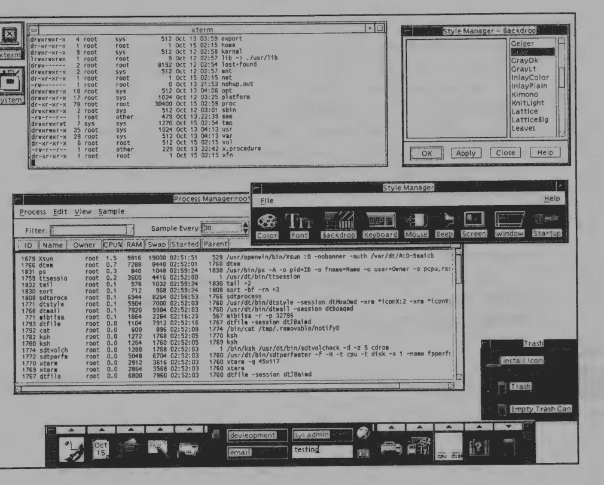

图 1-1 成功登录后的通用桌面环境

从图 1-1 中可以看到，图形界面环境中正在进行许多活动。第四章专门介绍通用桌面环境，详细涵盖了图 1-1 中的许多组件。

### 在线手册页


大多数 UNIX 变种都附带了一组在线手册页。这些被称为 "man" 页面的文档通常内容完整、时效性强，且是出色的综合参考资料。大多数其他操作系统提供的在线帮助只是操作手册中完整帮助内容的一个小子集。另一方面，"man" 页面非常有用，大多数 UNIX 用户在遇到与命令相关的问题时，首先都会查阅 "man" 页面。如果你不知道所需的命令，但知道某个与希望执行的功能相关的命令，你可以查看已知命令的 "man" 页面，并查看其中引用的其他相关命令。

要查看某个命令的 "man" 页面，只需输入 `man` 以及你要使用的命令名称，如下面来自 Solaris 系统的示例所示：

```text
martyp $ man passwd
Reformatting page. Wait... done

User Commands                                passwd(1)

NAME
       passwd - change login password and password attributes

SYNOPSIS
       passwd [ -r | files | -r nis | -r nisplus ] [ name ]
       passwd [ -r files ] [ -egh ] [ name ]
       passwd [ -r files ] -s [ -a ]
       passwd [ -r files ] -s [ name ]
       passwd [ -r files ] [ -d | -l ] [ -f ] [ -n min ] [ -w warn ] [ -x max ] name
       passwd -r nis [ -egh ] [ name ]
       passwd -r nisplus [ -egh ] [ -D domainname ] [ name ]
       passwd -r nisplus -s [ -a ]
       passwd -r nisplus [ -D domainname ] -s [ name ]
       passwd -r nisplus [ -l ] [ -f ] [ -n min ] [ -w warn ]
           [ -x max ] [ -D domainname ] name
```

**描述**

`passwd` 命令用于更改与用户登录名关联的密码或列出密码属性。此外，特权用户可以使用 `passwd` 安装或更改与任何登录 *名称* 关联的密码和属性。

当用于更改密码时，`passwd` 会提示用户输入旧密码（如果存在）。然后它会提示两次输入新密码。当输入旧密码时，`passwd` 会检查其是否已“老化”足够的时间。如果“老化”时间不足，`passwd` 将终止；有关详细信息，请参阅 *pwnconv*(1M)、*nist-bladm*(1) 和 *shadow*(4)。

当系统中启用了 NIS 或 NIS+ 时，`passwd` 会更改 NIS 或 NIS+ 数据库。NIS 或 NIS+ 密码可能与本机上的密码不同。如果正在运行 NIS 或 NIS+，请使用 `passwd -r` 来更改本机的密码信息。

*pwnconv* 命令利用 */etc/passwd* 中的信息创建并更新 */etc/shadow*。*pwnconv* 依赖于 */etc/passwd* 密码字段中 'x' 的特殊值。该 'x' 值表示该用户的密码已存在于 */etc/shadow* 中，不应被修改。

User Commands                          passwd(1)

如果老化时间充足，系统会进行检查以确保新密码符合构造要求。当第二次输入新密码时，系统会比较两个新密码副本。如果两个副本不完全一致，则新密码的提示循环将最多再重复两次。

密码必须构造以满足以下要求——More--(17%)

这个不完整的列表（如示例末尾所示的“17%”）显示了本章前面提到的 **passwd** 命令的 “man” 页面。您可以对其他主题（不仅仅是命令）发出 **man** 命令。您还可以获取有关系统调用、库例程和其他信息。甚至还可以获取有关 **man** 命令本身的信息，如下面来自同一系统的示例所示：


```text
martyp $ man man
Reformatting page. Wait... done

User Commands                          man(1)

NAME
       man - find and display reference manual pages

SYNOPSIS
       man [ - ] [ -adflrt ] [ -M path ] [ -T macro-package ]
       [ -s section ] name ...

       man [ -M path ] -k keyword ...

       man [ -M path ] -f file ...

DESCRIPTION
       The man command displays information from the reference manuals. It displays complete manual pages that you select by name, or one-line summaries selected either by keyword (-k), or by the name of an associated file (-f). If no manual page is located, man prints an error message.

Source Format
       Reference Manual pages are marked up with either roff(1) or sgml(5) (Standard Generalized Markup Language) tags. The man command recognizes the type of markup and processes the file accordingly. The various source files are kept in separate directories depending on the type of markup.

Location of Manual Pages
       The online Reference Manual page directories are conventionally located in /usr/share/man/*. The roff sources are located in the /usr/share/man/man* directories. The SGML sources are located in the /usr/share/man/sman* directories. Each directory corresponds to a section of the manual. Since these directories are optionally installed, they may not reside on your host; you may have to mount /usr/share/man from a host on which they do reside.

       If there are preformatted, up-to-date versions in the corresponding cat or fmt directories, man simply displays or prints those versions. If the preformatted version of interest is out of date or missing, man reformats it prior to display and will store the preformatted version if cat or fmt is writable. The windex database is
--More-- (13%)
```

此示例仅显示了 **man** 命令的 “man” 页面的 13%。请注意，在 “SYNOPSIS” 部分下，您可以指定要查看的 “man” 页面的章节号。“man” 页面被分为若干类别。通常，大多数 UNIX 变种约有八个分组或章节。某些主题出现在多个章节中。如果您知道章节号，可以为命令指定该章节号。在下例中，我们搜索 `passwd` 命令的信息，发现它出现在多个章节中。我们可以查看第 1 章节中该命令的 "man" 页面，然后查看第 4 章节中的 "man" 页面，如下面的示例所示：


```text
martyp $ pwd
/usr/man
martyp $ find . -name passwd*
./sman1/passwd.1
./sman4/passwd.4
martyp $ man -s 1 passwd
Reformatting page. Wait... done

User Commands                         passwd(1)

NAME
       passwd - change login password and password attributes

SYNOPSIS
       passwd  [-r  |  files  | -r nis  | -r nisplus ] [ name ]
       passwd  [ -r files  ]  [ -egh ]  [ name ]
       passwd  [ -r files  ] -s  [ -a ]
       passwd  [ -r files  ] -s  [ name ]
       passwd  [ -r files  ] [ -d | -l  ] [ -f ] [  -n min  ]  [  
-w warn ]  [ -x max ] name
       passwd -r nis  [ -egh ]  [ name ]
       passwd -r nisplus  [ -egh ]  [ -D domainname ]  [ name ]

--More--(3%)
```


```text
martyp $ man -s 4 passwd
Reformatting page.  Wait... done

File Formats                         passwd(4)

NAME
       passwd - password file

SYNOPSIS
       /etc/passwd

DESCRIPTION
       /etc/passwd is a local source of  information  about users'
accounts. The password file can be used in conjunction with
other password sources, including the NIS maps passwd.byname and passwd.bygid and the NIS+ table passwd. Programs use the getpwnam(3C) routines to access this information.

Each passwd entry is a single line of the form:

username:password:uid:gid:gcos-field:home-dir:login-shell

where
```

我们尚未介绍此示例中使用的一些命令，但你所需要知道的是，在 “man” 页面下找到了 **passwd.1** 和 **passwd.4**。

第 1 章节中 **passwd** 的 “man” 页面与之前示例中使用的是同一个。第 4 章节中 **passwd** 的 “man” 页面是关于 **/etc/passwd** 文件的。这是两个不同的 “man” 页面，一个针对 **passwd** 命令，另一个针对 **/etc/passwd** 文件。对于同一个关键字拥有多个 “man” 页面并不罕见。默认情况下，如果未指定章节号，将使用该 “man” 页面出现的第一章节。

某些 UNIX 变种，如 Linux，使用大写 “S” 来指定章节号。在我们的示例中，我们使用了小写 “s”。正如我在书中多处指出的那样，UNIX 变种之间在命令的使用方式、命令输出以及在某些情况下命令本身方面存在许多差异。请记住，你在工作可能会遇到此类差异，因此不妨多查阅你系统上的 “man” 页面作为参考。

与其发出 **find** 命令来查看哪些 “man” 页面涵盖了 **passwd** 命令，我们本可以使用带有 “-k” 选项的 **man** 命令。这个 “-k” 选项结合一个 *关键字*（例如我们示例中的 *password*），会搜索所有 “man” 页面描述中的 *passwd*。只要找到 *passwd*，就会生成单行摘要。以下示例展示了针对此类 *关键字* 搜索所产生的结果：

```text
# man -k passwd

d_passwd          d_passwd (4) - dial-up password file
getpw             getpw (3c) - get passwd entry from UID
```


nispasswd nispasswd (1) - 更改 NIS+ 密码信息
nispasswd nispasswdd (1m) - NIS+ 密码更新守护进程
nispasswd passwd (1) - 更改登录密码和密码属性
nispasswd passwd (4) - 密码文件
nispasswd pwcopy (1m) - 安装和更新 /etc/shadow
nispasswd 以及来自 /etc/passwd 的信息

rpc.nispasswd rpc.nispasswd (1m) - NIS+ 密码更新守护进程
rpc.yppasswd rpc.yppasswd (1m) - 用于修改 NIS 密码文件的服务器
yppasswd yppasswd (1) - 在 NIS 数据库中更改您的网络密码
yppasswd rpc.yppassdd (1m) - 用于修改 NIS 密码文件的服务器

该命令从一个数据库生成了一份长长的“man”页面列表，包括由我们的 find 命令生成的第 1 和第 4 节中的 passwd。要使用“-k”选项，系统管理员必须已经通过执行 catman 命令生成了“man”页面数据库。

我显然是一个使用“man”页面的强大倡导者，因为我在整本书的章节末尾包含了许多“man”页面。只要您看到“man”页面图标，在该图标引用的章节编号中就有该命令的“man”页面。虽然您的 UNIX 变体的“man”页面可能与书中出现的不同，但大多数 UNIX 变体的命令相似，“man”页面可用作极好的参考。

## 电子邮件

所有 UNIX 变体都附带电子邮件程序。您可以使用系统上的其中一个电子邮件程序来发送和接收来自系统上其他用户的电子邮件。如果您的系统管理员已设置此功能，您还可以与其他系统上的用户以及通过互联网进行通信。在本章中，我们将介绍发送和接收电子邮件的基础知识。我在书中很早的时候就介绍这一部分，因为您在第一次登录后可能会收到一条消息，提示您已收到邮件消息，并且您可能希望阅读它们。您在第一次登录后可能会收到欢迎消息或更改密码的请求。

最基础的电子邮件程序，也是我工作过的所有 UNIX 变体上都存在的程序，是 mail。这是一个非常容易使用的程序，几乎不需要太多解释。在下面的示例中，我调用 mail 程序，输入“?”以打印邮件命令列表，阅读来自 Tom 的消息，回复他的消息，并保存原始消息：


```text
* Welcome to sys1

Last unsuccessful login: Mon Mar  8 09:32:13
Last login: Mon Sep 27 07:21:01


**********************************************************************
* This is a private system operated for use by our company only.    *
**********************************************************************

* Welcome to sys1

You have mail.

TERM set to vt100
sys1:/home/martyp
martyp $ mail
Mail [5.2 UCB] Type ? for help.
/var/spool/mail/martyp": 1 message 1 new
>N  1 tomf      Mon Sep 27 07:23  11/392  "12:00 Phone Call"
? ?
Control Commands:
 q               Quit - apply mailbox commands entered this session.
 x               Quit - restore mailbox to original state.
 ! <cmd>         Start a shell, run <cmd>, and return to mailbox.
 cd [<dir>]      Change directory to <dir> or $HOME.
Display Commands:
 t [<msg_list>]  Display messages in <msg_list> or current message.
 n               Display next message.
 f [<msg_list>]  Display headings of messages.
 h [<num>]       Display headings of group containing message <num>.
Message Handling:
 e [<num>]       Edit message <num> (default editor is ex).
 d [<msg_list>]  Delete messages in <msg_list> or current message.
 u [<msg_list>]  Recall deleted messages.
 s [<msg_list>] <file>                 Append messages (with headings) to <file>.
 w [<msg_list>] <file>                 Append messages (text only) to <file>.
 pre [<msg_list>]     Keep messages in system mailbox.
Creating New Mail:
 m <addrlist>      Create/send new message to addresses in <addrlist>.
 r [<msg_list>]    Send reply to sender and recipients of messages.
 R [<msg_list>]    Send reply only to senders of messages.
 a                 Display list of aliases and their addresses.
==================================================================== Mailbox Commands =====================================================================
? t
Message  1:
From tomf Mon Sep 27 07:23:30
Date: Mon, 27 Sep 1999 07:23:30 -0700
From: <tomf>
To: martyp
Subject: 12:00 Phone Call

Please call me at 12:00 CA time to discuss trip.
Tom
? R
To: tomf
Subject: Re:  12:00 Phone Call

I'll call you then.
Marty
Cc:
? s
"/home/martyp/mbox" [Appended] 11/392
? q
sys1:/home/martyp
martyp $
```

这个邮件会话很典型。我们首先使用 mail 调用电子邮件程序。系统通知我们，有一条来自 tomf 的消息，主题为 12:00 Phone Call。然后我们使用 ? 获取邮件命令列表。我选择这个特定的系统进行邮件示例，是因为它在 ? 下产生的帮助信息清晰明了。然后我们使用 t 显示我们收到的消息，使用 R 回复消息发送者 tomf，使用 s 保存并删除该消息，最后使用 q 退出。生成了一个名为 mbox 的文件，其中包含所有已保存的消息。

从这个示例中可以看出，处理邮件箱中的消息是多么容易。然而，您可能希望查看已保存和已删除消息的摘要信息。我主目录中的文件 mbox 已创建用于存储已保存随后被删除的消息。我们可以使用选项“-f”并将 mbox 作为输入文件来查看这些消息的摘要信息，如下例所示：

```text
martyp $ mail -f mbox
Mail [5.2 UCB] Type ? for help.
"mbox": 4 messages
 1 tomf             Sun Sep 26 18:14   11/343   "Training"
>2 donnak           Mon Sep 27  07:23   12/402   "Performance"
 3 carollync        Mon Sep 27  07:27   12/380   "Software Update"
 4 tomf             Mon Sep 27  07:38   11/357   "12:00 Phone Call"
```

在这个示例中，可以看到有四个消息保存在 mbox 中，我们只需指定文件编号（1-4）即可进行操作。当前消息由右箭头 > 指示。可以获取消息的送达日期和时间、消息的行数和字符数大小，以及消息主题的信息。使用 s 保存和删除文件可确保保留文件的副本，以便您稍后访问它。

在某些系统上，有一个稍微高级一点的电子邮件程序，称为 mailx。运行时，mailx 会为您生成消息列表，而不是像 mail 那样逐个显示。mailx 的消息列表与我们刚才使用 mail -f mbox 看到的已删除和已保存消息列表类似。使用 mailx 时，您可以获取是否已阅读消息的状态。每个消息前都有一个单字符，表示该消息是 N（新消息）、O（已读旧消息）或 U（未读消息）。在某些系统上，例如本书许多示例使用的 Red Hat Linux 系统，当您运行 mail 时，您会获得消息列表，就像在其他系统上运行 mailx 时一样。下面的示例展示了运行 mailx 时您看到的内容：

```text
martyp $ mailx
Mail [5.2 UCB]  Type ? for help.
"/var/spool/mail/martyp": 2 messages 1 new 2 unread
  U  1 tomf           Mon Sep 29 08:40  13/394 "Networking"
>N  2 donnak          Mon Sep 29 08:49  10/342 "Interoperability"
 ?
```

第一条消息是 U，表示未读。第二条消息是 N，表示新消息。右箭头位于新消息旁边。

您不限于将消息保存到默认文件 mbox。您可以通过将消息保存到不同的文件来组织您的消息。下面的示例展示了将消息保存到文件 trip：

```text
martyp $ mailx
Mail [5.2 UCB] [AIX 4.1]  Type ? for help.
"/var/spool/mail/martyp": 2 messages 2 unread
>U  1 tomf           Mon Sep 27 08:49  11/352 "NY trip"
  U  2 donnak          Wed Sep 29 04:44  11/354 "login change"
 ?
Message  1:
From tomf Mon Sep 27 08:49:09
Date: Mon, 27 Sep 08:49:08 -0700
From: <tomf>
To: martyp
Subject: NY trip

I am going to change the date of the NY trip.
? s trip
"trip" [New file]  11/352
? q
Held 1 message in /var/spool/mail/martyp
martyp $ 
```


调用 **mailx** 后，按下“Return（回车）”键即可读取第一封邮件。

文件 **trip** 是在使用 **s trip** 保存该邮件时创建的，现在我们可以将所有相关邮件存储到文件 **trip** 中。

保存到文件的邮件可以通过 **lp** 命令打印出来。我们将在本书的系统管理章节中详细讨论 **lp**；但目前只需知道，通过执行命令 **lp** *filename* 即可将文件打印到默认打印机。要打印文件 **trip**，我们需要执行命令 **lp trip**。

发送电子邮件和阅读电子邮件一样简单。发送信息的最简单方法是输入 **mailx** 或 **mail**，然后输入你想发送消息的人的*用户名*。我们将在下面的消息中对 *tomf* 执行此操作：

```
martyp $ mail tomf
Subject: Pickup
I'll be at the airport in NY to give you a ride.
Marty
Cc:
martyp $
```

使用 ^D（控制 D）结束了邮件消息。这条消息将位于 *tomf* 的邮箱中。如果你的系统启用了此功能，可以使用 Internet 命名法来发送消息。下面的示例展示了将同样的消息发送到 *tomf* 的 Internet 电子邮件地址：

```
martyp $ mail tomf@tomcompany.com
Subject: Pickup
I'll be at the airport in NY to give you a ride.
Marty
Cc:
martyp $
```

向其他系统和 Internet 地址发送消息的功能需要系统管理员设置此功能。

如果你的系统有图形用户界面，你很可能拥有一个帮助你管理邮件的工具。尽管该工具在你的图形环境中运行，但它可能正在使用我们之前介绍过的某个邮件程序。图 1-2 展示了在通用桌面环境中访问邮件。

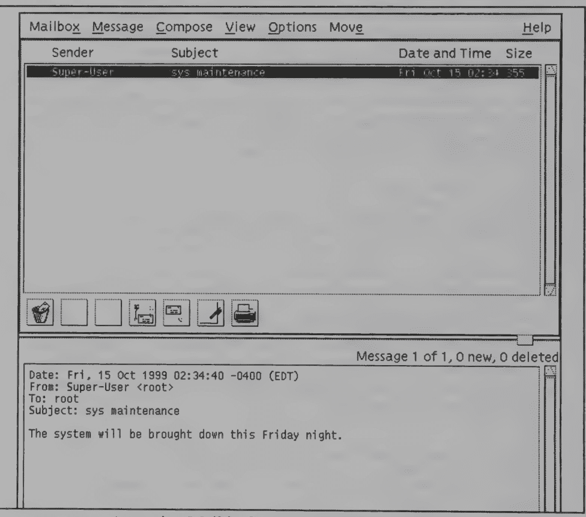

图 1-2 在通用桌面环境中访问邮件

图 1-2 顶部的下拉菜单提供了选项，这些选项执行与之前介绍的保存、转发、删除等命令相同的功能。

## 访问 Internet

自 Internet 问世以来，它已在 UNIX 系统上得到广泛应用。第一个被广泛使用的 Web 浏览器是伊利诺伊大学开发的 X Window System 应用程序 Mosaic。如今，有许多可用于 UNIX 系统的 Web 浏览器，包括 Mosaic、Netscape Communicator 以及其他多种。本节将重点介绍 Netscape Communicator，因为它是 UNIX 系统上使用最广泛的浏览器。有许多 Netscape Communicator 软件包可用，有些选项与其他软件包不同，还有 Netscape Navigator，它是一种基础 Web 浏览器。因此，请记住，你可能没有 Netscape 浏览器，或者你拥有的 Netscape 浏览器与本节介绍的不同，但相同的原则适用于大多数浏览器。

你的系统管理员可能已经为你的 UNIX 系统配置了浏览器。许多 UNIX 发行版，例如本书许多示例中使用的 Linux Red Hat，都将浏览器作为操作系统发行版的一部分提供。在使用 UNIX 系统时，浏览器和 Internet 是宝贵的工具。你可以在提供该 UNIX 操作系统的公司的网站上找到有关该系统的最新信息。图 1-3 显示了 Netscape Communicator 窗口显示 Red Hat 主页。

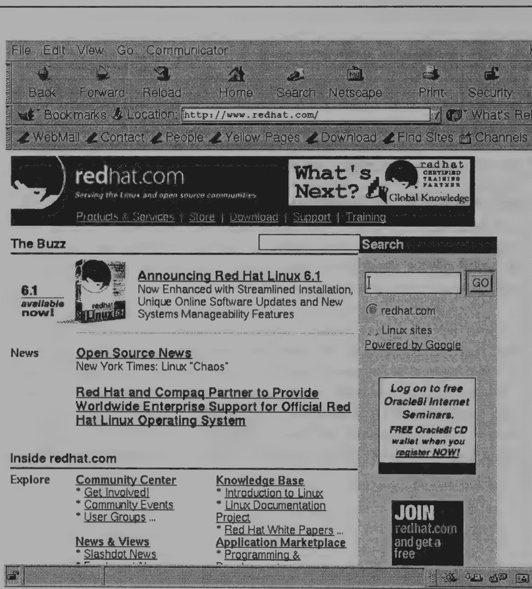

从该主页，你可以搜索任何与 Red Hat Linux 操作系统相关的主题。我们通过指定浏览器*位置*框中的统一资源定位符（URL）来连接主页。在这种情况下，我们指定了 www.redhat.com，这是 Red Hat 的 URL。表 1-1 以字母顺序列出了本书中使用的四种引用最多的 UNIX 变体供应商的 URL。

**表 1-1 本书中使用的 UNIX 变体供应商 URL**

| URL | 结果 |
| --- | --- |
| www.hp.com | Hewlett-Packard 公司 |
| www.ibm.com | International Business Machines Corp. |
| www.redhat.com | Red Hat, Inc. |
| www.sun.com | Sun Microsystems, Inc. |

从这些主页开始，你可以逐步浏览网站以找到所需的信息。“逐步浏览”是这里的关键词。你很可能会使用正在查看的主页上的搜索机制，快速在网站上找到你需要的内容。另一方面，你可能需要花费大量时间在一个网站上寻找你想要的信息，并最终访问许多相关的网站以获取所需信息。

请注意，在图 1-3 中，www.redhat.com 前面是 http://。这是 URL 的协议部分。http:// 是用于指定 Web 页面的协议。存在许多此类协议。表 1-2 列出了一些常用的协议。

表 1-2 常用协议指定符

| 协议 | 结果 |
| :--- | :--- |
| file:<path name> | 按照 <path name> 指定的路径将本地文件加载到浏览器中。 |
| ftp:// | 将使用文件传输协议（ftp）。 |
| gopher:// | 将使用提供 Gopher 服务的主机。 |
| http:// | 将使用要访问的目标 Web 页面。 |
| https:// | 将使用要访问的目标安全 Web 页面。 |
| news:// | 将使用网络新闻服务器。 |

这些是与浏览器一起最常用的协议。

接下来的几幅图展示了你可以对浏览器进行的一些基本自定义设置。这些内容旨在让你了解大多数浏览器可执行的自定义类型。

尽管你的浏览器可能已经为你加载完成，但可能仍需要一些配置使其完全运行，或者你希望进行某些自定义。图 1-4 左侧展示了在 Netscape Communicator 中我们可以进行的几个自定义区域，在此示例中选择了 Fonts（字体）：

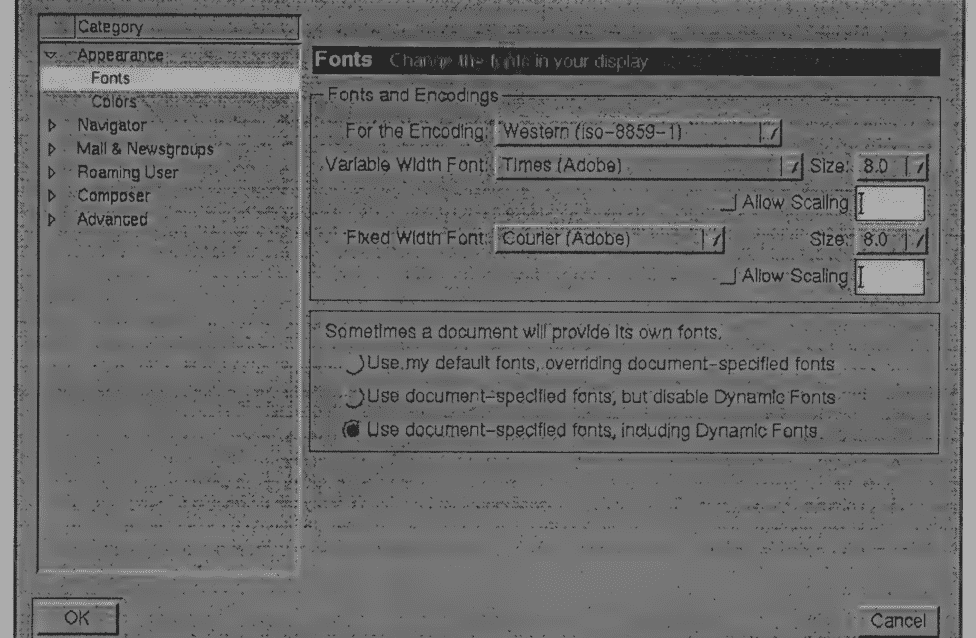

图 1-4 指定浏览器字体

在此示例中，我们选择 *Appearance*（外观）下的 *Fonts*（字体）以获取图 1-4 中显示的信息。在自定义选项中，我们可以指定在此应用程序中希望使用的字体大小。在 *Appearance* 下还有一个 *Colors*（颜色）选项，我们也可以通过类似的一组选项来调整此应用程序的颜色。

我们可以修改的下一类选项位于 *Navigator*（浏览器）下，如图 1-5 所示。

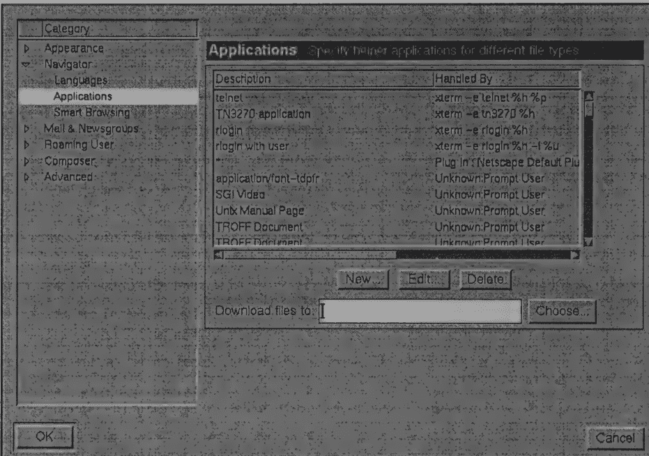

图 1-5 浏览器应用程序

在 *Navigator* 下，我们有三个潜在的自定义区域。我们正在查看 *Applications*（应用程序）窗口。此窗口列出了应用程序及其关联的“helper”（辅助程序）。

下一类选项是 *Mail and Newsgroups*（邮件和新闻组），如图 1-6 所示。

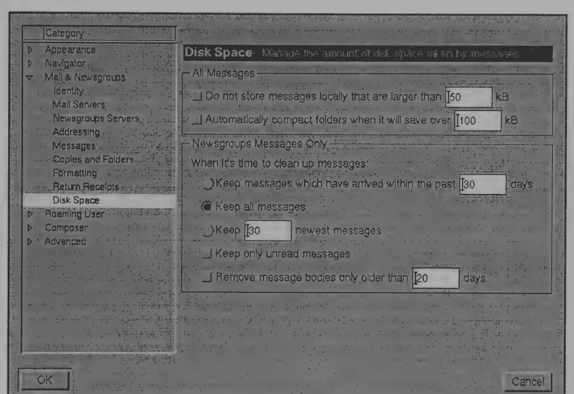

图 1-6 浏览器磁盘空间

在图 1-6 中，我们正在指定消息可以占用的磁盘空间量。由于邮件和新闻组都可能导致大量大消息发送到你的系统，因此你需要控制接收消息的大小以及根据消息年龄清除哪些消息。

下一类选项是 *Roaming User*（漫游用户），这与 Netscape 在漫游模式下使用时的设置有关。你可以选择要传输的配置文件的哪些方面，如图 1-7 所示。

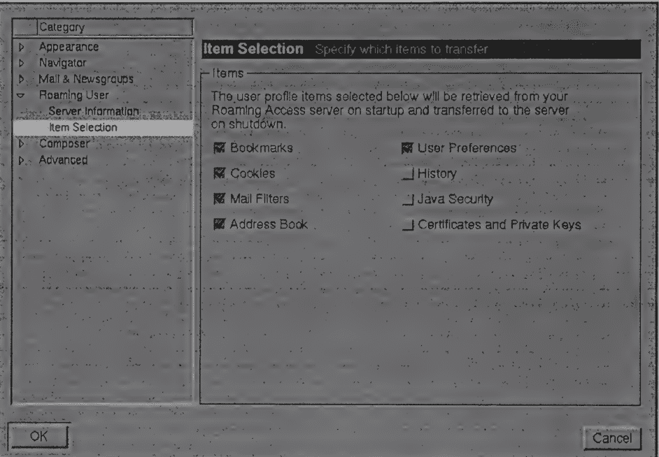

图 1-7 漫游用户项目

图 1-7 展示了如果你使用漫游访问服务器，将会传输的一些项目。无论你在哪里使用 Netscape，你都希望你的 *User Preferences*（用户首选项）设置保持一致，此类选项为你的漫游设置提供了选择。

下一类选项是 *Composing*（撰写），它提供与你发布的 Web 文档相关的选项，如图 1-8 所示。

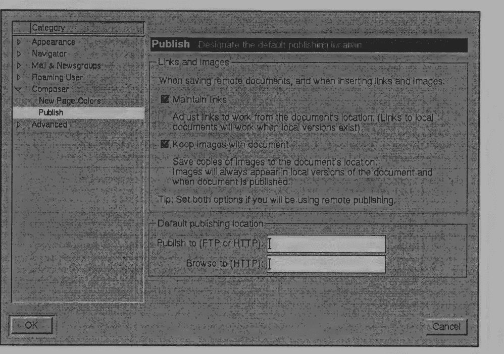

图 1-8 与发布相关的选择

我们在图 1-8 中查看 *Composing* 下的 *Publish*（发布），它提供关于你可能执行的与 Web 相关的发布的选项，例如文档的位置。

最后一类选项是 *Advanced*（高级），其中包含有关 *Cache*（缓存）和 *Proxies*（代理）的信息，如图 1-9 所示。


## UNIX 组件

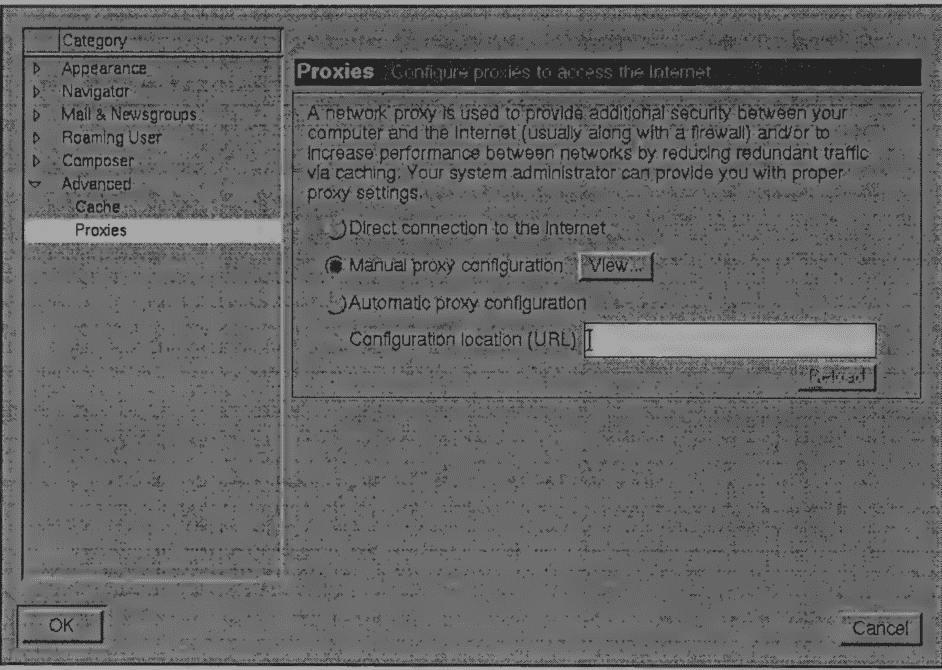

为了保护计算机系统免受入侵，大多数公司都设置了防火墙，目的是限制对系统的访问。这意味着进出许多公司网络都变得困难。代理服务器是访问互联网的一种手段。我们在图 1-9 中选择了 *代理*，从而生成了图 1-10 中所示的对话框。

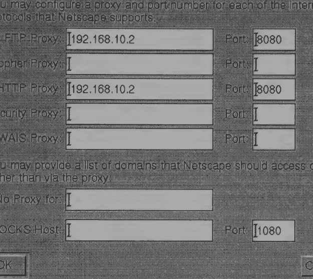

**图 1-10 指定代理相关信息**

在图 1-10 中，我们设置了两类互联网访问的代理服务器地址和端口号。系统管理员可能已经为您完成了此设置。如果没有，且您不了解相关信息，在进行此类配置更改之前，建议您先与系统管理员进行沟通。

*高级* 类别下的另一项是 *缓存*，如图 1-11 所示。

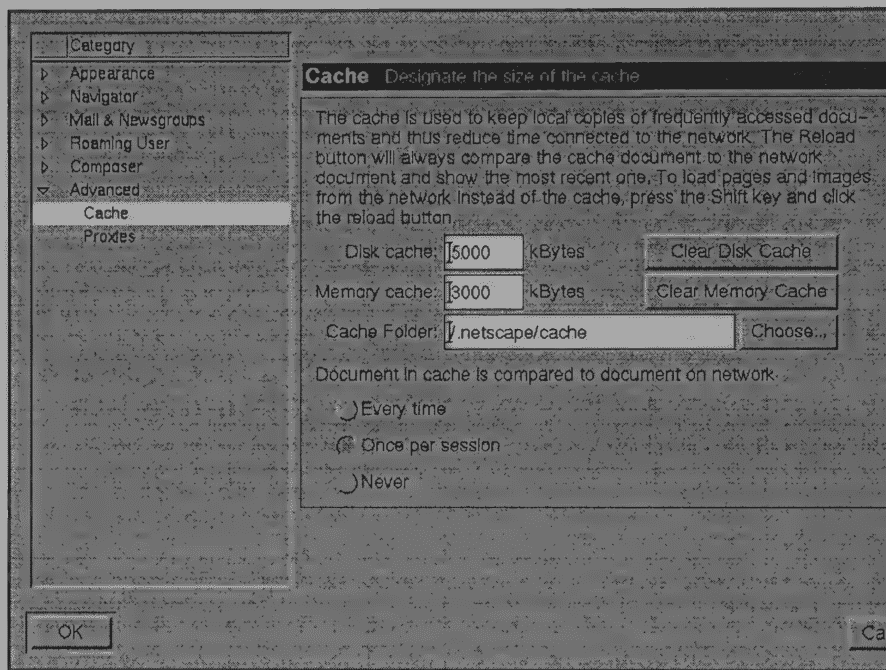

**图 1-11 缓存定制**

与浏览器相关的缓存用于通过本地保存常用信息的副本来提高您的互联网工作效率，这样您就不必频繁地通过网络重新加载信息。您可以在此窗口中指定缓存的大小以及缓存数据的保存位置。

在使用浏览器一段时间后，您就会确定想要进行的定制类型。大多数浏览器都提供执行本章节所介绍的定制类型的选项。

我特意将 UNIX 系统的组件内容留到本章末尾进行讲解，因为登录后，发出一些命令，并可能访问了互联网之后，您已经对如何与 UNIX 系统交互有了初步感觉。现在是讲解 UNIX 系统由哪些高级组件构成的合适时机。

图 1-12 是 UNIX 系统的高级示意图：

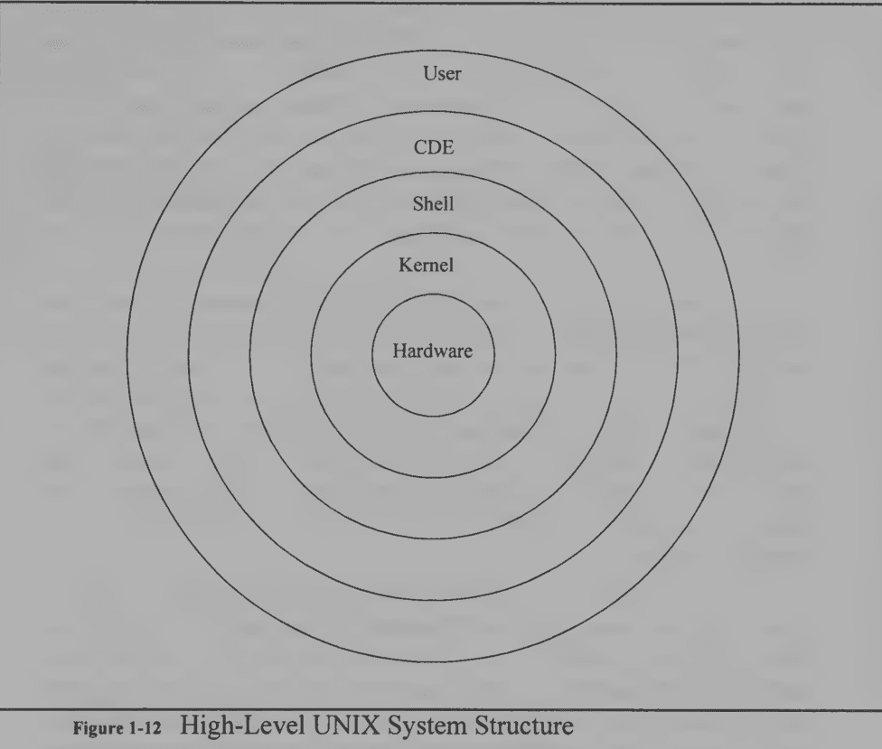

在描述此图之前，我首先指出每个人看待 UNIX 组件的方式都略有不同。此图包含从用户角度来看最重要的组件。

该图的核心是硬件。UNIX 以其多种形式，现在运行在许多不同类型的硬件上。我在这本书中不会过多涉及硬件，因为与 UNIX 所运行的硬件相关的选项实在太多。

从该图中心往外的下一圈是内核。内核执行许多功能，包括：管理设备、内存和进程；调度和执行所有命令；以及包含控制系统硬件的驱动程序。内核是系统管理员花费大量时间维护的系统方面。当配置新设备时，为了支持新设备，可能需要向内核添加设备驱动程序。此外，还可以对内核进行大量调整，以优化在 UNIX 系统上运行的应用程序的系统性能。用户通过发出最终传递到内核的命令来与内核进行间接交互。

下一圈是 shell。Shell 接收您发出的命令并启动执行这些命令的过程。对于典型用户来说，这是他们接触 UNIX 图景的深度极限。除了将命令传递给系统更深层的组件外，shell 还允许您在后台运行命令以及运行 shell 程序。我们将在后续章节中介绍最常用的三种 shell，并涵盖 shell 编程的基础知识。书中的大部分内容基于您在命令行上执行的操作，这是 shell 的一部分。

下一圈是公共桌面环境（CDE）或其他图形用户界面。本书的第 4 章专门介绍 CDE，许多示例使用 CDE 以及另一个在 Linux 系统上运行的图形界面 Gnome。通常您不会在这样的 UNIX 图中将图形用户界面视为单独的一圈，因为大多数在图形用户界面中完成的工作最终都会转化为 shell 命令。鉴于大多数 UNIX 用户都使用图形用户界面，我认为它值得单独作为一个圆圈。

最后一圈是用户。您通过此图中所示的所有层级在 UNIX 系统上完成工作。

由于书中的大多数示例发生在命令行上，其余在图形用户界面中，因此作为用户，您实际上不需要担心 UNIX 内部的那些圈层。由于您的系统管理员、数据库管理员以及其他维护系统的人员花费大量时间处理这些最内部的组件，图 1-13 很有帮助，因为它让您了解您的同事专注于哪些领域。您的 shell、邮件系统、用户界面、浏览器界面和其他组件由您定制和维护，因此这些主题将在后续章节中涵盖，同时也包括与 UNIX 文件系统的交互以及您将发出的 UNIX 命令。

# 第 2 章

## UNIX 文件系统简介

### UNIX 的基础

UNIX 中的几乎一切都归结为文件和目录。如果您理解了层次化的 UNIX 文件系统布局以及如何操作文件和目录，那么您在理解 UNIX 的道路上已经走了很长一段路。

操作 UNIX 文件和目录涉及许多内容。本章介绍了 UNIX 中文件和目录的基础和背景。下一章涵盖与文件和目录相关的命令。本章唯一涵盖的命令是 file 命令，用于确定文件类型。


#### 文件类型

文件是 UNIX 系统上存储信息的一种方式。您发出的命令、使用的应用程序、存储的数据以及访问的设备（如打印机和键盘）都包含在文件中。UNIX 的一个方面使其既简单又复杂；简单在于您知道所有外在的东西都是文件，复杂在于文件的内容可以是任何东西，从您可以读取的简单数据到由系统管理员使用一组独特命令创建的设备文件。

系统中的每个文件都有一个文件名。操作系统处理所有与文件系统相关的任务；您只需要知道文件的名称以及如何它使用。UNIX 系统上有许多类型的文件。某些文件类型是您在使用的 UNIX 变体所特有的。例如，设备文件包含有关您运行 UNIX 变体的特定硬件平台的信息。然而，通常来说，大多数文件类型在不同系统之间是相似的。我们要查看的文件类型包括：

- 文本文件
- 数据文件
- 源代码文件
- 可执行文件
- Shell 程序
- 链接
- 设备文件

在处理各种类型的文件时，许多时候这些文件都关联有扩展名。例如，许多应用程序将特定扩展名与该应用程序关联。例如，文本文件有时具有 .txt 扩展名。大多数 C 源代码程序具有 .c 扩展名，大多数 C++ 程序具有 .cc 扩展名。虽然扩展名对于确定文件类型可能很有用，但没有书面规定要求特定类型的文件必须包含指定的扩展名。

下表列出了各种类型文件常用的一些扩展名：

| 扩展名 | 文件类型 |
| :--- | :--- |
| .l 到 .n | 在线手册源。 |
| .a | 存档或库。 |
| .c | C 程序源代码。 |
| .cc | C++ 程序源代码。 |
| .csh | C shell 脚本。 |
| .f | FORTRAN 程序源代码。 |
| .ksh | Korn shell 脚本。 |
| .o | 编译源代码的目标文件。 |
| .ps | Postscript 源代码。 |
| .shar | Shell 存档。 |
| .sh | Bourne shell 脚本。 |
| .tar | tar 存档。 |
| .txt | ASCII 文本文件。 |
| .Z | 压缩文件。 |


确定文件类型的一种有用技术是使用 `file` 命令。大多数 UNIX 变体都支持 `file` 命令，尽管输出结果略有不同，因此我建议您在判断文件类型时使用 `file` 命令。了解文件类型和 `file` 命令的最佳方法是通过示例，我们将在本章稍后讨论几种常见文件类型后，再详细进行讲解。

#### 文本文件

比一个包含字符的文件更简单的事情可能没有了吧，就像你现在在本章中阅读的这些字符一样。这些 ASCII 字符代表了您所执行的工作中的字母和数字。例如，如果您使用 UNIX 编辑器创建电子邮件消息或信函，那么在大多数情况下，您正在创建一个文本文件。以下是来自 Linux 系统的部分 ASCII 文本文件示例：

```
Thu Nov  5 07:29:53 1999 debug: FTS: appending '/dev/hda1'
Thu Nov  5 07:29:53 1999 debug: FTS: appending '/tmp/LST/swap.sel'
Thu Nov  5 07:29:53 1999 debug: Building partition-list with argument <Linux>
Thu Nov  5 07:29:53 1999 debug: Respecting exclude file /tmp/LST/targets.sel:
/dev/hda1
/dev/hda2
Thu Nov  5 07:29:53 1999 debug: No ADDITIONAL partitions available
Thu Nov  5 07:29:59 1999 debug: added '8390' to '/root/tmp/modules.handled'
Thu Nov  5 07:29:59 1999 debug: added '8390' to '/root/etc/modules/2.0.29/#1 Tue Feb 11 20:36:48 MET 1997.default'
Thu Nov  5 07:29:59 1999 debug: added 'scsi_mod' to '/root/tmp/modules.handled'
Thu Nov  5 07:29:59 1999 debug: added 'scsi_mod' to '/root/etc/modules/2.0.29/#1 Tue Feb 11 20:36:48 MET 1997.default'
Thu Nov  5 07:29:59 1999 debug: added 'sd_mod' to '/root/tmp/modules.handled'
Thu Nov  5 07:29:59 1999 debug: added 'sd_mod' to '/root/etc/modules/2.0.29/#1 Tue Feb 11 20:36:48 MET 1997.default'
Thu Nov  5 07:29:59 1999 debug: added 'sr_mod' to '/root/tmp/modules.handled'
Thu Nov  5 07:29:59 1999 debug: added 'sr_mod' to '/root/etc/modules/2.0.29/#1 Tue Feb 11 20:36:48 MET 1997.default'
Thu Nov  5 07:29:59 1999 debug: added 'st' to '/root/tmp/modules.handled'
Thu Nov  5 07:29:59 1999 debug: added 'st' to '/root/etc/modules/2.0.29/#1 Tue Feb 11 20:36:48 MET 1997.default'
Thu Nov  5 07:29:59 1999 debug: added 'sg' to '/root/tmp/modules.handled'
Thu Nov  5 07:29:59 1999 debug: added 'sg' to '/root/etc/modules/2.0.29/#1 Tue Feb 11 20:36:48 MET 1997.default'
Thu Nov  5 07:29:59 1999 debug: added 'nfs' to '/root/tmp/modules.handled'
Thu Nov  5 07:29:59 1999 debug: added 'nfs' to '/root/etc/modules/2.0.29/#1 Tue Feb 11 20:36:48 MET 1997.default'
Thu Nov  5 07:29:59 1999 debug: added 'iso9660' to '/root/tmp/modules.handled'
Thu Nov  5 07:29:59 1999 debug: added 'iso9660' to '/root/etc/modules/2.0.29/#1 Tue Feb 11 20:36:48 MET 1997.default'
Thu Nov  5 07:29:59 1999 debug: added 'isos' to '/root/tmp/modules.handled'
Thu Nov  5 07:29:59 1999 debug: added 'isos' to '/root/etc/modules/2.0.29/#1 Tue Feb 11 20:36:48 MET 1997.default'
Thu Nov  5 07:29:59 1999 debug: 'isos' is already handled
Thu Nov  5 07:29:59 1999 debug: 'nfs' is already handled
Thu Nov  5 07:29:59 1999 debug: 'sg' is already handled
Thu Nov  5 07:29:59 1999 debug: 'st' is already handled
```

#### 数据文件

包含应用程序所使用的数据的文件称为数据文件。如果您使用诸如 FrameMaker® 等复杂的桌面排版工具来撰写书籍，您将创建 FrameMaker 使用的数据文件。这些数据文件包含数据（通常可读）和格式信息（有时可读，但通常对用户隐藏）。如果您的 UNIX 安装使用了数据库程序，那么您可能会拥有部分可读的数据文件。

#### 源代码文件

源代码文件是包含与编程语言（如 C 语言）相关信息的文本文件。

以下是一个 C 源代码文件的示例：

```c
/* this is K & R sort program */

#include <stdio.h>
#include <stdlib.h>

int N;
int v[1000000]; /* v is array to be sorted */
int left = 0; /* left pointer */
int right;
int swapcount, comparecount = 0; /* count swaps and compares */

int i, j, t;
char print;
char pr_incr_sorts;

main()
{
    printf("Enter number of numbers to sort : ");
    scanf("%10d", &N); /* 10d used for a BIG input */
    printf ("\n\n"); /* select type of input to sort */
    
    printf("Enter rand(1), in-order(2), or reverse order (3)    sort : ");
    scanf("%2d", &type); /* select type of input to sort */
    printf ("\n\n");
    
    if (type == 3)
        for (i=0; i<N; ++i) /* random */
            v[i]= (N - i);
    
    else if (type == 2)
        for (i=0; i<N; ++i) /* in order */
            v[i]= (i + 1);
    
    else if (type == 1)
        for (i=0; i<N; ++i) /* reverse order */
            v[i]=rand();
    
    fflush(stdin);
    printf("Do you want to see the numbers before sorting (y or n)? : ");
    scanf("%c", &print);
    printf ("\n\n"); /* View unsorted numbers? */
    if (print == 'y')
    {
        printf ("\n\n");
        for (i=0; i<N; ++i)
            printf("a[%2d] = %2d\n", i, v[i]);
        printf ("\n\n");
    }
    
    fflush(stdin);
    printf("Do you want to see the array at each step as it sorts? (y or n)? : ");
    scanf("%c", &pr_incr_sorts);
    printf ("\n\n"); /* View incremental sorts? */
    
    right = N-1; /* right pointer */
    
    qsort(v, left, right);
    
    if (pr_incr_sorts == 'y')
    {
        fflush(stdin);
        printf ("Here is the sorted list of %2d items\n", N);
        printf ("\n\n");
        for (i=0; i<N; ++i)
            printf ("%2d\n", v[i]);
        printf ("\n\n"); /* print sorted list */
        printf ("number of swaps = %2d\n", swapcount);
        printf ("number of compares = %2d\n", comparecount);
    }
}

/* qsort function */
void qsort( v, left, right)
int v[], left, right;
{
    int i, last;
    if (left > right)
        return;
    
    swap(v, left, (left + right)/2);
    last = left;
    for (i=left+1; i <= right; i++)
    {
        comparecount = ++comparecount;
        if (v[i] < v[left])
            swap(v, ++last, i);
    }
    swap(v, left, last);
    qsort(v, left, last-1);
    qsort(v, last+1, right);
}

/* swap function */

swap(v, i, j)
int v[], i, j;
{
    int temp;

    swapcount = swapcount++;
    temp = v[i];
    v[i] = v[j];
    v[j] = temp;
}
```

#### 可执行文件

可执行文件是可以运行的已编译程序。您无法阅读可执行文件，当尝试查看其中一个文件时，通常会收到一堆错误、无法读取的字符以及来自 UNIX 系统的蜂鸣声。您还可能丢失屏幕设置并导致其他问题。

在 UNIX 中，您不需要走多远就能找到可执行文件；它们随处可见。您执行的许多 UNIX 命令都是不可读的可执行文件。此外，如果您在系统上开发程序，那么您就在创建自己的可执行文件。

以下是如果您尝试将可执行文件发送到屏幕上会看到的内容示例：

```
unknown/ etc/ttytypeunknown<@=>|<@=>|: unknown<@=>
callocLINESCOLUMNSunknownPackaged for
argbad aafter%3
parmnumber missing <@=>|<@=>: 
@ @ 3### @@A: 2TTO|>@#<|2XOOR
EraseKillLOOPS<@=>|<@=>|:
<@=>|<@=>: 
<@=>|<@=>: ;<@> AT00<@=>: ;<@=>|<@=>: ;<@=><@=>: ;<@=><@=
>: 
```

#### Shell 程序

Shell 程序既是您可以运行以执行任务的文件，也是您可以阅读的文件。因此，是的，尽管因为它是可执行的所以您可以运行该文件，但您也可以阅读它。我将在后续章节中更详细地描述 Shell 编程。

我认为 Shell 编程是每个用户都应具备的一项重要技能。我将花一些时间讲解 Shell 编程的基础知识。我即将涵盖的有关文件类型和权限的一些背景知识在 Shell 编程中非常重要，因此这是一些您需要理解的重要信息。

以下是一个执行系统审计的 Shell 程序的部分示例：

```
#!/bin/sh
{
    echo "PROG>>>> determining if Ignite-UX loaded on system."

    igtest=`swlist | grep Ignite`
    echo $igtest
    if [ -n "$igtest" ]; then
        echo "Ignite-UX installed"
    else
        echo "Ignite-UX is not installed"
    fi
}
```


#### Shell 程序

```bash
echo "PROG>>>> determining if make_recovery has been run by
            checking for /var/opt/ignite/arch.include."
if [ -f /var/opt/ignite/recovery/arch.include ]; then
    echo "make_recovery has been run."
else
    echo "make_recovery has not been run."
fi

echo "PROG>>>> determining if make_recovery was run with the
            -C (for check_recovery) option."
if [ -f /var/opt/ignite/recovery/makrec.last ]; then
    echo "make_recovery with -C has been run. We'll now
            run check_recovery."
    /opt/ignite/bin/check_recovery 2>&1
else
    echo "make_recovery with -C has not been run. We can't
            run check_recovery."
fi
} | tee -a /tmp/IMPORTANT/igtest.out
```

Shell 程序是您能够阅读和修改的文本，前提是确实拥有相应的权限。除了编程信息外，Shell 程序还包含以 # 开头的行所指示的注释。

#### 链接

链接是指向存储在系统其他位置的文件指针。您不必在系统中保留两个或多个文件副本，而是可以链接到系统中已存在的文件。

在 UNIX 中，链接的一个特别有用的用途与操作系统的新版本有关。从一个版本升级到另一个版本时，文件的位置有时会发生变化，与其学习所有新位置，不如从旧位置创建指向新位置的链接。当您使用旧位置运行命令时，链接将指向新位置。

链接对于集中管理文件也很有用。如果一组相同的文件需要经常更新，链接到一个中心文件并更新它比在多个不同位置更新该文件的多个副本要容易得多。

### 设备文件

设备文件（有时称为设备特殊文件）包含有关连接到您系统的硬件的信息。由于设备特殊文件与系统管理功能相关联，因此在面向用户（而非系统管理员）的材料中通常很少涉及。我认为情况本应相反。如果用户想要向软盘或磁带写入文件，却不知道如何访问设备文件，这会非常令人沮丧。我将介绍一些设备文件的用途，以免您在这个领域完全处于黑暗之中。

您系统上的设备通常可以通过不同的设备文件来访问。例如，磁盘既可以通过块设备文件访问，也可以通过字符设备文件访问。大多数访问操作是系统管理员的责任；然而，当您尝试确定文件类型时，可能会遇到不同类型的特殊文件，例如字符设备和块设备。

您的系统上还有其他类型的文件，但对于初学 UNIX 而言，我将描述的文件类型提供了足够的背景知识来帮助您入门。


### file 命令

**file** 命令用于确定文件类型。此命令很有用，因为文件名并不总是指示其文件类型。以下示例执行文件的长列表以提供有关该文件的一些背景信息，然后运行 **file** 命令以显示文件类型。我在下一章才介绍用于列出文件的命令，但我在这些示例中包含了它。**ls** 命令提供文件列表。**ls** 将在下一章中详细介绍。我们在本章中只需要使用其基本形式。如果您需要查看，我已在本章末尾包含了 **ls** 的手册页。结合 “-l” 选项，您可以生成长列表，提供大量有关文件的信息。使用 **ls -l** 在以下示例中，您将看到每个文件的名称、文件类型、权限、硬链接数、所有者名称、组名称、字节大小和时间戳。您可能现在还不太清楚这些信息的大部分用途；然而，当查看 **file** 命令的输出时，其中一些信息可能会很有用。本章中关于 **file** 命令的示例表明，不同的 UNIX 变体可能产生略有不同的 **file** 命令输出。以下示例展示了 HP-UX 的“UNIX 示例”输出，以及可用时的 Linux 输出。


### 文本文件（UNIX 示例）

（由 **file** 命令描述为 *ascii text*。）

```text
# ls -l .mosaic-global-history
-rw-r--r--     1  201     users          587 Dec 22  1999 .mosaic-global-history
# file .mosaic-global-history
.mosaic-global-history: ascii text
#
```

### 文本文件（Linux 示例）

（由 **file** 命令描述为 *ASCII text*。）

```text
# ls -l *
-rw-r--r--     1  root    root         251367 Nov  5 07:11 debug
-rw-r--r--     1  root    root          2020 Nov  5 07:11 history
# file *
debug:        ASCII text
history:       ASCII text
```


### 数据文件（UNIX 示例）

（由 **file** 命令描述为 *data*。）


```text
# ls -l Static.dat
-rw-r--r--    1    201        users     235874 Aug 26  1999 Static.dat
# file Static.dat
Static.dat:     data
#
```

### 源代码文件（UNIX 示例）

（由 **file** 命令描述为 *c program text*。）

```text
# ls -l krsort.c
-rwxrwxrw    1    201        users     3234 Nov 16  1999 krsort.c
# file krsort.c
krsort.c:      c program text
#
```

### 源代码文件（Linux 示例）

（由 **file** 命令描述为 *C program text*。）

```text
# ls -l *.c
-rw-r-r--    1 root        root     4521 Jul 12  1999 intl-bindtextdom.c
-rw-r-r--    1 root        root     6234 Jul 12  1999 intl-cat-compact.c
-rw-r-r--    1 root        root     14128 Jul 12  1999 intl-dgettext.c
-rw-r-r--    1 root        root     1750 Jul 12  1999 intl-dgettext.c
-rw-r-r--    1 root        root     12759 Jul 12  1999 intl-finddomain.c
-rw-r-r--    1 root        root     1907 Jul 12  1999 intl-gettext.c
-rw-r-r--    1 root        root     1646 Jul 12  1999 intl-intl-compact.c
-rw-r-r--    1 root        root     5361 Jul 12  1999 intl-loadmsgcat.c
-rw-r-r--    1 root        root     7271 Jul 12  1999 intl-localealias.c
-rw-r-r--    1 root        root     2914 Jul 12  1999 intl-textdomain.c
# file *.c
intl-bindtextdom.c:  C program text
intl-cat-compact.c:  C program text
intl-dgettext.c:     C program text
intl-finddomain.c:   C program text
intl-gettext.c:      C program text
intl-intl-compact.c: C program text
intl-loadmsgcat.c:   C program text
intl-localealias.c:  C program text
intl-textdomain.c:   C program text
#
```

### 可执行文件（UNIX 示例）

（由 file 命令描述为 shared executable。）

```text
# ls -l krsort
-rwxr-xr-x  1 201    users       34592 Nov 16  1999 krsort
# file krsort
krsort:		PA-RISC1.1 shared executable dynamically linked
-not stripped
#
```

### 可执行文件（Linux 示例）

（由 file 命令描述为 executable。）

```text
# ls -l a*
-rwxr-xr-x  1 root     root          3888 Jul 24  1999 activate
-rwxr-xr-x  1 root     root          4452 Feb 25  1999 adjtimex
# file a*
activate: ELF 32-bit LSB executable, Intel 80386, version 1,
stripped
adjtimex: ELF 32-bit LSB executable, Intel 80386, version 1,
stripped
#
```

### Shell 程序（UNIX 示例）

（由 file 命令描述为 commands text。）

```text
# ls -l llsum
-rwxrwxrwx  1 root     sys          1267 Feb 23  1999 llsum
# file llsum
llsum:		commands text
#
```


### Shell 程序（Linux 示例）

（由 **file** 命令描述为 *Bourne shell script text*。）

```text
# ls -l request-route
-rwx------ 1 root root 1046 Sep 19 1999 request-route
# file request-route
request-route: Bourne shell script text
#
```

### 链接（UNIX 示例）

（该链接未被 **file** 命令引用；此处显示为 *shared executable dynamically linked*。对 *dynamically linked* 的引用并不意味着这是一个链接。）

```text
# ls -l /usr/bin/ar
lr-xr-xr-xr 1 root sys 15 Mar 23 1999 ar -> /usr/ccs/bin/ar
# file /usr/bin/ar
/usr/bin/ar: s800 shared executable dynamically linked
#
```

### 链接（Linux 示例）

（该链接显示为 *symbolic link*。）

```text
# ls -l reboot
lrw xrwxrwx 1 root root 4 Nov 5 01:31 reboot -> halt
# file * | grep link
depmod: symbolic link to modprobe
ksyms: symbolic link to insmod
pidof: symbolic link to killall5
reboot: symbolic link to halt
rmmod: symbolic link to insmod
swapon: symbolic link to swapoff
telinit: symbolic link to init
udostctl: symbolic link to /sbin/umsync
umsetup: symbolic link to /sbin/umsync
#
```


## 块设备文件（UNIX 示例）

（由 **file** 命令描述为 *块特殊设备*。）

```
# ls -l /dev/dsk/c0t1d0
brw-r--r--    1 bin     sys       31 0x001000 Apr 17  1999 /dev/dsk/c0t1d0
# file /dev/dsk/c0t1d0
/dev/dsk/c0t1d0:        block special (31/4096)
#
```


## 块设备文件（Linux 示例）

（由 **file** 命令描述为 *块特殊设备*。）

```
# ls -l loop*
brw-rw----    1 root    disk      7,    0 Sep 23  1999 loop0
brw-rw----    1 root    disk      7,    1 Sep 23  1999 loop1
brw-rw----    1 root    disk      7,    2 Sep 23  1999 loop2
brw-rw----    1 root    disk      7,    3 Sep 23  1999 loop3
brw-rw----    1 root    disk      7,    4 Sep 23  1999 loop4
brw-rw----    1 root    disk      7,    5 Sep 23  1999 loop5
brw-rw----    1 root    disk      7,    6 Sep 23  1999 loop6
brw-rw----    1 root    disk      7,    7 Sep 23  1999 loop7
# file loop*
loop0: block special (7/0)
loop1: block special (7/1)
loop2: block special (7/2)
loop3: block special (7/3)
loop4: block special (7/4)
loop5: block special (7/5)
loop6: block special (7/6)
loop7: block special (7/7)
#
```

## 字符设备文件（UNIX 示例）

（由 **file** 命令描述为 *字符特殊设备*。）

```
# ls -l /dev/rdsk/c0t1d0
crw-r-----  1 root  sys  188 0x001000 Mar 23  1999 /dev/rdsk/c0t1d0
# file /dev/rdsk/c0t1d0
/dev/rdsk/c0t1d0:
character special (188/4096)
#
```

## 字符设备文件（Linux 示例）

（由 **file** 命令描述为 *字符特殊设备*。）

```
# ls -l mi*
crw-rw-rw- 1 root  sys  14,  2 Sep 23  1999 midi00
crw-rw-rw- 1 root  sys  14, 18 Sep 23  1999 midi01
crw-rw-rw- 1 root  sys  14, 34 Sep 23  1999 midi02
crw-rw-rw- 1 root  sys  14, 50 Sep 23  1999 midi03
crw-rw-rw- 1 root  sys  14,  0 Sep 23  1999 mixer
crw-rw-rw- 1 root  sys  14, 16 Sep 23  1999 mixer1
# file mi*
midi00: character special (14/2)
midi01: character special (14/18)
midi02: character special (14/34)
midi03: character special (14/50)
mixer: character special (14/0)
mixer1: character special (14/16)
#
```

### 文件系统布局

在开始讨论文件系统布局之前，你需要知道你并不一定只有一个文件系统。你的系统管理员可能已经在你的系统上设置了多种文件系统类型。作为一个初学者，你不需要过多关心不同的文件系统类型；然而，在继续深入文件系统布局之前，让我简要介绍一些不同的文件系统类型。系统管理员非常关心不同的文件系统类型，因为他们或她发布的命令允许指定诸如 "-F" 后跟文件系统类型的选项。寻找你的 UNIX 变体支持的不同文件系统类型的一个良好起点是 **mount** 命令的手册页。"-F" 选项，或者在 Linux 中用于类型的 "-t" 等其它选项，通常后面跟着一系列受支持的文件系统类型列表。不同的文件系统类型和针对文件系统类型的命令选项取决于你正在使用的 UNIX 变体。一些通常支持文件系统类型选项的命令包括 **dcopy**、**fsck**、**mksf**、**mount**、**newfs** 以及其他一些，如果你将来要执行系统管理任务，作为高级用户你可能需要了解其中的一些。以下是 UNIX 变体上一些常见受支持的文件系统的说明。


- 个人电脑文件系统 (PCFS) 是一种允许直接访问 PC 格式磁盘的文件系统类型。
- UNIX 文件系统 (UFS) 是某些 UNIX 变体上的标准或基本默认 UNIX 文件系统。
- CD-ROM 文件系统 (CDFS) 在你挂载 CD-ROM 时使用。CD-ROM 是只读的，因此你无法向其写入。在某些 UNIX 变体上，这被称为 High Sierra 文件系统 (HSFS)。
- 网络文件系统 (NFS) 是一种从本地系统访问网络中其他系统上文件的方法。挂载的 NFS 文件系统看起来像是本地系统的一部分，尽管它实际上位于另一个系统上。
- 回环文件系统 (LOFS) 允许你使用不同的路径名称在同一文件系统上拥有多个挂载点。
- VxFS 是一种基于扩展的日志文件系统，支持 HP-UX 上的快速文件系统恢复和在线功能，如备份。
- 高性能文件系统 (HPSF) 是 HP 版本的 UNIX 文件系统。这用于大多数示例中。
- TMPFS 是一种基于内存的文件系统。
- CacheFS 是存在于缓存中的文件系统。

文件系统类型是 UNIX 变体高度自定义的领域。你会发现某些文件系统列在一些 UNIX 变体中，而其他列在其它 UNIX 变体中。尽管 UNIX 及其相关命令在从一个 UNIX 变体过渡到另一个时非常相似，但文件系统类型通常特定于某个特定的 UNIX 变体。确定你的 UNIX 变体包含哪些文件系统类型的一个良好起点是查看 mount 手册页中列出的文件系统类型。


我们在使用的 Caldera Linux 系统上 mount 的手册页列出了许多文件系统类型。在使用 Linux mount 命令时，你会使用 -t vfstype 选项来指定要挂载的文件系统类型之一：

- minix
- ext
- ext2
- xiafs
- hpfs
- fat
- msdos
- umsdos
- vfat
- proc
- nfs
- iso9660
- smb
- ncp
- affs
- ufs
- sysv
- xenix
- coherent

我经常在 Linux 系统上挂载的一种常见文件系统是 DOS 软盘。例如，我们会通过以下一系列事件来挂载 DOS 软盘、将文件复制到它并卸载它：

```
# mount -t msdos /dev/fd0 /mnt/floppy
# cp * /mnt/floppy
# ls /mnt/floppy
file1     file2     file3     file4
# umount /dev/fd0
```


这一系列命令首先将 **/dev/fd0**（它是软盘设备文件）挂载到挂载点 **/mnt/floppy** 下。**/dev/fd0** 被挂载为 *msdos* 类型，如 **-t msdos** 所指定。接下来，我将当前目录中的所有文件复制到软盘。然后使用 *ls* 列出软盘上的所有文件，生成了图中所示的四个文件列表。接着，我使用 **umount** 命令卸载软盘，以便我可以使用软盘到 DOS 系统并读取文件。由于软盘被挂载为 *msdos* 类型，文件是以 DOS 格式写入软盘的。

类似地，要在 Linux 系统上挂载 CD-ROM，你会发出以下挂载命令：

```
# mount /dev/hdd /cdrom
mount: block device /dev/hdd is write-protected, mounting read-only
#
```


你会用你的 CD-ROM 设备文件替换 **/dev/hdd**。CD-ROM 当然是只读设备，如 **mount** 的消息所示。

大多数 UNIX 变体的文件系统布局基于 AT&T SVR4 布局。这意味着从一个 UNIX 变体到下一个，你会看到在文件系统布局中使用的大致相同的名称。

图 2-1 是文件系统的高级描述。

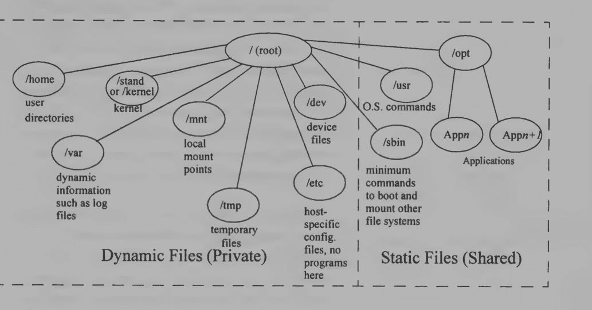

**图 2-1** 通用 UNIX 文件系统布局（在 UNIX 变体间略有不同）

以下是 UNIX 文件系统布局中一些更重要的特征：

- 文件和目录按类别组织。图 2-1 中最明显的两个类别是静态与动态文件。此外，还有其他类别，如可执行文件、配置文件、数据文件等。静态文件也被标记为“共享”，因为网络上的其他主机可能会共享这些。目录 `/usr`、`/sbin` 和 `/opt` 是共享目录。
- 操作系统和应用程序相互独立。应用程序供应商不在乎他们的应用程序加载到哪里；那取决于你。但对一个系统


对于系统管理员来说，将应用程序与操作系统隔离开来是非常理想的，这样可以避免应用程序文件意外覆盖操作系统文件。此外，如果应用程序加载在独立的区域中，它们就是“模块化的”，这意味着系统管理员可以添加、删除和修改这些应用程序，而不会影响操作系统或其他应用程序。应用程序存储在 /opt 目录中。

- 系统内部文件与系统外部文件（即可通过网络访问的文件）分开保存在独立的区域中。/usr 和 /sbin 是共享的操作系统目录。这两个目录中不包含任何特定于主机的信息。/etc 用于存放特定于主机的配置文件。
- 可执行文件与系统配置文件分开保存，以便可执行文件可以在主机之间共享。将配置文件与使用它们的程序分开还意味着操作系统的更新不会影响配置文件。

我将描述文件系统布局中一些最重要的目录。

/ 这是根目录，是文件系统层次树结构的基础。目录在逻辑上被视为 / 的一部分。无论目录或逻辑卷存储在哪个磁盘上，它在逻辑上都被视为根层次结构的一部分。

*/dev* 包含特定于主机的设备文件。

*/etc* 包含特定于主机的系统和应用程序配置文件。此目录中的信息对于系统运行至关重要，且具有永久性质。*/etc* 下方还有额外的配置目录。有两个特定的 */etc* 子目录值得特别注意：

*/export* 服务器为网络客户端导出根目录。例如，服务器可能会导出诸如 */export/home/username* 这样的用户目录。

*/home* 用户的主目录位于此处。由于存储在用户主目录中的数据经常被修改，因此您可以预期此目录的大小会增加。

*/kernel* 包含启动系统（如 genux）所需的内核配置和二进制文件。

*/lost+found* 这是丢失文件目录。在这里您可以找到正在使用但未关联到任何目录的文件。这些文件通常由于系统崩溃而导致磁盘上的物理信息与逻辑目录之间的链接断开而变得“丢失”。在启动时运行的程序 **fsck** 会找到这些文件并将它们放入 **lost+found** 目录中。

**/mnt** 此目录保留作为本地文件系统的挂载点。您可以直接挂载到 **/mnt**，或者使用 **/mnt** 的子目录作为挂载点，例如 **/mnt1**、**/mnt2**、**/mnt3** 等。

**/net** 保留名称，作为远程文件系统的挂载点。

**/opt** 应用程序安装在此目录之下。通常，应用程序供应商从不指定其应用程序安装的具体位置。现在，有了 **/opt**，我们就有了一个标准的目录，应用程序应该安装在该目录之下。这对系统管理员来说是一个组织上的改进，因为我们现在可以预期应用程序加载在 **/opt** 及应用程序名称之下。

**/sbin** 包含用于启动、关闭以及修复文件系统挂载问题的命令和脚本。系统启动时 **/sbin** 是可用的，因为它包含启动系统所需的命令。

/stand 包含启动系统所需的内核配置和二进制文件。此目录中包含两个重要文件，即 system 文件和 vmunix（内核）文件。

/tmp 这是一个自由的目录，任何用户都可以*临时存储*文件。由于此目录性质松散，因此不应用于存储任何重要内容，并且用户应知道他们存储在 /tmp 中的任何内容都可能随时被删除，而无需通知。应用程序的工作文件应放在 /var/tmp 或 /var/opt/appname 中，而不是 /tmp。

/usr 大多数 UNIX 操作系统都包含在 /usr 中。此目录包含命令、库和文档。/usr 中只有限数量的子目录可以出现。

/var 存储主要是临时性的文件。像日志文件这样经常删除和修改的文件就存储在这里。可以将其视为一个“可变”大小的目录。应用程序或命令在运行时创建的文件应放置在此目录中，包括日志和打印输出文件。但是，某些应用程序可能会在 /var 中存储状态信息。

### Linux 文件系统布局

Linux 的文件系统布局与前面描述的其他 UNIX 变体非常相似，无论在概念上还是在实现上都是如此。文件包含在目录中，而目录可以拥有任意数量的子目录。大多数操作系统都是这样组织的，包括 UNIX。

以下是 Caldera Linux 系统根级别的长列表：


```
# ls -l /
total 439
-rw-mw-mw-    1 root      root          23 Nov  5 07:10 .lgdb
... (包含 ., .., amd, auto, bin, boot, dev, etc, home, initrd, install, LST, lib, lost+found, mnt, opt, proc, root, sbin, tmp, usr, var, vmlinuz 的多行文件列表)
... (截断)
```

大多数目录与前面描述的相同。有两个目录名称之前没有提到过，但具有重要意义。Linux 内核 **vmlinuz** 出现在根级别。目录 **/root** 是用户 *root* 的主目录。

**/proc** 目录包含有关 Linux 系统的信息。**/proc** 目录实际上是一组看起来像目录的数据结构信息。以下是 /proc 目录的长列表：

```
# ls -l /proc
total 0
dr-xr-xr-x    3 root     root            0 Nov  7 00:13 1
dr-xr-xr-x    3 root     root            0 Nov  7 00:16 1011
dr-xr-xr-x    3 root     root            0 Nov  7 00:13 104
dr-xr-xr-x    3 bin      root            0 Nov  7 00:13 106
dr-xr-xr-x    3 root     root            0 Nov  7 00:13 116
dr-xr-xr-x    3 root     root            0 Nov  7 00:13 118
dr-xr-xr-x    3 root     root            0 Nov  7 00:13 146
dr-xr-xr-x    3 root     root            0 Nov  7 00:13 155
dr-xr-xr-x    3 root     root            0 Nov  7 00:13 156
dr-xr-xr-x    3 daemon   root            0 Nov  7 00:13 162
dr-xr-xr-x    3 root     root            0 Nov  7 00:13 167
dr-xr-xr-x    3 root     root            0 Nov  7 00:13 170
dr-xr-xr-x    3 root     65535           0 Nov  7 00:13 178
dr-xr-xr-x    3 root     root            0 Nov  7 00:13 18
dr-xr-xr-x    3 root     root            0 Nov  7 00:13 19
dr-xr-xr-x    3 nobody   65535           0 Nov  7 00:13 193
dr-xr-xr-x    3 root     root            0 Nov  7 00:13 199
dr-xr-xr-x    3 root     root            0 Nov  7 00:13 2
dr-xr-xr-x    3 root     root            0 Nov  7 00:13 20
dr-xr-xr-x    3 root     root            0 Nov  7 00:13 200
dr-xr-xr-x    3 root     root            0 Nov  7 00:13 201
dr-xr-xr-x    3 root     root            0 Nov  7 00:13 202
dr-xr-xr-x    3 root     root            0 Nov  7 00:13 203
dr-xr-xr-x    3 root     root            0 Nov  7 00:13 204
dr-xr-xr-x    3 root     root            0 Nov  7 00:13 205
dr-xr-xr-x    3 root     root            0 Nov  7 00:13 21
dr-xr-xr-x    3 root     root            0 Nov  7 00:13 273
dr-xr-xr-x    3 root     root            0 Nov  7 00:13 274
dr-xr-xr-x    3 root     root            0 Nov  7 00:13 276
dr-xr-xr-x    3 root     root            0 Nov  7 00:13 3
dr-xr-xr-x    3 root     root            0 Nov  7 00:13 307
dr-xr-xr-x    3 root     root            0 Nov  7 00:13 327
dr-xr-xr-x    3 root     root            0 Nov  7 00:13 358
dr-xr-xr-x    3 root     root            0 Nov  7 00:13 375
dr-xr-xr-x    3 root     root            0 Nov  7 00:13 443
dr-xr-xr-x    3 root     root            0 Nov  7 00:13 444
dr-xr-xr-x    3 root     root            0 Nov  7 00:13 445
dr-xr-xr-x    3 root     root            0 Nov  7 00:13 45
dr-xr-xr-x    3 root     root            0 Nov  7 00:13 482
dr-xr-xr-x    3 root     root            0 Nov  7 00:13 483
dr-xr-xr-x    3 root     root            0 Nov  7 00:16 996
dr-xr-xr-x    3 root     root            0 Nov  7 00:16 997
dr-xr-xr-x    3 root     root            0 Nov  7 00:16 998
-r--r-----    1 root     root            0 Nov  7 00:13 cmdline
-r--r-----    1 root     root            0 Nov  7 00:13 cpuinfo
-r--r-----    1 root     root            0 Nov  7 00:13 devices
-r--r-----    1 root     root            0 Nov  7 00:13 dma
-r--r-----    1 root     root            0 Nov  7 00:13 filesys
-r--r-----    1 root     root            0 Nov  7 00:13 interrupt
-r--r-----    1 root     root            0 Nov  7 00:13 ioports
-r--------    1 root     root        33558528 Nov  7 00:13 kcore
```


```
-r--------- 1 root root 0 Nov 5 07:00 kmsg
-r--r---- 1 root root 0 Nov 7 00:13 ksyms
-r--r---r-- 1 root root 0 Nov 7 00:05 loadavg
---r--r-- 1 root root 0 Nov 7 00:13 locks
-r--r--r-- 1 root root 0 Nov 7 00:13 mdstat
---r--r-- 1 root root 0 Nov 7 00:13 meminfo
---r--r-- 1 root root 0 Nov 7 00:13 net
---r--r-- 1 root root 0 Nov 7 00:13 mounts
dr-xr-xr-x 2 root root 0 Nov 7 00:13 pci
---r--r-- 1 root root 0 Nov 7 00:13 pci
dr-xr-xr-x 2 root root 0 Nov 7 00:13 scsi
lrwxrwxrwx 1 root root 64 Nov 7 00:13 self->110
---r--r-- 1 root root 0 Nov 7 00:13 stat
dr-xr-xr-x 5 root root 0 Nov 7 00:13 sys
---r--r-- 1 root root 0 Nov 7 00:13 uptime
---r--r-- 1 root root 0 Nov 7 00:13 version
```

在长列表输出中，行首带有 *d* 的条目表示目录（原文误写为“processes”，此处结合上下文 `/proc` 目录含义及 Linux 文档惯例修正为“目录”），而文件 `/proc/kcore` 代表你的 Linux 系统的物理内存。`/proc` 中的文件包含了一些关于你系统的有趣信息。你可能需要查看其中一个文件，即 `/proc/cpuinfo`。该文件的一个示例显示在下列列表中：


```
# more /proc/cpuinfo
processor : 0
cpu : 686
model : 3
vendor_id : GenuineIntel
stepping : 4
fdiv_bug : no
hlt_bug : no
fpu : yes
fpu_exception : yes
cpuID : yes
wp : yes
flags : fpu vme de pse tsc msr pae mce cx8 11 mtrr pge mca cmov mmx
bogomips : 266.24
```

**more** 命令将在下一章中详细介绍。目前，你只需要知道 **more** 命令用于查看文件内容。

`/boot` 目录包含 Linux 内核以及 LILO 启动管理器使用的其他文件。以下是 `/boot` 目录的列表显示：

```
# ls -l /boot
total 452
-rw-r--r-- 1 root root 15954 Feb 11 1997 WHATSIN
-rw-f--r-- 1 root root 15954 Feb 11 1997 WHATSIN-2.0.29-modular
-rw-f--r-- 1 root root 204 Jul 24 1996 any_b.b
-rw-f--r-- 1 root root 204 Jul 24 1996 any_d.b
-rw-f--r-- 1 root root 512 Nov 5 01:44 boot.0300
-rw-f--r-- 1 root root 4416 Jul 24 1996 boot.b
-rw-f--r-- 1 root root 88 Jul 24 1996 chain.b
-rw------- 1 root root 7680 Nov 5 01:44 map
-r-r-r-r-- 1 root root 1565 Mar 7 1997 message
-rw-f--r-- 1 root root 192 Jul 24 1996 os2_d.b
-rw-f--r-- 1 root root 404158 Feb 11 1997 vmlinuz-2.0.29-modular
```


作为用户，你最关心的可能是你的主目录，这是由系统管理员分配给你的，通常位于 `/home` 目录中。不过，我认为作为一名 UNIX 用户，你需要理解整个 UNIX 文件系统的布局。请记住，从一种 UNIX 变体切换到另一种时，你可能会发现文件系统布局有一些细微差异，但总体而言，布局是相似的。

如果你正在 Linux 系统上运行图形用户界面，你可以以图形方式查看文件系统。图 2-2 显示了 Red Hat Linux 文件管理器，它是 Gnome 用户界面的一部分。

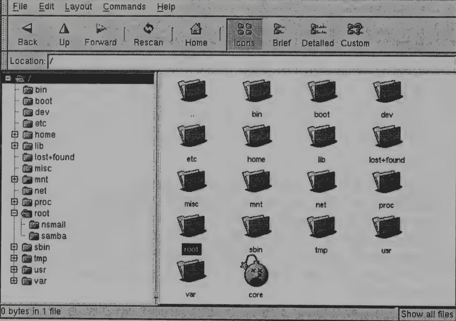

图 2-2 Gnome 中的文件管理器，显示了 Red Hat Linux 文件系统

可以看到，图 2-2 左侧显示的大多数目录与之前描述的一般 UNIX 系统中的目录相同。尽管你可能在使用多种不同的 UNIX 变体，但你会发现大多数系统目录都是相似的。

### 第 2 章中使用的某些命令的手册页

以下是本章中许多命令的 HP-UX 手册页。由于 UNIX 变体之间的命令往往存在差异，你可能会发现某些命令的选项或其他方面有所不同；然而，以下手册页可作为出色的参考。


# file - 运行测试以分类文件。

file(1)

**名称**

file - 确定文件类型

**概要**

file [-m mfile] [-c] [-f ffile] file ...

**描述**

file 对每个文件执行一系列测试，尝试对其分类。如果文件看起来是一个 ASCII 文件，file 将检查前 512 字节并尝试猜测其语言。如果文件是可执行的 a.out 文件，file 会打印版本戳，前提是它大于 0（参见 ld(1) 中 -V 选项的描述）。

file 使用 /etc/magic 文件来识别具有某种“魔术数字”的文件，即包含指示其类型的数字或字符串常量的任何文件。/etc/magic 开头的注释说明了其格式。

**选项**

file 识别以下命令行选项：

- **-m mfile**
  使用替代的魔术文件 mfile。
- **-c**
  检查魔术文件是否有格式错误。由于效率原因，通常不执行此验证。指定此选项时，不会执行文件分类。
- **-f ffile**
  从文件 ffile 中获取要检查的文件列表。file 对 ffile 中出现的每个文件名进行分类。

**外部影响**

**环境变量**

LC_MESSAGES 确定消息显示的语言。

如果环境变量中未指定 LC_MESSAGES 或设置为空字符串，则使用 LANG 的值作为每个未指定或空变量的默认值。如果未指定 LANG 或设置为空字符串，则使用默认值 "C"（参见 lang(5)）代替 LANG。

如果任何国际化变量包含无效设置，file 的行为就好像所有国际化变量都设置为 "C"。参见 environ(5)。

**国际字符集支持**

支持单字节和多字节字符代码集。但是，所有非 ASCII 文本文件都被标识为 "data"。

**参见**

ld(1)。

**标准符合性**

file: SVID2, SVID3, XPG2, XPG4

#### ls


**ls - 列出目录内容。**

**名称**

ls, l, ll, lsI, lsr, Isx - 列出目录内容

**概要**

```
ls [-abcdefgilmnpoqrs tu xACfFRl] [names]

l [ls_options] [names]

ll [ls_options] [names]

lsf [ls_options] [names]

lsr [ls_options] [names]

Isx [ls_options] [names]
```

**描述**

对于每个目录参数，Is 命令列出该目录的内容。对于每个文件参数，Is 重复其名称以及请求的其他信息。输出默认按升序排序（参见下文的环境变量）。当未给出参数时，列出当前目录。当给出多个参数时，参数首先按适当方式排序，但文件参数出现在目录及其内容之前。

如果你是具有适当权限的用户，默认情况下除了 . 和 .. 之外的所有文件都会被列出。

有三种主要的列表格式。所选格式取决于输出是否指向登录设备（通过输出设备文件是否为 tty 设备来确定），也可以由选项标志控制。登录设备的默认格式是以多列格式列出目录内容，条目按列垂直排序。（当参数列表中出现单个文件名（相对于目录名）时，这些文件名始终横向跨页排序，而不是在列中纵向排序，因为单个文件名长度可以是任意的。）如果标准输出不是登录设备，默认格式是每行列出一个条目。-C 和 -x 选项启用多列格式，而 -m 选项启用流输出格式，文件横向跨页列出，用逗号分隔。为了确定 -C、-x 和 -m 选项的输出格式，Is 使用环境变量 COLUMNS 来确定每个输出行可用的字符位置数。如果未设置此变量，则根据环境变量 TERM 使用 terminfo 数据库来确定列数。如果无法获得此信息，则假设为 80 列。

**选项**

Is 识别以下选项：

- **-a**
  列出所有条目；通常以句点 (.) 开头的名称的条目不被列出。
- **-b**
  强制以八进制 \ddd 表示法打印非图形字符。
- **-c**
  使用 inode 的最后修改时间（文件创建、模式改变等）进行排序（-t）或打印（-l (ell)）。
- **-d**
  如果参数是目录，仅列出其名称（不列出其内容）；常与 -l (ell) 一起使用以获取目录的状态。
- **-e**
  打印文件的 extent 属性。如果任何文件具有 extent 属性，此选项打印 extent 大小、预留空间和分配标志。此选项必须与 -i (ell) 选项一起使用。
- **-f**
  强制将每个参数解释为目录，并列出每个插槽中找到的名称。此选项禁用 -l (ell)、-t、-s 和 -r，并启用 -a；顺序是条目在目录中出现的顺序。
- **-g**
  与 -l (ell) 相同，但仅打印组（省略所有者）。如果同时指定了 -l (ell) 和 -g，则不打印所有者。
- **-i**
  对于每个文件，在报告的第一列打印 inode 号。在多列输出中，该数字位于每列中文件名之前。
- **-l**
  (ell) 以长格式列出，给出每个文件的模式、链接数、所有者、组、字节大小以及最后修改时间（参见下文的进一步描述和访问控制列表）。如果最后修改时间超过六个月或在未来任何时间，年份将取代修改时间的小时和分钟。如果文件是特殊文件，大小字段包含主要和次要设备号，而不是大小。
- **-m**
  流输出格式。
- **-n**
  与 -l (ell) 相同，但打印所有者的 UID 和组的 GID 号，而不是相关的字符串。
- **-o**
  与 -l (ell) 相同，但仅打印所有者（省略组）。（如果同时指定了 -l (ell) 和 -o，则不打印组）。
- **-p**
  如果文件是目录，在每个文件名后加一个斜杠 (/)。
- **-q**
  强制将文件名中的非图形字符打印为字符 (?)。
- **-r**
  反转排序顺序以获得反向（降序）排序或按最早优先排序，视具体情况而定。
- **-s**
  给出每个条目的大小（以块为单位，包括间接块）。打印的第一个条目是目录中的总块数。在多列输出中，块数位于每列中文件名之前。
- **-t**
  在按字母顺序排序之前，按修改时间（最新优先）排序。


## ls 选项

- -u 使用最后访问时间而非最后修改时间进行排序（-t 选项）或打印（-l 选项）。
- -x 多列输出，条目按横向而非纵向排序。
- -A 与 -a 相同，但不会列出当前目录 "." 和父目录 ".."。对于具有相应权限的用户，此标志默认开启，通过 -A 关闭。
- -C 多列输出，条目按列向下排序。
- -F 如果文件是目录或指向目录的符号链接，则在每个文件名后加分隔符（/）；如果文件是可执行的，则加星号（*）；如果文件是文件的符号链接，则加 at 符号（@）；如果文件是 FIFO，则加竖线（|）。
- -L 如果参数是符号链接，则列出链接指向的文件或目录，而不是链接本身。
- -R 递归列出遇到的子目录。
- -l (一个小写 L) 无论输出设备如何，文件名都将按单列格式列出。这强制用户终端使用单列格式。

以下互斥选项对中指定多个选项不会被视为错误：-C 和 -l (小写 L)，-m 和 -l (小写 L)，-x 和 -l (小写 L)，-C 和 -l (一个小写 L)，-c 和 -u。

ls 通常由几个针对各种格式的简写名称所识别：

- l 相当于 ls -m。
- l1 相当于 ls -l (小写 L)。
- lsf 相当于 ls -F。
- lsr 相当于 ls -R。
- lsx 相当于 ls -x。

简写符号实现为指向 ls 的链接。简写版本的选项参数行为与使用上述长形式及附加参数完全相同。

#### 模式位解释 (-l 选项)

-l (小写 L) 选项生成的列表中的模式由 10 个字符组成。第一个字符指示条目类型：

- d 目录
- b 块特殊文件
- c 字符特殊文件
- l 符号链接
- p Fifo（也称为“命名管道”）特殊文件
- n 网络特殊文件
- s 套接字
- - 普通文件。

接下来的 9 个字符被解释为三组各 3 个位，分别标识所有者、组和其他人的访问权限，如下所示：

| 位置 | 值 | 描述 |
| :--- | :--- | :--- |
| | 0400 | 所有者读取 (r 或 -) |
| | 0200 | 所有者写入 (w 或 -) |
| | 0100 | 所有者执行（搜索目录）(x, s, S, 或 -) |
| | 0040 | 组读取 (r 或 -) |
| | 0020 | 组写入 (w 或 -) |
| | 0010 | 组执行/搜索 (x, s, S, 或 -) |
| | 0004 | 其他人读取 (r 或 -) |
| | 0002 | 其他人写入 (w 或 -) |
| | 0001 | 其他人执行/搜索 (x, r, t, T, 或 -) |

模式字符解释如下：

- - 对应位置未授予权限。
- r 授予对应用户类读取权限。
- w 授予对应用户类写入权限。
- x 授予对应用户类执行（或目录搜索）权限。
- s 授予对应用户类执行（搜索）权限。此外，根据位置指示，授予所有者 SUID (Set User ID) 权限或授予组 SGID (Set Group ID) 权限。
- S 与 s 相同，但拒绝授予对应用户类执行（搜索）权限。
- t (仅限最后一个位置) 授予其他人执行（搜索）权限，并设置“粘滞位”（参见 chmod(2) 中 S_ISVX 的描述）。
- T 与 t 相同，但拒绝授予其他人执行（搜索目录）权限。

当指定某个选项导致列出目录和/或文件的大小（以字节或块为单位）（例如 -s 或 -l (小写 L) 选项）时，列表开头还会打印一个包括间接块在内的总块数。

##### 访问控制列表 (ACLs)

如果文件具有可选的 ACL 条目，-l (小写 L) 选项会在文件权限后显示加号 (+)。显示的权限是文件访问控制列表的摘要表示，由 stat() 在 st_mode 字段中返回（参见 stat(2)）。要列出访问控制列表的内容，请使用 lsacl 命令（参见 lsacl(1) 和 acl(5)）。

#### 外部影响

### 环境变量

- 如果设置了 COLUMNS 变量，ls 将使用提供的宽度来确定列式输出的位置。
- LANG 决定当 LC_ALL 和对应的环境变量（以 LC_ 开头）均未指定区域设置时使用哪个区域设置。如果 LANG 未设置或设置为空字符串，则使用默认的 "C"（参见 lang(5)）。
- LC_COLLATE 决定输出的排序顺序。
- LC_CTYPE 决定哪些字符被 -b 和 -q 选项分类为非图形字符，以及文件名中单字节和/或多字节字符的解释。
- LC_TIME 决定 -g、-l (小写 L)、-n 和 -o 选项输出的日期和时间字符串。
- LC_MESSAGES 决定显示消息（日期和时间字符串除外）的语言。

如果任何国际化变量包含无效设置，ls 的行为就好像所有国际化变量都设置为 "C"（参见 environ(5)）。

##### 国际字符集支持

支持单字节和多字节字符代码集。

#### 返回值

ls 退出时返回以下其中一个值：

- 0 成功列出所有输入文件。
- >0 由于访问文件时发生错误，ls 被中止。

以下条件会导致错误：

- 未找到指定文件。
- 用户没有读取目录的权限。
- 进程无法获取足够的内存。
- 指定了无效选项。

##### 示例

打印当前工作目录中所有文件的长列表（包括文件大小）。首先列出最近修改（最年轻）的文件，然后是次新的文件，依此类推，直到最旧的。以 . 开头的文件名称也会被打印出来。

```bash
ls -alst
```

#### 警告

根据输出是否为登录 (tty) 设备来设置选项是不理想的，因为 ls -s 与 ls -s | lp 大不相同。另一方面，不使用此设置会导致使用 ls 的旧 shell 脚本几乎不可避免地失败。

文件名中的不可打印字符可能会使列式输出选项混乱。

#### 依赖关系

NFS -l (小写 L) 选项不会在网络文件的访问权限位后显示加号 (+) 来表示存在可选的访问控制列表条目。

#### 作者

ls 由 AT&T、加州大学伯克利分校和 HP 开发。

#### 文件

- /etc/passwd 用于获取 ls -l (小写 L) 和 ls -o 的用户 ID。
- /etc/group 用于获取 ls -l (小写 L) 和 ls -g 的组 ID。
- /usr/share/lib/termiInfo/?/* 用于获取终端信息。

#### 参见

chmod(1), find(1), lsac1(1), stat(2), ac1(5).

#### 标准合规性

ls: SVL2, SVL3, XPG2, XPG3, XPG4, POSIX.2

# 第 3 章

## 文件和目录的操作 - 权限、命令、文件名扩展和通配符

### 权限

讨论权限的最佳起点是发出 `ls` 命令，该命令列出目录的内容。权限是在你的 UNIX 系统中使文件和目录安全的手段。由于 UNIX 是多用户系统，可能有成千上万的用户正在访问系统上的文件。权限控制谁可以访问哪些文件。

这里是一个 `ls -l` 命令及其输出示例：

```bash
$ ls -l sort
-rwxr-x-x-x 1 marty users 120 Jul 26 10:20 sort
```

发出此命令后，生成了大量关于名为 `sort` 的文件的信息。让我们通过分析第一组字符 (-rwxr-x--x) 开始理解这个列表生成了什么。这组字符由四个不同的字段组成，如图 3-1 所示。


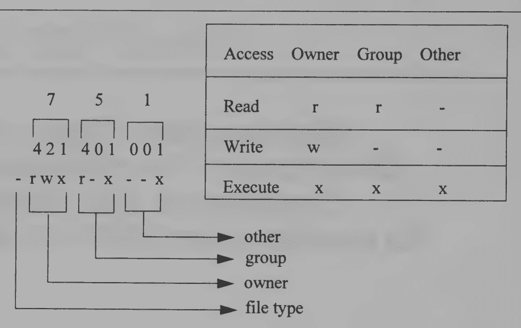

这组中的第一个字符与文件类型相关。我之前介绍过一些文件类型，但 `ls -l` 命令不会以相同的详细程度分析文件。图 3-2 显示了 `ls -l` 将列出的文件类型。


#### 文件类型

| 首字符 | 文件类型 |
| :--- | :--- |
| - | 普通文件，例如文本文件。 |
| b | 块特殊文件，即设备文件。 |
| c | 字符特殊文件，即设备文件。 |
| d | 目录。 |
| l | 链接。 |
| n | 网络特殊文件。 |
| p | 命名管道特殊文件，也称为 FIFO。 |
| s | 套接字。 |


请记住，文件类型在不同 UNIX 变体之间可能会略有不同。图 3-2 中列出的文件类型适用于大多数 UNIX 变体。对于系统中的每个文件，UNIX 支持三类访问权限：

- 用户访问 (u)。授予文件拥有者的访问权限。
- 组访问 (g)。授予与文件拥有者同属一个组的成员访问权限。
- 其他访问 (o)。授予其他所有人的访问权限。

当发出长列表命令时，这些访问权限由读 (r)、写 (w) 和执行 (x) 的位置来定义。对于之前发出的长列表命令 (`ls -l`)，你可以在表 3-1 中看到权限。


## 表 3-1 文件 *sort* 的长列表权限

| 访问 | 用户访问 | 组访问 | 其他 |
| :--- | :---: | :---: | :---: |
| 读 | r | r | - |
| 写 | w | - | - |
| 执行 | x | x | x |

出现 "-" 的地方表示未授予权限。此外，还有其他权限，如 s、S、t 和 T，这些我暂时不在此处详细讨论。

你可以看到，访问权限是按三组排列的：三组权限，每组包含三个访问级别。在这种情况下，拥有者 *marty* 对该文件具有读、写和执行权限。组 *users* 中的任何人被允许对该文件进行读和执行访问。*其他*用户仅被允许对该文件进行执行访问。

对于文件和目录，读、写和执行的定义略有不同。如果你对文件拥有读、写和执行权限，你可以执行以下操作：

- **读**：你有权读取该文件。
- **写**：你有权更改和写入该文件。
- **执行**：你可以运行或执行该程序。

如果你对目录拥有读、写和执行权限，你可以执行以下操作：

- **读**：你可以列出目录的内容。
- **写**：你可以在目录中创建文件、删除目录中的文件，并在目录中创建子目录。
- **执行**：你可以使用 **cd** 命令切换到该目录，我们稍后将会介绍这个命令。

当描述 **chmod** 命令时，我们会再次讨论权限问题。

#### 绝对路径和相对路径

我们之前已经讨论过两个主题，它们可以作为讨论绝对路径和相对路径的基础：系统上的重要目录和用户登录。如果我们查看用户 **denise** 及其文件的一些组织方式，我们可以快速理解相对路径和绝对路径的本质。

第 2 章中介绍的 UNIX 文件系统展示了一个层级结构。在这个层级结构中，顶部是根 (/) 目录，文件和目录位于根目录之下。你可以通过两种手段遍历这个层级结构以到达“较低”的位置：使用绝对路径名和相对路径名。让我们仔细看看 **denise** 在其用户区域中可能拥有的文件和目录。

首先，我们假设 **denise** 有很多文件。这项活动是用户做的事情之一 - 创建文件。此外，系统管理员提供了一些默认文件，用于定义登录后用户环境等目的（我们将在后续章节中更详细地介绍这一点）。**denise** 在她的用户区域下可能有很多文件，还有子目录。她的用户区域可能看起来像图 3-3 所示的样子。

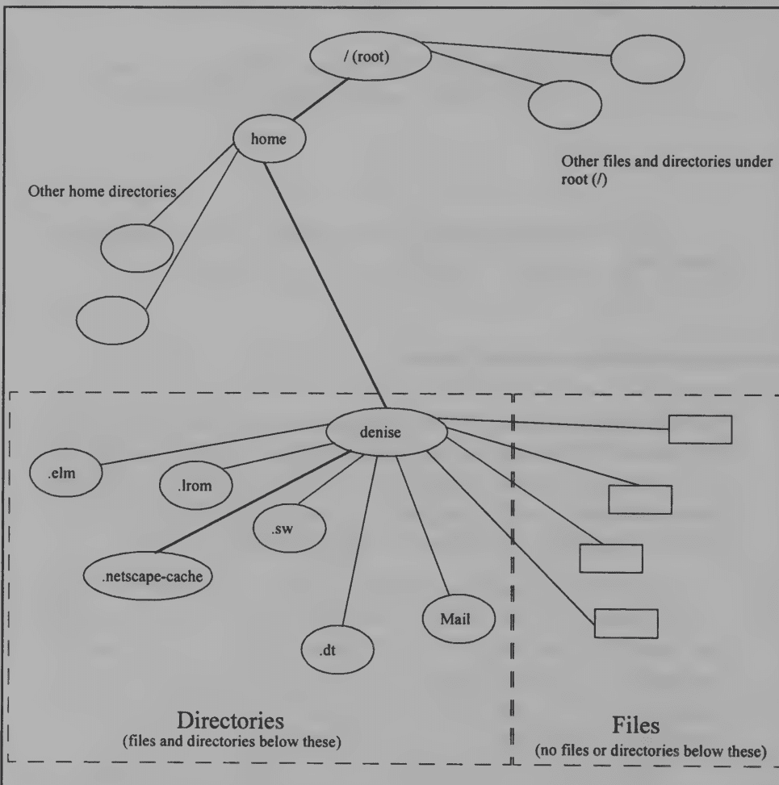

大多数用户的家目录位于 /home 之下（谁说 UNIX 没有任何道理可言？）。如果你想使用绝对路径名访问 denise 的子目录，你需要使用完整路径遍历层级结构。要访问 denise 下的目录 `.netscape-cache`，你可以将绝对路径视为图 3-4 所示的样子。

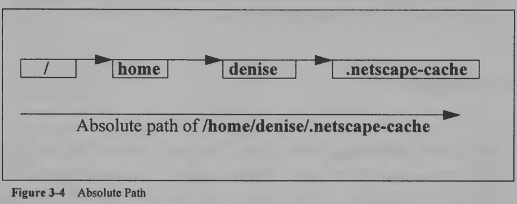

你从根 (/) 开始，经过 **home**，再到 **denise**，最后到达目录 **.netscape-cache**。你发出的更改目录 (`cd`) 命令如下所示：

```bash
$ cd /home/denise/.netscape-cache
```

这是一个绝对路径，因为它从根开始并遍历层级结构。无论当前正在操作哪个目录，甚至如果是 **.netscape-cache**，你都可以使用绝对路径名。然而，在许多情况下，你不需要发出绝对路径名。你可能离想要访问的文件或目录非常近，使用绝对路径会浪费你的时间。例如，如果你已经在 /home/denise 目录下，那么你可以轻松地使用相对路径名切换到 .netscape-cache：

```bash
$ cd .netscape-cache
```

相对路径名更短，因为你不需要以一个斜杠 ( / ) 开始，该斜杠会带你回到层级结构的顶部，然后向下查找。相反，你是从文件系统层级中的某一点开始的，例如 /home/denise，并输入相对于该目录的路径，例如 .netscape-cache。

### `ls` 命令


`ls` 命令有很多值得讨论的内容。我尚未描述 `ls` 的选项，但我们已经在本章的权限讨论以及第 2 章的文件命令讨论中使用了 `-l` 选项。介绍 `ls` 最重要选项的最佳方法是展示示例。我将在接下来对 `ls` 命令的描述中做到这一点。

#### `ls`

以下是 `ls` 的一个示例，除了要列出的目录外没有使用任何选项：

```bash
$ ls /home/denise
27247b.exe
410pt1.exe
410pt2.exe
41ndir.exe
41ndsl.exe
41nds4.exe
41nwad.exe
41rtr2.exe
HDDAI.EXE
Mail
N3212B6.EXE
SCSI4S.EXE
clean
clean2
clean3
content.exe
dsneh.exe
egl
eg2
en0316bz.exe
en0316tb.exe
explore.exe
flexi_cd.exe
fred.h
hal.c
hpd10117.exe
hpdlinst.txt
hpux.patches
j2577a.exe
ja95up.exe
msie10.exe
n32e12n.exe
nfs197.exe
pass.sb
plusdemo.exe
ps4x03.exe
psg
quik_res.exe
rclock.exe
rkhelP.exe
roni.mak
sb.txt
smsup2.exe
softinit.remotesoftcm
srvpr.exe
steve.h
target.exe
tcp41a.exe
tnds2.exe
upgrade.exe
whoon
win95app.exe
total 46718
```

其中哪些是文件？哪些是目录？是否列出了所有条目？关于 **ls** 有许多选项可以回答这些问题。

执行此命令后报告的信息并不多。**ls** 列出指定目录的内容，如果未指定目录，则列出当前工作目录。


#### `ls -a`


要列出目录中的所有条目，你需要使用 **-a** 选项。以 "." 开头的文件称为隐藏文件，通常不会通过 `ls` 列出。以下示例显示了 `ls -a` 的输出：

```bash
$ ls -a /home/denise

.Xauthority
.cshrc
.dt
.dtprofile
.elm
.exrc
.fmrc.orig
.glancerc
.gpmhp
.history
.login
.lrom
.mailrc
.netscape-bookmarks.html
.netscape-cache
.netscape-cookies
.netscape-history
.netscape-newsgroups-news.spry.com
.netscape-newsgroups-newsserv.hp.com
.netscape-preferences
.newsrc-news.spry.com
.newsrc-newsserv.hp.com
.profile
.rhosts
.sh_history
.softbuildrc
.softinit.orig
.sw
.xinitrc
.xsession
27247b.exe
410pt1.exe
410pt2.exe
41ndir.exe
41nds1.exe
41nds4.exe
41nwad.exe
41ltr2.exe
HPDA1.EXE
Mail
N3212B6.EXE
SCSIA4S.EXE
clean
clean2
clean3
content.exe
dsenh.exe
eg1
eg2
en0316bz.exe
en0316tb.exe
explore.exe
flexi_cd.exe
fred.h
hal.c
hpd10117.exe
hpdlinst.txt
hpux.patches
j2577a.exe
ja95up.exe
msie10.exe
n32e12n.exe
nfs197.exe
pass.sb
plusdemo.exe
ps4x03.exe
psg
quik_res.exe
rclock.exe
rkhelp.exe
roni.mak
sb.txt
smsup2.exe
softinit.remotesoftcm
srvpr.exe
steve.h
target.exe
tcp41a.exe
tnds2.exe
upgrade.exe
whoon
win95app.exe
total 46718
```

请注意，此输出包括隐藏文件（以 "." 开头的文件），以及仅使用 `ls` 列出的其他所有文件。这些文件在发出未带 `-a` 选项的 `ls` 时并未显示。后续所有示例都包含 `-a` 选项。


#### `ls -l`

要列出目录内容的所有信息，你使用 `ls` 的 `-l` 选项，如下面的示例所示（这些文件名中的一些被截断以适合页面）：


## The Is Command

```bash
$ ls -al /home/dense
```

-rw------- 1 dense users 98 Oct 6 09:19 .Xauthority
-rw-r--r-- 1 dense users 814 May 19 10:10 .cshrc
drwxr-x--- 7 dense users 1024 Aug 26 11:14 .den
-rwxr-x-- 1 dense users 8705 Jul 7 12:04 .profile
drwxrwx--- 2 dense users 1024 Jul 31 18:48 .el
-rw------- 1 dense users 347 May 19 10:10 .exrc
-rwxrwxrwx 1 dense users 170 Jun 6 14:20 .fmr.c.orig
-rw-r--r-- 1 dense users 97 Jun 12 18:59 .glancerrc
-rw-r--r-- 1 dense users 17620 Sep 21 16:11 .gnupg
-rwxr-x-- 1 dense users 391 Sep 19 09:55 .history
-rw-r--r-- 1 dense users 341 Aug 19 10:10 .login
drwxr-x--- 2 dense users 1024 Jul 31 18:48 .lrom
-rw-r--r-- 1 dense users 768 Jul 28 12:54 .mailrc
-rw-r--r-- 1 dense users 1450 Oct 6 13:58 .netscape-bookmarks.html
drwx------ 2 dense users 10240 Oct 10 15:24 .netscape-cache
-rw------- 1 dense users 91 Sep 18 14:16 .netscape-cookies
-rw------- 1 dense users 43906 Oct 10 15:32 .netscape-history
-rw-r--r-- 1 dense users 566 Aug 25 14:36 .netscape-news.spry.com
-rw-r--r-- 1 dense users 46514 Jun 28 12:35 .netscape-hp.com
-rw-r--r-- 1 dense users 1556 Sep 28 15:02 .netscape-references
-rw-r--r-- 1 dense users 104 Jul 11 11:01 .newsrc-news.spry.com
-rw-r--r-- 1 dense users 223 Sep 26 13:26 .newsrc-news.hp.com
-rw-r--r-- 1 dense users 446 May 19 10:10 .profile
-rw-r--r-- 1 dense users 21 Jul 6 13:21 .rhsts
-rw-r--r-- 1 dense users 2328 Oct 10 15:22 .sh_history
-rw-r--r-- 1 dense users 1052 Sep 22 15:09 .soffbuidrc
-rw-r--r-- 1 dense users 161 Jul 11 12:19 .softinit.org
drwxr-x--- 3 dense users 1024 Aug 31 15:44 .sw
-rw-r--r-- 1 dense users 23 Jun 2 15:01 .xinitrc
-rwxr-x--- 1 dense users 11251 May 19 10:41 .xsession
-rw-r--r-- 1 dense users 611488 Oct 3 12:00 02247b.exe
-rw-r--r-- 1 dense users 11419 Oct 24 41:0t2.exe
-rw-r--r-- 1 dense users 136979 Sep 29 12:53 41opt2.exe
-rw-r--r-- 1 dense users 173978 Sep 29 12:40 41ntr.exe
-rw-r--r-- 1 dense users 363315 Sep 29 12:52 41nssl.exe
-rw-r--r-- 1 dense users 527524 Sep 29 12:57 41nstd.exe
-rw-r--r-- 1 dense users 1552513 Sep 29 12:50 41nwad.exe
-rw-r--r-- 1 dense users 853424 Sep 24 12:41 41rtr2.exe
-rw-r--r-- 1 dense users 1363011 Sep 20 12:20 HPPDA.EXE
drwx------ 2 dense users 24 Jul 31 18:48 Mail
-rw-r--r-- 1 dense users 1787840 Aug 31 09:35 N321286.EXE
-rw-r--r-- 1 dense users 13543 Sep 23 09:46 OSCSTI.EXE
-rw-r--r-- 1 dense users 28395 Aug 30 15:07 cabview.exe
-rwxr-x--- 1 dense users 66 Jun 8 17:40 clean
-rwxr-x--- 1 dense users 99 Jun 20 17:44 clean2
-rwxr-x--- 1 dense users 66 Jun 20 17:51 clean3
-rw-r--r-- 1 dense users 15365 Sep 30 15:07 content.exe
-rw-r--r-- 1 dense users 713313 Sep 29 12:56 denseh.exe
-rw-r--r-- 1 dense users 144 Sep 14 17:10 egl
-rw-r--r-- 1 dense users 192 Aug 15 12:13 eq2
-rw-r--r-- 1 dense users 667890 Sep 20 12:41 en0316bz.exe
-rw-r--r-- 1 dense users 641924 Sep 20 12:47 en0316lb.exe
-rw-r--r-- 1 dense users 6251 Aug 30 15:07 explore.exe
-rw-r--r-- 1 dense users 23542 Sep 30 15:08 flexi_cd.exe
-rw-r--r-- 1 dense users 30 Aug 14 17:02 fredh
-rw-r--r-- 1 dense users 0 Aug 14 17:24 halc
-rw-r--r-- 1 dense users 895399 Sep 20 12:32 hpd0117.exe
-rw-r--r-- 1 dense users 14135 Sep 20 12:39 hpdinst.txt
-rw-r--r-- 1 dense users 2943 Jun 19 14:32 hpux_patches
-rw-r--r-- 1 dense users 680279 Sep 20 12:46 j257u.exe
-rw-r--r-- 1 dense users 930728 Sep 20 15:16 ja9spu.exe
-rw-r--r-- 1 dense users 53575 Oct 10 10:37 mbox
-rw-r--r-- 1 dense users 1037728 Aug 30 15:03 ms1012.exe
-rw-r--r-- 1 dense users 1790376 Sep 18 14:32 n32eln.exe
-rw-r--r-- 1 dense users 139835 Sep 29 12:59 nssl197.exe
-rw-r--r-- 1 dense users 977 Jul 3 14:25 pass.s
-rw-r--r-- 1 dense users 1004544 Sep 30 15:00 pudemos.exe
-rw-r--r-- 1 dense users 229547 Sep 29 12:27 pxa03.exe
-rw-r--r-- 1 dense users 171 Aug 9 13:43 pg
-rw-r--r-- 1 dense users 16645 Aug 30 15:08 quik_res.exe
-rw-r--r-- 1 dense users 14544 Aug 30 15:08 rclock.exe
-rw-m--r-- 1 dense users 2287498 Sep 30 15:12 rkhei.exe
-rw-m--r-- 1 dense users 0 Aug 15 12:10 ron1.mak

```text
-rw-m--r--    1 denise    users        1139  Sep 28 10:35  sb.txt
-r--r-----    1 denise    users      569855  Sep 29 12:55  smsup2.exe
-rw-------    1 root      sys         161  Jul 11 12:18  softinit.remotesoftcm
-rw-m--r--    1 denise    users         39  Sep 29 12:48  srvpr.exe
-rw-m--r--    1 denise    users         38  Aug 15 12:14  steve.h
-rw-m--r--    1 denise    users       14675  Aug 30 15:08  target.exe
-rw-m--r--    1 denise    users      229630  Sep 29 12:54  tcp41a.exe
-rw-m--r--    1 denise    users     1954453  Sep 29 12:26  tnds2.exe
-rw-------    1 denise    users       36420  Sep 23 09:50  upgrade.exe
-rw-----r--    1 denise    users          88  Aug  9 13:43  whoon
-rw-m--r--    1 denise    users      191495  Aug 30 15:00  win95app.exe
total 46718
```

由于我发现 **ls 命令** 中这个选项是最常用的，因此我将详细解释 **ls -l** 生成的每个字段。在描述这些字段时，我将使用前面提到的 **ls -l** 命令示例，该示例当时只显示了一个文件：

```text
$ ls -1 sort
-rwxr-x--x    1 marty     users        120  Jul 26 10:20  sort
```

第一个字段是文件的访问权限，我在本章前面“权限”部分已经讨论过。*所有者* 对该文件拥有读、写和执行权限。*组* 对该文件拥有读和执行权限。*其他* 用户拥有执行权限。

第二个字段是链接计数。这列出了有多少个文件符号链接到该文件。我们稍后会详细讨论用于链接文件的 **ln** 命令。在这种情况下，链接计数为 1，意味着该文件仅与其自身链接。对于目录，例如下方显示的 **.dt**，显示的是子目录的数量而不是链接计数。这个数字包括目录本身和父目录各计一次。这意味着在 **.dt** 下方总共有五个目录。

```text
drwxr-x--x    7 denise    users       1024  Jul 26 10:20  .dt
```

**/home/denise/.dt** 下的子目录是：

- /home/denise/dt/Desktop
- /home/denise/dt/appmanager
- /home/denise/dt/palettes
- /home/denise/dt/sessions
- /home/denise/.dt/types

这五个子目录加上目录本身和父目录，总共为七个。

第三个字段列出了文件的所有者。你的登录名，例如 denise，会在此处列出。当你创建一个文件时，你的登录名默认会作为文件的所有者列出。

第四个字段列出了文件所属的组。组在“权限”部分已经讨论过。

第五个字段显示文件的大小。文件 sort 的大小为 120 字节。

第六个字段（包括日期和时间，例如 Jul 26 10:20）列出了文件创建或最后修改的日期和时间。

第七个字段按字母顺序列出文件和目录。你首先会看到以“.”开头的文件，然后是以数字开头的文件，接着是以大写字母开头的文件，最后是以小写字母开头的文件。在 UNIX 中，文件可以以许多不同的字符开头，因此如果你执行 ls -l 但没有看到你正在寻找的文件，它可能出现在列表中的其他位置，而不是你预期的地方。


### ls -i

要获取文件的 inode 信息，请使用 ls 的 -i 选项。以下示例同时包含了 ls 的 -i 和 -l 选项：

```bash
$ ls -ail /home/dense

137717 -rw-r----- 1 dense users 98 Oct 6 09:19 .Xauthority
137623 -r--r----- 1 dense users 814 May 19 10:10 .cshrc
140820 drwxr-xr-x 7 dense users 1024 Sep 26 11:14 .dt
137629 -rwxr-xr-x 1 dense users 8705 Jul 7 12:04 .dtprofile
180815 drwx----- 2 dense users 1024 Jul 31 10:48 .elm
137642 -rw------- 1 dense users 347 May 19 10:10 .exrc
137652 -rwxrwxrwx 1 dense users 170 Jun 6 14:20 .fmrc.orig
137650 -rw------- 1 dense users 97 Jun 12 18:59 .glancegtr
137699 -rw------- 1 dense users 17620 Jun 21 16:11 .gpgmb
137640 -rw-r-xr-x 1 dense users 391 Jun 19 09:55 .history
137625 -rw-r----- 1 dense users 341 May 19 10:10 .login
185607 drwx-x--x 2 dense users 1024 Jun 31 10:48 .iron
137642 -rw-r----- 1 dense users 768 Jul 28 12:54 .mailrc
137641 -rw-r----- 1 dense users 1450 Oct 6 13:58 .netscape
179207 drw------- 2 dense users 102400 Oct 10 15:24 .netscape-cache
137656 -rw------- 1 dense users 91 Sep 18 14:16 .netscape-cookies
137635 -rw------- 1 dense users 43906 Oct 10 15:32 .netscape-history
137645 -rw-r----- 1 dense users 566 Aug 25 14:36 .netscape
137646 -rw------- 1 dense users 46514 Jun 28 12:35 .netscape
137634 -rw------- 1 dense users 1556 Jun 28 15:02 .netscapereferences
137637 -rw------- 1 dense users 104 Jul 11 11:01 .newsrvcs.spyy.com
137633 -rw-r----- 1 dense users 223 Sep 26 13:26 .newsrc-hp.com
137626 -rw-r----- 1 dense users 446 May 19 10:10 .profile
137649 -rw------- 1 dense users 21 Jul 6 13:21 .rhosfs
137694 -rw------- 1 dense users 2328 Oct 10 15:22 .sh_history
137698 -rw------- 1 dense users 1052 Sep 22 15:00 .softbuild.org
137636 -rwxrwxrwx 1 dense users 161 Jul 11 12:19 .sof
to
33600 drwxr-xr-x 3 dense users 1024 Aug 31 15:44 .sw
137648 -rw------- 1 dense users 23 Jun 1 15:01 .xinitrc
137648 -rw-r----- 1 dense users 11251 May 19 10:14 .xinitrc
137715 -rw-r----- 1 dense users 611488 Oct 3 12:00 27247b.exe
137707 -rw-r----- 1 dense users 114119 Sep 29 12:49 410ptl.exe
137710 -rw-r----- 1 dense users 136979 Sep 29 12:53 410pdt2.exe
137705 -rw-r----- 1 dense users 173978 Sep 29 12:40 410snd.exe
137709 -rw-r----- 1 dense users 363315 Sep 29 12:52 410ndl.exe
137714 -rw-r----- 1 dense users 527524 Sep 29 12:57 410sdr.exe
137708 -rw-r----- 1 dense users 155251 Sep 29 12:50 410sadr.exe
137696 -rw-r----- 1 dense users 853424 Sep 29 12:24 a1lr2.exe
137654 -rw-r----- 1 dense users 1363011 Sep 20 12:20 HPDALI.EXE
182429 drw------- 2 dense users 24 Jul 31 18:48 Mail
137683 -rw-r----- 1 dense users 1787840 Aug 31 09:35 N321286.EXE
137702 -rw-r----- 1 dense users 13543 Sep 29 46 SCSI48.EXE
137638 -rwxr-xr-x 1 dense users 66 Jun 8 17:40 clean
137651 -rwxr-xr-x 1 dense users 99 Jun 20 17:44 clean2
137632 -rwxr-xr-x 1 dense users 66 Jun 20 17:51 clean3
137688 -rw-r----- 1 dense users 15365 Aug 30 15:07 content.exe
137713 -rw-r----- 1 dense users 713313 Sep 29 12:56 copenh.exe
137667 -rw-r----- 1 dense users 144 Aug 14 17:10 eg1
137671 -rw-r----- 1 dense users 192 Aug 15 12:13 eg2
137662 -rw-r----- 1 dense users 667890 Sep 20 12:41 en0316bz.exe
137665 -rw-r----- 1 dense users 641923 Sep 20 12:42 en0316bt.exe
137689 -rw-r----- 1 dense users 6251 Sep 29 12:07 explore.exe
137690 -rw-r----- 1 dense users 23542 Aug 30 15:08 flexi.exe
137670 -rw-r----- 1 dense users 30 Aug 14 17:02 fred2
0 Aug 14 17:24 hal.exe
137660 -rw-r----- 1 dense users 895399 Sep 20 12:32 hpdc0117.exe
137661 -rw-r----- 1 dense users 14135 Sep 20 12:39 hpdlint.txt
137647 -rw-r----- 1 dense users 2943 Jun 19 14:42 pxk_patches
137659 -rw-r----- 1 dense users 680279 Sep 20 12:26 j2577a.exe
137697 -rw-r----- 1 dense users 930728 Sep 20 15:16 ja95up.exe
137684 -rw-r----- 1 dense users 1097728 Aug 30 15:03 mjsio2.exe
137658 -rw-r----- 1 dense users 1790376 Sep 18 14:32 n32eln.exe
137643 -rw-r----- 1 dense users 1393835 Sep 29 12:59 nfsel
137639 -rw-r----- 1 dense users 977 Jul 3 14:25 pass
137664 -rw-r----- 1 dense users 1004544 Aug 30 15:00 pwdosm.exe
137704 -rw-r----- 1 dense users 229547 Sep 29 12:27 pxsk03.exe
137666 -rwxr-xr-x 1 dense users 171 Aug 9 13:43 psg
137691 -rw-r----- 1 dense users 16645 Aug 30 15:08 quick_res.exe
137692 -rw-r----- 1 dense users 14544 Sep 29 15:08 rlockd.exe
137693 -rw-r----- 1 dense users 2287438 Aug 30 15:12 rhelph.exe
137669 -rw-r----- 1 dense users 0 Aug 15 12:10 roni
137657 -rw-r----- 1 dense users 1139 Sep 28 10:35 ssl
137712 -rw-r----- 1 dense users 569855 Sep 29 12:55 smsup2.exe
```


137644 -rw------- 1 root sys 161 Jul 11 12:16 softinit
137706 -rw-r--r-- 1 denise users 39 Sep 29 12:48 srvpr.exe
137682 -rw-r--r-- 1 denise users 38 Aug 15 12:14 steve.h
137685 -rw-r--r-- 1 denise users 14675 Aug 30 15:08 target.exe
137711 -rw-r--r-- 1 denise users 229630 Sep 29 12:54 tcp41a.exe
137700 -rw-r--r-- 1 denise users 1954453 Sep 29 12:26 tndsz.exe
137703 -rw-r--r-- 1 denise users 364270 Sep 23 09:50 upgrade.exe
137663 -rw-r--r-x 1 denise users 88 Aug 9 13:43 whoon
137678 -rw-r--r-- 1 denise users 191495 Aug 30 15:00 win95app.exe

inode 号包含：磁盘上文件和目录的位置；访问权限；所有者和组 ID；文件链接数；最后修改时间；最后访问时间；特殊文件的设备标识号；以及各种其他信息。在更改目录和执行各种操作时，系统会广泛使用 inode 号。


## ls -p

由于您列出的目录中可能包含子目录，您可能需要使用 `ls` 的 `-p` 选项，该选项会在目录名称后加一个“/”，如下例所示：

```
$ ls -ap /home/denise
```

```
.xauthority
.cshrc
.cdt/
.dtprofile
.elm/
.exrc
.fmrc.orig
.glancerc
.gnupg
.history
.login
.lrm/
.mailrc
.netscape-bookmarks.html
.netscape-cache/
.netscape-cookies
.netscape-history
.netscape-newsgroups-news.spry.com
.netscape-newsgroups-newsserv.hp.com
.netscape-preferences
.newsrc-news.spry.com
.newsrc-newsserv.hp.com
.profile
.rhosts
.sh_history
.softbuildrc
.softinit.orig
.sw/
.xinitrc
.xsession
27247b.exe
410pt1.exe
410pt2.exe
41ndir.exe
41ndsl.exe
41ndsl4.exe
41nwd.exe
41rtr2.exe
HPDAl.EXE
Mail/
N32I2B6.EXE
SGS14S.EXE
clean
clean2
clean3
content.exe
dsanh.exe
eql
eq2
en03l6bz.exe
en03l6t6.exe
explore.exe
flexl_cd.exe
fred.h
hal.c
hpdll017.exe
hpdlinst.txt
hpux_patches
j25/7a.exe
j895up.exe
msie10.exe
n32el2n.exe
nfs197.exe
pass_sb
plusedemo.exe
ps4x03.exe
psq
quik_res.exe
rclock.exe
rkhelpe.exe
roni.mak
sb.txt
smsup2.exe
softinit.remotesoftcm
srvpr.exe
steve.h
target.exe
tcp41a.exe
tnds2.exe
upgrade.exe
whoam
win95app.exe
```

## ls -R

由于您列出的子目录中很可能还有文件和子目录，您可能希望递归列出这些内容。`ls` 的 `-R` 选项（如下例所示）执行此递归列出操作。此列表经过截断，因为如果包含 /home/denise 下的所有子目录，它会变得太长：


```
$ ls -aR /home/denise

.Xauthority
.cshrc
.dt
.dprofile
.exrc
.fmrc.orig
.glancerc
.pmphp
.history
.login
.lrom
.mailrc
.netscape-bookmarks.html
.netscape-cache
.netscape-cookies
.netscape-history
.netscape-newsgroups-news.spry.com
.netscape-newsgroups-newsserv.hp.com
.netscape-preferences
.newsrc-news.spry.com
.newsrc-newsserv.hp.com
.profile
.rhosts
.sh_history
.softwarebuildrc
.softinit.orig
.sw
.xinitrc
.xsession
27247b.exe
410pt1.exe
410pt2.exe
41ndir.exe
41ndsl.exe
41ndsd.exe
41nwa.exe
41ltr2.exe
HPDA1.EXE
Mail
N3212B6.EXE
SCSIAS.EXE
clean
clean2
clean3
content.exe
dsensh.exe
egl
e92
en0316bz.exe
en0316tb.exe
explore.exe
flexi_cd.exe
fred.h

.
.
.
(跳过部分列表)

/home/denise/.lrom:
LRAAAa27637.CC
LRBAAa27637.CC
LROM_AB
LROM_AB.OLD
LROM_AB.1kl
LROM.SET

/home/denise/.netscape-cache:
```

**(跳过部分列表)**

```
cache306C05510015292.gif
cache306C05560025292.gif
cache306C05560035292.gif

/home/denise/.sw:
sessions
```

**(跳过剩余部分列表)**

## ls 摘要

我已经向您展示了我认为最重要且最常用的 `ls` 选项。由于您可能在未来需要根据其他标准列出文件和目录，因此我提供了一份大多数 `ls` 选项的列表。然而，没有任何方法可以替代发出 `man ls` 命令。我提供的仅仅是摘要。查看 `ls` 的手册页可以为您提供更多信息。以下是更常用的 `ls` 选项摘要：


**ls - 列出目录内容**

- **-a** 列出所有条目。
- **-b** 打印非图形字符。
- **-c** 使用文件最后修改的时间来确定文件列出的顺序。
- **-d** 仅列出目录名称，不列出其内容。
- **-f** 假设每个参数都是目录。
- **-g** 仅打印组，不打印所有者。
- **-i** 在报告的第一列打印 inode 号。
- **-m** 在屏幕上横向列出内容，用逗号分隔。
- **-n** 打印 UID 和 GID 的数字，而不是名称。
- **-o** 以长格式（-l）列出信息，但省略组。
- **-p** 在目录名称末尾加一个斜杠（/）。
- **-q** 用“?”表示非打印字符。
- **-r** 反转文件打印的顺序。
- **-s** 显示以块为单位的文件大小，而不是字节。
- **-t** 按保存时间顺序列出，最近的排在前面。
- **-u** 使用最后访问时间而不是最后修改时间来确定文件打印的顺序。
- **-x** 以多列格式列出文件，如示例所示。
- **-A** 与 -a 相同，但不列出当前目录和父目录。
- **-C** 产生多列输出。
- **-F** 目录后加“/”，可执行文件加“*”，符号链接加“@”，FIFO 加“|”。
- **-L** 列出链接指向的文件或目录。
- **-R** 递归列出子目录。
- **-l** 输出将以单列格式列出。

此外，还有一些简写命令名称可用于带选项发出 `ls`。例如，在某些 UNIX 变体中，`ll` 等同于 `ls -l`，`lsr` 等同于 `ls -R`。我们将在后续章节中介绍创建“alias（别名）”，这样您可以为任何命令定义自己的简写形式。

您可以使用通配符有选择地列出并执行其他与文件相关的命令。下一节将介绍文件扩展名和通配符。

### 文件扩展名和通配符

在涵盖更多与文件系统相关的命令之前，值得看一下文件扩展名。文件扩展名的概述有助于确保您熟悉此主题，然后再涵盖更多命令。

表 3-2 列出了一些常见的文件扩展名和模式匹配。

### 表 3-2 文件扩展名和模式匹配

| 字符 | 示例 | 描述 |
|---|---|---|
| `*` | 1) `ls *.c` | 匹配零个或多个字符 |
| `?` | 2) `ls conf.?` | 匹配任意单个字符 |
| `[list]` | 3) `ls conf.[co]` | 匹配列表中的任意字符 |
| `[lower-upper]` | 4) `ls libdd.9873[5-6].sl` | 匹配范围内的任意字符 |
| `str{str1,str2,str3,...}` | 5) `ls ux*.{700,300}` | 用 `{}` 中的内容扩展 str |
| `~` | 6) `ls -a ~` | 主目录 |
| `~username` | 7) `ls -a ~gene` | username 的主目录 |

以下是表 3-2 中所示示例的详细描述。

- 1) 要列出目录中所有以“.c”结尾的文件，您可以执行以下操作：

```bash
$ ls *.c
    conf. SAM.c conf.c
```

- 2) 要查找目录中所有名为“conf”且扩展名为一个字符的文件，您可以执行以下操作：

```bash
$ ls conf.?
    conf.c conf.o conf.1
```

- 3) 要列出目录中所有名为“conf”且扩展名仅为“c”或“o”的文件，您可以执行以下操作：

```bash
$ ls conf.{co}
    conf.c conf.o
```


4) 要列出名称相似但包含覆盖范围字段的文件，您可以执行以下操作：

```
$   ls libdd9873[5-6].sl
    libdd98735.sl libdd98736.sl
```

5) 要列出以“ux”开头且扩展名为“300”或“700”的文件，您可以执行以下操作：

```
$   ls ux*.{700,300}
    uxbootlf.700 uxinstrfs.300
```

6) 要列出主目录中的文件，可以使用 ~：

```
$   ls -a ~
    .   .cshrc.org .login  .shrc.org
    .. .exrc      .login.org .cshrc
        .history .profile
```

7) 要列出某个用户主目录中的文件，您可以执行以下操作：

```
$   ls -a ~gene
    . .history splinedat under.des
    .. .login trail.txt xtra.part
    .cshrc .login.org ESP-File
    .cshrc.org .profile Mail
    .exrc .shrc.org opt
```

### pwd 和 cd

在介绍绝对路径名和相对路径名时，我们使用了 **cd** 命令来更改目录。您可以位于文件系统的任何位置。


tem hierarchy 并使用 **cd** 命令切换到目标目录，前提是您具有切换到该目录所需的权限。

我们可以使用绝对路径名来更改目录，如下面的示例所示：

```
$ cd /home/denise/.netscape-cache
```

无论您在文件系统层次结构中的当前位置如何，此命令都会将您切换到目录 **/home/denise/.netscape-cache**。然而，如果您在文件系统层次结构中的当前位置是 **/home/denise**，那么您可以使用相对路径名切换到 **.netscape-cache**，如下面的示例所示：

```
$ cd .netscape-cache
```


为了将目录更改为相对于当前位置的文件系统位置，您需要一种确定当前位置的方法。**pwd** 命令（代表 **present working directory**，即当前工作目录）可以为您完成此任务。回到之前使用相对路径更改目录的示例，我们可以先发出 **pwd** 命令，查看我们的位置是 **/home/denise**，如下面的示例所示：

```
$ pwd
/home/denise
$ cd .netscape-cache
$ pwd
$ /home/denise/.netscape-cache
$
```


**pwd** 消除了确定当前目录时的一些神秘感。

现在，让我们看看如何使用两个点（..）在目录树中向上移动一级：

```
$ pwd
/home/denise/.netscape-cache
```


```
$ cd ..
$ pwd
/home/denise
$
```

双点表示法会将您移动到当前目录的父目录。


要返回到您的主目录，您可以发出没有参数的 `cd` 命令，如下面的示例所示：

```
$ pwd
/tmp
$ cd
$ pwd
/home/denise
$
```

这表明，无论您在文件系统层次结构中的当前位置如何，您始终可以快速返回到您的主目录。我暂时不深入讨论 shell 参数，但有一个 shell 参数定义了您的 *home*（主）位置，如下面的示例所示：

```
$ pwd
/tmp
$ cd $HOME
$ pwd
/home/denise
$
```

使用 `pwd` 和 `cd` 命令，您始终可以获取当前目录并切换到任何目录。

# **cd** - 更改为新的当前目录。

##### 参数
- 无：更改为主目录。这由 HOME 环境变量定义。
- ..：双点表示法将您移动到当前目录的父目录。
- path：您可以指定绝对路径或相对路径来切换。

# **pwd** - 当前工作目录，以便您了解当前位置。

##### 示例
```
$ pwd
/home/denise/.netscape-cache
$ cd ..
$ pwd
/home/denise
$ 
```

#### chmod

chmod 命令用于更改文件的权限。让我们从之前显示的 sort 文件列表开始讨论 **chmod**：

```
$ ls -l sort
-rwxr-x--x  1 marty    users      120 Jul 26 10:20 sort
```

图 3-5 展示了 **sort** 文件权限的分解。

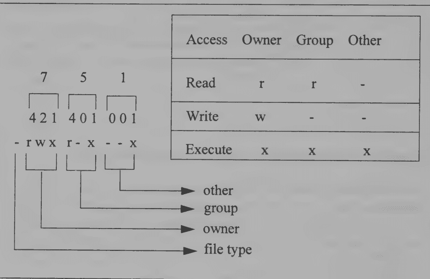

**图 3-5 文件 sort 的权限**


您对文件定义的类型控制很少。然而，如果该文件属于您，您对文件的权限拥有很大的控制权。**chmod** 命令用于更改文件或目录的权限。如果您是文件的所有者，您可以随心所欲地更改文件的权限。

有两种更改权限的方式：符号模式或数字模式。我首先关注数字模式，因为涉及的数字易于管理，而且我发现一些 UNIX 新手会在某些符号的含义上卡壳。然后我会涵盖符号，并在 **chmod** 摘要中包含符号的含义。我决定在摘要中使用符号，因为我更喜欢的数字模式正在变得过时。在某些 UNIX 变体中，每当讨论数字模式时，**chmod** 手册页都会散布着“过时形式”的引用。


首先，我所说的数字是什么意思？查看 **sort** 的数字，我们看到权限为 751：*owner*（所有者，百位）为 7，*group*（用户组，十位）为 5，*other*（其他人，个位）为 1。图 3-6 有助于理解各位位的含义。

# 数字权限摘要

| 数字 | 含义 | 位置求和（每种可能性的总和为七） |
|---|---|---|
| 400 | *owner* 具有读权限 | 700 为读、写和执行 |
| 200 | *owner* 具有写权限 | 600 为读和写 |
| 100 | *owner* 具有执行权限 | 500 为读和执行 |
|   | | 400 为读 |
| | 将这些相加以获得 *owner* 所需的权限 | 300 为写和执行 |
| | | 200 为写 |
| | | 100 为执行 |
| | | 用 *other* 权限替换此 0 |
| | | 用 *group* 权限替换此 0 |
| 040 | *group* 具有读权限 | 070 为读、写和执行 |
| 020 | *group* 具有写权限 | 060 为读和写 |
| 010 | *group* 具有执行权限 | 050 为读和执行 |
| | | 040 为读 |
| | 将这些相加以获得 *group* 所需的权限 | 030 为写和执行 |
| | | 020 为写 |
| | | 010 为执行 |
| | | 用 *other* 权限替换此 0 |
| | | 用 *owner* 权限替换此 0 |
| 004 | *other* 具有读权限 | 007 为读、写和执行 |
| 002 | *other* 具有写权限 | 006 为读和写 |
| 001 | *other* 具有执行权限 | 005 为读和执行 |
| | | 004 为读 |
| | 将这些相加以获得 *other* 所需的权限 | 003 为写和执行 |
| | | 002 为写 |
| | | 001 为执行 |
| | | 用 *group* 权限替换此 0 |
| | | 用 *owner* 权限替换此 0 |


选择 *owner*、*group* 和 *other* 所需的权限后，您可以使用 **chmod** 命令将这些权限分配给文件或目录。其中一些权限可能性很少使用，例如仅执行权限，因为您通常需要对文件具有读访问权限才能执行它；然而，为了完整性，我在图 3-6 中包含了所有可能性。除了图 3-6 中显示的权限模式位之外，还有一些杂项模式位，目前您不需要担心它们。

如果您决定要为文件 **sort** 的 *group* 添加写权限，并移除 *other* 的所有权限，您只需使用相应的数字值执行 **chmod** 命令即可。以下命令集首先列出 **sort** 的现有权限，然后更改 **sort** 的权限，最后列出 **sort** 的新权限：

```
$ ls -l sort
-rwxr-x--x   1 marty    users        120 Jul 26 10:20 sort
$ chmod 770 sort
$ ls -l sort
-rwxrwx---   1 marty    users        120 Jul 26 10:20 sort
```

使用符号模式更改权限的相同命令集为：

```
$ ls -l sort
-rwxr-x---   1 marty    users        120 Jul 26 10:20 sort
$ chmod g+w,o-x sort
$ ls -l sort
-rwxrwx---   1 marty    users        120 Jul 26 10:20 sort
```

在符号模式下，您发出 **chmod** 命令并指定将受变更影响的对象 [user (u)、group (g)、other (o) 或 all (a)]、您希望执行的操作 [添加 (+)、删除 (-) 或替换 (=)] 权限，以及您希望指定的权限 [读 (r)、写 (w) 或 执行 (x)]。在之前使用符号模式的示例中，为 group (g) 添加 (+=) 写 (w) 权限，并从 other (o) 中移除 (-) 执行 (x) 权限。

以下是 **chmod** 一些常用符号的摘要：

**chmod** - 使用以下符号模式列表更改指定文件的权限。

- 受影响对象的符号：
  - u: 影响用户。
  - g: 影响用户组。
  - o: 影响其他人。
  - a: 影响所有用户。

- 执行的操作：
  - +: 添加权限。
  - -: 移除权限。
  - =: 替换权限。

- 指定的权限：
  - r: 读权限。
  - w: 写权限。
  - x: 执行权限。
  - u: 复制用户权限。
  - g: 复制用户组权限。
  - o: 复制其他人权限。


#### cp

**cp** 命令用于将文件从一个位置复制到另一个位置。执行复制操作时，原文件不会发生改变。只要您有权访问希望复制文件到的目标目录，就可以在该目标目录中放置任意数量的文件副本。


接下来的列表描述了使用 **cp** 可以执行的一些复制类型。由于 UNIX 中有许多文件类型（如第 2 章所述），并且您有多种方式来指定源文件和目标文件的路径名，因此该列表可能有助于您理解 **cp** 的多种使用方式：

- 将源文件复制到一个新的文件名。
- 将多个源文件复制到一个不同的目录。
- 将多个源文件复制到同一个目录。
- 将整个目录复制到一个不同的目录。
- 将多个目录复制到不同的目录。

以下是在同一目录中将文件复制到新文件名的示例：

```
$ cp krsort krsort.sav
```

如果文件 **krsort.sav** 已经存在怎么办？答案是它将被正在复制的新 **krsort.sav** 替换。为了防止此类意外情况（正式称为覆盖）发生，您可以使用 **cp** 的 **-i** 选项。**-i** 会在复制发生之前询问您是否希望覆盖该文件。如果您回答肯定，则旧文件会被新文件覆盖。


以下示例首先显示目录内容的列表。使用带有 `-i` 选项的 `cp`，我们将文件 `krsort.c` 复制到 `krsortorig.c`，而该文件已存在。当询问是否要覆盖 `krsortorig.c` 时，通过回答 `n`，文件未被覆盖，且未进行复制：


```
$ ls -l
total 168
-rwxr-xr-x   1 denise users      34592 Oct 31 11:27 krsort
-rwxr-xr-x   1 denise users       3234 Oct 31 11:27 krsort.c
-rwxr-xr-x   1 denise users      32756 Oct 31 11:27 krsort.dos
-rw-r--r--   1 denise users       9922 Oct 31 11:27 krsort.q
-rwxr-xr-x   1 denise users       3085 Oct 31 11:27 krsortorig.c
$ cp -i krsort.c krsortorig.c
overwrite krsortorig.c? (y/n) n
$ 
```

### `cp` - 复制文件和目录。

**选项**

- `-i` 交互式复制，提示您确认是否希望覆盖现有文件。
- `-f` 如果发生文件名冲突，强制用正在复制的文件覆盖现有文件。
- `-p` 复制时保留权限。
- `-r` 递归复制。
- `-R` 递归复制，但权限有所不同。

#### mv


`mv` 命令用于将文件或目录从一个位置移动到另一个位置。您还可以移动多个文件。

以下示例显示了目录列表、将文件 `krsort.c` 移动到该目录内的 `krsort.test.c`，以及显示文件已被移动的目录列表：

```
$ ls -l
total 168
-rwxr-xr-x  1 denise  users   34592 Oct 31 15:17 krsort
-rwxr-xr-x  1 denise  users    3234 Oct 31 15:17 krsort.c
-rwxr-xr-x  1 denise  users    2756 Oct 31 15:17 krsort.dos
-rw-r--r--  1 denise  users    9922 Oct 31 15:17 krsort.q
-rwxr-xr-x  1 denise  users    3085 Oct 31 15:17 krsortorig.c
$ mv krsort.c krsort.test.c
$ ls -l
total 168
-rwxr-xr-x  1 denise  users   34592 Oct 31 15:17 krsort
-rwxr-xr-x  1 denise  users   32756 Oct 31 15:17 krsort.dos
-rwxr-xr-x  1 denise  users    9922 Oct 31 15:17 krsort.q
-rwxr-xr-x  1 denise  users    3234 Oct 31 15:17 krsort.test.c
-rwxr-xr-x  1 denise  users    3085 Oct 31 15:17 krsortorig.c
$
```


如果目标文件已经存在怎么办？您猜对了，UNIX 非常乐意覆盖目标文件。使用 `-i` 选项时，`mv` 会要求您在执行操作之前确认覆盖文件。以下示例显示了尝试将 `krsort.test.c` 移动到 `krsortorig.c` 的操作。用户被告知 `krsortorig.c` 已存在，并选择不让移动操作发生：

```
$ ls -l
total 168
-rwxr-xr-x  1 denise  users   34592 Oct 31 15:17 krsort
-rwxr-xr-x  1 denise  users   32756 Oct 31 15:17 krsort.dos
-rw-r--r--  1 denise  users    9922 Oct 31 15:17 krsort.q
-rwxr-xr-x  1 denise  users    3234 Oct 31 15:17 krsort.test.c
-rwxr-xr-x  1 denise  users    3085 Oct 31 15:17 krsortorig.c
$ mv -i krsort.test.c krsortorig.c
remove krsortorig.c? (y/n) n
$ ls -l
total 168
-rwxr-xr-x  1 denise  users   34592 Oct 31 15:17 krsort
-rwxr-xr-x  1 denise  users   32756 Oct 31 15:17 krsort.dos
-rw-r--r--  1 denise  users    9922 Oct 31 15:17 krsort.q
-rwxr-xr-x  1 denise  users    3234 Oct 31 15:17 krsort.test.c
-rwxr-xr-x  1 denise  users    3085 Oct 31 15:17 krsortorig.c
$
```

由于回答不是肯定的，移动操作未发生，且原始的 **krsortorig.c** 保持完好。


### **mv - 复制文件和目录。**

**选项**

- `-i` 交互式复制，提示您确认是否希望覆盖现有文件。
- `-f` 如果发生文件名冲突，强制用正在复制的文件覆盖现有文件。
- `-p` 复制时保留权限。

#### mkdir


拥有一个随时可以创建目录的命令该有多好啊。您可以使用此命令创建目录，从而像整理文件柜中的文件一样，将文件组织在多个目录中。**mkdir** 命令正是允许您做到这一点——创建目录。


这是一个极其简单的命令。您指定要创建的目录名称。在以下示例中，我们将使用 **ls** 命令查看目录内容，使用 **mkdir** 创建名为 **default.permissions** 的目录，然后执行另一次 **ls** 以查看新目录：

```
$ ls -l
total 2
drwxr-xr-x 2 denise users 1024 Oct 31 11:27 krsort.dir.old
$ mkdir default.permissions
$ ls -l
total 4
drwxr-xr-x 2 denise users 1024 Oct 31 11:27 krsort.dir.old
drwxr-xr-x 2 denise users 24 Oct 31 11:32 default.permissions
$
```

新目录已创建，并为用户 *denise* 设置了默认权限。*group* 和 *other* 对该目录均拥有读取和执行权限。

如果不想使用默认权限，而是希望创建一个具有特定权限的目录怎么办？您可以使用 **mkdir** 的 **-m** 选项来指定您想要的模式或权限。要为 **krsort.dir.new** 目录赋予所有用户读取权限，请发出以下命令：


```
$ mkdir -m "a=r" read.permissions
$ ls -l
total 6
drwxr-xr-x 2 denise users 1024 Oct 31 11:27 krsort.dir.old
drwxr-xr-x 2 denise users 24 Oct 31 11:32 default.permissions
dr-r-r--- 2 denise users 24 Oct 31 11:33 read.permissions
$
```

还记得权限的符号模式和数字模式吗？这个 **mkdir** 命令显示的是符号模式，虽然我不像喜欢数字模式那样喜欢符号模式，但由于数字模式正在变得过时，所以应该使用符号模式。

您不必止步于创建仅有一层深度的目录。使用 **-p** 选项，您可以创建一个包含任意数量子目录的新目录。中间目录通过 **-p** 选项创建。现在让我们在以下示例中创建一个名为 **level1** 的目录，其下有一个 **level2** 目录，**level2** 下面有一个 **level3** 目录。**ls** 命令配合 **-R** 选项递归列出 **level1** 下面的目录：


```
$ mkdir -p level1/level2/level3
$ ls -R level1
level2

level1/level2:
level3

level1/level2/level3:
$
```


在创建目录 level1 并执行 ls 命令后，我们可以看到 level2 确实位于 level1 之下，而 level3 位于 level2 之下。


### mkdir - 创建指定的目录。

选项：
- -m 指定目录的模式（权限）。
- -p 创建中间目录以实现完整路径。如果您想创建多层目录，请使用 **-p**。

#### rm


**rm** 命令用于从目录中删除一个或多个文件，也可以用于删除目录本身。回顾我们之前关于权限的讨论，您必须对目录拥有 *写入* 和 *执行* 权限，才能从中删除文件。如果您拥有要删除文件所在的目录的所有权，那么您通常可以从中删除文件。但是，如果您对目录没有适当的权限，则**删除**文件会失败。

与我们之前介绍的其他一些命令类似，您可以使用 **-i** 选项，该选项会在删除每个文件时要求您进行确认。这意味着，如果您被询问是否确实要删除某个文件并回答 *n*，则该文件不会被删除。如果您回答 *y*，则文件会被删除。

您还可以使用 **-r**（或 **-R**）选项递归删除目录的内容，然后删除目录本身。这意味着您可以递归删除指定的文件和目录。如果您心中对是否要递归删除文件和目录有任何疑问，请结合使用 **-i** 选项和 **-r**。

您可以使用 -f 选项来删除文件和目录，该选项在执行删除操作时不会要求您进行确认。

以下示例对目录 **krsort.dir.new** 执行长列表显示，交互式地提示用户查看他或她是否想要删除该目录中的文件，然后再次列出该目录的内容，显示所有文件均未删除，因为用户回答了 *n*：

```
$ ls -l krsort.dir.new
total 168
-rwxr-xr-x 1 denise users 34592 Oct 27 18:44 krsort
-rwxr-xr-x 1 denise users 3234 Oct 27 18:46 krsort.c
-rwxr-xr-x 1 denise users 32756 Oct 27 18:46 krsort.dos
-rw-r---- 1 denise users 9922 Oct 27 18:46 krsort.q
-rwxr-xr-x 1 denise users 3085 Oct 27 18:46 krsortorig.c
$ rm -i krsort.dir.new/*
../krsort.dir.new/krsort: ? (y/n) n
../krsort.dir.new/krsort.c: ? (y/n) n
../krsort.dir.new/krsort.dos: ? (y/n) n
../krsort.dir.new/krsort.q: ? (y/n) n
../krsort.dir.new/krsortorig.c: ? (y/n) n
$ ls -l krsort.dir.new
total 168
-rwxr-xr-x 1 denise users 34592 Oct 27 18:44 krsort
-rwxr-xr-x 1 denise users 3234 Oct 27 18:46 krsort.c
-rwxr-xr-x 1 denise users 32756 Oct 27 18:46 krsort.dos
-rw-r---- 1 denise users 9922 Oct 27 18:46 krsort.q
-rwxr-xr-x 1 denise users 3085 Oct 27 18:46 krsortorig.c
$
```

请注意，对于是否应删除文件的询问，所有情况下的回答都是 *n*。这意味着没有文件被移除。对任何问题的 *y* 回答都会导致该文件从目录中被移除。要交互式删除目录，请结合使用 **rm** 命令的选项 *-i* 和 *-r*。但是，如果您没有删除目录中的每个文件，在使用 *-i* 选项时，该目录不会被移除。以下示例的第一部分显示了从目录 **krsort.dir.new** 中移除了除 **krsort** 文件之外的所有文件。由于该文件仍然存在，目录未被删除。当在此示例的第二部分中删除该文件时，目录本身随后被删除：


```
$ rm -ir krsort.dir.new
directory krsort.dir.new: ? (y/n) **y**
krsort.dir.new/krsort: ? (y/n) **n**
krsort.dir.new/krsort.c: ? (y/n) **y**
krsort.dir.new/krsort.dos: ? (y/n) **y**
krsort.dir.new/krsort.q: ? (y/n) **y**
krsort.dir.new/krsortorig.c: ? (y/n) **y**
krsort.dir.new: ? (y/n) **y**
rm: directory krsort.dir.new not removed.  Directory not
empty
```

```
$ rm -ir krsort.dir.new
directory krsort.dir.new: ? (y/n) **y**
krsort.dir.new/krsort: ? (y/n) **y**
krsort.dir.new: ? (y/n) **y**
$ 
```

**rm** - 删除文件和目录。

选项：
- -i		交互式删除，提示您确认是否要删除现有文件。
- -f		强制删除文件。
- -r (-R)	递归删除目录内容，然后删除目录本身。

#### rmdir


**rmdir** 命令用于删除一个或多个目录。目录必须是空的才能被删除。您也可以指定要删除的多个目录。回顾我们之前关于权限的讨论，您必须对被删除目录的父目录拥有 *写入* 和 *执行* 权限，才能删除该目录。

与我们之前介绍的其他一些命令类似，您可以使用 **-i** 选项，该选项会在删除每个目录时要求您进行确认。这意味着，如果您被询问是否确实要删除某个目录并回答 *n*，则该目录不会被删除。如果您回答 *y*，则目录会被删除。

您指定要删除目录的顺序很重要。如果您要删除一个目录及其子目录，必须先指定要删除的子目录。如果您先指定要删除父目录而不是其子目录，父目录的删除操作将失败，因为它不是空的。

您可以使用 **-f** 选项强制删除目录，该操作在执行删除时 *不会* 要求您进行确认。

以下示例对目录 **krsort.dir.new** 执行长列表显示，表明该目录中包含一个名为 **.dotfile** 的文件。当我们试图使用 **rmdir** 删除该目录时，会显示一条消息，告知我们该目录不是空的。该目录中的文件 **.dotfile** 阻止了 **rmdir** 命令删除 **krsort.dir.new**。在删除 **.dotfile** 后，我们便可以使用 **rmdir** 删除该目录：

```
$ ls -al ../krsort.dir.new
total 4
drwxr-x-x 2 denise users 1024 Oct 27 18:57 .
drwxrwxr-x 4 denise users 1024 Oct 27 18:40 ..
-rw-r--r- 1 denise users 0 Oct 27 18:56 .dotfile
$ rmdir -i ../krsort.dir.new
../krsort.dir.new: ? (y/n) y
rmdir: ../krsort.dir.new: Directory not empty
$ rm ../krsort.dir.new/.dotfile
$ rmdir -i ../krsort.dir.new
../krsort.dir.new: ? (y/n) y
$
```

**rmdir** 现在已成功删除了 **krsort.dir.new**，**.dotfile** 也已被移除：


### rmdir - 删除目录。

选项：
- -i	交互式删除，提示您确认是否要删除目录
- -f	强制删除目录。
- -p	如果删除目录后，父目录为空，则也将其删除。此操作将持续进行，直到遇到一个不为空的父目录为止。

### 使用命令

### 使用 cd, pwd, ls, mkdir, 和 cp 命令

既然我们已经“孤立”地介绍过其中一些命令，让我们把一些命令组合起来使用。


让我们从查看 *denise* 主目录下名为 **krsort.dir.old** 的目录层次结构开始，如 3-7 图所示：


```
$ cd /home/denise/krsort.dir.old
$ pwd
/home/denise/krsort.dir.old
$ ls -1
total 168
-rw-r--x     1 denise     users        34592 Oct 27 18:20 krsort
-rwxr-xr-x     1 denise     users         3234 Oct 27 17:30 krsort.c
-rwxr-xr-x     1 denise     users        32756 Oct 27 17:30 krsort.dos
-rw-r--     1 denise     users         9922 Oct 27 17:30 krsort.q
-rwxr-xr-x     1 denise     users         3085 Oct 27 17:30 krsortorig.c
```


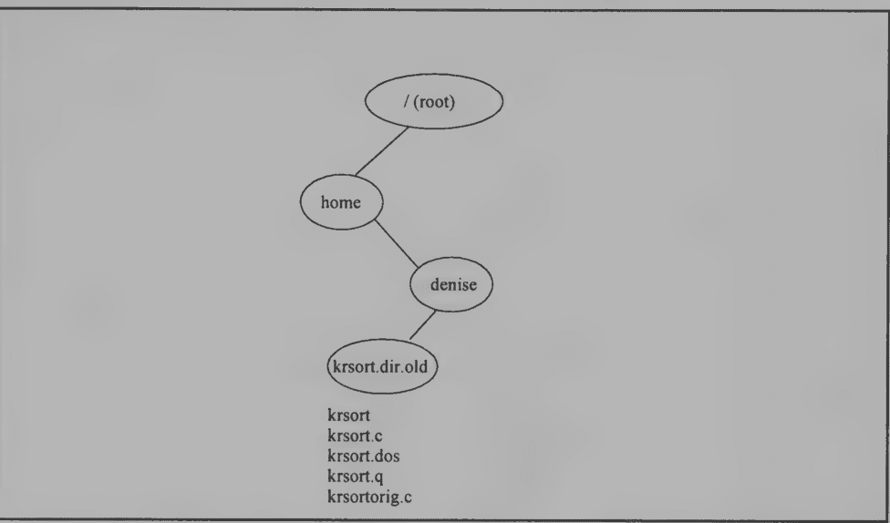

图 3-7 /home/denise/krsort.dir.old


然后，我们可以创建一个名为 **krsort.dir.new** 的新目录，并将文件复制到该目录中，如图 3-8 所示：


```
$ mkdir ../krsort.dir.new
$ cp krsort ../krsort.dir.new
$ ls -l ../krsort.dir.new
total 68
-rwxr-xr-x  1 denise    users    34592 Oct 27 18:27 krsort
$
```


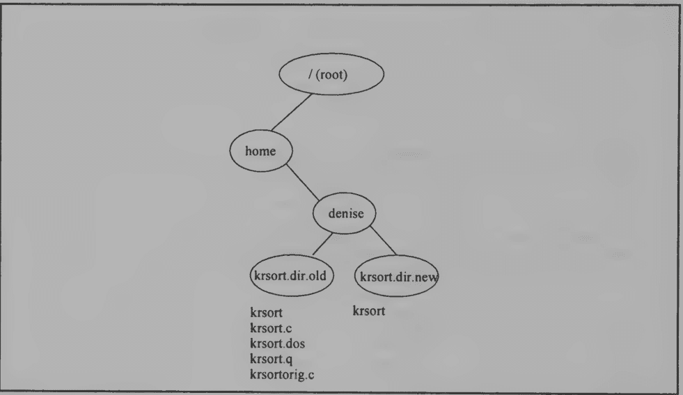

图 3-8 **/home/denise/krsort.dir.new**


现在让我们尝试 cp 的 -i 选项。如果我们试图将文件复制到已存在的文件名，系统会询问我们是否要覆盖目标文件。我们会收到提示，告知目标文件已存在，随后可以为我们要复制的文件选择一个新的名称，如图 3-9 所示：


```
$ pwd
/users/denise/krsort.dir.old
$ cp -i krsort ../krsort.dir.new
overwrite ../krsort.dir.new/krsort? (y/n) n
$ cp krsort ../krsort.dir.new/krsort.new.name
$ ls -l ../krsort.dir.new
total 136
-rwxr-xr-x 1 denise users 34592 Oct 27 18:27 krsort
-rwxr-xr-x 1 denise users 34592 Oct 27 18:29 krsort.new.name
$
```

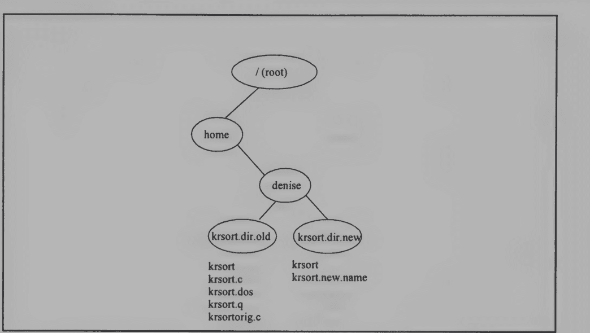

图 3-9 已添加 **/home/denise/krsort.dir.new/krsort.new.name**

我们也可以在 **cp** 中使用通配符，将 **krsort.dir.old** 中的所有文件复制到 **krsort.dir.new**，如图 3-10 所示：

```
$ cp * ../krsort.dir.new
$ ls -l ../krsort.dir.new
total 236
-rwxr-xr-x  1 denise    users   34592 Oct 27 18:30 krsort
-rwxr-xr-x  1 denise    users   3234 Oct 27 18:30 krsort.c
-rwxr-xr-x  1 denise    users   32756 Oct 27 18:30 krsort.dos
-rwxr-xr-x  1 denise    users   34592 Oct 27 18:29
krsort.new.name
-rw-r--r--  1 denise    users   9922 Oct 27 18:30 krsort.q
-rwxr-xr-x  1 denise    users   3085 Oct 27 18:30 krsortorig.c
$
```

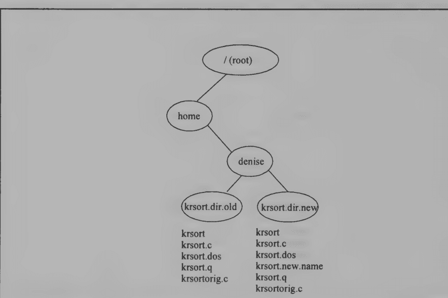

图 3-10 所有文件已复制到 /home/denise/krsort.dir.new

## 使用 mv 命令

让我们从头开始，回到 **krsort.dir.new** 目录为空的点，如图 3-11 所示：

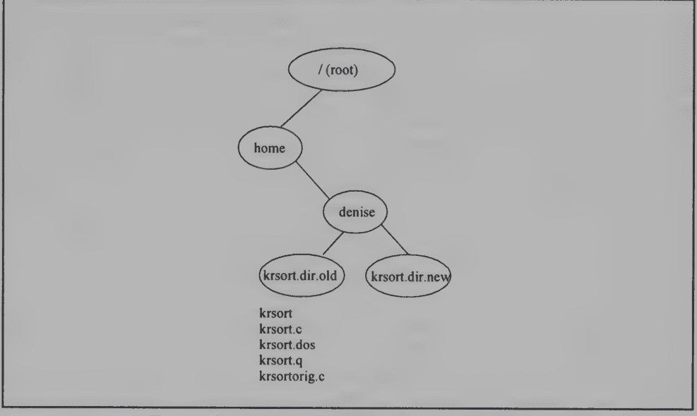

图 3-11 **空的 /home/denise/krsort.dir.new 目录**

现在，我们可以将文件 **krsort** 移动到 **krsort.dir.new** 目录，如图 3-12 所示：

```
$ mv krsort ../krsort.dir.new
$ ls -l ../krsort.dir.new
total 68
-rwxr-xr-x 1 denise users 34592 Oct 27 18:20 krsort
$
```

*   手册页：`mv - 3`
*   手册页：`ls - 2`

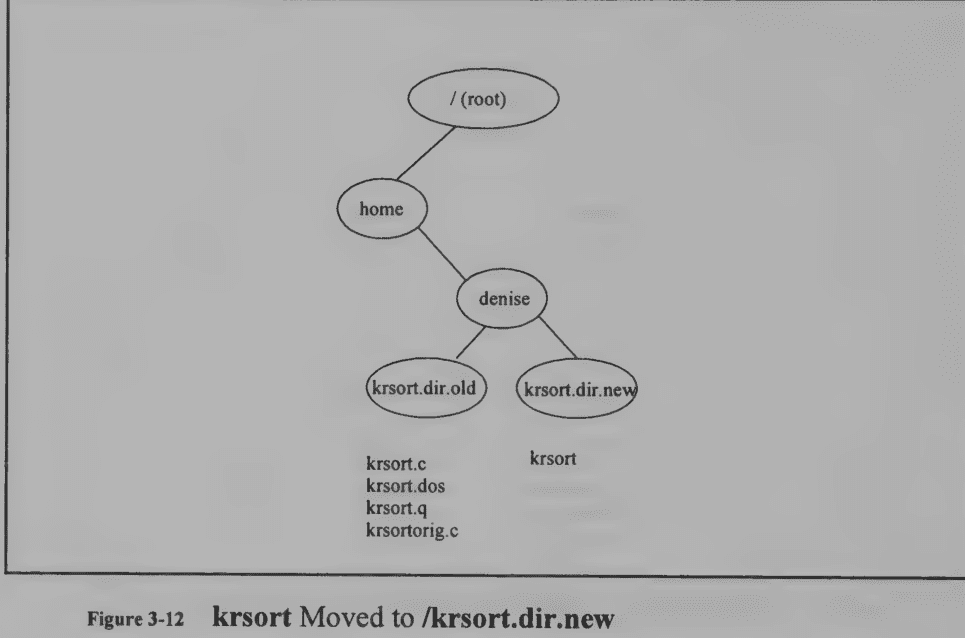

如果我们现在尝试使用 **-i** 选项将 **krsort** 移动到 **krsort.dir.new** 目录并覆盖文件 **krsort**，我们会得到以下结果：


```
$ mv -i krsort ../krsort.dir.new/krsort
overwrite ../krsort.dir.new/krsort? (y/n) n
$
```

由于我们对 **mv** 使用了 **-i** 选项，系统会询问我们是否允许在移动时覆盖文件。由于我们对这个问题回答了 *n*，文件未被覆盖。

我们也可以在使用 **mv** 命令时使用通配符，将 **krsort.dir.old** 目录中的所有文件复制到 **krsort.dir.new** 目录。如果没有 **-i** 选项，**krsort.dir.new** 目录中的任何文件将被同名文件覆盖，如图 3-13 所示：

```
$ mv * ../krsort.dir.new
$ ls -l ../krsort.dir.new
total 168
-rwxr-xr-x 1 denise users 34592 Oct 27 18:44 krsort
-rwxr-xr-x 1 denise users 3234 Oct 27 18:46 krsort.c
-rwxr-xr-x 1 denise users 32756 Oct 27 18:46 krsort.dos
-rw-r--r-- 1 denise users 9922 Oct 27 18:46 krsort.q
-rwxr-xr-x 1 denise users 3085 Oct 27 18:46 krsortorig.c
$
```

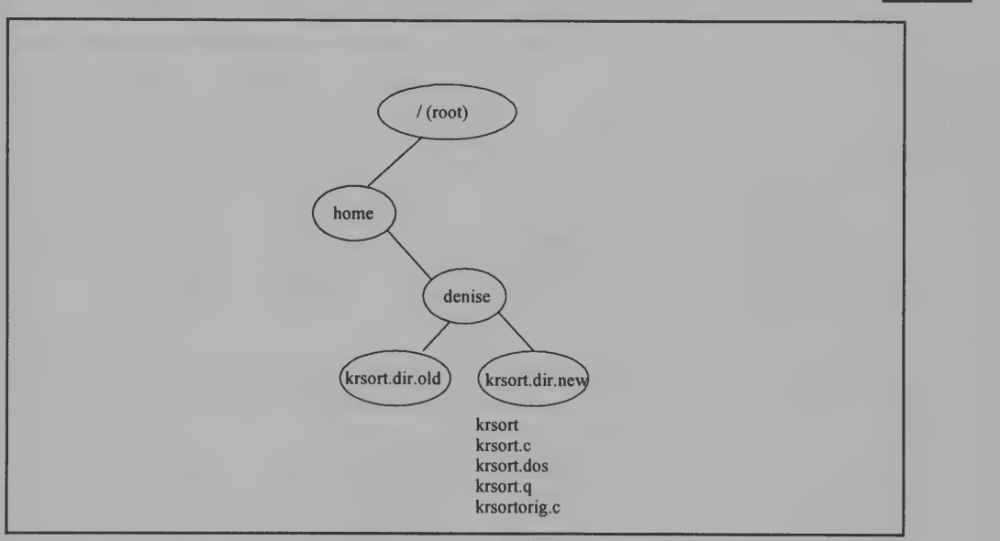

## 深入挖掘 rm 和 rmdir 命令

在 UNIX 世界中，最令人望而生畏的命令（我可能会说是有充分理由的）是 **rm** 命令。**rm** 随时可以删除任何你想要的东西，除非你使用 -i 选项，否则不会询问任何问题。

想立即摧毁你的系统吗？**rm** 会很乐意帮你。作为一个普通用户，而不是系统管理员，你通常没有权限这样做。然而，知道这种可能性是存在的，让人感到不安。此外，你很可能有权限删除你自己所有的文件和目录。只需简单地在 rm 命令中使用 -i 选项，就可以轻松避免所有这些。


让我们假设 **krsort.dir.new** 和 **krsort.dir.old** 是相同的目录，如图 3-14 所示：

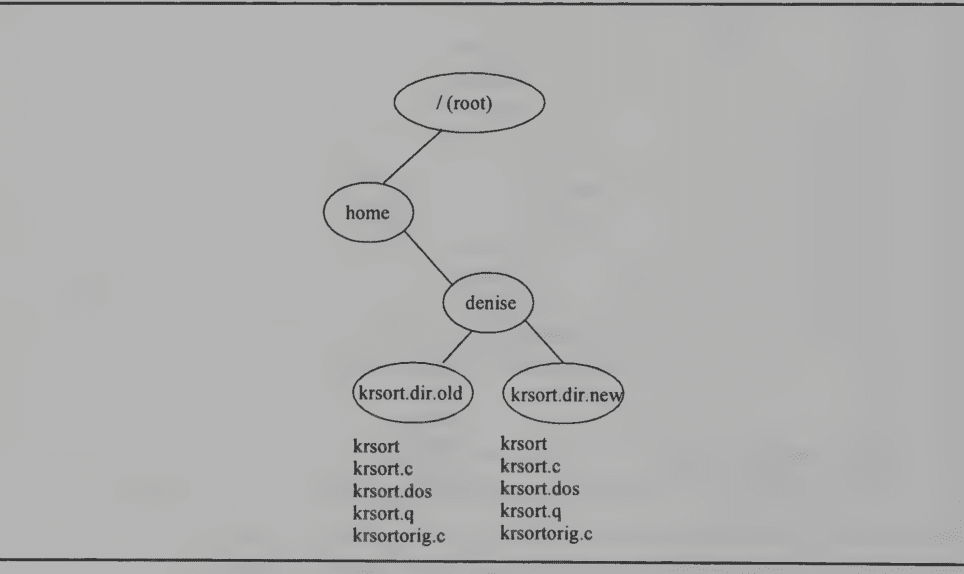

**图 3-14** /home/denise/krsort.dir.old 和 /home/denise/krsort.dir.new (相同)

要从 **krsort.dir.new** 交互式地删除文件，请执行以下操作：

```
$ rm -i ../krsort.dir.new/*
../krsort.dir.new/krsort: ? (y/n) n
../krsort.dir.new/krsort.c: ? (y/n) n
../krsort.dir.new/krsort.dos: ? (y/n) n
../krsort.dir.new/krsort.q: ? (y/n) n
../krsort.dir.new/krsortorig.c: ? (y/n) n
$ ls -l ../krsort.dir.new
total 168
-rwxr-xr-x  1 denise  users  34592 Oct 27 18:44 krsort
-rwxr-xr-x  1 denise  users   3234 Oct 27 18:46 krsort.c
-rwxr-xr-x  1 denise  users  32756 Oct 27 18:46 krsort.dos
-rw-r--r--  1 denise  users   9922 Oct 27 18:46 krsort.q
-rwxr-xr-x  1 denise  users   3085 Oct 27 18:46 krsortorig.c
$
```


显然，这导致没有从 **krsort.dir.new** 中删除任何东西，因为我们在被询问是否要删除文件时回答了 *n*。

现在让我们继续向 **krsort.dir.new** 添加一个以“.”开头的文件。*touch* 命令正是做这个的，创建一个没有内容的文件，如图 3-15 所示：

```
$ touch ../krsort.dir.new/.dotfile
$ ls -al ../krsort.dir.new
total 172
drwxr-xr-x 2 denise users 1024 Oct 27 18:54 .
drwxrwxr-x 4 denise users 1024 Oct 27 18:40 ..
-rw-r--r-- 1 denise users 0 Oct 27 18:56 .dotfile
-rwxr-xr-x 1 denise users 34592 Oct 27 18:44 krsort
-rwxr-xr-x 1 denise users 3234 Oct 27 18:46 krsort.c
-rwxr-xr-x 1 denise users 32756 Oct 27 18:46 krsort.dos
-rw-r--r-- 1 denise users 9922 Oct 27 18:46 krsort.q
-rwxr-xr-x 1 denise users 3085 Oct 27 18:46 krsortorig.c
$
```


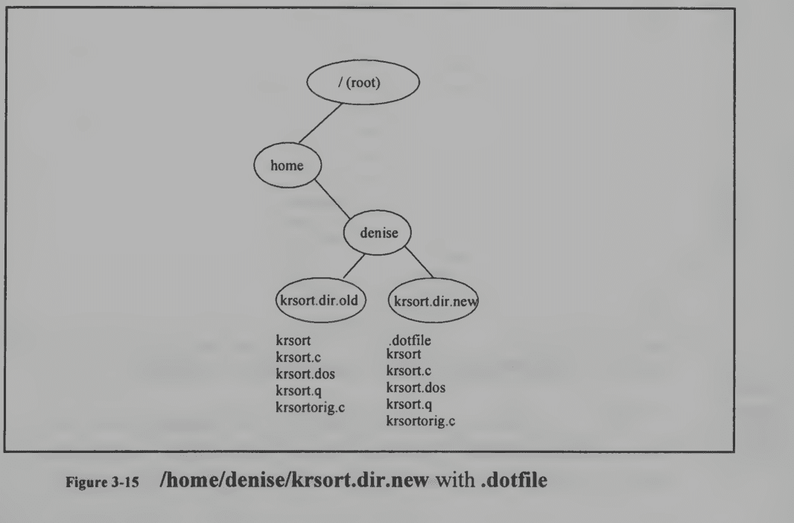

如果我们现在尝试使用之前发出的相同 `rm` 命令来删除文件，我们会看到以下结果，如图 3-16 所示：

```
$ rm -i ../krsort.dir.new/*
../krsort.dir.new/krsort: ? (y/n) y
../krsort.dir.new/krsort.c: ? (y/n) y
../krsort.dir.new/krsort.dos: ? (y/n) y
../krsort.dir.new/krsort.q: ? (y/n) y
../krsort.dir.new/krsortorig.c: ? (y/n) y
$ ls -al ../krsort.dir.new
total 4
drwxr-xr-x     2 denise     users        1024 Oct 27 18:57 .
drwxrwxr-x     4 denise     users        1024 Oct 27 18:40 ..
-rw-r--r--     1 denise     users           0 Oct 27 18:56 .dotfile
```

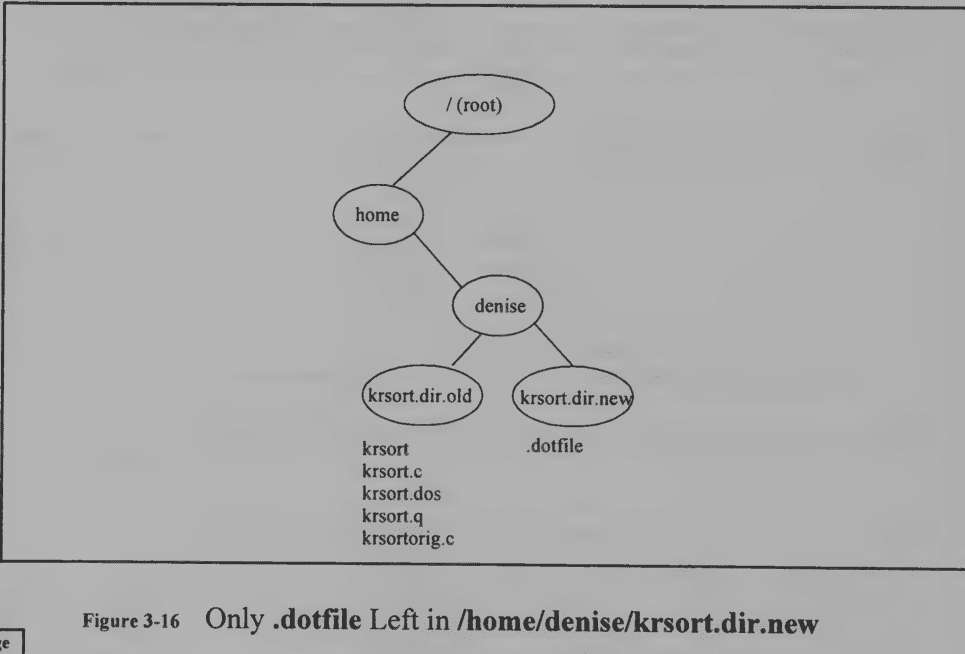

与 `rm` 命令一起使用的通配符 `"*"` 没有删除文件 `.dotfile`。该目录中的文件 `.dotfile` 阻止了 `rmdir` 命令删除 `krsort.dir.new`。在 **rmdir** 命令成功删除 **krsort.dir.new** 之前，必须先删除该文件。

```
$ rmdir -i ../krsort.dir.new
../krsort.dir.new: ? (y/n) y
rmdir: ../krsort.dir.new: Directory not empty
$ rm ../krsort.dir.new/.dotfile
$ rmdir -i ../krsort.dir.new
../krsort.dir.new: ? (y/n) y
$
```


**rmdir** 现在成功删除了 **krsort.dir.new**，因为 **.dotfile** 已消失，如图 3-17 所示：

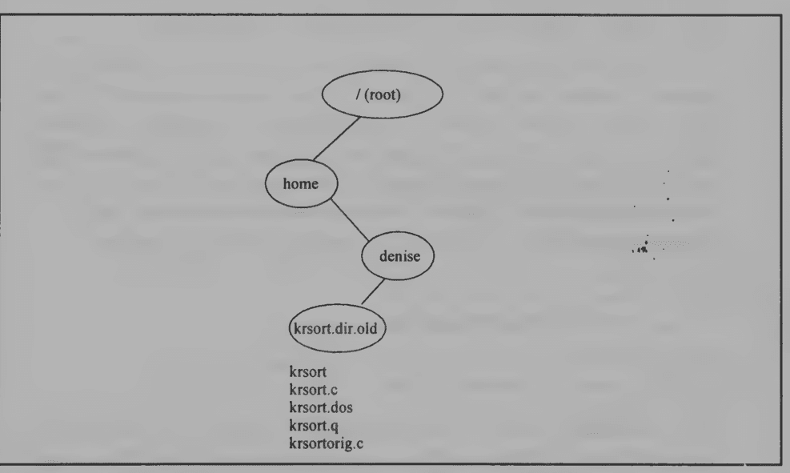

图 3-17 **rmdir** 删除 /home/denise/krsort.dir.new


### 重定向

在讨论文件查看之前，让我们花点时间谈谈重定向，因为我在接下来的章节中会用到一些重定向。我会在 Shell 编程部分详细讲解重定向，但现在我想先给你一个关于重定向的简要介绍，以便我们能更有效地讲解本章中的一些命令。

UNIX 系统的设计使得命令通常从键盘（常被称为*标准输入*）获取输入，并将输出发送到屏幕（常被称为*标准输出*）。命令还会将错误信息发送到屏幕。你并不总是希望输入来自标准输入，或者输出和错误都流向标准输出。系统赋予了你大量的控制权来覆盖这些默认设置。这就是重定向。表 3-4 展示了许多常见的重定向形式。

如表中所示，要将命令的输出从重定向到标准输出到一个文件，请使用 ">"。这在几乎所有情况下都有效。如果你设置了一个名为 **noclobber** 的环境变量，那么重定向到已存在的文件将不起作用（我们将很快讲解环境变量）。**noclobber** 不允许重定向覆盖已存在的文件。如果你试图覆盖一个已存在的文件，例如下面的 /tmp/processes，你会收到一条文件已存在的消息：


```
# ps -ef > /tmp/processes
/tmp/processes: File exists
```

然而，你可以使用 "!" 配合重定向来强制覆盖文件。使用 ">!" 会强制覆盖文件，而 ">>!" 则强制将输出追加到已存在文件的末尾。这些用法的示例见表 3-4。

### 表 3-4 常用的重定向形式

| 命令或赋值 | 示例 | 描述 |
| :--- | :--- | :--- |
| `<` | `wc -l < .login` | 标准输入重定向：执行 **wc**（字数统计）并列出 *.login* 中的行数（-l） |
| `>` | `ps -ef > /tmp/processes` | 标准输出重定向：执行 **ps** 并将输出发送到文件 */tmp/processes* |
| `>>` | `ps -ef >> /tmp/processes` | 追加标准输出：执行 **ps** 并将输出追加到文件 */tmp/processes* 的末尾 |
| `>`! | `ps -ef >! /tmp/processes` | 追加输出重定向并覆盖 **noclobber**：即使 */tmp/processes* 存在也进行覆盖写入 |
| `>>`! | `ps -ef >>! /tmp/processes` | 追加标准输出并覆盖 **noclobber**：追加到 */tmp/processes* 的末尾 |
| `\|` (管道) | `ps \| wc -l` | 运行 **ps** 并将其结果作为 **wc** 的输入。 |
| **0** - 标准输入 | | |
| **1** - 标准输出 | | |
| **2** - 标准错误 | `cat program 2> errors` | **cat** 文件 **program** 到标准输出，并将错误重定向到文件 *errors*。 |
| | `cat program 2>> errors` | **cat** 文件 **program** 到标准输出，并将错误追加到文件 *errors*。 |
| | `find / -name "*.c" -print > cprograms 2> errors` | **find** 系统中所有以 *.c* 结尾的文件，将文件列表放入当前工作目录中的 **cprograms** 文件，并将所有错误（文件描述符 2）发送到当前工作目录中的 *errors* 文件。 |
| | `find / -name "*.c" -print > cprograms 2>&1` | **find** 系统中所有以 *.c* 结尾的文件，将文件列表放入当前工作目录中的 **cprograms** 文件，并将所有错误（文件描述符 2）发送到与文件描述符 1（**cprograms**）相同的位置。 |

使用表 3-4 中显示的符号，你可以从*标准输入*和*标准输出*进行重定向。例如，你可以不将输出显示在屏幕上，而是将其发送到文件。我们将在接下来的示例中使用其中一些重定向形式。

### 使用 cat, more, pg, head 和 tail 查看文件


首先，让我们看一个长文件。事实上，让我们看一个非常长的文件，长到如果将其内容打印到屏幕上，屏幕无法完整显示。

**cat** 命令（concatenate 的缩写）正是如此，它将文件打印到你的屏幕上。然而，如果文件很长，你在屏幕上只能看到文件的末尾。还记得本书前面提到的用户 **denise** 吗？她的目录里有很多文件。让我们列出她目录中的文件，并使用以下命令将输出重定向到一个名为 **listing** 的文件：


```
$ ls -a /home/denise > listing
```

当我们 **cat listing** 到屏幕上时，我们只看到其末尾，如图 3-18 所示。我们知道这是文件的末尾，因为我对 **cat** 使用了包含行号的 **-n** 选项。行号表明这不是文件的开头。

```
106  rclock.exe
107  rkhelp.exe
108  sb.txt
109  shellupd.exe
110  smsup2.exe
111  softinit.remotesoft.cm
112  srvpr.exe
113  tabndi.exe
114  target.exe
115  tcp41a.exe
116  tnds2.exe
117  trace.TRC1
118  trace.TRC1.Z.uae
119  upgrae.exe
120  uue.syntax
121  v103.txt
122  whoon
123  win95app.exe
124  wsdrv1.exe
125  wsos21.exe
126  wsos22.exe
127  wsos23.exe
128  xferp110.zip
$
```


只看到这个文件的末尾并不是我们想要的结果。使用 **pg**（代表分页），我们将逐屏查看，如图 3-19 所示：


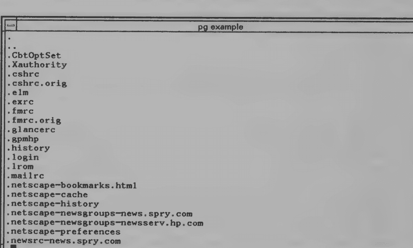

图 3-19 **pg 命令**


**more** 命令产生的输出与 **pg** 相同，如图 3-20 所示。


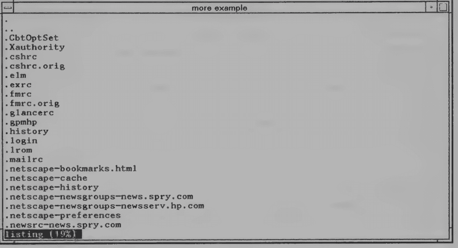

图 3-20 **more 命令**

这就好多了；现在我们可以使用 **pg** 和 **more** 逐屏滚动。然而，有时你只想查看文件的开头或结尾。你可以使用 **head** 命令查看文件的开头，使用 **tail** 命令查看文件的底部。下面的 **head** 和 **tail** 两个示例（见图 3-21 和 3-22）分别展示了查看 listing 的前 20 行和后 20 行。


```
$ head -20 listing
.
..
.CbtOptSet
.Xauthority
.cshrc
.cshrc.orig
.cim
.exrc
.fmrc
.fmrc.orig
.glanercrc
.gpmlp
.history
.login
.lrom
.mailrc
.netscape-bookmarks.html
.netscape-cache
.netscape-history
.netscape-newsgroups=news.spry.com
$
```

图 3-21 head 命令

```
$ tail -20 listing
shellupd.exe
smsup2.exe
softinit.remotesoft.cm
srvpr.exe
tabndi.exe
target.exe
tcp41a.exe
tnds2.exe
trace.TRC1
trace.TRC1.Z.uae
upgrade.exe
uue.syntax
v103.txt
whoon
win95app.exe
wsdrv1.exe
wsos21.exe
wsos22.exe
wsos23.exe
xferp110.zip
$
```

图 3-22 tail 命令

你使用的命令取决于你希望显示的信息。我个人偏好，无论是查看大文件的内容还是长长的文件列表，都使用 **more**。我并没有很好的理由，我只能说我们是习惯的动物，而且我一直都在使用 **more**。以下是 **cat**、**pg**、**more**、**head** 和 **tail** 的命令摘要。我列出了这些命令最常使用的一些选项。由于这些命令都不难使用，我建议你尝试每个命令，看看哪一个比其他的更适合你的需求。

以下是 **cat**、**pg**、**more**、**head** 和 **tail** 命令的摘要。

-   **-** 当你想使用键盘作为标准输入时，用作指定文件名的替代。
-   **-n** 在输出行的旁边显示行号。
-   **-p** 将多个连续的空白行替换为单个空白行。
-   **-s** 这是静默模式，抑制关于不存在文件的信息。
-   **-u** 输出是无缓冲的，这意味着它是按字符处理的。
-   **-v** 可见地打印大多数非打印字符。
-   **-number** 你想显示的行数。
-   **-p string** 使用 *string* 指定提示符。
-   **-c** 在显示文件的下一页之前清除屏幕。


### -f
不要换行显示正在显示的文本。

### -n
只要输入了命令字母，命令就会立即发出，而不需要输入新的换行字符。

### **more**
一次显示一屏或显示文件的一部分。

**选项**

- **-c**: 在显示文件的下一页之前清屏。
- **-d**: 在屏幕底部显示带有简短说明的提示。
- **-f**: 将文本折行以适配屏幕，并据此判断页长。
- **-n**: 将显示窗口中的行数设置为 n。
- **-s**: 将多个连续的空白行压缩为一个空白行。

### **head**
仅提供文件的前几行。

**选项**

- **-c**: 输出指定字节数。
- **-l**: 输出指定行数。这是默认选项。
- **-n count**: 指定字节数或行数由 *count* 决定。您也可以使用 *-count* 来指定字节数或行数，如下例所示。默认 *count* 为 10。

#### tail
提供文件的最后几行。

**选项**

- **-number**: 指定从文件末尾开始显示的块数。
- **-cnumber**: 指定从文件末尾开始显示的字符数。
- **-nnumber**: 指定从文件末尾开始显示的行数。您也可以指定一个数字或带负号的数字，如下例所示，以指定从文件末尾开始显示的行数。

#### split

有些文件实在太长了。我们之前查看的 **listing** 文件，如果拆分成多个文件可能更容易管理。我们可以使用 **split** 命令将 **listing** 拆分为长度为 25 行的文件，如图 3-23 所示。

```
$ ll listing
-rw------- 1 denise users        1430 Dec 19 16:30 listing
$
$ split -l 25 listing
$
$ ll x*
-rw------- 1 denise users          330 Dec 19 16:40 xaa
-rw------- 1 denise users          267 Dec 19 16:40 xab
-rw------- 1 denise users          268 Dec 19 16:40 xac
-rw------- 1 denise users          256 Dec 19 16:40 xad
-rw------- 1 denise users          274 Dec 19 16:40 xae
-rw------- 1 denise users           35 Dec 19 16:40 xaf
$ 
```


请注意，`split` 命令从 **listing** 生成了几个文件，分别命名为 xaa、xab 等。使用 `-l` 选项来指定 `split` 生成的文件中每文件的行数。以下是 `split` 命令的摘要。

**split** - 将文件拆分为多个文件。

**选项**

- **-l `line_count`**: 将文件拆分为每个文件包含 `line_count` 行的文件。
- **-b n**: 将文件拆分为每个文件包含 n 字节的文件。

### 第 3 章中使用的某些命令的手册页

以下是本章中使用的许多命令的 HP-UX 手册页。命令在不同 UNIX 变体之间可能存在差异，因此您可能会发现某些命令的选项或其他方面存在差异；然而，以下手册页是一个极好的参考资料。

#### cat


**cat** - 连接文件。

**名称**

**cat** - 连接、复制和打印文件

**概要**

**cat** [-benrstuv] *file* ...

**描述**

**cat** 依次读取每个 *file* 并将其写入标准输出。因此：

**cat** *file*

在默认标准输出设备上打印 *file*；

**cat** *file1* *file2* > *file3*

连接 *file1* 和 *file2*，并将结果放入 *file3*。

如果 **-** 作为 *file* 参数出现，**cat** 使用标准输入。若要组合标准输入和其他文件，请使用 **-** 和 *file* 参数的组合。

**选项**

**cat** 识别以下选项：

- **-b**: 当指定了 **-n** 选项时，省略空行的行号。如果指定了此选项，则自动选择 **-n** 选项。
- **-e**: 在每行末尾（换行符之前）打印 $ 字符。如果指定了此选项，则自动选择 **-v** 选项。
- **-n**: 显示的行前带有行号，行号从 1 开始顺序编号。
- **-r**: 用一行空行替换多行连续的空行，使得包含字符的行之间永远不超过一行空行。
- **-s**: 静默选项。**cat** 抑制关于不存在的文件、输入和输出相同以及写入错误的错误消息。通常，除非 *file* 是特殊文件，否则输入和输出文件不能具有相同的名称。
- **-t**: 将每个制表符打印为 ^I。如果指定了此选项，则自动选择 **-v** 选项。
- **-u**: 不缓冲输出（逐字符处理）。通常，输出是缓冲的。
- **-v**: 使非打印字符（制表符、换行符和换页符除外）可见地打印。控制字符使用 ^X（Ctrl-X）的形式打印，DEL 字符（八进制 0177）打印为 ^?（参见 ascii(5)）。最高位设置为 1 的单字节控制字符使用 M-^x 的形式打印，其中 x 是由七个低位指定的字符。所有其他非打印字符都打印为 M-x，其中 x 是由七个低位指定的字符。此选项受 LC CTYPE 环境变量及其对应的字符集影响。

**外部影响**

**环境变量**

- LANG 提供未设置或为空的国际化变量的默认值。如果 LANG 未设置或为空，则使用 "C" 的默认值（参见 lang(5)）。如果任何国际化变量包含无效设置，cat 的行为将类似于所有国际化变量都设置为 "C"。参见 environ(5)。
- LC_ALL 如果设置为非空字符串值，则覆盖所有其他国际化变量的值。
- LC_CTYPE 确定文本被解释为单字节和/或多字节字符的方式，字符作为可打印字符的分类，以及正则表达式中字符类表达式匹配到的字符。
- LC_MESSAGES 确定应使用哪种语言环境来影响写入标准错误的诊断消息和写入标准输出的信息消息的格式和内容。
- NLSPATH 确定用于处理 LC_MESSAGES 的消息目录的位置。

**国际字符集支持**

支持单字节和多字节字符集。

**返回值**

退出值如下：

- 0: 成功完成。
- >0: 发生错误状况。

**示例**

要创建一个零长度文件，请使用以下任一方法：

```c
cat /dev/null > file
cp /dev/null file
touch file
```

以下命令会打印 file1 中所有制表符出现位置的 ^I：

```c
cat -t file1
```

要抑制关于不存在文件的错误消息，请使用：

```c
cat -s file1 file2 file3 > file
```

如果 file2 不存在，上述命令将连接 file1 和 file3，而不报告 file2 的错误。如果不使用 -s 选项，结果也是相同的，区别在于 cat 会显示错误消息。

要查看 file2 中的不可打印字符，请使用：

```
cat -v file2
```

**警告**

以下类型的命令格式：

```
cat file1 file2 > file1
```

在连接开始之前会覆盖 file1 中的数据，从而破坏文件。因此，使用 shell 特殊字符时要小心。

**参见**

cp(1), more(1), pg(1), pr(1), rm(1), ssp(1).

**标准一致性**

cat: SVID2, SVID3, XPG2, XPG3, XPG4, POSIX.2

#### cd

**cd** - 更改工作目录。

**名称**

cd - 更改工作目录

**概要**

cd [directory]

**描述**

如果未指定 directory，则使用 shell 参数 HOME 的值作为新的工作目录。如果 directory 指定了一个以 /、. 或 .. 开头的完整路径，则 directory 成为新的工作目录。如果上述两种情况都不适用，cd 会尝试根据 CDPATH shell 变量指定的路径之一来查找指定的目录。CDPATH 具有与 PATH shell 变量相同的语法和类似的语义。cd 必须具有 directory 的执行（搜索）权限。

cd 仅作为 shell 内置命令存在，因为每当执行命令时都会创建新进程，如果作为普通系统命令编写和处理，cd 将毫无用处。此外，不同的 shell 提供不同的 cd 内置实用程序实现。此处描述的 cd 功能可能并不被所有 shell 支持。关于差异，请参阅各个 shell 的手册条目。

如果在子 shell 或单独的实用程序执行环境中调用 cd，例如：

```
find . -type d -exec cd {}; -exec foo {};
```

（这在可访问的目录上调用 foo）

cd 不会影响调用者环境的当前目录。将 cd 作为独立命令使用的另一个用途是获取命令的退出状态。

**外部影响**

**国际字符集支持**

支持单字节和多字节字符集。

**示例**

从文件系统中的任何位置更改当前工作目录到 HOME 目录：

```
cd
```

切换到位于当前目录中的新当前工作目录 foo：

```
cd foo
```


或者

```
cd ./foo
```

更改到位于当前目录父目录下的 foobar 目录：

```
cd ../foobar
```

更改到绝对路径名为 /usr/local/lib/work.files 的目录：

```
cd /usr/local/lib/work.files
```

更改到相对于主目录的 proj1/schedule/staffing/proposals 目录：

```
cd $HOME/proj1/schedule/staffing/proposals
```

## 变量

以下环境变量影响 cd 的执行：

| | |
| --- | --- |
| HOME | 主目录的名称，当未指定目录操作数时使用。 |
| CDPATH | 指向日志的路径名列表，用冒号分隔。如果目录操作数不以斜杠 (/) 字符开头，且第一个组件不是点或点-点，则 cd 将按照列出顺序，在 CDPATH 变量中命名的每个目录中搜索相对路径的目录。新的工作目录将设置为找到的第一个匹配目录。用空字符串代替目录路径名代表当前目录。如果未设置 CDPATH，则将其视为空字符串。 |

#### 返回值

完成后，cd 以以下值之一退出：

| | |
| --- | --- |
| 0 | 目录更改成功。 |
| >0 | 发生错误。工作目录保持不变。 |

#### 参见

csh(1), pwd(1), ksh(1), sh-posix(1), sh(1), chdir(2).

## 标准兼容性

cd: SVID2, SVID3, XPG2, XPG3, XPG4, POSIX.2

#### chmod


### 名称

chmod - 更改文件模式访问权限

### 概要

`/usr/bin/chmod [-A] [-R] symbolic_mode_list file ...`

过时格式：
`/usr/bin/chmod [-A] [-R] numeric_mode file ...`

### 描述

chmod 命令根据 symbolic_mode_list 或 numeric_mode 的值更改一个或多个文件的权限。您可以使用 `ls -l` 命令显示文件的当前权限（参见 ls(1)）。

**符号模式列表**

symbolic_mode_list 是逗号分隔的操作列表，格式如下。不允许使用空白字符。

`(who)op[permission][,...]`

变量字段可以具有以下值：

- **who**
  以下字母中的一个或多个：
  - u 修改用户（所有者）权限。
  - g 修改组权限。
  - o 修改其他用户权限。
  - a 修改所有用户权限（a 等同于 ugo）。

- **op**
  必需；以下符号之一：
  - + 在 who 的现有文件模式位中添加权限。
  - - 从 who 的现有文件模式位中删除权限。
  - = 用 permission 替换 who 的现有文件模式位。

- **permission**
  以下字母中的一个或多个：
  - r 添加或删除 who 的读取权限。
  - w 添加或删除 who 的写入权限。
  - x 添加或删除 who 的执行文件（搜索目录）权限。
  - s 添加或删除 who 的文件执行时设置所有者 ID 或组 ID 权限。仅当 who 中明确或隐含指定 u 或 g 时才有用。
  - t 添加或删除文件执行时保留文本镜像（粘滞位）权限。仅当 who 中明确或隐含指定 u 时才有用。参见 chmod(2)。
  - X 有条件地添加或删除执行/搜索权限，规则如下：
    - 如果文件是目录，在 who 的现有文件模式中添加或删除搜索权限。（与 x 相同。）
    - 如果文件不是目录，且当前文件权限包含用户、组或其他用户至少一者的执行权限（ls -l 显示 x 或 s），则添加或删除 who 的文件执行权限。
    - 如果文件不是目录，且当前文件模式中未设置任何执行权限，则不更改任何执行权限。

或者仅为以下字母中的一个：

- u 将当前用户权限复制到 who。
- g 将当前组权限复制到 who。
- o 将当前其他用户权限复制到 who。

操作按指定顺序执行，可以覆盖同一命令行中之前指定的操作。

如果省略 who，则如果当前文件模式创建掩码（参见 umask(1)）允许更改，则对所有用户更改 r、w、x 和 X 权限。s 和 t 权限的更改如同在 who 中指定了 a 一样。

省略 permission 仅在与 = 一起使用以删除所有权限时才有用。

**数值模式（过时）**

可以通过指定数值模式（由以下模式位的逻辑或（和）构成的八进制数）来设置绝对权限：

### 杂项模式位：

- 4000 (=u=s) 文件执行时设置用户 ID（仅限文件）
- 2000 (=g=s) 文件执行时设置组 ID
- 1000 (=u=t) 设置粘滞位；参见 chmod(2)

### 权限模式位：

- 0400 (=u=r) 所有者读取
- 0200 (=u=w) 所有者写入
- 0100 (=u=x) 所有者执行（在目录中搜索）
- 0040 (=g=r) 组读取
- 0020 (=g=w) 组写入
- 0010 (=g=x) 组执行/搜索
- 0004 (=o=r) 其他用户读取
- 0002 (=o=w) 其他用户写入
- 0001 (=o=x) 其他用户执行/搜索

### 选项

- -A 保留与文件关联的任意可选访问控制列表 (ACL) 条目。默认情况下，根据 IEEE 标准 POSIX 1003.1-1988，可选 ACL 条目会被删除。有关访问控制列表的信息，请参见 acl(5)。
- -R 递归更改文件模式位。对于每个指定目录的文件操作数，chmod 会更改指定目录及其下方文件层次结构中所有文件和子目录的文件模式位。

只有文件的所有者或具有适当特权的用户才能更改其模式。

只有具有适当特权的用户才能设置（或保留，如果之前已设置）常规文件的粘滞位。

为了设置执行时设置组 ID 位，文件的组必须对应于您当前的组 ID。

如果在符号链接上使用 chmod，则更改链接所引用文件的模式。

#### 外部影响

环境变量
LC_MESSAGES 决定消息显示的语言。

如果在环境中未指定 LC_MESSAGES 或其值为空字符串，则使用 LANG 的值作为每个未指定或为空变量的默认值。如果未指定 LANG 或其值为空字符串，则使用默认值 "C"（参见 lang(5)）代替 LANG。

如果任何国际化变量包含无效设置，chmod 的行为如同所有国际化变量都设置为 "C"。参见 environ(5)。

国际字符集支持
支持单字节和多字节字符集。

#### 返回值

完成后，chmod 返回以下值之一：

- 0 成功完成。
- >0 发生错误条件。

##### 示例

拒绝其他用户的写入权限：

```
chmod o-w file
```

使文件对所有用户可执行：

```
chmod a+x file
```

为所有用户分配读取和执行权限，并设置设置用户 ID 位：

```
chmod a=rx,u+s file
```

为文件所有者分配读取和写入权限，并为其他所有用户分配读取权限：

```
chmod u=rw,go=r file
或者
chmod 644 file (过时格式)
```

遍历目录子树，使所有常规文件仅对用户和组可读，并所有可执行文件和目录对所有人可执行（可搜索）：

```
chmod -R ug+r,o-r,a+X pathname
```

如果 umask 的当前值为 020（umask -S 显示 u=rwx,g=rx,o=rwx；不更改组的写入权限），且文件 mytest 的当前权限为 444 (a=r)，由 ls -l 显示为 -r--r--r--，则命令

```
chmod +w mytest
```

将权限设置为 646 (uo=rw,g=r)，由 ls -l 显示为 -rw-r--rw-。如果 umask 的当前值为 020（umask -S 显示 u=rwx,g=rx,o=rwx；不更改组的写入权限），且文件 mytest 的当前权限为 666 (a=rw)，由 ls -l 显示为 -rw-rw-rw-，则命令

```
chmod -w mytest
```

将权限设置为 464 (uo=r,g=rw)，由 ls -l 显示为 -r--rw-r--。

### 依赖

-A 选项会导致 chmod 在不支持 ACL 的文件系统上失败。

#### 作者

chmod 由 AT&T 和 HP 开发。

#### 参见

chacl(1), ls(1), umask(1), chmod(2), acl(5).

### 标准兼容性

chmod: SVID2, SVID3, XPG2, XPG3, XPG4, POSIX.2


#### cp

### cp - 复制文件和目录。


### 名称

cp - 复制文件和目录子树

### 用法

cp [-f[-i]] [-p] [-e extarg] file1 new_file
cp [-f[-i]] [-p] [-e extarg] file1 [file2 ...] dest_directory
cp [-f[-i]] [-p] [-R[-r]] [-e extarg] directory1 [directory2 ...]
   dest_directory

### 描述

- cp 执行以下复制操作：
    - 将 file1 复制到新的或已存在的 new file，
    - 将 file1 复制到已存在的 dest_directory，
    - 将 file1、file2、... 复制到已存在的 dest_directory，
    - 将目录子树 directory1 复制到新的或已存在的 dest_directory。或者
    - 将多个目录子树 directory1、directory2、... 复制到新的或已存在的 dest_directory。

如果 file1 和 new file 是同一个文件，cp 将失败（在使用 shell 元字符时需小心）。当目标是目录时，一个或多个文件将被复制到该目录中。如果复制了两个或多个文件，目标必须是目录。当将单个文件复制到新文件时，如果 new file 已存在，其内容将被销毁。

如果目标 dest_directory 或已存在的目标文件 new file 的访问权限禁止写入，cp 将中止并产生错误消息 'cannot create file'。

要将一个或多个目录子树复制到另一个目录，需要 -r 选项。当将文件复制到另一个文件或文件复制到目录时，如果使用 -r 选项，该选项将被忽略。

如果 new file 是指向具有其他链接的现有文件的链接，cp 将覆盖现有文件并保留所有链接。当将文件复制到已存在的文件时，cp 不会更改现有文件的访问权限位、所有者或组。

当将文件复制到目录或复制到尚未存在的新文件时，cp 创建一个具有与 file1 相同文件权限位的新文件，如果未指定 -p 选项，则根据用户的文件创建掩码进行修改，然后与 S_IRWXU 进行按位包含或运算。新文件或文件的拥有者和组是用户的拥有者和组。new file 的最后修改时间（如果 new file 不存在，则还有最后访问时间）以及源文件 file1 的最后访问时间被设置为执行复制操作时的时间。

**选项**

- **-i**（交互式复制）使 cp 在复制会覆盖现有文件的文件之前，向标准错误写入提示并等待响应。如果来自标准输入的回答是肯定的，并且权限允许复制，则文件被复制。如果同时指定了 -i（交互）和 -f（强制复制）选项，则忽略 -i 选项。

- **-f** 在复制前强制删除现有的目标路径名，不询问确认。此选项的效果是销毁并替换任何名称和目录位置与复制操作创建的新文件的名称和位置冲突的现有文件。

- **-p**（保留权限）使 cp 在副本中尽可能多地保留修改时间、访问时间、文件模式、用户 ID 和组 ID，具体程度由权限允许决定。

- **-r**（递归子树复制）使 cp 将每个源目录的根子树复制到 dest_directory。如果 dest_directory 已存在，它必须是一个目录，在这种情况下 cp 在 dest_directory 内创建一个与 file 同名的目录，并将以 file 为根的子树复制到 dest_directory/file。如果 dest_directory/file 已经存在，则发生错误。如果 dest_directory 不存在，cp 创建它并将以 file 为根的子树复制到 dest_directory。注意 cp -r 不能合并子树。

通常复制普通文件和目录。字符特殊设备、块特殊设备、网络特殊文件、命名管道、符号链接和套接字，如果用户对该文件有访问权限则会被复制；否则，将打印一条警告消息，指出无法创建该文件，并且该文件将被跳过。

dest_directory 不应位于 directory1 内部，也不应使 directory1 具有循环目录结构，因为在两种情况下 cp 都会尝试复制无限量的数据。

- **-R**（递归子树复制）-R 选项与 -r 选项相同，例外是被 -R 选项创建的目录具有所有者的读取、写入和搜索权限。用户和组权限保持不变。

使用 -R 和 -r 选项时，除了常规文件和目录外，cp 还复制 FIFO、字符和块设备文件以及符号链接。只有超级用户才能复制设备文件。所有其他用户都会收到错误。符号链接被复制，使得目标指向源所指向的相同位置。

> 警告：在复制包含设备特殊文件的目录树时，请使用 -r 选项；否则，将从设备特殊文件中读取无限量的数据，并在目标目录中作为特殊文件进行复制，占用大量文件系统空间。

- **-e extarg** 指定对要复制的文件[s]的扩展属性的处理方式。extarg 取以下值之一：
    - `warn`：如果无法复制扩展属性，则发出警告消息，但仍复制文件。
    - `ignore`：不复制扩展属性。
    - `force`：如果无法复制扩展属性，则复制文件失败。

如果文件被复制到不支持扩展属性的文件系统，或者该文件系统的块大小与原始文件系统不同，则无法复制扩展属性。如果未指定 -e，extarg 的默认值为 `warn`。

### 访问控制列表 (ACL)

如果 new_file 是新文件，或者在 dest_directory 中创建了新文件，它将继承原始文件 file1、file2 等的访问控制列表，并根据两个文件之间所有权的任何差异进行调整（参见 acl(5)）。

#### 外部影响

### 环境变量

- `LC_CTYPE` 决定将文本解释为单字节和/或多字节字符。
- `LANG` 和 `LC_CTYPE` 决定 y（用于是/否查询）的本地语言等价物。
- `LANG` 决定消息显示的语言。

如果在环境中未指定 `LC_CTYPE` 或将其设置为空字符串，则使用 `LANG` 的值作为每个未指定或空变量的默认值。如果未指定 `LANG` 或将其设置为空字符串，则使用默认值 "C"（参见 lang(5)）代替 `LANG`。如果任何国际化变量包含无效设置，cp 的行为就好像所有国际化变量都设置为 "C"。参见 environ(5)。

##### 国际字符集支持

支持单字节和多字节字符编码。

##### 示例

以下命令将目录 sourcedir 及其内容移动到文件系统中的新位置（targetdir）。由于 cp 创建新目录，目标目录 targetdir 不应已存在。

```bash
cp -r sourcedir targetdir && rm -rf sourcedir
```

-r 选项将目录 sourcedir 中的子树（文件和子目录）复制到目录 targetdir。双与符号 (&&) 引起条件操作。如果 && 左侧的操作成功，则执行右侧（并删除旧目录）。如果 && 左侧的操作不成功，则不删除旧目录。

此示例等效于：

```bash
mv sourcedir targetdir
```

要将当前目录中的所有文件和目录子树复制到已存在的 targetdir，请使用：

```bash
cp -r * targetdir
```

要将 sourcedir 中的所有文件和目录子树复制到 targetdir，请使用：

```bash
cp -r sourcedir/* targetdir
```

注意，目录路径名可以前置于 sourcedir 和 targetdir。

要创建一个零长度文件，请使用以下任一命令：

```bash
cat /dev/null >file
cp /dev/null file
touch file
```

#### 依赖关系

NFS

网络文件的访问控制列表被汇总（由 `stat()` 在 `st_mode` 中返回），但未复制到新文件。当对这类文件使用 `mv` 或 `ln` 时，在询问是否覆盖文件时，模式值后不会打印 `a +`。

#### 作者

cp 由 AT&T、加利福尼亚大学伯克利分校和 HP 开发。

#### 参见

- `cpio(1)`
- `ln(1)`
- `mv(1)`
- `rm(1)`
- `link(1M)`
- `lstat(2)`
- `readlink(2)`
- `stat(2)`
- `symlink(2)`
- `symlink(4)`
- `acl(5)`

### 标准兼容性

- `SVID2`
- `SVID3`
- `XPG2`
- `XPG3`
- `XPG4`
- `POSIX.2`


## head - 显示文件的前几行。

head(1)

### 名称

head - 显示前几行

### 用法

```
head [-c|-l] [-n count] [file ...]
```
过时选项：
```
head [-count] [file ...]
```

### 描述

head 在标准输出上打印每个指定文件或标准输入的前 count 行。如果省略 count，则默认为 10。

如果指定了多个文件，head 在输出每个文件之前会打印一行如下格式的内容：
```
==> file <==
```

### 选项

- **-c**：输出数量以字节为单位。
- **-count**：输出的单元数量。此选项提供用于向后兼容（参见下文 -n），且与其他所有选项互斥。
- **-l**：输出数量以行数为单位；这是默认行为。
- **-n count**：输出行数（默认）或字节数。count 为无符号十进制整数。如果未给出 -n（或 -count），则默认数量为 10。此选项提供的功能与 -count 选项相同，但方式更为标准。在需要跨系统可移植性时，建议使用 -n 选项。

#### 外部影响

### 环境变量

LC_CTYPE 决定文件内文本是作为单字节和/或多字节字符的解释方式。

LC_MESSAGES 决定消息显示所使用的语言。

如果环境中未指定 LC_CTYPE 或 LC_MESSAGES，或者它们被设置为空字符串，则使用 LANG 的值作为每个未指定或空变量的默认值。如果未指定 LANG 或者将其设置为空字符串，则使用 "C"（参见 lang(5)）作为默认值，代替 LANG。

如果任何国际化变量包含无效设置，head 的行为就好像所有国际化变量都被设置为 "C"。参见 environ(5)。

##### 国际字符集支持

支持单字节和多字节字符集。

#### 参见

tail(1)。

### 标准一致性

head: SVVID3, XPG4, POSIX.2

## mkdir - 创建目录。

mkdir(1)

### 名称

mkdir - 创建目录

### 用法

```
mkdir [-p] [-m mode] dirname ...
```

### 描述

mkdir 在模式 0777 下创建指定的目录（除非由 -m mode 选项指定，否则可能被 umask 修改，参见 umask(1)）。标准条目 .（代表目录本身）和 ..（代表其父目录）会自动创建。如果 dirname 已经存在，mkdir 将退出并输出诊断消息，且目录不会发生改变。

#### 选项

mkdir 识别以下命令行选项：

- **-m mode**：在创建指定目录后，将文件权限设置为 mode，mode 是定义用于 chmod 的符号模式字符串（参见 chmod(1)）。umask(1) 优先于 -m。
- **-p**：按需创建中间目录。否则，dirname 的完整路径前缀必须已经存在。mkdir 需要父目录中的写权限。

对于 dirname 参数路径名前缀中每个非现有目录名称的目录名，使用当前的 umask 设置创建指定目录，除了对每个组件执行等效于 chmod u+w 的操作外，以确保无论 umask 如何设置，mkdir 都可以创建下级目录。dirname 参数路径名前缀中匹配现有目录的每个目录名都被忽略且不会报错。如果中间路径组件存在，但权限设置禁止写入或搜索，mkdir 将失败并输出错误消息。如果 dirname 参数（包括路径名前缀）指向一个现有目录，mkdir 将失败并输出错误消息。

如果使用 -m 选项，则 dirname 指定的目录（不包括路径名前缀中的目录）将以 mode 指定的权限创建。

只能创建 LINK_MAX 个子目录（参见 limits(5)）。

#### 外部影响

### 环境变量

LANG 为未设置或空的国际化变量提供默认值。如果 LANG 未设置或为空，则使用 "C"（参见 lang(5)）作为默认值。如果任何国际化变量包含无效设置，mkdir 的行为就好像所有国际化变量都被设置为 "C"。参见 environ(5)。

- LC_ALL：如果设置为非空字符串值，则覆盖所有其他国际化变量的值。
- LC_CTYPE：决定文本是作为单字节和/或多字节字符的解释方式，将字符分类为可打印字符，以及正则表达式中字符类表达式匹配的字符。
- LC_MESSAGES：决定影响写入标准错误的诊断消息和写入标准输出的信息消息的格式和内容所使用的本地化。
- NLSPATH：决定用于处理 LC_MESSAGES 的消息目录的位置。

##### 国际字符集支持

支持单字节和多字节字符集。

### 诊断

如果成功创建了所有目录，mkdir 返回退出码 0。否则，它打印诊断信息并返回非零值。

##### 示例

在当前目录下现有的目录 raw 下创建目录 gem：
```
mkdir raw/gem
```

在当前目录下创建目录路径 raw/gem/diamond，并将目录 diamond 的权限设置为对所有用户只读（a=r）：
```
mkdir -p -m "a=r" raw/gem/diamond
```

这等价于（参见 chmod(1)）：
```
mkdir -p -m 444 raw/gem/diamond
```

如果目录 raw 或 raw 和 gem 已经存在，则只创建指定路径中缺失的目录。

#### 参见

rm(1), sh(1), umask(1)。

### 标准一致性

mkdir: SVID2, SVID3, XPG2, XPG3, XPG4, POSIX.2

## more - 文件查看过滤器。

more, page - 用于 CRT 查看的文件浏览过滤器

### 用法

```
more [-n] [-cdefisuvc] [-n number] [-p command] [-t tagstring] [-x tabs] [-W option] [+linenumber] [+/pattern] [name ...]

page [-n] [-cdefisuvc] [-n number] [-p command] [-t tagstring] [-x tabs] [-W option] [+linenumber] [+/pattern] [name ...]
```

### 备注

在某些标准中，pg 是首选命令，它增加了一些功能，但不支持字符高亮（参见 pg(1)）。

### 描述

more 是一种在软拷贝终端上一次查看一屏连续文本的过滤器。它与 pg 非常相似，主要保留是为了向后兼容。more 通常在每屏显示后暂停，并在屏幕底部打印文件名。要再显示一行，按 <Return>。要再显示一屏，按 <Space>。其他可能性将在下文描述。

more 和 page 只有微小的区别。more 在打印下一页时将屏幕向上滚动。page 在打印新页时清除屏幕并打印新一屏文本。两者都在屏幕之间提供一行的重叠。

name 可以是文件名或 -，表示标准输入。more 按给定顺序处理文件参数。

more 支持基本正则表达式语法（参见 regex(5)）。

more 识别以下命令行选项：

- **-n number**：将显示窗口的行数设置为 number，一个正十进制整数。默认值比终端显示的行数少一行；在显示 24 行的屏幕上，默认值为 23。-n 标志会覆盖从环境获取的任何值。
- **-n**：与 -n number 相同，但行数设置为 n。
- **-c**：从屏幕顶部开始绘制每一页，并在绘制前擦除每一行。这避免了屏幕滚动，使 more 在写入时更容易阅读。如果终端没有清除至行尾的功能，则忽略此选项。
- **-d**：在每屏末尾提示用户消息“按空格继续，按 q 退出，按 h 获取帮助”。如果 more 用作过滤器（例如在培训课堂中，许多用户可能不太熟悉），这很有用。
- **-e**：在写入参数列表中最后一个文件的最后一行后立即退出。
- **-f**：计算逻辑行，而不是屏幕行。也就是说，长行不会折叠。如果 nroff 输出通过 ul 管道传递，建议此选项，因为后者可以生成转义序列。这些转义序列包含通常占据屏幕位置但在作为转义序列的一部分发送到终端时不打印的字符。因此 more 可能会假设行比实际更长，并错误地折叠行。
- **-i**：在搜索中执行不区分大小写的模式匹配。
- **-s**：从输出中压缩多个空行，只生成一个空行。在查看 nroff 输出时特别有用，此选项最大化屏幕上呈现的有用信息。
- **-u**：通常，more 以适合特定终端的方式处理 nroff 生成的下划线和粗体：如果终端支持下划线或具有高亮（通常为反相视频）模式，more 输出适当的转义序列以启用下划线，否则启用高亮模式，用于源文件中的下划线信息。如果终端支持高亮，more 使用该模式信息打印粗体字符。-u 选项抑制此处理，“ul”和“os” terminfo 标志也是如此。
- **-v**：不要以图形方式显示非打印字符；默认情况下，所有非 ASCII 和控制字符（除了 <Tab>、<Backspace> 和 <Return>）都以可见形式显示，例如 <Ctrl-x> 显示为 ^X，或非 ASCII 字符 x 显示为 M-x。
- **-z**：与不指定 -v 相同，例外是将 <Backspace> 显示为 ^H，<Return> 显示为 ^M，<Tab> 显示为 ^I。
- **-p command**：在执行检查的每个文件时，最初执行 command 参数中的 more 命令。如果 command 是定位命令（如行号或正则表达式搜索），则设置当前位置以代表 command 的最终结果，而不写入文件的任何中间行。如果定位命令不成功，则文件的第一行是当前位置。
- **-t tagstring**：写入包含该 tag 的文件的一屏


由 tagstring 参数指定。指定的标签会出现在当前位置。如果同时指定了 -p 和 -t 选项，程序将优先处理 -t；也就是说，包含 tagstring 的文件由 -t 选定，然后执行命令。

-   **-x tabs**

    设置制表位，每隔 tabs 个位置设置一次。tabs 参数的默认值为 8。

-   **-W 选项**

    为 more 命令提供可选扩展。目前支持以下两个选项：
    -   **notite**
        防止 more 在显示文件之前发送终端初始化字符串。此参数还防止 more 在退出之前发送终端去初始化字符串。
    -   **tite**
        使 more 发送初始化和去初始化字符串。这是默认行为。

-   **+行号**

    开始列出内容，使当前位置设置为 行号。

-   **+/模式**

    开始列出内容，使当前位置设置为匹配正则表达式 模式 的行。

每屏可用的行数由 -n 选项（如果存在）或通过检查环境变量中的值来确定。实际写入的行数比该数值少一行，因为屏幕的最后一行用于写入用户提示和用户输入。

每行可用的列数是通过检查环境变量中的值来确定的。如果 more 写入的行包含超过该列数限制的空格数，它会通过将该行拆分为多行逻辑行来突破限制，其中除最后一行外的每行都包含填满列所需的确切字符数。这些逻辑行是独立写入的；也就是说，影响单行的命令会分别作用于它们。

在确定行数和列数时，如果上述方法未得出任何数值，则 more 使用 termfo 描述文件（参见 term(4)）。如果这也失败，则行数设置为 24，列数设置为 80。

当标准输出是终端且未指定 -u 时，more 会对退格符和回车符进行特殊处理。

-   一个字符，其后首先跟随一个退格符，然后跟随一个下划线（*_*），如果终端支持该功能，该字符将以带下划线的文本形式写入。一个下划线，其后首先跟随一个退格符，然后跟随任意字符，如果终端支持该功能，该字符也将以带下划线的文本形式写入。
-   出现在两个相同可打印字符之间的退格符，如果终端类型支持该功能，会使前一个字符以粗体文本形式写入，并丢弃后一个字符。对于同一字符，紧随其后的退格/字符对的出现也会被丢弃。
-   其他退格符序列直接写入终端，这通常会导致退格符前面的字符在显示中被抑制。
-   行末的回车符被忽略，而不是作为控制字符写入。

如果标准输出不是终端设备，more 在处理完其参数列表中最后一个文件的文件末尾时总会退出。否则，对于除最后一个文件以外的所有文件，more 会提示用户，指示已达到文件末尾，并显示下一个文件的名称。对于指定的最后一个文件，或者在未指定文件时的标准输入，more 会提示指示文件结束，并接受额外的命令。如果下一条命令指定向前滚动，more 将退出。如果指定了 -e 选项，more 将在写入最后一个文件的最后一行后立即退出。

more 使用环境变量 MORE 来预设所需的任何标志。因此，MORE 变量设置了一个包含标志和参数的字符串，前面带有连字符，并用空格字符分隔，类似于命令行。命令行中的标志或参数在 MORE 变量中的那些之后处理，仿佛命令行如下所示：

```
more $MORE flags arguments
```

例如，要使用 -c 工作模式查看文件，shell 命令序列

```
MORE='-c' ; export MORE
```

或 csh 命令

```
setenv MORE -c
```

将使 more 的所有调用（包括由 man 和 msgs 等程序进行的调用）都使用此模式。设置 MORE 环境变量的命令序列通常放置在 .profile 或 .cshrc 文件中。

在以下描述中，当前位置指代两件事：

-   当前行在屏幕上的位置
-   当前行在文件中的行号

与当前位置对应的屏幕上的行是屏幕上的第三行。如果这不可行（待显示的行少于三行，或者这是文件的第一页，或者它是文件的最后一页），那么当前位置就是屏幕上的第一行或最后一行。

当 more 暂停时可以输入的其他序列及其效果如下（i 是可选的整型参数，默认为 1）：

| 命令 | 描述 |
| :--- | :--- |
| `i<Return>`<br>`iJ`<br>`i<Ctr-l>`<br>`i<Space>` | 向前滚动 i 行。对于 <Space>，默认 i 为一屏；对于 j 和 <Return>，默认为一行。即使 i 超过屏幕大小，也会写入完整的 i 行。在文件末尾，<Return> 会使 more 继续处理列表中的下一个文件，或者如果当前文件是列表中的最后一个文件，则退出。 |
| `id` `i<Ctrl-d>` | 向前滚动 i 行，默认值为屏幕大小的一半。如果指定了 i，它将成为后续 d 和 u 命令的新默认值。 |
| `iu` `i<Ctrl-u>` | 向后滚动 i 行，默认值为屏幕大小的一半。如果指定了 i，它将成为后续 d 和 u 命令的新默认值。 |
| `ik` `i<Ctrl-y>` | 向后滚动 i 行，默认值为一行。即使 i 超过屏幕大小，也会写入完整的 i 行。 |
| `iz` | 显示额外的 i 行，并将新的窗口（屏幕）大小设置为 i。 |
| `ig` | 跳转到文件中的第 i 行，默认为 1（文件开头）。滚动或重写屏幕，使该行位于当前位置。如果未指定 i，则 more 显示文件中的第一屏内容。 |
| `iG` | 跳转到文件中的第 i 行，默认为文件末尾。如果未指定 i，则滚动或重写屏幕，使文件中的最后一行位于屏幕底部。如果指定了 i，则滚动或重写屏幕，使该行位于当前位置。 |
| `is` | 向前跳过 i 行，默认为 1，并从此处开始写入下一屏内容。如果 i 导致当前位置使得写入的行少于一屏，则写入文件中的最后一屏。 |
| `if` `i<Ctrl-f>` | 向前移动 i 行，默认为一屏。在文件末尾，more 将继续处理列表中的下一个文件，或者如果当前文件是列表中的最后一个文件，则退出。 |
| `ib` `i<Ctrl-b>` | 向后移动 i 行，默认为一屏。如果 i 超过屏幕大小，则只写入最后一屏。 |
| `g`<br>`q`<br>`:q`<br>`ZZ` | 退出 more。 |
| `=`<br>`:f`<br>`<Ctrl-g>` | 写入当前正在检查的文件名、相对于待检查文件总数的编号、当前行号、当前字节数、待写入的总字节数以及当前位置之前占该文件的百分比。所有这些项目引用的是最后一行写入后的下一行的第一个字节。 |
| `v` | 调用编辑器编辑当前正在检查的文件。编辑器的名称取自环境变量 EDITOR，默认为 vi。如果 EDITOR 代表 vi 或 ex，则调用编辑器时会带上选项，使得当前编辑器行对应于调用时 more 中当前位置的物理行。 |

当编辑器退出时，more 会在当前文件上恢复，通过重写屏幕使当前行成为当前位置。

-   `h`
    显示所有 more 命令的说明。

-   `i/[!]表达式`
    在文件中向前搜索包含正则表达式 表达式 的第 i 行。i 的默认值为 1。搜索从当前行之后的行开始。如果搜索成功，屏幕将修改，使找到的行位于当前位置。空正则表达式（/<Return>）使用之前的正则表达式重复搜索。如果包含字符 !，则搜索的是不包含 表达式 的行。

    如果 表达式 出现的次数少于 i 次，且输入是文件而不是管道，则文件中的位置保持不变。

    用户可用于编辑正则表达式的擦除符和删除符。擦除回退到第一列之前会取消搜索命令。

-   `i?/[]表达式`
    与 / 相同，但在文件中向后搜索包含正则表达式 表达式 的第 i 行。

-   `in`
    重复上一次搜索，搜索包含最后一个 表达式 的第 i 行（默认为 1）（如果上一次搜索是 /! 或 ?!，则搜索不包含最后一个 表达式 的行）。

-   `iN`
    重复上一次搜索，方向相反，搜索包含最后一个 表达式 的第 i 行（默认为 1）。

-   `'`（单引号）
    返回执行最后一次大型移动命令的位置（“大型移动”定义为超过一屏行的移动）。如果未进行此类移动，则返回文件开头。

-   `!命令`
    调用 shell 执行 命令。命令中的字符 $ 和 ! 分别被替换为当前文件名和上一个 shell 命令。如果没有当前文件名，$ 不会被展开。序列 \$ 和 \! 分别被替换为 $ 和 !。

-   `:e [文件]`
    `E [文件]`
    检查一个新文件。如果未指定 文件 参数，则检查“当前”文件（参见 :n 和 :p


#### man 手册页：more
...

## 描述
命令立即生效；即，无需按 <Return> 键。在给出命令字符本身之前，可以使用行取消字符来取消正在形成的数值参数。

如果标准输出不是电传打字机，则 more 等同于 cat(1)。

more 支持 SIGWINCH 信号，并响应窗口大小变化重新绘制屏幕。

#### 外部影响
### 环境变量

- **COLUMNS**：覆盖系统选定的水平屏幕尺寸。
- **EDITOR**：由 v 命令用于选择一个编辑器。
- **LANG**：为未设置或为空的国际化变量提供默认值。如果 LANG 未设置或为空，则使用“C”的默认值（参见 lang(5)）。如果任何国际化变量包含无效设置，more 的行为将如同所有国际化变量都被设置为“C”一样。参见 environ(5)。
- **LC_ALL**：如果设置为非空字符串值，则覆盖所有其他国际化变量的值。
- **LC_CTYPE**：决定文本被解释为单字节和/或多字节字符的方式，字符被归类为可打印字符的方式，以及正则表达式中字符类表达式匹配的字符。
- **LC_MESSAGES**：决定应使用哪种区域设置来影响写入标准错误的诊断消息以及写入标准输出的信息消息的格式和内容。
- **NLSPATH**：决定用于处理 LC_MESSAGES 的消息目录位置。
- **LINES**：覆盖系统选定的垂直屏幕尺寸，用作一屏的行数。-n 选项在确定一屏行数时优先于 LINES 变量。
- **MORE**：决定一个包含选项的字符串，该字符串以连字符开头，并用空格字符分隔，如同在命令行上一样。命令行选项在 MORE 变量中的选项之后处理。在确定一屏行数时，MORE 变量优先于 TERM 和 LINES 变量。
- **TERM**：决定终端类型的名称。

## 国际代码集支持
支持单字节和多字节字符集。

##### 示例
要查看一个简单文件，使用：

```bash
more filename
```

要预览 nroff 输出，使用类似以下命令：

```bash
nroff -mm +2 doc.n | more -s
```

如果文件包含表格，使用：

```bash
tbl file | nroff -mm | col | more -s
```

要在一个十五行的窗口中显示文件内容，并将多个相邻的空行转换为单个空行：

```bash
more -s -n 15 stuff
```

要查看每个文件的最后一屏：

```bash
more -P G file1 file2
```

要从当前位置的第 100 行开始查看每个文件（第三行，因此第 98 行是写入的第一行）：

```bash
more -p 100g file1 file2
```

要在当前位置查看包含标签字符串 tag 的第 30 行文件：

```bash
more -t tag -p 30g
```

#### 警告
标准错误，文件描述符 2，通常在交互式使用中用作输入，不应被重定向（参见当前使用的 shell 手册页中的“输入/输出”部分）。

#### 文件
/usr/share/lib/terminfo/?/* 编译后的终端能力数据库

## 另请参阅
more 由 Mark Nudleman 开发，来自加利福尼亚大学伯克利分校、OSF 和 HP。

csh(1), man(1), pg(1), sh(1), term(4), terminfo(4), environ(5), lang(5), regexp(5).

more: XPG4

#### man 手册页：mv


### 名称
mv - 移动或重命名文件和目录

### 概要
```bash
mv [-f|-i] [-e extarg] file1 new-file
mv [-f|-i] [-e extarg] file1 [file2 ...] dest-directory
mv [-f|-i] [-e extarg] directory1 [directory2 ...] dest-directory
```

### 描述
mv 命令用于移动：
- 一个文件 (file1) 到新的或现有的文件 (new-file)。
- 一个或多个文件 (file1, [file2, ...]) 到现有的目录 (dest-directory)。
- 一个或多个目录子树 (directory1, [directory2, ...]) 到新的或现有的目录 (dest-directory)。

将 file1 移动到 new-file 用于在同一目录内重命名文件，或在文件系统内或不同文件系统之间重新定位文件。当目标是目录时，一个或多个文件会被移动到该目录中。如果移动两个或更多文件，目标必须是一个目录。当移动单个文件到新文件时，如果 new-file 已存在，其内容将被销毁。

如果目标 dest-directory 或已存在的目标文件 new-file 的访问权限禁止写入，它会请求覆盖该文件的权限。这是通过打印模式（参见下文中的 chmod(2) 和访问控制列表），然后打印当前区域设置语言中“是”和“否”单词的首字母，提示响应，并从标准输入读取一行来实现的。如果响应是肯定的且操作是允许的，则执行该操作；否则，命令会继续处理下一个源文件（如果有）。

如果 file1 是一个文件，而 new-file 是另一个具有其他链接的文件链接，则其他链接保持原样，new-file 成为一个新文件。如果 file1 是一个具有链接的文件或一个文件链接，则现有的文件或链接保持完整，但名称更改为 new-file，这取决于 mv 命令中使用的目录路径名，new-file 可能位于 file1 所在的目录，也可能不位于该目录。正在移动的文件或文件的最后访问和修改时间保持不变。

#### 选项
mv 识别以下选项：
- **-f**：在不请求权限的情况下执行 mv 命令。当标准输入不是终端时，默认假设此选项。
- **-i**：在移动一个会覆盖现有文件的文件之前，使 `mv` 向标准输出写入提示。如果来自标准输入的响应是肯定的，则在权限允许移动的情况下，文件被移动。
- **-e extarg**：指定如何处理要移动的文件（们）的范围属性。`extarg` 可以是以下值之一：
    - **warn**：如果范围属性无法保留，发出警告消息，但仍移动文件。
    - **ignore**：不保留范围属性。
    - **force**：如果范围属性无法保留，则不移动文件。

如果为单个目标目录指定了多个源文件，`mv` 将移动那些没有范围属性或具有可保留范围属性的文件。如果无法保留其范围属性，`mv` 将不移动这些文件。

如果文件正在移动到不支持范围属性的文件系统，或者该文件系统的块大小与原始文件系统不同，则无法保留范围属性。如果未指定 `-e`，则 `extarg` 的默认值为 **warn**。

#### 访问控制列表 (ACL)
如果新文件 new-file 关联了可选的 ACL 条目，当请求覆盖该文件的权限时，`mv` 在访问模式后显示一个加号 (+)。

如果 new-file 是一个新文件，它继承 file1 的访问控制列表，并根据两个文件之间所有权的任何差异进行调整（参见 `acl(5)`）。

#### 外部影响
### 环境变量
`LC_CTYPE` 决定文本被解释为单字节和/或多字节字符的方式。

`LANG` 和 `LC_CTYPE` 决定 y（用于是/否询问）的本地语言等效词。

`LANG` 决定消息显示的语言。

如果在环境中未指定 `LC_CTYPE` 或将其设置为空字符串，则使用 `LANG` 的值作为每个未指定或空变量的默认值。如果未指定 `LANG` 或将其设置为空字符串，则使用 C 作为默认值（参见 `lang(5)`）代替 `LANG`。如果任何国际化变量包含无效设置，`mv` 的行为将如同所有国际化变量都被设置为 C 一样。


## 国际代码集支持

支持单字节字符和多字节字符代码集。

##### 示例

重命名当前目录下的文件：

```
mv old-filename new-filename
```

重命名当前目录下的目录：

```
mv old-dirname new-dirname
```

重命名当前目录下以非打印控制字符或对 shell 具有特殊含义的字符（如 - 和 *）开头的文件（根据具体情况可能需要额外注意）：

```
mv ./bad-filename new-filename
mv ./?bad-filename new-filename
mv ./\*bad-filename new-filename
```

将目录 sourcedir 及其内容移动到文件系统中的新位置（targetdir）（完成后，名为 sourcedir 的子目录将位于目录 targetdir 中）：

```
mv sourcedir targetdir
```

将当前目录下的所有文件和目录（包括链接）移动到 targetdir 下的新位置：

```
mv * targetdir
```

将 sourcedir 中的文件和目录（包括链接）移动到 targetdir 下的新位置（sourcedir 和 targetdir 位于不同的目录路径中）：

```
mv sourcedir/* targetdir
```

#### 警告

如果 file1 和 new-file 位于不同的文件系统中，mv 会复制该文件并删除原文件。在这种情况下，移动者将成为文件的所有者，与其他文件的链接关系将丢失。mv 无法在文件系统之间携带硬链接。如果 file1 是一个目录，mv 会将整个目录结构复制到目标文件系统并删除原目录。

mv 不能用于执行以下操作：

- 使用 . 或 .. 表示法重命名当前工作目录或其父目录。
- 将目录重命名为与同一父目录中包含的文件名称完全相同的新名称。

### 依赖项

NFS

网络文件的访问控制列表会被摘要（如 stat(2) 在 st_mode 中返回的值），但不会复制到新文件中。在使用 mv 操作此类文件时，当请求覆盖文件的权限时，模式值之后不会打印 + 号。

#### 作者

mv 由 AT&T、加州大学伯克利分校和 HP 开发。

### 另请参阅

`cp(1)`, `cpio(1)`, `ln(1)`, `rm(1)`, `link(1M)`, `lstat(2)`, `readlink(2)`, `stat(2)`, `symlink(2)`, `symlink(4)`, `acl(5)`.

#### 标准合规性

`mv`：`SVID2`, `SVID3`, `XPG2`, `XPG3`, `XPG4`, `POSIX.2`。


## pg - 文件查看过滤器。

### 名称

`pg(1)`：pg - 适用于软拷贝终端的文件浏览过滤器

### 概要

`pg [-number] [-pstring] [-cefns] [+linenumber] [/pattern] [file ...]`

### 备注

pg 和 more 都用于类似的情况（参见 more(1)）。more 支持的文本高亮功能在 pg 中不可用。然而，pg 拥有一些 more 未提供的有用功能。

### 描述

pg 是一个文本文件过滤器，允许在软拷贝终端上逐屏检查文件。如果使用 - 作为文件参数，或 pg 检测到命令行中的空参数，则使用标准输入。每屏显示后都会跟随一个提示符。要显示新的一页，请按回车键。其他可能的操作列举如下。

与其他分页器（如 more）不同，此命令允许回退以查看已经浏览过的内容。实现此功能的方法将在下文说明。

为了确定终端属性，pg 会扫描由环境变量 TERM 指定的终端类型的 terminfo 数据库（参见 terminfo(4)）。如果未定义 TERM，则假定终端类型为 dumb。

#### 选项

pg 识别以下命令行选项：

- `-number`：number 是一个整数，指定 pg 要使用的窗口大小（以行为单位），以取代默认大小（在包含 24 行的终端上，默认窗口大小为 23 行）。
- `-p string`：使 pg 使用 string 作为提示符。如果提示字符串包含 $，则在发出提示时，提示中第一次出现的 $ 将被替换为当前页码。默认的提示字符串是冒号（:）。
- `-c`：在显示每一页之前，将光标移到首页并清除屏幕。如果此终端类型的 terminfo 数据库中未定义 clear_screen，则忽略此选项。
- `-e`：使 pg 在每个文件结束时不停顿。
- `-f`：通常，pg 会拆分长度超过屏幕宽度的行，但被显示文本中的某些字符序列（如下划线转义序列）会产生不良结果。-f 选项抑制 pg 拆分行。
- `-n`：通常，命令必须以换行符终止。此选项在输入命令字母后立即自动结束命令。
- `-s`：使 pg 以突出显示模式（通常是反色显示）打印所有消息和提示符。
- `+linenumber`：从 linenumber 开始显示。
- `+/pattern/`：在包含匹配正则表达式 pattern 的文本的第一行启动。

pg 查找环境变量 PG 以预设所需的任何标志。例如，如果您喜欢使用 -c 操作模式查看文件，Bourne-shell 命令序列 `PG='-c'; export PG` 或 C-shell 命令 `setenv PG -c` 将使所有 pg 调用（包括由 man 和 msgs 等程序进行的调用）都使用此模式。设置 PG 环境变量的命令通常放置在用户的 .profile 或 .cshrc 文件中。

当 pg 暂停时可以输入的反应可以分为三类：导致进一步浏览的、进行搜索的、以及修改浏览环境的。

导致进一步浏览的命令通常需要一个前置地址，即一个可选带符号的数字，指示应从此点开始显示进一步文本的位置。该地址根据命令的不同被解释为页或行。带符号的地址指定相对于当前页或行的点；无符号的地址指定相对于文件开头的地址。每个命令都有一个在未提供地址时使用的默认地址。

浏览命令及其默认值如下：

- `(+1)<newline> 或 <blank>`：显示一页。地址以页为单位指定。
- `(+1) 1`：使用相对地址时，pg 模拟向前或向后滚动屏幕，滚动指定的行数。使用绝对地址时，pg 从指定行开始打印一屏内容。
- `(+1) d 或 ^D`：模拟向前或向后滚动半屏。

以下浏览命令不接受地址：

- `. 或 ^L`：输入单个句点会导致当前页面的文本重新显示。
- `$`：显示文件中的最后一个窗口。当输入是管道时请谨慎使用。

以下命令可用于在文本中搜索文本模式。支持基本正则表达式语法（参见 regexp(5)）。正则表达式必须以换行符终止，即使指定了 -n 选项。

- `i/pattern/`：向前搜索 pattern 的第 i 次出现（默认 i=1）。搜索从当前页之后立即开始，并持续到当前文件的末尾，不循环。
- `i^pattern^`：
- `i?pattern?`：向后搜索 pattern 的第 i 次出现（默认 i=1）。搜索从当前页之前立即开始，并持续到当前文件的开头，不循环。^ 表示法对于无法正确处理 ? 的 100 个终端非常有用。

搜索后，pg 通常在屏幕顶部显示找到的行。通过在搜索命令后添加 m 或 b 来更改找到的行在窗口中间或底部的显示位置。后缀 t 可用于恢复原始状态。

pg 用户可以使用以下命令修改浏览环境：

- `in`：开始浏览命令行中的下一个第 i 个文件。i 是无符号数，默认值为 1。
- `ip`：开始浏览命令行中的上一个第 i 个文件。i 是无符号数，默认为 1。
- `iw`：显示另一个文本窗口。如果存在 i，则将窗口大小设置为 i。
- `s filename`：将输入保存到指定的文件中。只保存当前正在浏览的文件。s 和 filename 之间的空格是可选的。即使指定了 -n 选项，此命令也必须以换行符终止。
- `h`：通过显示可用命令的简化摘要提供帮助。
- `q 或 Q`：退出 pg。
- `!command`：command 传递给 shell，其名称取自 SHELL 环境变量。如果不可用，则使用默认 shell。即使指定了 -n 选项，此命令也必须以换行符终止。

在输出发送到终端的任何时候，若要让 pg 停止发送输出并显示提示符，请按下退出键（通常是 Ctrl-\）或中断（break）键。然后可以按正常方式输入上述任何一个命令。不幸的是，当这样做时会丢失一些输出，因为当发生退出信号时，终端输出队列中等待的任何字符都会被刷新。

如果标准输出不是终端，pg 在功能上等同于 cat（参见 cat(1)），除非指定了多个文件，在每个文件之前会打印页眉。

#### 外部影响


### 环境变量

LC_COLLATE 决定在评估正则表达式时使用的排序规则。

LC_CTYPE 决定将文本解释为单字节和/或多字节字符的方式，以及正则表达式中字符类表达式所匹配的字符。

LANG 决定消息显示所使用的语言。

如果环境中未指定 LC_COLLATE 或 LC_CTYPE，或者它们被设置为空字符串，则使用 LANG 的值作为每个未指定或空变量的默认值。如果未指定 LANG 或将其设置为空字符串，则使用默认的 "C"（参见 lang(5)）代替 LANG。如果任何国际化变量包含无效设置，pg 的行为就好像所有国际化变量都被设置为 "C" 一样。参见 environ(5)。

## 国际代码集支持

支持单字节和多字节字符代码集。

##### 示例

在使用 pg 阅读系统新闻时：

```
news | pg -p "(Page %d):"
```

#### 警告

如果终端选项卡未设置在每隔八个位置，则可能会产生不理想的结果。

当使用 pg 作为过滤器与其他更改终端 I/O 选项的命令（如 crypt(1)）一起使用时，终端设置可能无法正确恢复。

在等待终端输入时，pg 通过终止执行来响应 BREAK、DEL 和 ^。然而，在提示之间，这些信号会中断 pg 的当前任务并将用户置于提示模式。当从管道读取输入时，应谨慎使用这些信号，因为中断很可能会终止管道中的其他命令。

more 的用户会发现 z 和 f 命令是可用的，并且在模式搜索命令中，可以省略终端的 /、^ 或 ?。

#### 文件

- /usr/share/lib/termfo/?*：终端信息数据库
- /tmp/pg*：输入来自管道时的临时文件

#### 参见

crypt(1), grep(1), more(1), termfo(4), environ(5), lang(5), regexp(5).

## 标准符合性

pg: SVID2, SVID3, XPG2, XPG3

#### pwd


pwd - 显示当前工作目录名称。

**名称**

pwd - 当前工作目录名称

**概要**

pwd

**描述**

pwd 打印工作（当前）目录的路径名。

**外部影响**

环境变量

LC_MESSAGES 决定消息显示所使用的语言。

如果环境中未指定 LC_MESSAGES 或将其设置为空字符串，则使用 LANG 的值作为每个未指定或空变量的默认值。如果未指定 LANG 或将其设置为空字符串，则使用默认的 "C"（参见 lang(5)）代替 LANG。

如果任何国际化变量包含无效设置，pwd 的行为就好像所有国际化变量都被设置为 "C" 一样。参见 environ(5)。

国际代码集支持

支持单字节和多字节字符代码集。

**诊断信息**

- 无法打开 ..
- 在 .. 中读取错误
  可能存在文件系统故障；请联系系统管理员。
- pwd：无法访问父目录
  当前目录已被删除（通常是由不同的进程执行的）。使用 cd 命令移动到有效目录（参见 cd(1)）。

**示例**

此命令列出当前工作目录的路径。如果您的主目录是 /mnt/staff，并且从主目录执行了命令 cd camp/nevada，那么输入 pwd 将产生以下结果：

/mnt/staff/camp/nevada

**作者**

pwd 由 AT&T 和 HP 开发。

**参见**

cd(1).

**标准符合性**

pwd: SVID2, SVID3, XPG2, XPG3, XPG4, POSIX.2

#### rm


**rm** - 删除文件或目录。

**名称**

rm - 删除文件或目录

**概要**

rm [-f-i] [-Rr] file ...

**描述**

rm 命令从目录中删除一个或多个文件的条目。如果该条目是文件的最后一个链接，则文件将被销毁。删除文件需要在其目录中具有写和搜索（执行）权限，但不需要文件本身的权限。然而，如果包含该文件的目录设置了粘滞位，则只有文件所有者、目录所有者或具有适当特权的用户才能删除该文件。

如果用户对要删除的文件没有写权限，且标准输入是终端，则会打印一个包含文件名及其权限的提示，要求确认删除该文件（参见下面的访问控制列表）。然后从标准输入读取一行。如果该行以 y 开头，则删除文件；否则，文件保留。当给出 -f 选项或标准输入不是终端时，不会询问任何问题。

如果 file 类型为目录，且未指定 -f 选项，并且 file 的权限不允许写入且标准输入是终端，或者指定了 -i 选项，rm 会将提示写入标准错误并从标准输入读取一行。如果响应不以 y 开头，则不再对当前文件进行任何操作，并继续处理剩余的文件。

### 选项

rm 识别以下选项：

- -f: 强制删除每个文件或目录，而不提示确认，无论条目的权限如何。此选项还抑制关于不存在的操作数的诊断消息。
  此选项不会抑制关于不存在操作数之外的任何诊断消息。要抑制所有错误消息和交互式提示，应使用 -f 选项同时将标准错误输出重定向到 /dev/null。
  此选项忽略之前出现的 -i 选项。
- -i: 在删除每个条目之前，将提示写入标准错误以请求确认。
  此选项忽略之前出现的 -f 选项。
- -R: 对于每个作为目录的参数，此选项使 rm 在删除目录本身之前递归删除该目录的全部内容。与 -i 选项一起使用时，rm 会在交互式删除该目录中的文件之前询问是否查看每个目录，并在之后再次询问以确认删除目录本身。
  -R 选项将下降到文件层次结构的任意深度，除非文件名长度或用户指定的文件长度超过系统限制，否则不会因路径长度限制而失败。
- -r: 等同于 -R。

### 访问控制列表

如果文件具有可选的 ACL 条目，rm 会在文件权限后显示加号 (+)。显示的权限概括了由 stat(2) 返回的文件的 st_mode 值（参见 stat(2)）。另请参见 acl(5)。

#### 外部影响

### 环境变量

- LANG 为未设置或为空的国际化变量提供默认值。如果 LANG 未设置或为空，则使用默认值 "C"（参见 lang(5)）。如果任何国际化变量包含无效设置，rm 的行为就好像所有国际化变量都被设置为 "C" 一样。参见 environ(5)。
- LC_ALL: 如果设置为非空字符串值，则覆盖其他所有国际化变量的值。
- LC_CTYPE 决定将文件名解释为单字节和/或多字节字符的方式，将字符分类为可打印字符的方式，以及正则表达式中字符类表达式所匹配的字符。
- LC_MESSAGES 决定用于影响写入标准错误的诊断消息和写入标准输出的信息消息的格式和内容的区域设置。
- NLSPATH 决定处理 LC_MESSAGES 时消息目录的位置。

#### 国际代码集支持

支持单字节和多字节字符代码集。

### 诊断信息

通常自明其义。注意，-f 选项不会抑制所有诊断消息。

禁止删除文件 ...，以避免使用此类命令的后果：

```
rm -r .*
```

如果指定的文件是目录，除非使用 -R 或 -r 选项，否则将打印错误注释。

##### 示例

带有验证提示地删除文件：

```
rm -i file1 file2
```


删除目录中的所有文件：

```
rm -i mydirectory/*
```

请注意，上一条命令仅删除文件，不会删除 mydirectory 中的任何目录。

删除当前目录中，文件名以 `-` 或 `*` 或其他对 shell 具有特殊意义的字符开头的文件：

```
rm .~-filename
rm \*filename
etc.
```

删除当前目录中，文件名以某些怪异（通常不可见、非打印）字符开头，或文件名开头或结尾包含空格的文件，并在删除前请求确认：

```
rm -i *filename*
```

如果 *filename* 在目录中不唯一，当提示其他文件时，请输入 n。

一个强大且危险的删除目录命令是：

```
rm -fR directoryname
```

或者

```
rm -Rf directoryname
```

该命令不请求验证即可从 directoryname 中删除所有文件和目录。只有在您绝对确定 directoryname 中的所有文件和目录以及 directoryname 本身都要被删除时，才应使用此命令。

## 依赖项

NFS

在删除网络文件之前请求确认时，rm 不会显示加号 (+) 来指示可选访问控制列表项的存在。

## 另请参阅

rmdir(1), unlink(2), acl(5).

## 标准兼容性

rm: SVID2, SVID3, XPG2, XPG3, XPG4, POSIX.2

# rmdir - 删除目录。


rmdir(1)

rmdir(1)

## 名称

rmdir - 删除目录

## 概要

```
rmdir dir [-f|-i] [-p] dir ...
```

## 描述

rm dir 删除每个引用空目录的 dir 操作数的目录条目。

目录将按照指定的顺序被删除。因此，如果一个目录及其子目录都被指定为参数，那么子目录必须先于父目录指定，以便在 rmdir 尝试删除父目录时，父目录是空的。删除一个目录需要对其父目录具有写权限和搜索（执行）权限，但不需要对该目录本身有任何权限；但如果父目录设置了粘滞位（sticky bit），则只有目录的所有者、父目录的所有者或具有相应特权的用户才能删除该目录。

## 选项

rm dir 识别以下选项：

- **-f** 强制删除每个目录而不请求确认，无论是否存在 -i 选项。此选项还会抑制关于不存在操作数的诊断消息。

  此选项不会抑制关于不存在操作数以外的任何诊断消息。要抑制所有错误消息和交互式提示，在使用 -f 选项时应将标准错误输出重定向到 /dev/null。

  此选项会忽略之前出现的 -i 选项。

- **-i** 向标准错误输出写入提示，请求在删除每个目录之前进行确认。

  此选项会忽略之前出现的 -f 选项。

- **-p** 路径删除。如果在删除一个包含多个路径名组件的目录后，该目录的父目录现在为空，rmdir 会删除空的父目录。这持续进行，直到 rmdir 遇到非空的父目录，或者直到原始路径名的所有组件都被删除。

  当与 -i 选项一起使用时，rmdir 会询问是否删除路径的每个目录组件。

#### 外部影响

### 环境变量

LANG 提供未设置或为空的国际变量值的默认值。如果 LANG 未设置或为空，则使用 "C" 的默认值（参见 lang(5)）。如果任何国际变量包含无效设置，rmdir 的行为将如同所有国际变量都设置为 "C" 一样。参见 environ(5)。

LC_ALL 如果设置为非空字符串值，则覆盖所有其他国际变量的值。

LC_CTYPE 确定 dir 名称作为单字节和/或多字节字符的解释、将字符分类为可打印字符，以及正则表达式中字符类表达式匹配的字符。

LC_MESSAGES 确定应使用哪种区域设置来影响写入标准错误的诊断消息和写入标准输出的信息消息的格式和内容。

NLSPATH 确定 LC_MESSAGES 处理的消息目录的位置。

##### 国际字符集支持

支持单字节和多字节字符集。

## 诊断

通常自我解释。请注意，-f 选项不会抑制所有诊断消息。

##### 示例

使用提示验证来删除目录：

```
rmdir -i directories
```

要尽可能多地删除路径，输入：

```
rmdir -p component1/component2/dir
```

## 另请参阅

rm(1), rmdir(2), stat(2).

## 标准兼容性

rmdir: SVID2, XPG2, XPG3, XPG4

#### split


## split - 将文件分割为多个文件。

split(1)
split(1)

### 名称

split - 将文件分割为块

### 概要

```
split [-l line_count] [-a suffix_length] [file [name]]

split [-b n[k|m]] [-a suffix_length] [file [name]]
```

**过时：**
```
split [-n] [file [name]]
```

### 描述

split 读取 file 并将其分块（默认 1000 行）写入一组输出文件。第一个输出文件的名称是 name 加上 aa，依此类推按字典顺序，直到 zz（仅使用 ASCII 字母，最多 676 个文件）。如果没有给出输出名称，默认使用 x。

如果没有给输入文件，或者代替使用 -，则使用标准输入文件。

### 选项

split 识别以下命令行选项和参数：

- **-l line_count**
  输入文件被分割为每块 line_count 行大小。
- **-a suffix_length**
  使用 suffix_length 个字母来构成输出文件名的后缀。此选项允许创建超过 676 个输出文件。创建的输出文件名不得超过包含这些文件的目录允许的最大文件名长度。
- **-b n**
  输入文件被分割为每块 n 字节大小。
- **-b nk**
  输入文件被分割为每块 n * 1024 字节大小。n 和 k 之间没有空格分隔。
- **-b nm**
  输入文件被分割为每块 n * 1048576 字节大小。n 和 m 之间没有空格分隔。
- **-n**
  输入文件被分割为每块 n 行大小。此选项已过时，相当于使用 -l line_count 选项。

#### 外部影响

环境变量
LC_CTYPE 确定解释文本为单字节和/或多字节字符的区域设置。
LC_MESSAGES 确定消息显示的语言。
如果在环境中未指定 LC_CTYPE 或 LC_MESSAGES，或设置为空字符串，则使用 LANG 的值作为每个未指定或空变量的默认值。如果未指定 LANG 或设置为空字符串，则使用 "C" 作为默认值（参见 lang(5)），而不是 LANG。
如果任何国际变量包含无效设置，split 的行为将如同所有国际变量都设置为 "C" 一样。参见 environ(5)。

国际字符集支持
支持单字节和多字节字符集。

另请参阅
bfs(1), csplit(1).

标准兼容性
split: SVID2, SVID3, XPG2, XPG3, XPG4, POSIX.2

# tail - 生成文件的最后部分。


tail(1) tail(1)

## 名称

tail - 传递文件的最后部分

## 概要

tail [-f] [-b number] [file]
tail [-f] [-c number] [file]
tail [-f] [-n number] [file]

过时：
tail [+-[number] [l|b|c] [-f] [file]

## 描述

tail 将指定文件复制到标准输出，从指定位置开始。如果没有指定文件，则使用标准输入。

### 命令形式

tail 可以以上述指示的三种形式使用：

- tail -b number... 从文件的末尾或开头 number 个块处开始复制文件。
- tail -c number... 从文件的末尾或开头 number 个字节处开始复制文件。
- tail -n number... 从文件的末尾或开头 number 行处开始复制文件。
- tail number...

tail 在未指定选项时等同于 tail -n 10....

### 选项和命令行参数

tail 识别以下选项和命令行参数：

- -f 跟随选项。如果输入文件是常规文件或 file 指定了 FIFO，在输入文件的最后一行复制完成后不要终止，而是当输入文件中有更多字节可用时读取并复制它们（tail 进入一个无限循环，其中它休眠一秒然后尝试从输入文件读取并复制更多记录）。这在监控另一个进程写入文件的文本时很有用。如果没有指定文件参数且输入是管道（FIFO），则 -f 选项被忽略。
- number 十进制整数，指示要复制的输出数量，以伴随选项指定的单位衡量。如果 number 前面有一个 +


字符，复制操作从文件开头开始 `number` 个单位。如果 `number` 前带有 `-` 字符或选项名称，则复制操作从文件末尾开始 `number` 个单位。如果 `number` 前未带有 `a`、`b`、`c` 或 `n` 选项，则假定使用 `-n`。如果既未指定选项也未指定 `number`，则假定使用 `-n 10`。

### -b number
从文件的末尾或开头复制 `number` 个 512 字节块。如果未指定 `number`，则假定使用 `-b 10`。请参阅上述对 `number` 的说明。

### -c number
从文件的末尾或开头复制 `number` 个字节。如果未指定 `number`，则假定使用 `-c 10`。请参阅上述对 `number` 的说明。

### -n number
从文件的末尾或开头复制 `number` 行。如果未指定 `number`，则假定使用 `-n 10`。请参阅上述对 `number` 的说明。

#### file
要复制的文件名称。如果未指定，则使用标准输入。

如果指定了 `-c` 选项，输入文件可以包含任意数据。否则，输入文件应为文本文件。

## 过时格式
在过时格式中，可以在数字参数后连接选项字母以选择块、字节或行。如果使用此语法，`+number` 必须是给出的第一个参数。如果未指定 `number`，则假定使用 `-10`。提供此版本仅用于向后兼容。建议先前讨论的格式以实现可移植性。

## 外部影响因素

### 环境变量
- `LC_CTYPE` 确定文本数据字节序列解释为字符（例如，参数和输入文件中的单字节字符与多字节字符）的区域设置。
- `LC_MESSAGES` 确定显示消息所使用的语言。

如果在环境中未指定 `LC_CTYPE` 或 `LC_MESSAGES`，或者将其设置为空字符串，则使用 `LANG` 的值作为每个未指定或为空变量的默认值。如果未指定 `LANG` 或将其设置为空字符串，则代替使用 `LANG` 的默认值 "C"（参见 `lang(5)`）。

如果任何国际化变量包含无效设置，`tail` 的行为就好像所有国际化变量都设置为 "C"。参见 `environ(5)`。

### 国际代码集支持
支持单字节和多字节字符代码集。然而，`b` 和 `c` 选项可能会破坏多字节字符，因此在多字节区域环境环境中使用时应谨慎。

##### 示例

将文件 `file1` 中的最后三行打印到标准输出，并使 tail 处于 ``follow'' 模式：

```
tail -fn 3 file1
or
tail -3 -f file1
```

```
tail -fcl5 logfile
or
tail -f -c 15 logfile
```

打印整个文件的三种方式：

```
tail -b +1 file
tail -c +1 file
tail -n +1 file
```

#### 警告

相对于文件末尾的尾部内容存储在一个 20-Kbyte 缓冲区中，因此长度有限。因此，在将其他命令的输出通过管道传输到 tail 时，请小心结果。

针对字符特殊文件可能会出现各种各样的异常行为。

## 另请参阅

- dd(1)
- head(1)

## 标准一致性

- tail: SVID2, SVID3, XPG2, XPG3, XPG4, POSIX.2

# 第 4 章

## 通用桌面环境

通用桌面环境（CDE）代表了主要 UNIX 供应商在桌面级别统一 UNIX 的努力。CDE 被许多 UNIX 系统上的 X 终端和工作站用户广泛使用，包括 IBM 的 AIX 系统、Hewlett Packard 的 HP-UX 系统以及 Sun Microsystems 的 Solaris 系统。本章提供 CDE 的介绍：CDE 外观和感受的基础知识、对 CDE 环境进行更改，以及关于 X、Motif 和 CDE 关系的一些背景知识。编写本章时使用的 CDE 版本是：AIX CDE 1.0、HP-UX CDE 2.1.0 和 Solaris CDE 1.3。较新的发行版将具有增强的功能，但总体而言，它们的工作方式应该仍然相同。

几种功能使得定制 CDE 变得容易。样式管理器是每个用户都可以访问的，它使得根据单个用户定制 CDE 变得容易。然而，迟早你会希望为你的用户提供一些 CDE 功能的公分母。例如，如果你有一个大多数用户都会运行的应用程序，你可以设置环境变量、准备下拉菜单、提供合适的字体等，这将提高你用户的生产力。然后，用户可以执行额外的定制，例如定义文件管理器特性和选择背景。

为了帮助你彻底理解 CDE，我将涵盖以下主题：

1.  为什么要图形用户界面（GUI）？
2.  CDE 基础知识
3.  定制 CDE
4.  CDE - 高级主题
    -   X、Motif 和 CDE 之间的关系
    -   X、Motif 和 CDE 配置文件
    -   CDE 启动时的事件序列
    -   CDE 与性能

首先，我将为你提供提供图形界面而非更常见但更麻烦的逐行终端界面的理由。接下来是对 CDE 桌面工作区的概述。这分为两部分：AIX 和 HP-UX（因为它们非常相似）以及 Solaris。每种都将概述前面板的功能。接下来，我将引导你进行一些 CDE 定制。这些定制将为你自行进行更高级更改提供基础。我将向你展示如何进行一些基本的、简单的更改，然后进行更复杂的更改，最后以使用新徽标和新欢迎消息修改登录屏幕结束。最后，我将深入探讨 X、Motif 和 CDE 关系、配置文件的使用和位置、CDE 启动时内部发生的情况以及一些 CDE 性能提示等更高级的主题。

### 为什么要图形用户界面（GUI）？

为了使计算机能够在每个桌面上使用，必须使其更易用。需要一种访问计算机算力的新方法，一种避免命令行提示、不要求用户记忆复杂命令、且不要求具备网络等技术基础设施专业知识的方法。这并不是说这些信息不重要；恰恰相反。这些信息对普通工蚁般的计算机用户来说既太重要又太专业化，以至于没有用处。对于这些用户来说，了解其应用程序就足够了。毕竟，这种推理是，驾驶汽车不需要成为机械师，那么为什么计算机用户需要理解计算机技术？图形用户界面（GUI）使计算机对应用程序最终用户变得可访问。

图 4-1 说明了计算机硬件、操作系统和图形用户界面之间的关系。计算机是底部的硬件平台。操作系统是下一层，代表基于字符的用户界面。要在此级别控制计算机，用户必须在键盘上输入命令。接下来的几层，从 X 窗口系统开始，代表图形用户界面。要在这些级别控制计算机，用户使用鼠标操纵图形控件。

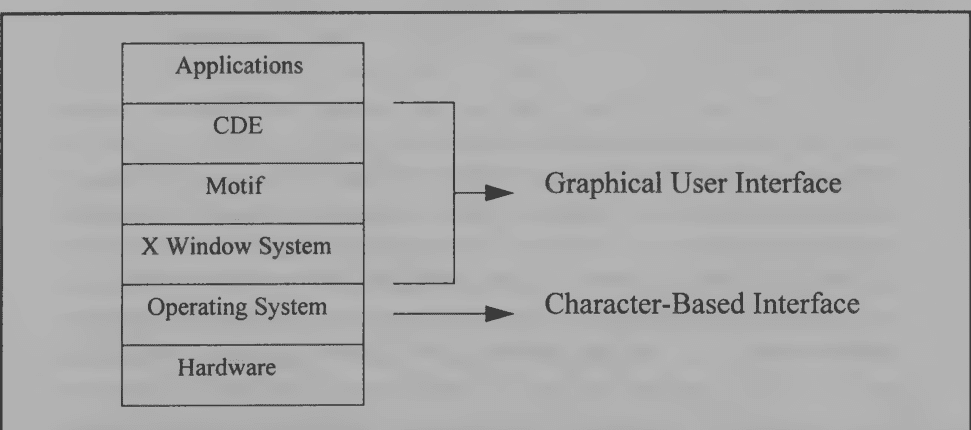

**图 4-1** 用户界面组件

GUI 用探索取代了记忆。用户现在可以使用下拉菜单、按钮、滑动滚动条和其他直接操纵方式来使用计算机。输入操作系统命令来执行功能的需求大大减少。有了 GUI，使用计算机既更容易学习，又更容易使用。

尽管从美元角度来看相当便宜（CDE 与操作系统“免费”捆绑），但 GUI 在 RAM 使用和性能方面并非没有成本。尽管存在这种性能开销，但 GUI 已成为计算环境的永久组成部分。其实用性的好处值得这种成本。

除了减少培训、使琐事更简单、并普遍减轻使用计算机压力的图形控件外，GUI 还有两个值得提到的好处：每个显示器的多个窗口和客户端-服务器拓扑结构。

GUI 提供的多窗口的好处是，每个窗口（字面上是由窗口框包围的矩形区域）包含一个独立的应用程序。用户可以同时打开多个窗口进行工作。CDE 更进一步：其多个工作区允许用户将应用程序窗口按任务分离到特定的工作区。例如，在一个名为“邮件”的工作区中，用户可能有显示传入电子邮件列表、当前正在阅读的消息以及为稍后传输而编写消息的应用程序窗口。在另一个名为“财务”的工作区中，他们可能正在几个电子表格上工作，每个都在自己的窗口中。

客户端-服务器拓扑结构使得分散在网络上的计算资源可以被高效访问以满足计算需求。在客户端-服务器拓扑结构中，网络上的强大计算机专门用于特定目的（文件服务器上的文件管理和应用程序服务器上的运行应用程序）。在网络其他地方工作的较弱客户端计算机上的用户远程访问文件或应用程序。文件服务器通过集中文件备份来减少系统管理，使系统管理员只需备份文件服务器，而不是每个单独的客户端计算机。此设置还确保文件将以固定间隔进行备份。应用程序服务器通过减少数量和尺寸来降低运营成本


所需存储磁盘的数量以及每个客户端计算机上所需的 RAM 大小。应用程序的单个版本驻留在应用程序服务器上并在其上运行，通过网络上的多个用户进行访问。

尽管这种拓扑结构听起来很复杂，但 CDE 图形用户界面使其变得简单易用。要访问文件，用户从文件管理器窗口“拖动并放置”文件图标。要启动应用程序，用户双击应用程序图标。要打印文件，用户将文件拖动到前面板中相应打印机的图标上并放置在那里。用户不需要知道这些文件和应用在哪里、位于哪些目录中、位于哪些计算机上，或者如何访问它们。您所部署的基础架构和控制措施，加上图形界面的强大功能，使用户能够专注于自己的工作，而不是计算机的机械操作。

### CDE 基础知识

由于大多数系统都附带一套 CDE 用户指南，因此我将只概述 CDE 的外观以及我们在进行某些自定义时主要处理的主要区域。沿途，我将指出不同 CDE 版本之间的相似之处和差异。

CDE 登录屏幕在甚至登录之前就会为您提供几个选项。在您输入用户名的区域下方有四个按钮：确定（OK）、重新开始（Start Over）、选项（Options）和帮助（Help）。确定（OK）与输入登录名和口令后按 Enter 键相同。重新开始按钮清除您的用户登录并允许您重新开始。选项为您提供一些需要在登录之前进行的初始会话配置。语言允许您更改默认语言。假设您需要使用另一种语言测试公司的软件。假设系统已预装相应的语言，只需选择以不同的语言显示 CDE，即可在测试期间切换语言。会话允许您选择进入 CDE 桌面会话或进入故障安全会话（Failsafe session），后者是一个 X 会话但没有 CDE 桌面。Solaris 还有选项可以登录到其 OpenWindow 桌面或用户的上一个桌面。命令行登录允许您在不调用 CDE 的情况下登录。这只是一个常规的终端模式会话。重置登录屏幕（Reset Login Screen）名称即暗示了其功能：重置登录屏幕。帮助列出所有这些功能，并简要描述每一项。

登录屏幕本身显示 CDE 徽标、操作系统徽标（如 AIX），或者可能是您公司的徽标。会出现一条欢迎消息，并有一个输入用户登录名的位置。输入用户名后，系统会提示您输入密码。一旦输入并验证正确，CDE 启动并显示桌面。在 Solaris 系统上，首次登录时，会询问您是否希望登录到 CDE 还是 OpenWindows 桌面。

CDE 桌面由四个桌面工作区和一个由每个工作区共享的前面板组成。前面板是访问各种应用程序、命令和工具的易用接口。各个组件可通过简单的指点方法轻松访问。前面板组件是对象、子面板以及桌面工作区访问权限的集合。一些对象仅用于显示项目，例如时钟，而其他对象在被点击时会启动应用程序（如日历或 dtmail）或执行操作（如锁定或退出操作图标）。子面板会弹出一个可访问的对象菜单。这些对象也可以简单地显示项目或启动应用程序。默认情况下，在 AIX 和 HP-UX 上，您会看到个人打印机子面板、个人应用程序子面板和帮助子面板。在 Solaris 上，所有面板都包含子面板。正如下一节“自定义 CDE”中所示，可以在 AIX 和 HP-UX 上的其他面板中添加子面板。您可以知道它们有子面板，因为每个面板上方都有一个用于点击弹出子面板的小箭头。在前面板中央是四个工作区。这些区域用于执行相关任务，使用户能够分开工作，避免使桌面杂乱无章。

AIX 和 HP-UX 上的 CDE 非常相似，通常，一个系统前面板上显示的内容与另一个系统相同。然而，Solaris 虽然保留了 CDE 的基本外观和感觉，但极大地扩展了默认前面板及其子面板中包含的内容。我将首先概述 HP-UX 和 AIX 上的 CDE。然后，我会指出 CDE 中 Solaris 的增强功能。

#### AIX 和 HP-UX 上的 CDE

前面板分为 11 个主要区域：5 个面板、1 个工作区区域和另外 5 个面板。我将从左到右概述每个区域，从时钟开始，到垃圾桶结束，如图 4-2 所示。


*图 4-2 前面板*

-   **时钟**：正如您预期的那样，它显示当前时间。
-   **日历**：日历图标显示当前日期，点击时会调出预约日历。日历允许您设置预约和提醒，并创建任务列表。预约可以设置为一次性事件或重复事件。您可以通过蜂鸣声、弹出消息或电子邮件获知预约提醒。日历和相关的预约可以按天、周或月显示。还可以显示年度日历，但不显示预约。
-   **文件管理器**：文件管理器打开一个窗口，显示您的主目录及相关文件。在此处，您可以执行许多基本文件操作，如复制文件、移动文件、删除文件，或执行程序或脚本。较少使用的操作，如创建符号链接或更改文件权限或所有权，也可以在此处完成。在文件管理器中删除文件会将其移至垃圾桶，而不是永久删除文件。这样，如果您决定需要恢复该文件，您可以简单地从垃圾桶中恢复它，而不是从备份中恢复——这是一种更耗时的操作。但是，请注意，垃圾桶在每个会话结束时会自动“清空”。因此，当您注销时，文件将被永久删除。
-   **个人应用程序**：个人应用程序子面板包含 CDE 的文本编辑器 **dtpad** 和终端模拟器 **dterm**。它还包含图标编辑器。**dtpad** 是一个易于使用的全屏文本编辑器。与基于 PC 的文字处理器一样，**dtpad** 允许您将光标移动到任何位置以添加、更改和删除文本，这与流行的 vi 不同，vi 是一个逐行文本编辑器。CDE 的 dterm 是一个良好的基本终端模拟器。图标编辑器打开位图（.bm）或像素图（.pm）文件，并允许您编辑它们。


个人应用程序子面板是我们找到安装图标（Install Icon）应用程序的地方。这就是新图标被添加到子面板的地方。这允许在与图标关联的应用程序在图标被双击时执行。我们在“自定义 CDE”中修改桌面时将使用此功能。

-   **邮件**：点击此图标时会调用 CDE 邮件程序 **dmail**。在此处，您可以撰写邮件消息、回复消息和转发消息。大多数您通常视为基本功能的高级邮件特性都已包含在内：例如，在邮件中添加附件、仅回复发件人或所有收件人，以及设置自动消息说明您正在度假。另一个特性是，当新消息到达时，*dmail* 图标会发生变化，显示一封邮件落入邮箱。
-   **工作区区域**：接下来的四个项目组成了工作区区域。
-   **锁定按钮**：锁定按钮允许您在离开办公桌时锁定您的会话。此安全功能可以防止他人在您不在时查看或访问您的工作。它还节省了您每次需要离开时都要注销和登录的麻烦。


必须输入您的登录密码或 root 的密码才能再次解锁它。

工作区切换 - 共有四个，这些是默认创建的独立工作区。它们允许您组织工作，从而避免工作区变得杂乱无章。通过使用工作区，您可以将不同任务、应用程序或系统的工作彼此隔离。只需点击工作区编号：一、二、三或四，即可在一个工作区之间切换。您会注意到，无论您身处哪个工作区，前面板都会跟随您。在“自定义 CDE”部分中，您将看到如何轻松增加工作区的数量并更改其名称。

活动指示灯 - 活动指示灯非常简单地表明，当系统正忙于处理工作时，它会闪烁。

退出按钮 - 退出按钮是退出 CDE 的地方，它将终止您的 CDE 会话。退出后，根据您配置 CDE 的方式，系统会提示您恢复当前会话或返回到您的主会话。如果您选择恢复当前会话，下次登录时，桌面的外观将与您注销时几乎完全一致——尽可能一致。有些功能，例如远程登录，无法实现，但其他功能，例如自动执行应用程序，是可以实现的。如果您选择返回主会话，下次登录时，您将回到一个已知的、预设的配置。该配置在风格管理器（Style Manager）面板中设置，稍后会进行讨论。

个人打印机 - 此子面板包含您在系统上配置的打印机，包括指定的默认打印机和打印管理器。前面板图标即默认打印机的图标。要打印文档之一，只需将其从文件管理器拖放到打印机图标上即可。打印管理器允许您查看排队中的打印文件，并可以在其打印之前将其移除。然而，这仅适用于由您的系统直接管理的打印机。在当今的联网办公室中，打印机通常是共享的，打印管理功能位于服务器中，可能就在下一栋楼里。

风格管理器 - 风格管理器是那些可以让你发挥极大创造力，使桌面看起来完全符合你意愿，或者浪费大量时间（取决于你的观点）的地方之一。在这里，你可以根据自己的偏好个性化设置登录系统的配置。你可以更改字体大小、背景、鼠标速度，以及你的会话在一定数量的非活动时间（空闲时间）后是否自动锁定。这里还可以设置你的主会话（如前所述），以便每次登录时都返回到该会话，或者将系统设置为返回当前会话，或者选择在每次注销时询问你。在这里你还可以做出的另一项配置是，窗口焦点是跟随你的鼠标，还是你需要先点击窗口才能使其成为活动窗口。在 AIX 系统中，你可以切换设置，决定是否在前面板上显示工作区。

应用程序管理器 - 打开后，应用程序管理器显示包含有用应用程序和操作的文件夹。尽管在制造商甚至操作系统之间有所不同，但 AIX、HP-UX 和 Solaris 都具有一些基本功能：桌面应用程序、桌面工具、信息和系统管理。桌面应用程序包含计算器、手册页查看器、图标编辑器和创建操作等应用程序和工具。桌面工具包含如 xterm、xwd 捕获、文件压缩和资源重载等工具。系统管理包含特定于操作系统的应用程序，如 HP-UX 中的 SAM、AIX 中的 SMIT 和 Solaris 中的管理工具，以及更改密码等更通用的操作。花点时间在这里四处看看。你会发现许多你可能想要整合到自定义 CDE 前面板中的项目。就我个人而言，我发现手册页查看器是一个无价的朋友，并将其移动到我的前面板上，以便于访问。

帮助 - 帮助子面板是帮助管理器、桌面入门、前面板帮助和逐项前面板帮助机制的集合。帮助管理器是 CDE 的主要在线帮助设施。这是一个综合性的帮助系统，具有主题树，并且可以使用关键字或模式匹配搜索索引，回溯你在帮助管理器中浏览过的地方，并查看你请求帮助的项目的历史记录。桌面入门是 CDE 及其工作原理的概述。前面板帮助设施提供关于如何使用前面板图标、子面板和工作区的信息。逐项前面板帮助机制允许你点击你希望获得帮助的前面板项目。除了帮助子面板，还可以通过按下 F1 功能键请求帮助。如果已安装在你的系统上，AIX 还可能包括基本桌面自定义帮助和基本库。

回收站 - 回收站与文件管理器配合使用，用于存放你在当前会话期间删除的文件和文件夹。使用该功能可以迅速恢复你不应该删除的文件。可以随时“清空”回收站以永久删除项目。此外，当你注销会话时，回收站也会被“清空”。

#### 在 Solaris 上的 CDE

如前所述，Solaris 对 CDE 进行了润色，为子面板添加了许多更多的子面板和条目，如图 4-3 所示。在 Solaris 大幅修改面板和子面板的地方，我将简要概述你将发现的内容，就像我在上一节关于 AIX 和 HP-UX 中做的那样。如果它们相同，我将简单地指出它们相同。


图 4-3 前面板

与 AIX 和 HP-UX 一样，Solaris 的前面板分为 11 个主要区域：5 个面板、1 个工作区区域，以及另外 5 个面板。我将从左到右概述每个区域，从 World（世界）开始，到回收站结束。

链接 - 正如你可能通过 World 图标推测的那样，这里是访问世界的地方。Solaris 的 web 浏览器 HotJava 就在这里。还包括访问 web 浏览器的个人书签和网页查找搜索引擎的操作。如前面板图标所示，世界上还有一个时钟。

卡片 - 日历与 AIX 和 HP-UX 上的相同。然而，子面板中包含了 Find Card（查找卡片），这是一种 rolodex 类型的地址管理器。

文件 - 尽管标题略有不同，但这里是文件管理器的所在地。子面板中有用于执行与以下各项相关的文件操作的特殊图标：属性、加密、压缩文件、存档和查找文件。Solaris 还包含了管理软盘驱动器和 CD-ROM 的操作。

应用程序 - 简单重命名为应用程序，这里你不仅可以找到文本编辑器，还可以找到文本笔记和语音笔记。对于音频功能，语音笔记允许你播放、录制或保存具有 WAV、AU 和 AIFF 格式的音频文件。在这个子面板上，你还会发现在 AIX 和 HP-UX 系统的“应用程序管理器”下找到的应用程序子面板。与其他系统一样，这包括桌面应用程序、桌面工具、信息和系统管理。这些在所有系统上基本上是一样的。

邮件 - 除了 dtrmail 之外，此子面板还增强了建议箱功能。这是一个非常巧妙的想法，它会自动打开一条预先填好收件人为 Sun Microsystems, Inc. 的消息，以便你可以向他们发送你的建议。

工作区区域 - 接下来的五个条目构成了工作区区域。

- 锁定按钮 - 与 AIX 和 HP-UX 相同。
- 工作区切换 - 与 AIX 和 HP-UX 相同。
- 进度指示器 - 这与 AIX 和 HP-UX 上的忙碌指示器相同。
- 退出按钮 - 与 AIX 和 HP-UX 相同。
- 个人打印机 - 与 AIX 和 HP-UX 相同。

工具 - 风格管理器位于此处，并显示在前面板上。你还将轻松访问 CDE 错误日志，查找进程（Find Process）允许你查看系统上运行的所有进程并终止选定的进程。自定义工作区菜单（Customized Workspace Menu）和向菜单添加项目（Add Item to Menu）操作允许你轻松修改工作区菜单。通过将在鼠标悬停在桌面的空白区域并按下鼠标右键来访问工作区菜单。虽然 AIX 和 HP-UX 附带一个通用菜单，但 Solaris 已将前面板和子面板操作整合到工作区菜单中，作为访问这些操作的另一种方式。

主机 - 在这里，Solaris 与 AIX 和 HP-UX 有很大不同。主机子面板包含与系统相关的操作。在前面板上，你将找到指示 CPU 和磁盘驱动器繁忙程度的性能监视器图标。从子面板中，此主机会打开 dterm 终端模拟器，而控制台（Console）则打开专门用于显示控制台消息的 dterm。系统信息提供系统信息，包括系统名称、硬件型号、网络 IP 地址和域、物理内存和虚拟内存、操作系统版本，以及上次重新启动的日期和时间。查找主机（Find Host）与卡片子面板中的查找卡片（Find Card）相同。

帮助 - 与 AIX 和 HP-UX 相同。


回收站 - 回收站的功能相同，只是增加了一个用于“清空”回收站的子面板图标。

至此，我们对 CDE 外观和感受的概述就结束了。掌握了这些知识，你就能轻松自如、信心满满地浏览桌面环境。接下来，你将学习如何更改外观和设置，使其符合你的工作环境。

#### 自定义 CDE

在修改任何 CDE 配置文件之前，请先制定一个策略。我知道我之前提过这一点，但再强调一次也很重要。

以下问题可以帮你入门：

1. 用户的需求是什么？
2. 这些需求中有哪些可以通过重新配置 CDE 来满足？
3. 这些更改应在哪个层面进行（系统范围、用户组、仅单个用户）？
4. 需要修改哪些 CDE 文件（文件名和位置）？
5. 有哪些更改，以及它们在文件中的顺序是什么？

手头最好也备一个活页夹，里面包含每个 CDE 组件的手册页（用于查找资源及其值）以及每个 CDE 配置文件的副本。

现在你已经很好地了解了 CDE 的工作原理，我将引导你进行修改，以便为整个用户社区或每个单独用户自定义系统。

在说明每一项更改之前，我会先讨论进行该更改所涉及的内容。我将展示一些基本且简单的更改，以及一些更高级的更改，以展示 CDE 的灵活性。

有一点需要说明的是，所有这些更改都可以在任何系统上完成。知道如何“按部就班”地执行这些任务可以增加你对这些工具在后台为你所做工作的理解。因此，请务必尝试每一项。

##### 使用样式管理器进行更改

##### 字体大小

当我们首次登录 CDE 并出现工作区时，如图 4-4 所示，许多用户更改的第一件事通常是字体大小。初始值设置为 4，但大多数用户希望字体更大。此更改很容易操作。


1.  点击前面板上的**样式管理器图标**。此操作会调出样式管理器。
2.  点击**字体**。
3.  高亮**5**。
4.  点击**确定**。

##### 背景和颜色

样式管理器也是我们更改背景和颜色的地方：

1.  **点击背景**，我们会看到各种背景选择。
2.  当我们看到一个喜欢的背景，例如“小石子（Pebbles）”，我们可以**点击应用**，然后**点击关闭**以更改背景。但请注意，此操作仅更改我们当前所在工作区的背景。

若要更改其他工作区，我们可以前往那些工作区并在那个工作区中调出样式管理器；或者，既然我们已经有样式管理器打开，我们可以点击窗口右上角“文件”上方窗口本身上的小“-”，并访问下拉菜单。从这里，我们可以选择“占据所有工作区”。然后，我们可以简单地前往其他工作区，样式管理器已经在那里打开并准备就绪。背景区域是唯一需要担心移动到其它工作区的地方。

3.  要更改颜色，**点击颜色图标**。我们会得到一个不同颜色方案的列表以供选择。如果其中一个不完全合意，我们可以轻松修改颜色、色调、亮度和对比度。我们甚至可以从其他地方（例如互联网上的图像）获取一种颜色，并将其包含在颜色方案中。一旦我们拥有了喜欢的颜色，就可以用自己的名字保存该方案。

##### 向前面板添加对象或移除对象

前面板通过将常用项目放置在上面，让我们的生活变得稍微轻松一些。其中最常见的操作之一是打开终端窗口。虽然 CDE 默认使用 dtterm 作为默认终端窗口，但有时我们可能想使用 xterm 窗口。我们将把它添加到个人应用程序子面板中，在 AIX 和 HP-UX 系统上，dtterm 就在这个位置。Solaris 用户可以通过将 xterm 放在主机子面板中执行相同的操作，该位置也有“此主机”终端仿真器。

你有两种方法可以向 CDE 前面板添加对象：

- 将它们拖动到滑出子面板中，然后将其设置为该子面板的默认项。
- 修改 `/etc/dt/appconfig/types/C/dtwm.fp` 配置文件。当我们创建操作和文件类型时会用到这种方法。

通过拖放添加控制按钮的基本操作如下：

- 从应用程序管理器视图中拖动你想要作为前面板按钮的应用程序图标，并将该图标放置在合适子面板的顶部安装区域。
- 将鼠标指针悬停在图标上，并按下鼠标按钮 3 以显示子面板菜单。
- 选择“复制到主面板”。

1.  **点击 AIX 或 HP-UX 上个人应用程序子面板的上箭头，或 Solaris 上主机子面板的上箭头**，使其弹出。
2.  **点击应用程序管理器图标**，桌面应用程序和桌面工具就在那里。
3.  **双击 Desktop_Tools**。在这里你可以找到**Xterm**。
4.  **将 Xterm 图标从 Desktop_Tools 拖放**到 HP-UX 和 AIX 上个人应用程序子面板顶部的主图标框，或 Solaris 上的主机图标框。

如果我们希望**xterm**出现在前面板上：

1.  **右键点击**个人应用程序或主机子面板中的 **Xterm** 图标。
2.  根据你使用的 CDE 版本，选择“复制到主面板”或“提升到前面板”。

##### 添加另一个工作区

对前面板的另一个简单更改是添加另一个工作区。CDE 默认提供四个工作区，但这很容易更改。我们将再添加一个，并将其命名为“Web 视图”。这可以成为我们访问互联网的窗口。

1.  **将鼠标放在前面板的工作区区域，并按下鼠标右键。**
2.  从下拉菜单中选择**添加工作区**。已添加了名为“新（New）”的工作区。
3.  **右键点击**标记为“新”的新工作区，并选择**重命名**。输入“Web 视图”并按下**回车**。

如果我们想要删除一个工作区，只需右键点击要移除的工作区，然后选择删除。

进行这类更改很容易，并且有助于为个人用户个性化工作区。

##### 以其他方式更改前面板

除了添加或删除按钮，你还可以通过其他方式塑造前面板。这些其他方式使用工作区管理器资源来修改默认值。以下资源与前面板相关：

- **clientTimeoutInterval** - 从前面板启动客户端时，忙碌指示灯闪烁和指针保持沙漏状态的时间长度。
- **geometry** - 前面板的 x 和 y 坐标位置。
- **highResFontList** - 高分辨率显示上使用的字体。
- **lowResFontList** - 低分辨率显示上使用的字体。
- **mediumResFontList** - 中分辨率显示上使用的字体。
- **name** - 当存在多个前面板时，在 **dtwm.fp** 中使用的前面板名称。
- **pushButtonClickTime** - 区分两次单次鼠标点击和双击的时间间隔（以避免意外两次启动应用程序）。
- **waitingBlinkRate** - 前面板忙碌指示灯的闪烁速率。
- **workspaceList** - 工作区名称列表。
- **title** - 显示在工作区按钮上的标题。

与其他所有工作区管理器资源一样，这些前面板资源具有以下语法：

```
Dtwm*screen*resource: value
```

例如，假设除了默认的四个工作区外，你的用户只需要一个包含六个工作区的前面板，命名为“邮件”、“报告”、“旅行”、“财务”、“项目”和“工作室”。此外，他们更喜欢大字体，并已决定使用 New Century Schoolbook 10 点粗体。作为系统管理员，你可以通过以下资源设置让每个人满意：

```
Dtwm*0*workspaceList: One Two Three Four Five Six
Dtwm*0*One*title: Mail
Dtwm*0*Two*title: Reports
Dtwm*0*Three*title: Travel
Dtwm*0*Four*title: Financials
Dtwm*0*Five*title: Projects
Dtwm*0*Six*title: Studio
Dtwm*0*highResFontList:
	-adobe-new century schoolbook-bold-r-normal\
	-10-100-75-75-p-66-iso8859-1
```

屏幕标识符通常为 0，除非显示器同时支持图像平面和叠加平面。**X\*screens** 文件中屏幕的顺序决定了屏幕编号；第一个屏幕，


通常，映像平面被指定为 0。请注意六个标题资源规范中包含了工作区名称（One, Two, Three, Four, Five 和 Six）。

这些更改可以添加到 **sys.resources** 文件中，该文件在本章稍后的“高级主题”中详细讨论。也可以通过使用 **EditResources** 操作将新的资源行插入每个用户的 **RESOURCE_MANAGER** 属性中，然后重启工作区管理器来进行这些更改。

明显的缺点是，你必须亲自去每个用户的工作区域，并接管机器几分钟。然而，好处是更改会立即生效，并且会自动保存在正确的 **dt.resources** 中（对于恢复当前会话的用户而言）。你还能避免更改被覆盖的情况，这种情况可能发生在你在用户仍登录时修改了正确的 **dt.resources** 文件。

##### 修改滑动弹出子面板中的内容

子面板定义在 **dtwm.fp** 中，位于前面板和前面板控件定义之后。要将子面板与前面板控制按钮关联，需在子面板定义中将前面板控件名称列为容器名称。

> 注意：/etc/dt 是进行全局更改的地方。$HOME/.dt 是进行本地或单个用户更改的地方。

- 若要向前面板添加滑动弹出子面板，请遵循以下步骤：
- 将文件 /usr/dt/appconfig/types/C/dtwm.fp 复制到 /etc/dt/appconfig/types/C/dtwm.fp 或 $HOME/.dt/types/dtwm.fp。
- 决定要将滑动弹出与哪个控制按钮关联。
- 在 dtwm.fp 中创建子面板定义文件。其格式如下：

```
SUBPANEL SubPanelName
{
CONTAINER_NAME AssociatedFrontPanelControlButton
TITLE SubPanelTitle
}
```

- 为子面板创建子面板控件定义。其格式如下：

```
CONTROL ControlName
{
TYPE icon
CONTAINER_NAME SubPanelName
CONTAINER_TYPE SUBPANEL
ICON BitmapName
PUSH_ACTION ActionName
}
```

与前面板控制按钮类似，复制并修改现有的子面板文件比从头开始更容易。

#### 更改默认打印机名称显示

我们可以轻松更改其中一个滑动弹出子面板。如果我们弹出“个人打印机”子面板，可以看到我们配置了一个默认打印机，但没有显示其名称。让我们回到前面板文件 **dtwm.fp**，并修改它。

- 打开你喜欢的编辑器，例如 **dtpad** 或 **vi**，并编辑 **/$HOME/.dt/types/dtwm.fp**。


- 向下滚动到 **CONTROL Printer**。你会看到 **LABEL** 是 Default。**更改**或在该标签后添加你的默认打印机名称。我的打印机名为 **a464**。

**LABEL Default - a464**

- **保存文件**并**重启工作区管理器**。将鼠标移至工作区的空白区域，按鼠标右键。选择“重启工作区管理器”。在 Solaris 上，按鼠标右键调出“自定义工作区菜单”。从这里，选择 Windows，在那里可以找到“重启工作区管理器”选项。

弹出“个人打印机”子面板，现在我们就能看到我们的默认打印机究竟是什么了。当然，如果我们更改默认设置，我们将不得不重新更改前面板。但我们知道该怎么做，不是吗！图 4-5 显示了前面板。


#### 前面板动画

前面板或滑动弹出子面板放置区域的动画是通过显示一系列渐进的位图创建的。通常，位图位于 `/usr/dt/appconfig/icons` 中。要显示的位图列表包含在 `dtwm.fp` 末尾的动画定义中。

要为放置区域创建动画序列：

- 创建一系列渐进的位图。
- 使用以下语法将这些位图文件的列表添加到适当的配置文件中：

```
ANIMATION AnimationName
{
   bitmap0
   bitmap1
   bitmap2
   bitmap3
   bitmap4
   bitmap5
}
```

- 使用以下语法在适当的控件定义中添加一行：

```
DROP_ANIMATION AnimationName
```

#### 向工作区菜单添加内容

工作区菜单定义在 sys.dtwmrc 文件中。如 Solaris 前面板概述中所述，通过鼠标移至桌面空白区域并按下鼠标右键键来访问工作区菜单。AIX 和 HP-UX 带有通用菜单，而 Solaris 将前面板和子面板操作整合到工作区菜单中，作为访问这些操作的另一种方式。但是，我们可以使用鼠标左键访问，为这三个系统创建自定义的工作区菜单。我们接下来将执行此任务。

工作区菜单可以包含常用命令和应用。自定义菜单通常通过按下鼠标左键来访问，弹出菜单以供查看和选择。对于经常做固定事项的人来说，工作区菜单非常有用。例如，使用 C++、vi 和 isql 的程序员可能有一个包含这些项目的菜单，或者系统管理员可能有一个包含 df、ps -ef 和 netstat 的菜单。或者，在大型网络上，用户可能想要一个系统登录菜单。

如果只需进行一两项更改，你可以修改现有的工作区菜单。如果进行主要更改，在 sys.dtwmrc 中插入一个全新的菜单定义可能更容易。

菜单定义具有以下语法：

```
Menu MenuName
{
"Menu Name" f.title
"Frame" f.exec /nfs/systeml/usr/frame/bin/maker
"Second Item" action
"Third Item" action
}
```


第一行在关键字 Menu 之后指定菜单名称。花括号之间的行按出现顺序列出菜单中显示的项目；因此，第一行是由函数 f.title 指定的标题。第二行是一个示例定义，用于在分布式环境中从远程应用程序服务器启动 FrameMaker。存在许多其他函数，总数约为 45 个。完整列表请参见 dtwmrc (4) 手册页。

若要让用户显示菜单，你需要使用操作 f.menu MenuName 将菜单定义绑定到鼠标按钮和屏幕位置。例如，如果用户希望在指针位于工作区背景上时按下鼠标按钮 3 来显示菜单，你需要在 sys.dtwmrc 末尾的“鼠标按钮绑定描述”部分插入以下行：

```
<Btn3Down> root f.menu MenuName
```

（实际上，通过交换第二行中的 MenuName 和 DtRootMenu 来修改现有的行会更简单。）

现在，我们将创建一个简单的菜单。我们的菜单将包括运行 FrameMaker、运行 vi 编辑器以及登录到远程系统。

- 首先我们需要将 /usr/dt/config/C/sys.dtwmrc 文件的副本复制到 /etc/dt/config/C：

```
cp /usr/dt/config/C/sys.dtwmrc /etc/dt/config/C/sys.dtwmrc
```

如果我们要仅为单个用户进行本地更改，则会将其复制到 $HOME/.dt 并重命名为 **dtwmrc**。对于 admin1 用户，这将是 /home/admin1/.dt/dtwmrc，或在 Solaris 上的 /home/admin1/.dt/C/dtwmrc。

- 进入我们喜欢的编辑器并**修改文件**。我们将新菜单添加在 DtRootMenu 条目之后，我们在系统中将其视为鼠标左键的“工作区菜单”。添加以下内容：

```
Menu AdminMenu
{
	“Admin1’s Menu”			f.title
	“Frame Maker”			f.exec “/nfs/system1/usr/frame/bin/maker”
	“VI Editor”			f.exec “xterm -e /usr/bin/vi”
	“Login systemA”			f.exec “xterm -geometry 80x50+830+0 -sl 200 -bg DarkOrchid4 -fg white -n SYSTEMA -T SYSTEMA -e remsh systemA &”
}
```

**f.title** 函数表示这是菜单标题。**f.exec** 意味着执行以下字符串。注意，FrameMaker 不需要终端窗口，因为它使用自己的终端，而 vi 和登录都需要一个用于运行的终端窗口。此外，我对登录的 xterm 进行了美化，使终端窗口很大，拥有大量的终端内存，并使用特定颜色。

现在，让我们重启工作区管理器并试用我们的新菜单。

- 将鼠标移至工作区的空白区域，按下鼠标左键。选择**重启工作区管理器**。


创建下拉菜单很简单，并且可以通过向菜单添加子菜单轻松扩展。只需在菜单名称后加上函数 **f.menu** 即可。我们会在“Admin1’s Menu”之后添加以下内容：

```
“Work Menu” f.menu WorkMenu”

然后在 Menu AdminMenu 部分的 } 之后，添加：
Menu WorkMenu
{
.
}
```

执行这些高级功能其实并不难。最难的部分是记住将文件放入哪些目录：全局更改使用 */etc/dt*，个人更改使用 $HOME/dt。

#### 创建控制按钮、操作和文件类型

操作启动一个进程，例如 shell 脚本或应用程序。操作可以连接到前面板按钮，以便在按下按钮时启动。操作可以连接到前面板投放区，以便在数据文件被投放到投放区时执行。操作可以与文件管理器窗口中的图标相关联，这样双击图标即可启动该操作。操作还可以与特定的数据类型相关联，这样双击数据文件图标即可启动操作并打开该数据文件。

除了设置前面板和默认会话以满足用户需求外，你能为依赖你的人让计算生活变得更加轻松的最重要的一件事，就是创建操作和数据类型。

CDE 操作和数据类型定义在以 **.dt** 结尾的文件中。与大多数其他 CDE 配置文件类似，*.dt* 文件有系统级版本，可以复制到用户的个人目录中并进行个性化定制。大多数系统级 *.dt* 文件位于 /usr/dt/appconfig/types/C；个人 *.dt* 文件通过从 /usr/dt/appconfig/types/C 复制 **user-prefs.dt** 到 $HOME/.dt/types 来创建。

CDE 用于查找操作和文件类型的默认搜索路径包括以下主要目录，按列出的顺序排列：

- $HOME/.dt/types
- /etc/dt/appconfig/types
- /usr/dt/appconfig/types

你可以使用 **DTDATABASESEARCHPATH** 环境变量向搜索路径添加更多目录。将此环境变量和新搜索路径插入 /etc/dt/config/Xsession 以获得系统范围的影响。将环境变量和搜索路径插入 **$HOME/.dtprofile** 以针对个人用户。

控制按钮 - 基本控制定义有六个部分：

- **CONTROL name** - 定义名称。这是定义中位于花括号外的唯一部分。
- **TYPE** - 控制的类型。存在多种类型。对于自定义前面板最有用的可能是 blank（空白）和 icon（图标）。blank 可用作占位符。icon 可以启动操作或应用程序，或者作为投放区。
- **ICON** - 在前面板上显示的位图。前面板位图位于 **/usr/dt/appconfig/icons** 目录中。
- **CONTAINER_NAME** - 容纳该控制的容器名称。这必须与 **dtwm.fp** 中列出的某个实际容器的名称相对应。
- **CONTAINER_TYPE** - 容纳该控制的容器类型。这可以是 **BOX**、**SWITCH** 或 **SUBPANEL**，但它必须与容器名称的类型一致。
- **PUSH_ACTION** - 这是按下控制按钮时发生的情况。**PUSH_ACTION** 只是几种可能的操作之一。欲了解更多信息，请参阅 **dtwm** 手册页。

要从前面板移除控制按钮，请在 CONTROL 定义行的最左列输入井号（#）。这 (#) 会将控制规范变成注释行。

通过编辑 dtwm.fp 文件来添加控制按钮：

1. 将 dtwm.fp 从 /usr/dt/appconfig/types/C 复制到 /etc/dt/appconfig/types/C。
2. 使用以下格式添加新的控制定义：

```
CONTROL NewControl
{
  TYPE                icon
  CONTAINER_NAME Top
  CONTAINER_TYPE BOX
  ICON                NewControlBitmap
  PUSH_ACTION         NewControlExecutable
}
```

操作和文件类型有其自身的特殊性，即每个都有几个部分，且每个都必须位于其自己的目录位置中。当我们创建子面板上的操作时，这种特殊性会变得清晰。以下是创建操作或文件类型定义的建议位置：

- 在 /etc/dt/appconfig/types 目录中创建一个完全新的文件。该文件具有系统范围的影响。请记住，文件必须以 .dt 扩展名结尾。
- 从 /usr/dt/appconfig/types 复制 user-prefs.dt 到 /etc/dt/appconfig/types 目录，并在那里插入定义以供系统范围内使用。
- 将 user-prefs.vf 复制到 $HOME/.dt/types，并在那里插入定义以供个人用户使用。

典型操作具有如下语法：

```
ACTION      ActionName
{
 TYPE       type
        keyword  value
        keyword  value
    }
```

例如，这是一个 FrameMaker 操作：

```
ACTION        FRAME
{
    TYPE      COMMAND
    WINDOW-TYPE NO-STDIO
    EXEC-STRING /nfs/hpcvxmk6/usr/frame/bin/maker
}
```

典型数据类型具有如下语法：

```
DATA_ATTRIBUTES    AttributesName
{
    keyword   value
    keyword   value
    ACTIONS   action, action
}
DATA_CRITERIA
{
    DATA_ATTRIBUTES AttributesName
    keyword   value
    keyword   value
}
```

注意，所有定义都具有以下通用语法：

```
    KEYWORD value
```

请注意，数据类型定义实际上分为两部分：属性部分和条件部分。数据类型定义中的属性部分指定数据类型的外观；条件部分指定数据类型的行为。

例如，这是一个使用 FRAME 操作的 FrameMaker 文件类型：

```
DATA_ATTRIBUTES FRAME_Docs
{
 DESCRIPTION This file type is for FrameMaker documents.
ICON makerIcon
ACTIONS FRAME
}
DATA_CRITERIA
{
DATA_ATTRIBUTES_NAME FRAME_Docs
NAME_PATTERN *.fm
MODE f
}
```

你可以使用这些格式从头创建操作和文件类型。然而，创建操作最简单的方法是使用 **CreateAction** 工具。**CreateAction** 位于应用程序管理器（Application Manager）中的桌面应用程序（Desktop Applications）文件夹中，它会向你展示一个填空式对话框，引导你创建包含操作定义的 *action.dt* 文件。然后你可以将此文件移动到适当的目录，以获得你希望操作具有的影响范围：系统范围的影响使用 /etc/dt/appconfig/types；个人用户使用 $HOME/.dt/types。

#### 创建新图标和操作

创建图标是一项具有挑战性的任务。我们可以使用 Desktop_Apps 中的图标编辑器（Icon Editor）来创建新图标，或者我们可以找到喜欢的图片并使用它。从外部引入图片时需要注意的一件事是，为了在前面板上正确显示，图片尺寸不得超过 32x32 像素，否则只会显示图标的部分。在图标编辑器中查看图片可以显示图片的尺寸。您可能需要浏览应用程序目录以查找有用的图标，或从互联网上下载一个。

在这个完整的示例中，我将使用 HP-UX 附带的 Instant Information 软件。这是 CD 上的用户手册集。其他应用程序软件也能同样良好地工作；只需确保你的路径与你使用的软件相对应。此外，我将使用一个虚构用户的家目录：/home/admin1。

1. 从 Desktop_Apps (HP-UX)、Deskoptools (AIX) 或 Solaris 上的 Desktop_Tools，在应用程序管理器中**打开图标编辑器**。
2. 选择**文件 -> 打开**。
3. 输入路径或文件夹名称： **/opt/dynatext/data/bitmaps**。
4. 输入文件名称： **logoicon.bm**
5. 选择**打开**。

我们将看到图标，并确认它确实是 32x32。现在我们需要将图标保存到我们自己的 .dt 目录。

6. 选择**文件 -> 另存为**。
7. 输入路径或文件夹名称： **/$HOME/.dt/icons**。对于 admin1 用户，这将在 **/home/admin1/.dt/icons** 中。

如果我们要全局执行此任务，我们会将其放在 **/etc/dt/appconfig/types/C** 中。

8. 保持文件名不变。
9. **保存**。

现在我们已经有了图标，我们需要创建一个操作文件和描述文件来配合它。

1. **使用你喜欢的文本编辑器**，输入以下内容：

```
ACTION instinfo
{
    LABEL       instinfo
    TYPE        COMMAND
```


### 使用不同的字体

尽管 CDE 字体是为可读性而精心选择的，但您可能有正当理由偏好其他字体。要使您的字体在整个 CDE 环境中系统级可用，请将其放入 `/etc/dt/app-defaults/Dstyle`，以便它们出现在样式管理器的字体对话框中。要使字体仅对特定的 X 客户端应用程序可用，请在该应用程序的 app-defaults 文件中指定字体。请记住，这会覆盖样式管理器中的字体。

字体对话框最多可以包含七种字体大小。您可以通过重置 `/etc/dt/app-defaults/Dstyle` 中 `Dstyle*NumFonts` 的值来将此数量向下调整；但是，您不能将数量增加到七种以上。

**Dtstyle** 配置文件的字体对话框部分包含七个 **SystemFont** 资源和七个 **UserFont** 资源。同样，您可以拥有的系统字体和用户字体少于七种，但不能多于七种。

要为特定应用程序指定字体，请使用该应用程序 **app-defaults** 文件中的 ***FontList*** 资源。

要在单个用户基础上修改字体资源，您可以使用前文“以其他方式更改前面板”部分中描述的 **EditResources** 操作。

### 更改登录消息

CDE 的一个优点是能够修改许多部分。您可以自定义单个登录账户或整个系统。通过自定义登录屏幕，您可以显示即将登录人员正在访问的系统名称、公司标志以及个性化问候。这些修改是在 **Xresources** 文件中进行的：

1.  就像我们之前对 **dtwm.fp** 和 **dtwmrc** 文件所做的那样，我们需要将系统文件从 `/usr/dt/config/C` 复制到 `/etc/dt/config/C`。
   ```bash
   cp /usr/dt/config/C/Xresources /etc/dt/config/C/Xresources
   ```

2.  **进入您喜欢的编辑器**，打开 **Xresources** 文件以便进行编辑。

3.  **转到 GREETING 区域**。在这里，我们将找到以下行：
   ```text
   !!Dtlogin*greeting.labelString:		Welcome to %LocalHost%
   !!Dtlogin*greetingpersLabelString:	Welcome %s
   ```

第一行是初始登录屏幕上的消息。让我们将其更改为欢迎我们来到我们的公司 ABC, Inc.：

1.  **移除注释符号。** 与我们大多数人习惯使用的 shell 脚本不同，Xresources 文件使用两个感叹号作为注释符号。移除 `!!`。

2.  接下来，**修改“Welcome to %LocalHost%”**。`%LocalHost%` 变量在登录屏幕上会被替换为我们的系统名称。该行应如下所示：
   `Dtlogin*greeting.labelString: ABC, Inc. Welcomes You to %LocalHost%`

3.  接下来让我们**更改第二行**，以包含该系统专用于的部门：财务部。当提示我们输入密码时，会显示这第二行。`%s` 变量是用户名。该行现在应如下所示：
   `Dtlogin*greetingpersLabelString: The Finance Department Welcomes %s`

4.  **保存文件。**

5.  现在**注销并重新登录**。我们应该能在登录屏幕上看到更改。我们不需要“重新加载”文件，因为注销并重新登录执行了该操作。

### 更改登录图片

如果您知道一件事，向登录屏幕添加新图片就很容易。该文件必须是位图（.bm）或像素图（.pm）文件。位图文件是黑白的，而像素图文件是彩色的。我尝试过使用其他类型的图片（.gif 和 .jpg 格式），但它们都无法显示。好消息是，这些可以从其他系统或互联网导入供我们使用。为了简单起见，我们将使用系统中已存在的一个。在 HP-UX 工作站的 `/usr/lib/X11/bitmaps` 中发现了一个显示生日蛋糕的位图。然而，我也成功地下载了花朵、大峡谷的图片


峡谷（Canyon），以及来自互联网上的乡村音乐歌手，并将它们放在我的系统登录屏幕上。

1.  再次，让我们进入我们熟悉的编辑器并修改 /etc/dt/config/C/Xresources。

2.  转到 MISC 区域。在这里，我们将发现以下行：

`!!Dtlogin*logo*bitmapFile: < bitmap or pixmap file >`

3.  删除开头的 `!!`，这是注释标识符。

4.  将 `< bitmap or pixmap file >` 替换为使用完整路径位置的位图文件名。该行应如下所示：

`Dtlogin*logo*bitmapFile: /usr/lib/X11/bitmap/cake.bm`

5.  保存文件。

6.  现在注销并重新登录。我们应该在登录屏幕上看到生日蛋糕。同样，我们不需要“重新加载”文件，因为注销并重新登录的操作会完成这项任务。

既然我们已经看到在 CDE 中为我们的最终用户进行一些简单的自定义是多么容易，我们就应该能够利用这些知识，真正使他们的 CDE 环境成为一个富有生产力且友好的工作环境。

### CDE - 高级主题

#### X、Motif 和 CDE 之间的关系

X、OSF/Motif 和 CDE 都是使能框架技术。综合来看，X、Motif 和 CDE 构成了位于操作系统和硬件平台之上的三个图形层。

GUI 层通过一系列渐进式的层提供日益丰富的易用性功能，缓冲了最终用户与操作系统层中“对用户不友好”的基于字符的接口。

## X 窗口系统

X 窗口系统由以下部分组成：

- Xlib - 用于编程窗口操作的低级库；诸如线条绘制和文本放置等图形功能；控制显示输出、鼠标和键盘输入；以及应用程序网络透明性。
- Xt Intrinsics - 用于编程小部件和组件（如图形控制组件：菜单、滚动条和按钮）的高级库。
- 显示服务器 - 硬件相关的程序，每个显示设备对应一个，用于管理图形输入和输出。
- 客户端间通信约定 (ICCC) - 指定 X 客户端程序应如何相互通信的标准手册。
- 配置文件 - 一个指定默认会话的配置文件（`sys.x11start`）和另一个指定用于塑造 X 环境的资源值的配置文件（`sys.Xdefaults`）。

通过这些机制，X 提供了网络导向、客户端/服务器分布式计算范式中图形部分所基于的标准。了解 **Xlib** 和 **Xt** Intrinsics 对于 X 编程以及在 Motif 层面编程至关重要。然而，对于系统管理员来说，只要显示服务器正常工作且 X 客户端应用程序符合 ICC 标准，就不需要深入探究 X 层。CDE 允许你将 X 视为“底层技术基础设施”的一部分，并专注于开发适当的 CDE 配置以满足用户的工作上下文。

#### Motif

Motif 由以下部分组成：

- mwm 窗口管理器 - 可执行程序，在 X 环境中提供基于 Motif 的窗口框架、窗口管理和工作区菜单。
- Motif 小部件工具包 - 小部件和组件（用于控制用户环境的图形组件）的高级库。
- Motif 风格指南 - 为程序员定义 Motif 外观和行为的规范手册。
- 配置文件 - 包含工作区菜单和按键及按钮绑定配置信息的 `system.mwmrc` 文件。窗口管理器的资源位于 `/usr/lib/X11/app-defaults` 目录中的 mwm 中。

Motif 为最终用户提供了窗口管理器，为应用程序开发人员提供了小部件工具包，并为开发人员设计构建符合 Motif 标准的应用程序提供了风格指南。与 X 一样，系统管理员可以将 Motif 主要视为“程序员的东西”，作为底层基础设施的一部分，并专注于开发适当的 CDE 配置文件。

#### CDE

正如我们所见，CDE 由以下部分组成：

- 工作区管理器 - 可执行程序，提供基于 Motif 的窗口框架、窗口管理、工作区菜单和前面板。
- 文件管理器 - 通过直接操作以图标方式管理文件和目录的程序。
- 风格管理器 - 包含控制 CDE 环境元素（如工作区颜色和字体）的对话框容器。
- 帮助管理器 - 提供 CDE 组件上下文敏感帮助文本的程序。
- 登录管理器 - 处理登录和密码验证的守护进程式应用程序。
- 会话管理器 - 处理用户会话保存和恢复的管理器。
- 应用程序管理器 - 在 CDE 环境中注册并跟踪应用程序的管理器。
- 配置文件 - 一大堆文件，其中大部分你可以避免处理（参见下一节）。

CDE 还提供了许多基本的增强最终用户生产力的应用程序。通常，CDE 提供了一个图形环境，用户或其系统管理员可以将工作所需的软件工具集成到这个环境中。

#### X、Motif 和 CDE 配置文件

X、Motif 和 CDE 都使用配置文件来塑造其外观和行为。外观和行为的元素（如前景色、键盘焦点策略和客户端装饰）是可以通过适当配置文件中值进行控制的资源。在 X、Motif 和 CDE 中，“资源”一词有特殊含义。它并不指代模糊的自然资源或通用的系统资源，而是指代外观和行为中相当具体的元素。一些例子是前景资源、keyboardFocusPolicy 资源和 clientDecoration 资源。例如，前景色可以是黑色，键盘焦点策略可以是显式的，客户端装饰可以是 plus-title（仅标题栏）。这些将在适当的配置文件中显示如下：

```
*foreground:            black
*keyboardFocusPolicy:explicit
*clientDecoration:     +title
```

这些资源出现在哪个配置文件中，取决于期望效果的范围（全系统或单个用户）以及使用的图形界面级别（X、Motif 或 CDE）。

##### X 配置文件

X 窗口系统具有以下配置文件：

- **sys.x11start**
- **sys.Xdefaults**
- **system.mwrc**
- **X*screens**
- **X*devices**
- **X*pointerkey**

按照惯例，这些文件位于 `/usr/lib/X11` 目录中；然而，我注意到许多系统已经删除了这个目录，并将许多与 X 相关的文件移动到了系统的其他位置。此外，每个 X 客户端应用程序都有自己的 app-defaults 配置文件，按照惯例也位于 `/usr/lib/X11/` **app-defaults** 目录中。虽然上面列出了六个文件，但除非你正在为多显示屏幕（X*screens）、多输入设备（X*devices）或仅键盘指针导航（X*pointerkey）配置工作站，否则你通常只需要处理 **sys.x11start**、**sys.Xdefaults** 和 **system.mwrc**。

**sys.x11start** 文件是在 CDE 出现之前用于启动 X 和 X 客户端的脚本。系统管理员或熟练的用户修改了 **sys.x11start**，以便适当组合的 X 客户端能够“自动”启动。**sys.Xdefaults** 文件在 X 启动时被读取，以获取各种外观和行为资源的值。对 **sys.Xdefaults** 的修改确保了 X 环境和客户端具有适当的外观和行为。**system.mwrc** 包含了工作区菜单以及按钮和按键绑定的配置。

##### Motif 配置文件

Motif 只向 X 列表添加了一个新的配置文件：system.mwmrc。

按照惯例，此文件与 X 配置文件一起保存在 /usr/lib/X11 中。实际上，此文件并非新文件；它是 system.mwmrc 的 Motif 版本，在 Motif 环境中简单地替换了 system.mwrc。

如果说 X 将网络和客户端间通信标准带入了图形用户界面，那么 Motif 则带来了外观和行为的规范，即最初在 IBM 的系统应用程序架构通用用户访问 (SAA/CUA) 中定义的规范，该规范构成了大多数基于 PC 的 GUI 的基础。因此，按钮和滚动条具有定义的外观和行为，并且双击总是触发默认操作。

从程序员的观点来看，Motif 小部件工具包代表了对使用“原始” X 进行编程的巨大进步。从用户或系统管理员的观点来看，Motif 用户环境与 X 环境大致相同，只是 mwm 窗口管理器被替换为了 Motif 窗口管理器。

##### CDE 配置文件

可以指出超过 80 个文件，它们以某种方式有助于配置 CDE 的某个方面。按照惯例，这些文件位于 /usr/dt 目录中。然而，如果你从列表中排除那些：

- 配置 CDE 应用程序而不是环境本身的文件
- 建立默认操作和数据类型定义的文件，尽管你在单独的文件中创建自己的定义，但你永远不修改它们


- 它们是 CDE 的工作文件，不应进行自定义
- 它们更适合作用于配置 CDE 底层的 UNIX、X 和 Motif 环境，包括各种 shell 环境

那么，CDE 大约有 19 个配置文件，如表 4-1 所示。

### 表 4-1 CDE 配置文件

- .Xauthority
- sys.font
- Xresources
- .Xdefaults
- sys.resources
- Xservers
- .dtprofile
- sys.sessions
- Xsession
- dtwm.fp
- Xaccess
- Xsetup
- dt.wmrc
- Xconfig
- Xstartup
- sys.dtprofile
- Xfailsafe
- sys.dtwmrc
- Xreset

虽然 19 个配置文件数量仍然不少，但不要对这个数字感到惊慌。你不需要修改其中的许多文件，有些只需修改一次然后就可以置之不理了。你只需深入理解并定期修改其中一个或两个文件，例如用于自定义操作和数据类型的系统级 *.dt 文件，或者如果你因某种原因需要定期修改前面板，那么可能需要修改 dtwm.fp。

不过，配置 CDE 并不是你在没有少量准备和对想要实现的目标没有清晰构想的情况下就可以盲目“上手”的事情。所有 CDE 配置文件都注释得很好，因此良好的第一步是打印出你想要修改的那些文件。

表 4-2 根据内容和影响范围对 CDE 配置文件进行了分类。

| 配置文件性质 | 系统级影响 | 用户个人影响 |
| :--- | :--- | :--- |
| 环境变量 | sys.dtprofile<br>Xconfig<br>Xsession | .dtprofile |
| 外观与行为资源 | sys.resources<br>Xconfig<br>Xresources<br>sys.fonts | .Xdefaults |
| 文件类型与操作定义 | 杂项 *.dt 文件 | user-prefs.dt |
| 登录时客户端启动 | sys.sessions<br>Xstartup<br>Xsession<br>Xreset<br>Xfailsafe | .xsession<br>sessionetc |
| 工作区管理器与前面板 | sys.dtwmrc<br>dtwm.fp | dtwmrc<br>user-prefs.fp |
| 客户端/服务器及访问 | Xaccess<br>Xservers | .Xauthority |

文件 **sys.dtwmrc** 控制系统级的工作区管理器配置。这包括以下内容：

- **工作区菜单**：当鼠标指针位于工作区背景上且按下鼠标按钮 3 时显示的菜单。
- **按钮绑定**：定义当鼠标指针位于特定区域（边框、图标、窗口或根窗口）上时，按下或释放特定鼠标按钮会发生什么操作。
- **键位绑定**：定义当鼠标指针位于特定区域（边框、图标、窗口或根窗口）上时，按下特定按键或按键序列会发生什么操作。

与 X 或 Motif 的配置文件不同，**sys.dtwmrc** 不控制以下配置元素：

- **前面板**：通常位于工作区底部的盒子，包含常用指示器和频繁使用的图形控件，包括一个六按钮的工作区切换器。
- **滑出子面板**：从前面板不同位置滑出以提供额外功能，而不占用更多屏幕空间的菜单。

相反，为了避免配置文件的规模过大和过于复杂，这些元素在 CDE 中被分离到其专用的配置文件 **dtwm.fp** 中。

一些前面板配置元素，如工作区数量及其在工作区切换器中的排列方式，通过 **sys.resources**、**dt.resources** 或 **Xdefaults** 文件中的资源进行控制。与其他工作区管理器配置文件一样，**sys.dtwmrc** 可以复制到用户的家目录中，实际上是复制到 **$HOME/.dt** 并命名为 **dtwmrc**，以便在系统级 **sys.dtwmrc** 配置之外个性化用户环境。

**sys.resources** 文件是那种你可能只需修改一次，之后就不再动的文件。**dt.resources** 文件是你永远不需要修改的可以忽略的文件。**Xdefaults** 文件是你或你的用户偶尔可能会修改的文件。

**sys.resources** 文件是你设置那些希望在品牌新用户首次登录 CDE 时生效的非默认资源的地方。例如，作为系统管理员，你可能希望你的用户拥有预命名工作区、特殊颜色、特定字体或位于特定位置的应用程序窗口的 CDE 前面板。首次登录后，**sys.resources** 被忽略，转而优先使用 **dt.resources**。该文件 **dt.resources** 位于 **$HOME/.dt/sessions/current**（当恢复 home 会话时位于 **$HOME/.dt/sessions/home**），并由 CDE 自动创建。你可以将其视为 CDE 的工作文件，然后将其忘掉。**Xdefaults** 文件是你或最终用户列出特定于用户个人 CDE 环境的 X 资源的地方。**sys.resources**、**dt.resources** 和 **Xdefaults** 包含资源及其值的列表。

**sys.sessions** 文件控制新用户首次登录 CDE 时哪些客户端会启动。**dt.sessions** 文件对于 **sys.sessions** 的作用等同于 **dt.resources** 对于 **sys.resources** 的作用。

配置 CDE 以启动特定应用程序可能很高效。你会在 **sys.sessions** 中指定这些应用程序。当新用户首次登录时，CDE 环境将包含指定的客户端。在首次会话结束时注销，剩余的客户端将记录在 **$HOME/.dt/sessions/current** 供 CDE 使用（当恢复 home 会话时记录在 **$HOME/.dt/sessions/home**）。

**sys.dtprofile** 文件是一个模板，在首次登录时自动复制到每个新用户的家目录中，文件名为 **.dtprofile**。**sys.dtprofile** 在 CDE 环境中取代 **.profile** 或 **.login**（尽管可以通过删除 **DTSOURCEPROFILE=true** 前面的 # 注释符号，在 **.dtprofile** 中 source **.profile** 或 **.login**）。**.dtprofile** 文件保存个人环境变量，这些变量在基于字符的环境中通常可以在 **.profile** 或 **.login** 中找到。使用 **.dtprofile** 可以避免终端 I/O 命令对 CDE 图形环境的干扰。

CDE 登录管理器 **dlogin** 将以下环境变量预设为默认值：

- **DISPLAY**：本地显示器的名称
- **EDITOR**：默认文本编辑器
- **HOME**：用户在 /etc/passwd 中指定的家目录
- **KBD_LANG**：键盘的当前语言
- **LANG**：当前的 NLS 语言
- **LC_ALL**：LANG 的值
- **LC_MESSAGES**：LANG 的值
- **LOGNAME**：用户在 /etc/passwd 中指定的登录名
- **MAIL**：默认的邮件文件（通常是 /var/mail/USER）


##### CDE 配置文件

| 变量 | 描述 |
| :--- | :--- |
| **PATH** | 搜索文件和应用程序的默认目录 |
| **USER** | 用户名 |
| **SHELL** | 在 /etc/passwd 中指定的默认 shell |
| **TERM** | 默认终端仿真 |
| **TZ** | 当前生效的时区 |

这些默认值的变更应位于每个用户的 .dtprofile 中。可以根据工作上下文的需要，添加额外的环境变量来塑造用户环境。但请注意使用会导致任何终端 I/O 的命令。

与 .dtprofile 类似，Xsession 是一个设置用户环境变量的 shell 脚本。Xsession 中的环境变量适用于整个系统。.dtprofile 中的环境变量仅适用于用户的个人环境。此外，由于登录管理器在 X 服务器启动后运行 Xsession，因此 Xsession 中的变量对 X 服务器不可用。通常在 Xsession 中设置的变量包括以下内容：

- **EDITOR** 默认文本编辑器。
- **KBD_LANG** 键盘语言（通常设置为 $LANG 的值）。
- **TERM** 默认终端仿真。
- **MAIL** 默认的邮件文件，通常是 /var/mail/$USER。
- **DTHELPSEARCHPATH** 搜索 CDE 帮助文件的位置。
- **DTAPPSEARCHPATH** 搜索已注册在 CDE 应用程序管理器中的应用程序的位置。
- **DTDATABASESEARCHPATH** 搜索额外的操作和数据类型定义的位置。
- **XMICONSEARCHPATH** 搜索额外图标的位子。
- **XMICONBMSEARCHPATH** 与上述相同。

举个例子，假设你是位于单一站点内的多个混合工作站和 X 终端集群的系统管理员。通常的情况是，大多数用户已经习惯了某些文本编辑器。有些人喜欢 **vi**，有些人更喜欢 **emacs**，还有几个人如果没有 **dmx** 就没法工作。为每个用户提供其首选文本编辑器的简单方法是在各自的 **.dtprofile** 文件中将他们的 EDITOR 变量重置为适当的值。


**Xconfig** 包含控制 **dtlogin** 行为的资源，它还提供了一个位置来指定您创建的任何其他 **dtlogin** 配置文件的位子。**Xconfig** 文件在系统范围内工作，因此它是您只需修改一次然后就可以忘记的文件之一。当登录期间运行 **Xconfig** 时，会引用多个 CDE 配置文件：**Xaccess**、**Xservers**、**Xresources**、**Xstartup**、**Xsession**、**Xreset** 和 **Xfailsafe**。与 **Xconfig** 本身一样，这些文件中的大多数都是您在安装 CDE 时修改一次的文件，除非网络拓扑发生变化，否则您将不再处理它们。

顾名思义，**Xaccess** 是远程显示访问控制文件。**Xaccess** 包含允许或拒绝 XDMCP 连接访问本地计算机的主机名列表。例如，当 X 终端请求登录服务时，**dtlogin** 会查阅 **Xaccess** 文件以确定是否应授予服务。

**Xservers** 文件的主要用途是列出本地系统上 **dtlogin** 负责管理的显示屏幕。**dtlogin** 读取 **Xservers** 文件并为其中列出的每个显示启动一个 X 服务器。然后启动一个子 **dtlogin** 进程来管理服务器并显示登录屏幕。请注意，**dtlogin** 仅在本地工作；**dtlogin** 无法在远程系统或 X 终端上启动 X 服务器。对于远程显示服务器，必须使用其他机制来启动服务器，然后该服务器使用 X 显示管理控制协议（XDMCP）向 **dtlogin** 请求登录屏幕。

**Xservers** 文件是那种您最初可能需要花费一些时间处理，然后除非您的网络拓扑发生变化，否则永远不会再处理它的文件之一。您何时使用 **Xservers**？当显示不匹配默认配置时。默认配置假设每个系统都有一个位图显示并且是该系统的控制台。X 终端、多个显示（头部）、多个屏幕和 Starbase 应用程序都需要在 **Xservers** 文件中进行配置行。

**Xresources** 文件包含控制登录屏幕外观和行为的资源列表。在您将公司的标志替换为 CDE 标志并更改字体和颜色后，您可能再也不会需要处理 **Xresources**（除非您的公司更改其标志）。

**Xstartup** 是由登录管理器执行的系统级配置文件，从中它接收几个环境变量：

- **DISPLAY** 本地显示的名称。
- **USER** 用户的登录名。
- **HOME** 用户的主目录。
- **PATH** Xconfig 中 systemPath 资源的值。
- **SHELL** Xconfig 中 systemShell 资源的值。
- **XAUTHORITY** 访问权限授权信息的文件。
- **TZ** 本地时区。

因为它可以在系统范围内执行脚本和启动客户端，所以 **Xstartup** 类似于 sys.session。区别在于 **Xstartup** 以 root 身份运行。因此，对 **Xstartup** 的修改应保留用于挂载文件系统之类的操作。

**Xreset** 是 **Xstartup** 的系统级伴随脚本。它以 root 身份运行，基本上撤销了 **Xstartup** 所启动的内容。

**Xfailsafe** 文件包含对标准故障安全会话的自定义。故障安全会话提供了一种纠正由登录和会话配置文件中的错误导致的错误 CDE 会话的方法。因此，**Xfailsafe** 是您的用户永远不会使用的东西，但您可以通过一些明智的自定义让生活稍微轻松一些。

**sessionetc** 文件位于用户的 .dt/sessions 目录中，并个性化该用户的 CDE 会话。**sessionetc** 处理启动额外的 X 客户端，如 sys.session，但基于每个用户，而非系统范围。虽然 dt.session 也基于每个用户启动客户端，但这些客户端是默认或当前会话的客户端。**dt.session** 位于 **.dt/session/current.sessionetc** 中，而后者位于 **.dt/session** 中，并且应该仅包含那些未自动恢复的客户端。通常，这些是未正确设置 **WM_COMMAND** 的客户端，因此会话管理器无法保存或恢复它们；因此需要在 **sessionetc** 中重新启动它们。

**sys.font** 文件包含系统范围、默认的会话字体配置。这些默认字体基于可用性研究，因此 **sys.font** 是一个您可能永远不会更改的文件。但是，如果您遇到需要在系统范围内使用不同字体组合的情况，这里就是您更改它们的地方。请注意，**sys.font** 中提到的字体资源和值必须与 /usr/dt/app-defaults/C/Dtstyle 文件中指定的默认字体资源完全匹配。

CDE 有一堆指定 CDE 操作和数据类型定义的文件。所有这些文件都以文件扩展名 *.dt* 结尾。*.dt*（"dt" 代表 "desk top"）包含数据类型和操作定义。默认的 *.dt* 文件位于 /usr/dt/appconfig/types/C，并在系统范围内起作用。类似地，**user-prefs.dt**，其主副本也位于 /usr/dt/appconfig/types/C，在个人用户级别使用。

**.Xauthority** 文件是一个用户特定的配置文件，包含需要授权机制才能连接到服务器的客户端所需的授权信息。

### CDE 配置文件位置

CDE 查找特定配置文件的位置取决于配置文件的性质，主要是文件配置的内容及其影响范围有多大。表 4-3 显示了基于文件内容性质的系统和用户配置文件的位子。

对于表 4-3 中列出的每个默认系统范围文件位置，都存在一个对应的自定义系统范围配置文件位置。这些自定义文件应位于 /etc/dt 下的适当子目录中。基本操作是从 /usr/dt/something 复制您需要自定义的文件到 /etc/dt/something，然后在那里进行修改。例如，要更改 **Xresources** 中的默认标志，请将 /usr/dt/config/C/Xresources 复制到 /etc/dt/


在 `config/C/Xresources` 中，打开 `/etc/dt/config/C/Xresources`，并进行您的修改。

**表 4-3 CDE 系统与用户配置文件**

| 配置文件的性质 | 系统范围影响 | 用户个人影响 |
|---|---|---|
| 环境变量 | /usr/dt/config/ | $HOME/ |
| 外观与行为资源 | /usr/dt/config/C /usr/dt/app-defaults/C | $HOME/.dt/ $HOME/.dt/sessions/current/ $HOME/.dt/sessions/home/ |
| 文件类型与操作定义 | /usr/dt/appconfig/types/C | $HOME/.dt/types |
| 登录时客户端启动 | /usr/dt/config/ /usr/dt/config/C | $HOME/.dt/session/ $HOME/.dt/session/current/ $HOME/.dt/session/home/ |
| 工作区管理器 | /usr/dt/config | $HOME/.dt/ |

这是一个重要的要点。位于 **/usr/dt** 下的文件被视为 CDE 系统文件，并在更新期间被覆盖。因此，您在那里所做的任何自定义都会丢失。请对所有系统范围配置文件的修改在 **/etc/dt** 及其子目录中进行。

##### 配置文件如何协同工作

根据迄今所介绍的材料，您可能正确地得出结论：CDE 配置文件并不是可以在没有计划的情况下随意乱改的东西——需要一个深思熟虑的计划。您可能已经弄清楚，您想要配置的要素以及您希望它拥有的影响范围，决定了您修改哪个配置文件。

例如，如果您想设置环境变量，您有四个配置文件可供选择：**sys.dprofile、Xconfig、Xsession** 和 **.dprofile**。但如果您想设置仅影响特定用户的环境变量，您的选择立即缩小到单个文件，即 **.dprofile**。

现在，拼图中唯一剩下的部分就是理解 CDE 读取其配置文件的顺序。当某个配置要素（环境变量、资源、操作或数据类型）被指定了两次但值不同，您显然希望使用正确的值，并忽略错误的值。

以下规则适用：

- 对于环境变量，使用最后指定的值。
- 对于资源，使用最后指定的值。然而，这受具体性（specificity）的影响。因此，对于 Emacs 客户端，*emacs*\**foreground* 优先于仅 *foreground*，无论资源的出现顺序如何。
- 对于操作，使用第一次指定的。
- 对于数据类型，使用第一次指定的。

表 4-4 说明了当 CDE 读取其配置文件中配置要素的多个指定时，使用哪一个指定：

**表 4-4 CDE 用于配置的内容**

| 配置要素 | 使用的要素 |
| :--- | :--- |
| 资源 | 最后遇到的或最具体的 |
| 环境 | 最后遇到的 |
| 操作 | 第一次遇到的 |
| 文件类型 | 第一次遇到的 |

用范围来说，用户配置文件覆盖系统范围的配置文件。查看仅系统范围配置文件的优先级顺序，/etc/dt 中的文件优先于 /usr/dt 中的文件，因此全局自定义配置优先于 CDE 默认配置。并且 $HOME/.dt 文件优先于 /etc/dt 中的文件。

对于资源，即用于指定 GUI 外观和行为的要素，CDE 根据以下优先级设置值：

1. **命令行** - 当您从命令行启动客户端时，命令行上列出的选项具有最高优先级。
2. **Xresources、.Xdefaults、dt.resources、sys.resources**， - 当 CDE 启动时，它会读取这些资源配置文件，以确定用于会话的 X 资源的值。
3. **RESOURCE MANAGER** - 属性中已有的资源 **RESOURCE_MANAGER** 可能会影响刚刚启动的应用程序。
4. **app-defaults** - 指定与内置资源值不同的“默认”资源值。
5. **内置默认值** - “硬编码”的默认资源具有最低优先级。

具体的资源指定优先于一般的资源指定。例如，假设您希望在文本输入区域中使用某种字体。您可以在个人的 **.Xdefaults** 文件中正确指定 *FontList* 资源，但可能会被 **app-defaults** 文件中的 \*XmText\*FontList 覆盖。虽然 **app-defaults** 的优先级低于 **.Xdefaults**，但在那里设置资源指定更具体，因此它优先。

对于环境变量，CDE 根据以下优先级设置值：

1. **$HOME/.dtprofile** - 用户特定的变量具有最高优先级。
2. **/etc/dt/config/C/Xsession** - 未被 X 服务器读取的自定义系统范围变量。
3. **/etc/dt/config/C/Xconfig** - 被 X 服务器读取的自定义系统范围变量。
4. **/usr/dt/config/C/Xsession** - 未被 X 服务器读取的默认系统范围变量。
5. **/usr/dt/config/C/Xconfig** - 被 X 服务器读取的默认系统范围变量。
6. **/usr/dt/bin/dtlogin** - 内置默认变量具有最低优先级。

对于数据类型和操作定义，CDE 按以下优先级查找 .dt 文件：

1. $HOME/.dt/types
2. /etc/dt/appconfig/types/C
3. /usr/dt/appconfig/types/C

请记住，对于数据类型或操作，它找到的第一个值就是它使用的值。所以，如果您实在无法让文件类型或操作工作，请检查文件中较早的重复条目，或优先级较高的文件中的条目。还要注意，环境变量 DTDATABA SEARCHPATH 可以在 /etc/dt/config/Xsession 或 $HOME/.dtprofile 中设置，以添加 CDE 可以搜索文件类型和操作定义信息的目录。

##### 指定外观和行为

要在配置文件中指定外观和行为资源，您只需要知道两个技巧。第一个是正确指定资源及其值。第二个是在正确的配置文件中指定资源和值。

有两个注意事项涉及颜色和字体。CDE 样式管理器提供图形界面用于修改颜色和字体。但是，如果您直接指定应用程序的颜色或字体，此指定将覆盖样式管理器管理该应用程序中该资源的能力。

直接指定颜色或字体的典型方式包括以下：

- 在命令行上作为启动选项输入该指定。
- 在该指定的应用程序的 **app-defaults** 文件中包含该指定。
- 使用 **xrdb** 实用程序将应用程序的资源添加到资源数据库。

##### CDE 启动时的事件顺序

以下部分详细描述了用户登录 CDE 时发生的情况。在此特定描述中，假设一个分布拓扑，如无盘集群。描述从步骤 1 中枢纽系统和节点启动开始。到步骤 4 时，X 服务器在每个节点上运行并显示登录屏幕。到步骤 6 时，用户已登录。到步骤 11 时，会话管理器正忙于重新创建用户会话。

1. **dlogin** 可执行文件作为在枢纽机器和每个集群节点上系统启动序列期间发生的 **init** 过程的一部分启动。
2. **dlogin** 读取 /usr/dt/config/Xconfig 以获取用于配置登录过程的资源列表。这是 **dlogin** 首次了解像 **Xaccess**、**Xservers**、**Xresources**、**Xstartup**、**Xsession** 和 **Xreset** 等文件的地方，并获取一系列外观和行为资源的值。
3. **dlogin** 读取 /usr/dt/config 中的两个文件：
    - **Xservers** 或 **Xconfig** 中 **Dtlogin*servers** 资源设置识别的文件。
    - **Xresources** 或 **Xconfig** 中 **Dtlogin*resources** 资源设置识别的文件。
4. **dlogin** 为每个本地显示启动一个 X 服务器和一个子 **dlogin**。
5. 每个子 **dlogin** 调用 **dgreeter**，即登录屏幕。
6. 当登录和密码通过验证后，子 **dlogin** 将某些环境变量设置为默认值。


7. 子进程 **dtlogin** 运行 */usr/dt/config/Xstartup*。
8. 子进程 **dtlogin** 运行 */usr/dt/config/Xsession*。
9. **Xsession** 运行 **dthello**，即版权屏幕。
10. **Xsession** 读取 **$HOME/.dtprofile**，设置额外的环境变量或覆盖之前由 **dtlogin** 设置的变量。
11. 子进程 **dtlogin** 调用会话管理器 **dtsession**。
12. **dtsession** 恢复相应的会话。例如，要恢复当前会话，**dtsession** 会读取 **$HOME/dt/sessions/current** 中的 **dt.resources** 和 **dt.session**。

在注销时，会发生相反的过程。会话会被保存，**dtlogin** 运行 */usr/dt/config/Xreset*。在 **Xreset** 完成后，**dtlogin** 再次显示登录屏幕，如步骤 4 所述。

#### CDE 与性能

CDE 不是一个单体应用程序；它是一组位于操作系统、X 窗口系统和 Motif 之上的组件。在 CDE 或任何其他客户端启动之前，每个底层都会占用一部分 RAM。由于这些层级的底层性质，它们使用的 RAM 很少通过交换到磁盘而得到回收。

在某些情况下，操作系统开销和用户应用程序需求将可用于图形用户界面的 RAM 限制得仅仅足够运行如 Motif 这样的窗口管理器。由于 CDE 工作空间管理器和 Motif 窗口管理器消耗的 RAM 大致相同，用户可以在几乎不增加额外 RAM 成本的情况下，享受到比仅运行 Motif 窗口管理器更丰富的图形环境，并享有 CDE 多工作空间的额外价值。

#### 提升性能的策略

除非你的所有用户都拥有内存充足的强大系统，否则你需要花费一些时间来制定性能策略。如果你将性能视为一条钟形曲线，满意度则位于前缘。你的性能策略应尽可能让用户保持在曲线的前缘。

最合乎逻辑的方法可能是从小开始并逐步扩展。换言之，在所有网络系统上以最小的用户环境开始。逐渐添加软件组件，直到你或你的用户开始注意到性能下降。然后稍微回撤一些。这种方法可能需要数周或更长的时间来评估，因为随着你添加组件，你的用户需要花费几天时间实际在该环境中工作，以判断你的更改对系统性能及其挫败感的影响。

CDE 中最消耗 RAM 的部分是工作空间管理器、会话管理器和文件管理器。工作空间管理器很昂贵，因为其部分总是驻留在 RAM 中（假设你在移动窗口和切换工作空间）。CDE 工作空间管理器并不比 Motif 窗口管理器更昂贵；如果你想要 GUI，这就不得不付出的代价。会话管理器仅在注销和登录期间昂贵，因为它保存和恢复会话。其余时间，会话管理器处于休眠状态并被换出 RAM。在一天结束时保存当前的工作会话是件好事，但如果你想提高登录和注销性能，这可能是一个需要权衡放弃的功能。文件管理器很昂贵，因为它定期唤醒并进入 RAM 以检查文件系统状态并更新其文件管理器窗口。当它进入 RAM 时，会挤出其他内容，例如，也许是你正在使用的桌面出版程序。

以下是一些你可能会发现有用的其他想法：

- 终端模拟器：xterms 比 dterms 的 RAM 开销稍小。除非你需要 dterm 的块模式功能，否则 **xterm** 可能是终端模拟器的更好选择。
- 自动保存：一些应用程序会自动保存数据，周期性的时间间隔。虽然此功能可能有益，但你需要根据性能评估其影响。如果该应用程序对用户的至关重要，那很好，但如果不重要，你可能希望禁用自动保存功能。
- 滚动缓冲区：终端模拟器中大的滚动缓冲区可以带来很大的便利，但它们也可以占用大量 RAM。即使中等大小的滚动缓冲区，乘以三四个终端模拟器，也会消耗大量 RAM。
- 背景位图：避免使用大的位图；它们会增加 X 服务器的大小。特别是避免在一个会话中频繁切换大的位图。如果你正在寻找新的背景，确保在你找到想要的并包含在适当的 **sessionrc** 文件中后重启 X 服务器。最有效的是可以重复平铺背景的小位图。
- 前面板：重新配置前面板以最小化按钮数量。仅保留满足用户需求所必需的数量。此策略减少了工作空间管理器在 RAM 中的大小，并加快登录和注销速度。
- 路径名：尽可能使用绝对路径名用于位图规范。虽然这种方法降低了系统的灵活性，但它加快了访问时间。

#### 结论

默认配置的 CDE 即可使用，但鉴于其强大的功能和灵活性，你不可避免地会希望根据用户的工作环境和最佳性能需求定制 CDE 环境。花些时间来构思你需要做哪些更改，更改的顺序，以及确切在哪里进行更改。这样做，CDE 的所有强大功能和灵活性将向你敞开大门。

# 第 5 章

## Bash Shell 简介

### 不同的 Shell

大多数 UNIX 变体允许你在几个 shell 中进行选择。Shell 对你作为一个用户很重要，因为它是你进入系统的窗口。在 UNIX 变体上可用的许多 shell 在相似之处在于，你使用它们来发出命令，控制用户环境的许多方面，编写命令文件和 shell 程序等。因为你可能会在 shell 中花费很多时间，你应该深入了解几种不同的 shell，并看看你是否对某一个产生了偏好。特定的 shell，如 Bash，在不同 UNIX 变体之间变化不大。然而，shell 本身具有一些独特的功能。总的来说，我不发现用户强烈偏好某一个 shell。一旦你熟悉了它们，所有 shell 在功能上相似且令人愉悦。大多数 UNIX 变体允许系统管理员在配置用户时从几种不同的 shell 中进行选择，因此他或她通常对用户可以运行的 shell 有一定的灵活性。一般来说，系统管理员偏好用户可以使用相同的 shell，从而总体上使系统管理更容易。然而，大多数系统管理员如果该 shell 确实在你的系统上可用，且你有良好的理由使用它，他们会很乐意批准你对特定 shell 的请求。在本章中，我讨论了 Bash shell，而在接下来的两章中讨论了 C 和 KornShell。

### Bash 简介

大多数 UNIX 变体允许你在几个 shell 中进行选择。我所使用的基于 Linux 的 UNIX 操作系统将 Bash 配置为默认 shell。Bash 拥有其他 shell 的许多优良特性，实际上它的名字来源于 **Bourne Again SHell**，这明显表明它至少拥有 Bourne shell 的一些特性。Bash 与其他 shell 相似，因为它提供了 UNIX 的用户界面。你可以按以下三种方式使用 Bash shell：

- 在命令行上交互式输入命令。
- 将常用执行的命令集组合到命令文件中，你可以通过键入文件名来执行它们。
- 使用 shell 的结构化编程技术创建 Bash shell 程序。

这三种技术按你很可能使用它们的顺序列出。首先，你登录并使用交互式命令。然后，你组合常用命令并用单个命令执行它们。最后，你可能想要创建复杂的 shell 脚本。

因此，按照列出的顺序描述 Bash shell 的这些方面。Bash shell 的命令文件和编程方面作为“Shell 编程”章节的一部分进行介绍。Bash 与 KornShell 非常相似，KornShell 是


在 shell 编程章节中使用的 shell。因此，你也可以将 shell 编程章节作为使用 Bash 进行编程的入门介绍。但是请记住，使用一种 shell 与另一种 shell 进行编程时，总会存在差异。

### 发出命令

登录系统后执行的第一项活动就是在提示符处发出命令。你可能希望立即发出的一个命令是 **ls -al**。以下是我在以 root 身份登录并执行此命令以检查当前工作目录并生成所有文件的长列表时在我的系统上看到的内容：


```
#### pwd
# ls -al
total 46
drwxr-xr-x  5 root  root       1024 Nov 26 19:40 .
drwxr-xr-x 20 root  root       1024 Nov  8 20:10 ..
-rw-r--r--  1 root  root        964 Nov 26 19:40 .bash_history
-rw-r--r--  1 root  root        674 Feb  5 1997 .bashrc
-rw-r--r--  1 root  root        602 Feb  5 1997 .cshrc
-rw-r--r--  1 root  root       14815 Nov  8 20:09 .fvwmrc.menu$.$prep
-rw-r--r--  1 root  root        116 Feb  5 1997 .login
-rw-r--r--  1 root  root        234 Feb  5 1997 .profile
drwxr-xr-x  2 root  root       1024 Nov  8 14:10 .seyon
dr-xr-xr-x  1 root  root       4276 Nov  8 20:09 XF86Config
dr-xr-xr-x  1 root  root       13875 Nov  8 20:05 XF86Config.bak
drwxrwxrwx  2 root  root       1024 Nov 26 19:40 book
drwxr-xr-x  5 root  root       1024 Nov 14 18:12 lg
-rw-r--r--  1 root  root           0 Nov 26 19:40 typescript
#
```


在所有文件的长列表中生成的文件包含一个名为 **.bashrc** 的 Bash 启动文件。以下显示了 **.bashrc** 文件的内容：


```
# cat .bashrc
# ~/.bashrc --
# The individual per-interactive-shell startup file for bash
. /etc/profile
# try solve this tedious 'Backspace vs. Delete' problem...
if [ -z "$TERM" ]; then
echo ".bashrc: TERM empty: this shouldn't happen!" 1>&2
echo " Please contact 'support@lst.de'" 1>&2
else
case $TERM in
linux*)
stty erase '^?'
;;
*)
stty erase '^H'
;;
esac
fi

# general environment settings
#export GROFF_TYPESETTER=latin1
#export LC_CTYPE=iso-8859-1
export LESSCHARSET=latin1
#export METAMAIL_PAGER=less

HISTSIZE=100

alias which='type -path'
alias h=history
alias j="jobs -l"
alias l="ls -Fax"
alias ll="ls -Alg"
alias pd=pushd
alias z=suspend
#
```


**.bashrc** 文件中有一些有趣的内容。其中包括一个 HISTSIZE 的值，我们稍后会详细介绍，以及一组别名。这些别名是长命令的“快捷键”。例如，当我发出 `ll` 命令时，我实际上是在发出 `ls -Alg` 命令。

我可能会执行早期长列表中显示的本地 **.profile**，以及 /etc/profile。/etc/profile 通常执行为登录系统的所有用户进行的设置。以下是 /etc/profile 的列表：


```
# cat /etc/profile
# /etc/profile
# System wide environment and startup programs
# Functions and aliases go in $HOME/.bashrc

PATH="/bin:/usr/bin:/opt/bin:/usr/X11R6/bin:/usr/openwin/bin:/usr/TeX/bin:/usr/local/bin"

umask 022

if [ `id -gn` = `id -un` ] && [ `id -u` ! = 0 ]; then
umask 002
fi

if [ -z "$UID" ]; then
UID=`id -u`
fi

if [ "$UID" = 0 ]; then
PATH=/sbin:/usr/sbin:$PATH
else
PATH=$PATH:
fi
USER=`id -un`
LOGNAME=$USER

export PATH USER LOGNAME

HOSTNAME=`/bin/hostname`
MAIL="/var/spool/mail/$USER"

export HOSTNAME MAIL

if [ -n "$BASH_VERSION" ]; then
# (aliases now in $HOME/.bashrc, resp. /etc/skel/.bashrc)
export PS1="\u@\h \w\$ "
export HISTSIZE=100
fi
#
```

我们还将介绍 /etc/profile 中的一些内容。

# 在 .bashrc 中初始化历史记录列表

Bash shell 可以保存你发出的命令的历史记录列表。如果你希望重新发出某条命令或查看你之前发出的命令，你可以使用历史记录列表。

你可以指定要包含在历史记录列表中的任意数量的命令。.bashrc 中的以下行将历史记录列表设置为 100：

```
HISTSIZE=100
```

历史记录列表中将保存一百条命令。当你注销时，你发出的最后 100 条命令会存储在历史记录列表中。下次登录时，你可以查看这 100 条命令；然而，当你发出命令时，最旧的命令会从历史记录列表中移除。以下示例展示了这一事实：

```
# history
2  more history
3  ll
4  cd ..
5  pwd
6  cd ..
7  ll
8  cd ..
9  ll
10 ll log
11 cd log
12 more *
13 l
14 ll
15 cd /
16 ll
17 cd
18 XF86Setup
19 XF86Setup
20 startx
21 ll
22 pwd
23 ll
24 ll /
25 XF86Setup
26 ll
27 startx
28 find / -name XF86Config*
29 cp /usr/X11R6/lib/X11/XF86Config.eg .
30 ll
31 XF86Setup
32 XF86Setup
33 startx
34 ll
35 mv XF86Config.eg XF86Config
36 XF86Setup
37 startx
38 shutdown -h now
39 man ls
40 man ll
41 man ls
42 man file
43 lsr
44 man chmod
45 man chmod
46 shutdown -h now
47 pwd
48 ls -l
49 pwd
50 ls -a
51 ls -al
52 pwd
53 ls -al
54 more .profile
55 more .bashrc
56
57 alias
58 ll
59 pwd
60 script
61 script
62 scrit
63 script
64 more .bashrc
65 more .bashrc
66 ll
67 more .profile
68 ll
69 more .bashrc | grep P
70 more .profile | grep P
71 env
72 more /.profile
73 more /etc/profile
74 more /etc/profile | grep PS
75 find / -name *profile* -print
76 more .bashrc
77 more .bashrc
78 ll /etc/profi*
79 cp /etc/profile /etc/profile.orig
80 vi /etc/profile
81 exit
82 cp /etc/profile.orig /etc/profile
83 history
84
85 exit
86 history
87 history
88 ll
89 ll
90 history
91 ll /etc/profi*
92 ll /etc/profi*
93 more .bashrc
94 history
95 ll
96 cd /root
97 ll
98 history | more
99 history | more
100 exit
101 history
```

请注意，在此示例中，命令编号 100 是上一个会话中的 **exit**（即注销）命令。命令编号 101 是建立下一个会话时我立即发出的 **history** 命令。

### 从历史记录列表中回忆

所有这些命令（**cp**、**more**、**find**、**ll**）都带有相应的编号存在于历史记录列表中。你可以使用 **!!** 重复最后一条命令，使用 **!89** 回忆第 89 条命令，使用 **!m** 回忆以 "m" 开头的最后一条命令，所有这些都在以下示例中展示：

```
# !!
   history
     3 ll
     4 cd ..
     5 pwd
     6 cd ..
     7 ll
     8 cd ..
     9 ll
    10 ll log
    11 cd log
    12 more *
    13 !
    14 ll
    15 cd /
    16 ll
    17 cd
    18 XF86Setup
    19 XF86Setup
    20 startx
    21 ll.
    22 pwd
    23 ll
    24 ll /
    25 XF86Setup
    26 ll
    27 startx
    28 find / -name XF86Config*
    29 cp /usr/X11R6/lib/X11/XF86Config.eg .
    30 ll
    31 XF86Setup
    32 XF86Setup
    33 startx
    34 ll
    35 mv XF86Config.eg XF86Config
    36 XF86Setup
    37 startx
    38 shutdown -h now
    39 man ls
    40 man ll
    41 man ls
    42 man file
    43 ls l
    44 man chmod
    45 man chmod
    46 shutdown -h now
    47 pwd
    48 ls -l
49  pwd
50  ls -a
51  ls -al
52  pwd
53  ls -al
54  more .profile
55  more .bashrc
56
57  alias
58  11
59  pwd
60  script
61  script
62  script
63  script
64  more .bashrc
65  more .bashrc
66  11
67  more .profile
68  11
69  more .bashrc | grep P
70  more .profile | grep P
71  env
72  more /.profile
73  more /etc/profile
74  more /etc/profile | grep PS
75  find / -name "profile*" -print
76  more .bashrc
77  more .bashrc
78  11 /etc/profi*
79  cp /etc/profile /etc/profile.orig
80  vi /etc/profile
81  exit
82  cp /etc/profile.orig /etc/profile
83  history
84
85  exit
86  history
87  history
88  11
89  11
90  history
91  11 /etc/profi*
92  11 /etc/profi*
93  more .bashrc
94  history
95  11
96  cd /root
97  11
98  history | more
99  history | more
100 exit
101 history
102 history
# !89
ll
total 44
-rw-r--r-- 1 root root 956 Nov 26 19:33 .bash_history
-rw-r--r-- 1 root root 674 Feb 5 1997 .bashrc
-rw-r--r-- 1 root root 602 Feb 5 1997 .cshrc
-rw-r--r-- 1 root root 14815 Nov 8 20:09 .fvwmrc.menu.prep
-rw-r--r-- 1 root root 116 Feb 5 1997 .login
-rw-r--r-- 1 root root 234 Feb 5 1997 .profile
drwxr-xr-x 2 root root 1024 Nov 8 14:10 .seyon
drwxr-xr-x 1 root root 4276 Nov 8 20:09 XF86Config
-rw-r--r-- 1 root root 13875 Nov 8 20:05 XF86Config.bak
drwxrwxrwx 2 root root 1024 Nov 13 21:25 book
drwxr-xr-x 5 root root 1024 Nov 14 18:12 lg
-rw-r--r-- 1 root root 0 Nov 26 19:36 typescript
# !m
more .bashrc
# ~/.bashrc --
# The individual per-interactive-shell startup file for bash

. /etc/profile
```


# 尝试解决这个烦人的 `Backspace vs. Delete` 问题...
```bash
if [ -z "$TERM" ]; then
    echo " .bashrc: TERM empty; this shouldn't happen!" 1>&2
    echo "     Please contact `support@lst.de' 1>&2
else
    case $TERM in
        linux*)
            stty erase '^?'
            ;;
        *)
            stty erase '^H'
            ;;
    esac
fi
```

# 通用环境设置
#export GROFF_TYPESETTER=latin1
#export LC_CTYPE=iso-8859-1
export LESSCHARSET=latin1
#export METAMAIL_PAGER=less

HISTSIZE=100

alias which='type -path'
alias h=history
alias j="jobs -l"
alias l="ls -Fax"
alias ll="ls -Alg"
alias pd=pushd
alias z=suspend

[root@nycaldl /root]#
Script done on Thu Nov 26 19:39:51 1998

表 5-1 包含了一些更常用的历史列表召回命令。

## 表 5-1 从历史列表中召回

| 命令 | 描述 | 示例 |
| :---- | :---- | :---- |
| !N | 执行第 N 条命令 | !2 |
| !! | 执行最后一条命令 | !! |
| !-N | 执行倒数第 N 条命令 | !-N |
| !str | 执行以 str 开头的最后一条命令 | !c |
| !?str? | 执行包含 *str* 的最后一条命令 | !?cat? |
| !{*str1*}*str2* | 将 *str2* 附加到包含 *str1* 的最后一条命令后 | !(cd) /tmp |
| ^*str1*^*str2*^ | 在最后一条命令中用 *str2* 替换 *str1* | ^cat^more^ |

### 在命令行上编辑

使用历史列表是查看和重新发出命令的好方法。Bash 还支持命令行编辑。你可以使用向上箭头键在历史列表中后退一条命令。当你按下向上箭头键时，历史列表中的最后一条命令会显示在命令行上。每次你按下向上箭头键，你就会在历史列表中再后退一条命令。当一条命令出现在命令行上时，你可以按下“Enter”键来执行该命令。你可以使用左右箭头键移动到命令行中的某个位置并输入额外信息，或者使用“backspace”和“delete”键从命令行中删除信息来修改命令。

### .bashrc 中的别名

别名是你为常用命令或命令序列选择的一个名称。你可以将 .bashrc 文件作为存储别名的地方，并在每次登录时读取。在之前的 .bashrc 文件中，已经设置了七个别名。你可以在 .bashrc 文件中添加额外的别名，或在命令行提示符下定义别名，但当你注销时这些别名将被清除。

以下是 `.bashrc` 文件中已为我们设置的别名列表，以及运行别名 I 和 II 的示例：

```
# alias
alias h='history'
alias j='jobs -l'
alias l='ls -Fax'
alias ll='ls -Alig'
alias pd='pushd'
alias which='type -path'
alias z='susp'
#
# 1
#### ls
./.  ../
./.cshrc .fwmwrc.menus .bash
./saxon .bashr
g
# 11
total 44
-rw-r--r-- 1 root root 970 Nov 26 21:35 .bash_history
-rw-r--r-- 1 root root 674 Feb 5 1997 .bashrc
-rw-r--r-- 1 root root 602 Feb 5 1997 .cshrc
-rw-r--r-- 1 root root 14815 Nov 8 20:09 .fwmwrc.menus.prep
-rw-r--r-- 1 root root 116 Feb 5 1997 .login
drwxr-xr-x 2 root root 1024 Nov 8 14:10 .saxon
drwxr-xr-x 2 root root 4276 Nov 8 20:09 XF86Config
-rw-r--r-- 1 root root 13875 Nov 8 20:05 XF86Config.bak
drwxrwxrwx 2 root root 1024 Nov 26 19:41 book
drwxr-xr-x 5 root root 1024 Nov 14 18:12 lg
-rw-r--r-- 1 root root 0 Nov 26 21:35 typescript
#
```


这些确实非常有用，但让我们现在设置我们自己的别名。假设我们想知道系统上有多少进程正在运行。我们将创建一个名为“procs”的别名来帮助我们完成此任务。**ps** 命令生成进程列表。我们将发出 **ps** 并将此输出通过管道 (|) 传递给带有 “l” 选项的 **wc**，以告知我们存在多少行。管道 (|) 指示将 **ps** 的输出用作 **wc** 的输入。**ps** 命令生成进程列表，而 **wc -l** 给出行数计数。因此，我们将知道正在运行的总进程数。以下示例首先显示 **ps** 的输出，然后是我们的别名命令，最后是 **alias** 命令产生的输出：

```
#### ps
PID TTY STAT TIME COMMAND
188 2 S 0:00 /sbin/getty tty2 VC linux
189 3 S 0:00 /sbin/getty tty3 VC linux
190 4 S 0:00 /sbin/getty tty4 VC linux
191 5 S 0:00 /sbin/getty tty5 VC linux
192 6 S 0:00 /sbin/getty tty6 VC linux
619 1 S 0:00 login root
620 1 S 0:00 -bash
642 1 S 0:00 script
643 1 S 0:00 script
644 p0 S 0:00 bash -i
656 p0 R 0:00 ps
#
# alias procs='echo "Number of processes are: "ps | wc -l'
#
# procs
Number of processes are: 11
#
```


这个别名工作得非常好。我们要做的只是键入 "procs" 即可看到系统上正在运行的进程数量。

此命令行中进行了大量的引用处理。要了解此行正在发生的事情，请参考表 5-2 的帮助。

## 表 5-2 Shell 引号

| 字符 | 描述 |
| :--- | :--- |
| 'cmd' | 单引号表示原样接受字符串字符 |
| "str" | 双引号表示允许命令和变量替换 |
| \c | 转义字符阻止其后的一切输出，包括换行 |
| `str` | 反引号表示执行命令并替换输出 |

将表 5-2 应用于前面的 **procs** 别名，我们可以看到这个别名的组成部分。别名以单引号开始，这意味着执行单引号内的命令。第一个命令是 **echo** 命令，它使用双引号来指定要 **echo** 的字符。我们可以添加转义字符 \c，这将防止打印新行。分号分隔命令。然后运行 **ps** 生成进程列表，输出通过管道 () 传递给字数统计 (**wc**)，它产生行数计数，如图 5-1 所示。


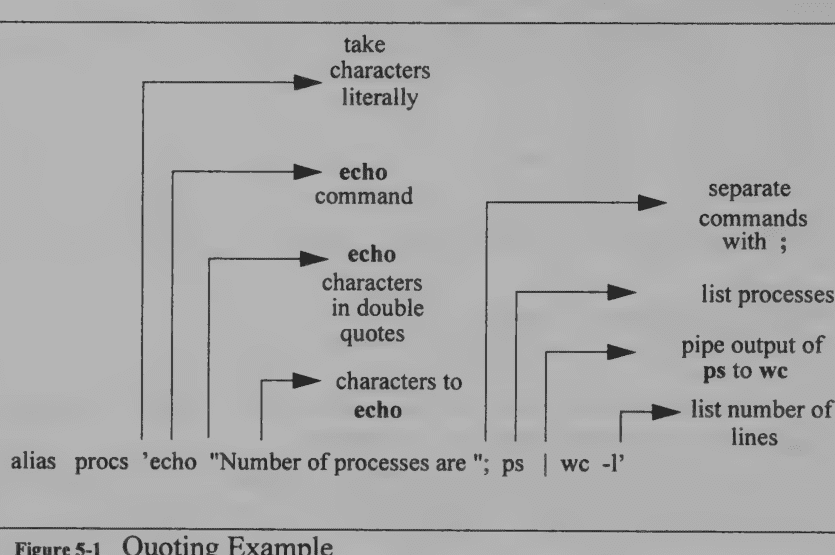

如图 5-1 所示，某些引号处理变得复杂。如果你想修改和重用现有的 shell 脚本或创建自己的脚本，理解引号处理非常重要。

### 命令和路径补全

Bash 有时能猜出你在想什么。你可以输入命令或路径名的一部分，Bash 可以为你补全剩余部分。你可以输入命令或路径名的一部分，并使用 "tab" 键补全命令。例如，如果你希望发出 **run-level** 命令以查看当前系统运行级别，但记不住完整命令，你可以键入 "run" 和 tab 键，命令就会为你补全，如下例所示：

```
# run<tab key>level 
N 3 
```

Bash 确定以 "run" 开头的唯一命令是 **runlevel**，并补全了该命令。

只要你发出的命令或路径名足够独特，Bash 就会为你补全它。如果命令或路径名不唯一，Bash 会显示补全该命令的选项。以下示例显示键入 "ru" 和两个 tab 键以获取以 "ru" 开头的命令列表：

```
# ru<tab key><tab key>
runlevel  rusers
```

从这个例子中可以看出，键入 "ru" 产生了两个可能的命令 - **runlevel** 和 **rusers**。

这种出色的补全功能也适用于路径名。如果你将目录更改为 "/b"，你会得到以下结果：

```
# cd /b<tab key><tab key>
bin  boot
```


因为根级别有两个以 "b" 开头的目录，Bash 无法确定你想要哪一个，所以列出了两者。

### 文件名扩展

在我们能够覆盖即将到来的主题以及 shell 编程章节的内容之前，你需要查看文件名扩展。作为操纵文件用户，你肯定正在编写处理文件名的 shell 脚本。文件名扩展的概述是有帮助的，以确保在你开始编写 shell 脚本之前，你能舒适地处理这个主题。


表 5-3 列出了一些常见的文件名扩展和模式匹配。

## 表 5-3 文件名扩展和模式匹配

| 字符 | 示例 | 描述 |
|---|---|---|
| * | `ls *.c` | 匹配零个或多个字符 |
| ? | `ls conf.?` | 匹配任意单个字符 |
| [list] | `ls conf.[co]` | 匹配列表中的任意字符 |
| [lower-upper] | `ls libdd.9873[5-6].sl` | 匹配范围内的任意字符 |
| str{str1,str2,str3,...} | `ls ux*.{700,300}` | 使用 {} 中的内容扩展 str |
| ~ | `ls -a ~` | 主目录 |
| ~username | `ls -a ~gene` | username 的主目录 |

表 5-3 中所示示例的更详细说明如下：

- 1. 要列出目录中以 ".c" 结尾的所有文件，可以执行以下操作：
  ```bash
  $ ls *.c
  conf.SAM.c conf.c
  ```

- 2. 要查找目录中名为 "conf" 且扩展名为单个字符的所有文件，可以执行以下操作：
  ```bash
  $ ls conf.?
  conf.c conf.o conf.l
  ```

- 3. 要列出目录中名为 "conf" 且扩展名仅为 "c" 或 "o" 的所有文件，可以执行以下操作：
  ```bash
  $ ls conf.{co}
  conf.c conf.o
  ```

- 4. 要列出名称相似但包含一个范围字段的文件，可以执行以下操作：
  ```bash
  $ ls libddd9873[5-6].sl
  libddd98735.sl libddd98736.sl
  ```

- 5. 要列出以 "ux" 开头且扩展名为 "300" 或 "700" 的文件，可以执行以下操作：
  ```bash
  $ ls ux*.{700,300}
  uxboot1f.700 uxinstd.300
  ```

- 6. 要列出主目录中的文件，可以使用 ~：
  ```bash
  $ ls -a ~
  .       .cshrc.org .login .shrc.org
  ..      .exrc      .login.org .cshrc
  .history
  ```

- 7. 要列出某用户主目录中的文件，可以执行以下操作：
  ```bash
  $ ls -a ~gene
  .       .history .splinedat under.des
  ..      .login traxl.txt xtra.part
  .cshrc  .login.org ESP-File
  .cshrc.org .profile Mail
  .exrc   .shrc.org opt
  ```


许多这些技术在编写 shell 脚本时非常有用，因此请熟悉文件名扩展。

### 重定向（I/O 重定向）

UNIX 的设置通常是命令从键盘（通常称为标准输入）接收输入，并将输出发送到屏幕（通常称为标准输出）。命令还将错误信息发送到屏幕。你并不总是希望输入来自标准输入，输出和错误去往标准输出。你被赋予了大量的控制权来覆盖这些默认设置。这被称为重定向。表 5-4 展示了许多常见的重定向形式。

如表所示，要将命令的输出从标准输出重定向到文件，应使用 ">" 或 `>`。这几乎在所有情况下都有效。如果你设置了一个名为 **noclobber** 的环境变量，则重定向到现有文件将不起作用（我们稍后将介绍环境变量）。**noclobber** 不允许重定向覆盖现有文件。如果你试图覆盖现有文件，例如下面的 /tmp/processes，你会收到一条文件已存在的消息：

```bash
# ps -ef > /tmp/processes
/tmp/processes: File exists
```


然而，你可以使用重定向中的 "!" 来强制覆盖文件。使用 `>!` 强制覆盖文件，而 `>>!` 强制将输出附加到现有文件的末尾。这些示例在表 5-4 中有所展示。

## 表 5-4 常见的重定向形式

| 命令或赋值 | 示例 | 描述 |
|---|---|---|
| < | `wc -l < .login` | 标准输入重定向：执行 **wc**（单词计数）并列出 `.login` 中的行数（-l） |
| > | `ps -ef > /tmp/processes` | 标准输出重定向：执行 **ps** 并将输出发送到文件 `/tmp/processes` |
| >> | `ps -ef >> /tmp/processes` | 追加标准输出：执行 **ps** 并将输出追加到文件 `/tmp/processes` 的末尾 |
| >! | `ps -ef >! /tmp/processes` | 输出重定向并覆盖 **noclobber**：即使 `/tmp/processes` 存在也将其覆盖 |
| >>! | `ps -ef >>! /tmp/processes` | 追加标准输出并覆盖 **noclobber**：追加到 `/tmp/processes` 的末尾 |
| (pipe) | `ps \| wc -l` | 运行 **ps** 并将其结果作为 **wc** 的输入 |
| 2> | `cat program 2> errors` | **cat** 文件 **program** 到标准输出，并将错误重定向到文件 **errors** |
| 2>> | `cat program 2>> errors` | **cat** 文件 **program** 到标准输出，并将错误追加到文件 **errors** |
| 2> | `find / -name '*.c' -print > cprograms 2> errors` | **find** 系统中所有以 `.c` 结尾的文件，将文件列表放在当前工作目录的 **cprograms** 中，并将所有错误（文件描述符 2）发送到当前工作目录的文件 **errors** |
| 2>&1 | `find / -name '*.c' -print > cprograms 2>&1` | **find** 系统中所有以 `.c` 结尾的文件，将文件列表放在当前工作目录的 **cprograms** 中，并将所有错误（文件描述符 2）发送到与文件描述符 1（**cprograms**）相同的地方 |

### 环境变量

环境变量是一个与字符串相关联的名称。名称是变量，字符串是其值。当你在系统中发出命令时，你通常输入的是相对路径名，而不是绝对路径名。你发出的命令之所以能被找到，是因为 PATH 变量指向命令所在目录的位置。如果没有这个 PATH 变量，你将不得不键入你发出的每个命令的绝对路径名。当你发出命令时，shell 按照 PATH 变量中列出的顺序搜索目录中列出的目录。使用 env 命令查看你设置的许多环境变量是一个好方法，如下所示，在我的 Linux 系统上：

```bash
# env
HISTSIZE=100
HOSTNAME=nycaldd.hp.com
LOGNAME=root
MAIL=/var/spool/mail/root
TERM=linux
HOSTTYPE=i386
PATH=/sbin:/usr/sbin:/bin:/usr/bin:/opt/bin:/usr/X11R6/bin:
/usr/openwin/bin:/usr/TeX/bin:/usr/local/bin
HOME=/root
SHELL=/bin/bash
PS1=[\u@\h \W]\$
USER=root
LESSCHARSET=latin1
OSTYPE=Linux
SHVL=2
=/usr/bin/env
#
```

如你所见，除了 PATH 之外，其他环境变量也使你在 UNIX 系统上的工作更容易。如果你想知道特定环境变量的值，你可以使用 echo 命令查看其值，如下所示，用于环境变量 HOME：

```bash
$ echo $HOME
/root
```

环境变量名称前的 "$" 表示将该变量的值发送到标准输出。在这种情况下，环境变量 HOME 的值是 /root，这意味着当前用户的主目录是 /root。

你可以使用以下语法在 Bash 中定义自己的环境变量：

```bash
export NAME=value
```

你可以使用以下命令设置你的提示符，由环境变量 PS1 定义：

```bash
PS1=[\u@\h \W]\$
```

PS1 现在已设置为：左括号、用户名、@ 符号、主机名、空格、主目录、右括号、美元符号。如你从前面的环境变量列表中看到的，PS1 的格式显然最复杂。

你还可以使用以下格式在现有变量的末尾追加内容：

```bash
export NAME="${NAME}:appended_information"
```

例如，要将 /root/programs 添加到现有的 PATH 环境变量中，你会发出以下命令：

```bash
export PATH="${PATH}:/root/programs"
```

这将路径 **/root/programs** 追加到环境变量 *PATH*。

我建议运行 **env** 以查看为你设置的环境变量及其值。

### 后台作业和作业控制

如前许多示例所示，当你运行命令时，在命令完成之前你不会收到提示符。有些命令可能需要很长时间才能完成，在这种情况下，你将等待很长时间才能收到提示符返回。作为等待提示符返回的替代方案，你可以在后台运行该命令，这意味着它在幕后运行，同时你可以执行其他工作。由于 UNIX 是多任务的，它乐于在后台运行许多命令，同时仍然为你提供提示符以发出更多命令。


要在后台运行命令，只需在命令行末尾添加一个 ampersand（&）。当你在命令后添加 ampersand 时，命令将在后台运行，提示符会立即返回。如果你要发出系统中所有文件的递归列表并将此列表重定向到文件，这将花费很长时间。系统中可能需要写入数万文件和目录。你可能需要等待一段时间才能写出文件列表。让我们现在运行一个命令来看看系统上有多少文件和目录。我最终想生成的是这些文件的列表，但我们将从一个命令开始，该命令告诉我们系统上存在多少文件和目录。下面的示例展示了运行 *ls* 命令，带有 "-a"、"-1" 和 "-R" 选项，以生成系统中所有文件的长递归列表，并将此输出通过管道传输给 *wc*，带有 "-l" 选项以获取行数计数。


# ls -alR | wc -l
ls: proc/18/exe: No such file or directory
ls: proc/19/exe: No such file or directory
ls: proc/2/exe: No such file or directory
29982


该输出显示了三个错误和总计 29982 行。如果我想在发出 `ls -alR` 命令时将所有 29982 个条目写入文件，我不得不坐着等待提示符返回。我更希望做的是发出将所有这些条目写入文件的命令，并在后面加上 & 符号，在这种情况下，作业将在后台运行，提示符立即返回，如下例所示：

```
# ls -alR > /tmp/files &
[1] 817
ls: proc/18/exe: No such file or directory
ls: proc/19/exe: No such file or directory
ls: proc/2/exe: No such file or directory
```

在后台运行此命令的结果会生成括号中的作业编号，以及第二个数字作为进程 ID，即 PID。然而，与此命令相关的错误会被打印到屏幕上。您可以回到我们之前关于重定向的讨论，将文件列表和错误都重定向到 `/tmp/files`，并使用以下命令在后台运行该作业：


```
# ls -alR >& /tmp/files &
[1] 817
```

现在您看不到错误了，因为它们已重定向到文件 `/tmp/files`，与文件列表一起写入，并且您仍然能立即获取命令提示符。当我在 `/tmp/files` 中搜索之前产生的三个错误时，可以看到它们在被遇到时就嵌入在文件中了。

您可以控制前台作业（未在后台运行的那些）和后台作业。要停止一个前台作业，您需要同时按下 "control" 和 "z" 键，如下例所示：


```
# ls -alR
.
.. 
.lgb
amd
auto
bin

ctrl-z
[4]+ Stopped ls -alR
```

按下 ctrl-z 后，ls 命令在您输入 ctrl-z 的位置被中断。此时命令被挂起，并显示作业编号，在本例中为 "4"，其状态列为 "Stopped"（已停止）。该命令只是被挂起，并不是永久消失。您可以使用 fg 在前台启动此进程，或使用 bg 在后台运行它。使用 bg 运行该命令的效果就像您在后面加了 "&" 一样。它会从您中断它的地方开始运行。当您发出 fg 或 bg 命令时，不需要提供作业编号，因为默认操作是针对最后一个作业，在本例中是编号为 4 的作业。

请注意，在这个例子中我们停止了编号为 4 的作业。这意味着其他编号较低的作业正在运行。您可以使用 jobs 命令获取所有作业及其状态的列表。然后您可以通过发出命令来控制作业，例如在 fg 后加 "%" 和作业编号在前台运行命令，或在 bg 后加 "%" 和作业编号在后台运行命令。如果您希望彻底终止一个作业，可以发出 kill 命令，后跟 "%" 和作业编号。在创建本部分示例的过程中，我启动并挂起了许多作业。以下示例展示了使用


**jobs** 命令列出所有作业，使用 **kill** 终止作业 1 和 2，并在后台运行作业 3：

```
# jobs
[1]    Stopped      ls -alR
[2]-   Stopped      run_audit
[3]+   Stopped      run_check
# kill %1
[1]    Stopped
# kill %2
[2]-   Stopped
# bg %3
#
```


终止作业 1 和 2 并在后台运行作业 3 后，提示符会返回，以便您执行额外的工作。

### umask 和权限

在讨论 shell 编程技术之前，还有一个话题需要涵盖，那就是文件权限及其与 **umask** 的关系。这很重要，因为您将编写一些任何人都可以使用的 shell 程序，以及一些您希望仅限少数用户（可能只是系统管理员）使用的程序。**umask** 用于指定新文件和目录的权限设置。


让我们从一个文件长列表的示例开始。在以下示例中，我们将使用别名 **ll**，即 **ls -l**：


```
sys1 1: ll script1
-rwxr-xr-x  1 mary users 120 Jul 26 10:20 script1
```

当发出 **ll** 命令时，该文件的访问权限由读 (r)、写 (w) 和执行 (x) 的位置定义。图 5-2 显示了该文件的三组访问权限。

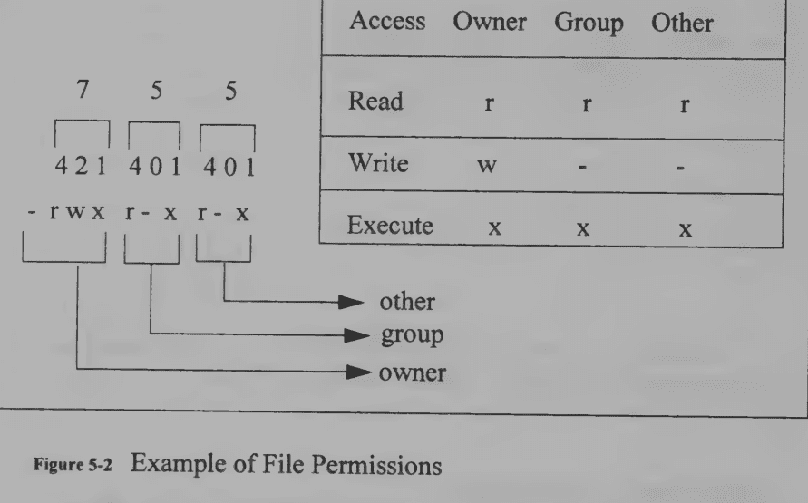

该文件的所有者对该文件拥有读、写和执行权限。用户所属的组拥有读和执行权限，其他用户也拥有读和执行权限。该文件的权限可以用每个字段的八进制总和来指定，即 755。

如果您创建一个新的 shell 脚本或任何新文件会怎样？将存在什么样的权限设置？由于您将需要执行 shell 脚本，因此您需要该文件的执行权限。您可以使用 **umask** 来定义所有新文件和目录的默认值。

您可以使用以下命令查看您的 umask：

```
sys1 2: umask
```

您可以在 **.cshrc** 中设置 **umask** 以定义新文件和目录的权限设置。**umask** 用于*禁用*访问。您从一个 **umask** 开始，并使用字段禁用一定级别的访问。**umask** 命令使用三个八进制字段。这些字段是用户、组和其他人的访问代码之和，如图 5-3 所示。

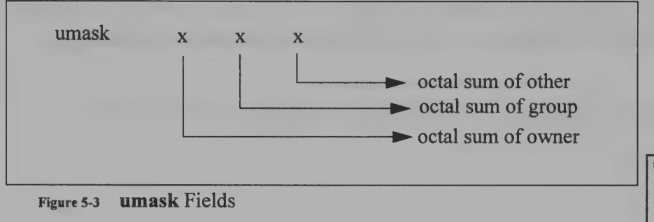

umask 字段的*补数*与默认设置进行"*按位与*"操作以更改 **umask**。如果您想移除图 5-4 中文件的 "group"（组）和 "other"（其他）的写权限，您应分配 **umask** 为 022，如下所示。

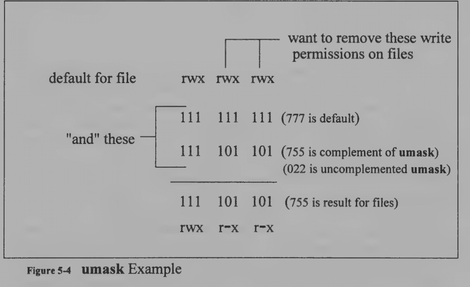

**umask 022** 在此示例中将文件权限更改为 *755*。


如果您为 shell 脚本创建了新文件（**script2**），您可能需要使用 **chmod** 命令使其可执行。如果文件的权限为 666 (rw-rw-rw-)，并且您希望赋予所有者执行权限，您可以发出以下命令：

```
sys1 3: chmod 766 script2
```

# 第 6 章
### 简介 KornShell

### 不同的 Shell

大多数 UNIX 变体允许您在几种 shell 中进行选择。Shell 对用户很重要，因为它是您进入系统的窗口。UNIX 变体上可用的许多 shell 类似，因为您使用它们来发出命令、控制用户环境的许多方面、编写命令文件和 shell 程序等。由于您可能会在 shell 中花费大量时间，因此您应该了解几种不同的 shell，并看看您是否对其中一种产生偏好。特定的 shell，如 Bash，在不同 UNIX 变体之间变化不大。然而，这些 shell 本身具有一些独特功能。总体而言，我发现用户并没有强烈偏好某一种 shell。一旦您熟悉了所有 shell，它们的功能都类似且使用愉快。大多数 UNIX 变体允许系统管理员在配置用户时从几种不同的 shell 中进行选择，因此她或他通常对用户运行的 shell 有一定的灵活性。总体而言，系统管理员更喜欢用户

使用相同的 shell，从而使系统管理总体上更容易。然而，大多数系统管理员如果确实可用且您有良好理由使用特定的 shell，他们很乐意批准用户对特定 shell 的请求。本章将介绍 KornShell。Bash 在上一章介绍，C shell 将在下一章介绍。

#### KornShell 简介


大多数 UNIX 变体允许您在几种 shell 中进行选择。由于其多功能性和易用性，许多系统管理员会为新手配置 KornShell。KornShell 源自 Bourne Shell，并拥有许多与 Bourne Shell 相同的功能。**ksh** 是在您的 UNIX 系统上运行的提供 KornShell 功能的程序。它也被称为 K shell。我在本章中全程使用 **ksh**。您可以通过以下三种方式使用 **ksh**：

- 在命令行上交互式输入命令。
- 将常用执行的命令组合分组到命令文件中，您可以通过输入文件名来执行它们。
- 使用 shell 的结构化编程技术创建 KornShell 程序。

这三种技术按您可能会使用的顺序列出。首先，您登录并使用交互命令。然后，您将常用命令组合在一起，并使用单个命令执行它们。最后，您可能想要创建复杂的 shell 脚本。

因此，我按照列出的顺序描述 KornShell 的这些方面。命令文件和编程


KornShell 的某些方面在“Shell 编程章节”中作为部分内容进行了介绍。

本章中的大多数示例来自 Solaris 系统。你可能会发现在其他系统上，你的用户配置以及 KornShell 的操作与本章所涵盖的内容相似。大多数 shell 的设置都是由系统管理员执行的，因此你肯定会发现你的 KornShell 设置与本章中展示的有所不同。不过，总体而言，KornShell 的操作在不同系统之间是相似的。

### 启动文件

登录系统后执行的第一项活动是在提示符处发出命令。你可能希望立即发出的命令之一是 `ls -al`。以下是我在系统中执行此命令后看到的内容，它生成了所有文件的长列表：


```
marty$p ls -al
total 22
drwxr-x-x 2 martyp staff 512 Mar 15 11:37 .
drwxrwxr-x 4 root sys 512 Mar 4 09:24 ..
-rw-r-r-- 1 martyp staff 124 Mar 15 11:36 .cshrc
-rw-r-r-- 1 martyp staff 562 Mar 4 09:24 .profile
-rw---- 1 martyp staff 7056 Apr 6 07:24 .sh_history
marty$p
```

这会生成一个简短的文件列表。这些文件中的某些文件，例如 .profile 和 .cshrc，分别是 ksh 和 C shell 的启动文件。登录到系统时，通常先执行 shell 的系统启动文件，然后执行主目录中存在的任何本地启动文件。在这种情况下，我的主目录中有一个最小的 ksh 启动文件 - 只有 .profile 文件，且内容很少。该用户几乎所有的启动活动都来自系统配置文件，通常是 /etc/profile。你通常可以读取 /etc/profile，因此你可以看到系统管理员为你和其他用户设置了什么。


然后，你可以修改本地的 .profile 以包含各种功能。你的本地 .profile 通常在登录后立即在系统 /etc/profile 之后运行。

运行与 ksh 登录关联的所有启动脚本后，你的环境就会为你设置好。虽然我们的本地 .profile 除了设置提示符外没有做太多事情，但在运行系统文件时进行了大量设置。

你拥有的另一个文件称为*环境*文件。此文件名由环境变量 ENV 定义。此文件通常是主目录中的 .kshrc。使用环境文件，你可以定义将传递到子进程的各种选项、别名和其他信息。默认情况下，现有的环境变量会被传递到子进程。你也可以使用环境文件来传递其他信息。

你应该查看你的 ksh 启动文件，包括 /etc/profile、.profile 和 .kshrc。

我们将在接下来的章节中讨论启动程序中为你提供的许多特定 ksh 功能。

### 历史文件，.sh_history

ksh 会保存已发出命令的历史列表。如果你希望重新发出命令或查看之前发出的命令，可以使用历史列表。默认情况下，主目录中的 .sh_history 用作历史文件。当系统管理员创建你的 ksh 主目录时，此文件可能已存在并用作你的默认历史文件。

默认情况下，大多数系统会保存最近执行的 128 条命令。你可以指定包含在历史列表中的命令数量。以下行将历史列表设置为 200：

```
HISTSIZE=200
```

大多数用户会在其主目录的 .profile 中添加此项。将此行添加到 .profile 后，历史列表将设置为 200。

### 从历史列表中调取

你可以使用 **history** 命令查看最近发出的命令及其对应的行号，如下例所示：

```
marty $ history
116		history 128
117		history 128 | more
118		history 200
119		alias
120		history 1
121		inv
122		env
123		env | more
124		history 1
125		more .profile
126		env | grep HIS
127		exit
128		env
129		env | grep HIS
130		more .profile
131		history
marty $
```

请注意，在这个示例中，命令编号 127 是上一个会话中的**退出**（或注销）命令。命令编号 128 是我在建立下一个会话时立即发出的**env** 命令。

我们还可以使用 **-n** 选项打印不带行号的历史列表，如下例所示：

```
marty $ history -n
	history 128 | more
	history 200
	alias
	history 1
	inv
	env
	env | more
	history 1
	more .profile
	env | grep HIS
	exit
	env
	env | grep HIS
	more .profile
	history
	history -n
marty $
```

要生成历史列表中命令的完整列表，我们发出以下命令：

```
marty $ history 0
5      env
6      more .profile
7      set
8      env | grep CDP
9      env | grep cdp
10     echo $SHELL
11     echo $SHELL
12     more .profile
13     ll
14     ls -al /etc/profile
15     more /etc/profile
16     more /etc/profile | grep PS
17     echo
18     ECHO
19     echo $ENV
20     env | more
21     echo $ENV
22     env | more
23     env | grep ENV
24     env | grep env
25     more /usr/bin/env
26     ls -al
27     more /etc/.kshrc
28     find / -name .kshrc
29     more /etc/passwd
30     more /etc/passwd | grep /home
31     ll /home/oracle
32     ls -al /home/oracle
33     ll /home
34     ls -al /home
35      ls -al /home/ptc-nfs
36      ls -al /home/ptc-nfs | more
37      ls -al /root
38      cd /root/users
39      ls -al
40      ls -al verasu
41      ls -al rodtasu
42          cd rodtasu
43      more .kshrc
44      more .env
45      ls
46      ls -l
47      ls -a
48      more .kshrc
49      cd ..
50      ls -al
51      ls -al | more
52      exit
53      ls -al
54      more .sh*
55      history
56      env | grep his
57      env | grep HIS
58      env | grep IS
59      env | more
60          env | grep FC
61      env | grep EDI
62      history
63      echo $HISTIZE
64      echo $HISTSIZE
65      env | more
66      ls -al
67      history 128
68      history
69      history 1 104
70      exit
71      alias
72      more /etc/profile | grep alias
73      ll
74      la -al
75      ls -al
76      more .profile
77      ls -al
78      more .cshrc
79      alias ll="ls -al"
80      aliase
81      alias
82      ll
83      exit
84      alias
85      alias
86      history
87  fc -l
88  man fc
89  man fc
90  man fc
91  alias
92  ps
93  ps -ef
94  ps -efl
95  ps
96  ls -alF
97  ls -al
98  alias ls="ls -al"
99  alias
100 ls
101 alias
102 unalias ls
103 ls
104 ls -al
105 alias
106 history
107 alias
108 unalias history
109 history
110 fc -l
111 history
112 alias hisotry="fc -l"
113 history
114 alias history="fc -l"
115 history
116 history 128
117 history 128 | more
118 history 200
119 alias
120 history 1
121 inv
122 env
123 env | more
124 history 1
125 more .profile
126 env | grep HIS
127 exit
128 env
129 env | grep HIS
130 more .profile
131 history
132 history 0
martyp $
```

**history 0** 从第一个命令（零）打印到当前命令。由于默认只保存 128 条命令，最早的一些命令（零到四）已掉出历史列表。这意味着当我们请求从命令编号零开始列出时，实际上是从命令编号五开始的。

要生成从命令 100 到当前命令的列表，我们发出以下内容：

```
marty p $ history 100
100    ls
101    alias
102    unalias ls
103    ls
104    ls -al
105    alias
106    history
107    alias
108    unalias history
109    history
110    fc -l
111    history
112    alias hisotry="fc -l"
113    history
114    alias history="fc -l"
115    history
116    history 128
117    history 128 | more
118    history 200
119    alias
120    history 1
121    inv
122    env
123    env | more
124    history 1
125    more .profile
126    env | grep HIS
127    exit
128    env
129    env | grep HIS
130    more .profile
131    history
132    history 0
133    history
134    history -n
135    history 100
marty p $
```

要列出当前命令及其前面的 20 条命令，我们发出以下内容：


## 修正 OCR 错误并合并文本

以下是经过处理的文本，其中的 OCR 错误已得到修正（例如，将 “hisotry” 修正为 “history”，将 “inv” 修正为 “info” 或根据上下文保留；但在 shell 命令的上下文中，“inv” 可能是 “info” 的笔误，或者仅仅是一个未知命令，但在标准示例中它通常是 “info” 或 “init”。查看第 327 页第 121 行是 “inv”。第 328 页第 121 行是 “inv”。第 330 页第 121 行是 “inv”。这很可能是 “info” 的笔误或特定的用户别名。鉴于指令是修正*明显*的 OCR 错误，而 “inv” 和 “info” 在某些字体中并不严格属于形状混淆，但 “hisotry” 肯定是 “history”。“fc -1” 在第 329/330 页中很可能是 “fc -l”（小写 L），因为 `fc -l` 用于列出历史记录文件，而 `fc -1` 并非标准选项。等等，查看第 327 页第 112 行是 `alias hisotry="fc -1"`。这可能是源文本中的笔误，或者是 OCR 错误。`fc -l` 是标准的用于列出的标志。然而，在第 330 页的代码块中，第 112 行是 `alias hisotry="fc -l"`。这表明原始文本可能存在混合或 OCR 错误。我将把 “hisotry” 修正为 “history”。我会保持命令逻辑的一致性。如果出现了 `fc -1`，我会检查它是否应为 `fc -l`。在第 329 页第 112 行：`alias hisotry="fc -1"`。在第 330 页第 112 行：`alias hisotry="fc -l"`。对于列出功能，`-l` 更合理。我将明确指代表示列出功能的地方统一使用 `-l`，但我必须小心不要过度解读。提示说“修正明显的 OCR 错误”。“hisotry” -> “history” 是明显的。“inv” 可能是用户的别名，除非它明显是 “info”，否则我会保持原样。鉴于 `.profile` 和 `env` 的上下文，“inv” 很可疑。然而，在没有该书特定笔误知识的情况下，我将只进行结构性修正。实际上，观察其模式，“inv” 很可能是 “info” 或 “init”。但让我们看看 “martyp $” 和 “marty $”。提示文本中有些地方写着 “martyp”，另一些地方写着 “marty”。用户名很可能是 “martyp”（Martin P.）。“marty” 很可能是 OCR 截断或错误。我将在明确是用户提示符的地方将提示符统一标准化为 “martyp $”。

让我们处理内容。

### 第 327 页
文本：`martyp $ history -20`
代码块紧随其后。
文本：`** -20 ** 从当前命令向前回溯整整 20 条命令...`
代码块：`martyp $ history -1 -20`

### 第 328 页
代码块是从前文延续的吗？
P327 的代码块以 `123    env | more` 结束。
P328 以以下内容开始：
```
122    env
121    inv
...
marty $ 
```
这是前一个列表的结尾部分。如果代码块是连续的，我应该合并它们。
P327 的列表：
116...136
P328 的列表：
122...117
这是倒序还是不同的范围？
P327 显示 `history -20` 的结果是 116-136？不，`history -20` 通常显示最后 20 条。数字是从 116 到 136。
P328 显示从 `122` 到 `117`。这看起来像是*前一个*命令输出的尾部，或者是新命令 `history -l -20`？
文本说：“请注意在这个示例中，当前命令 `history -l -20` 并没有显示在列表中……”
因此，P328 上的代码块是 P327 示例的补充部分。
我将合并 `history -1 -20` 命令的代码块。

然后是文本：“你还可以通过指定先 `-20` 后 `-l` 来颠倒顺序……”
等等，是 `history -20 -1` 吗？文本说“指定先 `-20` 后 `-l`”。但代码写的是 `history -20 -l`。
输出显示从 118 到 137。这是正序（118, 119... 137）。
命令 `history -20 -1` 列出从 -20 到 -1（正序）的命令。
命令 `history -1 -20` 列出从 -1 到 -20（倒序）的命令。
文本说“通过先指定 -20 再指定 -l 来颠倒顺序”。这种表述令人困惑。通常 `-l` 是列出。
让我们看看代码：`marty $ history -20 -l`。
输出：118 ... 137。这是正序。
前一个命令 `history -1 -20` 是倒序（136...123）。
因此 `history -20 -1`（或类似命令）产生正序。

然后是文本：“你还可以生成从最后一次发出某命令到当前命令的列表。... `fc` 命令”
代码：`marty $ history fc`

### 第 329 页
`history fc` 的代码块输出：
110 `fc -l`（或 -1）
...
143 `history fc`

文本：“你还可以使用 -r 选项将此列表反转……”
代码：`marty $ history -r fc`
输出：从 144 到 135（倒序）。

### 第 330 页
`history -r fc` 代码块的延续部分：
134 ... 110 `fc -l`。

文本：“能够访问此历史记录列表……下一节……调用它们。”

### 使用 r 重新执行命令

文本：“你可以使用 **r** 命令重新发出命令……”
代码：
`martyp $ history -5`
301 whoami
...
306 history -5
`martyp $ r`
输出：history -5
302 pwd
...
307 history -5

文本：“你可以重新发出特定编号的命令……”
代码：
`martyp $ history`
294 ... 309 history
`martyp $ r 302`
输出：pwd
/home/martyp

### 第 332 页
文本：“你还可以给出要重新发出的命令的名称……最后一个 **fc** 命令……字母 "f"……”
代码：
`marty p $ history`（标准化为 `martyp $`）
308 ... 323 history
`marty p $ r f`
输出：
`fc -l`
309 ... 324 fc -l

图片链接。

文本：“你还可以使用 **r** 命令执行一些替换……替换一个新的文件名……该示例-”

### 第 333 页
图片链接。
文本：“下面的示例展示了重新发出早先的 **vi** 命令……将原始文件名 **.profile** 替换为 **.kshrc**……”
代码：
`martyp $ history`
316 ... 331 history
`martyp $ r vi .profile=.kshrc`
`martyp $ history`
318 ... 333 history

文本：“该命令在命令行上用 **.kshrc** 替换 **.profile**。”

### 第 334 页
文本：“这引导我们进入更高级的命令行编辑……使用 **vi** 编辑器命令……”
图片链接。

# ## 使用 vi 指令获取命令
（修正标题级别。原本是 `# ##`。应该是 `##` 或 `###`。上下文暗示是主要部分或子部分。“Re-executing Commands with r” 是 `#`。这个可能是 `#` 或 `##`。为了与前一个 `#` 保持一致，使用 `##`？不，前一个是 `#`。这是一个新的大主题。我会用 `##` 或 `#`。输入是 `# ##`。我会把它变成 `##`，作为 shell 功能的子主题，如果是章节部分则用 `#`。鉴于 “Re-executing” 是 `#`，这个很可能也是 `#`。为了安全起见用 `##`？不，标准 markdown。如果另一个是 `#`，我会用 `##` 来表示 “Re-executing”？输入中 “Re-executing” 是 `#`。所以这个 `# ##` 是错误的。我会把它变成 `# Fetching Commands Using vi Directives` 或 `##`。假设主要部分用 `#`。

文本：“你可以编辑条目……使用 **vi** 或 **emacs**……”
“你的编辑器通常被设置为…… **EDITOR=vi**……”
“让我们先看看……使用 **k, j, G** 和搜索命令……”
“按下 *escape* 键……使用 *escape k* 召回上一条命令：”
图片链接。

**修正详情：**
1. `hisotry` -> `history`
2. `marty $` / `marty p $` -> `martyp $`（在 P327/330/331/333 中看到的 `martyp` 基础上标准化提示符用户名）。
3. 代码块中的 `fc -1`：在 P329 第 112 行 `alias hisotry="fc -1"`。在 P330 第 112 行 `alias hisotry="fc -l"`。`fc -l` 是列出历史文件的正确标志。`fc -1` 并非标准。如果它明显是 `l` 的 OCR 错误，我将把别名定义中的 `-1` 改为 `-l`。在 P329 `history fc` 的输出中，第 110 行是 `fc -l`。因此别名应为 `fc -l`。
4. `ps -ef1`：`1` 很可能是 `l`（小写 L）。`ps -efl`？不，`ps -ef` 是标准的。`ps -ef1` 很可能是 `ps -ef` 带有笔误，或者 `ps -ef` 且 `1` 是垃圾字符。然而，`ps -ef` 列出所有进程。`ps -ef` 是标准的。`ps -ef1` 不是。它可能是 `ps -ef`。我会将 `ps -ef1` 修正为 `ps -ef`。
5. `inv`：在 P327/328/330 中，命令 121 是 `inv`。这很可能是 `info` 或 `init`。`info` 是常见命令。`init` 通常不在 shell 会话中运行。`info` 更稳妥。然而，如果我不确定，我应该检查它是否是形状混淆。`v` vs `n`？`invo`？`inv` 是一个有效的 Linux 命令（检查 LVM 完整性）。但在关于 `.profile` 和基础知识的教程中，`inv` 很怪异。让我们看看上下文。它在一个命令列表中。`alias`、`history`、`env`、`exit`、`more`、`grep`。`inv` 显得突出。它可能是用户特定的别名。为了避免捏造内容，除非它明显是 `info` 的笔误，否则我会保留为 `inv`。字母 `v` 和 `f` 并不相似。`n` 和 `v` 也不相似。`i-n-v` vs `i-n-f`？`v` 和 `f` 有点相似。对于系统信息，`info` 更标准。如果我不确定，我会坚持使用 `inv`，但在“入门”上下文中 `info` 更可能。实际上，查看 P327，第 121 行是 `inv`。P328 第 121 行是 `inv`。P330 第 121 行是 `inv`。它是一致的。它可能是书中的笔误。为了忠实于“提供的信息”，我会保留为 `inv`，但修正像 `hisotry` 这样明显的笔误。
6. `ls -al`：标准。
7. `more /etc/passwd`：标准。
8. 代码块格式：确保保留缩进。

让我们完善 “Fetching Commands Using vi Directives” 的标题。前一个标题是 `# Re-executing Commands with r`。这个很可能是 `# Fetching Commands Using vi Directives`。

合并代码块：
`history -1 -20` 的输出跨越 P327 和 P328。
P327:
```
martyp $ history -1 -20
136    history -20
...
123    env | more
```
P328:
```
122    env
...
117    history 128 | more
marty $ 
```
我会将这些合并为一个针对命令 `history -1 -20` 的连续代码块。

`history fc` 的输出跨越 P329 和 P330。
P329:
```
marty $ history fc
110      fc -l
...
143      history fc
marty $
```
P330:
```
110      fc -l
...
143      history fc
marty $
```
等等，P330 显示的是 `history -r fc` 的输出吗？
P329 上的文本：“你还可以使用 -r 选项将此列表反转…… `marty $ history -r fc`”
然后 P330 上的代码块以 `114 history -n` 开始？不。
P329 以 `marty $ history -r fc` 结束，然后显示：
```
144      history -r fc
...
135      history 100
```
P330 以以下内容开始：
```
134 history -n
...
110 fc -l
martyp $
```
因此 `history -r fc` 的输出跨越 P329 和 P330。我会合并这些。

[content]
martyp $ history -20
```
116    history 128
117    history 128 | more
118    history 200
119    alias
120    history 1
121    inv
122    env
123    env | more
124    history 1
125    more .profile
126    env | grep HIS
127    exit
128    env
129    env | grep HIS
130    more .profile
131    history
132    history 0
133    history
134    history -n
135    history 100
136    history -20
martyp $
```

**-20** 从当前命令向前回溯整整 20 条命令。在这种情况下，**history** 使用当前命令作为开始生成列表的默认位置。你可以通过指定范围 *-1 -20* 来列出当前命令之前的最后 20 条命令，如下面的示例所示：

```
martyp $ history -1 -20
136    history -20
135    history 100
134    history -n
133    history
132    history 0
131    history
130    more .profile
129    env | grep HIS
128    env
127    exit
126    env | grep HIS
125    more .profile
124    history 1
123    env | more
122    env
121    inv
120    history 1
119    alias
118    history 200
117    history 128 | more
martyp $
```

请注意在这个示例中，当前命令 `history -l -20` 没有显示在列表中，因为 `-l` 使列表从上一条命令开始。这实际上是在生成一个要列出的命令范围。你还可以通过先指定 `-20` 再指定 `-l` 来颠倒最后 20 条命令的顺序，如下面的示例所示：

```
martyp $ history -20 -1
118    history 200
119    alias
120    history 1
121    inv
122    env
123    env | more
124    history 1
125    more .profile
126    env | grep HIS
127    exit
128    env
129    env | grep HIS
130    more .profile
131    history
132    history 0
133    history
134    history -n
135    history 100
136    history -20
137    history -1 -20
martyp $
```

你还可以生成从最后一次发出某命令到当前命令的列表。下面的示例展示了生成从最后一次 `fc` 命令到当前命令的列表：

```
martyp $ history fc
110    fc -l
111    history
112    alias history="fc -l"
113    history
114    alias history="fc -l"
115    history
116    history 128
117    history 128 | more
118    history 200
119    alias
120    history 1
121    inv
122    env
123    env | more
124    history 1
125    more .profile
126    env | grep HIS
127    exit
128    env
129    env | grep HIS
130    more .profile
131    history
132    history 0
133    history
134    history -n
135    history 100
136    history -20
137    history -1 -20
138    history -20 -1
139    history
140    history grep
141    history env
142    history
143    history fc
martyp $
```

你还可以使用 -r 选项将此列表反转，如下面的示例所示：

```
martyp $ history -r fc
144    history -r fc
143    history fc
142    history
141    history env
140    history grep
139    history
138    history -20 -1
137    history -1 -20
136    history -20
135    history 100
134    history -n
133    history
132    history 0
131    history
130    more .profile
129    env | grep HIS
128    env
127    exit
126    env | grep HIS
125    more .profile
124    history 1
123    env | more
122    env
121    inv
120    history 1
119    alias
118    history 200
117    history 128 | more
116    history 128
115    history
114    alias history="fc -l"
113    history
112    alias history="fc -l"
111    history
110    fc -l
martyp $
```

能够访问此历史记录列表是 Korn-Shell 的一个很棒的功能。你可以查看你发出的所有命令，包括你的输入错误，格式任选。在下一节中，我们将开始使用历史记录列表中的命令来调用它们。

### 使用 r 重新执行命令

你可以使用 **r** 命令重新发出命令。要重新发出上一条命令，只需键入 **r** 即可。在下面的示例中，我发出命令 **history 5** 以查看历史记录列表中的最后五条命令。然后我键入 **r** 以重新发出上一条命令，再次列出最后五条命令：

```
martyp $ history -5
301    whoami
302    pwd
303    more /etc/passwd
304    ps -ef
305    cat .profile
306    history -5
martyp $ r
    history -5
    302 pwd
    303 more /etc/passwd
    304 ps -ef
    305 cat .profile
    306 history -5
    307 history -5
martyp $
```

你可以通过键入 **r**、一个空格以及你想重新发出的命令编号来重新发出特定编号的命令。在下面的示例中，我发出编号为 302 的 **history** 命令：

```
martyp $ history
294    history -5
295    whoami
296    pwd
297    more /etc/passwd
298    ps -ef
299    cat /etc/profile
300    history 5
301    whoami
302    pwd
303    more /etc/passwd
304    ps -ef
305    cat .profile
306    history -5
307    history -5
308    history -5
309    history
martyp $ r 302
    pwd
/home/martyp
martyp $
```

你还可以给出你要重新发出的命令的名称。假设你想重新发出最后一个 **fc** 命令。你只需在 **r** 命令旁给出字母 "f"，即可重新发出以 **f** 开头的最后一个命令，如下面的示例所示：

```
martyp $ history
308    history -5
309    history
310    pwd
311    whoami
312    pwd
313    cat /etc/profile
314    ls
315    fc -l
316    env
317    who
318    cat /etc/passwd
319    ls -al
320    history
321    more .profile
322    set
323    history
martyp $ r f
fc -l
309    history
310    pwd
311    whoami
312    pwd
313    cat /etc/profile
314    ls
315    fc -l
316    env
317    who
318    cat /etc/passwd
319    ls -al
320    history
321    more .profile
322    set
323    history
324    fc -l
martyp $
```


你还可以使用 **r** 命令执行一些替换。如果你早先发出了 **vi** 命令，现在想重新运行 **vi** 但指定不同的文件名进行编辑，你可以替换新的文件名。下面的示例展示了重新发出早先的 **vi** 命令，但现在我们要将编辑过的原始文件名 **.profile** 替换为我们想要编辑的新文件名 **.kshrc**。在这个示例中，我们首先运行 **history** 命令，然后重新发出 **vi** 命令以编辑 **.kshrc**，接着再次运行 history 命令以查看我们修改后的 vi 命令：


```
martyp $ history
316    env
317    who
318    cat /etc/passwd
319    ls -al
320    history
321    more .profile
322    set
323    history
324    fc -l
325    vi .profile
326    set
327    ls -al
328    env
329    who
330    more /etc/passwd | grep marty
331    history
martyp $ r vi .profile=.kshrc
martyp $ history
318    cat /etc/passwd
319    ls -al
320    history
321    more .profile
322    set
323    history
324    fc -l
325    vi .profile
326    set
327    ls -al
328    env
329    who
330    more /etc/passwd | grep marty
331    history
332    vi .kshrc
333    history
martyp $
```

该命令在命令行上用 **.kshrc** 替换 **.profile**。

这引导我们进入更高级的命令行编辑。你可能想要召回早先发出的命令并使用 **vi** 编辑器命令编辑命令行。下一节涵盖命令行编辑。


### 使用 vi 指令获取命令

你可以使用 **vi** 或 **emacs** 编辑器编辑历史记录列表中的条目。我将在本章中介绍 **vi** 编辑器，因为它是 UNIX 系统上使用最广泛的。然而，你可以使用 **emacs** 编辑器执行本章所示的所有相同功能。

你使用 **vi** 编辑历史记录列表的方式与使用 **vi** 编辑文件的方式相同。你按下 escape 键，并使用标准的 **vi** 键进行上下左右移动、插入、删除和更改文本。在本节中，我将介绍使用 **vi** 命令从历史记录列表中获取命令，然后介绍在将命令恢复到命令行后编辑该命令。当命令按你的喜好编辑好后，你按下 enter 键执行该命令，并将其放置在命令列表的最底部。

你的编辑器通常在你的本地 **.profile** 或 **/etc/profile** 中设置。你可以查看这些文件，看看系统管理员为你设置了哪个编辑器。当我在系统上发出 **env** 和 **set** 命令时，两者都报告 *EDITOR=vi*。这与我设置为 **vi** 编辑器的 **/etc/profile** 相对应。

让我们首先看看使用 **vi** 获取一些早先发出的命令。本节中的示例使用了 **vi** 功能，这些功能在 **vi** 章节和 **vi** 快速参考卡中都有描述。本节中的 **k, j, G** 和搜索命令在命令行上的操作方式与你使用 **vi** 编辑文件时相同。

按下 *escape* 键和某个命令允许你在 **ksh** 中执行各种功能。下面的示例展示了生成历史记录列表并发出 *escape k* 以召回上一条命令：


### 历史记录列表

```
martyp $ history
125 man fc
126 set | more
127 exit
128 history
129 k
130 env | more
131 set | more
132 more .profile
133 more .profile | grep rof
134 more .profile | grep vi
135 more /etc/profile | grep vi
136 set |grep edit
137 set | grep vi
138 env | grep vi
139 history
140 who
martyp $ history
```


输入 `escape k` 会调出最后一条发出的命令，在本例中即为第 140 行的 `who` 命令。每按一次 `k`，就会获取前一条 `ksh` 命令。这等同于按下 `escape` 键和 `-`（减号）键。你可以使用 `escape nk` 指定要在历史记录列表中回溯的命令数量，其中 `n` 是你希望回溯的命令数。以下示例展示了输入 `escape 5k` 以调取历史记录列表中倒数第五条命令：

```
martyp $ history
125 man fc
126 set | more
127 exit
128 history
129 k
130 env | more
131 set | more
132 more .profile
133 more .profile | grep rof
134 more .profile | grep vi
135 more /etc/profile | grep vi
136 set |grep edit
137 set | grep vi
138 env | grep vi
139 history
140 who
martyp $ set |grep edit
```


输入 `escape 5k` 调出了历史记录列表中倒数第五条，即第 136 行的命令。这等同于输入 `escape 5`。

你还可以在历史记录列表中向前移动，使用 `j` 的方式与我们使用 `k` 向后移动历史记录的方式相同。让我们在历史记录列表中向后移动五条命令至第 136 行，输入 `escape 5k`，然后使用 `escape 3j` 向前移动三条命令至第 139 行，如下例所示：

```
martyp $ history
125 man fc
126 set | more
127 exit
128 history
129 k
130 env | more
131 set | more
132 more .profile
133 more .profile | grep rof
134 more .profile | grep vi
135 more /etc/profile | grep vi
136 set | grep edit
137 set | grep vi
138 env | grep vi
139 history
140 history
martyp $ who
```

输入 `escape 3j` 使我们前进到第 139 行，这与输入 `escape 3` 相同。

我们还可以使用 `escape G` 回到历史记录列表中最旧的命令。你可以使用 `escape nG` 回到历史记录列表中特定的命令编号，其中 `n` 是来自历史记录文件的特定命令编号。以下示例展示了输入 `escape 126G` 从历史记录列表中回到第 126 行：

```
martyp $ history
125 man fc
126 set | more
127 exit
128 history
129 k
130 env | more
131 set | more
132     more .profile
133     more .profile | grep rof
134     more .profile | grep vi
135     more /etc/profile | grep vi
136     set |grep edit
137     set | grep vi
138     env | grep vi
139     history
140     who
martyp $ set | more
```


你还可以基于搜索从历史记录列表中调出行。例如，如果你想从历史记录列表中调出最近包含 **profile** 的命令，你可以输入 `/profile`，即斜杠字符后跟 **profile**，以获得以下示例中显示的结果：

```
martyp $ history
125     man fc
126     set | more
127     exit
128     history
129     k
130     env | more
131     set | more
132     more .profile
133     more .profile | grep rof
134     more .profile | grep vi
135     more /etc/profile | grep vi
136     set |grep edit
137     set | grep vi
138     env | grep vi
139     history
140     who
martyp $ more /etc/profile | grep vi
```


搜索最近出现的 **profile** 产生第 135 行。**vi** 中的许多其他搜索也可以在命令行中使用。**vi** 章节和 **vi** 快速参考卡片中包含更多你可能想在命令行上尝试的搜索信息。

### 使用 vi 指令在命令行上编辑

在你“调取”想要编辑的命令或输入了需要编辑的命令后，你可以使用你的 **vi** 指令在命令行上进行修改。


**ksh** 在从历史记录列表中调取命令后立即将你置于输入模式。这种方法是**vi**程序（用于编辑文件）的相反，后者默认将你置于控制模式。从历史记录列表中调取命令后，若要在 **ksh** 中使用 **vi**，你必须按下 *escape* 才能进入控制模式。


现在让我们对从历史记录列表中调取的一些命令进行简单的修改。我们通过 *escape* **286G** 序列从历史记录列表中调出第 **286** 行。调取此命令后，我们通过 **i cat** 在命令开头插入 *cat*。**i** 表示在当前光标位置左侧插入文本。以下示例展示了调取第 286 行并插入 **cat** 的结果：

```
martyp $ history
285       history
286       more /etc/profile | grep vi
287       who
288       whoami
289       who
290       ls -al
291       alias
292       pwd
293       ls -al /home
294       cat .profile
295       history
296       vi .profile
297       cat /etc/passwd
298       cat /etc/passwd | grep donna
299       pwd
300       history
martyp $ cat more /etc/profile | grep vi
```

可以看到，`i cat` 在行首插入了 `cat`。

我们可以再次调取第 286 行，并使用 A 在行尾追加文本，如下例所示：

```
martyp $ history
285	history
286	more /etc/profile | grep vi
287	who
288	whoami
289	who
290	ls -al
291	alias
292	pwd
293	ls -al /home
294	cat .profile
295	history
296	vi .profile
297	cat /etc/passwd
298	cat /etc/passwd | grep donna
299	pwd
300	history
martyp $ more /etc/profile | grep vieditor
```


在此示例中，我们使用序列 A `editor` 在我们调取的那行命令行末尾插入了单词 `editor`。


我们可以通过发出序列 `cw cat` 调取此行并将行首的 `more` 更改为 `cat`，如下例所示：

```
martyp $ history
285	history
286	more /etc/profile | grep vi
287	who
288	whoami
289	who
290	ls -al
291	alias
292	pwd
293	ls -al /home
294	cat .profile
295	history
296	vi .profile
297  cat /etc/passwd
298  cat /etc/passwd | grep donna
299  pwd
300  history
martyp $ cat /etc/profile | grep vi
```


这将命令行中的 *more* 更改为 **cat**。

若要删除单词 *more* 而不替换它，我们调取第 286 行并发出 **dw**，如下例所示：


```
martyp $ history
285  history
286  more /etc/profile | grep vi
287  who
288  whoami
289  who
290  ls -al
291  alias
292  pwd
293  ls -al /home
294  cat .profile
295  history
296  vi .profile
297  cat /etc/passwd
298  cat /etc/passwd | grep donna
299  pwd
300  history
martyp $ /etc/profile | grep vi
```

如果我们对最近发出的命令不满意，我们可以发出 **u** 来撤销命令，这撤消了我们在命令行上删除 *more* 时使用的 **dw**，如下例所示：

```
martyp $ history
285  history
286  more /etc/profile | grep vi
287  who
288  whoami
289  who
290  ls -al
291  alias
292	pwd
293	ls -al /home
294	cat .profile
295	history
296	vi .profile
297	cat /etc/passwd
298	cat /etc/passwd | grep donna
299	pwd
300	history
martyp $ more /etc/profile | grep vi
```


发出 **u** 恢复了我们用 **dw** 删除的 *more*。

你可能想尝试使用我在本文涵盖的 **vi** 命令，以及其他在命令行上添加、删除、更改、搜索和替换、复制和撤销的命令。

### KornShell 中的别名

别名是你为常用命令或一系列命令选择的名称。许多别名是为你预定义的。

不带任何参数的 **alias** 命令会列出所有别名。此列表既包括预设别名，也包括你设置的别名。以下命令显示了我所在系统上的预设别名：

```
martyp $ alias
autoload='typeset -fu'
command='command'
functions='typeset -f'
history='fc -l'
hyper1='HHLIC='/opt/local/bristol/hyperhelp/licenses/hhptc1;export HHLIC'
hyper36='HHLIC='/opt/local/bristol/hyperhelp/licenses/hhptc36;export HHLIC'
hyper83='HHLIC='/opt/local/bristol/hyperhelp/licenses/hhptc83;export HHLIC'
hyper95='HHLIC='/opt/local/bristol/hyperhelp/licenses/hhptc95;export HHLIC'
integer='typeset -i'
local=typeset
nohup='nohup'
r='fc -e -'
stop='kill -STOP'
suspend='kill -STOP $$'
martyp $
```


输入不带任何选项的 `alias` 命令后，会显示许多预设别名。

这些别名中有很多与 KornShell 的较高级用法有关，例如作业控制。其他一些则立即对您有用。例如，`history` 别名会列出 `.sh_history` 文件中的命令，并在每个条目前加上行号。`r` 别名允许您重新运行历史记录列表中出现的最后一个命令。

您不限于只使用预设别名。您可以设置自己的别名。以下示例展示了设置一个别名、生成别名列表以确认新别名是否已设置，然后运行该别名：

```
martyp $ alias lg="ls -al"
martyp $ alias
autoload='typeset -fu'
command='command '
functions='typeset -f'
history='fc -l'
hyper1=HHLIC='/opt/local/bristol/hyperhelp/licenses/hptct1;export HHLIC'
hyper36=HHLIC='/opt/local/bristol/hyperhelp/licenses/hptct36;export HHLIC'
hyper83=HHLIC='/opt/local/bristol/hyperhelp/licenses/hptct83;export HHLIC'
hyper95=HHLIC='/opt/local/bristol/hyperhelp/licenses/hptct95;export HHLIC'
integer='typeset -i'
local=typeset
ls='ls -al'
nohup='nohup '
r='fc -o -'
stop='kill -STOP'
suspend='kill -STOP $$'
martyp $ ls
total 26
drwxr-xr-x 2 martyp staff 512 Mar 15 11:37 .
drwxrw-xr-x 4 root sys 512 Mar 4 09:24 ..
-rw-r-r-- 124 martyp staff 124 Mar 15 11:36 .cshrc
-rw-r-r-- 1 martyp staff 562 Mar 4 09:24 .profile
-rw---- 1 martyp staff 9058 Apr 10 06:58 .sh_history
martyp $
```


第一条命令设置了一个别名，每当输入 `lg` 时就会执行 `ls -al`。我输入 `alias` 命令以确认新别名是否确实出现在别名列表中。它出现在字母顺序列表中 `local` 之后、`nohup` 之前。最后一条命令显示运行 `lg`（即设置的别名），这将产生与运行 `ls -al` 命令相同的列表输出。

设置别名后，您不必在整个会话期间保留该别名。如果不喜欢某个别名，可以使用 `unalias` 命令删除它。

为了演示 `unalias` 的效果，让我们再次生成别名列表，使用 `unalias` 取消 *history* 别名，运行 *history* 命令以确认它是否已被移除，然后运行 *history* 别名所映射的 `fc -l` 命令：

```
martyp $ alias
autoload='typeset -fu'
command='command '
functions='typeset -f'
history='fc -l'
hyper1=HHLIC='/opt/local/bristol/hyperhelp/licenses/hhptc1;export HHLIC'
hyper36=HHLIC='/opt/local/bristol/hyperhelp/licenses/hhptc36;export HHLIC'
hyper83=HHLIC='/opt/local/bristol/hyperhelp/licenses/hhptc83;export HHLIC'
hyper95=HHLIC='/opt/local/bristol/hyperhelp/licenses/hhptc95;export HHLIC'
integer='typeset -i'
local='typeset'
nohup='nohup '
r='fc -s -'
stop='kill -STOP'
suspend='kill -STOP $$'
martyp $ unalias history
martyp $ history
ksh: history: not found
martyp $ fc -l
131	ps
132	ls -alF
133	ls -al
134	alias ls="ls -al"
135	alias
136	ls
137	alias
138	unalias ls
139	ls
140	ls -al
141	alias
142	history
143	alias
144	unalias history
145	history
146	fc -l
martyp $
```


当我们 `unalias` *history* 然后运行 *history* 时，`ksh` 无法找到它并显示消息 *history: not found*。当我们运行 `fc -l` 时，会生成最近发出的命令及其对应编号的列表。这清楚地表明，当您运行 *history* 别名时，实际上是在运行 `fc -l` 命令。

### 命令和路径补全

**ksh** 有时能猜出您的意图。您可以输入命令或路径名的一部分，**ksh** 可以为您完成剩余部分。您可以输入命令或路径名的一部分，然后按 *escape* 键再按 `=` 键来补全命令。例如，如果您想发出 **uname** 命令以查看当前系统运行级别，但记不起完整命令，您可以输入 "un"，然后按 *escape* 键再按 "=" 键，命令就会为您补全。在以下示例中，我们将切换到 /sbin 目录，列出其内容，然后输入 **unescape**：

```
martyp $ cd /sbin
martyp $ ls -al
total 11704
drwxrwxr-x  2 root    sys         512 Nov 27 14:55 .
drwxr-xr-x 31 root    root       1024 Apr 19 03:24 ..
-r-xr-xr-x  1 bin     bin       200356 Sep  1  1998 autopush
lrwxrwxrwx  1 root    root          21 Nov 27 14:55 dpgetfile -> ../usr/sbin/e
dpgetagent
-r-xr-xr-x  1 bin     bin       470436 Sep  1  1998 dhcpagent
-r-xr-xr-x  1 bin     bin       433064 Sep  1  1998 dhcpinfo
-r-xr-xr-x  1 bin     bin       253664 Sep  1  1998 fdisk
-r-xr-xr-x  1 bin     bin       762816 Sep  1  1998 hostconfig
-r-xr-xr-x  1 bin     bin       535900 Sep  1  1998 iconfig
-r-xr-xr-x  1 root    sys        516484 Sep  1  1998 init
-r-xr-xr-x  2 bin     root      257444 Sep  1  1998 jsh
-r-xr-xr-x  1 bin     bin       224596 Sep  1  1998 mount
-r-xr-xr-x  1 root    sys         6935 Jan  1  1970 mountall
drwxr-xr-x  3 root    sys         2689 Jan  1  1970 rc0
-rwxr-xr-x  1 root    sys         2905 Jan  1  1970 rcl
-rwxr-xr-x  1 root    sys         2491 Jan  1  1970 rc2
-rwxr-xr-x  1 root    sys         1948 Jan  1  1970 rc3
-rwxr-xr-x  3 root    sys         2689 Jan  1  1970 rc5
-rwxr-xr-x  3 root    sys         2689 Jan  1  1970 rc6
-rwxr-xr-x  1 root    sys         9412 Jan  1  1970 rcs
-r-xr-xr-x  2 bin     root      257444 Sep  1  1998 sh
-r-r-xr-x  1 bin     bin       195300 Sep  1  1998 soconfig
lrwxrwxrwx  1 root    root         27 Nov 27 14:40 su -> ../usr/bin/su
-r-xr-xr-x  1 root    sys        473808 Sep  1  1998 su.static
-r-xr-xr-x  1 root    bin        288544 Sep  1  1998 sulogin
-rwxr-xr-x  1 root    sys         3138 Jan  1  1970 swappd
-r-xr-xr-x  1 bin     bin        29736 Sep  1  1998 sync
-r-xr-xr-x  1 root    sys        435004 Sep  1  1998 uadmin
-r-xr-xr-x  1 bin     bin       213408 Sep  1  1998 umount
-r-xr-xr-x  1 root    sys         3292 Jan  1  1970 umountall
-r-xr-xr-x  1 bin     bin       193152 Sep  1  1998 uname
martyp $ un ; ; typed unescape=
1) uname
martyp $ un
```


**ksh** 确定以 "un" 开头的唯一命令是 **uname**。列出了 **uname** 命令，并且 *un* 再次出现在命令提示符中。您看不到我在第一个 "un" 后输入的 *escape*=，所以我在一旁添加了注释以显示完整命令。


您可以选择不列出所有以 "un" 开头的文件，而是通过输入 `unescape*` 将当前单词替换为所有匹配的文件，如下例所示：


```
martyp $ cd /sbin
martyp $ ls -al
total 11704
drwxrwxr-x  2 root  sys         512 Nov 27 14:55 .
drwxr-xr-x 31 root  root      1024 Apr 19 03:24 ..
-r-xr-xr-x  1 bin   bin      200356 Sep  1  1998 autopush
lrwxrwxrwx  21 root  root       21 Nov 27 14:55 bpgetfile -> ../usr/sbin/e
-r-xr-xr-x  1 bin   bin       470436 Sep  1  1998 dhcpagent
-r-xr-xr-x  1 bin   bin       433064 Sep  1  1998 dhcpinfo
-r-xr-xr-x  1 bin   bin       253664 Sep  1  1998 fdisk
-r-xr-xr-x  1 bin   bin       762816 Sep  1  1998 hostconfig
-r-xr-xr-x  1 bin   bin       535900 Sep  1  1998 iconfig
-r-xr-xr-x  1 root  sys        516484 Sep  1  1998 init
-r-xr-xr-x  2 bin   root      257444 Sep  1  1998 jsh
-r-xr-xr-x  1 bin   bin       224596 Sep  1  1998 mount
-r-xr-xr-x 1 root  sys         6935 Jan  1  1970 mountall
-rwxr--r--  3 root  sys        2689 Jan  1  1970 rc0
-rwxr-----  1 root  sys        2905 Jan  1  1970 rcl
-rwxr-----  1 root  sys        2491 Jan  1  1970 rc2
-rwxr-----  1 root  sys        1948 Jan  1  1970 rc3
-rwxr-----  3 root  sys        2689 Jan  1  1970 rc5
-rwxr-----  3 root  sys        2689 Jan  1  1970 rc6
-rwxr-----  1 root  sys         9412 Jan  1  1970 rcS
-r-xr-xr-x  2 bin  root        257444 Sep  1  1998 sh
-r-r-xr-x  1 bin   bin        195300 Sep  1  1998 soconfig
lrwxrwxrwx  13 root  root      27 Nov 27 14:50 su -> ../usr/bin/su
-r-xr-xr-x  1 root  sys        473808 Sep  1  1998 su.static
-r-xr-xr-x  1 root  bin        288544 Sep  1  1998 sulogin
-rwxr-----  1 root  sys         3138 Jan  1  1970 swappd
-r-xr-xr-x  1 bin   bin        297236 Sep  1  1998 sync
-r-xr-xr-x  1 root  sys        435004 Sep  1  1998 vxdmt
-r-xr-xr-x  1 bin   bin        213408 Sep  1  1998 umount
-r-xr-xr-x  1 root  sys         3292 Jan  1  1970 umountall
-r-xr-xr-x  1 bin   bin        193152 Sep  1  1998 uname
martyp $ un\am\e
typed unescape*
```

在此示例中可以看到，`uname` 在提示符处被替换为唯一匹配 `unescape*` 的命令。

下一个示例展示了使用 `unescape=` 获取所有以 "um" 开头的文件列表，然后使用 `unescape` 获取匹配 "um" 的所有文件，最后使用 `unescape` 将当前单词替换为以 "um" 开头的第一个文件名：

```
martyp $ ls -al
total 11704
drwxrwxr-x  2 root  sys         512 Nov 27 14:55 .
drwxr-xr-x 31 root  root      1024 Apr 19 03:24 ..
-r-xr-xr-x  1 bin   bin      200356 Sep  1  1998 autopush
lrwxrwxrwx  21 root  root       21 Nov 27 14:55 bpgetfile -> ../usr/sbin/e
-r-xr-xr-x  1 bin   bin       470436 Sep  1  1998 dhcpagent
-r-xr-xr-x  1 bin   bin       433064 Sep  1  1998 dhcpinfo
-r-xr-xr-x  1 bin   bin       253664 Sep  1  1998 fdisk
-r-xr-xr-x  1 bin   bin       762816 Sep  1  1998 hostconfig
```


-r-xr-xr-x 1 bin bin 535900 Sep 1 1998 ifconfig
-r-xr-xr-x 1 root sys 516484 Sep 1 1998 init
-r-xr-xr-x 2 bin root 257444 Sep 1 1998 jsh
-r-xr-xr-x 1 bin bin 224596 Sep 1 1998 mount
-r-xr-xr-x 1 root sys 6935 Jan 1 1970 mountall
-twxr-xr-x 3 root sys 2689 Jan 1 1970 rc0
-twxr-xr-x 3 root sys 2905 Jan 1 1970 rc1
-twxr-xr-x 1 root sys 2491 Jan 1 1970 rc2
-twxr-xr-x 1 root sys 1948 Jan 1 1970 rc3
-twxr-xr-x 3 root sys 2689 Jan 1 1970 rc5
-twxr-xr-x 3 root sys 2689 Jan 1 1970 rc6
-twxr-xr-x 1 root sys 9412 Jan 1 1970 rcS
-r-xr-xr-x 2 bin root 257444 Sep 1 1998 sh
-r-xr-xr-x 1 bin bin 195300 Sep 1 1998 soconfig
lrwxrwxrwx 1 root root 13 Nov 27 14:40 su -> ../usr/bin/su
-r-xr-xr-x 1 root sys 473808 Sep 1 1998 su.static
-r-xr-xr-x 1 bin bin 288544 Sep 1 1998 sulogin
-twxr-xr-x 1 root sys 3138 Jan 1 1970 swapadd
-r-xr-xr-x 1 bin bin 29736 Sep 1 1998 sync
-r-xr-xr-x 1 root sys 435004 Sep 1 1998 uadmin
-r-xr-xr-x 1 bin bin 213408 Sep 1 1998 umount
-r-xr-xr-x 1 root sys 3292 Jan 1 1970 umountall
-r-xr-xr-x 1 bin bin 193152 Sep 1 1998 uname

1. umountall ; 输入了\*umescape\*
2. umountall

现在让我们尝试使用命令和参数，这些参数将是文件名。如果你输入的字符不唯一（就像在 /sbin 目录中的 "un" 那样），该怎么办？如果命令或路径名不唯一，ksh 会显示完成该命令的选项。以下示例展示了输入 `ls r escape=` 以获取以 "r" 开头的命令列表：

```text
marty p $ ls -al
total 11704
drwxrwxr-x 2 root sys 512 Nov 27 14:55 .
drwxr-xr-x 31 root root 1024 Apr 19 03:24 ..
-r-xr-xr-x 1 bin bin 200356 Sep 1 1998 autopush
lrwxrwxrwx 1 root root 21 Nov 27 14:55 bpgetfile -> ../usr/sbin/e
-r-xr-xr-x 1 bin bin 470436 Sep 1 1998 dhcpagent
-r-xr-xr-x 1 bin bin 433064 Sep 1 1998 dhcpinfo
-r-xr-xr-x 1 bin bin 253664 Sep 1 1998 fdisk
-r-xr-xr-x 1 bin bin 762816 Sep 1 1998 hostconfig
-r-xr-xr-x 1 bin bin 535900 Sep 1 1998 ifconfig
-r-xr-xr-x 1 root sys 516484 Sep 1 1998 init
-r-xr-xr-x 2 bin root 257444 Sep 1 1998 jsh
-r-xr-xr-x 1 bin bin 224596 Sep 1 1998 mount
-r-xr-xr-x 1 root sys 6935 Jan 1 1970 mountall
-twxr-xr-x 3 root sys 2689 Jan 1 1970 rc0
-twxr-xr-x 1 root sys 2905 Jan 1 1970 rc1
-twxr-xr-x 1 root sys 2491 Jan 1 1970 rc2
-twxr-xr-x 1 root sys 1948 Jan 1 1970 rc3
-twxr-xr-x 3 root sys 2689 Jan 1 1970 rc5
-twxr-xr-x 3 root sys 2689 Jan 1 1970 rc6
-twxr-xr-x 1 root sys 9412 Jan 1 1970 rcS
-r-xr-xr-x 2 bin root 257444 Sep 1 1998 sh
-r-xr-xr-x 1 bin bin 195300 Sep 1 1998 soconfig
lrwxrwxrwx 1 root root 13 Nov 27 14:40 su -> ../usr/bin/su
-r-xr-xr-x 1 root sys 473808 Sep 1 1998 su.static
-r-xr-xr-x 1 bin bin 288544 Sep 1 1998 sulogin
-twxr-xr-x 1 root sys 3138 Jan 1 1970 swapadd
```


-r-xr-xr-x 1 bin bin 29736 Sep 1 1998 sync
-r-xr-xr-x 1 root sys 435004 Sep 1 1998 uadmin
-r-xr-xr-x 1 bin bin 213408 Sep 1 1998 umount
-r-xr-xr-x 1 root sys 3292 Jan 1 1970 umountall
-r-xr-xr-x 1 bin bin 193152 Sep 1 1998 uname

```text
marty p $ ls r
typed ls escape=
1) rc0
2) rc1
3) rc2
4) rc3
5) rc5
6) rc6
7) rcS
marty p $ ls r
```

从这个例子中可以看到，输入 `ls r escape=` 生成了一份包含七个文件的列表。同样，`ls r` 被放置在下一个提示符处供你使用。你可以利用留给你的下一个提示符处的信息来执行额外的 ksh 文件名扩展。让我们再次执行 `ls escape=`，它会生成以 r 开头的七个文件列表。我们的下一个提示符将等待 `ls r`，这次我们将输入 `escape*`，这将为我们生成一行包含所有七个文件的列表：

```text
marty p $ ls -al
total 11704
drwxrwxr-x 2 root sys 512 Nov 27 14:55 .
drwxr-xr-x 31 root root 1024 Apr 19 03:24 ..
-r-xr-xr-x 1 root bin 200356 Nov 1 1998 autopush
lrwxrwxrwx 1 root root 21 Nov 27 14:55 bpgetpage -> ../usr/bin/e
-r-xr-xr-x 1 bin bin 470436 Sep 1 1998 dhcpagent
-r-xr-xr-x 1 bin bin 433064 Sep 1 1998 dhcpinfo
-r-xr-xr-x 1 bin bin 253664 Sep 1 1998 fsck
-r-xr-xr-x 1 bin bin 762816 Sep 1 1998 hostconfig
-r-xr-xr-x 1 bin bin 535900 Sep 1 1998 ifconfig
-r-xr-xr-x 1 root sys 516484 Sep 1 1998 init
-r-xr-xr-x 2 bin root 257444 Sep 1 1998 jsh
-r-xr-xr-x 1 bin bin 224596 Sep 1 1998 mount
-r-xr-xr-x 1 root sys 6935 Jan 1 1970 mountall
-twxr-xr-x 3 root sys 2689 Jan 1 1970 rc0
-twxr-xr-x 1 root sys 2905 Jan 1 1970 rc1
-twxr-xr-x 1 root sys 2491 Jan 1 1970 rc2
-twxr-xr-x 1 root sys 1948 Jan 1 1970 rc3
-twxr-xr-x 3 root sys 2689 Jan 1 1970 rc5
-twxr-xr-x 3 root sys 2689 Jan 1 1970 rc6
-twxr-xr-x 1 root sys 9412 Jan 1 1970 rcS
-r-xr-xr-x 2 bin root 257444 Sep 1 1998 sh
-r-xr-xr-x 1 bin bin 195300 Sep 1 1998 soconfig
lrwxrwxrwx 1 root root 13 Nov 27 14:40 su -> ../usr/bin/su
-r-xr-xr-x 1 root sys 473808 Sep 1 1998 su.static
-r-xr-xr-x 1 root bin 286544 Sep 1 1998 sulogin
-twxr-xr-x 1 root sys 3138 Jan 1 1970 swapadd
-r-xr-xr-x 1 bin bin 29736 Sep 1 1998 sync
-r-xr-xr-x 1 root sys 435004 Sep 1 1998 uadmin
-r-xr-xr-x 1 bin bin 213408 Sep 1 1998 umount
-r-xr-xr-x 1 root sys 3292 Jan 1 1970 umountall
-r-xr-xr-x 1 bin bin 193152 Sep 1 1998 uname
marty p $ ls r
typed ls escape=
1) rc0
2) rc1
3) rc2
4) rc3
5) rc5
```

```text
6) rc6
7) rcS
marty p $ ls rc0 rc1 rc2 rc3 rc5 rc6 rcS ; typed escape* to get
seven files
```

`escape*` 列出了所有以 r 开头的七个文件，并将它们放在命令行上。

在下一个示例中，我们将同时发出 `escape=` 和 `escape*`。然后我们输入 `ls escape_`（下划线），这将把上一个命令的最后一个单词放入行中，即 `rcS`：

```text
marty p $ ls -al
total 11704
drwxrwxr-x 2 root sys 512 Nov 27 14:55 .
drwxr-xr-x 31 root root 1024 Apr 19 03:24 ..
-r-xr-xr-x 1 bin bin 200356 Sep 1 1998 autopush
lrwxrwxrwx 1 root root 21 Nov 27 14:55 bgpgetfile -> ../usr/sbin/e
-r-xr-xr-x 1 bin bin 470436 Sep 1 1998 dhcpagent
-r-xr-xr-x 1 bin bin 433064 Sep 1 1998 dhcpinfo
-r-xr-xr-x 1 bin bin 253664 Sep 1 1998 fdisk
-r-xr-xr-x 1 bin bin 762816 Sep 1 1998 hostconfig
-r-xr-xr-x 1 bin bin 535900 Sep 1 1998 ifconfig
-r-xr-xr-x 1 root sys 516484 Sep 1 1998 init
-r-xr-xr-x 2 bin root 287444 Sep 1 1998 jsh
-r-xr-xr-x 1 bin bin 224596 Sep 1 1998 mount
-r-xr-xr-x 1 root sys 6935 Jan 1 1970 mountall
-twxr-xr-x 3 root sys 2689 Jan 1 1970 rc0
-twxr-xr-x 1 root sys 2905 Jan 1 1970 rc1
-twxr-xr-x 1 root sys 2491 Jan 1 1970 rc2
-twxr-xr-x 1 root sys 1948 Jan 1 1970 rc3
-twxr-xr-x 3 root sys 2689 Jan 1 1970 rc5
-twxr-xr-x 3 root sys 2689 Jan 1 1970 rc6
-twxr-xr-x 1 root sys 9412 Jan 1 1970 rcS
-r-xr-xr-x 2 bin root 257444 Sep 1 1998 sh
-r-xr-xr-x 1 bin bin 195300 Sep 1 1998 soconfig
lrwxrwxrwx 1 root root 13 Nov 27 14:40 su -> ../usr/bin/su
-r-xr-xr-x 1 root sys 473808 Sep 1 1998 su.static
-r-xr-xr-x 1 root bin 288544 Sep 1 1998 sulogin
-twxr-xr-x 1 root sys 3138 Jan 1 1970 swapadd
-r-xr-xr-x 1 bin bin 29736 Sep 1 1998 sync
-r-xr-xr-x 1 root sys 435004 Sep 1 1998 uadmin
-r-xr-xr-x 1 bin bin 213408 Sep 1 1998 umount
-r-xr-xr-x 1 root sys 3292 Jan 1 1970 umountall
-r-xr-xr-x 1 bin bin 193152 Sep 1 1998 uname
```

```text
marty p $ ls r ; typed ls escape=
1) rc0
2) rc1
3) rc2
4) rc3
5) rc5
6) rc6
7) rcS
```

```text
marty p $ ls rc0 rc1 rc2 rc3 rc5 rc6 rcS ; typed escape* to get
seven files
rc0 rc1 rc2 rc3 rc5 rc6 rcS
marty p $ ls rcS ; typed ls escape_ to get
last word
rcS
marty p $
```


既然我们已经看到了如何使用 `escape_` 让最后一个单词出现在命令行上，那么上一个命令的第三个单词呢？你可以通过输入 `escape3_` 来指定第三个单词，或者用 "3" 代替上一个命令行中的任何单词。以下示例展示了列出上一个命令的第三个单词：


```text
marty P $ ls -al
total 11704
drwxrwxr-x 2 root sys 512 Nov 27 14:55 .
drwxr-xr-x 31 root root 1024 Apr 19 03:24 ..
-r-xr-xr-x 1 bin bin 200356 Sep 1 1998 autopush
lrwxrwxrwx 1 root root 21 Nov 27 14:55 bpgetfile -> ../usr/sbin/e
-r-xr-xr-x 1 bin bin 470436 Sep 1 1998 dhcpagent
-r-xr-xr-x 1 bin bin 433064 Sep 1 1998 dhcpinfo
-r-xr-xr-x 1 bin bin 253664 Sep 1 1998 fdisk
-r-xr-xr-x 1 bin bin 762816 Sep 1 1998 hostconfig
-r-xr-xr-x 1 bin bin 535900 Sep 1 1998 ifconfig
-r-xr-xr-x 1 bin bin 516484 Sep 1 1998 init
drwxr-xr-x 2 bin root 257444 Sep 1 1998 jsh
-r-xr-xr-x 1 bin bin 224596 Sep 1 1998 mount
-r-xr-xr-x 1 root sys 6935 Jan 1 1970 mountall
-twxr-xr-x 3 root sys 2689 Jan 1 1970 rc0
-twxr-xr-x 3 root sys 2905 Jan 1 1970 rc1
-twxr-xr-x 1 root sys 2491 Jan 1 1970 rc2
-twxr-xr-x 1 root sys 1948 Jan 1 1970 rc3
-twxr-xr-x 3 root sys 2689 Jan 1 1970 rc5
-twxr-xr-x 3 root sys 2689 Jan 1 1970 rc6
-twxr-xr-x 1 root sys 9412 Jan 1 1970 rcS
drwxr-xr-x 2 bin root 257444 Sep 1 1998 sh
-r-xr-xr-x 1 bin bin 195300 Sep 1 1998 soconfig
lrwxrwxrwx 1 root root 13 Nov 27 14:40 su -> ../usr/bin/su
-r-xr-xr-x 1 root sys 473808 Sep 1 1998 su.static
drwxr-xr-x 1 root bin 288544 Jan 1 1998 sulogin
drwxr-xr-x 1 root sys 3138 Jan 1 1970 swapadd
drwxr-xr-x 1 root sys 29736 Jan 1 1998 sync
drwxr-xr-x 1 root sys 435004 Sep 1 1998 uadmin
drwxr-xr-x 1 root sys 213408 Sep 1 1998 umount
drwxr-xr-x 1 root sys 3292 Jan 1 1970 umountall
drwxr-xr-x 1 root sys 193152 Sep 1 1998 uname
marty P $ ls r ; typed ls r escape=
1) rc0
2) rc1
3) rc2
4) rc3
5) rc5
6) rc6
7) rcS
marty P $ ls rc0 rc1 rc2 rc3 rc5 rc6 rcS ; typed escape* to get seven files
rc0 rc1 rc2 rc3 rc5 rc6 rcS
marty P $ ls rc1 ; typed ls escape3_ to get third word
```

因为上一个命令包含 `ls` 命令，所以第三个单词不是 `rc2` 而是 `rc1`，因为 `ls` 是上一个命令中的第一个条目。


## 表 6-1 命令和路径补全

表 6-1 总结了前面示例中使用的命令和路径补全方式。

| 单词或命令<br>（在每个单词前输入转义字符） | 结果 |
| :-------------------------------------- | :------------------------- |
| wordescape=          | 显示以 word 开头的文件名编号列表。 |
| wordescape*          | 用所有匹配的文件替换 word。 |
| wordescape\          | 用第一个以 word 开头的文件名替换 word。 |
| command wordescape=  | 显示以 word 开头的文件名编号列表。 |
| command wordescape*  | 用所有匹配的文件替换 word。 |
| command wordescape_  | 在光标位置插入上一条命令的最后一个单词。 |
| command wordescape_3 | 在光标位置插入上一条命令的第三个单词。 |

### 文件名扩展

在 ksh 的一般操作活动中，你必须执行大量与文件名相关的工作，包括处理文件名的 shell 脚本的编写。文件名扩展的概述对于确保你在开始编写 shell 脚本之前熟悉该主题非常有用。

表 6-2 列出了一些常见的文件名扩展和模式匹配。


### 表 6-2 文件名扩展和模式匹配

| 字符 | 示例 | 描述 |
|---|---|---|
| * | 1) ls *.c | 匹配零个或多个字符 |
| ? | 2) ls conf.? | 匹配任意单个字符 |
| [list] | 3) ls conf.[co] | 匹配列表中的任意字符 |
| [lower-upper] | 4) ls libdd.9873[5-6],sl | 匹配范围内的任意字符 |
| str{str1,str2,str3,...} | 5) ls ux*.{700,300} | 用 {} 中的内容展开 str |
| ~ | 6) ls -a ~ | 主目录 |
| ~username | 7) ls -a ~gene | username 的主目录 |

以下是表 6-2 中所示示例的更详细描述：

- 1. 要列出目录中所有以“.c”结尾的文件，您可以执行以下操作：
```
$ ls *.c
conf.SAM.c conf.c
```

- 2. 要查找目录中所有名为“conf”且扩展名为一个字符的文件，您可以执行以下操作：
```
$ ls conf.?
conf.c conf.o conf.1
```

- 3. 要列出目录中所有名为“conf”且扩展名仅为“c”或“o”的文件，您可以执行以下操作：
```
$ ls conf.{co}
conf.c conf.o
```

- 4. 要列出名称相似但特定字段覆盖某个范围的文件，您可以执行以下操作：
```
$ ls libdd9873[5-6].sl
libdd98735.sl libdd98736.sl
```

- 5. 要列出以“ux”开头且扩展名为“300”或“700”的文件，您可以执行以下操作：
```
$ ls ux*.{700,300}
uxbootlf.700 uxinstdf.300
```

- 6. 要列出主目录中的文件，您可以使用 ~：
```
$ ls -a ~
.    .cshrc.org    .login    .shrc.org
..    .exrc    .login.org    .cshrc
.history
```

- 7. 要列出某用户主目录中的文件，您可以执行以下操作：
```
$ ls -a ~gene
.
.history
splusddat
under.des
...
.login
trail.txt
xtra.part
.cshrc
.login.org
ESP-File
.cshrc.org
.profile
Mail
.exrc
.shrc.org
opt
```

这些技术中的许多在 ksh 操作和编写 shell 脚本时都非常有用，因此您需要熟悉文件名扩展。

### 重定向（I/O 重定向）

UNIX 的配置方式使得命令通常从键盘（通常称为标准输入）获取输入，并将输出发送到屏幕（通常称为标准输出）。命令还将错误信息发送到屏幕。您并不总是希望输入来自标准输入，输出和错误发送到标准输出。您被赋予了大量控制权来覆盖这些默认设置。这被称为重定向。表 6-3 显示了许多常见的重定向形式。

如表 6-3 所示，要将命令的输出从标准重定向到文件，您使用 `>`。这在几乎所有情况下都有效。如果设置了名为 **noclobber** 的环境变量，则重定向到现有文件将不起作用（我们将很快介绍环境变量）。**noclobber** 不允许重定向覆盖现有文件。如果您尝试覆盖现有文件（例如下面的 `/tmp/processes`），您将收到文件已存在的消息：


```
$ ps -ef > /tmp/processes
/tmp/processes: File exists
```

但是，您可以使用 `!` 配合重定向强制覆盖文件。使用 `>!` 强制覆盖文件，而 `>>!` 强制将输出附加到现有文件的末尾。表 6-3 中给出了这些用法的示例。

### 表 6-3 常用的重定向形式

| 命令或赋值 | 示例 | 描述 |
| :--- | :--- | :--- |
| `<` | `wc -l < .login` | 标准输入重定向：执行 wc（字数统计）并列出 .login 中的行数（-l） |
| `>` | `ps -ef > /tmp/processes` | 标准输出重定向：执行 ps 并将输出发送到文件 /tmp/processes |
| `>>` | `ps -ef >> /tmp/processes` | 追加标准输出：执行 `ps` 并将输出追加到文件 `/tmp/processes` 的末尾 |
| `>!` | `ps -ef >! /tmp/processes` | 标准输出重定向并覆盖 **noclobber**：即使 /tmp/processes 存在也写入 |
| `>>!` | `ps -ef >>! /tmp/processes` | 追加标准输出并覆盖 **noclobber**：追加到 /tmp/processes 的末尾 |
| `\|`（管道） | `ps \| wc -l` | 运行 `ps` 并使用其结果作为 `wc` 的输入 |
| `0 - 标准输入` | | |
| `1 - 标准输出` | | |
| `2 - 标准错误` | | |
| | `cat program 2> errors` | 将文件 **program** `cat` 到标准输出，并将错误重定向到文件 **errors** |
| | `cat program 2>> errors` | 将文件 **program** `cat` 到标准输出，并将错误追加到文件 **errors** |
| | `find / -name '*.*.c' -print > cprograms 2>errors` | `find` 系统中所有以 .c 结尾的文件，将文件列表放在当前工作目录的 **cprograms** 中，并将所有错误（文件描述符 2）发送到当前工作目录的文件 **errors** |
| | `find / -name '*.*.c' -print > cprograms 2>&1` | `find` 系统中所有以 .c 结尾的文件，将文件列表放在当前工作目录的 **cprograms** 中，并将所有错误（文件描述符 2）发送到与文件描述符 1（**cprograms**）相同的位置 |

### 环境变量

环境变量是与字符串相关联的名称。名称是变量，字符串是其值。环境变量也可用于由 shell 生成的子 shell 或进程。在大多数情况下，您会看到环境变量大写，这是大多数系统上的惯例。

当您在系统上发出命令时，通常输入的是相对路径名而不是绝对路径名。您发出的命令之所以能被找到，是因为 *PATH* 变量指向了命令所在的目录位置。如果没有 *PATH* 变量，您将不得不输入发出的每个命令的绝对路径名。当您发出命令时，shell 会按照 *PATH* 变量中列出的顺序搜索目录。查看您已设置的环境变量的一种好方法是使用 **env** 命令，如下所示：

```
martyp $ env
=/usr/bin/env
MANPATH=/opt/local/ptc/sysadmin/scripts:/opt/local/ptc/man:/opt/local/altrasoftware
_INIT_ UTS_RELEASE=5.7
H2=100
_INIT_ UTS_MACHINE=sun4m
EPC=true
PATH=/usr/bin:/usr/ucb:/etc:..
WEB_SERVER=siox.rose.hp.com
_INIT_ UTS_VERSION=Generic
MODEL=SPARCstation-10
OS_REV=5.7
EDITOR=vi
_INIT_ RUN_NPREV=0
CLASSPATH=..:/usr/java/lib:
LOGNAME=martyp
_INIT_ UTS_NODENAME=sunsys
_INIT_ UTS_ISA=sparc
MAIL=/var/mail/martyp
ERASE=^H
OS=solaris
PS1=$PWD $LOGNAME $TOKEN
_INIT_ PREV_LEVEL=S
HOST=sunsys
TESTEXPERT_HOME=/opt/local/svn/te33
TA_HOME=/opt/local/platinum/solaris2/testadvise
MA_HOME=/opt/local/platinum/solaris2/memadvise
CL_LICENSE_FILE=/opt/local/Centerline/configs/license.dat
SHELL=/bin/ksh
PROFILE_DIR=/opt/local/ptc/sysadmin/profile.d
OSTYPE=solaris2
HOME=/home/martyp
_INIT_ UTS_SYSNAME=SunOS
TERM=vt100
LD_LIBRARY_PATH=:/opt/local/parasoft/lib.solaris
MWHOME=/opt/local/maisoft/mainwin/mw
FMHOME=/opt/local/adobe/frame
PWD=/home/martyp
TZ=US/Pacific
_INIT_ RUN_LEVEL=3
```


CLEARCASE_BLD UMASK=02
_INIT_UTS_PLATFORM=SUNW,SPARCstation-10
marty$ 

正如你所见，除了 PATH 之外，其他环境变量也能让你在使用 UNIX 系统时更加便捷。你可能还需要执行与 ksh 变量相关的其他命令。表 6-4 总结了您可能需要在系统中执行的一些与 ksh 相关的变量命令。


# 表 6-4  ksh 相关变量命令

| 命令 | 描述 |
| :--- | :--- |
| **env** | 列出所有环境变量（已导出）。这些变量通常是大写的，并传递给子进程。 |
| **set** | 打印所有本地和已导出的 set 变量。 |
| **set -o** | 列出所有设置为 *on* 或 *off* 的内置变量。 |
| **typeset** | 显示所有变量及其关联属性、函数和整数。 |
| **typeset +** | 仅显示变量的名称。 |

您可能希望在系统中尝试所有这些命令，以查看为您设置了哪些变量。

如果您想知道特定环境变量的值，可以使用 echo 命令来查看其值，如下所示的环境变量 HOME 的示例：

```
marty$ echo $HOME
/home/marty
```

同样，若要查看这台特定计算机的操作系统类型，您可以执行以下命令：

```
martyp $ echo $OSTYPE
solaris2
```

环境变量名称前的“$”指定将该变量的值发送到标准输出。在这种情况下，环境变量 $HOME$ 的值为 $/home/marty$，这意味着当前用户的主目录为 $/home/marty$。

您可以使用以下语法在 **ksh** 中定义自己的环境变量：


```
export NAME=value
```

许多用户喜欢自定义 **ksh** 提示符。大多数系统默认提供四个 **ksh** 提示符。通常您可以修改前两个提示符。第一个称为 **PS1**，是主提示符。第二个称为 **PS2**，在您部分输入命令并按下 *enter* 键后出现。默认情况下，**PS1** 设置为 $，**PS2** 设置为 >。

以下示例将 **PS1** 设置为我们主目录、一个空格、当前历史记录编号、一个空格以及美元符号：

```
PS1="`pwd` ! $ "
```


我们将 **PS2** 保持为默认的 >。以下序列展示了在新的 **PS1** 提示符下发出命令以及默认的 **PS2** 提示符：

```
/home/marty 187 $ print "This is new PS1
> but default PS2"
This is new PS1
but default PS2
/home/marty 188 $
```

此示例展示了新的 **PS1**，包括历史记录条目从 187 增加到 188，以及当发出未完成的 **print** 命令时的默认 **PS2**。

您还可以使用以下格式在现有变量的末尾追加内容：

```
export NAME="$NAME:appended_information"
```

例如，若要向现有的 *PATH* 环境变量添加 **/home/marty/programs**，您执行以下命令：

```
export PATH="$PATH:/home/marty/programs"
```

这将路径 **/home/marty/programs** 追加到环境变量 *PATH* 中。

在处理 **ksh** 时有很大的灵活性。您应该查看您的所有变量，并更新那些让工作更轻松的变量。一些自定义设置，如更新 **PS1** 和您的 **PATH**，也可以让工作更轻松。


### 后台作业和作业控制

当您运行命令时，正如我们在前面的许多示例中所做的那样，在命令完成之前，您无法返回提示符。这些命令是在前台运行的。某些命令可能需要很长时间才能完成，在这种情况下，您将等待很长时间的提示符返回。作为等待提示符返回的替代方案，您可以在后台运行命令，这意味着它在幕后运行，同时您可以执行其他工作。由于 UNIX 是多任务操作系统，它很高兴在后台运行许多命令，同时仍然为您提供提示符以发出更多命令。

要在后台运行命令，只需在命令行的末尾添加一个 ampersand (&) 即可。当您在命令后加上 ampersand 时，命令将在后台运行，提示符会立即返回。

现在让我们在我们的 Solaris 系统上运行一些命令。我们首先运行一个命令来查找 **/usr** 中所有以 ".c" 结尾的文件，这需要一些时间才能完成。我们将在 **find** 字符串前加上 **time** 命令，以便我们知道命令完成需要多长时间：


```
marty $ time find /usr -name \*.c
      :
      :
      :
      :
/usr/demo/link_audit/src/dumpbind.c
/usr/demo/link_audit/src/env.c
/usr/demo/link_audit/src/hash.c
/usr/demo/link_audit/src/perf_cnt.c
/usr/demo/link_audit/src/symbindrep.c
/usr/demo/link_audit/src/truss.c
/usr/demo/link_audit/src/who.c
find: cannot read dir /usr/aset: Permission denied

real    1m21.04s
user    0m1.51s
sys     0m12.67s
```

该命令花费了大约 1 分 21 秒完成。由于是在前台运行，在命令运行期间我们无法发出其他任何命令，因为我们要等待提示符返回。

在前台运行命令的替代方案是在命令后加一个 ampersand 来发出命令，在这种情况下，作业将在后台运行，提示符会立即返回，如下例所示：

```
marty $ time find /usr -name \*.c > cprogs 2>&1 &
[3]  16279
marty $
real    2m10.20s
user    0m1.31s
sys     0m8.62s
```

在后台运行此命令的结果会产生一个括号内的作业编号，以及进程 ID（PID），即第二个数字。该命令的所有输出，包括错误，都写入文件 cprogs。在发出命令后，提示符立即返回，完成后，time 的输出发送到屏幕上。我们在后台发出命令后，本可以立即开始发出额外的命令。

您可以控制前台作业和后台作业。要挂起前台作业，您同时按下 "control" 和 "z" 键，如下例所示：

```
marty $ find /usr -name *.c
/usr/openwin/share/include/X11/Xaw/Template.c
/usr/openwin/share/src/dig_samples/DnD/main.c
/usr/openwin/share/src/dig_samples/DnD/owner.c
/usr/openwin/share/src/dig_samples/DnD/requestor.c
/usr/openwin/share/src/dig_samples/Tooltalk/olit_tt.c
/usr/openwin/share/src/dig_samples/Tooltalk/tt_callbacks.c
/usr/openwin/share/src/dig_samples/Tooltalk/tt_code.c
/usr/openwin/share/src/dig_samples/ce1/ce_mapl.c
/usr/openwin/share/src/dig_samples/ce2/ce_simple.c
/usr/openwin/share/src/dig_samples/dnd_olit/oltdnd.c
/usr/openwin/share/src/dig_samples/dnd_xview1/xview_dnd.c
/usr/openwin/share/src/dig_samples/dnd_xview2/xview_dnd2.c
/usr/openwin/share/src/dig_samples/selection_olit/olit_sel.c
/usr/openwin/share/src/dig_samples/tooltalk_simple/tt-send.c
/usr/openwin/share/olit/oldials/oldials.c
/usr/openwin/share/olit/olitbook/ch10/draw.c
^Z[3] + Stopped (SIGTSTP) find /usr -name *.c
```

按下 ctrl-z 后，find 命令在您输入 ctrl-z 的时刻被中断。此时命令被挂起，您将看到作业编号，在此例中为 "3"，其状态列为 "Stopped"。该命令只是被挂起，并没有永远消失。您可以使用 fg 在前台启动此进程，或使用 bg 在后台运行它。使用 bg 运行命令的效果就像您在后面加了一个 "&" 一样。它将从您中断的地方开始运行


您不需要在发出 **fg** 或 **bg** 命令时提供作业编号，因为默认是对最后一个作业执行指定操作，在此例中是作业编号 3。

请注意，在此示例中我们停止了编号为 3 的作业。这意味着还有其他编号更低的作业正在运行。您可以使用 **jobs** 命令获取所有作业及其状态的列表。然后，您可以通过发出如 **fg** 后跟 "%" 和作业编号在前台运行命令，或 **bg** 后跟 "%" 和作业编号在后台运行命令来控制这些作业。如果您希望完全终止某个作业，您可以发出 **kill** 命令，后跟 "%" 和作业编号。

在创建本节示例的过程中，我已经启动并挂起了许多作业。以下示例展示了使用 **jobs** 命令列出所有作业，使用 **kill** 终止作业 1 和 2，以及在后台运行作业 3：

```
marty $ jobs
[3] + Stopped (SIGTSTP)  find /usr -name *.c
[2] - Running              time find / -name gnu* > gnu 2>&1 &
[1]   Running              time find / -name *.c > cprogs 2>&1 &
marty $ kill %1
[1]  Terminated            time find / -name *.c > cprogs 2>&1 &
marty $ kill %2
[2] - Terminated           time find / -name gnu* > gnu 2>&1 &
marty $ bg %3
[3]    find /usr -name *.c &
marty $
```

请注意，当我们要求作业 3 在后台运行时，添加了 ampersand。终止作业 1 和 2 并在后台运行作业 3 会返回提示符，以便您可以执行额外的工作。


### umask 和权限

与 **ksh** 相关的另一个需要涵盖的主题是文件权限以及它们与 **umask** 的关系。这很重要，因为您可能写


shell 程序，并且权限控制其他人对这些程序的访问。**umask** 用于指定新文件和目录的权限设置。


让我们从一个文件的长列表示例开始。在以下示例中，我们将使用 `ls -l`：

```bash
sys1 1: ls -l script1
-rwxr-xr-x 1 marty users 120 Jul 26 10:20 script1
```

当发出 `ll` 命令时，此文件的访问权限由读取（`r`）、写入（`w`）和执行（`x`）的位置定义。图 6-5 显示了此文件的三组访问权限，每组包含三个权限位。

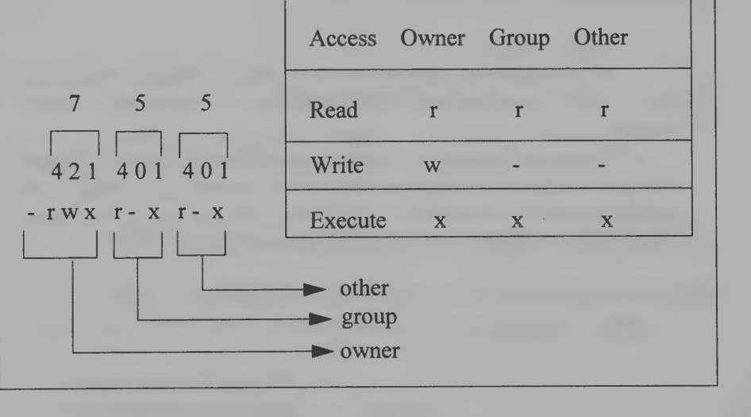

### 图 6-5 文件权限示例

此文件的所有者对该文件具有读取、写入和执行权限。用户所属的组具有读取和执行权限，其他人也具有读取和执行权限。可以通过每个字段的八进制总和来指定此文件的权限，即 755。

如果你创建一个新的 shell 脚本或任何新文件会发生什么？存在哪些权限设置？由于你需要执行 shell 脚本，因此你需要对该文件拥有执行权限。你可以使用 **umask** 来定义所有新文件和目录的默认值。

默认情况下，大多数系统启动时目录的权限为 777，文件的权限为 666。这意味着每个人对你创建的所有目录都具有完全访问权限，且每个人对你创建的所有文件都具有读取和写入访问权限。这些默认值会根据 **umask** 的值进行修改。

你可以用以下两种方法查看你的 **umask**：

```bash
martyp $ umask
002
martyp $ umask -S
u=rwx,g=rwx,o=rwx
martyp $
```

第一个示例显示了 **umask** 的八进制值，我们很快就会介绍，第二个示例显示了 **umask** 的符号值。

**umask** 用于*禁用*访问。你从一个 **umask** 开始，并使用字段来禁用某些级别的访问。**umask** 命令使用三个八进制字段。如 图 6-6 所示，这些字段是用户、组和其他访问代码的总和。


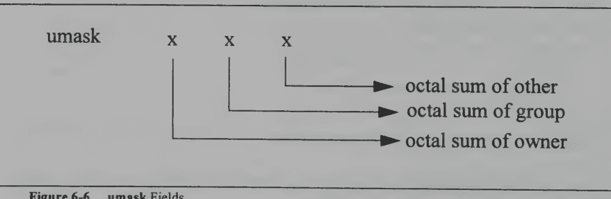


umask 字段的*补数*会与默认设置进行“与”运算以更改 umask。你可以通过指定其值来设置 umask。在我们之前的示例中，我们以两种不同的方式查看了 umask。要设置 umask，只需发出 umask 命令和所需的值即可。例如，将 umask 设置为 022 会移除“组”和“其他”对目录的写入权限，如 图 6-7 所示：

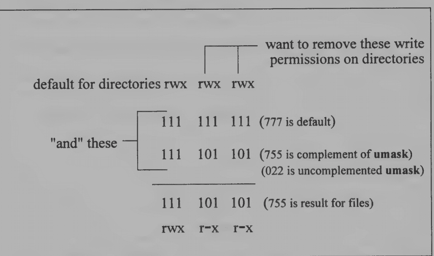

### 图 6-7 **umask** 示例

在此示例中，**umask 022** 将目录权限更改为 755。

同样，umask 为 022 会将文件的默认权限 666 更改为 644，这意味着组和他人对文件只有只读权限。


### 使用 chmod 更改文件权限

**chmod** 命令用于更改文件的权限。无论如上所述 umask 发生了什么，你都可以随时使用 **chmod** 更改文件的权限。在大多数情况下，你需要是文件的所有者或超级用户才能使用 **chmod** 更改文件的权限。让我们通过 *sort* 文件的列表开始讨论 **chmod**：


```bash
$ ls -l sort
-rwxr-x--x  1 marty      users        120 Jul 26 10:20 sort
```

图 6-8 显示了 *sort* 的权限分解。

|  | 访问 | 所有者 | 组 | 其他 |
| :--- | :---: | :---: | :---: | :---: |
| 读取 | r | r | r | - |
| 写入 | w | w | - | - |
| 执行 | x | x | x | - |

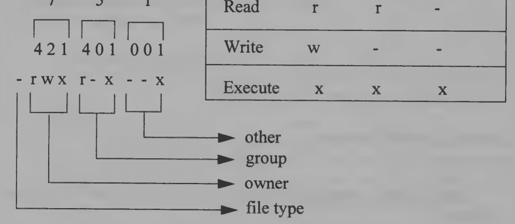

**图 6-8** 文件 *sort* 的权限

你对定义的文件类型控制非常有限。然而，如果该文件属于你，你对该文件的权限拥有很大的控制权。**chmod** 命令用于更改文件或目录的权限。如果你是文件的所有者，你可以尽情更改文件的权限。

更改权限的两种方法是：符号模式或数字模式。我首先关注数字模式，因为涉及的数字很容易管理，而且我有时发现新的 UNIX 用户会对某些符号的含义感到困惑。然后我会介绍符号，并在 **chmod** 摘要中包含符号的含义。


首先，我所说的数字是什么意思？查看 `sort` 的数字，我们看到权限为 751：*owner*（所有者，百位）为 7，*group*（组，十位）为 5，*other*（其他，个位）为 1。图 6-9 有助于理解这些位置的含义。

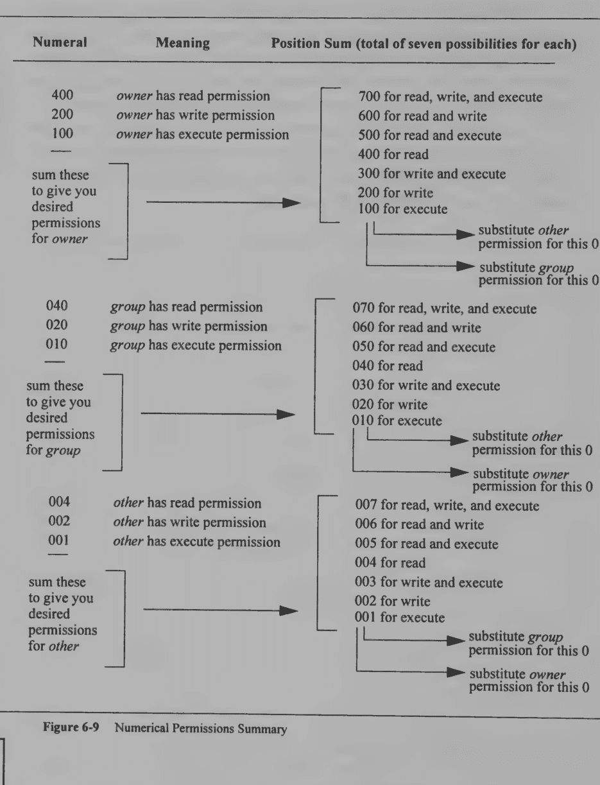

### 图 6-9 数字权限摘要

选择所有者、组和其他所需的权限后，你使用 chmod 命令将这些权限分配给文件或目录。其中一些权限可能性不常用，例如仅执行权限，因为你通常需要对文件具有读取权限才能执行它；然而，为了完整性，我在图 6-9 中包含了所有可能性。除了图 6-9 中显示的权限模式位外，还有一些杂项模式位，目前你无需关心。

如果你决定要为文件 *sort* 的 *group* 添加写入权限，并移除 *other* 的所有权限，你只需使用适当的数值执行 **chmod** 命令即可。以下命令集首先列出 *sort* 的现有权限，然后更改 *sort* 的权限，最后列出 *sort* 的新权限：


```bash
$ ls -l sort
-rwxr-x-x 1 marty users 120 Jul 26 10:20 sort

$ chmod 770 sort

$ ls -l sort
-rwxrwx-- 1 marty users 120 Jul 26 10:20 sort
```


使用符号模式更改权限的相同命令集如下：

```bash
$ ls -l sort
-rwxr-x-x 1 marty users 120 Jul 26 10:20 sort

$ chmod g+w,o-x sort

$ ls -l sort
-rwxrwx-- 1 marty users 120 Jul 26 10:20 sort
```

在符号模式下，你发出 **chmod** 命令并指定受影响的对象[用户 (u)、组 (g)、其他 (o) 或所有 (a)]、要执行的操作[添加 (+)、删除 (-) 或替换 (=)]，以及要指定的权限[读取 (r)、写入 (w) 或执行 (x)]。在之前使用符号模式的示例中，为 *group* (g) 添加写入 (w) 权限，并移除 *other* (o) 的执行 (x) 权限。

以下是 **chmod** 一些常用符号的摘要：

**chmod** - 使用以下符号模式列表更改指定文件的权限。


受影响者的符号：
- u 受影响的是用户。
- g 受影响的是组。
- o 受影响的是其他。
- a 受影响的是所有用户。

要执行的操作：
- + 添加权限。
- - 移除权限。
- = 替换权限。

指定的权限：
- r 读取权限。
- w 写入权限。
- x 执行权限。
- u 复制用户权限。
- g 复制组权限。
- o 复制其他权限。

### 第 6 章中使用的一些命令的手册页

以下是本章中使用的许多命令的 HP-UX 手册页。UNIX 变体之间的命令经常有所不同，因此你可能会在某些命令的选项或其他方面发现差异；然而，以下手册页可作为一个优秀的参考。


## kill - 向进程发送信号。

**kill(1)	kill(1)**

**NAME**
kill - 向进程发送信号；终止进程

**SYNOPSIS**
kill [-s signame] pid ...
kill [-s signum] pid ...
kill -l

过时的版本：
kill -signame pid ...
kill -signum pid ...

**DESCRIPTION**
kill 命令向每个由 pid 进程标识符指定的进程发送一个信号。默认信号是 SIGTERM，通常它会终止那些没有捕获或忽略该信号的进程。

pid 是一个进程标识符，是一个无符号或负整数，可以是以下之一：

- \> 0 进程的编号。
- = 0 所有进程，除了特殊的系统进程，其进程组 ID 等于发送者的进程组 ID。
- =-1 所有进程，除了特殊的系统进程，如果用户具有适当的特权。否则，所有进程，除了特殊的系统进程，其实际或有效用户 ID 与发送进程的用户 ID 相同。
- < -1 所有进程，除了特殊的系统进程，其进程组 ID 等于 pid 的绝对值，且其实际或有效用户 ID 与发送进程的用户相同。

可以使用 ps 命令（参见 ps(1)）和某些 shell 中可用的内置 jobs 命令来查找进程号。

**Options**
kill 识别以下选项：

- -1	(ell)	列出该实现支持的所有 signame 值。使用此选项不会发送任何信号。信号的符号名称


#### kill

（不带 SIG 前缀的）信号名称会写入标准输出，由空格和换行符分隔。

-s signame
发送指定的信号名称。默认值为 SIGTERM，即编号 15。signame 可以以大写和/或小写形式指定，可以带或不带 SIG 前缀。这些值可以通过使用 -l 选项获取。符号名称 SIGNULL 代表信号值零。参见下文“信号名称和编号”。

-s signum
发送指定的十进制信号编号。默认值为 15，即 SIGTERM。参见下文“信号名称和编号”。

-signame
（已废弃。）等价于 -s signame。

-signum
（已废弃。）等价于 -s signum。

### 信号名称和编号

下表描述了一些在终端中常见的有用信号。有关完整列表和详细描述，请参见头文件 <signal.h> 和手册条目 signal(5)。

| signum | signame | 名称 | 描述 |
|:---:|:---:|:---:|:---|
| 0 | SIGNULL | Null | 检查对 pid 的访问权限 |
| 1 | SIGHUP | Hangup | 终止；可以被捕获 |
| 2 | SIGINT | Interruot | 终止；可以被捕获 |
| 3 | SIGQUIT | Quit | 终止并转储核心；可以被捕获 |
| 9 | SIGKILL | Kill | 强制终止；不能被捕获 |
| 15 | SIGTERM | Terminate | 终止；可以被捕获 |
| 24 | SIGSTOP | Stop | 暂停进程；不能被捕获 |
| 25 | SIGTSTP | Terminal stop | 暂停进程；可以被捕获 |
| 26 | SIGCONT | Continue | 运行已停止的进程 |

SIGNULL (0)，空信号，引发错误检查但实际并不发送信号。这可以用于测试 pid 的有效性或是否存在。

SIGTERM (15)，（默认的）终止信号，可以被接收进程捕获，允许接收方执行有序关闭或完全忽略该信号。对于有序操作，这是首选选择。

SIGKILL (9)，强制终止信号，强制进程立即终止。由于 SIGKILL 不能被捕获或忽略，因此适用于终止那些不响应 SIGTERM 的进程。

接收进程必须属于发送进程的用户，除非该用户拥有相应的权限。

作为一个唯一的特殊情况，继续信号 SIGCONT 可以发送给与发送进程属于同一会话的任何成员进程。

#### 返回值

完成后，kill 返回以下值之一：

- 0: 对于每个 pid 操作数，至少找到一个匹配的进程，并且指定的信号至少成功处理了一个匹配的进程。
- >0: 发生错误。

##### 示例

命令：

```
kill 6135
```

向进程编号 6135 发送终止信号。这给了进程一个优雅退出（例如删除临时文件等）的机会。

以下等效命令：

```
kill -s SIGKILL 6135
kill -s KILL 6135
kill -s 9 6135
kill -SIGKILL 6135
kill -KILL 6135
kill -9 6135
```

通过向进程发送 SIGKILL 信号，立即终止进程编号 6135。这告诉内核立即移除该进程。

#### 警告

如果某个进程在某些操作（如 I/O）中挂起，导致其从未被调度，那么在被允许运行之前它无法死亡。因此，在 kill 之后，这样的进程可能永远不会消失。同样，失效进程（参见 ps(1)）可能已经执行完毕，但在其父进程回收它们之前（参见 wait(2)）仍保留在系统中。使用 kill 向它们发送信号没有效果。

某些非 HP-UX 实现仅将 kill 作为 shell 内置命令提供。

### 依赖项

本手册条目描述了外部命令 /usr/bin/kill 和 POSIX shell（参见 sh-posix(1)）的内置 kill 命令。其他 shell，如 C 和 Korn（分别参见 csh(1) 和 ksh(1)），也提供 kill 作为内置命令。这些内置命令的语法和输出可能不同。

### 另请参阅

csh(1), ksh(1), ps(1), sh(1), sh-bourne(1), sh-posix(1), kill(2), wait(2), signal(5).

### 标准符合性

kill: SVID2, SVID3, XPG2, XPG3, XPG4, POSIX.2


# ksh - 命令编程语言

ksh(1)             ,             ksh(1)

### 名称

ksh, rsh - shell，标准/受限命令编程语言

### 概要

ksh [+aefhikmnopqrstuvx] [+o option] ... [-c string] [arg ...]
rsh [+aefhikmnopqrstuv] [+o option] ... [-c string] [arg ...]

### 描述

ksh 是一种命令编程语言，执行从终端或文件读取的命令。rsh 是命令解释器 ksh 的受限版本，用于设置具有比标准 shell 更受控制的功能的登录名和执行环境。有关命令行选项和参数的详细信息，特别是 set 命令，请参见本条目后面的 Invoking ksh 和 Special Commands 部分。

### 定义

- metacharacter: 以下字符之一：; & ( ) | < > 换行符 空格 制表符
- blank: 制表符或空格字符。
- identifier: 以字母或下划线开头的字母、数字或下划线序列。标识符用作函数和命名参数的名称。
- word: 由一个或多个未加引号的元字符分隔的字符序列。
- command: 具有 shell 语言语法的字符序列。shell 读取每个命令并执行所需的操作，无论是直接执行还是通过调用单独的实用程序。
- special command: 由 shell 在不创建单独进程的情况下执行的命令。通常称为 `内置命令'。除记录的副作用外，大多数特殊命令都可以实现为单独的实用程序。
- #: # 字符被解释为注释的开始。参见下文的引用。

### 命令

简单命令（simple-command）是由空格分隔的单词序列，前面可以带有参数赋值列表。（参见下文的 环境）。第一个单词指定要执行的命令名称。

除非下文另有规定，其余单词作为参数传递给调用的命令。命令名称作为参数 0 传递（参见 exec(2)）。简单命令的值是其正常终止时的退出状态，或者是异常终止时的（八进制）200+状态（参见 signal(5) 了解状态值列表）。

管道（pipeline）是由 | 分隔的一个或多个命令的序列。除最后一个命令外，每个命令的标准输出通过管道（参见 pipe(2)）连接到下一个命令的标准输入。每个命令作为单独的进程运行；shell 等待最后一个命令终止。管道的退出状态是管道中最后一个命令的退出状态。

列表（list）是由 ;, &, &&, 或 || 分隔的一个或多个管道的序列，并可选地以 ;, &, 或 || 结尾。在这五个符号中，;, &, && 和 || 具有相等的优先级。&& 和 || 具有更高但相等的优先级。分号 (;) 导致前一个管道顺序执行；& 导致前一个管道异步执行（即，shell 不等待该管道完成）。符号 |& 导致前一个命令或管道异步执行，并与父 shell 建立双向管道（称为协同进程，co-process）。使用稍后描述的特殊命令 read 和 print 的 -p 选项，父 shell 可以写入和读取生成的命令的标准输入和输出。符号 && (||) 导致其后的列表仅在前一个管道返回零（非零）值时执行。列表中可以出现任意数量的换行符，代替分号来分隔命令。

命令要么是简单命令，要么是以下之一。除非另有说明，命令返回的值是该命令中执行的最后一个简单命令的值。

```
for identifier [in word ...] do list done

     每次执行 for 时，identifier 设置为 in word 列表中的下一个单词。如果省略 in word ...，
     for 会为每个位置参数设置执行一次 do 列表（参见下文的 参数替换）。
     当列表中不再有单词时，执行结束。
```

```
select identifier [in word...] do list done

     select 命令在标准错误（文件描述符 2）上打印单词集合，每个单词前都有一个编号。
     如果省略 in word ...，则使用位置参数代替（参见下文的 参数替换）。打印 PS3 提示
     并从标准输入读取一行。如果该行由所列单词之一对应的数字组成，则参数 identifier
     的值设置为与该数字对应的单词。如果该行为空，则再次打印选择列表。否则，参数
     identifier 的值设置为 null。从标准输入读取的行的内容保存在参数 REPLY 中。
     列表在每次选择后执行，直到遇到 break 或文件结尾 (eof)。
```

```
case word in [[(] pattern [ | pattern] ... )] ... esac

     case 命令执行与匹配 word 的第一个模式相关的列表。模式的格式与用于文件名生成
     的格式相同（参见下文的 文件名生成）。
```

```
if list then list [elif list then list] ... [else list]fi

     执行 if 后面的列表，如果它返回...
```


退出状态为零，则执行第一个 then 之后的列表。否则，执行 elif 之后的列表，如果其值为零，则执行下一个 then 之后的列表。如果以上均不满足，则执行 else 列表。如果没有 else 列表或 then 列表被执行，if 将返回零退出状态。

```
while list do list done
```

```
until list do list done
```

while 命令会反复执行 while 列表，如果列表中最后一个命令的退出状态为零，则执行 do 列表；否则循环终止。如果 do 列表中的命令未被执行，while 将返回零退出状态；可以使用 until 代替 while 来否定循环终止测试。

```
(list)
```

在独立环境中执行列表。如果需要嵌套，两个相邻的左括号之间必须插入空格，以避免如下文所述的算术求值。

```
{ list;}
```

执行列表，但不是独立环境。注意 { 是关键字，需要在其后加上空白才能被识别。

```
[[ expression ]]
```

对 expression 进行求值，当 expression 为真时返回零退出状态。关于 expression 的说明，请参见下文的条件表达式。注意 [[ 和 ]] 是关键字，它们与 expression 之间需要有空格。

```
function identifier {list;}
```

```
identifier () {list;}
```

定义一个由 identifier 引用的函数。函数体是 { 和 } 之间的命令列表（参见下文的函数）。

```
time pipeline
```

执行 pipeline，并将经过的时间、用户时间和系统时间打印到标准错误流。

以下关键字仅在作为命令的第一个单词且未被引用时才被识别：

```
if then else elif fi case esac for while until do done { } function select time [[ ]]
```

#### 注释

以 # 开头的单词会导致该单词及后续直到换行符的所有字符被忽略。

# 别名替换

如果已定义该单词的别名，则每个命令的第一个单词会被别名的文本替换。别名名称由任意数量的字符组成，但排除元字符、引用字符、文件扩展字符、参数和命令替换字符以及 =。替换字符串可以包含任何有效的 shell 脚本，包括上述元字符。被替换文本中每个命令的第一个单词（正在被替换的除外）都会被测试是否还有其他别名。如果别名值的最后一个字符是空格，则别名后的单词也会被检查别名替换。别名可用于重新定义特殊内建命令，但不能用于重新定义上述列出的关键字。可以使用 alias 命令创建、列出和导出别名，并可以使用 unalias 命令删除别名。导出的别名在子 shell 中保持有效，但在 shell 的单独调用中必须重新初始化（参见下文的 ksh 调用）。

别名替换是在读取脚本时进行的，而不是在执行时。因此，为了使别名生效，alias 必须在读取引用该别名的命令之前执行。

别名常用作完整路径名的简写。别名机制的一个选项允许自动将别名的值设置为相应命令的完整路径名。这些别名称为跟踪别名（tracked aliases）。跟踪别名的值在标识符首次被读取时定义，并在 PATH 变量每次重置时变为未定义。这些别名保持跟踪状态，以便下次引用时重新定义其值。shell 中编译了多个跟踪别名。set 命令的 -h 选项将每个作为标识符的命令名称转换为跟踪别名。

以下导出的别名已编译到 shell 中，但可以取消设置或重新定义：

```
autoload='tystest -fu'
false='let 0'
functions='tystest -f'
hash='alias -t -'
history='fc -1'
integer='tystest -i'
nohup='nohup '
r='fc -e -'
stop='kill -STOP'
suspend='kill -STOP $'
true=';'
type=' whence -v'
```

# 波浪号替换

在执行别名替换后，每个单词都会被检查是否以未引用的 ~ 开头。如果是，则检查该单词中 / 之前的部分是否匹配 /etc/passwd 文件中的用户名。如果找到匹配项，~ 和匹配的用户名将被替换为匹配用户的登录目录。这被称为波浪号替换。如果未找到匹配项，原始文本保持不变。单独的 ~ 或 / 之前的 ~ 会被替换为 HOME 参数的值。后跟 + 或 - 的 ~ 将分别被替换为参数 PWD 和 OLDPWD 的值。此外，当参数赋值的值以 ~ 开头时，也会尝试进行波浪号替换。

### 命令替换

以美元符号开头的括号 $(command) 或一对反引号（grave accent）(`command`) 中命令的标准输出可以作为单词的一部分或全部使用；尾部换行符会被移除。在第二种（古式）形式中，引号内的字符串在命令执行前会针对特殊引用字符进行处理（参见下文的引用）。命令替换 $(cat file) 可以被等效但更快的 $(<file) 替换。

大多数不执行 I/O 重定向的特殊命令（内建命令）的命令替换在不创建单独进程的情况下进行。然而，函数的命令替换会创建一个单独的进程来执行函数及函数中的所有命令（无论是内建还是其他）。

由美元符号开头的双括号内算术表达式 $((expression)) 会被替换为双括号内算术表达式的值（关于算术表达式的说明，请参见下文的算术求值）。

# 参数替换

参数可以是标识符、一个或多个数字，或 *, @, #, ?, -, $, 和 ! 中的任意字符。命名参数（由标识符表示的参数）具有一个值和一个或多个属性。可以使用 typeset 特殊命令为命名参数赋值和设置属性。ksh 支持的属性将在描述 typeset 特殊命令时详细说明。导出参数会将值和属性传递给环境。

shell 支持有限的一维数组机制。数组参数的元素通过下标引用。下标由 [ 后跟一个算术表达式（参见下文的算术求值），再后跟 ] 表示。要为一维数组赋值，请使用 set -A name value ...。所有下标的值必须在 0 到 1023 的范围内。数组无需声明。任何带有有效下标的命名参数引用都是合法的，必要时会创建数组。没有下标引用数组相当于引用第一个元素。

命名参数的值也可以通过以下方式赋值：

```
name=value [name=value] ...
```

如果为 name 设置了 -i integer 属性，则该值将如下文所述进行算术求值。

位置参数，即由数字表示的参数，可以通过 set 特殊命令赋值。参数 $0 在调用 shell 时由零号参数设置。

字符 $ 用于引入可替换参数。

```
${parameter}
```

如果存在该参数，则替换其值。当 parameter 后跟字母、数字或下划线且这些不应被解释为其名称的一部分，或者当命名参数带有下标时，必须使用花括号。如果 parameter 是一个或多个数字，它是位置参数。多位数的位置参数必须用花括号括起来。如果 parameter 是 * 或 @，则替换从 $1 开始的所有位置参数（由字段分隔符字符分隔）。如果使用带有下标 * 或 @ 的数组标识符，则替换每个元素的值（由字段分隔符字符分隔）。即使包含花括号或元字符，shell 也会读取从 $1 到匹配的 } 之间的所有字符作为同一个单词的一部分。

```
${#parameter}
```

如果 parameter 是 * 或 @，则替换位置参数的数量。否则，替换参数值的长度。

```
${identifier[*]}
```

替换数组 identifier 中元素的数量。

```
${parameter:-word}
```

如果 parameter 已设置且非空，则替换其值；否则替换 word。


| 语法 | 说明 |
| :--- | :--- |
| `${parameter:word}` | 如果参数未设置或为 null，则将其设置为 word；然后替换参数的值。位置参数不能以这种方式进行赋值。 |
| `${parameter:?word}` | 如果参数已设置且非 null，则替换其值；否则，打印 word 并从 shell 退出。如果省略 word，则打印标准消息。 |
| `${parameter:+word}` | 如果参数已设置且非 null，则替换 word；否则不替换任何内容。 |
| `${parameter#pattern}` | |
| `${parameter##pattern}` | 如果 shell 模式匹配参数值的开头，则此替换的值是删除了匹配部分的参数值；否则，替换该参数的值。在前者情况下，删除最小的匹配模式；在后者情况下，删除最大的匹配模式。 |
| `${parameter%pattern}` | |
| `${parameter%%pattern}` | 如果 shell 模式匹配参数值的末尾，则替换删除了匹配部分的参数值；否则，替换参数的值。在前者情况下，删除最小的匹配模式；在后者情况下，删除最大的匹配模式。 |

在上述表达式中，除非 word 被用作替换字符串，否则不会对其进行求值。因此，在以下示例中，仅当 d 未设置或为 null 时，pwd 才会被执行：

```bash
echo ${d:-$(pwd)}
```

如果从上述表达式中省略冒号 (:)，shell 仅检查参数是否已设置。

以下参数由 shell 自动设置：

| 参数 | 说明 |
| :--- | :--- |
| `#` | 位置参数的十进制数量。 |
| `-` | 在调用 shell 时或通过 set 命令提供的选项。 |
| `?` | 最后执行的命令返回的十进制值。 |
| `$$` | 当前 shell 的进程号。 |
| `_` | 最初，_ 的值为作为环境中传入的正在执行的 shell 或脚本的绝对路径名。随后，它被赋予上一条命令的最后一个参数。对于异步命令，此参数不会被设置。此参数还用于在检查邮件时保存匹配的 MAIL 文件的名称。 |
| `!` | 最后调用的后台命令的进程号。 |
| `COLUMNS` | 如果设置了此变量，其值用于定义 shell 编辑模式的编辑窗口宽度以及打印选择列表的宽度。在窗口环境中，如果 shell 检测到窗口大小发生变化，shell 会更新 COLUMNS 的值。 |
| `ERRNO` | 最近一次失败的系统调用所设置的 errno 的值。此值依赖于系统，旨在用于调试目的。 |
| `LINENO` | 正在执行的脚本或函数中当前行的行号。 |
| `LINES` | 如果设置了此变量，其值用于确定打印选择列表的列长度。选择列表垂直打印，直到大约填满 LINES 的三分之二行。在窗口环境中，如果 shell 检测到窗口大小发生变化，shell 会更新 LINES 的值。 |
| `OLDPWD` | 由 cd 命令设置的前一个工作目录。 |
| `OPTARG` | 由 getopt 或 getopts 特殊命令处理的最后一个选项参数的值。 |
| `OPTIND` | 由 getopts 特殊命令处理的最后一个选项参数的索引。 |
| `PPID` | shell 父进程的进程号。 |
| `PWD` | 由 cd 命令设置的当前工作目录。 |
| `RANDOM` | 每次评估此参数时，都会生成一个在 0 到 32767 之间均匀分布的随机整数。可以通过向 RANDOM 赋数值来初始化随机数序列。 |
| `REPLY` | 此参数由 select 语句和 read 特殊命令在未提供参数时设置。 |
| `SECONDS` | 每次引用此参数时，返回自 shell 调用以来的秒数。如果对此参数赋值，则引用时返回的值是所赋的值加上自赋值以来的秒数。 |

以下参数由 shell 使用：

| 参数 | 说明 |
| :--- | :--- |
| `CDPATH` | cd 命令的搜索路径。 |
| `EDITOR` | 如果此变量的值以 emacs、gmacs 或 vi 结尾，且未设置 VISUAL 变量，则相应的选项会被开启（见下文“特殊命令”中的 set）。 |
| `ENV` | 如果设置了此参数，则对其值执行参数替换以生成 shell 调用时要执行的脚本的路径名（见下文“调用 ksh”）。此文件通常用于别名和函数定义。 |
| `FCEDIT` | fc 命令的默认编辑器名称。 |
| `FPATH` | 函数定义的搜索路径。当引用具有 -u 属性的函数或找不到命令时，会搜索此路径。如果找到可执行文件，则会在当前环境中读取并执行它。 |
| `IFS` | 内部字段分隔符，通常是空格、制表符和换行符，用于分隔命令或参数替换产生的命令词，以及用于 read 特殊命令分隔单词。IFS 参数的第一个字符用于分隔 "$*" 替换的参数（见下文“引用”）。 |
| `HISTFILE` | 如果在调用 shell 时设置了此参数，其值是用于存储命令历史的文件的路径名。默认值为 $HOME/.sh_history。如果用户具有适当的权限且未给出 HISTFILE，则不使用历史文件（见下文“命令重输入”）。 |
| `HISTSIZE` | 如果在调用 shell 时设置了此参数，则此 shell 可访问的先前输入命令的数量将大于或等于此数值。默认值为 128。 |
| `HOME` | cd 命令的默认参数（主目录）。 |
| `MAIL` | 如果将此参数设置为邮件文件的名称，且未设置 MAILPATH 参数，shell 会通知用户指定文件中的邮件到达。 |
| `MAILCHECK` | 此变量指定 shell 检查由 MAILPATH 或 MAIL 参数指定的任何文件的修改时间变化的频率（以秒为单位）。默认值为 600 秒。时间流逝后，shell 在发出下一个提示符之前进行检查。 |
| `MAILPATH` | 由冒号 ( :) 分隔的文件名列表。如果设置了此参数，shell 会通知用户在最近 MAILCHECK 秒内对指定文件所做的任何修改。每个文件名后都可以跟一个 ? 和一条要打印的消息，在这种情况下，消息将经历参数和命令替换，其中参数 $ _ 定义为已更改文件的名称。默认消息为 you have mail in $ _。 |
| `PATH` | 命令的搜索路径（见下文“执行”）。如果正在执行 rshx，用户不能更改 PATH（.profile 文件除外）。 |
| `PS1` | 此参数的值会经过参数替换扩展，以定义主要提示符字符串，默认是 $ 后跟一个空格字符。主要提示符字符串中的字符 ! 会被命令编号替换（见下文“命令重输入”）。要在提示符中包含 !，请使用 !!。 |
| `PS2` | 次要提示符字符串，默认是 > 后跟一个空格字符。 |
| `PS3` | select 循环中使用的选择提示符字符串，默认是 #? 后跟一个空格字符。 |
| `PS4` | 此变量的值会经过参数替换扩展，并前置在每个执行跟踪行之前。如果 PS4 未设置，执行跟踪提示符为 + 后跟一个空格字符。 |
| `SHELL` | shell 的路径名保存在环境中。当调用 shell 时，如果此变量的值包含 basename 中的 r，则 shell 受到限制。 |
| `TMOUT` | 如果设置为大于零的值，如果在发出 PS1 提示符后规定的秒数内未输入命令，shell 将终止。 |
| `VISUAL` | 当此变量的值以 emacs、gmacs 或 vi 结尾时，调用相应的选项（见下文“特殊命令”中的 set）。 |

shell 为 PATH、PS1、PS2、MAILCHECK、TMOUT 提供默认值，


以及 IFS、HOME、SHELL、ENV 和 MAIL 这些变量从未由 shell 自动设置（尽管 HOME、SHELL 和 MAIL 由 login(1) 设置）。

## 空白解释

在参数和命令替换之后，替换结果会被扫描以查找字段分隔符（存在于 IFS 中），并在发现这些字符的地方拆分为不同的参数。ksh 保留显式的空参数（`""` 或 `''`），但会移除隐式的空参数（即由没有值的参数产生的空参数）。

## 文件名生成

在替换之后，除非设置了 -f 选项，否则每个命令词都会作为文件名扩展的模式进行处理。模式的格式由 regexp(5) 定义的“模式匹配符号”规定。该词会被替换为匹配该模式的已排序文件名。如果未找到匹配该模式的文件名，则该词保持不变。

除了 regexp(5) 中描述的符号外，ksh 还识别由一个或多个用 `|` 分隔的模式列表组成的复合模式。复合模式可以由以下一个或多个元素构成：

- `*(pattern-list)` - 可选地匹配给定模式中的任意一个。
- `*(pattern-list)` - 匹配给定模式的零次或多次出现。（注：原文此处可能有误，通常 `**` 表示零次或多次，但根据标准 KSH 文档，`*(list)` 通常对应可选匹配，而 `**` 或特定语法表示零次或多次。此处严格遵循原文字面翻译，原文第一项和第二项均写作 `*(pattern-list)`，但描述不同，第一项为"Optionally matches"，第二项为"Matches zero or more"。由于原文本身存在重复的代码片段但描述不同，翻译时保留原文的表述差异。）
- `+(pattern-list)` - 匹配给定模式的一次或多次出现。
- `@(pattern-list)` - 恰好匹配给定模式中的一个。
- `!(pattern-list)` - 匹配任何内容，除了给定的模式之一。

## 引用（引号）

上述列出的每个元字符（参见上方的定义）对 shell 都有特殊含义，除非被引用，否则会导致单词结束。通过在字符前加 `\` 可以引用（即使其代表其本身）一个字符。`\` 后紧跟换行符的组合会被忽略。所有包含在一对单引号（`'`）之间的字符都被引用。单引号内部不能出现单引号。在双引号（`"`）内部，会发生参数和命令替换，且 `\` 用于引用字符 `\`、`'`、`"` 和 `$`。在未引用时，或用作参数赋值值或文件名时，`$` 和 `$\` 含义相同。但是，当用作命令参数时，`"*$\`" 等价于 `"$1$2...`（其中 d 是 IFS 参数的第一个字符），而 `"$$"` 等价于 `"$1" "$2" ...`。在后置单引号（accent grave）标记（`` ` ``）内部，`\` 用于引用字符 `\`、`'` 和 `$`。如果后置单引号出现在双引号内部，`\` 还会引用字符 `"`。

通过引用关键字或别名的任何字符，可以移除其特殊含义。对下文列出的函数名或特殊命令名的识别不能通过引用来改变。

## 算术求值

通过特殊命令 `let` 提供执行整数算术的功能。求值使用长整数算术执行。常量的形式为 `[base#]n`，其中 base 是表示算术基数的十进制数（介于 2 到 36 之间），n 是该基数下的数字。如果省略 base，则使用基数 10。

算术表达式使用 C 语言表达式的相同语法、优先级和结合性。除了 `++`、`--`、`?:` 和 `,` 之外，所有整数运算符均受支持。可以在算术表达式中通过名称引用变量，而无需使用参数替换语法。当引用变量时，其值将作为算术表达式进行求值。

可以通过 `typeset` 特殊命令的 `-i` 选项指定变量的内部整数表示形式。对具有 `-i` 属性的变量的每次赋值都会执行算术求值。如果不指定算术基数，则对变量的首次赋值将确定算术基数。在发生参数替换时，将使用此基数。

由于许多算术运算符需要引用，因此提供了 `let` 命令的替代形式。对于以 `((` 开头的任何命令，直到匹配的 `))` 之间的所有字符都作为被引用的表达式处理。更准确地说，`((...))` 等价于 `let "..."`。

## 提示符

在交互模式下，shell 在读取命令之前会使用 PS1 的值作为提示符。如果在任何时刻输入了换行符且需要进一步输入以完成命令，则发出二级提示符（PS2 的值）。

## 条件表达式

条件表达式与 `[[` 复合命令一起使用，用于测试文件属性以及比较字符串。在 `[[` 和 `]]` 之间的单词不会进行单词拆分和文件名生成。每个表达式可以由以下一个或多个一元或二元表达式构建而成：

- `-a file`       如果文件存在，则为真。
- `-b file`       如果文件存在且为块特殊文件，则为真。
- `-c file`       如果文件存在且为字符特殊文件，则为真。
- `-d file`       如果文件存在且为目录，则为真。
- `-f file`       如果文件存在且为普通文件，则为真。
- `-g file`       如果文件存在且设置了 setgid 位，则为真。
- `-h file`       如果文件存在且为符号链接，则为真。
- `-k file`       如果文件存在且设置了粘滞位（sticky bit），则为真。
- `-n string`     如果字符串长度非零，则为真。
- `-o option`     如果名为 option 的选项已开启，则为真。
- `-p file`       如果文件存在且为 fifo 特殊文件或管道，则为真。
- `-r file`       如果文件存在且当前进程可读，则为真。
- `-s file`       如果文件存在且大小大于零，则为真。
- `-t fildes`     如果文件描述符编号 fildes 已打开且与终端设备相关联，则为真。
- `-u file`       如果文件存在且设置了 setuid 位，则为真。
- `-w file`       如果文件存在且当前进程可写，则为真。
- `-x file`       如果文件存在且当前进程可执行，则为真。如果文件存在且为目录，则当前进程具有搜索该目录的权限。
- `-z string`     如果字符串长度为零，则为真。
- `-H file`       如果文件存在且为隐藏目录（参见 cdf(4)），则为真。

- `-L file`       如果文件存在且为符号链接，则为真。
- `-O file`       如果文件存在且属于此进程的有效用户 ID，则为真。
- `-G file`       如果文件存在且其组与此进程的有效组 ID 匹配，则为真。
- `-S file`       如果文件存在且为套接字（socket），则为真。
- `file1 -nt file2`  如果 file1 存在且比 file2 更新，则为真。
- `file1 -ot file2`  如果 file1 存在且比 file2 更旧，则为真。
- `file1 -ef file2`  如果 file1 和 file2 都存在且指向同一个文件，则为真。

- `string = pattern`   如果字符串匹配模式，则为真。
- `string != pattern`  如果字符串不匹配模式，则为真。
- `string1 < string2`  如果基于字符的 ASCII 值，string1 在 string2 之前，则为真。
- `string1 > string2`  如果基于字符的 ASCII 值，string1 在 string2 之后，则为真。
- `exp1 -eq exp2`      如果 exp1 等于 exp2，则为真。
- `exp1 -ne exp2`      如果 exp1 不等于 exp2，则为真。
- `exp1 -lt exp2`      如果 exp1 小于 exp2，则为真。
- `exp1 -gt exp2`      如果 exp1 大于 exp2，则为真。
- `exp1 -le exp2`      如果 exp1 小于或等于 exp2，则为真。
- `exp1 -ge exp2`      如果 exp1 大于或等于 exp2，则为真。

可以使用以下任一选项（按优先级从高到低排列）由这些原语构建复合表达式。

- `(expression)`       如果 expression 为真，则表达式为真。用于分组表达式。
- `! expression`       如果 expression 为假，则表达式为真。
- `expression1 && expression2`  如果 expression1 和 expression2 都为真，则表达式为真。
- `expression1 || expression2`  如果 expression1 或 expression2 任意一个为真，则表达式为真。

## 输入/输出

在执行命令之前，可以使用 shell 解释的特殊符号将其输入和输出重定向。以下内容可以出现在简单命令的任何位置，或者位于命令之前或之后，并且不会传递给被调用的命令。在单词或数字被使用之前，会发生命令和参数替换，除非另有说明。仅当模式匹配单个文件且不进行空白解释时，才会发生文件名生成。

- `<word`   使用文件 word 作为标准输入（文件描述符 0）。
- `>word`   使用文件 word 作为标准输出（文件描述符 1）。如果文件不存在，则创建它。如果文件存在且 noclobber 选项已开启，则发生错误；否则，文件被截断为零长度。
- `>|word`  与 `>` 相同，除了它会覆盖 noclobber 选项。
- `>>word`  使用文件 word 作为标准输出。如果文件存在，输出将追加到其中（通过首先搜索文件末尾）；否则，创建文件。


### 重定向

| 操作符 | 描述 |
|---|---|
| <word | 打开文件 word 以进行读取。 |
| >>word | 打开文件 word 以进行追加。 |
| <([-]word | 读取 shell 输入，直到某一行匹配 word 或到达文件末尾。不会执行参数替换、命令替换或文件名生成。生成的文档称为 here-document（此处文档），并作为标准输入。如果 word 中的任何字符被引用，则不对文档中的字符进行解释。否则，将发生参数和命令替换，换行符会被忽略，并且必须使用 \ 来引用字符 \、$、` 以及 word 的第一个字符。如果在 <& 后附加 -，则从 word 和文档中删除所有前导制表符。 |
| <&digit | 标准输入从文件描述符 digit 进行复制（参见 dup(2)）。 |
| >&digit | 标准输出复制到文件描述符 digit（参见 dup(2)）。 |
| <&- | 标准输入被关闭。 |
| >&- | 标准输出被关闭。 |
| <&p | 协程的输入移动到标准输入。 |
| >&p | 协程的输出移动到标准输出。 |

如果上述任何一项前面有一个数字，则引用的文件描述符编号是指定数字所指定的（而不是默认的 0 或 1）。例如：

```
2>&1
```

这意味着文件描述符 2 将作为文件描述符 1 的副本打开以用于写入。

重定向的顺序很重要，因为 shell 在求值时是根据指定文件描述符当前关联的已打开文件来评估引用文件描述符的重定向的。例如：

```
1>fname 2>&1
```

首先将文件描述符 1（标准输出）分配给文件 fname，然后将文件描述符 2（标准错误）分配给分配给文件描述符 1 的文件；即 fname。另一方面，如果重定向顺序颠倒如下：

```
2>&1 1>fname
```

则文件描述符 2 被分配给当前标准输出（除非继承不同的分配，否则为用户终端）。然后，文件描述符 1 重新分配给文件 fname，而不改变文件描述符 2 的分配。

协程的输入和输出可以移动到编号文件描述符，允许其他命令使用上述重定向操作符向它们写入并从它们读取。如果当前协程的输入被移动到编号文件描述符，则可以启动另一个协程。

如果命令后跟随 & 且作业控制处于非活动状态，则该命令的默认标准输入是空文件 /dev/null。否则，命令执行的环境包含调用 shell 的文件描述符，这些描述符已通过输入/输出规范进行了修改。

## 环境

环境（参见 environ(5)）是一个名称-值对列表，传递给被执行的程序，类似于普通的参数列表。名称必须是标识符，值是字符串。shell 以多种方式与环境交互。当被调用时，shell 扫描环境，为每个找到的名称创建一个参数，赋予其相应的值，并将其标记为 export（导出）。被执行的命令继承环境。如果用户通过使用 export 或 typeset -x 命令修改这些参数的值或创建新的参数，这些值将成为环境的一部分。因此，任何被执行的命令看到的环境由最初由 shell 继承的、其值可由当前 shell 修改的名称-值对，以及必须通过 export 或 typeset -x 命令注明的附加项组成。

任何 simple-command（简单命令）或函数都可以通过在其前面添加一个或多个参数赋值来扩展其环境。参数赋值参数采用 identifier=value（标识符=值）的形式。例如，

```
TERM=450 cmd args
```

和

```
(export TERM; TERM=450; cmd args)
```

是等价的（就上述 cmd 的执行而言，除了下面用匕首符号标记的特殊命令）。

如果设置了 -k 选项，所有参数赋值参数都将放入环境中，即使它们出现在命令名称之后。以下 echo 语句打印 a=b c。设置 -k 选项后，第二个 echo 语句仅打印 c：

```
echo a=b c
set -k
echo a=b c
```

此功能旨在用于与早期版本的 shell 编写的脚本配合使用，强烈不建议在新脚本中使用。它可能会在某一天消失。

## 函数

函数关键字（在上述“命令”部分中描述）用于定义 shell 函数。Shell 函数在内部被读取和存储。别名在函数被读取时解析。函数像命令一样执行，参数作为位置参数传递（参见下文“执行”）。

函数在与调用者相同的进程中执行，但函数的命令替换会创建一个新进程。函数与调用者共享所有文件以及当前工作目录。调用者捕获的陷阱在函数内部重置为其默认操作。如果函数没有捕获或明确忽略某个陷阱条件，则函数终止，并将该条件传递给调用者。在函数内部设置的 EXIT 陷阱在函数完成后的调用者环境中执行。通常，变量在调用程序和函数之间共享。

然而，在函数内使用的 typeset 特殊命令定义局部变量，其作用域包括当前函数及其调用的所有函数。

特殊命令 return 用于从函数调用中返回。函数内部的错误将控制权返回给调用者。

函数标识符可以通过 typeset 特殊命令的 +f 选项列出。函数标识符和函数的关联文本可以通过 -f 选项列出。函数可以通过 unset 特殊命令的 -f 选项取消定义。

通常，当 shell 执行 shell 脚本时，函数会被取消定义。typeset 命令的 -x 选项允许将函数导出到在不重新调用 shell 的情况下执行的脚本中。必须在 shell 的单独调用之间定义的函数应放置在 ENV 文件中。

## 作业

如果 set 命令的 monitor（监控）选项被打开，交互式 shell 会将一个作业关联到每个流水线。它维护当前作业的表格，由 jobs 命令打印，并为其分配小的整数编号。当一个作业通过 & 异步启动时，shell 会打印一行类似于以下内容的内容：

```
[1] 1234
```

表示作业编号 1 已异步启动，并且有一个（顶级）进程，其进程 ID 为 1234。

如果你正在运行一个作业并想执行其他操作，请键入暂停字符（通常是 ^Z (Ctrl-Z)）向当前作业发送 STOP（停止）信号。然后 shell 指示该作业已‘Stopped’（停止），并打印另一个提示符。可以使用 bg 命令将该作业放入后台（状态可操作），在它停止或在后台运行时运行其他命令，并最终使用 fg 命令将该作业重启或返回到前台。^Z 立即生效，类似于中断，因为输入 ^Z 时，待处理的输出和未读取的输入会被丢弃。

如果在后台运行的作业尝试从终端读取，它会停止。后台作业通常被允许产生输出，但可以通过给出 stty tostop 命令来禁用。如果用户设置了此 tty 选项，后台作业在尝试产生输出时会停止。

在 shell 中有几种方式引用作业。作业可以通过该作业中任何进程的进程 ID 或以下之一进行引用：

- $number 具有给定编号的作业。
- $string 任何命令行以 string 开头的作业。
- $string 任何命令行包含 string 的作业。
- $$ 当前作业。
- $+ 等效于 $$。
- $- 前一个作业。

当进程改变状态时，shell 立即得知。当作业被阻止且无法进一步进展时，它会通知用户，但仅就在其打印提示符之前。

当监控模式开启时，每个完成的后台作业都会触发为 CHLD 设置的任何陷阱。


如果试图在任务运行或停止时退出 shell，系统会发出警告：`You have stopped (running) jobs`。使用 `jobs` 命令可以识别这些任务。再次尝试立即退出将终止停止的任务；shell 在第二次退出时不会发出警告。

#### 信号

如果调用的命令后跟有 & 且监视器选项处于关闭状态，则忽略该命令的 INT 和 QUIT 信号。否则，信号的值为 shell 从其父进程继承的值，除了信号 11（另见下文中的 trap 命令）。

## 执行

每次执行命令时都会进行替换。如果命令名称与下列特殊命令之一匹配，则它在当前 shell 进程中执行。接下来，ksh 检查命令名称以确定其是否匹配某个用户定义的函数。如果匹配，ksh 会保存位置参数，然后将其设置为函数调用的参数。位置参数 0 被设置为函数名称。当函数完成或发出 return 时，ksh 恢复位置参数列表并执行函数内设置的 EXIT 陷阱。函数的值是最后执行的命令的值。函数在当前 shell 进程中执行。如果命令名称既不是特殊命令也不是用户定义的函数，ksh 创建一个进程并尝试使用 exec 执行该命令（参见 exec(2)）。

shell 参数 PATH 定义了包含该命令的目录的搜索路径。备选目录名称由冒号 ( : ) 分隔。默认路径是 /usr/bin:（按顺序指定 /usr/bin 和当前目录）。注意，当前目录由空路径名指定，该空路径名可以出现在等号后、冒号分隔符之间或路径列表末尾。如果命令名称包含 /，则不使用搜索路径。否则，在路径中的每个目录中搜索可执行文件。如果文件具有执行权限但不是目录或可执行对象代码文件，则假定它是脚本文件，即解释器的数据文件。如果脚本文件的前两个字符是 #!，exec（参见 exec(2)）期望后面跟随解释器路径名。然后 exec 尝试将指定的解释器作为单独进程执行，以读取整个脚本文件。如果要 exec 的脚本失败，则会生成 /usr/bin/ksh 来解释脚本文件。在这种情况下，所有未导出的别名、函数和命名参数都会被移除。如果 shell 命令文件没有读权限，或者如果文件设置了 setuid 和/或 setgid 位，shell 会执行一个代理来设置权限并执行 shell，并将 shell 命令文件作为打开的文件传递下去。带括号的命令也在子 shell 中执行，而不移除未导出的量。

## 命令重入

从终端设备输入的最后 HISTSIZE（默认 128 条）命令的文本保存在历史记录文件中。如果未设置或无法写入 HISTFILE 变量，则使用 $HOME/.sh_history 文件。一个 shell 可以访问使用相同命名 HISTFILE 的所有交互式 shell 的命令。特殊命令 fc 用于列出或编辑此文件的一部分。要编辑或列出的文件部分可以通过编号或给出命令的第一个或几个字符来选择。可以指定单个命令或命令范围。如果没有指定编辑器程序作为 fc 的参数，则使用 FCEEDIT 参数的值。如果未定义 FCEEDIT，则使用 /usr/bin/ed。编辑后的命令在退出编辑器后打印并重新执行。使用编辑器名称 - 可以跳过编辑阶段并重新执行命令。在这种情况下，可以使用 old-new 形式的替换参数在执行前修改命令。例如，如果 r 被别名为 fc -e -，键入 r bad=good c 将重新执行以字母 c 开头的最近一条命令，并将字符串 bad 的第一次出现替换为字符串 good。


## umask

**umask** - 显示或设置创建掩码。

umask(1)
umask(1)

名称
umask - 设置或显示文件模式创建掩码

概要

设置掩码：
umask mask

显示掩码：
umask [-S]

描述
umask 命令设置或显示文件模式创建掩码的当前值。该掩码影响后续创建文件的文件模式（权限）位的初始值。

设置文件模式创建掩码
umask mask 命令为当前 shell 执行环境设置新的文件模式创建掩码。mask 可以是符号或数字（已过时）值。

符号掩码提供了一种灵活的方式来单独或成组修改掩码权限位。数字掩码一次性指定所有权限位。

当指定了掩码时，不会向标准输出写入任何内容。

符号掩码值

符号掩码替换或修改当前的文件模式创建掩码。它指定为逗号分隔的操作列表，格式如下。不允许有空格。

`[who][operator][permissions][,...]`

各字段可具有以下值：
who 以下一个或多个字母：
- u 修改用户（所有者）权限。
- g 修改组权限。
- o 修改其他权限。
- a 修改所有权限（a = ugo）。

operator 以下一个符号：
- + 为 who 的现有掩码添加权限。
- - 从 who 的现有掩码中删除权限。
- = 用 permissions 替换 who 的现有掩码。

permissions 以下一个或多个字母：
- r 读权限。
- w 写权限。
- x 执行/搜索权限。

如果省略一个或两个字段，则适用以下表格：

| 输入的格式 | 效果 | 输入 | 等于 |
|---|---|---|---|
| who | 删除 who 的当前权限 | g | g= |
| operator | 无操作 | - | (无) |
| permissions | 等于：a+permissions | rw | a+rw |
| who= | 删除 who 的当前权限 | u= | u= |
| who+ | 无操作 | u+ | (无) |
| who- | 无操作 | u- | (无) |
| whopermissions | 等于：who=permissions | ux | u=x |
| operatorpermissions | 等于：operatorpermissions | -rw | a-rw |

数字掩码值（已过时）

数字掩码替换当前的文件模式创建掩码。它指定为无符号八进制整数，由以下模式位的逻辑或（和）构成（可以省略前导零）：
- 0400 (a=rwx,u-r) 所有者读
- 0200 (a=rwx,u-w) 所有者写
- 0100 (a=rwx,u-x) 所有者执行（在目录中搜索）
- 0040 (a=rwx,g-r) 组读
- 0020 (a=rwx,g-w) 组写
- 0010 (a=rwx,g-x) 组执行/搜索
- 0004 (a=rwx,o-r) 其他读
- 0002 (a=rwx,o-w) 其他写
- 0001 (a=rwx,o-x) 其他执行/搜索

显示当前掩码值

要显示当前文件模式创建掩码值，请使用以下命令之一：
- umask -S
  以符号格式打印当前文件模式创建掩码：
  ```
  u=[r][w][x],g=[r][w][x],o=[r][w][x]
  ```
  字符 r（读）、w（写）和 x（执行/搜索）表示 u（用户/所有者）、g（组）和 o（其他）掩码中清除的位。其他所有位都设置。
- umask
  以八进制值打印当前文件模式创建掩码。

数字值中的零位对应符号值中显示的 r、w 和 x 权限字符。数字值中的一位对应符号值中缺失的权限字符。

取决于实现，显示由一到四个八进制数字组成；第一位始终为零（参见依赖项）。最右边的三个数字（根据需要隐含前导零）代表掩码中设置或清除的位。

两种形式产生的输出都可以用作后续 umask 命令中设置掩码的 mask 参数。

## 一般操作

当创建新文件时（参见 creat(2)），文件模式创建掩码中设置的每个位都会导致文件模式中相应的权限位被清除（禁用）。相反，掩码中清除的位允许在新创建的文件中启用相应的文件模式位。

例如，掩码 u=rwx,g=rx,o=rx (022) 禁用了组和其他写权限。结果是，通常创建的文件模式由 ls -l 命令显示为 -rw-rw-rw- (777) 变为模式 -rwxr-xr-x (755)；而创建的文件模式为 -rw-rw-rw- (666) 变为模式 -rw-r--r-- (644)。

请注意，文件创建模式掩码不影响 set-user-id、set-group-id 或“粘滞”位。

文件创建模式掩码也用于 chmod 命令（参见 chmod(1)）。

由于 umask 影响当前 shell 执行环境，它通常作为 shell 常规内置命令提供（参见依赖项）。

如果在子 shell 或单独的实用程序执行环境中调用 umask，例如以下之一：
- (umask 002)
- nohup umask ...
- find . -exec umask ...

它不会影响调用环境的文件模式创建掩码。

默认掩码是 u=rwx,g=rwx,o=rwx (000)。

#### 返回值

umask 以以下值之一退出：
- 0 文件模式创建掩码成功更改，或者未提供掩码操作数。
- >0 发生错误。

##### 示例

在这些示例中，每行展示了实现相同任务的另一种方法。

设置 umask 值以产生文件所有者的读写权限和所有其他人的读权限（ls -l 在新创建的文件上显示 -rw-r--r--）：
umask u=rwx,g=rx,o=rx 符号模式


```
umask a=rx,u+w symbolic mode umask 022 numeric mode
```

将 umask 值设置为生成文件所有者的读和写权限，同组其他用户只读，其他用户无访问权限（-rw-r----）：

```
umask a-rwx,u+rw,g+r symbolic mode umask 137 numeric mode
```

将 umask 值设置为拒绝所有人的读、写和执行权限（----------）：

```
umask a= symbolic mode umask 777 numeric mode
```

为当前掩码中的所有人添加写权限（没有等效的数字模式）：

```
umask a+w symbolic mode
```

#### 警告

如果您设置了一个阻止用户（所有者）读取或写入的掩码，许多创建临时文件的程序（如编辑器）将会失败，因为它们无法访问文件数据。

## 依赖项

umask 命令既作为独立可执行文件（/usr/bin/umask）实现，也作为内置 shell 命令实现。

## POSIX Shell 和独立文件

支持所有功能（参见 sh-posix(1)）。数字掩码显示最少使用两位数字。

## Korn Shell

Korn shell 的内置命令不支持 -S 选项（参见 ksh(1)）。数字掩码显示最少使用两位数字。

## C Shell

C shell 的内置命令不支持 -S 选项和符号掩码值（参见 csh(1)）。数字掩码显示最少使用一位数字。

## Bourne Shell

Bourne shell 的内置命令不支持 -S 选项和符号掩码值（参见 sh-bourne(1)）。数字掩码显示始终由四位数字组成。

## 另请参阅

chmod(1), csh(1), ksh(1), sh-posix(1), sh(1), chmod(2), creat(2), umask(2),

## 标准符合性

umask: SVID3, SVID3, XPG2, XPG3, XPG4, POSIX.2

# 第 7 章

### C Shell 简介

### 不同的 Shell

大多数 UNIX 变体允许您在多个 shell 中进行选择。作为用户，shell 对您的重要性在于它是您进入系统的窗口。UNIX 变体上可用的众多 shell 在功能上相似，您使用它们来发出命令、控制用户环境的许多方面、编写命令文件和 shell 程序等。由于您可能会在 shell 中花费大量时间，因此您应该对几种不同的 shell 形成理解，并看看是否对其中某一种产生了偏好。特定的 shell（例如 Bash）在不同的 UNIX 变体之间差异不大。然而，shell 本身具有一些独特的功能。通常，我发现用户对某一种 shell 并没有强烈的偏好。所有 shell 在功能上都很相似，一旦您熟悉它们，使用它们都很有趣。大多数 UNIX 变体允许系统管理员在配置用户时从几种不同的 shell 中进行选择，因此在用户使用的 shell 方面通常有一定的灵活性。通常，系统管理员更希望用户使用相同的 shell，这总体上使系统管理更加容易。然而，大多数系统管理员很乐意授予用户使用特定 shell 的请求，前提是该 shell 在您的系统中可用，并且您有充分的使用理由。本章将介绍 C shell。Bash 和 KornShell 已在之前两章中介绍过。

### C Shell 简介

C shell 与其他 shell 类似，它提供了 UNIX 的用户界面。您可以使用以下三种方式使用 C shell：

- 在命令行上交互式地输入命令。
- 将经常执行的命令组组合成命令文件，您可以通过输入文件名来执行它们。
- 使用 C shell 的结构化编程技术创建 C shell 程序。

这三种技术按您可能使用的顺序列出。首先，您登录并使用交互式命令。然后，您将常用命令组合在一起并用一条命令执行。最后，您可能希望创建复杂的 shell 脚本。

在本章中，我将介绍登录、交互式命令以及使用 C shell 的许多有用方法。

本章中的大多数示例来自 Solaris 和 HP-UX 系统。您可能会发现您的用户设置以及其他系统上 C shell 的操作与本章所涵盖的内容相似。任何 shell 的大部分设置都是由系统管理员执行的，因此您肯定会发现您的 C shell 设置与本章所示内容存在差异。然而，通常 C shell 的操作在系统之间是相似的。

### 发出命令

登录到系统后执行的第一项活动是在提示符处发出命令。您可能想立即发出的命令之一是 `ls -al`。以下是我在系统上执行此命令后看到的内容：

```
sys1 7: ls -al
total 10
drwxr-x---   2 martyp2    users      96 May  5 09:34 .
drwxr-xr-x  10 root       root      1024 May  5 10:38 ..
-rw-r--r--   1 martyp2    users      814 May  5 09:34 .cshrc
-rw-r--r--   1 martyp2    users      347 May  5 09:34 .exrc
-rw-r--r--   1 martyp2    users      341 May  5 09:34 .login
-rw-r--r--   1 martyp2    users      446 May  5 09:34 .profile
sys1 8:
```

C shell 提示符由系统名称（sys1）后跟命令编号和冒号组成。我稍后将介绍提示符。

`ls -al` 在此用户区域显示了两个与 C shell 相关的文件：

**.cshrc** 和 **.login**

图 7-1 是 .cshrc 的内容。


```
# Default user .cshrc file (/usr/bin/csh initialization).

# Usage: Copy this file to a user's home directory and edit it to
# customize it to taste. It is run by csh each time it starts up.

# Set up default command search path:
#
# (For security, this default is a minimal set.)
	set path=($path)

# Set up C shell environment:

if ($?prompt) then	# shell is interactive.
	set history=20		# previous commands to remember.
	set savehist=20		# number to save across sessions.
	set system=`hostname`	# name of this system.
	set prompt = "$system \!: "	# command prompt.

# Sample alias:

alias	status	`(date; bdf)`

# More sample aliases:

alias	d	dirs
alias	pd	pushd
alias	pd2	pushd +2
alias	po	popd
alias	m	more
endif
```

**图 7-1** **.cshrc** 示例

图 7-2 显示了 **.login** 的内容。

```
# @(#) $Revision: 72.3 $

# Default user .login file ( /usr/bin/csh initialization )

# Set up the default search paths:
set path=($path)

#set up the terminal
eval `tset -s -Q -m ':?hp'`
stty erase "^H" kill "^U" intr "^C" eof "^D" susp "^Z" hupcl ixon ixoff tostop
tabs

# Set up shell environment:
set nocllobber
set history=20
```

**图 7-2 .login 示例**

### .cshrc 文件

登录后发生的事件序列因 UNIX 系统而异。在许多系统中，C shell 首先读取并执行 **.cshrc**。您可以修改 **.cshrc** 文件以指定您希望使用的命令行提示符，初始化历史记录列表，并定义别名。

接下来的部分描述了图 7-1 中所示的 **.cshrc** 文件定义这些内容的方式。让我们先快速看一下下一节中的 **.login** 文件。

### .login 文件

在许多 UNIX 系统中，.login 文件在 .cshrc 文件之后读取。示例中只有两个与设置相关的问题。第一个是 tset 命令，它设置 TERM 环境变量。tset 前面的 eval 意味着 C shell 执行 tset 及其参数而不创建子进程。这允许 tset 在当前 shell 中设置环境变量，而不是在子 shell 中设置，后者是没有用的。stty 命令用于设置终端 I/O 选项。两个 set 命令用于定义 shell 变量，我稍后将描述这些变量。noclobber 不允许重定向覆盖现有文件。如果您尝试覆盖现有文件，如下面的 /tmp/processes，您将收到文件已存在的消息：


```
sys1 1: ps -ef > /tmp/processes
/tmp/processes: File exists
```

">" 表示获取 ps 的输出，而不是将其写入您的屏幕，而是将其写入 /tmp/processes。然而，由于 /tmp/processes 已经存在并且设置了名为 noclobber 的环境变量，因此 /tmp/processes 文件不会被 ps -ef 的输出覆盖。如果设置了 noclobber，则重定向输出到此文件将不会发生。这是一种防止现有文件被意外覆盖的有用技术。您会发现许多形式的重定向非常有用。重定向在本章后面介绍。


### 在 .cshrc 中初始化历史列表

C shell 可以保留您已发出的命令历史记录。如果您希望重新发出某条命令或查看之前发出的命令，可以使用历史列表。

发出的命令通过编号来引用，因此您希望系统名称后出现一个编号。**​.cshrc** 中的以下行提供了系统名称后的一个编号：

```
set prompt = "$system \!: "
sys1 1:
```

我们稍后将讨论 shell 和环境变量，但现阶段只需知道 **$system** 对应系统名称 "sys1" 即可。

您可以指定在发出 **history** 命令时希望保存和查看的先前已发出命令的数量。**.cshrc** 中的以下行将历史列表设置为 20：

```
set history = 20
```

当发出 **history** 命令时，会显示最近发出的 20 条命令。

*savehist* 变量允许您在注销后保存指定数量的历史命令。默认情况下，当您注销时，历史列表会被清除。此变量的值为 20，这意味着在下一次登录时，将保存前一个会话的 20 条命令。

### 命令行历史

您可以通过多种方式查看历史列表。首先，让我们通过简单地发出 **history** 命令来查看最后 20 条命令：

```
sys1 23: history
        4 whoami
        5 pwd
        6 find / -name login -print &
        7 hostname
        8 who
        9 more /etc/passwd
       10 history
       11 history 5
       12 echo $PATH
       13 more .login
       14 cat .login
       15 exit
       16 exit
       17 history -h
       18 pwd
       19 whoami
       20 cd /tmp
       21 cat database.log
       22 cd
       23 history
sys1 24:
```

我们也可以在打印历史列表时省略行号，如下面的示例所示：

```
sys1 24: history -h
pwd
find / -name login -print &
hostname
who
more /etc/passwd
history
history 5
echo $PATH
more .login
cat .login
exit
exit
history -h
pwd
whoami
cd /tmp
cat database.log
cd
history
history -h
sys1 25:
```

接下来，让我们按反序打印历史列表：

```
sys1 25: history -r
25 history -r
24 history -h
23 history
22 cd
21 cat database.log
20 cd /tmp
19 whoami
18 pwd
17 history -h
16 exit
15 exit
14 cat .login
13 more .login
12 echo $PATH
11 history 5
10 history
9 more /etc/passwd
8 who
7 hostname
6 find / -name login -print &
sys1 26:
```

我们还可以选择要从历史列表中打印的事件（命令）数量。下面的示例仅打印历史列表中最后 10 条命令：

```
sys1 26: history 10
17 history -h
18 pwd
19 whoami
20 cd /tmp
21 cat database.log
22 cd
23 history
24 history -h
25 history -r
26 history 10
sys1 27:
```

可以看出，您有多种方式生成先前发出的命令列表。表 7-1 总结了本节中发出的命令。

### 表 7-1 命令行历史

| 命令 | 描述 | 示例 |
| :--- | :--- | :--- |
| history | 生成带有编号的每条命令的历史列表。 | history |
| history -h | 生成不带行号的历史列表。 | history -h |
| history -r | 按反序生成带有编号的每条命令的历史列表。 | history -r |
| history n | 从历史列表中生成最后 n 条带有编号的命令。 | history 10 |

### 重新执行历史列表中的命令

您可以使用多种技术重新执行历史列表中的命令。我们将使用最常用的技术来重新执行历史中的命令。

您可以使用 !! 重复最后一条命令，使用 !2 重复第二条命令，使用 !c 重复以 "c" 开头的最后一条命令。让我们发出 **history** 命令以获取最后 20 条命令的列表，然后重新执行其中的一些：

```
sys1 27: history
      8 who
      9 more /etc/passwd
     10 history
     11 history 5
     12 echo $PATH
     13 more .login
     14 cat .login
     15 exit
     16 exit
     17 history -h
     18 pwd
     19 whoami
     20 cd /tmp
     21 cat database.log
     22 cd
     23 history
     24 history -h
     25 history -r
     26 history 10
     27 history
sys1 28:
```

让我们首先使用 `!!` 重新发出最后一条命令：

```
sys1 28: !!
     history
      9 more /etc/passwd
     10 history
     11 history 5
     12 echo $PATH
     13 more .login
     14 cat .login
     15 exit
     16 exit
     17 history -h
     18 pwd
     19 whoami
     20 cd /tmp
     21 cat database.log
     22 cd
     23 history
     24 history -h
     25 history -r
     26 history 10
27 history
28 history
sys1 29:
```

现在让我们使用 !19 重新发出第 19 条命令：

```
sys1 29: !19
whoami
martyp2
sys1 30:
```

现在让我们使用 !p 重新发出以 "p" 开头的最后一条命令：

```
sys1 30: !p
pwd
/home/martyp2
sys1 31:
```

表 7-2 包含一些常用的历史列表调用命令。

### 表 7-2 从历史列表调用命令

| 命令 | 描述 | 示例 |
|---|---|---|
| !N | 发出第 N 条命令 | !2 |
| !! | 发出最后一条命令 | !! |
| !-N | 发出距最后一条命令第 N 条的命令 | !-N |
| !str | 发出以 str 开头的最后一条命令 | !c |
| !?str? | 发出命令行中任何位置包含 str 的最后一条命令 | !?cat? |
| !{str}str2 | 将 str2 追加到包含 str 的最后一条命令 | !{cd} /tmp |
| ^str1^str2^ | 在最后一条命令中用 str2 替换 str1 | ^cat^more^ |

### .cshrc 中的别名

别名是您为常用命令或命令序列选择的名称。许多别名已为您预定义。

您可以使用 .cshrc 文件作为存储别名的地方，并且每次登录时都会读取这些别名。您还可以在命令行提示符处定义别名，但这些别名在您注销时会被清除。

不带任何参数的 alias 命令会列出所有别名。此列表包括预设别名以及您设置的别名。以下 alias 命令显示了我正在其工作的系统上的所有预设别名：

```
sys1 7: alias
d	dirs
m	more
pd	pushd
pd2	(pushd +2)
po	popd
status	(date; bdf)
sys1 8:
```

您并不局限于仅使用预设别名。要创建自己的别名，您首先发出 alias 命令、别名的名称，然后是在别名被执行时执行的命令或多个命令。

让我们现在创建几个简单的别名。第一个为 history 命令创建了别名 "h"：

```
sys1 1: alias h history
sys1 2: h
	history
```


每次您输入 **h** 时，都会执行 history 命令。

下面的示例创建了一个包含空格的命令别名，因此该命令被单引号包围：

```
alias ls='ls -al'
alias
ls
```

第一条命令为 "ls" 创建了一个执行 **ls -al** 命令的别名。然后我们发出 **alias** 命令以查看新别名是否确实出现在别名列表中。接着我们运行 **ls** 以查看是否执行了 **ls -al**。

在设置别名后，您不必在整个会话期间保留该别名。如果您不喜欢某个别名，可以使用 **unalias** 命令来移除别名。

为了查看 **unalias** 的效果，让我们再次生成别名列表，使用 **unalias** 取消设置 **h** 别名，并运行 **h** 命令以查看它是否确实被移除。

```
unalias h
h
```

当我们发出 **unalias** 来移除 **h** 别名，然后尝试运行 *h* 时，系统提示未找到 *h*。


```
sys1 3:alias proc 'echo "Number of processes are: \c";
ps -ef | wc -l'
			# 外部是单引号
			# 内部是双引号
```

当您运行 **proc** 时，您将看到以下内容：

```
sys1 4: proc
Number of processes are: 44
```

在此命令行中发生了大量的引号处理。要理解此行中发生了什么，请参考表 7-3 以获得帮助。


## 表 7-3 Shell 引号处理

| 字符 | 描述 |
| :--- | :--- |
| `'cmd'` | 单引号表示将字符串中的字符按字面意思处理 |
| `"str"` | 双引号表示允许命令替换和变量替换 |
| `\c` | 转义字符，阻止其后所有内容（包括换行符）的输出 |
| `` `str` `` | 反引号表示执行命令并替换为其输出结果

将表 7-3 应用于前文提到的 **procs** 别名，我们可以看到构成该别名的内容。该别名以单引号开始，这意味着要执行单引号内的命令。第一个命令是 **echo** 命令，它使用双引号来指定要 **echo** 的字符。在双引号中嵌入了转义字符 \c，它阻止换行符的输出。分号用于分隔命令。然后运行 **ps** 以生成进程列表，并将输出通过管道 (|) 传递给单词计数 (**wc**)，从而生成行数计数。实际上共有 43 个进程在运行，因为 **wc** 报告了一个包含 ps 表头的额外行。


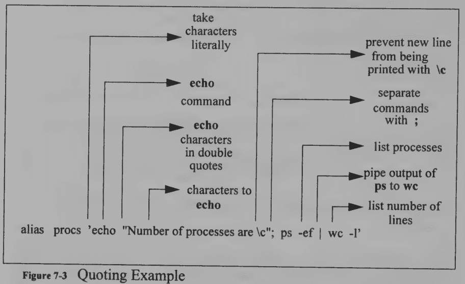

如你在图 7-3 中看到的，某些引号的使用会变得棘手。如果你希望修改和重用现有的 shell 脚本或编写自己的脚本，理解引号的使用是非常重要的。

### 文件名扩展

使用 C shell 的另一个重要部分是文件名扩展。当我们讲解 shell 编程时，你肯定会准备处理文件名的 shell 脚本。在开始编写 shell 脚本之前，对文件名扩展进行概述有助于确保你对这一主题感到熟悉。

表 7-4 列出了一些常见的文件名扩展和模式匹配。

### 表 7-4 文件名扩展和模式匹配

| 字符 | 示例 | 描述 |
|---|---|---|
| * | 1) ls *.c | 匹配零个或多个字符 |
| ? | 2) ls conf.? | 匹配任意单个字符 |
| [list] | 3) ls conf.[co] | 匹配列表中的任意字符 |
| [lower-upper] | 4) ls libddd.9873[5-6].sl | 匹配范围内任意字符 |
| str{str1,str2,str3,...} | 5) ls ux*.{700,300} | 用 {} 内的内容扩展 str |
| ~ | 6) ls -a ~ | 主目录 |
| ~username | 7) ls -a ~gene | 用户名的主目录 |

以下是表 7-4 中所示示例的详细扩展说明：

- 1. 若要列出目录中所有以 ".c" 结尾的文件，可以执行以下操作：

```bash
sys1 30: ls *.c
conf.SAM.c conf.c
```

- 2. 若要找到目录中所有名为 "conf" 且扩展名为单个字符的文件，可以执行以下操作：

```bash
sys1 31: ls conf.?
conf.c conf.o conf.l
```

- 3. 若要列出目录中所有名为 "conf" 且扩展名仅为 "c" 或 "o" 的文件，可以执行以下操作：

```bash
sys1 32: ls conf.[co]
```


```bash
conf.c conf.o
```

- 4. 若要列出名称相似但特定字段涵盖一定范围的文件，可以执行以下操作：

```bash
sys1 46: ls libddd9873[5-6].sl
libddd98735.sl libddd98736.sl
```

- 5. 若要列出以 "ux" 开头且扩展名为 "300" 或 "700" 的文件，可以执行以下操作：

```bash
sys1 59: ls ux*.{700,300}
uxbootif.700 uxinstrfs.300 unixstern.300
unistkern.700 unistlf.700
```

- 6. 若要列出你主目录中的文件，可以使用 ~：

```bash
sys1 62: ls -a ~
. .cshrc.org .login .shrc.org
.. .excrc .login.org .vue
.cshrc .history .profile .vueprofile
```

- 7. 若要列出某用户主目录中的文件，可以执行以下操作：

```bash
sys1 65: ls -a ~gene
. .history .vue splexdat
.. .login .vueprofile trail.txt
.cshrc .login.org ESP-File under.des
.cshrc .org .profile Mail xtra.part
.excrc .shrc.org opt
```

许多这些技术在编写 shell 脚本时非常有用，因此你需要熟悉文件名扩展。

### 重定向 (I/O 重定向)

UNIX 系统配置为命令通常从键盘获取输入（通常称为标准输入），并将输出发送到屏幕（通常称为标准输出）。命令还将错误信息发送到屏幕。你并不总是希望输入来自标准输入，且输出和错误信息去往标准输出。如果你编写大量脚本，需要控制以覆盖这些默认设置。这被称为重定向。表 7-5 展示了许多常见的重定向形式。

如表中所示，要将命令的输出从标准重定向到文件，你会使用 ">"。这在几乎所有情况下都有效。如果你设置了一个名为 **noclobber** 的环境变量，那么重定向到现有文件将不起作用。**noclobber** 不允许重定向覆盖现有文件。如果你尝试覆盖现有文件，例如下面的 /tmp/processes，你会收到一个文件已存在的消息：

```bash
# ps -ef > /tmp/processes
/tmp/processes: File exists
```


然而，你可以使用 "!" 与重定向一起强制文件被覆盖。使用 ">!" 强制文件被覆盖，而 ">>!" 将强制输出追加到现有文件的末尾。表 7-5 中展示了这些用法示例。

### 表 7-5 常用的重定向形式

| 命令或赋值 | 示例 | 描述 |
|---|---|---|
| < | wc -l < .login | 标准输入重定向：执行 wc (单词计数) 并列出 .login 中的行数 (-l) |
| > | ps -ef > /tmp/processes | 标准输出重定向：执行 ps 并将输出发送到文件 /tmp/processes |
| >> | ps -ef >> /tmp/processes | 追加标准输出：执行 **ps** 并将输出追加到文件 /tmp/processes 的末尾 |
| >! | ps -ef >! /tmp/processes | 标准输出重定向并覆盖 **noclobber**：即使 /tmp/processes 存在也进行写入 |
| >>! | ps -ef >>! /tmp/processes | 追加标准输出并覆盖 **noclobber**：追加到 /tmp/processes 的末尾 |
| \| | ps \| wc -l | 运行 **ps** 并将其结果作为 **wc** 的输入 |
| 0 | - | 标准输入 |
| 1 | - | 标准输出 |
| 2 | - | 标准错误 |
| 2> | cat program 2> errors | 将文件 **program** cat 到标准输出，并将错误重定向到文件 **errors** |
| 2>> | cat program 2>> errors | 将文件 **program** cat 到标准输出，并将错误追加到文件 **errors** |
| >& | cat program >& outfile | 将文件 **program** 和 **errors** 都 cat 到文件 **outfile** |
| ( ) >& | (cat program > outfile) >& errors | 将文件 **program** cat 到 **outfile**，并将错误重定向到文件 **errors** |

### Shell 和环境变量

对于你的 UNIX 系统来说，你确实是特殊的。C shell 中关于你的用户环境的信息存储在 shell 变量和环境变量中。

Shell 变量有时被称为"局部"变量。Shell 变量仅在其创建的 shell 中已知。

环境变量有时被称为"全局"变量。环境变量在创建它们的 shell 中定义，并被从原始 shell 派生的所有 shell 继承。因为这些变量传递给从原始 shell 派生的 shell，所以它们被认为是全局的。

你可以使用 set 命令查看 shell 变量，使用 env 命令查看环境变量，如下所示：

```bash
sys1 22: set
argv ()
autologout 600
cwd /home/martyp2
history 20
home /home/martyp2
noclobber
path (/usr/bin /usr/ccs/bin /usr/contrib/bin /opt/net-tl adm/bin /opt/pd/bin /)
prompt sys1 !:
savhist 20
shell /usr/bin/csh
status 0
system sys1
term vt100

sys1 23: set
argv ()
autologout 600
cwd /home/martyp2
history 20
home /home/martyp2
noclobber
path (/usr/bin /usr/ccs/bin /usr/contrib/bin /opt/net-tl adm/bin /opt/pd/bin /)
prompt sys1 !:
savhist 20
shell /usr/bin/csh
status 0
system sys1
term vt100

sys1 24:

sys1 24: env
HOME=/home/martyp2
PATH=/usr/bin:/usr/ccs/bin:/usr/contrib/bin:/opt/net-tl adm/bin:/opt/pd/bin:/opt/n
LOGNAME=martyp2
TERM=vt100
SHELL=/usr/bin/csh
MAIL=/var/mail/martyp2
COLUMNS=80
LINES=24
```


MANPATH=/usr/share/man:/usr/share/man:/usr/contrib/man/:/usr/contrib/man
TZ=PST8PDT
sys1 25:

请注意，按照惯例，局部变量使用小写，而全局变量使用大写。

通过执行 `set` 命令可以看出，许多局部变量和全局变量已被设置。你可以使用特殊标记 `$?` 来确定某个变量是否已设置。将此特殊标记置于变量名称之前，如果该变量已设置则返回 1，如果未设置则返回 0。以下示例展示了使用 `echo` 和此特殊标记来检查变量 `history` 和 `hist` 是否已被设置：

```text
sys1 25: echo $?history
1
sys1 26: echo $?hist
0
sys1 27:
```

由于 `history` 变量返回了 1，我们知道该变量确实已被设置。我们可以从之前 `set` 命令的输出中确认这一点，其中显示 `history` 被设置为 20。

由于 `hist` 变量返回了 0，我们知道该变量未被设置。

使用特殊元字符 `$`，我们可以告诉 shell 提取变量的值。以下示例使用 `echo` 并结合 `$` 置于 `history` 变量之前来报告其值：

```text
sys1 27: echo $history
20
sys1 28: echo $hist
hist: Undefined variable.
sys1 29:
```

Shell 变量使用 `set` 进行定义。我们在之前的 `.cshrc` 文件中看到，`history` shell 变量通过以下命令设置：

```text
set history = 20
```

环境变量使用 `setenv` 定义，如下面的命令所示：

```text
setenv EDITOR vi
```

### 后台作业与作业控制

当你运行一个命令时，正如我们在前面的许多示例中所做的那样，在命令完成之前你不会看到提示符返回。这些命令是在前台运行的。有些命令可能需要很长时间才能完成，在这种情况下，你需要等待很长时间提示符才会返回。作为等待提示符返回的替代方案，你可以将命令在后台运行，这意味着它会在你执行其他工作时在幕后运行。由于 UNIX 支持多任务处理，它很高兴地在后台运行许多命令，同时仍然向你提供提示符以发出更多命令。

要在后台运行命令，只需在命令行的末尾添加一个 & 符号（`&`）。当你在命令后加上 & 符号时，命令将在后台运行，提示符会立即返回。

现在让我们在 Solaris 系统上运行一些命令。首先运行一个命令，查找 `/usr` 中所有以 ".c" 结尾的文件，这需要一些时间才能完成。我们在 `find` 字符串前加上 `time` 命令，以便知道该命令完成需要多长时间：

```text
martyp $ time find /usr -name *.c
.
.
/usr/demo/link_audit/src/dumpbind.c
/usr/demo/link_audit/src/env.c
/usr/demo/link_audit/src/hash.c
/usr/demo/link_audit/src/perf.c
/usr/demo/link_audit/src/symbindrep.c
/usr/demo/link_audit/src/truss.c
/usr/demo/link_audit/src/who.c
find: cannot read dir /usr/aset: Permission denied
real 1m21.04s
user 0m1.51s
sys 0m12.67s
```

该命令大约花费了 1 分 21 秒完成。由于它不是在前台运行的，我们在它运行期间无法发出任何其他命令，因为必须等待提示符返回。

在前台运行命令的替代方法是，在命令后加上 & 符号，这样作业就会在后台运行，提示符会立即返回，如下面的示例所示：

```text
martyp $ time find /usr -name *.c > cprocs 2>&1 &
[3] 16279
martyp $
real 2m10.20s
user 0m1.31s
sys 0m8.62s
```

在后台运行此命令的结果是产生了一个括号内的作业编号以及进程 ID（PID），即第二个数字。该命令的所有输出，包括错误，都写入文件 `cprocs`。在我们发出命令后立即返回提示符，并且在命令完成后，`time` 的输出发送到了屏幕上。我们可以在后台发出命令后立即开始发出额外的命令。

你可以控制前台和后台作业。要挂起前台作业，你同时按下 "control" 和 "z" 键，如下面的示例所示：

```text
marty $ find /usr -name *.c
/usr/openwin/share/include/X11/Xaw/Template.c
/usr/openwin/share/src/dig_samples/DnD/main.c
/usr/openwin/share/src/dig_samples/DnD/owner.c
/usr/openwin/share/src/dig_samples/DnD/requestor.c
/usr/openwin/share/src/dig_samples/Tooltalk/olit_tt.c
/usr/openwin/share/src/dig_samples/Tooltalk/tt_callbacks.c
/usr/openwin/share/src/dig_samples/Tooltalk/tt_code.c
/usr/openwin/share/src/dig_samples/ce1/ce_mapl.c
/usr/openwin/share/src/dig_samples/ce2/ce_simple.c
/usr/openwin/share/src/dig_samples/dnd_olit/olitdnd.c
/usr/openwin/share/src/dig_samples/dnd_xview1/xview_dnd.c
/usr/openwin/share/src/dig_samples/dnd_xview2/xview_dnd2.c
/usr/openwin/share/src/dig_samples/selection_olit/olit_sel.c
/usr/openwin/share/src/dig_samples/tooltalk_simple/tt-send.c
/usr/openwin/share/src/olit/oldials/oldials.c
/usr/openwin/share/src/olit/olitbook/ch10/draw.c
^Z[3] + Stopped (SIGTSTP)	find /usr -name *.c
```

按下 `ctrl-z` 后，`find` 命令在你按下 `ctrl-z` 的那一刻被中断。该命令在此时挂起，你会看到作业编号，在本例中为 "3"，其状态列示为 "Stopped"。该命令只是被挂起，并没有永久消失。你可以使用 `fg` 在前台重启此进程，或者使用 `bg` 在后台运行。使用 `bg` 就像你在命令后加上 "&" 一样运行命令。它从你中断的点开始运行。当你发出 `fg` 或 `bg` 命令时，不需要提供作业编号，因为默认情况下是对最后一个作业执行指定操作，在本例中是作业编号 3。


在创建本节示例的过程中，我启动并挂起了许多作业。以下示例展示了使用 `jobs` 命令列出所有作业，使用 `kill` 杀死作业 1 和 2，并在后台运行作业 3：

```text
martyp $ jobs
[3] + Stopped (SIGTSTP) find /usr -name *.c
[2] - Running           time find / -name gnu* > gnu 2>&1 &
[1]  Running            time find / -name *.c > cprog 2>&1 &
martyp $ kill %1
[1]  Terminated        time find / -name *.c > cprog 2>&1 &
martyp $ kill %2
[2] - Terminated       time find / -name gnu* > gnu 2>&1 &
martyp $ bg %3
[3]       find /usr -name *.c&
martyp $
```

请注意，当我们请求作业 3 在后台运行时，添加了 & 符号。杀死作业 1 和 2 并在后台运行作业 3 会返回提示符，以便你可以执行额外的工作。

### umask 与权限

关于 `csh` 需要涵盖的另一个话题是文件权限及其与 `umask` 的关系。这很重要，因为你可能编写 shell 程序，而权限控制其他人对这些程序的访问权限。`umask` 用于指定新文件和目录的权限设置。

让我们从一个文件的长列表示例开始。我们在以下示例中使用 `ls -l`：

```text
sys1 1: ls -l script1
-rwxr-xr-x 1 marty users 120 Jul 26 10:20 script1
```

此文件的访问权限由发出 `ll` 命令时读取 (r)、写入 (w) 和执行 (x) 的位置定义。图 7-4 显示了此文件的三组三个访问权限。

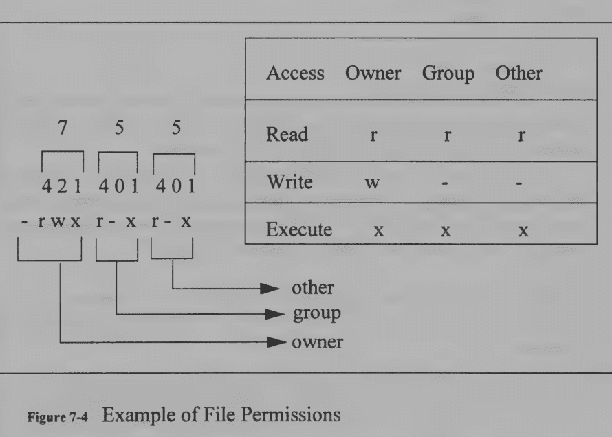

此文件的所有者对该文件具有读取、写入和执行权限。用户所属的组具有读取和执行权限，其他人也具有读取和执行权限。此文件的权限可以通过每个字段的八进制总和指定，即 755。


### 如果你创建一个新的 shell 脚本或任何其他新文件会发生什么？

如果你创建一个新的 shell 脚本或任何其他新文件会发生什么？存在哪些权限设置？由于你想执行该 shell 脚本，因此你需要该文件的执行权限。你可以使用 **umask** 来为你所有的新文件和目录定义默认值。

默认情况下，大多数系统对目录的权限初始值为 777，对文件的初始值为 666。这意味着每个人对你创建的所有目录都有完全访问权限，并且每个人对你创建的所有文件都有读写权限。这些默认值会根据 **umask** 的值进行修改。

你可以使用以下两种方法查看你的 **umask**：

```
martyp $ **umask**
002
martyp $ **umask -S**
u=rwx,g=rwx,o=r-x
martyp $
```

第一个示例显示了 **umask** 的八进制值，我们稍后会详细介绍；第二个示例显示了 **umask** 的符号值。*-S* 选项并非在所有 UNIX 变种中都有效。

**umask** 用于*禁用*访问权限。你从一个 **umask** 值开始，并使用其字段来禁用某些级别的访问权限。**umask** 命令使用三个八进制字段。这些字段是用户、组和其他人的访问代码之和，如图 7-5 所示。

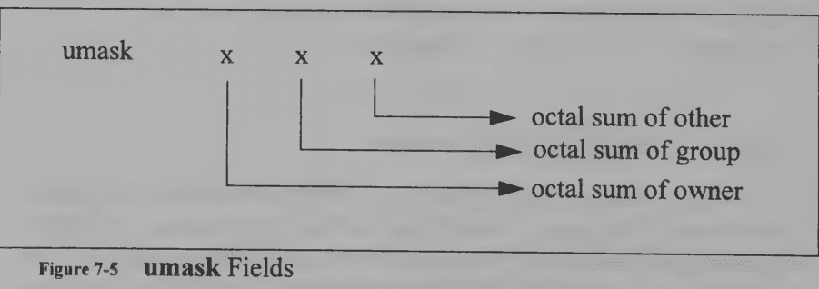

umask 字段的*补数*会与默认设置进行“与”运算（*anded*）以改变 **umask**。你可以通过指定其值来设置 **umask**。在我们前面的示例中，我们以两种不同的方式查看了 **umask**。要设置 **umask**，你只需输入 **umask** 命令和所需的值即可。例如，将 **umask** 设置为 022，会移除目录中“组”和“其他”的写入权限，如图 7-6 所示。

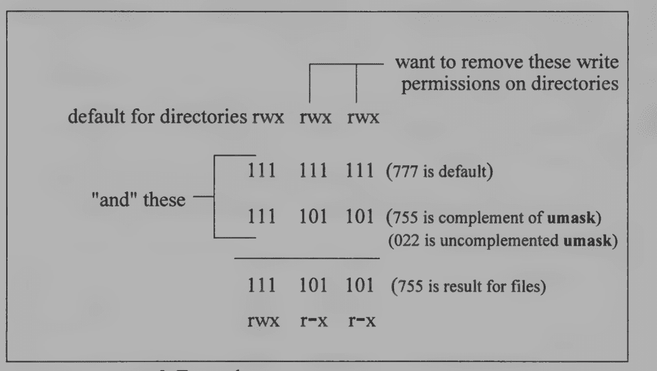

在此示例中，**umask 022** 将目录权限更改为 755。

类似地，**umask** 为 022 时，会将文件的默认权限 666 更改为 644，这意味着对组和他人来说是只读的。

### 使用 chmod 更改文件权限

**chmod** 命令用于更改文件的权限。无论之前描述的 **umask** 发生了什么变化，你都可以随时使用 **chmod** 更改文件的权限。在大多数情况下，你需要是文件的所有者或超级用户才能使用 **chmod** 更改文件权限。让我们从列出文件 *sort* 开始讨论 **chmod**：


```
$ ls -l sort
-rwxr-x--x  1 marty    users    120 Jul 26 10:20 sort
```


图 7-7 展示了 *sort* 的权限分解情况。

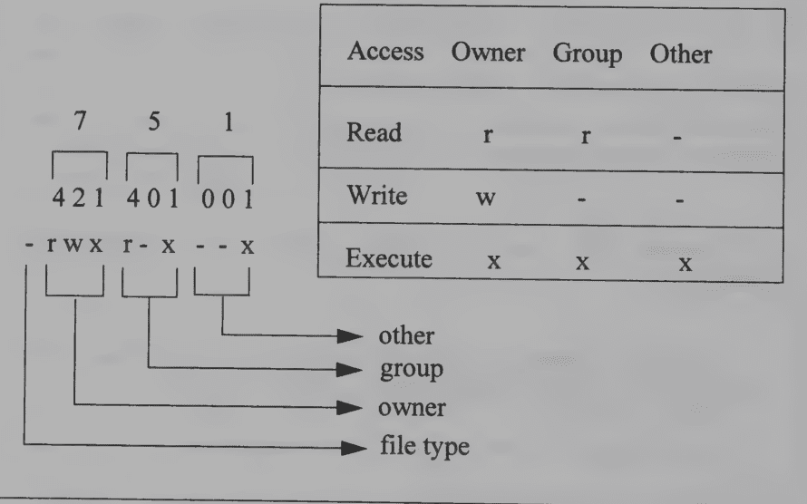

图 7-7 文件 sort 的权限

你对定义的文件类型控制力很小。然而，如果文件属于你，你对该文件的权限拥有很大的控制权。**chmod** 命令用于更改文件或目录的权限。如果你是文件的所有者，你可以在更改文件权限方面大展身手。


更改权限有两种方法：符号模式或数字模式。我首先关注数字模式，因为涉及的数字易于管理，而且我发现新的 UNIX 用户有时会被某些符号的含义弄糊涂。然后我会介绍符号，并在 **chmod** 摘要中包含符号的含义。

首先，我说“数字”是什么意思？查看 sort 的数字，我们看到权限为 751：7 代表所有者（百位），5 代表组（十位），1 代表其他人（个位）。图 7-8 有助于理解这些位置的含义。

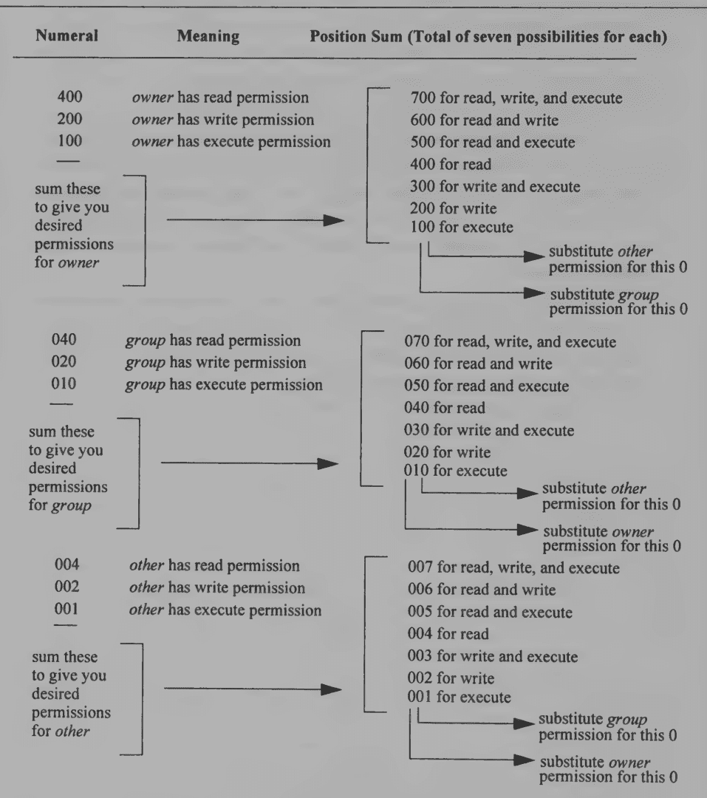

图 7-8 数字权限摘要


选择为所有者、组和其他人所需的权限后，你使用 chmod 命令将这些权限分配给文件或目录。这些权限可能性中有一些不常用，例如仅执行权限，因为你通常需要拥有对文件的读取权限才能执行它；然而，为了完整性，我在图 7-8 中包含了所有可能性。除了图 7-8 中显示的权限模式位外，还存在一些杂项模式位，你目前不需要关心它们。

如果你决定为文件 **sort** 的 *组* 添加写入权限，并移除 *其他人* 的所有权限，你只需使用适当的数字模式执行 **chmod** 命令即可。以下一组命令首先列出 *sort* 的现有权限，然后更改 *sort* 的权限，最后列出 *sort* 的新权限：

```
$ ls -l sort
-rwxr-x--x    1 marty    users      120 Jul 26 10:20 sort

$ chmod 770 sort

$ ls -l sort
-rwxrwx---    1 marty    users      120 Jul 26 10:20 sort
```

使用符号模式更改权限的相同一组命令如下：

```
$ ls -l sort
-rwxr-x-x     1 marty    users      120 Jul 26 10:20 sort

$ chmod g+w,o-x sort

$ ls -l sort
-rwxrwx---    1 marty    users      120 Jul 26 10:20 sort
```

在符号模式下，你发出 **chmod** 命令并指定谁将受此更改影响 [用户 (u)、组 (g)、其他人 (o) 或所有用户 (a)]、你希望执行的操作 [添加 (+)、删除 (-) 或替换 (=)]，以及你希望指定的权限 [读取 (r)、写入 (w) 或执行 (x)]。在前面使用符号模式的示例中，


正在为组 (g) 添加 (+) 写入 (w) 权限，并移除 (-) 其他人 (o) 的执行 (x) 权限。


以下是 **chmod** 中一些常用符号的摘要：

**chmod** - 使用以下符号模式列表更改指定文件的权限。

受影响的对象符号：

- u 用户受影响。
- g 组受影响。
- o 其他人受影响。
- a 所有用户受影响。

要执行的操作：

- + 添加权限。
- - 移除权限。
- = 替换权限。

指定的权限：

- r 读取权限。
- w 写入权限。
- x 执行权限。
- u 复制用户权限。
- g 复制组权限。
- o 复制其他人权限。

本章涵盖的 C shell 功能以及以下手册页应该会帮助你很好地在 C shell 中起步。

### 第 7 章使用的一些命令的手册页

以下是 **csh** 的 HP-UX 手册页。命令在不同 UNIX 变种之间可能有所不同，因此你可能会发现该手册页在选项或其他方面存在差异；然而，以下手册页是一个极好的参考。

#### csh


**csh** - C shell。

csh(1)

### NAME
csh - 具有类 C 语法的外壳（命令解释器）

### SYNOPSIS
csh [-cefinstvxTVX] [command_file] [argument_list ...]

### DESCRIPTION
csh 是一个命令语言解释器，它集成了命令历史记录缓冲区、类 C 语法和作业控制功能。

命令选项
命令选项按如下方式解释：

- `-c`
  从（单一的）紧随其后的参数中读取命令，该参数必须存在。其余参数将放入 argv 中。

- `-e`
  如果调用的命令非正常终止或返回非零退出状态，C shell 将退出。

- `-f`
  抑制执行主目录中的 .cshrc 文件，从而加快 shell 启动时间。

- `-i`
  当从计算机终端以外的设备（如另一台计算机）调用时，强制 csh 响应交互式请求。csh 通常响应非交互式请求。如果 csh 是从计算机终端调用的，无论选择了哪些选项，它总是响应交互式请求。

- `-n`
  解析但不执行命令。这对于检查 shell 脚本中的语法很有用。所有替换都会执行（历史记录、命令、别名等）。

- `-s`
  从标准输入中获取命令输入。

- `-t`
  读取并执行一行输入。

- `-v`
  设置 verbose shell 变量，导致在历史记录替换完成后，将命令输入回显到标准输出设备。

- `-x`
  设置 echo shell 变量，导致在执行前立即将所有命令回显到标准错误输出。

- `-T`
  禁用使用 ESC 键进行命令/文件名补全以及使用 CTRL-D 列出可用文件的 tenex 特性（见下文 CSH UTILITIES 部分）


-   -V 在 .cshrc 执行前设置 verbose 变量，以便所有 .cshrc 命令也回显到标准输出。
-   -X 在 .cshrc 执行前设置 echo 变量，以便所有 .cshrc 命令也回显到标准输出。

在处理完命令行选项后，如果参数列表中仍有剩余参数，且未指定 -C、-I、-S 或 -t 选项，则第一个剩余参数将被视为要执行的命令文件的名称。

## 命令

简单命令是一组单词的序列，其中第一个单词指定要执行的命令。由竖线 (|) 字符分隔的简单命令序列构成管道。管道中每个命令的输出成为管道中下一个命令的输入。管道序列可以用分号 (;) 分隔，这将导致它们按顺序执行。在最后一个条目后添加 & 字符，可以在后台模式下执行管道序列。

可以将任何管道放入括号中形成一个简单命令，该命令反过来可以作为另一个管道的组件。管道也可以用 || 或 && 分隔，指示与 C 语言类似，第二个管道仅在第一个管道失败或成功时（分别对应）才执行。

## 作业

csh 将作业与每个管道相关联，并维护当前作业的表（通过 jobs 命令打印），并为它们分配小的整数编号。当使用 & 异步启动作业时，shell 会打印一行类似于以下内容的内容：

```
(1) 1234
```

这表明异步启动的作业是作业编号 1，并且有一个（顶级）进程，其进程 ID 为 1234。

如果你正在运行一个作业并想做其他事情，你可以输入当前定义的挂起字符（参见 termio(7)），这会向当前作业发送停止信号。csh 通常会指示该作业已 Stopped（停止），并打印另一个提示符。然后你可以操作此作业的状态，使用 bg 命令将其放入后台，运行其他一些命令，并最终使用前景命令 fg 将该作业调回前台。挂起立即生效，类似于中断，即输入该字符时，待处理的输出和未读的输入会被丢弃。还有一个延迟挂起字符，它不会生成停止信号，直到程序尝试读取(2) 它。当你为某个想要在其读取后停止的作业准备了一些命令时，提前输入此字符会很有用。

如果在后台运行的作业尝试从终端读取，它将停止。通常允许后台作业产生输出，但可以通过给出 stty tostop 命令来禁用此功能（参见 tty(1)）。如果你设置了此 TTY 选项，后台作业在尝试产生输出时也会停止，就像它们尝试读取输入时一样。在这样的一些系统中，键盘信号和来自终端接口的行断开信号不会发送到后台作业。这意味着后台作业不受注销或输入中断、退出、挂起和延迟挂起字符影响的效果（参见 termio(7)）。

在 shell 中有几种方式引用作业。字符 % 引入作业名称。如果你想引用编号为 1 的作业，可以将其命名为 $1。仅仅命名一个作业就会将其带到前台；因此 %1 是 fg %1 的同义词，将作业 1 调回前台。类似地，输入 %1 & 会在后台恢复作业 1。如果这些前缀是明确的，也可以通过输入用于启动它们的字符串的前缀来命名作业；因此 ex 通常会恢复一个挂起的 ex(1) 作业，如果只有一个名称以字符串 ex 开头的挂起作业。还可以使用 %string 指定文本包含 string 的作业，如果只有一个这样的作业。

csh 维护当前作业和前一作业的概念。在涉及作业的输出中，当前作业用 + 标记，前一作业用 - 标记。缩写 %+ 指当前作业，%- 指前一作业。为了与历史机制语法（在下文中描述）保持密切的类比，%% 也是当前作业的同义词。

csh 立即学习进程状态的任何变化。它通常在作业停止且无法进一步进展时通知你，但仅这是在打印提示符之前。这样做是为了以免干扰你的工作。然而，如果你设置 shell 变量 notify，csh 会立即通知你后台作业状态的变化。还有一个 csh 内置命令叫做 notify，它标记单个进程，以便任何状态变化立即报告。默认情况下，notify 标记当前进程。只需在启动后台作业后输入 notify 即可标记它。

如果你尝试在作业停止时离开 shell，csh 会发送警告信息：“You have stopped jobs.”（你有已停止的作业。）使用 jobs 命令查看它们是什么。如果你这样做或立即尝试再次退出，csh 不会第二次警告你，挂起的作业将被终止（参见 exit(2)）。

## 内置命令

内置命令在 shell 内执行，而不会产生新进程。如果内置命令作为管道中除最后一个组件外的任何组件出现，它在子 shell 中执行。内置命令包括：

### alias
alias name
alias name wordlist

第一种形式打印所有别名。第二种形式打印 name 的别名。第三种形式将指定的 wordlist 分配为 name 的别名。对 wordlist 执行命令和文件名替换。name 不能是 alias 或 unalias。

### bg
bg [%job ...]

将当前（未指定作业）或指定的作业放入后台，如果它们已停止，则继续它们。

### break
导致执行恢复至最近的外围 foreach 或 while 结束后的位置。当前行上剩余的命令被执行。因此，通过在单行上编写它们可以实现多级 break。

### breaksw
导致从 switch 中断，恢复至 endsw 之后。

### case
case label:

如下文所述的 switch 语句中的标签。

#### cd
cd
cd directory_name
chdir
chdir directory_name

将 shell 的当前工作目录更改为 directory_name。如果未指定，directory_name 默认为你的主目录。如果作为当前工作目录的子目录找不到 directory_name（且不以 /、.// 或 .../ 开头），则检查变量 cdpath 的每个组件，查看是否有子目录 directory_name。最后，如果其他方法都失败，csh 将 directory_name 视为 shell 变量。如果其值以 / 开头，则尝试查看它是否为目录。

### continue
继续最近的外围 while 或 foreach 的执行。当前行上剩余的命令被执行。

### default
default:

标记 switch 语句中的默认情况。default 应位于所有其他 case 标签之后。

### dirs
打印目录堆栈；堆栈顶部在左侧；堆栈中的第一个目录是当前目录。

### echo
echo wordlist
echo -n wordlist

指定的单词写入 shell 的标准输出，由空格分隔，并以新行结束，除非指定了 -n 选项。

### else, end, endif, endsw
参见下文对 foreach、if、switch 和 while 语句的描述。

### eval
eval arguments ...

（行为与 sh(1) 相同。）arguments 作为输入读取到 shell 中，并执行结果命令。这通常用于执行作为命令或变量替换结果生成的命令，因为解析发生在这些替换之前。

### exec
exec command

指定的命令在当前 shell 的位置执行。

### exit
exit
exit (expression)

csh 以 status 变量的值（第一种形式）或指定表达式的值（第二种形式）退出。

### fg
fg [%job ...]

将当前（未指定作业）或指定的作业带到前台，如果它们已停止，则继续它们。

### foreach
foreach name (wordlist)
...
end

变量 name 依次设置为 wordlist 的每个成员，并且执行此命令与匹配的 end 之间的命令序列。（foreach 和 end 都必须单独出现在不同的行上。）


### glob 单词表

类似于 echo，但不识别反斜杠 `\` 转义字符，且输出中的单词由空字符分隔。常用于那些使用 shell 对单词列表执行文件名扩展的程序中。

### goto 单词

指定的单词会被进行文件名和命令扩展，从而生成形如 label 的字符串。Shell 会尽可能回退其输入，并搜索形如 label 的行；该行前可能包含空格或制表符。执行从指定行的下一行继续。

### hashtab

打印一行统计信息，指示内部哈希表在定位命令（并避免 exec 操作）方面的效率。对于路径中的每个组件，如果哈希函数指示可能存在匹配，或者该组件不以 / 开头，则尝试执行一次 exec。

### history [-h] [-r] [n]

显示历史记录事件列表。如果指定了 n，则仅打印最近 n 个事件。-r 选项将打印顺序反转，使最近的事件优先显示，而不是最旧的优先。-h 选项在不显示前导数字的情况下打印历史记录列表，以便生成适合 source 命令使用的文件。

### if (表达式) 命令

如果表达式求值为真，则执行带有参数的单个命令。对 command 的变量替换发生得较早，与 if 命令其余部分发生的时间相同。Command 必须是一个简单命令；不能是管道、命令列表、带括号的命令列表或别名命令。即使表达式为假（意味着 command 未被执行），输入/输出重定向仍会发生（这是一个 bug）。

```
if (expression1) then
...
else if (expression2) then
...
else
...
endif
```

### if (expression1) then

如果 expression1 为真，则执行直到第一个 else 为止的所有命令；否则，如果 expression2 为真，则执行从第一个 else 到第二个 else 之间的所有命令，等等。可以使用任意数量的 else-if 对，但只需要一个 endif。else 部分同样是可选的。（else 和 endif 必须出现在输入行的开头。if 必须单独出现在其输入行上，或者位于 else 之后。）

### jobs [-l]

列出活动任务。-l 选项除了通常的信息外，还列出进程 ID。

#### kill

```
kill % job
kill - sig % job ...
kill pid
kill - sig pid...
kill -l
```

向指定的任务或进程发送 TERM（终止）信号或指定的信号。信号可以通过编号指定，也可以通过名称指定（如 /usr/include/signal.h 中所示，去掉 SIG 前缀，参见 signal(2)）。使用 kill -l 可以列出信号名称。没有默认信号，因此单独使用 kill 不会向当前任务发送信号。如果发送的信号是 TERM（终止）或 HUP（挂起），则任务或进程还会收到一个 CONT（继续）信号。

### limit [-h] [资源] [最大使用量]

限制当前进程及其创建的每个进程，使其在指定资源上的使用量（单独计算）不超过最大使用量。如果未指定最大使用量，则显示当前限制；如果未指定资源，则给出所有限制。

如果指定了 -h 标志，则使用硬限制而不是当前限制。硬限制对当前限制的值设定了上限。只有超级用户可以提高硬限制，但用户可以在合法范围内降低或提高当前限制。

当前可控的资源包括：

- addressspace：进程的地址空间最大字节数
- coredumpsize：创建的最大核心转储文件的大小
- cpus time：每个进程可用的最大 CPU 秒数
- datasize：允许在程序文本结束后数据区域的最大增长量
- descriptors：每个进程打开文件的最大数量
- filesize：可创建的最大单个文件
- memoryuse：进程驻留集大小可以增长到的最大值
- stacksize：自动扩展的栈区域的最大大小

最大使用量参数可以指定为浮点数或整数，后跟缩放因子：k 或千字节（1024 字节）、m 或兆字节、或 b 或块（ulimit 系统调用使用的单位）。对于资源名称和缩放因子，可以使用名称的非歧义前缀。一个 csh 实例可以降低 filesize，但只有有效用户 ID 为 root 的实例才能提高它。有关更多信息，请参考 ulimit 系统调用的文档。

### login

终止登录 shell，并用 /usr/bin/login 的一个实例替换它。这是注销的一种方式，为了与 sh(1) 的兼容性而提供。

### logout

终止登录 shell。如果设置了 ignoreeof，则特别有用。出于历史原因，提供了一个类似的功能 bye，它适用于非登录 shell 的会话。不建议使用，因为它不是标准 BSD csh 的一部分，在将来的版本中可能不再受支持。

#### newgrp

更改调用者的组标识；详细信息参见 newgrp(1)。newgrp 会执行一个新的 shell，因此当前的 shell 环境会丢失。

### nice

```
nice +number
nice command
nice +number command
```

第一种形式将此 shell 的 nice 值（运行命令的优先级）设置为 4（默认值）。第二种形式将优先级设置为给定的数字。最后两种形式分别以优先级 4 和 number 运行 command。具有适当特权的用户可以通过使用 nice -number ... 指定负的 nice 值来提高优先级。command 总是在子 shell 中执行，并且对简单 if 语句中命令的限制适用。

### nohup [command]

没有参数时，nohup 可用于 shell 脚本中，使脚本剩余部分忽略挂起信号。有参数时，使指定的命令在忽略挂起信号的情况下运行。使用 & 在后台执行的所有进程，实质上都是按照 COMMANDS 章节中 Jobs 部分所述进行了 nohup 处理。

### notify [job ...]

当当前任务（未指定时）或指定任务的状态发生变化时，使 shell 异步通知用户；通常通知在提示符之前呈现。如果设置了 shell 变量 notify，则这是自动进行的。

### onintr [-] [label]

控制 shell 在接收到中断时的行为。没有参数时，onintr 恢复 shell 在中断时的默认行为，该行为是终止 shell 脚本或返回到终端命令输入级别。如果指定了 -，则忽略所有中断。如果给出了 label，则当接收到中断或子进程因中断而终止时，shell 执行 goto label。

如果 shell 在后台运行且正在忽略中断，则 onintr 没有效果；中断将继续被 shell 和所有调用的命令忽略。

### popd [+n]

弹出目录栈，返回到新的顶层目录。如果有参数，则丢弃栈中的第 n 个条目。目录栈的元素从顶部开始编号，从 0 开始。出于历史原因，提供了一个 popd 的同义词 rd。不建议使用，因为它不是标准 BSD csh 的一部分，在将来的版本中可能不再受支持。

### pushd [name] [+n]

没有参数时，pushd 交换目录栈顶部的两个元素。如果给出了 name 参数，pushd 更改到新目录（使用 cd）并将旧的当前工作目录（如同 csw 那样）推送到目录栈。如果给出了数字参数，pushd 将目录栈的第 n 个元素旋转至顶部并更改到该目录。目录栈的成员从顶部开始编号，从 0 开始。出于历史原因，提供了一个 pushd 的同义词 gd。不建议使用，因为它不是标准 BSD csh 的一部分，在将来的版本中可能不再受支持。

### rehash

导致重新计算 path 变量中目录内容的相关内部哈希表。如果你登录期间在 path 中的目录添加了新命令，则需要此操作。只有当你向自己的某个目录添加命令，或者系统程序员更改了某个系统目录的内容时，才需要这样做。

### repeat count command

指定的命令（受上述单行 if 语句中 command 相同的限制）执行 count 次。即使 count 为 0，I/O 重定向也恰好发生一次。

### set

```
set
set name
set name=word
set name[index]=word
set name={wordlist}
```

set 的第一种形式显示所有 shell 变量的值。值不是单个单词的变量会打印为带括号的单词列表。第二种形式将 name 设置为空字符串。第三种形式将 name 设置为单个单词。第四种形式将 name 的第 index 个组件设置为 word；该组件必须已存在。最后一种形式将 name 设置为 wordlist 中的单词列表。在所有情况下，值都会进行命令和文件名扩展。

这些参数可以重复，以在单个 set 命令中设置多个值。但是请注意，变量扩展会在任何设置发生之前对所有参数进行。

### setenv name value

将环境变量 name 的值设置为 value，即单个字符串。最常用的环境变量 USER、TERM 和 PATH 会自动导入和导出到 csh 变量 user、term 和 path；因此不需要对这些变量使用 setenv。

### shift [variable]

如果没有给出参数，则 argv 的成员向左移位，丢弃 argv[1]。如果 argv 未设置或被分配少于两个字符串，则会发生错误。当指定 variable 时，shift 对 ...


指定的变量。

### source [-h] name
csh 从 name 中读取命令。source 命令可以嵌套，但如果嵌套过深，shell 可能会耗尽文件描述符。任何层级的 source 中的错误都会终止所有嵌套的 source 命令。通常，source 命令期间的输入不会放入历史列表。可以使用 -h 选项将命令放入历史列表而不执行它们。

### stop [job ...]
停止当前（无参数）或指定的在后台运行的任务。

### suspend
使 csh 停止，就好像它收到了 suspend 信号一样。由于 csh 通常忽略 suspend 信号，这是暂停 shell 的唯一方法。如果尝试从登录 shell 中执行此命令，将给出错误消息。

### switch (string)
```
switch (string)
case str1:
...
breaksw

default:
...
breaksw

endsw
```
每个 case 标签 (str1) 依次与指定的 string 进行匹配，该 string 首先会被展开。case 命令的形式和文件名匹配记法相同，但方括号表达式中不支持非匹配列表（参见 regexp(5)）。如果在找到 default 标签之前没有任何标签匹配，则执行从 default 标签之后开始。每个 case 标签和 default 标签必须出现在行的开头。breaksw 命令使执行继续到 endsw 之后。否则，控制流可能会像 C 语言中一样穿过 case 标签和 default 标签。如果没有标签匹配且没有 default，则执行继续到 endsw 之后。

### time [command]
当未指定 command 时，会打印出本 shell 及其子进程使用时间的摘要。如果指定了 command，则对简单命令进行计时，并打印出如 time 变量中描述的时间摘要。如有必要，会创建一个额外的 shell 以在命令完成时打印时间统计信息。

### umask [value]
显示（未指定 value 时）或将当前文件创建掩码设置为指定值。掩码以八进制给出。掩码的常用值为 002，它赋予所有者和组所有权限，赋予其他所有人读和执行权限；或者 022，它赋予所有者所有权限，仅赋予组和其他所有人读和执行权限。

### unalias pattern
- 丢弃所有名称与指定 pattern 匹配的定义别名。因此，`unalias *` 将删除所有定义别名。如果 pattern 不匹配现有的定义别名，不会发生错误。

### unhash
- 禁用使用内部哈希表来加速定位已执行程序的功能。

### unset pattern
- 删除所有名称与指定 pattern 匹配的变量。因此，`unset *` 将删除所有变量；这会产生明显的不良副作用。如果 pattern 不匹配任何变量，不会发生错误。

### unsetenv pattern
- 从环境中删除所有名称与指定 pattern 匹配的变量。另见上面的 setenv 命令和 printenv(1)。

### wait
- 等待所有后台任务终止。如果 shell 是交互式的，中断可能会干扰等待，此时 shell 会打印出所有已知未完成任务的名称和任务编号。

### while (expression)
```
while (expression)
...
end
```
- 当指定的 expression 评估为非零值时，评估 while 和匹配的 end 之间的命令。break 和 continue 可用于提前终止或继续循环。（while 和 end 必须单独出现在其输入行上。）如果输入是终端（即不是脚本），则在第一次通过循环时，会像 foreach 语句一样进行提示。

### %job
- 将指定的任务带到前台。

### %job &
- 在后台继续指定的任务。

### @
```
@ name=expression
@ name[index]=expression
```
- 第一种形式打印所有 shell 变量的值。第二种形式将指定的 name 设置为 expression 的值。如果 expression 包含 <, >, &, 或 |，则必须将 expression 的这一部分至少放在括号内。第三种形式将 expression 的值赋给 name 的 index 参数。name 及其 index 组件必须已经存在。
- 运算符 *=, += 等在 C 语言中可用。可以任意选择是否使用空格将 name 与赋值运算符分开。但是，在分隔 expression 中本来会是单个单词的成分时，必须使用空格。
- 特殊的后缀 ++ 和 -- 运算符分别递增和递减 name（例如，@ i++）。

# 非内置命令执行

当要执行的命令不是内置命令时，csh 试图通过 exec(2) 执行该命令。变量 path 中的每个单词指定一个目录，shell 试图在其中查找命令（如果命令不以 / 开头）。如果没有给出 -c 或 -t，shell 会将这些目录中的名称哈希到一个内部表中，以便仅在该命令可能所在的目录中尝试 exec。当搜索路径中存在大量目录时，这会极大地加速命令定位。如果此机制已被关闭（通过 unhash），或者给出了 -c 或 -t，或者 path 的任何目录组件不以 / 开头，shell 将目录名和给定的命令名连接起来形成一个文件路径名，然后尝试执行该文件。

放在括号内的命令始终在子 shell 中执行。因此：

```
(cd ; pwd)
```

在完成后打印主目录，然后返回当前目录，而：

```
cd ; pwd
```

在完成后仍停留在主目录。

当命令放在括号内时，通常是为了防止 chdir 影响当前 shell。

如果文件具有执行权限但不是可执行二进制文件，则假定它是一个脚本文件，即解释器作为单独进程执行的数据文件。

csh 首先尝试加载并执行脚本文件（参见 exec(2)）。如果脚本文件的前两个字符是 #!，exec(2) 期望跟随一个解释器路径名，并尝试将指定的解释器作为单独进程执行以读取整个脚本文件。

如果未指定 #! 解释器，并且存在 shell 的定义别名，则将该定义别名的单词插入到参数列表的开头以形成 shell 命令。该定义别名的第一个单词应该是要使用的命令的完整路径名。请注意，这是定义别名替换的一种特殊的晚期发生情况，它会未经修改地将单词插入到参数列表中。

如果未指定 #! 解释器且没有 shell 定义别名，但文件的第一个字符是 #，则执行由 Shell 变量指定的解释器（请注意，这通常是 /usr/bin/csh，除非用户已重置 $shell）。如果 $shell 未设置，则执行 /usr/bin/csh。

如果未指定 #! 解释器，没有 shell 定义别名，且文件的第一个字符不是 #，则执行 /usr/bin/sh 来解释脚本文件。

# 历史替换

历史替换允许您重复命令，将之前命令中的单词用作新命令的部分，在当前命令中重复之前命令的参数，以及更正之前命令中的拼写或打字错误。

历史替换以感叹号 (!) 开始。替换可以在输入流的任何位置开始，但不能嵌套。可以用反斜杠前缀感叹号以取消其特殊含义。为了方便，当感叹号后面跟随空格、制表符、换行符、等号或左括号时，感叹号将原样传递给解析器。包含历史替换的任何输入行在执行前都会在终端上回显以供验证。

从终端输入的由一个或多个单词组成的命令会保存在历史列表中。历史替换将这些保存的命令中的单词序列重新引入到输入流中。保存的之前命令的数量由 history 变量控制。无论其值如何，之前命令始终会被保存。命令从 1 开始顺序编号。

您可以通过事件编号（如 !10 表示事件 10）、相对事件位置（如 !-2 表示倒数第二个事件）、完整或部分命令名称（如 !d 表示使用以字符 d 开头的命令的最后事件）以及字符串表达式（如 !?mic? 指包含字符 mic 的事件）来引用之前的事件。

这些形式在未进一步修改的情况下，简单地重新引入指定事件的单词，每个单词之间用单个空格分隔。作为一种特殊情况，!! 表示重做；它指向上一个命令。

要选择命令中的单词，请使用冒号 (:) 和事件指定之后的期望单词的指定符。输入行中的单词从零开始编号。基本的单词指定符为：

- 0 第一个单词（即命令名称本身）。
- n 第 n 个单词。
- ^ 第一个参数。（这等同于 1。）
- $ 最后一个单词。
- a-b 从 a 到 b 的单词范围。特殊情况是 -y，它是 `单词 0 到单词 y` 的缩写；以及 x-，意思是 `单词 x 直到（但不包括）单词 $`。
- * 从第二个单词到最后一个单词的范围。
- & 与搜索序列一起使用，以替换紧邻其前的匹配单词。

如果参数选择器以 ^, $, *, - 或 & 开头，则可以省略分隔命令指定和单词指定符的冒号。

单词指定符之后可以跟随一系列修饰符，每个修饰符前都有一个冒号。定义了以下修饰符：

- h 通过删除所有后续组件，仅使用路径名的第一个组件。
- r 通过删除任何尾部后缀 (.xxx)，使用根文件名。
- e 通过删除根名称，使用文件名的尾部后缀 (.xxx)。
- s/l/r 在指定的命令中，用 r 的值替换 l 的值。
- t 通过删除所有前置路径名组件，仅使用路径名的最终文件名。
- & 重复上一个替换。


## 打印新命令但不执行。

- p 打印新命令但不执行。
- q 引用替换的词，防止进一步替换。
- x 类似于 q，但在空格、制表符和换行符处断词。
- g 使用全局命令作为其他修饰符的前缀，使指定的更改全局生效。命令中的所有单词都会被更改，每个单词更改一次，并且每个用单引号 (') 或双引号 (") 包围的字符串都被视为一个单词。

除非前面有 g，否则修改仅应用于第一个可修改的单词。如果尝试替换但无法完成（例如，在一个仅包含 10 个命令的历史缓冲区中请求替换 /111），则会产生错误。

替换的左侧是字符串；不是 HP-UX 编辑器意义上的正则表达式。可以使用任何字符作为分隔符来代替斜杠 (/)。如果在 l 或 r 字符串中使用了分隔符字符，则使用反斜杠引用该分隔符。右侧的 & 字符将被左侧的文本替换。反斜杠 \ 也引用 &。空 l 字符串使用 l 之前的字符串，或使用 !?s? 的上下文扫描得到的字符串。如果替换后的换行符字符紧随其后，则可以省略替换中的尾部分隔符；在上下文扫描中，尾部的 ? 也可以省略。

可以给出没有事件说明的历史引用（如 !$）。在这种情况下，引用的是上一条命令，除非同一行中之前发生过历史引用，如果是这样，则此形式重复之前的引用。因此

```
!?foo?^ !?
```

给出匹配 ?foo? 的命令的第一个和最后一个参数。

当输入行的第一个非空白字符是脱字符 (^) 时，会发生历史引用的特殊缩写。这等价于 !:s^，为替换上一行文本提供了一个便捷的简写方式。因此 ^lb^lib 修正了上一条命令中 lib 的拼写。

最后，如果需要将历史替换与后面的字符隔离开来，可以用花括号 { } 将其包围。因此，在

```
ls -ld ~paul
```

之后，可以执行 !(l)a 来执行

```
ls -ld ~paula
```

而 !la 则会查找以 la 开头的命令。

# 第 8 章

## vi 编辑器

许多 UNIX 用户通过图形用户界面 (GUI) 访问其 UNIX 系统。通用桌面环境 (CDE) 是 UNIX 系统上最常用的 GUI。它基于 X Windows 系统和 Motif，两者共同提供了一个先进的窗口环境。本书中有一章专门介绍 CDE。大多数 UNIX GUI 都提供图形编辑器。尽管这些图形编辑器是大多数 GUI 的标准组成部分，但可视编辑器 vi 仍然是最受欢迎的 UNIX 编辑器。既然大多数 UNIX GUI 都将许多精美的基于图形的编辑器作为标准组成部分，并且个人计算机窗口环境中也有大量可用的编辑器，我为什么要介绍 vi？答案有两点。首先，并非每个使用 UNIX 系统的人都能访问图形显示器，因此可能需要知道并使用 vi。由于 vi 随大多数基于 UNIX 的系统一起提供，并且是一个功能强大的编辑器，许多新的 UNIX 用户最终会使用并喜欢上它。其次，


vi 传统上被认为是 UNIX 编辑器。很少有 UNIX 用户没有使用过 vi。这一事实并不意味着它是每个人的首选编辑器；然而，几乎所有 UNIX 用户都有过使用 vi 的一些经验。

此外，许多 UNIX 系统还附带了一个名为 ed 的命令行编辑器。由于 vi 是一个屏幕编辑器，ed 现在很少使用。还有一种 ed 的增强版本，称为 ex。vi 比这两个命令行编辑器使用得广泛得多，因此本章只介绍 vi。

我将在本章中介绍使用 vi 的基础知识。你可以对这里介绍的内容进行实验，如果你真的很喜欢它，可以深入研究 vi 的一些更高级的功能。随书附带一张快速参考卡片，总结了本章介绍的所有 vi 命令。

下表列出了本章中按功能汇总一些常用 vi 命令的表格：

| 表格编号 | vi 功能 |
| :--- | :--- |
| 简介 | vi 中的模式和符号 |
| 1 | 启动 vi 会话 |
| 2 | vi 中的光标控制命令 |
| 3 | vi 中添加文本 |
| 4 | vi 中删除文本 |
| 5 | vi 中更改文本 |
| 6 | vi 中搜索和替换 |
| 7 | vi 中复制 |
| 8 | vi 中撤销 |
| 9 | vi 中保存文本和退出 |
| 10 | vi 中的选项 |
| 11 | vi 中的状态 |
| 12 | vi 中的定位和标记 |
| 13 | vi 中连接行 |
| 14 | vi 中光标放置和调整屏幕 |
| 15 | vi 中 Shell 转义命令 |
| 16 | vi 中宏和缩写 |
| 17 | vi 中缩进文本 |
| 18 | vi 中 Shell 过滤器 |
| 19 | vi 中模式匹配 |

### 模式和符号

我们将首先介绍 vi 操作的一些基本要素，称为模式，然后介绍本章表格中使用的一些符号。


vi 的一个特性常常让新用户感到困惑，即它具有模式。当处于命令模式时，你输入的所有内容都被解释为命令。在命令模式下，你可以指定如想要光标移动到的位置等操作。当处于输入模式时，你输入的所有内容都是要添加到文件中的信息。启动 vi 时默认处于命令模式。你可以通过按 esc 键随时从输入模式切换到命令模式。通过输入 shortly 提到的某个输入模式命令，可以从命令模式切换到插入模式。

vi 命令实际上没有标准形式。因此，我介绍常见的符号。表 8 - 简介 总结了 vi 中的模式和命令。

# 表 8-简介：vi 中的模式和符号

| 模式或符号 | 描述 |
| :--- | :--- |
| 命令模式 | 在命令模式下，你发出移动光标或删除文本等命令，而不是插入或更改文本。你可以通过发出插入模式命令（如 i 代表插入或 a 代表添加文本）切换到插入模式。 |
| 插入模式 | 当你更改或插入超过一个字符的文本时，处于插入模式。你可以通过按 esc 键切换到命令模式。 |
| : (冒号命令) | 以 : 开头的命令通过按回车键完成。 |
| 控制键(^ )命令 | 当命令使用控制键时，你按下并保持控制键，然后按下构成命令的下一个键。例如，^g 表示按下并保持控制键然后按 g，以获取你正在编辑的文件的状态。 |
| file 代表文件名 | 许多命令要求你指定文件名。例如，在命令 vi file 中，你将希望编辑的文件的名称替换为 file。 |
| char 代表字符名 | 许多命令要求你指定单个字符。例如，在命令 fchar 中，你将希望搜索的字符替换为 char。 |
| cursor_command 代表光标移动命令 | 许多命令要求你指定要执行的光标命令。例如，在命令 dcursor_command 中，你将希望执行的命令替换为 cursor_command。 |
| string 代表字符字符串 | 许多命令要求你指定字符字符串。例如，在命令 /string 中，你将希望搜索的字符字符串替换为 string。 |

### 启动 vi 会话

让我们直接进入正题，编辑一个文件。在本章的大多数示例中，我执行各种 vi 命令，并在 X Window 中捕获结果。学习任何主题的最佳方式是通过示例。我不仅提供了许多示例，而且还在 X Window 中捕获每个示例，以便你可以看到每个命令的结果。从命令行，我们输入 vi 和要编辑的文件的名称，在这种情况下是 wisdom。


```
$ vi wisdom
```

然后我们编辑文件 wisdom，如图 8-1 所示。wisdom 包含 _Tao Te Ching_ 或“道经”的一段文字。我们在本章中使用此文件。


图 8-1 编辑文件 wisdom


图 8-1 中的底线是 vi 的信息行。调用 vi 后，信息行会显示文件名、行数以及文件中的字符数。根据您输入的命令不同，信息行上会显示不同的消息，这将在后续示例中展示。如果文件中某些行出现波浪号（~），例如 wisdom 中信息行上方的两行所示，这意味着现有的行数不足以填满屏幕。光标是图 8-1 中第 1 行出现的深色方块。

我们可以指定多个文件名，在保存第一个文件后，通过输入 `:n` 进入第二个文件，并以此方式继续遍历文件列表。或者，我们可以指定一个文件并将光标定位在该文件的最后一行。默认情况下，光标会出现在文件第一个字符上方，如图 8-1 所示。

表 8-1 展示了一些启动 vi 会话的方法。

### 表 8-1 启动 vi 会话

| 命令 | 描述 |
| :--- | :--- |
| vi file | 编辑文件。 |
| vi -r file | 在崩溃后编辑文件的最后保存版本。 |
| vi -R file | 以只读模式编辑文件。 |
| vi + n file | 编辑文件并将光标定位到第 n 行。 |
| vi + file | 编辑文件并将光标定位到最后一行。 |
| vi file1 file2 file3 ... | 编辑 file1 到 file3，在保存 file1 的更改后，可以通过输入 :n 移动到 file2。 |
| vi +string file | 编辑文件并将光标定位到包含字符串的行开头。 |

图 8-2 展示了使用命令 `vi +5 wisdom` 编辑 wisdom 并将光标定位在第 5 行。


图 8-2 使用 vi +5 **wisdom** 编辑文件 **wisdom** 并将光标定位在第 5 行

图 8-3 展示了使用命令 `vi + wisdom` 编辑 wisdom 并将光标定位在文件的最后一行。


图 8-3 使用 vi + **wisdom** 编辑文件 **wisdom** 并将光标定位在最后一行


图 8-4 展示了使用 `vi +/task wisdom` 编辑 wisdom 并将光标定位在包含 task 的行。


图 8-4 使用 vi +/task **wisdom** 编辑文件 **wisdom** 并将光标定位在包含 *task* 的行

### 光标控制命令

在 **vi** 中需要培养的一项关键技能是将光标移动到所需位置。这在*命令模式*中完成。你有多种方式可以在屏幕上移动光标。表 8-2 总结了一些常用的光标移动方式。

表 8-2 **vi** 中的光标控制命令

| 命令 | 光标移动 |
| :--- | :--- |
| h 或 ^h | 向左移动一个字符。 |
| j 或 ^j 或 ^n | 向下移动一行。 |
| k 或 ^p | 向上移动一行。 |
| l 或 space | 向右移动一个字符。 |
| G | 跳到文件最后一行。 |
| nG | 跳到第 n 行。 |
| G$ | 跳到文件最后一个字符。 |
| 1G | 跳到文件第一行。 |
| w | 跳到下一个单词的开头。 |
| W | 跳到下一个单词的开头，忽略标点符号。 |
| b | 跳到前一个单词的开头。 |
| B | 跳到前一个单词的开头，忽略标点符号。 |
| L | 跳到屏幕最后一行。 |
| M | 跳到屏幕中间行。 |
| H | 跳到屏幕第一行。 |
| e | 移动到下一个单词的末尾。 |
| E | 移动到下一个单词的末尾，忽略标点符号。 |
| ( | 跳到句子的开头。 |
| ) | 跳到句子的末尾。 |
| { | 跳到段落的开头。 |
| } | 跳到下一个段落的开头。 |
| 0 或 \| | 跳到当前行的第一列。 |
| n\| | 跳到当前行的第 n 列。 |
| ^(caret) | 跳到当前行第一个非空格字符。 |
| $ | 跳到当前行最后一个字符。 |
| + 或 return | 跳到下一行的第一个字符。 |
| - | 跳到上一行第一个非空格字符。 |


我知道，一开始你可能会觉得必须记住这些命令才能将光标移动到所需位置有些奇怪，但这就是 vi 的工作方式。让我们使用 **wisdom** 来展示其中一些光标移动是如何工作的。图 8-5 和图 8-6 展示了一些光标移动示例。与后续所有图形一样，图 8-5 和图 8-6 左侧展示了输入命令前的 **wisdom**，右侧展示了输入命令后的结果。中间显示发出的命令。后续图形中的一些命令使用了*enter*（回车）和*escape*（转义）键。

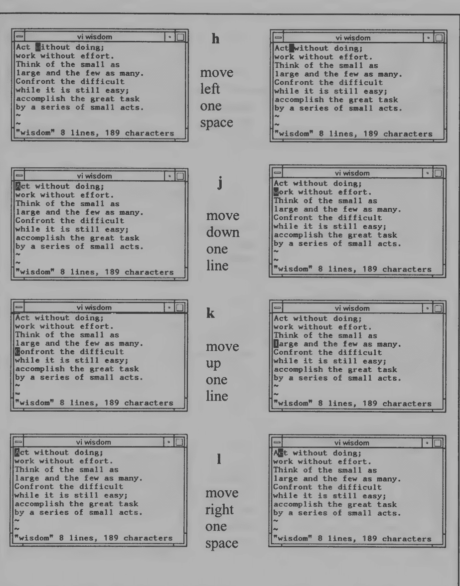

图 8-5 vi 中光标移动的示例 (h, j, k, 和 l)


图 8-6 vi 中光标移动的示例 (G, w, b, 和 e)

### 在 vi 中添加文本

既然我们已经知道如何移动光标，那就用它来做点事情。你需要首先了解光标移动，因为添加文本的命令是相对于光标位置执行的。表 8-3 总结了一些用于添加文本的命令。

表 8-3 在 vi 中添加文本

| 命令 | 插入操作 |
| :--- | :--- |
| a | 在光标后追加新文本。 |
| A | 在当前行末尾追加新文本。 |
| i | 在光标前插入新文本。 |
| I | 在当前行开头插入新文本。 |
| o | 在当前行下方打开新行并插入。 |
| O | 在当前行上方打开新行并插入。 |
| :r file | 读取 *file* 并在当前行后插入。 |
| :nr file | 读取 *file* 并在第 *n* 行后插入。 |
| escape | 返回命令模式。 |
| ^v char | 插入时忽略 *char* 的特殊含义。这用于插入特殊字符。 |

现在让我们看看图 8-7 中一些向 **wisdom** 添加文本的示例。

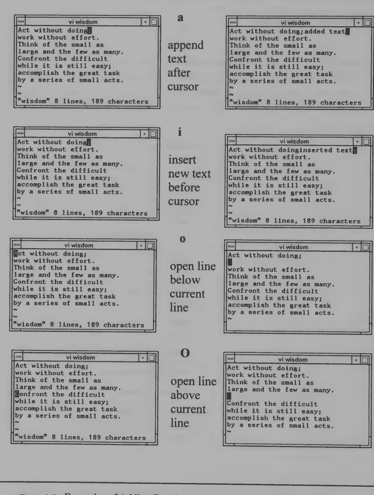

图 8-7 vi 中添加文本的示例

### 在 vi 中删除文本

在学习如何删除文本之前，我们也需要了解光标移动，因为删除文本的命令是相对于光标位置执行的。表 8-4 总结了一些用于删除文本的命令。

表 8-4 在 vi 中删除文本

| 命令 | 删除操作 |
| :------ | :-------------- |
| x | 删除光标处的字符。你也可以在 x 前面加一个数字来指定要删除的字符数。 |
| nx | 从当前字符开始删除 n 个字符。 |
| X | 删除前一个字符。你也可以在 X 前面加一个数字来指定要删除的前面的字符数。 |
| nX | 删除前面的 n 个字符。 |
| dw | 删除到下一个单词的开头。 |
| ndw | 从当前单词开始删除接下来的 n 个单词。 |
| dG | 删除到文件末尾的行。 |
| dd | 删除整行。 |
| ndd | 从当前行开始删除 n 行。 |
| db | 删除前一个单词。 |
| ndb | 从当前单词开始删除前面的 n 个单词。 |
| :n,md | 删除第 n 行到第 m 行。 |
| D 或 d$ | 从光标位置删除到行尾。 |
| d*cursor_command* | 删除文本直到 *cursor_command*。**dG** 将从当前行删除到文件末尾。 |
| ^h 或 backspace | 在插入模式下，删除前一个字符。 |
| ^w | 在插入模式下，删除前一个单词。 |

现在让我们看看图 8-8 和图 8-9 中一些从 **wisdom** 删除文本的示例。


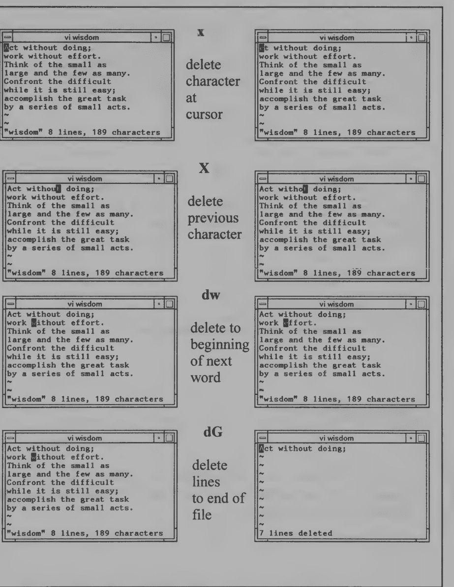

图 8-8 vi 中删除文本的示例 (x, X, dw, 和 dG)


图 8-9 vi 中删除文本的示例 (dd 和 db)

### 在 vi 中修改文本

好吧，你已经添加了文本并删除了文本，现在你想要修改文本。到目前为止，vi 还没那么糟糕，对吧？表 8-5 汇总了一些用于修改文本的命令。

### 表 8-5 在 vi 中修改文本

| 命令 | 替换操作 |
| :--- | :--- |
| (在这些命令前加上数字可以重复执行该命令任意次。) | |
| `r`char | 用 char 替换当前字符。 |
| Rtext `escape` | 替换当前字符为 text，直到输入 `escape` 为止。 |
| stext `escape` | 用 text 替换当前字符。 |
| S 或 ctext `escape` | 用 text 替换整行。 |
| cw text `escape` | 将当前单词更改为 text。 |
| Ctext `escape` | 将当前行剩余部分更改为 text。 |
| cG `escape` | 更改到文件末尾。 |
| ccursor_cmd text `escape` | 将当前位置到 cursor_cmd 之间的内容更改为 text。 |

现在让我们看看图 8-10 和 8-11 中在 wisdom 文件中替换文本的一些示例。


图 8-10 vi 中修改文本的示例 (r, R, cw, 和 cG)


图 8-11 vi 中使用 cc 修改文本的示例

### vi 中的查找和替换

vi 中有许多查找和替换功能。表 8-6 汇总了 vi 中一些更常见的查找和替换功能。


### 表 8-6 vi 中的查找和替换

| 命令 | 查找和替换操作 |
| :--- | :--- |
| `/`text | 在文件中向前查找 text。 |
| `?`text | 在文件中向后查找 text。 |
| n | 沿与原查找相同的方向重复查找。 |
| N | 沿与原查找相反的方向重复查找。 |
| ftext | 在当前行中向前查找 text。 |
| Ftext | 在当前行中向后查找 text。 |
| ttext | 在当前行中向前查找 text，并停在 text 之前的字符处。 |
| Ttext | 在当前行中向后查找 text，并停在 text 之后的字符处。 |
| `:set ic` | 查找时忽略大小写。 |
| `:set noic` | 使查找区分大小写。 |
| `:s/oldtext/newtext/` | 用 newtext 替换 oldtext。 |
| `:m,n s/oldtext/newtext/` | 在第 m 行到第 n 行之间用 newtext 替换 oldtext。 |
| `&` | 重复上一个 `:s` 命令。 |
| `:g/text1/s/text2/text3` | 查找包含 text1 的行，用 text3 替换 text2。 |
| `:g/text/command` | 对所有包含 text 的行执行 command。 |
| `:v/text/command` | 对所有不包含 text 的行执行 command。 |

现在让我们看看图 8-12 中在 wisdom 文件中搜索和替换文本的一些示例。


你可以使用 `:g` 和 `:v` 执行高级搜索。你可以使用以下命令查找并显示文件中所有包含 `while` 的行：

```
:g/while/p
```

此命令行中的 `/p` 是用于 ex 编辑器的打印命令。你可以使用以下命令查找文件中所有包含 `while` 的行并删除这些行：

```
:g/while/d
```

你还可以指定希望进行搜索的特定行号。以下命令查找第 10 行到第 20 行之间包含 `while` 的所有行，并显示其出现的行号：

```
:10,20g/while/nu
```

`:g` 对包含我们要查找的文本的行执行命令，而 `:v` 对不包含指定文本的行执行命令。以下三个命令以与前三个命令作用于包含 `while` 的行相同的方式，作用于不包含 `while` 的行：

```
:v/while/p
```

```
:v/while/d
```

```
:10,20v/while/nu
```

第一个命令打印不包含 `while` 的行。第二个命令删除未出现 `while` 的行。第三个命令打印第 10 行到第 20 行之间未出现 `while` 的行号。

### 在 vi 中复制文本

你可以在 vi 中复制文本。一些用于复制的命令显示在表 8-7 中。

### 表 8-7 vi 中的复制

| 命令 | 复制操作 |
| :--- | :--- |
| yy | 提取（Yank）当前行。 |
| nyy | 提取 n 行。 |
| p (小写) | 将提取的文本放在光标之后。 |
| P (大写) | 将提取的文本放在光标之前。 |
| "(a-z)nyy | 将 n 行复制到括号中命名的缓冲区。省略 n 则针对当前行。 |
| "(a-z)ndd | 将 n 行删除到括号中命名的缓冲区。省略 n 则针对当前行。 |
| "(a-z)p | 将括号中缓冲区命名的行放在当前行之后。 |
| "(a-z)P | 将括号中缓冲区命名的行放在当前行之前。 |

现在让我们看看图 8-13 中在 wisdom 文件中复制文本的一些示例。


### vi 中的撤销和重复


你可以轻松使用表 8-8 中显示的命令在 vi 中撤销更改。

### 表 8-8 vi 中的撤销和重复

| 命令 | 撤销操作 |
| :--- | :--- |
| u | 撤销最后一次更改。 |
| U | 撤销对当前行的所有更改。 |
| . (句点) | 重复最后一次更改。 |
| , (逗号) | 沿相反方向重复最后一个 f, F, t, 或 T 查找命令。 |
| ; (分号) | 重复最后一个 f, F, t, 或 T 查找命令。 |
| "np | 检索第 n 次删除（缓冲区中保存有限数量的删除记录，通常是九个）。 |
| n | 重复最后一个 / 或 ? 查找命令。 |
| N | 沿相反方向重复最后一个 / 或 ? 查找命令。 |

### 保存文本并退出 vi

你有多种方式保存文件并退出 vi，其中一些汇总在表 8-9 中。


### 表 8-9 保存文本并退出 vi

| 命令 | 保存和/或退出操作 |
| :--- | :--- |
| `:w` | 保存文件但不退出 vi。 |
| `:w file` | 保存文件更改但不退出 vi。 |
| `:wq` 或 ZZ 或 `:x` | 保存文件并退出 vi。 |
| `:q!` | 不保存文件而退出 vi。 |
| `:e!` | 重新编辑文件，丢弃自上次写入以来的更改。 |

### vi 中的选项


在 vi 中，你可以设置和取消许多选项。要设置一个选项，你输入 `:set option`。要取消一个选项，你输入 `:set nooption`。表 8-10 汇总了一些更常用的选项。

### 表 8-10 vi 中的选项

| 选项 | 操作 |
| :--- | :--- |
| `:set all` | 打印所有选项。 |
| `:set nooption` | 关闭选项。 |
| `:set nu` | 在行前加上行号。 |
| `:set showmode` | 显示是输入模式还是替换模式。 |
| `:set noic` | 查找时忽略大小写。 |
| `:set list` | 显示制表符 (^I) 和行尾 ($)。 |
| `:set ts=8` | 设置文本输入的制表位。 |
| `:set window=n` | 将文本窗口的行数设置为 n。 |

让我们在图 8-14 中为行加上行号并显示输入或替换模式。


除了表 8-10 中的选项外，还有许多其他可用的选项。以下是一个在 UNIX 系统上通过 `:set all` 命令生成的选项列表。你应该在 `vi` 中执行此命令以查看可用的选项：

```
:set all
noautoindent
autoprint
noautowrite
nobeautify
directory=/var/tmp
nodoubleescape
noedcompatible
noerrorbells
noexrc
flash
hardtabs=8
noignorecase
keybaordedit
nokeybaordedit!
nolisp
nolist
magic
mesg
nomodelines
nonumber
nonovice
noopimize
paragraphs=IPLPPQPP LIpplpipnpbp
prompt
noreadonly
redraw
remap
report=5
scroll=11
sections=NHSHH HUuhsh+c
shell=/sbin/sh
shiftwidth=8
noshowmatch
noshowmode
noslowopen
```


### vi 中的状态

在 vi 中，你可以通过一些简单的命令获取大量有用的状态信息。你可以使用表 8-11 中所示的命令来显示当前行号、文件中的行数、文件名以及其他状态信息。

表 8-11 vi 中的状态
| 选项 | 操作 |
|---|---|
| `:==` | 打印当前行号。 |
| `:=` | 打印文件中的行数。 |
| `^g` | 显示文件名、当前行号、文件总行数以及文件位置百分比。 |
| `:l` | 使用字母 "l" 显示各种特殊字符，如制表符和换行符。 |

### 在文本中定位节和放置标记

你可以定义可以移动的文本节，也可以用字符标记文本并移动到这些标记处。表 8-12 总结了 vi 中的定位和标记功能。

表 8-12 vi 中的定位和标记
| 选项 | 操作 |
|---|---|
| `{` | 在第一列插入 `{` 以定义节。 |
| `[{` | 返回到节的开头。 |
| `]}` | 前进到下一节的开头。 |
| `m(a-z)` | 用字母标记当前位置，例如 `mz` 表示标记 z。 |
| `'a` | 将光标移动到指定的标记处，例如 `'z` 表示移动到 `z`。 |

### 在 vi 中合并行

你可以使用表 8-13 中所示的命令在 vi 中合并一行或多行。

表 8-13 vi 中合并行
| 选项 | 操作 |
|---|---|
| `J` | 将下一行合并到当前行的末尾。 |
| `nJ` | 合并接下来的 n 行。 |

### 光标放置和屏幕调整

你可以使用表 8-14 中所示的命令，将光标放置在文件中的任意位置，并以多种方式调整屏幕。

表 8-14 光标放置和屏幕调整
| 选项 | 操作 |
|---|---|
| `H` | 将光标移动到屏幕顶行。 |
| `nh` | 将光标移动到屏幕顶部向下的第 n 行。 |
| `M` | 将光标移动到屏幕中间。 |
| `L` | 将光标移动到屏幕底行。 |
| `nL` | 将光标移动到屏幕底部向上的第 n 行。 |
| `^e` (控制-e) | 屏幕向上移动一行。 |
| `^y` | 屏幕向下移动一行。 |
| `^u` | 屏幕向上移动半页。 |
| `^d` | 屏幕向下移动半页。 |
| `^b` | 屏幕向上移动一页。 |
| `^f` | 屏幕向下移动一页。 |
| `^l` (字母 l) | 重绘屏幕。 |
| `z<return>` | 将当前行设置为屏幕顶行。 |
| `nz<return>` | 将第 n 行设置为屏幕顶行。 |
| `z.` | 将当前行设置为屏幕中间行。 |
| `nz.` | 将第 n 行设置为屏幕中间行。 |
| `z-` | 将当前行设置为屏幕底行。 |
| `nz-` | 将第 n 行设置为屏幕底行。 |

### Shell 转义命令

你可以使用 shell 转义命令在不退出 vi 的情况下运行 UNIX 命令。你可以做像使用 `:sh` 命令启动子 shell 这样简单的事情。你也可以在不退出 vi 的情况下运行编辑文件之外的命令。表 8-15 描述了 shell 转义命令。

表 8-15 vi 中的 Shell 转义命令
| 选项 | 操作 |
|---|---|
| `:! command` | 执行 shell 命令 command，例如 `:! ls`。 |
| `:!!` | 执行上一个 shell 命令。 |
| `:r! command` | 读取并插入 command 的输出，例如使用 `:r! ls` 运行 ls 并读取内容。 |
| `:w ! command` | 将当前编辑的文件作为标准输入发送给 command 并执行命令，例如 `:w ! grep all`。 |
| `:cd directory` | 将当前工作目录更改为 directory。 |
| `:sh` | 启动子 shell，并使用 ^d (控制-d) 返回 vi。 |
| `:so file` | 读取并执行 shell 程序 file 中的命令。 |

使用 `:w` 的一个示例是将文件 **wisdom** 作为标准输入发送给 **grep**，查找包含 **all** 的所有行，如下例所示：

```
:w ! grep all
Think of the small as
by a series of small acts.
```

你可以发出 `:so` 命令来读取并执行文件中的命令。在 vi 中发出以下命令将执行文件 **file_with_commands** 中的命令：

`:so file_with_commands`

该文件包含以下两个命令：

```
:set nu
:g/all/p
```

当我们发出上面的 `:so` 命令时，使用 `:set nu` 命令显示行号，并打印包含 *all* 的以下行：

Think of the small as
by a series of small acts.

### 宏和缩写

你不仅仅限于发出单个 vi 命令。你可以定义 vi 命令字符串，并定义一个对应于该字符串的键，以便随时调用。在定义宏的键时，你不能使用以下按键：K V g q v * = 和功能键。还有一些控制键也不能使用，因此最好避免使用控制键。表 8-16 展示了宏和缩写。

表 8-16 vi 中的宏和缩写
| 选项 | 操作 |
|---|---|
| `:map key command_seq` | 定义 key 以执行 command_seq，例如 `:map e ea` 使得每次使用 **e** 移动到单词末尾时都会追加文本。 |
| `:map` | 在状态行上显示所有已定义的宏。 |
| `:umap key` | 移除 key 的宏。 |
| `:ab string1 string2` | 定义一个缩写，使得当插入 string1 时，将其替换为 string2。插入文本时输入 string1，按 escape 键，将插入 string2。 |
| `:ab` | 显示所有缩写。 |
| `:cd directory` | 将当前工作目录更改为 directory。 |
| `:una string` | 取消 string 的缩写。 |
| | 避免使用控制键、符号，不要使用字符：K \ V g q v * = 和功能键。 |

使用 **map** 命令的一个示例是在你移动到末尾时自动添加文本，如下面的 **map** 命令所示：

```
:map e ea
```

该命令将 **e** 映射为 **ea**。当你用 **e** 移动到下一个单词的末尾时，也会通过 **a** 进入插入模式，这样你就可以立即在单词末尾后追加新文本。

你也可以使用 **ab** 缩写长序列。例如，你可以使用以下命令将 *system administration* 缩写为 *sa*：

```
:ab sa system administration
```

现在，无论何时你插入文本，输入 *sa*，然后按 *escape* 键完成插入，字符串 *system administration* 就会出现。*sa* 是 *system administration* 的缩写。

### 文本缩进

你可以以多种不同的方式缩进文本。表 8-17 展示了一些常用的缩进命令。

表 8-17 文本缩进
| 选项 | 操作 |
|---|---|
| `^i` (控制 i) 或 tab | 在插入文本时，插入一个 shift 宽度。Shift 宽度可以定义。 |
| `:set ai` | 打开自动缩进。 |
| `:set sw=n` | 将 shift 宽度设置为 n 个字符。 |
| `n<<` | 将 n 行向左移动一个 shift 宽度。 |
| `n>>` | 将 n 行向右移动一个 shift 宽度。例如，`3>>` 将接下来三行向右移动一个 shift 宽度。 |

在你调整 shift 宽度之前，你可能想发出 `:set all` 以查看当前 shift 宽度设置的字符数。默认情况下通常为 8 个字符。要将 shift 宽度设置为 16 个字符，请发出以下命令：

```
:set sw=16
```


然后，你可以使用以下命令将接下来的三行每行向右移动 16 个字符：

```
3>>
```

接下来三行随即向右移动 16 个字符。

### Shell 过滤器

你可以将正在编辑的文件中的信息发送给某个命令，然后使用该命令的输出替换原始文本。表 8-18 展示了一个 shell 过滤器。

### 表 8-18 vi 中的 Shell 过滤器

| 选项 | 操作 |
| :--- | :--- |
| `!cursor_command command` | 将文本从当前位置发送到 `cursor_command` 描述的位置，并执行 shell 命令。例如，使用 `!$ grep admin` 可以获取从当前位置到段落末尾的文本，通过 `grep` 查找单词 *admin*，并用 `grep` 的输出替换现有文本。 |

### 模式匹配

模式匹配允许你在正在编辑的文件中查找模式。然后，你可以执行诸如更改已找内容等操作。表 8-19 列出了一些最常用的模式匹配命令。

### 表 8-19 vi 中的模式匹配

| 选项 | 操作 |
| :--- | :--- |
| ^ (插入号) | 匹配行的开头。若要仅在行首搜索 **Think**，可以使用：`/^Think` 你可以将其与匹配行尾的 $ 结合使用，删除所有空行：`:g/^$/d.` |
| $ | 匹配行尾。若要在 **last** 后紧跟换行符时进行匹配，可以使用：`/last.$` |
| . | 匹配任意单个字符。 |
| \< | 匹配单词开头。 |
| \> | 匹配单词结尾。 |
| [string] | 匹配 *string* 中的任意单个字符。若要查找 **mp**、**mP**、**Mp** 或 **MP**，请使用：`/[mM][pP]` 将所有 **input** 或 **Input** 出现的位置更改为 **INPUT**：`:%s/[Ii]nput/INPUT/g` |
| [^string] | 匹配 *string* 中不包含的任意字符。 |
| [a-p] | 匹配 *a* 和 *p* 之间的任意字符。 |
| * | 匹配表达式中前一个字符零次或多次出现。 |
| \ | 转义下一个字符的含义。若要搜索 [，请使用以下命令：`\[` |
| \\[ | 转义 \ 字符。 |

当你刚开始使用模式匹配时，可能会觉得有点令人困惑，所以我将使用几个简单的示例来帮助你入门。请记住，这里描述的许多模式匹配技术也在 vi 之外的 shell 中有效。


### 匹配集合

我们从 *方括号* 运算符开始。若要匹配 **m**、**f** 或 **p** 中的任意单个字符，可以使用以下命令：

```
/[mfp]
```

一种常见的匹配模式是单词的首字母，无论是大写还是小写。若要匹配 **input** 或 **Input**，可以使用以下命令：

```
/[Ii]nput
```

在匹配到 **Input** 或 **input** 之后，你可以使用以下命令将其更改为 **INPUT**：

```
:%s/[Ii]nput/INPUT/g
```

你可以使用表达式序列来搜索多个字符，如下面的示例所示：

```
/[mM][pP]
```

该序列将匹配 **mp**、**mP**、**Mp** 或 **MP**。实际上，你是在搜索这四个两个字符的字符串中的任意一个。

### 匹配范围

你还可以使用方括号运算符来匹配范围内的单个字符。若要查找文件中的任意数字，可以使用以下两种方括号搜索中的任意一种：

```
/[0123456789]
```

或者

```
/[0-9]
```

连字符表示方括号内的范围。若要查找任意字符（无论是大写还是小写），可以使用以下命令：

```
/[a-zA-Z]
```

若要搜索通常具有特殊含义的字符（例如 [），你可以通过在特殊字符前加一个 \（反斜杠）来忽略或转义其特殊含义。例如，要在 vi 中搜索 [，请使用以下序列：

```
\[
```

此搜索查找 [ 的第一次出现。

### 行首和行尾搜索

你可以指定希望模式匹配仅发生在行的开头或结尾。若要指定行首模式匹配，请使用 ^（插入号）置于所需模式之前，如下面的示例所示：

```
/^Think
```

这仅在 Think 出现在行首时进行匹配。

若要指定行尾模式匹配，请使用 $（美元符号）置于所需模式之后，如下面的示例所示：

```
/last.$
```

这仅在 last. 后紧跟换行符时进行匹配。

### 第 8 章中使用命令的手册页

以下部分包含 vi 手册页的副本。

#### vi


vi - 运行可视化编辑器。

vi(1) vi(1)

### 名称

vi, view, vedit - 面向屏幕的（可视的）文本编辑器

### 概要

```
vi [-] [-l] [-r] [-R] [-t tag] [-v] [-V] [-wsize] [-x] [+command] [file ...]
```

XPG4 概要

```
vi [-rR] [-c command] [-t tag] [-w size] [file ...]
```

过时选项

```
vi [-rR] [+command] [-t tag] [-w size] [file ...]
view [-] [-l] [-r] [-R] [-t tag] [-v] [-V] [-wsize] [-x] [+command] [file ...]
vedit [-] [-r] [-R] [-l] [-t tag] [-v] [-V] [-wsize] [-x] [+command] [file ...]
```

备注

程序名称 ex、edit、vi、view 和 vedit 是同一程序的不同化身。本手册条目描述了 vi/view/vedit 化身的行为。

### 描述

vi（可视化）程序是一个面向显示器的文本编辑器，基于底层的 ex 行编辑器（参见 ex(1)）。可以在这两者之间来回切换，并在 vi 内部执行 ex 命令。行编辑器命令和编辑器选项在 ex(1) 中描述。这里只描述可视化模式命令。

view 程序与 vi 相同，区别在于设置了 readonly 编辑器选项（参见 ex(1)）。

vedit 程序对初学者和偶尔使用的用户来说更友好。report 编辑器选项设置为 1，并设置了 nomagic、novice 和 showmode 编辑器选项。

在 vi 中，终端屏幕充当正在编辑的文件在内存中副本的窗口。对文件副本所做的更改会反映在屏幕显示上。光标在屏幕上的位置指示其在文件副本中的位置。

环境变量 TERM 必须指定在 terminfo 数据库（参见 terminfo(4)）中定义的终端类型。否则，将显示一条消息并调出行编辑器。

与 ex 一样，编辑器初始化脚本可以放在环境变量 EXINIT 中，或者放在当前目录或主目录下的 .exrc 文件中。

**选项和参数**

vi 识别以下命令行选项和参数：

- **-** 抑制所有交互式用户反馈。当编辑器命令来自脚本时，这非常有用。
- **-l** 设置 lisp 编辑器选项（参见 ex(1)）。提供适合 lisp 代码的缩进。vi 中的 (、)、{、}、[[ 和 ]] 命令经过修改，以便与 lisp 源代码配合使用。
- **-r** 在编辑器或系统崩溃后恢复指定文件。如果未指定文件，则打印所有已保存文件的列表。你必须是已保存文件的所有者才能恢复它（超级用户无法恢复其他用户拥有的文件）。
- **-R** 设置 readonly 编辑器选项，以防止意外覆盖文件（参见 ex(1)）。
- **-t tag** 执行 tag 命令以加载并定位预定义文件。参见 ex(1) 中的 tag 命令和 tags 编辑器选项。
- **-v** 调用可视化模式（vi）。与 ex 配合使用时有用，对 vi 没有影响。
- **-V** 设置详细模式。当从 .exrc 文件或源文件输入时（参见 ex(1) 中的 source 命令），编辑器命令在执行时会被显示。
- **-wsize** 将 window 编辑器选项的值设置为 *size*。如果省略 *size*，默认为 3。
- **-x** 设置加密模式。系统会提示你输入一个密钥，以允许创建或编辑加密文件（参见 ex(1) 中的 crypt 命令）。
- **-c command** （仅限 XPG4。）
- **+command**（已废弃）通过执行指定的 ex 命令模式命令开始编辑。与普通 ex 命令行输入一样，command 选项参数可以由多个 ex 命令组成，这些命令由垂直线命令 () 分隔。以此方式进入输入模式的命令会产生未定义的结果。
- **file** 指定要编辑的文件或多个文件。如果指定了多个文件，它们将按给定顺序处理。如果同时指定了 -r 选项，则文件从恢复区域读取。

（仅限 XPG4。）如果同时给出了 -t tag 和 -c command（或已废弃的 +command）选项，则先处理 -t tag，即由 -t 选择包含 tag 的文件，然后执行该命令。

当调用 vi 时，vi 处于命令模式。通过几个用于插入或更改文本的命令来启动输入模式。

在输入模式下，使用 ESC（退出）键离开输入模式；但是，如果设置了 doubleescape 编辑器选项（参见 ex(1)），则需要两个连续的 ESC 字符才能离开输入模式。

在命令模式下，ESC 用于取消部分命令；终端


如果编辑器不处于输入模式且没有部分输入的命令，则会发出铃声。

**警告：** ESC 会完成“底行”命令（见下文）。

屏幕的最后一行（底行）用于回显搜索命令（`/` 和 `?`）、ex 命令（`:`）和系统命令（`!`）的输入。它还用于报告错误或打印其他消息。

在文本输入期间或在底行输入命令期间接收到 SIGINT 信号将终止输入（或取消命令），并使编辑器返回命令模式。在命令模式下，SIGINT 信号会导致发出铃声。通常，铃声表示发生了错误（例如，无法识别的按键）。

屏幕上显示仅包含 `~` 的行表明它们上方的最后一行是文件的最后一行（这些 `~` 行位于文件末尾之后）。本地智能有限的终端可能会在屏幕上显示标记有 `@` 的行。这些表示屏幕上不与文件中行对应的空间。（通过输入 `^R`，可以消除这些行，强制编辑器重新绘制屏幕，而不保留这些空白。）

如果系统崩溃，或 vi 因内部错误或意外信号而中止，vi 会尝试保留缓冲区（如果有未写入的更改）。使用 `-r` 命令行选项来恢复保存的更改。

vi 文本编辑器支持 SIGWINCH 信号，并响应窗口大小变化重新绘制屏幕。

## 命令摘要

大多数命令接受前置数字作为参数，用于指定大小或位置（用于显示或移动命令），或作为重复计数（用于更改文本的命令）。为简单起见，在描述其效果时，将此可选参数称为 *count*（计数）。

以下操作符可以后接移动命令，以指定受影响的文本范围：`c`、`d`、`y`、`<`、`>`、`!` 和 `=`。指定的区域从当前光标位置开始，到移动指示的光标位置之前结束。如果命令仅作用于行，则部分或完全落在该区域内的所有行都会受到影响。否则，精确标记的区域将受到影响。

在以下描述中，控制字符以 `^X` 的形式表示，其中 X 代表 Ctrl-X。空白定义为空格、制表符和替代空格字符。替代空格是 langinfo(5) 中描述的 `ALT_PUNCT` 项的第一个字符，该语言由 LANG 环境变量指定（参见 environ(5)）。

除非另有说明，命令在命令模式下解释，在输入模式下没有特殊效果。

- `^B`：向后滚动以显示前一窗口的文本。前置计数指定要返回的窗口数量。如果可能，保留两行重叠。
- `^D`：向前滚动半屏文本。前置计数指定要滚动的（逻辑）行数，并会被记住用于未来的 `^D` 和 `^U` 命令。
- `^D`：（输入模式）回退由自动缩进或 `^T` 提供的缩进，直到 shiftwidth 空格的下一个倍数。在非行首插入的由 `^T` 插入的空白不能通过 `^D` 回退。前置的 `^` 会移除当前及后续输入行在当前输入模式下的所有缩进，直到通过直接输入或使用 `^T` 插入前导空白来建立新的缩进。
- `^E`：向前滚动一行，尽可能保持光标位置不变。
- `^F`：向前滚动以显示当前窗口后的文本窗口。前置计数指定要前进的窗口数量。如果可能，保留两行重叠。（仅限 XPG4。）显示当前行，并将光标移动到当前行的第一个非空白字符，或者如果是空白行则移动到第一个字符。
- `^G`：打印当前文件名和其他信息，包括行数和当前位置（等同于 `ex` 命令 `f`）。
- `^H`：向左移动一个空格（在左边界停止）。前置计数指定要回退的空格数。（等同于 `h`）。
- `^H`：（输入模式）将光标向左移动到前一个输入字符，而不将其从屏幕上删除。该字符会从保存的文本中删除。
- `^J`：在同一列中向下移动一行，如果可能。前置计数指定要向下移动的行数。（等同于 `^N` 和 `j`）。
- `^L`：清除并重新绘制屏幕。当屏幕因任何原因混乱时使用。
- `^M`：移动到下一行的第一个非空白字符。前置计数指定要前进的行数。
- `^N`：等同于 `^J` 和 `j`。
- `^P`：在同一列中向上移动一行。前置计数指定要向上移动的行数（等同于 `k`）。
- `^R`：重新绘制当前屏幕，消除标记为 `@` 的伪行（这些行不对应文件中的实际行）。
- `^T`：弹出标签栈。参见 `ex(1)` 中的 `pop` 命令。
- `^T`：（输入模式）插入 shiftwidth 个空白。如果在行首，此插入的空格只能使用 `^D` 回退。
- `^U`：向上滚动半屏文本。前置计数指定要滚动的（逻辑）行数，并会被记住用于未来的 `^D` 和 `^U` 命令。
- `^V`：在输入模式下，`^V` 引用下一个字符，以便将特殊字符（包括 ESC）插入到文件中。
- `^W`：在输入模式下，`^W` 回退一个单词；被删除的字符仍保留在显示上。
- `^Y`：向后滚动一行，尽可能保持光标位置不变。
- `^[`：取消部分形成的命令；如果没有部分形成的命令，`^[` 会发出铃声。
- `^[`：在输入模式下，`^[` 终止输入模式。但是，如果设置了 doubleescape 编辑器选项，则需要两个连续的 ESC 字符才能终止输入模式（参见 ex(1)）。
- `^]`：在屏幕底行输入命令时（ex 命令行或使用 `/` 或 `?` 的搜索模式），终止输入并执行命令。
- `^[`：在许多终端上，可以通过按下 ESC 或 ESCAPE 键输入 `^[`。
- `^Z`：退出 vi 并进入 ex 命令模式。如果在输入模式，先终止输入。
- `^]`：将光标处或之后的单词作为标签，并执行标签编辑器命令（参见 ex(1)）。
- `#`：返回到上一个文件（等同于 `:ex #`）。
- `l`：向右移动一个空格（在行尾停止）。前置计数指定要前进的空格数（等同于 `l`）。
- `erase`：擦除，其中 *erase* 是用户指定的擦除字符（参见 stty(1)）。等同于 `^H`。
- `kill`：终止，其中 *kill* 是用户指定的终止字符（参见 stty(1)）。在输入模式下，*kill* 回退到当前输入行的行首，而不将该行从屏幕显示中删除。
- `susp`：挂起编辑器会话并返回到调用 shell，其中 *susp* 是用户指定的进程控制挂起字符（参见 stty(1)）。有关挂起编辑器命令的更多信息，参见 ex(1)。
- `!`：一个操作符，将缓冲区中指定的行作为标准输入传递给指定的系统命令，并用该命令的标准输出替换这些行。`!` 后接一个移动命令，指定要传递的行（从当前位置到移动结束的行），然后是命令（通常通过回车终止）。前置计数传递给 `!` 后的移动命令。
- `!!`：加倍 `!` 并在其前加上计数，将导致从当前行开始指定数量的行被传递。
- `:`：用于命名缓冲区规范的前置符号。存在 1 到 9 的命名缓冲区，编辑器将删除的文本放置在这些缓冲区中。a 到 z 的命名缓冲区可供用户保存删除或提取的文本；另见下文中的 `y`。
- `$`：移动到当前行的行尾。前置计数指定要前进的行数（例如，`2$` 使光标前进到下一行的行尾）。
- `%`：移动到与当前光标位置处的括号或花括号匹配的那个括号或花括号。
- `&`：等同于 ex 命令 `&`（即 `&` 重复上次的替换命令）。
- `'`：当后接一个单引号时，vi 返回到上一个上下文，将光标放置在行首。（只要执行非相对移动，就会设置上一个上下文。）当后接 a-z 的字母时，返回到标记有该字母的行（参见 `m` 命令），位于该行第一个非空白字符处。
- `'`：当与 `d` 等这样的操作符一起使用以指定文本范围时，操作在整行上进行（另见 `'`）。
- `"`：当后接一个双引号时，vi 返回到上一个上下文，将光标放置在标记的字符位置（只要执行非相对移动，就会设置上一个上下文）。当后接 a-z 的字母时，返回到标记有该字母的行（参见 `m` 命令），位于标记的字符位置处。
- `"`：当与 `d` 等这样的操作符一起使用以指定文本范围时，操作从标记的精确位置到该行内的当前位置进行（另见 `'`）。
- `[[`：回退到上一章节边界。章节由 *sections* 选项的值定义。以分页符（`^L`）或 `{` 开头的行也会使 `[[` 停止。
- `]]`：向前移动到章节边界（参见 `[[`）。如果设置了 *lsp* 选项，光标将停在每行开头的每个 `{` 处。
- `^`：移动到当前行上的第一个非空白位置。
- `(`：向后移动到句子开头。句子在 `. `、`!` 或 `?` 后结束，其后要么是一行结束，要么是两个空格。在 `. `、`!` 或 `?` 与空格或行结束之间，可以出现任意数量的闭合括号 `)`、`]`、`"`、`'` 和 `'` 字符。如果指定了计数，光标将向后移动指定数量的句子。
- `)`：如果设置了 *lsp* 选项，光标将移动到 *lsp* s-表达式的开头。句子也在段落和章节边界开始（参见 `(` 和 `[[`）。
- `)`：向前移动到句子开头。如果


指定 count 时，光标会前进指定数量的句子（见 `(`）。

- 返回到前一段的开头。段落的定义由 `paragraphs` 选项的值决定。完全空白的行以及章节边界（见前面的 `[[`）也被视为段落的开始。如果指定了 count，光标将向后移动指定数量的段落。
- 向前移动到下一段落的开头。如果指定了 count，光标将前进指定数量的段落（见 `(`）。
- 需要一个前置的 count；光标会移动到当前行的指定列（如果可能）。
- 移动到下一行的第一个非空白字符。如果指定了 count，光标将前进指定数量的行（等同于 `^`）。
- 逗号 (`,`) 执行最后一次发出的 `f`、`F`、`t` 或 `T` 命令的相反操作，即在当前行中朝相反方向进行搜索。如果指定了 count，光标将重复指定次数的搜索。
- 连字符 (`-`) 将光标移动到上一行的第一个非空白字符。如果指定了 count，光标将向后移动指定次数。
- 下划线字符 (`_`) 将光标移动到当前行的第一个非空白字符。如果指定了 count，光标将前进指定数量的行，当前行被计为第一行；没有指定 count 或 count 为 1 时，指定当前行。
- 重复最后一个修改缓冲区内容的命令。如果指定了 count，该命令将被重复执行指定次数。
- 从屏幕最后一行读取字符串，将其解释为正则表达式，并向前扫描查找下一个匹配的字符串。当用户输入回车键结束模式时，搜索开始；可以通过发送 SIGINT（或用户指定的中断字符）来终止搜索。

当与操作符配合使用以指定文本范围时，定义的区域从当前光标位置开始，到匹配字符串的开头结束。可以通过给出相对于匹配行的偏移量（使用闭合的 `/` 后跟 `+n` 或 `-n`）来指定整行。

- 移动到当前行的第一个字符（当前字符为非零数字时，`0` 不被解释为命令）。
- 冒号字符 (`:`) 开始一个 ex 命令。`:` 和输入的命令会回显在底部行；当用户输入回车键时，ex 命令被执行。

- 重复最后一次使用 `f`、`F`、`t` 或 `T` 执行的单字符查找。如果指定了 count，搜索将重复指定次数。
- 一个将行向左移动一个 shiftwidth 的操作符。`<` 后面可以跟随一个移动命令以指定行。前置的 count 会传递给移动命令。
  - 当重复使用 (`<<`) 时，移动当前行（或从当前行开始的指定数量的行）。
- 一个将行向右移动一个 shiftwidth 的操作符（见 `<`）。
- 如果设置了 Lisp 选项，`=` 会重新缩进指定的行，就好像这些行是使用 Lisp 和自动缩进输入的那样。`=` 前面可以跟随一个 count 以指示要处理的行数，或者后面跟随一个移动命令以达成相同目的。
- 向后扫描，是 `/` 的相反操作（见 `/`）。
- 执行存储在指定缓冲区中的命令。请注意，除非 `<return>` 是命令流的一部分，否则不要在缓冲区内容的末尾包含 `<return>` 字符。在 ex 模式下执行的命令应以冒号 (`:`) 开头。
- 波浪号 (`~`) 切换光标下字符的大小写（如果它是字母），然后向右移动一个字符，直到行尾为止。前置的 count 指定当前行中有多少个字符被切换。
- 在行尾追加（等同于 `$a`）。
- 向后移动一个词，其中词定义为任何非空白序列，光标置于该词的开头。如果指定了 count，光标将向后移动指定数量的词。
- 更改当前行剩余的文本（等同于 `c$`）。
- 删除当前行剩余的文本（等同于 `d$`）。
- 向前移动到下一个词的末尾，其中词定义为任何非空白序列。如果指定了 count，光标将前进指定数量的词。
- 必须后面跟一个单字符；在当前行中向后扫描，寻找该字符，如果找到则将光标移动至该字符。如果指定了 count，搜索将重复指定次数。
- 转到以前置参数给出的行号，如果没有指定前置 count，则转到文件末尾。
- 将光标移动到屏幕顶部的行。如果指定了 count，光标将移动到从屏幕顶部开始的第 count 行。光标被放置在行上的第一个非空白字符处。如果作为操作符的目标使用，则影响整行。

- 在行首插入（等同于 `^` 后跟 `i`）。

- 将当前行与下一行连接，并提供适当的空白：单词之间一个空格，句号后两个空格，如果下一行的第一个字符是右括号 (`)`) 则完全无空格。前置的 count 会导致指定数量的行被连接，而不仅仅是两行。

- 将光标移动到屏幕最后一行的第一个非空白字符。如果指定了 count，光标将移动到从屏幕底部开始的第 count 行。当与操作符一起使用时，影响整行。

- 将光标移动到屏幕中间的行，位于该行第一个非空白位置。

- 扫描 `/` 或 `?` 所给最后模式的下一个匹配项，但方向相反；这是 `n` 的反向操作。

- 在当前行上方打开新行并进入输入模式。

- 将最后删除或摘取（yank）的文本放回/插入到光标之前/上方。如果删除或摘取的是整行文本，则整行文本被返回到光标上方。否则，文本被插入到光标的正前方。

（仅限 XPG4。）在这种情况下，光标移动到插入字符的最后一列位置。

如果 `P` 前面跟随指定缓冲区名 (`x`)，则检索该缓冲区的内容。

- 退出 vi 并进入 ex 命令模式。

- 用输入的字符替换屏幕上的字符，直到输入以 ESC 终止。

- 更改整行（等同于 `cc`）。前置的 count 更改指定数量的行。

- 必须后面跟一个单字符；在当前行中向后扫描该字符，如果找到，将光标置于该字符之后。count 等同于将搜索重复指定次数。

- 将当前行恢复到光标最后一次移动到该行之前的状态。

（仅限 XPG4。）如果设置了自动缩进，光标位置设置为第 1 列位置或前一行的位置。

- 向前移动到当前行中下一个词的开头，其中词定义为非空白字符序列。如果当前位置在词的开头，或者当前位置在一个 bigword 内部，或者该位置的字符不能成为 bigword 的一部分，则当前位置应移动到下一个 bigword 的第一个字符。如果当前行不存在后续的 bigword，则当前位置应移动到包含 bigword 的下一个行中第一个 bigword 的第一个字符。对于此命令，空行或空白行被视为恰好包含一个 bigword。当前行被设置为包含所选 bigword 的行，当前位置被设置为所选 bigword 的第一个字符。前置的 count 指定要前进的词数。

- 删除光标前的字符。前置的 count 重复此效果，但仅删除当前行上的字符。

- 将当前行的副本放置（yank）到未命名缓冲区（等同于 `yy`）。如果指定了 count，则 count 行被复制到缓冲区。如果 `Y` 前面跟随缓冲区名，则行被复制到指定缓冲区。

- 退出编辑器，如果自上次写入以来缓冲区被修改，则写入缓冲区（等同于 `x` 命令 `x`）。注意，如果上次写入是到不同的文件且自那以后没有发生更改，则编辑器将在不写入缓冲区的情况下退出。

- 进入输入模式，在当前位置后追加输入的文本。前置的 count 会导致插入的文本被重复指定次数，但仅限插入的文本全在一行内的情况。

- 回退到当前行中前一个词的开头。词定义为字母数字序列或特殊字符序列。前置的 count 重复此效果。

- 必须后面跟一个移动命令。删除指定区域的文本，并进入输入模式以新文本替换被删除的文本。如果影响的范围超过单行的一部分，被删除的文本将保存在数字缓冲区中。如果仅影响当前行的一部分，则最后一个被删除的字符会被标记为 `$`。前置的 count 将该值传递给移动命令。如果命令是 `cc`，则更改整个当前行。

- 必须后面跟一个移动命令。删除指定区域的文本。如果影响的范围超过一行的一部分，文本将保存在数字缓冲区中。前置的 count 将该值传递给移动命令。如果命令是 `dd`，则删除整个当前行。

- 向前移动到下一个词的末尾，定义方式与 `b` 相同。前置的 count 重复此效果。

- 必须后面跟一个单字符；扫描剩余部分


该字符当前行的剩余部分，如果找到则光标移动至该位置。前缀计数重复该动作指定次数。

+   h
将光标向左移动一个字符（等同于 ^H）。前缀计数重复该效果。

+   i
进入输入模式，在光标前插入输入文本（参见 a）。

+   j
将光标向下移动一行，保持同一列（等同于 ^J 和 ^N）。

+   k
将光标向上移动一行（等同于 ^P）。

+   l
将光标向右移动一个字符（等同于 \ ）。

+   mx
标记光标当前位置。x 是一个小写字母（a-z），与 ` 和 ' 命令一起使用，以引用标记的行或行位置。

+   n
重复最后一个 / 或 ? 扫描命令。

+   o
在当前行下方打开新行并进入输入模式；否则类似于 O。

+   p
在光标后/下方放置文本；否则类似于 P。

+   r
必须后跟单个字符；光标下的字符被指定字符替换。（新字符可以是换行符。）如果 r 前有计数，则替换指定数量的字符。

+   s
删除光标下的单个字符并进入输入模式；输入文本替换被删除的字符。前缀计数指定当前行中更改的字符数。被更改的最后一个字符用 $ 标记，类似于 c。

+   t
必须后跟单个字符；扫描该行剩余部分中的该字符。如果找到该字符，光标移动至该字符之前的列。前缀计数等同于重复搜索指定次数。

+   u
撤销对当前缓冲区所做的最后一次更改。如果重复使用，u 在这两种状态之间交替；因此它是自身的逆操作。在插入多行文本后使用，这些行会被保存在数字命名的缓冲区中。

+   w
向前移动到下一个单词的开头（单词定义同 b）。前缀计数指定光标前进的单词数。

+   x
删除光标下的单个字符。当 x 前有计数时，x 从光标位置向前删除指定数量的字符，但仅限于当前行。

+   y
必须后跟移动命令；指定文本被复制（yanked）到未命名的临时缓冲区。如果前缀有命名缓冲区规范，如 "x"，文本也会放入该缓冲区。如果命令是 yy，则复制整行。

### z
重新绘制屏幕，当前行的位置按以下选项指定：z:center 指定屏幕顶部，z. 指定屏幕中心，z- 指定屏幕底部。命令 z^ 和 z+ 分别类似于 ^B 和 ^F。然而，z^ 和 z+ 不试图保持两行重叠。z 之后、下一个字符之前的计数指定重新绘制屏幕中显示的线条数。z 之前的计数指定用作参考行的行号，而不是默认的当前行。

## 键盘编辑键

初始化时，编辑器自动将某些终端键盘编辑键映射到等效的可视模式命令。这些映射仅针对在以下表中列出且在 terminfo(4) 数据库中定义为当前终端（由 TERM 环境变量指定）有效的那些键建立。

既创建命令模式映射，也创建输入模式映射（参见 ex(1) 中的 map 命令）。除了 insertchar 键（简单地切换输入模式的开和关）外，输入模式映射退出输入模式，执行与命令模式映射相同的动作，然后重新进入输入模式。

在某些终端上，键盘编辑键发送的字符序列（随后映射到可视模式命令）可能与用户输入执行其他命令或命令组的字符序列相同。这最有可能发生在输入模式映射中；因此，在这些终端上，默认禁用输入模式映射。用户可以通过设置 keyboardedit 和 keyboardedit! 编辑器选项来覆盖命令模式和输入模式键盘编辑键映射的禁用和启用（参见 ex(1)）。timeout、timeoutlen 和 doubleescape 编辑器选项是解决此问题的替代方法。

| terminfo 项 | 命令模式映射 | 输入模式映射 | 映射名称 | 描述 |
| :--- | :--- | :--- | :--- | :--- |
| key_ic | i | ^[ | inschar | 插入字符 |
| key_eic | i | ^[ | inschar | 结束插入字符 |
| key_up | k | ^[ka | up | 向上箭头 |
| key_down | j | ^[kb | down | 向下箭头 |
| key_left | h | ^[kh | left | 向左箭头 |
| key_right | l | ^[kl | right | 向右箭头 |
| key_home | H | ^[H | home | 主页箭头 |
| key_il | o^{ | o[^{a | inline | 插入行 |
| key_dl | dd | ^[dd | dddline | 删除行 |
| key_clear | ^L | ^[La | clear | 清屏 |
| key_eol | d$ | ^[d$ | creol | 清除行 |
| key_sf | ^E | ^[Ea | scrolld | 向下滚动 |
| key_su | x | ^[x | delchar | 删除字符 |
| key_page | ^F | ^[Pa | page | 下一页 |
| key_ppage | ^B | ^[Ba | ppage | 上一页 |
| key_sr | ^Y | ^[Ya | sr | 向上滚动 |
| key_eos | dG | ^[dG | creos | 清除至屏幕末尾 |

#### 外部影响

对国际代码和环境变量的支持如下：

### 环境变量

UNIX95 规定此命令使用 XPG4 行为。

- COLUMNS 覆盖系统选择的水平屏幕尺寸。
- LINES 覆盖系统选择的垂直屏幕尺寸，用作一屏的行数和可视模式中的垂直屏幕尺寸。
- SHELL 是一个变量，应解释为用于 `!`、shell、read 以及其他操作数形式为 `!string` 的命令的优选命令行解释器。对于 shell 命令，程序应以两个参数 `-c` 和 `string` 调用。如果此变量为空或未设置，则应使用 sh 实用程序。
- TERM 是一个变量，应解释为终端类型名称。如果此变量未设置或为空，则使用未指定的默认终端类型。
- PATH 确定编辑器命令中指定的 shell、read 和 write 命令的搜索路径。
- EXINIT 确定在编辑器启动时、读取第一个文件之前执行的 ex 命令列表。可以通过使用竖线 (|) 字符分隔来包含多个命令。
- HOME 确定将搜索名为 `.exrc` 的编辑器启动文件的目录的路径名。
- LC_ALL 此变量应确定用于覆盖由 LANG 设置或以 LC_ 开头的环境变量指定的语言类别值的区域设置。
- LC_MESSAGES 确定应用于影响写入标准错误的诊断消息和写入标准输出的信息消息的格式和内容的区域设置。
- LC_COLLATE 确定在评估正则表达式和处理 tags 文件时使用的排序顺序。
- LC_CTYPE 确定将文本解释为单字节和/或多字节字符的方式、将字符分类为大写或小写字母的方式、字母在大写和小写之间转换的方式，以及正则表达式中字符类表达式匹配的字符。
- LANG 确定显示消息的语言。
- LANGOPTS 指定确定从右向左书写语言的文本在输入和输出文件中如何存储的选项。参见 environ(5)。

如果 LC_COLLATE 或 LC_CTYPE 未在环境中指定或设置为空字符串，则使用 LANG 的值作为每个未指定或空变量的默认值。如果 LANG 未指定或设置为空字符串，则使用 "C" 作为默认值（参见 lang(5)）替代 LANG。如果任何国际化变量包含无效设置，编辑器表现得好像所有国际化变量都设置为 "C"。参见 environ(5)。

##### 国际字符集支持

支持单字节和多字节字符集。

#### 警告

另请参阅 ex(1) 中的警告部分。


## 程序限制

vi 对被编辑的文件施加了以下限制：

### 最大行长度

LINE_MAX 个字符（在 <limits.h> 中定义），包括 2–3 字节的开销。因此，如果 LINE_MAX 的指定值为 2048，则最长为 2044 个字符的行不应引起任何问题。

如果加载包含超过指定限制长度的行的文件，这些行将被截断至所述最大长度。保存文件时会用截断后的版本覆盖原文件，从而完全重写原始的行。

尝试创建超过编辑器允许最大长度的行时，会产生“行过长”的错误消息。

### 最大文件大小

最大文件长度为 234,239 行，该限制将被静默执行。

### 其他限制：

-   每个全局命令列表最多 256 个字符。
-   vi 或 ex 打开模式下，文件名最多 128 个字符。在短文件名 HP-UX 系统上，最大文件名为 14 个字符。
-   之前的插入/删除缓冲区最多 128 个字符。
-   shell-escape 命令最多 100 个字符。
-   字符串值选项（:set 命令）最多 63 个字符。
-   程序标签名最多 30 个字符。
-   由 map 命令定义的宏不超过 32 个。
-   组合 map 宏中总字符数不超过 512 个。

#### 作者

vi 由加利福尼亚大学伯克利分校开发。vi 的 16 位扩展部分基于东芝公司的软件。

## 另请参阅

ctags(1), ed(1), ex(1), stty(1), write(1), terminfo(4), environ(5), lang(5), regexp(5)。

*《vi 和 ex 文本编辑器终极指南》*，Benjamin/Cummings Publishing Company, Inc. 出版，ISBN 0-8053-4460-8，HP 零件号 97005-90015。

#### 标准合规性

vi: SVTD2, SVTD3, XPG2, XPG3, XPG4

# 第 9 章

### 网络

网络在不同安装环境之间差异巨大。某些安装环境，例如高度集中且隔离的系统，仅连接 ASCII 终端，要求系统管理员很少关注网络。而其他安装环境，例如高度分布的环境，其中成千上万的系统连接到可能跨越多个地理位置的网络，可能要求系统管理员投入大量精力关注网络。在这种情况下，系统管理员花在网络上的时间可能超过花在所有其他系统管理功能上的时间总和！而不是像第一位系统管理员那样完全忽视网络，或者像第二位系统管理员那样要求涵盖网络管理的所有方面，我在本章中介绍适用于大多数 UNIX 系统的网络方面。这些内容基于我在各种新的 UNIX 安装环境中工作的经验。如果您需要的网络背景知识多于本章所涵盖的范围，我推荐以下书籍作为出色的网络信息来源——布鲁斯·H·亨特和卡伦·布拉福德·亨特的 *《UNIX 网络》*（Prentice Hall，ISBN 0-13-08987-1）。

在本章中，我主要提供关于许多网络主题的背景信息，而不是设置信息，因为配置工作主要由系统管理员执行。我介绍的大部分内容有时被称为“互联网服务”。总的来说，我将介绍本章中的网络基础知识。这包括 ARPA 和 Berkeley 服务。以下是我涵盖的主题列表：

-   通用 UNIX 网络背景
-   互联网协议 (IP) 编址（A、B 和 C 类）
-   子网掩码
-   ARPA 服务
-   Berkeley 命令
-   主机名映射
-   网络文件系统 (NFS) 背景
-   UNIX 网络命令
-   一些示例

我在本章中提供了许多 UNIX 命令的摘要和示例。有关这些命令的更多细节可以在手册页中找到。我在本章末尾提供了许多所涵盖命令的完整手册页。

我在本章的示例中使用了多种系统，包括 Solaris、AIX 和 HP-UX。

### UNIX 网络

连接到其他机器是每个 UNIX 网络的重要组成部分。这意味着既要连接到其他 UNIX 机器，也要连接到非 UNIX 机器。这些机器必须在物理上和功能上彼此连接，以便你可以执行诸如传输文件和登录到其他系统等任务。你的 UNIX 系统上存在许多命令，为你提供在系统之间登录和传输文件的功能。这些被称为 ARPA 命令 telnet 和 ftp。

telnet 命令允许在异构环境中进行远程登录。例如，从你的 UNIX 系统，你可以 telnet 到非 UNIX 系统并登录。在远程系统登录后，你需要了解该系统运行的操作系统。如果你连接另一台计算机只是为了在系统之间传输文件，那么你可以使用 ftp。该命令允许你在任何两个系统之间传输文件，而无需了解远程系统运行的操作系统。

与可以在 UNIX 系统之间发出的命令相比，这些命令比较原始。对于 UNIX 系统而言，网络不是事后添加的需要附加到系统上的功能。ftp 和 telnet 命令随你的 UNIX 系统一起提供，此外还有更多高级命令和功能，你可以使用它们在你的 UNIX 系统与其他 UNIX 系统之间进行通信。这些更高级的命令被称为 Berkeley 命令，允许你远程执行许多命令，例如复制文件和目录以及登录。这种功能不断增加，直到你可以在任何系统上存储的文件中进行操作，而你对这些文件的访问通过网络文件系统（NFS）对你来说是透明的。

让我们来看一下 UNIX 网络的一些基础知识。

### 究竟什么是以太网、IEEE802.3、TCP/IP 这些东西？

为了理解你的 UNIX 系统上的网络是如何工作的，你首先需要了解存在于你 UNIX 系统上的网络组件。你的 UNIX 系统上有七层网络功能，如 图 9-1 所示。我会在浅尝辄止的层面上介绍最下面四层，以便你可以看到每一层如何参与你网络的操作，从而在配置和排除你的 UNIX 系统网络故障时更有依据。然而，最底层的也需要在某些层面上理解，以便你可以执行必要的配置来提高你系统的网络性能，这对你系统的整体性能有重大影响。


| 层编号 | 层名称 | 数据形式 | 注释 |
| :--- | :--- | :--- | :--- |
| 7 | 应用层 | | 用户应用程序在此层。 |
| 6 | 表示层 | | 应用程序准备。 |
| 5 | 会话层 | | 应用程序准备。 |
| 4 | 传输层 | 数据包 | 端口到端口的传输由 TCP 处理。 |
| 3 | 网络层 | 数据报 | 互联网协议 (IP) 通过直接路由到目标或默认路由器来处理路由。 |
| 2 | 链路层 | 帧 | 数据以以太网或 IEEE 802.3 封装，带有源和目的地址。 |
| 1 | 物理层 | | 系统之间的物理连接。通常是细缆网或双绞线。 |

图 9-1 ISO/OSI 网络层功能

我从 图 9-1 的最底层第 1 层开始审查，然后描述每个底层四层。这是国际标准化组织开放系统互连（ISO/OSI）模型。它有助于直观地理解网络层交互的方式。


#### 物理层

开端是网络中各系统之间的物理互连。如果没有**物理层**，你无法在系统之间进行通信，并且无法实现你想要实现的所有强大功能。物理层将你想要传输的数据转换为沿导线传输的模拟信号（这里先假设你现有的任何物理层都使用导线）。传入网络接口的信息从导线上被提取出来，并为下一层的使用做好准备。

#### 链路层

为了连接到与你本系统局域网内的其他系统，你需要使用能够与本地网段上所有其他系统建立连接的链路层。在这一层，你使用的要么是 IEEE 802.3，要么是以太网（Ethernet）。你的 UNIX 系统同时支持这两种“封装”方法。之所以称为封装，是因为你的数据被放入这两种格式中的一种（IEEE 802.3 或 Ethernet）。数据在链路层以帧（frame）的形式传输（帧是数据的另一种称呼），其中附带了源地址、目的地址以及其他一些信息。你可能会认为，既然存在两种不同的封装方法，它们之间一定差异很大。然而，事实并非如此。IEEE 802.3 和 Ethernet 几乎完全相同。因此，许多 UNIX 系统可以同时处理这两种类型的封装。所以，通过最下面的两层，你的系统之间具备了物理连接，并且数据被封装成两种格式之一，并附带了源地址和目的地址。图 9-2 列出了 **Ethernet** 封装的组成部分，并在适当的地方对 IEEE 802.3 封装进行了评论。

| 组件 | 大小 | 描述 |
| :--- | :--- | :--- |
| 目的地址 | 6 字节 | 数据发送到的地址 |
| 源地址 | 6 字节 | 数据发送自的地址 |
| 类型 | 2 字节 | 在 802.3 中这是“长度计数” |
| 数据 | 46-1500 字节 | 802.3 为 38-1492 字节；这两种数据大小（MTU）的差异可以通过 *ifconfig* 命令看到 |
| 校验和 | 4 字节 | 用于检测错误的校验和 |

**图 9-2 Ethernet 封装**


有一个值得注意的有趣事项是 IEEE 802.3 和 Ethernet 在最大数据大小上的差异，分别为 1492 和 1500 字节。这就是最大传输单元（MTU）。稍后将介绍的 **ifconfig** 命令会显示你接口的 MTU。Ethernet 中的数据被称为*帧*（在下一层上对数据进行重新封装被称为 IP 中的*数据报*，而在再上一层的封装则被称为 TCP 中的*包*）。

请记住，Ethernet 和 IEEE 802.3 可以在相同的物理连接上运行，但这两种封装方法确实存在差异。在你的 UNIX 系统中，你不需要花太多（如果有的话）时间去设置网络接口以进行封装。

#### 网络层


接下来我们进入第三层，即网络层。在 UNIX 系统中，这一层与互联网协议（IP）同义。该层的数据被称为*数据报*。这是负责在网络中路由数据的层。通过 IP 路由的数据有时会遇到某种错误，这些错误会通过互联网控制消息协议（ICMP）消息报告回源系统。我们将很快看到一些 ICMP 消息。**ifconfig** 和 **netstat** 是两个用于配置这种路由的 UNIX 命令，我将在稍后介绍。

不幸的是，IP 使用的信息并不方便地装进 Ethernet 帧中，因此你最终会得到碎片化的数据。这实际上是对数据的重新封装，因此当你沿着各层向上移动时，会出现大量的低效。

IP 以简单的方式处理路由。如果数据发送到直接连接到你的系统目的地址，那么数据直接发送到该系统。另一方面，如果目的地址没有直接连接到你的系统，数据会被发送到默认路由器。默认路由器随后有责任将数据送达其目的地。这种路由可能有点难以理解，所以我将在稍后详细解释。

#### 传输层

这一层可以看作比网络层高一级，因为它与*端口*通信。TCP 是在此层最常见的协议，它形成从端口到端口发送的包。程序使用的端口通常在 *etc/services* 中定义，并附带协议（如 TCP）。这些端口被诸如 **telnet**、**rlogin**、**ftp** 等网络程序使用。你可以看到，这些与端口相关的程序是我们分析层图时涉及的最高层。


### 互联网协议（IP）寻址

互联网协议地址（IP 地址）要么是 "A" 类、"B" 类或 "C" 类地址（还有 "D" 类和 "E" 类地址，这里不涵盖）。A 类网络每个网络支持的节点数远多于 B 类或 C 类网络。IP 地址由四个字段组成。将 IP 地址分解为四个字段的目的是定义节点（或主机）地址和网络地址。图 9-3 总结了各类别与地址之间的关系。

### 图 9-3 互联网协议（IP）地址比较

| 地址类别 | 网络 | 每网络节点数 | 定义网络的位数 | 定义每网络节点数的位数 |
| :---: | :---: | :---: | :---: | :---: |
| A | 较少 | 最多 | 8 位 | 24 位 |
| B | 较多 | 较多 | 16 位 | 16 位 |
| C | 最多 | 较少 | 24 位 | 8 位 |
| 保留 | - | - | - | - |

这些位模式很重要，因为位数定义了每个类别中网络和节点的范围。例如，A 类地址使用 8 位来定义网络，而 C 类地址使用 24 位来定义网络。因此，A 类地址支持的联网数量少于 C 类地址。然而，A 类地址每个网络支持的节点数远多于 C 类地址。将这些关系再深入一步，我们现在可以在图 9-4 中查看与这些地址类别相关的特定参数。

### 图 9-4 地址类别

| 地址类别 | 支持的网络 | 每网络节点数 | 地址范围 |
| :---: | :---: | :---: | :---: |
| A | 127 | 16777215 | 0.0.0.1 - 127.255.255.254 |
| B | 16383 | 65535 | 128.0.0.1 - 191.255.255.254 |
| C | 2097157 | 255 | 192.0.0.1 - 223.255.254.254 |
| 保留 | - | - | 224.0.0.0 - 255.255.255.255 |

查看二进制形式的 32 位地址，你可以看到如何确定地址的类别：

### 图 9-4 地址类别（续）


net.host.host.host

"A" 类地址的第一位设置为 0。你可以看到，如果所有位都用于节点或主机地址，每个网络可以支持多少节点。A 类地址的第一位是 0，网络部分的剩余 7 位用于定义网络。然后，总共 3 个字节用于定义网络内的节点。


net.net.host.host

"B" 类地址的第一位设置为 1，第二位设置为 0。这里支持的联网数量比 A 类地址多，但每个网络的节点数较少。对于 B 类地址，2 个字节用于地址的网络部分，2 个字节用于地址的节点部分。


"C" 类地址的第一位和第二位设置为 1，第三位为 0。C 类地址关联着最大的网络数量和最少的每网络节点数。对于 C 类地址，3 个字节用于网络，1 个字节用于网络内的节点。

这些地址用于稍后描述 /etc/hosts 文件时涉及的各种设置文件中。你网络上的每个接口都必须有一个唯一的 IP 地址。拥有两个网络接口的系统必须有两个唯一的 IP 地址。

### 子网掩码

你的 UNIX 系统使用子网掩码来确定 IP 数据报是发给其自身子网上的主机、不同子网但相同网络上的主机，还是不同网络上的主机。使用子网，你可以让一些主机在一个子网上，其他主机在另一个不同的子网上。子网可以通过路由器或其他连接子网的网络电子设备进行分隔。

为了执行路由，路由器使用地址的仅网络（net）和子网（subnet）部分。子网掩码用于屏蔽地址的主机部分。因为你可以设置网络地址，使得只有你知道地址的哪部分是主机、子网和网络，所以你使用子网掩码来

让你的系统识别 IP 地址中哪些位用于主机，哪些位用于子网。

在最简单的形式下，使用子网掩码实际上就是指定 IP 地址的哪一部分定义主机，哪一部分定义网络。处理子网掩码时最令人困惑的方面之一是，大多数书籍都如图 9-5 所示，展示了最常见的子网掩码。

| 地址类别 | 十进制 | 十六进制 |
| :--- | :--- | :--- |
| A | 255.0.0.0 | 0xff000000 |
| B | 255.255.0.0 | 0xffff0000 |
| C | 255.255.255.0 | 0xffffff00 |

图 9-5 子网掩码

然而，这种思维方式假设你尽可能多地使用位来表示网络，尽可能多地使用位来表示主机，并且没有使用任何子网。图 9-6 展示了使用 B 类地址进行子网划分的示例。

| 特性 | B 类示例 |
| :--- | :--- |
| 主机 IP 地址 | 152.128.12.1 |
| 分解 | 网络 子网 主机 ID |
| 位数 | 16 位 8 位 8 位 |
| 子网掩码（十进制） | 255.255.255.0 |
| 子网掩码（十六进制） | 0xffffff00 |
| 同一子网内不同主机的示例 | 152.128.12.2 |
| 不同子网内主机的示例 | 152.128.13.1 |

图 9-6 B 类 IP 地址和子网掩码示例

在图 9-6 中，子网掩码的前两个字节（255.255）定义网络，第三个字节（255）定义子网，第四个字节（0）专用于主机 ID。虽然这种用于 B 类地址的子网掩码没有出现在之前的默认子网掩码图中，但 255.255.255.0 的子网掩码在 B 类网络中被广泛使用以支持子网划分。

你的 UNIX 系统如何使用 255.255.255.0 的子网掩码执行比较，以确定 152.128.12.1 和 152.128.13.1 位于不同的子网中？图 9-7 展示了这种比较过程。


图 9-7 使用子网掩码比较地址的示例

图 9-8 展示了这两个位于不同子网中的系统。


图 9-8 位于不同子网中的 B 类系统

你不必使用 8 位的边界来划分网络、子网和主机 ID 字段。例如，如果你想将子网字段的一部分用于主机 ID，你可以这样做。采用这种方法的合理原因可能是为了适应未来的可扩展性。你可能希望今天的子网 12、13、14 和 15 属于同一个子网，而在未来将它们变为独立的子网。图 9-9 展示了这种配置。


这些系统连接到同一个子网，尽管第三字节的一部分（通常与子网相关）被用于主机 ID。在未来，子网掩码可以更改为 255.255.252.0，从而拥有 12、13、14 和 15 四个独立的子网。这种安排需要部署路由器来路由到这些独立的子网。

### 使用网络

ISO/OSI 模型有助于直观地理解网络层之间的交互方式。然而，该模型并没有告诉你如何使用网络。两个在你的系统上可能正在运行且值得查看的广泛使用的网络服务是 ARPA 和 NFS。你在系统上尝试的第一个网络产品通常被称为 ARPA 服务——我一直称之为 ARPA。

ARPA 是“ARPA 服务”和“Berkeley 服务”的组合。ARPA 服务支持运行不同操作系统的系统之间的通信，而 Berkeley 服务支持 UNIX 系统。以下部分列出了最常用的命令。虽然可以在这些服务的每个服务下运行许多程序，但以下是 UNIX 领域中最常用的命令。在某些情况下，有一些示例展示了如何使用这些命令。对于大多数示例，本地主机是 system1，远程主机是 system2。

#### ARPA 服务（不同操作系统系统之间的通信）


**文件传输协议 (ftp)** 将一个或多个文件从一个系统传输到另一个系统。这通常用于在 UNIX 工作站与 Windows PC、VAX 等之间传输文件。以下示例展示了如何将文件 /tmp/krsort.c 从 system2（远程主机）复制到 system1（本地主机）的本地目录：

| 命令序列 | 注释 |
| :--- | :--- |
| `$ ftp system2` | 发出 ftp 命令 |
| `Connected to system2.` | |
| `system2 FTP server (Version 4.1) ready.` | |
| `Name (system2:root): root` | 登录到 system2 |
| `Password required for root.` | |
| `Password:` | 输入密码 |
| `User root logged in.` | |
| `Remote system type is UNIX.` | |
| `Using binary mode to transfer files.` | |
| `ftp> cd /tmp` | 在 system2 上 cd 到 /tmp |
| `CWD command successful` | |
| `ftp> get krsort.c` | 获取 krsort.c 文件 |
| `PORT command successful` | |
| `Opening BINARY mode data connection for krsort.c` | |
| `Transfer complete.` | |
| `2896 bytes received in 0.08 seconds` | |

```
ftp> bye
Goodbye.
$
```

在这个示例中，两个系统都运行 UNIX；然而，通过 **ftp** 发出的命令是操作系统无关的。上面使用的 **cd**（改变目录）和 **get** 命令适用于运行 **ftp** 的任何操作系统。如果你熟悉几个 **ftp** 命令，你可能会发现在异构网络环境中传输信息并不难。

你很可能是在异构环境中使用你的 UNIX 系统，因此可能会使用 **ftp** 将文件和目录从一个系统复制到另一个系统。由于 **ftp** 被广泛使用，我描述了一些常用的 **ftp** 命令。

- **ascii**：将传输的文件类型设置为 ASCII。这意味着你正在将一个 ASCII 文件从一个系统传输到另一个系统。这通常是默认的，因此你不需要设置它。
  示例：`ascii`

- **binary**：将传输的文件类型设置为二进制。这意味着你正在将一个二进制文件从一个系统传输到另一个系统。例如，如果你想在你的 UNIX 系统上有一个目录，存放你复制到非 UNIX 系统的应用程序，那么你需要使用二进制传输。
  示例：`binary`

- **cd**：更改到远程主机上指定的目录。
  示例：`cd /tmp`

- **dir**：将远程系统上目录的内容列出到屏幕，或者如果你指定了本地文件名，则列出到本地系统上的文件中。

- **get**：将指定的远程文件复制到指定的本地文件。如果你不指定本地文件名，则将使用远程文件名。

- **lcd**：更改到本地主机上指定的目录。
  示例：`lcd /tmp`

- **ls**：将远程系统上目录的内容列出到屏幕，或者如果你指定了本地文件名，则列出到本地系统上的文件中。

- **mget**：将远程主机上的多个文件复制到本地主机。
  示例：`mget *.c`

- **put**：将指定的本地文件复制到指定的远程文件。如果你不指定远程文件名，则将使用本地文件名。
  示例：`put test.c`

- **mput**：将本地主机上的多个文件复制到远程主机。
  示例：`mput *.c`

- **bye/quit**：关闭与远程主机的连接。
  示例：`bye`

除了这里涵盖的内容外，还有其他可用的 **ftp** 命令。如果你需要有关这些命令的更多信息，或希望复习其他 **ftp** 命令，UNIX 手册页中关于 **ftp** 的部分很有帮助。

**telnet**

用于使用 telnet 协议与另一台主机通信。Telnet 是使用后文描述的 **rlogin** 的替代方案。以下示例展示了如何与远程主机 system2 建立 telnet 连接：

```
$ telnet system2
Connected to system2.     Telnet to system2
AIX version 4 system2

login: root                     Log in as root on system2
password:                       Enter password

Welcome to system2. - rs6000 aix 4.3.1.0

$                             AIX prompt on system2
```


### Berkeley 命令（UNIX 系统间的通信）

#### 远程复制（rcp）

此程序用于将文件和目录从一个 UNIX 系统复制到另一个 UNIX 系统。若要将从 system1 上的 `/tmp/krsort.c` 复制到 system2，您可以执行以下操作：

```
$ rcp system2:/tmp/krsort.c /tmp/krsort.c
```

您的系统管理员必须配置某些网络文件才能实现这种功能。在此示例中，执行命令的用户在两个系统上被视为“等效”用户，并拥有通过 rcp 从一个系统向另一个系统复制文件的权限（这些术语将在稍后描述）。


#### 远程登录（rlogin）

支持登录到远程 UNIX 系统。若要远程从 system1 登录到 system2，您应执行以下操作：

```
$ rlogin system2
password:
Welcome to system2
$
```


如果用户在执行 rlogin 命令时被要求输入密码，则这两个系统上的用户不是等效的。如果没有要求输入密码，则用户确实是等效的。

#### 远程 shell（remsh）

使用 **remsh** 命令，您可以坐在一个 UNIX 系统上，发出要在另一个不同的 UNIX 系统上远程运行的命令，并在本地显示结果。在这种情况下，发出的 **remsh** 命令用于显示 `/tmp/krsort.c` 的长列表。命令在 system2 上运行，但结果在输入命令的 system1 上显示：


```
$ remsh system2 ll /tmp/krsort.c
-rwxrwxrwx 1 root sys 2896 Sept 1 10:54 /tmp/krsort.c
$ 
```

在这种情况下，system1 和 system2 上的用户必须是等效的，否则将被拒绝执行此命令的权限。

#### 远程 who（rwho）

查看谁登录在远程 UNIX 系统上。以下是执行 **rwho** 的输出：


```
$ rwho
   root          system1:ttyu0   Sept 1 19:21
   root          system2:console Sept 1 13:17
   tom           system2:typ2    Sept 1 13:05
   |
   |
   |
   |
   |
   |> user name
           |
           |
           |> machine name
               |
               |> terminal line
                   |
                   |> day of login
                   |
                   |> time of login
```


要使 **rwho** 正常工作，**rwho** 守护进程（**rwhod**）必须正在运行。

除了上述命令外，还有其他可用的 "r" 命令。此外，这些命令在不同 UNIX 变体之间会有所不同，因此您可能无法在您的 UNIX 系统上运行完全相同的 "r" 命令。

### 主机名映射

与网络相关的最重要决策之一是您的系统管理员如何在 ARPA 中实现主机名映射。有三种技术可用于主机名映射：

- Berkeley 互联网命名域（BIND）
- 网络信息服务（NIS）
- UNIX 文件 **/etc/hosts**

实现主机名映射最常见且最简单的方法是使用 **/etc/hosts**，因此我将在下一节中介绍此技术。请记住，您的 UNIX 变体可能具有专门针对许多网络主题（包括 NFS、ARPA 和其他）的网络手册。如果您需要了解比这里涵盖的更多的网络知识，这些手册是很好的参考材料。

如您即将所见，使用 **/etc/hosts** 文件在许多系统部署的环境中会变得非常困难。使用这种解决方案，必须保持最新状态并传播到所有其他系统的一个 **/etc/hosts** 文件。

域名系统（DNS）在大型环境中广泛使用。DNS 使用 Berkeley 互联网命名域服务（BIND）将名称解析为地址。有一些名称服务器负责填充名称数据请求。这是 BIND 的服务器端。BIND 还有一个客户端，称为解析器（resolver），它访问名称服务器以解析名称。使用这种客户端/服务器模型，维护命名信息要容易得多，因为只需要在少数地方保持最新状态，而不是在每个系统上。

客户端使用名为 `/etc/resolv.conf` 的文件来配置解析器。名称服务器及其对应的地址是解析信息的关键。

这种解决方案使在大型环境中维护系统名称和地址变得更加容易。DNS 和 BIND 主要是系统管理员设置的工作。从用户的角度来看，您不需要知道太多关于它们的信息。相反，我将在接下来的章节中重点介绍用户更感兴趣的一些程序。我将提供一些背景知识，以便程序的使用方式更具意义。不过，总的来说，我将集中关注这些网络主题的用户方面，而不是系统管理方面。

### /etc/hosts

此文件包含有关与您连接的其他系统的信息。它包含每个系统的互联网地址、系统名称以及系统名称的任何别名。如果您的系统管理员修改您的 `/etc/hosts` 文件以包含网络中系统的名称，他们就为向另一个系统执行 **rlogin** 提供了基础。尽管您现在可以 **rlogin** 到其他 UNIX 系统，但您还不能 **rcp** 或 **remsh** 到另一个系统。虽然添加 **remsh** 和 **rcp** 功能很容易，但这确实会破坏安全性，因此并非在所有系统上都设置。这是一个 `/etc/hosts` 文件的示例：

```
127.0.0.1  localhost  loopback
15.32.199.42  a4410827
15.32.199.28  a4410tu8
15.32.199.7  a4410922
15.32.199.21  a4410tu1
15.32.199.22  a4410tu2
15.32.199.62  a4410730
15.32.199.63  hpexterml
15.32.199.64  a4410rd1
15.32.199.62  a4410750  hp1
```


此文件的格式如下：
`<internet_address> \t <official_hostname> <alias>`

互联网协议地址（IP 地址）是 "A" 类、"B" 类或 "C" 类地址。"A" 类网络比 "B" 类或 "C" 类网络支持更多的每网络节点。将 IP 地址分解为四个字段的目的是定义节点（或主机）地址和网络地址。图 9-3 到 9-6 详细描述了这些类别。

假设上述 /etc/hosts 文件包含 "C" 类地址，则最右边的字段是主机或节点地址，而其他三个字段构成网络地址。

在发出之前描述的 ARPA 或 Berkeley 命令之一时，您可以使用 /etc/hosts 文件中的 official_hostname 或 alias。例如，以下任一 ARPA 命令都可以工作：


```
$ telnet a4410750
or
$ telnet hp1
```

类似地，以下任一 Berkeley 命令都可以工作：


```
$ rlogin a4410750
or
$ rlogin hp1
```

### /etc/hosts.equiv

如果您的系统管理员不希望用户在 rlogin 到远程系统时不得不输入密码，他们可以通过编辑此文件来设置等效主机。正如我之前提到的，这是一种有时被认为存在安全风险的技术，因此并不总是被使用。/etc/hosts.equiv 允许用户绕过输入密码的前提是本地和远程系统上的登录名称必须相同。您可以在 /etc/hosts.equiv 中列出所有等效主机，或者列出您希望等效的主机和用户名。用户现在可以使用 rcp 和 remsh，因为他们在这些系统上是等效用户。我通常只是输入网络上的所有主机名。这是一个 /etc/hosts.equiv 的示例：

```
a4410730
a4410tu1
a4410tu2
hpxterm1
a4410827
a4410750
```

请记住使用 /etc/hosts.equiv 的潜在安全风险。如果用户可以在不输入密码的情况下登录到远程系统，那么您的网络的整体安全级别就会降低。尽管用户可能觉得登录远程系统时不需要输入密码很方便，但您已经赋予了 /etc/hosts.equiv 中的每个用户访问整个网络的权限。如果您能确保所有系统上的所有文件和目录的权限都正确设置，那么您就不在乎谁有什么样的系统访问权限。然而，在真实的 UNIX 世界中，权限有时并不像预期的那样。用户有一种强烈的倾向去“四处浏览”，不可避免地会碰到他们想要复制的文件，而这些文件他们本不应该有权访问。


## /rhosts

此文件是超级用户的 /etc/hosts.equiv。如果你以 root 身份登录，你希望此文件配置的信息与 /etc/hosts.equiv 完全相同。然而，如果这样做，你允许任何系统的超级用户无需 root 密码即可登录远程系统，从而加大了你的网络安全风险。如果你是你网络的绝对统治者，并且 100% 确定不存在安全漏洞，那么你可能希望设置 /rhosts，以便作为超级用户远程登录系统时无需输入密码。但从安全角度来看，你应该知道这种设置是不被认可的。

如果你的系统管理员已在 /etc/hosts、/etc/hosts.equiv 和 /rhosts 中做了相应的条目，你可以使用 ARPA 服务命令 `ftp` 和 `telnet`，以及 Berkeley 命令 `rcp`、`rlogin`、`rsh` 和 `rwho`。

我已描述了设置相应文件以使最常用的 ARPA 服务运行起来的过程。有时甚至需要更高级的功能，例如 BIND。你的系统管理员可能已设置了 BIND 或类似功能，使你能够访问本节中涵盖的部分或全部命令。

### 网络文件系统（NFS）

NFS 允许你挂载远程系统的磁盘，使它们看起来像是你本地系统的磁盘。类似地，NFS 允许远程系统挂载你的本地磁盘，使其看起来像是远程系统的本地磁盘。配置 NFS 以实现此功能对系统管理员来说很简单。以下是系统管理员配置 NFS 的步骤：

- 1. 启动 NFS。
- 2. 指定你的系统是 NFS 客户端、NFS 服务器还是两者兼有。
- 3. 指定哪些本地文件系统可以被远程系统挂载。
- 4. 指定你想要挂载并查看的远程磁盘，使其看起来像本地磁盘一样。

与 ARPA 一样，你可以启用 NFS 的其他方面，但再次说明，我只涵盖我所知道的几乎所有 UNIX 安装都使用的 NFS 功能。

由于你的系统管理员可能会设置 NFS 以满足你和其他用户的需求，你可能需要了解与 NFS 相关的术语。以下是常用的 NFS 术语：

| 术语 | 描述 |
|---|---|
| **节点** | 连接到计算机网络或作为计算机网络一部分的计算机系统。 |
| **客户端** | 向其他节点（服务器）请求数据或服务的节点。 |
| **服务器** | 向网络上其他节点（客户端）提供数据或服务的节点。 |
| **文件系统** | 磁盘分区或逻辑卷。 |
| **导出** | 使用 NFS 使文件系统可供远程节点挂载。 |
| **挂载** | 使用 NFS 访问远程文件系统。 |
| **挂载点** | 在其上挂载 NFS 文件系统的目录名称。 |
| **导入** | 挂载远程文件系统。 |

在 UNIX 变种中，一些特定的配置任务和相关文件是不同的。如果系统管理员需要管理多个 UNIX 变种，这主要是一个他们需要处理的问题。以下是一些与配置 NFS 相关的一般任务和示例。当然，你的系统管理员必须处理 UNIX 变种配置的具体细节。

你的系统必须是 NFS 客户端、NFS 服务器或两者兼有。还有守护进程必须运行以支持 NFS。在 UNIX 变种中，这两项任务执行的方式略有不同。

然后，你的系统导入具有本地访问权限的远程文件系统，并导出被其他系统访问的本地文件系统。

你本地挂载的远程文件系统将在 /etc/fstab、/etc/vfstab、/etc/filesystems 或用于挂载文件系统的任何文件中具有类似的条目：

```
system2:/opt/app3 /opt/app3 nfs rw,suid 0 0
```

在这种情况下，我们在 system2 上本地挂载 /opt/app3 为 /opt/app3。这是一个具有所示权限的 NFS 挂载。

你可以使用 `showmount` 命令显示已挂载本地文件系统的所有远程系统（客户端）。大多数 UNIX 变种支持此命令。`showmount` 对于确定客户端最常通过 NFS 挂载的文件系统非常有用。`showmount` 的输出特别容易阅读，因为它列出了客户端挂载的主机名和目录。`showmount` 命令有如下三个选项：

- -a 以“名称:目录”格式打印输出
- -d 列出客户端远程挂载的所有本地目录
- -e 打印导出文件系统的列表

### 其他网络命令和设置

设置网络是系统管理员花费大量时间进行规划的一项活动。没有两个网络环境是完全相同的。通常有很多连接到你系统的网络电子设备。有许多与测试与其他系统的连接性和网络配置相关的有用命令。如果你遇到问题，你需要了解一些可以作为救命稻草的网络命令。此外，如果你有一些 UNIX 系统必须接口的网络硬件，如路由器、网关、网桥等，你可能会遇到一些网络设置的棘手方面。我举了一个这样的案例的例子：将 UNIX 系统连接到路由器。同时，我将在此描述中介绍一些最方便的网络命令。

请考虑图 9-10，其中 UNIX 系统直接连接到路由器。


这里，一个 UNIX 系统连接到网段 128.185.61。这是一个启用子网的 B 类 Internet 地址。

/etc/hosts 文件中需要包含节点 ID 为 2 的 UNIX 系统、路由器以及该网段上或路由器另一侧网段上的任何其他系统。

如果路由器配置得当，我们应该能够无缝地从 61 连接到网段 60、62 和 63 上的系统。路由器应配置为允许我们的系统通过路由器连接到其他网段（60、62 和 63）上的系统。需要一些意想不到的配置才能使这个简单的网络无缝运行。在这种情况下，在使 system1 连接到路由器另一侧 60、62 和 63 上的系统时出现了问题。在讨论需要进行的额外配置之前，我先展示 /etc/hosts 文件，然后使用一些非常有用的 UNIX 命令来显示网络状态。以下是仅显示 UNIX 系统和路由器的 /etc/hosts 文件：


```
$ cat /etc/hosts
127.0.0.1     localhost loopback
128.185.61.1  router1     # router
128.185.61.2  system1     # UNIX system on 61
128.185.62.1  system2     # UNIX system on 62
```

此主机文件很简单，允许 system1 连接到 router1 和 system2。system1 到 system2 的连接通过路由器进行。

### *ping*


让我们看看最常用网络命令之一——**ping**。此命令用于确定两个网络组件之间是否存在连接。**ping** 是一个简单的命令，每秒向你指定的主机发送一个 ICMP 回显数据包。你可能记得 ICMP 之前在第三层或网络层中提到过。**ping** 代表 Packet InterNet Groper。**ping** 在 UNIX 变种之间略有不同，主要区别在于在未提供选项时 **ping** 产生的报告。

一些系统在 **ping** 未提供选项时提供性能信息；其他系统报告系统“是存活的”。以下是检查本地系统与网络上名为 *austin* 的另一系统之间连接的示例：

```
martyp $ **ping austin**
austin is alive
martyp $
```

你可以使用 **ping** 指定的其他信息包括间隔、包大小和迭代次数，如下例所示：

```
martyp $ **ping -I 5 austin 4096 10**
PING austin: 4096 data bytes
4104 bytes from austin (128.185.61.5): icmp_seq=0.
time=8. ms
4104 bytes from austin (128.185.61.5): icmp_seq=1.
time=9. ms
4104 bytes from austin (128.185.61.5): icmp_seq=2. time=9.
ms
4104 bytes from austin (128.185.61.5): icmp_seq=3. time=9.
ms
4104 bytes from austin (128.185.61.5): icmp_seq=4. time=8.
ms
4104 bytes from austin (128.185.61.5): icmp_seq=5. time=9.
ms
4104 bytes from austin (128.185.61.5): icmp_seq=6. time=9.
ms
4104 bytes from austin (128.185.61.5): icmp_seq=7. time=9.
ms
4104 bytes from austin (128.185.61.5): icmp_seq=8. time=9.
ms
4104 bytes from austin (128.185.61.5): icmp_seq=9. time=9.
ms

----austin PING Statistics----

10 packets transmitted, 10 packets received, 0% packet
loss
round-trip (ms) min/avg/max = 9/9/15
martyp $
```


在本示例中，我们每五秒钟向 *austin* 发送一次 **ping** 信号，数据包大小为 4096 字节，总共发送十次。

现在让我们回到之前的示例。

我如何知道 system1 与路由器以及路由器另一侧的其他系统之间存在连接呢？我使用 **ping** 命令。以下是我确认 system1 已连接到 router1 的方法：

```
$ ping router1
PING router1: 64 byte packets
64 bytes from 128.185.61.2: icmp_seq=0. time=0. ms
64 bytes from 128.185.61.2: icmp_seq=1. time=0. ms
64 bytes from 128.185.61.2: icmp_seq=2. time=0. ms
```

这里的每一行输出都代表被 ping 设备返回的一个响应。这意味着该设备做出了响应。你会持续收到这种响应，直到输入 `^c`（控制 c）来终止 **ping**。如果没有产生任何输出，如下所示，则说明没有收到响应，你的系统与正在检查连接的目标设备之间可能存在故障。

```
$ ping system2
PING router1: 64 byte packets
```

在这种情况下，你会看到此消息，这也只是你能得到的最远结果。输入 `^c` 将终止 **ping**，你会看到发送了一定数量的数据包，但没有接收到任何数据包。当我发出 **ping** 命令时，确实收到了这种响应，因此我知道 system1 和 router1 之间的连接存在问题。

**ping** 仅应用于测试目的，例如手动故障排查，因为它会产生大量的网络流量。你不希望在持续运行的脚本中常态化地使用 **ping**。

我常使用的一种 **ping** 的变体是指定数据包大小为 4096 字节，而不是前例中默认的 64 字节，并统计 **ping** 在终止前传输的次数，从而避免手动输入 `^c` 来终止 **ping**。以下示例展示了这一操作：

```bash
$ ping router1 4096 5
```

```text
PING router1: 64 byte packets
4096 bytes from 128.185.51.2: icmp_seq=0. time=8. ms
4096 bytes from 128.185.51.2: icmp_seq=1. time=8. ms
4096 bytes from 128.185.51.2: icmp_seq=2. time=9. ms
4096 bytes from 128.185.51.2: icmp_seq=3. time=8. ms
4096 bytes from 128.185.51.2: icmp_seq=4. time=8. ms
```

请注意，传输和接收响应所需的时间（往返时间）比仅传输 64 字节时要长得多。我通常发现 64 字节的往返时间为 0 ms，尽管这取决于多种因素，包括网络拓扑和网络流量。

# **netstat**

从之前关于子网掩码的描述中可以看出，主机之间的路由配置方式多种多样。信息从一个主机传输到另一个主机所经过的路径取决于路由设置。

你可以使用 **netstat** 命令获取与路由相关的信息。**netstat** 的 -r 选项显示路由表，这是你通常需要了解的；-n 选项可将网络地址以数字形式打印，而不是名称。使用 -v 选项可获得与路由相关的额外信息，例如子网掩码。


在以下示例中，分别使用了 **-r** 选项（这是在描述 *netstat* 输出时用到的）、**-rn** 选项以及 **-r nv** 选项发出 **netstat** 命令，以便你可以比较不同的输出。

```
# netstat -r
```

| 目标地址 | 网关 | 标志 | 计数 | 使用次数 | 接口 | Pmtu | PmtuTime |
|---|---|---|---|---|---|---|---|
| localhost | localhost | UH | 0 | 465 | lo0 | 4608 | |
| system1 | localhost | UH | 2 | 837711 | lo0 | 4608 | |
| default | wel1ifleet | UG | 12 | 1051826 | lan0 | 1500 | |
| 169.200.112 | system1 | U | | 751821954 | lan0 | 1500 | |

```
# netstat -rn
```

| 目标地址 | 网关 | 标志 | 计数 | 使用次数 | 接口 | Pmtu | PmtuTime |
|---|---|---|---|---|---|---|---|
| 127.0.0.1 | 127.0.0.1 | UH | 0 | 465 | lo0 | 4608 | |
| 169.200.112.1 | 127.0.0.1 | UH | 2 | 837735 | lo0 | 4608 | |
| default | 169.200.112.250 | UG | 12 | 1051827 | lan0 | 1500 | |
| 169.200.112.0 | 169.200.112.1 | U | | 751821991 | lan0 | 1500 | |

```
# netstat -r nv
```

| 目标/子网掩码 | 网关 | 标志 | 计数 | 使用次数 | 接口 | Pmtu | PmtuTime |
|---|---|---|---|---|---|---|---|
| 127.0.0.1/255.255.255.255 | 127.0.0.1 | UH | 0 | 465 | lo0 | 4608 | |
| 169.200.112.1/255.255.255.255 | 127.0.0.1 | UH | 1 | 837756 | lo0 | 4608 | |
| default/0.0.0.0 | 169.200.112.250 | UG | 14 | 1051834 | lan0 | 1500 | |
| 169.200.112.0/255.255.255.0 | 169.200.112.1 | U | | 751822050 | lan0 | 1500 | |

在使用 **netstat** 时，中间一行条目提供了关于 *router* 的一些信息。**‑r** 选项显示路由信息，但该命令还有许多其他有用的选项。在此输出中，特别值得关注的是“Flags”（标志），它定义了所执行的路由类型。以下是 UNIX 手册页中关于最常见标志的描述：

- 1=U 通过本地主机本身作为网关的路由至某个 *网络*。
- 3=UG 通过远程主机作为网关的路由至某个 *网络*。
- 5=UH 通过本地主机本身作为网关的路由至某个主机。
- 7=UGH 通过远程主机作为网关的路由至某个主机。

前两行针对本地主机或回环接口，称为 lo0，地址为 127.0.0.1（你可以在 netstat -rn 示例中看到该地址）。UH 标志表明目标地址是本地主机本身。这种 A 类地址允许同一主机上的客户端和服务器通过 TCP/IP 进行通信。发送到回环接口的数据报不会发送到网络中，它只是经过回环接口传输。

下一行针对默认路由。该条目表示如果找不到更具体的路由，则向 router1 发送数据包。在此情况下，路由器的 Flags 中显示为 UG。有些路由器配置为 U；其他路由器，如本例中的，则配置为 UG。我发现通常需要通过试错法来确定是需要 U 还是 UG。如果 Flags 中是 U 且我无法连接到路由器另一侧的系统，通常将标志改为 UG 就能解决问题。

第三行针对系统的网络接口 lan0。请记住，在你的系统上该接口可能被称为其他名称，例如 le0。这表示使用此网络接口发送发往 169.200.112 的数据包。

此外，我还使用两种形式的 netstat 来获取网络统计信息，而非路由信息。第一种是 netstat -i，它显示自动配置接口的状态。由于我最常关心的是获取 lan0 的摘要，我会发出此命令。netstat -i 能提供 lan0 的详细信息，例如此网络接口所在的网络、名称等。

以下示例展示了 netstat -i 的输出：

```
# netstat -i
Name    Mtu   Network        Address            Ipkts  Ierrs     Opkts  Oerrs    Coll
ni0*      0   none           none                 0      0         0      0       0
ni1*      0   none           none                 0      0         0      0       0
lo0     4608 loopback      127.0.0.1            232      0       232      0       0
lan0    1500 169.200.112   169.200.112.2       3589746    2     45630      0      104
```


以下是 netstat 示例中九个字段的说明：

- **Name**：你的网络接口的名称（Name），在此例中为 lan0。
- **MTU**：“最大传输单元”，即接口卡发送的最大数据包大小。
- **Network**：接口卡所连接的局域网（LAN）的网络地址（169.200）。
- **Address**：你系统的主机名。这是你的系统出现在 /etc/hosts 文件中的符号名称。

统计信息开始：

- **Ipkts**：接口卡（在此例中为 lan0）接收到的数据包数量。
- **Ierrs**：接口卡检测到的传入数据包中的错误数量。
- **Opkts**：接口卡传输的数据包数量。
- **Oerrs**：接口卡传输数据包过程中检测到的错误数量。
- **Collis**：由数据包流量引起的冲突数量。

netstat 提供自节点上次开机以来的累计数据；数据累计的时间可能很长。如果你希望查看有用的统计信息，可以使用带有不同选项的 netstat。你还可以指定报告统计信息的间隔。我通常忽略第一项条目，因为它显示了系统自上次开机以来的所有数据，包括系统空闲时的非高峰时段数据。我更喜欢在系统负载最重时查看数据。


netstat 示例提供了每五秒钟一次的网卡信息。

```
# netstat -I lan0 5
(lan0)-> input                 output            (Total)-> input          output
       packets errs  packets errs colls         packets errs  packets errs colls
      3590505   2  45714    0  104         3590737   2  45946    0  104
          134   0      5    0   0             134   0      5    0   0
          174   0      0    0   0             174   0      0    0   0
          210   0     13    0   0             210   0     13    0   0
          165   0      0    0   0             165   0      0    0   0
          169   0      0    0   0             169   0      0    0   0
          193   0      0    0   0             193   0      0    0   0
          261   0      7    0   0             261   0      7    0   0
          142   0      8    0   0             142   0      8    0   0
          118   0      0    0   0             118   0      0    0   0
          143   0      0    0   0             143   0      0    0   0
          149   0      0    0   0             149   0      0    0   0
```

通过这个示例，你可以获取关于局域网接口上正在发生情况的多次输出。正如我之前提到的，你可能希望忽略第一次输出，因为它包含了较长一段时间内的信息。这可能包括网络空闲的时间段，因此这些数据对你来说并不重要。

你可以使用 **-I 接口** 来指定需要报告统计信息的网络接口；在这个示例中，使用的是 **-I lan0**。该示例中使用的间隔也是五秒。

netstat 的另一个用途是显示网络套接字的状态。`netstat -a` 会生成一个列表，包含协议、队列、本地和远程地址以及协议状态。这些对于显示活动通信非常有用，如下面的示例所示：

```
# netstat -a
Active Internet connections (including servers)
Proto Recv-Q Send-Q   Local Address           Foreign Address         (state)
tcp   0    0      2 system1.tenet.atlm0061.atl.hp..1319 ESTABLISHED
tcp   0    0      * *                       LISTEN
tcp   0    0   *.psmond   * *             LISTEN
tcp   0    0  *.mcsemon   * *             LISTEN
tcp   0    0  localhost.8886  localhost.1062 ESTABLISHED
tcp   0    0  localhost.8886  localhost.8886 ESTABLISHED
tcp   0    0     *.8886  * *             LISTEN
tcp   0    0     *.8887  * *             LISTEN
tcp   0    0     *.1006  * *             LISTEN
tcp   0    0     *.978   * *             LISTEN
tcp   0    0    *.22370  * *             LISTEN
tcp   0    0     *.389   * *             LISTEN
tcp   0    0     *.8181  * *             LISTEN
tcp   0    0     *.1054  * *             LISTEN
tcp   0    0     *.1053  * *             LISTEN
tcp   0    0 *.diagmond  * *             LISTEN
tcp   0    0     *.1045  * *             LISTEN
tcp   0    0     *.1038  * *             LISTEN
tcp   0    0     *.135   * *             LISTEN
tcp   0    0     *.smtp  * *             LISTEN
tcp        0      0  *.1036                 *.*                     LISTEN
tcp        0      0  *.appconn              *.*                     LISTEN
tcp        0      0  *.spc                  *.*                     LISTEN
tcp        0      0  *.dtsc                 *.*                     LISTEN
tcp        0      0  *.recserv              *.*                     LISTEN
tcp        0      0  *.klogin               *.*                     LISTEN
tcp        0      0  *.kshell               *.*                     LISTEN
tcp        0      0  *.chargen              *.*                     LISTEN
tcp        0      0  *.discard              *.*                     LISTEN
tcp        0      0  *.echo                 *.*                     LISTEN
tcp        0      0  *.time                 *.*                     LISTEN
tcp        0      0  *.daytime              *.*                     LISTEN
tcp        0      0  *.printer                *.*                     LISTEN
tcp        0      0  *.auth                 *.*                     LISTEN
tcp        0      0  *.exec                 *.*                     LISTEN
tcp        0      0  *.shell                *.*                     LISTEN
tcp        0      0  *.login                *.*                     LISTEN
tcp        0      0  *.telnet               *.*                     LISTEN
tcp        0      0  *.ftp                  *.*                     LISTEN
tcp        0      0  *.795                  *.*                     LISTEN
tcp        0      0  *.792                  *.*                     LISTEN
tcp        0      0  *.*                    *.*                     CLOSED
tcp        0      0  *.787                  *.*                     LISTEN
tcp        0      0  *.783                  *.*                     LISTEN
tcp        0      0  *.779                  *.*                     LISTEN
tcp        0      0  *.portmap              *.*                     LISTEN
tcp        0      0  *.2121                 *.*                     LISTEN
tcp        0      0  *.1121                 *.*                     LISTEN
udp        0      0  *.177                  *.*
udp        0      0  *.1003                 *.*
udp        0      0  *.*
udp        0      0  *.*
udp        0      0  *.*
udp        0      0  *.*
udp        0      0  *.nfsd                 *.*
udp        0      0  *.976                  *.*
udp        0      0  *.22370                *.*
udp        0      0  *.1097                 *.*
udp        0      0  *.1095                 *.*
udp        0      0  *.1079                 *.*
udp        0      0  *.135                  *.*
udp        0      0  *.*
udp        0      0  *.1045                 *.*
udp        0      0  *.snmp                 *.*
udp        0      0  *.1040                 *.*
udp        0      0  *.tftp                 *.*
udp        0      0  *.chargen              *.*
udp        0      0  *.discard              *.*
udp        0      0  *.echo                 *.*
udp        0      0  *.time                 *.*
udp        0      0  *.daytime              *.*
udp        0      0  *.ntalk                *.*
udp        0      0  *.bootps               *.*
udp        0      0  *.1023                 *.*
udp        0      0  *.787                  *.*
udp        0      0  *.798                  *.*
udp        0      0  *.797                  *.*
udp        0      0  *.1037                 *.*
udp        0      0  *.*
udp        0      0  *.1036                 *.*
udp        0      0  *.1035                 *.*
udp        0      0  *.777                  *.*
udp        0      0  *.portmap              *.*
udp        0      0  *.1034                 *.*
udp        0      0  *.syslog               *.*
udp        0      0  *.2121                 *.*
Active UNIX domain sockets
Address      Type    Recv-Q Send-Q Inode    Conn     Refs  Nextref Addr
bb9c00       stream  0      0      af9000   0        0     0     /tmp/.AgentSoA
ced700       dgram   0      0      c99400   0        0     0     /opt/dcelocalr
c000         dgram   0      0      d23000   0        0     0     /opt/dcelocalr
b04200       dgram   0      0      b87000   0        0     0     /opt/dcelocalr
997a00       stream  0      0      b84800   0        0     0     /opt/dcelocal1
b24e00       dgram   0      0      b84000   0        0     0     /opt/dcelocal1
d59400       dgram   0      0      b66400   0        0     0     /var/tmp/psb_t
d85c00 dgram 0 0 b67000 0 0 0 /var/tmp/psb_t
c88200 dgram 0 0 b12000 0 0 0 /opt/dclocal1r
c88400 stream 0 0 b78400 0 0 0 /opt/dclocal15
c8b300 dgram 0 0 b78000 0 0 0 /opt/dclocal15
c90900 dgram 0 0 d22400 0 0 0 /opt/dclocal1r
c78c00 dgram 0 0 ba1000 c4a180 0 0 /opt/dclocal10
b1e900 dgram 0 0 9a4400 0 c32e80 0 /opt/dclocald
d64100 stream 0 0 d24c00 0 0 0 /opt/dclocal15
9e1600 dgram 0 0 9a4000 d4d940 0 0 /opt/dclocal12
d64200 dgram 0 0 cfc800 0 c32c80 0 /opt/dclocal19
d12d00 dgram 0 0 cfc000 c32c00 0 0 /opt/dclocal11
c5ee00 stream 0 0 b1c000 0 0 0 /opt/dclocal14
d19d00 dgram 0 0 ce4800 0 0 0 /opt/dclocald
cf0c00 dgram 0 0 a92800 0 af15c0 0 /opt/dclocal17
d2d600 dgram 0 0 a93800 c32c00 0 d4db80 /opt/dclocal10
c9b900 dgram 0 0 a93c00 0 0 0 /opt/dclocald
d6c800 stream 0 0 ba3000 0 0 0 /var/opt/OV/st
# 
```

这个输出中包含大量信息。如果你需要详细解释其中任何字段的含义，可以查阅本章末尾的手册页。

第一行显示协议 `tcp`，本地地址 `system1.telnet` 的状态为 `ESTABLISHED`。这是我们要连接到该系统的连接。我们位于 `system1` 上，并且有一个打开的 `telnet` 会话连接到运行 `netstat` 命令的系统。

大多数剩余的 `tcp` 协议条目都处于监听状态。这意味着它们正在监听传入连接，如 `LISTEN` 所示。它们在“远程地址”字段中包含一个通配符，一旦连接建立，该字段将包含实际的地址。我们是少数几个已建立的连接之一，如 `ESTABLISHED` 所示。

所有发送和接收队列，即 `Recv-Q` 和 `Send-Q`，如数字 0 所示，都是空的。

输出末尾的 UNIX 域套接字是针对各种服务（例如 NFS）的流式和数据报连接。

这个输出让你对 UNIX 系统从网络角度来看所发生的巨大活动量有了一定的了解。自诞生以来，网络和连接一直是 UNIX 最先进的方面之一。


#### route

使用 **netstat** 显示的信息是您系统的路由表。其中一些路由是在系统启动或网络接口初始化时通过 **ifconfig** 命令自动创建的。对于未与您的系统直接连接的网络和主机，其路由是通过 **route** 命令输入的。


系统管理员可以即时进行路由更改，就像我之前那样将标志（Flags）从 U 更改为 UG：


```
$ /usr/sbin/route add default 128.185.61.1 3
```

首先是 **route** 命令。其次，我们指定希望添加一条路由；另一个选项是删除一条路由。第三，我们指定目的地，在这种情况下是默认网关。这可能是一个特定的主机名、一个网络名、一个 IP 地址，或者是表示通配符网关路由的默认值（如我们的示例中所示）。第四是通过到达目的地的网关。在上例中使用了 IP 地址，但也可以是主机名。数字 3 对应于用于指定网关是本地主机还是远程网关的计数值。如果网关是本地主机，则使用计数值 0。如果网关是远程主机（如本例所示），则使用计数值 >0。这对应于标志中的 UG。此操作通过添加具有相应标志的默认路由手动更改了网络路由表。发出此命令解决了我遇到的问题，即 system1 无法与路由器另一侧的系统进行通信（还记得图 9-10 吗？）。

在发出带有 **add** 选项的 **/usr/sbin/route** 命令之前，您可以先使用 **delete** 选项移除现有的未工作的默认路由。

**route** 命令通常出现在系统的启动文件中，以便每次系统启动时都发出 **route** 命令。这确保了每次系统启动时都具备正确的连接信息。

#### ifconfig

**ifconfig** 命令提供有关局域网接口的更多信息。以下示例提供了网络接口的配置：

```
$ /etc/ifconfig lan0
lan0: flags=863<UP,BROADCAST,NOTRAILERS,RUNNING>   inet 128.185.61.2 netmask ffff0000 broadcast 128.185.61.255
```

从该示例中，我们可以快速看出接口处于启用状态，其地址为 128.185.61.2，并且具有 ffff0000 的子网掩码。请记住，您的网络接口可能有不同的名称，例如 le0。

您可以使用 **ifconfig** 来获取网络接口的状态，如我在此处所做的那样为网络接口分配地址，或者配置网络接口参数。您拥有的网络地址属于“A”、“B”或“C”等类别，如前所述。在开始配置您的局域网接口之前，请确保您知道您网络的类别。这个示例是一个“B”类网络，因此子网掩码定义为 ffff0000（“B”类地址的典型特征），而不是通常用于“C”类网络的 ffff00。子网掩码用于确定要保留多少位地址以便将网络划分为更小的子网。子网掩码可以如上文所示用十六进制表示，也可以像 /etc/hosts 文件中使用的那样用十进制格式表示。以下是我用于配置接口的 **ifconfig** 命令：

```
$ /etc/ifconfig lan0 inet 128.185.61.2 netmask 255.255.0.0
```

- 255.255.0.0 对应于前面提到的“B”类子网掩码的十六进制值 ffff0000。
- **lan0** 是被配置的接口。


- **inet** 是地址族，目前该系统仅支持此地址族。
- **128.185.61.2** 是 system1 的局域网接口地址。
- **netmask** 显示如何划分网络。
- **255.255.0.0** 等同于 ffff0000，即“B”类地址的子网掩码。


我充分利用了 **netstat**、**ping** 和 **ifconfig** 来帮助获取网络状态。如果您识别出需要进行的更改，**ifconfig**、**route** 和 /etc/hosts 用于配置网络。子网示例展示了在配置网络以满足当前和未来需求时您可以有多灵活。在简单的网络中，您可能不需要使用这些命令中的许多或复杂的子网划分。在复杂的网络中，或者当您遇到配置困难时，您可能需要大量使用这些命令。无论哪种情况，网络规划都是设置 UNIX 系统的重要组成部分。


本章中使用的大多数命令更多地属于系统管理员的工具箱，而不是您的工具箱。然而，由于网络对使用 UNIX 系统至关重要，因此具备该领域的背景知识有助于您整体理解系统并更有效地使用它。


#### rpcinfo


作为用户，您可能需要在另一个系统上通过 NFS 挂载目录，或执行其他之前未在该系统上使用过的功能。您可以通过评估正在您的系统上运行的守护程序来确定系统管理员是否确实启用了您需要的功能。**rpcinfo** 允许您通过在系统中发出命令 `rpcinfo -p system_name` 来生成远程过程调用（RPC），包括本地系统。


以下示例展示了在本地系统上发出 `rpcinfo -p`：

```
# rpcinfo -p
program vers   proto   port
  100000    2   tcp    111  portmapper
  100000    2   udp    111  portmapper
  100024    1   udp    779  status
  100024    1   tcp    779  status
  100021    1   tcp    783  nlockmgr
  100021    1   udp   1035  nlockmgr
  100021    3   tcp    787  nlockmgr
  100021    3   udp   1036  nlockmgr
  100020    1   udp   1037  llockmgr
  100020    1   tcp    792  llockmgr
  100021    2   tcp    795  nlockmgr
  100068    2   udp   1040  cmsd
  100068    3   udp   1040  cmsd
  100068    4   udp   1040  cmsd
  100068    5   udp   1040  cmsd
  100083    1   tcp   1036  ttbdserver
  100005    1   udp    976  mountd
  100005    1   tcp    978  mountd
  100003    2   udp   2049  nfs
  150001    1   udp   1003  pcnfstd
  150001    2   udp   1003  pcnfstd
  150001    1   tcp   1006  pcnfstd
  150001    2   tcp   1006  pcnfstd
#
```

系统中运行着许多守护程序，它们对我喜欢使用的功能至关重要。**mountd** 正在运行，这表明可以在此计算机上通过 NFS 挂载文件系统。虽然还需要其他设置才能使挂载成功，但至少支持此功能的守护程序正在运行。此外，**pcnfstd** 也在运行，这意味着我们支持基于 Windows 的 NFS 访问。

### 第 9 章中使用的某些命令的手册页

以下是本章中使用的许多命令的 HP-UX 手册页。由于 UNIX 变种之间命令往往存在差异，因此您可能发现某些命令的选项或其他方面有所不同；但是，以下手册页是一个极好的参考。

### ftp - 文件传输程序的界面。

**ftp(1)**

#### 名称

ftp - 文件传输程序

#### 概要

ftp [-g] [-i] [-n] [-v] [-B size] [server-host]

#### 描述

ftp 是文件传输协议（File Transfer Protocol）的用户界面。ftp 在本地``客户端''主机和远程`服务器'主机之间通过网络连接复制文件。ftp 在客户端主机上运行。

#### 选项

ftp 命令支持以下选项：

- -g: 禁用文件名``通配''；参见下方的 glob 命令。默认情况下，当未指定此选项时，启用通配。
- -i: 禁用多文件命令的交互式提示；参见下方的 prompt 命令。默认情况下，当未指定此选项时，启用提示。
- -n: 禁用``自动登录''；参见下方的 open 命令。默认情况下，当未指定此选项时，启用自动登录。
- -v: 启用详细输出；参见下方的 verbose 命令。如果未指定此选项，则仅当标准输入与终端关联时，ftp 才显示详细输出。
- -B: 将数据套接字的缓冲区大小设置为 size 个 1024 字节的块。size 的有效范围是 1 到 64 之间的整数（默认值为 56）。注意：较大的缓冲区大小将提高 ftp 在高速链路（例如，FDDI）上的性能，但可能会导致在低速链路（例如，X.25）上连接时间过长。

可以指定 ftp 通信的服务主机名称于命令行中。如果指定了服务器主机，ftp 会立即与服务器主机建立连接；参见下方的 open 命令。否则，ftp 等待用户输入命令。

文件传输协议规定了类型、模式、形式和结构等文件传输参数。ftp 支持 ASCII、二进制和 tenex 文件传输协议类型。ASCII 是默认的 FTP 类型。（不过应指出，每当 ftp 在两个类似系统之间建立连接时，它会自动切换到效率更高的二进制类型。）ftp 仅支持文件传输参数模式（默认为流式）、形式（默认为非打印）和结构（默认为文件）的默认值。


ftp 支持以下命令。包含嵌入空格的命令参数必须用引号括起来（例如，"argument with embedded spaces"）。

## `!` *command* [*args*]

在本地主机上调用 shell。SHELL 环境变量指定要调用哪个 shell 程序。如果未定义 SHELL，ftp 将调用 `/usr/bin/sh`。如果指定了 command，shell 将执行该命令并返回到 ftp。否则，将调用一个交互式 shell。当 shell 终止时，它将返回到 ftp。

## `$` *macro-name* [*args*]

执行由 macrodef 命令定义的 *macro-name* 宏。参数将以未展开通配符的形式传递给宏。

## `account` [*passwd*]

提供远程系统在成功登录完成后访问资源所需的补充密码。如果未包含参数，系统将提示用户以非回显输入模式输入账户密码。

## `append` *local-file* [*remote-file*]

将 *local-file* 追加到 *remote-file* 的末尾。如果未指定 *remote-file*，则使用经过 `ntrans` 或 `mmap` 设置修改后的本地文件名作为远程文件名。

## `ascii`

将文件传输类型设置为网络 ASCII。这是默认类型。

## `bell`

每次文件传输完成后发出铃声。

## `binary`

将文件传输类型设置为二进制。

## `bye`

如果已打开与服务器的连接，则关闭该连接并退出。输入文件结束（EOF）字符也会终止并退出会话。

## `case`

在 `mget` 命令期间切换远程计算机文件名的大小写映射。当 `case` 开启时（默认是关闭），远程计算机中全大写的文件名将在本地目录中映射为小写并写入。

## `cd` *remote-directory*

将服务器主机上的工作目录设置为 *remote-directory*。

## `cdup`

将服务器主机上的工作目录设置为当前远程工作目录的父目录。

## `chmod` *mode* *file-name*

将远程系统上文件 *file-name* 的权限模式更改为 *mode*。

## `close`

终止与服务器的连接。`close` 命令不会退出 ftp。所有已定义的宏都会被清除。

## `cr`

在 ascii 类型文件检索期间切换去除回车符。在 ascii 类型文件传输期间，记录由回车/换行序列标记。当 `cr` 开启时（默认），会从该序列中去除回车符，以符合 UNIX 单个换行符记录分隔符标准。非 UNIX 远程系统上的记录可能包含单个换行符；当进行 ascii 类型传输时，只有在 `cr` 关闭时，才能将这些换行符与记录分隔符区分开来。

## `delete` *remote-file*

删除 *remote-file*。*remote-file* 可以是一个空目录。不会执行通配符展开。

## `dir` [*remote-directory*] [*local-file*]

将 *remote-directory* 的列表写入标准输出，或者可选地写入 *local-file*。如果未指定 *remote-directory* 或 *local-file*，则将远程工作目录列表输出到标准输出。如果启用了交互式提示，ftp 将提示用户确认最后一个参数确实是 `dir` 输出的目标文件。通配符字符始终会被展开。

## `disconnect`

`close` 的同义词。

## `form` *format*

将文件传输格式设置为 *format*。唯一支持的格式是 `non-print`。

## `get` *remote-file* [*local-file*]

将 *remote-file* 复制到 *local-file*。如果未指定 *local-file*，ftp 将使用指定的 *remote-file* 名称作为 *local-file* 名称，但该名称可能会根据当前的 `case`、`ntrans` 和 `nmap` 设置进行修改。

## `glob`

切换文件名通配符展开。当启用文件名通配符展开时，ftp 会展开文件和目录名称中的 `csh(1)` 元字符。这些字符包括 `*`、`?`、`[`、`]`、`\` 和 `)`。服务器主机负责展开远程文件和目录名称。对于 `ls` 和 `dir` 命令，通配符元字符始终会被展开。如果启用了通配符展开，对于多文件命令 `mdelete`、`mdir`、`mget`、`mls` 和 `mput`，元字符也会被展开。

## `hash`

切换每传输 1024 字节打印一个井号（`#`）的功能。

## `help` [*command*]

打印有关名为 *ftp-command* 的 ftp 命令的详细信息。如果未指定 *ftp-command*，则打印所有 ftp 命令的列表。

## `idle` [*seconds*]

将远程服务器上的非活动计时器设置为 *seconds* 秒。如果省略 *seconds*，ftp 将打印当前的非活动计时器值。

## `lcd` [*local-directory*]

将本地工作目录设置为 *local-directory*。如果未指定 *local-directory*，则将本地工作目录设置为用户的本地主目录。

## `ls` [*remote-directory*] [*local-file*]

将 *remote-directory* 的列表写入 *local-file*。该列表包含服务器选择包含的任何系统依赖信息；例如，大多数 UNIX 系统会产生 `ls -l` 命令的输出（参见 `nlst`）。如果未指定 *remote-directory* 或 *local-file*，则列出远程工作目录。如果启用了通配符展开，则通配符元字符会被展开。

## `macrodef` *macro-name*

定义一个宏。后续的行将作为宏 *macro-name* 存储；空白输入行终止宏输入模式。宏的数量限制为 16 个，所有已定义宏的总字符数限制为 4096 个。宏将保持定义状态，直到执行 `close` 命令。宏处理器将 `$` 和 `\` 解释为特殊字符。由数字（或一串数字）跟随的 `$` 将被宏调用命令行上的相应参数替换。由 `i` 跟随的 `$` 向宏处理器发出信号，表示正在执行的宏应循环执行。在第一遍中，`$i` 被宏调用命令行上的第一个参数替换，在第二遍中它被第二个参数替换，等等。由任意字符跟随的 `\` 将被该字符替换。使用 `\\` 可以防止对 `$` 的特殊处理。

## `mdelete` [*remote-files*]

删除 *remote-files*。如果启用了通配符展开，则通配符元字符会被展开。

## `mdir` *remote-files* *local-file*

将 *remote-files* 的列表写入 *local-file*。如果启用了通配符展开，则通配符元字符会被展开。如果启用了交互式提示，ftp 将提示用户确认最后一个参数确实是 `mdir` 输出的目标本地文件。

## `mget` *remote-files*

将 *remote-files* 复制到本地系统。如果启用了通配符展开，则通配符元字符会被展开。生成的本地文件名将根据 `case`、`ntrans` 和 `mmap` 设置进行处理。

## `mkdir` *directory-name*

创建远程 *directory-name*。

## `mls` *remote-files* *local-file*

将 *remote-files* 的简要列表写入 *local-file*。如果启用了通配符展开，则通配符元字符会被展开。如果启用了交互式提示，ftp 将提示用户确认最后一个参数确实是 `mls` 输出的目标本地文件。

## `mode` [*mode-name*]

将 FTP 文件传输模式设置为 *mode-name*。唯一支持的模式是 `stream`。

## `modtime` *remote-file*

显示 *remote-file* 的最后修改时间。

## `mput` *local-files*

将 *local-files* 从本地系统复制到远程系统。远程文件具有与本地文件相同的名称，但该名称会根据 `ntrans` 和 `mmap` 设置进行处理。如果启用了通配符展开，则通配符字符会被展开。

## `nnewer` *file-name*

仅当远程文件的修改时间比当前系统上的文件更新时，才获取该文件。如果当前系统上不存在该文件，则认为远程文件较新。否则，此命令等同于 `get`。

## `nlist` [*remote-directory*] [*local-file*]

将 *remote-directory* 的简要列表写入 *local-file*。如果未指定 *remote-directory*，则使用当前工作目录。如果启用了交互式提示，ftp 将提示用户确认最后一个参数确实是 `nlist` 输出的目标本地文件。

## `nmap` [*inpattern* *outpattern*]

设置或取消文件名映射机制。如果未指定参数，则取消文件名映射机制。如果指定了参数，则在发出未指定远程目标文件名的 `mput` 命令和 `put` 命令时，远程文件名会被映射。如果指定了参数，则在发出未指定本地目标文件名的 `mget` 命令和 `get` 命令时，本地文件名会被映射。当连接到具有不同文件命名约定或实践的非 UNIX 远程计算机时，此命令非常有用。映射遵循 *inpattern* 和 *outpattern* 设置的模式。*inpattern* 是传入文件名的模板（可能已根据 `trans` 和 `case` 设置进行处理）。通过在 *inpattern* 中包含序列 `$1`、`$2`、...、`$9` 来实现变量模板化。使用 `\` 可以防止对 `$` 字符的特殊处理。所有其他字符按字面意思处理，并用于确定 `nmap` *inpattern* 变量值。例如，给定 *inpattern* `$1.$2` 和远程文件名 `mydata.data`，`$1` 的值将为 `mydata`，`$2` 的值将为 `data`。*outpattern* 确定结果映射后的文件名。序列 `$1`、`$2`、...、`$9` 将由 *inpattern* 模板产生的任何值替换。序列 `$0` 将由原始文件名替换。此外，序列 `[seq1, seq2]` 将在 *seq1* 不是空字符串时替换为 *seq1*；否则替换为 *seq2*。例如，对于输入文件名 `myfile.data` 和 `myfile.myfile.myfile`，命令 `nmap $1.$2.$3 [$1.$2] [$1,file]` 将产生输出文件名 `$1.data.old`、`myfile.data.old`、`myfile.file`。*outpattern* 中可以包含空格，例如：`nmap $1 "sed "/\ $///" > $1"`。使用 `\` 字符可以防止对 `$`、`[`、`]` 和 `,` 字符的特殊处理。

## `ntrans` [*inchars*] [*outchars*]

设置或取消文件名字符转换机制。如果未指定参数，则取消文件名字符转换机制。如果指定了参数，则在发出未指定远程目标文件名的 `mput` 命令和 `put` 命令时，远程文件名中的字符会被转换。如果指定了参数，则在发出未指定本地目标文件名的 `mget` 命令和 `get` 命令时，本地文件名中的字符会被转换。当连接到具有不同文件命名约定或实践的非 UNIX 远程计算机时，此命令非常有用。与 *inchars* 中字符匹配的文件名中的字符将被替换为 *outchars* 中对应的字符。如果该字符在 *inchars* 中的位置超出 *outchars* 的长度，则该字符将从文件名中删除。

## `open` *server-host* [*port-number*]

建立到 *server-host* 的连接，使用 *port-number*（如果指定）。如果启用了自动登录，ftp 将尝试登录到服务器主机。

## `prompt`

切换交互式提示。默认情况下，ftp 在多文件命令期间对每个输出文件提示用户回答“是”或“否”。如果禁用了交互式提示，ftp 将针对所有指定文件执行该命令。

## `proxy` *ftp-command*

在次要控制连接上执行一个 ftp 命令。此命令允许同时连接到两个远程 FTP 服务器，以便在两个服务器之间传输文件。第一个 proxy 命令应该是 `open`，以建立次要控制连接。输入命令 `proxy ?` 以查看其他可在次要连接上执行的 FTP 命令。当以下命令前缀加上 `proxy` 时，其行为有所不同：`open` 在自动登录过程中不定义新宏，`close` 不清除宏。


现有的宏定义中，`get` 和 `mget` 命令将文件从主控制连接的主机传输到副控制连接的主机，而 `put`、`mput` 和 `append` 命令将文件从副控制连接的主机传输到主控制连接的主机。第三方文件传输取决于副控制连接上的服务器是否支持 FTP 协议的 PASV 命令。

### put 本地文件 [远程文件]
将本地文件复制到远程文件。如果未指定远程文件，ftp 会根据任何 `ntrans` 或 `nmap` 设置处理本地文件名，并将其赋值给远程文件名。

#### pwd
将远程工作目录的名称写入标准输出。

### quit
`bye` 的同义词。

### quote 参数
将参数原样发送到服务器主机。参见 `ftpd(1M)`。

### recv 远程文件 [本地文件]
`get` 的同义词。

### reget 远程文件 [本地文件]
`reget` 的作用与 `get` 类似，不同之处在于：如果本地文件存在且小于远程文件，则假定本地文件是远程文件的部分传输副本，并从中断点继续传输。此命令在通过容易断开连接的宽带网络传输非常大的文件时很有用。

### help [命令名称]
请求服务器主机提供帮助。如果指定了命令名称，则将其提供给服务器。参见 `ftpd(1M)`。

### rstatus [文件名称]
不带参数时，显示远程主机的状态。如果指定了文件名称，则显示远程主机上该文件的状态。

### rename 远程源 远程目标
将远程源（可以是文件或目录）重命名为远程目标。

### reset
清除回复队列。此命令重新同步命令/回复序列与远程 FTP 服务器的状态。如果远程服务器违反了 FTP 协议，则可能需要重新同步。

### restart 标记
从指定的标记位置重新开始紧随其后的 `get` 或 `put`。在 UNIX 系统上，标记通常是文件中的字节偏移量。

### rmdir 远程目录
删除远程目录。远程目录必须是一个空目录。

### unique
切换在本地系统上以唯一文件名存储文件。如果已经存在一个名称等于 `get` 或 `mget` 命令目标本地文件名的文件，则会在名称后附加 `.1`。如果生成的名称与另一个现有文件匹配，则在原始名称后附加 `.2`。如果此过程持续进行到 `.99`，则打印错误消息，且不执行传输。ftp 会报告唯一的文件名。

请注意，`runique` 不影响由 shell 命令生成的本地文件（见下文）。默认值为关闭。

### send 本地文件 [远程文件]
`put` 的同义词。

### sendport
切换使用 PORT 命令。默认情况下，ftp 在为每次数据传输建立连接时会尝试使用 PORT 命令。如果 PORT 命令失败，ftp 使用默认数据端口。当禁用使用 PORT 命令时，ftp 不会尝试为每次数据传输使用 PORT 命令。这对于某些忽略 PORT 命令但（错误地）表明其已被接受的 FTP 实现很有用。参见 `ftpd(1M)`。关闭 `sendport` 可能会导致命令执行的延迟。

### site 参数
将参数作为 SITE 命令原样发送到服务器主机。参见 `ftpd(1M)`。

### size 远程文件
显示远程文件的大小。

### status
显示 ftp 的当前状态。

### struct [结构名称]
将 FTP 文件传输结构设置为结构名称。目前仅支持 `file` 结构。

### sunique
切换在远程机器上以唯一文件名存储文件。远程服务器将报告唯一的名称。默认情况下，`sunique` 为关闭。

### system
显示远程机器上运行的操作系统类型。

### tenex
将 FTP 文件传输类型设置为 tenex。

### type [类型名称]
将 FTP 文件传输类型设置为类型名称。如果未指定类型名称，则将当前类型写入标准输出。目前支持的类型有：`ascii`、`binary` 和 `tenex`。

### umask [新掩码]
将远程服务器上的默认 umask 设置为新掩码。如果省略新掩码，则打印当前的 umask。

### user 用户名 [密码] [账户]
在当前连接（必须已打开）上登录服务器主机。用户本地主目录中的 `.netrc` 文件可以提供用户名、密码以及可选的账户；参见 `netrc(4)`。否则，ftp 会提示用户输入此信息。HP-UX FTP 服务器不需要账户。出于安全原因，ftp 始终要求提供密码。它不会登录没有密码的远程账户。

### verbose
切换详细输出。如果启用详细输出，ftp 将显示来自服务器主机的响应，并且在文件传输完成时报告有关传输效率的统计数据。

### ? [命令]
`help` 命令的同义词。打印指定命令的帮助信息。

## 中止文件传输

要中止文件传输，请使用终端中断键（通常是 Ctrl-C）。发送传输会立即停止。ftp 通过先向远程服务器发送 FTP 协议的 ABOR 命令，然后丢弃任何进一步接收的数据来中止传入（接收）传输。完成此操作的速度取决于远程服务器对 ABOR 处理的支持程度。如果远程服务器不支持 ABOR 命令，则在远程服务器完成发送请求的文件之前，<ftp> 提示符不会出现。

当 ftp 等待远程服务器的回复时，终端中断键序列会被忽略。此模式下较长的延迟可能是由上述 ABOR 处理或远程服务器的意外行为（包括违反 FTP 协议）造成的。如果延迟是由远程服务器的意外行为造成的，则必须手动终止本地的 ftp 程序。

## 文件命名约定

指定为 ftp 命令参数的文件将按照以下规则进行处理。

-   如果指定文件名 `-`，ftp 使用标准输入（用于读取）或标准输出（用于写入）。
-   如果文件名的第一个字符是 `|`，ftp 将参数的其余部分解释为 shell 命令。ftp 会 fork 一个 shell，使用 `popen()`（参见 `popen(3S)`）及其提供的参数，并从标准输出（或标准输入）读取（写入）。如果 shell 命令包含空格，则必须引用该参数，例如：`"| ls -lt"`。此机制的一个特别有用的示例是：`"| dir . | more"`。
-   否则，如果启用了 globbing（通配符匹配），ftp 根据 C shell 使用的规则（参见 `csh(1)`）扩展本地文件名；参见下文中的 `glob` 命令。如果 ftp 命令期望单个本地文件（例如 `put`），则仅使用 globbing 操作生成的第一个文件名。
-   对于 `mget` 命令和未指定本地文件名的 `get` 命令，本地文件名与远程文件名相同，可能会因大小写、`ntrans` 或 `nmap` 设置而改变。如果 `runique` 开启，生成的文件名可能会进一步改变。
-   对于 `mput` 命令和未指定远程文件名的 `put` 命令，远程文件名与本地文件名相同，可能会因 `ntrans` 或 `nmap` 设置而改变。如果 `sunique` 开启，生成的文件名可能会由远程服务器进一步改变。

#### 警告

许多命令的正确执行取决于远程服务器的适当行为。

#### 作者

ftp 由加利福尼亚大学伯克利分校开发。

#### 参见

`csh(1)`, `rcp(1)`, `ftpd(1M)`, `netrc(4)`, `ftpusers(4)`, `hosts(4)`。

#### ifconfig

ifconfig - 显示或配置网络接口参数。

ifconfig(1M)

### 名称

ifconfig - 配置网络接口参数

### 概要

ifconfig 接口 地址族 [地址 [目标地址]] [参数]

ifconfig 接口 [地址族]

### 描述

ifconfig 命令的第一种形式为网络接口分配地址和/或配置网络接口参数。必须使用 ifconfig 在启动时定义机器上每个接口的网络地址。也可以在其它时间使用它来重新定义接口的地址或其他操作参数。

该命令的第二种形式，不带地址族，显示接口的当前配置。如果同时也指定了地址族，ifconfig 仅报告与该地址族相关的详细信息。

只有具有适当特权的用户才能修改网络接口的配置。所有用户都可以运行该命令的第二种形式。

##### 参数

ifconfig 识别以下参数：

-   **address（地址）**：存在于主机名数据库中的主机名（参见 `hosts(4)`），或以 Internet 标准点分表示法表示的 DARPA Internet 地址（参见 `inet(3N)`）。在 10MB/秒以太网接口（使用硬件物理地址）上以及非第一个接口上，可以省略主机号。
-   **address_family（地址族）**：命名方案所基于的协议名称。接口可以接收不同协议的传输，每个协议可能需要单独的命名方案。因此，有必要指定地址族，因为它可能影响命令行上其余参数的解释。当前仅支持 `inet`（DARPA Internet 族）地址族。
-   **dest_address（目标地址）**：目标系统的地址。由存在于主机名数据库中的主机名（参见 `hosts(4)`）或以 Internet 标准点分表示法表示的 DARPA Internet 地址（参见 `inet(3N)`）组成。
-   **interface（接口）**：形式为“名称+单元”的字符串，例如 `lan0`。


（请参阅“局域网卡编号”小节。）

| 参数 | 一个或多个以下操作参数： |
| :--- | :--- |
| up | 将接口标记为“启用”状态。在 `ifconfig down` 之后启用接口。当在接口上设置地址时会自动发生。如果硬件处于“关闭”状态，则设置此标志无效。 |
| down | 将接口标记为“禁用”状态。当接口被标记为“禁用”时，系统将不尝试通过该接口传输消息。如果可能，接口将被复位以同样禁用接收。此操作不会自动禁用使用接口的路由。 |
| broadcast | （仅限 Inet）指定代表网络广播的地址。默认广播地址是主机部分全为 1 的地址。 |
| debug | 启用依赖于驱动程序的调试代码。这通常会打开额外的控制台错误日志记录。 |
| -debug | 禁用依赖于驱动程序的调试代码。 |
| ipdst | （仅限 NS）用于指定一个愿意接收封装了发往远程网络的 NS 包的 IP 包的 Internet 主机。在这种情况下，将构建一个看似点到点的链路，并将指定的地址作为目的地的 NS 地址和网络。 |
| metric n | 将接口的路由度量值设置为 n。默认值为 0。路由度量值由路由协议使用（参见 gated(1m)）。较高的度量值的效果是使路由变得不那么有利；度量值被计算为到达目标网络或主机的额外跳数。 |
| netmask mask | （仅限 Inet）指定保留地址的多少部分用于将网络划分为子网络或将网络聚合为超网。掩码可以指定为以 0x 开头的单个十六进制数、点分表示法的 Internet 地址，或网络表（参见 networks(4)）中列出的伪网络名称。对于将网络划分为子网络的情况，掩码必须包含本地地址的网络部分，以及从地址的主机部分中提取的子网部分。掩码必须在 32 位地址中用于网络和子网部分的位位置中包含 1，并在主机部分包含 0。掩码中的 1 必须从 32 位字段的最高位开始连续排列。掩码必须至少包含标准网络部分，且子网字段必须与网络部分相邻。子网字段必须至少包含 2 位。在对地址和掩码执行按位与操作后，子网部分不得全为 0 或全为 1。对于将网络聚合为超网的情况，掩码必须仅包含网络部分的一部分。掩码必须从 32 位字段的最高位开始包含连续的 1。 |
| trailers | 请求在发送时使用“尾部”链路层封装。如果网络接口支持尾部，系统将尽可能以最小化接收方执行的内存到内存拷贝操作次数的方式封装出站消息。在支持地址解析协议（ARP）的网络上，此标志表示系统应请求其他系统在向此主机发送时使用尾部。类似地，尾部封装将被发送到已发出此类请求的其他主机。目前仅由 Internet 协议使用。参见“警告”章节。 |
| -trailers | 禁用使用“尾部”链路层封装（默认）。 |

## 局域网卡编号

与局域网卡关联的接口名称为 lan，其单元编号确定如下。系统中安装的第一块局域网卡被分配接口单元编号 0；下一块安装的局域网卡被分配接口单元编号 1，以此类推。当同时安装了两块或更多局域网卡时，接口单元编号根据卡片在后板上的位置分配：在后板中看似“第一个”的局域网卡被分配接口单元编号 $N_{r}$，后板中的下一块局域网卡被分配编号 N+1。

可以使用 `lanscan` 命令来显示与每个局域网卡关联的接口的名称和单元编号（参见 lanscan(1M)）。

## 超网

超网是较小网络的集合。超网划分（Supernetting）是一种使用网掩码将较小网络的集合聚合为超网的技术。该技术对于 C 类网络特别有用。C 类网络只能容纳 254 个主机。对于某些公司来说，这可能过于严格。对于这些公司，可以应用仅包含网络部分一部分的网掩码到这些 C 类网络中的主机，以形成一个超网。应使用 `ifconfig` 命令将此超网网掩码应用于连接到该超网的接口。例如，主机可以将其接口配置为地址 192.6.1.1 和网掩码 255.255.0.0，以连接到 C 类超网 192.6。

## 诊断

消息指示指定的接口不存在、请求的地址未知，或者用户未授权并试图更改接口的配置。

#### 警告

目前，所有 HP 9000 系统都可以接收尾部包，但不会发送尾部包。设置 `trailers` 标志无效。

## 另请参见

netstat(1), lanconfig(1m), lanscan(1m) hosts(4), routing(7).

##### netstat


**netstat - 显示与网络相关的统计信息。**

netstat(1)

**名称**

netstat - 显示网络状态

**概要**

netstat [-aAn] [-f 地址族] [system [core]]
netstat [-mMnrvs] [-f 地址族] [-p 协议] [system [core]]
netstat [-gin] [-I 接口] [interval] [system [core]]

**描述**

netstat 显示网络接口和协议的统计信息，以及各种网络相关数据结构的值。输出格式根据所选选项而变化。某些选项与其他选项结合使用时会被忽略。

通常，netstat 命令采用上述三种形式之一：

- 命令的第一种形式显示每个协议的活动套接字列表。
- 第二种形式根据所选选项显示其他网络数据结构之一的内容。
- 第三种形式显示每个网络接口的配置信息。它还显示已配置网络接口上的网络流量数据，可选地在每个间隔（以秒为单位）更新。

选项解释如下：

- **-a**
  显示所有套接字的状态，包括服务器进程使用的被动套接字。当 netstat 不带任何选项（除了 -A 和 -n）使用时，仅显示活动套接字。此选项不显示 X.25 编程访问套接字的状态。如果指定了 -g、-i、-I、-m、-M、-p、-r、-s 或 interval 选项，则忽略此选项。
- **-A**
  显示与套接字关联的协议控制块的地址。此选项用于调试。它不显示 X.25 编程访问控制块。如果指定了 -g、-i、-I、-m、-M、-p、-r、-s 或 interval 选项，则忽略此选项。
- **-f 地址族**
  仅显示指定地址族的统计信息或地址控制块。识别以下地址族：inet 用于 AF_INET，unix 用于 AF_UNIX。此选项适用于 -a、-A 和 -s 选项。
- **-g**
  显示网络接口的组播信息。此选项仅识别 AF_INET 地址族。此选项可以与 -i 选项组合使用，以同时显示这两种信息。如果指定了 -m、-M 或 -p 选项，则忽略此选项。
- **-i**
  显示网络接口的状态。静态配置到系统中但在启动时未定位的接口不会显示。如果指定了 -m、-M 或 -p 选项，则忽略此选项。
- **-I 接口**
  仅显示指定接口的信息。此选项适用于 -g 和 -i 选项。
- **-m**
  显示由网络内存管理例程记录的统计信息。如果指定了此选项，则忽略所有其他选项。
- **-M**
  显示组播路由表。当 -s 与 -M 选项一起使用时，netstat 显示组播路由统计信息而不是表格。如果指定了 -m 或 -p 选项，则忽略此选项。
- **-n**
  以数字形式显示网络地址。通常，netstat 解释地址并尝试以符号形式显示它们。此选项适用于 -a、-A、-i、-r 和 -v 选项。
- **-p 协议**
  显示指定协议的统计信息。识别以下协议：tcp、udp、ip、icmp、igmp、arp 和 probe。如果指定了 -m 选项，则忽略此选项。
- **-r**
  显示路由表。当 -v 与 -r 选项一起使用时，netstat 还显示路由条目中的网络掩码。当 -s 与 -r 选项一起使用时，netstat 显示路由统计信息而不是表格。如果指定了 -g、-m、-M、-i、-I、-p 或 interval 选项，则忽略此选项。
- **-s**
  显示所有协议的统计信息。当此选项与 -r 选项一起使用时，netstat 显示路由统计信息而不是表格。当此选项与 -M 选项一起使用时，netstat 显示组播路由统计信息而不是表格。如果指定了 -g、-i、-I、-m、-p 或 interval 选项，则忽略此选项。
- **-v**
  显示额外的路由信息。当 -v 与 -r 选项一起使用时，netstat 还显示路由条目中的网络掩码。此选项仅适用于 -r 选项。

参数 system 和 core 允许替代默认值 /stand/vmunix 和 /dev/kmem。

如果不指定选项或仅指定 -A 或 -n 选项，netstat


仅显示活动套接字的状况。活动与被动套接字的状态显示会列出本地和远程地址、发送和接收队列大小（以字节为单位）、协议以及协议的内部状态。地址格式为 host:port，或者当套接字地址的主机部分为零时，则为 network:port。当已知时，主机地址和网络地址分别通过 gethostbyname() 和 getnetbyname() 进行符号化显示（参见 gethostbyname(3N) 和 getnetbyname(3N)）。如果地址的符号名称未知，或者指定了 -n 选项，则地址将根据地址族以数值形式显示。有关 Internet“点分格式”的更多信息，请参见 inet(3N)。未指定或“通配符”地址和端口显示为星号（*）。

接口显示提供了一张关于传输的数据包、错误和冲突的累计统计数据的表格。接口的网络地址和最大传输单元（MTU）也会显示出来。当指定 interval 参数时，netstat 会显示与网络接口相关的统计数据的运行计数。此显示包含一列主要接口（在自动配置期间找到的第一个接口）和一列汇总所有接口信息的列。要用另一个接口替换主要接口，请使用 -I 选项。每屏信息的第一行显示自系统上次重启以来的摘要。后续的输出行显示在前一个时间间隔内累积的值。

路由表显示指示可用路由及其状态。每条路由由目的主机或网络、用于转发数据包的 netmask 和网关组成。Flags 字段显示该路由是否处于活动状态（U），该路由是否指向网关（G），该路由是主机路由还是网络路由（有或无 H），该路由是否由重定向或路径 MTU 发现动态创建（D），以及网关路由是否已被修改（M），或者由于 ARP 响应不及时而被标记为可疑（?）。

Netmask 字段显示应用于待转发的 IP 数据包目的 IP 地址的掩码。结果将与路由表项中的目的地址进行比较。如果它们相同，则该路由是路由此数据包的候选者之一。如果有几个候选路由，则具有最长 Netmask 字段（从最左侧位位置开始的连续 1）的路由将被选中。（参见 routing(7).）

Gateway 字段显示到达目的地的直接网关地址。如果目的地在直连网络上，它可以是出站接口的地址。

Refs 字段显示当前活动使用的路由数量。面向连接的协议通常会在整个连接期间保持单个路由，而无连接协议通常只在发送特定消息时获取路由。Use 字段显示使用路由发送的数据包数量。Interface 字段标识用于路由的网络接口。

Pmtu 和 PmtuTime 字段仅适用于主机路由。网络路由和默认路由的 Pmtu 字段与用于该路由的网络接口的 MTU 相同。如果路由是使用静态 PMTU 值创建的（参见 route(1M)），则对应的 PmtuTime 字段包含单词 perm，并且 PMTU 值永久覆盖接口 MTU。如果路由是动态创建的（Flags 字段中的 D），则对应 PmtuTime 字段中的值是 PMTU 过期前剩余的分钟数。当 PMTU 过期时，系统会重新发现当前路由的 PMTU，以防其已更改。当 PMTU 与接口的 MTU 相同时，PmtuTime 字段留空。Pmtu 字段中的星号（*）表示用户已禁用该路由的 PMTU 发现。

## 依赖

- X.25：-R 和 -a 选项不列出 X.25 编程访问信息。

#### 作者

netstat 由加利福尼亚大学伯克利分校开发。

## 另请参阅

- hosts(4)
- networks(4)
- gethostbyname(3N)
- getnetbyname(3N)
- protocols(4)
- route(1M)
- services(4)


## ping - 通过网络发送信息并获取响应。

### 名称

ping - 向网络主机发送 ICMP 回显请求数据包

### 概要

```
ping [-oprv] [-I address] [-t ttl] host [-n count]
ping [-oprv] [-I address] [-t ttl] host packet-size [ [-n] count]
```

### 描述

ping 命令每秒向 host 发送一次 ICMP 回显请求（ECHO_REQUEST）数据包。每个通过 ICMP 回显应答数据包回显的数据包都会写入标准输出，包括往返时间。

ICMP 回显请求数据报（“ping”）包含 IP 和 ICMP 头部，随后是一个 struct timeval（参见 gettimeofday(2)）和任意数量的“填充”字节，用于填充数据包。默认的数据报长度为 64 字节，但可以使用 packet-size 选项进行修改。

### 选项

以下是 ping 识别的选项和参数：

- **-i address**：如果 host 是一个多播地址，则从具有由 address 指定的本地 IP 地址（`点分` 表示法，参见 inet_addr(3N)）的接口发送多播数据报。如果未指定 -i 选项，多播数据报从默认接口发送，该接口由路由配置决定。
- **-o**：在发出的数据包中插入 IP 记录路由选项，在命令终止时总结所走的路由。如果路径上的某些主机未实现 IP 记录路由选项，则可能无法获取往返路径。由于 IP 选项区域的最大长度，最多可以记录 9 个 Internet 地址。
- **-p**：当从网关接收到 ICMP“数据报太大”消息时，显示新的路径 MTU 信息。-p 选项必须与大 packet-size 以及 -v 选项一起使用。
- **-r**：绕过正常路由表，直接连接到附属网络上的主机发送。如果主机不在直连网络上，则会返回错误。此选项可用于 ping 本地系统，通过一个没有经过它的路由的接口，例如在接口被 gated 删除之后（参见 gated(1M)）。
- **-t ttl**：如果 host 是一个多播地址，将多播数据报中的生存时间字段设置为 ttl。这通过指定数据报可以转发的外部系统的最大数量来控制多播数据报的范围。如果 ttl 为零，则数据报限制在本地系统。如果 ttl 为一，则数据报限制在具有与由 -i 选项指定的接口直接连接的网络上的接口的系统。如果 ttl 为二，则数据报最多可以通过一个多播路由器转发；依此类推。范围：零到 255。默认值为 1。
- **-v**：详细输出。显示接收到的除回显应答以外的 ICMP 数据包。

**host**
发送 ICMP 回显请求的目的地址。host 可以是主机名或 Internet 地址。为 host 指定的所有符号名称都使用 gethostbyname() 进行查找（参见 gethostbyname(3N)）。如果 host 是 Internet 地址，它必须采用“点分”表示法（参见 inet_addr(3N)）。

如果系统未按预期响应，则可能是本地或远程系统或中间网关的路由配置不正确，或者可能存在其他网络故障。通常，host 是分配给本地或远程网络接口的地址。

如果 host 是一个广播地址，则所有接收广播的系统都应该响应。通常，这些仅是具有与发送 ICMP 回显请求的本地接口位于同一网络上的网络接口的系统。

如果 host 是一个多播地址，则只有已加入该多播组的系统应该响应。如果指定了 -t 选项，并且在与由 -i 选项指定的接口直接连接的网络上有多播路由器，则这些可能是远程系统。

**packet-size**
发送数据包的大小，以字节为单位。默认情况下（当未指定 packet-size 时），发送数据包的大小为 64 字节。packet-size 允许的最小值为 8 字节，最大值为 4095 字节。如果 packet-size 小于 16 字节，则没有足够的空间容纳计时信息。在这种情况下，不显示往返时间。

**count**
ping 终止前要发送的数据包数量。范围：零到 2147483647。默认值为零，在这种情况下，ping 持续发送数据包直到被中断。

在使用 ping 进行故障隔离时，首先为 host 指定一个本地地址，以验证本地网络接口是否正常工作。然后指定越来越远的 host 和 gateway 地址，以确定故障点。ping 每秒发送一个数据报，并且通常为每个 ICMP 回显应答写一行输出


所接收到的。如果没有响应，则不会产生任何输出。
如果给定了可选的计数，则只发送指定数量的请求。往返时间（Round-trip times）和数据包丢失统计信息将被计算。当所有响应都接收到或命令超时（如果指定了 count 选项），或者命令通过 SIGINT 终止时，将显示一个简要的摘要。

此命令旨在用于测试、管理和测量网络性能。它应主要用于隔离网络故障。由于其可能对网络造成的负载，在正常运行期间或从自动化脚本中不必要地使用 ping 被认为是不礼貌的。

#### 作者

ping 是在公有领域中开发的。

#### 文件

/etc/hosts

#### 参见

gethostbyname(3N), inet(3N).

#### rcp

**rcp** - 将一个系统的文件和目录复制到另一个系统。


rcp(1)

## 名称

rcp - 远程文件复制

## 概要

- 复制单个文件：
  `rcp [-p] source_file dest_file`
- 复制多个文件：
  `rcp [-p] source_file1 [source_file2]... dest_dir`
- 复制一个或多个目录子树：
  `rcp [-p] -r source_dir1 [source_dir2]... dest_dir`
- 复制文件和目录子树：
  `rcp [-p] -r file_or_dir1 [file_or_dir2]... dest_dir`

## 描述

rcp 命令将一个或多个系统中的文件、目录子树或文件与目录子树的组合复制到另一个系统。在许多方面，它类似于 cp 命令（参见 cp(1)）。

要使用 rcp，必须具有对正在复制文件的读取权限，以及对目录路径中所有目录的读取和搜索（执行）权限。

### 选项和参数

rcp 识别以下选项和参数：

- **source_file**：位于本地或远程机器上，您要复制到指定目的地的现有文件或目录的名称。源文件和目录名称按以下方式构建：
  `user_name@hostname:pathname/filename`
  或
  `user_name@hostname:pathname/dirname`
  
  文件和目录名称的组件部分在下方描述。如果指定了多个现有文件和/或目录子树（*source_file1*、*source_file2*、... 等），目的地必须是一个目录。在本地和远程系统中都允许 Shell 文件名扩展。可以通过单个命令将一个或多个系统中的多个文件和目录子树复制到单个目的地目录。

- **dest_file**：目的地文件的名称。如果未指定主机名和路径名，则现有文件将被复制到本地系统当前目录中名为 *dest_file* 的文件中。如果 *dest_file* 已经存在且可写，则现有文件将被覆盖。目的地文件名的构建方式与源文件相同，只是不能使用文件名扩展字符。

- **dest_dir**：目的地目录的名称。如果未指定主机名和路径名，则现有文件将被复制到本地系统当前目录中名为 *dest_dir* 的目录中。如果 *dest_dir* 已经存在于指定的目录路径中（如果未指定则为当前目录），则在名为 *dest_dir* 的现有目录下方创建一个新的名为 *dest_dir* 的目录。目的地目录名的构建方式与源目录树名称相同，只是不能使用文件名扩展字符。

- **file_or_dir**：如果为复制指定了文件和目录的组合（无论是显式指定还是通过文件名扩展），除非指定了 *-r* 选项，否则只复制文件。如果存在 *-r* 选项，则所有名称与指定 *file_or_dir* 名称匹配的文件和目录子树都会被复制。

- **-P**：保留（复制）源文件的修改时间和模式（权限），忽略当前 *umask* 文件创建模式掩码的设置。如果指定了此选项，*rcp* 仅当目标用户是超级用户时保留粘滞位。

如果未指定 *-p* 选项，如果 *dest_file* 已经存在，*rcp* 将保留 *dest_file* 的模式和所有者；否则 *rcp* 使用经过目的地主机上 *umask* 修改后的源文件模式。目的地文件的修改时间和访问时间被设置为复制发生时的时间。

- **-R**：递归地复制以源目录名为根的目录子树。如果要复制任何目录子树，*rcp* 将递归地将每个以指定源目录名为根的子树复制到目录 *dest_dir*。如果 *source_dir* 正在被复制到同名的现有目录中，*rcp* 会在 *dest_dir* 内创建一个新的 *source_dir* 目录，并将以 *source_dir* 为根的子树复制到 *dest_dir/source_dir*。如果 *dest_dir* 不存在，*rcp* 将创建它，并将以 *source_dir* 为根的子树复制到 *dest_dir*。

### 构建文件和目录名称

如上所述，文件和目录名称包含一个、两个或四个组件部分：

- **user_name**：用于访问远程系统上的目录和文件的登录名。
- **hostname**：目录和文件所在的远程系统的主机名。
- **pathname**：绝对目录路径名或相对于用户 *user_name* 登录目录的目录路径名。
- **filename**：源或目的地文件的实际名称。允许在源文件名上进行文件名扩展。
- **dirname**：源或目的地目录子树的实际名称。允许在源目录名上进行文件名扩展。

每个文件或目录参数要么是形式为 *hostname:path* 的远程文件名，要么是本地文件名（任何冒号 (:) 前都有斜杠 (/)）。Hostname 可以是正式主机名或别名（参见 hosts(4)）。如果 hostname 的形式为 *ruser@host*，则在远程主机上使用 *ruser* 而不是当前用户名。未指定的路径（即 *hostname:*）指的是远程用户的登录目录。如果路径不以 / 开头，则相对于 *hostname* 上远程用户的登录目录进行解释。远程路径中的 Shell 元字符可以用反斜杠 (\)、单引号 ('') 或双引号 (") 进行引用，以便它们在远程被解释。

rcp 程序不会提示输入密码。当前的本地用户名或通过 *ruser* 指定的任何用户名必须存在于 *rhost* 上，并允许通过 remsh(1) 和 rcmd(3) 执行远程命令。remshd(1M) 必须在远程主机上可执行。

形式的第三方传输：

```bash
rcp ruser1@rhost1:path1 ruser2@rhost2:path2
```

执行方式如下：

```bash
remsh rhost1 -l ruser1 rcp path1 ruser2@rhost2:path2
```

因此，为了使这种传输成功，*rhost2* 上的 *ruser2* 必须允许来自 *rhost1* 的 *ruser1* 访问（参见 hosts.equiv(4)）。

#### 警告

rcp 程序会被远程主机上 .cshrc 文件中命令产生的任何输出弄糊涂（参见 csh(1)）。

将文件复制到其本身，例如：

```bash
rcp path 'hostname:path'
```

可能会导致不一致的结果。当前 HP-UX 版本的 rcp 只是将文件覆盖到其本身。然而，某些 rcp 的实现，包括某些早期 HP-UX 实现，会损坏文件。此外，同一文件可能通过多种方式引用，例如通过硬链接、符号链接或 NFS。不能保证 rcp 在所有情况下都能正确地将文件覆盖到其本身。

基于 4.2BSD 版本的 rcp 实现（包括 HP-UX 7.0 之前的 rcp 实现）要求将远程用户指定为 *rhost.ruser*。如果在第三方传输（以下示例中的 *rhost1*）中指定的第一个远程主机使用这种旧语法，则命令必须具有以下形式：

```bash
rcp ruser1@rhost1:path1 rhost2.ruser2:path2
```

因为目标由 *rhost1* 解释。经常遇到的一个常见问题是，当两个远程文件要复制到指定远程用户的远程目标时。如果两个远程源系统 *rhost1* 和 *rhost2* 各自期望不同的远程目标形式，则命令：

```bash
rcp rhost1:path1 rhost2:path2 rhost3.ruser3:path3
```

肯定会在其中一个源系统上失败。使用两个单独的命令来执行此类传输。

#### 作者

rcp 由加利福尼亚大学伯克利分校开发。

#### 参见

cp(1), ftp(1), remsh(1), remsh(1M), rcmd(3), hosts(4), hosts.equiv(4).

《使用 Internet 服务》中的 ftp 章节。

# rcp(1) 使用 Kerberos 认证的安全 Internet 服务

## 名称

rcp - 远程文件复制

## 概要

- 复制单个文件：
  `rcp [-k realm] [-P] [-p] source_file1 dest_file`
- 复制多个文件：
  `rcp [-k realm] [-P] [-p] source_file1 [source_file2]... dest_dir`
- 复制一个或多个目录子树：
  `rcp [-k realm] [-P] [-p] -r source_dir1 [source_dir2]... dest_dir`
- 复制文件和目录子树：
  `rcp [-k realm] [-P] [-p] -r file_or_dir1 [file_or_dir2]... dest_dir`

## 描述

rcp 命令将一个或多个系统中的文件、目录子树或文件与目录子树的组合复制到另一个系统。在许多方面，它类似于 cp 命令（参见 cp(1)）。

要使用 rcp，必须具有对正在复制文件的读取权限，以及对目录路径中所有目录的读取和搜索（执行）权限。

在 Kerberos V5 网络认证环境中，rcp 在启动与远程主机的连接时使用 Kerberos V5 协议。授权机制取决于用于在远程主机上调用 remsh 的命令行选项（即 -K、-R、-r 或 -k）。Kerberos 认证和授权规则在安全 Internet 服务手册页 sis(5) 中描述。

尽管可能应用 Kerberos 认证和授权，但在复制文件时不应用 Kerberos 机制。文件仍然以明文形式通过网络传输。

### 选项和参数

rcp 识别以下选项和参数：

- **source_file**：位于本地或远程机器上，您要复制到指定目的地的现有文件或目录的名称。源文件和目录名称按以下方式构建：
  `user_name@hostname:pathname/filename`
  或
  `user_name@hostname:pathname/dirname`


#### rcp

`user_name@hostname:pathname/dirname`

文件和目录名称的各个组成部分说明如下。如果指定了多个现有的文件和/或目录子树（`source_file1`、`source_file2`等），目标必须是目录。在本地和远程系统上均允许进行 Shell 文件名扩展。一条命令即可将一个或多个系统中的多个文件和目录子树复制到单个目标目录中。

### dest_file

目标文件的名称。如果未指定主机名和路径名，现有文件将复制到本地系统当前目录中名为 `dest_file` 的文件中。如果 `dest_file` 已存在且可写，则覆盖现有文件。目标文件名的构造方式与源文件名相同，但不得使用文件名扩展字符。

### dest_dir

目标目录的名称。如果未指定主机名和路径名，现有文件将复制到本地系统当前目录中名为 `dest_dir` 的目录中。如果指定的目录路径（或未指定时的当前目录）中已存在 `dest_dir`，则会在现有的名为 `dest_dir` 的目录下方创建一个新目录 `dest_dir`。目标目录名的构造方式与源目录树名称相同，但不得使用文件名扩展字符。

### file_or_dir

如果指定了文件和目录的组合进行复制（无论是显式指定还是通过文件名扩展），除非指定了 `-r` 选项，否则只复制文件。如果存在 `-r` 选项，则会复制所有名称匹配指定 `file_or_dir` 名称的文件和目录子树。

### -k realm

从指定 realm 中的远程主机获取票据，而不是使用配置文件 `krb.realms` 中指定的远程主机默认 realm。

### -P

禁用 Kerberos 身份验证。仅适用于基于 Kerberos V5 的安全环境。如果远程主机已配置为防止非安全访问，使用此选项将导致出现通用错误：

```
rcmd: connect: <hostname>: Connection refused
```

有关更多详细信息，请参阅 `remshd(1M)` 中的诊断部分（DIAGNOSTICS）。

### -P

保留（复制）源文件的修改时间和模式（权限），忽略 `umask` 文件创建模式掩码的当前设置。如果指定此选项，`rcp` 仅当目标用户为超级用户时才保留粘滞位（sticky bit）。

如果未指定 `-P` 选项，如果 `dest_file` 已存在，`rcp` 将保留其模式和所有者；否则，`rcp` 将使用由目标主机上的 `umask` 修改后的源文件模式。目标文件的修改和访问时间设置为执行复制时的时间。

### -r

递归复制根目录为源目录名称的目录子树。如果需要复制任何目录子树，`rcp` 将递归地将每个根目录为指定源目录名称的子树复制到目录 `dest_dir` 中。如果源目录正在被复制到同名现有目录中，`rcp` 将在 `dest_dir` 中创建一个新的目录 `source_dir`，并将根目录为 `source_dir` 的子树复制到 `dest_dir/source_dir`。如果 `dest_dir` 不存在，`rcp` 将创建该目录并将根目录为 `source_dir` 的子树复制到 `dest_dir`。

## 构造文件和目录名称

如上所述，文件和目录名称包含一个、两个或四个组成部分：

| 组成部分 | 描述 |
|---|---|
| `user_name` | 用于访问远程系统上目录和文件的登录名。 |
| `hostname` | 目录和文件所在的远程系统的主机名。 |
| `pathname` | 绝对目录路径名或相对于用户 `user_name` 登录目录的目录路径名。 |
| `filename` | 源文件或目标文件的实际名称。允许对源文件名进行扩展。 |
| `dirname` | 源目录或目标目录子树的实际名称。允许对源目录名进行扩展。 |

每个文件或目录参数要么是形式为 `hostname:path` 的远程文件名，要么是本地文件名（在任何冒号 `:` 之前带有斜杠 `/`）。`hostname` 可以是正式主机名或别名（参见 `hosts(4)`）。如果 `hostname` 的形式为 `user@host`，则在远程主机上使用 `user` 代替当前用户名。未指定的路径（即 `hostname:`）指的是远程用户的登录目录。如果 `path` 不以 `/` 开头，则解释为相对于 `hostname` 上远程用户的登录目录。远程路径中的 Shell 元字符可以用反斜杠 `\`、单引号 `'` 或双引号 `"` 引用，以便在远程进行解释。

`rcp` 不会提示输入密码。在非安全或传统环境中，通过确定当前本地用户名或通过 `ruser` 指定的任何用户名是否存在于 `host` 上来检查用户授权。在 Kerberos V5 网络身份验证或安全环境中，授权方法取决于 `remshd` 的命令行选项（有关详细信息，请参阅 `remshd(1M)`）。在这两种情况下，必须允许通过 `remsh(1)` 和 `rcmd(3)` 执行远程命令，并且 `remshd(1M)` 必须在远程主机上可执行。

第三方传输形式如下：

```
rcp ruser1@host1:path1 ruser2@host2:path2
```

执行方式为：

```
remsh rhost1 -l ruser1 rcp path1 ruser2@rhost2:path2
```

因此，要使此类传输成功，`rhost2` 上的 `ruser2` 必须允许来自 `rhost1` 的 `ruser1` 的访问（参见 `hosts.equiv(4)`）。

#### 警告

`rcp` 例程会被远程主机上 `.cshrc` 文件中命令产生的任何输出所干扰（参见 `csh(1)`）。

将文件复制到自身，例如：

```
rcp path `hostname` :path
```

可能会产生不一致的结果。当前 HP-UX 版本的 `rcp` 只是将文件覆盖复制到自身。然而，某些 `rcp` 实现（包括某些早期 HP-UX 实现）会损坏文件。此外，同一文件可能以多种方式被引用，例如通过硬链接、符号链接或 NFS。在所有情况下，`rcp` 均不能保证正确地将文件复制到自身。

基于 4.2BSD 版本的 `rcp` 实现（包括 HP-UX 7.0 之前的 `rcp` 实现）要求远程用户指定为 `rhost.ruser`。如果第三方传输中指定的第一个远程主机（如下例中的 `rhost1`）使用这种旧语法，则命令必须具有如下形式：

```
rcp ruser1@rhost1:path1 rhost2.ruser2:path2
```

因为目标是由 `rhost1` 解释的。常见的问题是当两个远程文件需要复制到指定了远程用户的远程目标时。如果两个远程源系统 `rhost1` 和 `rhost2` 各自期望远程目标的不同形式，则命令：

```
rcp rhost1:path1 rhost2:path2 rhost3.ruser3:path3
```

肯定会在其中一个源系统上失败。请使用两条单独的命令来执行此类传输。

#### 作者

`rcp` 由加利福尼亚大学伯克利分校开发。

## 另请参阅

`cp(1)`、`ftp(1)`、`remsh(1)`、`remshd(1M)`、`rcmd(3)`、`hosts(4)`、`hosts.equiv(4)`、`sis(5)`。

使用 Internet 服务（Using Internet Services）中的 ftp 章节。

#### remsh


### remsh - 连接到远程主机并执行命令。

`remsh(1)`

**名称**

`remsh` - 从远程 Shell 执行

**概要**

```
remsh host [-l username] [-n] command
host [-l username] [-n] command
rexec host [-l username] [-n] command
```

**描述**

`remsh` 连接到指定的主机并执行指定的命令。主机名可以是 `gethostbyname()`（参见 `gethostent(3N)` 和 `hosts(4)`）所理解的正式名称或别名。`remsh` 将其标准输入（`stdin`）复制到远程命令，将远程命令的标准输出复制到其标准输出（`stdout`），并将远程命令的标准错误复制到其标准错误（`stderr`）。挂断、中断、退出、终止和管道破裂信号会传播到远程命令。当与远程命令的 `stdout` 和 `stderr` 关联的套接字关闭时，`remsh` 退出。这意味着当远程命令终止时，`remsh` 通常也会终止（参见 `remshd(1M)`）。

默认情况下，`remsh` 在执行指定命令时使用以下路径：

```
/usr/bin:/usr/ccs/bin:/usr/bin/X11:
```

`remsh` 使用带有 `-c` 选项的默认远程登录 Shell 来执行远程命令。如果默认远程 Shell 是 `csh`，则在执行命令之前，`csh` 会读取远程的 `_.cshrc` 文件。`remsh` 不能用于运行需要终端接口的命令（如 `vi`）或读取其标准错误的命令（如 `more`）。在这种情况下，请改用 `rlogin` 或 `telnet`（参见 `rlogin(1)` 和 `telnet(1)`）。

使用的远程账户名与您的本地账户名相同，除非使用 `-l` 选项指定了不同的远程名称。该远程账户名必须与源账户等效；不支持在命令中指定密码。有关等效主机及其指定方法的更多详细信息，请参阅 `hosts.equiv(4)`。远程主机上由 `remshd` 检查的文件是 `/etc/hosts.equiv` 和 `$HOME/.rhosts`（参见 `remshd(1M)`）。

如果未指定 `command`，则不会执行单个命令，而是使用 `rlogin` 登录到远程主机（参见 `rlogin(1)`）。在命令行中输入的任何 `rlogin` 选项都会传输给 `rlogin`。如果指定了 `command`，`remsh` 将忽略 `rlogin` 特有的选项。

默认情况下，`remsh` 读取其标准输入并将其发送给远程命令，因为 `remsh` 无法确定远程命令是否需要输入。`-n` 选项将标准输入重定向到


remsh 从 /dev/null 读取。这在运行包含 remsh 命令的 shell 脚本时很有用，因为否则 remsh 可能会使用并非为其准备的输入。在作业控制 shell（/usr/bin/csh 或 /usr/bin/ksh）中后台运行 remsh 时，-n 选项也很有用。否则，remsh 会停止并等待来自终端键盘的输入以执行远程命令。/usr/bin/sh 在后台运行作业时会自动将其输入重定向到 /dev/null。

远程主机的主机名也可以是 /usr/hosts 目录中的命令（链接到 remsh）。如果该目录在 $PATH 环境变量中指定，则可以省略 remsh。例如，如果 remotehost 是远程主机的名称，/usr/hosts/remotehost 链接到 remsh，并且如果 /usr/hosts 在你的搜索路径中，则命令

```
remotehost command
```

在 remotehost 上执行 command，且命令

```
remotehost
```

等同于

```
rlogin remotehost
```

rexec 命令（remsh 的链接）的工作方式与 remsh 相同，只是它使用 rexec() 库例程和 rexecd 进行命令执行（参见 rexec(3N) 和 rexec(1M)）。rexec 在执行命令前会提示输入密码，而不是使用 hosts.equiv 进行身份验证。应在已知远程账户密码但权限不足以使用 remsh 的情况下使用它。

##### 示例

未加引号的 Shell 元字符在本地主机上解释；加引号的元字符在远程主机上解释。因此，命令：

```
remsh otherhost cat remotefile >> localfile
```

将远程文件 remotefile 追加到本地文件 localfile，而命令

```
remsh otherhost cat remotefile ">" otherremotefile
```

将 remotefile 追加到远程文件 otherremotefile。

如果远程 shell 是 /usr/bin/sh，则以下命令行在执行远程命令之前设置远程命令的环境：

```
remsh otherhost . .profile 2>&- \; command
```

当 stdin 和 stdout 不是终端时，2>&- 会丢弃执行 .profile 时生成的错误消息。

以下命令行在本地系统上后台运行 remsh，远程命令的输出会异步发送到你的终端：

```
remsh otherhost -n command &
```

当远程命令完成时，后台 remsh 也会完成。

以下命令行使 remsh 立即返回，而无需等待远程命令完成：

```
remsh otherhost -n "command 1>/dev/null 2>/dev/null &"
```

（参见 remshd(1M) 和 sh(1)。如果你在远程系统上的登录 shell 是 csh，请改用以下形式：

```
remsh otherhost -n "sh -c \"command 1>/dev/null 2>/dev/null &\""
```

#### 返回值

如果 remsh 无法建立次要套接字连接，则返回 2。如果以其他方式失败，则返回 1。如果成功建立与 remsh 的连接，则在远程命令完成后返回 0。请注意，remsh 的返回值与远程命令的返回值无关。

## 诊断信息

除了以下列出的错误外，remsh 使用的库函数 rcmd() 和 rresvport() 也可能产生错误（参见 rcmd(3N)）。这些错误前面会加上产生错误的库函数的名称。remsh 可以产生以下诊断消息：

- `rlogin: ...`
  执行 rlogin 时出错（当用户未指定要执行的命令时执行 rlogin）。随后跟随指定执行失败原因的错误消息。

- `shell/tcp: Unknown service`
  /etc/services 文件中没有 `shell` 服务规范。

- `Can't establish stderr`
  remsh 无法为 stderr 建立次要套接字连接。

- `<system call>: ...`
  执行系统调用时出错。此错误后附有指定失败原因的消息。

- `There is no entry for you (user ID uid) in /etc/passwd`
  请与系统管理员联系，查看你的密码文件条目是否被误删。

#### 警告

出于安全原因，/etc/hosts.equiv 和 .rhosts 文件应当存在（即使是空的），并且只有所有者可读可写。还要注意，所有信息（包括请求的密码）都在两台主机之间以未加密的形式传输。

如果 remsh 与交互式命令一起运行，它会挂起。

## 依赖项

remsh 与 BSD 系统中的 rsh 是相同的服务。由于与现有的 System V 命令 rsh（受限 shell）发生冲突，因此更改了名称。

#### 作者

remsh 由加利福尼亚大学伯克利分校开发。

#### 文件

- `/usr/hosts/*`
  仅用主机名调用的该版本的命令

## 另请参阅

rlogin(1), remshd(1M), rexecd(1M), gethostent(3N), rcmd(3N), rexec(3N), hosts.equiv(4), hosts(4).

remsh(1) 使用 Kerberos 身份验证的安全互联网服务 remsh(1)

## 名称

remsh - 从远程 shell 执行

## 概要

```
remsh host [-I username] [-f/F] [-k realm] [-P] [-n] command
host [-I username] [-f/F] [-k realm] [-P] [-n] command
rexec host [-I username] [-n] command
```

## 描述

remsh 连接到指定主机并执行指定命令。主机名可以是 gethostbyname() 所理解（参见 gethostent(3N) 和 hosts(4)）的官方名称或别名。remsh 将其标准输入（stdin）复制到远程命令，并将远程命令的标准输出复制到其标准输出（stdout），将远程命令的标准错误复制到其标准错误（stderr）。挂起、中断、退出、终止和管道破裂信号会传播到远程命令。当与远程命令的 stdout 和 stderr 相关的套接字关闭时，remsh 退出。这意味着当远程命令完成时，remsh 通常也会终止（参见 remshd(1M)）。

默认情况下，remsh 在执行指定命令时使用以下路径：

```
/usr/bin:/usr/ccs/bin:/usr/bin/X11:
```

remsh 使用默认的远程登录 shell 和 -c 选项来执行远程命令。如果默认远程 shell 是 csh，csh 会在命令之前 source 远程的 .cshrc 文件。remsh 不能用于运行需要终端界面的命令（如 vi）或读取其标准错误的命令（如 more）。在这种情况下，请改用 rlogin 或 telnet（参见 rlogin(1) 和 telnet(1)）。

使用的远程账户名称与你的本地账户名称相同，除非你使用 -I 选项指定不同的远程名称。此外，远程主机账户名称还必须符合其他规则，这取决于远程主机是否运行在 Kerberos V5 网络身份验证（即安全环境）中。在非安全或传统环境中，远程账户名称必须与源账户等效；没有提供指定密码的命令。有关等效主机及其指定方式的更多详细信息，请参见 hosts.equiv(4)。remshd 在远程主机上检查的文件是 /etc/hosts.equiv 和 $HOME/.rhosts（参见 remshd(1M)）。

在 Kerberos V5 网络身份验证环境中，必须在检查远程账户名称的适当授权之前，本地主机必须成功完成身份验证。授权机制取决于调用远程主机上 remshd 时使用的命令行选项（即 -K、-R、-r 或 -P）。有关 Kerberos 身份验证和授权的进一步信息，请参见安全互联网服务手册页，sis(5) 和 remshd(1M)。

尽管可能适用 Kerberos 身份验证和授权，但 Kerberos 机制并不应用于该命令或其响应。在本地和远程主机之间传输的所有信息仍然通过网络以明文发送。

在安全或基于 Kerberos V5 的环境中，可以使用以下命令行选项：

- -f 将票据颁发票据（TGT）转发到远程系统。从那里无法再转发 TGT。
- -F 将 TGT 转发到远程系统，并允许其从那里转发到另一个远程系统。-f 和 -F 互斥。
- -k realm 从指定域中的远程主机获取票据，而不是从配置文件 krb.realms 中指定的远程主机默认域获取。
- -P 禁用 Kerberos 身份验证。

如果未指定命令，则不会执行单个命令，而是使用 rlogin 登录到远程主机（参见 rlogin(1)）。在命令行中输入的任何 rlogin 选项都会传输到 rlogin。如果未指定命令且指定了选项 -P，则调用 rlogin 时带有 -P 以指示不需要 Kerberos 身份验证（或安全访问）。这意味着如果请求密码，密码将以明文发送。如果指定了命令，remsh 会忽略特定于 rlogin 的选项。

如果指定了命令和选项 -n，则标准输入通过 /dev/null 重定向到 remsh。如果未指定 -n（默认情况），remsh 读取其标准输入并将输入发送到远程命令。这是因为 remsh 无法确定远程命令是否需要输入。此选项在运行包含 remsh 命令的 shell 脚本时很有用，因为否则 remsh 可能会使用并非为其准备的输入。在作业控制 shell（/usr/bin/csh 或 /usr/bin/ksh）中后台运行 remsh 时，-n 选项也很有用。否则，remsh 会停止并等待来自终端键盘的输入以执行远程命令。/usr/bin/sh 在后台运行作业时会自动将其输入重定向到 /dev/null。

远程主机的远程主机名也可以是 /usr/hosts 目录中的命令（链接到 remsh）。如果该目录在 $PATH 环境变量中指定，则可以省略 remsh。例如，如果 remotehost 是远程主机的名称，/usr/hosts/remotehost 链接到 remsh，并且如果 /usr/hosts 在你的搜索路径中，则命令

```
remotehost command
```

在 remotehost 上执行 command，且命令

```
remotehost
```

等同于

```
rlogin remotehost
```

rexec 命令（remsh 的链接）的工作方式与 remsh 相同，只是它使用 rexec() 库例程和 rexecd 进行命令执行（参见 rexec(3N) 和 rexec(1M)），并且不支持 Kerberos 身份验证。rexec 在执行命令前会提示输入密码，而不是使用 hosts.equiv 进行身份验证。应在已知远程账户密码但权限不足以使用 remsh 的情况下使用它。

##### 示例

未加引号的 Shell 元字符在本地主机上解释；加引号的元字符在远程主机上解释。因此，命令：

```
remsh otherhost cat remotefile >> localfile
```

将远程文件`remote file`追加到本地文件`local file`中，而命令行

```
remsh otherhost cat remote file >> other remote file
```

将远程文件`remote file`追加到远程文件`other remote file`中。

如果远程 shell 是 `/usr/bin/sh`，以下命令行在执行远程命令之前，会为该远程命令设置环境：

```
remsh otherhost . profile 2>&- \; command
```

`2>&-` 会在标准输入和标准输出不是终端时，丢弃执行 `.profile` 时生成的错误消息。

以下命令行在本地系统上以后台模式运行 `remsh`，远程命令的输出会异步显示在你的终端上：

```
remsh otherhost -n command &
```

当远程命令完成时，后台的 `remsh` 也会随之完成。

以下命令行使 `remsh` 立即返回，而不等待远程命令完成：

```
remsh otherhost -n "command 1>&- 2>&- &"
```

（参见 `remshd(lm)` 和 `sh(l)`。）如果你在远程系统上的登录 shell 是 `csh`，请改用以下形式：

```
remsh otherhost -n "sh -c \"command 1>&- 2>&- &\""
```

#### 返回值

如果 `remsh` 未能建立辅助套接字连接，则返回 2。如果以其他方式失败，则返回 1。如果成功与 `remshd` 完全建立连接，则在远程命令完成后返回 0。请注意，`remsh` 的返回值与远程命令的返回值无关。

## 诊断信息

除了下面列出的错误外，`rcmd()` 和 `rresport()` 库函数（被 `remsh` 使用，参见 `rcmd(3N)`）也会生成错误。这些错误前缀为生成错误的库函数名称。`remsh` 可能生成以下诊断信息：

login: ...
执行 rlogin 时出错（当用户未指定要执行的命令时，会执行 rlogin）。随后是指出执行失败原因的错误消息。

shell/tcp: Unknown service
`/etc/services` 文件中不存在 `shell` 服务定义。

Can't establish stderr
`remsh` 无法为 stderr 建立辅助套接字连接。

<system call>: ...
执行系统调用时出错。在此错误后附带一条指出失败原因的消息。

There is no entry for you (user ID uid) in /etc/passwd. Check with the system administrator to see if your entry in the password file has been deleted by mistake.
`/etc/passwd` 中没有你的条目（用户 ID uid）。请与系统管理员确认，你的密码文件条目是否被意外删除。

rcmd: connect: <hostname>: Connection refused

显示此通用错误消息的一个可能原因是远程系统的 `/etc/inetd.conf` 中缺少 `shell` 条目。此条目可能已被移除或注释掉，以防止非安全访问。

Kerberos 特有的错误列于 sisd。

#### 警告

出于安全原因，`/etc/hosts.equiv` 和 `.rhosts` 文件应存在，即使为空，且仅所有者可读写。

如果 `remsh` 以交互式命令运行，它会挂起。

## 依赖

`remsh` 在 BSD 系统中与 `rsh` 是相同的服务。由于与现有的 System V 命令 `rsh`（受限 shell）冲突，名称被更改。

#### 作者

`remsh` 由加州大学伯克利分校开发。

#### 文件

/usr/hosts/*

用于仅通过主机名调用的命令版本

#### 参见

rlogin(1), remshd(1M), rexecd(1M), gethstent(3N), rcmd(3N), rexec(3N), hosts.equiv(4), hosts(4), sis(5).

#### rlogin

rlogin - 登录到远程主机。


## 名称

rlogin - 远程登录

## 概要

```
rlogin rhost [-7] [-8] [-ee] [-l username]
rhost [-7] [-8] [-ee] [-l username]
```

## 描述

`rlogin` 命令将本地主机上的终端连接到远程主机（`rhost`）。`rlogin` 充当远程系统的虚拟终端。主机名 `rhost` 可以是 `/etc/hosts` 文件中列出的正式名称或别名（参见 `hosts(4)`）。

与 `remsh` 命令类似（参见 `remsh(1)`），`rlogin` 允许用户绕过正常的登录/密码序列，登录到等效的远程主机 `rhost`。有关等效主机及其在 `/etc/hosts.equiv` 和 `.rhosts` 文件中指定方式的更多信息，请参见 `hosts.equiv(4)`。对 `/etc/hosts.equiv` 和 `.rhosts` 文件的搜索发生在远程主机上，且 `.rhosts` 文件必须归远程用户账户或远程超级用户所有。

如果源用户账户与远程用户账户不等效，系统会提示输入远程账户的密码。如果失败，则像使用 `login` 时那样提示输入登录名和密码（参见 `login(1)`）。

当前 `TERM` 环境变量指定的终端类型会通过网络传播，并用于设置远程主机上 `TERM` 环境变量的初始值。你的终端波特率也会传播到远程主机，某些系统需要它来设置 `rlogind` 使用的伪终端（参见 `rlogind(1M)`）。

所有回显都发生在远程站点，因此（除了延迟外）远程登录是透明的。

如果 `rlogin` 在任何时候无法从远程主机的套接字连接读取或写入，会在标准错误中打印消息 `Connection closed`，并退出 `rlogin`。

### 选项

`rlogin` 识别以下选项。注意，选项跟随 `rhost` 参数之后。

- -7: 将字符大小设置为七位。发送的每个字节的第八位被设置为零（空间奇偶校验）。
- -8: 使用八位数据路径。这是 HP-UX 的默认行为。

要使用八位字符，终端必须配置为生成无奇偶校验的八位字符，或带空间奇偶校验的七位字符。HP-UX 的 `rlogin(1M)` 实现将带偶、奇或标记奇偶校验的七位字符解释为八位非 USASCII 字符。你可能还需要适当地重新配置远程主机（参见 `stty(1)` 和 `tty(7)`）。某些远程主机可能不提供八位字符所需的相应支持。在这种情况下，或者如果无法禁用本地终端的奇偶校验生成，请使用 `-7` 选项。

- -ee: 将转义字符设置为 `e`。选项字母和参数字符之间没有空格。要以转义字符开头行，必须输入两个转义字符。默认转义字符是波浪号（~）。某些字符可能与你的终端配置冲突，例如 `^S`、`^Q` 或退格键。使用其中任何一个作为转义字符可能不可行，或者可能导致与远程主机通信时出现问题（参见 `stty(1)` 和 `tty(7)`）。
- -l username: 将远程主机上的用户登录名设置为 `username`。默认名称是调用 `rlogin` 的用户的当前账户名。

### 转义序列

`rlogin` 可以通过双字符转义序列进行控制，形式为 `e`x，其中 `e` 是转义字符，`x` 是下面描述的代码字符。转义序列仅在输入行的开头被识别。默认转义字符是波浪号（~）。可以通过 `e` 选项进行更改。

识别以下转义序列：

- `ey`: 如果 `y` 不是下面描述的代码字符，则将转义字符和 `y` 作为字符传递给远程主机。
- `ee`: 将转义字符作为字符传递给远程主机。
- `e.`: 断开与远程主机的连接。
- `e!`: 转义到本地主机上的子 shell。使用 `exit` 返回到远程主机。

如果 `rlogin` 从支持作业控制的 shell 中运行（参见 `csh(1)`、`ksh(1)` 和 `sh-posix(1)`），可以使用转义序列来挂起 `rlogin`。以下转义序列假设 `^Z` 和 `^Y` 分别被设置为用户的 susp 和 dsusp 字符（参见 `stty(1)` 和 `termio(7)`）。

- `e^Z`: 挂起 `rlogin` 会话，并将用户返回到调用 `rlogin` 的 shell。`rlogin` 作业可以使用 `fg` 命令恢复（参见 `csh(1)`、`ksh(1)` 和 `sh-posix(1)`）。`e^Z` 挂起两个 `rlogin` 进程：一个将用户输入传输到远程登录，另一个显示来自远程登录的输出。
- `e^Y`: 挂起 `rlogin` 会话，并将用户返回到 shell


调用的 rlogin。该 rlogin 作业可通过 `fg` 命令恢复（参见 csh(1)、ksh(1) 和 sh-posix(1)）。`e^Y` 仅挂起输入进程；远程登录的输出仍会继续显示。

如果您“串联”多个远程登录（例如，从主机 A rlogin 到主机 B，然后从主机 B rlogin 到主机 C），且未设置唯一的转义字符，则可以重复转义字符，直到其到达您选定的目标主机。例如，第一个转义字符 `e` 会被主机 A 视为转义字符；第二个 `e` 被主机 A 作为普通字符传递，并被主机 B 视为转义字符；第三个 `e` 被主机 A 和 B 作为普通字符传递，并被主机 C 接受为普通字符。

### 远程主机名作为命令

系统管理员可以通过将 `remsh` 链接到 `/usr/hosts/rhost`，从而允许使用远程主机名 (`rhost`) 作为命令（参见 `remsh(1)`），以便更便捷地访问远程主机 (`rhost`)。例如，如果 `remotehost` 是某远程主机的名称，且 `/usr/hosts/remotehost` 已链接到 `remsh`，并且 `/usr/hosts` 在您的搜索路径中，则命令：

```
remotehost
```

等价于：

```
rlogin remotehost
```

#### 返回值

如果在与远程主机建立连接之前发生错误，`rlogin` 会向标准错误输出发送错误消息并返回非零值。否则，它返回零。

### 诊断

诊断信息可能来自本地主机和远程主机。在连接完全建立之前，发生在本地主机的诊断信息将被写入标准错误。连接建立后，来自远程主机的任何错误消息都会像其他数据一样写入标准输出。

-   login/tcp: 未知服务
    -   `rlogin` 无法在 `/etc/services` 数据库文件中找到列出的登录服务。
-   /etc/passwd 中没有您的条目（用户 ID username）
    -   `rlogin` 无法在密码文件中找到您的用户 ID。
    -   下一步：联系您的系统管理员。
-   系统调用：...
    -   `rlogin` 尝试执行指定的系统调用时发生了错误。有关错误的信息，请参阅相应的手册条目。

##### 示例

以相同用户身份登录到远程主机 `remote`：

```
rlogin remote
```

将转义字符设为 `!`，使用 7 位数据连接，并尝试以用户 `guest` 身份登录主机 `remhost`：

```
rlogin remhost -e! -7 -l guest
```

假设您的系统管理员已设置 `/usr/hosts` 中的链接，则以下命令与上一条命令等价：

```
rhost -e! -7 -l guest
```

#### 警告

出于安全目的，`/etc/hosts.equiv` 和 `.rhosts` 文件应当存在，即使它们为空。这些文件应仅允许所有者可读可写。更多信息请参阅 `host.equiv(4)`。

请注意，所有信息（包括请求的密码）均以未加密形式在两台主机之间传输。

无论用户在本地系统上是否设置了 `stty brkint`，`rlogin` 都无法将 Break 键作为中断信号传输到远程系统。应使用通过命令 `stty intr c` 分配给 SIGINT 的键（参见 `stty(1)`）。

#### 作者

`rlogin` 由加利福尼亚大学伯克利分校开发。

#### 文件

| 文件 | 描述 |
| :--- | :--- |
| $HOME/.rhosts | 用户的私有等效列表 |
| /etc/hosts.equiv | 等效主机列表 |
| /usr/hosts/* | 用于命令的 rhost 版本 |

#### 参见

csh(1), ksh(1), login(1), remsh(1), sh(1), sh-bourne(1), sh-posix(1), stty(1), telnet(1), rlogind(1M), hosts(4), hosts.equiv(4), inetd.conf(4), services(4), termio(7), tty(7).

---

### 名称

rlogin - 远程登录

### 概要

```
rlogin rhost [-7] [-8] [-ee] [-f/F] [-k realm] [-l username] [-P]
rhost  [-7] [-8] [-ee] [-f/F] [-k realm] [-l username]  [-P]
```

### 描述

`rlogin` 命令将本地主机上的终端连接到远程主机 (`rhost`)。`rlogin` 作为远程系统的虚拟终端运行。主机名 `rhost` 可以是官方名称或 `/etc/hosts` 文件中列出的别名（参见 `hosts(4)`）。

由当前 `TERM` 环境变量指定的终端类型会通过网络传播，并用于设置您在远程主机上的 `TERM` 环境变量的初始值。您的终端波特率也会传播到远程主机，某些系统需要它来设置 `rlogind` 使用的伪终端（参见 `rlogind(1M)`）。

所有回显都发生在远程站点，因此（除了延迟外）远程登录是透明的。

如果在任何时刻 `rlogin` 无法读取或写入远程主机上的套接字连接，标准错误输出将打印消息 `Connection closed`，并且 `rlogin` 退出。

在 Kerberos V5 网络认证环境中，`rlogin` 使用 Kerberos V5 协议对连接到远程主机进行身份验证。如果认证成功，将根据为 `rlogin` 选择的命令行选项执行用户授权（即 `-K`、`-R`、`-r` 或 `-k`）。不需要密码，因此不会看到密码提示，也不会将密码通过网络传输（在那里它可能被观察到）。有关 Kerberos 身份验证和授权的更多信息，请参阅 Secure Internet Services 手册页、`sis(5)` 和 `rlogind(1M)`。

虽然可能应用 Kerberos 身份验证和授权，但 Kerberos 机制并不应用于登录会话。在您的主机和远程主机之间传输的所有信息都以明文形式通过网络发送。

### 选项

`login` 识别以下选项。注意，这些选项位于 `rhost` 参数之后。

-   `-7`
    将字符大小设置为 7 位。发送的每个字节的第 8 位被设置为 0（空格奇偶校验）。
-   `-8`
    使用 8 位数据路径。这是 HP-UX 的默认行为。

    要使用 8 位字符，终端必须配置为生成不带奇偶校验的 8 位字符，或带空格奇偶校验的 7 位字符。HP-UX 的 `rlogind` 实现（参见 `rlogind(1M)`）将带偶、奇或标记奇偶校验的 7 位字符解释为 8 位非 USASCII 字符。您可能还需要适当地重新配置远程主机（参见 `sty(1)` 和 `tty(7)`）。某些远程主机可能不提供 8 位字符所需的必要支持。在这种情况下，或者如果无法禁用本地终端的奇偶校验生成，请使用 `-7` 选项。
-   `--ee`
    将转义字符设置为 `e`。选项字母和参数字符之间没有空格。要以转义字符开始一行，必须输入两个转义字符。默认转义字符是波浪号（`~`）。某些字符可能与您的终端配置冲突，例如 `^S`、`^Q` 或退格键。使用其中之一作为转义字符可能不可行或可能导致与远程主机通信时出现问题（参见 `sty(1)` 和 `tty(7)`）。
-   `-f`
    将票证授予票证 (TGT) 转发到远程系统。该 TGT 无法从那里进一步转发。
-   `-F`
    将 TGT 转发到远程系统，并允许从那里转发到另一个远程系统。`-f` 和 `-F` 互斥。
-   `-k realm`
    从指定 realm 中的远程主机获取票证，而不是从配置文件中指定的远程主机默认 realm 获取。
-   `-l username`
    将远程主机上的用户登录名称设置为 `username`。默认名称是调用 `login` 用户的当前账户名。
-   `-P`
    禁用 Kerberos 身份验证。仅适用于基于 Kerberos V5 的安全环境。指定此选项时，需要密码，且密码以明文形式通过网络发送。要绕过正常的登录/密码序列，您可以使用与 `remsh` 类似的方式，通过等效账户登录到远程主机。详细信息参见 `hosts.equiv(4)`。

`rlogin` 可通过两位转义序列进行控制，形式为 `ex`，其中 `e` 是转义字符，`x` 是下文描述的一个代码字符。转义序列仅在输入行的开头被识别。默认转义字符是波浪号 (`~`)。可以通过 `-e` 选项更改。

识别以下转义序列：

-   `ey`
    如果 `y` 不是下文描述的代码字符，则将转义字符和 `y` 作为字符传递给远程主机。
-   `ee`
    将转义字符作为字符传递给远程主机。
-   `e.`
    断开与远程主机的连接。
-   `e!`
    在本地主机上转义到子 shell。使用 `exit` 返回到远程主机。

如果 `rlogin` 从支持作业控制的 shell 中运行（参见 `csh(1)`、`ksh(1)` 和 `sh-posix(1)`），转义序列可用于挂起 `rlogin`。以下转义序列假设 `^Z` 和 `^Y` 分别被设置为用户的 `susp` 和 `dsusp` 字符（参见 `stty(1)` 和 `termio(7)`）。

-   `e^Z`
    挂起 `rlogin` 会话并将用户返回到调用 `login` 的 shell。该 `rlogin` 作业可通过 `fg` 命令恢复（参见 `csh(1)`、`ksh(1)` 和 `sh-posix(1)`）。`e^Z` 挂起两个 `rlogin` 进程：一个将用户输入传输到远程登录，另一个显示远程登录的输出。
-   `e^Y`
    挂起 `rlogin` 会话并将用户返回到调用 `login` 的 shell。该 `rlogin` 作业可通过 `fg` 命令恢复（参见 `csh(1)`、`ksh(1)` 和 `sh-posix(1)`）。`e^Y` 仅挂起输入进程；远程登录的输出仍会继续显示。

如果您“串联”多个远程登录（例如，从主机 A rlogin 到主机 B，然后从主机 B rlogin 到主机 C），且未设置唯一的转义字符，则可以重复转义字符，直到其到达您选定的目标主机。例如，第一个转义字符 `e` 会被主机 A 视为转义字符；第二个 `e` 被主机 A 作为普通字符传递，并被主机 B 视为转义字符；第三个 `e` 被主机 A 和 B 作为普通字符传递，并被主机 C 接受为普通字符。

### 远程主机名作为命令

系统管理员可以通过将 `remsh` 链接到 `/usr/hosts/rhost`，从而允许使用远程主机名 (`rhost`) 作为命令（参见 `remsh(1)`），以便更便捷地访问远程主机 (`rhost`)。例如，如果 `remotehost` 是某远程主机的名称，且 `/usr/hosts/remotehost` 已链接到 `remsh`，并且 `/usr/hosts` 在您的搜索路径中，则命令：

```
remotehost
```


#### 返回值

等同于：

```bash
login remotehost
```

如果在与远程主机的连接完成之前发生错误，`rlogin` 会向标准错误输出发送错误信息并返回非零值。否则，它返回零。

# 诊断

诊断信息可能来自本地主机和远程主机。在连接完全建立之前发生在本地主机的诊断信息会被写入标准错误输出。一旦连接建立，来自远程主机的任何错误信息都会像其他数据一样写入标准输出。

- `login/tcp: Unknown service`
  `rlogin` 无法在 `/etc/services` 数据库文件中找到列出的 `login` 服务。

- `There is no entry for you (user ID username) in /etc/passwd`
  `rlogin` 无法在密码文件中找到你的用户 ID。下一步：请联系你的系统管理员。

- `system call: ...`
  当 `rlogin` 尝试执行指定的系统调用时发生了错误。请参阅相应的手册条目以获取有关该错误的信息。

- `rcmd: connect <hostname>: Connection refused.`
  显示此通用错误消息的一个原因可能是远程系统的 `/etc/inetd.conf` 中缺少 `login` 的条目。该条目可能被删除或注释掉，以防止非安全访问。

Kerberos 特定错误列于 `sis(5)` 中。

##### 示例

以远程主机 `remote` 上的相同用户登录：

```bash
login remote
```

将转义字符设置为 `\`，使用七位数据连接，并尝试以用户 `guest` 身份登录到主机 `remote`：

```bash
login remhost -e! -7 -l guest
```

假设你的系统管理员已在 `/usr/hosts` 中设置了链接，以下命令等同于上述命令：

```bash
remhost -e! -7 -l guest
```

#### 警告

出于安全目的，`/etc/hosts.equiv` 和 `.rhosts` 文件应当存在，即使它们是空的。这些文件应当仅允许所有者读取和写入。更多信息请参阅 `hosts.equiv(4)`。

另外请注意，所有信息，包括密码，都是在两个主机之间以未加密的方式传输的。在 Kerberos V5 网络认证环境中，密码不会通过网络传输，因此它受到保护。

无论用户是否在本地系统上设置了 `stty brkint`，`rlogin` 都无法将 Break 键作为中断信号传输到远程系统。应使用通过命令 `stty intr c` 分配给 `SIGINT` 的键（请参阅 `stty(1)`）。

**作者**

`rlogin` 由加利福尼亚大学伯克利分校开发。

**文件**

- `$HOME/.rhosts`: 用户私有等价列表
- `/etc/hosts.equiv`: 等价主机列表
- `/usr/hosts/*`: 命令的 rhost 版本

**参见**

`csh(1)`, `ksh(1)`, `login(1)`, `remsh(1)`, `sh(1)`, `sh-bourne(1)`, `sh-posix(1)`, `stty(1)`, `telnet(1)`, `rlogind(1M)`, `hosts(4)`, `hosts.equiv(4)`, `inetd.conf(4)`, `services(4)`, `termio(7)`, `tty(7)`, `sis(5)`。

#### route

`route - 操纵网络路由表。`


**名称**

`route - 手动操纵路由表`

**概要**

```bash
/usr/sbin/route [-f] [-n] [-p pmu] add [net|host] destination [netmask mask] gateway [count]
/usr/sbin/route [-f] [-n] delete [net|host] destination [netmask mask] gateway [count]
/usr/sbin/route -f [-n]
```

**描述**

`route` 命令手动操纵网络路由表。你必须具有适当的权限。

**子命令**

支持以下子命令。

- **add**
  将指定的主机或网络路由添加到网络路由表中。如果该路由已存在，则打印一条消息，且不做任何更改。

- **delete**
  从网络路由表中删除指定的主机或网络路由。

**选项和参数**

`route` 识别以下选项和参数。

- **-f**
  删除所有指定网关为远程主机的路由表条目。如果与某个子命令一起使用，则在该子命令处理之前删除这些条目。

- **-n**
  以 Internet 点分表示法打印所有主机和网络地址，默认网络地址除外，后者打印为 `default`。

- **-p pmu**
  为静态主机路由指定路径最大传输单元 (MTU) 值。允许的最小值为 68 字节；最大值为此路由出站接口的 MTU。此选项仅适用于添加主机路由。在所有其他情况下，此选项将被忽略，对系统没有影响。
  
  还可以通过将 `pmu` 指定为零来禁用主机路由的路径 MTU 发现。

- **net** 或 **host**
  目标地址的类型。如果省略此参数，则通过解释与 `destination` 关联的 Internet 地址来区分到特定主机的路由和到网络的路由。如果目标的本地地址部分为 `INADDR_ANY(0)`，则假定该路由指向网络；否则，将其视为指向主机的路由。

- **destination**
  数据包将被路由到的目标主机系统。`destination` 可以是以下之一：
  - 主机名（官方名称或别名，请参阅 `gethostbyname(3N)`）。
  - 网络名称（官方名称或别名，请参阅 `getnetbyname(3N)`）。
  - 点分表示法的 Internet 地址（请参阅 `inet(3N)`）。
  - 关键字 `default`，表示通配符网关路由（请参阅 `routing(7)`）。

- **netmask** **mask**
  将与 `destination` 进行按位与运算以得出数据包将被路由到的网络地址的掩码。`mask` 可以指定为以 `0x` 开头的单个十六进制数、点分表示法的 Internet 地址，或者列在网络表中的伪网络名称（请参阅 `networks(4)`）。掩码的长度（即从 32 位字段的最左侧位开始计算的连续 1 的数量）可以短于目标地址的默认网络掩码（请参阅 `routing(7)`）。如果未给出 `netmask` 选项，则路由的 `mask` 将根据与本地接口关联的网络掩码推导出来（请参阅 `ifconfig(1)`）。`mask` 将默认为具有相同网络地址的本地接口中最长的网络掩码。如果没有任何本地接口具有相同的网络地址，则 `mask` 将默认为 `destination` 的默认网络掩码。

- **gateway**
  到达目标所经过的网关。`gateway` 可以是以下之一：
  - 主机名（官方名称或别名，请参阅 `gethostbyname(3N)`）。
  - 点分表示法的 Internet 地址（请参阅 `inet(3N)`）。

- **count**
  一个整数，指示网关是远程主机还是本地主机。如果路由通过远程网关指向目标，则 `count` 应为大于 0 的数字。如果路由指向目标且网关是本地主机，则 `count` 应为 0。`count` 的默认值为零。如果 `count` 为负数，结果未定义。

- **操作**
    为目标或网关指定的所有符号名称首先使用 `gethostbyname()` 作为主机名查找；如果找不到主机名，则使用 `getnetbyname()` 将目标作为网络名称进行搜索。`destination` 和 `gateway` 可以是点分表示法（请参阅 `inet(3N)`）。
  
  如果未指定 `-o` 选项，则根据 `gethostbyaddr()` 和 `getnetbyaddr()` 分别返回的名称，以符号形式显示所有主机和网络地址，默认网络地址（打印为 `default`）和名称未知的地址除外。名称未知的地址以 Internet 点分表示法打印（请参阅 `inet(3N)`）。
  
  如果指定了 `-o` 选项，则除默认网络地址（打印为 `default`）外，所有主机和网络地址均以 Internet 点分表示法打印。
  
  如果指定了 `-f` 选项，`route` 将删除所有指定网关为远程主机的路由表条目。如果与上述子命令之一一起使用，则在该子命令处理之前删除这些条目。
  
  路径 MTU 发现是一种技术，用于发现可以在 Internet 路径上发送而不在中间路由器中引起数据报片段的最大 IP 数据报大小。本质上，利用此技术的源主机最初发送的数据报大小可达出站接口的尺寸。IP 数据报头中的不分片 (DF) 位被设置。当支持路径 MTU 发现的中间路由器收到一个过大而无法作为单件转发到下一跳路由器且 DF 位已设置的数据报时，路由器将丢弃该数据报并发送一个 ICMP 目标不可达消息，代码含义为“需要分片且 DF 已设置”。ICMP 消息还将包含下一跳路由器的 MTU。当源主机收到 ICMP 消息时，它将此路由的路径 MTU 减少为 ICMP 消息中的 MTU。通过此技术，源主机中此路径的主机路由将包含正确的 MTU。
  
  默认情况下，路径 MTU 发现对 TCP 套接字启用，对 UDP 套接字禁用。
  
  如果为主机路由指定了 `-p pmtu` 选项，则 `pmtu` 值被视为该主机路由的永久值。即使路径 MTU 发现过程后来发现此路由的较小 `pmtu`，主机路由中的 `pmtu` 字段也不会更新。一条带有新 `pmtu` 值的警告消息将被记录。
  
  `-p pmtu` 选项仅在你对网络环境足够了解并能为主机路由输入适当的 `pmtu` 时才有用。IP 将在将数据报发送到远程之前，将数据报分段为本地主机路由中指定的 `pmtu`。如果路由命令中指定的 `pmtu` 正确，它将避免路径中路由器的分段。
  
  可以使用 `ping` 来查找到远程主机路由的 `pmtu` 信息。路由表中的 `pmtu` 信息可以使用 `netstat -r` 命令显示（请参阅 `netstat(1)`）。

# 输出

- `add destination: gateway gateway`
  指定的路由正在被添加到表中。

- `delete destination: gateway gateway`
  指定的路由正在从表中删除。

# 标志


路由命令中 count 和 destination type 字段的值决定了 `netstat -r` 显示中的 G 和 H 标志是否存在，从而决定了路由类型，如下表所示。

| 计数 (Count) | 目标类型 (Destination Type) | 标志 (Flags) | 路由类型 (Route Type) |
|---|---|---|---|
| =0 | network | U | 从本地主机直接到网络的路由 |
| >0 | network | UG | 通过远程主机网关到网络的路由 |
| =0 | host | UH | 从本地主机直接到远程主机的路由 |
| >0 | host | UGH | 通过远程主机网关到远程主机的路由 |
| =0 | default | U | 从本地主机的通配符路由 |
| >0 | default | UG | 通过远程主机网关的通配符路由 |

## 诊断

可以显示以下错误诊断信息。

- **添加一个已存在的路由**
  指定的条目已经存在于路由表中。

- **添加了太多路由**
  路由表已满。

- **删除一个不存在的路由**
  指定的路由不在路由表中。

#### 警告

在虚电路连接或双向数据报传输的情况下，若要使路由成功，必须在本地主机、目标主机以及所有中间主机上执行对等的路由命令。

HP-UX 的 `route` 实现目前不支持 change 子命令。

#### 作者

`route` 由加利福尼亚大学伯克利分校开发。

#### 文件

- `/etc/networks`
- `/etc/hosts`

#### 参见

`netstat`(1), `ifconfig`(1M), `ping`(1M), `getsockopt`(2), `recv`(2), `send`(2), `gethostbyaddr`(3N), `gethostbyname`(3N), `getnetbyaddr`(3N), `getnetbyname`(3N), `inet`(3N), `routing`(7)。

#### rpcinfo


### **rpcinfo** - 报告远程过程调用 (RPC) 信息。

`rpcinfo`(1M)

**名称**

`rpcinfo` - 报告 RPC 信息

**概要**

```bash
/usr/sbin/rpcinfo -p [host]
/usr/sbin/rpcinfo [-n portnum] -u host program [version]
/usr/sbin/rpcinfo [-n portnum] -t host program [version]
/usr/sbin/rpcinfo -b program version
/usr/sbin/rpcinfo -d program version
```

**描述**

`rpcinfo` 向 RPC 服务器发起 RPC 调用并报告其发现的内容。

**选项**

`rpcinfo` 识别以下命令行选项和参数：

- **-p host** 探测主机上的端口映射器（portmapper）并打印所有已注册的 RPC 程序列表。如果未指定 host，则默认为 `hostname` 返回的值（参见 `hostname`(1)）。
- **-n portnum** 对于 -t 和 -u 选项，使用 portnum 作为端口号，而不是使用端口映射器给出的端口号。
- **-u** 使用 UDP 对指定主机上的程序的 procedure 0 发起 RPC 调用，并报告是否收到响应。
- **-t** 使用 TCP 对指定主机上的程序的 procedure 0 发起 RPC 调用，并报告是否收到响应。
- **-b** 使用 UDP 对指定程序和版本的 procedure 0 发起 RPC 广播，并报告所有响应的主机。
- **-d** 删除指定程序和版本的 RPC 服务注册。只有具有适当权限的用户才能使用此选项。
- **program** 可以是名称或数字。
- **version** 如果指定了该参数，`rpcinfo` 将尝试调用指定程序的该版本。否则，`rpcinfo` 将通过调用版本 0 来尝试查找指定程序的所有已注册版本号，然后尝试调用每个已注册版本。（假设版本 0 不存在，但如果版本 0 确实存在，`rpcinfo` 将通过调用一个极高的版本号来获取版本号信息。）请注意，使用 -b 和 -d 选项时必须指定版本。

##### 示例

显示本地机器上注册的所有 RPC 服务：

```bash
rpcinfo -p
```

显示名为 klaxon 的机器上注册的所有 RPC 服务：

```bash
rpcinfo -p klaxon
```

显示本地网络中运行网络信息服务 (NIS) 的所有机器：

```bash
rpcinfo -b ypserv 1 | sort | uniq
```

其中 1 是从上一个示例中 -p 选项的结果中获取的当前 NIS 版本。

删除 wall d 服务版本 1 的注册：

```bash
rpcinfo -d walled 1
```

[注意 `walled` 是 `rwalled` 的 RPC 程序名称（参见 `rwalled`(1m)）]。

#### 警告

在 Sun UNIX 3.0 之前的版本中，网络文件系统 (NFS) 不会向端口映射器注册自己；`rpcinfo` 不能用于对运行此类版本的主机上的 NFS 服务器发起 RPC 调用。请注意，这不适用于任何 HP 版本的 NFS。

#### 作者

`rpcinfo` 由 Sun Microsystems, Inc. 开发。

#### 文件

`/etc/rpc` RPC 程序编号的名称

#### 参见

- `rpc`(4), `portmap`(1M)
- NFS 服务的编程与协议。

#### rwho

`rwho` - 生成远程系统上的用户列表。


`rwho`(1)

**名称**

`rwho` - 显示本地机器上谁已登录

**概要**

```bash
rwho [-a]
```

**描述**

`rwho` 产生的输出类似于 HP-UX `who` 命令的输出，适用于本地网络上所有正在运行 `rwhod` 守护进程（参见 `who`(1) 和 `rwhod`(1M)）的机器。如果 `rwhod` 在 11 分钟内未从某台机器收到报告，`rwho` 将假设该机器已停止工作，并且 `rwo` 不会报告最后一次已知登录到该机器上的用户。

`rwho` 的输出行包含以下字段：用户名称、机器名称、用户终端行、用户登录时间以及用户空闲时间。空闲时间显示为：

```text
小时:分钟
```

如果用户在 1 分钟或更长时间没有向系统输入，`rwho` 将此报告为空闲时间。如果用户在 1 小时或更长时间没有向系统输入，除非给出 -a 标志，否则该用户将从 `rwho` 的输出中省略。

来自 `rwho` 的示例输出行看起来类似于：

```text
joe_user	machine1:ttyp0l	Sep 12 13:28	:11
```

此输出行可以解释为 joe_user 登录到 machine1，其终端行为 ttyp0l。joe_user 自 9 月 12 日 13:28（下午 1:28）起一直处于登录状态。joe_user 已有 11 分钟没有向 machine1 输入任何内容。

**警告**

当本地网络中运行 `rwhod` 的每台机器上的用户数量变大时，`rwho` 的输出会变得难以管理。本地网络中每台运行 `rwho` 的机器上的每个用户都会产生一行输出。

**作者**

`rwho` 由加利福尼亚大学伯克利分校开发。

**文件**

`/var/spool/rwho/whod.*` 关于其他机器信息。

**参见**

`ruptime`(1), `rusers`(1), `rwhod`(1M)。

#### telnet

`telnet` - TELNET 的用户界面。

**名称**

`telnet` - TELNET 协议的用户界面

**概要**

`telnet [[options]host [port]]`

**描述**

`telnet` 用于使用 TELNET 协议与另一台主机通信。如果在没有参数的情况下调用 `telnet`，它进入命令模式，由其提示符（`telnet>`）指示。在此模式下，它接受并执行下面列出的命令。如果在有参数的情况下调用 `telnet`，它使用这些参数执行 open 命令（见下文）。

一旦连接建立，`telnet` 进入输入模式。输入模式将是 `character at a time`（逐字符）或 `line by line`（逐行），这取决于远程系统支持哪种模式。

在 `character at a time` 模式下，大多数输入文本会立即发送到远程主机进行处理。

在 `line by line` 模式下，所有文本都在本地回显，并且（通常）只有完整的行被发送到远程主机。可以使用 `local echo character`（默认为 `^E`）来关闭或开启本地回显（这主要用于输入密码而不回显密码）。

在两种模式下，如果 `localchars` 切换为 TRUE（行模式下的默认值；见下文），用户的 quit 和 intr 字符会在本地被捕获，并作为 TELNET 协议序列发送到远程端。有一些选项（见下文中的 `toggle autoflush` 和 `toggle autosynch`）会导致此操作刷新到终端的后续输出（直到远程主机确认该 TELNET 序列）并刷新之前的终端输入（对于 quit 和 intr）。

在与远程主机连接期间，可以通过键入 `telnet` 的 `escape character`（默认为 `^]`）进入 `telnet` 命令模式。在命令模式下，可以使用常规的终端编辑约定。

在与远程主机上的服务器通信时，`telnet` 支持八位字符。要使用八位字符，可能需要适当重新配置终端或远程主机（参见 `stty`(1)）。此外，可能需要使用 `binary` 切换来启用 `telnet` 和远程主机之间的 8 位数据流。请注意，某些远程主机可能不提供对八位字符的必要支持。

如果随时 `telnet` 无法通过连接从服务器读取或写入，标准错误输出将显示消息 `Connection closed by foreign host.`。然后 `telnet` 以值 1 退出。


## TAC 用户 ID
telnet 支持 TAC 用户 ID（也称为 TAC 访问控制系统，或 TACACS 用户 ID）选项。在主机服务器上启用该选项后，用户无需进行第二次登录序列即可通过 telnet 连接到该主机。TAC 用户 ID 选项使用与 rologin 相同的安全机制，用于授权远程主机和用户的访问。系统管理员必须在被指定为参与主机的系统上启用（telnetd）选项。系统管理员还必须为每个 TAC 用户 ID 用户在允许使用该功能的所有系统上分配完全相同的 UID。（参见 telnetd(1M) 和《系统管理任务手册》，PN 3355-00051。）

## 选项
以下 telnet 选项可用：

- `-8` 在本地 tty 上启用 cs8（8 位传输）。
- `-ec` 将 telnet 命令模式转义字符设置为 `^c`，而不是其默认值 `^`。
- `-l` 如果在客户端启用了 TAC 用户 ID 选项，则禁用该选项，以便提示用户输入登录用户名和密码。省略 -l 选项将执行默认设置。

## 命令

以下命令可在命令模式下使用。您只需输入每个命令的足够部分以唯一标识它即可（对于 mode、set、toggle 和 display 命令的参数也是如此）。

- `open host [port]` 在指定端口处打开与命名主机的连接。如果未指定端口，telnet 将尝试在标准 TELNET 端口联系 TELNET 服务器。主机名可以是 gethostbyname() 所理解（参见 gethostent(3N)）的官方名称或别名，也可以是 hosts(4) 中描述的以点分表示法指定的互联网地址。如果未给出主机名，telnet 将提示输入一个。
- `close` 关闭一个 TELNET 会话。如果该会话是从命令模式启动的，telnet 将返回到命令模式；否则 telnet 将退出。
- `quit` 关闭任何打开的 TELNET 会话并退出 telnet。文件结束（在命令模式下）也将关闭会话并退出。
- `z` 挂起 telnet。如果 telnet 是从支持作业控制的外壳程序（如 csh(1) 或 ksh(1)）运行的，z 命令将挂起 TELNET 会话并让用户返回到调用 telnet 的外壳程序。然后可以使用 fg 命令恢复该作业（参见 csh(1) 或 ksh(1)）。
- `mode mode` 将 telnet 的用户输入模式更改为 mode，该模式可以是 character（“逐字符”模式）或 line（“逐行”模式）。远程主机将被请求进入所请求模式的权限。如果远程主机能够进入该模式，则进入所请求的模式。在 character 模式下，telnet 在键入每个字符时将其发送到远程主机。在 line 模式下，telnet 将用户输入收集为行，并在用户键入回车符、换行符或 EOF（通常是 `^D`；参见 stty(1)）时向远程主机传输每一行。请注意，设置 line 模式还会设置本地回显。期望逐字符解释用户输入的应用程序（如 more、csh、ksh 和 vi）在 line 模式下无法正常工作。
- `status` 显示 telnet 的当前状态。telnet 报告当前转义字符。如果 telnet 已连接，它报告其连接的主机和当前模式。如果 telnet 未连接到远程主机，它报告 No connection。一旦 telnet 已连接，它报告本地流量控制开关值。
- `display [argument ...]` 显示所有或部分 set 和 toggle 值（参见下文）。
- `? [command]` 获取帮助。如果没有参数，telnet 打印帮助摘要。如果指定了命令，telnet 仅打印关于该命令的帮助信息。帮助信息仅限于对该命令的一行描述。
- `! [shell_command]` 外壳程序逃逸。检查 SHELL 环境变量以确定执行命令所使用的 shell 名称。如果未指定 shell_command，将启动一个 shell 并将其连接到用户的终端。如果 SHELL 未定义，则使用 /usr/bin/sh。

### send 参数
向远程主机发送一个或多个特殊字符序列。每个参数可以具有以下任何值（每个 send 命令可以指定多个参数）：

- `escape` 发送当前的 telnet 转义字符（初始为 `^]`）。
- `synch` 发送 TELNET SYNCH 序列。此序列导致远程系统丢弃所有之前键入（但尚未读取）的输入。此序列作为 TCP 紧急数据发送（在某些系统上可能不起作用——如果不起作用，终端上可能会回显小写字母 `r`）。
- `brk` 发送 TELNET BRK（中断）序列，这对远程系统可能具有意义。
- `ip` 发送 TELNET IP（中断进程）序列，这应导致远程系统中止当前正在运行的进程。
- `ao` 发送 TELNET AO（中止输出）序列，这应导致远程系统将远程系统的所有输出冲洗到用户的终端。
- `ayt` 发送 TELNET AYT（你在吗）序列，远程系统可能选择响应也可能不响应。
- `ec` 发送 TELNET EC（擦除字符）序列，这应导致远程系统擦除最后一个输入的字符。
- `el` 发送 TELNET EL（擦除行）序列，这应导致远程系统擦除当前正在输入的行。
- `ga` 发送 TELNET GA（继续）序列，这可能对远程系统没有意义。
- `nop` 发送 TELNET NOP（无操作）序列。
- `?` 打印 send 命令的帮助信息。

### set variable_name value
将若干 telnet 变量中的任何一个设置为特定值。特殊值 off 关闭与变量相关联的功能。变量的值可以通过使用 display 命令来显示。可以指定以下 variable_name：

- `echo` 这是该值（初始为 ^E），在逐行模式下，在显示输入的字符的本地回显（用于正常处理）和抑制输入字符的回显（例如用于输入密码）之间切换。
- `escape` 这是 telnet 转义字符（初始为 ^\），当连接到远程系统时，它会导致进入 telnet 命令模式。
- `interrupt` 如果 telnet 处于 localchars 模式（参见下文 toggle localchars）并且键入了中断字符，则向远程主机发送 TELNET IP 序列（参见上文 send ip）。中断字符的初始值取自终端的 intr 字符。
- `quit` 如果 telnet 处于 localchars 模式（参见下文 toggle localchars）并且键入了退出字符，则向远程主机发送 TELNET BRK 序列（参见上文 send brk）。退出字符的初始值取自终端的 quit 字符。
- `flushoutput` 如果 telnet 处于 localchars 模式（参见下文 toggle localchars）并且键入了 flushoutput 字符，则向远程主机发送 TELNET AO 序列（参见上文 send ao）。flush 字符的初始值为 ^O。
- `erase` 如果 telnet 处于 localchars 模式（参见下文 toggle localchars），并且 telnet 以逐字符模式运行，则当键入此字符时，向远程系统发送 TELNET EC 序列（参见上文 send ec）。erase 字符的初始值取自终端的 erase 字符。
- `kill` 如果 telnet 处于 localchars 模式（参见下文 toggle localchars），并且 telnet 以逐字符模式运行，则当键入此字符时，向远程系统发送 TELNET EL 序列（参见上文 send el）。kill 字符的初始值取自终端的 kill 字符。
- `eof` 如果 telnet 以逐行模式运行，在行的第一个字符位置输入此字符会导致向远程系统发送该字符。eof 字符的初始值取自终端的 eof 字符。

### toggle arguments ...

切换（在 TRUE 和 FALSE 之间）各种控制 telnet 如何响应事件的标志。可以指定多个参数。这些标志的状态可以通过使用 display 命令来显示。有效参数为：

- `localchars` 如果为 TRUE，则 flush、interrupt、quit、erase 和 kill 字符（参见上文 set）在本地被识别，并转换为适当的 TELNET 控制序列（分别为 ao、ip、brk、ec 和 el；参见上文 send）。此 toggle 的初始值在逐行模式下为 TRUE，在逐字符模式下为 FALSE。
- `autoflush` 如果 autoflush 和 localchars 均为 TRUE，每当识别出 ao、intr 或 quit 字符（并转换为 TELNET 序列 - 有关详细信息请参见上文 set）时，telnet 将拒绝在用户的终端上显示任何数据，直到远程系统确认（通过 TELNET Timing Mark 选项）已处理这些 TELNET 序列。此 toggle 的初始值为 TRUE。
- `autosynch` 如果 autosynch 和 localchars 均为 TRUE，当键入 intr 或 quit 字符（有关 intr 和 quit 字符的描述请参见上文 set）时，发送的结果 TELNET 序列后面跟随 TELNET SYNCH 序列。此过程应导致远程系统开始丢弃所有之前键入的输入，直到两个 TELNET 序列都被读取并执行。此 toggle 的初始值为 FALSE。
- `binary` 在输入和输出上启用或禁用 TELNET BINARY 选项。此选项应该


#### 返回值

如果发生错误，或者 TELNET 连接被远程主机关闭，telnet 将返回 1。否则返回零 (0)。

## 诊断

telnet 会显示以下诊断消息：

- **telnet/tcp: 未知服务**
  telnet 无法在 services(4) 数据库中找到 TELNET 服务条目。

- **hostname: 未知主机**
  telnet 无法将主机名映射到 Internet 地址。您下一步应该联系系统管理员，检查 hosts 数据库（参见 hosts(4)）中是否存在远程主机的条目。

- **? 无效命令**
  在 telnet 命令模式下输入了无效命令。

- **system call>: ...**
  指定的系统调用发生了错误。请查阅相应的手册条目以了解错误描述。

#### 作者

telnet 由加利福尼亚大学伯克利分校开发。

## 另请参阅

csh(1), ksh(1), login(1), rlogin(1), stty(1), telnetd(1M), hosts(4), services(4), termio(7)。

## 名称

telnet - TELNET 协议的用户界面

## 概览

```
telnet [[options]host [port]]
```

## 描述

telnet 用于使用 TELNET 协议与其他主机进行通信。如果在没有参数的情况下调用 telnet，它将进入命令模式，由提示符 (telnet> ) 指示。在此模式下，它接受并执行下列命令。如果在有参数的情况下调用 telnet，它将使用这些参数执行 open 命令（如下所述）。

一旦连接建立，telnet 将进入输入模式。输入模式要么是``逐字符``，要么是``逐行``，具体取决于远程系统支持哪种模式。

在``逐字符``模式下，键入的大部分文本会立即发送给远程主机进行处理。

在``逐行``模式下，所有文本都会本地回显，通常只有完整的行才会发送给远程主机。``本地回显字符``（初始为 `E`）可用于关闭和开启本地回显（这主要用于输入密码，防止密码被回显）。

在任一模式下，如果 localchars 开关为 TRUE（行模式下的默认值；见下文），用户的退出 (quit) 和中断 (intr) 字符将被本地捕获，并作为 TELNET 协议序列发送到远程端。存在一些选项（见下文中的 toggle autoflush 和 toggle autosync），这些选项会导致此操作刷新到终端的后续输出（直到远程主机确认 TELNET 序列）并刷新之前的终端输入（在退出和中断的情况下）。

当连接到远程主机时，可以通过输入 telnet `转义字符`（初始为 ^]）进入 telnet 命令模式。在命令模式下，可以使用正常的终端编辑约定。

telnet 在与远程主机的服务器通信时支持八位字符。要使用八位字符，您可能需要适当地重新配置您的终端或远程主机（参见 stty(1)）。此外，您可能需要使用 binary 开关来启用 telnet 和远程主机之间的 8 位数据流。请注意，某些远程主机可能不支持八位字符所需的必要功能。

如果在任何时间，telnet 无法通过连接从服务器读取或写入数据，标准错误输出将打印消息 `Connection closed by foreign host.`。然后 telnet 以值 1 退出。

默认情况下（或使用 -a 选项或 -1 选项），此 Kerberos 版本的 telnet 表现得像一个支持基于 Kerberos V5 认证的客户端。作为 Kerberos 客户端，telnet 将对用户进行认证和授权，以便访问远程系统。（有关 Kerberos 认证和授权的详细信息，参见 sis(5)）。但是，它不支持完整性检查或加密会话。telnet 支持 TAC 用户 ID（也称为 TAC 访问控制系统或 TACACS 用户 ID）选项。在主机服务器上启用该选项允许用户 telnet 到该主机时，无需提示第二次登录序列。TAC 用户 ID 选项使用与 rlogin 相同的安全机制来授权远程主机和用户访问。系统管理员必须仅在被指定为参与主机的系统上启用 (telnetd) 选项。系统管理员还必须为每个 TAC 用户 ID 用户在每个允许使用该功能的系统上分配相同的 UID。（参见 telnetd(1M) 和系统管理任务手册。）

可用的 telnet 选项如下：

- `-8` 在本地 tty 上启用 cs8（8 位传输）。
- `-a` 尝试自动登录到 Kerberos 区域并禁用 TAC 用户 ID 选项。（注意：这是默认登录模式。）通过认证选项的 NAME 子协商发送用户名。使用的名称是 USER 环境变量返回的当前用户的名称。如果该变量未定义，则使用 getpwman(3) 返回的名称（如果它与当前用户 ID 一致）。否则，它是与用户 ID 关联的名称。
- `-e c` 将 telnet 命令模式转义字符设置为 `^c`，而不是其默认值 `^]`。
- `-l user` 尝试以指定用户自动登录到 Kerberos 区域并禁用 TAC 用户 ID 选项。指定的用户名通过认证选项的 NAME 子协商发送。省略 -l 选项将执行默认设置。只允许一个 -l 选项。
- `-P` 禁用 Kerberos 认证和授权。指定此选项时，需要以可读形式通过网络发送密码。（参见 sis(5).）
- `-f` 允许将本地凭据转发到远程系统。只允许 -f 或 -F 中的一个。
- `-F` 允许将本地凭据转发到远程系统，包括已经转发到本地环境的任何凭据。只允许 -f 或 -F 中的一个。

## 命令

在命令模式下，以下命令可用。对于每个命令，只需输入足以唯一识别它的部分即可（对于 mode, set, toggle 和 display 命令的参数也是如此）。

- `open [-l user] host [port]` 在指定的端口上打开到指定主机的连接。如果未指定端口，telnet 将尝试联系标准 TELNET 端口上的 TELNET 服务器。主机名可以是 gethostbyname() 识别的正式名称或别名（参见 gethostent(3N)），或者是 hosts(4) 中描述的点分表示法的 Internet 地址。如果未提供主机名，telnet 将提示输入。-l 选项可用于指定自动登录到远程系统时要使用的用户名。使用此选项将禁用 TAC 用户 ID 选项。
- `close` 关闭 TELNET 会话。如果会话是从命令模式开始的，telnet 将返回到命令模式；否则 telnet 退出。
- `quit` 关闭任何打开的 TELNET 会话并退出 telnet。在命令模式下的文件结束 (EOF) 也会关闭会话并退出。
- `z` 挂起 telnet。如果 telnet 是从支持作业控制的 shell（如 csh(1) 或 ksh(1)）中运行的，z 命令将挂起 TELNET 会话，并将用户返回到调用 telnet 的 shell。然后可以使用 fg 命令恢复该作业（参见 csh(1) 或 ksh(1)）。
- `mode mode` 将 telnet 的用户输入模式更改为 mode，mode 可以是 character（用于``逐字符``模式）或 line（用于``逐行``模式）。请求远程主机获得进入请求模式的许可。如果远程主机能够进入该模式，则进入请求的模式。在字符模式下，telnet 在键入时将每个字符发送到远程主机。在行模式下，telnet 在用户键入回车、换行或 EOF（通常为 ^D；参见 stty(1)）时收集用户输入。请注意，设置行模式也会设置本地回显。期望逐字符解释用户输入的应用程序（如 more, csh, ksh 和 vi）在行模式下无法正常工作。
- `status` 显示 telnet 的当前状态。telnet 报告当前的转义字符。如果 telnet 已连接，它会报告连接到的主机和当前模式。如果 telnet 未连接到远程主机，它会报告 No connection。telnet 连接后，它会报告本地流控制开关值。
- `display [argument ...]` 显示所有或部分 set 和 toggle 值（如下所示）。
- `? [command]` 获取帮助。如果没有参数，telnet 打印帮助摘要。如果指定了命令，telnet 仅打印关于该命令的可用帮助信息。帮助信息仅限于对命令的一行描述。
- `! [shell_command]` Shell 转义。检查 SHELL 环境变量以获取用于执行命令的 shell 名称。如果未指定 shell_command，则启动一个 shell 并将其连接到用户的终端。如果 SHELL 未定义，则使用 /usr/bin/sh。
- `send arguments` 向远程主机发送一个或多个特殊字符序列。


远程主机。每个参数可以有以下值中的任意一个（每条 send 命令可以指定多个参数）：

-   **escape** 发送当前的 telnet 转义字符（初始为 ^\）。
-   **sync** 发送 TELNET SYNCH 序列。此序列会导致远程系统丢弃所有之前已键入（但尚未读取）的输入。此序列作为 TCP 紧急数据发送（在某些系统上可能无效——如果无效，终端上可能会回显小写的 `r`）。
-   **brk** 发送 TELNET BRK（中断）序列，这对于远程系统可能具有特定意义。
-   **ip** 发送 TELNET IP（中断进程）序列，这应该会使得远程系统中止当前正在运行的进程。
-   **ao** 发送 TELNET AO（中止输出）序列，这应该会使得远程系统将其所有输出刷新到用户终端。
-   **ayat** 发送 TELNET AYT（你在吗）序列，远程系统可能会或不会选择对此做出响应。
-   **ec** 发送 TELNET EC（擦除字符）序列，这应该会使得远程系统擦除最后键入的一个字符。
-   **el** 发送 TELNET EL（擦除行）序列，这应该会使得远程系统擦除当前正在输入的行。
-   **ga** 发送 TELNET GA（继续）序列，这对于远程系统可能没有实际意义。
-   **nop** 发送 TELNET NOP（无操作）序列。
-   **?** 打印 send 命令的帮助信息。

### set variable_name value

将众多 telnet 变量中的任意一个设置为特定值。特殊值 off 会关闭与变量关联的功能。可以使用 display 命令来查看变量的值。可以指定以下 variable_names：

-   **echo**: 这是一个值（初始为 ^E），在逐行模式下，它用于在本地回显输入的字符（用于正常处理）和抑制输入的字符回显（例如用于输入密码）之间切换。
-   **escape**: 这是 telnet 的转义字符（初始为 ^\），它用于进入 telnet 命令模式（当连接到远程系统时）。
-   **interrupt**: 如果 telnet 处于 localchars 模式（参见下文 toggle localchars）且键入了中断字符，则向远程主机发送 TELNET IP 序列（参见上文 send ip）。中断字符的初始值取自终端的 intr 字符。
-   **quit**: 如果 telnet 处于 localchars 模式（参见下文 toggle localchars）且键入了退出字符，则向远程主机发送 TELNET BRK 序列（参见上文 send brk）。退出字符的初始值取自终端的 quit 字符。
-   **flushoutput**: 如果 telnet 处于 localchars 模式（参见下文 toggle localchars）且键入了 flushoutput 字符，则向远程主机发送 TELNET AO 序列（参见上文 send ao）。flush 字符的初始值为 ^O。
-   **erase**: 如果 telnet 处于 localchars 模式（参见下文 toggle localchars），并且 telnet 以逐字符模式运行，那么当键入此字符时，向远程系统发送 TELNET EC 序列（参见上文 send ec）。erase 字符的初始值取自终端的 erase 字符。
-   **kill**: 如果 telnet 处于 localchars 模式（参见下文 toggle localchars），并且 telnet 以逐字符模式运行，那么当键入此字符时，向远程系统发送 TELNET EL 序列（参见上文 send el）。kill 字符的初始值取自终端的 kill 字符。
-   **eof**: 如果 telnet 以逐行模式运行，将此字符作为行首字符键入会导致该字符被发送到远程系统。eof 字符的初始值取自终端的 eof 字符。

### toggle arguments ...

在各种控制 telnet 如何响应事件的标志位之间切换（在 TRUE 和 FALSE 之间）。可以指定多个参数。可以使用 display 命令来显示这些标志位的状态。有效的参数如下：

-   **localchars**: 如果为 TRUE，flush、interrupt、quit、erase 和 kill 字符（参见上文 set）会在本地被识别，并转换为相应的 TELNET 控制序列（分别为 ao、ip、brk、ec 和 el；参见上文 send）。在逐行模式下，此标志位的初始值为 TRUE，在逐字符模式下为 FALSE。
-   **autoflush**: 如果 autoflush 和 localchars 都为 TRUE，每当识别到 ao、intr 或 quit 字符（并转换为 TELNET 序列 - 详情请参见上文 set）时，telnet 会拒绝在用户终端上显示任何数据，直到远程系统通过（通过 TELNET Timing Mark 选项）确认已处理这些 TELNET 序列。此标志位的初始值为 TRUE。
-   **autologin**: 启用或禁用自动登录到 Kerberos 域。使用此选项与使用 -a 选项的结果相同。此标志位的初始值为 TRUE。
-   **autosynch**: 如果 autosynch 和 localchars 都为 TRUE，当键入 intr 或 quit 字符时（关于 intr 和 quit 字符的描述请参见上文 set），发送的 TELNET 序列后跟有 TELNET SYNCH 序列。此过程应该会使得远程系统开始丢弃所有之前键入的输入，直到两个 TELNET 序列都被读取并处理。此标志位的初始值为 FALSE。
-   **binary**: 在输入和输出上启用或禁用 TELNET BINARY 选项。应启用此选项，以便向 TELNET 服务器发送和接收 8 位字符。
-   **crlf**: 如果为 TRUE，行尾序列作为 ASCII 回车符和换行符对发送。如果为 FALSE，行尾序列作为 ASCII 回车符和 NUL 字符对发送。此标志位的初始值为 FALSE。
-   **crmod**: 切换回车模式。启用此模式时，从远程主机接收到的任何回车字符都会被映射为一个回车和一个换行。此模式不影响用户键入的字符，仅影响接收到的字符。此模式仅适用于某些需要客户端进行本地回显但输出“裸”回车符的主机。此标志位的初始值为 FALSE。
-   **echo**: 切换本地回显模式或远程回显模式。在本地回显模式下，用户输入在传输到远程主机之前由本地 telnet 回显到终端。在远程回显中，用户输入的回显由远程主机完成。那些自行处理用户输入回显的应用程序，如 C shell、Korn shell 和 vi（参见 csh(1)、ksh(1) 和 vi(1)），在本地回显模式下无法正常工作。
-   **options**: 切换 TELNET 选项处理的显示。启用选项查看时，所有 TELNET 选项协商过程都会被显示。由 telnet 发送的选项显示为 "SENT"，而从 TELNET 服务器接收的选项显示为 "RCVD"。此标志位的初始值为 FALSE。
-   **netdata**: 切换显示所有网络数据（以十六进制格式）。此标志位的初始值为 FALSE。
-   **?**: 显示合法的 toggle 命令。

#### 返回值

如果出现错误，或者 TELNET 连接被远程主机关闭，telnet 返回值为 1。否则返回零 (0)。

## 诊断信息

telnet 显示的诊断消息如下所示。Kerberos 特定的错误列于 sis(5) 中。

-   **telnet/tcp: Unknown service**
    telnet 无法在 services(4) 数据库中找到 TELNET 服务条目。

-   **hostname: Unknown host**
    telnet 无法将主机名映射到 Internet 地址。下一步应该是联系系统管理员，检查 hosts 数据库（参见 hosts(4)）中是否有关于该远程主机的条目。

-   **? Invalid command**
    在 telnet 命令模式下输入了无效的命令。

-   **system call> : ...**
    在指定的系统调用中发生了错误。请参阅相应的手册条目以了解错误的说明。

#### 作者

telnet 由加州大学伯克利分校开发。

#### 参见

csh(1), ksh(1), login(1), rlogin(1), stty(1), telnetd(1M), hosts(4), services(4), termio(7), sis(5)。


请注意，您可能需要启动 telnet 守护进程（telnetd）才能运行 telnet。

如果未运行 telnetd，请参阅 telnetd 的手册页了解启动说明。

telnetd 会向 telnet 会话的客户端发送选项，以便在 telnet 会话期间建立合适的通信交换。

# 第 10 章 UNIX 工具 - grep、awk、sed 及其他

### 并非所有 UNIX 变体都包含所有命令

本章涵盖了许多有用且令人愉悦的命令。然而，并非所有命令在所有 UNIX 变体上都可用。如果某个特定命令在您的系统上不可用，那么您可能有一个类似的命令，或者可以组合多个命令以达到预期结果。

在介绍更高级的命令之前，我会先介绍重定向和文件查看。在使用许多命令时，重定向非常重要，因此在讲解命令之前先介绍这个话题会有所帮助。

我还会介绍文件查看。重定向和文件查看在前文中已经出现；但是，既然你可能直接跳到了这一章，我就免得你翻回去查看如何浏览文件了。

### 重定向

在介绍文件查看之前，让我们花一分钟谈谈重定向，因为接下来的部分会用到一些重定向。我在 shell 编程部分详细介绍了重定向，但现在我想给你一个关于重定向的简单介绍，以便我们更有效地讲解本章的一些命令。

UNIX 系统的设置通常是命令从键盘获取输入，这通常被称为*标准输入*，并且通常将输出发送到屏幕，这通常被称为*标准输出*。命令还会将错误信息发送到屏幕。输入来自标准输入以及输出和错误发送到标准输出并不总是理想的。你被赋予了大量控制权来覆盖这些默认设置。这被称为重定向。表 10-1 展示了许多常见的重定向形式。

如表所示，要将命令的输出从标准输出重定向到文件，你可以使用“>”。这在几乎所有情况下都有效。如果设置了一个名为 **noclobber** 的环境变量，那么重定向到现有文件将不起作用（我们将很快介绍环境变量）。**noclobber** 不允许重定向覆盖现有文件。如果你试图覆盖现有文件，例如下面的 /tmp/processes，你会收到一条文件已存在的消息：


```
# ps -ef > /tmp/processes
/tmp/processes: File exists
```

然而，你可以使用“!”与重定向结合，强制覆盖文件。使用“>!”会强制覆盖文件，而“>>!”将强制输出追加到现有文件的末尾。表 10-1 展示了这些用法示例。

### 表 10-1 常用的重定向形式

| 命令或赋值 | 示例 | 描述 |
| :--- | :--- | :--- |
| `<` | `wc -l < .login` | 标准输入重定向：执行 **wc**（单词计数）并列出 **.login** 中的行数（-l） |
| `>` | `ps -ef > /tmp/processes` | 标准输出重定向：执行 **ps** 并将输出发送到文件 **/tmp/processes** |
| `>>` | `ps -ef >> /tmp/processes` | 追加标准输出：执行 **ps** 并将输出追加到文件 **/tmp/processes** 的末尾 |
| `>!` | `ps -ef >! /tmp/processes` | 追加输出重定向并覆盖 **noclobber**：即使 **/tmp/processes** 已存在也写入其上 |
| `>>!` | `ps -ef >>! /tmp/processes` | 追加标准输出并覆盖 **noclobber**：追加到 **/tmp/processes** 的末尾 |
| `\|` (管道) | `ps \| wc -l` | 运行 **ps** 并将其结果用作 **wc** 的输入 |
| `2` - 标准错误 | `cat program 2> errors` | 将文件 **program** **cat**（输出）到标准输出，并将 **errors** 重定向到文件 **errors** |
| | `cat program 2>> errors` | 将文件 **program** **cat**（输出）到标准输出，并将 **errors** 追加到文件 **errors** |
| | `find / -name '*.c' -print > cprograms 2> errors` | **find** 系统中所有以 **.c** 结尾的文件，将文件列表放入当前工作目录中的 **cprograms**，并将所有错误（文件描述符 2）发送到当前工作目录中的文件 **errors** |
| | `find / -name '*.c' -print > cprograms 2>&1` | **find** 系统中所有以 **.c** 结尾的文件，将文件列表放入当前工作目录中的 **cprograms**，并将所有错误（文件描述符 2）发送到与文件描述符 1（**cprograms**）相同的位置 |

使用表 10-1 中显示的符号，你可以从标准输入和标准输出进行重定向。例如，而不是在屏幕上显示输出，你可以将输出发送到文件。我们将在接下来的示例中使用其中一些重定向形式。

### 使用 cat、more、pg、head 和 tail 查看文件


首先，让我们看一下一个长文件。事实上，让我们看一个长到如果将其内容打印到屏幕上，将无法在一屏内显示的文件。

**cat** 命令（concatenate 的缩写）正好可以做这件事，将文件打印到屏幕上。然而，如果文件很长，你只能在屏幕上看到文件的末尾。还记得本书前面提到的用户 **denise** 吗？她的目录中有许多文件。让我们列出她目录中的文件，并使用以下命令将输出重定向到名为 **listing** 的文件中：

```
$ ls -a /home/denise > listing
```

当我们**cat listing** 到屏幕上时，我们只看到了它的末尾，如 figure 10-1 所示。我们知道这是文件的末尾，因为我使用了带有 **-n** 选项的 **cat**，该选项包含行号。行号表明这不是文件的开头。


图 10-1 cat -n 命令

只看到这个文件的末尾并不是我们想要的结果。使用 **pg**（page 的缩写），我们一次看到一个屏幕，如 figure 10-2 所示。


图 10-2 pg 命令


**more** 命令产生的输出与 **pg** 相同，如 figure 10-3 所示。


这就更像回事了；现在我们可以使用 **pg** 和 **more** 按屏幕逐屏滚动。然而，有时你只想查看文件的开头或结尾。你可以使用 **head** 命令查看文件的开头，使用 **tail** 命令查看文件的底部。以下两个 **head** 和 **tail** 的示例（见图 10-4 和 10-5）分别展示了查看 **listing** 的前 20 行和最后 20 行。


```
head example
$ head -20 listing
..
..
.CbtOptSet
.Xauthority
.cshrc
.cshrc.orig
.elm
.exrc
.fmrc
.fmrc.orig
.glanCerc
.gpmh
.history
.login
.lrom
.mailrc
.netscape-bookmarks.html
.netscape-cache
.netscape-history
.netscape-newsgroups=news.spry.com
$
```


```
tail example
$ tail -20 listing
shellup.exe
smsup2.exe
softinit.remotesoftcm
srvpr.exe
tabnd1.exe
target.exe
tcp41a.exe
tnds2.exe
trace.TRC1
trace.TRC1.Z.uae
upgrade.exe
uae.syntax
v103.txt
who on
win95app.exe
wsdrv1.exe
wsos21.exe
wsos22.exe
wsos23.exe
xferp110.zip
$
```


你使用的命令取决于你希望显示的信息。就个人偏好而言，无论是查看大文件的内容还是长文件列表，我都倾向于使用 **more**。我没有很好的理由，只能说是因为我们是习惯的产物，而且我一直都使用 **more**。以下是 **cat**、**pg**、**more**、**head** 和 **tail** 的命令摘要。我列出了这些命令中最常用的一些选项。由于这些命令都不难使用，我建议尝试每个命令，看看哪个更适合你的需求。


以下是 **cat**、**pg**、**more**、**head** 和 **tail** 命令的摘要。


**cat** - 显示、合并、追加、复制或创建文件。


选项

- **-** 当你想用键盘作为标准输入时，作为指定文件名的替代。
- **-n** 显示行号与输出行一起显示。
- **-P** 将多个连续的空白行替换为一行空白。
- **-s** 这是静默模式，会抑制关于不存在文件的信息。
- **-u** 输出是非缓冲的，这意味着它是逐字符处理的。
- **-v** 可见地打印大部分不可打印字符。

**pg** - 显示文件或文件的部分。

选项

- **-number** 你希望显示的行数。
- **-p string** 使用字符串指定提示符。
- **-c** 在显示文件的下一页之前清除屏幕。


- 不要拆分正在显示的线条。

- 只要输入一个命令字母，命令就会被立即发出，而不需要发出新的换行字符。


#### more
一次显示整个文件或其一部分。

选项

- `-c` 在显示文件的下一页之前清除屏幕。
- `-d` 在屏幕底部显示一个带有简要说明的提示符。
- `-f` 将文本换行以适应屏幕，并相应地判断页面长度。
- `-n` 将显示窗口中的行数设置为 n。
- `-s` 将多行连续的空行压缩为一行空行。


#### head
仅提供文件的前几行。

选项

- `-c` 输出指定数量的字节。
- `-l` 输出指定数量的行数。这是默认值。
- `-n count` 指定字节数或行数。你还可以使用 `-count` 来指定字节数或行数，如示例所示。默认的 count 值为 10。


#### tail
提供文件的最后几行。


选项

- `-b number` 指定从文件末尾开始显示的块数。
- `-c number` 指定从文件末尾开始显示的字符数。
- `-n number` 指定从文件末尾开始显示的行数。你还可以指定一个数字或减号加数字，如示例所示，以指定从文件末尾开始显示的行数。


#### split

有些文件实在太长了。如果我们之前查看的文件列表被拆分为多个文件，管理起来可能会更容易。我们可以使用 split 命令将列表拆分为每个文件包含 25 行的文件，如图 10-6 所示。

```text
split example
$ ll listing
-rw------- 1 denise users 1430 Dec 19 16:30 listing
$
$ split -l 25 listing
$
$ ll x*
-rw------- 1 denise users 330 Dec 19 16:40 xaa
-rw------- 1 denise users 267 Dec 19 16:40 xab
-rw------- 1 denise users 268 Dec 19 16:40 xac
-rw------- 1 denise users 256 Dec 19 16:40 xad
-rw------- 1 denise users 274 Dec 19 16:40 xae
-rw------- 1 denise users 35 Dec 19 16:40 xaf
```

图 10-6 split 命令


请注意，split 命令从 listing 生成了几个名为 xaa、xab 等文件。`-l` 选项用于指定由 split 生成的文件中的行数。

以下是 split 命令的摘要：

#### split
将一个文件拆分为多个文件。

选项

- `-l line_count` 将文件拆分为每个文件包含 line_count 行的文件。
- `-b n` 将文件拆分为每个文件包含 n 字节的文件。

#### wc


我们知道我们已经将 listing 拆分成了每个 25 行的独立文件，但 listing 原本有多少行？listing 中有多少个单词？那些根据所写文章字数获得报酬的人通常希望知道这一点。文件中的字符数呢？`wc` 命令可以为你生成单词、行和字符的计数。图 10-7 展示了使用 `-wlc` 选项发出 `wc` 命令，其中 `-w` 选项生成单词计数，`-l` 选项生成行计数，`-c` 选项生成字符计数。


图 10-7 wc 命令


请注意，由 **wc** 生成的单词数和行数对于 **listing** 文件来说是相同的。原因是每行正好包含一个单词。当我们使用 **wc** 命令显示文本文件 **EMACS.tutorial** 的单词、行和字符时，我们可以看到单词数为 6251，行数为 825，字符数为 34491。在文本文件中，在这个例子中是一个教程，你会预期单词数量远多于行数。

以下是 **wc** 命令的摘要：

#### wc
生成单词、行和字符的计数。

选项

- `-l` 打印文件中的行数。
- `-w` 打印文件中的单词数。
- `-c` 打印文件中的字符数。

#### grep


在这里，在这个信息时代，我们拥有过多的信息。我们不断尝试从堆积如山的信息中提取我们要寻找的信息。**grep** 命令用于搜索文本并显示它。**grep** 代表 General Regular Expression Parser（通用正则表达式解析器）。让我们首先看几个简单的搜索，并使用 **grep** 显示输出。图 10-8 展示了为 /home/denise 创建长长的列表，并使用 **grep** 搜索模式。

```bash
$ ls -a /home/denise | grep netscape
.netscape-bookmarks.html
.netscape-cache
.netscape-history
.netscape-newsgroups-news.sprry.com
.netscape-newsgroups-newsserv.hp.com
.netscape-preferences
$ ls -a /home/denise | grep -c netscape
6
$ ls -a /home/denise | grep NETSCAPE
$ ls -a /home/denise | grep -i NETSCAPE
.netscape-bookmarks.html
.netscape-cache
.netscape-history
.netscape-newsgroups-news.sprry.com
.netscape-newsgroups-newsserv.hp.com
.netscape-preferences
$ ls -a /home/denise | grep -F "netscape
> ,c"
.cshrc
.cshrc.orig
.netscape-bookmarks.html
.netscape-cache
.netscape-history
.netscape-newsgroups-news.sprry.com
.netscape-newsgroups-newsserv.hp.com
.netscape-preferences
.newsrc-news.sprry.com
.newsrc-newsserv.hp.com
$
```

图 10-8 grep 命令

首先，我们搜索模式 **netscape**。这产生了一个文件列表，所有文件都以 .netscape 开头。

接下来，我们使用 **-c** 选项来创建 *netscape* 被找到的次数计数。结果是 6。

你认为 **grep** 区分大小写吗？下一个例子展示了搜索模式 *NETSCAPE*，并且不存在匹配的模式。

使用 **-i** 选项会使 **grep** 忽略大写和小写，只搜索该模式，并且再次找到所有原始匹配项。

此外，还可以搜索多个模式。使用 **-F** 选项，*netscape* 和 .c 都会被搜索，并找到更长的匹配列表。请注意，要搜索的两个模式用双引号括起来，并由换行符分隔。

现在让我们来看看使用 **grep** 的几个更高级的搜索。我们将使用 **passwd.test** 文件作为搜索的基础，因为其中的每一行都包含大量信息。首先，以下是 Linux 系统上 **passwd.test** 文件的内容：

```bash
# cat passwd.test
root:PgYQCkVH65hyQ:0:0:root:/root:/bin/bash
bin::*:1:1:bin:/bin:
daemon::*:2:2:daemon:/sbin:
adm::*:3:4:adm:/var/adm:
lp::*:4:7:lp:/var/spool/lpd:
sync::*:5:0:sync:/sbin/bin/sync
shutdown::*:6:11:shutdown:/sbin:/sbin/shutdown
halt::*:7:0:halt:/sbin/sbin/halt
mail::*:8:12:mail:/var/spool/mail:
news::*:9:13:news:/var/spool/news:
uucp::*:10:14:uucp:/var/spool/uucp:
operator::*:11:0:operator:/root:
games::*:12:100:games:/usr/games:
gopher::*:13:30:gopher:/usr/lib/gopher-data:
ftp::*:14:50:FTP User:/home/ftp:
man::*:15:15:Manualls Owner:/
nobody::*:65534:65534:Nobody:/ /bin/false
col:WhozYfAV2qm2Y:100:100:Caldera OpenLinux User:/home/col:/bin/bash
```


我们可以像在之前的 **grep** 示例中一样在密码文件中搜索字符串。下面的示例在 **passwd.test** 文件中搜索 *news*。

```bash
# grep news passwd.test
news:::9:13:news:/var/spool/news:
```

现在让我们检查一下 **passwd.test** 文件中是否有一个名为 *bin* 的用户。为了让名为 *bin* 的用户在 **passwd.test** 文件中有一个条目，用户名（在这种情况下是 *bin*）必须是该行中的第一个条目。以下是搜索该用户的结果：

```bash
# grep bin passwd.test
root:PgYQCkVH65hyQ:0:0:root:/root:/bin/bash
bin::*:1:1:bin:/bin:
daemon::*:2:2:daemon:/sbin:
sync::*:5:0:sync:/sbin:/bin/sync
shutdown::*:6:11:shutdown:/sbin:/sbin/shutdown
halt::*:7:0:halt:/sbin:/sbin/halt
nobody::*:65534:65534:Nobody::/:/bin/false
col:Wh0yzfAV2gm2Y:100:100:Caldera OpenLinux User:/home/col:/bin/bash
```


**passwd.test** 中确实生成了许多包含字符串 *bin* 的行；然而，我们必须浏览这些行才能找到用户 *bin*，即 *bin* 作为第一个出现的字符串的那一行。这超出了我们发起搜索时的需求。我们想看到一个出现在行开头的用户名 *bin*。我们可以进一步限定我们的搜索，在这种情况下，将搜索限制为行开头的字符串，通过使用与 **vi** 非常相似的模式匹配。你可以参考本书中的 **vi** 章节或 **vi** 快速参考卡来查看一些模式匹配选项。在这种情况下，我们只想在行开头搜索 *bin*，因此我们将使用脱字符（^）来限定我们的搜索。


要将搜索限制在行的开头，如下例所示：

```
# grep ^bin passwd.test
bin:*:1:1:bin:/bin:
```


此搜索产生的结果正是我们感兴趣的信息，即一个以*bin*开头的行。当使用特殊字符（如此例中的脱字符``^``）时，你应该用单引号（`'`）将这些特殊字符括起来。特殊字符可能会被 shell 解释，从而导致我们要发送给 **grep** 的参数出现问题。将搜索模式用单引号括起来可以确保搜索模式（在此例中为 `^bin`）直接传递给 **grep**。用单引号括起来的搜索模式如下所示：

```
# grep '^bin' passwd.test
bin:*:1:1:bin:/bin:
```

由于我们在找到该行后还需要在 **passwd.test** 文件中搜索这一行，因此我们不妨使用 *-n* 选项同时打印出行号和该行本身，如下例所示：

```
# grep -n '^bin' passwd.test
2:bin:*:1:1:bin:/bin:
```

以下是 **grep** 命令的摘要：

## **grep** - 搜索文本并显示结果。


### 选项

-   -c        返回匹配的数量，而不显示文本。
-   -h        显示文本，但不引用文件名。
-   -i        搜索时忽略大小写。
-   -l        返回包含匹配项的文件名，而不显示文本。
-   -n        返回文件中搜索到的文本的行号以及文件本身。
-   -v        返回不包含搜索文本的行。
-   -E        搜索多个表达式（等同于 `egrep`）。
-   -F        搜索多个表达式（等同于 `fgrep`）。

## **sed**


在 UNIX 系统上，大部分编辑工作都是使用 **vi** 完成的。由于 **vi** 作为 UNIX 编辑器的突出地位，我在本书中专门为其开辟了一章。很多时候，当我们需要编辑文件时，并没有调用 **vi** 的“奢侈”条件。你可能正在编写 shell 程序或在进程之间通过管道传递信息，需要以非交互方式编辑。**sed** 在这里可以派上用场。它的名字源于*流编辑器*（stream editor），它是用于过滤文本文件的工具。

你可以使用 **sed** 指定要编辑的文件名，或者让它从标准输入获取数据。**sed** 一次读取一行，并对每一行执行你指定的编辑操作。你也可以为 **sed** 指定特定的行号进行编辑。

**sed** 使用许多与 **ed** 相同的命令。你可以在 **vi** 章节中查看其中的一些 **ed** 命令，我也在本 **sed** 章节末尾提供了这些命令的摘要。让我们看几个使用 **sed** 可以执行的操作的简单示例。

使用 **passwd.test** 文件，让我们先查看完整文件，然后使用 *p* 命令仅查看第 16、17 和 18 行。

```
# cat passwd.test
root:PGyQCKVH6ShY0:0:0:root:/root:/bin/bash
bin:4:1:bin:/bin:
daemon:4:2:2:daemon:/sbin:
adm:4:3:4:adm:/var/adm:
lp:4:4:7:lp:/var/spool/lpd:
sync:5:0:sync:/sbin:/bin/sync
shutdown:4:6:11:shutdown:/sbin:/sbin/shutdown
halt:4:7:0:halt:/sbin:/sbin/halt
mail:4:8:12:mail:/var/spool/mail:
news:4:9:13:news:/var/spool/news:
uucp:4:10:14:uucp:/var/spool/uucp:
operator:4:11:0:operator:/root:
games:4:12:100:games:/usr/games:
gopher:4:13:30:gopher:/usr/lib/gopher-data:
ftp:4:14:50:FTP User:/home/ftp:
man:4:15:15:Manualls Owner:/:/
nobody:4:65534:65534:Nobody:/:/bin/false
col:WhOyzfAV2qm2Y:100:100:Caldera OpenLinux User:/home/col/bin/bash
#
# sed 16,18p passwd.test
root:PGyQCKVH6ShY0:0:0:root:/root:/bin/bash
bin:4:1:1:bin:/bin:
daemon:4:2:2:daemon:/sbin:
adm:4:3:4:adm:/var/adm:
lp:4:4:7:lp:/var/spool/lpd:
sync:5:0:sync:/sbin:/bin/sync
shutdown:4:6:11:shutdown:/sbin:/sbin/shutdown
halt:4:7:0:halt:/sbin:/sbin/halt
mail:4:8:12:mail:/var/spool/mail:
news:4:9:13:news:/var/spool/news:
uucp:4:10:14:uucp:/var/spool/uucp:
operator:4:11:0:operator:/root:
games:4:12:100:games:/usr/games:
gopher:4:13:30:gopher:/usr/lib/gopher-data:
ftp:4:14:50:FTP User:/home/ftp:
man:4:15:15:Manualls Owner:/:/
nobody:4:65534:65534:Nobody:/:/bin/false
nobody:4:65534:65534:Nobody:/:/bin/false
col:WhOyzfAV2qm2Y:100:100:Caldera OpenLinux User:/home/col/bin/bash
col:WhOyzfAV2qm2Y:100:100:Caldera OpenLinux User:/home/col/bin/bash
#
# sed -n 16,18p passwd.test
man:4:15:15:Manualls Owner:/:/
nobody:4:65534:65534:Nobody:/:/bin/false
col:WhOyzfAV2qm2Y:100:100:Caldera OpenLinux User:/home/col/bin/bash
```


第一次尝试仅打印第 16、17 和 18 行时，结果打印了文件中的所有行，并且第 16、17 和 18 行被打印了两次。原因是 sed 读取每一行输入并对每一行进行操作。为了指定要操作的行，我们使用了 -n 开关来抑制所有行输出到标准输出。然后我们指定要打印的行，这些行确实会被发送到标准输出。

既然我们已经知道如何查看文件第 16、17 和 18 行，让我们再次查看 **passwd.test** 并使用 *d* 命令删除这三行：


```
# cat passwd.test
root::PgYQCkVH65hyQ:0:0:root:/root:/bin/bash
bin:::1:1:bin:/bin:
daemon:::2:2:daemon:/sbin:
adm:::3:4:adm:/var/adm:
lp:*:4:7:lp:/var/spool/lpd:
sync:*:5:0:sync:/sbin/bin/sync
shutdown:7:6:11:shutdown:/sbin:/sbin/shutdown
halt:::7:0:halt:/sbin:/sbin/halt
mail:::8:12:mail:/var/spool/mail:
news:*:9:13:news:/var/spool/news:
uucp:::10:14:uucp:/var/spool/uucp:
operator:*:11:0:operator:/root:
games:::12:100:games:/usr/games:
gopher:::13:30:gopher:/usr/lib/gopher-data:
ftp::*:14:50:FTP User:/home/ftp:
man:::15:15:ManuLs  Owner:/:
nobody:::65534:65534:Nobody::/bin/false
col:Why0yzfAV2gqM2Y:100:100:Caldera OpenLinux User:/home/col:/bin/bash
#
# sed 16,18d passwd.test
root::PgYQCkVH65hyQ:0:0:root:/root:/bin/bash
bin:::1:1:bin:/bin:
daemon:::2:2:daemon:/sbin:
adm:::3:4:adm:/var/adm:
lp:*:4:7:lp:/var/spool/lpd:
sync:*:5:0:sync:/sbin/bin/sync
shutdown:7:6:11:shutdown:/sbin:/sbin/shutdown
halt:::7:0:halt:/sbin:/sbin/halt
mail:::8:12:mail:/var/spool/mail:
news:*:9:13:news:/var/spool/news:
uucp:::10:14:uucp:/var/spool/uucp:
operator:*:11:0:operator:/root:
games:::12:100:games:/usr/games:
gopher:::13:30:gopher:/usr/lib/gopher-data:
ftp:*:14:50:FTP User:/home/ftp:
```


正如我们之前 **grep** 示例中那样，我们将特殊字符用单引号括起来，以确保它们不受干扰，并原封不动、未经 shell 解释地直接传递给 **sed**。在此示例中，我们指定要删除的行范围，从 16 到 18，以及用于删除的 *d*。我们可以指定仅删除一行（例如第 16 行），而不指定整个范围。由于我们没有在 **sed** 命令行中重定向输出，结果会被发送到标准输出。原始文件保持完整不变。

我们可以搜索文件中的模式，并仅删除包含该模式的行。以下示例展示了搜索 *bash* 并删除包含 *bash* 的行：


```
# cat passwd.test
root:PgYQCKVH65hyQ:0:0:root:/root:/bin/bash
bin:::1:1:bin:/bin:
daemon:*:2:2:daemon:/sbin:
adm:*:3:4:adm:/var/adm:
lp:*:4:7:lp:/var/spool/lpd:
sync:::5:0:sync:/sbin:/bin/sync
shutdown:*:6:11:shutdown:/sbin:/sbin/shutdown
halt:*:7:0:halt:/sbin:/sbin/halt
mail:*:8:12:mail:/var/spool/mail:
news:*:9:13:news:/var/spool/news:
uucp:*:10:14:uucp:/var/spool/uucp:
operator:*:11:0:operator:/root:
games:*:12:100:games:/usr/games:
gopher:*:13:30:gopher:/usr/lib/gopher-data:
ftp:*:14:50:FTP User:/home/ftp:
man:*:15:15:Manuals Owner:/:
nobody:*:65534:65534:Nobody::/bin/false
col:Wh0yzFAV2qm2Y:100:100:Caldera OpenLinux User:/home/col:/bin/bash
#
# sed '/bash/d' passwd.test
bin:::1:1:bin:/bin:
daemon:*:2:2:daemon:/sbin:
adm:*:3:4:adm:/var/adm:
lp:*:4:7:lp:/var/spool/lpd:
sync:::5:0:sync:/sbin:/bin/sync
shutdown:*:6:11:shutdown:/sbin:/sbin/shutdown
halt:*:7:0:halt:/sbin:/sbin/halt
mail:*:8:12:mail:/var/spool/mail:
news:*:9:13:news:/var/spool/news:
uucp:*:10:14:uucp:/var/spool/uucp:
operator:*:11:0:operator:/root:
games:*:12:100:games:/usr/games:
gopher:*:13:30:gopher:/usr/lib/gopher-data:
ftp:*:14:50:FTP User:/home/ftp:
man:*:15:15:Manuals Owner:/:
nobody:*:65534:65534:Nobody::/bin/false
```


由于长的 `sed` 命令中可能包含特殊字符，我使用了单引号。

如果你想删除所有不包含 *bash* 的行，该怎么办？你只需在 *d* 之前插入一个感叹号，即可删除所有不包含 *bash* 的行，如下例所示：

```
# cat passwd.test:
root:PgYQCKVH65hyQ:0:0:root:/root:/bin/bash
bin:::1:1:bin:/bin:
daemon:*:2:2:daemon:/sbin:
```


# sed - 流编辑器

## 命令

- a: 追加文本。
- b: 分支到标签。
- c: 用文本替换行。
- d: 删除当前文本缓冲区。
- D: 删除当前文本缓冲区的第一行。
- g: 粘贴并覆盖保持空间的内容。
- G: 将保持空间粘贴到地址下方，而不是覆盖它。
- h: 将模式空间复制到保持空间。
- H: 将模式空间的内容追加到保持空间。
- i: 插入文本。
- I: 列出模式空间的内容。
- n: 将输入的下一行读入模式空间。
- N: 将输入的下一行追加到模式空间。
- p: 打印模式空间。
- P: 从模式空间的开头打印到并包括新行为止。
- r: 读取文件。
- s: 替换模式。
- t: 如果已对当前模式空间进行了替换，则分支。
- w: 将模式空间的内容追加到指定的*文件*。
- x: 交换保持区域和模式空间的内容。
- y: 转换字符。

#### awk

**awk** 几乎无所不能。使用 **awk**，你可以搜索、修改文件、生成报告，以及更多。**awk** 通过搜索输入行（来自标准输入或文件）中的模式来执行这些任务。对于每个匹配指定模式的行，它都可以对该行执行非常复杂的处理。实际处理匹配输入行的代码是 shell 脚本和 C 程序之间的结合。

使用 **grep**、**cut** 和 **paste** 组合进行数据操作任务可能会非常复杂，而使用 **awk** 则可以轻松完成。由于 **awk** 是一种编程语言，它也可以轻松执行数学运算或检查输入（shell 不擅长数学运算）。它甚至可以进行浮点运算（shell 只处理整数和字符串）。

**awk** 程序的基本形式如下：

```
awk   '/pattern_to_match/    {   program   to   run   }'
input_file_names
```

请注意，整个程序都被单引号括起来。如果未指定输入文件名，**awk** 将从标准输入（例如来自管道）读取数据。

_pattern_to_match_ 必须出现在 / 字符之间。该模式实际上被称为正则表达式。以下是一些常见的正则表达式示例。

要执行的程序是用 **awk** 代码编写的，看起来像 C 语言。每当输入行匹配 _pattern_to_match_ 时，就会执行该程序。如果 /_pattern_to_match_/ 未跟在 { } 中的程序之前，则程序将对每一行输入都执行。

**awk** 处理输入行的字段。字段是由空白字符分隔的单词。**awk** 模式和程序中的字段通过 $ 后跟字段编号来引用。例如，输入行的第二个字段是 $2。如果在 shell 程序中使用 **awk** 命令，字段（$1, $2 等）不会与 shell 脚本的位置参数混淆，因为 **awk** 变量被单引号括起来，导致 shell 忽略它们。

你真的需要看一些使用 **awk** 的例子才能体会到它的强大功能。以下几个例子使用了一个名为 **newfiles** 的文件，该文件包含系统中少于 15 天旧的文件列表。该文件是系统管理审计程序生成的，用于检查 UNIX 系统的各个方面。以下内容显示了 *newfiles* 的内容：


```
# cat newfiles
PROG>>> report of files not older than 14 days by find
the file system is /
-rw-r--r-- 1 root     root       567 Dec  7 07:16 .etc/mtstab
-rw-r--r-- 1 root     root       20713 Dec  7 07:16 .etc/rc.log
-rw-r--r-- 1 root     root         0 Dec  7 07:17 .etc/hpc2400/hparray.map
-rw-r--r-- 1 root     root         0 Dec  7 07:17 .etc/hpc2400/hparray.dews
-rw-r--r-- 1 root     root         0 Dec  7 07:17 .etc/hpc2400/hparray.luns
-rw-r--r-- 1 root     root         0 Dec  7 07:17 .etc/hpc2400/hparray.addr
-rw-r--r-- 1 root     root         0 Dec  7 07:17 .etc/hpc2400/pSCAN.lock
-r-s---r--- 1 root     root         0 Dec  7 07:17 .etc/hpc2400/monitior.lock
-rw-r--r-- 1 root     bin      14299 Dec  7 07:17 .etc/hpc2400/HPARRAY.INFO
-rw-r--r-- 1 root     root         0 Dec  7 07:02 .etc/shutdownlog
-rw-r--r-- 1 root     mail     32768 Dec  7 07:16 .etc/mail/aliases
-rw-r--r-- 1 root     mail       33 Dec  7 07:16 .etc/mail/sendmail.db
-rw-r--r-- 1 root     root       13 Dec  7 07:16 ./etc/opt/ucp/boot_time
-rw-r--r-- 1 root     root      720 Dec  7 13:34 ./etc/utmp
-rw-r--r-- 1 root     root         0 Dec  7 07:16 .etc/xtab
-rw-r--r-- 1 root     root         0 Dec  7 07:18 .etc/mtab
-rw-r--r-- 1 root     root     40814 Dec  7 07:15 .etc/rc.log_old
-rw-r--r-- 1 root     root      4620 Dec  7 13:34 .etc/utmpx
-rw-r--r-- 1 root     root         9 Dec  7 11:16 .etc/rc.log.drift
-rw-r--r-- 1 root     root      616 Dec  7 07:15 .etc/auto.parms.log
-rw-r--r-- 1 root     sys     85653 Dec  7 07:00 .etc/auto_parms.log.old
-rw-r--r-- 1 root     sys       520 Nov 23 12:37 ./.sw/sessions/swlist.last
-r-r---r-- 1 root     informix     76 Dec  7 07:17 ./INFORMIXTMP/.inf.shmfsBEP
-r-r---r-- 1 root     informix     76 Dec  7 07:18 ./INFORMIXTMP/.inf.shmfsDEV
-rw-r--r-- 1 autosys autosys    4052 Nov 25 14:08 /home/autosys/.sh history
-rw-m-m-- 1 tsaks users         2228 Dec  7 13:15 /home/tsaks/.sh history
-rw-m-m-- 1 tsfso users        2862 Nov 24 10:08 /home/tsfso/.sh history
PROG>>> report of files not older than 14 days by find
the file system is /usr
-rw-fw-fw- 1 opp6  users       21 Dec  7 13:46 ../local/adm/etc/lmonitor.hst
-rw-fw-fw- 1 tsgtf users       1093 Dec  7 13:17 /local/flexm/lenses/license.log
PROG>>> report of files not older than 14 days by find
the file system is /opt
-rw-fw-fw- 1 bin    bin         200 Dec  7 07:17 .pred/bin/OP5BDFF
-rw-fw-fw- 1 root   sys       800028 Dec  7 07:17 .pred/bin/PsNRDQ
PROG>>> report of files not older than 14 days by find
the file system is /var
-rw-fw-fw- 1 root   sys       45089 Dec  7 07:16 ..adm/sw/swagentd.log
-rw-fw-fw- 1 root   sys       562 Dec  7 07:16 ..adm/sw/sessions/swlist.last
-rw-fw-fw- 1 root   root      12236 Dec  7 07:16 ..adm/DB data
-rw-fw-fw- 1 root   root        65 Dec  7 07:17 ..adm/cron/LOG
-rw-fw-fw- 1 root   root       162 Dec  7 07:00 ..adm/cron/LOGlog
-rw-fw-fw- 1 root   root      734143 Dec  7 07:16 ..adm/syslog/mail.log
-rw-fw-fw- 1 root   root       65743 Dec  7 13:56 ..adm/syslog/OLDlog
-rw-fw-fw- 1 root   root      4924974 Dec  7 07:02 ..adm/syslog/OLDsyslog.log
-rw-fw-fw- 1 adm    adm       275070 Dec  7 13:52 ..adm/wtmp
-rw-fw-fw- 1 root   other       145920 Dec  7 14:36 ..adm/btmp
-rw-fw-fw- 1 lp     lp          33 Dec  7 07:17 ..adm/lp/LOG
-rw-fw-fw- 1 lp     lp          67 Dec  7 07:01 ..adm/lp/OLDLOG
-rw-fw-fw- 1 root   root      4330 Dec  7 07:08 ..adm/diag/device table
-rw-fw-fw- 1 root   root         34 Dec  7 07:18 ..adm/diag/misc_sys_data
-rwxr-xr-x 1 root   root      995368 Nov 22 15:16 ..adm/diag/LOGO190
-rwxr-xr-x 1 root   root      995368 Nov 23 02:05 ..adm/diag/LOGO191
-rwxr-xr-x 1 root   root      453964 Nov 23 07:01 ..adm/diag/LOGO192
-rwxr-xr-x 1 root   root     970448 Nov 23 18:35 ..adm/diag/LOGO193
-rwxr-xr-x 1 root   root      995368 Nov 24 05:24 ..adm/diag/LOGO194
-rwxr-xr-x 1 root   root      995368 Nov 24 16:14 ..adm/diag/LOGO195
-rwxr-xr-x 1 root   root      995368 Nov 25 03:03 ..adm/diag/LOGO196
-rwxr-xr-x 1 root   root      995368 Nov 25 13:52 ..adm/diag/LOGO197
```

既然我们已经看到了如何显示和删除文件中的特定行，让我们看看如何在文件末尾添加三行：

```
sed '$a\
> This is a backup of passwd file\
> for viewing purposes only\
> so do not modify' passwd.test
root:PgQCKVH65hYq:0:0:root:/root:/bin/bash
bin: 1:1:bin:/bin:
daemon: 2:2:daemon: /sbin:
adm: 3:4:adm: /var/adm:
lp: 4:7:lp: /var/spool/lpd:
sync: 5:0:sync: /sbin/ /bin/sync
shutdown: 6:11:shutdown: /sbin/ /sbin/shutdown
halt: 7:0:halt: /sbin/ /sbin/halt
mail: 8:12:mail: /var/spool/mail:
news: 9:13:news: /var/spool/news:
uucp: 10:14:uucp: /var/spool/uucp:
operator: 11:0:operator: /root:
games: 12:100:games: /usr/games:
gopher: 13:30:gopher: /usr/lib/gopher-data:
ftp: 14:50:FTP User:/home/ftp:
man: 15:15:Manuals Owner:
  
nobody: 65534:65534:Nobody:/bin/false
col:Wh0yzFAV2gm2Y:100:100:Caldera OpenLinux User:/home/col:/bin/bash
This is a backup of passwd file
for viewing purposes only
so do not modify
```

在这个例子中，反斜杠 (\) 被大量使用。每个反斜杠代表一个新行。我们转到文件末尾，由 $ 指定，然后用反斜杠添加一个新行，再添加我们想要的文本，并在文本后添加一个新行。这些行非常适合添加到文件末尾，但我们真的应该将它们添加到文件开头。以下示例展示了这种方法：

```
# sed '1i\
> This is a backup passwd file\
> for viewing purposes only\
> so do not modify\
> ' passwd.test
This is a backup passwd file
for viewing purposes only
so do not modify
root:PgYCkKvH65hyQ:0:0:root:/root:/bin/bash
bin::*:1:1:bin:/bin:
daemon:*:2:2:daemon:/sbin:
adm::*:3:4:adm:/var/adm:
lp:*:4:7:lp:/var/spool/lpd:
sync:*:5:0:sync:/sbin:/bin/sync
shutdown::*:6:11:shutdown:/sbin:/sbin/shutdown
halt:*:7:0:halt:/sbin:/sbin/halt
mail:*:8:12:mail:/var/spool/mail:
news:*:9:13:news:/var/spool/news:
uucp:*:10:14:uucp:/var/spool/uucp:
operator:*:11:0:operator:/root:
games:*:12:100:games:/usr/games:
gopher:*:13:30:gopher:/usr/lib/gopher-data:
ftp:*:14:50:FTP User:/home/ftp:
man:*:15:15:Manuals Owner:/:
nobody:*:65534:65534:Nobody:/:/bin/false
col:WhOyzFAVZqm2Y:100:100:Caldera OpenLinux User:/home/col:/bin/bash
```

首先，我们运行 sed，指定在第一行开始插入所示文本。我们在 sed 后立即使用单引号，并在最后一行指定完所有信息（除了输入文件 passwd.test）后使用另一个单引号。

我们仅触及了 sed 可用命令的表面。以下 sed 摘要包括我们使用过的命令（p 表示打印；d 表示删除；a 表示追加），以及一些不在示例中的其他命令。


| 权限 | 链接数 | 所有者 | 组 | 大小 | 月份 | 日期 | 时间 | 路径 |
|---|---|---|---|---|---|---|---|---|
| -rw-rw-rw- | 1 | root | root | 995368 | Nov | 26 | 00:41 | /adm/diag/LOG0198 |
| -rw-rw-rw- | 1 | root | root | 995368 | Nov | 26 | 11:31 | /adm/diag/LOG0199 |
| -rw-rw-rw- | 1 | root | root | 995368 | Nov | 26 | 22:20 | /adm/diag/LOG0200 |
| -rw-rw-rw- | 1 | root | root | 995368 | Nov | 27 | 09:09 | /adm/diag/LOG0201 |
| -rw-rw-rw- | 1 | root | root | 995368 | Nov | 27 | 15:58 | /adm/diag/LOG0202 |
| -rw-rw-rw- | 1 | root | root | 995368 | Nov | 28 | 06:48 | /adm/diag/LOG0203 |
| -rw-rw-rw- | 1 | root | root | 995368 | Nov | 28 | 17:37 | /adm/diag/LOG0204 |
| -rw-rw-rw- | 1 | root | root | 995368 | Nov | 29 | 04:26 | /adm/diag/LOG0205 |
| -rw-rw-rw- | 1 | root | root | 995368 | Nov | 29 | 15:16 | /adm/diag/LOG0206 |
| -rw-rw-rw- | 1 | root | root | 995368 | Nov | 30 | 02:05 | /adm/diag/LOG0207 |
| -rw-rw-rw- | 1 | root | root | 452020 | Nov | 30 | 06:59 | /adm/diag/LOG0208 |
| -rw-rw-rw- | 1 | root | root | 970448 | Nov | 30 | 18:35 | /adm/diag/LOG0209 |
| -rw-rw-rw- | 1 | root | root | 995368 | Dec | 1 | 05:24 | /adm/diag/LOG0210 |
| -rw-rw-rw- | 1 | root | root | 995368 | Dec | 1 | 16:13 | /adm/diag/LOG0211 |
| -rw-rw-rw- | 1 | root | root | 995368 | Dec | 2 | 03:03 | /adm/diag/LOG0212 |
| -rw-rw-rw- | 1 | root | root | 995368 | Dec | 2 | 13:52 | /adm/diag/LOG0213 |
| -rw-rw-rw- | 1 | root | root | 995368 | Dec | 3 | 00:41 | /adm/diag/LOG0214 |
| -rw-rw-rw- | 1 | root | root | 995368 | Dec | 3 | 11:31 | /adm/diag/LOG0215 |
| -rw-rw-rw- | 1 | root | root | 995368 | Dec | 3 | 22:20 | /adm/diag/LOG0216 |
| -rw-rw-rw- | 1 | root | root | 995368 | Dec | 4 | 09:09 | /adm/diag/LOG0217 |
| -rw-rw-rw- | 1 | root | root | 995368 | Dec | 4 | 19:58 | /adm/diag/LOG0218 |
| -rw-rw-rw- | 1 | root | root | 995368 | Dec | 5 | 06:48 | /adm/diag/LOG0219 |
| -rw-rw-rw- | 1 | root | root | 995368 | Dec | 5 | 17:37 | /adm/diag/LOG0220 |
| -rw-rw-rw- | 1 | root | root | 995368 | Dec | 6 | 04:26 | /adm/diag/LOG0221 |
| -rw-rw-rw- | 1 | root | root | 995368 | Dec | 6 | 15:15 | /adm/diag/LOG0222 |
| -rw-rw-rw- | 1 | root | root | 995368 | Dec | 7 | 02:05 | /adm/diag/LOG0223 |
| -rw-rw-rw- | 1 | root | root | 453364 | Dec | 7 | 07:08 | /adm/diag/LOG0224 |
| -rw-rw-rw- | 1 | root | root | 543740 | Dec | 7 | 13:57 | /adm/diag/LOG0225 |
| -rw-rw-rw- | 1 | root | root | 19587 | Dec | 7 | 07:16 | /adm/ptydaemon.log |
| -rw-rw-rw- | 1 | root | root | 52 | Dec | 7 | 07:16 | /adm/console.opts |
| -rw-rw-rw- | 1 | root | root | 0 | Dec | 7 | 07:16 | /adm/rpc.statd.log |
| -rw-rw-rw- | 1 | root | root | 0 | Dec | 7 | 07:16 | /adm/rpc.lockd.log |
| -rw-rw-rw- | 1 | root | root | 24250 | Dec | 7 | 07:16 | /adm/ptydaemon.log |
| -rw-rw-rw- | 1 | root | root | 214 | Dec | 7 | 12:07 | /adm/sulog |
| -rw-rw-rw- | 1 | root | root | 381 | Dec | 3 | 17:34 | /adm/OLBsudo |
| -rw-rw-rw- | 1 | root | sys | 145 | Dec | 7 | 07:16 | /adm/bootlog.log |
| -rw-rw-rw- | 1 | root | sysadm | 60 | Dec | 1 | 16:59 | /tmp/EAAAOO057 |
| -rw-rw-rw- | 1 | tsjgf | users | 0 | Dec | 7 | 13:17 | /tmp/LOCKPIPLANGS |
| -rw-rw-rw- | 1 | tsjgf | users | 175 | Dec | 7 | 06:40 | /tmp//flexim/Imgrd.1507 |
| -rw-rw-rw- | 1 | tsjgf | users | 175 | Dec | 7 | 13:28 | /tmp//flexim/Imgrd.1505 |
| -rw-rw-rw- | 1 | lp | lp | 0 | Dec | 7 | 07:17 | /spool/lp/output.qt |
| -rw-rw-rw- | 1 | lp | lp | 4 | Dec | 7 | 07:17 | /spool/lp/SPCHLOCK |
| -rw-rw-rw- | 1 | root | sys | 0 | Nov | 30 | 07:00 | /spool/cron/tmp/crutAAA01030 |
| -rw-rw-rw- | 1 | root | sys | 0 | Dec | 7 | 07:00 | /spool/cron/tmp/crutAAA01039 |
| -rw-rw-rw- | 1 | root | sys | 0 | Dec | 7 | 07:00 | /spool/cron/tmp/crutAAA01039 |
| -rw-rw-rw- | 1 | root | root | 4 | Dec | 7 | 07:16 | /run/syslog.pid |
| -rw-rw-rw- | 1 | root | root | 4 | Dec | 7 | 07:16 | /run/gated.pid |
| -rw-rw-rw- | 1 | root | sys | 145 | Dec | 7 | 07:16 | /run/gated.version |
| -rw-rw-rw- | 1 | root | sys | 3 | Dec | 7 | 07:16 | /statmon/state |
| -rw-rw-rw- | 1 | root | root | 29771 | Dec | 7 | 07:16 | /opt/dce/config/dce_config.log |
| -rw-rw-rw- | 1 | root | sys | 74 | Dec | 7 | 07:16 | /opt/dce/100404/local/svr_socks |
| -rw-rw-rw- | 1 | root | root | 72 | Dec | 7 | 07:16 | /opt/dce/rpc/local/00927/svr_socks |
| -rw-rw-rw- | 1 | root | root | 32768 | Dec | 7 | 07:16 | /opt/dce/dcied/Ep.db |
| -rw-rw-rw- | 1 | root | root | 32768 | Dec | 7 | 07:20 | /opt/dce/dcied/ELb.db |
| -rw-rw-rw- | 1 | root | root | 0 | Nov | 30 | 07:16 | /opt/perf/status.ttd |
| -rw-rw-rw- | 1 | root | root | 33 | Dec | 7 | 07:17 | /opt/perf/datafiles/RUN |
| -rw-rw-rw- | 1 | root | sys | 9243180 | Dec | 7 | 13:55 | /opt/perf/datafiles/logappl |
| -rw-rw-rw- | 1 | root | sys | 8697512 | Dec | 7 | 13:55 | /opt/perf/datafiles/logdev |
| -rw-rw-rw- | 1 | root | sys | 9195152 | Dec | 7 | 13:55 | /opt/perf/datafiles/logglob |
| -rw-rw-rw- | 1 | root | sys | 11112 | Dec | 7 | 07:17 | /opt/perf/datafiles/loginxd |
| -rw-rw-rw- | 1 | root | sys | 17639080 | Dec | 7 | 13:57 | /opt/perf/datafiles/logproc |
| -rw-rw-rw- | 1 | root | sys | 3797 | Dec | 7 | 07:17 | /opt/perf/datafiles/mksp1s_data |
| -rw-rw-rw- | 1 | root | sys | 105 | Nov | 30 | 10:45 | /opt/perf/datafiles/agbd |
| -rw-rw-rw- | 1 | root | root | 5 | Dec | 7 | 07:17 | /opt/perf/datafiles/perflpd.pid |
| -rw-rw-rw- | 1 | root | root | 21176 | Dec | 7 | 07:20 | /opt/perf/status.scope |
| -rw-rw-rw- | 1 | root | root | 5 | Nov | 30 | 07:16 | /opt/perf/status.ttd |

-rw-rw-rw-    1 root    root          0 Dec  7 07:17 ./opt/perf/status.mi
-rw-rw-rw-    1 root    sys       8254 Dec  7 07:17 ./opt/perf/status.perflbd
-rw-rw-rw-    1 root    sys      21507 Dec  7 07:20 ./opt/perf/status.rep.server
-rw-rw-rw-    1 root    sys      24570 Dec  7 07:20 /opt/perf/status.alertmen
-rw-rw-rw-    1 root    sys      160956 Dec  6 21:13 /opt/cmi1/log/inet.log
-rw-rw-rw-    1 root    sys      158796 Dec  7 07:17 .sam/log/samlog
-rw-rw-rw-    1 root    root        64730 Dec  7 07:17 .sam/boot.config
-rw-rw-rw-    1 root    sys       11906 Nov 24 14:27 .sam/poe.iout
-rw-rw-rw-    1 root    sys       11906 Nov 23 09:10 .sam/poe.iout.old
-rw-rw-rw-    1 root    sys           29 Nov 24 14:27 .sam/poe.dion

你可以看到，该文件包含由空格分隔的几个字段。下一个示例评估第三个字段，以确定其是否等于 "adm"，如果是，则打印该行：

```
# awk '$3 == "adm" {print}' newfiles
-rw-rw-rw-    1 adm     adm      2750700 Dec  7 13:52 ./adm/wtmp
```

第三字段中恰好包含 "adm" 的只有一行。

下一个示例评估第三个字段，以确定其是否大致等于 "adm"，即第三个字段中包含嵌入的 "adm"，如果是，则打印该行：

```
# awk '$3 ~ "adm" {print}' newfiles
-rw-mw-rw-    1 adm     adm      2750700 Dec  7 13:52 ./adm/wtmp
-rw-------    1 sysadm  psoft          60 Dec  1 16:59 ./tmp/EAAa09057
```

此结果打印了上一个示例中的行（其第三个字段包含 "adm"），以及包含 "sysadm" 的一行。

下一个示例执行与上一个示例相同的搜索；不过，这次只打印第九个和第五个字段：

```
# awk '$3 ~ "adm" {print $9, $5}' newfiles
./adm/wtmp 2750700
./tmp/EAAa09057 60
```

这次只打印了文件名（第九个字段）和文件大小。

下一个示例评估第三个字段，以确定其是否不等于 "root"，如果是，则打印整行：

```
# awk '$3 != "root" {print}' newfiles
PROG>>> report of files not older than 14 days by find
the file system is /
-rw-rw-rw- 1 bin bin 8553 Dec 7 07:02 ./etc/shutdownlog
-rw-rw-rw- 1 autosys autosys 4052 Nov 25 14:08 /home/autosys/.sh history
-rw-rw-rw- 1 tsaxs users 2228 Dec 1 13:15 /home/tsaxs/.sh history
-rw-rw-rw- 1 tsfxo users 2862 Nov 24 10:08 /home/tsfxo/.sh history
PROG>>> report of files not older than 14 days by find
the file system is /usr
-rw-rw-rw- 1 oppof users 21 Dec 7 13:46 ./local/adm/etc/lmonitor.hst
-rw-rw-rw- 1 tsgjf users 1093 Dec 7 13:17
./local/flexim/licenses/license.log
PROG>>> report of files not older than 14 days by find
the file system is /opt
-rw-rw-rw- 1 bin bin 200 Dec 7 07:17 ./pred/bin/OPSDBFF
PROG>>> report of files not older than 14 days by find
the file system is /var
-rw-rw-rw- 1 adm 2750700 Dec 7 13:52 ./adm/wtmp
-rw-rw-rw- 1 lp lp 33 Dec 7 07:17 ./adm/lp/log
-rw-rw-rw- 1 lp lp 67 Dec 7 07:01 ./adm/lp/oldlog
-rw------- 1 sysadm psoft 60 Dec 1 16:59 /tmp/EAa09057
-rw-rw-rw- 1 tsgjf users 0 Dec 7 13:17 ./tmp/lpCHPCULPANGS
-rw-rw-rw- 1 tsgjf users 175 Dec 7 06:40 ./tmp.flexim/lmgrd.1507
-rw-rw-rw- 1 tsgjf users 175 Dec 7 13:28 ./tmp.flexim/lmgrd.1505
-rw-rw-rw- 1 lp lp 0 Dec 7 07:17 ./spool/lp/output
-rw-rw-rw- 1 lp lp 4 Dec 7 07:17 ./spool/lp/SCHEDLOCK
```

该命令的结果是打印了许多第三字段不包含 "root" 的行。

**newfiles** 使用空格来分隔字段。在 UNIX 世界中，我们并不经常享有这种便利。接下来的示例使用 **passwd.test**，它以冒号 (:) 作为字段分隔符。**passwd.test** 显示如下：

```
# cat passwd.test
root:PgYQCKVH65hyQ:0:0:root::/root:/bin/bash
bin::1:1:bin::/bin:
daemon::*:2:2:daemon::/sbin:
adm::*:3:4:adm::/var/adm:
lp::*:4:7:lp:/var/spool/lpd:
sync:*:5:0:sync::/bin:/bin/sync
shutdown:*:6:11:shutdown::/sbin:/sbin/shutdown
halt::17:0:halt::/sbin:/sbin/halt
mail::*:8:12:mail::/var/spool/mail:
news::*:9:13:news::/var/spool/news:
uucp::*:10:14:uucp:/var/spool/uucp:
operator:*:11:0:operator::/root:
games::*:12:100:games::/usr/games:
gopher::*:13:30:gopher::/usr/lib/gopher-data:
ftp::14:50:FTP User::/home/ftp:
man::*:15:15:Manuals Owner::/
nobody::*:65534:65534:Nobody::/:/bin/false
col:WHOyZFAYV2qm2Y:100:100:Caldera OpenLinux User::/home/col::/bin/bash
```


你可以使用 `-F` 选项后跟一个分隔符来指定字段分隔符，在 `passwd.test` 中该分隔符是冒号（`:`）。以下示例指定了字段分隔符，然后评估第一个字段以判断其是否等于 "root"，如果相等，则打印整行：


```
# awk -F: '$1 == "root" {print}' passwd.test
root:PgYQCkVH65hyQ:0:0:root:/root:/bin/bash
```

以下示例指定了字段分隔符，然后评估第四个字段以判断其是否等于 "0"，这意味着该用户属于与 root 相同的组；如果相等，则打印整行：

```
# awk -F: '$4 == "0" {print}' passwd.test
root:PgYQCkVH65hyQ:0:0:root:/root:/bin/bash
sync:*:5:0:sync:/sbin/bin/sync
halt:*:7:0:halt:/sbin/sbin/halt
operator:*:11:0:operator:/root:
```

除了 `==` 之外，你还可以使用 `awk` 执行许多其他类型的比较。以下示例展示了对我们熟悉的 `passwd.test` 文件使用几种比较运算符的方法。第一个示例打印所有所在组值小于 14 的用户：

```
# awk -F: '$4 < 14 {print}' passwd.test
root:PgYQCkVH65hyQ:0:0:root:/root:/bin/bash
bin:*:1:1:bin:/bin:
daemon:*:2:2:daemon:/sbin:
adm:*:3:4:adm:/var/adm:
lp:*:4:7:lp:/var/spool/lpd:
sync:*:5:0:sync:/sbin/bin/sync
shutdown:*:6:11:shutdown:/sbin:/sbin/shutdown
halt:*:7:0:halt:/sbin/sbin/halt
mail:*:8:12:mail:/var/spool/mail:
news:*:9:13:news:/var/spool/news:
operator:*:11:0:operator:/root:
```

下一个示例打印所有所在组值小于或等于 14 的用户：


```
# awk -F: '$4 <= 14 {print}' passwd.test
root:PgYQCwKH65hyQ:0:0:root:/root:/bin/bash
bin:*:1:1:bin::/bin:
daemon:*:2:2:daemon:/sbin:
adm:*:3:4:adm:/var/adm:
lp:*:4:7:lp:/var/spool/lpd:
sync:*:5:0:sync:/sbin:/bin/sync
shutdown:*:6:11:shutdown:/sbin:/sbin/shutdown
halt:*:7:0:halt:/sbin:/sbin/halt
mail:*:8:12:mail:/var/spool/mail:
news:*:9:13:news:/var/spool/news:
uucp:*:10:14:uucp:/var/spool/uucp:
operator:*:11:0:operator:/root:
```

现在让我们打印所有所在组值不等于 14 的用户：

```
# awk -F: '$4 != 14 {print}' passwd.test
root:PgYQCwKH65hyQ:0:0:root:/root:/bin/bash
bin:*:1:1:bin::/bin:
daemon:*:2:2:daemon:/sbin:
adm:*:3:4:adm:/var/adm:
lp:*:4:7:lp:/var/spool/lpd:
sync:*:5:0:sync:/sbin:/bin/sync
shutdown:*:6:11:shutdown:/sbin:/sbin/shutdown
halt:*:7:0:halt:/sbin:/sbin/halt
mail:*:8:12:mail:/var/spool/mail:
news:*:9:13:news:/var/spool/news:
operator:*:11:0:operator:/root:
games:*:12:100:games:/usr/games:
gopher:*:13:30:gopher:/usr/lib/gopher-data:
ftp:*:14:50:FTP User:/home/ftp:
man:*:15:15:Manuals Owner:/
nobody:*:65534:65534:Nobody::/bin/false
col:WhOyzfAV2qm2Y:100:100:Caldera OpenLinux User:/home/col:/bin/bash
```

现在让我们打印所有所在组值大于或等于 14 的用户：

```
# awk -F: '$4 >= 14 {print}' passwd.test
uucp:*:10:14:uucp:/var/spool/uucp:
games:*:12:100:games:/usr/games:
gopher:*:13:30:gopher:/usr/lib/gopher-data:
ftp:*:14:50:FTP User:/home/ftp:
man:*:15:15:Manuals Owner:/
nobody:*:65534:65534:Nobody::/bin/false
col:WhOyzfAV2qm2Y:100:100:Caldera OpenLinux User:/home/col:/bin/bash
```

最后一个示例显示所有所在组值大于 14 的用户：

```
# awk -F: '$4 > 14 {print}' passwd.test
games:*:12:100:games:/usr/games:
gopher:*:13:30:gopher:/usr/lib/gopher-data:
ftp:*:14:50:FTP User:/home/ftp:
man:*:15:15:Manuals Owner:/
nobody:*:65534:65534:Nobody::/bin/false
col:WhOyzfAV2qm2Y:100:100:Caldera OpenLinux User:/home/col:/bin/bash
```


`awk` 的内容远不止本节所涵盖的范围。Shell 编程章节中还有额外的 `awk` 示例。下表总结了本节中介绍的一些 `awk` 比较运算符。

**awk** - 在行中搜索指定模式并执行操作。

比较运算符：

| 运算符 | 描述 |
| :--- | :--- |
| `<` | 小于 |
| `<=` | 小于或等于 |
| `==` | 等于 |
| `~` | 字符串匹配 |
| `!=` | 不等于 |
| `>=` | 大于或等于 |
| `>` | 大于 |

#### find


`find` 命令用于通过遍历 UNIX 树结构来定位文件。你可以从系统中的任何位置开始，甚至可以是根级别，并遍历整个层级结构。找到文件后，你还可以执行操作。

`find` 最常见的用途是生成文件列表。你可以生成当前工作目录（由一个点（`.`）指定）中的文件列表，并打印这些文件，如下例所示：

```
# cd /home
# ls -l
total 3
drwxr-xr-x    3 col     users    1024 Nov  8 14:09 col
drwxr-xr-x    6 root    root     1024 Nov  8 14:08 ftp
drwxr-xr-x    6 root    root     1024 Nov  8 14:08 httpd
#
# find . -print
.
./httpd
./httpd/apache
./httpd/apache/doc
./httpd/apache/doc/manual.ps.gz
./httpd/cgi-bin
./httpd/cgi-bin/HelpIndex
./httpd/cgi-bin/HelpScreen
./httpd/html
./httpd/html/dt
./httpd/html/dt/dt.html
./httpd/html/dt/dt.html.idx
./httpd/html/dt/dt.index
./httpd/html/dt/expert.gif
./httpd/html/dt/hint.gif
./httpd/html/dt/index.gif
./httpd/html/dt/info2.gif
./httpd/html/dt/note.gif
./httpd/html/dt/sysadm.gif
./httpd/html/dt/up.gif
./httpd/html/dt/warning.gif
./httpd/icons
./ftp
./ftp/bin
./ftp/bin/gzip
./ftp/bin/ls
./ftp/bin/tar
./ftp/bin/zcat
./ftp/etc
./ftp/etc/group
./ftp/etc/passwd
./ftp/lib
./ftp/pub
./col
./col/.bashrc
./col/.cshrc
./col/.login
./col/.profile
./col/lg
./col/lg/lg_layouts
./col/lg/lg_layouts/User
./col/lg/lg3_prefs
./col/lg/lg3_soundPref
./col/lg/lg3_startup
```


该 `find` 操作是从 /home 目录执行的。请注意，/home 下只有三个主目录，而 `find` 命令遍历了每个主目录的层级结构。请记住，你可能不希望直接在根级别执行此 `find` 操作。那样你将遍历整个层级结构，并获得系统中每个文件的列表。


使用 `find` 时，你可能会发现，当遇到你没有足够权限遍历的文件或目录时，会收到类似以下消息：

```
find: /var/spool/cron: Permission denied
```

`find` 的一般形式如下：

```
find [path] [expression]
```

如果你没有指定 *path*（路径）或 *expression*（表达式），你将执行我们之前执行的操作，即搜索当前目录并打印所有文件的列表。

典型的 find 命令会指定搜索特定文件的路径。在这种情况下，*expression*（表达式）是你想要搜索的文件 *name*（名称），如下例所示：

```
# find /home -name ftp
/home/ftp
```

在这个例子中，我们在 *path*（路径）/home 中搜索名为 **ftp** 的 *name*（名称）。

你可能希望执行 **find** 操作以仅生成文件列表，而不包括目录。以下 **find** 操作与我们之前执行的操作类似，但这次仅生成文件列表：

```
# find /home -type f
/home/httpd/apache/doc/manual.ps.gz
/home/httpd/cgi-bin/HelpIndex
/home/httpd/cgi-bin/HelpScreen
/home/httpd/html/dt/dt.html
/home/httpd/html/dt/dt.html.idx
/home/httpd/html/dt/dt.index
/home/httpd/html/dt/expert.gif
/home/httpd/html/dt/hint.gif
/home/httpd/html/dt/index.gif
/home/httpd/html/dt/info2.gif
/home/httpd/html/dt/note.gif
/home/httpd/html/dt/sysadm.gif
/home/httpd/html/dt/up.gif
/home/httpd/html/dt/warning.gif
/home/ftp/bin/gzip
/home/ftp/bin/ls
/home/ftp/bin/tar
/home/ftp/etc/group
/home/ftp/etc/passwd
/home/col/.bashrc
/home/col/.cshrc
/home/col/.login
/home/col/.profile
/home/col/lg/lg_layouts/User
/home/col/lg/lg3_prefs
/home/col/lg/lg3_soundPref
/home/col/lg/lg3_startup
```

执行 **find** 操作时，一个有用的测试是查找空文件。以下示例搜索系统中所有空文件和目录：

```
# find / -empty
/lost+found
/var/adm/LST/analyse
/var/spool/lpd
/var/spool/news
/var/spool/uucp
/var/spool/mqueue
/var/spool/atjobs/.SEQ
/var/spool/atspool
/var/spool/cron
/var/spool/fax/outgoing/locks
/var/spool/fax/incoming
/var/spool/voice/incoming
/var/spool/voice/messages
/var/spool/rwho
/var/spool/uucppublic
/var/lib/LST/log
/var/lib/LST/analyse
/var/lib/LST/disks
/var/lib/LST/catalog
/var/lib/LST/conflicts
/var/lib/LST/saved
/var/lib/LST/replaced
/var/lib/LST/deleted
/var/lib/games
/var/local
/var/lock/subsys/inet
/var/lock/subsys/ipx
/var/lock/subsys/syslog
/var/lock/subsys/amd
/var/lock/subsys/cron
/var/lock/subsys/atd
/var/lock/subsys/mta
/var/lock/subsys/rstatd
/var/lock/subsys/httpd
/var/log/httpd/apache/access_log
/var/log/xferlog
/var/log/uucp
/var/log/secure
/var/log/spooler
/var/named
/var/nis
/var/preserve
/var/run/xlaunch
/var/tmp
/var/catman/TeX/cat1
/var/catman/TeX/cat2
/var/catman/TeX/cat3
```


## **find** - 搜索文件。

常用表达式：

-   **-mount**：不进入其他文件系统上的目录。
-   **-newer *file***：文件被修改的时间比 *file* 更新。
-   **-name *pattern***：查找文件名为 *pattern* 的文件。
-   **-type *t***：文件类型为 *t*，例如 *d* 代表目录，*f* 代表文件。
-   **-user *uname***：文件的所有者为 *uname*。
-   **-exec *command* ;**：执行 *command* 命令。
-   **-print**：打印当前文件名。

## **sort**

有时文件的排序方式并不符合您的需求。您可以使用 **sort** 命令结合多种选项对文件进行排序。

随着您越来越多地使用 UNIX 系统，您可能会发现系统管理员一直在询问您消耗了多少磁盘空间。您可以使用 **du** 命令来监控磁盘空间的使用情况。图 10-9 展示了创建一个名为 **disk_space** 的文件，该文件列出了文件和目录所占用的磁盘空间，并显示了该文件的前 20 行。

```
sort example #1
$ du -s * > disk_space
$
$ head -20 disk_space
1216	27247b.exe
240	410pt1.exe
288	410pt2.exe
74	41mac1.exe
368	41ndir.exe
736	41nds1.exe
1056	41nds4.exe
3056	41nwd.exe
1696	41tr2.exe
68	EMACS.tutorial
2	Mail
3520	N3212B6.EXE
368	PHNE_6014
752	PHNE_6121
976	PHNE_6121.depot
20	PHNE_6121.text
2	Passwd
28	SCS14S.EXE
36	aplay.exe
4	archives
$
```

**图 10-9 sort 命令示例 #1**


注意，结果是按字母顺序排序的。在许多情况下，这正是您所需要的。如果文件没有按字母顺序排序，您可以使用 **sort** 命令来实现。在这种情况下，相比于看到按字母顺序排列的条目，我们更关心按数字顺序排列的条目，即哪些文件和目录消耗的空间最大。图 10-10 展示了使用 **-n** 选项对 **disk_space** 文件进行数字排序，并使用 **-r** 选项反转排序顺序，以便最大的数字排在前面。然后，我们使用 **-o** 选项指定输出文件名。


如果被排序的项比我们两列磁盘使用示例中的字段多得多，该怎么办？让我们回到 **passwd.test** 文件，进行更复杂的排序。让我们 `cat` **passwd.test** 以便再次查看其内容：

```
# cat passwd.test
root:PgYQCkVH65hyQ:0:0:root:/root:/bin/bash
bin:::1:1:bin:/bin:
daemon:::2:2:daemon:/sbin:
adm:::3:4:adm:/var/adm:
lp::*:4:7:lp:/var/spool/lpd:
sync::*:5:0:sync:/sbin:/bin/sync
shutdown:::6:11:shutdown:/sbin:/sbin/shutdown
halt::*:7:0:halt:/sbin:/sbin/halt
mail::*:8:12:mail:/var/spool/mail:
news::*:9:13:news:/var/spool/news:
uucp::*:10:14:uucp:/var/spool/uucp:
operator::*:11:0:operator:/root:
games::*:12:100:games:/usr/games:
gopher::*:13:30:gopher:/usr/lib/gopher-data:
ftp::*:14:50:FTP User:/home/ftp:
man::*:15:15:Manuals Owner:/:
nobody:*:65534:65534:Nobody:/bin/false
col:WhOyzfAV2qm2Y:100:100:Caldera OpenLinux User:/home/col:/bin/bash
```


现在，让我们使用 `sort` 来确定哪些用户属于同一组。`passwd.test` 中的字段由冒号 (:) 分隔。第四个字段表示用户所属的组。例如，`bin` 属于组 1，`daemon` 属于组 2，以此类推。如果要按组排序，我们需要为 `sort` 命令指定三个选项。首先，使用 `-t` 选项指定分隔符（或字段分隔符）为冒号 (:)。其次，我们需要使用 `-k` 选项指定要排序的字段。最后，由于我们需要数字排序，所以使用 `-n` 选项。以下示例展示了按第四个字段对 `passwd.test` 文件进行数字排序：

```
# sort -t: -k4 -n passwd.test
halt::*:7:0:halt:/sbin:/sbin/halt
operator:*:1:0:operator:/root:
root:PgYQCvH65hyQ:0:0:root:/root:/bin/bash
sync::*:5:0:sync:/sbin/bin/sync
bin::*:1:1:bin:/bin:
daemon:*:2:2:daemon:/sbin:
adm::*:3:4:adm:/var/adm:
lp:*:4:7:lp:/var/spool/lpd:
shutdown:*:6:11:shutdown:/sbin:/sbin/shutdown
mail:*:8:12:mail:/var/spool/mail:
news:*:9:13:news:/var/spool/news:
uucp:*:10:14:uucp:/var/spool/uucp:
man:*:15:15:Manuals Owner:/:
gopher:*:13:30:gopher:/usr/lib/gopher-data:
ftp::*:14:50:FTP User:/home/ftp:
col:WhOyzfAV2qm2Y:100:100:Caldera OpenLinux User:/home/col:/bin/bash
games::*:12:100:games:/usr/games:
nobody:*:65534:65534:Nobody:/bin/false
```


以下是**sort**命令的摘要。

**sort** - 对文件中的行进行排序（默认按字母顺序）。

选项：
-   **-b** 忽略行首的空格和制表符。
-   **-c** 检查文件是否已排序，如果是则不执行任何操作。
-   **-d** 忽略标点符号，并按字典顺序排序。
-   **-f** 排序时忽略条目的大小写。
-   **-i** 排序时忽略非 ASCII 字符。
-   **-ks** 使用字段 *s* 作为排序依据的字段。
-   **-m** 合并已排序的文件。
-   **-n** 按数字顺序排序。
-   **-o file** 指定输出文件名，而不是写入标准输出。
-   **-r** 反转排序顺序，即从字母表的最后一个字母或从最大的数字开始，正如我们在示例中所做的那样。
-   **+n** 在排序前跳过 *n* 个字段或列。

## **cmp、diff 和 comm**

生活的一个事实是，当你在编辑文件时，可能会偶尔忘记自己对哪些文件做了哪些更改。然后你可能需要比较文件。让我们看看三个这样的命令：**cmp**、**diff** 和 **comm**，并了解它们如何比较文件。

假设我们修改了一个名为 **llsum** 的脚本。**llsum** 的未修改版本被保存为 **llsum.orig**。使用 **head** 命令，我们可以查看 **llsum** 的前 20 行，然后是 **llsum.orig** 的前 20 行：


```text
# head -20 llsum
#
#!/bin/sh
# Displays a truncated long listing (ll) and
# displays size statistics
# of the files in the listing.

ll $* | \
awk ' BEGIN { x=i=0; printf "%-25s%-10s%8s%8s\n",
"FILENAME", "OWNER", "SIZE", "TYPE" }
$1 ~ /^[-dlps]/ { # line format for normal files
printf "%-25s%-10s%8d", $9, $3, $5
x = x + $5
i++
}
$1 ~ /^\-/ { printf "%8s\n", "file" } # standard file
types
$1 ~ /^d/ { printf "%8s\n", "dir" }
$1 ~ /^l/ { printf "%8s\n", "link" }
$1 ~ /^p/ { printf "%8s\n", "pipe" }
$1 ~ /^s/ { printf "%8s\n", "socket" }
$1 ~ /^(bc)/ { # line format for device files
printf "%-25s%-10s%8s%8s\n", $10, $3, "", "dev"
}
#
```

```text
# head -20 llsum.orig
#
#!/bin/sh
# Displays a truncated long listing (ll) and
# displays size statistics
# of the files in the listing.

ll $* | \
awk ' BEGIN { x=i=0; printf "%-16s%-10s%8s%8s\n",
"FILENAME", "OWNER", "SIZE", "TYPE" }
$1 ~ /^[-dlps]/ { # line format for normal files
printf "%-16s%-10s%8d", $9, $3, $5
x = x + $5
i++
}
$1 ~ /^\-/ { printf "%8s\n", "file" } # standard file
types
$1 ~ /^d/ { printf "%8s\n", "dir" }
$1 ~ /^l/ { printf "%8s\n", "link" }
$1 ~ /^p/ { printf "%8s\n", "pipe" }
$1 ~ /^s/ { printf "%8s\n", "socket" }
$1 ~ /^(bc)/ { # line format for device files
printf "%-16s%-10s%8s%8s\n", $10, $3, "", "dev"
}
```

我不确定我对 **llsum.orig** 做了哪些改进修改，因此我们可以首先使用 **cmp** 来查看这两个文件之间是否确实存在差异。

```text
$
$ cmp llsum llsum.orig
llsum llsum.orig differ: char 154, line 6
$
```

**cmp** 返回的信息不多，仅指出在第 6 行的字符 154 在两个文件中不同。可能确实还有其他差异，但目前我们所知道的只有这些。

为了获取两个文件中所有差异的信息，我们可以使用 **cmp** 的 **-l** 选项：

```text
$ cmp -l llsum llsum.orig
   154 62  61
   155 65  66
   306 62  61
   307 65  66
   675 62  61
   676 65  66
```

对我来说，这种输出并不是非常有用。我想看到的不仅是差异的位置，还有差异本身。

现在我们可以使用 **diff** 来描述这两个文件中的所有差异：

```text
$ diff llsum llsum.orig
6c6
< awk ' BEGIN { x=i=0; printf "%-25s%-10s%s%s%s\n", \
---
> awk ' BEGIN { x=i=0; printf "%-16s%-10s%s%s%s\n", \
9c9
<                    printf "%-25s%-10s%8d",$9,$3,$5
---
>                    printf "%-16s%-10s%8d",$9,$3,$5
19c19
<                    printf "%-25s%-10s%s%s%s\n",$10,$3,"","dev"
---
>	printf "%-16s%-10s%s%s\n",$10,$3,"","dev"
$
```


我们现在知道，这两个文件中第 6、9 和 25 行不同，并且这些行也被列出来了。从这个列表中，我们可以看到 **llsum.orig** 中的数字 16 被更改为新文件 **llsum** 中的 25，这解释了这两个文件中的所有差异。小于号（<）位于第一个文件的行之前，在本例中是 **llsum**。大于号（>）位于第二个文件的行之前，在本例中是 **llsum.orig**。我做了这个修改，将第二组信息的起始位置从第 16 个字符改为第 25 个字符，因为我希望 **llsum** 生成的第二组信息从第 25 列开始。第二组信息是*所有者*，如下例所示：

```text
$ llsum
FILENAME              OWNER         SIZE    TYPE

README                denise        810     file
backup_files          denise        3408    file
biography             denise        427     file
cshtest              denise       1024     dir
gkill                denise       1855    file
gkill.out            denise        191     file
hostck               denise        924     file
ifstat               denise       1422    file
ifstat.int           denise       2147    file
ifstat.out           denise        723     file
introdos             denise      54018    file
introux              denise      52476    file
letter               denise      23552    file
letter.auto          denise      69632    file
letter.auto.recover  denise      71680    file
letter.backup        denise      23552    file
letter.lck           denise         57     file
letter.recover       denise      69632    file
llsum                denise       1267    file
llsum.orig           denise       1267    file
llsum.out            denise       1657    file
llsum.tomd.out       denise       1356    file
psg                  denise        670     file
psg.int              denise        802     file
psg.out              denise        122     file
sam_adduser          denise       1010    file
tdoIan               denise       1024    dir
trash                denise       4554    file
trash.out            denise        329     file
typescript           denise       2017    file

The files listed occupy 393605 bytes (0.3754 Mbytes)
Average file size is 13120 bytes
```

当我们运行 **llsum.orig** 时，显然第二组信息（即所有者）是从第 16 列开始，而不是第 25 列：

```text
$ llsum.orig
FILENAME          OWNER      SIZE     TYPE

README            denise     810      file
backup_files      denise     3408     file
biography         denise     427      file
cshtest           denise     1024     dir
gkill             denise     1855     file
gkill.out         denise     191      file
hostck            denise     924      file
ifstat            denise     1422     file
ifstat.int        denise     2147     file
ifstat.out        denise     723      file
introdos          denise     54018    file
introux           denise     52476    file
letter            denise     23552    file
letter.auto       denise     69632    file
letter.auto.rec   denise     71680    file
letter.backup     denise     23552    file
letter.1ck        denise     57       file
letter.recover    denise     69632    file
llsum             denise     1267     file
llsum.orig        denise     1267     file
llsum.out         denise     1657     file
llsum.tomd.out    denise     1356     file
psg               denise     670      file
psg.int           denise     802      file
psg.out           denise     122      file
sam_adduser       denise     1010     file
tdoIan            denise     1024     dir
trash             denise     4554     file
trash.out         denise     329      file
typescript        denise     3894     file

The files listed occupy 395482 bytes (0.3772 Mbytes)
Average file size is 13182 bytes
script done on Mon Dec 11 12:59:18
$
```


我们可以使用 **comm** 比较两个已排序的文件，查看每个文件独有的行，以及同时存在于两个文件中的行。当使用 **comm** 比较两个文件时，第一个文件独有的行出现在第一列，第二个文件独有的行出现在第二列，同时包含在两个文件中的行出现在第三列。让我们回到 */etc/passwd* 文件来说明这种比较。我们将比较两个 */etc/passwd* 文件：正在使用的活动 */etc/passwd* 文件和来自备份的旧 */etc/passwd* 文件：

```text
# comm /etc/passwd /etc/passwd.backup

				root:PygQCCkVH65hyQ:0:0:root:/root:/bin/bash
				bin:*:1:1:bin:/bin:
				daemon:*:2:2:daemon:/sbin:
				adm:*:3:4:adm:/var/adm:
				lp:*:4:7:lp:/var/spool/lpd:
				sync:*:5:0:sync:/sbin:/bin/sync
				shutdown:*:6:11:shutdown:/sbin:/sbin/shutdown
				halt:*:7:0:halt:/sbin:/sbin/halt
				mail:*:8:12:mail:/var/spool/mail:
				news:*:9:13:news:/var/spool/news:
				uucp:*:10:14:uucp:/var/spool/uucp:
				operator1:*:12:0:operator:/root:
				operator:*:11:0:operator:/root:
				games:*:12:100:games:/usr/games:
				gopher:*:13:30:gopher:/usr/lib/gopher-data:
				ftp:*:14:50:FTP User:/home/ftp:
				man:*:15:15:Manuals Owner://
				nobody:*:65534:65534:Nobody://bin/false
				col:Wh0yzfAV2qm2Y:100:100:Caldera
				OpenLinux User:/home/col:/bin/bash
```


从这个输出中可以看出，用户 *games* 仅出现在活动的 /etc/passwd 文件中，用户 *operator1* 仅出现在 /etc/passwd.backup 文件中，而其他所有条目都出现在这两个文件中。

以下是 **cmp** 和 **diff** 命令的总结。

**cmp** - 比较两个文件的内容。返回两个文件之间第一个差异的字节位置和行号。


**选项**

- **-l** 显示文件中所有差异的字节位置及不同的字符。
- **-s** 静默运行，即仅返回退出代码。

**diff** - 比较两个文件并报告不同的行。

**选项**

- **-b** 忽略行尾的空白。
- **-i** 忽略大小写差异。
- **-t** 在输出中将制表符扩展为空格。
- **-w** 忽略空格和制表符。


#### dircmp

为什么止步于比较文件呢？你的用户区域中可能还有许多目录。**dircmp** 可以比较两个目录并生成关于目录内容的信息。

首先，让我们对两个目录执行长列表显示：


```bash
$ ls -l krsort.dir.old
total 168
-rwxr-xr-x 1 denise users 34592 Oct 31 11:27 krsort
-rwxr-xr-x 1 denise users 3234 Oct 31 11:27 krsort.c
-rwxr-xr-x 1 denise users 32756 Oct 31 11:27 krsort.dos
-rw-r--r-- 1 denise users 9922 Oct 31 11:27 krsort.q
-rwxr-xr-x 1 denise users 3085 Oct 31 11:27 krsortorig.c
$
$ ls -l krsort.dir.new
total 168
-rwxr-xr-x 1 denise users 34592 Oct 31 15:17 krsort
-rwxr-xr-x 1 denise users 32756 Oct 31 15:17 krsort.dos
-rw-r--r-- 1 denise users 9922 Oct 31 15:17 krsort.q
-rwxr-xr-x 1 denise users 3234 Oct 31 15:17 krsort.test.c
-rwxr-xr-x 1 denise users 3085 Oct 31 15:17 krsortorig.c
$
```

从这个列表中，你可以清楚地看到每个目录都有一个唯一的文件。krsort.c 仅出现在 krsort.dir.old 目录中，而 krsort.test.c 仅出现在 krsort.dir.new 目录中。现在让我们使用 dircmp 来告知这两个目录之间的差异：


```bash
$ dircmp krsort.dir.old krsort.dir.new
krsort.dir.old only and krsort.dir.new only Page 1
./krsort.c ./krsort.test.c

Comparison of krsort.dir.old krsort.dir.new Page 1
directory same
./krsort same
./krsort.dos same
./krsort.q same
./krsortorig.c same
$
```

这是一个有用的输出。首先，列出了仅出现在一个目录中的文件。然后，列出了两个目录共有的文件。

以下是 **dircmp** 命令的总结。

### dircmp - 比较目录。

| 选项 | 描述 |
| :--- | :--- |
| -d | 比较两个目录中同名文件的内容，并生成一份报告，说明需要执行哪些操作才能使文件相同。 |
| -s | 抑制关于不同文件的信息。 |

#### cut

有时，你的输出包含过多的字段。当我们之前发出 **llsum** 命令时，它生成了四个字段：FILENAME、OWNER、SIZE 和 TYPE。如果我们想只查看 FILENAME 和 SIZE 怎么办？我们可以修改 **llsum** 脚本，或者使用 **cut** 命令通过以下命令来消除 OWNER 和 TYPE 字段：

```bash
$ llsum | cut -c 1-25,37-43

FILENAME            SIZE
README              810
backup_files        3408
biography           427
cshtest            1024
gkill              1855
gkill.out           191
hostck              924
ifstat             1422
ifstat.int          2147
ifstat.out          723
introdos           54018
introux            52476
letter             23552
letter.auto        69632
letter.auto.recover 71680
letter.backup      23552
letter.lck            57
letter.recover     69632
llsum              1267
llsum.orig         1267
llsum.out          1657
llsum.tomd.out     1356
pspg               670
pspg.int            802
pspg.out            122
sam_adduser        1010
ttdol              1024
trash              4554
trash.out           329
typescript         74
```

列出的文件占用 3 (0.373
平均文件大小为 1305


这从 llsum 生成了一个列表，并将其通过管道传递给 cut。仅提取了第 1 到 25 个字符和第 37 到 43 个字符。这些字符对应于我们想要的字段。在输出的末尾有两行仅部分打印。我们不需要这些行，因此我们可以使用 grep -v 来消除它们并打印所有其他行。该命令的输出保存在输出末尾的文件 llsum.out 中，我们稍后会用到它：

```bash
$ ./llsum | grep -v "bytes" | cut -c 1-25,37-43
```

```
FILENAME                SIZE
README                810
backup_files         3408
biography             427
cshtest             1024
gkill               1855
gkill.out            191
hostck               924
ifstat              1422
ifstat.int           2147
ifstat.out            723
introdos            54018
introux             52476
letter              23552
letter.auto         69632
letter.auto.recover 71680
letter.backup 23552
letter.lck 57
letter.recover 69632
llsum 1267
llsum.orig 1267
llsum.out 1657
llsum.tomd.out 1356
psg 670
psg.int 802
psg.out 122
sam_adduser 1010
tdo1an 1024
trash 4554
trash.out 329
typescript 1242
```

```bash
$ llsum | grep -v "bytes" | cut -c 1-25,37-43 > llsum.out
$
```

以下是 cut 命令的总结，包含一些常用的选项。

**cut** - 从每行中提取指定的字段。

**选项**

- **-c list** 基于字符位置进行提取，如示例所示。
- **-f list** 基于字段进行提取。
- **-d char** 使用 -f 选项时，d 后面的字符是分隔符。分隔符是分隔字段的字符。

#### paste

可以通过多种方式合并文件。如果你想按行合并文件，可以使用 **paste** 命令。


第二个文件的第一行粘贴到第一个文件第一行的末尾，依此类推。

让我们使用刚刚介绍过的 **cut** 命令，仅提取权限字段（即第 1 到 10 个字符），以获取文件的权限。然后我们将这些保存到文件 ll.out 中：


```bash
$ ls -al | cut -c 1-10
```

```
total 798
drwxrwxrwx
drwxrwxrwx
-rwxrwxrwx
-rwxrwxrwx
-rwxrwxrwx
drwxr-xr-x
-rwxrwxrwx
-rw-r--r--
-rwxrwxrwx
-rwxrwxrwx
-rwxr-xr-x
-rw-r--r--
-rw-f--r--
-rwxrwxrwx
-rw-f--r--
-rw-f--r--
-rw-1w-rw-
-rw-f--r--
-rw-f--f--
-rw-f--f--
-rw-f--f--
-rwxrwxrwx
-rwxr-xr-x
-rw-f--f--
-rw-f--f--
-rwxrwxrwx
-rwxr-xr-x
-rw-f--f--
-rwxrwxrwx
drwxr-xr-x
-rwxrwxrwx
-rw-f--f--
-rw-f--f--
```

```bash
$ ls -al | cut -c 1-10 > ll.out
$ paste - llsum.out
```


现在我们可以使用 **paste** 命令将保存在 ll.out 文件中的权限粘贴到 llsum.out 文件中的其他文件相关信息上：

```bash
$ paste llsum.out ll.out
FILENAME             SIZE      total 792
README               810      -rwxrwxrwx
backup_files         3408     -rwxrwxrwx
biography            427      -rwxrwxrwx
cshtest              1024     drwxr-xr-x
gkill                1855     -rwxrwxrwx
gkill.out            191      -rw-r--r--
hostck               924      -rwxrwxrwx
ifstat               1422     -rwxrwxrwx
ifstat.int            2147    -rwxr-xr-x
ifstat.out             723     -rw-r--r--
intros               54018    -rw-r--r--
introux              52476    -rwxrwxrwx
letter               23552    -rw-r--r--
letter.auto          69632    -rw-r--r--
letter.auto.recover  71680    -rw-r--r--
letter.backup        23552    -rw-r--r--
letter.lck            57      -rw-rw-rw-
letter.recover      69632     -rw-r--r--
ll.out               1057     -rw-r--r--
llsum                1267     -rwxrwxrwx
llsum.orig           1267     -rwxr-xr-x
llsum.out            1657     -rw-r--r--
llsum.tomd.out       1356     -rw-r--r--
psg                  670      -rwxrwxrwx
psg.int              802      -rwxr-xr-x
psg.out              122      -rw-r--r--
sam_adduser          1010     -rwxrwxrwx
tdolan               1024     drwxr-xr-x
trash                4554     -rwxrwxrwx
trash.out            329      -rw-r--r--
typescript           679      -rw-r--r--
$
```


这生成了一个列表，其中包含来自 llsum.out 的 FILENAME 和 SIZE 以及来自 ll.out 的权限。


如果两个文件具有相同的第一字段，你可以使用 join 命令合并这两个文件：


以下是 paste 和 join 命令的总结，包含一些常用的选项：


# paste - 合并文件中的行。

选项

- -d list 使用 list 作为列之间的分隔符。你可以使用特殊的转义序列作为分隔符，例如 \n 表示换行符，\t 表示制表符。


# join - 合并两个具有公共键字段的已排序文件。

选项

- -a n 生成正常输出，并为文件 1 或 2 中无法连接的每一行生成一行输出。
- -e string 使用 string 替换输出中的空字段。
- -t char 使用 char 作为字段分隔符。

#### tr


**tr** 命令用于转换字符。**tr** 非常适合此类任务，例如更改大小写。例如，如果你想将所有小写字符转换为大写，该怎么办？以下示例展示了列出后缀为 "zip" 的文件，然后将这些文件名转换为大写的过程：


```
$ ls -al *.zip
file1.zip
file2.zip
file3.zip
file4.zip
file5.zip
file6.zip
file7.zip
$ ls -al *.zip | tr "[:lower:]" "[:upper:]"
FILE1.ZIP
FILE2.ZIP
FILE3.ZIP
FILE4.ZIP
FILE5.ZIP
FILE6.ZIP
FILE7.ZIP
$
```

在此情况下我们使用方括号，因为我们要转换的是一类字符。

以下是 **tr** 命令的摘要，包含一些更常用的选项。


# **tr** - 转换字符。

# 选项

- -A 基于字节逐个进行转换。
- -d 删除所有指定的字符。
- [:class:] 从一类字符转换到另一类，例如从小写字母类转换为大写字母类，如示例所示。

### 第 10 章中使用的某些命令的手册页

以下是该章节中使用的许多命令的 HP-UX 手册页。不同的 UNIX 变体之间命令往往存在差异，因此你可能会发现某些命令在选项或其他方面有所不同；然而，以下手册页可作为极佳的参考。


# **awk - 模式处理语言。**

## awk(1)

## 名称

awk - 模式驱动的扫描和处理语言

## 概要

```
awk [-Ff s] [-v var=value] [program | -f progfile ...] [file ...]
```

## 描述

awk 扫描每个输入文件，查找匹配 *program* 中或作为 *-f progfile* 指定的一个或多个文件中定义的一组模式中任意一个的行。每个模式可以关联一个动作，当文件中的行匹配该模式时执行该动作。每一行都会与每个模式-动作语句的模式部分进行匹配，并对每个匹配的模式执行关联的动作。文件名 *- * 表示标准输入。形式为 *var=value* 的任何文件都被视为赋值，而不是文件名。除非使用 *-v* 选项，否则赋值在其本应作为文件名打开的时间点进行评估。

输入行由字段组成，字段之间以空白或正则表达式 *FS* 分隔。字段用 *$1, $2, ...* 表示，* $0* 指代整行。

## 选项

awk 识别以下选项和参数：

- -F fs 指定用于分隔字段的正则表达式。默认情况下识别空格和制表符字符，并丢弃前导空格和制表符。如果使用了 *-F* 选项，则不再丢弃前导输入字段分隔符。
- -f progfile 指定一个 awk 程序文件。最多可以指定 100 个程序文件。这些文件中的模式-动作语句按照文件指定的顺序执行。
- -v var=value 使 *var=value* 赋值在 BEGIN 动作（如果存在）执行之前发生。

## 语句

模式-动作语句的形式为：

```
pattern { action }
```

缺少 { action } 意味着打印该行；缺少模式意味着始终匹配。模式-动作语句之间用换行符或分号分隔。

动作是一系列语句。语句可以是以下内容之一：

```text
if(expression) statement [else statement]
while(expression) statement
for(expression;expression;expression) statement
do(var in array) statement
do statement while(expression)
break
continue
[[statement ...]]
expression					# 常见形式为 var=expression
print[expression-list] [> expression]
printf format [, expression-list] [> expression]
return [expression]
next					# 跳过此输入行剩余的模式。
delete array [expression]				# 删除数组元素。
exit [expression]				# 立即退出；状态值为 expression。
```

语句以分号、换行符或右花括号结尾。空的表达式列表代表 $0。字符串常量被引号（“”）包围，并识别常规的 C 转义字符。表达式根据情况取字符串或数值，并使用运算符 +, -, *, /, %, ^ (幂运算) 和连接运算（由空格表示）构建。运算符 ++, --, +=, -=, *=, /=, %=, ^=, **=, >, >=, <, <=, ==, !=, 和 ? 也可以在表达式中使用。变量可以是标量、数组元素（表示为 x[i]）或字段。变量初始化为空字符串。数组下标可以是任何字符串，不一定是数字（这允许一种形式的联想存储）。允许多个下标，如 [i,j,k]。其组成部分通过 SUBSEP 的值分隔并连接起来。

print 语句在标准输出（或如果存在 >file 或 >>file 则输出到文件，或如果存在 |cmd 则输出到管道）打印其参数，参数之间由当前输出字段分隔符分隔，并以输出记录分隔符结尾。file 和 cmd 可以是字面名称或带括号的表达式。不同语句中相同的字符串值指代同一个打开的文件。printf 语句根据格式（参见 printf(3)）格式化其表达式列表。

## 内置函数

内置函数 close(expr) 关闭由 print 或 printf 语句或具有相同字符串值 expr 的 getline 调用打开的文件或管道。如果成功，此函数返回零；否则返回非零值。

常规函数 exp, log, sqrt, sin, cos, atan2 是内置的。其他内置函数有：

length([$s])  
其关联参数（视为字符串，以字节计）的长度，若无参数则为 $0 的长度。

length([[s]])  
其关联参数（视为字符串，以字符计）的长度，若无参数则为 $0 的长度。

rand()  
返回零和一之间的随机数。

srand([expr])  
设置 rand 的种子值，并返回之前的种子值。如果未给出参数，则使用当前时间作为种子值；否则使用 expr。

int(x)  
截断为整数值

substr(s, m[, n])  
返回 s 中从位置 m 开始（从 1 开始编号）的至多 n 个字符的子串。如果省略 n，子串长度受字符串 s 的长度限制。

index(s, t) | 返回字符串 t 在字符串 s 中首次出现的位置（以字符计，从 1 开始编号），如果不存在则返回零。

match(s, ere) | 返回扩展正则表达式 ere 在字符串 s 中出现的位置（以字符计，从 1 开始编号），如果不匹配则返回 0。变量 RSTART 和 RLENGTH 被设置为匹配字符串的位置和长度。

split(s, a[, fs]) | 将字符串 s 分割为数组元素 a[1], a[2], ..., a[n]，并返回 n。分割使用正则表达式 fs 进行，如果未提供 fs，则使用字段分隔符 FS。

sub(ere, repl [, in]) | 用 repl 替换字符串 in 中扩展正则表达式 ere 的第一次出现。如果未提供 in，则使用 $0。

gsub | 与 sub 类似，但替换正则表达式的所有出现次数；sub 和 gsub 返回替换的次数。

sprintf(fmt, expr, ...) | 根据 printf(3S) 格式 fmt 格式化 expr ... 得到的字符串

system(cmd) | 执行 cmd 并返回其退出状态

toupper(s) | 将参数字符串 s 转换为大写并返回结果。

tolower(s) | 将参数字符串 s 转换为小写并返回结果。

内置函数 getline 将 $0 设置为当前输入文件的下一个输入记录；getline < file 将 $0 设置为文件 file 的下一个记录。getline x 则设置变量 x。最后，cmd | getline 将 cmd 的输出管道传输到 getline；每次调用 getline 都返回 cmd 输出的下一行。在所有情况下，getline 在输入成功时返回 1，在文件结束时返回 0，在出错时返回 -1。

## 模式

模式是正则表达式和关系表达式的任意布尔组合（使用 ! || &&）。awk 支持 regex(5) 中描述的扩展正则表达式。模式中的孤立正则表达式适用于整行。正则表达式也可以出现在关系表达式中，使用运算符 = 和 !。/re/ 是常量正则表达式；任何字符串（常量或变量）都可以用作正则表达式，但在模式中孤立正则表达式的位置除外。

模式可以由逗号分隔的两个模式组成；在这种情况下，动作从第一个模式出现处开始执行，直到第二个模式出现处为止，对中间的所有行生效。

关系表达式是以下之一：

- expression matchop regular-expression
- expression rel op expression
- expression in array-name
- (expr,expr,...) in array-name


其中 `relcop` 是 C 语言中六个关系运算符中的任意一个，而 `matchop` 是 `~`（匹配）或 `!~`（不匹配）。条件可以是算术表达式、关系表达式，或两者的布尔组合。

特殊模式 `BEGIN` 和 `END` 可用于在读取第一行输入之前和读取完最后一行之后获取控制。`BEGIN` 和 `END` 不能与其他模式组合使用。

## 特殊字符

`awk` 在正则表达式和字符串中识别以下特殊转义序列：

| 转义序列 | 含义 |
| :--- | :--- |
| `\a` | 报警字符 |
| `\b` | 退格字符 |
| `\f` | 换页字符 |
| `\n` | 换行字符 |
| `\r` | 回车字符 |
| `\t` | 制表符 |
| `\v` | 垂直制表符 |
| `\nnn` | 1 到 3 位八进制值 `nnn` |
| `\xhhh` | 1 到 n 位十六进制数 |

## 变量名

具有特殊含义的变量名如下：

| 变量 | 含义 |
| :--- | :--- |
| `FS` | 输入字段分隔符正则表达式；默认为空格字符；也可通过选项 `-F fs` 设置。 |
| `NF` | 当前记录中的字段数量。 |
| `NR` | 当前记录自输入开始以来的序数。在 `BEGIN` 操作中，其值为零。在 `END` 操作中，其值为已处理的最后一条记录的编号。 |
| `FNR` | 当前记录在当前文件中的序数。在 `BEGIN` 操作中，其值为零。在 `END` 操作中，其值为在最后一个处理过的文件中已处理的最后一条记录的编号。 |
| `FILENAME` | 当前输入文件的路径名。 |
| `RS` | 输入记录分隔符；默认为换行符。 |
| `OFS` | print 语句输出字段分隔符；默认为空格字符。 |
| `ORS` | print 语句输出记录分隔符；默认为换行符。 |
| `OFMT` | 数字的输出格式（默认 `%.6g`）。如果 `OFMT` 的值不是浮点数格式说明符，结果未指定。 |
| `CONVFMT` | 数字的内部转换格式（默认 `%.6g`）。如果 `CONVFMT` 的值不是浮点数格式说明符，结果未指定。 |
| `SUBSEP` | 多维数组的下标分隔字符串；默认值为 `\034`。 |
| `ARGC` | `ARGV` 数组中的元素数量。 |
| `ARGV` | 命令行参数数组（不包括选项和程序参数），编号从零到 `ARGC-1`。可以修改或添加 `ARGV` 中的参数；可以更改 `ARGC`。每当一个输入文件结束时，`awk` 将把 `ARGV` 中下一个非空元素（直到当前 `ARGC-1` 的值，包括该值）作为下一个输入文件的名称。因此，将 `ARGV` 的某个元素设置为空值意味着它不会被作为输入文件处理。名称 `-` 表示标准输入。如果某个参数匹配赋值操作数的格式，则该参数将被视为赋值而非文件参数。 |
| `ENVIRON` | 环境变量数组；下标为变量名。例如，如果环境变量 `V=thing`，则 `ENVIRON["V"]` 产生 `thing`。 |
| `RSTART` | `match` 函数匹配的字符串的起始位置，编号从 1 开始。这始终等价于 `match` 函数的返回值。 |
| `RLENGTH` | `match` 函数匹配的字符串的长度。 |

函数可以在（模式-操作语句的位置）定义如下：

```
function foo(a, b, c) { ...; return x }
```

如果参数是标量，则按值传递；如果是数组名，则按引用传递。函数可以递归调用。参数是函数的局部变量；所有其他变量都是全局变量。

请注意，如果在 HP-UX 命令行中将模式-操作语句作为 `awk` 命令的参数使用，必须用单引号包围模式-操作语句以保护其免受 shell 的影响。例如，要打印长度超过 72 个字符的行，在脚本（`-f` 选项命令形式）中使用的模式-操作语句为：

```
length > 72
```

作为 `awk` 命令参数使用的相同模式操作语句应按此方式加引号：

```
awk 'length > 72'
```

#### 外部影响

### 环境变量

- `LANG`：为未设置或为空的国际化变量提供默认值。如果 `LANG` 未设置或为空，则使用 "C"（参见 `lang(5)`）的默认值。如果任何国际化变量包含无效设置，`awk` 的行为将如同所有国际化变量都设置为 "C"。参见 `environ(5)`。
- `LC_ALL`：如果设置为非空字符串值，则覆盖所有其他国际化变量的值。
- `LC_CTYPE`：确定文本作为单字节和/或多字节字符的解释，字符作为可打印字符的分类，以及正则表达式中字符类表达式匹配的字符。
- `LC_NUMERIC`：确定在解释数值输入、在数值和字符串值之间进行转换以及格式化数值输出时使用的基数字符。无论区域设置如何，在处理 `awk` 程序时（包括命令行参数中的赋值），都会识别点字符（POSIX 区域设置中的小数点字符）。
- `LC_COLLATE`：确定正则表达式中范围、等价类和多字符排序元素行为的区域设置。
- `LC_MESSAGES`：确定用于影响写入标准错误的诊断消息和写入标准输出的信息消息的格式和内容的区域设置。
- `NLSPATH`：确定 `LC_MESSAGES` 处理的消息目录的位置。
- `PATH`：确定在查找由 `system(cmd)` 执行的命令或输入和输出管道时的搜索路径。

此外，所有环境变量都可以通过 `awk` 变量 `ENVIRON` 可见。

### 国际代码集支持

支持单字节和多字节字符代码集，但变量名必须只包含 ASCII 字符，正则表达式必须只包含有效字符。

## 诊断信息

`awk` 支持每条记录最多 199 个字段（`$1`, `$2`, ..., `$199`）。

##### 示例

打印长度超过 72 个字符的行：

```
length > 72
```

以相反顺序打印前两个字段：

```
{ print $2, $1 }
```

相同效果，但输入字段由逗号和/或空格及制表符分隔：

```
BEGIN { FS = ",[ \t]*[ \t]+" }
{ print $2, $1 }
```

累加第一列，打印总和与平均值：

```
{ s += $1 }
END { print "sum is", s, "average is", s/NR }
```

打印起始/停止对之间的所有行：

```
/start/, /stop/
```
模拟 `echo` 命令（参见 `echo(1)`）：

```
BEGIN { # Simulate echo(1)
for (i = 1; i < ARGC; i++) printf "%s ", ARGV[i]
printf "\n"
exit }
```

#### 作者

`awk` 由 AT&T、IBM、OSF 和 HP 开发。

#### 参见

- `lex(1)`, `sed(1)`。
- A. V. Aho, B. W. Kernighan, P. J. Weinberger：*The AWK Programming Language*，Addison-Wesley，1988。

## 标准符合性

`awk`：SVID2, SVID3, XPG2, XPG3, XPG4, POSIX.2

#### cmp


## cmp - 比较文件。

`cmp(1)`

### 名称

`cmp` - 比较两个文件

### 概要

```
cmp [-l] [-s] file1 file2
```

### 描述

`cmp` 比较两个文件（如果 `file1` 或 `file2` 为 `-`，则使用标准输入）。在默认选项下，如果文件相同，`cmp` 不作任何说明；如果不同，则报告发生差异的字节和行号。如果一个文件是另一个文件的初始子序列，将注明该事实。

`cmp` 识别以下选项：

- `-l`：对于每个差异，打印字节编号（十进制）和不同的字节（八进制）（字节编号从 1 开始而不是 0）。
- `-s`：对于不同的文件不打印任何内容；仅返回代码。

#### 外部影响

### 环境变量

- `LANG`：确定消息显示的语言。如果未指定 `LANG` 或其值为空字符串，则使用 "C"（参见 `lang(5)`）的默认值代替 `LANG`。如果任何国际化变量包含无效设置，`cmp` 的行为将如同所有国际化变量都设置为 "C"。参见 `environ(5)`。

#### 国际代码集支持

支持单字节和多字节字符代码集。

### 诊断信息

`cmp` 返回以下退出值：

- `0`：文件相同。
- `1`：文件不同。
- `2`：参数不可访问或缺失。

如果比较一直成功直到到达 `file1`（或 `file2`）的文件末尾，`cmp` 将打印以下警告：

```
cmp: EOF on file1 (file2)
```

#### 参见

`comm(1)`, `diff(1)`。

### 标准符合性

`cmp`：SVID2, SVID3, XPG2, XPG3, XPG4, POSIX.2


#### comm
### **comm - 生成排序文件的三列输出。**

**名称**
comm - 选择或拒绝两个排序文件中的公共行

**概览**
```
comm [-{123}] file1 file2
```

**描述**
comm 读取 file1 和 file2，这两个文件应按递增的排序序列（collating sequence）排列（见下文 sort(1) 和环境变量），并产生三列输出：

- 第 1 列：仅出现在 file1 中的行，
- 第 2 列：仅出现在 file2 中的行。
- 第 3 列：同时出现在两个文件中的行。

如果 file1 或 file2 使用 `-` 表示，则使用标准输入。

选项 1、2 或 3 会抑制相应列的打印。因此，comm -12 仅打印两个文件共有的行；comm -23 仅打印在第一个文件中但不在第二个文件中的行；comm -123 不做任何有用的事情。

**外部影响**

**环境变量**
LC_COLLATE 确定 comm 期望输入文件遵循的排序序列。

LC_MESSAGES 确定消息显示的语言。

如果环境中未指定 LC_MESSAGES 或其值设为空字符串，则使用 LANG 的值确定消息显示的语言。如果环境中未指定 LC_COLLATE 或其值设为空字符串，则使用 LANG 的值作为默认值。如果 LANG 未指定或被设为空字符串，则使用 `C`（见 lang(5)）作为默认值代替 LANG。如果任何国际化变量包含无效设置，comm 的行为就好像所有国际化变量都设置为 `C` 一样。见 environ(5)。

**国际字符集支持**
支持单字节和多字节字符编码集。

**示例**

以下示例假设 file1 和 file2 已按 LC_COLLATE 或 LANG 环境变量定义的排序序列进行排序。

打印 file1 和 file2 中所有公共行（换句话说，打印第 3 列）：

```
comm -12 file1 file2
```

打印所有出现在 file1 中但未出现在 file2 中的行（换句话说，打印第 1 列）：

```
comm -23 file1 file2
```

打印所有出现在 file2 中但未出现在 file1 中的行（换句话说，打印第 2 列）：

```
comm -13 file1 file2
```

**参见**
cmp(1), diff(1), sdiff(1), sort(1), uniq(1).

**标准一致性**
comm: SVID2, SVID3, XPG2, XPG3, XPG4, POSIX.2

#### cut
### **cut - 从文件行中截取选定字段。**

**名称**
cut - 截取（提取）文件每行的选定字段

**概览**
```
    cut -c list [file ...]  
    cut -b list [-n] [file ...]  
    cut -f list [-d char] [-s] [file ...]  
```

**描述**
cut 从表格中截取列或从文件每行中截取字段；用数据库术语来说，它实现了关系投影。由 list 指定的字段可以是固定长度（当使用 -c 或 -b 选项时，定义为行内的字符或字节位置），或者长度可以从行到行变化，并由字段分隔符字符（如使用 -f 选项时的制表符字符）标记。cut 可用作过滤器；如果未给定文件，则使用标准输入。

在处理单字节字符集时，-c 和 -b 选项等效并产生相同的结果。在处理多字节字符集时，当 -b 和 -n 选项一起使用时，它们的组合行为非常相似但不完全等同于 -c 选项。

**选项**
选项解释如下：

- `list`
整数字节（-b 选项）、字符（-c 选项）或字段（-f 选项）编号的逗号分隔列表，按递增顺序排列，可选使用 `-` 表示范围。例如：

```
    1,4,7   位置 1、4 和 7。
    1-3,8   位置 1 到 3 以及 8。
    -5,10   位置 1 到 5 以及 10。
    3-      从位置 3 到最后一个位置。
```

- `-b list`
基于字节列表进行截取。除非同时指定了 -n 选项，否则每个选定的字节都会输出。

- `-c list`
基于由 list 指定的字符位置进行截取（-c 1-72 提取每行的前 72 个字符）。

- `-f list`
其中 list 是假定由文件中的分隔符字符（见 -d）分隔的字段列表；例如，-f 1,7 仅复制第一个和第七个字段。除非指定了 -s，否则没有字段分隔符的行将原样通过（这对于表格子标题很有用）。

- `-d char`
-d 后面的字符是字段分隔符（仅用于 -f 选项）。默认是制表符。空格或对 shell 有特殊意义的其他字符必须加引号。相邻的字段分隔符界定空字段。

- `-n`
不拆分字符。如果 list 中某个范围的高端不是字符的最后一个字节，则该字符不包含在输出中。但是，如果 list 中某个范围的低端不是字符的第一个字节，则整个字符包含在输出中。

- `-s`
使用 -f 选项时，抑制没有分隔符字符的行。除非指定了 -s，否则没有分隔符的行将原样出现在输出中。

**提示**
使用 grep 基于文本模式识别（使用正则表达式）从文件中提取文本。使用 paste 按列格式逐行合并文件。若要按不同顺序重新排列表格中的列，请使用 cut 和 paste。更多信息见 grep(1) 和 paste(1)。

**外部影响**

**环境变量**
LC_CTYPE 确定文本作为单字节和/或多字节字符的解释方式。

如果环境中未指定 LC_CTYPE 或其值设为空字符串，则使用 LANG 的值作为每个未指定或为空变量的默认值。如果 LANG 未指定或被设为空字符串，则使用 "C"（见 lang(5)）作为默认值代替 LANG。如果任何国际化变量包含无效设置，cut 的行为就好像所有国际化变量都设置为 "C" 一样。见 environ(5)。

**国际字符集支持**
使用 -d 参数指定的分隔符必须是单字节字符。否则，支持单字节和多字节字符编码集。

**示例**

密码文件中用户 ID 到用户名的映射：

```
cut -d : -f 1,5 /etc/passwd
```

将环境变量 name 设置为当前登录名：

```
name=`who am i | cut -f 1 -d " "`
```
将一个包含任意长度行的源文件转换为两个文件，其中 file1 包含前 500 个字节（除非第 500 个字节位于多字节字符内部），file2 包含每行的其余部分：

```
cut -b 1-500 -n source > file1
cut -b 500- -n source > file2
```

**诊断**
- `line too long`（行过长）：行长不得超过 LINE_MAX 个字符或字段，包括换行符（见 limits(5)）。
- `bad list for b/c/f option`（b/c/f 选项的列表无效）：缺少 -b、-c 或 -f 选项，或列表指定不正确。如果行的字段数少于列表所需的数量，则不会发生错误。
- `no fields`（无字段）：list 为空。

**警告**
cut 不会展开制表符。如果需要展开制表符，请将文本通过 expand(1) 管道处理。

退格符与其他字符一样处理。要在由 cut 处理之前消除退格符，请使用 fold 或 col 命令（见 fold(1) 和 col(1)）。

**作者**
cut 由 OSF 和 HP 开发。

**参见**
grep(1), paste(1).

**标准一致性**
cut: SVID2, SVID3, XPG2, XPG3, XPG4, POSIX.2

#### diff
### **diff - 文件和目录比较。**

**名称**
diff - 差异文件和目录比较器

**概览**
```
diff [-C n] [-S name] [-lrs] [-bcefhintw] dir1 dir2
diff [-C n] [-S name] [-bcefhintw] file1 file2
diff [-D string] [-biw] file1 file2
```

**描述**

**比较目录**
如果两个参数都是目录，diff 按名称对目录内容排序，然后对每个目录中同名但不同的文本文件运行常规文件 diff 算法（如下所述）。列出有差异的二进制文件、公共子目录以及仅出现在一个目录中的文件。比较目录时，识别以下选项：

- `-l` 长输出格式；每个文本文件 diff 通过 pr 管道处理以进行分页（见 pr(1)）。其他差异被记住，并在所有文本文件差异报告后汇总。
- `-r` 递归地将 diff 应用于遇到的公共子目录。
- `-s` diff 报告相同的文件，但其他方面未被提及。
- `-S name` 从排序目录的中途开始目录 diff，从文件 name 开始。

**比较文件**
当对常规文件运行，以及在目录比较过程中比较有差异的文本文件时，diff 指出必须更改文件中的哪些行才能使它们达成一致。diff 通常找到足以表示文件差异的最小集合。然而，它可能因包含极少字符的行或其他情况而受到误导。如果 file1 或 file2 不是目录，其中任何一个都可以指定为 -，在这种情况下使用标准输入。如果 file1 是该目录，则使用该目录中与 file2 文件名相同的文件（反之亦然）。

输出格式有几个选项。默认输出格式包含类似以下内容的行：

```
n1 a n3,n4
n1,n2 d n3
n1,n2 c n3,n4
```


这些行类似于用于将文件1转换为文件2的 ed 命令。字母后面的数字涉及文件2。事实上，通过将 a 交换为 d 并反向阅读，可以同样确定如何将文件2转换为文件1。与 ed 一样，当 n1=n2 或 n3=n4 时，相同的对会被缩写为单个数字。

在每一行之后，列出了在第一个文件中受影响的所有行（以 < 标记），然后列出了在第二个文件中受影响的所有行（以 > 标记）。

除了 -b、-w、-i 或 -t 可以与任何其他选项一起使用外，以下选项是互斥的：

- -e 生成包含 a、c 和 d 命令的脚本，用于 ed 编辑器，适合从 file1 重建 file2。当使用 -e 比较目录时，会在输出中添加额外的命令，以便结果是一个 shell 脚本，用于将两个目录中共有的文本文件从 dir1 中的状态转换为 dir2 中的状态（参见 sh-bourne(l)）。
- -f 生成类似 -e 选项的脚本，该脚本对 ed 无用，但更便于人类阅读。
- -n 生成类似 -e 的脚本，但顺序相反，并在每个插入或删除命令中包含更改行的计数。这是 rc$diff 使用的形式（参见 rc$diff(1)）。
- -c 生成带有 3 行上下文的差异列表。-c 会略微修改输出格式：输出以涉及文件的标识开始，随后是其创建日期，然后是每个更改由包含大约十二个星号 (*) 的行分隔。从 file1 中删除的行用 - 标记，添加到 file2 的行用 + 标记。从一个文件更改到另一个文件的行在两个文件中都使用 ! 标记。在文件中彼此相距 3 行以内的更改在输出中会被组合在一起。
- -c n 输出格式与 -c 类似，但具有 n 行上下文。
- -h 执行快速、粗略的工作。此选项仅适用于更改部分较短且分隔良好的情况，但可用于无限长度的文件。
- -D string 在标准输出上创建 file1 和 file2 的合并版本，包含 C 预处理器控制语句，使得在未定义 string 的情况下编译结果等同于编译 file1，而在定义 string 的情况下编译结果等同于编译 file2。
- -b 忽略尾部空格（空格和制表符），并将其他空格串视为相等。
- -w 忽略所有空白字符（空格和制表符）。例如，if ( a == b ) 和 if(a==b) 被视为相等。
- -i 忽略大小写差异。因此，A 被视为与 a 相同。
- -t 在输出行中展开制表符。正常或 -c 输出会在每行前面添加一个或多个字符。原始源代码行缩进的不一致可能导致输出列表难以解释。此选项保留原始源文件的缩进。

#### 外部影响

**环境变量**

LANG 确定在 LC_ALL 和相应的环境变量（以 LC_ 开头）均未指定区域设置时，用于区域设置类别的区域设置。如果 LANG 未设置或设置为空字符串，则使用 "C" 作为默认值（参见 lang(5)）。

LC_CTYPE 确定 diff 命令的空格字符，以及文件内文本作为单字节和/或多字节字符的解释。

LC_MESSAGES 确定消息显示的语言。

如果任何国际化变量包含无效设置，diff 和 diffh 的行为就好像所有国际化变量都设置为 "C"。参见 environ(5)。

**国际字符集支持**

支持单字节和多字节字符集，但 diff 和 diffh 不识别多字节替代空格字符。

#### 返回值

完成时，diff 返回以下退出值之一：

- 0 未找到差异。
- 1 找到差异。
- >1 发生错误。

##### 示例

以下命令创建一个脚本文件 script：

`diff -e x1 x2 > script`

在脚本末尾添加 w 以保存文件：

`echo w >> script`

然后可以使用编辑器 ed 以以下方式利用该脚本文件从 x1 创建文件 x2：

`ed x1 < script`

以下命令产生包含在差异行前后各 2 行上下文信息的差异输出：

`diff -C2 x1 x2`

以下命令忽略所有空格和制表符，并忽略大小写差异。

`diff -wi x1 x2`

#### 警告

由 -e 或 -f 选项生成的编辑脚本对于创建仅由单个点 (.) 组成的行是天真（naive）的。

在使用 -b、-w 或 -i 选项比较目录时，diff 首先以类似于 cmp 的方式比较文件，如果它们不相等，则运行 diff 算法。如果文件除了无关紧要的空白串或大小写差异外完全相同，这可能会导致少量虚假输出。

默认算法需要大约文件大小六倍的内存分配。如果没有足够的内存来处理大文件，可以使用 -h 选项或 bdiff（参见 bdiff(1)）。

当使用 -r 选项在目录上运行时，diff 会递归下降子树。在比较深层多级目录时，所需的内存可能多于系统当前可用的内存。所需的内存量取决于递归深度和文件大小。

**作者**

diff 由 AT&T、加利福尼亚大学伯克利分校和 HP 开发。

**文件**

/usr/bin/diffh 由 -h 选项使用

**另请参阅**

bdiff(1), cmp(1), comm(1), diff3(1), diffmk(1), dircmp(1), ed(1), more(1), nroff(1), rcsdiff(1), sccsdiff(1), sdiff(1), termInfo(4).

**标准符合性**

diff: SVID2, SVID3, XPG2, XPG3, XPG4, POSIX.2


#### dircmp

dircmp - 比较目录并产生结果。

dircmp(1)

### 名称

dircmp – 目录比较

### 概要

dircmp [-d] [-s] [-w n] dir1 dir2

### 描述

dircmp 检查 dir1 和 dir2，并生成关于目录内容的各种表格信息。对于所有选项，都会生成每个目录独有文件的排序列表。如果未输入任何选项，则输出排序列表，指示两个目录中共有文件名是否具有相同内容。

- -d 比较两个目录中同名文件的内容，并输出一个列表，说明必须更改这两个文件中的哪些内容才能使它们达成一致。列表格式在 diff(1) 中有描述。
- -s 抑制关于相同文件的消息。
- -w n 将输出行的宽度更改为 n 个字符。默认宽度为 72。

#### 外部影响

**环境变量**

LC_COLLATE 确定输出排序的顺序。

如果环境中未指定 LC_COLLATE 或设置为空字符串，则使用 LANG 的值作为默认值。如果未指定 LANG 或设置为空字符串，则使用 "C" 作为默认值（参见 lang(5)），而不是 LANG。如果任何国际化变量包含无效设置，dircmp 的行为就好像所有国际化变量都设置为 “C”（参见 environ(5)）。

**国际字符集支持**

支持单字节和多字节字符集。

##### 示例

比较两个目录 slate 和 sleet，并生成使目录变得相同所需的更改列表：

`dircmp -d slate sleet`

### 另请参阅

cmp(1), diff(1).

### 标准符合性

dircmp: SVID2, SVID3, XPG2, XPG3

#### find

find - 通过递归搜索层次结构在系统中查找文件。


find(1)

### 名称

find - 查找文件

### 概要

find pathname_list [expression]

### 描述

find 命令对于 pathname_list（即一个或多个路径名）中的每个路径名，递归下降目录层次结构，寻找匹配以下给定的基本项中编写的布尔表达式的文件。默认情况下，find 不跟随符号链接。

布尔表达式使用短路求值进行评估。这意味着，只要布尔操作（AND 或 OR）的结果可以从对左操作数的评估中得知，就不会评估右操作数。

在基本项的描述中，参数 n 表示十进制整数；+n 表示大于 n，-n 表示小于 n，而 n 表示恰好是 n。

识别以下基本项：

- -depth 一个位置无关的项，它导致目录层次的下降以这样一种方式进行，即在目录本身之前操作目录中的所有条目。当 find 与 cpio(1) 一起用于传输包含在无权写入的目录中的文件时，这可能很有用。当使用 cpio(1) 且必须保留目录的修改日期时，这也很有用。始终为真。
- -follow 一个位置无关的项，它导致 find 跟随符号链接。始终为真。
- -fsonly FStype 一个位置无关的项，它导致 find 停止下降任何文件系统类型不为 FStype 指定的目录，其中 FStype 是 cdfs、hfs 或 nfs 之一，分别代表 CDHS、HFS 或 NFS 文件系统类型。

在此上下文中，挂载点继承其父目录的 FStype。这意味着，当指定了 -fsonly hfs 且 find 遇到挂载在 HFS 文件系统上的 NFS 挂载点时，该挂载点将被访问，但该挂载点下面的条目


挂载点则不会。需要注意的是，当仅指定了 -fs nfs 时，位于 NFS 文件系统挂载点之下的任何 HFS 文件系统都不会被遍历。始终为真。

### -xdev

一个位置无关的术语，使 find 避免穿越 pathname_list 中列出的起始点之下存在的任何文件系统挂载点。挂载点本身会被访问，但挂载点之下的条目则不会。始终为真。

### -mountstop

与 -xdev 相同。此主要选项仅提供以保持向后兼容。相较于 -mountstop，更推荐使用 -xdev。

### -name file

如果 file 匹配当前文件名的最后一个组件，则为真。匹配操作根据模式匹配符号（参见 regex(5)）执行。

### -path file

与 -name 相同，但使用完整路径（类似于 -print 的输出）而不是仅使用基础名称。请注意，/ 字符不被视为特殊情况。例如，\*, /, profile 匹配 ./home/fred/., profile。

### -perm [-] mode

在此主要选项中，参数 mode 用于表示文件模式位。参数的格式与 chmod(1) 中描述的 mode 操作数完全相同，但第一个字符不能是 - 运算符。当使用 mode 的符号形式时，假设起始模板的所有文件模式位均已清除。

如果省略前导的减号，当文件权限位与 mode 的值完全匹配时，此主要选项为真。省略减号时，与符号属性 s (set-user-ID)、s (set-group-ID) 和 t (sticky bit) 相关的位将被忽略。

如果 mode 前有一个减号，当 mode 中设置的所有位在文件权限位中也已设置时，此主要选项为真。在这种情况下，与符号属性 s 和 t 相关的位是有效的。

### -fstype FStype

如果文件所属的文件系统类型为 FStype，则为真，其中 FStype 是 cdfs、hfs 或 nfs 之一，分别对应 CD FS、HFS 或 NFS 文件系统类型。

### -type c

如果文件类型为 c，则为真，其中 c 是以下之一：

- f 常规文件
- d 目录
- b 块特殊文件
- c 字符特殊文件
- p FIFO（命名管道）
- l 符号链接
- s Socket
- n 网络特殊文件
- M 挂载点

### -links n

如果文件有 n 个链接，则为真。

### -user uname

如果文件属于用户 uname，则为真。如果 uname 是数字且未作为登录名出现在 /etc/passwd 文件中，则将其视为用户 ID。uname 操作数前面可以加上 + 或 - 以如前所述修改比较操作。

### -group gname

如果文件属于组 gname，则为真。如果 gname 是数字且未出现在 /etc/group 文件中，则将其视为组 ID。gname 操作数前面可以加上 + 或 - 以如前所述修改比较操作。

### -nouser

如果文件属于未列在密码数据库中的用户 ID，则为真。参见 passwd(4)。

### -nogroup

如果文件属于未列在组数据库中的组 ID，则为真。参见 group(4)。

### -size n[c]

如果文件长度为 n 个块，则为真。如果 n 后面跟着 c，则大小以字节为单位。

### -atime n

如果文件在 n 天内被访问过，则为真。pathname_list 中目录的访问时间会被 find 本身更改。

### -mtime n

如果文件在 n 天内被修改过，则为真。

### -ctime n

如果文件的 inode 在 n 天内被更改过，则为真。

### -newer file

如果当前文件的修改时间比参数 file 的修改时间更近，则为真。

### -newer[tv1[tv2]] file

如果当前文件所指定的时间值 (tv1) 比 file 所指定的时间值 (tv2) 更新，则为真。时间值 tv1 和 tv2 各自从以下字符集中选取：

- a: 文件最后一次访问的时间
- c: 文件的 inode 最后一次修改的时间
- m: 文件最后一次修改的时间

如果省略 tv2 字符，则默认为 m。请注意，-newer 选项等效于 -newerm。

语法示例：

- newera file
- newermc file

### -inum n

如果文件序列号（inode 号）为 n，则为真。请注意，文件序列号仅在特定文件系统中唯一。因此，除非将搜索限制在单个文件系统中，否则匹配的文件序列号并不保证所引用的文件是相同的。

### -linkedto path

如果文件与 path 指定的文件是同一个物理文件（即，链接到 path），则为真。此主要选项类似于 -inum，但当搜索多个文件系统时，它能正确检测文件是否硬链接到 path。

### -print

打印当前路径名。始终为真。

### -exec cmd

如果执行的 cmd 返回零值作为退出状态，则为真。cmd 的结尾必须用分号（分号对 shell 来说是特殊的，必须转义）标出。任何命令参数 {} 将被当前路径名替换。

### -ok cmd

与 -exec 相同，但生成的命令行首先带问号打印出来，并且只有在用户通过输入 y 响应时才会执行。

### -cpio device

以 cpio(4) 格式（5120 字节记录）将当前文件写入 device。使用 -cpio 隐含使用 -depth。始终为真。

### -ncpio

与 -cpio 相同，但为 cpio 添加了 -c 选项。使用 -ncpio 隐含使用 -depth。始终为真。

### -prune

如果当前条目是目录，则使 find 跳过该目录。这在避免遍历某些目录或使用 cpio -p 时避免递归循环时可能很有用。但请注意，如果同时也给出了 -depth 选项，-prune 将无效。更多信息请参阅下文 -only 的描述以及 EXAMPLES 部分。始终为真。

### -only

这是 -prune 的正逻辑版本。除非对某个目录成功评估了 -only，否则在每个目录之后都会执行 -prune。作为一个例子，以下三个命令是等效的：

```
find . -fstype hfs -print
find . -print -fstype hfs -only
find . -print ! -fstype hfs -prune
```

但请注意，如果同时也给出了 -depth 选项，-only 将无效。始终为真。

### ( expression )

如果括号内的表达式为真，则为真。空格是必需的。括号对 shell 来说是特殊的，必须转义，例如 \ ( 和 \ )。

主要选项可以通过使用以下运算符（按优先级从低到高）进行组合：

- ! expression: 逻辑非运算符。如果 expression 不为真，则为真。
- expression [-a] expression: 逻辑与运算符。如果两个表达式都为真，则为真。
- expression -o expression: 逻辑或运算符。如果任一或两个表达式为真，则为真。

如果省略 expression，或者未指定 -print、-ok、-exec、-cpio 或 -ncpio 中的任何一个，则假定使用 -print。

## 访问控制列表

-acl 主要选项允许用户搜索访问控制列表条目。如果文件的访问控制列表匹配访问控制列表模式或包含可选的访问控制列表条目（参见 acl(5)），则为真。它有以下三种形式：

- -acl aclpatt: 匹配其访问控制列表包含由 aclpatt 模式指定的所有（零个或多个）模式条目文件。
- -acl =aclpatt: 仅当其访问控制列表包含由 aclpatt 模式指定的所有（零个或多个）模式条目，并且其访问控制列表中的每个条目都被 aclpatt 模式指定的至少一个模式条目匹配时，才匹配该文件。
- -acl opt: 匹配包含可选访问控制列表条目的所有文件。

aclpatt 字符串可以以运算符或简写模式的形式给出；参见 acl(5)。

默认情况下，-acl 对于其访问控制列表包含 aclpatt 中所有（零个或多个）访问控制列表模式的文件为真。文件的访问控制列表还可以包含未匹配的条目。

如果 aclpatt 以 = 开头，则字符串的其余部分必须匹配文件访问控制列表中的所有条目。

aclpatt 字符串（默认情况下，或 = 后面的部分）可以是访问控制列表或访问控制列表模式。但是，如果它是访问控制列表，aclpatt 必须至少包含三个基本条目 ((user:&, mode)、(.group, mode) 和 (.other, mode))。

作为一个特殊情况，如果 aclpatt 是单词 opt，则该主要选项对于具有访问控制列表条目的文件为真。

#### 外部影响

### 环境变量

如果未指定某个国际化变量或其值为空，则默认为 LANG 的值。

如果未指定 LANG 或其值为空，则默认为 C（参见 lang(5)）。

如果 LC_ALL 设置为非空字符串值，它将覆盖所有其他国际化变量的值。


如果任何国际化变量包含无效的设置，所有国际化变量都将默认为 C（参见 environ(5)）。

LC_CTYPE 决定将文本解释为单字节和/或多字节字符的方式、将字符分类为可打印字符的规则，以及正则表达式中字符类表达式所匹配的字符。

LC_MESSAGES 决定影响写入标准错误流的诊断消息和写入标准输出流的信息消息的格式和内容所使用的区域设置。

NLSPATH 决定用于处理 LC_MESSAGES 的消息目录的位置。

## 国际代码集支持

支持单字节和多字节字符代码集。

##### 示例

搜索 /example 和 /new/example 两个目录中包含字符串 *Where are you* 的文件，并打印这些文件的名称：

```bash
find /example /new/example -exec grep -l 'Where are you' {} \;
```

删除所有名为 *a.out* 或 *.o* 且一周内未被访问的文件：

```bash
find / \( -name a.out -o -name '*.o' \) -atime +7 -exec rm {} \;
```

请注意，分隔转义括号的空格是必需的。

打印本机所有文件的名称。避免遍历 NFS 目录，同时仍然打印 NFS 挂载点：

```bash
find / -fsonly hfs -print
```

将整个文件系统复制到挂载在 /Disk 的磁盘上，避免递归复制问题。这两个命令是等效的（注意使用 *-path* 而不是 *-name*）：

```bash
cd /; find . ! -path ./Disk -only -print | cpio -pdxm /Disk
cd /; find . -path ./Disk -prune -o -print | cpio -pdm /Disk
```

将根磁盘复制到挂载在 /Disk 的磁盘上，跳过 / 下方所有已挂载的文件系统。注意，即使 / 是一个挂载点，*-xdev* 也不会导致跳过 /。这是因为 / 是起始点，而 *-xdev* 仅影响起始点下方的条目。

```bash
cd /; find . -xdev -print | cpio -pdm /Disk
```

将目录子树中所有常规文件的权限更改为模式 444，并将所有目录的权限更改为 555：

```bash
find <pathname> -type f -print | xargs chmod 444
find <pathname> -type d -print | xargs chmod 555
```

请注意，*find* 的输出通过管道传递给了 *xargs*(1)，而不是使用 *-exec* 主要项。这是因为当需要用单个命令处理大量文件或目录时，*-exec* 主要项会为每个文件或目录生成一个单独的过程，而 *xargs* 则将文件或目录名称收集为单个 *chmod* 命令的多个参数，从而减少了进程数量并提高了系统效率。

## 访问控制列表示例

查找所有不属于用户 *karl* 且拥有访问控制列表的文件，这些访问控制列表至少包含一条与 *karl* 关联的条目，以及一条属于组 *bin* 中无特定用户的条目，该条目具有读权限位且不具有写权限位：

```bash
find / ! -user karl -acl 'karl.*,%.bin+r-w' -print
```

查找所有在任何访问控制列表条目中设置了读权限位的文件：

```bash
find / -acl '*,*+r' -print
```

查找所有在每个访问控制列表条目中均未设置写权限位但设置了执行权限位的文件：

```bash
find / -acl '==*.*-w+x' -print
```

查找所有具有可选访问控制列表条目的文件：

```bash
find / -acl opt -print
```

## 依赖项

- NFS：对于 NFS 文件，*-acl* 主要项始终为 false。

#### 警告

由于互操作性目标，*cpio* 不支持存档大于 2GB 的文件，也不支持用户/组 ID 大于 60,000 (60K) 的文件。用户/组 ID 大于 60K 的文件将以当前进程的用户/组 ID 进行存档和恢复。

#### 作者

*find* 由 AT&T 和 HP 开发。

#### 文件

- /etc/group：组名称
- /etc/mtab：挂载点
- /etc/passwd：用户名称

#### 参见

*chcl*(1), *chmod*(1), *cpio*(1), *sh*(1), *test*(1), *xargs*(1), *mknod*(2), *stat*(2), *cpio*(4), *fs*(4), *group*(4), *passwd*(4), *acl*(5), *environ*(5), *lang*(5), *regexp*(5)。

## 标准符合性

*find*：SVID2, SVID3, XPG2, XPG3, XPG4, POSIX.2

#### grep


**grep** - 用于匹配指定模式的命令。

*grep*(1) &nbsp;&nbsp;&nbsp;&nbsp; *grep*(1)

### 名称
*grep*, *egrep*, *fgrep* – 在文件中搜索模式

### 概要
- 带模式的普通调用：
  `grep [-E|-F] [-c|-l|-q] [-insvx] pattern [file ...]`
- 带（多个）-e 模式的调用：
  `grep [-E|-F] [-c|-l|-q] [-insvx] -e pattern... [-e pattern] ... [file ...]`
- 带 -f 文件的调用：
  `grep [-E|-F] [-c|-l|-q] [-insvx] [-f pattern_file] [file ...]`
- 过时用法：
  `egrep [-cefilnsvx] [expression] [file ...]`
  `fgrep [-cefilnsvx] [strings] [file ...]`

### 描述

*grep* 命令在输入文本文件（默认标准输入）中搜索匹配模式的行。通常，找到的每一行都会复制到标准输出。*grep* 支持基本正则表达式语法（参见 *regexp*(5)）。*-E* 选项（*egrep*）支持扩展正则表达式（ERE）语法（参见 *regexp*(5)）。*-F* 选项（*fgrep*）使用快速的 Boyer–Moore 字符串搜索算法搜索固定字符串。*-E* 和 *-F* 选项将嵌入在模式中的换行符视为交替字符。空表达式或字符串匹配每一行。

保留 *egrep* 和 *fgrep* 形式是为了向后兼容。为了可移植性，建议使用 *-E* 和 *-F* 选项。

### 选项

- **-E**
  扩展正则表达式。每个指定的模式是一个或多个 ERE 的序列。ERE 之间可以用换行符分隔，或者在单独的 *-e* 表达式选项中给出。如果序列中的任何 ERE 匹配输入行（不含其末尾换行符）的内容，则模式匹配该输入行。使用 *egrep* 可以获得相同的功能。

- **-F**
  固定字符串。每个指定的模式是一个或多个字符串的序列。字符串之间可以用换行符分隔，或者在单独的 *-e* 表达式选项中给出。如果行包含序列中的任何字符串，则模式匹配该输入行。使用 *fgrep* 可以获得相同的功能。

- **-b**
  每行前缀有找到它的块号。这在通过上下文定位磁盘块号时很有用。块号通过计算从文件读取的字节数除以 512 并向下取整来计算。

- **-c**
  仅打印匹配行的计数。

- **-e expression**
  与简单的表达式参数相同，但当表达式以连字符 (-) 开头时非常有用。可以使用多个 *-e* 选项来指定多个模式；如果输入行匹配指定的任何模式，则选择该输入行。

- **-f pattern_file**
  正则表达式（*grep* 和 *grep -E*）或字符串列表（*grep -F*）取自 *pattern_file*。

- **-i**
  在比较时忽略大小写区别。

- **-l**
  仅列出包含匹配行的文件名（一次），以换行符分隔。如果搜索标准输入，则列出路径名为 `-`。

- **-n**
  每行前缀有其在文件中的相对行号，从 1 开始。对于每个搜索的文件，行号会重置。如果指定了 *-c*、*-b*、*-l* 或 *-q*，则忽略此选项。

- **-q**
  （静默）无论是否有匹配行，都不向标准输出写入任何内容。找到第一个匹配行时以零状态退出。覆盖任何会产生输出的选项。

- **-s**
  抑制因文件或目录不存在或不可读而产生的错误消息。

- **-v**
  打印所有不匹配的行。

- **-x**
  （精确）仅当整个输入行匹配固定字符串或正则表达式时，才识别匹配。

在所有产生输出的情况下，如果存在多个输入文件，则输出文件名。在使用表达式中的字符 `$`、`*`、`[`、`^`、`]`、`(`、`)` 和 `\` 时应小心，因为这些字符对 shell 也有含义。最安全的方法是用单引号（`'...'`）包围整个表达式参数。

#### 外部影响

### 环境变量

*LANG* 决定在 *LC_ALL* 和相应的环境变量（以 *LC_* 开头）均未指定区域设置时，各区域类别所使用的区域设置。如果未指定 *LANG* 或将其设置为空字符串，则使用默认值 *C*（参见 *lang*(5)）。

*LC_ALL* 决定用于覆盖区域类别任何值的区域设置。


由 LANG 设置或以 LC_ 开头的环境变量指定的类别。

LC_COLLATE 决定在评估正则表达式时使用的排序顺序。

LC_CTYPE 决定将文本解释为单字节和/或多字节字符的方式；字符作为字母的分类，-i 选项的大小写信息，以及正则表达式中字符类表达式匹配的字符。

LC_MESSAGES 决定显示消息所使用的语言。

如果任何国际化变量包含无效的设置，命令的行为就好像所有国际化变量都被设置为 C。参见 environ(5)。

## 国际代码集支持

支持单字节和多字节字符代码集。

#### 返回值

完成后，grep 返回以下值之一：

- 0 找到一个或多个匹配项。
- 1 未找到匹配项。
- 2 语法错误或无法访问的文件（即使找到了匹配项）。

##### 示例

在 Bourne shell (sh(1)) 中，以下示例搜索两个文件，找出包含四个字符串中任意一个的所有行：

```
grep -F 'if
then
else
fi' file1 file2
```

请注意，单引号是必需的，以告诉 grep -F 字符串在哪里结束，文件名在哪里开始。

对于 C shell（参见 csh(1)），可以使用以下命令：

```
grep -F 'if\ then\ else\ fi' file1 file2
```

要搜索包含以下条目的名为 address 的文件：

```
Ken    112 Warring St.  Apt. A
Judy   387 Bowditch   Apt. 12
Ann    429 Sixth St.
```

命令：

```
grep Judy address
```

打印：

```
Judy   387 Bowditch   Apt. 12
```

要搜索文件中包含 Dec 或 Nov 的行，使用以下任一命令：

```
grep -E '[Dd]ec|[Nn]ov' file
```

```
egrep -i 'dec\|nov' file
```

搜索当前目录中所有文件中的字符串 xyz：

```
grep xyz *
```

搜索当前目录子树中所有文件中的字符串 xyz，并确保不会因文件名扩展超过系统参数列表限制而发生错误：

```
find . -type f -print |xargs grep xyz
```

上面的示例不会打印出字符串 xyz 出现的文件名。要强制 grep 打印文件名，请在命令行的 grep 命令部分添加第二个参数：

```
find . -type f -print |xargs grep xyz /dev/null
```

在这种形式下，第一个文件名是 find 生成的，第二个文件名是空文件。

#### 警告

（仅限 XPG4。）如果指定了 -q 选项，即使检测到错误，只要输入行被选中，退出状态将为零。否则，将执行默认操作。

## 另请参阅

sed(1), sh(1), regcomp(3C), environ(5), lang(5), regex(5)。

## 标准兼容性

- grep: SVID2, SVID3, XPG2, XPG3, XPG4, POSIX.2
- egrep: SVID2, SVID3, XPG2, XPG3, XPG4, POSIX.2
- fgrep: SVID2, SVID3, XPG2, XPG3, XPG4, POSIX.2


#### join

**join - 基于文件中的行连接两个关系。**

join(1)

### 名称

join - 关系数据库运算符

### 概要

```
join [选项] file1 file2
```

### 描述

join 在标准输出上形成由 file1 和 file2 的行指定的两个关系的连接。如果 file1 或 file2 是 -，则使用标准输入。

file1 和 file2 必须按递增的排序顺序（参见下文的环境变量）对将要连接的字段（通常是每行第一个字段）进行排序。

输出包含 file1 和 file2 中每个连接字段相同的行对的一行。输出行通常由公共字段后跟 file1 的其余部分，然后是 file2 的其余部分组成。

默认的输入字段分隔符是空格、制表符或换行符。在这种情况下，多个分隔符算作一个字段分隔符，并且忽略前导分隔符。默认的输出字段分隔符是空格。

下面的一些选项使用参数 n。此参数应为 1 或 2，分别指 file1 或 file2。

#### 选项

- `-a n` 除了正常输出外，为 file n 中的每个不可配对行生成一行，其中 n 为 1 或 2。
- `-e s` 用字符串 s 替换空的输出字段。
- `-j m` 在两个文件的字段 m 上连接。参数 m 必须用空格字符分隔。此选项和下面两个选项是为向后兼容而提供的。建议移植性使用 -j1 和 -2 选项（见下文）。
- `-j1 m` 在 file1 的字段 m 上连接。
- `-j2 m` 在 file2 的字段 m 上连接。
- `-o list` 每个输出行由 list 中指定的字段组成，每个元素的形式为 n.m，其中 n 是文件号，m 是字段号。除非明确要求，否则公共字段不会被打印。
- `-t c` 使用字符 c 作为分隔符（制表符字符）。行中 c 的每次出现都有意义。字符 c 用作输入和输出的字段分隔符。
- `-v file_number` 代替默认输出，仅为 file_number 中的每个不可配对行生成一行，其中 file_number 为 1 或 2。
- `-1 f` 在文件 1 的字段 f 上连接。字段从 1 开始编号。
- `-2 f` 在文件 2 的字段 f 上连接。字段从 1 开始编号。

#### 外部影响

### 环境变量

`LC_COLLATE` 决定 join 期望输入文件采用的排序顺序。

`LC_CTYPE` 决定作为输入字段分隔符的替代空白字符，以及将文件内数据解释为单字节和/或多字节字符的方式。`LC_CTYPE` 还决定通过 `-t` 选项定义的分隔符是单字节还是多字节字符。

如果 `LC_COLLATE` 或 `LC_CTYPE` 未在环境中指定，或设置为空字符串，则使用 `LANG` 的值作为每个未指定或空变量的默认值。如果 `LANG` 未指定或设置为空字符串，则使用默认的 `"C"`（参见 `lang(5)`）代替 `LANG`。如果任何国际化变量包含无效设置，join 的行为就好像所有国际化变量都被设置为 `"C"`（参见 `environ(5)`）。

#### 国际代码集支持

支持单字节和多字节字符代码集，但例外是支持多字节字符文件名。

##### 示例

以下命令行将密码文件和组文件连接起来，匹配数字组 ID，并输出登录名、组名和登录目录。假设文件已按 `LC_COLLATE` 或 `LANG` 环境变量定义的排序顺序对组 ID 字段进行了排序。

```
join -1 4 -2 3 -o 1,1.2,1.6,1.1.6,2,4 -t: /etc/passwd /etc/group
```

以下命令产生一个输出，由两个排序文件 sf1 和 sf2 中第一字段相同的所有可能行组合组成，每行由 `sorted_file1` 的第一和第三字段以及 `sorted_file2` 的第二和第四字段组成：

```
join -j1 1 -j2 1 -o 1.1, 2.2, 1.3, 2.4 sorted_file1 sorted_file2
```

#### 警告

使用默认字段分隔时，排序顺序是 `sort -b` 的；使用 `-t` 时，顺序是普通 `sort` 的。

`join`、`sort`、`comm`、`uniq` 和 `awk` 的约定不一致。

当在列出文件名之前立即使用 `-o` 选项时，数字文件名可能会引起冲突。

#### 作者

join 由 OSF 和 HP 开发。

### 另请参阅

awk(1), comm(1), sort(1), uniq(1)。

### 标准兼容性

- join: SVID2, SVID3, XPG2, XPG3, XPG4, POSIX.2

#### paste

**paste - 合并文件的行。**

paste(1)

### 名称

paste - 合并几个文件的相同行或一个文件的后续行

### 概要

```
paste file1 file2 ...
paste -d list file1 file2 ...
paste -s [-d list] file1 file2 ...
```

### 描述

在前两种形式中，paste 将给定输入文件 file1、file2 等的对应行连接起来。它将每个文件视为表中的一列或多列，并将它们水平粘贴在一起（并行合并）。换句话说，它是 cat(1) 的水平对应物，cat(1) 是垂直连接的；即，一个文件接一个文件。在上面 -s 选项的形式中，paste 通过组合输入文件的后续行（串行合并）来替换具有相同名称的旧命令的功能。在所有情况下，行都用制表符字符粘合，或者用可选指定列表中的字符粘合。输出到标准输出，因此 paste 可以用作管道的开始，或者如果使用 - 代替文件名，则用作过滤器。

paste 识别以下选项和命令行参数：

- `-d` 如果没有此选项，除最后一个文件（或在 -s 选项的情况下最后一行）外的所有换行符将被制表符字符替换。此选项允许用另一个或多个替代字符（见下文）替换制表符字符。
- `list` 紧随 -d 后的一个或多个字符将替换默认的制表符作为行连接字符。列表循环使用；即，当用完时，它会被重用。在并行合并中（即，没有 -s 选项），最后一个文件的行始终以换行符结束，而不是来自列表。列表可以包含特殊转义序列：\n（换行），\t（制表符），\\（反斜杠），和 \0（空字符串，不是空字符）。如果字符对 shell 有特殊含义，可能需要引号。（例如，要获得一个反斜杠，使用 -d"\\\\"）。
- `-s` 合并后续行，而不是来自每个输入文件的一行。使用制表符进行连接，除非使用 -d 选项指定了列表。无论列表如何，文件的最后一个字符强制为换行符。
- `-` 可以代替任何文件名从标准输入读取一行。


#### 外部影响

### 环境变量

`LC_CTYPE` 确定将文本解释为单字节和/或多字节字符的区域设置。

`LC_MESSAGES` 确定显示消息时使用的语言。

如果环境中未指定 `LC_CTYPE` 或 `LC_MESSAGES`，或者它们被设置为空字符串，则使用 `LANG` 的值作为每个未指定或空变量的默认值。如果未指定 `LANG` 或其被设置为空字符串，则使用 "C"（参见 `lang(5)`）作为替代 `LANG` 的默认值。

如果任何国际化变量包含无效设置，`paste` 将表现得好像所有国际化变量都被设置为 "C"。参见 `environ(5)`。

### 国际代码集支持

支持单字节和多字节字符代码集。

#### 返回值

这些命令在完成后返回以下值：

- 0：成功完成。
- > 0：发生错误。

##### 示例

单列列出目录：

```
ls | paste -d" " -
```

四列列出目录：

```
ls | paste - - - -
```

将成对的行合并为一行：

```
paste -s -d"\t\n" file
```

#### 注释

`pr -t -m ...` 工作方式类似，但会为美观的页面布局创建额外的空格、制表符和换行符。

## 诊断信息

- `too many files`：除了 `-s` 选项外，最多只能指定 `OPEN_MAX - 3` 个输入文件（参见 `limits(5)`）。

#### 作者

`paste` 由 OSF 和 HP 开发。

## 另请参阅

`cut(1)`、`grep(1)`、`pr(1)`

## 标准兼容性

`paste`：SVID2、SVID3、XPG2、XPG3、XPG4、POSIX.2

---

#### sed

**sed** - 流式文本编辑器。

**名称**

**sed** - 流式文本编辑器

**用法**

```
sed [-n] script [file ...]
sed [-n] [-e script] ... [-f script_file] ... [file ...]
```

**描述**

**sed** 将指定的文本文件（默认为标准输入）复制到标准输出，并根据包含最多 100 条命令的脚本进行编辑。仅处理完整的输入行。文件末尾未以换行符结尾的任何输入文本都会被忽略。

### 选项

**sed** 识别以下选项：

- **-f script_file**：从文件 *script_file* 中获取脚本。
- **-e script**：根据 *script* 进行编辑。如果只有一个 **-e** 选项且没有 **-f** 选项，则可以省略标志 **-e**。
- **-n**：抑制默认输出。

**sed** 按给定顺序解释所有 -e 脚本和 -f 脚本文件参数。混合使用 -e 和 -f 选项时请谨慎，以避免不可预测或不正确的结果。

### 命令脚本

脚本由每行一条编辑器命令组成，形式如下：

```
[address [, address]] function [arguments]
```

在正常操作下，**sed** 循环地将一行输入复制到模式空间（除非在 D 命令后仍有剩余），依次应用所有地址选择该模式空间的命令，并在脚本结束时将模式空间复制到标准输出（除非在 **-n** 下）并删除模式空间。

某些命令使用保留空间来保存模式空间的全部或部分，以便后续检索。

### 命令地址

地址可以是累计计算跨文件输入行数的十进制数字、地址输入最后一行的 `$`，或者是上下文地址；即类似于 `ed(1)` 风格但做如下修改的 `/正则表达式/`：

- 在上下文地址中，结构 `\?正则表达式?`（其中 `?` 是任意字符）等同于 `/\正则表达式/`。注意，在上下文地址 `\abc\xdexf` 中，第二个 `x` 代表其本身，因此正则表达式是 `abcxdef`。
- 转义序列 `\n` 匹配嵌入在模式空间中的换行符。
- 点（`.`）匹配模式空间中除末尾换行符外的任何字符。
- 没有地址的命令行选择所有模式空间。
- 带有一个地址的命令行选择匹配该地址的每个模式空间。
- 带有两个地址的命令行选择从匹配第一个地址的第一个模式空间到匹配第二个地址的下一个模式空间的包含范围（如果第二个地址是一个小于或等于首先选择的行号的数字，则只选择一行）。此后，该过程重复，再次寻找第一个地址。

**sed** 支持基本正则表达式语法（参见 `regexp(5)`）。

通过使用取反功能 `!`（如下所述），编辑命令也可以仅应用于未选中的模式空间。

### 命令功能

在以下功能列表中，括号中指出了每个功能允许的最大地址数量。其他功能元素的解释如下：

- **text**：一行或多行，除最后一行外，所有行都以 `\\` 结尾以隐藏换行符。文本中的反斜杠像 `s` 命令替换字符串中的反斜杠一样处理，可用于保护初始空格和制表符，免受在每一行脚本上执行的空格去除操作的影响。
- **rfile**：必须终止命令行，且前面必须恰好有一个空格。
- **wfile**：必须终止命令行，且前面必须恰好有一个空格。每个 `wfile` 在处理开始前创建。最多可以有 10 个不同的 `wfile` 参数。

**sed** 识别以下功能：

- **(1) `a \text`**：追加。在读取下一输入行之前，将文本放在输出上。
- **(2) `b label`**：分支到带有 `label` 的 `:` 命令。如果未指定标签，则分支到脚本末尾。
- **(2) `c \text`**：更改。删除模式空间。如果有 0 或 1 个地址或在 2 个地址范围的末尾，则将文本放在输出上。开始下一个循环。
- **(2) `d`**：删除模式空间并开始下一个循环。
- **(2) `D`**：删除模式空间通过第一个换行符的初始段并开始下一个循环。
- **(2) `g`**：用保留空间的内容替换模式空间的内容。
- **(2) `G`**：将保留空间的内容追加到模式空间。
- **(2) `h`**：用模式空间的内容替换保留空间的内容。
- **(2) `H`**：将模式空间的内容追加到保留空间。
- **(1) `i \text`**：插入。将文本放在标准输出上。
- **(2) `l`**：以无歧义的形式在标准输出上列出模式空间。非打印字符以三位八进制数格式（前面带反斜杠）拼写，长行会被折叠。
- **(2) `n`**：如果默认输出未被抑制（通过命令行上的 `-n` 选项或脚本文件中的 `#n` 命令），则将模式空间复制到标准输出。用下一行输入替换模式空间。
- **(2) `N`**：将下一行输入连同嵌入的换行符一起追加到模式空间。（当前行号会改变。）
- **(2) `p`**：打印。将模式空间复制到标准输出。
- **(2) `P`**：将模式空间通过第一个换行符的初始段复制到标准输出。
- **(1) `q`**：退出。分支到脚本末尾。不开始新循环。
- **(1) `r rfile`**：读取 `rfile` 的内容并在读取下一输入行之前将其放在输出上。
- **(2) `s/正则表达式/替换/标志`**：在模式空间中用替换字符串替换正则表达式实例。可以使用任何字符代替 `/`。有关更完整的描述，参见 `ed(1)`。`flags` 是以下零个或多个：
    - **n**：`n=1–2048`（`LINE_MAX`）。仅替换模式空间中第 `n` 次出现的正则表达式。
    - **g**：全局。替换正则表达式的所有非重叠实例，而不仅仅是第一个。
    - **p**：如果进行了替换且默认输出已被抑制（通过命令行上的 `-n` 选项或脚本文件中的 `#n` 命令），则打印模式空间。
    - **w wfile**：写入。如果进行了替换，则将模式空间追加到 `wfile`。
- **(2) `t label`**：测试。如果自最近读取输入行或执行 `t` 以来已进行任何替换，则分支到带有该 `label` 的 `:` 命令。如果 `label` 为空，则分支到脚本末尾。
- **(2) `w wfile`**：写入。将模式空间追加到 `wfile`。
- **(2) `x`**：交换模式空间和保留空间的内容。
- **(2) `y/string1/string2/`**：转换。用 `string2` 中对应的字符替换 `string1` 中字符的所有出现。`string1` 和 `string2` 的长度必须相等。
- **(2) `! function`**：否。仅将功能（如果功能是 `{` 则为组）应用于未被地址或地址选中的行。
- **(0) `: label`**：此命令什么都不做；它为 `b` 和 `t` 命令提供分支目标的标签。
- **(1) `=`**：将当前行号作为一行放在标准输出上。
- **(2) `{`**：仅当模式空间被选中时，执行直到匹配的 `}` 为止的后续命令。语法为：
    ```
    { cmd1
      cmd2
      cmd3
      ...
    }
    ```
- **(0)**：空命令被忽略。
- **(0) `#`**：如果 `#` 出现在脚本文件第一行的第一个字符，则整行被视为注释，有一个例外：如果 `#` 后面的字符是 `n`，则默认输出被抑制。`#` 后面的行的其余部分也被忽略。脚本文件必须至少包含一行非注释行。

#### 外部影响

### 环境变量

`LANG` 为未设置或为空的国际化变量提供默认值。如果 `LANG` 未设置或为空，则使用 "C"（参见 `lang(5)`）作为默认值。如果任何国际化变量包含无效设置，`sed` 将表现得好像所有国际化变量都被设置为 "C"。参见 `environ(5)`。

`LC_ALL` 如果设置为非空字符串值，将覆盖所有其他国际化变量的值。

`LC_CTYPE` 确定将文本解释为单字节和/或多字节字符，将字符分类为可打印字符，以及正则表达式中字符类表达式匹配的字符。

`LC_MESSAGES` 确定用于影响写入标准错误的诊断消息和写入标准输出的信息消息的格式和内容的区域设置。

`NLSPATH` 确定消息目录的位置

对 LC_MESSAGES 的处理。

## 国际代码集支持

支持单字节和多字节字符代码集。

##### 示例

在命令行或 shell 脚本中在文件中执行简单的替换，将 abc 更改为 xyz：

```bash
sed 's/abc/xyz/' file1 >file.out
```

同上，但在搜索字符串和替换字符串中使用 shell 或环境变量 var1 和 var2：

```bash
"sed \"s/$var1/$var2/\" file1 >file.out" 或
```

```bash
sed 's/'$var1'/'$var2'' file1 >file.out
```

在单个命令中进行多次替换：

```bash
sed -e 's/abc/xyz/' -e 's/lmn/rst/' file1
```

```bash
"或" "sed -e 's/abc/xyz/' \\ -e 's/lmn/rst/' \\ file1 >file.out"
```

#### 警告

sed 限制命令脚本总共不超过 100 条命令。

保留空间限制为 8192 个字符。

sed 仅处理文本文件。请参阅术语表了解文本文件及其限制的定义。

#### 作者

sed 由 OSF 和 HP 开发。

#### 参见

awk(1), ed(1), grep(1), environ(5), lang(5), regexp(5).

《文本处理用户指南》中的 sed: 一个非交互式流编辑器教程。

## 标准一致性

sed: SVID2, SVID3, XPG2, XPG3, XPG4, POSIX.2

#### sort


sort - 对文件内容排序。

sort(1)

sort(1)

### 名称

sort - 对文件排序或合并

### 概要

```bash
sort [-m] [-o output] [-bdfinruM] [-t char] [-k keydef] [-y [kmem]] [-z recsz] [-T dir] [file ...]
sort [-C] [-AdbfinruM] [-t char] [-k keydef] [-y [kmem]] [-z recsz] [-T dir] [file ...]
```

### 描述

sort 执行以下功能之一：

- 1. 对所有指定文件的行进行排序，并将结果写入指定的输出。
- 2. 合并所有指定（已预排序）文件的行，并将结果写入指定的输出。
- 3. 检查单个输入文件是否正确预排序。

如果使用 - 作为文件名或未指定输入文件，则从标准输入读取。

比较基于从输入的每一行中提取的一个或多个排序键。默认情况下，有一个排序键，即整个输入行。排序是基于字符的字典序，使用当前区域的排序序列。如果未指定区域或区域设置为 POSIX 区域，则排序是基于机器排序序列中字节顺序的字典序。如果区域包含多字节字符，则单字节字符在多字节字符之前按机器排序。

行为修改选项

以下选项改变默认行为：

- -A
  基于字节逐字节排序，使用每个字符的编码值。在某些系统中，扩展字符将被视为负值，因此在 ASCII 字符之前排序。如果您在非 C/POSIX 区域中排序 ASCII 字符，此标志执行速度更快。

- -c
  检查单个输入文件是否按照排序规则排序。不产生输出；退出代码被设置以指示结果。

- -m
  仅合并；假设输入文件已经排序。

-o output

给定的参数是要使用的输出文件名称，而不是标准输出。该文件可以是输入文件之一。

-u

唯一：抑制每组具有相等键的行中除一行外的所有行。如果与 -c 选项一起使用，除了检查输入文件是否排序外，还要检查没有具有重复键的行。

-y [kmem]

sort 使用的主内存量对其性能有重大影响。如果省略此选项，sort 将开始使用系统默认内存大小，并根据需要继续使用更多空间。如果提供此选项的值 kmem，sort 将开始使用那么多千字节内存，除非违反管理的最小或最大值，在这种情况下将使用相应的极值。因此，-y 0 保证以最小内存开始。按照惯例，-y（无参数）以最大内存开始。

-z recsz

读取的最长行的长度在排序阶段记录，以便在合并阶段分配缓冲区。如果通过 -c 或 -m 选项省略排序阶段，则将使用流行的系统默认大小。长于缓冲区大小的行将导致 sort 异常终止。提供要合并的最长行的实际字节数（或较大的值）可防止异常终止。

-T dir

使用 dir 作为临时交换文件的目录，而不是默认目录，默认目录是以下之一，按顺序尝试：在 TMPDIR 环境变量中指定的目录；/var/tmp，最后是 /tmp。

## 排序规则选项

当排序选项出现在受限制的排序键规范之前时，排序规则将全局应用于所有排序键。当附加到特定的排序键（如下所述）时，排序选项将覆盖该键的所有全局排序选项。

以下选项覆盖默认排序规则：

-d

准字典序：仅字母数字字符和空格（空格和制表符），如 LC_CTYPE 所定义，在比较中是重要的（参见 environ(5)）。

（仅 XPG4。）对于同时应用 -i 或 -n 的排序键，行为是未定义的。

-f

折叠字母。在比较之前，所有小写字母有效地转换为其大写等价物，如 LC_CTYPE 所定义。

-i

在非数字比较中，忽略所有不可打印的字符，如 LC_CTYPE 所定义。对于 ASCII 字符集，八进制字符代码 001 到 037 和 0177 被忽略。

-n

排序键限制为初始数字字符串，由可选的空格、可选的减号、带有可选基数字符的零个或多个数字以及可选的千位分隔符组成。

基数和千位分隔符字符由 `LC_NUMERIC` 定义。字段按算术值排序。空的（缺失的）数字字段被视为算术零。前导零和零上的加号或减号不影响排序。`-n` 选项隐含 `-b` 选项（见下文）。

- -r
  反转比较的意义。

- -M
  作为月份比较。字段的前几个非空白字符被折叠为大写，并与 `langinfo(5)` 项 `ABMON_1` < `ABMON_2` < ... < `ABMON_12` 比较。无效的字段被视为小于 `ABMON_1` 字符串。例如，美式月份名称的比较方式为 `JAN` < `FEB` < ... < `DEC`。无效的字段被视为小于所有月份。`-M` 选项隐含 `-b` 选项（见下文）。

## 字段分隔符选项

使用以下选项可以更改字段分隔符的处理方式：

- -t char
  使用 `char` 作为字段分隔符字符；`char` 不被视为字段的一部分（尽管它可以包含在排序键中）。`char` 的每次出现都是重要的（例如，`<char><char>` 限定一个空字段）。如果未指定 `-t`，`<blank>` 字符将作为默认字段分隔符使用；跟随非 `<blank>` 字符的每个最大 `<blank>` 字符序列是一个字段分隔符。

- -b
  在确定受限制的排序键的开始和结束位置时，忽略前导空格。如果在第一个 `-k` 选项（`+pos` 参数）之前指定了 `-b` 选项，则它应用于所有 `-k` 选项（`+pos` 参数）。否则，`-b` 选项可以独立附加到每个 `-k` 字段开始或字段结束选项（`+pos1` 或 `-pos2` 参数；见下文）。请注意，`-b` 选项仅在给出受限制的排序键规范时有效。

## 受限制的排序键

- -k keydef
  `keydef` 参数定义了一个受限制的排序键。此定义的格式为

  `field_start[type] [,field_end[type]]`

  它定义了从 `field_start` 开始并结束于 `field_end` 的键字段。只要 `field_end` 不先于 `field_start`，`field_start` 和 `field_end` 位置上的字符就包含在键字段中。缺失的 `field_end` 意味着行的末尾。字段和字段内的字符从 1 开始编号。请注意，这与受限制的排序键的过时形式不同，在那个形式中编号从 0 开始。参见下文 `WARNINGS`。

指定字段开始和字段结束涉及字段的观念，即后面跟着字段分隔符或换行符的最小字符序列。默认情况下，空格序列中的第一个空格作为字段分隔符。空格序列中的所有空格都被视为下一个字段的一部分；例如，行开始的所有空格


被视为第一部分的内容。

参数 field_start 和 field_end 均具有 m.n 的形式，其后可选地跟随一个或多个类型选项 b、d、f、i、n、r 或 M。这些修饰符仅对此键起作用，其功能等同于它们在命令行上对整个记录所起的作用。

由 m.n 指定的 field_start 位置被解释为第 m 个字段的第 n 个字符。如果缺少 n，则表示 .1，指示第 m 个字段的首字符。如果 -b 选项生效，n 从第 m 个字段中第一个非空白字符开始计数。

由 m.n 指定的 field_end 位置被解释为第 m 个字段的第 n 个字符。如果缺少 n，则第 m 个字段在该字段的最后一个字符处结束。如果 -b 选项生效，n 从第 m 个字段中第一个非空白字符开始计数。

允许使用多个 -k 选项，其重要性取决于命令行顺序。最多可以指定 9 个 -k 选项。如果未指定任何 -k 选项，则使用整行作为默认排序键。当存在多个排序键时，只有当所有较早的键比较相等时，才会比较较后的键。在其他方面比较相等的行，其所有字节均参与排序。如果所有指定的键都比较相等，则使用整个记录作为最终键。

-k 选项旨在取代过时的 [+pos1 [+pos2]] 表示法，分别使用 field_start 和 field_end。完整指定的 [+pos1 [+pos2]] 形式：

```plain
+w.x-y.z
```

等价于：

```plain
-k w+1.x+1,y.0 (如果 z == 0)
-k w+1.x+1,y+1.z (如果 z > 0)
```

## 过时的受限排序键

符号 +pos1 -pos2 将排序键限制为从 pos1 开始到 pos2 结束。位于 pos1 和 pos2 位置的字符包含在排序键中（前提是 pos2 不先于 pos1）。如果缺少 -pos2，则表示行尾。

指定 pos1 和 pos2 涉及“字段”的概念，即由字段分隔符或换行符跟随的最小字符序列。默认情况下，一系列空白中的第一个空白（空格或制表符）充当字段分隔符。一系列空白中的所有空白被视为属于下一个字段；例如，行首的所有空白被视为属于第一个字段。

pos1 和 pos2 均具有 m.n 的形式，其后可选地跟随一个或多个标志 bdfinrM。由 +m.n 指定的起始位置被解释为字段 m+1 中的第 n+1 个字符。如果缺少 .n，则表示 .0，指示字段 m+1 的首字符。如果 b 标志生效，n 从字段 m+1 中的第一个非空白字符开始计数；+m.0b 指的是字段 m+1 中的第一个非空白字符。

由 -m.n 指定的结束位置被解释为第 m 个字段最后一个字符之后的第 n 个字符（包括分隔符）。如果缺少 .n，则表示 .0，指示第 m 个字段的最后一个字符。如果 b 标志生效，n 从字段 m+1 中的最后一个前导空白开始计数；-m.1b 指的是字段 m+1 中的第一个非空白字符。

#### 外部影响

### 环境变量

- `LC_COLLATE` 确定应用于排序的默认排序规则。
- `LC_CTYPE` 确定将文本数据的字节序列解释为字符（例如，参数和输入文件中的单字节或多字节字符）时所使用的区域设置，以及 -b、-d、-f、-l 和 -n 选项的字符分类行为。
- `LC_NUMERIC` 确定 -n 选项的基数和千位分隔符字符的定义。
- `LC_TIME` 确定 -M 选项的月份名称。
- `LC_MESSAGES` 确定消息显示的语言。
- `LC_ALL` 确定用于覆盖所有其他国际化变量值的区域设置。
- `NLSPATH` 确定处理 LC_MESSAGES 的消息目录的位置。
- `LANG` 为未设置或为空的国际化变量提供默认值。如果 LANG 未设置或为空，则使用 "C" 的默认值（参见 lang(5)）。

如果任何国际化变量包含无效设置，sort 的行为就好像所有国际化变量都设置为 "C"。参见 environ(5)。

##### 国际字符集支持

支持单字节和多字节字符代码集。

##### 示例

以第二个字段为排序键对 infile 的内容进行排序：

```bash
sort -k 2,2 infile
```

以相反顺序对 infile1 和 infile2 的内容进行排序，将输出放入 outfile，并使用第二个字段的前两个字符作为排序键：

```bash
sort -r -o outfile -k 2.1,2.2 infile1 infile2
```

以相反顺序对 infile1 和 infile2 的内容进行排序，使用第四个字段的第一个非空白字符作为排序键：

```bash
sort -r -k 4.1b,4.1b infile1 infile2
```

按数字用户 ID（第三个冒号分隔字段）打印已排序的密码文件（/etc/passwd）：

```bash
sort -t: -k 3n,3 /etc/passwd
```

打印预排序文件 infile 的行，抑制除第一个出现外所有第三字段相同的行：

```bash
sort -mu -k 3,3 infile
```

### 诊断

sort 以以下值之一退出：

- 0 所有输入文件都成功输出，或者指定了 -c 且输入文件已正确预排序。
- 1 在 -c 选项下，文件未按指定顺序排列；或者同时指定了 -c 和 -u 选项时，发现两行输入具有相等的键。如果未使用 -c 选项，则不返回此退出状态。
- >1 发生错误，例如一行或多行输入过长。

如果输入文件的最后一行缺少换行符，sort 将添加一个，打印一条警告消息，并继续处理。

如果在访问包含指定语言排序规则的表时发生错误，sort 将打印一条警告消息，并默认使用 POSIX 区域设置。

如果为具有多字节字符的语言指定了 -d、-f 或 -i 选项，sort 将打印一条警告消息并忽略该选项。

#### 警告

- 字段及字段内字符的编号（-k 选项）已更改以符合 POSIX 标准。从 HP-UX Release 9.0 开始，-k 选项从 1 开始对字段及字段内字符进行编号。在 HP-UX Release 9.0 之前，编号从 0 开始。
- 仅当 -t 选项指定的字段分隔符是单字节字符时才会被识别。
- 字符类型分类类别 alpha、digit、space 和 print 未针对多字节字符定义。对于具有多字节字符的语言，在比较中所有字符都至关重要。

#### 文件

- /var/tmp/stm???
- /tmp/stm???

#### 作者

sort 由 OSF 和 HP 开发。

### 另请参阅

comm(1), join(1), uniq(1), collate8(4), environ(5), hpnls(5), lang(5).

### 标准符合性

sort: SVID2, SVID3, XPG2, XPG3, XPG4, POSIX.2

#### tr


### tr - 替换选定字符。

tr(1) tr(1)

**名称**
tr - 转换字符

**概要**

tr [-Acs] string1 string2
tr -s [-Ac] string1
tr -d [-Ac] string1
tr -ds [-Ac] string1 string2

**描述**

tr 将标准输入复制到标准输出，同时替换或删除选定字符。来自 string1 的输入字符被替换为 string2 中对应的字符。如有必要，可以将 string1 和 string2 加上引号，以避免 shell 进行模式匹配。

tr 识别以下命令行选项：

- -A
  按字节逐个进行转换。指定此标志时，tr 不支持扩展字符。
- -c
  补集 string1 中的字符集。该字符集是当前字符集中的所有字符，由当前 LC_CTYPE 设置定义，但不包括 string1 参数中实际指定的字符。这些字符按当前 LC_COLLATE 设置定义的升序排序序列放入数组中。
- -d
  删除在 string1 指定的数组中发现的所有输入字符或排序元素的出现。

如果同时指定 -c 和 -d，则除了 string1 指定的字符外，所有字符都将被删除。string2 的内容将被忽略，除非也指定了 -s。但请注意，不能将同一字符串同时用于 -d 和 -s 标志；当两个标志都指定时，string1（用于删除）和 string2（用于压缩）都是必需的。

如果未指定 -d，则 string1 指定的数组中发现的每个输入字符或排序元素都将被 string2 中对应位置的字符或排序元素替换。


指定字符串2中相同相对位置的元素。

### -s

将字符串1中作为两个或更多重复字符字符串出现的任何字符，替换为字符串2中该字符的单个实例。

如果字符串2包含字符类，则参数的数组将包含该字符类中的所有字符。例如：

```text
tr -s '[:space:]'
```

然而，在大小写转换中，字符串2数组仅包含在相应的 toupper 或 tolower 字符对中定义为第二个字符的那些字符。例如：

```text
tr -s '[::upper:]' '[::lower:]'
```

以下缩写约定可用于在字符串中引入字符范围、重复字符或单字符排序元素：

- c1-c2 或 [c1-c2]
  表示由当前 LC_COLLATE 区域类别设置定义的排序元素 c1 到 c2 的范围（包括两端）。

- [::class::] 或 [[::class::]]
  表示由当前 LC_CTYPE 区域类别设置定义的属于指定字符类的所有字符。当在字符串1中指定时，将接受以下字符类名称：alnum, alpha, blank, cntrl, digit, graph, lower, print, punct, space, upper 或 xdigit。字符类将按照排序顺序展开。

当 -d 和 -s 标志同时指定时，字符串2中接受任何字符类名称；否则，仅当相应的字符类（分别为 upper 和 lower）在字符串1的相同相对位置中指定时，才在字符串2中接受字符类名称 lower 或 upper。这种指定被解释为大小写转换请求。

当 [::lower:] 出现在字符串1中且 [::upper:] 出现在字符串2中时，数组包含当前区域 LC_CTYPE 类别中 toupper 映射的字符。当 [::upper:] 出现在字符串1中且 [::lower:] 出现在字符串2中时，数组包含当前区域 LC_CTYPE 类别中 tolower 映射的字符。

- [=c=] 或 [[=c=]]
  表示由当前 LC_COLLATE 区域类别设置定义的与 c 属于同一等价类的所有字符或排序元素。等价类表达式仅允许在字符串1中使用，或者在使用组合 -d 和 -s 选项时在字符串2中使用。

- + [a*n]
  表示 a 重复 n 次。如果 n 的第一位数字是 0，则 n 被视为八进制；否则，n 被视为十进制值。n 为零或缺失时，解释为足够大，以将基于字符串2的序列扩展到基于字符串1的序列的长度。

转义字符 \ 可以像在 shell 中那样使用，以移除字符串中任何字符的特殊含义。此外，\ 后跟 1、2 或 3 位八进制数字表示由这些数字给出的 ASCII 码的字符。

字符串1或字符串2中的 ASCII NUL 字符只能作为转义字符表示；即作为 \000，但如果如此指定，它将被视为其他字符并正确翻译。除非给出选项 -d "\000"，否则输入中的 NUL 字符不会被剥离。

#### 外部影响

### 环境变量

- LANG：提供未设置或为空的国际化变量的默认值。如果 LANG 未设置或为空，则使用 "C" 作为默认值（参见 lang(5)）。如果任何国际化变量包含无效设置，tr 的行为将如同所有国际化变量都被设置为 "C" 一样。参见 environ(5)。
- LC_ALL：如果设置为非空字符串值，则覆盖所有其他国际化变量的值。
- LC_CTYPE：决定将文本解释为单字节和/或多字节字符的方式，将字符分类为可打印字符的方式，以及正则表达式中字符类表达式匹配的字符。
- LC_MESSAGES：决定用于影响写入标准错误的诊断消息和写入标准输出的信息性消息的格式和内容的区域。
- NLSPATH：决定 LC_MESSAGES 处理的消息目录的位置。

#### 返回值

tr 以以下值之一退出：

- 0：所有输入都成功处理。
- >0：发生错误。

##### 示例

对于 ASCII 字符集和默认排序序列，在文件 file2 中创建 file1 中所有单词的列表，每行一个单词，其中单词被视为字母的最大字符串。引用字符串以保护特殊字符不被 shell 解释（012 是新行（换行）字符的 ASCII 码）：

```text
tr -cs "[A-Z] [a-z]" "[\\012*]" <file1 >file2
```

与上述相同，但适用于所有字符集和排序序列：

```text
tr -cs "[:alpha:]" "[\\012*]" <file1 >file2
```

将文件 file1 中所有小写字符转换为大写字母，并将结果写入标准输出。

```text
tr "[:lower:]" "[:upper:]" <file1
```

使用等价类来识别文件 file1 中基本字符 e 的重音变体，去除其变音符号，并将结果写入 file2：

```text
tr "[=e=]" "[e*]" <file1 >file2
```

将文件 file1 中的每个数字翻译为 #（数字符号），并将结果写入 file2。

```text
tr "0-9" "[#*]" <file1 >file2
```

*（星号）告诉 tr 重复 #（数字符号）足够多的次数，使第二个字符串与第一个字符串一样长。

#### 作者

tr 由 OSF 和 HP 开发。

## 另请参阅

- ed(1), sh(1), ascii(5), environ(5), lang(5), regexp(5).

## 标准一致性

- tr：SVID2, SVID3, XPG2, XPG3, XPG4, POSIX.2

#### wc


### wc - 统计单词、字节和行数。

```text
wc(1)                                      wc(1)
```

#### 名称

wc - 统计单词、行数和字节或字符数

#### 概要

```text
wc [-c|-m] [-lw] [names]
```

#### 描述

wc 命令统计指定文件中的行数、单词数和字节数或字符数，如果未指定名称，则统计标准输入。它还保持对所有指定文件的总计数。

单词是由空格、制表符或换行符分隔的字符的最大字符串。

wc 识别以下命令行选项：

| 选项 | 描述 |
| :--- | :--- |
| -c | 将每个输入文件的字节数写入标准输出。 |
| -m | 将每个输入文件的字符数写入标准输出。 |
| -w | 将每个输入文件的单词数写入标准输出。 |
| -l | 将每个输入文件的换行符数量写入标准输出。 |

选项 c 和 m 是互斥的。否则，l、w 以及 c 或 m 选项可以以任意组合使用，以指定报告行数、单词数及字节数或字符数的子集。

当指定任何选项时，wc 仅报告由指定选项请求的信息。如果未指定选项，默认输出为 -lwc。

当在命令行上指定名称时，它们将与计数一起打印。

#### 外部影响

### 环境变量

- LC_CTYPE：决定图形字符和空格字符的范围，以及将文本解释为单字节和/或多字节字符的方式。
- LC_MESSAGES：决定显示消息的语言。

如果环境中未指定 LC_CTYPE 或 LC_MESSAGES 或设置为空字符串，则使用 LANG 的值作为每个未指定或空变量的默认值。如果未指定 LANG 或设置为空字符串，则使用 "C" 作为默认值代替 LANG（参见 lang(5)）。

如果任何国际化变量包含无效设置，wc 的行为将如同所有国际化变量都被设置为 "C" 一样。参见 environ(5)。

##### 国际字符集支持

支持单字节和多字节字符字符集。

#### 警告

wc 命令通过统计换行符的数量来确定行数。如果文本文件的最后一行没有以换行符结尾，计数将差一。

#### 标准输出（仅限 XPG4）

默认情况下，标准输出包含每个输入文件的一个条目，其形式为：

```text
"%d %d %d %s\n", <newlines>, <words>, <bytes>, <file>
```

如果指定了 -m 选项，则字符数替换此格式中的 <bytes> 字段。

如果指定了任何选项且未指定 -l 选项，则不写入换行符数量。

如果指定了任何选项且未指定 -w 选项，则不写入单词数。

如果指定了任何选项且未指定 -c 或 -m，则不写入字节数或字符数。

如果未指定任何输入文件操作数，则不写入文件名，并且路径名前没有空格字符。

如果指定了多个输入文件操作数，则写入额外的行，格式与其他行相同，除了用 total 一词（在 POSIX 区域中）代替路径名，并写入每列的总和。如果有这样的额外行，则写入输入的末尾。

#### 退出状态

wc 实用程序应以以下值之一退出：

- 0：成功完成。
- >0：发生错误。

##### 示例

打印 file1 中的单词数和字符数：

```text
wc -wm file1
```

执行上述命令时打印如下内容：

```text
n1 n2 file1
```

其中 n1 是 file1 中的单词数，n2 是 file1 中的字符数。

#### 标准一致性

- wc：SVID2, SVID3, XPG2, XPG3, XPG4, POSIX.2


# 第 11 章

## Shell 编程简介

### Shell 编程

Shell 的能力远不止表面所见。Shell 不仅仅是大家习惯使用的那个命令行解释器。UNIX Shell 实际上还提供了一种强大的解释型编程语言。

在本章中，我们将介绍 **ksh** Shell 编程。我选择 **ksh** 是因为大多数 **ksh** 编程技术同样适用于 Bourne Shell。在章节末尾，我们还将介绍 **csh** 的后续编程内容，因为 **csh** 采用了许多不同于 **ksh** 的编程技术。

我们将涵盖 **ksh** 最重要的编程技术。本章的高潮部分是一个相当复杂的 Shell 程序，它用于删除文件并将其放入一个目录中，而不是仅仅使用 **rm** 从系统中永久删除文件。该程序运用了本章中介绍的所有 Shell 编程技术。这个名为 **trash** 的 Shell 程序，经过一些小的修改，也可以在 Bourne Shell 中运行。

Shell 是任何 UNIX 系统中最强大的功能之一。如果你找不到合适的命令来完成某项任务，你通常可以很容易地通过使用 Shell 脚本来构建它。

学习 Shell 编程最好的方法是通过示例。本章给出了许多示例。有些示例除了演示当前主题外没有其他目的。然而，大多数示例是有用的工具或工具的一部分，你可以轻松地扩展并适应到你的环境中。这些示例提供了易于理解的提示和输出信息。大多数示例展示了实现我们所需功能所需的内容。它们没有进行大量的错误检查。但根据我的经验，让一个 Shell 程序做你想让它做的事情只需要几分钟；但要处理所有情况和所有错误条件可能需要几个小时。因此，这些程序并不是非常精致（也许像是运动外套而不是燕尾服）。我提供给你的是构建环境中一些有用工具所需的知识。我希望到本章结束时，你会有足够的知识和兴趣去学习和做更多事情。

本章中的大多数示例是在 Solaris 系统上执行的；不过，Shell 在不同系统之间几乎是相同的，因此你应该能够快速让本章中的程序在你的系统上运行。

### 创建 Shell 程序的步骤

当你制作 Shell 程序时，有一些初始步骤你需要执行，以便在你的所有程序中保持一致性。以下是一些在 Shell 程序中应用的重要概念列表：

-   **1. Shell 程序及其输出的名称** - 你应该给你的 Shell 程序及其输出赋予有意义的名称。如果你将你的 Shell 程序命名为 *script1、script2* 等等，这些名称对你和其他潜在使用者将没有意义。如果你的 Shell 程序查找特定类型的文件，你可以将程序命名为 *filefind* 或其他描述性名称。对 Shell 程序的输出也这样做。如果可以给出描述性名称，如 *filefind.out*，不要将 Shell 程序的输出命名为 *output1*。还要避免使用已存在的 Shell 程序及其输出名称。你可能会使用 **read** 和 **test** 等命令，因此如果你给程序和它们的输出相同的名称，可能会造成混淆和冲突。本章中的第一个 Shell 程序显示今天的日期。如果我们将其命名为 **date**，我们将实际运行系统 **date** 命令，而不是我们的 Shell 程序 **date**。原因是，在大多数情况下，系统 **date** 命令会在我们的 Shell 程序 **date** 文件之前被找到。
-   **2. Shell 程序的仓库** - 如果你计划制作大量的 Shell 程序，你可能希望将它们放在一个目录中。你可以在主目录中有一个名为 **bin** 或 **shellprogs** 的目录，其中存放所有程序。然后你可以更新你的路径以包括存放 Shell 程序的目录名。
-   **3. 指定执行程序的 Shell** - 程序的第一行指定用于执行该程序的 Shell。Shell 的路径前缀为 `#!`，这是一个“魔数”，表示接下来将是 Shell 的路径。本章中的 Shell 程序使用 **ksh** 路径。
-   **4. Shell 程序的格式** - 不要低估正确格式对增强 Shell 程序可读性的重要性。你应该缩进程序区域，以指示命令是某个组的一部分。对于命令组，仅缩进三个或四个空格就足够了。你可能还想在 **vi** 中设置自动缩进（autoindent），以便下一行从与上一行相同的位置开始（尝试在 **vi** 中使用 :set **ai** 以了解此技术的工作原理）。你可以通过在一行末尾放置 `\` 并将命令继续到下一行来拆分长行。
-   **5. 注释** - 在你的 Shell 程序中包含详细的注释。你可以编写段落的注释来描述你程序即将到来的部分将实现的功能。这将帮助你在几个月或几年后再次查看程序时理解它，也有助于他人理解该程序。你可以包含的注释数量没有限制。以 `#`（井号）开始注释行。
-   **6. 使 Shell 程序可执行** – 在介绍各种 Shell 的章节中介绍的 **chmod** 命令用于使你的程序可执行。

遵循上述建议将使创建和使用 Shell 程序更高效。现在我们需要介绍 Shell 程序的类型。

Shell 程序只是包含一组你希望顺序执行的命令的文件。该文件需要设置执行权限，以便你只需输入脚本名称即可执行它。

存在两种基本形式的 Shell 程序：

-   **1. 简单命令文件** – 当你有一个反复使用的命令行或一组命令行时，你可以使用一个简单的命令来执行它们全部。
-   **2. 结构化程序** – Shell 提供的功能远不止将一系列命令“批量”处理在一起。它包含了任何高级编程语言中的许多功能：
    -   用于存储数据的变量
    -   决策控制（**if** 和 **case** 命令）
    -   循环能力（**for** 和 **while** 循环）
    -   用于模块化的函数调用

基于这两种基本形式，你可以构建从简单的命令替换到更大、更复杂的数据处理和系统管理工具的一切。

### ksh 编程

我在主目录中创建了一个名为 **shellprogs** 的目录，作为我 Shell 程序的仓库。为了执行这些程序而不必指定绝对路径，我更新了 **.profile** 中的路径，以包含以下行：

```
export PATH=${PATH}:~/shellprogs
```

这将 /home/martyp/shellprogs 添加到我的路径中。更新 **.profile** 后，你可以注销并重新登录以更新路径。你可以发出以下命令以确认你的路径确实已更新，包括存放 Shell 程序的目录：

```
martyp $ echo $PATH
/usr/bin:/usr/sbin:/etc:~/shellprogs
martyp $
```

现在让我们进入 **shellprogs** 目录并输入一个名为 **today** 的简单命令文件：

```
#!/bin/ksh
# This is a simple command file to display today's date.
echo "Today's date is"
date +%x
```

在查看程序中的每一行之前，让我们先运行它以查看输出：

```
martyp $ today
ksh: today: cannot execute
martyp $ ls -al
total 6
```


我们无法执行 **today**，因为该文件创建时没有执行权限，我们通过执行长列表来确认这一点。然后我们使用 **chmod +x** 为文件添加执行权限，并通过下一个长列表确认。然后我们能够执行 **today** 并查看其结果。

在早期 Shell 章节中对 **umask** 的讨论描述了新文件的默认值。几乎总是，新文件创建时没有执行权限；因此，你必须更新文件的权限以包含执行权限。

现在让我们逐步通过这个简单的 Shell 程序并分析每一行。

```
#!/bin/ksh
```

第一行指定将使用 **ksh**。如果你使用的是 Bash、C shell 或其他任何 Shell，你都会以这种方式指定其位置。一些系统上运行着多个版本的 Shell。可能某个 Shell 自上次发布以来已更新，而某些用户可能希望保持旧版本的 Shell。因此，你需要确保你指定的绝对路径确实是你想使用的 Shell。注意，**#!** 必须是文件的前两个字符。

通常，当你运行 Shell 程序时，系统会尝试使用与你交互时使用的相同 Shell 来执行命令


命令行。如果我们不包含这一行，使用除 **ksh** 以外的其他 shell 的人试图运行我们的程序时，可能会出现意想不到的结果。

作为一个良好的实践，在你编写的每个 shell 程序的第一行都包含 `#!/shellname`。

现在让我们查看程序的下一行：

```
# This is a simple command file to display today's date.
```

这些是注释。在命令行中，`#` 之后的所有内容都被视为注释（第一行的 `#!` 是一个非常重大的例外）。请记住我早期的关于自由地包含注释的评论。将一个注释详实的 shell 程序分享给朋友是一件乐事，让你知道你用注释充分记录了程序。

这是下一个命令：

```
echo "Today's date is"
```

**echo** 命令用于在 shell 程序中生成提示信息和消息。查看 **echo** 手册页以了解 **echo** 格式化输出时可用的所有选项。我们通常用双引号将要显示的字符串括起来。在这种情况下，我们这样做了，因为我们需要让 shell 知道撇号是字符串的一部分，而不是需要匹配的单引号。

接下来是程序中的最后一个命令：

```
date +%x
```

这执行了 **date** 命令。事实上，**date** 命令有很多选项，其中一些并不直观。在这种情况下，我们使用该命令最简单的一种形式，它仅仅产生今天的日期。

让我们再来看一个你可能觉得有用的命令文件的例子。这个程序告知你当前工作目录，然后生成该目录中文件的长列表。以下是 shell 程序 **myll** 的列表：

```
#!/bin/ksh
# This is a simple shell program that displays the current
# directory name before a long file listing (ll) of that
# directory.
# The script name is myll
echo “Long listing of directory:”
pwd
echo
ll -l
```

该程序使用了 **ll**；你可能需要使用 **ls -al**。以下是 **myll** 运行时的外观：


```
martyp $ **myll**
Long listing of directory:
/home/martyp/shellprogs

total 4
-rwxrwxr-x 1 martyp staff 220 May 24 05:28 myll
-rwxrwxr-x 1 martyp staff 100 May 21 09:54 today
martyp $
```

当前工作目录的名称是 /home/martyp/shellprogs。这个目录内容的长列表显示了我们在本章中到目前为止已经介绍的两个程序。

在我们能够制作更复杂的 shell 程序之前，我们需要学习更多关于 shell 内置的一些编程特性。让我们从 shell 变量开始。

### Shell 变量

shell 变量类似于任何编程语言中的变量。变量简单地说是你赋予存储位置的一个名称。然而，与大多数语言不同，你从不声明或初始化你的变量；你只是使用它们。

shell 变量几乎可以有任何以字母（大写或小写）开头的名称。为了避免与特殊的 shell 字符（如文件名生成字符）混淆，保持名称简单，仅使用字母、数字和下划线 (\_)。

要为 shell 变量赋值，你只需输入以下内容：

```
name=value
```

注意 = 字符前后没有空格。

以下是从命令行设置 shell 变量的一些示例。这些示例工作正常：

```
$ myname=ralph
$ HerName=mary
```

这个不起作用，因为 "his" 后面有空格：

```
$ his name=norton
his: not found
```

shell 假设 "his" 是一个命令，并试图执行它。行的其余部分被忽略。

这个示例的名称中包含了一个非法字符 (+)：

```
$ one+one=two
one+one=two: not found
```

变量必须以字母开头。一个常见的错误是给变量一个对你来说完全合理但未以字母开头的名称。以下示例使用了一个以数字开头的变量：

```
$ 3word=hi
3word=hi: not found
```

"3" 导致当我们试图给这个变量赋值时产生 "not found"。

现在我们可以将值存储在我们的变量中，我们需要知道如何使用这些值。美元符号 ($) 用于获取变量的值。任何时候 shell 在命令行中看到 $，它假设紧随其后的字符是变量名。它将 $variable 替换为其值。以下是一些在命令行上使用变量的简单示例：

```
$ myname=ralph
$ echo myname
myname

$ echo $myname
ralph
$ echo $abc123
```

在第一个 echo 命令中，没有 $，所以 shell 忽略 myname，echo 得到 myname 作为要回显的参数。然而，在第二个 echo 中，shell 看到 $，查找 myname 的值，并将其放在命令行上。现在 echo 看到 ralph 作为其参数（不是 myname 或 $myname）。最后的 echo 语句类似，除了我们没有给 abc123 赋一个值，所以 shell 假设它没有值，并将 $abc123 替换为空白。因此 echo 没有参数，并回显一个空行。

有时你可能想要连接变量和字符串。在 shell 中这样做非常容易：

```
$ myname=ralph
$ echo "My name is $myname"
My name is ralph
```

有时，如果变量名在命令行中不容易识别，shell 可能会感到困惑：

```
$ string=dobeedobee
$ echo "$stringdoo"
```

我们想显示 "dobeedobee"，但 shell 认为变量名是 stringdoo，它没有值。为了完成此操作，我们可以在变量名周围使用花括号来将其与周围的字符分开：

```
$ echo "${string}doo"
dobeedobeedoo
```

你可以用同样的方式在 shell 程序中设置变量，但你也可能希望做这样的事情，例如将命令的输出保存在变量中，以便我们可以稍后使用它。你可能想向用户提出一个问题，并将他们的响应读取到变量中，以便你可以检查它。

### 命令替换

命令替换允许我们将命令（**stdout**）的输出保存在 shell 变量中。为了说明这一点，让我们再次看看如何使用命令替换来执行我们的 "today" 示例。

```
#!/bin/ksh
d=`date +%x`
echo "Today's date is $d"
```

**date** 命令周围的反引号 (`'`) 告诉 shell 执行 date 并将其输出放在命令行上。然后输出将分配给变量 **d**。我们将这个更新后的脚本命名为 **today1** 并运行它：

```
$ today1
Today's date is 05/24/00
```

我们也可以不使用变量 **d** 来完成这个任务。我们可以直接在 echo 字符串中包含 **date** 命令，如下面的 **today2** 脚本所示：

```
#!/bin/ksh
echo "Today's date is `date +%x`"
```

当我们运行这个程序时，我们看到与 **today1** 完全相同的输出：

```
$ today2
Today's date is 05/24/00
```

我们将在一些即将出现的示例中广泛使用 shell 变量和命令替换。现在我们来看读取用户输入。

### 读取用户输入

从用户获取信息的最常见方法是提示他或她，然后读取响应。**echo** 命令最常用于显示提示；然后使用 **read** 命令从用户那里读取一行输入（标准输入）。输入行中的单词可以分配给一个或多个 shell 变量。

这里有一个带注释的示例，向你展示如何使用 **read**：

```
#!/bin/ksh
# program: readtest
echo "Please enter your name: \c"       # the \c leaves cursor on
                                             # this line.
read name          # I have no $ because we are doing an assignment
                   # of whatever the user enters into name.
echo "Hello, $name"
echo "Please enter your two favorite colors: \c"
read color1 color2     # first word entered goes into color1
                       # remainder of line goes into color2
echo "You entered $color2 and $color1"
```

如果我们运行这个程序，它看起来像这样：

```
$ readtest
Please enter your name: **gerry**
Hello, gerry
Please enter your two favorite colors: **blue green**
You entered green and blue
$
```

注意 **read** 命令如何为用户输入的两个颜色词分配给两个相应的颜色变量。如果用户输入的单词少于 **read** 命令预期的，剩余的变量被设置为 null。如果用户输入了太多的单词，所有多余的单词都被分配给最后一个变量。这是你将整行输入获取到一个变量的方法。这里是一个示例，如果你输入了超过两种颜色会发生什么：

```
$ readtest
Please enter your name: **gerry**
Hello, gerry
Please enter your two favorite colors: **chartreuse orchid**
**blue** You entered orchid blue and chartreuse
$
```


该程序获取最后两个输入的颜色，并将它们赋给 *color2*。因此，你必须小心用户可能通过 read 命令输入的内容，以及你如何将这些信息映射到变量中。

你可能已经知道，**read** 有一个内置变量称为 *REPLY*。使用 *REPLY* 时，一行输入会被赋给变量 *REPLY*。我通常不经常使用它，因为我不喜欢将任何事情交给运气。我通常会显式地命名一个用于接收输入的变量。示例展示了 **readtest1** 的列表和运行过程，其中包含一行仅由 **read** 命令组成，其响应被赋给 *REPLY*：


```bash
marty $ cat readtest1
#!/bin/ksh
# program: readtest
echo "Please enter your name: \c"     # the \c leaves cursor on
                                        # this line.
read name         # I have no $ because we are doing an assignment
                  # of whatever the user enters into name.

echo "Hello, $name"

echo "Please enter your two favorite colors: \c"
read color1 color2        # first word entered goes into color1
                          # remainder of line goes into color2

echo "You entered $color2 and $color1"
echo "Where are you from?"
read                      # read response into $REPLY
echo "I'm sure $REPLY is great"

marty $ readtest1
Please enter your name: MARTY
Hello, MARTY
Please enter your two favorite colors: RED BLUE
You entered BLUE and RED
Where are you from?
MANY DIFFERENT PLACES
I'm sure MANY DIFFERENT PLACES is great
marty $
```

在这个例子中你可以看到，我输入的响应“MANY DIFFERENT PLACES”确实被读入到 *REPLY* 中。

虽然在本章中广泛使用了 **echo**，但你可能会看到使用 **print** 来在屏幕上显示行。

### Shell 程序的参数

Shell 程序可以像任何常规命令一样具有命令行参数。调用 Shell 程序时使用的命令行参数存储在一组特殊变量中。这些变量被称为位置参数。

命令行上的前十个词在 Shell 程序中可以通过特殊变量 **$0-$9** 直接访问。它们的工作方式如下：

- $0	命令名称
- $1	第一个参数
- $2	第二个参数
- $3	.
- .
- .
- $9	第九个参数

如果你不确定程序运行时可能接收多少个命令行参数，还有两个变量可以帮助：

- $#	命令行参数的数量
- $*	所有命令行参数的空格分隔列表（不包括命令名称）

变量 **$*** 通常与 **for** 循环（稍后将解释）一起使用，以处理具有任意数量参数的 shell 脚本命令行。

现在让我们拿之前处理过的 **myll** 进行修改，使其生成我们在运行程序时指定的目录的长列表。图 11-1 显示了修改后的 **myll**。

```bash
#!/bin/ksh
# This is a simple shell program that takes one command line
# argument (a directory name) and then displays the full pathname
# of that directory before doing a long file listing (ll) on
# it.
#
# The script name is myll
cd $1
echo "Long listing of the $(pwd) directory:"
echo
ls -l
```

图 11-1 **myll** Shell 程序

如果我们使用目录名运行 **myll**，脚本会更改目录，回显包含完整路径名的消息（注意命令替换），然后执行 **ls -l** 命令。

请注意，**myll** 程序中的 **cd** 只会更改脚本的工作目录；它不会影响我们从其中运行 **myll** 的 shell 的工作目录。


```bash
marty $ myll /tmp
Long listing of the /tmp directory:
total 2384
-rw-r--r--     1 root sys 265228 Feb 22 15:21 dtdbcache_:0
-rw-r--r--     1 root sys 70829 Feb 23 10:44 g
-rw-r--r--     1 root sys 13642 Feb 23 10:48 i
-rw-rw-rw-     1 root root 14071 May 24 06:10 license_log
-rw-x--x-r-x   1 chrish users 317 Apr 20 17:38 ls
-rw-rw-r--     1 root sys 4441 Mar 25 14:37 mwaps7454
-rw-rw-rw-  1 anne users 4341 May 20 13:56 ps23974
-rw-r--r--     1 root users 4218 Apr 14 11:17 ps3358
-rw-r--r--     1 root users 4763 Feb 24 07:23 ps6465
-rw-r--r--     1 root sys 4446 Mar 25 14:30 ps7036
-rw-rw-r--     1 root sys 4442 Mar 25 14:35 ps7138
-rw-rw-r--     1 root sys 4446 Mar 25 14:35 ps7215
-rw-rw-rw-  1 root sys 4498 Mar 25 14:36 ps7342
-rw-rw-r-- 1 root sys 4446 Mar 25 14:38 ps7622
-rw-rw-r-- 1 root sys 4615 Mar 25 15:30 ps7812
-rw-rw-r-- 1 root sys 5728 Feb 18 11:09 ps_data
-rw-r--r-- 1 root sys 0 Apr 26 10:50 sh20890.1
-rw-r--r-- 1 root sys 0 Apr 26 10:50 sh20891.1
-rw-f--r-- 1 root sys 0 Apr 26 10:51 sh20978.1
-rw-f--r-- 1 root sys 0 Apr 26 10:51 sh20979.1
-rw-f--r-- 1 chrisb users 5325 Mar 26 13:42 sman_9664
-rw-fw-r-- 1 root sys 295996 Mar 1 10:15 ups_data
drwx----- 2 root other 69 Mar 9 11:37 whatis.11526
drwx----- 2 root other 69 Mar 9 11:37 whatis.11686
drwx----- 2 root other 69 Mar 9 11:38 whatis.11853
drwx----- 2 root other 69 Mar 9 11:38 whatis.12014
-rw-f--r-- 1 root sys 354221 Feb 23 10:49 x
-rw-f--r-- 1 chrisb users 0 Feb 23 14:39 xx
martyp $
```

在这种情况下，我们可以不给 **myll** 任何参数，它仍能正常工作。如果我们不提供任何命令行参数，那么 $1 将为空，因此 **cd** 之后的命令行上没有任何内容。这将使 **cd** 将我们带回到主目录，并在那里执行长列表。


如果我们提供多个参数，只有第一个会被使用，其余的被忽略。

如果我们使用命令行参数，它*必须*是一个目录名；否则 **cd** 命令会失败，脚本会以“bad directory”错误消息终止。稍后，我将展示如何测试有效的目录名和文件名，以便你可以规避潜在错误。

可以使用更复杂的示例来构建 **ps** 命令的新版本。以下是两个使用命令行参数和命令替换来帮助你进行进程管理的示例。


图 11-2 中的 **psg** shell 程序对于在通常很长的进程状态列表中搜索仅某些命令或用户进程非常有用。这些示例使用了 **grep**。**grep** 查找包含你所搜索模式的所有行。


```bash
#!/usr/bin/sh
# Program name: psg
# Usage: psg some_pattern
#
# This program searches through a process status (ps -ef)
# listing for a pattern given as the first command-line
# argument.
proc=`ps -ef`		# Get the process listing
head=`echo "$proc" | line`	# Take off the first line (the
			# headings)

echo "$head"		# Write out the headings
echo "$proc" | grep -i $1 | grep -v $0 # Write out lines
# containing $1 but not this program's command line

# Note that $proc MUST be quoted or the newlines in the ps
# -ef listing will be turned into spaces when echoed. $head
# must also be quoted to preserve any extra white space.
```

图 11-2 **psg** Shell 程序

下面是 **psg** 运行时的样子。在这个例子中，我们想要查看系统中运行的所有 Korn shell。

| martyp $ psg ksh |
|---|
| UID PID PPID C STIME TTY TIME CMD |
| root 2954 2936 0 Feb 22 ? 0:01 /bin/ksh /usr/dt/bin/Xsession |
| root 3002 2999 0 Feb 22 pts/2 0:01 -ksh -c unset DT; DISPLAYg |
| root 3067 1 0 Feb 22 ? 0:00 /bin/ksh /usr/dt/bin/sdtoolcheckm |
| jnola 11516 11514 0 May 11 pts/3 0:01 -ksh |
| martyp 29291 29289 0 09:30:04 pts/4 0:02 -ksh |


此程序也可以用于查找终端、进程 ID、父进程 ID、启动日期以及 **ps** 中的其他任何信息。

作为用户，你可能会启动一些希望停止的进程。例如，你可能启动了一个不会显示在你的显示器上的应用程序。你可以使用 **psg** 识别该进程，然后使用下一个程序停止该进程，前提是你有权停止该进程。

图 11-3 中的 **gkill** shell 程序在 **ps -ef** 列表中搜索模式（就像 **psg** 那样）；然后它终止所有列出的进程。


示例使用了 `cut` 命令，该命令允许你指定要保留的列范围。

```bash
#!/usr/bin/sh
# Program name: gkill
# Usage: gkill some_pattern
# This program will find all processes that contain the
# pattern specified as the first command line argument then
# kills those processes.
# get the process listing
procs=`ps -ef`
echo "The following processes will be killed:"
# Here we list the processes to kill. We don't kill this
# process
echo "$procs" | grep -i $1 | grep -v $0
# Allow the user a chance to cancel.
echo "\nPress Return to continue Ctrl-C to exit"
# If the user presses Ctrl-C the program will exit.
# Otherwise this read waits for the next return character and
# continue.
read junk
# find the pattern and cut out the pid field
pids=`echo "$procs" | grep -i $1 | grep -v $0 | cut -c9-15`
# kill the processes
kill $pids
```

## 图 11-3 gkill Shell 程序

如果我们未提供任何命令行参数，`grep` 会发出错误并继续执行程序。在下一节中，我们将学习如何检查 `$1` 是否已设置，以及如果未设置如何优雅地进行清理。

让我们现在在后台启动一个进程，使用 `psg` 程序识别进程号，然后使用 `gkill` 停止该进程：

```bash
marty $ find / -name .c > cprocs 2>&1 &
[1]      29683
marty $ psg find
          UID  PID  PPID C STIME TTY           TIME CMD
        marty 29683 29579 7 13:54:19 pts/4    0:02 find / -name .c
marty $ gkill 29683
The following processes will be killed:
        marty 29683 29579 10 13:54:19 pts/4   0:03 find / -name .c

Press Return to continue Ctrl-C to exit

marty $
```

当我们启动 `find` 命令时，我们会得到它的进程号。为了确保不会 `kill` 错误的进程，我使用 `psg` 检查了所有正在运行的 `find` 程序。当确定要 `kill` 的进程号后，我使用 `psg` 来 `kill` 该进程。

尽管本节的 Shell 程序很简单，但它们运用了许多重要的 Shell 编程技术。让我们现在进入测试和分支部分，这是 Shell 编程中最强大的方面之一。


### 测试与分支

决策是 Shell 最强大的功能之一。你有两种方法来检查条件并分支到处理该条件的代码部分。

例如，你可能想向用户提出一个问题，然后检查答案是“是”还是“否”。你还可能在操作文件之前检查该文件是否存在。在这两种情况下，你都可以使用 `if` 命令来完成该任务。下面是一些解释 `if` 命令各个部分的 Shell 脚本片段：

```bash
echo "Continue? \c"
read ans
if [ "$ans" = "n" ]
then
    echo "Goodbye"
    exit
fi
```

`echo` 和 `read` 如往常一样提供提示和响应。`if` 语句执行下一条命令，如果成功，则执行 `then` 和 `fi`（拼写倒过来）之间的任何命令。

注意，`echo` 命令中的 `\c` 会抑制 `echo` 通常生成的新行。此操作使光标停留在“Continue?”提示符所在的行之后。这在提示用户输入时很常用。

`test` 命令是与 `if` 命令一起使用最常见的命令。`[ “$ans” = “n” ]` 就是 `test` 命令。它执行许多类型的文件、字符串和数字逻辑测试，如果条件为真，则测试成功。

`test` 命令的语法要求在 `[ ]` 周围有空格，否则程序运行时会出现语法错误。还要注意响应变量 `$ans` 周围的引号。这是 `test` 命令的一个奇怪特性。如果用户在提示符处只按了 [RETURN] 而没有输入其他任何字符，`$ans` 的值将为空。如果在 `test` 命令中没有将 `$ans` 放在引号内，当 `$ans` 的值代入 test 命令时，它将看起来像这样：

```
[  =  “n”  ]
```

这会在运行程序时产生“test: argument expected”错误。这是一个非常常见的错误，如果你遇到此错误，应该查找 `test` 命令中值为空的变量。

还有另一种 `if` 命令形式非常常见。它允许你在满足条件时做一件事，或者在不满足条件时做另一件事：

```
if [      ]          # 如果某个条件为真
then

                  # 做某事
else

                  # 否则做这个
fi
```

`test` 命令可以测试许多条件。表 11-1 展示了一些可以进行测试的常见条件。

## 表 11-1 test 命令条件

**字符串测试：**

| 条件 | 描述 |
| :--- | :--- |
| `[ "$a" = "string" ]` | 如果 $a 等于 “string” 则为真 |
| `[ "$a" != "string" ]` | 如果 $a 不等于 “string” 则为真 |
| `[ -z "$a" ]` | 如果 $a 为空（零个字符）则为真 |
| `[ -n "$a" ]` | 如果 $a 不为空则为真 |

**数字测试：**

| 条件 | 描述 |
| :--- | :--- |
| `[ $x -eq 1 ]` | 如果 $x 等于 1 则为真 |
| `[ $x -ne 1 ]` | 如果 $x 不等于 1 则为真 |
| `[ $x -lt 1 ]` | 如果 $x 小于 1 则为真 |
| `[ $x -gt 1 ]` | 如果 $x 大于 1 则为真 |
| `[ $x -le 1 ]` | 如果 $x 小于或等于 1 则为真 |
| `[ $x -ge 1 ]` | 如果 $x 大于或等于 1 则为真 |

**文件测试：**

| 条件 | 描述 |
| :--- | :--- |
| `[ -d $file ]` | 如果 $file 是目录则为真 |
| `[ -f $file ]` | 如果 $file 是文件则为真 |
| `[ -s $file ]` | 如果 $file 是字节数 > 0 的文件则为真 |
| `[ -r $file ]` | 如果 $file 可读则为真 |
| `[ -w $file ]` | 如果 $file 可写则为真 |
| `[ -x $file ]` | 如果 $file 可执行则为真 |

测试可以使用 `-a` 将测试逻辑“与”（AND）在一起，使用 `-o` 将两个测试逻辑“或”（OR）在一起，并使用 `!` 对测试进行“取反”。例如，只有当 `$interactive` 变量设置为 true 或者 `$file` 是目录时，此测试语句才为真：

```
[ "$interactive" = "TRUE" -o -d $file ]
```

这将在接下来的某些示例程序中使用。

以下是前面所示 `gkill` 程序的一个实用扩展。它在程序尝试进行处理之前，检查是否恰好有一个命令行参数。它使用数字测试和 `$#` 变量，该变量代表命令行参数的数量。应该将其插入到上面给出的 `gkill` 示例中其他代码行之前的位置：

```bash
# If we don't have exactly one command-line argument,
# write an error and exit.
if [ $# -ne 1 ]
then
    echo "Usage: $0 pattern"
    echo "Some pattern matching the processes to kill must be specified"
    exit 1 # Exit 1 terminates the program and tells the calling shell that we had an error.
fi
```

对 `gkill` 程序的其他可能扩展包括：

-   允许用户指定用于 `kill` 命令的信号。例如：
    `gkill -9 ralph` 将找到 Ralph 的所有进程，然后使用 `kill -9` 终止它们。
-   确保如果使用指定的模式找不到要终止的进程时，会打印一条有效的消息。

同样的命令行检查方法可以很容易地应用于 `psg` 程序，以确保你恰好只有一个代表要搜索的模式参数。

当你读取用户输入时，你可能想检查用户是否输入了任何值。如果没有，你将提供一个合理的默认值。这可以通过变量修饰符轻松实现。


此示例从用户读取答案（"ans"），然后使用 `if` 命令检查其值：

```bash
echo "Do you really want to remove all of your files? \c"
read ans
if [ ${ans:-n} = y ]
then
rm -rf *
fi
```

`${ans:-n}` 语句检查 `$ans` 的值。如果 `$ans` 有值，则在命令行中使用它。如果用户在提示符处仅按了 [RETURN]，`$ans` 将为空。在这种情况下，当我们进行比较时，`${ans:-n}` 将求值为 `n`。基本上，在一个小小的语句中，它说“如果用户未提供答案，假设他们的意思是 `n`”。

还有另一个常用的修饰符：

```
${var:=default}
```

如果 `var` 已设置，则返回 `var` 的值；如果 `var` 未设置，则返回默认值，并且它还会将默认值赋给 `var` 以供将来使用。

### 使用 case 语句进行决策

`case` 语句是在 Shell 程序中进行决策和测试条件的另一种方式。它最常用于检查命令行参数中的某些模式。例如，如果你想要确定第一个命令行参数是否是一个选项（以 `-` 开头），`case` 语句是最简单的方法。`case` 语句也用于响应用户的不同输入（例如，要求用户从菜单中选择一个选项）。

由于其语法，`case` 语句可能是最复杂的 Shell 命令之一：


## `case` 语句

以下示例展示了 shell 脚本中 `case` 语句的语法：

```bash
case pattern_to_match in
    pattern1)
        cmdA
        cmdB
        ;;
    pattern2)
        cmdC
        ;;
    ...
    *)
        cmdZ
        ;;
esac
```

`pattern_to_match` 通常是一个你正在测试的 shell 变量（例如命令行参数或用户响应）。如果 `pattern_to_match` 匹配 `pattern1`，则执行命令 `cmdA` 和 `cmdB`。`;;` 用于将当前模式命令列表与下一个模式分隔开。在所有情况下，当遇到 `;;` 时，程序会跳转至 `esac`（即 `case` 的倒拼）。

如果 `pattern_to_match` 匹配 `pattern2`，则执行 `cmdC` 并跳转至 `esac`，即 `case` 语句的结束处。

提供 `*` 是为了确保当 `pattern_to_match` 未匹配任何其他内容时，执行 `cmdZ`。拥有一个默认操作来处理用户输入无效项的情况非常重要。

为了进行更健壮的模式匹配，可以使用任何文件名生成字符（`*`、`[`、`]`、`?`）来执行特殊模式匹配。还有一种非常有用的方法，可以在一行中使用 `|` 符号来检查多个模式，其含义为逻辑“或”。以下是一个示例：

```bash
echo "Do you want to continue? (y/n) \c"
read ans
case $ans in
    y|Y)
        echo "Continuing"
        ...
        ;;
    n|N)
        echo "Done, Goodbye"
        exit
        ;;
    *)
        echo "Invalid input"
        ;;
esac
```

这里还有另一个示例，用于测试 `$1`（第一个命令行参数）是否为有效选项（以 `-` 开头且我们认识到的字符）。

```bash
case $1 in
    -l | -d)
        # Perform a listing
        echo "All files in $HOME:\n"
        ll -R $HOME | more
        ;;
    -i)
        # -i means set to an interactive flag to true
        interactive="TRUE"
        ;;
    *)
        # Invalid input
        echo "$0: $1 is an invalid option"
        exit 1
        ;;
esac
```

本章稍后的一个示例中将使用 `case` 语句。

#### 循环

很多时候，你需要重复执行某个操作。在 shell 中，有两种方法可以做到这一点：

-   **for** 循环获取一个项目列表，并对列表中的每个项目执行一次循环中的命令。
-   **while** 循环在某个命令（通常是 **test** 命令）执行成功时执行某些命令。（如果测试条件为真，则执行循环中的命令，并再次执行该命令以检查是否应该继续循环。）

**for** 循环的基本格式如下：

```bash
for var in list_of_items
do
    cmdA
    cmdB
    cmdC
done
```

当循环开始时，变量 `var` 的值被设置为 `list_of_items` 中待遍历的第一个单词。然后，执行 `do` 和 `done` 语句之间的三条命令。当程序到达 `done` 语句后，它回到循环顶部，将 `var` 赋值给列表中的下一个项，执行命令，依此类推。在循环的最后一次迭代中，程序继续执行 `done` 语句之后的下一个可执行语句。

`list_of_items` 可以是任何由空白字符分隔的单词列表。你可以输入单词，或使用变量或命令替换来构建列表。例如，假设我们要将一个名为 `.kshrc` 的新文件复制到几个用户的主目录中。使用 `for` 循环是最简单的方法：

```bash
for name in ralph norton alice edith archie
do
    echo $name
    cp /tmp/.kshrc.new /users/$name/.kshrc
done
```

该示例可以扩展为使用 `rcp` 命令将某些文件复制到几台机器上，并使用 `remsh` 命令验证它们是否已到位：

```bash
for host in neptune jupiter mars earth sun
do
    echo $host
    rcp /etc/passwd /etc/hosts $host:/etc
    rcp /.profile $host:/.profile
    remsh $host ll /etc/passwd /etc/hosts /.profile
done
```

你也可以使用命令替换生成 `list_of_items`，从而处理当前目录中的文件列表：

```bash
for file in `ls`
do
    if [ -r $file ]
    then
        echo "$file is readable"
    fi
done
```

请注意，`for file in *` 也能起到相同的作用。


如果你有一个较大的列表想要遍历，并且不想在命令行上输入它们，你可以将它们输入到一个文件中。然后，使用 **cat** 命令和命令替换，你可以生成 **list_of_items**：

```bash
for i in `cat important_files`
do
    # do something with each of the files listed in the
    # important_files file.
done
```

然而，**for** 循环通常用于处理命令行参数列表（`$*`）：

```bash
for name in $*
do
    if [ ! -f $name -a ! -d $name ]
    then
        echo "$name is not a valid file or directory name"
    else
        # do something with the file or directory
    fi
done
```

即将介绍的 **trash** 程序包含一个以类似方式处理命令行参数的 **for** 循环。

### `while` 循环

**while** 循环的格式如下：

```bash
while cmd1
do
    cmdA
    cmdB
    cmdC
done
```

首先执行 **cmd1**。如果它执行成功，则执行 **do** 和 **done** 语句之间的命令。然后再次执行 **cmd1**；如果成功，则再次执行循环中的命令，依此类推。当 **cmd1** 失败时，程序跳转过 **done** 语句，并继续执行下一个可执行语句。

大多数情况下，代替 **cmd1** 执行的命令是 **test** 命令。然后你可以执行如 **if** 部分所述的逻辑测试。如果测试成功（为真），则执行循环中的命令，脚本再次测试该条件。如果你希望循环运行固定次数，或者希望某事发生直到满足某些条件，**while** 循环非常有用。

现在让我们看一下使用 **while** 的一个示例。我们将每 30 秒运行一次 **netstat** 命令，总共运行十次，查看我们主要局域网接口的输出。对于我们正在运行的 Solaris 系统，这将是 **le0**。请记住，你的主要局域网接口可能有不同的名称，如果你不是使用 Solaris 系统，那几乎肯定如此。让我们首先看一下我们的简短程序：


该程序使用 **netstat** 显示主要局域网接口（lan0）的统计数据，共十次，每 30 秒一次：

```bash
#!/bin/ksh
i=1
while [ $i -le 10 ]
do
    print $i
    netstat -i | grep le0
    sleep 30
    let i=i+1
done
```

我们以非常简单的方式增加 *i*，每次循环都加一。每次循环我们都评估 *i* 的值，以确定它是否小于或等于（*le*）十。如果是，则运行 **netstat -i**。

在运行这个名为 **net1** 的程序之前，让我们运行 `netstat -i` 命令查看其输出，然后运行 `net1`：

```text
martyp $ netstat -i
Name  Mtu  Net/Dest     Address       Ipkts Ierrs Opkts Oerrs Collis Queue
lo0   8232 loopback     localhost     18927030 0  18927030 0      0      0
le0   1500 sunsys       sunsys        310417964 0  17193381 52064 7573173
sunsys:/home/martyp/shellprogs
martyp $ net1
1
le0   1500 sunsys       sunsys        310418018 0  17193388 52064 7573173
2
le0   1500 sunsys       sunsys        310418738 0  17193395 52064 7573173
3
le0   1500 sunsys       sunsys        310419579 0  17193401 52064 7573173
4
le0   1500 sunsys       sunsys        310420295 0  17193405 52064 7573173
5
le0   1500 sunsys       sunsys        310421099 0  17193446 52064 7573173
6
le0   1500 sunsys       sunsys        310421786 0  17193455 52064 7573173
7
le0   1500 sunsys       sunsys        310422425 0  17193462 52064 7573173
8
le0   1500 sunsys       sunsys        310423089 0  17193467 52064 7573173
9
le0   1500 sunsys       sunsys        310423749 0  17193471 52064 7573173
10
le0   1500 sunsys       sunsys        310424507 0  17193478 52064 7573173
sunsys:/home/martyp/shellprogs
martyp $
```

**net1** 每 30 秒生成 *le0* 所需的确切输出，该名称在我们系统中称为 *sunsys*。我们还在每次循环时打印出 *i* 的值，只是为了让我们看到我们正确地增加了它。

**while** 循环也可以用于逐个处理命令行参数，使用命令行参数的数量和 `shift` 命令：

```bash
while [ $# -ne 0 ]
do
    case $1 in
        -*)
            # $1 must be an option because it starts with -
            # Add it to the list of options:
            opts="$opts $1"
            ;;
        *)
            # $1 must be an argument. Add it to the list of
            # command-line arguments:
            args="$args $1"
            ;;
    esac
    shift
done
```


**shift** 命令将 `$*` 中的剩余参数向左移动一个位置，并使 `$#` 减一。原来的第一个参数（$1）永远消失了；原来在 $2 中的内容现在到了 $1，以此类推。在移动命令行参数的过程中，`$#` 也会相应递减，以准确反映 `$*` 中剩余的参数数量。

你可能希望某些命令运行，直到用户停止程序或满足某个停止条件。无限 **while** 循环是实现这一点最佳方式。例如，假设我们正在提示用户输入某些内容，我们将继续提示他们，直到他们给我们有效的输入：

```bash
while true
do
    # prompt users and get their response
    echo "Enter yes or no: \c"
    read ans
    # Check whether the response is valid
    if [ "$ans" = "yes" -o "$ans" = "no" ]
    then
        # If it is valid, stop the looping
        break
    else
        # Otherwise print an error message and try it again
        # from the top of the loop
        echo "Invalid input, try again!\n"
    fi
done
# Now that we have valid input, we can process the user’s
# request
```

**true** 是一个始终成功执行的特殊命令。除非用户通过终止程序来停止它，或者直到在循环中执行 **break** 命令，否则循环不会终止。**break** 命令将停止循环。

### Shell 函数

在编写 shell 程序时，你会注意到某些命令集在程序中的许多地方都会出现。例如，在一个脚本中，你可能会多次检查用户输入，并在输入无效时发出适当的消息。在程序中多次键入相同的代码行可能很繁琐。如果之后你想修改这些行，那也会成为一个麻烦。

相反，你可以将这些命令放入一个 shell 函数中。函数看起来并表现得像一个可以在脚本内部使用的新命令。下面是一个基本 shell 函数的示例：

```bash
# This is a function that may be called from anywhere within
# the program. It displays a standard usage error message
# and then exits the program.

print_usage()
{
	echo "Usage:"
	echo "To trash files: $0 [-i] files_to_trash..."
	echo "Display trashed files: $0 -d"
	echo "Remove all trashed files: $0 -rm"
	echo "Print this message: $0 -help"
	exit 1
}
```

**print_usage** 现在是你的 shell 程序中的一个新命令。你可以在此脚本的任何地方使用它。

Shell 函数也有自己的一组位置参数（$1-$9, $#，和 $*），因此你可以像其他任何命令一样向它们传递参数。唯一的细微差别是，$0 代表 shell 程序的名字，而不是函数的名字。

之前，我们讨论了参数。当你输入 shell 脚本的名称时，你可以提供参数，这些参数保存在变量 $1 到 $9 中。命令行上的前十个单词可以直接在 shell 程序中使用特殊变量 $0-$9 访问。以下展示了它们的工作方式：

- $0 命令名称
- $1 第一个参数
- $2 第二个参数
- ...
- $9 第九个参数

如果你不确定在程序运行时可能获得多少个命令行参数，还有两个变量可以帮助：

- $# 命令行参数的数量
- $* 所有命令行参数的空格分隔列表（不包括命令名称）。

变量 $* 通常与 for 循环一起使用，以处理具有任意数量参数的 shell 脚本命令行。

图 11-4 是一个相当复杂的程序，它练习了我们迄今为止涵盖的所有概念。它是一个垃圾桶程序，用于从原始位置删除文件。它不是永久删除它们，而是将它们放入你主目录中的垃圾桶。这是一个相当健壮的程序，但我相信你在阅读过程中一定能想到许多扩展功能。

## 图 11-4 trash Shell 程序

```bash
#!/bin/ksh
# for Bourne use /bin/sh
# Program name: trash
# Usage:
# To trash files:	trash [-i] file_names_to_trash ...
# Display trashed files:	trash -d
# Remove all trashed files: trash -rm
# Print a help message:	trash -help
# This program takes any number of directory or file name
# arguments. If the argument is a file it will be removed
# from its current place in the file system and placed in the
# user's trash directory ($HOME/.trash). If the argument is a
# directory name the program will ask if the user really
# wants to trash the whole directory.
#
# This program also takes an -i (interactive) option. Like
# the rm command, if the -i is the first argument on the
# command line, the program stops and asks if each file
# named in the remaining arguments should be trashed.
#
# The -d (display) option shows the contents of the
# user's trashed files.
#
# The -help option displays a usage message for the user.

# The `-rm` (remove) option interactively
# asks the user if each file or directory in the trash
# directory should be removed permanently.
#
# The `-h`, `-d` and `-rm` options may not be used with
# any other command line arguments.
#
# Possible extensions:
# - Enhance the `-rm` option to remove a list of files
# from the trash directory from the command line.
# - Create a program to be run by cron once nightly to empty
# everyone's trash directory.
#
# This is a function that may be called from anywhere within
# the program. It displays a standard usage error message
# then exits the program.
print_usage()
{
	echo "Usage:"
	echo "To trash files: $0 [-i] file_names_to_trash ..."
	echo "Display trashed files: 	$0 -d"
	echo "Remove all trashed files: $0 -rm"
	echo "Print this message:	$0 -help"
	exit 1
}
# Make sure we have at least one command-line argument before
# we start.
if [ $# -lt 1 ]
then	print_usage
fi

# If this flag is true then we need to do interactive
# processing.
interactive="FALSE"

# This is the name of the trash can.
trash_dir="${HOME}/.trash"
# Make sure the trash directory exists before we go any
# further.
if [ ! -d $trash_dir ]
then	mkdir $trash_dir
fi
# Sort out the command-line arguments.
case $1 in
-help) # Print a help message.
	print_usage
	;;
      -d | -rm) # a -d or -rm were given
# If it was not the only command-line argument
# then display a usage message and then exit.
if [ $# -ne 1 ]
then
print_usage
fi
# Otherwise do the task requested.
if [ $1 = "-d" ]
then
echo "The contents of $trash_dir:\n"
ls -l -R $trash_dir | more
else
# remove all files from the trash directory
rm -rf $trash_dir/*
# get any dotfiles too
rm -rf $trash_dir/.*
fi
# Now we can exit successfully.
exit 0
;;
-i) # If the first argument is -i ask about each file as it
# is processed.
interactive="TRUE"
# Take -i off the command line so we know that the
# rest of the arguments are file or directory names.
shift
;;
-*) # Check for an option we don't understand.
echo "$1 is not a recognized option."
print_usage
;;
esac
# Just for fun we'll keep a count of the files that were
# trashed.
count=0
for file in $*
do
# First make sure the file or directory to be renamed exists.
# If it doesn't, add it to a list of bad files to be written
# out later. Otherwise process it.
if [ ! -f $file -a ! -d $file ]
then
bad_files="$bad_files $file"
else
# If we are in interactive mode ask for confirmation
# on each file. Otherwise ask about directories.
if [ "$interactive" = "TRUE" -o -d $file ]
then
# Ask the user for confirmation (default answer is no).
if [ -d $file ]
then
echo "Do you want to trash the dir $file ? (y/n) n\b\c"
else
echo "Do you really want to trash $file ? (y/n) n\b\c"
fi
read doit
# If the user answered y then do the move.
# Otherwise print a message that the file was not touched.
if [ "${doit:0:1}" = y ]
then
mv -i $file $trash_dir
echo "$file was trashed to $trash_dir"
let count=count+1
# for Bourne use: count=`expr $count + 1`
else
echo "$file was not trashed"
fi
else # We are not in interactive mode, so just do it.
mv -i $file $trash_dir
let count=count+1
#for Bourne use: count=`expr $count + 1`
fi
done
echo "$0: trashed $count item(s)"
if [ -n "$bad_files" ]
then
echo "The following name(s) do not exist and \c"
echo "could not be trashed:"
echo "$bad_files"
fi
exit 0
```

现在让我们运行 **trash** 程序。下面的示例仅显示发出名为 **trash** 的程序，下一个示例显示发出 **trash -help**，下一个示例显示发出 **trash -i junk** 以交互式地删除文件 **junk**，最后一个示例显示发出 **trash -d** 以显示已使用 **trash** 移除并位于 /home/martyp/trash 目录中的文件。


### Shell 程序中的 awk

**awk** 是一种功能强大的符号编程语言。*什么？*

简单来说，**awk** 在输入行中（来自标准输入或文件）搜索模式。对于每个匹配指定模式的行，它可以对该行执行非常复杂的处理。实际处理匹配输入行的代码是 shell 脚本和 C 程序的混合体。

使用 **grep**、**cut** 和 **paste** 的组合会非常复杂的数据操作任务，用 **awk** 可以很容易地完成。因为 **awk** 是一门编程语言，所以它也可以轻松地进行数学运算或检查输入，这是 shell 通常难以做到的。它甚至可以执行浮点数学运算。

**awk** 程序的基本形式如下：

```
awk '/pattern_to_match/ { program to run }' input_file_names
```

请注意，整个程序都被单引号包围。如果没有指定输入文件名，**awk** 将从标准输入（例如来自管道）读取数据。

`pattern_to_match` 必须出现在 / 字符之间。该模式实际上被称为正则表达式。一些常见的正则表达式示例稍后将展示。

要执行的程序是用 **awk** 代码编写的，看起来有点像 C。每当输入行匹配 `pattern_to_match` 时，该程序就会执行。如果 `{}` 前面的程序中不包含 `/pattern_to_match/`，那么该程序将对每一行输入执行。

**awk** 处理输入行的字段。字段是由空白分隔的单词。**awk** 模式和程序中的字段通过 $ 加上字段号来引用。例如，输入行的第二个字段是 $2。如果在 shell 程序中使用 **awk** 命令，字段（$1, $2 等）不会与 shell 脚本的位置参数混淆，因为 **awk** 变量被单引号包围，而 shell 会忽略它们。

但我不仅仅想谈论理论。让我们看看一些示例。

这个简单的示例仅列出系统中当前活动的终端，其中终端名称是 **who** 列表的第二个字段：

```
who | awk ' \{ print $2 \}'
```

下面是一个运行 **who** 然后运行这个单行命令的示例：

```
martyp $ who
thomfsu  console       Feb 22 15:21   (:0)
martyp     pts/3     May 31 06:03 (atlm0216.atl.hp.com)
martyp $ who | awk '{print $2}'
console
pts/3
martyp $
```

此输出仅显示系统上活动的终端。

请注意，**cut** 也可以做到这一点，但你必须确切知道终端名称在 **who** 输出中占据哪些列，如下所示：

```
martyp $ who
thomfsu  console      Feb 22 15:21      (:0)
martyp      pts/3      May  31  06:03
(atlm0216.atl.hp.com)
martyp $ who | cut -c12-20
console
pts/3
martyp $
```

如果任何一行中的用户或终端名称比正常长度更长，该命令将无法正常工作。**awk** 示例之所以有效，是因为它查看的是字段，而不是列。

一些可以在下次鸡尾酒会上让朋友惊叹的小知识：**awk** 是作者姓名的首字母：Alfred Aho, Peter Weinberger, 和 Brian Kernighan。

下一节是 C Shell 编程的简短介绍。

### C Shell 编程

虽然 shell 编程技术适用于所有 shell，但一般来说，C shell 和 KornShell 之间存在一些差异。如果你正在使用 C shell，我希望你能快速入门，所以我将在本节中介绍 C shell 编程的基础知识。我将简要介绍每种 shell 编程技术，并使用基本示例来强化每项技术。在以下所有的 shell 程序中，任何以 "#" 开头的行都是注释。例外是 shell 程序的第一行，该程序所针对的 shell 脚本被执行。在以下所有程序中，C shell 通过 `#!/bin/csh` 执行，这是示例中使用的 Solaris 系统上 C shell 的路径。

### 命令替换

前面介绍的 shell 变量可用于保存命令的输出。然后你在使用其他命令时可以使用这些变量。以下 shell 程序执行 **date** 命令并将结果保存在变量 **d** 中。变量 **d** 随后在程序 **cdate** 中的 **echo** 命令内使用：

```
#!/bin/csh
# program "today" that provides the date
set d=`date +%x`
echo "Today's date is $d"
```

当我们运行 **cdate** 时，产生以下结果：

```
martyp $ cdate
Today's date is 06/01/00
martyp $
```

上述示例中的 "+%x" 产生当前日期。这种类型的命令替换将在几个即将出现的 shell 脚本中使用。

### 读取用户输入

两种常见方法帮助你向 shell 程序读取用户输入。第一种是提示用户输入信息，第二种是为 shell 程序提供参数。

首先，我将介绍提示用户输入信息。字符、单词或句子可以被读取到变量中。以下示例首先展示提示用户输入一个单词，然后是一个句子：

```
#!/bin/csh
echo "Please enter your name:"
set name = $<
echo "hello, $name"
echo "Please enter your favorite quote:"
set quote = $<
echo "Your favorite quote is:"
echo $quote
```

以下是运行此程序的示例：

```
martyp $ userinput
Please enter your name:
Marty
hello, Marty
Please enter your favorite quote:
Creating is the essence of life.
Your favorite quote is:
Creating is the essence of life.
martyp $
```

使用这种技术，你可以在 shell 程序中提示用户输入信息。此技术将用于一个即将出现的程序。

你还可以输入命令行参数。当你输入 shell 脚本名称时，你可以提供参数，这些参数保存在变量 $1 到 $9 中。命令行上的前十个单词可以直接在 shell 程序中使用特殊变量 $0-$9 访问。它们的工作方式如下：

- $0 命令名称
- $1 第一个参数
- $2 第二个参数
- $3 .
- $4 .
- $5 .
- $6 .
- $7 .
- $8 .
- $9 第九个参数

如果你不确定程序运行时可能会收到多少个命令行参数，还有两个变量可以帮助：

- $# 命令行参数的数量
- $* 所有命令行参数的空格分隔列表（*不* 包括命令名称）

变量 $* 通常与 **for** 循环（稍后解释）一起使用，以处理具有任意数量参数的 shell 脚本命令行。

以下脚本切换到指定目录（$1）并在指定文件（$3）中搜索指定模式（$2）：


#!/bin/csh
# search
# Usage: search directory pattern file
echo " "
cd $1          # change to search dir and
grep -n "$2" $3   # search for $2 in $3
echo " "           # print line
endif


grep 用于在文件中搜索模式并打印找到该模式的行。awk（稍后将会使用）可用于提取行中的特定字段。


以下是运行 search 程序的示例：

```
martyp $ search /home/martyp/shellprogs awk ifstat
12: # as one command so it can be easily piped to awk.
18: awk 'BEGIN { printf "%10s%10s%10s%10s%10s\n", "ipkts",
38:' # End of the awk program.
martyp $
```

在这个例子中，我们在目录 /home/martyp/shellprogs 中运行 search，在文件 ifstat 中查找模式 awk。此次搜索的结果在文件 ifstat 中产生了三行，这三行中都出现了 awk。它们是第 12、18 和 38 行。

在下一节中，我们将稍微扩展这个程序，以包含测试和分支。

## 测试和分支

你的 shell 程序可以执行许多类型的决策。if 提供了灵活性，以便做出决策并采取相应的行动。让我们扩展 search 脚本以验证是否提供了三个参数：

```
#!/bin/csh
# search
# Usage: search directory pattern files

if ($#argv != 3) then
	echo "Usage: search directory pattern files"
	# if < 3 args provided
	# then print Usage
else
	echo " "
	cd $1
	grep -n "$2" $3
	echo " "
	# else print line and
	# change to search dir
	# search for $2 in $3
	# print line
endif
```

这个程序被称为 **search1**。我们使用与 **search** 程序相同的参数来运行此程序；然而，**search1** 增强了功能，如果我们在运行时没有提供参数，它会提供一个 *usage*（用法）信息。以下示例展示了运行 **search1** 的过程：

```
martyp $ search1
Usage: search directory pattern files
martyp $ search1 /home/martyp/shellprogs awk llsum

12:# drwxrwxrwx 2 gerry aec 24 Mar 21 18:25 awk_ex
15:# awk field numbers:
18:awk ' BEGIN { x=i=0; printf "%-16s%-10s%s%s%s\n", \
martyp $
```

在第一次尝试运行 **search1** 时，我们没有提供任何参数。该程序检查我们是否提供了少于三个参数，并生成了 *usage* 信息，因为它发现提供的参数少于三个。看到 *usage* 信息后，如何使用该程序变得很清晰，并在下次尝试运行该程序时提供了所需的三个参数。在这个例子中，我们在目录 **/home/martyp/shellprogs** 中运行 **search1**，在文件 **llsum** 中查找模式 **awk**。此次搜索的结果在文件 **llsum** 中产生了三行，这三行中都出现了 **awk**。它们是第 12、15 和 18 行。


以下是 **if** 的四种常用形式：

```
1) if (expression) command
2) if (expression) then
command(s)
endif
3) if (expression) then
command(s)
else
command(s)
endif
4) if (expression) then
command(s)
[else if expression) then
command(s)]
.
.
.
[else
command(s)]
endif
```

在 C shell 中，有许多运算符可用于比较整数值，例如前一个例子中使用的 <。以下是运算符列表：

- > 大于
- < 小于
- >= 大于或等于
- <= 小于或等于
- == 等于
- != 不等于

#### 循环

C shell 支持多种技术来实现循环，包括：

- 1) **foreach** 循环，它接收项目列表并为列表中的每个项目执行一次循环中的命令。
- 2) **while** 循环，如果命令执行成功（例如 *test* 命令），则执行该命令。

**foreach** 循环的格式为

```
foreach name (list)
    command(s)
end
```

以下示例使用 **foreach** 循环来测试 /etc/hosts 文件中的系统是否连接到本地主机。

```bash
#!/bin/csh
#Program name: csh_hostck

#This program will test connectivity to all other hosts in
#your network listed in your /etc/hosts file.

# It uses the awk command to get the names from the hosts file
#and the ping command to check connectivity.

#Note that we use /bin/echo because csh echo doesn't support
#escape chars like \t or \c which are used in the
#foreach loop.

#Any line in /etc/hosts that starts with a number represents
#a host entry. Anything else is a comment or a blank line.

#Find all lines in /etc/hosts that start with a number and
#print the second field (the hostname).

set hosts=`awk '/^[1-9]/ { print $2 }' /etc/hosts`
           # grave on outside, single quote on inside
```

```sh
/bin/echo "Remote host connection status:"

foreach sys ($hosts)
        /bin/echo "$sys - \c"
                # send one 64 byte packet and look for
                # the "is alive" message in
                # the output that indicates success.
                # messages vary between UNIX variants.
        ping $sys 64 1 | grep "is alive" > /dev/null
        if ( $status == 0 ) then
                        echo "OK"
        else
                        echo "DID NOT RESPOND"
        endif
end
```


那个看起来奇怪的包含 awk 的行用于从 /etc/hosts 文件中获取远程主机的名称。foreach 循环接收列表中的所有项目（在这种情况下是主机），并检查每个项目的状态。

该系统的主机文件有三个条目：localhost（本地主机）、LAN 接口和一个 DNS 系统。当我们运行以下示例中的程序时，我们期望看到测试所有三个条目的结果：

```
martyp $ csh_hostck
Remote host Connection status:
localhost - OK
sunsys - OK
dnsrv1 - OK
martyp $
```


主机文件中的三个条目都经过 ping 评估并产生 OK 的状态。当你将信息硬编码到脚本中时，例如 ping 的路径和从 ping 命令获得的结果，请记住这些信息可能在不同的 UNIX 变体中有所不同。你希望大量注释你的 shell 程序的原因之一就是为了在这种情况下便于修改。

你可以使用 **while** 循环执行命令若干次迭代。**while** 循环的格式如下：

```
while (expression)
	command(s)
end
```

下面称为 **netcheck** 的程序以所需的间隔运行 **netstat**，并打印一次标题和 le0 的状态九次：


```
#!/bin/csh
# program to run netstat at every specified interval
# Usage: netcheck interval

set limit=9		# set limit on number times
			# to run netstat

echo " "
netstat -i | grep Name	# print netstat line with headings
set count=0
while ($count<$limit)	# if limit hasn't reached
			# limit run netstat
		netstat -i | grep le0
		sleep $1		# sleep for interval
				# specified on command line
		@ count++		# increment limit
end
echo "count has reached $limit, run netcheck again to see le0 status"
```

以下是 **netcheck** 程序的运行示例：

```
martyp $ netcheck 3
Name Mtu Net/Dest Address Ipkts Ierrs Opks Oerrs Collis Queue
le0 1500 sunsys sunsys 314374989 0 17252200 52135 7580906
le0 1500 sunsys sunsys 314375038 0 17252203 52135 7580906
le0 1500 sunsys sunsys 314375114 0 17252206 52135 7580906
le0 1500 sunsys sunsys 314375185 0 17252209 52135 7580906
le0      1500 sunsys      sunsys        314375257 0    17252212 52135 7580906
le0      1500 sunsys      sunsys        314375332 0    17252215 52135 7580906
le0      1500 sunsys      sunsys        314375444 0    17252218 52135 7580906
le0      1500 sunsys      sunsys        314375508 0    17252221 52135 7580906
le0      1500 sunsys      sunsys        314375588 0    17252224 52135 7580906
count has reached 9, run netcheck again to see le0 status
martyp $
```


**netcheck** 的输出以我们指定的三秒间隔产生九个 **netstat** 输出。请记住，当你在自己的系统上使用此程序时，可能需要修改 LAN 接口名称等信息。

该程序通过以下方式对表达式进行自增：

```
@ count++
```

如果表达式为真，则命令将会执行。@count++ 是以下形式的赋值运算符：

```
@ variable_name operator expression
```

在这种情况下，变量首先通过 "=" 进行赋值，然后自动递增（++）。可以在变量上执行许多操作，如表 11-2 所述。

## 表 11-2 赋值运算符

| 操作 | 符号 | 示例 (count = 100) | 结果 |
|---|---|---|---|
| 存储值 | = | @count=100 | 100 |
| 自动递增 | ++ | @count++ | 101 |
| 自动递减 | -- | @count-- | 99 |
| 增加值 | += | @count+=50 | 150 |
| 减去值 | -= | @count-=50 | 50 |
| 乘以值 | *= | @count*=2 | 200 |
| 除以值 | /= | @count/=2 | 50 |


还有比较运算符，例如示例中使用的“<”，以及算术、位运算和逻辑运算符。随着你编写越来越多的 Shell 脚本，你将希望使用所有这些运算符。

在编写使用文件的 Shell 脚本时，有一组与文件相关的测试条件非常有用。使用 `- 运算符 文件名` 的格式，你可以使用表 11-3 中的测试。

## 表 11-3 文件名称测试运算符

| 运算符 | 含义 |
| :--- | :--- |
| r | 读取访问权限 |
| w | 写入访问权限 |
| x | 执行访问权限 |
| o | 所有权 |
| z | 零长度 |
| f | 是文件，不是目录 |
| d | 是目录，不是文件 |

下面的程序名为 **filetest**，它使用这些运算符来测试文件 `.profile`。由于 `.profile` 不可执行、非零长度且不是目录，我预计 **filetest** 会判定这些条件为假。

以下是 **.profile** 的详细列表：

```
martyp $ ls -al .profile
-rw-r--r-- 1 martyp staff 594 May 21 09:29 ../.profile
martyp $
```

以下是 Shell 脚本 **filetest** 的列表：


```
#!/bin/csh
#   Program to test file $1

if (-e $1) then
	echo "$1 exists"
else
	echo "$1 does not exist"
endif

if (-z $1) then
	echo "$1 is zero length"
else
	echo "$1 is not zero length"
endif

if (-f $1) then
	echo "$1 is a file"
else
	echo "$1 is not a file"
endif

if (-d $1) then
	echo "$1 is a directory"
else
	echo "$1 is not a directory"
endif

if (-o $1) then
	echo "you own $1"
else
	echo "you don't own $1"
endif

if (-r $1) then
	echo "$1 is readable"
else
	echo "$1 is not readable"
endif

if (-w $1) then
	echo "$1 is writable"
else
	echo "$1 is not writable"
endif

if (-x $1) then
	echo "$1 is executable"
else
	echo "$1 is not executable"
endif
```

这是一个测试文件的较为极端的例子；然而，我希望包含许多文件测试。

以下是使用 `.profile` 作为输入运行 `filetest` 的输出：

```bash
martyp $ filetest /home/martyp/.profile
/home/martyp/.profile exists
/home/martyp/.profile is not zero length
/home/martyp/.profile is a file
/home/martyp/.profile is not a directory
you own /home/martyp/.profile
/home/martyp/.profile is readable
/home/martyp/.profile is writable
/home/martyp/.profile is not executable
martyp $
```

在 `.profile` 上运行 `filetest` 的结果得出了我们预期的文件测试结果。

下一节介绍了一种使用 `switch` 进行决策的方法。

# 使用 `switch` 进行决策

你可以使用 `switch` 在 Shell 程序中进行决策。你可以使用 `switch` 来测试 Shell 程序的命令行参数或交互输入，如下面的示例所示。例如，如果你想在 Shell 程序中创建一个菜单，并且需要确定用户在运行此 Shell 程序时选择了哪个选项，你可以使用 `switch`。

`switch` 的语法如下所示：

```
switch (pattern_to_match)
    case pattern1
        commands
        breaksw
    case pattern2
        commands
        breaksw
    case pattern3
        commands
        breaksw
default
        commands
        breaksw
endsw
```

**pattern_to_match** 是你正在测试的用户输入，如果它等于 **pattern1**，则执行 **pattern1** 下的命令。如果 **pattern_to_match** 与 **pattern2** 相同，则执行 **pattern2** 下的命令，以此类推。如果 **pattern_to_match** 与任何 case 语句的模式之间没有匹配，则执行默认分支。下面的程序允许你通过其菜单在两个脚本中进行选择。这两个 Shell 程序是我们本章早些时候编写的。你可以扩展此脚本以包含你希望的任何数量的程序。此示例使用 **switch**：

```
#!/bin/csh
# Program pickscript to run some of
# the C shell scripts we've created
# Usage: pickscript
echo " -----------------------------------------"
echo "          Sys Admin Menu          "
echo "-----------------------------------------"
echo " 1               netcheck for network interface "
echo " 2             hostck to check connection     "
echo "                       to hosts in /etc/hosts       "
echo " ----------------------------------------"
echo " "
echo " Please enter your selection --> \c"

set pick = $<        # read input which is number of script
echo " "             # and assign to variable pick
switch ($pick)

    case 1              # if 1 was selected execute this
    $HOME/cshscripts/netcheck 5
    breaksw

    case 2              # if 2 was selected, execute this
    $HOME/cshscripts/hostck
    breaksw

    default
    echo "Please select 1 or 2 next time"
    breaksw

endsw
```

该程序允许我们在两个脚本之间进行选择以运行。让我们看一下运行此程序的示例：

```
martyp $ pickscript
--------------------------------------------------
			Sys Admin Menu
--------------------------------------------------

1		netcheck for network interface
2		hostck to check connection
			to hosts in /etc/hosts

--------------------------------------------------
Please enter your selection
1
Name	Mtu	Net/Dest	Address	Ipkts	Ierrs Opkts	Oerrs Collis Queue
le0	1500	sunsys	sunsys	314996747 0	17261251 52135 7580952
le0	1500	sunsys	sunsys	314996862 0	17261256 52135 7580952
le0	1500	sunsys	sunsys	314997189 0	17261263 52135 7580952
le0	1500	sunsys	sunsys	314997319 0	17261269 52135 7580952
le0	1500	sunsys	sunsys	314997420 0	17261272 52135 7580952
le0	1500	sunsys	sunsys	314997630 0	17261275 52135 7580952
le0	1500	sunsys	sunsys	314997774 0	17261278 52135 7580952
le0	1500	sunsys	sunsys	314997904 0	17261281 52135 7580952
le0	1500	sunsys	sunsys	314998020 0	17261284 52135 7580952
count has reached 9, run netcheck again to see lan0 status
martyp $
```

我们在运行 **pickscript** 时选择了选项 1。你可以将此程序作为运行你可能编写的许多 Shell 程序的基础。

# 调试 C Shell 程序

当你开始 C Shell 编程时，你可能会犯很多简单的语法相关错误。使用 `csh` 的 **-n** 选项，你可以让 C Shell 在无需执行的情况下检查你的程序的语法。我也使用 **-v** 选项来生成详细输出。这有时会导致信息过多，所以我先从 **-v** 开始，如果反馈结果太多，我就取消它。

下面的示例是早期的 `search1` 程序，其中包含检查是否提供了三个参数的内容。在检查 `$#argv` 是否等于 3 时，我遗漏了左括号。以下是程序的列表和显示错误的语法检查：


```
martyp $ cat search1
#!/bin/csh
# search
# Usage: search directory pattern files

if ($#argv !3 3 then    # if < 3 args provided
        echo "Usage: search directory pattern files"    # then print Usage
else
        echo " "    # else print line and
        cd $1    # change to search dir
        grep -n "$2" $3    # search for $2 in $3
        echo " "    # print line
endif

martyp $ csh -nv search1
if ( $#argv != 3 then
Too many ( 's
martyp $
```

`csh -nv` 执行了带有详细输出的语法检查。首先，打印出相关行，然后是一个告知该行存在什么问题的错误消息。在这种情况下，很明显我遗漏了左括号。

修复问题后，我可以使用 **-x** 运行该程序，它会立即回显所有命令。下面的示例显示了搜索程序的一次运行：

```
martyp $ csh -xv search1 shellprogs grep csh_hostck
if ( $#argv != 3 ) then
if ( 3 != 3 ) then

echo " "
echo

cd $1
cd /home/martyp/shellprogs
grep -n "$2" $3
grep -n grep csh_hostck
25:    /usr/sbin7ping $sys 64 1 | grep "is alive" > /dev/null
echo " "
echo

endif
endif
martyp $
```

你可以逐行跟踪正在发生的事情。以 25 开头的行是文件 **csh_hostck** 中包含 **grep** 的那一行，也就是说，如果程序没有使用 **-xv** 选项运行，你将会得到的输出。

我建议使用新的 Shell 程序执行语法检查（**-n**），然后仅当运行程序时得到意外结果时，才使用 **-x** 选项回显所有命令。调试选项在你编写 Shell 程序遇到问题的某个时刻肯定会帮助你。


### 需要多长时间？

  你可以使用 **time** 命令来查看你的 shell 程序运行所耗用 **时间** 的报告。**time** 的输出在许多 UNIX 变体中有所不同。你可能需要查看 **time** 的手册页，以了解你可以预期的输出。**csh** 中 **time** 的典型输出如图 11-5 所示。


  由于你编写的一些脚本可能会消耗大量的系统资源，你可能需要考虑研究 C shell 的一些作业控制功能。你可以使用的最简单的作业控制是在后台运行脚本，从而使脚本的优先级较低。通过输入脚本名称后跟 **&**，你将在后台运行该脚本。如果你在后台运行多个脚本，你可以通过发出 **jobs** 命令来获取这些脚本的状态。这是一个更高级的 C shell 主题，但根据你编写的脚本的复杂度，你可能需要研究作业控制。

### 第 11 章中使用的一些命令的手册页

  本章不包含任何手册页。本章中使用的命令的手册页出现在许多其他章节中，包括：

- csh - 第 7 章
- ksh - 第 6 章
- **grep**、**awk**、**sed** 和其他工具 - 第 10 章

# 第 12 章

## 系统管理简介

### 系统管理

  在这本书中，我们一直围绕着系统管理展开讨论。我们已经涉及了许多系统管理内容，例如在 shell 编程章节中列出和终止进程，查看可用磁盘空间等。在本章中，我们将查看许多无侵入性的系统管理命令。所谓无侵入性，我的意思是那些不改变你系统设置且用户通常可以运行的命令。

  你的系统管理员负责系统的设置和操作；然而，系统设置的许多方面是用户可能感兴趣的。我们将介绍许多与系统设置和系统运行方式相关的常用命令。作为用户，你可能对系统的操作方式和与系统管理相关的命令感兴趣。此外，还有一些与你的工作直接相关的命令，例如列出你正在运行的进程以及如何终止它们，这些命令可以作为用户运行。

  在章末，我也提供了本章使用的许多命令的手册页。系统管理中发生的许多事情在用户手册中只能作简要介绍，而手册页提供了更多细节，但依然不会让你成为系统管理专家。

  本章中的示例是在 Solaris、HP-UX、AIX 和 Linux 系统上执行的；不过，这些命令和文件在不同系统之间是相似的，因此你应该能够将本章中的信息与你的 UNIX 变体联系起来。

  大多数 UNIX 变体都附带一个系统管理工具。该工具提供了一种基于菜单的方式来执行常见的系统管理任务，例如管理以下内容：用户和组；磁盘和文件系统；网络；打印机；等等。没有广泛使用的此类管理工具标准，因此每个 UNIX 变体都不同。这些工具通常需要超级用户权限才能运行，因为用户控制了系统最重要和最关键的方面。其中一些工具允许非超级用户执行由超级用户定义的任务子集。我不覆盖系统管理工具，因为它们因运行它们的 UNIX 变体而异，并且主要由系统管理员使用。我将覆盖系统管理员使用的许多文件以及一些更常用的无侵入性命令。以下的一些章节也出现在其他章节中。

#### 使用 ps 检查进程


  要回答“我的系统在做什么？”这个问题，请使用 **ps -ef**。该命令提供有关系统上每个运行进程的信息。例如，如果你想知道 NFS 是否正在运行，只需输入 **ps -ef** 并查找 NFS 守护进程。虽然 **ps** 告诉你系统上正在运行的每个进程，但它并不能提供系统资源消耗水平的好摘要。我猜想 **ps** 是最常发出的系统管理命令。你可以使用许多选项与 **ps** 配合使用。我通常使用 **e** 和 **f**，它们提供关于每个（"e"）运行进程的信息，并以完整列表（"f"）形式列出这些信息。**ps** 的输出在系统之间几乎相同。以下三个例子分别来自 Solaris、AIX 和 HP-UX 系统：

Solaris 示例：

```
martyp $ ps -ef
      UID   PID  PPID  C     STIME TTY          TIME CMD
      root     0     0   0     Feb 18 ?           0:00 sched
      root     1     0   0     Feb 18 ?           1:30 /etc/init -
      root     2     0   0     Feb 18 ?           0:02 pageout
      root     3     0   1     Feb 18 ?           61:34 fssflush
      root  3065 3059  0 Feb 22 ?           5:10 /usr/dt/bin/sdtperformer -f -H -r
      root    88     1   0     Feb 18 ?           0:01 /usr/sbin/in.routed -q
      root   478     1   0     Feb 18 ?           0:00 /usr/lib/saf/sac -t 300
      root    94     1   0     Feb 18 ?           2:50 /usr/sbin/rcpid
      root   150     1   0     Feb 18 ?           6:03 /usr/sbin/syslogd
      root    96     1   0     Feb 18 ?           0:00 /usr/sbin/keyserv
      root   144     1   0     Feb 18 ?          50:37 /usr/lib/autofs/automountd
      root  1010    10   0     Apr 12 ?           0:00 /opt/bin/bin/ama daemon
      root   106     1   0     Feb 18 ?           0:02 /usr/lib/netsvc/yp/ypbind -broad
      root   156     1   0     Feb 18 ?           0:03 /usr/sbin/cron
      root   176     1   0     Feb 18 ?           0:00 /usr/lib/lpsched
      root   129     1   0     Feb 18 ?           0:00 /usr/lib/nfs/lockd
daemon   130     1   0     Feb 18 ?           0:01 /usr/sbin/nfs/lockd
      root 14798     1   0    Mar 09 ?          31:10 /usr/sbin/nscd
      root   133     1   0     Feb 18 ?           0:10 /usr/sbin/inetd -s
      root   197     1   0     Feb 18 ?           0:00 /usr/sbin/power/powerd
      root   196     1   0     Feb 18 ?           0:35 /etc/opt/ licenses/Imgrd.ste -c /d
      root   213     1   0     Feb 18 ?         4903:09 /usr/sbin/vold
      root   199   196   0     Feb 18 ?           0:03 suntecdh -T 4 -c /etc/opt/d
      root   219     1   0     Feb 18 ?           0:08 /usr/lib/sendmail -bd -q15m
      root   209     1   0     Feb 18 ?           0:05 /usr/lib/lp/ldap
      root   293   266   0     Feb 22 ?          48:08 /usr/openwin/bin/Xsun :0 -nobanner
      root 16795 16763  1   07:51:34 pts/4      0:00 ps -ef
      root  2963  2954  0     Feb 22 ?           0:17 /usr/openwin/bin/fbconsole
      root    79     1   0     Feb 18 ?           0:00 /usr/lib/saf/lttymon -g -h -p sunc
      root 10976     1   0    Jun 01 ?           0:00 /opt/perf/bin/ttd
      root  1468     1   0     Feb 24 ?           0:13 /opt/perf/bin/pvalarmd
      root   266     1   0     Feb 18 ?           0:01 /usr/dt/bin/dtlogin -daemon
martyp  1673 16761  1   07:46:46 pts/4      0:01 -ksh
      root 10995     1   0    Jun 01 ?           0:01 /opt/perf/bin/perflbd
      root   484   478   0     Feb 18 ?           0:00 /usr/bin/saf/ttymon
      root   458     1   0     Feb 18 ?          20:06 /usr/ib/snm/snmqxd -y -c /etc/f
      root  4791 3059  0   07:50:37 ?           0:00 /usr/dt/bin/dtscreen -mode blank
      root   471     1   0     Feb 18 ?           0:07 /usr/dt/dmi/dmispd
      root   474     1   0     Feb 18 ?           0:00 /usr/dt/dmi/snmpXdmid -s
      root   485   458   0     Feb 18 ?         739:44 mibiisa -r -P 32874
      root  2954  2936  0     Feb 22 ?           0:01 /bin/ksh /usr/dt/bin/Xsession
      root   236   266   0     Feb 22 ?           0:00 /usr/dt/bin/dtlogin -Xdaemon
      root  3061  3059  0     Feb 22 ?           1:32 dtwm
      root  3058     1   0  Feb 22 pts/2       0:01 /usr/dt/bin/dt/tsssession
      root   712   133   0     Feb 18 ?           0:01 rpc.ttdbserverd
      root 11001 11000  0     Feb 22 ?           0:01 <defunct>
      root  2938     1   0     Feb 22 ?           0:00 /usr/openwin/bin/fbconsole -d :0
      root  2999  2954  0     Feb 22 pts/2      0:16 /usr/dt/bin/sdt_shell -c
      root  3059 3002  0     Feb 22 pts/2       283:35 /usr/dt/bin/dt.dsession
      root  3063 3059  0     Feb 22 ?           0:03 /usr/dt/bin/dthelpview -help/olur
      root  3099  3062  0     Feb 22 ?           0:13 /usr/dt/bin/dtfile -geometry +700
      root 11000 10995  0    Jun 01 ?           0:02 /opt/perf/bin/agdbserver -t alar
      root  3002  2999  0     Feb 22 pts/2      0:01 -ksh -c                 unset DT;
      root   730   133   0     Feb 18 ?           1:37 rpc.statd
      root  3062  3059  0     Feb 22 ?           2:17 /usr/dt/bin/dtfile -geometry +700
      root  3067     1   0     Feb 22 ?           0:00 /usr/dt/usr/dt/bin/sdtvolcheckm
```


## AIX 示例：

```
marty $ ps -ef
  UID   PID  PPID  C   STIME TTY     TIME CMD
root      1     0  0 Feb 24 -     5:07 /etc/init
root   2208  15520  0 Feb 24 -     8:21 dtwm
root   2664  2208  0 Feb 24 -     0:00 /usr/dt/bin/dtlogin -daemon
root   2882  2664  0 Feb 24 -    158:41 /usr/sbin/syncd 60
root   3376  2664  5 Feb 24 -    3598:41 /usr/lpp/X11/bin/X -D /usr/lib/
root   3624  2664  0 Feb 24 -     0:00 dtlogin <0>: -daemon
root   3950     1  6 Feb 24 -    5550:30 /usr/lpp/perf/bin/illbd
root   4144  4490  1 Feb 24 -     0:00 /usr/lpp/perf/bin/midaemon
root   4490     1  0 Feb 24 -     0:48 /usr/lpp/perf/bin/pefifld
root   4906     1  0 Feb 24 -     0:00 /usr/lib/errdemon
root   5172  2208  0 Feb 24 -     0:00 /usr/sbin/scmstr
root   5724  5172  0 Feb 24 -     9:54 /usr/sbin/syslogd
root   6242  5172  0 Feb 24 -     0:00 /usr/sbin/blod 6
root   6450  5172  0 Feb 24 -     0:02 sendmail: accepting connections
root   6710  5172  0 Feb 24 -     7:34 /usr/sbin/portmap
root   6966  5172  0 Feb 24 -     0:23 /usr/sbin/inetd
root   7224  5172  0 Feb 24 -     1:09 /usr/sbin/timed -S
root   7482  5172  0 Feb 24 -    11:55 /usr/sbin/snmpd
root   8000     1  0 Feb 24 -     9:17 ovsmpmd
root   8516  8782  0 Feb 24 -     0:00 netfmt -CF
root   8782     1  0 Feb 24 -     0:00 /usr/OV/bin/ntl_reader 0 1 1 1
root   9036  8000  0 Feb 24 -    10:09 ovwbnd -0 -n5000
root   9288  8000  0 Feb 24 -     0:44 pmd -Au -At -Mu -Mt -m
root   9546  8000  0 Feb 24 -    20:05 tswapd -f
root   9804  8000  0 Feb 24 -     0:28 trapd
root  10062  8000  0 Feb 24 -     0:47 orsd
root  10320  8000  0 Feb 24 -     0:33 ovesmd
root  10578  8000  0 Feb 24 -     0:30 ovemd
root  10836  8000  0 Feb 24 -    13:12 ovtopmd -0
root  11094  8000  0 Feb 24 -    17:50 netmon -P
root  11352  8000  0 Feb 24 -     0:02 snmpCollect
root  11954     1  0 Feb 24 -     1:22 /usr/sbin/cron
root  12140  5172  0 Feb 24 -     0:01 /usr/lib/netsvc/yp/ypbind
root  12394  5172  0 Feb 24 -     1:39 /usr/sbin/rpc.mountd
root  12652  5172  0 Feb 24 -     0:29 /usr/sbin/nfsd 8
root  12908  5172  0 Feb 24 -     0:00 /usr/sbin/rpc.statd
root  13166  5172  0 Feb 24 -     0:29 /usr/sbin/rpc.lockd
root  13428     1  0 Feb 24 -     0:00 /usr/sbin/uprintfd
root  14190  5172  0 Feb 24 -    72:59 /usr/sbin/auto_mountd
root  14452  5172  0 Feb 24 -     0:17 /usr/sbin/daeaemon
root  14714  5172  0 Feb 24 -     0:00 /usr/sbin/writestr
root  14992     1  0 Feb 24 -   252:26 /usr/lpp/perf/bin/scopeux
root  15520  3624  1 Feb 24 -    15:29 /usr/dt/bin/dtsession
root  15742     1  0 Feb 24 -     0:00 /usr/lpp/diagnostics/bin/diagd
root  15998     1  0 Feb 24 lft0    0:00 /usr/sbin/getty /dev/console
root  16304  18892  0 Feb 24 pts/0  0:00 /bin/ksh
root  16774     1  0 Feb 24 -     0:00 /usr/lpp/perf/bin/ttd
root  17092   4490  0 Feb 24 -    68:54 /usr/lpp/perf/bin/rep_server -t
root  17370  19186  3 Feb 24 -     0:00 <defunct>
root  17630  15520  0 Mar 25 -     0:00 /usr/dt/bin/dtexec -open 0 -ttp
root  17898  15520  0 Mar 20 -     0:00 /usr/dt/bin/dtexec -open 0 -ttp
root  18118  19888  0 Mar 20 pts/1  0:00 /bin/ksh
root  18366  6966  0 Feb 24 -     0:00 rpc.tladsrver 100003 1
root  18446  15520  0 Mar 15 -     0:00 /usr/dt/bin/dtexec -open 0 -ttp
root  18892  15520  0 Mar 24 -     3:46 /usr/dt/bin/dtterm
root  19186  16304  0 Feb 24 pts/0  0:01 /usr/lpp/X11/bin/msmit
root  19450     1  0 Feb 24 -    26:53 /usr/dt/bin/ttssesion -s
root  19684  2208  0 Feb 24 -     0:00 /usr/dt/bin/dtexec -open 0 -ttp
root  19888  19684  0 Feb 24 -     0:00 /usr/dt/bin/dtterm
root 20104 15520 0 Feb 27 - 0:00 /usr/dt/bin/dtexec -open 0 -ttp
root 20248 20104 0 Feb 27 - 0:03 /usr/dt/bin/dtscreen
root 20542 29708 0 May 14 - 0:03 /usr/dt/bin/dtscreen
root 20912 26306 0 Apr 05 - 0:03 /usr/dt/bin/dtscreen
root 33560 1 0 May 18 - 3:28 /usr/atria/etc/lockmgr -a /var/
root 33834 6966 3 07:55:49 - 0:00 telnetd
root 34072 1 0 May 18 - 0:00 /usr/atria/etc/albd_server
martyp 36296 36608 13 07:56:07 pts/2 0:00 ps -ef
martyp 36608 33834 1 07:55:50 pts/2 0:00 -ksh
root 37220 15520 0 May 28 - 0:00 /usr/dt/bin/dtexec -open 0 -ttp
martyp $
```

## HP-UX 示例（部分列表）：

```
# ps -ef

UID PID PPID C STIME TTY TIME COMMAND
root 0 0 0 Mar 9 ? 107:28 swapper
root 1 0 0 Mar 9 ? 2:27 init
root 2 0 0 Mar 9 ? 14:13 vhand
root 3 0 0 Mar 9 ? 114:55 statdaemon
root 4 0 0 Mar 9 ? 5:57 unhashdaemon
root 7 0 0 Mar 9 ? 154:33 ttiser
root 70 0 0 Mar 9 ? 0:01 lvmkd
root 71 0 0 Mar 9 ? 0:01 lvmkd
root 72 0 0 Mar 9 ? 0:01 lvmkd
root 13 0 0 Mar 9 ? 9:54 vx_sched_thread
root 14 0 0 Mar 9 ? 1:54 vx_iflush_thread
root 15 0 0 Mar 9 ? 2:06 vx_irise_thread
root 16 0 0 Mar 9 ? 2:27 vx_inactive_cache_thread
root 17 0 0 Mar 9 ? 0:40 vx_delxlwri_thread
root 18 0 0 Mar 9 ? 0:33 vx_logflush_thread
root 19 0 0 Mar 9 ? 0:07 vx_attrsync_thread
.
.
root 69 0 0 Mar 9 ? 0:09 vx_inactive_thread
root 73 0 0 Mar 9 ? 0:01 lvmkd
root 74 0 0.19 Mar 9 ? 3605:29 netsr
root 75 0 0 Mar 9 ? 0:18 netsr
root 76 0 0 Mar 9 ? 0:17 netsr
root 77 0 0 Mar 9 ? 0:14 netsr
root 78 0 0 Mar 9 ? 0:48 nvisr
root 79 0 0 Mar 9 ? 0:00 susp sched
root 80 0 0 Mar 9 ? 0:00 smsch ed
root 81 0 0 Mar 9 ? 0:00 smsch ed
root 82 0 0 Mar 9 ? 0:00 blksch ed
root 83 0 0 Mar 9 ? 0:00 blksch ed
root 84 0 0 Mar 9 ? 0:00 strm ed
root 85 0 0 Mar 9 ? 0:00 stre wd
root 3730 1 0 16:39:22 console 0:00 /usr/sbin/getty console console
root 404 1 0 Mar 9 ? 3:57 /usr/sbin/swagentd
oracle 919 1 0 15:23:23 ? 0:00 oracleprcd (LOCAL=NO)
root 289 1 2 Mar 9 ? 78:34 /usr/sbin/sync er
root 426 1 0 Mar 9 ? 0:10 /usr/sbin/syslogd -D
root 576 1 0 Mar 9 ? 0:00 /usr/sbin/portmap
root 429 1 0 Mar 9 ? 0:00 /usr/sbin/pythdaemon
root 590 1 0 Mar 9 ? 0:00 /usr/sbin/biod 4
root 442 1 0 Mar 9 ? 0:00 /usr/lib/nkml/daemon 0 0 0 0 0 1 -2
oracle 8145 1 0 12:02:48 ? 0:00 oracleprgd (LOCAL=NO)
root 591 1 0 Mar 9 ? 0:00 /usr/sbin/biod 4
root        589    1  0 Mar  9 ?  0:00 /usr/sbin/biod 4
root        592    1  0 Mar  9 ?  0:00 /usr/sbin/biod 4
root        604    1  0 Mar  9 ?  0:00 /usr/sbin/rpc.lockd
root        598    1  0 Mar  9 ?  0:00 /usr/sbin/rpc.statd
root        610    1  0 Mar  9 ?  0:16 /usr/sbin/autumount -f /etc/auto_master
root        638    1  0 Mar  9 ?  0:06 sendmail: accepting connections
root        618    1  0 Mar  9 ?  0:02 /usr/sbin/inetd
root        645    1  0 Mar  9 ?  5:01 /usr/sbin/snmpd
root        661    1  0 Mar  9 ? 11:28 /usr/sbin/fddisubagtd
root        711    1  0 Mar  9 ? 30:59 /opt/dce/sbin/rpcd
root        720    1  0 Mar  9 ?  0:00 /usr/sbin/vtadaemon
root        867   777  1  0 Mar  9 ?  0:00 <defunct>
lp          733    1  0 Mar  9 ?  0:00 /usr/sbin/lpsched
root        777    1  0 Mar  9 ?  8:55 DIAGON
root        742    1  0 Mar  9 ?  0:15 /usr/sbin/cron
oracle      7880    1  0 11:43:47 ?  0:00 oracle@grpd (LOCAL=NO)
root        842    1  0 Mar  9 ?  0:00 /usr/vue/bin/vue login
oracle      5625    1  0 07:00:14 ?  0:01 ora_smon_@prd
root        781    1  0 Mar  9 ?  0:00 /usr/sbin/envd
root        833   777  0 Mar  9 ?  0:00 DEMLOG  DEMLOG;0;0;
root        813    1  0 Mar  9 ?  0:00 /usr/sbin/nfsd 4
root        807    1  0 Mar  9 ?  0:00 /usr/sbin/rpc.mountd
root        815   813  0 Mar  9 ?  0:00 /usr/sbin/nfsd 4
root        817   813  0 Mar  9 ?  0:00 /usr/sbin/nfsd 4
root        835   777  0 Mar  9 ?  0:13 PSMON  PSMON;PSMON;0;0;
```

以下是标题的简要说明：

- **UID**：进程所有者的用户 ID。
- **PID**：进程 ID（你可以使用此编号来终止进程）。
- **PPID**：父进程的进程 ID。
- **C**：用于调度的进程利用率。
- **STIME**：进程的启动时间。
- **TTY**：进程的 controlling terminal（控制终端），如果有的话。
- **TIME**：进程的累计执行时间。
- **COMMAND**：命令名称和参数。

**ps** 可以快速概况你系统上正在运行的进程。若要获取更详细的信息，你可以包含 "l" 选项，该选项包含许多有用的额外信息，如下例所示：


在此示例中，第一列是用于标志的 *F*。*F* 提供了关于进程是否已交换、是否位于核心内存、是否为系统进程等信息的八进制值。八进制值在不同系统间有时会有所不同，因此请查阅你所在系统的手册页以查看标志的八进制值。

```
martyrp $ ps -efl
F S UID PID PPID C PRI NI ADDR SZ WCHAN STIME TTY D
19 R root 0 0 0 0 SY f026f7f0 Feb 18 ? d
8 S root 1 0 0 41 0 S5 f90608 175 f5b90a30 Feb 18 ? -
19 S root 2 0 0 0 SY f5b90108 0 02f83fd0 Feb 18 ? t
19 S root 3 0 0 0 SY f5b90a08 0 0287a44 Feb 18 ? 6h
8 S root 3065 3059 0 40 20 f626a040 1639 f62aad96 Feb 22 ? c
8 S root 88 1 0 40 20 f5b59078 377 f5b59df6 Feb 18 ? q
8 S root 478 1 0 41 20 f5bdec08 388 f5b51bb8 Feb 18 ? d
8 S root 94 1 0 41 20 f5b8a008 527 f5b59e4a Feb 18 ? d
8 S root 150 1 0 41 20 f5dala10 808 f5b59806 Feb 18 ? d
8 S root 96 1 0 67 20 f5da2810 535 f5b59ad6 Feb 18 ? v
8 S root 144 1 0 41 20 f5daOc10 2694 ef9f61c Feb 18 ? 5d
8 S root 1010 1 0 0 RT f61da330 496 f5dec1c Feb 18 ? n
8 S root 106 1 0 41 20 f61da310 485 f5b59e96 Feb 18 ? s
8 S root 156 1 0 51 20 f5b8ae08 446 f5b51eb8 Feb 18 ? n
8 S root 176 1 0 53 20 f52a2110 740 f5b59036 Feb 18 ? d
8 S root 129 1 0 56 20 f5a9f10 447 f5b59cb6 Feb 18 ? d
8 S daemon 130 1 0 41 20 f5d9f710 564 f5b59b76 Feb 18 ? d
8 S root 14798 1 0 45 20 f5b8e508 616 f5b8e730 Mar 09 ? 3d
8 S root 133 1 0 51 20 f5e18818 507 f5b5ec66 Feb 18 ? s
8 S root 197 1 0 63 20 f5e16518 284 f5e16040 Feb 18 ? d
8 S root 2963 266 0 40 20 f52a0510 423 f5c6858e Feb 18 ? c
8 S root 213 1 0 41 20 f5e16518 586 f5c68b2e Feb 18 ? 4d
8 S root 199 196 0 41 20 f5e16c18 451 f5c59f86 Feb 18 ? i
8 S root 219 1 0 41 20 f5e17318 658 f5b25906 Feb 18 ? m
8 S root 209 1 0 41 20 f5e18118 234 f5c68e4e Feb 18 ? d
8 S root 2935 266 0 40 20 f61dd130 2473 f62aa5a6 Feb 22 ? 4
8 S root 16900 3059 1 81 30 f62e6340 1466 f613b35e 07:59:40 ? e
8 S root 2963 2954 0 40 20 f55e2028 513 f61b33ee Feb 18 ? k
8 S root 479 1 0 55 20 f5ee7120 407 f5de2c6 Feb 18 consle g
8 S root 10976 1 1 65 20 f5e55828 478 f5c6853e Jun 01 ? d
8 S root 7468 1 0 46 20 f621da38 2851 8306c Feb 24 ? d
8 S root 266 1 0 41 20 f5c85520 1601 f5c6858e Feb 18 ? n
8 S martyp 16763 16761 0 51 20 f6270140 429 f62701ac 07:46:46 pts/4 h
8 S root 10995 1 1 41 20 f5b65408 2350 f5be56e Jun 01 ? d
8 S root 484 478 0 41 20 f5ee4e20 408 f5ee4048 Feb 18 ? n
8 S root 458 1 0 41 20 f5e17a28 504 f5de906 Feb 18 ? 2m
8 0 root 16802 16763 1 61 20 f5ee7820 220 08:00:05 pts/4 1
8 S root 471 1 0 41 20 f55e3c28 658 f55de726 Feb 18 ? d
8 S root 474 1 0 51 20 f553528 804 f61a58b6 Feb 18 ? g
8 S root 485 458 0 40 20 f55e2a28 734 f607ccde Feb 18 ? 74
8 S root 2954 2936 0 40 20 f62e6540 433 f5d565ac Feb 22 ? n
8 S root 2963 266 0 66 20 f5ee4720 1637 f5ee478c Feb 22 ? R
8 S root 3061 3059 0 40 20 f5e17a18 2041 f61b359e Feb 22 ? m
8 S root 3058 1 0 40 20 f5a1aa30 1067 f62aad c6 Feb 22 pts/2 n
8 S root 712 133 0 41 20 f61d8e30 798 f61b390e Feb 18 ? d
8 Z root 11001 11000 0 0 Feb 22 ? >
8 S root 2938 1 0 60 20 f5ee6320 513 f61bb2b6 Feb 22 ? q
8 S root 2999 2954 0 40 20 f621e138 1450 f61b33be Feb 22 pts/2 t
8 S root 3059 3002 1 51 20 f62ee40 4010 f62aafa6 Feb 22 pts/2 2n
8 S root 3063 3059 0 50 20 f621e838 1952 f62aa55e Feb 22 ? -
8 S root 3099 3062 0 40 20 f5522728 2275 f60a1d18 Feb 22 ? 0
8 S root 11000 10995 0 48 20 f6264740 2312 55594 Jun 01 ? e
8 S root 3002 2999 0 43 20 f61dd79c 427 f61dd79c Feb 22 pts/2 =
8 S root 730 133 0 40 20 f61d9530 422 f62aa9b6 Feb 18 ? d
8 S root 3062 3059 0 40 20 f621b38 2275 f62aa506 Feb 22 ? 0
8 S root 3067 1 0 41 20 f5eec520 424 f5eec5cb Feb 22 ? d
8 S root 3000 1 0 40 20 f61d8030 518 f62aa8c6 Feb 22 ? m
8 S root 3078 3067 0 40 20 f61de930 211 f5b512b8 Feb 22 ? 0
8 S root 10984 1 0 41 20 f55e4328 2484 eee4684 Jun 01 ? 1b
8 S root 16761 133 0 44 20 f5ee4020 411 f5c6894e 07:46:45 ? d
martyp $
```

S 代表状态。状态可以是睡眠（如示例中大多数进程所示的 S 所指示的）、等待、运行、中间状态、终止状态等。同样，这些值在不同系统间可能会有所不同，因此请查阅你的手册页。

此输出中还有一些有用的附加信息：NI 代表 nice 值；ADDR 代表进程的内存地址；SZ 代表进程的物理页大小；以及 WCHAN，即进程正在等待的事件。

#### 终止进程


如果你执行 **ps** 命令并发现其中一个进程挂起，或者你启动了一个想要停止的大任务，你可以使用 **kill** 命令来做到这一点。**kill** 是一个向指定进程发送信号的实用工具。你可以 **kill** 任何你拥有的进程。此外，超级用户可以终止系统上几乎任何进程。


要终止你拥有的进程，只需发出 **kill** 命令和进程 ID (PID) 即可。以下示例展示了发出 **ps** 命令以查找由 *martyp* 拥有的所有进程，终止一个进程，并检查它是否已消失：

```
martyp $ ps -ef | grep martyp
martyp 19336 19334   0 05:24:32 pts/4   0:01 -ksh
martyp 19426 19336   0 06:01:01 pts/4   0:00 grep martyp
martyp 19424 19336   5 06:00:48 pts/4   0:01 find / -name .login
martyp $ kill 19424
martyp $ ps -ef | grep martyp
martyp 19336 19334   0 05:24:32 pts/4   0:01 -ksh
martyp 19428 19336   1 06:01:17 pts/4   0:00 grep martyp
[1] + Terminated            find / -name .login &
martyp $
```

该示例展示了终止由 *martyp* 拥有的进程 19424。我们重新发出 `ps` 命令以确认该进程确实已被终止。

你可以通过在命令行中发出 `kill` 后跟由空格分隔的你想终止的所有进程编号列表来终止多个进程。

如果你以超级用户身份登录，终止进程时请特别小心。你可能会对系统的运行方式产生不利影响，并可能需要手动重启进程或重启系统。

#### 信号

当你发出 `kill` 命令和进程编号时，你实际上也在发送与 `kill` 相关的*信号*。我们在 `kill` 示例中没有指定*信号*；但是，使用了默认的 *信号* 15，即 *SIGTERM*。这些*信号*用于系统向进程通信。我们用来终止进程的*信号* 15 是一种软件终止*信号*，通常足以终止用户进程，如我们启动的 `find`。难以终止的进程可能需要 *SIGKILL*，即 9 *信号*。此*信号*会导致进程立即终止。我仅将其作为最后的手段使用，因为使用 *SIGKILL* 终止的进程并不总是能平滑终止。对于 shell 等这类进程，有时你必须使用 *SIGKILL*。

你可以使用*信号*的名称或编号。这些信号编号在不同系统间有时会有所不同，因此查看*信号*的手册页，通常在第 5 节，以查看你系统上的*信号*列表。以下是一些最常用的*信号*编号及其对应*信号*的列表：

| 信号编号 | 信号 |
| :------------ | :----- |
| 1 | SIGHUP |
| 2 | SIGINT |
| 3 | SIGQUIT |
| 9 | SIGKILL |
| 15 | SIGTERM |
| 24 | SIGSTOP |


如我在书中前面所解释的，你可以使用 "-s" 选项加上章节号来查看特定章节的在线手册页。要查看第 5 节的信号手册页，你需要发出以下命令：

```
$ man -s 5 signal
```

你的 UNIX 变体，如 Linux，可能要求章节号选项使用大写字母 S。

要使用 SIGKILL 终止 ID 为 234 的进程，你需要发出以下命令：

```
$ kill -9 234
|   |   |
|   |   |> 进程 ID (PID)
|   |   |> 信号编号
|> 终止进程的 kill 命令
```


使用这些章节中介绍的 ps 和 kill 在所有 UNIX 变体上都有效。请记住，不同 UNIX 变体之间的信号定义有所不同。你的 UNIX 变体还可能支持两个名为 pgrep 和 pkill 的命令。pgrep 根据名称或其他属性查找进程。我们之前使用 ps 结合 grep 来查找由用户 martyp 拥有的进程。pgrep 是这两个命令的某种组合，它将根据你指定的名称或其他属性查找进程。同样，pkill 根据你指定的属性识别进程并终止它。


### 系统启动与关闭脚本

较新版本的 UNIX 变体中的启动和关闭脚本基于一种将实际启动和关闭脚本与配置信息分离的机制。为了修改系统的启动或停止方式，您无需修改脚本（这通常被认为是一种有一定风险的任务），而是可以修改配置变量。启动和关闭序列基于一种行业标准的机制，在大多数 UNIX 变体上相似。

不过，一如既往，不同的 UNIX 变体之间存在实现上的差异。此处描述的实现在您的 UNIX 系统上可能具有相似的机制。

如果您承担任何系统管理职责，启动和关闭将变得尤为重要。随着您安装和定制更多的应用程序，您需要更多有关启动和关闭的知识。本节旨在为您提供启动和关闭的概述，以及您可以用于关闭系统的命令。

启动和关闭模型包含以下组件：

#### 执行脚本

执行脚本从配置变量脚本中读取变量，并执行启动或关闭序列。这些脚本通常位于 `/sbin/init.d`。（在某些系统上，这些脚本位于 `/etc/init.d`。）

#### 配置变量脚本

这些是您会修改的文件，用于设置变量，以便在系统启动或关闭时启用或禁用某个子系统或执行其他功能。

这些文件位于 **/etc/rc.config.d**。（在某些系统上不存在这些文件。）

#### 链接文件

这些文件用于控制脚本的执行顺序。它们实际上是执行脚本的链接，当从一个运行级别切换到另一个运行级别时执行。这些文件位于相应运行级别的目录中，例如运行级别 0 的 **/sbin/rc0.d**，运行级别 1 的 **/sbin/rc1.d**，等等。该目录中以 "S" 开头的文件是启动脚本，以 "K" 结尾的文件是关闭脚本。（在某些系统上，这些链接位于 **/etc** 而不是 **/sbin**。）

#### 序列器脚本

此脚本基于运行级别转换调用执行脚本。该脚本通常是 **/sbin/rc**。

图 12-1 显示了启动和关闭脚本常用的目录结构。


图 12-1 启动和关闭文件的典型组织

执行脚本执行启动和关闭任务。`/sbin/rc` 调用执行脚本，带有相应的启动或停止参数，您可以在控制台上查看相应的启动或停止消息。您看到的消息将具有以下三个值之一：

- OK 表示执行脚本正常启动或关闭。
- FAIL 启动或关闭时出现问题。
- N/A 该脚本未配置为启动。

要启动某个子系统，只需编辑 /etc/rc.config.d 中相应的配置文件。下面展示了 /etc/rc.config.d/audio 的示例，其中 AUDIO_SERVER 变量设置为 1。

```
#                    ***********    File:        /etc/rc.config.d/audio
**************
# Audio server configuration.  See audio(5)
# AUDIO_SER:           Set to 1 to start audio server daemon
#

AUDIO_SERVER=1
```

此示例导致系统启动时显示以下消息：

Start audio server daemon ............................[ OK ]

并在系统关闭时显示此消息：

Stopping audio server daemon ..........................OK

我在讨论中多次提到了运行级别。此处描述的启动和关闭脚本，以及 /etc/inittab 文件，都依赖于运行级别。运行级别在不同的 UNIX 变体中有所不同。我从未见过不同的 UNIX 变体具有完全相同的运行级别定义。一般来说，较低的运行级别用于较低层级的功能，随着运行级别增加，您会启动更高级的功能。这种概括并不总是成立，因此您需要检查您正在使用的 UNIX 变体。以下是运行级别列表及其用途：

- 0 停止运行级别。
- s, S 运行级别 s，也称为单用户模式，用于确保没有其他人在系统上，以便您可以继续执行系统管理任务。
- 0 在某些系统上为 PROM 监视器级别。
- 1 运行级别 1 为单用户模式启动各种基本进程。
- 2 运行级别 2 允许用户访问系统。这也称为多用户模式。
- 3 在许多 UNIX 变体中，运行级别 3 用于导出 NFS 文件系统并共享其他资源。
- 4 在某些 UNIX 变体中，运行级别 4 启动图形管理器，包括通用桌面环境（HP CDE），而在其他 UNIX 变体中不使用。
- 5 在某些 UNIX 变体中不使用，而在其他 UNIX 变体中用于 "HALT" 状态。
- 6 在某些 UNIX 变体中不使用，而在某些 UNIX 变体中用于重启至运行级别 3。

您可以看到，运行级别在不同的 UNIX 变体中差异很大，因此您需要检查您的 UNIX 变体的运行级别及其相关功能。

/etc/inittab 也用于定义将运行的各种进程，并由 /sbin/init 使用。/sbin/init 的进程 ID 是 1。它是系统上启动的第一个进程，且没有父进程。**init** 进程查看 */etc/inittab* 以确定系统的运行级别。

*/etc/inittab* 文件中的条目具有以下格式：

*id:run state:action:process*

- **id:** 条目的名称。id 最长为四个字符，且在文件中必须唯一。如果 */etc/inittab* 中的行以“#”开头，该条目被视为注释。
- **run state:** 指定执行命令的运行级别。可以指定多个运行级别。命令将在指定的每个运行级别执行。
- **action:** 定义针对此进程采取的 11 种操作之一。操作的 11 种选择为 *inidefault, sysinit, boot, bootwait, wait, respawn, once, powerfail, powerwait, ondemand*，以及 *off*。
- **process** 如果运行级别和/或 action 字段指示，则执行的 shell 命令 *if*。

以下是 */etc/inittab* 条目的示例：

```
cons:123456:respawn:/usr/sbin/getty console console
|   |   |   |
|   |   |   | > process
|   |   | > action
|   | > run state
| > id
```

这存在于 */etc/inittab* 文件中，而不是定义为启动脚本，因为控制台可能随时被终止，即使运行级别没有变化，也需要重新启动。

**respawn** 在进程不存在时启动进程，并在其死后重启进程。此条目显示所有运行状态，因为您希望控制台始终处于激活状态。

另一个示例是 /etc/inittab 中的第一行：

```
init:3:initdefault:
```

系统的默认运行级别定义为 3。在某些 UNIX 变体中，该行看起来如下：

```
is:3:initdefault:
```

这两个示例之间的唯一区别是运行级别的 id。运行级别本身和 initdefault 是相同的。*initdefault* 是一个在 init 初始调用时使用的动作。

#### 另一种启动和关闭方法

在某些 UNIX 变体上还有另一种类似的启动和关闭机制。我将首先口头描述该过程；然而，图 12-2 以图形方式描绘了它。/sbin 目录包含每个运行级别的文件，例如 rcS 到 rc6。这些文件包含变量、测试条件以及对停止和启动服务文件的调用。由 rcS 到 rc6 运行的脚本位于相应的运行级别目录下，例如 /etc/rcS.d 到 /etc/rc6.d。与前面的描述一样，/etc/rcS.d 到 /etc/rc6.d 中以 S 开头的文件用于启动进程，以 K 开头的文件用于停止进程。/etc/init.d 目录包含由位于 /etc/rcS.d 到 /etc/rc6.d 的启动和终止脚本使用的运行控制脚本。/etc/rcS.d 到 /etc/rc6.d 中的脚本是 /etc/init.d 中程序的链接，这意味着 /etc/init.d 中的控制脚本通过在 /etc/rcS.d 到 /etc/rc6.d 中创建指向 /etc/init.d 的链接来使用。您在 /etc/init.d 中有一个脚本版本，通过链接到 /etc/init.d 中的脚本，在许多其他目录中使用。您可以使用 /etc/init.d 中的控制文件从该


目录。例如，要停止 *lp* 服务，您可以执行以下命令：

```
# /etc/init.d/lp stop
```

在此启动架构中，启动时运行的启动文件由 `//etc/inittab` 调用。**/etc/inittab** 定义了称为 *initdefault* 的默认运行级别以及 **/sbin** 中相应的运行文件。

图 12-2 展示了本节中讨论的启动和关机文件的组织结构。


**图 12-2** 启动和关机文件的另一种组织结构

此处描述的系统启动和关机的基本原理是理解的关键。您可能会启动和关闭系统，甚至可能修改此处描述的一些文件。在开始修改之前，请仔细查看这些启动和关机文件。不同 UNIX 变体之间的这些文件和程序存在差异，因此如果您不谨慎，此过程可能会很危险。

现在让我们来看一下您可以执行哪些命令来关闭系统。

### 系统关机

关闭系统是什么意思？嗯，以最简单的形式来说，系统关机 simply 意味着执行 **shutdown** 命令。**shutdown** 命令用于终止所有处理过程。它有许多选项，包括以下内容：

- **-r**
  自动重启系统，即将其关闭并重新启动。这在某些 UNIX 变体上可用。
- **-h**
  完全停止系统。这在某些 UNIX 变体上可用。
- **-y**
  完成关机过程，而不询问通常要问的任何问题。
- **grace** 或 **-g**
  指定在系统关闭之前希望等待的秒数，以便给用户留出时间保存文件、退出应用程序并注销。在某些 UNIX 变体中，这是 -g。
- **-i**
  指定系统将转换到的状态。


要关闭并自动重启系统，请输入：

```
$ shutdown -r
```

要停止系统，请输入：

```
$ shutdown -h
```

系统会询问您是否希望向用户发送一条消息，告知他们系统即将关机。输入消息后，该消息会立即发送给所有用户。在指定的时间过去后（默认为 60 秒），系统开始执行关机过程。在收到系统已停止的消息后，您可以关闭所有系统组件的电源。

要在两分钟内关机且不被询问任何问题，请输入：

```
$ shutdown -h -y 120
```

有时，您需要进入单用户模式进行关机，以执行某些任务（例如备份或扩展逻辑卷），然后重启系统以恢复其原始状态。

要将系统关机至单用户模式，请输入：

```
$ shutdown
```

此命令在不同 UNIX 变体之间也存在差异。某些实现不允许指定状态；其他实现不支持 -r 和 -y 选项，而是要求您指定状态。在执行此命令之前，请务必了解所有选项。这是一个高风险命令。您必须确定在希望关机时谁正在使用系统等信息。通常使用需要超级用户权限的命令时，您必须非常谨慎。

### 用户和组

系统管理员在设置用户之前会考虑许多选项。然而，一旦设置完成，用户管理通常不是系统管理员花费大量时间管理的功能。

系统管理员需要对每个设置的用户做出一些基本决定。用户的数据应该放在哪里？谁需要访问谁的数据，从而定义用户的“组”？用户和应用需要什么样的特定启动？是否有用户偏好的 shell？然后，定制系统中使用的图形用户界面是另一个考虑因素。

系统管理员最重要的考虑事项之一与用户数据有关。重新排列用户数据是系统管理的一个大难题，原因有几方面：数据放不下整个磁盘（并非所有 UNIX 变体都有支持跨多个磁盘卷管理的卷管理器），用户无法自由访问彼此的数据，或者更糟糕的是，用户*可以*过于自由地访问彼此的数据。

我们将考虑这些问题，但首先，让我们看看添加用户的基本步骤。以下是活动列表：

- 选择要添加的用户名
- 选择一个用户 ID 号码
- 为用户选择一个组
- 创建 */etc/passwd* 条目
- 分配用户密码（包括过期选项）
- 为用户选择并创建主目录
- 选择用户将运行的 shell（本书中有关于 *bash*、*ksh* 和 *csh* 的章节）
- 将启动文件放入用户的主目录
- 测试用户账户

您所做的大部分工作都记录在 */etc/passwd* 文件中，该文件存储了所有用户的信息。您可以使用 **vipw** 命令向 **/etc/passwd** 文件添加这些条目。图 12-3 是一个 /etc/passwd 条目的示例。


```
oracle:xxx:200:201:Oracle User:/home/oracle:/bin/ksh
       |   |   |   |   |            |             |
       |   |   |   |   |            > shell
       |   |   |   |   |
       |   |   |   |   > home directory
       |   |   |   |
       |   |   > optional user info
       |   |   > group ID (GID)
       |   > user ID (UID)
       |   > password
       > name
```

**图 12-3 /etc/passwd 条目示例**

以下是这些字段的描述：

**name。** 您分配的用户名。该名称应便于用户和系统中的其他用户记忆。在发送电子邮件或从一个用户向另一个用户复制文件时，用户名称越容易记忆越好。如果用户在另一系统上有用户名，您可能希望在自己的 UNIX 系统上分配相同的用户名。某些系统不允许使用简单易懂的用户名，因此您可能希望打破与旧系统的联系，开始在 UNIX 系统上使用合理且易于记忆的用户名。请记住，用户名不绑定任何安全性；安全性是通过用户的密码和文件权限来处理的。

**password。** 这是以加密形式存储的用户密码。如果此字段中出现星号，则该账户无法使用。如果为空，则用户未分配密码，可以通过仅输入其用户名来登录。我强烈建议每个用户都有一个定期更改的密码。每个系统的安全需求不同，但至少，每个系统上的每个用户都应该有密码。在设置新用户时，您可以在密码字段中放置 ...，以强制用户在首次登录时创建密码。

良好密码的一些特性包括：

- 至少六个字符，应包含特殊字符，例如斜杠 (\)、点 (.) 或星号 (*)。
- 密码中不应使用单词。
- 不要使用个人化的密码，如姓名、地址、喜爱的运动队等。
- 不要使用易于输入的字符，如 123456 或 qwerty。
- 有些人认为拼写错误的单词是可以接受的，但我不建议使用。拼写检查程序可以将拼写错误的单词匹配到正确拼写的单词，因此可以用于猜测可能被用作密码的拼写错误单词。
- 生成不可理解密码的密码生成器效果最好。

**user ID (UID)。** 用户的识别号码。系统中的每个用户都应该有唯一的 UID。UID 的约定在不同 UNIX 变体之间有所不同。我建议您保留小于 100 的 UID 用于系统级用户。某些 UNIX 变体建议普通用户的 UID 从 1000 开始。

**group ID (GID)。** 组的识别号码。组的成员及其 GID 位于 /etc/group 文件中。如果系统管理员不喜欢分配的 GID，他们可以更改它，但他们可能还必须更改许多文件的 GID。当用户创建文件时，其 UID 和 GID 也会被分配给该文件。这意味着，如果系统管理员在组内用户创建了许多文件和目录后才更改 GID，他们可能必须更改所有这些文件和目录的 GID。我通常将小于 10 的 GID 保留给系统组。

**optional user info。** 在此空间，您可以做条目，例如用户的电话号码或全名。您可以留空，但如果您管理具有大量用户的系统或网络，您可能希望添加用户的全名和分机号，以便在需要联系


与他人联系，你就能随时掌握相关信息。（此字段有时被称为 GECOS 字段。）

**主目录。** 主目录定义了所有用户文件和目录的默认位置。这是登录时的工作目录。

**shell。** 这是用户在登录时运行的启动程序。Shell 实际上是用户从命令行发出的命令的指挥解释器。系统管理员通常根据他们开发的设置文件来决定支持哪些 shell。不过，一般而言，大多数系统都支持大多数 shell。有关最常用 shell 的描述，请参见 shell 章节。

用户主目录的位置是 /etc/passwd 文件中的另一个重要条目。您必须在文件系统中为用户的“主”目录选择一个位置，用户文件将存储在此处。借助现有的一些高级网络技术，例如 NFS，用户的主目录甚至不必位于物理连接到其正在使用的计算机的磁盘上！在 UNIX 系统中，用户主目录的传统位置是 /home 目录，例如 /home/martyp。

/home 目录在增长方面通常是最动态的。用户会定期在其主目录中创建和删除文件。因此，您需要对用户区域进行更多的规划，而不是对更静态的区域（如根文件系统和应用区域）进行规划。您通常会加载 UNIX 和应用程序，然后对这些区域进行相对较少的文件添加和删除访问。用户区域是持续更新的，这使得维护变得更加困难。

**passwd** 文件有一种会定期过时的机制。用户来来往往，总的来说，这个文件会持续发生变化。在大多数 UNIX 变体上都有一个名为 **pwck** 的程序，用于检查 **passwd** 文件的完整性。有趣的是，该程序通常对系统管理员和一般用户都可访问。以下示例展示了在默认用于密码的文件上运行 pwck：

```text
martyp $ pwck

webuser:x:80:80::/usr/local/etc/httpd/htdocs:/bin/sh
            登录目录未找到

teacher:x:8057:80:Desktop Classroom Teacher:/usr/local/etc/
pwserver/www/:/bin/ksh
            登录目录未找到

oracle:x:200:201:Oracle User:/home/oracle:/bin/ksh
           登录目录未找到

opc_op:x:777:77:OpC default operator:/export/home/opc_op:/bin/
sh
           登录目录未找到

denise - 系统中未找到登录名
martyp $
```

该示例显示，几个用户的登录目录不存在。这种缺失可能不是一个问题，因为某些应用程序需要登录名，但不需要主目录。另一方面，系统中通常存在一些用户，它们没有登录目录，因为当用户离开公司时目录被删除了，但它们在 passwd 中的条目并未被删除。最后一个问题，即用户 denise，是指系统中不存在文件或目录的用户。pwck 验证您在密码文件中指定的以下信息（默认为 passwd）：

- 字段数量正确
- 登录名
- 用户 ID
- 组 ID
- 登录目录存在
- 用户的默认 shell 存在


**pwck** 是一个有用的程序，但往往被低估。我经常为系统管理员运行审计，以检查其系统的健康状况，并将此程序纳入许多安全检查中。如果 **pwck** 没有发现错误或警告，它不会有任何响应。

### 将用户分配到组

在定义所有用户相关信息后，系统管理员需要考虑组。在 UNIX 环境中，组通常被忽视，直到系统管理员发现他的所有用户都在同一个组中，尽管从组织角度来看他们属于不同的组。在我讨论一般的组之前，让我们先看看属于用户的文件以及文件访问权限的定义方式：


```text
$ ls -l
-rwxr-x--x 1 donna users 120 Jul 26 10:20 sort
```

对于系统中的每个文件，UNIX 支持三类访问权限：

- 用户访问 (u)。授予文件所有者的访问权限
- 组访问 (g)。授予与文件所有者同组的成员的访问权限
- 其他访问 (o)。授予其他所有人的访问权限

这些访问权限由在执行长列表命令时 r（读）、w（写）和 x（执行）权限的设置来定义。对于上述长列表（ls -l），您可以在表 12-1 中看到权限。

### 表 12-1 长列表权限

| 访问类型 | 用户访问 | 组访问 | 其他 |
| :--- | :--- | :--- | :--- |
| 读 | r | r | - |
| 写 | w | - | - |
| 执行 | x | x | x |

可以看到，访问权限是以三组形式排列的。存在三组权限，每组包含三个访问级别。所有者，在本例中为 donna，被允许对该文件进行读、写和执行权限。users 组中的任何人被允许对该文件进行读和执行访问。其他人仅被允许对该文件进行执行访问。

在将用户组织到组中时，这些权限是很重要的考虑因素。如果几个用户需要访问相同的文件，那么系统管理员会希望将这些用户放在同一个组中。这里的权衡是，您可以给予组内所有用户文件的 rwx 访问权限，但这会带来多个用户在其他用户不知情的情况下编辑文件的风险，从而造成混乱。另一方面，您可以制作文件的多个副本，使每个用户都有他或她自己的个人副本，但这意味着文件会有多个版本。如果可能，请根据工作将用户分配到组中。

/etc/group 文件包含组名、加密密码（很少使用）、组 ID 以及组中用户的列表。这里是一个 /etc/group 文件的示例：

```text
root::0:root
other::1:root, hpdb
bin::2:root,bin
sys::3:root,uucp
adm::4:root,adm
daemon::5:root,daemon
mail::6:root
lp::7:root,lp
tty::10:
nuucp::11:nuucp
military::25:jhunt,tdolan,vdallesandro

commercial:::30:ccascone,jperwin,cdevers
group::*:-2:
```

此 */etc/group* 文件显示了两个不同的用户组。尽管所有用户都运行相同的应用程序，即桌面出版工具，但有些人处理“商业”产品文档，而其他人只处理“军事”文档。系统管理员创建两个组是有道理的，一个用于商业文档制作，另一个用于军事文档制作。组的所有成员都知道哪些文档是最新的，并尊重彼此的工作及其重要性。在知道彼此在做什么的组成员之间，系统管理员将面临较少的问题，您会发现这些成员不会删除不应删除的文件。然而，如果您将所有用户放在一个组中，您可能会发现您花费更多时间来恢复文件，因为这个更广泛的组中的用户不认为属于他们组中其他成员所有的文件很重要。用户可以使用 **newgrp** 命令更改组。


**group** 文件也有定期过时的机制。随着用户的来来往往，需要对 **passwd** 和 **group** 文件都进行更改。在大多数 UNIX 变体上都有一个名为 **grpck** 的程序，用于检查 **group** 文件的完整性。有趣的是，该程序通常对系统管理员和一般用户都可访问。以下示例展示了在默认用于密码的文件上运行 **grpck**：

```text
martyp$ grpck
database:10:
       该组中没有用户

development1::200:admin,charles,william
       william-密码文件中未找到登录名

bin::2:root,bin,daemon
```


bin - 重复的登录名条目（gid 首次出现在 passwd 条目中）

sys::3:root,bin,sys,adm
sys - 重复的登录名条目（gid 首次出现在 passwd 条目中）

adm::4:root,adm,daemon
adm - 重复的登录名条目（gid 首次出现在 passwd 条目中）

uucp::5:root,uucp
uucp - 重复的登录名条目（gid 首次出现在 passwd 条目中）

tty::7:root,tty,adm
tty - 在密码文件中未找到该登录名

lp::8:root,lp,adm
lp - 重复的登录名条目（gid 首次出现在 passwd 条目中）

nuucp::9:root,nuucp
nuucp - 重复的登录名条目（gid 首次出现在 passwd 条目中）

martyp $

此示例表明该系统中存在多种潜在的**组**相关问题。这些问题包括：组*数据库*中没有用户；某个用户属于一个在**passwd**文件中没有条目的组；以及多个重复条目。其中一些问题可能并不严重。然而，**grpck**揭示的一个典型问题是某个用户已从系统中删除，但尚未从其所属组中移除。**grpck** 会验证你指定的组文件（默认为**group**）中的以下信息：

- 字段数量是否正确
- 组名
- 组 ID
- 登录名超出最大组数限制
- 登录名是否出现在密码文件中

grpck 是一个很有用但被低估的程序。我常为系统管理员运行系统健康检查，并将此程序包含在众多安全检查项目中。

### 磁盘相关概念

系统管理员通常会花费大量时间设置、管理和监控磁盘及文件系统。这里我会介绍基础知识；但我不会涉及任何设置步骤，因为用户通常不被允许访问用于设置磁盘、文件系统等的命令。与初始磁盘和文件系统设置相关的命令包括：**newfs**、**dd**、**fsck**、**mknod**以及其他命令。如果你在学习 UNIX 的材料中看到这些命令，可以立即将其与磁盘和文件系统设置及维护联系起来。不过，查看系统和环境的配置方式仍然非常有用。

本节将涵盖多个主题，包括：查看文件系统；查看交换空间；查看一些设置文件；以及回顾网络章节中介绍的网络文件系统（NFS）。

### 查看挂载的文件系统和交换空间

在对文件系统感兴趣时，最先执行的操作之一是查看当前系统中挂载的文件系统及其特性。**df** 命令会列出已挂载的文件系统以及每个文件系统的部分空间相关信息。以下是 Solaris 系统的一个 df 输出示例：


```
martyp $  df
/proc (/proc): 0 blocks 927 files
/ (/dev/dsk/c0t3d0s0): 2284464 blocks 438864 files
/dev/fd (fd): 0 blocks 0 files
/tmp (swap): 116584 blocks 10390 files
/home/ptc-nfs (ptc-nfs:/export/users2/home): 2246786 blocks -1 files
/opt/local (ptc-nfs:/export/opt/local): 1292902 blocks -1 files
martyp $
```

不带选项运行 df 命令将产生此输出。所有当前挂载的文件系统都会列出，并包含每个文件系统的容量信息。我喜欢使用 -t 选项运行 df，该选项会显示文件系统的汇总统计，并在大多数系统上包含交换空间的输出。以下是运行 df -t 的一个示例：

```
martyp $  df -t
/proc (/proc): 0 blocks 927 files
total: 0 blocks 927 files
/ (/dev/dsk/c0t3d0s0): 2284464 blocks 438864 files
total: 3806172 blocks 476288 files
/dev/fd (fd): 0 blocks 0 files
total: 0 blocks 66 files
/tmp (swap): 116600 blocks 10390 files
total: 197104 blocks 10455 files
/home/ptc-nfs (ptc-nfs:/export/users2/home): 22448064 blocks -1 files
total: 139264000 blocks -1 files
/opt/local (ptc-nfs:/export/opt/local): 1292900 blocks -1 files
total: 31866880 blocks -1 files
martyp $
```

此输出中包含与交换空间相关的统计信息，交换空间是系统中非常重要的一部分。当系统的所有实际内存（RAM）被耗尽时，部分信息会被移至交换区。在不同 UNIX 变体中，被移动的信息有所不同。某些 UNIX 变体将空闲进程及其所有关联信息移至交换空间。其他变体则仅移动空闲的信息块。重要的是要知道，交换空间是磁盘上用于此目的的分区或卷。

对于系统管理员来说，确定系统所需的交换空间量是最具挑战性的任务之一。最常用的经验法则是交换空间等于系统 RAM 容量的两倍。


大多数系统还有一个转储空间区域，用于在系统崩溃时保存 RAM 的内容。在系统崩溃的情况下，将所有 RAM 写入磁盘可能需要很长时间。某些 UNIX 变体支持在崩溃时仅将当时处于活动状态的 RAM 区域写入转储空间，以加快系统重启速度。

回到我们的**df**示例，`-t` 选项允许你查看所有文件系统，包括**swap**。

你可以使用**swap**命令查看专门与**swap**空间相关的信息。以下两个示例展示了使用`-l`选项运行**swap**命令以列出**swap**区域的信息，以及使用`-s`选项以生成**swap**区域的汇总：

```
martyp $  swap -l
swapfile        dev    swaplo     blocks   free
/dev/dsk/c0t3d0s1  32,25     8    263080   74200
```

```
martyp $  swap -s
total: 99104k bytes allocated + 10200k reserved = 109304k
used,  63252k available
martyp $
```

我们将在本章后面部分介绍设备文件。但为了说明这个示例，只需知道有一个名为**/dev/dsk/c0t3d0s1**的磁盘部分被用作**swap**即可。如**swap -l**所示，有一个名为**s1**的磁盘**c0t3d0**切片被保留用于**swap**。

除了列表和汇总输出外，**swap**还可用于添加和删除**swap**空间。由于这完全是系统管理员的职责范围，因此我不会详细介绍这些选项。


你可以随时使用**mount**命令快速查看已挂载的文件系统。通常用户可以访问此命令以查看已挂载的文件系统；但作为用户，你可能无法以挂载或卸载等方式操作文件系统。我们在书中介绍的大多数命令在不同 UNIX 变体中会产生略有不同的结果。**mount** 命令也不例外。以下示例分别展示了在 Solaris、AIX 和 HP-UX 上运行**mount**命令的结果：


```
sunl $ mount
/proc on /proc read/write/setuid on Thu Feb 18 11:09:14
/ on /dev/dsk/c0t3d0s0 read/write/setuid/largefiles on Thu Feb 18 11:09:14
/dev/fd on fd read/write/setuid on Thu Feb 18 11:09:14
/tmp on swap read/write on Thu Feb 18 11:09:16
/opt/local on ptc-nfs:/export/opt/local read/write/intr/soft/remote on Sun Jul 9
sunl $
```

```
ibm1 $ mount
           node    mounted over      mounted over    vfs     date       options
   ----------   ---------------   ---------------  ------  --------  -------------
   /dev/hd4      /                 jfs     Jul 02 19:02  rw,log=/dev/hd8
   /dev/hd2      /usr              jfs     Jul 02 19:02  rw,log=/dev/hd8
   /dev/hd3var   /var              jfs     Jul 02 19:02  rw,log=/dev/hd8
   /dev/hd3      /tmp              jfs     Jul 02 19:02  rw,log=/dev/hd8
   /dev/hd10     /usr/sys/inst.images jfs    Jul 02 19:03  rw,log=/dev/hd8
   /dev/lv00     /opt              jfs     Jul 02 19:03  rw,log=/dev/hd8
   /dev/bakup    /home.bak         jfs     Jul 02 19:03  rw,log=/dev/hd8
   /dev/cd0      /usr/lpp/info/data/techlib cdrfs  Jul 02 19:03  ro
   /dev/lv01     /root/users       jfs     Jul 02 19:03  rw,log=/dev/hd8
   auto.hosts    /net            autoofs Jul 02 19:04  ignore
   auto.users    /users            autoofs Jul 02 19:04  ignore
   auto.ptc      /bpt_mnt          autofs Jul 02 19:04  ignore
   auto.indirect /local_mnt        autofs Jul 02 19:04  ignore
   auto.direct   /home/ptc-nfs     autofs Jul 02 19:04  ignore
   auto.direct   /opt/local        autofs Jul 02 19:04  ignore
   ibm1 $
```

```
hpl 22: mount
/ on /dev/vg00/lvol3 log on Wed Jun 16 11:20:07
/stand on /dev/vg00/lvol1 defaults on Wed Jun 16 11:20:10
/var on /dev/vg00/lvol8 delaylog on Wed Jun 16 11:20:21
/usr on /dev/vg00/lvol7 delaylog on Wed Jun 16 11:20:21
/tmp on /dev/vg00/lvol6 delaylog on Wed Jun 16 11:20:22
/opt on /dev/vg00/lvol5 delaylog on Wed Jun 16 11:20:22
/home on /dev/vg00/lvol4 delaylog on Wed Jun 16 11:20:22
hpl 23:
```

虽然我习惯不展示许多不同 UNIX 变体的命令示例，但我还是决定包含**mount**命令的输出。这是因为这三种输出差异足够大，可以说明尽管提供的一般信息相同，但输出格式却不同。这一事实在系统管理相关命令中尤为明显，这也是 UNIX 变体差异最大的领域。概念是相同的，但文件位置、选项以及当然还有格式可能会有所不同。只要你了解从一个 UNIX 变体到另一个变体之间的这些信息，你只需调整思维以适应命令中可能的变化即可。


大多数 UNIX 变体中，启动时挂载的文件系统位于 `/etc/vfstab` 或 `/etc/fstab` 文件中。该文件包含有关待挂载设备、挂载点、文件系统类型、挂载选项以及其他重要挂载信息的内容。你可以查看系统中的此文件，以查看系统管理员设置的默认文件系统。

### 确定磁盘使用情况


系统管理员希望了解用户、应用程序、组等在系统中消耗的磁盘空间量。了解系统中的“磁盘占用大户”是个好主意。`du` 命令有助于确定这一点。使用 `du` 时，你指定一个文件以查看其磁盘使用情况。对于主目录 `martyp`，你会发出以下 `du` 命令：

```
martyp $ du
2 ./test
60 ./shellprogs
1366 ./.trash
6024 .
martyp $
```

此输出显示该目录消耗了 6024 KBytes（约 6 MBytes）。对于包含大量条目的大型目录，这可能产生大量的输出。如果只需要摘要，你可以使用 `-s` 选项发出 `du` 命令，并获得整个主目录的以下结果：

```
martyp $ du -s /home/nfs/*
0 /home/nfs-home/Mail
0 /home/nfs-home/SomeResults
1 /home/nfs-home/admin
30285 /home/nfs-home/achill
18079 /home/nfs-home/admin1
12 /home/nfs-home/aguaris
1262210 /home/nfs-home/alfonso
8 /home/nfs-home/amand
395838 /home/nfs-home/andre
28 /home/nfs-home/andrej
94448 /home/nfs-home/annelora
605738 /home/nfs-home/annetest
15 /home/nfs-home/badmin
448544 /home/nfs-home/barryworgo
7 /home/nfs-home/bbnuser
0 /home/nfs-home/bdonalla
0 /home/nfs-home/benilla
2565325 /home/nfs-home/benranos
3 /home/nfs-home/besinerroro
.
.
273936 /home/nfs-home/thalla
6814 /home/nfs-home/timk
8 /home/nfs-home/tobbaa
298160 /home/nfs-home/tomphon
20 /home/nfs-home/tompsoca
5856 /home/nfs-home/vanhall
657543 /home/nfs-home/verdera
79248 /home/nfs-home/vobollas
24552 /home/nfs-home/waldok
martyp $
```


对于大型目录，这样要容易管理得多。如果没有使用摘要功能，我是不可能在这本书中包含 `home` 目录的输出结果的，因为该目录中大约有 1000 个用户。

我鼓励用户偶尔在其主目录上运行此命令，以便了解他们正在消耗的磁盘空间量。在开发环境中，正在工作的目录由于代码副本的增加而迅速变大是很常见的。`du` 准确显示了你的目录正在消耗的空间，以便你知道哪些目录在空间消耗方面是重要的，哪些是不重要的。

### 系统备份

系统管理员花费大量时间担心系统备份和恢复。在本节中，我将讨论一些备份和恢复概念，然后介绍大多数 UNIX 变体中常见的一些备份命令。这些命令之所以被广泛使用，是因为它们在大多数系统上可用。然而，在非常复杂的 UNIX 环境中，存在提供高级功能的非常复杂的备份和恢复程序。在某个阶段，这些程序最终通常会调用我在本节中介绍的常用程序之一。

首先，让我们考虑一下为什么要执行备份。备份是从任何系统相关问题中恢复的一种手段。系统相关问题范围从毁坏磁盘上每个数据字节的磁盘硬件问题，到用户意外删除其真正需要的文件。磁盘硬件问题是最糟糕的情况：你需要定期执行整个（全量）系统备份才能从中恢复。用户造成的小问题可以通过定期的增量备份来恢复。这意味着你需要定期执行全系统备份，并尽可能频繁地执行增量备份。根据你拥有的磁盘空间量和将要使用的备份设备，你可能会处于可以随心所欲地执行备份的舒适境地。假设你有备份设备，你应该采用什么样的全量备份和增量备份技术？我强烈主张执行全量备份，然后对自**上次全量备份**以来已更改的所有文件执行增量备份。这意味着，要从完全“搞砸”（技术术语，意为*毁坏*）的系统中恢复，你只需要全量备份磁带和一张增量磁带。例如，如果你周日执行全量备份，从周一到周五执行增量备份，要完全恢复你的系统，你只需要加载周日的整个全量备份磁带和周五的增量备份磁带。

以下是一些常用备份程序的简要概述：

#### tar

**tar** 是最流行的通用备份实用工具。你会发现许多应用程序是通过 **tar** 磁带分发的。这是与其他 UNIX 系统交换数据最广泛使用的格式。**tar** 是最古老的 UNIX 备份方法，因此在所有 UNIX 系统上都能运行。你可以将文件追加到 **tar** 磁带的末尾。在向其他 UNIX 用户发送文件时，我强烈推荐使用 **tar**。**tar** 慢如糖蜜，因此你不希望使用它进行全量或增量备份。**tar** 的一个高度可取的方面是，当你使用 **tar** 将文件加载到磁带上，然后将其还原到另一个系统时，原始的用户和组会被保留。例如，要备份所有属于 `frank` 的文件并将其加载到另一个系统，你会使用以下命令：

```
$ cd /home/frank

$ tar -cvf /dev/rmt/0m .
```

**c** 选项创建一个新 **tar** 文件，**v** 选项产生详细输出，**f** 选项指示用于备份的文件或设备，即设备文件 `/dev/rmt/0m`。点号表示备份将从当前工作目录开始。即使另一个系统上尚不存在用户 `frank` 及其组，你也可以在该系统中加载 `frank` 的文件。

#### cpio

**cpio** 也像 **tar** 一样可移植且易于使用。此外，**cpio** 比 **tar** 快得多。**cpio** 适合复制目录树。**cpio** 支持前面讨论的增量备份。你只需给 **cpio** 一个文件列表，它就会执行备份。

#### dd

这是一个逐位复制。它并不“聪明”，因为它不复制文件和所有权；它只是复制位。因此，你无法像使用 **tar** 或 **cpio** 那样从 **dd** 磁带上仅选择一个文件。**dd** 广泛用于从一块磁盘复制数据到另一块磁盘，以创建第一块磁盘的镜像映像。

#### dump 和 ufsdump

**dump** 和 **ufsdump**（取决于你的 UNIX 变体）是生成全量或增量备份的程序。你可以指定备份的“级别”，这些级别指定增量备份的类型。你可以执行自上次全量备份以来的增量备份、自上次增量备份以来的增量备份，等等。有多达 10 个备份级别，你可以使用这些命令进行指定。级别 0 是最低级别，即全量备份。你还可以指定更新转储记录，以便你可以跟踪全量备份和增量备份是在何时执行的。你可以指定要转储信息到的磁带设备，或使用文件作为转储目标。文件稍后可以用 **restore** 或 **ufrestore** 恢复，具体取决于你的 UNIX 变体支持哪个命令。

### 计划 Cron 任务


你可以使用 **cron** 守护程序来计划周期性执行任务。**cron** 守护程序在系统启动时启动并保持运行。

**cron** 通过读取配置文件并根据其内容执行操作来工作。典型的配置将包含要运行的命令、运行命令的日期和时间，以及应运行命令的用户名。你可以查看此计划


jobs 是一种在特定时间发出命令的方式。这些配置文件被称为 **crontab** 文件。

**crontab** 文件用于调度由 **cron** 自动执行的任务。**crontab** 文件通常位于 `/var/spool/cron/crontabs` 目录中。在此后的一些示例中运行的 Red Hat Linux 系统位于 `/var/spool/cron` 目录。


**crontab** 文件中条目的格式如下：

```
minute hour monthday month weekday user name command
```

- *minute* - 小时中的分钟，范围为 0-59
- *hour* - 一天中的小时，范围为 0-23
- *monthday* - 月中的日期，范围为 1-31
- *month* - 一年中的月份，范围为 1-12
- *weekday* - 星期中的日期，范围为 0 (周日) - 6 (周六)
- *user name* - 如果需要执行命令，该命令将由哪个用户运行（示例中未使用）
- *command* - 指定要运行的命令行或脚本文件

请务必检查你的 UNIX 变体，以确保 **crontab** 条目的格式相同，且条目顺序一致。

在 **crontab** 文件中，你有很多选项来指定 *minute*、*hour*、*monthday*、*month* 和 *weekday* 以执行任务。你可以在某个字段中列出一个条目然后加一个空格，或者在任一字段中列出多个由逗号分隔的条目，或者用短横线分隔两个条目以表示一个范围，或者使用星号，它对应于该字段的所有可能条目。

让我们创建一个最简单的示例来看看 **cron** 是如何工作的。我们将在主目录（在 Linux 系统中为 `/root`）创建一个名为 **listing** 的文件，内容如下：

```
* * * * * ls -l / > /root/listing.out
```

此文件将每分钟生成 root 目录的长列表，并将输出发送到主目录中的 listing.out。

要“激活”或“安装” **crontab**，我们只需发出 **crontab** 命令和文件名。如果你想将文件与特定用户关联，还可以指定用户名。安装 **crontab** 文件后，我们可以发出 **crontab -l** 来查看已安装的 **crontab** 文件。以下示例展示了使用名为 **listing** 的 **crontab** 文件的过程：


```
[root@linux1 /root]# cat listing
* * * * * ls -l / > /root/listing.out
[root@linux1 /root]# cat listing
[root@linux1 /root]# crontab -l
# DO NOT EDIT THIS FILE - edit the master and reinstall.
# (listing installed on Fri Aug 6 10:40:03 )
# (Cron version -- $Id: crontab.c,v 2.13 03:20:37 2000/01/28 22:50:16 jdm Exp $)
* * * * * ls -l / > /root/listing.out
[root@linux1 /root]# ls -l
total 640
-rw------- 1 root root 647168 Aug 5 23:22 core
-rw------- 1 root root 7 Aug 6 10:14 dead.letter
-rw-r----- 1 root root 39 Aug 6 10:16 listing
-rw-r----- 1 root root 909 Aug 6 10:12 listing.out
-rw-r----- 1 root root 516 Aug 6 10:15 mbox
-rw-r----- 1 root root 0 Aug 6 10:39 typescript
[root@linux1 /root]# cat listing.out
total 1182
drwxr-xr-x 2 root root 2048 Jun 18 19:38 bin
drwxr-xr-x 2 root root 1024 Jun 18 19:41 boot
-rw------- 1 root root 1138688 Aug 5 23:21 core
drwxr-xr-x 5 root root 34816 Aug 6 09:21 dev
drwxr-xr-x 29 root root 3072 Aug 6 09:21 etc
drwxr-xr-x 3 root root 1024 Jun 18 19:36 home
drwxr-xr-x 4 root root 3072 Jun 18 19:36 lib
drwxr-xr-x 2 root root 12288 Jun 18 19:26 lost+found
drwxr-xr-x 4 root root 1024 Jun 18 19:27 mnt
dr-xr-xr-x 56 root root 0 Aug 6 05:20 proc
drwxr-x--- 9 root root 1024 Aug 6 10:39 root
drwxr-xr-x 3 root root 2048 Jun 18 19:39 sbin
drwxrwxrwt 6 root root 1024 Aug 6 10:15 tmp
drwxr-xr-x 20 root root 1024 Jun 18 19:33 usr
drwxr-xr-x 15 root root 1024 Jun 18 19:39 var
[root@linux1 /root]# crontab -r
[root@linux1 /root]# crontab -l
no crontab for root
[root@linux1 /root]#
```

第一条命令显示了我们创建的 **listing** 文件的内容。接下来我们发出 **crontab** 命令来安装 **listing**。然后我们发出 **crontab -l** 来查看已安装的文件。接着是主目录的长列表，显示文件 **listing.out** 确实已生成。然后我们 **cat** 该文件以查看其内容。之后我们用 **crontab -r** 删除已安装的文件。最后发出的 **crontab -l** 命令显示用户 root 没有安装任何 **crontab** 文件。

系统管理员通过调度许多在空闲时间运行的耗时和耗资源任务，充分利用了 **cron**。典型的在夜间调度的任务包括备份。

以下混合示例展示了系统管理员如何安排在第 6 天进行完全备份，在其他天进行增量备份。这是一个混合示例，你需要用实际的“完全备份命令”和“增量备份命令”来替换占位符：

```
$ crontab -l
00 2 * * 6 full backup command
15 12 * * 1-5 incremental backup command
```

第一个条目是完全备份，第二个条目是增量备份。在第一个条目中，*minute* 是 00；在第二个条目中，*minute* 是 15。在第一个条目中，*hour* 是 2；在第二个条目中，*hour* 是 12。在两个条目中，*monthday* 和 *month* 都是所有合法值 (*)，意味着每个 *monthday* 和 *month*。在第一个条目中，*weekday* 是 6，代表周六（0 是周日）；在第二个条目中，*weekdays* 是 1-5，即周一到周五。两个示例中均未指定可选的 *username*。最后，提供了备份命令。


| 分钟 | 小时 | 月日 | 月份 | 星期 | 用户名 | 命令 |
| :----- | :--- | :------- | :---- | :------ | :-------- | :------ |
| 00 | 2 | 全部 | 全部 | 6 | 不适用 | 完全备份 |
| 15 | 12 | 全部 | 全部 | 1-5 | 不适用 | 增量备份 |

系统管理员使用 **cron** 的另一个常见用途是按每日或每周的规律查找 *core* 文件。*Core* 文件是当系统遇到某种问题时写入磁盘的内存映像。根据问题的不同，这些文件可能写入系统中的各种位置。这些文件有时可用于确定问题根源，因此系统管理员喜欢跟踪它们。以下 **find** 命令每周运行一次，用于查找过去一周内未被访问的 *core* 文件，并将 *core* 文件名写入 root 主目录下的一个文件：

```
00 2 * * 6 find / -name core -atime 7 > /root/core.files
```

系统管理员将在周一检查此文件，以查看过去一周生成了哪些 *core* 文件。与我们的备份示例一样，此检查每周六在 2:00 运行。

用户有时也会设置 **cron** 条目，以便在系统负载较低的夜间调用大型编译或大型批处理任务。只要你的系统管理员没有拒绝你运行 **cron** 任务的权限，你就可以自由地设置自己的任务。你的系统管理员可以在 **cron.allow** 文件中列出被允许使用 **cron** 的用户。如果你没有被列在这个文件中（其格式为每行一个用户），你就无法运行 **crontab** 程序。如果 **cron.allow** 不存在，则会检查 **cron.deny** 以查看是否有用户被明确拒绝访问 **crontab**。

**cron** 非常容易使用。只需创建你的文件（例如，就像我之前在 **listing** 示例中做的那样），然后针对该文件运行 **crontab**。如果你有希望定期运行的任务，例如在夜间运行你的 **make**，**cron** 是一个很有用的工具。

如果你有一个只想运行一次的命令要调度，可以使用 **at** 命令。你可以指定 **at** 命令、你希望执行命令的 *time*，然后在 "at>" 提示符下输入要执行的命令。以下示例展示了如何在晚上 9:00 删除 /home/martyp 中的所有 core 文件：

```
$ at 9:00PM
at> find /home/martyp -name core -exec rm {} \;
type ^d (control d)
at>
$
```

发出 at 命令和具体时间后，会出现 "at>" 提示符，让你输入命令。然后你在下一个提示符处按下 ^d (control d) 返回到通常的 shell 提示符。

### 网络

第 11 章广泛介绍了网络。这是一个系统管理员在设置和维护上花费大量精力的主题，以至于有很多专门研究网络主题的书籍。第 11 章从用户角度介绍了网络，但比其他章节更具系统管理色彩，因为它涵盖了许多重要的网络命令，包括 ping、route、ifconfig、netstat 等。你的系统管理员无疑已经花了大量时间规划你的系统如何融入网络，并配置它们以支持这一计划。你可以通过使用 NFS 将远程文件系统挂载为本地文件系统，通过 rlogin 进行远程登录访问其他系统，以及许多其他重要的网络功能，来享受这项工作的成果。请参阅网络章节，查看许多重要的网络命令是如何使用的。


### syslog 和日志文件

当你的系统管理员在你的系统上遇到某种问题时，他们会立即开始查看系统日志文件。日志文件由多种来源生成，包括报告错误的工具或内核本身。


ties 和内核。典型的 UNIX 系统上有很多日志文件，但本节将重点介绍最常用的日志文件，即 syslog。

大多数日志文件都位于 `/var/log`、其子目录、`/var/adm` 或其子目录中。不幸的是，通常需要一些搜索才能找到日志文件。几乎所有的 UNIX 变体都将日志文件放置在 `/var` 下的某个位置，因此你至少有一个开始搜索的起点。一些日志文件需要超级用户权限才能访问，因此你无法读取系统中的所有日志文件。

最常用的日志文件是 syslog。它被称为系统事件日志记录器，因为它是一个综合性的日志工具。它包含许多设施，因此内核、邮件系统、打印机后台作业、cron 以及许多其他程序都可以使用它。


syslog 由几个部分组成，包括守护进程、例程库和记录器。你的系统很可能正在运行一个名为 syslogd 的守护进程。你可以使用 ps 来检查这一点。

使用 syslog 的结果是生成一个日志文件，如果你遇到系统问题，可以查看该文件。在 syslog 中，你会收到不同程度的重要性消息，从仅仅是信息性消息到恐慌情况不等。

### dmesg

另一个用于报告系统信息的工具是 dmesg。它在系统缓冲区中查找最近打印的诊断消息。它最常用于打印系统启动时生成的消息。此功能对于确定系统中存在什么硬件非常有帮助。通常运行此命令不需要超级用户权限。

### 内核

内核是 UNIX 系统的心脏。其配置和维护是系统管理员的职责。在本节中，我将描述内核，包括它提供的常被系统用户视为理所当然的重要功能。

从非常一般的角度来看，UNIX 操作系统由三个层级组成：硬件、UNIX 内核和用户级程序。

在这本书中，我们没有讨论硬件，因为 UNIX 是一个高度通用的操作系统，运行在如此广泛的硬件上，没有任何人能在一本书中涵盖所有内容。本书涵盖的绝大部分内容都发生在用户级。即使是通常与系统管理任务相关的命令也在用户级执行。内核负责处理我们运行的所有用户级命令和程序与硬件之间的接口。

内核处理硬件和用户级程序之间接口的一个例子是文件系统。每次你发出读取文件的请求时，内核都会处理你访问以查看文件的硬件与读取文件的用户请求之间的接口。

内核提供的功能的另一个例子是给你（作为用户）一种错觉，即你独占使用系统。在大多数 UNIX 系统上，同一时间只有少数程序可以执行；然而，你的系统可能有许多需要同时运行的程序。内核管理哪些进程将在给定时间使用系统 CPU，并控制 CPU 从一个进程传递到另一个进程。这种上下文切换每秒发生多次，是内核最复杂的函数之一。

系统管理员通常会定期更新内核。内核中有需要调整以提高系统性能的参数。还有内核模块，例如支持特定硬件所需的模块，可能需要包含在内核中。

许多高级 UNIX 系统允许在系统运行期间动态加载模块，而不干扰系统上的用户。

为了支持动态可加载内核模块，通常有一个基础设施为每个模块提供单独的系统文件。特别创建的模块可以加载或卸载到内核中，而无需重启系统。这是一种高级功能，正在越来越多的 UNIX 变体中找到其地位。

你的系统管理员全权负责维护内核；然而，系统上的所有用户都在与你执行的几乎每条命令相互作用，从而与内核交互。

### 设备文件

UNIX 系统上的设备文件允许程序与系统硬件通信。在前面讨论内核的部分中，我提到了内核支持 UNIX 系统上硬件的方式。设备驱动程序被加载到内核中，以确保你需要与之通信的硬件将由内核处理。

一般来说，UNIX 系统上的设备文件是字符设备或块设备。字符设备期望驱动程序和 UNIX 系统的其他方面来管理数据的输入/输出缓冲。块设备期望文件系统和内核为它们执行缓冲。大多数硬盘驱动器都有块设备和字符设备文件。这为硬件的使用方式提供了灵活性。

设备文件为 UNIX 内核提供有关特定设备的重要信息。在执行输入/输出操作之前，UNIX 内核需要了解设备的许多信息。设备文件通常位于 `/dev` 目录中。`/dev` 下也可能有一个子目录，用于进一步对设备文件进行分类。子目录的一个例子是 `/dev/dsk`，磁盘设备文件通常位于此处，以及 `/dev/rmt`，磁带驱动器设备文件位于此处。为了让你了解设备文件的样子，我包含了图 12-4，其中展示了一个 HP-UX 示例，这是一种常见的设备文件命名约定。

### 图 12-4 常见的设备文件命名约定

前缀 [id 或 设备规范] [选项]

`/dev/rmt/0m`

使用“id”的磁带驱动器示例。

在这个例子中，使用的是 id (0m)，它与硬件没有关系；它只是由系统管理员分配的 id。

`/dev/dsk/c0t1d0s#`

使用设备规范的磁盘驱动器示例。

在这个例子中，使用的是设备规范，它具有以下字段：

- `s#` - 切片或分区编号。
- `d#` - 目标处的设备单元。
- `t#` - 总线上的目标地址，例如此例中的 SCSI 地址 1。
- `c#` - 接口卡实例。

请注意，对于 `/dev/dsk/c0t1d0` 的磁盘描述，切片或分区编号出现在设备文件的末尾。一些 UNIX 系统将磁盘划分为部分，而另一些使用高级卷管理器来控制磁盘的使用方式。根据你的磁盘管理方式，你可能会或不会在磁盘上看到部分编号。

以下两个示例显示了图 12-4 中设备的长列表。第一个长列表是磁带驱动器的，第二个是磁盘的：


```
$ ls -l /dev/rmt/0m
crw-rw-rw- 2 bin bin 205 0x003000 Feb 12 03:00 /dev/rmt/0m
```

```
$ ls -l /dev/dsk/c0t1d0
brw-r---- 1 bin sys 31 0x001000 Feb 12 03:01 /dev/dsk/c0t1d0
```

请注意，在设备文件长列表中，**/dev/dsk/c0t1d0** 列表中没有*切片*或*分区*编号。获取此长列表的系统采用了一种卷管理器解决方案，该解决方案处理磁盘配置和管理的方式。在这种配置中，磁盘未被切片；因此，示例中未显示磁盘切片。

在 UNIX 系统中，每个设备文件都由一些重要组件组成。第一个是主设备号，第二个是次设备号。主设备号指的是内核将用于访问设备的设备驱动程序。次设备号告知内核和设备驱动程序要寻址连接到系统的哪个物理单元。在上面的磁盘示例中，磁盘驱动程序的主设备号为 31，次设备号为 0x001000。在你的 UNIX 变体上，这些数字可能看起来大不相同。

磁带驱动器设备文件 **/dev/rmt/0m** 显示主设备号为 205，对应于*字符*设备驱动程序 *stape* 的显示。磁盘驱动器设备文件 **/dev/dsk/c0t1d0** 显示主设备号为 31，对应于*块*设备驱动程序 *sdisk*。由于磁带驱动器只需要字符设备文件，因此这是磁带驱动器存在的唯一设备文件。另一方面，磁盘可以用作块设备或字符设备（也

（它被称为*原始设备*）。因此，我们应该看到一个字符设备文件，**/dev/rdskc0t6d0**，其主要设备号为 188，如下例所示：

```
$ ls /dev/rdskc0t0d0
crw-r----- 1 root sys 188 0x001000 Feb 12 03:01 /dev/rdskc0t1d0
```

在不同 UNIX 变体中，主要设备号和次要设备号以及设备文件的命名惯例各不相同。不过，一般来说，你在所有 UNIX 变体中都会看到与设备文件关联的主要设备号和次要设备号。作为用户，你可能不会直接与设备文件名和编号交互；然而，了解这些背景知识是有益的。

### 软件管理

大多数 UNIX 变体都拥有一套软件管理机制，它由一系列相关命令组成，允许你操作软件。软件管理的基础是软件包。软件包通常是一组相关的文件，而命令则是一组允许你操作这些包的实用工具。尽管软件包在概念上有些相似，但实用工具的名称及其具体操作在不同 UNIX 变体之间是不同的。

这些实用工具允许你执行许多与软件包相关的有用任务，例如：

- 获取关于软件包的信息；
- 添加和删除软件包；
- 检查软件包；等等。

系统管理员通常需要熟悉软件管理，因为操作系统、应用程序、补丁和其他软件都是通过 UNIX 变体上运行的软件实用工具来加载和维护的。


软件管理实用工具的名称通常能很好地指示该实用工具的功能。以下示例列出了 Solaris 和 HP-UX 中的一些软件实用工具。

### Solaris pkg 命令：


```
marTyp $ ls -1 /usr/sbin/pkg\*
-r-xr-xr-x 2 root sys 102980 Oct 6 1998 /usr/sbin/pkgadd
-r-xr-xr-x 2 root sys 102980 Oct 6 1998 /usr/sbin/pkgask
-r-xr-xr-x 1 root sys 157836 Oct 6 1998 /usr/sbin/pkgchk
-r-xr-xr-x 1 root sys 51084 Oct 6 1998 /usr/sbin/pkgmv
-r-xr-xr-x 1 root sys 81296 Oct 6 1998 /usr/sbin/pkgm
marTyp $ ls -1 /usr/bin/pkg\*
-r-xr-xr-x 1 bin bin 97108 Oct 6 1998 /usr/bin/pkginfo
-r-xr-xr-x 1 bin bin 118348 Oct 6 1998 /usr/bin/pkgmk
-r-xr-xr-x 1 bin sys 84356 Oct 6 1998 /usr/bin/pkgparam
-r-xr-xr-x 1 bin bin 29848 Oct 6 1998 /usr/bin/pkgproto
-r-xr-xr-x 1 bin bin 68112 Oct 6 1998 /usr/bin/pkgtrans
```

### HP-UX sw 命令：

```
marTyp $ ls -1 /usr/sbin/sw\*
-r-sr-xr-x 11 root bin 1609728 Dec 15 1998 /usr/sbin/swacl
-r-xr-xr-x 1 root bin 446464 Dec 15 1998 /usr/sbin/swagentd
-r-xr-xr-- 1 bin bin 16394 Jun 10 1996 /usr/sbin/swaginfo
-r-xr-xr-x 1 bin bin 24576 Jun 10 1996 /usr/sbin/swapon
-r-xr-xr-x 1 bin bin 71992 May 30 1996 /usr/sbin/swcluster
-r-sr-xr-x 11 root bin 1609728 Dec 15 1998 /usr/sbin/swconfig
-r-sr-xr-x 11 root bin 1609728 Dec 15 1998 /usr/sbin/swcopy
-r-xr-xr-x 11 root bin 1609728 Dec 15 1998 /usr/sbin/swdepot
-r-xr-xr-x 11 root bin 1609728 Dec 15 1998 /usr/sbin/swinstall
-r-sr-xr-x 11 root bin 1609728 Dec 15 1998 /usr/sbin/swlist
-r-xr-xr-x 11 root bin 1609728 Dec 15 1998 /usr/sbin/swjob
-r-sr-xr-x 2 root bin 770048 Nov 24 1998 /usr/sbin/swmodify
-r-sr-xr-x 2 root bin 770048 Nov 24 1998 /usr/sbin/swpackage
-r-sr-xr-x 11 root bin 1609728 Dec 15 1998 /usr/sbin/swremove
-r-sr-xr-x 11 root bin 1609728 Dec 15 1998 /usr/sbin/swreg
-r-sr-xr-x 11 root bin 1609728 Dec 15 1998 /usr/sbin/swverify
```

AIX 软件管理相关命令包括 **lslpp**、**installp** 和 **lppchk**。

大多数 UNIX 变体还提供图形界面，通过这些界面可以进行软件管理。通常也可以从系统中运行的主要系统管理管理器中调用此界面。图 12-5 展示了红帽 Linux 中名为 rpm 的图形工具截图。


图 12-5 红帽 Linux Gnome RPM 窗口

Gnome RPM 窗口的左侧显示了软件包类别。软件包类别包括：娱乐、应用程序、开发、系统环境和用户界面。我选择了开发类别下的工具。窗口的右侧显示了已加载的工具软件包，其中 make 被选中。你可以在此窗口顶部看到，在选择软件包后，我们可以执行各种任务，例如*安装*、*升级*、*取消选择*等。如果我们选择*查询*，将出现图 12-6 中所示的窗口：


图 12-6 红帽 Linux *软件包信息窗口*

图 12-6 包含了关于我们所选的 *make* 软件包的大量有用信息，例如软件包的修订版本、其大小等。

我们也可以在命令行使用 **rpm** 获取大部分相同的信息。以下示例展示了发出带有选项的 **rpm** 命令以生成关于 **make** 的信息：

```
[root@linux1 /root)# rpm --query -qiv make
Name : make Relocations: /usr
Version : 3.77 Vendor: Red Hat Software
Release : 6 Build Date: Thu Apr 15 09:49:16 1999
Install date: Fri Aug 27 08:18:45 1999 Build Host: porky.devel.redhat.com
Group : Development/Tools Source RPM: make-3.77-6.src.rpm
Size : 265313 License: GPL
Packager : Red Hat Software <http://developer.redhat.com/bugzilla>
Summary : A GNU tool which simplifies the build process for users.
Description:
A GNU tool for controlling the generation of executables and other
non-source files of a program from the program's source files. Make
allows users to build and install packages without any significant
knowledge about the details of the build process. The details about how
the program should be built are provided for make in the program's
makefile.

The GNU make tool should be installed on your system because it is
commonly used to simplify the process of installing programs.
```

一些系统管理员更喜欢使用命令行而不是 rpm 等工具的图形版本来工作。其他大多数 UNIX 变体也包含软件管理工具以及通用管理工具的图形界面，正如我们在本章前面所见。无论如何，在 UNIX 系统上，你通常可以通过多种不同的方式实现相同的结果，特别是在系统管理方面，你使用的方法纯粹取决于个人偏好。

### 打印

UNIX 系统运行各种与打印相关的程序，称为 lp（代表行打印，line printing）。这些程序协同工作，支持打印文本文件、格式化文档、图形文件等。我们将在本节中介绍打印的基础知识，包括一些打印机管理的基础知识。

若要简单打印一个名为 mbox 的文件，你可以使用 lp 命令，如下例所示：

```
marty p $ lp mbox
Job number is: 1
marty p $
```

在此示例中，我们请求打印文件 **mbox**。你会收到来自 **lp** 的返回消息，指示请求标识号。你可以用一次 **lp** 请求打印多个文件，如下例所示：

```
martyp $ ls -l
total 80
-rw------- 1 martyp usr 350 Sep 27 07:22 dead.letter
-rw-rw-r-- 1 martyp usr 24576 Sep 6 07:07 inst.out
-rw-fw-r-- 1 martyp usr 0 Aug 21 06:45 lanadmin.list
-rw------- 1 martyp usr 1485 Sep 27 08:20 mbox
-rw-fw-r-- 1 martyp usr 353 Sep 29 04:57 trip
-rw-fw-r-- 1 martyp perf 635 Mar 21 1999 typescript
martyp $ lp t*
Job number is: 2
martyp $ 
```

在此示例中，以"t"开头的两个文件都被打印了，并且有一个作业号与这两个文件的打印相关联。

许多 UNIX 系统连接了多台打印机。你可以使用 **-d** 选项后跟打印机名称来指定要发送文件的目标打印机。在之前的示例中，我们使用的是系统默认打印机。我们可以在之前打印 **mbox** 时使用 **-d** 选项来指定打印机设备，如下例所示：

```
martyp $ lp -d ros2228 mbox
Job number is: 3
martyp $ 
```

此输出将文件 *mbox* 发送到我们指定的打印机，并且再次指定了作业号。

你可以指定一个默认打印机，当你不指定打印机名称时将使用它，如下例所示：


```
martyp $ LPDEST=ros2228
martyp $ export $LPDEST
martyp $ lpmbx
Job number is: 4
martyp $
```

**LPDEST** 环境变量通常与用户的默认打印机相关联。你也可以在启动文件中指定默认打印机。

打印任务会被打印到打印机进行暂存，以便你可以继续其他工作。在打印任务顺利完成之前，你不必等待，就可以继续其他工作。如果你的打印任务出现任何问题，你可以使用 **-m** 选项接收电子邮件消息，如下例所示：

```
martyp $ lp -m t*
Job number is: 5
martyp $
```

在这种情况下，我们再次将之前设置的默认打印机发送了两个以 "t" 开头的文件。除非你收到告知其他情况的电子邮件消息，否则可以假设该打印任务将顺利完成。

有时你可能希望查看打印机的状态。暂存功能意味着可能有多个文件被暂存到打印机，这意味着你可能需要等待你的文件打印。打印队列中你的文件前面可能只有一个文件；然而，它可能是一个非常大的文件，例如来自 ERP 系统的报告。要获取打印机状态，你可以使用 **lpstat** 命令。我通常使用 **-t** 选项发布此命令以获取长状态列表，如下例所示：

```
marzy $ lpstat -t
    Queue              Dev    Status
         
    Job                 Name                 Submitted  Rnk Pri  Chk Time  CP
    
a464  a464d READY
a464:
 no entries
a438  a438d READY
a438:
 no entries
a570  a570d READY
a570:
 no entries
a654  a654d READY
a654:
 no entries
a662  a662d READY
a662:
 no entries
a662:
 no entries
a662:
 no entries
a946  a946d READY
a946:
 no entries
a956  a956d READY
a956:
 no entries
a732  a732d READY
a732: ros-ps4: Warning: a732 is down
a732: ros-ps4: Warning: a732 is down
a732: ros-ps4: Warning: a732 is down
a732: ros-ps4: Warning: a732 is down
a732: ros-ps4: Warning: a732 is down
a732: ros-ps4: Warning: a732 is down
a732: ros-ps4: Warning: a732 is down
a732: ros-ps4: Warning: a732 is down
a732: ros-ps4: Warning: a732 is down
a732: ros-ps4: Warning: a732 is down
ros2227 ros22 READY
ros2227:
 no entries
ros2228 ros22 READY
ros2228:
 no entries
ros2228:
 no entries
ros2228:
 no entries
ros2228:
 no entries
ros2228:
 no entries
ros2228:
 no entries
ros2228:
 no entries
ros2228:
 no entries
ros2228:
 no entries
ros2228:
ros2228:
ros2228:
ros2228:
ros2228:
ros2228:
ros2228:
ros2228:
ros2228:
ros2228:
martyp $
```

输出显示了所有打印机的状态。你可以看到在这个示例中，有许多打印机连接到此系统。我从输出中删除了一些打印机，因为篇幅太长，无法包含在书中。一些打印机报告警告消息，表示它们已“宕机”，当然这意味着它们无法打印。我们在这里不会深入探讨此类问题的故障排除，因为这几乎完全是由系统管理员处理的问题。如果你想获取我们刚刚设置的默认打印机的状态，你可以使用 **-d 选项** 来实现，如下例所示：

```
martyp $ lpstat -d
Queue        Dev        Status          Job Files                   User               PP  % Blks  Cp Rnk
---------    ----        -----           ---  -----------------------  ----------------  ----  ---- ---- --- ---
ros2228      ros22       READY
ros2228:
ros2228:
ros2228:
ros2228:
ros2228:
ros2228:
ros2228:
ros2228:
ros2228:
ros2228:
martyp $
```

我经常会过早地对打印任务“扣动扳机”（过早提交），需要取消它。任务提交后，你可以使用 **cancel** 命令取消它，并附带任务 ID。你可以使用 *job number*（任务号）如前例所示，并配合 cancel 命令使用，或者使用打印机名称配合 **cancel**。小型打印任务通常处理并打印得太快，无法 **cancel**。然而，大型打印任务在未完成之前可以取消。

**lpstat** 命令可用于获取任务号，以防你提交任务时未记下它。

表 12-2 列出了一些最常用的 lp 相关命令。请记住，其中一些与系统管理任务有关，例如配置打印机，通常不为用户使用。

### 表 12-2 lp 命令

| 命令 | 描述 |
| :--- | :--- |
| /usr/sbin/accept | 开始接受要排队的任务 |
| /usr/bin/cancel | 取消排队的打印任务 |
| /usr/bin/disable | 禁用打印设备 |
| /usr/bin/enable | 启用打印设备 |
| /usr/sbin/lpfence | 设置待打印暂存文件的最小优先级（并非所有 UNIX 变体都可用） |
| /usr/bin/lp | 将任务或任务加入队列以打印 |
| /usr/sbin/lpadmin | 使用提供的选项配置打印系统 |
| /usr/sbin/lpmove | 将打印任务从一个设备移动到另一个设备 |
| /usr/sbin/lpsched | 启动 lp 调度守护进程 |
| /usr/sbin/lpshut | 停止 lp 调度守护进程 |
| /usr/bin/lpstat | 根据提供的选项显示打印状态 |
| /usr/sbin/reject | 停止接受要排队的任务 |

### 图形化管理工具

大多数 UNIX 变体都附带一个基于图形的系统管理工具。更准确地说，这些是具有字符和图形接口的菜单驱动工具，尽管有些仅提供图形形式。几乎所有系统管理功能都可以使用图形工具执行，包括本章中涵盖的主题。这类工具没有标准，因此你会发现不同 UNIX 变体之间的工具是不同的。一些系统管理员在命令行上完成所有工作，另一些使用图形工具执行基本任务，还有一些使用图形工具执行除少数系统管理任务外的所有任务。方法取决于系统管理员的偏好。在 20 年的 UNIX 使用中，我发现这些工具从不存在到令人满意。我与其中许多系统管理员合作，他们喜欢图形系统管理工具并经常使用它们。

下面的图示显示了在 Solaris、HP-UX、AIX 和 Red Hat Linux 上使用图形系统管理工具时看到的顶级界面。你实际上无法仅通过顶级界面的屏幕截图衡量太多，除了可以看到你可以执行的任务类别。你需要使用工具并找出其细微之处，才能确定它是否有用。通常，我认为大多数 UNIX 变体在提供此类工具方面做得很好。


上下文帮助

这些是用于创建和管理用户帐户、组和邮件列表的工具。

提示：每个用户必须是主组成员。在添加新用户之前，首先决定将使用哪个组（默认组是“staff”）。然后，如有必要，在添加用户之前先添加该主组。

要开始：在此窗口的右侧，双击 User Accounts、Groups 或 Mailing Lists

用户帐户、组、邮件列表

图 12-7 Solaris 图形系统管理工具 – 上部为用户，下部为软件。浏览类别包括：用户、组、主机、打印机、串行端口和软件。


图 12-8 HP-UX 图形系统管理工具


图 12-9 AIX 图形系统管理工具


图 12-10 Red Hat Linux 图形系统管理工具 - 1 of 3


图 12-11 Red Hat Linux 图形系统管理工具 - 2 of 3


# 图 12-12 Red Hat Linux 图形系统管理工具 - 3 of 3

作为用户，你将无法使用此类工具。你需要特殊权限，通常是超级用户，才能运行系统管理工具。其中一些工具允许指定用户运行整体功能的一个子集，例如启动备份和添加用户，但禁止访问磁盘配置和系统关机。

一些工具提供对许多类别的控制，而另一些则对允许你控制的系统管理任务较为有限。你必须手动执行你的 UNIX 变体管理工具中未自动化的任何系统管理功能。


### 第 12 章中使用的部分命令的手册页

以下是该章节中使用的大多数命令的 HP-UX 手册页。由于命令在不同的 UNIX 变体之间往往存在差异，您可能会发现某些命令的选项或其他方面有所不同；但是，以下手册页可作为极好的参考。


#### cron

**cron** - 在特定日期和时间执行命令。

cron(1M) cron(1M)

#### 名称

cron - 定时任务执行守护进程

#### 概要

/usr/sbin/cron

#### 描述

cron 在指定的日期和时间执行命令。定期调度的命令可以根据放置在 crontab 文件中的说明进行指定。用户可以使用 crontab 命令（参见 crontab(1)）提交自己的 crontab 文件。用户可以使用 at 或 batch 命令提交仅执行一次的命令。

由于 cron 永远不会退出，因此它应该只执行一次。最好通过初始化进程使用启动脚本 /sbin/init.d/cron 来运行 cron（参见 init(1M)）。

cron 仅在进程初始化时以及当它收到 at、batch 或 crontab 的通知，告知某个文件已被添加、删除或修改时，才为 crontab 文件和 at/batch 命令文件建立时间表。

当 cron 执行一个作业时，该作业的用户 ID 和组 ID 将被设置为提交该作业的用户。

#### 春季和秋季的时间转换

在夏令时（夏季时间）转换的日子（在适用夏令时的时区和国家/地区），cron 安排命令的方式与平时不同。

在以下描述中，歧义时间是指由于夏令时转换而在同一天内发生两次的某一小时和分钟（通常出现在秋季的某一天）。不存在的时间是指由于夏令时转换而未发生的某一小时和分钟（通常出现在春季的某一天）。DST-shift（夏令时偏移）是指应用于标准时间以得出夏令时的偏移量。这通常是一个小时，但可以是任何组合，最大为 23 小时 59 分钟（参见 tztab(4)）。

如果指定在歧义时间运行命令，该命令仅在歧义时间的第一次出现时执行一次。

如果指定在不存在的时间内运行命令，该命令将在指定时间之后运行，运行时间等于 DST-shift 的量。当这种调整与指定运行命令的其他时间发生冲突时，该命令只运行一次，而不是在同一时间运行两次。

调度为在每小时都运行的命令（crontab 条目的小时字段中有 *）将不做任何调整地进行调度。

#### 外部影响

### 环境变量

LANG 确定消息显示所使用的语言。

如果未指定 LANG 或将其设置为空字符串，则默认为 "C"（参见 lang(5)）。如果任何国际化变量包含无效设置，则所有国际化变量默认为 "C"（参见 environ(5)）。

#### 诊断信息

cron 采取的所有操作历史记录在 /var/adm/cron/log 中。

##### 示例

以下示例假设时区为 MST7MDT。在此时区中，DST 转换发生在凌晨 2:00 前一秒，且 DST-shift 为 1 小时。

考虑 crontab 文件中的以下条目：

| # | 分钟 | 小时 | 月份 | 日期 | 月份 | 星期几 | 命令 |
|---|---|---|---|---|---|---|---|
| # | 0 | 01 | * | * | * | Job_1 |
| 0 | 02 | * | * | * | Job_2 |
| 0 | 03 | * | * | * | Job_3 |
| 0 | 04 | * | * | * | Job_4 |
| 0 | * | * | * | * | Job_hourly |
| 0 | 2,3,4 | * | * | * | Multiple_1 |
| 0 | 2,4 | * | * | * | Multiple_2 |

在 DST 转换日的凌晨 1:00 到 4:00 期间，结果将是：

| 作业 | 秋季运行时间 | 春季运行时间 |
|---|---|---|
| Job_1 | 01:00 MDT | 01:00 MST |
| Job_2 | 02:00 MDT | 03:00 MDT |
| Job_3 | 03:00 MDT | 03:00 MDT |
| Job_4 | 04:00 MST | 04:00 MDT |
| Job_hourly | 01:00 MDT | 01:00 MST |
| | 02:00 MDT | |
| | 02:00 MST | |
| | 03:00 MST | 03:00 MDT |
| | 04:00 MST | |
| Multiple_1 | 02:00 MDT | |
| | 03:00 MDT | 03:00 MDT |
| | 04:00 MST | 04:00 MDT |
| Multiple_2 | 02:00 MDT | 03:00 MDT |
| | 04:00 MST | 04:00 MDT |

#### 警告

在春季，由于夏令时导致存在不存在的时数，调度为在不存在的时数内多次运行的命令将只运行一次。例如，在 MST7MDT 时区中，调度为在凌晨 2:00 和 2:30 运行的命令将只在凌晨 3:00 运行。原定于凌晨 2:30 运行的命令将完全不运行，而不是在凌晨 3:30 运行。

#### 依赖项

**HP 进程资源管理器**

如果安装并配置了可选的 HP 进程资源管理（PRM）软件，作业将在调度该作业用户的初始进程资源组中启动。用户的初始组在作业启动时确定，而不是在作业调度时确定。如果未定义用户的初始组，则作业在用户默认组（PRMID=1）中运行。有关如何配置 HP PRM 的说明，请参阅 prmconfig(1)；有关如何确定用户初始进程资源组的说明，请参阅 prmconf(4)。

#### 作者

cron 由 AT&T 和 HP 开发。

#### 文件

| 文件 | 描述 |
| :--- | :--- |
| /var/adm/cron | 主 cron 目录 |
| /var/spool/cron/atjobs | 包含 at 和 batch 作业文件的目录 |
| /var/spool/cron/crontabs | 包含 crontab 文件的目录 |
| /var/adm/cron/log | 核算信息 |

#### 另请参阅

at(1), crontab(1), sh(1), init(1M), cdf(4), queuedeefs(4), tztab(4).

HP 进程资源管理器：
HP 进程资源管理器用户指南中的 prmconfig(1), prmconf(4)

#### 标准符合性

cron: SVID2, SVID3

#### df

**df - 报告可用的磁盘块数量。**


```
df (1M)                                            df (1M)
```

#### 名称

df (generic) - 报告文件系统空闲磁盘块的数量

#### 概要

```
/usr/bin/df [-F FSType] [-befgiklnv] [-t|-P] [-o specific_options] [-V] [special|directory]...
```

#### 描述

df 命令通过检查保存在超级块或多个超级块中的计数来显示文件系统的空闲 512 字节块和空闲 inode 的数量。如果未指定特殊设备或目录，则显示所有已挂载文件系统的可用空间。如果 df 的参数是路径名，df 将报告包含命名文件的文件系统。如果 df 的参数是未挂载文件系统的特殊设备，则显示该未挂载文件系统中的可用空间。

df 识别以下选项：

- **-b** 仅报告空闲的千字节 (KB) 数量。
- **-e** 报告空闲文件数。
- **-f** 仅报告空闲列表中块的实际计数（不报告空闲 inode）。
- **-F FSType** 仅报告 FSType 文件系统类型（参见 fstyp(1M)）。
- **-g** 报告 statvfs(2) 中描述的整个结构。
- **-i** 报告 inode 总数、空闲 inode 数、已使用 inode 数以及 inode 使用率百分比。
- **-k** 以千字节 (KB) 报告分配量。
- **-l** 仅报告本地文件系统。
- **-n** 报告文件系统名称。如果未与其他选项一起使用，则显示已挂载文件系统类型的列表。
- **-o specific_options** 指定每个文件系统类型的特定选项。specific_options 是逗号分隔的子选项列表，旨在用于命令的特定 Fstype 模块。有关详细信息，请参见与文件系统相关的手册条目。
- **-P** 报告文件系统名称、文件系统大小、已使用块数、空闲块数、块使用率百分比以及文件系统层级所在的下方目录。
- **-t** 报告总分配块数和空闲块数。
- **-v** 报告块使用率百分比、已使用块数和空闲块数。此选项不能与其他选项一起使用。
- **-V** 回显完成的命令行，但不执行任何其他操作。命令行是通过纳入用户指定的选项和从 /etc/fstab 推导出的其他信息生成的。此选项允许用户验证命令行。

#### 外部影响

### 环境变量

LC_MESSAGES 确定消息显示所使用的语言。

如果环境中未指定 LC_MESSAGES 或将其设置为空字符串，则使用 LANG 的值作为每个未指定或空变量的默认值。如果未指定 LANG 或将其设置为空字符串，则使用默认值 "C"（参见 lang(5)）代替 LANG。

如果任何国际化变量包含无效设置，df 的行为就好像所有国际化变量都设置为 "C"。参见 environ(5)。

#### 国际代码集支持

支持单字节和多字节字符代码集。

##### 示例

报告所有已挂载文件系统的空闲磁盘块数：

```
df
```

报告所有已挂载 HFS 文件系统的空闲磁盘块数：

```
df -F hfs
```

报告所有已挂载 NFS 文件系统的空闲文件数：

```
df -F nfs -e
```

报告所有已挂载文件系统的总分配块数和空闲块数：

```
df -t
```

报告挂载为 /usr 的文件系统的总分配块数和空闲块数：

```
df -t /usr
```

#### 文件

- /dev/dsk/*
  文件系统设备
- /etc/fstab
  关于文件系统的静态信息


#### 参见
    du(1), df_FStype(1M), fsck(1M), fstab(4), fstyp(1M), statvfs(2), mnttab(4)。

## 标准符合性
    df: SVII2, SVII3, XPG2, XPG3, XPG4

#### du

du - 报告空闲磁盘块的数量。

## 名称
du - 汇总磁盘使用情况

## 概要
    du [-a|-s] [-brx] [-t type] [name ...]

## 描述
    du 命令给出由 name 操作数指定的每个目录和文件内所有文件及（递归地）目录所占用的 512 字节块数。块数包含文件的间接块。具有两个或更多链接的文件只计算一次。如果缺少 name，则使用当前工作目录。

    默认情况下，du 仅为 name 操作数及其层级中包含的每个目录生成条目。

    选项

    du 命令识别以下选项：
    -   **-a**：除了正常输出外，打印在目录层级中遇到的每个文件的条目。
    -   **-b**：对于每个启用了文件系统交换的目录类型的 name 操作数，打印交换系统当前使用的块数。
    -   **-r**：打印关于无法读取的目录、无法访问的文件等的消息。du 通常对这些情况保持静默。
    -   **-S**：仅打印每个指定 name 操作数的磁盘使用总量。
    -   **-x**：将报告限制为仅与由 name 操作数指定的文件具有相同设备的文件。通常，磁盘使用量为每个给定的 name 操作数下方的整个目录层级进行报告。
    -   **-t type**：将报告限制为指定类型的文件系统。（type 的示例值包括 hfs, cdfs, nfs 等。）可以指定多个 -t type 选项。通常，磁盘使用量为每个给定的 name 操作数下方的整个目录层级进行报告。

##### 示例
    显示当前工作目录及其下方所有目录的磁盘使用情况，并为不可读的目录生成错误消息：
    ```
    du -r
    ```

    显示整个文件系统的磁盘使用情况，但不包括任何挂载的 cdfs 或 nfs 文件系统：
    ```
    du -t hfs /
    ```

    仅显示根卷 (/) 上文件的磁盘使用情况。不为其他挂载的文件系统收集使用统计信息：
    ```
    du -x /
    ```

#### 警告
    对于包含空洞的文件，块数统计不准确。

#### 参见
    -   df(1M), bdf(1M), quot(1M)。

## 标准符合性
    du: SVID2, SVID3, XPG2, XPG3, XPG4

#### group

group - 包含组信息的文件。

## 名称
    group, logingroup - 组文件, grp.h

## 描述
    group 包含每个组的以下信息：
    -   组名
    -   加密的密码
    -   数字组 ID
    -   允许加入该组的所有用户的逗号分隔列表

    这是一个 ASCII 文件。字段由冒号分隔，每个组由换行符与下一个组分隔。任何行中字段或字段的部分之间不应有空格。如果密码字段为空，则该组不关联密码。

    系统中有两个此类形式的文件：/etc/group 和 /etc/logingroup。/etc/group 文件的存在是为了为每个组提供名称，并支持通过 newgrp 实用程序更改组（参见 newgrp(1)）。/etc/logingroup 通过 login 和 initgroups() 为每个用户提供默认的组访问列表（参见 login(l) 和 initgroups(3C)）。

    由 login 为每个用户设置的实际和有效组 ID 定义在 /etc/passwd 中（参见 passwd(4)）。如果 /etc/logingroup 为空或不存在，则默认的组访问列表为空。如果 /etc/logingroup 和 /etc/group 链接到同一个文件，则默认访问列表包括与该用户关联的整个组集合。/etc/logingroup 中的组名和密码字段从不使用；包括它们只是为了让两个文件具有一致的格式，从而允许将它们链接在一起。

    /etc/logingroup 或 /etc/passwd 中使用的所有组 ID 都应在 /etc/group 中定义。在 /etc/logingroup 中，用户不应与超过 NGROUPS（参见 setgroups(2)）的组相关联。

    这些文件位于目录 /etc 中。由于存在加密密码，这些文件可以并确实具有通用读权限，并且可以用于将数字组 ID 映射到名称等目的。

    组结构在 <grp.h> 中定义，并包含以下成员：
    ```
    char *gr_name;    /* 组的名称 */
    char *gr_passwd;  /* 加密的组密码 */
    gid_t gr_gid;     /* 数字组 ID */
    char **gr_mem;    /* 成员名称指针的 null 终止数组 */
    ```

## 网络功能

### NIS
    /etc/group 文件可以包含以加号 (+) 开头的行，这意味着从网络信息服务 (NIS) 中引入条目。有两种 + 条目样式：+ 表示在该点插入 NIS 组文件的全部内容，+name 表示在该点从 NIS 插入 name 的条目（如果有）。如果 + 条目有非空的密码或组成员字段，则该字段的内容将覆盖 NIS 中的内容。数字组 ID 字段不能被覆盖。

    组文件也可以有以减号 (-) 开头的行，这些条目用于不允许组条目。只有一种 - 条目样式；由 -name 组成的条目意味着不允许 name 的任何后续条目（如果有）。无论后续条目是来自 NIS 还是本地组文件，这些条目都不被允许。

#### 警告
    组文件不得包含任何空行。空行可能导致使用这些文件的系统管理软件产生不可预测的行为。

    组 ID (gid) 9 保留给 Pascal 语言操作系统和 BASIC 语言操作系统。这些是 Series 300/400 计算机的操作系统，可以与 HP-UX 在同一磁盘上共存。将此 gid 用于其他目的可能会阻碍文件传输和共享。

    /etc/group 中每行的长度限制为 LINE_MAX，如 <limits.h> 中定义。每组中的最大用户数为 (LINE_MAX - 50)/9。

    如果 /etc/group 链接到 /etc/login.group，用户的组成员身份由 NIS 管理，且没有 NIS 服务器能够响应，则用户无法登录，直到有服务器响应为止。

## 依赖项
    NIS

##### 示例
    这里是一个 /etc/group 文件的示例：
    ```
    other::*:1:root,daemon,uucp,who,date,sync
    - oldproj
    bin::*:2:root,bin,daemon,lp
    +myproject:::bill,steve
    +:
    ```
    组 other 的 gid 为 1，成员包括 root, daemon, uucp, who, date 和 sync。组 oldproj 被忽略，因为它出现在条目 -oldproj 之后。此外，组 myproject 的成员包括 bill 和 steve，以及 NIS 条目中组 myproject 的密码和组 ID。NIS 中列出的所有组都会被引入并放置在 myproject 条目之后。

#### 警告
    加号 (+) 和减号 (-) 功能是 NIS 的一部分。因此，如果未安装 NIS，这些功能无法工作。

#### 文件
    /etc/group
    /etc/logingroup

#### 参见
    groups(l), newgrp(l), passwd(l), setgroups(2), crypt(3C), getgrent(3C), initgroups(3C), passwd(4)。

#### 警告
    没有单个工具可以完全确保 /etc/passwd、/etc/group 和 /etc/logingroup 的兼容性。但是，可以使用 pwck 和 grpck 来简化任务（参见 pwck(1M) 和 grpck(1M)）。

    没有工具用于设置 /etc/group 中的组密码。

## 标准符合性
    group: SVID2, SVID3, XPG2

#### inittab

inittab - 由 init 守护进程使用的文件。

## 名称
    inittab - 启动 init 过程的脚本

## 描述
    /etc/inittab 文件向其作为通用进程调度器的 boot init 守护进程提供脚本（参见 init(1M)）。构成 boot init 大部分进程调度活动的进程是行进程 /usr/sbin/getty，它初始化单独的终端行。boot init 调度的其他典型进程是守护进程和 shell。

    inittab 文件由依赖于位置的条目组成，并具有以下格式：
    ```
    id:state:action:process
    ```

    每个条目由换行符分隔；然而，换行符前的反斜杠 (\) 表示条目的延续。每个条目允许最多 1024 个字符。可以在 process 字段中插入注释，方法是让一个“词”以 # 开头（参见 sh(1)）。生成 gettys 的行的注释由 who 命令显示（参见 who(1)）。预计它们将包含关于行的某些信息，例如位置。inittab 文件中的条目数量没有限制（最大条目大小除外）。

    条目字段如下：
    -   **id**：用于唯一标识条目的一个到四个字符的值。重复的条目会导致发出错误消息，但在其他方面被忽略。强烈建议使用四个字符的值来标识条目（参见下方的警告）。
    -   **rstate**：定义处理此条目的运行级别。运行级别对应于系统中的进程配置，其中由 boot init 生成的每个进程被分配一个或多个允许其存在的运行级别。运行级别由范围 0 到 6 之间的数字表示。例如，如果系统处于运行级别 1，则仅处理 rstate 字段中含有 1 的条目。

    当请求 boot init 更改运行级别时，所有在目标运行级别的 rstate 字段中没有条目的进程都会收到警告信号 (SIGTERM)，并被允许有 20 秒的宽限期，然后被强制终止信号 (SIGKILL) 终止。您可以通过输入多个运行级别值（以任何组合）来为进程指定多个运行级别。如果未指定运行级别，该进程


假设该值适用于所有运行级别，从 0 到 6。

另外三个值 a、b 和 c 也可能出现在 rstate 字段中，尽管它们并非真正的运行级别。当用户 init 进程请求执行时（无论当前系统运行级别如何），这些在 rstate 字段中包含这些字符的条目才会被处理。它们与运行级别的不同之处在于，boot init 永远无法进入“运行级别”a、b 或 c。此外，请求执行这些进程中的任意一个并不会改变当前的数字运行级别。

此外，由 a、b 或 c 选项启动的进程在 boot init 改变级别时不会被终止。只有当其 inittab 条目在 action 字段中标记为 off、其条目从 inittab 中完全删除，或者 boot init 进入单用户状态时，该进程才会被终止。

## action
该字段中的关键字告知 boot init 如何处理 process 字段中指定的进程。可以指定以下操作：

- **boot**
仅在 boot init 启动时读取 inittab 文件时处理该条目。boot init 启动该进程，不等待其终止，且当进程终止时，不重启该进程。为了使该指令有意义，rstate 应为默认值或必须匹配 boot init 启动时的运行级别。此操作适用于硬件启动系统后的初始化功能。

- **bootwait**
仅在 boot init 启动时读取 inittab 文件时处理该条目。boot init 启动该进程，等待其终止，且当进程终止时，不重启该进程。

- **initdefault**
具有此操作的条目仅在 boot init 最初被调用时扫描。如果存在，boot init 使用此条目来确定最初要进入哪个运行级别。它通过获取 rstate 字段中指定的最高运行级别并将其作为初始状态来实现。如果 rstate 字段为空，boot init 进入运行级别 6。
initdefault 条目不能指定 boot init 以单用户状态启动。此外，如果 boot init 未在 inittab 中找到 initdefault 条目，它将在启动时请求用户指定初始运行级别。

- **off**
如果与该条目关联的进程当前正在运行，发送警告信号（SIGTERM），并在 20 秒后通过 kill 信号（SIGKILL）强制终止进程。如果进程不存在，忽略该条目。

- **once**
当 boot init 进入与条目 rstate 匹配的运行级别时，启动进程且不等待其终止。当进程终止时，不重启该进程。如果 boot init 进入新的运行级别，但该进程仍是从之前运行级别变更时启动的，则不会重启该进程。

- **ondemand**
此指令实际上是 respawn 操作的同义词。它在功能上与 respawn 完全相同，但为了消除其与运行级别的关联，使用了不同的关键字。此操作仅与 rstate 字段中描述的 a、b 或 c 值一起使用。

- **powerfail**
仅在 boot init 接收到电源故障信号（SIGPWR；参见 signal(5)）时执行与该条目关联的进程。

- **powerwait**
仅在 boot init 接收到电源故障信号（SIGPWR）时执行与该条目关联的进程，并在继续处理 inittab 之前等待其终止。

- **respawn**
如果进程不存在，启动该进程；不等待其终止（继续扫描 inittab 文件）。当进程终止时，重启该进程。如果进程当前存在，则不执行任何操作并继续扫描 inittab 文件。

- **sysinit**
此类型的条目在 boot init 尝试访问控制台之前执行。预期此条目仅用于初始化 boot init 可能尝试获取运行级别信息的设备。这些条目在执行并等待完成后才会继续。

- **wait**
当 boot init 进入与条目 rstate 匹配的运行级别时，启动进程并等待其终止。当 boot init 处于相同运行级别时，后续对 inittab 文件的读取会导致 boot init 忽略此条目。

- **process**
这是一个要执行的 sh 命令。整个 process 字段前缀加上 exec 并传递给 fork 的 sh，形式为 "sh -c 'exec command'"。因此，任何合法跟随 exec 的 sh 语法都可以出现在 process 字段中。可以使用 # /comment 语法插入注释。

#### 警告

强烈建议使用四个字符的 id。许多 pty 服务器使用 pty 名称的最后两个字符作为 id。如果 pty 服务器选择的 id 与 inittab 文件中使用的 id 冲突，/etc/utmp 文件可能会损坏。损坏的 /etc/utmp 文件可能导致诸如 who 等命令报告不准确的信息。

#### 文件

/etc/inittab 由 boot init 调度的进程文件。

## 另请参阅

sh(1), getty(1M), exec(2), open(2), signal(5).

#### mount

**mount - 列出已挂载的文件系统或挂载文件系统。**

```
mount(1M)              mount(1M)

NAME
  mount (generic), umount (generic) - mount and unmount file systems

SYNOPSIS
  /usr/sbin/mount [-l] [-p|-v]
  /usr/sbin/mount -a [-F FStype] [-eQ]
  /usr/sbin/mount [-F FStype] [-eQrV] [-o specific_options]
  {special|directory}
  /usr/sbin/mount [-F FStype] [-eQrV] [-o specific_options]
  special directory
  /usr/sbin/umount [-v] [-V] {special|directory}
  /usr/sbin/umount -a [-F FStype] [-v]

DESCRIPTION
  The mount command mounts file systems. Only a superuser can mount
  file systems. Other users can use mount to list mounted file systems.

  The mount command attaches special, a removable file system, to
  directory, a directory on the file tree. directory, which must
  already exist, will become the name of the root of the newly mounted
  file system. special and directory must be given as absolute path
  names. If either special or directory is omitted, mount attempts to
  determine the missing value from an entry in the /etc/fstab file.
  mount can be invoked on any removable file system, except /.

  If mount is invoked without any arguments, it lists all of the mounted
  file systems from the file system mount table, /etc/mnttab.

  The umount command unmounts mounted file systems. Only a superuser
  can unmount file systems.
```

## 选项 (mount)

mount 命令识别以下选项：

- **-a**
尝试挂载 /etc/fstab 中描述的所有文件系统。/etc/fstab 中的所有可选字段必须包含并受支持。如果指定了 -F 选项，则 /etc/fstab 中具有该 FStype 的所有文件系统都会被挂载。文件系统不一定按照 /etc/fstab 中列出的顺序挂载。

- **-e**
详细模式。向标准输出写入一条消息，指示正在挂载哪个文件系统。

- **-F FSType**
指定 FSType，即要操作的文件系统类型。参见 *fstyp*(1M)。如果命令行中未包含此选项，则通过匹配 special 与 */etc/fstab* 文件中的条目，或通过 statfsdev() 获取 special 的文件系统统计信息来确定（参见 *statfsdev*(3C)）。

- **-l**
将操作限制在仅本地文件系统。

- **-o specific_options**
指定特定于每个文件系统类型的选项。specific_options 是一个由逗号分隔的子选项和/或关键字/属性对的列表，供 FSType 特定版本的命令使用。请参阅 FSType 特定的手册条目以了解支持的 specific_options（如果有）的描述。

- **-P**
以 */etc/fstab* 格式报告已挂载文件系统的列表。

- **-Q**
阻止显示因尝试挂载已挂载的文件系统而产生的错误消息。

- **-r**
将指定文件系统以只读方式挂载。物理写保护的文件系统必须以此方式挂载，否则在更新访问时间时或无论是否尝试显式写入，都会发生错误。

- **-v**
以文件系统类型和标志报告常规输出；但是，directory 和 special 字段被反转。

- **-V**
回显完成的命令行，但不执行其他操作。命令行是通过结合用户指定的选项和从 */etc/fstab* 导出的其他信息生成的。此选项允许用户验证命令行。

## 选项 (umount)

*umount* 命令识别以下选项：

- **-a**
尝试卸载 */etc/mntab* 中描述的所有文件系统。*/etc/mntab* 中的所有可选字段必须包含并受支持。如果指定了 FSType，则 */etc/mntab* 中具有该 FSType 的所有文件系统都会被卸载。文件系统不一定按照 */etc/mntab* 中列出的顺序卸载。

- **-F FSType**
指定 FSType，即要操作的文件系统类型。如果命令行中未包含此选项，则通过匹配 special 与 */etc/mntab* 文件中的条目来确定。如果找不到匹配项，命令失败。

- **-v**
详细模式。向标准输出写入一条消息，指示正在卸载哪个文件系统。


#### mount

### 说明
- `-V` 回显完整的命令行，但不执行任何其他操作。该命令行由用户指定的选项和其他从 `/etc/fstab` 派生的信息生成。此选项允许用户验证命令行。

##### 示例

列出当前挂载的文件系统：

```
mount
```

在目录 `/home` 中挂载 HFS 文件系统 `/dev/dsk/cld2s0`：

```
mount -F hfs /dev/dsk/cld2s0 /home
```

卸载相同的文件系统：

```
umount /dev/dsk/cld2s0
```

#### 作者

mount 由 HP、AT&T、加利福尼亚大学伯克利分校和 Sun Microsystems 开发。

#### 文件

| 文件 | 描述 |
| :--- | :--- |
| `/etc/fstab` | 关于系统静态信息 |
| `/etc/mntab` | 已挂载文件系统表 |

#### 参见

`mount_FSType(1M)`, `mount(2)`, `fstab(4)`, `mntab(4)`, `fs_wrapper(5)`, `quota(5).`

### 标准符合性

`mount`: SVID3
`umount`: SVID3

#### newgrp

`newgrp` - 更改你所在的组。

`newgrp(1)`

### 名称

`newgrp` - 切换到新组

### 概要

```
newgrp [-] [group]
```

### 描述

`newgrp` 命令更改你的组 ID，而不更改你的用户 ID，并用新的 shell 替换你当前的 shell。

如果你指定 `group`，只要组存在并且你的用户 ID 是新组的成员，或者组有密码且你可以从终端输入密码，更改就会成功。

如果你省略 `group`，`newgrp` 更改到密码文件 `/etc/passwd` 中你的条目所指定的组。

无论组是否成功更改，或者新组与旧组是否相同，`newgrp` 都会继续用密码文件条目中 shell 字段指定的 shell 替换你当前的 shell。如果该字段为空，`newgrp` 使用 POSIX shell `/usr/bin/sh`（参见 `sh-posix(1)`）。

如果你将 `-`（连字符）作为第一个参数指定，新的 shell 启动时表现就像你刚刚登录一样。如果你省略 `-`，新的 shell 启动时表现就像你调用它是一个子 shell 一样。

你仍然保持登录状态，当前目录不变，但文件访问权限的计算是基于新的实际和有效组 ID 进行的。

导出的变量保留其值并传递给新的 shell。所有未导出的变量会被删除，但新的 shell 可能会将它们重置为默认值。

由于在启动新 shell 时当前进程被替换，退出新 shell 的效果与退出执行 `newgrp` 的 shell 相同。

#### 外部影响

**国际字符集支持**
支持 7 位 USASCII 字符集中的字符用于组名（参见 `ascii(5)`）。

### 诊断

`newgrp` 命令发出以下错误消息：

- `Sorry`
    你的用户 ID 不符合组成员资格。
- `Unknown group`
    组名在 `/etc/group` 中不存在。
- `Permission denied`
    如果需要密码，它必须来自终端。
- `You have no shell`
    标准输入不是终端文件，导致新 shell 失败。

##### 示例

更改从当前组到 `users` 组而不执行登录例程：

```
newgrp users
```

更改从当前组到 `users` 组并执行登录例程：

```
newgrp - users
```

#### 警告

没有便捷的方法将密码输入到 `/etc/group` 中。

不建议使用组密码，因为它们本质上鼓励不安全的实践。组密码可能会在将来的 HP-UX 版本中消除。

#### 文件

- `/etc/group`
    系统组文件
- `/etc/passwd`
    系统密码文件

#### 参见

`csh(1)`, `ksh(1)`, `login(1)`, `sh-bourne(1)`, `sh-posix(1)`, `group(4)`, `passwd(4)`, `environ(5).`

### 标准符合性

`newgrp`: SVID2, SVID3, XPG2, XPG3, XPG4

#### passwd

`passwd` - 包含用户信息的文件（这与用于更改用户密码的 **passwd** 命令不同）。


`passwd(4)`

### 名称

`passwd` - 密码文件, `pwd.h`

### 描述

`passwd` 包含每个用户的以下信息：

- 登录名
- 加密的密码
- 数字用户 ID
- 数字组 ID
- 保留字段，可用于识别
- 初始工作目录
- 用作 shell 的程序

这是一个 ASCII 文件。每个用户条目中的每个字段由冒号分隔。每个用户由换行符分隔。此文件位于 `/etc` 目录中。它可以并且确实具有一般读权限，并且可以例如用于将数字用户 ID 映射到名称。如果密码字段为空且系统尚未转换为受信任系统，则不要求提供密码。

如果 shell 字段为空，则使用 `/usr/bin/sh`。

加密的密码由以下描述的 64 字符集"数字"中选择的 13 个字符组成，除非密码为空，在这种情况下加密密码也为空。通过在密码字段中输入不属于数字集的字符（如 `*`）可以防止登录。

用于表示"数字"的字符为：`.` 代表 0，`/` 代表 1，`0` 到 `9` 代表 2 到 11，`A` 到 `Z` 代表 12 到 37，以及 `a` 到 `z` 代表 38 到 63。

如果某用户的加密密码后跟一个逗号和一个来自上述字母表的非空字符串，则对该用户实施密码老化。（这种字符串最初必须由超级用户引入。）此字符串定义了实现密码老化所需的"年龄"。

年龄的第一个字符 `M` 表示密码有效的最大周数。尝试在密码过期后登录的用户会被强制提供新密码。下一个字符 `m` 表示在可以更改密码之前必须经过的最小周数。剩余字符定义了密码上次更改的周（从 1970 年初开始计算，空字符串等同于零）。`M` 和 `m` 具有 0 到 63 的数值，对应于上述 64 个"数字"字符集。如果 `m = M = 0`（由字符串 `__` 或 `..` 推导得出），用户将在下次登录时被迫更改密码（并且"年龄"从其在密码文件中的条目中消失）。如果 `m > M`（例如由字符串 `_/` 表示），则只有超级用户（而不是用户）可以更改密码。不允许用户永远更改密码是不被鼓励的，尤其是在受信任系统上。

受信任系统支持密码老化和密码生成。有关转换到受信任系统以及密码的更多信息，请参阅 HP-UX 系统管理任务手册和 `sam(1M)`。

`getpwent(3C)` 指定 `<pwd.h>` 中声明的以下结构中的字段值：

```c
struct passwd {
    char *pw_name;
    char *pw_passwd;
    uid_t pw_uid;
    gid_t pw_gid;
    char *pw_age;
    char *pw_comment;
    char *pw_gecos;
    char *pw_dir;
    char *pw_shell;
    aid_t pw_auid;
    int pw_audflg;
};
```

建议用户和组 ID（上述结构中的 `pw_uid` 和 `pw_gid`）不要使用 0-99 的范围，以便可能为系统软件分配的 ID 不冲突。

存储在 `passwd` 结构 `pw_gecos` 字段中的用户全名、办公室位置、分机和住宅电话可以通过使用 `chfn` 命令（参见 `chfn(1)`）设置，并由 `finger(1)` 命令使用。这两个命令假设此字段中的信息按上述顺序列出。用户真实姓名的一部分可以用 `&` 字符表示在某些 `pw_gecos` 字段中，一些实用程序（包括 `finger`）通过用登录名替换它并将登录名的第一个字母大写来展开它。

### 安全特性

在受信任系统上，每个用户的加密密码存储在文件 `/tcb/files/auth/c/user_name` 中（其中 `c` 是用户名中的第一个字母）。密码信息文件对公众不可访问。加密密码可以长于 13 个字符，例如，用户 `david` 的密码文件存储在 `/tcb/files/auth/d/david`。除了密码之外，位于 `/tcb/files/auth/c/user_name` 中的用户配置文件还包含：

- 数字审计 ID
- 数字审计标志

与 `/etc/passwd` 一样，此文件是 ASCII 文件。每个用户条目内的字段由冒号分隔。有关详细信息，请参考 `autchpac(4)` 和 `prwd(4)`。`/tcb/files/auth/c/*` 中包含的密码优先于 `/etc/passwd` 中加密密码字段中包含的密码。用户认证使用此文件中的加密密码进行。在 `passwd(1)` 下称为"安全特性"章节中描述的密码老化机制适用于此密码。

### 网络特性

NFS


passwd 文件可以包含在第一列以加号 (+) 或减号 (-) 开头的条目。这些行用于访问网络信息系统 (Network Information System) 网络数据库。以加号 (+) 开头的行用于引入来自网络信息系统的条目。+ 条目有三种形式：

- **+*+** 在该位置插入网络信息系统 passwd 文件的全部内容。
- **+name** 在该位置插入来自网络信息系统的 name 的条目（如果存在）。
- **+@name** 在该位置插入网络组 name 中所有成员的条目。

如果 + 条目的密码、目录、gecos 或 shell 字段非空，这些字段将覆盖网络信息系统中包含的内容。数值用户 ID 和组 ID 字段不能覆盖。

passwd 文件也可以包含以减号 (-) 开头的行，这禁止来自网络信息系统的条目。- 条目有两种形式：

- **-name** 禁止 name 的后续任何条目（如果存在）。
- **-@name** 禁止网络组 name 中所有成员的后续任何条目。

#### 警告

用户 ID (uid) 17 预留给 Pascal 语言操作系统。用户 ID (uid) 18 预留给 BASIC 语言操作系统。这些是 Series 300 和 400 计算机的操作系统，它们可以与 HP-UX 在同一磁盘上共存。将这些 uid 用于其他用途可能会阻碍文件传输和共享。

root 用户 (uid 0) 的登录 shell 必须是 /sbin/sh。其他 shell 如 sh、ksh 和 csh 都位于 /usr 目录下，而在引导过程的早期阶段该目录可能尚未挂载。将 root 用户的登录 shell 更改为 /sbin/sh 以外的值可能导致系统无法正常工作。

pw_gecos 字段中保存的信息可能与该字段不支持或未来的用途冲突。使用 pw_gecos 字段保存用户识别信息在任何行业标准中均未正式化。该字段的当前用法源自其在 Berkeley 软件发行版中的使用。未来标准可能将此字段定义为其他用途。

以下字段如注释所述存在字符限制：

- 登录名字段长度不得超过 8 个字符；
- 初始工作目录字段长度不得超过 63 个字符；
- 程序字段长度不得超过 44 个字符。
- 如果这些字段的长度超过上述指定的限制，结果将不可预测。

以下字段如注释所述存在数值限制：

- 用户 ID 是介于 -2 和 UID_MAX 之间（包含两端）的整数值。
- 组 ID 是介于 0 和 UID_MAX 之间（包含两端）的整数值。
- 如果其中任何一个值超出范围，getpwent(3C) 函数会将 ID 值重置为 (UID_MAX)。

##### 示例

### NFS 示例

这里有一个 /etc/passwd 文件的示例：

```text
root:3Km/04Cyg84Xc:0:10:System Administrator::/sbin/sh
joe:r4hRrdr4gJ4CqG:100:50:Joe User, Post 4A, 12345:/home/joe:/usr/bin/ksh
@john:
@bob:
+@documentation:no-login:
-@marketing:
+:::Guest
```

在此示例中，如果网络信息系统发生故障，会有针对用户 root 和 joe 的具体条目。

- 用户 john 在 Network Information System 中的密码条目将被原样引入。
- 用户 bob 的任何后续条目都将被忽略。
- netgroup documentation 中任何人的密码字段都被禁用。
- netgroup marketing 中的用户不会被 getpwent(3C) 返回，因此不允许登录。
- 其他任何人都可以使用其通常的密码、shell 和主目录登录，但 pw_gecos 字段为 Guest。

### NFS 警告

加号 (+) 和减号 (-) 功能是 NFS 功能；因此，如果未安装 NFS，它们将无法工作。此外，这些功能仅适用于 /etc/passwd，而不适用于已转换为可信系统的系统。当系统转换为可信系统时，加密密码只能从受保护的密码数据库 /tcb/files/auth/*/* 中访问。Network Information System 数据库中的任何用户条目也必须在受保护的密码数据库中有一个条目。

uid -2 预留给通过 NFS 进行的远程 root 访问。通常赋予此 uid 的 pw_name 是 nobody。由于 uid 是以有符号值存储的，因此在 <pwd.h> 中包含以下定义以匹配用户 nobody。

```c
UID_NOBODY (-2)
```

#### 文件

| 文件 | 描述 |
| :--- | :--- |
| /tcb/files/auth/*/* | 当系统转换为可信系统时使用的受保护密码数据库。 |
| /etc/passwd | HP-UX 使用的标准密码文件。 |

## 另请参见

chfn(1), finger(1), login(1), passwd(1), a641(3C), crypt(3C), getprwent(3), getpwent(3C), authcap(4), limits(5).

## 标准符合性

passwd: SVID2, SVID3, XPG2


# ps - 报告进程状态。

## 名称

ps - 报告进程状态

## 概要

```
ps [-adehflP] [-g grplist] [-P proclist] [-R prmgrglist] [-t termlist] 
   [-u uidlist]
```

## XPG4 概要

```
ps [-AacdefHhjLP] [-C cmdlist] [-g grplist] [-G gidlist] [-n namelist] 
   [-o format] [-P proclist] [-R prmgrglist] [-s sidlist] [-t termlist] 
   [-u uidlist] [-U uoidlist]
```

## 描述

ps 打印关于选定进程的信息。使用选项来指定要选择哪些进程以及关于它们要打印什么信息。

### 进程选择选项

使用以下选项来选择应该选择哪些进程。

> 注意：如果在默认 (标准 HP-UX) 和 XPG4 环境中都使用了某个选项，此处提供的描述记录了默认行为。有关 XPG4 行为的更多信息，请参阅外部影响 (EXTERNAL INFLUENCES) 下的 UNIX95 变量。

- **(none)** 选择与当前终端关联的进程。
- **-A** (仅限 XPG4。) 选择所有进程。（-e 的同义词。）
- **-a** 选择所有进程，但不包括进程组领导者和未与终端关联的进程。
- **-C cmdlist** (仅限 XPG4。) 选择正在执行 cmdlist 中给定的基名命令的进程。
- **-d** 选择所有进程，但不包括进程组领导者。
- **-e** 选择所有进程。
- **-g grplist** 选择进程组领导者在 grplist 中给出的进程。
- **-G gidlist** (仅限 XPG4。) 选择真实组 ID 号或组名在 gidlist 中给出的进程。
- **-n namelist** (仅限 XPG4。) 此选项被忽略；允许其存在以符合标准。
- **-P proclist** 选择进程 ID 号在 proclist 中给出的进程。
- **-R prmgrglist** 选择属于 PRM 进程资源组的进程，其名称或 ID 号在 prmgrglist 中给出。请参阅依赖项 (DEPENDENCIES)。
- **-s sidlist** (仅限 XPG4。) 选择会话领导者在 sidlist 中给出的进程。（-g 的同义词）。
- **-t termlist** 选择与 termlist 中给出的终端关联的进程。终端标识符可以用两种形式之一指定：设备的文件名（例如 tty04）或者如果设备文件名以 tty 开头，则仅指定其余部分（例如 04）。如果设备文件位于 /dev 或 /dev/pty 以外的目录中，则终端标识符必须包含包含该设备文件的 /dev 下目录的名称（例如 pfs/5）。
- **-u uidlist** 选择有效用户 ID 号或登录名在 uidlist 中给出的进程。
- **-U uidlist** (仅限 XPG4。) 选择真实用户 ID 号或登录名在 uidlist 中给出的进程。

如果指定了 -a、-A、-d 或 -e 选项中的任何一个，则 -C、-g、-G、-P、-R、-t、-u 和 -U 选项将被忽略。

如果指定了 -a、-A、-d 和 -e 中的多个，则限制最少的选项生效。

如果指定了 -C、-g、-G、-P、-R、-t、-u 和 -U 选项中的多个，如果进程匹配指定的任何选项，则选择该进程。

用作 -C、-g、-G、-P、-R、-t、-u 和 -U 选项参数的列表可以用两种形式之一指定：

- 由逗号分隔的标识符列表。
- 用引号 (") 包围并由逗号和/或一个或多个空格分隔的标识符列表。

## 输出格式选项

使用以下选项来控制输出列表中包括哪些数据列。选项是累积的。

- **(none)** 默认列是：pid、tty、time 和 comm，按此顺序。
- **-f** 显示列 user、pid、ppid、cpu、stime、tty、time 和 args，按此顺序。
- **-l** 显示列 flags、state、uid、pid、ppid、cpu、intpri、nice、addr、sz、wchan、tty、time 和 comm，按此顺序。
- **-fl** 显示列 flags、state、user、pid、ppid、cpu、intpri、nice、addr、sz、wchan、time、tty、time 和 args，按此顺序。


### -c (仅限 XPG4)
删除列 `cpu` 和 `nice`；用列 `cls` 和 `pri` 替换列 `inprl`。

### -j (仅限 XPG4)
在列 `ppid` 后添加列 `ppid` 和 `sid`（如果未显示 `ppid`，则在 `pid` 后添加）。

### -P
在列 `pid` 前立即添加列 `prmid`（用于 -l）或 `prmgrp`（用于 -f 或 -fl）。参见 DEPENDENCIES。

### -o format (仅限 XPG4)
`format` 是要显示列的逗号或空格分隔列表，按应显示的顺序排列。（有效的列名称如下所示。）列名称后可以可选地跟随一个等号（=）和一个字符串，用作该列的标题。（等号后的任何逗号或空格将被视为列标题的一部分；如果需要更多列，必须使用额外的 -o 选项指定。）列的宽度将是待显示数据的宽度与列标题宽度的较大值。如果为每个标题指定了空列标题，则不会打印标题行。此选项会覆盖选项 -c, -e, -j, -l, 和 -P；如果指定了它们，将被忽略。

### -H (仅限 XPG4)
显示进程层次结构。每个进程都显示在其父进程下方，并且该进程 args 或 comm 列的内容相对于其父进程进行缩进。请注意，此选项在内存和速度方面开销都很大。

各列名称及其含义如下所示。除非另有说明，每列的默认标题为列名称的大写形式。

- **addr**：进程驻留内存时的内存地址；否则为磁盘地址。
- **args**：创建进程时给出的命令行。如果需要，此列应为最后指定的列。内核仅保存命令行的一部分；将显示可用的尽可能多的命令行内容。此列的输出可能包含空格。如果指定了 -o，此列的默认标题为 COMMAND；否则为 CMD。
- **cls**：进程调度类，参见 rt sched(1)。
- **comm**：命令名称。此列的输出可能包含空格。如果指定了 -o，此列的默认标题为 COMMAND；否则为 CMD。
- **cpu**：用于调度的处理器利用率。此列的默认标题为 C。
- **etime**：进程的经过时间。此列的默认标题为 ELAPSED。
- **flags**：与进程关联的标志（八进制且可累加）：
    - 0: 换出
    - 1: 在核心中
    - 2: 系统进程
    - 4: 锁定在核心中（例如，用于物理 I/O）
    - 10: 正被其他进程跟踪
    - 20: 其他跟踪标志
    此列的默认标题为 F。
- **inpri**：内核内部存储的进程优先级。提供此列是为了向后兼容，不鼓励使用。
- **gid**：有效进程所有者的组 ID 号。
- **group**：有效进程所有者的组名。
- **nice**：Nice 值；用于优先级计算（参见 nice(1)）。此列的默认标题为 NI。
- **pcpu**：在最后一次调度间隔内此进程使用的 CPU 时间百分比。此列的默认标题为 %CPU。
- **pgid**：该进程所属进程组的进程组 ID 号。
- **pid**：进程的进程 ID 号。
- **ppid**：父进程的进程 ID 号。
- **pri**：进程的优先级。值的含义取决于进程调度类；参见上面的 cls 和 rt(1)。
- **prmid**：PRM 进程资源组 ID 号。
- **prmgrp**：PRM 进程资源组名称。
- **rgid**：实际进程所有者的组 ID 号。
- **rgroup**：实际进程所有者的组名。
- **ruid**：实际进程所有者的用户 ID 号。
- **ruser**：实际进程所有者的登录名。
- **sid**：该进程所属会话的会话 ID 号。
- **state**：进程的状态：
    - 0: 不存在
    - S: 睡眠
    - W: 等待
    - R: 运行
    - I: 中间状态
    - Z: 终止
    - T: 停止
    - X: 增长
    此列的默认标题为 S。
- **stime**：进程的启动时间。如果经过时间大于 24 小时，则显示启动日期。
- **sz**：进程核心映像的大小（以物理页为单位），包括文本、数据和堆栈空间。物理页大小在头文件 <unistd.h> 中由 _SC_PAGE_SIZE 定义（参见 sysconf(2) 和 unistd(5)）。
- **time**：进程的累计执行时间。
- **tty**：进程的控制终端。如果指定了 -o，此列的默认标题为 TT；否则为 TTY。
- **uid**：有效进程所有者的用户 ID 号。
- **user**：有效进程所有者的登录名。
- **vsize**：进程核心映像的大小（以千字节（1024 字节单位）计）。参见上面的列 sz。
- **wchan**：进程正在等待或睡眠的事件；如果没有，则显示连字符（-）。

## 备注

`ps` 打印进程创建时给出的命令名称和参数。如果进程在运行期间更改其参数（通过写入其 argv 数组），`ps` 不会显示这些更改。

已退出且有父进程，但尚未被父进程等待的进程，标记为 `<defunct>`（参见 exit(2) 中的僵尸进程）。

`stime` 列中打印的时间，以及用于计算 `etime` 列值的时间，是进程 fork 的时间，而不是由 `exec*()` 修改的时间。

为了使 `ps` 输出更安全、更易于阅读，`comm` 和 `args` 列中的所有控制字符都以“可见”等价形式显示，采用惯用的控制字符格式 `^x`。

#### 外部影响

### 环境变量

UNIX95 规定此命令使用 XPG4 行为。XPG4 的更改包括支持上述指定的完整选项集，并包括以下行为更改：

- TIME 列格式从 `mmmm:ss` 更改为 `[dd-]:hh:mm:ss`。
- 当默认包含 `comm`、`args`、`user` 和 `prmgrp` 字段，或使用 `-f` 或 `-1` 标志时，这些字段的列标题分别更改为 `CMD`、`CMD`、`USER` 和 `PRMGRP`。
- `-a`、`-d` 和 `-g` 将基于会话而非进程组选择进程。
- 由 `-f` 或 `-l` 显示的 `uid` 或 `user` 列将显示有效用户而非实际用户。
- `-u` 选项将基于有效 UID 而非实际 UID 选择用户。
- 虽然 `-C` 和 `-H` 选项不属于 XPG4 标准，但它们已启用。

`LC_TIME` 决定日期和时间字符串的格式和内容。如果未指定或为空，则默认为 `LANG` 的值。

如果未指定 `LANG` 或为空，则默认为 `C`（参见 lang(5)）。

如果任何国际化变量包含无效设置，则所有国际化变量默认为 `C`（参见 environ(5)）。

国际代码集支持
支持单字节字符代码集。

##### 示例

生成当前在机器上运行的所有进程的完整列表：

```
ps -ef
```

要查看机器上是否存在某个进程，例如 cron 时钟守护进程，请检查最右侧列中的命令名称，`cron`，或者尝试

```
ps -f -C cron
```

#### 警告

`ps` 运行期间情况可能会发生变化；它提供的画面只是时间的快照。为已终止进程打印的某些数据不相关。

如果两个终端的特殊文件位于同一个选择代码处，该终端可能会以任一名称报告。用户可以使用该终端的任一名称来选择进程。

`ps` 的用户不得依赖其输出的确切字段宽度和间距，因为这些将根据系统、HP-UX 版本以及要显示的数据而变化。

## 依赖项

### HP 进程资源管理器
`-P` 和 `-R` 选项要求安装并配置可选的 HP 进程资源管理器 (PRM) 软件。有关如何配置 HP PRM 的说明，请参见 `prmconfig(1)`；有关“进程资源组”的定义，请参见 `prmconf(4)`。

如果未安装并配置 HP PRM，且指定了 `-P` 或 `-R`，则显示警告消息，并且（对于 `-P`）在 `prmid` 和 `prmgrp` 列中显示连字符（-）。

#### 文件

| 路径 | 描述 |
| :--- | :--- |
| /dev | 终端设备文件目录 |
| /etc/passwd | 用户 ID 信息 |
| /var/adm/ps_data | 内部数据结构 |

#### 参见


kill(1), nice(1), acctcom(1M), exec(2), exit(2), fork(2), sysconf(2), unistd(5)。

HP 进程资源管理器：HP 进程资源管理器用户指南中的 prmconfig(1), prmconf(4)。

#### 标准合规性
ps: SVID2, XPG2, XPG3, XPG4

#### shutdown

**shutdown - 以有序的方式终止所有正在运行的进程。**


### 名称
shutdown - 终止所有处理

### 概要

```bash
/sbin/shutdown [-h|-r] [-y] [-o] [grace]
```

### 描述
shutdown 命令是 HP-UX 系统操作流程的一部分。其主要功能是以有序且谨慎的方式终止所有当前正在运行的进程。shutdown 可用于将系统置于单用户模式，以进行备份或文件系统一致性检查（参见 fsck(1M)）等管理目的，并可用于停止或重新启动系统。默认情况下，shutdown 是一个交互式程序。

#### 选项和参数
shutdown 识别以下选项和参数。

- **-h**
  关闭系统并停止。
- **-r**
  关闭系统并自动重新启动。
- **-Y**
  不需要用户进行任何交互式响应。（对所有问题适当地回答是或否，使用户不再与 shutdown 进程进行交互。）
- **-o**
  在无盘集群环境的集群服务器上执行时，仅关闭服务器而不重新启动客户端。如果未输入此参数，默认行为是在关闭服务器时重新启动所有客户端。
- **grace**
  一个十进制整数，指定在系统关闭之前用户注销的宽限期（以秒为单位），或者单词 now。默认值为 60。如果 grace 为 0 或 now，shutdown 运行得更快，给用户极少时间注销。

如果既未指定 -r（重新启动）也未指定 -h（停止），独立系统和服务器系统将被置于单用户状态。对于客户端，必须指定 -r（重新启动）或 -h（停止）；不允许将客户端关闭至单用户状态。参见 dcnodes(1M), init(1M)。

#### 关闭过程
shutdown 经过以下步骤：

- PATH 环境变量被重置为 /usr/bin:/usr/sbin:/sbin。
- IFS 环境变量被重置为空格、制表符、换行符。
- 检查用户是否有权执行 shutdown 命令。只有授权用户才能执行 shutdown 命令。有关 /etc/shutdown.allow 授权文件的更多信息，请参见 FILES。
- 当前工作目录更改为根目录 (/)。
- 更新所有文件系统的超级块；参见 sync(1M)。必须在重新启动系统之前完成此操作，以确保文件系统完整性。
- 实际用户 ID 设置为超级用户的 ID。
- 向当前在系统上登录的所有用户发送广播消息，通知他们注销。管理员此时可以指定一条消息；否则，将显示标准警告消息。
- 下一步取决于系统是独立系统、服务器还是客户端。
- 如果系统是独立系统，则执行 /sbin/rc 以关闭子系统、卸载文件系统，并执行其他任务以使系统达到运行级别 0。
- 如果系统是服务器，则使用可选的 -o 参数来确定集群中的所有客户端是否也应重新启动。默认行为（未输入命令行参数 -o）是使用 /sbin/reboot 重新启动所有客户端；输入 -o 的结果是仅重新启动服务器，而客户端保持原样。然后执行 /sbin/rc 以关闭子系统、卸载文件系统，并执行其他任务以使系统达到运行级别 0。
- 如果系统是客户端，则执行 /sbin/rc 使系统降至运行级别 2，然后执行 /sbin/reboot。关闭至单用户状态不是客户端的允许选项。
- 如果选择了 -h 或 -r 选项，则通过执行 /sbin/reboot 重新启动或停止系统。如果系统不是集群客户端且系统正被降至单用户状态，则向 init 进程发送信号以更改状态（参见 init(1M)）。

### 诊断

**设备忙**

这是最常遇到的错误诊断，发生在某个文件系统无法卸载时；参见 mount(1M)。

**用户不允许关闭此系统**

用户无权关闭系统。用户和系统都必须包含在授权文件 /etc/shutdown.allow 中。

##### 示例

立即重新启动系统并再次运行 HP-UX：

```sh
shutdown -r 0
```

在 5 分钟（300 秒）后停止系统，不进行交互式问答：

```sh
shutdown -h -y 300
```

在 10 分钟后进入运行级别 s：

```sh
shutdown 600
```

#### 文件

**/etc/shutdown.allow**

授权文件。

该文件包含由系统主机名和有权重新启动或停止系统的用户登录名组成的行。为了执行 shutdown，该文件中必须包含超级用户的登录名。但是，如果该文件缺失或长度为零，root 用户可以运行 shutdown 程序来关闭系统。

此文件不影响将系统降至单用户状态以进行维护目的的授权；该操作仅允许由超级用户调用。

行首的注释字符 `#` 会导致该行的其余部分被忽略（注释不能跨多行，除非有额外的注释字符）。空行也被忽略。

通配符 `+` 可用于代替主机名或用户名，分别指定所有主机或所有用户（参见 hosts.equiv(4)）。

例如：

```
# user1 可以关闭 systemA 和 systemB
systemA user1
systemB user1
# root 可以关闭任何系统
+ root
# 任何用户都可以关闭 systemC
systemC +
```

#### 警告

与 shutdown.allow 文件中的条目进行比较的用户名是通过 getlogin() 获取的，如果失败，则使用 getpwuid()（参见 getlogin(3) 和 getpwuid(3)）。

#### 参见
dcnodes(1M), fsck(1M), init(1M), killall(1M), mount(1M), reboot(1M),

sync(1M), dcnodes(3), gethostbyname(3), getpwwid(3), hosts.equiv(4)。

#### vipw

**vipw** - 使用锁定编辑 passwd 文件。


### 名称
vipw - 编辑密码文件

### 概要

```
vipw
```

### 描述
vipw 在设置适当锁的情况下编辑密码文件，并在密码文件解锁后执行必要的处理。如果密码文件正在被编辑，您将被告知请稍后再试。除非环境变量 EDITOR 指示了其他编辑器，否则使用 vi 编辑器。vipw 对 root 的密码条目进行多项一致性检查，并且不允许安装格式错误的 root 条目的密码文件。

#### 警告
系统崩溃时未删除的 /etc/passwd.tmp 文件会阻止系统在重新启动后使用 vipw 进一步编辑 /etc/passwd 文件。

#### 作者
vipw 由加利福尼亚大学伯克利分校开发。

#### 文件
/etc/passwd.tmp

#### 参见
passwd(1), passwd(4)。

# 第 13 章

## UNIX 性能工具简介

### 引言

您可以采用多种方法对系统性能进行分析。这些选择范围从只需几秒钟即可生成的快速快照，到您可能需要运行数周甚至数月后才能开始分析其生成数据的长期容量规划程序。

在本章中，我们将重点关注一些常用的 UNIX 命令和几种在多种 UNIX 变体上运行的高级工具。这远非与性能管理相关的 UNIX 命令和工具的详尽列表；然而，我提供了足够的信息供您概览。您的 UNIX 系统可能支持额外的命令并拥有高级性能分析工具。本章将很好地概述性能分析，包括最常用的 UNIX 性能相关命令的示例。


### 标准 UNIX 命令

首先，让我们来看看一些你可以在 UNIX 提示符下执行的命令，以获取有关系统的信息。我将涵盖的命令包括：

- **iostat**
- **vmstat**
- **netstat**
- **ps**
- **kill**
- **showmount**
- **swapinfo 和 swap**
- **sar**

我们将首先介绍这些命令中的每一个，以便你了解每个命令产生的输出以及如何利用这些输出。本章末尾提供了许多相关命令的手册页。

请记住，正如我们之前介绍的所有主题一样，这些命令的输出在不同的 UNIX 变体中可能略有不同。大多数 UNIX 变体产生的基本信息是相同的；但是，输出的格式可能略有差异。如果你只是在查看输出，这通常并不重要；但是，如果你正在编写程序来接受这些输出并以某种方式操作它们，那么输出的格式就很重要。

### 使用 iostat 获取 I/O 和 CPU 统计信息

**iostat** 命令让你了解 CPU 在 I/O 上投入的努力程度，以及磁盘和终端之间发生的 I/O 量。**iostat** 提供了许多有用的信息；然而，它在不同的 UNIX 变体中的行为略有不同。以下示例展示了在 Solaris 系统、HP-UX 系统和 AIX 系统上执行 **iostat** 的情况。我在本章中使用的 Linux 系统不支持 **iostat**。请注意，在某些系统上，使用终端信息的 **-t** 选项仅产生终端信息，而在某些系统上则产生完整输出。当然，你需要根据需求确定最适合你的 UNIX 变体的选项。以下示例展示了 **iostat** 命令：

### 在 Solaris 上每 5 秒执行一次的 iostat 示例，共执行 10 次：

```
# iostat 5 10

tin tout kps tps serv  kps tps serv    kps tps serv  us sy wt id
tty   fd0                    sd1                 sd6
cpu
0  0  0  0  0  0   0   0   0   3   0  57   0  0  0  0  7  49 43
0  47 0  0  0   0   0   0  14  2  75   0  0  0  0  2  0 98
0  16 0  0  0   0   0   0   0   0  0   0   0  0  0  1  0 98
0  16 0  0  0   0   0   0   0   0  0   0   0  0  0  2  0 98
0  16 0  0  0   0   0   0   0   0  0   0   0  0  0  0  0 100
0  16 0  0  0   0   0   0   0   0  0   0   0  0  0  1  0 99
0  16 0  0  0   0   0   0   0   0  0   0   0  0  0  0  0 100
0  16 0  0  0   0   0   0   0   6  1  35   0  0  0  0  4  0 96
0  16 0  0  0   0   0   0   0   0  0   0   0  0  0  0  0 100
```

### 在 HP-UX 上每 5 秒执行一次的 iostat 示例，包含 -t 选项，共执行 5 次：

```
# iostat -t 5 5

               tty    cpu
          tin tout us  ni  sy  id
             0  3  17  0  3  80

device     bps    sps    mps
c0t6d0     0     0.0    1.0
c5t4d0     0     0.0    1.0
c4t5d0     0     0.0    1.0
c4t5d1     0     0.0    1.0
c5t4d1     0     0.0    1.0
c5t4d2     0     0.0    1.0
c5t4d3     0     0.0    1.0

               tty    cpu
          tin tout us  ni  sy  id
             0  0  30  0  12  58

device     bps    sps    mps
c0t6d0     0     0.0    1.0
c5t4d0     20    2.4    1.0

c4t5d0      0    0.0     1.0
c4t5d1     26    2.4     1.0
c5t4d1      0    0.0     1.0
c5t4d3      0    0.0     1.0

tty    cpu
   tin tout us  ni  sy  id
    0   36  0  14  51

device    bps     sps     msp

c0t6d0      2    0.2     1.0
c5t4d0     33    3.9     1.0
c4t5d0      0    0.0     1.0
c4t5d1     48    4.9     1.0
c5t4d1      0    0.0     1.0
c5t4d2      1    0.2     1.0
c5t4d3      0    0.0     1.0

tty    cpu
   tin tout us  ni  sy  id
    0   25  0  12  64

device    bps     sps     msp

c5t4d0      6    1.0     1.0
c4t5d0      0    0.0     1.0
c4t5d1     17    2.2     1.0
c4t5d1      0    0.0     1.0
c5t4d3      0    0.0     1.0

tty    cpu
   tin tout us  ni  sy  id
    0   31  0  13  56

device    bps     sps     msp

c5t4d0     11    1.4     1.0
c4t5d0      0    0.0     1.0
c4t5d1     14    1.6     1.0
c5t4d1      0    0.0     1.0
c5t4d2      3    0.4     1.0
c5t4d3      0    0.0     1.0
```

### 在 AIX 上每 5 秒执行一次的 iostat 示例，共执行 10 次：

```
# iostat 5 10

tty:         tin           tout          avg-cpu:  % user    % sys     % idle    % iowait
           0.0           0.0             0.3     1.0     98.4      0.3

Disks:        % tm act     Kbps         tps     Kb read   Kb wrtn
hdisk0          0.4         2.7         0.4    2366635    959304
hdisk1          0.0         0.0         0.0     18843     37928
hdisk2          0.1         0.6         0.1    269803    423284
hdisk3          0.0         0.0         0.0     20875       172
cd0             0.0         0.0         0.0        14         0

tty:         tin           tout          avg-cpu:  % user    % sys     % idle    % iowait
           0.0          108.2            0.0      0.2     99.8      0.0

Disks: % tm_act Kbps tps Kb_read Kb_wrtn
hdisk0 0.0 0.0 0.0 0 0
hdisk1 0.0 0.0 0.0 0 0
hdisk2 0.0 0.0 0.0 0 0
hdisk3 0.0 0.0 0.0 0 0
cd0 0.0 0.0 0.0 0 0

tty: tin tout avg-cpu: % user % sys % idle % iowait
0.0 108.4 0.2 0.8 99.0 0.0

Disks: % tm_act Kbps tps Kb_read Kb_wrtn
hdisk0 0.0 0.0 0.0 0 0
hdisk1 0.0 0.0 0.0 0 0
hdisk2 0.0 0.0 0.0 0 0
hdisk3 0.0 0.0 0.0 0 0
cd0 0.0 0.0 0.0 0 0

tty: tin tout avg-cpu: % user % sys % idle % iowait
0.0 108.4 0.4 0.2 99.4 0.0

Disks: % tm_act Kbps tps Kb_read Kb_wrtn
hdisk0 0.0 0.0 0.0 0 0
hdisk1 0.0 0.0 0.0 0 0
hdisk2 0.0 0.0 0.0 0 0
hdisk3 0.0 0.0 0.0 0 0
cd0 0.0 0.0 0.0 0 0

tty: tin tout avg-cpu: % user % sys % idle % iowait
0.0 108.2 0.4 0.6 99.0 0.0

Disks: % tm_act Kbps tps Kb_read Kb_wrtn
hdisk0 0.0 0.0 0.0 0 0
hdisk1 0.0 0.0 0.0 0 0
hdisk2 0.0 0.0 0.0 0 0
hdisk3 0.0 0.0 0.0 0 0
cd0 0.0 0.0 0.0 0 0

tty: tin tout avg-cpu: % user % sys % idle % iowait
0.0 108.4 0.0 0.4 99.6 0.0

Disks: % tm_act Kbps tps Kb_read Kb_wrtn
hdisk0 0.0 0.0 0.0 0 0
hdisk1 0.0 0.0 0.0 0 0
hdisk2 0.0 0.0 0.0 0 0
hdisk3 0.0 0.0 0.0 0 0
cd0 0.0 0.0 0.0 0 0

tty: tin tout avg-cpu: % user % sys % idle % iowait
0.0 108.4 0.6 0.0 99.4 0.0

Disks: % tm_act Kbps tps Kb_read Kb_wrtn
hdisk0 0.0 0.0 0.0 0 0
hdisk1 0.0 0.0 0.0 0 0
hdisk2 0.0 0.0 0.0 0 0
hdisk3 0.0 0.0 0.0 0 0
cd0 0.0 0.0 0.0 0 0

tty: tin tout avg-cpu: % user % sys % idle % iowait
0.0 108.2 0.2 0.8 99.0 0.0

Disks: % tm_act Kbps tps Kb_read Kb_wrtn
hdisk0 0.0 0.0 0.0 0 0
hdisk1 0.0 0.0 0.0 0 0
hdisk2 0.0 0.0 0.0 0 0
hdisk3 0.0 0.0 0.0 0 0

Disks: % tm_act Kbps tps Kb_read Kb_wrtn
hdisk0 0.0 0.0 0.0 0 0
hdisk1 0.0 0.0 0.0 0 0
hdisk2 0.0 0.0 0.0 0 0
hdisk3 0.0 0.0 0.0 0 0

cd0 0.0 0.0 0.0 0 0
tty: tin tout avg-cpu: % user % sys % idle % iowait
0.0 108.4 0.4 0.4 99.2 0.0

Disks: % tm_act Kbps tps Kb_read Kb_wrtn
hdisk0 0.0 0.0 0.0 0 0
hdisk1 0.0 0.0 0.0 0 0
hdisk2 0.0 0.0 0.0 0 0
hdisk3 0.0 0.0 0.0 0 0
cd0 0.0 0.0 0.0 0 0
```

以下是关于使用 iostat 接收的终端、CPU 和已挂载文件系统的报告说明。由于报告略有不同，我包含了来自 HP-UX 输出的详细信息。本章末尾的 iostat 手册页中包含了这些字段的更详细描述。大多数字段都出现在输出中；然而，这些命令的输出在不同的 UNIX 变体中略有不同。

对于你连接的每个终端（tty），你都会看到“tin”和“tout”，它们分别代表从终端读取的字符数和写入终端的字符数。

对于你的 CPU，你会看到花费在用户模式（“us”）的时间百分比，花费在运行称为 nice 的低优先级用户进程的时间百分比（“ni”），花费在系统模式（“sy”）的时间百分比，以及 CPU 空闲（“id”）的时间百分比。

对于每个本地挂载的文件系统，你会收到每秒传输的千字节数（“bps”）、每秒寻道次数（“sps”）以及平均寻道毫秒数（“msps”）的信息。对于通过 NFS 挂载的磁盘或服务端客户节点上的磁盘，你将不会收到报告；iostat 仅报告本地挂载的文件系统。

在查看 iostat 的输出时，有一些参数值得注意。

首先，注意你的 CPU 在所示的四个类别中花费的时间。CPU 报告是通过 -t 选项生成的。我在性能较差的系统上工作过，管理员假设这是由于 CPU 速度慢造成的，但当时“id”数字非常高，表明 CPU 实际上大部分时间都处于空闲状态。如果 CPU 大部分时间都是空闲的，那么瓶颈很可能不是 CPU


但瓶颈可能在于 I/O、内存或网络。如果 CPU 确实大部分时间都很忙（“id” 值非常低），请检查是否有进程正在以“nice”（低优先级）方式运行（检查“ni”数值）。可能有一些后台进程消耗了大量 CPU 时间，可以将它们改为以“nice”方式运行。

其次，比较所有已挂载磁盘的平均寻道毫秒数（“msps”）。如果你挂载了三块相同的磁盘，但其中一块的“msps”远高于其他磁盘，那么你可能是在过载使用这块磁盘，而其他磁盘则大部分处于空闲状态。如果是这样，请在磁盘之间均匀分配工作负载，以便尽可能接近每块磁盘相同的访问次数。请注意，较慢的磁盘的“msps”总是比快速磁盘高，因此请将最常访问的信息放在更快的磁盘上。磁盘的“msps”通常约为 20 毫秒，而 DVD 的 msps 会高得多，约为 200 毫秒。

### 使用 vmstat 查看虚拟内存统计信息


vmstat 提供虚拟内存统计信息。它提供有关进程状态、虚拟内存、分页活动、故障以及 CPU 时间百分比细分的信息。vmstat 在不同的 UNIX 变体中行为略有不同。以下示例展示了在 Solaris 系统、HP-UX 系统、AIX 系统和 Linux 系统上执行 vmstat 的操作。当然，你需要根据你的 UNIX 变体确定最适合你需求的选项。在以下示例中，输出结果以五秒为间隔产生了九次。vmstat 命令的第一个参数是间隔；第二个是你希望产生输出的次数。

Solaris 示例：

```
# vmstat 5 9
procs           memory                          disk                 faults                cpu
  r  b w     swap   free  re m  f pi po fr de sr fl0 sl s3 s6   in sy    cs us sy id
  0 0 0  4480   4696   0 0  1 0  0 0  0  0  0 0 79  864 130   297  0  7  92
  0 0 0 133020  5916   0 3  0 0  0  0  0  0 0  3   102  42    24  0  2  98
  0 0 0 133020  5916   0 0  0 0  0  0  0  0 0  0    70  48    24  0  0 100
  0 0 0 133020  5916   0 0  0 0  0  0  0  0 0  0     74  42    24  0  0 100
  0 0 0 133020  5916   0 0  0 0  0  0  0  0 0  0     35  45    23  0  0  99
  0 0 0 133020  5916   0 0  0 0  0  0  0  0 0  0     65  66    26  0  0 100
  0 0 0 133020  5916   0 0  0 0  0  0  0  0 0  0     52  44    23  0  1  99
  0 0 0 133020  5916   0 0  0 0  0  0  0  0 0  0     53  54    24  0  1  99
  0 0 0 133020  5916   0 0  0 0  0  0  0  0 0  1     60  53    25  0  2  98
```


### HP-UX 示例：

```
# vmstat 5 9

     proc        memory               page      faults           cpu
 r  b  w     avm   free  re at  pi  po  fr  de  sr   in  sy   cs  us  sy  id
 5 240 0 17646  3979    2  0   0   0   0   0   0   0    0  778  193  17   3  80
 4 242 0 16722  4106    0  0   0   0   0   0   0 814 20649  258  89  10   2
 4 240 0 16649  4106    0  0   0   0   0   0   0  83 18384  218  91   9   0
 4 240 0 16468  4106    0  0   0   0   0   0   0 792 19552  273  89  11   1
 5 239 0 15630  4012    9  0   0   0   0   0   0 804 18295  270  93   8  -1
 5 241 0 16087  3934    6  0   0   0   0   0   0 920 21044  392  89  10   0
 5 241 0 15313  3952   11  0   0   0   0   0   0 968 20239  431  90  10   0
 4 242 0 16577  4043    3  0   0   0   0   0   0 926 19230  409  89  10   0
 6 238 0 17453  4122    0  0   0   0   0   0   0 837 19269  299  89   9   2
```

### AIX 示例：

```
martyp $ vmstat 5 9
kthr
      memory               page      faults           cpu
 r  b   avm    fre  re pi  po  fr   sr  in   sy  cs  us  sy  id  wa
 0  0 16604   246  0  0   0   0  2  0 149  79  36  0  1 98  0
 0  0 16604   246  0  0   0   0  0 153 125  41  0  0  99  0
 0  0 16604   246  0  0   0   0  0 143  83  33  0  0  99  0
 0  0 16604   246  0  0   0   0  0 140  94  35  0  1  99  0
 0  0 16604   246  0  0   0   0  0 166  62  32  0  0  99  0
 0  0 16604   246  0  0   0   0  0 150 102  38  1  0  99  0
 0  0 16604   246  0  0   0   0  0 183  78  34  0  1  99  0
 0  0 16604   246  0  0   0   0  0 132  87  33  0  1  99  0
 0  0 16604   246  0  0   0   0  0 147  84  38  0  0  99  0
```

### Linux 示例：

```
# vmstat 5 5

     proc        memory        swap    io     system        cpu
 r  b  w  swpd  free  buff  cache   si   so  bi    bo  in  cs  us  sy  id
 1  0  0  9432 1160  656  12024  1   2   14    138  274   3   1  96
 1  0  0  9684  828  652  11248  0  50   0  205  8499  82  18   0
 1  0  0  9684  784  652  11508  0   0   1  103  8682  81  19   0
 1  0  0  9684  800  652  10996  0   0   0  101  8683  80  20   0
 0  0  0  9772  796  652   9824  12  18   3    4  6577  66  17  18
```

你肯定会从 **vmstat** 命令中获得极高的性价比。以下是 **vmstat** 生成的信息类别的简要描述。我包含了 HP-UX 示例中字段的描述，因为本章末尾的 HP-UX 手册页中包含这些内容。然而，你可以看到，输出结果非常相似。

进程被分为三类：可运行（“r”）、因 I/O 或短期资源而阻塞（“b”），或被交换（“w”）。

接下来你将看到关于内存的信息。“avm”是最近 20 秒内运行过的进程所占用的虚拟内存页面数。如果这个数字大致等于物理内存大小减去内核大小，那么你就接近分页阈值了。“free”列表示系统空闲列表中的页面数量。这并不意味着进程运行结束且这些页面不会再被访问；它仅表示它们最近没有被访问过。我建议忽略此列。

接下来是分页活动。第一个字段（“re”）特别有用。它显示了被回收的页面。这些页面曾进入空闲列表，但后来被引用，因此必须被救回。请检查“re”是否为一个较小的数字。如果你在回收系统认为已空闲的页面，那么你就在浪费宝贵的时间去救回这些页面。回收页面也是内存不足的一个症状。

接下来你看到三类故障的数量：每秒中断次数，通常来自硬件（“in”），每秒系统调用次数（“sy”），以及每秒上下文切换次数（“cs”）。

最后的输出是用户（“us”）、系统（“sy”）和空闲（“id”）的 CPU 使用百分比。这不如 **iostat** 的输出完整，后者还显示了 **nice** 条目。

你需要验证可运行进程（“r”）的值高于阻塞（“b”）进程的值以及可运行但被交换（“w”）进程的值。如果过多的进程被阻塞和交换，你的用户将会遇到更慢的响应时间。

每当你在阻塞（“b”）或可运行但被交换（“w”）列中看到条目时，你就看到了进程停滞不前的证据。你需要找出阻塞和可运行但被交换进程的原因。原因通常是你系统中的 RAM 不足。被交换的进程是从 RAM 移动到磁盘上，以便为其他进程释放 RAM。

以下输出显示了一个存在许多被交换进程的系统：


```
# vmstat 5 15

procs        memory           page             faults          cpu
r  b   w    avm    free    re     at      pi     po     fr     de      sr     in      sy      cs      us    sy     id
0  0   19    9484    91       0       0       0       0       0       0       65    84    20     7       0       93
0  0   22    10253   68       0       0       0       0       0       0       214   939   127    72    7        21
0  0   25    10288   90       0       0       0       0       0       9       289   988   152    73    5        22
0  0   25    10300   89       0       0       0       0       0       9       325   820   151    76    3        21
0  0   24    10298   90       0       0       0       0       0       2       139   629   94     94    4        2
0  0   21    9889    86       0       0       0       0       0       1       189   782   111    72    5        23
0  0   20    9886    77       0       0       0       0       0       0       220   998   135    73    5        22
0  0   21    10274   77       0       0       0       0       0       0       220   723   124    69    3        28
0  0   22    10285   73       0       0       0       0       0       0       265   606   94     90    3        7
0  0   22    10291   69       0       0       0       0       0       0       156   872   122    71    5        24
0  0   20    10292   60       0       0       0       0       0       0       192   989   139    72    5        23
0  0   21    9913    257      0       0       0       0       0       1       282   736   118    81    2        17
0  0   22    9915    257      0       0       0       0       0       9       209   596   84     89    5        6
0  0   22    10699   237      0       0       0       0       3       7       165   945   117    70    7        23
0  0   21    10211   229      0       0       0       0       3       1       331   677   127    71    5        24
```

从这个例子中，你可以看到可运行（“r”）和阻塞（“b”）进程为零，但被交换（“w”）进程在每个五秒间隔内大致为 20。这一结果表明该系统存在严重的内存短缺。还要注意，活动虚拟内存（“avm”）约为 10,000 个块，在此系统上这大致相当于 40 MB。


### 使用 netstat 获取网络统计信息

netstat 提供与网络统计信息相关的数据。由于在某些网络中，网络带宽对性能的影响与 CPU 和内存相当重要，因此你需要了解当前的网络流量水平。

我使用两种形式的 netstat 来获取网络统计信息。第一种是 `netstat -i`，它显示自动配置接口的状态。尽管 `netstat -i` 能很好地列出主局域网（LAN）接口的概况，例如其所在的网络、名称等，但它并没有提供有用的统计信息。

下图展示了 `netstat -i` 的输出：

```
# netstat -i

Name      Mtu   Network      Address         Ipkts    Ierrs Opkts Oerrs Col
lan0      1497  151.150      a4410.e.h.c     242194   120   107665 23    19884
```

netstat 提供简洁的输出。换句话说，从 netstat 获取的大部分内容都是有用的。以下是对示例中 netstat 九个字段的说明：

-   **Name**：你的网络接口（名称），在本例中为“lan0”。
-   **Mtu**：“最大传输单元”（Maximum Transmission Unit），即接口卡发送的最大数据包大小。
-   **Network**：接口卡所连接的局域网（LAN）的网络地址（151.150）。
-   **Address**：你的系统的主机名。如果网络配置使用 /etc/hosts，这就是系统在该文件中显示的符号名称。
-   **Ipkts**：接口卡（在本例中为“lan0”）接收的数据包数量。
-   **Ierrs**：接口卡在接收数据包时检测到的错误数量。
-   **Opkts**：接口卡发送的数据包数量。
-   **Oerrs**：接口卡在发送数据包过程中检测到的错误数量。
-   **Col**：由数据包流量引起的冲突数量。


**netstat** 提供自节点上次开机以来累积的数据；数据采集的时间跨度可能很长。如果你希望查看有用的统计信息，可以使用带有不同选项的 **netstat**。你还可以指定报告统计信息的间隔。我通常忽略第一条记录，因为它显示的是自系统上次开机以来的所有数据。这意味着数据包含了系统空闲的非高峰时段。我更喜欢查看系统负载最重时的数据。以下示例展示了在 Solaris、HP-UX 和 AIX 上运行 **netstat -I** 并指定 lan 接口的情况。这些输出几乎相同，尽管网络接口的名称在不同 UNIX 变体中有所不同。该 **netstat** 命令每五秒钟运行一次。此命令的 Linux 版本（未在此处显示）不允许我指定时间间隔。

### Solaris 示例

```
# netstat -I le0 5
```

| input | | | | | output | | input (Total) | | | output | | |
|---|---|---|---|---|---|---|---|---|---|---|---|---|
| packets | errs | le0 | packets | errs | colls | packets | errs | packets | errs | colls | | |
| 11681 | 990 | 0 | 32995 | 82 | 11899 | 1653100 | 116993185 | 0 | 3474777 | 11899 | 1653100 | | |
| 185 | 0 | 3 | 0 | 0 | 185 | 0 | 3 | 0 | 0 | | | |
| 273 | 0 | 8 | 0 | 0 | 273 | 0 | 8 | 0 | 0 | | | |
| 153 | 0 | 3 | 0 | 0 | 153 | 0 | 3 | 0 | 0 | | | |
| 154 | 0 | 3 | 0 | 0 | 154 | 0 | 3 | 0 | 0 | | | |
| 126 | 0 | 3 | 0 | 0 | 126 | 0 | 3 | 0 | 0 | | | |
| 378 | 0 | 2 | 0 | 0 | 378 | 0 | 2 | 0 | 0 | | | |
| 399 | 0 | 4 | 0 | 0 | 399 | 0 | 4 | 0 | 0 | | | |
| 286 | 0 | 2 | 0 | 0 | 286 | 0 | 2 | 0 | 0 | | | |

### HP-UX 示例

```
# netstat -I lan0 5
```

```
     (lan0)-> input                  output          (Total)-> input                  output
packets  errs   packets  errs  colls    packets  errs   packets  errs  colls
269841735  27  256627585   1  5092223   281472199   27  268258048   1  5092223
    1602    0      1238    0       49        1673    0      1309    0       49
    1223    0      1048    0       25        1235    0      1060    0       25
    1516    0      1151    0       42        1560    0      1195    0       42
    1553    0      1188    0       17        1565    0      1200    0       17
    2539    0      2180    0       44        2628    0      2269    0       44
    3000    0      2193    0      228        3000    0      2193    0      228
    2959    0      2213    0      118        3003    0      2257    0      118
    2423    0      1981    0       75        2435    0      1993    0       75
```

### AIX 示例

```
# netstat -I en0 5
```

```
      input              output             input (Total)    output
(en0) packets  errs    packets  errs  colls packets  errs packets  errs colls
46333531  0  1785025    0       0     47426087   0     2913405  0     0
   203    0      1     0       0       204    0        2   0     0
   298    0      1     0       0       298    0       12   0     0
   293    0      1     0       0       304    0       12   0     0
   191    0      1     0       0       191    0       1    0     0
   150    0      2     0       0       151    0        3   0     0
   207    0      3     0       0       218    0       15   0     0
   162    0      3     0       0       162    0       4    0     0
   120    0      2     0       0       120    0        2   0     0
```

通过这个示例，你可以获得关于局域网接口正在发生的情况的多重输出，包括输出右侧的总数。正如我之前提到的，你可能希望忽略第一个输出，因为它包含较长时间段内的信息。这可能包括你的网络处于空闲状态的时间段，因此这些数据对你来说可能并不重要。

你可以通过使用 **-I interface** 来指定希望报告统计信息的网络接口；在本示例中，使用的是 **-I** 加上 *le0*、*lan0* 或 *en0*。本示例中还使用了五秒的间隔。

分析 **netstat** 的统计信息很直观。你需要验证冲突（Colls）远低于发送的数据包（Opkts）。冲突发生在你局域网接口的输出过程中。你的局域网接口遇到的每一个冲突都会减慢网络速度。关于多少冲突算“过多”会有各种意见。如果你的冲突少于“Opkts”的 5%，那么你的状况可能很好，最好把时间花在分析其他系统资源上。如果这个数字很高，你可能需要考虑以某种方式分割你的网络，例如在那些不共享大量数据的网络部分之间安装网络设备。

作为一条经验法则，如果你减少接收和发送的数据包数量（“Ipkts”和“Opkts”），那么你的整体网络流量会减少，冲突也会减少。在规划你的网络或系统升级时请记住这一点。你可能希望在持续通信的系统上安装两个局域网卡。这样，这些系统就拥有用于通信的“私有”局域网，而不会影响网络上其他系统的性能。每个系统的一个局域网接口专门用于系统内部通信。这为通常充当服务器的系统之间提供了一条“紧密”的通信路径。第二个局域网接口用于与通常作为较大网络中客户端的系统进行通信。


你还可以使用 **netstat** 获取与路由相关的信息（参见“网络”章节）。**netstat** 的 **-r** 选项显示路由表，通常你都会想了解这一信息；而 **-n** 选项可用于将网络地址以数字形式而非名称形式打印出来。在以下示例中，**netstat** 分别使用了 **-r** 选项（这在描述 **netstat** 输出时将被用到）以及 **-rn** 选项，以便你可以比较这两种输出：

```
$ netstat -r
```

Routing tables

Destination     Gateway     Flags    Refs     Use  Interface   Pmtu

hp700           localhost    UH        0      28   lo0        4608
default          router1     UG        0       0   lan0       4608
128.185.61        system1      U       347   28668   lan0       1500


# $ netstat -rn

## 路由表

| 目标地址 | 网关 | 标志 | 引用计数 | 使用次数 | 接口 | 路径 MTU |
| :--- | :--- | :--- | :--- | :--- | :--- | :--- |
| 127.0.0.1 | 127.0.0.1 | UH | 0 | 28 | lo0 | 4608 |
| default | 128.185.61.1 | UG | 0 | 0 | lan0 | 4608 |
| 128.185.61 | 128.185.61.2 | U | 347 | 28668 | lan0 | 1500 |


通过 **netstat**，可以获得关于路由器的某些信息，即中间的那一项。** -r** 选项显示有关路由的信息，但该命令还有许多其他有用的选项。在这个输出中，特别值得关注的是“Flags”（标志），它定义了所执行的路由类型。以下是来自本章末尾手册页的最常见标志的说明，请注意这些标志在不同的 UNIX 变体中可能有所不同：

- 1=U 通过本地主机自身作为网关路由到*网络*。
- 3=UG 通过远程主机作为网关路由到*网络*。
- 5=UH 通过本地主机自身作为网关路由到*主机*。
- 7=UGH 通过作为主机的远程网关路由到*主机*。

第一行对应于本地主机或称为 **lo0** 的环回接口，其地址为 127.0.0.1（你可以在 **netstat -rn** 示例中看到此地址）。**UH** 标志表示目标地址是本地主机本身。该 A 类地址允许同一主机上的客户端和服务器通过 TCP/IP 相互通信。发送到环回接口的数据报不会发送到网络；它只会通过环回接口。

第二行对应于默认路由。此条目表示，如果找不到更具体的路由，则应将数据包发送到 router1。在这种情况下，路由器的标志下显示为 UG。有些路由器配置为 U；其他路由器（如此例中的路由器）则配置为 UG。我发现，我通常需要通过反复试验来确定需要 U 还是 UG。如果标志中有 U，而我无法 ping 通路由器另一侧的系统，通常 UG 可以解决问题。

第三行对应于系统的网络接口 `lan0`。这意味着对于发送到 128.185.61 的数据包，应使用此网络接口。

### 使用 `ps` 检查进程


了解系统中正在运行的进程，并知道如何停止它们，对于系统管理和性能都至关重要。因此，本节、`kill` 命令和信号既出现在本章，也出现在系统管理章节中。

要回答“我的系统正在做什么？”这个问题，请使用 `ps -ef`。此命令提供有关系统中每个正在运行的进程的信息。例如，如果你想知道 NFS 是否正在运行，只需输入 `ps -ef` 并查找 NFS 守护进程即可。虽然 `ps` 告诉你系统中每个正在运行的进程，但它并不提供关于系统资源消耗水平的良好摘要。我估计 `ps` 是最常被发出的系统管理命令。你可以使用许多选项配合 `ps`。我通常使用 `e` 和 `f`，它们提供有关每个（"e"）正在运行的进程的信息，并以完整列表形式（"f"）列出这些信息。`ps` 的输出在系统之间几乎相同。以下三个示例分别来自 Solaris、AIX 和 HP-UX 系统：

Solaris 示例：

```
martyr $ ps -ef
    UID  PID  PPID C STIME TTY    TIME CMD
    root 0    0  0 Feb 18 ?  0:01 sched
    root 1    0  0 Feb 18 ?  1:30 /etc/init -
    root 2    0  0 Feb 18 ?  0:02 pageout
    root 3    0  1 Feb 18 ?  6:13:44 fsflush
    root 3065 3059 0 Feb 22 ?  5:10 /usr/dt/bin/sdtperfmeter -f -H -r
root      68     1  0  Feb 18 ?    0:01 /usr/sbin/in.routed -g
root     478     1  0  Feb 18 ?    0:00 /usr/lib/saf/sac -t 300
root      94     1  0  Feb 18 ?    2:50 /usr/sbin/rpcbind
root     150     1  0  Feb 18 ?    6:03 /usr/sbin/syslogd
root      96     1  0  Feb 18 ?    0:00 /usr/bin/keserver
root     144     1  0  Feb 18 ?   50:37 /usr/lib/autofs/automountd
root    1010     1  0  Apr 12 ?    0:00 /opt/perf/bin/bin/oidmon
root     106     1  0  Feb 18 ?    0:02 /usr/lib/netsvc/yp/ypbind -broad
root     156     1  0  Feb 18 ?    0:03 /usr/sbin/cron
root     176     1  0  Feb 18 ?    0:00 /usr/sbin/lpsched
root     129     1  0  Feb 18 ?    0:00 /usr/lib/nfs/lockd
daemon   130     1  0  Feb 18 ?    0:01 /usr/sbin/vold
root   14798     1  0  Mar 09 ?   31:10 /usr/sbin/nscd
root     133     1  0  Feb 18 ?    0:10 /usr/sbin/inetd -s
root     197     1  0  Feb 18 ?    0:00 /usr/lib/power/powerd
root     196     1  0  Feb 18 ?    0:35 /etc/opt/licensedes/lmgrd.ste -c /d
root     213     1  0  Feb 18 ?   4903:09 /usr/lib/nfs/statd
root     199  196  0  Feb 18 ?    0:03 suntelchd -T 4 -c /etc/optd
root     219     1  0  Feb 18 ?    0:08 /usr/lib/sendmail -bd -q15m
root     209     1  0  Feb 18 ?    0:05 /usr/sbin/utmpd
root     2935    266  0  Feb 22 ?   48:08 /usr/openwin/bin/Xsun :0 -nobannana
root   16795  16763 1  07:51:34 pts/4  0:00 ps -ef
root    2963    2954  0  Feb 22 ?    0:17 /usr/openwin/bin/fbconsole
root     479     1  0  Feb 18 console 0:00 /usr/lib/saf/tyimon -g -h -p sunc
root    10976     1  0  Jun 01 ?    0:00 /opt/perf/bin/ttd
root     7468     1  0  Feb 24 ?    0:13 /opt/perf/bin/dvalarmd
root      266     1  0  Feb 18 ?    0:00 /usr/bin/login-daemon
martyp 16763  16761 0  07:46:46 pts/4  0:01 -ksh
root    10995     1  0  Jun 01 ?    0:01 /opt/perf/bin/perflbd
root      484    478  0  Feb 18 ?    0:00 /usr/lib/saf/tyimon
root     458     1  0  Feb 18 ?   20:06 /usr/lib/snmp/snmpdxp -y -c /etc/f
root    16792   3059  0  07:50:37 ?   0:00 /usr/lib/dt/dtscreen -mode blank
root     471     1  0  Feb 18 ?    0:07 /usr/lib/dmi/dmigsmpsd
root     474     1  0  Feb 18 ?    0:00 /usr/lib/dmi/dmigsxmid -s
root     485    458  0  Feb 18 ?   739:44 miibisa -r -p 32874
root    2954    2936  0  Feb 22 ?    0:01 /bin/ksh /usr/dt/bin/Xsession
root    2936    266  0  Feb 22 ?    0:00 /usr/dt/bin/dtlogin-daemon
root    3061    3059  0  Feb 22 ?    1:32 dtwm
root    3058     1  0  Feb 22 pts/2  0:01 /usr/dt/bin/dtssession
root     712    133  0  Feb 18 ?    0:01 rpc.ttdbserverd
root   11001   11000  0  Feb 22 ?    0:01 <defunct>
root    2938     1  0  Feb 22 ?    0:00 /usr/openwin/bin/fbconsole -d :0
root    2999    2954  0  Feb 22 pts/2  0:16 /usr/dt/bin/sdt_shell -c     unt
root    3059    3002  0  Feb 22 pts/2  283:35 /usr/dt/bin/dtssession
root    3063    3059  0  Feb 22 ?    0:03 /usr/dt/bin/dthelpview -helpVolur
root    3099    3062  0  Feb 22 ?    0:13 /usr/dt/bin/dtfile -geometry +700
root   11000  10995  0  Jun 01 ?    0:02 /opt/perf/bin/aqdbserver -t alarm
root    3002    2999  0  Feb 22 pts/2  0:01 -ksh cc unset DT_DISPLAY
root     730    133  0  Feb 18 ?   1:37 rpc.rstatd
root    3062    3059  0  Feb 22 ?   2:17 /usr/dt/bin/dtlogin -geometry +700
root    3067     1  0  Feb 22 ?    0:00 /bin/ksh /usr/dt/bin/setvolcheckm
root    3000     1  0  Feb 22 ?    0:00 /usr/dt/bin/dsdm
root    3078    3067  0  Feb 22 ?    0:00 /bin/cat /tmp/.removable/notify0
root    10984     1  0  Jun 01 ?   12:42 /opt/perf/dce/bin/dced -b
root    16761    133  0  07:46:45 ?  0:00 in.telnetd
martyp $
```

AIX 示例：

```
martyp $ ps -aef

     UID      PID   PPID C  STIME           TTY  TIME  CMD
    root        1      0 0  Feb 24    -  5:07  /etc/init
    root     2208   15520 0  Feb 24    -  8:21  dtwm
    root     2664      1 0  Feb 24    -  0:00  /usr/dt/bin/dtlogin-daemon
    root     2882      1 0  Feb 24    - 158:41 /usr/sbin/syncd 60
    root     3376    2664 5  Feb 24    - 35:98:41 /usr/gpp/X11/bin/X -D /usr/lib/
    root     3624    2664 0  Feb 24    -  0:00  dtlogin <0>
    root     3950      1 6  Feb 24    - 55:50:30 /usr/lpp/perf/bin/l1bnd
    root     4144      1 0  Feb 24    -  0:00  /usr/lpp/perf/bin/aimdemon
    root     4490      1 0  Feb 24    -  0:48  /usr/lpp/perf/bin/perflbd
    root     4906      1 0  Feb 24    -  0:00  /usr/lib/errdemon
```


#### 使用 ps 检查进程

```
root   5172      1    0 Feb 24 - 0:00 /usr/sbin/srcmstr
root   5724   5172   0 Feb 24 - 9:54 /usr/sbin/syslogd
root   6242   5172   0 Feb 24 - 0:00 /usr/sbin/inio
root   6450   5172   0 Feb 24 - 0:02 sendmail: accepting connections
root   6710   5172   0 Feb 24 - 7:34 /usr/sbin/portmap
root   6966   5172   0 Feb 24 - 0:23 /usr/sbin/inetd
root   7224   5172   0 Feb 24 - 1:09 /usr/sbin/timed -S
root   7482   5172   0 Feb 24 - 11:55 /usr/sbin/snmpd
root   8000      1    0 Feb 24 - 9:17 ovpd
root   8516   8782   0 Feb 24 - 0:00 netfmt -CF
root   8782      1    0 Feb 24 - 0:00 /usr/OV/bin/nt1_reader 0 1 1 1
root   9036   8000   0 Feb 24 - 10:09 ovdwbd -0 -n5000
root   9288   8000   0 Feb 24 - 0:44 pmd -Au -At -Mu -Mt -m
root   9546   8000   0 Feb 24 - 20:05 trapgend -f
root   9804   8000   0 Feb 24 - 0:28 trapd
root  10062   8000   0 Feb 24 - 0:47 oscd
root  10320   8000   0 Feb 24 - 0:33 oesmmd
root  10578   8000   0 Feb 24 - 0:30 oveimd
root  10836   8000   0 Feb 24 - 13:12 otvpdmp -O
root  11094   8000   0 Feb 24 - 17:50 netmon -P
root  11352   8000   0 Feb 24 - 0:02 snmpCollect
root  11954      1    0 Feb 24 - 1:22 /usr/sbin/cron
root  12140   5172   0 Feb 24 - 0:01 /usr/lib/netsvc/yp/ypbind
root  12394   5172   0 Feb 24 - 1:39 /usr/sbin/rpc.mountd
root  12652   5172   0 Feb 24 - 0:29 /usr/sbin/nfsd 8
root  12908   5172   0 Feb 24 - 0:00 /usr/sbin/rpc.statd
root  13166   5172   0 Feb 24 - 0:29 /usr/sbin/rpc.lockd
root  13428      1    0 Feb 24 - 0:00 /usr/sbin/xportmfd
root  14190   5172   0 Feb 24 - 72:59 /usr/sbin/automountd
root  14452   5172   0 Feb 24 - 0:17 /usr/sbin/qdaemon
root  14714   5172   0 Feb 24 - 0:00 /usr/bin/writesrv
root  14992      1    0 Feb 24 - 252:26 /usr/lpp/perf/bin/scopeux
root  15520   3624   0 Feb 24 - 15:29 /usr/bin/dtsession
root  15742      1    0 Feb 24 - 0:00 /usr/lpp/diagnostics/bin/diagd
root  15998      1    0 Feb 24 - 0:00 /usr/sbin/getty /dev/console
root  16304  18892   0 Feb 24 pts/0 0:00 /bin/ksh
root  16774      1    0 Feb 24 - 0:00 /usr/lpp/perf/bin/ttd
root  17092   4490   0 Feb 24 - 68:54 /usr/lpp/perf/bin/repr_server -t
root  17370  19186   3 Feb 24 - 0:00 <defunct>
root  17630  15520   0 Mar 25 - 0:00 /usr/dt/bin/dtexec -open 0 -ttp
root  17898  15520   0 Mar 20 - 0:00 /usr/dt/bin/dtexec -open 0 -ttp
root  18118  19888   0 Feb 24 pts/1 0:00 /bin/ksh
root  18366   6966   0 Feb 24 - 0:00 rpc.tcbdserver 100003 1
root  18446  15520   0 Mar 15 - 0:00 /usr/dt/bin/dtexec -open 0 -ttp
root  18892  15520   0 Feb 24 - 3:46 /usr/dt/bin/dtterm
root  19186  16304   0 Feb 24 pts/0 0:01 /usr/lpp/1x11/bin/msmit
root  19450      1    0 Feb 24 - 26:53 /usr/dt/bin/ttsession -S
root  19604   2208   0 Feb 24 - 0:00 /usr/dt/bin/dtexec -open 0 -ttp
root  19888  19604   0 Feb 24 - 0:00 /usr/dt/bin/dtterm
root  20104  15520   0 Feb 27 - 0:00 /usr/dt/bin/dtexec -open 0 -ttp
root  20248  20104   0 Feb 27 - 0:03 /usr/dt/bin/dtscreen
root  20542  29708   0 May 14 - 0:03 /usr/dt/bin/dtscreen
root  20912  26306   0 Apr 05 - 0:03 /usr/dt/bin/dtscreen
root  33558      1    0 May 18 - 3:28 /usr/atria/etc/lockmgr -a /var/
root  33834   6966   3 07:55:49 - 0:00 telnetd
root  34072      1    0 May 18 - 0:00 /usr/atria/etc/aldb_server
martyp 36296 36608 13 07:56:07 pts/2 0:00 ps -ef
martyp 36608 33834 1 07:55:50 pts/2 0:00 -ksh
root  37220  15520   0 May 28 - 0:00 /usr/dt/bin/dtexec -open 0 -ttp
martyp $
```

### HP-UX 示例（部分列表）：

```
martyp $ ps -ef
UID    PID   PPID C STIME TTY    TIME COMMAND
root     0      0  0 Mar 9  -    107:28 swapper
root     1      0  0 Mar 9  ?    2:27 init
root      2 0 0 0 Mar 9 ?   14:13 vhands
root      3 0 0 0 Mar 9 ?   114:55 statdaemon
root      4 0 0 0 Mar 9 ?   5:57 unhashdaemon
root      7 0 0 0 Mar 9 ?   154:33 ttlsr
root     70 0 0 0 Mar 9 ?   0:01 lvmkd
root     71 0 0 0 Mar 9 ?   0:01 lvmkd
root     72 0 0 0 Mar 9 ?   0:01 lvmkd
root     13 0 0 0 Mar 9 ?   9:54 vx_sched_thread
root     14 0 0 0 Mar 9 ?   1:54 vx_iflush_thread
root     15 0 0 0 Mar 9 ?   2:06 vx_ifree_thread
root     16 0 0 0 Mar 9 ?   2:27 vx_inactive_cache_thread
root     17 0 0 0 Mar 9 ?   0:40 vx_delwri_thread
root     18 0 0 0 Mar 9 ?   0:33 vx_logflush_thread
root     19 0 0 0 Mar 9 ?   0:07 vx_attrsync_thread
...
root     69 0 0 0 Mar 9 ?   0:09 vx_inactive_thread
root     73 0 0 0 Mar 9 ?   0:01 lvmkd
root     74 0 0 19 0 Mar 9 ? 3605:29 netslr
root     75 0 0 0 Mar 9 ?   0:18 netslr
root     76 0 0 0 Mar 9 ?   0:17 netslr
root     77 0 0 0 Mar 9 ?   0:14 netslr
root     78 0 0 0 Mar 9 ?   0:48 nvsisr
root     79 0 0 0 Mar 9 ?   0:00 smsched
root     80 0 0 0 Mar 9 ?   0:00 smsched
root     81 0 0 0 Mar 9 ?   0:00 smsched
root     82 0 0 0 Mar 9 ?   0:00 blksched
root     83 0 0 0 Mar 9 ?   0:00 blksched
root     84 0 0 0 Mar 9 ?   0:00 strmem
root     85 0 0 0 Mar 9 ?   0:00 strewd
root    3730 1 0 1 16:39:22 conso   0:00 /usr/sbin/getty console console
root    404 1 0 0 Mar 9 ?   3:57 /usr/sbin/swagentd
oracle    919 1 0 15:23:23 ?   0:00 oraclegrpr (LOCAL=NO)
root    289 1 2 0 Mar 9 ?  78:34 /usr/sbin/synerc
root    426 1 0 0 Mar 9 ?   0:10 /usr/sbin/syslogd -D
root    576 1 0 0 Mar 9 ?   0:00 /usr/sbin/portmap
root    429 1 0 0 Mar 9 ?   0:00 /usr/sbin/ptydaemon
root    590 1 0 0 Mar 9 ?   0:00 /usr/sbin/nlbd 4
root    442 1 0 0 Mar 9 ?   0:00 /usr/lbin/nk1_daemon 0 0 0 0 0 1 -2
oracle  8145 1 0 12:02:48 ?   0:00 oraclegrpr (LOCAL=NO)
root    591 1 0 0 Mar 9 ?   0:00 /usr/sbin/blbd 4
root    589 1 0 0 Mar 9 ?   0:00 /usr/sbin/blbd 4
root    592 1 0 0 Mar 9 ?   0:00 /usr/sbin/blbd 4
root    604 1 0 0 Mar 9 ?   0:00 /usr/sbin/rpc.lockd
root    598 1 0 0 Mar 9 ?   0:00 /usr/sbin/rpc.statd
root    610 1 0 0 Mar 9 ?   0:16 /usr/sbin/automount -f /etc/auto_master
root    638 1 0 0 Mar 9 ?   0:06 sendmail: accepting connections
root    618 1 0 0 Mar 9 ?   0:02 /usr/sbin/inetd
root    645 1 0 0 Mar 9 ?   5:01 /usr/sbin/snmpdm
root    661 1 0 0 Mar 9 ?  11:28 /usr/sbin/fddisubagt d
root    711 1 0 0 Mar 9 ?  30:59 /opt/dce/sbin/rpcd
root    720 1 0 0 Mar 9 ?   0:00 /usr/sbin/vtdaemon
root    867 777 1 0 Mar 9 ?   0:00 <defunct>
lp      733 1 0 0 Mar 9 ?   0:00 /usr/sbin/lpsched
root    777 1 0 0 Mar 9 ?   8:55 DIAGMON
root    742 1 0 0 Mar 9 ?   0:15 /usr/sbin/cron
oracle  7880 1 0 11:43:47 ?   0:00 oraclegrpr (LOCAL=NO)
root    842 1 0 0 Mar 9 ?   0:00 /usr/ve/bin/vuelogin
oracle  5625 1 0 07:00:14 ?   0:01 ora_sm_on_gprd
root    781 1 0 0 Mar 9 ?   0:00 /usr/sbin/envd
root    833 777 0 0 Mar 9 ?   0:00 DEMLOG DEMLOG; DEMLOG;0;0;
root    813 1 0 0 Mar 9 ?   0:00 /usr/sbin/nfsd 4
root    807 1 0 0 Mar 9 ?   0:00 /usr/sbin/rpc.mount
root    815 813 0 0 Mar 9 ?   0:00 /usr/sbin/nfsd 4
root 817 813 0 Mar 9 ? 0:00 /usr/sbin/nfsd 4
root 835 777 0 Mar 9 ? 0:13 PSMON PSMON;PSMON;0;0;
```

以下是各列标题的简要说明：

- **UID**：进程所有者的用户 ID。
- **PID**：进程 ID（你可以使用此编号来终止进程）。
- **PPID**：父进程的进程 ID。
- **C**：进程调度时的利用率。
- **STIME**：进程的启动时间。
- **TTY**：进程的控制终端。
- **TIME**：进程的累计执行时间。
- **COMMAND**：命令名称及参数。


`ps` 提供了系统上运行进程的快速概况。若要获取更详细的信息，你可以包含 "l" 选项，该选项包含大量有用的额外信息，如下例所示：

```
martyp $ ps -efl
F S UID PID PPID C PRI NI ADDR SZ WCHAN STIME TTY D
19 T root 0 0 0 0 SY f0267f70 d-
19 S root 1 0 0 41 20 f5b90088 175 f5090a30 Feb 18 ? d-
19 S root 2 0 0 0 SY f5b90100 0 f0287a44 Feb 18 ? 6h
19 S root 3 0 0 0 SY f5b9ea08 t-
8 S root 3065 3059 0 40 20 fe26d0a0 1639 fe26aa96 Feb 22 ? c
8 S root 88 1 0 40 20 f5bb07d8 377 f5b59df6 Feb 18 ? q
8 S root 478 1 0 41 20 f5bb0c08 388 f5b51b8b Feb 18 ? 0
8 S root 94 1 0 41 20 f5bb0d08 527 f5b59e46 Feb 18 ? d
8 S root 150 1 0 41 20 f5dda110 808 f5b59806 Feb 18 ? q
8 S root 96 1 0 67 20 f5da0810 535 f5b59ad6 Feb 18 ? v
8 S root 144 1 0 41 20 f5da0c10 2694 ef69f61c Feb 18 ? 5d
8 S root 1010 1 0 0 RT f61da330 496 f5d8ec1c Apr 12 ? n
8 S root 106 1 0 41 20 f5da1310 485 f5b59e9c Feb 18 ? s
8 S root 156 1 0 51 20 f5bd8e08 446 f5b51e88 Feb 18 ? sn
8 S root 176 1 0 53 20 f5da2110 740 f5b59038 Feb 18 ? s
8 S root 129 1 0 56 20 f5d9fe10 447 f5b59cb6 Feb 18 ? s
8 S daemon 130 1 0 41 20 fd9d7110 564 f5b59b76 Feb 18 ? s
8 S root 14798 1 0 45 20 f5b5e808 616 f5b8e730 Mar 09 ? 3d
8 S root 133 1 0 51 20 f5e18818 507 f5b59c66 Feb 18 ? s
8 S root 197 1 0 63 20 f5e18e18 284 f5b51640 Feb 18 ? d
8 S root 196 1 0 41 20 f5da0510 429 f5c68ffe Feb 18 ? C
8 S root 213 1 0 41 20 f5e16518 586 f5c68b2e Feb 18 ? 4d
8 S root 199 196 0 41 20 f5e16c18 451 f5b59f86 Feb 18 ? i
8 S root 219 1 0 41 20 f5e17318 658 f5b59d06 Feb 18 ? m
8 S root 209 1 0 41 20 f5e18118 234 f5c68e4e Feb 18 ? d
8 S root 2935 266 0 40 20 fe1db130 2473 fe26aa56 Feb 22 ? 4
8 S root 16800 3059 1 81 30 fe26f340 1466 fe1b345e 07:59:40 ? k
```


#### 使用 ps 检查进程

8 S  root  2963  2954   0   40   20 f5f52028  513 f61b3l3e  Feb 22 ?  e
8 S  root     479     1   0  55  20 f5ee7120  407 f5de2c6  Feb 18 consolе  g
8 S  root   10976     1   0  65  20 f555828  478 f5c853е  Jun 01 ?  d
8 S  root    7468     1   0   46   20 f621d438  2851    8306c  Feb 24 ?  d
8 S  root     474     1   0  41  20 f5ee5520  1601 f5c6859е  Feb 18 ?  n
8 S  martyp  16763  16761   0  51  20 f6270140  429 f62701ac  07:46:46 pts/4  h
8 S  root   10995     1   0  40  20 f5b8f308  2350 f5fde56  Jun 01 ?  d
8 S  root     484   478   0  41  20 f5ee4e20  408 f5ee5048  Feb 18 ?  n
8 S  root     458     1   0  41  20 f5f54a18  504 f5fde906  Feb 18 ?  2m
80 0  root  16802  16763   1  61  20 f5ee7820    220  08:00:05 pts/4  l
8 S  root     471     1   0  41  20 f5f53c28  658 f5dfe726  Feb 18 ?  d
8 S  root     474     1   0  51  20 f5453528  804 f61a58b6  Feb 18 ?  g
8 S  root     485   458   0  40  20 f5f52e28  734 f607ecde  Feb 18 ?  74
8 S  root   2954  2936   0  40  20 f62e6540  433 f62e65ac  Feb 22 ?  n
8 S  root   2936   266   0  66  20 f5ee4720  1637 f5ee478c  Feb 22 ?  n
8 S  root   3061  3059   0  40  20 f5e17al8  2041 f61b359e  Feb 22 ?  m
8 S  root   3058     1   0  40  20 f61daa30  1067 f62aadс6  Feb 22 pts/2  n
8 S  root     712   133   0  41  20 f61d8e30   798 f61b390е  Feb 18 ?  d
8 Z  root  11001  11000   0  0 0 0        >
8 S  root     266     0   0  60  20 f5ee6320  513 f601bfb6  Feb 22 ?  0
8 S  root   2939  2954   0  40  20 f621e138  1450 f61b33bе  Feb 22 pts/2  t
8 S  root   3059  3002   1  51  20 f626d40  4010 f62aafa6  Feb 22 pts/2  2n
8 S  root   3063  3059   0  50  20 f62e8838  1952 f62aa556  Feb 22 ?  d
8 S  root   3099  3062   0  40  20 f5f52728  2275 f60a1dl8  Feb 22 ?  0
8 S  root  11000  10995   0  48  20 f6262740  2312   55694  Jun 01 ?  e
8 S  root   3002  2999   0  43  20 f61db8730  427 f61db89c  Feb 22 pts/2  =
8 S  root     730   133   0  40  20 f61d9530  422 f62aa9b6  Feb 18 ?  d
8 S  root   3062  3059   0  61  20 f61e7b38  2275 f62aa506  Feb 22 ?  0
8 S  root   3067     1   0  40  20 f5ee5c20  424 f5ee5c8с  Feb 22 ?  d
8 S  root   3000     1   0  40  20 f61d8030  518 f62aa8c6  Feb 22 ?  m
8 S  root   3078  3067   0  40  20 f61d9c30  211 f5b512b8  Feb 22 ?  0
8 S  root   10984     1   0  41  20 f5f54328  2484 ee4e684  Jun 01 ?  1b
8 S  root  16761   133   0  44  20 f5ee4020  411 f5c6894e  07:46:45 ?  d
martyp $

在此示例中，第一列是标志位 *F*。*F* 提供有关进程是否已交换、是否在内核中、是否为系统进程等的八进制信息。八进制值在不同系统间有时会有所不同，因此请查阅您系统的手册页以了解标志位的八进制值。

*S* 代表状态。状态可以是睡眠，如示例中大多数进程所示的 *S* 状态、等待、运行、中间状态、终止等。同样，这些值在不同系统间可能有所不同，请查阅您的手册页。

此输出中还有一些其他有用的信息：*NI* 代表 nice 值；*ADDR* 代表进程的内存地址；*SZ* 代表进程的物理页大小；以及 *WCHAN*，即进程正在等待的事件。

#### 终止进程

如果您执行 **ps** 命令并发现其中一个进程已挂起，或者您启动了一个希望停止的大任务，可以通过 **kill** 命令来实现。**kill** 是一个向您指定的进程发送信号的工具。您可以 **kill** 任何您拥有的进程。此外，超级用户可以 **kill** 系统中的几乎所有进程。

要 **kill** 您拥有的进程，只需发出 **kill** 命令和进程 ID (PID)。以下示例展示了如何发出 **ps** 命令以查找 *martyp* 拥有的所有进程，**终止** 一个进程，并检查该进程是否已消失：

```
martyp $ ps -ef | grep martyp
 martyp 19336 19334 0 05:24:32 pts/4 0:01 -ksh
 martyp 19426 19336 0 06:01:01 pts/4 0:00 grep martyp
 martyp 19424 19336 5 06:00:48 pts/4 0:01 find / -name .login
martyp $ kill 19424
martyp $ ps -ef | grep martyp
 martyp 19336 19334 0 05:24:32 pts/4 0:01 -ksh
 martyp 19428 19336 1 06:01:17 pts/4 0:00 grep martyp
[1] + Terminated        find / -name .login &
martyp $
```

该示例展示了如何终止进程 *19424*，该进程由 *martyp* 拥有。我们通过重新发出 **ps** 命令来确认该进程确实已被终止。

您可以发出 **kill** 命令，后跟以空格分隔的所有希望 **kill** 的进程号列表，从而在命令行上 **kill** 多个进程。

如果您是以超级用户身份登录，在终止进程时请格外小心。您可能会对系统的运行方式产生不利影响，并可能需要手动重启进程或重新启动系统。

#### 信号


当您发出 kill 命令和进程号时，您也在发送与 kill 相关联的 *signal*（信号）。我们在我们的 kill 示例中未指定 *signal*；但是，默认的信号 15，或 SIGTERM，被使用了。这些 *signals* 用于系统与进程通信。我们用来终止进程的 *signal* 15 是一种软件终止 *signal*，通常足以终止用户进程，如我们启动的 find。难以终止的进程可能需要 SIGKILL，或 9 *signal*。此 *signal* 会导致进程立即终止。我仅在最后手段时才使用它，因为以 SIGKILL 终止的进程并不总是能平滑终止。对于 shell 等进程，有时必须使用 SIGKILL。


您可以使用 *signal* 名称或编号。这些信号编号在不同系统间有时会有所不同，因此请查看 *signal* 的手册页，通常在第 5 节，以查看您系统上的 *signals* 列表。以下是一些最常用的 *signal* 编号及其对应 *signals* 的列表：

| Signal number | Signal |
| :--- | :--- |
| 1 | SIGHUP |
| 2 | SIGINT |
| 3 | SIGQUIT |
| 9 | SIGKILL |
| 15 | SIGTERM |
| 24 | SIGSTOP |

要使用 SIGKILL 终止 id 为 234 的进程，您需要发出以下命令：

```
$ kill -9 234
```
- kill 命令以终止进程
- 信号编号
- 进程 id (PID)


### 使用 showmount 显示远程挂载

showmount 用于显示所有已挂载本地文件系统的远程系统（客户端）。showmount 对于确定客户端最常通过 NFS 挂载的文件系统非常有用。showmount 的输出特别易于阅读，因为它列出了客户端挂载的主机名和目录。

NFS 服务器最终往往服务于许多原本未打算由其服务的 NFS 客户端。这种情况最终会消耗 NFS 服务器上额外的 UNIX 系统资源以及额外的网络带宽。请记住，从 NFS 服务器传输到 NFS 客户端的任何数据都会消耗网络带宽，并且在某些情况下，如果从 NFS 服务器向客户端传输大文件或应用程序，可能会消耗大量带宽。以下示例是来自某个系统的 showmount 的部分输出。showmount 在我整个章节中使用的 HP-UX、AIX 和 Linux 系统上运行，但在 Solaris 系统上不运行：

```
# showmount -a
sys100.ct.mp.com//applic
sys101.ct.mp.com//applic
sys102.cal.mp.com//applic
sys103.cal.mp.com//applic
sys104.cal.mp.com//applic
sys105.cal.mp.com//applic
sys106.cal.mp.com//applic
sys107.cal.mp.com//applic
sys108.cal.mp.com//applic
sys109.cal.mp.com//applic
```

```
# showmount -a

sys200.cal.mp.com:/usr/users
sys201.cal.mp.com:/usr/users
sys202.cal.mp.com:/usr/users
sys203.cal.mp.com:/usr/users
sys204.cal.mp.com:/usr/users
sys205.cal.mp.com:/usr/users
sys206.cal.mp.com:/usr/users
sys207.cal.mp.com:/usr/users
sys208.cal.mp.com:/usr/users
sys209.cal.mp.com:/usr/users
```

**showmount** 命令提供以下三个选项：

- -**a** 以“name:directory”格式打印输出，如上面所示。
- -**d** 列出客户端已远程挂载的所有本地目录。
- -**e** 打印已导出文件系统的列表。

以下是 **showmount -d** 和 **-e** 的示例：

```
# showmount -d

/applic
/usr/users
/usr/oracle
/usr/users/emp.data
/network/database
/network/users
```


# showmount -d

```
/tmp/working
```

# showmount -e

```
export list for server101.cal.mp.com
/applic
/usr/users
/cdrom
```

### 显示系统交换空间

如果系统的主内存不足以容纳其工作所需的所有信息，它会将信息页面移动到交换区域，或将整个进程移动到交换区域。最近使用的页面会保留在主内存中，而那些不常被使用的页面将首先被移出主内存。

系统管理员花费大量时间来确定其系统合适的交换空间大小。交换空间不足可能会阻止系统启动额外的进程，使应用程序挂起，或不允许更多用户访问系统。拥有足够的交换空间可以防止这些问题发生。系统管理员通常通过考虑许多重要因素来确定合适的交换空间大小，其中包括以下三点：

- 1. 你运行的应用程序推荐多少交换空间？请使用你的应用程序推荐的交换空间大小。应用程序供应商在推荐交换空间时往往比较现实。有时应用程序供应商之间会竞争声称最低的内存和 CPU 要求，以使解决方案的总体成本尽可能低，但交换空间推荐值通常是现实的。
- 2. 你将同时运行多少应用程序？如果你正在运行几个应用程序，请将你计划同时运行的每个应用程序推荐的交换空间相加。例如，如果你有一个数据库应用推荐 200 MBytes 的交换空间，和一个开发工具推荐 100 MBytes 的交换空间，那么请为你的系统配置至少 300 MBytes 的交换空间。
- 3. 你是否会大量使用周边功能（如 NFS）的系统资源？NFS 的特性是提供对文件系统的访问，其中一些可能非常大，因此这种用途可能会影响你的交换空间需求。

交换空间在不同的 UNIX 变体中通过不同的命令进行列出和操作。以下示例显示了在 Solaris 系统上使用 `swap -l` 列出交换区域：


```
# swap -l
swapfile           dev    swaplo     blocks       free
/dev/dsk/c0t3d0s1  32,25      8      263080       209504
```

这些值均以 512 KByte 块为单位。在这种情况下，空闲块为 209504，这是系统分配的总交换空间中相当大的一部分。

你可以使用 `swapinfo` 查看 HP-UX 系统上正在消耗的交换空间量。以下是 `swapinfo` 的一个示例输出：


```
#### swapinfo
          Kb      Kb      Kb    PCT  START/     Kb     PRI    NAME
TYPE      AVAIL   USED   FREE  USED LIMIT  RESERVE
 dev      49152   10532  38620  21%     0      -       1    /dev/vg00/lvol2
 dev      688352  10888  759160  1%      0      -       1    /dev/vg00/lvol8
 reserve       -    532360 -532360
 memory   816360  469784  346576  58%
```

以下是 `swapinfo` 所提供内容的简要概述。

在上面的示例中，"TYPE" 字段指示交换空间是用于设备的 "dev"，用于预留分页空间的 "reserve"，还是可用于在部分交换区域都已被使用时保存页面的 RAM（即 "memory"）。

"Kb AVAIL" 是以 1024 字节块为单位的总可用交换空间。这包括已用和未用的交换空间。

"Kb USED" 是当前正在使用的 1024 字节块的数量。

"Kb FREE" 是 "Kb AVAIL" 与 "Kb USED" 之间的差值。

"PCT USED" 是 "Kb USED" 除以 "Kb AVAIL"。

"START/LIMIT" 是交换区域起始位置的块地址。

"Kb RESERVE" 对于设备交换空间为 "-"，或者对于文件系统交换空间为 1024 字节的块数。

"PRI" 是分配给此交换区域的优先级。

"NAME" 是交换设备的设备名称。


你还可以使用一系列选项来发出 `swapinfo` 命令。以下是你可以包含的一些选项：

- **-m** 以 MBytes 为单位显示 **swapinfo** 的输出，而不是以 1024 字节块为单位。
- **-d** 仅打印与设备交换区域相关的信息。
- **-f** 仅打印关于文件系统交换区域的信息。


### sar：系统活动报告器

**sar** 是另一个用于收集系统活动信息的 UNIX 命令。你可以使用 **sar** 在较长的一段时间内收集数据，然后根据数据生成报告。**sar** 在不同的 UNIX 变体之间是相似的，因为选项和输出都相似。我用于示例的 Linux 系统不支持 **sar**，但 Solaris、HP-UX 和 AIX 系统具有相同的选项和几乎相同的输出。以下是 **sar** 的一些有用选项，以及使用这些选项生成的报告示例（如适用）：

- **sar -o**

  将数据保存到由“o”指定的文件中。在文件名之后，你通常还需要输入采样时间间隔和采样次数。以下示例显示了以 60 秒的间隔将二进制数据保存到文件 /tmp/sar.data 中，共保存 300 次：

  ```
  # sar -o /tmp/sar.data 60 300
  The data in /tmp/sar.data can later be extracted from the file.
  ```

- **sar -f**

  指定一个文件，你将从中提取数据。

- **sar -u**

  报告 CPU 利用率，标题包括 %usr（用户态）、%sys（系统态）、%wio（等待块 I/O 的进程）、%idle（空闲）。此报告与 iostat 和 vmstat 的 CPU 报告类似。你提取文件中保存的二进制数据以获取 CPU 信息，如下例所示。以下是一个 sar -u 示例：

  ```
  # sar -u -f /tmp/sar.data
  Header Information for your system

  12:52:04    %usr    %sys    %wio    %idle
  12:53:04    62      4       5       29
  12:54:04    88      5       3       4
  12:55:04    94      5       1       0
  12:56:04    67      4       4       25
  12:57:04    59      4       4       32
  12:58:04 61 4 3 32
  12:59:04 65 4 3 28
  13:00:04 62 5 16 17
  13:01:04 59 5 9 27
  13:02:04 71 4 3 22
  13:03:04 60 4 4 32
  13:04:04 71 5 4 20
  13:05:04 80 6 8 7
  13:06:04 56 3 3 37
  13:07:04 57 4 4 36
  13:08:04 66 4 4 26
  13:09:04 80 10 2 8
  13:10:04 73 10 2 15
  13:11:04 64 6 3 28
  13:12:04 56 4 3 38
  13:13:04 55 3 3 38
  13:14:04 57 4 3 36
  13:15:04 70 4 5 21
  13:16:04 65 5 9 21
  13:17:04 62 6 2 30
  13:18:04 60 5 3 33
  13:19:04 77 3 4 16
  13:20:04 76 5 3 15
  ...
  14:30:04 50 6 6 38
  14:31:04 57 12 19 12
  14:32:04 51 8 20 21
  14:33:04 41 4 9 46
  14:34:04 43 4 9 45
  14:35:04 38 4 6 53
  14:36:04 38 9 7 46
  14:37:04 46 3 11 40
  14:38:04 43 4 7 46
  14:39:04 37 4 5 54
  14:40:04 33 4 5 58
  14:41:04 40 3 3 53
  14:42:04 44 3 3 50
  14:43:04 27 3 7 64
  Average 57 5 8 30
  ```

- **sar -b**

  报告缓冲区缓存活动。像 Oracle 这样的数据库应用程序建议你使用此选项来查看缓冲区缓存使用的有效性。你提取文件中保存的二进制数据以获取 CPU 信息，如下例所示：

  

  ```
  # sar -b -f /tmp/sar.data
  Header information for your system

  12:52:04 bread/s read/s %r/cache bwrit/s lwrit/s %wcache pread/s pwrit/s
  12:53:04 5 608 99 1 11 95 0 0
  12:54:04 7 759 99 0 14 99 0 0
  12:55:04 2 1733 100 4 24 83 0 0
  12:56:04 1 836 100 1 18 96 0 0
  12:57:04 0 623 100 2 21 92 0 0
  12:58:04 0 779 100 1 16 96 0 0
  12:59:04 2 1125 100 0 14 98 0 0
  13:00:04 2 1144 100 9 89 89 0 0
  13:01:04 10 898 99 11 76 86 0 0
  13:02:04 0 1156 100 0 14 99 0 0
  13:03:04 1 578 100 2 22 88 0 0
  13:04:04 5 1251 100 0 12 99 0 0
  13:05:04 3 1250 100 0 12 97 0 0
  13:06:04 1 588 100 0 12 98 0 0
  13:07:04 1 649 100 2 15 86 0 0
  13:08:04 1 704 100 2 15 86 0 0
  13:09:04 1 1068 100 0 18 100 0 0
  13:10:04 0 737 100 1 44 99 0 0
  13:11:04 0 735 100 1 13 95 0 0
  13:12:04 0 589 100 1 15 93 0 0
  13:13:04 0 573 100 0 16 99 0 0
  13:14:04 1 756 100 1 16 91 0 0
  13:15:04 1 1092 100 9 49 81 0 0
  13:16:04 2 808 100 6 82 93 0 0
  13:17:04 0 712 100 1 9 93 0 0
  13:18:04 1 609 100 0 13 97 0 0
  13:19:04 1 603 100 0 10 99 0 0
  13:20:04 0 1127 100 0 14 98 0 0
  14:30:04 2 542 100 1 22 94 0 0
  14:31:04 10 852 99 12 137 92 0 0
  14:32:04 2 730 100 10 190 95 0 0
  14:33:04 4 568 99 2 26 91 0 0
  14:34:04 4 603 99 1 13 91 0 0
  14:35:04 1 458 100 1 13 89 0 0
  14:36:04 13 640 98 1 24 98 0 0
  14:37:04 21 882 98 1 18 95 0 0
  14:38:04 7 954 99 0 19 98 0 0
  14:39:04 3 620 100 1 11 94 0 0
  14:40:04 3 480 99 2 15 85 0 0
  14:41:04 1 507 100 0 9 98 0 0
  14:42:04 1 1010 100 1 10 91 0 0
  ```


## sar -d

报告磁盘活动情况。您可以获取设备名称、设备忙百分比、该设备的平均未决请求数、该设备每秒的数据传输次数以及其他信息。您可以提取保存在文件中的二进制数据以获取 CPU 信息，如下例所示：

```
# sar -d -f /tmp/sar.data
```

您的系统头部信息

| 时间 | 设备 | %busy | avque | r+w/s | blks/s | await | avserv |
| :--- | :--- | :--- | :--- | :--- | :--- | :--- | :--- |
| 12:52:04 | | | | | | | |
| 12:53:04 | c0t6d0 | 0.95 | 1.41 | 1 | 10 | 16.76 | 17.28 |
| | c5t4d0 | 100.00 | 1.03 | 20 | 320 | 8.36 | 18.90 |
| | c4t5d1 | 10.77 | 0.50 | 13 | 214 | 5.02 | 18.44 |
| | c5t4d2 | 0.38 | 0.50 | 0 | 3 | 4.61 | 18.81 |
| 12:54:04 | c0t6d0 | 0.97 | 1.08 | 1 | 11 | 10.75 | 14.82 |
| | c5t4d0 | 100.00 | 1.28 | 54 | 862 | 9.31 | 20.06 |
| | c4t5d1 | 12.43 | 0.50 | 15 | 241 | 5.21 | 16.97 |
| | c5t4d2 | 0.37 | 0.50 | 0 | 3 | 3.91 | 18.20 |
| 12:55:04 | c0t6d0 | 1.77 | 1.42 | 1 | 22 | 13.32 | 14.16 |
| | c5t4d0 | 100.00 | 0.79 | 26 | 421 | 8.33 | 16.00 |
| | c4t5d1 | 14.47 | 0.51 | 17 | 270 | 5.30 | 13.48 |
| | c5t4d2 | 0.72 | 0.50 | 0 | 7 | 4.82 | 15.69 |
| 12:56:04 | c0t6d0 | 1.07 | 21.57 | 1 | 22 | 72.94 | 19.58 |
| | c5t4d0 | 100.00 | 0.60 | 16 | 251 | 6.80 | 13.45 |
| | c4t5d1 | 8.75 | 0.50 | 11 | 177 | 5.05 | 10.61 |
| | c5t4d2 | 0.62 | 0.50 | 0 | 6 | 4.79 | 15.43 |
| 12:57:04 | c0t6d0 | 0.78 | 1.16 | 1 | 9 | 13.53 | 14.91 |
| | c5t4d0 | 100.00 | 0.66 | 15 | 237 | 7.60 | 13.69 |
| | c4t5d1 | 9.48 | 0.54 | 13 | 210 | 5.39 | 13.33 |
| | c5t4d2 | 0.87 | 0.50 | 1 | 10 | 4.86 | 14.09 |
| 12:58:04 | c0t6d0 | 1.12 | 8.29 | 1 | 17 | 54.96 | 14.35 |
| | c5t4d0 | 100.00 | 0.60 | 11 | 176 | 7.91 | 14.65 |
| | c4t5d1 | 5.35 | 0.50 | 7 | 111 | 5.23 | 10.35 |
| | c5t4d2 | 0.92 | 0.50 | 1 | 10 | 4.63 | 16.08 |
| 12:59:04 | c0t6d0 | 0.67 | 1.53 | 1 | 8 | 18.03 | 16.05 |
| | c5t4d0 | 99.98 | 0.54 | 11 | 174 | 7.69 | |
| | c4t5d1 | 3.97 | 0.50 | 5 | 83 | 4.82 | |
| | c5t4d2 | 1.05 | 0.50 | 1 | 11 | 4.69 | |
| 13:00:04 | c0t6d0 | 3.22 | 0.67 | 3 | 39 | 8.49 | |
| | c5t4d0 | 100.00 | 0.60 | 65 | 1032 | 4.46 | |
| | c4t5d1 | 21.62 | 0.50 | 31 | 504 | 5.30 | |
| | c5t4d2 | 6.77 | 0.50 | 5 | 78 | 4.86 | |
| 13:01:04 | c0t6d0 | 4.45 | 0.08 | 5 | 59 | 25.83 | |
| | c5t4d0 | 100.00 | 0.65 | 42 | 676 | 7.85 | |
| | c4t5d1 | 21.34 | 0.55 | 30 | 476 | 5.87 | |
| | c5t4d2 | 4.37 | 0.50 | 3 | 51 | 5.32 | |
| 13:02:04 | c0t6d0 | 0.53 | 0.83 | 0 | 7 | 12.21 | |
| | c5t4d0 | 100.00 | 0.56 | 7 | 107 | 6.99 | |
| | c4t5d1 | 6.38 | 0.50 | 7 | 113 | 4.97 | |
| | c5t4d2 | 0.15 | 0.50 | 0 | 2 | 4.53 | |
| 13:03:04 | c0t6d0 | 0.52 | 0.92 | 0 | 7 | 11.50 | |
| | c5t4d0 | 99.98 | 0.92 | 17 | 270 | 8.28 | |
| | c4t5d1 | 10.26 | 0.50 | 9 | 150 | 5.35 | |
| | c5t4d2 | 0.12 | 0.50 | 0 | 1 | 5.25 | |
| 平均值 | c0t6d0 | 1.43 | 108.80 | 2 | 26 | 0.00 | |
| | c5t4d0 | 100.00 | 0.74 | 25 | 398 | 7.83 | |
| | c4t5d1 | 19.11 | 0.51 | 25 | 399 | 5.26 | |
| | c5t4d2 | 1.71 | 0.53 | 1 | 21 | 5.29 | |


## sar -q

报告平均队列长度。只要运行队列长度大于系统中的处理器数量，您就可能会遇到问题：

```
# sar -q -f /tmp/sar.data
```

您的系统头部信息

| 时间 | runq-sz | %runocc | swpq-sz | %swpocc |
| :--- | :--- | :--- | :--- | :--- |
| 12:52:04 | | | | |
| 12:53:04 | 1.1 | 20 | 0.0 | 0 |
| 12:54:04 | 1.4 | 51 | 0.0 | 0 |
| 12:55:04 | 1.3 | 71 | 0.0 | 0 |
| 12:56:04 | 1.1 | 22 | 0.0 | 0 |
| 12:57:04 | 1.3 | 16 | 0.0 | 0 |
| 12:58:04 | 1.1 | 14 | 0.0 | 0 |
| 12:59:04 | 1.2 | 12 | 0.0 | 0 |
| 13:00:04 | 1.2 | 21 | 0.0 | 0 |
| 13:01:04 | 1.1 | 18 | 0.0 | 0 |
| 13:02:04 | 1.3 | 20 | 0.0 | 0 |
| 13:03:04 | 1.2 | 15 | 0.0 | 0 |
| 13:04:04 | 1.2 | 20 | 0.0 | 0 |
| 13:05:04 | 1.2 | 43 | 0.0 | 0 |
| 13:06:04 | 1.1 | 14 | 0.0 | 0 |
| 13:07:04 | 1.2 | 15 | 0.0 | 0 |
| 13:08:04 | 1.2 | 26 | 0.0 | 0 |
| 13:09:04 | 1.5 | 38 | 0.0 | 0 |
| 13:10:04 | 1.5 | 30 | 0.0 | 0 |
| 13:11:04 | 1.2 | 23 | 0.0 | 0 |
| 13:12:04 | 1.3 | 11 | 0.0 | 0 |
| 13:13:04 | 1.3 | 12 | 0.0 | 0 |
| 13:14:04 | 1.4 | 16 | 0.0 | 0 |
| 13:15:04 | 1.4 | 27 | 0.0 | 0 |
| 13:16:04 | 1.5 | 20 | 0.0 | 0 |
| 13:17:04 | 1.3 | 21 | 0.0 | 0 |
| 13:18:04 | 1.1 | 15 | 0.0 | 0 |
| 13:19:04 | 1.2 | 19 | 0.0 | 0 |
| 13:20:04 | 1.4 | 22 | 0.0 | 0 |
| 14:30:04 | 1.5 | 5 | 0.0 | 0 |
| 14:31:04 | 1.6 | 12 | 0.0 | 0 |
| 14:32:04 | 1.4 | 9 | 0.0 | 0 |
| 14:33:04 | 1.1 | 6 | 0.0 | 0 |
| 14:34:04 | 1.3 | 3 | 0.0 | 0 |
| 14:35:04 | 1.1 | 4 | 0.0 | 0 |
| 14:36:04 | 1.2 | 6 | 0.0 | 0 |
| 14:37:04 | 1.4 | 5 | 0.0 | 0 |
| 14:38:04 | 1.2 | 10 | 0.0 | 0 |
| 14:39:04 | 1.3 | 4 | 0.0 | 0 |
| 14:40:04 | 1.1 | 3 | 0.0 | 0 |
| 14:41:04 | 1.6 | 3 | 0.0 | 0 |
| 14:42:04 | 1.1 | 4 | 0.0 | 0 |
| 14:43:04 | 1.3 | 1 | 0.0 | 0 |
| 平均值 | 1.3 | 17 | 1.2 | 0 |

## sar -w

报告系统交换活动。

```
# sar -w -f /tmp/sar.data
```

您的系统头部信息

| 时间 | swpin/s | bswin/s | swpot/s | bswwt/s | pswch/s |
| :--- | :--- | :--- | :--- | :--- | :--- |
| 12:52:04 | | | | | |
| 12:53:04 | 1.00 | 0.0 | 1.00 | 0.0 | 231 |
| 12:54:04 | 1.00 | 0.0 | 1.00 | 0.0 | 354 |
| 12:55:04 | 1.00 | 0.0 | 1.00 | 0.0 | 348 |
| 12:56:04 | 1.00 | 0.0 | 1.00 | 0.0 | 200 |
| 12:57:04 | 1.00 | 0.0 | 1.00 | 0.0 | 277 |
| 12:58:04 | 1.00 | 0.0 | 1.00 | 0.0 | 235 |
| 12:59:04 | 1.02 | 0.0 | 1.02 | 0.0 | 199 |
| 13:00:04 | 0.78 | 0.0 | 0.78 | 0.0 | 456 |
| 13:01:04 | 1.00 | 0.0 | 1.00 | 0.0 | 435 |
| 13:02:04 | 1.02 | 0.0 | 1.02 | 0.0 | 216 |
| 13:03:04 | 0.98 | 0.0 | 0.98 | 0.0 | 204 |
| 13:04:04 | 1.02 | 0.0 | 1.02 | 0.0 | 239 |
| 13:05:04 | 1.00 | 0.0 | 1.00 | 0.0 | 248 |
| 13:06:04 | 0.97 | 0.0 | 0.97 | 0.0 | 170 |
| 13:07:04 | 1.00 | 0.0 | 1.00 | 0.0 | 166 |
| 13:08:04 | 1.02 | 0.0 | 1.02 | 0.0 | 209 |
| 13:09:04 | 0.98 | 0.0 | 0.98 | 0.0 | 377 |
| 13:10:04 | 1.00 | 0.0 | 1.00 | 0.0 | 200 |
| 13:11:04 | 1.00 | 0.0 | 1.00 | 0.0 | 192 |
| 13:12:04 | 0.87 | 0.0 | 0.87 | 0.0 | 187 |
| 13:13:04 | 0.93 | 0.0 | 0.93 | 0.0 | 172 |
| 13:14:04 | 1.00 | 0.0 | 1.00 | 0.0 | 170 |
| 13:15:04 | 1.00 | 0.0 | 1.00 | 0.0 | 382 |
| 13:16:04 | 1.00 | 0.0 | 1.00 | 0.0 | 513 |
| 13:17:04 | 1.00 | 0.0 | 1.00 | 0.0 | 332 |
| 13:18:04 | 1.00 | 0.0 | 1.00 | 0.0 | 265 |
| 13:19:04 | 1.02 | 0.0 | 1.02 | 0.0 | 184 |
| 13:20:04 | 0.98 | 0.0 | 0.98 | 0.0 | 212 |
| ... | | | | | |
| 14:30:04 | 0.00 | 0.0 | 0.00 | 0.0 | 301 |
| 14:31:04 | 0.00 | 0.0 | 0.00 | 0.0 | 566 |
| 14:32:04 | 0.00 | 0.0 | 0.00 | 0.0 | 539 |
| 14:33:04 | 0.00 | 0.0 | 0.00 | 0.0 | 400 |
| 14:34:04 | 0.00 | 0.0 | 0.00 | 0.0 | 242 |


| 时间 | %usr | %sys | %wio | %idle | runq-sz |
|---|---|---|---|---|---|
| 14:35:04 | 0.00 | 0.0 | 0.00 | 0.0 | 286 |
| 14:36:04 | 0.00 | 0.0 | 0.00 | 0.0 | 295 |
| 14:37:04 | 0.00 | 0.0 | 0.00 | 0.0 | 249 |
| 14:38:04 | 0.00 | 0.0 | 0.00 | 0.0 | 300 |
| 14:39:04 | 0.00 | 0.0 | 0.00 | 0.0 | 296 |
| 14:40:04 | 0.00 | 0.0 | 0.00 | 0.0 | 419 |
| 14:41:04 | 0.00 | 0.0 | 0.00 | 0.0 | 234 |
| 14:42:04 | 0.00 | 0.0 | 0.00 | 0.0 | 237 |
| 14:43:04 | 0.00 | 0.0 | 0.00 | 0.0 | 208 |
| 平均值 | 0.70 | 0.0 | 0.70 | 0.0 | 346 |

### 使用 timex 分析命令


如果您想了解特定命令的更多信息，可以使用 **timex**，它会报告您指定的命令执行过程中所消耗的实际时间、用户时间和系统时间。

**timex** 对用户来说是一个很好的命令，因为它能让你了解发出命令时正在消耗多少系统资源。以下两个示例展示了如何发出 **timex** 命令而不带任何选项，以获取 CPU 消耗量的简短输出；第二个示例展示了在 Solaris 系统上发出 **timex -s** 以报告“总计”系统活动：

```
martyp $ timex listing

real        0.02
user        0.00
sys         0.02

martyp $ timex -s listing

real        0.02
user        0.00
sys         0.01

SunOS 5.7 Generic sun4m     08/21

07:48:30  %usr    %sys    %wio    %idle
07:48:31  32      68      0       0

07:48:30 bread/s read/s %rcache bwrIit/s lwrit/s %wcache pread/s pwrit/s
07:48:31  0       0      100     0       0       100     0       0
Average 0       0      100     0       0       100     0       0

07:48:30 device    %busy avque r+w/s blks/s await avserv
07:48:31 fd0       0       0.0   0       0       0.0     0.0
         nfs1      0       0.0   0       0       0.0     0.0
         nfs219    0       0.0   0       0       0.0     0.0
         sdd1      0       0.0   0       0       0.0     0.0
         sdd1_a    0       0.0   0       0       0.0     0.0
         sdd1_b    0       0.0   0       0       0.0     0.0
         sdd1_c    0       0.0   0       0       0.0     0.0
         sdd1_g    0       0.0   0       0       0.0     0.0
         sdd3      0       0.0   0       0       0.0     0.0
         sdd3_a    0       0.0   0       0       0.0     0.0
         sdd3_b    0       0.0   0       0       0.0     0.0
         sdd3_c    0       0.0   0       0       0.0     0.0
         sdd6      0       0.0   0       0       0.0     0.0
Average  fd0       0       0.0   0       0       0.0     0.0
         nfs1      0       0.0   0       0       0.0     0.0
         nfs219    0       0.0   0       0       0.0     0.0
         sdd1      0       0.0   0       0       0.0     0.0
         sdd1_a    0       0.0   0       0       0.0     0.0
         sdd1_b    0       0.0   0       0       0.0     0.0
         sdd1_c    0       0.0   0       0       0.0     0.0
         sdd1_g    0       0.0   0       0       0.0     0.0
         sdd3      0       0.0   0       0       0.0     0.0
         sdd3_a    0       0.0   0       0       0.0     0.0
         sdd3_b    0       0.0   0       0       0.0     0.0
         sdd3_c    0       0.0   0       0       0.0     0.0
         sdd6      0       0.0   0       0       0.0     0.0

07:48:30 rawch/s canch/s outh/s rcvin/s xmtin/s mdmin/s
07:48:31 0       0       147    0       0       0
Average  0       0       147    0       0       0

07:48:30 scal/s sread/s swrit/s fork/s exec/s rchar/s wchar/s
07:48:31 2637   0       95     15.79  15.79  0      19216
Average  2637   0       95     15.79  15.79  0      19216

07:48:30 swpin/s bswin/s swpot/s bswopt/s pswch/s
07:48:31 0.00    0.0    0.00   0.0    116
Average  0.00    0.0    0.00   0.0    116

07:48:30 iget/s namei/s dirbk/s
07:48:31 0      195    121
Average  0      195    121

07:48:30 runq-sz #runocc swpg-sz #swpocc
07:48:31 2.0      526
Average  2.0      526

07:48:30 proc-sz ov inod-sz ov file-sz ov lock-sz
07:48:31 45/986   0   973/4508 0   357/357 0   0/0
Average  45/986   0   973/4508 0   357/357 0   0/0

07:48:30 mag/s sema/s
07:48:31 0.00  0.00
Average  0.00  0.00

07:48:30 atch/s pgin/s ppgin/s pfilt/s vflt/s slock/s
07:48:31 0.00   0.00   0.00   505.26  1036.84 0.00
Average  0.00   0.00   0.00   505.26  1036.84 0.00

07:48:30 pgout/s ppgout/s pgfree/s pgscan/s #ufs_ipf
07:48:31 0.00    0.00    0.00    0.00     0.00
Average  0.00    0.00    0.00    0.00     0.00

07:48:30 freemem freeswap
07:48:31 15084   1224421
Average  15084   1224421

07:48:30 sm1_mem alloc fail lg_mem alloc fail ovsz_alloc_fail
07:48:31 2617344 1874368 0 17190912 10945416 0 3067904 0
Average  186953 133883 0 1227922 781815 0 219136 0
```

### 更高级和图形化的性能工具

在操作 UNIX 时，命令行是一种生活方式。UNIX 起源于命令行，并且至今仍主要基于命令行。尽管在发出命令时需要了解很多知识，尤其是在涉及系统性能时，但你通过刚刚介绍的许多命令可以非常快速地进行深入挖掘。

大多数 UNIX 变体都允许用户购买图形化性能工具。一些系统也附带了基本的图形化性能工具。通常，如果您想要执行高级性能分析，最终会购买高级性能分析工具。我们将在后续章节中快速浏览几款性能工具。

图 13-1 展示了 Red Hat Linux 系统附带的三种性能工具，我在本章的许多示例中都使用了该系统。


*系统监视器 (gtop)* 窗口，带有显示 *CPU*、*MEM*、*SW* 和 *LA* 的条形图，单个进程信息以及其他有用的性能数据。

*top* 窗口，带有负载平均值、每个状态的进程数、处理器状态的时间百分比、单个进程相关信息以及其他有用的性能数据。

*xosview* 窗口，其中 *CPU0* 和 *CPU1* 利用率均为 100%。

图 13-1 Red Hat Linux 性能工具屏幕截图


此图表中显示的三种性能工具分别是：右下角的 **xosview**，屏幕顶部的 *系统监视器*，以及左下角显示的 **top**。*系统监视器* 在屏幕顶部提供条形图，指示 CPU、内存、交换空间和局域网利用率的情况。随后，它为系统中的每个进程提供表格数据。*系统监视器* 是 **top** 的图形化版本，我通过命令 **gtop** 调用它，代表 *图形化 top*。**xosview** 是一个小型负载计，您可以让其持续运行，它在右下角窗口中提供系统活动的条形图。这是 X Windows 操作系统的 **view** 程序，因此得名 **xosview**。在此图中可能无法清楚看到条形图，因为这是一个基于颜色的应用程序，而书籍仅以黑白印刷。然而，条形图在计算机屏幕上清晰可见。最后，也是 UNIX 系统上最常用的工具，是在左下角 **xterm** 中运行的字符版 **top**。**top** 在许多 UNIX 变体中都可以找到，并提供大量有用的系统信息。

**top** 显示的有用系统数据包括：

- 过去一分钟、五分钟和十五分钟的负载平均值。
- 现有进程的数量以及处于每个状态的进程数量。
- 系统中每个处理器处于每种处理器状态的时间百分比。

*系统监视器* 窗口底部的内容也包含了相同的信息，该部分被 **top** 和 **xosview** 窗口覆盖。

**top** 窗口中的下一部分是内存数据，包括已用、空闲和共享内存。


还提供单个进程的数据，格式类似于 **ps**，包括以下内容：

- PID - 进程 ID 号。
- USER - 进程所有者的名称。
- PRI - 进程的当前优先级。
- NI - Nice 值，范围从 -20 到 +20。
- SIZE - 进程的总大小（以 KB 为单位）。
- RSS - 进程的常驻大小（以 KB 为单位）。
- STATE - 进程的当前状态。
- TIME - 进程消耗的系统秒和 CPU 秒数。
- %CPU - CPU 百分比。
- %MEM - 内存百分比。
- COMMAND - 进程当前运行的命令名称。

正如我们所覆盖的所有命令一样，**top** 在 UNIX 变体之间有所不同。在不同的 UNIX 变体上，您可能会看到一些不同的字段。通常，当我坐在任何 UNIX 系统前时，我都很有信心可以运行 **top** 并快速查看系统的运行情况。我运行过的 **top** 大多数版本都是字符应用程序，因此甚至不需要图形终端即可运行它们。在此示例中，我在 X 终端内以字符模式运行了 **top**。

此示例中使用的系统有两个 CPU。如果您仔细查看 xosview 窗口，会看到 *CPU0* 和 *CPU1* 都达到了 100% 的使用率。在拍摄此屏幕截图时，我正在此系统上编译 Linux 内核，这消耗了所有


系统中短时间内消耗的 CPU 资源。你可以从 **top** 和 *系统监视器* 窗口中看到，用于编译内核的程序 **ccl** 正在消耗大量的系统 CPU 资源。

图 13-1 有助于说明不同的工具如何帮助查看系统资源的消耗情况。**xosview** 提供了一个快速参考的图形概览，显示系统资源的消耗量。随后可以使用 **top** 和 *系统监视器* 来确定消耗系统资源最多的具体进程。

#### HP GlancePlus/UX

使用 UNIX 命令来更好地理解系统正在执行的操作需要你做大量的工作。在第一种情况下，发出 UNIX 命令的优势在于，你可以获取关于系统当前正在发生之事的即时数据。不幸的是，你并不总能发出额外的命令来更深入地探究某个你希望了解的领域，例如某个进程。

现在我将描述另一种技术——一种工具，它可以帮助你实时获取有用的数据，让你可以调查特定的进程，并且不会让你淹没在报告中。这个工具是 HP GlancePlus/UX（GlancePlus）。该工具运行在几种 UNIX 变体上，包括 Solaris、HP-UX 和 AIX。

GlancePlus 可以以字符模式或图形模式运行。我选择使用 GlancePlus 的字符版本，因为它可以在任何显示器上运行，无论是图形的还是基于字符的，而且 GlancePlus 的 Motif 版本使用的许多颜色在书中显示效果不佳。使用字符模式时，我的示例在书中显示得更清晰。我建议你尝试 GlancePlus 的两个版本，看看你更喜欢哪一个。

示例中使用的系统具有 8 个处理器、4 GB 内存，以及大量连接到系统的 EMC Symmetrix 磁盘。

图 13-2 展示了 GlancePlus 的几个交互屏幕之一。这是进程列表屏幕，也称为全局屏幕。这是启动 GlancePlus 时的默认屏幕。

图 13-2 中显示的屏幕有两个值得立即注意的功能：

- 屏幕顶部的四个直方图以比一列数字更容易理解的形式，直观地展示了你的 CPU、磁盘、内存和交换分区利用率。
- “进程摘要”拥有与 `ps -ef` 类似的列，许多系统管理员对此非常熟悉和适应。然而，GlancePlus 提供了额外的功能，可以通过指定阈值来过滤掉使用资源极少的进程。


使用 GlancePlus，你可以仔细查看系统的许多方面，包括以下内容：

- 进程列表
- CPU 报告
- 内存报告
- 交换空间
- 磁盘报告
- 局域网详情
- 按系统的 NFS
- PRM 摘要（进程资源管理器）
- 按文件系统的 I/O
- 按磁盘的 I/O
- 按逻辑卷的 I/O
- 系统表

图 13-2 是一个 GlancePlus 屏幕截图。


图 13-2 HP GlancePlus/UX *进程列表* 屏幕截图

由于示例中显示的 *进程列表* 告诉了你在最高层面系统资源流向何处，我将从这里开始描述。我正在我的便携式计算机上使用终端模拟器来显示 GlancePlus。我发现许多系统管理员使用 PC 和终端模拟器来执行 UNIX 管理功能。请记住，此屏幕上显示的信息可以按照你选择的任何间隔更新。如果你的系统处于稳定状态运行，你可能希望设置较长的间隔，因为你不太期望事情会有太大变化。另一方面，你可能处于动态环境中，希望看到直方图和其他信息每隔几秒更新一次。在这两种情况下，你都可以更改更新间隔以适应你的需求。你可以使用屏幕底部的功能键进入其他功能区域。

## 进程列表说明

*进程列表* 屏幕提供了系统资源状态和活动进程的概览。

屏幕的顶部区域（直方图区域）是 GlancePlus 许多屏幕共有的。屏幕的底部区域显示活动进程的摘要。

第 1 行提供 GlancePlus 的产品和版本号，时间，你的系统名称以及系统类型。在这种情况下，我们运行的是 GlancePlus 版本 11.01。

第 3 行提供关于 CPU 整体状态的信息。这往往是管理员希望了解其系统的单一最重要信息——我的 CPU 是否过载？

CPU 利用率条分为以下几部分：

- “S” 表示花在“系统”活动（如上下文切换和系统调用）上的时间量。
- “N” 表示运行“nice”用户进程（以低优先级运行的进程）所花费的时间量。
- “U” 表示运行用户进程所花费的时间量。
- “R” 表示实时进程。
- “A” 表示以负“nice”优先级运行进程所花费的时间量。

第 3 行的最右侧显示 CPU 利用率百分比。如果你的系统是“CPU 受限”的，你将始终看到该数值接近 100%。你可以获得当前值、平均值（自分析开始以来）和最大值统计信息。

第 4 行显示最繁忙的已挂载磁盘的磁盘利用率。此条指示在更新间隔内文件系统和虚拟内存磁盘 I/O 的百分比。此条分为两部分：

- “F” 表示用户读取和写入以及其他非分页活动的文件系统活动量。
- “V” 表示用于虚拟内存分页的磁盘 I/O 百分比。

当前值、平均值和最大值统计信息的含义与 CPU 利用率描述中的含义相同。

第 5 行显示系统内存利用率。此条分为三部分：

- “S” 表示用于系统使用的内存量。
- “U” 表示用于用户程序和数据内存量。
- “B” 表示用于缓冲区的内存量。

当前值、平均值和最大值统计信息的含义与 CPU 利用率描述中的含义相同。

第 6 行显示交换空间信息，分为两部分：

- “R” 表示已保留但未使用的部分。
- “U” 表示正在使用的交换空间。

这三个区域（CPU、内存和磁盘）都可以分别使用 F2、F3 和 F4 功能键进行更深入的分析。再次说明，根据你运行的 GlancePlus 版本不同，你可能会看到不同的功能键。当你选择其中一个键时，你将从 *进程列表* 屏幕切换到提供所选区域更深入功能的屏幕。此外，许多其他系统区域也有更详细的屏幕可用。由于大多数超出 *进程列表* 屏幕的调查都在 CPU、内存和磁盘屏幕上进行，我稍后将更详细地描述这些内容。

进程列表屏幕的底部显示在你的系统上运行的活动进程。由于 UNIX 系统上通常有许多进程在运行，你可能需要考虑使用 o 命令设置 CPU 利用率的阈值。例如，如果你将阈值设置为 5%，则只有那些在间隔内平均 CPU 利用率超过 5% 的进程才会被显示。还可以指定其他类型的阈值，例如使用的 RAM 量（驻留大小）。如果你指定了阈值，你只看到你最感兴趣的进程，即消耗系统资源最多的进程。

每个满足你定义的阈值要求的活动进程都有一行。可能有不止一页的进程需要显示。屏幕右下角的消息指示你当前所在的页面。你可以使用 f 向前滚动查看下一页，使用 b 向后滚动。通常只有少数进程消耗了你大部分的系统资源，所以我建议设置阈值，使得只显示一页进程。有一系列你可以在 GlancePlus 中发出的命令。本节中的最后一个图展示了 GlancePlus 识别的命令。

以下是进程标题的简要摘要：

- 进程名称：用于加载可执行程序的名称或缩写。
- PID：进程标识号。
- PPID：父进程的 PID。
- Pri：进程的优先级。数字越小，优先级越高。系统级进程通常在 0 到 127 之间运行。其他进程通常在 128 到 255 之间运行。“Nice”进程是优先级最低的进程，它们拥有最大的数字。
- 用户名：启动该进程的用户名称。
- CPU 利用：第一个数字是该进程在更新间隔内消耗的 CPU 利用率百分比


间隔。请注意，对于我们的八处理器系统，这是 800% 的最大值。第二个数字表示自 GlancePlus 调用以来该进程消耗的 CPU 利用率百分比。我不倾向于使用 GlancePlus 或其他任何 UNIX 命令来获取较长一段时间内的数据。我很少使用该标题下的第二个数字。如果你已经使用 GlancePlus 一段时间了，但最近才启动了一个消耗大量 CPU 的进程，你可能会发现第二个数字非常低。原因是，尽管该进程是一个高度 CPU 密集型的进程，但自 GlancePlus 调用以来，你正在分析的那个进程确实只消耗了很少的 CPU。

- **累计 CPU（Cum CPU）** 该进程使用的总 CPU 时间。Glance-Plus 使用“midaemon”来收集信息。如果 **midaemon** 在进程之前启动，你将获得该进程累计 CPU 使用时间的准确度量。
- **磁盘 I/O 速率（Disk I/O Rate）** 第一个数字是上一个更新间隔内每秒的平均磁盘 I/O 速率。第二个数字是自 Glance-Plus 启动或自进程启动以来的平均磁盘 I/O 速率。磁盘 I/O 可以代表很多不同的含义。磁盘 I/O 可能意味着第一次从磁盘读取数据块并将其放入 RAM，也可能完全是分页和交换。有些进程比其他进程需要更多的磁盘 I/O。然而，当这个数字非常高时，请仔细检查你是否有足够的 RAM。
- **驻留大小（RSS Size）** 该进程消耗的 RAM 量（以 KB 为单位）。这被称为驻留大小（Resident Size）。与该进程相关且位于 RAM 中的一切都会包含在此列中，例如进程的数据、堆栈、文本和共享内存段。

这是一个值得仔细检查的列。由于较慢的系统常常被错误地认为是 CPU 受限，我总是特意查看此列以识别主要应用程序使用的 RAM 数量。这通常很有启发性。一些应用程序使用少量的 RAM，但使用了大型数据集，这一点在进行 RAM 计算时常常被忽视。此列显示你的进程当前使用的所有 RAM。

- **阻塞原因（Block On）** 进程被阻塞（无法运行）的原因。如果进程当前处于阻塞状态，你将看到原因。如果进程正在运行，你将看到它上次被阻塞的原因。进程被阻塞的原因有很多。在 Thd Cnt 之后是进程被阻塞的最常见原因列表。
- **线程数（Thd Cnt）** 当前进程的总线程数。

| 缩写 | 进程被阻塞的原因 |
| :--- | :--- |
| CACHE | 等待缓存缓冲区可用 |
| DISK | 等待磁盘操作完成 |
| DUX | 等待无磁盘传输完成 |
| INODE | 等待 inode 操作完成 |
| IO | 等待非磁盘 I/O 完成 |
| IPC | 等待共享内存操作完成 |
| LAN | 等待局域网操作完成 |
| MBUF | 等待内存缓冲区 |
| MSG | 等待消息队列操作完成 |
| NFS | 等待 NFS 请求完成 |
| PIPE | 等待来自管道数据 |
| PRI | 等待，因为更高优先级的进程正在运行 |
| RFA | 等待远程文件访问完成 |
| SEM | 等待信号量可用 |
| SLEEP | 等待，因为进程调用了 sleep 或 wait |
| SOCKT | 等待套接字操作完成 |
| SYS | 等待系统资源 |
| TERM | 等待终端传输 |
| VM | 等待虚拟内存操作完成 |
| OTHER | 等待，原因 GlancePlus 无法确定 |

## *CPU* 报告屏幕说明

如果 *进程列表* 屏幕指示 CPU 过载，你需要参考图 13-3 中显示的 *CPU 报告* 屏幕。它可以提供有关 GlancePlus 报告的七种状态类型的有用信息。


图 13-3 HP GlancePlus/UX CPU 报告屏幕截图

对于七种状态类型中的每一种，都有提供额外信息的列。以下是各列的描述：

- **当前（Current）** 显示上一个时间间隔内用于此状态的 CPU 时间百分比。
- **平均值（Average）** 显示自 GlancePlus 启动以来在此状态中花费的平均 CPU 时间百分比。
- **最高值（High）** 显示自 GlancePlus 启动以来用于此状态的最高 CPU 时间百分比。
- **时间（Time）** 显示上一个间隔中在此状态中花费的 CPU 时间。
- **累计时间（Cum Time）** 显示自 GlancePlus 启动以来在此状态中花费的总 CPU 时间。

以下是对七种状态描述：

- **用户（User）** 在正常优先级下执行用户活动时花费的 CPU 时间。
- **Nice（优先级调整）** 在 nice 模式下运行用户代码时花费的 CPU 时间。
- **负 Nice（Negative Nice）** 以高优先级运行代码时花费的 CPU 时间。
- **实时（Realtime）** 执行以高优先级运行的实时进程时花费的 CPU 时间。
- **系统（System）** 执行系统调用和程序时花费的 CPU 时间。
- **中断（Interrupt）** 执行系统中断时花费的 CPU 时间。这里的值很高可能表示大量的 I/O，例如分页和交换。
- **上下文切换（ContSwitch）** 在进程之间进行上下文切换时花费的 CPU 时间。
- **陷阱（Traps）** 处理陷阱时花费的 CPU 时间。
- **虚拟故障（Vfaults）** 处理页面错误时花费的 CPU 时间。
- **空闲（Idle）** 处于空闲状态时花费的 CPU 时间。

CPU 报告屏幕还显示你系统的运行队列长度或负载平均值。这会在 CPU 报告屏幕的第二页上显示。等待 CPU 的可运行进程数量的当前值、平均值和最高值会显示出来。你可能希望在系统大部分处于空闲状态时获取系统运行队列长度的一个基准，并将这些数字与系统在正常使用期间看到的数字进行比较。

*CPU 报告* 屏幕上报告的最后一部分是负载平均值、系统调用、中断和上下文切换。我不太仔细检查这些，因为如果其中任何一个很高，通常是问题的症状而不是问题的原因。如果你解决了一个问题，你会看到这些数字降低。

你可以使用 GlancePlus 查看你系统中的所有 CPU，如图 13-4 所示。这是一个八处理器系统。


### 内存报告屏幕说明

图 13-5 中显示的 *内存报告* 屏幕提供了有关几种类型内存管理事件的信息。显示的统计值是以计数形式呈现的，而不是百分比。你可能希望查看一个大部分处于空闲状态的系统的这些计数，然后观察随着系统负载逐渐增加会发生什么。根据我的经验，内存瓶颈的发生次数比 CPU 瓶颈多得多，因此你会发现这个屏幕很有启发性。


图 13-5 HP GlancePlus/UX *内存报告* 屏幕截图

以下五种统计值针对每个内存管理事件显示：

- **当前（Current）** 上一个间隔中事件发生的次数。如果你更新间隔，计数会改变，因此你可能希望选择一个你舒适的间隔并坚持使用它。
- **累计（Cumulative）** 自 GlancePlus 启动以来该事件所有计数的总和。
- **当前速率（Current Rate）** 每秒的事件数。
- **累计速率（Cum Rate）** 事件的总和。
- **最高速率（High Rate）** 记录的最高速率。

以下是提供统计数据的内存管理事件的简要描述：

- **页面错误（Page Faults）** 当进程试图访问不在 RAM 中的页面时，会发生错误。系统的虚拟内存将处理“页面调入”。请记住，磁盘的速度远慢于 RAM，因此页面调入会产生很大的性能惩罚。
- **页面调入/页面调出（Page In/Page Out）** 从虚拟内存（磁盘）移动到物理内存（页面调入）或反之（页面调出）的数据页。
- **调入 KB（KB Paged In）** 因页面错误而调入的数据量。
- **调出 KB（KB Paged Out）** 调出到磁盘的数据量。
- **重新激活和停用（Reactivations and Deactivations）** 交换进入和交换出内存的进程数量。RAM 不足的系统会花大量时间将进程交换进和交换出 RAM。如果发生大量此类交换，你可能会看到


高 CPU 使用率，同时你可能会看到其他一些统计数据也在上升。这些可能只是一系列交换操作正在发生的症状。你可能会看到重新激活（Reactivations）和去激活（Deactivations）。

- **KB 重新激活**
  由于之前因 RAM 不足而被换出的进程，作为交换结果被换入 RAM 的信息量。你可能会看到 KB 重新激活。
- **KB 去激活**
  当进程被移至磁盘时换出的信息量。你可能会看到 KB 去激活。
- **VM 读取**
  对磁盘进行物理读取的总次数。这个数字越高，意味着你的系统访问磁盘的频率越高。
- **VM 写入**
  对磁盘进行物理写入的总次数。

以下数值也显示在“内存”屏幕上：

- **总 VM**
  所有进程使用的虚拟内存总量。
- **活动 VM**
  所有活动进程使用的虚拟内存量。
- **系统内存**
  用于系统占用的内存量。
- **缓冲区缓存大小**
  当前缓冲区缓存的大小。
- **用户内存**
  用于用户占用的内存量。
- **空闲内存**
  当前未分配使用的 RAM 量。
- **物理内存**
  你系统中的总 RAM。

此屏幕提供了关于你的内存子系统使用情况的许多信息。你可能希望在系统大多处于空闲状态和处于高负载状态时查看一些统计数据，并比较两者。一些值得记录的良好数值包括“可用内存”（以查看在任一情况下是否还有空闲 RAM）和“总 VM”（以查看为所有进程分配了多少虚拟内存）。RAM 充足的系统会有可用内存；而 RAM 不足的系统会分配大量虚拟内存。

# 磁盘报告屏幕说明

*磁盘报告* 屏幕如图 13-6 所示。你可能会看到“本地”和“远程”信息的分组。


这里提供了针对所有挂载在本地系统上的磁盘的逻辑和物理访问相关的八项事件的八个磁盘统计数据。这些事件代表了系统中发生的所有磁盘活动。

以下是这八个磁盘统计数据的说明：

- **请求数**：过去一个时间间隔内该类型请求的总数。
- **百分比**：该类型磁盘事件相对于其他类型的百分比。
- **速率**：每秒该类型请求的平均数量。
- **字节数**：过去一个时间间隔内该事件传输的总字节数。
- **累计请求数**：自 GlancePlus 启动以来的累计请求数。
- **百分比**：自 GlancePlus 启动以来该类型磁盘事件的相对百分比。
- **累计速率**：请求的总和。
- **累计字节数**：自 GlancePlus 启动以来该类型事件传输的总字节数。

接下来是对提供这些统计数据的磁盘事件的说明，这些事件在你的系统中可能列在“本地”下：

- **逻辑读和逻辑写**：对磁盘的逻辑读和逻辑写数量。由于磁盘通常使用内存缓冲区缓存，逻辑读可能不需要对磁盘进行物理访问。
- **物理读**：对磁盘的物理读数量。这些物理读可能是由文件系统逻辑读或虚拟内存管理引起的。

| 统计数据 | 描述 |
| :--- | :--- |
| **物理写** | 对磁盘的物理写数量。这可能是由文件系统活动或虚拟内存管理引起的。 |
| **用户** | 因用户文件 I/O 操作而产生的物理磁盘 I/O 量。 |
| **虚拟内存** | 因虚拟内存管理活动而产生的物理磁盘 I/O 量。 |
| **系统** | 因系统调用而产生的物理磁盘 I/O 量。 |
| **原始** | 原始模式磁盘 I/O 量。 |

许多磁盘活动也可能由 NFS 挂载的磁盘引起。同时也提供了“远程”磁盘的统计数据。

所有系统都需要磁盘访问。需要问的问题是：哪些磁盘活动是不必要的并且正在拖慢我的系统？一个好的起点是比较“用户”磁盘 I/O 与“虚拟内存”磁盘 I/O 的量。如果你的系统执行的虚拟内存 I/O 远多于用户 I/O，你可能需要调查你的内存需求。

# GlancePlus 摘要

除了前面描述的进程列表（或全局）屏幕以及 CPU、内存和磁盘屏幕外，还有许多其他有用的屏幕，包括以下内容：

| 屏幕 | 描述 |
| :--- | :--- |
| **交换空间** | 显示所有交换区域的详细信息。在其他版本中可能被称为其他名称。 |
| **网络按接口** | 提供关于你系统上配置的每个 LAN 卡的详细信息。此屏幕在其他版本中可能有其他名称。 |
| **NFS 全局** | 提供传入和传出 NFS 挂载文件系统的详细信息。在其他版本中可能被称为其他名称。 |
| **选择进程** | 允许你选择一个进程进行详细调查。在其他版本中可能被称为其他名称。 |
| **I/O 按文件系统** | 显示每个挂载磁盘分区的 I/O 详细信息。 |
| **I/O 按磁盘** | 显示每个挂载磁盘的 I/O 详细信息。 |
| **I/O 按逻辑卷** | 显示每个挂载逻辑卷的 I/O 详细信息。 |
| **系统表** | 显示内部系统表的详细信息。 |
| **进程阈值** | 定义哪些进程将显示在进程列表屏幕上。在其他版本中可能被称为其他名称，例如全局屏幕。 |

正如你所见，虽然我已经详细描述了四个最常用的屏幕，但你还可以使用许多其他屏幕来进一步调查你的系统。

你也可以在 GlancePlus 内部发出许多命令。图 13-7 和 13-8 显示了 GlancePlus 中的命令列表屏幕。


图 13-7 HP GlancePlus/UX 命令列表屏幕 1


图 13-8 HP GlancePlus/UX 命令列表屏幕 2

# 使用 GlancePlus 时应寻找什么？

由于 GlancePlus 提供了系统资源使用方式的图形化表示，答案很简单：查看哪些条形图具有较高的“平均”使用率。然后，你可以进一步探查导致此高使用率的进程。例如，如果你发现你的内存 consistently 保持在 99% 的使用率，按下 F3 功能键，让 GlancePlus 引导你调查哪些应用程序和用户是内存消耗大户。

同样地，你可能会惊讶地发现 GlancePlus 显示你的 CPU 或其他系统资源的使用率较低。许多缓慢的系统被假设是受 CPU 限制的。我见过 GlancePlus 被用于确定系统实际上是受内存限制的，结果是进行了内存升级而不是 CPU 升级。

使用 GlancePlus 来确定 CPU 资源使用水平与本章给出的前两种方法之间的区别在于，GlancePlus 消除了许多猜测成分。如果你要向管理层证明某种类型的系统升级是合理的，使用 GlancePlus 提供的坚实数据要比使用 UNIX 命令可能需要的侦探式工作更容易做到这一点。

使用我向你展示的 GlancePlus 屏幕来寻找以下瓶颈：

### 1. CPU 瓶颈
使用“全局屏幕”和“CPU 详细屏幕”来识别这些常见的 CPU 瓶颈症状：
- 低 CPU 空闲时间。在一段时间内 CPU 使用率超过 85% 属于高使用率。
- 系统模式下的高 CPU 使用率。系统模式下的使用率超过 10% 意味着大量时间被用于处理系统任务。
- 高中断时间。中断时间超过 10% 属于高使用率。
- 高上下文切换。花费在上下文切换上的时间超过 5% 属于高使用率。

### 2. 内存瓶颈
使用“全局屏幕”、“内存屏幕”和“表屏幕”来识别这些常见的内存瓶颈症状：
- 高交换活动。
- 高分页活动。每秒大于五次页面换出属于高活动。
- 可用内存极少或无。在一段时间内内存使用率超过 80% 属于高使用率。
- 系统模式下的高 CPU 使用率。

### 3. 磁盘瓶颈
使用“全局屏幕”、“磁盘 I/O 屏幕”等来识别这些常见的磁盘瓶颈症状：
- 高磁盘活动。
- 等待 I/O 请求完成时的高空闲 CPU 时间。
- 长磁盘队列。

理解系统资源去向的最佳方法是熟悉本章描述的这三种技术。然后你可以确定哪些信息对你最有用。

此过程中最重要的一方面是定期发出命令并查看计费数据，以便小的系统使用率问题不会演变成灾难并负面影响所有用户。

你可能需要使用更先进的性能工具走得更远。HP 可以根据你的需求帮助你识别更先进的工具。

#### HP MeasureWare 和 HP PerfView

有些性能工具可以跟踪长时间段内的数据并对这些数据绘制图表。系统管理员通常将这种练习称为“容量规划”。容量规划的目标是查看在长时间段内消耗了哪些系统资源，并确定可以对系统进行哪些调整或添加，以改善性能并为未来做规划。我们将使用 HP MeasureWare Agent 和 HP PerfView 一起查看系统的性能。这些工具运行在 HP-UX 上，与其他 UNIX 变体上运行的许多高级工具类似。

MeasureWare 代理安装在分布式环境中的各个系统上。它收集各个系统上的资源和性能测量数据。PerfView 管理控制台（通常安装在管理系统上）随后用于显示历史 MeasureWare 数据。您还可以设置告警，这些告警可由 MeasureWare 代理通过异常条件触发。例如，如果 MeasureWare 检测到异常条件（如 CPU 使用率超过 90%），它会生成一条告警消息。这些告警消息随后会在 PerfView 中显示。我们将在今后的示例中使用 PerfView 分析器；然而，PerfView 由以下三个组件组成：

- Monitor（监控器）：通过接受来自 MeasureWare 的告警并显示告警来提供告警监控功能。这不是基础 PerfView 产品的一部分。
- Planner（规划器）：通过外推 MeasureWare 数据进行预测来提供预测功能。这不是基础 PerfView 产品的一部分。
- Analyzer（分析器）：分析来自多个系统的 MeasureWare 数据并显示数据。您可以同时查看来自多个系统的数据。这是基础产品。

在我们的示例中，我们将针对单个系统进行操作。我们将获取大约一周内收集的 MeasureWare 数据，并显示其中一部分。在这个示例中，我们不会从多个分布式系统获取数据，而只会在示例中使用一台服务器。

HP MeasureWare Agent 生成包含系统资源消耗信息的日志文件。HP MeasureWare Agent 运行时间越长，它在日志文件中记录的数据时间跨度就越长。我经常被邀请去评估运行状况不佳的系统并提议系统升级。我通常会运行 HP MeasureWare Agent 至少一周，以便获得足够长时间的日志信息以获取有用的数据。对于一些系统，这个时间跨度是数月。对于其他负载规律的系统，一周的时间可能就足够了。

在运行 MeasureWare 一周后，我调用了 PerfView 来查看这一周内发生的系统资源使用水平。我们将审查的图表包括 CPU、内存和磁盘。图 13-9 显示了该周的全球 CPU 摘要。


图 13-9 HP PerfView 全球 CPU 摘要

您可以使用 PerfView 调整此图表中可想象的任何功能。不幸的是，书中的图表颜色丢失了。所使用的颜色允许您在计算机屏幕上查看图表时区分参数。总 CPU 使用率始终是图表中的最高点，它是系统模式使用率和用户模式使用率的总和。

图 13-9 展示了经典的 CPU 使用情况，高峰时段反映高 CPU 使用率，非高峰时段反映低 CPU 使用率。然而，在某些方面，这个图表可能会具有误导性。因为每三个小时有一个数据点，故每 24 小时周期有八个刻度，您无法看到在较小时间窗口内的实际 CPU 使用情况。例如，我们无法确切看到 CPU 在上午什么时间开始重度使用。我们可以看到它是在第二和第三个刻度之间，但这是一段较长的时间 - 在早上 6:00 到 9:00 之间。同样缺乏粒度也适用于一天结束时。我们可以看到 CPU 使用率在第五到第七个刻度之间明显下降，但这并没有给我们一个清晰的视图。图 13-10 显示了在较短时间窗口内的 CPU 使用率。


图 13-10 HP PerfView 全球 CPU 摘要 - 短时间段

图 13-10 显示了在较短时间窗口内更细粒度的 CPU 使用率。该时间窗口更细的粒度清楚地表明了整个白天发生的活动峰值。例如，在上午 8:30 时发生了一个清晰的登录峰值。

内存使用率也可以在一周内以图形方式显示，如图 13-11 所示。


用户内存使用率是图表的底部线条，这大致对应于之前显示的 CPU 使用率。用户内存使用率在非高峰时段较低，在高峰时段较高。

系统内存使用率是图表的中间线条，它在一周中保持相当稳定。

总内存使用率始终是图表的顶部线条，它是系统使用率和用户使用率的总和。它随着用户使用率的上升和下降而波动，因为系统内存使用率大致保持不变。

该图表上数据点之间三个小时间隔可能无法提供我们所需的粒度。图 13-12 显示了在较短时间窗口内的内存使用率。


图 13-12 HP PerfView 全球内存摘要 - 短时间段

图 13-12 显示了在较短时间窗口内更细粒度的内存使用率。现在您可以精确看到内存使用率如何在大约一天的时间内变化。

磁盘使用率也可以在一周内以图形方式显示，如图 13-13 所示。


图 13-13 HP PerfView 全球磁盘摘要

与 CPU 和内存图表类似，这是一整周的磁盘使用情况。由于该图表上出现了许多峰值，我们肯定希望查看和分析较短的时间窗口。

图 13-14 显示了在较短时间窗口内的磁盘使用率。


图 13-14 HP PerfView 全球磁盘摘要 - 短时间段

这个较短的时间窗口，大约为三小时，显示了更多的细节。在午夜期间发生了巨大的磁盘活动峰值。这些峰值可能由多种原因造成，包括批处理作业处理或系统备份。

您不仅仅局限于一次只查看与一个系统资源相关的参数。您也可以同时查看许多系统资源的使用方式，如图 13-15 所示。


该图表上存在许多系统资源，包括 CPU、磁盘和内存。在同时显示这么多系统资源时，您肯定希望查看较短的时间段。

图 13-16 显示了在较短时间窗口内的相同参数。


图 13-16 HP PerfView *全球摘要* - 短时间段

图 13-16 显示了在较短时间窗口内许多系统资源利用率的更细粒度。现在您可以查看各种系统资源与其他系统资源的关系。

您可以使用一个名为 **perfstat** 的有用命令来查找您的系统上 PerfView 的状态。以下示例显示了发出 **perfstat** 命令并带有 *-?* 选项以查看所有 perfstat 选项：

```
# perfstat -?

usage: perfstat [options]

    Unix option  Function
    ------------  -------------------------
    -?             List all perfstat options.
    -c             Show system configuration information.
    -e             Search for warnings and errors from
                   performance tool status files.
    -f             List size of performance tool status files.
    -p             List active performance tool processes.
    -t             Display last few lines of performance tool status files.
    -v             List version strings for performance tool files.
    -z             Dump perfstat info to a file and tar tape.
```

使用 -c 选项，您可以获取关于系统配置的信息，如下面的列表所示：

```
# perfstat -c
*************( start of perfstat -c output ) ************
** perfstat for rp-ux6 on Fri May 15 12:20:06 EDT
*************( start of perfstat -c output ) ************
system configuration information:
uname -a: HP-UX ux6 B.11.00 E 9000/800 71763 8-user license
mounted file systems with disk space shown:
Filesystem	kbytes	used	avail %used Mounted on
/dev/vg00/lvol3	86016	27675	54736	34% /
/dev/vg00/lvol1	67733	44928	16031	74% /stand
/dev/vg00/lvol8	163840	66995	90927	42% /var
/dev/vg00/lvol7	499712	358775	132155	73% /usr
/dev/rp06vgtmp/tmp	4319777	1099297	3134084	26% /tmp
/dev/vg00/lvol6	270336	188902	76405	71% /opt
/dev/vgroot1/var	640691	15636	605834	3% /newvar
/dev/vgroot1/usr	486677	356866	115210	76% /newusr
/dev/vgroot1/stand	67733	45109	15850	74% /newstand
/dev/vgroot1/root	83733	21181	54178	28% /newroot
/dev/vgroot1/opt	263253	188109	67246	74% /newopt
/dev/vg00/lvol5	20480	1109	18168	6% /home
LAN interfaces:
Name	Mtu	Network	Address	Ipkts	Opkts
lo0	4136	127.0.0.0	localhost	7442	7442
lan0	1500	192.60.11.0	rp-ux6	7847831	12939169
*************( end of perfstat -c output ) ************
```


使用 -f 选项会显示性能工具状态文件的大小，如下面的列表所示：

```bash
# perfstat -f

****************************************************************
** perfstat for ux6 on Fri May 15 12:20:08 EDT
****************************************************************

ls -l list of performance tool status files in /var/opt/perf:

-rw-rw-rw- 1 root root 7812 May 10 19:35 status.alarmgen
-rw-r-r-r-- 1 root root 0 May 10 02:40 status.mi
-rw-rw-rw- 1 root root 3100 May 10 02:40 status.perflbd
-rw-rw-rw- 1 root root 3978 May 10 02:40 status.rep_server
-rw-r-r-r-- 1 root root 6079 May 11 23:30 status.scope
-rw-r-r-r-- 1 root root 0 Mar 31 07:26 status.ttd
************ (end of perfstat -f output) ************
```

使用 -v 选项会显示正在运行的性能工具的版本字符串，如下面的列表所示：

```bash
# perfstat -v

****************************************************************
** perfstat for ux6 on Fri May 15 12:20:08 EDT
****************************************************************

listing version strings for performance tool files:

NOTE: The following software version information can be compared with the version information shown in the /opt/perf/ReleaseNotes file(s).

MeasureWare executables in the directory /opt/perf/bin
scopeux C.01.00 12/17/97 HP-UX 11.0+
ttd A.11.00.15 12/15/97 HP-UX 11.00
perflbd C.01.00 12/17/97 HP-UX 11.0+
alarmgen C.01.00 12/17/97 HP-UX 11.0+
agdbserver C.01.00 12/17/97 HP-UX 11.0+
agsysdb C.01.00 12/17/97 HP-UX 11.0+
rep_server C.01.00 12/17/97 HP-UX 11.0+
extract C.01.00 12/17/97 HP-UX 11.0+
utility C.01.00 12/17/97 HP-UX 11.0+
mwa A.10.52 12/05/97
perfstat A.11.01 11/19/97
dsi1og C.01.00 12/17/97 HP-UX 11.0+
sd1comp C.01.00 12/17/97 HP-UX 11.0+
sdllexpt C.01.00 12/17/97 HP-UX 11.0+
sdlgendata C.01.00 12/17/97 HP-UX 11.0+
sdlutil C.01.00 12/17/97 HP-UX 11.0+

Measureware libraries in the directory /opt/perf/lib
libmwa.sl C.01.00 12/17/97 HP-UX 11.0+
libarm.a A.11.00.15 12/15/97 HP-UX 11.00
libarm.sl A.11.00.15 12/15/97 HP-UX 11.00

Measureware metric description file in the directory /var/opt/perf
metdesc C.01.00 12/17/97

All critical MeasureWare files are accessible
libnums.sl B.11.00.15 12/15/97 HP-UX 11.00
midaemon B.11.00.15 12/15/97 HP-UX 11.00
glance B.11.01 12/16/97 HP-UX 11.00
gpm B.11.01 12/16/97 HP-UX 11.00

************ (end of perfstat -v output) ************
```

### 第 13 章中使用的一些命令的手册页

本章包含许多有用的命令。我简要描述了许多命令并附上了一些示例。以下是本章中使用的许多命令的 HP-UX 手册页。手册页详尽无遗，提供了每个命令更详细的描述。

#### iostat


**iostat** - 交互式报告 I/O 和 CPU 统计信息。

iostat(1) iostat(1)

#### 名称

iostat - 报告 I/O 统计信息

#### 语法

```bash
iostat [-t] [interval [count]]
```

#### 描述

iostat 迭代地报告系统中每个活动磁盘的 I/O 统计信息。磁盘数据以四列格式排列：

| 列标题 | 解释 |
| --- | --- |
| device | 设备名称 |
| bps | 每秒传输的千字节数 |
| sps | 每秒寻道次数 |
| mspss | 平均每次寻道的毫秒数 |

如果存在两个或更多磁盘，数据将按顺序为每个磁盘显示在随后的行上。

要计算这些信息，需要统计每个磁盘的寻道次数、数据传输完成次数以及传输的字数。此外，每秒检查每个磁盘的状态 HZ 次（如在 `<sys/param.h>` 中定义），如果磁盘处于活动状态则进行计数。这些数值可以与每个设备的传输速率相结合，以确定每个设备的平均寻道时间。

随着新磁盘技术（如数据条带化）的出现，单次数据传输分布在多个磁盘上，使得平均每次寻道的毫秒数无法准确计算。充其量，它只是一个近似值，会根据多个动态系统条件而有很大变化。出于这个原因以及为了保持向后兼容性，平均每次寻道的毫秒数（`mspss`）字段被设置为值 1.0。

选项：
- `-t`：除了磁盘统计信息外，还报告终端统计信息。终端统计信息包括：
    - `tin`：从终端读取的字符数。
    - `tout`：写入终端的字符数。
    - `us`：系统处于用户模式的时间百分比。
    - `ni`：系统处于用户模式运行低优先级（nice）进程的时间百分比。
    - `sy`：系统处于系统模式的时间百分比。
    - `id`：系统处于空闲状态的时间百分比。
- `interval`：显示后续的行，这些行是最近 `interval` 秒的摘要。报告的第一行是自重新启动以来的时间，随后的每行仅针对最近的 `interval`。
- `count`：重复统计信息 `count` 次。

##### 示例

显示所有磁盘的当前 I/O 统计信息：

```bash
iosstat
```

每 10 秒显示一次所有磁盘的 I/O 统计信息，直到按下 INTERRUPUT 或 QUIT：

```bash
iosstat 10
```

每 10 秒显示一次所有磁盘的 I/O 统计信息，并在连续 5 次读数后终止：

```bash
iosstat 10 5
```

每 10 秒显示一次所有磁盘的 I/O 统计信息，同时显示终端和处理器统计信息，并在连续 5 次读数后终止：

```bash
iosstat -t 10 5
```

#### 警告

iostat 的用户不得依赖其输出的确切字段宽度和间距，因为这些会根据系统、HP-UX 版本以及要显示的数据而变化。

#### 作者

iostat 由加利福尼亚大学伯克利分校和 HP 开发。

#### 文件

```bash
/usr/include/sys/param.h
```

#### 另见

```bash
vmstat(1).
```

#### sar


```
sar(1M)                          sar(1M)
```

#### 名称

sar - 系统活动报告器

#### 语法

```bash
sar [-ubdycwaqvmAMS] [-o file] t [n]
sar [-ubdycwaqvmAMS] [-s time] [-e time] [-i sec] [-f file]
```

#### 描述

在上面的第一种形式中，`sar` 在 `n` 个 `t` 秒的间隔内采样操作系统中的累计活动计数器。如果指定了 `-o` 选项，它会将采样数据以二进制格式保存到 `file` 中。`n` 的默认值为 1。在第二种形式中，未指定采样间隔，`sar` 从以前记录的文件中提取数据，该文件由 `-f` 选项指定，或者默认情况下是当前日期 `dd` 的标准系统活动每日数据文件 `/var/adm/sa/sadd`。报告的起始时间和结束时间可以通过 `-s` 和 `-e` 时间参数来限定，其形式为 `hh[:mm[:ss]]`。`-i` 选项选择 `sec` 秒间隔的记录。否则，报告数据文件中找到的所有间隔。

在这两种情况下，要打印的数据子集由选项指定：

- `-u`

    报告 CPU 利用率（默认值）；运行于几种模式之一的比例。在 multiprocessor 系统上，如果 `-M` 选项与 `-u` 选项一起使用，则报告每个 CPU 的利用率以及所有处理器的平均 CPU 利用率。如果未使用 `-M` 选项，则仅报告所有处理器的平均 CPU 利用率：
    - `cpu`：CPU 编号（仅在带有 `-M` 选项的多处理器系统上）；
    - `usr`：用户模式；
    - `sys`：系统模式；
    - `iow`：有进程等待 I/O 的空闲状态（仅指示块 I/O、原始 I/O 或 VM 页面调入/换入）；
    - `idle`：否则为空闲。

- `-b`

    报告缓冲区活动：
    - `bread/s`：每秒从磁盘（或其他块设备）到缓冲区缓存的物理读取次数；


## bwr t/s
每秒从缓冲区高速缓存写入到磁盘（或其他块设备）的物理写操作次数；

## lread/s
每秒从缓冲区高速缓存读取的次数；

## lwr it/s
每秒写入到缓冲区高速缓存的次数；

## %r cache
读请求的缓冲区高速缓存命中率，例如：1 - bread/lread；

## %w cache
写请求的缓冲区高速缓存命中率，例如：1 - bwr it/lwr it；

## pread/s
每秒使用 physio()（原始 I/O）机制从字符设备读取的次数；

## pwr it/s
每秒使用 physio()（即原始 I/O）机制写入到字符设备的次数；

-d 报告每个块设备（例如磁盘或磁带驱动器）的活动情况。对于在上一个间隔期间有活动的每个设备，都会打印一行。如果没有设备处于活动状态，则打印一行空白。每一行包含以下数据：

device 设备及其对应实例的逻辑名称。设备被归类为以下四种设备类型：
- disk1 - HP-IB 磁盘（CS/80）
- disk2 - CIO HP-FL 磁盘（CS/80）
- disk3 - SCSI 和 NIO FL 磁盘
- sdisk - SCSI 磁盘；

### %busy
设备忙于处理请求的时间占比；

### avque
设备平均挂起的请求数量；

### r+w/s
每秒设备读入和写出的数据传输次数；

### blks/s
设备读入和写出的字节数（以 512 字节为单位）；

### await
设备上的传输请求在队列中空闲等待的平均时间（以毫秒为单位）；

### aserv
处理设备上每个传输请求的平均时间（包括寻道时间、旋转延迟和数据传输时间，以毫秒为单位）。

-y 报告 tty 设备活动：

- rawch/s 每秒原始输入字符数；
- canch/s 每秒经过 canon() 处理的输入字符数；
- outch/s 每秒输出字符数；
- rcvin/s 每秒接收入站字符中断次数；
- xmtn/s 每秒发送出站字符中断次数；
- mdmin/s 调制解调器中断率（不支持；始终为 0）。

-c 报告系统调用：

- scall/s 每秒所有类型的系统调用数量；
- sread/s 每秒 read() 和/或 readv() 系统调用数量；
- swrit/s 每秒 write() 和/或 writev() 系统调用数量；
- fork/s 每秒 fork() 和/或 vfork() 系统调用数量；
- exec/s 每秒 exec() 系统调用数量；
- rchar/s 每秒通过 read 系统调用传输的字符数（仅限块设备）；
- wchar/s 每秒通过 write 系统调用传输的字符数（仅限块设备）。

-w 报告系统交换和切换活动：

- swpin/s 每秒进程交换入次数；
- swpot/s 每秒进程交换出次数；
- bswin/s 每秒用于交换入的 512 字节单元传输数量；
- bswot/s 每秒用于交换出的 512 字节单元传输数量；
- pssch/s 每秒进程上下文切换次数。

-a 报告文件访问系统例程的使用情况：

- iget/s 每秒文件系统 iget() 调用次数；
- namei/s 每秒文件系统 lookup()（路径名转换）调用次数；
- dirblks/s 每秒在进行目录查找时读取的文件系统块数。

-q 报告占用时的平均队列长度以及占用的时间百分比。在多处理器机器上，如果 -M 选项与 -q 选项一起使用，则报告每个 CPU 的运行队列以及所有处理器的平均运行队列。如果未使用 -M 选项，则仅报告所有处理器的平均运行队列信息：

- cpu CPU 编号（仅在多处理器系统中且与 -M 选项一起使用时有效）
- runq-sz 进程（在内存中且可运行）的运行队列的平均长度；
- %runocc 运行队列被进程（在内存中且可运行）占用的时间百分比；
- swapq-sz 可运行进程的交换队列的平均长度（已交换出但准备运行的进程）；
- %swapocc 可运行进程的交换队列（已交换出但准备运行的进程）被占用的时间百分比。

-v 报告文本、进程、inode 和文件表的状态：

- text-sz （不适用）；
- proc-sz 进程表的当前大小和最大大小；
- inod-sz inode 表（inode 高速缓存）的当前大小和最大大小；
- file-sz 系统文件表的当前大小和最大大小；
- text-ov （不适用）；
- proc-ov 采样点之间进程表溢出的次数（内核未能找到任何可用进程表条目的次数）；
- inod-ov 采样点之间 inode 表（inode 高速缓存）溢出的次数（内核未能找到任何可用 inode 表条目的次数）；
- file-ov 采样点之间系统文件表溢出的次数（内核未能找到任何可用文件表条目的次数）。

-m 报告消息和信号量活动：

- msg/s 每秒 System V msgrcv() 调用次数；
- sema/s 每秒 System V semop() 调用次数；
- select/s 每秒 System V select() 调用次数。仅当明确指定了 "-S" 选项时，才会报告此值。

-A 报告所有数据。等同于 -udgbwcayvm。

-M 在与 -q 和/或 -u 选项一起使用时，在多处理器系统上报告每个处理器的数据。如果在多处理器系统上未使用 -M 选项，则 -u 和 -q 选项的输出格式与单处理器输出格式相同，报告的数据是所有处理器的平均值。

##### 示例

监视 5 秒内 CPU 活动的变化：

```
sar 1 5
```

监视 10 分钟内 CPU 活动的变化并保存数据：

```
sar -o temp 60 10
```

稍后回顾该时期的磁盘和磁带活动：

```
sar -d -f temp
```

稍后回顾多处理器系统上的 CPU 利用率：

```
sar -u -M -f temp
```

#### 警告

sar 的用户不应依赖其输出的确切字段宽度和间距，因为这些会根据系统、HP-UX 的版本以及要显示的数据而变化。

#### 文件

- /var/adm/sa/sadd 每日数据文件，其中 dd 是代表月内日期的两位数。

## 另请参阅

sal(1M)。

## 标准符合性

sar: SVID2, SVID3

#### showmount

**showmount** - 显示所有远程挂载。

showmount(1M) showmount(1M)

### 名称

showmount - 显示所有远程挂载

### 概要

```
/usr/sbin/showmount [-a] [-d] [-e] [host]
```

### 描述

showmount 列出所有从主机远程挂载文件系统的客户端。此信息由主机上的 mountd 服务器维护（参见 mountd(1M)）。host 的默认值是 hostname 返回的值（参见 hostname(1)）。

### 选项

- `-a` 以以下格式打印所有远程挂载：
  ```
  name:directory
  ```
  其中 hostname 是客户端的名称，directory 是挂载的文件系统的目录或根目录。
- `-d` 列出已被客户端远程挂载的目录。
- `-e` 打印已导出的文件系统列表。

#### 警告

如果客户端崩溃，在服务器上执行 showmount 将显示该客户端仍然挂载了文件系统。换句话说，在客户端重新启动并执行以下命令之前，客户端的条目不会从 /etc/rmtab 中移除：

```
umount -a
```

此外，如果客户端两次挂载相同的远程目录，则 /etc/rmtab 中仅会出现一个条目。卸载其中一个目录会删除该单个条目，并且 showmount 不再显示该远程目录已挂载。

#### 作者

showmount 由 Sun Microsystems, Inc. 开发。

### 另请参阅

hostname(1), exportfs(1M), mountd(1M), exports(4), rmtab(4)。

#### swapinfo

swapinfo - 报告系统分页信息。

swapinfo(1M) swapinfo(1M)

### 名称

swapinfo - 系统分页空间信息

### 概要

```
/usr/sbin/swapinfo [-mtadfmrMq]
```

### 描述

swapinfo 打印关于设备和文件系统分页空间的信息。（注意：“swap”一词指的是虚拟内存的过时实现：HP-UX 实际上通过分页而非交换来实现虚拟内存。此命令和其他命令出于历史原因保留了源自“swap”的名称。）

默认情况下，swapinfo 向标准输出打印两行标题，如下所示，随后为每个分页区域打印一行：

| 类型 | Kb 可用 | Kb 已用 | Kb 空闲 | 已用百分比 | 起始/限制 | 保留优先级 | Kb 名称 |
|------|----------|---------|---------|----------|-------------|-------------|---------|
|      |          |         |         |          |             |             |         |

各字段如下：

- **TYPE** 以下之一：
  - **dev** 驻留在大容量存储设备上的分页空间，占据整个设备或，如果设备包含文件系统，占据文件系统末尾与设备末尾之间的空间。此空间专门保留用于分页，即使当前未用于分页，也不能用于任何其他目的。设备分页区域通常提供最快的分页速度。
  - **fs** 来自文件系统的动态分页空间。当需要此空间时，系统会在文件系统中创建文件并将其用作分页空间。文件系统分页通常比设备分页慢，但当不需要用于分页时，允许该空间用于其他用途（用户文件）。
  - **localfs** 位于本地磁盘上的文件系统的分页空间（参见上述 fs）。
  - **network** 位于另一台机器上的文件系统的分页空间（参见上述 fs）。该文件系统将通过 NFS 挂载到本地机器。
  - **reserve** 保留的分页空间。这是进程可能需要使用的分页空间量


#### swapinfo

当前正在运行，但尚未从上述任一分页区域中分配的空间。请参阅下文中的“分页分配”。

| 字段 | 描述 |
| :--- | :--- |
| memory | 内存分页区域（也称为伪交换区）。这是在所有上述分页区域用尽的情况下，可用于保存页面的系统内存量。请参阅下文中的“分页分配”。仅当启用内存分页时，此行才会出现。 |
| Kb AVAIL | 分页区域中的总可用空间，以 1024 字节为单位（必要时四舍五入到最接近的整块），包括已在使用中的任何分页空间。对于文件系统分页区域，该值不一定是固定的。它是当前分配用于分页的空间（即使当前未使用），加上文件系统上可供普通用户使用的空闲块，减去 RESERVE（但绝不低于零）。如果 LIMIT 非零，AVAIL 永远不会超过 LIMIT。由于分页空间是按大块分配的，因此 AVAIL 向下舍入到最近的完整分配块。对于内存分页区域，此值也不一定是固定的，因为它反映了内核以及可能需要被分页的进程对内存的分配。 |
| Kb USED | 当前在分页区域中用于分页的 1-Kbyte 块数。对于内存分页区域，此计数还包括用于其他用途因而无法用于分页的内存。 |
| Kb FREE | 可用于未来分页的空间量。通常这是 Kb AVAIL 和 Kb USED 之间的差值。如果设备分页区域的某部分不可用，可能会存在差异，原因可能是分页区域的大小不是分配块大小的倍数，或者是可调参数 maxswapchunks 设置得不够高。 |
| PCT USED | 基于 Kb USED 除以 Kb AVAIL 的容量使用百分比；如果 Kb AVAIL 为零，则为 100%。 |
| START/LIMIT | 对于设备分页区域，START 是设备上分页区域起始位置的块地址。对于专门用于分页的设备，该值通常为 0；对于既包含文件系统又包含分页空间的设备，该值为文件系统的末尾。对于文件系统分页区域，LIMIT 是用于分页的 1-Kbyte 块的最大数量，与传递给 swapon 的 limit 值相同。文件系统的 LIMIT 值为 none 表示没有固定限制；除了用于文件的块和由 mfree（参见 fs(4)）表示的块以及 RESERVE 之外的所有空间均可用。 |
| RESERVE | 对于设备分页区域，此值始终为``--''。对于文件系统分页区域，此值是保留给普通用户用于文件系统使用的 1-Kbyte 块数，与传递给 swapon 的 reserve 值相同。 |
| PRI | 与传递给 swapon 的优先级值相同。此值指示从用于分页设备和文件系统中获取空间的顺序。空间首先从具有较低优先级值的区域中获取。priority 的值可以在 0 到 10 之间。请参阅下文中的“分页分配”。 |

**NAME** 对于设备分页区域，这是主设备和次设备号与设备 ID 匹配的文件块特殊文件名。swapinfo 命令搜索 /dev 树以查找设备名称。如果未找到匹配的文件块特殊文件，swapinfo 将打印设备 ID（主要和次要值），例如，28,0x15000。

对于文件系统交换区域，NAME 是存储分页文件的文件系统目录的名称。

### 分页分配

分页区域在启动时启用（对于配置到内核中的设备分页区域）或通过 swapon 命令（参见 swapon(lM)）启用，通常由 /sbin/init.d/swap start 在系统初始化期间根据 /etc/fstab 的内容调用。当启用分页区域时，该区域的一部分会被分配用于分页空间。对于设备分页区域，整个设备都被分配，扣除分配块的剩余部分。（分配块的大小由可调参数 schunk 控制，通常为 2 MB。）对于文件系统分页区域，分配给 swapon 的最小值（向上舍入到最近的分配块）。

当创建进程或请求额外空间时，通过增加上述 reserve 行中显示的空间来为其保留空间。当实际发生分页活动时，会在某个分页区域（具有最低优先级号且有空闲空间可用的区域，已分配）中使用空间，并且该空间将显示为该区域已使用。

所有分页区域中使用的空间总和加上保留的空间量，永远不能超过所有分页区域中分配的总空间量。如果发生导致此情况发生的更多内存请求，系统将尝试以下几种选项：

- 系统试图通过在文件系统分页区域中分配更多空间来增加可用总空间。
- 如果所有文件系统分页区域都已完全分配且请求仍未满足，系统将尝试使用上述 memory 行中描述的内存分页。（内存分页由可调参数 swapmem on 控制，默认为 1（开启）。如果此参数关闭，memory 行将不会出现。）
- 如果内存分页也无法满足请求（因为已满或已关闭），则请求被拒绝。

此过程的几个影响对于理解 swapinfo 的输出值得注意：

- 除非在首次启用区域时指定的最小值，否则不会在文件系统分页区域中分配分页空间，即使文件系统分页区域的优先级值较低，直到所有设备分页空间都被保留为止。
- 当分页空间分配给文件系统分页区域时，该空间将变为用户文件不可用，即使没有对其进行分页活动。
- 当无法通过保留设备、文件系统或内存分页来满足更多分页空间的请求时，这些请求将会失败，即使某些保留的分页空间尚未使用。因此，当某些甚至所有分页区域显示零使用时，更多分页空间的请求仍可能被拒绝——那些区域的空间已完全保留。
- 系统可用内存在分页子系统和内核内存分配器之间共享。因此，在系统可用的磁盘分页空间完全保留或完全分配之前，系统可能会显示内存分页使用情况。

## 选项

swaponinfo 识别以下选项：

- `-m` 以 Mbytes 代替 Kbytes 显示 AVAIL、USED、FREE、LIMIT 和 RESERVE 值，四舍五入到最接近的整 Mbyte（1024*2 的倍数）。输出标题格式相应地从 Kb 更改为 Mb。
- `-t` 添加一行总计，类型为 total。此行仅统计其上方显示的分页信息，而非所有分页区域；如果指定了 -dfrM 的子集，此行可能会产生误导。
- `-a` 显示所有设备分页区域，包括已配置到内核中但目前处于禁用状态的区域。（通常这些会被省略。）单词 disabled 出现在 NAME 之后，且 Kb AVAIL、Kb USED 和 Kb FREE 值为 0。除非存在 -d 选项或其默认为真，否则 -a 选项将被忽略。
- `-d` 仅打印关于设备分页区域的信息。这会相应地修改输出标题。
- `-f` 仅打印关于文件系统分页区域的信息。这会相应地修改输出标题。
- `-n` 将文件系统分页区域信息分类为 localfs 区域和网络区域，而不是将它们都称为 fs 区域。
- `-r` 仅打印关于保留分页空间的信息。
- `-M` 仅打印关于内存分页空间的信息。

可以组合使用 -d、-f、-n、-r 和 -M 选项。默认为 -dfrM。

- `-q` 安静模式。仅打印总的 "Kb AVAIL" 值（使用 -m 选项时，为 Mb AVAIL）；即系统上可用的总分页空间（仅当指定了 -d、-f、-r 或 -M 时，分别为设备、文件系统、保留或内存分页空间），供希望快速获取总数的程序使用。如果指定了 -q，则忽略 -t 和 -a 选项。
- `-w` 打印有关包含浪费空间的每个设备分页区域的警告；即分配大小小于总大小的任何设备分页区域。仅当也指定了 -d 或其默认为真时，此选项才有效。

#### 返回值

如果 swaponinfo 成功完成（包括发出任何警告的情况），则返回 0；如果报告任何错误，则返回 1。

## 诊断


#### swapinfo

如果出现任何错误，`swapinfo` 会向标准错误输出打印消息。

##### 示例

使用合计行列出所有文件系统分页区：

```
swapinfo -ft
```

#### 警告

`swapinfo` 获取某些信息需要内核访问权限。如果用户没有适当权限进行内核访问，`swapinfo` 将打印一条警告，并假设该信息的默认值未被修改。

`swapinfo` 的用户不应依赖其输出的精确字段宽度和间距，因为这些值会根据系统、HP-UX 版本以及要显示的数据而变化。

本手册页中关于分页分配及其他实现细节的信息可能会在不加警告的情况下更改；用户不应依赖这些信息的准确性。

#### 作者

`swapinfo` 由惠普开发。

#### 参见

`swapon(1M)`、`swapon(2)`、`fstab(4)`、`fs(4)`。


#### timex

**timex** - 对命令进行计时并生成系统活动报告。

### 名称

timex - 对命令进行计时；报告进程数据和系统活动

### 语法

timex [-o] [-p[fhkmrt]] [-s] 命令

### 描述

timex 以秒为单位报告执行给定命令所花费的总时间（elapsed time）、用户时间和系统时间。可选地，可以列出或汇总命令及其所有子进程的过程核算数据，并报告执行间隔期间的总系统活动。

timex 的输出写入标准错误流。

### 选项

- -o：报告由命令及其所有子进程读取或写入的总块数以及传输的总字符数。
- -p[fhkmrt]：列出命令及其所有子进程的过程核算记录。子选项 f、h、k、m、r 和 t 会修改所报告的数据项。它们的行为定义见 `acctcom(1M)`。读取或写入的块数以及传输的字符数总是会被报告。
- -s：报告命令执行间隔期间发生的总系统活动（不仅仅是由于命令引起的活动）。将报告在 `sar(1)` 中列出的所有数据项。

##### 示例

一个简单的示例：

```
timex -ops sleep 60
```

可以通过对一个子 shell 计时来测量任意复杂度的终端会话：

```
timex -opskmt sh
session commands
EOT
```

#### 警告

由于无法获取进程谱系，与命令关联的进程记录是通过从核算文件 `/var/adm/pacct` 进行推断来选择的。具有相同用户 ID、终端 ID 且处于同一执行时间窗口内的后台进程会被错误地包含在内。

#### 参见

`sar(1)`、`acctcom(1M)`。

### 标准符合性

timex：SVID2，SVID3


#### top

**top** - 提供有关系统中顶级进程的信息。

### 名称

top - 显示并更新有关系统中顶级进程的信息

### 语法

top [-s time] [-d count] [-q] [-u] [-n number]

### 描述

top 显示系统中的顶级进程，并定期更新信息。使用原始 CPU 百分比来对进程进行排名。

### 选项

top 识别以下命令行选项：

- -s time：将屏幕更新之间的延迟设置为 time 秒。更新之间的默认延迟为 5 秒。
- -d count：仅显示 count 次屏幕，然后退出。一次显示被视为屏幕的一次更新。此选项用于选择在程序退出前要显示的显示次数。
- -q：此选项以与通过 `nice -20` 命令执行时相同的优先级运行 top 程序，使其运行更快（参见 `nice(1)`）。当系统非常迟缓时，这在发现任何系统问题时非常有用。此选项仅对具有适当特权的用户可访问。
- -u：显示用户 ID（uid）编号而不是用户名。通过消除将 uid 编号映射为用户名所需的额外时间，提高了执行速度。
- -n number：每屏仅显示 number 个进程。注意，如果 number 大于每屏可显示的最大进程数，则此选项将被忽略。

### 屏幕控制命令

在显示多屏数据时，top 识别以下键盘屏幕控制命令：

- j：如果当前屏幕不是最后一个屏幕，则显示下一个屏幕。
- k：如果当前屏幕不是第一个屏幕，则显示上一个屏幕。
- t：显示第一个（顶部）屏幕。

### 程序终止

要退出程序并恢复正常的用户活动，随时输入 `q`。

### 显示说明

top 显示三类一般信息：

**系统数据：**

显示顶部的几行显示有关系统状态的一般信息，包括：

- 系统名称和当前时间。
- 过去一分钟、五分钟和十五分钟的平均负载。
- 现有进程数以及处于每种状态的进程数（休眠、等待、运行、启动、僵尸和停止）。
- 系统中每个处理器在各个处理器状态（用户、nice、系统、空闲、中断和换页）中所花费的时间百分比。
- 每个处理器状态的平均值（仅在多处理器系统上）。

**内存数据**

包括正在使用的虚拟内存和实际内存（括号中为被认为是“活动”的内存量）以及空闲内存量。

**进程数据**

有关系统中单个进程的信息。当进程数据无法在单个屏幕上显示时，top 会将数据分为两个或更多屏幕。要查看多屏数据，请使用前面描述的 `j`、`k` 和 `t` 命令。注意，在多屏进程数据的每个屏幕中都会显示系统数据和内存数据。

进程数据以类似 `ps(1)` 使用的格式显示：

| 字段 | 描述 |
| :--- | :--- |
| CPU | 进程正在执行的处理器编号（仅在多处理器系统上）。 |
| TTY | 进程使用的终端接口。 |
| PID | 进程 ID 编号。 |
| USERNAME | 进程所有者的名称。当指定 -u 选项时，显示用户 ID（uid）而不是用户名。 |
| PRI | 进程的当前优先级。 |
| NI | Nice 值，范围为 -20 到 +20。 |
| SIZE | 进程以千字节为单位的总大小。包括文本、数据和堆栈。 |
| RES | 进程以千字节为单位的常驻大小。常驻大小信息充其量是一个近似值。 |
| STATE | 进程的当前状态。各种状态为 sleep、wait、run、idl、zomb 或 stop。 |
| TIME | 进程已消耗的系统秒数和 CPU 秒数。 |
| %WCPU | 加权 CPU（中央处理单元）百分比。 |
| %CPU | 原始 CPU 百分比。此字段用于对顶级进程进行排序。 |
| COMMAND | 进程当前运行的命令名称。 |

##### 示例

可以在有或没有命令行选项的情况下执行 top。要显示五个屏幕的数据，间隔为两秒，然后自动退出，请使用：

```
top -s2 -d5
```

#### 作者

top 由惠普和莱斯大学的 William LeFebvre 开发。


#### vmstat

**vmstat** - 报告进程、虚拟内存、陷阱和 CPU 活动。

### 名称

vmstat - 报告虚拟内存统计信息

### 语法

```
vmstat [-dnS] [interval [count]]
vmstat -f | -s | -z
```

### 描述

`vmstat` 命令报告有关进程、虚拟内存、陷阱和 CPU 活动的某些保留的统计信息。它还可以清除内核求和结构中的累加器。

### 选项

`vmstat` 识别以下选项：

- **-d**  
  将磁盘传输信息作为单独的部分报告，形式为每秒传输次数。

- **-n**  
  提供一种在 80 列显示设备上更易于查看的输出格式。此格式将默认输出分为两组：虚拟内存信息和 CPU 数据。每组都显示为单独的一行输出。在多处理器系统上，此显示格式还提供每个 CPU 的 CPU 利用率。

- **-S**  
  报告换入和换出的进程数（si 和 so），而不是页面回收和地址转换错误（re 和 at）。

- **interval**  
  显示连续的行，这些行是过去 interval 秒的摘要。如果 interval 为零，则只输出一次。如果指定了 -d 选项，则列标题会重复。如果省略 -d，则列标题不会重复。

- **count**  
  重复摘要统计 count 次。如果省略 count 或 count 为零，则输出将重复，直到收到中断或退出信号。在终端上，这些通常分别为 `^C` 和 `^\`（参见 `stty(1)`）。

- **-f**  
  报告自启动以来 fork 的次数以及涉及的虚拟内存页数。


- S 打印自启动以来或自 vmstat 上次使用 -z 选项执行以来发生的内核汇总结构中与分页相关的几种事件的总数。

- Z 清除内核汇总结构中的所有累加器。这需要具有对 /dev/kmem 的写文件访问权限。这通常限制为具有适当特权的用户。

如果未给出这些选项中的任何一个，vmstat 将显示自启动以来或自上次执行 -Z 选项以来的虚拟内存活动单行摘要。

## 列说明

列标题及每列的含义如下：

- proc 各种状态下进程数量的相关信息。
  - r 在运行队列中
  - b 阻塞等待资源（I/O、分页等）
  - w 可运行或短暂休眠（< 20 秒）但已换出
- memory 虚拟内存和物理内存使用情况的相关信息。如果虚拟页属于正在运行或在过去 20 秒内运行过的进程，则被视为活动页。
  - avm 活动虚拟页
  - free 空闲列表的大小
- page 关于缺页中断和分页活动的信息。这些值每五秒取平均值，单位为每秒次数。
  - re 页回收次数（未使用 -S 时）
  - at 地址转换缺页次数（未使用 -S 时）
  - si 换入的进程数（使用 -S 时）
  - so 换出的进程数（使用 -S 时）
  - pi 换入的页数
  - po 换出的页数
  - fr 每秒释放的页数
  - de 预期的短期内存短缺量
  - sr 时钟算法每秒扫描的页数
- faults 过去 5 秒内每秒的陷阱/中断速率平均值。
  - in 每秒设备中断数（非时钟中断）
  - sy 每秒系统调用数
  - cs CPU 上下文切换率（切换次数/秒）
- cpu CPU 时间使用百分比的细分
  - us 普通优先级和低优先级进程的用户时间
  - sy 系统时间
  - id CPU 空闲

##### 示例

以下示例显示了各种命令选项的输出。出于格式目的，删除了部分前导空格。

1. 显示默认输出。

```
vmstat

proc faults memory           page
        cpu
r  b w     avm free re at pi po fr de sr
in sy cs us sy id
0 0 0 1158 511 0 0 0 0 0 0 0
111 18  7 0 0 100
```

2. 在默认输出中添加磁盘传输信息。

```
vmstat -d

proc faults memory           page
        cpu
r  b w     avm free re at pi po fr de sr
in sy cs us sy id
0 0 0 1158 511 0 0 0 0 0 0 0
111 18  7 0 0 100

Disk Transfers
device xfer/sec
c0t6d0 0
c0t1d0 0
c0t3d0 0
c0t5d0 0
```

3. 以 80 列格式显示默认输出。

```
vmstat -n

VM memory               page              faults
avm free re at pi po fr de sr in sy cs
1158 430 0 0 0 0 0 0 0 111 18 7
CPU

 cpu procs
us sy id r b w
0 0 100 0 0 0
```

4. 在默认输出中，用进程换入换出替换页回收和地址转换缺页。

```
vmstat -S
```

| 进程 | 陷阱/中断 | 内存 | 页 |
| :--- | :--- | :--- | :--- |
| cpu | | | |
| r b w avm free si so pi po fr de sr | | | |
| in sy cs us sy id | | | |
| 0 0 0 1158 430 0 0 0 0 0 0 0 | | | |
| 111 18 7 0 0 100 | | | |

5. 以五秒间隔显示两次默认输出。请注意，页头未重复。

```
vmstat 5 2
```

| 进程 | 陷阱/中断 | 内存 | 页 |
| :--- | :--- | :--- | :--- |
| cpu | | | |
| r b w avm free re at pi po fr de sr | | | |
| in sy cs us sy id | | | |
| 0 0 0 1158 456 0 0 0 0 0 0 0 | | | |
| 111 18 7 0 0 100 | | | |
| 0 0 0 1221 436 5 0 5 0 0 0 0 | | | |
| 108 65 18 0 1 99 | | | |

6. 以五秒间隔显示两次以 80 列格式的默认输出。请注意，页头未重复。

```
vmstat -n 5 2
```

| 虚拟机 | 内存 | 陷阱/中断 |
| :--- | :--- | :--- |
| avm free re at pi po fr de sr in sy cs | | |
| 1221 436 0 0 0 0 0 0 0 111 18 7 | | |
| CPU | cpu | 进程 |
| us sy id r b w | | |
| 0 0 100 0 0 0 | | |
| 1221 435 2 0 2 0 0 0 0 109 35 17 | | |
| 0 1 99 0 0 0 | | |

7. 以五秒间隔显示两次以 80 列格式的默认输出及磁盘传输。请注意，页头已重复。

```
vmstat -dn 5 2
```

| 虚拟机 | 内存 | 页 | 陷阱/中断 |
| :--- | :--- | :--- | :--- |
| avm free re at pi po fr de sr in sy cs | | | |
| 1221 435 0 0 0 0 0 0 0 111 18 7 | | | |
| CPU | cpu | 进程 | |
| us sy id r b w | | | |
| 0 0 100 0 0 0 | | | |

磁盘传输

| 设备 | 传输次数/秒 |
| :--- | :--- |
| c0t6d0 | 0 |
| c0t1d0 | 0 |
| c0t3d0 | 0 |
| c0t5d0 | 0 |

| 虚拟机 | 内存 | 页 | 陷阱/中断 |
| :--- | :--- | :--- | :--- |
| avm free re at pi po fr de sr in sy cs | | | |
| 1219 425 0 0 0 0 0 0 0 111 54 15 | | | |
| CPU | cpu | 进程 | |
| us sy id r b w | | | |
| 1 8 92 0 0 0 | | | |

磁盘传输

| 设备 | 传输次数/秒 |
| :--- | :--- |
| c0t6d0 | 0 |
| c0t1d0 | 0 |
| c0t3d0 | 0 |
| c0t5d0 | 0 |

8. 显示自启动以来的 fork 次数和虚拟内存页数。

```
vmstat -f

24558 forks, 1471595 pages, average= 59.92
```

9. 显示与分页相关事件的计数。

```
vmstat -s

0 swap ins
0 swap outs
0 pages swapped in
0 pages swapped out
1344563 total address trans. faults taken
542093 page ins
2185 page outs
602573 pages paged in
4346 pages paged out
482343 reclaims from free list
504621 total page reclaims
124 intransit blocking page faults
1460755 zero fill pages created
404137 zero fill page faults
366022 executable fill pages created
71578 executable fill page faults
0 swap text pages found in free list
162043 incode text pages found in free list
196 revolutions of the clock hand
45732 pages scanned for page out
4859 pages freed by the clock daemon
36680636 cpu context switches
1497746186 device interrupts
1835626 traps
87434493 system calls
```

#### 警告

vmstat 的用户不得依赖其输出的确切字段宽度和间距，因为这些将根据系统、HP-UX 版本以及要显示的数据而有所不同。

#### 作者

vmstat 由加利福尼亚大学伯克利分校和惠普公司开发。

#### 文件

/dev/kmem

#### 参见

iostat(1).

# 第 14 章

## 软件开发入门

### 1 - 简介

UNIX 是一个成熟且健壮的操作环境，旨在实现高性能、可靠性和可扩展性。最初由研究人员开发，UNIX 已成为许多应用程序（包括关键业务应用程序）的首选开发平台。

正如本书前面章节所述，UNIX 系统包含数百种也称为命令的实用程序。当这些命令以脚本形式组合时，它们会创建用于解决问题的程序。

然而，脚本语言确实存在一些缺点。它们灵活且易于使用，但不适合直接操纵计算机的内存和 I/O 设备。脚本语言还是解释型语言。输入脚本的命令只有在脚本执行时才被读取和评估。这一事实使它们效率低下，因为每次执行脚本时都必须重新解释命令。

在 Shell 程序中，命令脚本在某些情况下就足够了，但对于更复杂的问题求解和功能实现，则需要一种编程语言。

本章将向你介绍编程基础知识以及三种流行的语言：C、C++ 和 Java。内容和结构面向初学者程序员，讲解基本概念。接下来的编程章节仅作为介绍。它们提供的信息不足以作为特定编程语言的参考。建议你使用专门针对你将使用的语言书籍来补充这些章节的内容。

我通常不会给章节编号；但是，由于本章涵盖的内容非常多，我为主干部分编号了。主干部分编号将帮助你在希望直接跳转到以下某一章节时快速找到主题：

- 1 - 简介
- 2 - 理解计算机程序
- 3 - 编译型语言与解释型语言
- 4 - 编程构造
- 5 - 程序设计
- 6 - 下一步：面向对象方法与设计
- 7 - 开发生命周期
- 8 - SCCS - 源代码控制系统
- 9 - C 和 C++ - 历史
- 10 - C 和 C++ - 编译器
- 11 - C 和 C++ - Make 实用程序
- 12 - C 和 C++ - 调试
- 13 - C 语言
- 14 - C++ 语言
- 15 - 网络编程基础
- 16 - Java


### 2 - 理解计算机程序

计算机程序是我们指令计算机执行任务或解决问题的指令。人类可读的指令被称为*源代码*。

不幸的是，计算机只理解*机器语言*。机器语言是一系列二进制数字的集合，对我们来说是无法理解的。开发者必须以二进制数字进行编程，这些数字直接对应计算机内存中的特定机器指令和位置。像这样的机器语言片段：

```
00000010101111001010
00000010111111001000
00000011001110101000
```

并不像现代编程语言中找到的源代码那样清晰，那些源代码可能看起来类似于：

```
k = i + j.
```

编程语言原本需要进一步演进，以提高易用性和可读性。

随后出现了*汇编语言*。汇编语言允许程序员使用符号名称来执行各种操作并引用特定的内存位置，而不是使用二进制数字序列。机器语言程序中的一串二进制数字可能告诉计算机存储一个数字。其符号等价形式可能是*存储 x*。

机器语言和汇编语言被称为*低级语言*。低级语言耗时且难以使用。简单的编程操作，如将两个数字相加，需要多个低级操作。以上面的例子为例，k = i + j，汇编语言需要以下操作：加载 i，加上 j，并存储 k。每个步骤都需要程序员编写明确的语句。

每条汇编语言语句与特定的机器指令之间仍然存在一一对应关系。不同的计算机系统具有不同的机器指令集。因此，程序员必须学习每种使用的计算机系统类型的机器指令集。

低级语言创建的程序不具有可移植性。这意味着由于机器指令集的差异，程序无法在不重写的情况下在不同的计算机系统上运行。因为汇编语言程序是根据这些指令集编写的，所以它们是依赖于机器的。

相比之下，*编程语言*被认为是*高级语言*。C、C++ 和 Java 是编程语言的例子。这些语言更易于人类阅读。低级语言中的多个步骤在高级语言的单个语句中隐含。编程时间、努力和难度都减少了。即使是 UNIX，最初是用汇编语言编写的，也被重写为 C 语言。

高级语言的语法在不同的计算机系统之间变得标准化。不再需要担心为特定计算机系统的指令集开发程序。程序员现在可以编写源代码，从而允许编写机器无关的程序。因此，使用高级语言编程实现了可移植性。

但计算机系统无法理解源代码。它需要被翻译成机器语言。为了解决这个问题，开发了一种特殊的计算机程序，称为编译器。

### 3 - 编译语言 vs. 解释语言

源代码必须被翻译成机器语言，计算机才能理解。编译语言需要编译器将源代码转换为机器语言。解释语言需要解释器将源代码转换为机器语言。

编译语言和解释语言之间的一个主要区别是*何时*发生这种转换。

解释语言，如 Java 或 UNIX 脚本程序，在运行时将代码转换为机器语言。每当程序执行时，都会进行转换。解释语言往往比编译语言更慢、效率更低。解释语言几乎没有时间来尝试优化生成的机器语言以便执行。这如图 14-1 所示。


**图 14-1** *解释执行流程*

另一方面，编译语言，如 C 或 C++，允许将代码转换为机器语言发生在执行之前。

程序员创建源代码，运行编译器，并使用生成的可执行文件执行程序。编译器不仅有更多的时间寻找优化方案，而且到机器语言的转换只在编译时发生一次。除非对源代码进行了更改，否则编译不会再次发生，如图 14-2 所示。


**图 14-2** *编译执行流程*

编译语言和解释语言之间的另一个区别是可移植的“可执行”代码或可执行文件的可能性。

可执行文件是运行程序的文件。如果将文件名输入计算机，程序将会运行。例如，在 C 和 C++ 中，可执行文件是编译器生成的机器代码。

编译器将源代码翻译成目标语言。对于 C 和 C++，目标语言是机器语言。Java 的目标语言是字节码。

> **重要提示：** Java 既是编译语言又是解释语言。源代码被编译成字节码，然后当程序执行时，字节码被解释。这里讨论的是 Java 程序的解释方面。

编译语言需要在执行编译的计算机系统上有编译器软件。编译器是专门为该类型的计算机系统编写的。编译器生成的可执行文件只能移动到使用相同机器指令集的其他计算机系统。

例如，所有运行 HP-UX 的 HP 9000 计算机系统都可以运行相同的 C 或 C++ 可执行文件，而无需在单独的计算机上强制重新编译。相同的可执行文件无法在 IBM、Sun 或 DEC 计算机系统上运行。

如果要在不同的计算机系统上执行 C 或 C++ 程序，必须获得针对该计算机系统的编译器，并且必须重新编译源代码。

C 和 C++ 的可执行文件不具有可移植性。

相比之下，Java 的目标语言，即字节码，可以移植到不同的计算机系统。任何使用 Java 编译器编译的计算机系统都会生成标准的字节码。字节码可以在任何计算机系统上使用，因此具有可移植性。

区别在于，执行 Java 字节码的计算机系统中必须有 Java 兼容的*虚拟机*。Java 虚拟机，或 JVM，在执行时接受字节码并将其解释为机器语言。JVM 正在执行到机器语言的转换；因此，虚拟机是为特定的计算机系统编写的。

例如，在 HP 9000 HP-UX 计算机系统上生成的字节码可以在 Sun Solaris 计算机系统上执行，而无需重新编译。Sun 计算机系统必须有一个 JVM。用于 HP 计算机系统的 JVM 不能用于 Sun 计算机系统。

因此，Java 的字节码是可移植的；JVM 不是。

### 4 - 编程构造

为了编程，你需要了解一些可用的逻辑工具。这些逻辑构造的具体语法将在各个编程部分中提供。

编程构造是在创建算法或程序的逻辑步骤时可以使用逻辑工具。本节将给你一些如何解决问题的思路。

使用通用格式，或*伪代码*，来帮助理解这些构造的作用。

*伪代码*是用简单的英语表达程序或程序中的语句，其形式与计算机语言平行。

#### 赋值

可以将值分配给变量。变量是计算机内存中的位置，并由程序员赋予名称。每个变量都包含由程序员分配给它的值。

变量可以被视为邮箱。邮箱由程序员命名。计算机地址可以被视为你的邮箱的邮政地址。计算机通过其地址知道在内存中哪里可以找到邮箱。放在邮箱里的邮件相当于分配给它的值。

```
BankAccount = 100
```

在上面的例子中，名称*BankAccount*由程序员分配给变量。*BankAccount*位于计算机内存中，并且可以通过计算机地址被计算机找到。程序员将引用名称*BankAccount*，计算机将把该名称转换为计算机地址。在计算机在内存中找到变量后，内部的信息可以由程序员查看、更改或删除。在这种情况下，程序员正在将值 100 放入名为*BankAccount*的变量中。

#### 数学运算符

加法、减法、乘法、除法、整数余数和幂运算是标准运算符。


```text
BankAccount = BankAccount + 500
```
该语句将 500 加到 *BankAccount* 变量中已有的数值上。然后将结果重新赋值给 *BankAccount* 变量。

假设 *BankAccount* 中已有的值为 100，在该语句执行完毕后，*BankAccount* 将包含 600。

#### 比较表达式

最简单的表达式是进行比较。比较运算的结果为真（TRUE）或假（FALSE）。可用的比较运算符包括：小于、大于、等于、小于或等于、大于或等于，以及 *and*。

```text
BankAccount < 1000
```
上述示例表示：“*BankAccount* 中的值小于 1000。”该语句的结果要么是 TRUE，要么是 FALSE。

如果 *BankAccount* 中的值为 600，该表达式评估结果为 TRUE；因为“600 小于 1000”是一个真命题。

如果 *BankAccount* 中的值为 2000，该表达式评估结果为 FALSE；因为“2000 小于 1000”是一个假命题。

#### 循环

循环大致可以分为两类，这取决于我们是否能预测循环执行的次数。*有限*循环执行预定的次数。相反，*无限*循环的执行次数是未知的；该次数是在程序执行过程中确定的。

有限循环的一个例子是一个打印 1 到 10 之间所有数字的程序。可以单条插入循环中运行十次，而不是写十条独立的语句，每条语句用于打印一个数字：

```text
LOOP ten times
    Print number
    Add one to number
```
如果我们从 1 开始，有限循环的结果将是：

```text
1 2 3 4 5 6 7 8 9 10
```
无限循环在程序运行期间决定何时停止循环。当型循环是一个例子，例如循环直到打印的数字大于 10 为止。一旦数字变为 11 或更高，循环停止，并执行循环外的下一条语句：

```text
WHILE number is less than or equal to 10
    Print number
    Add one to number
```
如果再次从 1 开始，无限循环的结果将是：

```text
1 2 3 4 5 6 7 8 9 10
```
虽然结果相同，但实现过程不同。在第一个循环（有限循环）中，我们指示它循环十次，然后停止。第二个循环（无限循环）在到达数字 10 之前并不知道它会循环多少次。

让我们从 5 开始，看看结果会怎样。

有限循环的结果：

```text
5 6 7 8 9 10 11 12 13 14
```
无限循环的结果：

```text
5 6 7 8 9 10
```
区别在于，有限循环被指示循环十次，而无限循环被指示循环直到数字达到 10。无限循环需要循环五次才能达到数字 10。有限循环并不关心是否达到了数字 10；它被指示无论如何都要循环十次。

循环还可以嵌套，即一个循环位于另一个循环内部。嵌套循环的一个常见用途领域是处理表格。一个循环可以处理列；另一个循环可以处理行。

使用图 14-3 中的示例，嵌套循环可以帮助计算总工作小时数。

```text
LOOP through three rows of employees
    LOOP through seven columns of days of the week
        Add number of hours worked
```
| | 周日 | 周一 | 周二 | 周三 | 周四 | 周五 | 周六 |
|---|---|---|---|---|---|---|---|
| Liz | 8 | 8 | 5 | 8 | 8 | 3 | 0 |
| Carly | 0 | 3 | 8 | 8 | 3 | 0 | 0 |
| Kit | 5 | 0 | 0 | 0 | 3 | 8 | 8 |

**图 14-3** 工作小时数表

外层循环将从第一行（标记为 Liz 的行）开始。内层循环随后遍历第一行的所有列（从周日到周六），累加工作小时数。内层循环完成后，控制权将交还给外层循环，外层循环将移动到第二行（标记为 Carly 的行）。再次激活内层循环，遍历第二行的所有列，累加小时数。内层循环完成后，再次将控制权交还给外层循环并移动到标记为 Kit 的行。内层循环再次遍历一周的天数，累加小时数。最终结果是该周所有员工工作的总小时数，即 86。

#### 选择

*if...then...else* 语句允许进行选择。对表达式进行评估。该表达式为真（TRUE）或假（FALSE）。如果表达式为 TRUE，则执行 *then* 部分中找到的任何语句。如果表达式为 FALSE，则执行 *else* 部分中找到的任何语句。

```text
IF bank account balance is equal to or greater than $10
THEN            Withdraw $10
ELSE            Print Insufficient Funds
```
*else* 并非总是必要的。如果没有 *else*，那么当表达式为 *FALSE* 时，什么都不做。

*if...then...else* 语句可以嵌套，一个位于另一个内部。这种可能性允许顺序选择，如图 14-4 所示。


**图 14-4** 嵌套 if-then-else

请注意，ELSE 与第一个 IF 语句相关联。嵌套的 IF 语句没有对应的 ELSE，因为只有在账户余额为 $0 时才需要执行操作。

case 语句使用表达式的值来选择多个选项中的一个以执行：

```text
CASE part number for UNIX software

101: Print Linux
102: Print RedHat Linux
103: Print HP-UX
104: Print Solaris

ELSE Print bad part number
END
```
*case* 语句尝试将其给定的部件号与列表中的数字进行匹配。如果匹配发生，则打印部件的名称。如果没有匹配发生，则执行 *ELSE* 语句并打印无效部件号的消息。

例如，如果请求的部件号是 102，则打印“RedHat Linux”。如果部件号是 200，则打印无效部件号消息。

#### 数据结构

那么程序中的数据会发生什么？程序中的数据或信息可能会变得混乱。我们需要一种方法来组织它们。编程语言允许程序员将数据逻辑地分组到称为*结构*的对象中。当程序员想要引用数据时，可以使用结构的名称。

例如，一个程序可能知道员工的姓名和工资率，以及员工管理者的工资率。如果我们的程序生成工资单，我们不想将两者混淆。关于员工的所有信息都可以放入一个名为 *Employee_Record* 的结构中，而管理者的所有信息放入一个名为 *Manager_Record* 的结构中。*Employee_Record* 和 *Manager_Record* 都将有两个条目：员工姓名和各自的工资率。

```text
STRUCTURE Employee_Record
Employee_Name
Hourly_Pay_Rate
END
```
```text
STRUCTURE Manager_Record
Employee_Name
Salary_Pay_Rate
END
```
通过将信息组织成逻辑结构，程序的易读性和可理解性得以增强。同样重要的是使结构的名称尽可能具有描述性。这样，程序员就能看到程序了解的关于员工和管理者的哪些信息。由于这使得程序逻辑更清晰，因此不太可能将员工工资率与管理者工资率混淆。

### 5 - 程序设计

在开始编程之前需要对程序进行规划。前期稍加规划可以节省时间和避免后续烦恼。

对于初学者来说，最难的部分是学习像计算机那样思考。有一些基本概念会有所帮助。计算机一次执行一条指令。计算机对要解决的问题没有先验知识。计算机需要一步步地被告知所有事项，它只知道你告诉它的东西。

所有计算机程序都执行相同的事情。它们指示计算机接受数据（输入），操作数据（处理），并向用户返回报告或信息（输出）。

那么从哪里开始？从回答几个问题开始。

- 计算机需要解决的问题是什么？
- 程序的输出看起来是什么样的？
- 实现此输出的逻辑步骤（算法）是什么？
- 需要哪些输入？

在定义了输入、输出和逻辑步骤之后，花一点时间像计算机一样一步步推演这些步骤。它是否解决了问题？它是否达到了预期的输出？

接下来，考虑程序将如何组织。对于小型程序，组织程序的重要性并不显而易见——


...单位（grams）。当面对更大的程序时，在尝试理解逻辑、查找错误或增强代码时，很容易迷失方向。

编程逻辑可以被分解为*模块*，即执行程序所需的一项或两项功能的较小逻辑片段，这也被称为*可分解性*（decomposability）。模块是小的子程序，每个模块接受输入，处理数据，并产生输出。模块可以按逻辑顺序且易于理解的方式排列，从而构成一个完整的程序。这种能力被称为*模块化编程*。

让我们看看为模块化编程设计的一个示例。为了设计一个简单的员工周薪程序，我们需要考虑以下事项：

**问题陈述：** 计算员工的每周毛收入和净收入，扣除税前医疗福利成本。

**输入：**
- 员工姓名
- 每小时工资率

**输出：** 包含员工毛收入和净收入的报告

**算法：**
1. 计算毛收入
2. 计算净收入
3. 生成包含员工姓名、毛收入和净收入的报告。

观察算法中的逻辑步骤。其中某一步或某几步的组合能否成为子程序，接受输入、处理数据并产生输出？让我们给它们命名，看看它们是否符合模块的标准：

1. **模块：Calc_Gross_Pay**
   - 描述：计算一周的毛收入
   - 输入：每小时工资率
   - 输出：毛收入
   - 算法：每小时工资率 * 40

2. **模块：Calc_Net_Pay**
   - 描述：计算净收入，扣除医疗福利成本和税费
   - 输入：毛收入
   - 输出：净收入
   - 算法：
     - 计算医疗福利成本
     - 从毛收入中扣除医疗福利成本
     - 计算税费
     - 计算净收入

3. **模块：Generate_Report**
   - 描述：生成包含员工姓名、毛收入和净收入的报告
   - 输入：员工姓名、毛收入和净收入
   - 输出：员工周薪单
   - 算法：格式化报告并打印

每个算法步骤都满足了模块的要求。接下来，连接这些模块，使它们在逻辑上流畅衔接。这种特性被称为可组合性。图 14-5 中的箭头表明一个模块的输出成为另一个模块的输入。


图 14-5 一个接一个的模块

查看模块 *Calc_Net_Pay*。该模块负责计算医疗福利成本和所得税。计算这些值的源代码可能会变得冗长、细节繁多且令人困惑。

一种可能性是将此模块拆分为两个，一个用于计算医疗福利成本，另一个用于计算所得税。

新模块的名称将是 *Calc_Medical* 和 *Calc_Tax*。*Calc_Medical* 模块需要 *Calc_Gross_Pay* 的输出，因为某些福利成本可能是毛收入的一定比例。*Calc_Medical* 的输出现在是毛收入减去医疗福利，因为医疗福利成本是税前的。这个总和现在可以发送给 *Calc_Tax* 模块，以便正确计算所得税，如图 14-6 所示。


图 14-6 将一个模块拆分为两个模块

请记住，设计是一个迭代过程。当你从某个细节层级进入下一个层级时，你可能会发现将逻辑分解为更多模块有助于提高程序的清晰度和可读性。

例如，需要为医疗福利开发精确的算法。我们需要了解雇主提供的福利类型以及如何为其定价。需要更多的细节；因此，应该对该模块给予更多的设计关注。并且有可能将此模块拆分为更多模块。

这个过程如何等同于编程？每个模块都有一个要执行的功能，从某种意义上说，它是一个迷你程序。这些迷你程序可以拼接在一起以创建一个完整的程序。

在 C 语言中，模块被称为函数。Java 和 C++ 也有函数的概念，但这些语言是面向对象的语言。因此，模块可能是一个类。类包含函数，但它们还做了很多事情，这在下一节中讨论。

### 6 - 下一步：面向对象的方法和设计

如果你从不打算使用 C++、Java 或其他面向对象语言进行编程，那么你可以跳过这一节。但即便如此，让我说，如果你计划认真从事编程，请探索面向对象编程。大多数人认为它是软件开发的一场革命或一次演变。无论如何，你都会感受到它的影响。

在处理面向对象的模块时，我们需要加强之前对模块的定义。可扩展性、可重用性和可靠性是我们的主要目标。

#### 可扩展性

由于模块设计时要考虑到可重用性，程序员无法预见模块在其生命周期内所需的所有数据和操作。因此，程序员将为模块设计以应对未来的可能变化和扩展。这种方法被称为可扩展性。

提高可扩展性的两个关键原则是：
- 设计简洁性：简单的架构比复杂的架构更容易适应变化。
- 去中心化：模块越自主，变化仅影响一个或少数模块的可能性就越大。在架构中具有相互依赖关系的模块可能会引发整个程序的连锁反应。

#### 可重用性

可用于构建许多不同软件应用程序（程序）的软件元素或模块被称为具有高*可重用性*。

对可重用性的需求源于这样一个观察：软件应用程序经常遵循相似的模式。许多应用程序需要与之前开发的软件中现有的相同或类似的功能。应该利用这一点来减少与软件开发相关的时间、精力和成本。

#### 可靠性

没有可靠性，我们的软件应用程序基本上将毫无用处。一些设计概念将有助于提高可靠性：
- 为兼容性而设计就是为易于与其他软件元素组合而设计。通常，对于其余世界的假设往往是相互冲突的。
- 为效率而设计将最小化对硬件资源（如处理器时间、内存占用空间和通信带宽）的需求。如果软件设计时不考虑效率，它可能需要太长时间才能运行，或者在较小的系统上执行时使用过多的资源。
- 如果未考虑可移植性，软件可能仅在一种类型的计算机上有用。可能有一些合理的可移植性问题，但其他可移植性问题可能是可以协调的。
- 易用性有助于确保任何使用软件的人都能学习并正确使用它来解决 problems。
- 可验证性意味着软件被设计为能够检测故障并将其追溯到错误。
- 设计在软件系统中的完整性将使其能够保护自己免受未授权的访问和修改。

当你更多地了解各个语言时，你将开始看到这些问题是如何处理的。每种语言都有自己的一套工具；如何应用它们将变得显而易见。

接下来，让我们看看不同的编程范式。


#### 过程式范式

最初的编程范式是过程式编程。过程式编程侧重于解决某个问题时所采取的步骤。程序使用函数或子程序来建立一定的顺序。一个程序由一系列函数组成，这些函数用于操作数据。

为了理解过程式方法，让我们尝试一个例子，看看它是如何工作的。

创建一个程序，用于维护员工工资并生成工资单。首先，创建一个名为*EMPLOYEE*的结构。该结构包含员工的*NAME*（姓名）和*SALARY*（薪资）。在某个时间点，我们可能希望给员工加薪。编写一个名为*IncreasePay()*的函数。*EMPLOYEE*结构将作为输入传递给函数*IncreasePay()*。该函数会提高员工的薪资，并将其存储在*EMPLOYEE*结构中的*SALARY*字段里。

这个简单的程序可能会给过程式程序员带来后续问题。未来可能需要对该程序进行增强。*EMPLOYEE*结构中可能会包含更多信息，例如职位头衔、电话号码、工作地点、社会保险号码等。对*EMPLOYEE*结构所做的更改或添加，在大多数情况下会导致程序员修改使用它的函数。

随着程序复杂度的增加，维护和增强程序的能力也变得更加困难。在过程式范式中，数据与操作这些数据的函数之间没有内在联系。此外，如果需要修改函数的行为，除非重写它，否则没有简单的方法来实现。例如，如果你想使用一种更复杂的加薪方法，重用现有代码的唯一方法是将其剪切并粘贴到新函数中。

问题变得越来越复杂和精妙。在当今世界，过程式编程已不再足够。一种名为*面向对象*的新范式变得必要。

#### 面向对象范式

*面向对象语言*允许程序员通过建立数据结构与操作数据的方法（函数）之间的强链接，更紧密地对现实世界进行建模。更重要的是，程序员不再考虑数据结构和操作数据的功能；而是思考*对象*。

面向对象语言使用“类”和“对象”的概念作为基本构建块。由于面向对象编程模拟了我们感知世界的方式，因此最好通过现实世界的例子来解释它。大多数人都会开车，但他们需要用知道如何制造汽车才能使用它吗？当然不。世界上有许多东西，我们在不了解其制造或实现方式的情况下也能使用它们。之所以能在不了解实现细节的情况下轻松使用这些事物，是因为它们是为了通过一个定义良好的公共接口而被设计使用的。接口依赖于实现，但它向用户隐藏了实现的复杂性。实现可能会改变，但如果公共接口没有改变，用户通常不需要知道也不关心。

如果一个人购买了他目前拥有的汽车的新款型号，他可能不关心发动机是否已被重新设计。如果新车型比旧车型功率更大，用户只有在驾驶汽车时才会注意到这一点。用户仍然知道如何使用汽车，因为公共接口保持不变。如果汽车制造商决定用仪表板上的旋钮而不是地板上的踏板来实现制动功能，购车者可能会感到非常不满。这是因为公共接口发生了变化，用户不再熟悉它。

面向对象语言中的一个基本概念就是这种哲学。所有实现问题都应该隐藏在一个定义良好、一致的公共接口之后，对其用户保持不可见。用户需要知道接口的情况，但永远不允许看到其实现。

即使汽车不可见，大多数人也能理解“汽车”这个词的含义。原因是，我们大多数人拥有或使用汽车。汽车是我们生活的一部分。我们知道所有汽车都用于旅行，并且它们共享某些属性，例如发动机、座椅、方向盘等。我们还见过允许我们用钥匙启动和关闭、加速、制动以及左右转弯的汽车。基本上，我们有一个概念，称为汽车，它捕捉了所有汽车的数据和行为概念。这个概念被称为“类”。你车道上的实体汽车是汽车类的“*对象*”（或*实例*）。类与对象概念之间的关系被称为“*实例化关系*”。汽车对象是从汽车类*实例化*的，而汽车类则被称为所有汽车对象的*概括*。

如果我说我的茶几在五秒内从 0 加速到 60 英里/小时，你会认为我疯了。如果我告诉你我的汽车做了同样的事情，你会认为这是合理的，如果不是令人印象深刻的话。原因是，类名不仅暗示了一组属性，还暗示了行为。数据与行为之间的关系对于面向对象范式至关重要。

##### 封装

在过程式语言中，很容易看到函数对数据的依赖。要查找数据依赖，请查找所有输入到函数、被函数使用以及从函数返回的数据。变量可能在函数内部使用。如果它们每次执行函数时都在函数内部创建、使用和销毁，则被称为局部变量。这种关系如图 14-7 所示。


图 14-7 局部变量

过程式语言的一个问题是查找数据的功能依赖。查找数据的功能依赖意味着我们必须查找使用该数据或以其他方式依赖于数据的所有函数。为此，我们必须检查所有代码，寻找这些函数。如果需要更改数据的外观或用途，这可能成为一个非常庞大且容易出错的过程。程序越大，我们的问题就越大。

面向对象语言解决了这些问题。两种依赖类型，即函数对数据的依赖和数据对函数的依赖，都很容易获得。对象是紧密绑定的实体。它们所知道的一切（数据）和它们能做的所有事（所有方法）都被捆绑在一起成为一个整齐的包。这种安排被称为*封装*。

再次，以一个处理工资的程序为例，**EMPLOYEE** 类的用户不需要知道或关心员工薪资如何在类中存储。用户关心的只是可以获取特定类型的 **EMPLOYEE** 对象的 *Total_Pay*（总薪资）。这项任务可以通过一个名为 *GetPay()* 的方法完成。用户甚至可以通过调用 EMPLOYEE 成员函数 GiveARaise() 给员工加薪。两种方法，GetPay() 和 GiveARaise()，都包含在 EMPLOYEE 类中，并且是 EMPLOYEE 公共接口的一部分。接口是 EMPLOYEE 与其用户之间的一份契约：它告诉用户类能做什么。如图 14-8 所示。


图 14-8 封装

在上面的例子中，用户可以通过 EMPLOYEE 的公共接口请求或执行以下操作：

- 获取员工姓名（GetEmployeeName()）
- 给员工加薪（GiveARaise()）
- 获取应付给员工的总金额（GetPay()）

用户不能直接修改甚至查看 `EMPLOYEE` 类中的变量 `Total_Pay`。它只能通过 `EMPLOYEE` 类中的方法访问。对 `Total_Pay` 执行的任何操作只能通过 `EMPLOYEE` 类的方法 `GetPay()` 和 `GiveARaise()` 完成。

`Total_Pay` 是一个成员变量。成员变量是类的一部分。如果稍后需要将 `Total_Pay` 从数据库中提取出来，这可以在不影响用户的情况下完成。用户不知道 `Total_Pay` 来自哪里。`Total_Pay` 的内部表示对用户是不可见的。这称为信息或数据隐藏，是封装的自然结果。只要用户使用公共接口，无论数据如何存储，都能保证通过方法访问私有数据。

##### 继承

继承是面向对象语言中更重要的关系之一。它最好被理解为类之间的“是一种”（a-kind-of）关系。例如，福特金牛座（Ford Taurus）是一种汽车。或者，这种关系可以是层级的，例如狗是一种动物，大麦町犬是一种狗。它的主要目的有两方面：它允许表达两个类之间的共性（概括），并用于指示一个类是另一个类的特殊类型（特化）。

通常在软件的第一版中，设计者会尝试进行概括。设计者将决定两个或多个类有某些共同点，例如数据、行为或公共接口。通常，这些信息被收集并放入一个更一般的类中，这些类可以从中继承。

例如，如果我有一个大麦町犬类和一个腊肠犬类，一些明显的共同特征和明显的差异如所示，如图 14-9。


## 图 14-9 共同特征与差异


这是两种截然不同的狗品种，但它们共享作为狗的属性，例如两只耳朵、两只眼睛、一个鼻子和四条腿。我们可以将这些属性提取出来，放入一个名为 `Dog` 的独立类中，从而使 `Dalmatian`（斑点狗）和 `Dachshund`（腊肠狗）类能够继承这些共同属性。

另一方面，特化（Specialization）在确定了泛化类之后或需要修改成熟程序时更为普遍。随着设计的演进，程序员意识到某些类需要特殊处理。继承是实现这些情况的理想方式。

名为 `Dog` 的类对于用户的需求可能过于宽泛。用户可能需要的是某种特定类型的狗，例如搜救犬、猎犬、展示犬或某个特定品种的狗。特化允许我们从通用类开始，通过继承将其作为新类的一部分。新类可以被定制以满足特定需求。

继承被称为可复用性机制，因为它有助于将标准组件适应软件的特定领域。

为了理解继承，我们需要了解一些术语。如果一个类从另一个类继承，它被称为子类或派生类。如果一个类被另一个类继承，它被称为父类或基类。

## 图 14-10 数据的继承


`Dog` 类是基类。`Dalmatian`（斑点狗）类和 `Dachshund`（腊肠狗）类都继承自 `Dog` 类。存在一组描述狗的共同属性，它在 `Dog` 类中只表达一次。任何旨在成为 dog 类型，但不仅仅是通用 dog 的类，都可以从基类 `Dog` 继承并添加属性，从而创建一种特殊类型的狗。

继承是重用代码的更好方式。你通过创建新类来重用代码，但不是重建所有逻辑，而是集成已经构建和调试过的类。这显然比剪切和粘贴源代码要好。

##### 多态性

多态性是面向对象语言中的一个基本特征。借助多态性，开发人员不仅可以在类最初创建时，而且在新功能变得必要时，允许类进行扩展或成长。

如果一个类被构建用于处理狗，开发人员极有可能遗漏未来该类的用户所需的某些类型的狗。

类的设计可以使得实际处理的狗类型在运行时（松耦合）而不是在编译时进行处理。这意味着 `Dog` 的基类并不是针对任何特定类型的狗编写的。基类处理所有 Dog 的通用方面。基类的原始编写者不知道用户需要哪种类型的狗，也不关心。松耦合允许我们处理一只“虚拟”的狗，直到基类用户在后期的某个时间确定狗的特定类型之前，这只狗不属于任何特定类型。

例如，假设每种类型的狗都有自己独特的叫声。作为名为 `Dog` 的基类的开发人员，我希望该类能处理任何类型的狗及其叫声。因此，当使用我的类的人让狗 `bark()`（叫）时，他们不必担心告诉我 `Dog` 基类的是哪种狗要 *bark()*（叫）。他们只是请求 Dog *bark()*，这就像说“嘿，狗，叫一下”。他们不需要说“嘿，斑点狗，叫一下”。

但如果我的基类用户只是让 Dog *bark()*，我仍然希望得到那种类型 Dog 的正确 *bark()*。如果在我的 `Dog` 基类中有一个虚拟的 *bark()* 方法，我并没有提供任何特定 *bark()* 的细节。在基类开发和调试完成后，我可以将其提供给任何人使用。我基类的用户可以继承它来创建一个新的派生类。该派生类可能针对特定类型的 Dog，例如 Jack Russel Terrier 展示犬。派生类的开发人员知道该设计对应哪种类型的狗，以及该 Dog 的 *bark()* 听起来是什么样子的。因为派生类熟悉 *bark()* 的细节，它将提供这些细节。

每个派生类都知道它们处理的是什么类型的狗以及 *bark()* 听起来是什么样。当它们向 Dog 类请求 *bark()* 时，基类中的“虚拟” *bark()* 会被派生类中特定的 *bark()* 替换，并使用正确的那个。这样的程序是可扩展的，因为你可以通过继承添加新功能，而无需修改基类。

如果该示例没有实现多态性，基类开发人员将不得不考虑现在和未来所需的每种类型的狗。假设我构建的基类 `Dog` 用于处理斑点狗、Jack Russel 梗犬和拉布拉多寻回犬。如果我请求 *bark()*，我必须考虑我请求的是哪种类型的狗 *bark()*。我不能只是请求 Dog 类 *bark()*；它可能会给出错误的 *bark()*。如果我希望贵宾犬 *bark()* 而贵宾犬不是类的一部分，则必须编辑类以包含贵宾犬信息，然后重新编译和重新测试。该类是不可扩展的。当请求的狗类型不是类的一部分时，它是不可重用的。

这可能令人困惑，但多态性的概念通常是用 C++ 示例和术语来描述的。一旦你更多地了解 C++ 编程语言，它会变得更清楚。

##### 如何为面向对象语言进行设计

你需要专注于你希望系统执行的操作。为了收集此类信息，尝试使用用例。问“如果……，系统做什么”这类问题。例如，如果今天是月底最后一天，工资系统会做什么？用例描述了当特定事件发生时，系统（程序）将采取哪些操作。

用例将识别你程序中的一些关键方面，并确定要创建的一些基本类。

描述类将是什么样子以及它们如何交互。为每个类写下：

1.  类的名称。使其具有描述性，以便稍后引用时，你能够了解该类的功能。
2.  职责或类应该做什么。写下成员函数的名称，例如 `GetPay()` 或 `GiveARaise()`。
3.  协作或与哪些其他类交互。

你可能无法找到所有的类，或确定所有的交互和职责。随着设计过程的进行，将会发现更多。

对象的设计阶段不仅限于程序编写的时间。相反，设计发生在一系列阶段中。你不需要立即追求完美，而是理解对象做什么以及它应该是什么样子，需要一段时间。你的理解可能进化的关键阶段如下所列。这些阶段总结自 Bruce Eckel 的著作 *Thinking in C++*。

-   在程序的初始分析期间，可以通过检查外部因素和边界来发现对象。寻找程序内元素的重复项，以及更小的逻辑单元或模块，可能会揭示更多对象。
-   在构建对象时，可能需要新对象。对象的内部功能可能需要新的类。
-   当整合类并构建程序时，可能会发现更多对象需求。程序中对象的通信和互连可能需要新的类或对现有类的更改。
-   向已完成的程序添加新功能可能会揭示先前设计的不足之处。扩展现有程序很可能需要添加新的类。
-   对象复用是类设计完整性的真正标志。如果类在完全新的情况下被复用，可能会出现一些缺陷。

设计不是一门精确的科学；它更像是一种进化。期待并对设计的改进保持开放态度。鉴于上述列表，很明显对象设计在整个类生命周期中都在继续和进化。

### 开发生命周期

无论你是为自己编程还是为大型项目编程，熟悉开发过程都会有所帮助。在为拥有多个开发人员的大型项目编程时，理解开发生命周期是必须的。

软件项目分为三个基本阶段：分析阶段、开发阶段和测试阶段。这三个阶段将在接下来的三个部分中描述。


#### 分析阶段

程序或应用程序拥有一个用户社区。业务需求或兴趣的变化要求创建新的程序或对现有程序进行增强。这些请求会提交给开发社区。编写人员和架构师致力于将这些请求解读为一份全面的工作说明，概述应用程序所需的更改。

设计人员会对此类变更进行建模，创建或完善设计文档。

#### 开发阶段

程序员会对源代码进行修改或创建新的源代码，以满足设计文档中概述的要求。

程序员会使用编辑器创建或编辑源文件。源文件包含源代码，即用编程语言编写的可读文本指令或命令。

源代码完成后，开发者将编译该程序。编译器会检查语法错误。如果程序员未遵循编程语言的规则（语法）来输入文本指令，就会发生语法错误。如果发生任何语法错误，必须在源代码中进行修正并重新编译。此过程持续进行，直到编译成功完成并生成可执行文件。

#### 测试阶段

接下来，程序员进入测试阶段。首先进行*单元测试*，使程序员能够测试新的或增强后的编程逻辑。执行程序并检查其输出，以确保其满足设计阶段中概述的要求。

当程序员满意后，源代码将进入*集成测试*。这使得程序员能够将她的源代码与其他程序员的源代码集成并测试。当多个程序员在同一程序上工作时，这是一个特别重要的阶段。

如果集成测试阶段成功完成，源代码将进入*系统测试*。大多数编程项目都拥有专职测试人员或一个测试组织，负责根据用户和设计要求对整个应用程序进行测试。如果在任何阶段发现逻辑错误，都会通知程序员。如果错误是由于设计缺陷造成的，流程将返回设计阶段。修复完成后，循环重新开始，从该点继续向前推进。

最后一个测试阶段称为*验收测试*。程序将在生产环境中或在模拟生产环境的独立计算机系统中进行测试。

验收测试完成后，程序将移入生产环境，并可供其用户社区使用。

不同的编程组织可能会对该过程进行变通，使用不同的术语，插入更多步骤，或合并其他步骤。无论采用何种方式，组织都会感受到逻辑或设计错误带来的影响。由于错误会导致回滚到之前的流程或阶段，并且其后的每一步都必须重新执行，因此会产生相应的成本。

在开发阶段发现的错误比在分析阶段发现的错误在时间和成本上要昂贵得多。同样，在测试阶段后期发现的错误也非常昂贵。在生产环境中发现的错误修复成本最高。

对问题进行分析与设计时保持审慎尽职至关重要。假设模糊之处或设计调整将在流程后期解决，这是一种不良实践。在开发周期早期处理的每一个问题，最终都将节省大量的精力、成本和耗时。

### 8 - SCCS - 源代码控制系统

大多数程序由多个文件组成，通常涉及许多文件。单个程序的源代码可能分布在多个源文件中。这些文件中的源代码会随着程序的生命周期而演变。追踪每个文件的不同版本非常困难。随着错误修复、程序增强以及软件新版本发布到生产环境，源文件和文档文件频繁变更。通常，客户正在使用一个版本，而程序员正在开发一个新版本。很容易失去对版本的追踪，从而意外丢失已进行的更改。

源文件通常位于目录中，并且开发者可以访问。考虑以下场景：

-   开发者 A 需要对源文件进行更改。开发者 A 从存储源文件的公共目录中复制该源文件。源文件被复制到开发者 A 的主目录。开发者 A 开始对文件中的源代码进行更改。
-   与此同时，开发者 B 也需要对同一个源文件进行更改。开发者 B 也从公共目录复制副本，并将源文件放入他的主目录。开发者 B 不知道开发者 A 拥有该文件的副本，并且正在做她自己的更改。开发者 B 开始进行更改。
-   现在，开发者 A 已完成对源文件中源代码的更改。开发者 A 成功编译源代码并对代码进行单元测试。开发者 A 将源文件返回到存储源文件的公共目录。开发者 A 执行集成测试，测试成功。
-   现在，开发者 B 已完成他的更改。开发者 B 编译并单元测试他的更改。开发者 B 将源文件复制回公共目录，并覆盖了开发者 A 的更改。开发者 B 和开发者 A 都不知道此事已经发生。开发者 B 执行集成测试。

软件被移入系统测试。外部组织开始测试，并注意到开发者 A 的更改不存在。通知开发者 A，她现在必须重做她的工作。

这个场景是如何可以避免的？为了解决这些问题，UNIX 提供了称为 SCCS 的工具，用于管理和追踪文件更改。

SCCS 使组织和个人能够对其文件进行一定的控制。SCCS 可以控制谁被允许更新文件，从而防止覆盖。对于文件的每次更新，它会记录谁进行了更改，并保存关于更改原因的注释或说明。由于 SCCS 存储文件的原始版本以及对文件所做的任何更改，因此可以重新生成文件的先前版本。SCCS 仅保存更改，而不是新版本的完整副本。这种方法有助于控制 SCCS 文件的大小。还可以请求文件更改的历史记录。文件 SCCS 的历史记录输出将列出版本、日期、时间、作者和注释。


SCCS 允许开发者生成文件版本的只读副本。SCCS 还允许将文件“借出以供编辑”。这个短语意味着提供的副本旨在用于编辑，在任何原始副本“归还”之前，后续对可编辑副本的请求将被拒绝。换句话说，SCCS 锁定借出以供编辑的文件，以防止覆盖。


#### SCCS 修订版本

当 SCCS 文件被借出以供编辑并归还时，会记录一次更改。这种更改被称为*差异*（delta）。对软件的更改被称为*软件修订*。

每个差异都有一个相关的版本号，由两个或四个组件组成。前两个组件（始终使用）是发行版号和级别号。当首次创建 SCCS 文件时，默认的发行版号和级别号为 1，对应版本 1.1 或差异 1.1。当发生后续修订时，SCCS 自动分配后续编号——1.2、1.3 等。用户确实可以控制版本号，可以跳过级别号或更改发行版号。通常，只有当软件发生重大修订时，发行版号才会改变，例如从版本 1 到版本 2。

文件版本遵循顺序模式，其中每个差异或修订都包含所有先前的差异或修订。图 14-11 中的最后一个方框说明了对发行版号的更改，以反映软件的重大修订。


图 14-11 SCCS 软件修订的顺序模式


然而，有时也会需要中间版本。例如，软件 2.1 版本正在开发中。之前的版本 1.3 当前处于生产环境中。生产版本 1.3 中的某个功能存在错误，需要紧急修复。开发版本 2.1 尚未准备好投入生产；因此，生产文件的中间版本变得必要。创建一个分支增量，如图 14-12 所示。


图 14-12 创建分支增量

任何从版本 1.3.1.1 开始所做的分支修订都不会包含在 2.1 及更高版本中。对分支版本文件所做的所有修订不会影响主要版本流。如果该错误是 2.1 版本的一部分，则需要手动将修复输入到一个新版本 2.2 中。

#### SCCS 命令


SCCS 提供了一系列命令，允许用户管理软件版本。所有 SCCS 文件都以“s.”开头，后跟要在 SCCS 中跟踪的文件名称。当初始创建 SCCS 文件时，会创建“s.”文件。该文件将包含所有软件更改、注释、日期、时间、进行更改的开发人员 ID 以及修订信息。

##### admin 命令

**admin** 命令是最重要的 SCCS 实用工具之一。它用于创建 SCCS 文件，控制软件修订的可用性，以及更改提交修订的要求。

在所有其他操作之前，必须使用 admin 命令初始化所有 SCCS 文件。这些文件可以初始化为空文件或带有某个文件的内容。

要使用空的初始修订创建一个 SCCS 文件，使用以下命令：

```
$ admin -n s.payroll.txt
```

其中，“s.”是 SCCS 文件前缀，payroll.txt 是要用 SCCS 跟踪的文件。

要从其他文件创建带有初始内容的 SCCS 文件，使用：

```
$ admin -i payroll.txt s.payroll.txt
```

其中，SCCS 文件 s.payroll.txt 将使用 payroll.txt 的内容进行初始化。

创建 SCCS 文件的更简单方法是：

```
$ sccs create payroll.txt
```

文件 **s.payroll.txt** 将自动创建在运行此命令的目录中。

##### get 命令

**get** 命令允许从现有的 SCCS 文件生成副本。任何版本都可以通过版本号或日期进行检索。

如果没有任何选项，SCCS 将生成文件最新版本的副本，并具有只读权限，因为它假设您不会进行任何更改并创建新的修订。

```
$ get s.payroll.txt
1.1
4 lines
No id keywords
```

此命令提示生成了三行。第一行 1.1 是软件的当前修订号，第二行是文件中的行数，第三行说明了扩展了多少个关键字。只读文件可以在执行此命令的目录中找到。

如果用户希望更改文件并创建软件的新修订，可以使用以下命令：

```
$ get -e s.payroll.txt
1.1
new delta 1.2
4 lines
```

第一行是当前修订号，第二行是新修订号，第三行是文件中的行数。**-e** 选项表示文件 payroll.txt 的最新修订已取出以便编辑。get 命令生成一个可写副本，并创建一个名为 p.payroll.txt 的锁定文件。此锁定可防止其他用户在通过 delta 或 unget 命令将文件签回之前，获取相同版本的文件进行编辑。仍然可以生成只读副本。


**-e** 选项允许同一文件的不同版本同时处于编辑状态。这两个版本不能位于同一修订路径上。例如，如果某个修订从主要修订路径中取出进行编辑，那么同时取出进行编辑的任何其他修订只能来自分支。

由 `get` 命令生成的文件的默认修订是最新修订。使用 **-p** 和 **-c** 选项可以生成文件的其他修订。这两个选项都可以与 **-e** 选项组合使用。

SCCS 还允许使用 **-r** 选项检索软件版本内最高的修订：

```
$ get -r2 s.payroll.txt
  2.3
  4 lines
  No id keywords
```

在此示例中，修订 2.3 是软件版本 2 中的最高修订号。

要按日期检索修订，使用 **-c** 选项：

```
$ get -c991129 s.payroll.txt
  1.1
  4 lines
  No id keywords
```

日期按以下格式指定；时间是可选的：

```
YY[MM[DD[HH[MM[SS]]]]]
```

`sccs` 命令简化了 `get` 命令的功能。

要检索最新修订的只读副本：

```
$ sccs get payroll.txt
```

要检索修订 1.4 的只读副本：

```
$ sccs get -r1.4 payroll.txt
```

要检索 **payroll.txt** 的最新修订以供编辑：

```
$ sccs edit payroll.txt
```

**sccs** 命令接受所有 **get** 标志。它还接受文件名，用户无需指定带“s.”前缀的 SCCS 文件。**sccs** 命令执行翻译。

##### unget 命令

此命令取消 **get -e** 或 edit 命令，防止创建新的增量并删除与文件关联的任何锁定。

##### delta 命令

**delta** 命令用于提交已编辑并需要作为新修订返回 SCCS 的文件。这也称为*创建增量*或*提交文件*。

要提交文件，使用以下命令：

```
$ delta s.payroll.txt
 comments? Add fifth line
No id keywords (cm7)
1.5
1 inserted
0 deleted
3 unchanged
```

**delta** 命令提示用户输入注释。输入后，**delta** 命令列出了新的修订号、插入的行数、删除的行数以及完全未发生变化的行数。

**Delta** 默认删除文件的可写版本。如果使用 **-n** 标志，可写版本将保留。如果有多于一个修订处于编辑状态，请使用 **-r** 标志指定应与哪个修订路径关联该文件。


*sccs* 命令可以与 *delta* 一起使用，方式与 *edit* 类似。


##### prs 命令

**prs** 命令允许用户从“.s.”文件中发现的 SCCS 信息中打印报告。以下命令将生成历史文件：

```
$ prs s.payroll.txt
```

UNIX 手册页将提供有关如何定制 **prs** 命令输出的信息。

##### sact 命令

**sact** 命令提供一份关于已签出以供编辑的修订以及签回后修订将变成什么的报告。

### 9 - C 和 C++ - 历史

C 和 C++ 的历史始于 C 语言。C 语言由 Dennis Ritchie 在 1970 年代初的 AT&T 贝尔实验室开创。创建这种语言的主要原因是为了让贝尔实验室的程序员为新的 DEC（数字设备公司）计算机编写他们的 UNIX 操作系统。到 1970 年代末，C 编译器已准备好用于商业应用，C 语言开始流行起来。

随着其流行度的增加，越来越多的供应商开始营销他们自己的编译器。不幸的是，由于 C 定义中的一些模糊性，供应商不得不自行解释该语言的一些方面。这导致了语言的碎片化。这意味着创建 C 程序的程序员不能保证他们的源文件能够在他人版本的 C 编译器上编译。

1980 年代初，美国国家标准学会（ANSI）标准化了 C 语言的定义。因此，任何使用 ANSI C 编译器编译 C 程序的程序员都可以放心，该程序可以在任何拥有 ANSI C 编译器的系统上无需修改即可编译。

C++ 语言由 AT&T 贝尔实验室的 Bjarne Stroustrup 开发。C++ 这个名字是 Rick Mascitti 在 1983 年赋予该语言的。C++ 语言是 C 语言的超集。因此，C++ 编译器将正确编译 C 程序。这意味着在 C++ 中仍然可以以过程式编程。

选择 C 作为 C++ 的基础语言，而不是从头设计整个语言。原因是设计新语言存在问题，C 语言也有问题，但 C 语言的问题至少是已知的。

早期版本的 C++ 被称为“带类的 C”。随着时间的推移，它演变成今天的语言。类的实现是区分 C++ 和 C 的唯一特征。C++ 还有其他特征，如运算符重载、引用和虚函数。

1989 年，ANSI 在惠普的倡议下参与了 C++ 标准化。如今，ANSI C++ 标准被广泛使用。

### 10 - C 和 C++ - 编译器

编译器只不过是复杂的程序，旨在将语言的源代码文本转换为计算机可读的机器语言。编译器是针对特定计算机平台上的特定计算机语言编写的。为 IBM 系统编写的编译器是


与专为 Sun 系统编写的编译器所生成的不同程序。请咨询您的计算机供应商以获取兼容的编译器软件。

需要编译的程序首先会被输入到计算机系统中的文件中。大多数程序员使用编辑器 vi、ed 或 emacs。包含源代码的文件被称为源文件。C 语言的源文件必须以“.c”结尾，而 C++ 的源文件则根据编译器的不同，以“.cc”或“.cpp”结尾。有效的 C 源文件名示例是 payroll.c，有效的 C++ 源文件名示例是 payroll.cc 或 payroll.cpp。

输入到源文件中的程序通常被称为源代码或源程序。当源代码被输入到源文件后，就可以进行编译了。为简化起见，本书将使用文件扩展名“.c”，但可以互换使用“.cc”或“.cpp”。

#### 编译程序

编译是通过使用特殊命令启动的。使用命令时，将包含要编译的源文件名。

ANSI C 编译器可能会在编译命令前加“a”来启动编译，而其他编译器则使用“CC”来表示 C++ 编译器。为简化起见，本书将使用 cc 命令。请咨询您的编译器软件以获取确切命令。

当程序员调用编译命令时，系统将遍历四个主要组件：预处理器、编译器、汇编器和链接编辑器。

整个编译过程可以描述为包含两个主要过程：

- 1) 编译过程，由预处理器、编译器和汇编器组成
- 2) 对于更复杂的程序，链接过程，其中目标文件被链接在一起以形成单个可执行程序

这些如图 4-13 所示。


图 4-13 单个可执行文件

在编译时，源程序必须先经过预处理器才能被编译。这是自动发生的。预处理器将为编译器准备源代码。例如，有一些*预处理器指令*会导致信息被包含供编译器使用。在讨论 C 和 C++ 编程时，将进一步探讨这一方面。

编译器生成与源文件中找到的编程指令相对应的汇编语言。

汇编器生成机器可读的目标代码。每个源文件创建一个目标文件。每个目标文件与源文件同名，只是前缀不同，前缀被替换为“_o”。

程序员不一定编写程序中的每个函数。一些函数是预先编写好的，并驻留在库中。编译器供应商提供其中一些库以实现基本功能，例如读写文件、数学函数等。也有软件公司提供更多的库，程序员也可以创建自己的库。

在最终阶段，链接编辑器在指定的库中搜索程序使用的函数，并将它们的目标文件与程序员的目标文件结合起来以创建可执行文件。

当 C 编译器成功完成程序处理过程的所有阶段时，会创建一个可执行文件（executable），并且目标文件会自动删除。可执行文件的默认名称是 a.out。

输入可执行文件的名称以运行程序，在这种情况下，可执行文件名是 a.out。

要编译程序，请输入：

```
$ cc payroll.c
```

### 编译器选项

编译器可以编译一个源文件，如前所述。但在某些情况下，程序的不同部分可能位于多个源文件中。这种安排通常用于大型程序和编程项目。

要编译多个源文件：

```
$ cc payroll_1.c payroll_2.c employee.c
```

可执行文件的默认名称 **a.out** 描述性不强。**-o** 选项允许程序员指定要生成的可执行文件的名称。例如，如果三个源代码文件包含工资系统的所有代码，并且我希望可执行文件名为 myPayroll，则使用以下命令：

```
$ cc -o myPayroll payroll_1.c payroll_2.c employee.c
```

编译生成的可执行文件称为 **myPayroll**。要运行工资程序，请输入：

```
$ myPayroll
```

如果程序员想要编译但希望在链接过程之前停止，可以使用 **-c** 选项。**-c** 选项不会生成可执行文件，但用户将看到目标文件。在这种情况下，**payroll_1** 和 **payroll_2** 源文件将有对应的目标文件，但不会生成可执行文件。

```
$ cc -c payroll_1.c payroll_2.c
```

当所有源代码的目标文件都生成后，程序员就可以生成可执行文件，可以在编译命令中使用目标文件而不是源文件。

```
$ cc -o myPayroll payroll_1.o payroll_2.o employee.o
```

编译器识别文件扩展名 **.o**，并识别出这些文件只需要链接。您还可以在单个命令行中同时包含 **.c** 和 **.o** 文件。编译器将编译并链接 **.c** 文件，而 **.o** 文件仅被链接。编译器还接受以 **.s** 结尾的汇编语言文件并适当处理它们，对其进行汇编和链接。

在处理具有许多不同源文件的大型程序时，能够单独编译并稍后将它们链接在一起可以节省时间。如果只有多个源文件中的一个受到影响，编译器将只编译该文件，并链接其他文件。


确定要编译哪些文件也可以通过 make 工具自动完成。

### C 和 C++ - Make 工具

我们在上一节中看到，编译必须经过两个主要过程：编译和链接。**make** 工具允许在整个开发生命周期中管理此过程。本节介绍 **make**；然而，该工具在不同的 UNIX 变体中略有不同。请查阅您的系统的 UNIX man 页面以获取详细信息。

由多个源文件组成的程序将从 **make** 工具中大大受益。这是一种强大的、非过程化的、基于模板的方法，用于维护一组文件之间的相互依赖关系。例如，**make** 可用于管理 C、C++ 甚至 HTML 源代码的更改。目标文件和可执行文件之间的关系通过 **make** 工具描述，当前者更改时，它将更新后者。虽然 **make** 可以直接从 shell 调用或从命令行运行，但复杂的构建过程通常被记录在一个名为 **makefile** 的文件中。

#### Makefiles

**makefile** 是一个文本文件，包含四种类型的行：目标行、shell 命令、宏行和 make 指令行。注释可以包含在 **makefile** 中，并以井号 (#) 开头。

要调用 **makefile**，程序员输入 **make**。 **make** 命令将在当前工作目录中查找名为 **makefile** 的文件。如果 **makefile** 不存在，则 **make** 查找名为 **Makefile** 的文件。**make** 工具还可以通过本章后面“从命令行运行 make”部分讨论的命令选项查找除默认名称以外的名称。如果 makefile 或 Makefile 未用作包含 make 命令的文件的文件名，则按惯例添加扩展名“.mk”。


#### 目标和依赖项

目标行指示可以构建的内容。它们由目标文件列表组成，后跟冒号 (:)，再后跟依赖项或先决文件列表。

目标文件是依赖于一个或多个先决文件的文件。先决文件也称为依赖项。如果依赖项比目标文件更新，make 将基于跟随目标行的构建命令更新目标文件。如果构建过程中遇到错误，make 工具将停止。一个简单的 makefile 具有以下格式：

```
target:dependencies_list
construction_commands
```

构建命令是用于构建目标文件的常规 shell 命令，通常通过编译和/或链接。以下代码显示了一个名为 payroll_form 的文件的目标行及其构建命令。其依赖项是 form.o 和 pay_info.o。cc 命令构建目标：

```
payroll_form:form.o payinfo.o
cc -o payroll_form form.o payinfo.o
```

目标列表可以包含多个目标，但通常每个目标行只列出一个目标。目标列表不能为空；但是，依赖项列表可以为空。目标行示例如下：

```
target_1:       dependency_1 dependency_2 # 具有两个依赖项的目标
```


#### 目标依赖

```
target_2: # 无依赖的目标
```

依赖项用于确保在构建最终可执行文件之前先构建其组件。目标必须比其依赖项更新。如果任何依赖项比当前目标更新，或者依赖项不存在，则必须先构建依赖项，然后构建当前目标。如果依赖项列表为空，则目标总是被构建。

构建依赖图可能有助于理解。依赖图还会显示对头文件的依赖。

当多个符号常量和宏定义在程序的各个源文件中被使用时，可以将它们收集到一个称为头文件或包含文件的单个文件中。按照惯例，这些文件以 .h 结尾。

符号常量是可以在源程序中用作常数值的名称。例如，如果一个工资单程序需要计算员工的汽车里程报销，您可能希望将每英里成本与符号常量 $AUTO$MILEAGE 关联起来。

```
#define AUTO_MILEAGE .33
```

在任何需要此成本的地方，程序员可以使用 $AUTO$MILEAGE 代替实际值 .33。当联邦政府更改每英里报销费率时，符号常量的值只需在一个地方修改，最有可能是在头文件中。任何在源文件中包含该头文件、在 makefile 中将其作为依赖项、并在程序中使用 $AUTO$MILEAGE 的人，都会看到这一更改。

宏类似于短函数，也可以包含在头文件中。例如，如果我在整个程序中需要一个短函数来确保员工扣除费用后的工资总额不低于零，我可能会将其作为宏包含，并放入头文件以供多个源文件使用：

```
#define isWageValid(n) ( n >= 0 )
```

在图 14-14 的图中，可执行文件 **payroll_form** 依赖于两个目标文件，而每个目标文件又依赖于其各自的源文件和一个头文件 **form.h**。反过来，**form.h** 又依赖于其他两个头文件。


每个依赖项都可以是另一个依赖项的目标。例如，**form.o** 和 **payroll_info.o** 在同一行中既是目标，又是另一行中其他目标的依赖项。嵌套依赖项可以创建一个复杂的层次结构，指定许多文件之间的关系。

以下 **makefile** 对应于上面显示的完整依赖图。

```
payroll_form: form.o payroll_info.o
cc -o payroll_form form.o payroll_info.o

form.o: size.c form.h
cc -c size.c

payroll_info.o: payroll_info.c form.h
cc -c payroll_info.c

form.h: graph.h format.h
cat graph.h format.h > form.h
```

最后一行说明了如何将 shell 命令放在构建行上，尽管通过连接两个文件来创建第三个文件并不是常见的做法。

#### 库目标

库由多个函数或类组成。函数或类通常按逻辑分组在一起，并放置在一个具有描述性名称的库中，以便多个程序复用。如果目标或依赖项包含括号 ( )，则被视为库。

一个包含库目标的目标行示例如下：

```
payroll_lib.a (payroll_tools.o): payroll_tools.c  payroll.h
```

括号之间不要使用空格，因为这会导致错误。

#### 规则目标


**make** 的一个强大功能是能够指定通用目标，称为后缀规则、推导规则或简单规则。规则是一种简写方法，用于告诉 **make** 一次如何构建特定类型的目标。考虑从 **makefile** 中提取的以下内容（-I 编译选项告诉编译器在哪里查找头文件）：

```
payroll.o:   payroll.c
cc -c payroll.c -I. -I/user/local/include

screens.o:   screens.c
cc -c screens.c -I. -I/user/local/include

main.o:      main.c
cc -c main.c -I. -I/user/local/include

main:        payroll.o screens.o main.o
cc payroll.o screens.o main.o
```

这具有大量的冗余。所有的 shell 命令行都是相同的，除了被编译为可执行文件的文件。以下规则告诉 **make** 如何将一个以 `.c` 结尾的文件转换为一个以 `.o` 结尾的文件：

```
.c.o:
    cc -c $< -I. -I/user/local/include
```

这个规则有一个特殊的宏 $<，它将在规则主体中替换当前的源文件。使用此规则 `.c.o`，可以将前面的 **makefile** 摘录简化为：

```
.c.o:
    cc -c $< -I. -I/user/local/include

main:        payroll.o screens.o main.o
    cc payroll.o screens.o main.o
```

#### 宏

宏可用于简化对常用文本的引用，通过提供定义信息的单一位置来提高可维护性，并改善可读性。

在 makefile 中定义宏的基本语法是：

```
name = valuelist
```

名称可以包含大写和小写字母、数字（0-9）以及下划线（\_）的任意组合。按照惯例，宏名称全部大写。make 实用程序允许用标识名称替换 name。

valuelist 可以包含零、一个或多个条目。值-名称可以被替换为文件名的列表。valuelist 可以相当长，并且可以使用反斜杠（\\）换行转义在另一行继续定义，此时反斜杠被视为空格。

宏定义可用于表示 makefile 中经常使用的一组头文件。

```
HEADERS = payroll.h companies.h benefits.h
```

makefile 可以通过使用以下方式来利用 HEADERS：

```
process.o: $(HEADERS)
```

#### 从命令行运行 make

make 实用程序有在 makefile 内部进行配置的方法，但它也有命令行选项。这些选项在执行 makefile 时使用。

典型的 **make** 命令行参数序列可以按任何顺序出现：

```
Make [-f makefile] [options] [macro definitions] [targets]
```

选项项用 [] 括起来。

命令行选项以 (-) 开头，后跟选项，例如 **make -d**。以下是一些常用选项的列表：

### make 的命令行选项

- **-d** 启用调试模式。调试模式会产生大量消息，并且只应在调试 **makefile** 时作为最后手段开启。
- **-f** Filen**a**me 指定用作 **makefile** 的文件名。选项和文件名之间必须有一个空格。
- **-p** 打印所有宏定义和规则。
- **-i** **Make** 将忽略命令返回的非零错误代码。它不会终止所有目标的构建，而是继续执行。
- **-k** 如果命令返回非零错误代码，将终止当前目标的工作。其他目标的工作将继续。这是 -s 模式的相反操作。
- **-s** 将 **make** 放入静默模式。通常命令会执行到标准输出。
- **-t** 文件被 touch；与规则相关的命令不会发出。参见 UNIX **touch** 命令。

### 12 - C 和 C++ - 调试

在程序成功地从语法错误中调试出来，允许编译器生成可执行文件后，必须对程序的运行时和逻辑错误进行测试。调试器帮助程序员找到这些错误发生的位置。

C 和 C++ 编译器对程序中允许的构造类型非常宽松。编译器假设您输入的就是您想要的。这种假设会导致在运行程序时发生各种错误。一种称为段错误（segmentation violation）的严重错误会阻止程序执行。诸如 *Segmentation violation - Core dumped* 的消息会显示并创建一个核心文件。核心文件包含故障发生时程序和系统的状态信息。堆栈跟踪是核心文件中放入的信息的一部分。该跟踪指示发生核心转储的源行以及调用以到达该行所涉及的函数。

像 *sdb*（符号调试器）或 *dbx* 这样的调试器使用核心文件来帮助程序员查找和修复问题。sdb 和 dbx 调试器各有自己的外观和感觉，但提供了类似的功能。两者都允许程序员监控和控制程序的执行。程序可以逐行单步执行，从而允许检查执行环境的状态。它们还允许检查核心文件。还可以告诉调试器在哪一行或哪些行暂停执行，这称为断点。执行暂停后，程序员可以检查系统中找到在变量和结构中的值。程序员可以选择逐步观察执行，并且可以在任何点恢复执行。


Lint 是另一款实用工具。**lint** 命令用于检查源代码中可能存在的问题。代码可能完全编译通过且没有错误，但执行时却可能出现异常。Lint 比编译器更严格。它会检测并报告各种各样的问题以及潜在问题，包括变量在使用前未赋值、传递给函数的参数从未被使用，以及函数使用了从未返回的返回值。

你可以选择忽略 Lint 的警告并继续完成编译，但警告通常意味着程序存在 bug、使用了可移植性差的构造，或者你违反了良好的编程标准。关注 Lint 的警告不仅是调试程序的好方法，也是磨练编程技能的好途径。

### 13 - C 语言

有许多编程基础知识既适用于 C 语言也适用于 C++。这些基础知识将通过 C 语言进行介绍。接下来的编程章节仅是初步介绍。它们提供的信息不足以作为 C 语言的参考手册。建议您结合一本专门介绍 C 语言的书籍来补充这一部分的内容。

C 程序由函数构成。程序进入函数，执行逻辑，然后退出。通常，函数由其他函数和语句组成。语句是执行任务的代码行。

C 程序必须有一个名为 `main()` 的函数。在 `main()` 函数内部是程序主体，如图 14-15 所示。主体由语句和函数组成。预处理器指令列在 `main()` 函数的外部上方。


**图 14-15** C 程序 main()

许多人发现，通过查看一个简单但完整的 C 程序，可以看到它的所有组成部分，这非常有帮助。

图 14-16 中的 C 程序 **TestAverage.c** 将执行算术运算并打印结果。程序中的任何注释都位于 `/*` 和 `*/` 符号之间。注释会被编译器忽略，其目的是为了提高可读性。包含注释被认为是一种良好的编程实践。

```c
/* 文件名 TestAverage.c
此程序将计算三个测试成绩的平均值，并使用 C 库中提供的打印函数打印结果 */

#include <stdio.h>

main()
{
  int grade1, grade2, grade3, total_score;
  float average;

  grade1=96;                  /*分配成绩*/
  grade2=89;
  grade3=99;

  total_score = grade1 + grade2 + grade3;  /*累加成绩*/

  average = total_score/3;            /*计算平均成绩*/

  printf("For test scores %d, %d and %d the final grade is %f" ,
    grade1, grade2, grade3, average);

  /* 程序和函数应以 return 语句结束 */

  return;
}
```

**图 14-16** C 程序 TestAverage.c

首先列出预处理器指令，接着是 `main()` 函数。左花括号（`{`）表示函数体（一个代码块）的开始。代表成绩的变量被赋予了数据类型并被赋值为数据。声明了额外的变量来存储成绩的总和与平均值。成绩被相加，并计算出平均值。`printf()` 函数是标准 C 库的一部分，用于在屏幕上打印输出。函数体源代码的最后一行是 `return` 语句。`return` 语句允许函数向调用它的函数返回一个值。如果 `main()` 函数正在返回值，该值会被发送到 UNIX shell。所有函数都应以 `return` 语句结束。右花括号（`}``）表示代码块的结束。

暂时，请审查该程序以熟悉其整体格式。程序的输出很简单。测试成绩与最终等级（即三个测试成绩的平均值）一起被打印出来。

#### C 程序的格式

C 被称为*自由格式*语言。也就是说，编程语句可以从任何行的任何列开始。允许空行，且为了可读性推荐使用空行。有趣的是，C 语言并不要求每条语句独占一行。所有语句可以放在一行中，以分号（`;`）表示语句的结束。然而，不推荐这种风格。C 程序可能已经足够令人困惑了。程序员需要关注可维护性。如果程序不易读，它将难以维护。

#### 良好的编程实践

- 有一些方法可以使 C 程序保持可读性。
- 首先，使用注释来解释功能。在源文件开头添加一个注释，解释文件中函数的作用，是个好主意。如果源文件包含 `main()` 函数，请描述该程序。建议包含的信息有：源文件名、作者、创建日期以及程序的功能。
- 使用描述性的变量名来反映它们所持有的数据。函数名也应具有描述性，让人能大致了解其目的和/或行为。
- 将 C 语句放在单独的代码行上。
- 充分利用空白；用空格或制表符分隔行和语句有助于清晰度。在函数周围留出空白。

这有助于函数作为一个代码块突出显示，使读者的目光能够迅速定位到它。在花括号内的源代码进行缩进：

```c
function_1() 
{
(函数体内容已缩进)
}
```

在程序中广泛使用注释。

#### 注释

注释有助于提高可读性，进而提高可维护性。注释以 `/*` 开始，以 `*/` 结束。中间的所有内容都被视为注释，并被编译器忽略。注释可以位于一行代码上，也可以跨越多行。注释可以插入在行中的语句之前，或附加在行末。

你在编程时应当随手添加注释，此时想法还新鲜在脑海中。有些程序员可能会决定在源代码完成后再补充注释，但由于时间紧迫，这经常被忽视。此外，事后添加的注释可能不够清晰或有帮助。

#### 大写和小写

在 C 语言中，大写字母和小写字母比大多数其他编程语言更具区分度。你可能已经注意到，TestAverage.c 中的大部分程序都使用小写。C 语言中的命令没有大写字母。预处理器指令是一个例外。它们将在本章后面介绍。

#### C 语言的细节

既然你已经有机会查看 C 程序并熟悉一些良好的编程实践，现在是时候讨论 C 语言本身了。我们将从基础知识开始，通过使用 C 程序或程序片段来说明各个主题，逐步建立对某些关键概念的理解。

#### 标准库

标准库随编译器提供，包含大量函数。这些函数是预先编写并经过测试的，提供了标准功能，例如从键盘读取数据、从文件读取信息、将信息显示到屏幕以及数学例程，仅举几例。

要涵盖标准库提供的全部功能，需要相当篇幅的一章。专门教授 C 编程的书籍涵盖了大多数最常用的函数。通常，它们还会提供一个全面的头文件列表，并简要描述其中包含的函数。

要使用标准库的功能，需要在源文件中使用预处理器指令 `#include` 包含相应的标准头文件。

#### 常量

我们之前讨论过变量的概念，变量是计算机内存中一个有名称且内容可改变的位置。常量也是存储在计算机内存中的值，但该值不能被改变。

常量可以赋值给变量，但你不能将新值分配给常量。下面是一个常量如何赋值给变量的示例：

```c
pens = 10;
```

这展示了常量 10 如何赋值给变量 `pens`。本质上，值 10 被放置在了 `pens` 变量中。

有几种类型的常量。整数常量可以使用数字 0 到 9 形成。字符常量用单引号括起来（`'Z'`）。浮点常量使用数字 0 到 9 和小数点。

### 符号常量

符号常量是名称或标识符，可以在程序中代替常量的实际值使用。当程序编译时，预处理器会搜索源代码中符号常量标识符的每个出现位置，并将其替换为实际的常量值。

`define` 指令用于创建符号常量。`define` 指令是一个预处理器指令，它将名称或标识符分配给常量。预处理器指令是以井号（`#`）开头的语句。`define` 指令由 `#define` 后跟标识符，然后跟一个常量组成。以下指令定义了圆周率值的符号常量：


#define PI 3.14

符号常量在程序全过程中使用某个常量且该常量可能更改的情况下非常有用。一个好例子是包含里程报销计算的程序。每英里的报销值偶尔可能会变化。如果报销值从 .32 变为 .33，程序员将不得不在程序中搜索所有 .32 的出现位置并将其更改为 .33。

更好的方法是通过 define 指令将常量分配给一个标识符。该指令

#define PER_MILE .32

只在源文件的顶部或头文件中出现一次。程序员在整个程序中使用标识符 PER_MILE 而不是实际的常量值 .32。当报销值发生变化时，程序员只需更新 define 指令即可。

### 转义序列

使用某些字符常量可能会带来问题。不能直接以字符常量的形式表示‘换行’或‘制表符’；当输入时，它们会在源文件中进入新的一行或新的制表位。

这些控制字符可以通过转义序列作为常量输入。转义序列是间接指定这些控制字符的一种方式。转义序列始终以反斜杠 (\) 开头。

转义序列如表 14-1 所示。

**表 14-1 转义序列**

| 控制字符 | 转义序列 |
| :---------------- | :-------------- |
| 换行          | \n             |
| 水平制表符    | \t             |
| 垂直制表符      | \v             |
| 退格         | \b             |
| 回车   | \r             |
| 换页         | \f             |
| 警报 - 铃      | \a             |
| 反斜杠         | \\             |
| 单引号      | \'             |
| 双引号      | \"            |
| 问号     | \?             |

#### 数据类型

C 语言中有四种基本数据类型：整型、浮点型、双精度浮点型和字符型。另一种将要讨论的数据类型是 void 数据类型。C 语言需要知道它正在操作的数据类型。数据类型用于定义变量将使用的数据类型以及函数返回的数据类型。数据类型和函数需要更全面的讨论，将在“函数”部分介绍。

例如，创建一个程序用于提供从全国任何地方到自由女神像的路线指引。该程序有一个名为 *road_exit* 的变量，用于指示进入或离开特定高速公路时应使用的编号出口。该变量包含整数，因为出口编号可以是 12，但不能是 12.5。该程序将变量 *road_exit* 定义为仅包含整型数据。

变量定义位于函数体中的编程语句之前。

```c
void directions_home()
{
    int road_exit;    /* 变量在此处通过数据类型进行定义 */
    /* 下方插入编程语句 */
}
```

当程序知道它处理的数据类型时，它将知道如何处理数据，以及哪些操作是合法的，哪些是不合法的。变量在使用之前，会在函数体内被分配数据类型。声明变量的格式是数据类型、变量名后跟分号：

```c
data_type    variable_name;
```

若要在一行中声明多个相同数据类型的变量，请用逗号分隔变量名：

```c
data_type    variable_name1, variable_name2;
```

可以在声明数据类型时向变量分配常量。这一操作被称为初始化变量，或赋予其初始值：

```c
data_type    variable_name1 = constant;
```

变量也可以在声明之后，在函数体内通过赋值进行初始化。

```c
variable_name1 = constant;
```

每种基本数据类型将在接下来的章节中描述。

### 整型

整数是任何不带小数点的正数或负数。整数也称为整数。C 语言将这些数字称为整数常量。整型变量在 C 程序中用 int 表示：

```c
int grade1;
```

整数前可以带有“+”或“-”号。整数不能包含逗号、小数点或诸如“$”等特殊符号。有效整数的例子如下：

```text
10  -15  +999  256  -26112
```

每个计算机系统对其整型变量中可使用的数字大小都有内部限制。这取决于计算机为每种数据类型分配的存储空间。计算机按字节分配存储空间。每个字节由位组成。位是计算机能处理的最小信息单元，包含值为 0 或 1。一个字节由八位组成，可以表示单个字符、数字或符号。

要确定计算机系统的存储分配，请参阅计算机参考手册。一些常见的存储分配列在表 14-2 中。

**表 14-2 常见存储分配**

| 分配的存储 | 最大整数值 | 最小整数值 |
| :--- | :--- | :--- |
| 1 字节 | 127 | -128 |
| 2 字节 | 32767 | -32768 |
| 4 字节 | 2147483647 | -2147483648 |

如果您机器上的整数最大值太小，可以使用 unsigned 限定符：

```c
unsigned int my_bank_acct;
```

Unsigned 意味着变量中的所有数字都是正数；不允许负数。Unsigned int 会使存储表变成如表 14-3 所示的样子。

**表 14-3 无符号存储分配**

| 分配的存储 | 最大整数值 | 最小整数值 |
| --- | --- | --- |
| 1 字节 | 255 | 0 |
| 2 字节 | 65535 | 0 |
| 4 字节 | 4294967295 | 0 |

### 浮点型

*浮点*数是指包含小数点的任何数字。包含浮点数的变量在 C 语言中表示为 *float* 类型：

```c
float acct_total;
```

有效的浮点数如下：

```text
+16.776 5. -6.2 3244.25 0.0 0.222 11.0
```

与整数一样，不允许使用逗号和特殊符号。float 类型变量中存储的数字位数取决于您的计算机系统。

浮点变量可以表示非常大和非常小的数字，但存在限制，就像整数一样。float 类型变量可以拥有的最小正值是 1.0e-37，即一个小数点前有一个 1 且后面跟着 36 个零的数。最大值是 1.0e38，即一个 1 后面跟着 38 个零的数。

### 双精度

*双精度*数类似于 *float* 类型。双精度用 *double* 表示：

```c
double acct_total;
```

每当 *float* 提供的精度不足时，就使用它。声明为 *double* 类型的变量存储的有效数字大约比 *float* 类型变量的多两倍。存储的精确数字位数取决于计算机系统。与 *float* 类型变量一样，*double* 类型变量不允许使用逗号和特殊符号。

双精度数的最小值和最大值取决于计算机系统。它们可以大大扩展浮点数变量中的最大值和最小值。

### 指数表示法

浮点数和双精度数可以写成*指数表示法*。*指数表示法*通常使用紧凑的表示法来表示非常大或非常小的数字。

在指数表示法中，字母 *e* 用于表示*指数*。*e* 后面的数字代表 10 的幂，指示小数点应移动多少位以获得小数的标准格式。如果 *e* 后面的数字是正数，小数点应向右移动那么多位。如果数字是负数，小数点向左移动。

例如，*e5* 告诉我们将小数点向右移动五位，数字 5.897e5 变为 589700。数字 1.664e-3 中的 *e-3* 告诉我们将小数点向左移动三位，该数字变为 .001664。


## 字符类型

C 语言识别的第四种基本数据类型是*字符类型*。字符可以是字母表中的字母、0 到 9 这十个数字之一，以及诸如 `!`、`*`、`$`、`,`、`+`、`@` 等特殊符号。单个字符由单引号包围的任意一个字母、数字或特殊符号组成。例如：

‘A’   ‘g’   ‘r’   ‘!’   ‘+’   ‘c’

字符类型的变量声明如下：

```
char letter_grade;
```

不要将单个字符与字符串混淆。

例如，单个字符 ‘B’、‘e’、‘a’、‘c’、‘h’ 与字符串 "Beach" 是不同的。尽管我们可能会自动将其读作单词 Beach，但计算机将每个表示为 ‘B’、‘e’、‘a’、‘c’、‘h’ 的字母视为独立的字符。‘B’ 可能存储在内存的某个位置，‘e’ 可能存储在另一个位置，等等。计算机将每个字母视为其独立的逻辑单元。

由于人类阅读单词 Beach，C 语言提供了一种方法，将这些字符逻辑地组合成一个“单词”或字符串。字符串由一系列字符、0 到 9 之间的数字以及特殊字符组成，周围用双引号（" "）包围。“Beach” 字符串中的字符实际上在计算机内部是连续存储的，或者是一个接一个地存储。C 语言通过提供一套标准的字符串函数供使用，使我们的工作稍微容易一些，因为单独处理每个字符会很困难。我们稍后会详细介绍字符串。

## 空类型（Void）

void 的数据类型是一种通用数据类型，没有特定的大小或数值范围与之关联。void 值是不存在的，不能将值存储在 void 数据类型的变量中。如果尝试向其中分配值，编译器将发出错误消息。

这种数据类型看似有点荒谬，但它有用途。Void 可以向编译器发出信号，表明函数不会返回返回值。

```c
main()
{
      void function_1();
}
```

这个话题将在“函数”部分更深入地讨论。

## 算术表达式

整数、浮点数和双精度数字可以进行加法（+）、减法（-）、乘法（*）和除法（/）。我建议对相同的数据类型执行数学运算，尽管允许在不同数据类型之间执行数学运算。字符数据类型也允许进行算术运算。

每个算术运算符（+、-、*、/）都是一个二元操作，需要两个操作数。这意味着算术运算符的两侧都必须有内容以执行算术运算。它们从左到右结合。这意味着运算符（+ - * /）首先使用左操作数，然后应用右操作数。算术表达式的示例如图 14-17 所示。


图 14-17 算术运算符

运算符周围的空间不是必需的，但为了清晰起见可以包含。

有两种基本规则控制这些算术表达式中使用的数据类型和结果数据类型。如下所示：

- 1. 如果所有操作数都是整数（int），则结果值为整数。
- 2. 如果任何操作数是浮点（float）或双精度（double）数据类型，则结果为双精度数字。

第五个算术运算符，模（%）运算符，也是一个二元操作。此操作数的结果是第一个操作数除以第二个操作数后的余数。例如，7%4 的结果是 3，因为七除以四产生商 1 和余数 3。商被忽略，余数是结果值。

模运算符仅适用于整数。如果使用任何其他数据类型的变量，编译器将生成错误。

图 14-18 是一个使用模运算符计算闰年的程序。该程序将在计算机屏幕上打印“Enter the year: ”。这被称为提示输入。然后用户输入一个年份。*scanf()* 函数允许在程序运行期间从键盘接受年份的值。注意使用了 *if...else* 语句。这有助于我们打印正确的消息，判断评估的年份是否为闰年。我们检查模运算符的结果，该结果存储在 *leap_year* 变量中，以确定要打印哪个消息。*if...else* 语句将在“选择”部分进一步讨论。*printf()* 函数中的 \n 将在打印消息后生成一个新行。*printf()* 函数还使用 %d 打印整型变量，%f 用于浮点变量，%c 用于字符变量。

```c
/* The program leapyear.c will except a year from the user and determine whether
the year is a leap year.The appropriate message will be displayed to the user.*/

#include <stdio.h>
main()
{
	int year;
	int leap_year;

	printf("Enter the year: ");		/* Prompt the user */
	scanf("%d", &year);			/* Accept year from user */
	leap_year = year % 4;			/* Use modulus operator */

	if (leap_year == 0)			/* Leap year */
	printf("%d is a leap year.\n", year)
	else							/* Not a leap year */
	printf("%d is not a leap year.\n", year)

	return;
}
```

图 14-18 C 程序 leapyear.c

*一元算术运算符* 只有一个操作数。应用一元负号（-）运算符的结果是操作数值的负值。例如，一元负号将正数变为负数，将负数变为正数。应用加号（+）运算符对操作数值没有影响。

下面是说明此点的一段 C 代码片段：

```c
count = 10;

a_difference = -count;    /* a_difference now contains -10 because the value
                          of count was changed by the unary minus operator */
no_difference = +a_difference;
                     /* no_difference contains -10 because the unary plus
                       operator had no effect on the value of a_difference */
no_difference = -a_difference;
                 /* no_difference now contains a 10 because the unary
                   minus operator changed the value of a_difference */
```

### 自增和自减运算符

自增（++）运算符向操作数的值加一，自减（--）运算符减一。这些是一元运算符，因为它们需要一个操作数。你可以将这些运算符视为对值加 1 或减 1 的简写符号。

例如，使用加法运算符向一个数字加一，你会这样做：

```c
counter = counter + 1;
```

同样的计算可以使用自增运算符更简单地表示：

```c
counter++;
```

两个语句做同样的事情，向 counter 变量中的值加 1。你可以使用自增和自减运算符与任何数值操作数，如整数、浮点和双精度数字。

自增和自减运算符有两种变化形式：当运算符用于操作数之前，称为前缀自增（++counter）或自减（--counter）；当运算符跟随操作数之后，称为后缀自增（counter++）或自减（counter--）。前缀运算符在使用操作数之前改变操作数，而后缀运算符在使用操作数之后改变操作数。

为了说明这种情况，下面是一段 C 代码片段：

```c
int bottles = 3;    /* declare variable and initialize */
int cans = 2;

bottles++;           /* bottles is now 4 */

cans = bottles++;    /* after cans is assigned 4 from bottles,
                     bottles is incremented to 5.
                     cans now has 4
                     bottles now has 5 */

bottles++;           /* bottles now has 6 */
cans = --bottles;    /* bottles is decremented first to 5,
                     and then 5 is assigned to cans
                     bottles now has 5
                     cans now has 5 */
```

## 赋值运算符

赋值运算符允许将值赋予变量。最基本的赋值运算符是等号（=）。要分配值，请将变量放在左侧，将要分配的值放在右侧。

```
dalmatians = 101;
```

变量 dalmatians 包含 101。

除了 = 之外，C 语言还有其他将赋值与另一个操作组合起来的赋值运算符，作为简写符号。通常这样写的语句：

```
biscuits  = biscuits * 2;
```


可以用赋值运算符结合乘法运算符写成如下形式：

```
biscuits *= 2;
```

稍微复杂一点的表达式是：

```
biscuits /= kibbles + treats;
```

这与以下表达式完全等效：

```
biscuits = biscuits / (kibbles + treats);
```

涉及赋值运算符的有效组合如下：

```
+= -= *= /= %=
```

## 类型转换

C 语言允许*类型转换*，即在变量、常量或表达式声明之后，临时更改其数据类型，通常是为了帮助匹配不同操作数之间的不同数据类型。数据类型转换可以由编译器根据编译器规则自动执行，也可以由程序员使用强制转换运算符显式请求。

每当表达式由不同数据类型的变量、常量或表达式组成时，编译器必须决定如何处理。例如，将 3.0 的浮点数除以 2 的整数将得到 1.5。这个数值无法放入整数中，但可以放入浮点数中。编译器最佳解决方案是将结果放入浮点数并继续计算表达式。

一般规则是，编译器会在计算之前将表达式转换为通用的数据类型。编译器会将数值提升或转换为当前存在的最大数据类型。例如，如果表达式由整数和浮点数组成，所有数值都将提升为浮点数。如果表达式包含整数、浮点数和双精度数，所有数值都将提升为双精度数。如果发生降级，较大数值的一部分将被丢弃以适配较小的数据类型。

当赋值运算符左侧的操作数比右侧的操作数数据类型小时，可能会发生降级。例如，如果表达式由浮点数组成，结果值也将是浮点数。如果将此数值存储在整数变量中，就会发生降级。浮点数的精度或精确度会丢失。

```
float data1=3.0, data2=2.0;

int results;

results = data1/data2;
```

赋值运算符右侧的操作数，表达式 data1/data2，计算结果为浮点数 1.5。该数值被赋值给左侧操作数，即整数变量 results。实际上存储在整数变量 results 中的数值是 1，因为浮点数 1.5 被截断，精度丢失。

C 语言提供了强制转换运算符，允许程序员在原始声明发生后，将变量、常量或表达式转换为另一种数据类型。强制转换不会永久影响原始变量或其内容；它只是临时将变量转换为所请求的数据类型。

强制转换运算符的形式为（数据类型），即用括号括起来的数据类型。强制转换运算符将紧随其后的常量、变量或表达式转换为强制转换运算符的数据类型。

强制转换的格式如下：

- (数据类型) 变量
- 或
- (数据类型) 常量
- 或
- (数据类型) (表达式)

以下示例展示了将表达式中的单个变量强制转换为浮点数。

```
float results, data_3 = 5.5;
int data_1 = 3, data_2 = 2;
results = ((float)data_1/data_2) * data_3;
```

通过将表达式 *data_1* / *data_2* 中的 *data_1* 变量强制转换为浮点数，编译器被迫将整型变量 *data_2* 提升为浮点数。这种提升确保了在除以整数时精度不会丢失。产生的浮点数不会被截断；它将用于评估表达式的其余部分。

## 优先级

在评估复杂表达式时，理解优先级概念非常重要。C 语言有优先级和结合性规则。这些规则决定了表达式的求值顺序。规则相当简单。首先应用优先级最高的运算符；如果两个或更多运算符优先级相同，则由结合性决定顺序。

表 14-4 按优先级顺序列出了运算符，从最高优先级开始。

**表 14-4 C 运算符优先级顺序**

| 运算符 | 结合性 |
| :--- | :--- |
| ( ) | 从左到右 |
| 单目 +, 单目 -, sizeof(), ++, --, (type) | 从右到左 |
| *, /, % | 从左到右 |
| 双目 +, 双目 - | 从左到右 |
| =, +=, -=, *=, /=, %= | 从右到左 |

编译器首先评估优先级较高的运算符。如果要评估两个相同优先级的运算符，结合性会告诉编译器如何“打破平局”以及先处理哪一个。根据结合性，编译器可能从最右侧运算符开始向左评估，反之亦然。

特别注意表格第一行的括号运算符。该运算符强制先评估括号内的表达式，因为它具有最高的优先级。

```
total = 2 + 8 * 8 / 2		/* 计算结果为 34 */
```

在上例中，* 和 / 运算符优先级相同。结合性告诉我们从左到右评估。首先评估 * 运算符，8 * 8，结果为 64。接下来评估 / 运算符，64 / 2，结果为 32。接下来评估双目 +，因为其优先级较低，2 + 32，结果为 34。

当使用括号运算符时，答案会有所不同。

```
total = (2 + 8) * 8 / 2	/* 计算结果为 40 */
```

括号具有最高优先级；因此，括号内的内容首先被评估。表达式 2 + 8 的结果为 10。接下来，由于 * 和 / 运算符优先级相同，从左到右评估；10 * 8 为 80，80 / 2 为 40。由于括号运算符的优先级更高，此方程的最终结果与之前的例子不同。

括号也可以嵌套，编译器始终先评估最内层括号内的括号，然后依次评估下一个最内层括号，直到评估完最后一个表达式。以下是嵌套括号表达式求值逻辑分解：

```
int a = 3, b = 2, c = 6, d = 2;
int e = 3, f = 4, g = 5;

total = ( a - ( b + ( ( c * d ) / e ) * f ) + g ) - 1;
             ^
             |
             计算结果为 12

total = ( a - ( b + ( 12 / e ) * f ) + g ) - 1;
                 ^
                 |
                 计算结果为 4

total = ( a - ( b + 4 * f ) + g ) - 1;
            ^
            |
            计算结果为 18

total = ( a - 18 + g ) - 1;
      ^
      |
      计算结果为 -10

total = -10 - 1;
total = -11
```

#### 循环

既然你已经接触到了 C 语言编程所需的一些基础知识，是时候深入研究构建更复杂程序所需的一些控制语句了。C 语言拥有一套虽小但功能强大的控制语句。

在本节中，你将学习如何通过多次执行某些语句来执行重复操作。这被称为*循环*。

有两种主要的循环类型：*while* 和 *for*，以及 while 循环的一种变体称为 *do while*。循环的基本结构及其行为已在“编程结构”部分以一般术语进行过讨论。本节将讨论 C 语言的循环语法。

在处理或描述循环时，我会引用表达式的返回值。这些值要么是 TRUE，要么是 FALSE，其中 TRUE 是非零数字，FALSE 是零。为了简单起见，将使用 TRUE 和 FALSE 这两个词。程序员可以在程序中使用 define 指令来定义这些值。

### For 循环

*For* 循环用于控制确定次数的循环，即当我们知道想要循环多少次时。该语句的语法为：

```
for ( 初始化表达式; 循环条件; 更新表达式 )
    语句;
```

这三个表达式：初始化表达式、循环条件和更新表达式，设置并控制循环的环境。紧随其后的语句是循环体，由任何有效的 C 语句组成。

如果循环体包含多个语句，则使用大括号 ( { } ) 来定义循环体。

```
for ( 初始化表达式; 循环条件; 更新表达式 )
{
    语句;
    语句;
}
```

*for* 循环的第一个组件称为*初始化表达式*。它用于在循环开始前设置控制变量的初始值。有效表达式的示例是 x = 0; 在循环开始前，变量 x 被赋值为零。初始化表达式仅在循环开始时执行一次。

第二个组件，*循环条件*，指定循环继续所需的条件或条件集。满足循环条件后，循环停止。循环条件通过关系表达式指定。*关系表达式*使用关系运算符比较变量。

关系运算符提供了一种比较变量、常量和表达式的方法。C 语言中有六个运算符可以测试两个值之间的关系，如表 14-5 所示：


## 表 14-5 关系运算符

| 关系运算符 | 含义 | 示例 |
| :--- | :--- | :--- |
| < | 小于 | j < 19 |
| > | 大于 | counter > 10 |
| == | 等于 | flag == DONE |
| != | 不等于 | dog != cat |
| <= | 小于或等于 | temp <= freezing |
| >= | 大于或等于 | air_miles >= premier |

使用这些运算符的表达式将计算为 **TRUE**（真）或 **FALSE**（假）。关系运算符的优先级低于算术运算符。

有一点需要注意：不要将关系运算符“等于”（==）与赋值运算符（=）混淆。表达式

```
count == 2;
```

测试 `count` 的值是否等于 2，并计算结果为 TRUE 或 FALSE。表达式

```
count = 2;
```

将值 2 赋给变量 `count`。

循环中关系运算符的选择取决于要进行的具体测试。我是想在变量等于某个值时停止吗？还是只想在它大于某个值时停止？通过提出这类问题，你可以弄清楚哪个运算符最合理。

循环条件在初始化表达式之后立即进行测试。如果循环条件计算结果为 FALSE，循环将执行循环体中的语句。如果循环条件计算结果为 TRUE，循环将停止，跳出循环，并继续执行循环体之后的程序中下一条语句。第三个组成部分，更新表达式，在循环体中的语句执行完之后执行。它允许更新控制变量。更新表达式执行后，重新测试循环条件以确定循环是否应继续。以下示例展示了 for 循环：

```
int x;          /* 用于 for 循环中的控制变量 */
for ( x = 0; x < 3; x++ ) /* 循环恰好执行 3 次 */
{
    printf("%d ", x); /* 打印控制变量 x */
}
printf("\nThe loop is complete.\n");
```

在上面的示例中，`x` 被声明为整数并用于 for 循环。以下是逐步列表，展示了循环的执行方式：

- 1. 第一次到达循环时，初始化表达式将 0 赋值给 `x`。
- 2. 接着，循环条件询问 `x` 是否小于 3。由于这是一个 TRUE 语句，
- 3. `printf()` 函数将 0 打印到屏幕上。
- 4. 更新表达式被评估，`x` 自增 1。`x` 的值现在为 1。
- 5. 循环条件询问 `x` 是否小于 3。由于这是一个 TRUE 语句，
- 6. `printf()` 函数将 1 打印到屏幕上。
- 7. 更新表达式被评估，`x` 自增 1。`x` 的值现在为 2。
- 8. 循环条件询问 `x` 是否小于 3。由于这是一个 TRUE 语句，
- 9. `printf()` 函数将 2 打印到屏幕上。
- 10. 更新表达式被评估，`x` 自增 1。`x` 的值现在为 3。
- 11. 循环条件询问 `x` 是否小于 3。由于这是一个 FALSE 语句，所有循环终止，并且
- 12. 循环体正下方的 `printf()` 函数将“The loop is complete.”打印到屏幕上。

## While 循环

while 循环允许你重复执行 while 循环的主体，直到发生某个预定条件为止。这种条件被称为不确定循环。while 循环并不是循环预先终止的次数，而是将继续循环，直到发生预定条件。

while 循环的语法如下：

```
while ( 循环条件 )

    语句;
```

如果循环有超过一条要执行的语句，则循环体用花括号 ( { } ) 包围：

```
while ( 循环条件 )
{
    语句_1;
    语句_2;
}
```

首先评估括号中的循环条件或表达式。如果表达式的结果为 TRUE，则执行 while 循环的主体。在循环体执行之后，再次评估表达式。如果表达式仍为 TRUE，则循环体再次执行。如果表达式为 FALSE，循环将停止。

作为 while 循环使用的一个示例，以下源代码片段将计数到数字 5：

```
int count = 1;

while ( count <= 5 )      /* 当 count 小于等于 5 时循环 */
{
        printf ( "%d ", count );    /* 打印 count */
        count++;
                     /* count 自增 */
}
```

输出为：

1 2 3 4 5

当表达式计算结果为 FALSE 时，while 循环停止。我们并没有告诉它循环多少次；我们只是说“循环直到 count 大于 5，然后停止。”为了说明这一点，让我们使用相同的 while 循环，但将 `count` 初始化为 3：

```
int count = 3;

while ( count <= 5 )      /* 当 count 小于等于 5 时循环 */
{
        printf ( "%d ", count );    /* 打印 count */
        count++;
                     /* count 自增 */
}
```

输出为：

3 4 5

这是相同的 while 循环，但由于我们从另一个数字开始，结果不同。

## Do While 循环

之前讨论的两种循环都是在执行循环之前测试循环条件。*do while* 循环先执行循环，然后测试循环条件。*do while* 循环的语法如下：

```
do
{
		语句_1;
		语句_2;
}
while ( 循环条件 );
```

执行顺序如下：首先执行循环体，然后测试循环条件。如果循环条件为 TRUE，循环体再次执行；如果为 FALSE，循环将停止。

## Break 语句

有时，如果循环体内发生某个条件，你可能希望跳出循环。break 语句用于此目的。执行 break 语句将导致循环立即停止执行并跳出循环体。break 语句如下：

```
break;
```

## Continue 语句

continue 语句与 break 语句类似，除了它不会导致循环终止。循环体内 continue 语句之后的任何语句都不会被执行；它们实际上被跳过。循环的其他执行按正常方式进行。*continue* 语句如下：

```
continue;
```

## 逻辑运算符

可以使用逻辑运算符为复杂的循环条件创建复合关系测试。C 中有三个逻辑运算符，如表 14-6 所示。

### 表 14-6 逻辑运算符

| 运算符 | 含义 |
| :--- | :--- |
| ! | 非 |
| && | 与 |
| \|\| | 或 |

逻辑运算符将返回 TRUE 或 FALSE。NOT 是一个一元运算符，如果其操作数为 TRUE，则返回 FALSE；如果其操作数为 FALSE，则返回 TRUE。例如，如果整型变量 `z` 的值为零（代表 FALSE），则 `!z` 为 TRUE。如果 `z` 为其他任何值（代表 TRUE），则 `!z` 为 FALSE。

AND 和 OR 逻辑运算符是二元运算符，使用两个操作数。AND 在两个操作数都为 TRUE 时返回 TRUE，否则返回 FALSE。OR 在任一操作数为 TRUE 时返回 TRUE；否则，返回 FALSE。

例如，以下复合关系表达式使用了逻辑 AND。由于两个操作数都为 TRUE，表达式返回 TRUE。

由于 checking = 100 且 savings = 100，以下语句为真：

```
checking > 50 && savings < 200
```

因为等式两边都为 TRUE，AND 计算结果为 TRUE。如果一个或两个操作数为 FALSE，AND 运算符将计算为 FALSE。

对于 OR 运算符，只需一个操作数为 TRUE 即可。例如，以下表达式将计算为 TRUE：

由于 checking = 100 且 savings = 100，以下语句为假：

```
checking > 500 || savings < 200
```

只需一个操作数为 TRUE，整个表达式即为 TRUE。使用 OR 运算符的表达式，如果两个操作数都为 TRUE，也计算为 TRUE。如果两个操作数都为 FALSE，OR 运算符将返回 FALSE。

带有逻辑运算符的表达式可用于循环中作为循环条件。

## 嵌套循环

循环可以嵌套，一个循环位于另一个循环的体内。while 循环可以在 for 循环内部，反之亦然。外层循环执行一次，内层循环执行直到完成，控制权返回外层循环，该过程持续直到外层循环条件为 FALSE。以下是 C 源代码片段及其输出，用于说明嵌套循环的行为：

```
int outer, inner;

for ( outer = 0; outer <= 4; outer++ )

/* 外层循环打印字母 'A' 和一个换行符 */

{

printf ("%c\n", 'A' );

for ( inner = 0; inner < 4; inner++ )

/* 内层循环打印字母 'b' */

{

printf( " %c ", 'b' );

}

printf("\n"); /* b 行末尾的换行符 */

}
```


此代码片段的输出为：

```
A
b b b
A
b b b
A
b b b
A
b b b
```

注意，外层循环执行一次，然后内层循环执行完毕。外层循环再次执行一次，内层循环重新开始并执行完毕。当最外层循环的循环条件为 FALSE 时，嵌套循环即告完成。

#### 选择

做出决策的能力是编程所需的另一种基本属性。本节介绍的控制语句允许通过决策来修改程序的执行流程。

## if 语句

提供通用决策能力的编程结构之一是 if 语句。if 语句的格式如下：

```
if ( expression )
statement;
```

如果需要执行多条语句，可以使用花括号（{}）来表示 if 语句的主体。

```
if ( expression )
{
    statement_1;
    statement_2;
}
```

if 语句可以翻译为诸如“如果汽车价格是 100 美元，那么我会买它。”这样的语句。这可以写为：

```
if ( car == 100 )
    printf( "I’ll buy it!\n" );
```

printf() 函数仅在表达式求值为 TRUE 时执行。如果求值为 FALSE，则不采取任何操作。

## if...else 语句

if...else 语句允许在表达式求值为 TRUE 时执行一个操作，并在表达式求值为 FALSE 时执行另一个操作。该结构的语法如下：

```
if ( expression )
    statement;
else
    statement;
```

如果需要执行多条语句，可以使用花括号（ { } ）：

```
if ( expression )
{
    statement_1;
    statement_2;
}
else
{
    statement_1;
    statement_2;
}
```

if...else 语句的一个示例如下：

如果汽车价格在 100 美元或以下，我想买这辆汽车。如果汽车价格超过 100 美元，我想与卖家谈判。这可以表示为：

```
if ( car <= 100 )
    printf( "I'll take it!\n" );
else
    printf( "Let's talk about the price.\n" );
```

# 嵌套 if、if...else 和 else if 语句

嵌套的 *if* 和 *if...else* 语句可以通过将一个 *if* 或 *if...else* 语句放在另一个语句内部来构建。请务必正确管理语句的缩进。如果 *if* 的缩进与其对应的 *else* 不匹配，可能会造成混淆。以下是一个构建正确的示例：

```
if ( expression_1 )
{
    if ( expression_2 )
        statement_1;
}
else
{
    if ( expression_3 )
        statement_2;
}
```

只有当外层 *if...else* 语句中的 expression_1 及其嵌入的 *if* 语句中的 expression_2 求值为 TRUE 时，才会执行到 Statement_1。

当外层 *if* 语句中的 expression_1 求值为 FALSE，且外层 *else* 中嵌入的 *if* 语句中的 expression_3 求值为 TRUE 时，会执行到 Statement_2。

*else if* 语句有助于简化上述嵌套结构：

```
if ( expression_1 )
{
    if ( expression_2 )
        statement_1;
    else if ( expression_3 )
        statement_2;
}
```

else 及其嵌套的 if 语句合并在一行中。

### 逻辑运算符

迄今为止使用的 if 语句建立了两个值之间的简单关系测试。可以使用逻辑运算符创建复合关系测试，如本章前文“循环”部分中的“逻辑运算符”所述。一个示例如下：

```
if ( car <= 100 && car_year > 1992)
    printf ("I'll take it!\n");
```

当两个表达式都为 TRUE 时，汽车会被购买：汽车价格在 100 美元或以下，且汽车是 1992 年之后制造的。

### switch 语句

switch 语句是创建多分支结构时 if...else 语句的替代方案。其通用格式为：

```
switch ( expression )
{
   case value_1:
      statement;
      statement;
      . . .
      break;

   case value_2:
      statement;
      statement;
      . . .
      break;

   case value_n:
      statement;
      statement;
      . . .
      break;

default:
    statement;
    statement;
    ...
    break;
}
```

括号内的表达式将与 *value_1*、*value_2* 直至 *value_n* 进行比较，这些值必须是常量或常量表达式。如果找到与表达式值匹配的值，则执行与其关联的语句。如果未找到匹配项，控制流将转向 *default* 并执行其语句。

如果我愿意根据汽车制造年份支付车款，可以使用以下 switch 语句：

```
switch ( car_year )
{
    case 1999:
        printf("I'll offer you $8,000 for the car.\n");
        break;
    case 1998:
        printf("I'll offer you $6,000 for the car.\n");
        break;
    case 1997:
        printf("I'll offer you $3,500 for the car.\n");
        break;
    case 1996:
        printf("I'll offer you $2,100 for the car.\n");
        break;
    case 1995:
        printf("I'll offer you $1,000 for the car.\n");
        break;
    case 1994:
        printf("I'll offer you $800 for the car.\n");
        break;
    case 1993:
        printf("I'll offer you $400 for the car.\n");
        break;
    default:
        printf("No thank you, the car is too old.\n");
        break;
}
```

当找到匹配项时，与匹配项关联的语句会被执行。如果汽车年份早于 1993 年，则找不到匹配项，switch 语句将执行 default 分支。

# 函数

函数是 C 程序的基本构建模块。我们已经遇到过一些函数，例如用于向屏幕打印的 *printf()* 和从键盘读取数据到程序中的 *scanf()*。我们也知道每个 C 程序必须以一个名为 *main()* 的函数开始。

什么时候使用函数？如果操作已经作为函数创建并经过测试，请使用它。没有必要重新创建它。

什么时候创建函数？有几种情况。首先，如果一个操作在程序中的两个或更多地方被使用，它就有成为函数的候选资格。其次，如果一个操作在两个或更多程序之间被使用，应该创建函数。第三，如果一个操作产生单一结果，它可以成为函数。第四，如果一个操作是独立或独特的任务，即使只使用一次，它也应该是一个函数。第五，如果一个程序太长，为了提高可读性，应该将其分解为函数。

当在程序中使用函数时，首先定义然后调用函数。函数通过将其作为独立的源代码片段编写来定义，并通过在其他函数中引用其名称来调用。

许多有用的函数已经是随 C 编译器提供的标准库的一部分。你需要熟悉它们。它们会使编程更容易。

## 函数调用

调用函数的语法为：

```
function_name ( arg_1, arg_2, ... )
```
当一个函数（被调用函数）中包含的操作作为另一个函数（调用函数）操作的一部分被需要时，就会从调用函数中调用被调用函数。

要调用函数，需要使用函数的名称作为调用格式的一部分。函数名称使用与变量命名相同的规则。函数名称以字母开头，仅包含字母、数字或下划线。函数名称后的括号中包含参数。参数是对值的引用，这些值被传入函数以供使用。参数由逗号分隔，可以是常量、变量或表达式。如果函数不需要传入任何值，则可以省略参数。

一个函数通过引用函数名称并在括号中包含必要的参数来调用另一个函数。函数调用实现了两件事。首先，函数被执行。其次，一个值返回给调用函数。

## 定义函数

定义函数的语法为：

```
return_type function_name( parameter list )
{
    statement(s);
}
```

函数有四个要素：

- 1. 返回类型：因为函数可以返回一个值，所以必须指定该值的数据类型。如果函数不返回任何值，则使用数据类型 void。数据类型位于函数名称之前，作为类型声明。例如：

```
int price_service ( int service_type, float cost_per_service )
{
    /* Statements to calculate the price of a service */
}
```


## 2. 函数名
在 C 语言中，函数名的最大长度为 31 个字符。函数名可以更长，但大多数编译器只会识别前 31 个字符。

```
int price_service(int service_type, float cost_per_service)
{
    /* Statements to calculate the price of a service */
}
```

## 3. 参数列表
参数是可选的，但括号是必需的。术语“参数”（parameter）和“实参”（argument）指的是不同位置上的同一值。实参是函数调用语句中的值，它对应函数定义中的参数。参数是在函数定义的括号内用逗号分隔的变量。参数是数据类型和变量名的组合。通过函数调用语句传递给函数的任何实参，在数量、数据类型和顺序上必须与函数定义中的参数匹配。

```
int price_service(int service_type, float cost_per_service)
{
    /* Statements to calculate the price of a service */
}
```

## 4. 函数体
函数体用花括号（{ }）包围。执行函数所需操作所包含的语句位于此处。

```
int price_service(int service_type, float cost_per_service)
{
    /* Statements to calculate the price of a service */
}
```

函数调用与函数定义之间的关系相当直接明了。

在定义函数时，你决定如何调用该函数（函数名）、它将执行的操作（函数体）、函数返回的值（返回值），以及需要传入函数以执行操作的信息类型（参数列表）。

函数定义中的函数体包含该函数的源代码。参数列表中的参数描述了实参必须具有的数据类型、顺序以及数量。通过调用函数，你将对应于函数定义中参数的实参传递进去，并执行函数定义体中的代码。这些概念如图 14-19 所示。


## 原型

在调用函数时，编译器将函数定义中的参数与调用函数时的实参相关联。编译器会将第一个实参分配给第一个参数，第二个实参分配给第二个参数，等等。实参的数量必须与参数的数量相匹配。如果实参与参数没有适当匹配，可能会发生错误。

原型用于允许编译器将实参类型与参数进行比对。函数原型基本上是对函数定义第一行的重述，并以分号 (;) 结尾。上述示例中函数 `price_service()` 的原型为：

```
int price_service ( int service_type, float cost );
```

原型中不需要变量名，可以省略：

```
int price_service ( int, float );
```

原型为编译器提供了关于函数的信息，使编译器能够验证函数调用中数据类型的正确性。

#### 数组

数组允许程序员一次性定义大量内存。如果一个程序处理日历或计算保龄球得分，就需要大量的类似数据。通过声明一个数组，程序员正在建立一系列相同的数据类型。

当程序中的数据被单独声明时，计算机为其分配内存。数据存储的位置并不遵循任何模式；信息可能位于任何位置，如图 14-20 所示。


图 14-20 信息位于任何位置

当使用数组时，信息是连续存储的，即一个接一个，如图 14-21 所示。


图 14-21 信息数组

在上面的示例中，*grades* 数组有五个元素，均为整型。

数组允许在一条语句中声明大量具有相同数据类型的数据。这种排列方式比为每个数据类型和变量输入单独的语句要容易得多。访问和使用信息变得简化且不那么令人困惑。数组还有助于增强源代码的可读性。

声明数组的语法如下：

```
data_type array_name[array_size];
```

仅使用整数来指定数组的大小。在指定大小时，可以使用常量、符号常量或常量表达式，但它们的结果必须都是整数值。

数组的每个成员被称为一个*元素*。每个元素都是与数组相同数据类型的变量。

可以使用整数*索引*来引用数组内的元素。C 语言中的数组始终以索引零开始。这种排列方式被称为*基于零的索引*。图 14-22 显示了一个带有索引编号的数组。


要引用数组中的元素，使用索引号。要引用特定元素，使用数组名，后跟方括号 ( [ ] ) 中的索引号。在访问数组中的信息时，索引号被称为下标。下面的代码片段声明了一个名为 grades 的数组，并将值放入数组的第一个和第三个元素中：

```
int grades[ 5 ];
...
grades[ 0 ] = 100;
grades[ 2 ] = 87;
```

循环在处理数组时非常有用。如果程序已用五个学生的测试成绩填充了名为 grades 的数组，可以使用以下 for 循环找到数组中成绩的总和：

```
for ( x = 0; x < 5; x ++ ) /* loop five times */
    sum += grades[x]; /* short hand for sum = sum + grades[x] */
```

for 循环遍历数组，从第一个元素 grades[0] 开始。循环执行五次，每个元素循环一次。x 变量用作下标来引用数组中的元素。

C 语言中更常见的错误之一是索引超出范围。如果在循环的条件表达式中使用 x <= 5，它将进行第 6 次循环并尝试访问 grades[5]，而该索引并不存在。此错误不会在编译时显示；它只会在程序执行期间出现。你可能会得到不可预测的结果，或者导致段错误和核心转储。

可以在声明数组时使用以下方式进行初始化：

```
int grades[5] = {100, 98, 97, 87, 99};
```

编译器会将值映射到数组中。你可以使用比数组元素数量少的值进行初始化，但绝不能更多。

## 多维数组

迄今为止讨论的数组都是一维数组，处理单个维度。数组可以是多维的。多维数组更常见的用途之一是作为矩阵或表格的二维数组，如图 14-23 所示。

一个 3 乘 5 的矩阵可以声明为

```
int array_m[3][5];
```

如果你从行和列的角度思考这一点，第一个方括号表示行数，第二个表示列数。

要访问元素，必须使用两个索引。


引用 array_m[0][4] 引用的是第一行、最后一列，即右上角的元素，9。

## 将数组传递给函数

可以将元素的值或整个数组作为实参传递给函数。

要传递单个元素，函数调用和函数定义将如下所示：

```
#include <stdio.h>
void print_grade(int);        /* function prototype */
main()
{
    int grades[5] = {100, 98, 97, 87, 99}; /* declare array */
...
    print_grade( grades[0] );
    /* send the first element of the array grades into
       the function as an argument */
...
    return;
}
...
void print_grade( int a_grade)
{
    printf("The grade is %d.\n", a_grade);
}
```

程序的输出将是：

The grade is 100.

要在函数内访问整个数组，只需列出数组名称，而不带任何方括号 ([ ]) 或下标即可。


## # # 字符串

正如本章“数据类型”部分之前所述，字符串允许我们将字符“串联”成单词或句子。字符串不是基本数据类型之一，而是一种相当特殊的字符数组。

字符串和字符数组并不相同。字符串是一个包含一系列字符值的字符数组，并以空值（`‘\0’`）结尾。字符数组不一定要包含字符串；它可以是一个字符值数组，其中没有任何一个值是空的。以下是一个字符数组：

```
char array_of_chars[5] = { ‘h’, ‘e’, ‘l’, ‘l’, ‘o’ };
```

以下是一个包含字符串的数组：

```
char string_array[6] = "hello";
```

字符串可以是字符串常量和字符串数组。字符串常数是位于双引号（" "）内的字符序列。字符串常量末尾的空字符是隐含的。字符串数组是包含字符串的字符数组。

包含四个字母的字符数组可以声明为 `char letters[3];`。包含四个字母单词的字符串可以声明为 `char words[4];`。字符数组和字符串都包含四个字母，但字符串需要额外的空间来存放空值。

可以使用字符串常量在一条语句中声明并初始化字符串，如下所示：

```
char student_name[10] = "Carly";
```

字符串不需要占用整个字符数组，但它必须足够长，以容纳字符串中的每个字符以及空字符。

使用等号赋值运算符将字符串初始化为字符串常量，仅允许在声明字符数组时进行：

```
char student_name = "Carly";
```

在程序主体中使用此方法初始化字符串或更改其值是不允许的：

# 不允许

```
student_name = "Carly";
```

为了实现这一点，C 提供了一种名为 `strcpy()` 的库函数。编译器随附了一组标准的字符串函数。要正确复制字符串，请使用以下代码：

# 允许

```
strcpy( student_name, "Carly" );
```

该函数的原型可以在 string.h 头文件中找到。使用任何字符串库函数时，请务必在源文件顶部包含以下预处理器指令：

```
#include <string.h>
```

还有许多其他未在本节中提及的字符串函数。

## 结构体

数组允许将相同数据类型的信息组合在一起，并使用下标引用其内容。

C 还提供了一种称为结构体的工具，用于将信息组合在一起。*结构体*提供了一种将不同数据类型的信息组合在一起的方法，以便将它们作为单个实体进行处理。

使用结构体的原因有哪些？原因有几个。结构体允许程序员将逻辑相关的数据项组织在一个常见的内存结构下的通用名称下。例如，将与员工相关的个人信息组合在一起是合理的。员工有姓名、地址、薪资、福利、职位等。每个数据项都与员工在逻辑上相关，但由不同的数据类型组成。

结构体还减少了传递给函数的参数数量。如果某个函数想要打印它拥有的所有关于员工的信息，每个数据项都需要一个参数；姓名、地址、薪资等。当所有这些信息的都被组合到一个结构体下时，只有该结构体会被传递到函数中。

结构体是提高可读性的绝佳工具。如果一个程序将其所有员工信息组合到一个数据结构中，查找起来会很容易。

使用以下语法声明结构体：

```
struct tag {
    member_list;
} name_list;
```

关键字 *struct* 告诉编译器这是一个结构体声明，其成员列表用花括号（`{ }`）包围。

*member_list*（成员列表）包含构成结构体的其他数据类型信息，也可以包含其他结构体。

*tag*（标签）是结构体模板的标识符或名称。结构体模板描述了结构体的布局或设计；标签用于标识该模板。

*name_list*（名称列表）是结构体变量的标识符或名称列表。换句话说，用于引用该类型结构体的变量名列在 name_list 中。结构体的变量名代表了根据模板设计分配给计算机内存。

结构体的声明分为两步。首先声明结构体的布局或模板；其次声明变量并分配内存。这些步骤可以通过两步完成，也可以在同一个语句中完成。示例展示了通过两步声明结构体：

```
struct employee_jobs
{
    char job_title[30];
    float monthly_salary;
    int job_level;
};
```

这包含了我们希望与结构体关联的所有元素。此声明不包括变量名；这是通过使用标签 *employee_jobs* 以以下格式完成的：

```
struct employee_jobs manager;
```

变量 *manager* 的类型是 *struct employee_jobs*。

可以声明其他类型的 *employee_jobs*：

```
struct employee_jobs analyst;
struct employee_jobs ceo;
```

引用结构体中的元素略有不同。使用结构体变量名后跟一个点，然后是成员名，即可访问结构体的成员。要设置 CEO 的薪资，请使用以下语句：

```
ceo.monthly_salary = 60000.00;
```

结构体也可以整体作为单一参数传递给函数。请考虑图 14-24 中的示例。

## 图 14-24 将结构体传递给函数

```
struct time
{
    int hour;
    int minute;
};

int time_in_minutes( struct time t );

main()
{
    struct time time_now;
    int minutes;

    time_now.hour = 10;
    time_now.minute = 15;

    minutes = time_in_minutes( time_now );

    printf("%d hours and %d minutes comes to a total of %d minutes\n",
        time_now.hour, time_now.minute, minutes);

    return;
}

/* function to calculate the total number of minutes */
int time_in_minutes( struct time t )
{
    int total_minutes;

    total_minutes = t.hour * 60 + t.minute;  /* add minutes */
    return( total_minutes );
}
```

请注意，传递给函数 time_in_minutes 的 time_now 结构体在函数声明中被声明为变量 t，并在函数体内作为 t 使用。另外，请注意，信息只是从 time 结构体中读取；time 结构体的内容未被更改。如果函数 time_in_minutes() 试图更改 time 结构体的内容，那么在 main() 函数中看不到这种变化。这是因为结构体的副本被传递给了函数。如果在 time_in_minutes() 函数中对结构体进行了任何更改，这些更改只会作用于副本，并且在返回 main() 函数后副本被销毁。

若要传递实际的结构体以便在函数内更改其内容，必须使用指针。指针将在下一节中讨论。

结构体可以是一个详细的话题；本节提供了简要概述。有关结构体的更多示例和信息，请参阅本章末尾推荐的书籍。

## 指针

本节涵盖的最后一个主题是指针。指针是一个相当高级的主题，也是 C 语言中最强大的特性之一。指针可以用于代替索引来访问数组元素，或允许在函数内更改参数。指针还允许 C 处理 *动态分配的内存*。这意味着变量的大小不包含在声明中。它是在函数主体中处理的。

指针是内存中的一个位置，包含指向其他内容或指向内存中另一个位置的地址。指针的内容类似于之前使用的整数数据，除了这些数据可用于访问其他数据。

指针在计算机内存中可以是常量或变量的形式。可以定义和初始化指针变量。指针变量中的值可以更改。指针常量中的值，就像我们见过的其他常量一样，不能更改。

可以使用以下语法定义指针变量：


`data_type` `*pointer_name`;

`data_type` 与之前看到的数据类型相同。数据类型指明指针将指向的信息类型。如果指针要指向一个浮点数，则指针应声明为 `float` `*salary_ptr;`。图 14-25 描绘了这个概念。


声明为指针的变量包含其“指向”的变量的地址。指针 `salary_ptr` 必须声明为 `float` 类型，因为它指向类型为 `float` 的变量 `salary`。

## 指针运算符

有两个运算符经常与指针一起使用。`address`（地址）运算符（&）用于获取地址。`indirection`（间接访问）运算符（*）用于访问地址位置处的值。这些运算符执行相反的操作。如果将它们并排放在一起，它们会相互抵消。将地址赋值给指针时，使用地址运算符（&）。使用指针访问数据时，使用间接访问运算符（*）。

图 14-26 说明了指针的用法。

```c
main()
{
    int a_number = 10, num_from_ptr;
    int *num_ptr;

    num_ptr = &a_number;    // take the address from variable a_number and put it into the pointer variable num_ptr

    num_from_ptr = *num_ptr; // access the value at the address found in num_ptr and put the value in num_from_ptr

    print(“a_number = %d, num_from_ptr = %d\n”,
          a_number, num_from_ptr);
}
```

图 14-26 程序中的指针操作

`printf()` 语句产生以下输出：

a_number = 10, num_from_ptr = 10

如果我们打印 `num_ptr` 中的值，输出将是 `a_number` 变量的地址。图 14-27 是该程序的图形表示。

### 步骤 1：

```c
num_ptr = &a_number;
```


变量 `a_number` 的计算机地址被复制到指针变量 `num_ptr` 中。


此时指针变量 `num_ptr` 指向变量 `a_number`。

### 步骤 2：

```c
num_from_ptr = *num_ptr;
```


沿着在变量 `num_ptr` 中发现的地址到达变量 `a_number`；`a_number` 的内容被复制到变量 `num_from_ptr` 中。


## 指针与结构体

指针也可以指向结构体。考虑以下结构体声明：

```c
struct time
{
    int hour;
    int minute;
};
```

之前，我们将变量定义为 `struct time` 类型：

`struct time time_now;`

我们还将变量定义为指向 `struct time` 变量的指针：

`struct time *time_pointer;`

使用以下语句，我们可以将结构体变量 `time_now` 的地址赋值给指针变量 `time_pointer`：

`time_pointer = &time_now;`

完成赋值后，我们可以通过 `time_pointer` 间接访问 `time` 结构体的成员：

`(*time_pointer).hour = 16;`

结构体也可以包含指针，如下例所示：

```c
struct time
{
    int hour;
    int minute;
    int *seconds_ptr;
};
```

结构体 *time* 可以有一个名为 *seconds_ptr* 的指针，指向包含秒数的整数。

## 指针与函数

指针也可以作为参数传递给函数。当这种情况发生时，我们传递的不再是之前所示的变量副本，而是指向实际变量的指针。如果在函数内部对变量内容进行了任何更改，这次更改将被保留。

函数调用中的参数以及函数定义和原型中的参数需要定义以接受指针。

定义接受两个整数指针的原型如下：

`int time_in_minutes( int *hour_ptr, int *minute_ptr );`

函数定义如下所示：

```c
int time_in_minutes( int *hour_ptr, int *minute_ptr )
{
    /* statements */
}
```

下面的代码片段说明了调用一个需要整数指针的函数。在这个例子中，变量被定义为整数。要使用该函数，需要使用地址运算符（&）将变量地址传入函数：

```c
int hour, minute, total_min;

hour = 10;
minute = 33;

total_min = time_in_minutes( &hour, &minute );
```

在下面的例子中，额外的变量被声明为整数指针。整数变量被赋值，它们的地址被分配给整数指针变量。因为整数指针变量已经包含地址，所以可以使用它们而无需使用任何指针运算符：

```c
int hour, minute, total_min;
int *hour_ptr, *minute_ptr;

hour = 10;
minute = 33;

hour_ptr = &hour;
minute_ptr = &minute;

total_min = time_in_minutes( hour_ptr, minute_ptr );
```

指针变量也可以声明为指向结构体的指针。可以使用地址运算符（&）将结构体的地址发送到函数，或者使用结构体指针变量。

引用结构体指针的成员变量与直接从结构体引用成员值是不同的。

直接从结构体引用成员变量时，在结构体变量名和成员变量名之间使用点（.）。我们已经看到过类似的例子，如下面的代码片段所示：

```c
struct time
{
    int hour;
    int minute;
};

main()
{
    ... 
    struct time mytime;
    ...
    mytime.hour = 9;
    mytime.minute = 45;
    ...
}
```

从结构体指针引用成员值时，在指向结构体的指针变量名和成员变量名之间使用指针符号（->）而不是点。

这个符号是两个字符的组合：连字符（-）和大于号（>）。

图 14-28 包含了从结构体和结构体指针引用成员变量的示例。函数 *time_in_minutes()* 已被修改以接受指向结构体 time 的指针。

```c
struct time
{
    int hour;
    int minute;
};

int time_in_minutes( struct time * );       /* function prototype */

main()
{
    struct time mytime;                    /* declare variable as type struct time */
    struct time *time_ptr;                 /* declare pointer as type struct time */
    int total_min;

    mytime.hour = 9;                       /* assign data to member variables */
    mytime.minute = 45;

    time_ptr = &mytime;                    /* assign address of structure mytime to pointer time_ptr */

    total_min = time_in_minutes( &mytime ); /* send in address of mytime structure */

    printf("Hours = %d", mytime.hour);    /* sending in the address of the variable */
    printf("Minutes = %d", mytime.minute);
    printf("Total minutes = %d", total_min);

    total_min = time_in_minutes( time_ptr ); /* Send in structure to mytime pointer */

    printf("Hours = %d", time_ptr->hour);
    printf("Minutes = %d", time_ptr->minute);
    printf("Total minutes = %d", time_ptr->minute);
}

/* function to calculate total number of minutes */

int time_in_minutes( struct time *t )
{
    int total_minutes;
    total_minutes = t->hour * 60;          /* convert hours to minutes */
    total_minutes += t->minute;           /* add minutes */
    return ( total_minutes );
}
```

**图 14-28** 引用成员变量

在 `main()` 函数中，声明了指向 time 结构体的指针 `time_ptr`。请注意，在引用 `time_ptr` 的成员变量时，不再使用点（.），而是使用 -> 符号。

因为函数 `time_in_minutes()` 已被修改以接受结构体指针，所以在函数内部现在使用指针符号（->）来访问成员变量。此外，在使用结构体变量时，函数调用也发生了变化。因为函数现在接受指向结构体的指针，所以结构体变量必须使用地址运算符（&）发送其地址。当发送指向结构体的指针时，不需要指针运算符。值得注意的是，以任何方式在此定义的函数中对成员变量内容所做的任何更改，在离开函数后都会保留下来。

有关指针的更多信息，请参阅本章末尾推荐的书籍。

## 更多数据类型

在 C 程序中声明的每个变量都有数据类型和存储类。数据类型决定变量使用多少存储、可以容纳什么类型的数据、变量可以在哪里使用、它何时存在以及它如何初始化。

C 语言允许程序员使用 typedef 数据类型为数据类型分配一个名称。

## 存储类

变量的存储类决定了三个属性。编译器在为变量分配空间时，可能会或可能不会用一个起始值初始化变量；这个操作被称为初始化。变量的生命周期是指程序在执行期间创建和销毁变量的时间。变量可能在函数内创建，并在函数完成后销毁。第三个属性，作用域，决定了通过哪个编程区域可以访问变量。变量可能是全局可访问的，这意味着它在函数外部声明，并且可以被所有


## 自动存储类

自动存储类中的变量是局部于其定义所在的函数的。这意味着变量的生命周期和作用域都受限于该函数。换句话说，自动存储类的变量在函数执行时创建；它仅在函数内部使用，并在离开函数时自动销毁。其格式为：

```
auto data_type variable_name;
```

## 静态存储类

静态存储类的变量有时被称为全局变量，因为它们的作用域和生命周期不受函数限制。静态变量的存在时间即为程序的生命周期。变量的作用域取决于其定义方式。其格式为：

```
static data_type variable_name;
```

声明静态变量有三种方式，从窄作用域到宽作用域依次为：

-   在函数内部声明的静态变量将把该静态变量限制在该函数内。函数中声明的非静态变量在函数执行完毕后会被销毁。而静态变量在函数执行完毕后不会被销毁。如果对变量进行了赋值，当下次函数再次执行时，该值仍然保留在那里。
-   在所有函数之外但在文件内部声明的静态变量，其作用域包括该源文件中的所有函数。使用静态变量可以禁止其他源文件中的函数访问该变量。
-   如果一个变量在所有函数之外声明，未使用 static 关键字，并且通过 extern 限定符从其他源文件中的函数访问，则该变量可以与其他源文件共享。该变量需要在每个源文件中都有一个声明。其中一个文件包含变量定义，而其他所有文件则包含带有 extern 限定符的声明。

## 类型定义（Typedef）

Typedef 允许程序员为数据类型指定自定义名称。约定是使用大写字母作为名称，以便于区分。例如，某些程序在逻辑中可能使用字节。程序员可能希望将作为字节使用的每个变量声明为无符号字符（unsigned char）。使用 typedef 关键字并将单词 BYTE 分配给数据类型 unsigned char 会更加方便，如下面的语句所示：

```
typedef unsigned char BYTE;
```

变量可以这样声明：

```
BYTE initial_byte;
BYTE new_byte;
```

本质上，任何声明为 BYTE 类型的变量实际上都是声明为 unsigned char 类型。这将有助于组织的整理和程序的可读性。

## 枚举

枚举提供了一种创建变量的能力，该变量具有有限的、可以通过名称引用的可能值集合。当定义一个枚举时，结果将是一组命名的整数常量。这些常量可以在任何使用整数的地方使用。声明枚举的格式如下：

```
enum enum_type_name { enumeration_list } variable_list;
```

例如，可以创建一个仅接受一周中各天的变量。定义如下：

```
enum Week { Sunday, Monday, Tuesday, Wednesday, Thursday, Friday, Saturday };
```

名为 Week 的枚举数据类型以及该类型的变量只能具有大括号（`{}`）中列出的值。如果将 Week 变量设置为任何其他值，将生成错误。

一周中的每一天都被自动定义为表示一个固定的整数值。例如，Sunday 的值为 0，Monday 的值为 1，依此类推。

使用以下语句，可以将变量 yesterday 声明为枚举类型 Week 的实例，初始值为 Thursday：

```
enum Week yesterday = Thursday;
```

## 动态内存分配

有时，程序员并不清楚程序需要多少内存来存储数据。例如，一个程序从键盘接受输入，也许是一个句子。程序可以分配一大块内存来容纳这个句子，但程序员实际上不知道句子的长度。如果程序员分配了大量的内存而句子很短，那么内存就被浪费了。如果程序员假设句子只有 100 个单词，那么始终存在输入 101 个单词句子的可能性。解决方案是在程序执行过程中分配内存。

标准库函数 `malloc()` 允许程序员仅分配所需的内存量，并且仅在需要时分配。当不再需要内存时，可以通过调用另一个名为 `free()` 的标准库函数来释放或清除该内存。动态内存分配允许程序员控制内存使用的生命周期。

指针在动态内存分配中起着至关重要的作用。指针包含所分配内存的地址。指针是预先定义的，但指针将指向的内存是在程序运行期间可用的。

当需要内存时，程序员可以使用 `malloc()`，指定所需的内存大小，计算机将把分配内存的地址填充到指针中。可以如下调用 `malloc()`：

```
char * ptr;
ptr = ( char * )malloc( size );
```

`Malloc()` 定位一块请求大小的连续内存块，并返回指向该块中第一个字节的 void 指针。`malloc()` 的结果应进行转换，以匹配赋值运算符左侧指针的类型。例如，创建用于整数的块的调用如下：

```
int * ptr;
ptr = (int * )malloc(size );
```

如果分配失败，`malloc()` 函数将返回一个 NULL 指针。NULL 是一个值为零的指针，指向 void 类型。需要测试 `malloc()` 的返回值是否为 NULL，以确定分配是否成功。

```
if ( ptr == NULL)
{
  printf("Memory allocation error.\n");
  return;
}
```

当内存块不再需要时，通过调用 `free()` 函数将其释放回操作系统，如下所示：

```
free(ptr);
```

内存现在可供重新使用。程序结束后，所有内存都会自动释放。在程序内部释放内存是一种良好的编程习惯。

C 编程语言部分旨在为您提供该语言的快速概览以及理解 C++ 的基础。C 语言部分应辅以 C 编程书籍，以提供更详细的说明和对我们刚刚触及的主题进行全面覆盖。

### 14 - C++ 语言

编程语言随着一个主要问题的演变而发展；即程序复杂度的增加。随着项目规模的扩大，管理其复杂度的能力也随之增加。在某个时间点，复杂度超出了程序员管理它的能力。这种情况促使了对更好管理复杂度方法的需求。面向对象编程正是为了满足这一需求而出现的。C 语言在程序员中已经很受欢迎，但它不支持面向对象编程。这促使了对 C 的增强，于是 C++ 诞生了。

C++ 以 C 为基础构建，为已经熟悉 C 的程序员提供了平滑的面向对象编程迁移路径。因为 C++ 是 C 的超集，所以 C 和 C++ 程序都可以用 C++ 编译器编译。这种能力意味着程序员需要付出努力来创建面向对象程序；语言本身并不强制要求这样做。

“C 语言”章节中已经探讨的概念和语法可以直接应用于此。但是，C++ 语言在语法简化、功能增强或引入面向对象编程的新概念方面存在一些差异。本节将讨论这些差异，首先是对 C 中已有功能的增强，然后是添加到 C++ 标准中的新概念和语法。

对于对使用 C++ 进行编程感兴趣的读者，本节应辅以专门介绍 C++ 编程的书籍。本章末尾将列出书籍推荐。

#### C++ 基础知识

C++ 程序使用与 C 程序相同的格式。C++ 程序也可以在头文件中定义类，或者将其包含在源文件中。这一点将在本节的后面部分加以说明。

C++ 源文件的扩展名是 .cpp。

## 增强

如前所述，C++ 简化了一些语法，并增强了 C 中已有的功能。本节将讨论这些差异。

#### 注释

C++ 简化了单行注释。单行注释前缀为双斜杠（`//`）：

```cpp
// a single-line comment
```


## 输入/输出系统

I/O 代表输入和输出。I/O 操作是将信息读入程序或从程序中发送出去的方式。在“C 语言”部分，我们使用了两个 C I/O 函数：`scanf()`（输入）和 `printf()`（输出）。

C++ 定义了它自己的 I/O 系统，因为它需要处理不仅仅是基本数据类型的功能。C++ I/O 是面向对象的，并且可以感知程序员创建的对象。有关 C++ I/O 系统的更多信息，请参考本章末尾列出的推荐 C++ 书籍之一。

注释仍然可以用 `/*` 开始，用 `*/` 结束，但这些标记通常保留用于多行注释。

### 输出语句

在 C 中，函数 `printf()` 使消息显示在屏幕上。C++ 允许我们使用 `cout`，它代表 console out（控制台输出）：

```cpp
cout << "Let's go to the beach\n";
```

上述语句使用插入运算符（`<<`）将字符串“Let's go to the beach”输出到屏幕。

变量也可以同样轻松地打印到屏幕上：

```cpp
int num_rooms = 4;
cout << "My new house has " << num_rooms << " bedrooms.";
```

在程序中使用 `cout` 时，请确保包含以下预处理指令：

```cpp
#include <iostream>
using namespace std;
```

有关使用命名空间的更多信息，请参考本章后面的“Namespace”部分。

如果你的编译器较旧，它可能不支持新样式的头文件。对于旧编译器，必须将上述两条语句替换为以下内容：

```cpp
#include <iostream.h>
```

### 输入语句

在 C 中，我们使用 `scanf()` 函数从键盘读取用户输入的信息。C++ 提供了 `cin`，它代表 console in（控制台输入），尽管输入通常是从键盘接受的：

```cpp
int length;
cout << "Enter the length of the vehicle:  ";
cin >> length;
```

上述代码片段提示用户输入，然后使用 `cin` 和提取运算符（`>>`）从键盘接受输入。

使用 `cin` 时，请确保包含以下预处理指令：

```cpp
#include <iostream>
using namespace std;
```

有关使用命名空间的更多信息，请参考“Namespace”部分。

如果你的编译器较旧，它可能不支持新样式的头文件。对于旧编译器，必须将上述两条语句替换为以下内容：

```cpp
#include <iostream.h>
```

### 头文件

较旧版本的 C++ 编译器强制在 `#include` 语句中使用 `.h` 文件扩展名作为头文件。旧样式 `#include` 语句的一个示例（针对 iostream 头文件）如下：

```cpp
#include <iostream.h>
```

这会使预处理器将 `iostream.h` 文件包含到程序中。旧样式规范使用的是文件名。新的 C++ 标准并非如此。

新的 C++ 标准为头文件指定的是标准标识符，而不是文件名。头文件是一种抽象，确保包含程序所需的适当信息。标识符可能映射也可能不映射到文件名。一个示例如下：

```cpp
#include <iostream>
```

当包含新样式的 C++ 头文件时，头文件的内容包含在 `std` 命名空间中。有关命名空间的更多信息，请参见本章后面的“Namespace”部分。

### 枚举

在 C++ 中，当声明一个类型为枚举 `Week` 的变量时，以下语句：

```cpp
enum Week yesterday;
```

可以写为：

```cpp
Week yesterday;
```

### 运算符优先级

需要包含一些新运算符的优先级。作用域解析（`::`）具有最高的优先级；有关更多信息，请参见本章后面的“Namespace”部分。C++ 引入了四个新的类型转换运算符；有关更多信息，请参见本章后面的“Casting Operators”部分。

表 14-7 列出了按优先级顺序排列的运算符，从最高优先级开始。

#### 表 14-7 C++ 运算符优先级顺序

| 运算符 | 结合性 |
| :--- | :--- |
| `::` | 从左到右 |
| `()` | 从左到右 |
| 一元 `+`，一元 `-`，`sizeof()`，`++`，`--`，`(type)` | 从右到左 |
| `static_cast`，`dynamic_cast`，`const_cast` | 从右到左 |
| `reinterpret_cast` | 从右到左 |
| `*`，`/`，`%` | 从左到右 |
| 二元 `+`，二元 `-` | 从左到右 |
| `=`，`+=`，`-=`，`*=`，`/=`，`%=` | 从右到左 |

#### C++ 的新特性

以下特性是 C++ 标准的一部分，其基础不在 C 中。其中许多特性提供了增强的功能并支持面向对象编程。

#### 命名空间

命名空间是 C++ 标准中较近的添加内容。因此，较旧的 C++ 编译器可能不支持命名空间。

命名空间旨在避免名称冲突。在命名空间出现之前，所有这些名称都在全局命名空间中竞争位置。全局命名空间或全局范围可以看作是函数和类外部的区域。在 C 和 C++ 中，在源文件顶部、函数外部声明的任何变量都是全局的。这使得它们可以被所有函数访问。全局命名空间中的名称竞争已成为一个问题，特别是在 C++ 编程环境中，变量、函数和类的名称数量较多。

例如，标准库包含一个名为 `abs()` 的函数，它返回整数的绝对值。如果程序定义了自己的名为 `abs()` 的函数，它将在全局命名空间中与标准库函数 `abs()` 发生冲突。即使程序员小心使用标准库中没有的函数名，仍可能与第三方库发生冲突。这就使得保证函数、变量或类名称的唯一性变得不可能。

命名空间是程序内部的一个区域，被赋予其自身的名称，并且在该区域内声明的所有名称都局部属于该命名空间。在命名空间内声明的任何名称都会与该命名空间的名称相关联。图 14-29 说明了两个命名空间。


在每个命名空间中都有一个名为 *area* 的变量。每个变量与不同的命名空间相关联。它们看起来可能一样，但实际的变量名称是 *circle::area* 和 *square::area*。同样适用于函数 *circle::find_area()* 和 *square::find_area()*。这种命名方式防止了它们之间可能出现的任何冲突。

标准库的命名空间是 **std**。在标准库中定义的任何名称都带有 **std** 名称。例如，控制台输出语句 *cout* 的完整名称是 *std::cout*。显示变量内容的语句可以写为：

```cpp
std::cout << value1;
```

运算符 `::` 是*作用域解析运算符*。该运算符告诉编译器在哪里查找名称的定义。在上面的示例中，编译器将在标准库中查找 `cout` 的定义。

`using` 指令允许使用该命名空间中的所有名称而无需限定。`using` 指令的格式为：

```cpp
using namespace namespace_name;
```

命名空间可以在函数顶部声明。当命名空间以这种方式声明时，不再需要使用命名空间、作用域解析运算符和名称。只需使用名称即可。这一点通过一个具有与上述示例相同操作的代码片段来说明：

```cpp
using namespace std;
cout << value1;
```

这简化了代码，但需要谨慎使用。可能会导致歧义。

为了简化代码，更好的解决方案是使用 `using` 声明而不是 `using` 指令。`using` 声明的格式为：

```cpp
using namespace_name::identifier;
```

如果程序频繁使用 `cout`，可以使用 `using` 声明如下：

```cpp
using std::cout;
```

### 更多数据类型和运算符

C++ 支持几种其他的数据类型和运算符。还将讨论 C++ 的动态内存分配。


## 访问修饰符

有两种访问修饰符用于控制变量被访问和修改的方式。第一种是 *const*，它也是 C 语言的一部分。第二种是 *volatile*，仅存在于 C++ 中。

当变量使用 *const* 修饰符声明时，它们的值在程序执行期间不能被修改。例如：

```cpp
const int hours_in_day = 24;
```

这创建了一个名为 *hours_in_day* 的整型变量，其值为 24。该值在程序执行期间不能被修改。

*volatile* 修饰符告诉编译器，变量的值可能被外部进程异步修改。此修饰符的意图是禁止编译器对该变量进行优化。编译器可能会通过引用该变量之前加载的值来减少开销从而进行优化。*volatile* 修饰符强制在每次使用变量时都重新获取其值。

例如，如果一个名为 *time* 的变量需要由计算机的时钟机制每秒更新一次，编译器不应复用之前获取的值。必须从计算机的时钟机制获取一个新值。变量 *time* 需要声明为：

```cpp
volatile int time;
```

这将确保变量 *time* 在每次被引用时都会被赋予一个新值。

## 动态内存分配

C++ 有两个用于动态内存分配的新运算符：`new` 和 `delete`。`new` 分配内存，`delete` 释放或分配给由 `new` 分配的内存。格式如下：

```cpp
pointer_variable = new data_type;
delete pointer_variable;
```

`pointer_variable` 是类型为 `data_type` 的指针。`new` 运算符分配足以容纳一个 `data_type` 类型值的内存，并返回指向该内存的指针。

`delete` 运算符释放 `pointer_variable` 所指向的内存。

使用 `new` 运算符时，可以通过在 `data_type` 之后的括号内指定值来初始化内存。例如：

```cpp
#include <iostream>
using namespace std;
int main()
{
    int *num_ptr;
    num_ptr = new int (346); // 初始化为 346
    if (!num_ptr)
    {
        cout << "Memory allocation failure.\n";
        return 1;
    }
    cout << "Memory was successfully allocated for num_ptr containing " << *num_ptr;
    delete num_ptr; // 清理内存
    return 0;
}
```

数组也可以使用 `new` 进行分配。要分配一维数组：

```cpp
pointer_variable = new variable_type[size];
```

Size 指的是数组中元素的数量。要释放动态分配的数组，请使用：

```cpp
delete []pointer_variable;
```

## 函数重载

函数重载是 C++ 的一项特性，允许两个或更多函数共享相同的名称，只要它们的参数声明不同即可。当函数共享相同名称时，它们被称为 *overloaded*（被重载的）。函数重载是 C++ 实现多态性的一种方式。

考虑以下程序：

```cpp
// 将函数重载三次

#include <iostream>
using namespace std;
void print_values( int x );// 函数原型 - 整型参数
void print_values( int x, int y);// 两个整型参数
void print_values(double z );// 双精度参数

int main()
{
    print_values(346);
    print_values(3, 346);
    print_values(10.25);
    return 0;
}

void print_values(int x )
{
    cout << "The value is " << x;
}

void print_values(int x, int y)
{
    cout << "The value is " << x << " and " << y;
}

void print_values(double z)
{
    cout << "The value is " << z;
}
```

`print_values()` 函数被重载了三次，使该函数能够接受三个不同的参数列表。

函数重载旨在用于紧密相关的操作。例如，重载名为 `square()` 的函数，一次用于整数的平方，另一次用于浮点数的平方根，这并不是好的编程实践。重载函数的变体之间并不紧密相关。如果 `square()` 函数接受一个整数并将其平方，并重载该函数以接受一个浮点数并将其平方，那么这种情况下的操作就是紧密相关的，并且重载是有意义的。

## 默认函数参数

如果调用函数时没有提供对应的值，C++ 允许参数具有默认值。例如，如果函数在参数列表中用一个整数和一个字符被调用，这些值中的每一个都可以被赋予默认值：

```cpp
void price_widgets(int num_widgets = 1, char widget_type = 'A')
{
    // 对 widgets 进行定价的代码
    ...
}
```

然后可以通过以下方式调用该函数：

```cpp
price_widgets( 3, 'D' ); // 向所有参数传递值
price_widgets( 7 ); // 传入 widget 的数量，
                 // 但使用 widget 类型的默认值
price_widgets(); // 两个参数都使用默认值
```

第一个函数调用向所有参数传递值。由于第二个函数调用没有提供 `widget_type` 的值，因此使用默认值 `A`。在第三个函数调用中，两个参数均未传递；使用 widget 数量的默认值 1 和 widget 类型的默认值 `A`。

## 类

类是 C++ 支持面向对象编程的基础。它允许程序以对象的形式编写。

关键字 `class` 用于定义新的数据类型，即一种可用于创建对象的数据类型。类定义了数据以及操作这些数据代码。将对象内部的数据成员和操作用于数据的函数打包在一起被称为 *encapsulation*（封装）。

当声明一个类时，会创建一个对象。对象是占据内存空间的物理存在，是类的实例。类的每个对象都有类中定义的数据的自己的副本。类声明的格式如下：

```cpp
class class_name {
    private data and functions
public:
    public data and functions
} object_list;
```

私有数据和函数只能被类内部的函数使用。任何私有数据和函数都是不可访问的，并受到来自外部干扰的保护。这种保护被称为数据隐藏。

如果一个程序管理银行账户，账户中的数据需要受到保护，以防止程序的其他部分尝试直接访问或更改账户余额。类通过将账户余额声明为私有来提供这种保护。一个类的示例可能如下：

```cpp
// 这创建一个银行账户类

class bank_acct {
    double acct_balance;
public:
    void init();
    double retrieve_balance();
    void update_balance();
    ...
};
```

默认情况下，类中的所有项都是私有的。在这个类中，`acct_balance` 是私有的，只能被 `bank_acct` 类的其他成员访问。在 `public` 说明符之后定义的所有项都可以被程序中的任何其他函数访问。通常，程序通过类的公共函数访问类内的私有项。函数 `init()`、`retrieve_balance()` 和 `update_balance()` 被称为成员函数，构成了公共接口。由于成员函数的原型位于类定义内部，因此不需要在其他地方进行原型声明。

在定义类之后，可以使用类名创建该类型的对象。类名成为一种新的数据类型说明符。要创建两个对象 `checking` 和 `savings`，使用以下语句：

```cpp
bank_acct checking, savings;
```

为了实现像 `retrieve_balance()` 这样的成员函数，必须通过用类名限定函数名来告诉编译器该函数属于哪个类。`retrieve_balance()` 函数的源代码如下：

```cpp
double bank_acct::retrieve_balance()
{
    return( acct_balance );
}
```

`::` 符号是范围解析运算符。这告诉编译器，此版本的函数 `retrieve_balance()` 属于类 `bank_acct`。

要从不是类一部分的程序部分调用成员函数，必须使用对象名和点运算符。以下是对对象 `checking` 的 `retrieve_balance()` 函数的调用：


bank_acct checking, savings;
double checking_balance;

checking_balance = checking.retrieve_balance();

这将仅获取 checking 对象的账户余额。

## 构造函数

对象的一部分在创建时通常需要初始化。在 bank_acct 类中，acct_balance 应设置为 0.0。这是通过*构造函数*完成的。如果没有提供构造函数，编译器将提供一个默认构造函数。该类的对象在构造函数中创建，而这正是默认构造函数所做的全部工作。

构造函数是一个特殊的类成员函数，其名称与类名相同。当对象被创建时，会调用该对象的构造函数。*bank_acct* 类的一个构造函数示例如下：

```
// Constructor function
bank_acct::bank_acct()
{
    acct_balance = 0.0;
}
```

对于全局对象，构造函数在 main() 函数之前被调用。对于局部对象，每当遇到对象声明时，构造函数都会被调用。

构造函数还可以接受参数。其形式如下：

```
// This creates a class for a bank account
class bank_acct {
    double acct_balance;

public:
    bank_acct(double starting_balance); // constructor accepting a parameter
    ~bank_acct(); // destructor
    void Init();
    double retrieve_balance();
    void update_balance();
    ...
};

// constructor function
bank_acct::bank_acct( double balance )
{
    acct_balance = balance;
}
```

当使用以下任一方法声明对象时，构造函数的参数会被传入：

```
bank_acct checking = bank_acct( 120.05 );
```

或者

```
bank_acct checking( 120.05 );
```

## 析构函数

当对象被销毁时，*析构函数*会被调用。该函数在对象销毁时执行。
析构函数是类成员，其名称与类名相同，但析构函数的名称前带有 ~ 符号。*bank_acct* 类的一个析构函数示例如下：

```
// Destructor Function
bank_acct::~bank_acct()
{
// write account information to a log file
...
}
```

如果函数、构造函数或析构函数的源代码位于类内部，则不需要类名和作用域解析运算符。

## 友元函数

类的成员可以是私有的或公有的。私有确保只有类的其他成员才能使用任何私有内容。公有成员可以被类外部的其他类和函数访问。

一个不是类成员但可以访问该类所有成员的函数称为友元函数。这允许非成员函数访问类的私有成员。要使某个函数成为类的友元，请在类的 public 部分使用 friend 关键字，并包含该函数的原型。例如：

```
// This creates a class for a bank account

class bank_acct {

    double acct_balance;

public:

    bank_acct(double starting_balance);          // constructor accepting a parameter

    ~bank_acct();                                 // destructor

    void Init();

    double retrieve_balance();

    void update_balance();

    friend void irs_audit(bank_acct x);

        // irs_audit function is not part of the class

        ...                                        // but can access private members

};
```

```
// irs_audit function - NOTE it is not a member function of any class

void irs_audit( bank_acct x )

{

    // code for audit

    ...

}
```

`irs_audit()` 函数可以直接访问 `bank_acct` 类的所有成员。例如，`irs_audit()` 函数可以使用以下方式访问 `bank_acct` 类中的账户余额：

```
x.acct_balance;
```

## 字符串对象

C++ 提供了一种*字符串*类型，它由一个*类*定义。本质上，类只是在语言中引入了一种新类型。在实践中，使用类定义的类型与使用基本数据类型没有区别。

像 C 语言中使用的以空字符结尾的字符串，无法通过任何标准的 C++ 运算符进行操作。标准字符串类的引入旨在解决这一问题，同时也为了便利并防止数组边界溢出。

### 声明字符串对象

类型为 `string` 的对象包含一个由 *char* 类型字符组成的字符串。要声明一个类型为 `string` 的空字符串对象，请使用以下语句：

```
string student_name;
```

要声明并初始化一个字符串，请使用：

```
string student_name = "Glenn";
```

或者使用函数表示法，例如：

```
string student_name ( "Glenn" );
```

存储的字符串不需要空结尾字符。字符串对象会跟踪字符串的长度。

### 字符串赋值

可以通过简单地使用赋值运算符，将字符串字面量或另一个字符串的值赋给一个字符串。

```
string valedictorian = "Carly";  // declares and initializes a string
string student_1 = "Liz";  // declares and initializes a string
valedictorian = student_1;  // modifies contents of valedictorian
```

### 拼接

可以使用加法运算符将字符串连接在一起，这被称为*拼接*。以下示例演示了拼接操作。

```
string valedictorian = "Carly";  // declares and initializes a string
string student_1 = "Liz";  // declares and initializes a string

string announcement = valedictorian + " and " + student_1 + " have won awards."
```

### 比较

当需要比较整个字符串时，字符串对象可以与任何比较运算符一起使用。比较运算符为：

> > >= < <= == !=

字符串比较的示例如下：

```
string animal_1 = "dog";
string animal_2 = "cat";

if (animal_1 == animal_2)
    cout << "Both animals are the same.\n";
else
    cout << "These animals are different.\n";
```

##### 继承

继承允许通过重用和扩展现有类来创建新类。C++ 支持继承，允许一个类将另一个类纳入其声明中。

*基类*用于创建一个新的、专门的类或*派生类*，如图 14-30 所示。


图 14-30 基类创建新的派生类

继承的格式如下：

```
Class derived_class : access base_class
{
body of new class
}
```

访问权限（access）是可选的，但如果存在，必须是 public、private 或 protected。

以下 *automobile*（汽车）类是对汽车的一种通用且宽泛的描述。它具有车门数量、车轮数量和发动机气缸数量：

```
class automobile
{
    int doors;
    int wheels;
    int cylinders;

public:
    void set_doors(int num_d) {doors = num_d; }
    int get_doors() { return doors; }
    void set_wheels(int num_w) {wheels = num_w; }
    int get_wheels() { return wheels; }
    void set_cylinders(int num_c) {cylinders = num_c; }
    int get_cylinders() { return cylinders; }
};
```

*automobile* 的这个基类定义可用于帮助定义特定的对象。例如，这个基类 automobile 可用于定义一个名为 *station_wagon*（旅行车）的类：

```
class station_wagon : public automobile
{
    int hatch_space;

public:
    void set_hatch(int size) {hatch_space = size; }
    int get_hatch() { return hatch_space; }
    void display_features();
};
```

由于 *station_wagon* 继承了 automobile，因此 *station_wagon* 类包含了 automobile 类的所有成员，并添加了关于车辆后部货舱空间的信息和成员函数。

## 访问控制

当一个类从另一个类继承时，基类的成员成为派生类的成员。在派生类内部访问基类成员的能力由继承声明中使用的访问说明符决定。

基类可以具有 public、private 或 protected 访问说明符。如果继承声明中未包含访问说明符，则默认使用 private。但这仅在派生类是 class 时成立。派生类也可以是 structure，在这种情况下，默认访问权限是 public。

所有这些规格意味着什么？访问说明符影响派生类访问基类成员的能力。

首先，类的单个成员可以被声明为 public、private 或 protected。类的公有成员可以被该类以及该类外部的事物访问。类的私有成员只能被该类的成员函数访问。受保护的类成员在继承时允许派生类访问；否则，其行为类似于类的私有成员。

继承影响基类成员函数的访问权限，基类本身也关联有一个访问说明符。当一个类从基类派生或继承时，会选择基类访问说明符为 public、private 或 protected。对基类成员的影响可以通过基类访问权限和成员函数访问权限总共九种组合来描述。

当基类的继承是 public 时，继承成员访问状态不变。
- 继承的公有成员是公有的。
- 继承的受保护成员是受保护的。
- 继承的私有成员是私有的。

当基类的继承是 protected 时，
- 基类继承的公有成员在派生类中变为受保护成员。
- 基类继承的受保护成员保持受保护状态。
- 基类继承的私有成员保持私有状态。

当基类的继承是 private 时，
- 基类继承的公有和受保护成员变为私有的


派生类。它们可被派生类的成员函数访问，但在派生类外部不可访问，即使该派生类被另一个派生类继承也是如此。基类的私有成员在派生类中仍保持私有状态。

##### 多态性

多态性是 C++ 中的一个高级主题。这里将对其进行概述。C++ 多态性是指通过相同的名称访问函数不同实现的过程，有时被称为“一个接口，多种方法”。多态性仅在类层次结构内运作，这使得从一个类派生另一个类的能力成为一项基本功能。

C++ 多态性在编译时和运行时均得到支持。函数重载是编译时多态性的一个示例。C++ 还允许通过派生类和虚函数实现运行时多态性。

### 基类指针

运行时多态性的基础是基类指针。指向基类和派生类的指针之间存在一种特殊关系，这与其他指针不同。我们之前看到，一种类型的指针不能指向另一种类型的对象。基类指针和派生类对象是这一规则的一个例外。基类指针可用于指向由该基类派生出的任何类对象。例如，给定基类 `automobile` 和派生类 `station_wagon`，任何声明为指向 `automobile` 的指针也可以作为指向 `station_wagon` 的指针：

```cpp
class automobile
{
    int doors;
    int wheels;
    int cylinders;
public:
    void set_doors(int num_d) { doors = num_d; }
    int get_doors() { return doors; }
    void set_wheels(int num_w) { wheels = num_w; }
    int get_wheels() { return wheels; }
    void set_cylinders(int num_c) { cylinders = num_c; }
    int get_cylinders() { return cylinders; }
};

class station_wagon : public automobile
{
    int hatch_space;
public:
    void set_hatch(int size) { hatch_space = size; }
    int get_hatch() { return hatch_space; }
    void display_features();
};
```

给定以下内容：

```cpp
automobile *p;             // 指向 automobile 类型对象的指针
automobile auto_object;     // automobile 类型的对象
station_wagon stwgn_object; // station_wagon 类型的对象
```

以下两个语句都是有效的：

```cpp
p = &auto_object;          // 指针指向 automobile 类型的对象
p = &stwgn_object;         // 指针指向 station_wagon 类型的对象
```

指针 `p` 可以访问从 `automobile` 继承到 `station_wagon` 的所有元素。然而，除非使用类型转换，否则不能用 `p` 引用 `station_wagon` 类型特有的元素。

## 虚函数

多态性通过继承和虚函数的结合来实现。

*虚函数*在基类中声明为 `virtual`，并在一个或多个派生类中重新定义。这种定义允许每个派生类拥有该虚函数自己的版本。虚函数通过基类指针调用。C++ 根据指针在运行时指向的对象类型来决定调用哪个版本的虚函数。编译器动态绑定从基类派生出的任何类中的函数。指针指向的对象类型决定了要执行的虚函数版本。

以下程序演示了虚函数的使用：

```cpp
#include <iostream>
using namespace std;

class base_print
{
public:
    virtual void print_me()
    {
        cout << "Print statement from the base class.\n";
    }
};

class first_print : public base_print
{
public:
    void print_me() { cout << "Print statement from first_print class.\n"; }
};

class second_print : public base_print
{
public:
    void print_me() { cout << "Print statement from second_print class.\n"; }
};

int main()
{
    base_print *p;
    base_print base_object;
    first_print first_object;
    second_print second_object;

    p = &base_object;
    p->print_me(); // 从 base_print 类打印

    p = &first_object;
    p->print_me(); // 从 first_print 类打印

    p = &second_object;
    p->print_me(); // 从 second_print 类打印

    return 0;
}
```

该程序打印内容如下：

```
Print statement from the base class.
Print statement from the first_print class.
Print statement from the second_print class.
```

## 转换运算符

除了“C 语言”部分中看到的传统转换方法外，C++ 还定义了四种转换运算符：*dynamic_cast*、*const_cast*、*reinterpret_cast* 和 *static_cast*。添加这些运算符是为了对转换操作进行更多控制。

### **dynamic_cast**

`dynamic_cast` 在运行时验证转换的有效性。`dynamic_cast` 的目的是对多态类型执行转换。基本上，如果被转换的指针或引用是指向目标类型对象或从目标类型派生的对象的指针或引用，则 `dynamic_cast` 将成功。

`dynamic_cast` 的格式为：

```cpp
dynamic_cast<target_type>(expression)
```

### **const_cast**

`const_cast` 用于覆盖转换中的 `const` 或 `volatile`。`const_cast` 的格式为：

```cpp
const_cast<target_type>(expression)
```

### **static_cast**

`static_cast` 执行非多态性转换。这是“C 语言”部分中讨论的原始转换运算符的替代品。`static_cast` 的格式为：

```cpp
static_cast<data_type>(expression)
```

### **reinterpret_cast**

`reinterpret_cast` 运算符将一种类型转换为根本不同的类型。例如，它可以更改指针为整数，反之亦然。它也可以用于转换不兼容的指针类型。`reinterpret_cast` 的格式为：

```cpp
reinterpret_cast<data_type>(expression)
```

## 异常处理

异常是在运行时发生的错误。C++ 允许程序员以受控的方式处理运行时异常。错误或异常可以通过错误处理例程轻松捕获和处理。

异常处理有三个关键字：`try`、`catch` 和 `throw`。需要监控的编程语句包含在 `try` 块中。如果在 `try` 块中发生异常，则使用 `throw` 抛出该异常。异常使用 `catch` 捕获，并由错误处理例程处理。

`throw` 基于遇到的错误生成异常。`throw` 从 `try` 块内部或 `try` 块内的函数中执行。`throw` 语句的格式为：

```cpp
throw exception;
```

`try` 和 `catch` 的一般形式为：

```cpp
try
{
    // 检查错误的语句 - try 块
    // 包含 throw 语句或包含
    // throw 语句的函数
}
catch (type1 arg)
{
    // catch 块
}
catch (type2 arg)
{
    // catch 块
}
catch (typeN arg)
{
    // catch 块
}
```

C++ 编程部分旨在为您提供快速概述，并应辅以 C++ 编程书籍以提供更详细和全面的内容，涵盖我们刚刚涉及的主题。

### 15 - 互联网编程基础

互联网编程有很多定义。本节将讨论互联网、它是什么、它的历史以及一些使用的编程方法。

#### 互联网基础

什么是互联网？大多数人已经访问过网页，但互联网远不止于此。互联网是世界上最大的计算机网络，提供全球范围内的人员和信息访问。它不是单个网络，而是庞大的网络集合。我们可以发送和接收邮件，听音乐，看视频。我们可以创建自己的网页并访问其他人的网页。互联网甚至可以通过执行服务来为我们工作。

互联网正在演变。世界各地接入互联网的人数正在增长。企业现在将互联网视为商业场所，是新的收入来源。它激发了新的想法和技术。而且它还非常年轻。这是一场信息革命，我们可以成为其中的一部分。

#### 历史

互联网的历史可以追溯到 20 世纪 60 年代，当时研究人员开始使用美国国防部高级研究计划局（DARPA）提供的资金，通过电话连接尝试建立计算机之间的链接。

DARPA 有兴趣确定位于不同地点的计算机是否能通过一种称为分组交换的新技术进行通信。这项技术允许多台计算机共享一条通信线路，而此前计算机之间必须有一条线路连接。

分组交换发送被分解成碎片或分组的信息。这些分组被发送到正确的目的地，然后按照适当的顺序重新组装以供接收计算机使用，如图 14-31 所示。每个分组都包含有关其目的地的信息。由于信息以分组的形式在网络中传输，因此许多计算机可以共享一条线路，分组就像数据高速公路上的车辆一样填满它。这使得分组交换网络成为可能。


1.  计算机在发送时将信息拆分为数据包。
2.  数据包通过不同的路径在网络上传输。
3.  数据包与其他计算机的数据包共享网络资源。
4.  数据包被接收、重新排序，然后被使用。

与构成我们电话系统的电路交换网络不同，分组交换网络不需要在数据包发送者和接收者之间建立单一、不间断的连接。数据包可以走许多条路径到达目的地。例如，如果一条信息被拆分为五个数据包，每个数据包可以通过网络走不同的路径，然后在目的地将五个数据包重新组装并加以使用。相比之下，电话系统是电路交换网络，需要网络的一部分专门用于单一连接。无论是否有人讲话，该连接都是开放的。图 14-32 展示了电路交换网络和分组交换网络。


图 14-32 电路交换网络与分组交换网络

分组交换技术大获成功，并被称为 ARPANet（阿帕网）。一些富有创新精神的学生开发了一种进行在线会议的方式，最终人们认识到了在线通信的强大力量。

20 世纪 70 年代，ARPA（美国高级研究计划局）支持开发了在不同计算机网络之间传输数据的协议或规则。这些互联网协议（或网际互连协议）推动了互联网的发展。20 世纪 70 年代末，ARPANet 与其他国家的类似网络建立了连接。网络“网”开始覆盖全球。

20 世纪 80 年代，互联网的扩张以惊人的速度开始。大学、政府机构和研究公司开始连接到这个全球网络。

20 世纪 90 年代见证了互联网浏览器的发明，这促进了爆发式增长。现在数据可以以更具创意的格式显示，互联网开始吸引不仅仅是业余爱好者和研究人员的兴趣。数据传输速度提高了，商业互联网服务出现，其速度与政府系统相当。到 1994 年中，美国政府退出了对互联网日常运营的管理。

互联网不仅仅是浏览器上显示的信息。它是一个承载各种数据的网络。万维网（World Wide Web，简称 Web）是互联网增长最快的部分。它是一种互联网设施，用于连接本地和远程文档，由位于日内瓦的欧洲核子研究中心（CERN）开发，用于共享核物理研究信息。其起源可以追溯到 1989 年蒂姆·伯纳斯-李（Tim Berners-Lee）的一项提案。随后不久，1991 年引入了第一个命令行浏览器，1993 年又出现了 Viola X Window 浏览器，这是首个为 Web 提供图形功能的技术。同年，CERN 推出了其 Macintosh 浏览器，而国家高级计算应用中心（NCSA）推出了 Mosaic 的 X Window 版本。不久之后，网景（Netscape）将其浏览器推向市场，随后微软也加入了竞争。

浏览器实现了数据的图形表示和格式化，首次赋予互联网大众吸引力。

如今大多数新用户通过网页浏览器与互联网交互，但在此之前，命令行 UNIX 工具一直被使用，并且现在仍可使用。Archie 工具用于列出程序和文件，信息通过 FTP（文件传输协议）下载。Telnet 用于通过互联网登录计算机以运行程序。Gopher 提供描述互联网文件的分层菜单，Veronica 允许在 Gopher 站点上进行更高级的搜索。1994 年，当网页浏览器还处于起步阶段时，大约有 500 个网站。如今，有数百万个网站，而且每天都有新的网站上线。

#### 互联网的客户端-服务器模型

编程架构多年来已经演变。前端或客户端是与用户交互并向后端发送和接收信息的机器。后端或服务器是向客户端发送和接收信息的机器或一组机器。这种客户端-服务器架构如图 14-33 所示。


早期的架构由“傻”终端作为客户端，超级计算机作为服务器组成。“傻”终端只知道如何显示文本信息。后来引入了 X 终端，允许某些图形表示。服务器处理几乎所有事务，从数值计算和算法到字段验证。当某个字段必须根据业务逻辑进行验证时，这种设置带来了问题；内容通过网络发送到服务器进行验证，然后再发送回来。如果字段有错误，该过程将重复。这种架构增加了网络流量，用户经常经历响应延迟。

随着技术的发展和 PC 的普及，开发社区意识到，诸如字段验证等逻辑可以驻留在客户端，并且可以将预先验证的信息发送到服务器，从而最大限度地减少网络流量并提高用户响应时间。由于客户端变得更加复杂，可以实现定制化和炫酷的图形界面。但它们是有代价的。必须开发复杂的客户端软件，以及服务器软件。驻留在客户端的所有软件都必须分发给每个用户并由每个用户安装。这意味着客户端软件的任何修订都必须传达给用户社区，而用户负责执行更新。最终，互联网可以被用来分发软件，允许用户下载新版本的客户端软件。但仍然存在确保用户社区拥有正确版本客户端软件的问题。而且，由于每个用户都必须自己进行软件更新，这导致个别系统上发生错误的可能性增加，这意味着需要更多的用户支持。每个用户花费时间进行更新，因此单次客户端软件更新的成本变得高昂。如果每个用户都要花费 10 到 20 分钟进行更新，乘以数百或数千名用户，单次客户端更新所花费的时间将变得巨大。

当万维网和浏览器变得流行时，开发社区开始看到解决这一困境的可能方案。可以通过互联网向浏览器发送一组标准命令，并指示其根据这些命令显示信息。因此，开发人员不再创建客户端软件；用户不再需要更新客户端软件，而是使用浏览器。但这也有局限性。开发人员只能使用浏览器提供的方法来创建界面。这个解决方案也不完美。浏览器的功能低于开发人员现在习惯构建的界面。起初，浏览器只提供静态页面。许多客户端-服务器应用程序需要来自客户端的动态属性，例如按钮和字段验证。最终，Java、Javascript 和其他新技术被创造出来，使得动态网页成为可能。现在开发人员可以开始将浏览器作为客户端软件使用，并通过结合各种技术，在网络上创建完全功能的应用程序，而无需应对客户端软件更新的麻烦。该技术仍然年轻，且存在局限性。开发人员最初创建简单的客户端-服务器应用程序，但随着技术成熟，实现更复杂应用程序的能力也在提高。

在使用互联网时，客户端和服务器之间的连接仅在信息实际交换期间维持。信息从服务器传输到客户端后，两者之间的连接断开，但到互联网的连接保持。

#### 协议

协议是管理数据发送和接收的硬件和软件的标准或规则集。这通过“对话”促进数据交换。以下是由通信协议管理的概念性交换：

**计算机 1 希望向计算机 2 发送数据。**

计算机 1：你在吗？
计算机 2：在。

计算机 1：你准备好接收数据了吗？
计算机 2：准备好了。

计算机 1：消息是……（数据已发送）。你收到了吗？
计算机 2：收到了。

计算机 1：这里还有更多……（数据已发送）。你收到了吗？
计算机 2：没收到。


计算机 1：这里再次……（数据被重新发送）。你收到了吗？
计算机 2：是的。

计算机 1：我没有更多数据了。再见。
计算机 2：再见。

这个看似简单的想法使得世界各地的计算机和网络能够共享互联网上的信息和消息成为可能。

在使用互联网时，客户端和服务器之间的连接仅在信息实际交换期间保持。在客户端和服务器之间传输完信息后，连接断开，但互联网连接保持不变。

如前一节所述，数据被拆分为数据包，发送，在目的地重组，并使用。此过程是互联网上两个最重要的通信协议——TCP（传输控制协议）和 IP（网际协议）的工作。

## TCP/IP

TCP/IP 是一种通信协议，其设计为开放协议，以便所有类型的计算机都能相互传输数据。互联网使用 TCP/IP，因为它是分组交换网络。

TCP 是一种面向连接的协议，并在两台计算机之间建立连接。它将确保数据可靠传输，测试错误，并在必要时请求重新传输数据。

TCP/IP 是可路由协议，这意味着所有消息都包含目的地的地址。IP 提供路由机制。路由机制使用 IP 地址。

IP 地址由四个用点分隔的数字组成，例如 15.199.45.11。地址的第一部分是网络地址或 netid；第二部分是主机或 hostid。每个客户端和服务器都必须拥有一个 IP 地址，以便在互联网上找到它。

基本上，TCP 负责拆包和重组数据包，而 IP 负责确保数据包被发送到正确的目的地。

## HTTP

HTTP（超文本传输协议）是用于连接万维网服务器的通信协议。它与 Web 服务器建立连接，并促进 HTML 页面传输到客户端浏览器。

Web 地址以 `http://` 的 HTTP 协议开头。如果未输入协议，Web 浏览器通常默认将地址设置为 HTTP 协议。例如，Netscape 站点的完整地址是 `http://netscape.com`。

如果输入 netscape.com 而没有 HTTP 协议，浏览器将默认使用它，并在地址前加上 `http://` 前缀。

客户端和服务器之间的 HTTP 连接仅在数据传输到客户端浏览器期间保持。完成后，客户端和服务器之间的 HTTP 连接断开。当 HTTP 连接关闭时，到互联网的 TCP/IP 连接保持不变。因此，客户端仍连接到互联网，但不再连接到服务器。

## HTTPS

HTTPS（安全超文本传输协议）是访问安全 Web 服务器的协议。大多数 Web 服务器使用默认端口号 80。使用 `https://` 的 Web 地址将消息引导到安全端口号，而不是默认端口号。然后，会话由安全协议管理。

此协议用于进入安全网页时。Web 地址中会出现 `https://` 前缀，而不是 `http://`。

## 网络浏览器

如前所述，Web 使用客户端/服务器模型。网络浏览器是一种客户端软件，作为互联网上万维网的接口。使用网络浏览器可以找到并浏览 Web 上发布的信息或文档。

文档可能包含图形、文本、可执行程序（如 Java applet）或指向另一文档的链接。浏览器将读取文档，并以人类可理解的格式渲染它。

浏览器可用于许多不同的计算机系统。选择浏览器时，请确保它与您的计算机系统兼容。许多计算机系统都预装了浏览器。装有 Microsoft Windows 的 PC 通常具有 Internet Explorer 浏览器，而 UNIX 系统则很可能具有 Netscape 浏览器。一些互联网服务提供商可能提供自己的浏览器软件。

Web 上的大多数信息是通过位于连接到互联网的不同计算机上的链接页面找到的。这些网络计算机称为服务器，用于存储和提供信息。

信息通过统一资源定位器（URL）请求。网络使用 URL 找到拥有该文档的服务器并请求副本。URL 包含协议前缀和域名。它还可能包含端口号、子目录名和文档名。如果未给出文档名称，则默认为 index.html。下面标注并描述了一个虚构 URL 的组成部分：

- URL: http://www.lizards.com:80/neon/products.html

| 组件 | 值 |
| :--- | :--- |
| 协议前缀 | http:// |
| 域名 | www.lizards.com |
| 端口号 | 80 |
| 子目录 | neon/ |
| 文档名 | products.html |

浏览器接受 URL 作为请求 Web 上文档的方式。URL 可以输入到浏览器中，或者作为文档的一部分显示，称为链接。用户可以点击链接并跳转到该文档。

当输入 URL 或点击链接时，域名映射到 IP 地址。IP 地址可用于替代 URL 中的域名，但由于名称比一串数字更容易记住，这种方式不那么受欢迎。使用 IP 地址找到合适的服务器，并请求文档的副本。服务器通过 Web 发送副本到你的计算机。当数据到达时，浏览器将数据解释为文档，显示任何图像，并运行任何 Java applet。

### 16 - Java

#### 简介

Java 编程语言自 1995 年末由 Sun Microsystems 引入以来，已获得巨大的普及。Java 最初是为构建异构消费电子设备的应用程序而创建的。万维网正在经历爆炸式增长，开发人员渴望静态网页之外的更多功能。Java 开发人员很快意识到，像 Java 这样的架构独立语言填补了这一技术空白。由于互联网运行在多种机器上，只需编写一次程序就有可能在所有这些机器上执行该程序的能力具有极大的优势。这推动了 Java 广泛采用的机会。

Java 的创造者希望编程语言易于学习，并对大多数程序员熟悉。C 和 C++ 语言已被广泛接受和使用。在设计 Java 时，保留了许多 C 和 C++ 构造，并删除了 C 和 C++ 中发现的一些功能。大部分被删除的功能要么导致糟糕的编程实践，要么很少使用。例如，Java 不使用指针。许多编程错误是由于指针实现不当造成的，因此它们被删除了。

#### 架构独立性

从 C 或 C++ 程序生成的可执行文件仅在其编译的计算机平台上运行。这些可执行文件不可移植。在互联网高度异构的世界中，这带来了一个问题。在许多情况下，即使 C 或 C++ 程序的源代码也无法在给定的计算机平台上编译。

Java 允许架构独立性。它是一种既被编译又被解释的语言。Java 编译器生成架构中立的字节码，而不是本机机器代码。无论编译发生在哪个平台上，字节码都是相同的。这使得 Java 程序可以轻松地传输到多个平台。

Java 程序只能运行在具有 Java 虚拟机（JVM）的计算机平台上。这允许 Java 程序在没有重新编译或修改源代码的情况下执行。一旦 Java 字节码到达计算机系统，JVM 中的 Java 解释器会将它们解释为本机机器代码。

图 14-34 说明了 Java 的编译和解释特性。Java 源代码位于计算机 A 上，并编译为字节码。当通过互联网请求字节码时，副本通过网络发送。计算机 B 发出请求并接收到字节码的副本。字节码被解释为计算机 B 理解的本机机器代码，执行 Java 程序。


**图 14-34** Java 的编译与解释特性

并非所有 Java 程序都是专为网络遍历而编写的。许多程序员使用 Java 来创建可移植的软件。这很有用，因为它可以防止在其他语言在不同计算机平台上运行时可能需要的重新编译甚至重写。

#### Java 平台

通常，平台是指程序运行的硬件和软件环境。相比之下，Java 平台是一个纯软件平台，它运行在其他硬件平台之上。

Java 由两个组件组成：JVM（Java 虚拟机）和 Java 应用程序接口（Java API）。

JVM（前文已讨论过）是使 Java 程序具有可移植性的关键部分。JVM 本身不具备可移植性，它们必须针对特定的计算机平台编写。JVM 将 Java 字节码解释为机器相关代码以执行。如果计算机系统没有 JVM，Java 程序就无法运行。

Java API 是一个包含大量常用软件组件的集合。Java API 被分组为包含相关组件的库或包。Java API 通过为开发者提供预先编写的组件来启用快速开发。

图 14-35 展示了一个在 Java 平台上运行的 Java 程序。它说明了 Java API 和 JVM 如何使程序与计算机平台依赖隔离。


图 14-35  在 Java 平台上的 Java 程序

Java 是一个平台独立的环境，但这伴随着一定的成本。由于 Java 的可移植性是通过必须将字节码解释为机器代码的 JVM 实现的，因此 Java 可能比本地代码更慢。

即时编译器（JIT）、优化良好的解释器、更智能的编译器以及 HotSpot 等技术正在使 Java 的性能更接近本地代码，同时不威胁其可移植性。

#### 动态性

在 C 或 C++ 编译过程中可以找到的独立链接阶段，在 Java 环境中基本是不存在的。Java 中的链接实际上是类加载器（Class Loader）加载新类的过程。这是一个更增量和轻量的过程。

Java 语言的可移植性和解释性产生了一个高度动态和可动态扩展的系统。Java 语言的设计旨在适应不断演进的环境。Java 类在需要时才进行链接，并且可以从网络下载。

解释环境能够快速进行原型设计或更新持续运行的可执行文件，而无需等待传统的编译和链接周期。例外是小程序（applet），它由 Web 浏览器执行。大多数 Web 浏览器会缓存信息，只有在浏览器重启后才会看到更改。

#### Java 与 C 和 C++ 的比较

Java 和 C/C++ 有许多相似之处，但也有许多重要差异。Java 和 C 语言的主要区别之一是 Java 是面向对象的。

熟悉 C++ 的人会发现许多语法相同，而熟悉 C 的人则会注意到这些类比并不那么强烈。熟悉的 Java 语法和关键字误导了许多 C++ 程序员。差异足以促使我们更详细地审视该语言。

#### Java 环境

要在 Java 中开始开发，需要 Java 开发工具，例如 Java 开发者套件（JDK）中提供的那些。JDK 可以从大多数硬件供应商的网站下载。JDK 将提供 Java 编译器、Java API、JVM 以及小程序查看器和其他有用组件。

许多人认为 Java 是一种使程序能够在 Web 和 Web 浏览器中运行的语言。虽然这是事实，但 Java 也是一种应用程序语言，它可以在服务器上驻留并拥有类似于 C 和 C++ 的 main() 方法。

当在 Web 浏览器中执行 Java 小程序时，使用的是小程序类而不是 main() 方法。应该指出，Java 小程序不是一个应用程序，而是一个由已运行的 Java 应用程序（如 Web 浏览器或小程序查看器）加载和运行的 Java 类。

如果 Java 程序要作为应用程序在服务器上运行，则使用 main() 方法。本章将更深入地讨论小程序类，因为目的是讨论 Internet 编程。关于服务器应用程序的讨论将仅限于几段文字。

Java 源代码驻留在扩展名为 .java 的文件中。它包含一个可选的包声明，随后是任意数量的导入语句，最后是一个或多个类或接口定义。包声明指定文件中的代码属于哪个包。导入语句使 Java 类对当前类可用。如果在 Java 源文件中定义了一个以上的类或接口，则只有一个类可以声明为 public（在包外可用）。源文件名必须与 public 类或接口的名称相同，并加上 .java 扩展名。例如，名为 games.java 的 Java 源文件将只包含一个名为 games 的 public 类或接口。

Java 编译器生成等效于包含字节码的对象文件，位于 <file>.class 文件中。Java 源文件中的每个类或接口定义都会被编译成带有 .class 扩展名的单独文件，且必须与其定义的类或接口同名。例如，类 Solitaire 将存储在文件 Solitaire.class 中。

编译时使用的命令行参数是 **javac**，后面跟着 Java 源文件。

```
javac [ options ] files
```

请查阅您的 JDK 供应商以获取确切的参数。

要在服务器上通过调用解释器执行 Java 应用程序，使用 java 命令行参数，后面跟着类名和任何参数。

```
java [ interpreter options ] classname [ program arguments ]
```

要执行解释器的调试版本，请使用 java_g。

```
java_g [ interpreter options ] classname [ program arguments ]
```

Java 解释器使用 main() 方法启动 Java 程序。它必须具有以下原型：

```
public static void main(String args[])
```

Java 解释器将继续运行，直到 main() 方法到达末尾或该方法返回。

main() 方法的参数是一个名为 args 或 argv 的字符串数组。数组的长度（在 C 中作为 argc 传递）可以通过 argv.length 获取，就像所有 Java 数组一样。在处理应用程序内的命令行参数时，请注意参数数组的第一个元素不是类名，尽管 C 程序员可能期望如此。

main() 方法必须声明为返回 void。Java 程序的返回值不能在 main() 方法中使用 return 语句。如果需要返回值，则使用 System.exit() 并传入一个整数值。

由于操作系统环境变量是平台相关的，因此 Java 无法读取它们。相反，Java 有一个系统属性列表，允许将文本值与名称关联。可以向此列表添加属性，以便轻松定制应用程序行为。

#### 命名空间

Java 旨在支持在整个 Internet 上动态加载模块，必须特别注意避免命名空间冲突。Java 没有任何全局变量、函数或过程。

类文件存储所在的目录结构包含与包名相同的组件。例如，如果一个类的全限定名为 *gameworld.games.multi_player.doom.landscapes*，那么该类文件的完整路径必须是 *gameworld/games/multi_player/doom/landscapes.class*。

文件名是相对于 Java 类路径解释的。

Java 类路径是开发者设置的一个环境变量，用于告诉 Java 解释器在哪里查找用户定义的类。解释器知道标准系统类安装在哪里，并将该位置追加到此环境变量中指定的路径末尾。要为上述示例设置类路径：

`setenv CLASSPATH .:/home/gameworld/games/multi_player/doom`


#### 注释

Java 支持三种注释类型：标准的 C 风格注释（以 `/*` 开始，以 `*/` 结束），C++ 风格注释（以 `//` 开始并持续到行末），以及特殊的文档注释。文档注释以 `/**` 开始，持续到下一个 `*/`，并且不可嵌套。文档注释会被 javadoc 程序特殊处理，从而从 Java 源代码中生成简单的在线文档。

#### 无预处理器

Java 没有任何预处理器，也不支持 `#define`、`#include` 和 `#ifdef`。

#### 常量

在 Java 中声明为 `final` 的变量是常量，其值永远不可更改。Java 中 C 语言 `#define` 常量的等效物是在类定义内声明的 `static final` 变量。

#### 无宏

Java 没有与 C 宏等效的功能，C 宏可以节省函数调用的开销。许多 Java 编译器和虚拟机会在适当时“内联”短小的 Java 方法。这种内联方法不赋予开发人员控制哪些方法被内联、哪些不被内联的权限。

#### 无包含文件

由于类名是完全限定的，且 Java 编译器知道在哪里查找类，因此无需使用特殊指令，Java 也不存在 `#include` 指令。

#### 数据类型

byte 和 boolean 基本类型是 Java 在 C 标准类型集合基础上增加的。

Java 还严格定义了其类型的大小和符号性。在 C 中，float 可能是 16、32 或 64 位，而 char 的行为可能根据平台不同表现为有符号或无符号。在 Java 中，类型的大小和符号性在各个平台上保持一致。

在 C 中，未初始化的变量通常包含垃圾值作为其值。Java 为所有变量分配默认值。下表 14-8 展示了数据类型、默认值以及大小。

### 表 14-8 数据类型与大小

| 数据类型 | 默认值 | 大小 |
| --- | --- | --- |
| boolean | false | 1 位 |
| char | '\0' | 16 位 |
| byte | 0 | 8 位 |
| short | 0 | 16 位 |
| int | 0 | 32 位 |
| long | 0 | 64 位 |
| float | 0.0 | 32 位 |
| double | 0.0 | 64 位 |

#### 整数类型

Java 整数类型包括 byte、short、char、int 和 long。除 char 外，所有整数类型都是有符号的。关键字 unsigned、long 和 short 不再是有效的语法（注：此处指 long 和 short 作为修饰符用于定义无符号整数时的用法，在Java中 unsigned 关键字不存在，long 和 short 用于基本类型定义）。长整型常量将在其后附加字符 l 或 L。

#### 引用数据类型

Java 中的非基本数据类型是对象和数组，通常称为“引用类型”。这些类型通过引用进行处理，意味着变量存储的是对象或数组的地址，并传递给方法。

在 C 中，可以按引用操作值，使用 & 运算符，并使用 * 和 -> 运算符进行解引用。Java 中不存在这些运算符。

#### 修饰符

修饰符可应用于变量和/或方法声明，以提供额外信息或施加限制。Java 定义了一系列修饰符关键字。

`final` 关键字可应用于类、方法和变量。`final` 类永远不能成为子类。`final` 方法永远不能被重写。`final` 变量的值永远不能被设置。

`native` 关键字是可用于方法声明的修饰符，表示该方法在 C 或其他平台依赖的实现中进行了实现。

`synchronized` 关键字防止类的并发修改发生，表明该类不是线程安全的。（注：原文表述略有歧义，通常 synchronized 用于同步以*保证*线程安全，防止并发修改导致的问题。此处直译保留原文逻辑：防止并发修改发生，表明该类[本身/无此修饰时]非线程安全，或该关键字用于解决线程安全问题。）

`transient` 关键字可应用于类中的实例字段，表示该字段不是对象持久状态的一部分，并且不需要随对象一起序列化。

`volatile` 关键字表示同步线程正在使用某个字段，编译器不应尝试对其进行优化。例如，这可能表示变量的值应每次都从内存读取，而不应在栈上保存副本。

#### 无指针

Java 自动处理对象的引用和解引用。Java 不允许开发人员操作任何类型的指针或内存地址。它不允许将对象或数组引用强制转换为整数，反之亦然。它不允许指针算术。没有 sizeof 运算符。

#### Null

所有引用类型的变量的默认值都是 null，这意味着“无对象”或引用的缺失。C 中的 NULL 是定义为 0 的常量。Java 将 null 作为一个保留关键字。

#### 无结构体或联合体

不支持 struct 和 union 类型。需要注意两点：第一，类基本上等同于具有更多功能的 struct；第二，union 可以通过使用子类化来模拟。

#### 无枚举类型

Java 不支持 C 的 enum 关键字。枚举类型可以通过使用 static final 常量值来部分模拟。

#### 无 Typedef

typedef 关键字（用于定义类型名称的别名）在 Java 中不受支持。这是由于 Java 更简单的类型命名方案所致。

#### 对象创建

要创建新对象，使用 `new` 关键字，后跟对象的类或类型以及可选的参数列表。这些参数传递给类的构造器方法，该方法初始化新对象中的内部变量。

以下是创建类的示例。

```text
TempBuffer s = new TempBuffer(name);
```

由于字符串创建非常频繁，Java 提供了创建字符串对象的以下快捷方式：

```text
String s = "346 Ocean Blvd";
```

为新创建对象所需的内存是动态分配的。在 Java 中使用 `new` 创建对象相当于在 C 中调用 `malloc()`。它与在 C++ 中使用 `new` 运算符甚至更加相似。

#### 访问对象

访问对象的字段使用点（.）。以下是一个使用点将值赋值给对象中字段的示例。

```java
Circle c = new Circle();

c.radius = 2.0;
```

#### 垃圾回收

Java 允许使用 `new` 创建对象并分配空间，但没有相应的方法来释放空间。Java 使用一种称为垃圾回收的技术来自动检测对象何时不再被使用。当没有对对象的引用时，Java 判定该对象不再被使用。

#### 数组

与对象一样，数组也是通过引用操作的，使用 `new` 动态创建，当不再被引用时，它们会被自动垃圾回收。

创建数组有两种方法。第一种方法使用 `new` 并指定数组的大小：

```java
int lottery_numbers[] = new int[6];
```

使用此方法创建的数组中的元素会自动将其元素设置为数据类型的默认值。

第二种方法创建具有初始化值的数组，看起来与 C 中一样：

```java
int lottery_numbers[] = {1, 7, 11, 17, 26, 29};
```

此方法将数组的元素初始化为特定值。

访问数组中的元素与 C 和 C++ 相同，在数组名称后的方括号内放置一个整数值表达式。

#### 字符串

Java 字符串不是像 C 那样以 null 结尾的字符数组，而是 String 类的实例。由于字符串字面量被广泛使用，因此 Java 允许它们出现在引号之间，正如它们在 C 中那样。

String 类不包含允许更改内容的方法。如果需要修改内容，则使用 String-Buffer 对象。

#### for 循环

C 和 C++ 中找到的大多数控制语句与 Java 中的完全相同。唯一有明显差异需要提及的语句是 for 循环。Java for 循环和 C for 循环之间只有两个不同之处。Java 不支持逗号运算符，该运算符允许将多个表达式合并为一个表达式。Java 允许在循环语法的初始化和递增部分中使用多个逗号分隔的表达式，但不允许在测试部分使用。

第二个不同之处在于 C++ 允许在循环的初始化部分中声明局部循环变量的功能。

```java
for (int x = 0; x < max_shells; x++)
  System.out.println("current number of shells = " + x);
```

虽然声明的变量作用域为 for 循环，但 Java 编译器不允许声明与已存在的变量或参数同名的循环变量。


#### 异常与异常处理

尽管 Java 的异常处理与 C++ 的异常处理相似，但它仍然是 Java 中的一个新特性。异常是一种信号，表明发生了某些异常条件，例如错误。抛出异常即发出异常条件的信号。当处理异常并执行恢复所需的必要操作时，异常会被捕获。

如果抛出异常的代码块没有捕获该异常，它会向上层传播到下一个更高一级的代码块。如果异常始终未被捕获，它最终会传播到 `main()` 方法，导致 Java 解释器打印错误消息和堆栈跟踪，并终止程序。

在 Java 中，异常是一个对象，拥有两个标准子类，分别代表 `Error` 和 `Exception`。属于 `Error` 子类的异常通常指示不可恢复的错误，因此不应被捕获。属于 `Exception` 子类的异常指示的是可能被捕获并恢复的情况，例如文件结束（EOF）或数组越界。

*try/catch/finally* 语句是 Java 的异常处理机制。`try` 建立了一个代码块，其中发生的异常和非正常退出将被处理。`try` 块后面跟着零个或多个 `catch` 子句。`catch` 子句后面可选地跟随一个 `finally` 块，其中包含“清理”代码。

try/catch/finally 语句的结构如下所示：

```
try {
// 通常能正常运行而不遇到任何问题，
// 但可能会遇到异常的代码块。
}

catch (AnException e) {
// 处理并捕获该异常对象
}

finally {
// 无论以何种方式离开 try 子句，
// 此代码在离开 try 子句后总会执行。
// 无论运行是正常的、捕获了异常、未捕获异常，
// 还是代码通过 break、continue 或 return 语句
// 跳出，此部分代码都会执行。
}
```

代码的各个部分可以预见到某些时刻会抛出异常。例如，如果程序要求用户输入一个整数，输入的内容很有可能不是整数。下面的代码片段要求通过命令行参数向 `main()` 方法传入一个整数。

```
try { i = Integer.parseInt(argv[0]); }
catch (NumberFormatException e) {
    System.out.println("参数必须是整数。");
    return;
}
```

#### 小程序（Applets）

小程序（Applets）是一种设计为由 Web 浏览器或小程序查看器运行的小型应用程序。它们在两个方面与普通应用程序不同。首先，关于小程序及其权限存在许多安全限制。小程序可能包含不可信代码，因此例如不允许其访问本地文件系统。

程序员还会注意到小程序和应用程序之间的另一个区别：小程序没有 `main()` 方法。小程序是一个子类，它被加载到已经在运行 Java 的软件中，例如 Web 浏览器或小程序查看器。

它是如何工作的？首先，使用 applet 类创建一个 Java 类。创建一个 html 文件，并使用 HTML 标签引用该小程序，从本地机器或 Internet 上的机器请求它。然后，它被加载到浏览器或小程序查看器中并执行。在创建你的第一个小程序后，事情会变得清晰起来。

### 创建第一个小程序

第一步是创建一个 Java 源文件。创建一个名为 `HelloWorld.java` 的文件，其中包含以下 Java 代码：

```
import java.applet.Applet;
import java.awt.Graphics;

public class HelloWorld extends Applet {

    public void paint(Graphics g) {
        g.drawString("Hello World!", 50, 25);
    }
}
```

接下来，使用 Java 编译器编译源文件。如果编译成功，将在同一目录中创建一个名为 `HelloWorld.class` 的文件。

需要创建一个 HTML 文件来调用该小程序。在与 `HelloWorld.class` 文件相同的目录中创建一个名为 `HelloWorld.html` 的文件。插入以下文本：

```
<HTML>
<BODY>
<APPLET code="HelloWorld.class" WIDTH=150 HEIGHT=50>
</APPLET>
</BODY>
</HTML>
```

为了运行该小程序，HTML 文件需要被加载到能够运行 Java 小程序的程序中。示例包括支持 Java 的浏览器或 JDK 提供的小程序查看器。要加载该文件，需要输入 HTML 文件的 URL。示例如下：

```
file:/home/kit/applet/HTML/HelloWorld.html
```

使用小程序查看器时的命令可能如下所示：

```
appletviewer file:/home/kit/applet/HTML/HelloWorld.html
```

### 导入类和包

小程序的前两行导入了 `java.applet.Applet` 和 `java.awt.Graphics`。如果没有包含这些行，则需要对小程序源代码进行以下更改：

```
public class HelloWorld extends java.applet.Applet {
  public void paint(java.awt.Graphics g) {
    g.drawString("Hello World!", 50, 25);
  }
}
```

导入类允许程序在没有前缀的情况下引用它们。

### 定义小程序子类

在小程序源代码中，关键字 `extends` 表示 `HelloWorld` 是其后类的子类，在本例中为 `Applet`。小程序继承自 `Applet` 类的功能，其中一个更重要的功能是响应浏览器请求的能力。

小程序不仅限于定义一个类，它还可以定义自定义类。

### 作为图形用户界面的小程序

小程序的本质鼓励使用用户界面（UI）组件。AWT 和 Swing 库包含预制图形组件。AWT 库是最早的图形组件之一。Swing 库随后出现，提供了自定义组件图形外观和感觉的能力。例如，Swing 库允许图形组件具有 Windows 的外观和感觉，而不管平台是什么。

一些基本组件包括按钮、复选框、单行文本字段、编辑区域、字段标签、列表、弹出列表、滑块和滚动条，以及菜单。

布局管理器将帮助开发人员安排组件并生成设计良好的小程序。

Java 有许多带有预写组件的 API 和库。有兴趣深入了解的人也应该研究这些库。它们可以在具有大量 Java 章节的大多数书籍中找到并得到描述。

### 第 14 章中使用的某些命令的手册页

以下是 HP-UX 中该章节使用的许多命令的手册页。命令在不同的 UNIX 变体之间通常有所不同，因此你可能会在某些命令的选项或其他方面发现差异；然而，以下手册页是一个极好的参考。

### make - 维护、更新和重新生成文件组。

**名称 (NAME)**

make - 维护、更新和重新生成程序组

**概要 (SYNOPSIS)**

make [-f makefile] [-bBdeKlnpqrSsTt] [macro_name=value] [names]

**描述 (DESCRIPTION)**

#### Makefile 结构

Makefile 可以包含四种不同类型的行：目标行、shell 命令行的、宏定义和 include 行。

#### 目标行 (TARGET LINES)

目标行由一个以空格分隔的非空目标列表组成，后跟一个冒号 (:) 或双冒号 (::)，再后跟一个（可能为空的）依赖文件列表，称为依赖项。支持模式匹配表示法（参见 regexp(5)）用于生成作为依赖项的文件名。

#### SHELL 命令行 (SHELL COMMAND LINES)

目标行后跟分号 (;) 的文本，以及所有以制表符开头的后续行，都是用于更新目标的 shell 命令（参见下文“环境”部分关于 SHELL 的内容）。第一行不以制表符或 # 开头的行开始一个新的目标定义、宏定义或 include 行。Shell 命令可以通过使用 <反斜杠><换行符> 序列跨行继续。具有其关联命令行的目标行称为规则。

#### 宏 (MACROS)

形式为 string1= string2 的行是宏定义。宏可以在 makefile 中的任何位置定义，但通常集中在开头部分。string1 是宏名称；string2 是宏值。string2 被定义为到注释字符或未转义的换行符之前的所有字符。= 符号左右紧邻的空格和制表符被忽略。$(string1) 在 makefile 中的后续出现（注释除外）会被 string2 替换。如果使用单字符宏名称且没有替换序列，则括号是可选的。可以指定一个可选的替换序列，$(string1 [:subst1=[subst2]])，这会导致 string1 值中子串末尾处所有非重叠的 subst1 出现被替换为 subst2。宏值中的子串由空格、制表符、换行符和行首分隔。例如，如果

```
OBJS = file1.o file2.o file3.o
```

那么

```
$(OBJS:.o=.c)
```


求值结果为

```
file1.c file2.c file3.c
```

宏值可以包含对其他宏的引用（参见警告）：

```
ONE = 1
TWELVE = $(ONE)2
```

`$(TWELVE)` 的值被设置为 `$(ONE)2`，但当它在目标、命令或 include 行中被使用时，它会展开为 `12`。如果 `ONE` 的值随后被 Makefile 中下方另一处定义或命令行上的定义更改，则对 `$(TWELVE)` 的任何引用都会反映此更改。

宏定义也可以在命令行上指定，并覆盖 Makefile 中的任何定义。

（仅限 XPG4。命令行的宏会被添加到 MAKEFLAGS 环境变量中。在 MAKEFLAGS 环境变量中定义但没有通过命令行传递的宏，会将该宏添加到环境中，覆盖任何同名现有的环境变量。）

某些宏是为 make 自动定义的（参见内置宏）。有关宏定义处理顺序的讨论，请参见环境变量部分。

分配给宏的值可以被条件宏定义覆盖。条件宏定义的形式为 `target := string1 = string2`。当处理与 target 相关联的目标行时，条件宏定义中指定的宏值生效。如果 `string1` 之前已定义，则 `string1` 的新值将覆盖先前的定义。当处理 target 或 target 的任何依赖项时，`string1` 的新值生效。

## INCLUDE 行

如果在 Makefile 的一行中，字符串 `include` 作为该行前七个字母出现，并且后面跟随一个或多个空格或制表符字符，则该行其余部分被视为文件名，并在文件名中的任何宏展开后，被当前的 make 调用作为另一个 Makefile 读取和处理。

## 通用描述

make 执行先前放置在 Makefile 中的命令以更新一个或多个目标名称。目标名称通常是程序的名称。如果没有指定 `-f` 选项，将按顺序尝试文件名 `makefile`、`Makefile`、`s.makefile`、`SCCS/s.makefile`、`s.Makfile` 和 `SCCS/s.Makefile`。如果指定了 `-f -`，则使用标准输入。可以指定多个 `-f` 选项。Makefile 参数将按照指定顺序处理。`-f` 和文件名之间必须有一个空格，并且多个 Makefile 名称每个前面都必须有各自的 `-f` 选项。如果 Makefile 中存在内容，它们将覆盖内置规则和宏。

如果命令行上没有指定目标名称，make 将更新（第一个）Makefile 中第一个不是推理规则的目标。仅当目标依赖于比该目标更新的文件时，才会更新该目标。缺失的文件被视为过期。在更新目标之前，如果必要，目标的所有依赖项都会递归更新。这导致对目标依赖树执行深度优先更新。

如果目标行中分隔符之后没有指定任何依赖项（显式依赖项），那么如果该目标已过期，将与该目标关联的任何 shell 命令将被执行。

目标行可以在目标名称（或名称们）与任何显式依赖名称之间使用单个或双冒号。一个目标名称可以出现在多个目标行中，但这些行必须都是相同类型（单冒号或双冒号）。对于常见的单冒号情况，这些目标行中至多一行可以关联显式命令。如果该目标与其中任何行上的任何依赖项已过期，则执行显式命令（如果已指定），否则可以执行默认规则。对于双冒号情况，显式命令可以关联到包含该目标名称的多个目标行；如果该目标与某一行上的任何依赖项已过期，则执行该行的命令。还可以执行内置规则。

目标行及其关联的 shell 命令行也被称为规则。除了规则中，Makefile 中的任何地方，井号（`#`）和换行符都包围着注释。规则中的注释取决于 SHELL 宏的设置。

以下 Makefile 说明 `pgm` 依赖于两个文件：`a.o` 和 `b.o`，并且它们又分别依赖于对应的源文件（`a.c` 和 `b.c`）和一个公共文件 `incl.h`：

```makefile
OBSJS = a.o b.o

pgm: $(OBSJS)
cc $(OBSJS) -o pgm

a.o: incl.h a.c
cc -c a.c

b.o: incl.h b.c
cc -c b.c
```

命令行是一个接一个执行的，每个由各自的 shell 执行。每个命令行可以有以下几个前缀中的一个或多个：`-`、`@` 或 `+`。这些前缀在下方解释。

返回非零状态的命令通常会终止 make。`-i` 选项或 Makefile 中存在特殊目标 `.IGNORE` 会导致 make 无论有多少命令行导致错误都继续执行 Makefile，尽管错误消息仍然会打印到标准输出。如果命令行开头存在 `-i`，该行返回的任何错误都会打印到标准输出，但 make 不会终止。前缀 `-` 可用于选择性忽略 Makefile 中的错误。如果指定了 `-k` 选项且某个命令行返回错误状态，则放弃当前目标的工作，但继续处理不依赖于该目标的其他分支。如果 `-k` 选项存在于 MAKEFLAGS 环境变量中，可以通过指定 `-S` 选项将处理返回到默认状态。

`-n` 选项指定打印命令行而不执行。但是，如果命令行中包含字符串 `$(MAKE)` 或 `$<MAKE>`，或者以 `+` 为前缀，则该命令始终被执行（参见环境变量下关于 MAKEFLAGS 宏的讨论）。`-t`（touch）选项更新文件的修改日期而不执行任何命令。

命令行通常在执行前打印，但如果该行以 `@` 开头，则抑制打印。`-s` 选项或 Makefile 中存在特殊目标 `.SILENT` 会抑制所有命令行的打印。可以使用 `@` 选择性地关闭打印。make 打印的所有内容（除初始制表符外）都直接传递给 shell，不做任何改变。因此，

```bash
echo a\
b
```

产生 `ab`，就像 shell 那样。

`-b` 选项允许旧的 Makefile（为旧版本的 make 编写的）无错误运行。旧版本的 make 假设如果目标没有关联任何显式命令，用户意图是命令为 null，并且不会执行任何可能已定义的 `.DEFAULT` 规则。当前版本的 make 默认在此模式下运行。然而，当前版本的 make 提供了一个 `-B` 选项来关闭此模式，因此如果目标没有关联显式命令且定义了 `.DEFAULT` 规则，则执行 `.DEFAULT` 规则。请注意，`-b` 和 `-B` 选项对搜索目标可能位置和执行的适当推理规则没有影响。始终会执行搜索除 `.DEFAULT` 之外的内置推理规则。

信号 SIGINT、SIGQUIT、SIGHUP 和 SIGTERM（参见 signal(5)）会导致目标被删除，除非该目标依赖于特殊名称 `.PRECIOUS`。

## 选项

以下是对所有选项和一些特殊名称的简要描述。选项可以以任意顺序出现。它们可以单独指定，也可以合并在一个 `-` 后面一起指定，但 `-f` 选项除外。

- **-b** 用于旧（Version 7）Makefile 的兼容模式。此选项默认开启。
- **-B** 关闭用于旧（Version 7）Makefile 的兼容模式。
- **-d** 调试模式。打印出检查的文件和时间的详细信息。（这非常冗长，旨在调试 make 命令本身。）
- **-e** 环境变量覆盖 Makefile 内的赋值。
- **-f makefile** 描述文件名，被称为 Makefile。文件名为 `-` 表示标准输入。如果 Makefile 中存在内容，它们将覆盖内置规则和宏。请注意，`-f` 和 makefile 之间的空格必须存在。允许该选项的多个实例（`- -` 除外），并按指定顺序处理。
- **-p** 向标准输出写入完整的宏定义集和目标描述。
- **-i** 忽略被调用命令返回的错误代码。如果特殊目标名称 `.IGNORE` 出现在 Makefile 中，也会进入此模式。
- **-k** 当命令返回非零状态时，放弃当前条目的工作，但继续处理不依赖于该目标的其他分支。这是…


-   **-S**: 如果同时指定了 `-k` 和 `-S`，则使用最后指定的那个。
-   **-n**: 非执行模式。打印命令，但不执行它们。即使是以 @ 开头的行也会被打印出来。但是，包含字符串 `$(MAKE)` 或 `$(MAKE)`，或者命令前有 + 前缀的行会被执行。
-   **-q**: 询问。根据目标文件是否是最新的，make 命令返回零或非零状态码。使用此选项时，目标不会被更新。
-   **-r**: 清除后缀列表，并且不使用内置规则。
-   **-S**: 静默模式。在执行之前，命令行不会打印到标准输出。如果特殊目标名称 `.SILENT` 出现在 makefile 中，也会进入此模式。
-   **-S**: 如果在使目标最新化的命令执行过程中发生错误，则终止。这是默认行为，与 `-k` 相反。如果同时指定了 `-k` 和 `-S`，则使用最后给出的那个。这使得可以覆盖环境变量 MAKEFLAGS 中存在的 k 标志。
-   **-t**: 触摸目标文件（使它们成为最新的），而不是发出常规命令。

### 环境变量

环境中定义的所有变量（参见 environ(5)）都会由 make 读取，并被当作宏定义进行对待和处理，SHELL 环境变量除外，该变量总是被忽略。make 自动将 SHELL 设置为 /usr/bin/sh。没有定义或定义为空字符串的变量也会被 make 包含。

宏定义有四个可能的来源，它们按以下顺序读取：内部（默认值）、当前环境、makefile(s) 以及命令行。由于这种处理顺序，makefile 中的宏赋值会覆盖环境变量。-e 选项允许环境覆盖 makefile 中的宏赋值。命令行上的宏定义总是覆盖其他任何定义。

环境变量 MAKEFLAGS 由 make 处理，假设它包含命令行定义的任何合法输入选项（除了 -f、-p 和 -d）。MAKEFLAGS 变量也可以在 makefile 中指定。

（仅限 XPG4。makefile 中的 MAKEFLAGS 会替换环境中的 MAKEFLAGS 变量。命令行选项优先于 MAKEFLAGS 环境变量。）

如果 MAKEFLAGS 未在这些位置中定义，make 会为自己构造该变量，将命令行上指定的选项和默认选项放入其中，并将其传递给命令的调用。因此，MAKEFLAGS 始终包含当前的输入选项。这对于递归 make 非常有用。即使指定了 -n 选项，包含字符串 `$(MAKE)` 或 `$(MAKE)` 的命令行也会被执行；因此，可以在整个软件系统上递归执行 `make -n` 来查看哪些命令本来会被执行。这是可能的，因为 -n 被放入 MAKEFLAGS 并传递给 `$(MAKE)` 或 `$(MAKE)` 的递归调用。这是一种调试软件项目所有 makefile 的方法，而无需实际执行任何命令。

规则中的每个命令都会被交给 shell 执行。使用的 shell 是 shell 命令解释器（参见 sh(1)），或者 makefile 中由 SHELL 宏指定的那个。为了确保每次执行 makefile 时使用相同的 shell，应在 makefile 的宏定义部分放入以下行：

```
SHELL=/usr/bin/sh
```

或合适的等效物。

# 后缀

目标和/或依赖项名称通常带有后缀。关于某些后缀的知识被内置于 make 中，用于识别合适的推断规则以更新目标（参见“推断规则”章节）。当前的默认后缀列表为：

```
.o .C .c .C .Cx .Cx~ .cpp .Cpp~ .cc .cc~
.y .l .i .s .s~ .sh .sh~
.h .h .H .p .P .f .f~ .r .r~
```

这些后缀被定义为特殊内置目标 `.SUFFIXES` 的依赖项。这是由 make 自动完成的。

可以在 makefile 中指定额外的后缀作为 `.SUFFIXES` 的依赖项列表。这些额外的值会被添加到默认值中。多个后缀列表会累积。后缀列表的顺序很重要（参见“推断规则”章节）。如果用户希望更改后缀的顺序，他必须首先定义 `.SUFFIXES`，其依赖项列表为空，这会清除 `.SUFFIXES` 的当前值，然后定义 `.SUFFIXES` 并将后缀按所需顺序排列。任何机器上内置于 make 中的后缀列表都可以通过以下方式显示：

```
make -fp - 2>/dev/null </dev/null
```

给定名为 mymakefile 的 makefile 中内置后缀列表及其定义可以通过以下方式显示：

```
make -fp mymakefile 2>/dev/null </dev/null
```

# 推断规则

某些目标或依赖项名称（如以 `.o` 结尾的名称）具有可推断的依赖项，例如 `.c` 和 `.s` 等。如果 makefile 中没有出现此类名称的更新命令，并且如果存在可推断的依赖项文件，则该依赖项文件将被编译以更新目标。在这种情况下，make 拥有推断规则，通过检查后缀并确定要使用的合适推断规则，允许从一个文件构建另一个文件。目前为以下后缀定义了默认推断规则：

### 单后缀规则

```
.C .c
.C .Cx~ .cXx .cpp .Cpp~ .cc .cc~
.sh .sh~
.p .p~
.f .f~
.r .r~
```

### 双后缀规则

+   .C.O  .C~.O  .C~.C  .C.a  .C~.a
+   .C.o  .C~.o  .C~.C  .C.a  .C~.a
+   .CXX.o  .CXX~.o  .CXX~.cXX  .CXX.a  .CXX~.a
+   .cpp.o  .cpp~.o  .cpp~.cpp  .cpp.a  .cpp~.a
+   .cc.o  .cc~.o  .cc~.CC  .cc.a  .cc~.a
+   .s.o  .S~.o  .S~.a
+   .P.o  .P~.o  .P~.p  .P.a  .P~.a
+   .f.o  .f~.o  .f~.f  .f.a  .f~.a
+   .r.o  .R~.o  .R~.r  .r.a  .r~.a
+   .y.o  .Y~.o  .Y~.y  .y.c
+   .l.o  .l~.o  .l.c
+   .h~.h  .H~.h  .hxx~.hxx  .hpp~.hpp
+   .C.o  .C~.o  .C.a  .C~.a

双后缀推断规则（`.c.o`）定义了如何从 `x.c` 构建 `x.o`。

单后缀推断规则（`.c`）定义了如何从 `x.c` 构建 `x`。实际上，第一个后缀为 null。单后缀规则适用于仅从一个源文件构建目标；例如 shell 过程 and 简单的 C 程序。

上述规则中的波浪号（tilde）指代 SCCS 文件（参见 sccsfile(4)）。因此，规则 `.C~.o` 会将 SCCS C 源文件转换为对象文件（`.o`）。由于 SCCS 文件的 `s.` 前缀与 make 的后缀观点不兼容，因此波浪号是一种将任何文件引用更改为 SCCS 文件引用的方法。

从带有后缀 `.c` 的文件创建带有后缀 `.o` 的文件，指定为以 `.c.o` 为目标且没有依赖项的条目。与该目标关联的 shell 命令定义了从 `.c` 文件创建 `.o` 文件的规则。任何不包含斜杠且以点开头的目标名称被识别为推断（隐式）规则，而不是目标（显式）规则。带有一个点的目标是单后缀推断规则；带有两个点的是双后缀推断规则。用户可以在 Makefile 中定义额外的推断规则，并重新定义或取消默认推断规则。

将 `.c` 文件更改为 `.o` 文件的默认推断规则可能如下所示：

```
.c.o:
	$(CC) $(CFLAGS) -c $<
```

而将 yacc 文件更改为 C 对象文件的默认推断规则可能如下所示：

```
.y.o:
	$(YACC) $(YFLAGS) $<
	$(CC) $(CFLAGS) -c y.tab.c
	rm y.tab.c
	mv y.tab.o $@
```

在默认推断规则中使用某些宏，以便允许在结果命令中包含可选内容。例如，CFLAGS、LDFLAGS 和 YFLAGS 分别用于 cc(1)、lex(1) 和 yacc(1) 的编译选项。LDFLAGS 通常用于指定链接器/加载器选项。这些宏由 make 自动定义，但用户可以重新定义它们。

宏 LIBS 按照惯例用于指定链接阶段中任何特殊库的包含顺序。为了指定特定的包含顺序，对于


对于特定的库集合，现有的 `.c` 文件单一后缀规则：

```
$ (CC) $(CFLAGS) $< $(LDFLAGS) -o $ @
```

可以重新定义为：

```
$ (CC) $(CFLAGS) $< $(LDFLAGS) -o $ @ $(LIBS)
```

同时在 makefile 中定义 `LIBS`。

在推理规则中，还使用了一些特殊的内置宏（`$@`, `$<`）。请参阅“内置宏”部分。

如果目标没有显式依赖项，或者依赖项没有匹配其自身具有相关显式规则的目标，make 会查找第一个同时匹配目标（依赖项）后缀（可能为空）和匹配规则另一后缀的文件的推理规则。由于它是通过从头到尾遍历 `.SUFFIXES` 值列表来进行此搜索的，因此 `.SUFFIXES` 定义的顺序是重要的。

要打印出编译到任何机器上的 make 中的规则，请键入：

```
make -fp - 2>/dev/null </dev/null
```

由于 make 定义了推理规则 `.c.o`，因此“通用描述”部分中的示例可以重写得更简单：

```
OBS = .a.o b.o
    pgm: $(OBS)
            cc $(OBS) -o pgm
            $(OBS): incl.h
```

## 库

如果目标或依赖项名称包含括号，则假定它是存档库，括号内的字符串指代库中的成员。因此，`lib(file.o)` 和 `$(LIB)(file.o)` 都指代包含 `file.o` 的存档库（假设 `LIB` 宏之前已定义）。表达式 `$(LIB)(file1.o file2.o)` 是无效的。涉及存档库的规则形式为 `.xx.a`，其中 `xx` 是用于创建存档成员的后缀。当前实现的一个不幸的副产品要求 `xx` 必须与存档成员的后缀不同。因此，不能有 `lib(file.o)` 显式依赖于 `file.o`。存档接口最常见的用法如下。这里假设源文件都是 C 类型的源代码：

```
lib: lib(file1.o) lib(file2.o) lib(file3.o)
            @echo lib is now up-to-date

    .c.a:
            $ (CC) -c $(CFLAGS) $<
            ar rv S& $*.o
            rm -f $*.o
```

（有关 `$`、`@` 和 `*` 符号的解释，请参阅内置宏部分。）事实上，上面列出的 `.c.a` 规则是内置于 make 中的，在这个例子中是不必要的。该规则依次应用于 `lib` 的每个依赖项。以下示例更高效地完成此操作：

```
lib: lib(file1.o) lib(file2.o) lib(file3.o)
            $ (CC) -c $(CFLAGS) $(?:.o=.c)
            ar rv lib $?
            rm $?
            @echo lib is now up-to-date
.c.a:;
```

这里使用了宏中的替换。`$?` 的定义是过时的 C 源文件对应的对象文件名集合（在 lib 内部）。替换序列将 `.o` 翻译为 `.c`。（不幸的是，目前还不能转换为 `.c::`；但这在未来可能会成为可能。）注意，`.c.a` 规则已被禁用，该规则本应逐个创建并归档每个对象文件。这种特定的构造大大加速了存档库的维护，但如果存档库包含汇编程序和 C 程序的混合体，就会变得非常麻烦。

内核入口点由围绕入口点名称的双括号指定，`lib((entry_name))`，但其他处理方式与上述相同。

## 内置目标

make 了解一些特殊目标。必须在 makefile 中指定这些目标才能生效（`.SUFFIXES` 除外，它是 make 自动设置的，但用户可以修改）。

- **.DEFAULT** 如果必须创建某个文件，但没有相关的显式命令或内置规则，则如果 `.DEFAULT` 已在 makefile 中定义，将使用与目标名称 `.DEFAULT` 关联的命令。`.DEFAULT` 没有任何显式依赖项。
- **.PRECIOUS** 此目标的依赖项在接收到 QUIT、INTERRUPT、TERMINATE 或 HANGUP 时不会被删除。
- **.SILENT** 与 `-s` 选项效果相同。不需要指定依赖项或显式命令。
- **.IGNORE** 与 `-i` 选项效果相同。不需要指定依赖项或显式命令。
- **.SUFFIXES** `.SUFFIXES` 的显式依赖项被添加到已知后缀的内置列表中，并与推理规则一起使用。如果 `.SUFFIXES` 没有依赖项，则已知后缀列表被清空。`.SUFFIXES` 没有关联的命令。

## 内置宏

有五个内部维护的宏，对于编写用于构建目标的规则非常有用。为了清楚地定义这些宏的含义，有必要对术语“目标”和“依赖项”进行澄清。当 make 更新目标时，它实际上可能生成一系列要更新的目标。在对目标应用任何规则（无论是显式还是隐式）之前，会对目标的每个依赖项进行递归。依赖项在递归时本身成为目标，并且可能有或生成自己的依赖项，进而这些依赖项也会进行递归，直到找到一个没有依赖项的目标，此时递归停止。make 处理的所有目标并不都作为显式目标出现在 makefile 中；其中一些是 makefile 中的显式依赖项，而另一些则是 make 递归更新目标时生成的隐式依赖项。例如，当执行以下 makefile 时：

```
pgm: a.o b.o
	cc a.o b.o -o pgm
```

生成要创建的目标序列如下：

- `--- pgm`，有两个依赖项和一个要遵循的显式规则
- `--- a.o`（递归），有一个隐式依赖项 `a.c`，匹配隐式规则 `.c.o`
- `--- a.c`（递归），没有隐式依赖项和隐式规则。这停止了递归，并简单地返回文件 `a.c` 的最后修改时间。
- `--- b.o`（递归），有一个隐式依赖项 `b.c`，匹配隐式规则 `.c.o`
- `--- b.c`（递归），没有隐式依赖项和隐式规则。这停止了递归，并简单地返回文件 `b.c` 的最后修改时间。

在下面的定义中，单词“目标”指 makefile 中指定的目标，makefile 中指定的显式依赖项（当 make 对其递归时成为目标），或隐式依赖项（通过定位匹配目标后缀的推理规则和文件生成，当 make 对其递归时成为目标）。“依赖项”一词指 makefile 中特定目标的显式依赖项，或由于定位了匹配目标后缀的适当推理规则和相应文件而生成的隐式依赖项。

将目标规则视为针对特定目标名称的用户指定规则，将推理规则视为针对特定类目标名称的用户或 make 指定规则，可能有助于理解。也可能有助于记住，目标名称及其相应依赖项名称的值会随着 make 对显式和隐式依赖项的递归而改变，并且推理规则仅应用于隐式依赖项或 makefile 中未定义目标规则的显式依赖项。

`$$`

`$$` 宏是当前目标的完整目标名称，或者是库存档目标中存档文件名部分。它针对目标规则和推理规则进行评估。

`$*`

`$*` 宏仅在当前目标是形式为 `libname(member.o)` 或 `libname((entry.o))` 的存档库成员时进行评估。在这种情况下，`$*` 评估为 `libname`，而 `$*`（此处原文可能有误，通常指代 `$*` 或相关变量，但根据上下文，可能是指代成员名）评估为 `member.o` 或 `entry.o`。`$*` 针对目标规则和推理规则进行评估。

`$?`

`$?` 宏是相对于当前目标过时的依赖项列表；基本上是那些已被重建的模块。它针对目标规则和推理规则进行评估，但通常只用于目标规则。`$?` 在推理规则中仅评估为一个名称，但在目标规则中可能评估为多个名称。

`$<`

在推理规则中，`$<` 评估为对应于匹配所构建目标后缀的隐式规则的源文件名。换句话说，它是相对于目标过时的文件。在 `.DEFAULT` 规则中，`$<` 宏评估为当前目标名称。`$<` 仅针对推理规则进行评估。因此，在 `.c.o` 规则中，`$<` 宏将评估为 `.c` 文件。从 `.c` 文件创建优化 `.o` 文件的示例是：


## 1182

```
.c.o:
	cc -c -O *.c
```

或：

```
.c.o:
	cc -c -O $<
```

$* 宏 $* 是删除了后缀的当前目标名称。它仅在推断规则中求值。

这五个宏可以有替代形式。当在任何五个宏后添加大写 D 或 F 时，其含义分别变为“目录部分”（对于 D）和“文件部分”（对于 F）。因此，$(@D) 指的是字符串 $@ 的目录部分。如果没有目录部分，则生成 ./。当 $? 宏包含多个依赖名称时，$(?D) 展开为目录名称部分的列表，而 $(?F) 展开为文件名部分的列表。

除了上述内置宏之外，make 还定义了其他常用宏。这些宏用于默认推断规则中，可以使用 -p 选项显示。这些宏可以在 makefile 的目标规则中使用。也可以在 makefile 中重新定义它们。

### @
@ 宏仅在依赖行中有意义。这种形式的宏称为动态依赖，因为它们在实际处理依赖项时求值。@ 的求值结果与命令行上的 @ 完全相同；即当前目标名称。该宏在构建大量可执行文件时很有用，每个可执行文件仅有一个源文件。例如，以下 HP-UX 命令都可以使用相同的规则进行构建：

```
CMDS = cat echo cmp chown
$(CMDS) : $@.c
	$(CC) -O $^ -o $@
```

如果以 `make cat echo cmp chown` 调用此 makefile，make 将使用通用规则依次构建每个目标，当 cat 是目标时 @ 求值为 cat，当目标为 echo 时求值为 echo，等等。

动态依赖宏也可以采用 F 形式 $(@F)，它表示 @ 的文件名部分。如果目标包含路径名，这将非常有用。例如：

```
INCDIR = /usr/include
INCLUDES = $(INCDIR)/stdio.h \
		$(INCDIR)/pwd.h \
		$(INCDIR)/dir.h \
		$(INCDIR)/a.out.h
$(INCLUDES) : $(@F)
	cp $^ $@
	chmod 0444 $@
```

## 特殊宏

VPATH 宏允许 make 在冒号分隔的目录列表中搜索依赖项。形式为 `VPATH= path1:path2 ...` 的行使 make 首先在当前目录中搜索依赖项，如果未找到依赖项，make 将搜索 path1，并继续直到 VPATH 宏中指定的目录耗尽。

#### 外部影响

### 环境变量

- **LANG** 为未设置或为空的国际化变量提供默认值。如果 LANG 未设置或为空，则使用 "C"（参见 lang(5)）作为默认值。如果任何国际化变量包含无效设置，make 将表现得好像所有国际化变量都设置为 "C"。参见 environ(5)。
- **LC_ALL** 如果设置为非空字符串值，则覆盖所有其他国际化变量的值。
- **LC_CTYPE** 确定文本作为单字节和/或多字节字符的解释方式，字符作为可打印字符的分类，以及正则表达式中由字符类表达式匹配的角色。
- **LC_MESSAGES** 确定用于影响写入标准错误的诊断消息和写入标准输出的信息消息的格式和内容所在的区域设置。
- **NLSPATH** 确定处理 LC_MESSAGES 的消息目录位置。
- **PROJECTDIR** 提供一个用于搜索当前目录中未找到的 SCCS 文件的目录。在以下所有情况下，将在指定目录中的 SCCS 目录中搜索 SCCS 文件。如果 PROJECTDIR 的值以斜杠开头，则将其视为绝对路径名；否则，将检查该名称用户的家目录以寻找名为 src 或 source 的子目录。如果找到这样的目录，则使用该目录。否则，将该值用作相对路径名。

如果 PROJECTDIR 未设置或值为空，则将在当前目录中的 SCCS 目录中搜索 SCCS 文件。

PROJECTDIR 的设置会影响本实用程序说明中剩余部分中名为 SCCS 的组件的所有文件。

##### 国际字符集支持

支持单字节和多字节字符集。

#### 返回值

make 在成功完成时返回 0，如果发生错误则返回大于 0 的值。如果指定了 -q 选项，如果目标是最新的，make 返回 0；如果目标不是最新的，则返回大于 0 的值。

##### 示例

以下示例在没有 makefile 的情况下，如果当前目录中存在 program.c，则从 C 源代码文件创建一个可执行文件：

```
make program
```

以下示例显示了指定了多个 makefile 并定义了一些命令行宏，并更新了 module1 中的第一个目标：

```
make -f module1 -f module2 RELEASE=1.0 CFLAGS=-g
```

以下示例更新了当前目录中默认 makefile 中的两个目标：

```
make clobber prog
```

以下示例在指定的 makefile 中更新 prog 目标，允许环境变量覆盖 makefile 中的任何公共变量，清空内置后缀列表并忽略内置规则，并输出详尽的调试信息：

```
make -erd -f module1 prog
```

#### 警告

- 警惕任何访问、修改和最后更改时间无法被 make 进程更改的文件（例如包含文件）。例如，如果一个程序依赖于一个包含文件，而该包含文件又依赖于另一个包含文件，并且如果其中一个或两个文件已过期，make 会在每次运行时尝试更新这些文件，从而不必要地重新构建依赖于该包含文件的最新文件。解决方案是在运行 make 之前使用 touch 命令手动更新这些文件（参见 touch(1)）。（请注意，在 makefile 中包含 touch(1) 命令通常是个坏主意，因为它可能导致 make 更新那些本不需要更新的程序。）
- 某些命令会不恰当地返回非零状态；请使用 -i 来克服这一困难。
- 文件名中含有 `= : @ $` 字符无法正常工作。
- 由 shell 直接执行的内置命令（如 cd（参见 cd(1)））在 make 的换行之间无效。
- 语法 `(lib(file1.o file2.o file3.o)` 是非法的。
- 不能从 `file.o` 构建 `lib(file.o)`。
- 宏 `$(a:.o=.c~)` 无法正常工作。
- 展开的目标行不能包含超过 16384 个字符，包括终止换行符。
- 如果当前目录中不存在 makefile，输入
  ```
  make filename
  ```
  会导致 make 尝试从 filename.c 构建 filename
- 如果在 shell 脚本中调用 make 并带有求值为 NULL 的带引号参数（例如 `$()`），make 将失败。

## 依赖项

**NFS 警告：**
当比较位于不同 NFS 服务器上的文件的修改时间时，如果服务器上的时钟未同步，make 的行为将不可预测。

#### 文件

- `[Mm]akefile`
- `.s.[Mm]akefile`
- `SCCS/s.[Mm]akefile`

#### 参见

cc(1), cd(1), lex(1), mkmf(1), sh(1), yacc(1), environ(5), lang(5), regexp(5).

《A Nutshell Handbook, Managing Projects With Make》，作者 Steve Talbot，第二版，O'Reilly & Associates, Inc.，1986 年。

## 标准符合性

make: SVI D2, SVI D3, XPG2, XPG3, XPG4, POSIX.2

#### SCCS


**sccs** - 源代码控制系统。

sccs(1)

sccs(1)

### 名称

**sccs** - SCCS 命令的前端实用程序

### 概要

`**sccs** [-r] [-d rootpath] [-p dirpath] command [options] [file ...]`

### 描述

**sccs** 命令是组成源代码控制系统（Source Code Control System）的各个程序的前端。它包括运行 set-user-id 到其他用户以允许对 SCCS 文件进行共享访问的功能。**sccs** 减少了对 SCCS 文件名的显式引用需求。SCCS 文件名通过在工作文件前添加字符串 `SCCS/s.` 生成。可以使用 `-p dirpath` 选项覆盖默认的 SCCS 子目录名称。

提供给 **sccs** 命令的命令行可以是 SCCS 程序或伪命令。**sccs** 处理的 SCCS 程序包括 admin, cdc, comb, delta, get, help, prs, rmdel, sact, unset, val, what 和 **sccs**diff。伪命令有：

- **check**    打印正在编辑的所有文件列表。如果有文件正在编辑，则返回非零退出状态。其目的是允许 makefile 中的 'install' 条目在版本安装之前验证所有文件都包含在 SCCS 文件中。有关 -B, -U user 和 -U 选项的描述，参见 info 伪命令。
- **clean**    从当前目录或指定目录中删除所有可以从 SCCS 文件重新创建的文件。不删除正在编辑过程中的文件。如果给出 -b，则在确定哪些文件正在编辑时忽略分支（即具有三个或更多组件的 SID）。因此，分支上的任何编辑都可能丢失。
- **create**    创建初始 SCCS 文件，内容取自 file。接受 admin 的任何选项。如果文件成功创建，原始文件将在前面重命名为 `_`（逗号）。只读副本通过 get 检索。在验证 SCCS 文件已成功创建后，应删除重命名的文件。
- **deget**    在指定文件上运行 delta，然后获取新版本。文件的新版本包含扩展的标识关键字，并且无法编辑。[-mprsy] 选项传递给 delta，[-bceiklsx] 选项传递给 get。


deledit
等同于 `delget`，但 `get` 阶段包含 `-e` 选项。

diffs
生成正在编辑的文件当前版本与 SCCS 格式版本之间的差异列表。`[-rcixt]` 选项传递给 `get`。`[-I-sefhb]` 选项传递给 `diff`。`-C` 选项作为 `-c` 传递给 `diff`。

edit
等同于 `get -e`。

enter
等同于 `create`，但省略了 `get`。当希望在创建 SCCS 文件后立即运行 `edit` 命令时，此伪命令非常有用。

fix
移除命名的 delta，但在当前目录中保留该 delta 的副本。`-r SID` 选项是必需的，且必须指向源树中的一个叶子节点。由于不会保留更改的记录，因此应谨慎使用 `fix`。

info
列出所有正在编辑的文件。`-b` 选项在确定哪些文件正在被编辑时忽略分支。`-u user` 选项仅列出由 `user` 正在编辑的文件。`-U` 选项等同于 `-u current_user`。

print
打印关于命名文件的信息。等同于先运行 `prs -a`，然后运行 `get -p -m -s`。

tell
列出所有正在编辑的文件，每个条目后跟随一个换行符。有关 `-b`、`-u user` 和 `-U` 选项的说明，请参阅 `info` 部分。

unedit
等同于 `unget`。自上次 `get` 以来所做的任何更改都会丢失。请谨慎使用。

某些命令，如 `admin`、`cdc`、`check`、`clean`、`diffs`、`info`、`rmdel`、`sccsdiff` 和 `tell` 不能使用 set-user-id 功能，因为这会允许任何人更改授权。这些命令始终作为实际用户运行。

## 选项
提供给 SCCS 命令的选项在相应的 SCCS 手册页中有详细说明。提供给伪命令的选项在上述部分中有详细说明。位于命令之前的所有其他选项的说明如下：

- `-r`: 作为实际用户运行 `sccs`，而不是作为 `sccs` 所设置的 set-user-id 的有效用户运行。
- `-d rootpath`: 指定要用作 SCCS 文件根目录的路径名。`rootpath` 默认值为当前目录。此标志优先于 `PROJECTDIR` 环境变量。
- `-p dirpath`: 指定 SCCS 文件的路径名。默认值为 SCCS 目录。`dirpath` 附加到 `rootpath` 之后，并插入到路径名的最后一个组件之前。

命令 `sccs -d /usr -p cmd get src/b` 转换为 `get /usr/cmd/s.b`。这可用于创建别名。例如，命令 `alias sccsccs="sccs -p /usr/src/cmd"` 使 `sccsccs` 成为一个别名，可用于如 `sccsccs get b` 这样的命令中。

#### 外部影响

### 环境变量

如果设置了 `PROJECTDIR` 环境变量，其值将用于确定 `roothpath` 的 `-d roothpath` 选项值。如果 `PROJECTDIR` 以 `/`（斜杠）开头，则直接使用该值；否则，假定该值为登录名，并检查与登录名对应的家庭目录中是否有名为 `src` 或 `source` 的子目录。如果找到，则使用该目录路径。否则，将该值用作相对路径名。

`LC_CTYPE` 决定将文件内的文本解释为单字节和/或多字节字符的方式。

`LC_MESSAGES` 决定显示消息的语言。

如果环境中未指定 `LC_CTYPE` 或 `LC_MESSAGES`，或者它们被设置为空字符串，则使用 `LANG` 的值作为每个未指定或空变量的默认值。如果未指定 `LANG` 或其被设置为空字符串，则使用 "C"（参见 `lang(5)`）作为默认值，而不是 `LANG`。

如果任何国际化变量包含无效设置，`sccs` 的行为就好像所有国际化变量都设置为 "C" 一样。参见 `environ(5)`。

## 国际代码集支持
支持单字节和多字节字符代码集。

##### 示例

要创建一个新的 SCCS 文件：
```
sccs create file
```

要获取文件进行编辑，编辑它，创建一个新的 delta 并获取文件进行编辑：
```
sccs edit file.c
ex file.c
sccs deledit file.c
```

要从另一个目录（`/usr/src/cmd/SCCS/s.cc.c`）获取文件：
```
sccs -d /usr/src get cmd/cc.c
```

要为当前目录中的大量文件创建 delta，输入：
```
sccs delta *.c
```

要获取不在分支上且正在被编辑的文件列表，输入：
```
sccs info -b
```

要获取您正在编辑的文件列表，输入：
```
sccs tell -u
```

在 makefile 中，如果源文件尚不存在，要从 SCCS 文件中获取源文件，输入：
```
SRCS = <list of source files>
$(SRCS) :
sccs get $(REL) $$
```

#### 返回值
成功完成返回 0。发生错误时，`sccs` 以 `<sccs.h>` 中的值或被调用的命令的退出值退出。唯一的例外是 `check` 伪命令，如果文件正在被编辑，它会返回非零退出状态。

#### 参见

`admin(1)`, `cdc(1)`, `comb(1)`, `delta(1)`, `get(1)`, `prs(1)`, `rmdel(1)`, `sact(1)`, `sccsdiff(1)`, `sccshelp(1)`, `unset(1)`, `val(1)`, `vc(1)`, `what(1)`, `sccsfile(4)`.

*HP-UX 编程* 中的 SCCS：源代码控制系统章节。

# 标准符合性
`sccs`: XPG4

# 第 15 章
## X 窗口系统
## 互操作性主题

我本可以花费另外 1000 页来专门讲述 Windows 和 UNIX 的互操作性。有数百种技术和产品可以增强 Windows 和 UNIX 的互操作性。由于即使覆盖其中很小一部分技术和产品在本书中也是不可行的，我决定用几章篇幅来介绍那些弥合 Windows 和 UNIX 在操作方面某些根本差异之间的鸿沟的技术。以下是我认为的顶级互操作性主题列表，这些主题将在本书的互操作性章节（第 15-20 章）中涵盖：

- **在 Windows 上显示、由 X 窗口系统支持的 UNIX 应用服务器**（本章涵盖） - X Windows 是一个网络化的窗口环境，是 UNIX 系统的标准。如果在 Windows 系统上安装 X Windows，就可以运行 UNIX 系统上的应用程序，并使用 Windows 系统上的 X Windows 来管理这些应用程序。UNIX 系统充当应用程序服务器，但应用程序是由运行在 Windows 系统上的 X Windows 控制的。

- **使用网络文件系统（NFS）共享数据（第 16 章涵盖）** - 下一章介绍使用 NFS 在 Windows 和 UNIX 系统之间共享数据。NFS 随 UNIX 提供，通过在 Windows 系统上加载 NFS，您可以自由访问 Windows 系统上的 UNIX 文件系统，反之亦然。我只专注于在 Windows 系统上访问 UNIX 文件系统，因为我之前提到过，我认为 UNIX 系统更有可能充当数据和应用程序服务器，而 Windows 系统充当客户端。然而，没有理由认为不能在 UNIX 系统上使用 NFS 来访问 Windows 文件系统。

- **UNIX 上的 Windows 功能（第 17 章涵盖）** - 在 Windows 上放置 X 窗口系统和 NFS 为 Windows 操作系统带来了重要的 UNIX 功能。同样，将 Windows 功能引入 UNIX 也很有用。Advanced Server 9000 是一款运行在 HP-UX 上的软件产品，它为 HP-UX 带来了重要的 Windows 功能，如文件和打印服务。第 17 章专门介绍 Advanced Server 9000。

- **用于 UNIX 的服务（第 18 章涵盖）** - 微软用于 UNIX 的服务（SFU）在多个重要领域提供了 UNIX 和 Windows 之间的互操作性。微软将几个广泛使用的第三方互操作性产品打包在 SFU 中。诸如 NFS、Telnet 和 UNIX 实用程序等重要 UNIX 和 Windows 互操作性功能是 SFU 的一部分。

- **通用命令集（第 19 章涵盖）** - Windows 资源工具包提供了无数有用的实用程序，包括一组对 UNIX 系统管理员来说熟悉的 POSIX 命令。诸如 **chmod**、**ls** 和 **mv** 等命令可以在 Windows 上运行。第 19 章专门介绍这些实用程序。

- **Samba（第 20 章涵盖）** - Samba 是一种允许 UNIX 主机作为 Windows 系统的文件服务器的应用程序。Windows 系统可以使用其原生的 Windows 网络功能访问 UNIX 文件系统和打印机。

尽管从一种操作系统到另一种操作系统，系统管理主题大致相同，但每种操作系统的独特性决定了如何执行特定功能。因此，系统管理很少作为一般主题来涵盖；相反，它是针对特定操作系统来涵盖的。然而，在本书中，假设您的环境中既有 Windows 又有 UNIX。您需要管理两者，并且在大多数情况下需要分别管理它们；然而，实施能够增强这两个操作系统之间互操作性的技术具有优势。

我在本书互操作性章节（第 15-20 章）中涵盖的是其中最基础、同时也是最实用的一些技术，您可以部署这些技术来帮助 Windows 和 UNIX 之间的互操作性。

您当然可以超越我涵盖的互操作性主题，实现更高级的功能；然而，我在互操作性章节中涵盖的内容是以极低的成本和 effort 获得的巨大互操作性收益。

本章和下一章相互配合并互为补充。在本章中，我通过在一个 Windows 系统上运行 X 服务器程序来介绍 Windows 和 UNIX 的互操作性，该程序为 UNIX 系统提供图形化访问。然后在第 16 章中，我在 Windows 系统上使用一种网络产品，该产品使用网络文件系统（NFS）提供对 UNIX 系统上数据的透明访问。使用 X 窗口系统（X Windows），您拥有了一种将 Windows 系统连接到 UNIX 系统的图形化手段；使用 NFS，您拥有了一种在这两个系统之间轻松共享数据的方式。X Windows 和 NFS 这两项技术提供了


为这两种操作系统之间各种其他有用的互操作性奠定基础。

### 为什么选择 X Window System？

Windows 用户环境与基于 X Windows 的 UNIX 用户环境大不相同。在访问 Windows 的 UNIX 系统以及访问 UNIX 的 Windows 系统方面，没有提供任何捆绑支持。

为了超越仅仅登录到 Windows 系统进行 Windows 系统管理以及登录到 UNIX 系统进行 UNIX 系统管理，你需要一种从其中一个系统访问另一个系统的方式。X Window System 是一种理想的方式，它允许你坐在 Windows 系统前时远程访问 UNIX 系统。

### X Window System 背景

X Windows 是一个基于*网络*的窗口环境，而不是基于系统的窗口环境。正因如此，它非常适合让你从 Windows 系统看到 UNIX 系统的窗口。

X Windows 是支持跨计算机网络使用窗口用户界面的行业标准。由于它是行业标准，许多公司为诸如 Windows 等操作系统的操作系统提供 X 服务器产品（我们稍后将会详细介绍 X Windows 中“服务器”和“客户端”的术语）。X Windows 不仅是计算机上的一个窗口系统，而是一个跨网络的窗口系统。

X Windows 独立于其运行的硬件或操作系统。它只需要一个服务器和一个客户端。服务器和客户端可以是两个不同的系统，也可以是同一个系统；这个细节并不重要。服务器是一个提供输入/输出设备（如显示器、键盘和鼠标）的程序。客户端是一个从服务器接收命令的程序，例如应用程序。

客户端和服务器的角色与我们通常关联这些术语的含义大不相同。X Windows 服务器位于你的本地系统上（在本章中，就是你的 Windows 系统），而 X Windows 客户端是与服务器通信的应用程序（在本章中，将是运行诸如系统管理工具等程序的 UNIX 系统）。我们通常认为小型桌面系统是客户端，而更大、更强大的系统是服务器。然而，在 X Windows 中，控制 X Windows 的系统是服务器，响应命令的系统是客户端。为了尽量减少对此区别的混淆，我经常将强大的客户端称为“主机（host）”。

在 X Windows 中，管理单个屏幕、键盘和鼠标软件被称为 X 服务器。客户端是在 X 服务器上显示的应用程序。X 客户端向 X 服务器发送请求，例如信息请求。X 服务器接受来自多个 X 客户端的请求，并向 X 客户端返回信息和错误。

坐在网络上的某个 Windows 系统上，你可以打开几个 UNIX 主机的 X 窗口。因此，你可以打开一个通往 UNIX_System1 的窗口，另一个通往 UNIX_System2 的窗口，等等。

X 服务器执行以下功能：

- 在屏幕上显示绘图请求。
- 回复信息请求。
- 报告与请求相关的错误。
- 管理键盘、鼠标和显示器。
- 创建、映射和移除窗口。

X 客户端执行以下功能：

- 向服务器发送请求。
- 从服务器接收事件和错误。

### X 服务器软件

市场上有许多优秀的 X 服务器产品。我在系统上加载了 Hummingbird Communications Ltd. 的 Exceed 6，以演示如何在 Windows 和 UNIX 环境中使用 X Windows。我将在本章的示例中使用 Exceed 6。图 15-1 显示了加载 Hummingbird 的 X Windows 产品 Exceed 后的完整菜单结构。


图 15-1 **_程序-Exceed 菜单_**

从图 15-1 的最顶部选择 Exceed 图标会产生一组 Exceed 图标，这是访问图 15-1 中菜单项目的另一种方式。图 15-2 显示了该图标组。


图 15-2 Exceed 组

图 15-1 中选择的 Exceed 菜单项允许你在你的 Windows 系统和 UNIX 系统之间建立 X Windows 连接。你可以指定要连接的主机（在本例中为 UNIX 系统）、你要在主机上连接的用户以及要在 UNIX 系统上运行的命令。图 15-3 显示了 Xstart 窗口。


图 15-3 建立 X Windows 连接

图 15-3 中的窗口标记为 "DTTERM.XS."。在你设置好包含所需信息的 Xstart 窗口后，你可以保存该配置。在这种情况下，我正在发出 **dterm** 命令，因此我将窗口保存为此名称。系统类型可以是大多数运行 X Windows 的系统。在即将到来的示例中，我使用了一个 HP-UX 系统，因此*主机类型*为 HP。下面显示的完整 **dterm** 命令可以在大多数运行通用桌面环境（Common Desktop Environment）的 UNIX 系统上运行：

**dterm -background white -display 15.32.165.10:0**

从图 15-3 的窗口中选择*运行！*（Run!）会弹出图 15-4 中的窗口，在其中你可以输入*密码*并进行其他更改。


图 15-4 建立 X Windows 连接

该命令启动一个 **dterm** 窗口，这是 UNIX 上一个带有白色背景的标准窗口程序，并在 IP 地址为 15.32.165.11 的系统上显示该窗口。在此情况下，IP 地址是你发出命令的 Windows 系统，即 X Windows 服务器。":0" 表示将使用 Windows 系统上的第一个显示器用于 **dterm**，因为在 X Windows 世界中，系统可以有多个显示器。运行该命令的系统是 15.32.165.10。这是充当 X Windows 客户端的 UNIX 系统。

虽然你在 Windows 系统上键入这些信息，但该命令正传输到你指定的 *Xstart* 框中的 UNIX 系统。此传输将产生与直接在 UNIX 系统上键入所示 **dterm** 命令相同的效果。

当你键入密码并点击*确定*（OK）时，你的 Windows 系统上会出现一个 **dterm** 窗口，这是进入你的 UNIX 系统的窗口。图 15-5 显示了在 Windows 系统上打开的 **dterm** 窗口。


**图 15-5 dterm 在 UNIX 上运行并在 Windows 上显示**

图 15-5 是一个在 Windows 系统上显示但在 UNIX 系统上运行的 **dterm** 窗口。当前窗口打开的是 **dterm** 的 HP-UX 手册页。你可以在此 **dterm** 窗口中发出任何你在直接坐在 UNIX 系统前时可以发出的命令。不过请记住，你对 UNIX 系统的访问基于你在 *Xstart* 窗口中指定的用户的权限。

你可以使用 *Xstart* 来运行你在 UNIX 系统上有适当权限的任何程序。图 15-6 显示了一个 xterm 窗口，它在 Windows 系统上显示但在 UNIX 系统上运行。


图 15-6 **xterm** 在 UNIX 上运行并在 Windows 上显示

在这种 X Windows 环境中，你并不局限于只运行 **dterm** 和 **xterm** 等终端窗口。你也可以调用你常用的应用程序或执行系统管理功能。图 15-7 显示了系统管理员（System Administration Manager, SAM），这是 HP-UX 上的主要系统管理工具，它在 UNIX 系统上运行，并在 Windows 系统上显示，且选中了**内核配置**（Kernel Configuration）。


图 15-7 SAM 在 HP-UX 上运行并在 Windows 上显示

然而，你没有理由将 Exceed 的使用限制在打开单个窗口或单个应用程序上。Exceed 还可以用于运行大多数 UNIX 操作系统使用的通用桌面环境（CDE）。CDE 是一个窗口环境，允许你打开多个“桌面”，从而产生许多窗口。

通过修改 Exceed 中的几个参数，你可以指定整个 CDE 环境在你的 Windows 系统上运行。CDE 允许你拥有多个工作区，你可以在其中组织正在执行的功能任务。图 15-8 显示了 CDE 在我们的 Windows 系统上运行，并选中了第一个名为 *program* 的工作区。


图 15-8 CDE 程序工作区

程序工作区是图 15-8 底部中间所示的四个工作区中的第一个。对于该用户，还有另外三个工作区，分别标记为 sam、files 和 icon，我们将查看这些工作区。

图 15-9 显示了 sam 工作区，其中我们已调用了系统管理员管理器（System Administration Manager）。


图 15-9 CDE sam 工作区

图 15-10 显示了 *files* 工作区，其中我们从 CDE 调用了文件管理器（File Manager）。


图 15-10 CDE files 工作区

图 15-11 显示了 icon 工作区，其中我们调用了图标编辑器。


图 15-11 CDE icon 工作区

在 Windows 系统上使用 X Windows 来显示运行在 UNIX 系统上的应用程序的这一技术，在这种异构环境中非常强大。它的安装既经济又简单。使用 Exceed，您可以选择是在 Windows 系统上工作时打开单个 UNIX 窗口，还是从 Windows 系统运行整个通用桌面环境（Common Desktop Environment）。我发现，大部分时间在 UNIX 系统上工作的用户（例如 UNIX 开发人员）喜欢在其 Windows 系统上运行整个通用桌面环境。而大部分时间在 Windows 系统上工作、仅需偶尔访问 UNIX 的用户，通常会从 Windows 系统打开一个 **dterm** 或 **xterm** 窗口。Exceed 提供了灵活性，允许您使用上述任一技术从 Windows 访问 UNIX。

我们还可以通过在这种混合环境中引入数据共享，将这种互操作性提升一个层次。正如 UNIX 上的 X Windows 和 Windows 用户界面不兼容一样，UNIX 和 Windows 环境中数据共享的方式也截然不同。第 16 章介绍了 UNIX 和 Windows 之间进行数据共享的一种方法。

# 第 16 章

### 网络

### 为什么要涵盖互操作性？

虽然系统管理话题在从一个操作系统到另一个操作系统时大体相同，但每个操作系统的特性决定了您执行特定功能的方式。因此，系统管理很少作为一个通用主题来涵盖；相反，它是针对特定操作系统来涵盖的。然而，在本书中，假设您的环境中同时拥有 Windows 和 UNIX。您需要管理这两个系统，并且在大多数情况下需要分别管理它们；但是，实施某些技术带来了优势，可以增强这两个操作系统之间的互操作性。

我在本书互操作性章节（第 15 章至第 20 章）中介绍的内容，包括一些最基础、同时也最实用的技术，有助于实现 Windows 和 UNIX 之间的互操作性。

当然，您可以超越我所涵盖的互操作性主题，走向更高级的功能；但是，我在互操作性章节中介绍的内容，仅以极低的成本和 effort 就能带来巨大的互操作性提升。

本章和第 15 章结合在一起，提供了一些有用的互操作性背景知识。在本章中，我使用 Windows 系统上的一个网络产品，通过文件系统（Network File System, NFS）提供对 UNIX 系统上数据的透明访问。在第 15 章中，我通过在一个 Windows 系统上运行 X 服务器程序来涵盖 Windows 和 UNIX 互操作性，从而提供对 UNIX 系统的图形化访问。使用 X 窗口系统（X Windows），您拥有了一种将 Windows 系统连接到 UNIX 系统的图形化手段；而使用 NFS，您拥有了一种在这两个系统之间轻松共享数据的方式。这两种技术——X Windows 和 NFS——为这两个操作系统之间多种其他有用的互操作性奠定了基础。

尽管我在书中较早的部分提供了 TCP/IP 背景知识，但为了如果您需要复习 TCP/IP 时不必来回翻阅，我将在这里再次包含相关内容。

### TCP/IP 网络背景

您可以在图 16-1 所示的 ISO/OSI 模型中看到网络功能的七个层次。我将简要介绍这些层次，以便您对这个网络模型有一些背景了解。顶层是您花费时间进行工作的部分，因为它们与您可以关联的功能最接近。然而，底层在某种程度上也理解起来很重要，以便您可以执行必要的配置来改善系统网络性能，并对系统的整体性能产生重大影响。

| 层号 | 层名称 | 数据形式 | 注释 |
| :--- | :--- | :--- | :--- |
| 7 | 应用层 | | 用户应用在此处。 |
| 6 | 表示层 | | 应用已准备好。 |
| 5 | 会话层 | | 应用已准备好。 |
| 4 | 传输层 | 数据包 | 端对端的传输由 TCP 处理。 |
| 3 | 网络层 | 数据报 | 互联网协议 (IP) 通过直接路由到目的地或默认路由器来处理路由。 |
| 2 | 链路层 | 帧 | 数据被封装在以太网或 IEEE 802.3 中，并带有源地址和目的地址。 |
| 1 | 物理层 | | 系统间的物理连接。通常细同轴电缆或双绞线。 |

图 16-1 ISO/OSI 网络层功能

我将从图 16-1 的底部，即第 1 层开始进行复习，并描述底部四个层次中的每一个。该模型是国际标准化组织开放系统互连（ISO/OSI）模型。可视化网络层之间的交互方式是很有帮助的。

#### 物理层

起点是网络上系统之间的物理互连。如果没有**物理层**，系统之间就无法通信，您想要实现的所有强大功能都将无法实现。物理层将您想要传输的数据转换为沿电线传输的模拟信号（暂且假设您现有的物理层使用电线）。进入网络接口的信息从电线上提取并准备好供下一层使用。

#### 链路层

为了连接与您系统本地相连的其他系统，您使用链路层，它能够为您的本地段上的所有其他系统建立连接。这一层使用的是 IEEE 802.3 或以太网。这些是“封装”方法，之所以这样命名是因为您的数据被放入这两种形式之一（要么是 IEEE 802.3，要么是以太网）。数据在链路层以帧（数据的另一种称呼）的形式传输，并附带源地址、目的地址和其他一些信息。您可能认为，由于有两种不同的封装方法，它们一定大相径庭。然而，事实并非如此。IEEE 802.3 和以太网几乎完全相同。因此，在底部两层中，您拥有了系统之间的物理连接，以及封装成两种格式之一并附带源地址和目的地址的数据。图 16-2 列出了以太网封装的组成部分，并在适当的地方包含了关于 IEEE 802.3 封装的注释。

| 组件 | 大小 | 备注 |
| :--- | :--- | :--- |
| 目的地址 | 6 字节 | 数据发送到的地址 |
| 源地址 | 6 字节 | 数据发出的地址 |
| 类型 | 2 字节 | 802.3 中的“长度计数” |
| 数据 | 46-1500 字节 | 802.3 为 38-1492 字节 |
| crc | 4 字节 | 用于检测错误的校验和 |

**图 16-2 以太网封装**

值得注意的是，IEEE 802.3 和以太网的最大数据大小之间存在差异，分别为 1492 字节和 1500 字节。这是最大传输单元（MTU）。数据在


以太网中传输的数据单元被称为*帧*（在上一层进行数据重新封装时称为 IP 的*数据报*，而在上两层封装时则称为 TCP 的*包*）。

请注意，以太网和 IEEE 802.3 可以运行在相同的物理连接上，但这两种封装方式确实存在差异。

#### 网络层

接下来，我们将进入第三层，即网络层。该层与互联网协议（IP）同义。该层的数据被称为*数据报*。这是负责在网络上对数据进行路由的层。通过 IP 路由的数据有时会遇到某种类型的错误，这种错误会通过互联网控制消息协议（ICMP）消息报告回源系统。

不幸的是，IP 使用的信息并不能方便地容纳在一个以太网帧中，因此最终会导致数据被分片。这实际上是对数据的重新封装，因此随着你在各层之间向上移动，会产生大量的低效率。

IP 以简单的方式处理路由。如果数据发送到一个直接连接到你的系统的目的地，则数据将直接发送到该系统。然而，如果目的地未直接连接到你的系统，数据将被发送到默认路由器。默认路由器（有时也称为网关）随后负责将数据传递到其目的地。

#### 传输层

可以将这一层视为网络层之上的一个层级，因为它通过*端口*进行通信。TCP 是在此层级中最常见的协议，它形成从端口到端口发送的数据包。这些端口被**telnet**、**rlogin**、**ftp**等网络程序所使用。你可以看到，这些与端口相关的程序是我在分析层图时覆盖到的最高层级。

### 互联网协议（IP）寻址

互联网协议地址（IP 地址）可以是“A”、“B”或“C”类地址（存在“D”类和“E”类地址，但此处不予详述）。“A”类网络比“B”类或“C”类网络支持更多的节点。IP 地址由四个字段组成。将 IP 地址分解为四个字段的目的是定义节点（或主机）地址和网络地址。图 16-3 总结了类与地址之间的关系。

| 地址类别 | 网络数量 | 每网络节点数 | 定义网络的位数 | 定义每网络节点数的位数 |
| :--- | :--- | :--- | :--- | :--- |
| A | 少数 | 最多 | 8 位 | 24 位 |
| B | 多 | 多 | 16 位 | 16 位 |
| C | 最多 | 少数 | 24 位 | 8 位 |
| 保留 | - | - | - | - |

**图 16-3** 互联网协议（IP）地址对比

这些位模式非常重要，因为位数定义了每个类别中网络和节点的范围。例如，A 类地址使用 8 位来定义网络，而 C 类地址使用 24 位来定义网络。因此，A 类地址支持的网络数量少于 C 类地址。然而，A 类地址每个网络支持的节点数量远多于 C 类地址。进一步探讨这些关系，我们现在可以在图 16-4 中查看与这些地址类别相关的具体参数。

### 图 16-4 地址类别

| 地址类别 | 支持的网络数 | 每网络节点数 | 地址范围 |
| :--- | :--- | :--- | :--- |
| A | 127 | 16777215 | 0.0.0.1 - 127.255.255.254 |
| B | 16383 | 65535 | 128.0.0.1 - 191.255.255.254 |
| C | 2097157 | 255 | 192.0.0.1 - 223.255.254.254 |
| 保留 | - | - | 224.0.0.0 - 255.255.255.255 |

观察二进制形式的 32 位地址，你可以看到如何确定地址的类别：


net.host.host.host

“A”类地址的第一位被设置为 0。你可以看到，由于所有位都用于节点或主机地址，因此可以支持如此多的每网络节点。A 类地址的第一位是 0，网络部分剩余的 7 位用于定义网络。然后，共有 3 个字节用于定义网络内的节点。

### 图 16-4 地址类别（续）

“B”类


net.net.host.host

“B”类地址的第一位设置为 1，第二位设置为 0。这里支持的网络比 A 类地址更多，但每个网络的节点更少。对于 B 类地址，有 2 个字节用于地址的网络部分，2 个字节用于地址的节点部分。

“C”类


net.net.net.host

“C”类地址的第一位和第二位都设置为 1，第三位为 0。C 类地址对应于最多的网络数量和最少的每网络节点数。对于 C 类地址，有 3 个字节用于网络，1 个字节用于网络内的节点。

你网络上的每个接口都必须拥有唯一的 IP 地址。具有两个网络接口的系统必须拥有两个唯一的 IP 地址。我将在后续章节中介绍一些 Windows 网络命令。

### NFS 背景

本章的讨论和示例不限于 NFS。还有其他用于文件共享的服务也很有用，例如文件传输协议（FTP），我稍后也会展示其示例。由于 NFS 在 UNIX 用户社区中应用广泛，我的目标之一就是让你了解在 Windows 和 UNIX 环境中如何使用 NFS。

NFS 允许你挂载远程系统上的磁盘，使其看起来像是本地系统上的磁盘。类似地，NFS 允许远程系统挂载你的本地磁盘，使其看起来像是远程系统上的本地磁盘。

与 X Windows 一样，NFS 也有一套独特的术语。以下是某些重要 NFS 术语的定义：

- **节点（Node）**：连接到计算机网络或构成其一部分的计算机系统。
- **客户端（Client）**：向其他节点（服务器）请求数据或服务的节点。
- **服务器（Server）**：向网络上的其他节点（客户端）提供数据或服务的节点。
- **文件系统（File System）**：磁盘分区或逻辑卷；对于工作站，这可能是整个磁盘。
- **导出（Export）**：使用 NFS 使文件系统可供远程节点挂载。
- **挂载（Mount）**：使用 NFS 访问远程文件系统。
- **挂载点（Mount Point）**：在其上挂载 NFS 文件系统的目录名称。
- **导入（Import）**：挂载远程文件系统。

在使用 NFS 共享任何数据之前，UNIX 系统必须设置已导出的文件系统。/etc/exports 文件通常在 UNIX 上用于定义哪些文件系统被导出。

该文件包含已导出的目录以及选项，例如用于只读的 "ro" 和处理匿名用户请求的 "anon"。如果 "anon" 等于 65535，则匿名用户将被拒绝访问。

以下是一个 /etc/exports 文件的示例，其中 /opt/app1 导出给除匿名用户外的所有人，而 /opt/app1 仅导出给名为 system2 的系统：

```
/opt/app1 -anon=65534
/opt/app2 -access=system2
```

如果你添加了要导出的文件系统，可能需要在 UNIX 系统上运行 exportfs -a 等程序。

虽然本章将重点介绍将 UNIX 文件系统导出供 Windows 系统挂载，但我认为我们也可以反过来操作。Windows 文件系统可以像在 Windows 中挂载 UNIX 文件系统那样，在 UNIX 系统上挂载。要在 UNIX 系统本地挂载的远程文件系统通常放在 /etc/fstab 中。以下是 /etc/fstab 中远程文件系统条目的示例，该系统在本地被挂载。system2 上的远程目录 /opt/app3 在本地 /opt/opt3 下被挂载：

```
system2:/opt/app3  /opt/app3  nfs  rw,suid  0  0
```

你可以使用在许多 UNIX 系统上可用的 showmount 命令来显示所有已挂载本地文件系统的远程系统（客户端）。showmount 对于确定客户端使用 NFS 挂载最频繁的文件系统很有用。showmount 的输出特别易读，因为它列出了主机名以及客户端挂载的目录。showmount 命令有以下三个选项：

- -a 以上述格式输出“名称:目录”。
- -d 列出所有被客户端远程挂载的本地目录。
- -e 打印导出文件系统的列表。

### 使用 Windows 和 UNIX 网络

我在 Windows 上使用 Hummingbird Communications Ltd. 的 NFS Maestro 产品来演示本章中的网络互操作性。


通常，您需要在 Windows 系统上运行 NFS 客户端（例如 NFS Maestro），以便挂载 UNIX 系统上的文件系统。这种配置意味着您的所有 Windows 客户端都需要运行 NFS Maestro。根据您拥有的 Windows 系统数量，您可能会发现在每个系统上加载 NFS 客户端是一项艰巨的任务。Hummingbird Communications 提供了一种替代方案。您不必在每个系统上加载 NFS 客户端，而是可以使用一个 Windows 系统作为您的 Windows 系统和 UNIX 系统之间的网关。NFS Maestro Gateway 将您的 Windows 网络桥接到您的 UNIX 网络。所有 Windows 客户端都通过 NFS Maestro Gateway 系统来执行对 UNIX 系统的 NFS 访问，从而简化了 Windows 上 NFS 的安装和管理。

NFS Maestro Gateway 通过充当代理，将您的 Microsoft Server Message Block (SMB) 网络桥接到您的 UNIX 网络。它将从 Windows 客户端发送的 SMB 请求转发到 UNIX NFS 服务器，反之亦然。

使用专用 NFS Maestro 客户端的性能优于使用 NFS Maestro Gateway。与许多系统管理主题一样，简单性与性能之间存在权衡。在本章中，我将介绍如何使用专用 NFS Maestro 客户端来访问 UNIX 服务器上的文件系统。

图 16-5 显示了安装 Maestro 产品后的菜单。


正如您在图 16-5 中看到的，NFS Maestro 包含的功能远不止 NFS 功能。我将在本章稍后介绍一些其他功能；然而，我的具体目标是涵盖与网络相关的、关于 Windows 和 UNIX 互操作性的重要主题。

如图 16-6 所示，NFS 图标也可以作为 NFS Maestro 图标的一部分，以组的形式访问。


在使用我们的 Windows 和 UNIX 系统运行 NFS 之前，让我们先看看有哪些可用的文件系统。

使用第 15 章中提到的 Windows 系统上的通用桌面环境 (Common Desktop Environment, CDE)，我们可以坐在 Windows 系统前，在 UNIX 系统上工作。图 16-7 显示了通用桌面环境及其打开的终端窗口。


图 16-7 UNIX 上的通用桌面环境，显示了 /etc/exports

在该 UNIX 系统上导出了几个文件系统。其中一些，如 /home 和 /tmp，没有限制；其他则有一些限制。然而，我们不必打开终端来查看此文件。我们可以使用 NFS Maestro 菜单中的 Exports 选项来调出图 16-8 中显示的窗口。


图 16-8 显示导出文件系统的 *Exports* 窗口

您可以使用图 16-8 中显示的 IP 地址或主机名来指定要查看导出文件系统的目标主机。您可以看到，此窗口解析了 /etc/exports 文件并澄清了某些条目。没有限制的条目现在关联了"(everyone)"，而只有系统 nyc_interop 可以挂载其他文件系统。

现在，我们可以指定希望在 Windows 系统上挂载的一个或多个这些 UNIX 系统上的导出文件系统。使用 NFS Maestro 菜单中的 NFS 网络访问，我们可以指定要挂载的一个文件系统。图 16-9 显示了在 UNIX 系统上将 /home/hp 挂载到 Windows 系统的 F: 驱动器。请注意，当我们挂载此文件系统时，我们是 UNIX 用户 hp。


图 16-9 将 /home/hp 挂载为 F: 的 NFS 网络访问窗口

在窗口的“连接”按钮单击后，/home/hp 就被挂载为 F:。使用 NFS Maestro 指定要挂载的系统或文件系统的方式是：在 IP 地址或系统名称前加两个斜杠，在 IP 地址或系统名称后加另一个斜杠，然后是希望挂载的文件系统名称。请注意，正斜杠是文件系统名称的一部分。我使用了系统的 IP 地址。要查看 Windows 系统上所有已挂载的文件系统，您可以调用 Windows 资源管理器。图 16-10 显示了资源管理器窗口中挂载的多个文件系统，包括位于 F: 的 /home/hp。


图 16-10 将 /home/hp 显示为 F: 的 Windows 资源管理器

此窗口显示了 F: 驱动器上的 /home/hp。窗口右侧列出了 UNIX 系统上 /home/hp 中的文件。这些文件现在在 Windows 系统上完全可访问（前提是提供了适当的访问权限）。您可能需要调整资源管理器以显示所有文件，才能看到隐藏的 UNIX 文件。现在，您可以像在系统本地操作一样，在 Windows 系统的资源管理器中操作这些 UNIX 文件。这是一个强大的概念——超越仅 Windows 文件系统的限制，自由地操作 UNIX 文件。

这些 NFS 挂载文件的权限未显示在资源管理器窗口中。我们可以选择特定文件并查看其属性。图 16-11 显示了查看 .cshrc 文件。


**图 16-11 查看 .cshrc 的属性**

`.cshrc` 文件是 *隐藏* 的，并且不是 *只读* 的，这意味着我们可以操作此文件。

接下来，让我们查看 **install.vars** 的属性，如图 16-12 所示。


**图 16-12** 查看 **install.vars** 的属性

**install.vars** 是 *只读* 的，因为此文件在 UNIX 系统上由 *root* 拥有，而不是由用户 *hp*（我们挂载 /home/hp 时使用的 UNIX 用户）拥有。

我们无法 *Chmod* 或修改此文件的权限，因为它由 *root* 拥有，而我们是以用户 *hp* 的身份挂载 /home/hp 的，如图 16-13 所示。


图 16-13 尝试更改 **install.vars** 权限失败

此错误表明我们无法更改 **install.vars** 的权限。

使用 *Explorer* 的一个示例是将 Windows NT 目录复制到 UNIX。图 16-14 显示了两个 *Explorer* 窗口。上方窗口在 Windows 系统上有一个 *nfs* 目录，该目录正被复制到下方窗口中 UNIX 系统上的同名目录。当从 Windows 系统复制到 UNIX 系统时，会出现一个状态窗口，显示 nfs 目录中正在复制的文件名称（exp2.bmp）。


图 16-14 使用 *Explorer* 将 Windows NT 目录复制到 UNIX

这种使用 *Explorer* 从 Windows 到 UNIX 的复制操作展示了在这两个操作系统之间共享文件的便捷程度。

### 文件传输协议 (FTP)

我在本章开始时介绍 Windows 和 UNIX 上的 NFS 以实现互操作性，因为 NFS 是 UNIX 世界中共享文件的主要方式。NFS 几乎被普遍用于在联网的 UNIX 系统之间共享数据。NFS 允许您实时共享数据，这意味着您可以坐在 Windows 系统前处理 UNIX 文件。这种方法称为文件共享。您还可以使用 FTP 在 Windows 和 UNIX 系统之间复制数据。这种方法不是文件共享；然而，NFS Maestro 的 FTP 功能使得在 Windows 和 UNIX 之间传输文件变得很容易。

图 16-15 显示了从 Windows 建立到 UNIX 系统连接时使用的对话框。


**图 16-15** 从 Windows 建立到 UNIX 的连接

建立连接后，会出现一个窗口，您可以在 Windows 系统上工作时浏览 UNIX 文件系统。图 16-16 显示了通过 FTP 窗口查看 UNIX 系统上的 /home/hp 目录。


**图 16-16** 使用 FTP 窗口查看 /home/hp 目录

您还可以使用 FTP 以图形方式复制文件。您可以打开两个 FTP 窗口，并在两个系统之间复制文件和目录。图 16-17 显示了将 Windows 系统上的目录 c:\temp\x 复制到 UNIX 系统上的 /home/hp/x。这是使用两个窗口中的图标完成的。x 目录在 UNIX 系统上不存在，并作为复制过程的一部分被创建。当从 Windows 系统复制到 UNIX 系统时，会出现一个状态窗口


会弹出 tus 窗口，显示正在从 x 目录（**xmenu2.bmp**）复制的文件名称。


在运行 FTP 时，你可以选择多种选项。请注意图 16-17 中的“传输类型：”为二进制。这是我在发起传输之前选择的选项之一。

虽然这种功能不如 NFS 的文件共享功能那么全面，但它被广泛用于在系统之间复制文件，因此可以在 Windows 和 UNIX 互操作性中发挥作用。

在这个例子中，我使用图标来指定要复制的信息。你也可以使用 FTP 命令。以下是 FTP 的概述，包括从命令行运行它的示例和命令摘要。

| 文件传输协议 (FTP) | 将一个或多个文件从一个系统传输到另一个系统，例如从 Windows 到 UNIX。以下示例显示了将文件 /tmp/krsort.c 从 system2（远程主机）复制到 system1（本地主机）的本地目录。 |
| :--- | :--- |

```
$ ftp system2
Connected to system2.
system2 FTP server (Version 16.2) ready.
Name (system2:root): root
Password required for root.
Password:
User root logged in.
Remote system type is UNIX.
Using binary mode to transfer files.
ftp> cd /tmp
CWD command successful
ftp> get krsort.c
PORT command successful
Opening BINARY mode data connection for krsort.c
Transfer complete.
2896 bytes received in 0.08 seconds
```

-   注释
    -   发出 ftp 命令
    -   登录到 system2
    -   输入密码
    -   在 system2 上 cd 到 /tmp
    -   获取 krsort.c 文件
    -   ftp> bye | 退出 ftp
    -   再见。
    -   $

在这个示例中，两个系统都运行 UNIX；但是，你通过 **FTP** 发出的命令是与操作系统无关的。上面用于改变目录的 `cd` 和 `get` 命令适用于运行 **FTP** 的任何操作系统。如果你对几个 **FTP** 命令变得熟悉，你可能会发现在异构网络环境中传输信息并不难。

由于 **FTP** 被如此广泛地使用，我将描述一些更常用的 **FTP** 命令。

**ftp** - 用于通过网络复制文件的文件传输协议。

以下列表包含一些常用的 `ftp` 命令。此列表并不完整。

-   `ascii` 将传输的文件类型设置为 ASCII。这意味着你将从一个系统向另一个系统传输 ASCII 文件。这是默认设置，因此你不必设置它。
    -   示例：`ascii`

-   `binary` 将传输的文件类型设置为二进制。这意味着你将从一个系统向另一个系统传输二进制文件。例如，如果你想在 UNIX 系统上有一个目录来存放你要复制到非 UNIX 系统的应用程序，那么你就需要使用二进制传输。
    -   示例：**binary**

-   `cd` 更改到远程主机上的指定目录。
    -   示例：**cd /tmp**

-   `dir` 将远程系统上目录的内容列出显示在屏幕上，或者如果你指定了本地文件名，则列出到本地系统上的文件中。

-   `get` 将指定的远程文件复制到指定的本地文件。如果你没有指定本地文件名，则使用远程文件名。

-   `lcd` 更改到本地主机上的指定目录。
    -   示例：**lcd /tmp**

-   `ls` 将远程系统上目录的内容列出显示在屏幕上，或者如果你指定了本地文件名，则列出到本地系统上的文件中。

-   `mget` 从远程主机复制多个文件到本地主机。
    -   示例：**mget *.c**

-   `put` 将指定的本地文件复制到指定的远程文件。如果你没有指定远程文件名，则使用本地文件名。
    -   示例：put test.c

-   `mput` 从本地主机复制多个文件到远程主机。
    -   示例：mput *.c

-   `system` 显示远程主机上运行的操作系统类型。
    -   示例：**system**

-   `bye/quit` 关闭与远程主机的连接。
    -   示例：**bye**

除了这里涵盖的内容外，还存在 **FTP** 命令。

### 其他连接主题

还有其他方法可以将你连接到 UNIX 系统。连接其他系统的两种流行技术是刚刚讨论过的 FTP 和 TELNET。NFS Maestro 提供了这两种功能。我可以在 Windows 系统上使用 TELNET，并在 UNIX 系统上打开一个窗口来发出命令。

图 16-18 显示了用于指定你的 TELNET 会话特征的 *HostExplorer* 窗口。


我在 HostExplorer 窗口中选择了 VT，并成功登录到 UNIX 系统，如图 16-19 所示。


图 16-19 telnet 窗口

在这个窗口中，我们可以发出 UNIX 命令，就像我们坐在直接连接到 UNIX 系统的终端前一样。此窗口显示 /home/hp，包括之前复制的 nfs 目录，以及所有文件和目录的权限、所有者和组。

telnet 在异构环境中被广泛使用。有了 X Windows，你得到的图形功能不是 telnet 的一部分。

在 UNIX 系统上运行的协议被分配给端口。我们可以使用 UNIX 系统上的 rpcinfo 命令查看这些端口、协议和相关联的信息，如图 16-20 所示。


图 16-20 UNIX 上的 rpcinfo 命令

这个窗口中有大量与我们感兴趣的 NFS 相关的信息。然而，我们不必建立与 UNIX 系统的 telnet 会话并发出 rpcinfo 才能看到这些信息。Maestro 下的 Rpcinfo 菜单选择将查询 UNIX 主机并列出其正在运行的服务。图 16-21 显示了此窗口。


*图 16-21* *Windows 上的 Rpcinfo 窗口*

RPC 代表远程过程调用。有各种程序具有与 RPC 相关的信息。需要几个程序来实现 Windows 和 UNIX 的互操作性。

显示的第一个数字是程序号。对于各种程序，有广泛接受的 RPC 编号。对于 NFS，程序号是 10003。下一个数字是协议的版本。在这种情况下，NFS 是版本 2。下一个数字是端口。端口号用于客户端（在我们的例子中是 Windows 系统）和服务器（在我们的例子中是 UNIX 系统）之间使用 NFS 进行通信。下一个字段是使用的协议，通常是 UDP 或 TCP。最后一个字段是程序名称。

对于 NFS，我必须确保在我的 UNIX 系统上运行 NFS、portmapper、mountd 和 pcnfds，然后我才能使用 NFS Maestro NFS 产品。

*Rpcinfo* 是一个有用的工具，用于查看你的 Windows 系统将连接到的主机上的所有信息。

# 第 17 章

### Advanced Server for UNIX

#### UNIX 上的 Windows 功能

到目前为止，我们一直在讨论将 UNIX 功能（如 X Windows 和 NFS）移植到 Windows 上以实现互操作性。为什么不反过来做呢？在某些情况下，在 UNIX 上拥有一些 Windows 功能肯定会很有帮助。这样就可以将打印机和磁盘等 UNIX 资源与网络上的多个 Windows 系统共享。

Advanced Server for UNIX® 是 AT&T 的产品，它是许多将 Windows 功能引入 UNIX 的产品的基础。Advanced Server for UNIX Systems 是 AT&T 和 Microsoft 公司联合开发协议的结果。它提供了促进 Windows 和 UNIX 互操作性的 Windows 功能。使用 Advanced Server for UNIX，UNIX 系统可以作为主域控制器或备份域控制器、文件服务器、打印服务器或其他的 Windows 功能组件。大多数主要的 UNIX 供应商都有基于 Advanced Server for UNIX 的产品。本章将使用称为 Advanced Server/9000 的 HP-UX 版本的 Advanced Server for UNIX。其他 Advanced Server for UNIX 的实现是相似的，因此你可以使用


...本章中的示例作为理解其他此类实现的基础。

本章使用了一些 Windows 的 **net** 命令，特别是 **net share** 命令。在本章中，当我在 UNIX 系统（*dloaner*）上工作时，我使用包含一些 **net** 命令的命令行。当我在本章中的 Windows 系统（*hpsystem1*）上工作时，我将使用图形化 Windows 功能，这比在命令行上发出命令更可取。我同时使用命令行和图形化方法，以便你可以看到这两种方法之间的区别。你可能希望探索在“命令行”一章（第 19 章）中描述的一些 **net** 命令，并在阅读本章时利用你的 Windows 系统的在线帮助。以下是一些广泛使用的 **net** 命令的列表及其简要说明：

- **net accounts**：用于维护用户账户数据库。
- **net computer**：用于向域数据库添加或删除计算机。
- **net config server**：显示或更改在其上执行命令的服务器服务的设置。
- **net config workstation**：显示或更改在其上执行命令的工作站服务的设置。
- **net continue**：重新激活已使用 **net pause** 命令挂起的 Windows 服务。
- **net file**：用于网络文件操作，如列出 ID 号、关闭共享文件、删除文件锁等。
- **net group**：用于在服务器上添加、显示或修改全局组。
- **net help**：显示任何 net 命令的帮助选项列表。
- **net helpmsg**：显示 Windows 网络消息（如错误、警告和警报）的说明。
- **net localgroup**：用于修改计算机上的本地组。
- **net name**：用于在计算机上添加或删除“消息名称”，这是发送消息的名称。
- **net print**：用于列出打印作业和共享队列。
- **net send**：向网络上的其他用户、计算机和“消息名称”发送消息。
- **net session**：用于列出或断开计算机与网络上其他计算机之间的会话。
- **net share**：与网络上的其他计算机共享服务器的资源。
- **net start**：用于启动 *server* 等服务。
- **net statistics**：显示本地工作站或服务器服务的统计日志。
- **net stop**：用于停止 *server* 等服务。
- **net time**：将计算机时钟与域上的另一台计算机同步。
- **net use**：显示、连接或断开计算机与共享资源的连接。
- **net user**：创建或修改用户账户。
- **net view**：列出计算机上正在共享的资源。

### 在 UNIX 上安装 Advanced Server/9000

你可以轻松地在你的 UNIX 系统上安装和配置 Advanced Server/9000。Advanced Server/9000 使用 Software Distributor 在你的 HP-UX 系统上进行安装，就像你加载任何其他软件一样。在安装 Advanced Server/9000 之后，你运行名为 **asu_inst** 的配置脚本。以下文本显示了运行 **asu_inst** 以将 UNIX 系统 *dloaner* 配置为 Windows 系统 *hpsystem1* 的备份域控制器（BDC）：

`# /opt/asu/lzman/bin/asu_inst`

此请求脚本将提示你输入安装和配置你的 UNIX 系统 Advanced Server 所需的信息。

有两种安装模式：

快速设置 – 安装脚本使用默认设置，因此安装快速且容易。你可以在安装完成后更改这些设置。服务器作为其自身域中的主域控制器进行安装。

自定义设置 – 此模式允许你在安装开始时指定设置。如果你选择此模式，你必须指定服务器名称、它将参与其中的域以及在该域中的角色。

注意：安装需要管理账户的密码。将使用默认密码 ‘password’，尽管你可以选择在安装结束时提示输入不同的密码。

如果你正在安装许多服务器，强烈建议你为所有安装使用默认密码。请务必在确定你的网络运行正常后更改这些密码。

你要选择快速设置吗 [y/n]? y

Advanced Server for UNIX 提供了一个 NETLOGON 服务，简化了多个服务器的管理。单一用户账户数据库可以被多个服务器共享，这些服务器被分组成称为域的管理集合。在一个域中，每个服务器都有指定的角色。单个称为主域控制器的服务器管理对用户账户数据库的所有更改，并自动将这些更改分发到同一域内的其他服务器，即备份域控制器。你现在可以提供服务器名称（该服务器将在网络上使用的名称）、该服务器将在该域中执行的角色（主或备份）以及一个域名。

输入服务器名称
或按 Enter 选择 ‘dloaner’：

每个服务器必须在域中被赋予一个角色。可能的角色是：

主域控制器：
管理服务器。向备份域控制器分发用户账户信息。验证网络登录请求。每个域只能有一个主域控制器。

备份域控制器：
从主域控制器接收用户账户信息。验证网络登录请求，并且如果主域控制器不可访问，可以提升为主域控制器。

输入角色（主或备份）：backup

此安装将把服务器配置为备份域控制器。系统会提示你输入主域控制器的名称，以及主域控制器上的管理账户名称及其密码。为了使此安装成功完成，主域控制器必须正在运行并连接到网络。

输入主域控制器的名称（例如，abc_asu）：hpsystem1

确认服务器 dloaner 的选择：

role : Backup

primary: hpsystem1

这是否正确 [y/n]?: y

输入主域控制器 'hpsystem1' 上的管理账户名称，或按 Enter 选择 'administrator'：

此过程需要 'hpsystem1' 上管理账户的密码。如果密码是安装期间创建的默认密码（'password'），你就不需要被提示输入密码。如果你已经更改了密码，你应该允许此程序在文件安装后提示输入密码。

你要使用默认密码吗 [y/n]?: y

Advanced Server/9000
版权所有 (c) 1988, 1991-1996 AT&T 和 Microsoft
版权所有 (c) 1992-1996 Hewlett-Packard
保留所有权利

添加 Advanced Server for UNIX Systems 管理用户和组

Add

Comment <Advanced Server account>

Home Dir </opt/asu/lanman>

UID <100>

GID <99>

Shell </sbin/false>

Name <lanman>

pw_name: lanman

pw_passwd: 

pw_uid: 100

pw_gid: 99

pw_age: ?

pw_comment:

pw_gecos: Advanced Server account

pw_dir: /opt/asu/lanman

pw_shell: /sbin/false

enter addusr

pw_name = lanman

pw_passwd = 

pw_uid = 100

pw_gid = 99

pw_gecos = Advanced Server account

pw_dir = /opt/asu/lanman

pw_shell = /sbin/false

enter_quiet_zone()

exit_quiet_zone()

exiting addusr, error = 0

Add

Comment <Advanced Server Administrator>

Home Dir </var/opt/asu/asu/lanman/lmadmin>

GID <99>

Name <lmadmin>

pw_name: lmadmin

pw_passwd: 

pw_uid: 0

pw_gid: 99

pw_age: ?

pw_comment:

pw_gecos: Advanced Server Administrator

pw_dir: /var/opt/asu/lanman/lmadmin

pw_shell: /sbin/false

enter addusr

pw_name = lmadmin

pw_passwd = 

pw_uid = 0

pw_gid = 99

pw_gecos = Advanced Server Administrator

pw_dir = /var/opt/asu/lanman/lmadmin

pw_shell = /sbin/false

enter_quiet_zone()

exit_quiet_zone()

exiting addusr, error = 0

Add

Comment <Advanced Server GUEST Login>

Shell </sbin/false>

GID <99>

Name <lmxguest>

pw_name: lmxguest

pw_passwd: *

pw_uid: 0

pw_gid: 99

pw_age: ?

pw_comment:

pw_gecos: Advanced Server GUEST Login

pw_dir: /usr/lmxguest

pw_shell: /sbin/false

enter addusr

pw_name = lmxguest

pw_passwd = *

pw_uid = 0

pw_gid = 99

pw_gecos = Advanced Server GUEST Login

pw_dir = /usr/lmxguest

pw_shell = /sbin/false

enter_quiet_zone()

exit_quiet_zone()

exiting addusr, error = 0

Add

Comment <Advanced Server World Login>

Shell </sbin/false>

GID <99>

Name <lmworld>

pw_name: lmworld

pw_passwd: *

pw_uid: 0

pw_gid: 99

pw_age: ?

pw_comment:

pw_gecos: Advanced Server World Login

pw_dir: /usr/lmworld

pw_shell: /sbin/false

enter addusr

pw_name = lmworld

pw_passwd = *

pw_uid = 0

pw_gid = 99

pw_gecos = Advanced Server World Login

pw_dir = /usr/lmworld

pw_shell = /sbin/false

enter_quiet_zone()

exit_quiet_zone()

exiting addusr, error = 0


完成安装和配置后，您将拥有正在运行的 **netdemon**，这是 Advanced Server/9000 的一个基本组件，如以下 `ps` 命令所示：

```text
# ps -ef | grep netdemon
root 1100 1 0 10:18:38 ? 0:00 /opt/Imu/netbios/bin/netdemon
#
```

除了 **netdemon**，NetBIOS 也必须在运行。Advanced Server/9000 除了启动 **netdemon** 之外，还会在您的 UNIX 系统上启动多个进程。您也可以通过使用 `ps` 命令查看其进程来验证 Advanced Server/9000 服务器是否正在运行：

```text
# ps -ef | grep lm
root 3285 1 0 10:37:19 ? 0:00 lmx.dmn
root 3200 1 0 10:36:57 ? 0:00 lmx.ctl
root 3262 3200 0 10:37:07 ? 0:00 lmx.srv -s 1
root 3295 1 0 10:37:20 ? 0:00 lmx.sched
root 3289 1 0 10:37:19 ? 0:00 lmx.browser
root 1100 1 0 10:18:38 ? 0:00 /opt/Imu/netbios/bin/netdemon
#
```

这里显示了许多进程，例如 *lmx.dmn*（这是守护进程）；*lmx.ctl*（这是控制进程）；*lmx.sched*（这是调度器）；*lmx.browser*（这是浏览器）；以及 *lmx.srv*（这是一个客户端会话）。如果 Advanced Server/9000 未运行，您可以使用 **net start server** 命令启动服务器。类似地，您可以使用 **net stop server** 停止服务器。

此外，您的 UNIX 系统上创建了一些新的用户和组，以便与您的 Windows 系统一起使用 Advanced Server/9000。新用户显示在随后的 /etc/passwd 文件中，新组显示在随后的 /etc/group 文件中：


```text
# cat /etc/passwd
root:*:jThTuY90hNxGY:0:3:/:/sbin/sh
daemon:*:1:5:/:/sbin/sh
bin:*:2:2:/usr/bin:/sbin/sh
sys:*:3:3:/:/
adm:*:4:4:/var/adm:/sbin/sh
uucp:*:5:3:/var/spool/uucppublic:/usr/sbin/uucico
lp:*:9:7:/var/spool/lp:/sbin/sh
nuucp:*:11:11:/var/spool/uucppublic:/usr/sbin/uucp/uucico
hpdb:*:27:1:ALLBASE:/:/sbin/sh
nobody:*:-2:-2147483648:/:/
lanman:*:100:99:Advanced Server account:/opt/asu/lanman:/sbin/false
lmxadmin:*:202:99:Advanced Server Administrator:/var/opt/asu/lanman/lmxadmin:/sbin/false
lmxguest:*:203:99:Advanced Server GUEST Login:/usr/lmxguest:/sbin/false
lmworld:*:204:99:Advanced Server World Login:/usr/lmworld:/sbin/false
# cat /etc/group
root::0:root
other::1:root,hpdb
bin::2:root,bin
sys::3:root,uucp
adm::4:root,adm
daemon::5:root,daemon
mail::6:root
lp::7:root,lp
tty::10:
nuucp:11:nuucp
users::20:root
nogroup:*:-2:
DOS-----:99:lanman
DOS-a---:98:lanman
DOS---s-:97:lanman
DOS---h-:96:lanman
DOS-as--:95:lanman
DOS-a-h-:94:lanman
DOS--sh-:93:lanman
DOS-ash-:92:lanman
#
```

除了已经自动进行的 UNIX 系统修改外，Windows 主要域控制器 (PDC) 现在将该 UNIX 系统识别为备份域控制器。图 17-1 显示了来自 Windows 系统 *hystem1* 的屏幕截图，该系统是主要域控制器。屏幕截图显示了 *dloaner* 充当备份域控制器以及 UNIX 系统 *dloaner* 上的默认共享目录。其中一个共享，`C:\opt\asu\lanman` 的共享属性也显示在其中。


**图 17-1 加载和配置 Advanced Server/9000 后的默认共享**

这些共享也可以在 UNIX 系统的命令行上使用 `net` 命令查看，如下面的输出所示：

```text
# /opt/asu/lanman/bin/net share

Sharename     Resource                          Remark
------------------
ADMIN$        C:/OPT/ASU/LANMAN                 Admin Share
IPC$                          IPC Share
C$            C:\                            Root Share
DS$           C:\VAR\OPT/ASU/LANMAN$SHARES     SystemRoot Share
ASTOOLS       C:\VAR\OPT/ASU/LANMAN\SHARES...  Advanced Server Tools
DOSUTIL       C:\VAR\OPT/ASU/LANMAN\SHARES...  DOS Utilities
NETLOGON      C:\VAR\OPT/ASU/LANMAN\SHARES...  Logon Scripts Directory
PATCHES       C:\VAR\OPT/ASU/LANMAN\SHARES...  Client Patches
PRINTLOG      C:\VAR\OPT/ASU/LANMAN\SHARES...  LP printer messages
USERS         C:\HOME/LANMAN                   Users Directory
The command completed successfully.
#
```

这些是 Advanced Server/9000 设置好的默认共享。带有 $ 后缀的是仅用于管理目的隐藏共享。当你在运行 *Windows 资源管理器* 时，你看不到这些隐藏目录。

你可以设置额外的共享，例如我们在接下来的“共享打印机”和“共享文件系统”章节中将要设置的打印机和磁盘。

### 共享打印机

除了使用 Advanced Server/9000 进行的默认共享外，你可能还想在 Windows 和 UNIX 系统之间共享其他资源。

例如，你的 UNIX 环境中可能有一台打印机，你希望 Windows 系统能够访问它。以下命令展示了添加共享打印机并在 UNIX 中查看它的过程。

第一个命令是 UNIX 上的 **lpstat**，它显示了现有打印机 *laser* 的状态：

```text
# lpstat -t
scheduler is running
system default destination: laser
device for laser: /dev/c2t0d0_lp
laser accepting requests since Feb 11 17:23
printer laser is idle.  enabled since Feb 11 17:23
fence priority : 0
no entries
#
```

接下来，我们运行 **net** 命令并指定打印机 *laser* 作为共享打印机设备。

```text
# /opt/asu/lanman/bin/net net share laser=laser /print
laser was successfully shared
```

要查看打印机的配置，我们可以发出 **net print** 命令，如下所示：

```text
# net print laser /options
Printing options for LASER

Status        Queue Active
Remark
Print Devices laser
Driver        HP-UX LM/X Print Manager
Separator file
Priority      5
Print after   12:00 AM
Print until   12:00 AM
Print processor
Parameters    COPIES=1 EJECT=AUTO BANNER=YES
The command completed successfully.
#
```

在从 Windows 系统打印文本文件到连接到运行 Advanced Server/9000 的 UNIX 系统上的 *laser* 设备后，我在打印的纸张上收到了一堆无法理解的信息。Advanced Server/9000 打印机未配置为原始状态。我发出以下命令将打印机设置为原始状态：

```text
# net print laser /parms:types=-oraw
The command completed successfully.
```

新的配置（带有 *TYPES=-oraw*）显示在下面的输出中。该设备成功地从 Windows 系统打印到连接到 *laser* 的、运行 Advanced Server/9000 的 UNIX 系统：

```text
# net print laser /options
# Printing options for LASER

Status          Queue Active
Remark
Print Devices   laser
Driver          HP-UX LM/X Print Manager
Separator file
Priority        5
Print after     12:00 AM
Print until     12:00 AM
Print processor
Parameters      COPIES=1 TYPES=-oraw EJECT=AUTO BANNER=YES
The command completed successfully.
```

现在我们可以使用 net 命令查看所有共享设备：

```text
# /opt/asu/lanman/bin/net share

Sharename  Resource                            Remark
-------    ----------------------------------   -----------------------------------
ADMIN$     C:\OPT\ASU\LANMAN                   Admin Share
IPCS$      IPC Share
C$         C:\                                  Root Share
D$         C:\VAR\OPT\ASU\LANMAN\SHARES        SystemRoot Share
ASTOOLS    C:\VAR\OPT\ASU\LANMAN\SHARES...      Advanced Server Tools
DOSUTIL    C:\VAR\OPT\ASU\LANMAN\SHARES...      DOS Utilities
NETLOGON   C:\VAR\OPT\ASU\LANMAN\SHARES...      Logon Scripts Directory
PATCHES    C:\VAR\OPT\ASU\LANMAN\SHARES...      Client Patches
PRINTLOG   C:\VAR\OPT\ASU\LANMAN\SHARES...      LP printer messages
USERS      C:\HOME\LANMAN                      Users Directory
LASER      laser                                Spooled
The command completed successfully.
```

此列表中的最后一项是使用 **net** 命令添加的打印机 *laser*。所有先前的命令都是在运行 Advanced Server/9000 的 UNIX 系统上发出的。现在我们可以在 Windows 系统上使用 *资源管理器* 查看 *dloaner* 的共享设备，以确认打印机 *laser* 是一个共享设备，如图 17-2 所示。


**图 17-2** 显示 *Laser* 打印机的 Windows 资源管理器

此共享打印机的详细信息可以在*控制面板*下的*打印机*中查看。

### 共享文件系统

在添加打印机后，运行 Advanced Server/9000 的 UNIX 系统上设置的共享看起来如下：

```
# /opt/asu/lanman/bin/net share

Sharename   Resource                                  Remark
------------------------------------------------------------------------
ADMIN$    C:\OPT\ASU\LANMAN                    Admin Share
IPCS      C:\                                IPC Share
C$        C:\                                Root Share
D$        C:\VAR\OPT\ASU\LANMAN\SHARES       SystemRoot Share
ASTOOLS   C:\VAR\OPT\ASU\LANMAN\SHARES...    Advanced Server Tools
DOSUTIL   C:\VAR\OPT\ASU\LANMAN\SHARES...    DOS Utilities
NETLOGON  C:\VAR\OPT\ASU\LANMAN\SHARES...    Logon Scripts Directory
PATCHES   C:\VAR\OPT\ASU\LANMAN\SHARES...    Client Patches
PRINTLOG  C:\VAR\OPT\ASU\LANMAN\SHARES...    LP printer messages
USERS     C:\HOME\LANMAN                     Users Directory
LASER     laser                               Spooled
The command completed successfully.
#
```

所示的共享包括已添加的打印机。现在我们可以执行 `net share` 命令并添加一个 UNIX 文件系统以进行共享。若要共享 UNIX 系统 *dloaner* 上的 `/home` 目录，我们将执行以下命令：

```
# /opt/asu/lanman/bin/net share home=c:\home
home was shared successfully
```

请注意，目录使用的 UNIX 表示法使用了斜杠 (/)，而不是在 Windows 系统上使用的反斜杠 (\)。现在我们可以通过 `net` 命令查看 *dloaner* 上的共享，包括新的 *HOME* 共享：

```
# /opt/asu/lanman/bin/net share

Sharename   Resource                                  Remark
------------------------------------------------------------------------
ADMIN$    C:\OPT\ASU\LANMAN                    Admin Share
IPCS      C:\                                IPC Share
C$        C:\                                Root Share
D$        C:\VAR\OPT\ASU\LANMAN\SHARES       SystemRoot Share
ASTOOLS   C:\VAR\OPT\ASU\LANMAN\SHARES...    Advanced Server Tools
DOSUTIL   C:\VAR\OPT\ASU\LANMAN\SHARES...    DOS Utilities
HOME      C:\HOME\LANMAN                     Users Directory
NETLOGON  C:\VAR\OPT\ASU\LANMAN\SHARES...    Logon Scripts Directory
PATCHES   C:\VAR\OPT\ASU\LANMAN\SHARES...    Client Patches
PRINTLOG  C:\VAR\OPT\ASU\LANMAN\SHARES...    LP printer messages
USERS     C:\HOME\LANMAN                     Users Directory
LASER     laser                               Spooled
The command completed successfully.
#
```

现在你可以在 Windows 系统上查看此共享并将其映射到驱动器，如图 17-3 所示。


**图 17-3** 显示新共享 HOME 的 Windows 资源管理器

本章仅涵盖了 Advanced Server/9000 功能的一小部分。我介绍了使用运行 Advanced Server/9000 的 UNIX 系统作为备份域控制器、将连接到 UNIX 的打印机与 Windows 网络共享，以及将连接到 UNIX 的磁盘与 Windows 网络共享。这些是 Advanced Server/9000 的一些常见用途。几乎所有你能在 Windows 系统上做的事情都可以使用 Advanced Server/9000 完成，因此不要将自己局限于本章所涵盖的功能。

# 第 18 章

## UNIX 服务 (SFU)

### SFU 简介

Microsoft UNIX 服务 (SFU) 在许多关键领域提供了 UNIX 和 Windows 之间的互操作性。Microsoft 在 SFU 中打包了多个广泛使用的第三方互操作性产品。NFS、Telnet 和 UNIX 实用工具等重要的 UNIX 和 Windows 互操作功能是 SFU 的一部分。图 18-1 显示了这些功能，当 SFU 加载到 Windows 系统上时，它们作为菜单项出现。我们将在接下来的章节中详细介绍 SFU 最重要的功能领域，从 NFS 开始。

### 使用 SFU 的网络文件系统 (NFS) 功能

使用 SFU 的 NFS 功能时，你通常会在 Windows 系统上运行你的 NFS 客户端（例如 SFU 附带的那个），以便在 UNIX 系统上挂载文件系统。

SFU 的 NFS 客户端通过充当代理，将你的 Microsoft 服务器消息块 (SMB) 网络桥接到你的 UNIX 网络。它从 Windows 客户端将 SMB 请求转发到 UNIX NFS 服务器，反之亦然。我始终关注在 Windows 上运行的 NFS 客户端方面，因为 UNIX 系统通常是更大的、更中心化的系统，Windows 用户希望访问这些系统。因此，Windows 用户通常在他们自己的 Windows 系统上挂载 UNIX 目录，而不是相反。

这种情况并不一定如此。使用 SFU，你还可以将 Windows 系统设置为 NFS 服务器。图 18-1 显示了 SFU 安装后的菜单结构。选择了“NFS 服务器”菜单项。


首先，我们将重点介绍“NFS 客户端”，因为这在混合 Windows 和 UNIX 环境中非常常用，我们稍后将回到本章后面的“NFS 服务器”。

在*“NFS 客户端配置”*下，有以下六个与信息输入相关的类别，涉及 NFS：

- 身份验证
- 挂载选项
- 文件访问
- 文件名
- 配置的 NFS 局域网
- 符号链接

让我们逐一介绍这些内容，从图 18-2 中显示的*身份验证*开始。


*图 18-2 SFU 身份验证*

身份验证要求我们添加一些关于连接到 NFS 服务器的基本信息。用户名和密码是我们用于连接到 NFS 服务器的凭据。这些应在尝试连接到服务器之前在服务器上预先设置好。你还有选择使用 NIS 的选项，但这不属于本示例的一部分。你正在建立 NFS 连接的服务器必须正在运行 PC NFS 守护进程。你可以检查你的服务器是否正在运行此守护进程。图 18-3 显示了在 NFS 服务器上检查 pcnfsd：


**图 18-3** 在 UNIX 系统上检查 **pcnfsd**

最后一项条目使用 `ps` 显示 **pcnfsd** 确实正在我们的 NFS 服务器上运行。

指定了*用户名*、*密码*和*PCNFSD 服务器*后，我们可以继续设置*配置的 NFS 局域网*。图 18-4 显示我配置了两个想要使用 NFS 的局域网。


你可以*编辑*这些局域网，以包含诸如*广播地址*等信息，如图 18-5 所示。


**图 18-5** 编辑特定局域网

接下来，对于建立客户端 NFS 连接时符号链接的处理方式，你有一些选项。符号链接是一种将文件或目录映射到现有文件或目录的方式。如果你选择*解析符号链接*，那么你将看到链接设置为的实际路径名。*符号链接*可用的选项如图 18-6 所示。


我通常喜欢解析符号链接，但不介意操纵现有链接或显示无法解析的链接。

Windows 和 UNIX 在文件命名方面采用略有不同的约定。SFU 提供了几个与文件名相关的选项，如图 18-7 所示。


**图 18-7** *SFU NFS 客户端*

我希望所有新文件名都是小写的。这似乎能最大程度地减少在多操作系统中工作时的混乱。我还喜欢按照现有文件名的原样工作，正如我在图 18-7 中选择的选项所指示的那样。

在处理 NFS 时，有许多挂载选项可供选择。图 18-8 显示了*挂载选项*窗口。


**图 18-8** *SFU 挂载选项*

我们将使用默认值 64,000 字节的 *读缓冲区大小*。我倾向于保持这个数字较大，因为它是 NFS 读取期间使用的数据包中的数据部分。通常，越大越好。*写缓冲区大小* 也是同样的道理。*初始超时* 指定了在重试之前等待服务器响应的时间量。*重试次数* 指定了在完全放弃操作之前尝试访问服务器的次数。我还将 *挂载类型* 设置为 *Soft*（软挂载），而不是 *Hard*（硬挂载），并启用 *缓存*。

*文件访问* 允许您指定建立 NFS 挂载的用户权限。这些是您在使用文件时习惯看到的权限，如图 18-9 所示。


**图 18-9** **SFU 文件访问**

默认情况下，*用户* 将对文件拥有无限制访问权限，而 *组* 和 *其他* 用户只有读取 (R) 和执行 (X) 权限。这些是常见的权限分配设置。

通过选择图 18-2 所示的 *认证* 窗口中的 *确定* 按钮，我们可以轻松建立 NFS 连接。此时会出现一个对话框，要求您确认用户名及其他信息，如图 18-10 所示。


**图 18-10** **NFS 登录成功**

用户名、UID 和主 GID 对应于 UNIX NFS 服务器上的相应内容。如果我们查看 UNIX NFS 服务器系统上的 passwd 文件并查找用户 hp，我们将看到以下条目：

```
hp:EkyXw/N.EwFNw:104:20::/home/hp:/sbin/sh
```

此 **passwd** 条目中的信息与 NFS 登录窗口中显示的内容相对应。

登录完成后，我们可以在 Windows 系统上使用资源管理器查看 UNIX NFS 服务器上导出的文件系统。图 18-11 显示了 *Manhattan* 局域网，并选中了一个特定系统。


**图 18-11** **查看 NFS 挂载的文件系统**

选中了 `/home/hp`，右侧的资源管理器窗口显示了 `\home\hp` 目录中的文件。我们有权操纵 `hp` 目录中的文件。我们可以通过选择一个文件（例如 .cshrc）并查看其属性来检查这一点。图 18-12 显示了 *属性* 窗口。


**图 18-12** **SFU *属性***

此窗口中的 *只读* 复选框未被勾选；因此，我们对该文件拥有完全访问权限。

# Telnet 客户端

SFU 中还加载了一个 Telnet 客户端。从 SFU 菜单中选择 *Telnet - Telnet 客户端* 会产生如图 18-13 所示的 Telnet 窗口。


**图 18-13** **SFU Telnet 客户端**

我在此 Telnet 窗口中创建了 **/home/hp** 内容的一个长列表。


# Telnet 服务器


SFU 中还加载了一个 Telnet 服务器。这意味着您可以从 UNIX 系统或任何带有 Telnet 客户端的系统连接到装有 SFU Telnet 服务器的 Windows NT 系统。图 18-14 显示了从 UNIX 系统访问 Windows Telnet 服务器。


在图 18-14 中，我从我的 UNIX 系统到 Windows 系统发起了一个 Telnet 会话。在收到来自 Microsoft Telnet 服务器的欢迎信息后，我可以像在 Windows 系统提示符下直接操作一样发出命令，例如图中的 **dir**。

SFU 的 Telnet 服务器功能提供了从 UNIX 到 Windows 的直接访问方式，这在混合环境中非常有帮助。

许多可以在 Windows 系统上通过此 Telnet 连接或直接在 Windows 系统上运行的 UNIX 实用程序进一步增强了此功能。下一节“UNIX 实用程序”将介绍这些实用程序。

# UNIX 实用程序

SFU 的一个高度期望的功能是通过 *Unix Utilities - Unix Command Shell* 调用的 UNIX 命令 Shell。图 18-15 显示了一个打开的窗口，其中列出了 UNIX 实用程序。


图 18-15 中列出的实用程序在 SFU 中的工作方式与它们在 UNIX 中的工作方式完全相同。您还可以通过从其他系统建立的 Telnet 会话访问这些 UNIX 实用程序。为了让您了解这些实用程序是如何工作的，让我们发出几条命令，如图 18-16 所示。


**图 18-16** **SFU 使用某些 UNIX 实用程序的示例**


此窗口表明，当我们调用 *Unix Utilities* 时，我们在 Windows 系统上位于 `C:/SFU/Shell` 目录。我们通过发出 `cd /` 命令将目录更改为 `C:/`，这与我们在 UNIX 系统上的操作方式相同。`pwd` 确认我们位于 `C:/` 级别。然后我们发出 `ls` 命令查看 `C:/` 中的文件。

让我们再发出两个 *Unix Utilities* 命令，以便更好地了解这些实用程序在 Windows 中的性能，如图 18-17 所示。

```
C:\> Unix Command Shell
$ ls | grep -i s
CONFIG.SYS
FIRSTBOOT.TXT
IE401SP1
Internet Explorer 4.01 SP1 Setup
MOUSE
Multimedia Files
MSISF3
Program Files
SETUP
SFU
IT4S
ITHS
topools
pagefile.sys
$ ls | grep -i s | wc
    14    20   166
```

**图 18-17** **SFU 使用某些 UNIX 实用程序的示例**


在此窗口中，我们发出了一条 **ls** 命令和一条 **grep** 命令，该命令忽略大小写 (-i) 并搜索 *s*。包含大写和小写 *s* 的文件被列了出来。然后我们将相同的输出通过管道传递给 **wc** 以获取单词计数。


# NFS 服务器

Windows 系统不仅可以作为 NFS 客户端，还可以使用 SFU 作为 NFS 服务器。运行 NFS 的系统可以挂载 Windows 系统上的导出文件系统。

在 *Server for NFS Configuration*（NFS 服务器配置）中，您可以配置 NFS 服务器设置的所有方面。大多数配置类别的默认值适合进行初始测试，我们将在这里执行此操作。您可能希望稍后进行额外配置以调整您的 NFS 服务器。

在我们的示例中，我创建了一个 *共享名称*，如图 18-18 所示。


**图 18-18** **SFU 共享名称**

通过从菜单中选择 **Server for NFS Configuration**，然后选择 *Share Options*（共享选项），我输入了图 18-18 中显示的 *共享名称* **C:\temp**。

我们可以查看 *Mount Information*（挂载信息）以查看我们导出了哪些文件系统，如图 18-19 所示。


**图 18-19** **SFU 挂载信息**

我们的文件系统 **C:\temp** 确实出现在导出列表中，且对访问者没有限制。
既然已经建立了此 *共享名称*，我们可以使用 NFS 服务器配置的所有其他类别的默认值，并在 UNIX 系统上挂载 **C:\temp**。要挂载 **C:\temp**，您需要在 UNIX 系统上发出以下命令：


```
# mount 19.32.23.112:C:\temp /ntmount
```

此命令在大多数 UNIX 系统上都能工作。我们首先指定了挂载命令，通常是以 root 身份发出的。接下来是包含我们要挂载的文件系统的 Windows 系统的名称；在这种情况下，我使用了 IP 地址而不是系统名称。系统名称或 IP 地址后跟一个冒号 (:)。接下来是我们要挂载的文件系统名称，如它在 Windows 系统上显示的那样，即 **C:\temp**。最后是 UNIX 系统下我们要挂载 **C:\temp** 的目录名称，即 `/ntmount`。您还可以为 **mount** 命令添加各种选项，但在我们的示例中我们将使用所有默认值。

让我们现在检查指定的 NFS 挂载是否确实在 UNIX 系统上建立。以下示例显示了在 UNIX 系统上发出 **bdf** 命令（这与书中前面介绍的 **df** 命令有些相似）以查看挂载是否已建立，然后 **cd** 到 **ntmount** 目录，最后列出该目录中的文件：


```
# bdf
Filesystem      kbytes    used    avail %used Mounted on
/dev/vg00/1vol3  151552   53165   92162   37%   /
/dev/vg00/1vol1   47829   14324   28722   33%   /stand
/dev/vg00/1vol8  163840   87595   71039   55%   /var
/dev/vg00/1vol7  339968  314984  23189   93%   /usr
/dev/vg00/1vol6  102400   62284   37607   62%   /tmp
/dev/vg00/1vol5  1048576  656649  367439  64%   /opt
```


19.32.23.112:temp  2096160  1523360  572800  73% /ntmount
# cd /ntmount
#### ls
_istmp0.dir           ~dfbcec8.tmp    ~dfd65e.tmp
_istmp1.dir           tt2.exe         ~dfeee7.tmp    ~dfd65f.tmp
_istmp2.dir           tt3.exe         ~dfa393.tmp    ~dfd660.tmp
1e401splt.exe         ttdemo.zip      ~dfa394.tmp    ~dfd66b.tmp
1e4setup.exe          ttwiz(1).exe    ~dfa3a3.tmp    ~dfd66c.tmp
jack.log              wbemcore.exe    ~dfa3a4.tmp    ~dfe649.tmp
jack1.log             winzip70.exe    ~dfb2a.tmp     ~dfe64a.tmp
jack2.log             ~df7e2f.tmp    ~dfb39.tmp     ~dfe64b.tmp
mmc14.tmp             ~df7e40.tmp    ~dfb3a.tmp     ~dfe64c.tmp
mmcaa7.tmp            ~df7e41.tmp    ~dfd63c.tmp    ~dfe659.tmp
mmcaaad.tmp           ~df7e42.tmp    ~dfd63d.tmp    ~dfe65a.tmp
mmcaabl.tmp           ~df7e4f.tmp    ~dfd63f.tmp    ~dfe65b.tmp
nph-nftfinal.exe      ~df7e50.tmp    ~dfd64d.tmp    ~dfe65c.tmp
ntag33e.exe           ~df7e51.tmp    ~dfd64e.tmp    ~dfe65d.tmp
ntoption.exe          ~df7e52.tmp    ~dfd64f.tmp    ~dfe669.tmp
sfu                   ~df7e53.tmp    ~dfd65b.tmp
sfu1                  ~df8e99.tmp    ~dfd65e.tmp
temp.log              ~df8ea9.tmp    ~dfd65d.tmp


发出此命令后，我们可以在 UNIX 系统上看到 **/ntmount** 是挂载的文件系统之一。此时，我切换到了非 root 用户，因为通常不建议 root 用户在 NFS 挂载的文件系统上操作文件。我切换到了用户 *hp*。我们可以更改目录到 /ntmount 并查看其内容，这些内容对应于 Windows 系统下 **C:\temp** 中的内容。发出长目录列表命令后，我们可以看到拥有者为 *hp* 的文件：

```
$ ll
total 5710
drwxrwxrwx  2 hp users          64 Feb  9 17:58 _istmp0.dir
drwxrwxrwx  3 hp users          96 Feb  2 10:18 _istmp1.dir
drwxrwxrwx  2 hp users          64 Feb  2 10:19 _istmp2.dir
-rwxrwxrwx  1 hp users        24227193 Feb  1 19:50 1e401splt.exe
-rwxrwxrwx  1 hp users         443160 Jan 10 10:21 1e4setup.exe
-rwxrwxrwx  1 hp users          218 Feb 10 19:99 jack.log
-rwxrwxrwx  1 hp users          218 Feb 10 19:99 jack1.log
-rwxrwxrwx  1 hp users          218 Feb 10 19:99 jack2.log
-rwxrwxrwx  1 hp users          60414 Feb  2 15:26 mmc14.tmp
-rwxrwxrwx  1 hp users         102400 Feb  9 09:24 mmcaa7.tmp
-rwxrwxrwx  1 hp users         102400 Feb  9 12:40 mmcaaad.tmp
-rwxrwxrwx  1 hp users         102400 Feb  9 12:40 mmcaabl.tmp
-rwxrwxrwx  1 hp users         464200 Feb  1 19:33 nph-nftfinal.exe
-rwxrwxrwx  1 hp users         5514240 Feb  1 17:43 ntag33e.exe
-rwxrwxrwx  1 hp users        38940572 Feb  1 20:07 ntopion.exe
drwxrwxrwx 20 hp users           640 Feb  3 09:58 sfu
drwxrwxrwx  5 hp users           160 Feb 10  1999 sfu1
-rwxrwxrwx  1 hp users          218 Feb  2 11:34 temp.log
```

```
-rw-rw-rw- 1 hp users 35 Feb 1 19:48 test.html
-rw-rw-rw- 1 hp users 7046429 Feb 1 20:19 tt2.exe
-rw-rw-rw- 1 hp users 5758110 Feb 1 20:21 t3.exe
-rw-rw-rw- 1 hp users 3232301 Feb 3 15:18 tddemo.zip
-rw-rw-rw- 1 hp users 1086772 Feb 1 15:53 twwiz11l.exe
-rw-rw-rw- 1 hp users 3456925 Feb 1 19:55 wbmcro.exe
-rw-rw-rw- 1 hp users 943949 Feb 3 15:51 winzip70.exe
-rw-rw-rw- 1 hp users 4096 Feb 2 15:26 -dff2ef.tmp
-rw-rw-rw- 1 hp users 3584 Feb 2 15:26 -dff40.tmp
-rw-rw-rw- 1 hp users 3584 Feb 2 15:26 -dff41.tmp
-rw-rw-rw- 1 hp users 3584 Feb 2 15:26 -dff42.tmp
-rw-rw-rw- 1 hp users 3072 Feb 2 15:26 -dff44.tmp
-rw-rw-rw- 1 hp users 3072 Feb 2 15:26 -dff46.tmp
-rw-rw-rw- 1 hp users 3584 Feb 2 15:26 -dff4e0.tmp
-rw-rw-rw- 1 hp users 3584 Feb 2 15:26 -dff4e2.tmp
-rw-rw-rw- 1 hp users 3584 Feb 2 15:26 -dff4e3.tmp
-rw-rw-rw- 1 hp users 9728 Feb 9 09:24 -dff8e9.tmp
-rw-rw-rw- 1 hp users 3072 Feb 9 09:24 -dff8e9.tmp
-rw-rw-rw- 1 hp users 5120 Feb 9 09:24 -dff8e9.tmp
-rw-rw-rw- 1 hp users 3584 Feb 9 09:24 -dff8e7.tmp
-rw-rw-rw- 1 hp users 6144 Feb 9 09:24 -dfa393.tmp
-rw-rw-rw- 1 hp users 9728 Feb 2 15:26 -dfa394.tmp
-rw-rw-rw- 1 hp users 3072 Feb 2 15:26 -dfa3a3.tmp
-rw-rw-rw- 1 hp users 5120 Feb 2 15:26 -dfa3a4.tmp
-rw-rw-rw- 1 hp users 3072 Feb 9 09:24 -dff2a.tmp
-rw-rw-rw- 1 hp users 3072 Feb 9 09:24 -dff39.tmp
-rw-rw-rw- 1 hp users 3072 Feb 9 09:24 -dff3a.tmp
-rw-rw-rw- 1 hp users 4608 Feb 9 09:24 -dff63c.tmp
-rw-rw-rw- 1 hp users 16384 Feb 9 09:24 -dff63d.tmp
-rw-rw-rw- 1 hp users 4608 Feb 9 09:24 -dff64c.tmp
-rw-rw-rw- 1 hp users 3072 Feb 9 09:24 -dff64d.tmp
-rw-rw-rw- 1 hp users 3072 Feb 9 09:24 -dff64e.tmp
-rw-rw-rw- 1 hp users 3072 Feb 9 09:24 -dff64f.tmp
-rw-rw-rw- 1 hp users 3072 Feb 9 09:24 -dff65b.tmp
-rw-rw-rw- 1 hp users 3072 Feb 9 09:24 -dff65c.tmp
-rw-rw-rw- 1 hp users 3072 Feb 9 09:24 -dff65d.tmp
-rw-rw-rw- 1 hp users 3072 Feb 9 09:24 -dff65e.tmp
-rw-rw-rw- 1 hp users 8192 Feb 9 09:24 -dff660.tmp
-rw-rw-rw- 1 hp users 4608 Feb 9 09:24 -dff66b.tmp
-rw-rw-rw- 1 hp users 3072 Feb 9 09:24 -dff66c.tmp
-rw-rw-rw- 1 hp users 4096 Feb 9 09:24 -dff649.tmp
-rw-rw-rw- 1 hp users 3584 Feb 9 09:24 -dff64a.tmp
-rw-rw-rw- 1 hp users 3584 Feb 9 09:24 -dff64b.tmp
-rw-rw-rw- 1 hp users 3584 Feb 9 09:24 -dff64c.tmp
-rw-rw-rw- 1 hp users 3584 Feb 9 09:24 -dff659.tmp
-rw-rw-rw- 1 hp users 3072 Feb 9 09:24 -dff65a.tmp
-rw-rw-rw- 1 hp users 3072 Feb 9 09:24 -dff65b.tmp
-rw-rw-rw- 1 hp users 3584 Feb 9 09:24 -dff65c.tmp
-rw-rw-rw- 1 hp users 3584 Feb 9 09:24 -dff65d.tmp
-rw-rw-rw- 1 hp users 3584 Feb 9 09:24 -dff669.tmp
$ 
```

确实可以看到，用户 *hp* 和对应的组 *users* 出现在这个长目录列表中。

本节中我们配置的 NFS 服务器可以与之前执行的 NFS 客户端配置结合使用，以便将 Windows 文件系统作为 NFS 服务器的一部分导出，并作为 NFS 客户端的一部分导入。您在文件共享策略中使用 NFS 的程度取决于您的环境构成。由于 NFS 在大多数 UNIX 变体上可用，您可能会发现在 Windows 上使用 NFS 适合您的环境。如果您预计在混合的 Windows 和 UNIX 环境中会有大量使用 NFS，您可能希望从小处开始，使用 NFS 共享几个关键目录，并测试其性能，以确保它满足用户的使用需求。如您从前面的示例所见，在 Windows 上使用 NFS 可以极大地增强混合 Windows 和 UNIX 环境中的整体文件共享能力。

### 密码同步

SFU 将 Windows 密码同步到 UNIX。我没有包含此同步过程的示例。有一个加密文件从 Windows 发送到 UNIX，其中包含密码信息。该文件应设置为仅 root 可读。还有一个守护进程需要实现密码同步。设置完成后，UNIX 上的用户密码将与 Windows 上的密码保持同步。

# 第 19 章

## Windows 命令行：NET 命令、POSIX 实用程序及其他

### UNIX 系统管理员引言

UNIX 系统管理主要在命令行上进行。虽然有非常好的系统管理接口，可以执行许多例行的系统管理任务，但对于大多数 UNIX 系统管理员来说，命令行仍然是先于任何图形工具使用的。对于 Windows 则恰恰相反。在 Windows 中，大多数系统管理功能是通过“指点点击”来执行的。然而，在 Windows 的命令行上也有许多可以执行的功能。在本 UNIX 和 Windows 互操作性章节中，我将总体介绍 Windows 命令行，并特别介绍一组提供 Windows 中 UNIX 功能的 POSIX 实用程序。

我将从 Windows“NET”命令开始介绍，这些是 Windows 的系统管理命令。然后，我将介绍您可以在 Windows 命令行上运行的 POSIX 命令，这些命令在 Windows 中提供 UNIX 功能，例如 grep、ls 等。接着，我将介绍一些额外的 Windows 命令，您可以使用它们执行诸如备份和在特定时间运行命令等任务。


POSIX 命令是本章中 UNIX 和 Windows 部分的核心内容。不过，我认为涵盖其他 Windows 命令能让 UNIX 系统管理员对可用的 Windows 系统管理命令类型有所了解。

### Windows 命令行

整个 Windows 操作系统都是基于通过图形用户界面执行系统管理任务的。那么，为什么我要包含一个关于命令行的章节呢？嗯，我们中的许多人使用过这样的操作系统，在这些系统中，绝大多数的系统管理工作都是在命令行上完成的——而旧习惯往往难以改变。

本章的目的是展示一些在命令行上发出的有用命令。然后你可以决定，使用这样的命令是否有助于你的 Windows 服务器的管理，或者你是否希望仅使用 Windows 的图形用户界面。

### NET 命令

本节介绍了一些 Windows 的 **net** 命令。以下是常用 **net** 命令的列表及其简要说明：

- **net accounts**
  用于维护用户账户数据库。
- **net computer**
  用于将计算机添加到域数据库或从中删除。
- **net config server**
  显示或更改执行该命令的服务器服务的设置。
- **net config workstation**
  显示或更改执行该命令的工作站服务的设置。
- **net continue**
  重新激活已通过 **net pause** 命令挂起的 Windows 服务。
- **net file**
  用于网络文件操作，例如列出 ID 号、关闭共享文件、移除文件锁等。
- **net group**
  用于在服务器上添加、显示或修改全局组。
- **net help**
  显示任何 net 命令的帮助选项列表。
- **net helpmsg**
  显示 Windows 网络消息的解释，如错误、警告和警报。
- **net localgroup**
  用于修改计算机上的本地组。

| 命令 | 描述 |
|---|---|
| **net name** | 用于在计算机上添加或删除“消息名称”，这是消息发送的目标名称。 |
| **net print** | 用于列出打印作业和共享队列。 |
| **net send** | 向网络上的其他用户、计算机和“消息名称”发送消息。 |
| **net session** | 用于列出或断开计算机与网络上其他计算机之间的会话。 |
| **net share** | 将服务器的资源与网络上的其他计算机共享。 |
| **net start** | 用于启动 *server* 等服务。 |
| **net statistics** | 显示本地工作站或服务器服务的统计日志。 |
| **net stop** | 用于停止 *server* 等服务。 |
| **net time** | 将计算机时钟与域上的另一台计算机同步。 |
| **net use** | 显示、连接或断开计算机与共享资源的连接。 |
- **net user**
  创建或修改用户账户。
- **net view**
  列出计算机上正在共享的资源。

以下是对部分 NET 命令的简要描述及使用示例。

许多描述都包含了通过输入命令名称后跟 /? 获得的命令摘要。例如，要获取 NET ACCOUNTS 命令的摘要，你需要输入以下内容：

```
C:\ NET ACCOUNTS /?
```

你还可以通过输入 HELP 和命令名称来获取详细的帮助信息，如下例所示：

```
C:\ HELP NET ACCOUNTS
```

#### NET ACCOUNTS

**NET ACCOUNTS** - 维护用户账户数据库。

以下是 **NET ACCOUNTS** 命令的摘要。

```
C:\ NET ACCOUNTS /?
NET ACCOUNTS  [/FORCELOGOFF:{minutes | NO}]  [/MINPWLEN:length]
              [/MAXPWAGE:{days | UNLIMITED}]  [/MINPWAGE:days]
              [/UNIQUEPW:number]  [/DOMAIN]
NET ACCOUNTS [/SYNC]
```

以下是一些常用选项：

- `/DOMAIN` 
  在域控制器上而非当前计算机上执行指定操作。
- `/FORCELOGOFF` 
  显示行号以及输出行。（注：原文此处描述可能与常规用法不符，但依原文翻译）
- `/MINPWLEN:length` 
  指定密码的最小字符数，使用 *length* 表示。
- `/MAXPWAGE:days` 
  指定密码有效的最大 *days* 天数，或使用 *unlimited* 选项指定密码有效期无限制。
- `/MINPWAGE:days` 
  指定在用户允许更改密码之前必须经过的最小 *days* 天数。
- `/UNIQUEPW:number`
  用户密码必须在由 *number* 指定的更改次数内保持唯一。
- `/SYNC`
  同步账户数据库。

以下示例显示了未指定任何选项的 **NET ACCOUNTS**：

```
C:\ NET ACCOUNTS

Force user logoff how long after time expires?:	Never
Minimum password age (days):	0
Maximum password age (days):	42
Minimum password length:	0
Length of password history maintained:	None
Lockout threshold:	Never
Lockout duration (minutes):	30
Lockout observation window (minutes):	30
Computer role:	BACKUP
Primary Domain controller for workstation domain: \\NISDEV

The command completed successfully.
```

现在，我们将使用 *MINPWLEN* 选项发出 **NET ACCOUNTS**，将最小密码长度更改为五个字符：

```
C:\ NET ACCOUNTS /MINPWLEN:5

The request will be processed at the primary domain controller for domain NSDNS

The command completed successfully.
```

再次发出未指定选项的 **NET ACCOUNTS** 将反映新的最小密码长度：

```
C:\ NET ACCOUNTS

Force user logoff how long after time expires? Never
Minimum password age (days): 0
Maximum password age (days): 42
Minimum password length: 5
Length of password history maintained: None
Lockout threshold: Never
Lockout duration (minutes): 30
Lockout observation window (minutes): 30
Computer role: BACKUP
Primary Domain controller for workstation domain: \\NISDEV
The command completed successfully.
```

#### NET COMPUTER

**NET COMPUTER** - 将计算机添加到域数据库或从中删除。

以下是 **NET COMPUTER** 命令的摘要：

```
C:\ NET COMPUTER /?  
NET COMPUTER \\ computername ({/ADD | /DEL})
```

以下是一些常用选项：

- `\\ computername`
  要添加或删除的计算机名称。
- `/ADD`
  添加计算机。
- `/DEL`
  删除计算机。

以下示例显示了使用 /ADD 选项添加计算机：

```
C:\ NET COMPUTER \\SYSTEM2 /ADD

The request will be processed at the primary domain controller for domain NSDNIS.

The command completed successfully.
```

#### NET CONFIG SERVER

**NET CONFIG SERVER** - 作为管理员组成员，你可以更改服务的设置。

以下是 **NET CONFIG SERVER** 命令的摘要。

```
C:\ NET CONFIG SERVER /?
NET CONFIG SERVER [ /AUTODISCONNECT:time]
[/SRVCOMMENT:"text"]
[/HIDDEN: {YES | NO}]
```

以下是一些常用选项：

- *AUTODISCONNECT:time*
  使用 *time* 指定在断开非活动账户之前经过的分钟数。
- *SRVCOMMENT:"text"*
- *HIDDEN: {YES|NO}*

#### NET CONTINUE

**NET CONTINUE** - 重新激活此前已通过 **NET PAUSE** 挂起的 Windows 服务。

以下是 **NET CONTINUE** 命令的摘要。

```
C:\> NET CONTINUE /?
NET CONTINUE service
```

你可以分别使用 **NET PAUSE** 和 **NET CONTINUE** 命令暂停和继续许多 Windows 服务。以下示例显示了使用 **NET PAUSE** 命令暂停 **NET LOGON** 服务，然后使用 **NET CONTINUE** 命令重新启动它。

图 19-1 是来自某系统的 *Services*（服务）对话框，显示了系统中正在运行的一些服务。


图 19-1 显示已启动 Net Logon 的服务对话框

现在我们使用 **NET PAUSE** 命令暂停 *Net Logon* 服务：

```
C:\NET PAUSE NtLOGON

The Net Logon service was paused successfully.
```

图 19-2 显示了 *Services* 对话框，表明 *Net Logon* 服务确实已被暂停。


**图 19-2** *已暂停 Net Logon 服务的服务对话框*

我们现在可以使用以下 NET CONTINUE 命令恢复 *Net Logon* 服务：

```
C:\NET CONTINUE NTLOGON
```

*Net Logon 服务已成功恢复。*

#### NET FILE

**NET FILE** - 该命令用于列出和关闭打开的文件。

以下是 **NET FILE** 命令的摘要。

```
C:\ NET FILE /?

NET FILE   [id [/CLOSE]]
```

以下是一些常用选项：

- *id* - 指定要查看的文件的标识号。
- *id /CLOSE* - 关闭由 *id* 号指定的文件。

以下示例展示了不带选项发出 **NET FILE** 命令：

```
C:\ NET FILE

ID          Path                            User name          # Locks

----------  ------------------------------  ----------------  -------
97          C:\tiff_map_proj\sql             leung_k            0
147         \\PIPE\samr                     administrator      0
149         \\PIPE\lsarpc                   administrator      0

命令成功完成。
```

此输出显示了服务器上的打开文件。您可以关闭其中一个共享文件或移除该文件的锁定。

#### NET GROUP

**NET GROUP** - 该命令显示并允许您在服务器上操作组。如果不指定任何选项，此命令将列出组。

以下是 **NET GROUP** 命令的摘要。

```
C:\ NET GROUP /?

NET GROUP [groupname [[/COMMENT:"text"]] [/DOMAIN]
          groupname [/ADD [[/COMMENT:"text"]] | [/DELETE]] [/DOMAIN]
          groupname username [...] [/ADD | /DELETE] [/DOMAIN]
```

以下是一些常用选项：

- **/ADD** - 将组添加到域或将 *用户名* 添加到组。
- **/DELETE** - 从域中删除组或从组中删除 *用户名*。
- **groupname** - 指定操作的 *组名*。如果没有选项，将显示属于该组的用户。您还可以将 *ADD* 或 *DELETE* 选项与 *groupname* 一起使用，以指定要添加到组中的 *用户名*。
- **/COMMENT:"text"** - 将此注释添加到 *groupname*。
- **/DOMAIN** - 操作将在主域控制器上执行。此选项是 Windows 服务器系统的默认设置。
- **username** - 此用户将被添加或从组中移除。可以指定任意数量的用户。

以下示例展示了发出 NET GROUP 命令以添加组 *hp consultants*：

```
C:\ NET GROUP "hp consultants" /ADD
该请求将在域 NSDNIS 的主域控制器上处理。
命令成功完成。
```

接下来，我们在本地系统中将用户 *marty* 添加到组 *hp consultants*：

```
C:\ NET GROUP "hp consultants" marty /ADD
该请求将在域 NSDNIS 的主域控制器上处理。
命令成功完成。
```

接下来，我们为 *hp consultants* 添加注释：

```
C:\ NET GROUP "hp consultants" /COMMENT:"Group For HP Consultants"
该请求将在域 NSDNIS 的主域控制器上处理。
命令成功完成。
```

我们现在可以通过查看与组 *hp consultants* 关联的我们添加的信息来检查我们的工作成果：

```
C:\ NET GROUP "hp consultants"

Group name    hp consultants
Comment       Group For HP Consultants

成员
--------------------------------------------------------------
marty
命令成功完成。
```

此输出确认我们已创建组 *hp consultants*，*marty* 是该组的成员，并且我们的注释确实已与该组关联。

#### NET HELP

**NET HELP** - 使用此命令获取任何 NET 命令的帮助。

一个常用选项如下：

NET HELP command \| more - 这提供有关您指定的 *命令* 的信息。

以下示例展示了发出 **NET HELP** 命令以获取可用帮助的命令列表：

```
C:\ NET HELP
此命令的语法为：
NET HELP_command
或者
NET command /HELP
可用命令如下：
NET ACCOUNTS      NET HELP          NET SHARE
NET COMPUTER      NET HELPMSG       NET START
NET CONFIG        NET LOCALGROUP    NET STATISTICS
NET CONFIG SERVER NET NAME          NET STOP
NET CONFIG WORKSTATION NET PAUSE    NET TIME
NET CONTINUE      NET PRINT         NET USE
NET FILE          NET SEND          NET USER
NET GROUP         NET SESSION       NET VIEW
NET HELP SERVICES 列出您可以启动的网络服务。
NET HELP SYNTAX 解释如何阅读 NET HELP 语法行。
NET HELP command \| MORE 一次显示一屏帮助。
```

以下示例展示了发出 **NET HELP** 命令以获取有关 **NET GROUP** 命令的信息：

```
C:\ NET HELP NET GROUP
此命令的语法为：
NET GROUP  [groupname [[/COMMENT:"text"]] [/DOMAIN]
          groupname [/ADD [[/COMMENT:"text"]] | [/DELETE]] [/DOMAIN]
          groupname username [...] [/ADD | /DELETE] [/DOMAIN]
NET GROUP 在服务器上添加、显示或修改全局组。
如果没有参数，它将显示服务器上的组名。
```

**参数：**

*groupname*  
是添加、扩展或删除的组的名称。  
仅提供一个组名以查看组中的用户列表。

*/COMMENT:"text"*  
为新组或现有组添加注释。  
注释最多可以包含 48 个字符。用引号将文本括起来。

*/DOMAIN*  
在当前域的主域控制器上执行操作。否则，操作将在本地计算机上执行。  
此参数仅适用于属于 Windows Server 域的 Windows 工作站计算机。默认情况下，Windows Server 计算机在主域控制器上执行操作。

*username[...] *  
列出要添加到组中或从组中移除的一个或多个用户名。用空格分隔多个用户名条目。

*/ADD*  
添加组，或将用户名添加到组中。

*/DELETE*  
删除组，或将用户名从组中移除。

NET HELP command | MORE 一次显示一屏帮助。

#### NET HELPMSG

**NET HELPMSG** - 获取四位网络消息代码的信息。仅使用四位数字来获取代码的信息。

以下是 **NET HELPMSG** 命令的格式：

```
NET HELPMSG message#
```

以下命令展示了发出 **NET GROUP** 命令以向系统添加组。发出此命令后，会提供一个错误编号：

```
C:\ NET GROUP "hp consultants" /ADD
该组已存在。
更多帮助可通过输入 NET HELPMSG 2233 获取。
```

我们现在可以使用 **NET HELPMSG** 命令获取关于特定四位代码的信息：

```
C:\ NET HELPMSG 2223
该组已存在。
解释
您尝试创建一个组名已存在的组。
操作
为新组使用不同的组名。要显示服务器上已建立的组名列表，请键入：
NET GROUP
```

#### NET LOCALGROUP

**NET LOCALGROUP** - 该命令显示并允许您在计算机上操作组。如果不指定任何选项，此命令将列出组。

以下是 **NET LOCALGROUP** 命令的摘要。

```
C:\> NET LOCALGROUP /?

NET LOCALGROUP [groupname [[/COMMENT:"text"]] [DOMAIN]
              groupname [/ADD [][/COMMENT:"text"] | [/DELETE)] [(/DOMAIN]
              groupname name [...] [/ADD | /DELETE] [][/DOMAIN]
```

以下是一些常用选项：

- **/ADD** - 将组添加到域或将 *用户名* 添加到组。
- **/DELETE** - 从域中删除组或从组中删除 *用户名*。
- **groupname** - 指定操作的 *groupname*。如果没有选项，将显示属于本地组的用户。您还可以将 *ADD* 或 *DELETE* 选项与 *groupname* 一起使用，以指定要添加到组中的 *用户名*。
- **/COMMENT:"text"** - 将此注释添加到 *groupname*。
- **/DOMAIN** - 操作将在主域控制器上执行。如果不使用此选项，操作将在本地计算机上进行。这是 Windows 服务器系统的默认设置。
- **name** - 这是要添加或从组中移除的用户名或组名。可以指定任意数量。


#### NET NAME

**NET NAME** - 此命令用于向计算机添加或删除消息名称。请注意不要将 **NET NAME** 与用于在系统中添加或删除用户账户的 **NET USER** 混淆。

以下是 **NET NAME** 命令的摘要。

```
C:\ NET NAME /?
```

```
NET NAME [name [/ADD | DELETE]]
```

常用选项如下：

| **name** | 要添加或删除的名称。 |
|---|---|
| **/ADD** | 向计算机添加名称。 |
| **/DELETE** | 从计算机删除名称。 |

#### NET PAUSE

**NET PAUSE** - 挂起 Windows 服务。

以下是 **NET PAUSE** 命令的摘要：

```
C:\ NET PAUSE /?
NET PAUSE service
```

您可以分别使用 **NET PAUSE** 和 **NET CONTINUE** 命令来挂起和恢复许多 Windows 服务。以下示例展示了如何使用 **NET PAUSE** 命令挂起 **NET LOGON** 服务，然后使用 **NET CONTINUE** 命令重新启动该服务。

图 19-3 展示了来自某个系统的 *服务*（Services）对话框，显示了一些正在该系统上运行的服务。


**图 19-3** *服务对话框显示 Net Logon 已启动*

现在我们使用 **NET PAUSE** 命令来挂起 *Net Logon* 服务：

```
C:\>NET PAUSE NTLOGON
The Net Logon service was paused successfully.
```

图 19-4 展示了 *服务* 对话框，显示 *Net Logon* 服务确实已被挂起。


**图 19-4** *服务对话框显示 Net Logon 已挂起*

我们现在可以使用以下 NET CONTINUE 命令继续 *Net Logon* 服务：

```
C:\NET CONTINUE NTLOGON

The Net Logon service was continued successfully.
```

#### NET PRINT

**NET PRINT** - 此命令列出打印作业和共享队列。

以下是 **NET PRINT** 命令的摘要。

```
C:\ NET PRINT /?

NET PRINT \\computename\sharename
[\\computename\ job# [/HOLD | /RELEASE | /DELETE]]
```

常用选项如下：

- **\\computename**
  共享打印队列的 *computename*。
- **sharename**
  打印队列的 *sharename*。
- **job#**
  分配给打印作业的编号。
- **/HOLD**
  作业的状态被设置为 *HOLD*（保留），这意味着在它被释放或删除之前不会被打印。
- **/RELEASE**
  释放打印作业，以便其可以打印。
- **/DELETE**
  从打印队列中删除打印作业。

#### NET SEND

**NET SEND** - 向网络上的其他用户、计算机或消息名称发送消息。

以下是 **NET SEND** 命令的摘要。

```
C:\\ NET SEND /?
NET SEND {name | * | /DOMAIN[:name] | /USERS} message
```

常用选项如下：

- **name**
  要发送消息的用户名、计算机名或消息名称。如果名称中包含空格字符，请使用引号。
- **\***
  使用 \* 向组中的所有用户而不是单个姓名发送消息。
- **/DOMAIN[:domainname]**
  使用 /DOMAIN 向 /DOMAIN 中的所有用户发送消息。您还可以指定想要发送消息的 domainname。
- **message**
  这是您想要发送的文本消息。

以下示例展示了如何发出 NET SEND 命令向特定用户发送消息：

```
NET SEND marty Our NetServer Lxr has arrived for installation.
```

图 19-5 显示了在 *marty* 正在使用的计算机屏幕上出现的提示框。


**图 19-5** 由 NET SEND 命令生成的提示框

#### NET SESSION

**NET SESSION** - 查看或断开计算机之间的会话。

以下是 **NET SESSION** 命令的摘要。

```
C:\ NET SESSION /?
NET SESSION [\\computername] [/DELETE]
```

常用选项如下：

| **选项** | **描述** |
| :--- | :--- |
| **\\computername** | 列出 computername 的会话相关信息。 |
| **/DELETE** | 终止本地计算机与 computername 之间的会话，并关闭打开的文件。如果没有指定 computername，所有会话都会结束。 |

#### NET SHARE

**NET SHARE** - 此命令用于列出现有共享的信息，或将服务器的资源与其他网络用户共享。如果未指定任何选项，该命令将列出现有共享的信息。

以下是 **NET SHARE** 命令的摘要。

```
C:\ NET SHARE /?
NET SHARE sharerame
sharerame=drive:path [USERS:number | /UNLIMITED]
[REMARK:"text"]
sharerame [/USERS:number | /UNLIMITED]
[/REMARK:"text"]
{sharerame | devicename | drive:path} /DELETE
```

常用选项如下：

| **选项** | **描述** |
| :--- | :--- |
| **sharerame** | 共享资源的网络名称。仅使用 *sharerame* 将只显示有关该共享的信息。 |
| **devicename** | 用于指定要通过 *sharerame* 共享的打印机。请使用 LP1-LPT9 作为 *devicename*。 |
| **drive:path** | 使用此选项指定要共享的特定驱动器路径和目录。 |
| **/USERS:number** | 使用此选项指定可以同时访问共享资源的最大用户数。 |
| **/UNLIMITED** | 无限制数量的用户可以同时访问共享资源。 |
| **/REMARK:"text"** | 将备注与指定的共享资源关联。 |
| **/DELETE** | 删除指定资源的共享。 |

现在让我们使用 **NET SHARE** 在系统上设置一个新共享。首先，让我们使用不带任何选项的 **NET SHARE** 命令查看现有共享：

```
D:\ NET SHARE
```

```
Share name    Resource                                Remark
------------------------------------------------------------
ADMIN$        D:\WINNT                                 Remote Admin
IPC$          C:\                                        Remote IPC
C$            C:\                                        Default share
print$        D:\WINNT\system32\spool\drivers            Printer Drivers
D$            D:\                                        Default share
E$            E:\                                        Default share
net_share     C:\net_share
NETLOGON      D:\WINNT\system32\Repl\Import\S            Logon server share
HPLaserJ5     LPT1:                                     Spooled  HP LaserJet 5MP
The command completed successfully.
```

现在我们可以设置 **c:\\measureware** 目录的共享，共享名称为 *measure*，最大用户数为 5：

```
C:\ NET SHARE measure=c:\measureware /users:5
measure was shared successfully
```

发出 NET SHARE 命令后，显示名为 "measureware" 的共享已建立。

```
C:\ NET SHARE

Share name Resource Remark
------------------------- ------------- ----------------------
D$ D:\ Default share
ADMIN$ D:\WINNT Remote Admin
IPC$ C:\ Remote IPC
C$ C:\ Default share
print$ D:\WINNT\system32\spool\drivers Printer Drivers
E$ E:\ Default share
measure c:\measureware
net_share c:\net_share
NETLOGON D:\WINNT\system32\Repl\Import\S Logon server share
HPLaserJ5 LPT1: Spooled HP LaserJet 5MP
The command completed successfully.
```

#### NET START

**NET START** - 此命令启动已使用 **NET STOP** 命令停止的服务，或尚未启动的服务。在不带选项的情况下发出 **NET START**，即可查看当前正在运行的服务列表。

以下是 **NET START** 命令的摘要。

```
C:\ NET START /?
NET START [service]
```

以下示例展示了如何在不带任何选项的情况下发出 **NET START** 命令，以列出当前正在运行的服务：

```
C:/ NET START
These Windows services are started:

    Alertor
    Computer Browser
    EventLog
    FTP Publishing Service
    Gateway Service for NetWare
    Gopher Publishing Service
    License Logging Service
    MeasureWare Agent
    MeasureWare Transaction Manager
    Messenger
    Net Logon
    NT LM Security Support Provider
    OracleServiceTMI
    OracleStartTMI
    OracleTNSListener
    Plug and Play
    Remote Procedure Call (RPC) Locator
    Remote Procedure Call (RPC) Service
    Schedule
    Server
    Spooler
    STP/A - TCP/IP Page Server (TMI)
    TCP/IP NetBIOS Helper
    UPS
    Workstation
    World Wide Web Publishing Service
The command completed successfully.
```


示例中列出的许多服务并非 Windows 的原生服务。例如，MeasureWare（HP 性能工具）和 Oracle 服务。这些服务可以分别使用 NET START 和 NET STOP 命令进行启动和停止。

#### NET STATISTICS

**NET STATISTICS** - 使用此命令来显示服务的统计日志。不带选项发出 NET STATISTICS 命令可显示所有服务的统计信息。

以下是 **NET STATISTICS** 命令的摘要：

```
C:\ NET STATISTICS /?
NET STATISTICS [WORKSTATION | SERVER]
```

一些常用选项如下：

- SERVER：显示服务器服务统计信息。
- WORKSTATION：显示工作站服务统计信息。

以下示例展示了不带选项发出 **NET STATISTICS** 命令的情况：

```
C:\ NET STATISTICS
Server Statistics for \NISDEV

Statistics since 1/21/98 8:49 AM

Sessions accepted                    3
Sessions timed-out                   32
Sessions errored-out                 32

Kilobytes sent                       165941
Kilobytes received                   33118

Mean response time (msec)            0

System errors                        0
Permission violations                2
Password violations                  0

Files accessed                       12787
Communication devices accessed       0

Print jobs spooled                   0

Times buffers exhausted              0

Big buffers                          0

Request buffers                      0

The command completed successfully.
```

#### NET STOP

**NET STOP** - 此命令用于停止使用 NET START 命令启动的服务。

以下是 **NET STOP** 命令的摘要。

```
C:\ NET STOP /?
NET STOP service
```

**NET STOP** 命令的一个选项是：

| 选项 | 描述 |
| :--- | :--- |
| service | 可以停止的服务的名称。 |

#### NET TIME

**NET TIME** - 此命令用于显示计算机的时间，或将计算机的时钟与另一台计算机的时钟进行同步。

以下是 **NET TIME** 命令的摘要。

```
C:\ NET TIME /?
NET TIME (\\computername | /DOMAIN[:domainname]) [/SET]
```

一些常用选项如下：

- \\computername：您想要同步时间的计算机，或您想要显示其时间的计算机。
- /DOMAIN[:domainname]：您想要同步时间的域名。
- /SET：使用指定计算机或域上的时间来设置计算机的时间。

#### NET USE

**NET USE** - 列出计算机的连接，或建立或移除共享资源。如果不带选项，此命令将列出计算机的连接。

以下是 **NET USE** 命令的摘要。

```
C:\ NET USE /?
NET USE [devicename | *] [//computername\\sharename([volume]) [password | *]]
[\\USER:[domainname\\username]
[[DELETE] | [/PERSISTENT:{YES | NO}]]
NET USE [devicename | *] [password | *] [/HOME]
NET USE [PERSISTENT:{YES | NO}]
```

一些常用选项如下：

- devicename：指定要连接或断开的名称。可能的名称包括驱动器、打印机等。
- \\computername：这是控制共享资源的计算机的名称。
- /sharename：共享设备的网络名称。
- password：访问共享资源所需的密码。
- *: 为试图使用该共享资源的用户产生密码提示。
- /USER：为连接指定不同的用户名。
- domainname：使用与当前域不同的域。
- username：指定用户登录名称。
- /HOME：将用户连接到其主目录。
- /DELETE：取消网络连接并将其从持久连接列表中移除。
- /PERSISTENT {yes | no}：指定 yes 表示连接将在下次登录时重新建立。指定 no 则不为未来的登录保存该连接。

以下示例展示了不带选项发出 NET USE 命令的情况：

```
C:\ NET USE
New connections will be remembered.

Status  Local  Remote             Network
-----  -----  -----------------  ----------------
   OK   P:\    \\DEVSYS\Disk_C    Microsoft Windows Network

The command completed successfully.
```

远程系统 DEVSY S 上的目录 Disk_C 在本地系统下以 P: 形式显示。

#### NET USER

**NET USER** - 此命令用于创建和修改计算机上的账户。也可以不带选项使用该命令来列出账户。

以下是 **NET USER** 命令的摘要。

```
C:\ NET USER /?
NET USER [username [password | *]] [options] [/DOMAIN]
username [password | *] /ADD [options] [/DOMAIN]
username [/DELETE] [/DOMAIN]
```

一些常用选项如下：

- /ADD：添加用户账户。
- /DELETE：删除用户账户。
- username：要操作的账户名称。您可以添加、删除、修改或查看该账户。
- password：分配或更改用户账户的密码。
- *: 显示密码提示。
- /DOMAIN：操作将在主要域控制器上执行。

还有许多其他选项，例如账户的过期日期、用户登录配置文件的路径等。

以下示例展示了不带选项发出 **NET USER** 命令的情况：

```
C:\ NET USER

User accounts for \\NIS2DEV

Administrator    arleo_j        burgos_c
Guest            IUSR_NIS2DEV   IUSR_NISDEV
johnt            leung_k        marty
mckenna_b

The command completed successfully.
```

使用前面所示命令的第二种形式，我们可以向系统添加一个新用户：

```
C:\ NET USER amyp /ADD

Type a password for the user:
Retype the password to confirm:

The request will be processed at the primary domain controller for domain DEV.

The command completed successfully.
```

**NET USER** 命令中的星号表示我们想要为新建用户 *amyp* 提示输入密码。

#### NET VIEW

**NET VIEW** - 此命令列出计算机上正在共享的资源。您可以不带选项使用此命令来显示域中计算机的列表。

以下是 **NET VIEW** 命令的摘要。

```
C:\ NET VIEW /?
NET VIEW [\\computername | /DOMAIN[:domainname]]
NET VIEW /NETWORK:NW [\\computername]
```

一些常用选项如下：

- \\computername：指定要查看共享资源的计算机的名称。
- /DOMAIN:domainname：指定要查看共享资源的域名。
- /NETWORK:NW：显示网络中的 NetWare 服务器。

以下示例展示了不带选项发出 **NET VIEW** 命令的情况，这会产生当前域中计算机的列表：

```
C:\ NET VIEW

Server Name                Remark
-------------------------- ----------
\\NIS2DEV
\\NISDEV

The command completed successfully.
```

以下示例展示了在指定要查看的 *DOMAIN* 时发出 **NET VIEW** 命令的情况：

```
C:\ NET VIEW /DOMAIN:nisdomain

Server Name                Remark
-------------------------- ----------
\\HPSYSTEM1
\\KITTY
\\NIS

The command completed successfully.
```

以下示例展示了在指定当前域中特定计算机名称进行查看时发出 NET VIEW 命令的情况：

```
C:\ NET VIEW \\hpssystem1

Shared resources at \\hpssystem1

Share name    Type    Used as    Comment
------------  ------  ---------  -------------------------
HPLaserJ5     Print   HP LaserJet 5MP
measure        Disk
net_share      Disk
NETLOGON       Disk   Logon server share

The command completed successfully.
```

### POSIX 实用程序

Microsoft Windows NT Server 资源工具箱（在本章中称为资源工具箱）中包含几个 POSIX 实用程序，UNIX 系统管理员在使用 Windows 时觉得这些工具很有用。资源工具箱通常是一个出色的系统管理资源。虽然本书将仅关注 POSIX 实用程序，但资源工具箱中包含了大量信息。资源工具箱是


可从微软出版社（Microsoft Press，位于华盛顿州雷德蒙德）获取。POSIX 实用程序包括许多有用的命令，如 cat、chmod、find、ls、mv 等。*资源工具包*（Resource Kit）中可用的命令因体系结构而异。在本章中，我只关注 "I386" 实用程序，而不涉及其他体系结构的实用程序。

*资源工具包* 上包含一个名为 **POSIX.WRI** 的文件，其中详细描述了 POSIX 实用程序。在本章中，我只简要概述这些实用程序，并展示一些实用程序的使用示例。大多数 UNIX 系统管理员熟悉 UNIX 中的这些实用程序，但在使用 *资源工具包* 版本时，可能会发现这些实用程序的选项存在差异。

我已竭尽全力限制本书中涵盖的 Windows 和 UNIX "附加" 产品数量。然而，*资源工具包* 对于 Windows 系统管理员来说非常有用，如果不至少介绍其中的部分内容（例如 POSIX 实用程序），就会在讨论 Windows 系统管理时留下空白。你可以在微软网站上找到更多关于 *资源工具包* 的信息。你可以在许多电脑、电子和书店购买它。请务必购买与你当前运行的 Windows 版本相对应的 *资源工具包*。Windows 的 Server 版和 Workstation 版都有 *资源工具包*。我使用的是 Server *资源工具包* 来处理本章中涵盖的 POSIX 命令。

POSIX 实用程序的源代码和可执行文件都在 *资源工具包* 上。以下是 *资源工具包* CD-ROM 上 I386 的 POSIX 可执行文件列表。我使用 POSIX 实用程序 *ls-l* 生成了此列表：

```
F:\I386\GNU\POSIX> ls -l
-rwxrwxrwx 1 Everyone Everyone   101748 Sep  6 12:39 CAT.EXE
-rwxrwxrwx 1 Everyone Everyone   116188 Sep  6 12:39 CHMOD.EXE
-rwxrwxrwx 1 Everyone Everyone   110920 Sep  6 12:39 CHOWN.EXE
-rwxrwxrwx 1 Everyone Everyone   111208 Sep  6 12:39 CP.EXE
-rwxrwxrwx 1 Everyone Everyone   173580 Sep  6 12:39 FIND.EXE
-rwxrwxrwx 1 Everyone Everyone   144256 Sep  6 12:39 GREP.EXE
-rwxrwxrwx 1 Everyone Everyone     9060 Sep  6 12:39 LN.EXE
-rwxrwxrwx 1 Everyone Everyone   128532 Sep  6 12:39 LS.EXE
-rwxrwxrwx 1 Everyone Everyone    88984 Sep  6 12:39 MKDIR.EXE
-rwxrwxrwx 1 Everyone Everyone    90096 Sep  6 12:39 MV.EXE
-rwxrwxrwx 1 Everyone Everyone   114564 Sep  6 12:39 RM.EXE
-rwxrwxrwx 1 Everyone Everyone    85004 Sep  6 12:39 RMDIR.EXE
-rwxrwxrwx 1 Everyone Everyone   362528 Sep  6 12:39 SH.EXE
-rwxrwxrwx 1 Everyone Everyone    91244 Sep  6 12:39 TOUCH.EXE
-rwxrwxrwx 1 Everyone Everyone   287628 Sep  6 12:39 VI.EXE
-rwxrwxrwx	1 Everyone Everyone	95392 Sep	6 12:39 WC.EXE
```

这些实用程序所在的目录是 **F:** 驱动器（即我的 CD-ROM）中的 **I386\GNU\POSIX**，这是这些实用程序的 I386 版本。以下是 POSIX 实用程序的命令摘要。其中包含了一些实用程序以及这些实用程序中一些常用选项的简要描述。在某些情况下，还提供了运行该实用程序的示例。*资源工具包* 上的 **POSIX.WRI** 文件提供了对每个实用程序的详尽描述。

#### cat

**cat** - 显示、合并、追加、复制或创建文件。

以下是某些常用选项：

- -n 显示行号，连同输出行一起显示。
- -u 输出无缓冲，意味着按字符逐个处理。
- -v 可见地打印大多数不可打印字符。

以下示例展示了使用 **-n** 选项配合 cat：

```
D:\WINNT\system> cat -n setup.inf

1 [setup]
2     help = setup.hlp
3
4 ; Place any programs here that should be run at the end of setup.
5 ; These apps will be run in order of their appearance here.
6 [run]
7
8 [dialog]
9     caption   = "Windows Setup"
10    exit      = "Exit Windows Setup"
11    title     = "Installing Windows 3.1"
12    options   = "In addition to installing Windows 3.1, you can:"
13    printwait = "Please wait while Setup configures your printer(s)..."

20 [data]
21	; Disk space required
22	; <type of setup>» <Full install space> <Min install space>
23
24	upd2x386full = 10000000,6144000	; 10.0 Mb,  6.144 Mb
25	upd2x286full = 9000000,6144000	; 9.0 Mb,  6.144 Mb
26	upd3x386full = 5500000,5000000	; 5.5 Mb,  5.0 Mb
27	upd3x286full = 5500000,5000000	; 5.5 Mb,  5.0 Mb
28
29	new386full	 = 10000000,6144000	; 10.0 Mb,  6.144 Mb
30	new286full	 = 9000000,6144000	; 9.0 Mb,  6.144 Mb
31
32	netadmin		 = 16000000		; 16.0 Mb
33	netadminupd	 = 16000000		; 16.0 Mb
34	upd2x386net	 = 300000		;  .3 Mb
35	upd3x386net	 = 300000		;  .3 Mb
36	upd2x286net	 = 300000		;  .3 Mb
37	upd3x286net	 = 300000		;  .3 Mb
38	new386net	 = 300000,300000	;  .3 Mb,  .3 Mb
39	new286net	 = 300000,300000	;  .3 Mb,  .3 Mb
40
41
42
43	; Defaults used in setting up and names of a few files
44	startup	 = WIN.COM
```

#### chmod

**chmod** - 使用符号或绝对（有时称为数字）模式更改指定文件的权限。符号模式将在下文描述。

受影响对象符号：

- u 影响用户。
- g 影响组。
- o 影响其他人。
- a 影响所有用户。

要执行的操作：

- + 添加权限。
- - 移除权限。
- = 替换权限。

指定的权限：

- r 读权限。
- w 写权限。
- x 执行权限。
- u 复制用户权限。
- g 复制组权限。
- o 复制其他人权限。

以下示例同时使用了两种模式。使用绝对或数字模式，文件 **cat1.exe** 的权限从 666 更改为 777。使用符号模式，然后为所有用户移除执行权限：

```
D:\> ls -l catl.exe
-rw-rw-rw-    1 Administ Administ     71323 Feb 20 11:34 catl.exe

D:\> chmod 777 catl.exe

D:\> ls -l catl.exe

-rwxrwxrwx     1 Administ Administ     71323 Feb 20 11:34 catl.exe

D:\> chmod a-x catl.exe

D:\> ls -l catl.exe

-rw-rw-rw-    1 Administ Administ     71323 Feb 20 11:34 catl.exe
```

#### cp

**cp** - 复制文件和目录。

以下是某些常用选项：

- **-i** 交互式复制，系统会提示你确认是否覆盖现有文件。
- **-f** 如果发生文件名冲突，强制用正在复制的文件覆盖现有文件。
- **-p** 复制时保留权限。
- **-R** 递归复制，包括子树。

以下示例展示了使用 **cp** 命令将 **cat1.exe** 复制到 **cat2.exe**，然后列出所有以 **cat** 开头的文件：

```
D:\> cp cat1.exe cat2.exe

D:\> ls -l cat*

-rw-rw-rw-  1 Administ  Administ  71323 Feb 20 11:34 cat1.exe
-rw-rw-rw-  1 Administ  Administ  71323 Feb 20 11:47 cat2.exe
```

#### find

**find** - 递归遍历目录结构查找列出的文件。

以下是某些常用选项：

- -f 指定 **find** 要遍历的文件层级结构。
- -s 遇到符号链接时，使用链接引用的文件，而不是链接本身。
- -x 不下降到具有与开始下降的文件不同的设备号的目录。
- -print 将路径名打印到标准输出。
- -size n 如果文件大小为 n，则为真。

#### grep

**grep** - 搜索文本并显示结果。

以下示例展示了使用 grep 在文件 **setup.inf** 中查找 "shell" 出现的所有位置：

```
D:\> grep shell setup.inf

[shell]
00000000="shell versions below 3.01",unsupported net
00030100="shell versions below 3.21",novell301
00032100="shell versions 3.21 and above",novell321
00032600="shell versions 3.26 and above",novell326
    #win.shell, 0:
    #win.shell, 0:
[win.shell]
    shell.dll
    system.ini, Boot,    "oldshell"          ,"shell"
```


#### ls


**ls** - 列出目录的内容。

一些常用选项：

- **-a** 列出所有条目。
- **-c** 使用文件的最后修改时间来确定文件列出的顺序。
- **-d** 仅列出目录名，而不列出其内容。
- **-g** 在输出中包含组信息。
- **-i** 在报告的第一列中打印 inode 号。
- **-q** 非打印字符用“?”表示。
- **-r** 反转文件打印的顺序。
- **-s** 以块为单位显示大小，而不是字节。
- **-t** 按保存时间排序列出，最近的排在前面。
- **-u** 使用最后访问时间而不是最后修改时间来确定文件打印的顺序。
- **-A** 与 -a 相同，但不列出当前目录和父目录。
- **-C** 产生多列输出。
- **-F** 目录后跟“/”，可执行文件后跟“*”，符号链接后跟“@”。
- **-L** 列出链接指向的文件或目录。
- **-R** 递归列出子目录。

我在接下来的几页中包含了几个示例。


```
D:\> ls -a
Blue Monday 16.bmp
Blue Monday.bmp
Coffee Bean 16.bmp
Coffee Bean.bmp
Config
Cursors
FORMS
FeatherTexture.bmp
Fiddle Head.bmp
Fonts
Furry Dog 16.bmp
Furry Dog.bmp
Geometrix.bmp
Gone Fishing.bmp
Greestone.bmp
Hazy Autumn 16.bmp
Help
Hiking Boot.bmp
Leaf Fossils 16.bmp
Leather 16.bmp
Maple Trails.bmp
Media
NETLOGON.CHG
NOTEPAD.EXE
Petroglyph 16.bmp
Prairie Wind.bmp
Profiles
REGEDIT.EXE
Rhododendron.bmp
River Sumida.bmp
Santa Fe Stucco.bmp
Seaside 16.bmp
Seaside.bmp
ShellNew
Snakeskin.bmp
Soap Bubbles.bmp
Solstice.bmp
Swimming Pool.bmp
TASKMAN.EXE
TEMP
Upstream 16.bmp
WIN.INI
WINFILE.INI
WINHELP.EXE
Zapotec 16.bmp
Zapotec.bmp
_DEFAULT.PIF
Black16.scr
clock.avi
control.ini
explorer.exe
inetwsrv.mif
inf
lanna256.bmp
lannanmt.bmp
network.wri
poledit.exe
printer.wri
repair
setup.old
setuplog.txt
system
system.ini
system32
vmwreg32.dll
welcome.exe
winhlp32.exe
```

D:\> ls -1

```
-rw-rw-rw-  1    Administ    NETWORk    8310    Aug    9    1996    blue monday 16.bmp
-rwx-rwx-rx  1    Administ    NETWORk    37940    Aug    9    1996    Blue Monday.bmp
... [content continues in same style]
-rwx---r-x-  1    Administ    NETWORk    310032    Aug    8    1996    winhelp32.exe
```


# 第 19 章 Windows 命令行：NET 命令、POSIX 实用工具及其他


D:\> **ls -C**

```
Blue Monday 16.bmp        Greenstone.bmp      Rhododendron.bmp    WINFILE.INI       poledit.exe
Blue Monday.bmp           Hazy Autumn 16.bmp  River Sumida.bmp    WINHELP.EXE       printer.wri
Coffee Bean 16.bmp        Help                Santa Fe Stucco.bmp Zapotec 16.bmp    preparat
Coffee Bean.bmp           Hiking Boot.bmp     Seaside 16.bmp      Zapotec.bmp       setup.old
Config                    Leaf Fossils 16.bmp Seaside.bmp        _DEFAULT.PIF      setuplog.txt
Cursors                   Leather 16.bmp      ShellNew            Black16.scr      system
FORMS                     Maple Trails.bmp    Snakeskin.bmp       clock.avi        system.ini
Feather Texture.bmp       Media               Soap Bubbles.bmp    control.ini      system32
Fiddle Head.bmp           NETLOGON.CHG        Solstice.bmp        explorer.exe     sysmreg32.dll
Fonts                     NOTEPAD.EXE         Swimming Pool.bmp   netnetsrv.mif    welcome.exe
Furry Dog 16.bmp          Petroglyph 16.bmp   TASKMAN.EXE         inf             winhelp32.exe
Furry Dog.bmp             Prairie Wind.bmp    TEMP                lanna256.bmp
Geometrix.bmp             Profiles            Upstream 16.bmp     lannanmt.bmp
Gone Fishing.bmp          REGEDIT.EXE         WIN.INI             network.wri
```

#### mkdir

**mkdir** - 创建指定的目录。

以下是一个常用选项：

- **-p**
  创建中间目录以实现完整路径。如果你想创建多层目录，请使用 **-p**。


#### mv


**mv** - 重命名文件和目录。

以下是一些常用选项：

- **-i**
  交互式移动，提示确认是否要覆盖现有文件。
- **-f**
  如果发生文件名冲突，强制用正在移动的文件覆盖现有文件。

#### rm

**rm** - 删除文件和目录。

以下是一些常用选项：

- **-d**
  删除目录以及其他类型的文件。
- **-i**
  交互式删除，提示确认是否要删除现有文件。
- **-f**
  强制删除文件。
- **-r** (-R)
  递归删除目录的内容，然后删除目录本身。

#### touch

**touch** - 更改文件的修改时间和/或最后访问时间，或创建一个文件。

一些常用选项：

- **-c** 如果指定文件不存在，则不创建该文件。
- **-f** 无论权限如何，都强制接触（更新）文件。


以下示例使用 **touch** 创建 **file1**：

```
D:\> ls -l file1
ls:file1: No such file or directory

D:\> touch file1

D:\> ls -l file1
-rw-rw-rw-  1 Administ Administ        0 Feb 20 11:45 file1
```

#### wc


**wc** - 统计单词、行数和字符数。

以下是一些常用选项：

- **-l**
  打印文件中的行数。
- **-w**
  打印文件中的单词数。
- **-c**
  打印文件中的字符数。

第一个示例列出目录内容，并将输出管道传输到 **wc**。第二个示例提供关于文件 **system.ini** 的 **wc** 信息。

```
D:\> ls
CAT.EXE
CHMOD.EXE
CHOWN.EXE
CP.EXE
FIND.EXE
GREP.EXE
LN.EXE
LS.EXE
MKDIR.EXE
MV.EXE
RM.EXE
RMDIR.EXE
SH.EXE
TOUCH.EXE
VI.EXE
WC.EXE

D:\> ls | wc -wlc
16    16    132

D:\> wc -wlc system.ini
13    17    219 system.ini
```

### 附加命令

Windows 中有许多可以在命令行中执行的附加命令。我将以非正式的方式介绍其中的一些命令。

#### 网络命令

在 Windows 命令行中，您可以访问许多有用的网络命令。以下是一些您可能需要进一步了解但未在此处涵盖的命令：

- **lpr**
- **route**
- **finger**
- **rexec**
- **ftp**
- **telnet**（在 Windows 环境中打开一个 telnet 窗口）
- **hostname**
- **lpq**
- **tracert**
- **rcp**
- **rsh**
- **tftp**


您可以通过在命令提示符下输入命令名称和 `/?` 来查找有关这些命令的更多信息，例如 `telnet /?`。在即将到来的章节中，我将介绍一些我经常使用的附加命令。

##### arp

**arp** 用于显示和编辑地址解析协议 (arp) 缓存，该缓存将 IP 地址映射到物理硬件地址。缓存中包含最近访问的一个或多个系统的地址。以下示例展示了在地址为 113 的 Windows 系统上发出 **arp** 命令，并显示最近访问的地址为 111 的系统及其物理硬件地址。

```
d:\> **arp -a**

Interface: 159.260.112.113 on Interface 2

  Internet Address          Physical Address        Type
  159.260.112.111          08-00-09-f0-bc-40       dynamic
```

**arp** 命令有几个选项，您可以通过发出 **arp /? 命令**来查看。

##### ipconfig

**ipconfig** 用于显示当前的网络接口参数。以下示例展示了在地址为 113 的 Windows 系统上发出 **ipconfig** 命令，并设置了 **/all** 选项，该选项显示与网络接口相关的所有信息：


## ipconfig /all

```
d: ipconfig /all
Windows IP Configuration

Host Name . . . . . . . . . . : hpsystem1
DNS Servers . . . . . . . . . . :
Node Type . . . . . . . . . . . : Broadcast
NetBIOS Scope ID. . . . . . . :
IP Routing Enabled. . . . . . . : No
WINS Proxy Enabled. . . . . . . : No
NetBIOS Resolution Uses DNS : No

Ethernet adapter Hpdnd31:

Description . . . . . . . . . : HP DeskDirect
                                     10/100 LAN Adapter
Physical Address. . . . . . . . : 08-00-09-D9-
DHCP Enabled. . . . . . . . . : No
IP Address. . . . . . . . . . . : 159.260.112.113
Subnet Mask . . . . . . . . . . : 255.255.255.0
Default Gateway . . . . . . . : 159.260.112.250
```


**ipconfig** 命令有几个选项，你可以通过执行 **ipconfig /?** 命令来查看。

##### netstat


**netstat** 提供网络协议统计数据。以下 **netstat** 示例使用了 **-e** 和 **-s** 选项，分别显示以太网统计数据和各种协议的统计数据。与 **-e** 选项相关的以太网统计数据位于“Interface Statistics”（接口统计数据）部分，并以“IP Statistics”（IP 统计数据）结束：

```
d: netstat -e -s
Interface Statistics

                          Received        Sent
Bytes                     3182007276    2446436
Unicast packets           11046         9604
Non-unicast packets       21827982      7932
Discards                  0             0
Errors                    0             1
Unknown protocols         4946670
```

**IP 统计数据**

Packets Received = 20489869
Received Header Errors = 133441
Received Address Errors = 28222
Datagrams Forwarded = 0
Unknown Protocols Received = 0
Received Packets Discarded = 0
Received Packets Delivered = 20328206
Output Requests = 12004
Routing Discards = 0
Discarded Output Packets = 0
Output Packet No Route = 0
Reassembly Required = 0
Reassembly Successful = 0
Reassembly Failures = 0
Datagrams Successfully Fragmented = 0
Datagrams Failing Fragmentation = 0
Fragments Created = 0

**ICMP 统计数据**

| | 接收 | 发送 |
|---|---|---|
| 消息 | 3702 | 23 |
| 错误 | 0 | 0 |
| 目标不可达 | 4 | 5 |
| 时间超限 | 0 | 0 |
| 参数问题 | 0 | 0 |
| 源抑制 | 0 | 0 |
| 重定向 | 3680 | 0 |
| 回声请求 | 5 | 13 |
| 回声回复 | 13 | 5 |
| 时间戳 | 0 | 0 |
| 时间戳回复 | 0 | 0 |
| 地址掩码 | 0 | 0 |
| 地址掩码回复 | 0 | 0 |

**TCP 统计数据**

Active Opens = 27
Passive Opens = 8
Failed Connection Attempts = 1
Reset Connections = 15
Current Connections = 2
Segments Received = 1888
Segments Sent = 1854
Segments Retransmitted = 3


**UDP 统计数据**

```
Datagrams Received = 607489
No Ports = 19718827
Receive Errors = 0
Datagrams Sent = 10124
```

**netstat** 命令有几个选项，你可以通过执行 **netstat /?** 命令来查看。如果您希望查看统计值的变化，可以指定一个时间间隔，之后将再次显示统计数据。


##### ping

**ping** 用于确定网络上的主机是否可达。**ping** 会发送一个回显请求，该请求发送的数据包将由您指定的目标主机返回。您可以指定 ping 命令的几个选项。以下示例使用 **-n** 选项来指定要发送数据包的数量，**-l** 指定数据包的长度，最大值为 8192：

```
d: ping -n 9 -l 8192 system2

Pinging system2 [159.260.112.111] with 8192 bytes of data:

Reply from 159.260.112.111: bytes=8192 time=20ms TTL=255
Reply from 159.260.112.111: bytes=8192 time=20ms TTL=255
Reply from 159.260.112.111: bytes=8192 time=21ms TTL=255
Reply from 159.260.112.111: bytes=8192 time=20ms TTL=255
Reply from 159.260.112.111: bytes=8192 time=10ms TTL=255
Reply from 159.260.112.111: bytes=8192 time=30ms TTL=255
Reply from 159.260.112.111: bytes=8192 time=30ms TTL=255
Reply from 159.260.112.111: bytes=8192 time=20ms TTL=255
Reply from 159.260.112.111: bytes=8192 time=20ms TTL=255
```

**ping** 命令还有几个其他选项，你可以通过执行 **ping /?** 命令来查看。

#### 使用 cacls 管理权限

您可以使用 **cacls** 从命令行查看和修改文件权限。图 19-6 显示了 **cacls** 命令的帮助屏幕。


**cacls** 用于显示和修改文件的访问控制列表。从图 19-6 中可以看出，文件有四种不同的访问权限，这些权限在之前已作了详细说明。以下列表显示了与 **cacls** 命令相关的访问权限缩写：

- N   无
- R   读取
- C   更改
- F   完全控制

图 19-7 展示了使用 **cacls** 和 *文件权限* 窗口来查看 D:\WINNTREGEDIT.EXE 的现有权限。这是系统中最重要的文件之一，在上一章中曾用于查看和修改系统中的注册表信息。这是一个需要仔细管理其访问权限的文件，以避免任何操作系统事故。


请注意，*服务器操作员* 确实拥有该文件的 *更改* 权限。当然，您可以修改该文件或系统上任何文件的权限。*文件权限* 窗口和 **cacls** 命令的输出格式不同；但是，它们包含的信息相同。

#### 命令行备份

使用图形工具启动备份的另一种方法是在命令行中使用 **NTBACKUP** 命令启动备份，或使用此命令创建批处理文件。您可以将 **NTBACKUP** 命令与 **AT** 命令结合使用来计划备份任务。只要启动了 *SCHEDULE*（任务计划程序）服务，就可以指定计划任务的时间。让我们仔细看看这两个命令，了解如何将它们组合起来以计划备份。

##### NTBACKUP

**NTBACKUP** - 此命令用于在命令行上启动备份。

以下是 **NTBACKUP** 命令的摘要：

```
C:\ NTBACKUP /?  
NTBACKUP operation path [/a][/v][/r][/d"text"][/b][/hc:on | off}]  
[/t(option)] [/l"filename"][/e][/TAPE:{n}]
```

一些常用选项如下：

- **operation**：要执行的*操作*，例如 *backup*（备份）。
- **path**：您希望备份的目录。
- **/a**：将此备份追加到磁带上的现有备份，而不是用当前任务替换磁带上的内容。
- **/b**：在备份中包含本地注册表。
- **/d"text"**：备份集的描述由引号中的文本定义。
- **/e**：备份日志将仅包含异常情况，而不是完整的备份日志。
- **/hc:{on|off}**：指定是否为备份使用硬件压缩。只有在不使用 /a 选项时，才能使用此选项。
- **/l"filename"**：用于备份日志的文件名。
- **/r**：对磁带使用受限访问。只有在不使用 /A 选项时，才能使用此选项。
- **/t option**：指定备份类型，例如正常（normal）、复制（copy）、增量（incremental）、差异（differential）或每日（daily）。
- **/tape:{n}**：如果服务器确实拥有多个磁带驱动器，指定要使用的磁带驱动器。
- **/v**：验证操作。

要使用*正常*备份来备份 **oracle** 目录，在日志文件中仅记录异常情况，执行磁带验证，并包含“oracle backup”（oracle 备份）的描述，您应发出以下命令。

```
C:\ NTRACUP backup d:/oracle /e /v /t normal /d “oracle backup”
```

##### AT

**AT** - 此命令用于计划任务。

以下是 AT 命令的摘要：

```
C:\ AT /?
AT [//computername] [id] [/DELETE] | /DELETE [/YES]
AT [//computername] time [/INTERACTIVE] [/EVERY:date[,...] | [/NEXT:date[,...]]
"command"
```

一些常用选项如下：

| **选项** | **描述** | 
|---|---|
| `//computername` | 执行命令的计算机。 |
| `id` | 分配给计划命令的识别号。 |
| `/DELETE` | 取消计划命令。您可以使用 *id* 来取消与该 *id* 关联的任务，或取消所有计划命令。 |
| `/YES` | 作为取消任务的确认回复 *YES*。 |
| `time` | 应该计划该任务的*时间*，采用 24 小时格式。 |
| `/INTERACTIVE` | 该任务将以交互方式运行，而不是在后台运行。 |


/EVERY:date[,...]

重复任务通过日期（星期一、星期二，等等）或月中的某一天（1-31）来安排。

/NEXT:date[,...]

使用此选项在日期下一次发生时安排任务。指定一个或多个日期（星期一、星期二，等等）或月中的某一天（1-31）。

“command”

要执行的命令。

我们现在可以将之前的 **NTBACKUP** 命令与 AT 结合使用，以执行计划备份。通过将之前的 **NTBACKUP** 命令放入 **backup** 文件中，我们可以发出以下命令：

```
C:\ AT 03:00 /every:Monday,Tuesday,Wednesday,Thursday,Friday "backup"
```

# 第 20 章

## Samba

### Samba 概述

Samba 是一个应用程序，允许 UNIX 主机作为 Windows 系统的文件服务器。Windows 系统可以使用其原生的 Windows 网络访问 UNIX 文件系统和打印机。

本章的目标是概述 Samba 的设置，并展示其功能的一个子集。我们将仅关注文件服务器功能。我们将在远程 UNIX 系统上设置共享，这些共享在 Windows 系统上将显示为驱动器字母和图标。由于 Samba 随本书中使用的 Red Hat Linux 软件一起提供，我们将在 Linux 系统上设置并运行 Samba。Samba 可用于大多数 UNIX 变体。

Samba 使用服务器消息块（SMB）协议提供此文件共享功能。SMB 运行在 TCP/IP 之上。在本章的示例中，Windows 系统和 UNIX 系统都在运行 TCP/IP 和 SMB。这些提供了在两个系统之间建立文件共享所需的所有技术。

第 16 章介绍了在 Windows 系统上运行并访问 UNIX 系统上文件的网络文件系统（NFS）。此功能与本章我们将介绍的 Samba 功能类似。除了文件共享功能外，Samba 还提供打印机共享和额外的用户访问控制功能。我们将在本章中不重点介绍这些功能；但是，Samba 确实在这些方面提供了一些高级功能。

在撰写本章时，Samba 包含上述提到的功能：文件共享、打印机共享以及文件的高级用户访问控制。许多基于 GNU 通用公共许可证（GPL）作为自由软件提供的 Samba 和其他软件正在不断进行改进。由于软件是免费的，许多人可以访问它并花时间增强软件。因此，您可能会发现 Samba 和其他此类软件中包含了额外的功能。Samba 有许多计划中的增强功能，包括管理工具和其他在本章撰写时尚未可用的改进。本章末尾提供了有关获取 Samba 和其他自由软件的更多信息。

### 设置

由于 Samba 包含在 Red Hat Linux CD-ROM 中，我们将使用 Red Hat Linux 通过一个简单的 Samba 设置过程进行讲解。在安装 Red Hat Linux 时，您可以选择希望加载的软件包，这与其他大多数 UNIX 变体一样。如果您在最初安装操作系统时未加载 Samba，可以使用 *GNOME RPM* 工具或命令行中的 **rpm** 来加载 Samba 或其他任何软件。这些工具在系统管理章节中简要介绍过。

使用 *linuxconf*，我们将执行一些简单的任务来设置 Samba。图 20-1 显示了 *linuxconf* 窗口下 *Samba 文件服务器* 中的 *磁盘共享*，其中包含我们在此示例中将使用的三个磁盘共享。


**图 20-1** Linuxconf 中的共享信息

我们的 Linux 系统上有三个共享名称，我们将这些共享提供给其他运行 SMB 的系统。图 20-2 显示了名为 home 的中间共享的更详细信息。


**图 20-2** Linuxconf 中的 /home 共享信息

此共享用于 linux1 上的 /home 目录。请注意图中与权限相关的四个选项。我们已在此共享上授予公共访问、可写和可浏览权限。我们未将其限制为仅访客访问。在此共享上，我们在授予的权限方面没有限制。在您分配这些权限时，希望仔细考虑这些权限。请记住，为了保持示例简单，我们在示例中没有使用任何用户身份验证。然而，在实际操作中，您将确保为共享分配适当的权限。

分配完三个共享后，我们将使用 *Linuxconf* 启动 *smb*。我们通过启用 *控制服务活动* 中的 *smb* 来实现这一点，如图 20-3 所示。


**图 20-3** 在 *Linuxconf* 的 *控制服务活动* 中启动 *smb*

*smb* 已启用，以便服务在系统启动时开始运行。

在我们开始使用 SMB 之前，让我们对使用 *Linuxconf* 进行的工作进行几次快速检查。我们本可以手动完成所有使用 *Linuxconf* 所做的操作。

第一个检查是查看文件 */etc/smb.conf*。此文件包含我们所有的 SMB 配置信息。暂时，让我们直接进入“共享定义”部分，以确认我们在 *Linuxconf* 中配置的三个共享在 */etc/smb.conf* 中有正确的条目：

```text
#===================== Share Definitions ======================
[homes]
comment = Home Directories
browseable = no
writable = yes

# Un-comment the following and create the netlogon directory for
Domain Logons
; [netlogon]
; comment = Network Logon Service
; path = /home/netlogon
; guest ok = yes
; writable = no
; share modes = no

# Un-comment the following to provide a specific roving profile
share
# the default is to use the user's home directory
;[Profiles]
; path = /home/profiles
; browseable = no
; guest ok = yes

# NOTE: If you have a BSD-style print system there is no need to
# specifically define each individual printer
[printers]
comment = All Printers
path = /var/spool/samba
browseable = no
# Set public = yes to allow user 'guest account' to print
   guest ok = no
   writable = no
   printable = yes

[root]
comment = root dir on linuxl
available = yes
path = /
public = yes
guest only = no
writable = yes
browseable = yes
only user = no

[home]
comment = home on linuxl
available = yes
path = /home
public = yes
guest only = no
writable = yes
browseable = yes
only user = no

[/home/martyp]
comment = /home/martyp on linuxl
available = yes
path = /home/martyp
public = yes
guest only = no
writable = yes
browseable = yes
only user = no
```

确实在 /etc/smb.conf 中为我们配置在 Linuxconf 中的三个共享设有条目，权限也是我们设置的。这些条目显示在列表的末尾附近。接下来我们将运行一个名为 testparm 的 Samba 实用工具。此工具将检查我们的 /etc/smb.conf 文件是否存在错误。此工具会产生非常长的输出，我不会在此处包含，但您应该运行它并检查它产生的任何警告或错误。

对于我们的 /etc/smb.conf 文件，testparm 仅在文件的最开头产生了一个警告，如下所示：

```text
# testparm smb.conf
Load smb config files from /etc/smb.conf
Processing section "[homes]"
Processing section "[printers]"
Processing section "[root]"
Processing section "[home]"
Processing section "[/home/martyp]"
Loaded services file OK.
WARNING: You have some share names that are longer than 8 chars
These may give errors while browsing or may not be accessible to some older clients
Press enter to see a dump of your service definitions
```

**testparm** 为长共享名称产生了警告，并且还列出了我们的三个共享，看起来顺序正常。我们不会处理长共享名称警告，因为示例中使用的 Windows 系统可以处理长名称。然而，如果我们使用的是 DOS 系统，那么该名称将存在问题。我们稍后将看到 Linux 如何处理这些潜在的名称不兼容性。

我们要执行的下一个检查是查看 Samba 的守护进程 **smbd** 是否确实在运行，如下所示：


```text
# ps -efl | grep smbd

140  S  root   490   1  0  60   0 -   553 do_sel Sep28 ? 00:00:00 [smbd]
140  S  root  1493  490  0  60  0 -   896 do_sel Sep29 ? 00:00:00 smbd -D
000  S  root  1976 1951  0  70  0 -   288 pipe_r 09:09 pts/1 00:00:00 grep smbd
```

此 **ps** 输出表明 **smbd** 正在运行。接下来，让我们检查 **netbios-ssn** 服务是否处于“LISTEN”状态，如下例所示：


```text
# netstat -a | grep netbios

tcp   0  0 linux1:netbios-ssn   f4457mf2:1047        ESTABLISHED
tcp   0  0 :netbios-ssn   *:                 LISTEN
udp   0  0 linux1:netbios-dgm   *:*
udp   0  0 linux1:netbios-ns   *:*
udp   0  0 :netbios-dgm   *:*
udp   0  0 :netbios-ns   *:*
```


此列表的输出表明 netbios 正在运行。图中显示了一个“ESTABLISHED”连接，在您建立与 Samba 服务器的连接之前，您不会看到此连接。我在准备本章示例时已经建立了此连接。

我们也可以使用 Samba 客户端从我们的 Linux 系统访问 Windows 系统上的文件。虽然我们将不会介绍此功能，主要原因是 Linux 系统通常充当文件服务器，而不是反过来，但有一个名为 **smbclient** 的实用程序，它提供了很多有用的信息。现在让我们使用 **smbclient** 实用程序获取 Samba 设置的总体状态，如下面的列表所示：

```
# smbclient -L linux1

Added interface ip=192.168.1.1 bcast=192.168.1.255 nmask=255.255.255.0

Domain=[MYGROUP]   OS=[Unix]   Server=[Samba 2.0.3]

              Sharename   Type   Comment
              ---------   ----   -------
              root        Disk   root dir on linux1
              home        Disk   home on linux1
              /home/martyp        Disk   /home/martyp on linux1
              IPC$        IPC    IPC Service (Samba Server)
              lp          Printer

              Server   Comment
              ------   -------
              LINUX1   Samba Server

              Workgroup   Master
              ---------   ------
              ATLANTA2   F4457MFP2
              MYGROUP    LINUX1
```

此实用程序生成关于 Samba 设置的有用摘要，包括我们设置的三个共享、我们示例中的 Samba 服务器以及其他有用信息。

我们可以继续在服务器上测试 Samba，但我们查看的列表表明 Samba 正在运行。现在让我们转到 Windows 客户端，并使用 *explorer* 来访问我们在 Samba 服务器上提供的共享。

### 使用共享

使用 *explorer*，我们现在将映射一个网络驱动器。我们将把 Samba 服务器 *linux1* 上的 /root 映射到 Windows 系统上的驱动器 E:，如图 20-4 所示。


图 20-4 将驱动器 E: 映射到 /root

我们也可以使用 PC 上的命令行将该网络驱动器映射为 **net use E:\\192.168.1.1\\root**。在成功使用 *explorer* 将 **E:** 映射到 **linux1** 上的 **/** 之后，我们可以访问我们 Windows 系统上的此目录。


**图 20-5 在 Windows 系统上查看 E:\\etc**

在图 20-5 中，我们切换到了 **linux1** 上的 **/etc** 目录，并选择了 **smb.conf** 文件。您可以从该示例中看到，**linux1** 上的 **/** 在 Windows 系统上是完全可访问的。我们可以访问 **linux1** 上的所有三个共享，如下面的列表在 Windows 系统上所示：

```
c:\ net view \\192.168.1.1

Shared resources at \\192.168.1.1

Samba Server

```
Share name    Type        Used as  Comment
--------------------------------------------------
/home/marty    Disk       G:       /home/marty on linux1
home           Disk        F:       home on linux1
lp             Print
root           Disk        E:       root dir on linux1
```

命令成功完成。

此列表表明，linux1 的所有三个共享现在都可在 Windows 系统上可用。我们尚未配置任何打印机共享，这也是 Samba 功能的一部分，因此没有关于任何打印机的引用。

### 其他 Samba 主题

#### Samba Web 配置工具 (SWAT)

SWAT 是一个基于 Web 的 Samba 管理工具。它易于配置，并为大多数 Samba 配置任务提供简单的界面。在我们的 Red Hat Linux 系统上，必须执行以下步骤才能使 SWAT 运行起来。如果您使用不同的 UNIX 变体，那么您的步骤将有所不同。

确认 /etc/services 中存在以下行：

```
swat            901/tcp
```

接下来，取消 /etc/inetd.conf 中以下行的注释。此文件行已作为 Linux 操作系统负载的一部分存在于文件中：

```
swat stream tcp nowait.400 root /usr/sbin/swat swat
```

通过首先找到其进程 ID (PID)，然后发出该 PID 的 kill 命令来终止 **inetd** 进程：

```
# ps -ef | grep inetd
# kill -1 $PID of inetd
```

现在我们可以通过浏览器接口（在本例中为 Netscape）运行 SWAT，方法是指定 Samba 服务器的 IP 地址和端口号 901：

```
# netscape http://192.168.1.1:901
```

当调用 SWAT 时，浏览器会请求用户名和密码，以确保只有具有足够权限的用户才能修改 SWAT 中的 Samba 配置。

图 20-6 显示了 SWAT 界面。它包含 *HOME, GLOBALS, SHARES, PRINTERS, STATUS, VIEW* 和 *PASSWORD* 的链接。


图 20-6 选中 SHARES 的 SWAT

我们之前配置的三个共享在图 20-6 中选择 SHARES 后在 SWAT 中可用。SWAT 是 Samba 配置的良好界面，但没有替代方法比了解我们在本章前面体验到的某些手动流程更好。

为了使通过 SWAT 进行的更改生效，我们必须使用以下命令重启 **smbd**：

```
# /etc/rc.d/init.d/smb restart
```

我们的 Linux 系统上有大量关于 SWAT 及其所有功能的文档。图 20-7 显示了 SWAT 的主页，其中包含关于本章中涉及的许多主题的文档。


此外，在 **www.samba.org** 上也有所有 Samba 相关软件的详细在线文档。

#### 日志文件

与大多数 UNIX 应用程序一样，Samba 提供大量日志记录。**smb.conf** 文件包含一个部分，允许您指定希望进行的 Samba 日志级别。下面的短部分显示，您可以为每个连接的 Windows 机器设置单独的日志文件，并且可以指定日志文件的最大大小：

```
# this tells Samba to use a separate log file for each machine
# that connects
log file = /var/log/samba/log.%m

# Put a capping on the size of the log files (in Kb).
max log size = 50
```

目录 **/var/log/samba** 包含各种 Samba 日志文件，包括在本章示例中使用的 Windows 系统（名为 *f4457mfp2*）的日志文件，如下面的列表所示：

```
# ls -l /var/log/samba
total 14
-rw-r--r--   1 root     root     1915 Sep 30 09:29 log.f4457mfp2
-rw-r--r--   1 root     root      213 Sep 29 10:14 log.linux1
-rw-r--r--   1 root     root         0 Sep 29 04:02 log.nmb
-rw-r--r--   1 root     root     8234 Sep 28 12:25 log.nmb.1
-rw-r--r--   1 root     root     2015 Sep 28 12:19 log.smb
-rw-r--r--   1 root     root         0 Oct  1 11:17 smbconf3.txt
```


#### 文件名变形

在众多 Windows 和 UNIX 不兼容性问题中包括文件名。根据您使用的 Windows 版本，可能会出现大量文件名与 UNIX 不兼容的情况。图 20-8 是一个资源管理器窗口，其中选择了 gnome_private 文件，该文件位于 Linux 服务器上。在我们的 Windows NT 系统上，这个文件名看起来没问题。然而，在此图中还有一个属性窗口，显示如果我们在 DOS 系统上，该文件的 DOS 名称将发生巨大变化。


图 20-8 资源管理器中的 _.gnome_private_（上）和变形后的名称（下）

在我的 Windows 系统的情况下，处理 Linux 系统上显示的 .gnome_private 文件名没有问题。在 DOS 系统的情况下，将会对文件名进行大量的“变形”。DOS 仅使用 8.3 文件名，即八个字符和三字符扩展名。

Samba 通过删除前导点、打印前五个字符然后加波浪号，然后对原始文件名应用哈希算法来得到最后两个字符，从而对以点开头的文件（如本例中的文件）进行变形。这导致文件名总共八个字符。所有字符都是大写。

如果文件不以点开头的，则文件名将按照前一段描述的方式生成。扩展名由点右侧的前三个字符转换为大写组成。这导致文件名总共八个字符，扩展名三个字符。

在我们的例子中，文件名 .gnome_private 将拥有 DOS 名称 GNOME~CZ。您可以在 smb.conf 文件中对变形过程进行一定控制。

#### 用户问题

为了保持示例简单，我在本章中避免进行重要的用户相关配置。除非您处于一个 Windows 和 UNIX 系统上您是唯一用户的环境，否则您可能不会拥有这种奢侈。

用户和组一直是每个 UNIX 系统的重要组成部分。直到最近，用户和组在 Windows 世界中才变得不那么重要。这种变化导致某些 Windows 环境中没有完整的用户和组策略可供 Samba 使用。

Samba 考虑了您已设置 Windows 用户和组的环境以及您可能尚未解决所有与 Windows 用户和组相关问题的环境。Samba 中的用户级身份验证的设置方式使得客户端可以


如果用户提供了正确的用户名和密码，则使用指定的服务。共享级身份验证是基于 UNIX 系统上“访客账户”的权限授予访问权限而实现的。除非客户端在此会话或之前的会话中使用了用户名和密码，否则此说法成立。不用说，用户身份验证需要考虑很多因素。

**smb.conf** 文件中有一项，您可以将安全性指定为“用户”或“共享”，如下所示：

```
security = user
```

```
security = share
```

大多数系统采用用户级安全。当这样做时，用户将根据 **passwd** 文件中的名称进行检查，并相应地授予访问权限。

如果您设置 Samba，则需要调查许多与用户身份验证相关的额外问题。随 Red Hat Linux 提供的 Samba 文档非常优秀，且本章节稍后列出的网站上的背景信息也信息丰富。

#### Samba 实用程序和程序

在本章中，我们使用了几个 Samba 实用程序和程序。以下列表描述了一些最常用的与 Samba 相关的命令。所有这些都包含在大多数 Samba 安装中的手动页面中。

- **smbd** - 这是为 SMB 客户端（如本章示例中使用的 Windows 系统）提供文件和打印服务的守护进程。
- **nmbd** - 这是提供 NetBIOS 名称服务器功能和浏览功能的守护进程。
- **smbclient** - 一个程序，它允许服务器访问其他服务器上远程挂载的 SMB 共享。
- **testparm** - 用于测试 `/etc/smb.conf` 的程序。
- **smbstatus** - 显示当前 Samba 连接状态信息的程序。
- **smbpasswd** - 用于更改本机用户 SMB 密码的程序。
- **smbrun** - 为 `smbd` 运行 shell 命令的程序。
- **smbtar** - 直接将 SMB 共享备份到 UNIX 磁带驱动器的程序。
- **smbmount** - 用于挂载 SMB 文件系统。
- **smbumount** - 用于卸载 SMB 文件系统。

这些以及其他 Samba 相关命令的在线手册页面提供了更多详细信息。即使在像本章中执行的那样简单的设置中，您也会希望运行其中的一些程序。

#### 获取 Samba

在本章示例中，我们在一个 Linux 系统上设置了 Samba，该系统随 Red Hat Linux CD-ROM 安装了 Samba。如果 Samba 不包含在您使用的 UNIX 变体附带的 CD-ROM 中，或者如果您希望确定正在加载最新版本的 Samba，那么您可以从网络获取 Samba。

*www.samba.org* 是开始的地方。您可以从此网站选择您所在国家的“下载站点”。您还可以选择 *www.samba.org* 上的“网站”，这些网站提供了关于 Samba 的大量信息，包括本章前面提到的 GNU 通用公共许可证。

在 Samba 相关网站上有大量文档，包括我之前列出并在本章中使用的程序的详细说明。

如果您决定下载 Samba，您可能会获得一个选项，是在系统上加载预编译的 Samba，还是自己构建和编译 Samba。您的选择取决于许多因素。如果您有一个好的、可靠的 Samba 发行版，就像我们在本章使用 Red Hat Linux 时所做的那样，那么使用预编译的 Samba 可能是最好的。如果您对了解 Samba 的工作原理和配置更感兴趣，并且想要最新版本，那么请下载源代码并自行编译。

即使您有一个很好的预打包 Samba，就像我们在本章所做的那样，访问 Samba 相关网站查看可用的大量文档仍然值得。

# 索引

## A

- vi 中的缩写和宏，434-435
- 绝对路径名和相对路径名，81-84
- 访问权限，77-81
- 在 vi 中添加文本，411-412
- 寻址（IP），463-471
  - 地址类别，464-466
  - A 类，465
  - B 类，465
  - C 类，466
  - 子网掩码，466-471
- AIX 特定的 CDE，193-197
- 作为 bash 一部分的别名，257-260
- 作为 csh 一部分的别名，363-366
- 作为 ksh 一部分的别名，298-300
-  Ampersand (&)，316
- 在 vi 中调整屏幕，431-432
- Advanced Server for UNIX，1200-1215
  - /etc/group，1207
  - /etc/passwd，1207
  - 文件系统，1212-1215
  - 安装，1202-1209
  - net 命令，1200-1205
  - 打印，1209-1212
  - 共享，1212
- Shell 编程中的参数，689-694
- ARPA 服务，472-475
  - ftp，472-475
  - telnet，475
- 赋值（编程），948
- at，777
  - 安排 cron 任务，772-777
- cron，772-777
  - cron.allow，776
  - cron.deny，776
  - crontab，772-777
    - -l，775
- awk，588-596
  - 在 ksh 编程中，713-715
  - 手册页，623-629

## B

- 后台作业，315-318, 268-271, 374-376
  - ampersand (&)，316
  - bg，317, 318, 375
  - control Z，317
  - 在 csh 中，374-376
  - jobs，318
  - kill，318
- 备份，770-772
  - cpio，771
  - dd，771-772
  - dump 和 fsdump，772
  - tar，770-771
- Bash shell，247-274
  - 别名，257-260
  - .bashrc，249-250, 257-258
  - 命令和路径补全，260-261
  - 环境变量，266-268
  - env，266
  - export，267-268
  - PS1，267
  - /etc/profile，250-251
  - 文件名展开，261-263
  - 历史记录，251-256
    - 初始化历史记录，251
    - 从历史记录列表回忆，254-256
    - 设置历史记录，251
  - 发出命令，249-251
  - 重定向，264-265
  - umask 和权限，271-274
  - .bashrc，249-250
- Berkeley 命令，475-477
  - rcp，475-476
  - remsh，476-477
  - rlogin，476
  - rwho，477
- bg，317, 318
- /bin/ksh，679
- 块设备文件作为文件类型，51-52
- /boot (Linux)，64-65
- csh 中的分支和分支，718-720
  - else，719-720
  - endif，719-720
  - if，718-720
- Bourne shell，见 ksh（它是 Bourne 的超集）
- 在 while 循环中的 break，705
- 用于互联网访问的浏览器，21-32
  - 浏览器，22-31
  - 浏览器外观，25
  - 浏览器应用程序，26
  - 浏览器缓存，32
  - 浏览器磁盘空间，27
  - 浏览器字体，25
  - 浏览器代理，30-31
  - 浏览器发布，29
  - 浏览器漫游用户，28
  - http://，23
  - 协议指定符，23-24
  - URL，22-24

## C

- C 和 C++
  - C 语言，999-1067
    - 注释，1003
    - 常量，1005
    - 数据类型，1007-1008
    - 算术，1013-1016
    - 数组，1041-1049
    - 赋值运算符，1018-1019
    - 字符，1011-1012
    - 选择，1032-1037
    - 类，1062-1065
    - 双精度，1010-1011
    - 动态内存分配，1065-1067
    - 指数记法，1011
    - 浮点数，1010
    - 函数，1037-1041
    - 自增和自减，1017-1018
    - 整数，1008-1009
    - 逻辑运算符，1030-1031
    - 循环，1023-1030
    - 嵌套循环，1031-1032
    - 指针，1053-1062
    - 优先级，1021-1023
    - 结构，1049-1053
    - 类型转换，1019-1021
    - void，1012-1013
  - C++ 语言，1067-1096
    - 注释，1068-1069
    - 数据类型和修饰符，1076-1096
    - 枚举，1071
    - 头文件，1070-1071
    - I/O，1069-1070
    - 命名空间，1072-1075
    - 优先级，1071-1072
  - C 程序的格式，1002
  - 实践，1002-1003
  - 标准库，1004
  - 符号常量，1005-1006
- C shell，351-398
  - 别名，363-366
  - 后台作业和作业控制，373-376
    - ampersand (&)，376
    - bg，375
    - ctrl-z (control z)，375
    - fg，375
    - jobs，376
    - kill，376
    - time，374
  - 命令替换，360-362
  - .cshrc，353-354, 355
    - 在 .cshrc 中初始化历史记录，357
  - 环境变量，370-373
    - env，371-372
    - set，371
  - 文件名展开，366-368
  - 历史记录，357-362
    - 命令行历史记录，358-360
    - 历史记录列表，360-362
    - 在 .cshrc 中初始化历史记录，357
    - 从历史记录列表回忆，362
  - 发出命令，353
  - 作业控制，373-376
    - ampersand (&)，376
    - bg，375
    - ctrl-z (control z)，375
    - fg，375
    - jobs，376
    - kill，376
    - time，374
  - .login，354-355, 356
  - 手册页，386-398
  - 重定向，366-368
    - shell 和环境变量，370-373
      - env，371-372
      - set，371
  - umask 和权限，376-379
    - chmod，379-381
    - group，381-384
    - other，381-384
    - owner，381-384
    - umask，376-379
- CacheFS 文件系统类型，54
- Caldera Linux 挂载示例，54-56
- csh 中的 case，727-729
  - endsw，727-729
- ksh 中的 case 语句，698-700
- 大小写，3
- cat，130-138
  - 命令摘要，135
  - 手册页，140-142
- catman 命令（手册页），15
- cc，988-990
  - 编译器，985-986
  - 选项，989-990
- cd，83, 98-101, 116-120
  - 命令摘要，101
  - 手册页，143-145
- CDE，187-246
  - 高级主题，224-225
  - AIX 特定，193-197
  - 桌面，192-197
  - HP-UX 特定，193-197
  - Motif，226
    - 配置文件，227-242
  - 性能，243-246
  - 启动时的事件顺序，242-243
  - Solaris 特定，197-207
  - X 窗口系统，225
    - 配置文件，227-242
- CD 文件系统类型，53
- 更改目录（cd），98-101, 116-120
  - cd 的手册页，143-144
- 更改模式（权限），101-106
  - chmod 的手册页，145-148
- 在 vi 中更改文本，416-419
- 字符设备文件作为文件类型，51-52
  - 字符设备文件，782-783
  - 磁盘设备文件，782
  - 设备文件命名，781
  - 原始设备，782-783
  - 磁带设备文件，782
- chmod，101-106, 321-326, 679
  - group，381-384
  - other，381-384
  - owner，381-384
  - 命令摘要，106
  - 手册页，145-148


## umask, 376-379

### 选择（编程），952-954

### 类别（IP 寻址），463-471
- 地址类别, 464-466
- A 类, 465
- B 类, 465
- C 类, 466
- 子网掩码, 466-471

### cmp, 609, 613
- 手册页, 630

### comm, 612
- 手册页, 631-632

### bash 中的命令补全, 260-261

### ksh 中的命令补全, 300-307

### csh 中的命令行历史记录, 359-360

### csh 中的命令替换, 716

### ksh 中的命令替换, 685-686

### 命令摘要
- awk, 596
- cat, 135
- cd, 101
- chmod, 106, 326
- cmp, 613
- cp, 108
- cut, 617
- dircmp, 615
- find, 603
- grep, 582
- head, 136
- join, 620
- ls, 95-96
- mkdir, 112
- more, 136
- mv, 110
- paste, 620
- pg, 136-137
- pwd, 101
- rm, 114
- rmdir, 116
- sed, 588
- sort, 607
- split, 138
- tail, 137
- tr, 621
- wc, 576-577

### 公共桌面环境 (CDE), 187-246
- 高级主题, 224-225
- AIX 特有, 193-197
- 桌面, 192-197
- HP-UX 特有, 193-197
- Motif, 226
- 配置文件, 227-242
- 性能, 243-246
- 启动时的事件序列, 242-243
- Solaris 特有, 197-207
- X 窗口系统, 225
- 配置文件, 227-242

### 比较文件和目录
- 参见 cmp, diff, dircmp, 和 comm

### 比较表达式（编程），949

### 编译语言（与解释型语言对比），944-947

### 编译器, 985-986
- cc, 988-990
    - 选项, 989-990

### 计算机程序（理解），943-944

### 连接文件 (cat), 130-138
- 命令摘要, 135
- cat 的手册页, 140-142

### 编程中的构造, 947-948

### Control Z, 317
- 在 csh 中, 374

### 复制 (cp) 命令, 107-108, 116-120
- 命令摘要, 108
- cp 的手册页, 149-152

### vi 中的文本复制, 423-424

### csh 中的 Count, 724

### csh 中的循环, 721-727
- count, 724
- endif, 726
- foreach, 721-727
- if, 726
- while, 723-727

### 统计单词, wc (word count), 576-577

### cp, 107-108, 116-120
- 命令摘要, 108
- 手册页, 149-152

### cpio, 771
- 备份, 770-772
- dd, 771-772
- dump 和 ufsdump, 772
- tar, 770-771

### cron 作业, 772-777, 802-804
- at, 777
- cron, 772-777, 802-804
- cron.allow, 776
- cron.deny, 776
- crontab, 772-777
    - -l, 775

### crontab 和 cron 作业, 772-777
- at, 777
- cron, 772-777
- cron.allow, 776
- cron.deny, 776
- crontab, 772-777
    - -l, 775

### .cshrc, 353-354, 355
- 在 .cshrc 中初始化历史记录, 357

### 当前工作目录, 98-101, 116-120

### vi 中的光标控制命令, 406-410

### vi 中的光标放置与屏幕调整, 431-432

### cut, 615-617
- 手册页, 633-635

## D

### 数据文件, 41, 48

### 数据结构, 954-955

### date, 679, 681

### dd, 771-772
- 备份, 770-772
- cpio, 771
- dump 和 ufsdump, 772
- tar, 770-771

### 调试 C 和 C++, 998-999

### 调试 csh 程序, 730-731
- csh, 730-731

### shell 编程中的决策
- 参见 Shell 编程

### vi 中的文本删除, 413-416

### 设计（编程），955-959

### 桌面 (CDE), 192-197

### /dev, 59

### 开发生命周期（软件），973-976
- 分析阶段, 974
- 开发阶段, 974
- 测试阶段, 975-976

### 设备文件, 780-783
- 字符设备文件, 782-783
- 磁盘设备文件, 782
- 设备文件命名, 781
- 原始设备, 782-783
- 磁带设备文件, 782

### 作为文件类型的设备文件, 46, 51-52

### df, 765, 805-807

### 文件系统和磁盘, 764-769
- df, 765, 805-807
- du, 768-769, 808-809
- mount, 767
- swap, 766

### diff, 609-613
- 手册页, 636-639

### dircmp, 613-615
- 手册页, 640

### 磁盘, 764-769
- df, 765
- du, 768-769, 808-809
- mount, 767
- swap, 766

### 磁盘设备文件, 780-783
- 字符设备文件, 782-783
- 磁盘设备文件, 782
- 设备文件命名, 781
- 原始设备, 782-783
- 磁带设备文件, 782

### do in while loop, 705
- break, 705
- true, 705

### ditterm, 1154-1157

### du, 768-769, 808-809
- 文件系统和磁盘, 764-769
    - df, 765, 805-807
    - du, 768-769
    - 手册页, 808-809
    - mount, 767
    - swap, 766

### dump 和 ufsdump, 772
- 备份, 770-772
- cpio, 771
- dd, 771-772
- tar, 770-771

## E

### ksh 中的 Echo, 313, 679, 681, 682, 684-686

### 使用流编辑器 sed 进行编辑, 582-588

### 编辑器 - vi, 399-456
- 添加文本, 411-412
- 更改文本, 416-419
- vi 中的文本复制, 423-424
- 光标控制命令, 406-410
- 光标放置与屏幕调整, 431-432
- 删除文本, 413-416
- 缩进文本, 436-437
- ksh 和 vi 指令, 291-298
- 宏和缩写, 434-435
- vi 手册页, 443-456
- 模式和符号, 401-403
- 选项, 426-429
- vi 中的模式匹配, 438-441
- 在文本中放置标记, 430-431
- 保存文本并退出, 425-426
- vi 中的查找和替换, 419-422
- 区域定位, 430-431
- shell 转义命令, 432-434
- shell 过滤器, 437
- 启动 vi 会话, 403-406
- 状态, 429-430
- 撤销和重复, 424-425

### 电子邮件, 15-20
- mail 程序的 -f 选项, 17
- CDE 邮件, 20
- 邮件的 lp, 18
- mail 程序, 15-18
- mailx 程序, 18-20

### else, 719-720
- csh 中的分支和分支, 718-720
- else, 719-720
- endif, 719-720
- if, 718-720

### ksh 中的 endif, 719-720
- csh 中的分支和分支, 718-720
- else, 719-720
- endif, 719-720
- if, 718-720

### csh 中的 endif, 726

### csh 中的循环, 721-727
- count, 724
- endif, 726
- foreach, 721-727
- if, 726
- while, 723-727

### csh 中的 esac, 727-729
- case, 727-729

### csh 中的 Env, 371

### ksh 中的 Env, 313

### bash 中的环境变量, 266-268
- env, 266
- export, 267-268
- PS1, 267

### csh 中的环境变量, 370-373
- set, 371
- env, 371-372

### ksh 中的环境变量, 311-315
- echo, 313
- env, 312, 313
- export, 314
- PATH, 315
- PS1, 314
- set, 313
- typeset, 313

### esac, 698-700

### ksh 中作为命令和路径补全一部分的 escape, 300-307

### /etc, 59

### /etc/group, 757, 761-762
- 用户和组, 755-764

### /etc/passwd, 755-758
- grpck, 762-764
- pwck, 759

### /etc/hosts, 478-480
- 主机名映射, 478-482

### /etc/hosts.equiv, 480-481
- .rhosts, 481-482

### /etc/hosts.equiv, 478-480
- 主机名映射, 478-482
- .hosts, 481-482

### /etc/initd, 751-752
- 系统启动和关闭, 745-754
    - 配置变量脚本, 745

### /etc/inittab, 751-752

### /etc/inittab, 748-751
- 执行脚本, 745
- 链接文件, 746
- 文件组织, 747, 752
- /sbin/init, 749
- 顺序脚本, 746

### /etc/inittab, 748-751
- 系统启动和关闭, 745-754
    - 配置变量脚本, 745

### /etc/inittab, 751-752

### /etc/inittab, 748-751
- 执行脚本, 745
- 链接文件, 746
- 文件组织, 747, 752
- /sbin/init, 749
- 顺序脚本, 746

### /etc/passwd, 755-758
- 用户和组, 755-764
- /etc/group, 757, 761-762
    - grpck, 762-764
    - pwck, 759

### /etc/profile
- 作为 bash 启动的一部分, 250-251
- 作为 ksh 启动的一部分, 27

### /etc/shutdown, 753-754

### 执行访问（权限）, 77-81
- 更改, 101-106

### 可执行文件, 43-44

### vi 中的退出并保存文本, 425-426

### ksh 中的 Export, 314

### /export, 59, 679

### 文件类型的扩展名, 39, 49

## F

### fg, 375

### file, 4-62
- 手册页, 68-69

### 文件名扩展和通配符, 96-98, 261-263, 307-309, 366-368
- 模式匹配, 97-98, 366-368

### 文件系统布局, 52-65
- CacheFS, 54
- CDFS, 53
- /dev, 59
- /etc, 59
- /export, 58
- 文件系统布局图, 57
- 文件系统类型, 53-55
- HFS, 54
- /home, 59
- /kernel, 59
- LOFS, 54
- /lost+found, 59-60
- /mnt, 60
- mount (Caldera Linux 示例), 54-56
- /net, 60
- NFS, 53
- /opt, 60
- PCFS, 53
- root (/) 文件系统, 58
- /sbin, 60
- /stand, 60
- /tmp, 60
- TMPFS, 54
- UFS, 53
- /usr, 60
- /var, 60
- VxFS, 54

### 文件系统和磁盘, 764-769
- df, 765
- du, 768-769
- mount, 767
- swap, 766

### 文件传输协议 (ftp), 472-475
- ARPA 服务, 472-475
- telnet, 475

### 文件类型, 37-52
- 数据文件, 41, 48
- 设备文件, 46, 51-52
- 可执行文件, 43-44, 49
- 文件类型的扩展名, 39
- file 命令, 46-52
- 链接, 45-46, 50
- shell 程序, 44-45, 49-50
- 源代码文件, 41-42, 48-49
- 文本文件, 40-41, 47-48
- find, 596-603
    - 手册页, 641-647

### 软驱挂载示例, 54-56

### ksh 编程中的 for 循环, 700

### csh 中的 foreach
- csh 中的循环, 721-727
    - count, 724
    - endif, 726
    - foreach, 721-727
    - if, 726
    - while, 723-727

### ftp, 472-475, 501-509
- ARPA 服务, 472-475
- telnet, 475

### ksh 中的函数, 706-712
- 变量 $0-$9, 707

## G

### 通用正则表达式解析器, grep, 578-582

### GlancePlus/UX, 880-902

### 图形化管理工具, 792-800
- AIX, 796
- HP-UX, 795
- Red Hat Linux, 797-799
- Solaris, 794

### grep, 578-582
- 手册页, 648-651

### 组访问（权限）, 77-81, 381-384, 810-812
- 更改访问, 101-106, 381-384

### 组和用户, 755-764, 810-812
- /etc/group, 757, 761-762
- /etc/passwd, 755-758
- group 手册页, 810-812
- grpck, 762-764
- newgrp 手册页, 820-821
- pwck, 759

### 组文件, 810-812

### grpck, 762-764

### gtop (Linux), 877-800

## H

### 硬件（UNIX 组件的一部分）, 34
- CDE, 34
- 内核, 34
- shell, 34
- 用户, 35

### head 命令, 130-138
- 命令摘要, 136
- 手册页, 153-154

### HFS 文件系统类型, 54

### bash 中的历史记录, 251-256
- 初始化历史记录, 251
- 从历史列表召回, 254-256
- set history, 251

### ksh 中的历史记录, 279-298
- 历史文件, 278
- HISTSIZE 变量, 278


# 索引

## G
- -n, 279-280
- 命令数量, 280-284
- -r, 286-287
- 范围, 284-285
- 使用 r 重新执行命令, 287-290
- vi 指令, 291-298
- 作为 ksh 一部分的历史文件, 278
- 作为 ksh 一部分的 HISTSIZE 变量, 278

## H
- /home, 59
- 主机, 478-480
- 主机名映射, 478-482
  - /etc/hosts, 478-480
  - /etc/hosts.equiv, 480-481
  - .rhosts, 481-482
- HP MeasureWare, 902-914
- HP PerfView, 902-914
- HP-UX 特定的 CDE, 193-197
- 浏览器中的 http://, 23
  - 浏览器, 22-31
  - 浏览器外观, 25
  - 浏览器应用程序, 26
  - 浏览器缓存, 32
  - 浏览器磁盘空间, 27
  - 浏览器字体, 25
  - 浏览器代理, 30-31
  - 浏览器发布, 29
  - 浏览器漫游用户, 28
  - 协议规范符, 23-24
  - URL, 22-24

## I
- csh 中的 if, 726
  - csh 中的循环, 721-727
  - 计数, 724
  - endif, 726
  - foreach, 721-727
  - if, 726
  - while, 723-727
- ksh 中的 if, 719-720
  - csh 中的分支与分支处理, 718-720
  - else, 719-720
  - endif, 719-720
  - if, 718-720
- if-then-else, 952-954
- ifconfig, 496-498, 510-513
- vi 中的文本缩进, 436-437
- initd, 751-752
  - 系统启动和关机, 745-754
  - 配置变量脚本, 745
  - /etc/initd, 751-752
  - /etc/inittab, 748-751
  - 执行脚本, 745
  - 链接文件, 746
  - 文件组织, 747, 752
  - /sbin/init, 749
  - 顺序器脚本, 746
- inittab, 748-751, 813-819
  - 系统启动和关机, 745-754
  - 配置变量脚本, 745
  - /etc/initd, 751-752
  - /etc/inittab, 748-751
  - 执行脚本, 745
  - 链接文件, 746
  - 手册页, 813-819
  - 文件组织, 747, 752
  - /sbin/init, 749
  - 顺序器脚本, 746
- 节点（列出文件的节点）, 90-92
- 互联网（访问）, 21-32
  - 浏览器, 22-31
  - 浏览器外观, 25
  - 浏览器应用程序, 26
  - 浏览器缓存, 32
  - 浏览器磁盘空间, 27
  - 浏览器字体, 25
  - 浏览器代理, 30-31
  - 浏览器发布, 29
  - 浏览器漫游用户, 28
  - http://, 23
  - 协议规范符, 23-24
  - URL, 22-24
- 互操作性
  - 参见:
    - UNIX 高级服务器
    - 网络, 981-1014
    - 网络命令
    - POSIX 实用工具
    - Samba
    - UNIX 服务
    - X 窗口系统, 963-980
- 解释型语言（与编译型相比）, 944-947
- 无效密码, 7
- iostat, 840-845
  - 手册页, 916-917
- IP 编址, 463-471
  - 地址类别, 464-466
  - A 类, 465
  - B 类, 465
  - C 类, 466
  - 子网掩码, 466-471
- ISO/OSI 层, 460-463
  - 链路层, 461-462
  - 网络层, 462
  - 物理层, 460-461
  - 传输层, 463

## J
- Java, 1107
  - 架构独立性, 1108
  - 环境, 1113
  - 平台, 1110
  - 与 C 和 C++ 的区别 1112
- 作业控制, 315-318, 268-271
  - 和号 (&), 316
  - bg, 317, 318
  - 控制 Z, 317
  - jobs, 318
  - kill, 318
- 作业, 318
- csh 中的作业, 376
- join, 618-620
  - 手册页, 652-654
- vi 中的文本连接, 431

## K
- 内核（作为 UNIX 组件的一部分）, 34, 777-780
  - CDE, 34
  - 硬件, 34
  - Shell, 34
  - 用户, 35
- /kernel, 59
- 手册页中的关键字搜索, 14
- kill, 318, 860-861
  - 在 csh 中, 376
  - 手册页, 328-330
- 终止进程与 ps, 736-744
  - 标题, 740
  - 终止, 742-744
  - 信号, 743-744
- ksh
  - alias, 298-300
  - 后台作业, 315-318
    - 和号 (&), 316
    - bg, 317, 318
    - 控制 Z, 317
    - jobs, 318
    - kill, 318
  - 命令和路径补全, 300-307
  - 环境变量, 311-315
    - echo, 313
    - env, 312, 313
    - export, 314
    - PATH, 315
    - PS1, 314
    - set, 313
    - typeset, 313
  - /etc/profile, 277
  - 文件名展开和通配符, 307-309
  - 历史, 279-298
    - 历史文件, 278
    - HISTSIZE 变量, 278
    - -n, 279-280
    - 命令数量, 280-284
    - -r, 286-287
    - 范围, 284-285
    - 使用 r 重新执行命令, 287-290
    - vi 指令, 291-298
  - 历史文件, 278
    - HISTSIZE 变量, 278
  - 作业控制, 315-318
    - 和号 (&), 316
    - bg, 317, 318
    - 控制 Z, 317
    - jobs, 318
    - kill, 318
  - .kshrc, 278
  - 手册页, 331-336
  - 路径和命令补全, 300-307
  - 权限和 umask, 318-326
    - chmod, 321-326
    - umask, 319-321
  - 手册页, 347-350
  - .profile, 277
  - 编程 - 参见 shell 编程
  - .sh_history, 278
  - 启动文件, 277-278
  - umask 和权限, 318-326
    - chmod, 321-326
    - umask, 319-321
- ksh 编程, 675-715
  - 参数, 689-694
  - awk, 713-715
  - /bin/ksh, 679, 680
  - case 语句, 698-700
  - chmod, 679
  - 命令替换, 685-686
  - date, 681
  - echo, 681, 682, 684-686
  - esac, 698-700
  - export, 679
  - for 循环, 700
  - 函数, 706-712
  - ll, 682
  - 循环, 700-702
    - for 循环, 700
  - ls -al, 682
  - $PATH, 679
  - pwd, 682
  - 读取用户输入, 686-689
  - shell 函数, 706-712
  - shell 位置, 700
  - 测试和分支, 694-698
  - test 命令, 696
  - 变量, 683-686
  - while 循环, 702-705
  - who, 714
- KornShell - 参见 ksh
- .kshrc, 278

## L
- 语言（编译型与解释型）, 944-947
  - 另见 C 和 C++
- 链路层（ISO/OSI 层, 460-463）
  - 链路层, 461-462
  - 网络层, 462
  - 物理层, 460-461
  - 传输层, 463
- 作为文件类型的链接, 45-46, 50
- Linux 文件系统布局, 62-65
- Linux 文件类型, 37-52
  - 数据文件, 41, 48
  - 设备文件, 46, 51-52
  - 可执行文件, 43-44, 49
  - 文件类型扩展名, 39
  - file 命令, 46-52
  - 链接, 45-46, 50
  - shell 程序, 44-45, 49-50
  - 源代码文件, 41-42, 48-49
  - 文本文件, 40-41, 47-48
- 使用 ls 命令列出文件, 84-96, 116-120
- ll, 682
- 使用 find 定位文件, 596-603
- LOFS 文件系统类型, 54
- 日志文件, 777-778
  - syslog, 777-778
  - syslog.d, 778
  - /var/adm, 777
- .login, 354-355, 356
- 登录过程, 4-9
  - passwd 命令, 1099
- 循环, 949-952
- csh 中的循环, 721-727
  - 计数, 724
  - endif, 726
  - foreach, 721-727
  - if, 726
  - while, 723-727
- ksh 中的循环, 700-702
- /lost+found, 59-60
- lp 与打印, 787-792
- lp, 788-792
  - -d 选项, 788
  - -m 选项, 789
  - lp 相关命令, 792
    - accept
    - cancel
    - disable
    - enable, 792
    - lpfence, 792
    - lp, 792
    - lpadmin, 792
    - lpmove, 792
    - lpsched, 792
    - lpshtut, 792
    - lptest, 792
    - reject, 792
  - LPDEST 环境变量, 789
  - lpstat, 789-792
    - 多个文件, 788
- ls, 47-52, 84-96, 116-120, 682
  - -a 选项, 86-87
  - -i 选项, 90-92
  - -l 选项, 87-90
  - -p 选项, 92-93
  - -R 选项, 93-95
  - 简介, 84-85
  - 手册页, 70-75
  - 无选项, 84-95
  - 权限, 77-81
  - ls 命令总结, 95-96

## M
- 麻将语言, 942
- vi 中的宏和缩写, 434-435
- 电子邮件, 15-20
  - mail 程序的 -f 选项, 17
  - CDE 邮件, 20
  - 邮件的 lp, 18
  - mail 程序, 15-18
  - mailx 程序, 18-20
- Make, 990-998
  - 选项, 998
- 创建目录 (mkdir), 110-112, 116-120
  - 命令总结, 112
  - mkdir 的手册页, 155-156
- man 命令, 10-15
- 手册页（参见 手册页 - 特定命令）
- 管理工具（基于图形界面）, 792-800
  - AIX, 796
  - HP-UX, 795
  - Red Hat Linux, 797-799
  - Solaris, 794
- 手册页 - 简介, 10-15
  - -k, 14
  - -s, 13-14
  - Linux 中的 -S, 14
  - catman 命令, 15
  - 关键字, 14
  - man 命令, 10-15
  - 手册页的部分, 13-14
- 手册页 - 特定命令
  - awk, 623-629
  - cat, 140-142
  - cd, 143-145
  - chmod, 145-148
  - cmp, 630
  - comm, 631-632
  - copy, 149-152
  - cron, 802-804
  - csh, 386-398
  - cut, 633-635
  - df, 805-807
  - diff, 636-639
  - dircmp, 640
  - du, 808-809
  - file, 68-69
  - find, 641-647
  - ftp, 501-509
  - grep, 648-651
  - group, 810-812
  - head, 153-154
  - ifconfig, 510-513
  - initab, 813-816
  - iostat, 916-917
  - join, 652-654
  - kill, 328-330
  - ksh, 331-346
  - ls, 70-75
  - mkdir, 155-156
  - more, 157-165
  - mount, 817-819
  - mv, 166-169
  - netstat, 514-515
  - newgrp, 820-821
  - paste, 655-656
  - passwd, 822-825
  - pg, 170-173
  - ping, 518-520
  - ps, 826-832
  - pwd, 174-175
  - rcp, 521-527
  - remsh, 528-532
  - rlogin, 535-542
  - rm, 176-178
  - rmdir, 179-180
  - route, 543-545
  - rpcinfo, 547-548
  - rwho, 549
  - sar, 918-922
  - sed, 657-661
  - shutdown, 833-836
  - showmount, 923
  - swapinfo, 924-928
  - sort, 662-667
  - split, 181-182
  - tail, 183-185
  - telnet, 550-563
  - timex, 929-930
  - top, 931-933
  - tr, 668-671
  - umask, 347-350
  - vi, 443-456
  - vipw, 837
  - vmstat, 934-939
  - wc, 672-673
- vi 中的文本标记和节定位, 430-431
- 数学运算符, 948-949
- MeasureWare, 902-914
- 使用 paste 合并文件, 618-620
- mkdir, 110-112, 116-120
  - 命令总结, 112
  - 手册页, 155-156
- /mnt, 60
- vi 中的模式和表示法, 401-403
- more 命令, 130-138
  - 命令总结, 136
  - 手册页, 157-165
- Motif, 226
  - 配置文件, 227-242
- mount（Caldera Linux 示例）, 54-56
- 文件系统和磁盘, 764-769
  - df, 765
  - du, 768-769
  - 手册页, 817-819
  - mount, 767, 817-819
  - swap, 766
- Move (mv) 命令, 108-110, 120-123
  - 命令总结, 110
  - 手册页, 166-169
- vi 中移动光标, 406-410
- 多用户 UNIX, 2-3
- mv, 108-110, 120-123
  - 命令总结, 110
  - 手册页, 166-169

## N
- 网络层（ISO/OSI 层, 460-463）
  - 链路层, 461-462
  - 网络层, 462
  - 物理层, 460-461
  - 传输层, 463
- 网络, 457-570
  - ARPA 服务, 472-475
    - ftp, 472-475
    - telnet, 475
  - Berkeley 命令, 475-477
    - rcp, 475-476, 521-527
    - remsh, 476-477, 528-532
    - rlogin, 476, 535-542
    - rwho, 477, 549
  - 主机名映射, 478-482
    - /etc/hosts, 478-480
    - /etc/hosts.equiv, 480-481
    - .rhosts, 481-482
  - ifconfig, 496-498, 510-513
  - IP 编址, 463-471
    - 地址类别, 464-466
      - A 类, 465
      - B 类, 465
      - C 类, 466
    - 子网掩码, 466-471
  - ISO/OSI 层, 460-463
    - 链路层, 461-462
    - 网络层, 462
    - 物理层, 460-461
    - 传输层, 463
  - route, 495-496, 543-545
  - lanadmin, 283-285
  - lanscan, 279
  - 链路层, 253
  - 手册页, 500-570
    - ftp, 501-509
    - netstat, 489-495, 514-515
  - 网络文件系统 (NFS), 482-484
    - 术语, 483
  - 网络层, 254
  - 物理层, 252-253
  - ping, 486-489, 518-520
  - rcp, 475-476, 521-527
  - remsh, 476-477, 528-532
- 设备文件命名, 780-783
  - 字符设备文件, 782-783
  - 磁盘设备文件, 782
  - 设备文件命名, 781
  - 原始设备, 782-783
  - 磁带设备文件, 782
- NET 命令
  - NET ACCOUNTS, 1248-1250
  - NET COMPUTER, 1251
  - NET CONFIG SERVER, 1252
  - NET CONTINUE, 1253-1255
  - NET FILE, 1256
  - NET GROUP, 1257-1259
  - NET HELP, 1260-1261
  - NET HELPMG, 1262
  - NET LOCALGROUP, 1263-1264
  - NET NAME, 1265
  - NET PAUSE, 1266-1268
  - NET PRINT, 1269
  - NET SEND, 1270-1271
  - NET SESSION, 1272
  - NET SHARE, 1273-1275
  - NET START, 1276-1277
  - NET STATISTICS, 1278-1279
  - NET STOP, 1280
  - NET TIME, 1281
  - NET USE, 1282-1283
  - NET USER, 1284-1285
  - NET VIEW, 1286-1287
- /net, 60
- netstat, 489-495, 514-515, 849-854


## O
- 面向对象编程，959-973
  - 封装，964-967
  - 可扩展性，960
  - 设计方法，972-973
  - 继承，967-970
  - 面向对象范式，963-964
  - 多态，970-972
  - 过程式编程，962-963
  - 可靠性，961-962
  - 可重用性，960
- 联机手册页 - 使用，10-15（关于特定命令，请参阅手册页）
  - -k，14
  - -s，13-14
  - Linux 中的 -S，14
  - catman 命令，15
  - 关键字，14
  - man 命令，10-15
  - 手册页部分，13-14
- /opt，60

## P
- Page (pg)，130-138
  - 命令摘要，135-136
  - pg 的手册页，170-173
- 使用 grep 解析，578-582
- passwd 命令，7
  - 手册页，822-825
  - vipw 手册页，837
- 密码 - 良好密码的特性，8
- paste，618-620
  - 手册页，655-656
- $PATH，679
- ksh 中的路径补全，300-307，679
- ksh 中的路径，315
- 模式匹配，97-98
- vi 中的模式匹配，438-441
- 使用 awk 进行模式搜索，588-596
- PCFS 文件系统类型，53
- pcnfsd，1220
- 性能分析，839-940
  - GlancePlus/UX，880-902
  - gtop (Linux)，877-880
  - iostat，840-845
    - 手册页，916-917
  - kill，860-861
  - lanadmin，522-523
  - MeasureWare，902-914
  - netstat，849-854
  - PerfView，902-914
  - ps，854-860
    - sar，866-874
      - 手册页，918-922
    - showmount，862-864
      - 手册页，923
    - swap，865
    - swapinfo，865-866
      - 手册页，924-928
    - time，874-876
      - 手册页，929-930
    - top，877-880
      - 手册页，931-933
    - vmstat，845-848
      - 手册页，934-939
    - xosview (Linux)，877-880
    - PerfView，902-914
- 权限，77-81
  - 更改，101-106
  - chmod，101-106，379-384
  - 组，381-384
  - 其他用户，381-384
  - 所有者，381-384
- 权限和 umask，318-326，271-274，376-381
  - chmod，321-326，379-381
  - umask，319-321，376-379
- pg，130-138
  - 命令摘要，135-136
  - 手册页，170-173
- pgrep，744
- 物理层 (ISO/OSI 层，460-463)
  - 链路层，461-462
  - 网络层，462
  - 物理层，460-461
  - 传输层，463
- ping，486-489，518-520
- vi 中的文本标记和章节定位，430-431
- Windows NT 上的 POSIX 实用工具
  - cat，1290-1291
  - chmod，1292-1293
  - cp，1294
  - find，1295
  - grep，1296
  - ls，1297-1300
  - mkdir，1301
  - mv，1302
  - rm，1303
  - touch，1304
  - wc，1305
- 当前工作目录 (pwd)，98-101，116-120
  - pwd 的手册页，174-175
- 打印，787-792
  - lp，788-792
    - -d 选项，788
    - -m 选项，789
  - lp 相关命令，792
    - accept
    - cancel
    - disable
    - enable，792
    - lp fence，792
    - lp，792
    - lpadmin，792
    - lpmove，792
    - lpched，792
    - lpshut，792
    - lpstat，792
    - reject，792
  - LPDEST 环境变量，789
  - lpstat，789-792
  - 多个文件，788
- /proc (Linux)，62-64
- 进程和 ps，736-744
  - 标题，740
  - 终止，742-744
  - 手册页，826-832
  - 信号，743-744
- .profile 是 ksh 启动的一部分，277
- 编程结构，947-948
- 程序设计，955-959
- 浏览器中的协议规范符，23-24
  - 浏览器，22-31
  - 浏览器外观，25
  - 浏览器应用程序，26
  - 浏览器缓存，32
  - 浏览器磁盘空间，27
  - 浏览器字体，25
  - 浏览器代理，30-31
  - 浏览器发布，29
  - 浏览器漫游用户，28
  - http://，23
  - URL，22-24
- 浏览器中的代理，30-31
- ps，736-744，854-860
  - 标题，740
  - 终止，742-744
  - 手册页，826-832
  - 信号，743-744
- ksh 中的 PS1，315
- pwd，98-101，116-120，682
  - 命令摘要，101
  - 手册页，174-175

## R
- 原始设备文件，780-783
  - 字符设备文件，782-783
  - 磁盘设备文件，782
  - 设备文件的命名，781
  - 原始设备，782-783
  - 磁带设备文件，782
- rcp，475-476，521-527
  - Berkeley 命令，475-477
  - remsh，476-477
  - rlogin，476
  - rwho，477
- 读权限 (权限)，77-81
  - 更改，101-106
- 阅读电子邮件，16-20
  - 在 mail 程序中，16
  - 在 mailx 程序中，18
- 在 csh 中读取用户输入，716-718
- 在 ksh 中读取用户输入，686-689
- 在 csh 中从历史记录列表中回忆，362
- 递归列出子目录，93-95
- 重定向，128-130，309-311，366-368，566-568
- 使用 grep 解析正则表达式，578-582
- 相对和绝对路径名，81-84
- 移除 (rm)，112-114，123-127
  - 命令摘要，114
  - rm 的手册页，176-178
- 使用 cut 移除字段，615-617
- 移除目录 (rmdir)，112-114，123-127
  - 命令摘要，114
  - rmdir 的手册页，179-180
- remsh，476-477，528-532
  - Berkeley 命令，475-477
  - rcp，475-476
  - rlogin，476
  - rwho，477
- vi 中的替换和搜索，419-422
- /.hosts，481-482
  - /etc/hosts，478-480
  - /etc/hosts.equiv，480-481
  - 主机名映射，478-482
- 程序修订，(SCCS) 源代码控制系统，976-984
  - 命令，980-984
    - admin，980
    - delta，983-984
    - get，981-983
  - 修订和版本，978-979
- rlogin，476，535-542
  - Berkeley 命令，475-477
  - rcp，475-476
  - remsh，476-477
  - rwho，477
- rm，112-114，123-127
  - 命令摘要，114
  - 手册页，176-178
- rmdir，114-116
  - 命令摘要，116
  - 手册页，179-189
- 根 (/)，58
- route，495-496，543-545
- rpcinfo，498-499，547-548
- rwho，477，549
  - Berkeley 命令，475-477
  - rcp，475-476
  - remsh，476-477
  - rlogin，476

## S
- Samba，1319-1341
  - 文件名，1336-1338
  - 日志文件，1335
  - 获取，1340-1341
  - 设置，1320-1328
  - smclient，1327
  - smb.conf，1329-1330
  - smbd，1326
  - swat，1330-1335
  - testparm，1326
  - 实用工具，1339-1340
- sar，866-874
  - 手册页，918-922
- 保存文本并退出 vi，425-426
- /sbin，60
- (SCCS) 源代码控制系统，976-984
  - 命令，980-984
    - admin，980
    - delta，983-984
    - get，981-983
  - 修订和版本，978-979
- 调度 cron 任务，772-777，802-804
  - at，777
  - cron，772-777
  - cron.allow，776
  - cron.deny，776
  - 手册页，802-804
  - crontab，772-777
    - -l，775
- vi 中的搜索和替换，419-422
- 手册页部分，14-15
- vi 中的章节定位和文本标记，430-431
- sed，582-588
  - 手册页，657-661
- 服务器消息块 (SMB)，1218
- UNIX 服务
  - 身份验证，1220
  - 文件访问，1227
  - 挂载选项，1225
  - NFS 客户端，1235-1241
  - NFS 服务器，1235-1241
  - passwd，1241
  - pcnfsd，1220
  - 服务器消息块 (SMB)，1218
  - telnet 客户端，1231
  - telnet 服务器，1232
  - unix 实用工具，1233-1235
- csh 中的 Set，371
- ksh 中的 Set，313
- Shell
  - 请参阅 Bash Shell
  - 请参阅 C Shell
  - 请参阅 ksh
- vi 中的 Shell 转义命令，432-434
- vi 中的 Shell 过滤器，437
- Shell 函数，706-712
- 作为文件类型的 Shell 程序，44-45，49-50
- Shell 编程，675-750
  - C shell，715-732
    - 命令替换，715-716
    - 调试，730-731
    - 循环，721-727
      - count，724
      - endif，726
      - foreach，721-727
      - if，726
      - while，723-727
    - 读取用户输入，716-718
    - switch，727-729
      - case，727-729
      - endsw，727-729
    - 测试和分支，718-720
      - else，719-720
      - endif，719-720
      - if，718-720
    - time，732
  - ksh shell，675-715
    - 参数，689-694
    - awk，713-715
    - /bin/sh，679，680
    - case 语句，698-700
    - chmod，679
    - 命令替换，685-686
    - date，681
    - echo，681，682，684-686
    - esac，698-700
    - export，679
    - 函数，706-712
    - ll，682
    - 循环，700-702
    - ls -al，682
    - $PATH，679
    - pwd，682
    - 读取用户输入，686-689
    - shell 函数，706-712
    - shell 位置，700
    - 测试和分支，694-698
    - test 命令，696
    - /usr/bin/sh，700
    - 变量，683-686
    - while 循环，702-705
    - who，714
- csh 中的 Shell 变量，370-373
  - set，371
  - env，371-372
- ksh 中的 Shell 变量，683-686
- .sh_history 是 ksh 的一部分，278
- showmount，862-864
  - 手册页，923
- shutdown，753-754
  - 手册页，833-836
- 系统关机与启动脚本，745-754
  - 配置变量脚本，745
  - /etc/initd，751-752
  - /etc/inittab，748-751
  - 执行脚本，745
  - 链接文件，746
  - 文件组织，747，752
  - /sbin/init，749
  - 顺序执行脚本，746
  - shutdown 手册页，833-836
- 发送给进程和 ps 的信号，736-744，861
  - 标题，740
  - 终止，742-744
  - 信号，743-744
- 斜杠 (/) 或根文件系统，58
- 软件开发，941
  - 赋值，948
- C 和 C++
  - C 语言，999-1067
    - 注释，1003
    - 常量，1005
    - 数据类型，1007-1008
    - 算术，1013-1016
    - 数组，1041-1049
    - 赋值运算符，1018-1019
    - 字符，1011-1012
    - 选择，1032-1037
    - 类，1062-1065
    - 双精度，1010-1011
    - 动态内存分配，1065-1067
    - 指数表示法，1011
    - 浮点数，1010
    - 函数，1037-1041
    - 递增和递减，1017-1018
    - 整数，1008-1009
    - 逻辑运算符，1030-1031
    - 循环，1023-1030
    - 嵌套循环，1031-1032
    - 指针，1053-1062
    - 优先级，1021-1023
    - 结构体，1049-1053
    - 类型转换，1019-1021
    - void，1012-1013
  - C++ 语言，1067-1096
    - 注释，1068-1069
    - 数据类型和修饰符，1076-1096
    - 枚举，1071
    - 头文件，1070-1071
    - I/O，1069-1070
    - 命名空间，1072-1075


## P

优先级, 1071-1072

## P

C 程序的格式, 1002
实践, 1002-1003
标准库, 1004
符号常量, 1005-1006

### 编译器

编译器, 985-986
cc, 988-990
    选项, 989-990
调试, 998-999
历史, 984-985

### Make

make, 990-998
    选项, 998

### C 语言编程

选择, 952-954
比较表达式, 949
计算机程序, 943-944
编程语言（编译型与解释型）, 944-947

### 开发生命周期

开发生命周期, 973-976
    分析阶段, 974
    开发阶段, 974
    测试阶段, 975-976

if-then-else（如果-否则-否则结构）, 952-954

### 互联网

互联网, 1096-1105
    基础, 1096-1097
    客户端服务器模型, 1101-1103
    历史, 1097-1101
    协议, 1103-1105

### Java

Java, 1107
    体系结构独立性, 1108
    环境, 1113
    平台, 1110
    与 C 和 C++ 的区别, 1112

循环, 949-952
数学运算符, 948-949

### 面向对象编程

面向对象编程, 959-973
    封装, 964-967
    可扩展性, 960
    设计方法, 972-973
    继承, 967-970
    面向对象范式, 963-964
    多态, 970-972
    过程式编程, 962-963
    可靠性, 961-962
    可重用性, 960

编程结构, 947-948
程序设计, 955-959

### (SCCS) 源代码控制系统

(SCCS) 源代码控制系统, 976-984
    命令, 980-984
        admin, 980
        delta, 983-984
        get, 981-983
    修订版本与版本, 978-979

理解计算机程序, 943-944

### 软件管理

软件管理, 783-787
    AIX 命令, 784
    HP-UX 命令, 784
    Red Hat Linux 软件包信息, 786
    Red Hat Linux RPM, 785
    Solaris 命令, 784

Solaris 专用 CDE, 197-207

sort, 603-607
man 手册页, 662-667

### 源代码控制系统 (SCCS)

源代码控制系统 (SCCS), 976-984
    命令, 980-984
        admin, 980
        delta, 983-984
        get, 981-983
    修订版本与版本, 978-979

源代码文件, 41-42, 48-49

### Split 命令

split 命令, 137-138, 575-576
    命令摘要, 138
    man 手册页, 181-182

/stand, 60

### 系统启动和关闭脚本

系统启动和关闭脚本, 745-754
    配置变量脚本, 745
    /etc/initd, 751-752
    /etc/inittab, 748-751
    执行脚本, 745
    链接文件, 746
    文件组织, 747, 752
    /sbin/init, 749
    序列器脚本, 746

ksh 的启动文件, 277-278
启动 vi 会话, 401-403

## S

vi 中的状态, 426-430

### 流编辑器, sed

流编辑器, sed, 582-588

子目录（列表）, 92-93
    递归列表, 93-95

子网掩码 (IP 寻址, 463-471)
    地址类别, 464-466
        A 类, 465
        B 类, 465
        C 类, 466
    子网掩码, 466-471

命令摘要, 95-96
    （另请参阅 手册页 - 特定命令）
    ls, 95-96

### Swap

swap, 766, 865
    文件系统和磁盘, 764-769
        df, 765
        du, 768-769
        mount, 767
        swap, 766
        swapinfo, 865-866
    man 手册页, 924-928

csh 中的 Switch, 727-729
    case, 727-729
    endsw, 727-729

### Syslog

syslog, 777-778
    syslog.d, 778
    /var/adm, 777

系统管理工具（图形界面）, 792-800
    AIX, 796
    HP-UX, 795
    Red Hat Linux, 797-799
    Solaris, 794

系统启动和关闭脚本, 745-754
    配置变量脚本, 745
        /etc/initd, 751-752
        /etc/inittab, 748-751
    执行脚本, 745
    链接文件, 746
    文件组织, 747, 752
    /sbin/init, 749
    序列器脚本, 746

## T

Tail 命令, 130-138
    命令摘要, 137
    man 手册页, 183-185

磁带设备文件, 780-783
    字符设备文件, 782-783
    磁盘设备文件, 782
    设备文件命名, 781
    裸设备, 782-783
    磁带设备文件, 782

tar, 770-771
    备份, 770-772
    cpio, 771
    dd, 771-772
    dump 和 fsdump, 772

telnet, 475, 550-563
    ARPA 服务, 472-475
    ftp, 472-475

ksh 中的测试和分支, 694-698
test 命令, 696

csh 中的测试和分支, 718-720
    else, 719-720
    endif, 719-720
    if, 718-720

文本文件, 40-41, 47-48
time, 374, 732

timex, 874-876
    man 手册页, 929-930

/tmp, 60
TMPFS 文件系统类型, 54

### 工具

工具, 565-673
    重定向, 566-568
    查看文件, 568-575
        cat, 568-569, 573
        head, 571-572, 574
        more, 570-571, 574
        pg, 569-570, 573-574
        tail, 571-572, 575
    top, 877-880
        man 手册页, 931-933

## T (continued)

Touch 命令, 125
tr, 620-621
    man 手册页, 668-671
while 循环中的 true, 705

使用 tr 转换字符, 620-621
    man 手册页, 668-671

传输层 (ISO/OSI 层, 460-463)
    链路层, 461-462
    网络层, 462
    物理层, 460-461
    传输层, 463

ksh 中的排版, 313

## U

UFS 文件系统类型, 53
ufsdump 和 dump, 772
    备份, 770-772
    cpio, 771
    dd, 771-772
    tar, 770-771

Umask 和权限, 318-326, 271-274, 376-384
    chmod, 321-326, 379-384
    组, 381-384
    其他, 381-384
    所有者, 381-384
    umask, 319-321, 376-379
    man 手册页, 347-350

vi 中的撤销和重复, 424-425

### UNIX 和 Windows NT 互操作性

UNIX 和 Windows NT 互操作性
    参见:
    - Advanced Server for UNIX
    - 网络
    - 网络命令
    - POSIX 实用工具
    - Samba
    - Services for UNIX
    - X 窗口系统, 963-980

UNIX 组件, 33-35
CDE, 34

### UNIX 组件 (详情)

硬件, 34
内核, 34
shell, 34
用户, 35

UNIX 文件类型, 37-52
    数据文件, 41, 48
    设备文件, 46, 51-52
    可执行文件, 43-44, 49
    文件类型扩展名, 39
    file 命令, 46-52
    链接, 45-46, 50
    shell 程序, 44-45, 49-50
    源代码文件, 41-42, 48-49
    文本文件, 40-41, 47-48

大写, 3

### 浏览器中的 URL

浏览器中的 URL, 22-24
    浏览器, 22-31
        浏览器外观, 25
        浏览器应用, 26
        浏览器缓存, 32
        浏览器磁盘空间, 27
        浏览器字体, 25
        浏览器代理, 30-31
        浏览器发布, 29
        浏览器漫游用户, 28
    http://, 23
    协议说明符, 23-24

用户访问 (权限), 77-81

用户和组, 755-764, 810-812
    /etc/group, 757, 761-762
    /etc/passwd, 755-758
    组文件, 810-812
    组, 762-764
    pwck, 759
    /usr, 60

## V

有效密码, 7
/var, 60
ksh 中的变量, 683-686

## W

程序版本, (SCCS) 源代码控制系统, 976-984
    命令, 980-984
        admin, 980
        delta, 983-984
        get, 981-983
    修订版本与版本, 978-979

### Vi

vi, 399-456
    添加文本, 411-412
    更改文本, 416-419
    在 vi 中复制文本, 423-424
    光标控制命令, 406-410
    光标定位和屏幕调整, 431-432
    删除文本, 413-416
    文本缩进, 436-437
    ksh 和 vi 指令, 291-298
    宏和缩写, 434-435
    vi 的手册页, 443-456
    模式和注释, 401-403
    选项, 426-429
    在 vi 中模式匹配, 438-441
    在文本中放置标记, 430-431
    保存文本并退出, 425-426
    在 vi 中搜索和替换, 419-422
    章节定位, 430-431
    shell 转义命令, 432-434
    shell 过滤器, 437
    启动 vi 会话, 403-406
    状态, 429-430
    撤销和重复, 424-425

查看文件, 130-138, 568-575
    cat, 568-569, 573
    head, 571-572, 574
    more, 570-571, 574
    pg, 569-570, 573-574
    tail, 571-572, 575

vipp (man 手册页), 837
/vmlinuz (Linux), 62

vmtat, 845-849
    man 手册页, 934-939

VxFS 文件系统类型, 54

wc (字数统计), 576-577
    man 手册页, 672-673

### csh 中的 While 循环

csh 中的 while 循环, 723-727
    csh 中的循环, 721-727
        count, 724
        endif, 726
        foreach, 721-727
        if, 726
    while, 723-727

### ksh 中的 While 循环

ksh 中的 while 循环, 702-705
    break, 705
    do, 705
    true, 705

通配符, 96-98, 307-309
    模式匹配, 97-98

### Windows NT 和 UNIX 互操作性

Windows NT 和 UNIX 互操作性
    参见:
    - Advanced Server for UNIX
    - 网络, 981-1014
    - 网络命令
    - POSIX 实用工具
    - Samba
    - Services for UNIX
    - X 窗口系统, 963-980

写权限 (权限), 77-81
    更改, 101-106

撰写电子邮件, 16-20
    在 mail 程序中, 16
    在 mailx 程序中, 18

## X

X 客户端, 1151
X 服务器, 1151

### X 服务器软件

X 服务器软件, 1152-1163
    dterm, 1154-1157
    xterm, 1157

X 窗口系统, 225
    配置文件, 227-242

X 窗口系统 (与 Windows NT 的互操作性), 1147-1163
xosview (Linux), 877-880
xterm, 1157

## 惠普计算机教育与培训

惠普世界级的教育和培训提供实动手教育解决方案，包括：

- Linux
- HP-UX 系统和网络管理
- Y2K HP-UX 迁移
- 高级 HP-UX 系统管理
- 使用先进 Internet 技术的 IT 服务管理
- Microsoft Windows NT
- Internet/Intranet
- MPE/iX
- 数据库管理
- 软件开发

惠普新的 IT 专业人员认证计划为特定的 IT 工作角色提供严格的技术资格认证，包括 HP-UX 系统管理、网络管理、Unix/NT 服务器和应用管理以及 IT 服务管理。更多信息，请访问 http://education.hp.com/hpcert.htm。


此外，惠普的 IT 资源中心是 IT 专业人士的理想知识来源。通过充满活力和丰富内容的 Web 环境，在 UNIX、Microsoft、网络或 MPE/iX 领域工作的 IT 专业人士可以获得持续更新的知识库。

http://education.hp.com

在美国，请致电 1-800-HPCLASS (472-5277)


# 专业技术参考

为今日的专业人士提供明天的解决方案。

# 保持与 PH PTR 在线内容同步更新！

我们致力于站在专业计算机科学与工程的尖端前沿。以下是您访问 **www.phptr.com** 时可以看到的一些内容：

- **专业领域** 提供我们最新的图书、丛书系列、软件、本月特刊、相关链接以及其他有助于您完成工作的有用信息。
- **优惠、优惠、再优惠！** 来到我们的促销版块，查看我们零售商独家为您提供的最新特价商品。
- **需要寻找书店吗？** 很有可能，您附近就有一家书店提供广泛的 PTR 书籍选择。请在 www.phptr.com 上查找您附近的 Magnet 书店。
- **PH PTR 有什么新动态？** 我们不仅为专业社区出版书籍，也是其中的一员。查看我们的会议日程，加入作者聊天室，获取关于您感兴趣领域的最新评论和新闻稿。
- **立即订阅！加入 PH PTR 的月度电子邮件通讯！**  
  希望了解您感兴趣领域的最新动态？在我们的网站上选择一个目标类别，我们将告知您 PH PTR 的最新产品、作者活动、评论以及您感兴趣领域的会议信息。  
  访问我们的邮件室立即订阅！ http://www.phptr.com/mail_lists

# 许可协议和有限保修

在打开本软件媒体包装之前，请仔细阅读以下条款和条件。本法律文件是您与 PRENTICE-HALL, INC.（以下简称“公司”）之间的协议。通过打开本密封的软件媒体包装，即表示您同意受这些条款和条件的约束。如果您不同意这些条款和条件，请勿打开软件媒体包装。请立即将未拆封的软件媒体包装及所有随附物品退回您获取该物品的地点，以全额退还您已支付的任何款项。

- **许可授予：** 鉴于您支付了许可费（该费用是您为此产品支付价格的一部分），且您同意遵守本协议的条款和条件，公司授予您在非独占性的基础上使用和显示随附软件程序副本（以下简称“软件”）的权利，条件是您在单一计算机上（即配备单一 CPU）的单一地点使用，且遵守本协议的条款。公司保留未在本协议中明确授予您的所有权利。

- **软件所有权：** 您仅拥有记录或固定软件（随附软件媒体）的磁性或实体媒体，但公司保留对原始软件媒体副本上记录的软件以及软件所有后续副本的所有权利、标题和所有权，无论原始或其他副本可能存在何种形式或媒体。本许可并非将原始软件或任何副本出售给您。

- **复制限制：** 本软件及随附的印刷材料和用户手册（以下简称“文档”）受版权保护。除您仅为备份或存档目的制作软件的一份副本外，您不得复制文档或软件。如果您未能遵守本限制条款，从而导致或鼓励任何复制或侵权行为，您将可能承担法律责任。

- **使用限制：** 您不得将软件联网或同时在一台以上的计算机或计算机终端上使用。您可以将软件从一台计算机物理转移到另一台计算机，前提是软件每次仅在一台计算机上使用。您不得将软件或文档的副本分发给他人。未经公司事先书面同意，您不得对软件或文档进行反向工程、反汇编、反编译、修改、改编、翻译或创作衍生作品。

- **转让限制：** 随附的软件仅许可给您使用，未经公司事先书面同意，不得转让给他人。任何未经授权的软件转让将导致本协议立即终止。

- **终止：** 本许可有效期至终止为止。如果您未能遵守本许可的任何条款或限制，本许可将自动终止，且无需公司发出通知，并变为无效。终止后，您应销毁文档及软件的所有副本。本协议中关于保修、责任限制、补救措施或损害赔偿以及我们的所有权权利的所有条款在终止后继续有效。

- **杂项：** 本协议应根据美利坚合众国和纽约州的法律进行解释，并使公司及其关联公司和受让人受益。

- **有限保修与保修免责声明：** 公司保证，当按照文档正确使用时，软件将在很大程度上符合文档中描述的软件特性。公司不保证软件将满足您的需求，也不保证软件的操作将是无中断或无错误的。公司保证，交付软件所用的媒体在正常使用下，自您购买之日起三十（30）天内材料和工艺无缺陷。在有限保修范围内，您的唯一补救措施和公司的唯一义务是，由公司选择，退回报修物品并退还您支付的款项，或更换该物品。保修下的软件或媒体更换不延长原始保修期。上述有限保修不适用于公司善意认为因您误用、疏忽、不当安装、修理、修改或损坏的任何软件。除上述明示保修外，公司免责声明包括所有明示或暗示的保修，包括但不限于适销性和特定用途适用性的暗示保修。除上述明示保修外，公司不对软件的使用或使用结果的正确性、准确性、可靠性、时效性或其他方面作任何保证、担保或陈述。

在任何情况下，公司或其员工、代理人、供应商或承包商均不对因本协议项下授予的许可而产生或与之相关的任何附带、间接、特殊或后果性损害，或因使用丢失、数据丢失、收入或利润丢失或其他损失，或因任何人员受伤、财产丢失或损坏，或第三方索赔而承担责任，即使公司或公司授权代表已被告知此类损害的可能性。在任何情况下，公司就软件承担的损害责任不得超过您实际支付用于软件的款项（如有）。

某些司法管辖区不允许限制暗示保修或对附带、间接、特殊或后果性损害的责任，因此上述限制可能并非总是适用。本协议中的保修赋予您特定的法律权利，您可能还根据当地法律享有其他权利，这些权利可能有所不同。

# 确认

您确认已阅读、理解并同意受本协议条款和条件的约束。您还同意，本协议是您与公司之间协议的完整且排他性陈述，并取代您与公司或公司任何代表之间关于本协议主题事项的所有提议或先前协议（无论是口头还是书面）以及其他任何通信。

如果您对本协议有任何问题，或由于任何原因希望联系公司，请通过以下地址书面联系。

Robin Short  
Prentice Hall PTR  
One Lake Street  
Upper Saddle River, New Jersey 07458


## 关于光盘

  本CD-ROM中包含许多UNIX变体的优秀试用软件。CD-ROM上的性能软件是GlancePlus的60天试用版。GlancePlus在本书的性能章节中已有介绍。在大多数系统上，您需要拥有root权限才能安装这些工具。

  CD-ROM上有一个README文件，提供了加载试用软件的详细说明。该README文件包含以下七个部分：

- 1. 安装试用软件并从CD-ROM打印文档
    - 1.1 交互式安装
    - 1.2 批处理安装
- 2. 停止和重启安装的性能工具
- 3. 从您的系统中移除试用软件
- 4. 可打印文档信息
- 5. HP GlancePlus 概述
- 6. 产品版本信息
- 7. 获取帮助的地方（电话号码、传真号码和电子邮件地址）

  任何系统都不应缺少像CD-ROM上那样的良好多供应商性能工具。我希望您在安装中发现这些工具有用。

## 技术支持

  Prentice Hall 不为该软件提供技术支持。然而，如果介质有问题，您可以通过电子邮件通知我们问题，以获取替换副本：

disc_exchange@prenhall.com

## UNIX 用户手册 vi

### vi 中的模式和符号

| 模式或符号 | 描述 |
| :--- | :--- |
| 命令模式 | 在命令模式下，您正在发出移动光标或删除文本等命令，而不是插入或更改文本。您可以通过发出如 `i`（插入）或 `a`（追加）等插入模式命令切换到插入模式。 |
| 插入模式 | 当更改或插入超过一个字符的文本时，您处于插入模式。您可以通过按 Esc 键切换回命令模式。 |
| `:` (冒号命令) | 以 `:` 开头的命令通过按 Return 键完成。 |
| control (^) 命令 | 当命令使用 Control (^) 键时，您按住 Control 键，然后按下构成命令的下一个键。例如，`^g` 表示按住 Control 键然后按 g 以获取正在编辑的文件的状态。 |
| 文件 | 许多命令要求您指定文件名。例如，在命令 `vi file` 中，您将希望编辑的文件名替代 `file`。 |
| 字符 | 许多命令要求您指定单个字符。例如，在命令 `tchar` 中，您将搜索的字符替代 `char`。 |
| 光标命令 | 许多命令要求您指定要执行的光标移动命令。例如，在命令 `d<cursor command>` 中，您用希望执行的命令替代 `<cursor command>`。 |
| 字符串 | 许多命令要求您指定一个字符串。例如，在命令 `/<string>` 中，您用希望搜索的字符串替代 `<string>`。 |

### 启动 vi 会话

| 命令 | 描述 |
| :--- | :--- |
| `vi file` | 编辑 `file`。 |
| `vi -r file` | 在崩溃后编辑 `file` 的最后一个保存版本。 |
| `vi -R file` | 以只读模式编辑 `file`。 |
| `vi +n file` | 编辑 `file` 并将光标置于第 n 行。 |
| `vi + file` | 编辑 `file` 并将光标置于最后一行。 |
| `vi file1 file2 file3 ...` | 从 `file1` 编辑到 `file3`，在保存 `file1` 的更改后，您可以输入 `:n` 移动到 `file2`。 |
| `vi +/<string> file` | 编辑 `file` 并将光标置于包含 `<string>` 的行开头。 |

### vi 中的光标控制命令

| 命令 | 光标移动 |
| :--- | :--- |
| `h` 或 `^h` | 向左移动一个字符。 |
| `j` 或 `^j` 或 `^n` | 向下移动一行。 |
| `k` 或 `^p` | 向上移动一行。 |
| `l` 或空格 | 向右移动一个字符。 |
| `G` | 转到文件的最后一行。 |
| `nG` | 转到第 n 行。 |
| `G$` | 转到文件的最后一个字符。 |
| `1G` | 转到文件的第一行。 |
| `w` | 转到下一个单词的开头。 |
| `W` | 转到下一个单词的开头，忽略标点。 |
| `b` | 转到上一个单词的开头。 |
| `B` | 转到上一个单词的开头，忽略标点。 |
| `L` | 转到屏幕的最后一行。 |
| `M` | 转到屏幕的中间行。 |
| `H` | 转到屏幕的第一行。 |
| `e` | 移动到下一个单词的末尾。 |
| `E` | 移动到下一个单词的末尾，忽略标点。 |
| `(` | 转到句子的开头。 |
| `)` | 转到句子的末尾。 |
| `{` | 转到段落的开头。 |
| `}` | 转到下一个段落的开头。 |
| `0` 或 `\` | 转到当前行的第一列。 |
| `n\` | 转到当前行的第 n 列。 |
| `^` | 转到当前行的第一个非空白字符。 |
| `$` | 转到当前行的最后一个字符。 |
| `+` 或 Return | 转到下一行的第一个字符。 |
| `-` | 转到上一行的第一个非空白字符。 |

### 在 vi 中添加文本

| 命令 | 插入操作 |
| :--- | :--- |
| `a` | 在光标后追加新文本。 |
| `A` | 在当前行末尾后追加新文本。 |
| `i` | 在光标前插入新文本。 |
| `I` | 在当前行开头前插入新文本。 |
| `o` | 在当前行下方打开一行并插入。 |
| `O` | 在当前行上方打开一行并插入。 |
| `:r file` | 读取 `file` 并在当前行后插入。 |
| `:nr file` | 读取 `file` 并在第 n 行后插入。 |
| `Esc` | 返回命令模式。 |
| `^V char` | 在插入时忽略 `char` 的特殊含义。这用于插入特殊字符。 |

### 在 vi 中删除文本

| 命令 | 删除操作 |
| :--- | :--- |
| `x` | 删除光标处的字符。也可以在 `x` 前加数字以指定要删除的字符数。 |
| `nx` | 从当前字符开始删除 n 个字符。 |
| `X` | 删除前一个字符。也可以在 `X` 前加数字以指定要删除的前一个字符数。 |
| `nX` | 删除前 n 个字符。 |
| `dw` | 删除到下一个单词的开头。 |
| `ndw` | 从当前单词开始删除接下来的 n 个单词。 |
| `dG` | 删除行直到文件末尾。 |
| `dd` | 删除整行。 |
| `ndd` | 从当前行开始删除 n 行。 |
| `db` | 删除前一个单词。 |
| `ndb` | 从当前单词开始删除前 n 个单词。 |
| `:n,md` | 删除第 n 行到第 m 行。 |
| `D` 或 `d$` | 从光标删除到行末尾。 |

## 截止日期

| | | |
|---|---|---|
| | | |

## 常用重定向形式

| 命令或赋值 | 示例 | 描述 |
| :--- | :--- | :--- |
| `<` | `wc -l < .login` | 标准输入重定向：执行 **wc**（字数统计）并列出 **.login** 中的行数（**-l**） |
| `>` | `ps -ef > /tmp/processes` | 标准输出重定向：执行 **ps** 并将输出发送到文件 **/tmp/processes** |
| `>>` | `ps -ef >> /tmp/processes` | 追加标准输出：执行 **ps** 并将输出追加到文件 **/tmp/processes** 的末尾 |
| `>!` | `ps -ef >! /tmp/processes` | 追加输出重定向并覆盖 **noclobber**：即使 **/tmp/processes** 存在也写入覆盖 |
| `>>!` | `ps -ef >>! /tmp/processes` | 追加标准输出并覆盖 **noclobber**：追加到 **/tmp/processes** 的末尾 |
| `\|` (管道) | `ps \| wc -l` | 运行 **ps** 并将其结果作为 **wc** 的输入 |
| **0** - 标准输入 | | |
| **1** - 标准输出 | | |
| **2** - 标准错误 | `cat program 2> errors` | 将文件 **program** **cat** 到标准输出，并将错误重定向到文件 **errors** |
| | `cat program 2>> errors` | 将文件 **program** **cat** 到标准输出，并将错误追加到文件 **errors** |
| | `find / -name '*.c' -print > cprograms 2>errors` | **find** 系统中所有以 **.c** 结尾的文件，将文件列表放在当前工作目录中的 **cprograms**，并将所有错误（文件描述符 2）发送到当前工作目录中的文件 **errors** |
| | `find / -name '*.c' -print > cprograms 2>&1` | **find** 系统中所有以 **.c** 结尾的文件，将文件列表放在当前工作目录中的 **cprograms**，并将所有错误（文件描述符 2）发送到与文件描述符 1（**cprograms**）相同的位置 |


# **通过打开本密封软件媒体包，您即表示接受并同意以下印刷的条款和条件。如果您不同意，请勿打开包装。只需原样退回密封包装即可。**

本软件媒体按“原样”（"AS IS"）基础分发，不含任何担保。作者、软件开发人员以及 Prentice Hall 不对软件程序的质量、准确性或特定用途适用性作出任何明示或暗示的陈述或担保。因此，对于媒体中程序直接或间接引起或被指控引起的任何损失、损坏或责任，作者、软件开发人员以及 Prentice Hall 对您或其他任何人或实体均不承担任何责任。这包括但不限于服务中断、数据丢失、课堂时间损失、咨询或预期利润损失，以及使用这些程序导致的附带损害。如果媒体有缺陷，您可以将其退回以换取替换品。

本书为读者提供了一个从经验丰富的 UNIX 专业人士和优秀作者手中学习 UNIX 的机会。

Elizabeth Zinkann，
《Sys Admin Magazine》（系统管理员杂志）贡献编辑兼
审稿顾问

终极 UNIX 操作指南，适用于每一位最终用户！

UNIX 用户迫切需要一本深入且最新的参考书：它不仅罗列 UNIX 命令，还能教会读者使用它们。在《UNIX 用户手册》中，畅销 UNIX 作者 Marty Poniatowski 提供了详尽的内容，涵盖了 UNIX 用户需要掌握的所有主题——以清晰的语言和详细的实际案例。无论您使用的是 HP-UX*、Solaris*、AIX*、Linux*，还是其他版本的 UNIX，这里都有您实现几乎任何目标所需的实用、动手技巧！

-   快速提升您的 UNIX 技能！内容涵盖登录、电子邮件、文件管理、man 页面、图形用户界面等
-   使用 UNIX 文件系统：cd、cp、file、ls、mv、mkdir、pwd、rm、rmdir
-   使用不同的 shell——Bash、Korn 和 C——并编写 shell 程序！
-   掌握关键工具和实用程序：sed、awk、grep、find、cut、paste、split、sort、diff、vi 等——附赠 vi 快速参考卡片！
-   访问基于 Windows* 的资源！NFS、Samba、X Windows、POSIX 实用程序及其他替代方案
-   使用 ftp、telnet、rlogin、rcp、remsh、rwho、ping、netstat、route 等建立可靠、强大的 UNIX 网络及互联网连接
-   入门 C、C++ 和 Java*

从查找文件到最大化性能，从电子邮件到终端用户系统管理，《UNIX 用户手册》将帮助您在任何地方、任何时间、任何应用、任何平台上充分利用 UNIX！


附带 CD-ROM 包含 GlancePlus* 试用软件，适用于 HP 9000、Sun™ SPARC™ 和 IBM RS/6000 系统。

# 作者简介

MARTY PONIAATOWSKI 自 1981 年起开始使用 UNIX。他是纽约地区 Hewlett-Packard 的技术顾问，曾为几乎所有可想象到的行业和应用部署 UNIX 系统的客户提供服务。他是几本关于 UNIX 相关主题的畅销书的作者，包括《HP-UX 11.x 系统管理“如何”指南》和《HP-UX 11.x 系统管理手册与工具包》。

$59.99 美元  
$90.00 加元

Hewlett-Packard® 专业书籍  
Prentice Hall 品牌  
http://www.hp.com/go/retailbooks


Prentice Hall  
Upper Saddle River, NJ 07458  
www.phr.com

ISBN 0-13-027019-9


# UNIX 用户手册

MARTY PONIAATOWSKI

UNIX 系统管理

