# Unix：Unix 宇宙视觉化蓝图 (视觉化阅读，深度学习)

- 适用于 Linux 及其他系统的 Tripwire 2.0
- 包含本书的电子版


作者：Michael Bellomo


# Microphone

# Netscape

# Ipswitch


# 美国企业销售

联系 maranGraphics

电话：(800) 469-6616

传真：(905) 890-9434。

# 美国贸易销售

联系 IDG Books

电话：(800) 834-4422

（或 (650) 655-3000）。

## 关于 IDG BOOKS 全球系列

IDG Books Worldwide, Inc. 是国际数据集团（International Data Group）的子公司，后者是全球最大的计算机信息出版商，也是领先的全球技术信息服务提供商。IDG 由 Patrick J. McGraw 于 30 多年前创立，目前拥有超过 9000 名员工。IDG 在 75 个国家出版超过 290 种计算机书籍。全球有 9000 万读者阅读过一本或多本 IDG 书籍。

IDG Books 于 1990 年成立，是畅销计算机书籍的第一大出版商。

# maranGraphics 是一家位于加拿大多伦多附近的家族企业。


在 maranGraphics，我们相信制作出色的计算机书籍——一次又一本。

最重要的是，我们对书籍的纯工制作性质感到非常自豪。我们精心挑选的作者都是各自领域的专家，他们花费了无数小时对每个主题进行研究和内容组织。我们的艺术家重新制作了每一个截图，以提供尽可能的清晰度，使我们的截图成为行业中最精确、最易读的。我们追求完美，并相信在市面上能买到的最好的计算机书籍中，手工制作每一个元素所花费的时间是值得的。

maranGraphics 生产高科技产品已超过25 年，这使我们能够为计算机书籍社区提供一种独特的交流流程。

我们的计算机书籍使用集成交流流程，这与其他书籍采用的方法非常不同。每一页跨面本质上都是流程图——文本和图像完全融入到跨面的布局中，正文文本和实用提示完善了学习体验。

感谢购买本书。我们希望你喜欢它！

maranGraphics 的方法鼓励大脑的左右两侧共同工作——从而获得更好的定位和更强的记忆力。

诚挚地，

Robert Maran

总裁

maranGraphics

Rob@maran.com

请访问我们的网站：

www.maran.com

www.idbooks.com/visual

# 鸣谢

## 收购、开发与媒体开发

制作

- 项目编辑：Pat O'Brien
- 图籍设计：maranGraphics®
- 收购编辑员：Marine Edmunds
- 项目协调员：Cindy Phipps
- 助理项目协调员：Lindsay Sandman
- 布局：Joe Bucki, Barry Offringa, Kathleen Schutte
- 文字编辑：Donna Frederick
- 校对员：Corey Bowen, Joel Shawelter
- 校对编辑：Dwight Ramsey
- 索引：York Production Services, Inc.
- 技术编辑：James Marchetti
- 权限编辑：Carmen Krikorian
- 助理媒体开发专家：Meagan Decrane
- 编辑经理：Rev Mengle
- 媒体开发经理：Heath Dishmore
- 编辑助理：Candace Nicholson

# 鸣谢

## 一般与行政

- IDG Books Worldwide, Inc.: John Kilcullen, 执行官
- IDG Technology Publishing Group: Richard Swadley, 高级副总裁兼发行经理；Walter R Bruce III, 副总裁；Joseph Wikert, 副总裁兼发行经理；Mary Bednare, 副总裁兼产品开发总监；Andy Cummings, 出版总；通用用户组；Mary C. Order, 编辑总；Barry Pruett, 出版总
- IDG Consumer Publishing Group: Roland Elgey, 高级副总裁兼发行经理；Kathleen A. Walton, 副总裁；Kevin Thornton, 收购经理；Kristen A. Oocks, 编辑总
- IDG Internet Publishing Group: Brenda McLaughlin, 高级副总裁兼发行经理；Sofia Marchant, 在线营销经理
- IDG Production for Branded Press: Debbie Stailey, 制作总监；Cindy L. Phillips, 项目协调、制作自由及索引经理；Tony Augsburg, 重印与经理；Shelley Lee, 图形与设计主管；Debbie J. Gates, 制作专家；Robert Springer, 校对主管；Trudy Cole, 页面布局经理；Kathleen Schutte, 高级页面布局主管；Janet Seeb, 页面布局主管；Michael Sullivan, 制作主管
- 包装与书籍设计：Patty Page, 促销营销经理

出版商特别感谢 Patrick J. McGGovern，没有他，这本书将无法完成。

由 Internet Archive 于 2018 年数字化，由 Kahle/Austin Foundation 资助

https://archive.org/details/unixyourvisualbl0000bell

# 关于作者

Michael Bellomo 在旧金山的加州大学海斯廷斯法学院获得了法学学位。尽管开端糟糕，但他转向了技术领域，并在加利福尼亚大学圣塔克鲁兹分校获得了 UNIX 系统管理员认证（加油，香蕉蛞虫们！）。Michael 曾写过几本关于 UNIX、Linux 和网络管理的书籍。

# 作者鸣谢

本书献给 David Marhoffer，他清晰的思维、哲学上的坚定以及对无 GUI 操作系统的兴趣，是加尔特峡谷（Galt’s Gulch）这一侧理性的声音。

感谢 Kathleen McFadden 和 Pat O’Brien，感谢他们在应对新的 Blueprint 系列险礁时的专业知识。感谢他们让我们避开了礁石！

| :--- | :--- |
| 以 Root 账户登录 | 6 |
| 锁定屏幕 | 10 |
| 在 GUI 外部关闭 UNIX | 12 |
| 使用 Halt 停止 UNIX | 14 |
| :--- | :--- |
| 调整窗口大小 | 24 |
| 关闭窗口 | 28 |
| :--- | :--- |
| 在 UNIX 终端查找文件 | 46 |
| :--- | :--- |
| 修改目录所有权 | 68 |
| :--- | :--- |
- 停止持续性程序 ................................................................128
| 退出 shell .......................................................................................134 |
| 检查 Shell 脚本的别名 ............................................138 |
| 重新运行 `su` ................................................................................................147 |
- 读取软盘 .............................................................................. 182
- 添加打印机 ................................................................................ 194
- 使用 `Rlogin` 登录 ................................................................ 202
- 使用 `Rsh` 连接——远程 Shell ................................ 206
- 启动 Netscape 浏览器 ................................................................214
- 设置 Netscape 接收电子邮件 ................................................... 221
- 接收电子邮件 ................................................................................ 226
- 回复电子邮件 ................................................................................ 228
- 删除电子邮件 ................................................................................ 232
- 使用 `tar` 恢复文件 ................................................................240
| 在日历视图中设置预约（续） ...................278 |
- 回顾与重复命令 ............................................................294
- 您的系统计时 (Time) ................................................................................298
- 降低任务优先级 ................................................................300
- 查看 Nice 优先级 .................................................................304
- 单词计数 ................................................................................306
- 列出运行中的任务 .......................................................................308
- 将任务调至前台 ................................................310
- 将任务放入后台 ................................................312

# 附录 B：光盘中的内容 ...................................316

Unix 的桌面环境被称为 `CDE` 桌面环境。`CDE` 本身代表通用桌面环境（Common Desktop Environment）。它是大多数 UNIX 版本（如 Solaris）的标准配置。

与 Microsoft Windows一样，UNIX 桌面使用图标和工具栏来显示信息，并允许您通过鼠标点击访问程序。虽然屏幕上的精确图标取决于您选择的实用程序，但您的桌面应该与下图相似。

屏幕底部的工具栏包含了 `CDE` 中 UNIX 环境的大多数配置控制。您的 UNIX 机器任何无法从此处控制的方面都要通过 UNIX 终端进行更改。

为您工作的窗口、图标和其他对象提供背景的桌面：

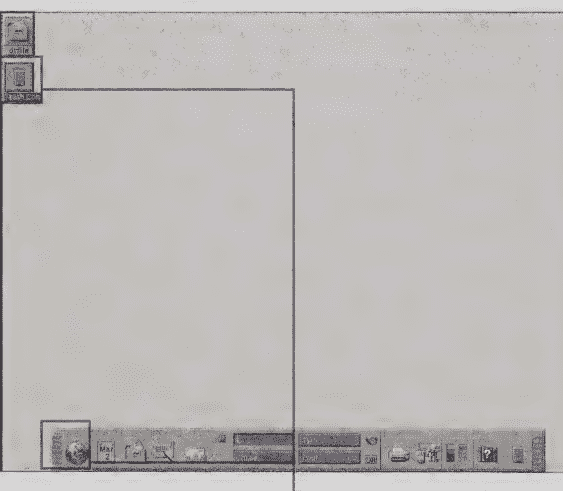

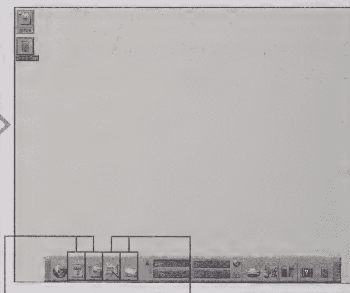

- 垃圾箱 (Trash) 是您移动要删除的项目的地方。移动到垃圾箱的项目一直保留直到您清空垃圾桶。
- 应用程序 (Applications) 启动编写文档的编辑器或其他程序。
- 文件 (Files) 访问 UNIX 文件系统。您可以从此处访问光盘或软磁盘。

### 在 UNIX 中输入命令

终端窗口的框架具有“窗口 (Windows)”、“编辑 (Edit)”和“选项 (Options)”的下拉菜单。这些选项允许您编辑终端窗口属性，例如颜色和大小。

命令在 UNIX 中通过命令提示符执行。输入的文本或命令将显示在终端窗口的光标处。

终端窗口与普通窗口不同，它们没有名称。调用额外的终端无法让您区分每一个终端。

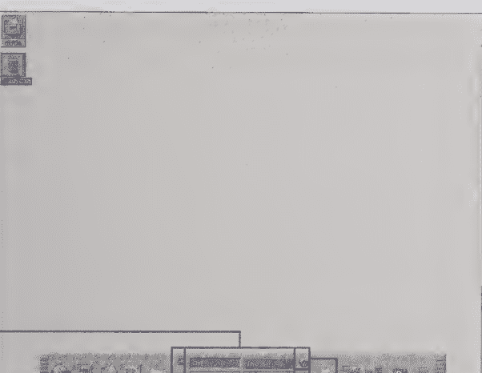

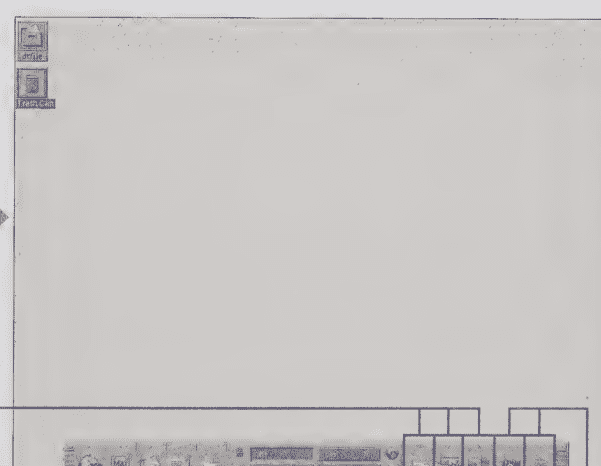

- 帮助 (Help) 包含机器某些方面的说明。
- 垃圾箱 (Trash) 允许您显示、清空或隐藏您的垃圾桶。
- 桌面按钮 (Desktop Buttons) 是独立的桌面。如果您的桌面杂乱，请点击另一个桌面按钮。

# 在没有 GUI 登录 UNIX

您可以在不依赖 GUI 风格登录界面的情况下登录 UNIX。（GUI 代表图形用户界面，发音为 "gooey"）。当计算机屏幕使用图片、图标或其他任何类型的图形来帮助您访问系统或系统工具时，您正在使用 GUI。

您可能会看到一个空白屏幕，上面有一行文本要求您登录，这被称为登录提示符 (login prompt)。要从登录提示符登录，请遵循与登录界面登录类似的步骤——输入您的用户账户名和密码。

您是否看到 GUI 风格的登录界面取决于您使用的 UNIX 类型。例如，如果您使用的是旧版本的 UNIX，您可能看不到 GUI 风格的登录界面。

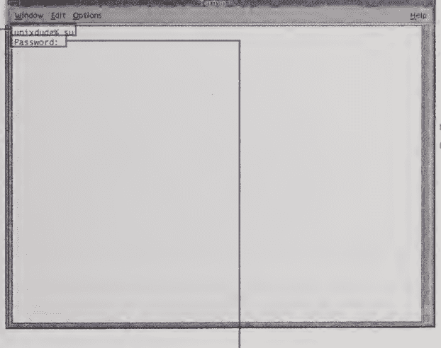

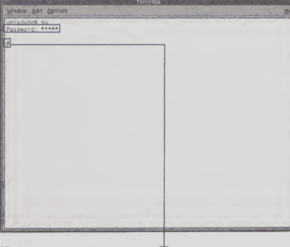

你的命令提示符会发生变化，以反映你现在是 root。在 Solaris 版本的 UNIX 中，提示符通常是一个井号（一个数字符号——UNIX 士们曾被听称其为 "octothorop"）。

当你完成 UNIX 会话时，应该始终进行注销。退出 UNIX 有两个目的：

- 离开 UNIX 环境可以为系统上的剩余用户释放资源。

你可以通过两种方式退出 UNIX。首先，你可以点击主桌面工具栏上的“退出（Exit）”按钮。或者，你可以在右键点击鼠标时显示的弹出菜单中选择“注销（Logout）”。

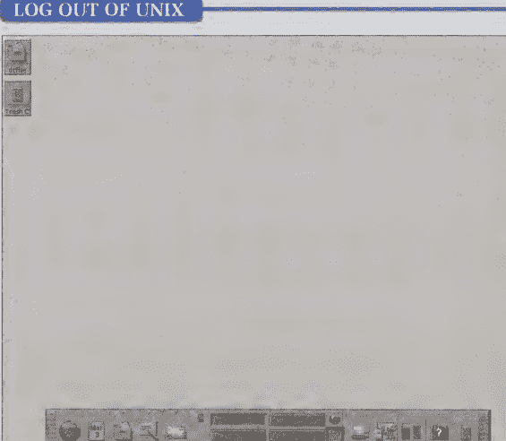

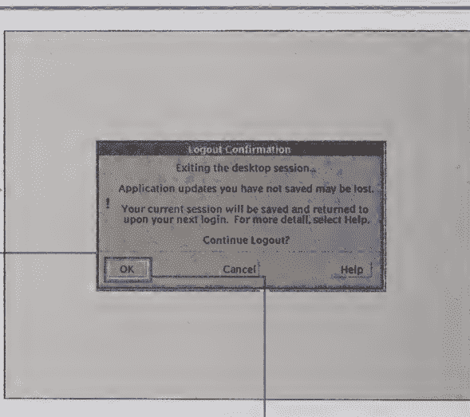

UNIX 不会自动注销，所以你不需要采取行动。然而，强烈建议不要让会话处于开启且无人看的状态。除了占用系统资源外，这是一个重大的安全风险，特别是当你以 root 管理员账户登录时。

关闭你网络上所有的 UNIX 机器。由于断电时无法执行标准关机，只需按下每台机器上的电源开关即可。这很重要，因为可以防止电力恢复时产生电压浪峰，这可能会烧断保险丝。电力恢复后，逐一启动你的 UNIX 机器，使用电量平稳地回到之前的水平。

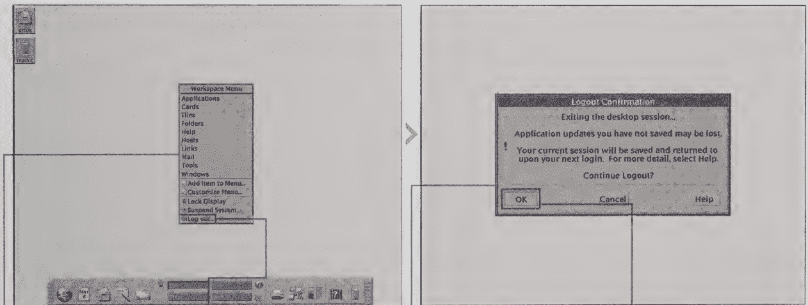

如果你被叫离开座位，且不计划在一段时间内回到电脑，你可以锁定电脑屏幕。锁定屏幕不等同于关闭机器，因为机器的电源供应不受影响。它也不等同于从系统注销，因为一旦你解锁电脑，你就可以继续使用系统资源并编辑文件。

通过选择带有挂锁图标的按钮，电脑将显示空白屏幕以隐藏桌面。此屏幕还可以防止任何人在你解锁之前查看你的工作或输入命令。你通过输入用户账户密码来解锁电脑。桌面会重新出现，你可以从离开的地方继续工作。

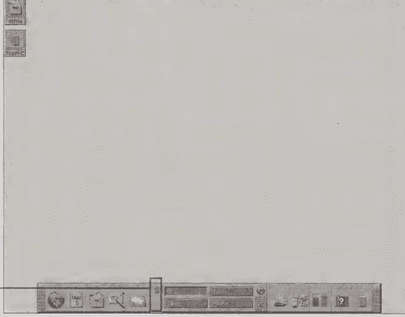

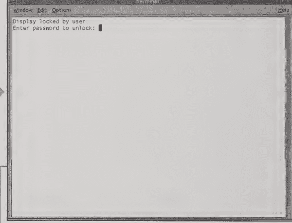

- 锁定屏幕出现。此屏幕要么显示一个微型登录界面，要么像本例所示显示简单的登录提示。

在网络上，你应该只在执行系统维护、防止断电或升级硬件时才关闭 UNIX。大多数升级或系统维护都是计划内的停机，这意味着你应该提前计划关闭 UNIX 来完成这些任务。

务必通知其他使用该机器的人。

请务必提前通知其他使用该机器的人，因为关机 UNIX 会影响他们的工作。

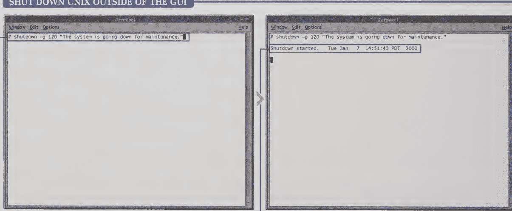

- 2 在弹出菜单上点击“注销（Log Out）”。
- 4 如果你确定要继续注销过程，点击确定。
- 4 如果你确定要继续注销过程，点击确定。

在系统关机时通知系统用户

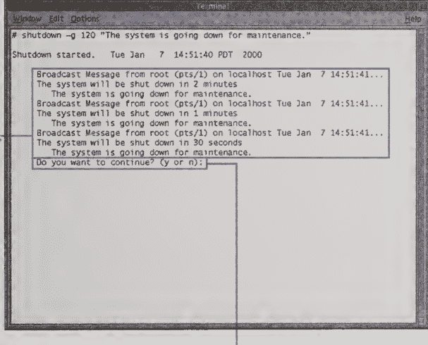

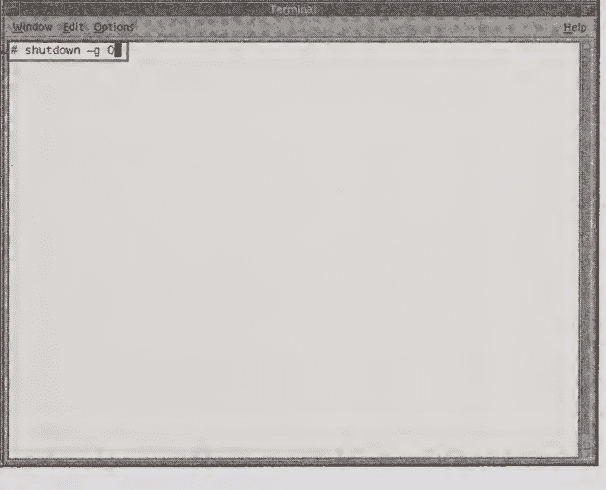


### `shutdown -g 120 "The system is going down for maintenance."`

```
shutdown started. Tue Jan 7 14:51:40 PDT 2000

Broadcast Message from root (pts/1) on localhost Tue Jan 7 14:51:41...
The system is going down for maintenance.
The system will be shut down in 1 minutes.
Broadcast Message from root (pts/1) on localhost Tue Jan 7 14:51:41...
The system is going down for maintenance.
Broadcast Message from root (pts/1) on localhost Tue Jan 7 14:51:41...
The system is going down for maintenance.
You want to continue? (y/n):
```

### `shutdown -g`

- 如果想在没有任何警告消息或最终确认的情况下立即关机，请在命令行提示符输入 `shutdown -g 0`，然后按回车键。关机将无需等待直接开始。

你也可以使用 `halt` 命令来停止 UNIX 机器。`halt` 正如其名，它会更快速地停止机器，而不顾关机时机器上可能运行的程序或应用程序。

另一方面，`halt` 并不像 `shutdown` 命令那样是一种理想的关机方法。这是因为 `shutdown` 会自动确保正在运行的程序或应用程序有时间退出，从而防止数据损坏。除非特别指定，否则 `halt` 不会执行此操作，这增加了你可能在启动 `halt` 时损坏或损坏掉正在运行的程序的概率。

`halt` 在某些情况下是一个非常实用的命令。例如，如果机器挂住了（意味着它完全不响应任何命令做出响应），那么 `halt` 可能会成功关闭你的机器，而 `shutdown` 命令可能会失败。


## 附加

与 `shutdown` 命令不同，`halt` 不允许你在开始关机之前灵活地等待 30 或 60 秒。这是因为 `halt` 通常在系统出现问题时使用，所以等待并不是首选方案。

与 `shutdown` 不同，它没有延迟。一旦你输入 `halt` 并按回车，系统会立即关机。

### 在 halt 之前使用 sync 命令

第三种选择是确保 `halt` 命令不会对系统造成损坏。在命令行输入 `sync` 命令，然后按回车键。`sync` 命令同步系统数据，从而防止数据损坏。

运行 `sync` 后，输入 `halt`，然后按回车键。系统关机。

## UNIX

## 重启 UNIX

当你通过除 `halt` 或按下电源开关以外的任何方法关闭机器时，可以指定 UNIX 系统在关机时重启。你可以使用许多命令来重启系统，它们执行相同的任务。使用哪种方法完全取决于你的喜好。

在 UNIX 中进行任何形式的重启，你首先会被注销，然后系统就像你按了电源按钮关闭它一样运行。

- 系统通知你它正在关机并重启，你返回登录界面，你可以在那里重新登录系统。

## 附加

在允许机器重启方面，`shutdown` 和 `init 6` 执行的任务完全相同。然而，使用 `shutdown` 可以在让你在输入命令和执行命令之间留出时间，如果你想手动关闭程序的话。它还会通知系统上的任何其他用户即将发生的重启。

`init 6` 和 `reboot` 与 `halt` 命令更相似，因为它们不会向其他用户发送通知，而且它们没有仔细确保运行中的程序在关闭时没有损坏的可能性。考虑在使用这些命令时配合 `sync`。

- 系统在 60 秒后重启。

如果你在运行带有 CDE（通用桌面环境）的 UNIX 系统，可以通过打开桌面上的特殊窗口来访问终端。终端是桌面上的区域（用于执行某些任务的窗口）。在终端中工作时，不使用图形界面（GUI），终端被称为窗口。

在桌面的任何处右键点击，终端类似于 MS-DOS 提示符窗口。

## 附加

当你激活任何菜单（例如右键点击桌面时弹出的菜单）时，带有子菜单的选项右侧有一个指向右的小箭头。将鼠标悬停在带有此箭头的菜单选项上将显示子菜单。

控制台像终端一样处理你输入的命令。这两个窗口直接与 UNIX 操作系统交互。

如果你点击工具栏上的按钮，可以从面板访问控制台。面板出现时点击 Console。

弹出菜单消失，桌面会出现一个新的终端窗口。

各种 UNIX 应用程序从桌面启动。由于 GUI（图形界面）中的桌面是操作系统的一部分，你可以在 UNIX 桌面启动任何图形化程序。

例如，在 UNIX 环境中，你启动的程序可以是 Netscape 浏览器、日历表或 Word 文本编辑器。然而，图形化文本编辑器并不在终端中运行，因为 UNIX 操作系统本身无法处理图形（尽管你可以在终端的独立窗口中运行图形化文本编辑器）。

在终端中，你使用不使用图形的终端应用程序。在文本编辑器的情况下，你使用原生 UNIX 文本编辑器，`vi`。第 7 章介绍了 `vi`。

- 你可以通过右键点击桌面上的空白处来启动 UNIX 程序。
- 选择 Applications（应用程序）。
- 子菜单出现。
- 程序出现。

### 区分 UNIX 应用程序与 UNIX 工具

关于两者的界限存在很多争议。然而，作为一个一般规则，UNIX 应用程序是供普通用户在 UNIX 上运行的程序。这包括文本编辑器和 Web 浏览器。

另一方面，UNIX 工具是用于管理或修复 UNIX 系统本身的程序。监控性能或用于自动执行任务的程序都属于 UNIX 工具。

### 在终端中启动基于 GUI 的 UNIX 应用程序

通常情况下不行。规则也有少数例外。例如，在终端中输入 `Netscape` 并按回车，通常会在桌面上启动 Netscape 浏览器。

只需在终端内的命令提示符处输入应用程序名称并按回车即可。

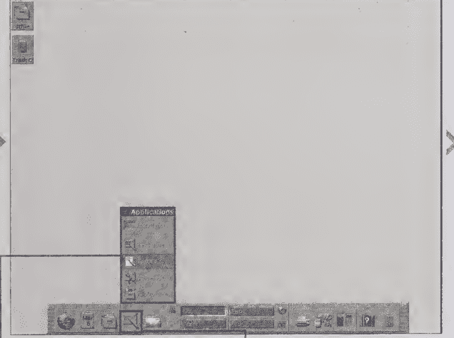

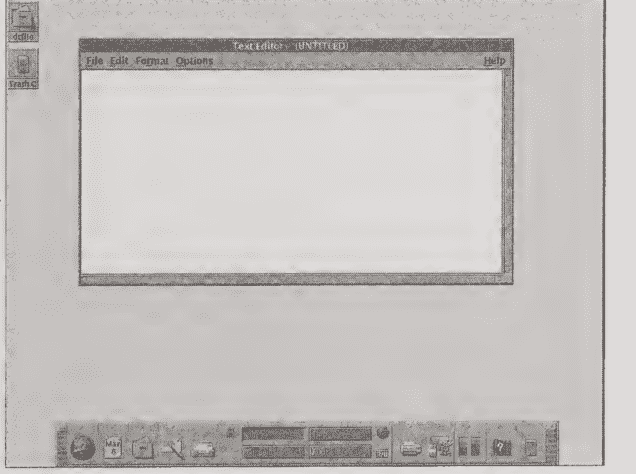

当你处理桌面上的多个窗口时，移动窗口以防止它们相互重叠是非常重要的。在窗口之间切换以在桌面的任务间跳转也很有帮助。

窗口接受来自你的输入和命令。激活状态的窗口在桌面上很容易识别，因为它的上边界颜色比其他窗口更深（在彩色显示器上通常为紫色或蓝色）。

在处理多个窗口时，需要掌握的关键概念是：在任何时刻只有一个窗口是激活状态。

非激活状态的窗口不等于关闭的窗口。未激活的窗口其程序仍在运行，或者其命令提示符仍然可用。

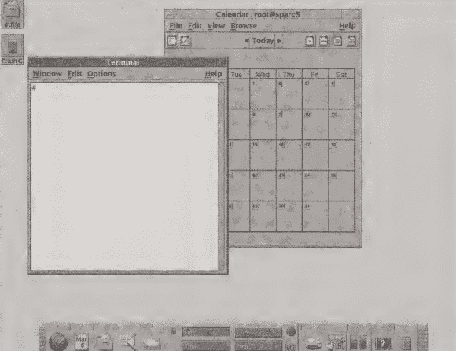

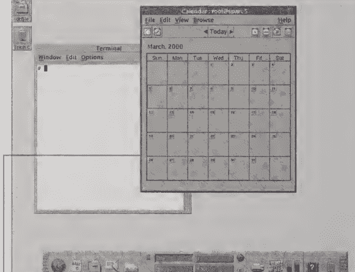

使较大的窗口变为激活状态，然后将其最小化。这允许你点击并拖动之前隐藏的窗口到桌面的某个区域，该区域不会被较大的窗口遮挡。要了解如何操作，请阅读本章的“最大化和最小化窗口”。

打开窗口的数量没有最小或最大限制，同时打开许多窗口会减慢机器速度。除非要在窗口之间剪切信息，否则最简单的方法是打开一个窗口，并将其他的关闭或最小化。

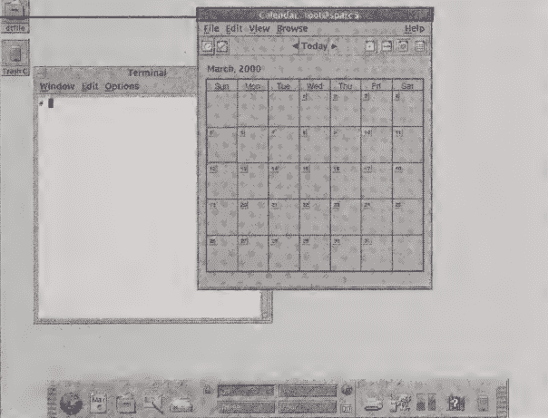

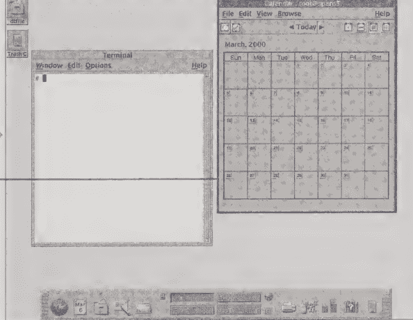

- 在此示例中，标题栏标记为 Calendar: root@sparc5。
- 点击标题栏并按住鼠标键。
- 窗口边界看起来略微凹陷，仿佛你正在按下它。
- 将窗口拖动到你想去的地方并释放鼠标键。

更常见的是，你可能会发现自己打开了多个窗口来同时处理几个应用程序。如果你在桌面上打开了多个窗口，你可能需要调整每个窗口的大小。

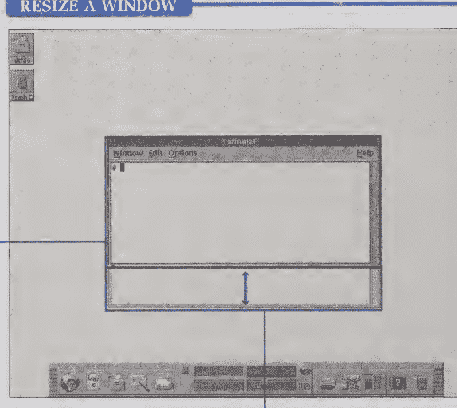

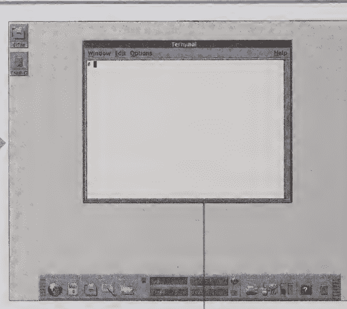

- 要让窗口变高或变短，点击并拖动边界。
- 释放鼠标键。
- 要让窗口变宽或变窄，点击并拖动边界。

## 额外

| 在空间有限的桌面上防止窗口重叠 |
| :--- |

| 使较大的窗口变为激活状态，然后将其最小化。这允许你点击并拖动之前隐藏的窗口到桌面的某个区域，该区域不会被较大的窗口遮挡。要了解如何操作，请阅读本章的“最大化和最小化窗口”。 |

- 要让窗口变高或变短，点击并拖动边界。
- 要让窗口变宽或变窄，点击并拖动边界。

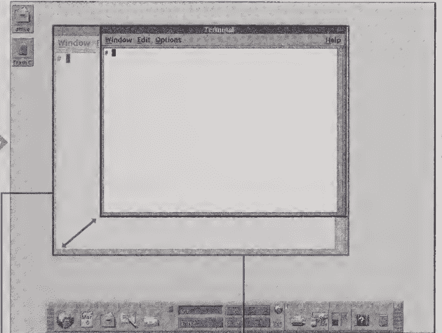

- 当你拖动边界时，你可以看到窗口将所在的位置。
- 释放鼠标键。
- 要让窗口变高或变短，点击并拖动边界。
- 要让窗口变宽或变窄，点击并拖动边界。

你可以出于任何原因调整桌面窗口的大小或关闭窗口。例如，你可以缩小窗口以到达被隐藏在窗口后面的桌面部分或工具栏。

你可以放大窗口以查看更多内容。当然，如果你在某个窗口中有 50 个项目，你可能无法将窗口扩大到足够看到所有项目。在这种情况下，桌面 GUI 会自动提供滚动条，你通过点击并拖动它可以查看整个项目列表。

关闭窗口是为了进入桌面的某个区域，或者获取隐藏在较大窗口后面的较窗口。请记住，关闭窗口不等同于最小化窗口。最小化或最大化窗口只是调整窗口大小或将其移开位置的快捷方式。它不会对窗口或窗口内容产生任何影响；它只是改变窗口的形状或尺寸。

另一方面，关闭窗口会有效地将其从你的桌面上移除。它还可以停止或关闭你从窗口内部运行的任何 UNIX 程序。因此，在关闭窗口之前，请务必确认你真的想关闭它。

## 关闭窗口

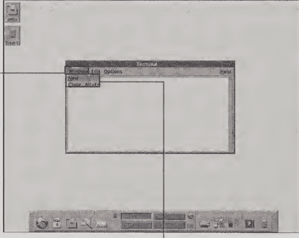
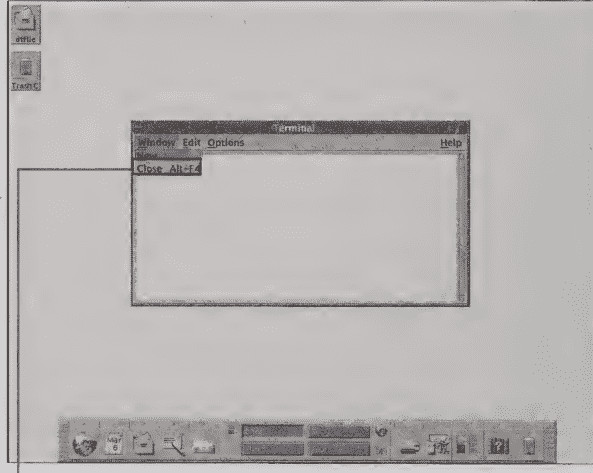
- 1 点击工具左侧的“窗口”(Window)。
- 出现一个小的下拉菜单。
- 2 从下拉菜单中点击“关闭”(Close)。
- 窗口消失。

关闭“文件”菜单中没有“关闭”选项的窗口

当窗口是桌面上的图标时关闭。右键点击该图标。会出现一个弹出菜单，让你选择“关闭”。

使用按钮关闭

出现下拉菜单。

点击“关闭”。

窗口消失。

## 在窗口之间移动

你可以使用 UNIX 桌面环境将文本或二进制文件移动到不同的区域。与其将文件复制到多个位置，不如使用 UNIX 网络系统，只需将文件移动到所有用户都可以的公共目录。

将它们移动到另一个区域，而无需浏览不同的目录即可到达你想放置文件的地方。

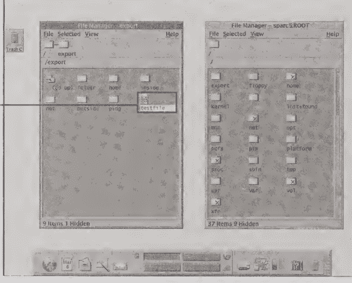

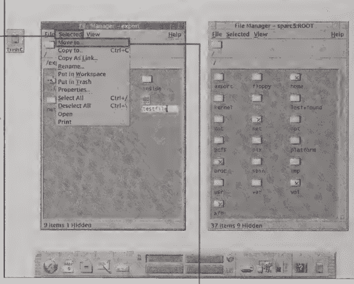

- 点击一次文件图标选中它。
- 选择“移动到...”(Move to...)选项。

## UNIX 桌面环境

## 额外

在窗口之间移动文件的其他方法

在 UNIX 终端中将文件移动到桌面上的窗口
你通过关闭终端并在桌面上打开一个普通窗口来显示你之前工作目录的内容来执行此操作。你正在处理的文件作为图标显示在窗口中，然后根据本节的说明对其进行移动。

使用 UNIX 终端在窗口之间移动文件
不，因为终端不是图形化环境。你在终端中使用 `move` 或 `mv` 命令（见第 3 章）在两个目录之间移动文件。

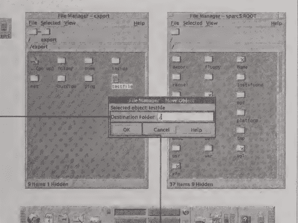

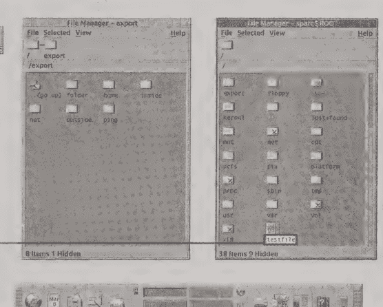

- 出现文件管理器移动对象（Move Object）窗口。此过程从左侧的 `/export` 目录移除 testfile 图标，并将其放在右侧的根目录窗口中。
- 点击确定。
- 在文本字段中输入目标文件夹的名称。
- 根目录的符号是单斜杠 `/`。

## 在窗口之间复制文件

当你将文本或二进制文件复制到不同的目录或文件夹时，使用 UNIX 桌面环境。为了在多个位置为文件创建备份副本，请使用桌面简单的文件复制方法。这让你将文件放置在不同的目录。如果由于任何原因原始文件发生变化或损坏，你可以还原副本。

这让你从一个区域选择文件并将其放入另一个区域，而无需浏览不同的目录即可到达你想放置文件的地方。

在示例中，你将看到如何将名为 testfile 的文件从根目录复制到 `/export` 目录。此示例从两个打开的窗口开始；将一个复制到主目录，另一个复制到 `/export` 目录。

虽然你可以只用一个窗口完成操作，但打开两个窗口通常更简单。

## 在窗口之间复制文件

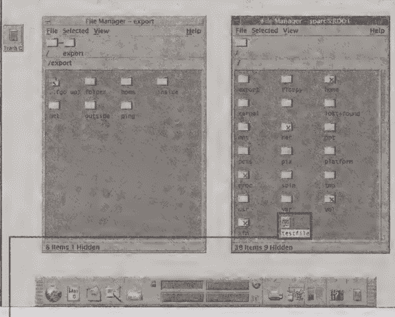

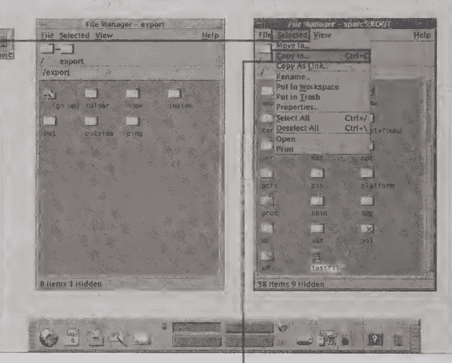

- 1 点击根目录中的文件图标。
- 2 在工具栏上点击“已选择”菜单。
- 3 点击“复制到...”(Copy to...)
- 出现下拉菜单。

## UNIX 桌面环境

## 额外

使用按钮

出现下拉菜单。

点击“关闭”。

窗口消失。

- 1 在窗口左上角，点击带有横杠的按钮。

### 开始 UNIX 桌面环境帮助

当涉及 UNIX 文档或桌面 GUI 配置时，你有多个选项。你桌面工具栏中的工具指向... 帮助(Help)选项还包括为新用户提供的桌面环境向导之旅。更重要的是，如果你为...设置了互联网连接。

## 在窗口之间移动

你可以使用 UNIX 桌面环境将文本或二进制文件移动到不同的区域。与其将文件复制到多个位置，不如使用 UNIX 网络系统，只需将文件移动到所有用户都可以的公共目录。

将它们移动到另一个区域，而无需浏览不同的目录即可到达你想放置文件的地方。

在示例中，你将看到如何将名为 testfile 的文件从 `/export` 目录移动到根目录。此示例从两个窗口开始；将其中一个移动到主目录，另一个移动到 `/export` 目录。

你可以只用一个窗口完成操作，但使用两个窗口通常更简单。它可以让你从一个区域选择文件并将其放置在

## 在窗口之间移动


- 点击一次文件图标选中它。
- 在工具栏上选择“已选择”菜单。
- 选择“移动到...”(Move to...)选项。

## UNIX 桌面环境

## 额外

在窗口之间移动文件的其他方法
你可以在窗口之间点击并拖动文件。这种方法对于小文件或多个文件同样有效。它也更快，而且对打字技能的要求较低。对于移动极大的文件（例如包含大型表格或报告的文本文件），这种方法速度较慢。

使用 UNIX 终端在窗口之间移动文件
不，因为终端不是图形化环境。你在终端中使用 `move` 或 `mv` 命令（见第 3 章）在两个目录之间移动文件。


- 出现文件管理器移动对象（Move Object）窗口。此过程从左侧的 `/export` 目录移除 testfile 图标，并将其放在右侧的根目录窗口中。
- 点击确定。
- 在文本字段中输入目标文件夹的名称。
- 根目录的符号是单斜杠 `/`。

## 在窗口之间复制文件

当你将文本或二进制文件复制到不同的目录或文件夹时，使用 UNIX 桌面环境。为了在多个位置为文件创建备份副本，请使用桌面简单的文件复制方法。这让你将文件放置在不同的目录。如果由于任何原因原始文件发生变化或损坏，你可以还原副本。

这让你从一个区域选择文件并将其放入另一个区域，而无需浏览不同的目录即可到达你想放置文件的地方。

在示例中，你将看到如何将名为 testfile 的文件从根目录复制到 `/export` 目录。此示例从两个打开的窗口开始；将一个复制到主目录，另一个复制到 `/export` 目录。

虽然你可以只用一个窗口完成操作，但打开两个窗口通常更简单。

## 在窗口之间复制文件


- 1 点击根目录中的文件图标。
- 2 在工具栏上点击“已选择”菜单。
- 3 点击“复制到...”
- 出现下拉菜单。

## UNIX 桌面环境

## 额外

| 如何通过帮助索引获取帮助 | 其他在线资源 |
|---|---|
| 工具栏右侧的菜单是帮助查看器（Help Viewer）的帮助菜单。此菜单解释了操作帮助索引的一些晦涩步骤。 | 工具栏右侧的菜单是帮助查看器的帮助菜单。此菜单解释了操作帮助索引的一些晦涩步骤。 |
| 返回帮助索引的某个区域：如果您知道将再次访问某个区域，请点击帮助查看器窗口上的“返回”（Backtrack）按钮。如果该区域在几页之前，点击“历史”（History）按钮查看您之前的停留列表。这通常比反复点击六或七次“返回”按钮要快。 | 请记住，帮助查看器只是 UNIX 帮助文档的一部分。在桌面工具栏上“帮助”（Help）按钮下的工具将带您进入 SunSolve 网站，可以在那里浏览更多关于 UNIX 的技术文档。 |

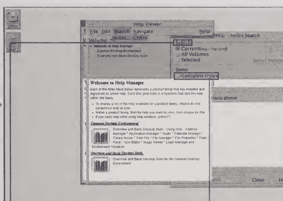

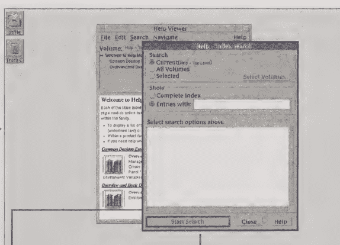

- 3 点击帮助查看器菜单上的“搜索”（Search）。
- 4 点击“索引”（Index）进入搜索工具。
- 5 要开始搜索，在“带文本的项目”（Entries with text）框中输入您想要搜索的主题，并点击“开始搜索”（Start Search）按钮。

### 自定义桌面背景

使用基于 GUI 的桌面系统的乐趣之一在于装饰您的工作区域。除了让您展现创意的一面外，更改桌面外观还可以帮助您避免眼睛疲劳。

这个过程与在家里墙上贴花纸并不相似，这被称为更改桌面壁纸。

桌面的主要更改是为图标和窗口更换不同的背景。Sun 版本的 UNIX 提供了几种桌面背景。因为

根据您的个人喜好以及光线和显示器的质量来选择壁纸。浅灰色背景可能很单调，但在光线不足的区域或显示器模糊的情况下，它对眼睛的压力要小得多。

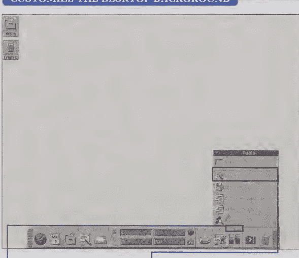

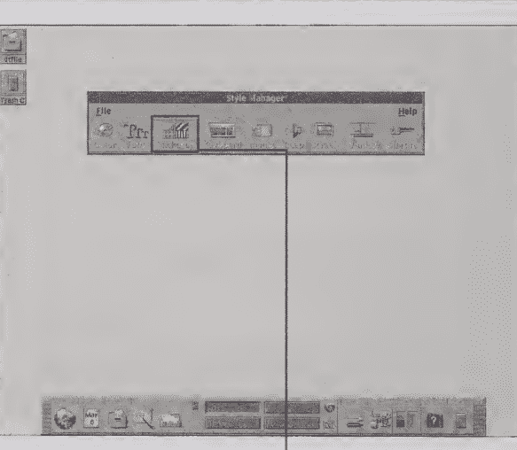

- 首先点击桌面工具栏上“工具”（Tools）按钮上方的箭头，上面有一个调色板和字体样本。
- “工具”选择面板会滑出。
- 点击“桌面样式”（Desktop Style）。
- 样式管理器（Style Manager）工具栏出现。
- 点击“背景”（Backdrop）来更改您的桌面背景图案。

## UNIX 桌面环境

## 额外

在单色（黑白）屏幕上调整桌面壁纸

从网上下载图片并将其作为桌面背景

在单色屏幕上，您选择一个背景来调整屏幕上图案的比例和亮度。浅灰色和深灰色图案在单色下效果非常好。

当您使用 Netscape 或 Internet Explorer 时，选择“文件”（File）下拉菜单并选择“另存为”（Save As）。确保将图像保存到磁盘或直接保存到您的 UNIX 机器上。图像将自动保存为相应的文件类型，无论是 `.gif`、`.bmp` 还是 `.tif` 文件。

### 选择背景壁纸

除了个人喜好，您还应该选择壁纸以避免不必要的眼睛疲劳。如果您在一个亮度或清晰度不太显示器上工作，请选择简单明亮的背景，如浅灰色。

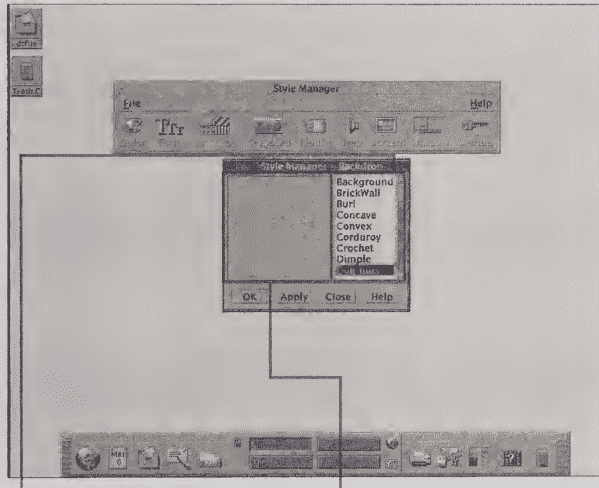

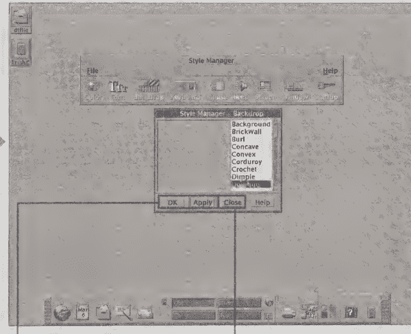

- 在样式管理器的背景（Backdrop）窗口中，从列表中选择一种背景样式。
- 左侧的小框会自动显示应用更改前的预览效果。
- 点击“确定”（OK）或“应用”（Apply）将新图案置于桌面。
- 完成后，点击“关闭”（Close），然后关闭样式管理器窗口。
- 在此示例中，选择了“海豚”（Dolphins）。

### 自定义屏幕保护程序

屏幕保护程序是在电脑闲置设定时间后自动启动的程序。根据您的配置不同，屏幕保护程序有多种用途。

屏幕保护程序的主要目的是防止屏幕灼屏。计算机屏幕上的图像由荧光点组成，当电子撞击它们时会发光。如果图像长时间不变，该图像可能会字面上地“烧”在屏幕上，导致任何出现的新图像模糊。屏幕上不断变化的图案可以防止灼屏。

屏幕保护程序还可以减少计算机的能量消耗，因为这些进程运行所需的能量较少，且屏幕平均情况下比使用时要暗。最后，你会发现如果设置得当，屏幕保护程序还可以作为一种安全措施。

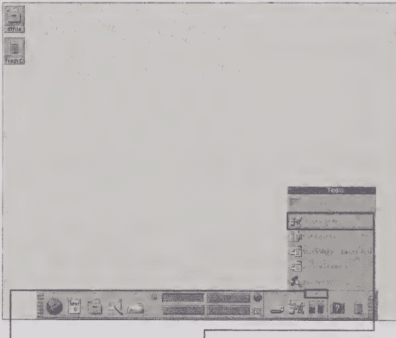


- 首先点击桌面工具栏上“工具”（Tools）按钮上方的箭头，上面有一个调色板和字体样本。
- “工具”选择面板滑出。
- 点击“桌面样式”（Desktop Style）。
- 样式管理器（Style Manager）工具栏出现。
- 点击“背景”（Backdrop）更改您的桌面背景图案。

### 自定义桌面声音

你可以自定义 UNIX 桌面环境中默认声音的音量、色调和时长。虽然 UNIX 并非设计为高保真音频系统，但它可以轻松配置，为警报和通知提供独特的声音。当你一个在同一区域内有大量相似机器的 UNIX 网络上工作时，这尤为有用。为你的机器提供一个独特的声音，可以帮助你在工作时将其与其他背景噪音区分开来。

UNIX 通常不带用于将其他声音融入桌面的声音播放器。不过，你可能可以在网上找到可以实现此功能的程序。下载并安装声音播放器可以扩展你的 UNIX 机器上播放的声音范围，使其类似于普通的 IBM 架构 PC 或 Macintosh。

### 自定义桌面声音

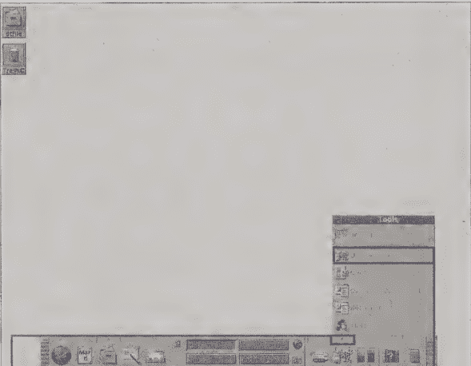

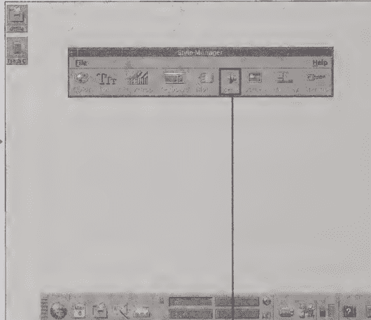

- 1 首先，点击桌面工具栏上带有调板和字体字样的上方箭头。
- 2 工具选择（Tools Selection）面板会弹出。
- 3 点击“桌面样式”（Desktop Style）。
- 4 样式管理器（Style Manager）工具栏出现。
- 5 点击工具栏上的“蜂鸣声”（Beep）。

## UNIX 桌面环境

## 额外

在 UNIX 上播放 MP3 文件

有免费的程序可以下载以播放 MP3 文件。请查看 www.opensound.com 或任何带有 UNIX MP3 程序的 MP3 网站。如果它在某一个版本的 UNIX 上运行，那么它很有可能在其他 UNIX 系统上运行。

然而，MP3 仍然是一个不断演变的系统；你可能会在使用奇特或非市场硬件组合时遇到麻烦。为了最大限地增加成功几率，请坚持主流声卡，并参考 MP3 手册或网站上的信息，查看哪些硬件最适合播放这些声音文件。

当 UNIX 识别声卡时使用声音

如果你没有来自主要制造商的声卡，可能需要为非标准声卡不同的驱动程序。访问 www.sunsolve.com 查看可用解决方案列表并从那里开始。

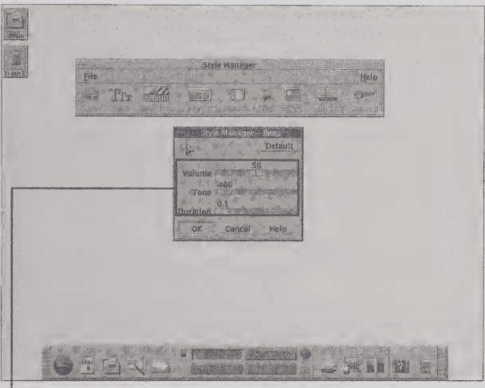

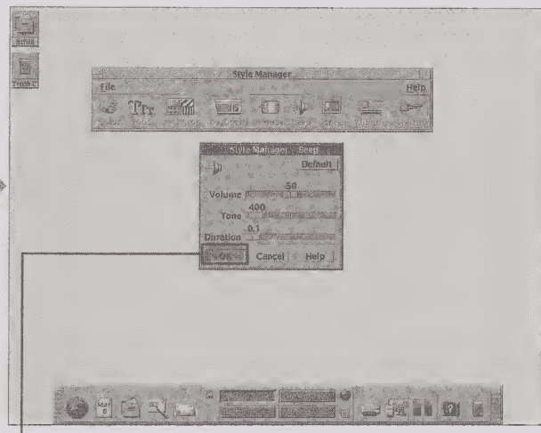

- 4 在样式管理器-蜂鸣声对话框中，通过拖动右侧的滑动条从左列表中选择音量、色调和时长。
- 5 点击 OK 接受此更改。
- 6 完成后，关闭样式管理器工具栏。

### 列出文件

在 UNIX 终端中，有多种列出列表。基本的 `ls`（或 list）命令提供你当前目录下文件最基础的列出。然而，你可以使用 list 命令获取有关你文件的更详细信息。

输入适当的命令选项以列出详细文件信息，在命令提示符处显示为：

```


### ls -l

关键在于了解在 UNIX 中配合 `list` 命令可以使用的不同命令选项。命令选项（有时称为选项或标志）是你附加到 UNIX 命令后的字母或多个字母。通常用空格和横线分隔命令和选项。例如，`ls` 命令，

大多数 UNIX 选项与其使用的字母有逻辑关系。在这里，`-l` 用于详细信息；将 `l` 想象成“长列表”（long listing）。

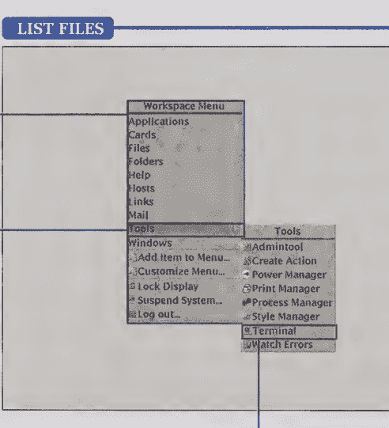

| 工作区菜单 | |
| :--- | :--- |
| 应用 (Applications) | |
| 内容 (Cants) | |
| 文件 (Files) | |
| 文件夹 (Folders) | |
| 主机 (Hosts) | |
| 邮件 (Mail) | |
| 工具 (Tools) | 管理员 (Administrator) |
| 窗口 (Windows) | 创建选项 (Create Option) |
| 添加项目菜单...(Add Item Menu...) | 电管理器 (Power Manager) |
| 自定义菜单 (Customize Menu) | 管理器 (Manager) |
| 退出选项 (Exit Option) | 样式管理器 (Style Manager) |
| 挂起系统...(Suspend System...) | |

| 窗口 (Window) | 编辑 (Edit) | 选项 (Options) | | | | | | | |
|---|---|---|---|---|---|---|---|---|
| ls | 字母 (Letters) | | 软磁盘 (Floppy) | | net | 3win | | | |
| | | | | home | | opt | testfile | | |
| TT_DE | dev | | kernel | | pcfs | | var | | |
| | | | | | 1lb | | | | |
| bin | | | | lastfound | platform | proc | | | |
| live | export | | | | | | vol | |

- 1 在打开的桌面任意处点击右键，打开一个新的 UNIX 终端。
- 3 从出现的子菜单中点击“终端”（Terminal）。
- 4 在命令提示符处输入 `ls`。
- 显示你主目录下的一个文件和目录列表。
- 弹出一个弹出菜单。
- 当你选择“终端”时，弹出菜单消失，桌面上会出现一个新的终端窗口。
- 5 按回车键（Enter）。
- 2 选择“工具”（Tools）。

### 处理文件和目录

### 应用

远程目录列表
你可以在不更改位置的情况下列出其他目录的内容。要这样做，在命令提示符处输入 `ls`，然后输入目录名称，按回车键。

```
Terminal
```

### ls -l

```
total 119

drw---- 2 root other 512 Mar 3 17:11 Mail

drw---- 2 root other 512 Mar 3 17:11 Wait

drw-xr-x 2 root other 512 Feb 29 23:43 /etc

drw-xr-x 1 root other 512 Feb 29 23:43 /usr/bin

drw-xr-x 1 root other 1536 Mar 10 23:10 cd

drw-xr-x 5 root other 512 Feb 29 10:31 cd

drw-xr-x 3 root other 3072 Feb 29 17:20 devices

drw-xr-x 3 root other 4096 Mar 6 21:22 floppy

drw-xr-x 8 root other 512 Feb 28 18:53 home

drw-xr-x 9 root other 512 Feb 28 15:57 kernel

drw-xr-x 2 root other 8192 Feb 28 15:56 lost-found

drw-xr-x 1 root other 512 Mar 1 16:01 root

drw-xr-x 2 root other 512 Feb 29 14:19 pcfs

drw-xr-x 4 root other 1024 Feb 28 15:15 platform

drw-xr-x 6 root other 4096 Feb 28 16:06 bin

drw-xr-x 2 root other 512 Mar 6 14:31 testfile

drw-xr-x 7 root sys 457 Mar 10 23:18 var
```

- 如果你想以单列形式查看文件列表，输入 `-1` 并按回车键。
- 文件将按字母顺序在单列中出现。
- 要查看更详细的文件列表，输入 `ls -l` 并按回车键。
- 你的文件将以格式显示，包含权限、所有者和创建日期。

### 在 UNIX 终端中查找文件

你可以使用 `find` 命令来定位文件。无论你是漏掉了文件、将其复制到了不该去的地方，还是仅仅忘记了它，`find` 都会在系统的某个区域搜索丢失的文件。

知道从哪里开始搜索很重要。从距离超过三个子目录的目录开始搜索，意味着你将花费太多时间等待 UNIX 遍历海量文件。另一方面，如果文件在目录树中，而你想在 `/var` 下查找，你是找不到它的。

幸运的是，`find` 是自动递归的，这意味着它会搜索给定点下的所有子目录。例如，如果你指定 `/var` 为搜索的起点，`find` 将搜索 `/var`、`/var/subdirectory` 等。

该命令使用的格式为：`find <search point> <command option> <file name>`。

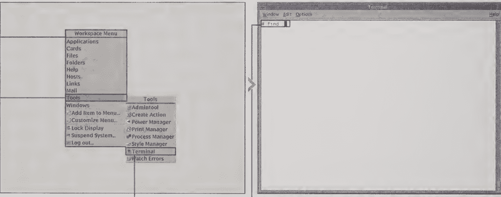

- 1 在桌面任意处点击右键打开一个新的 UNIX 终端。
- 出现弹出菜单。
- 2 选择“工具”（Tools）。
- 3 从出现的子菜单中点击“终端”（Terminal）。
- 当你选择“终端”时，弹出菜单消失，桌面上会出现一个新的终端窗口。
- 4 在命令提示符处输入 `find`。
- 点 `.` 通知 UNIX 仅搜索当前所在的目录。

### 处理文件和目录

## 额外

使用 `find` 搜索远程机器
你必须登录到该机器。再次，你不需要亲临现场，但你可以远程登录（请参第 12 章关于登录和 telnet 如何操作）。

使用 `find` 的局限性
`find` 是一个极其强大的工具，因为它对范围没有限制（除非你设置），你可能会真的拖慢速度。例如，在 `/` 下使用 `find` 时要小心。根目录是所有目录的子目录。

在白天系统繁忙时在 `/` 下搜索是一个坏主意，因为 `find` 需要大量的 CPU 周期来搜索每个子目录。这会拖慢所有人的速度。

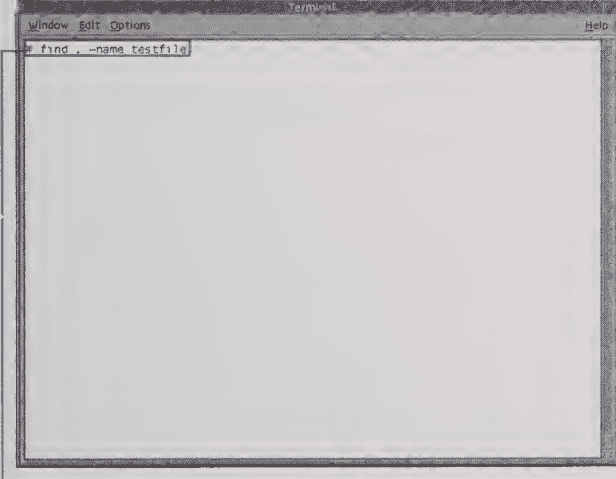

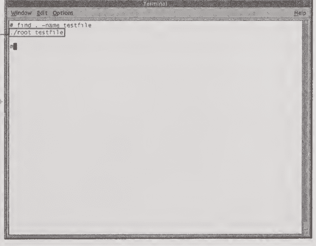

- 接下来，输入空格，然后输入 `-name`，输入文件名。
- 按回车键。
- 此选项告诉 UNIX 按文件名搜索文件。
- `find` 给你结果。
- 在此示例中，搜索的文件存在于你的本地 `./root` 目录中。

## 使用 CD 切换目录

你可以使用 `cd` 命令或 `change directories` 命令在 UNIX 终端中切换目录。在终端窗口中穿于 UNIX 文件结构与在图形化桌面中操作一样，同样重要。如果你习惯了基于 GUI 的操作系统，那么在没有图标、文件夹或其他图片视觉提示的情况下，在 UNIX 机器上进行移动可能具有挑战性，特别是在你使用 UNIX 机器或你是一名管理员时。尽管如此，无论处于何种情况，你每天都会执行多次此类任务。

当你登录时，你的“起点”将始终是你的主目录，通常显示为 `/home/<username>`。从主目录开始，你可以使用 `cd` 命令进入更远的文件系统，并再次返回你的主目录。如果你计划在几个不同的位置工作，那么学习这一点将非常有价值。

### 如何打开 UNIX 终端
- 在打开的桌面的任何地方点击鼠标右键，打开一个新的 UNIX 终端。
- 弹出一个弹出菜单。
- 选择“Tools”（工具）。
- 从弹出的子菜单中点击“Terminal”（终端）。
- 当你选择 Terminal 时，弹出菜单会消失，桌面上会出现一个新的 Terminal 窗口。

### 如何更改你的位置
- 要更改位置，在命令提示符处输入 `cd`，然后输入你想要的目录路径。
- 完整的目录位置（列出了目标目录上级的所有目录）称为文件路径（filepath）。
- 按回车键。

## 文件与目录的操作

### 将目录更改到根目录
系统上最高级别的目录被称为根目录（root directory）。这是因为 UNIX 系统的其余部分存在于根目录分支出的子目录，形成了所谓的树形结构。在 UNIX 中，根目录的符号是斜杠符号 `/`，因此要 `cd` 到根目录，请在命令行输入以下内容并按回车键：

```bash
cd /
```


## 使用 CD 切换目录

你可以使用 `cd` 命令或 `change directories` 命令在 UNIX 终端中切换目录。在终端窗口中穿于 UNIX 文件结构与在图形化桌面中操作一样，同样重要。如果你习惯了基于 GUI 的操作系统，那么在没有图标、文件夹或其他图片视觉提示的情况下，在 UNIX 机器上移动可能具有挑战性，特别是在你使用 UNIX 机器或你是一名管理员时。无论处于何种情况，你每天都会执行多次此类任务。

当你登录时，你的“起点”将始终是你的主目录，通常显示为 `/home/<username>`。从主目录开始，你可以使用 `cd` 命令进入更远的文件系统，并再次返回你的主目录。如果你计划在几个不同的位置工作，那么学习这一点将非常有价值。

### 如何打开 UNIX 终端
- 在打开的桌面的任何地方点击鼠标右键，打开一个新的 UNIX 终端。
- 弹出一个弹出菜单。
- 选择“Tools”（工具）。
- 从弹出的子菜单中点击“Terminal”（终端）。
- 当你选择 Terminal 时，弹出菜单会消失，桌面上会出现一个新的 Terminal 窗口。

### 如何更改你的位置
- 要更改位置，在命令提示符处输入 `cd`，然后输入你想要的目录路径。
- 完整的目录位置（列出了目标目录上级的所有目录）称为文件路径（filepath）。
- 按回车键。

## 文件与目录的操作

### 将目录更改到根目录
系统上最高级别的目录被称为根目录（root directory）。这是因为 UNIX 系统的其余部分存在于根目录分支出的子目录，形成了所谓的树形结构。在 UNIX 中，根目录的符号是斜杠符号 `/`，因此要 `cd` 到根目录，请在命令行输入以下内容并按回车键：

```bash
cd /
```

- UNIX 将你移动到指定的目录。（与其他操作系统不同，UNIX 在任务成功完成后会给你提示信息。）
- 要验证你是否不在主目录，输入 `pwd` 然后按回车键。
- `pwd` 命令会告诉你你所在的目录。
- 要返回主目录，直接输入 `cd` 而不带任何其他选项。
- 按回车键。
- 如果你想验证自己是否在 `/root` 中，输入 `pwd` 并按回车键。`pwd` 将验证你已回到 `/root`。

## 创建新文件

你可以轻松地在 UNIX 终端中创建新文件。新文件可以是工具、应用程序、自动 cron 任务的产物，也可以是你随手创建的临时。当然，根据你所使用的程序，你有完全的自由在 UNIX 中创建新的文本、图形或二进制文件。

通常，你会使用关键 UNIX 工具 `vi` 文本编辑器在 UNIX 终端中创建文件（`vi` 编辑器将在第5章介绍）。然而，为了本示例演示，你将使用最古老的 UNIX 工具之一，它专门设计用于通过命令创建文件。`touch` 会创建一个 ASCII 文本文件。这意味着你要创建一个内部没有数据的文件，但可以使用 UNIX 系统的任何编辑工具（如 `vi` 编辑器）对其进行编辑。

### 如何使用 touch 创建文件
- 在打开的桌面的任何地方点击鼠标右键，打开一个新的 UNIX 终端。
- 弹出一个弹出菜单。
- 选择“Tools”（工具）。
- 从弹出的子菜单中点击“Terminal”（终端）。
- 当你选择 Terminal 时，弹出菜单会消失，桌面上会出现一个新的 Terminal 窗口。
- 要创建文件，输入 `touch` 后跟上你想要的文件名。
- 按回车键。

### 额外：touch 命令
`touch` 是最基础的 UNIX 命令之一，创建于 UNIX 本身还是一个新操作系统时代。

#### 如果文件内部为空可以使用新文件
有时，创建一个新的空文件可以作为占位符，或提醒向特定文件放入数据。例如，如果你在忙碌的一天晚些时候可以保存一个邮件文件作为日志，可以先创建一个空白文件并命名为 `mail-log`，等准备就绪后再添加内容。

#### 在受限区域使用 touch 创建文件
如果你不是 root 用户，则不允许通过向某些目录添加新文件来编辑它们。如果你是 root，你可能设置了目录权限，使得无法向其中写入新文件——当然，作为 root 你可以更改这一点，所以它并非 100% 无法破解。

- 因为 UNIX 不会告诉你操作是否成功，在命令行输入 `ls` 并按回车键查看新文件。
- `ls` 显示你的新文件已添加到主目录的文件列表中。
- 你也可以通过在命令提示符处输入 `ls -lt` 来指定 `ls` 命令显示最近创建的文件。
- 你的新文件 `myfile` 是最近创建的，因为你没有向其中输入内容，所以它的大小为零。
- `ls -lt` 显示创建的文件详细列表。

### 创建新目录

如果你想保持环境整洁，可以在 UNIX 中创建新目录。在你的主目录中，你可以为工作和家庭创建单独的目录。根据一般规则，如果按类别命名目录，将更容易组织文件。要创建一个新目录，请使用 `mkdir` 命令。在命令提示符处输入 `mkdir` 后跟你想要给目录命的名字。虽然本质相同，但在没有图标的环境中使用这些术语是不妥当的；你应该参考 `/etc`。

### 如何创建目录
- 在打开的桌面的任何地方点击鼠标右键。
- 弹出一个菜单。
- 选择“Tools”（工具）。
- 当你选择 Terminal 时，弹出菜单会消失，桌面上会出现一个新的 Terminal 窗口。
- 要更改位置，在命令提示符处输入 `cd`，然后输入你想要的目录路径。
- 按回车键。

### 如何创建文件
- 在打开的桌面的任何地方点击鼠标右键，打开一个新的 UNIX 终端。
- 弹出一个弹出菜单。
- 选择“Tools”（工具）。
- 从弹出的子菜单中点击“Terminal”（终端）。
- 当你选择 Terminal 时，弹出菜单会消失，桌面上会出现一个新的 Terminal 窗口。
- 要创建文件，输入 `touch` 后跟上你想要的文件名。
- 按回车键。

### 创建新目录
如果你想保持环境整洁，可以在 UNIX 中创建新目录。在你的主目录中，你可以为工作和家庭创建单独的目录。根据一般规则，如果按类别命名目录，将更容易组织文件。要创建一个新目录，请使用 `mkdir` 命令。在命令提示符处输入 `mkdir` 后跟你想要给目录命的名字。虽然本质相同，在没有图标的环境中使用这些术语是不妥当的；你应该参考 `/etc`。

### 如何创建目录
- 在打开的桌面的任何地方点击鼠标右键。
- 弹出一个菜单。
- 选择“Tools”（工具）。
- 当你选择 Terminal 时，弹出菜单会消失，桌面上会出现一个新的 Terminal 窗口。
- 要更改位置，在命令提示符处输入 `cd`，然后输入你想要的目录路径。
- 按回车键。

| permissions | owner | group | size | date | name |
| -drwxr-xr-x 2 | root | other | 512 | Mar 10 43 | officwork |
| -drwxr-xr-x 2 | root | other | 512 | Mar 10 41 | myfile |
| -drwxr-xr-x 2 | root | other | 512 | Mar 22:13 | dev |
| -drwxr-xr-x 2 | root | other | 512 | Mar 22:12 | etc |
| -drwxr-xr-x 2 | root | other | 512 | Mar 22:15 | form |
| -drwxr-xr-x 2 | root | other | 512 | Mar 22:18 | sbin |
| -drwxr-xr-x 2 | root | other | 512 | Mar 22:17 | mnt |
| -drwxr-xr-x 2 | root | other | 512 | Mar 22:12 | dev |
| -drwxr-xr-x 2 | root | other | 512 | Mar 22:13 | etc |

| permissions | owner | group | size | date | name |
| - | | | | | |
| ls -l | | | | | |
| total 20 | | | | | |
| -drwxr-xr-x 2 | root | other | 512 | Mar 10 43 | officwork |
| -drwxr-xr-x 2 | root | other | 512 | Mar 10 41 | myfile |
| -drwxr-xr-x 2 | root | other | 512 | Mar 22:13 | dev |
| -drwxr-xr-x 2 | root | other | 512 | Mar 22:12 | etc |
| -drwxr-xr-x 2 | root | other | 512 | Mar 22:15 | form |
| -drwxr-xr-x 2 | root | other | 512 | Mar 22:18 | sbin |
| -drwxr-xr-x 2 | root | other | 512 | Mar 22:17 | mnt |
| -drwxr-xr-x 2 | root | other | 512 | Mar 22:12 | dev |
| -drwxr-xr-x 2 | root | other | 512 | Mar 22:13 | etc |

- 要验证新目录是否已创建，在命令行输入 `ls -l`。
- 目录在左侧以 `d` 符号显示，表示它是一个目录。
- 你也可以通过在命令提示符处输入 `ls -lt` 来指定 `ls` 命令显示最近创建的文件。
- 按回车键。`ls -lt` 显示你创建的文件详细信息。

## 复制文件和目录

在 UNIX 中，你可以使用 `cp` 或 `copy` 命令来复制文件和整个目录。
当你复制文件时，可以创建一个新名称的文件的完全相同的副本。
你也可以创建一个相同名称的文件副本，但前提是你将该文件保存到不同的位置。

当你递归复制一个目录时，你会复制该目录及其内部的所有文件。
如果你只是重命名一个目录，目录中文件和子文件夹的路径会自动更改以反映此变化。
你不需要指定递归更改。

UNIX 操作系统将一切都视为文件，包括目录。然而，当你复制整个目录时，需要使用 `-R` 命令选项。`-R` 代表递归（recursive）。

- 1 在打开的桌面任意位置点击右键，打开新的 UNIX 终端。
- 出现一个弹出菜单。
- 2 选择 Tools（工具）。
- 3 从出现的子菜单中点击 Terminal（终端）。
- 当你选择 Terminal 时，弹出菜单消失，桌面上会出现一个新的 Terminal 窗口。
- 4 要创建一个文件的副本，在命令提示符处输入 `cp`，输入原始文件的名称，再输入新文件的名称。
- 5 按回车键。

### 实际应用

将文件复制到不同位置
当然，你不需要在相同位置创建文件的副本。如果你想将文件复制到当前目录之外的其他目录，可以在命令提示符处输入以下内容，然后按回车键。

```
cp <filename> <directory location><new filename>
```


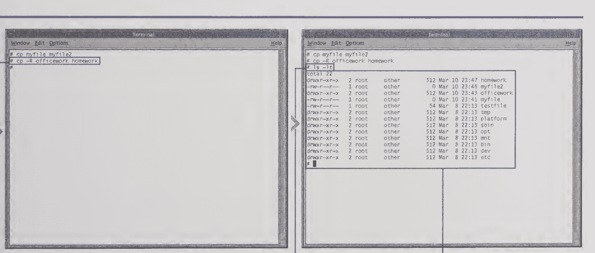

- 6 要复制整个整个目录，在命令提示符处输入 `cp -R`，然后输入原始目录名称，再输入新目录名称。
- 7 按回车键。
- 8 要检查 `cp` 命令的结果，在命令提示符处输入 `ls -lt`。
- 9 按回车键。
新文件应该相应地出现。

## 重命名文件和目录

你可以使用 UNIX 终端中的 `mv` 命令重命名任何类型的文件或目录。通过几个具有策略性的命名规范，你可以有效地组织你的目录内容——任何系统目录都是。执行此操作的关键在于保持一致性。

这适用于所选项目以及你所更改项目下的所有项目。只需确保你理解你并不是在创建副本——而是将文件或目录移动到不同的位置。要重命名文件，请使用语法 `<filename> <new filename>`。

`mv` 命令在 UNIX 中实际上是移动（move）命令，但它主要用于重命名文件和目录，因为它非常方便。当然，你也可以用 `mv` 移动文件和目录。它的优点是它是自动递归的，也就是说：

如果你命名的文件或目录与同一目录下的另一个文件相同，UNIX 会自动警告你，因此最好为每个内容都起一个唯一的名称。

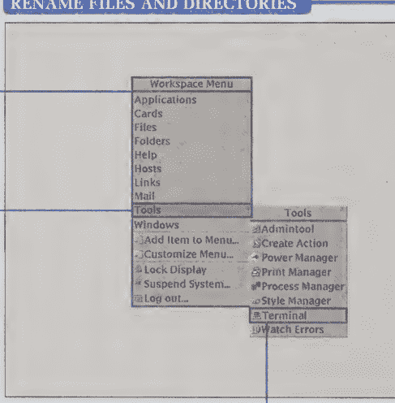

- 1 在打开的桌面任意位置点击右键，打开新的 UNIX 终端。
- 3 从出现的子菜单中点击 Terminal。
- 当你选择 Terminal 时，弹出菜单消失，桌面上会出现一个新的 Terminal 窗口。
- 5 要重命名文件，在命令提示符处输入 `mv`，然后输入文件的原始名称，再输入文件的新名称。
- 2 出现一个弹出菜单。
- 4 选择 Tools。

## 操作文件和目录

### 额外说明

使用空格、连字符、冒号或斜杠命名文件或目录
这不建议这样做。使用斜杠或冒号命名文件在处理文件时可能会导致混淆，尤其是在 UNIX 终端窗口中。最好不要使用任何这些符号来命名文件。

更改文件的扩展名
你可以使用 `mv` 命令按如下方式更改文件扩展名：`mv bubbles.bmp bubbles.txt`。然而，该文件可能变得无法使用，因此最好不要这样做。

重命名目录不会影响存储在其内部的文件
重命名目录不会更改目录内部的文件，所以如果你想将目录的名称——及其所有内容——更改为 `ditto.txt`，直接操作即可。

```
ls -l @option

# myfile myfile

# my homework weekend
```

```
ls -l @option

# myfile myfile

# my homework weekend

total 22

-rw-r--r 1 root other 512 Mar 10 23:46 myfiles

-rw-r--r 1 root other 512 Mar 10 23:46 work

-dr-xr-x 2 root other 0 Mar 10 23:41 you

-dr-xr-x 2 root other 512 Mar 8 22:13 time

-dr-xr-x 2 root other 512 Mar 8 22:13 custom

-dr-xr-x 2 root other 512 Mar 8 22:13 sbin

-dr-xr-x 2 root other 512 Mar 8 22:13 mnt

-dr-xr-x 2 root other 512 Mar 8 22:13 cron

-dr-xr-x 2 root other 512 Mar 8 22:13 dev
```


同样，如果你想重命名一个目录，在命令提示符处输入 `mv`，输入目录的原始名称，输入新名称。

## 删除文件和目录

你可以使用 `rm` 命令在 UNIX 终端中删除文件和目录。使用 `rm` 命令删除整个目录是有危险的。当你删除文件或目录时，UNIX 会询问你是否确定，因为一旦删除，这些文件是无法恢复的。

你也可以使用 `rm -R` 命令来删除整个目录。当你删除整个目录时，UNIX 会询问你是否确定，除非你已经备份了它们。要查看 `rm` 命令的结果，可以使用 `ls` 查看这些文件。


- 1 在打开的桌面任意位置点击右键，打开新的 UNIX 终端。
- 出现一个弹出菜单。
- 2 选择 Tools。
- 3 从出现的子菜单中点击 Terminal。
- 当你选择 Terminal 时，弹出菜单消失，桌面上会出现一个新的 Terminal 窗口。
- 4 要删除一个文件，在命令提示符处输入 `rm`，输入文件的名称。
- 5 按回车键。

## 操作文件和目录

### 额外说明

### 停止删除进程
如果你正在删除一个大文件，可以使用 `Ctrl+C` 停止删除。但这可能会导致文件删除损坏。

### 以 root 用户身份删除文件
当你以 root 身份登录时，可以删除任何文件。如果你以普通用户身份登录，只能删除你有权限删除的文件。

### 一次删除多个文件
使用通配符 `*` 可以一次性删除所有文件，例如 `rm *`。这样做非常危险。

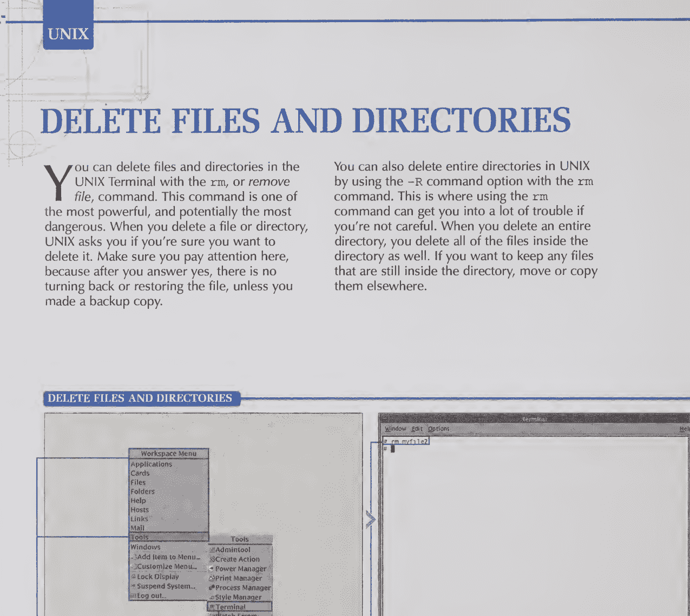

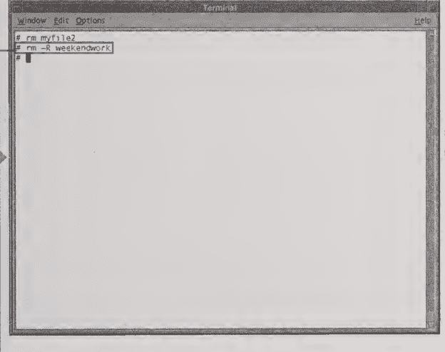

- 6 要删除目录，在命令提示符处输入 `rm -R`，输入你想删除的目录名称。
- 7 按回车键。
记住这会删除目录中的任何文件。
- 8 要检查 `rm` 命令的结果，使用 `ls`。
- 这些文件不再列出。

## 创建符号链接

符号链接是你经常使用的文件或目录的桥梁。例如，链接可以访问某些需要输入才能到达的位置，如 `/etc/sound`。

在 UNIX 中，链接有两种类型：硬链接和软链接。你应该使用的软链接比硬链接更持久。如果软链接失效，UNIX 会停止使用它；如果硬链接失效，你的整个计算机可能会停止。

要创建链接，使用 `ln` 命令。`-s` 选项创建一个软链接（或符号链接）。该命令的格式为 `ln -s <文件位置> <链接名称>`。


| 工作菜单 | 工具 |
|---|---|
|  | AdminTool |
| 卡 | 创建操作 |
| 文件 | Power Manager |
| 文件夹 | Type Manager |
| 帮助 | Process Manager |
| 提升 | Style Manager |
| 邮件 | Terminal |
| 窗口 | 查看错误 |
| 将项目添加到菜单... | |
| 自定义菜单... | |
| 锁定显示 | |
| 挂起系统... | |
| 注销... | |

- 1 在打开的桌面任意位置点击右键，打开新的 UNIX 终端。
- 出现一个弹出菜单。
- 2 选择 Tools。
- 3 从出现的子菜单中点击 Terminal。
- 当你选择 Terminal 时，弹出菜单消失，桌面上会出现一个新的 Terminal 窗口。
- 4 为目录创建链接，在命令提示符处输入 `ln -s`，输入目录名称，再输入链接名称。
- 5 按回车键。

## 文件与目录的操作

## 额外内容

## 链接策略

你应该节制地使用链接。如果链接太多，你就会忘记所有东西到底在什么位置！

## 为链接创建链接

你可以创建一个指向另一个二级链接的符号链接，但这并不是推荐的做法。同样，你可能会丢失文件存储位置的位置。而且你创建的每一个链接都是系统上一个潜在的断裂点。因此，当你链接到文件或目录时，请只使用一个链接。

## 给链接与被链接文件相同的命名

你不应该给链接与被链接的文件相同的名称。如果你想这样做来帮助记忆，请使用 `<filename_link>` 格式来区分链接与原始文件。


- 在命令提示符输入 `ls -1` 来验证链接的创建，然后按回车。
- 新链接的名字在最左侧显示为一个 `l`。这将其标识为别名，链接列出并带有一个指向其目标目录的箭头。
- 要测试链接，在命令提示符输入 `cd`，然后输入链接名称。
- 按回车。
- 回车。输入 `pwd` 验证得益于这个节省时间的符号链接，你已经在该目录下了。

## 修改文件权限

你可以在 UNIX 中更改文件的权限，以便授予或限制他人对你文件内容的访问。如果你更改了目录的权限，可以一次授予或限制对整组文件的访问。你可以在 UNIX 操作系统中将文件的权限更改为三个设置之一。你的选项是 `r`（可读）、`w`（可写）和 `x`（可执行）。

然后可以使用 `vi` 编辑器查看内容，但不能进行更改。相比之下，可写的文件可以重命名。最后，可执行的文件可以作为脚本或程序运行。

UNIX 将权限分为三个区域：用户权限、组权限和其他人权限。“用户”当然是指拥有该文件的用户账户，“组”是指该用户所属的用户组。“其他”是指系统上的所有其他人。

UNIX 权限以三个符号为一组的形式显示：`r`、`w` 和 `x`。例如，用户对某个文件的权限可能是可读且可写的，`rw-`。取决于你如何更改权限，表示添加或删除的字母会发生变化。

## 修改文件权限


- 要查看主目录中的文件，双击标记标记为 `dtfile` 的主目录图标。


- 目录将打开，你就可以看到里面的文件。
- 要查看文件的权限，右键点击文件图标。
- 弹出一个出一个菜单。
- 点击“属性”（Properties）。

## UNIX 文件权限的操作

## 额外内容

### 更改文件的权限
如果你想使用终端（Terminal），可以使用 `chmod` 命令。你可以通过打开终端、输入 `man chmod` 并按回车来查询 `chmod` 命令的语法。通过 `chmod`，你可以使用 `r-w-x` 字母来更改权限，也可以使用基于十六进制系统的数字：例如 `chmod 664 <filename>`。如果你真的想用这个系统尝试 `chmod`，请在 UNIX 参考书中查阅十六进制代码。

### 设置一个不供公开参考的文件
最佳设置是 `r-w-r---`，因为这允许任何人读取文件，但防止所有者以外的任何人进行更改。

### 设置隐私
你的最佳选择是 `rw------`。只有你可以读取或写入该文件，其他人甚至看不到内容，更不用说修改它们了！


- 属性界面出现。
- 选择或取消屏幕中间的复选框来设置文件权限。
- 要让用户组的文件可写，你需要勾选“写入”（Write）复选框。
- 点击 OK 保存更改。

## 修改目录权限

你可以像在 UNIX 操作系统中编辑普通文件一样来编辑目录的权限。这是因为 UNIX 将所有对象——包括目录、符号链接、脚本和应用程序——都视为文件。

你可以在终端中编辑目录权限。然而，当你在图形界面（GUI）中工作时，点击代表文件文件夹的图标。

你可能会在桌面上看到文件夹。文件夹和目录是相同的——它们是为了组织文件而存在的。

如果你更改目录权限，默认情况下不是递归的。也就是说，更改不会影响目录下的文件。在 UNIX 中，你可以指定更改应用于该目录下的所有文件。


- 要查看主目录中的文件，双击标记为 `dtfile` 的主目录图标。
- 要查看文件的权限，右键点击文件图标。
- 点击“属性”弹出菜单。
- 目录将打开，你就可以看到里面的文件。
- 弹出一个菜单。

## 文件权限的操作

## 额外内容

### 设置目录权限
这取决于你的需求。此外，你可以指定更改应用于所有文件。

### 更改目录权限
值得注意的是，在 UNIX 中，目录和文件是相同的。如果你想使用终端，可以使用 `chmod` 命令。通过 `chmod`，你可以使用 `r-w-x` 字母来更改权限，也可以使用基于十六进制系统的数字。


- 属性界面出现。
- 选择或取消屏幕中间的复选框来更改文件夹的权限。
- 如果你想将更改应用于包含的文件，请点击“应用至”（Apply To）旁边的栏并从弹出菜单中选择“此文件夹及其子文件夹”。
- 点击 OK 保存更改。

## 操作 UNIX 文件权限

## 额外

**将文件的所有权更改为不存在的用户账户**
UNIX 会根据你列出的用户账户进行检查。如果该用户不存在，你就无法更改所有权。

**登录 root 管理员账户并编辑用户文件**
没有必要这样做。记住，当你以 root 管理员账户登录时，你拥有“**root权限**”。root 拥有的权限之一就是能够随时编辑系统上的任何文件，而无需拥有该文件的所有权，也无需更改文件的权限以对其进行读取、写入或执行操作。

奇怪的是，你可以将所有者更改为 Nobody，因为 Nobody 是 UNIX 的默认账户。除非你没有其他选择，否则不要这样做，因为 Nobody 是 UNIX 系统用于维护任务的虚位账户。


- 点击“基本权限”部分下的“所有者”文本框。
- 点击“确定”保存你的更改。
- 输入新所有者的名称。

## 更改目录所有权

如果你想增加或减少对整组文件的访问级别，可以在 UNIX 中更改整个目录的所有权。例如，如果你想限制对整组管理或或敏感文件的访问，可以将目录的所有权更改为管理员账户。相反，你可以将目录的所有权更改为一个新组，以便目录内的文件对不同的用户组更易访问。

再次，对于所有权和权限设置，编辑目录时的关键概念是**递归性**。如果你更改了目录的所有权，默认情况下，结果不会影响该目录中的文件和子文件夹。但是，你可以通过从属性窗口的“将更改应用于”区域选择合适的选项，来指定更改适用于目录下的所有文件。

## 更改目录所有权


- 要查看主目录中的文件，请双击主目录图标（通常标记为 dfile）。
- 目录将打开并显示内部的文件。
- 从弹出的菜单中选择“属性”。
- 要查看文件夹的权限，请右键点击文件夹图标。

## 额外

**更改目录所有权的其他方法**
你可以使用 `chown` 命令（更改所有权命令）在 UNIX 中更改目录的所有权。`chown` 的格式为：`chown <新所有者> <文件名>`。

**使用 chown 进行递归更改**

默认情况下，对目录所有权的更改不是递归的。只有当你添加命令选项 `-R` 时，它才会变成递归的。

**将目录所有权更改为不存在的用户**
UNIX 不允许你完成此任务。当你更改目录的所有权时，UNIX 会将你的请求与 `/etc/passwd` 文件中列出的用户进行比较，该文件存储了所有存在的用户名。如果名称不在列表中，则所有所有保持不变。如果你是 root 账户，请先创建一个用户，然后将目录的所有权更改为新创建的用户。


- 出现属性屏幕。
- 输入新所有者的名称。
- 点击“确定”保存你的更改。
- 点击“基本权限”部分下的“所有者”文本框。

## 配置组所有权

你也可以在文件的属性窗口中更改 UNIX 文件的组所有权。这与更改文件的所有权非常相似，直接影响用户。通过更改文件的组所有权，你可以限制访问或让文件更具公共可用性。这通常发生在对部门进行重大重组的组织或公司中。UNIX 在同一屏幕的“用户所有权”字段下方列出组所有权。

组所有权的更改会影响文件的可读性、可写性和执行性，取决于文件的权限。如果文件被列为所属用户组可写，那么更改文件的所属组可以帮助授予用户或其组使用该文件的访问权限。然而，设置仍然会限制系统上其他所有人的访问。

## 配置组所有权


- 1 要查看主目录中的文件，请双击主目录图标（通常标记为 dtfile）。
- 2 目录将打开并显示内部的文件。
- 2 要查看文件的权限，请右键点击文件图标。
- 3 从弹出的菜单中选择“属性”。

## 操作 UNIX 文件权限

## 额外

**将文件的所有权更改为不存在的组**
UNIX 不允许你完成此任务。当你更改目录的所有权时，UNIX 会将你的请求与 `/etc/passwd` 文件中列出的用户进行比较，该文件存储了所有存在的用户名。如果名称不在列表中，则原始所有权保持不变。如果你是 root 账户，请先创建一个用户，然后将目录的所有权更改为新创建的用户。

组所有权的更改会影响文件的可读性、可写性和执行性，取决于文件的权限。如果一个文件被列为所属用户组可写，更改文件的所属组可以帮助授予用户或其组使用该文件的访问权限。然而，设置仍然会限制系统上其他所有人的访问。

所有所有权的更改会影响文件的可读性、可写性和执行性，取决于文件的权限。如果一个文件被列为所属用户组可写，更改文件的所属组可以帮助授予用户或其组使用该文件的访问权限。然而，设置仍然会限制系统上其他所有人的访问。


- 出现属性屏幕。
- 点击“基本权限”部分下的“所有者”文本框。
- 点击“确定”保存你的更改。
- 输入新所有者的名称。

## 更改目录所有权

如果你想增加或减少对整组文件的访问级别，可以在 UNIX 中更改整个目录的所有权。例如，如果你想限制对整组管理或敏感文件的访问，可以将目录的所有权更改为管理员账户。相反，你可以将目录的所有权更改为一个新组，以便目录内的文件对不同的用户组更易访问。

再次，对于所有权和权限设置，编辑目录时的关键概念是递归性。如果你更改了目录所有权，默认情况下，结果不会影响该目录中的文件和子文件夹。但是，你可以通过从属性窗口的“将更改应用于”区域选择合适的选项，来指定更改适用于目录下的所有文件。

## 操作 UNIX 文件权限

## 额外

将文件的所有权更改为不存在的组
UNIX 不允许你完成此任务。当你更改目录的所有权时，UNIX 会将你的请求与 `/etc/passwd` 文件中列出的用户进行比较，该文件存储了所有存在的用户名。如果名称不在列表中，则原始所有权保持不变。如果你是 root 账户，请先创建一个用户，然后将目录的所有权更改为新创建的用户。

组所有权的更改会影响文件的可读性、可写性和执行性，取决于文件的权限。如果一个文件被列为所属用户组可写，更改文件的所属组可以帮助授予用户或其组使用该文件的访问权限。然而，设置仍然会限制系统上其他所有人的访问。

所有所有权的更改会影响文件的可读性、可写性和执行性，取决于文件的权限。如果一个文件被列为所属用户组可写，更改文件的所属组可以帮助授予用户或其组使用该文件的访问权限。然而，设置仍然会限制系统上其他所有人的访问。


- 出现属性屏幕。
- 点击“基本权限”部分下的“所有者”文本框。
- 点击“确定”保存你的更改。
- 输入新所有者的名称。

# 启动 vi 编辑器

你可以将 vi 编辑器作为文本编辑工具。然而，你也可以使用 vi 编辑器完成任何任务，从创建文档到编写脚本、编辑文件，以及比其他 UNIX 命令更详细地搜索日志文件。对于许多 UNIX 用户来说，vi 是你应该熟悉的 UNIX 世界中主要的实用用工具。

类似于 Wordperfect 或 WordStar 程序。然而，只有 vi 会随所有的 UNIX 安装程序提供，并且在初学者和管理员中都广受欢迎。

由于 vi 不像如今的文字处理器那样基于图形，它看起来可能比大多数文本处理程序更具挑战性且深奥。然而，对于本书，你将学习到可能每天使用的最简单、重要且实用的命令。

UNIX 中存在其他文本编辑器，例如 Emacs、Ex 和基于 GNOME 的编辑器。

- 1 通过在打开的桌面任意处点击右键打开一个新的 UNIX 终端（Terminal）。
- 3 点击 Terminal。
在选择 Terminal 后，弹出菜单消失，桌面上会出现一个一个新的 Terminal 窗口。
- 4 要打开一个文件，在提示符处输入 `vi`，然后输入文件名。
- 5 按回车键。
- 出现一个弹出菜单。
- 2 选择 Tools（工具）。

## 创建文本文件

## 额外

## 选择 vi 编辑器

使用 vi 编辑器是因为与其它基于图形的编辑器相比，vi 不执行格式化和字体更改等任务。此类格式会让打印出来的文档看起来很好，但会让日志文件或脚本读起来很混乱。

vi 编辑器是最古老的实用程序之一，可以追溯到 UNIX 本身的最初创建。vi 开发于一个 UNIX 机器甚至不使用显示器的时代——它们使用的是打字机。为了节省纸，vi 编辑器——以及整个 UNIX 本身——对图形和冗长信息的使用非常吝。

## 对文件命名的限制

由于 vi 创建文件的方式类似于 `touch` 和 `mkdir`，因此相同的限制也适用——不要将文件命名为 . . . 或 / 。让名称唯一且不在文件名中使用任何斜杠是一个好主意。

尊敬的先生：

请更新您的记录中的我的地址。我目前的地址是：

455 Humaway Way
Dan Stego, CA 98765-4321

谢谢。

“信件”35 行。250 个字符


`vi` `/etc/ttydefs`


- 或者，你可以在其他目录中打开文件。输入文件的名称和位置（路径），然后按回车键。
- `vi` 编辑器打开了。你现在处于文件的文本内部。

## 在 vi 中移动

你可以按行、按单词甚至逐字符地在文档中移动。由于 `vi` 不基于图形用户界面（GUI），因此没有滚动条来在句子或段落之间来回跳跃。`vi` 是基于模式和行导向的，而不是基于滚动条导向的，因此使用 `vi` 可能会比在基于 GUI 的编辑器中更快到达文档中你想去的地方。

你可以使用方向键逐字符地在短篇文档中移动。然而，你可以使用其他命令更快速地在任何文档中移动。你可以在任何 UNIX 文本文件中练习移动，其方法与你在上一个任务“启动 vi”中我们打开的文件中看到的操作演示一模一样。

- 在 UNIX 终端中，通过在提示符处输入 `vi` 并输入文件名来用 `vi` 打开一个文件。
- 按回车键。
- 文件的文本出现。
- 光标始终从文档第一行的开头开始。

## 额外

## 按屏移动

对于较长的文档，你按屏幕长度移动，因为在 `vi` 中你没有滚动条。要向下移动一屏，按 `Ctrl-F`。向上移动一屏，按 `Ctrl-B`。

### 一步将光标移动到屏幕中间

使用命令 `j` 直接跳转到屏幕中心。这不会将你移动到整个文档的中心，除非你的文档刚好在一个屏幕内。

### 按段落移动

你可以通过 `{`（向左的的大括号）移动到下一个段落的开头。要移动到上一个段落的开头，输入 `)`（向右的的大括号）。

- 要移动到下一个单词的中间，按六次右方向键。光标会移动该单词。
- 要逐单词向前移动，按 `w` 键。如果你按十次 `w`，光标将移动到第十个单词。逐单词向后移动，使用 `b` 键。

### 命令模式和插入模式

在 `vi` 编辑器中你只能处于一种模式。你根据想在文档中做什么的操作在这些模式之间切换。在命令模式（Command mode）下，你在文档内移动、更改格式、删除文本或保存文档。在命令模式下，你无法添加文本。

每次你启动 `vi`，都是从命令模式开始。有几种方法进入插入模式（Insert mode）。要返回命令模式，只有一种方法——按下 `Esc` 键，也称为退出键（Escape）。在大多数键盘上，这个键位于左上角。在插入模式下，你可以添加文本，但不能执行任何其他功能。

- 在 UNIX 终端中，通过在提示符处输入 `vi` 并输入文件名来打开文件。
- 按回车键。
- 文件的文本出现。光标始终从文档第一行的开头开始。

## 额外

### 从插入模式进入命令模式

`Esc` 键是从插入模式切换到命令模式的唯一选择。

从命令模式进入插入模式的其他方法

最常见的方法是使用命令插入新行文本，或粘贴文本。我将在本章的“复制与粘贴”中讨论这一任务。

在尝试移动光标之前，始终假设处于插入模式。反复按下 `Esc` 会听到蜂哔声。

默认情况下，你处于命令模式。为了进入插入模式，按下 `i` 或 `a`，正如你想插入文本一样。切换模式时，屏幕底部的文件名和统计信息会消失。你无法用方向键移动光标。

要返回命令模式，按下 `Esc` 键。虽然没有变化，但你可以通过按方向键确认返回了命令模式。

### 插入文本

你可以通过从命令模式切换到插入模式在 `vi` 编辑器中添加文本。根据你进入插入模式的方式，你可以在屏幕光标位置输入文本，或者在光标之后输入，请参见本章后续的“复制与粘贴”。

原则上，`vi` 比现在的文字处理器简单得多。由于 `vi` 是为了用 UNIX 和 C 语言编写程序设计的，它避免了复杂的格式（如文本样式）混淆操作系统和编译器。

这里显示的方法是在最基础的层面添加文本，即逐字母输入。如果你想通过

- 在 UNIX 终端中，通过在提示符处输入 `vi` 然后输入文件名来打开文件。
- 按回车键。
- 文件的文本出现。光标始终从文档第一行的开头开始。

## 额外

### 打印用 vi 创建的文档

你发送文档到打印机的方式与你在基于图形的文本编辑器中创建任何文档的方式完全相同。我将在第11章介绍这一过程。

### 更改 vi 中文本的字体大小

更改字体大小或样式会混淆操作系统和编译器，因此不包含此效果。你可以更改 Terminal 窗口中字符的大小，但这不会改变你打印文档时的文本外观。

### 使用花字体写作

你需要使用基于 GUI 的 UNIX 文本编辑器，例如 WordPerfect、WordStar 或 Notepad。

- 默认情况下，你处于命令模式。
- 切换模式时，屏幕底部的文件名和统计信息会消失。
- 3 为了插入文本，在提示符处按下 `i` 或 `a` 插入文本。
- 4 输入你的新文本。
- 5 例如，在提示符处输入 `Mr.` 以使第一行变为“Mr. John Doe.”

## 删除文本

你可以通过多种方式从文档中删除文本。你可以删除单个字符、整行文本，甚至是段落中的整行（也就是说，删除文本和回车符）。你甚至可以同时删除并替换字符。

按键操作。如果你是 `vi` 编辑器的新手，应该使用 `x` 命令，因为这是删除文本最简单的方法。

记住，只有在命令模式（Command mode）下你才能删除文本。养成一个习惯，在尝试删除文本之前按下 `Esc` 键以确保你处于命令模式。

在 `vi` 编辑器中编辑文本时，知道何时使用哪种方法可以节省大量的按键次数。

在 UNIX 终端中，在提示符处输入 `vi` 然后输入文件名即可打开文件。

按回车键（Enter）。

文件文本出现。光标始终位于文档第一行的开始。

## 创建文本文件

## 额外

#### 恢复不小心删除的字符

尝试撤销上一个命令。首先，按下 `Esc` 键确保你处于命令模式，然后输入 `u`。

#### 撤销操作

你可以撤销删除整行的命令，无论你使用的是 `dd` 还是 `S`。按下 `Esc` 键确保你处于命令模式并输入 `u`。（如果你在删除一个字符后又进行了另一个操作，则无法恢复该删除操作。）

多步撤销功能是文本编辑器中较新的特性，但 `vi` 尚未引入这一选项。如果这是一个严重的错误，你可以不保存退出，但要非常小心——如果你不保存就退出，也将丢失自上次保存以来对该文档进行的所有更改，可能导致你重做大量工作。

- 使用方向键将光标移动到要删除单词的开头。
- 每个字母和空格按一次 `x` 键，以删除那个七字母的示例单词及其末尾的空格。现在句子变为：“My address for all correspondence is:”

## 在 vi 中查找单词

你可以在 `vi` 中查找文本模式。搜索实际上比看起来要灵活得多，你是在寻找文档中的某种文本模式，而不仅仅是一个单词。例如，搜索 `day` 会匹配到该单词本身，以及所有包含 `day` 的单词，如 `daylight` 和 `Saturday`。如果你在处理长文档或多页复杂的代码，这会特别有用，因为要读完 500 页文档来寻找特定模式将花费更多的时间。

如果你正在处理一份特别长的文档，还可以利用 `vi` 提供的不同搜索方向。例如，如果你在一份 300 页文档的中间，并且确定你想要的模式在前半部分，是否可以搜索光标上方的所有文本。

| 窗口编辑选项 | | 终端 |
|---|---|---|
| Dear Sir: | | John Doe |
| | 123 Units Place Fran San Francisco, CA 95555 | |
| Please update my address for your records. | My current address for all | |
| | | Dear Sir: |
| Please update my address for your records. | My current address for all | |
| correspondence is: | | |
| 456 Haver Way | | 456 Haver Way |
| San Diego, CA 98765-4321 | | San Diego, CA 98765-4321 |
| Thank you. | | Thank you. |

* 31 行，250 个字符

- 1 在 UNIX 终端中，在提示符处输入 `vi` 然后输入文件名即可打开文件。
- 2 按回车键。文件文本出现，光标始终位于文档第一行的开始。
- 3 查找文本模式，按下 `Esc` 键确保你处于命令模式，然后输入一个斜杠 `/` 和模式，例如单词“update”。
- 斜杠和搜索模式将出现在屏幕底部。
- 4 按回车键执行搜索。

## 创建文本文件

## 额外

#### 将搜索限制在文档的单行内
你可以通过使用小写的 `f` 从光标所在位置向后搜索，通过使用大写的 `F` 从光标位置向以前搜索。

#### 区分大小写的搜索
默认情况下，`vi` 中的所有搜索都是区分大小写的。这是因为 `vi` 的设计目的并不是简单地搜索字母，而是为了搜索文本模式。在 `vi` 看来，文本模式 "This"、"this" 和 "tHiS" 是完全不同的。

#### 在搜索命令中间切换搜索方向

如果你使用斜杠 `/` 搜索 "termcap"（在文档中向后搜索），你可以输入大写的 `N` 重复搜索，向相反方向移动（在文档中向前搜索）。

光标会跳转到模式出现的位置。

你可以通过输入斜杠后跟数字来搜索数字模式。当你按下回车键时，光标会跳转到第一次出现的地方。

## 替换文本

你可以使用多种不同的命令替换 `vi` 文档中的文本，用一个字符替换另一个。替换文本允许你在删除文本的同时将其替换为你想要的新字符。在编辑文件时，这可以节省你的时间和按键次数，因为你不需要先删除文本再回来输入修正内容。此外，它会自动进入至关重要的插入模式（Insert mode）。

因为使用替换命令时会自动进入插入模式，所以当你需要返回命令模式时，务必按下 `Esc` 键。例如，为了对文档进行进一步更改，请在插入模式和命令模式之间切换，以完成你在文件不同位置想要做的更改。

- 1. 在 UNIX 终端中，在提示符处输入 `vi` 然后输入文件名即可打开文件。
- 2 按回车键。文件文本出现。光标始终位于文档第一行的开始。

## 额外

#### 撤销替换命令
按下 `Esc` 键确保你处于命令模式，然后输入 `u`。撤销命令对于任何替换、插入、删除或替换操作都同样有效。如果错误非常严重，你可以不保存退出，重新打开文档并开始。

#### 替换、替换和插入的区别
没有区别。这是 `vi` 用于区分不同形式的术语。

#### 在插入模式下删除文本
你可以删除字符，但无法按单词或行删除。当你处于插入模式时，删除键和退格键的作用与文字处理器一样。

- 将光标移动到要替换单词的开头。
- 输入 `R` 然后输入替换单词。
如果你习惯其他编辑器，R 与插入类似，它会覆盖旧文本而不添加新空格。

## 复制并粘贴文本

你可以使用剪切命令剪切单词、段落甚至整页文本，然后将其粘贴到文档的不同部分。在 UNIX CDE 环境中剪切文本时，它不会像删除那样消失，也不会出现在单独的屏幕。与 Windows 剪贴板不同，退出 `vi` 时不会询问是否要对缓冲区中的文本进行任何操作。）事实上，文本被放置在一个所谓的缓冲区中，在屏幕上是不可见的。如果你熟悉 Microsoft 编辑器，这个缓冲区称为剪贴板。

当你将剪切的文本粘贴回文档时，注意粘贴的位置取决于光标的位置。请确保将光标移动到你想放置文本的具体位置。粘贴文本后，缓冲区就可以执行第二次剪切粘贴任务。

- 1 在 UNIX 终端中，在提示符处输入 `vi` 然后输入文件名即可打开文件。
- 2 按回车键。文件文本出现。光标始终位于文档第一行的开始。
- 3 使用鼠标高亮要复制的行。
- 4 出现下拉菜单。
- 4 接下来，点击终端窗口顶部的“编辑”（Edit）。
- 5 点击“复制”（Copy）。

## 创建文本文件

## 附加

### 使用鼠标剪切粘贴

另一种选项是从 Microsoft Windows 机器远程登录你的 UNIX 机器。UNIX 在屏幕上的 DOS 提示符窗口中运行，该窗口有一个 Edit（编辑）下拉菜单。

### 使用 CDE（公共桌面环境）作为我的桌面 GUI 进行复制和粘贴

你可以这样做。然而，不同的桌面环境，例如 KDE、Motif 和 GNOME（如果你正在使用 Linux），可能会有稍微不同的菜单和命令。

### 在没有 GUI 类型界面的情况下（如 CDE 公共桌面环境）进行复制粘贴

在提示符处输入 `man yank` 并按回车。它将为你提供关于 `yank` 命令的信息，这是你在没有 GUI 窗口的情况下通过命令行进行复制和粘贴的唯一方法。


- 将光标移动到你想粘贴文本的地方。
- 接下来，点击终端窗口顶部的 Edit（编辑）。
- `vi` 编辑器会将文本粘贴到新位置。
- 输入 `i` 进入插入模式（Insert Mode）。
- 出现一个下拉菜单。
- 选择 Paste（粘贴）。

## 保存文件

你可以在 `vi` 中保存文档以备以后工作。当你完成 `vi` 操作后，你将处于打开的文档内部。你需要使用不同的命令来退出。你无法在退出文档的同时留在空白的 `vi` 文档中。这与 Microsoft Word 不同，你可以退出文档同时留在 Word 程序中。

如果发生断电或其他意外。例如，与 Microsoft Word 不同，`vi` 编辑器没有自动保存（Auto Save）功能。

此外，`vi` 不会在退出前询问你是否想保存更改。相反，如果你编辑了文件，`vi` 将不会让你退出。要绕过这一点，你必须要么保存，要么强制退出（这在本章稍后的“强制退出并保存”中会介绍）。

作为一个一般原则，你应该定期保存文档以防止数据丢失。


- 1 在 UNIX 终端中，通过在提示符处输入 `vi` 然后输入文件名来打开文件。
- 2 按回车。
- 文件文本出现。光标始终位于文档第一行的开头。

## 创建文本文件

## 实践

### 使用不同的文件名保存文件
如果你正在处理一个已经文件名的文件，可以在 `vi` 中通过 `:w` 命令将其保存为不同的文件名。按 `Escape` 键进入命令模式（Command mode），然后输入以下：
`:w <filename>`

但注意，你不能通过 `:w` 命令保存一个具有多个名称的文件。例如，如果你尝试同时使用以下命令以两个不同的名称保存文件：

`:w <new filename> <new filename>` 将拒绝执行此命令，并返回：
`Only one filename allowed.`（只允许一个文件名。）


- 按 `Esc` 键以确保你处于命令模式，然后输入 `:w`。
- 按回车保存文件。
注意文件的统计信息已更新并显示在屏幕底部。

## 退出 vi

在 `vi` 中工作完成后，你应该在不关闭终端窗口的情况下退出 `vi` 编辑器。下图说明了进入命令模式并使用 `:q` 命令的正确方法。

终端窗口。在正确退出 `vi` 编辑器之前，你不应该关机或关闭 UNIX 机器。未能以正确的方式退出 `vi` 而选择其他方法之一，可能会导致你的文件或数据损坏。

相比之下，有几种你不应该退出 `vi` 编辑器的方法。例如，如果你在 CDE 桌面或其他环境的终端窗口内使用 `vi`，你不应该简单地关闭终端窗口。

注意，如果你对文件进行了更改并尝试直接退出，`vi` 会警告你自自上次更改以来尚未保存。要绕过这一点，请使用后续节中的“退出并保存”。


- 1 在 UNIX 终端中，通过在提示符处输入 `vi` 然后输入文件名来打开文件。
- 2 按回车。
- 3 文件文本出现。光标始终位于文档第一行的开头。

## 创建文本文件

## 实践


- 按 `Esc` 键以确保你处于命令模式，然后输入 `:q`。
- 按回车。你返回终端窗口的提示符。

## 退出并保存

你可以同时退出并保存文档。当你做了重大更改并准备退出时，这是一种方便的技术。

在插入模式（Insert mode）花费大量时间后，很容易忘记切换回命令模式。如果你刚刚更改了文件，`vi` 会警告你自上次更改以来尚未保存。要绕过这一点，请使用后续节中的“退出并保存”。

同时使用退出并保存命令是一个非常有用的工具，因为它允许你在一步操作内退出编辑器并保存工作。当你处理文件且不想在发生突然断电或其他意外时丢失进度时，这特别有用。


- 1 在 UNIX 终端中，通过在提示符处输入 `vi` 然后输入文件名来打开文件。
- 2 按回车。
- 3 文件文本出现。光标始终位于文档第一行的开头。

## 使用 cat 显示文本文件

你可以使用 `cat` 命令在不编辑文件或进入 `vi` 编辑器的情况下查看文件的完整内容。`cat` 是 concatenate（连接）一词的缩写，这本身是一种高级说法，表示文件中的信息被连接到显示器上以便你查看。`cat` 的语法简单为 `cat <文件名>`。默认情况下，`cat` 将文件中的信息直接发送到屏幕。在 UNIX 中，这被称为标准输出（standard output）。

`cat` 适用于快速查看短文本文件或其他小型 UNIX 文件。当你想要将文件信息发送到第二个 UNIX 命令进行进一步处理时，`cat` 也有用。

最后，`cat` 还可以显示文件的长度。当 `cat` 配合 `@n` 参数使用时，文件的每一行都会标记数字。最后行的数字会告诉你是文件总有多少行。

## 使用 CAT 显示文本文件


- 1 在打开的桌面任意位置点击右键，打开一个新的 UNIX 终端。
- 2 弹出一个菜单。
- 3 选择 Tools（工具）。
- 4 点击 Terminal（终端）。
选择 Terminal 后，弹出菜单消失，桌面上会出现一个新的 Terminal 窗口。

- 5 要查看文件内容，在命令提示符处输入 `cat` 和文件名（此处文件名为 quote）。
- 6 按下 Enter（回车键）。

## 文本操作

### 额外技巧

当文件中混合了大量空行时，统计文件的行数。

在输入命令时，为命令添加参数选项 `@ndb`。命令字符串看起来像 `cat @ndnb <filename>`

### cat 如何将文本移动到其他命令

`cat` 的主要目的是将文件内容发送到某个区域。默认区域是你的屏幕，也称为标准输出。然而，`cat` 可以将信息发送到其他命令，如管道（pipe）和 `grep`，我将在第 7 章中讨论它们。

如果你的文件非常长，可以考虑只查看其部分。你可以通过使用 `head` 或 `tail` 命令来实现，我将在本章稍后讨论。


```


`cat books`

How is the file

for all good men

nto rise in the old

of their country.

```
```

`cat books`

How is the file

for all good men

to rise in the old

of their country.

```
```

Two roads diverged in a wood

I took the one less traveled

and that made all of the difference.

```
```

Two roads diverged in a wood

I took the one less traveled

and that made all of the difference.

```
```

文件的完整内容将显示。

或者，如果你想带行号查看文件，可以使用 `cat -n` 和文件名，然后按下 Enter。要带行号查看 quote 文件，你需要输入 `cat -n quote`。

quote 文件的结果如下：文件总共有 25 行。

## 查看文件开头

你可以使用 `head` 命令查看任何文件的开头行。`head` 是 header（头部）的缩写，默认显示给定文件的前十行。使用 `head` 的命令语法为 `head <文件名>`。你还可以指定从文件顶部显示多少行，以便访问文件的更多数据。要实现此操作，请使用 `-n` 参数选项。

`head` 的用途与 `cat` 命令类似，用于快速查看短文本或其他小型 UNIX 文件。当目录中有大量文件且文件名难以记忆时，`head` 特别有用。

## 文本文件操作

### 运用

使用 head -v
当 `head` 配合 `-v` 参数使用时，命令将在详细模式（verbose mode）下执行。详细、更详细的模式会在开头打印文件名，然后是那10 行内容。

```
cat> <file>

Text line 1

Text line 2

Text line 3

Text line 4
```


文件的完整内容将显示。

或者，如果你想带行号查看文件，可以使用 `cat -n` 和文件名，然后按下 Enter。要带行号查看文件，你需要输入 `cat -n quote`。

## 额外内容

## 使用 cmp 计数字符

`cmp` 始终从 1 开始计数。因此，行中的第二个字符是 2，第三个是 3，以此此类推。

`cmp` 将空格计为字符。
尽管空格在屏幕上没有打印内容，但 UNIX 将其视为输入的一种。一行中有七个空格，后跟一个字母，会导致 `cmp` 将该字母计为第 8 个字符。

## 当两个文件在各个方面完全相同时

`cmp` 没有差异需要报告。按照典型的 UNIX 风格，`cmp` 不会给你“这些文件相同”的消息。相反，`cmp` 命令是静默的，并返回命令提示符以等待进一步输入。


结果显示在命令行下方的屏幕上。

你可以通过输入 `cat -n` 并按回车键查看 sayings文件。

你可以看到第 1 行的第 8 个字符是不同的，因为使用了单词 "not"，而在引号中它是 not。

# 定位进程

你使用搜索命令 `ps` 来定位系统中当前运行的进程。进程搜索的语法为 `ps <command options>`。

进程启动状态；进程启动的时间（TIME）；以及 CMD（或进程的实际命令名称）。

最常用的命令选项是 `-ef`，它比单独的 `-e` 提供更多信息。有用的额外信息是 UID（或用户标识），它告诉你哪个用户账户启动了给定的进程；以及 STIME，它给出进程启动的日期。

一个与 `ps` 配合使用获取系统运行状态快照的有用命令选项是 `ps -e`。`-e` 选项允许 `ps` 显示机器上运行的所有当前进程；`-e` 选项显示 PID（进程 ID，你用它来终止进程）；TTY（或位置）


- 1 在打开的桌面任意处右键单击，打开一个新的 UNIX 终端。
- 2 选择 Tools（工具）。
- 5 按回车键。
- 3 点击 Terminal（终端）。
- 4 在命令提示符处输入 `ps -e`。
- 桌面上出现一个新的终端窗口。
- 弹出一个弹出菜单。

# 处理进程

## 实践

### 使用 -l 选项
当使用 `ps` 命令配合 `-l` 选项时，命令会列出长模式下的进程列表。这种模式将打印每个进程的完整信息，通常会导致信息滚出屏幕打印在下一行。出于这个原因，它很少被使用。要使用此选项，在命令行输入以下内容并按回车键。

```
ps -elf
```

| PID | TTY | TIME | CMD |
|---|---|---|---|
| 0 | | 0:00 sched |
| 2 | | 0:00 initt |
| 7 | | 0:01 pagout |
| 227 | | 0:00 flush |
| 259 | | 0:00 ttymon |
| 256 | | 0:00 keepuser |
| 117 | | 0:00 sac |
| 109 | | 0:00 in,route |
| 182 | | 0:00 sleep |
| 176 | | 0:00 cron |
| 208 | | 0:00 powered |
| 163 | | 0:00 column |
| 146 | | 0:00 status |
| 141 | | 0:00 - |
| 7 | | 0:00 syslogd |
| 3745 pts/2 | | 0:00 dtfile |
| 5644 | | 0:00 fbconsole |

| PID | PPID | C | STAT | TTY | TIME | CMD |
|---|---|---|---|---|---|---|
| root | 1 | 0 | 0 | Mar 17 ? | 0:00 sched |
| root | 1 | 0 | 0 | Mar 17 ? | 0:00 sched/init |
| root | 1 | 0 | 0 | Mar 17 ? | 0:00 -event |
| root | 259 | 1 | 0 | Mar 17 ? | 7:30 fsflust |
| root | 256 | 1 | 0 | Mar 17 ? | 0:00 /usr/sbin/kyserver |
| root | 117 | 1 | 0 | Mar 17 ? | 0:00 /usr/sbin/dbus -d 300 |
| root | 109 | 1 | 0 | Mar 17 ? | 0:00 /usr/sbin/rcbind |
| root | 182 | 1 | 0 | Mar 17 ? | 0:00 /usr/sbin/inlet -5 |
| root | 176 | 1 | 0 | Mar 17 ? | 0:00 /usr/sbin/klogd |
| root | 208 | 1 | 0 | Mar 17 ? | 0:00 /usr/lib/power |
| root | 163 | 1 | 0 | Mar 17 ? | 0:00 /usr/lib/udev |
| daemon | 146 | 1 | 0 | Mar 17 ? | 0:00 /usr/sbin/statsd |
| root | 141 | 1 | 0 | Mar 17 ? | 0:00 /usr/sbin/syslogd |
| root | 7 | 0 | 0 | Mar 17 ? | 0:00 /usr/sbin/cron |
| root | 5745 | 1 | 0 | Mar 30 pts/2 | 0:00 dtfile -noview |
| root | 5644 | 1 | 0 | Mar 30 ? | 0:00 /usr/libexec/sbin/fbconsole -d |

- 机器上当前运行的所有进程都会出现。
- 如需更多详情，请在命令提示符输入 `ps -ef`，

注意：这些进程的 TIME 是 0:00。这是因为它们大部分是当你启动机器时启动的系统进程。

- 按回车键。

注意：这些进程大部分的 UID 是 root。这是因为所有系统进程都由 root 管理员账户拥有。

# 使用管道符号

你通过一个名为 `pipe`（管道）的 UNIX shell 实用程序将一个 UNIX 命令的输出传输到另一个命令。例如，管道通常用于将 `ls` 或 `cat` 命令的输出发送到新的文本文件中。

因此，你不需要输入 `pipe` 来使用该实用程序。相反，你直接从键盘输入管道符号。管道符号看起来像这样：`|` 你通常可以在回车键上方的反斜键上找到该符号。

管道实际上并不是一个 UNIX 命令，所以你不会在 UNIX 命令列表中找到它。相反，管道是你使用 UNIX 终端进入 UNIX 环境时自动带入的实用程序。

要输入此符号，请确保在按下 Shift 键的同时按下它，Caps Lock（大写锁定）是无效的。


- 1 在打开的桌面任意处右键单击，打开一个新的 UNIX 终端。
- 2 选择 Tools（工具）。
- 5 按回车键。
- 3 点击 Terminal（终端）。
- 4 在命令提示符处输入 `ps -e`。
- 桌面上出现一个新的终端窗口。
- 弹出一个弹出菜单。

# 处理进程

## 实践

### 使用 -l 选项
当使用 `ps` 命令配合 `-l` 选项时，命令会列出长模式下的进程。这种模式将打印每个进程的完整信息，通常会导致信息滚出屏幕打印在下一行。出于这个原因，它很少被使用。要使用此选项，在命令行输入以下内容并按回车键。

```
ps -elf
```


（注：由于提供的原文中存在大量重复内容，译文已提取核心逻辑部分并确保不重复输出。）

| Name | Owner | CPU | S | | | | | | Command |
| :--- | :--- | :--- | :--- | :--- | :--- | :--- | :--- | :--- | :--- |
| 0 sched | root | 0 | S | Mar 17 | | 5 sched | | | |
| 1 idle | root | 0 | S | Mar 17 | | 1 idle | | | |
| 2 kthreadd | root | 0 | S | Mar 17 | | 2 kthreadd | | | |
| 3 kthreadd | root | 0 | S | Mar 17 | | 3 kthreadd | | | |
| 4 kthreadd | root | 0 | S | Mar 17 | | 4 kthreadd | | | |
| 5 sched | root | 0 | S | Mar 17 | | 5 sched | | | |
| 6 kthreadd | root | 0 | S | Mar 17 | | 6 kthreadd | | | |
| 7 kthreadd | root | 0 | S | Mar 17 | | 7 kthreadd | | | |
| 8 kthreadd | root | 0 | S | Mar 17 | | 8 kthreadd | | | |
| 9 kthreadd | root | 0 | S | Mar 17 | | 9 kthreadd | | | |
| 10 kthreadd | root | 0 | S | Mar 17 | | 10 kthreadd | | | |
| 11 kthreadd | root | 0 | S | Mar 17 | | 11 kthreadd | | | |
| 12 kthreadd | root | 0 | S | Mar 17 | | 12 kthreadd | | | |
| 13 kthreadd | root | 0 | S | Mar 17 | | 13 kthreadd | | | |
| 14 kthreadd | root | 0 | S | Mar 17 | | 14 kthreadd | | | |
| 15 kthreadd | root | 0 | S | Mar 17 | | 15 kthreadd | | | |
| 16 kthreadd | root | 0 | S | Mar 17 | | 16 kthreadd | | | |
| 17 system | root | 0 | S | Mar 17 | | 17 system | | | |
| 18 kthreadd | root | 0 | S | Mar 17 | | 18 kthreadd | | | |
| 19 kthreadd | root | 0 | S | Mar 17 | | 19 kthreadd | | | |
| 20 kthreadd | root | 0 | S | Mar 17 | | 20 kthreadd | | | |
| 21 kthreadd | root | 0 | S | Mar 17 | | 21 kthreadd | | | |
| 22 kthreadd | root | 0 | S | Mar 17 | | 22 kthreadd | | | |
| 23 kthreadd | root | 0 | S | Mar 17 | | 23 kthreadd | | | |
| 24 kthreadd | root | 0 | S | Mar 17 | | 24 kthreadd | | | |
| 25 kthreadd | root | 0 | S | Mar 17 | | 25 kthreadd | | | |
| 26 kthreadd | root | 0 | S | Mar 17 | | 26 kthreadd | | | |
| 27 kthreadd | root | 0 | S | Mar 17 | | 27 kthreadd | | | |
| 28 kthreadd | root | 0 | S | Mar 17 | | 28 kthreadd | | | |
| 29 kthreadd | root | 0 | S | Mar 17 | | 29 kthreadd | | | |
| 30 kthreadd | root | 0 | S | Mar 17 | | 30 kthreadd | | | |
| 31 kthreadd | root | 0 | S | Mar 17 | | 31 kthreadd | | | |
| 32 kthreadd | root | 0 | S | Mar 17 | | 32 kthreadd | | | |
| 33 kthreadd | root | 0 | S | Mar 17 | | 33 kthreadd | | | |
| 34 kthreadd | root | 0 | S | Mar 17 | | 34 kthreadd | | | |
| 35 kthreadd | root | 0 | S | Mar 17 | | 35 kthreadd | | | |
| 36 kthreadd | root | 0 | S | Mar 17 | | 36 kthreadd | | | |
| 37 kthreadd | root | 0 | S | Mar 17 | | 37 kthreadd | | | |
| 38 kthreadd | root | 0 | S | Mar 17 | | 38 kthreadd | | | |
| 39 kthreadd | root | 0 | S | Mar 17 | | 39 kthreadd | | | |
| 40 kthreadd | root | 0 | S | Mar 17 | | 40 kthreadd | | | |
| 41 kthreadd | root | 0 | S | Mar 17 | | 41 kthreadd | | | |
| 42 kthreadd | root | 0 | S | Mar 17 | | 42 kthreadd | | | |
| 43 kthreadd | root | 0 | S | Mar 17 | | 43 kthreadd | | | |
| 44 kthreadd | root | 0 | S | Mar 17 | | 44 kthreadd | | | |
| 45 kthreadd | root | 0 | S | Mar 17 | | 45 kthreadd | | | |
| 46 kthreadd | root | 0 | S | Mar 17 | | 46 kthreadd | | | |
| 47 kthreadd | root | 0 | S | Mar 17 | | 47 kthreadd | | | |
| 48 kthreadd | root | 0 | S | Mar 17 | | 48 kthreadd | | | |
| 49 kthreadd | root | 0 | S | Mar 17 | | 49 kthreadd | | | |
| 50 kthreadd | root | 0 | S | Mar 17 | | 50 kthreadd | | | |
| 51 kthreadd | root | 0 | S | Mar 17 | | 51 kthreadd | | | |
| 52 kthreadd | root | 0 | S | Mar 17 | | 52 kthreadd | | | |
| 53 kthreadd | root | 0 | S | Mar 17 | | 53 kthreadd | | | |
| 54 kthreadd | root | 0 | S | Mar 17 | | 54 kthreadd | | | |
| 55 kthreadd | root | 0 | S | Mar 17 | | 55 kthreadd | | | |
| 56 kthreadd | root | 0 | S | Mar 17 | | 56 kthreadd | | | |
| 57 kthreadd | root | 0 | S | Mar 17 | | 57 kthreadd | | | |
| 58 kthreadd | root | 0 | S | Mar 17 | | 58 kthreadd | | | |
| 59 kthreadd | root | 0 | S | Mar 17 | | 59 kthreadd | | | |
| 60 kthreadd | root | 0 | S | Mar 17 | | 60 kthreadd | | | |
| 61 kthreadd | root | 0 | S | Mar 17 | | 61 kthreadd | | | |
| 62 kthreadd | root | 0 | S | Mar 17 | | 62 kthreadd | | | |
| 63 kthreadd | root | 0 | S | Mar 17 | | 63 kthreadd | | | |
| 64 kthreadd | root | 0 | S | Mar 17 | | 64 kthreadd | | | |
| 65 kthreadd | root | 0 | S | Mar 17 | | 65 kthreadd | | | |
| 66 kthreadd | root | 0 | S | Mar 17 | | 66 kthreadd | | | |
| 67 kthreadd | root | 0 | S | Mar 17 | | 67 kthreadd | | | |
| 68 kthreadd | root | 0 | S | Mar 17 | | 68 kthreadd | | | |
| 69 kthreadd | root | 0 | S | Mar 17 | | 69 kthreadd | | | |
| 70 kthreadd | root | 0 | S | Mar 17 | | 70 kthreadd | | | |
| 71 kthreadd | root | 0 | S | Mar 17 | | 71 kthreadd | | | |
| 72 kthreadd | root | 0 | S | Mar 17 | | 72 kthreadd | | | |
| 73 kthreadd | root | 0 | S | Mar 17 | | 73 kthreadd | | | |
| 74 kthreadd | root | 0 | S | Mar 17 | | 74 kthreadd | | | |
| 75 kthreadd | root | 0 | S | Mar 17 | | 75 kthreadd | | | |
| 76 kthreadd | root | 0 | S | Mar 17 | | 76 kthreadd | | | |
| 77 kthreadd | root | 0 | S | Mar 17 | | 77 kthreadd | | | |
| 78 kthreadd | root | 0 | S | Mar 17 | | 78 kthreadd | | | |
| 79 kthreadd | root | 0 | S | Mar 17 | | 79 kthreadd | | | |
| 80 kthreadd | root | 0 | S | Mar 17 | | 80 kthreadd | | | |
| 81 kthreadd | root | 0 | S | Mar 17 | | 81 kthreadd | | | |
| 82 kthreadd | root | 0 | S | Mar 17 | | 82 kthreadd | | | |
| 83 kthreadd | root | 0 | S | Mar 17 | | 83 kthreadd | | | |
| 84 kthreadd | root | 0 | S | Mar 17 | | 84 kthreadd | | | |
| 85 kthreadd | root | 0 | S | Mar 17 | | 85 kthreadd | | | |
| 86 kthreadd | root | 0 | S | Mar 17 | | 86 kthreadd | | | |
| 87 kthreadd | root | 0 | S | Mar 17 | | 87 kthreadd | | | |
| 88 kthreadd | root | 0 | S | Mar 17 | | 88 kthreadd | | | |
| 89 kthreadd | root | 0 | S | Mar 17 | | 89 kthreadd | | | |
| 90 kthreadd | root | 0 | S | Mar 17 | | 90 kthreadd | | | |
| 91 kthreadd | root | 0 | S | Mar 17 | | 91 kthreadd | | | |
| 92 kthreadd | root | 0 | S | Mar 17 | | 92 kthreadd | | | |
| 93 kthreadd | root | 0 | S | Mar 17 | | 93 kthreadd | | | |
| 94 kthreadd | root | 0 | S | Mar 17 | | 94 kthreadd | | | |
| 95 kthreadd | root | 0 | S | Mar 17 | | 95 kthreadd | | | |
| 96 kthreadd | root | 0 | S | Mar 17 | | 96 kthreadd | | | |
| 97 kthreadd | root | 0 | S | Mar 17 | | 97 kthreadd | | | |
| 98 kthreadd | root | 0 | S | Mar 17 | | 98 kthreadd | | | |
| 99 kthreadd | root | 0 | S | Mar 17 | | 99 kthreadd | | | |
| 100 idle | root | 0 | S | Mar 17 | | 100 idle | | | |
| 101 idle | root | 0 | S | Mar 17 | | 101 idle | | | |
| 102 idle | root | 0 | S | Mar 17 | | 102 idle | | | |
| 103 idle | root | 0 | S | Mar 17 | | 103 idle | | | |
| 104 idle | root | 0 | S | Mar 17 | | 104 idle | | | |
| 105 idle | root | 0 | S | Mar 17 | | 105 idle | | | |
| 106 idle | root | 0 | S | Mar 17 | | 106 idle | | | |
| 107 idle | root | 0 | S | Mar 17 | | 107 idle | | | |
| 108 idle | root | 0 | S | Mar 17 | | 108 idle | | | |
| 109 idle | root | 0 | S | Mar 17 | | 109 idle | | | |
| 110 idle | root | 0 | S | Mar 17 | | 110 idle | | | |
| 111 idle | root | 0 | S | Mar 17 | | 111 idle | | | |
| 112 idle | root | 0 | S | Mar 17 | | 112 idle | | | |
| 113 idle | root | 0 | S | Mar 17 | | 113 idle | | | |
| 114 idle | root | 0 | S | Mar 17 | | 114 idle | | | |
| 115 idle | root | 0 | S | Mar 17 | | 115 idle | | | |
| 116 idle | root | 0 | S | Mar 17 | | 116 idle | | | |
| 117 idle | root | 0 | S | Mar 17 | | 117 idle | | | |
| 118 idle | root | 0 | S | Mar 17 | | 118 idle | | | |
| 119 idle | root | 0 | S | Mar 17 | | 119 idle | | | |
| 120 idle | root | 0 | S | Mar 17 | | 120 idle | | | |
| 121 idle | root | 0 | S | Mar 17 | | 121 idle | | | |
| 122 idle | root | 0 | S | Mar 17 | | 122 idle | | | |
| 123 idle | root | 0 | S | Mar 17 | | 123 idle | | | |
| 124 idle | root | 0 | S | Mar 17 | | 124 idle | | | |
| 125 idle | root | 0 | S | Mar 17 | | 125 idle | | | |
| 126 idle | root | 0 | S | Mar 17 | | 126 idle | | | |
| 127 idle | root | 0 | S | Mar 17 | | 127 idle | | | |
| 128 idle | root | 0 | S | Mar 17 | | 128 idle | | | |
| 129 idle | root | 0 | S | Mar 17 | | 129 idle | | | |
| 130 idle | root | 0 | S | Mar 17 | | 130 idle | | | |
| 131 idle | root | 0 | S | Mar 17 | | 131 idle | | | |
| 132 idle | root | 0 | S | Mar 17 | | 132 idle | | | |
| 133 idle | root | 0 | S | Mar 17 | | 133 idle | | | |
| 134 idle | root | 0 | S | Mar 17 | | 134 idle | | | |
| 135 idle | root | 0 | S | Mar 17 | | 135 idle | | | |
| 136 idle | root | 0 | S | Mar 17 | | 136 idle | | | |
| 137 idle | root | 0 | S | Mar 17 | | 137 idle | | | |
| 138 idle | root | 0 | S | Mar 17 | | 138 idle | | | |
| 139 idle | root | 0 | S | Mar 17 | | 139 idle | | | |
| 140 idle | root | 0 | S | Mar 17 | | 140 idle | | | |
| 141 idle | root | 0 | S | Mar 17 | | 141 idle | | | |
| 142 idle | root | 0 | S | Mar 17 | | 142 idle | | | |
| 143 idle | root | 0 | S | Mar 17 | | 143 idle | | | |
| 144 idle | root | 0 | S | Mar 17 | | 144 idle | | | |
| 145 idle | root | 0 | S | Mar 17 | | 145 idle | | | |
| 146 idle | root | 0 | S | Mar 17 | | 146 idle | | | |
| 147 idle | root | 0 | S | Mar 17 | | 147 idle | | | |
| 148 idle | root | 0 | S | Mar 17 | | 148 idle | | | |
| 149 idle | root | 0 | S | Mar 17 | | 149 idle | | | |
| 150 idle | root | 0 | S | Mar 17 | | 150 idle | | | |

## 搜索特定进程

当你试图确定某个特定进程正在运行，或者正在失控生成时，进程管理器（Process Manager）是你计算机上非常有用的工具。当你尝试寻找某一个进程时，由于进程数量巨大，想要找到你需要的那个会变得非常麻烦。

通常情况下，UNIX 有大量的后台或系统进程在多或连续地运行。这些进程对于保持 UNIX 系统的正常运行至关重要。当然，事实上，如果你在同一系统上有不同的用户运行不同的进程，那么这项任务就等于大海捞针。幸运的是，进程管理器可以结合使用 `ps` 和 `grep` 命令来帮助你解决这个问题。

| ID | 名字 | 用户 | CPU % | MEM | VSZ | RSS | STAT | TTY | TIME | Command |
|---|---|---|---|---|---|---|---|---|---|---|
| 1 | systemd | root | 0.0 | 0.1 | 16548 | 7512 | S | ? | 0:01 | `/sbin/init` |
| 2 | kworker/u2: | root | 0.0 | 0.0 | 16384 | 7112 | S | ? | 0:00 |
| 3 | kworker/u1: | root | 0.0 | 0.0 | 16384 | 7112 | S | ? | 0:00 |
| 4 | kworker/u3: | root | 0.0 | 0.0 | 16384 | 7112 | S | ? | 0:00 |
| 5 | kworker/u0: | root | 0.0 | 0.0 | 16384 | 7112 | S | ? | 0:00 |
| 6 | kworker/u4: | root | 0.0 | 0.0 | 16384 | 7112 | S | ? | 0:00 |
| 7 | kworker/u5: | root | 0.0 | 0.0 | 16384 | 7112 | S | ? | 0:00 |
| 8 | kworker/u7: | root | 0.0 | 0.0 | 16384 | 7112 | S | ? | 0:00 |
| 9 | kworker/u6: | root | 0.0 | 0.0 | 16384 | 7112 | S | ? | 0:00 |
| 10 | kworker/u5: | root | 0.0 | 0.0 | 16384 | 7112 | S | ? | 0:00 |
| 11 | kworker/u9: | root | 0.0 | 0.0 | 16384 | 7112 | S | ? | 0:00 |
| 12 | kworker/u8: | root | 0.0 | 0.0 | 16384 | 7112 | S | ? | 0:00 |
| 13 | kworker/u10: | root | 0.0 | 0.0 | 16384 | 7112 | S | ? | 0:00 |
| 14 | kworker/u11: | root | 0.0 | 0.0 | 16384 | 7112 | S | ? | 0:00 |
| 15 | kworker/u12: | root | 0.0 | 0.0 | 16384 | 7112 | S | ? | 0:00 |
| 16 | kworker/u13: | root | 0.0 | 0.0 | 16384 | 7112 | S | ? | 0:00 |
| 17 | kworker/u14: | root | 0.0 | 0.0 | 16384 | 7112 | S | ? | 0:00 |
| 18 | kworker/u15: | root | 0.0 | 0.0 | 16384 | 7112 | S | ? | 0:00 |
| 19 | kworker/u16: | root | 0.0 | 0.0 | 16384 | 7112 | S | ? | 0:00 |
| 20 | kworker/u17: | root | 0.0 | 0.0 | 16384 | 7112 | S | 0:00 |
| 21 | kworker/u18: | root | 0.0 | 0.0 | 16384 | 7112 | S | 0:00 |
| 22 | kworker/u19: | root | 0.0 | 0.0 | 16384 | 7112 | S | 0:00 |
| 23 | kworker/u20: | root | 0.0 | 0.0 | 16384 | 7112 | S | 0:00 |
| 24 | kworker/u21: | root | 0.0 | 0.0 | 16384 | 7112 | S | 0:00 |
| 25 | kworker/u22: | root | 0.0 | 0.0 | 16384 | 7112 | S | 0:00 |
| 26 | kworker/u23: | root | 0.0 | 0.0 | 16384 | 7112 | S | 0:00 |
| 27 | kworker/u24: | root | 0.0 | 0.0 | 16384 | 7112 | S | 0:00 |
| 28 | kworker/u25: | root | 0.0 | 0.0 | 16384 | 7112 | S | 0:00 |
| 29 | kworker/u26: | root | 0.0 | 0.0 | 16384 | 7112 | S | 0:00 |
| 30 | kworker/u27: | root | 0.0 | 0.0 | 16384 | 7112 | S | 0:00 |
| 31 | kworker/u28: | root | 0.0 | 0.0 | 16384 | 7112 | S | 0:00 |
| 32 | kworker/u29: | root | 0.0 | 0.0 | 16384 | 7112 | S | 0:00 |
| 33 | kworker/u30: | root | 0.0 | 0.0 | 16384 | 7112 | S | 0:00 |
| 34 | kworker/u31: | root | 0.0 | 0.0 | 16384 | 7112 | S | 0:00 |
| 35 | kworker/u32: | root | 0.0 | 0.0 | 16384 | 7112 | S | 0:00 |
| 36 | kworker/u33: | root | 0.0 | 0.0 | 16384 | 7112 | S | 0:00 |
| 37 | kworker/u34: | root | 0.0 | 0.0 | 16384 | 7112 | S | 0:00 |
| 38 | kworker/u35: | root | 0.0 | 0.0 | 16384 | 7112 | S | 0:00 |
| 39 | kworker/u36: | root | 0.0 | 0.0 | 16384 | 7112 | S | 0:00 |
| 40 | kworker/u37: | root | 0.0 | 0.0 | 16384 | 7112 | S | 0:00 |
| 41 | kworker/u38: | root | 0.0 | 0.0 | 16384 | 7112 | S | 0:00 |
| 42 | kworker/u39: | root | 0.0 | 0.0 | 16384 | 7112 | S | 0:00 |
| 43 | kworker/u40: | root | 0.0 | 0.0 | 16384 | 7112 | S | 0:00 |
| 44 | kworker/u41: | root | 0.0 | 0.0 | 16384 | 7112 | S | 0:00 |
| 45 | kworker/u42: | root | 0.0 | 0.0 | 16384 | 7112 | S | 0:00 |
| 46 | kworker/u43: | root | 0.0 | 0.0 | 16384 | 7112 | S | 0:00 |
| 47 | kworker/u44: | root | 0.0 | 0.0 | 16384 | 7112 | S | 0:00 |
| 48 | kworker/u45: | root | 0.0 | 0.0 | 16384 | 7112 | S | 0:00 |
| 49 | kworker/u46: | root | 0.0 | 0.0 | 16384 | 7112 | S | 0:00 |
| 50 | kworker/u47: | root | 0.0 | 0.0 | 16384 | 7112 | S | 0:00 |
| 51 | kworker/u48: | root | 0.0 | 0.0 | 16384 | 7112 | S | 0:00 |
| 52 | kworker/u49: | root | 0.0 | 0.0 | 16384 | 7112 | S | 0:00 |
| 53 | kworker/u50: | root | 0.0 | 0.0 | 16384 | 7112 | S | 0:00 |
| 54 | kworker/u51: | root | 0.0 | 0.0 | 16384 | 7112 | S | 0:00 |
| 55 | kworker/u52: | root | 0.0 | 0.0 | 16384 | 7112 | S | 0:00 |
| 56 | kworker/u53: | root | 0.0 | 0.0 | 16384 | 7112 | S | 0:00 |
| 57 | kworker/u54: | root | 0.0 | 0.0 | 16384 | 7112 | S | 0:00 |
| 58 | kworker/u55: | root | 0.0 | 0.0 | 16384 | 7112 | S | 0:00 |
| 59 | kworker/u56: | root | 0.0 | 0.0 | 16384 | 7112 | S | 0:00 |
| 60 | kworker/u57: | root | 0.0 | 0.0 | 16384 | 7112 | S | 0:00 |
| 61 | kworker/u58: | root | 0.0 | 0.0 | 16384 | 7112 | S | 0:00 |
| 62 | kworker/u59: | root | 0.0 | 0.0 | 16384 | 7112 | S | 0:00 |
| 63 | kworker/u60: | root | 0.0 | 0.0 | 16384 | 7112 | S | 0:00 |
| 64 | kworker/u61: | root | 0.0 | 0.0 | 16384 | 7112 | S | 0:00 |
| 65 | kworker/u62: | root | 0.0 | 0.0 | 16384 | 7112 | S | 0:00 |
| 66 | kworker/u63: | root | 0.0 | 0.0 | 16384 | 7112 | S | 0:00 |
| 67 | kworker/u64: | root | 0.0 | 0.0 | 16384 | 7112 | S | 0:00 |
| 68 | kworker/u65: | root | 0.0 | 0.0 | 16384 | 7112 | S | 0:00 |
| 69 | kworker/u66: | root | 0.0 | 0.0 | 16384 | 7112 | S | 0:00 |
| 70 | kworker/u67: | root | 0.0 | 0.0 | 16384 | 7112 | S | 0:00 |
| 71 | kworker/u68: | root | 0.0 | 0.0 | 16384 | 7112 | S | 0:00 |
| 72 | kworker/u69: | root | 0.0 | 0.0 | 16384 | 7112 | S | 0:00 |
| 73 | kworker/u70: | root | 0.0 | 0.0 | 16384 | 7112 | S | 0:00 |
| 74 | kworker/u71: | root | 0.0 | 0.0 | 16384 | 7112 | S | 0:00 |
| 75 | kworker/u72: | root | 0.0 | 0.0 | 16384 | 7112 | S | 0:00 |
| 76 | kworker/u73: | root | 0.0 | 0.0 | 16384 | 7112 | S | 0:00 |
| 77 | kworker/u74: | root | 0.0 | 0.0 | 16384 | 7112 | S | 0:00 |
| 78 | kworker/u75: | root | 0.0 | 0.0 | 16384 | 7112 | S | 0:00 |
| 79 | kworker/u76: | root | 0.0 | 0.0 | 16384 | 7112 | S | 0:00 |
| 80 | kworker/u77: | root | 0.0 | 0.0 | 16384 | 7112 | S | 0:00 |
| 81 | kworker/u78: | root | 0.0 | 0.0 | 16384 | 7112 | S | 0:00 |
| 82 | kworker/u79: | root | 0.0 | 0.0 | 16384 | 7112 | S | 0:00 |
| 83 | kworker/u80: | root | 0.0 | 0.0 | 16384 | 7112 | S | 0:00 |
| 84 | kworker/u81: | root | 0.0 | 0.0 | 16384 | 7112 | S | 0:00 |
| 85 | kworker/u82: | root | 0.0 | 0.0 | 16384 | 7112 | S | 0:00 |
| 86 | kworker/u83: | root | 0.0 | 0.0 | 16384 | 7112 | S | 0:00 |
| 87 | kworker/u84: | root | 0.0 | 0.0 | 16384 | 7112 | S | 0:00 |
| 88 | kworker/u85: | root | 0.0 | 0.0 | 16384 | 7112 | S | 0:00 |
| 89 | kworker/u86: | root | 0.0 | 0.0 | 16384 | 7112 | S | 0:00 |
| 90 | kworker/u87: | root | 0.0 | 0.0 | 16384 | 7112 | S | 0:00 |
| 91 | kworker/u88: | root | 0.0 | 0.0 | 16384 | 7112 | S | 0:00 |
| 92 | kworker/u89: | root | 0.0 | 0.0 | 16384 | 7112 | S | 0:00 |
| 93 | kworker/u90: | root | 0.0 | 0.0 | 16384 | 7112 | S | 0:00 |
| 94 | kworker/u91: | root | 0.0 | 0.0 | 16384 | 7112 | S | 0:00 |
| 95 | kworker/u92: | root | 0.0 | 0.0 | 16384 | 7112 | S | 0:00 |
| 96 | kworker/u93: | root | 0.0 | 0.0 | 16384 | 7112 | S | 0:00 |
| 97 | kworker/u94: | root | 0.0 | 0.0 | 16384 | 7112 | S | 0:00 |
| 98 | kworker/u95: | root | 0.0 | 0.0 | 16384 | 7112 | S | 0:00 |
| 99 | kworker/u96: | root | 0.0 | 0.0 | 16384 | 7112 | S | 0:00 |
| 100 | kworker/u97: | root | 0.0 | 0.0 | 16384 | 7112 | S | 0:00 |
| 101 | kworker/u98: | root | 0.0 | 0.0 | 16384 | 7112 | S | 0:00 |
| 102 | kworker/u99: | root | 0.0 | 0.0 | 16384 | 7112 | S | 0:00 |
| 103 | kworker/u100: | root | 0.0 | 0.0 | 16384 | 7112 | S | 0:00 |

- 点击工具栏上“工具”（Tools）按钮上箭头。
- 从弹出菜单中选择“查找进程”（Find Process）。
- 默认情况下，进程按 CPU 百分比排序（负载越高，计算机工作越忙）。

## 使用过滤器

使用“过滤器”（Filter）字段查找特定进程时，你也可以使用通配符 `*` 来查找进程范围。例如，要查找所有以 `tail` 开头的进程，你可以在屏幕左上角的过滤器文本框中输入 `tail*`。这将为你找到名为“tail”、“tailed”或“tailor”的进程（假设这些进程正在运行）。

| ID | 名字 | 所有者 | CPU% | 交换 | 父进程 | 命令 |
|---|---|---|---|---|---|---|
| 5644 | fsh | root | 0.0 | 11756 | Mar 30 | 349 | `/usr/bin/dbus-daemon --session-bus` |
| 5645 | sshd | root | 0.0 | 0 | Mar 30 | 349 | `/usr/sbin/sshd -D` |
| 5646 | sshd | root | 0.0 | 480 | Mar 30 | 349 | `/usr/sbin/sshd -D` |
| 5647 | gnome-shell | user | 0.0 | 22313 | Mar 30 | 349 | `/usr/lib/gnome-shell` |
| 5648 | gnome-user | user | 0.0 | 2156 | Mar 30 | 349 | `/usr/libexec/gnome-user` |
| 5649 | gnome-session | user | 0.0 | 15648 | Mar 30 | 349 | `/usr/lib/gnome-session` |
| 5650 | gnome-session-engine | user | 0.0 | 21112 | Mar 30 | 349 | `/usr/lib/gnome-session-engine` |
| 5651 | Xorg | user | 0.0 | 20612 | Mar 30 | 349 | `/usr/bin/Xorg` |
| 5652 | kworker/ | root | 0.0 | 0 | Mar 30 | 349 | `[kworker:u16:1]` |
| 5653 | kworker/ | root | 0.0 | 0 | Mar 30 | 349 | `[kworker:u16:2]` |
| 5654 | kworker/ | root | 0.0 | 0 | Mar 30 | 349 | `[kworker:u16:3]` |
| 5655 | kworker/ | root | 0.0 | 0 | Mar 30 | 349 | `[kworker:u16:4]` |
| 5656 | kworker/ | root | 0.0 | 0 | Mar 30 | 349 | `[kworker:u16:5]` |
| 5657 | kworker/ | root | 0.0 | 0 | Mar 30 | 349 | `[kworker:u16:6]` |
| 5658 | kworker/ | root | 0.0 | 0 | Mar 30 | 349 | `[kworker:u16:7]` |
| 5659 | kworker/ | root | 0.0 | 0 | Mar 30 | 349 | `[kworker:u16:8]` |
| 5660 | kworker/ | root | 0.0 | 0 | Mar 30 | 349 | `[kworker:u16:9]` |
| 5661 | kworker/ | root | 0.0 | 0 | Mar 30 | 349 | `[kworker:u16:10]` |
| 5662 | kworker/ | root | 0.0 | 0 | Mar 30 | 349 | `[kworker:u16:11]` |
| 5663 | kworker/ | root | 0.0 | 0 | Mar 30 | 349 | `[kworker:u16:12]` |
| 5664 | kworker/ | root | 0.0 | 0 | Mar 30 | 349 | `[kworker:u16:13]` |
| 5665 | kworker/ | root | 0.0 | 0 | Mar 30 | 349 | `[kworker:u16:14]` |
| 5666 | kworker/ | root | 0.0 | 0 | Mar 30 | 349 | `[kworker:u16:15]` |
| 5667 | kworker/ | root | 0.0 | 0 | Mar 30 | 349 | `[kworker:u16:16]` |
| 5668 | kworker/ | root | 0.0 | 0 | Mar 30 | 349 | `[kworker:u16:17]` |
| 5669 | kworker/ | root | 0.0 | 0 | Mar 30 | 349 | `[kworker:u16:18]` |
| 5670 | kworker/ | root | 0.0 | 0 | Mar 30 | 349 | `[kworker:u16:19]` |
| 5671 | kworker/ | root | 0.0 | 0 | Mar 30 | 349 | `[kworker:u16:20]` |
| 5672 | kworker/ | root | 0.0 | 0 | Mar 30 | 349 | `[kworker:u16:21]` |
| 5673 | kworker/ | root | 0.0 | 0 | Mar 30 | 349 | `[kworker:u16:22]` |
| 5674 | kworker/ | root | 0.0 | 0 | Mar 30 | 349 | `[kworker:u16:23]` |
| 5675 | kworker/ | root | 0.0 | 0 | Mar 30 | 349 | `[kworker:u16:24]` |
| 5676 | kworker/ | root | 0.0 | 0 | Mar 30 | 349 | `[kworker:u16:25]` |
| 5677 | kworker/ | root | 0.0 | 0 | Mar 30 | 349 | `[kworker:u16:26]` |
| 5678 | kworker/ | root | 0.0 | 0 | Mar 30 | 349 | `[kworker:u16:27]` |
| 5679 | kworker/ | root | 0.0 | 0 | Mar 30 | 349 | `[kworker:u16:28]` |
| 5680 | kworker/ | root | 0.0 | 0 | Mar 30 | 349 | `[kworker:u16:29]` |
| 5681 | kworker/ | root | 0.0 | 0 | Mar 30 | 349 | `[kworker:u16:30]` |
| 5682 | kworker/ | root | 0.0 | 0 | Mar 30 | 349 | `[kworker:u16:31]` |
| 5683 | kworker/ | root | 0.0 | 0 | Mar 30 | 349 | `[kworker:u16:32]` |
| 5684 | kworker/ | root | 0.0 | 0 | Mar 30 | 349 | `[kworker:u16:33]` |
| 5685 | kworker/ | root | 0.0 | 0 | Mar 30 | 349 | `[kworker:u16:34]` |
| 5686 | kworker/ | root | 0.0 | 0 | Mar 30 | 349 | `[kworker:u16:35]` |
| 5687 | kworker/ | root | 0.0 | 0 | Mar 30 | 349 | `[kworker:u16:36]` |
| 5688 | kworker/ | root | 0.0 | 0 | Mar 30 | 349 | `[kworker:u16:37]` |
| 5689 | kworker/ | root | 0.0 | 0 | Mar 30 | 349 | `[kworker:u16:38]` |
| 5690 | kworker/ | root | 0.0 | 0 | Mar 30 | 349 | `[kworker:u16:39]` |
| 5691 | kworker/ | root | 0.0 | 0 | Mar 30 | 349 | `[kworker:u16:40]` |
| 5692 | kworker/ | root | 0.0 | 0 | Mar 30 | 349 | `[kworker:u16:41]` |
| 5693 | kworker/ | root | 0.0 | 0 | Mar 30 | 349 | `[kworker:u16:42]` |
| 5694 | kworker/ | root | 0.0 | 0 | Mar 30 | 349 | `[kworker:u16:43]` |
| 5695 | kworker/ | root | 0.0 | 0 | Mar 30 | 349 | `[kworker:u16:44]` |
| 5696 | D-Bus | user | 0.0 | 112 | Mar 30 | 349 | `/usr/bin/dbus-daemon` |
| 5697 | kworker/ | root | 0.0 | 0 | Mar 30 | 349 | `[kworker:u16:45]` |
| 5698 | kworker/ | root | 0.0 | 0 | Mar 30 | 349 | `[kworker:u16:46]` |
| 5699 | kworker/ | root | 0.0 | 0 | Mar 30 | 349 | `[kworker:u16:47]` |
| 5700 | kworker/ | root | 0.0 | 0 | Mar 30 | 349 | `[kworker:u16:48]` |
| 5701 | kworker/ | root | 0.0 | 0 | Mar 30 | 349 | `[kworker:u16:49]` |
| 5702 | kworker/ | root | 0.0 | 0 | Mar 30 | 349 | `[kworker:u16:50]` |
| 5703 | kworker/ | root | 0.0 | 0 | Mar 30 | 349 | `[kworker:u16:51]` |
| 5704 | kworker/ | root | 0.0 | 0 | Mar 30 | 349 | `[kworker:u16:52]` |
| 5705 | kworker/ | root | 0.0 | 0 | Mar 30 | 349 | `[kworker:u16:53]` |
| 5706 | kworker/ | root | 0.0 | 0 | Mar 30 | 349 | `[kworker:u16:54]` |
| 5707 | kworker/ | root | 0.0 | 0 | Mar 30 | 349 | `[kworker:u16:55]` |
| 5708 | kworker/ | root | 0.0 | 0 | Mar 30 | 349 | `[kworker:u16:56]` |
| 5709 | kworker/ | root | 0.0 | 0 | Mar 30 | 349 | `[kworker:u16:57]` |
| 5710 | kworker/ | root | 0.0 | 0 | Mar 30 | 349 | `[kworker:u16:58]` |
| 5711 | kworker/ | root | 0.0 | 0 | Mar 30 | 349 | `[kworker:u16:59]` |
| 5712 | kworker/ | root | 0.0 | 0 | Mar 30 | 349 | `[kworker:u16:60]` |
| 5713 | kworker/ | root | 0.0 | 0 | Mar 30 | 349 | `[kworker:u16:61]` |
| 5714 | kworker/ | root | 0.0 | 0 | Mar 30 | 349 | `[kworker:u16:62]` |
| 5715 | kworker/ | root | 0.0 | 0 | Mar 30 | 349 | `[kworker:u16:63]` |
| 5716 | kworker/ | root | 0.0 | 0 | Mar 30 | 349 | `[kworker:u16:64]` |
| 5717 | kworker/ | root | 0.0 | 0 | Mar 30 | 349 | `[kworker:u16:65]` |
| 5718 | kworker/ | root | 0.0 | 0 | Mar 30 | 349 | `[kworker:u16:66]` |
| 5719 | kworker/ | root | 0.0 | 0 | Mar 30 | 349 | `[kworker:u16:67]` |
| 5720 | kworker/ | root | 0.0 | 0 | Mar 30 | 349 | `[kworker:u16:68]` |
| 5721 | kworker/ | root | 0.0 | 0 | Mar 30 | 349 | `[kworker:u16:69]` |
| 5722 | kworker/ | root | 0.0 | 0 | Mar 30 | 349 | `[kworker:u16:70]` |
| 5723 | kworker/ | root | 0.0 | 0 | Mar 30 | 349 | `[kworker:u16:71]` |
| 5724 | kworker/ | root | 0.0 | 0 | Mar 30 | 349 | `[kworker:u16:72]` |
| 5725 | kworker/ | root | 0.0 | 0 | Mar 30 | 349 | `[kworker:u16:73]` |
| 5726 | kworker/ | root | 0.0 | 0 | Mar 30 | 349 | `[kworker:u16:74]` |
| 5727 | kworker/ | root | 0.0 | 0 | Mar 30 | 349 | `[kworker:u16:75]` |
| 5728 | kworker/ | root | 0.0 | 0 | Mar 30 | 349 | `[kworker:u16:76]` |
| 5729 | kworker/ | root | 0.0 | 0 | Mar 30 | 349 | `[kworker:u16:77]` |
| 5730 | kworker/ | root | 0.0 | 0 | Mar 30 | 349 | `[kworker:u16:78]` |
| 5731 | kworker/ | root | 0.0 | 0 | Mar 30 | 349 | `[kworker:u16:79]` |
| 5732 | kworker/ | root | 0.0 | 0 | Mar 30 | 349 | `[kworker:u16:80]` |
| 5733 | kworker/ | root | 0.0 | 0 | Mar 30 | 349 | `[kworker:u16:81]` |
| 5734 | kworker/ | root | 0.0 | 0 | Mar 30 | 349 | `[kworker:u16:82]` |
| 5735 | kworker/ | root | 0.0 | 0 | Mar 30 | 349 | `[kworker:u16:83]` |
| 5736 | kworker/ | root | 0.0 | 0 | Mar 30 | 349 | `[kworker:u16:84]` |
| 5737 | kworker/ | root | 0.0 | 0 | Mar 30 | 349 | `[kworker:u16:85]` |
| 5738 | kworker/ | root | 0.0 | 0 | Mar 30 | 349 | `[kworker:u16:86]` |
| 5739 | kworker/ | root | 0.0 | 0 | Mar 30 | 349 | `[kworker:u16:87]` |
| 5740 | kworker/ | root | 0.0 | 0 | Mar 30 | 349 | `[kworker:u16:88]` |
| 5741 | kworker/ | root | 0.0 | 0 | Mar 30 | 349 | `[kworker:u16:89]` |
| 5742 | kworker/ | root | 0.0 | 0 | Mar 30 | 349 | `[kworker:u16:90]` |
| 5743 | kworker/ | root | 0.0 | 0 | Mar 30 | 349 | `[kworker:u16:91]` |
| 5744 | kworker/ | root | 0.0 | 0 | Mar 30 | 349 | `[kworker:u16:92]` |
| 5745 | kworker/ | root | 0.0 | 0 | Mar 30 | 349 | `[kworker:u16:93]` |
| 5746 | kworker/ | root | 0.0 | 0 | Mar 30 | 349 | `[kworker:u16:94]` |
| 5747 | kworker/ | root | 0.0 | 0 | Mar 30 | 349 | `[kworker:u16:95]` |
| 5748 | kworker/ | root | 0.0 | 0 | Mar 30 | 349 | `[kworker:u16:96]` |
| 5749 | kworker/ | root | 0.0 | 0 | Mar 30 | 349 | `[kworker:u16:97]` |
| 5750 | kworker/ | root | 0.0 | 0 | Mar 30 | 349 | `[kworker:u16:98]` |
| 5751 | kworker/ | root | 0.0 | 0 | Mar 30 | 349 | `[kworker:u16:99]` |
| 5752 | kworker/ | root | 0.0 | 0 | Mar 30 | 349 | `[kworker:u16:100]` |
| 5753 | kworker/ | root | 0.0 | 0 | Mar 30 | 349 | `[kworker:u16:101]` |
| 5754 | kworker/ | root | 0.0 | 0 | Mar 30 | 349 | `[kworker:u16:102]` |
| 5755 | kworker/ | root | 0.0 | 0 | Mar 30 | 349 | `[kworker:u16:103]` |
| 5756 | kworker/ | root | 0.0 | 0 | Mar 30 | 349 | `[kworker:u16:104]` |
| 5757 | kworker/ | root | 0.0 | 0 | Mar 30 | 349 | `[kworker:u16:105]` |
| 5758 | kworker/ | root | 0.0 | 0 | Mar 30 | 349 | `[kworker:u16:106]` |
| 5759 | kworker/ | root | 0.0 | 0 | Mar 30 | 349 | `[kworker:u16:107]` |
| 5760 | kworker/ | root | 0.0 | 0 | Mar 30 | 349 | `[kworker:u16:108]` |
| 5761 | fsh | root | 0.0 | 11756 | Mar 30 | 349 | `/usr/bin/dbus-daemon --session-bus` |
| 5762 | tail | user | 0.0 | 0 | Mar 30 | 349 | `/usr/bin/tail -f` |
| 5763 | tail | user | 0.0 | 0 | Mar 30 | 349 | `/usr/bin/tail -f` |
| 5764 | tail | user | 0.0 | 0 | Mar 30 | 349 | `/usr/bin/tail -f` |
| 5765 | tail | user | 0.0 | 0 | Mar 30 | 349 | `/usr/bin/tail -f` |
| 5766 | tail | user | 0.0 | 0 | Mar 30 | 349 | `/usr/bin/tail -f` |
| 5767 | tail | user | 0.0 | 0 | Mar 30 | 349 | `/usr/bin/tail -f` |
| 5768 | tail | user | 0.0 | 0 | Mar 30 | 349 | `/usr/bin/tail -f` |
| 5769 | tail | user | 0.0 | 0 | Mar 30 | 349 | `/usr/bin/tail -f` |
| 5770 | tail | user | 0.0 | 0 | Mar 30 | 349 | `/usr/bin/tail -f` |
| 5771 | tail | user | 0.0 | 0 | Mar 30 | 349 | `/usr/bin/tail -f` |
| 5772 | tail | user | 0.0 | 0 | Mar 30 | 349 | `/usr/bin/tail -f` |
| 5773 | tail | user | 0.0 | 0 | Mar 30 | 349 | `/usr/bin/tail -f` |
| 5774 | tail | user | 0.0 | 0 | Mar 30 | 349 | `/usr/bin/tail -f` |
| 5775 | tail | user | 0.0 | 0 | Mar 30 | 349 | `/usr/bin/tail -f` |
| 5776 | tail | user | 0.0 | 0 | Mar 30 | 349 | `/usr/bin/tail -f` |
| 5777 | tail | user | 0.0 | 0 | Mar 30 | 349 | `/usr/bin/tail -f` |
| 5778 | tail | user | 0.0 | 0 | Mar 30 | 349 | `/usr/bin/tail -f` |
| 5779 | tail | user | 0.0 | 0 | Mar 30 | 349 | `/usr/bin/tail -f` |
| 5780 | tail | user | 0.0 | 0 | Mar 30 | 349 | `/usr/bin/tail -f` |
| 5781 | tail | user | 0.0 | 0 | Mar 30 | 349 | `/usr/bin/tail -f` |
| 5782 | tail | user | 0.0 | 0 | Mar 30 | 349 | `/usr/bin/tail -f` |
| 5783 | tail | user | 0.0 | 0 | Mar 30 | 349 | `/usr/bin/tail -f` |
| 5784 | tail | user | 0.0 | 0 | Mar 30 | 349 | `/usr/bin/tail -f` |
| 5785 | tail | user | 0.0 | 0 | Mar 30 | 349 | `/usr/bin/tail -f` |
| 5786 | tail | user | 0.0 | 0 | Mar 30 | 349 | `/usr/bin/tail -f` |
| 5787 | tail | user | 0.0 | 0 | Mar 30 | 349 | `/usr/bin/tail -f` |
| 5788 | tail | user | 0.0 | 0 | Mar 30 | 349 | `/usr/bin/tail -f` |
| 5789 | tail | user | 0.0 | 0 | Mar 30 | 349 | `/usr/bin/tail -f` |
| 5790 | tail | user | 0.0 | 0 | Mar 30 | 349 | `/usr/bin/tail -f` |
| 5791 | tail | user | 0.0 | 0 | Mar 30 | 349 | `/usr/bin/tail -f` |
| 5792 | tail | user | 0.0 | 0 | Mar 30 | 349 | `/usr/bin/tail -f` |
| 5793 | tail | user | 0.0 | 0 | Mar 30 | 349 | `/usr/bin/tail -f` |
| 5794 | tail | user | 0.0 | 0 | Mar 30 | 349 | `/usr/bin/tail -f` |
| 5795 | tail | user | 0.0 | 0 | Mar 30 | 349 | `/usr/bin/tail -f` |
| 5796 | tail | user | 0.0 | 0 | Mar 30 | 349 | `/usr/bin/tail -f` |
| 5797 | tail | user | 0.0 | 0 | Mar 30 | 349 | `/usr/bin/tail -f` |
| 5798 | tail | user | 0.0 | 0 | Mar 30 | 349 | `/usr/bin/tail -f` |
| 5799 | tail | user | 0.0 | 0 | Mar 30 | 349 | `/usr/bin/tail -f` |
| 5800 | tail | user | 0.0 | 0 | Mar 30 | 349 | `/usr/bin/tail -f` |

- 点击工具栏上“工具”（Tools）按钮上箭头。
- 从弹出菜单中选择“查找进程”（Find Process）。
- 默认情况下，进程按 CPU 百分比排序（负载越高，计算机工作越忙）。

`tail` 进程列在进程管理器窗口中。（这里这里只有一个）。

## 存储输出

你可以通过引导程序将系统活动快照发送到日志文件中，存储进程管理器（Process Manager）实用工具的输出。日志文件（log file）是 UNIX 中的通用术语，用于存储命令或程序的输出。对于试图确定特定问题原因的管理员来说，这是一个至关重要的工具——他或她可以查看日志文件以及操作发生的时间。

通常，日志文件中存储的数据在字面上呈现为“日志（log）”的形式。日志文件的缺点是它们会占用空间。此外，如果不进行检查，日志文件会随着内部存储数据的增加而持续增长，最终可能会填满其所在的磁盘分区。

| PID | User | TTY | Time | CPU | %MEM | COMMAND |
| :--- | :--- | :--- | :--- | :--- | :--- | :--- |
| 5728 | root | | Mar 20 14:54 | 0:00 | 0.0 | `/usr/sbin/ps -a -o pid` |

- 1 点击主工具栏上“工具（Tools）”按钮上箭头。
- 2 从弹出菜单中选择“进程（Process）”。
- 3 默认情况下，进程按 CPU 百分比顺序列出（百分比越高，计算机处理该进程的负担越重）。

## 处理进程

### 存储日志文件的最佳位置
虽然你可以将日志文件存储在 UNIX 系统的任何位置，例如家目录、根目录或 `/etc` 目录，但将日志文件保存到 `/tmp` 临时目录将是最佳选择。这有助于防止因日志文件过大导致磁盘分区空间不足引起的问题。

### 使用 `/tmp` 目录
`/tmp` 目录可能会填满，但有两个优点。首先，`/tmp` 目录通常位于独立的分区上，与其他分区隔离。其次，每次系统重启时`/tmp` 目录都会自动清空，有助于防止堆积。

### 防止磁盘分区填满导致问题
你应该定期删除日志文件，除非你试图阻止问题。此外，将“采样间隔（Sample Every）”从 30 秒改为 60 秒。

- 点击窗口顶部的“采样（Sample）”。
- 从下拉菜单中选择“日志文件（Log File）”。
- 显示“进程管理器-日志文件”窗口。
- 在“输入名称（Enter Name）”字段中输入日志文件的名称，例如 `syslogs`。
- 按回车键。
- 从这里开始，进程管理器的输出将存储在 `syslogs` 文件中。

## 后台运行进程

你可以通过在 UNIX 命令提示符的进程名后添加安培符 `&` 来在后台运行进程。通常，当进程在命令提示符之外运行时，它需要在整个任务期间持续运行。如果是这种情况，那么在任务完成或你停止进程之前，你无法返回命令提示符。这意味着你无法在终端窗口中运行任何其他命令。

例如，如果你从命令提示符启动 Netscape Web 浏览器，在退出 Netscape 之前无法运行任何其他命令。这是因为在 Netscape 停止之前，终端 不会显示输入命令的提示符。通过指定在后台运行的命令，你本质上在进程运行时释放了命令行。

- 在打开的桌面任意处点击右键打开一个新的 UNIX 终端。
- 出现弹出菜单。
- 选择“工具（Tools）”。
- 点击“终端（Terminal）”。
- 桌面上出现一个新 终端窗口。
- 如果你想在后台运行名为 `tail` 的命令，在命令提示符处输入 `tail &`。
- 按回车键。

### 同时在后台运行的进程
理论上，同一时间运行的进程数量没有限制。但在实际中，如果你同时运行两个或三个进程，会导致 UNIX 系统变慢，这限制了进程的数量。

### 无法在后台运行的进程
某些命令（如 `cat`）会将文件内容直接打印到屏幕上。

### 停止后台运行的进程
如果你有进程 ID（PID），可以使用 `kill` 命令停止它。

- 点击主工具栏上“工具（Tools）”按钮上箭头。
- 从弹出菜单中选择“进程（Process）”。
- 默认情况下，进程按 CPU 百分比顺序列出（百分比越高，计算机处理该进程的负担越重）。

## 重定向输出

重定向允许你将命令或脚本的输出重定向到文件而不是屏幕。用于重定向的符号是 `>` 和 `>>`。`>` 符号会覆盖文件内容，而 `>>` 符号将输出追加到文件末尾。

### 输出重定向到文件
你可以将命令的输出重定向到与其启动位置不同的位置。例如，你可以使用以下命令：

```bash
```


```
cat > /filename
cat >> /tmp/filename
cat > /var/tmp/filename
```

将输出重定向到文件的能力是 UNIX 中一个强大的工具。它允许你保存数据以备后分析，或将输出作为另一个命令的输入。

# 处理进程

## 额外

### 追加命令会让文件增大多大

这完全取决于你正在添加的输出量。追加命令本身不会增大文件，但向文件中添加 20 页文本确实会。

### 在 ps 命令中使用重定向代替管道

你完全将 `ps` 命令的输出重定向到文件，然后读取该文件，但这很麻烦。你不能通过重定向将 `ps` 的输出直接传递给 `grep` 命令。相反，你必须对重定向输出的文件使用单独的 `grep` 命令。

### 在 ps 中使用重定向代替管道

在重定向的情况下，你正在将数据从文件传输到命令，或反之。管道的设计是为了在独立的命令之间共享信息。


为了检查此命令字符串的结果，通过在命令行提示符输入 `vi listings` 来查看文件内容。

按回车键。

文件列表的内容在 `vi` 编辑器中显示，包含引用文件的元素，随后是 `ls` 命令的结果。

# 使用 kill 停止程序

你可以使用 `kill` 命令停止 UNIX 中的所有程序。`kill` 实际上是一个发送给操作系统的信号，用于终止运行中的给定程序。虽然听起来很粗暴，但 `kill` 实际上实际上发送一个信号，让程序在完成标准退出程序后才结束。

进程 ID 数字（PID）。`kill` 命令的正确语法是 `kill <PID>`。应该只在程序挂起或拒绝退出时使用。在 UNIX 中，如果一个程序发生故障或正在等待来自管道或辅助进程的信息，则称该程序为“挂起”。挂起的进程会一直留在系统中而不终止，使其成为 `kill` 命令的理想目标。

要杀死一个进程，使用 `ps` 命令或进程管理器工具获取 PID，或者：

# 使用 KILL 停止程序


- 在打开的桌面任意位置点击右键打开一个新的 UNIX 终端。
- 选择工具。
- 点击终端。
- 例如，要杀死正在运行的 `telnet` 命令，通过输入 `ps -ef |` 找到进程。
- 按回车键。
- 桌面上出现一个新的终端窗口。
- 弹出一个菜单。

# 处理进程

## 额外

### 使用 PID

`kill` 专门为仅使用 PID 而编写。如果不是这样，当你杀死 `vi` 任务而其他人运行的所有 `vi` 进程都被杀死时，UNIX 系统将出现严重问题。

### 意外停止 Unix 会话

默认情况下，UNIX 在其操作系统中运行几个后台进程。例如，如果你杀除了以你的名字运行的所有程序且你是以 root 身份登录的，你就会意外终止了自己的 UNIX 会话。

### 在程序内部应用 kill

没问题。因为你的 `kill` 命令针对一个特定的 PID，如果该 PID 的程序没有运行，则没有人接收到该信号。


```
# ps -ef | james
james 8402 8338 03:30:46 pts/3 0:00 telnet
```

```
# ps -ef | prep james
james 8402 8338 03:30:46 pts/3 0:00 telnet
# kill 8402
```

`telnet` 进程出现了。

关键信息——进程 ID 数字显示在左侧第二列，`8402`。

- 要杀死此进程，在命令行提示符输入 `kill 8402`。

注意：你可以通过再次运行 `ps` 命令来检查进程是否已被杀死。

- 按回车键。

# 停止持续性程序

你可以停止那些对初始 `kill` 命令无响应的程序。在少数情况下，程序不会正确响应 `kill` 命令。这通常发生在运行着数十个不同进程的忙碌机器上。这可能意味着进程非常忙，CPU 时间有限，以至于进程无法完成其退出周期。

在这种情况下，你仍然需要 `kill` 命令，但需要一个特殊选项 `-9`。`kill -9` 命令等于 Microsoft Windows 世界中的“强制退出”无论程序处于什么位置，是在命令中间还是接近，程序都会立即终止。这可能会产生一个核心文件，你必须删除它。

# 停止持续性程序


- 在打开的桌面任意位置点击右键打开一个新的 UNIX 终端。
- 选择工具。
- 点击终端。
- 桌面上出现一个新的终端窗口。
- 例如，用户 `james` 运行的 `telnet` 命令对 `kill` 命令无响应，因此通过输入 `ps -ef |` 再次找到进程。

# 启动 Shell

如果你愿意，也可以从命令提示符启动不同的 shell。 除非你开始处理更复杂的 shell 特有函数和命令，否则你并没有实际的必要这样做。例如，我在第 7 章中讨论的管道符号存在于每一个 shell 中，而且它在任何地方的工作方式都是相同的。然而，熟悉这一步骤是值得的。

你可以通过在命令提示符中输入 shell 的名称来切换不同的 shell。你所说的 shell 的“名称”并不是要输入 Bourne、C-Shell、Korn 或 Bourne Again。相反，请使用 `echo $SHELL` 命令中显示的 shell 命令描述符。

因此，Bourne 是 `sh`，C-Shell 是 `csh`，Bourne 还可以通过从 C-Shell 到 Bourne 等方式来堆叠 shell。这种过程被称为嵌套。不建议这样做，因为过段时间后你很容易混淆自己启动的是哪一个 shell。

| 工作空间菜单 |
| --- |
| 应用程序 |
| 文件 |
| 文件夹 |
| 帮助 |
| 新闻 |
| 链接 |
| 工具 |
| 窗口 |
| 向菜单添加项目... |
| 自定义菜单... |
| 锁定显示 |
| 桌面系统... |
| 注销... |
| 管理工具 |
| 创建操作 |
| 电源管理器 |
| 打印管理器 |
| 进程管理器 |
| 样式管理器 |
| 终端 |
| 查看错误 |

```
$ echo $SHELL
/bin/sh
```

- 1 在打开的桌面任意位置点击右键打开一个新的 UNIX 终端。
- 2 选择“工具”。
- 3 点击“终端”。
- 4 在命令提示符输入 `echo $SHELL`。
- 5 按回车键。
- 桌面上出现了一个新的终端窗口。
- 弹出一个菜单。
- 你的默认 shell 是受欢迎的 Bourne shell，它位于 `/bin/sh` 文件中。

## 额外

### 一些直观的选项不起

当你输入 `echo SHELL` 时，你只是告诉 `echo` 命令在屏幕上打印“SHELL”。它执行的效率非常值得赞赞，但它并没有告诉你任何你可以使用的信息。

### 选择命令解释器

如果你问十个不同的 UNIX 用户，你会得到十个不同的答案。这是因为每种类型的命令解释器自带的高级工具对不同的人是有用的。除非你处于这些领域之一，否则你最好坚持使用默认的命令解释器。

对于许多人来说，这就是 `/bin/sh` 或 Bourne Shell。C-Shell `/bin/csh` 是另一个热门选择。如果你使用 Linux，Bourne Again shell `/bin/bash` 可能是你的默认值。


(img/placeholder)

- 要切换到 C-Shell，请在命令提示符输入 `csh`。
- 你的命令提示符发生了变化，表示你处于一个新的 shell 中。

# 退出 shell

你可以从 UNIX 终端窗口中退出任何指定的 shell 以切换回早的 shell 或你的默认 shell。UNIX 处理 shell 就像处理终端窗口，不同之处在于不会在桌面上创建一个新窗口来表示你处于一个新的 shell 中。同样，如果你退出的 shell 不是你启动时所在的那个 shell，它就不会关闭终端。

你通过从 Bourne 开始，跳转到 Korn，然后到 Bourne Again shell，从而嵌套了一系列 shell。

你可以按顺序退出 Bourne Again shell，然后是 Korn shell，最后回到你开始的 Bourne。你不能无序退出 shell，也不能一次退出多个 shell，除非你关闭终端窗口，这将关闭所有命令解释器。

如果你尝试了嵌套过程，那么你就学会了如何退出 shell。例如，你：

(img/placeholder)

- 1 在打开的桌面任意位置点击右键打开一个新的 UNIX 终端。
- 弹出一个菜单。
- 选择“工具”。
- 点击“终端”。
- 桌面上出现了一个新的终端窗口。
- 在命令提示符输入 `echo $SHELL`。
- 按回车键。
- 你的当前 shell 是该 shell，它位于 `/bin/bash` 文件中。

# 操作 shell 和系统变量

### 应用

### 退出多个 shell

例如，你以 Bourne-Again shell 登录，它嵌套在 Bourne-Shell 内部，后者嵌套在 C-Shell 内部。
要退出 C-Shell 并返回 Bourne-Again shell，在命令提示符输入以下内容，然后按回车键。

```
exit
```

你现在处于 Bourne-Again shell 中。要退出 Bourne-Again shell 并返回原始 shell，在命令提示符输入以下内容：

```
exit
```

(img/placeholder)

(img/placeholder)

- 6 要切换到 C-Shell，请在命令提示符输入 `csh`。
- 7 按回车键。
- 你现在处于 shell 中。

# 执行 shell 脚本

当你在 UNIX 中执行脚本时，在命令提示符中输入文件名。脚本仅仅是一个包含系列命令的文件。脚本按顺序执行，就像程序一样。

如果你想在后台运行脚本，可以在命令末尾添加一个安培符号 `&`。这允许你在脚本运行时继续使用命令行。

(img/placeholder)

- 1 在打开的桌面任意位置点击右键打开一个新的 UNIX 终端。
- 2 选择“工具”。
- 3 点击“终端”。
- 4 弹出一个菜单。
- 5 桌面上出现了一个新的终端窗口。
- 6 在命令提示符输入 `echo $SHELL`。
- 7 按回车键。

### 应用

### 创建你自己的别名

是的，你可以在 UNIX 系统上执行此操作，而且不需要 root 管理权限。请使用 man 页中指定的 `alias` 命令，有关如何使用 man 页的信息，请参第 9 章。

### 从 /etc/aliases 文件中省略别名

你 `/etc` 目录下的 `aliases` 文件是一个默认系统文件，列出了随你的 UNIX 软件版本一起附的许多别名。

字体 不应赋予给别名的名称
你不应该给别名赋予与现有命令相同的名称，以免混淆系统。例如，你可以创建一个 `cp` 命令的别名，或者两者都存在。

6 显示当前的别名。例如，如果你在命令提示符处输入 `ls -l`，将会显示第一个别名。
7 或者，你可以在命令提示符处输入 `vi /etc/aliases` 来查看别名。
8 按回车键。`aliases` 文件将在 `vi` 编辑器中打开。

## 使用 ENV 确定你的系统变量

你可以使用 `env` 命令确定系统的环境变量。环境变量是由你的 UNIX 安装程序确定的运行参数或设置。例如，你在本章前面的“退出 Shell”、“启动 Shell”和“确定 Shell”中用过的 `SHELL` 环境变量，它最初用于将你的命令解释器设置为 Bourne、Korn 或 C-Shell。

这些 UNIX 系统变量提供了与计算机交互的手段。它们决定了你的用户名、用户配置文件、shell 账户，甚至你的命令提示符看起来什么样。使用 `env` 命令查看环境变量的优势在于，你可以看到大局，因为 `env` 可以一眼看到你当前所有的变量。

- 在桌面的任意处点击右键，打开一个新的 UNIX 终端。
- 选择工具。
- 在命令提示符处输入 `env`。
- 按回车键。
- 点击终端。
- 弹出菜单。
- 桌面上出现了一个新的终端窗口。

## 运行 Shell 和系统变量

### 使用重定向命令配合 env

你可以结合 `env` 和重定向命令，将 `env` 命令生成的结果放入文本文件中。

将 `env` 的结果放入文本文件是有帮助的，因为如果你计划更改任何变量，可以回溯到原始变量集。要将 `env` 命令的输出重定向到文本文件，请在命令行输入以下内容并执行

```
env > <filename>
```

- 你的环境变量出现了。
注意：由于变量可能很多，列表可能会超出屏幕顶部。
- 点击并拖动终端右侧的滚动条。
- 回到你输入 `env` 命令的地方，以便你看到那些因为没显示在屏幕上而无法看到的环境变量。

## 确定任何单个变量

你可以通过 `echo` 命令确定单个变量的设置。你之前在“确定 Shell”任务中见过该命令后的单词。请记住，`echo` 会将其后的任何内容回显到屏幕上。如果 `echo` 后面带有美元符号 `$`，UNIX 会将其解释为变量符号并打印该变量。

要专注于你想要学习或更改的某个特定变量是很的。

除了 `$SHELL` 变量，最重要的设置无疑是 `$PATH` 变量。`$PATH` 变量告诉 UNIX 操作系统去哪些目录查找指定的命令。因此，如果搜索的目录包括 `/usr` 或 `/bin`，那么 `/etc` 目录下的命令除非输入完整的文件路径名——`/etc/<command>`，否则无法运行。

看到任何单个变量并不能显示全貌；运行 `env` 可以。另一方面，`env` 命令的输出结果可能非常好。

| 工作区菜单 |
| :--- |
| 应用 |
| 单元 |
| 文件 |
| 文件夹 |
| 帮助 |
| 链接 |
| 添加 |
| 自定义 |
| 显示 |
| 错误 |
| 锁定 |
| 日志 |
| 电源 |
| 进程 |
| 打印 |
| 运行 |
| 设置 |
| 样式 |
| 工具 |
| 终端 |
| 查看 |

- 在桌面的任意处点击右键，打开一个新的 UNIX 终端。
- 选择工具。
- 要确定你的 `$PATH` 变量，在命令提示符处输入 `echo $PATH`。
- 按回车键。
- 点击终端。
- 弹出菜单。
- 桌面上出现了一个新的终端。

## 运行 Shell 和系统变量

### 设置 $PATH 变量

你可以将系统上的 `$PATH` 修改为 `/usr/dt:/bin:/etc/mystuff`。`$PATH` 变量告诉 UNIX 操作系统去哪些目录查找指定的命令。因此，如果搜索的目录包括 `/usr` 或 `/bin`，那么 `/etc` 目录下的命令无法运行。

`setenv` 使用语法 `setenv <variable> <setting>`。

`$PATH` 变量告诉 UNIX 操作系统去哪些目录查找实用。它还决定了搜索顺序。例如，如果路径显示为 `/bin:/usr:/ucb`，则 UNIX 首先查找第一个。

- 要检查你新更改的 `$PATH`，在命令提示符处输入 `echo $PATH`。
- `echo` 命令的结果显示新的 `$PATH` 变量已生效。

### 使用 setenv 命令设置其他变量

你可以使用 `setenv` 命令设置 `$PATH` 变量之外的不同类型的系统变量。

例如，你可以通过命令行输入以下内容并按回车来更改 `$USERNAME` 变量。

```
setenv USERNAME <new username>
```


# 进入 root 用户账户

你可以随时变为 `root` 用户账户，即使你还没有以 `root` 身份登录。你只需要 `root` 账户密码。`root` 用户是管理账户，被授予 UNIX 系统上所有其他账户和文件的单方面权限。作为 `root`，你可以编辑任何文件或更改你所需的任何文件的权限。

UNIX 系统仅包含一个 `root` 账户，但如果需要，其他账户也可以拥有相同的权限。出于安全考虑，应该尽量减少 `root` 权限，如果一定要授予的话。你可以通过执行 `su` 命令从典型的登录界面进入 `root` 账户。`su` 代表 `shift user`（切换用户）。`su` 主要用于管理员变为 `root` 用户账户，尽管你也可以使用 `su` 切换任何你拥有密码的其他用户账户。

| 工作区菜单 | |
| :--- | :--- |
| 应用程序 | |
| 卡片 | |
| 文件 | |
| 文件夹 | |
| 帮助 | |
| 链接 | |
| 邮件 | |
| 窗口 | |
| 向菜单添加项目... | |
| 自定义菜单... | |
| 锁定显示 | |
| 挂起系统... | |
| 登出... | |

- 1 在打开的桌面的任意处点击右键，打开一个新的 UNIX 终端。
- 2 弹出一个菜单。
- 3 选择工具。
- 4 点击终端。
在你选择终端后，弹出菜单消失，桌面上会出现一个新的终端窗口。
- 5 按下回车。

## 额外

另一种双检 `su` 命令是否执行正常的方法
你可以使用 `id`（识别）命令来确定你当时的身份。
在 `su` 到 `root` 后，直接在命令提示符处输入 `id`，然后按回车。
该命令列出你当前的登录名称。

在 `su` 过程中输入 `root` 账户密码时，屏幕上不会显示任何内容
在 `su` 过程中，当你需要输入用户账户密码时，密码不会显示在屏幕上。这是一项基本的安全措施。它可以防止在别人切换到 `root` 管理账户时，有人恰好从你身后窥视时导致安全泄露。

如果你忘记了密码，取消 `su` 过程

按下 `Control+C` 取消你的 `su` 请求。

系统提示你输入账户密码。

- 输入 `root` 账户的密码。
- 按回车。

命令提示符发生变化，显示你现在是 `root` 账户。

## 重新运行 SU

像其他几个 UNIX 命令一样，`su` 在一个 UNIX 会话中运行多次。这种现象被称为嵌套。我们将在第 8 章中详细讨论嵌套。

管理账户。执行此操作的唯一限制是，任何想要 `su` 到另一个账户的人必须知道该新账户的密码。

当你以 `root` 身份登录时，不需要再次变为 `root`，或使用 `su` 命令变为 `root` 账户。

这种能力在你编辑影响系统上所有用户的程序时最有用。以 `root` 身份编辑文件后，你可以切换到用户账户来测试输出，如果需要进一步工作，再返回 `root`。

记住，`shift user` 命令可以在任何用户账户下运行，而不仅仅是 `root`。

- 在桌面的任意处点击右键，打开一个新的 UNIX 终端。
- 弹出一个菜单。
- 选择工具。
- 点击终端。
在你选择终端后，弹出菜单消失，桌面上会出现一个新的终端窗口。

- 要从 `root` 账户切换到另一个用户，使用 `su` 后跟另一个用户账户的名称。
- 例如，要从 `root` 账户 `su` 到名为 `"james"` 的用户，在命令提示符处输入 `su James`。

## 实践

多次在账户之间 `su` 切换

能够多次使用 `su` 命令允许你测试对系统所做的修复或更改。例如，当你以 `root` 账户身份登录时，假设你想测试刚刚对一个用户 `james` 拥有的文件进行的权限更改。在命令提示符处输入以下内容并按回车，切换到用户 `james`。

```
su james
```

接下来，测试系统上的其他任何人是否可以查看。你通过切换到用户 `james` 来实现这一点。

- 因为你以 `root` 身份登录，
- 输入 `root` 账户的密码。
- 命令列出你当前的登录名称。
- 输入 `root` 账户的密码。
- 按回车。
- 命令提示符发生变化，显示你现在是 `root` 账户。
- 系统提示你输入账户密码。

## 帮助页面

帮助页（`man` pages）随所有版本的 UNIX 自动提供。然而，如果你的系统已经六或七年了，你的版本可能比其他的稍微过旧。旧的帮助页可能不包含一些新命令。

- 1 在打开的桌面的任意处点击右键，打开一个新的 UNIX 终端。
- 2 选择工具。
- 3 点击终端。
在你选择终端后，弹出菜单消失，桌面上会出现一个新的终端窗口。
- 4 为了获取更多关于 `ls` 或列表命令的信息，在命令提示符处输入 `man ls`。
- 5 按回车。
- 弹出一个菜单。

## 基础管理

## 获取帮助页

帮助页适用于所有用户（`root` 或其他），通过运行命令获取。然而，`root` 用户发现帮助页非常有帮助，因为大多数用户不像 `root` 那样深入研究 UNIX。作为管理员，你有时会使用帮助页的信息。

## 解析帮助页

大多数帮助页并没有那么技术化，只是啰嗦。如果你不确定它说了什么，请花时间仔细阅读帮助页。

# 查找 root 文件的所有者

`list` 命令具有显示详细信息的选项。这是一个非常有用的功能，因为作为 `root` 用户，你可以授予或限制其他用户对整个 UNIX 系统中所有文件的访问权限。决定对哪些文件限制访问权限，以及对哪些文件向系统中的其他用户开放，是一项重要工作。

控制 UNIX 功能的关键文件（如密码、打印和基本命令）应该处于网络安全中等同于“锁和钥匙”的保护下。为了确保这些文件不被可以通过删除这些文件来影响系统的用户账户所有，检查它们是否由 `root` 账户所有是非常值得的。

包含一个或多个人员或部门需要的信息的文件应该尽可能开放。另一方面，系统-


- 1 在桌面的任何地方点击右键，打开一个新的 UNIX 终端。
- 2 弹出一个菜单。
- 3 选择“Tools”（工具）。
- 3 点击“Terminal”（终端）。
- 选择 Terminal 后，弹出菜单消失，桌面上会出现一个新的 Terminal 窗口。
- 3 几个重要的系统文件（如密码）保存在 `/etc` 目录。
- 5 按回车键。
- 4 要查看这些文件是否由 `root` 所有，在命令提示符处输入 `cd /etc` 以切换目录到 `/etc`。

# 实施方法

### 检查不同位置的文件是否由 root 所有
你也可以检查在运行命令的不同目录中某个文件是否由 `root` 所有。例如，要列出另一个区域文件的所有者，你可以使用以下任何命令：

```
ls -l /tmp

ls -l /var/tmp/

ls -l /usr/bin/tmp/testfile
```

| --- | user | group | size | date | name |
| --- | --- | --- | --- | --- | --- |
| total 400 | 2 | adm | | 512 Feb 28 16:55 | |
| drwxr-xr-x | 2 | root | | 512 Feb 28 16:52 | all |
| drwxr-xr-x | 2 | root | | 14 Feb 28 16:52 | aliases -> ../mail/aliases |
| drwxr-xr-x | 0 | root | | 0 Feb 28 16:55 | mail.conf |
| drwxr-xr-x | 2 | bin | | 115 Feb 28 16:08 | master.conf |
| drwxr-xr-x | 2 | root | | 16 Feb 28 15:17 | cron -> /usr/bin/cron |
| drwxr-xr-x | 2 | root | | 16 Feb 28 15:17 | cron |
| drwxr-xr-x | 1 | sys | | 446 Sep 1 1998 | datask |
| drwxr-xr-x | 2 | root | | 512 Feb 28 15:17 | default |
| drwxr-xr-x | 2 | root | | 2602 Feb 28 17:26 | device.tab |
| -rw-r--r-- | 1 | root | | 512 | | passwd |
| drwxr-xr-x | 2 | root | | 512 Feb 28 15:15 | opt |
| drwxr-xr-x | 2 | root | | 85 Feb 28 15:15 | mib.conf |
| drwxr-xr-x | 1 | other | | 399 Apr 3 00:42 | printers.conf |
| -rw-r--r-- | 1 | bin | | 622 Feb 28 16:39 | publickey |
| drwxr-xr-x | 2 | root | | 512 Feb 28 15:17 | root |
| drwxr-xr-x | 2 | root | | 512 Feb 28 16:59 | rcl |

- 在命令提示符处输入 `ls -l`。
- 按回车键。
- 文件以详细形式显示。注意文件所有者所在的第三列。`passwd` 文件的所有者是 `root`。
- 要以详细形式显示文件（如 `/etc/group`）而不是整个目录的内容，请在 `/etc` 目录下输入 `ls -l`。

# 修改权限以限制访问
你可以更改敏感文件的权限，使得其他用户账户无法编辑或查看它。在 CDE 桌面环境中，你可以对文件或目录进行读取、写入和执行权限。通过点击构成给定文件参数的属性，你可以选择让该文件仅对 `root` 账户可见。或者，你可以让它仅对某组可能对信息感兴趣的用户可见，而不允许系统上的所有人都访问。限制访问是防止因意外编辑导致问题的有效方法。例如，如果你有一个对于你的 UNIX 系统的顺畅运行至关重要的文件（如 `/etc/password`）对任何用户都开放，可能会导致严重问题。


# 查找 root 文件的所有者

`list` 命令具有显示详细信息的选项。这是一个非常有用的功能，因为作为 root 用户，你可以授予或限制其他用户对整个 UNIX 系统中所有文件的访问权限。决定对哪些文件限制访问权限，以及对哪些文件向系统中的其他用户开放，是一项重要工作。

控制 UNIX 功能的关键文件（如密码、打印和基本命令）应该处于网络安全中等同于“锁和钥匙”的保护下。为了确保这些文件不被可以通过删除这些文件来影响系统的用户账户所有，检查它们是否由 root 账户所有是非常值得的。

包含一个或多个人员或部门需要的文件应该尽可能开放。另一方面，系统-


- 1 在桌面的任何地方点击右键，打开一个新的 UNIX 终端。
- 2 弹出一个菜单。
- 3 选择“Tools”（工具）。
- 3 点击“Terminal”（终端）。
- 选择 Terminal 后，弹出菜单消失，桌面上会出现一个新的 Terminal 窗口。
- 3 几个重要的系统文件（如密码）保存在 `/etc` 目录。
- 5 按回车键。
- 4 要查看这些文件是否由 root 所有，在命令提示符处输入 `cd /etc` 以切换目录到 `/etc`。

# 实施方法

### 检查不同位置的文件是否由 root 所有

你也可以检查在运行命令的另一个目录中，某个文件是否由 root 所有。例如，要列出另一个区域文件的所有者，你可以使用以下任何命令：

```
ls -l /tmp
```

```
ls -l /var/tmp/
```

```
ls -l /usr/bin/tmp/testfile
```


| --- | user | group | size | date | name |
| --- | --- | --- | --- | --- | --- |
| total 400 | 2 | adm | | 512 Feb 28 16:55 | |
| drwxr-xr-x | 2 | root | | 512 Feb 28 16:52 | all |
| drwxr-xr-x | 2 | root | | 14 Feb 28 16:52 | aliases -> ../mail/aliases |
| drwxr-xr-x | 0 | root | | 0 Feb 28 16:55 | mail.conf |
| drwxr-xr-x | 2 | bin | | 115 Feb 28 16:08 | master.conf |
| drwxr-xr-x | 2 | root | | 16 Feb 28 15:17 | cron -> /usr/bin/cron |
| drwxr-xr-x | 2 | root | | 16 Feb 28 15:17 | cron |
| drwxr-xr-x | 1 | sys | | 446 Sep 1 1998 | datask |
| drwxr-xr-x | 2 | root | | 512 Feb 28 15:17 | default |
| drwxr-xr-x | 2 | root | | 2602 Feb 28 17:26 | device.tab |
| -rw-r--r-- | 1 | root | | 512 | | passwd |
| drwxr-xr-x | 2 | root | | 512 Feb 28 15:15 | opt |
| drwxr-xr-x | 2 | root | | 85 Feb 28 15:15 | mib.conf |
| drwxr-xr-x | 1 | other | | 399 Apr 3 00:42 | printers.conf |
| -rw-r--r-- | 1 | bin | | 622 Feb 28 16:39 | publickey |
| drwxr-xr-x | 2 | root | | 512 Feb 28 15:17 | root |
| drwxr-xr-x | 2 | root | | 512 Feb 28 16:59 | rcl |

- 在命令提示符处输入 `ls -l`。
- 按回车键。
- 文件以详细形式显示。注意文件所有者所在的第三列。`passwd` 文件的所有者是 `root`。
- 要以详细形式显示文件（如 `/etc/group`）而不是整个目录的内容，请在 `/etc` 目录下输入 `ls -l`。

# 修改权限以限制访问

你可以更改敏感文件的权限，使得其他用户账户无法编辑或查看它。在 CDE 桌面环境中，你可以对文件或目录进行读取、写入和执行权限。通过点击构成给定文件参数的属性，你可以选择让该文件仅对 `root` 账户可见。或者，你可以让它仅对某组可能对信息感兴趣的用户可见，而不允许系统上的所有人都访问。限制访问是防止因意外编辑导致问题的有效方法。例如，如果你有一个对于你的 UNIX 系统的顺畅运行至关重要的文件（如 `/etc/password`）对任何用户都开放，可能会导致严重问题。


# 补充

## 纠正 cron 程序运行时间错误

首先，双击检查你输入 `crontab` 的时间。最常见的错误是人们忽略了将时间调整为24小时制。下午 4 点不是 `04` ——那是凌晨 4 点。下午时段的正确数字是 `16`。

请注意，同一网络上的不同机器显示的时间可能不同！仅仅因为主服务器显示是正午，并不意味着外围计算机不会显示下午 12:30 或凌晨 6 点。

## 纠正时间设置正确但任务仍在错误时间完成的情况

`cron` 实用程序可能正在运行，但它跟踪的系统时间是错误的。你可以通过输入 `date` 来检查你的 UNIX 机器认为的时间，`date` 程序将显示你的系统时间。如果时间不对，请纠正时间设置。


- `crontab` 在空白的 `vi` 编辑器屏幕中打开。
- 在最后一个字段中，添加 `cron` 执行的命令。
- 输入 `crontab -l` 检查结果。
- 按回车键。
`crontab` 列出了你存入的任务。
- 根据上表列出的六字段添加时间。
- 按 `Esc` 键，输入 `:wq` 保存并退出文件，最后按回车键完成。
- 确保每个字段之间留有空格。

# 列出用户账户

你可以使用基于图形的桌面实用程序 `Adintool` 查看系统上所有的用户账户列表。`Adintool` 是通用桌面环境（CDE）提供的标准配置。该实用程序按字母顺序显示账户列表。当你以这种方式查看账户列表时，请记住你看到的是 UNIX 系统上创建的每一个账户 ——而不是当前登录的用户账户。请记住，用户账户可能关联了一个人员，也可能没有。

例如，你可能会看到用户账户 `lp`，这是操作系统在处理控制打印作业的行打印守护进程（line printer daemon）时使用的虚拟账户。每当操作系统需要在打印服务器上执行自动化任务时，它都会使用这个虚拟账户来工作。


- 在桌面的任意位置点击右键。
- 弹出菜单。
- 选择 Tools（工具）。
- 点击 `Adintool`。
- 打开 `Adintool` 窗口。

注意：默认情况下，`Adintool` 窗口打开到 Admintool: Users（用户）显示。

# 管理用户和组

# 补充

## 比点击拖拽更快地扩展 Admintool 屏幕

与 CDE 桌面环境中的大多数其他窗口一样，你可以通过点击窗口右上角的框来最大化 `Admintool` 窗口。将窗口恢复正常大小，再次点击该框。

## 获取更多关于 Admintool 实用程序的信息

帮助文档（man pages）的内容侧重于命令行实用程序。要获取更多关于 `Admintool` 的信息，点击 `Admintool` 工具栏中的 Help（帮助）并选择 About Admintool（关于 Admintool）。

按 UID（用户 ID）或名称而非账户列出用户

遗憾的是，`Adintool` 的用户界面不如其最新的 Windows 版本灵活。要找到某个用户，请向下滚动字母列表以找到该条目。


- 4 要查看最初不可见的账户，点击并拖动滚动条。
- 5 点击角落并拖动到新位置来放大窗口。
- 6 松开鼠标按钮。
- 窗口扩展到轮廓所示的大小。放大后，窗口允许你查看整个账户列表。
- 窗口出现新的轮廓。

# 创建用户账户

你可以使用 `Admintool` 实用程序为 UNIX 系统上的任何人创建用户账户。添加用户账户是 UNIX 中最基础的管理任务之一。如果你监控的拥有超过几个用户的网络，添加用户账户是一项常见任务。幸运的是，这既不困难也不费时间。

添加新用户账户。账户创建后，用户可以重新配置其账户（除非管理员决定禁用）。请记住，由于用户账户只是用户登录 UNIX 系统的方式，单个用户可以拥有一个账户，也可以多个账户。然而，最好不要给任何用户授予多个账户。这限制了因非法获取密码而可能导致的安全漏洞。

与 UNIX 配置工具的大多数功能一样，只有 `root` 用户可以


- 在桌面的任意位置点击右键。
- 选择 Tools（工具）。
- 弹出 Workspace（工作区）菜单。
- 点击 `Admintool`。

注意：默认情况下，`Adintool` 窗口打开到 Admintool: Users（用户）显示。

# 管理用户和组

# 补充

## 为用户账户命名

这实际上取决于你如何决定运行系统。有些人让用户选择自己的名字，而另一些则遵循“名字首字母+姓氏”的方案。这就是名为 James Smith 的用户获取账户名。

## 创建用户账户时应避免使用的名称

确保每个名称都是唯一的，不要多次授予相同的名称。此外，不要创建与自动化系统账户（如 `admin` 或 `bin`）同名的用户账户 —— 这会混乱你的机器。

# 为用户选择 shell

为了保持一致性，请使用你系统中占主导地位的 `shell`。如果你是从零开始，请选择 UNIX 的默认设置，Bourne shell (`sh`)。


- 点击 Edit（编辑）。
- 点击 Add（添加）。
打开 Admintool: Add（添加用户）屏幕。默认情况下，`Adintool` 为用户分配下一个 ID、组和默认 shell (Bourne)。

# 创建用户账户（续）

你很少需要更改 `Admintool` 分配给每个账户的默认设置。`Adintool` 为你创建的每个账户分配 ID，递增到 `1002`、`1003` 等类推。

例如，每个用户账户都被分配一个唯一的 ID，以便操作系统区分这些账户。`Adintool` 分配 Bourne shell 作为默认 shell。Bourne 是最受欢迎且方便的命令解释器之一，因此为新账户提供了最大的益处。


- 在 User Name 字段输入用户账户；在此例中为 `bob`。
- 可选，你也可以点击 Secondary Group 和 Comment 字段输入额外信息。
- 点击 Path 字段。
- 输入用户主目录的路径。通常为 `/home`。

# 管理用户和组

# 补充

## 在 Comment 字段输入

这是一个可选字段，因此你不需要输入任何内容。然而，你可能想要输入用户的真实姓名，以便在需要编辑其账户时联系该人员。

## 为用户选择组除非你有强烈的组偏好，否则允许 `Admintool` 将用户账户放入默认用户组（编号为 10）。这里的关键点是永远不要将用户放入 `root` 组。这会授予他们管理员权限，在安全系统中不是你想要的。

## Find如何在 Admintool 中对用户账户的操作

帮助文档未涵盖 `Admintool` 功能。如果你需要额外的帮助或信息，点击 Help 并弹出菜单中选择 About Managing Users（关于管理用户）。


- 点击 OK 应用你的新更改。
- 新用户（在此例中为 `bob`）出现在列表中。

## 修改用户账户

你可以从 Admintool: Users 界面对任何用户账户及其配置信息进行更改。由于只有 `root` 账户可以使用 `Admintool`，而该工具实现了用户账户的集中控制。然而，系统上的用户可以通过 `passwd` 命令或 `vi` 编辑器更改自己的密码及相关信息。

如果你选择自己成为用户账户管理的主要来源，请做好处理大量请求的准备。如果你的系统中有十几个用户，你很容易被这些相对平庸的行政杂务所淹没。

一般情况下，如果你发现自己处于管理位置，并且花费了超过一小时来处理基于 `Admintool` 的任务，那么你花费了大量时间在管理用户账户上。

当然，你可以鼓励人们查看他们是否想更改账户的任何方面。但请记住，你可以：

- 在桌面的任何地方点击鼠标右键。
- 选择 Tools（工具）。
- 点击用户账户进行编辑。
- 出现 Workspace（工作区）弹出菜单。
- 点击 `Admintool`。
- 出现 `Admintool` 窗口。

注意：默认情况下，`Admintool` 窗口将打开到 Admintool: Users 显示界面。

## 管理用户和组

### 额外说明

如果你管理一组高级用户（如程序员），你可能会被要求更改默认 shell（即命令解释器）。这是因为默认 shell 具有程序员认为非常有用的特殊程序。另一个常用的修改字段是密码区域，尽管许多用户对自己在 UNIX 中的能力有足够的信心，可以使用 `passwd` 命令。

一致命名方案的优势：如果你有一套一致的命名方案，将更容易在你的系统中组织、定位和识别用户。例如，如果你在同一家公司的不同部门有两个 James Smith，你可以将其中一个命名为 `js-personnel`。

你可以更改的最后一个区域是用户账户名。无论人们是在结婚后更改姓名，还是在调部门时更改姓名，你都可能需要编辑它以保持你的命名方案的一致性。

- 点击 Edit（编辑）。
- 点击 Modify（修改）。
- 出现 Admintool; Modify User 界面。你可以对此界面列出的用户账户的任何属性进行更改。

## 修改用户账户（续）

你可以轻松地在 `Admintool` 中更改用户账户密码，以提高系统的安全性。通常情况下，由于用户可以随时设置密码，你只需要在特殊情况下更改他们的密码。

你还可以通过要求定期更改用户密码来提高系统的安全性。你可以通过在 Modify user（修改用户）的 Min Change（最小更改）字段中输入天数来设置间隔，也可以为系统密码设置一个特定日期。更改密码可以提高安全性，因为获得非法访问的黑客将不再拥有有效的密码。

最常见的情况是你遇到了安全问题，即有人正通过特定的用户账户黑入（获得非法访问）你的系统。如果该用户正在休假或未使用其账户，则由你来更改。

- 要更改用户的默认 shell，点击 shell。
- 要更改用户的密码，请点击 password。

### 额外说明

要求用户更改密码：这取决于你以及你的安全需求。例如，如果你希望获得更高的安全性，可能要求每季度更改一次密码。

复制用户账户：这可能会导致混淆。如果你需要复制账户，请确保命名保持唯一。

- 要设置用户密码。
- 在字段中输入密码。
- 点击 OK。

## 管理用户和组

### 额外说明

### 为远程用户建立帐户
只有当人们一段时间内不使用账户时，你才应该禁用用户账户。如果某人在使用该账户（即使其本人不在现场），你也应该让账户保持原样。

### 用户更改密码时的操作
首先，尝试给他一个新密码。如果这不起作用，你可能需要删除该账户并从头开始。

### 处理禁用的用户账户
确认用户最近是否更改了密码。如果没有，你应该编辑他的账户并将其密码更改为他能记住的内容。

- 显示“Admintool：修改用户”屏幕。
- 若要锁定用户账户，点击“密码”按钮。
- 点击“账户已锁定”。
- 点击“确定”以应用你的更改并返回 Admintool 默认屏幕。

## 列出用户组

你可以使用 `Admintool` 工具查看系统上用户组的完整列表。组是用户账户的逻辑集合。当你以用户身份（如 `root`）登录时，你属于一个共享文件权限、电子邮件别名、可能具有相同的存储数据硬盘规模的账户组。`Admintool` 让你能够以友好的图形模式按字母顺序查看这些信息。

当 `Admintool` 列出所有组时，它不仅仅列出包含用户账户的组。`Admintool` 显示的是所有包含或不包含用户的组。例如，你可以有一个名为 `staff` 的用户组，组内没有任何用户。仅仅因为组内没有用户并不意味着该组不存在。`staff` 组只是一个空的逻辑容器，你可以在其中放置用户。

- 1 在桌面的任何地方右键点击。
- 2 选择“工具”。
- 3 点击“Admintool”。
- 出现“工作区”弹出菜单。
- 出现 `Admintool` 窗口。
注意：默认情况下，`Admintool` 窗口打开到“Admintool：用户”显示。

## 管理用户和组

### 额外说明

### 按组 ID (GID) 或成员字母顺序列出用户
`Admintool` 的“组”屏幕不像其 Microsoft Windows 对应版本灵活。要找到某个组列出的位置，点击并拖动屏幕右侧的滚动条以定位该条目。

### 以用户命名组
你可以这样做，但你不应该养成这种习惯。如果你必须记住谁叫什么，这会给你带来困惑。

### 自动安装组
如 `daemon`、`t` 和 `uucp` 等组在 UNIX 安装期间自动创建。UNIX 使用这些（有时称为系统组）来运行进程和维护程序，例如磁盘碎片整理。这些组通常只包含 `root` 账户和一个系统账户（如 `ad`、`bin` 或 `lp`）。

- 4 点击“浏览”。
- 5 点击“组”。
- 6 若要查看屏幕上未显示的组，点击并拖动滚动条。

## 添加用户组

你可以使用 `Admintool` 工具添加用户组。如果你在一个拥有多个用户账户的网络上工作，这是一项尤为重要的任务。创建新的用户组有助于你保持大量用户的组织有序。在企业世界中，你可以按照部门组织你的组，例如财务部、市场部或人力资源部。同样地，在学术环境中，你可以按照学科组织你的组，例如生物学、社会研究或计算机科学。

记住，用户和用户组之间不存在固定的比例。因为用户帐户只是用户登录 UNIX 系统的方法，单个用户可以拥有一个或多个用户组。同样，一个组可以有一个用户、两个用户、一百万用户，或者完全没有用户——逻辑分组仍然存在且运行良好。

- 在桌面的任何地方右键点击。
- 选择“工具”。
- 点击“浏览”。
- 出现“工作区”弹出框。
- 点击 `Admintool`。
- 点击“组”。
注意：默认情况下，`Admintool` 窗口打开到“Admintool：用户”显示。

## 可用磁盘空间

你可以使用 `-d` (`disk free`) 命令确定你机器上的大致磁盘空间。在最常用的形式下，配合 `-k` 命令选项（以千字节报告总已用和可用空间），如果任何分区满了，你的 UNIX 机器就会缓慢或停止。作为一般原则，为分区大小留出 10% 的空闲空间。这可以在进程快速增长并填满磁盘时提供缓冲。磁盘满几乎会导致系统变慢。

UNIX 将磁盘空间划分为分区（将分区视为硬盘区域）。

- 在打开的桌面右键点击新的 UNIX Terminal。
- 出现弹出菜单。
- 选择“工具”。
- 点击“Terminal”。
- 点击“Terminal”。
- 点击 Terminal 后，弹出菜单消失，桌面上出现一个新的 Terminal 窗口。
- 在命令提示符输入 `df -k`。
- 按回车键。

# 硬盘与打印机操作

## 实践

### 在 df中使用“人类易读”选项

`df` 命令有一个流行（且命名非常巧妙）的选项是 `-h`。`-h` 也称为“人类易读”选项（human option），因为它以新用户最熟悉的格式显示磁盘空间结果：以 MB（兆字节）为单位。要使用此选项，请在命令行输入以下内容并按回车：

```
```


`df -h`


将显示 `df -k` 命令的结果。最重要的列是“Capacity”（容量）列。它显示了分区已用空间的百分比。当该数值达到 100% 时，分区已满。

或者，你可以在命令提示符处输入 `df` 并按回车。这会报告类似的信息，但空间是以 512K 块为单位出的。

## 读取软盘

在如今的 UNIX 机器上，读取软盘比在早期的操作系统上容易得多。在早期的 UNIX 版本中，没有 GUI（图形用户界面）来提供可以点击的软盘或磁盘驱动器图标。

这对于某些最近的 UNIX 和 Linux 版本仍然如此。Solaris 在你读取软盘时会自动将其挂载，因此你省去了输入“mount”的麻烦。这增加了你在不同计算机之间创建、传输和存储文件的灵活性。

此外，早期的 UNIX 需要配合 `mount` 命令以及晦涩的命令选项来使用软盘。

你可以通过 CDE（公共桌面环境）桌面中的 `Open Floppy` 工具在 UNIX 机器上查看软盘上的文件、目录和信息。


- 点击桌面工具栏上“Files”按钮上方的箭头。
- 弹出一个菜单。
- 桌面上的窗口将显示软盘的内容。
- 点击弹出菜单上的 `Open Floppy`。

注意：有关桌面工具栏按钮的介绍，请参阅第 1 章。

# 硬盘与打印机操作

## 补充

### 压缩文件显示以查看更多内容

软盘文件的显示方法由文件管理器显示上的“View”（视图）菜单控制。点击“View”并选择“Set Options”（设置选项），以像你使用主目录的方式一样更改软盘窗口中的显示控件。将显示设置为“List”（列表）或“Small Icons”（小图标），你就有更多的空间了。

### 显示空磁盘的内容

最常见的问题是磁盘上还没有保存任何东西。当磁盘空无一物时，UNIX 不创建任何图标来表示磁盘上的文件。


或者，你可以通过右键点击窗口桌面任何地方来打开软盘。会出现工作区菜单（Workspace Menu）。

选择“Folder”（文件夹）。会出现一个子菜单。

从子菜单中点击 `Open Floppy`。文件管理器会创建一个软盘内容的窗口。

## 在软盘上进行文件的复制

你可以将文件复制到软盘，以便将数据传输到基于 UNIX 或 Windows 的计算机上。当然，如果你保存的数据不超过 1.4MB，那么将文件复制到软盘是一种简单高效的备份形式。在你开始堆叠软盘后，请考虑投资购买磁带驱动器或 CD-ROM 驱动器。

你可以通过单击来选择要复制的文件。当你想要一次性选择大量文件且它们位于同一目录中时，你可以这样做。只需点击并拖动鼠标越过想要复制整组文件即可。你可以轻松地看出你选择了哪些文件，因为它们会被高亮。选择完成后，你可以执行复制过程将其到你想要的位置。


- 点击桌面工具栏上“Files”按钮上方的箭头。
- 弹出一个菜单。
- 点击弹出菜单上的 `Open Floppy`。
- 文件管理器创建一个显示软盘内容的窗口并显示在桌面上。
- 双击文件管理器图标。
- 打开文件管理器。

注意：有关桌面工具栏按钮的介绍，请参阅第 1 章。

## 补充

### 新复制文件的显示速度缓慢
CDE 在文件传输期间会缓慢更新图标计数。如果你愿意，可以点击“View”并从下拉菜单中选择“Update”（更新）来查看新复制的内容。

### 在 Microsoft Word 或 WordPerfect 中工作并保存可在 UNIX 机器上运行的文档
文字处理器在保存文档时会插入大量的隐藏数据。更简单的文本编辑器（如 UNIX 的编辑器）则不会。

### 强制弹出软盘
CDE 在文件传输期间会缓慢更新图标计数。如果你愿意，可以点击“View”并从下拉菜单中选择“Update”来查看新复制的内容。

### 在 Microsoft Word 或 WordPerfect 中工作并保存可在 UNIX 机器上运行的文档
文字处理器在保存文档时会插入大量的隐藏数据。更简单的文本编辑器（如 UNIX 的编辑器）则不会。

### 强制弹出软盘
CDE 在文件传输期间会缓慢更新图标计数。如果你愿意，可以点击“View”并从下拉菜单中选择“Update”来查看新复制的内容。

### 在 Microsoft Word 或 WordPerfect 中工作并保存可在 UNIX 机器上运行的文档
文字处理器在保存文档时会插入大量的隐藏数据。更简单的文本编辑器（如 UNIX 的编辑器）则不会。

### 强制弹出软盘
...

![](img/62c9d4555470e74cbdf27d6e2d0b22c6_200_0

- 点击桌面工具栏上“Files”按钮上方的箭头。
- 弹出一个菜单。
- 点击弹出菜单上的 `Open Floppy`。
- 文件管理器会创建一个显示软盘内容的窗口并显示在桌面上。
- 双击文件管理器图标。
- 打开文件管理器。

注意：有关桌面工具栏按钮的介绍，请参阅第 1 章。

## 补充

### 新复制文件的显示速度缓慢
CDE 在文件传输期间会缓慢更新图标计数。如果你愿意，可以点击“View”并从下拉菜单中选择“Update”来查看新复制的内容。

### 强制弹出软盘
...

![](img/62c9d4555470e74cbdf27d6e2d0b22c6_200_1

- 点击桌面工具栏上“Files”按钮上方的箭头。
- 弹出一个菜单。
- 点击弹出菜单上的 `Open Floppy`。
- 文件管理器会创建一个显示软盘内容的窗口并显示在桌面上。
- 双击文件管理器图标。
- 打开文件管理器。

注意：有关桌面工具栏按钮的介绍，请参阅第 1 章。

## 补充
...

### 强制弹出软盘
...

![](img/62c9d4555470e74cbdf27d6e2d0b22c6_201_0

- 点击桌面工具栏上“Files”按钮上方的箭头。
- 弹出一个菜单。
- 点击弹出菜单上的 `Open Floppy`。
- 文件管理器会创建一个显示软盘内容的窗口并显示在桌面上。
- 双击文件管理器图标。
- 打开文件管理器。

注意：有关桌面工具栏按钮的介绍，请参阅第 1 章。

## 补充
...

### 强制弹出软盘
...

![](img/62c9d4555470e74cbdf27d6e2d0b22c6_201_1

- 点击桌面工具栏上“Files”按钮上方的箭头。
- 弹出一个菜单。
- 点击弹出菜单上的 `Open Floppy`。
- 文件管理器会创建一个显示软盘内容的窗口并显示在桌面上。
- 双击文件管理器图标。
- 打开文件管理器。

注意：有关桌面工具栏按钮的介绍，请参阅第 1 章。

## 补充
...

### 强制弹出软盘
...

## 弹出软盘

当 UNIX 机器拒绝弹出软盘时，使用 `eject` 命令来弹出软盘。

使用 `eject` 命令比在 PC 上使用物理按钮要复杂得多。

UNIX 机器在弹出软盘时，通常需要手动回插。

- 弹出软

...
- 弹出软盘

当  在在弹出软盘时，通常需要手动回插。

。 CD-ROMs 

。
...

## 弹出软盘

当 UNIX 机器拒绝弹出软盘时，使用 `eject` 命令来弹出软盘。

使用 `eject` 命令比在 PC 上使用物理按钮要复杂得多。

UNIX 机器在弹出软盘时，通常需要手动回插。

- 弹出软盘
-  

  弹出软盘

当 UNIX 机器拒绝弹出软盘时，使用 `eject` 命令来弹出软盘。

- 弹出 

当 UNIX 机器拒绝弹出软盘时，使用 `eject` 来弹出软盘。

-            弹出
...

## 读取 CD-ROMs

在如今的 UNIX 机器上，读取 CD-ROM 比在早期的 UNIX 版本上容易得多。在早期的 UNIX 版本中，没有 GUI（图形用户界面）来提供可以点击的 CD-ROM 驱动器图标。现在，你可以通过 CDE（公共桌面环境）桌面中的 `Open CD-ROM` 工具在 UNIX 机器上读取 CD。

此外，在早期的 UNIX 中，你 需要使用 `mount` 命令以及特殊的命令选项来使用 CD 上的信息。在从 CD-ROM 移动文件到本地硬盘时，请始终为更长的复制时间做好准备。通常，你会从 CD-ROM 复制大文件，例如整个应用程序或工具。


- 1 点击桌面工具栏上“Files”按钮上方的箭头。
- 2 弹出一个菜单。
- 3 点击弹出菜单上的 `Open CD-ROM`。
- 4 文件管理器创建一个显示 CD-ROM 内容的窗口并显示在桌面上。

## 硬盘和打印机操作

### 额外说明

从 CD-ROM 到硬盘的复制过程中的延迟

如果你有一个老式的双倍速驱动器，你比使用更快的 CD-ROM 需要更多的复制时间。

### CD-ROM 驱动器中“速度”的含义

“速度”是指 CD-ROM 在驱动器中旋转的速度。通常，CD 旋转得越快，数据传输就越快。

### 从 CD 驱动器拷贝时的其他延迟

当你在慢速机器上安装超快速 CD-ROM 驱动器时，你将数据瓶颈从一个区域转移到了另一个。如果你使用的是旧信息总线或内存较小，你的瓶颈就在电脑硬盘上。这被称为“磁盘受限”（disk bound）。另一方面，如果你有一台快速机器和一个慢速的 CD-ROM 驱动器，你就是“驱动器受限”（drive bound）。


或者，你可以通过在打开的桌面任意位置点击右键来打开 CD-ROM。会出现工作菜单（Workspace Menu）。

选择“文件夹”（Folders）。会出现子菜单。

从子菜单中点击“打开 CD-ROM”。文件管理器将创建一个显示 CD-ROM 内容的窗口。

## 弹出 CD-ROM

你使用与弹出软盘相同的 `eject` 命令从 UNIX 机器上弹出 CD。这与从 PC 上弹出 CD-ROM 不同，PC 允许你只需按下弹出按钮从驱动器中取出 CD-ROM。

挂载和卸载 CD 的任务很繁琐。然而，在较新版本的操作系统，许多过程已经在后台自动完成了。

UNIX 操作系统中的弹出过程比 PC 更繁琐，因为 UNIX 执行了这些相对繁琐的任务。

在这种情况下，CDE 文件管理器工具通过将这些功能自动化作为显示 CD-ROM 内容窗口的一部分，让你的生活变得简单得多。


- 1 点击桌面工具栏上“文件”按钮上方的箭头。
- 出现一个弹出菜单。
- 2 从弹出菜单中点击“打开 CD-ROM”。
- 文件管理器在桌面上创建一个 CD-ROM 内容的窗口。

注意：要查看桌面工具栏按钮，请参阅第 1 章。

## 硬盘和打印机操作

## 11

### 额外说明

在 UNIX 中使用无标签的 CD-ROM
UNIX 运行不需要 CD-ROM 上有标签。当无标签的 CD-ROM 无法播放时，通常是你不小心反插了磁盘，因为没有贴纸标签标记正面。弹出磁盘，将其反过来，再次插入。

### 当 CD-ROM 驱动器盒拒绝打开时如何取出 CD-ROM

首先，在继续任何操作之前请备份你的系统。当你按下 CPU 上的弹出按钮时，检查驱动器上的指示灯是否闪烁。这样做时，请双倍确保驱动器已卸载。如果没有，驱动器可能会挂起；你必须重启机器来释放它。


- 在 CD-ROM 文件管理器窗口中点击“文件”。
- 出现“文件”下拉菜单。
- CD-ROM 从驱动器弹出，以便你可以将其取出。

## 打开打印管理器

你可以在 UNIX 桌面上打开打印管理器，查看系统上的打印机和打印任务。打印机将打孔、喷射、烧录或融合墨水到纸上。除了启动 UNIX 操作系统之外，管理打印管理器是在公共环境中运行 UNIX 机器最重要的任务。

学习如何在 UNIX 中有效地添加和配置打印机是值得的。

打印管理器显示哪些打印任务发送到每台打印机。当打印任务必须等待打印机完成另一个任务时，它会被溢存（存储）在硬盘或打印机本身上。当许多任务在台打印机上溢存时，将更多打印任务发送到较少使用的打印机。

任何办公室、大学或实验室的打印量远超过任何其他请求。所以：


- 1 在桌面任意位置点击右键。
- 2 出现“工作”弹出菜单。
- 3 点击“打印管理器”，出现弹出菜单。
- 出现另一个弹出菜单。
- 打印管理器窗口出现。

## 硬盘和打印机操作

## 实施

使用 lpc 命令检查打印机状态
检查打印机和打印任务状态的另一种方法是 `lpc` 命令。`lpc` 代表行打印机控制（line printer control），只能在 Linux 终端中使用。

要查看系统上所有打印机、打印守护进程和打印任务的状态，请在命令行输入以下内容并按回车：

```
lpc status
```


## 硬盘与打印机操作

## 附录

### 重命名打印机

在 `Admintool` 的打印机界面中，点击打印机以选中它，然后点击“编辑”（`Edit`）。从下拉菜单中选择“修改”（`Modify`），就会出现修改界面。你可以在修改界面上更改打印机的属性，例如它使用的字体和打印深浅。点击“确定”（`OK`）应用更改。

### 发送到未接收打印作业打印机的文档会发生什么

通常，这些任务不会直接消失或重新分配。相反，它们会被存储或堆叠在打印队列中。打印任务会不断堆积。当系统用户声称任务发送到打印机后消失时，请检查你的打印队列——它们只是在那里堆积如那里。

### 移除打印机时堆叠的打印任务会发生什么

移除打印机后，它将不再有打印队列。存储在该队列中的所有打印任务都将被永久删除。


- `Admintool` 切换到打印机列表。
- 点击你想删除的打印机。
- 打印机名称被高亮。
- 点击“编辑”（`Edit`）。
- 从下拉菜单中点击“删除”（`Delete`）。
- `Admintool` 会弹出一个警告窗口，询问你是否真的要执行此操作。
- 如果你确实想删除打印机，点击“删除”（`Delete`）。
- 打印机被删除。

## 获取基础主机信息

你可以通过基于图形的 `Admintool` 最方便地获取你的 UNIX 机器（或主机）的基本信息。（如需快速回顾 `Admintool` 的功能，请参阅第 10 章。）`Admintool` 允许你从图形桌面查看并编辑信息。然而，最基础的任务在 GUI 和原始 UNIX 终端中仍然相同——即提供基础信息。

在 UNIX 中启动任何网络任务时，你需要你自己的机器主机名作为参考基点。安装 UNIX 时，从默认主机名 `localhost` 开始。通常，你会进入 UNIX 终端并使用 `vi` 编辑器将默认主机名更改为其他，但你可以在 `Admintool` 工具中执行此任务。

## 获取基础主机信息


- 在打开的桌面的任何地方点击右键打开 `Admintool`。
- 出现弹出菜单。
- 选择“工具”（`Tools`）。
- 出现子菜单。
- 3 点击 `Admintool`。
- 弹出菜单消失，`Admintool` 窗口出现在你的桌面上。
- 4 在 `Admintool` 窗口中，点击“浏览”（`Browse`）。
- 出现一个下拉菜单。

## 网络连接性

## 附录

### 当 Admintool 无法工作时如何检查本地主机信息

这种情况最好的方法是打开 UNIX 终端。切换目录到 `/etc` 并使用 `vi` 编辑 `hosts` 文件。文件中的第一条目是本地主机的地址、主机名域名。

### 修改主机名时遵循的指南

当你真的想更改机器的主机名时，不要使用数字和字母以外的任何字符。最好的办法是坚持使用字母。当你有一组机器时，按主题命名它们。

例如，你可以用行星和卫星来命名你所有的服务器。确保名称不要太长。反复反复输入 `ganymede_moon_of_jupiter` 既无聊又容易出错。


- 从下拉菜单中点击“主机”（`Hosts`）。

`Admintool` 窗口列出了主机。默认情况下会出现 `localhost`。

## 使用 ping 检查网络连接性

你可以使用 `ping` 命令检查网络上的机器是否通信。`ping` 是 UNIX 网络世界中最古老且实用的命令之一。

`ping` 使用 TCP 的反馈机制报告主机是否正常工作。

当 `ping` 发出的 TCP 数据包返回时，`ping` 会报告返回的数据包数量。当 `ping` 没有返回任何数据包时，说明网络或机器未运行或配置错误。

基本上，`ping` 命令在两台机器之间发送 TCP 数据包。TCP（传输控制协议）数据包被称为虚拟电路，因为它在目的地接收到后会提供反馈。

## 使用 ping 检查网络连接性


| 工作区菜单 (Workspace-Menu) | 工具 (Tools) |
| --- | --- |
|  (Applications) | 管理 (Admin) |
| 卡片 (Cards) | 创建操作 (Create Action) |
| 文件 (Files) | 电源管理器 (Power Manager) |
| 文件夹 (Folders) | 进程管理器 (Process Manager) |
| 帮助 (Help) | 打印 (Print) |
| 主机 (Hoists) | 管理器 (Manager) |
| 邮件 (Mail) | 观察 (Watch) |
| 窗口 (Windows) | 样式 (Style) |
| 添加 (Add) | |
| 自定义 (Customize) | |
| 挂起 (Suspend) | |
| 退出 (Exit) | |

- 1 在打开的桌面的任何地方点击右键。
- 出现弹出菜单。
- 选择“工具”（`Tools`）。
- 出现子菜单。
- 3 点击 `Admintool`。
- 弹出菜单消失，`Admintool` 窗口出现在你的桌面上。
- 4 在 `Admintool` 窗口中，点击“浏览”（`Browse`）。
- 出现一个下拉菜单。
- 1 在打开的桌面的任何地方点击右键。
- 出现弹出菜单。
- 选择“工具”（`Tools`）。
- 出现子菜单。
- 3 点击 `Admintool`。
- 弹出菜单消失，`Admintool` 窗口出现在你的桌面上。
- 4 在 `Admintool` 窗口中，点击“浏览”（`Browse`）。
- 出现下拉菜单。

## 网络连接性

## 附录

### 当你不

某些 UNIX 机器留在网络上但拒绝登录尝试。这种方式设置的机器被称为受限主机。这种选项在以前没有可以实施的安全措施时更有价值，但今天比任何事情都不方便。进入受限主机的唯一方法是尝试不同的登录工具（例如 `telnet`），或者要求机器管理员移除限制。

### 当登录“挂起”时怎么办

当登录提示挂起（留在屏幕上未连接）时，你无法返回命令提示符。你可以等待五分钟让登录过程自动超时，或者尝试杀死进程。你也可以尝试按 `Ctrl+C` —— 你可能会取消登录过程。


## 使用 rlogin 登录

你可以通过图形的 `Admintool` 最方便地连接到其他 UNIX 机器。虽然有多种登录工具，最常用的是 `rlogin`。它也非常灵活。你可以通过名称或 IP 地址远程登录机器。这种方法会将你连接到该机器。


- 在打开的桌面的任何地方点击右键。
- 出现弹出菜单。
- 选择“工具”（`Tools`）。
- 出现子菜单。
- 3 点击 `Admintool`。
- 弹出菜单消失，`Admintool` 窗口出现在你的桌面上。
- 4 在 `Admintool` 窗口中，点击“浏览”（`Browse`）。
- 出现一个下拉菜单。

# 在 RLOGIN 中使用 -1 选项

你可以以与当前登录不同的用户账户连接到其他 UNIX 机器。你可以通过登录命令中最强大的 `-1` 选项来实现这一点。`-1` 选项将作为一个完全不同的用户账户启动登录过程。当用户账户具有特殊权限（例如 root 账户）时，这尤为有用。当你以 root 身份登录到网络上的客户端和服务器时，你可以远程发送只有管理员账户允许执行的命令。

例如，当你以用户身份登录并想要编辑远程机器上的 `/etc/passwd` 文件时，你可以以 root 身份登录。通过以 root 账户使用计算机（如果你有密码），你可以在不接触远程机器的情况下编辑 `passwd` 文件。

# 在 RLOGIN 中使用 -1 选项


- 在打开的桌面的任意位置点击右键，以打开一个新的 UNIX 终端（`Terminal`）。
- 弹出一个菜单。
- 选择 `Tools`（工具）。
- 出现一个子菜单。
- 选择 `Terminal`（终端）。
- 弹出菜单消失，桌面上出现一个新的 `Terminal` 窗口。
- 当你以 root 身份登录并想以不同的用户账户登录时，在命令提示符输入 `login -1`，然后输入你的账户名。
- 按 `Enter`（回车）。

# 网络连接性 12

# 实际操作

### 使用 IP 地址进行登录

如果你不知道想要远程登录的机器的名称，可以使用机器的 IP 地址进行登录。IP 地址（或 Internet协议地址）是一组数字，例如 `160.101.80.91`，指示计算机在网络上的位置。要使用此选项，请在命令行中使用以下格式，然后按 Enter：

```
login -l <machine's IP address>
```


- 4 系统提示你输入账户密码。输入密码（输入时可能不会显示），然后按 Enter。
- 5 在机器接受你的密码后，会出现新机器的命令提示符。

# 使用 RSH 连接 — 远程 shell

你使用远程 shell（或 `rsh` 命令）将远程主机与你的本地机器组连接。通过在机器上输入 `rsh <hostname>`，你可以进行远程操作。当你不机器名称时，也可以通过机器的 IP（Internet协议）地址使用 `rsh` 命令。虽然 rsh 没有 telnet 或 login 复杂，但它对于快速登录和在其他机器上进行有限远程工作是有效的。

`rsh` 的用途比 `telnet` 或 `login` 低。它主要用于系统内部远程登录（网络内），而不是系统间登录（网络外）。此外，`rsh` 仅适用于运行 UNIX 及其他 UNIX 操作系统变体（如 Linux）的机器。你无法 `rsh` 连接到运行 Novell 或 Microsoft Windows NT、95、98 或 2000 的机器。


- 在打开的桌面的任意位置点击右键，以打开一个新的 UNIX 终端。
- 弹出一个菜单。
- 选择 `Tools`（工具）。
- 出现一个子菜单。
- 点击 `Terminal`（终端）。
- 弹出菜单消失，桌面上出现一个新的 `Terminal` 窗口。
- 要登录到机器，在命令提示符输入 `rsh`，然后输入机器名称。
- 按 Enter。

# 实际操作

### 在 rsh 中使用 -l 选项

通过在 `rsh` 中使用 `-l` 命令选项，你可以减少一些输入工作。`-l` 选项的工作与 `rlogin` 命令相同——它会将你的用户名发送给远程机器，这样你只需要输入密码即可远程登录。要使用带有 `-l` 选项的 `rsh`，请在命令行中输入以下内容，然后按 Enter：

```
rsh -l <username> <remotehost>
```


会出现远程机器的登录提示符。

或者，如果你知道远程机器的 IP 地址，可以使用 IP 地址使用 `rsh`。在命令提示符输入 `rsh` 和 IP 地址，然后按 Enter。

会出现远程机器的登录提示符。

# 使用 TELNET 登录

你可以使用 `telnet` 远程登录机器。像 `login` 一样，`telnet` 提供了一种访问远程 shell 的方法。然而，`telnet` 是安全的，因为它以明文发送数据。对于安全连接，推荐 SSH。

当你通过 `telnet` 连接时，会提示输入用户名和密码。验证后，你将获得远程机器的命令行访问。

### 使用 Telnet 测试端口

要连接到主机的特定端口，使用以下语法：

```
telnet <hostname> <port>
```


这对于测试远程服务器上是否监听某个服务非常有用。

# 网络连接性

## 额外

在处理网络连接时，了解基础工具是关重要的。`ping`、`traceroute` 和 `netstat` 等工具有助于诊断机器之间的连接问题。

## 打印 readme 文件中的信息

你可以通过在编辑器菜单中选择“文件：打印”来实现此。（要使此功能正常工作，你必须为你的系统配置至少一台打印机。更多信息请参阅第 11 章“添加打印机”。）

## 查找其他语言的 readme 文件

`en` 代表文件编写的语言。`en` 代表英语，`fr` 代表法语，以此此类推。

## 应用发布说明 (Release Notes)

发布说明是软件公司放在磁盘或 CD-ROM 上的最终文档，这些文档由于时间太晚未能包含在软件手册中（如果有的话）。快速浏览一遍发布说明文档总是个好主意，以防在最后一刻发现针对你特定设置的错误。


- 出现文本编辑器，并弹出一个警告窗口，提示该文件是只读的，这意味着你无法编辑它。
- 点击“确定”关闭警告窗口，以便阅读文本。
- 此 readme 文件描述了 CD-ROM 上的文档以及正确安装此版本 Netscape 的要求。请仔细阅读这些信息。
- 选择“文件”，然后选择“关闭”，关闭窗口。

# 安装 NETSCAPE WEB 浏览器

大多数 UNIX 工作站都预装了 Web 浏览器。在 Solaris 的情况下，通常有两个浏览器供你选择。你可能已经为你安装了 Netscape。但是，如果你没有安装，通常会包含一个基于 Sun 的浏览器——Hotjava。Hotjava 在所有运行 Solaris（Sun 对 UNIX 的“变体”）版本的各种类型的计算机上运行良好良好。然而，最好是熟悉如何安装和使用 Netscape Web 浏览器——这个程序在 UNIX 世界中非常常见。

Netscape Web 浏览器现在与一个安装程序（在某些圈子里也称为安装引擎）包在在一起，这使得安装 Netscape 变得非常简单。启动安装程序并接受 Netscape 安装其组件的默认位置适用于几乎所有的 UNIX 机器。

# 安装 NETSCAPE COMMUNICATOR WEB 浏览器


- 在显示 CD-ROM 内容的文件管理器窗口中，双击安装程序图标。
- 打开一个终端窗口，随后是安装程序界面。安装程序界面可能需要几秒钟才会出现。
- 点击“下一步”开始安装过程。安装程序会引导你完成安装过程，类似于 Windows 向导程序。


## 从软磁盘安装 Netscape

从软磁盘安装 Netscape Web 浏览器的步骤与从 CD-ROM 安装完全相同，只有一个例外。要打开 CD-ROM 并查看 readme 和安装文件，你必须打开文件抽并选择“打开软盘”而不是“打开 CD-ROM”。

## 从网络安装 Netscape

这稍微困难一些，因为这项任务需要两台电脑。除非你使用 HotJava，否则你需要另一台具有可用 Internet 连接的电脑来访问 Netscape 网站。在网站上，有将安装程序下载到软磁盘的说明。将此软磁盘带到你的 UNIX 机器，并按照我在之前的提示中描述的方法打开 Netscape Web 浏览程序。然后按照本章的任务“安装 Netscape Web 浏览器”来安装浏览器。


- 3. 在“选择安装类型”屏幕上，点击“默认安装”按钮选择默认安装。
- 4. 点击“下一步”。
- 5. 最后，在“准备安装”屏幕上，点击“立即安装”。Netscape 会自动安装，并返回桌面。

# UNIX

## 启动 NETSCAPE WEB 浏览器

你可以立即在桌面上启动 Netscape，但你需要对其进行配置以便开始浏览万维网。你的 UNIX 安装提供了几种访问 Netscape 的不同方法，包括从桌面工具栏启动 Web 浏览器、从桌面弹出菜单启动，或直接从 UNIX 终端的命令行启动。

无论你选择哪种方式，Web 浏览器启动时的功能都没有区别。在每情况下，Netscape 程序都会激活并在你的桌面上启动一个新的 Web 浏览窗口。

总的来说，Netscape 版本的 Web 浏览器与竞争的 Microsoft 应用程序一样易用。

# 启动 NETSCAPE WEB 浏览器


- 1. 在桌面工具栏上，点击 Netscape 图标。
- 2. 从弹出菜单中选择 Netscape。
- 3. 或者，从命令行输入 `netscape` 并按回车。

- 1. 在桌面工具栏上，点击 Netscape 图标。
- 2. 从弹出菜单中选择 Netscape。
- 3. 或者，从命令行输入 `netscape` 并按回车。

# 使用 NETSCAPE 进行网页浏览

你可能会将 Web 浏览器用于它的首要功能，即访问互联网上不同的网站。当你启动 Netscape 时，你会进入一个默认主页，通常是 Netscape 的主页 www.netscape.com。你在 Web 上的当前位置（即你当前查看的网页地址）显示在屏幕上方中央的“位置”（Location）字段中。

当你浏览或冲浪几个网站时，你的 Netscape Web 浏览器会保留你访问过的网站的缓存或列表。通过点击“后退”（Back）或“前进”（Forward）按钮，你可以移动到列表中的不同位置，从而避免对每个网站都建立书签或反复输入。与整个 CDE 环境一样，Netscape 非常尽力做到用户友好，因此请寻找诸如前进、后退箭头或按钮上的打印机图标。

打开浏览器后（参见本章较早部分的“启动 Netscape Web 浏览器”），你将从 Netscape 的默认网页 home.netscape.com 开始。

- 要查看不同的网站，点击“位置”（Location）字段以高亮内容。
- 输入新的 Web 地址。
- Netscape 会定位该站点，并在窗口中显示其信息。
- 按回车键。

## 打印网页

当你在 UNIX 中设置好打印机后，每你想打印正在访问的页面，只需点击“打印”（Print）按钮即可。

## 跳转到以前访问过的站点

你有两个选择。你可以点击三次或四次“后退”按钮，也可以将站点加入书签。在你计划返回的页面上，点击屏幕左侧的“书签”（Bookmarks）按钮并选择“添加书签”（Add Bookmark）。每当你点击“书签”按钮时，网页名称就会出现在书签列表中。

## 书签工具中所有其他书签来源

书签工具预加载了 Netscape 认为你可能感兴趣的站点。例如，点击“搜索”（Search）按钮会为你提供 Netscape 推荐的不同搜索引擎选择。你也可以在“书签”菜单下找到搜索设置。

- “后退”和“前进”按钮允许你在互联网会话期间访问的多个 网站之间移动。
- 与 Netscape 窗口中的大多数按钮一样，你可以将鼠标悬停在按钮上几秒钟，从弹出的文本中阅读按钮的功能。
- 启动时你唯一需要熟悉的最后一个按钮是“主页”（Home）按钮。此按钮的作用类似于 UNIX终端中的 `cd` 命令。当你需要返回起始点（也称为你的主页）时，点击此处。

## 设置 NETSCAPE 接收电子邮件

你也可以配置 Netscape 在发送和接收电子邮件时为你处理电子邮箱（e-mail）。虽然它不如 UNIX 自带的基于 UNIX 的电子邮件程序高效，但大多数人发现图形界面更容易使用。

要发送和接收电子邮件，你的 Web 浏览器必须设置为连接到一台用于处理电子邮件的特定机器，通常称为邮件服务器。这种服务器由于其用于存储和发送电子邮件的特定协议，有时被称为 POP 服务器。

在此配置区域中，你还可以编辑计划通过 Web 电子邮件展示的身份。你可以匿名发送电子邮件，或者在另一个极端情况下，提供详细的个人或业务信息。

- 打开浏览器后（参见本章较早部分的“启动 Netscape Web 浏览器”），点击浏览器窗口中的“编辑”（Edit）。
- 在出现的菜单中，点击“偏好”（Preferences）。
- 显示“偏好设置”屏幕。
- 点击左侧窗口框内“邮件与新闻组”（Mail & Newsgroups）旁边的箭头。
- 出现子菜单。
- 右侧框中出现“邮件服务器”（Mail Servers）面板。

### 设置 IMAP 服务器
POP 和 IMAP 是不同的邮件服务器，区别在于它们使用略有不同的协议系统来处理构成电子邮箱的数据。默认情况下，Netscape 会添加一个 POP 服务器，如你添加新服务器时对话框中所示。

### 在不更改服务器名称的情况下将服务器从 POP 改为 IMAP
不要在“邮件服务器”屏幕上点击“添加”（Add），而是选择“传入邮件服务器”（Incoming Mail Servers）屏幕中的列表来选中当前邮件服务器。然后，点击“编辑”（Edit）而不是“添加”。在对话框中，你可以按照上一个提示中描述的方法更改设置。

要添加 IMAP 服务器，只需点击对话框中“服务器类型”（Server Type）旁边的 POP 按钮。你可以从弹出菜单中选择 IMAP。

- 5. 在对话框中，你可以按照上一个提示中描述的方法更改设置。
- 6. 要添加 IMAP 服务器，只需点击对话框中“服务器类型”旁边的 POP 按钮。
- 7. 你可以从弹出菜单中选择 IMAP。
- 8. 打开浏览器后（参见本章较早部分的“启动 Netscape Web 浏览器”），点击浏览器窗口中的“编辑”（Edit）。
- 9. 在出现的菜单中，点击“偏好”（Preferences）。
- 10. 显示“偏好设置”屏幕。
- 11. 点击左侧窗口框内“邮件与新闻组”旁边的箭头。
- 12. 出现子菜单。
- 13. 右侧框中出现“邮件服务器”面板。

## 在 NETSCAPE 中发送电子邮件

连接到邮件服务器时，可以在 Netscape 中启动电子邮件。在 Netscape 中发送电子邮件是一项简单的任务。在 Netscape 中发送电子邮件的方法与其他程序中获取电子邮件的方式。当你在 Netscape 中发送电子邮件时，可以输入消息、收件人地址并添加附件。

在 Netscape 中发送电子邮件的优点是可以使用图形界面。缺点是它不如基于 UNIX 的电子邮件程序。

字体 打开浏览器后（参见本章较早部分的“启动 Netscape Web 浏览器”），点击浏览器窗口中的“编辑”（Edit）。
- 在出现的菜单中，点击“偏好”（Preferences）。
- 显示“偏好设置”屏幕。
- 点击左侧窗口框内“邮件与新闻组”旁边的箭头。
- 出现子菜单。
- 右侧框中出现“邮件服务器”面板。
- 5. 在对话框中，你可以按照上一个提示中描述的方法更改设置。
- 6. 要添加 IMAP 服务器，只需点击对话框中“服务器类型”旁边的 POP 按钮。
- 7. 你可以从弹出菜单中选择 IMAP。
- 8. 打开浏览器后（参见本章较早部分的“启动 Netscape Web 浏览器”），点击浏览器窗口中的“编辑”（Edit）。
- 9. 在出现的菜单中，点击“偏好”（Preferences）。
- 10. 显示“偏好设置”屏幕。
- 11. 点击左侧窗口框内“邮件与新闻组”旁边的箭头。
- 12. 出现子菜单。
- 13. 右侧框中出现“邮件服务器”面板。

### 查看电子邮件
在“消息”（Messenger）屏幕中，你可以查看已发送的电子邮件。你发送的任何电子邮件都会存储在这里，直到你决定删除它为止。

### 发送附件
附件是你选择随电子邮件发送的图片或文件。当你撰写电子邮件时，可以选择要随带的文件。

- 6. 最后，点击“主题”（Subject）行下方的空白区域并输入你的消息。
- 7. 接下来，点击电子邮件的“主题”。
- 8. 要发送你的消息，点击右上角的“发送”（Send）按钮。
- 9. 电子邮件发送后，Netscape 会自动关闭“撰写”（Compose）屏幕并返回“消息”屏幕。

## 附阶

通过新命令在 mailx 中获取更多帮助

`mailx` 在启动时会提供适当的提示；它会告诉你在 `mailx` 提示符处输入问号并按回车键。这会为你提供一个你可以使用的命令列表。

向 mailx 发送 Microsoft Word 文档或 MP3 音频文件

`mailx` 在处理封装良好的音频格式（如 MP3）时遇到的问题较少。发送到 `mailx` 的 Word 文件，除非你将文件保存到硬盘上并使用基于 UNIX 的文字处理器（如 WordPerfect 或 Applic）打开，否则它们无法正常显示。在发送 `mailx` 文本附件时，最好的办法是将文档保存为“纯文本”（Text Only）。


`mailx` 程序启动，显示其版本以及收件箱中的 `mailx`。

注意：你始终可以通过其独特的命令提示符——一个问号 `?` 来判断你是否仍处于 `mailx` 程序中。

或者，你可以在命令提示符处输入 `mail` 来启动 `mailx`。

按回车键。

## 接收电子邮件

每当你启动程序时，可以在 `mailx` 中自动接收电子邮件。此外，你可以在 `mailx` 中接收并阅读邮件后立即进行回复。

`mailx` 接收和回复电子邮件有其自己的约定。在大多数 UNIX 安装中，`mailx` 与一个名为 `biff` 的通知程序配合。`Biff` 是一个小型程序，每当邮件到达 `mailx` 时会自动蜂鸣。

然而，如果你的系统没有配备扬声器或 `biff` 程序本身，屏幕底部的消息也会告诉你邮件已到达。

`mailx` 程序会自动向你的邮件服务器发送命令，下载你自上次启动 `mailx` 以来收的所有新邮件。这些新邮件会出现在打开的 `mailx` 屏幕上。


- 1 在打开的桌面的任意位置点击右键。
- 2 出现一个弹出菜单。
- 3 选择 工具（Tools）。
- 4 点击终端（Terminal）。
- 5 桌面上出现一个新的终端窗口。
- 6 在命令提示符处，输入 `mailx`。
- 7 按回车键。

## 在 mailx 中查看新邮件时输入新命令以读取新邮件

每当你在 `mailx` 中查看电子邮件时，在消息之后，你仍然可以在 `mailx` 命令提示符内执行不同的命令，允许你在完成后输入其他命令。

## 在回复或撰写新消息时为 mailx 输入新命令

与阅读消息不同，`mailx` 要求你完成正在撰写的消息的编写（或退出）。将在下一节中详细介绍。

## 更改收件箱中消息的顺序

与较新的基于图形的邮件程序不同，你可以按用户名、优先级或反向时间顺序更改消息顺序。`mailx` 严格按照时间顺序显示存储在收件箱中的消息。


| mailx |
| :--- |
| mailx version 5.0 Tue Mar 22 05:52 PST 1999 Type ? for help. |
| /var/mail/root/: 2 messages 1 new unread |
| 1 Super-User Sat Apr 22 23:14 15/335 newmail |
| 2 Super-User Mon Apr 24 20:30 15/393 second email |


| mailx |
| :--- |
| mailx version 5.0 Tue Mar 22 05:52 PST 1999 Type ? for help. |
| /var/mail/root/: 2 messages 1 new unread |
| 1 Super-User Sat Apr 22 23:14 15/335 newmail |
| 2 Super-User Mon Apr 24 20:30 15/393 second email |

Message 2
From root Mon Apr 24 20:30:29 2000
Date: Mon, Apr 24 2000:20:29-0700 (PDT)
From: Super-User
To: root
Subject: second email

这是我通过 `mailx` 发送的第二封邮件。

`mailx` 程序启动，显示其版本和收件箱中的邮件。系统上的新邮件前面有一个小字母 N。要读取新邮件，在命令提示符处输入消息编号。新消息的文本出现在屏幕上。

## 回复电子邮件

你可以使用 `mailx` 的部分回复命令来收到的电子邮件。当你回复邮件时，最简单的方法是完成邮件的阅读。`mailx` 准备好回复到当前读取的邮件地址。

当你从 UNIX vi 编辑器到 Windows 中的 Word 程序剪切、复制或粘贴任何文本时，使用此缓冲区。`mailx` 能够这样做，因为你在 `mailx` 程序中读取消息时，`mailx` 会消息加载到缓冲区。此缓冲区是内存缓存，用于在另一封消息中使用文本段。


```
# mailx

mailx version 5.0 Tue Mar 2 22:05:52 PST 1999 Type ? for help.

/var/mail/root/ 2 messages 1 new 2unread
```


```
U 1 Super-user Sat Apr 22 23:14 15/335 newmail

N 2 Super-user Mon Apr 24 24:30 15/393 second email
```

# mailx

```
mailx version 5.0 Tue Mar 2 22:05:52 PST 1999 Type ? for help.

/var/mail/root/ 2 messages 1 new 2unread

U 1 Super-user Sat Apr 22 23:14 15/335 newmail

N 2 Super-user Mon Apr 24 24:30 15/393 second email
```

Message

From: root Mar Apr 24 20:39:20

Date: Thu, Apr 24 20:39:20 -0700 (PDT)

From: Super-User

To: root

Subject: second email

这是我通过 `mailx` 发送的第二封邮件！

- 在 UNIX 终端中，在提示符处输入 `mailx`。
- `mailx` 程序启动，显示其版本和收件箱中的邮件。
- 在命令提示符处输入消息编号。
- 新消息的文本出现在屏幕上。
- 按回车键。

## 终端中的电子邮件

## 输入新命令

### 在回复或撰写新消息时为 mailx 输入新命令

与阅读消息不同，`mailx` 要求你完成正在撰写的消息的编写（或退出）。将在下一节中详细介绍。

### 更改收件箱中消息的顺序

与较新的基于图形的邮件程序不同，你可以按用户名、优先级或反向时间顺序更改消息顺序。`mailx` 严格按照时间顺序显示存储在收件箱中的消息。

| mailx |
| :--- |
| `mailx version 5.0 Tue Mar 22 05:52 PST 1999 Type ? for help.` |
| `/var/mail/root/: 2 messages 1 new unread` |
| `1 Super-User Sat Apr 22 23:14 15/335 newmail` |
| `2 Super-User Mon Apr 24 20:30 15/393 second email` |

Message 2
From root Mon Apr 24 20:30:29 2000
Date: Mon, Apr 24 2000:20:29-0700 (PDT)
From: Super-User
To: root
Subject: second email

这是我通过 `mailx` 发送的第二封邮件！

```
r
```

to: root

Subject: Re: second email

Hi There,

I got your email,

- 在 `mailx` 的提示符处输入 `x`。
- 回信地址和主题已为你填写。
- 在光标处开始输入。
- 当你写好消息后，按回车键到新行。
- 输入一个点。
- 再次按回车键。
`mailx` 将此视为发送消息的命令。

## 向特定用户撰写电子邮件

你可以向系统或其他用户或跨互联网撰写电子邮件，即使你不是在回复之前发送的消息。请注意，如果电子邮件接收者在本地网络上，你必须知道人员的完整电子邮件地址才能正确发送消息。例如，如果你需要向 `jsmith@isp.com` 发送消息，仅输入 `jsmith` 是无法正确发送的。地址中的 `isp.com` 部分表示域名或通用地址，用户 `jsmith` 在那里保留其账户和电子邮件。

记住，`mailx` 是一个相对原始的文本编辑器，旨在用户账户之间发送短消息。如果你想发送消息、附件或花哨格式，最好使用 Netscape 的邮件程序。

```
# mailx

mailx version 5.0 Tue Mar 2 22:05:32 PST 1999 Type ? for help.

/var/mail/root/ 2 messages 1 new 2unread

U 1 Super-user Sat Apr 22 23:14 15/335 newmail

N 2 Super-user Mon Apr 24 24:30 15/393 second email
```


## 实践一下

### 发送给多个用户

如果你想向多个用户发送相同的电子邮件消息，请编写好你的消息，然后按回车键到新行，并输入一个点号。`Mailx` 将显示 `cc:`，或“carbon copy”（抄送）。输入所有想要发送副本的人的地址。请确保使用如下的逗号和空格：

```
cc: user@isp.com,

user2@isp.com,

user3@isp.com
```

完成后，按回车键，邮件将发送。

系统会提示你输入邮件的主题。

你会得到一个空白行，用于输入你的消息。

- 编写完消息后，按回车键到新行。
- 按回车键。`Mailx` 将此视为发送消息的命令。
- 输入主题。
- 输入一个点号。
- 按回车键。

## 删除电子邮件

在 `mailx` 中，你可以在阅读邮件后使用 `mailx` 命令行上的删除命令来删除邮件。在 `mailx` 中删除邮件比在其他邮件程序（如 UNIX Pine 或 Netscape Messenger 应用）中执行相同任务更快，也更危险。

在 `mailx` 中删除邮件的过程既快速又危险，原因相同：当你删除邮件时没有警告信息，而且在邮件删除后没有方法恢复。（相比之下，Netscape 只是将邮件移动到“已删除”文件夹，直到你再次删除它。）

好的一方面是，如果你小心移除哪些消息，那么当你一天收到大量垃圾邮件时，这会让 `mailx` 在修剪电子文件方面非常有用。

退出 `mailx` 比 Pine 等其他邮件程序简单一点，因为缺少内置的安全机制。每当你标记某些文件或文件夹为待删除时，`Mailx` 永远不会询问是否确认。这增加了意外删除的风险，但也让你的生活变得更容易。

- 1. 在打开的桌面任意处点击右键。
- 2. 选择“工具”（Tools）。
- 3. 点击“终端”（Terminal）。
- 4. 在命令提示符处输入 `mailx`。
- 5. 按回车键。
- 桌面上出现一个新的终端窗口。
- 弹出一个菜单。

## 实践一下

### 删除多条消息

你可以在 `mailx` 中一次删除几封邮件。在 `mailx` 命令提示符处输入 `d`，然后按空格键。

输入你想删除的邮件编号。用空格分隔数字，但不要使用逗号，如下所示：

- `d 1 2 6 7 11 15`

按回车键。邮件被删除并返回 `mailx` 命令提示符。

`mailx` 程序启动，显示其版本和你收件箱中的邮件。

- 6. 在 `mailx` 命令提示符处输入 `d`。
- 7. 按空格键。
- 8. 输入你想删除的邮件编号。
- 9. 按回车键。

你返回到 `mailx` 命令提示符以输入进一步的命令。

## 退出邮件程序

你可以通过几种方式退出邮件程序。每当你完成一天的邮件工作时，即使你计划离开电脑一会儿，退出 `mailx` 也是明智的。这可以防止在繁忙的网络连接上消耗额外的 CPU 周期，并减少恶意恶作剧者从你的邮件账户发送无礼或不恰当邮件的概率。

在上述两个程序中，在你完全离开程序之前，没有任何东西是真正被删除的。

- 在打开的桌面任意处点击右键。
- 弹出一个菜单。
- 选择“工具”（Tools）。
- 点击“终端”（Terminal）。
- 桌面上出现一个新的终端窗口。
- 在命令提示符处输入 `mailx`。
- `mailx` 程序启动，显示其版本和你收件箱中的邮件。

## 实践一下

### 退出 Mailx 的最快方法

你可以使用 `mailx` 中的 `q` 命令来节省一些输入时间。要退出程序，请在 `mailx` 命令提示符处输入以下内容并按回车键。

```
q
```

要退出程序，在命令提示符处输入 `q`。按回车键。你返回到标准的 UNIX 命令提示符。

或者，要退出程序，在命令提示符处输入 `exit` 并按回车键。你返回到标准命令提示符。

# 使用 TAR 归档文件

如果磁盘空间有限，可以将大文件保存为较小的压缩格式。为了将文件保存到不同位置而对其进行压缩也被称为“归档”。使用 `tar` 压缩文件的命令语法为 `tar -cvf <新位置> <原始文件名>`。

`tar` 是“tape archive”（磁带归档）的缩写。它最初设计用于直接将文件存储到磁带单元中。然而，`tar` 此后扩大了它的作用，你可以用它压缩文本文件、可执行文件、音频文件，甚至像位图和 JPEG 这样的图像图形。该工具可以在系统崩溃后或作为维护的一部分对系统文件进行备份和恢复。它是将许多大文件压缩并存储到有限空间（如磁带单元）的一种非常可靠有效的方法。

- 在打开的桌面任意处点击右键。
- 点击“终端”（Terminal）。
- 这将打开主弹出菜单。
- 桌面上出现一个新的终端窗口。
- 通过输入 `ls` 列出你目录中的文件。
- 选择“工具”（Tools）。

## 处理归档文件

如果你没有为新创建的 `tar` 文件命名 `.tar` 扩展名，你就无法将文件恢复到原始大小。作为原则，始终为 `tar` 文件命名 `.tar` 扩展名。

`tar` 命令中的 `cvf` 选项代表组合使用的三个选项：`c` 代表压缩（create），`v` 代表详细（verbose），`f` 代表文件名（file）。

在 `tar` 中，Unix 系统中的任何命令，详细意味着当命令遇到问题或错误时，它会返回错误消息而不是直接退出。

```
# ls

alias-link dev mnt sbin tmp

bin  etc officwork platform testfile

# tar -cvf ./testfile.tar testfile
```

```
# ls

alias-link dev mnt sbin tmp

bin  etc officwork platform testfile

# tar -cvf ./testfile.tar testfile

# ls

alias-link dev mnt sbin tmp

bin  etc officwork platform testfile.tar yourfile
```

- 要压缩文件，在命令行中输入 `tar -cvf`，然后是文件名和你想存储文件的路径。
- 要检查结果，输入 `ls`。
- 按回车键再次查看目录内容。

## 使用 tar 归档到不同位置

你可以将大文件保存到当前目录之外的其他位置。这在磁盘空间有限且需要使用 `tar` 归档大量文件时特别有用。使用 `tar` 工具时遇到的最常见问题是 `tar` 在备份目录中的文件时空间不足。

由于 `tar` 的作用已扩展到压缩文本文件、程序、可执行文件、音频文件，甚至是位图和 JPEG 这样的图像图形，空间问题可能会变得严重。例如，即使压缩后，图像文件也可能占用整个兆字节的空间甚至更多。

通过将这种大小的文件存储到不同的分区或硬盘空间中，你可以避免尝试保存到满额区域所引起的问题。作为原则，最好的选择是将文件备份到 `/tmp` 目录，该目录通常是空的。

## 额外

在 `tar` 命令中使用 `cvf` 命令选项
`cvf` 命令选项实际上是三个组合使用的命令选项：`c` 代表压缩（compress），`v` 代表详细模式（verbose），`f` 代表文件名（file name）。

将 `tar` 命令设置为使用详细模式选项
在 `tar` 或 UNIX 系统的任何命令中，**详细模式**意味着如果命令运行遇到问题或错误，它会返回一条错误消息，而不是直接退出而不告诉你哪里出了问题。


- 要将文件备份到 `/tmp` 目录，输入 `tar -cvf` 以及文件的路径。
- 按回车键。
- 要检查内容，输入 `cd /tmp`。
- 输入 `ls` 查看 `/tmp` 目录的内容。
- 按回车键切换到 `/tmp` 目录。
- 按回车键。

# 使用 TAR 恢复文件

你可以使用相同的 `tar` 命令恢复使用磁带归档工具备份的文件。不过，你将使用不同的 `tar` 命令选项。关键区别在于恢复过程使用了 `x` 命令选项，它代表提取（extract）。

在用 `tar` 恢复压缩文件之前，你应该完成的最重要任务是确保硬盘上有足够的空间来容纳恢复后的文件。当你使用 `tar` 命令恢复文件时，请记住你正在将文件恢复到原始大小。一个压缩的 `tar` 文件在恢复时体积可能会增大高达 50%。

在完成某些主要的系统升级后，你会最频繁地恢复文件。另一种可能性是从系统崩溃中恢复整个 UNIX 系统。为此种目的解压文件也称为恢复系统。

## 使用 TAR 恢复文件


```
# ls

alias-link  etc  opt  snd

bin  mnt  platform  testfile.tar
```

- 在打开的桌面的任何位置右键点击。
- 这将调出主弹出菜单。
- 选择“工具”（Tools）。
- 点击“终端”（Terminal）。
- 桌面上出现了一个新的终端窗口。
- `testfile.tar` 是一个你可以用 `tar` 命令恢复的文件。

## 额外

将文件解压到不同位置

要将文件解压到不同位置（例如 `/root`），在提示符处输入以下内容并按回车键。

```
tar -xvf backup.tar /root
```


如果你阅读了之前将文件归档到不同位置的任务介绍，你会发现命令语法完全相同，区别在于使用了 `x` 命令而不是 `c` 命令选项。

## 确定多地使用 `tar` 备份系统的频率

这取决于两个因素：(1) 你需要投入多少时间以及(2) 数据的逻辑性。例如，丢失一天的数据和丢失一周的数据对人们会产生什么影响？当你确定了这些因素后，就可以设定备份计划。按照规定，除非你正在一个每天或每周都会变化的重要系统上工作，否则你可以每三到四个月 `tar` 一次重要文件。


- 5 要恢复 `testfile.tar` 文件，在命令行输入 `tar -xvf testfile.tar`。
- 6 按回车键。
- 7 输入 `ls` 查看目录内容。
- 8 目录中的 tar 文件已被普通的 `testfile` 替换。
- 按回车键。

## 压缩文件

你可以使用 `compress` 工具作为 `tar` 的替代方案。平均而言，`compress` 通常比 `tar` 过程更快，并且从文本文件中压缩出更多空间。`compress` 的主要优势是在所有 UNIX 平台上可用，无论操作系统的版本或新旧。`compress` 也比 `tar` 稍微晦涩一些，特别是当你指定 `compress` 以详细模式运行运行时（这将在接下来的任务介绍中描述）。

在压缩二进制文件、图片和其他文件时，`compress` 不像 `tar` 过程那样高效。因此，`compress` 不适用于备份大文件或整个系统。此外，`compress` 的设计并不像 `tar` 那样与磁带存储紧密配合。使用 `compress` 的最佳方法是存储工具，将大量的文本放入预留给压缩文件的目录中。


- 1 在打开的桌面的任何位置右键点击。
- 2 这将调出主弹出菜单。
- 3 选择“工具”（Tools）。
- 4 桌面上出现了一个新的终端窗口。
- 5 输入 `ls` 列出目录中的文件。
- 6 输入 `ls` 查看 `/tmp` 目录的内容。
- 7 按回车键切换到 `/tmp` 目录。
- 8 按回车键。（等待，根据 OCR 重新对齐）
- 1 在打开的桌面的任何位置右键点击。
- 2 这调出主弹出菜单。
- 3 选择“工具”（Tools）。
- 4 桌面上出现了一个新的终端窗口。
- 5 输入 `ls` 列出目录中的文件。

## 处理归档文件

## 额外

压缩多个文件

## 处理归档文件 15

### 额外说明

### 使用 `uncompress` 命令一次性解压多个文件

与压缩多个文件一样，你只需在 `uncompress` 命令后列出多个文件，并在每个文件之间使用空格而不是逗号，即可一次性解压多个文件。例如，要同时解压 `a.Z` 和 `b.Z` 文件，可以在命令行提示符下输入 `uncompress a.Z b.Z` 并回车。

### 一次性解压多个文件的限制性

一次性解压多个文件并没有真正的限制。然而，一次性解压多个文件会比一个一个解压要稍微长一点，因为你一次性解压了更大量的信息。


- 在命令行输入 `uncompress`，随后输入你想解压的文件名。
- 按回车。
- 输入 `ls`。
- 按回车再次查看目录内容。
- 现在你的目录中不再是 `testfile.Z`，而是名为 `testfile` 的普通文件。

## 归档和压缩文件

你也可以 `tar` 命令结合 `compress` 命令对系统上的文件进行归档，以便备份系统或保存。这两个工具结合使用可以通过对已经压缩的文件进一步压缩，为你节省额外的空间（无论是在拥挤的硬盘还是备份磁带上）。

取决于你处理的文件类型，压缩通常可以为你节省额外的 2% 到 5% 的空间。

此外，你需要遵循稍微复杂的流程来恢复相关文件。但是，如果 2% 的压缩收益值得你付出来，那么可以在两个命令之间完成操作。

你应该意识到，这种被称为“双重压缩方案”的任务并不是解决硬盘（或磁带）空间限制问题的万能药。压缩一个已经是 `bigreport.tar.Z` 的文件，是指该文件首先用 `tar` 命令进行了归档，然后用 `compress` 命令进行了压缩。这是因为先添加了 `.tar` 后缀，接着在外面添加了 `.Z` 后缀。

恢复双重压缩文件的关键在于按照正确的顺序使用正确的命令。这其中的线索就在文件的两个后缀中。例如，如果一个文件名是 `file.tar.Z`，要正确恢复，请从外向内操作。首先解压文件以移除 `.Z`，然后使用本章之前描述的正确 `tar` 选项恢复其余部分。


```
# tar -cvf ./testfile.tar testfile
```

- 在打开的桌面任意位置点击右键。
- 这将弹出主弹出菜单。
- 选择 工具 (Tools)。
- 选择 终端 (Terminal)。
- 桌面上出现了一个新的终端窗口。
- 在命令行输入 `tar -cvf`、压缩文件的目标路径，以及你想压缩的文件名。
- 按回车。

### 额外说明

### 使用 `tar` 和 `compress` 命令一次性保存多个文件

虽然你不能通过一个命令完成所有工作，但你完全可以使用 `tar` 压缩想要保存的文件，然后使用 `compress` 命令一次性压缩你创建的所有 `tar` 文件。

记住，你只需在 `compress` 命令后列出多个 `tar` 文件，并在每个文件之间使用空格而不是逗号，即可一次性压缩多个文件。例如，要压缩 `X.tar` 和 `Y.tar` 文件，可以在命令行提示符下输入 `compress X.tar Y.tar` 并回车。


- 在命令行输入 `compress` 和归档文件名。
- 按回车。
- 输入 `ls -s`。
- 按回车。
- 现在你的目录中不再是原始文件，而是一个归档并压缩后的文件。

## 恢复归档和压缩的文件

你可以使用 `compress` 命令，并按照正确的命令和选项顺序，恢复一个用 `tar` 归档并用 `compress` 压缩的文件。每当你使用所谓的“双重压缩方案”时，你需要遵循稍微复杂的流程来恢复相关文件。


- 在打开的桌面任意位置点击右键。
- 选择 终端 (Terminal)。
- 桌面上出现了一个新的终端窗口。
- 在命令行输入 `tar -cvf`、压缩文件的目标路径，以及你想压缩的文件名。
- 恢复。

## 归档和压缩的文件

### 额外说明

### 遇到这种情况时该怎么办

当你使用所谓的“双重压缩方案”时，你需要遵循稍微复杂的流程来恢复相关文件。

首先，解压文件以移除 `.Z`；其次，使用本章之前描述的正确 `tar` 选项恢复其余部分。


- 在打开的桌面任意位置点击右键。
- 这将弹出主弹出菜单。
- 选择 工具 (Tools)。
- 选择 终端 (Terminal)。
- 桌面上出现了一个新的终端窗口。
- 在命令行输入 `tar -cvf`、压缩文件的目标路径，以及你想压缩的文件名。
- 执行。

## 测试网络连接

你可以使用 `ping` 测试你的机器是否可以与另一个机器通信。`ping` 是 UNIX 中最老且最有用的命令之一。它通过在机器之间发送 TCP 数据包来工作。TCP（传输控制协议）数据包称为虚拟电路，报告主机是否在线。

如果两个机器之间存在连接性，你将收到响应；如果没有，`ping` 将不会返回任何内容。`ping` 的语法是 `ping <hostname>`。


- 在打开的桌面任意位置点击右键。
- 这将弹出主弹出菜单。
- 选择 工具 (Tools)。
- 选择 终端 (Terminal)。
- 桌面上出现了一个新的终端窗口。
- 在命令行输入 `tar -cvf`、压缩文件的目标路径，以及你想压缩的文件名。
- 执行。

### 额外说明

### `ping` 的命令选项

`ping` 的命令选项随不同的 UNIX 版本而异。最常用的 `ping` 命令选项是 `-v`，用于详细输出。如果你使用 `ping -v`，可以获得帮助估计网络速度和判断的统计数据。数据传输时间通常以毫秒计。

### 使用 `ping` 检查机器连接性

你可以用 `ping` 检查任何连接到另一个机器的机器。你可以从 PC、UNIX 服务器和笔记本 ping 路由器、邮件服务器和远程主机。基本上，只要你可以远程登录，就可以 ping 它。

### 其他可以测试网络连接的命令

执行类似功能的其他命令包括 `spray` 和 `telnet`。然而，`spray` 不提供详细选项，且当连接失败时使用 `telnet` 可能会导致机器挂死。`ping` 仍然是你的最佳选择。


## 通过 IP 地址测试网络连接

如果你不知道尝试连接的机器的名称，可以使用 `ping` 测试你的 UNIX 机器是否可以与网络上的其他计算机通信。无论你只是缺少主机的名称，还是它没有在你的网络本地映射表中正确注册，你仍然可以使用 `ping` 来获得帮助。因此，你可以查看网络上两台计算机之间是否存在连通性。

由于 `ping` 基于 TCP（传输控制协议）包，它可以读取你提供的 IP 地址（互联网协议）并以这种方式定位机器。它由四组数字组成，例如 117.56.3.11，有助于计算机确定机器的确切位置。如果两台机器之间存在连通性，你将收到 `ping` 命令的响应；如果没有，`ping` 将返回任何内容。`ping` 命令的语法为 `<ip address>`。


- 在打开的桌面任意位置点击右键，打开一个新的 UNIX 终端。
- 点击出现的子菜单中的 Terminal（终端）。
- 在命令行上输入 `ping` 加上你想联系的机器的地址。
- 按回车键。
- 显示工作区菜单（Workplace Menu）。
- 当你选择 Terminal 时，弹出菜单消失，桌面上会出现一个新的 Terminal 窗口。
- 选择 Tools（工具）。

## 故障排除

## 额外内容

### 导致主机无响应的问题

硬件或软件问题可能会干扰机器响应你的 `ping` 信号的能力。如果操作系统存在导致“冻结”的错误，它可能需要重启。更常见的情况是网络电缆可能损坏或松动，导致机器与网络其余部分断开。

如果主机无响应，或者你无法访问主机或无法控制主机，该怎么办？

有时，无响应的主机不受你控制（由另一个网络的管理员管理），或者物理距离你太远而无法到达。在任何情况下，你唯一能做的就是联系负责该网络或物理位置机器的人员。

绝对应该，在执行任何故障排除程序之前，你应该对系统进行备份。这将防止你在进行任何修复操作时丢失数据。（有关如何压缩和归档数据的回顾，请参阅第 15 章）。


通过这种方法获得的响应与你 ping 主机名的响应相同。如果两台机器之间存在连通性，`ping` 命令将返回响应，通常是类似 host is alive（主机存活）。

如果 `ping` 无法与另一机器建立连接，你要么得不到响应，要么会收到类似 host not responding（主机无响应）的消息。

## 重启时修复设备问题

如果你在关闭计算机或重启时遇到困难，可以修复机器上的设备问题。如果你的计算机在关闭时挂起，你的机器可能没有挂载所有磁盘。此的一个明显迹象是下次重启时屏幕上出现 device busy（设备忙忙）消息。设备问题是你的 UNIX 系统的严重功能故障，可能意味着你存在物理或软件问题。

软件问题可能意味着磁盘驱动器上有损坏的文件或扇区。通常情况下，如果你遇到停电或没有正确关闭机器，就会遇到这种情况。

硬件故障可能是划伤的磁盘驱动器、老化的磁盘头，甚至是一粒导致磁盘去磁的尘。


- 1 在桌面任意位置点击右键，打开一个新的 UNIX 终端。
- 2 显示工作区菜单（Workspace Menu）。
- 3 点击出现的子菜单中的 Terminal。当你选择 Terminal 时，弹出菜单消失，桌面上出现一个新的终端。
- 4 在命令行中输入 `vi /etc/rc.d/init.d/halt` 来编辑控制设备卸载的文件。
- 5 按回车键。
注意：如需快速复习 `vi` 编辑器，请参阅第 5 章。

## 额外内容

### 我在完成上述概述的任务之前应该进行备份吗？

绝对应该。在执行任何故障排除程序之前，你应该对系统进行备份。这将防止你在进行任何修复操作时丢失数据。（有关如何压缩和归档数据的回顾，请参阅第 15 章。）

### 为什么我在修复过程中可能会丢失数据？

数据可能损坏导致了问题。通常，纠正数据的唯一方法是将其整体移除磁盘。此外，当你更改机器上的设备设置时，你可能会失去对硬盘部分的访问权限。患其缪于未其医。

### 如果在这次修复后设备仍然出现问题怎么办？

如果以下修复措施不起，请考虑备份驱动器内容并将其替换。


```bash
#!/bin/sh
```


## 故障排除

## 额外内容

### 导致主机无响应的问题

硬件或软件问题可能会干扰机器响应你的 `ping` 信号的能力。如果操作系统存在导致“冻结”的错误，它可能需要重启。更常见的情况是网络电缆可能损坏或松动，导致机器与网络其余部分断开。

如果主机无响应，或者你无法访问主机或无法控制主机，该怎么办？

有时，无响应的主机不受你控制（由另一个网络的管理员管理），或者物理距离你太远而无法到达。在任何情况下，你唯一能做的就是联系负责该网络或物理位置机器的人员。

绝对应该，在执行任何故障排除程序之前，你应该对系统进行备份。这将防止你在进行任何修复操作时丢失数据。（有关如何压缩和归档数据的回顾，请参阅第 15 章）。


通过这种方法获得的响应与你 `ping` 主机名的响应相同。如果两台机器之间存在连通性，`ping` 命令将返回响应，通常是类似 `host is alive`（主机存活）。

如果 `ping` 无法与另一机器建立连接，你要么得不到响应，要么会收到类似 `host not responding`（主机无响应）的消息。

## 重启时修复设备问题

如果你在关闭计算机或重启时遇到困难，可以修复机器上的设备问题。如果你的计算机在关闭时挂起，你的机器可能没有挂载所有磁盘。此的一个明显迹象是下次重启时屏幕上出现 `device busy`（设备忙）消息。设备问题是你的 UNIX 系统的严重功能故障，可能意味着你存在物理或软件问题。

软件问题可能意味着磁盘驱动器上有损坏的文件或扇区。通常情况下，如果你遇到停电或没有正确关闭机器，就会遇到这种情况。

硬件故障可能是划伤的磁盘驱动器、老化的磁盘头，甚至是一粒导致磁盘去磁的尘。

## 重启时修复设备问题


- 1 在桌面任意位置点击右键，打开一个新的 UNIX 终端。
- 2 显示工作区菜单（Workspace Menu）。
- 3 点击出现的子菜单中的 Terminal。当你选择 Terminal 时，弹出菜单消失，桌面上出现一个新的终端。
- 4 在命令行中输入 `vi /etc/rc.d/init.d/halt` 来编辑控制设备卸载的文件。
- 5 按回车键。
注意：如需快速复习 `vi` 编辑器，请参阅第 5 章。

## 额外内容

### 我在完成上述概述的任务之前应该进行备份吗？

绝对应该。在执行任何故障排除程序之前，你应该对系统进行备份。这将防止你在进行任何修复操作时丢失数据。（有关如何压缩和归档数据的回顾，请参阅第 15 章。）

### 为什么我在修复过程中可能会丢失数据？

数据可能损坏导致了问题。通常，纠正数据的唯一方法是将其整体移除磁盘。此外，当你更改机器上的设备设置时，你可能会可能会对硬盘部分的访问权限。患其缪于未其医。

### 如果在这次修复后设备仍然出现问题怎么办？

如果以下修复措施不起，请考虑备份驱动器内容并将其替换。


## 杀死挂起的进程

你可以使用命名适当的 `kill` 命令来停止挂起的进程。挂起的进程是指一旦启动就会简单拒绝退出的进程。挂起的进程会减慢或导致系统崩溃，如果你在 UNIX 终端中启动了该进程，它们通常需要你在命令行提示符处进行操作。

然而，即使是第 7 章中讨论的普通 `kill` 命令，有时对挂起的命令也不起作用。在这种情况下，你可能需要使用名为 `-9` 的 `kill` 变体。`kill -9` 向进程发送一个强得多的信号，本质相当于 Microsoft Windows 中的“强制结束”命令。

`kill` 通过发送一个 UNIX 程序理解为“立即终止”的特殊信号来终止进程。该信号也称为 `SIGHUP`，意为“信号 — 挂断”，表示进程应该尽快地退出。


- 在打开的桌面的任意处点击右键，打开一个新的 UNIX 终端。
- 出现工作区菜单（Workspace Menu）。
- 选择“工具”（Tools）。
- 在出现的子菜单中点击“终端”（Terminal）。
- 当你选择“终端”时，弹出菜单消失，面上会出现一个新的终端窗口。
- 按回车键（Enter）。

如果该进程是 `vi` 进程，通过在命令行提示符输入 `ps -aef | grep vi` 来搜索它。

## 额外

### 为什么 `kill -9` 比普通的 `kill` 命令更强大？

`kill` 本质上是向给进程发送电子信号。它告诉进程“挂断”或温和关闭。使用 `kill -9` 时，进程将关闭，但它不会经过其礼貌的关闭程序。它可能会转储或以其他方式留下未完成的工作。因此，当你使用 `kill -9` 时，应务必节制。

### 什么是核心储（core dump）？

进程在异常退出时会产生核心储。当发生核心储时，进程会创建一个名为“核心文件”（core file）的杂乱数据文件。编写新软件的程序员可以理清核心文件，但对于普通用户来说，它们占用了大量空间并应该及时删除。

### 还有其他 `kill` 选项，比如 `-6` 或 `-8` 吗？

有的。每个都能执行功能，但它们比常用的选项更晦涩一些。一般规则是，数字越大，关闭过程越强大。


```
# ps -aef grep vi

root 1154 1133 0 Apr 16 pts/2 0:00 /bin/sh -c dtfile -nowview

root 1158 1155 0 Apr 16 pts/2 0:00 dtfile -nowview

root 1155 1154 0 22:39:52 pts/3 0:00 grep

root 1155 1154 0 Apr 16 pts/2 0:38 dtfile -nowview

# kill -9 1155
```


```
# ps -aef grep vi

root 1154 1133 0 Apr 16 pts/2 0:00 /bin/sh -c dtfile -nowview

root 1158 1155 0 Apr 16 pts/2 0:00 dtfile -nowview

root 1155 1154 0 22:39:52 pts/3 0:00 grep

root 1155 1154 0 Apr 16 pts/2 0:38 dtfile -nowview

# ps -aef | grep vi

root 1154 1133 0 Apr 16 pts/2 0:00 /bin/sh -c dtfile -nowview

root 1158 1155 0 Apr 16 pts/2 0:00 dtfile -nowview

root 1155 1154 0 22:39:52 pts/3 0:00 grep

root 4512 4994 0 22:39:22 pts/3 0:00 grep
```


在你找到 PID（进程 ID 数字）后，输入 `kill -9` 和 PID。

你可以通过输入 `ps -aef | grep vi` 然后按回车键来双检进程是否已被杀死。

如果进程已成功杀死，它将不会出现在新的搜索结果。

## 杀死派生进程

你可以使用 `kill` 命令的变体来对开始不受控“派生”的进程。失控的派生进程会减慢系统，并最终导致严重的系统故障或机器崩溃。

“派生”（Spawning）是通俗语言中的 UNIX 术语，指任何创建自身新副本的进程。例如，某些进程如打印守护进程（`lpd`）或 telnet（`telnet`）会经常这样做。在每情况下，每当有新的打印作业或 telnet 请求到来时，守护进程都会派生自己的新副本。

然而，如果发现系统中有几十个 telnet或其他进程在失控运行，意味着你需要使用 `killall` 命令。这种 `kill` 命令变体将杀死所有同名的进程。在派生的打印、telnet或其他进程开始影响系统运行速度之前，使用 `kill`。


- 1. 在打开的桌面的任意处点击右键，打开一个新的 UNIX 终端。
- 2. 出现工作区菜单（Workspace Menu）。
- 3. 选择“工具”（Tools）。
- 4. 当你选择“终端”时，弹出菜单消失，面上会出现一个新的终端窗口。
- 5. 按回车键（Enter）。
- 6. 如果网络连接缓慢，通过在命令行提示符输入 `ps -aef | grep vi` 查看运行了多少个 telnet 守护进程。
- 2. 出现工作区菜单。
- 4. 选择工具。

## 使用计算器程序

你可以使用 UNIX 操作系统桌面上的计算器程序进行计算，而无需离开计算机上的当前工作。默认情况下，所有带有公共桌面环境（Common Desktop Environment）的 Solaris 当前版本都包含了实用的计算器工具。

此外，除了加法、减法、乘法和除法，UNIX 中的计算器程序等同于指尖上的全功能科学计算器。

初看之下，此工具与 Microsoft Windows 95、98、NT 4.0 和 2000 自带的标准配件计算器程序相似。然而，UNIX 中的计算器程序比其 Windows 对应版本要强大且灵活得多。

如果你正在处理矩阵、积分、微积分形式或概率统计问题，这使得 UNIX 版本的计算器程序极具吸引力。然而，尽管你可以使用 UNIX 版本的计算器进行许多复杂操作，但通过键盘或点击计算器窗口的图形按键输入操作始终是一项简单任务。

Windows 中的计算器允许你完成最基础的数学功能，如加法、减法、乘法和除法。而 UNIX 中的计算器程序则等同于指尖上的全功能科学计算器。

- 1 在桌面的任何地方右键点击。
- 2 选择“应用程序”（Applications）。
- 3 点击“计算器”（Calculator）。
- 4 在数字小键盘或键盘顶行数字上输入任何数字。
- 5 通过点击鼠标指针或计算器屏幕上显示的任何按键来选择操作。
- 出现主弹出菜单。
- 计算器窗口在桌面上打开。

注意：你也可以在键盘上输入所选的操作（大多数数学操作位于数字小键盘上）。

## 补充

### 使用计算器程序同时执行多个数学操作

在使用计算器程序执行多个数学操作时，你实际上有两种选择。例如，如果你想解方程 6 + 10 - 4，你可以执行以下操作：首先输入 `+10`，然后输入等号。接着，点击减号以及 `4`，然后再次点击等号，得到答案 12。

另一种选项是一次性输入整个符号和数字字符串：输入 `6`、`+`、`10`、`-`、`4` 并点击等号即可答案。选择哪种方法取决于哪种方法更符合你的习惯。

使用 使用计算器程序更复杂的对数和科学函数

本节描述的步骤旨在向你展示如何输入基础信息（如数字和操作符号）并完成你选择的操作。获取更多关于使用复杂数学函数的信息，请点击计算器右上角的“菜单”（Menu）。你将通过点击出现的弹出菜单选项来选择你感兴趣的主题。

- 数字会自动切换到十进制形式；例如，如果你输入 `42`，数字现在将显示为 `42.00`。

注意：这种十进制形式不会改变任何所选操作产生的结果。

- 输入你想要在操作中使用的第二个数字。
- 按等号完成操作。
- 该数字将显示在计算器窗口的主显示区域。
- 你可以按 `=` 键，也可以使用鼠标点击计算器窗口中的符号。

在 UNIX 中使用计算器程序相比 Microsoft Windows 中类似应用程序的一个大优势是，可以更改处理数字的显示方式。输入计算器程序的数字标准显示方法是默认的十进制（Decimal）形式。

十进制形式将任何输入的数字视为整数部分，加上其在百分分位上的数值。因此，当你开始对该数字进行操作时，`100.00` 将显示出来。这不会影响你所执行操作的结果；它只是计算机用于执行计算的一种数学简写形式。

如果你在 UNIX 中编写程序或代码，那么偶尔你可能需要知道给定的数字在十六进制（hexadecimal，或 hex 形式）中是什么什么样。这种形式在 UNIX 中用于确定权限设置等内容。（大多数人使用更简单的字母形式权限设置，将在第 4 章中详细讨论。）但是，如果你想在计算器程序中以十六进制形式查看数字，只需点击“显示”（Display）按钮即可。

例如，Hex 以十六进制形式显示答案。

- 在选择等号后，操作结果将以默认的 DEC（十进制）格式出现在计算器的主显示区域中。
- 要更改结果的显示方式，点击显示按钮，然后从出现的弹出菜单中进行选择。
- 要让计算器的主显示区域返回零，只需使用鼠标指针点击“清除”（Clr）按钮。

## 补充

### 关闭计算器窗口

除了“退出”（Quit）键外，你还有两个关闭计算器窗口的选择。首先，你可以选择计算器窗口左上标有 `-` 符号的框，然后在弹出的菜单中点击“关闭”（Close）。

此外，在某些 UNIX 版本中，你可能只需按 `Ctrl-C` 即可关闭计算器程序。

### 保存结果

遗憾的是，计算器应用程序更多地是一个桌面工具，而不是一个独立的程序。因此，系统没有提供保存工作结果的选项。你应该写下在计算器中计算出的问题的答案，以免丢失工作。此外，如果你关闭了计算器程序，下次启动时将必须重新计算。

### 在 HP-UX 等 CDE 环境中使用计算器

计算器应用程序是公共桌面环境的原生，因此只要你的 UNIX 版本使用 CDE，你就可以使用它。

- 计算器的主显示区域返回 `0.00`。
- 要关闭计算器应用程序，使用指针点击计算器窗口右下角的“退出”（Quit）按钮。

## 打开日历程序

你可以使用日历程序按每天、每周、每月的基础为预约和“待办事项”创建详细计划。如果你需要为团体或项目任务规划计划，可能会考虑使用更复杂的管理程序，但日历程序完全满足大多数日常调度需求。

UNIX 操作系统版本的日历程序与 Windows 95、98、NT 4.0 和 2000 自带的标准日历工具相比，其优势在于能够轻松跨越数月甚至几年的详细计划。此外，从每日或每周计划跳转到年度计划来操纵时间框架的便利性，也是 UNIX 环境中使用日历程序的一个主要优势。

- 1 在桌面的任何地方右键点击。
- 2 选择“应用程序”（Applications）。
- 3 点击“日历”（Calendar）。
- 4 出现一个弹出菜单。
- 5 日历窗口在桌面上打开，并高亮今日日期。
- 左侧第三个按钮处于按下状态。这些显示按钮允许你以不同的方式在日历窗口中显示日期。

## 额外

## 在其他版本的 UNIX 中使用日历

幸运的是，你正在使用的日历（Calendar）应用程序作为 CDE（通用桌面环境）的一部分提供。如果你使用的是带有 CDE 的旧版 Solaris，甚至是使用 CDE 作为桌面环境的其他不同 UNIX 变体，在使用日历程序时应该也不会遇到任何问题。

## 使用不带 CDE 的日历

如果你使用的是不同类型的图形桌面（例如 OpenWindows），你可能可以使用不同的日历工具。你拥有哪种工具取决于你所使用的 UNIX 操作系统的版本及其新旧程度。请记住，其他更冷门的图形桌面可能根本没有提供日历工具。


- 将鼠标指针悬停在左侧的第一个“显示”（Display）按钮上。
- 会显示提示信息，告知此按钮可激活“日视图”（Day View）。点击此按钮会将显示屏幕更改为日历上一次仅显示一天。
- 或者，将鼠标指针悬停在从左侧数的第二个“显示”按钮上。
- 会显示提示信息，告知此按钮可激活“周视图”（Week View）。点击此按钮会将显示屏幕更改为日历上一次仅显示一周。

## 使用日历的日视图设置预约

在 UNIX 上使用 CDE 日历应用程序的一个主要优势是，你可以字面上地按小时规划一天。在当今的商业环境中，由于两个主要原因，这尤其为有帮助。

任何每日计划表都必须拆分为一小时一个的区块以保持顺序简洁明了。首先，平均委员会式的会议现在预计持续时间超过 60 分钟，因为这是确定的平均注意力的上限。其次，平均的一天变得填满了预约、会议和核心任务。

日历应用程序中日视图最常用的用途是充分利用将一天划分为一小时时间段，你可以在其中添加预约。通过获取这些预约并在日视图或月视图格式中显示它们，你可以让日程变得更加简单，而无需在日计划表和月度桌面日历之间来回切换。

## 使用日历的日视图设置预约


- 在桌面的任何地方点击右键。
- 出现一个弹出菜单。
- 选择“应用程序”（Applications）。
- 点击“日历”（Calendar）。

日历窗口出现在桌面上，并高亮显示了今天。点击“日视图”按钮开始为日历上的特定一天添加条目。

- 要向特定一天添加条目，双击该日的方格。
- 或者，点击“日视图”然后点击该按钮。


## 附件

## 17

## 额外

### 预约限制

任何一天可以添加的预约数量没有限制。然而，由于空间限制，如果你每天添加超过五个或六个预约，阅读任何预约的文本将变得困难。

### 在某一天查看额外预约

如果某一天有多个预约条目（或一个带有大量文本描述的预约条目），文本将在月视图屏幕上显示日期的槽之外溢。你可以通过切换到日视图屏幕来查看月视图上未显示的预约。你可以通过双击相关日期或选择日期后点击“日视图”按钮来实现。


无论你选择如何选择日视图，日历屏幕都会发生变化，使一天会在屏幕右侧划分为每小时的时间段。

注意：程序会自动选择早晨 7 点的最早时间。

- 双击任何小时时间段。
- 日历预约编辑器会在单独屏幕中出现，注明日期、时间段的结束时间以及你之前输入的条目。

## 使用日历的日视图设置预约（续）

你可以通过日历应用程序为你创建的预约添加各种额外细节并将其插入日历中。这是通过“预约编辑器”屏幕完成的。当你点击屏幕左侧的“更多”（More）按钮时，可以通过展开预约编辑器来添加更多细节。

你可以按年、按月或更高的频率在日历上安排计划预约。例如，如果你计划每周一上午 10 点召开部门会议，你不需要像在纸质日历上那样逐月逐页地填写预约。相反，你只需将预约添加到日历中一次即可。

日历应用程序允许你通过设置这些循环事件来节省不必要的精力。


- 点击“发生”（Occurs）字段。
- 如果你想将频率设置为“一次”以外的任何选项，可以选择重复选项。
- 点击“更多”（More）。

## 额外

### 限制

任何一天可以添加的预约数量没有限制。然而，由于空间限制，如果你每天添加超过五个或六个预约，阅读任何预约的文本将变得困难。

### 在某一天查看额外预约

如果某一天有多个预约条目（或一个带有大量文本描述的预约条目），文本将在月视图屏幕上显示日期的槽之外溢。你可以通过切换到日视图屏幕来查看月视图上未显示的预约。你可以通过双击相关日期或选择日期后点击“日视图”按钮来实现。


无论你选择如何选择日视图，日历屏幕都会发生变化，使一天会在屏幕右侧划分为每小时的时间段。

注意：程序会自动选择早晨 7 点的最早时间。

- 双击任何小时时间段。
- 日历预约编辑器会在单独屏幕中出现，注明日期、时间段的结束时间以及你之前输入的条目。

## 使用日历的日视图设置预约（续）

你可以通过日历应用程序为你创建的预约添加各种额外细节并将其插入日历中。这是通过“预约编辑器”屏幕完成的。当你点击屏幕左侧的“更多”（More）按钮时，可以通过展开预约编辑器来添加更多细节。

你可以按年、按月或更高的频率在日历上安排计划预约。例如，如果你计划每周一上午 10 点召开部门会议，你不需要像在纸质日历上那样逐月逐页地填写预约。相反，你只需将预约添加到日历中一次即可。日历应用程序允许你通过设置这些循环事件来节省不必要的精力。


- 点击“发生”（Occurs）字段。
- 如果你想将频率设置为“一次”以外的任何选项，可以选择重复选项。
- 点击“更多”（More）。

## 额外

### 隐藏预约编辑器

当你完成预约的编辑时，可以隐藏预约编辑器以返回主视图。这是通过点击“减少”（Less）按钮实现的，会将窗口缩小回原始大小。

### 在预约编辑器保存信息

预约编辑器允许你保存输入的信息。当你对预约满意后，点击按钮将这些更改提交到日历中。


- 点击“减少”（Less）。
- 返回弹出菜单，你可以在其中设置频率。

## 使用日历的日视图设置预约（续）

除了可以设置预约的频率，你还可以设置预约持续的时间。这对于跨越多个小时或天的会议非常有用。例如，如果你有一个持续三天的会议，你可以在预约编辑器中指定开始和结束时间。然后日历将在三天内留出这段时间。


- 点击“时长”（duration）字段。
- 选择预约持续的天数。
- 选择后，预约将正确显示在日历上。

## 额外

### 决定使用隐私设置

只有在合理的情况下才应该使用隐私设置。虽然设置最高隐私的日历对系统速度不利，但在预约编辑器中工作时可能会增加一个不必要的步骤。同样，如果你的预约并不特别私密，或者你的机器位于少数用户使用的网络上，那么你不需要隐私。

### 在日历中无限添加重复预约

例如，如果你的机器没有连接网络（称为独立机器），那么没有人可以查看你的日历应用程序。正如选项名称所示，你的预约可以一直重复到年底，但在日历应用程序中，除非你将频率设置为其他设置，否则它将设置为永久有效。

## 使用日历的日视图设置预约（续）

在添加了所需预约的所有详细信息后，您可以通过日视图屏幕将预约插入日历中。插入过程会标记您在预约编辑器器“事事项（What）”部分输入的信息，并将其放置在预约编辑器屏幕的“时间 / 事项（Time What）”部分。

在日视图中，预约将显示在屏幕右侧相应的小时槽中。在周视图屏幕中，预约的时间和额外信息将出现在显示预约日期的框中。同样，在月视图屏幕中，指示预约日期的框中也会显示时间及额外信息，尽管其打印字体比选择周视图时要小。

通过预约编辑器向日历中插入预约后，该预约将显示在四个日期视图中的三个。

## 使用日历的日视图设置预约（续）


- 11 点击减小按钮将编辑器窗口恢复到原始大小。
- 12 如果您对预约满意并想将其输入日历，请点击插入按钮。

## 附件 17

## 额外

### 年视图日历屏幕中的隐藏信息

### 创建不符合单一一小时时间段的预约

当您切换到年视图屏幕时，给定年份的所有 12 个月都会出现。在如此大的比例下，单日的备注太小无法显示，包括预约时间。如要查看预约，您应该返回周视图、月视图或日视图。

首先，进入特定日期的日视图屏幕。点击预约开始的时间槽进入预约编辑器屏幕。点击编辑器屏幕上的“开始（Start）”和“结束（End）”按钮，从弹出的菜单中选择开始和结束时间。您选择的时间在输入后将出现在日历中。


条目在“时间”字段中的显示方式与其在日历上的显示一致。

完成预约编辑后，点击–按钮关闭窗口并返回日历屏幕。

## 在日历日视图删除预约

您可以轻松地从日历应用程序中删除之前插入的预约。您只能通过日历日视图执行此操作。然而，如果您需要删除按频率或时长重复的预约，UNIX 日历应用程序的灵活性允许您节省时间并减少重复工作。

例如，您的组织决定取消未来三周每周周四中午举行的预算委员会会议，但计划之后恢复其余会议。幸运的是，您并不限于一次性删除未来三周的所有会议。也不需要在这三周间隙后删除所有委员会会议并替换剩余的会议。相反，该应用程序足够灵活，允许您逐个删除这三个会议，而保持其他会议不变。

## 在日历日视图删除预约


| 工作区菜单 | 应用程序 |
|---|---|
| 卡片 | 应用程序管理器 |
| 文件 | 音频 |
| 文件夹 | 计算器 |
| 帮助 | 日历 |
| 主机主机 | 图标编辑器 |
| 链接 | 图像查看器 |
| 邮件 | J 钟 |
| 工具 | 快照 |
| 添加到菜单... | 文本备注 |
| 自定义菜单... | 语音备注 |
| 锁定显示 | 注销... |


- 1 在桌面的任何地方点击鼠标右键。
- 3 从子菜单中点击“日历”。
- 4 点击您想要删除的预约日期。
- 日历屏幕发生变化，一天在屏幕右侧划分为小时的小槽。
- 出现弹出菜单。
- 日历窗口出现在桌面上。
- 2 选择“应用程序”。
- 6 双击任何小时槽以调出日历预约编辑器。

## 额外

### 当尝试删除预约时，使用确认屏幕上高亮的“取消”按钮

与 UNIX 中的大多数应用程序一样，“取消”操作被高亮为默认操作，您只需按回车键即可完成选择。这是一项内置的安全机制，防止您意外完成可能删除或损坏文件或日历的操作。

将会议重新安排到不同的时间段。您有两种选择。首先，您可以通过在删除确认中选择“全部”来删除所有这些预约，稍后插入新预约。第二个选项是只需。


- 要删除预约，点击。
- 出现确认屏幕。
- 选择。

## 额外

### 如何在日历中获取帮助

尽管日历应用程序设计得易于使用，您仍然可以访问帮助。在启动日历后，您可以在日历中找到帮助。


- 要查看帮助，点击。
- 帮助窗口出现。
- 通过点击帮助屏幕上方部分的课题，可以了解更多关于

## 额外

### 退出帮助屏幕并返回日历

您有两种不同的选项离开帮助屏幕。首先，您可以点击右上角的按钮关闭窗口。其次，您可以点击菜单并选择“退出”。

其他答案

在某些情况下，您可能会发现日历应用程序中的帮助文档无法回答您的。在这些情况下，首先查看您拥有的任何格式文档。在用尽这些资源后，考虑访问供应商网站并搜索。


## 切换日历月份

由于其灵活的日、周、月和年视图系统，您可以轻松地在日历中的多个月份之间切换。该系统允许您更快速地移动，而不会强迫您逐月或逐周滚动每个周期直到到达目的地。相反，您可以通过切换不同的模式一次跳过周或月。

这适用于常规。例如，一个结构化的常规计划可能是实验室管理员通过记录每周或每月一次的会议输入的日历应用程序。

相比之下，部门经理或销售代表可能只有一个定期的每半年营销会议，同时需要输入他们不定期参加的各种研讨会或贸易展。在这种情况下，在不同月份之间切换以添加这些预约是非常重要的。


- 1 按照本章之前“打开日历程序”中所述的方法打开日历。默认情况下，日历显示月视图。
- 2 点击年视图按钮。

## 额外信息

## 在日历应用程序中按月移动

虽然在大多数情况下，点击鼠标即可跳转几个月非常有帮助，但您可能希望在不离开“年视图”屏幕的情况下，仅按月进行移动。这可以通过点击日历屏幕顶部中央“今天”标记旁的左箭头或右箭头来实现。点击一次左箭头将返回上一个月，点击右箭头则将向后移动一个月。

## 在月视图屏幕上切换日期

这可以在月视图屏幕上通过点击日历屏幕顶部中央“今天”标记旁的左箭头或右箭头来实现。点击一次左箭头将返回上一天，点击右箭头则将向前移动一天。


- 在年视图屏幕中点击标题栏以选择不同的月份。
- 你将返回月视图屏幕。默认情况下，该月的第一天会被高亮。

## 修改日历条目

你可以通过启动日历应用程序并导航到“预约编辑器”屏幕来更改之前插入的条目。进入此屏幕后，你可以更改最初能够输入的预约条目的任何方面。首先，你可以更改指定预约的开始时间、停止时间和持续时间。你还可以通过编辑“项目内容”（What）字段中的文本来更改预约的内容。

此外，你还可以在预约编辑器屏幕中更改预约属性，这些属性仅在通过点击“更多”（More）按钮打开的扩展版编辑器中才可用。这些额外属性包括重复预约的频率、预约计划的持续时间，以及你想要赋予整个预约的隐私级别。在任何一种情况下，你只需要做出你的更改，并确保将新条目插入到日历中。

## 修改日历条目


1. 在桌面的任意位置点击右键。
2. 弹出一个菜单。
3. 选择“应用程序”。
4. 从子菜单中点击“日历”。
5. 日历窗口出现在桌面上。
6. 若要移除某日的条目，请点击日期。
7. 点击“日视图”按钮。
8. 日历屏幕发生变化，一天在屏幕右侧分为小时时段。
9. 双击任何小时时段以打开日历预约编辑器。

## 附件

## 采用

### 在预约编辑器屏幕中选择仅编辑选定的预约

在预约编辑器中对指定预约进行更改后，你可以选择点击“前进”（Forward）按钮仅编辑一个预约，并移动到下一个计划中的预约。

例如，如果你的每周研发会议在未来两周内改为公司派对，你使用预约编辑器编辑下一个预约，然后点击“前进”按钮移动到该预约的下一个实例。

然后你再次点击“前进”按钮第二次编辑该预约。当你到达第三个预约时（此时派对恢复为常规研发会议），点击“取消”（Cancel）按钮来取消任何其他操作。


- 在编辑器屏幕的“项目内容”字段中输入任何新信息。
- 点击“更改”（Change）按钮完成编辑。
- 出现确认屏幕。你可以通过点击编辑器底部的相应按钮来选择选项。

## 在日历中添加待事项

在通用桌面环境（Common Desktop Environment）日历应用程序中，你可以选择添加一个“待事项”（To Do）条目，而不是标准的“预约”（Appointment）。待事项条目与预约之间的区别非常细微，当然，待事项输入的是需要在特定时间或日期前完成的任务，而不是一个预约。待事项在屏幕上的显示与预约相同，但有两个主要区别。

首先，待事项任务有自己的编辑器屏幕，称为“待事项编辑器”，而不是“预约编辑器”。其次，待事项编辑器屏幕有一个额外的选项供你选择——“完成”（Completed）按钮。默认情况下，此按钮为空或未选中状态。在你完成任务后，可以返回编辑器并点击该按钮将任务标记为已完成，以便你的日历是最新的。

## 在日历中添加待事项


1. 在桌面的任意位置点击右键。
2. 弹出一个菜单。
3. 点击“日历”。
4. 点击“日视图”。
5. 日历窗口出现在桌面上。
6. 选择“应用程序”。

## finger 查看其他用户

`finger` 命令允许你查找特定用户是否已登录。这个命令之所以取了奇怪的名字叫 `finger`（手指），是因为在某种意义上，它指向了你正在查找的个人账户。

与 `who` 或 `w` 命令相比，使用 `finger` 的优势在于它略快，特别是在有几十个用户的系统中。`finger` 命令在某些 UNIX 上比 `who` 更常见，但 `finger` 在几乎所有的 UNIX 平台和变体中都是是通用的。

此命令与 `who` 命令类似，后者会告诉你每个登录到 UNIX 系统的用户的身份。相比之下，`finger` 命令只显示一个用户账户的数据，你必须知道该用户的账户名称才能成功执行 `finger`。


- 在打开的桌面上任意位置点击右键，打开一个新的 UNIX 终端。
- 点击“Terminal”（终端）。
弹出菜单消失，桌面上会显示出一个新的终端窗口。

- 在命令提示符处，输入：`finger <username>`。
- 按回车键（Enter）。
- 主弹出菜单
- 点击“Tools”（工具）。

## 高级系统管理

### 应用方法

### finger 命令搜索方面的局限性
`finger` 允许你执行有限的搜索功能，以找到已登录系统的人。然而，你不能像使用 `grep` 命令那样，使用 `finger` 命令搜索姓名或一组人。例如，如果你想找到用户 `jones`、`jsmith` 和 `jwhite`，你不能通过输入 `finger*` 一次对他们都执行命令。相反，你需要分别对每个账户执行 `finger`。

### 应用用户账户名
你需要输入用户的账户名称才能成功使用 `finger` 命令。`finger` 设计为仅通过账户名搜索用户，而不是通过真实姓名。因此，在你的电脑上你应该输入 `finger bsmith`，而不是 `Bob Smith`。


- UNIX 会告诉该用户是否登录。如果该用户未登录，你会收到类似上面的消息。
- 相比之下，如果该用户已登录，你会收到类似上面列出的消息。

## 回顾与重复命令

`history` 命令允许你查看给定 UNIX 会话中执行的命令列表，重复你之前发布过的命令而无需再次输入。`history` 命令的第一个功能对于尝试记忆之前使用过但无法想起的复杂命令字符串非常有用。除非命令长到超出历史的回溯范围，否则你可以准确地看到你在命令提示符中输入的内容。

`history` 命令的第二个功能也非常有用。通过从 `history` 列表中复制命令，你可以节省大量的打字时间。例如，如果有一个锁定模糊文件 `/etc/tmp/filename` 的特定命令，你只需要输入感叹号（`!`）加上历史列表下的任务编号，按回车键，即可重复该任务而无需再次输入完整命令。


- 1 在打开的桌面上任意位置点击右键，打开一个新的 UNIX 终端。
- 2 出现弹出菜单。
- 3 点击“Tools”（工具）。
- 3 点击“Terminal”（终端）。
- 2 弹出菜单消失，桌面上显示出一个新的终端。
- 4 在命令提示符处，输入 `history`。
- 5 按回车键。

## 为您的系统计时

`time` 命令允许 UNIX 系统的管理员和用户检查系统运行速度。该命令通过三个不同的参数测量给定任务在计算机上完成的速度：实际时间（actual）、用户时间（user）和系统时间（system）。

以百分秒为单位，尽管许多任务（例如列出文件）通常只占用该时间的一部分。

用户时间和系统时间以毫秒为单位测量。用户时间是机器向用户传递和显示信息所需的处理时间。系统时间是计算机处理和计算信息所需的时间。

实际时间是计算机完成任务所花费的实际顺序时间。任务通常以秒为单位进行测量。

- 在桌面的任何地方点击右键，打开一个新的 UNIX 终端。
- 弹出菜单消失，桌面上显示出一个新的 Terminal 窗口。
- 点击 Tools（工具）。
- 点击 Terminal（终端）。
- 要对典型命令进行计时，请输入 `time` 加上命令名称。
- 按回车。
- 显示任务所需的时间，以及用户和系统完成任务所花费的时间。如果任务简单且花费的时间实际上为零，屏幕上将显示为如此。

## 降低任务优先级

`nice` 命令允许您在重负载系统开始排队或调度任务时降低任务的优先级，以便其更高效地处理任务。与任务关联的 `nice` 值范围从 +20 到 -20，这是您的计算机在基于优先级的调度调度过程中用于任务进行优先级排序的方法。

该过程并不会显著加快或减慢某个进程。然而，如果您在高峰时段使用一台高负荷的机器，您可能希望降低分配给计算机的任务优先级，直到其他更重要的任务完成并退出。

在大多数系统（以及几乎所有的单机系统）中，更改进程的 `nice` 值——任务优先级越低，系统认为该任务越重要。要降低任务重要性，您需要在默认的 `nice` 级别上增加数值。

- 在打开的桌面的任何地方点击右键，打开一个新的 UNIX 终端。
- 主弹出菜单出现。
- 点击 Tools（工具）。
- 点击 Terminal（终端）。弹出菜单消失，桌面上显示出一个新的 Terminal 窗口。
- 在命令提示符处，输入 `nice + <number> <job name>`。
- 按回车。

## 提高任务优先级
您使用 `nice` 命令在重负载系统开始排队或调度任务时提高任务的优先级，以便其更高效地处理任务。与任务关联的 `nice` 值范围从 +20 到 -20，这是您的计算机在基于优先级的调度过程中用于任务进行优先级排序的方法。

在大多数系统（以及几乎所有的单机系统）中，更改进程的 `nice` 值——任务优先级越低，系统认为该任务越重要。要降低任务重要性，您需要在默认的 `nice` 级别上增加数值。

- 在打开的桌面的任何地方点击右键，打开一个新的 UNIX 终端。
- 主弹出菜单出现。
- 点击 Tools（工具）。
- 点击 Terminal（终端）。弹出菜单消失，桌面上显示出一个新的 Terminal 窗口。
- 在命令提示符处，输入 `nice <number> <job name>`。
- 按回车。

## 查看 nice 优先级
您可以使用 `ps` 命令的 `l` 选项或进程搜索命令来查看机器分配给各种任务的 `nice` 优先级。使用这种形式的进程搜索命令的优势在于，它允许您查看所有运行进程的 `nice` 优先级，或者一次只查看一个进程。

当使用 `ps` 命令查看特定任务时，请结合使用管道工具（pipe）和 `grep`（正则表达式）。这种命令组合既强大又实用，这就是为什么在第 7 章的“高级搜索”中进行了详细讨论。当您需要在同时运行在 UNIX 网络上的大量相似进程中根据进程 ID 号或进程名称分离命令时，它特别有用。

- 在打开的桌面的任何地方点击右键，打开一个新的 UNIX 终端。
- 主弹出菜单出现。
- 点击 Tools（工具）。
- 点击 Terminal（终端）。
- 弹出菜单消失，桌面上显示出一个新的 Terminal 窗口。
- 要查看系统中当前运行的所有任务的 `nice` 优先级，请在命令提示符处输入 `ps -1`。
- 按回车。

## 统计单词

你可以使用 `wc`（word count 的缩写）命令快速统计给定 UNIX 文档中的单词、句子和字符。如果你正在编写一份必须符合特定的文档或报告，或者磁盘空间开始不足，此命令非常有帮助。

在文件上运行 `wc` 命令是判断文件是否添加了新信息的好方法。例如，假设你对一个关键系统文件运行了字数统计，得到了 100 个单词。在你的系统上安装了一个复杂的软件后，你可能会运行相同的命令，发现该文件现在变成了 114 个单词，这意味着在你添加新软件时对该文件进行了某些编辑。


- 1 在桌面的任何地方点击右键，打开一个新的 UNIX 终端。出现主弹出菜单。
- 2 点击“工具”（Tools）。
- 3 点击“终端”（Terminal）。弹出菜单消失，桌面上显示出一个新的终端窗口。
- 4 在命令提示符处，输入 `wc <filename>`。
- 5 按回车。

## 列出运行任务

你可以使用单个命令 `jobs` 列出当前在你 UNIX 机器上运行的所有作业或任务。`jobs` 命令就像 UNIX 终端中使用的许多旧命令一样，灵活性和复杂性较低。它在额外工具方面的缺失，通过其基础状态下的速度和通用实用性得到了弥补。

`jobs` 命令在某些方面与本章早些时候在“使用历史记录查看命令”章节下讨论的 `history` 命令相似。然而，它们存在一些关键区别。首先，`jobs` 命令只列出进行中的任务；`history` 命令只列出已运行并完成的内容。其次，`history` 命令列出名称，而 `jobs` 实际上列出的是作业名称，无论用于完成任务的进程名称是什么。


- 在桌面的任何地方点击右键，打开一个新的 UNIX 终端。出现主弹出菜单。
- 点击“工具”（Tools）。
- 点击“终端”（Terminal）。弹出菜单消失，桌面上显示出一个新的终端窗口。
- 在命令提示符处，输入 `jobs`。
- 回车。

## 将作业调回前台

你可以帮助一个作业完成，或协助其完成，将其调回前台进行 UNIX 处理。这可以通过 `fg`（foreground 的缩写）命令轻松实现。

在有几十页文本的情况下，你可能决定将作业放在后台，以便能够从命令提示符继续处理其他任务。（参见任务“将作业放在后台”）。

在 UNIX 中，所有进程通常在前台运行直到完成。这意味着计算机处理该任务直到完成，在任务完成之前你不会返回到命令提示符。对于长时间缓慢的任务（例如打印），当然，像 `fg` 这样的命令有用，如果你已经完成了在命令提示符需要的工作，并想将作业从后台调出以便投入处理能力。

| 工作空间菜单 |
| :--- |
| 应用程序 |
| 卡 |
| 文件 |
| 文件夹 |
| 帮助 |
| 主机 |
| 链接 |
| 邮件 |
| 窗口 |
| 向菜单添加项目 |
| 自定义菜单 |
| 登录显示 |
| 挂起系统 |
| 注销 |
| 工具 |
| 管理工具 |
| 创建操作 |
| 电源管理器 |
| 进程管理器 |
| 样式管理器 |
| 终端 |
| 错误监控 |


- 在桌面的任何地方点击右键，打开一个新的 UNIX 终端。出现主弹出菜单。
- 点击“工具”（Tools）。
- 点击“终端”（Terminal）。弹出菜单消失，桌面上显示出一个新的终端窗口。

- 作业被调回前台。

## UNIX

### 将作业放在后台

`bg` 命令（background 的缩写）允许你通过释放正在运行作业的命令提示符完成更多工作。该命令的工作原理是将正在进行的任务分配到后台，以便你忙于处理其他问题。

# 高级系统管理

## 补充

在作业实际执行时将其放入后台的另一种方法

实际上，你其实可以通过在命令后添加一个安培符 (&) 来指定进程从开始就作为后台作业运行。例如，在命令行提示符处输入 `netscape &` 并按回车，你就可以运行 Netscape 浏览器，同时保持你的命令行提示符可用，以运行额外的 UNIX 命令。

### 将多个任务放入后台的限制

实际上，与将任务移到前台不同（任何时间只能有一个任务在前台）的是，后台可以有多个任务同时在后台运行。无论你是通过 `bg` 命令将这些任务放入后台，还是通过使用 & 符号启动它们，它们运行所需的处理器资源都较少，同时允许你保留 UNIX 命令行提示符。


- 6 要将作业移到后台，在命令行提示符处输入作业名称或进程 ID 号输入 BG。
- 7 按回车键。
- 作业将进入后台，你你返回到命令行提示符。
- 要检查作业是否仍在后台运行，在命令行提示符处输入 `jobs` 并按回车。该作业将被列出。

## 表 A-1：VI 移动命令

| 命令选项 | 功能 | F<number> |
|---|---|---|
| h | 光标向左移动一个字符 | | 将光标向左移动指定数量的字符 |
| j | 光标向下移动一行 | w | 将光标向前移动一个单词 |
| l | 光标向右移动一个字符 | b | 将光标向后移动一个单词 |
| K | 光标向上移动一行 | e | 将光标移动到下一个单词的末尾 |
| $ | 将光标移动到当前行末尾 | M | 将光标移动到屏幕中间 |
| ^ | 将光标移动到行的第一个字符 | } | 将光标向前移动一个段落 |
| f<number> | 将光标向右移动指定数量的字符（查找） | { | 将光标向后移动一个段落 |
| | | n | 重复上次操作 |

## 表 A-2：追加命令

| 命令选项 | 功能 |
|---|--|
| a | 在光标后追加文本 |
| A | 在行尾追加文本 |
| i | 在光标前插入文本 |
| o | 在当前下方开启新行 |
| O | 在当前行上方开启新行 |

## 表 A-3：删除命令

| 命令选项 | 功能 |
|---|--|
| x | 删除光标所在及其之后的字符 |
| X | 删除光标之前的字符 |
| dd | 删除整行 |
| O | 删除光标后剩余的行 |

## 附录 A：VI 编辑命令

| 命令选项 | 功能 |
|--- | --- |
| r<character> | 用另一个字符替换一个字符 |
| R | 覆盖行的剩余部分 |
| s | 替换字符 |
| S | 替换行 |

| 命令选项 | 功能 |
|--- | --- |
| u | 撤销上次更改 |
| U | 撤销行的所有更改 |
| :u | 撤销该行的上次替换 |
| :q! | 退出不保存（Linux 术语，表示“保存”） |
| :e! | 重新编辑文件。如果你不小心从文件中添加或删除了行，很有用 |

| 命令选项 | 功能 |
|--- | --- |
| y<number> | 从开始到指定行数的终点复制（yank） |
| yy | 复制（yank）一行文本 |
| m<a-z> | 用字母标记光标位置 |

| 命令选项 | 功能 |
|--- | --- |
| :q | 退出 vi |
| :q! | 不保存并退出 vi |
| :w | 写入文件 |
| :w <name> | 以不同的文件名写入文件 |
| :w >><name> | 将你的更改追加到文件 <name> |
| :w! <name> | 覆盖文件 <name> |
| :x,y <name> | 将 x 到 y 行写入文件 <name> |
| :wq | 写入文件并退出 vi |

## CD-ROM 中的内容

随书附的 CD-ROM 包含许多有用的文件和程序。在安装磁盘上的任何程序之前，请确保你的计算机上没有已经安装该程序的更新版本。有关安装同一程序不同版本的信息，请联系程序制造商。

## 系统要求

要使用 CD-ROM 中的内容，你的计算机必须配备以下硬件和软件：

- * 带有更快处理器的 PC。
- Microsoft Windows 95 或更高版本。
- 电脑上至少安装了 16MB 总内存（我们建议至少 32MB）。
- 至少 300 MB 硬盘空间。
- * 一个 CD-ROM 驱动器 (2x)。
- * 声卡
- 能够显示至少 256 颜色的显示器。
- * 速度至少为 14400 bps。

## 使用书籍的电子版本

你可以利用书末附带的 CD-ROM 光盘在屏幕上查看《Unix：构建动态 Web 页的视觉蓝图》。CD-ROM 光盘允许你针对书中每个章节的内容搜索特定的单词或短语。CD-ROM 光盘还提供了一种旅行时随身携带书籍的方便方法。

在 CD-ROM 光盘上查看书籍之前，必须在电脑上安装 Adobe Reader。该程序由光盘提供。Acrobat Reader 允许你查看便携式格式（PDF）文件，这些文件可以在屏幕上以与打印格式完全相同的显示书籍和杂志。

要使用 Acrobat Reader 查看书籍内容，请显示光盘内容。双击 `pdfs` 文件夹以显示文件夹内容。在出现的窗口中，双击你想要查看的章节图标。

## 使用书籍的电子版本


## 翻页

- 点击这些选项之一来翻阅章节页面。
- 第一页
- 上一页
- 下一页
- 最后一页

## 放大

- 点击放大页面的区域。
- 点击你想放大的页面区域。
- 点击这些选项之一可以 100% 的放大率显示页面 (D) 或将整个页面适应窗口 (W)。

## 额外

要安装 Acrobat Reader，请将 CD-ROM 光盘插入驱动器。在出现的屏幕上，点击“Software”。点击“Acrobat Reader”，然后点击屏幕底部的“Install Acrobat”。然后按照屏幕上的说明安装程序。

Acrobat Reader 是一个流行且实用的程序。网络上有许多设计用于使用 Acrobat Reader 查看的文件。请寻找扩展名为 `.pdf` 的文件。有关 Acrobat Reader 的更多信息，请访问网站 www.adobe.com/products/acrobat/readmein.html。

你可以通过复制到自己的电脑来让搜索书籍更加方便。要复制 CD-ROM 光盘的内容，请复制 `.pdf` 文件，然后从光盘将 `pdfs` 文件夹复制到你的硬盘。这允许你轻松访问


## 查找文本

- 点击搜索章节中的文本。
- 输入你想查找的文本。
- 点击“Find”开始搜索。
- 文本的第一个实例将被高亮。
- 重复步骤 1 和 3 以查找文本的下一个实例。
- 出现“Find”（查找）对话框。
