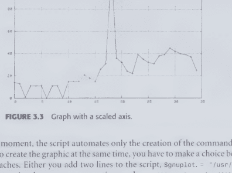
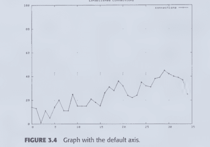
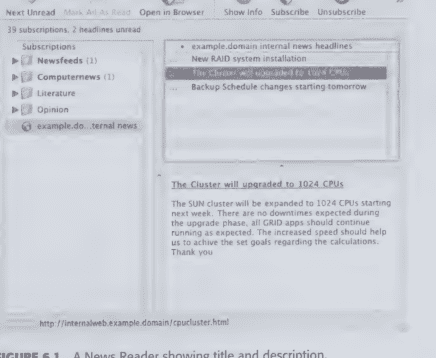
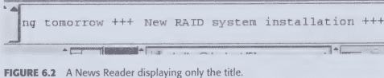

# Unix/Linux 生存指南


## LIMITED WARRANTY AND DISCLAIMER OF LIABILITY

随书附带的 CD-ROM 只能在单台 PC 上使用。许可证不允许在任何类型的网络上使用。你进一步同意，本许可证授予使用其中包含的产品，但不赋予你对本 CD-ROM 上任何内容或产品的拥有权。对本 CD-ROM 上包含的第三方软件的使用仅限于且受各自产品许可条款的约束。

CHARLES RIVER MEDIA, INC.（“CRM”）和/或参与编写、创建或制作随附代码（“软件”）或 CD-ROM 或书籍中文本材料上的第三方产品的人员，不能也不保证使用软件或书籍内容可能获得的性能或结果。作者和出版商已尽最大努力确保本文本材料和其中包含的程序的准确性和功能性。我们在此 however 不对这些程序或内容的性能作出任何明示或暗示的保证。软件按“原样”出售，无任何担保（除制造磁盘时使用的材料缺陷或因工艺不良造成的缺陷外）。

作者、出版商、第三方软件的开发人员以及参与本作品的生产和制造的任何人均不对因使用（或无法使用）本出版物中包含的程序、源代码或文本材料而产生的任何种类损害承担责任。这包括但不限于因使用产品而产生的收入或利润损失或其他附带或间接损害。

在任何索赔的情况下，唯一的补救措施仅限于更换书籍和/或 CD-ROM，且仅由 CRM 酌情决定。

“默示担保”和某些“除外责任”的使用因州而异，可能不适用于本产品的购买者。


## 前言

本书关于 *NIX 系统的管理。在这方面并没有真正“正确”或“错误”的方法。你通常有不止一种方法来实现某个目标。
*NIX 管理是一个创造性的过程。

听起来太美好而不真实？本书的目标之一就是证明这句话是真实的。如果你把基于 *NIX 的系统看作一个装满奇妙工具的盒子，提供近乎无限的可能性来创建解决方案，这句话的含义就开始变得有意义了。再加上你自己的创造力，你就更接近那句话的真正含义了。

我经常对基于 *NIX 的系统结构多么精良和逻辑感到惊讶。并不是说我之前不知道这一点，但在 18 年后，人们会把很多事情视为理所当然，并且倾向于忘记第一次接触 *NIX 系统时的感受，那里有无数需要调查和探索的东西。长话短说，在撰写本书时，我尝试用初学者的眼光来看待我最喜欢的操作系统。我尝试忘记经验和直觉，而是尝试理解几乎八年前在 Solaris 2.5.1 上最后一次查看的手册页。我做了本书中推荐的做法。

在过去的 18 年里，我使用过几乎所有类似 *NIX 的系统。在这些年里我学到的一个重要事实是，即使是看似不同的操作系统，如 Solaris 和 AIX，也比你想象的要有更多共同点。本书描述的技术适用于几乎所有可用的 *NIX 变种，并且大多数也适用于像 OS X 这样的基于 BSD 的系统。也许会有一些细微差别，比如文件的位置，但该文件的内容在每个系统上都是用于相同目的的。

## 前言

正如前言中已经提到的，*NIX 具有严格的逻辑结构。它的范式是，“更好的小程序做一两件事并做好。” *NIX 起源于开发环境；由于这一传承，你总会找到一两种方法来实现某个目标。系统可以（几乎）完全定制以满足你的需求。这一方法的证明是基于 *NIX 的手机或录像机。并且请注意，我说几乎完全定制并不意味着不能做某事，而是最后一部分可能需要比它值得的更多时间和精力。如果你想更换图形用户界面，你可以毫无问题地做到这一点；整个系统就是这样构建的。如果你想为 *NIX 创建一个全新的 GUI，你也可以这样做。可用窗口管理器的 sheer 数量证明了这一点。但作为系统管理员的工作会强加不同的优先事项。你如何以阻力最小的方式管理一个系统或大量系统？系统的哪些部分应如何配置？本书对系统管理方面的各种主题提出了逐步的方法。它从一些提示开始，说明在面对一个已经运行的系统时如何了解发生了什么，并讨论关于备份以及新系统的安装和配置的问题，如何使新系统准备好投入生产，以及如何保护该系统。

第 1 章“Things to Check”包含有关在“继承”的系统上应寻找什么的提示，哪些配置设置很重要，以及如何对系统有一个总体概述。

第 2 章“Working on *NIX”从关于 shell 和 Perl 脚本创建的简短介绍开始，并深入介绍如何借助基本的 *NIX 服务执行这些脚本。

第 3 章“Maintenance”讨论系统上的重复性任务以及基线化技术的描述。讨论了持续收集重要数据以在用户注意到之前检测和预测问题的过程，包括如何评估这些数据的提示。

第 4 章“Backup”讨论该主题的各个方面，并包含应注意什么的提示。

第 5 章“Setting Up a System”讨论新系统的安装以及使系统准备好投入生产使用所需的内容。它还包含启动过程的快速概述以及 init 状态如何在各种品牌的 *NIX 上使用。

第 6 章“The Test System and the ‘Secure’ System”关于拥有用于测试的系统的好处，并包括为系统争取预算的论据。它进一步解释了“安全系统”的概念，这是许多经验丰富的系统管理员用来提高安全性的做法。该章以讨论如何记录工具以简化必要文档的创建而结束。

第 7 章“Security”讨论有关 IT 安全的各个方面。你会找到关于这个热门话题的提示和建议。

本书以第 8 章“That’s It (Almost)”结束，这是我对你的告别。附录 A“One-Liners”包含有用的命令（有些长于一行）以使日常工作更轻松。

附录 B“Software Used in This Book and Where to Get It”列出了本书中使用的软件可在互联网上获得的地址。

附录 C“Internet”包含有用的网站列表。

所有示例都设置成可以在几乎每个系统上立即使用。有些示例可能有副作用；你不应在生产系统上尝试它们。它归结为一个简单的概念——如果有更多用户在系统上工作，那么所有用户（包括你）都可以期望彼此一定的礼貌。你的工作是确保系统能够发挥其全部潜力。如果某些东西不应该工作，那么你的工作就是尽量减少对机器性能的影响。如何实现这些目标是本书的主题。


### 1 需要检查的内容

### 本章内容

- 环境变量
- 准备工作

并非所有你需要管理的系统都是由你这位负责管理的人员搭建的。通常你继承的是由他人安装的系统，按照那个人认为应该如何操作的方式安装。如果安装过程有相应文档，你可以阅读文档，确保理解安装的原因，然后就完成了。理论上，设置 *NIX 系统并没有“错误”的方式；只是有些事情需要避免——有些则必须不惜一切代价避免。

然而，许多系统处于不断变化之中，因为这些系统上运行的服务会发生变化，或者操作系统本身的改进和更新会被安装。本章是对首先需要检查的内容进行的快速概述。

绝不要急于按照你制定的某个更高计划改变一切。有时某些设置是有原因的；不过有些设置只是被忽略了。你的工作是找出应该更改什么，以及如果对系统进行更改可能会破坏什么。首要任务是记录文档。听起来可能像老生常谈，但在某些时候，完善的文档确实能拯救你的一天。

### 1.1 环境变量

系统上关于环境变量的设置有很多，足以让你头疼。然而，由于所有程序都使用它们，你应该意识到围绕它们的影响。

#### 1.1.1 $PATH 变量

每个 *NIX 系统都使用 $PATH 变量来查找当前登录用户账户可用的所有可执行文件。如果 $PATH 变量看起来像清单 1.1 中所示的那样，具体取决于操作系统的发行版，可能会出现问题。

#### 清单 1.1 显示当前的 $PATH

```
$:-> echo $PATH
/usr/local/bin:/usr/bin:/usr/X11R6/bin:/bin:/usr/lib/java/jre/bin:/opt
/gnome/bin:.
$:->
```

程序在 /usr/local/bin 中优先调用，在 Linux 系统上可能没问题；然而在 Solaris 上如果不了解这一点可能会造成一些混淆。

例如，Solaris 系统上有时会有两个 tar 程序，并且行为各不相同。一个在 /usr/bin 中，一个在 /usr/local/bin 中。后者知道如何使用 gzip 库来压缩和解压缩生成的归档文件。这意味着如果你在两台 Solaris 系统之间切换，命令行 tar xzf 将在 $PATH 中 /usr/local/bin 排在前面的系统上工作。

然而，在使用 /usr/bin 中的 tar 的系统上你会收到错误信息。这意味着 Solaris 提供的 tar 命令无法打开使用 GNU 版本创建的文件，而该版本安装在 /usr/local/bin 中。

> 始终包含路径。大多数程序员会创建包含程序名称的变量，并包含完整路径，以确保他们打算使用的程序被执行，例如，TAR=/usr/local/bin/tar。然后，如果


需要 tar 程序时，它会使用 $TAR 而不是 tar 来调用。依赖操作系统调用“正确”的程序是一种冒险的做法，最终会出错。

这并不一定意味着你不能将 /usr/local/bin 作为 $PATH 中的第一项——你只需要意识到其后果。更改 $PATH 需要彻底的测试和对已部署脚本的检查；它们可能依赖于 $PATH 变量的特定顺序。

然而，示例变量末尾的设置更令人不安。如果尝试启动一个程序，当前目录 $PWD 也会被检查。由于 $PATH 的其他所有组件都会先被检查，你不太可能启动一个你并不打算启动的程序，但无论如何，当前目录不应包含在搜索可执行文件的路径数组中。同样，如果你决定更改此设置，请确保没有脚本，更糟糕的是用户，依赖于当前设置。

#### 1.1.2 提示符

如果你必须定期在系统之间切换，你应该设置 $PS1 变量，以便在当前时刻为你提供有关用户上下文和所在机器的提示。最好通过使用 shell 在启动期间读取的 $HOME 目录中的相应文件来定制此变量以满足你的个人需求。根据所使用的 shell，可以使用 .profile 或由相应 shell 读取的配置文件之一，例如 .cshrc 或 .bashrc。清单 1.2 显示了该条目。

#### 清单 1.2 通用提示符

```
PS1="$USER@`uname -n` "
```

需要注意的是，uname -n 周围的字符是所谓的反引号 (`)。单引号 (') 不会起作用。用反引号括起来的命令会被执行，其结果会替换该命令。清单中的序列在几乎所有基于 *NIX 的操作系统上都有效。

如果你使用“GNU Bourne-again shell”，简称为 bash，清单 1.3 和清单 1.4 中的序列也同样适用。

#### 清单 1.3 bash 的替代序列

```
PS1="\u@\h> "
```


#### LISTING 1.4 包含当前路径的序列

```
PS1="\u@\h:\w $"
```

这些替代序列更“安静”一些。

这个简单的配置项允许运行中的 shell 显示信息。如果时间很紧张，快速瞥一眼提示符，你就知道当前在哪个主机上以及以什么用户名工作。

#### 1.1.3 $MANPATH 变量

如果你在命令行使用 man 命令，你期望它能神奇地找到所有已安装程序的信息。然而，这种“魔法”要求系统被设置为这种方式工作。man 使用 $MANPATH 变量来搜索手册页。$MANPATH 中包含的每个目录都会被搜索；未包含的每个目录都会被忽略，很显然。更常见的情况是，$MANPATH 只包含 /usr/share/man。在这种情况下，例如，/usr/local/share/man 中的所有信息都不会被处理，因为 man 不会知道它的存在。更糟糕的是，man -k 在 Solaris 系统上很少被使用，因为起初没有人费心创建要搜索的索引。Listing 1.5 显示了在 Solaris 系统上创建索引的代码。

#### LISTING 1.5 在 Solaris 上创建索引

```
root@unixhost:~> echo $MANPATH
/usr/dt/man:/usr/man:/usr/share/man:/opt/sfw/man:/usr/local/man
root@unixhost:~> catman -w
```

确保 $MANPATH 包含所有包含手册页的目录并执行 catman -w。-w 选项指示程序创建所谓的 windex 数据库。该数据库包含对手册页内容进行搜索的索引。

更复杂的是，除了 /usr/share/man 和 /usr/local/share/man 之外，没有其他一致的位置来存储手册页。有不同的做法，每一种在各自的范围内都是有效的，但如果你要管理不同种类的 *NIX，你需要确保所有包含手册页的目录都被相应地搜索。为了说明当前情况，你可以查看 $MANPATH 在 GNU-Linux Listing 1.6、Solaris Listing 1.7 和 OS X Listing 1.8 上的示例，它们都是基于 *NIX 的系统。

#### LISTING 1.6 GNU-Linux 上的 $MANPATH

```
/usr/local/man:/usr/share/man:/usr/X11R6/man:/opt/gnome2/man:/opt/gnome/man
```

#### LISTING 1.7 Solaris 上的 $MANPATH

```
/opt/sfw/man:/usr/man:/usr/local/man:/usr/dt/man:/usr/openwin/man:/usr/X/share/man
```

#### LISTING 1.8 OS X 上的 $MANPATH

```
/sw/share/man:/sw/man:/usr/share/man:/usr/X11R6/man
```

这并不一定意味着这些列表中显示的设置就是最佳选择。你必须根据自己的系统调整设置。某些应用程序甚至将手册页存储在它们被安装的目录中。

$MANPATH 中的顺序同样重要。手册页会按目录逐个按变量中出现的顺序进行搜索。在 Solaris 示例中，man 会首先找到 ls 的 GNU 变体。该变体能够以彩色显示目录列表，前提是使用正确的参数。这些参数在使用 SUN 版本的命令时则无效。

要了解你系统上的情况，使用命令 echo $MANPATH。如果输出大致类似于本节前面显示的示例，大多数可用的手册页应该会被搜索和索引。如果时间允许，查看一下机器，确保没有遗漏。如果输出是 /usr/share/man，这可能是一个仅用于特定目的的系统，因此只包含可用软件的子集，或者可能是运行初始设置的人只是忘记相应地调整 $MANPATH。


> 始终安装所有手册页。由于如今硬盘空间便宜，如果可能的话，安装所有可用的手册页是明智的，前提是所使用的 *NIX 允许单独安装手册页。你甚至可能会发现一个你不了解的程序，可能使你能更快、更轻松地完成工作等。

你应该花时间在所有系统上运行 man intro；“intro” 手册页会自动安装在每个系统上，并包含有关它的有用信息。搜索已安装手册页的一种有趣方式是 man 的 -k 选项。此选项允许你在可用的手册页中进行搜索。你只需提供要搜索的词，如 Listing 1.9 所示。


#### LISTING 1.9 使用 man -k 搜索手册页

```
root@unixhost:> man -k passwd
 d_passwd           d_passwd (4)        - dial-up password file
getpw               getpw (3c)          - get passwd entry from UID
kpasswd             kpasswd (1)         - change a user's Kerberos password

nispasswd           nispasswd (1)       - change NIS+ password information

nispasswdd          rpc.nispasswdd (1m) - NIS+ password update daemon
pam_passwd_auth     pam_passwd_auth (5) - authentication module for password

passwd              passwd (1)          - change login password and password attributes

passwd              passwd (4)          - password file
```

仔细查看该列表的最后两行，你会注意到 passwd 这个词有两个条目。命令 man passwd 只会显示第一部分的内容，即 passwd (1)。要访问第四部分的信息，man 需要被指示这样做。不同的调用约定在列表 1.10 中显示。

#### LISTING 1.10 使用 man 访问各章节中的信息

```
erikk@unixhost:> man passwd
Reformatting page. Please Wait... done

User Commands                                   passwd(1)

NAME
    passwd - change login password and password attributes

SYNOPSIS
    passwd [-r files | -r ldap | -r nis | -r nisplus] [name]

...

erikk@unixhost:> man -s 4 passwd
Reformatting page. Please Wait... done

File Formats                                    passwd(4)
```

##### NAME

```
passwd - password file
```

##### SYNOPSIS

```
/etc/passwd
```

##### DESCRIPTION

```
The file /etc/passwd is a local source of information about users' accounts. The password file can be used in conjunc- ...
```

手册页是关于每个系统的最新参考资料。*NIX 发行商提供的每次更新也会更新手册页。这些信息是理解系统内部工作原理的宝贵来源。

#### 1.1.4 现在几点了？

*NIX 系统需要知道日期和时间。如果此信息未正确设置，一些内部工作会受到影响。机器使用内部时钟来跟踪日期和时间。硬件年代较旧的系统往往会时不时地丢失或增加几秒，部分原因是这些系统使用的电池耗尽，例如。如果发生这种情况，就必须使用其他方法来保持日期和时间最新。日期和时间另一个组成部分是 $TZ 变量。它存储系统所在的时区，并且在同一地理位置的所有系统之间应保持一致。

如果你在没有正确 $TZ 值的情况下从芝加哥的一台系统向费城的一台系统传输文件，费城系统上的时间戳将与芝加哥的时间戳相差 60 分钟。这似乎不是大问题，但如果某个程序基于时间戳来决定是否覆盖文件，就可能出现问题。如果这些系统具有正确的 $TZ，就会做出正确的决定。如果没有，你可能会丢失有价值的数据。在此示例中，芝加哥的系统应将 $TZ 设置为 CST 或 US/Central，而费城的系统应为 US/Eastern 或 EST。

##### 1.1.4.1 如何设置 $TZ

$TZ 在安装期间设置，并且稍后可以借助 tzselect 命令为用户上下文更改。tzselect 用于获取有效的 $TZ 值。它会向用户询问有关地理位置的问题并输出一个类似 US/Eastern 的字符串，适合使用。如果系统上未设置 $TZ，请在设置之前确保你明白原因。同样适用于“错误”的 $TZ 设置；它们可能是有原因的。


为什么应该先检查错误的 $TZ？几年前，有人在作者即将更改一个看似“错误”的 $TZ 设置之前叫停了他。事实证明，最初安装 *NIX 服务器的人部署了约 200 台配置了错误 $TZ 设置的桌面机器。因此，而不是在每台机器上纠正这个问题，决定通过将其中两台服务器的 $TZ 设置为不同值来弥补“丢失”的一个小时，以补偿错误。

如果当时作者做出他打算做的更改，就会使 CMS（内容管理系统）中的几个跟踪流程混乱，从而导致六份每周杂志必须手工检查缺失内容——印刷运行大约还有 90 分钟！更正是在稍后对桌面系统进行升级部署时进行的。重要的是：先询问，先理解影响，计算风险，然后再更改！

##### 1.1.4.2 如何设置时间

在 *NIX 系统上，或大多数计算机上，设置时间有两种方法。首选的第一种方法使用所谓的 time-host，让系统能够定期获取时间。这意味着网络上的一台或两台计算机连接到网络内部或外部的某个可靠源，获取日期和时间，并将此信息作为服务提供给其他系统。这样做的好处是所有系统对当前时间和日期达成一致，并且你只需要维护一台或两台系统即可。

使用一台 time-host 设置时间的“旧”方法是 rdate 协议，分辨率为 1 秒。首选的设置时间方式是使用几乎所有 *NIX 版本都可用的 ntp 包。后者也有一个缺点。为了防止篡改，必须在 time-host 和客户端之间生成和交换安全令牌。另一方面，ntp 能够从多个主机获取时间并计算延迟，从而实现更精确的计时。

要了解使用什么来设置时间，首先检查是否存在名为 /etc/ntp.conf 的文件。如果存在，很可能使用了 ntp。否则，扫描 root crontab 中包含 rdate 或 ntpdate 的条目——后者是 rdate 的替代品。如果两者都不存在且系统时间似乎不准确，请再次阅读前面关于先检查错误的 $TZ 的说明，然后继续。

尽管手动设置时间和日期应仅作为临时解决方案，但 date 命令可用于此操作，如列表 1.11 所示。


#### LISTING 1.11 手动设置时间

```
root@unixhost:~> date -s "15:40:00 02/09/04"
Mon Feb 9 15:40:00 CET 2004
root@unixhost:~> date
Mon Feb 9 15:40:19 CET 2004
root@unixhost:~>
```

如果使用 GNU-Linux 系统，则需要做更多工作才能说服硬件真正保存时间，而不是仅用于当前会话。命令 hwclock 用于将时间和日期写入系统时钟。

如果需要更改当前时间，请确保不要“跳跃”得太远或太回。有些程序可能会对过大的跳跃做出反应，尤其是服务器进程、版本控制或文件服务，例如 netatalk 和 smbd；前者为旧版 Apple 客户端提供服务，后者为 Windows 客户端提供服务。通常用于在网络中保持时间同步的后台进程会部署所谓的 slew 模式。这意味着时间的更改将逐步进行，以避免依赖时间戳的程序产生混淆。

### 1.2 准备工作

如果你继承了一个系统，你应该尝试了解安装了什么、在哪里安装的，以及配置的当前状态。你可以使用几种经过验证的方法来实现这一点。

#### 1.2.1 root 的 $HOME

假设你已以 root 身份登录，首先要使用的命令是 cd 后跟 pwd，以确定超级用户是否有自己的 $HOME 目录。

```
root@unixhost:~> cd
root@unixhost:~> pwd
/root
root@unixhost:~>
```

所示示例来自 Linux 主机。root 在 Linux 上有自己的主目录，但在 Solaris 上 root 的主目录通常是 / 目录。

Solaris 上的这种设置有几个原因。其中最重要的一点可能是 root 在登录时需要访问其主目录。如果系统出现问题，无法访问 $HOME 指向的目录可能会导致问题，甚至导致登录无法工作。

另一方面，应该有一个由 root 拥有的地方来存储机密文件。如果需要，你应该创建一个 root 主目录。

要在 root 没有主目录的系统上为 root 创建主目录，必须采取一些预防措施。列表 1.12 说明了必要的步骤。

#### LISTING 1.12 创建 root $HOME

```
root@unixhost:~> cd /
root@unixhost:~> mkdir .HO
root@unixhost:~> ls -ld .HO
drwxr-xr-x  2 root  root       48 Feb  9 17:05 .HO
root@unixhost:~> chmod -R g-r-x,o-r-x .HO
root@unixhost:~> ls -ld .HO
drwx------  2 root  root       48 Feb  9 17:05 .HO

root@unixhost:~>
```

这一系列命令的工作原理如下：第一个命令 cd / 将目录更改为文件系统的根目录。下一个命令 mkdir .HO 创建一个对“普通”用户隐藏的目录。ls -ld .HO 显示权限并告诉我们所有用户对新创建的目录都有读和执行权限。为了解决这个问题，使用命令 chmod -R g-r-x,o-r-x .HO。它撤销了组和其他用户的读和执行权限，在这种情况下为 root 和所有不属于该组的有效登录。目录并不是真正“隐藏”的，但如果 ls 命令不使用 -a 选项就不会显示出来，-a 的含义是显示即使以“.”开头的“隐藏”文件。

> *root 的 $HOME 必须可访问。Root 的 $HOME（在文件 /etc/passwd 中指向的位置）必须位于在所有 init 状态下都会挂载的卷上。如果系统启动时无法访问 root 的 $HOME，启动过程将永远挂起。更改 init 状态时也一样；如果 root 的 $HOME 不可访问，则可能会出现问题。*

#### 1.2.2 更多的 root？

有些系统拥有不止一个超级用户。乍一看，这似乎没有意义，但有时创建多个 UID 为 0 的用户是必要的。想象一个数据中心，全天候 24 小时、每周 7 天工作。显然应该有多名系统管理员，但如何区分谁在何时以超级用户身份工作呢？


显然，文档应该对这个问题有所说明，但要检查是否存在多个超级用户，可以使用第 1.13 节所示的命令链。

#### LISTING 1.13 Finding Users with UID 0

```
root@unixhost:~> awk -F ':' '{if ($3==0) print $0}' /etc/passwd
root:x:0:1:Super-User::/sbin/sh
```

如果输出看起来像所示那样，则只有一个 root。列表 1.14 演示了另一种情况。

#### LISTING 1.14 Finding Users with UID 0 (More Than One Superuser)

```
root:x:0:1:Super-User::/sbin/sh
ek_root:x:0:1:ek root account::/sbin/sh
mw_root:x:0:1:mw root account::/sbin/sh
fh_root:x:0:1:fh root account::/sbin/sh
```

在示例中显示的机器上，你会看到有三个人能够成为超级用户。所有账户都应有不同的密码，并且如果其中一个人将用户上下文更改为超级用户，将会生成一条日志条目。

不用说，除了与示例中首字母匹配的人之外，没有人应该使用 root 账户。当然，多账户在你正在工作的系统上是如何组织的，取决于最初设置系统的人选择如何区分系统管理员。

像描述的那样的设置要求所有系统管理员在切换到超级用户时注意两点：

- 从不使用 root 账户。
- 始终使用普通用户账户登录并使用 su 切换到超级用户。

大多数 GNU-Linux 和 BSD 系统上都有一个名为 sudo 的命令。如果需要，也可以在 Solaris 和大多数其他 *NIX 变体上安装它，但执行命令时反复输入 sudo 可能会很烦人。

如果遵守这些要求，所有系统管理员都能够看到谁以超级用户身份工作以及何时工作。


> Solaris 很久以前就引入了角色的概念；这个概念与使用多个超级用户完全不同。

一个角色包含在系统上执行某些操作的权限。这些权限是根据某些工作描述定义的。这并不一定意味着拥有某些授予权限的用户能够整体管理系统。可以创建一个包含所有管理权限的角色，但这种方法并不反映多个 UID 0 用户的概念。

如果系统 24/7 运行，一个超级用户应始终能够访问系统并处理可能出现的问题。常识告诉我们，我们不可能以一种涵盖所有可能性的方式定义用户权限。一些需要解决的问题需要采取激进措施，而你无法预见到所有这些问题。

#### 1.2.3 How Many Volumes?

与其它操作系统不同，*NIX 总是使用树状结构来连接硬盘和存储在其上的文件系统。树从 / 目录开始；从那里可以到达所有其他内容。可以将另一个文件系统“挂载”到目录中以获得更多空间；挂载完成后，该目录的实际内容将被隐藏。

要了解当前系统上挂载了多少个卷，可以使用第 1.15 节所示的命令。

#### LISTING 1.15 Displaying the Mounted Volumes

```
root@unixhost:~# df -h
Filesystem           Size  Used Avail Use% Mounted on
/dev/dsk/c0t3d0s0    1.5G  1.1G  403M  73% /
/dev/dsk/c0t3d0s1    482M  311M  123M  72% /var
swap                 546M   40K  546M   1% /var/run
swap                 546M  312K  546M   1% /tmp
/dev/dsk/c0t3d0s7    1.5G  864M  550M  62% /export/home
```

命令 df，易于记忆为 Disk Free，带上 -h 选项以便人类可读，会显示有多少个卷以及它们上有多少可用空间。前面的示例来自一个小型 Solaris 系统。如果你的系统上没有 -h 选项，请改用 -k。 resulting 数字将以千字节为单位，而不是默认的 512 字节块，这甚至更难理解。

#### 1.2.4 What Is Going On?

有三个命令可以了解系统当前正在做什么。命令是 ps、top 和 sar。其中一些命令将在第 3 章中更详细地介绍。


##### 1.2.4.1 ps

ps 命令在你需要确定系统中是否正在运行某个进程或该进程有多少个实例处于活动状态时非常有用。ps 的缺点是很少有命令拥有如此多的选项；根据命令的实现版本，你有 20 到 50 个单选项，可以组合使用以限制输出或使其更详细。BSD 版本通常使用 uawx 选项。要在 Solaris 上使用此选项调用该程序，你应该使用 /usr/ucb/ps 来启动 BSD 版本，而不是仅使用 ps。（BSD 二进制文件仍存在于大多数 Solaris 机器上；它们只是隐藏在 /usr/ucb 中。）例如，要找到使用最多 CPU 周期 的 10 个进程，可以使用以下命令，如清单 1.16 所示。

#### LISTING 1.16 Running ps

```
root@unixhost:/> /usr/ucb/ps uawx | head
ekeller   472  0.4  7.211176 8760  ?   S 10:06:14  0:05   /usr/openwin/bin/Xsun
root      632  0.2  0.7 1008  800 pts/5  0 10:17:54  0:00  /usr/ucb/ps uawx
ekeller   565  0.2  3.9 7160 4768  ??  S 10:06:48  0:00  /usr/dt/bin/dtterm-s
root      3   0.1  0.0  0    0   ?   S 10:05:34  0:00  fsflush
root      473  0.1  1.6 2320 1896  ?   S 10:06:15  0:00  mibisa -p 32788
root      1   0.0  0.3 1232  368  ?   S 10:05:34  0:00  /etc/init -
ekeller   564  0.0  3.6 6920 4392  ??  S 10:06:48  0:00  /usr/dt/bin/dtterm-s
root      0   0.0  0.0  0    0   ?   T 10:05:31  0:00  sched
root      2   0.0  0.0  0    0   ?   S 10:05:34  0:00  pageout
```

前述示例的输出为了清晰起见在约 80 个字符处被截断。选项以以下方式修改输出：u 显示用户相关信息等内容并按 CPU 使用率对进程进行排序，a 显示所有用户 的进程而非仅调用用户 的进程，w 使用 132 列显示信息而不是终端窗口的宽度，x 显示未绑定到终端的进程。最后一个选项很重要，因为未连接到终端的进程也在使用 CPU 周期。命令末尾的管道 | 将输出传递给程序 head 以将行数限制为十行，这是默认值，因此调用 head 时使用 -10 是不必要的。如果你想找到进程的“前十名”，这个命令就足够了。

如果在使用选项 `uaux` 时收到错误消息，则安装了 `ps` 的另一种变体。你必须改用选项 `-ef` 来获得类似的输出，但此版本不允许轻松地根据 CPU 使用率对进程进行排序。`ps` 的另一种用途是确定某程序运行了多少个进程。这可以通过将 `ps` 的输出链接到用户可用的其他命令来实现。例如，要找出 sendmail 生成了多少个进程，一个可能的命令链如清单 1.17 所示。

#### LISTING 1.17 Count of Running sendmail Processes

```
root@unixhost:> /usr/ucb/ps uaux | grep sendmail | wc -l
3
```

看起来有三个正在运行的 sendmail 进程。为了验证该结果是否正确，启动命令而不将输出传递给 `wc`，即省略 `| wc -l` 部分，会显示找到的行数以供检查（见清单 1.18）。

#### LISTING 1.18 Displaying Executing sendmail Processes

```
root@unixhost:> /usr/ucb/ps uaux | grep sendmail
root      740  0.1  0.6  992  696  pts/5    S 11:57:03  0:00 grep
sendmail
smsm      592  0.0  1.2 4352 1448  ?        S 10:07:08  0:00 /usr/lib/
sendmail -Ac -q15m
root      593  0.0  1.7 4384 2000  ?        S 10:07:08  0:00 /usr/lib/
sendmail -bd -q15m
```

该命令行显示实际上只有 *two* 个正在运行的 sendmail 进程。`grep` 列出了自身，因为字符串 `sendmail` 也是命令的一部分。为了利用计数，必须从传递给 `wc` 的列表中消除包含 `grep` 的行。实现这一点的方法不止一种；选项一，见清单 1.19，是常用的选择。

#### LISTING 1.19 Suppressing the Display of Lines Containing grep

```
root@unixhost:> /usr/ucb/ps uaux | grep sendmail | grep -v grep
smsm      592  0.0  1.2 4352 1448  ?        S 10:07:08  0:00 /usr/lib/
sendmail -Ac -q15m
root      593  0.0  1.7 4384 2000  ?        S 10:07:08  0:00 /usr/lib/
sendmail -bd -q15m
```


Telling grep to ignore lines containing the word grep by using the option -v feeds the right information into wc, but another grep process is needed to do so. This third process, to get things right, won’t bring the machine to its knees, to be sure, but option two (see Listing 1.20) eliminates the need for the third process completely.

#### LISTING 1.20 Suppressing the Display of Lines Containing grep without a Second Process

```
root@unixhost:/> /usr/ucb/ps uawx | grep [s]endmail
smss p 592 0.0 1.2 4352 1448 ? S 10:07:08 0:00
/usr/lib/
sendmail -Ac -q15m
root 593 0.0 1.7 4384 2000 ? S 10:07:08 0:00
/usr/lib/
sendmail -bd -q15m
```

The square brackets around the s prevent grep from finding another line containing sendmail. How so? grep uses so-called "regular expressions" and the square brackets denote a choice, e.g., grep [Ss]endmail would find lines containing Sendmail and sendmail, but to find itself again, one would have to search for the square brackets as well.

##### 1.2.4.2 top

The top command acts like running ps permanently while allowing the user to change parameters or apply filters to the output. top is usually available on all *NIX distributions. After you start top via the command line, the screen looks like Listing 1.21.

#### LISTING 1.21 top Default Display

```
last pid: 1026; load averages: 0.12, 0.19, 0.13
14:17:37
67 processes: 65 sleeping, 1 running, 1 on cpu
CPU: 97.4% idle, 1.8% user, 0.8% kernel, 0.0% iowait, 0.0% swap
Memory: 128M real, 34M free, 60M swap in use, 542M swap free

PID USERNAME LWP PRI NICE SIZE RES STATE TIME CPU COMMAND
874 root 1 59 0 11M 8808K sleep 0:10 0.60% Xsun
1025 erikk 1 59 0 2344K 1616K cpu 0:00 0.23% top
958 erikk 5 59 0 8912K 7144K sleep 0:05 0.15% dtwm
472 root      7  59  0 2320K 1896K sleep   0:03  0.09% mibiiisa
988 erikk     1  59  0 7008K 4744K sleep   0:00  0.00% dtterm
238 root      8  59  0 44M  9072K run     0:01  0.00% java
959 erikk     1  49  0 10M 7720K sleep   0:01  0.00% dtfile
461 root      3  59  0 2672K 2008K sleep   0:01  0.00% vold
956 erikk     1  49  0 7720K 4464K sleep   0:00  0.00% dtsessio
983 erikk     1  49  0 10M 1264K sleep   0:00  0.00% dtfile
1010 erikk    1  59  0 6920K 4648K sleep   0:00  0.00% dtterm
995 erikk     1  59  0 6912K 4648K sleep   0:00  0.00% dtterm
962 erikk     1  59  0 7080K 4640K sleep   0:00  0.00% sdtperfm
955 erikk     1  59  0 4696K 3384K sleep   0:00  0.00% ttssessio
875 root      1  59  0 6840K 3104K sleep   0:00  0.00% dtlogin
```

Listing 1.21 shows a machine without load. The first line displays the PID of the process last started, load averages, and the current time. The next line shows the number of processes and how many are running at the moment. The third line contains the current CPU statistics and the last line of the header shows the amount of memory available and how much of it is actually used.

The remaining lines are the currently running processes sorted by their CPU usage. Typing u followed by a valid username filters the output to processes owned or run by a specific user (Listing 1.22 and Listing 1.23 illustrate the process).

#### LISTING 1.22 top Filtering One User

```
Memory: 128M real, 34M free, 60M swap in use, 542M swap free
Username to show: erikk

PID USERNAME LWP PRI NICE SIZE RES STATE TIME CPU COMMAND
874 root      1  59  0 11M 8808K sleep  0:10 0.60% Xsun
```

The screen changes to the output shown in Listing 1.23 after pressing the Enter Key.

#### LISTING 1.23 top Filtered Display

```
last pid: 1061; load averages: 0.04, 0.04, 0.05
14:42:09
70 processes: 68 sleeping, 1 running, 1 on cpu
CPU: 99.6% idle, 0.2% user, 0.2% kernel, 0.0% iowait, 0.0% swap
Memory: 128M real, 33M free, 61M swap in use, 541M swap free

PID USERNAME LWP PRI NICE SIZE RES STATE TIME CPU COMMAND
1050 erikk    1  59  0 2336K 1600K cpu   0:01 0.23% top
988 erikk  1 59  0 7008K 4744K sleep  0:00 0.01% dterm
1060 erikk  1 59  0 1904K 1336K sleep  0:00 0.01% vi
958 erikk  5 59  0 8912K 7144K sleep  0:05 0.01% dtwm
1010 erikk  1 59  0 6928K 4744K sleep  0:00  0.00% dterm
959 erikk  1 49  0 10M 7720K sleep  0:01  0.00% dtfile
956 erikk  1 49  0 7720K 4464K sleep  0:00  0.00% dtsessio
983 erikk  1 49  0 10M 1286K sleep  0:00  0.00% dtfile
995 erikk  1 59  0 6912K 4648K sleep  0:00  0.00% dterm
962 erikk  1 59  0 7080K 4640K sleep  0:00  0.00% sdtperfm
955 erikk  1 59  0 4696K 3388K sleep  0:00  0.00% ttsessio
987 erikk  1 59  0 3168K 2304K sleep  0:00  0.00% dtexec
1009 erikk  1 59  0 3168K 2304K sleep  0:00  0.00% dtexec
994 erikk  1 59  0 3168K 2304K sleep  0:00  0.00% dtexec
939 erikk  1 59  0 4032K 2088K sleep  0:00  0.00% sdt_shel
```

By using this basic functionality, you can see why top is one of the most important tools on any given *NIX system. Other functions available are dependent on the version of top installed on the machine. Using the ? key while top is running displays one or more help screens describing the capabilities of the running program.

top is available for almost every *NIX variant, but not necessarily installed by default or even available on the installation media. If top is not to be part of the *NIX distribution, you can download it from the locations given in Appendix B.

##### 1.2.4.3 sar

The sar command, available on many *NIX systems, spells out to "system activity reporter" and covers a huge amount of measurements, ranging from CPU statistics to I/O on hard disks and terminal lines among others. The number of probes recorded varies between the different flavors of *NIX. The Solaris variant knows 15 groups, while the OS X supplied version is limited to 4.

The mode of operation is the same on all supported platforms—sar is either run if needed, without storing any data, or an entry in a crontab initiates the collection of the data and stores it somewhere in the /var hierarchy. The resulting data files will be recycled, if configured. On a Solaris system, the filenames consist of the string sa and the day of the month, e.g., sa05 for the fifth day of the month. This mode of rotation allows to access "historical" data up to 30 days.

To calculate and display information about the CPU load, you can use the command in Listing 1.24.


#### LISTING 1.24 sar One Shot (1)

```
erikk@unixhost> sar 5 5

SunOS unixhost 5.9 Generic_112233-11 sun4u 07/05/2004

13:56:20 %usr %sys %wio %idle
13:56:25 2 1 0 97
13:56:30 2 0 0 98
13:56:35 3 1 0 97
13:56:40 3 1 1 95
13:56:45 3 0 0 97

Average 2 1 0 97
erikk@unixhost>
```

所使用的命令执行 sar，告诉它以 5 秒间隔获取五个样本。前面 Listing 1.24 中的机器似乎负载很低；负载更高的系统会更像 Listing 1.25 中显示的那样。

#### LISTING 1.25 sar One Shot (2)

```
erikk@unixhost> sar 5 5

SunOS unixhost 5.9 Generic_112233-11 sun4u 07/05/2004

14:07:28 %usr %sys %wio %idle
14:07:33 23 15 62 0
14:07:38 22 15 63 0
14:07:43 23 18 59 0
14:07:48 25 22 53 0
14:07:53 24 27 49 0

Average 24 19 57 0
erikk@unixhost>
```

该列表显示的是同一台机器，但由于后台运行的进程而承受了稍大的压力。对 Listing 1.25 中的数据进行分析似乎表明，系统花费大部分时间在等待 I/O 操作完成。因此，sar 的一次性模式可用于即时诊断问题。在本例中，第一步工作将是查明机器为何抱怨 I/O 速度慢。可以利用 top 来查找占用 I/O 子系统的进程，或配合运行 ps 反复运行 sar 以找出高等待 I/O 百分比的原因。

另一种方法是通过使用 sar 收集的存储数据来分析今天早些时候发生了什么。如果 sar 通过 crontab 中的条目存储数据，则可以利用这些信息更全面地了解负载情况。显示存储数据的操作如 Listing 1.26 所示。

```
erikk@unixhost> sar -s 13:00 -e 14:30

SunOS unixhost 5.9 Generic_112233-11 sun4u    07/05/2004

13:00:01    %usr    %sys    %wio    %idle
13:10:00      1       0       0       98
13:20:00      0       0       0       99
13:30:00      0       0       0       100
13:40:01      0       0       0       100
13:50:00      1       0       0       99
14:00:00      0       0       0       99
14:10:01      3       2       5       90
14:20:00      0       0       0       100
14:30:00      0       0       0       100

Average       1       0       1       98
erikk@unixhost>
```

检查 Listing 1.26 中的输出显示这只是活动增强的情况。对一段十分钟时间内采样的累积值进行判断，目前似乎没有什么严重问题。-s 和 -e 选项用于将要显示的数据窗口缩小到当天的 13:00 至 14:30 时间段。你将在第 3.1.6 节“Monitoring the CPU”中了解更多关于 sar 的信息。

#### 1.2.5 Create a List

当你使用系统时，最先派上用场的事情之一就是特定机器上所有文件的清单。你有多种方法可以获取该列表，但没有任何东西能比得上文本文件，在需要时可以对其进行“grep”。Listing 1.27 中显示的命令可用于创建跨所有挂载卷的文件列表。

```
root@unixhost:> cd /
root@unixhost:> find . > flist.txt
```

不过要谨慎——此命令需要以 root 身份运行，并且可能显著降低系统速度。如果系统负载很重，创建列表应安排在计划停机期间或影响用户最少的时间进行。

此外，请尽快将生成的列表移至你的私有 root $HOME 中。它包含有关系统的敏感信息。

如果所讨论的系统用作文件服务器或具有巨大磁盘空间的其他设置，那么为共享卷创建所有文件的目录就毫无意义了。要仅创建重要卷上的文件列表，可以使用 find 命令的 -xdev 参数（假设所有相关目录都在根卷上），如 Listing 1.28 所示。

#### LISTING 1.28 Creation of a List of One Hard Disk Only

```
root@unixhost:> cd /
root@unixhost:> find . -xdev > flist.txt
```

此选项告诉 find 不要遍历挂载点。例如，如果 /usr/local 是一个挂载卷，则需要如 Listing 1.29 所示重复该命令。

#### LISTING 1.29 Adding Directories to the List

```
root@unixhost:> find /usr/local -xdev >> flist.txt
```

你必须为每个应包含在列表中的挂载目录重复此命令。不要 cd 到该目录，因为你会丢失通向文件的路径。

此列表（存储在只有 root 可访问的位置）使管理员能够找到即使是最奇特的文件和目录。该列表尤其在某个程序抱怨无法找到特定文件时非常有用。在这种情况下，可以使用该列表搜索文件，如 Listing 1.30 所示。

#### LISTING 1.30 Searching the Location of a File

```
root@unixhost:> grep Xdefs.h flist.txt
./usr/X11R6/include/X11/Xdefs.h
root@unixhost:>
```

此列表也可用于其他用途。例如，它在第 7.2.2 节 "A Simple File Checker" 中被用来创建检查重要目录更改的工具。


#### 1.2.6 邮件

了解系统上邮件发生的情况如今至关重要。这并不意味着管理员应该监视用户，但他应该留意通过机器传输的邮件数量。在 *NIX 系统上最常见的邮件程序是 sendmail 和 postfix。前者附带一个创建统计文件的功能，可以使用 mailstats 命令读取，如 1.31 节所示。

##### LISTING 1.31 命令 mailstats 的输出

```
root@unixhost:~> mailstats
Statistics from Wed Sep 17 16:03:39 2003
M  msgsfr  bytes_from  msgs to  bytes_to  msgsrej  msgsdis  Mailer
3  14      21K         13       27K        0        0        local
==============================================
T  14      21K         13       27K        0        0
C  3
```

如果在运行 mailstats 时出现错误消息，你需要通过执行 1.32 节中使用的命令来启用统计收集。

##### LISTING 1.32 激活邮件统计收集

```
root@unixhost:~> touch /etc/mail/statistics
```

与 sar 机制相反，邮件统计是持续创建的。4 天后，你得到的就是这 4 天的合并数据；你无法按天评估数据。

该程序可以使用 -p 选项来纠正这种情况（参见 1.33 节）。该选项指示程序以适合脚本处理的格式输出数据并在之后删除它。由于使用 -p 选项显示统计数据时会删除统计数据，因此你需要在文件中收集统计数据以便以后检查。

##### LISTING 1.33 供进一步处理的输出

```
root@unixhost:~> mailstats -p
1063807419 1090320821
3  17  24  16  30  0  0  local
T  17  24  16  30  0  0
C  6  0  0
```

另一方面，postfix 需要额外的软件来执行相同的功能，例如可在 http://www.endernunix.org/isoqlog/ 找到的 isoqlog 。由于安装此额外软件需要你知道如何编译它，因此描述超出了本章的范围。

#### 1.2.7 已安装软件

鉴于在 *NIX 系统上安装额外软件没有真正的规则，只有像“文件系统层次结构标准组”在 http://www.pathname.com/fhs/ 提供的建议，大多数第三方软件开发人员遵循该标准或自行制定的方案。后者方案通常以某种方式基于 FHS 标准。在建议的标准中，额外的软件包应安装在两个位置：

- /opt
- /usr/local

作为收集非自己安装的系统信息的最后一步，你应该浏览这些位置一段时间，以更好地了解是否安装了额外软件，如果有，安装在哪里。这种自定义安装的一个潜在问题是，额外的配置文件可能隐藏在这些目录中。如果安装在其中的程序应使用这些配置文件而不是 /etc 中的配置文件，了解这一事实将节省以后大量的猜测。使用这种方法并不错误，但大多数系统管理员习惯于配置文件应位于 /etc 中。如果已安装的程序被编译为忽略此目录并改用自己的硬编码位置，则应将此信息放在随系统提供的文档中。这在相关程序通常不表现出这种行为或在同一网络中的其他系统上行为不同时尤其重要。例如，假设程序 foo 安装在各种操作系统上并从 /etc/foo.conf 读取配置文件。如果该程序作为程序包的一部分安装以满足程序包创建者的特定需求，则程序包创建者可能决定确保程序的另一个实例不会干扰其在程序包中的使用。因此，程序的配置将位于 /opt/package-name/etc/foo.conf 而不是 /etc/foo.conf，这是一个常见情况，鉴于许多 *NIX 程序的多功能性。如果出于安全原因需要更改配置，通常会根据提供的信息更改 /etc 中的配置。如果 /opt/package-name/etc/foo.conf 中的配置也应更改，系统管理员应意识到它首先存在，以便他可以相应地采取行动。

目录层次结构将在第 5 章中进一步讨论。


### 1.3 SUMMARY

本章中的信息应为管理员提供有关如何收集环境变量配置信息的指针，以及在需要时如何设置系统时间；如果存在多个超级用户，如何调查超级用户数量；以及如何为 root 创建一个安全的位置来存储有关系统的敏感信息。此外，本章还讨论了如何显示正在运行的进程和邮件系统的统计信息，并以关于额外软件应安装在哪里的简短讨论作为结尾。

## 2 Working on *NIX

### In This Chapter
- Executables on *NIX
- Shell Scripts Step by Step
- Perl Scripts
- Automation

与“其他”主流操作系统相比，*NIX 在编程和系统任务方面采用了不同的方法。*NIX 为用户提供了数十个小型程序，这些程序能够“正确”地完成一件事或多件事。

这些程序通过定义的接口相互通信，从而最大限度地降低了其中一个程序更改或获得扩展功能时破坏系统的风险。您可以选择自己的工具并将它们链接起来，实现您想要的目标，无论相关的小程序是简单的脚本还是二进制文件。事实上，许多命令实际上是 shell 或 Perl 脚本，并且由于这种方法的灵活性，您可以研究并重用它们，或完全用自己编写的东西替换它们。后一种方法很少必要，但在需要处理非常特殊的情况时非常有用。

### 2.1 EXECUTABLES ON *NIX

*NIX 系统如何“知道”哪些文件是可执行的？为什么不是每个用户都被允许执行系统上的所有程序？系统如何确保程序不会覆盖属于另一个进程的数据？这些问题将在以下各节中得到解答。

#### 2.1.1 Why Is a Program Executed?

与其它操作系统相反，*NIX 具有严格的控制系统，并在程序执行前进行几次检查。系统首先检查用户，或调用该进程，是否有执行该程序的权限，如果该程序被标记为可执行的话。如果此检查通过并且程序尝试创建文件，系统会确保用户有权在此位置创建该文件。对于在随机存取存储器（RAM）中创建文件也同样适用。鉴于这一系列安全检查，几乎不可能覆盖属于系统或另一用户的[content]

### 1.3 SUMMARY

本章中的信息应为管理员提供有关如何收集环境变量配置信息的指针，以及在需要时如何设置系统时间；如果存在多个超级用户，如何调查超级用户数量；以及如何为 root 创建一个安全的位置来存储有关系统的敏感信息。此外，本章还讨论了如何显示正在运行的进程和邮件系统的统计信息，并以关于额外软件应安装在哪里的简短讨论作为结尾。

## 2 Working on *NIX

### In This Chapter
- Executables on *NIX
- Shell Scripts Step by Step
- Perl Scripts
- Automation

与“其他”主流操作系统相比，*NIX 在编程和系统任务方面采用了不同的方法。*NIX 为用户提供了数十个小型程序，这些程序能够“正确”地完成一件事或多件事。

这些程序通过定义的接口相互通信，从而最大限度地降低了其中一个程序更改或获得扩展功能时破坏系统的风险。您可以选择自己的工具并将它们链接起来，实现您想要的目标，无论相关的小程序是简单的脚本还是二进制文件。事实上，许多命令实际上是 shell 或 Perl 脚本，并且由于这种方法的灵活性，您可以研究并重用它们，或完全用自己编写的东西替换它们。后一种方法很少必要，但在需要处理非常特殊的情况时非常有用。

### 2.1 EXECUTABLES ON *NIX

*NIX 系统如何“知道”哪些文件是可执行的？为什么不是每个用户都被允许执行系统上的所有程序？系统如何确保程序不会覆盖属于另一个进程的数据？这些问题将在以下各节中得到解答。

#### 2.1.1 Why Is a Program Executed?

与其它操作系统相反，*NIX 具有严格的控制系统，并在程序执行前进行几次检查。系统首先检查用户，或调用该进程，是否有执行该程序的权限，如果该程序被标记为可执行的话。如果此检查通过并且程序尝试创建文件，系统会确保用户有权在此位置创建该文件。对于在随机存取存储器（RAM）中创建文件也同样适用。鉴于这一系列安全检查，几乎不可能覆盖属于系统或另一用户的重要文件。如果您以 root 身份登录，其中一些限制则不适用。因此，如果您以 root 身份登录时执行程序或脚本，请确保结果是您最初打算执行的操作——尤其是像 rm（remove）这样的命令，在超级用户环境下执行时，依赖于您的判断并不会询问。

> 即使一些经验丰富的 *NIX 管理员会告诉你并非如此，但作者亲眼见过——有些 *NIX 发行版并不介意有人尝试从硬盘中删除内核！准确地说，只要系统不重新启动，它们就不介意。 admittedly，作者是在一台较旧的系统上看到这种情况发生的，但仍然，没有任何警告；内核只是被删除了。作为 root 工作时请仔细检查。

#### 2.1.2 What Is #!?

当浏览 shell 或 Perl 脚本等可执行文件时，您不可避免地会遇到像 #!/bin/sh 或 #!/usr/bin/perl -w 这样的行。请看清单 2.1。

#### LISTING 2.1 The First Line of an Executable Script

```
erik@unixhost:~> more netatalk-config
#!/bin/sh
# netatalk-config
af_libs=
af_cflags=
```

```
prefix=/usr
exec_prefix=$(prefix)
...
```

这些行只出现在脚本的第一行，被称为 shebangs。如果一个包含文本的文件被标记为可执行，第一行应包含运行该文件作为程序所需的解释器，包括路径。如果满足此先决条件，该文件可以从命令行执行，也可以从所选的窗口管理器启动。这可能是一个可移植性问题；例如，如果程序 perl 在系统上不在 /usr/bin 目录中，脚本将无法执行，原因显而易见。shebang 是输入 perl myscript.pl 的快捷方式，从而使脚本能够像程序一样运行。

#### 2.1.3 Why Use ./ ?

如果您想确保启动正确的程序或脚本，最好使用完整的路径名，如 /usr/bin/ls，或使用快捷方式 ./<program>，如果 $PWD 的当前位置已经是命令或脚本所在的目录——例如，./ls 显然只是一个例子，但以防您尝试创建命令的更好版本，有意义的是控制执行的是哪个版本。在测试新程序或脚本时，很可能当前目录就是它被构建或编写的目录。快捷方式 ./ 意味着使用当前路径（$PWD）来搜索要执行的程序，而不是遍历 $PATH 的内容以查找命令行上命名的可执行文件。快捷方式的另一个用途是，在处理受损或功能失常的系统时，使用从其他位置（如 CD-ROM）执行的未受污染的二进制文件。

### 2.2 SHELL SCRIPTS STEP BY STEP

如前所述，*NIX 由小型程序链接在一起以实现所需目标。操作系统中的许多程序实际上是脚本，而不是二进制文件。这得益于“做好一件事，公开定义接口”的范式，并使管理员能够根据特定需求定制系统。本章的这一部分涉及编写脚本的过程。它提供了一个简单的起点，随着时间的推移而演变。*NIX 方法的美妙之处在于从简单开始，在需要时变得复杂。这种方法使脚本编写者能够测试基本功能，从而在扩展脚本功能之前奠定坚实的基础。脚本以可管理的步骤增长，使编写者能够基于现有经验和知识处理手头的任务。


#### 2.2.1 创建脚本

第一步是为要创建的脚本创建一个用于存储和测试的目录（参见清单 2.2）。根据你的需要，为不同项目创建目录树是一个好主意。同样，你不必一字不差地遵循这些示例；只需创建对你有用且能反映你思路的结构。但要记住，包含所有重要工作的目录树比遍布硬盘的无数散落目录更容易备份。有关自动化此过程的脚本，请参阅第 4 章。


> 一句建议——除非绝对必要，否则使用“普通”账户进行开发工作，不要切换到超级用户。在系统上具有受限权限的账户可以防止对系统造成可能的损害。有些命令具有破坏性的副作用，与其重新安装整个系统，不如得到一个错误消息。可能导致计算机宕机的程序应在测试系统上进行测试，该系统应尽可能接近目标平台。如果测试系统需要重装，那是吸取教训；如果生产服务器需要重装，那就是严重得多的问题了。

##### 清单 2.2 用于开发的目录结构 1

```
erikk@unixhost:~> mkdir -p work/df_check
erikk@unixhost:~> ls -lR work
work:
total 2
drwxr-xr-x  2 erikk  staff      512 Jun 29 10:49 df_check

work/df_check:
total 0
```

清单 2.2 所示的结构相当简单。有一个名为 work 的目录，其中包含一个名为 df_check 的目录。根据需求，这种结构可能就足够了。更结构化的方法见清单 2.3。

##### 清单 2.3 用于开发的目录结构 2

```
erikk@unixhost:~> mkdir -p work/df_check/RCs work/df_check/doc
erikk@unixhost:~> touch work/df_check/ToDo.txt
erikk@unixhost:~> ls -lR work
work:
total 2
drwxr-xr-x  4 erikk  staff       512 Jun 29 11:29 df_check

work/df_check:
 total 6
drwxr-xr-x  2 erikk  staff       512 Jun 29 11:05 RCS
-rw-r--r--  1 erikk  staff         0 Jun 29 11:29 ToDo.txt
drwxr-xr-x  2 erikk  staff       512 Jun 29 11:05 doc

work/df_check/RCS:
 total 0

work/df_check/doc:
 total 0
```

现在多了两个目录：doc 用于在需要时存放文档，RCS 用于版本控制。稍后我们会更多地讨论版本控制。文件 ToDo.txt 将用作日后需要处理事项的记事本（文件名中使用大写 T 的原因很简单：因为文件按字母顺序排序，如果使用大写字母，这些文件会出现在 ls 生成的列表顶部）。

##### 选择编辑器

你应该使用哪个文本编辑器？有一个简单的答案：让你感到顺手的那一个。更复杂的答案如下：适合手头工作且让你感到顺手的工具。*NIX 一如既往地让你可以从多个备选方案中进行选择。更常见的选择是 vi 或 emacs，其次是其他十几种程序。取决于你问谁，你会被对方为何认为自己最喜欢的编辑器是最佳选择的理由所淹没。

关于最佳编辑器的问题会在程序员和系统管理员之间引发热烈的讨论。试想一群物理学家面对“超越光速是可能的！”这句话，他们的必然反应与人们捍卫自己编辑器的激烈程度相比，简直不值一提。

我们同时使用 vi 和 emacs，原因可能并不适用于你：vi 在每套基于 *NIX 的系统上都可用。如果你不能百分百确定 emacs（或你终身选择的任何编辑器）在你负责的每套系统上都可用，那么至少要设法保持对 vi 的一定了解。到时候你会需要它的。

本书是用 emacs 编写的。如果时间允许，尽量多尝试你喜欢的编辑器，然后选出最佳候选。只要确保你的选择在你管理的每套系统上都可用，无论其运行状态如何。如果你在 *NIX 相关会议上感到无聊，不妨提一下你选择的编辑器。

现在，文件 ToDo.txt 将被纳入版本控制，尽管这并不是绝对必要的。该文件需要包含清单 2.4 所示的内容才能启用版本控制。

##### 清单 2.4 ToDo.txt 的内容

```
erikk@unixhost:~> head ToDo.txt
$Id$
- read in output of 'df -h' and process it
```

ToDo.txt 是一个简单的文本文件，除了第一行看起来有些奇怪。$Id$ 用于版本控制；当文件被检入时，它将被替换为版本号和其他一些信息。虽然这第一行并非使用版本控制的必需项，但它能让用户识别出该文件已被纳入版本控制，并显示当前版本。将该文件纳入版本控制的必要步骤见清单 2.5。

##### 清单 2.5 将 ToDo.txt 纳入版本控制

```
erikk@unixhost:~> ci -l ToDo.txt
RCS/ToDo.txt,v <-- ToDo.txt
enter description, terminated with single '.' or end of file:
NOTE: This is NOT the log message!
>> start
>> . initial revision: 1.1
done
erikk@unixhost:~> head ToDo.txt
$Id: ToDo.txt,v 1.1 2004/06/29 09:44:31 erikk Exp erikk $
- read in output of 'df -h' and process it
erikk@unixhost:~> ls -l RCS
total 2
-r--r--r-- 1 erikk staff 245 Jun 29 11:44 ToDo.txt,v
```

命令 ci -l ToDo.txt 将该文件纳入版本控制。ci 是“检入”的别名。选项 -l 告诉 ci “锁定”该文件，并将其保留在它所在的位置。


is; 否则，它会在 RCS 目录中创建文件 TODO.txt,v 并删除原始文件。要取回它，你必须执行命令 co TODO.txt。

后一种方法在与程序员团队或系统管理员同事合作时是可以的，但为了自己开发，保留文件更方便。文件一旦“解锁”，对于有 RCS 目录访问权限的其他程序员来说，它就变得可写了（如果其中一名程序员选择处理该文件，则在该程序员工作期间文件会再次被正确锁定）。这种机制允许多个程序员在同一文件上工作，而不会覆盖他人引入的更改。如果无法对文件获得锁定，该文件通常是由另一名程序员锁定以进行编辑。

如清单 2.5 所示，字符串 $Id$ 被替换为 $Id: To-Do.txt,v 1.1 2004/06/29 09:44:31 erikk Exp erikk $。它包含 RCS 文件的名称、当前版本号 1.1、上次签入的日期以及执行签入的人员用户名。

现在你可以开始创建脚本了。将清单 2.6 中显示的内容插入到文件 df_check.sh 中。在 *NIX 中为文件名添加扩展名并不是真正的必要，但它可以帮助你记住用于执行文件的解释器。

#### LISTING 2.6 Creating the First Version of the Script df_check.sh

```
#!/bin/sh
#
# $Id$
################################################################
#
#       file:          df_check.sh
#
#       purpose:       script to monitor the status
#                      of mounted volumes
#
#       author:        Erik Keller
#
#       parameters:
#
################################################################

df -h

# EOF
```

```
total 8
drwxr-xr-x  2 erikk  staff      512 Jun 29 11:44 RCS
-rw-r--r--  1 erikk  staff      103 Jun 29 11:44 ToDo.txt
-rw-r--r--  1 erikk  staff      276 Jun 29 12:07 df_check.sh
drwxr-xr-x  2 erikk  staff      512 Jun 29 11:05 doc
```

第一个 ls 的输出显示文件 df_check.sh 对所有者 erikk 具有读/写权限，对组 staff 和系统上所有其他用户具有只读权限。要更改它，你可以使用命令 chmod。参数 u+x 的含义如下：为拥有该文件用户设置执行位。这意味着文件所有者 erikk 将被允许执行它。要将此权限授予组和所有其他用户，你必须使用 g+x,o+x。如果现在执行脚本，它将输出已挂载卷的列表。

```
erikk@unixhost:~> ./df_check.sh
Filesystem     size  used  avail capacity  Mounted on
/dev/dsk/c0t3d0s0  1.5G  1.0G  402M    73%  /
/proc           OK    OK    OK      0%  /proc
mttab           OK    OK    OK      0%  /etc/mttab
fd              OK    OK    OK      0%  /dev/fd
/dev/dsk/c0t3d0s1 481M  336M  97M    78%  /var
swap            545M  40K   545M    1%  /var/run
swap            545M  312K  545M    1%  /tmp
/dev/dsk/c0t3d0s7 1.4G  776M  637M   55%  /export/home
```

输出包含你不感兴趣的数据。要过滤输出，你可以使用程序 grep 和 awk。在 grep 的一点帮助下，第一行包含列标题的输出就消失了，如清单 2.8 所示。

#### LISTING 2.8  Filtering with grep

```
erikk@unixhost:~> df -h | grep %
/dev/dsk/c0t3d0s0  1.5G  1.0G  402M  73%  /
/proc            OK    OK    OK    0%  /proc
mttab            OK    OK    OK    0%  /etc/mttab
fd               OK    OK    OK    0%  /dev/fd
/dev/dsk/c0t3d0s1 481M  336M  97M   78%  /var
swap             545M  40K   545M  1%  /var/run
swap             545M  312K  545M  1%  /tmp
/dev/dsk/c0t3d0s7 1.4G  776M  637M  55%  /export/home
```

如清单 2.8 所示，grep 用于消除所有不包含字符 % 的行。现在需要定义你对卷容量感到紧张的阈值。本示例出于演示目的使用 70%；你的阈值可能更高，但该值在不承受过大压力的情况下提供了一些行动余地。下一个示例使用 awk 进一步过滤 grep 的输出，如清单 2.9 所示。

#### LISTING 2.9 Filtering with grep and awk

```
erik@unixhost:~> df -h | grep % | awk '$5 >= 70 {print $6,$5}'
/ 73%
/var 78%
```

现在显示了所有使用率大于 70% 的卷的名称和百分比。awk 用于检查第五列的值；因为该值大于 70%，所以打印第六列和第五列的内容。程序使用所谓的空白——即空格或制表符——来区分列或字段。这个命令链似乎可以完成工作；让我们把它放入脚本中，如清单 2.10 所示。

#### LISTING 2.10 Using the Commands in the Script

```
erik@unixhost:~> cat df_check.sh
#!/bin/sh
#
# $Id$
#####################################################################
#
#       file:            df_check.sh
#
#       purpose:         script to monitor the status
#                        of mounted volumes
#
#       author:          Erik Keller
#
#       parameters:
#
#####################################################################

df -h | grep % | awk '$5 >= 70 {print $6":", $5}'

# EOF

erik@unixhost:~> ci -l df_check.sh
RCS/df_check.sh,v <--  df_check.sh
enter description, terminated with single '.' or end of file:


NOTE: This is NOT the log message!
>> check df output for volumes filled > 70%
>> 'D
initial revision: 1.1
done

为了使输出更易读，会插入一个冒号；由于该脚本已经可以正常工作，因此将其纳入版本控制。

#### 2.2.2 使用变量

该脚本在创建和测试的系统上运行没有问题。它应该在类似的系统上甚至在不同的 *NIX 发行版上也能正常工作，但你必须确保所需的程序可以通过 $PATH 变量找到。awk 尤其可能引起混淆，因为在大多数现代系统上该程序有两个版本：很久以前创建的原始版本，以及一个更新的版本称为 nawk。后者知道如何定义函数，例如。如果你按上述方式使用该程序，不应该有任何问题，但仍应意识到这一事实。要查明，只需尝试启动程序 nawk 并观察输出。如果它看起来像下面这样，则系统上可用的是较新版本。

```
Usage: nawk [-f programfile | 'program'] [-Ffieldsep] [-v var=value] [files]
```

为了确保脚本使用预期的程序，你应该使用完整路径。每次在脚本中使用程序时都输入 /usr/bin/awk 容易出错。因此，为了创建一个在需要时可以更改的单一条目，你可以使用变量来存储程序的路径和名称。清单 2.11 展示了如何操作。

##### LISTING 2.11 The df_check.sh Script Using Variables

```
#!/bin/sh
## $Id: df_check.sh,v 1.1 2004/08/03 10:25:34 erikk Exp erikk $
###########################################################
#
#       file:            df_check.sh
#       purpose:         script to monitor the status
#                        of mounted volumes
#       author:          Erik Keller
#
#     parameters:
#
########################################

# Variables
DF="/usr/bin/df"
GREP="/usr/bin/grep"
AWK="/usr/bin/awk"

$DF -h | $GREP % | $AWK '$5 >= 70 {print $6":", $5}'
# EOF
"df_check.sh" 23 lines, 451 characters

erikk@unixhost$ ./df_check.sh
/ : 73%
/var : 78%
erikk@unixhost$ ci -l df_check.sh
RCS/df_check.sh,v <--  df_check.sh
new revision: 1.2; previous revision: 1.1
enter log message, terminated with single '.' or end of file:
>> added variables for executables
>> 'D
done
```

如清单 2.11 所示，所有使用程序的变量都已创建。在创建变量时，你可能会遇到一些障碍。首先，请注意，在定义变量时不使用 $ 字符——仅在访问内容时使用。其次，如果你在定义时错误地在 = 周围使用了空格，就会遇到另一个障碍。如果有空格，变量将不包含任何值（作者的老师常说“使用空格来创建空白变量”）。测试后，程序再次签入版本控制以记录对其所做的更改。关于日志消息，请尽可能详细地描述。当以后尝试弄清更改了什么以及为什么时，你会感激这一点。要列出现有版本，你可以使用命令 rlog，如清单 2.12 所示。

##### LISTING 2.12 Using rlog to List the Existing Versions

```
erikk@unixhost:$ rlog df_check.sh
RCS file: RCS/df_check.sh,v
Working file: df_check.sh
head: 1.2
branch:
locks: strict
  erikk: 1.2
access list:
symbolic names:
keyword substitution: kv
total revisions: 2;  selected revisions: 2
description: check df output for volumes filled > 70%
filtering complete
-----------------------------
revision 1.2  locked by: erikk;
date: 2004/08/03 10:29:54;  author: erikk;  state: Exp;  lines: +7 -2
added variables for executables
-----------------------------
revision 1.1
date: 2004/08/02 15:00:15;  author: erikk;  state: Exp;
Initial revision
==================================================================
=====
erikk@unixhost:>
```

rlog 在不使用任何选项的情况下显示查询文件的修订历史以及用于维护修订的数据和设置。修订按“新”到“旧”的顺序列出，包括谁签入了修订以及何时签入。这里有趣的部分是日志消息。最新修订版 1.2 由 erikk 签入，日志条目（希望）解释了更改了什么以及为什么。这些条目的详细程度取决于注释的作者：甚至可以将其留空。出于实际原因，日志条目应使你能够理解发生了什么——确保你能一目了然地抓住要点。

如果允许不止一个人修改脚本，或者只是对最后一次更改感兴趣，可以使用选项 -r 来使用 rlog。清单 2.13 描述了该过程。

##### LISTING 2.13 Displaying the Last Modification Using rlog

```
erikk@unixhost:> rlog -r df_check.sh
RCS file: RCS/df_check.sh,v
Working file: df_check.sh
head: 1.2
branch:
locks: strict
  erikk: 1.2
access list:
```


symbolic names:
keyword substitution: kv
total revisions: 2;      selected revisions: 1
description: check df output for volumes filled > 70%
filtering complete
----------------------------------------
revision 1.2    locked by: erikk;
date: 2004/08/03 10:29:54;  author: erikk;  state: Exp;  lines: +7 -2
added variables for executables
================================================================================
===
erikk@unixhost>

The -r (revision) option is intended to give access to a certain revision, and if no specific revision is supplied, the information regarding the last check-in is displayed. To query a specific revision, for example, revision 1.1, the command would be used like so: rlog -r1.1.

If you intend to use the script on another *NIX system, variables enable you to keep the needed changes to a minimum. This doesn't seem to be necessary for the script at hand, but scripts tend to grow in complexity over time. Utilizing variables is one way to enhance portability and maintainability. Nobody forces you to use variables to call the needed programs. It is just good practice; after all, then you have only one line to change if needed.

#### 2.2.3 Extending the Script

The script is now ready to be deployed on all systems where its functionality is useful. The drawback is that you are required to log into every system, run the script, and act on the output. If the script would run automatically at predefined times and write the output to a file, the task would be definitely simpler. Listing 2.14 extends the functionality of the script by having the output written to a file.

##### LISTING 2.14 df_check.sh Output to File

```
#!/bin/sh
#
# $Id: df_check.sh,v 1.3 2004/08/05 08:18:18 erikk Exp erikk $
################################################################
#
#       file:            df_check.sh
#       purpose:         script to monitor the status
#                        of mounted volumes
#
#       author:      Erik Keller
#
#       parameters:
#
########################################################

# Variables
DF="/usr/bin/df"
GREP="/usr/bin/grep"
AWK="/usr/bin/awk"
SYSNAME=`/bin/uname -n`
REPORT=/export/home/users/erikk/work/df_check/${SYSNAME}_dfrep.txt

echo Systemname: $SYSNAME > $REPORT

$DF -h | $GREP % | $AWK '$5 >= 70 {print $6,": ",$5}' >> $REPORT

# EOF
```

Obvious additions in Listing 2.14 are the variables $SYSNAME and $REPORT. $SYSNAME contains the name of the system the script is run on by redirecting the output of uname -n using back ticks. Its primary use is to create a descriptive name for the resulting file containing the report. That filename (including the path) is stored in the second variable aptly called $REPORT. To deploy the script on another system, changing the variables that point to the programs and adjusting the path for the file to be created is sufficient.

However, one issue lingers; the script is functional but not very readable. Shouldn't that be addressed, as well?

Listing 2.15 shows how the script could look when fit for deployment.

##### LISTING 2.15 Final df_check.sh Script

```
#!/bin/sh
#
# $Id: df_check.sh,v 1.3 2004/08/05 08:18:18 erikk Exp erikk $
########################################################
#
#       file:          df_check.sh
#
#       purpose:       script to monitor the status
#                      of mounted volumes
#
#     author:        Erik Keller
#
#     parameters:
#
##################################################

# Variables
# Used programs
DF="/usr/bin/df"
GREP="/usr/bin/grep"
AWK="/usr/bin/awk"

# OS info
SYSNAME=`uname -n`
OSNAME=`uname -s`
OSVERSION=`uname -r`
OSBUILD=`uname -v`

# destination
REPORTPATH=/export/home/users/erikk/work/df_check
REPORTFILE=${SYSNAME}_dfrep.txt
REPORTDEST=${REPORTPATH}/${REPORTFILE}

# Report header
echo Systemname: $SYSNAME > $REPORTDEST
echo Operatingsystem: $OSNAME \
$OSVERSION \
$OSBUILD >> $REPORTDEST
echo ------------------------ >> $REPORTDEST

# Diskfree report
$DF -h | $GREP % |
$AWK '$5 >= 70 {print $6, ":", $5}' \
>> $REPORTDEST

# EOF
```

As you can see, the script is now easier to customize and easier to read. The path and the filename are separated to avoid mistakes made while changing one of them, and the commands are sliced into smaller chunks using the continuation character \ (don’t forget: there can’t be any characters between \ and the carriage return (CR); otherwise, the continuation will not work). The new information regarding the name of the operating system ($SYSNAME), its version information ($OSVERSION), and the build details ($OSBUILD) are not essential to the deployment of the


script, 但在更异构的环境中也可能有用。清单 2.16 显示了在 Solaris 系统上的输出。

#### LISTING 2.16 Output of df_check.sh

```
Operating system: SunOS 5.9 Generic_112233-11
-----------------------------
/ : 73%
/var : 79%
```

此脚本可作为监控系统其他部分的模板，因为它可以轻松扩展。如果您决定使用 cron 机制每天运行一次（有关更多信息，请参阅本章稍后的第 2.4.2 节“cron 机制”），则文件系统的状态，即可用空间，始终可用。

### 2.3 PERL SCRIPTS

Perl 是“Practical Extraction and Reporting Language”的缩写。如今它包含在大多数 *NIX 发行版中。其中一些实际上依赖于 Perl 的存在来处理管理任务。Perl 最初是为了提供一种高效地提取和格式化较大文本或日志文件中找到的信息的方法而创建的。无论其起源如何，Perl 开始演变为一种功能齐全的编程语言；甚至支持面向对象的编程技术。

Perl 的一个独特之处在于其简单性；它允许您以无与伦比的轻松构建方便的工具。与其他脚本甚至编程语言相比，Perl 感觉不同。Perl 的创建方式允许您以简单的方式完成简单任务，同时不会阻止您用它来处理更复杂的任务。Perl 中最重要的说法是：程序如果完成了它的工作，就是一个好程序。使用 Perl 只需要对另一种编程语言有初步的经验。如果您已经完成了 shell 脚本示例的学习，您应该已经准备好了。如果您是一位经验丰富的程序员，并且急于学习 Perl，您会发现其中有很多熟悉的功能。

#### 2.3.1 Creating a Perl Script

下面的 Perl 脚本将输出所有用户及其各自 UID 的列表。首先在您的项目层次结构中创建另一个子目录；示例中使用的目录称为 ulist1。在此目录中，创建 RCS 目录和一个名为 ulist1.pl 的文件，根据清单 2.17 中的描述进行操作。

#### LISTING 2.17 Creating the Structure for the Perl Example

```
erikk@unixhost:~> pwd
/export/home/users/erikk/work
erikk@unixhost:~> mkdir ulist1
erikk@unixhost:~> mkdir ulist1/RCS
erikk@unixhost:~> cd ulist1
erikk@unixhost:~> ls -l
total 2
drwxr-xr-x 2 erikk staff 512 Aug 9 16:56 RCS
erikk@unixhost:~> touch ulist1.pl
erikk@unixhost:~> chmod u+x ulist1.pl
erikk@unixhost:~> ls -l
total 2
drwxr-xr-x 2 erikk staff 512 Aug 9 16:56 RCS
-rwxr--r-- 1 erikk staff 0 Aug 9 16:57 ulist1.pl
erikk@unixhost:~>
```

到目前为止，该过程与 shell 示例相同。然而，在这种情况下，您必须确定 Perl 解释器的路径。要查找 $PATH 中程序的确切位置，您可以使用 which 命令。which perl 应该返回类似 /usr/bin/perl 的内容。清单 2.18 中显示的内容需要插入到文件中。

#### LISTING 2.18 First Version of the Perl Example

```
#!/usr/bin/perl
# $Id$
#
###################################################
#
#    file:        ulist1.pl
#
#    purpose:     lists all users
#                 and their respective IDs
#
#
#    author:      Erik Keller
#
###################################################
```

```
# Variables

# list passwd first
# open the file
open(MY_PWFILE, "/etc/passwd") or die "$0: couldn’t open file: $!";

# loop through the file and print the records
while(<MY_PWFILE>)
{
    print $_;
}

# close the file
close(MY_PWFILE);

# EOF
```

如果您从未见过 Perl 程序，以下列表包含正在发生的事情的简短说明。

- open(MY_PWFILE, "/etc/passwd") 指示程序打开文件 /etc/passwd 并将其附加到句柄 MY_PWFILE。句柄指向计算机内存中文件存储的位置。程序稍后将使用它来访问文件。行的延续，or die "$0: couldn’t open file: $!";，告诉程序在出现错误时停止执行并打印出以下信息：$0 包含程序的名称，$! 为错误描述。

- 指令 <MY_PWFILE> 是 Perl 如何简化事物的有力证明。它意味着，“只要您还没有到达句柄指向的文件末尾。”因此 while(<MY_PWFILE>) 逐行遍历文件，直到到达文件末尾并执行大括号 {} 之间的命令。

- print $_; 输出当前记录而不更改它。变量 $_ 会自动创建并包含当前记录。

- close(MY_PWFILE); 做它所说的事情——关闭句柄及其指向的文件。请确保始终在使用的程序中关闭打开的文件；依赖操作系统来执行此操作可能会损坏文件或产生难以找到的错误条件。


如果执行该程序，输出应显示系统中 /etc/passwd 中包含的行（本示例中列出 2.19 所示的输出已缩短）。

#### LISTING 2.19 Output of the Perl Script

```
erikk@unixhost:> ./ulist1.pl
root:x:0:1:Super-User::/sbin/sh
daemon:x:1:1:::
bin:x:2:2::/usr/bin:
sys:x:3:3::
adm:x:4:4:Admin:/var/adm:
lp:x:71:8:Line Printer Admin:/usr/spool/lp:
uucp:x:5:5:uucp Admin:/usr/lib/uucp:
nuucp:x:9:9:uucp Admin:/var/spool/uucppublic:/usr/lib/uucp/uucico
smmsp:x:25:25:SendMail Message Submission Program::
listen:x:37:4:Network Admin:/usr/net/nls:
nobody:x:60001:60001:Nobody::
noaccess:x:60002:60002:No Access User::
nobody4:x:65534:65534:SunOS 4.x Nobody::
erikk:x:101:10::/export/home/users/erikk:/bin/sh
```

列出 2.19 中的结果显然缺乏清晰度。它包含了一些对于程序目的而言不需要的信息，例如用户登录后将启动哪个 shell。冒号分隔各字段，而你所寻找的信息位于字段 1 和字段 3。为访问这些字段的内容，Perl 提供了函数 split。它需要两个参数：字段分隔符，在本例中为 :，以及要拆分的变量名 $_，如列出 2.20 所示。

#### LISTING 2.20 Splitting the Records into Fields

```
#!/usr/bin/perl
# $Id$
#
################################################################
#
#   file:      ulist1.pl
#
#   purpose:   lists all users
#              and their respective IDs
#
#   author:    Erik Keller
#
######################################
# Variables

# list passwd first
# open the file
open(MY_PWFILE, "/etc/passwd") or die "$0: couldn't open file: $!";

# loop through the file and print the records
while(<MY_PWFILE>)
{
    chop;
    @my_records = split(":",$_);
    print "@my_records\n";
}

# close the file
close(MY_PWFILE);

# EOF
```

```
erikk@unixhost:> ./ulist1.pl
root x 0 1 Super-User /sbin/sh
daemon x 1 1 /
bin x 2 2 /usr/bin
sys x 3 3 /
adm x 4 4 Admin /var/adm
lp x 71 8 Line Printer Admin /usr/spool/lp
uucp x 5 5 uucp Admin /usr/lib/uucp
nuucp x 9 9 uucp Admin /var/spool/uucppublic /usr/lib/uucp/uucico
smmsp x 25 25 SendMail Message Submission Program /
listen x 37 4 Network Admin /usr/net/nls
nobody x 60001 60001 Nobody /
noaccess x 60002 60002 No Access User /
nobody4 x 65534 65534 SunOS 4.x Nobody /
erikk x 101 10 /export/home/users/erikk /bin/sh
```

函数 chop 删除表示行结束的字符。如果不带参数调用，chop 会作用于 $_ 的内容。即使现在还不那么明显，split 实际上已经提取了字段中包含的信息。要读取此信息，使用以下结构：$my_records[0] 访问

第一个字段的内容。数组字段的编号从 0 开始，就像大多数其他编程语言一样。这意味着第一个字段在地址 0，第二个字段在地址 1，以此类推。因此，你所寻找的信息位于字段 0 和字段 2。列出 2.21 展示了脚本及其输出。

#### LISTING 2.21 Perl Script to Extract Usernames and IDs

```
#!/usr/bin/perl
# $Id: ulist1.pl,v 1.1 2004/08/10 10:57:03 erikk Exp erikk $
#
#####################################################################
#
#    file:      ulist1.pl
#
#    purpose:   lists all users
#               and their respective IDs
#
#
#    author:    Erik Keller
#
#####################################################################

# Variables

# list passwd first
# open the file
open(MY_PWFILE, "/etc/passwd") or die
    "$0: couldn't open file: $!";

# loop through the file and print the records
while(<MY_PWFILE>)
{
    chop;
    @my_records = split(":",$_);
    print "$my_records[0]\t$my_records[2]\n";
}

# close the file
close(MY_PWFILE);

# EOF

erikk@unixhost:> ./ulist1.pl
```

```
root      0
daemon    1
bin       2
sys       3
adm       4
lp        71
uucp      5
nuucp     9
smmsp     25
listen    37
nobody    60001
noaccess  60002
nobody4   65534
erikk     101
```

脚本运行正常。要在任何能够导入逗号分隔值（CSV）的程序中使用生成的列表，只需将制表符字符（\t）切换为逗号即可。输出的一种用途可能是将用户信息传输到数据库系统中，例如检查所用名称的一致性：

#### 2.3.2 Using the Getopt Perl Module

一旦你的 Perl 程序开始变得复杂，你会发现一个问题浮现出来：如何处理命令行上给出的参数？流通中的相当一部分 Perl 程序使用 @ARGV 数组来评估提供的参数。这种方法并无问题，但创建这些脚本的人让自己的生活比必要的更复杂一些。Perl 标准库是每个 Perl 安装的一部分，其中包含大量可用于扩展脚本功能或以标准方式处理某些更一般性问题的函数。你可以找到现成的函数来处理参数等。

作者在创建第一个 Perl 程序时，有幸结识了几位经验丰富的 Perl 程序员。他们花时间查看了创建的代码，并听取了作者关于某些事情在 Perl 中实现起来有多困难的抱怨。他们对作者的许多程序所做的评论之一是：“但那不是标准库的一部分吗？” 作者实际上创建了复杂的函数来实现某些结果，却不知道如果正确提问，Perl 会提供解决方案。

其中一个节省时间的方法是包 Getopt。利用它可以使处理命令行开关如 -p 或评估参数如 -d /export/home 几乎成为自动过程。列出 2.22 显示了该包的使用。


#### LISTING 2.22 使用 Getopt

```
#!/usr/bin/perl
# $Id: perlgetopt.pl,v 1.1 2004/08/29 18:44:49 erikk Exp erikk $
#####################################################
#
# file: perlgetopt.pl
#
# purpose: demonstrate the use of
# Getopt
#
# author: Erik Keller
#
# parameters: -s <string>
#
#####################################################

use Getopt::Std;

getopt('s');

if(length($opt_s) == 0)
{
    print "$0: usage:\n\n";
    print "$0 -s <string>\n\n";
}
else
{
    print "-s has value: $opt_s\n";
}

# EOF
```

这个示例只是说明了如果使用 Getopt 处理命令行参数会是多么简单，最重要的是多么一致。指令 `use Getopt::Std;` 加载了 Getopt 包，而 `getopt('s');` 检查选项 -s 是否存在，如果成功，则将后面的字符串存储在变量 `$opt_s` 中。如果应存在另一个选项，例如 -d，则变量 `$opt_s` 的长度将为 0。因为 Getopt 未被指示评估 -s 以外的任何其他选项，并且在评估后紧跟的 if 子句中测试了 `$opt_s` 的长度，所以该选项的存在是强制性的。在长度为零的情况下，会显示如何使用该程序的消息。如果 `$opt_s` 的长度 > 0，则会打印存储在 `$opt_s` 中的字符串。这个示例仅触及了 Getopt 功能的皮毛，但可以被视为使用 Perl 处理命令行参数的示例。

如所示，Perl 可用于从各种基于文本的文件中提取信息。仅凭这一能力就使其成为每个系统管理员工具箱中多功能的工具。在 Perl 中实现某事总有不止一种方法。语言的美妙之处就在于此——Perl 适应你，而不是反过来。投资时间学习更多关于 Perl 的知识对每个人都有益处，尤其是那些需要处理日志文件管理等任务的人。简而言之，你会发现日常工作中许多任务都可以使用 Perl 更高效地处理。

### 2.4 自动化

大多数 *NIX 系统很少关闭；它们 24 小时、7 天一周运行。基于这一事实，有时有必要指示系统在预定义的时间和/或日期运行某个命令或命令链。其他程序需要在循环基础上运行，例如每周日。* NIX 提供了两种自动化机制，at 和 cron。

#### 2.4.1 at 命令

at 命令正如其名称所示，在特定时间和日期执行任务。它可用于循环命令，但大多数情况下 cron 更适合此目的。以下情况是此规则的例外：基于前一次运行的返回值执行。例如，一个程序在特定时间启动，完成其工作，并返回一个值以在若干小时后再次转换。此值再次输入到 at 中以安排下一次执行。例如，重新组织数据库或为安全起见复制大量文件就需要这样处理，因为你几乎没有办法计算任务所需的确切时间。

at 的语法足够简单，仅由 at 和执行应开始的时间组成。列表 2.23 中显示的命令链在下午 5:00 创建 /tmp 目录中所有文件的列表。

#### LISTING 2.23 在当天 17:00 执行命令

```
root@unixhost:~> at 17:00
at> ls -l /tmp > /.HO/documentation/contents_tmp.txt
at> <EOT>
commands will be executed using /bin/sh
job 1087311600.a at Tue Jun 15 17:00:00 2004
```

at 以执行应开始的时间作为参数启动。按 Enter 后，会显示二级提示符；在此输入要执行的命令。再次按 Enter 后，使用 Ctrl-D 键组合终止会话。at 会回答将用于执行命令的 shell 以及作业 ID，后跟执行时间。

要列出 at 队列中的待处理作业，可使用命令 atq，如列表 2.24 所示。

#### LISTING 2.24 显示 at 队列

```
root@unixhost:> atq
Rank  Execution Date   Owner    Job        Queue  Job Name
1st   Jun 15, 2004 17:00 root     1087311600.a a      stdin
2nd   Jun 15, 2004 20:17 root     108732345.a  a      stdin
```

前面的列表取自 Solaris 系统，显示有两个待处理作业，一个在下午 5:00 开始，一个在晚上 8:17 开始。at 按以下方式解释时间：

- 1. 如果用作参数的时间仍在未来，命令将在当天该时间执行。
- 2. 如果时间已过去，执行将在明天该时间开始。

两个作业都在队列 a 中，如果 *NIX 的变种对 at 作业使用排队系统，则这是默认值。

除了指定时间和日期外，at 还能够使用 now、midnight 和 noon 等快捷方式作为时间。这些可以与所谓的增量组合，如 tomorrow noon 或 now + 2 days；甚至像 4pm tuesday 或 now + 2 months 这样的组合也是可能的。为了确保某个快捷方式在你的系统上有效，始终建议检查 manpages。

要删除作业，可使用命令 atrm，如列表 2.25 所示。

#### LISTING 2.25 从队列中移除已安排的作业


一种向 at 提交作业的方式是通过 stdin。或者，你也可以将包含要执行的命令的文件输入到 at 中，如 2.26 节所示。

#### LISTING 2.26 Execution of at Using a File

```
Rank Execution Date Owner Job Queue Job Name
3rd Jun 23, 2004 14:00 root 1087992000.a a stdin
root@unixhost:>

root@unixhost:> cat my_cmds1.txt
cd ./HO/mytest1
ls -l /tmp > tmplist.lst

root@unixhost:> at -f my_cmds1.txt now + 2 minutes
commands will be executed using /sbin/sh
job 1087395867.a at Wed Jun 16 16:24:27 2004
root@unixhost:> atq
Rank Execution Date Owner Job Queue Job Name
1st Jun 16, 2004 16:24 root 1087395867.a a my_cmds1.txt
2nd Jun 18, 2004 14:00 root 1087560000.a a stdin
3rd Jun 18, 2004 17:11 root 1087571471.a a stdin
4th Jun 23, 2004 14:00 root 1087992000.a a stdin
5th Aug 15, 2004 17:07 root 1092584233.a a stdin
root@unixhost:>
```

使用包含要执行命令的文件的优点显而易见；作业名称显示为命令文件的名称，而不是 stdin。预计在较远或甚至不太遥远的将来运行的作业应通过命令文件提交，从而节省了猜测该作业将做什么的工作。通过使用非常描述性的名称，你可以揭示要执行的命令链的目的。

然而，如果作业要么是通过命令行调度的，要么是使用了不够描述性的命令文件名，则可以检查所有 at 作业的内容。根据 *NIX 的发行版，所有信息都将存储在一个目录中，例如，在 Solaris 上为 /var/spool/cron/atjobs。2.27 节显示了 Solaris 作业票据。

#### LISTING 2.27 Contents of a Job Ticket (Solaris)

```
# pwd
/var/spool/cron/atjobs
# cat 1087560000.a
: at job
```
```
: jobname: stdin
: notify by mail: no
export DISPLAY; DISPLAY=':0.0'
export DTSOURCEPROFILE; DTSOURCEPROFILE='true'
export DTUSERSESSION; DTUSERSESSION='root-yoda-0'
export DTXSERVERLOCATION; DTXSERVERLOCATION='local'
export EDITOR; EDITOR='/usr/dt/bin/dtpad'
export HELPPATH;
HELPPATH '/usr/openwin/lib/locale:/usr/openwin/lib/help'
export HOME; HOME='/'
export LANG; LANG='C'
export LOGNAME; LOGNAME='root'
export MAIL; MAIL='/var/mail/root'
export MANPATH; MANPATH='/usr/dt/man:/usr/man:/usr/openwin/share/man'
export OPENWINHOME; OPENWINHOME='/usr/openwin'
export PWD; PWD='/'
export SHELL; SHELL='/sbin/sh'
export TERM; TERM='dtterm'
export TERMINAL_EMULATOR; TERMINAL_EMULATOR='dtterm'
export TZ; TZ='Europe/Berlin'
export USER; USER='root'
export WINDOWID; WINDOWID='8912905'
export _; _='/usr/dt/bin/sdt_shell'
export dtstart_sessionlogfile; dtstart_sessionlogfile='/dev/null'
$$SHELL << '...the rest of this file is shell input'
#ident "@(#)proto 1.6 00/05/01 SMI" /* SVr4.0 1.2 */
cd /.HO/mytest1
umask 22
ulimit unlimited
ls -l /tmp > /.HO/mytest1/tmplist.lst

root@unixhost:>
```

如果这个列表起初看起来令人困惑，请考虑 Solaris 作业票据中实际上包含的信息比此处显示的更多，但为了清晰起见，已删除了一些行。同样，文件的内容取决于 *NIX 发行版，文件的位置也是如此。要执行的命令通常位于文件的底部。作业票据中的信息很少使用，但如果某个命令似乎行为异常，关于命令将要执行的环境的信息对于调试非常有帮助。要获取与你的 *NIX 发行版相关的说明，请使用命令 man at。建议在要管理的每个系统上创建一个简单的作业并检查作业票据；这样做将在以后需要检查作业错误时节省时间。有关

作业票据位置的信息应记录在特定系统的文档中，或记录在涵盖操作系统发行版的文档中。

#### 2.4.2 The cron Mechanism

与 at 不同，cron 用于以循环方式执行命令或脚本。它非常适合于应该发生的事情，例如，每天上午 8:00 和下午 6:00，或每周某一天一次。

每个用户都可以维护自己的 crontab，前提是用户名要么列在 cron.allow 文件中，要么未列在 cron.deny 文件中。这些文件如果存在，通常位于 /etc 树内。如果这两个文件都不存在，则可以按系统范围配置对 cron 机制的访问，要么只有超级用户可以使用，要么所有用户都可以使用。如果需要查找，请查阅你的 *NIX 发行版的手册页。

##### 2.4.2.1 The crontab

cron 使用一个名为 crontab 的文件进行人工交互。这意味着如果你发出命令 crontab -e，它会打开变量 $EDITOR 指向的编辑器并允许你修改此文件。你应确保 $EDITOR 设置为 vi；否则，你将遇到不太友好的 ex 编辑器。

crontab 文件的格式相当简单，但正如通常一样，一些文档有助于记住。

- Minute (0–59)
- Hour (0–23)
- Day of the month (1–31)
- Month of the year (1–12)
- Day of the week (0–6= Sunday)
- The command to execute

# 符号用于给一行加上“注释”状态，这意味着 cron 将忽略该行。使用注释总是使配置文件更易读。所有参数都可以用以下方式使用以跨越一段时期：小时部分中的 8 - 18 表示从上午 8:00 到下午 6:00 执行。如果命令应每 15 分钟执行一次，以逗号分隔的列表，例如 0,15,30,45，将完成工作。如果程序应每小时运行一次，则使用星号 *。像 2.28 节所示的模板可以帮助你专注于工作，而不是记住条目的顺序。


#### LISTING 2.28 crontab 模板

```
# $Id$
#Min Hour dom moy dow=Su cmd
#.........................................
```

鉴于 crontab 只是一个文本文件，所有防止丢失的预防措施，例如将其纳入 rcs，都可以使用。后者尤其应在每次需要更改文件时执行。这种方法允许 crontab 中的注释保持简短而精确，并将详细说明移至随修订一起的日志文件。

> 请注意，rcs 是软件包的名称，而 RCS（大写）是 Revision Control System（版本控制系统）的缩写。

使用该模板，一个 supposed 要每天运行一次、每天上午 11:00 运行的命令，无论是月份中的哪一天、一年中的哪个月份或一周中的哪一天，都应按 Listing 2.29 所示输入。

#### LISTING 2.29 crontab 中重复作业的条目

```
# $Id$
#Min Hour dom moy dow=Su cmd
#.........................................
0    11   *   *   *   /usr/local/bin/mydaily.sh
```

如果决定命令只需在周一至周五运行，则 dow “星期几” 参数应改为 1-5。需要谨慎的是，cron 不知道公共假日之类的事情；如果程序的结果需要某种用户交互，例如更换磁带，你必须确保该程序在那天被禁用或有人在场执行。同样适用于夏令时 DST——如果系统位于使用夏令时的国家，请注意一年中两次时间切换期间安排的命令可能不会执行。

上述语法即使在最古老的 cron 版本上也能工作。也有更新版本的 cron 可用，尤其是在 Linux 或 BSD 系统上。这种“其他”cron 使用上述语法并增加了三项内容：

+   月份和日期使用名称而非数字。会使用名称的前三个字母，例如 sun 表示星期日；名称的范围，如 sun-wen，则不允许。

+   环境设置的用法。V7 cron 总是在 /bin/sh 中执行命令，如果被调用的命令返回的值不是 0，则向 crontab 的所有者发送电子邮件。在这里，环境可以通过使用 name = value 对进行修改；例如，MAILTO = jdoe 将把所有结果消息发送给系统上的用户 jdoe。

##### 2.4.2.2 cron 后台进程

根据 cron 的构建方式，你可能没有需要考虑的选项（“旧”cron），或者你可以设置两个选项之一 -s 或 -o（“新”cron）。-s 使 cron 能够处理 DST 切换。 intended 每小时运行的程序将按预期执行，但如果由于切换导致执行小时“消失”，程序的执行将在计划时间后一小时进行。-o 选项模仿“旧”cron 的行为。这一选择的存在本身就是 *NIX 哲学不破坏现有程序或脚本的另一个例子。如果程序能够自行处理夏令时切换，那么 -o 选项使它们能够继续这样做，而无需要求程序员将所有脚本和程序适配到 cron 的新行为。

### 2.5 SUMMARY

本章讨论了 *NIX 中可执行程序的主题，程序或脚本何时以及如何被执行，以及如果需要执行脚本，如何将所需的解释器传达给操作系统。它演示了 shell 和 Perl 脚本的创建以及如何维护这些脚本的版本。它谈到了在开发过程中存储脚本和相关文件的目录结构。它以讨论 *NIX 提供的两种机制作为结尾，这些机制允许安排脚本和程序在稍后的时间和/或日期执行。

## 3 Maintenance

### In This Chapter

+   - What Is Baselining?
+   - Users and Groups
+   - Daily Tasks

维护是持续进行的过程，确保系统平稳运行，以确保用户能最大程度地利用为该机器花费的资金。第 3.1 节“什么是基线？”解释了对系统内部各种计数器进行基线的任务，第 3.2 节“用户和组”涵盖了保持用户账户良好状态的任务，第 3.3 节“日常任务”描述了需要日常持续关注的操作。本章列出了系统管理员必须定期处理的更常见事项。


### 3.1 什么是基线化？

基线化是指对系统提供的各种计数器进行采样的过程。其名称源于这样一个想法：在正常运行期间采集的样本为判断机器是否可能出现问题提供了基准。应从机器设置完成后立即开始采集此类数据，并在系统的整个生命周期中持续进行。

#### 3.1.1 为什么要基线化？

对生产系统进行持续测量有许多优势。最明显的是，一项或多项数值偏离“常态”就可能指向机器存在问题。基线化为系统管理员提供了发现偏差所需的必要基础。每台系统都会随时间发生变化，工作负载增加、用户增多等。如果存在坚实的基线基础，那么负责保持系统正常运行的人你就能判断机器只是“负载高”，还是机器需要硬件升级，例如另一个 CPU 或更多 RAM；或系统是否出现需要处理的异常行为。随时间推移使用数据甚至能为说服负责 IT 预算的人员现在是投资系统以跟上用户需求或增加的工作负载的时候提供良好的依据。

此外，还有一个不错的副作用，系统管理员能够判断系统是否真的“慢”，还是抱怨机器“变慢”的用户只是承受压力需要在规定时间内完成某些工作。在后一种情况下，尝试找出如何帮助用户，并放心机器目前正在按预期工作。

在我们深入工作之前还有最后一件事需要说明：即使数据采样会对系统造成轻微性能影响，你也应尝试在每次生成样本时生成日志和图表。如果机器崩溃，可能仍能恢复这些数据并获得发生了什么的线索。

#### 3.1.2 基线化什么

有些人认为决定需要基线化什么是一门“黑魔法”，这种信息由知情者通过奇怪的仪式传递或纯属偶然。事实是，根据系统需要完成以证明其存在的任务，在任何给定情况下应采样的数据差异很大。有些计数器对每台计算机都是必需的；其他则与特殊用途或特定业务案例相关。以下各节中讨论的要监控的值具有通用性；这意味着无论系统的用途如何都应进行监控。

#### 3.1.3 数据应保留多长时间？

应存储采样数据多长时间？作者的观点很简单：取决于情况。在重大硬件升级前采集的测量数据在一段时间后用途有限。其寿命通常与证明升级成本所需的时间一样长。关于硬盘可用空间量的数据在可用存储空间增加后就不再需要了。为了安全起见，你应将日志文件和图表写入 CD-ROM 或 DVD，以确保在需要时能够访问它们。

#### 3.1.4 基线化的目录结构

由于以下脚本用于共同目的——收集数据以创建跨越较长时间段的统计信息——将它们存储在适合易于维护和备份的目录结构中是个好主意。为本书的目的，将使用第 3.1 节所示的结构。

#### LISTING 3.1 存储基线脚本和数据的目录结构

```
baselines
  base_cpu
  base_disk
  base_netconn
  ...
  var
    dirwatch
    ...
  html
    images
```

在名为 baselines 的主目录下，为不同类型的数据采集创建目录，例如，base_cpu 包含用于采样 CPU 数据的脚本。var 目录将包含生成的日志文件；dirwatch 脚本创建的日志文件将写入其自己的目录，并在需要时在其下创建另一层子目录层次结构，因为该脚本可能创建大量文件。html 目录将包含用于展示采集样本和生成统计信息的 HTML 文件，而 images 将保存生成的图表。再次强调，这是本书示例中使用的结构；没有对错之分。目标应是创建一个结构，模仿维护者、系统管理员使用它的思维方式。

就此而言，一些解决方案会产生不必要的额外工作。一些脚本将遵循计算机科学传播的最新范式或当前流行的其他方法，而这些方法均未经过测试


在危机期间。有一条原则应适用于所有关于计算机管理的脚本和程序，即 KISS——保持简单！最优雅的面向对象 Perl 脚本如果需要大约五分钟才能弄清楚启动后会做什么，那就完全无用。

#### 3.1.5 监控磁盘空间

每个 *NIX 系统都自带 df 和 du 命令。它们用于显示每个分区已使用空间的百分比（df），以及在其他用途中查找目录的当前大小（du）。

清单 3.2 中的脚本会定期记录文件系统的可用空间并存储数据，以便日后分析。

#### LISTING 3.2 Registering Free Hard Disk Space

```
#!/usr/bin/perl
# $Id$
######################################
#
#    file:          base_df.pl
#
#    purpose:       display filesystems and
#                   used space
#
#    author:        Erik Keller
#
#    parameters:    none
#
######################################

#Variables
$varpath="/export/home/users/erikk/work/baselines/var*";

# get output of df -k
open(MY_DF, "df -k |") or die "$0: couldn't get df: $!";
while(<MY_DF>)
{
    chop;
    if(/\/dev\//)
    {
        @myrec = split(" ", $_);
        $free = int($myrec[3]/1024);
        #print "$myrec[5] $myrec[4] $free MB free\n";
        $fsname = $myrec[5];
```

```
$fname =~ s!/\!/\!/g;
$logname = "df_".$fname.".log";
open(MY_LOG, ">>\$varpath/$logname")
    or die "problem opening file: $!";
print MY_LOG "$free\n";
close(MY_LOG);
}

close(MY_DF);

# EOF
```

该脚本分析 df 的输出并提取在设备上找到的所有文件系统。在 $varpath 指向的目录中为找到的每个文件系统创建一个文件，并以文件系统所在挂载点命名，并将可用空间量写入该文件。文件名按以下方案构造：/export/home 变为 _export_home，并且字符串 df_ 位于名称之前，因为 *NIX 中不允许文件名以 / 开头。如果还有另一块硬盘挂载，所有在其上找到的文件系统也将被评估。

文件系统开始填满这一事实并不一定能让你确定原因或该行为的来源。需要一个脚本来记录单个目录或目录树的更改；清单 3.3 显示了此类脚本的一种可能方法。

#### LISTING 3.3 Script to Monitor Directories

```
#!/usr/bin/perl
# $Id: dirwatch.pl,v 1.4 2004/08/23 15:56:25 erikk Exp erikk $
# ############################################
#
#    file:        dirwatch.pl
#
#    purpose:     display size of subdirectories
#                 script ignores directories
#                 if the user doesn’t have the
#                 rights to scan them, this is
#                 intentional
#
#    author:      Erik Keller
#
#    parameters:  -d <directory to scan>
#                 -k use KB instead of MB
```

```
#
###################################
use Getopt::Std;
# Variables
$varpath="/export/home/users/erikk/work/baselines/var/dirwatch";
# get directory to watch
getopt('d');
if($opt_d eq '')
{
    usage();
}
open(MY_DIRS, " du -sk $opt_d/* |")
    or die "$0: du failed: $!";
while(<MY_DIRS>)
{
    chop;
    @myrec = split(" ", $_);
    $dirname = "dw_" . $myrec[1];
    $dirname =~ s/\/\//g;
    if($opt_k)
    {
        # use KB
        $mysize = $myrec[0];
    }
    else
    {
        # use MB
        $mysize = int($myrec[0]/1024);
    }
    open(MY_LOG, ">>$varpath/$dirname")
        or die "$0: error using file: $!";
    print MY_LOG "$mysize\n";
    close(MY_LOG);
}
close(MY_DIRS);
sub usage()
{
```

```
print "\nScans the subdirectories and reports the\n";
print "amount of space used by them.\n";
print "Directories the executing user has no rights\n";
print "to scan are ignored.\n\n";
print "Usage:\n";
print "$0 -d <dirname>\n\n";
exit(1);
}
# EOF
```

将单位切换为 KB 的功能在可用的硬盘空间方面似乎已过时，但如果以 MB 为单位测量大小，微小的变化需要很长时间才会显现出来。同样，使用 df 和 du 中的 -h 选项：为了获得总体概览，使用 MB 和 GB 就足够了；跟踪细微变化需要更精细的测量单位，从而让你更仔细地观察正在发生的事情。请随意直接在代码中输入包含要扫描目录的主目录。为此，你可以简单地更改提供给 du -sk 的参数或创建一个变量来保存路径。

由于该脚本可能创建大量日志文件，将其输出存储到基线层次结构中的通用 var 目录并不是一个明智的选择；应使用子目录代替。如脚本注释中已提到的，在当前用户上下文中无法访问的目录将被忽略。尽管如此，该脚本应仅对超级用户可访问，因为它可用于轻松映射目录，从而显示机密信息。该脚本也可用于进行比较（按大小），在应用更新和补丁或安装软件之前和之后。你只需记住将这些扫描存储在另一个目录中；用于保存常规扫描的目录可能会变得非常杂乱，从而使其在日常使用中不那么实用。

#### 3.1.6 监控 CPU

SMP 系统上 CPU 或多个 CPU 的负载是机器当前负载程度的明确指标——还是吗？这个问题没有你想象的那么明确，但至少记录该值可以让你对系统负载情况有所了解。

获取此数据的最简单方法是使用系统活动报告器 sar。该软件包在大多数 NIX 系统上可用，但不一定默认安装。更常见的是，它“隐藏”在记账软件包或 sysstat 软件包中；在安装该软件包后通常可以获得 sar。输出数据的命令是 sar。它默认显示 CPU 负载，按用户、系统、空闲划分，并且除 GNU-Linux 外，还包括 wio（等待 I/O）。如果你通过 crontab 机制定期启动 sar，则可以获得


始终触手可及，因为在安装包含 sar 的软件包期间，crontab 通常会被修改以实现此目的。如果没有，您可以像往常一样，查看 manpage 以了解如何启用数据的持续收集并微调设置。清单 3.4 显示了将此数据收集到单独日志文件的脚本。

#### LISTING 3.4 Creating Log Files from sar Output

```
#!/usr/bin/perl
# $Id: base_cpu.pl,v 1.2 2003/06/03 10:32:54 erikk Exp $
#####################################
#
#    file:        base_cpu.pl
#
#    purpose:     save the current sar values
#                 to files
#
#    author:      Erik Keller
#
#    parameters:  none
#
#####################################

# Variables
$WORKDIR = "/export/home/users/erikk/work/baselines/var";

# create the 4 outfiles for gnuplot
open(SG_USRH, "$WORKDIR/sar_usr.log")
    or die "$0: couldn't create file: $!";
open(SG_SYSH, "$WORKDIR/sar_sys.log")
    or die "$0: couldn't create file: $!";
open(SG_WIOH, "$WORKDIR/sar_wio.log")
    or die "$0: couldn't create file: $!";
open(SG_IDLH, "$WORKDIR/sar_idl.log")
    or die "$0: couldn't create file: $!";

# get the stored values from sar for CPU
open(THE_SAR, "sar |") || die "$0: couldn't run sar: $!";

while(<THE_SAR>)
{
    if (/^[0-9]/)
    {
        @myrec = split(",", $_);
        if($myrec[1] ne "\%usr")
```
```
{
    print SG_USRH "$myrec[1]\n";
    print SG_SYSH "$myrec[2]\n";
    print SG_WIOH "$myrec[3]\n";
    print SG_IDLH "$myrec[4]\n";
}
}

close(THE_SAR);

close(SG_IDLH);
close(SG_WIOH);
close(SG_SYSH);
close(SG_USRH);

# EOF
```

该脚本将用户、系统、等待 I/O 和空闲的值写入四个日志文件。它创建了当前数据的临时快照。对数据的进一步处理在第 3.1.11 节“Creating the Graphs”中进行。

另一个有趣的计数器是运行队列大小，即等待在主内存中执行的进程队列。清单 3.5 演示了如何将此计数器的数据收集到日志文件中。

#### LISTING 3.5 Script to Store the rung Size

```
#!/usr/bin/perl
# $Id: base_runq.pl,v 1.1 2004/08/27 03:44:21 erikk Exp erikk $
########################################################
#
#    file:          base_runq.pl
#
#    purpose:       save the current size of the
#                   run-queue to a file
#
#    author:        Erik Keller
#
#    parameters:    none
#
########################################################

# Variables
```
```
#
#   parameters:   -4   counts inet4
#               -6   counts inet6
#               none counts all
#
##################################################

use Getopt::Std;

# Variables
# path and files !!!!! change for every system
$varpath="/export/home/users/erikk/work/baselines/var";
$thelogfile="base_netconns.log";

# connection counter
$active_conns = 0;

# check for options on cmdline
# netstat options work on Solaris and OS/X
# Linux needs -A <family>, check man-page
getopt('4-6');
if($opt_4)
{
    $netstatcmd = "netstat -f inet";
}
elsif($opt_6)
{
    $netstatcmd = "netstat -f inet6";
}
else
{
    $netstatcmd = "netstat";
}

# open the input stream from netstat
open(MY_NETSTAT, "$netstatcmd |") or die "$0: couldn't run: $!";
while(<MY_NETSTAT>)
{
    chop;
    if(/ESTABLISHED/)
    {
        $active_conns++;
    }
}
```
```
close(MY_NETSTAT);

# write to file
open(MY_LOG,">>$varpath/$thelogfile")
    or die "$0: couldn’t open log file: $!";
print MY_LOG "$active_conns\n";

close(MY_LOG);

# EOF
```

在修改路径后，该脚本可立即在 Solaris 和 OS X 上使用。其他 *NIX 变体需要测试以确定 netstat 程序是否知道 -f <Address-Family> 参数。如果脚本不带参数调用，它应该几乎可以在任何地方运行。使用该脚本最简单的方法是通过 crontab。脚本需要调用的频率在很大程度上取决于要检查的系统提供的服务。每 30 分钟一次应该足以对系统上的网络负载有一个大致的了解。如果需要更精细的分辨率，则每 10 分钟运行一次脚本一次。根据要求，您的最后一个选择是手动以所需频率连续启动脚本并检查生成的日志文件。

#### 3.1.8 Network Retransmissions

TCP/IP 出于历史原因具有极强的容错性；因此，与网络基础设施相关的问题往往会未被察觉，至少在一段时间内如此。该协议具有自愈能力；这意味着它能够通过避免网络物理结构中的缺陷组件来保持服务运行。其中一种行为的结果最好用以下场景来解释：假设有一个由几个路由器组成的网络。如果其中一个路由器发生故障，则协议会尝试为数据包寻找替代路由，并且故障最初不会被注意到。故障可能会在路由服务的用户开始抱怨连接缓慢或响应时间差时变得明显。


> *作者曾在一家在世界各地设有分支机构的公司工作。*
> 
> *有一天，重传次数突然开始呈指数级增长。几分钟后电话响了，内部用户开始抱怨响应缓慢。快速运行 tcpdump 显示， supposed to go*


从英国伦敦到美国加州洛杉矶的流量被路由经由德国慕尼黑。英国分公司过去一直拥有通往美国的更快连接；尽管如此，所有的 Web 和邮件流量突然都被路由经由慕尼黑分公司。伦敦的路由器似乎将所有流量路由经由另一条路径，而不是使用其自身更快的连接。对路由器的检查揭示了这种行为的原因——英国的一名用户显然在那里启动了一个系统的更新，使用洛杉矶的机器作为源，而另一名英国用户向洛杉矶的系统传输了大量数据。所有这些都发生在公司的 Frame Relay 网络内部；路由器只是决定经由慕尼黑的可用速度比直接链路更快，并开始将所有流量重新路由到这条“更快”的连接上——从而减慢了德国公司的网络速度。

当前的路由器配置本应能防止这种情况发生。对英国办公室的一次电话呼叫揭示了问题的来源：有人对路由器的软件进行了更新，却忘记再次激活路由规则。该路由器只是根据网络连接的速度和可用性自行创建了规则。在规则再次被激活后，一切恢复正常。在这种情况下，反应和纠正配置错误的时间太短，大多数用户并未察觉，但重传量的增长已是网络内部出现问题的明确指标。

已发送数据包数量与重传数据包数量之间的比率是一个应始终监控的计数器。每个 *NIX 系统都通过 netstat -s 命令提供用于计算该比率的计数器。不幸的是，netstat 的输出在各平台上并不一致。列表 3.7、3.8 和 3.9 分别显示了在 Solaris、OS X 和 GNU-Linux 上的输出。

#### LISTING 3.7 Transmissions and Retransmissions on Solaris

```
...
    tcpOutDataSegs = 7997    tcpOutDat...
    tcpRetransSegs = 0       tcpRetran...
...
```

#### LISTING 3.8 Transmissions and Retransmissions on OS X

```
tcp:
    124691 packets sent
        91326 data packets (85129699 bytes)
        10 data packets (6483 bytes) retransmitted
...
```

#### LISTING 3.9 Transmissions and Retransmissions on GNU-Linux

```
...
2249 segments send out
6 segments retransmited
...
```

由于各种平台上的输出不一致，为所有平台创建一个通用脚本来提取这些关键数据是相当复杂的。如果必须管理不止一个平台，而这在当今通常是情况，则有两种方法可供选择。

- 你可以创建一个仅包含基本功能的脚本，并根据具体情况为相应的操作系统添加代码。这种方法的优点是代码更易于阅读和理解；缺点是存在不同版本的脚本——需要分别维护。

- 脚本尝试猜测其部署的操作系统并调用特定的代码。在这种情况下的优点是只需维护一个脚本；缺点是试图同时做太多事情的脚本往往变得难以阅读，从而随着时间的推移更难维护。

然而，还有一个“秘密”的第三种选择——创建一个面向对象的脚本，使用抽象来处理收集到的数据。该选项不仅超出了本书的范围，而且此类脚本的设计也应始终通过执行单一任务且做得正确的简单、精简脚本进行测试。你应始终牢记，KISS 原则是系统管理中唯一可行的方法。此外，如果你试图实现可能使常见软件分销商的监控系统过时的结果，那么你负责的系统并不是实现该目标所需实验的平台。

#### LISTING 3.10 Recording the Retransmission Ratio (Solaris)

```
#!/usr/bin/perl
# $Id: base_retrans.pl,v 1.1 2004/08/24 15:22:03 erikk Exp erikk $
###########################################################
#
#    file:            base_retrans.pl
#
#    purpose:         calculate the ratio between
```


# transmitted and retransmitted
# segments and write it to a file
# SOLARIS
#
# author: Erik Keller
#
# parameters: none
#
########################################

# Variables
$varpath = "/export/home/users/erikk/work/baselines/var*";
$thelogfile = "base_retrans.log";

# open netstat -s Solaris version
open(MY_NETSTAT, "netstat -s | head -19 |" ) or die "$0: problems running netstat: $!";
while(<MY_NETSTAT>)
{
    chop;
    if(/tcpOutDataSegs/)
    {
        @tcpout = split(" ", $_);
        if(length($tcpout[1]) >= 2)
        {
            $tcpout[1] =~ s/-/ /;
            $tcpoutsegs = $tcpout[1];
        }
        else
        {
            $tcpoutsegs = $tcpout[2];
        }
    }
    if(/tcpRetransSegs/)
    {
        @tcpret = split(" ", $_);
        if(length($tcpret[1]) >= 2)
        {
            $tcpret[1] =~ s/-/ /;
            $tcpretsegs = $tcpret[1];
        }
        else
        {
$tcpretsegs = $tcpret[2];
}
}

close(MY_NETSTAT);

# calculate ratio
$retransratio = (($tcpretsegs * 100)/$tcpoutsegs);

# write to file
open(MY_LOG, ">>$svarpath/$thelogfile")
    or die "$0: couldn’t open log file: $!";
print MY_LOG "$retransratio\n";

close(MY_LOG);

# EOF

如果仔细观察 netstat 的调用，你会注意到输出会在 19 行后被截断。甚至有可能只提取与当前任务相关的行，但调用越复杂，如果某些地方没有按预期工作，调试起来就越困难。Solaris 上提到的显示故障会导致以下情况——如果值超过一定位数，等号与值之间的空格会消失，从而导致值看起来像这样：=4803517。为了确保 $tcpout[1] 中的值有效，脚本会统计该变量中存储的位数；如果位数 >2，则表示空格字符缺失，你感兴趣的值就在数组的第二个字段中。指令 $tcpout[1] =~ s/=//; 用第二对斜杠之间的值替换（s = substitute）= 字符，从而将其从字符串中移除，只留下数字。 =~ 指示 Perl 修改左侧的对象。此变体 netstat 使用的显示格式为两列，或从程序员的角度来看为六列。如果发生上述溢出，数组的第三个字段将包含一个真正的字符串而不是数字。因为 Perl 总是尝试通过转换数据类型来执行计算，涉及字符串的计算总是返回零。这种行为可以很容易地测试。

```
erikk@unixhost> perl -e '$mytest = (("blahblahlahsdk"*100)/1024);\nprint "$mytest\n"'
0
```

尽管如此，你仍应始终非常彻底地检查你创建的脚本的结果，使用脚本运行时会收集的值。Solaris 显示故障是在对文件服务器收集的值进行测试时发现的。有趣的是，用于开发的工作站由于网络流量减少，从未出现溢出。如果所有必要的测试都已完成，则脚本即可部署。你应至少再验证新部署脚本的结果一周。

## Listing 3.11 显示了在 GNU-Linux 上获取值的相同脚本所需的代码。

##### LISTING 3.11 Recording the Retransmission Ratio (GNU-Linux)

```
#!/usr/bin/perl
#$Id: base_retrans.pl,v 1.1 2004/08/24 15:22:03 erikk Exp erikk $
#############################################################
#
#    file:          base_retrans.pl
#
#    purpose:       calculate the ratio between
#                   transmitted and retransmitted
#                   segments and write it to a file
#                   LINUX
#
#    author:        Erik Keller
#
#    parameters:    none
#
#############################################################

# Variables
$varpath = "/home/erikk/work/scripts/baselines/var";
$thelogfile = "base_retrans.log";

# get output of netstat -s and find retransmissions
# linux specific, code needs rework for other *NIX
open(MY_NETSTAT, "netstat -s -t | head -9 |")
    or die "$0: netstat problem: $!";

while(<MY_NETSTAT>)
{
    chop;
    if(/segments send out/)
    {
```


```perl
@myrec = split(" ", $_);
$tcpoutsegs = $myrec[0];
}
if(/segments retransmited/)
{
@myrec = split(" ", $_);
$tcpretssegs = $myrec[0];
}
}

close(MY_NETSTAT);

# calculate ratio
$retransratio = (($tcpretssegs * 100)/$tcpoutsegs);

# write to file
open(MY_LOG, ">>$varpath/$thelogfile")
or die "$0: couldn't open log file: $!";
print MY_LOG "$retransratio\n";

close(MY_LOG);

# EOF
```

使用的 GNU-Linux 变体（SuSE 8.2）允许你通过 -t 选项过滤 netstat 的输出以获取 TCP 统计信息。由此产生的行会被搜索字符串 segments send out 和 segments retransmited（这不是拼写错误）以获取值。

以这两个脚本为基础，你应该能够根据需要进行定制，并在几乎每台机器上获得计算重传比率所需的数值。

##### 3.1.9 TIME_WAIT 的含义是什么？

TCP 网络连接处于 TIME_WAIT 状态表示连接已终止，并且系统将等待预定义的时间段等待来自另一系统的传入数据包，或者分别等待连接伙伴确认连接的终止。TCP 协议就是这样设计的，以最大限度地减少数据包丢失。

到目前为止一切都好——如果在预定义的时间段内未收到连接终止的确认请求，系统仍会丢弃连接。通常，这种设计选择根本不会构成问题，但对于具有大量开放连接的系统，例如 Web 服务器，这种方式可能会占用宝贵的资源。更糟糕的是，一些使用质量可疑的 TCP/IP 堆栈的客户端可能会让 TIME_WAIT 状态的连接数量呈指数级增长（即使该说法涵盖了大部分 Windows，但也有其他系统表现出相同的行为）。对 TIME_WAIT 的超时值的更改应谨慎执行。

清单 3.12 中的脚本可让你获取处于 TIME_WAIT 状态的连接数（HP-UX 有时也会使用 TIME_WAIT2 状态）。

**LISTING 3.12 记录 TIME_WAIT 中的连接数**

```perl
#!/usr/bin/perl
# $Id: base_timewait.pl,v 1.1 2004/08/24 09:02:03 erikk Exp erikk $
################################################################
#
#    file:          base_timewait.pl
#
#    purpose:       number of network connections
#                   in TIME_WAIT state
#
#    author:        Erik Keller
#
#    parameters:    -4    counts inet4
#                   -6    counts inet6
#                   none  counts all
#
################################################################

use Getopt::Std;

# Variables
# path and files !!!!!! change for every system
$varpath="/export/home/users/erikk/work/baselines/var";
$thelogfile="base_timewait.log";

# connection counter
$timewait_conns = 0;

# check for options on cmdline
# netstat options work on Solaris and OS/X
# Linux needs -A <family>, check man-page
getopt('');
if ($opt_4)
{
$netstatcmd = "netstat -f inet";
}
elsif($opt_6)
{
    $netstatcmd = "netstat -f inet6";
}
else
{
    $netstatcmd = "netstat";
}

# open the input stream from netstat
open(MY_NETSTAT, "$netstatcmd |") or die "$0: couldn't run: $!";
while(<MY_NETSTAT>)
{
    chop;
    if(/TIME_WAIT/)
    {
        $timewait_conns++;
    }
}

close(MY_NETSTAT);

# write to file
open(MY_LOG,">>$varpath/$thelogfile")
    or die "$0: couldn't open log file: $!";
print MY_LOG "$timewait_conns\n";

close(MY_LOG);

# EOF
```

该脚本或多或少类似于用于计数活动网络连接的脚本。正如前面提到的，如果此脚本是为被监控系统的目的而需要的，则它在很大程度上取决于该系统的预期用途。

##### 3.1.10 监控 SYN 数据包

网络连接的 SYN_SENT 和 SYN_RECEIVED 状态分别表示系统正在尝试建立连接（SYN_SENT）或另一个系统正在尝试建立到它的连接（SYN_RECEIVED）。这种行为相当正常，但由于并非所有连接到互联网的系统都是可信的，你应该意识到所谓的 SYN 攻击。这些攻击被用于查找


out about the open ports on your systems or to render the services on your systems useless. This is called a DOS attack (pun intended), spelled out denial-of-service.

如果网络内部启用了 IDS 系统（有关入侵检测系统的更多内容请参见第 7 章），那么此类尝试不应被忽视。但除表明正在进行攻击之外，SYN 状态连接的增长也可能意味着您网络中连接了一个故障设备，从而减慢已建立的连接。正确使用基线统计数据可以让您可视化这些变化（对于 TIME_WAIT 状态的连接同样适用）并据此做出反应。因此，监控这些计数器不仅是为了防御自身，也是为了获知网络行为的变化，从而让您对网络状态做出假设。

清单 3.13 演示了用于记录处于上述 SYN 状态的连接数量的脚本。

#### LISTING 3.13 Recording the Number of Connections Regarding the SYN State

```
#!/usr/bin/perl
# $Id: base_syn.pl,v 1.1 2004/08/24 10:08:50 erikk Exp erikk $
##################################################
#
#    file:          base_syn.pl
#
#    purpose:       count number of network
#                   connections in SYN state
#
#    author:        Erik Keller
#
#    parameters:    -4   counts inet4
#                   -6   counts inet6
#                   -i   incoming connections
#                   -o   outgoing connections
#                   none counts all
#
##################################################

use Getopt::Std;

# Variables
# path and files !!!!! change for every system
$varpath="/export/home/users/erikk/work/baselines/var";
$thelogfile="base_syn.log";
```

```
# connection counter
$syn_conns = 0;

# check for options on cmdline
# netstat options work on Solaris and OS/X
# Linux needs -A <family>, check man-page
getopt('');
if($opt_4)
{
    $netstatcmd = "netstat -f inet";
}
elsif($opt_6)
{
    $netstatcmd = "netstat -f inet6";
}
else
{
    $netstatcmd = "netstat";
}
# check if all, incoming or outgoing
if($opt_i)
{
    # incoming
    $nstate = "SYN_RECEIVED";
}
elsif($opt_o)
{
    # outgoing
    $nstate = "SYN_SENT";
}
else
{
    $nstate = "SYN";
}

# open the input stream from netstat
open(MY_NETSTAT, "$netstatcmd |") or die "$0: couldn't run: $!";
while(<MY_NETSTAT>)
{
    chop;
    if(/$nstate/)
    {
        $syn_conns++;
    }
}
```

```
}

close(MY_NETSTAT);

# write to file
open(MY_LOG,">>$varpath/$thelogfile")
    or die "$0: couldn't open log file: $!";
print MY_LOG "$syn_conns\n";

close(MY_LOG);

# EOF
```

该脚本能够在需要时仅记录传入（选项 -i）或传出（选项 -o）连接的数量。在正常操作期间，不应有大于零的值。

#### 3.1.11 Creating the Graphs

日志文件中记录的数字用途有限。巨大的偏差可能会变得可见，但只有当偏差足够大时才行；几乎不可能发现演变趋势。要可视化由 sar 收集的数据，您可以使用程序 sag，但该程序远非用户友好；有时需要在使用特殊 Tektronix 仿真模式的 x-term 中运行它。这里的另一个问题是它无法用于可视化其他脚本记录的数据。

考虑到这一点，剩下两个选择：要么您使用电子表格程序（如 OpenOffice Calc 或 MS Excel 等），能够将数字列转换为有意义的图形，要么使用程序 gnuplot。gnuplot 的缺点——同样适用于 OpenOffice Calc——是除了 GNU-Linux 和 Solaris 之外，该程序需要先获取并安装（要为其他 *NIX 品牌获取 gnuplot，您可以使用本书附录 C 中的 Internet 地址）。该程序通常以二进制形式提供，可直接安装使用；无需先编译。

没有必要真正解释电子表格程序的使用，但关于 gnuplot 有几条说明是合适的。该程序是自由软件；它可在几乎所有可用的操作系统上运行，并使您能够绘制函数以及——对本任务更有趣的是——数据集。该名称与 GNU 毫无关系；事实上，正确发音时名称应听起来像“newplot”。如果您对该程序的历史感兴趣，那么 http://www.gnuplot.info/faq/faq.html 是了解该程序诞生过程的去处。

在系统上安装程序后，可以通过在命令行执行 gnuplot 来启动它。清单 3.14 显示了结果。


#### LISTING 3.14 启动 gnuplot

```
erikk@unixhost> gnuplot

    G N U P L O T
    Version 4.0 patchlevel 0
    last modified Thu Apr 15 14:44:22 CEST 2004
    System: SunOS 5.9

    Copyright (C) 1986 - 1993, 1998, 2004
    Thomas Williams, Colin Kelley and many others

    This is gnuplot version 4.0. Please refer to the documentation
    for command syntax changes. The old syntax will be accepted
    throughout the 4.0 series, but all save files use the new syntax.

    Type 'help' to access the on-line reference manual.
    The gnuplot FAQ is available from
        http://www.gnuplot.info/faq/

    Send comments and requests for help to
    <gnuplot-info@lists.sourceforge.net>
    Send bugs, suggestions and mods to
    <gnuplot-bugs@lists.sourceforge.net>

    Terminal type set to 'x11'
    gnuplot> plot sin(x)
```

如果在 gnuplot> 提示符下输入命令 plot sin(x)，会打开另一个窗口，其中应包含图 3.1 所示的绘图。

这个简单的正弦图并不那么有趣，但它证实了程序可以正常工作。如果切换到包含脚本创建的日志文件的目录中，或在以下命令中的文件名前加上其完整路径，情况就会变得有趣得多。使用的命令为 plot "base_netconns.log" with linespoints；按下 Enter 后，你会看到与图 3.2 所示类似的绘图。

尽管这种对收集数据的显示非常出色，但为每个日志文件反复输入命令很快就会变得繁琐。因此，gnuplot 允许你使用所谓的命令文件。你可以将必要的命令输入到纯文本文件中，并让 gnuplot 为你执行这一系列命令。此机制甚至使你能够通过 crontab 在新数据记录后立即生成图表。清单 3.15 显示了用于生成图 3.2 中图表的命令文件。


图 3.1 启动 gnuplot。


图 3.2 绘图数据。

#### LISTING 3.15 用于 base_netconns.png 的命令文件

```
set title "Established Connections"
set terminal png monochrome
set output "../html/images/base_netconns.png"
plot "../var/base_netconns.log" with linespoints title "connections"
```

你可以在 gnuplot 的提示符下逐条输入命令；这使你能够测试命令文件并大致了解程序对某些命令的反应。如果省略参数 monochrome，gnuplot 将创建彩色 PNG 文件。由于 gnuplot 包含大量命令和选项，你应使用内置的帮助功能以了解更多关于该程序的信息。清单 3.16 显示了一个示例。

#### LISTING 3.16 gnuplot 中的 help 函数

```
gnuplot> help set terminal
`gnuplot' supports many different graphics devices. Use `set terminal' to
tell `gnuplot' what kind of output to generate. Use `set output' to
redirect
that output to a file or device.

Syntax:
    set terminal {<terminal-type> | push | pop}
    show terminal

If <terminal-type> is omitted, `gnuplot' will list the available terminal
types. <terminal-type> may be abbreviated.

If both `set terminal' and `set output' are used together, it is
safest to
give `set terminal' first, because some terminals set a flag which is
needed
in some operating systems.
...
```

help 函数以树状结构组织。如果使用命令 help set，你将获得 set 所理解的所有选项的列表。示例中在大约一屏文本之后显示了所有支持终端的列表；就这一点而言，术语 terminal 有些具有误导性。PNG、JPG 或 PDF 等图形格式也被视为终端类型。清单 3.17 显示了用于输出通过脚本从 sar 提取的 CPU 计数器的数据集的命令文件。

#### LISTING 3.17 用于输出数据集的命令文件

```
set terminal png monochrome
set output
"/export/home/users/erikk/work/baselines/html/images/base_cpu.png"
```


```
set grid\
set yrange [0:100]
set title "CPU Counters"
plot "/export/home/users/erikk/work/baselines/var/sar_usr.log"\
with linespoints title "User",\
"/export/home/users/erikk/work/baselines/var/sar_sys.log"\
with linespoints title "System",\
"/export/home/users/erikk/work/baselines/var/sar_wio.log"\
with linespoints title "Wait I/O",\
"/export/home/users/erikk/work/baselines/var/sar_idl.log"\
with linespoints title "Idle"
```

如果要在一个图表中显示多于一组的数据，只需用逗号分隔特定的数据集即可。如果行超过一定长度，从而变得难以阅读，那么你可以用续行字符 \ 来换行，从而使其再次可读。使用续行字符的方式与在脚本中相同；在其后不能有其他字符。

如清单 3.17 所示，命令文件可能相当复杂，输入长路径名在最好情况下也是容易出错的。为缓解这一情况，你可以使用 Perl 为我们生成命令文件。这种方法的额外好处是，你可以更轻松地对日志文件中的某些条件做出反应。清单 3.18 显示了一个示例，除非超过此阈值，否则它会将 y 轴保持在某一水平。

#### LISTING 3.18 Generating a Command File with Perl

```
#!/usr/bin/perl
# $Id: graph_base_netconns.pl,v 1.1 2004/08/25 15:34:21 erikk Exp erikk $
########################################
#
#    file:        graph_base_netconn.pl
#
#    purpose:     create command-file to plot
#                 the data in the file
#                 base_netconns.log using
#                 gnuplot
#
#    author:      Erik Keller
#
#    parameters:  none
#
########################################
```

```
# Variables

# paths and files
$basedir = "/export/home/users/erikk/work/baselines";
$datafile="$basedir/var/base_netconns.log";
$imagepath = "$basedir/html/images";
$imagename = "base_netconns.png";
$cmdfilepath = "$basedir/plotcmds";
$cmdfilename = "base_netconns.plot";

# gnuplot vars
$title = "Established Connections";
$terminal = "png monochrome";
$Soutfile = "$imagepath/$imagename";
$yrange = 100;
$lineform = "linespoints";
$linetitle = "connections";

# test if the number of connections is greater than yrange
open(MY_LOG, "$datafile")
    or die "$0: problems opening data file: $!";
while(<MY_LOG>)
{
    chop;
    if($_ >= $yrange)
    {
        $yrange = $_+10;
        # increase the y-axis
    }
}

close(MY_LOG);

# write the command file
open(MY_CMDFILE, ">$cmdfilepath/$cmdfilename")
    or die "$0: Problem opening file: $!";
print MY_CMDFILE "set terminal $terminal\n";
print MY_CMDFILE "set output \"$outfile\"\n";
print MY_CMDFILE "set grid\n";
print MY_CMDFILE "set yrange [0:$yrange]\n";
print MY_CMDFILE "set title \"$title\"\n";
```

```
print MY_CMDFILE "plot \"$datafile\" with $lineform ";
print MY_CMDFILE "title \"$linetitle\"\n";

close(MY_CMDFILE);

# EOF
```

加粗显示的代码是处理数据集中变化的一个示例。假设 100 的值对于 y 轴来说是足够的；如果连接数超过 100，则脚本会将 y 轴按最高值 + 10 缩放，并将此值存储在 max 中。只要没有 > 99 的值，max 保持在 100。图 3.3 显示了一个具有缩放 y 轴的图表，图 3.4 显示了默认 y 轴的图表。



#### FIGURE 3.3 Graph with a scaled axis.

目前，脚本仅自动化命令文件的创建。如果你想同时创建图形，你必须在两种方法之间做出选择。或者你在 #Variables 部分添加两行，$gnuplot = "/usr/local/bin/gnuplot"; 并执行 exec("$gnuplot $cmdfilepath/$cmdfilename"); 或者你创建一个负责创建图形的另一个脚本。清单 3.19 显示了一个正是这样做的脚本。

#### LISTING 3.19 Script to Create the Graphs

```
#!/usr/bin/sh
```




# 图 3.4 默认坐标轴的图形。

```
# $Id: graphcreate.sh,v 1.1 2004/08/26 10:36:57 erikk Exp erikk $
################################################################
#
#   file:        graphcreate.sh
#
#   purpose:     tests if there are files with
#                the extension .plot and feeds
#                them to gnuplot
#
#   author:      Erik Keller
#
#   parameters:  none
#
################################################################

# Variables
MY_DIR=/export/home/users/erikk/work/baselines/plotcmds
GNUPLOT=/usr/local/bin/gnuplot

for THE_PLOTC in $MY_DIR/*.plot; do
    if [ -f $THE_PLOTC ]
    then
        $GNUPLOT $THE_PLOTC
    fi
done
```

```
logger -p user.crit executed plot commands in $MY_DIR

# EOF
```

该脚本搜索给定目录中以 .plot 结尾的文件并将其交给 gnuplot 处理。这种方法的优点是，如果你创建新的命令文件，那么这些新文件只需复制到特定目录中，脚本在下一次运行时就会自动处理它们。

#### 3.1.12 使用浏览器显示图形

使用任何程序显示生成的图形都是可能的，但要获得全局视图，即系统上发生的情况，仍然很困难。使用 Web 浏览器查看生成的图形有两个优点。首先，你能够在任何能够显示它们的设备上查看图形，其次，如果文件发布在 Web 服务器上，你可以将其发布在内部甚至外部供使用。这意味着你可以在办公室外监控系统。

清单 3.20 显示了一个用于显示生成数据的简单 HTML 页面，而清单 3.21 显示了相应的样式表。

##### 清单 3.20 用于显示图形的 HTML 代码

```
<!doctype html public "-//w3c//dtd html 4.0 transitional//en">
<html>
<head>
<title>Baselines for unixhost</title>
<link rel="stylesheet" title="baseline_style (default)" href="baselining.css" type="text/css" media="screen">
</head>

<body>
<h1>Baselines for unixhost</h1>
<h2>CPU</h2>


<h2>Disks</h2>
<h3>/ (root)</h3>


<h3>/var</h3>

```

```
<h3>/export/home</h3>


<h2>Network Counters</h2>
<h3>Established Connections</h3>


<h3>Retransmission Ratio</h3>


<h3>TIME_WAIT Connections</h3>


<h3>SYN Connections</h3>


</body>
</html>
```

##### 清单 3.21 样式表

```
/* $Id$ */
/* stylesheet for baseline display */
/* screen output */

body {
    background-color: white;
    font-size: 12px;
    font-family: sans-serif;
}

h1 {
    font-size: 140%;
}

h2 {
    font-size: 130%;
    color: white;
    background-color: black;
}

h3 {
    font-size: 120%;
```

```
/* EOF */
```

HTML 代码和样式表都很简单，而且出于某种原因，HTML 代码并非当前使用的最新标准。它们即使在像 Microsoft Internet Explorer 这样的浏览器上也能正确显示。该程序仍无法理解 W3C（推荐其他所有 Web 浏览器都遵守的标准规范的联盟）关于对象定位的标准。

#### 3.1.13 管理日志文件

目前由所示脚本创建的日志文件的增长没有限制，因此你必须注意它们不要填满所有可用的磁盘空间。baselines/housekeeping 目录包含清单 3.22 中的脚本，该脚本在午夜前不久运行以处理此问题。

##### 清单 3.22 用于轮转日志文件的脚本

```
#!/usr/bin/sh
# $Id: logrotate.sh,v 1.1 2004/08/26 09:17:04 erikk Exp erikk $
################################################################
#
#    file:        logrotate.sh
#    purpose:     rotates the generated logfiles
#                 for baselining
#    author:      Erik Keller
#    parameters:  none
################################################################

# Variables
LOGPATH=/export/home/users/erikk/work/baselines/var

if test -d $LOGPATH
then
    cd $LOGPATH
    for LOG in *.log; do
        test -f $LOG.2 && mv $LOG.2 $LOG.3
        test -f $LOG.1 && mv $LOG.1 $LOG.2
        test -f $LOG.0 && mv $LOG.0 $LOG.1
        test -f $LOG && mv $LOG $LOG.0
```


done

fi

logger -p user.crit baseline logs rotated

# EOF

该脚本在给定目录中搜索扩展名为 .log 的文件。如果找到，则脚本会搜索具有相同名称但扩展名为 .2 的文件。如果后者被找到，它将被复制到 .3。之后，脚本会搜索具有找到的名称且扩展名为 .1 的文件，依此类推。一旦所有旧文件都被复制完毕，当前文件将被移动到扩展名 .0。因为脚本会在不存在时创建日志文件，所以在午夜之后只要运行脚本，所有日志文件都会被重新创建。这种方法会让你保留覆盖最近四天的日志文件。如果你需要更长的历史记录，那么你只需扩展 for 循环，或者你可以使用第 3.23 节中的脚本。

#### LISTING 3.23 Saving the Log Files with a Date

```
#!/usr/bin/sh
# $Id: logrotatedate.sh,v 1.1 2004/08/26 10:26:16 erikk Exp erikk $
################################################################
#
#    file:           logrotatedate.sh
#    purpose:        rotates the generated logfiles
#                    for baselining and saves the
#                    copies with a date tag
#    author:         Erik Keller
#    parameters:     none
################################################################

# Variables
LOGPATH=/export/home/users/erikk/work/baselines/var
DATE=`date +%y%m%d`
if test -d $LOGPATH
then
    cd $LOGPATH
    for LOG in *.log; do
        test -f $LOG && mv $LOG $LOG.$DATE
    done
fi
```

logger -p user.crit baseline logs rotated

# EOF

日志文件现在将通过重命名进行轮转，例如 base_netconns.log.050822。这种方法的唯一缺点是，你需要确保有足够的空间容纳下一代日志文件，或者将它们移动到其他位置以释放一些空间。

### 3.2 USERS AND GROUPS

无论系统的或网络的目的如何，计算机都需要知道谁被允许做什么、在哪里，有时甚至是什么时候。操作系统通过所谓的 User IDentification Number 或简称为 UID 来区分被允许在其上执行某些操作的人。为了便于管理具有相关权限的一组用户，使用了将它们捆绑为一个组的概念。为了便于系统与计算机管理员和用户之间的交互，两者都被分配了名称。以下各节解释了管理用户和组的概念和相关任务。

#### 3.2.1 What Is a User?

用户对于 *NIX 系统来说就像 IP 地址对于计算机一样，只是一个具有某种意义的数字。为了让用户理解，IP 地址可以映射到像 slashdot.org 这样更易于记忆的名称，而不是 66.35.250.150。同样，用户编号是计算机实际使用的，而用户名是机器前的人用来识别特定用户的，后者代表了同一种数字到名称的映射。

#### 3.2.2 What Is the passwd File?

为了创建用户编号到用户名的映射，你在 /etc 目录中存储一个名为 passwd 的文件。所有程序都允许读取此文件，但只有 root 允许写入它。文件的结构源自 *NIX 系统的最初版本。它过去也包含乱码密码。这种安排过了一段时间后被证明过于脆弱。用于“破解”passwd 文件中存储密码的程序开始在未来成为互联网的网络中传播，为了提高安全性，乱码密码被存储在另一个名为 shadow 的文件中（有关更多信息，请参阅第 3.2.3 节“什么是 shadow 文件？”）。/etc/passwd 文件中用户记录的结构如第 3.24 节所示。

#### LISTING 3.24 A User Record in the passwd File

```
root:x:0:0:root:/root:/bin/bash
```

分隔符是冒号 ":"，第一个字段是用户名，第二个字段是乱码密码曾经所在的位置，第三个字段是用户编号，第四个字段是主组的编号，第五个字段包含用户的“真实姓名”，第六个字段是用户的主目录，第七个字段是与系统交互时使用的默认 shell。如果用户记录描述的不是真实用户，而是例如负责管理打印队列的进程 lp 的用户上下文，那么存储标准 shell 的字段包含 /usr/bin/false、/bin/false 或根本没有内容。

术语 user-context 指的是在系统中的某个用户编号的上下文中运行的进程，确切地说是用户空间中。一个用户拥有管理员授予的某些使用权限，关于从文件读取和写入文件以及执行某些程序的权限。在一个管理良好的系统上，用户永远无法超出给定的权限，从而使系统安全。

一个问题仍然存在——为什么仍然保留一个曾经存储乱码密码的字段？这是连续性的问题；删除该字段将需要几乎重写 *NIX 系统中的每个程序。至少每个程序都必须被检查以查看它是否仍然使用该文件。与测试整个系统中的每个部分和每个程序所需的工作相比，每条用户记录中“浪费”的两个字节是微不足道的代价。

#### 3.2.3 What Is the shadow File?

如前所述，/etc 中名为 shadow 的文件存储系统使用的乱码密码。只有 root 对此文件具有读权限；其他人都没有。第 3.25 节显示了 passwd 和 shadow 的权限。

#### LISTING 3.25 Access Permissions of passwd and shadow

```
root@unixhost# ls -l /etc/passwd
-r--r--r-- 1 root sys 568 Jun 29 10:40 /etc/passwd
root@unixhost# ls -l /etc/shadow
-r-------- 1 root sys 332 Aug 2 15:38 /etc/shadow
```

shadow 中用户记录的结构如第 3.26 节所示。


#### LISTING 3.26 shadow 文件中的用户记录

```
root:uKE581KUSePq:6445::::::
```

结构如下：第一个字段包含用户名，第二个字段包含加密后的密码，第三个字段为上次更改密码以来所经过的天数，第四个字段为密码不可更改的天数，第五个字段为密码的有效天数，第六个字段为在密码失效前发出警告的天数，第七个字段为账户必须在其中使用的天数（否则将被锁定），第八个字段为账户的到期日作为绝对日期，而第九个字段保留用于进一步扩展。

HP-UX 在 Release 11.11 vi.6 中引入了 shadow 概念；这意味着在 Intel 版本中。在你的特定情况下，你应检查你的文档以确保所有服务都能够使用 shadow 文件。较旧的 HP-UX 版本使用文件 /tcb/files/auth/r/root 来实现上述概念，而 AIX 将加密后的密码存储在文件 /etc/security/passwd 中。

#### 3.2.4 什么是骨架文件？

所谓的骨架目录包含用于所有用户账户的文件和目录。许多 *NIX 系统使用目录 /etc/skel 用于此目的；它包含例如 .profile、.login 和 .cshrc 等文件。这些文件将被复制到每个新用户的 $HOME 目录中，前提是创建新用户的程序使用了骨架目录。每个系统管理员都应使用此目录，将应成为每个主目录一部分的所有文件和目录存储其中，并在必要时根据公司的 IT 政策创建缺失的文件。这样，所有新用户在登录各自账户时都会找到一致的环境。

如前所述，作为系统管理员，你可以自由地在 /etc/skel 中创建新的文件和目录。如果用于在系统上创建新用户的程序支持使用替代路径作为骨架目录，甚至可以为不同类型的用户创建不同的目录。Listing 3.27 显示了“普通”用户账户的一个示例。

#### LISTING 3.27 用户的骨架目录

```
root@unixhost> ls -alR std_user
std_user:
total 8
drwxr-xr-x 5 root sys 512 Aug 19 11:08 .
drwxr-xr-x 4 root sys 512 Aug 19 11:08 ..
-rw-r--r-- 1 root sys 136 Aug 19 11:07 .cshrc
-rw-r--r-- 1 root sys 157 Aug 19 11:07 .login
-rw-r--r-- 1 root sys 174 Aug 19 11:07 .profile
drwxr-xr-x 2 root sys 512 Aug 19 11:07 documents
drwxr-xr-x 2 root sys 512 Aug 19 11:08 to_be_backed_up
drwxr-xr-x 2 root sys 512 Aug 19 11:07 work

std_user/documents:
total 2
drwxr-xr-x 2 root sys 512 Aug 19 11:07 .
drwxr-xr-x 5 root sys 512 Aug 19 11:08 ..

std_user/to_be_backed_up:
total 2
drwxr-xr-x 2 root sys 512 Aug 19 11:08 .
drwxr-xr-x 5 root sys 512 Aug 19 11:08 ..

std_user/work:
total 2
drwxr-xr-x 2 root sys 512 Aug 19 11:07 .
drwxr-xr-x 5 root sys 512 Aug 19 11:08 ..
```

Listing 3.27 中的结构包含各种 shell 的所有默认配置文件，以及根据 IT 政策应在每个主目录中提供的三个目录。该结构旨在作为一个示例，可根据公司的需求进行定制，这样可以大大简化大量新用户的创建。

Listing 3.28 显示了开发账户的一个示例。

#### LISTING 3.28 开发人员的骨架目录

```
root@unixhost$ ls -alR developer
developer:
total 8
drwxr-xr-x 5 root sys 512 Aug 19 11:14 .
drwxr-xr-x 4 root sys 512 Aug 19 11:08 ..
-rw-r--r-- 1 root sys 136 Aug 19 11:09 .cshrc
-rw-r--r-- 1 root sys 0 Aug 19 11:14 .emacs
-rw-r--r-- 1 root sys 0 Aug 19 11:14 .exrc
-rw-r--r-- 1 root sys 157 Aug 19 11:09 .login
-rw-r--r-- 1 root sys 174 Aug 19 11:09 .profile
drwxr-xr-x 3 root sys 512 Aug 19 11:13 documents
drwxr-xr-x 2 root sys 512 Aug 19 11:09 projects
```


drwxr-xr-x  2 root  sys  512 Aug 19 11:09 to_be_backed_up

## developer/documents:

```
total 3
drwxr-xr-x  3 root  sys  512 Aug 19 11:13 .
drwxr-xr-x  5 root  sys  512 Aug 19 11:14 ..
drwxr-xr-x  2 root  sys  512 Aug 19 11:28 coding_guide-lines
```

## developer/documents/coding_guidelines:

```
total 2
drwxr-xr-x  2 root  sys  512 Aug 19 11:28 .
drwxr-xr-x  3 root  sys  512 Aug 19 11:13 ..
-rw-r--r--  1 root  other  2354755 Aug 19 11:28 C++.pdf
-rw-r--r--  1 root  other  3748271 Aug 19 11:28 Java.pdf
-rw-r--r--  1 root  other  2895422 Aug 19 11:28 Perl.pdf
```

## developer/projects:

```
total 2
drwxr-xr-x  2 root  sys  512 Aug 19 11:09 .
drwxr-xr-x  5 root  sys  512 Aug 19 11:14 ..
```

## developer/to_be_backed_up:

```
total 2
drwxr-xr-x  2 root  sys  512 Aug 19 11:09 .
drwxr-xr-x  5 root  sys  512 Aug 19 11:14 ..
```

Listing 3.28 中的结构可用于没有与公司网络永久连接的开发人员，例如。

#### 3.2.5 什么是组？

组在 *NIX 中的作用与现实世界相同。它包含在 *NIX 中共享共同目标或目的的人或用户账户。如果用户需要访问某个文件，但不是该文件的拥有者，那么只要该用户是拥有对该文件必要访问权限的组的成员即可。每个用户至少是某个组的成员。用户是哪个组的成员是在创建账户时由管理员决定的。这个组就是所谓的初始组。额外组的成员资格是可选的，并且在很大程度上取决于用户在使用账户时应执行的操作，例如，成为具有数据库维护软件执行权限的组的成员。

#### 3.2.6 group 文件有什么用？

Listing 3.29 显示了 /etc/group 中组记录的结构。

##### LISTING 3.29 组记录的结构

```
staff::0:erikk,silvied,ralphm
```

第一个字段包含组名，第二个字段可以存储加密的密码（通常未使用），第三个字段包含组的编号，第四个字段是组的成员，以逗号分隔。

HP-UX 使用另一个文件来管理组，/etc/login.group；AIX 使用附加文件 /etc/security/group。这些系统上的管理员不应使用编辑器编辑 group 文件，而应分别使用程序 smit（AIX）或 SAM（HP-UX）。

#### 3.2.7 如何创建用户

大多数情况下，系统管理员可以选择如何创建用户。通常你有一个 GUI（图形用户界面）来维护用户数据库，或可通过命令行使用的程序或脚本。前者的缺点通常在于 GUI 每次只能处理一个用户记录，而命令行程序通常支持使用名称列表来相应地创建账户。另一个选项是使用像 vi 这样的编辑器编辑 passwd，但这种方法风险很大。某些 *NIX 变体允许使用 vi 的特殊二进制文件，通常称为 vipw 进行此类编辑。同样，这是一种非常冒险的方法，不适合胆小者。为此使用提供的脚本——通常称为 useradd 或 AIX 中的 mkuser——或相应的 GUI 应用程序。

#### 3.2.8 如何移动用户

假设你已扩展了系统硬盘的容量，并希望将某些用户移动到新创建的文件系统。要成功执行此移动，必须满足以下条件。所有权限必须保留，包括所有权、组以及如果使用的话访问控制列表（ACL）。某些 *NIX 变体会根据实际执行移动的用户账户更改所有权和权限；这意味着文件和目录最终将具有启动执行移动程序的用户上下文的 UID 和 GID。root 通常免于此限制；它仅适用于 UID 不为 0 的用户上下文。如果你必须管理多种类型的 *NIX，则应始终为命令使用必要的选项，以确保移动不会更改移动文件或目录的所有权和权限。


要实际移动或复制某个用户账户的目录结构，可以使用命令 cp、tar 和 cpio。实际上还有一些其他命令可用于此任务，但提到的这些应该足够，并且几乎在每个 *NIX 系统上都可用。哪个命令最快且最适合该任务，是系统管理员之间争论的焦点，也非常适合在会议休息时展开热烈讨论。所有提到的命令都支持选项，以确保在传输过程中权限和所有权设置不会被更改。

所有程序都是从包含各用户账户目录的目录中启动的。让我们来看看这些竞争者。列表 3.30 显示了 cp 的使用。

##### LISTING 3.30 The Use of cp

```
root@unixhost> cp -pR silvied /export/adminusers/
```

用户账户 silvied 的 $HOME 目录将被复制到 /export/adminusers；选项 -r 指示程序递归复制所有包含的目录。

据说，程序 cpio  supposed to be the fastest of all three. Its real purpose in life is the creation of archives, similar to tar. Listing 3.31 shows the usage.

##### LISTING 3.31 Moving a Directory with cpio

```
root@unixhost> find silvied -print | cpio -pudm /export/adminusers/
```

这里 find 的输出被管道传输到 cpio。选项如下：p 是所谓的 pass 模式；程序从 stdin 读取，也称为管道。u 只是一种预防措施（可能造成一些混淆）；如果文件存在，程序将覆盖更新的文件。d 指示程序在需要时创建目录。m 确保权限和所有权将被保留。

Create the file on stdout. ./silvied is a relative path; archives using relative paths can be extracted anywhere. Because tar writes the archive to stdout, it can be piped to another shell (this is done via the brackets), which changes into another directory using cd and executes another copy of tar. The options of the second tar are as follows: x is for extract. B is block mode; this means the program reads incoming data until a tar block is filled, even if the data comes in really slow. p means preserve all permissions, ownership, and ACLs if used. f again means use a file instead of a tape drive.

每种方法都有其优缺点。普遍的看法是 cp 很慢，cpio 是最快的方法，而 tar 在中间，但几乎可以在任何地方使用。

#### 3.2.9 How to Move a User to a Different System

如果两个系统使用相同的操作系统，并且你希望过渡尽可能顺利，你应该使用相同的 UID 创建账户，确保所有需要的组使用与另一系统相同的 GIDs，并为新账户创建一个临时密码。

```
root@unixhost> useradd -c "Silvie" -d /export/home/users/silvied \
-g adminmgt -m -u 632 silvied
64 blocks
root@unixhost> passwd silvied
New Password:
Re-enter new Password:
passwd: password successfully changed for silvied
```

账户创建后，你需要切换到旧机器，进入用户的 $HOME，并通过 scp 将内容复制到新机器的新 $HOME。

```
root@unixhost> cd /export/home/users/silvied
root@unixhost> ls -al
total 21
drwxr-xr-x 12 silvied adminmgt 512 Aug 20 18:57 .
drwxr-xr-x 7 root other 512 Aug 20 18:09 ..
-rw------- 1 silvied adminmgt 73 Aug 20 18:25 .TFAuthority
-rw------- 1 silvied adminmgt 98 Aug 20 18:25 .Xauthority
-rw-r--r-- 1 silvied adminmgt 136 Aug 20 18:23 .cshrc
drwxr-xr-x 11 silvied adminmgt 512 Aug 20 18:51 .dt
-rw-r--r-- 1 silvied adminmgt 5112 Aug 20 18:25 .dtprofile
drwxr-xr-x 3 silvied adminmgt 512 Aug 20 18:25 .java
drwx------ 5 silvied adminmgt 512 Aug 20 18:51 .netscape
-rw-r--r-- 1 silvied adminmgt 210 Aug 20 18:15 .profile
drwx------ 2 silvied adminmgt 512 Aug 20 18:25 .soreg is
drwxr-xr-x 3 silvied adminmgt 512 Aug 20 18:23 docs
drwx------ 2 silvied adminmgt 512 Aug 20 18:49 nsmail
drwxr-xr-x 2 silvied adminmgt 512 Aug 20 18:56 templates_DE
drwxr-xr-x 2 silvied adminmgt 512 Aug 20 18:57 templates_GB
drwxr-xr-x 2 silvied adminmgt 512 Aug 20 18:56 templates_US
drwxr-xr-x 2 silvied adminmgt 512 Aug 20 18:19 to_be_backed_up
root@unixhost> scp -rp * silvied@192.168.0.2:.
silvied@192.168.0.2's password:
root@unixhost>
```

如果新机器上的操作系统使用 /etc/shadow 来管理密码，你可以将加密后的密码从旧机器复制到新机器。除新 IP 地址或机器新名称外，其他一切都将保持不变。作者在 Solaris 上成功测试了复制加密密码。如果无法复制密码，只需告诉用户新密码，过渡就完成了。

### 3.3 DAILY TASKS

接下来的章节描述了需要每天持续关注的操作。

#### 3.3.1 Check the Uptime

每天需要检查的一件事是命令 uptime 的输出。uptime 报告当前时间、机器运行的时间、当前登录的用户数以及负载平均值。这里关注的是运行时间；通常应 24/7 运行的机器通常显示数周甚至数年的运行时间（作者印象最深的运行时间是 4 年 6 个月）。快速查看 uptime 即可知道机器是否已重启，如果重启未计划，则需要调查发生了什么（参见第 3.3.2 节，“What syslog Tells You”）。大多数服务器在例如断电后会自动启动，而 uptime 是检查是否发生任何事情的最简单方法。列表 3.33 显示了 uptime 的示例。

#### LISTING 3.33 The Output of uptime

```
root@unixhost> uptime
```


#### 3.3.2 syslog 告诉你什么

配置良好的 syslog 是任何 *NIX 系统上最重要的信息来源（参见第 3.2.2 节“配置 syslog.conf”）。只要你能信赖每个需要发送消息的进程都能向系统管理员发送消息，syslog 写入的文件就是你在怀疑机器出现问题时寻找线索的首要位置。

文件存储的目录通常是 /var/log。Solaris 为此目的使用两个目录，/var/adm 和 /var/log。大多数消息应最终进入名为 messages 或 system.log 的文件，具体取决于配置。你应该养成定期执行如第 3.34 节所示命令的习惯。

##### LISTING 3.34 检查 syslog 主文件中的错误消息

```
erikk@unixhost> grep -i error /var/adm/messages
Aug 24 14:15:19 unixhost efs_timed[1068]: [ID 923199 daemon.error]
SunScreen time daemon waking up on signal 1 (SIGHUP)
erikk@unixhost>
```

第 3.34 节所示的错误消息是防火墙关闭的结果（这发生在我们的测试系统上）。没有其他消息包含字符串 error，无论大小写如何。看起来一切正常。

如果系统的防火墙配置为将消息写入另一个文件，则也需要检查该文件。第 3.35 节显示了 Solaris 机器上的输出。

##### LISTING 3.35 防火墙日志（Solaris）

```
# ssadm log get | ssadm logdump -i - -t a logwhy 256
1 hme0 (256: deny rule or no pass rule)2004/08/26 17:49:47.524365
osxhost -> unixhost TCP D=317 S=54566 Syn Seq=809212372
Len=0
Win=3072
2 hme0 (256: deny rule or no pass rule)2004/08/26 17:49:53.528728
osxhost -> unixhost CSNET-NS C port=54567
3 hme0 (256: deny rule or no pass rule)2004/08/26 17:49:53.529017
osxhost -> unixhost TCP D=605 S=54567 Syn Seq=2134825783
Len=0
Win=3072
4 hme0 (256: deny rule or no pass rule)2004/08/26 17:51:21.841873
osxhost -> unixhost      TELNET C port=50296
5  hme0 (256: deny rule or no pass rule)2004/08/26 17:51:24.629654
osxhost -> unixhost      TELNET C port=50296
```

作者对相关系统执行了快速 nmap 扫描以创建这些条目。

#### 3.3.3 检查邮件数量

正如第 1 章中已提到的，邮件统计是日常例行工作的一部分，你需要快速查看一下，如第 3.36 节所示。

##### LISTING 3.36 检查 mailstats 输出

```
erikk@unixhost> mailstats
Statistics from Wed Aug  4 23:02:01 2004
M  msgsfr  bytes_from  msgsto  bytes_to  msgsrej  msgsdis  Mailer
3   19      23K        19      27K       0        0       local
============================================================
T   19      23K        19      27K       0        0
C   15      23K        0               0
```

#### 3.3.4 检查基线

如果系统配备了本章开头介绍的一些脚本，那么你也应该查看图表。如果日志文件在午夜前轮转，则现有数据应能很好地反映系统此后的行为。如果计数器中没有明显的峰值，一切应该都正常。不过，这里有一些提示，说明应该关注什么。

如果机器应在午夜后运行大量备份或数据库重组在此时间段开始，则等待 I/O 计数器上的活动增强是相当正常的。如果遇到这些计数器上的持续噪声，则需要采取措施。你应该尝试找出系统为何抱怨硬件无响应；尤其是磁盘需要检查。

另一个需要关注的计数器是 runq-sz（运行队列大小）。该图表中持续的峰值表明进程正在等待执行。一定数量的等待进程是正常的。然而，如果出现更大的峰值，则需要评估该读数的理由。只要你有足够的资源可用，就应使用旧的图表或数据集检查系统负载是否增加。如果增加是过去几天中的趋势，则要么启动了新的软件，显著占用系统资源，要么其他


processes spawn faster at the moment. If this is the case, you need to find out which processes are responsible by using either top or ps.

This approach is called preventive maintenance. The name stems from the fact that all problems that can possibly occur on a computer system usually start small. This means there are indicators that something is wrong, and it is your job to find out what. Using this technique, supported by the baseline data, enables you to react to problems before the users of the system notice anything (see also Section 3.3.6, "Customer Relations," later in the chapter).

#### 3.3.5 Security Patches

No operating system is perfect. This revelation may be shocking, but there you go. The *NIX architecture usually prevents the worst surprises, but some threats still require the patching of the system. Your only line of defense is to make sure your systems are current.

Make it a habit to check the relevant lists or vendor Web sites at least once a day. If there are two to four *NIX brands in production, the time required should be something in the line of 30 minutes. These 30 minutes are well spent compared to the effort to repair a system that has crashed because of a hardware error that could have been prevented if the necessary patches had been installed. The same holds true for a security breach that occurs after the manufacturer had released the specific patches.

If there are patches to install, do not rush to install them without testing, though. If possible, test the patches on a system that will not interrupt the flow of work inside the company. Try to read all the documentation that accompanied the patches, especially the readme files; they usually contain the necessary information about possible side effects. Test the patches with all software packages that are installed on the production systems. If a patch does not work as expected on the test system or breaks a program you are relying on, no harm is done. One should contact the manufacturer of the software to try to find out if there is a patch or upgrade for the program in question. Most third-party software developers work in a close relationship with the manufacturer of the operating system, so they should be aware of any problems. The two parties usually consult before they release any new patches, but it does not hurt to ask.

As already mentioned, you should use a test system to test the patches if possible. It is advisable to maintain such a system; see Section 6.1, "A System for Testing," for more information on test systems. Using a test system is especially important if the software used on the productions systems was customized, altered in one way or the other, and does not completely resemble the binary on the installation media. The test system will be covered later in the book, but the vital information you need to know for now is this: the system does not have to be an exact mirror of the production system. It only needs to be able to run the operating system used and the software in production, not necessarily at the same speed, though.

#### MAINTENANCE CONTRACTS ARE IMPORTANT

If possible at all, you should try to get a maintenance contract for all production systems with the manufacturer of that system. Most manufacturers of *NIX systems limit the information available to their customers if they do not have a maintenance contract. This is not an act of discrimination, but common sense. If the need arises to install a certain set of patches with known side effects, then the availability of support by the manufacturer is an absolute necessity. If needed, a trained technician can be present in case something goes wrong.

The author’s experiences with that kind of support are really good. One case required the patching of a five-year-old Solaris system. While applying the patches, it became obvious that they triggered an error inside the used RAID controller. Applying the patches was paramount, though. To keep an old database application up and running, the application required an outdated release of the database system, not certified for the system’s patch level. The maintenance contract helped to solve the issue. A technician sent by the manufacturer changed a faulty controller over the weekend. Then the patches were applied, and the system was up and running on Monday again.

This does not necessarily mean every system administrator will encounter things like the one described, but always remember Murphy (the pilot not the scientist): “If something can go wrong, it will, at the most inconvenient time.” Installed applications on *NIX systems become more and more interwoven with the rest of the system and other programs; make sure to get every support option available if the system is mission-critical.

Your best bet is a maintenance window, a predefined time every week or day, if necessary, in which all involved persons expect a downtime of the systems. If you should not need the window, that’s even better. The superior architecture of a *NIX system allows you to apply most patches while the systems are doing their job, contrary to the “other” OS that requires you to reboot after every applied patch. Still, applying patches while other users are trying to work might put a noticeable strain on the performance of the system. Another advantage of the scheduled downtime is the fact that you are able to watch the system while nothing but the OS is running, thus allowing a valid assumption about the state of the system. If something shows up during that time, you are free to investigate and take precautions to keep the system

systems healthy; you are even able to switch to single-user mode without disrupting any user processes to take a closer look. Keep your users informed about changes to the systems; they rely on you to keep them up and running. That does not mean you should “swamp” your non-technical users with acronyms they do not understand, but do keep them informed in non-technical terms of what is going on.

#### 3.3.6 Customer Relations

Avoid the “Thou shall not bother the “NIX guru” attitude. These people are your customers; gain their trust. Drop by now and then, ask them if everything is working as expected, and take notes if it does not. This information might point to an error condition that will not show up for some time. If you are positive that there is nothing to worry about (see Section 3.1.1, “Why Baselining?”, earlier in the chapter), try to help your customer anyway.

We live in interesting times; all departments try to shield their budgets from cuts and work on deflecting them to some other place in the company. One of the reasons why the IT budget could come under fire is the fact that there are no “known” faces behind the department. IT enables the company to do its work, but if the company cannot do what it is supposed to do, they would not need an IT department in the first place. So, repeat with me: “The users are our customers; if we help them to do a good job, our budget is a little more secure.”

This idea may seem to overdo it a little. It sounds like some kind of marketing stunt, actually. But truthfully, the users and the IT department are in a symbiotic relationship; they need each other.

#### 3.3.7 Management Relations

The other side of the coin is the relation between the IT department and upper management. You need their trust, too. They are supposed to allow you to spend money on upgrades or new equipment. Make sure they understand that there is a valid business case behind your demands. Keep them informed about what is going on as well. You will have to change the perspective, though. Your users (see the preceding Section 3.3.6, “Customer Relations”) are interested in getting faster connections, more disk space, and faster workstations; upper management is interested in keeping the running costs as low as possible. If you need to convince them to increase your budget, you have to prove that business will run smoother and they will gain in the long run. Of course, gaining in the “short run” is even better. To argue along those lines, you should arm yourself with solid numbers (refer back to Section 3.1.1, “Why Baselining?”, earlier in the chapter).

### 3.4 SUMMARY

This chapter discussed aspects of the big topic called maintenance. It started with a discussion about the baselining technique and how the gathering of this data is required to start the preventive maintenance cycle. It explained why the gathering of baseline information is vital for the system administrator to make informed decisions about the health of the respective systems. The chapter continued with the topic of users and groups; it explained the underlying ratio behind the management of user and groups on *NIX systems and how to move users around on the system without disrupting their work. It closed with a discussion about the daily tasks a system administrator should perform and the importance of the relations between the users of the systems and the IT department.

## 4 Backup

### In This Chapter

- Backup Strategies
- Tips Regarding Backup

Let’s face it—hardware tends to fail eventually, and the types of failure can be mind-bogglingly complex. Accepting this fact is the first step toward a more secure system—secure in the sense of availability and not in the sense of computer security. The range of possible hardware accidents spans from a real hardware error to things like flooding, fires, and worse. This is not to imply that your building will collapse sooner or later, but it is the responsibility of a system administrator to be aware of the fact that it could happen. The data stored on the computers represents a substantial value to the company you are working for; at times, a loss of this data means the whole operation is out of business. A system administrator is supposed to take precautions, test them, implement them, and refine them on a recurring basis. This chapter deals with certain aspects regarding working with backups.


应用程序或数据库的制造商如果有关于如何处理备份的建议。海量数据通常以增量的方式进行备份；这意味着只有文件的更改部分才会被写入备份介质。尝试估算在最坏情况下恢复所需的时间。如果发生最坏情况，您是否仍能在相关部门给出的时间内完成恢复？

另一个非常重要的一点是所谓的“保留期”，即法律或其他要求备份必须保留的时间。这一问题的答案告诉您何时可以“循环使用”备份介质，但请确保不要超出制造商给出的建议。关于保留期需要考虑的另一个方面是，备份不仅需要可用，还需要可读。这意味着必须有设备能够从相应的介质中读取备份。作者经常遇到这样的情况：介质被安全地存放在某处，但读取介质所需的设备已不再存在。如果备份包含需要证明某笔交易确实发生的财务数据等，这种情况可能会带来严重问题。

#### 4.1.2 每周备份

如果可能，应每周创建一个完整备份，尤其是如果在周内创建了增量备份。恢复增量备份意味着按天依次恢复，直到最新状态再次可用。最坏情况如下：上一次完整备份是在周日进行。今天是周五，相关文件每天都被修改；为了重建该文件，必须使用本周创建的所有磁带，包括完整备份。根据磁带驱动器的速度和磁带的填充程度计算所需时间，绝对是一项必须完成的练习。您必须确保仍能在规定的恢复时间内完成。

需要随时可用的信息不适合作为增量备份的候选。例如，这类信息可能是公司使用的 CAD/CAM 系统中的工程图，工程师需要这些图纸才能工作；通信系统使用的配置文件，如果公司从事该领域；与公司客户交互所需的数据；等等。您应尝试在这些文件创建后立即对其进行备份。如果这种方法不可行，则应尽快创建备份。定期进行检查；如果此类数据进入了增量备份，则尝试将其移至每日备份中。同样，公司日常运营至关重要的数据需要采用特殊的备份方法。

#### 4.1.3 每月备份

创建每月备份——而不取代当月最后一次每周备份——也可能是一个优势，只要它可以在不干扰日常业务的情况下写入。它应被视为备份的备份。

大多数备份相关软件制造商都提供创建备份副本的手段，如果您愿意为此特权付费。该功能通常在支付费用后才会解锁。如果您选择此功能，请不要忘记加上另一台磁带驱动器或用于写入备份的任何设备的成本。创建完整备份的副本通常需要额外的硬件，因为备份的大小显然超过了可用存储空间的数量。

#### 4.1.4异地备份

作者认识的一位老师曾说过：“如果防火柜被建筑物其余部分埋住，就完全没用了。”请牢记这一点，尤其是在备份介质与系统存放在同一建筑物中的情况下。这并不是要让您变得偏执，而是建议您尽可能将备份介质存放在建筑物内远离系统的地点。如果火灾摧毁了数据中心，您很可能仍拥有备份，并且有某种手段使用替代系统使公司继续运营。更好的解决方案是将备份存放在银行金库或公司的分支机构中（分支机构应将其备份存放在另一个分支机构）。

备份存放的距离取决于公司所在地的周边环境。加州旧金山或洛杉矶的公司通常将备份存放在圣安德烈亚斯断层另一侧的建筑物中。如果您的地区地质条件更安全，至少尝试将备份放置在城市的另一部分。即使您认为自己无需担心地震或火灾等问题，迄今为止，还没有人因提供可靠的备份策略而被解雇。公司依靠系统管理员的判断来制定这一策略。

#### 4.1.5 “备份窗口”

如前所述，您能够创建备份的时间范围，即备份窗口，对于备份策略而言起着重要作用。如果备份运行导致公司数据处理速度大幅下降，则需要相应调整备份策略。您必须找到一个备份窗口，以在尽量减少对日常业务干扰的同时，仍能创建可用的备份集。作为经验法则，备份速度越快，成本就越高。找到各方都能接受的解决方案是您工作职责的一部分。


许多 *NIX 系统都懂得如何创建所谓的快照。这意味着文件系统会在预定义的时间点被冻结，从而允许用户创建其一致的镜像。在备份运行期间对文件所做的所有修改都会写入缓冲区，并在文件系统再次解锁后应用。只要为记录更改而分配的缓冲区有足够的空间，用户就不会注意到任何异常。不过，你应该确保以尽可能快的方式创建备份。因为所有修改都必须在解冻后应用，从而增加磁盘子系统的负载。某些 RAID 系统允许在硬件上执行此操作，前提是你愿意为此功能付费。

#### 4.1.6 备份介质

另一个需要考虑的重要因素是备份写入的介质。根据策略，所谓的保留期需要引起注意。这里的问题是：“我们需要保留备份多久？” 不同介质对温度、空间或可访问性有不同的存储要求。

##### 4.1.6.1 CD-R/CD-RW/DVD-R/DVD-RW

至少在理论上，任何 CD/DVD 类型的介质几乎可以在每台计算机系统上读取。这并不一定意味着数据可以在该系统上处理，但它仍然可以被访问并复制到能够处理它的机器上。例如，你可以使用 Macintosh 读取存储在 CD/DVD 上的关键数据并将其复制回数据将被处理所在的系统。唯一需要注意的是，一些操作系统无法处理每一种可能的文件名和路径组合，例如某些 Windows 版本无法读取超过 256 个字符的路径名，或文件名中所谓的 2 字节字符，例如中文或日文字符。关于 *NIX，大多数系统在安装期间或几周后就会超过路径中 256 个字符的限制。如果文件名包含非 ASCII 字符串，在无法处理 2 字节字符的系统上尝试读取 CD/DVD 是没有意义的。除了这些提到的缺点之外，将备份存储在 CD/DVD 上似乎是一种很好的处理方式。

CD/DVD 的缺点在于它们的“寿命”不如磁带长。根据制造商的规格，CD-R/CD-RW/DVD-R/DVD-RW 的寿命在 15 到 30 年之间，前提是它们直立存放，避免阳光直射，并存放在不会对光盘塑料表面造成过大压力的盒子中。如果在表面使用错误类型的记号笔，寿命可能会大幅缩短，并且会出现“CD/DVD 腐烂”。作者从未亲眼见过“腐烂”的 CD/DVD，但你不希望它啃噬掉文件的唯一副本，所以不要冒险。

一些专家建议每五年复制一次相关 CD 是最好的选择。你的实际情况可能有所不同，但一点偏执可能会救场。

##### 4.1.6.2 磁带

另一方面，磁带的使用寿命约为 30 年，而且容量每年都在增长。基于保留期，复制“旧”备份到新型磁带并检查结果以在升级硬件时利用更高容量是可行的。取决于用于写入磁带的软件，唯一的前提是拥有能够读取它的软件和硬件。如果例如使用“Legato NetWorker®”之类的备份软件包创建备份，则需要能够在现有硬件上运行的软件副本来再次访问数据。因此，一切都归结为以下问题：“你需要访问备份多久？” 以及“你是否还能用手头的软/硬件访问它们？” 购买新的磁带驱动器，可能使用新的磁带类型或格式来写入，需要仔细规划。旧硬件在未来是否还能访问？是否有计划确保旧磁带驱动器在几年后仍能工作？有时，如果需要保留备份，将数据复制到 CD 或 DVD 将是确保未来能够读取的最佳选择。你只需确保使用当前（以及可能未来的）软件和/或操作系统可读取的格式。硬件也同样适用。如果制造商宣布某件硬件的“生命周期结束”，这意味着该系统在不久的将来将不再得到支持。你必须确保要么提供仍能读取介质的手段，要么将备份复制到另一种介质类型，以便在制造商停止支持旧硬件后仍可使用。


> 应该使用哪种类型的磁带？市场上有很多不同类型的磁带和磁带驱动器。确保你用来备份重要数据的制造商在几年后仍然存在。

鉴于当前的技术状态，DLT 或 AIT 似乎是最好的选择。使用 DLT 磁带有一个缺点：数据必须以连续流的方式写入。否则，驱动机构会受损。使用 *NIX 作为操作系统时不应该有任何问题。引用一位技术人员的话：连接到 Windows 系统的每台 DLT 驱动器都是另一台售出的驱动器。鉴于作者所做的某些技术观察，该引语有一定的价值，但没有任何积极的证据。同一位技术人员说，创建 AIT 系统的动机是某些操作系统无法创建连续的数据流，而相关公司对他们不得不处理的投诉感到厌烦。作者仍在尝试为该说法获得确认。


### 4.2 备份相关提示

某些文件和目录应独立于所使用的备份策略进行备份。它们不一定写入另一备份系统，而是存储在可访问的位置，以备需要时使用。

#### 4.2.1 tar 重要文件

每个 *NIX 系统都使用在其生命周期内会发生变化的配置文件。如果系统需要重新安装，这些文件必须被复制回来。如果其中一个文件损坏或被覆盖，则需要尽快用可用副本替换它。

其中一些文件在某些系统上用于特殊目的；其他文件在每个 *NIX 系统上同等重要。清单 4.1 中显示的脚本将这些文件的副本存储在目录中，然后该目录被写入 tar 归档以供存储。

##### 清单 4.1 备份重要文件的脚本

```
#!/usr/bin/sh
# $Id: backup_conf.sh,v 1.1 2004/08/18 11:15:26 root Exp root $
########################################
#
#       file:          backup_conf.sh
#
#       purpose:       backup important files to
#                      directory and tar it
#
#       author:        Erik Keller
#
#       parameters:    none
#
########################################

# Variables
SYSNAME=`uname -n`
DESTDIR=/.HO/backupconf
TODAY=`date '+%Y_%m_%d'`

# get the right tar (needed in Solaris only)
if [ -x /opt/sfw/bin/tar ]
then
    TAR=/opt/sfw/bin/tar
    TAR_OPTS=czf
    TAR_EXT=tar.gz
else
    TAR=/usr/bin/tar
    TAR_OPTS=cf
    TAR_EXT=tar
fi

# Files to backup
FILES="
/etc/resolv.conf
/etc/nsswitch.conf
/etc/cgroup
/etc/inet/hosts
/etc/inet/inetd.conf
/etc/logadm.conf
/etc/syslog.conf
/etc/system
/etc/vfstab
"

# Directories to backup
DIRS="
/etc/init.d
/etc/rc0.d
/etc/rc1.d
/etc/rc2.d
/etc/rc3.d
/etc/rcS.d
/etc/default
/etc/ssh
"

# function to copy the files in $FILES
copy_files()
{
        for FILE in $FILES
        do
                if [ -f $FILE ]
                then
                        DESTFILE=`echo $FILE | tr '/' '_'`
                        cp $FILE $DESTDIR/$SYSNAME/$SYSNAME.$DESTFILE
                        #echo $DESTDIR/$SYSNAME/$SYSNAME.$DESTFILE
                fi
        done
}

# function to copy the directories in $DIRS
copy_directories()
{
    for DIR in $DIRS
    do
        if [ -d $DIR ]
        then
            DESTFILE=`echo $DIR | tr '/' '_'`
            cp -r $DIR $DESTDIR/$SYSNAME/$DESTFILE
        fi
    done
}

# function to create the tar archive
make_tar()
{
    cd $DESTDIR
    TAR $TAR_OPTS $SYSNAME.$TODAY.$TAR_EXT $SYSNAME
}

# function to check if the directory structure is in place
dircheck()
{
    if [ ! -d $DESTDIR ]
    then
        mkdir -p $DESTDIR
    fi

    if [ ! -d $DESTDIR/$SYSNAME ]
    then
        mkdir $DESTDIR/$SYSNAME
    fi
}

# main program
dircheck
copy_files
copy_directories
make_tar

# EOF
```

脚本定义了变量 `$SYSNAME`、`$DESTDIR` 和 `$TODAY`。`$SYSNAME` 包含系统名称，`$DESTDIR` 为文件应复制到的目录路径。后者理想情况下应指向另一个分区上的目录，或更好的是另一块硬盘。你应牢记这些文件包含有价值的信息，可能使入侵者能够破坏系统。它们应存储在只有超级用户可访问的位置。`$TODAY` 包含当前日期，用作生成的 tar 归档名称的一部分。这样归档不会互相覆盖，从而允许你创建某种配置历史。

选择使用哪个 `tar` 程序是 Solaris 特有的。如果脚本部署在其他 *NIX 系统上，你可以使用该系统上安装的 `tar` 程序的路径和名称。如果系统包含多个 `tar` 程序，请自定义示例函数以确保创建一致的归档。

变量 `$FILES` 和 `$DIRS` 包含所有要备份的文件和目录。它们因系统而异。例如，如果使用 Apache Web 服务器，则必须将包含其配置文件的目录添加到 `$DIRS` 变量中。对于特定系统重要的其他配置文件也是如此。

`copy_files()` 函数测试相应文件是否存在。如果存在，它会复制文件并按如下方式更改文件名：例如 `/etc/syslog.conf` 变为 `unixhost_etc_syslog.conf` 等等。这使你能够识别文件最初用于的系统。测试文件是否存在允许你在相似系统上部署脚本而无需大量自定义。如果文件不存在，则不会被复制，也不会有错误消息。此系统按预期工作的一个要求是文件列表中没有拼写错误。这不应成为问题，因为脚本在部署前无论如何都应经过彻底测试。

`copy_directories()` 函数或多或少模仿 `copy_files()`，但不会在目录名中添加系统名称。`$DESTDIR/$SYSNAME` 中保存的目录以下划线 `_` 开头。

`make_tar` 函数创建 tar 归档。将归档的创建封装在函数中似乎并非必要，但这样做可以更轻松地在以后扩展脚本。

`dircheck()` 函数测试 `$DESTDIR` 中使用的目录结构是否存在，并在测试失败时创建目录。

真正的脚本在注释 `# main program` 之后开始；所有函数按出现顺序执行。如果通过 cron 执行脚本部署，写入日志文件是个好主意。大多数 *NIX 系统为此目的使用 `logger` 程序。它用于向 syslogd 进程发送消息。你可以在脚本末尾简单添加以下行：

```
logger -p user.crit $0 done.
```


如果你认为我们在这里夸大其词，请记住这一点：备份是昂贵的，但永久丢失数据则要昂贵得多。能够用外部单元更换磁带库内有缺陷的磁带驱动器只是一个额外的好处。即使维护合同包括在 4 到 8 小时内更换故障单元，又有谁愿意为了两三年后某硬件是否可用的可能性而冒险丢失数据呢？

#### 4.2.4 使用 rcs 进行备份

你可以使用大多数 *NIX 发行版安装介质中包含的修订控制系统（RCS）来检入重要文件。这不是真正的备份，但是一种能让你安心不少的好方法。

使用 rcs 完成手头任务的方法不止一种。你可以创建一个目录来存放所有置于版本控制下的配置文件，在该目录中修改文件，并在修改后将它们复制到所需位置；或者你可以在所有需要的地方（例如 /etc）创建 rcs 目录。

随你喜欢怎么做，但要确保所有文件在每次修改后都检入，并编写描述性的日志消息。每个人都能够明白谁做了什么以及修改的原因。你可以使用 rlog 显示修订历史，在这方面创建活文档。清单 4.2 演示了 rcs 对配置文件的使用。

##### 清单 4.2 检入 hosts

```
root@unixhost> ci -l hosts
RCS/hosts,v  <--  hosts
new revision: 1.37; previous revision: 1.36
enter log message, terminated with single '.' or end of file:
>> added alias linuxhost for 192.168.0.2 (Erik)
>> .
done

root@unixhost> rlog hosts
...
----------------------------
revision 1.37  locked by: root;
date: 2004/08/27 04:35:36;  author: root;  state: Exp;  lines: +3 -1
added alias linuxhost for 192.168.0.2 (Erik)
----------------------------
...
```

如果修改未能达到预期效果，你可以使用 co -r revision <filename> 从 rcs 中取出之前可用的版本。较新的版本仍可从 rcs 获取，因此你可以找出问题所在并修正配置。

#### 4.2.5 备份到另一台系统

如果你比较一台磁带库（一种包含一个或多个磁带驱动器以及向它们传送磁带的机构）的价格，与一台包含磁盘阵列的专用 *NIX 系统相比，差价很可能并不大。实际上，专用系统往往更胜一筹。不过，备份到硬盘也有缺点。硬盘不像 DLT 或 AIT 磁带那样耐久，而且它们通常留在系统中。

这并不是说从长远来看将所有备份都存到硬盘上更便宜，但如果你的文件保留期以周计，有时甚至以月计，硬盘可能是一个选择。如果那些数据不能超过一定大小，或者至少不应该超过，那么将其备份到硬盘在经济上是可行的。

这种方法在另一方面可能也有用，具体取决于数据类型。想象一下，你定期将文件服务器的文件复制到一台硬盘容量相同但规模较小、性能较弱的系统上。如果真正的文件服务器出了什么问题，你可以切换到较小的系统。它不会那么快，但至少你能让服务保持运行。数据只会停留在上次复制时的状态，但用户至少可以访问他们的文件。这种方法为你争取了一些时间来恢复真正的系统。

如果你正在考虑这种方法，请确保你打算复制到的系统能够处理所用的文件名、2 字节字符、路径长度等。不过，潜在的候选对象不仅仅是文件服务器：还有备份软件写入的索引文件（参见本章前面的 4.2.2 节）、开发服务器上的 SCVROOT，或数据库软件使用的数据文件。数据库系统使用的数据文件尤其值得关注。许多数据库的大小使得它们可以存储在便宜得多的系统上；只是缺乏处理能力和网络接口阻碍了它们的使用。然而，有一件事怎么强调都不为过：这种方法提高了数据的可用性，但它不能替代真正的备份。还记得 GIGO 原则（垃圾进，垃圾出）吗？

这是一个利用该概念提高 Oracle 数据库可用性的示例。该数据库运行在一台非常大的 *NIX 主机上；备份窗口为 4 小时，从午夜过后 5 分钟开始。你需要创建一个脚本，通过 NFS 挂载数据文件将保存到的目录树，并启动 RMAN（恢复管理器）——Oracle 的一个组件。RMAN 使用自己的配置来运行备份，并将生成的文件写入 NFS 挂载点。脚本应在成功完成后卸载备份目录。

如果发生数据库错误，可以重新挂载这些目录，并使用 RMAN 来，例如，恢复损坏的表空间（表空间是 Oracle 用来存储表与索引的一种虚拟文件系统，通常分布在一些所谓的数据文件中。这些数据文件是 *NIX 文件系统中的普通文件）。


######################################
#
#    file:        oraback1.sh
#
#    purpose:     mount nfs-volume and start
#                 run_rman.sh to perform backup
#
#    author:      Erik Keller
#
#    parameters:  none
#
######################################

# Variables

mount osxbu1:/Volumes/backups/ora_1 /data1/db_bu

./HO/scripts/run_rman.sh

umount /data1/db_bu

# EOF

该脚本通过挂载 NFS 共享 /Volumes/backups/ora_1 将数据库服务器与系统 osxbu1 连接起来，并执行另一个脚本以启动 RMAN。完成后它会断开 NFS 共享。NFS 挂载也可以是永久性的，但由于它仅在备份期间使用，出于安全原因连接会在完成后终止。这使得备份系统的维护更加容易；甚至可以更换备份系统而不会干扰数据库服务器的运行，因为备份系统的存在仅在午夜之后的时间段内是必需的。替换的备份系统只需要相同或更大的 NFS 共享大小，并以相同的名称公开。

深入讨论 RMAN 超出了本书的范围。如果你使用的是大于 9i R2 的 Oracle 数据库并且不使用 RMAN 进行恢复管理，请查看该程序。不要相信谣言；该程序不再像早期版本那样。它是可用的，并且如果你的工作是保持数据库正常运行，那么它是一个不可或缺的工具。

#### 4.2.6 克隆启动磁盘

如果包含操作系统的硬盘损坏，就无法启动系统。如果数据存储在单独的硬盘上，你可以更换有缺陷的操作系统磁盘并重新安装和恢复 OS 的内容。

顺便说一下，这也是将操作系统和机器上创建的数据分开的另一个原因。然而，更换有缺陷的硬盘并重新安装操作系统是耗时的工作。拥有启动磁盘的副本不是镜像磁盘，而是真正的副本，不是很好吗？如果你有镜像磁盘的手段，你应该这样做，但你应该始终记住，一个损坏的文件在镜像中只是以更安全的方式存储其损坏状态，被删除的文件会在所有镜像上被删除。记住：GIGO。

几乎所有 *NIX 基于的系统都提供 dd 命令。此程序允许你创建硬盘的精确克隆，前提是目标硬盘是相同类型或至少大小相同。提高系统可用性的最佳方法之一是镜像启动磁盘并拥有其副本。如果你无法使用这种方法，例如由于预算限制，那么你至少应该尝试拥有启动磁盘的副本。硬盘空间的成本一直在下降；另一块硬盘的支出应该能适应即使是最紧张的预算。系统安装并配置后，执行以下步骤创建启动磁盘的副本：

- 1. 找出哪个设备指向启动磁盘。df 会列出已挂载的分区。假设启动磁盘位于 /dev/dsk/c0t3d0。目标磁盘未挂载；因此你必须知道使用哪个控制器和哪个 ID。在 Solaris 中，你可以使用 format 显示所有已知且响应的硬盘的列表。列表的第一部分显示所有可用的硬盘。你假设在 /dev/dsk/c1t1d0 有一块响应的硬盘。你必须确保磁盘上没有任何有价值的内容，因为下一个命令会覆盖整个磁盘！
- 2.  要逐位复制启动磁盘的内容，你需要以整体形式访问磁盘。*NIX 通常使用 slice 2 标签——用于该目的的备份。请查阅你所使用的 *NIX 类型的文档，以查看你的操作系统是否使用相同的方法。将系统切换到单用户模式（init S）以最小化磁盘上的活动。为访问磁盘，使用所谓的原始设备 /dev/rdsk/。因此命令如下：dd id=/dev/rdsk/c0t3d0s2 of=/dev/rdsk/c1t1d0s2。当命令返回时，以下操作将已完成：控制器 0、目标 3、设备 0 上的硬盘的完整副本将被写入控制器 1、目标 1、设备 0 上的磁盘。
- 3.  下一步根据你是否决定将副本留在系统内或在出现错误时取出磁盘并更换而有所不同。如果是后一种情况，你基本上已经准备就绪；副本包含启动系统所需的一切。如果副本应保留在系统内，以避免更换硬盘，则需要更改 /etc/vfstab 或 /etc/fstab 中的条目，具体取决于操作系统。使用 mkdir 将副本挂载到目录中


environments “grew” in a more organic manner and were not scaled to fit the needs. Somewhere in the past, the decision was made to install the backup service on a machine that seemed to have room for that task. If this machine dies, it doesn’t just take the data, or whatever it used to do besides running the backup, with it, but the backup system is gone as well. You have no way to start a recovery session. As simple as the last statement sounds, many IT-related decisions remain pending because of daily stress and overworked administrators, with the inherent promise to “look into that, as soon as time permits.”

If you are confronted with a situation like the one described, you should try to find a solution as soon as possible. A system capable of running a backup service for a couple of clients (a client in that respect is every machine, workstation, or server having data that needs to be backed up) in a satisfactory way needs to fulfill only four requirements:

- 1. There should be a reliable backup device attached to it.
- 2. The system needs a certain amount of memory and hard disk space.
- 3. The used operating system should be stable and secure.
- 4. The system should have more than one network interface.

The backup system should not run additional services. These services would suffer when the system is busy running a recovery session. Configurations using a customized runlevel (see Chapter 5 for more on init states and runlevels) to run the backup software are not usable during normal operation hours without shutting down running services. The quote “you only need the backup software during the night” works as long as you do not have to recover a crashed system during daytime.

The operating system to run the backup software on should be as stable and secure as possible. Because backups are usually performed via the network, the OS should be able to deal with more than one network interface and make use of the presence of more than one network interface.

There is one exception to the rule. If you are using clustered systems—this means more than one system is clustered to the others and is not visible to the outside world as an individual system, but as a single system providing services to the network, the so-called virtual system—then running the backup server on it should not be a problem. You just have to make sure to be aware of the impact on the running services and that you have enough capacity to start the backup software during normal operation hours as well.

#### 4.2.8 Check the Backups!

Test periodically whether it is possible to read in old backups. If the read/write head of a tape drive starts moving, it will be a gradual process, and it will take a long time before a noticeable change occurs. If the unit fails to read in an older tape, you should take precautions immediately. Compensating for a misaligned read/write head requires either great skill or money. If you desperately need to get back an older backup written with a misaligned head, brace yourself for the bill to be paid. It can be done, but the companies capable of doing it charge accordingly. If you have to try to misalign the head of a replacement unit just to get to the contents of the tape, the warranty of this device will be voided.

Make it a habit to restore backups older than a month or even older to an empty directory on a periodic basis. If you encounter any errors, the unit should be replaced. If you followed the author’s advice and bought an external unit, test it as well. The capability to restore important information is at stake here.

### 4.3 SUMMARY

This chapter discussed strategies regarding backup and provided information that needs to be taken into account while creating a strategy for doing daily, weekly, and monthly backups. It talked about the necessity of storing copies of the backups off-site. It continued with tips and a script to create backups of files vital to the operation of the system. Some other tips included the creation of a duplicate boot disk and the necessary assessment of the existing backup hardware and infrastructure.


## 5 设置系统

- 安装
- 如何使系统准备好投入生产
- 启动系统

根据操作系统软件的分销商说法，安装新系统似乎是一项简单，甚至平凡的任务。那只是你在开始使用闪亮的新硬件之前必须做的事情。这一点有些道理。可以在很短的时间内将操作系统安装到新系统上；至于系统是否适合你购买它所要执行的任务，则是另一回事。如果你打算替换现有系统，那么你已经了解磁盘空间方面的要求，并且可能知道所使用的软件需要什么。关于实际使用的硬盘分区方案的问题应该会指出这方面的必要更改，并且你了解软件并意识到与当前配置的有用偏差。但如果系统要用于新服务，情况就大不相同。缺乏第一手经验需要被考虑在内。至于硬盘需求，你必须依赖制造商提供的规格。安装完新系统后，它离可以发布到野外使用还差得很远。它的状态需要从“刚安装”更改为“准备投入生产”。

### 5.1 安装

新硬件就在你面前，几乎准备好提供服务了——几乎。安装操作系统是第一项工作。与你可能从制造商市场部门听到的说法相反，这个过程需要适当的规划！如果你已经有使用想要使用的 *NIX 衍生版的经验，那么你知道该寻找什么。如果没有，你必须阅读提供的文档。抽出时间来做这件事是你被期望做的。即使你应该知道操作系统的早期版本，也至少花时间研究发行说明；它们应该包含相对于软件早期版本的变化。由于实际安装 *NIX 系统的过程因品牌而异，本章仅包含一些更具一般性的说明。

#### 5.1.1 规划安装

如果你打算安装新的且未知的硬件，即使它是你已知的某种变体，那么你必须查看文档。如果在实际安装前需要处理的事情，你可以在那里了解到。系统要求在安装文档中。如果需要安装额外的软件，例如数据库应用程序，那么你也必须查阅其文档。一旦收集了所有必要的信息，你就可以开始规划阶段。

有句俗话说，规划用误解取代了偶然。如果你从未听说过，那么花点时间反思一下。如果你从未使用过该操作系统，那么你应该检查文档——硬件和软件——并按照其中的建议进行安装。用安装程序提供的默认值回答所有问题，但不要将系统连接到网络。必要时，你可以使用由另一台机器和集线器组成的最小设置，但不与外部世界连接，包括你的内部网络。如果你发现任何异常或需要进一步调查的事情，请记下笔记，并在安装无错误完成后再让系统运行。使用另一台系统下载新安装机器的当前补丁。你需要阅读随补丁提供的文档并检查与新系统预期用途相关的问题。然后严格按照提供的说明应用补丁。

如果出现问题，没有生产系统会受到损害，但你就知道可能会发生什么。如果系统行为不同，则必须记录更改。

#### 定位新文件？

如果需要知道哪些文件已被补丁替换或添加，以下代码可能有用：

```
root@unixhost> touch /tmp/timemark.ek
root@unixhost> unzip /export/downloads/118191-01.zip
Archive:  /export/downloads/118191-01.zip
  creating: 118191-01/
 inflating: 118191-01/.diPatch
 inflating: 118191-01/patchinfo
  creating: 118191-01/SUNWgtar/
 inflating: 118191-01/SUNWgtar/pkgmap
 inflating: 118191-01/SUNWgtar/pkginfo
  creating: 118191-01/SUNWgtar/install/
 inflating: 118191-01/SUNWgtar/install/checkinstall
 inflating: 118191-01/SUNWgtar/install/copyright
 inflating: 118191-01/SUNWgtar/install/i.none
 inflating: 118191-01/SUNWgtar/install/patch_checkinstall
 inflating: 118191-01/SUNWgtar/install/patch_postinstall
 inflating: 118191-01/SUNWgtar/install/postinstall
 inflating: 118191-01/SUNWgtar/install/preinstall
  creating: 118191-01/SUNWgtar/reloc/
  creating: 118191-01/SUNWgtar/reloc/usr/
  creating: 118191-01/SUNWgtar/reloc/usr/sfw/
 inflating: 118191-01/SUNWgtar/reloc/usr/sfw/bin/
 inflating: 118191-01/SUNWgtar/reloc/usr/sfw/bin/tar
  creating: 118191-01/SUNWgtar/reloc/usr/sfw/libexec/
 inflating: 118191-01/SUNWgtar/reloc/usr/sfw/libexec/rmt
 inflating: 118191-01/README.118191-01
root@unixhost> patchadd /var/spool/patch/118191-01

Checking installed patches...
Verifying sufficient filesystem capacity (dry run method)...
Installing patch packages...

Patch number 118191-01 has been successfully installed.
```

See /var/sadm/patch/118191-01/log for details

Patch packages installed:
SUNWgtar

root@unixhost> cd /
root@unixhost> find . -newer /tmp/timemark.ek -print > gtar118191.files
root@unixhost> more gtar118191.files

.
./var/sadm
./var/sadm/install
./var/sadm/install/logs
./var/sadm/install/contents
./var/sadm/install/.lockfile
./var/sadm/pkg
./var/sadm/pkg/SUNWgtar
./var/sadm/pkg/SUNWgtar/install
./var/sadm/pkg/SUNWgtar/save
./var/sadm/pkg/SUNWgtar/save/118191-01
./var/sadm/pkg/SUNWgtar/save/118191-01/undo.Z
./var/sadm/pkg/pkginfo
./var/sadm/patch
./var/sadm/patch/118191-01
./var/sadm/patch/118191-01/log
./usr/sfw/bin
./usr/sfw/bin/gtar
./usr/sfw/libexec
./usr/sfw/libexec/grmt
...

该示例展示了在 Solaris 系统上安装补丁的过程。在应用补丁之前，使用 touch 命令创建了文件 /tmp/timemark.ek。该文件被用作 find 命令的模板，配合 -newer 选项使用。这样，所有比 /tmp/timemark.ek 更新的文件都会被写入一个列表，供稍后检查。这种技巧在几乎所有基于 *NIX 的系统上应该都能奏效。如果你使用的是某种 GUI 或窗口管理器（如 gnome），请确保在应用补丁之前才创建标记文件；否则，GUI 创建的所有文件（无论是临时文件还是其他文件）也会被记录到列表中。

如有必要，你应该多次重新运行安装，并尝试逐步达到适合预期用途的理想系统状态。最简单的做法是先安装一个精简系统，只包含最基本的必要组件，然后检查缺少哪些功能。继续安装功能，直到满足要求为止。这种方法可以让你看到系统在修改时会如何反应；有时功能并不像宣传的那样易于运行。请记得为新安装的功能和特性添加相应的补丁。如果在添加功能或为这些功能打补丁时遇到错误，请查看制造商网站上是否有更新版本的操作系统。例如，Sun 公司会定期发布新版 Solaris 的 ISO 镜像。这些文件应写入 CD 或 DVD，从而为你提供最新的安装介质。如果所有问题都已解决，或者根本没有出现问题，你需要将所有必要的补丁写入安装期间要使用的任何介质中。务必注意补丁依赖其他补丁或已安装软件包所引发的问题：有些补丁必须先安装特定的其他补丁或软件包，之后才能安装。

现在，凭借这些知识，你应该能够估算安装过程所需的时间。如果需要安装应用软件，则必须将其纳入测试，并使用与操作系统安装测试相同的方法。现在将各项估算相加；计算出的完整安装（包括所有应用程序）所需时间，可以让你对硬件故障或其他问题发生时再次安装所需花费的时间有一个可靠的估计。

#### 5.1.2 磁盘分区

每个 *NIX 系统都使用一个或多个硬盘来存储操作系统和所创建的数据。对这些硬盘进行分区，以及操作系统各组成部分的分布方式，都可能对系统的性能和稳定性产生重大影响。

根分区（/）是整个文件系统的基础；其他所有内容，以及所有其他已连接的硬盘和各自的分区，都可以从这里访问。根分区应包含启动系统所需的全部程序和配置文件。修复发生故障或存在缺陷的系统所需的软件也应存储在这里。

关于系统的哪些部分不应位于根分区，而应存储在其他位置（如不同的分区或另一块硬盘）的建议，通常是安装过程的一部分。这些建议通常因不同的 *NIX 品牌而异。


内存密集型操作。*NIX 不会在没有理由的情况下分页主内存，这与某些在主内存的某部分在一定时间内未被使用时就开始交换的其他操作系统不同；分页仅在需要时发生。将交换分区放在另一块硬盘上通常会显著正面影响系统速度。如果交换分区不在专用磁盘或用于其他用途的磁盘上，系统也不会慢到无法使用，但如果可能将其放在单独的磁盘上，你应该这样做。

文件系统 /var 是下一个候选对象。它用于存储所有可变文件，如日志、邮件、打印的临时文件等。该目录应始终与根分区分离。如果某个程序失控并填满 /var 目录，系统可能会出问题。如果同样的情况发生在包含根文件系统的分区上，那么你就真的麻烦了。然而，在较新的系统上可用的硬盘空间似乎使这一论点失效，即使是快速系统也很难填满这么多空间。另一方面，包含整个系统的单一大分区更难维护和监控。那为什么还要冒险呢？专用的 /var 分区会在基线报告中更快地显示出来，其状态也更容易发现（有关基线的更多信息，请参阅第 3 章）。

更常见的是 /usr 和 /usr/bin 目录也存储在单独的分区上。这种方法的优点是可以将这些分区挂载为只读。这可以防止在运行时对存储的程序进行修改或更糟的篡改。这种方法的缺点是，如果不重新启动机器从而中断正在运行的服务，就无法应用补丁或升级。对此问题没有明确的答案；该怎么做在很大程度上取决于系统提供的服务和隐含的安全需求。根据系统对外部世界的暴露程度或系统上存储的数据的敏感程度，保护机器上运行的程序可能成为必要。

许多 *NIX 发行版也会将存储在 /usr/local 或 /opt 中的额外软件分开。这些目录也是可能的候选对象，因为估计其增长比率并不容易。如果你在初始设置时低估了它们的尺寸，你仍然可以购买一块新硬盘，将其连接到系统，并将它们的内容移动到该硬盘上。之后，你只需将新分区挂载到旧目录中，一切就恢复正常。只需注意，新分区挂载到的目录的内容在再次卸载之前是无法访问的。

在这种情况下，哪些设备、硬盘上的分区挂载在哪里，是在文件 /etc/fstab 或 /etc/vfstab 中定义的。AIX 的某些版本也使用 /etc/filesystems。你必须查看 mount 系列命令的手册页，以了解特定系统上的信息存储位置。

#### Partitions:

| Partition | Size | Device |
|----------|------|--------|
| / |  |  |
| swap |  |  |
| /var |  |  |
| /opt |  |  |
| /home |  |  |
| /datal |  |  |

+   **Software:**
+   
+   - Name: 
+   - Release: 
+   - Patches: 
+   - Application Path: 
+   - Remarks: 
+   ...

你可以修改示例以满足你的需求并填补空白。这样所有所需的信息都可用，而且更难忘记某些东西。如果应该能够安装新系统。

#### 5.1.4 Copy the Important Commands

为了确保在入侵后分析并修复系统时你能访问未被污染的重要命令版本，请在应用所有必要补丁后将目录 /bin 和 /sbin 复制到 CD 上。目录的复制应在系统连接到网络之前完成。另一种解决方案是将目录复制到不永久连接到网络的系统上。如果该系统使用另一种处理器架构和不同类型的 *NIX，则命令会更安全。该系统或 CD 可用于向 chkrootkit 或 aide 等分析脚本提供命令。

#### 5.1.5 ntp Setup

网络内部保持一致的时间和日期的重要性已经提到过。ntp 协议被创建用于收集此信息并在网络内部分发它。如果你想保持简单，那么你只需配置网络内的两台机器，要么从网络内部的可靠时间源获取时间，要么连接到本地局域网（LAN）外部的可靠时间源。内部时间源可以是本身就是可靠时钟的设备，例如原子钟，或通过无线电波接收时间信号的设备。第一种解决方案可能很昂贵。两种解决方案都需要某种设备驱动程序来访问当前时间和日期。如果你不想将硬件连接到服务器之一，另一种解决方案就是从时间服务器获取时间。时间服务器列表可在 http://www.ntp.org 获取。

#### Common Rules Regarding the Use of Time Servers

时间服务器有两种类型（实际上有更多，但为了清晰起见，作者假设有两种），称为 stratum 1 的主时间服务器，以及称为 stratum 2 的次要时间服务器。关于使用 stratum 1 服务器的一些经验法则是：

+   1. 你的内部服务器至少为网络内部的其他 100 台计算机提供服务。
+   2. 你的内部服务器将信息提供给两到三个其他内部时间服务器作为故障安全措施（包括配备用作时间服务器功能的路由器）。
+   3. 你为地理区域内的其他网络提供 ntp 访问服务，以最小化网络流量。

这些规则基于所有互联网用户都试图节省带宽这一事实；不过，不可能强制执行这些规则。大量过去可供公众使用的 stratum 1 服务器已从未监控访问切换到监控访问这一事实——这意味着要从时间主机获取数据，你应该向管理员注册


of that system—should give you a clear indication that misusing the services provided by others isn't a good idea, after all. Those servers went to their knees due to the onslaught of requests. Granted, all administrators need precise timing for their networks, but do you really need the accuracy of a stratum 1 server? The lag occurring from a stratum 1 to a stratum 2 server is almost nonexistent; you should have a very good reason to access a stratum 1 time-host. Exceptions from these rules are medical services, nuclear plants, or security services. You are the judge; decide if half a second, sometimes one second—this actually almost never happens, though—is really that crucial for the purpose of your network.

Depending on the size of your network, you should try to fetch the time from two or even better three machines. The protocol uses the differences between the samples to calculate the actual time and thus compensates for the lag. If the gathered information originating from a time server deviates too much from the other samples, that information will be disregarded and checked again during the next cycle. Using three time hosts to get the data into your network provides added security. If two values differ, who is to decide? If there are three values, the majority vote wins. To set the internal clock of a system, you use the command ntpdate, as shown in Listing 5.2.

#### LISTING 5.2 Getting the Time

```
root@unixhost:~ ntpdate server1 server2 server3
```

This command tries to get the time from three servers and adjusts the internal clock accordingly. If you need to adjust the system time on a recurring basis, then the configuration file ntp.conf has to be changed (see Listing 5.3).

#### LISTING 5.3 ntp.conf

```
#### servers
#### check every 12*12 seconds
#### max check 17*17 seconds
server server1 minpoll 12 maxpoll 17
server server2 minpoll 12 maxpoll 17
server server3 minpoll 12 maxpoll 17
```

These settings in ntp.conf activate the sampling of time every 12*12 seconds. If you want to share the gathered information with other systems in your network, then the internal clock of the system needs to be in the configuration as well (see Listing 5.4).

#### LISTING 5.4 ntp.conf Internal Server

```
#### servers
#### check every 12*12 seconds
#### max check 17*17 seconds
server server1 minpoll 12 maxpoll 17
server server2 minpoll 12 maxpoll 17
server server3 minpoll 12 maxpoll 17

# configure local clock to act as server
server 127.127.1.0
fudge 127.127.1.0 stratum 10
```

The entry server 127.127.1.0 points at the internal clock of the system. 127.127.1.0 represents the clock of the machine. A 13 instead of 1 would describe a Leitch CSD 5300 Master Clock Controller, depending on the type of *NIX, of course. The supplied reference implementations of ntp vary between the different *NIX flavors. Denoting your internal clock with a bad stratum level like 10 enables your other systems to use it in times of need, for example, if the external or internal time sources are not available. At least the time used inside the network stays consistent that way. The command to degrade the internal clock to stratum level 10 is fudge 127.127.1.0 stratum 10.

Now you are able to choose between three ways of providing the time service to your internal systems, or to mix and match as needed. One: you modify the ntp.conf on the systems to query your internal machine (see Listing 5.5). Two: configure the crontab on the machines to use ntpdate on a recurring basis (see Listing 5.6). Three: configure your time server to broadcast the fact that it is indeed a time-host.

#### LISTING 5.5 ntp.conf Internal System

```
server ip.address.of.your.time-host
```

#### LISTING 5.6 crontab entry

```
13 * * * ntpdate ip.address.of.your.time-host
```

Using broadcasts seems to be the easiest solution, but there is a downside to that approach. The method is not that secure. If, for some reason—for example, a configuration error or even malicious intent—another time-host should appear on the internal network, broadcasting different values compared to the regular time servers, a situation that is really hard to debug arises. The file ntp.conf on the internal machines needs only one entry, broadcastclient. The file on the time server uses the entry broadcast your.ip.range.255. As already mentioned, this is not a solution, but a temporary fix, at best. If you want to use the broadcasts, you should deploy the authentication facilities of the protocol. ntp version 3 requires you to transfer the generated keys to every system; version 4 is able to distribute the keys from a central location. You just have to keep an eye on the address range(s) you are distributing your keys to.

The keys are stored in either /etc/ntp.keys or /etc/inet/ntp.keys. You have various encryption methods at your disposal. Type M means encryption using MD5. Listing 5.7 presents an example.

#### LISTING 5.7 ntp.keys

```
1 M coolpassphrase1
5 M anothercoolphrase
10 M evenbetterphrase
```

You should use root-only read/write permissions on this file. The ntp.conf on the time server needs the entries shown in Listing 5.8.

#### LISTING 5.8 ntp.conf Using Keys (Server)

```
#### servers
#### check every 12*12 seconds
#### max check 17*17 seconds
server server1 minpoll 12 maxpoll 17
server server2 minpoll 12 maxpoll 17
server server3 minpoll 12 maxpoll 17

# configure local clock to act as server
server 127.127.1.0
fudge 127.127.1.0 stratum 10
# keys
enable auth
keys /etc/inet/ntp.keys
trustedkey 1 5 10
broadcast your.ip.address.Range.255 key 5
```

The configuration file on the client system needs the entries shown in Listing 5.9.


#### LISTING 5.9 ntp.conf Using Keys (Client)

```
enable auth
keys /etc/ntp.keys
broadcastclient key 5
```

也可以将这些密钥用于查询，如果你需要确保你的系统知道它们正在与谁通信。你必须按清单 5.10 所示更改客户端条目才能使用该功能。

#### LISTING 5.10 Query Using Keys

```
enable auth
keys /etc/ntp.keys
trustedkey 10
server address.of.your.internal.time-server key 10
```

通过使用 ntp 你可以实现更多功能，但迄今为止提供的信息足以设置一个基本的服务器和客户端网络。

### 5.2 HOW TO READY A SYSTEM FOR PRODUCTION

安装系统并使其准备好投入生产是同一枚硬币的两面。安装系统是第一步。第二步同样重要——有人甚至认为更重要——是修改系统，直到满足其所连接网络以及其中其他系统相关的所有要求。PATH 需要配置以匹配基础设施中的批准标准，以适应安装在新机器上的额外软件。syslog 需要知道要报告什么内容，并且要以与系统中其他系统一致的方式进行报告。像 /etc/hosts 这样的重要文件应包含所有必要的条目，使新系统成为 LAN 中守规矩的成员。如果所有这些步骤都已完成并经过测试，你仍应在将系统投入使用前查看第 7 章关于安全性的内容。

另一个值得重新评估的方面是新系统上运行的服务。是否有不适用于系统预期用途的活动服务？文件服务器真的需要运行的 Web 服务器或活动的邮件服务器进程吗？许多对于系统目的并非必要的服务可以在安装期间关闭，或者根本未安装。有时一两个服务会悄悄回到系统上；清除不需要的服务在很大程度上取决于操作系统的制造商。再次检查总是有益的，只是为了确保生产系统上只运行所需的服务。

#### 5.2.1 Setting the $PATH

正如第 1 章中关于 $PATH 变量的讨论中所提到的，此类变量中存储的路径的顺序很重要。你必须确保相关路径按特定顺序搜索，以产生关于脚本和程序的确定性结果。你应首先检查给定的顺序；它通常由 /bin:/usr/bin 组成。你必须确保当前目录不是 $PATH 变量的一部分；其表示为“.”。大多数系统使用一组文件在各种 shell 启动期间预先配置 $PATH；这些文件通常存储在 /etc 树中，并命名为 /etc/default/login、/etc/login.default 或 /etc/.login。你应检查各种 shell 的 manpages 以了解实际读取了哪些文件。用户用于日常工作的 shell 是由必要性决定的，或者仅仅是口味和偏好的问题。因为 shell 被视为生产力工具，你应确保所有可用的 shell 都配置为与网络内部的策略相匹配。$PATH 变量的下一部分通常是 /usr/local/bin 中的程序，如果该目录存在。一些 *NIX 品牌将 ping 等程序“隐藏”在 /usr/sbin 中（通常不是“普通”用户账户 $PATH 的一部分），因为该程序不被认为对标准系统使用是必要的。最后一部分应由访问已安装软件所需的目录组成，例如数据库、应用程序、监控软件等。记录与可执行文件和附加软件所需的库相关的路径非常重要，从而使你能够将必要组件添加到默认 $PATH 变量中。这些信息同样重要，以确保在备份运行期间访问所有相关目录，并将它们添加到监控脚本中（有关此类安全性的更多信息，请参阅第 7 章）。某些应用程序需要初始化特定的环境变量才能执行程序。一个例子是 Oracle RDBMS。某些随系统提供的程序需要像 ORACLE_BASE 和 ORA_NLS33 这样的变量：前者存储 RDBMS 的基本目录，后者存储所用字符集的编码。大多数其他应用程序包在正常运行前也需要初始化类似的变量。你必须决定变量是默认设置还是由用于启动程序的脚本设置。另一个选项是使用骨架目录并将用户区分为某些“类别”或“角色”。不过这种最后的方法仅适用于新用户。解决此问题的最佳方法是查阅相关软件的手册。制造商通常会提供应采取的方法的提示以及固有的缺点（如果存在）。还有其他环境设置——以及影响环境的文件——需要考虑，但这些在很大程度上取决于所使用的操作系统。GNU-Linux 系统通常使用文件 /etc/ld.so.conf 或 /etc/ld.so.conf.d 使运行时链接器指向当前库


某些程序所需要的。这些文件中的设置通常由命令 ldconfig 处理。另一种发布系统库位置的方法是使用 LD_LIBRARY_PATH 等变量。同样，这取决于所使用的 *NIX 的品牌。请务必查阅系统的文档，以确保所有程序都能找到必要的库，而不会让用户因错误消息而感到沮丧。如果出现其中一种错误消息，您可以使用第 1 章中创建的列表来识别所需文件的位置。

所选设置应相应地记录下来。*NIX 系统倾向于运行很长时间，这得益于其固有的稳定性。你通常无法记住 2 年前做出的决定背后的原因，而且考虑到新发展等因素，该决定的理由也可能已经改变。因此，最好能够访问文档，而不是在做出实施某项功能的决定时，不得不猜测当时为什么需要某个设置。

#### 5.2.2 配置 syslog.conf

正如第 3 章中已经提到的，syslog 创建的文件是你在需要了解给定系统状态时可用的第一道防线。默认的 /etc/syslog.conf 文件只包含关于要创建日志的非常基本的设置，这是因为生产环境中不同用途和类型的系统需求各不相同。这种默认行为是有正当理由的。如果系统被配置为记录几乎所有可能感兴趣的内容，那么如果系统足够繁忙，该系统很快就会填满 /var。另一个原因是并非所有系统管理员都愿意微调 syslog 的行为。他们认为如果默认配置指示 syslog 将太多信息写入文件，那么他们可能会在产生的噪音中错过重要信息。

对于给定系统的使用而言，什么信息被认为是有趣的，只能由该系统的管理员决定。如果您不确定要收集什么信息，请启用相关设置，并指示 syslog 将信息写入单独的文件。这些文件应被监控约一个月，所包含的信息应使系统管理员能够决定该信息是否重要到足以继续使用特定设置。为了区分各种消息，syslog 提供了所谓的设施来将特定消息分类到类别中（见表 5.1）。这些类别使用级别来允许访问更细粒度信息。该系统在 *NIX 中直截了当，正如人们所期望的那样。

#### 表 5.1 syslog 设施

| Facility | Description |
|---|---|
| user | 该设施由用户进程使用，更多时候是那些不符合其他类别之一的进程。 |
| kern | 该设施由内核使用，即操作系统的“大脑”。 |
| mail | 该设施由所有邮件相关进程使用。 |
| daemon | 守护进程是所有在后台运行的进程，例如 powerd（监控系统可用的电源，前提是系统硬件能够提供该信息）或 vold（负责系统可用的卷，包括 CD-ROM）。 |
| auth | 与身份验证相关的所有内容，由 login、su 和 ssh（如果已配置）等使用。 |
| lpr | 由所有与打印服务相关的程序使用；这包括传真程序等。 |
| news | 仅由 NNTP（网络新闻传输协议）使用。 |
| uucp | UUCP（Unix 到 Unix 复制协议）已不再使用。它曾用于在互联网前身上的系统之间复制文件。 |
| cron | 通常由 at 或 cron 使用，该设施并非在每个 *NIX 系统上都使用；请检查 syslog 或 syslog.conf 手册页。 |
| local0-7 | local0 到 local7 设施供管理员和某些程序使用。请注意，像 Legato NetWorker 这样的软件默认使用 local0 设施；行为可以配置。 |
| mark | 由 syslog 内部使用，但管理员也可以使用。 |
| * | 不是真正的设施，而是除 mark 外所有设施的快捷方式。 |

正如前面提到的，设施使用所谓的级别来区分关于消息的特定类别。级别意味着某些条件并按如下方式使用：如果您查询“较低”级别，则所有“较高”级别都会自动包含在内。表 5.2 包含所有可用级别；它应该使系统变得更清晰一些。


#### 表 5.2 syslog 设施级别

| Level | Description |
|-------|-------------|
| emerg | 消息可以使用的最高级别；具有此级别的消息通常会广播给系统的所有用户。这些是所谓的恐慌条件。 |
| alert | 此级别用于需要立即关注但不像 emerg 那样严重的消息。一个好的类比是 emerg = "房子正在倒塌。" 而 alert = "如果没人对此做些什么，那么房子就会倒塌。" |
| crit | 用于关键错误，例如硬盘故障。 |
| err | 用于未被前三个级别涵盖的所有其他错误条件。 |
| warning | 用于更一般性质的警告。 |
| notice | 用于不会被视为错误但仍需注意的条件。 |
| info | 信息性消息。 |
| debug | 用于允许程序在调试时进行通信。 |
| none | 一种特殊情况，此级别可用于抑制给定设施的所有消息，例如，news.none 指示 syslog 忽略 news 设施发送的所有消息。 |

该表应该能让事情更清晰一些。例如，如果你在 syslog.conf 中激活 auth.info，那么所有带有 auth.notice、auth.warning、auth.err、auth.crit、auth.alert 和 auth.emerg 的消息都会自动包含在内。告诉 syslog 你感兴趣的内容只是配置的一部分；你还需要告诉程序将消息存储在哪里 [见表 5.3]。

#### 表 5.3 告诉 syslog 将消息存储在哪里

| Target | Example |
|--------|---------|
| 一个文件名指示 syslog 将消息存储在给定的文件中。文件必须存在，否则消息会消失。 | /var/adm/messages |
| 另一个系统名称以 @ 符号表示。该系统需要以能够接收发送的消息的方式进行配置。这种方法允许你 | @companyloghost |

```
user.emerg				*

# log what the authentication system is doing
auth.info					/var/log/authlog

# local facilities
# local1 is used for the baseline skripts
local1.info				/var/log/baselinelog

# local2 - local7 unused at the moment
# if used, document usage here and in system docs
```

清单 5.11 中的示例包含一些需要解释的特殊情况。指令 mark.debug /var/adm/messages 的意思是将内容为 -- MARK -- 的消息写入 /var/adm/messages。间隔 [20 分钟] 通常编译到 syslog 二进制文件中。有两个原因导致这种配置。第一，无论系统负载如何，每 20 分钟都会有一条消息。负载非常低的机器通常只会在偶尔时写入 syslog；此设置允许你查看 syslog 进程是否仍在运行。第二，命令 grep MARK /var/adm/messages 应该显示标记条目的连续列表，从而让你确定 syslog 是否一直处于运行状态。如果入侵者试图通过禁用 syslog 或修改日志文件来隐藏其存在，那么其中一个标记可能丢失的可能性很小。这不是真正的监控，但每个细节都很重要。条目 user.emerg 看起来有点过分，但如果用户空间中的程序开始异常行为甚至崩溃，那么系统的所有用户都应该知道并决定是否需要该程序的存在。设施 local1 用于基线脚本的消息。记住：清单 3.19 使用了 user.crit，但只有一个原因；此设施通常会将带有 crit 的消息写入系统范围的日志文件，从而确保命令在示例中有效。因为你现在知道如何自定义 syslog 的行为，所以你应该使用 local0-7 设施。

以下是 syslog 配置的一些提示。你应该始终确保使用 touch 命令创建要写入的文件（如果它们不存在）；syslog 不会创建文件。测试对 syslog.conf 的更改以避免丢失重要消息。程序将在重新启动时或向进程发送 HUP 信号时重新读取配置。你应该始终通过 logger 程序向已更改或添加的设施发送消息来测试新配置。如果此测试失败，你应该尝试纠正错误并再次测试。如果找不到错误，你应该启用旧的工作配置，并在具有相同 OS 版本的测试系统上测试不工作的配置。寻找此配置中错误的一个提示：当你重新输入配置时，拼写错误就会显现出来，复制配置来查找错误通常没有帮助。


你需要确保监控日志文件的增长，尤其是在更改配置之后。/var 目录必须有足够的空间来存储数据，并且应留出一些剩余空间。文件应根据文件的重要性复制到系统上的另一个位置或不同的系统。另一个选择是将文件存储在磁带上或写入 CD/DVD。你应始终使用提供的机制来轮转日志；这意味着使用 logrotate 的变体（几乎所有 *NIX 系统都可用）或 Solaris 上的自带软件如 logadm。由于 logrotate 可在 Solaris、HP-UX、GNU-Linux 和 AIX 上使用（参见附录 B），作者提供了关于其配置的示例（参见清单 5.12）。需要轮转的日志文件是 /var/log/localmessages。配置通常存储在 /etc/logrotate.d 中，这是 logrotate 的默认设置。

#### LISTING 5.12 Configuration for logrotate to Rotate /var/log/localmessages

```
# rotates the logfiles created by local facility
/var/log/localmessages {
    compress
    daily
    dateext
    rotate 31
    create 640 root root
    postrotate
        kill -HUP `cat /etc/syslog.pid`
    endscript
}
```

配置的含义如下：compress——旧日志文件将被压缩；daily——配置应每日执行；dateext——轮转后日志文件的名称将附加日期；rotate 31——如果文件被轮转 31 次，则将被删除；create 640 root root——将创建具有指定所有者和权限的新文件；postrotate 与 endscript 之间的命令将在轮转后执行。你必须确保弄清楚如何让相应的 syslog 守护进程重新读取配置。所示命令应在所有将 syslog.pid 文件存储在 /etc 中的系统上工作。某些程序变体可以用命令 /etc/init.d/syslog reload 或类似命令重新启动（手册页通常包含详细信息）。

```
LOGPATH=/var/log
LOGFILES="local1log local1log local2log"

if test -d $LOGPATH
then
    cd $LOGPATH
    for LOG in $LOGFILES; do
        test -f $LOG.6 && mv $LOG.6 $LOG.7
        test -f $LOG.5 && mv $LOG.5 $LOG.6
        test -f $LOG.4 && mv $LOG.4 $LOG.5
        test -f $LOG.3 && mv $LOG.3 $LOG.4
        test -f $LOG.2 && mv $LOG.2 $LOG.3
        test -f $LOG.1 && mv $LOG.1 $LOG.2
        test -f $LOG.0 && mv $LOG.0 $LOG.1
        test -f $LOG && mv $LOG $LOG.0
    done
    sleep 30
    kill -HUP `cat /etc/syslog.pid`
fi

# EOF
```

你可以用此脚本作为基础并根据需要对其进行自定义。如果日志文件需要保存更长时间，则可以扩展 for 循环或使用清单 3.23 中的脚本作为模板。

如前所述，你应始终监控日志文件。问题在于检查所有文件以查找特定内容所需的时间。有商业和开源产品可以使此任务变得稍微容易一些，但这些产品也需要进行管理和配置，这同样需要时间。解决这一困境的一种可能方案是使用一个小型脚本来监控被认为足够重要的日志文件。一个简单的脚本本身就可以基于轮转频率产生大量数据。例如，如果包含失败登录的日志文件每周仅轮转一次，那么这些失败登录的输出在周内会不断增长，从而变得越来越难以阅读。清单 5.15 包含了一个此类监控脚本的示例。

#### LISTING 5.15 A Script to Monitor the File authlog

```
#!/usr/bin/perl
# $Id: chkauth.pl,v 1.1 2004/09/03 09:00:36 erikk Exp erikk $
########################################
#
#    file:      chkauth.pl
#
#   purpose:      scan the contents of authlog
#                 for failed attempts
#
#   author:        Erik Keller
#
#   parameters:    none
#
########################################

# Variables
$WORKDIR = "/var/log";
$LOGFILE = "authlog";

# open the file
open(MY_LOG, "$WORKDIR/$LOGFILE")
    or die "$0: couldn't open log file: $!";
while(<MY_LOG>)
{
    chop;

    if(/failed/)
    {
        print "$\n";
    }
}

close(MY_LOG);

# EOF
```

该脚本搜索指示的文件中字符串 failed 并输出找到的行。如果要使用此脚本，则应记住脚本只会找到包含字符串 failed 的条目，而不会找到 Failed 或 FAILED。表达式也需要进行自定义。如果你通过 crontab 定期运行此脚本，你甚至会自动收到一封包含脚本输出的邮件（cron 会将命令的输出邮件给 crontab 的所有者）。这种方法是一种快速可行的解决方案，不一定优雅，但可用。这种方法的缺点在于，假设被监控的脚本每周轮转一次，脚本的输出会随着每次失败的登录尝试而增长，所有自上次轮转以来的失败尝试都会定期被邮件发送。如果脚本每小时执行一次，则自上次轮转以来所有的失败尝试都将每小时通过


mail。如果失败尝试次数并不多，这通常不是问题。此外，这种方法还有另一个优点：失败的登录列表不仅保存在机器上，而且在不使用 IMAP 服务器的前提下，还会保存在系统管理员的邮箱中以便保管。

#### 5.2.3 网络中所有系统共用的文件

*NIX 系统使用的配置文件有多种变体。一种变体完全独立于底层操作系统，例如 hosts；第二种变体仅用于特定的 *NIX 品牌，甚至在操作系统的不同发行版之间也可能有所不同。如果使用的系统部署了大量来自第二种变体的文件，则配置文件的维护会非常耗时。

hosts 文件应在连接到同一网络的所有系统上保持一致且为最新。它应包含所有系统以及使用的别名，如 loghost，如果日志文件应存储在特定服务器上。即使在网络内部使用 DNS 进行名称解析，如果该 DNS 服务器发生故障或需要关闭一段时间，则所有系统都可以使用 hosts 文件进行内部名称解析。后者意味着 nsswitch.conf 中的条目使用了正确的顺序，即 hosts: files dns，而不是相反。该文件也应在连接到网络的所有系统上保持一致。

hosts 文件包含 IP 地址与使用该 IP 地址的系统名称之间的关联。系统并不局限于一个名称。列表 5.16 展示了一个条目。

##### LISTING 5.16 An Entry in the hosts File

```
192.168.0.100    unixhost.example.domain unixhost mailserver
```

该条目允许使用此文件的系统得出以下结论：unixhost.example.domain、unixhost 和 mailserver 都可以通过 IP 地址 192.168.0.100 找到。如果某个程序或进程尝试查找名为 mailserver 的系统，则该名称可以解析为 192.168.0.100。如果在 hosts 文件中找不到名称，则会使用配置文件 nsswitch.conf 来寻找其他解析名称的方法，在这种情况下会向 resolv.conf 中找到的 DNS 服务器的 IP 地址发送查询（参见列表 5.17）。

##### LISTING 5.17 The File resolv.conf

```
nameserver 192.168.0.200
domain example.domain
search example.domain
```

行 `domain example.domain` 指示解析器将 `example.domain` 附加到每个没有域名部分的主机名。这意味着对 `mailserver` 的查询将作为对 `mailserver.example.domain` 的查询发送给 DNS 服务器。以 `search` 开头的行对该系统没有影响；它用于确定首先要搜索的域或子域。假设域名 `example.domain` 属于一家在美国、德国、法国、意大利和英国设有分支的公司。为不同的国家创建子域是有意义的，从而产生 `boston.example.domain`、`munich.example.domain` 等子域。美国系统中 search 条目将类似于列表 5.18 所示。

**LISTING 5.18** `resolv.conf` for Subdomains

```text
nameserver 192.168.0.200 192.168.1.200 192.168.1.201
domain boston.example.domain
search boston.example.domain example.domain
```

对没有域名部分的主机名的搜索将首先使用 IP 地址为 `192.168.0.200` 的服务器查询 `hostname.boston.example.domain`。如果系统找不到，则查询将使用 `hostname.example.domain`。如果此查询也失败，则将使用列表中的下一个 DNS 服务器（`192.168.1.200`）依此类推。如果可能使用的 DNS 服务器列表耗尽且仍未找到答案，则查询将返回错误。像上述提到的系统在大多数查询仍留在各自网络内时效果最佳。关于其他子域中系统的查询必须中继到系统所属的相关子域，这就要求本地名称服务器“知道”负责其他子域的名称服务器。`hosts`、`nsswitch.conf` 和 `resolv.conf` 文件必须对能够在子域内处理查询的所有系统保持一致。

出于安全原因必须保持一致的一个文件是 `sshd_config`。该文件配置 ssh 守护进程的行为，这意味着配置用于建立连接的允许加密算法和使用的协议等内容。如果所有客户端都使用当前版本的软件，则 `Protocol` 条目应仅包含 2（参见第 7.4.1 节，“Why Use ssh?”）。

`passwd` 文件似乎与迄今为止提到的其他文件不相符，但乍一看而已。如果在多个系统上使用的用户和组的 UID 和 GID 在所有系统上保持一致，则将用户从一个系统移动到另一个系统会容易得多。此外，可以使用 UID 来包含员工编号或其他信息，前提是 UID 足够大。列表 5.19 显示了一个示例。


#### LISTING 5.19 使用 UID

```
erikkx:42120:10::/export/home/users/erikk:/bin/sh
42 = Department Intl. MIS
120 = Employee ID within the department
```

由于许多 *NIX 变体限制了变量 $MAXUID（在 Solaris 上理论上的 $MAXUID 为 2147483647），因此在实施此类方案时应谨慎。UID 高达 60000 通常是安全的。小于 100（Solaris）和小于 500（Linux）的 UID 分别用于特定账户，不应使用。

像 .rhosts 或 /etc/hosts.equiv 这样的文件的使用，尽管可能很方便，但应避免，或者至少只有在进行广泛的风险评估后才允许使用。这些文件可用于在不同系统上对用户进行身份验证，只需用户登录一次即可。如果其中一个系统被攻破，而所有其他系统都配置为使用上述文件相互信任，那么整个系统网络也会被攻破。在使用这些文件之前应三思而行。如果不使用这些文件（而且不应该使用），那么可能有必要采取预防措施，确保这些文件将来不会被激活（无论是意外还是其他原因）。对于 root 的 $HOME 中的文件 .netrc 也是如此。清单 5.20 显示了如何确保上述文件不能被使用或创建，除非是超级用户。

#### LISTING 5.20 禁用 .rhosts、hosts.equiv 和 .netrc

```
root@unixhost> cd /
root@unixhost> touch .rhosts .netrc /etc/hosts.equiv
root@unixhost> chmod 0 .rhosts .netrc /etc/hosts.equiv
root@unixhost> ls -l .rhosts
--------- 1 root other 0 Sep 23 11:54 .rhosts
root@unixhost> ls -l .netrc
--------- 1 root other 0 Sep 23 11:54 .netrc
root@unixhost> ls -l /etc/hosts.equiv
--------- 1 root other 0 Sep 23 11:54 /etc/hosts.equiv
```

由于文件没有任何设置权限，只有 root 能够更改这些文件。文件 .netrc 在 Solaris 系统上位于 /，即 root 的 $HOME。具有 root 独立 $HOME 的系统应相应使用该命令。例如 GNU/Linux 使用 /root。如果系统允许用户登录，则应在他们的主目录中也创建指示的文件，以确保文件

```
root@unixhost# ls -al admintrans
total 3
drwxrwx--- 2 root admintrans 512 Sep 20 10:10 .
drwxr-xr-x 11 root other 512 Sep 20 10:07 ..
-rw-rw-r-- 1 silvied admintrans 89 Sep 20 10:14 monthlytasks.txt
```

清单 5.21 创建了一个供 admintrans 组成员共享的目录。用户 silvied、marionb 和 markusk 在该目录中具有读写权限。每个用户都能够读取、更改和删除由另一用户创建的文件；命令 chmod g+w admintrans 赋予了该组所有成员的权限。其他用户的全部权限已通过 chmod o-r,o-x admintrans 被撤销；只有 admintrans 组的成员才能使用该目录并列出其中的文件。

是否可以防止意外删除由另一用户创建的文件？每个 *NIX 系统上已经存在一种使用此类保护的目录，即 /tmp 目录。清单 5.22 显示了权限。

#### LISTING 5.22 /tmp 目录

```
root@unixhost# ls -ld /tmp
drwxrwxrwt 6 root sys 381 Sep 20 11:13 /tmp
```

所谓的粘滞位用于防止一个用户删除由另一用户创建的文件。设置的粘滞位在权限中以字母 t 表示。如果用户在目录中具有写权限，则该用户能够删除文件，即使该用户对文件没有写权限。如果在目录上设置了粘滞位，则只有所有者和 root 能够删除文件。设置粘滞位如清单 5.23 所示。

#### LISTING 5.23 设置粘滞位

```
root@unixhost# chmod +t admintrans
root@unixhost# ls -l
total 10
drwxrwx-T 2 root admintrans 512 Sep 20 13:31 admintrans
drwxr-xr-x 5 chrisk admintrans 512 Aug 23 15:33 chrisk
...
```

这次出现大写字母 T 的原因是在某些 *NIX 变体中没有为其他用户设置权限。命令 chmod +t <directoryname> 可以工作。


#### 使用 chmod 与 1770

命令 chmod 接受两种不同的参数类型来指示文件或目录的权限。

Symbolic: chmod g+rwx <filename> 表示组具有读、写和执行权限。

Octal: chmod 770 <filename> 表示所有者和组具有读、写和执行权限。其他人没有任何权限。

要使用符号表示法获得相同的结果，你必须使用以下命令：chmod u=rwx,g=rwx,o= <filename>。符号表示法可用于移除或添加组的写权限：g-w（移除），g+w（添加）。符号表示法更易读。八进制表示法（基数八）更快，工作原理如下：

| user | group | others | Modus |
|------|-------|--------|-------|
| 0400 | 0040 | 0004 | read (r) |
| 0200 | 0020 | 0002 | write (w) |
| 0100 | 0010 | 0001 | execute (x) |
| 0500 | 0050 | 0005 | read/execute (r-x) |
| 0600 | 0060 | 0006 | read/write (rw-) |
| 0700 | 0070 | 0007 | read/write/execute (rwx) |

4 = 读、2 = 写、1 = 执行 的值相加等于 7（读、写、执行）。如果你用二进制系统来写相同的数值，一切就变得显而易见了。

```
rwx
4  0100  read
2  0010  write
1  0001  execute
```

这意味着二进制 0110 等于 rw- 或 6。如果你想使用八进制表示法来管理文件或目录的权限，你只需将所需的权限相加即可得到正确的数字，755 代表 rwxr-xr-x。

虽然似乎没有空间设置粘滞位，但实际上是有空间的。快速浏览前两个示例会发现有四个

```
#
#    purpose:    read in a config file and create load
#                on the target system
#
#    author:      Erik Keller
#
#    parameters:  -d directory to write to
#                 -s size of the first file b|k|m|g
#                 -n number of copies
#
########################################################

use Getopt::Std;

# Variables
getopt('dsn');

$the_dir = $opt_d;
$the_size = $opt_s;
$the_files = $opt_n;

# use mkfile for Solaris, BSD and OS X
$mkfile = "/usr/sbin/mkfile";

# create the directory
@args = ( "mkdir", "$the_dir");
system(@args) == 0
    or die "$0: couldn't create dir: $!";

# create the file
@args_mkfile = ("$mkfile", "$the_size", "$the_dir/Testing.file");
system(@args_mkfile) == 0
    or die "$0: couldn't create file: $!";

# copy loop
for($the_count = 0; $the_count < $the_files; $the_count += 1)
{
@args_cp = ("cp", "$the_dir/Testing.file",
"$the_dir/descht$the_count.file");

system(@args_cp) == 0
    or die "$0: couldn't copy the file: $!";
}
```

```
# clean up afterwards
@args_rm = ('rm', '-r', "$the_dir");
system(@args_rm) == 0
    or die "$0: couldn't remove the dir: $!";

# EOF
```

先说一个警告：此脚本能够严重破坏系统的稳定性。请自行承担风险使用。它适用于所有 Solaris、BSD 或 OS X 系统。它使用 mkfile 命令，该命令是上述系统的一部分。此命令的原始用途是在文件系统中创建交换文件。大小单位指定为 b = 块，k = 千字节，m = 兆字节，或 g = 千兆字节。脚本通过使用 -d 选项提供的路径和文件名来创建目录。大小通过 -s 选项提供，文件将在目录内复制 -n 次。

要在 HP-UX 上使用脚本，你必须将 mkfile 替换为 prealloc。此命令不了解 mkfile 理解的选项。它接受一个文件名和一个数字（解释为字节）。另一种解决方案是使用 /usr/local 树的 tar 归档，例如，并将此 tar 归档用作要复制的文件。

接下来，查看列表 5.25。

#### 列表 5.25 使用 loadtest.pl

```
erikk@unixhost> ./loadtest.pl -d tests/ltest1 -s 2m -n 50
```

列表 5.25 中的命令会引发以下事件：它在 /tests/test1 中创建一个大小为 2 兆字节的文件。该文件将被复制 50 次。然后脚本再次删除创建的文件和目录。脚本不会检查是否有足够的空间执行操作；如果磁盘空间不足，它会以错误消息终止并且不会清理。要创建可用的负载情况，你必须确保待测试的磁盘或阵列被填满接近容量。脚本可用于测试磁盘和网络连接。要测试网络连接，你只需使用通过 NFS 挂载的目录即可。你绝不应在生产网络内部使用脚本来测试网络连接。列表 5.26 给出了一个示例。

#### 列表 5.26 通过网络使用 loadtest.pl

```
erikk@unixhost> mount linuxhost:/data1/tests /myount/test
erikk@unixhost> ./loadtest.pl -d /myount/test/ltest1 -s 2m -n 50
```


自然，像 PureLoad™ 这样的商业产品或类似工具允许进行更细粒度的测试，但本书的目标之一是帮助您使用操作系统中现有的工具。此外，如果您编写脚本，那么您会了解系统的一些情况，并确切知道发生了什么。

### 5.3 启动系统

计算机启动的顺序，与所使用的操作系统无关，在所有平台上或多或少是相同的。系统通电后，ROM 或 PROM 开始执行其中存储的代码。程序接下来做什么取决于硬件。

如果是基于 x86 的平台，BIOS 会尝试在可用的存储介质上查找可执行程序。不需要与用户进行进一步交互。许多其他硬件平台带有智能的、操作系统类型的程序，允许用户在不使用操作系统的情况下与硬件交互。PA-RISC 架构允许在操作系统开始运行之前与发现的硬件进行有限交互。进化的下一步是 Sun Microsystems、Fujitsu Siemens 和 Apple 系统中使用的 Open Firmware 系统 http://playground.sun.com/1275/。该系统基于 ANS Forth，并且除其他功能外，允许定义变量以方便访问磁盘或网卡。这意味着基于 Open Firmware 的系统能够连接到网络上的另一个系统，并从该系统加载操作系统，而不是使用本地硬盘。甚至可以为 Open Firmware 编写程序；Sun 提供了硬件更新，可以从 Open Firmware 提示符启动，以确保升级期间系统上没有活动。如果您使用具有类似功能的硬件架构，则应确保了解此类系统的可能性。基于 Open Firmware 的系统允许您使用命令 probe-scsi-all 启动所有连接的 SCSI 设备的自检并报告结果——这是一种快速测试连接的硬盘的方法。

如果计算机开始加载操作系统，无论是自动还是通过硬件提示符发出的命令，那么每个 *NIX 系统都会经历一些阶段，即所谓的 init 状态。

#### 5.3.1 Init 状态

不同 init 状态的含义因各种 *NIX 衍生版本而异。通常区分为用于管理目的的 init 状态和所谓的多用户 init 状态。这里用作示例的系统是 Solaris 系统，其 init 状态与 HP-UX、IRIX 和 GNU-Linux 中的差异进行了比较。AIX 仅在实际使用的运行级别中被提及。基于 BSD 的系统（如 OS X）不使用运行级别，因此不属于本节讨论范围。

##### 5.3.1.1 init 5

S 或 s 在大多数 *NIX 系统上是相同的。这种所谓的单用户模式仅用于维护；所有 *NIX 系统都将多用户模式之一视为“正常”模式。它实际上根本不是真正的维护模式，而是在文件 /etc/inittab 缺失或损坏时使用的模式。如果发生这种情况，引导将在运行级别 S 结束。

如果系统从多用户运行级别之一“降级”到运行级别 S，已挂载的卷保持挂载状态，但属于其他运行级别的所有进程都会被终止。唯一的例外是远程挂载的文件系统。如果它们存在，则保持其挂载所需的进程将继续运行。

##### 5.3.1.2 init 1

运行级别 1 是“真正的”单用户或维护模式。所有本地文件系统都已挂载；除控制台外，不允许登录。此模式用于例如在 Solaris 中安装补丁。GNU-Linux、HP-UX 和 IRIX 也是如此。此运行级别在 AIX 中被保留。

##### 5.3.1.3 init 2

运行级别 2，有时称为“本地多用户模式”，使系统进入可用状态。允许用户登录系统，但没有图形用户界面。HP-UX、IRIX 和 GNU-Linux 也是如此。AIX 将此运行级别用作其标准运行级别：所有服务都被激活，并启动图形用户界面。

##### 5.3.1.4 init 3

运行级别 3 是扩展的多用户模式。资源通过网络提供，例如在 NFS 共享中，如果系统配置了图形用户界面，则会启动图形用户界面。这是 Solaris 系统的标准运行级别；IRIX 也是如此。HP-UX 以同样的方式使用此运行级别，但与 GNU-Linux 一样不包括图形用户界面。AIX 允许使用具有用户定义配置的此运行级别，类似于 Solaris 或 IRIX 中的 init 4；AIX 允许从 init 3 到 init 9 的用户定义运行级别。

##### 5.3.1.5 init 4

运行级别 4 可用，但 Solaris 中不使用。它可用于具有用户定义的配置，以满足关于运行的特殊要求。


进程作为 init 3 的替代方案，如 IRIX 中那样。HP-UX 将此运行级别用作包括图形用户界面在内的标准运行级别。

##### 5.3.1.6 init 5

运行级别 5 对于在 Solaris 和 GNU-Linux 之间来回切换的系统管理员来说非常危险。在 Solaris 中切换到 init 5 会使系统关闭，并在硬件支持的情况下切断电源。GNU-Linux 将此运行级别用作标准运行级别，分别类似于 Solaris 和 IRIX 中的 init 3，以及 HP-UX 中的 init 4。在 Solaris 和 GNU-Linux 之间切换的系统管理员应在系统外壳上放置关于差异的可见指示。

##### 5.3.1.7 init 6

运行级别 6 用于重启系统；对于 IRIX 和 GNU-Linux 也是如此。


> 有一种说法是，你可以通过系统管理员用来重启系统的命令来判断他的年龄。经验法则是：管理员年龄越大，你越有可能看到这些命令：sync 回车 sync 回车 reboot 回车。

> 命令 sync 的作用是什么？它用于将缓冲区刷新到相应的磁盘。常见的回答是：“但这不就是系统本来就会做的吗？” 没错，如果一切按计划进行的话。

> 单独的命令或许不再必要。但作者刻意使用“应该”一词，意思是“大多数时候”。使用这八个字符并按两次回车键，可能会决定数据是否写入磁盘。作者的观点很简单（与年龄无关）：应该使用两次 sync，尤其是在系统感觉异常时。为了少按十个键而丢失数据是不可接受的。

##### 5.3.1.8 init 0

运行级别 0 用于停止机器。如果硬件使用 Open Firmware，则会显示其提示符。HP-UX 和 IRIX 也是如此。此运行级别在 AIX 中保留，而 GNU-Linux 如果在 x86 上运行，则只是让系统停机。

#### 5.3.2 init 状态概述

表 5.4 概述了不同系统上的 init 状态。

##### 表 5.4 init 状态概述

| 状态 | Solaris | AIX | HP-UX | IRIX | Linux |
|---|---|---|---|---|---|
| 0 | 固件 | 保留 | 固件 | 断电 | 停机 |
| 1 | 管理 | 保留 | 管理 | 管理 | 管理 |
| 2 | 多用户本地 | 多用户 NFS xdm | 多用户本地 | 多用户本地 | 多用户本地 |
| 3 | 多用户 NFS xdm | 用户定义 NFS | 多用户 NFS | 多用户 NFS | 多用户 NFS |
| 4 | 备选多用户 | 用户定义 | 多用户 NFS xdm | 备选多用户 | 未使用 |
| 5 | 关闭并断电 | 用户定义 | 未使用 | 固件 | 多用户 NFS xdm |
| 6 | 重启 | 用户定义（最多 9） | 未使用 | 重启 | 重启 |

### 5.4 总结

本章讨论了系统安装，包括规划阶段和一些必要的配置。接着讨论了已安装系统与可投入生产系统之间的区别，然后给出了有关需要做什么的提示，并描述了“老化测试”（burn-in）。本章最后回顾了各种 init 状态及其在不同 *NIX 系统上的使用。

## 6 测试系统与“安全”系统

### 本章内容

- 测试系统
- 文档

在对生产系统应用补丁和升级或部署新软件之前，你需要进行测试。本章第一部分讨论了运行这些测试的系统应该是什么样的。另一个应成为每位系统管理员工具箱一部分的系统是所谓的“安全”系统。从这个意义上说，安全系统并不是一种特殊的系统，而是一种有助于处理日常工作中某些方面的概念。（如何保护一组系统的安全将在第 7 章讨论。）本书中经常提到的另一个主题是文档。*NIX 已经提供了开箱即用的工具来处理这个棘手的问题。

### 6.1 用于测试的系统

要为测试系统找到合适的理由并不容易，尤其是要将其“推销”给非系统管理专业的人。以下部分介绍了使用系统进行测试背后的理念。希望这个理由足够有说服力，能让你获得将其纳入预算的正确信息。

#### 6.1.1 测试系统的描述

在理想情况下，测试系统应当与生产系统完全相同。如果你能把生产系统的精确副本纳入预算用作测试床，恭喜你，请直接进入第 6.1.2 节“‘安全’系统”，因为这一节你已经学完了。其他人请耐心听作者说。用于测试的系统至少应能模拟生产系统的行为。这意味着它应具有相同的 CPU，但不一定需要相同的内存容量。为 Solaris 机器准备的软件、升级和补丁放到 GNU-Linux 系统上测试，至少可以说是有趣的，但测试结果的质量显然缺乏实质。测试系统应能运行生产系统上部署的所有软件，不过不一定需要相同的速度。它应当能够重现生产系统上存在的场景，或者测试打算部署到生产系统上的场景。例如，如果你想部署在 SAP 购买的应用程序软件的定制版本，你应该首先在专门用于测试的系统上测试其错误和稳定性。这是在该系统上部署任何定制的前提。换句话说，这一流程是公司在部署系统之前的一项要求，并且在系统用于生产后需要应用进一步定制时仍然适用。就是这么简单：你必须有一个测试系统。如果你先在生产系统上部署，之后才测试，那祝你好运去联系技术支持吧。

这种测试方法适用于你的系统的所有方面，无论使用什么软件或操作系统。但这里有一个所有专用于测试的系统的共同优点：它们应该能够以确定性的方式模仿真实系统。除此之外没有其他要求。测试的发现和结果应反映在真实系统上执行的类似测试。

测试系统不应用于运行生产服务。测试它们，甚至在公司内部进行公开测试，都是可以的，但一旦服务变得至关重要，就必须将其迁移到真实的服务器上。确保没有任何问题。如果测试系统以你能想象的最可怕的方式宕机，这正是它的用途所在。它的唯一目的是在不扰乱公司内部工作流程的情况下发现错误和问题。你应该建立一个良好的


编写有关测试结果的文档，并应尝试解决测试期间出现的问题。这种方法使项目中所有相关员工能够在系统投入生产之前处理错误。每次新测试之前都应重新安装测试系统。在部署新事物的过程中出现的许多问题源于这样一个事实：用于测试的系统并非生产系统的精确副本——可能是某个组件的版本较新，或者只是生产系统上没有的某个功能。


> 系统管理员的工作站不是测试系统。无论你或你同事桌上的那台机器多么令人印象深刻，也要抵制用它进行测试的诱惑。这台机器上很可能有你在生产系统上找不到的软件。以下情况时常发生：每次执行某个命令时，某个应用程序都会出现严重的崩溃。而在测试系统上执行相同操作却没有任何错误；一切都能按预期工作。开发部门加班了几天。没有发现问题；一切都能按预期工作。在重新安装测试系统后，开发部门也复现了崩溃。原因很简单：一位开发人员在测试系统上安装了开发套件，以加快软件的编译速度。该开发环境包含几个在普通客户系统上找不到的库。这是一个简单但常见的疏忽；应用程序可以访问为特殊目的而构建的库，而这些库在客户的机器上都不需要。修复这个错误花了大约两个小时。如果一开始就重新安装测试系统，就什么都不会发生。质量保证（QA）能立刻发现错误；这一发现只会造成两小时的延误，而不是数天。如果你心想“可是我的系统真的很干净！”，请再想想。快速检查一下你机器上安装的软件。它们全部也会出现在生产桌面或服务器上，对吧？

大多数 *NIX 系统因其固有的长寿命而被长期使用。某种硬件配置可能不再可用，但该配置仍可能在公司生产中正常使用，丝毫不会造成问题。所使用的操作系统变体也是如此；它们可能无法在更新版本的硬件上运行。“永远不要碰运行中的系统”这一说法源自老式大型机（部分读者或许还记得），但对于维护良好的 *NIX 系统同样适用。如果你计划购买一套新系统用于生产，请尝试将它的一个较小“兄弟型号”也纳入考量。例如，Solaris 8 和 Solaris 9 之间的差异使得无法在一个平台上为另一个平台进行测试。有时甚至连操作系统的次要版本也是如此。将版本号从 2.5 改为 2.5.1 是有原因的；较新的版本在稳定性和功能上都与旧版本不同。不过，较新并不一定意味着更稳定。你的测试系统就是用来弄清这一点的平台。

测试系统的硬件配置在很大程度上取决于要在其上执行的测试类型。如果需要尽可能灵活，则差异不应太大。如果生产系统使用八个网络接口，测试系统至少应有两个。如果只有一个网卡（NIC），网络子系统的表现会有所不同。CPU 数量也是如此。不需要像生产系统那样有 256 个 CPU，但测试系统中应该有不止一个。*NIX 在使用多个 CPU 时的表现不同；在单 CPU 系统上尝试重现可能与使用多个 CPU 相关的错误是徒劳的。如果测试系统缺乏运行某项测试的能力或容量，你应该尝试联系系统制造商。很可能有一个实验室可以让你运行这一项测试。

测试系统的另一个优势是，你可以在建立新的生产系统之前在其上进行预测试。安装一台包含 100 块硬盘的 1024 CPU 庞然大物，显然比安装只有四个 CPU 和四块硬盘的“小兄弟”版本要耗时得多。也许你还能说服供应商把“小兄弟”借给你用一段时间，这样你就能在购买之前领略使用新型硬件的好处。

#### 6.1.2 “安全”系统

“安全”系统——每位系统管理员都应将其藏在数据中心一个不常去的角落里——不应与上一节讨论的测试系统相混淆。安全系统不应永久连接到网络，也根本不应运行任何服务。如果你遵循这些建议，后者反正也不会发生。

安全系统主要用于以下任务：

- 下载补丁或升级
- 附带检查网络流量
- 对测试系统进行渗透测试
- 作为接触与你日常例行工作不同的系统的一种经验积累

为了说明安全系统背后的理念，表 6.1 显示了一些可能的配置。


#### 表6.1 安全系统可能的配置

| 硬件 | 操作系统 |
|---|---|
| DEC/Compaq 或 HP Alpha | Linux, BSD |
| Apple Macintosh | Linux, BSD |
| SPARC-Box | Linux, BSD |
| Motorola 680x0 或 881x0 VME | BSD |

从这张表里我们想说明什么大概已经很清楚了。安全系统使用一台较老的硬件设备——要么是数据中心某个阴暗角落里尘封已久的机器，要么是便宜易得的设备——并在其上安装某种“外来”操作系统（“外来”指的不是该平台上常见的操作系统）。OpenBSD (http://www.openbsd.org)、FreeBSD (http://www.freebsd.org)、NetBSD (http://www.netbsd.org) 以及许多 Linux 发行版都支持较老的硬件。搭建你的安全系统，就是要构建一种在隔壁或街角电子商店里找不到的 CPU 与操作系统组合。这倒不是说这些组合有多古怪，而是说正在互联网上传播、并被各个年龄段的脚本小子们使用的漏洞利用程序，能够直接拿来应付这些组合的可能性微乎其微（打个比方）。

你只需要确保所选的操作系统目前仍处于积极维护中，并且在可预见的将来也会如此。作者最喜欢的一种组合是 Amiga 硬件与 OpenBSD，但目前没有维护，不过这种情况将来也许还会改变。只要操作系统保持最新，它就可以用于上述任务。如果你不确定是否愿意与编译器打交道，那么使用某个 BSD 变体似乎是可行之道。在那里可能也需要编译某个程序的版本，但让系统做到这一点的要求是很容易满足的。重点不在于编译处于早期测试状态的最新软件，而在于能够使用像 snort、ethereal 或 tcpdump 这样的工具。如果再添加一个符合标准的 Web 浏览器，这个系统就可以投入使用了。如果该系统使用的硬件不算太稀奇，那么升级内存或硬盘在费用上也是可以承受的。

你应该能够用操作系统自带的软件进行短时间甚至更长时间的网络扫描。当你怀疑发生入侵而扫描网络时，应该始终使用某种在现有网络中不常见的硬件和软件组合。不过，你永远不应感到过分安全。如果对测试系统进行渗透测试的想法让你觉得奇怪，请记住，并非所有安全相关补丁都能在不破坏已安装的第三方应用程序的情况下应用于每个系统。因此，你需要能够检查网络内系统上开放的端口。如果你知道哪些端口是开放的，就可以在必要时针对恶意破坏采取预防措施。对生产系统运行 nmap 渗透测试是绝对要避免的。只要你能在测试系统上模拟生产系统的配置，就把测试系统当作目标，看看会发生什么。

为什么要使用安全系统呢？诚然，你可以从工作站对测试系统运行渗透测试，但安全系统并不是网络的永久组成部分。因此，它的 IP 地址会从通常的流量中突显出来，使负责网络安全的部门能够从日志文件中过滤掉渗透测试，从而不会引发警报。从日志文件中过滤 IP 地址是一种形象说法，意思是不把它视为潜在威胁；在任何情况下都不应该从日志文件中过滤掉任何 IP 地址。如果入侵者注意到系统管理员从他们的工作站对系统进行定期测试，他就可以伪造这些 IP 地址来掩盖自己的踪迹。然而，如果安全系统的 IP 地址出现在日志文件中，而你确定该系统当时并未连接到网络，那么你就有明确的迹象表明有人用该 IP 地址来掩盖攻击。

最后，如果你对 *NIX 还相对陌生，在那类硬件上安装操作系统可能会有些困难，但确实有数以百计乃至数以千计的教程和安装文档可以帮助你完成这项工作。如果你带着求索的心态去做这件事，你可能会对 *NIX 系统的内部工作机制有所了解，但要注意别因此耽误了日常任务。如果你能抽出时间，应该更仔细地研究一下这个系统。解剖另一个可能用不同方法处理常见任务的操作系统，可能会激发你用不同的方式解决某个问题的思路。*NIX 就是这样演化而来的；为什么大家不都运用这一技术呢？但始终要记住，你使用的是可能无法更换的硬件。确保不要丢失任何重要的东西，以防系统硬盘出现故障或 CPU 冒烟烧毁。

关于安全系统，最后补充一点：如果你是一位精通 BSD 的管理员，读这本书是为了学习 *NIX 相关知识，那么只需把这一节的意思反过来理解即可。利用本书中的信息，从你的角度创建“异类”解决方案，也就是说你可以用一个基于 *NIX 的系统作为你的“安全”系统。也许你也能学到一些东西。

### 6.2 文档

如果系统在凌晨 3:00 开始行为异常，那么再好的文档也无法替代。这句话所蕴含的真理已经多次让我们深有体会。


在过去的 18 年里担任系统管理员期间，问题或奇怪的行为总会在你忙于完全不同的事情时出现。当你能够使用良好的文档作为后备来了解受影响系统部分发生了什么时，切换到“错误处理模式”会简单得多。如果你知道何时更改了什么以及出于什么原因，解决问题会容易得多。

什么是好的文档？一个可能的答案：以结构化的方式提供所有相关信息。但这种结构应该是什么样的？什么信息应被视为相关？对于很少需要的信息，仅在某些任务中才必要的情况又如何？如何才能搜索到所需的信息？为了找到解决方案，我们将先谈谈存储信息。

同时存储文档并使其易于访问是需要跨越的第一个障碍。将系统文档以你在该系统上采用的任何格式存储是最方便的方法。但必须记住，访问有关硬盘的硬件文档以修复其损坏可能变得困难。同样困难的是访问需要先访问某种特定软件才能读取的格式中的信息。撇开关于专有数据格式的所有讨论，如果你在停电期间需要在连接到不间断电源 (UPS) 的其中一台服务器系统上安装文字处理器，以查找迫切需要的信息来让一切重新运行，那么文档几乎不能被认为易于访问。从这些例子中可以得出的第一个结论：文档应以多种格式提供，随时易于访问，并且格式应尽可能易于处理。打印在纸上就想到了。纸张易于访问，前提是其存储方式允许某种结构化访问，从而使信息寻求者不必翻阅成吨的纸张。通过使用铅笔或钢笔来更改存储的信息——一个奇妙的新数字世界，被笔和纸彻底击败。作者可能有点夸张，但确实存在严重的含义，促使他描绘出如此黯淡的画面。

> 保持你的文档平台无关。即使你使用当时最先进的程序的帮助创建文档（你现在日常使用的文档）并以该程序的格式存储这些信息，你能确定几年后仍能访问这些信息吗？作者头上的一些白发就来自于尝试将非常旧的 Lotus 1-2-3 文件转换为可与当前软件一起使用的格式，从尘封的 CP/M 系统上的 8 英寸软盘访问数据，并成功转换由一家多年前决定离开计算机科学领域的制造商创建的备份软件写入磁带上的数据。并非作者对这些数据负责。他甚至在数据创建时都不在相关公司。然后，突然之间，数据再次变得有趣，但没有人费心将文件复制到随时间推移而取代旧格式的新格式中。这些场景并不遥远，尤其是如果你从事系统管理员工作的话。鉴于最近关于软件许可的进展——你不再购买软件；你只是为特定时间许可使用权，就这样——事情可能会变得更加复杂。除此之外，作者不喜欢必须向某人付费才能访问他创建的文档——包含他的知识产权——的想法，仅仅因为内容再次变得有趣。谁有权决定你需要支付多少费用才能再次访问你的数据？可能根据信息对你的价值来确定价格？不，谢谢！


为了尽可能保持平台无关，有哪些选择？坦率地说：没有任何软件制造商可以免于这种批评。如果你是 Macintosh 用户，并且在过去几年里使用 FrameMaker 编写文档或书籍，你需要一个许可证来访问这些文档——并且需要一台 Windows 机器或一台 Solaris 机器来访问或修改这些文档（Adobe 向 FrameMaker 的 Mac 用户发送了一则通知，明确指出他们必须使用另一个平台来运行该软件的当前版本）。纯 ASCII 文件将始终可访问；只需使用任何编辑器来读取、修改或打印文件即可。信息呈现的质量值得商榷。此外，在包含该字符串超过一百次的文档中搜索“hard disk”在最好情况下也是繁琐的。总结一下：纯文本文件缺乏结构。如果纯文本文件能够包含某种结构，例如区分标题和正文，或更实用的区分命令名称和其他名称，格式将成为存储信息的有趣选择。

对于一些读者来说，可能很明显可以用什么来纠正这一点：XML。不要立刻合上书本就跑。 你现在并不需要开始学习 XML，也不是继续阅读本书的必要条件。如果你有兴趣提高 XML 技能，请随意；不过你可能仍应继续阅读。本节是关于以某种方式记录脚本、配置和硬件细节的必要性——最好是以尽可能轻松搜索信息的方式。这并不一定意味着必须立即改变文档的创建方式。它也不意味着非 XML 格式的文档不好。我们只是利用 *NIX 的固有灵活性来稍微捣鼓一下东西，为什么不呢？


#### 6.2.1 文档工具

就文档而言，最小的实体是一个纯文本文件。只要该文件不包含太多信息，应用简单的结构就足够了。这里并不是说 XML：标题、段落、缩进以及条目之间的足够空隙就应该提供结构化信息的方式。创建此类文档，使用任何能够保存纯 ASCII 的文本编辑器，本质上就是系统管理员在编辑配置文件时所做的事情。你应该使用你感到舒适的程序。你只需要确保将文件保存为纯 ASCII，或者至少是尽可能多程序可读的格式。如果再加入一个结构良好的目录树——确切地说是一个树形结构——一切就会开始变得井然有序。

换句话说，你可以利用操作系统通过嵌套目录创建层次结构的能力，来为存储文档创建结构。例如，如果你想创建表示服务器阵列的结构，可以采用以下方法。顶层目录以容纳服务器的网络或网络分支命名，下一层包含以服务器命名的目录以及以需遵循的流程、需记录的方案等命名的目录。列表 6.1 显示了一个可能的结构。

##### LISTING 6.1 Directory Structure to Document Servers

```
servers
    policies
        security
            mail.txt
            firewall.txt
            access.txt
            ...
    common_files
        hosts
        resolv.conf
        nsswitch.conf
        ...
    mailserver
        hardware_description.txt
        IP_config.txt
        applied_patches.txt
        ...
    fileserver_org
    fileserver_admin
    ...
```

你应该根据现有设置和需要记录的要求修改结构。如果你的命名方案是一致的，像例如搜索补丁之类的操作就可以用 *NIX 的方式完成，如列表 6.2 所示。

##### LISTING 6.2 Searching the Structure for Patch Information

```
erikk@unixhost> find . -name applied_patches.txt -print\
    -exec grep 113483 {} \;
./mailserver/applied_patches.txt
Patch: 113483-02 Obsoletes: Requires: Incompatibles:
    Packages: SUNW ypu
./fileserver_org/applied_patches.txt
Patch: 113483-02 Obsoletes: Requires: Incompatibles:
    Packages: SUNW ypu
./fileserver_admin/applied_patches.txt
Patch: 113483-02 Obsoletes: Requires: Incompatibles:
    Packages: SUNW ypu
```

该示例展示了如何搜索名为 113483 的补丁。当然，补丁的命名取决于所使用操作系统的制造商的命名方案。Solaris 例如提供了创建所有已安装软件包和补丁列表的手段，使用所示命令即可。为了稍后使用，你可以将输出写入文件并存储在层次结构中对应的文件夹中，如下所示：`showrev -a > applied_patches.txt`。使用 `-a` 选项，除了与此系统相关的其他内容外，还会在列表开头添加 hostid。要仅创建包含补丁的列表，可以使用 `-p` 选项。HP-UX 提供了命令 `swlist`，AIX 提供了命令 `instfix` 来实现类似结果。由于 GNU-Linux 不像其他提及的系统那样使用补丁，可以使用命令 `rpm -q -a` 来创建所有已安装软件包及其各自版本号的列表。

正如你所见，你完全有办法在不使用任何超出操作系统自带工具的特殊软件的情况下创建结构化文档。大多数系统为管理员提供一些 GUI 来管理已安装的软件包和软件，但在机器出现故障或无法运行时使用它们可能会很困难。已创建层次结构中存储的文档也是如此。文档应存储在三个位置：在机器上的安全位置、在用于收集所有创建文档的机器上，以及在安全位置的打印件中。已安装软件包和补丁的列表可能会导致一堆令人印象深刻的纸张，但如果由于某种原因无法访问计算机上的文件，能够访问包含所需信息的纸堆总比


什么都没有。顺便说一下，作者在这里可能听起来有点偏执，但篡改这一堆纸张比篡改存储在任何计算机上的文件要复杂得多。

其他用于创建文档的有用命令有 ifconfig 用于显示有关网络接口的信息，uname -m 用于详细显示已安装的处理器架构，vmstat 用于显示交换信息，以及 df 用于列出所有已挂载的文件系统。

您还应该将日志文件和 sar 探针采样的数据存储在记录系统的目录中（参见第 1.2.4 节，“发生了什么？”）。后者包含的负载信息尤其有用，因为它允许创建有关系统负载情况的详细统计信息。以下命令（参见清单 6.3）将采样数据写入文件以供以后检查。

#### LISTING 6.3 Writing a sar File

```
erikkk@unixhost> sar -o `uname -n`.`date +%Y%m%d`.sar
```

该命令创建一个 sar 文件，使用系统的主机名、日期和扩展名 .sar 来命名文件。这些文件稍后可以使用 sar -s -f 选项读取。如果通过 crontab 条目在午夜前几分钟创建此文件，您可以将这些文件收集到用于存储文档的系统上。要使用这些文件，您需要数据来源机器的 sar 命令，但如果生产服务器的负载情况不允许使用它来创建报告，您始终可以使用测试系统来执行此目的。这里重要的是，这些文件提供了对 sar 采样到的所有数据的访问，而不仅仅是用于基线系统的信息（参见第 3.1 节，“什么是基线？”）。这意味着您应该能够创建跨越数月而不是最近 30 天的报告和图表。

#### 6.2.1.1 Why XML?

首先，没有人强迫你使用 XML 来结构化你的文档。但请尝试走阻力最小的道路。吸引作者投身计算机领域的事情之一是，机器可以处理琐碎的细节，让他有时间处理更重要的事情。你已经知道作者对文档的观点：如果无法访问文档或所能访问的文档不能反映你所面临的情况，你就必须做更多的工作。而“做更多工作”听起来并不诱人。在使用 vi 和 emacs 创建必要的文档多年后，有人在作者在一家软件开发公司工作时向他介绍了 FrameMaker。该软件的原生格式称为

SGML（标准通用标记语言），严格意义上不是一种文件格式，而更像是一种用于描述和结构化文件内容的元语言。每个人都已经熟悉的一种 SGML 方言是 HTML。HTML 实际上是对文档的标准化描述，可由 Web 浏览器或任何其他知道如何处理该描述的程序显示，用于以人类可读的形式显示所包含的数据。HTML 使用一组由 Web 浏览器解释的定义实体。实体 <body> 通知 Web 浏览器将随后的一切视为页面内容，直到该实体被 </body> 关闭。 <body> 中包含的信息可以通过使用 <h1> 等实体进一步结构化。先决条件是程序需要了解已定义的实体。根据迄今为止提供的信息，你可以推断出两个事实：

- 1. 使用抽象方式结构化信息使你能够以多种方式显示该信息。例如，有面向视障人士的 Web 浏览器，能够将信息大声读出，而无需费心过滤掉格式信息，例如所使用的字体。按这种方式结构化的数据可在多种设备上显示，使设备能够在设备能力所限的范围内显示信息。
- 2. 数据、结构和格式的严格划分使信息能够通过多种程序进行处理。一个例子是使用命令 egrep '<h1>' *.html 为网站创建（尽管简单）的目录。事实是人们约定将结构中一级的标题用元标记 <h1> 括起来，使得该命令能够工作。

我们现在正处于一个过渡阶段。HTML 最终将被 XHTML 取代；后者只是用于描述网站的 XML 结构，可由符合标准的程序显示。（不用担心；目前很难区分 HTML 和 XHTML。部署你的 HTML 技能在 XHTML 方面仍然能走得很远。）使用这种抽象可以让你结构化信息，但 XML 并没有止步于此。如果你觉得有必要创建新的实体来标记与当前任务相关的信息，你可以自由这样做。是否值得花费时间来承担这项工作需要逐案评估。流程并不过于复杂，但新实体需要扎根于坚实的环境中才有用。

为要创建的文档创建自己的 XML 结构需要存在 DTD（文档类型定义），即描述哪些实体是必需的以及哪些嵌套场景是允许的规则集。


嗯，这并不完全正确；实际上使用 DTD 是一种选择，但如果没有 DTD 就试图组织信息，那么之后就无法验证 XML 文件。因此，你无法判断文档是否符合某种结构。此外，如果你不想在试图理解 `<>` 符号中的所有单词时费力费眼，就需要定义转换规则来呈现数据。不过，这样做有其价值。你可以完全控制数据的结构和呈现方式。缺点是需要花费时间进行开发和测试。另一方面，为什么不试试 *NIX 的方法，看看是否已经有人解决了这个问题呢？

在 IT 领域，标准化文档的一种非常常见的方法是 DocBook：一个 DTD 以及相应的样式表，用于以 HTML 或 PDF 作为首选格式呈现信息。DocBook DTD 实际上允许创建几乎任何类型的出版物，但其主要用途是文档。例如，Linux 文档项目（http://www.tldp.org/）使用 DocBook 以 .ps、.pdf 和 .html 格式分发其出版物。Linux 内核、GNOME 项目、KDE 项目、Samba 等的随附文档也是如此。一些出版商已经转向使用 DocBook 来创作他们的书籍。这对作为 *NIX 系统管理员的你有什么影响呢？很简单，因为 *NIX 社区中的很大一部分人已经决定使用 DocBook 来满足他们的文档需求，所以出现了各种程序和工具来帮助你创建和维护文档。其中大部分是根据 GPL 许可证发布的开源软件。获得 DocBook 相关技能的另一个优势也很明显——因为它被视为准标准，你的知识在可预见的未来会很有用。

#### 6.2.1.1 安装

DocBook 不是一个需要安装的应用程序，至少不是一个单一的应用程序。它由一个 DTD、几个 XSLT（可扩展样式表语言转换）文档以及两个可能已经安装在你的系统上的库组成。这些库名为 libxml2 和 libxslt。如果这些库不在你所使用的 *NIX 发行版中，你可以直接从附录 B 中列出的某个网站下载适用于该操作系统的版本。如果你使用 GNU/Linux 作为操作系统，所需的一切都应该在发行版光盘上。你可以直接安装必要的软件包。如果你的 *NIX 版本没有附带必要的文件，请按以下步骤操作。DocBook DTD 可以在 DocBook.org 网站（http://www.docbook.org/xml/index.html）上找到。下载它并将其解压到一个目录中。如果你想使 DocBook 可供系统上的所有用户使用，请创建一个类似 `/usr/share/xml` 或 `/opt/share/xml` 的目录（如果这两个目录都不存在的话）。进入该目录，再创建一个名为 `docbookxml_<version>` 的目录，将 `<version>` 替换为当前发行版本，并将压缩包解压到其中。用于将 XML 文件转换为 HTML 和 PDF 的 XSLT 样式表可以在 SourceForge® 网站上找到：http://sourceforge.net/project/showfiles.php?group_id=21935。下载 `docbook-xsl` 压缩包，并将其解压到 `xml` 目录中。要创建 PDF 文件，还需要 apache.org 的格式化对象处理器（Formatting Objects Processor）以及 Java 运行时环境（JRE）1.3 或更高版本。FOP 可以在 http://xml.apache.org/fop/ 找到；下载它并将其解压到 `xml` 目录中。脚本 `fop.sh` 需要设置环境变量 `$JAVA_HOME`；在 Solaris 上通常指向 `/usr/java`，在 GNU/Linux 上指向 `/usr/lib/java/jre`。

表 6.2 显示了处理 DocBook 文件所需的软件包。

**表 6.2：处理 DocBook 文件所需的软件包**

| 软件包 | 描述 | 来源 |
| --- | --- | --- |
| DocBook | DTD，包含定义的结构 | http://docbook.org/oasis/index.html |
| DocBook XSL | 转换样式表（.xsl） | http://sourceforge.net/project/showfiles.php?group_id=21935 |
| libxml2 | 必要的库以及程序 `xmllint` 等，用于验证文档 | 该库要么是你所用 *NIX 发行版的一部分，要么可以从附录 B 中列出的某个网站下载。 |
| libxslt | 必要的库以及程序 `xsltproc` 等，用于实际转换文件 | 该库同样要么是你所用 *NIX 发行版的一部分，要么可以从附录 B 中列出的某个网站下载。 |
| FOP | 格式化对象处理器，一个用于将 .fo 文件转换为 PDF 的 Java 类 | http://xml.apache.org/fop/ |

##### 6.2.1.1.2 测试安装

为了确保一切按预期工作，建议运行一个快速测试。DocBook 知道两种出版物：Book 和 Article。Book 是一本带有目录、章节、索引和附录的书。章节可以包含节，如果需要，节可以嵌套。Article 或多或少是一个单章，如果需要，可以带有目录和索引。这里的描述仅限于你需要了解的基本要素；实际还有更多内容。

你应该创建一个目录来存放运行测试所需的文件，一个名为 `testarticle.xml` 的文件，以及一个名为 `testbook.xml` 的文件。文件内容如清单 6.4 和清单 6.5 所示。


#### LISTING 6.4 testarticle.xml 的内容

```
<?xml version="1.0"?>
<!DOCTYPE article PUBLIC "-//OASIS//DTD DocBook XML V4.3.0//EN" "/opt/sfw/share/docbook/docbook_4.3/docbookx.dtd">

<article id="testingonly">
<title>testing DocBook Article</title>

<sect1>
<title>This is section 1</title>
<para>Just a text to display something.</para>
<sect2>
<title>Subsection in first section</title>
<para>Nested Section
<screen>
# ./maketest.sh testarticle.xml
</screen>
Programcode looks like the example above.</para>
</sect2>
</sect1>

<sect1>
<title>Another Section 1</title>
<para>Text of
<indexterm><primary>dummyterm</primary><secondary>dummy in 'Another Section 1'</secondary></indexterm>second section 1.</para>
</sect1>

<index />

</article>
```

该文章包含两个主节（sect1），第一个主节内嵌有一个子节（sect2），以及一个索引。

#### LISTING 6.5 testbook.xml 的内容

```
<?xml version="1.0"?>
<!DOCTYPE book PUBLIC "-//OASIS//DTD DocBook XML V4.2.0//EN" "/opt/sfw/share/docbook/docbook_4.3/docbookx.dtd">
```

```
#
#   parameters:  filename of XML file without
#               extension, e.g. testbook
#
########################################################

# Variables
DBOOK_PATH=/opt/sfw/share/docbook/docbook-xsl-1.66.1
MY_FOP=/opt/sfw/share/docbook/fop-0.20.5/fop.sh

echo Building $1.html $1.pdf

# clean up first
rm $1.fo $1.pdf

# HTML
xsltproc \
    -o $1.html \
    $DBOOK_PATH/html/docbook.xsl \
    $1.xml

# PDF
xsltproc \
    -o $1.fo \
    --stringparam fop.extensions 1 \
    --stringparam draft.mode no \
    --stringparam section.autolabel 1 \
    --stringparam admon.graphics 1 \
    --stringparam paper.type A4 \
    $DBOOK_PATH/fo/docbook.xsl \
    $1.xml

$MY_FOP -fo $1.fo -pdf $1.pdf

# EOF
```

你只需要修改路径以匹配相应的系统。该脚本包含将符合 DocBook 标准 的 XML 文件转换为 HTML 和 PDF 文档所需的所有命令。程序 xsltproc 是 libxslt 包的一部分。它用于使用 XSLT 文件转换 XML 文件。列表 6.7 演示了脚本的使用。

#### LISTING 6.7 通过运行 maketest.sh 创建文档

```
erikk@unixhost> ./maketest testarticle
Building testarticle.html testarticle.pdf
Making portrait pages on A4 paper (210mmx297mm)
[INFO] Using org.apache.xerces.parsers.SAXParser as SAX2 Parser
[INFO] FOP 0.20.5
[INFO] Using org.apache.xerces.parsers.SAXParser as SAX2 Parser
[INFO] building formatting object tree
[INFO] setting up fonts
...
erikk@unixhost> ./maketest testbook
Building testbook.html testbook.pdf
Making portrait pages on A4 paper (210mmx297mm)
[INFO] Using org.apache.xerces.parsers.SAXParser as SAX2 Parser
...
```

脚本 maketest.sh 创建了 .fo 文件，其中包含使用 fop.sh 将其转换为 PDF 格式所需的信息。所示的 XML 文件应能无错误信息地转换。如果出现错误信息，请检查是否有拼写错误：XML 对标签是区分大小写的。如果你想创建包含你自己的信息的 DocBook 格式文件以便转换，你需要一种方法来验证你的 XML 文件是否符合 DocBook DTD。你可以使用程序 xmllint 来执行此验证。如果你会用 C 语言编程，你可能对 xmllint 实际做了什么有一些想法。如果不会，lint 是一个用于对 .c 文件进行语法检查及更多操作的程序。它会通知程序员潜在的错误。xmllint 对 XML 文件执行类似的检查，如列表 6.8 所示。

#### LISTING 6.8 使用 xmllint

```
erikk@unixhost> xmllint --noout --include --postvalid testbook.xml
testbook.xml:27: error: Opening and ending tag mismatch:
secondary line 26 and indexterm
jokes</seealso></para>

testbook.xml:27: error: Opening and ending tag mismatch:
secondary line 25 and para
jokes</seealso></indexterm></para>
...
```

xmllint 在第 26 行发现了一个错误。它抱怨一个标签未正确关闭。如果你查看下一个错误信息，你会注意到


xmllint 发现的第一个错误会波及文档的其余部分，导致整个结构失效。如果遇到此类错误，应忽略之后的所有错误消息。先处理第一个错误。其他所有错误可能都是第一个错误造成的。以这种方式使用该程序会忽略其大部分功能；该程序的用途极为广泛。它的输出通常会显示文档中的整个 XML 树。你可以使用 --noout 选项来抑制这种默认行为；因为你只对错误消息感兴趣。--postvalid 和 --xinclude 选项指示程序推迟验证，直到所有外部 XML 文件加载完毕，并在 RAM 中构建出完整的树。

一个合理的问题可能是：“为什么验证没有成为 maketest.sh 脚本的一部分？”答案是，实现预期结果的方法不止一种。一如既往，在 *NIX 系统上，选择权在你。如果运行 xmllint 时弹出错误，脚本该怎么做？脚本必须处理错误消息，并采取某种预定的操作路径。大多数情况下（但并非总是）它必须停止处理，因为该错误表明 XML 结果树由于某种原因不再有效。可能没有理由继续下去。XML 文件内部的结构性错误需要人工干预。因此，与其试图拦截可能的错误消息，不如尝试一种略有不同的方法来解决这个问题。曾几何时，在 *NIX 的历史上（从计算机的角度来说，那是很久以前），人们厌倦了编写脚本来启动和监控构建过程以及编译器返回的消息。他们创造了 make 程序。该程序与 lint 大致同龄；其主要用途之一是管理编译一个或一组程序时需要监控的依赖关系。由于 xsltproc 与编译器并没有太大不同，它实际上非常接近于 c1——对于读者中的程序员而言——那么为什么不用它呢？反正它随操作系统一起提供。与普遍看法相反，理解 make 并不那么困难复杂。如果你不想一次实现太多东西，它的用法其实非常直接和合乎逻辑。清单 6.9 展示了用于当前任务的 makefile。

##### 清单 6.9 适用于 DocBook 的 Makefile

```
# $Id: Makefile,v 1.4 2004/05/10 10:26:16 erikk Exp $
# makefile for docbook documents
# used programs should be in the $PATH
# erik

# vars first

DOCUMENT_NAME = testbook
DOC_DIR = pubs
MY_FOP = /opt/sfw/share/docbook/fop-0.20.5/fop.sh
DBOOK_PATH = /opt/sfw/share/docbook/docbook-xsl-1.66.1
MY_PAGESIZE = A4

# rules

all: valid html pdf

valid:
    xmllint --noout --xinclude --postvalid $(DOCUMENT_NAME).xml

html:
    xsltproc \
        --output $(DOC_DIR)/$(DOCUMENT_NAME).html \
        $(DBOOK_PATH)/html/docbook.xsl \
        $(DOCUMENT_NAME).xml

pdf:
    xsltproc \
        --output $(DOCUMENT_NAME).fo \
        --stringparam fop.extensions 1 \
        --stringparam admon.graphics 1 \
        --stringparam section.autolabel 1 \
        --stringparam section.label.includes.component.label 1 \
        --stringparam paper.type $(MY_PAGESIZE) \
        $(DBOOK_PATH)/fo/docbook.xsl \
        $(DOCUMENT_NAME).xml

    $(MY_FOP) -fo $(DOCUMENT_NAME).fo \
        -pdf $(DOC_DIR)/$(DOCUMENT_NAME).pdf

    rm $(DOCUMENT_NAME).fo
```

这个文件与 maketest.sh 并没有太大区别，不是吗？最显著的区别是 valid:、html:、pdf: 和 all: 这些目标。这些目标可用来直接调用其后的命令。清单 6.10 演示了目标的使用。

##### 清单 6.10 使用带目标的 make

```
erikk@unixhost$ make valid
xmllint --noout --xinclude --postvalid testbook.xml
erikk@unixhost$
```

所显示的命令会产生如下效果：由于没有通过 -f 选项提供文件名，make 会尝试在当前目录中查找一个名副其实的 makefile 文件。


如果找不到，程序会尝试 Makefile。由于文件存在，make 会读取其内容并尝试查找目标 valid:。如果找到，则执行该目标后面的所有命令。目标 all: 展示了如何在 make 中“编程”。它按顺序调用 valid:、html: 和 pdf:。如果在执行目标期间出现错误，make 就会停止。因此，如果 valid: 返回错误，make 会停止执行，并且错误信息已经显示出来。如果你只想创建 HTML 文档，你就可以用 make html 启动 make。作者通常会在每次新的书籍或文章项目开始时复制此文件并对其进行修改以满足需求。

#### 6.2.1.1.3 有关 DocBook 和 XML 的提示

创建新 XML 文件最简单的方法是使用了解 XML 的编辑器，这意味着它能够在编写有效 XML 时支持作者。本书是用 emacs 编写的。有一个名为 psgml 的扩展可以使 emacs 或多或少地“理解”XML。emacs 在没有此扩展的情况下也能处理 XML 文档，但安装 psgml 会提高 emacs 的可用性。例如，如果你打开一个 XML 文件，emacs 会加载相应的 DTD 并验证文档。如果文档不包含有关使用哪个 DTD 的必要信息，你可以使用 DTD 菜单命令读取必要的文件。emacs 可用于几乎所有操作系统，并以 GPL 许可证分发。

由于你正在 *NIX 上工作，另一种方法显然是使用 vi 创建文档。这个编辑器并不知道 XML 文件是什么。做出正确决定的责任在于作者。可能的错误会在你用 xmllint 检查文件时显示出来。如果你不喜欢 emacs，也没有打算用 vi 创建 XML 文件，不要绝望。了解 XML 的编辑器数量每天都在增长。你有大量可供选择的免费和商业软件。找到合适的编辑器并非易事。你应该先检查随 *NIX 发行版一起提供的程序，很可能其中包含的东西可以让有志于 XML 的作者迈出第一步。利用互联网了解可能符合你需求的新程序。除了使用通常的搜索引擎外，请查看网站 xmlsoftware.com (http://www.xmlsoftware.com/editors.html)；该列表令人印象深刻，但并不完整。

每个有志于 XML 的作者迟早都会遇到一个障碍，那就是字符 < 和 >。如果你需要在 XML 文件中使用这些字符，它们必须写成 &lt;（易于记忆为 less than = <）和 &gt;（易于记忆为 greater than >）。这种用 & 和 ; 之间包围的字符串替换的机制也可以用来定义以后可能会更改的词或描述性名称。例如，如果你想为一个名为 FroBozz 的虚构程序编写文档，并且被告知名称最终会更改，你需要定义一个包含临时名称的实体，并在获得正式名称后立即更改它。XSLT 处理器在输出或转换文档时会更改定义实体的所有出现位置。列表 6.11 演示了实体的使用。

##### LISTING 6.11 Using Entities in XML

```
<?xml version='1.0'?>
<!DOCTYPE article PUBLIC "-//OASIS//DTD DocBook XML V4.3.0//EN"
"/opt/sw/share/docbook/docbook_4.3/docbookx.dtd" [

<!-- entities -->
<!ENTITY frobozz "FroBozz">
]>

<article id="sedarticle">
<title>&frobozz; QuickRef</title>
```

每个 &frobozz; 的出现都会被替换为 "FroBozz"（不含引号）。如果关于程序名称的最终决定已作出，你只需更改 &frobozz; 指向的字符串，然后执行一次 make all，从而使用正确的名称重新创建所有文档。

#### 6.2.1.1.4 提取信息

使用 XML 进行出版的优势是显而易见的，但如果数据是结构化的，还能做什么？如果你想从 XML 文件中提取某些信息，你感兴趣的信息需要在转换文档（XSLT）中描述。由于这个主题需要非常深入的讨论——市场上各种书籍只涵盖转换——这里只提供一个简短的示例（见列表 6.12）说明如何实现。

##### LISTING 6.12 XSLT File to Extract Certain Information

```
erikkk@unixhost> cat getcommands.xsl
<xsl:stylesheet version="1.0"
xmlns:xsl="http://www.w3.org/1999/XSL/Transform">
<xsl:output method="text" />

<xsl:strip-space elements="*" />

<xsl:template match="/">
<xsl:text>Tagged with command:
</xsl:text>
```


<xsl:apply-templates />
</xsl:template>

<xsl:template match="title">
<xsl:text>Title: </xsl:text><xsl:apply-templates /></xsl:text>
</xsl:text>
</xsl:template>

<xsl:template match="para">
<xsl:apply-templates select="command"/>
</xsl:template>

<xsl:template match="command">
<xsl:text> </xsl:text><xsl:apply-templates /></xsl:text>
</xsl:text>
</xsl:template>

</xsl:stylesheet>
erikk@unixhost> xsltproc getcommands.xslt sedarticle.xml
Tagged with command:
Title: sed QuickRef
Title: Edit commands
man sed
Title: Inserting lines
sed '/regex/G'
sed '/regex/[x;p;x]'

The XSLT file shown, getcommands.xslt, is used to display the text enclosed in the <title> tags. If the following <para> block contains text tagged with <command>, it will be displayed, too. The result is an overview of the contents contained in the article. The instruction strip-space elements removes all additional whitespace. This means space, Tab, and CR characters. To create some kind of formatting, xsl:text is used to insert new line breaks. Because all nodes would be displayed by default, the display of the other contents inside <para> is suppressed using the select command after apply-templates.

This is just a quick and dirty example to give you an idea what is possible; the real boundary here is your imagination. The result shown could be achieved in a number of ways. This was just one of them. If your intent is to dive deeper into XML/XSLT, beyond creating HTML and PDF files, you should be aware that there is a steep learning curve involved. If you want to use XML/XSLT in production, plan accordingly.

#### 6.2.1.5 A Closing Remark Concerning DocBook and XML

If you are under the impression that using DocBook is a good idea to ease the chore of writing documentation, you are right. As already mentioned, the subject fills a lot of books, with no end in sight. What was demonstrated here should enable you to start experimenting on your own. There is an extensive FAQ (Frequently Asked Questions) regarding DocBook at http://www.dpawson.co.uk/docbook/index.html.

#### 6.2.1.2 A Closing Remark Regarding Documentation

How you create your documentation is up to you. Just make sure you do it and try to keep it current. It is a great time-saver to have access to the what, why, and when something was changed or done. Things implemented some time ago are especially easier to grasp if you are able to use your documentation as a fallback.

#### 6.2.2 Bag of Tricks

This section is about hints and tips to help you to create your documentation even faster. The author hopes you will find something interesting in here, but always keep in mind that there is rarely an absolutely "wrong" or "right" way of doing things in *NIX.

The first hint is something you could do right away: you can create a text file in the home directory and take notes of everything that seems worth jotting down. The author calls this my_bag_of_tricks.txt. To repeat a saying of the one of the author's teachers that still holds true for everything regarding *NIX: "You don't have to know everything by heart; just know where to look it up." To give you some ideas, the author's directory contains files named oracle_oneliners.txt, perl_oneliners.txt, bash_tricks.txt, really_stupid_things_to_avoid.txt, etc.

##### 6.2.2.1 Getting Things into vi

While editing a file in vi, you sometimes need to load in the text of another document. Doing so in vi is really simple. For example, you have a file open in vi called my_bag_of_tricks.txt, and there is a text file called epoch_time.txt that contains a Perl one-liner to convert the current time and date into the seconds since the epoch (epoch = 1/1/1970, the base date every *NIX system uses for calculations regarding time). Listing 6.13 shows how.

##### LISTING 6.13 Getting Text into vi Using :r

```
My bag of Tricks
This command returns the current time in seconds since the epoch:
:r epoch_time.txt
```

The r command tells vi to read in the contents of the named file to the current position of the cursor. Listing 6.14 shows the result.

##### LISTING 6.14 Contents of the File after Execution of :r

```
My bag of Tricks

This command returns the current time in seconds since the epoch:

perl -e 'print time'

This function is not restricted to text files only. To read in the output of a command, you could use the following approach shown in Listing 6.15.
```

This function is not restricted to text files only. To read in the output of a command, you could use the following approach shown in Listing 6.15.

##### LISTING 6.15 Reading the Output of Commands (stdout)

```
My bag of Tricks

This command returns the current time in seconds since the epoch:

perl -e 'print time'

Output of commands can be read in with "r !command":
-
-
-
-
:r !ls -l
```

After pressing Enter, the screen looks as shown in Listing 6.16.

##### LISTING 6.16 Result of r !

```
My bag of Tricks

This command returns the current time in seconds since the epoch:

perl -e 'print time'

Output of commands can be read in with "r !command":
total 8
-rw-r--r-- 1 ekeller users 22 2004-06-04 11:09
epoch_time.txt
```


```text
-rw-r--r--    1 ekeller  users        108 2004-06-04 11:11
my_bag_of_tricks.txt
~
~
3 more lines                                      10,1
All
```

此序列适用于所有向标准输出输出文本的命令。

#### 6.2.2.2 fold 命令

当你用 vi 等工具编写文档时，行往往会变得很长。工作时行的长度通常不是问题，但一旦文档完成，那些长行有时会妨碍阅读，难以理解。幸运的是，过去有很多人不得不处理这个问题，其成果就是 fold 命令。fold 只做一件事：它将较长的行折叠成更易于管理的 80 个字符（默认值），或通过 -w 参数指定其他长度。为了确保 fold 不会拆开单词，使用 -s 选项使其仅在最近的空白字符处断行。清单 6.17 演示了该命令。

**清单 6.17**  使用 `fold` 重新格式化文本文件

```text
root@unixhost:~> cat file_with_long_lines.txt
This file contains really long lines, lines that wrap while d
isplayed in a Terminal window. Paragraphs of a documentation
about how long lines can be really annoying and unreadable if
  the cat command is used.
Fortunately there is help, the command fold. Available on alm
ost every *NIX system.

root@unixhost:~> fold -s file_with_long_lines.txt
This file contains really long lines, lines that wrap while displayed
in a Terminal window. Paragraphs of a documentation about how long
lines can be really annoying and unreadable if the cat command is
used.
Fortunately there is help, the command fold. Available on almost every
*NIX system.
root@unixhost:~>
```

#### 6.2.2.3 bc 计算器

bc 不是像 xcalc 那样的计算器，而是一种计算语言。这种语言本身强大到足以写一本小书，因此作者在此只集中介绍一个方便的功能：在十进制、八进制和十六进制之间进行转换。

例如，要将数字 7 转换为二进制，可以使用清单 6.18 中所示的命令。

**清单 6.18** 使用 bc 进行十进制/二进制转换

```text
root@unixhost:~> bc
bc 1.06
Copyright 1991-1994, 1997, 1998, 2000 Free Software Foundation, Inc.
This is free software with ABSOLUTELY NO WARRANTY.
For details type `warranty'.
ibase=10
obase=2
7
111
quit
root@unixhost:~>
```

解释器启动后，命令 ibase=10 告诉它，如果输入是数字，则按十进制处理；这是默认设置。第二行 obase=2 表示将输出转换为二进制。第三行是数字 7，按下回车后，它被转换为二进制，即 111。最后一个命令 quit 退出解释器。如果只需要这个简单的转换，你有一种更快的方法来达到同样的结果，如清单 6.19 所示。

**清单 6.19** 使用管道配合 bc

```text
root@unixhost:~> echo "obase=2;7" | bc
111
```

echo 输出字符串 obase=2;7，并通过管道传给 bc。分号充当行分隔符，就像在 Perl 或 C 中一样。

bc 有两个版本，即“原始”版本和扩展的 GNU 版本。后者包含 print 命令等，其行为与 Perl 中的同名命令有些相似。例如，Solaris 默认提供的版本不认识 print 命令，但如果需要额外功能，你总是可以安装 GNU 版本。

甚至可以编写用 bc 语言编写的程序。清单 6.20 展示了如何利用这一能力。

**清单 6.20** bc 程序 conv_tab.bc

```text
x=0;
print "\n"
print "dec\tbin\thex\n"
while(x < 21){
    obase=10
    print x, "\t"
    obase=2
    print x, "\t"
    obase=16
    print x, "\n"
    x=x+1
}
quit
```

如果使用 `bc conv_tab.bc` 将此程序提供给 bc，你应该会得到如清单 6.21 所示的输出。

**清单 6.21** 执行 conv_tab.bc 时的输出

| 十进制 | 二进制 | 十六进制 |
| --- | --- | --- |
| 0 | 0 | 0 |
| 1 | 1 | 1 |
| 2 | 10 | 2 |
| 3 | 11 | 3 |
| 4 | 100 | 4 |
| 5 | 101 | 5 |
| 6 | 110 | 6 |
| 7 | 111 | 7 |
| 8 | 1000 | 8 |
| 9 | 1001 | 9 |
| 10 | 1010 | A |
| 11 | 1011 | B |
| 12 | 1100 | C |
| 13 | 1101 | D |
| 14 | 1110 | E |
| 15 | 1111 | F |
| 16 | 10000 | 10 |
| 17 | 10001 | 11 |
| 18 | 10010 | 12 |
| 19 | 10011 | 13 |
| 20 | 10100 | 14 |

结果是一张从十进制到二进制和十六进制的简单转换表。


#### 6.2.2.4 使用 RSS 进行文档记录和通信

RSS 是几乎所有 IT 相关出版物中都会涉及的一个主题。它是 Really Simple Syndication 的缩写。它是一种协议，用于以快速且简便的方式向众多接收者发布新闻和其他信息。RSS 背后的思想如下：待发布的新闻被封装到一个定义的 XML 格式中，因此可被多种程序读取，即所谓的新闻阅读器。这些新闻阅读器最简单的操作就是将传入的数据显示在屏幕上。此步骤所需的处理量极少。当然，也可以将传入的信息集成到出版物中，无论是网站还是纸质出版物。常见操作系统上各种新闻阅读器的列表可在 http://blogs.law.harvard.edu/tech/directory/5/aggregators 上找到。甚至还有可用于手持电脑（PDA）或移动电话的新闻阅读器，前提是该设备能够以某种方式连接到网络。另一方面，文件也可以直接复制到设备上，但这样新闻的时效性就仅限于设备上的副本，当然。

图 6.1 和图 6.2 演示了新闻阅读器如何显示传入信息。



图 6.1 显示标题和描述的新闻阅读器。



图 6.2 仅显示标题的新闻阅读器。

此类文档中使用的结构在所需的 XML 标签方面相当简单。以下示例遵循 RSS 2.0。该规范应可被几乎所有流通中的程序读取。列表 6.22 显示了 RSS 通道的 基本结构。

##### 列表 6.22 不含内容的 RSS 文档结构

```
<rss version="2.0">
<channel>
<title></title>
<link></link>
<description></description>
...
</channel>
</rss>
```

结构如前所述，确实非常简单，因此得名。`<title>` 标签中包含的是新闻源的名称，`<link>` 指向提供信息的网站的 URL，而 `<description>` 包含来自该网站的新闻类型的简短描述。省略号标记了应放置内容的位置。内容称为项目，使用同样简单的结构；它在列表 6.23 中显示。

##### 列表 6.23 RSS 2.0 项目结构

```
<item>
<title></title>
<description></description>
</item>
```

这是一个消息或新闻项目的核心结构，仅使用必需的标签，尽管它在一点上偏离了原始规范。规范允许你仅使用 `<title>` 或 `<description>`，但某些新闻阅读器无法在没有标题的情况下显示项目。这是所谓的 ticker 模式，仅显示传入消息的标题。因此，你应同时使用两者，以确保预期接收者真正获得信息。

仅凭理论信息就足够了；列表 6.24 显示了一个完整文件可能的样子。

##### 列表 6.24 包含三个新闻项目的完整 RSS 文件

```
<rss version="2.0">
<channel>
<title>example.domain internal news</title>
<link>http://internalweb.example.domain/</link>
<description>example.domain internal newswire</description>
<language>en</language>
<item>
<title>New RAID system installation</title>
<link>http://internalweb.example.domain/newraid.html</link>
<description>
The installation of the new RAID system was successful.
The increased storage will be available shortly.
Thank you
</description>
</item>
<item>
<title>The Cluster will upgraded to 1024 CPUs</title>
<link>http://internalweb.example.domain/cpucluster.html</link>
<description>
The SUN cluster will be expanded to 1024 CPUs starting next week.
There are no downtimes expected during the upgrade phase, all
GRID apps should continue running as expected. The increased speed
should help us to achive the set goals regarding the calculations.
Thank you
</description>
</item>
<item>
<title>Backup Schedule changes starting tomorrow</title>
<link>http://internalweb.example.domain/back sched.html</link>
<description>
The backup schedule will be changed starting tomorrow.
The new times to create the snapshots of Oracle instances
"ACC1" and "ANS42" will be moved to 1:30 AM.
Please move Reportgeneration accordingly.
Thank you
</description>
```


</item>
</channel>
</rss>

Listing 6.24 中显示的文件使用了规范中的另一个特性。`<link>` 标签中的 URL 指向包含有关新闻项目详细信息的 Web 地址。大多数新闻阅读器会在用户双击该项目时打开此 URL。文件的结构并不复杂，但手工维护它容易出错，并给新闻维护者带来不必要的负担。为了在某种程度上自动化该过程，你可以使用 Listing 6.25 中显示的脚本。

#### LISTING 6.25 Script for Generating the RSS File

```
#!/usr/bin/sh
# $Id: genrss1.sh,v 1.2 2004/09/13 11:31:46 erikk Exp erikk $
########################################################
#
#    file:         genrss1.sh
#    purpose:      generates an rss 2.0 feed from
#                  the files stored in the directory
#                  articles
#    author:       Erik Keller
#    parameters:   none
########################################################

# Variables
WORKDIR=/export/home/users/erikk/work/newstick
ARTICLEDIR=$WORKDIR/articles
RSSFILENAME=$WORKDIR/internalnews.rss

# create the header
echo "<rss version=\"2.0\">" > $RSSFILENAME
echo "<channel>" >> $RSSFILENAME
echo "<title>example.domain internal news</title>" >> $RSSFILENAME
echo "<link>http://internalweb.example.domain</link>" >> $RSSFILENAME
echo "<description>example.domain internal newswire</description>" >> $RSSFILENAME
echo "<language>en</language>" >> $RSSFILENAME
```

```
# get the articles
THENews=`ls -t $ARTICLEDIR`

for i in $THENews
 do
    cat $ARTICLEDIR/$i >> $RSSFILENAME
done

# create the footer
echo "</channel>" >> $RSSFILENAME
echo "</rss>" >> $RSSFILENAME
# EOF
```

该脚本并不是一个功能齐全的 RSS 编辑器，它只是自动化了以下步骤：它创建 RSS 文件的头部部分，并获取 articles 目录中找到的文件列表，按时间戳排序 `ls -t`。找到的文件内容会被追加到 RSS 文件中，最新的在前；在追加完最后一个项目后，会添加 channel 和 rss 的闭合标签。articles 目录中的新闻项目内容如 Listing 6.26 所示。

#### LISTING 6.26 News Item in Directory articles

```
<item>
<title>The Cluster will be upgraded to 1024 CPUs</title>
<link>http://internalweb.example.domain/cpucluster.html</link>
<description>
The SUN cluster will be expanded to 1024 CPUs starting next week.
There are no downtimes expected during the upgrade phase, all
GRID apps should continue running as expected. The increased speed
should help us to achive the set goals regarding the calculations.
Thank you
</description>
</item>
```

像所示这样一个文件要容易得多创建和维护，并且使用上述脚本可以确保最新添加的内容会首先显示在 feed 中。RSS 文件通过 Web 服务器使用 HTTP 协议分发或作为文件分发。由于 feed 的维护者可以决定创建多少个不同的文件，从而创建多少个 feed，使用这种机制不仅可以让你以一种不会淹没在每日邮件风暴中的方式让用户了解他们所连接网络的新发展，而且还可以成为你同事系统管理员的共同参考点。如果你让监控脚本也以这种格式写入其消息，所有相关人员都能够使用单一的信息点来保持最新。你只需要确保区分谁可以访问什么信息；例如，关于监控脚本的一些数据绝对不适合公开发布。

完整的规范可在 http://blogs.law.harvard.edu/tech/rss 找到。

#### 6.2.2.5 The script Command

如果需要将所有命令及其响应记录到文件中以用于文档目的或其他用途，`script` 命令就可以提供帮助。它将终端窗口中出现的所有内容复制到一个文件中。这种方法在你想要运行测试、想要尝试了解一个新程序（当然是在终端中运行），或只是想记录你所做的事情时特别方便。Listing 6.27 演示了该程序的使用。

#### LISTING 6.27 Recording a Terminal Session Using Script

```
root@unixhost> script logadmex1.txt
Script started, file is logadmex1.txt
root@unixhost> crontab -l | grep logadm
10 3 * * * /usr/sbin/logadm
root@unixhost> /usr/sbin/logadm
root@unixhost> ls -l /var/adm/message*
-rw-r--r-- 1 root root 63521 Sep 26 14:58 /var/adm/messages
-rw-r--r-- 1 root root 338591 Sep 21 15:43 /var/adm/messages.0
-rw-r--r-- 1 root root 352923 Sep 8 03:10 /var/adm/messages.1
-rw-r--r-- 1 root root 84875 Aug 28 03:10 /var/adm/messages.2
-rw-r--r-- 1 root root 399605 Aug 18 14:33 /var/adm/messages.3
root@unixhost> Script done, file is logadmex1.txt
root@unixhost> cat logadmex1.txt
Script started on Sun Sep 26 14:58:26 2004
root@unixhost> crontab -l | grep logadm
10 3 * * * /usr/sbin/logadm
root@unixhost> /usr/sbin/logadm
root@unixhost> ls -l /var/adm/message*
-rw-r--r-- 1 root root 63521 Sep 26 14:58 /var/adm/messages
-rw-r--r-- 1 root root 338591 Sep 21 15:43 /var/adm/messages.0
-rw-r--r-- 1 root root 352923 Sep 8 03:10 /var/adm/messages.1
-rw-r--r-- 1 root root 84875 Aug 28 03:10 /var/adm/messages.2
-rw-r--r-- 1 root root 399605 Aug 18 14:33 /var/adm/messages.3
root@unixhost>
script done on Sun Sep 26 14:58:53 2004
```


如 Listing 6.27 所示，录制是通过使用命令 `script <filename>` 开始的。如果录制完成，你使用 Ctrl-D（文件结束）来停止程序并关闭它当前写入的文件。如果你想将另一个会话追加到已存在的文件中，可以使用 `-a` 选项；否则文件将被覆盖。

顺便说一下，所产生的发生情况的记录是脚本的一个很好的基础。

### 6.3 摘要

本章讨论了在将新软件、补丁和升级应用于生产环境中的系统之前，需要一个系统来测试它们的必要性。它详细说明了关于测试系统的要求，并提供了一些可作为论据的提示，说明为什么 IT 人员应该拥有测试系统。下一个主题是所谓的“安全系统”的使用，即使用不同操作系统的系统，专门用于与生产系统相关的维护任务。同样，“安全系统”并不是对来自公司网络外部的威胁的答案，而是一种简单的方法来打破网络中可能存在的操作系统单一文化。单一文化使从外部攻击的黑客能够破坏网络内部的系统，因为单一文化中的大多数系统都容易受到同一种威胁。由于“安全系统”的操作系统不同，它可能不是同一种类型攻击的潜在受害者。“安全系统”并不打算一直处于网络中，因此可以用它来测试现有的测试系统甚至生产系统。

本章继续讨论了简化文档创建的不同方法。它以一些提示结束，说明如何使用已是 *NIX 系统一部分的程序来简化必要文档内容的创建。它讨论了 DocBook 的优点——用于创建书籍和文章的 DTD 和 XSLT 集合——可作为文档的一部分使用。此外，它还演示了使用 RSS 格式向多位收件人传达信息。

## 7 安全

### 本章内容

- 一般性思考
- 文件安全
- 系统安全
- 网络安全
- 安全策略

安全始终是每个系统管理员议程上的问题，自从互联网从主要位于研究机构内部的计算机网络转变为今天所知的全球网络以来更是如此。几乎所有连接到互联网的系统都能够通过此连接访问任何其他机器，无论地理距离如何。众所周知，并非所有连接到互联网的系统都怀有对其他网民的最佳利益。尽管如此，有时有必要找到合适的论据来证明增加预算以确保所有安全预防措施处于当前技术水平是合理的。本章包含关于不同安全方法的讨论。

> 保护系统或网络需要广泛的知识和经验。两者都可以获得，但管理员负责的基础设施不能被用来增加知识或获得经验。通过阅读一本书是不可能成为安全专家的。如果你对系统或网络的安全状态有任何疑问，你应该获得安全专业人士的支持。

为了增加你对安全主题的知识，你应该尽可能获取尽可能多的信息，无论是通过阅读书籍还是搜索互联网。最好的方法是专注于一个特定领域并进行广泛的测试和研究。获得知识和经验是（令人满意的）迈向专业地位的进步的一部分。

以下是经过验证的安全规则列表：

- 没有期望
- 没有人或任何东西是可信的
- 没有什么是安全的
- 安全影响可用性
- 健康的偏执可能拯救大局

这个列表不包含任何夸张。它包含安全的基本规则。

以下章节中的提示和技术无法保证安全的环境。它们旨在被考虑以达到某种安全状态。安全的环境需要日常维护和持续调整以维持现状。

### 7.1 一般性思考

如果内部客户（系统的用户）不了解其背后的原因，最令人印象深刻的安全措施完全无用。大多数用户认为安全是“阻碍”，迫使他们在一定时间后记住新密码，并禁止他们安装互联网浏览器的最新附加组件，从根本上夺走了他们控制系统的能力。最好的安全策略（参见第 7.5 节，“安全策略”）如果用户无法理解其存在的原因将无效。有些公司的系统管理员已经决定从保护机器转向仅进行损害控制。这些系统管理员不再愿意应对通过高层管理层转达给他们的用户的不断投诉。投诉类似这样：“如果没有（插入最新软件/附加组件/系统扩展）就无法工作。” 这对安全团队士气的影响太大了。这里的关键疏忽：安全部门忘记向高层管理层通报情况（参见第


3.3.7，“管理关系”）。 不言而喻，如果出了什么问题，安全团队要负责任。

管理员应努力让用户了解安全漏洞可能带来的后果。他们需要被告知某些操作系统的已知不安全因素，以及病毒仅通过打开一封电子邮件就能以多快的速度感染系统。提高意识的最佳方法是定期进行培训或关于已知威胁的讲座。这些讲座并非要让用户被技术规格淹没，而是要训练他们了解基本的安全措施，以及他们如何从遵守安全策略中获益。如果系统管理员的日程安排不允许他们自行进行培训，或管理员缺乏进行培训所需的技能，则应聘请外部顾问，从而让管理员能够亲身学习如何操作。在一次安全会议期间，来自各家公司的约一百名高层管理人员震惊不已，因为一名安全顾问演示了如何在几分钟内攻破一台当前的 Windows 系统，以及如何利用它发送大量未经请求的电子邮件。请注意，该系统并未在会议地点现场，而是位于全国另一侧的一家安全公司的办公桌上。该安全公司的一名员工在该机器上打开一封电子邮件后发现了特洛伊木马，并花时间调查了其功能。问题随之而来，“病毒最初是如何进入网络的？” 所涉机器是一台笔记本电脑；该员工也用此系统检查他的私人邮件账户——使用相同的软件。再次强调，检查病毒或特洛伊木马只能由受过训练的专业人员进行。

对在场经理们的另一个警醒是演示了一个在重启后仍存活并在操作系统重新启动后再次激活的特洛伊木马。该程序之所以能在重启后存活，是因为一些巧妙的编程；只有在关闭系统并在重新开机前至少等待 30 秒后才能将其从系统中清除。此类程序目前并不普遍，因为其创建需要对底层硬件有非常深入的了解，但无法得知情况何时会变得更糟。你需要小心！

作为负责任的系统管理员，你应每天监控像“Internet Storm Center” http://isc.sans.org 或“SecurityFocus” http://www.securityfocus.com 这样的网站，从而为自己节省大量麻烦。如果你意识到存在威胁，你就可以采取行动。跟踪所有已发布漏洞、安全漏洞以及各种操作系统方面的一般不安全因素可能会令人沮丧，即使其中大部分与 *NIX 无关。然而，还有其他操作系统，它们通常是同一网络的一部分。如果有理由对某些信息采取行动，那么你应保持冷静，通知管理层和用户（顺序取决于威胁的严重程度），并采取必要的预防措施。如果预防措施包括在网络上阻止某个端口，从而使网络内部使用的服务无法运行，那么你应尽力解释情况，获得高层管理层的批准，然后继续执行。剩下的唯一事情就是等待受影响软件或硬件的制造商提供补丁或升级。如果你的用户无法在没有访问此特殊端口的情况下工作，那么你必须尝试做出简明扼要的风险评估，向高层管理层汇报调查结果，并等待决定（理想情况下相关端口或受影响软件处于被阻止状态）。你同时必须联系制造商以了解可能的解决方案。如果制造商证明不愿与你合作解决此情况——无论是简单的否认、承诺在不久的将来某个时间提供补丁但不提供任何临时遏制建议，还是更糟的承认问题存在但说“互联网上有这么多系统，被此威胁影响的几率很小”——那么是时候认真考虑更换制造商了。公司的未来可能岌岌可危，你需要一个可以信赖的合作伙伴。待处理的 安全问题是对你在此情况下的合作伙伴——软件或硬件制造商——是否愿意合作的最佳考验。如果情况并非如此，那么你应考虑另谋出路。

再说一句关于经常引用的“互联网很大；为什么我们会成为攻击目标？”这种合理化说法。作者的防火墙在此时此刻通过 DSL 连接每天抵御约 400 次攻击。想想已公布的 IP 地址可能面临的威胁。你必须始终问自己，“你愿意保证你无法随时控制的 50 多台计算机的安全吗？”

你还应尝试与用户就这些问题进行合作。你应尝试向他们解释定期更改密码的优点，让他们明白这一系统也是为了保护他们。他们的业务联系人会很高兴收到源自他们账户的未经请求的电子邮件吗？如果电子邮件包含措辞可疑的信息，甚至更糟，包含在该国某些地区可能构成可惩罚犯罪的内容，那么所有用户都能理解安全是必须非常认真对待的事情。密码的使用同样如此。使用配偶、宠物或孩子的名字并不是一个好的密码方案。你需要向用户解释，黑客使用所谓的字典攻击来破解密码。这意味着他们尝试使用各种类型和主题的字典中的单词来测试密码。这些字典也包含姓名。一些在互联网上传播的字典文件包含超过 400,000 个单词，包括昆虫、动物的拉丁术语等。因此，即使使用医学术语作为密码的最巧妙方案也可能被破解。创建坚固的密码方案需要的不止于字典。此外，如果有人设法站在


a user’s physical computer, that someone will likely look under the keyboard if the password is not tacked to the monitor (as many are)。

另一个主题是所谓的 *社会工程学*。你必须向用户解释，他们不应与陌生人讨论所使用的操作系统或版本，或提供所用软件的信息。例如，一名经验不足的系统管理员在一次正在发生的事件期间接到电话。来电者自称是负责防火墙和路由器管理的公司员工，向他询问路由器和防火墙的制造商及当前版本。来电者知道其他系统管理员的名字、服务外包给的公司名称，以及该经验不足的系统管理员值班的时间。调查来电者是如何获得这些知识的仍在进行中。你必须教育用户，即使是看似无关的信息，如提供服务的公司名称等，也不是供公众消费的。目标越有趣，黑客为了入侵它而收集有关其信息的努力就越大。

大多数提到的主题都可以通过使用良好的健全的安全策略来处理（参见第 7.5 节，“安全策略”），但你永远不要忘记，如果用户感到被理解，那么他们将更愿意遵守该策略。接下来是对需要保护的系统各部分的概述。

### 7.2 文件安全

因为（几乎）在 *NIX 系统中一切都是文件（在主内存中执行的进程是该内存中的文件；进程之间的通信也是通过文件进行的），文件是需要保护的最小实体。文件固有的[content]

a user’s physical computer, that someone will likely look under the keyboard if the password is not tacked to the monitor (as many are)。

另一个主题是所谓的 *社会工程学*。你必须向用户解释，他们不应与陌生人讨论所使用的操作系统或版本，或提供所用软件的信息。例如，一名经验不足的系统管理员在一次正在发生的事件期间接到电话。来电者自称是负责防火墙和路由器管理的公司员工，向他询问路由器和防火墙的制造商及当前版本。来电者知道其他系统管理员的名字、服务外包给的公司名称，以及该经验不足的系统管理员值班的时间。调查来电者是如何获得这些知识的仍在进行中。你必须教育用户，即使是看似无关的信息，如提供服务的公司名称等，也不是供公众消费的。目标越有趣，黑客为了入侵它而收集有关其信息的努力就越大。

大多数提到的主题都可以通过使用良好的健全的安全策略来处理（参见第 7.5 节，“安全策略”），但你永远不要忘记，如果用户感到被理解，那么他们将更愿意遵守该策略。接下来是对需要保护的系统各部分的概述。

### 7.2 文件安全

因为（几乎）在 *NIX 系统中一切都是文件（在主内存中执行的进程是该内存中的文件；进程之间的通信也是通过文件进行的），文件是需要保护的最小实体。文件固有的


#### 列表 7.2 计算 md5 校验和

```
#!/bin/sh

FILEPATH=./.HO/file_trans
RUNDATE=`date "+%Y_%m_%d"`
THE_FILE=$FILEPATH/sums_$RUNDATE.md5
THE_LIST=$FILEPATH/list_$RUNDATE.lst

for i in etc bin sbin usr/local/bin
do

find ${i} -follow ! -type d | sort | xargs md5sum >> $THE_FILE
ls -alLR ${i} >> $THE_LIST

done
```

你需要根据自己的需求修改 `$FILEPATH` 变量，以及如果需要不同的命名方案，`$THE_FILE` 和 `$THE_LIST` 变量。视所使用的操作系统而定，命令 `md5sum` 也可能称为 `md5`；你需要查阅手册页来确认。Solaris 上的 md5sum 会生成列表 7.3 所示的输出。

#### 列表 7.3 生成列表的摘录

```
26cc6c38440b37a116799013b7cd081  /sbin/hostconfig
d9e5cf9e2bd0dB8203538b86b752c4a  /sbin/ifconfig
40bc0bb0566e95c1998c0f8e69edc  /sbin/ifparse
42415a8a2410b4df88149c229aaef1008  /sbin/in.mpathd
df739790d2d2bc50abd2d950c2f51a  /sbin/init
....
```

该脚本还会创建所检查目录及其内容的列表。它将类似于列表 7.4 所示的内容。

#### 列表 7.4 包含文件信息的列表

```
/etc:
total 5376
drwxr-xr-x  54 root    root      3584 Jun 18 08:50 .
drwxr-xr-x  28 root    root      1024 Jun 18 11:08 ..
-rw-r--r--   1 root    root      2236 Jun 18 08:50 .cpr_config
drwxr-xr-x   3 root    bin        512 Aug 12 2003 .java
-rw-r--r--   1 root    sys        524 Aug 12 2003 .login
-rw-r--r--   1 root    other       18 Aug 12 2003 .sysidconfig.apps

drwxr-xr-x  1 root  root      0 Jun 18 08:50 .syslog_door
-r-xr-xr-x  1 root  sys      493 Aug 12 2003 TIMEZONE
drwxr-xr-x  2 adm   adm      512 Aug 12 2003 acct
-rw-r--r--  1 root  bin     1423 Aug 12 2003 aliases
....
/etc/acct:
total 6
drwxr-xr-x  2 adm   adm      512 Aug 12 2003 .
drwxr-xr-x  54 root  sys     3584 Jun 18 08:50 ..
-rw-r--r--  1 root  bin      289 Aug 12 2003 holidays

/etc/apache:
total 117
drwxr-xr-x  2 root  bin      512 Apr 19 17:31 .
drwxr-xr-x  54 root  sys     3584 Jun 18 08:50 ..
-rw-r--r--  1 root  bin      2721 Nov  8 2003 README.Solaris
-rw-r--r--  1 root  bin       348 Nov  8 2003 access.conf
....
```

这些列表的内容可通过 `diff` 命令轻松与脚本上一次运行创建的列表进行比较。列表 7.5 显示了一个示例。

#### 列表 7.5 检查文件列表

```
root@unixhost:~> diff list_2004_06_17.lst list_2004_06_18.lst
59c59
< -r--r--r--  1 root  sys      132 Apr 13 13:44 hosts
...
> -r--r--r--  1 root  sys      145 Jun 18 13:16 hosts
```

比较表明文件 hosts 已发生变化。列表 7.6 显示了 md5 校验和的比较。

#### 列表 7.6 比较 md5 校验和

```
root@unixhost:~> diff sums_2004_06_17.md5 sums_2004_06_18.md5
48c48
< 020aed6c1b9016be6bba16a20c20c48d  /etc/hosts
...
> 4fc4ac505b11b02d88c33d8c3474ad5e  /etc/hosts
```

这里使用两个列表有一个重要的原因：文件的权限变更不会反映在 md5 校验和中。命令 `chmod o+w /etc/hosts` 并不会改变文件本身，而是改变文件系统中的权限。

生成的文件不应保留在创建它们的机器上；它们应放置在安全的位置。将它们连同其他机器上的文件（如适用）一起写入 CD-R，可确保无人能够修改列表的内容。

该解决方案无法与现有的商业或免费程序相媲美，但是一种经济实惠的方式来监控重要文件和目录。你可以以该脚本为基础创建自己的定制解决方案。

应该使用自己的解决方案还是购买产品？这个问题没有简单的答案。它在很大程度上取决于系统管理员的知识和能力，更不用说时间限制了。如果系统管理员有兴趣创建自己的解决方案，可用时间往往是个问题。如果所需时间（一个经验法则是，在你的计算上再加 50%）是充足的，那么每个 *NIX 系统都提供了创建解决方案所需的工具。你应该尝试弄清楚是否有其他系统管理员或程序员正在处理或已经成功解决某个特定问题。如果是这样，那么你应该检查正在进行的工作或现有解决方案，以判断它是否能解决或至少有助于解决当前的问题。对于没有广泛编程知识的系统管理员，采用这种方法还有一个额外的好处，即找到的解决方案也可以通过检查程序来获得经验。“持续学习”不仅仅是系统管理员的流行语，更是一种生活方式。

不过，这种方法在安全方面存在一个缺点；当涉及到安全主题时，你应该对自己的知识和能力做出合理的评估。如果你有任何疑虑，使用经过测试且可能得到支持的产品是唯一的选择。无论该产品是由顾问创建还是从厂商购买，都取决于所需的功能。一个可能的解决方案是与顾问合作以获得所需的知识；这种方法对商业解决方案和定制解决方案同样有效，因为它能提升系统管理员的知识。这种咨询应持续到必要的时间，以确保系统管理员将来能够处理该解决方案。如果预算允许参加厂商或顾问举办的培训，那么你应确保培训尽可能贴合实际需求。


#### 7.2.3 使用 aide 检查文件

程序 aide 是作为更知名的程序 tripwire 的替代品而创建的，因为 tripwire 的开发被分叉为商业版本和开源产品。开源变体仍在维护，但截至 2005 年 4 月，软件包的最后一次更新是在 2001 年 3 月。aide 的目标相当雄心勃勃；该程序应该比 tripwire 更好、更通用。

这两个程序背后的基本方法与第 7.2.2 节“简单文件检查器”中的脚本相同——创建监控文件和目录是否发生变化的手段。aide 程序自然比脚本更通用，但在极少数情况下需要在部署的系统上进行编译。这意味着系统管理员需要知道如何编译程序并处理可能的错误信息。该程序是大多数 GNU-Linux 发行版的一部分，也可以在 *http://www.sunfreeware.com* 下载用于 Solaris。

程序成功安装后，您需要编辑文件 aide.conf 以根据手头的工作对其进行自定义。清单 7.7 显示了 Solaris 的示例配置。

##### LISTING 7.7 Example aide.conf (Solaris)

```conf
#AIDE conf

@@define TOPDIR ./HO/aid

@@ifndef TOPDIR
@@define TOPDIR
@@endif

# location of db file
#
database=file:@@{TOPDIR}/aide.db

# location of db file to write to
database_out=file:@@{TOPDIR}/aide.db.new

# Whether to gzip the output to database
# gzip_dbout=no

#verbose=5
verbose=20

#report_url=stdout
#other possibilities
#report_url=stderr
#NOT IMPLEMENTED report_url=mailto:root@foo.com
#report_url=file:/tmp/some_file.txt
#NOT IMPLEMENTED report_url=syslog:LOG_AUTH
report_url=stdout

# Here are all the things we can check - these are the default rules
#
#p:  permissions
#i:  inode
#n:  number of links
#u:  user
#g:  group
#s:  size
#b:  block count
#m:  mtime
#a:  atime
#c:  ctime
#S:  check for growing size
#md5: md5 checksum
#sha1: sha1 checksum
#rmd160: rmd160 checksum
#tiger: tiger checksum
#R:  p+i+n+u+g+s+m+c+md5
#L:  p+i+n+u+g
#E:  Empty group
#?:  Growing logfile p+u+g+l+n+S

# You can also create custom rules - my home made rule definition
# goes like this
#
MyRule = p+i+n+u+g+s+b+m+c+md5+sha1

# Next decide what directories/files you want in the database

/etc p+i+u+g      #check only permissions, inode, user and group for etc
/bin MyRule       # apply the custom rule to the files in bin
/sbin MyRule      # apply the same custom rule to the files in sbin
/var MyRule
!/var/log/*       # ignore the log dir it changes too often
!/var/spool/*     # ignore spool dirs as they change too often

!/var/adm/wtmp$     # ignore the file /var/adm/wtmp
!/var/cron/log/*   #ignore /var/cron/log
/opt/sfw MyRule    # Solaris specific
/usr/openwin/bin MyRule  # Solaris specific
/usr/dt/bin MyRule  # Solaris specific
/usr/ccs/bin MyRule  # Solaris specific
/usr/ucb MyRule     # Solaris specific
#EOF
```

您可以使用 /usr/local/doc/aide/aide.conf 中的示例作为起点，但提到的文件不应直接用作配置文件。它只是一个示例。您可以使用清单 7.7 中的示例作为需要更改内容的指南，但应谨慎使用，因为并非所有修改都适用于所有系统。这意味着并非所有修改在所有系统上都有意义。清单 7.7 中配置中的一些条目以粗体显示；这些需要进一步解释。条目 @define TOPDIR /HO/aid 定义了 aide 的基本目录。条目 database=file:@{TOPDIR}/aide.db 和 database_out=file:@{TOPDIR}/aide.db.new 分别搜索现有数据库并在指定目录中创建新数据库。条目 MyRule = p+i+n+u+g+s+b+m+c+md5+sha1 是一个定义的规则，可能有点偏执。它运行以下测试：检查权限；i 指向相关文件的 inode；n 链接数；u 文件的所有者，g 文件所属的组；s 文件的大小；b 文件占用的块数；m 文件最后修改的日期；c 文件最后修改的时间；md5 创建 md5 校验和；sha1 创建 sha1 校验和。没有绝对的控制，但此规则应涵盖几乎所有情况。条目 !/var/log/* 指示程序忽略 /var 中的 log 子目录。

您只需将 aide 可执行文件和修改后的配置文件 aide.conf 存储在 TOPDIR 指向的位置。然后您需要使用程序的 --init 选项创建初始数据库，如清单 7.8 所示。

##### LISTING 7.8 Creating the Initial Database

```
# ls
aide aide.conf bu
# ./aide --init -c aide.conf
# ls -l
total 2443
-rwxr-xr-x 1 root other 1093216 Sep 16 2003 aide
-rw-r--r-- 1 root other 2048 Sep 17 2003 aide.conf
-rw------- 1 root other 1380792 Aug 31 20:06 aide.db.new
#
```


-c 选项指向当前目录中的配置文件。程序根据名为 aide.db.new 的配置文件中的条目创建了一个新的数据库。数据库中存储的信息是检查所指示目录的所有检查的基础。你需要将此数据库的名称更改为 aide.db，如配置文件中所示。

如果你想对配置文件中指示的目录运行检查，则使用如 7.9 节所示的 --check 选项。

#### 7.9 节 检查目录是否发生变化

```
# ./aide --check -c aide.conf
AIDE found differences between database and filesystem!!
Start timestamp: 2004-08-31 22:04:24
Summary:
Total number of files=3804, added files=1, removed files=0, changed files=1

Added files:
added:/opt/sfw/bin/test_whoami
Changed files:
changed:/opt/sfw/bin
Detailed information about changes:

Directory: /opt/sfw/bin
Mtime  : 2004-08-20 15:35:29        , 2004-08-31 22:03:24
Ctime  : 2004-08-20 15:35:29        , 2004-08-31 22:03:24
```

7.9 节中的输出表明在 /opt/sfw/bin 中发现了一个名为 test_whoami 的新文件，并报告了修改发生的时间和日期。

如果你应该对该系统应用补丁或更新，或者应该安装了新软件，那么你也需要使用 -update 选项更新数据库。如果使用此选项更新数据库，aide 会报告自上次运行以来更改的所有文件和目录，如 7.10 节所示。

#### 7.10 节 更新 aide 数据库

```
# ./aide --update -c aide.conf
AIDE found differences between database and filesystem!!
Start timestamp: 2004-08-31 22:12:08
Summary:
Total number of files=3804, added files=1, removed files=0, changed files=1
```

```
Added files:
added:/opt/sfw/bin/test_whoami
Changed files:
changed:/opt/sfw/bin
Detailed information about changes:

Directory: /opt/sfw/bin
Mtime  : 2004-08-20 15:35:29      , 2004-08-31 22:03:24
Ctime  : 2004-08-20 15:35:29      , 2004-08-31 22:03:24

# ./aide --check -c aide.conf
#
```

另一次使用 --check 选项运行不会给出结果，因为没有发现更改。

你需要将数据库、可执行文件和配置文件存储在安全的位置。这样做可以确保没有人能够更改数据库和配置文件中存储的信息，也没有人能够修改程序本身。一个可能的选项是将文件存储在 CD-R 上。如果你将文件存储在 CD-R 上，那么在将文件写入介质之前，你应该更改数据库路径以指向 CD-ROM 驱动器。将文件复制到安全位置后，删除系统中程序的所有痕迹是一个好主意。如果发生入侵，入侵者将不知道系统上存在受监控的文件。

你应该在生产环境中使用该程序之前，先尝试该程序，以了解可能实现的内容以及如何实现预期目标。你的最终配置应涵盖所有不应更改的文件和目录。请记住，未以这种方式监控的每个目录都可能被用作存储不需要文件的位置。例如，如果目录 /var/spool/mail 未被监控，那么它可能被可能的入侵者用来存储能够损害系统的程序。这并不是为了吓唬你，而是每个系统管理员的工作都是在合理范围内保护系统免受可能威胁。

### 7.3 系统安全

下一个需要保护的单元是物理系统本身。这包括硬件和软件。阅读有关 *NIX 的安全问题很有趣，这些问题意味着可能的入侵者可以物理访问要被破坏的系统。如果陌生人（这包括任何没有充分理由甚至在计算机附近的人）被允许物理访问计算机，那么即使是最复杂的监控软件也完全无用。连接到网络的每个系统的物理访问都必须由严格的规则管理。笔记本电脑的普遍使用在这一点上造成了一个难以轻松解决的问题。

#### 7.3.1 安装介质存储位置

如果你允许物理访问安装介质和系统，那么如果入侵者知道如何破坏系统所需的操作，每个系统都可以在几分钟内被入侵。由于在出现问题时需要快速访问安装介质，因此你需要在介质存储位置找到一个合理的折中方案。一个选项是坚固的储物柜，不位于系统旁边，而是在几间房间之外。储物柜需要上锁，并且如果可能的话，不要用于存储文件等其他用途。备份的存储位置也同样适用。如果备份的存储位置应该是安全的（而且确实应该是），那么它可以用于此目的；这不是最佳解决方案，但是一个开始。每个系统管理员都应该拥有一把安装介质存放位置的钥匙，并且一直随身携带。如果系统管理员需要去办公室（14 层）取储物柜的安全锁钥匙才能访问安装介质，而数据中心（地面层或地下室）出现问题需要修复，这就无济于事了。

总之：安装介质绝不应存储在系统旁边，或者更糟糕的是，存储在粘在系统上的信封中。如果入侵者获得对系统的物理访问权限，系统将在很短的时间内被破坏。

#### 7.3.2 如何监控登录

用户在登录时输错密码是一件相当正常的事情。另一方面，如果来自大楼某个终端的 root 有 20 次输错密码，那么你需要调查发生了什么。同样，如果用户登录失败超过三次，也适用同样的情况。该用户可能在不知情的情况下按下了 Caps Lock，但该用户肯定会打电话给你抱怨登录无法使用。如果此电话没有打来，那么你需要查阅文档以找出工作站的位置并仔细查看。

如果你想监控此类事件，那么你会发现你需要不断盯着日志文件或控制台。另一种确保你不会错过上述事件的方法是使用 syslog 设施 auth.notice，将所有与登录相关的事件写入文件。7.11 节显示了 syslog.conf 中必要的条目。


# 列表 7.11 用于监控登录的 syslog.conf 条目

```
...
auth.info			/var/log/authlog
...
```

文件 /var/log/authlog（你可以自由选择任何合适的名称）会根据每天的登录次数迅速增长。你需要确保定期轮转该文件，并在需要进行后续调查时将其副本存储在安全的位置。向配置文件中添加此条目后，你需要通过向进程发送挂起信号来通知 syslog 重新读取其配置。如果文件不存在，你需要创建该文件，并通过使用无效登录来测试功能，如列表 7.12 所示。

# 列表 7.12 重启 syslog 和一次无效登录

```
root@unixhost> ps -ef | grep [Ss]syslogd
root      350   1  0 14:56:05 ?        0:00 /usr/sbin/syslogd
root@unixhost> kill -HUP 350
root@unixhost> exit
erikk@unixhost> su - knapf
Password:
su: Sorry
erikk@unixhost> su -
Password:
Commodore 64 38512 Bytes Ready!
# tail -2 /var/log/authlog
Sep  1 11:46:03 unixhost su: [ID 810491 auth.crit] 'su knapf' failed
for erikk on /dev/pts/2
Sep  1 11:46:16 unixhost su: [ID 366847 auth.notice] 'su root'
succeeded
for erikk on /dev/pts/2
```

列表 7.12 演示了用户 erikk 在切换到用户 knapf 时的登录失败。如果你在日志文件中搜索字符串 failed，那么你将看到自上次轮转日志文件以来发生的所有失败登录，前提是日志文件未被篡改，这也是监控此类文件的原因之一。系统上的问候字符串是故意选择的；机器使用什么操作系统与任何人无关。系统管理员知道这一点就足够了。

#### 7.3.3 何时以及如何使用 chkrootkit

如果你怀疑系统出了问题，并且进一步怀疑发生了入侵，那么就需要彻底分析系统。在这方面可以使用的一个程序叫做 chkrootkit。

rootkit 是一组安装在系统上的程序，使入侵者能够在不知情的情况下以 root 身份在该系统上工作。rootkit 以一种防止检测到入侵或至少使查找其痕迹变得非常困难的方式操纵系统上的设置和程序。因为你无法确定修改或替换了什么，所以你需要使用未受污染的二进制文件来检测此类程序集（参见第 5.1.4 节，“复制重要命令”）。如果你需要了解 rootkit 的内部工作原理以及如何检测它们，你应该查阅 http://www.chkrootkit.org 上的信息。在大多数世界各地，使用 rootkit 入侵另一台系统可能构成可惩罚的犯罪。

首先要明确一点：并非每台表现出某种奇怪行为的系统都被黑客接管了。你需要先检查系统是否显示不常见的网络活动模式。你需要另一台已知干净的系统来运行这些检查。如果你未能找到奇怪行为的另一个原因，并且仍然怀疑系统已被占用，那么你需要检查该机器。

你需要采取的第一步是使用 aide 检查系统（参见第 7.2.3 节，“使用 aide 检查文件”）或使用第 7.2.2 节“简单文件检查器”中创建的列表。如果有任何理由相信系统出了问题，那么应立即将其从网络上断开。这并不意味着你应该关闭系统，而是立即将其与网络断开。之后，你需要检查系统上报告的已修改文件、配置等。哪些命令、设置和程序被修改了？这些修改使你能够评估入侵的范围。如果你没有处理受损机器的经验，请寻求专业帮助。如果事件损坏了公司的数据或系统本身，那么报告该损害就受到严格规则的约束。这些规则包括关于如何保护受损系统的既定程序。进行计算机取证需要广泛的培训。如果在过程中有任何证据丢失，保险和执法部门就无法为你做任何事。描述所需的详细步骤超出了本书的范围。如果你知道所需的步骤，请继续。

可执行程序 chkrootkit 以及可在受损系统上使用的所需系统命令应位于 CD-R 上。你必须挂载该 CD-R 并按列表 7.13 所示启动程序。


##### LISTING 7.13 执行 chkrootkit

```
# ./chkrootkit -p /cdrom/sol_bin
ROOTDIR is '/'
Checking 'amd'... not found
Checking 'basename'... not infected
Checking 'biff'... not infected
Checking 'chfn'... not infected
Checking 'chsh'... not infected
Checking 'cron'... not infected
Checking 'date'... not infected
Checking 'du'... not infected
Checking 'dirname'... not infected
Checking 'echo'... not infected
Checking 'egrep'... not infected
Checking 'env'... not infected
Checking 'find'... not infected
Checking 'finger'... not infected
Checking 'gpm'... not found
Checking 'grep'... not infected
Checking 'hdparm'... not found
Checking 'su'... not infected
Checking 'ifconfig'... not infected
Checking 'inetd'... not infected
Checking 'inetdconf'... not infected
Checking 'identd'... not found
Checking 'init'... not infected
Checking 'killall'... not infected
Checking 'ldso preload'... not tested
Checking 'login'... not tested
Checking 'ls'... not infected
Checking 'lsof'... not found
Checking 'mail'... not infected
Checking 'mingetty'... not found
Checking 'netstat'... not infected
Checking 'named'... not infected
Checking 'passwd'... not tested
Checking 'pidof'... not found
Checking 'pop2'... not found
Checking 'pop3'... not found
Checking 'ps'... not infected
Checking 'pstree'... not found
Checking 'rpcinfo'... not infected
Checking 'rlogind'... not infected
```

```
Searching for Gold2 rootkit ... nothing found
Searching for TC2 Worm default files and dirs... nothing found
Searching for Anonymity rootkit default files and dirs... nothing found
Searching for ZK rootkit default files and dirs... nothing found
Searching for ShKit rootkit default files and dirs... nothing found
Searching for anomalies in shell history files... nothing found
Checking 'asp'... not infected
Checking 'bindshell'... not infected
Checking 'lkm'... not tested
Checking 'rexedcs'... not found
Checking 'sniffer'... 
Checking 'w55808'... not infected
Checking 'wted'... not tested: can't exec ./chkwtmp
Checking 'scalper'... not infected
Checking 'slapper'... not infected
Checking 'z2'... not tested: can't exec ./chklastlog
#
```

“安全”的命令和程序位于 CD-R 上的 /sol_bin 目录中。系统上检查对象的列表完整显示出来，以作为示例说明会搜索什么以及搜索位置。程序未发现任何重要问题并不一定意味着系统是干净的。尽管如此，你还是出于原因执行了测试，因为系统行为异常。你需要采取的下一步逻辑行动是使用 -x 选项以专家模式运行该程序。执行此操作需要对 *NIX 的系统编程有扎实的理解，尤其是要检查的变体。专家模式下运行时，程序会输出大量数据，其中包括编译到系统程序中的路径等信息。如果你需要过滤此信息——这意味着你对编译到程序中的路径感兴趣——那么你可以使用如 7.14 节所示的命令。

##### LISTING 7.14 提取编译到系统命令中的路径

```
# ./chkrootkit -x | egrep '###|/' | more
###
### Output of: /usr/bin/strings -a /usr/bin/basename
###
/* Svr4.0 1.8
###
### Output of: /usr/bin/ls -l /usr/bin/basename
###
###
### Output of: /usr/bin/strings -a /usr/ucb/biff
###
/usr/lib/ld.so.1
###
### Output of: /usr/bin/ls -l /usr/ucb/biff
###
###
### Output of: /usr/bin/strings -a chfn
###
###
### Output of: /usr/bin/strings -a chsh
###
### Output of: /usr/bin/strings -a /usr/sbin/cron
...
```

该列表通过 egrep "###|/" 过滤了输出；因此，输出仅限于包含字符串 ### 或以 / 开头的行。这样输出仅包含被检查的程序及其中找到的路径。

如果你只需要检查一个程序编译到其中的字符串，那么你也可以使用名为 strings 的命令。7.15 节展示了其用法。

##### LISTING 7.15 使用 strings 提取程序中的路径

```
erikk@unixhost> strings /usr/sbin/cron | egrep "^/"
/usr/bin//bin
/etc/crontab
/usr/sbin/sendmail
/dev/null
/var/cron
/var/run/
/bin/sh
```

列表 7.15 演示了从 cron 命令中提取所有包含的字符串。由于输出可能非常长并且可能包含大量你不感兴趣的数据，你可以过滤输出以仅包含以 / 开头的行。chkrootkit 程序采用相同的方法。

有人建议通过 crontab 定期运行 chkrootkit。这可能是一种有效的方法，只要你意识到可能的入侵者可能会修改 chkrootkit 程序，使其永远不报告任何内容或始终显示一切正常。同样适用于所需的系统程序。


#### 7.3.4 使用 nmap 测试系统

首先警告：在使用 nmap 之前，你必须确保在你所在的地方使用它不是一种可惩罚的违法行为。这不是开玩笑；这对整个安全社区来说是一个严重的威胁。有些人正试图禁止使用甚至持有这种类型的软件。通常情况下，你对自己的系统或你负责的系统做什么，没人会过问。然而要明确；对你不拥有的系统运行 nmap 可能会导致坐牢。

那么 nmap 用来做什么？该程序可用于通过扫描活动 IP 地址来映射现有网络，或测试活动 IP 地址是否存在开放端口，等等。上面提到的两种用途也可以合并为一次扫描。现在，应该很明显为什么这个程序会对公司的安全构成真正威胁。另一方面，nmap 在安全社区中获得了众多奖项和推荐，被认为是最好的监控你负责的网络的程序之一。许多大型公司使用该程序持续监控其网络——在一种情况下甚至涉及超过一百万个 IP 地址的网络。该公司在该示例中使用了一台配备了几块网卡的专用机器。

如果你需要检查某个系统或一系列系统是否可用，你可以使用如 7.16 节所示的方式使用该程序。

##### LISTING 7.16 使用 nmap 列出 IP 段中的可用机器

```
root@unixhost> nmap -sP 192.168.0.1-254

Starting nmap V. 3.00 ( www.insecure.org/nmap/ )
Host (192.168.0.1) appears to be up.
Host linuxhost (192.168.0.2) appears to be up.
Host osxhost (192.168.0.3) appears to be up.
Host unixhost (192.168.0.5) appears to be up.
Host cvs host (192.168.0.200) appears to be up.
Nmap run completed -- 254 IP addresses (5 hosts up) scanned in 6 seconds
```

选项 -sP 指示 nmap 以不同的方式联系 192.168.0.1-254 范围内的每个地址。如果有应答，则 IP 地址将被添加到列表中。如果你需要运行此类扫描，请务必先与负责安全的人员交谈。这种扫描会在大多数防火墙和 IDS（入侵检测系统）上显示出来，从而触发警报。

如果你需要扫描单个系统的开放端口，你可以使用如 7.17 节所示的方式使用该程序。

##### LISTING 7.17 对单个主机使用 nmap 进行端口扫描

```
root@unixhost> nmap -P0 -v -v 192.168.0.3

Starting nmap V. 3.00 ( www.insecure.org/nmap/ )
No tcp,udp, or ICMP scantype specified, assuming SYN Stealth scan. Use -sP if you really don't want to portscan (and just want to see what hosts are up).
Host osxhost (192.168.0.3) appears to be up ... good.
Initiating SYN Stealth Scan against osxhost (192.168.0.3)
The SYN Stealth Scan took 852 seconds to scan 1601 ports.
Interesting ports on osxhost (192.168.0.3):
(The 1600 ports scanned but not shown below are in state: filtered)
Port      State    Service
123/tcp   closed   ntp

Nmap run completed -- 1 IP address (1 host up) scanned in 852 seconds
```

选项 -P0 指示 nmap 不要通过发送 ICMP 数据包来测试指定系统的可用性，而 -v -v 告诉程序要极其健谈，这意味着程序的输出包含更详细的信息。由于命令行上未指定特定的扫描，程序执行了所谓的 SYN 扫描。这意味着程序向系统发送某些数据包，试图说服它以某种方式作出响应。如果收到该特定响应，则被测试的端口是开放的。程序在 7.17 节中报告了 1600 个被测试端口中的一个开放端口。在这种情况下，原因是该机器使用防火墙将数据包限制到端口 123（NTP）仅限于某些 IP 地址，并阻止其他所有内容。

程序的另一种用途（大多数 ISP 使用此功能）是借助 -O 选项确定连接到网络的操作系统。7.18 节显示了一个示例。

##### LISTING 7.18 使用 nmap 揭示所使用的操作系统（1）

```
root@unixhost> nmap -P0 -v -v -O 192.168.0.5

Starting nmap V. 3.00 ( www.insecure.org/nmap/ )
No tcp,udp, or ICMP scantype specified, assuming SYN Stealth scan. Use -sP if you really don't want to portscan (and just want to see what hosts are up).
Host unixhost (192.168.0.5) appears to be up ... good.
Initiating SYN Stealth Scan against unixhost (192.168.0.5)
Adding open port 22/tcp
The SYN Stealth Scan took 919 seconds to scan 1601 ports.
```


警告：操作系统检测将变得非常不可靠，因为我们没有找到至少 1 个开放和 1 个关闭的 TCP 端口。进行操作系统扫描时假设端口 22 是开放的且端口 43640 是关闭的，并且两者都未被防火墙拦截。unixhost (192.168.0.5) 上的有趣端口：（下面未显示但已扫描的 1600 个端口状态为：filtered）Port State Service 22/tcp open ssh 远程操作系统猜测：Solaris 9 且 TCP_STRONG_ISS 设置为 2 OS 指纹：TSeq(Class=TR%IPID=I%TS=100HZ) T1(Resp=Y%DF=Y%W=C0B7%ACK=S++%Flags=AS%Ops=NNTMNW) T2(Resp=N) T3(Resp=N) T4(Resp=N) T5(Resp=N) T6(Resp=N) T7(Resp=N) PU(Resp=N) Uptime 0.107 days (since Tue Sep 14 15:43:22 2004) TCP 序列预测：Class=truly random Difficulty=9999999 (Good luck!) TCP ISN 序列号：60665B23 2CC002B3 C9C05D50 61377D05 7947ED9B 6B5510E9 IPID 序列生成：Incremental Nmap 运行完成 -- 1 个 IP 地址（1 台主机处于活动状态）扫描耗时 924 秒

该程序发现了一个开放端口并尝试通过使用包含各种操作系统对特定网络数据包反应情况的数据库来确定操作系统。该程序确定了正确操作系统（Solaris）。此外，信息表明操作系统正在使用加固的 TCP/IP 栈。列表 7.19 显示了对 GNU-Linux 系统的扫描。

#### LISTING 7.19 Using nmap to Reveal the Operating System Used (2)

```
root@unixhost> nmap -PO -v -v -O 192.168.0.2

Starting nmap V. 3.00 ( www.insecure.org/nmap/ )
No tcp,udp, or ICMP scantype specified, assuming SYN Stealth scan. Use -SP if you really don't want to portscan (and just want to see what hosts are up).
Host linuxhost (192.168.0.2) appears to be up ... good.
```

如果操作系统已知，请将 TCP/IP 指纹提交给该程序的创建者。此外，输出表明所使用的 TCP/IP 栈的安全性不如列表 7.18 中扫描的那一个。这意味着该程序估计猜测 TCP/IP 栈序列号的机会。是否应将 TCP/IP 指纹发送给程序创建者取决于许多因素。如果公司的安全策略禁止这样做，那么就不会再有任何疑问。如果你在自己的网络上发现使用相同 TCP/IP 指纹的非法系统，那么你将拥有了解自己面对的是什么的优势，前提是有人首先提交了该指纹。另一方面，如果黑客设法进入你的网络，那么他将知道如何识别另一个操作系统。安全问题并非黑白分明；它取决于程序使用者的目的。

所示的功能应使系统管理员能够扫描其网络内部可疑的开放端口。如果你在系统上使用防火墙，那么你绝对应该使用 nmap 来测试配置并确保其确实按预期工作。以这种方式使用该程序使你能够在将配置应用于生产服务器之前在测试系统上测试不同的场景。该程序还能做很多其他事情；你应该花时间阅读 manpage。并且再强调一次：此程序仅应用于扫描你自己的机器。对他人网络进行这种扫描可能会让你很快陷入麻烦。

### 7.4 NETWORK SECURITY

根据网络中提供的服务，保护整个网络可能是一项庞大的工作。该主题已填满了各种书籍，即使你有时间全部读完，仍会留下疑问。因此，本节讨论用于保护单台机器的程序和配置，从而使整个网络更安全。

#### 7.4.1 Why use ssh?

快速回顾有助于理解其含义。互联网并非为商业用途而构建。最初，大多数系统管理员要么亲自认识连接机器的其他管理员，如果系统位于同一地理区域，要么通过电话联系。几乎所有连接到互联网的系统都是可信的。如果有人做了愚蠢或出于恶意的事情，那么社区要么让他改正，要么将该系统从网络中移除。这听起来太美好而不真实吗？现在让我们向前推进到当下。对当前互联网布局感兴趣的所有人都应该有


查看 Internet Mapping Project（http://research.lumeta.com/ches/map/）。该网站包含了一些非常令人印象深刻的互联网图表或地图。

Bill Cheswick 是谁？如果你浏览到 Internet Mapping Project，请查看 http://research.lumeta.com/ches/。Bill Cheswick 是参与 Internet Mapping Project 的人员之一。在作者看来，他是这个世界上**THE** 安全专家之一。如果你有机会参加他的讲座，就去吧。作者最喜欢的他的一句名言是：“Windows 最好的防火墙是盒子上的收缩膜。” 他以一种非常幽默的方式描述与安全和计算机安全相关的所有事物。他的书《Firewalls and Internet Security: Repelling the Wily Hacker》[Cheswick03] 应该放在每个关心安全的人的书架上。

快速浏览一下这些地图，每个人都会看到互联网发生了多大的变化。基于这一传承，很明显并非所有协议都是在考虑安全的情况下设计的。更常见的例子是 Telnet 和 FTP 协议。在过去，没有人会为了经济利益而嗅探两台主机之间的流量，但时代已经改变。上面提到的两种协议都会以明文形式通过网络传输所有内容，包括密码和账户名，使得所有怀有恶意的人都可以随意读取，这并不是一个很有前景的想法。因为你无法知道谁在窃听，甚至在你自己的网络内部，你都需要确保如果有人窃听，他们看不到任何重要内容，或者更好的是，什么也看不到。协议/程序 FTP、Telnet、rsh 和 rlogin 不应再使用。

几乎完美的替代方案是 ssh（secure shell）软件包。它包含三个程序，ssh、scp 和 sftp。程序 ssh 替代了 telnet、rlogin 和 rsh。它或多或少像上述程序一样运行，但会加密连接。程序 scp（secure copy）替代了 rcp（remote copy）命令。语法非常相似，但该程序会加密发送和接收的数据包。程序 sftp 并不是 ftp 命令的完整替代品，但其安全性大大超过了该命令。最后一个程序 sshd 是一个守护进程，使其他程序能够连接到它。

ssh 软件包现在是几乎每个 *NIX 发行版的一部分。如果你有一台连接到网络的系统但未安装该软件包，那么你应该检查制造商的网站以了解可用性和安装方法。你需要严格按照安装说明进行操作，以确保程序按预期工作。如果你真的无法在生产系统上安装该软件，你需要充分意识到固有的风险。你需要在新系统上检查 sshd 的配置，查看某些条目，以确保系统尽可能安全。列表 7.20 显示了一个示例。


#### LISTING 7.20 Configuration File for sshd (Excerpt)

```
...
#Port 22
#Protocol 2,1
Protocol 2
#ListenAddress 0.0.0.0
...
# Logging
#obsoletes QuietMode and FascistLogging
#SyslogFacility AUTH
#LogLevel INFO
...
# Authentication:

#LoginGraceTime 120
#PermitRootLogin yes
PermitRootLogin no
#StrictModes yes
...
X11Forwarding yes
#X11DisplayOffset 10
...
```

要配置的内容远不止列表中显示的行。sshd 的配置如下：以 # 开头的行是注释。如果此类行包含一个设置，则显示的设置是默认值，通常编译到程序中。列表 7.20 中的某些条目比其他条目更重要；这些条目以粗体显示。需要检查的第一个设置是 protocol。该设置控制将接受哪些协议来建立连接。注释的行包含默认值 2,1。这意味着程序首先尝试使用协议类型 2 建立连接；如果失败，则允许你使用协议类型 1。该设置已更改为 Protocol 2。协议类型 1 被认为不安全，不应再使用。Solaris 系统上的配置文件已包含警告，称类型 1 协议将在不久的将来被弃用。下一个感兴趣的行是 SyslogFacility AUTH（参见第 5.2.2 节，“Configuring syslog.conf”）。该行确定程序能够使用系统的 syslog 设施写入日志文件，并且日志条目通常从 info 开始。如果有更高级别的消息，则这些消息也会根据 syslog 的配置写入其他日志文件。PermitRootLogin 的值应始终为 no，前提是没有非常充分的理由允许 root 登录。使用此设置时，不可能使用 root 账户登录。这确保了“丢失”的 root 密码无法用于连接


从外部连接到系统。如果你想在系统上以 root 身份工作，你必须先以普通用户身份登录，并在系统上通过身份验证后切换到 root。虽然直接的 root 访问可能很方便，但如果可能的话，你应该关闭此设置。最后一个设置，X11Forwarding yes，允许你使用 ssh 将 X11 服务器连接到机器并使用存储在远程机器上的 GUI 应用程序。此设置有时被认为不安全。

文件 ssh_config 包含客户端程序 ssh 的配置。它不包含服务器那么多的设置。ssh 用于连接到运行 sshd 的服务器。这里唯一需要检查的是协议设置；你不应该允许程序同时使用协议类型 1。程序按以下方式使用该文件：如果选项未在命令行上设置，则程序会尝试在 $HOME/.ssh/ 中查找设置。如果在那里找不到设置，则使用通用 ssh_config 文件中的设置。

#### LISTING 7.21 Login Using ssh

```
erikk@osxhost:~$ ssh -X 192.168.0.2
erikk@192.168.0.2's password:
Last login: Wed Sep 15 15:33:12 2004 from osxhost

erikk@linuxhost:~>
```

由于未使用 -l 选项，当前用户的名称被用作账户名，而 -X 选项启用了 X11 转发。可以启动远程主机上的 X11 程序并在本地显示。关于在列表 7.21 中显示的登录，X Window 将出现在机器 osxhost 上，而程序在 192.168.0.2 上运行。

第二个客户端程序是 scp。它创建加密连接以在系统之间传输文件。此程序取代了 rcp 命令。列表 7.22 演示了其用法。

#### LISTING 7.22 Transferring a File Using scp

```
erikk@unixhost:~$ scp base_netconns.log.040831 \
erikk@192.168.0.2:base_reports/unixhost/.
erikk@192.168.0.2's password:
base_netconns.log.04 100% |********************************| 2130
00:00
```

在此传输过程中，账户详细信息或传输的数据都无法被拦截。用于寻址 erikk@192.168.0.2 的模式看起来像电子邮件地址，表示系统 192.168.0.2 上的用户 erikk。如果从地址中省略名称部分，程序将使用当前用户名。如果你需要保留文件的权限和所有权，则会使用 -p 选项。要复制目录树，你将使用 -r 选项（递归），如列表 7.23 所示。

#### LISTING 7.23 Transferring a Directory Tree

```
erikk@unixhost> scp -rp var erikk@192.168.0.2:base_reports/unixhost/.
erikk@192.168.0.2's password:
base_retrans.log.0 100% |**********| 10 00:00
sar_idl_log.040831 100% |**********| 315 00:00
dw_export_home_user 100% |**********| 2 00:00
dw_export_home_user 100% |**********| 3 00:00
dw_export_home_user 100% |**********| 8 00:00
dw_export_home_user 100% |**********| 21 00:00
...
```

列表 7.23 中显示的命令将 var 目录及其中的所有子目录复制到 IP 地址为 192.168.0.2 的系统上。如果你不需要显示传输进度，可以使用 -q（quiet）来抑制它。

正如你所见，通过使用 ssh 包，可以以安全的方式在系统之间传输数据。这种功能尤其重要，如果你需要在系统之间传输配置文件或包含敏感数据的文件。你应避免使用旧的、不安全的命令，如 rcp。你永远不知道谁在窃听。如果你需要在 Internet 上传输文件，那么使用不安全命令本来就不应该考虑。

#### 7.4.2 Unused Ports and Accounts

每个 *NIX 系统都使用端口在系统之间传输数据流，甚至用于单个系统内部的通信。端口由程序和服务使用以等待消息。发送电子邮件的软件将使用端口号 25 与邮件服务器进程通信并投递邮件。如果你将系统用作邮件服务器，你不应阻止端口 25。但前提是没有防火墙来阻止未使用的端口，阻止给定系统上的所有未使用端口是个好主意。这并不意味着你应该阻止所有你不了解的东西，但至少阻止一份你肯定不会使用的服务列表。列表 7.24 显示了未使用或不该使用的端口的示例。

#### LISTING 7.24 Unused Ports

```
...
# FINGERD - finger daemon
```


```
#finger stream tcp6 nowait nobody /usr/sbin/in.fingerd
in.fingerd
...
# RWALLD - rwall daemon (allows others to post messages to users)
#walld/1 tli rpc/datagram_v wait root
/usr/lib/netserv/rwall/rpc.rwalld rpc.rwalld
...
# FTPD - FTP server daemon
#ftp stream tcp6 nowait root /usr/sbin/in.ftpd
in.ftpd -a
...
```

这些是 /etc/inetd.conf 中已停用服务的三个示例。你只需将 # 符号放在行首，该行从此就会被视为注释。如果你重新启动 inetd 或 xinetd，这些服务将不可用。如果使用 xinetd，那么 /etc/inetd.conf 是配置系统的两种方式之一。该程序通常使用 /etc/xinetd.conf 文件进行全局设置，并使用 /etc/xinetd.d 中的配置文件来配置不同的服务。可以通过在相应配置文件中设置 disable = yes 或 disable = no 来关闭或开启这些服务。如果存在活跃的连接，仅重启守护进程不足以终止该连接；你需要手动停止所有等待中的守护进程。确保由 xinetd 启动的所有服务确实都已关闭，是少数几个（如果可能的话）值得重启系统的情形之一。finger 服务起源于旧 ARPAnet 上大多数人值得信赖的时代；如今已很少使用，应将其关闭。rwall 这个名字来源于 write to all（写给所有人），是一种快速通知给定系统上所有用户的方式。同样，如果你不了解它或不使用它，就应该将其关闭。关闭最后一个服务 ftpd 可能会带来问题。即使机器不用作服务器，也很可能至少有一些用户会使用该协议在账户之间传输文件。如果情况确实如此，你有责任说服用户改用 scp，因为 ftp 会以明文传输密码和其他所有信息。系统管理员应始终确保系统不会响应那些一开始就不应该可用的服务请求。快速运行一次 nmap 扫描可能会发现一些可以关闭的有趣端口。

有一类事件登上新闻的频率高得异常——利用前用户的账户闯入系统。适用于未使用端口的道理同样适用于未使用的用户账户：如果你不使用它，就将其关闭。令人惊讶的是，收集可能的用户账户（尤其是已不再使用的账户）的信息是多么容易。只需一点社会工程学就能获取这些信息。大多数时候甚至并非出于恶意。换个角度来看这个问题：不再使用的纸张会怎样？它会被切碎以增加从中获取信息的难度吗？还是会在不检查的情况下被丢进回收桶？如果你不能百分百确定每一张纸都会进入碎纸机，那么很有可能有人会试图以这种方式收集信息。敏感数据和密码以这种方式泄露已经不是第一次了。

#### 7.4.3 监控网络使用情况

需要监控的第三个组件是系统所连接的网络。如前所述，监控整个网络超出了本书的范围；本节讨论的是对单个组件（即连接到网络的系统）的监控。要了解更多关于网络监控的内容，你应该使用互联网调查哪些主题是有用的，但由于任务的复杂性，并没有一种包罗万象的网络监控方法。

本节讨论的所有软件包都可以毫无问题地在笔记本电脑上使用，前提是笔记本电脑装有真正的操作系统。这意味着抢占式多任务是必须的。否则，监控网络连接的这项工作将毫无意义。这不是要持续不断地监控网络，而是提供在需要时执行一次监控会话的手段。一台装有 GNU/Linux、Solaris x86、某种 BSD 变体或运行 OS X 的 Apple PowerBook 的笔记本电脑，可以被带到网络中的任何位置，用来启动一次快速监控会话以识别问题。前面提到的操作系统通常已预装相关软件，或者软件位于发行介质上可直接安装，因此无需单独下载并安装软件。对网络甚至一个网段进行“真正”的监控，需要一个专门针对该任务进行过精细调优的系统。

##### 7.4.3.1 使用 snoop 监控网络流量（Solaris）

snoop 命令是 *NIX 衍生系统 Solaris 的一部分。它位于 /usr/sbin/snoop，且只有超级用户才能执行。原因在于该程序的运行方式；它会将网卡切换到混杂模式。在这种模式下，网卡能“看到”经过的每一个网络数据包，而不仅仅是发往其自身 IP 地址的数据包，从而使用户能够窥探他人的数据。

还有另一个功能类似的程序，已移植到几乎所有 *NIX 变体（包括 Solaris）上，名为 tcpdump，参见第 7.4.3.2 节“使用 tcpdump 监控网络流量”。使用哪个程序取决于你的需求以及当前占主导地位的操作系统。

清单 7.25 展示了 snoop 的强大功能；它演示了如何监控一个 dig 请求。


#### LISTING 7.25 Using snoop to Sniff a Connection

```
root@unixhost:~> snoop -o digtest.cap host 192.168.0.5
Using device /dev/hme (promiscuous mode)
2 ^C
root@unixhost:~> ls -l
total 1
-rw-r--r-- 1 root other 248 Jun 24 14:47 digtest.cap
```

在列表 7.25 中，snoop 被用来捕获源地址或目的地址为 IP 地址 192.168.0.5 的数据包。捕获到的数据包被保存到文件 digtest.cap 中。带数字 2 的行显示了捕获到的数据包数量。

 resulting file—尤其是其权限——应该能让你直观地意识到为什么捕获文件应存放在其他用户无法访问的地方。它们是 world-readable 的。你可以使用命令 `umask 0077`，但将文件存储在安全位置似乎是最好的做法。

在主机 192.168.0.5 上发出的命令是 `dig examplehost3`，如列表 7.26 所示。

#### LISTING 7.26 dig Command Issued on 192.168.0.5

```
root@unixhost:~> dig examplehost3

;; <<>> DiG 8.3 <<>> examplehost3
;; res options: init recurs defnam dnsrch
;; got answer:
;; ->>HEADER<<- opcode: QUERY, status: NOERROR, id: 2
;; flags: qr rd ra; QUERY: 1, ANSWER: 1, AUTHORITY: 0, ADDITIONAL: 0
;; QUERY SECTION:
;; examplehost3, type = A, class = IN

;; ANSWER SECTION:
examplehost3. 30M IN A 192.168.0.3

;; Total query time: 224 msec
;; FROM: unixhost to SERVER: default -- 192.168.0.150
;; WHEN: Thu Jun 24 14:47:09 2004
;; MSG SIZE sent: 39 rcvd: 55
```

要检查捕获到的数据包，你可以使用命令 `snoop -i digtest.cap`，如列表 7.27 所示。

#### LISTING 7.27 Displaying the Captured Packets (Default View)

```
root@unixhost:~> snoop -i digtest.cap
1  0.00000 unixhost -> mylocaldns DNS C examplehost3. Internet Addr ?
2  0.22161 mylocaldns -> unixhost DNS R examplehost3. Internet Addr 192.168.0.3
```

列表 7.27 中的信息告诉你，名为 unixhost 的系统查询了一个 DNS 以获取名为 examplehost3 的机器的 IP 地址以及相应的答复。如果这就是你需要了解的全部内容，默认视图就足够了。要深入了解一些细节，你可以添加选项 -V，如列表 7.28 所示。

#### LISTING 7.28 Displaying the Captured Packets a Little More Verbose

```
root@unixhost:~> snoop -V -i digtest.cap
----------------------------------------
1  0.00000 unixhost -> mylocaldns  ETHER Type=0800 (IP), size = 81 bytes
1  0.00000 unixhost -> mylocaldns IP  D= 192.168.0.150 S=192.168.0.5 LEN=67, ID=54825, TOS=0x0, TTL=255
1  0.00000 unixhost -> mylocaldns UDP D=53 S=33107 LEN=47
1  0.00000 unixhost -> mylocaldns DNS C examplehost3. Internet Addr ?

2  0.22161 mylocaldns -> unixhost  ETHER Type=0800 (IP), size = 97 bytes
2  0.22161 mylocaldns -> unixhost  IP  D=192.168.0.5 S=192.168.0.150 LEN=83, ID=0, TOS=0x0, TTL=57
2  0.22161 mylocaldns -> unixhost  UDP D=33107 S=53 LEN=63
2  0.22161 mylocaldns -> unixhost  DNS R examplehost3. Internet Addr 192.168.0.3
```

现在主机之间对话的序列变得可见，但细节仍然被隐藏。要显示所有捕获到的信息，你可以使用选项 -v。列表 7.29 显示了结果。

#### LISTING 7.29 Displaying All Captured Information

```
# snoop -v -i digtest.cap
ETHER: ----- Ether Header -----
ETHER:
ETHER: Packet 1 arrived at 14:47:9.74
ETHER: Packet size = 81 bytes
ETHER: Destination = 0:30:ab:4:b2:7f,
ETHER: Source = 8:0:20:b3:7:93, Sun
ETHER: Ethertype = 0800 (IP)
ETHER:
IP: ----- IP Header -----
IP:
IP: Version = 4
IP: Header length = 20 bytes
IP: Type of service = 0x00
IP: xxx .... = 0 (precedence)
IP: ...0 .... = normal delay
IP: .... 0... = normal throughput
IP: .... .0.. = normal reliability
IP: .... ..0. = not ECN capable transport
IP: .... ...0 = no ECN congestion experienced
IP: Total length = 67 bytes
IP: Identification = 54825
IP: Flags = 0x4
IP: .1. .... = do not fragment
IP: ..0. .... = last fragment
IP: Fragment offset = 0 bytes
IP: Time to live = 255 seconds/hops
IP: Protocol = 17 (UDP)
IP: Header checksum = 2038
IP: Source address = 192.168.0.5, unixhost
IP: Destination address = 192.168.0.150, mylocaldns
IP: No options
IP:
UDP: ----- UDP Header -----
UDP:
UDP: Source port = 33107
UDP: Destination port = 53 (DNS)
UDP: Length = 47
UDP: Checksum = 6D6E
UDP:
DNS: ----- DNS Header -----
DNS:
DNS: Query ID = 2
DNS: Opcode: Query
DNS: RD (Recursion Desired)
DNS: 1 question(s)
DNS: Domain Name: examplehost3.
```


DNS:      Class: 1 (Internet)
DNS:      Type: 1 (Address)
DNS:
ETHER:    ----- Ether Header -----
ETHER:
ETHER:    Packet 2 arrived at 14:47:9.97
ETHER:    Packet size = 97 bytes
ETHER:    Destination = 8:0:20:B3:7:93, Sun
ETHER:    Source      = 0:30:ab:4:b2:7f,
ETHER:    Ethertype = 0800 (IP)
ETHER:
IP:       ----- IP Header -----
IP:
IP:       Version = 4
IP:       Header length = 20 bytes
IP:       Type of service = 0x00
IP:               xxx .... = 0 (precedence)
IP:                 ...0 .... = normal delay
IP:                    .... 0... = normal throughput
IP:                    .....0.. = normal reliability
IP:                    ......0 = not ECN capable transport
IP:                    ......0 = no ECN congestion experienced
IP:       Total length = 83 bytes
IP:       Identification = 0
IP:       Flags = 0x4
IP:               .1.... = do not fragment
IP:                ..0.... = last fragment
IP:       Fragment offset = 0 bytes
IP:       Time to live = 57 seconds/hops
IP:       Protocol = 17 (UDP)
IP:       Header checksum = bc52
IP:       Source address = 192.168.0.150, mylocaldns
IP:       Destination address = 192.168.0.5, unixhost
IP:       No options
IP:
UDP:      ----- UDP Header -----
UDP:
UDP:      Source port = 53
UDP:      Destination port = 33107
UDP:      Length = 63
UDP:      Checksum = 3647
UDP:
DNS:      ----- DNS Header -----
DNS:
DNS:  Response ID = 2
DNS:  RA (Recursion Available)
DNS:  Response Code: 0 (OK)
DNS:  Reply to 1 question(s)
DNS:    Domain Name: examplehost3.
DNS:    Class: 1 (Internet)
DNS:    Type: 1 (Address)
DNS:
DNS:  1 answer(s)
DNS:    Domain Name: examplehost3.
DNS:    Class: 1 (Internet)
DNS:    Type: 1 (Address)
DNS:    TTL (Time To Live): 1800
DNS:    Address: 192.168.0.3
DNS:
DNS:  0 name server resource(s)
DNS:  0 additional record(s)

Listing 7.29 displays all the captured data. Given the amount of information contained in the captured file, using -v during live captures is not advisable. If you suspect there is some traffic inside your network that does not belong there, snoop can be used to monitor traffic without saving it to a file, but a more thorough examination of the suspect packages is impossible because snoop discards them as soon as they are displayed.

Covering the various options snoop provides would fill a separate book; Table 7.1 contains some examples for snoop.

As already mentioned, this table contains only a fraction of what is possible with snoop. All examples can be used to filter through an existing capture file, or you can use the option -i and the filename.

Every Solaris administrator should have a closer look at the snoop manpage.

#### 7.4.3.2 Monitoring Network Traffic with tcpdump

Almost everything said about snoop in the previous section holds equally true for tcpdump. The program actually provides even more features. It was developed at the Lawrence Berkeley National Laboratory at the University of California in Berkeley and is available for almost all *NIX variants. It is already included in most of the GNU-Linux distributions and most BSD-based distributions, including OS X.

To monitor packages to and from a certain IP address, you could use the command shown in Listing 7.30.

#### TABLE 7.1 snoop Examples

| Command | Result |
|---|---|
| snoop | Captures all packages "visible" to the network card. |
| snoop host 192.168.0.2 | Captures all packages with source or destination IP address 192.168.0.2. |
| snoop host 192.168.0.2 and 192.168.0.3 | As before, but only packages between 192.168.0.2 and 192.168.0.3. |
| snoop host 192.168.0.2 or 192.168.0.3 | Captures only packages with source or destination IP address 192.168.0.2 or 192.168.0.3. |
| snoop host 192.168.0.2 and 192.168.0.3 and (tcp or udp) and port 80 | Captures all TCP and UDP packages sent between the IP addresses 192.168.0.2 and 192.168.0.3 using port 80. |

#### LISTING 7.30 Monitoring an IP Address with tcpdump

```
root@unixhost> tcpdump host 192.168.0.5
tcpdump: verbose output suppressed, use -v or -vv for full protocol
decode
listening on en0, link-type EN10MB (Ethernet), capture size 96 bytes
13:23:47.704092 IP linuxhost.netarx > unixhost.ssh: P 1:49(48)
2542587687:2542587735(48) ack 404157412 win 63088
<nop,nop,timestamp 53538553 7873765>
13:23:47.708404 arp who-has linuxhost (Broadcast) tell unixhost
13:23:47.708552 arp reply linuxhost is-at 00:0a:cc:5b:cf:5c
13:23:47.709079 IP unixhost.ssh > linuxhost.netarx: P 1:49(48)
ack 48 win 49232 <nop,nop,timestamp 8254157 53538553>
13:23:47.709293 IP linuxhost.netarx > unixhost.ssh: . ack 49 win
63088 <nop,nop,timestamp 53538554 8254157>
13:23:47.714654 IP unixhost.ssh > linuxhost.netarx: P 49:97(48) ack
48 win 49232 <nop,nop,timestamp 8254158 53538554>
13:23:47.714813 IP linuxhost.netarx > unixhost.ssh: . ack 97 win
63088 <nop,nop,timestamp 53538554 8254158>
^C
7 packets captured
139 packets received by filter
0 packets dropped by kernel
```


如果你需要将捕获的数据包写入文件以备后续检查，可以使用 `-w` 选项。之后要读取捕获的文件，可以使用 `-r` 选项，如清单 7.31 所示。

#### 清单 7.31 使用 tcpdump 捕获到文件并读取存储的信息

```
root@unixhost# tcpdump -c 10 -w osxhost.cap host 192.168.0.3
tcpdump: listening on eth0
10 packets received by filter
0 packets dropped by kernel

root@unixhost# tcpdump -r osxhost.cap
11:38:08.994802 osxhost.52145 > 193.99.144.71.http: S
2221628259:2221628259(0) win 65535 <mss 1460,nop,wscale 0,
nop,nop,timestamp 1790676964 0> (DF)
11:38:09.064904 193.99.144.71.http > osxhost.52145: S
1702175240:1702175240(0) ack 2221628260 win 8192 <mss 1452>
11:38:09.065196 osxhost.52145 > 193.99.144.71.http: . ack 1
win 65535 (DF)
...
```

数据包存储在名为 `osxhost.cap` 的文件中。要捕获的数据包数量为十个（`-c 10`）。如果仅使用 `-r` 选项读取文件，只会显示所请求的数据。这意味着数据以默认方式格式化。如果想查看更多细节，则必须使用 `-v` 选项，如清单 7.32 所示。

#### 清单 7.32 更详细地显示文件

```
root@unixhost# tcpdump -v -r osxhost.cap
11:38:08.994802 osxhost.52145 > 193.99.144.71.http: S [tcp sum ok]
2221628259:2221628259(0) win 65535 <mss 1460,nop,wscale 0,nop,nop,
timestamp 1790676964 0> (DF) (ttl 64, id 63195, len 60)
11:38:09.064904 193.99.144.71.http > osxhost.52145: S [tcp sum ok]
1702175240:1702175240(0) ack 2221628260 win 8192 <mss 1452> (ttl 59,
id 59312, len 44)
11:38:09.065196 osxhost.52145 > 193.99.144.71.http: . [tcp sum ok]
ack 1 win 65535 (DF) (ttl 64, id 63196, len 40)
...
```

生成的输出包含有关数据包类型和所用参数的更多信息。如果需要查看捕获数据的更详细输出，可以使用 `-vv` 选项，要获得更多详细信息，可以使用 `-vvv`。该选项显示文件中存储的所有信息。如果想查看数据包的内容，可以使用 `-x` 以十六进制显示，使用 `-X` 以 ASCII 显示。清单 7.33 显示了一个示例。

#### 清单 7.33 显示数据包的内容

```
erik@unixhost> tcpdump -c 1 -x -X -r osxhost.cap

11:38:09.065732 osxhost.52145 > 193.99.144.71.http: P 1:548(547) ack 1 win 65535 (DF)
0x0000  4500 0246 f6dd 4000 4006 2f79 c0a8 0003  E..F..@.@./y....
0x0010  c163 9047 cbb1 0050 846b 5b64 6575 2209  ..c.G...P.k[deu".
0x0020  5018 ffff 394c 0000 4745 5420 2f73 6563  P...9L..GET /sec
0x0030  7572 6974 792f 2048 5454 502f 312e 310d  urity/ HTTP/1.1.
0x0040  0a48 6f73 743a 2077 7777 2e6b 6569 7365  .Host: www.heise
0x0050  2e64                                    .d
...
```

清单 7.33 演示了数据包的显示。每个数据包捕获多少字节取决于操作系统，通常为 68 字节—Solaris 上为 96 字节。可以通过 `-s` 选项设置每个数据包捕获的字节数。如果使用 `-s 400`，则将捕获每个数据包的前 400 字节；如果需要整个数据包，无论字节数多少，都可以使用 `-s 0` 选项。不过，后者很少有必要。如果使用该选项，需要注意捕获文件的大小。根据网络流量的不同，它可能会增长得非常快。

tcpdump 程序与 snoop 一样，是监控你自己网络的完美工具。这两个程序都不应用于监视用户，反正系统管理的道德规范也禁止这种行为。tcpdump 的一个缺点是，需要完全理解所用协议的内部机制，才能充分利用捕获的数据。例如，该程序非常适合监控网络与被视为“危险”的 IP 地址的连接等任务。表 7.2 包含了一些如何使用 tcpdump 能理解的指令来过滤数据包的示例。

该表仅触及了 tcpdump 功能的皮毛。你应该花时间阅读该程序的手册页。要使用 tcpdump 与一个


GUI，你可以使用 ethereal 程序（参见附录 B 了解获取程序的方法）。

#### 表 7.2 tcpdump 示例

| 命令 | 结果 |
|---|---|
| tcpdump host 192.168.0.3 | 捕获源或目标为 192.168.0.3 的数据包。 |
| tcpdump src host 192.168.0.3 | 仅捕获源为 192.168.0.3 的数据包；dst 会捕获所有以该 IP 地址为目标的数据包。 |
| tcpdump host 192.168.0.3 and 192.168.0.200 | 捕获在这两个 IP 地址之间发送的数据包。 |
| tcpdump host 192.168.0.3 and not port 22 | 捕获与 192.168.0.3 之间的数据包，但不使用端口 22（ssh）。 |
| tcpdump host 192.168.0.3 and not 192.168.0.42 | 只要不包含 192.168.0.42，就捕获 192.168.0.3 的所有网络活动。 |

#### 7.4.4 入侵检测

入侵检测系统（IDS）用于识别网络内部的可疑活动或检测入侵。这些系统使用规则匹配算法来检测可能导致得出存在入侵、病毒爆发或其他不受欢迎活动的数据包或模式。上句话中的“可能”一词很重要；有一些“合法”活动与入侵或病毒爆发的规则如此接近，以至于会在 IDS 系统中触发警报（例如 Outlook 与 Exchange 之间发送的数据包）。

这意味着任何 IDS 系统的可靠性仅取决于其用于检测网络内部活动的规则。保持这些规则为最新状态是一项经常被低估的任务。它还很大程度上取决于你对 IDS 系统的使用期望。如果系统不仅要监控 *NIX 系统的网络流量，还要监控现有的 Windows 系统的网络流量，那么你必须确保运行非常严格的更新周期，有时一天超过两次。针对 Windows 系统的人非常有资源，而且经常分发新的恶意软件。

IDS 系统主要有两种基本类型：基于硬件的和基于软件的。基于硬件的系统显然也运行软件。这种区别在于，基于硬件的系统会提供定制硬件以提高系统的性能。基于硬件的 IDS 系统的常见制造商之一是 Cisco Systems。基于软件的系统并不意味着它应该安装在文件服务器上，或任何其他运行额外服务的系统上，而是系统仅作为软件交付，客户需要提供适合该任务的机器。无论部署哪种类型的 IDS，两者都存在一个共同的缺点——在网络活动高峰期可能会丢失数据包。如果丢失的一个或多个数据包包含正在发生某些事情的信息，并且本应触发警报，那么在这种情况下最好的 IDS 系统也几乎一文不值。从这种情况中你唯一能得到的只是安全感。你应该始终在这项特定任务上使用不止一个系统，以确保一切都被按预期监控。基线脚本创建的日志文件在这种情况下代表了另一个方面（参见第 3.1 节，“什么是基线？”）。这些脚本也应被监控。如果计数器出现异常峰值，则应检查其他系统。

本书记载了如何安装和实施基于软件的 IDS 系统以及如何维护系统的描述超出了本书的范围。如果你想了解更多关于使用 IDS 系统进行永久监控的信息，你应该查看 snort.org 网站 http://www.snort.org。本节讨论如何使用 IDS 系统对网络的某些部分进行快速检查，以确保一切按预期工作。如果你想设置一个系统来监控网络或网络的一个段，那么你需要一个专用系统，为该任务进行微调，使用专用硬件以获得最佳效果。

##### 7.4.4.1 使用 snort 的 IDS

程序 snort 可用于几乎所有 *NIX 系统，并采用 GPL 许可证。更多信息可在网站 http://www.snort.org 上找到。适用于你 *NIX 品牌的当前版本应可在附录 B 的网站上获得；获取 snort 的另一种方法是下载源代码并自行编译程序。

snort 与 tcpdump（参见第 7.4.3.2 节“使用 tcpdump 监控网络流量”）并没有太大区别。实际上，你可以使用 snort 替代 tcpdump 或 snoop（参见第 7.4.3.1 节，“使用 snoop 监控网络流量”），但 snort 的有趣之处在于程序以 IDS 模式启动后开始闪耀。该程序使用一组规则在 IDS 模式下检测网络中的异常，并能够通知你其发现。独立测试证明，只要 snort 运行在能够为任务提供所需资源的足够强大的机器上，其性能可与最昂贵的基于硬件的 IDS 系统相媲美。但 snort 对硬件的要求本身并不高。

如果你想将 snort 用作嗅探器，那么你只需使用 -dv 选项启动程序，如清单 7.34 所示。


#### LISTING 7.34 Using snort as Sniffer

```
root@unixhost> snort -dv0 host 192.168.0.3
Running in packet dump mode
Log directory = /var/log/snort

Initializing Network Interface eth0

--- Initializing Snort ---
Initializing Output Plugins!
Decoding Ethernet on interface eth0

--- Initialization Complete ---

-*> Snort! <*-
Version 2.2.0 (Build 30)
By Martin Roesch (roesch@sourcefire.com, www.snort.org)
09/16-16:14:16.791992 xxx.xxx.xxx.xxx:143 -> xxx.xxx.xxx.xxx:54164
TCP TTL:32 TOS:0x0 ID:0 IpLen:20 DgmLen:43
***A**R* Seq: 0x26E0FFDC Ack: 0x0 Win: 0x0 TcpLen: 20
63 68 69
ck1
===========================================================================

09/16-16:14:27.804819 xxx.xxx.xxx.xxx:54198 -> xxx.xxx.xxx.xxx:80
TCP TTL:64 TOS:0x0 ID:38668 IpLen:20 DgmLen:60 DF
******S* Seq: 0x1E86E087 Ack: 0x0 Win: 0xFFFF TcpLen: 40
TCP Options (6) => MSS: 1460 NOP WS: 0 NOP NOP TS: 1790705793 0
===========================================================================

09/16-16:14:27.875256 xxx.xxx.xxx.xxx:80 -> xxx.xxx.xxx.xxx:54198
TCP TTL:59 TOS:0x0 ID:33807 IpLen:20 DgmLen:44
***A**S* Seq: 0x2015B487 Ack: 0x1E86E0B8 Win: 0x2000 TcpLen: 24
TCP Options (1) => MSS: 1452
===========================================================================

09/16-16:14:27.875503 xxx.xxx.xxx.xxx:54198 -> xxx.xxx.xxx.xxx:80
TCP TTL:64 TOS:0x0 ID:38669 IpLen:20 DgmLen:40 DF
***A**** Seq: 0x1E86E0B8 Ack: 0x2015B4B8 Win: 0xFFFF TcpLen: 20
===========================================================================

09/16-16:14:27.876053 xxx.xxx.xxx.xxx:54198 -> xxx.xxx.xxx.xxx:80
TCP TTL:64 TOS:0x0 ID:38670 IpLen:20 DgmLen:595 DF
***AP*** Seq: 0x1E86E0BB Ack: 0x2015B4BB Win: 0xFFFF TcpLen: 20
47 45 54 20 2F 73 65 63 75 72 69 74 79 39 2F 65 65 65 GET /security/ne
77 73 72 6D 6D 64 64 75 75 6E 67 67 35 31 35 37 ws/meldung/51157
20 48 54 54 50 50 31 2E 31 30 30 0A 48 6F 73 74 73 HTTP/1.1..Host:
20 77 77 77 77 2E 68 65 69 73 65 2E 64 65 0A 64 43 www.heise.de..C
6F 6E 6E 65 63 74 69 6F 6E 3A 20 6B 65 65 70 2D connection: keep-
61 6C 69 76 65 2E 6D 65 65 72 65 72 3A 20 alive..Referer:
...
```

如果将 snort 用作嗅探器，则程序的行为与 tcpdump 相同。选项 -o 用于混淆找到的 IP 地址。选项 -L 允许您使用 snort 以 tcpdump 格式写入捕获的文件。让我们继续并将 snort 用作 IDS 系统。

#### 7.4.4.2 Configuring snort

要以 IDS 模式使用 snort，您需要一个配置文件。该文件通常存储在 /etc/snort/snort.conf 中。如果您想使用不同的配置文件，可以使用 -c 选项提供该文件。配置文件中的一个设置指向包含 IDS 规则的目录。随 snort 安装提供的<|message|> 文件可直接使用，只需做两处小改动。首先，您需要将变量 HOME_NET 从 any 改为您的网络使用的 IP 范围。例如，如果网络使用从 192.168.0.1 到 192.168.0.254 的范围，则需要将条目更改为 192.168.0.0/24。其次，您需要确保变量 RULE_PATH 指向正确的目录，即规则存储的目录。这些规则应定期从 http://www.snort.org 更新。由于 snort.org 上的规则每小时更新一次，因此在运行重要检查之前，您应花时间下载它们。现在您可以使用命令 snort -c <path to configuration file> 启动程序。程序会以一些诊断消息作为回应。只要没有错误，程序就会以 IDS 模式运行，扫描网络中的数据包。键组合 Ctrl-C 可再次终止程序。当程序终止时，它会显示一条消息，其中包含看到的数据包数量并指示是否触发了警报，如清单 7.35 所示。

#### LISTING 7.35 Messages During the Termination of snort

```
================================

Snort received 293 packets
Analyzed: 293(100.000%)
Dropped: 0(0.00%)
```

Breakdown by protocol:
TCP: 210      (71.672%)
UDP: 58       (19.795%)
ICMP: 3       (1.024%)
ARP: 2        (0.683%)
EAPOL: 0      (0.000%)
IPv6: 16      (5.461%)
IPX: 0        (0.000%)
OTHER: 4      (1.365%)
DISCARD: 0    (0.000%)

Action Stats:
ALERTS: 63
LOGGED: 63
PASSED: 0

TCP Stream Reassembly Stats:
TCP Packets Used: 76      (25.939%)
Stream Trackers: 3

这里的一个重要行是名为 Dropped: 的行。只要显示的值为零，snort 就没有丢弃任何数据包。这意味着程序分析了每一个数据包。另一条重要行包含单词 ALERTS:。只要该值也为零，snort 就没有发现任何重要内容——当然是基于当前规则。如果有任何警报，则 snort 会将有关警报和数据包的信息存储在文件 /var/log/snort/alert 中。在出现警报的情况下，需要检查此文件。

#### 7.4.6.3 How to Read the Results

alerts 文件中的一个条目看起来与清单 7.36 所示相似。

#### LISTING 7.36 Entry in alert

```
...
[**] [1:1228:6] SCAN nmap XMAS [**]
[Classification: Attempted Information Leak] [Priority: 2]
09/16-14:41:46.193112 192.168.0.3:57287 -> 192.168.0.5:265
TCP TTL:44 TOS:0x0 ID:40981 IpLen:20 DgmLen:40
**U*P**F Seq: 0x0 Ack: 0x0 Win: 0x400 TcpLen: 20 UrgPtr: 0x0
[Xref => http://www.whitehats.com/info/IDS30]
...
```


很明显，该告警是由一次 nmap 扫描触发的。第二行包含基于当前规则对告警严重程度的评估。第三行包含告警的日期和时间以及主机的 IP 地址，其后是关于捕获数据包的技术数据。最后一行包含指向包含可能事件详细描述的网站的链接。如果链接指向 whitehats 网站，甚至会显示触发警报的规则，但并非所有规则都包含此类链接。

使用 Snort 有一个明显的优势：如果在 Internet Storm Center（http://isc.sans.org）发布了关于新威胁的警告，那么该警告有时会立即附带可与 Snort 一起使用的规则。如果该规则是用来暂时抵御新威胁的快速修复方案，则意味着它并未以通常的方式进行测试。该规则通常会附带对此事实的警告，而经过测试的规则可在 http://www.snort.org 在接下来的几个小时内获得。

如果你想避免在告警文件中耗费时间进行搜索，那么使用程序来为你完成此操作会很有帮助。你可以在 snort.org 网站上找到大量此类程序。其中一个程序是名为 snortsnarf.pl 的 Perl 脚本。该程序会创建一个 HTML 页面，按优先级显示告警（见图 7.1）。

**图 7.1 由 snortsnarf.pl 创建的 HTML 页面。**

| Priority | Signature (click for sig info) | # Alerts | # Sources | # Dests | Detail link |
|----------|--------------------------------|----------|-----------|---------|-------------|
| 3 | ICMP PING [sid] | 1 | 1 | 1 | Summary |
| 3 | ICMP Echo Reply [sid] | 1 | 1 | 1 | Summary |
| 2 | ICMP PING NMAP [sid] [archNIDS] | 1 | 1 | 1 | Summary |
| 2 | SCAN nmap XMAS [sid] [archNIDS] | 60 | 1 | 1 | Summary |

脚本的安装很简单；它必须从 http://www.snort.org/dl/contrib/data_analysis/snortsnarf/ 下载。Silicon Defense 的网站已不再可用，因为该公司在国防高级研究计划局（DARPA）预算削减的最后一轮后停止存在。你需要解压文件 SnortSnarf-021111.1.tar.gz。生成的目录包含脚本，该脚本应从此目录启动。有关详细信息，请参阅清单 7.37。

**清单 7.37 解压和使用 snortsnarf.pl**

```
root@unixhost> tar xzf SnortSnarf-021111.1.tar.gz
root@unixhost> ls
..  SnortSnarf-021111.1  SnortSnarf-021111.1.tar.gz
root@unixhost> cd SnortSnarf-021111.1/
root@unixhost> ls
.  README  Usage  nmap2html
..  README.SISR  cgi  sisr
COPYING  README.nmap2html  include
Changes  Time-modules  new-annotation-base.xml  utilities
root@unixhost> ./snortsnarf.pl /var/log/snort/alert
root@unixhost> ls
.  README  Usage  nmap2html
..  README.SISR  cgi  sisr
COPYING  README.nmap2html  include
Changes  Time-modules  new-annotation-base.xml  snortsnarf.pl
root@unixhost> ls snfout.alert/
.  ..  192  212  SDlogo.gif  index.html  sig  topdests.html  topsrcs.html
```

目录 snfout.alert 包含由脚本生成的网站。这组 HTML 页面可以用任何 Web 浏览器打开。如果你点击 Summary，就会看到有关警报的所有详细信息（见图 7.2）。

甚至可以点击 IP 地址来快速查看系统详情以及执行名称解析的链接（见图 7.3）。

还有许多脚本可以帮助你分析日志文件。你只需在 http://www.snort.org/dl/contrib/data_analysis/ 选择你的武器即可。

大多数 IDS 系统的工作方式与此处所示类似。甚至还有一些系统应该能够根据所提供的信息进行“学习”。这意味着这些系统能够适应你网络中的网络流量。此类系统始终应由像 Snort 这样的纯基于规则的系统控制。然后你应比较两个系统的结果，以了解两种方法的优缺点。


# SCAN nmap XMAS 1 个源 1 个目标

优先级：2 分类：尝试信息泄露

[sid:1228] [arachNIDS:30]

## 触发此攻击签名的源

| Source | # Alerts (sig) | # Alerts (total) | # Dsts (sig) | # Dsts (total) |
| 192.168.0.3 | 60 | 62 | 1 | 1 |

## 接收此攻击签名的目标

| Destinations | # Alerts (sig) | # Alerts (total) | # Srcs (sig) | # Srcs (total) |
| 192.168.0.5 | 60 | 62 | 1 | 1 |

## 图 7.2 报警详情。

192.168.0.3 作为源存在 3 种不同的签名

- 1 次 ICMP PING 实例
- 1 次 ICMP PING NMAP 实例
- 60 次 SCAN nmap XMAS 实例

此页面类型警报中存在 1 个不同的目标 IP。

| WhoIs 查询于： | ARIN | RIPE | APNIC | Geektools |
| 192.168.0.3 DNS 查询于： | Amenesi | TRIUMF | Princeton |
| 更多查询信息 | ... | ... |

```
[**] [1:469:3] ICMP PING NMAP [**]
[Classification: Attempted Information Leak] [Priority: 2]
09/16-16:51:05.190140 192.168.0.3 -> 192.168.0.5
ICMP TTL:47 TOS:0x00 ID:30504 IpLen:20 DgmLen:28
Type:8 Code:0 ID:6158 Seq:1 MDM
[xref => http://www.whitehats.com/info/ids162]
```

```
[**] [1:384:5] ICMP PING [**]
[Classification: Misc activity] [Priority: 3]
```

## 图 7.3 IP 地址的详细信息。

#### 7.4.7 防火墙

在最常见的理解中，防火墙是一段运行在专用硬件上的软件，通过控制和限制对网络的访问来保护你的网络免受外部世界的威胁。这句话引出了许多问题。例如，如果守护网络的防火墙失效了，那么 sed quis custodiet ipsos custodes（谁来守护守护者）？

仅为网络设置一个防火墙，而让其他一切都未受保护，是不够的。除了在需要时创建防火墙层之外，在单台机器上部署保护似乎是答案。它不会是“包治百病”的秘密成分，但能使你的系统在内部和外部威胁面前更加坚固。突破防火墙并不是进入网络的唯一途径；大多数公司会为其员工，或至少是其中一些员工提供笔记本电脑。备份它们，更不用说保护它们，都可能相当复杂。针对该操作系统的病毒无法伤害 *NIX 系统，但特洛伊木马或间谍软件的最新版本会对网络内所有未加密的流量构成安全风险。

可以在笔记本电脑进入安全网络之前对其进行测试，但这耗时且容易出错。确保所有补丁都已部署需要持续关注。* NIX 为基础的笔记本电脑数量不断增长，这在一定程度上缓解了问题，但它们也需要打补丁。如果你的网络中受所有其他系统信任的一台服务器被攻破，问题会变得更糟。最后一道防线始终应该是保护系统本身的防火墙，其配置仅允许以受控方式到达该机器的预期流量。

##### 7.4.7.1 在每台系统上使用防火墙

在网络中的每台系统上使用防火墙是有原因的。例如，使用 nmap 扫描一台刚安装的 GNU/Linux 系统，显示的结果与清单 7.38 所示类似。

#### 清单 7.38 新安装系统的 nmap 扫描

```
root@unixhost:~> nmap 192.168.0.2

Starting nmap V. 3.00 ( www.insecure.org/nmap/ )
Interesting ports on linuxhost (192.168.0.2):
(The 1596 ports scanned but not shown below are in state: closed)
Port     State    Service
22/tcp   open     ssh
111/tcp  open     sunrpc
631/tcp  open  ipp
6000/tcp open  X11
10000/tcp open  snet-sensor-mgmt

Nmap run completed -- 1 IP address (1 host up) scanned in 1 second
```

清单 7.38 中的系统是手工加固的，但仍有一些端口是开放的。现在只需简单启动提供的防火墙，情况看起来就不同了，而系统管理员的工作量并不大（参见清单 7.39）。

#### 清单 7.39 运行防火墙的同一系统的 nmap 扫描

```
root@unixhost:~> nmap 192.168.0.2

Starting nmap V. 3.00 ( www.insecure.org/nmap/ )
Interesting ports on linuxhost (192.168.0.2):
(The 1596 ports scanned but not shown below are in state: filtered)
Port     State    Service
22/tcp   open     ssh
113/tcp  closed   auth

Nmap run completed -- 1 IP address (1 host up) scanned in 160 seconds
```

清单 7.39 中的输出应该在系统无人看管时让你安心一些，而实现这一状态的工作量只是几次鼠标点击。

如今大多数 *NIX 发行版都自带防火墙，为什么不使用它呢？SuSE Linux 和 Apple 的 OS X 中的防火墙可以用或多或少友好的 GUI 配置。Solaris 提供的防火墙可以通过 GUI 或命令行配置。命令行方法有一些缺点，但允许更精确地保护系统。例如，你无法使用 SuSE GUI 将 ssh 连接限制在某些网络范围内。

已安装系统和准备投入生产的系统之间的区别在第 5.2 节“如何使系统准备好投入生产”中进行了讨论。这种系统之间的差异比大多数人意识到的要大得多。参见清单 7.40，了解对一台刚安装的 Solaris 系统进行 nmap 运行的输出。

#### 清单 7.40 Solaris 系统的 nmap 扫描

```
root@unixhost:~> nmap 192.168.0.5

Starting nmap V. 3.00 ( www.insecure.org/nmap/ )
Interesting ports on unixhost (192.168.0.5):
```


（下面未显示的 1570 个端口状态为：closed）

| 端口 | 状态 | 服务 |
|---|---|---|
| 7/tcp | open | echo |
| 9/tcp | open | discard |
| 13/tcp | open | daytime |
| 19/tcp | open | chargen |
| 21/tcp | open | ftp |
| 22/tcp | open | ssh |
| 23/tcp | open | telnet |
| 25/tcp | open | smtp |
| 37/tcp | open | time |
| 79/tcp | open | finger |
| 111/tcp | open | sunrpc |
| 512/tcp | open | exec |
| 513/tcp | open | login |
| 514/tcp | open | shell |
| 515/tcp | open | printer |
| 540/tcp | open | uucp |
| 587/tcp | open | submission |
| 665/tcp | open | unknown |
| 898/tcp | open | unknown |
| 4045/tcp | open | lockd |
| 6000/tcp | open | X11 |
| 6112/tcp | open | dtspc |
| 7100/tcp | open | font-service |
| 32771/tcp | open | sometimes-rpc5 |
| 32772/tcp | open | sometimes-rpc7 |
| 32773/tcp | open | sometimes-rpc9 |
| 32774/tcp | open | sometimes-rpc11 |
| 32775/tcp | open | sometimes-rpc13 |
| 32776/tcp | open | sometimes-rpc15 |
| 32779/tcp | open | sometimes-rpc21 |
| 32780/tcp | open | sometimes-rpc23 |

Nmap run completed -- 1 IP address (1 host up) scanned in 50 seconds

Listing 7.40 中的系统需要进行一些认真的改进或配置防火墙。Listing 7.41 显示了防火墙开启后同一系统的扫描结果。

#### LISTING 7.41 nmap Scan of the Same System with a Running Firewall

```
root@unixhost:~> nmap 192.168.0.5
```

```
Starting nmap V. 3.00 ( www.insecure.org/nmap/ )
Interesting ports on unixhost (192.168.0.5):
(The 1600 ports scanned but not shown below are in state: filtered)
Port     State    Service
22/tcp   open     ssh

Nmap run completed -- 1 IP address (1 host up) scanned in 162 seconds
```

Listing 7.40 与 Listing 7.41 之间的区别大约是 20 分钟的配置时间和执行命令 /etc/init.d/sunscreen start。Sunscreen 是随 Solaris 提供的防火墙的名称。

如果你不习惯使用命令行，请使用 GUI，并在有时间时检查 resulting 配置。如果 GUI 允许你以看似足够的方式锁定系统，那么工作就完成了。如果不行，请放心，配置防火墙并没有什么黑魔法。尝试获得基本的理解并在你的测试系统上验证结果。

#### 7.4.7.2 Firewalling the Inside of the Network

大多数防火墙的配置允许所有连接建立，前提是连接源自网络内部。大多数防火墙还允许你为从内部到外部的连接配置规则。因此，你不仅可以在外部连接上设置规则，还可以对来自你计算机的连接应用规则。你应该利用这种能力。如果你创建了一个允许从内部网络使用的端口列表，并在测试系统上测试这些规则以确保其正常工作，为什么不为所有其他端口上锁呢？如果发生病毒或特洛伊木马程序的爆发，那么病毒或特洛伊木马要么需要知道哪些端口是开放的才能与外部世界建立连接，要么惨败并触发警报，指示受感染的机器。以这种方式保护你的系统是值得研究的。

### 7.5 SECURITY POLICY

一份制定良好且计划周密的安全策略，并在全公司范围内执行，是创建安全基础设施的最佳前提条件。听起来可能很简单，但这是实现更安全 IT 环境的最佳方法。许多用户对“个人”电脑中的“个人”给予了太多重视。这并不意味着计算机的所有者不应该能够随心所欲地使用系统。然而，如果该系统是公司网络的一部分，并且用户不是系统的“所有者”，情况就会变得复杂一些。没有人会想到更改计算器的软件或为咖啡机更新一个漂亮的新 GUI。前者可能会使计算器的结果变得不确定，而触碰咖啡壶可能会在 IT 部门内部引发革命。

说正经的，计算机与计算器或打字机之间的主要区别在于，计算机能做的事情远不止这些配件。然而，一些软件制造商在其程序中加入某种“自愈”智能的方式，可能会在未经用户或 IT 部门许可的情况下从制造商网站下载更新，从而以非确定性的方式更改操作系统。此后由此产生的混乱，包括宝贵数据的丢失，都被归咎于 IT 部门。

到目前为止，甚至还没有提到导致计算机无法工作的首要原因之一：在公司提供的计算机上安装来自未知来源的未经测试的软件。并且就此而言，系统缺乏稳定性是最不重要的问题。安装未经测试的软件是向公司网络引入病毒、特洛伊木马或间谍软件的最快方式。最新的包含卡通的 PowerPoint 演示文稿可能很有趣，但从安全角度来看，它们可能是一场噩梦。

一份考虑到上述问题的连贯安全策略，是每个公司朝着正确方向迈出的一步，前提是规则的例外情况不要太多。需要明确一点，安全策略不是用来为难用户的工具；它是用来提高安全的工具。良好的分寸感可以在不折磨用户的情况下制定健全的安全策略。你需要制定关于计算机上允许和禁止操作的规则。这些规则也需要适用于操作系统和程序的制造商。未经用户和 IT 部门同意安装的补丁和升级会破坏你作为系统管理员所负责的基础设施的稳定性。

健全的安全策略应由不同的模块组成，也许并不需要或想要一个庞大的规则块。对待该主题的方法与构建良好的网络基础设施所使用的方法相同。你定义应提供哪些服务并创建接口。接下来，你确定如何保护这些服务以及哪些类型的用途是可以接受的。以这些信息为基础制定健全的安全策略是一个良好的起点。你永远不应试图一次性解决所有问题：

- Policy for outside access to the company network
- Policy for using e-mail
- Policy for securing the place of work
- Policy for the installation of software on the workstations


这个列表可以无限列举下去。你应该从那些已经受某种规则约束的主题入手，并尝试更精确地表述它们。在解决现有主题之后，如果你能从经验中学习，制定新政策应该会更容易。

#### 7.5.1 为什么好的安全策略需要与平台无关

安全策略的结构应尽可能与平台无关。例如，软件、更新和补丁在安装前必须经过 IT 部门批准。如果这样一个简单的策略被那些看似“安全”的系统或平台的例外情况所稀释，那么潘多拉魔盒就已经大开，像“但厂商说补丁需要立即应用以提高安全性”这样的论点就很难反驳。你必须划清界限。严格遵守既定规则意味着 IT 部门要做更多工作。另一方面，如果 IT 部门知道自己在做什么，并且对基础设施有牢固的掌控，那么他们应该能够在测试完成的同时处理来自外部的威胁。

与平台无关这一目标同样适用于软件供应商。将某个特定杀毒软件的制造商纳入政策，会让政策变得不必要地复杂。更好的做法是制定一份需求清单，用来衡量制造商和供应商提供的方案。例如：

- 杀毒软件必须可用于公司使用的所有工作站；如果不能为所有使用中的工作站提供相同的版本，则终止协议。
- 病毒特征库的分发必须从公司内部的系统进行。供应商必须确保软件允许你禁用来自公司外部源的更新。
- 客户端软件需要受到保护，防止被篡改。
- 对电子邮件和附件的必要检查应在电子邮件服务器上进行，并且出于安全原因，应在客户端系统上重复检查。

同样，这里列出的清单并不适用于每家公司，仅应视为示例。作者会在最后一点上补充：“服务器上的杀毒软件和客户端上的杀毒软件应来自不同的制造商。”四只眼睛比两只眼睛看得更多。将此类详细要求纳入政策会增加工作量，但也能让公司持续测试所使用的系统，尤其是当你根据制造商在实施过程中承诺的未来发展信息而做出了妥协时。

如果安全策略包含为适应某个特定产品而设的漏洞，那么当你更换供应商时，就需要对这些漏洞进行返工。政策应反映公司的需求，而不是供应商的缺陷。

你可以在 http://www.sans.org/resources/policies 找到有关政策的好信息。

#### 7.5.2 如何计算风险

你需要定期进行风险评估。这意味着你需要计算安全漏洞给公司带来的成本。它应该包含这样的问题：

- 是否有可能确定在事件期间哪些数据被篡改或可能被篡改？
- 如果服务器被入侵，需要多长时间才能建立约定的服务水平？
- 在重新安装原始系统期间，是否可以在另一台系统上运行被入侵服务器的服务？
- 是否有受过计算机取证培训的员工，还是必须使用外部帮助？如果需要外部帮助，外部承包商需要多长时间才能到达公司？
- 如果安全漏洞被公开，公司能否从消费者信心的丧失中恢复过来？

最后一点对于在互联网上开展业务的公司尤其严峻。信心丧失的财务影响无法计算。这些问题乍一看似乎比较抽象，因为没有人喜欢考虑这些主题。然而，请想象以下场景：营销和销售部门用来存储电子表格的文件服务器被入侵。要确保没有人更改所有数字中某个点的位置，需要多长时间？如果这些数字用于为客户生成报价，那么当客户收到离谱的报价时会发生什么？如果电子表格包含电子邮件地址，客户会喜欢他们的地址被出售给电子邮件营销公司吗？而你甚至还没到最糟糕的结果：如果文件包含客户和条件，这些数字被公开后会怎样？或者更糟，被卖给竞争对手？

对于上述这类事件，你需要有一个“B 计划”。这不是要吓唬人；而是为了在万一出现最坏情况时制定一个可靠的“B 计划”。如果你知道需要做什么，至少在理论上，那么在处理实际情况时你就会有备一些。计划和计算此类情景需要花费时间和金钱。许多公司竭力去


避免这笔开销。对某些公司来说更糟糕的是，风险评估有可能暴露当前规划中的缺陷。虽然可以尽量降低被发现的风险，但即便如此也需要付出代价。

### 7.6 总结

本章讨论了安全性的各个方面；它从关于安全的总体思考开始。涵盖了需要保护的三个实体：文件、系统和网络。它以关于安全策略的讨论结束，并说明了它们对公司福祉的重要性。健全安全策略的另一个方面——风险评估——也被涵盖在内。

最后，思考最坏情况并不是一件可以轻率进行的任务。所有相关方都应意识到，处理这些情况充其量是令人沮丧的。积极的一面是，少许创造性思考可以带来可以立即实施的改进，让你感觉自己又多覆盖了一个基础，使你的环境变得更加安全。这是一种令人满意的感觉；它帮助你以更明亮的光芒看待未来。说实话，改善你负责的系统是你每天的工作。你可以让这份工作变得有意义。

### 7.7 参考文献

[Cheswick03] Cheswick, William, Bellovin, Steven and Rubin, Aviel. Firewalls and Internet Security: Repelling the Wily Hacker, Second Edition. Addison-Wesley, 2003.

## 8 就这样了（几乎）

### 本章内容

- 系统管理员的职业道德
- 结束语

还有两件事要说：一件是严肃的事项，另一件是对你的告别。

### 8.1 系统管理员的职业道德

你被授予了广泛的权利和选项，可以读取、写入和操作（以积极的意义）待管理的系统上的数据。因此，系统管理员的工作伴随着巨大的责任。你的上级通过授予你这种对公司数据进行全局访问的权限，显示了对你正直的极大信任。“系统管理员公会”（SAGE）在其网站上发布了“职业道德准则”（http://www.sage.org/ethics.mm）。花时间阅读它。系统管理远不止“让事情运行”。挫败感有时会伴随工作描述。那就是现状。如果你感到低落，可以看看 http://www.theregister.co.uk/odds/bofh/。只要记住，这个网站本意是讽刺，而不是行为指导。

### 8.2 结束语

作者在过去 18 多年里成功遇到了关于 *NIX 管理的大多数障碍。你可能会发现新的障碍。他试图给你一些提示和指引，让你的日常工作更轻松一些。试图从现在开始教一个人所有成为 *NIX 大师所需考虑的事情，最有可能是不可能的。完美的系统管理员也不是可遇不可求的。系统管理很大程度上是本能和直觉。两者都无法通过书籍教授；它们可以学习，但不能训练。尽量获取尽可能多的知识，并花时间进行实验和测试。有时记录测试也不错。起初，作者通过提示和指引学到了很多，知道去哪里看和尝试什么。本书包含了一些这些提示和指引；是否使用它们由你决定。作者希望你能像他一样，在尝试弄清 *NIX 系统上事物如何工作时获得同样的乐趣，并且至今仍在享受。

在本书记载之初，作者写道系统管理是一个创造性的过程；希望在阅读本书的过程中你被说服这一说法是正确的。现在给出本书中最重要的提示：永远不要忘记在担任系统管理员时享受乐趣！

## 附录 A 一行命令

一行命令是一组方便的命令和程序，有些比一行更长。所示的命令是从作者包含命令有趣或方便用法的文件中提取的。某些条目之所以在这些文件中，是因为作者无法或不愿记住语法。每个系统管理员都应该创建包含有趣程序和命令的文件，并给出解释中的正确措辞。这些文件甚至可以用 grep 搜索。

> “*NIX 不是关于知道每个命令的每个选项，而是知道去哪里找，”作者的一位老师曾经说过。

还有一件事——以下各节中的某些操作和示例可以通过某种 GUI 执行。知道如何在命令行上实现相同结果的美妙之处不仅在于摆脱对这些 GUI 的依赖，而且还使系统管理员能够从具有 vt100 仿真的 PDA 或手机上执行它们。

### A.1 SHELL 命令

以下命令应该在几乎每种品牌的 *NIX 上都能正常工作。

#### A.1.1 查找和删除核心文件

如果 *NIX 系统上的某个程序崩溃——这种情况会发生，即使在 *NIX 上——内核会创建一个所谓的 core 文件。它包含崩溃时内核的映像。这些信息对程序的开发者来说非常有趣，但对系统管理员来说用处有限。清单 A.1 中所示的命令会在磁盘上搜索这些文件，并在征得许可后将其删除。


##### LISTING A.1 Finding and Removing Core Files

```
root@unixhost> find . -name core -exec file {} \; -exec rm -i {} \;
```

The chain of commands shown starts to search from the current directory downward for files named core, shows which program created them, and asks for permission to delete the files.

#### A.1.2 Finding Directories Consuming Disk Space

##### LISTING A.2 Display Directories by Size, Sorted

```
root@unixhost> du -sk * | sort -nr | more
1143704 usr
1033478 export
407870 proc
381438 var
17689 sbin
14846 platform
13566 kernel
4246 etc
1529 dev
1 opt
1 nsr
...
```

The command du uses the following options in Listing A.2: -s for summary, to sum up the underlying directories instead of displaying them one by one, and -k to use KB as size unit. The use of -h (nicknamed human readable) would render the result useless for sorting because sort would not know that a number with an appended "G" is bigger than number with an appended "M." The command sort uses the options -n to switch from alphabetical sorting to numerical sorting and -r to reverse the result. This means the highest numbers are the first to show up in the output. Whether or not the command more needs to be used is dependent on the anticipated number of directories in the output. If the result contains more lines than the maximum number of lines displayable in the terminal window, then the biggest consumers of disk space scroll off the top of the window. The directory names /opt and /nsr are symbolic links; they point to other locations on the same or another hard disk. Using the command as shown allows you to display a quick rundown of which directory uses the most space on the hard disk.

#### A.1.3 Who Is Accessing This File?

As long as a file or directory is accessed by a user or a process, that directory or file cannot be deleted, nor can the volume it is stored on be unmounted. So, one question often asked by system administrators is, "Who is using this file or directory at the moment?" Most UNIX systems provide the command fuser to answer this question (see Listing A.3). It allows you to identify the number of the process accessing the file or the directory at the moment. If the number of the locking process is known, then using a command like ps reveals the user account running said process.

##### LISTING A.3 Using fuser

```
# fuser admintrans
admintrans: 951c 938c
# ps -ef | grep 951 | grep -v grep
silvied 951 938 0 12:13:49 pts/5 0:00 vi monthlyreport.txt
# ps -ef | grep 938 | grep -v grep
silvied 938 929 0 12:13:13 pts/5 0:00 /bin/sh
silvied 951 938 0 12:13:49 pts/5 0:00 vi monthlyreport.txt
```

Two processes are accessing the directory admintrans in Listing A.3: 951 and 938. The letter c means that admintrans is also the current directory ($PWD) of these processes. If you need to find out who owns these processes, you can use the command ps filtered with grep. It becomes obvious that the user account silvied used vi to access the file called monthlyreport.txt and that the process was started from /bin/sh. Listing A.4 demonstrates the use of fuser in a device context.

##### LISTING A.4 Using fuser with a Device

```
root@unixhost# df -h
Filesystem Size Used Avail Use% Mounted on
/dev/dsk/c0t3d0s0 1.5G 1.2G 279M 81% /
/dev/dsk/c0t3d0s1 482M 373M 61M 86% /var
swap 533M 32K 533M 1% /var/run
swap 533M 312K 533M 1% /tmp
/dev/dsk/c0t3d0s7 1.5G 1010M 404M 72% /export/home
root@unixhost# fuser /dev/dsk/c0t3d0s7
/dev/dsk/c0t3d0s7: 1047c 1002c 1001c 951co
...
```

The use of the command fuser allows a system administrator to find out who is using a file or directory at the moment or which account currently holds a lock

#### A.1.4 How to Truncate a Log File?

Sometimes you need to truncate a file. This means to empty the file without deleting it from the hard disk. A possible reason for this requirement might be the fact that a program writing to the file cannot be terminated and deleting the file would interrupt the program. That program would lose the link to the file if it gets deleted and would thus stop writing to it. You can use the command shown in Listing A.5 to truncate a file.

##### LISTING A.5 Truncate a File

```
root@unixhost> cat /dev/null > /var/log/authlog
```

You should be aware of the fact that the contents of the file are lost, though. If you copy the contents into another file first, then the command could be used to manage the size of log files, for example. You just need to make sure that the command to copy the contents and the command to truncate the file are executed in close succession; you could lose valuable data otherwise.

#### A.1.5 How to Find the Libraries a Program Requires?

If you should need to know which libraries a program needs to work, to copy that program to another system, for example, or in case you receive an error message about missing libraries, you could use the command ldd to determine what is required. Listing A.6 demonstrates the use.

##### LISTING A.6 Identifying the Required Libraries with ldd

```
root@unixhost> ldd /usr/sbin/fuser
libkstat.so.1 => /usr/lib/libkstat.so.1
libc.so.1 => /usr/lib/libc.so.1
libdl.so.1 => /usr/lib/libdl.so.1
/usr/platform/SUNW,Ultra-1/lib/libc_psr.so.1
```

Listing A.6 lists all required libraries used by the program fuser.


#### A.1.6 如何更改文件名中的大小写

如果您出于某种原因需要将文件或目录的名称全部改为小写或全部改为大写，可以使用代码清单 A.7 中所示的命令。

##### 代码清单 A.7 将所有名称改为小写

```
erikk@unixhost:> for i in `ls`; do mv $i `echo $i | tr '[A-Z]' '[a-z]'`; done
```

该 for 循环使用 `ls` 命令获取所有名称（无论是文件还是目录）的列表。借助反引号，`ls` 的输出被送入 `i`。对于找到的每个名称，使用 `mv` 命令，通过 `echo` 的输出并将其送入 `tr`（translate，转换）来改变 A 到 Z 字母的大小写，从而将所有字符改为小写。名为 `ThisText.txt` 的文件将被改为 `thistext.txt`。正则表达式 `'[A-Z]' '[a-z]'` 会处理所有大写字符并将它们转换为小写。

### A.2 Solaris 特有内容

本节包含两条针对 Solaris 管理员的提示。

#### A.2.1 prstat

名为 `prstat` 的程序是所有较新的 Solaris 发行版的一部分。它的输出与 `top` 类似，但遗憾的是，它不能像 `top` 那样以交互方式使用。如果您在 Solaris 机器上无法安装 `top`，那么可以使用 `prstat` 来代替。这里提到该程序，是因为没有多少 Solaris 用户知道它的存在。

#### A.2.2 注册 Solaris 系统

关于此提示有一点说明：您应该向 Sun Microsystems 注册您的 Solaris 系统。但如果您必须部署大量系统，那么在安装操作系统时逐一注册每个系统，充其量也只是耗时。您应该改为向制造商一次性注册所有系统。代码清单 A.8 展示了如何禁用注册程序。

##### 代码清单 A.8 在 Solaris 中禁用注册

```
root@unixhost> cat DISABLE=1 >> /etc/default/solregis
```

再次强调，系统是应该注册的；代码清单 A.8 中的命令展示了如何在例如部署 200 多台系统时，避免在每台系统上逐一执行注册。

### A.3 sed 流编辑器

在每个 *NIX 系统上，`sed` 流编辑器是一个经常被忽视的工具。它的能力并不那么显而易见，有时甚至隐藏得很深。该程序旨在将文本文件作为流来处理，并将修改后的文件再次输出到 stdout。文件大小或多或少无关紧要，因为输出可以再次发送到文件。这意味着该程序能够处理的文件大小几乎不受限制。

#### A.3.1 在找到搜索结果后创建空行

如果您需要使用编辑器编辑 XML 文件，那么根据文件的大小和复杂程度，该过程可能会非常繁琐且容易出错。假设您要编辑一个以 DocBook 格式组织的文件（这意味着章节层级由嵌套的 <sect1>、<sect2>、<sect3> 和 <sect4> 标签组成），并且希望通过在每个 <sect1> 标签上方插入一个空行来简化文件内的导航。您可以使用 XSLT 样式表来生成这种格式，但结果不值得为创建样式表所花费的时间。代码清单 A.9 演示了如何使用 sed 达到同样的效果。

##### 代码清单 A.9 使用 sed 插入空行

```
...
but there will be times when proper documentation really
saves your day.</para>
<sect1 id="environment">
<title>Environment</title>
<para>There are a lot of settings concerning the environment
variables on a system, which likely will give you a headache,
to say the least.</para>
<sect2 id="env_path">
<title>The <envar>PATH</envar> variable</title>
<para>If the <envar>PATH</envar> variable looks like
this:</para>
<screen>
...
erik@unixhost> sed '/</sect1/{x;p;x}' exchap1.xml
...
```

```
but there will be times when proper documentation really
saves your day.</para>

<sect1 id="environment">
<title>Environment</title>
<para>There are a lot of settings concerning the environment
variables on a system, which likely will give you a headache,
to say the least.</para>
<sect2 id="env_path">
<title>The <userinput>$PATH</userinput> variable</title>
<para>If the <envar>$PATH</envar> variable looks like
this:</para>
<screen>
...
```

在代码清单 A.9 中，`sed` 被指示搜索包含 `<sect1>` 的行。如果找到该字符串，`sed` 会先输出一个空行，然后再输出找到的那一行。由于处理是以流的方式在文件上进行的，因此文件大小对您来说无关紧要。如果您之后用来处理 XML 文件的程序无法处理这些多出的空行，则可以使用命令 `sed '/^$/d'` 删除这些空行。您只需要知道，该命令会删除流中的所有空行。

#### A.3.2 删除行首空格和制表符

如果您收到的文本文件包含行首空格或制表符（Tab）字符，而您需要去掉它们，可以使用 `sed` 来实现。代码清单 A.10 演示了具体做法。请注意，在 `[` 和 `]` 之间的字符串需要按以下方式输入：空格、Ctrl-V、Tab。

##### 代码清单 A.10 删除行首空白

```
erikk@unixhost> cat leadwhite.txt
This is line 1.
    This is line 2.
        This is line 3.

This is line 4.
    This is line 5.
This is line 6.

erikk@unixhost> sed 's/[  ]*//' leadwhite.txt
This is line 1.
This is line 2.
This is line 3.
```


This is line 4.
This is line 5.
This is line 6.

The instruction to sed reads as follows: substitute (s) at the beginning of the line (^) blank and Tab, regardless of how many there are (*) with nothing (/ /). To achieve the same result at the end of a line, you could use the instruction sed 's/[ \t]*$//'.

Another use of this functionality is the removal of whitespace from certain lines; this means you want them removed only if a certain condition is true. Listing A.11 shows an example of how to do this.

##### LISTING A.11 Conditional Removal of Whitespace

```
erik@unixhost> cat sedblockaddr.txt
<book>
  <chapter>
    <title>Whitespace inside tags</title>
    <para>This text contains tabs and spaces to make it more readable by clarifying the structure through indentation. There are programs that can't cope with the whitespace inside the paragraph tag.</para>
    <para>The DocBook XSLT is able to remove the additional whitespace, but finding how they did it can take a considerable amount of time.</para>
  </chapter>
</book>
```

```
erik@unixhost> sed '/<para>/,/<\/para>/ {s/[ \t]*//}' sedblockaddr.txt
<book>
  <chapter>
    <title>Whitespace inside tags</title>
    <para>This text contains tabs and spaces to make it more readable by clarifying the structure through indentation. There are programs that can't cope with the whitespace inside the paragraph tag.</para>
    <para>The DocBook XSLT is able to remove the additional whitespace, but finding how they did it can take a considerable amount of time.</para>
  </chapter>
</book>
```

This time the example instructed sed to process only lines situated between <para> and </para>. The instruction used resembles some sort of loop, activated only if the string <para> is found and deactivated again if the string </para> appears. The Tab character was input with Ctrl-V and Tab, as usual. The same result could be achieved with an XSLT stylesheet, but the header alone you would need to use in that stylesheet would be longer than the sed command used.

#### A.3.3 Inserting Characters at the Beginning of a Line

If you want to insert characters at the beginning of a line, then you need to “replace” the beginning of the line with the desired characters, as shown in Listing A.12.

##### LISTING A.12 Inserting Characters at the Beginning of the Line

```
erik@unixhost> cat leadwhite2.txt
This is line 1.
This is line 2.
This is line 3.

erik@unixhost> sed 's/^/xxxxx/' leadwhite2.txt
xxxxxThis is line 1.
xxxxxThis is line 2.
xxxxxThis is line 3.
```

The string “xxxxx” can be replaced by blanks or Tab characters as needed, obviously.

### A.4 THE VI EDITOR

The vi editor is a powerful program, but it is rarely used to its full potential because of the lack of a user interface.

#### A.4.1 Cursor Movement

If you need to move the cursor inside a file you opened previously with vi, then you could use the cursor keys. The downside here is as follows: the size of the largest document to be edited with vi is limited only by the available space in the /tmp directory. This means going from line 1 to line 4078 will take a considerable time if the movement is done by using the cursor keys.

You could use the G command in vi’s command mode to speed things up a little. If you use 4078G in command mode, vi will jump to line 4078 from every location in the document. If you want to go to line 1, 1G is used, and to go to the end of the document, G alone initiates the jump. If you want to jump to the beginning of the current line, you could use 0 instead of the cursor keys and $ to jump to the end of the current line.

#### A.4.2 Delete and Change

The vi editor interprets w (word) as extension of a command. If you input dw (delete word), vi will delete a word starting from the current position of the cursor until it reaches the next blank or Tab character. If you would use d$, the contents of the current line starting again from the position of the cursor to the end of the line will be erased. d0 does the same but to the beginning of the line. Therefore, you can even use the jump commands to delete parts of a document. The command dG deletes everything from the current position of the cursor to the end of the document, and d1G deletes everything from the current position of the cursor to the beginning of the document. If you want simply to delete the current line, you could use the command dd. This command can be extended by using a number; 5dd deletes the current line and the next four lines, if they exist.

If you just need to change a word, you could use the command c (change). You need to position the cursor on the first character of the word or at the position inside the word where the change should start and use the command cw (change word). The editor will switch to input mode, and you will be able to overwrite the word starting from the current position of the cursor up to the next blank or other delimiter recognized by vi. If you want to overwrite the current line starting from the cursor position to the end, you could use c$, and if you want to overwrite the current line starting from the cursor position to the beginning of the line, you could use c0. Pressing the Esc key ends the replacement mode.

Because all the mentioned commands are destructive, you should always remember that you are able to press u (undo) if you should change your mind after the replacement. The undo function works on almost every command of vi that changes the document.

#### A.4.3 Global "Search and Replace"

One thing needs a more exhaustive explanation when using vi and following the logic of the program. The command s/old_word/new_word/g substitutes old_word with new_word in the current line only and not in the whole document as the g (global) switch seems to indicate. To do a real global "search and replace," you need to use the command shown in Listing A.13.


##### LISTING A.13 "Search and Replace" within the Whole Document

```
%s/old_word/new_word/g
```

The % character at the beginning of the command does the trick.

#### A.A.4 Using Abbreviations

The vi editor was created by programmers for programmers. It contains some features to speed up the insertion of text blocks due to its heritage. One of the features is the use of so-called abbreviations. If you start vi and type the string in Listing A.14 without changing into insert mode, you create such an abbreviation. If you are done creating the abbreviation, you close the input by hitting the Enter key.

##### LISTING A.14 Definition of an Abbreviation in vi

```
:ab FROBOZZ FroBozz: We make programming less work more pleasure
```

If you would switch to input mode via i now and would type the string FROBOZZ and a blank, vi would replace that string with the string FroBozz: We make programming less work more pleasure. You can create shortcuts for phrases and sentences you need to use more than a couple of times in a document. The system also works for programming constructs or XML tags: :ab PARA <para></para> will replace all occurrences of PARA with <para></para>. The downside of this system is the fact that you will not be able to use the string PARA in the document anymore. You need to exercise care when choosing the handle for the abbreviation for that reason and should not use words or acronyms you might actually need to write in the document.

This poses the question of how this system could save time—if you have to retype the abbreviations every time vi is started again. The vi editor provides two ways to make the abbreviations available without the need to type them in repeatedly. The program searches for a file named .exrc in the $HOME directory of the current user, or you load such a file by using the command :so <filename> after launching the program. Listing A.15 shows how such a file could look.

##### LISTING A.15 Abbreviations for Perl

If you would load the file shown in Listing A.15 with the command :so <file-name>, then you would be able to create a while loop by inputting the string WLOOP. The same goes for FORI; this abbreviation creates a for loop with the variable i as counter. To include the Enter key in the abbreviation, you have to input the key combination Ctrl-V followed by the Enter key. Using this system is a matter of taste, though. If you have the feeling the system speeds things up considerably, then you should use it or at least give it a try.

#### A.4.5 Joining Lines

If you need to join two consecutive lines in vi, you could use the command J. You would have to position the cursor on the first of the two lines to be joined and press J to join them into one single line. Listing A.16 shows an example.

##### LISTING A.16 Joining Lines in vi

```
This is a line
split in two.

Another line.
```

If you would position the cursor in the first line and type j in command mode, the two lines would look like so:

```
This is a line split in two.

Another line.
```

This command seems to answer one of the more frequently asked questions regarding vi.

#### A.4.6 A Short Table with Important vi Commands

To close the hints regarding vi, a short—and by no means complete—table (Table A.1) of useful commands follows for easy reference.

#### TABLE A.1 Important vi Commands

| Command | Description |
|---|---|
| vi <filename> | Opens a file with vi; if the file does not exist, it is created. |
| CTRL+f | Jumps one screen forward. |
| CTRL+b | Jumps one screen backward. |
| a | Appends to the right of the cursor. |
| i | Inserts at the current position of the cursor. |
| o | Inserts a new line below the current and switches to input mode. |
| O | Inserts a new line above the current and switches to input mode. |
| cw | Changes the current word starting from the cursor position; Esc to end. |
| J | Joins the current line and the one below. |
| u | Undo, reverses the last change. |
| x | Deletes the character at the current position of the cursor. |
| dw | Deletes the word at the current position of the cursor, starting with the cursor position. |
| dd | Deletes the current line. |
| dG | Deletes from the current position of the cursor to the end of the document. |
| d1G | Deletes from the current position of the cursor to the beginning of the document. |
| :7,18d | Deletes lines 7 to 18. |
| yy | Copies (yanks) the current line. |
| p | Inserts the last copied or deleted line below the current line. |
| 1G | Jumps to line 1 of the document. |
| G | Jumps to the last line of the document. |
| 17G | Jumps to line 17 of the document. |
| /<string> | Finds the next occurrence of <string>. |
| :r <filename> | Loads (reads) the contents of <filename> and inserts them starting with the current position of the cursor. |
| :w | Writes the current document to the disk. |


```text
:w <filename>
Writes the current document to the disk and names it <filename>.
:wq
Saves the current document and quits vi.
:q!
Terminates vi without saving the changes since the last :w command.
```

### A.5 日历

程序 cal 是每个 \*NIX 系统的一部分，但很少被使用。程序 gcal 是 cal 的替代品，在 GNU 许可证下发布。后者几乎可以为每个 \*NIX 系统获得（下载地址请参见附录 B）。

#### A.5.1 cal

程序 cal，如果不带任何参数调用，则显示当前月份。如果带月份和年份调用，则显示指定年份中的指定月份，如清单 A.17 所示。

**LISTING A.17: Using cal**

```text
erik@unixhost> cal 5 2005

      May 2005
 S M Tu W Th F S
 1  2  3  4  5  6  7
 8  9 10 11 12 13 14
15 16 17 18 19 20 21
22 23 24 25 26 27 28
29 30 31
```

如果你使用 -y 参数启动程序，你将获得当前年份的日历。

#### A.5.2 gcal

Thomas Esken 编写的程序 gcal 在上一节中与 cal 的作用类似。该程序的功能要多得多。例如，如果你使用 -k 参数调用它，它将显示周数，见清单 A.18。

**LISTING A.18: Using gcal**

```text
erik@unixhost> gcal -K 5 2005

May 2005
Su Mo Tu We Th Fr Sa CW
  1  2  3  4  5  6  7 18
  8  9 10 11 12 13 14 19
15 16 17 18 19 20 21 20
22 23 24 25 26 27 28 21
29 30 31           22
```

如果你想在美国马萨诸塞州波士顿的办公室和日本东京之间安排一次电话会议，你可以使用清单 A.19 中所示的命令。

**LISTING A.19: Using gcal to Schedule a Conference**

```text
gcal -n -qus_ma+jp 7 2005

July 2005
Su Mo Tu We Th Fr Sa
      1  2
 3  4  5  6  7  8  9
10 11 12 13 14 15 16
17 18 19 20 21 22 23
24 25 26 27 28 29 30
31

Eternal holiday list:

Independence Day (US_MA)      + Mon, Jul  4th 2005 = +91 days
Star Festival (JP)             - Thu, Jul  7th 2005 = +94 days
Marine Day (JP)                + Wed, Jul 20th 2005 = +107 days
Parent's Day (US_MA)           - Sun, Jul 24th 2005 = +111 days
```

7 月 4 日和 7 月 20 日前面的 + 号表示这些在各自国家是非工作日。“Eternal holiday list”中显示的其余日期是可能由于某种原因不是好选择的日子。-n 选项指示程序显示特殊日期列表，而 `-qus_ma+jp` 表示包含美国马萨诸塞州和日本的假日和特殊场合。这个例子只是触及了该程序能力的表面。除了其他功能外，还可以使用中国或日本历法并显示月相和其他天文事件（精确到可作为信息使用，但不能用于火箭发射），并且该程序能够计算大多数现有国家的假日。如果你需要处理此类信息，你应该花时间熟悉 gcal。

### A.6 ORACLE

以下命令不是“真正的” \*NIX 命令，但由于许多系统管理员必须处理 Oracle 关系数据库管理系统（RDBMS），这里列出它们。

#### A.6.1 向表空间添加数据文件

如果需要向容量较低的表空间添加新的数据文件，则可以在 sqlplus 或类似程序中使用清单 A.20 中的命令。

**LISTING A.20: Adding a Data File**

```text
alter tablespace <tablespacename> add datafile
    <path_to_datafile/datafilename> size 250M;
```

你可以将 datafilename 文件添加到指示的路径中到表空间。该文件大小为 250 MB。根据 Oracle 的版本，你可以使用 k（千字节）、m（兆字节）或 g（千兆字节）来指示所需大小。不过，你必须确保卷上有足够的空间。

#### A.6.2 显示属于表空间的数据文件

如果需要列出属于某个表空间的所有数据文件，可以在 sqlplus 或类似程序中发出清单 A.21 中的命令。

**LISTING A.21: Listing the Data Files Belonging to a Certain Tablespace**

```text
select t.name, d.name from v$tablespace t, v$datafile d
    where t.ts# = d.ts#;
```


#### A.6.3 移动或重命名数据文件

如果你必须移动或重命名某个数据文件，则必须按照清单 A.22 所示步骤的顺序操作。如果你需要在非常繁忙的数据库上执行此操作，则应确保快速执行所有命令，因为在移动或重命名期间，所有写操作都会进入临时缓冲区。最好的做法是，要么在非工作时间执行此操作，要么请求用户在所需时间内暂停所有数据库操作。若不按所示步骤操作，几乎肯定会导致数据库损坏。

##### 清单 A.22 移动或重命名数据文件

```
alter tablespace <tablespacename> offline normal;
alter tablespace <tablespacename> rename datafile
<oldlocation/oldname> to <newlocation/newname>;
---- rename/move datafile with OS commands
alter tablespace <tablespacename> online;
```

如果你以前从未执行过此操作，请使用测试数据库来感受一下此操作的结果和持续时间。

#### A.6.4 强制日志切换

本书收录此条目的原因是，作者似乎总也记不住日志切换是系统级项目，而不是数据库级项目。清单 A.23 显示了该命令。

##### 清单 A.23 强制日志切换

```
alter system switch logfile;
```

显然，此命令要求数据库已启用 ARCHIVELOG。select * from v$log; 命令使你能够显示操作前后的当前状态。

## B
本书所用软件
及其获取方式

获取本书提到的开源软件有多种方式。最有效的方式是获取源代码，编译它，彻底测试它，然后部署。遗憾的是，由于时间限制，这种部署方式对系统管理员来说通常是不可行的。因此，另一种选择——获取预编译好的二进制文件——才是可行之道。幸运的是，大多数你所使用 *NIX 品牌的分发商/厂商已经创建或正在维护软件仓库，其中或多或少包含你所需的一切。这些站点上的软件包通常都经过测试，这是一个额外的好处。不过有一点需要提醒：每个人都应确保使用所提供的校验方式来测试下载软件包的完整性，通常是通过 md5 校验和。

有一件事你应该牢记——以下站点上的软件包通常是由志愿者维护的。参与其中的人大多不欠你什么；相反，你倒欠他们很多。因此，你应该尽量使用可用的镜像站点，以帮助他们节省带宽；如果你要安装的软件包尚无最新版本，请耐心等待，其中可能有原因。

### B.1 Solaris 的软件

Solaris 的开源软件有两种获取方式。Sun 通过其随附的 CD-ROM 为你提供了一个坚实的基础。其中包含安装介质；如果你还缺什么，随时可以前往 http://www.sunfreeware.com 获取。来自 CD-ROM 的软件包将安装在 /opt/stw 中；从 http://www.sunfreeware.com 下载的软件包最终会安装在 /usr/local 中。这里的缺点显而易见：一个目录树中的软件包无法感知另一个目录树中的库。要解决这种情况，你只需将 /usr/local 创建为指向 /opt/stw 的符号链接。这样，你就能两全其美：CD-ROM 上提供的软件包可以访问从 http://www.sunfreeware.com 下载的软件包，而用网站上的新版本替换所提供的软件包时，只需安装较新的版本即可。

### B.2 AIX 的软件

AIX 的开源软件可以在 http://www.bullfreeware.com——Bull 的大型 AIX 开源软件档案库，以及 http://aixpdslib.seas.ucla.edu——UCLA 的 AIX 公共领域软件库找到。安装软件通常就是解压归档文件，并在通常的 .exe 文件（这些文件是自解压归档文件）的情况下运行 smit。

### B.3 HP-UX 的软件

HP-UX 的开源软件可以在 http://hpux.cs.utah.edu——HP-UX 移植与归档中心找到。该归档在全球都有镜像，因此你应该使用离你最近的镜像服务器。请务必使用 SAM 来安装软件包；否则系统将无法使用它们。

### B.4 IRIX 的软件

SGI® 在 http://freeware.sgi.com——SGI IRIX Freeware——分发适用于 IRIX® 的开源软件，因此你可以直接从硬件来源地（源头）获取软件包。下载的软件包可以通过 swmgr 进行安装。


## 附录C 互联网

因为互联网总是在变化，表C.1中列出的某些链接有轻微的可能性会失效。不过，下面列出的是作者日常使用的一些链接，顺序不分先后。

#### 表C.1 有用的互联网链接

| URL | 备注 |
|---|---|
| http://www.sage.org | 系统管理员协会 |
| http://www.usenix.org | 高级计算系统协会 |
| http://www.sun.com/bigadmin/ | 面向所有Solaris用户的顶级管理员门户 |
| http://isc.sans.org | 位于sans.org的互联网风暴中心 |
| http://slashdot.org | 这里是获取IT和科学新闻的首选之地。他们的座右铭是“给书呆子的新闻，重要的东西。”在这里你可以看到对最新新闻的热烈讨论，措辞不一定礼貌，但非常有趣。本书所涵盖操作系统的部分作者也是这里的读者，有时甚至会发声就某个话题发表自己的看法。 |
| http://www.securityfocus.com | 许多有趣的安全相关文章；内容涵盖从新手到专家各个水平。 |
| http://www.macoshints.com | 为苹果基于BSD的操作系统用户提供提示和技巧。 |
| http://www.iana.org/assignments/ipv4-address-space | 有关互联网中谁维护哪些IPv4地址段的信息。 |
| http://www.iana.org/assignments/port-numbers | 知名端口（0–1023）和注册端口（1024–49151） |

## 附录D 关于CD-ROM

光盘中包含本书中展示的较为复杂的脚本。因此，无需手动输入。不过，请记住，有时亲自输入脚本比仅仅将内容复制到磁盘更容易理解脚本。

#### 总体系统要求

Perl 5.x 或更高版本（这些脚本应能在更早版本上运行，但未在那些版本上测试过）。

Java运行时环境（JRE）1.3 或更新版本，用于DocBook示例。

这些脚本应该能在任何比较新的基于*NIX的操作系统上运行，因为它们使用系统本身所用的函数和命令。简而言之：如果系统能运行*NIX，那么这些脚本也能运行。

以下各节列出了光盘上相应目录中的文件。

#### 插图

本书中的所有插图。

#### 第2章（CH02）

- ssg_scripts/ch02/crontemplate.txt
- ssg_scripts/ch02/df_check.sh
- ssg_scripts/ch02/perlgetopt.pl
- ssg_scripts/ch02/ulist1.pl

#### 第3章（CH03）

- ssg_scripts/ch03/baselines
- ssg_scripts/ch03/baselines/base_checklog
- ssg_scripts/ch03/baselines/base_checklog/chkauth.pl
- ssg_scripts/ch03/baselines/base_cpu
- ssg_scripts/ch03/baselines/base_cpu/base_cpu.pl
- ssg_scripts/ch03/baselines/base_cpu/base_runq.pl
- ssg_scripts/ch03/baselines/base_disk
- ssg_scripts/ch03/baselines/base_disk/base.df.pl
- ssg_scripts/ch03/baselines/base_disk/dirwatch.pl
- ssg_scripts/ch03/baselines/base_netconn
- ssg_scripts/ch03/baselines/base_netconn/base_netconn.pl
- ssg_scripts/ch03/baselines/base_netconn/base_syn.pl
- ssg_scripts/ch03/baselines/base_netconn/base_timewait.pl
- ssg_scripts/ch03/baselines/base_netconn/linux_base_retrans.pl
- ssg_scripts/ch03/baselines/base_netconn/run_scripts.sh
- ssg_scripts/ch03/baselines/base_netconn/solaris_base_retrans.pl
- ssg_scripts/ch03/baselines/housekeeping
- ssg_scripts/ch03/baselines/housekeeping/logrotate.sh
- ssg_scripts/ch03/baselines/housekeeping/logrotatedate.sh
- ssg_scripts/ch03/baselines/html
- ssg_scripts/ch03/baselines/html/baselining.css
- ssg_scripts/ch03/baselines/html/images
- ssg_scripts/ch03/baselines/html/index.html
- ssg_scripts/ch03/baselines/plotcmds
- ssg_scripts/ch03/baselines/plotcmds/base_cpu.plot
- ssg_scripts/ch03/baselines/plotcmds/base_netconns.plot
- ssg_scripts/ch03/baselines/plotcmds/graph_base_netconns.pl
- ssg_scripts/ch03/baselines/plotcmds/graphcreate.sh
- ssg_scripts/ch03/baselines/var

#### 第4章（CH04）

- ssg_scripts/ch04/backup_conf.sh


#### 第5章 (CH05)

- ssg_scripts/ch05/chkauth.pl
- ssg_scripts/ch05/loadtest.pl
- ssg_scripts/ch05/newsysdoc.txt

#### 第6章 (CH06)

- ssg_scripts/ch06/conv_tab.bc
- ssg_scripts/ch06/DocBook
- ssg_scripts/ch06/DocBook/getcommands.xslt
- ssg_scripts/ch06/DocBook/Makefile
- ssg_scripts/ch06/DocBook/maketest.sh
- ssg_scripts/ch06/DocBook/testarticle.xml
- ssg_scripts/ch06/DocBook/testbook.xml
- ssg_scripts/ch06/RSS
- ssg_scripts/ch06/RSS/articles
- ssg_scripts/ch06/RSS/articles/backchange.rss
- ssg_scripts/ch06/RSS/articles/cpustats.rss
- ssg_scripts/ch06/RSS/articles/newcpucluster.rss
- ssg_scripts/ch06/RSS/articles/newraid.rss
- ssg_scripts/ch06/RSS/articles/rssmand1.rss
- ssg_scripts/ch06/RSS/demo.rss
- ssg_scripts/ch06/RSS/genrss1.sh

#### 第7章 (CH07)

- ssg_scripts/ch07/dirlister1.sh

请注意，由于脚本结构的设置方式，光盘上存在一些空文件夹。这是故意的。

## 索引

# (脚本注释) 符号，32
# ! (shebang) 在可执行文件中，26–27
$ (变量) 符号，36
/ 快捷方式和可执行文件，27
[ ] (正则表达式) 符号，15
| (命令输出) 符号，13
\ (续行) 符号
用于命令文件，83
用于脚本，40
. (点) 和文件名，10

A
访问控制列表 (ACLs)，96
未使用的账户，226–228
添加用户，96
管理员，参见系统管理员
aide 命令，206–210
AIT 磁带系统，112
AIX
init 状态，157–160
instfix 命令，170
开源软件，274
smit 程序，96
警报消息，141
读取警报结果，241–244
ARPnet，227
at 命令
Solaris 作业票据的内容，51–52
执行，51
待处理作业队列，50
从队列中移除待处理作业，50–51
atq 命令，50
atrm 命令，50–51
auth syslog 设施，140
自动化
at 命令，49–53
cron 机制，53–55
概述，49

awk 命令，34, 35

B
反引号字符 (`) 和命令，3
备份
到另一系统，119–120
启动磁盘克隆，120–121
检查完整性，124
复制重要命令，132–133
每日，108–109
专用服务器，122–123
重要文件，113–117
索引文件，117
媒体，111–112, 132–133, 205, 210
每月，110
异地，110
可读性，109
冗余备份硬件，117–118
保留期，109
策略，108
使用 rcs，118
每周，109
执行窗口，110–111

基线
每日基线检查，101–102
采样数据，58
目录结构，59–60
在浏览器中绘图，87–89
通过 gnuplot 绘图，79–87
入侵检测系统 (IDS)，238
保留数据的时间长度，59
管理日志文件，89–91
网络重传，68–74
原因，58
另见 监控

bash shell
bc 计算器，187
提示符，自定义，3–4
bc 计算器，186–188
bin 目录，2–3, 130, 132, 138

启动磁盘克隆，120–121
启动过程
root 的 $HOME 可访问性，10
特洛伊木马的存活，199
启动系统
init 状态，10, 157–160
概述，157
广播时间，135–136
浏览器中显示图表，87–89。另见 HTML
BSD 系统
cron 机制，54
负载测试，156
ps 命令，13
sudo 命令，11
新系统老化，154–157
C
cal 程序，268
日历
cal 程序，268
gcal 程序，268–270
cat 命令，258
catman -w 选项，4
cd 命令，10
CD-ROM (附带)
按章节的文件，277–279
系统要求，277
CDs/DVDs
用于备份，111–112, 132–133, 205, 210
从中执行程序，27
Cheswick, Bill，223
chrootkit，213–217
chmod 命令，10, 33, 152–154, 205
chop 函数，45
ci (check in) 命令，30
时钟和 ntp 设置，133–137
克隆启动磁盘，120–121
命令文件
使用 Perl 生成，83–85
通过 gnuplot 绘图，80–81
命令输出 (|) 符号，13
命令行开关和 Getopt Perl 模块，47–49
命令，在脚本中，34–35。另见具体命令
逗号分隔值 (CSV)，47
注释 (#) 在脚本中，32
compress 命令，144
会议安排，269–270
配置文件
在 /etc 中，22
IDS 模式下 snort 的配置，240–241
续行 (\ ) 符号
用于命令文件，83
用于脚本，40
转换，十进制/二进制，186–188
复制重要命令，132–133
计数器，参见 基线
cp 命令，97
cpio 命令，97
CPU 监控
通过 sar 命令，17–19, 63–66, 171
通过 top 命令，15–17
crit 消息，141, 143
cron 机制
CPU 监控，63–64
cron.allow 文件，53
cron.deny 文件，53
crontab，53–55
DST (夏令时)，54–55
网络监控，66–68
概述，53
模板，crontab，54
cron syslog 设施，140
CSV (逗号分隔值)，47
客户关系，104
D
daemon syslog 设施，140
每日备份，108–109
日常任务，99–104
date 命令，8–9
日期
日历，268–270
使用日期保存日志文件，90–91
通过 at 命令安排执行，49–53
debug 消息，141
十进制/二进制转换，186–188
国防高级研究计划局 (DARPA)，242
删除
核心文件，255–256
防止通过粘滞位删除文件，152–154
从队列中删除计划作业，50–51
拒绝服务 (DOS) 攻击，77
$DESTDIR 变量，116
开发


目录结构 for，28–29，41–42
编辑器
普通用户 vs. 超级用户，28
版本控制，29
df（磁盘空闲）命令，12，60–63，171
字典攻击和密码，200–201
dig 命令，229
目录
基线，结构 for，59–60
使用 aide 检查更改，209
创建 root $HOME，9–10
开发，结构 for，28–29，41–42
文档，结构 for，169–170
监控，19–20，61–62，202–210，256
通过 tar 命令移动，97–98
根（/），129
共享使用，151–154
骨架目录，93–95
tmp 目录，152
var，130
目录树，通过 scp 传输，226
$DIRS 变量，116
磁盘空间监控，60–63，256
磁盘
创建负载，154–157
显示卷和可用空间，12
列出文件，20
挂载/卸载，12，130
分区，129–130
根分区，129
DLT 磁带，112
DNS（域名系统）服务器，148–149
DocBook
DTD（文档类型定义），172–174
错误消息，178
FAQs（常见问题解答），184
安装，173–174
库，173–174
makefile for，179–181
处理文件所需的包，174
测试安装，174–181
文档
bc 计算器，186–188
记录服务器的目录结构，169–170
DocBook，173–184
fold 命令，186
平台无关性，167–168
script 命令，194–195
搜索补丁信息，170
stdout 命令，185
存储，167
样式表，88–89，173
系统概述，166–167
使用 RSS（简易信息聚合），189–194
编写 sar 文件，171
XML 格式，168，171–173
驱动器，挂载/卸载，12，130。另见磁盘
DST（夏令时），54–55
DTD（文档类型定义），172–174
du 命令，60–63，256
DVD/CD 用于备份，111–112，132–133，205，210
E
echo 命令，5
$EDITOR 变量，53
编辑器，文本，29–30
emacs 编辑器，29
psgml 扩展，181
emerg 消息，141
环境变量
$MANPATH 变量，4–7
$PATH 变量，2–3，27，138–139
提示符，3–4
$TZ 变量，7–8
错误消息
在 syslog 中，100，141–142
XML，178–179
Esken，Thomas，268
etc 目录，8，22，53，130，137
ethereal 命令，237
ex 编辑器，53
可执行文件
./ 快捷方式，27
使文件可执行，32–33
程序执行概述，26
shebangs（# !）和脚本，26–27
执行
通过 cron 机制执行重复作业，53–55
通过 at 命令执行计划作业，49–53
F
文件安全
统计 /usr/lib 中的文件，201–202
创建信息列表，19–20
重要文件的 md5 摘要，202–205
概述，201
权限更改，205
简单文件检查器，202–205
文件名
更改大小写，259
隐藏，以“.”开头，10
排序和大小写，29
文件
core，查找和删除，255–256
列出，19–20
锁定/解锁，31
$FILES 变量，116
文件系统层次结构标准（FHS）组，22
文件系统目录，130
过滤
使用 awk，34，35
使用 grep，33–34
find 命令，20，255–256
finger 服务，227
防火墙日志，100–101
防火墙
攻击，200
每个系统上，245–248
内部网络，248
概述，245
测试笔记本电脑，245
使用 nmap 测试，245–248
fold 命令，186
格式化对象处理器（Apache），174
FrameMaker，171
FreeBSD，165
fstab 目录，130
FTP 协议，223
fuser 命令，257–258
G
gcal 程序，268–270
Getopt Perl 模块，47–49
GIGO（垃圾进，垃圾出），108
GNOME 项目，173
GNU Bourne-again shell，见 bash shell
GNU/Linux
使用 aide 检查文件，206–210
CPU 监控，63
停用文件，150
DocBook 库，173
hwclock 命令，9
通过 nmap 识别，220
init 状态，157–160
$MANPATH，5
记录重传比率，73–74
rpm 命令，170
设置 SPATH，138–139
sudo 命令，11
gnuplot 命令，79–87
help 函数，82
绘图
在浏览器中，87–89
通过 gnuplot 命令绘图日志，79–87
grep 命令
使用进行过滤，33–34
标记 syslog 条目，143
抑制包含的行的显示，14–15
group 文件，96
组，95。另见用户
H
硬盘，见磁盘
硬件
用于备份，117–118
安装规划，126
安全系统，165
测试系统，162–164
另见磁盘
隐藏文件，10
$HOME 目录，3
root 的 $HOME，9–10
hosts 文件，137，147
hosts.equiv，停用，150
HP-UX
组，96
init 状态，157–160
负载测试，156
开源软件，274
SAM 程序，96
shadow 文件，93
swlist 命令，170
HTML
读取结果警报，242–243
显示图形的代码，87–89
DocBook，174，177–178
用于文档，172
hwclock 命令，9
I
日志文件中的空闲数据，63，65
ID，列出所有，41–47
ifconfig 命令，171
索引文件，117
索引 manpages，4


预防性维护，102  
  用户和组，91–99  
  执行窗口，103–104, 110–111  
DocBook 的 makefile，179–181  
man 命令，4–7  
  调用约定，6–7  
  使用 -k 选项搜索，6  
管理关系，104, 198–199  
man 手册页，4–7  
$MANPATH 变量，4–7  
通过 nmap 进行映射，218–222  
mark syslog 设施，140, 143  
$MAXUID 变量，150  
MD5 校验和，202–205  
内存和交换分区，129–130  
消息，100, 141–142  
关键任务系统，162  
mkdir 命令，10  
mkfile 命令，156  
mksuser 命令，96  
监控  
  CPU，15–19, 63–66  
  磁盘空间，60–63, 256  
  文件和目录，19–20, 61–62, 202–210  
  日志文件，146–148  
  登录，211–212  
  网络连接，66–68  
  通过 snoop 监控网络（Solaris），228–233, 234  
  通过 tcpdump 监控网络，228, 233–237  
  SYN 包，76–79  
  var 目录，63, 130, 144  
  卷，31–41  
  另请参阅：基线；安全  
每月备份，110  
移动用户，96–99  

## N  
nawk 命令，35  
NetBSD，165  
.netrc，停用，150  
netstat 命令，68, 69–74  
网络  
  内部防火墙，248  
  连接了的笔记本电脑，228  
  监控连接，66–68, 228–237  
  监控 SYN 状态下的连接，76–79  
  通过 snoop 监控（Solaris），228–233, 234  
  通过 tcpdump 监控，228, 233–237  
  重传，68–74  
  扫描，165  

ssh（安全外壳）程序，149, 222–226  
测试系统，164  
TIME, WAIT 状态，74–76  
传输目录树，226  
通过 scp 传输文件，225–226  
未使用的端口和账户，226–228  
新闻阅读器，189  
news syslog 设施，140  
nmap，使用其扫描系统，218–222, 245–248  
none（syslog）级别，141  
笔记本电脑，参见便携式电脑  
通知，141  
NTP 设置，133–137  
ntp.conf，8, 134–135  

## O  
异地备份，110  
Open Firmware 系统，157  
OpenBSD，165  
OpenOffice Calc，79  
操作系统  
  通过 nmap 安装，219–221  
  安装规划，126  
  新构建，129  
  安全系统，165  
  测试系统，162–164  
opt 目录，22, 130  

Oracle  
  向表空间添加数据文件，270  
  数据库恢复，119–120  
  按表空间显示数据文件，270  
  强制日志切换，271  
  移动或重命名数据文件，271  
  RDBMS 设置，138  

OS X  
  统计网络连接数，66–68  
  OS X 防火墙，246  
  init 状态，157–160  
  负载测试，156  
  $MANPATH，5  
  网络重传，69–70  
  $OSBUILD 变量，40  
  $OSNAME，39, 40  
  $OSVERSION 变量，40  

## P  
紧急情况，141  
passwd 文件，91–92, 149  
密码和字典攻击，200–201  
补丁  
  安装，102–103, 126–128  
  搜索补丁信息，170  
路径  
  当前目录，/ 快捷方式，27  
  $PATH 变量，2–3, 27, 138–139  
  用于存储的变量，35–36  
PDF 格式和 DocBook，174, 177–178  
Perl 脚本  
  生成命令文件，83–85  
  创建第一个版本，42–43  
  开发目录结构，41–42  
  Getopt 模块，47–49  
  用于列出用户和ID，46–47  
  输出示例，44  
  概述，41  
  其中的 shebang（# !），26–27  
  将记录拆分为字段，44–45  
Perl 标准库，47  
权限，10–12  
  对密码文件的访问，92  
  对影子文件的访问，92  
  更改及文件安全，205  
管道（|）与命令输出，13  
plot 命令，80  
.plot 文件，87  
端口  
  阻止，200  
  扫描，218–219  
  未使用，226–228  
postfix，21–22  
prealloc 命令，156  
进程  
  通过 ps 命令统计运行中的进程数，14  
  通过 ps 命令识别进程，13–15  
  top 命令，15–17  
生产系统，参见“设置生产系统”  
程序  
  运行中的程序数量，14  
  识别运行中的程序，14  
  已安装的程序，22  
提示符，自定义，3–4  
协议与 ssh（安全外壳）程序，224  
prstat 程序，259  
ps 命令，13–15  
  -ef 选项，14  
  uawx 选项，13–14  
ps 目录，13  
$PS1 变量，3–4  
PureLoad，157  
$PWD 变量，3, 27  

## Q  
队列  
  rung 大小，65–66, 101–102  
  用于计划任务，50–51  

## R  
RAM（随机存取存储器），26  
RCS（版本控制系统），54, 118  
rdate 协议，8  
发布说明，126  
$REPORT 变量，39  
resolv.conf，148–149  
备份保留期，109  
网络重传，68–74  
修订历史（rlog），36–38  
.hosts，停用，150  
安全风险，251–252  
rlog 命令，36–38  
rm（删除）命令，26  
RMAN（恢复管理器），119  
root  
  删除文件，26  
  根目录（/），129  
  $HOME，9–10  
  多个超级用户，10–12  
root 登录与 ssh（安全外壳）程序，224–225  
rootkit，213  
轮换日志文件，89–90, 144–146  
rpm 命令，170  
RSS（简易信息聚合），189–194  
  包含三个新闻项的完整文件，191–192  
  无内容的文档结构，190  
  生成 RSS 文件，92–193  
  RSS 2.0 项目结构，190  
  文章目录中的新闻项，193–194  
  滚动模式，191  
rung 大小，65–66, 101–102  
运行级别  
  备份，123  
  init 状态，158–159  

## S  
sag 命令，79  
Samba，173  
sar 命令，17–19, 63–66, 171  


- sbin 目录，132, 138
- 通过 at 命令计划执行，49–53
- 用于文件传输的 scp 程序，225–226
- script 命令，194–195
- 脚本。参见 Perl 脚本；shell 脚本
- 搜索
  - find 命令，20, 255–256
  - 补丁信息，170
  - 通过 man 命令的 -k 选项，6
- 安全系统，161, 164–166
- 安全
  - 使用 aide 检查文件，206–210
  - 提取编译到系统命令中的路径，216–217
  - 文件方面，参见“文件安全”
  - 防火墙，200, 245–248
  - 安装介质的安全保管，211
  - Internet Storm Center 网站，199
  - 入侵检测系统（IDS），237–244
  - 与管理层的关系，104, 198–199
  - 监视登录，211–212
  - 监视网络使用，228–237
  - nmap，用于测试系统，218–222, 245–248
  - 概述，197–198
  - 密码与字典攻击，200–201
  - 安全补丁，102–103, 126–128, 170
  - 渗透测试，165–166
  - 平台无关性，250–251
  - 策略，198, 248–252
  - 端口封锁，200
  - 风险计算，251–252
  - 数据的安全位置，111–112, 132–133, 205, 210
  - SecurityFocus 网站，199
  - 简单文件检查器，19–20, 202–205
  - 社会工程学，201
  - ssh（安全 shell）程序，149, 222–226
  - 系统安全概述，210–211
  - 威胁意识，199–200
  - 木马，199
  - 未使用的端口和账户，226–228
  - 用户意识，198–199
  - 使用 chkrootkit，213–217
  - 病毒，199
- SecurityFocus 网站，199
- sed 流编辑器
  - 在搜索结果后创建空白行，260–261
  - 在行首插入字符，263
  - 概述，260
  - 删除行首空格和制表符，261–263
- sendmail，14–15, 21
- 服务器
  - 专用备份服务器，122–123
  - 文档，169–170
  - 时间服务器，133–137
- 建立生产系统
  - 老化测试，154–157
  - 配置 syslog.conf，139–148
  - 所有系统共用的文件，148–151
  - 防火墙，246–248
  - 安装，参见“安装”
  - 概述，137
  - 准备供共享使用的目录，151–154
  - 设置 $PATH，138–139
- SGML（标准通用标记语言），172
- shadow 文件，92–93
- share 目录，4, 5
- 共享目录，151–154
- 可执行文件中的 shebang（#!），26–27
- shell 脚本
  - 选择编辑器，29–30
  - 脚本中的命令，34–35
  - 注释（#）表示法，32
  - ToDo.txt 的内容，30
  - 创建，28–35
  - 创建第一个版本，31
  - 开发用的目录结构，28–29
  - 扩展，38–41
  - 使用 awk 过滤，34, 35
  - 使用 grep 过滤，33–34
  - 使用的语言，32
  - 使文件可执行，32–33
  - 概述，27
  - 可读性，39–40
  - 修订历史（rlog），36–38
  - 脚本中的 shebang（#!），26–27
  - 版本控制，30
- showrev 命令，170
- Silicon Defense，242
- slew 模式，9
- 将 snort 用作嗅探器，238–240
- snoop（Solaris）命令，228–233, 234
- snort 命令
  - 配置，240–241
  - 用作 IDS，238–240
  - 读取结果，241–244
- snortsnarf.pl，242
- 社会工程学，201
- 软件
  - 已安装的软件，22
  - 获取开源软件，273–274
- Solaris
  - 使用 aide 检查文件，206–210
  - 复制密码，9
  - 统计网络连接数，66–68
  - 停用文件，150
  - df（Disk Free）命令，12
  - 防火墙（SunScreen），246, 248
  - 防火墙日志，100–101
  - root 的 $HOME，9
  - 通过 nmap 识别，220
  - init 状态，157–160
  - 作业票据与 at 命令，51–53
  - 负载测试，156
  - logadm 命令，144
  - man -k 选项，4
  - $MANPATH，5
  - $MAXUID 变量，150
  - 监视卷，40
  - 网络重传，69, 72, 73
  - 使用/不使用防火墙的 nmap 扫描，246–248
  - 适用于 Solaris 的开源软件，273–274
  - 安装补丁，102–103
  - prstat 程序，259
  - ps 命令，13
  - 计划作业队列，50
  - 注册，259–260
  - 记录重传率，70–72
  - 角色与权限，11–12
  - sar 命令，17, 171
  - showrev 命令，170
  - snoop 命令，228–233, 234
  - sudo 命令，11
  - syslog.conf，142–143
  - tar 程序，2–3, 116
- SourceForge，174
- split 函数，44
- 电子表格图表，79。另见“绘图”
- ssh（安全 shell）程序，149, 222–226
- stdin 与 at 命令，51
- stdout 命令，185
- 设置粘滞位，152–154
- stratum 级别与时间服务器，133–137
- strings 命令，217
- 样式表，88–89, 173
- su 命令，11
- sudo 命令，11
- 超级用户
  - 开发工作，28
  - root 的 $HOME，9–10
  - 多个超级用户，10–12
- 交换分区，129–130
- swlist 命令，170
- SYN 攻击，76
- SYN 数据包，76–79, 219
- sync 命令，159
- syslog 信息，100–101, 137
  - 配置 syslog.conf，139–148
- $SYSNAME 变量，116
- 系统活动报告器（System Activity Reporter），17–19, 63, 171。另见 sar 命令
- 系统管理员
  - 日常任务，99–104
  - 职业道德，253–254
  - 超级用户，9–12, 28
  - 系统管理员协会（SAGE），253
  - 日志文件中的系统数据，63, 65
  - 系统安全，参见“安全”

## T

- 备份磁带，112
- tar 命令，2–3
  - 备份重要文件，113–117
  - 移动目录，97–98
- tcpdump 命令，228, 233–237
- TCP/IP
  - 指纹，221–222
  - 网络重传，68–74
  - TIME_WAIT 状态，74–76
- Telnet 协议，223
- crontab 模板，54
- 测试系统
  - 启动磁盘克隆，122
  - 描述，162–164
  - 安全补丁，102–103
- 测试
  - DocBook 安装，174–181
  - 负载测试，154–157
  - 渗透测试，165–166
  - 使用 nmap 测试系统，218–222
  - 另见“开发”
- 文本编辑器，29–30
- 时间
  - 通过 at 命令计划执行，49–53
  - 时间服务器，133–137
  - 设置，8–9
- 时区
  - $TZ 变量，7–8
  - tzselect 命令，7
- TIME_WAIT 状态，74–76


time-host, 8
timestamps, 9
tmp directory, 152
$TODAY variable, 116
ToDo.txt, 30
top command, 15–17
touch command, 143
tripwire command, 206
Trojans, 199

U
UIDs, 91
$MAXUID variable, 150
setting up production systems, 149–150
UID 0, 10–12
See also users
uname command, 171
unlocking files, 31
uptime, checking, 99–100
user data in log files, 63, 65
user syslog facility, 140
useradd command, 96
user-context processes, 92
users
  creating, 96
  described, 91
  fuser command, 257–258
  listing all, script for, 41–47
  moving, 96–98
  moving to different systems, 98–99
  password file information, 91–92, 149
  setting up production systems, 149–150
  shadow file information, 92–93
  skeleton directory, 93–95
  UID (User Identification Number), 91
  with UID 0, 10–12
  unused accounts and security, 227
See also superusers
usr directories, 2–5, 22, 130, 138
uucp syslog facility, 140

V
var directory, 63, 130, 144
variables
  $ symbol, 36
  for path and program name, 35–36
version control
directory structure for development, 29
putting file under, 30
vi swap directory, 130
vi editor
  abbreviations, 265–266
  commands, table of, 266–268
  for cron tab, 53
  cursor movement, 263–264
  delete and change, 264
  getting text into, 184–186
  global search and replace, 264–265
  joining lines, 266
  for scripts, 29
  for XML, 181
  virtual systems, 123
viruses, 199
vmstat command, 171
volumes
  monitoring, script for, 31–41
  mounted, 12, 130
  percentage used, 34

W
wait I/O data in log files, 63, 65
warnings, 141
Web browsers, displaying graphs in, 87–89
weekly backups, 109
which command, 42
whitespace site, 242
windex databases, 4
wio, see wait I/O data in log files

X
X11 server connections, 225
xinetd.conf, 227
XML documentation, 168, 171–173
  editors, 181
  extracting information, 182–183
  using entities in, 181–182
xmllint command, 178–179
xntp package, 8
XSLT (Extensible Stylesheet Language Transformations), 173

## KEY FEATURES

- Provides a quick, easy-to-use reference for Unix/Linux system administrators
- Teaches what system administrators need to know to avoid system breakdowns
- Explains a variety of vital administrative tasks, including programming small scripts, user administration, installing and configuring systems, preparing a new system for production, setting up a test system, backup, documentation, preventive maintenance techniques, and data security

## SYSTEM REQUIREMENTS

Unix/Linux operating system; Perl version 5.x or greater; Java Runtime Environment (JRE) 1.3 or newer for the DocBook example.

## CHARLES RIVER MEDIA

10 Downer Avenue
Hingham, MA 02043
(781) 740-0400
(781) 740-8818 FAX
info@charlesriver.com
www.charlesriver.com

## The Reference That Every Unix SysAdmin Needs!

## UNIX / LINUX SURVIVAL GUIDE

## Erik M. Keller

All Unix/Linux systems, regardless of manufacturer, have inherent similarities for administrators. The Unix/Linux Survival Guide details these similarities and teaches SysAdmins how to tackle jobs on all systems. Mixing administrator knowledge and best practices, the book walks admins step-by-step through installing, setting up, and configuring a new system. It also teaches them how to administer systems they didn’t set up originally.

Intended as a quick and dirty reference for administrators to use in their daily work, the book contains numerous hints on where to look and what to look for to get a Unix/Linux system up to speed and running smoothly. Admins will also learn preventive maintenance techniques to extract and evaluate baseline data and create a warning system that allows them to react to problems before users even notice. Daily task checklists are provided, and other key topics such as backup, security, and documentation are covered in detail. This book provides the knowledge, skill set, techniques, and approach of a NIX systems.

## ON THE CD
(see Appendix D for more details)

- Scripts
  - Contains the administration scripts from the book
- Figures
  - Includes all of the figures from the book by chapter

## ABOUT THE AUTHOR

Erik M. Keller (Munich, Germany) is a freelance consultant and trainer. He has over 18 years of experience on Unix/Linux as an administrator, consultant, DBA, trainer, and developer.

Shelving Level: Unix / Linux / Networking Intermediate

