# UNIX Shells 示例（第4版）

由 Internet Archive 在 2021 年数字化

由 Kahle/Austin Foundation 资助

## ~ 致我的父亲 ~

- 表示和使用不同进制 872

- `let` 命令 873

- 14.3.2 浮点算术 874

- 14.4 位置参数和命令行参数 874

- 14.4.1 位置参数 874

- 14.4.2 `set` 命令和位置参数 876

- `$*` 和 `$@` 有何不同 878

- 14.5 条件构造和流程控制 879

- 14.5.1 退出状态 879

- 14.5.2 内建 `test` 和 `let` 命令 880

- 带单括号的 `test` 命令 880

- 带双括号的 `test` 命令 880

- `let` 命令和带双圆括号的算术 884

- 14.5.3 `if` 命令 886

- `exit` 命令和 `?` 变量 889

- 检查空值 891

- 嵌套 `if` 命令 891

- 14.5.4 `if/else` 命令 891

- 14.5.5 `if/elif/else` 命令 893

- 14.5.6 文件测试 896

- 14.5.7 `null` 命令 898

- 14.5.8 `case` 命令 900

- 使用 here 文档和 `case` 命令创建菜单 901

- 14.6 循环命令 903

- 14.6.1 `for` 命令 903

- 14.6.2 单词列表中的 `$*` 和 `$@` 变量 906

- 14.6.3 `while` 命令 907

- 14.6.4 `until` 命令 910

- 14.6.5 `select` 命令和菜单 912

- 14.6.6 循环控制命令 917

- `shift` 命令 917

- `break` 命令 919

- `continue` 命令 920

- 嵌套循环和循环控制 921

- 14.6.7 I/O 重定向和子 shell 923

- 将循环的输出重定向到文件 923

- 将循环的输出通过管道传递给 UNIX/Linux 命令 925

- 14.6.8 在后台运行循环 925

- 14.6.9 `IFS` 与循环 926

- 14.7 函数 927

- 14.7.1 取消设置函数 928

- 14.7.2 导出函数 928

- 14.7.3 函数参数和返回值 929

- 参数 929

- 内置 `local` 函数 929

- 内置 `return` 函数 929

- 14.7.4 函数与 `source`（或点）命令 932

- 存储函数 932

- 14.8 捕获信号 935

- 14.8.1 重置信号 937

- 14.8.2 忽略信号 938

- 14.8.3 列出陷阱 938

- 14.8.4 陷阱与函数 940

- 14.9 调试 941

- 14.10 命令行 943

- 14.10.1 使用 `getopts` 处理命令行选项 943

- `getopts` 示例脚本 944

- 特殊的 `getopts` 变量 947

- 14.10.2 `eval` 命令和解析命令行 949

- 14.11 `bash` 选项 951

- 14.11.1 shell 调用选项 951

- 14.11.2 `set` 命令和选项 953

- 14.11.3 `shopt` 命令和选项 955

- 14.12 shell 内置命令 957

- 实验 54：`bash` Shell——第一个脚本 959

- 实验 55：命令行参数 960

- 实验 56：获取用户输入 960

- 实验 57：条件语句 961

- 实验 58：条件和文件测试 962

- 实验 59：`case` 语句 962

- 实验 60：循环 964

- 实验 61：函数 965

# 15 调试 Shell 脚本 967

- 15.1 引言 967

- 15.2 风格问题 967

- 15.3 错误类型 968

- 15.3.1 运行时错误 969

- 15.3.2 命名约定 969

- 15.3.3 权限不足 970

- 15.3.4 路径问题 970

- 15.3.5 Shbang 行 972

- 15.3.6 隐蔽的别名 973

- 15.4 语法错误的可能原因 975

- 15.4.1 未定义和拼写错误的变量 975

- 15.4.2 不完整的编程语句 976

- 缺失关键字 976

- 缩进 976

- `if/endif` 错误 977

- `case` 和 `switch` 错误 978

- 循环错误 979

- 运算符错误 981

- 误用运算符 982

- 引号错误 983

- 引号元字符 983

- 关于引号你应该知道的内容 985

- here 文档的问题 989

- 文件测试错误 990

- 15.4.3 来自 Big 5 Shell 的常见错误信息 991

- 常见 C/TC Shell 错误信息 992

- 常见 Bourne Shell 错误信息 994

- 常见 Korn Shell 错误信息 996

- 常见 Bash 错误信息 999

- 15.4.4 逻辑错误和健壮性 1001

- 逻辑运算符错误 1001

- 关系运算符错误 1002

- 分支错误 1003

- `if` 条件下的退出状态 1004

- 缺乏健壮性 1005

- 15.5 使用 Shell 选项和 `set` 命令进行跟踪 1009

- 15.5.1 调试 Bourne Shell 脚本 1009

- Bourne Shell 调试选项 1009

- 15.5.2 调试 C/TC Shell 脚本 1011

- 15.5.3 调试 Korn Shell 脚本 1014

### 15.5.4 调试 Bash 脚本 1016

- `Bash` 调用选项 1017

- `set` 命令和选项 1018

- `shopt` 命令和选项 1020

- 15.6 总结 1021

# 16 系统管理员与 Shell 1023

- 16.1 引言 1023

- 16.2 超级用户 1023

- 16.3 使用 `su` 命令成为超级用户 1024

- 16.3.1 以 root 身份运行脚本 1027

- 在当前目录运行脚本 1027

- 16.3.2 以 root 身份运行的脚本（`setuid` 程序） 1029

- 16.4 启动脚本 1030

- 16.4.1 一些术语 1031

- 内核和 `init` 1031

- 什么是运行级别？ 1031

- 单用户模式 1033

- 启动脚本 1034

- 什么是守护进程？ 1035

- 16.4.2 一个示例启动脚本——`cron` 实用程序 1035

- 创建 `cron` 指令文件（`crontab` 文件） 1035

- `cron` 启动脚本 1037

- 16.4.3 编写可移植脚本 1041

- 16.4.4 用户特定的初始化文件 1044

- `/etc/skel` 的可能文件 1045

- 16.4.5 系统范围的初始化文件 1046

- `/etc/profile` 1047

- `/etc/bashrc` 1049

- `/etc/csh.login` 1050

- `/etc/csh.cshrc` 1051

- 16.5 总结 1053

# A 对 Shell 程序员有用的 UNIX/Linux 实用程序 1055

# B Shell 比较 1103

- B.1 Shell 对比 1103

- B.2 `tcsh` 与 `csh` 1104

- B.3 `bash` 与 `sh` 1104

- 索引 1113

# 前言

玩“shell”游戏很有趣。本书的写作目的就是让你的学习体验既有趣又有收获。自第一版出版以来，许多因我的书而受益的读者都联系过我，告诉我这本书让他们意识到 shell 编程根本不需要困难！通过示例学习使之变得简单有趣。事实上，正是因为这样的积极反馈，普伦蒂斯·霍尔出版社请我为 UNIX 和 Linux 用户、程序员和管理员制作了《UNIX® Shells by Example》的第四版。除了全书的更新内容外，它还包括三章全新的内容，全面涵盖了 GNU 工具，适合使用 Linux 的读者。随着 Linux 流行度的 meteoric 上升，似乎是把《Linux Shells by Example》的精华与《UNIX® Shells by Example》结合起来，制作一本涵盖 UNIX/Linux shell 世界各个方面的单卷本的好时机。

新章节包括第 2 章“Shell Programming QuickStart”，为希望快速了解 shell 编程结构及其差异的程序员提供入门介绍；第 15 章“Debugging Shell Scripts”，向你展示一个错误消息、其原因以及如何修复；以及第 16 章“The System Administrator and the Shell”，演示 shell 如何被系统管理员使用，从系统启动到关机。


撰写《UNIX® Shells by Example》是我 21 年教学和为 shell 程序员最常用的各种 shell 和 UNIX/Linux 实用程序开发课程的 culmination。我开发的课程笔记已被加州大学圣克鲁兹分校；加州大学戴维斯分校；Sun Microsystems；Apple Computer；Xilinx；National Semiconductor；LSI Logic；De Anza College；以及世界各地的众多厂商使用。根据客户的需求，我通常一次只教授一种 shell，而不是同时教授所有 shell。为了满足众多客户的需求，我为每种相应的 UNIX/Linux shell 和工具开发了单独的材料。

无论我教授的是“Grep, Sed, and Awk”、“Bourne Shell for the System Administrator”、“The Interactive Korn Shell”还是“Bash Programming”，总有一名学生会问：“我能得到一本涵盖所有 shell 以及 grep、sed 和 awk 等重要实用程序的书吗？awk 与 gawk 有何不同？如果我使用的是 Linux，这会起作用吗，还是仅适用于 Solaris？我应该买 awk 书，还是买 grep 和 sed 的书？有没有一本真正涵盖所有内容的书？我不想买三四本书才能成为 shell 程序员。”

作为回应，我可以推荐许多分别涵盖这些主题的优秀书籍，以及一些试图做到一切的 UNIX 和 Linux 书籍，但学生想要一本包含所有内容的书，而不仅仅是快速概览。他们想要工具、正则表达式、所有主要 shell、引用规则、shell 比较、练习等等，全部在一本书中。这就是这本书。

在撰写时，我思考了我的教学方式并以相同格式组织了章节。在 shell 编程课程中，第一个主题始终是对 shell 是什么以及它如何工作的介绍。然后我们讨论 `grep`、`sed` 和 `awk` 等实用程序——shell 程序员工具箱中最重要的工具。在学习 shell 时，它首先被介绍为一个交互式程序，在命令行上一切都可以完成，然后作为一种编程语言，其中编程结构在 shell 脚本中描述并演示。 （由于 C 和 TC shell 作为编程语言几乎相同，因此有单独的章节描述交互式使用，但只有一个章节讨论编程结构。）

编写脚本是一回事，但调试它又是另一回事。我使用 shell 已经很长时间了，以至于我几乎可以在程序发生之前就识别出 bug！但这些 bug 在你习惯错误消息及其含义之前很难找到。我增加了一章关于调试的内容，帮助你理解那些经常晦涩的错误消息的含义以及如何修复它们。由于 shell 的诊断信息可能不同，每个 shell 都列出了最常见的错误消息及其原因。

许多学生学习 shell 课程是为了迈向学习系统管理。我的教学同事 Susan Barr，她教授系统管理和 shell 编程，提供了她的丰富知识并撰写了一章来描述系统管理员如何使用 shell（第 16 章“The System Administrator and the Shell”）。

我一直发现简单的示例更容易快速理解，每个概念都以一个小示例捕获，然后是输出和对程序每一行的解释。这种方法已被证明非常受欢迎，那些从我的第一本书《Perl by Example》学习 Perl 编程，或从《JavaScript™ by Example》学习 JavaScript，以及从《UNIX® Shells by Example》学习编写 shell 程序的人都喜欢这种方法。

理解的另一个帮助是五种 shell 是并行讨论的。例如，如果你在一个 shell 中工作，但想了解重定向在另一个 shell 中是如何执行的，你会在其他 shell 章节中找到该主题的平行讨论。

在你只想获得足够的信息来提醒你某个特定命令是如何

particular command works. To save you time, Appendix A contains a list of useful UNIX and Linux commands, their syntax, and definitions. Examples and explanations are provided for the more robust and often-used commands.

The comparison table in Appendix B will help you keep the different shells straight, especially when you port scripts from one shell to another, and serves as a quick syntax check when all you need is a reminder of how the construct works.

I think you'll find this book a valuable tutorial and reference. The objective is to explain through example and keep things simple so that you have fun learning and save time. Since the book replicates what I say in my classes, I am confident that you will be a productive shell programmer in a short amount of time. Everything you need is right here at your fingertips. Playing the shell game is fun . . . You'll see!

Ellie Quigley (`lequig@aol.com`)

# ACKNOWLEDGMENTS

A special acknowledgment goes to Susan Barr, my friend and colleague, for contributing her expertise on system administration and providing a new chapter for this edition. Susan spent hours testing examples for the many flavors of UNIX and Linux, and also took extra time to correct typos and any errors she found in the third edition. Since she has used UNIX® Shells by Example in the classes she teaches, Susan was able to provide invaluable advice for this new edition. Thank you Susan!

I would also like to thank and acknowledge the following people, without whose help this book would not have been published: Mark Taub, my acquisitions editor; Vanessa Moore, my production editor, the best of the best in her field, whose creativity, energy, and style make the book a nice book; Jim A. Lola (author and Principal Systems and Storage Consultant, Life Sciences Consulting Partners), Mark Halegua, and Lawrence Hargett for reviewing, critiquing, and editing the new material. Finally, I would like to thank all my students for their continued support and feedback. They learned with me how to play the shell game. Without them, this book never would have happened.

# Chapter 1

# Introduction to UNIX/Linux Shells


## 1.1 What Is UNIX? What Is Linux? A Little History


When learning about the shells, you will find they are often associated with different versions of the UNIX/Linux operating systems. For example, the Bourne and Korn shells are associated with AT&T UNIX, the C shell with Berkeley UNIX, and the Bash shell with Linux. Before delving into the particulars of the shells, this section is provided to give you a little background information about the operating systems on which they reside.

### 1.1.1 A Little Bit About UNIX

UNIX is a multiuser, multitasking operating system initiated by Ken Thompson in 1969 at AT&T Bell Labs. UNIX was designed to allow a large number of programmers to access the computer at the same time, sharing its resources. It was to be simple and powerful, versatile and portable. It could run on computer systems ranging from microcomputers to super minicomputers and mainframes.

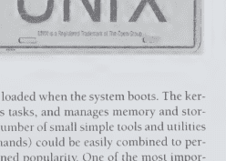

At the heart of UNIX is the kernel, a program loaded when the system boots. The kernel talks to the hardware and devices, schedules tasks, and manages memory and storage. Due to the spartan nature of UNIX, a large number of small simple tools and utilities were developed, and because these tools (commands) could be easily combined to perform a variety of larger tasks, UNIX quickly gained popularity. One of the most important utilities developed was the shell, a program that allows the user to communicate with the operating system. This book explores the features of the most prominent shells available today.

At first UNIX was adopted, at nominal cost, by scientific research institutions and universities and later spread to computer companies, government bodies, and manufacturing industries. In 1973, the U.S. Defense Advanced Research Projects Agency (DARPA) initiated a research program to develop a way to link computers together transparently across multiple networks using UNIX. This project, and the system of networks that emerged from the research, resulted in the birth of the Internet!

By the late 1970s many of the students who had pioneered and experimented with UNIX in college were now working in industry and demanded a switch to UNIX, claiming that it was the most suitable operating system for a sophisticated programming environment. Soon a large number of vendors, large and small, started marketing their own versions of UNIX, optimizing it for their individual computer architectures. The two most prominent versions of UNIX were System V from AT&T and BSD UNIX, which was derived from AT&T’s version and developed at the University of California, Berkeley, in the early 1980s.

(To see a chart of the many different versions of UNIX, over 80 flavors, see www.ugu.com/sui/ugu/show?ugu.flavors.) With so many versions of UNIX, applications and tools running on one system often could not run on another without considerable time and energy spent in making them compatible. This lack of uniformity fueled the rhetoric of competing vendors to abandon UNIX and stay with the older, non-UNIX proprietary systems, such as VMS, that had proven to be more consistent and reliable.

It was time to standardize UNIX. A group of vendors got together and started the concept of “open systems,” whereby those participating would agree to conform to certain standards and specifications. UNIX was chosen as the basis for the new concept. A company called X/Open was formed to define the open systems platform, and many organizations began using X/Open as a basis for system design. X/Open is now a part of The Open Group and continues to develop a Single UNIX Specification.


In early 1993, AT&T sold its UNIX System Laboratories to Novell. In 1995 Novell transferred the rights to the UNIX trademark and the specification (which subsequently became the Single UNIX Specification) to The Open Group (at the time X/Open), and sold SCO the UNIX system source code. Today UNIX-based systems are sold by a number of companies. The systems include Solaris from Sun Microsystems, HP-UX and Tru64 UNIX from Hewlett-Packard, and AIX from IBM. In addition there are many freely available UNIX and UNIX-compatible implementations, such as Linux, FreeBSD, and NetBSD.

### 1.1.2 Why Linux?

In 1991, Linus Torvalds, a Finnish college student, developed a UNIX-compatible operating system kernel at the University of Helsinki, Finland. It was designed to be UNIX on a PC. Although Linux mimics UNIX System V and BSD UNIX, it is not derived from licensed source code. Rather, it was developed independently by a group of developers from all over the world who were informally allied through the Internet.


对于许多人来说，Linux 提供了一种替代专有 UNIX 和 Windows 操作系统的选择，并且围绕 Linux 形成了一个庞大的文化，赞助着联盟、会议、展览、新sgroup 和出版物，掀起了一场新的革命，以抗衡 Windows 在 PC 世界的主导地位。在众多系统程序员和开发者的帮助下，Linux 已发展成为今天功能完备的 UNIX 兼容操作系统，拥有超过 2000 万用户。当前功能完备的版本是 2.6（2003 年 12 月发布），开发仍在继续。Linux 由许多商业和非商业组织分发，这些组织对操作系统的内核进行了增强，其中一些例子包括 Red Hat、Slackware、Mandrake、Turbo 和 SuSE Linux。

你可能注意到 Linux 关联着一只企鹅。这只企鹅是 Linux 的官方吉祥物，名为 Tux，由 Linus Torvalds 选定，用来代表他与该操作系统相关的形象。

## The Free Software Foundation.

1992 年，自由软件基金会将自己的 GNU 软件（GNU 是一个递归缩写 “GNU's Not UNIX”）添加到 Linux 内核中，以构成一个完整的操作系统，并以其通用公共许可证对 Linux 源代码进行许可，使其可供所有人自由使用。自由软件基金会提供了数百种 GNU 实用程序，包括对标准 UNIX Bourne shell 的改进。

GNU 工具，如 `grep`、`sed` 和 `gawk`，与其 UNIX 原型相似，但也得到了改进并设计为符合 POSIX¹ 标准。当你安装 Linux 时，你将可以使用 GNU shell 和工具，而不是标准 UNIX shell 和工具。而且，如果你使用的是传统的 UNIX 系统，如 Sun 的 Solaris 5.9，你也将可以使用其中许多工具，包括 GNU shell。

## 1.2 Definition and Function of a Shell

`shell` 是一个特殊程序，用作用户与 UNIX/Linux 操作系统的核心——一个名为 `kernel` 的程序之间的接口，如图 1.1 所示。`kernel` 在启动时被加载到内存中，并在关机前管理系统。它创建和控制进程，并管理内存、文件系统、通信等。所有其他程序，包括 `shell` 程序，都驻留在磁盘上。`kernel` 将这些程序加载到内存中，执行它们，并在它们终止时清理系统。`shell` 是一个在你登录时启动的实用程序。它允许用户通过解释在命令行或脚本文件中输入的命令来与 `kernel` 交互。

当你登录时，一个交互式 `shell` 会启动并提示你输入。在你输入命令后，`shell` 的职责是（a）解析命令行；（b）处理通配符、重定向、管道和作业控制；以及（c）查找命令，如果找到，则执行该命令。当你首次学习 UNIX/Linux 时，你花费的大部分时间都是从提示符执行命令。你以交互方式使用 `shell`。

如果你定期输入同一组命令，你可能希望自动化这些任务。这可以通过将命令放入一个文件中，称为脚本文件，然后执行该文件来实现。`shell` 脚本的工作方式与批处理文件非常相似：UNIX/Linux 命令列表被输入到一个文件中，然后执行该文件。更复杂的脚本包含用于做出决策、循环、文件测试等的编程结构。编写脚本不仅需要学习编程结构和技术，而且还假设你对 UNIX/Linux 实用程序及其工作原理有很好的理解。有些实用程序，如 `grep`、`sed` 和 `awk`，是脚本中用于操作命令输出和文件的极其强大的工具。在你熟悉这些工具和特定 `shell` 的编程结构后，你就可以开始编写有用的脚本了。当从脚本内部执行命令时，你将 `shell` 用作一种编程语言。

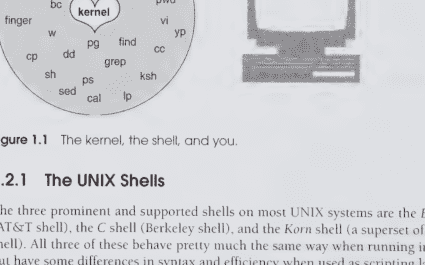

Figure 1.1 The kernel, the shell, and you.

### 1.2.1 The UNIX Shells

大多数 UNIX 系统上最突出且受支持的三个 `shell` 是 Bourne `shell`（AT&T `shell`）、C `shell`（Berkeley `shell`）和 Korn `shell`（Bourne `shell` 的超集）。这三种 `shell` 在交互运行时行为基本相同，但在用作脚本语言时在语法和效率方面存在一些差异。

Bourne `shell`（`sh`）是标准 UNIX `shell`，用于管理系统。大多数系统管理脚本，如 `rc` 启动和停止脚本以及 `shutdown` 都是 Bourne `shell` 脚本；这是管理员以 `root` 身份运行时常用的 `shell`。该 `shell` 由 AT&T 编写，以简洁、紧凑和快速而闻名。默认的 Bourne `shell` 提示符是美元符号（`$`）。

C `shell`（`csh`）在 Berkeley 开发，增加了许多功能，如命令行历史、别名、内置算术、文件名补全和作业控制。

## 示例 1.1

```shell
$ cat /etc/shell
/bin/bash
/bin/sh
/bin/ash
/bin/bsh
/bin/tcsh
/bin/csh
/bin/ksh
/bin/zsh
```

## 解释

`/etc/shell`（Linux）文件包含你所使用的 Linux 版本上所有可用的 `shell` 程序列表。最流行的版本是 `bash`（Bourne Again `shell`）、`tcsh`（TC `shell`）和 `ksh`（Korn `shell`）。

**什么是 POSIX？** 为了为不同的操作系统及其程序提供软件标准，POSIX 标准（也称为开放系统标准）应运而生，其参与者来自电气和电子工程师学会（IEEE）和国际标准化组织（ISO）。他们的目标是提供促进跨不同平台应用程序可移植性的标准，提供类 UNIX 计算环境；因此，在一台机器上编写的新软件可以在另一台硬件不同的机器上编译并运行。例如，为 BSD UNIX 机器编写的程序也可在 Solaris、Linux 和 HP-UX 机器上运行。1988 年，第一个标准被采纳，称为 POSIX 1003.1。其目的是提供 C 语言标准。1992 年，POSIX 组织为 `shell` 和实用程序建立了标准，以定义开发可移植 `shell` 脚本的术语，称为 IEEE 1003.2 POSIX `shell` 标准和通用实用程序。虽然这些标准没有严格的执行，但大多数 UNIX 厂商都试图遵守 POSIX 标准。讨论 `shell` 及其通用 UNIX 实用程序时，“POSIX 合规性”这一术语是指在编写新实用程序或为现有实用程序添加增强功能时，尝试遵守 POSIX 委员会提出的标准。例如，Bourne Again `shell` 是一种几乎 100% 合规的 `shell`，而 `gawk` 是一种可在严格 POSIX 模式下运行的用户实用程序。

## 1.3 Shell 的历史


# Shell 历史概述

第一个重要的、标准的 UNIX shell 于 1979 年底在 `V7`（AT&T UNIX 第七版）中引入，并以其创造者 `Stephen Bourne` 的名字命名。`Bourne shell` 是一种编程语言，其基于一种名为 `Algol` 的语言，主要用于自动化系统管理任务。尽管因其简单性和速度而受欢迎，但它缺乏许多交互式使用的功能，例如历史记录、别名和作业控制。

`C shell` 由加州大学伯克利分校于 1970 年代后期开发，作为 `BSD UNIX` 的一部分发布。该 shell 主要由 `Bill Joy` 编写，提供了标准 `Bourne shell` 中未提供的许多额外功能。`C shell` 基于 `C` 编程语言，当用作编程语言时，其语法相似。它还为交互式使用提供了增强功能，例如命令行历史记录、别名和作业控制。由于该 shell 是在大机器上设计并添加了许多额外功能，因此与 `Bourne shell` 相比，`C shell` 在小型机器上往往较慢，即使在大机器上也显得迟缓。

在 `Bourne shell` 和 `C shell` 都可用的情况下，UNIX 用户现在有了选择，并且关于哪种 shell 更好出现了冲突。为了兼顾两者，AT&T 的 `David Korn` 在 1980 年代中期发明了 `Korn shell`。它于 1986 年发布，并于 1988 年正式成为 UNIX `SVR4` 发行版的一部分。`Korn shell` 实际上是 `Bourne shell` 的超集，不仅运行在 UNIX/Linux 系统上，还运行在 `OS/2`、`VMS` 和 `DOS` 上。它提供与 `Bourne shell` 的向上兼容性，增加了 `C shell` 的许多流行功能，并且快速高效。`Korn shell` 经历了多次修订。最广泛使用的 `Korn shell` 版本是 1988 年版本，尽管 1993 年版本也获得了人气。Linux 用户可能会发现他们正在运行 `Korn shell` 的免费版本，称为公共领域 `Korn shell`，或简称为 `pdksh`，是 `David Korn` 1988 年 shell 的克隆。它是免费的、可移植的，并且目前在各种环境中工作，与其同名 `Korn shell` 完全兼容，并使其符合 `POSIX`。还可用的有 `Z shell`（`zsh`），另一种带有 `TC shell` 功能的 `Korn shell` 克隆，由 `Paul Falstad` 编写，并在多个网站上免费提供。

随着 Linux 的出现，`Bourne Again shell`（`bash`）作为超级 `Bourne shell` 变得流行。`Bourne Again shell` 由自由软件基金会的 `Brian Fox` 于 1988 年开发，采用 `GNU` 版权许可证，是 Linux 操作系统的默认 shell。它旨在符合 `IEEE POSIX 1003.2/ISO 9945.2 Shell` 和工具标准。`Bourne Again shell` 还提供了许多原始 `Bourne shell` 中缺失的新功能（交互式和编程层面均有），同时 `Bourne shell` 脚本仍可不经修改运行。它还整合了 `C shell` 和 `Korn shell` 的最有用功能。它很大。相对于 `Bourne shell` 的改进包括命令行历史记录和编辑、目录堆栈、作业控制、函数、别名、数组、整数运算（任意 2 到 64 进制），以及 `Korn shell` 功能，如扩展元字符、用于创建菜单的 `select` 循环、`let` 命令等。

什么是 `TC shell`？`TC shell` 是 `C shell` 的扩展、完全兼容版本。一些新功能包括命令行编辑（`emacs` 和 `vi`）、滚动历史列表、先进的文件名、变量和命令补全、拼写校正、作业调度、自动锁定和注销、历史列表中的时间戳等。它也很大。人们经常问：“`TC shell` 中的 ‘T’ 代表什么？”其中涉及一点历史。早在 1976 年，DEC 宣布并发布了一种新的虚拟内存操作系统，称为 `TOPS-20`，基于 `TENEX`，当时全国的研究人员都在使用的一种操作系统。`TOPS-20` 用户中最受欢迎的功能之一，也是最能代表 `TOPS-20` 本身的特征是“转义识别”，也称为命令补全。有了它，用户通常可以让系统在

effect, type most of a command or symbolic name by pressing the `Esc` key. The creator of the `TC shell` was impressed by this and several other features of `TENEX/TOPS-20`, and created a version of `csh` that mimicked them called the `TENEX C shell`, or simply `TC shell`, `tc-shell`, or `tcsh`. Hence, the “T” in `TC shell`. See `info.astrian.net/doc/tcsh/copyright` for more information on `tcsh`.

## 1.3.1 Shell 的用途

`Uses of the Shell`

When running interactively, one of the major functions of a shell is to interpret commands entered at the command-line prompt. The shell parses the command line, breaking it into words (called tokens) separated by whitespace, which consists of tabs, spaces, or a newline. If the words contain special metacharacters, the shell evaluates them. The shell handles file I/O and background processing. After the command line has been processed, the shell searches for the command and starts its execution.

Another important function of the shell is to customize the user’s environment, normally done in shell initialization files. These files contain definitions for setting terminal keys and window characteristics; setting variables that define the search path, permissions, prompts, and the terminal type; and setting variables that are required for specific applications such as window managers, text-processing programs, and libraries for programming languages. The `Korn/Bash` shells and `C/TC` shells also provide further customization with the addition of history, aliases, and built-in variables set to protect the user from clobbering files, or inadvertently logging out, or to notify the user when a job has completed.


The shell can also be used as an interpreted programming language. Shell programs, also called scripts, consist of commands listed in a file. The programs are created in an editor (although online scripting is permitted). They consist of UNIX/Linux commands interspersed with fundamental programming constructs such as variable assignment, conditional tests, and loops. You do not have to compile shell scripts. The shell interprets each line of the script as if it had been entered from the keyboard. Because the shell is responsible for interpreting commands, it is necessary for the user to have an understanding of what those commands are. See Appendix A for a list of useful UNIX and Linux commands.

## 1.3.2 Responsibilities of the Shell

The shell is ultimately responsible for making sure that any commands typed at the prompt get executed properly. Included in those responsibilities are:

- 1. Reading input and parsing the command line
- 2. Evaluating special characters, such as wildcards and the history character
- 3. Setting up pipes, redirection, and background processing
- 4. Handling signals
- 5. Setting up programs for execution

Each of these topics is discussed in detail as it pertains to a particular shell.

# 1.4 System Startup and the Login Shell

When you start up your system, the first process called is `init`. Each process has a process identification number associated with it, called the `PID`. Because `init` is the first process, its `PID` is 1. The `init` process initializes the system and then starts other processes to open terminal lines and set up the standard input (`stdin`), standard output (`stdout`), and standard error (`stderr`), which are all associated with the terminal. The standard input normally comes from the keyboard; the standard output and standard error go to the screen. At this point, a login prompt would appear on your terminal.

After you type your login name, you will be prompted for a password. The `/bin/login` program then verifies your identity by checking the first field in the `passwd` file. If your username is there, the next step is to run the password you typed through an encryption program to determine if it is indeed the correct password. Once your password is verified, the `login` program sets up an initial environment consisting of variables that define the working environment that will be passed on to the shell. The `HOME`, `SHELL`, `USER`, and `LOGNAME` variables are assigned values extracted from information in the `passwd` file. The `HOME` variable is assigned your home directory, and the `SHELL` variable is assigned the name of the login shell, which is the last entry in the `passwd` file. The `USER` and/or `LOGNAME` variables are assigned your login name. A search path variable is set so that commonly used utilities may be found in specified directories. When `login` has finished, it will execute the program found in the last entry of the `passwd` file. Normally, this program is a shell. If the last entry in the `passwd` file is `/bin/csh`, the C shell program is executed. If the last entry in the `passwd` file is `/bin/bash` or is null, the Bash shell starts up. If the last entry is `/bin/ksh` or `/bin/pdksh`, the Korn shell is executed. This shell is called the login shell.

After the shell starts up, it checks for any systemwide initialization files set up by the system administrator and then checks your home directory to see if there are any shell-specific initialization files there. If any of these files exist, they are executed. The initialization files are used to further customize the user environment. At this point you may start up a windowing environment such as `CDE`, `OpenWindows`, or `Gnome`. A virtual desktop will appear and depending on the configuration, a console and some pseudo terminals displaying a shell prompt. The shell is now waiting for your input.

### 1.4.1 Parsing the Command Line


当你输入命令时，shell 读取一行输入并解析命令行，将该行拆分为称为 `tokens` 的单词。`tokens` 由空格和制表符分隔，命令行以换行符终止。³ shell 然后检查第一个单词是否为内置命令或位于磁盘上的可执行程序。如果是内置命令，shell 将在内部执行该命令。否则，shell 将搜索 `path` 变量列出的目录以找到程序所在位置。如果找到命令，shell 将 `fork` 一个新进程然后执行程序。shell 将 `sleep`（或 `wait`）直到程序

> 3. 将行拆分为 `tokens` 的过程称为词法分析。

执行结束，然后，如果必要，将报告退出程序的状态。提示符将出现，整个过程将重新开始。命令行处理的顺序如下：

- 1. 执行历史替换（如果适用）。
- 2. 命令行被拆分为标记，或单词。
- 3. 历史记录被更新（如果适用）。
- 4. 引号被处理。
- 5. 别名替换和函数被定义（如果适用）。
- 6. 重定向、后台和管道被设置。
- 7. 变量替换（`$user`, `$name` 等）被执行。
- 8. 命令替换（`echo "Today is `date`"`）被执行。
- 9. 文件名替换，即通配（`cat abc.??`, `rm *.c`, 等）被执行。
- 10. 命令被执行。

## 1.4.2 命令类型

当命令被执行时，它是一个别名、一个函数、一个内置命令，或驻留在磁盘上的可执行程序。别名是现有命令的缩写（昵称），适用于 C、TC、Bash 和 Korn shell。函数适用于 Bourne（随 AT&T System V Release 2.0 引入）、Bash 和 Korn shell。它们是作为独立例程组织的命令组。别名和函数在 shell 的内存中定义。内置命令是 shell 内部的例程，而可执行程序驻留在磁盘上。shell 使用 `path` 变量来定位磁盘上的可执行程序，并在命令可以执行之前派生一个子进程。这需要时间。当 shell 准备好执行命令时，它按以下顺序评估命令类型：

- 1. 别名
- 2. 关键字
- 3. 函数
- 4. 内置命令
- 5. 可执行程序

例如，如果命令是 `xyz`，shell 将检查 `xyz` 是否为别名。如果不是，它是内置命令还是函数？如果两者都不是，它必须是驻留在磁盘上的可执行程序。为了执行命令，shell 必须然后搜索 `path` 以找出命令在目录结构中的位置以便执行它。此过程在图 1.2 中说明。

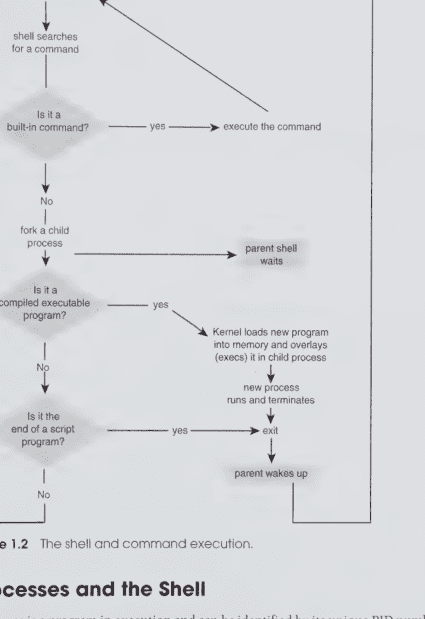

图 1.2 shell 和命令执行。

## 1.5 进程和 Shell

进程是正在执行的程序，可以通过其唯一的 PID 号码识别。内核控制和管理进程。进程由可执行程序、其数据和栈、程序和栈指针、寄存器以及程序运行所需的所有信息组成。`shell` 是一个特殊程序，在你完成登录过程后启动。一旦启动，`shell` 就是一个进程。`shell` 属于由组 PID 标识的进程组。一次只有一个进程组控制终端，被称为在前台运行。当你登录时，你的 `shell` 控制终端并等待你在提示符处输入命令。

当你登录时，你的系统可能直接进入图形用户界面（GUI）或启动到带有 `shell` 提示符的终端。如果你使用 Linux，`shell` 通常启动另一个进程来启动 X Window 系统。X Windows 启动后，将执行一个窗口管理器进程（`twm`、`fvwm` 等），提供一个虚拟桌面。然后，从弹出菜单中，你可以启动许多其他进程，例如 `xterm`（获取终端）、`xman`（提供手册页）或 `emacs`（启动文本编辑器）。如果你使用 UNIX，GUI 可能是 CDE、KDE 或 OpenWindows。一旦启动，你将拥有一个由许多较小的窗口组成的虚拟桌面，包括一个控制台和许多终端，每个终端都显示一个 `shell` 提示符。

多个进程正在运行并由 Linux/UNIX 内核监控，以一种对用户不可察觉的方式为每个进程分配 CPU 的一小片。

### 1.5.1 正在运行哪些进程？

**`ps` 命令。** `ps` 命令及其众多选项以多种格式显示当前正在运行的进程列表。示例 1.2 显示了 Linux 系统上用户正在运行的所有进程。（参见附录 A 了解 `ps` 及其选项。）

#### 示例 1.2

```
$ ps aux (BSD/Linux ps) (use ps -ef for SVR4)
```

| USER | PID | %CPU | %MEM | SIZE | RSS | TTY | STAT | START | TIME | COMMAND |
|---|---|---|---|---|---|---|---|---|---|---|
| ellie | 456 | 0.0 | 1.3 | 1268 | 840 | 1 | S | 13:23 | 0:00 | -bash |
| ellie | 476 | 0.0 | 1.0 | 1200 | 648 | 1 | S | 13:23 | 0:00 | sh /usr/X11R6/bin/sta |
| ellie | 478 | 0.0 | 1.0 | 2028 | 676 | 1 | S | 13:23 | 0:00 | xinit /home/ellie/.xi |
| ellie | 480 | 0.0 | 1.6 | 1852 | 1068 | 1 | S | 13:23 | 0:00 | fvwm2 |
| ellie | 483 | 0.0 | 1.3 | 1660 | 856 | 1 | S | 13:23 | 0:00 | /usr/X11R6/lib/X11/fv |
| ellie | 484 | 0.0 | 1.3 | 1696 | 868 | 1 | S | 13:23 | 0:00 | /usr/X11R6/lib/X11/fv |
| ellie | 487 | 0.0 | 2.0 | 2348 | 1304 | 1 | S | 13:23 | 0:00 | xclock -bg #0c0c0c -p |
| ellie | 488 | 0.0 | 1.1 | 1620 | 724 | 1 | S | 13:23 | 0:00 | /usr/X11R6/lib/X11/fv |
| ellie | 489 | 0.0 | 2.0 | 2364 | 1344 | 1 | S | 13:23 | 0:00 | xload -nolabel -bg gr |
| ellie | 495 | 0.0 | 1.3 | 1272 | 848 | p0 | S | 13:24 | 0:00 | -bash |
| ellie | 797 | 0.0 | 0.7 | 852 | 484 | p0 | R | 14:03 | 0:00 | ps au |
| root | 457 | 0.0 | 0.4 | 724 | 296 | 2 | S | 13:23 | 0:00 | /sbin/mingetty tty2 |
| root | 458 | 0.0 | 0.4 | 724 | 296 | 3 | S | 13:23 | 0:00 | /sbin/mingetty tty3 |
| root | 459 | 0.0 | 0.4 | 724 | 296 | 4 | S | 13:23 | 0:00 | /sbin/mingetty tty4 |
| root | 460 | 0.0 | 0.4 | 724 | 296 | 5 | S | 13:23 | 0:00 | /sbin/mingetty tty5 |
| root | 461 | 0.0 | 0.4 | 724 | 296 | 6 | S | 13:23 | 0:00 | /sbin/mingetty tty6 |
| root | 479 | 0.0 | 4.5 | 12092 | 2896 | 1 | S | 13:23 | 0:01 | X :0 |


| root | 494 | 0.0 | 2.5 | 2768 | 1632 | 1 | S | 13:24 | 0:00 | xterm -ls -sb -fn |

- 5. Linux 附带许多桌面环境，包括 Gnome、KDE、X 等。

# pstree/ptree 命令

查看正在运行的进程以及哪些进程是子进程的另一种方法是使用 `pstree`（Linux）或 `ptree`（Solaris）命令。`pstree` 命令将所有进程以树形结构显示，其根节点是第一个运行的进程，称为 `init`。如果指定了用户名，则该用户的进程位于树的根部。如果一个进程生成了多个同名的进程，`pstree` 会将这些相同的分支视觉上合并，将它们放在方括号中，并加上重复次数的前缀。例如，在示例 1.3 中，http 服务器进程启动了 10 个子进程。（有关 `pstree` 选项的列表，请参见附录 A。）

## 示例 1.3

```
pstree
init---4x[getty]
init---atd
  |-bash---startx---xinit+-X
  |         |-Fvwm2---FvwmButtons
  |         |-FvwmPager
  |         |-FvwmTaskBar
  |-cardmgr
  |-crond
  |-gpm
  |-httpd---10x[httpd]
  |-ifup-ppp---pppd---chat
  |-inetd
  |-kerneld
  |-kflushd
  |-klogd
  |-kswapd
  |-lpd
  |-2x[md_thread]
  |-5x[mingetty]
  |     |-nmbd
  |-nxtem---bash---tcsh---pstree
  |-portmap
  |-sendmail
  |-smbd
  |-syslogd
  |-update
  |-xclock
  |-xload
```

`shell` 可以生成其他进程。实际上，当你在提示符下或从 `shell` 脚本中输入命令时，`shell` 负责在其内部代码（内建命令）或磁盘上查找该命令，然后安排命令执行。这是通过调用内核来实现的，这些调用称为系统调用。系统调用是对内核服务的请求，也是进程访问系统硬件的唯一方式。有许多系统调用允许进程被创建、执行和终止。（当 `shell` 执行重定向、管道、命令替换和用户命令执行时，它还会从内核获取其他服务。）

`shell` 用于使新进程运行的系统调用将在以下各节中讨论。参见第 17 页的图 1.4。

`fork` 系统调用。在 UNIX 中，进程通过 `fork` 系统调用创建。新进程称为子进程，创建它的进程称为父进程。子进程在调用 `fork` 之后立即开始运行，两个进程最初共享 CPU。子进程拥有父进程的环境、打开的文件、真实和有效用户 ID、`umask`、当前工作目录和信号的副本。

当你键入命令时，`shell` 会解析命令行并确定第一个词是内建命令还是位于磁盘上的可执行命令。如果是内建命令，`shell` 直接执行；如果在磁盘上，`shell` 则会调用 `fork` 系统调用来复制自身（图 1.3）。其子进程将搜索路径以查找命令，并为重定向、管道、命令替换和后台处理设置文件描述符。当子 `shell` 工作时，父进程通常处于睡眠状态。（参见下面的“wait”系统调用。）

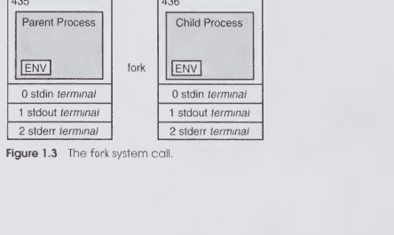

## wait 系统调用

父 `shell` 被编程为在子进程处理重定向、管道和后台处理等细节时进入睡眠状态（等待）。`wait` 系统调用使父进程挂起，直到其一个子进程终止。如果 `wait` 成功，它将返回已终止子进程的 PID 以及子进程的退出状态。如果父进程不等待且子进程退出，则子进程会进入僵尸状态（挂起状态），并一直保持该状态，直到父进程调用 `wait` 或父进程死亡。如果父进程在子进程之前死亡，`init` 进程会收养任何孤儿的僵尸进程。因此，`wait` 系统调用不仅用于让父进程进入睡眠，还用于确保进程正确终止。

## exec 系统调用

在终端输入命令后，`shell` 通常会派生出一个新的 `shell` 进程：子进程。如前所述，子 `shell` 负责执行你键入的命令。它通过调用 `exec` 系统调用来完成此操作。请记住，用户命令实际上只是一个可执行程序。`shell` 会在路径中搜索新程序。如果找到，`shell` 会以命令名作为参数调用 `exec` 系统调用。内核会将这个新程序加载到内存中，以取代调用它的那个 `shell`。然后，子 `shell` 被新程序覆盖。新程序成为子进程并开始执行。虽然新进程有自己的局部变量，但所有环境变量、打开的文件、信号和当前工作目录都会传递给新进程。该进程在完成时退出，父 `shell` 随之唤醒。

## exit 系统调用

新程序可以在任何时候通过执行 `exit` 调用来终止。当子进程终止时，它会发送一个信号（`sigchild`）并等待父进程接受其退出状态。退出状态是一个介于 0 到 255 之间的数字。退出状态为零表示程序成功执行，而非零退出状态表示程序以某种方式失败了。

例如，如果在命令行中键入了命令 `ls`，父 `shell` 会派生一个子进程并进入睡眠状态。子 `shell` 随后会执行 `exec`（覆盖）`ls` 程序。`ls` 程序将代替子进程运行，继承所有环境变量、打开的文件、用户信息和状态信息。当新进程执行完毕时，它会退出，父 `shell` 随之唤醒。屏幕上会出现一个提示符，`shell` 会等待下一条命令。如果你想知道命令是如何退出的，每个 `shell` 都有一个特殊的内建变量，其中包含最后一条已终止命令的退出状态。（所有这些都将在各个 `shell` 章节中详细解释。）有关退出状态的示例，请参见示例 1.4。

## 示例 1.4

### C/TC Shell

```
1 % cp filex filey
% echo $status
0
2 % cp xyz
Usage: cp [-ip] f1 f2; or: cp [-ipr] f1 ... fn d2
% echo $status
1
```

### Bourne, Bash, Korn Shells

```
3 $ cp filex filey
$ echo $?
0
$ cp xyz
Usage: cp [-ip] f1 f2; or: cp [-ipr] f1 ... fn d2
$ echo $?
1
```

## 解释

1 `cp`（copy）命令在 C `shell` 命令行提示符下输入。命令复制完名为 `filex` 的文件到 `filey` 后，程序退出并显示提示符。`csh` 的 `status` 变量包含最后执行的命令的退出状态。如果状态为零，则 `cp` 程序成功退出。如果退出状态非零，则 `cp` 程序以某种方式失败。

2 输入 `cp` 命令时，用户未能提供两个文件名：源文件和目标文件。`cp` 程序向屏幕发送错误消息并以状态 1 退出。该数字存储在 `csh` 的 `status` 变量中。任何非零数字都表示程序失败。

3 Bourne、Bash 和 Korn `shell` 处理 `cp` 命令的方式与前两个示例中 C `shell` 相同。唯一的区别是 Bourne 和 Korn `shell` 将退出状态存储在 `?` 变量中，而不是 `status` 变量中。

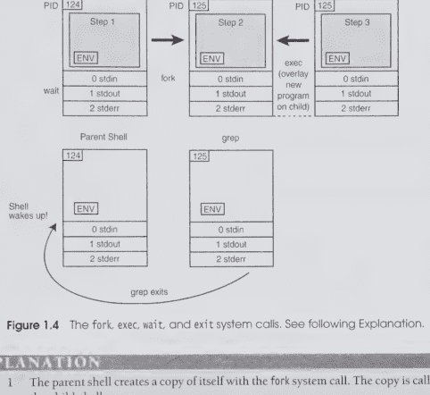

## 解释

- 1. 父 `shell` 使用 `fork` 系统调用创建自己的副本。该副本称为子 `shell`。
- 2. 子 `shell` 有一个新的 PID，并且是其父 `shell` 的副本。它将与父 `shell` 共享 CPU。
- 3. 内核将 `grep` 程序加载到内存中并在子 `shell` 的位置执行（`exec`）它。`grep` 程序继承自子 `shell` 的打开文件和环境。
- 4. `grep` 程序退出，内核清理，父 `shell` 被唤醒。

# 终止进程

进程可以通过按键生成的信号如 `Ctrl-C` 或 `Ctrl-\` 来终止，也可以通过使用 `kill` 命令来终止。此命令可用于终止后台作业，或当你的终端处于冻结、无响应状态时，终止导致问题的进程。`kill` 命令是内置的 `shell` 命令，通过 PID 或，如果使用作业控制，则通过作业编号来终止进程。要查找 PID 编号，使用 `ps` 命令。参见示例 1.5。

## 示例 1.3

```
1 $ sleep 60&
2 $ ps
PID TTY TIME CMD
27628 pts/7 0:00 sleep
27619 pts/7 0:00 bash
27629 pts/7 0:00 ps
3 $ kill 27628
4 $ ps
PID TTY TIME CMD
27631 pts/7 0:00 ps
27619 pts/7 0:00 bash
[1]+ Terminated sleep 60
```

## 解释

- 1 `sleep` 命令什么也不做，只是暂停 60 秒，并且由于命令末尾的 `&` 符号而在后台运行
- 2 `ps` 命令显示此用户当前正在运行的进程。
- 3 `kill` 命令是内置的 `shell` 命令。它以参数的形式接收将被终止进程的 PID。输入 `sleep` 命令的 PID。


- 4 `ps` 命令演示 `sleep` 命令已被终止。

# 1.6 环境和继承

当你登录时，`shell` 启动并从启动它的 `/bin/login` 程序继承了许多变量、I/O 流和进程特性。反过来，如果从登录 `shell` 或父 `shell` `fork` 出另一个 `shell`，该子 `shell`（子进程）将继承其父 `shell` 的某些特性。子 `shell` 可能因多种原因而启动：用于处理后台处理、用于处理一组命令或用于执行脚本。子 `shell` 继承其父 `shell` 的环境。环境由进程权限（谁拥有进程）、工作目录、文件创建掩码、特殊变量、打开文件和信号组成。

### 1.6.1 所有权和权限

当你登录时，`shell` 会获得一个身份。它有一个真实的用户标识（`UID`）、一个或多个真实的组标识（`GID`），以及一个有效用户标识和有效组标识（`EUID` 和 `EGID`）。`EUID` 和 `EGID` 最初与真实 `UID` 和 `GID` 相同。这些 ID 数字在 `etc/passwd` 文件中找到，并由系统用于识别用户和组。`EUID` 和 `EGID` 决定进程在读取、写入或执行文件时有权访问的权限。如果进程的 `EUID` 与文件所有者的真实 `UID` 相同，则该进程具有

`owner` 的访问权限。如果进程的 `EGID` 和真实 `GID` 相同，则该进程具有所有者的组权限。

真实 `UID` 是 `/etc/passwd` 文件中的第三个条目。其值是一个正整数，与你的登录名相关联。当你登录时，登录 `shell` 被分配真实 `UID`，并且从登录 `shell` 启动的所有进程都继承其权限。任何以 `UID` 为零运行的进程都属于 `root`（超级用户）并具有 `root` 权限。真实组标识 `GID` 将一个组与你的登录名关联。它位于 `/etc/passwd` 文件的第四个字段中。

你可以使用 `id` 命令查看这些值，如示例 1.6 所示。

# EXAMPLE 1.6

```
1 $ id
uid=502(ellie) gid=502(ellie)
```

`EUID` 和 `EGID` 可以更改为分配给不同所有者的数字。通过将 `EUID`（或 `EGID`）更改为其他所有者，你可以成为属于其他人的进程的所有者。更改 `EUID` 或 `EGID` 以拥有其他所有者的程序称为 `setuid` 或 `setgid` 程序。`passwd` 程序是 `setuid` 程序的一个例子，它赋予用户 `root` 权限。这使得普通用户可以更改他的密码，并更新 `passwd` 文件（仅 `root` 可访问）而不需调用系统管理员。只要 `passwd` 程序正在运行，用户就会暂时成为超级用户 `root`，因为他的有效用户 ID 暂时被设置为 `root`。`Setuid` 程序通常是安全漏洞的来源。`Shell` 允许你创建 `setuid` 脚本，并且 `shell` 本身可能是一个 `setuid` 程序。 （参见第 16 章，“系统管理员和 Shell。”

### 1.6.2 文件创建掩码

创建文件时，会为其赋予一组默认权限。这些权限由创建文件的程序决定。子进程从其父进程继承默认掩码。用户可以通过在提示符下发出 `umask` 命令或在 `shell` 的初始化文件中设置它来更改 `shell` 的掩码。`umask` 命令用于从现有掩码中删除权限。

最初，`umask` 为 `000`，给目录 `777`（`rwxrwxrwx`）权限，给文件 `666`（`rw-rw-rw-`）权限作为默认值。在大多数系统上，`umask` 由 `/bin/login` 程序或 `/etc/profile` 初始化文件分配值为 `022`。

`umask` 值从目录和文件权限的默认设置中减去，如下所示：

```
777 (Directory)          666 (File)
-022 (umask value)       -022 (umask value)
----------------          ------------
755                      644
Result: drwxr-xr-x        -rw-r--r--
```

设置 `umask` 后，此进程创建的所有目录和文件都将被分配新的默认权限。在此示例中，目录将为所有者提供读、写和执行权限；为组提供读和执行权限；为其他人提供读和执行权限。创建的任何文件都将为所有者分配读和写权限，为组和其他人分配读权限。要更改单个目录和权限，请使用 `chmod` 命令。

### 1.6.3 更改权限和所有权

`chmod` 命令。 `chmod` 命令更改文件和目录的权限。每个 UNIX/Linux 文件都有一组相关联的权限，用于控制谁可以读取、写入或执行该文件。每个 UNIX/Linux 文件都有一个所有者，只有所有者或超级用户可以更改文件或目录的权限。一个组可能有多个成员，文件的所有者可以更改文件的组权限，以便该组可以享受特殊权限。要查看文件具有什么权限，请在 `shell` 提示符下输入：

```
ls -l filename
```

文件的权限由总共九位构成。第一组三位控制文件所有者的权限，第二组控制组的权限，最后一个组控制其他所有人的权限。权限存储在文件 `inode` 的 `mode` 字段中。用户必须拥有文件才能更改其权限。⁷

表 1.1 说明了用于更改权限的八种可能的数字组合。

| Decimal | Binary | Permissions |

|---:|:---:|:---|

| 0 | 000 | none |

| 1 | 001 | --x |

| 2 | 010 | -w- |

| 3 | 011 | -wx |

| 4 | 100 | r-- |

| 5 | 101 | r-x |

| 6 | 110 | rw- |

| 7 | 111 | rwx |

`chmod` 的符号表示法如下：

`r` = read; `w` = write; `x` = execute; `u` = user; `g` = group; `o` = others; `a` = all.

> 7. 调用者的 `EUID` 必须与文件所有者的 `UID` 匹配，或者所有者必须是超级用户。

```
1    $ chmod 755 file

     $ ls -l file

     -rwxr-xr-x 1 ellie 0 Mar 7 12:52 file

2    $ chmod g+w file

     $ ls -l file

     -rwxrwxr-x 1 ellie 0 Mar 7 12:54 file

3    $ chmod go-rx file

     $ ls -l file

     -rw------- 1 ellie 0 Mar 7 12:56 file

4    $ chmod a=r file

     $ ls -l file

     -r--r--r-- 1 ellie 0 Mar 7 12:59 file
```

- 1. 第一个参数是八进制值 `755`。它为用户打开 `rwx`，为组打开 `r` 和 `x`，为其他用户打开文件。
- 2. 在 `chmod` 的符号形式中，为组添加写权限。
- 3. 在 `chmod` 的符号形式中，从组和其他用户中减去读和执行权限。
- 4. 在 `chmod` 的符号形式中，所有用户仅获得读权限。`=` 符号会导致所有权限重置为新值。

# The chown Command.

`chown` 命令更改文件和目录的所有者和组。如果使用 Linux，只有超级用户 `root` 才能更改所有权。如果使用 UNIX，文件所有者或超级用户可以更改所有权。要查看 `chown` 的用法和选项，请查阅手册页（UNIX）或使用 `chown` 命令配合 `--help`（Linux）选项，如示例 1.8 所示。示例 1.9 演示了如何使用 `chown`。

```
(The Command Line)
# chown --help
Usage: chown [OPTION]... OWNER[:[GROUP]] FILE...
  or:  chown [OPTION]... [OWNER]...[.][GROUP] FILE...
Change the owner and/or group of each FILE to OWNER and/or GROUP.

-c, --changes       be verbose whenever change is made
-h, --no-dereference affect symbolic links instead of any referenced file
                    (available only on systems with lchown system call)
```

#### EXAMPLE 1: DOCUMENTATION


```
-f, --silent, --quiet  suppress most error messages
-R, --recursive         operate on files and directories recursively
-v, --verbose           explain what is being done
    --help              display this help and exit
    --version           output version information and exit
```

Owner is unchanged if missing. Group is unchanged if missing, but changed to login group if implied by a period. A colon may replace the period.

Report bugs to `fileutils-bugs@gnu.ai.mit.edu`

#### EXAMPLE 1.4

```
(The Command Line)
1   $ ls -l filetest
    -rw-rw-r--  1 ellie  ellie       0 Jan 10 12:19 filetest
2   $ chown root filetest
    chown: filetest: Operation not permitted
3   $ su root
    Password:
4   # ls -l filetest
    -rw-rw-r--  1 ellie  ellie       0 Jan 10 12:19 filetest
5   # chown root filetest
6   # ls -l filetest
    -rw-rw-r--  1 root   ellie       0 Jan 10 12:19 filetest
7   # chown root:root filetest
8   # ls -l filetest
    -rw-rw-r--  1 root   root        0 Jan 10 12:19 filetest
```

### EXPLANATION

- 1. `filetest` 的用户和组所有权均为 `ellie`。
- 2. `chown` 命令只有在你是超级用户，即用户 `root` 时才有效。
- 3. 用户使用 `su` 命令将身份更改为 `root`。
- 4. 列表显示 `filetest` 的用户和组均为 `ellie`。
- 5. 只有超级用户才能更改文件和目录的所有权。`filetest` 的所有权使用 `chown` 命令更改为 `root`。组所有权仍为 `ellie`。
- 6. `ls` 的输出显示 `root` 现在拥有 `filetest`。
- 7. 使用冒号（或点）表示在 `root` 之后将更改组所有权为 `root`。组名列在冒号之后。不能有空格。
- 8. `filetest` 的用户和组所有权现在均属于 `root`。

# 1.6.4 The Working Directory

登录时，你会在文件系统中获得一个工作目录，称为主目录。工作目录被继承给从此 shell 启动的进程。此 shell 的任何子进程都可以更改其自身的工作目录，但更改不会影响父 shell。

`cd` 命令用于更改工作目录，是 shell 内置命令。每个 shell 都有自己的 `cd` 副本。内置命令由 shell 作为 shell 代码的一部分直接执行；执行内置命令时，shell 不会执行 `fork` 和 `exec` 系统调用。如果从父 shell `fork` 出另一个 shell（脚本），并且在子 shell 中发出 `cd` 命令，则目录将在子 shell 中更改。当子进程退出时，父 shell 将处于子进程启动前的同一目录。

### EXAMPLE 1.10

```
1 > cd /
2 > pwd
   /
3 > bash
4 $ cd /home
5 $ pwd
   /home
6 $ exit
7 > pwd
   /
   >
```

### EXPLANATION

- 1 > 提示符是 TC shell 提示符。`cd` 命令将目录更改为 `/`。`cd` 命令内置于 shell 的内部代码中。
- 2 `pwd` 命令显示当前工作目录，`/`。
- 3 启动 `bash` shell。
- 4 `cd` 命令将目录更改为 `/home`。美元符号（`$`）是 Bash 提示符。
- 5 `pwd` 命令显示当前工作目录，`/home`。
- 6 退出 Bash shell，返回到 TC shell。
- 7 在 TC shell 中，当前工作目录仍为 `/`。每个 shell 都有自己的 `cd` 副本。

# 1.6.5 Variables

shell 可以定义两种类型的变量：本地变量和环境变量。变量包含用于自定义 shell 的信息，以及其他进程正常运行所需的信息。本地变量是私有变量，仅在定义它们的 shell 中

局部变量是在创建时不会传递给从该 shell 启动的任何进程的。内置的 `set` 命令会显示 C shell 和 TC shell 的局部变量，以及 Bourne、Bash 和 Korn shell 的局部和环境变量。另一方面，环境变量会从父进程传递给子进程，从子进程传递给孙进程，依此类推。其中一些环境变量由登录 shell 从 `/bin/login` 程序继承。其他变量则在用户初始化文件、脚本或命令行中创建。如果在子 shell 中设置了环境变量，它不会传回父 shell。shell 的 `env` 命令会显示环境变量。示例 1.11 列出了使用 Bash shell 运行 Solaris 5.9 的用户的环境变量。

### EXAMPLE 1.11

```text
$ env
PWD=/home/ellie
TZ=US/Pacific
PAGER=less
HOSTNAME=artemis
LD_LIBRARY_PATH=/lib:/usr/lib:/usr/local/lib:/usr/dt/lib:/usr/openwin/lib
MANPATH=/usr/local/man:/usr/man:/usr/openwin/man:/opt/httpd/man
USER=ellie
MACH_TYPE=sparc-sun-solaris2.9
TCL_LIBRARY=/usr/local/lib/tcl8.0
EDITOR=vi
LOGNAME=ellie
SHLVL=1
SHELL=/bin/bash
HOSTTYPE=sparc
OSTYPE=solaris2.9
HOME=/home/ellie
TERM=xterm
TK_LIBRARY=/usr/local/lib/tk8.0
PATH=/bin:/usr/bin:/usr/local/bin:/usr/local/etc:/usr/ccs/bin:/usr/etc:/usr/ucb:/usr/local/X11:/usr/openwin/bin:/etc:.
SSH_TTY=/dev/pts/10
_=/bin/env
```

# 1.6.6 Redirection and Pipes

### File Descriptors.

所有 I/O，包括文件、管道和套接字，均由内核通过一种称为文件描述符的机制来处理。文件描述符是一个小的无符号整数，是内核维护的文件描述符表中的一个索引，内核使用它来引用打开的文件和 I/O 流。每个进程从其父进程继承自己的文件描述符表。前三个文件描述符 `0`、`1` 和 `2` 分配给你的终端。文件描述符 `0` 是标准输入（`stdin`），`1` 是标准输出（`stdout`），`2` 是标准错误（`stderr`）。当你打开一个文件时，下一个可用的描述符是 `3`，它将被分配给新文件。如果所有可用的文件描述符都在使用中，则无法打开新文件。

### Redirection.

当文件描述符被分配给终端以外的对象时，就称为 I/O 重定向。shell 通过关闭标准输出文件描述符 `1`（终端），然后将该描述符分配给文件来进行输出重定向到文件。重定向标准输入时，shell 关闭文件描述符 `0`（终端）并将该描述符分配给文件。Bourne、Bash 和 Korn shell 通过将文件分配给文件描述符 `2` 来处理错误。而 C 和 TC shell 则通过更复杂的过程来实现同样的功能。

#### EXAMPLE 1.12

```text
1  $ who > file1
2  $ cat file1 file2 >> file3
3  $ mail tom < file
4  $ find / -name file -print 2> errors
5  % ( find / -name file -print > /dev/tty ) >& errors
```

### EXPLANATION

- 1 `who` 命令的输出从终端重定向到 `file1`。所有 shell 都是这样重定向输出的。


- `cat` 命令的输出（连接 `file1` 和 `file2`）追加到 `file3`。（所有 shell 都是这样重定向并追加输出的。）
- `file` 的输入被重定向到 `mail` 程序；也就是说，用户 `tom` 将收到 `file` 的内容。（所有 shell 都是这样重定向输入的。）
- `find` 命令的任何错误都被重定向到 `errors`。输出发送到终端。（Bourne、Bash 和 Korn shell 是这样重定向错误的。）
- `find` 命令的任何错误都被重定向到 `errors`。输出发送到终端。（C 和 TC shell 是这样重定向错误的。`%` 是 C shell 提示符。）

**Figure 1.5** Redirection of standard output.

**Figure 1.6** Redirection of standard input.

**Figure 1.7** Redirection of standard error (Bourne, Bash, and Korn shells).

```text
find . -name filex 2> errors
```

**Figure 1.8** Redirection of standard error (C and TC shells).

```text
(find . -name filex > /dev/tty) >& errors
```

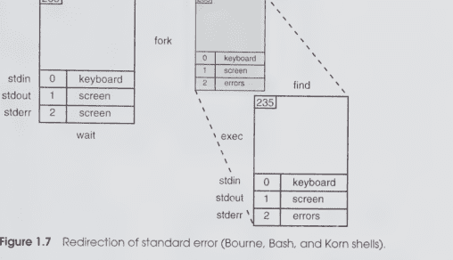

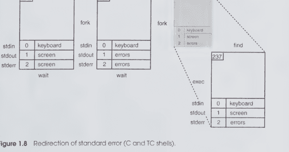

### Pipes

管道是 UNIX 进程间通信最古老的形式。管道允许进程相互通信。它是一种机制，通过该机制，一个命令的输出被发送作为另一个命令的输入，其限制是数据只能单向流动，通常在父进程和子进程之间。shell 通过关闭和打开文件描述符来实现管道；然而，它不是将描述符分配给文件，而是将其分配给使用 `pipe` 系统调用创建的管道描述符。父进程创建管道文件描述符后，它为管道中的每个命令 `fork` 一个子进程。通过让每个进程操作管道描述符，一个进程将写入管道，另一个进程将从中读取。

为了简化，管道只是一个内核缓冲区，两个进程都可以从中共享数据，从而消除了对中间临时文件的需求。一个命令的输出被发送到缓冲区，当缓冲区已满或命令已终止时，管道右侧的命令从缓冲区读取。内核同步这些活动，以便一个进程在另一个进程从缓冲区读取或写入缓冲区时等待。

管道命令的语法是

```
who | wc
```

为了在没有管道的情况下完成同样的事情，需要三个步骤：

```
who > tempfile
wc tempfile
rm tempfile
```

使用管道，shell 将 `who` 命令的输出作为 `wc` 命令的输入发送；也就是说，管道左侧的命令写入管道，管道右侧的命令从管道读取（见图 1.9）。如果一个命令在命令行运行时通常将输出发送到屏幕，你就可以判断它是一个写入者。`ls`、`ps` 和 `date` 命令是写入者的例子。读取者是一个等待从文件、键盘或管道输入的命令。`sort`、`wc` 和 `cat` 命令是读取者的例子。

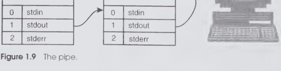

**图 1.9** 管道。

图 1.10 至 1.14 说明了实现管道的步骤。

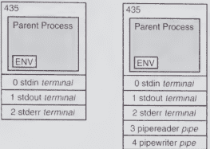

**图 1.10** 父进程调用 `pipe` 系统调用以设置管道。

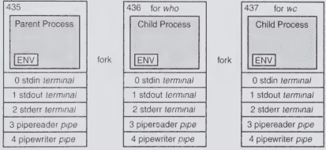

**图 1.11** 父进程 `fork` 两个子进程，管道中的每个命令一个。

Child for who

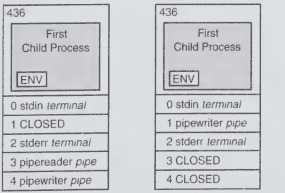

**图 1.12** 第一个子进程准备写入管道。

Child for wc

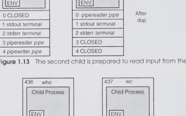

**图 1.13** 第二个子进程准备从管道读取输入。

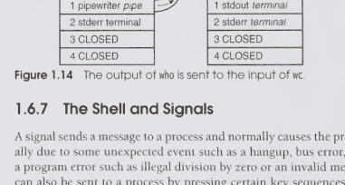

**图 1.14** `who` 的输出被发送到 `wc` 的输入。

#### 1.6.7 The Shell and Signals

信号向进程发送消息并通常导致进程终止，通常是由于某些意外事件，例如挂断、总线错误或电源故障，或由程序错误引起，例如非法除以零或无效的内存引用。

信号也可以通过按某些键序列发送给进程。例如，你可以通过按 Break、Delete、Quit 或 Stop 键向进程发送或传递信号，并且所有共享终端的进程都会受到发送的信号的影响。

你可以使用 `kill` 命令终止一个进程。默认情况下，大多数信号会终止程序。每个进程都可以对给定的信号采取行动：

1. 可以忽略该信号。
2. 进程可以被停止。
3. 进程可以被继续。
4. 信号可以被程序中定义的一个函数捕获。

Bourne、Bash 和 Korn shell 允许你处理进入程序的信号，（参见第 716 页的“Trapping Signals”了解 Bourne shell 编程；参见第 935 页的“Trapping Signals”了解 Korn shell 编程；以及参见第 935 页的“Trapping Signals”了解 Bash shell 编程），要么忽略信号，要么指定当指定信号到达时要采取的某些操作，要么将信号重置为其默认操作。C 和 TC shell 仅限于处理 `^C`（Ctrl-C），即中断字符。

表 1.2 列出了进程可以使用标准信号。

**表 1.2** 标准信号

| Number | Name | Description | Action |
|--------|------|-------------|--------|
| 0 | EXIT | Shell exits | Termination |
| 1 | SIGHUP | Terminal has disconnected | Termination |
| 2 | SIGINT | User presses Ctrl-C | Termination |
| 3 | SIGQUIT | User presses Ctrl-\ | Termination |
| 4 | SIGILL | Illegal hardware instruction | Program error |
| 5 | SIGTRAP | Produced by debugger | Program error |
| 8 | SIGFPE | Arithmetic error; e.g., division by zero | Program error |
| 9 | SIGKILL | Cannot be caught or ignored | Termination |
| 10 | SIGUSR1 | Application-defined signal for user | Termination |
| 11 | SIGSEGV | Invalid memory references | Program error |
| 12 | SIGUSR2 | Application-defined signal for user | Termination |
| 13 | SIGPIPE | Broken pipe connection | Operator error |
| 14 | SIGALRM | Timeout | Alarm sent |
| 15 | SIGTERM | Termination of a program | Termination |
| 17 | SIGCHLD | Child process has stopped or died | Ignored |
| 18 | SIGCONT | Starts a stopped job; can't be handled or ignored | Continue if stopped |
| 19 | SIGSTOP | Stops a job; can't be handled or ignored | Stops the process |
| 20 | SIGTSTP | Interactive stop; user presses Ctrl-Z | Stops the process |
| 21 | SIGTTIN | Background job is trying to read from the controlling terminal | Stops the process |
| 22 | SIGTTOU | Background job is trying to write to the controlling terminal | Stops the process |


> a. 请参阅你的特定系统手册。有关 UNIX 信号的完整列表及其含义，请访问 `www.cyber-magic.co.uk/technet/unixsignals.htm`。有关 Linux 信号，请访问 `os.comptechdoc.com/linuxprogramming/linux_posix.html`。

### 1.7 从脚本执行命令

当 shell 被用作编程语言时，命令和 shell 控制结构会被输入到编辑器中并保存到一个文件中，称为脚本。shell 会逐行读取并执行文件中的内容。这些程序是解释执行的，而不是编译的。编译程序在执行前会被转换为机器语言。因此，shell 程序通常比二进制可执行文件慢，但它们更容易编写，主要用于自动化简单任务。shell 程序也可以在命令行交互式编写，对于非常简单的任务来说，这是最快的方式。然而，对于更复杂的脚本编写，在编辑器中编写脚本会更容易（除非你是一个非常出色的打字员！）。下面的脚本可以由任何 shell 执行以输出相同的结果。图 1.15 及其后面的说明展示了名为 `dot` 的脚本的创建过程，以及它如何与已有的 UNIX 程序/实用程序/命令配合使用。

**Figure 1.15 Creating a generic shell script.**


```
#!/bin/csh
echo hello
ls
who
cat
date
pwd
.
.
.
```

### EXPLANATION

- 1. 打开你喜欢的编辑器并输入一组 UNIX/Linux 可执行文件，每行一个。通过在第一行 `#!` 之后放置 shell 的路径名来指定你想要使用的 shell。该程序由 C shell 执行，其名称为 `dot`。
- 2. 保存你的文件并打开执行权限，以便你可以运行它。
- 3. 就像运行其他任何 UNIX/Linux 命令一样执行你的程序。

# Chapter 2: Shell Programming QuickStart


### 2.1 Taking a Peek at Shell Scripts

如果你阅读、编写或维护程序，以下示例将为你快速概述 shell 脚本的构造和风格，并向你介绍这些程序中使用的一些结构和语法。注意：如果不熟悉编程，请跳过本章并转到第 3 章。在你学会如何编写脚本后，你可能希望返回本章作为快速参考以刷新记忆。

C shell 和 TC shell 模拟了 C 语言语法，而 Bourne shell 则基于一种名为 Algol 的较老编程语言。

Bash 和 Korn shell 倾向于结合 Bourne shell 和 C shell，尽管这些 shell 源自 Bourne shell。

为了说明 shell 之间的差异，提供了四个示例程序，每个 shell 一个（C shell 和 TC shell 在这里一起呈现）。在每个程序上方，都列出了正在检查的 shell 的基本结构。

### 2.2 Sample Scripts: Comparing the Major Shells

在每个特定 shell 的部分末尾，你会找到一个小型程序来说明如何编写完整的脚本。乍一看，每个 shell 的程序看起来非常相似。它们确实相似。它们都做同样的事情。主要区别在于语法。在使用这些 shell 一段时间后，你会迅速适应差异并开始形成自己对哪个 shell 是你最喜欢的看法。C/TC、Bourne、Bash 和 Korn shell 之间差异的详细比较可在附录 B 中找到。

### Before Getting Started

你必须对 UNIX/Linux 命令有很好的掌握。如果你不了解基本命令，就无法在 shell 编程中做太多事情。接下来的三章将教你如何使用一些主要的 UNIX/Linux 命令，而本书后面的附录 A 则列出了最常用的命令（也称为实用程序）。

### The Purpose

在每个部分末尾提供的示例脚本会向一组用户发送邮件消息，邀请他们参加聚会。聚会的时间和地点设置在变量中。宾客名单从名为 `guests` 的文件中选取。程序会检查宾客文件是否存在，如果不存在，程序将退出。食物清单存储在词列表（数组）中。循环用于遍历宾客名单。每位用户都会收到一封电子邮件邀请，告知他/她聚会的时间和地点，并请他/她从食物清单中带一样东西。条件语句用于检查名为 `root` 的用户，如果他在宾客名单上，他将被排除在外；也就是说，他不会收到电子邮件邀请。循环将继续直到宾客名单为空。每次循环，都会从列表中移除一个食物项目，以便每位客人被要求带不同的食物。然而，如果用户多于食物，列表将被重置。这是通过标准的循环控制语句处理的。

# 2.3 The C and TC Shell Syntax and Constructs

C 和 TC shell 的基本语法和结构列在表 2.1 中。

**Table 2.1 C and TC Shell Syntax and Constructs**

| Construct | Description |
| --- | --- |
| The shbang line | “shbang” 行是脚本的第一行，让内核知道将解释脚本中各行的 shell 是什么。shbang 行由井号 `#`、感叹号 `!`（称为 bang）组成，后跟 shell 的完整路径名以及任何 shell 选项。任何以 `#` 开头的其他行都用作注释。<br><br>**Example:**<br>`#!/bin/csh` 或 `#!/bin/tcsh` |
| Comments | 注释是以 `#` 号开头的描述性内容；它们不是可执行语句。它们一直有效到行尾，可以在行的任何位置开始。<br><br>**Example:**<br>`# This is a comment` |

# 表 2.1 C 和 TC Shell 语法和结构（续）

| Syntax or construct | Description |
|---|---|
| **Wildcards** | 有一些字符会被 shell 以特殊方式求值。它们被称为 shell 元字符或“通配符”。这些字符既不是数字也不是字母。例如，`*`、`?` 和 `[ ]` 用于文件名展开。`!` 是历史字符；`<`、`>`、`>>`、`&` 和 `|` 符号用于标准 I/O 重定向和管道。为了防止这些字符被 shell 解析，必须用反斜杠或引号将其引起来。<br><br>**EXAMPLE**<br><br>`rm *; ls ??; cat file[1-3]; !!`<br>`echo "How are you?"`<br>`echo Oh boy!` |
| **Displaying output** | 要将输出打印到屏幕，使用 `echo` 命令。通配符必须用反斜杠或匹配的引号进行转义。<br><br>**EXAMPLE**<br><br>`echo "Hello to you!!"` |
| **Local variables** | 局部变量的作用域为当前 shell。当脚本结束或 shell 退出时，它们不再可用；即，它们超出作用域。局部变量会被设置并赋予值。<br><br>**EXAMPLE**<br><br>`set variable_name = value`<br>`set name = "Tom Jones"` |
| **Global variables** | 全局变量称为环境变量。它们为当前运行的 shell 设置，并可供从该 shell 启动的任何进程使用。它们在脚本结束或定义它们的 shell 退出时超出作用域。<br><br>**EXAMPLE**<br><br>`setenv VARIABLE_NAME value`<br>`setenv PRINTER Shakespeare` |
| **Extracting values from variables** | 要从变量中提取值，使用美元符号。<br><br>**EXAMPLE**<br><br>`echo $variable_name`<br>`echo $name`<br>`echo $PRINTER` |
| **Reading user input** | 特殊变量 `$<` 从用户读取一行输入并将其分配给变量。<br><br>**EXAMPLE**<br><br>`echo "What is your name?"`<br>`set name = $<` |


## Arguments
参数可以从命令行传递给脚本。在脚本内部接收其值有两种方法：位置参数和 `argv` 数组。

**EXAMPLE**

`% scriptname arg1 arg2 arg3 ...`

使用位置参数：
`echo $1 $2 $3` — `arg1` 分配给 `$1`，`arg2` 分配给 `$2`，以此类推。
`echo $*` — 所有参数

使用 `argv` 数组：
`echo $argv[1] $argv[2] $argv[3]`
`echo $argv[*]` — 所有参数
`echo $#argv` — 参数的个数

## Arrays
数组是一个由空白分隔的词列表。列表用一组括号括起来。

内置的 `shift` 命令将列表中左侧的词移出。

与 C 不同，单个词是通过索引值访问的，索引从 1 开始而不是 0。

**EXAMPLE**

`set word_list = ( word1 word2 word3 )`

`set names = ( Tom Dick Harry Fred )`
`shift names` — 从列表中移除 `Tom`

`echo $word_list[1]` — 显示列表的第一个元素
`echo $word_list[2]` — 显示列表的第二个元素
`echo $word_list` 或 `$word_list[*]` — 显示列表的所有元素
`echo $names[1]`
`echo $names[2]`
`echo $names[3]`
`echo $names` 或 `echo $names[*]`

## Command substitution
要将 UNIX/Linux 命令的输出分配给变量，或在字符串中使用命令的输出，命令被反引号括起来。

**EXAMPLE**

`set variable_name=\`command\``
`echo $variable_name`

`set now = \`date\`` — 反引号中的命令被执行，其输出被分配给变量 `now`
`echo $now`
`echo "Today is \`date\`"` — `date` 命令的输出被插入到字符串中

## Arithmetic
将保存算术计算结果的变量必须以 `@` 符号和空格为前缀。此 shell 仅提供整数算术。

**EXAMPLE**

`@ n = 5 + 5`
`echo $n`

## Operators
C 和 TC shell 支持用于测试字符串和数字的操作符，与 C 语言中的类似。

**EXAMPLE**

相等：
`==`
`!=`

关系：
`>` 大于
`>=` 大于或等于
`<` 小于
`<=` 小于或等于

逻辑：
`&&` 与
`||` 或
`!` 非

## Conditional statements
`if` 结构后面跟着用括号括起来的表达式。操作符与 C 操作符类似。`then` 关键字放在闭合括号之后。`if` 必须以 `endif` 结束。`if`/`else if` 的替代方案是 `switch` 语句。

**EXAMPLE**

`if` 结构为：
```
if ( expression ) then
block of statements
endif
```

`if`/`else` 结构为：
```
if ( expression ) then
block of statements
else
block of statements
endif
```

`if`/`else`/`else if` 结构为：
```
if ( expression ) then
block of statements
else if ( expression ) then
block of statements
else if ( expression ) then
block of statements
else
block of statements
endif
```

# 表 2.1 C 和 TC Shell 语法和结构（续）

## 条件语句（续）
`switch` 结构为：

```
switch variable_name
case constant1:
  statements
case constant2:
  statements
case constant3:
  statements
default:
  statements
endsw
```

```
switch "$color" )
case blue:
  echo $color is blue
  breaksw
case green:
  echo $color is green
  breaksw
case red:
  case orange:
  echo $color is red or orange
  breaksw
default:
  echo "Not a valid color"
endsw
```

## 循环
有两种类型的循环，`while` 循环和 `foreach` 循环。

`while` 循环后面跟着用括号括起来的表达式、一组语句，并以 `end` 关键字终止。只要表达式为真，循环就继续。

`foreach` 循环后面跟着一个变量名和用括号括起来的单词列表、一组语句，并以 `end` 关键字终止。`foreach` 循环遍历单词列表，处理一个单词然后将其移出，然后移动到下一个单词。当所有单词都从列表中移出时，它结束。

循环控制命令是 `break` 和 `continue`。

示例

```
while ( expression )
  block of statements
end

foreach variable ( word list )
  block of statements
end
```

```
foreach color (red green blue)
  echo $color
end
```

## 文件测试
C shell 具有内置的一组选项用于测试文件的属性，例如它是否是目录、普通文件（不是目录）、可读文件等等。对于其他类型的文件测试，使用 UNIX `test` 命令。参见示例 2.1 的演示。

# 表 2.1 C 和 TC Shell 语法和结构（续）

## 文件测试（续）
示例

`-r` 当前用户可以读取该文件
`-w` 当前用户可以写入该文件
`-x` 当前用户可以执行该文件
`-e` 文件存在
`-o` 当前用户拥有该文件
`-z` 文件长度为零
`-d` 文件是目录
`-f` 文件是普通文件

# 示例 2.1

```
#!/bin/csh -f
if ( -e file ) then
    echo file exists
endif

if ( -d file ) then
    echo file is a directory
endif

if ( ! -z file ) then
    echo file is not of zero length
endif

if ( -r file && -w file ) then
    echo file is readable and writable
endif
```

### 2.3.1 C/TC Shell 脚本
示例 2.2 中的程序是 C shell/TC shell 脚本的示例。该程序包含表 2.1 中讨论的许多结构。

# 示例 2.2

```
#!/bin/csh -f
# The Party Program--Invitations to friends from the "guest" file
set guestfile = ~/shell/guests
if ( ! -e "$guestfile" ) then
    echo "$guestfile: not-existent"
    exit 1
endif
setenv PLACE "Sarotini's"
```

# 示例 2.2（续）


```
7 @ Time = `date +%H` + 1
8 set food = ( cheese crackers shrimp drinks "hot dogs" sandwiches )
9 foreach person ( `cat $guestfile` )
10     if ( $person != root ) continue
11 mail -v -s "Party" $person << FINIS  # Start of here document
Hi $person! Please join me at $PLACE for a party!
Meet me at $Time o'clock.
I'll bring the ice cream. Would you please bring $food[1] and
anything else you would like to eat? Let me know if you can
make it. Hope to see you soon.

Your pal,
ellie@`hostname`      # or `uname -n`
12 FINIS
13 shift food
14 if ( $#food == 0 ) then
    set food = ( cheese crackers shrimp drinks "hot dogs"
    sandwiches )
endif
15 end
echo "Bye..."
```

# 解释

- 1 这行让内核知道你正在运行一个 C shell 脚本。`-f` 选项是快速启动。它表示：“不要执行 `.cshrc` 文件”，该初始化文件在每次启动新的 `csh` 程序时都会自动执行。

- 2 这是一个注释。它被 shell 忽略，但对于任何试图理解脚本正在做什么的人都很重要。

- 3 变量 `guestfile` 被设置为名为 `guests` 的文件的完整路径名。

- 4 这行读作：如果 `guests` 文件不存在，则向屏幕打印 `"guests non-existent"` 并以退出状态 `1` 从脚本退出，以指示程序中出现问题。

- 5 这标志着基于 `if` 条件语句的结束。

- 6 变量被分配给地点和时间的值。`PLACE` 变量是环境变量。

- 7 `Time` 变量是局部变量。`@` 符号告诉 C shell 执行其内置算术；也就是说，在从 `date` 命令提取小时后，将 `1` 加到 `Time` 变量。`Time` 变量以大写 `T` 拼写，以防止 C shell 将其与保留字 `time` 混淆。

- 8 创建 `food` 数组。它由空白字符分隔的单词列表组成。每个单词都是 `food` 数组的一个元素。

### EXPLANATION (CONTINUED)

9 `foreach` 循环由一个列表组成，该列表是通过使用命令替换 `` `cat $guestfile` `` 创建的。`cat` 命令的输出将从文件中创建一个客人列表。对于客人名单上的每个人，除了 `root` 用户，将会创建一个邮件消息，邀请该人参加在指定地点和时间举行的聚会，并要求他或她带一份清单上的食物之一。

10 条件测试变量 `person` 的值是否与单词 `root` 匹配。如果匹配，`continue` 语句会使控制立即返回到循环顶部（而不是执行任何进一步的语句）。然后 `foreach` 将处理列表中的下一个单词。

11 邮件消息是在所谓的 here document 中创建的。从用户定义的单词 `FINIS` 到最后的 `FINIS` 的所有文本都将被发送到邮件程序。`foreach` 循环遍历名字列表，执行从 `foreach` 到关键字 `end` 的所有指令。

12 `FINIS` 是一个用户定义的终止符，用于结束 here document，该文档由电子邮件正文组成。

13 发送消息后，食物列表会通过 `shift` 命令向左移动，以便客人名单上的下一个人将获得列表中的下一个食物项目。

14 如果食物列表为空，它将被重置，以确保任何额外的客人都会被指示带一份食物。

15 这标志着循环语句的结束。

# 2.4 The Bourne Shell Syntax and Constructs

`Bourne shell` 的基本语法和结构列在表 2.2 中。

# Table 2.2 Bourne Shell Syntax and Constructs

| The shbang line | “shbang” 行是脚本的第一行，让内核知道将解释脚本中各行的 shell 是什么。shbang 行由 `#!` 加上 shell 的完整路径名组成，并且可以跟随选项来控制 shell 的行为。 |

| **EXAMPLE** | `#!/bin/sh` |

| Comments | 注释是以 `#` 号为前缀的描述性材料。它们一直有效到行尾，并且可以在行的任何位置开始。 |

| **EXAMPLE** | `# this text is not` `# interpreted by the shell` |

# Table 2.2 Bourne Shell Syntax and Constructs (continued)

| Wildcards | 有一些字符会被 shell 以特殊方式求值。它们被称为 shell 元字符或“通配符”。这些字符既不是数字也不是字母。例如，`*`, `?`, 和 `[ ]` 用于文件名扩展。 `<`, `>`, `2>`, `>>`, 和 `|` 符号用于标准 I/O 重定向和管道。为了防止这些字符被 shell 解释，它们必须被引用。 |

| **EXAMPLE** | 文件名扩展：`rm *`; `ls ??`; `cat file[1-3]`; 引号保护元字符：`echo "How are you?"` | |

| Displaying output | 要将输出打印到屏幕，使用 `echo` 命令。通配符必须使用反斜杠或匹配的引号进行转义。 |

| **EXAMPLE** | `echo "what is your name?"` | |

| Local variables | 局部变量在当前 shell 的作用域内。当脚本结束时，它们不再可用；即，它们超出作用域。局部变量会被设置并赋予值。 |

| **EXAMPLE** | `variable_name=value` `name="John Doe"` `x=5` | |

| Global variables | 全局变量称为环境变量。它们为当前运行的 shell 以及从该 shell 启动的任何进程设置。它们在脚本结束时超出作用域。 |

| **EXAMPLE** | `VARIABLE_NAME=value` `export VARIABLE_NAME` `PATH=/bin:/usr/bin:.` `export PATH` | |

| Extracting values from variables | 要从变量中提取值，使用美元符号。 |

| **EXAMPLE** | `echo $variable_name` `echo $name` `echo $PATH` | |

# Table 2.2 Bourne Shell Syntax and Constructs (continued)

| Reading user input | `read` 命令从用户处读取一行输入并将其分配给右侧的变量。`read` 命令可以接受多个变量名。每个变量将被分配一个单词。 |

| **EXAMPLE** | ``` echo "What is your name?" read name read name1 name2 ... ``` |
| Arguments (positional parameters) | 参数可以从命令行传递给脚本。位置参数用于在脚本内部接收其值。 |
| **EXAMPLE** | 在命令行：`$ scriptname arg1 arg2 arg3 ...` 在脚本中：``` echo $1 $2 $3 Positional parameters echo $@ All the positional parameters echo $# The number of positional parameters ``` |

| Arrays (positional parameters) | `Bourne shell` 确实支持数组，但可以通过使用位置参数创建单词列表。单词列表跟在内置的 `set` 命令之后，并按位置访问。最多允许九个位置。内置的 `shift` 命令将列表左侧的第一个单词移出。各个单词通过从 `1` 开始的位置值访问。 |


# 表 2.2 Bourne Shell 语法和结构（续）

| **EXAMPLE** | ``` set word1 word2 word3 echo $1 $2 $3 Displays word1, word2, and word3 set apples peaches plums shift echo $1 Displays first element of the list echo $2 Displays second element of the list echo $@ Displays all elements of the list ``` |
| Command substitution | 要将 UNIX/Linux 命令的输出分配给变量，或在字符串中使用命令的输出，使用反引号。 |
| **EXAMPLE** | ``` variable_name=`command` echo $variable_name now=`date` echo $now echo "Today is `date`" ``` |

| 算术 | Bourne shell 不支持算术。必须使用 UNIX/Linux 命令来进行计算。 |

| 运算符 | Bourne shell 使用内置 `test` 命令运算符来测试数字和字符串。 |

| 条件语句 | `if` 结构后面跟着一个命令。如果要测试一个表达式，则将其用方括号括起来。`then` 关键字放在闭合括号之后。`if` 必须以 `fi` 结束。 |

**示例**

```
n= `expr 5 + 5`
echo $n
```

**示例**

相等：

`=`      string

`!=`     string

`-eq`    number

`-ne`    number

逻辑：

`-a`     and

`-o`     or

`!`      not

关系：

`-gt`    greater than

`-ge`    greater than, equal to

`-lt`    less than

`-le`    less than, equal to

**示例**

`The if construct is:`                     `The if/else construct is:`

`if command`                              `if [ expression ]`

`then`                                    `then`

`block of statements`                     `block of statements`

`fi`                                      `else`

                                        `block of statements`

                                        `fi`

`if [ expression ]`

`then`

  `block of statements`

`fi`

# 表 2.2 Bourne Shell 语法和结构（续）

| 条件语句（续） | `if/else/else if` 结构是： |

| `case` 命令结构是： |

`The if/else/else if construct is:`

`if command`

`then`

  `block of statements`

`elif command`

`then`

  `block of statements`

`elif command`

`then`

  `block of statements`

`else`

  `block of statements`

`fi`

-------------------------------

`if [ expression ]`

`then`

  `block of statements`

`elif [ expression ]`

`then`

  `block of statements`

`elif [ expression ]`

`then`

  `block of statements`

`else`

  `block of statements`

`fi`

`The case command construct is:`

`case variable_name in`

  `pattern1)`

    `statements`

  `;;`

  `pattern2)`

    `statements`

  `;;`

  `pattern3)`

    `statements`

  `;;`

  `*) default value`

    `;;`

`esac`

`case "$color" in`

  `blue)`

    `echo $color is blue`

  `;;`

  `green)`

    `echo $color is green`

  `;;`

  `red|orange)`

    `echo $color is red or orange`

  `;;`

  `*) echo "Not a color" # default`

`esac`

# 循环

有三种类型的循环：`while`、`until` 和 `for`。

`while` 循环后面跟着一个命令或用方括号括起来的表达式、`do` 关键字、语句块，并以 `done` 关键字终止。只要表达式为真，`do` 和 `done` 之间的语句体就会被执行。

`until` 循环与 `while` 循环类似，只是只要表达式为假，循环体就会被执行。

`for` 循环用于遍历一系列单词，处理一个单词然后将其移出，以处理下一个单词。当所有单词都从列表中移出时，它结束。`for` 循环后面跟着变量名、`in` 关键字、单词列表，然后是语句块，并以 `done` 关键字终止。

循环控制命令是 `break` 和 `continue`。

### 示例

```
while command
do
  block of statements
done

while [ expression ]
do
  block of statements
done
```

# 表 2.2 Bourne Shell 语法和结构（续）

| 结构 | 语法 |

|---|---|

| 循环 *(续)* | `until command`<br>`do`<br>&nbsp;&nbsp;&nbsp;&nbsp;block of statements<br>`done`<br><br>`until [ expression ]`<br>`do`<br>&nbsp;&nbsp;&nbsp;&nbsp;block of statements<br>`done` |

|  | `for variable in word1 word2 word3 ...`<br>`do`<br>&nbsp;&nbsp;&nbsp;&nbsp;block of statements<br>`done` |

**文件测试**  Bourne shell 使用 `test` 命令来评估条件表达式，并内置了一组用于测试文件属性的选项，例如它是否是目录、普通文件（不是目录）、可读文件等等。参见示例 2.3。

### 示例

- `-d` — 文件是目录

- `-f` — 文件存在且不是目录

- `-r` — 当前用户可以读取文件

- `-s` — 文件大小非零

- `-w` — 当前用户可以写入文件

- `-x` — 当前用户可以执行文件

```sh
#!/bin/sh

1  if [ -f file ]
   then
       echo file exists
   fi

2  if [ -d file ]
   then
       echo file is a directory
   fi

3  if [ -s file ]
   then
       echo file is not of zero length
   fi

4  if [ -r file -a -w file ]
   then
       echo file is readable and writable
   fi
```

# 表 2.2 Bourne Shell 语法和结构（续）

| Functions | Functions 允许你定义一段 shell 代码并为其命名。Bourne shell 引入了函数的概念。C 和 TC shell 没有函数。 |

### EXAMPLE

```
function_name() {
  block of code
}

----------------

lister() {
  echo Your present working directory is `pwd`
  echo Your files are:
  ls
}
```

# 2.4.1 Bourne Shell 脚本

### EXAMPLE 2.4


```
#!/bin/sh
# The Party Program--Invitations to friends from the "guest" file
guestfile=/home/jody/ellie/shell/guests
if [ ! -f "$guestfile" ]
then
    echo "`basename $guestfile` non-existent"
    exit 1
fi
PLACE="Sarotini's"; export PLACE
Time= `date +%H`
    Time= `expr $Time + 1`
set cheese crackers shrimp drinks "hot dogs" sandwiches
for person in `cat $guestfile`
do
    if [ $person == root ]
    then
        continue
else
#      mail -v -s "Party" $person <<- FINIS
```

### EXPLANATION (CONTINUED)

13 如果变量 `person` 与用户 `root` 的名称匹配，循环控制将回到 `for` 循环顶部并处理列表中的下一个 `person`。用户 `root` 将不会收到邀请。

14 `continue` 语句导致循环控制从第 12 行开始，而不是继续到第 16 行。

15 如果第 13 行不为真，则执行 `else` 下的语句块。

16 当此行取消注释时，会发送邮件消息。在程序彻底调试之前最好注释掉此行，否则每次测试脚本时邮件都会发送给相同的人。

17 下一条使用 `cat` 命令配合 here document 的语句，允许通过将本应通过邮件发送的输出发送到屏幕来测试脚本，当第 7 行取消注释时。

18 发送消息后，食物列表会被移位，以便下一个人获得列表中的下一个食物。如果人数多于食物种类，食物列表将被重置，确保每个人都被分配到一种食物。

19 `$#` 的值是剩余的位置参数数量。如果该数字为 0，则食物列表为空。

20 食物列表被重置。

21 `done` 关键字标记 `for` 循环体中语句块的结束。

# 2.5 Korn Shell 结构

Korn shell 和 Bash shell 非常相似。以下结构对两个 shell 都有效。要查看所有细微差异，请参阅这些 shell 的各个章节。

## 表 2.3 Korn Shell 语法和结构

| The shbang line | “shbang” 行是脚本的第一行，让内核知道脚本中的行将由哪个 shell 解释。shbang 行由 `#!` 组成，后跟 shell 的完整路径名，并且可以跟随选项来控制 shell 的行为。 |

| EXAMPLE | `#!/bin/ksh` |

| Comments | 注释是以 `#` 符号开头的描述性内容。它们一直有效到行尾，并且可以在行的任何位置开始。 |

| EXAMPLE | `# This program will test some files` |

## 表 2.3 Korn Shell 语法和结构（续）

| Wildcards | 有一些字符会被 shell 以特殊方式求值。它们被称为 shell 元字符或“通配符”。这些字符既不是数字也不是字母。例如，`*`, `?`, 和 `[ ]` 用于文件名展开。`<`, `>`, `2>`, `>>`, 和 `|` 符号用于标准 I/O 重定向和管道。为了防止这些字符被 shell 解释，必须对其进行引用。 |

| `EXAMPLE` | `rm *; ls ??; cat file[1-3];` |

|  | `echo "How are you?"` | Displaying output | 要将输出打印到屏幕，可以使用 `echo` 命令。通配符必须使用反斜杠或匹配的引号进行转义。Korn shell 还提供了一个内置的 `print` 函数来替代 `echo` 命令。 |

| `EXAMPLE` | `echo "who are you?"` |

|  | `print "How are you?"` | Local variables | 局部变量在当前 shell 的范围内。当脚本结束或 shell 退出时，它们不再可用；即，它们超出范围。`typeset` 内置命令也可以用来声明变量。局部变量被设置并赋予值。 |

| `EXAMPLE` | `variable_name=value` |

|  | `typeset variable_name=value` |

|  | `name="John Doe"` |

|  | `x=3` | Global variables | 全局变量称为环境变量。它们为当前运行的 shell 以及从该 shell 启动的任何进程设置。它们在脚本结束或定义它们的 shell 退出时超出范围。 |

| `EXAMPLE` | `export VARIABLE_NAME =value` |

|  | `export PATH=/bin:/usr/bin:.` | Extracting values from variables | 要从变量中提取值，使用美元符号。 |

| `EXAMPLE` | `echo $variable_name` |

|  | `echo $name` |

|  | `echo $PATH` | Reading user input | 用户将被要求输入。`read` 命令用于接受一行输入。`read` 的多个参数会导致一行被拆分为单词，每个单词将被分配给命名变量。Korn shell 允许提示和 `read` 命令合并。 |

## 表 2.3 Korn Shell 语法和结构（续）

| 读取用户输入（续） | 示例 |

|---|---|

| `read name?"What is your name?"` 提示符在引号中。显示后，`read` 命令等待用户输入 | `print -n "what is your name?"`<br>`read name`<br>`read name1 name2 ...` |

| 参数 | 参数可以从命令行传递给脚本。位置参数用于在脚本内部接收其值。<br><br>示例<br>在命令行：<br>`$ scriptname arg1 arg2 arg3 ...`<br>在脚本中：<br>`echo $1 $2 $3` 位置参数，`$1` 分配 `arg1`，`$2` 分配 `arg2`，...<br>`echo $*` 所有位置参数<br>`echo $#` 位置参数的数量 |

| 数组 | Bourne shell 利用位置参数创建单词列表。除了位置参数之外，Korn shell 还支持数组语法，其中元素通过下标访问，从 0 开始。Korn shell 数组使用 `set -A` 命令创建。<br><br>示例<br>`set apples pears peaches` 位置参数<br>`print $1 $2 $3` `$1` 是 `apples`，`$2` 是 `pears`，`$3` 是 `peaches`<br>`set -A array_name word1 word2 word3 ...` 数组<br>`set -A fruit apples pears plums`<br>`print ${fruit[0]}` 打印 `apples`<br>${fruit[1]} = oranges 分配新值 |

| 算术 | Korn shell 支持整数算术。`typeset -i` 命令将声明整数类型变量。可以对这样声明的变量执行整数算术。否则，使用 `(( ))` 语法（`let` 命令）进行算术运算。<br><br>示例<br>`typeset -i variable_name` 声明整数<br>`typeset -i num` `num` 被声明为整数<br>`num=5+4`<br>`print $num` 打印 9<br>`(( n=5 + 5 ))` `let` 命令<br>`print $n` 打印 10 |

## 表 2.3 Korn Shell 语法和结构（续）

# 命令替换

与 C/TC shell 和 Bourne shell 类似，UNIX/Linux 命令的输出可以通过将命令用反引号括起来分配给变量，或用作字符串中命令的输出。Korn shell 还提供了一种新的语法。不是将命令放在反引号之间，而是将其包含在一组括号中，并在前面加上美元符号。

### 示例

```
variable_name=`command`
variable_name=$( command )
echo $variable_name

echo "Today is `date`"
echo "Today is $(date)"
```

# 运算符

Korn shell 使用内置 `test` 命令运算符来测试数字和字符串，与 C 语言运算符类似。

### 示例

| 相等： | 关系： |

|---|---|

| `=` 字符串，等于 | `>` 大于 |

| `!=` 字符串，不等于 | `>=` 大于等于 |

| `==` 数字，等于 | `<` 小于 |

| `!=` 数字，不等于 | `<=` 小于等于 |

逻辑：

- `&&` 与

- `||` 或

- `!` 非

# 条件语句


`if`结构后面跟着用括号括起来的表达式。运算符与 C 运算符类似。`then`关键字放在右括号之后。`if`必须以`fi`结束。新的`test`命令`[[ ]]`现在用于允许在条件表达式中进行模式匹配。旧的`test`命令`[ ]`仍然可用以保持与 Bourne shell 的向后兼容性。`case`命令是`if/else`的替代方案

### 示例

```
The if construct is:
if command
then
  block of statements
fi

if (( numeric expression ))
then
  block of statements
fi

if [[ string expression ]]
then
  block of statements
fi
```

# 表 2.3 Korn Shell 语法和结构（续）

| 条件语句（续） | The if/else construct is:<br>if command<br>then<br>block of statements<br>else<br>block of statements<br>fi<br>-----------------------------<br>if [[ expression ]]<br>then<br>block of statements<br>else<br>block of statements<br>fi<br>-----------------------------<br>if (( numeric expression ))<br>then<br>block of statements<br>else<br>block of statements<br>fi<br><br>The case construct is:<br>case variable_name in<br>pattern1)<br>statements<br>;;<br>pattern2)<br>statements<br>;;<br>pattern3)<br>;;<br>esac<br>-----------------------------<br>case "$color" in<br>blue)<br>echo $color is blue<br>;;<br>green)<br>echo $color is green<br>;;<br>red|orange)<br>echo $color is red or orange<br>;;<br>esac | The if/else/else if construct is:<br>if command<br>then<br>block of statements<br>elif command<br>then<br>block of statements<br>elif command<br>then<br>block of statements<br>else<br>block of statements<br>fi<br>-----------------------------<br>if [[ string expression ]]<br>then<br>block of statements<br>elif [[ string expression ]]<br>then<br>block of statements<br>elif [[ string expression ]]<br>then<br>block of statements<br>else<br>block of statements<br>fi<br>-----------------------------<br>if (( numeric expression ))<br>then<br>block of statements<br>elif (( numeric expression ))<br>then<br>block of statements<br>elif (( numeric expression ))<br>then<br>block of statements<br>else<br>block of statements<br>fi |

# 表 2.3 Korn Shell 语法和结构（续）

## Loops

有四种类型的循环：`while`、`until`、`for` 和 `select`。

`while`循环后面跟一个用方括号括起来的表达式、一个`do`关键字、一组语句块，并以`done`关键字结束。只要表达式为真，`do`和`done`之间的语句体就会被执行。

`until`循环与`while`循环类似，只是只要表达式为假，循环体就会被执行。

`for`循环用于遍历一串单词，处理一个单词然后将其移出，以处理下一个单词。当所有单词都从列表中移出时，它结束。

`select`循环用于提供一个提示（`PS3`变量）和一个编号菜单供用户输入选择。输入将存储在特殊的内置`REPLY`变量中。`select`循环通常与`case`命令一起使用。

循环控制命令是`break`和`continue`。`break`命令允许控制在到达循环末尾之前退出循环；`continue`命令允许控制在到达末尾之前返回到循环表达式。

### EXAMPLE

```
while command
 do
   block of statements
done
----------------------------
while [[ string expression ]]
 do
   block of statements
done
----------------------------
while (( numeric expression ))
 do
   block of statements
done

until command
 do
   block of statements
done
----------------------------
until [[ string expression ]]
 do
   block of statements
done
----------------------------
until (( numeric expression ))
 do
   block of statements
done

for variable in word_list
 do
   block of statements
done
----------------------------
for name in Tom Dick Harry
 do
   print "Hi $name"
done

select variable in word_list
 do
   block of statements
done
----------------------------
PS3="Select an item from the menu"
for item in blue red green
echo $item
done
Shows menu:
1) blue
2) red
3) green
```

# 表 2.3 Korn Shell 语法和结构（续）

| 文件测试 | Korn shell 使用 `test` 命令来评估条件表达式，并内置了一组用于测试文件属性的选项，例如它是否是目录、普通文件（不是目录）、可读文件等等。参见示例 2.5。 |

### EXAMPLE

- `-d` 文件是目录
- `-a` 文件存在且不是目录
- `-r` 当前用户可以读取文件
- `-s` 文件大小不为零
- `-w` 当前用户可以写入文件
- `-x` 当前用户可以执行文件

### EXAMPLE 2.5

```
#!/bin/sh
1 if [ -a file ]
then
    echo file exists
fi

2 if [ -d file ]
then
    echo file is a directory
fi

3 if [ -s file ]
then
    echo file is not of zero length
fi

4 if [ -r file -a -w file ]
then
    echo file is readable and writable
fi
```

| 函数 | 函数允许你定义一段 shell 代码并为其命名。有两种格式：一种来自 Bourne shell，另一种是 Korn shell 版本，使用 `function` 关键字。 |

### EXAMPLE

```
function_name() {
    block of code
}

function function_name {
    block of code
}
```

# 表 2.3 Korn Shell 语法和结构（续）

| 函数（续） | `function lister` {

 `echo` Your present working directory is `pwd`

 `echo` Your files are:

 `ls`

 } |

### 2.5.1 Korn Shell 脚本

### EXAMPLE 2.6


``` 
1 #!/bin/ksh
2 # The Party Program--Invitations to friends from the "guest" file
3 guestfile=/shell/guests
4 if [[ ! -a "$guestfile" ]]
then
    print "$ {guestfile##*/} non-existent"
    exit 1
fi
5 export PLACE="Sarotini's"
6 (( Time=$(date +%H) + 1 ))
7 set -A foods cheese crackers shrimp drinks "hot dogs" sandwiches
8 typeset -i n=0
9 for person in $(<$guestfile)
do
10   if [[ $person = root ]]
then
    continue
else
    # Start of here document
11   mail -v -s "Party" $person << FINIS
Hi $ {person}! Please join me at $PLACE for a party!
Meet me at $Time o'clock.
I'll bring the ice cream. Would you please bring
$ {foods[$n]} and anything else you would like to eat? Let
me know if you can make it.
    Hope to see you soon.
        Your pal,
        ellie@`hostname`
FINIS
12   n+=1
```

# 示例 2.6（续）

```
13    if (( ${#foods[*]} == $n ))
        then
            set -A foods cheese crackers shrimp drinks "hot dogs"
                         sandwiches
        fi
    fi
15 done
print "Bye..."
```

# 解释

1 这行代码让内核知道你正在运行一个 Korn shell 脚本。

2 这是一个注释。它会被 shell 忽略，但对于任何试图理解脚本正在做什么的人来说都很重要。

3 变量 `guestfile` 被设置为名为 `guests` 的文件的完整路径名。

4 这行代码的意思是：如果文件 `guests` 不存在，则向屏幕打印 "`guests non-existent`" 并退出脚本。

5 一个环境变量被赋予一个值并导出（使其可供子 shell 使用）。

6 UNIX/Linux 命令的输出，即一天中的小时，被赋给名为 `Time` 的变量。变量被赋予值以对应地点和时间。

7 要带的食物列表被赋给一个名为 `foods` 的数组，使用 `set -A` 命令。列表中的每个项目都可以通过从 0 开始的索引访问。

8 `typeset -i` 命令用于创建整数值。

9 对于宾客名单上的每个人，将会创建一个邮件消息，邀请该人参加在指定地点和时间举行的聚会，并分配一份食物清单中的食物。

10 条件测试用户 `root`。如果用户是 `root`，控制将返回到循环顶部并将宾客名单中的下一个用户赋给变量 `person`。

11 邮件消息被发送。消息正文包含在一个 here 文档中。

12 变量 `n` 增加 1。

13 如果数组中的元素数等于变量的值，则表示已到达数组末尾。

14 这标志着循环语句的结束。

# 2.6 Bash Shell 构造

Korn 和 Bash shell 非常相似，但存在一些差异。Bash 构造列在表 2.4 中。

|  | Bash Shell Syntax and Constructs |
|---|---|

| **shbang 行** | “shbang” 行是脚本的第一行，让内核知道将解释脚本中各行的 shell 是什么。shbang 行由 `#!` 组成，后跟 shell 的完整路径名，并且可以跟随选项来控制 shell 的行为。**示例：** `#!/bin/bash` |
| **注释** | 注释是以 `#` 符号为前缀的描述性材料。它们一直有效到行尾，并且可以在行的任何位置开始。**示例：** `# This is a comment` |
| **通配符** | 有一些字符会被 shell 以特殊方式求值。它们被称为 shell 元字符或“通配符”。这些字符既不是数字也不是字母。例如，`*`, `?`, 和 `[]` 用于文件名扩展。 `<`, `>`, `>>`, 和 `|` 符号用于标准 I/O 重定向和管道。为了防止这些字符被 shell 解释，它们必须被引用。**示例：** `rm *; ls ??; cat file[1-3];` `echo "How are you?"` |
| **显示输出** | 要将输出打印到屏幕，使用 `echo` 命令。通配符必须用反斜杠或匹配的引号转义。**示例：** `echo "How are you?"` |
| **局部变量** | 局部变量的作用域为当前 shell。当脚本结束时，它们不再可用；即，它们超出作用域。局部变量也可以使用内置的 `declare` 函数定义。局部变量被设置并赋予值。**示例：** `variable_name=value` `declare variable_name=value` `name="John Doe"` `x=5` |

# 表 2.4 Bash Shell Syntax and Constructs（续）

| 全局变量 | 全局变量称为环境变量，并使用 `export` 内置命令创建。它们为当前运行的 shell 以及从该 shell 启动的任何进程设置。脚本结束时它们超出作用域。 |
使用 `-x` 选项的内置 `declare` 函数也设置环境变量并将其标记为导出。 |
**示例** |
```
export VARIABLE_NAME=value
declare -x VARIABLE_NAME=value
export PATH=/bin:/usr/bin:.
``` |

| 从变量中提取值 | 要从变量中提取值，使用美元符号。 |
**示例** |
```
echo $variable_name
echo $name
echo $PATH
``` |

| 读取用户输入 | 将提示用户输入。`read` 命令用于接受一行输入。`read` 的多个参数会导致一行被拆分为单词，每个单词将被赋给指定的变量。 |
**示例** |
```
echo "what is your name?"
read name
read name1 name2 ...
``` |

| 参数 | 参数可以从命令行传递给脚本。位置参数用于在脚本内部接收它们的值。 |
**示例** |
在命令行： |
$ `scriptname arg1 arg2 arg3 ...` |
在脚本中： |
```
echo $1 $2 $3        Positional parameters
echo $@             All the positional paramters
echo $#             The number of positional parameters
``` |

| 数组 | Bourne shell 利用位置参数创建单词列表。除了位置参数之外，Bash shell 还支持数组语法，其中元素通过从 0 开始的子脚本访问。Bash shell 数组使用 `declare -a` 命令创建 |

# 表 2.4 Bash Shell 语法和结构（续）

| 数组（续） | 示例 |
|---|---|

|  | `set apples pears peaches   (positional parameters)`<br>`echo $1 $2 $3`<br><br>`declare -a array_name=(word1 word2 word3 ...)`<br>`declare -a fruit=( apples pears plums )`<br>`echo ${fruit[0]}` |

| 命令替换 | 与 C/TC shell 和 Bourne shell 类似，UNIX/Linux 命令的输出可以通过用反引号括住该命令来赋给变量，或作为字符串中命令的输出使用。Bash shell 还提供了一种新的语法。不是将命令放在反引号之间，而是将其用一对括号括起来，并在前面加上美元符号。 |
**示例** |
```
variable_name=`command`
variable_name=$( command )
echo $variable_name
echo "Today is `date`"
echo "Today is $(date)"
```


# 表 2.4 Bash Shell 语法和结构（续）

## 算术

Bash shell 支持整数运算。`declare -i` 命令将声明一个整数类型变量。Korn shell 的 `typeset` 命令也可以用于向后兼容。这样声明的变量可以进行整数运算。否则使用 `(( ))`（`let command`）语法进行算术运算。

**示例**

```
declare -i variable_name      used for bash
typeset -i variable_name      can be used to be compatible with ksh
```

```
(( n=5 + 5 ))
echo $n
```

## 运算符

Bash shell 使用内置 `test` 命令运算符来测试数字和字符串，与 C 语言运算符类似。

**示例**

相等： 逻辑：
`==` 等于 `&&` 与
`!=` 不等于 `||` 或
`!` 非

关系：
`>` 大于
`>=` 大于等于
`<` 小于
`<=` 小于等于

# 条件语句

`if` 结构后面跟着用括号括起来的表达式。运算符与 C 运算符类似。`then` 关键字放在右括号之后。`if` 必须以 `endif` 结束。新的 `[[ ]]` 测试命令现在被用来允许在条件表达式中进行模式匹配。旧的 `( )` 测试命令仍然可用，以保持与 Bourne shell 的向后兼容性。`case` 命令是 `if/else` 的替代方案。

### 示例

```
The if construct is:
if command
then
  block of statements
fi

if [[ expression ]]
then
  block of statements
fi

if (( numeric expression ))
then
  block of statements
else
  block of statements
fi

The if/else construct is:
if command
then
  block of statements
else
  block of statements
fi

if [[ expression ]]
then
  block of statements
else
  block of statements
fi

if (( numeric expression ))
then
  block of statements
else
  block of statements
fi
```

```
The if/else/else if construct is:
if command
then
  block of statements
elif command
then
  block of statements
else if command
then
  block of statements
else
  block of statements
fi
-----------------------------
if [[ expression ]]
then
  block of statements
elif [[ expression ]]
then
  block of statements
else if [[ expression ]]
then
  block of statements
else
  block of statements
fi
-----------------------------
if (( numeric expression ))
then
  block of statements
elif (( numeric expression ))
then
  block of statements
else if ((numeric expression))
then
  block of statements
else
  block of statements
fi
```

# 表 2.4 Bash Shell 语法和结构（续）

## 条件语句（续）

`case` 结构是：
```
case variable_name in
  pattern1)
    statements
    ;;
  pattern2)
    statements
    ;;
  ...
  patternN)
    ;;
esac
```

```
case "$color" in
  blue)
    echo $color is blue
    ;;
  green)
    echo $color is green
    ;;
  red|orange)
    echo $color is red or orange
    ;;
  *) echo "Not a match"
    ;;
esac
```

# 循环

有四种类型的循环：`while`、`until`、`for` 和 `select`。

`while` 循环后面跟着用方括号括起来的表达式、`do` 关键字、一组语句，并以 `done` 关键字终止。只要表达式为真，`do` 和 `done` 之间的语句体就会被执行。复合测试运算符 `[[ ]]` 是 Bash 的新特性，旧式的测试运算符 `[ ]` 仍可用于评估条件表达式，以保持与 Bourne shell 的向后兼容性。

`until` 循环与 `while` 循环类似，只是只要表达式为假，循环体就会被执行。

`for` 循环用于遍历一组单词，处理一个单词然后将其移出，以处理下一个单词。当所有单词都从列表中移出时，它结束。`for` 循环后面跟着变量名、`in` 关键字、单词列表，然后是一组语句，并以 `done` 关键字终止。

`select` 循环用于提供提示和编号项目的菜单供用户选择。输入将存储在特殊的内置 `REPLY` 变量中。`select` 循环通常与 `case` 命令一起使用。

循环控制命令是 `break` 和 `continue`。`break` 命令允许控制在到达循环末尾之前退出循环，而 `continue` 命令允许控制在到达末尾之前返回到循环表达式。

# 表 2.4 Bash Shell 语法和结构（续）

## 循环（续）

**示例**

```
while command
do
block of statements
done
```
```
while [[ string expression ]]
do
block of statements
done
```

```
while (( numeric expression ))
do
block of statements
done
```
```
for variable in word_list
do
block of statements
done
```

```
for color in red green blue
do
echo $color
done
```
```
until command
do
block of statements
done
```

```
until [[ string expression ]]
do
block of statements
done
```
```
until (( numeric expression ))
do
block of statements
done
```

```
select variable in word_list
do
block of statements
done
```
```
PS3="Select an item from the menu"
for item in blue red green
Shows menu:
1-blue
2-red
3-green
echo $item
done
```

# 函数

函数允许你定义一段 shell 代码并为其命名。有两种格式，一种来自 Bourne shell，另一种是 Bash 版本，使用 `function` 关键字。

### 示例

```
function_name() {
  block of code
}

function function_name {
  block of code
}
----------------
function lister {
  echo Your present working directory is `pwd`
  echo Your files are:
  ls
}
```

# 2.6.1 Bash Shell 脚本


```bash
#!/bin/bash
# GNU bash version 2.x
# The Party Program—Invitations to friends from the "guest" file
guestfile=~/shell/guests
if [[ ! -e "$guestfile" ]]
then
    printf "${guestfile##*/} non-existent"
    exit 1
fi
export PLACE="Saronitin's"
(( Times=$(date +%H) + 1 ))
declare -a foods=(cheese crackers shrimp drinks "hot dogs" sandwiches)
declare -i n=0
for person in $(cat $guestfile)
do
    if [[ $person == root ]]
    then
        continue
    else
        # Start of here document
        mail -v -s "Party $person" <<- FINIS
        Hi $person! Please join me at $PLACE for a party!
        Meet me at $Time o'clock.
        I'll bring the ice cream. Would you please bring
        ${foods[$n]} and anything else you would like to eat?
        Let me know if you can make it.
                         Hope to see you soon.
                                  Your pal,
                                  ellie@$hostname
        FINIS
        n=n+1
        if (( ${#foods[*]} == $n ))
        then
            n=0
        fi
    fi
done
printf "Bye..."
```

# 2.6 Bash Shell 结构

## 解释

- 1. 这一行让内核知道你正在运行一个 `Bash` shell 脚本。
- 2. 这是一条注释。`shell` 会忽略它，但对于任何试图理解脚本正在做什么的人来说都很重要。
- 3. 变量 `guestfile` 被设置为名为 `guests` 的文件的完整路径名。
- 4. 这一行读作：如果文件 `guest` 不存在，则向屏幕打印“`guests non-existent`”并退出脚本。
- 5. 内置的 `printf` 函数仅显示文件名（模式匹配）和字符串“`non-existent`”。
- 6. 一个环境（全局）变量被赋值并导出。
- 7. 一个数值表达式使用 `UNIX/Linux` `date` 命令的输出来获取当前小时。小时被赋给变量 `Time`。
- 8. 一个 `Bash` 数组 `foods` 被定义（`declare -a`），包含一个元素列表。
- 9. 一个整数 `n` 被定义，初始值为零。
- 10. 对于 `guest` 列表上的每个 `person`，除了用户 `root`，会创建一个邮件消息，邀请该人参加在给定地点和时间举行的聚会，并分配一份食物清单中的食物带去。
- 11. 如果 `$person` 的值为 `root`，控制会回到 `for` 循环顶部并从 `guest` 列表中的下一个 `person` 开始。
- 12. 邮件消息被发送。消息正文包含在一个 `here` 文档中。
- 13. 整数 `n` 增加 1。
- 14. 如果食物的数量等于数组索引中最后一个数字的值，列表为空。
- 15. 变量 `n`，将用作数组索引，被重置回零。
- 16. 这标志着循环语句的结束。

# 第3章

# 正则表达式与模式匹配


有数百种 `UNIX/Linux` 工具可用，其中许多是日常命令，如 `ls`、`pwd`、`who` 和 `vi`。就像木匠使用的必备工具一样，`shell` 程序员也需要必备的工具来编写有意义且高效的脚本。本文将详细介绍的三个主要工具是 `grep`、`sed` 和 `awk`。这些程序是用于操作文本、管道输出或标准输入的最重要的 `UNIX/Linux` 工具。事实上，`sed` 和 `awk` 本身经常被用作脚本语言。在你充分体会 `grep`、`sed` 和 `awk` 的强大功能之前，你必须对正则表达式和正则表达式元字符的使用有良好的基础。本书附录 A 中列出了有用的 `UNIX/Linux` 工具的完整列表。

## 3.1 正则表达式

### 3.1.1 定义和示例

对于已经熟悉正则表达式元字符概念的用户，可以跳过本节。然而，这些初步材料对于理解 `grep`、`sed` 和 `awk` 用于显示和操作数据的各种方式至关重要。

什么是正则表达式？正则表达式¹ 只是一种用于匹配搜索中相同字符的字符模式。在大多数程序中，正则表达式用正斜杠括起来；例如，`/love/` 是一个以正斜杠分隔的正则表达式，并且只要在被搜索的行中找到相同的模式，模式 `love` 就会被匹配。正则表达式有趣的地方在于它们可以由特殊的元字符控制。如果你对正则表达式的概念还不熟悉，让我们看一个例子来帮助你理解这个概念的全部内容

> 1. 如果你收到包含字符串 `RE` 的错误消息，则表示你在程序中使用的正则表达式存在问题。

是关于什么的。假设你正在 `vi` 编辑器中编辑一封发给朋友的电子邮件。它看起来像这样：

```
% vi letter
------------------------------------------------------------
Hi tom,
I think I failed my anatomy test yesterday. I had a terrible
stomachache. I ate too many fried green tomatoes.
Anyway, Tom, I need your help. I'd like to make the test up
tomorrow, but don't know where to begin studying. Do you
think you could help me? After work, about 7 PM, come to
my place and I'll treat you to pizza in return for your help. Thanks.
Your pal,
guy@phantom
~
~
~
------------------------------------------------------------
```

现在，假设你发现 `Tom` 也没有参加考试，但 `David` 参加了。你还注意到在问候语中，你用小写 `t` 拼写了 `Tom`。所以你决定进行全局替换，将 `tom` 的所有出现替换为 `David`，如下所示：

```
% vi letter
------------------------------------------------------------
Hi David,
I think I failed my anaDavidy test yesterday. I had a terrible
sDavidache. I think I ate too many fried green Davidatoes.
Anyway, Tom, I need your help. I'd like to make the test up
Davidorrow, but don't know where to begin studying. Do you
think you could help me? After work, about 7 PM, come to
my place and I'll treat you to pizza in return for your help. Thanks.
Your pal,
guy@phanDavid
~
~
~
--> :1,$s/tom/David/g
------------------------------------------------------------
```

搜索字符串中的正则表达式是 `tom`。替换字符串是 `David`。`vi` 命令的含义是“对于从第 1 行到文件末尾 (`$`) 的行，将每行中出现的 `tom` 全部替换为 `David`。”这几乎不是你想要的！而且 `Tom` 的其中一个出现没有被触及，因为你只要求将 `tom` 而不是 `Tom` 替换为 `David`。那怎么办呢？输入正则表达式元字符。

### 3.1.2 正则表达式元字符


元字符是代表除自身以外的其他内容的字符。本书中你将学习到的两种元字符是 `shell` 元字符和正则表达式元字符。它们服务于不同的目的。`shell` 元字符由 UNIX/Linux `shell` 评估。例如，当你使用命令：`rm *` 时，星号是一个 `shell` 元字符，称为通配符，由 `shell` 评估为“匹配当前工作目录中的所有文件名”。`shell` 元字符在各自的章节中为 `shell` 描述。

正则表达式元字符由执行模式匹配的程序评估，例如 `vi`、`grep`、`sed` 和 `awk`。2 它们是允许你以某种方式限定模式的特殊字符，以便你可以控制将进行哪些替换。有元字符可以将单词锚定到行首或行尾。有元字符允许你指定任意字符，或指定数量的字符，以查找大写和小写字符、仅数字等。例如，要将名称 `Tom` 或 `Tom` 更改为 `David`，以下 `vi` 命令就会完成工作：

```
:1,$s/\[<T]om\>/David/g
```

该命令的含义是，“从文件的第一行到最后一行 (`1,$`)，将单词 `Tom` 或 `tom` 替换为 (`s`) `David`”，并且 `g` 标志表示要全局执行此操作（即，如果在同一行中出现多次，则进行替换）。正则表达式元字符是 `\<` 和 `\>` 用于单词的开始和结束，以及一对括号，`[T t]`，匹配其中包含的一个字符（在本例中为 `T` 或 `t` 中的一个）。所有 UNIX/Linux 模式匹配实用程序都识别的五个基本元字符。表 3.1 介绍了可在所有版本的 `vi`、`ex`、`grep`、`egrep`、`sed` 和 `awk` 中使用的正则表达式元字符。每个实用程序适用的附加元字符将在相应部分进行描述。

# 表 3.1 正则表达式元字符

| 元字符 | 功能 | 示例 | 它匹配的内容 |
|---|---|---|---|

| `^` | 行首锚点 | `/^love/` | 匹配以 `love` 开头的所有行 |
| `$` | 行尾锚点 | `/love$/` | 匹配以 `love` 结尾的所有行 |
| `.` | 匹配一个字符 | `/l..e/` | 匹配包含 `l`、后跟两个字符、后跟 `e` 的行 |
| `*` | 匹配前一个字符的零个或多个 | `/* love/` | 匹配包含零个或多个空格、后跟模式 `love` 的行 |

> 2. Korn 和 Bash `shell` 现在支持与 `grep`、`sed` 和 `awk` 所述的正则表达式元字符类似的模式匹配元字符。

# 表 3.1 正则表达式元字符（续）

| 元字符 | 功能 | 示例 | 匹配内容 |
| [ ] | 匹配集合中的一个 | `/[Ll]ove/` | 匹配包含 `love` 或 `Love` 的行 |
| [x-y] | 匹配集合中范围内一个字符 | `/[A-Z]ove/` | 匹配 `A` 到 `Z` 的字母后跟 `ove` |
| [^ ] | 匹配不在集合中的一个字符 | `/[^A-Z]/` | 匹配不在 `A` 到 `Z` 范围内的任意字符 |
| `\` | 用于转义元字符 | `/love\./` | 匹配包含 `love` 后跟字面句点的行；通常句点匹配任意一个字符 |

# 许多使用 RE 元字符的 UNIX/Linux 程序支持的附加元字符

| `\<` | 单词开头锚点 | `/\<love/` | 匹配包含以 `love` 开头的单词的行（由 `vi` 和 `grep` 支持） |
| `\>` | 单词结尾锚点 | `/love\>/` | 匹配包含以 `love` 结尾的单词的行（由 `vi` 和 `grep` 支持） |
| `\(\.\ )` | 标签匹配稍后使用的字符 | `/\(love\)able \1er/` | 最多可使用九个标签，从模式最左侧的第一个标签开始。例如，模式 `love` 被保存为标签 `1`，后续引用为 `\1`。在此示例中，搜索模式由 `lovable` 后跟 `lover` 组成（由 `sed`、`vi` 和 `grep` 支持） |
| `x\{m\} or x\{n,\} or x\{m,n\}` | 字符 `x` 的重复，重复 `m` 次，至少重复 `m` 次，至少重复 `m` 次且不超过 `n` 次ᵃ | `o\{5,10\}` | 匹配行中包含 5 到 10 个连续的字母 `o`（由 `vi` 和 `grep` 支持） |

a. 在所有版本的 UNIX/Linux 或所有模式匹配实用程序上均不可靠；通常适用于 `vi` 和 `grep`。

假设你了解 `vi` 编辑器的工作方式，每个元字符都是根据 `vi` 搜索字符串来描述的。在以下示例中，字符被高亮显示以演示 `vi` 在其搜索中会找到的内容。

# 示例 3.1

（一个简单的正则表达式搜索）

```
% vi picnic
```

I had a lovely time on our little picnic.

Lovers were all around us. It is springtime. Oh

love, how much I adore you. Do you know

the extent of my love? Oh, by the way, I think

I lost my gloves somewhere out in that field of

clover. Did you see them? I can only hope love

is forever. I live for you. It's hard to get back in the

groove.

~

~

/love/

# 解释

正则表达式为 `love`。模式 `love` 会单独出现，也会作为其他单词的一部分出现，例如 `lovely`、`gloves` 和 `clover`。

# 示例 3.2

（行首锚点 (`^`)）

```
% vi picnic
```

I had a lovely time on our little picnic.

Lovers were all around us. It is springtime. Oh

love, how much I adore you. Do you know

the extent of my love? Oh, by the way, I think

I lost my gloves somewhere out in that field of

clover. Did you see them? I can only hope love

is forever. I live for you. It's hard to get back in the

groove.

~

~

/^love/

# 解释

插入符号 (`^`) 称为行首锚点。`Vi` 只会找到正则表达式 `love` 在行首匹配的行。 即，`love` 是行上的第一个字符组；它前面甚至不能有一个空格。

# 示例 3.3

（行尾锚点 (`$`)）

```
% vi picnic
--------------------------------------------------
I had a lovely time on our little picnic.
Lovers were all around us. It is springtime. Oh
love, how much I adore you. Do you know
the extent of my love? Oh, by the way, I think
I lost my gloves somewhere out in that field of
clover. Did you see them? I can only hope love
is forever. I live for you. It's hard to get back in the
groove.
~
~
/love$/
--------------------------------------------------

# 解释

美元符号 (`$`) 称为行尾锚点。`Vi` 只会找到正则表达式 `love` 在行尾匹配的行，即 `love` 是行上的最后一个字符组，并且直接跟随换行符。

# 示例 3.4

（任意单个字符 (`.`)）

```
% vi picnic
--------------------------------------------------
I had a lovely time on our little picnic.
Lovers were all around us. It is springtime. Oh
love, how much I adore you. Do you know
the extent of my love? Oh, by the way, I think
I lost my gloves somewhere out in that field of
clover. Did you see them? I can only hope love
is forever. I live for you. It's hard to get back in the
groove.
~
~
/l.ve/
--------------------------------------------------

# 解释


点号`.`匹配除换行符外的任意一个字符。`Vi`会找到正则表达式由`l`、后跟任意单个字符、后跟`v`和`e`组成的行。它会找到`love`和`live`的组合。

# 示例 1.5

```
(Zero or more of the preceding character (*))
% vi picnic
```

I had a lovely time on our little picnic.

Lovers were all around us. It is springtime. Oh

Love, how much I adore you. Do you know

the extent of my love? Oh, by the way, I think

I lost my gloves somewhere out in that field of

clover. Did you see them? I can only hope love

is forever. I live for you. It's hard to get back in the

groove.

~

~

/o*ve/

## 解释

星号`*`匹配前一个字符的零个或多个。它就像星号粘在它前面的字符上并且只控制那个字符。在这种情况下，星号粘在字母`o`上。它只匹配字母`o`以及模式中出现的字母`o`的任意连续次数，甚至完全不出现`o`。`Vi`会搜索零个或多个字母`o`后跟`v`和`e`，找到`love`、`loove`、`lvoe`等。

a. 不要将此元字符与`shell`通配符`*`混淆。它们完全不同。`Shell`星号匹配任意字符的零个或多个，而正则表达式星号匹配前一个字符的零个或多个。

# 示例 1.6

```
(A set of characters ([]))
% vi picnic
```

I had a lovely time on our little picnic.

Lovers were all around us. It is springtime. Oh

Love, how much I adore you. Do you know

the extent of my love? Oh, by the way, I think

I lost my gloves somewhere out in that field of

clover. Did you see them? I can only hope love

is forever. I live for you. It's hard to get back in the

groove.

~

~

/[lL]ove/

## 解释

方括号匹配一组字符中的一个。`Vi`会搜索包含大写或小写`l`后跟`o`、`v`和`e`的正则表达式。

# 示例 3.7

(A range of characters ( [ - ] ))

% vi picnic

```
I had a lovely time on our little picnic.
Lovers were all around us. It is springtime. Oh
love, how much I adore you. Do you know
the extent of my love? Oh, by the way, I think
I lost my gloves somewhere out in that field of
clover. Did you see them? I can only hope love
is forever. I live for you. It's hard to get back in the
groove.
~
~
/ove[a-z1]/
```

## 解释

方括号中字符之间的连字符匹配一个字符范围。`Vi`会搜索包含`o`、`v`和`e`后跟`ASCII`范围`a`到`z`之间的任意字符的正则表达式。由于这是`ASCII`范围，范围不能表示为`[z-a]`。

# 示例 3.8

(Not one of the characters in the set ([A]))

% vi picnic

```
I had a lovely time on our little picnic.
Lovers were all around us. It is springtime. Oh
love, how much I adore you. Do you know
the extent of my love? Oh, by the way, I think
I lost my gloves somewhere out in that field of
clover. Did you see them? I can only hope love
is forever. I live for you. It's hard to get back in the
groove.
~
~
/ove[^a-zA-Z0-9]/
```

# 3.2 组合正则表达式元字符

方括号内的插入符号是否定元字符。它会搜索包含`o`、`v`和`e`后跟任意不在`ASCII`范围`a`到`z`之间、不在`A`到`Z`范围之间、且不是`0`到`9`之间的数字的字符的正则表达式。例如，它会找到后跟逗号、空格、句点等的字符，因为这些字符不在集合中。

# 3.2 组合正则表达式元字符

现在基本正则表达式元字符已经解释完毕，它们可以组合成更复杂的表达式。每个用正斜杠括起来的正则表达式示例都是搜索字符串，并与文本文件中的每一行进行匹配。

# 示例 3.3

*Note: The line numbers are NOT part of the text file. The vertical bars mark the left and right margins.*

```
1 |Christian Scott lives here and will put on a Christmas party. |
2 |There are around 30 to 35 people invited.                 |
3 |They are:                                               |
4 |                                                     Tom|
5 |Dan                                                   |
6 | Rhonda Savage                                        |
7 |Nicky and Kimberly.                                   |
8 |Steve, Suzanne, Ginger and Larry.                     |
```

## 解释

- a. `/^[A-Z]./` — 将找到以大写字母开头，后跟任意两个字符，后跟换行的所有行。将找到第 5 行的`Dan`。

- b. `/^[A-Z][a-z ]*[0-5]/` — 将找到以大写字母开头，后跟零个或多个小写字母或空格，后跟数字 3 和 0 到 5 之间的另一个数字的所有行。将找到第 2 行。

- c. `/[a-z]*\./` — 将找到包含零个或多个小写字母，后跟字面句点的行。将找到第 1、2、7 和 8 行。

- d. `/^\s*[A-Z][a-z]*\s$/` — 将找到以零个或多个空格开头（制表符不计为空格），后跟大写字母、两个小写字母和换行的行。将找到第 4 行的`Tom`和第 5 行的`Dan`。

- e. `/^[A-Za-z][^,]*$/` — 将找到以零个或多个大写和/或小写字母开头，后跟一个非逗号，后跟零个或多个大写或小写字母和换行的行。将找到第 5 行。

### 3.2.1 更多正则表达式元字符

以下元字符不一定能在所有使用正则表达式的工具中移植，但可以在`vi`编辑器以及某些版本的`sed`和`grep`中使用。`egrep`和`awk`可用的扩展元字符集将在后面的章节中讨论。

#### EXAMPLE 3.10

```
```text

(Beginning-of-word (\<) and end-of-word (\>) anchors)

% vi textfile

---------------------------------------------

Unusual occurrences happened at the fair.

--> Patty won fourth place in the 50 yard dash square and fair.

Occurrences like this are rare.

The winning ticket is 55222.

The ticket I got is 54333 and Dee got 55544.


Guy fell down while running around the south bend in his last event.

~

~

^

/\<fourth\>/

---------------------------------------------

```
```

### EXPLANATION

Will find the word fourth on each line. The `\<` is the beginning-of-word anchor and the `\>` is the end-of-word anchor. A word can be separated by spaces, end in punctuation, start at the beginning of a line, and at the end of a line, and so forth.

#### EXAMPLE 3.11

```
```text

% vi textfile

---------------------------------------------

Unusual occurrences happened at the fair.

--> Patty won fourth place in the 50 yard dash square and fair.

Occurrences like this are rare.

The winning ticket is 55222.

The ticket I got is 54333 and Dee got 55544.

--> Guy fell down while running around the south bend in his last event.

~

~

/\<f.*th\>/

---------------------------------------------

```
```

### EXPLANATION

Will find any word (or group of words) beginning with an `f`, followed by zero or more of any character (`.*`), and a string ending with `th`.

#### EXAMPLE 3.12

(Remembered patterns `\( ` and `\) ` )

```
% vi textfile (Before substitution)
```

Unusual occurences happened at the fair.

Patty won fourth place in the 50 yard dash square and fair.

Occurences like this are rare.

The winning ticket is 55222.

The ticket I got is 54333 and Dee got 55544.

Guy fell down while running around the south bend in his last event.

```
1 :1,$s/\(occur\)ence/\1rence/
```

```
% vi textfile (After substitution)
```

--> Unusual occurrences happened at the fair.

Patty won fourth place in the 50 yard dash square and fair.

--> Occurrences like this are rare.

The winning ticket is 55222.

The ticket I got is 54333 and Dee got 55544.

Guy fell down while running around the south bend in his last event.

### EXPLANATION

1 The editor searches for the entire string `occurence` (intentionally misspelled) or `Occurrence` and if found, the pattern portion enclosed in parentheses is tagged (i.e., either `occur` or `Occur` is tagged). Because this is the first pattern tagged, it is called tag 1. The pattern is stored in a memory register called register 1. On the replacement side, the contents of the register are replaced for `\1` and the rest of the word, `rence`, is appended to it. We started with `occurence` and ended up with `occurrence`. See Figure 3.1.

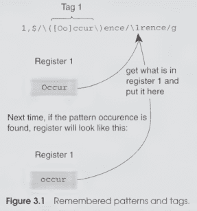

**Figure 3.1** Remembered patterns and tags.

#### EXAMPLE 3.11

```
```text

% vi textfile (Before substitution)

---------------------------------------------

Unusual occurrences happened at the fair.

Patty won fourth place in the 50 yard dash square and fair.

Occurrences like this are rare.

The winning ticket is 5222.

The ticket I got is 54333 and Dee got 55544.

Guy fell down while running around the south bend in his last event.

~

~

~

1  :s/\(square\) and \(fair\)/\2 and \1/

---------------------------------------------

% vi textfile (After substitution)

---------------------------------------------

Unusual occurrences happened at the fair.

--> Patty won fourth place in the 50 yard dash fair and square.

Occurrences like this are rare.

The winning ticket is 5222.

The ticket I got is 54333 and Dee got 55544.

Guy fell down while running around the south bend in his last event.

~

~

~

---------------------------------------------

```
```

# 说明

1 编辑器搜索正则表达式 `square` 和 `fair`，并将 `square` 标记为 1，`fair` 标记为 2。在替换一侧，寄存器 2 的内容替换 `\2`，寄存器 1 的内容替换 `\1`。参见图 3.2。

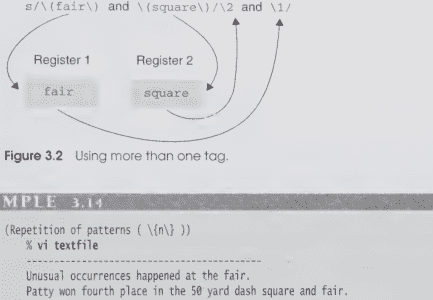

图 3.2 使用多个标签。

# 示例 3.14

（模式的重复（ `\n{}` ））

```
% vi textfile

Unusual occurrences happened at the fair.
Patty won fourth place in the 50 yard dash square and fair.
Occurrences like this are rare.
--> The winning ticket is 55222.
The ticket I got is 54333 and Dee got 55544.
Guy fell down while running around the south bend in his last event.
~
~
~
1 /5\{2\}\{2\}\{3\}\. /
```

# 说明

1 搜索包含数字 5 出现两次、数字 2 出现三次、后跟一个字面句点的行。

# 章节

4

# grep 家族


`grep` 家族由 `grep`、`egrep` 和 `fgrep` 命令组成。`grep` 命令在文件中全局搜索正则表达式，并打印包含该表达式的所有行。`egrep` 和 `fgrep` 命令只是 `grep` 的变体。`egrep` 命令是扩展的 `grep`，支持更多正则表达式元字符。`fgrep` 命令被称为固定 `grep`，有时也称为快速 `grep`，它将所有字符视为字面量；也就是说，正则表达式元字符不再具有特殊含义——它们匹配自身。自由软件基金会提供了一个免费的 `grep` 版本，称为 GNU `grep`。这些 `grep` 版本是 Linux 系统上使用的版本，也可以在 Sun 的 Solaris OS 上的 `/usr/xpg4/bin` 中找到。GNU 版本的 `grep` 扩展了基本正则表达式元字符集，增加了 POSIX 合规性，并包含了许多新的命令行选项。他们还提供了一个递归 `grep`，称为 `rgrep`，用于递归搜索整个目录树。

# 4.1 grep 命令

## 4.1.1 grep 的含义

`grep` 这个名字可以追溯到 `ex` 编辑器。如果你调用该编辑器并想搜索一个字符串，你会在 `ex` 提示符下输入：

```
: /pattern/p
```

包含字符串 `pattern` 的第一行将由 `print` 命令打印为“p”。如果你希望打印所有包含 `pattern` 的行，你会输入：

```
: g/pattern/p
```

### 示例 4.2

```
ps -ef | grep root
```

### 说明

`ps` 命令的输出（`ps -ef` 显示此系统上运行的所有进程）被发送到 `grep`，并且所有包含 `root` 的行都会被打印出来。

## 4.1.3 元字符

元字符是表示其他含义而非其本身的一个字符。`^` 和 `$` 是元字符的示例。

`grep` 命令支持许多正则表达式元字符（参见表 4.1），以帮助进一步定义搜索模式。它还提供了许多选项（参见表 4.2）来修改其搜索或显示行的方式。例如，你可以使用选项来关闭大小写敏感性、显示行号、仅显示错误等。

### 示例 4.3

```
grep -n '^jack:' /etc/passwd
```

### 说明

`Grep` 在 `/etc/passwd` 文件中搜索 `jack`；如果 `jack` 位于一行的开头，`grep` 会打印出找到 `jack` 的行号以及 `jack` 在该行中的位置。

### 表 4.1 grep 的正则表达式元字符

| 元字符 | 功能 | 示例 | 匹配内容 |
|---|---|---|---|
| `^` | 行首锚点 | `'^love'` | 匹配所有以 love 开头的行。 |
| `$` | 行尾锚点 | `'love$'` | 匹配所有以 love 结尾的行。 |
| `.` | 匹配一个字符 | `'1..e'` | 匹配包含一个 1、后跟两个字符、再后跟一个 e 的行。 |
| `*` | 匹配星号前面的零个或多个字符 | `'*love'` | 匹配包含零个或多个空格、后跟模式 love 的行。 |
| `[ ]` | 匹配集合中的一个字符 | `'[Ll]ove'` | 匹配包含 love 或 Love 的行。 |

### 表 4.1 grep 的正则表达式元字符（续）

| 元字符 | 功能 | 示例 | 匹配内容 |
|---|---|---|---|
| `[^]` | 匹配不在集合中的一个字符 | `'[A-K]ove'` | 匹配不包含 A 到 K 范围内的字符，后跟 ove 的行。 |
| `\<` | 单词开头锚点 | `'\<'love'` | 匹配包含以 love 开头的单词的行。 |
| `\>` | 单词结尾锚点 | `'love\>'` | 匹配包含以 love 结尾的单词的行。 |
| `\(\.\ )` | 标记匹配的字符 | `'\ (love\)ing'` | 将标记的部分保存在寄存器中以便稍后作为编号 1 记住。要稍后引用，请使用 `\1` 重复该模式。可使用最多九个标记，从模式最左侧的第一个标记开始。例如，模式 love 被保存在寄存器 1 中，以便稍后作为 `\1` 引用。 |
| `x\{m\}` | 字符 x 的重复：# 次， | `'o\{5\}'` | 匹配行中包含 5 次 o 的情况， |
| `x\{m,\}` | 至少 m 次，或 | `'o\{5,\}'` | 至少包含 5 次 o 的情况， |
| `x\{m,n\}³` | m 到 n 次之间 | `'o\{5,10\}'` | 或包含 5 到 10 次 o 的情况。 |

a. `\{ \}` 元字符并非在所有版本的 UNIX 或所有模式匹配工具中都受支持；它们通常适用于 `vi` 和 `grep`。

### 表 4.2 grep 的选项

| 选项 | 其作用 |
|---|---|
| `-b` | 在每行前加上找到该行的块号。这在通过上下文定位磁盘块号时有时很有用。 |
| `-c` | 显示匹配行的计数，而不是显示匹配的行。 |
| `-h` | 不显示文件名。 |
| `-i` | 忽略字母的大小写比较（即，大写和小写被视为相同）。 |
| `-l` | 仅列出包含匹配行的文件名称（一次），以换行符分隔。 |
| `-n` | 在每行前加上其在文件中的相对行号。 |
| `-s` | 静默工作，即除错误消息外不显示任何内容。这对于检查退出状态很有用。 |
| `-v` | 反转搜索，仅显示不匹配的行。 |
| `-w` | 将表达式作为单词搜索，仿佛被 `\<` 和 `\>` 包围。这仅适用于 `grep`。（并非所有版本的 `grep` 都支持此功能；例如，SCO UNIX 不支持。） |

## 4.1.4 grep 与退出状态

`grep` 命令在 shell 脚本中非常有用，因为它总是返回一个退出状态，以指示它是否能够找到您要查找的模式或文件。如果找到模式，`grep` 返回退出状态 `0`，表示成功；如果 `grep` 找不到模式，它返回 `1` 作为退出状态；如果找不到文件，`grep` 返回退出状态 `2`。（其他用于搜索模式的 UNIX 工具，如 `sed` 和 `awk`，并不使用退出状态来指示找到模式的成功或失败；它们仅在命令中存在语法错误时才报告失败。）在以下示例中，`john` 未在 `/etc/passwd` 文件中找到。

### EXAMPLE 4.4

```
1 % grep 'john' /etc/passwd    # john is not in the passwd file
2 % echo $status    (csh)
1
or
2 $ echo $?
    (sh, ksh)
1
```

### EXPLANATION

- 1. `Grep` 在 `/etc/passwd` 文件中搜索 `john`，如果成功，`grep` 以状态 `0` 退出。如果在文件中找不到 `john`，`grep` 以 `1` 退出。如果找不到文件，则返回退出状态 `2`。
- 2. C shell 变量 `status` 和 Bourne/Korn shell 变量 `?` 被赋予最后执行的命令的退出状态。

# 4.2 使用正则表达式的 grep 示例

以下数据文件用于本节的示例，为方便起见会定期重复。

| `% cat datafile` | | | | | | |
|---|---|---|---|---|---|---|
| northwest | NW | Charles Main | 3.0 | .98 | 3 | 34 |
| western | WE | Sharon Gray | 5.3 | .97 | 5 | 23 |
| southwest | SW | Lewis Dalsass | 2.7 | .8 | 2 | 18 |
| southern | SO | Suan Chin | 5.1 | .95 | 4 | 15 |
| southeast | SE | Patricia Hemenway | 4.0 | .7 | 4 | 17 |
| eastern | EA | TB Savage | 4.4 | .84 | 5 | 20 |
| northeast | NE | AM Main Jr. | 5.1 | .94 | 3 | 13 |
| north | NO | Margot Weber | 4.5 | .89 | 5 | 9 |
| central | CT | Ann Stephens | 5.7 | .94 | 5 | 13 |

### EXAMPLE 4.5

```
% grep NW datafile
northwest    NW    Charles Main    3.0    .98    3    34
```

### EXPLANATION

打印名为 `datafile` 的文件中包含正则表达式 `NW` 的所有行。

### EXAMPLE 4.6

```
% grep NW d*
datafile: northwest    NW    Charles Main    3.0    .98    3    34
db: northwest    NW    Joel Craig    30    40    5    123
```

### EXPLANATION


打印所有以 `d` 开头的文件中包含正则表达式 `NW` 的所有行。`shell` 将 `d*` 扩展为所有以 `d` 开头的文件。在本例中，检索到的文件名是 `db` 和 `datafile`。

## 示例 4.7

```
% grep '^n' datafile
northwest    NW    Charles Main    3.0    .98    3    34
northeast    NE    AM Main Jr.    5.1    .94    3    13
north    NO    Margot Weber    4.5    .89    5    9
```

### 解释

打印以 `n` 开头的所有行。插入符号 (`^`) 是行首锚点。

## 示例 4.8

```
% grep '45' datafile
northwest    NW    Charles Main    3.0    .98    3    34
```

### 解释

打印以 `4` 结尾的所有行。美元符号 (`$`) 是行尾锚点。

## 示例 4.9

```
% grep T8 Savage datafile
grep: Savage: No such file or directory
datafile: eastern    EA    T8 Savage    4.4    .84    5    20
```

### 解释

因为第一个参数是模式，其余所有参数都是文件名，所以 `grep` 会在名为 `Savage` 的文件和名为 `datafile` 的文件中搜索 `T8`。要搜索 `T8 Savage`，请参见下一个示例。

## 示例 4.10

```
% grep 'T8 Savage' datafile
eastern    EA    T8 Savage    4.4    .84    5    20
```

### 解释

打印包含模式 `T8 Savage` 的所有行。如果没有引号（在本例中，单引号或双引号均可），`T8` 和 `Savage` 之间的空白会导致 `grep` 在名为 `Savage` 的文件和名为 `datafile` 的文件中搜索 `T8`，如前一个示例所示。

## 示例 4.11

```
% grep '5\.' datafile
western    WE    Sharon Gray    5.3    .97    5    23
southern   SD    Suan Chin      5.1    .95    4    15
northeast  NE    AM Main Jr.    5.1    .94    3    13
central    CT    Ann Stephens   5.7    .94    5    13
```

### 解释

打印包含数字 `5`、后跟一个字面句点和任意单个字符的行。`点` 元字符代表单个字符，除非它用反斜杠转义。转义后，该字符不再是特殊元字符，而是代表其本身，即字面句点。

```
% cat datafile
northwest NW Charles Main 3.0 .98 3 34
western WE Sharon Gray 5.3 .97 5 23
southwest SW Lewis Dalsass 2.7 .8 2 18
southern SO Suan Chin 5.1 .95 4 15
southeast SE Patricia Hemenway 4.0 .7 4 17
eastern EA TB Savage 4.4 .84 5 20
northeast NE AM Main Jr. 5.1 .94 3 13
north NO Margot Weber 4.5 .89 5 9
central CT Ann Stephens 5.7 .94 5 13
```

## 示例 4.12

```
% grep '\.5' datafile
north NO Margot Weber 4.5 .89 5 9
```

### 解释

打印包含表达式 `.5` 的任何行。

## 示例 4.13

```
% grep '^\[we\]' datafile
western WE Sharon Gray 5.3 .97 5 23
eastern EA TB Savage 4.4 .84 5 20
```

### 解释

打印以 `w` 或 `e` 开头的行。插入符号 (`^`) 是行首锚点，方括号中的任一字符都将被匹配。

## 示例 4.14

```
% grep '[A0-9]' datafile
northwest NW Charles Main 3.0 .98 3 34
western WE Sharon Gray 5.3 .97 5 23
southwest SW Lewis Dalsass 2.7 .8 2 18
southern SO Suan Chin 5.1 .95 4 15
southeast SE Patricia Hemenway 4.0 .7 4 17
eastern EA TB Savage 4.4 .84 5 20
northeast NE AM Main Jr. 5.1 .94 3 13
north NO Margot Weber 4.5 .89 5 9
central CT Ann Stephens 5.7 .94 5 13
```

### 解释

打印包含一个非数字的所有行。因为所有行至少包含一个非数字，所以所有行都被打印。（参见第 84 页表 4.2 中的 `-v` 选项。）

## 示例 4.15

```
% grep '[A-Z][A-Z] [A-Z]' datafile
```

eastern    EA    TB Savage    4.4  .84  5  20

northeast  NE    AM Main Jr.  5.1  .94  3  13

### 解释

打印包含两个大写字母、后跟一个空格和一个大写字母的所有行；例如，`TB Savage` 和 `AM Main`。

## 示例 4.16

```
% grep 's*' datafile
```

northwest  NW    Charles Main  3.0  .98  3  34

southwest  SW    Lewis Dalsass  2.7  .8   2  18

### 解释

打印包含 `s` 后跟零个或多个连续出现的字母 `s` 和一个空格的所有行。找到 `Charles` 和 `Dalsass`。

## 示例 4.17

```
% grep '[a-z]\{9\}' datafile
```

northwest  NW    Charles Main    3.0  .98  3  34

southwest  SW    Lewis Dalsass    2.7  .8   2  18

southeast  SE    Patricia Hemenway 4.0  .7   4  17

northeast  NE    AM Main Jr.      5.1  .94  3  13

### 解释

打印包含至少九个连续小写字母的所有行，例如，`northwest`、`southwest`、`southeast` 和 `northeast`。

## 示例 4.18

```
% grep '\(3\)\.[0-9]*.*\3' datafile
```

northwest  NW    Charles Main  3.0  .98  3  34

### 解释

如果行包含 `3`、后跟句点和另一个数字、后跟任意数量的字符 (`.*`)、另一个 `3`（最初被标记）、任意数量的制表符和另一个 `3`，则打印该行。因为 `3` 被括在括号中，`\(3\)`，所以它可以用 `\1` 稍后引用。`\1` 表示这是第一个用 `\( \)` 对标记的表达式。

```
% cat datafile
northwest NW Charles Main 3.0 .98 3 34
western WE Sharon Gray 5.3 .97 5 23
southwest SW Lewis Dalsass 2.7 .8 2 18
southern SO Suan Chin 5.1 .95 4 15
southeast SE Patricia Hemenway 4.0 .7 4 17
eastern EA TB Savage 4.4 .84 5 20
northeast NE AM Main Jr. 5.1 .94 3 13
north NO Margot Weber 4.5 .89 5 9
central CT Ann Stephens 5.7 .94 5 13
```

## 示例 4.19

```
% grep '\<north' datafile
northwest NW Charles Main 3.0 .98 3 34
northeast NE AM Main Jr. 5.1 .94 3 13
north NO Margot Weber 4.5 .89 5 9
```

### 解释

打印所有包含以 `north` 开头的单词的行。`\<` 是单词开始的锚点。

## 示例 4.20


```
% grep '\<north\>' datafile
north NO Margot Weber 4.5 .89 5 9
```

### EXPLANATION

如果包含单词 `north` 则打印该行。`\<` 是单词开始的锚点，`\>` 是单词结束的锚点。

## EXAMPLE 4.21

```
% grep '\<[a-z].*n\' datafile
northwest NW Charles Main 3.0 .98 3 34
western WE Sharon Gray 5.3 .97 5 23
southern SO Suan Chin 5.1 .95 4 15
eastern EA TB Savage 4.4 .84 5 20
northeast NE AM Main Jr. 5.1 .94 3 13
central CT Ann Stephens 5.7 .94 5 13
```

### EXPLANATION

打印所有包含以小写字母开头的单词、后跟任意数量字符、并以 `n` 结尾的单词的行。请注意 `.` 符号。它的意思是任意字符，包括空白字符。

# 4.3 grep 的选项

`grep` 命令有许多控制其行为的选项。并非所有版本的 UNIX 都支持完全相同的选项，因此请务必查阅你的手册页以获取完整列表。

以下 `datafile` 用于本节的示例，为方便起见会定期重复。

| % cat datafile | | | | | | |

|---|---|---|---|---|---|---|

| northwest | NW | Charles Main | 3.0 | .98 | 3 | 34 |

| western | WE | Sharon Gray | 5.3 | .97 | 5 | 23 |

| southwest | SW | Lewis Dalsass | 2.7 | .8 | 2 | 18 |

| southern | SO | Suan Chin | 5.1 | .95 | 4 | 15 |

| southeast | SE | Patricia Hemenway | 4.0 | .7 | 4 | 17 |

| eastern | EA | TB Savage | 4.4 | .84 | 5 | 20 |

| northeast | NE | AM Main Jr. | 5.1 | .94 | 3 | 13 |

| north | NO | Margot Weber | 4.5 | .89 | 5 | 9 |

| central | CT | Ann Stephens | 5.7 | .94 | 5 | 13 |

## EXAMPLE 4.22

```
% grep -n 'south' datafile
3:southwest    SW    Lewis Dalsass    2.7    .8    2    18
4:southern     SO    Suan Chin        5.1    .95   4    15
5:southeast    SE    Patricia Hemenway 4.0    .7    4    17
```

### EXPLANATION

`-n` 选项在每一行前加上找到该模式的行号，然后是该行。

## EXAMPLE 4.23

```
% grep -i 'pat' datafile
southeast    SE    Patricia Hemenway 4.0    .7    4    17
```

### EXPLANATION

`-i` 选项关闭大小写敏感。表达式 `pat` 中的字母无论是大写还是小写组合都不重要。

```
% cat datafile
northwest NW Charles Main 3.0 .98 3 34
western WE Sharon Gray 5.3 .97 5 23
southwest SW Lewis Dalsass 2.7 .8 2 18
southern SO Suan Chin 5.1 .95 4 15
southeast SE Patricia Hemenway 4.0 .7 4 17
eastern EA TB Savage 4.4 .84 5 20
northeast NE AM Main Jr. 5.1 .94 3 13
north NO Margot Weber 4.5 .89 5 9
central CT Ann Stephens 5.7 .94 5 13
```

## EXAMPLE 4.24

```
% grep -v 'Suan Chin' datafile
northwest NW Charles Main 3.0 .98 3 34
western WE Sharon Gray 5.3 .97 5 23
southwest SW Lewis Dalsass 2.7 .8 2 18
southeast SE Patricia Hemenway 4.0 .7 4 17
eastern EA TB Savage 4.4 .84 5 20
northeast NE AM Main Jr. 5.1 .94 3 13
north NO Margot Weber 4.5 .89 5 9
central CT Ann Stephens 5.7 .94 5 13
```

### EXPLANATION

这里，`-v` 选项打印所有不包含模式 `Suan Chin` 的行。此选项用于从输入文件中删除特定条目时。要真正删除该条目，你需要将 `grep` 的输出重定向到临时文件，然后将临时文件的名称改回原始文件的名称，如下所示：

```
grep -v 'Suan Chin' datafile > temp
mv temp datafile
```

请记住，在从 `datafile` 重定向输出时必须使用临时文件。如果你将 `datafile` 重定向到 `datafile`，shell 会“破坏”`datafile`。 （参见第 25 页的“重定向”。）

## EXAMPLE 4.25

```
% grep -l 'SE' .
datafile
datebook
```

### EXPLANATION

`-l` 选项使 `grep` 只打印找到该模式的文件名，而不是文本行。

## 示例 4.26

```
% grep -c 'west' datafile
3
```

### 解释

`-c` 选项会使 `grep` 打印找到该模式的行数。这并不表示模式出现的次数。例如，如果在一行中找到了三次 `west`，它也只计为一行。

## 示例 4.27

```
% grep -w 'north' datafile
north    NO    Margot Weber    4.5    .89    5    9
```

### 解释

`-w` 选项会使 `grep` 仅在模式是一个单词而不是单词的一部分时才查找该模式。只会打印包含单词 `north` 的行，而不会打印 `northwest`、`northeast` 等。

`a.` 单词是位于行首或由空白字符前导、以空白字符、标点符号或换行符结尾的一串字母数字字符。

## 示例 4.28

```
% echo $LOGNAME
lewis

% grep -i "$LOGNAME" datafile
southwest    SW    Lewis Dalsass    2.7    .8    2    18
```

### 解释

shell 环境变量 `LOGNAME` 的值会被打印出来。它包含用户的登录名。如果变量被双引号括起来，shell 仍会对其进行展开，并且如果变量被赋予多个词，空白字符会被屏蔽以免被 shell 解释。如果使用单引号，则不会进行变量替换；也就是说，会打印 `$LOGNAME`。

# 4.4 使用管道的 grep

`grep` 通常不是从文件中获取输入，而是从管道获取输入。

## 示例 4.29

```
% ls -l
drwxrwxrwx 2 ellie 2441 Jan 6 12:34 dir1
-rw-r--r-- 1 ellie 1538 Jan 2 15:50 file1
-rw-r--r-- 1 ellie 1539 Jan 3 13:36 file2
-rw-r--r-- 2 ellie 2341 Jan 6 12:34 grades

% ls -l | grep '^d'
drwxrwxrwx 2 ellie 2441 Jan 6 12:34 dir1
drwxrwxrwx 2 ellie 2341 Jan 6 12:34 grades
```

### 解释

`ls` 命令的输出被管道传输到 `grep`。所有以 `d` 开头的输出行都会被打印；也就是说，所有目录都会被打印。

#### 4.4.1 grep 回顾

表 4.3 包含 `grep` 命令的示例以及它们的作用。

# 表 4.3 grep 回顾

| 命令 | 其作用 |

|---|---|

| grep '\<Tom\>' file | 打印包含单词 Tom 的行。 |

| grep 'Tom Savage' file | 打印包含 Tom Savage 的行。 |

| grep '^Tommy' file | 如果行首为 Tommy 则打印该行。 |


| `grep '\.bak$' file` | 打印以 `.bak` 结尾的行。单引号可保护美元符号 (`$`) 不被解释。 |

| `grep '[Pp]yramid' *` | 打印当前工作目录中所有文件中包含 `pyramid` 或 `Pyramid` 的行。 |

| `grep '[A-Z]' file` | 打印包含至少一个大写字母的行。 |

| `grep '[0-9]' file` | 打印包含至少一个数字的行。 |

| `grep '[A-Z][...][0-9]' file` | 打印包含以大写字母开头以数字结尾的五字符模式的行。 |

| `grep -w '[Tt]est' files` | 打印包含单词 `Test` 和/或 `test` 的行。 |

# 表 4.3 grep 回顾（续）

| 命令 | 其作用 |
|---|---|
| `grep -s 'Mark Todd' file` | 查找包含 `Mark Todd` 的行，但不打印这些行。可在检查 `grep` 的退出状态时使用。 |
| `grep -v 'Mary' file` | 打印所有不包含 `Mary` 的行。 |
| `grep -i 'sam' file` | 打印所有包含 `sam` 的行，不区分大小写（例如 `SAM`、`sam`、`SaM`、`sAm`）。 |
| `grep -l 'Dear Boss' *` | 列出包含 `Dear Boss` 的所有文件名。 |
| `grep -n 'Tom' file` | 在匹配的行前加上行号。 |
| `grep "$name" file` | 展开变量 `name` 的值并打印包含该值的行。必须使用双引号。 |
| `grep '\$5' file` | 打印包含字面量 `$5` 的行。必须使用单引号。 |
| `ps -ef | grep '^ *user1'` | 将 `ps -ef` 的输出通过管道传输到 `grep`，搜索以 `user1` 开头的行，即使其前面有零个或多个空格。 |

# 4.5 egrep（扩展 grep）

使用 `egrep` 的主要优势在于，`grep` 提供的正则表达式元字符集增加了额外的元字符（见表 4.4）。然而，`\(` `\)` 和 `\{` `\}` 是不允许的。（如果使用 Linux，请参阅 `GNU grep -E`。）

# 表 4.4 egrep 的正则表达式元字符

| 元字符 | 功能 | 示例 | 其匹配内容 |
|---|---|---|---|
| `^` | 行首锚点 | `'^love'` | 匹配所有以 `love` 开头的行。 |
| `$` | 行尾锚点 | `'love$'` | 匹配所有以 `love` 结尾的行。 |
| `.` | 匹配一个字符 | `'l..e'` | 匹配包含 `l`、后跟两个字符、再后跟 `e` 的行。 |
| `*` | 匹配零个或多个位于星号前的字符 | `'.* love'` | 匹配包含零个或多个空格后跟模式 `love` 的行。 |
| `[ ]` | 匹配集合中的一个字符 | `'[Ll]ove'` | 匹配包含 `love` 或 `Love` 的行。 |

# 表 4.4 egrep 的正则表达式元字符（续）

| 元字符 | 功能 | 示例 | 匹配内容 |
|---|---|---|---|
| `[^ ]` | 匹配不在集合中的一个字符 | `'[A-KM-Z]ove'` | 匹配不包含 `A` 到 `K` 或 `M` 到 `Z`，后跟 `ove` 的行。 |
| New with egrep |  |  |  |
| `+` | 匹配 `+` 号前字符的一个或多个 | `'[a-z]+ove'` | 匹配一个或多个小写字母，后跟 `ove`。可找到 `move`、`approve`、`love`、`behove` 等。 |
| `?` | 匹配前一个字符的零个或一个 | `'l?ove'` | 匹配 `l` 后跟 `o` 的零个或一个出现。可找到 `love` 或 `live`。 |
| `a|b` | 匹配 `a` 或 `b` | `'love|hate'` | 匹配任一表达式，`love` 或 `hate`。 |
| `()` | 分组字符 | `'love(able|ly)' '(ov+)'` | 匹配 `lovable` 或 `lovely`。匹配 `ov` 的一个或多个出现。 |

# 4.5.1 egrep 示例

以下示例仅说明新的扩展正则表达式元字符如何与 `egrep` 一起使用。前面介绍的 `grep` 示例说明了标准元字符的使用方式，这些元字符在 `egrep` 中行为相同。`Egrep` 在命令行上也使用与 `grep` 相同的选项。

本节示例中使用以下数据文件。

```
% cat datafile
northwest NW Charles Main 3.0 .98 3 34
western WE Sharon Gray 5.3 .97 5 23
southwest SW Lewis Dalsass 2.7 .8 2 18
southern SO Suan Chin 5.1 .95 4 15
southeast SE Patricia Hemenway 4.0 .7 4 17
eastern EA TB Savage 4.4 .84 5 20
northeast NE AM Main Jr. 5.1 .94 3 13
north NO Margot Weber 4.5 .89 5 9
central CT Ann Stephens 5.7 .94 5 13
```

# 示例 4.30

```
% egrep '\NW\|EA' datafile
northwest      NW    Charles Main    3.0  .98  3  34
eastern         EA    TB Savage        4.4  .84  5  20
```

# 解释

如果行中包含表达式 `NW` 或表达式 `EA`，则打印该行。

# 示例 4.31

```
% egrep '3+' datafile
northwest      NW    Charles Main    3.0  .98  3  34
western        WE    Sharon Gray      5.3  .97  5  23
northeast      NE    AM Main Jr.      5.1  .94  3  13
central        CT    Ann Stephens     5.7  .94  5  13
```

# 解释

打印包含数字 `3` 的一个或多个出现的所有行；例如，`3`、`33`、`33333333`。

# 示例 4.32

```
% egrep '\2\.?[0-9]' datafile
western        WE    Sharon Gray      5.3  .97  5  23
southwest      SW    Lewis Dalsass    2.7  .8   2  18
eastern        EA    TB Savage        4.4  .84  5  20
```

# 解释

打印包含 `2`，后跟一个句点或无句点，后跟一个数字的所有行；例如，匹配 `2.5`、`25`、`29`、`2.3` 等。

# 示例 4.33

```
% egrep '(no)+' datafile
northwest      NW    Charles Main    3.0  .98  3  34
northeast      NE    AM Main Jr.      5.1  .94  3  13
north          NO    Margot Weber     4.5  .89  5  9
```

# 解释

打印包含模式组 `no` 的一个或多个连续出现的所有行；例如，`no`、`nono`、`nonononono` 等。

# 示例 4.34

```
% egrep 'S(h|u)' datafile
western      WE   Sharon Gray   5.3  .97  5  23
southern     SO   Suan Chin     5.1  .95  4  15
```

# 解释

打印包含 `S`，后跟 `h` 或 `u` 的所有行；例如，`Sharon` 或 `Suan`。

### 示例 4.35

```
% egrep 'Sh|u' datafile
western      WE   Sharon Gray     5.3  .97  5  23
southern     SO   Suan Chin       5.1  .95  4  15
southwest    SW   Lewis Dalsass   2.7  .8   2  18
southeast    SE   Patricia Hemenway 4.0  .7   4  17
```

# 解释

打印包含表达式 `Sh` 或 `u` 的所有行；例如，`Sharon` 或 `southern`。

# 4.5.2 egrep 回顾

表 4.5 包含 `egrep` 命令的示例及其作用。

# 表 4.5 egrep 回顾

| 命令 | 其作用 |
|---|---|
| `egrep '^A+' file` | 打印以一个或多个空格开头的行。 |
| `egrep '^A*' file` | 打印以零个或多个空格开头的行。ᵃ |


| `egrep '(Tom|Dan) Savage' file` | 打印包含 Tom Savage 或 Dan Savage 的行。 |
| `egrep '(ab)+' file` | 打印包含 ab 的一个或多个出现的所有行。 |
| `egrep '^X[0-9]?' file` | 打印以 X 开头，后跟零个或一个单数字的行。 |
| `egrep 'fun.,$' *` | 打印所有文件中以 fun. 结尾的行。ᵃ |
| `egrep '[A-Z]+' file` | 打印包含一个或多个大写字母的行。 |
| `egrep '[0-9]' file` | 打印包含数字的行。ᵃ |

# 表 4.5 egrep 回顾（续）

| 命令 | 其作用 |
|---|---|
| `egrep '[A-Z]...[0-9]' file` | 打印包含五字符模式的行，该模式以大写字母开头，其后跟任意三个字符，以数字结尾.ª |
| `egrep '[tT]est' files` | 打印包含 Test 和/或 test 的行.ª |
| `egrep '(Susan|Jean) Doe' file` | 打印包含 Susan Doe 或 Jean Doe 的行。 |
| `egrep -v 'Mary' file` | 打印所有不包含 Mary 的行.ª |
| `egrep -i 'sam' file` | 打印所有包含 sam 的行，不区分大小写（例如，SAM, san, SAM, sam）。ª |
| `egrep -l 'Dear Boss' *` | 列出所有包含 Dear Boss 的文件名.ª |
| `egrep -n 'Tom' file` | 在匹配行前加上行号.ª |
| `egrep -s "$name" file` | 展开变量 `name`，查找它，但不打印任何内容。可用于检查 `egrep` 的退出状态。 （s 代表 silent）。ª |
| a. `egrep` 和 `grep` 对此模式的处理方式相同。 |

# 4.6 fgrep（Fixed grep 或 Fast grep）

`fgrep` 命令的行为与 `grep` 类似，但不将任何正则表达式元字符视为特殊字符。所有字符仅代表其本身。插入符号只是插入符号，美元符号只是美元符号，等等。 （如果使用 Linux，请参阅 GNU `grep -F`。）

### 示例 4.36

```
fgrep '[A-Z]****[0-9]..$5.00' file
```

# 解释

查找文件中包含字面字符串 `[A-Z]****[0-9]..$5.00` 的所有行。所有字符都作为其本身处理。没有特殊字符。

# 4.7 Linux 和 GNU grep

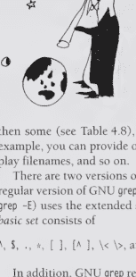

Linux 使用 GNU 版本的 `grep`，其功能与 `grep` 基本相同，只是更好。除了 POSIX 字符类（见表 4.7 和表 4.8）之外，还有许多新选项，包括 `-c`、`-E`、`-f` 和 `-P`，可让你使用常规 `grep` 来处理所有内容，同时仍获得 `egrep` 和 `fgrep` 的功能。

### 4.7.1 基本和扩展正则表达式

GNU `grep` 命令支持与 UNIX `grep` 相同的正则表达式元字符（见表 4.7），以及更多（见表 4.8），以修改其搜索方式或显示行的方式。例如，你可以提供选项来关闭大小写敏感、显示行号、显示文件名等等。

正则表达式元字符有两种版本：基本和扩展。 GNU `grep` 的常规版本（也为 `grep -G`）使用基本集合（见表 4.7），而 `egrep`（或 `grep -E`）使用扩展集合（表 4.8）。在 GNU `grep` 中，两套集合都可用。基本集合由

```
^, $, ., *, [ ], [^], \<, \>, and \( \)
```

组成。

此外，GNU `grep` 还识别 `\b`、`\w` 和 `\W`，以及一类新的 POSIX 元字符（见表 4.9）。

使用 GNU `grep` 的 `-E` 选项时，可使用扩展（egrep）集合，但在不使用 `-E` 选项的情况下，常规 `grep`，默认情况下，也可以使用扩展集合的元字符，前提是元字符前面加上反斜杠。例如，扩展集合的元字符为

```
?, +, { }, |, ( )
```

扩展集合的元字符对常规 `grep` 没有特殊含义，除非它们前面加上反斜杠，如下所示：

```
\?, \+, \{, \}, \|, \(, \)
```

使用 GNU `grep` 的格式如表 4.6 所示。

# 表 4.6 GNU grep

| 格式 | 其理解内容 |
|---|---|
| `grep 'pattern' filename(s)` | 基本 RE 元字符（默认） |
| `grep -G 'pattern' filename(s)` | 同上；默认 |
| `grep -E 'pattern' filename(s)` | 扩展 RE 元字符 |
| `grep -F 'pattern' filename` | 无 RE 元字符 |
| `grep -P 'pattern' filename` | 将模式解释为 Perl RE |

# 表 4.7 基本集合—GNU grep 的正则表达式元字符

| 元字符 | 功能 | 示例 | 其匹配内容 |
|---|---|---|---|
| `^` | 行首锚点 | `^love` | 匹配所有以 love 开头的行。 |
| `$` | 行尾锚点 | `love$` | 匹配所有以 love 结尾的行。 |
| `.` | 匹配一个字符 | `l..e` | 匹配包含 l、后跟两个字符、后跟 e 的行。 |
| `*` | 匹配零个或多个字符 | `*love` | 匹配包含零个或多个空格、前面字符后跟模式 love 的行。 |
| `[ ]` | 匹配集合中的一个字符 | `[Ll]ove` | 匹配包含 'love 或 Love 的行。 |
| `[!]` | 匹配不在集合中的一个字符 | `[!A-K]ove` | 匹配不包含 A 到 K 后跟 ove 的行。 |
| `\<` | 单词首锚点 | `\<love` | 匹配包含以 love 开头的单词的行。 |
| `\>` | 单词尾锚点 | `love\>` | 匹配包含以 love 结尾的单词的行。 |
| `\( ... \)` | 标记匹配的字符 | `\(love\)able` | 标记标记部分到寄存器中，以便稍后作为编号 1 记住。要稍后引用，使用 `\1` 重复模式。可使用最多九个标记，从最左边的模式部分开始的第一个标记。例如，模式 love 保存在寄存器 1 中，以便稍后作为 `\1` 引用。 |
| `x\{m\}` | 字符 x 的重复：m 次， | `o\{5\}` | 匹配行中出现 5 次 o。 |
| `x\{m,\}` | 至少 m 次，或 | `o\{5,\}` | 至少出现 5 次 o，或 |
| `x\{m,n\}` | m 到 n 次之间 | `o\{5,10\}` | 出现 5 到 10 次 o。 |

# 表 4.7 基本集合—GNU grep 的正则表达式元字符（续）

| 元字符 | 功能 | 示例 | 匹配内容 |
|---|---|---|---|
| `\w` | 字母数字单词字符；[a-zA-Z0-9_] | `\w\we` | 匹配一个 l 后跟零个或多个单词字符，以及一个 e。 |
| `\W` | 非字母数字单词字符；[^a-zA-Z0-9_] | `love\W+` | 匹配 love 后跟一个或多个非单词字符（,，? 等）。 |
| `\b` | 单词边界 | `\blove\b` | 仅匹配单词 love。 |

a. 除非转义，否则不起作用，即使使用 `grep -E` 和 GNU `egrep`；也不适用于 UNIX `egrep`。

b. 这些元字符实际上是扩展集合的一部分，但放在这里是因为它们在使用转义时适用于 UNIX `grep` 和 GNU 正则 `grep`。它们完全不适用于 UNIX `egrep`。

c. `\{ \}` 元字符并非在所有版本的 UNIX 或所有模式匹配工具上都受支持；它们通常适用于 vi 和 `grep`。它们完全不适用于 UNIX `egrep`。

# 表 4.8 扩展集合—用于 egrep 和 grep -E

| 元字符 | 功能 | 示例 | 匹配内容 |
|---|---|---|---|
| `+` | 匹配前一个字符的一个或多个 | `[a-z]+ove` | 匹配一个或多个小写字母，后跟 ove。可找到 nove、approve、love、behoove 等。 |
| `?` | 匹配前一个字符的零个或一个 | `lo?ve` | 匹配 l 后跟一个或零个 o。会找到 love 或 lve。 |
| `a|b|c` | 匹配 a 或 b 或 c | `love|hate` | 匹配任一表达式，love 或 hate。 |
| `()` | 分组字符 | `love(able|rs) (ov)+` | 匹配 loveable 或 lovers。匹配 ov 的一次或多次出现。 |


| (..) (...) \1 \2a | 标记匹配的字符 | `\(love\)\1ing` | 将标记的部分保存在寄存器中以便稍后作为编号 1 记住。要稍后引用，使用 `\1` 重复该模式。可使用最多九个标记，从模式最左侧的第一个标记开始。例如，模式 love 保存在寄存器 1 中，以便稍后作为 `\1` 引用。 |

| x{m} x{m,} x{m,n}b | 字符 x 的重复：m 次、至少 m 次、或 m 到 n 次之间 | `o\{5\} o\{5,\} o\{5,10\}` | 匹配如果行中有 5 次 o、至少 5 次 o、或 5 到 10 次 o 出现。 |

a. 标记和反向引用不适用于 UNIX `egrep`。

b. `\{ \}` 元字符并非在所有版本的 UNIX 或所有模式匹配工具上都受支持；它们通常适用于 `vi` 和 `grep`。它们完全不适用于 UNIX `egrep`。

# POSIX 类

POSIX（可移植操作系统接口）是确保程序可在操作系统之间移植的行业标准。为了实现可移植性，POSIX 认识到不同国家或区域在字符编码、货币表示以及时间和日期表示方式上可能存在差异。为处理不同类型的字符，POSIX 在基本和扩展正则表达式中增加了表 4.9 所示的带括号字符类。

例如，类 `[:alnum:]` 另一种说法是 `A-Za-z0-9`。要使用此类，它必须被另一组括号括起来才能被识别为正则表达式。例如，`A-Za-z0-9` 本身不是正则表达式，但 `[A-Za-z0-9]` 是。同样，`[:alnum:]` 应写成 `[[:alnum:]]`。使用第一种形式 `[A-Za-z0-9]` 与使用带括号形式 `[[:alnum:]]` 的区别在于，第一种形式依赖于 ASCII 字符编码，而第二种形式允许类中表示其他语言的字符，例如瑞典语圆圈和德语变音符号。

# 表 4.9 带括号的字符类

| 括号类 | 含义 |

|---|---|

| `[:alnum:]` | 字母数字字符 |

| `[:alpha:]` | 字母字符 |

| `[:cntrl:]` | 控制字符 |

| `[:digit:]` | 数字字符 |

| `[:graph:]` | 非空白字符（不包括空格、控制字符等） |

| `[:lower:]` | 小写字母 |

| `[:print:]` | 类似 `[:graph:]`，但包含空格字符 |

| `[:punct:]` | 标点字符 |

| `[:space:]` | 所有空白字符（换行符、空格、制表符） |

| `[:upper:]` | 大写字母 |

| `[:xdigit:]` | 允许十六进制数中的数字（0-9,a-fA-F） |

# 示例 4.37

```
1 % grep '[[:space:]]\.[[:digit:]]\[[[:space:]]]' datafile
southwest SW Lewis Dalsass 2.7 .8 2 18
southeast SE Patricia Hemenway 4.0 .7 4 17

2 % grep -E '[[:space:]]\.[[:digit:]]\[[[:space:]]]' datafile
southwest SW Lewis Dalsass 2.7 .8 2 18
southeast SE Patricia Hemenway 4.0 .7 4 17
```

# 示例 4.39

```
% grep "^An\w\W" datafile
northwest    NW    Charles Main    3.0    .98    3    34
northeast    NE    AM Main Jr.    5.1    .94    3    13
```

# 解释

打印以 n 开头的任何行，其后跟零个或多个字母数字单词字符 `[a-zA-Z0-9_]`，其后跟一个非字母数字单词字符 `[^a-zA-Z0-9_]`。`\w` 和 `\W` 是 GNU 版本 `grep` 的标准单词元字符。

# 示例 4.40

```
% grep "\bnorth\b" datafile
north    NO    Margot Weber    4.5    .89    5    9
```

# 解释

如果行中包含单词 `north`，则打印该行。`\b` 是单词边界。它可以在所有 GNU 版本的 `grep` 上代替单词锚点 `\< \>` 使用。

# 4.9 grep -E 或 egrep（GNU 扩展 grep）

使用扩展 `grep` 的主要优点是，额外的正则表达式元字符（见表 4.10）已添加到基本集合中。使用 `-E` 扩展，GNU `grep` 允许使用这些新元字符。

# 表 4.10 egrep 的正则表达式元字符

| 元字符 | 功能 | 示例 | 匹配内容 |

|---|---|---|---|

| `^` | 行首锚点 | `^love` | 匹配所有以 love 开头的行。 |

| `$` | 行尾锚点 | `love$` | 匹配所有以 love 结尾的行。 |

| `.` | 匹配一个字符 | `l..e` | 匹配包含 l、后跟两个字符、后跟 e 的行。 |

| `*` | 匹配零个或多个字符 | `*love` | 匹配包含零个或多个空格的、前面字符后跟模式 love 的行。 |

| `[ ]` | 匹配集合中的一个字符 | `[Ll]ove` | 匹配包含 love 或 Love 的行。 |

# 表 4.10 egrep 的正则表达式元字符（续）

| 元字符 | 功能 | 示例 | 匹配内容 |

|---|---|---|---|

| `[^ ]` | 匹配不在集合中的一个字符 | `[^A-KM-Z]ove` | 匹配不包含 A 到 K 或 M 到 Z，后跟 ove 的行。 |

| `grep -E` 或 `egrep` 的新功能 | | | |

| `+` | 匹配前一个字符的一个或多个 | `[a-z]+ove` | 匹配一个或多个小写字母，后跟 ove。可找到 move、approve、love、behoove 等。 |

| `?` | 匹配前一个字符的零个或一个 | `lo?ve` | 匹配 l 后跟一个或零个 o。可找到 love 或 lve。 |

| `a|b` | 匹配 a 或 b | `love|hate` | 匹配任一表达式，love 或 hate。 |

| `()` | 分组字符 | `love(able|ly) (ov)+` | 匹配 loveable 或 lovely。 匹配 ov 的一次或多次出现。 |

| 字符 x 的重复：x{n} 重复 n 次，x{n,} 至少 n 次，或 x{n,m} 重复 m 到 n 次之间 | | `o{5} o{5,} o{5,10}` | 匹配行中包含 o 5 次，o 至少出现 5 次，或 o 出现 5 到 10 次。 |

| `\w` | 字母数字单词字符；`[a-zA-Z0-9_]` | `l\w*e` | 匹配 l 后跟零个或多个单词字符，后跟 e。 |

| `\W` | 非字母数字单词字符；`[^a-zA-Z0-9_]` | `\W\w*` | 匹配一个非单词（`\W`）字符后跟零个或多个单词字符（`\w`）。 |

| `\b` | 单词边界 | `\blove\b` | 仅匹配单词 love。 |

a. `{ }` 元字符并非在所有版本的 UNIX 或所有模式匹配实用程序中都受支持；它们通常适用于 `vi` 和 `grep`。它们在 UNIX `egrep` 中完全不起作用。

# 4.9.1 grep -E 和 egrep 示例

以下示例说明了扩展正则表达式元字符如何与 `grep -E` 和 `egrep` 一起使用。前面介绍的 `grep` 示例说明了标准元字符的使用，`egrep` 也会识别这些元字符。使用基本 GNU `grep`（`grep -G`），可以使用任何附加元字符，只要每个特殊元字符前面都有反斜杠即可。

以下示例展示了使用三种 `grep` 变体完成相同任务的方法。

本节中的示例使用以下 `datafile`，定期重复以供您方便。

| `% cat datafile` |  |  |  |  |  |  |

|---|---|---|---|---|---|---|

| northwest | NW | Charles Main | 3.0 | .98 | 3 | 34 |

| western | WE | Sharon Gray | 5.3 | .97 | 5 | 23 |

| southwest | SW | Lewis Dalsass | 2.7 | .8 | 2 | 18 |

| southern | SO | Suan Chin | 5.1 | .95 | 4 | 15 |

| southeast | SE | Patricia Hemenway | 4.0 | .7 | 4 | 17 |

| eastern | EA | TB Savage | 4.4 | .84 | 5 | 20 |

| northeast | NE | AM Main Jr. | 5.1 | .94 | 3 | 13 |

| north | NO | Margot Weber | 4.5 | .89 | 5 | 9 |

| central | CT | Ann Stephens | 5.7 | .94 | 5 | 13 |

# 示例 4.41


```
1 % egrep 'NW|EA' datafile
northwest NW Charles Main 3.0 .98 3 34
eastern EA TB Savage 4.4 .84 5 20
```

```
2 % grep -E 'NW|EA' datafile
northwest NW Charles Main 3.0 .98 3 34
eastern EA TB Savage 4.4 .84 5 20
```

```
3 % grep 'NW|EA' datafile
```

```
4 % grep 'NW\|EA' datafile
northwest NW Charles Main 3.0 .98 3 34
eastern EA TB Savage 4.4 .84 5 20
```

# 解释

- 1 如果行中包含表达式 `NW` 或表达式 `EA`，则打印该行。在此示例中，使用了 `egrep`。如果您没有 GNU 版本的 `grep`，请使用 `egrep`。
- 2 在此示例中，使用 `-E` 选项的 GNU `grep` 来包含扩展元字符。与 `egrep` 相同。
- 3 普通 `grep` 通常不支持扩展正则表达式；竖线是用于交替的扩展正则表达式元字符。普通 `grep` 不识别它，并搜索显式模式 `'NW|EA'`。没有任何匹配；没有任何输出。
- 4 使用 GNU 普通 `grep`（`grep -G`），如果元字符前面有反斜杠，它将被解释为扩展正则表达式，就像 `egrep` 和 `grep -E` 一样。

| % cat datafile |  |  |  |  |  | |

|---|---|---|---|---|---|---|

| northwest | NW | Charles Main | 3.0 | .98 | 3 | 34 |

| western | WE | Sharon Gray | 53 | .97 | 5 | 23 |

| southwest | SW | Lewis Dalsass | 2.7 | .8 | 2 | 18 |

| southern | SO | Suan Chin | 5.1 | .95 | 4 | 15 |

| southeast | SE | Patricia Hemenway | 4.0 | .7 | 4 | 17 |

| eastern | EA | TB Savage | 4.4 | .84 | 5 | 20 |

| northeast | NE | AM Main Jr. | 5.1 | .94 | 3 | 13 |

| north | NO | Margot Weber | 4.5 | .89 | 5 | 9 |

| central | CT | Ann Stephens | 5.7 | .94 | 5 | 13 |

# EXAMPLE 4.42

```
% egrep '3+' datafile
% grep -E '3+' datafile
% grep '\3+' datafile
```

| northwest | NW | Charles Main | 3.0 | .98 | 3 | 34 |

| western | WE | Sharon Gray | 5.3 | .97 | 5 | 23 |

| northeast | NE | AM Main Jr. | 5.1 | .94 | 3 | 13 |

| central | CT | Ann Stephens | 5.7 | .94 | 5 | 13 |

### EXPLANATION

打印包含一个或多个 `3` 的所有行。

# EXAMPLE 4.43

```
% egrep '2\.?[0-9]' datafile
% grep -E '2\.?[0-9]' datafile
% grep '2\.?[0-9]' datafile
```

| western | WE | Sharon Gray | 5.3 | .97 | 5 | 23 |

| southwest | SW | Lewis Dalsass | 2.7 | .8 | 2 | 18 |

| eastern | EA | TB Savage | 4.4 | .84 | 5 | 20 |

### EXPLANATION

打印包含一个 `2`、后跟零个或一个句点、后跟 `0` 到 `9` 之间数字的所有行。

# EXAMPLE 4.44

```
% egrep '(no)+' datafile
% grep -E '(no)+' datafile
% grep '(no)+' datafile
```

| northwest | NW | Charles Main | 3.0 | .98 | 3 | 34 |

| northeast | NE | AM Main Jr. | 5.1 | .94 | 3 | 13 |

| north | NO | Margot Weber | 4.5 | .89 | 5 | 9 |

### EXPLANATION

打印包含模式组 `no` 的一个或多个出现次数的行。

# EXAMPLE 4.45

```
% grep -E '\W\+|\w+[ABC]' datafile
```

northwest    NW    Charles Main    3.0    .98    3    34

southern      SO    Suan Chin        5.1    .95    4    15

northeast     NE    AM Main Jr.      5.1    .94    3    13

central       CT    Ann Stephens     5.7    .94    5    13

### EXPLANATION

打印包含一个或多个字母数字单词字符（`\w+`）、后跟一个或多个非字母数字单词字符（`\W+`）、后跟集合 `ABC` 中的一个字母的所有行。

# EXAMPLE 4.46

```
% egrep '(Sh|u)' datafile
% grep -E '(Sh|u)' datafile
% grep 'S(h|u)' datafile
```

western    WE    Sharon Gray    5.3    .97    5    23

southern   SO    Suan Chin      5.1    .95    4    15

### EXPLANATION

打印包含 `S` 后跟 `h` 或 `u` 的所有行；即 `Sh` 或 `Su`。

# EXAMPLE 4.47

```
% egrep 'Sh|u' datafile
% grep -E 'Sh|u' datafile
% grep 'Sh|u' datafile
```

打印包含表达式 `Sh` 或 `u` 的所有行。

# 4.9.2 Anomalies with Regular and Extended Variants of grep

Linux 支持的 GNU `grep` 变体几乎与它们的 UNIX 同名程序相同，但并不完全相同。例如，在 Solaris 或 BSD UNIX 中找到的 `egrep` 版本不支持三个元字符集：`\{ \}` 用于重复、`\( \)` 用于标记字符，以及 `\< \>`，即单词锚点。在 Linux 下，这些元字符可通过 `grep` 和 `grep -E` 使用，但 `egrep` 不识别 `\< \>`。以下示例说明了这些差异，以防你在除 Linux 以外的 UNIX 系统下运行 `bash` 或 `tcsh`，并且想在你的 shell 脚本中使用 `grep` 及其家族。

本节中的示例使用以下 `datafile`，定期重复以方便你查阅。

| % cat datafile | NW | Charles Main | 3.0 | .98 | 3 | 34 |

| northwest | WE | Sharon Gray | 53 | .97 | 5 | 23 |

| western | SW | Lewis Dalsass | 2.7 | .8 | 2 | 18 |

| southwest | SO | Suan Chin | 5.1 | .95 | 4 | 15 |

| southern | SE | Patricia Hemenway | 4.0 | .7 | 4 | 17 |

| southeast | EA | TB Savage | 4.4 | .84 | 5 | 20 |

| eastern | NE | AM Main Jr. | 5.1 | .94 | 3 | 13 |

| northeast | NO | Margot Weber | 4.5 | .89 | 5 | 9 |

| north | CT | Ann Stephens | 5.7 | .94 | 5 | 13 |

| central |  |  |  |  |  |  |

# EXAMPLE 4.48


```
(Linux GNU grep)
1 % grep '\<north\>' datafile  # Must use backslashes

2 % grep '\<north\>' datafile
north NO Margot Weber 4.5 .89 5 9

3 % grep -E '\<north\>' datafile
north NO Margot Weber 4.5 .89 5 9

4 % egrep '\<north\>' datafile
north NO Margot Weber 4.5 .89 5 9

(Solaris egrep)
5 % egrep '\<north\>' datafile
<no output; not recognized>
```

### EXPLANATION

- 1 无论使用哪种版本的 `grep`，单词锚定元字符 `<` `>` 必须前面加上反斜杠。
- 2 这次，`grep` 搜索以 `north` 开头并以 `north` 结尾的单词。`\<` 表示单词开始锚点，`\>` 表示单词结束锚点。
- 3 使用 `-E` 选项的 `grep` 也识别单词锚点。
- 4 GNU 版的 `egrep` 识别单词锚点。
- 5 在使用 Solaris 时，`egrep` 不将单词锚点识别为正则表达式元字符。

# EXAMPLE 4.49

(Linux GNU grep)

```
1 % grep 'w(es)t.\1' datafile
grep: Invalid back reference
```

```
2 % grep 'w(es)t.\1' datafile
northwest   NW   Charles Main   3.0  .98  3  34
```

```
3 % grep -E 'w(es)t.\1' datafile
northwest   NW   Charles Main   3.0  .98  3  34
```

```
4 % egrep 'w(es)t.\1' datafile
northwest   NW   Charles Main   3.0  .98  3  34
```

(Solaris egrep)

```
5 % egrep 'w(es)t.\1' datafile
<no output; not recognized>
```

### EXPLANATION

- 1 使用普通 `grep` 时，`( )` 扩展元字符必须加反斜杠，否则会出错。
- 2 如果正则表达式 `w\(es\)t` 匹配成功，则模式 `es` 会被保存并存储在内存寄存器 `1` 中。表达式的含义是：如果找到 `west`，则标记并保存 `es`，在其后搜索任意数量的字符 `(.*)`，然后再次出现 `es` `(\1)`，并打印该行。`Char'les` 中的 `es` 由反向引用匹配。
- 3 这与前一个示例相同，只是使用 `-E` 开关的 `grep` 不在 `( )` 前加上反斜杠。
- 4 GNU `egrep` 也在不使用反斜杠的情况下使用扩展元字符 `( )`。
- 5 在 Solaris 中，`egrep` 不识别任何形式的标记和反向引用。

```
% cat datafile
northwest NW Charles Main 3.0 .98 3 34
western WE Sharon Gray 5.3 .97 5 23
southwest SW Lewis Dalsass 2.7 .8 2 18
southern SO Suan Chin 5.1 .95 4 15
southeast SE Patricia Hemenway 4.0 .7 4 17
eastern EA TB Savage 4.4 .84 5 20
northeast NE AM Main Jr. 5.1 .94 3 13
north NO Margot Weber 4.5 .89 5 9
central CT Ann Stephens 5.7 .94 5 13
```

# EXAMPLE 4.30

```
(Linux GNU grep)
1 % grep '\.[0-9]\{2\}[0-9]' datafile
northwest NW Charles Main 3.0 .98 3 34
western WE Sharon Gray 5.3 .97 5 23
southern SO Suan Chin 5.1 .95 4 15
eastern EA TB Savage 4.4 .84 5 20
northeast NE AM Main Jr. 5.1 .94 3 13
north NO Margot Weber 4.5 .89 5 9
central CT Ann Stephens 5.7 .94 5 13
```

```
2 % grep -E '\.[0-9]{2}[0-9]' datafile
northwest NW Charles Main 3.0 .98 3 34
western WE Sharon Gray 5.3 .97 5 22
southern SO Suan Chin 5.1 .95 4 15
eastern EA TB Savage 4.4 .84 5 20
northeast NE AM Main Jr. 5.1 .94 3 13
north NO Margot Weber 4.5 .89 5 9
central CT Ann Stephens 5.7 .94 5 13
```

```
3 % egrep '\.[0-9]{2}[0-9]' datafile
northwest NW Charles Main 3.0 .98 3 34
western WE Sharon Gray 5.3 .97 5 22
southern SO Suan Chin 5.1 .95 4 15
eastern EA TB Savage 4.4 .84 5 20
northeast NE AM Main Jr. 5.1 .94 3 13
north NO Margot Weber 4.5 .89 5 9
central CT Ann Stephens 5.7 .94 5 13
```

(Solaris egrep)

```
4 % egrep '\.[0-9]{2}[0-9]' datafile
<no output; not recognized with or without backslashes>
```

# 4.12 GNU grep with Options

`grep` 命令有许多控制其行为的选项。GNU 版的 `grep` 增加了许多新选项和替代使用选项的方式。GNU `grep` 选项可与所有不同版本的 `grep` 一起使用，包括 `grep -G`、`-E` 和 `-F`，如表 4.11 所示。

Table 4.11 GNU `grep` Options for All Variants (`-G`, `-E`, and `-F`)

| Option | What It Does |
|---|---|
| `-#` (`#` is a symbol used to represent an integer value) | Matches will be printed with `#` lines of leading and trailing context; i.e., `grep -2 pattern filename` will cause `grep` to print the matched line with the two lines before and after it. |
| `-A #`, `--after-context=#` | Print `#` lines of trailing context after matching lines; i.e., the matched line and the specified `#` lines after it. |
| `-B #`, `--before-context=#` | Print `#` lines of leading context before matching lines; i.e., the matched lines and the specified `#` lines before it. |
| `-C #`, `--context=#` | Equivalent to `-2`. Prints the two lines before and after the matched line. |
| `-V`, `--version` | Displays the version information about `grep` that should be included in all bug reports. |
| `-a`, `--text`, `--binary-files=text` | Processes binary files as text files. |
| `-b`, `--byte-offset` | Displays the byte offset before each line of output. |


| `-c`, `--count` | Prints a count of matching lines for each input file. With the `-v` prints a count of nonmatching lines. |

| `-D action`, `--devices-action` | If the input file is a device such as a socket or pipe, action is read from the device by default just as though it were a normal file. If action is skip, the device will be silently skipped over. |

| `-e PATTERN`, `--regexp=PATTERN` | Use PATTERN literally as the pattern; useful to protect patterns beginning with `-`. |

| `-f FILE`, `--file=FILE` | Obtain patterns from FILE, one per line. The empty file contains zero patterns, and therefore matches nothing. |

| `--help` | Display a usage message summarizing grep's command-line options and bug reporting address, then exit. |

| `-h`, `--no-filename` | Suppress the prefixing of filenames on output when multiple files are searched. |

| `-i`, `--ignore-case` | Ignore case distinctions in both the pattern and the input files. |

# 表 4.11 GNU grep 选项，适用于所有变体（-G、-E 和 -F）（续）

| 选项 | 其作用 |
|---|---|

| `-L`, `--files-without-match` | 仅打印模式不匹配的所有文件名称。 |
| `-l`, `--files-with-matches` | 仅打印模式匹配的所有文件名称。 |
| `-m #`, `--max-count=#` | 如果文件是标准输入或普通文件，则在匹配指定数量（#）的行后停止读取该文件。 |
| `-n`, `--line-number` | 在输出的每一行前加上匹配发生所在的行号。 |
| `-q`, `--quiet` | 抑制正常输出。可替代 `-n` 使用。 |
| `-r`, `-R`, `--recursive`, `--directories=recurse` | 对于列出的目录，递归读取并处理这些目录中的所有文件；即从该目录向下树形结构中的所有目录。 |
| `-s`, `--silent` | 抑制关于不存在或无法读取的文件的错误消息。 |
| `-v`, `--invert-match` | 反转匹配的含义，以选择不匹配的行。 |
| `-w`, `--word-regexp` | 仅选择包含匹配项为单词的行。匹配项为包含字母、数字和下划线的字符串，且位于词边界。 |
| `-x`, `--line-regexp` | 仅选择完全匹配整行的匹配项。 |
| `-y` | `-i` 的过时同义词。 |
| `-U`, `--binary` | 将文件视为二进制。此选项仅在 MS-DOS 和 MS-Windows 上受支持。 |
| `-u`, `--unix-byte-offsets` | 报告 UNIX 风格的字节偏移。此选项只有在同时使用 `-b` 选项时才有效；它仅在 MS-DOS 和 MS-Windows 上受支持。 |
| `-Z`, `--null` | 在文件名的末尾放置 ASCII 空字符，而不是换行符。 |

# 4.13 带选项的 grep（UNIX 和 GNU）

`grep` 命令有许多选项控制其行为。并非所有 UNIX 版本都支持完全相同的选项，因此请务必查阅你的手册页以获取完整列表。

本节中的示例使用以下数据文件，为方便起见会定期重复。

| `% cat datafile` | | | | | | |
| northwest | NW | Charles Main | 3.0 | .98 | 3 | 34 |
| western | WE | Sharon Gray | 5.3 | .97 | 5 | 23 |
| southwest | SW | Lewis Dalsass | 2.7 | .8 | 2 | 18 |
| southern | SO | Suan Chin | 5.1 | .95 | 4 | 15 |
| southeast | SE | Patricia Hemenway | 4.0 | .7 | 4 | 17 |
| eastern | EA | TB Savage | 4.4 | .84 | 5 | 20 |
| northeast | NE | AM Main Jr. | 5.1 | .94 | 3 | 13 |
| north | NO | Margot Weber | 4.5 | .89 | 5 | 9 |
| central | CT | Ann Stephens | 5.7 | .94 | 5 | 13 |

### 示例 4.53

```
% grep -n "^south" datafile
3:southwest    SW    Lewis Dalsass    2.7  .8  2  18
4:southern     SO    Suan Chin        5.1  .95 4  15
5:southeast    SE    Patricia Hemenway 4.0  .7  4  17
```

# 解释

`-n` 选项在每一行前加上找到模式的行号，然后是该行。

### 示例 4.54

```
% grep -i 'pat' datafile
southeast    SE    Patricia Hemenway 4.0  .7  4  17
```

# 解释

`-i` 选项关闭大小写敏感。表达式 `pat` 中的字母无论是大写还是小写组合均无关紧要。

### 示例 4.35

```
% grep -v 'Suan Chin' datafile
```

| northwest | NW | Charles Main | 3.0 | .98 | 3 | 34 |
| western | WE | Sharon Gray | 5.3 | .97 | 5 | 22 |
| southwest | SW | Lewis Dalsass | 2.7 | .8 | 2 | 18 |
| southeast | SE | Patricia Hemenway | 4.0 | .77 | 4 | 17 |
| eastern | EA | TB Savage | 4.4 | .84 | 5 | 20 |
| northeast | NE | AM Main Jr. | 5.1 | .94 | 3 | 13 |
| north | NO | Margot Weber | 4.5 | .89 | 5 | 9 |
| central | CT | Ann Stephens | 5.7 | .94 | 5 | 13 |

# 解释

这里，`-v` 选项打印所有不包含模式 `Suan Chin` 的行。此选项用于从输入文件中删除特定条目时。要真正删除该条目，你需要将 `grep` 的输出重定向到临时文件，然后将临时文件的名称改回原始文件的名称，如下所示：

```
grep -v 'Suan Chin' datafile > temp
mv temp datafile
```

请记住，在将输出从 `datafile` 重定向时必须使用临时文件。如果你将 `datafile` 重定向到 `datafile`，shell 会“破坏”`datafile`。（参见第 25 页的“重定向”。）

### 示例 4.56

```
% grep -l 'SE' *
datafile
datebook
```

# 解释

`-l` 选项使 `grep` 仅打印找到模式的文件名，而不是文本行。

### 示例 4.57

```
% cat datafile
northwest NW Charles Main 3.0 .98 3 34
western WE Sharon Gray 5.3 .97 5 23
southwest SW Lewis Dalsass 2.7 .8 2 18
southern SO Suan Chin 5.1 .95 4 15
southeast SE Patricia Hemenway 4.0 .7 4 17
eastern EA TB Savage 4.4 .84 5 20
northeast NE AM Main Jr. 5.1 .94 3 13
north NO Margot Weber 4.5 .89 5 9
```


central CT Ann Stephens 5.7 .94 5 13

# EXAMPLE 4.58

```
% grep -w 'north' datafile
north NO Margot Weber 4.5 .89 5 9
```

### EXPLANATION

The `-w` option causes `grep` to find the pattern only if it is a word, a not part of a word. Only the line containing the word `north` is printed, not `northwest`, `northeast`, etc.

a. A word is a sequence of alphanumeric characters starting at the beginning of a line or preceded by whitespace and ending in whitespace, punctuation, or a newline.

# EXAMPLE 4.59

```
% echo $LOGNAME
lewis
% grep -i "$LOGNAME" datafile
southwest SW Lewis Dalsass 2.7 .8 2 18
```

### EXPLANATION

The value of the shell ENV variable, `LOGNAME`, is printed. It contains the user's login name. If the variable is enclosed in double quotes, it will still be expanded by the shell, and in case there is more than one word assigned to the variable, whitespace is shielded from shell interpretation. If single quotes are used, variable substitution does not take place; that is, `$LOGNAME` is printed.

# 4.13.1 GNU grep Options Examples

In addition to the options provided with UNIX `grep`, the GNU version provides options that further refine the output resulting from pattern searches.

The examples in this section use the following `datafile`, repeated periodically for your convenience.

```
% cat datafile
```

| northwest | NW | Charles Main | 3.0 | .98 | 3 | 34 |

| western | WE | Sharon Gray | 5.3 | .97 | 5 | 23 |

| southwest | SW | Lewis Dalsass | 2.7 | .8 | 2 | 18 |

| southern | SO | Suan Chin | 5.1 | .95 | 4 | 15 |

| southeast | SE | Patricia Hemenway | 4.0 | .7 | 4 | 17 |

| eastern | EA | TB Savage | 4.4 | .84 | 5 | 20 |

| northeast | NE | AM Main Jr. | 5.1 | .94 | 3 | 13 |

| north | NO | Margot Weber | 4.5 | .89 | 5 | 9 |

| central | CT | Ann Stephens | 5.7 | .94 | 5 | 13 |

# EXAMPLE 4.60

```
% grep -V
grep (GNU grep) 2.2
```

> Copyright (C) 1988, 92, 93, 94, 95, 96, 97 Free Software Foundation, Inc. This is free software; see the source for copying conditions. There is NO warranty; not even for MERCHANTABILITY or FITNESS FOR A PARTICULAR PURPOSE.

### EXPLANATION

With the `-V` option, `grep`'s version and copyright information are listed. The version information should be included with any bug reports sent to the GNU Foundation.

# EXAMPLE 4.61

```
1 % grep -2 Patricia datafile
southwest SW Lewis Dalsass 2.7 .8 2 18
southern SO Suan Chin 5.1 .95 4 15
southeast SE Patricia Hemenway 4.0 .7 4 17
eastern EA TB Savage 4.4 .84 5 20
northeast NE AM Main Jr. 5.1 .94 3 13
```

```
2 % grep -C Patricia datafile
southwest SW Lewis Dalsass 2.7 .8 2 18
southern SO Suan Chin 5.1 .95 4 15
southeast SE Patricia Hemenway 4.0 .7 4 17
eastern EA TB Savage 4.4 .84 5 20
northeast NE AM Main Jr. 5.1 .94 3 13
```

### EXPLANATION

- 1 After a line matching `Patricia` is found, `grep` displays that line and the two lines before and after it.
- 2 The `-C` option is the same as `-2`.

# EXAMPLE 4.62

```
% grep -A 2 Patricia datafile
southeast SE Patricia Hemenway 4.0 .7 4 17
eastern EA TB Savage 4.4 .84 5 20
northeast NE AM Main Jr. 5.1 .94 3 13
```

### EXPLANATION

After a line matching `Patricia` is found, `grep` displays that line and the two lines after it.

# EXAMPLE 4.63

```
% grep -B 2 Patricia datafile
southwest SW Lewis Dalsass 2.7 .8 2 18
southern SO Suan Chin 5.1 .95 4 15
southeast SE Patricia Hemenway 4.0 .7 4 17
```

### EXPLANATION

After a line matching `Patricia` is found, `grep` displays that line and the two lines before (preceding) it.

# EXAMPLE 4.64


```
% grep -b '[abc]' datafile
0:northwest NW Charles Main 3.0 .98 3 34
39:western WE Sharon Gray 5.3 .97 5 23
76:southwest SW Lewis Dalsass 2.7 .8 2 18
115:southern SO Suan Chin 5.1 .95 4 15
150:southeast SE Patricia Hemenway 4.0 .7 4 17
193:eastern EA TB Savage 4.4 .84 5 20
228:northeast NE AM Main Jr. 5.1 .94 3 13
266:north NO Margot Weber 4.5 .89 5 9
301:central CT Ann Stephens 5.7 .94 5 13
```

### EXPLANATION

使用 `-b` 选项时，`grep` 会在输出的每一行前打印该行在输入文件中的字节偏移量。

接下来两个示例不再使用 `datafile`，我们将使用一个名为 `negative` 的文件来演示 `-e` 和 `-x` 选项。

```
% cat negative

-40 is cold.

This is line 1.

This is line 2.5

-alF are options to the ls command
```

# EXAMPLE 4.65

```
1 % grep -e "-aIF" negative

-aIF are options to the ls command
```

```
2 % grep --regexp=-40 negative

-40 is cold.
```

### EXPLANATION

- 1. 使用 `-e` 选项时，`grep` 会将模式中的所有字符同等对待，因此不会将开头的连字符误认为是选项。
- 2. `-e` 的另一种表示方式是 `--regexp=pattern`，其中 `pattern` 为正则表达式；在该示例中，正则表达式为 `-40`。

# EXAMPLE 4.66

```
% grep -x -e "-40 is cold." negative

-40 is cold.
```

### EXPLANATION

使用 `-x` 选项时，除非搜索模式与整行完全相同，否则 `grep` 不会匹配该行。`-e` 用于允许搜索字符串以连字符开头。

本节剩余的示例将使用以下数据文件。

| northwest | NW | Charles Main | 3.0 | .98 | 3 | 34 |
|---|---|---|---|---|---|---|
| western | WE | Sharon Gray | 5.3 | .97 | 5 | 23 |
| southwest | SW | Lewis Dalsass | 2.7 | .8 | 2 | 18 |
| southern | SO | Suan Chin | 5.1 | .95 | 4 | 15 |
| southeast | SE | Patricia Hemenway | 4.0 | .7 | 4 | 17 |
| eastern | EA | TB Savage | 4.4 | .84 | 5 | 20 |
| northeast | NE | AM Main Jr. | 5.1 | .94 | 3 | 13 |
| north | NO | Margot Weber | 4.5 | .89 | 5 | 9 |
| central | CT | Ann Stephens | 5.7 | .94 | 5 | 13 |

# EXAMPLE 4.67

```
1 % cat repatterns

western

north

2 % grep -f repatterns datafile

northwest  NW  Charles Main  3.0  .98  3  34

western    WE  Sharon Gray    5.3  .97  5  23

northeast  NE  AM Main Jr.    5.1  .94  3  13

north      NO  Margot Weber   4.5  .89  5  9
```

### EXPLANATION

1 `repatterns` 文件被显示出来。它包含 `grep` 的搜索模式，这些模式将与输入文件中的行进行匹配。`Western` 和 `north` 是 `grep` 在搜索中将使用的模式。

2 使用 `-f` 选项后跟文件名（在本示例中为 `repatterns`），`grep` 将从该文件获取搜索模式并将其与 `datafile` 中的行进行匹配。`Grep` 搜索并打印出包含模式 `western` 和 `north` 的所有行。

# EXAMPLE 4.68

```
1 % grep '[0-9]' datafile db

datafile:northwest NW  Charles Main  3.0  .98  3  34

datafile:western WE    Sharon Gray    5.3  .97  5  23

datafile:southwest SW  Lewis Dalsass  2.7  .8   2  18

datafile:southern SO   Suan Chin      5.1  .95  4  15

datafile:southeast SE  Patricia Hemenway 4.0 .7  4  17

datafile:eastern EA    TB Savage      4.4  .84 5  20

datafile:northeast NE  AM Main Jr.    5.1  .94 3  13

datafile:north NO      Margot Weber   4.5  .89 5  9

datafile:central CT    Ann Stephens   5.7  .94 5  13

db:123
```

# EXAMPLE 4.68 (CONTINUED)

```
2 % grep -h '[0-9]' datafile db

northwest   NW   Charles Main   3.0   .98   3   34

western     WE   Sharon Gray    5.3   .97   5   23

southwest   SW   Lewis Dalsass  2.7   .8    2   18

southern    SO   Suan Chin      5.1   .95   4   15

southeast   SE   Patricia Hemenway 4.0   .7    4   17

eastern     EA   TB Savage      4.4   .84   5   20

northeast   NE   AM Main Jr.    5.1   .94   3   13

north       NO   Margot Weber   4.5   .89   5    9

central     CT   Ann Stephens   5.7   .94   5   13
```

### EXPLANATION

- 1. 如果列出多个文件，`grep` 会在输出的每一行前加上文件名。文件名是 `datafile` 和 `db`。
- 2. 使用 `-h` 选项时，`grep` 会抑制头部信息；即不打印文件名。

# EXAMPLE 4.69

```
% grep -q Charles datafile  or

% grep --quiet Charles datafile

% echo $status

0
```


### EXPLANATION

`quiet`选项会抑制`grep`的任何输出。它在仅需要退出状态时使用。如果退出状态为零，则表示`grep`找到了该模式。

# LAB 1: grep 练习

（请参考 CD 上的名为`datebook`的文件。）

```
Steve Blenheim:238-923-7366:95 Latham Lane, Easton, PA 83755:11/12/56:20300
Betty Boop:245-836-8537:635 Cutsey Lane, Hollywood, CA 91464:6/23/23:14500
Igor Chevsky:383-735-3995:3567 Populus Place, Caldwell, NJ 23887:5/16/68:23400
Norma Corder:397-857-2735:74 Pine Street, Dearborn, MI 23874:3/28/45:245700
Jennifer Cowan:548-834-2348:583 Laurel Ave., Kingsville, TX 83745:10/1/35:38900
Jon DeLoach:408-253-3122:123 Park St., San Jose, CA 04086:7/25/53:85100
Karen Evich:284-758-2857:23 Edgecliff Place, Lincoln, NB 92743:7/25/53:85100
Karen Evich:284-758-2867:23 Edgecliff Place, Lincoln, NB 92743:11/3/35:58200
Karen Evich:284-758-2867:23 Edgecliff Place, Lincoln, NB 92743:11/3/35:58200
Fred Fardbarkle:674-843-1385:20 Parak Lane, Duluth, MN 23850:4/12/23:780900
Fred Fardbarkle:674-843-1385:20 Parak Lane, Duluth, MN 23850:4/12/23:780900
Lori Gortz:327-832-5728:3465 Mirlo Street, Peabody, MA 34756:10/2/65:35200
Paco Gutierrez:835-365-1284:454 Easy Street, Decatur, IL 75732:2/28/53:123500
Ephram Hardy:293-259-5395:235 Carlton Lane, Joliet, IL 73858:8/12/20:56700
James Ikeda:834-938-8376:23445 Aster Ave., Allentown, NJ 83745:1/21/38:45000
Barbara Kertz:385-753-8726:832 Ponce Drive, Gary, IN 83756:1/21/46:268500
Lesley Kirstin:408-456-1234:4 Harvard Square, Boston, MA 02333:4/22/62:32600
William Kopt:846-836-2837:6937 Ware Road, Milton, PA 9376:9/21/46:43300
Sir Lancelot:837-835-8274:474 Camelot Boulevard, Bath, WY 28356:5/13/69:24500
Jesse Neal:408-233-8971:45 Rose Terrace, San Francisco, CA 92303:2/3/36:25000
Zippy Pinhand:834-823-8319:2356 Bizarro Ave., Farmount, IL 84837:1/1/67:89500
Arthur Putic:923-835-8745:23 Wimp Lane, Kensington, DL 38758:8/31/69:126000
Popeye Sailor:156-454-3322:945 Wluto Street, Anywhere, USA 29338:3/19/35:22350
Jose Santiago:385-898-8357:38 File Way, Abilene, TX 39673:1/5/58:95600
Tommy Savage:408-724-0140:1222 Oxbow Court, Sunnyvale, CA 94087:5/19/66:34200
Yukio Takeshiba:387-827-1095:13 Uno Lane, Asheville, NC 23566:7/1/29:57000
Vinh Tranh:438-910-7449:8235 Maple Street, Wilmington, VM 29085:9/23/63:68900
```

- 1. 打印包含字符串`San`的所有行。
- 2. 打印人名名字以`J`开头的所有行。
- 3. 打印以`700`结尾的所有行。
- 4. 打印不包含`834`的所有行。
- 5. 打印生日在十二月的所有行。
- 6. 打印电话号码为`408`区号的所有行。
- 7. 打印包含一个大写字母、后跟四个小写字母、一个逗号、一个空格和一个大写字母的所有行。
- 8. 打印姓氏以`K`或`k`开头的行。
- 9. 打印行号前一行薪水为六位数的行。
- 10. 打印包含`Lincoln`或`lincoln`的行（请记住`grep`对大小写不敏感）。

# chapter 5


# sed, 流线型编辑器

### 5.1 什么是 sed？

`Sed`是一个流线型、非交互式编辑器。它允许你执行与`vi`和`ex`编辑器中使用的相同类型的编辑任务。与交互式使用编辑器不同，`sed`程序让你在命令行输入编辑命令，指定文件，然后在屏幕上查看编辑命令的输出。`sed`编辑器是非破坏性的。除非你使用`shell`重定向保存输出，否则它不会更改你的文件。默认情况下，所有行都会打印到屏幕上。

`sed`编辑器在`shell`脚本中很有用，因为使用`vi`或`ex`等交互式编辑器会要求脚本用户熟悉该编辑器，并会使用户面临对打开文件进行不想要的修改的风险。你也可以将`sed`命令放在名为`sed`脚本的文件中，如果你需要执行多次编辑或不喜欢在`shell`命令行上担心`sed`命令的引号问题。¹

### 5.2 sed 的版本

Linux 使用 GNU 版本的`sed`，由自由软件基金会版权所有。此版本几乎与标准 UNIX 发行版提供的`sed`相同。

> 1. 请记住，`shell`会尝试在命令行输入命令时评估任何元字符或空白；`sed`命令中可能被`shell`解释的任何字符都必须加引号。

# 示例 5.1

```
% sed -V or sed --version

GNU sed version 3.02

Copyright (C) 1998 Free Software Foundation, Inc.

This is free software; see the source for copying conditions.

There is NO warranty; not even for MERCHANTABILITY or FITNESS FOR A PARTICULAR PURPOSE, to the extent permitted by law.
```

### 5.3 sed 如何工作？

`sed`编辑器一次处理一个文件（或输入）的一行，并将其输出发送到屏幕。其命令是你可能从`vi`和`ed/ex`编辑器中认识到的。`Sed`将其当前处理的行存储在一个临时缓冲区中，称为模式空间或临时缓冲区。一旦`sed`完成对模式空间中行的处理（即在该行上执行`sed`命令），模式空间中的行就会被发送到屏幕（除非命令是删除该行或抑制其打印）。处理完该行后，它会从模式空间中移除，然后下一行会被读入模式空间、处理并显示。`Sed`在处理完输入文件的最后一行后结束。通过将每一行存储在临时缓冲区中并对该行进行编辑，原文件永远不会被更改或破坏。

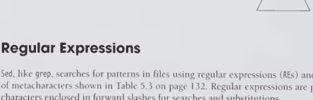

### 5.4 正则表达式

`Sed`与`grep`类似，使用正则表达式（`REs`）和表 5.3 第 132 页所示的各种元字符在文件中搜索模式。正则表达式是用于搜索和替换而用正斜杠括起来的字符模式。

```
sed -n '/RE/p' filename
```

```
sed -n '/love/p' filename
```

```
sed -n 's/RE/replacement string/' filename
```

```
sed -n 's/love/like/' filename
```

要更改正则表达式分隔符，需在某个字符，例如`c`前加上反斜杠，后跟正则表达式，再加上该字符；例如，


`sed -n '/love/p' filename`

```
打印包含 love 的所有行。
```

要更改分隔符：

```
sed -n '\cREcP' filename
```

其中 `c` 代表用于分隔正则表达式（`RE`）的字符，代替正斜杠。

# 示例 5.2

```
1 % sed -n '/\12/\10/04/p' datafile
2 % sed -n '\x12/\10/04xp' datafile    # sed lets you change the delimiter
```

# 解释

- 1 当正斜杠是正则表达式的一部分时，必须对其进行转义，以免与分隔它的正斜杠混淆。
- 2 正斜杠被字母 `x` 替换。这使得在正则表达式包含正斜杠时更容易处理。

如果您还记得，`grep` 命令在文件中找到模式时返回零退出状态，如果未找到则返回 1。然而，`sed` 命令的退出状态无论是否找到正在搜索的模式都将为零。退出状态只有在命令包含语法错误时才不为零。参见第 131 页的“错误消息和退出状态”。在以下示例中，`grep` 和 `sed` 都在文件中搜索正则表达式 `John`。

正则表达式也可以作为地址的一部分，如第 128 页的“寻址”所示。

# 示例 5.3

```
1 % grep 'John' datafile        # grep searches for John
2 % echo $status
1
3 % sed -n '/John/p' datafile   # sed searches for John
4 % echo $status
0
```

# 解释

- 1 使用 `grep` 时，正则表达式 `John` 不包含在分隔符中。
- 2 `grep` 命令的退出状态如果找到模式 `John` 则为零，如果未找到则不为零。
- 3 `sed` 命令将打印包含 `RE` 模式 `John` 的所有行。
- 4 即使文件中未找到模式 `John`，退出状态仍为零，因为语法正确。

# 5.5 寻址

您可以使用寻址来决定要编辑哪些行。地址可以是十进制数字或正则表达式（也称为上下文地址）的形式，或两者的组合。如果未指定地址，`sed` 会处理输入文件的所有行。

当地址由数字组成时，该数字代表行号。美元符号可用于表示输入文件的最后一行。如果用逗号分隔两个行号，则将被处理的地址在该行范围内，包括范围内的第一行和最后一行。范围可以是数字、正则表达式，或数字和正则表达式的组合。

`Sed` 命令告诉 `sed` 对该行做什么：打印它、删除它、更改它等等。

## 格式

```
sed 'command' filename(s)
```

## 示例 5.3

- 1 `sed '1,3d' myfile`
- 2 `sed -n '/[Jj]ohn/p' datafile`

## 解释

- 1 `myfile` 的第 1 行到第 3 行被删除。
- 2 仅打印 `myfile` 中匹配模式 `John` 或 `john` 的行。

# 5.6 命令和选项

`Sed` 命令告诉 `sed` 如何处理地址指定的每一行输入。如果未给出地址，`sed` 会处理所有输入行。 （`%` 是 `csh` 提示符。）请参阅表 5.1 以了解 `sed` 命令列表及其作用，并参阅表 5.2 以了解选项列表以及它们如何控制 `sed` 的行为。

# 表 5.1 sed 命令

| 命令 | 功能 |
|---|---|
| a\ | 将一个或多个文本行追加到当前行 |
| c\ | 用新文本更改（替换）当前行中的文本 |
| d | 删除行 |
| i\ | 在当前行上方插入文本 |
| h | 将模式空间的内容复制到保持缓冲区 |
| H | 将模式空间的内容追加到保持缓冲区 |
| g | 获取保持缓冲区中的内容并将其复制到模式缓冲区，覆盖原有内容 |
| G | 获取保持缓冲区中的内容并将其复制到模式缓冲区，追加到原有内容 |
| l | 列出不可打印字符 |
| p | 打印行 |
| n | 读取下一输入行并从下一命令开始处理换行，而不是从第一个命令开始 |
| q | 退出或退出 sed |
| r | 从文件中读取行 |
| ! | 将命令应用于除所选行之外的所有行 |
| s | 将一个字符串替换为另一个字符串 |
| 替换标志 | |
| g | 在一行中全局替换 |
| p | 打印行 |
| w | 将行写入文件 |
| x | 交换保持缓冲区与模式空间的内容 |
| y | 将一个字符翻译为另一个字符（y 不能使用正则表达式元字符） |

# 表 5.2 sed 选项

| 选项 | 功能 |
|---|---|
| -e | 允许多个编辑 |
| -f | 前置 sed 脚本文件名 |
| -n | 抑制默认输出 |

当使用多个命令或需要在地址范围内嵌套地址时，命令被包含在大括号中，每个命令要么在单独的行上，要么以分号结尾。

感叹号 `!` 可用于否定命令。例如，

```
sed '/Tom/d' file
```

告诉 `sed` 删除包含模式 `Tom` 的所有行，而

```
sed '/Tom/!d' file (sh, ksh, bash)
sed '/Tom/\!d' file (csh, tcsh)
```

告诉 `sed` 删除不包含 `Tom` 的行。

`sed` 选项为 `-e`、`-f` 和 `-n`。`-e` 用于在命令行进行多次编辑，`-f` 前置 `sed` 脚本文件名，`-n` 抑制打印输出。

### 5.6.1 如何使用 sed 修改文件

`Sed` 是一个非破坏性编辑器。它会在屏幕上显示你所做的编辑，但不会更改你正在编辑的文件。要真正将编辑反映到文件中，你必须将输出重定向到另一个文件，然后重命名原始文件。

# 示例 5.3

```
1 % sed '1,3d' filex > temp
2 % mv temp filex
```

# 解释

- 1. 删除 `myfile` 的第 1 到第 3 行。剩余的行不会显示在屏幕上，而是重定向到名为 `temp` 的文件。 （确保你发送输出的文件，在本例中为 `temp`，是一个空文件。否则重定向会导致它被覆盖。）
- 2. `mv` 命令会用 `temp` 的内容覆盖 `filex`。

### 5.6.2 GNU sed 选项

示例 5.6 列出了 `GNU sed` 提供的额外选项，以及它们如何控制 `sed` 的行为。使用 `-h` 选项，`sed` 会显示其命令行选项列表以及每个选项的简短说明。

# 示例 5.6

```
% sed -h
Usage: sed [OPTION]... {script-only-if-no-other-script} [input-file]...
    -n, --quiet, --silent
        suppress automatic printing of pattern space
    -e script, --expression=script
        add the script to the commands to be executed
    -f script-file, --file=script-file
        add the contents of script-file to the commands to be executed
    --help
        display this help and exit
    -V, --version output version information and exit
```

# 解释

如果未给出 `-e`、`--expression`、`-f` 或 `--file` 选项，则第一个非选项参数被视为要解释的 `sed` 脚本。所有剩余参数都是输入文件的名称；如果未指定输入文件，则读取标准输入。

# 5.7 错误消息和退出状态

当 `sed` 遇到语法错误时，它会向标准错误发送一个相当直接的错误消息，但如果它无法弄清你做错了什么，`sed` 会变得“混乱”，我们可以猜测这意味着困惑。如果语法没有错误，`sed` 返回给 `shell` 的退出状态为成功时为零，失败时为非零整数。

# 示例 5.7

```
1 % sed '1,3v' file
sed: Unrecognized command: 1,3v
% echo $status    # use echo $? if using Korn or Bourne shell
2
2 % sed '/John' file
sed: Illegal or missing delimiter: /John
```

# EXAMPLE (CONTINUED)

```
sed 's/134345/g' file
sed: Ending delimiter missing on substitution: s/134345/g
```


### EXPLANATION

+   1. The `v` command is unrecognized by `sed`. The exit status was `2`, indicating that `sed` exited with a syntax problem.
+   2. The pattern `^/John` is missing the closing forward slash.
+   3. The substitution command, `s`, contains the search string but not the replacement string.

# 5.8 Metacharacters

Like `grep`, `sed` supports a number of special metacharacters to control pattern searching. See Table 5.3.

**Table 5.3** `sed`'s Regular Expression Metacharacters

| Metacharacter | Function | Example | What It Matches |
|---|---|---|---|
| `^` | Beginning-of-line anchor | `/^love/` | Matches all lines beginning with love. |
| `$` | End-of-line anchor | `/love$/` | Matches all lines ending with love. |
| `.` | Matches one character, but not the newline character | `/l..e/` | Matches lines containing an l, followed by two characters, followed by an e. |
| `*` | Matches zero or more characters | `/ *love/` | Matches lines with zero or more spaces, followed by the pattern love. |
| `[ ]` | Matches one character in the set | `/[lT]love/` | Matches lines containing love or Love. |
| `[^ ]` | Matches one character not in the set | `/[^A-KM-Z]love/` | Matches lines not containing A through K or M through Z followed by ove. |
| `\(\.\)` | Saves matched characters | `s/\(love\)/able/\1/` | Tags marked portion and saves it as tag number 1. To reference later, use `\1` to reference the pattern. May use up to nine tags, starting with the first tag at the leftmost part of the pattern. For example, love is saved in register 1 and remembered in the replacement string. lovable is replaced with lover. |

# Table 5.3 sed's Regular Expression Metacharacters (continued)

| Metacharacter | Function | Example | What It Matches |
| & | Saves search string so it can be remembered in the replacement string | s/love/&*s&/ | The ampersand represents the search string. The string love will be replaced with itself surrounded by asterisks; i.e., love will become *love*. |
| \< | Beginning-of-word anchor | /\<love/ | Matches lines containing a word that begins with love. |
| \> | End-of-word anchor | /love\>/ | Matches lines containing a word that ends with love. |
| x\{m\} | Repetition of character x: m times | /o\{5\}/ | Matches if line has: 5 occurrences of o. |
| x\{n,\} | at least n times, or | /o\{5,\}/ | at least 5 occurrences of o, or |
| x\{n,m\} | between n and n times | /o\{5,10\}/ | between 5 and 10 occurrences of o. |

a. Not dependable on all versions of UNIX or all pattern-matching utilities; usually works with `vi` and `grep`.

# 5.9 sed Examples

The following examples show you how to use `sed`, its options, commands, and regular expressions. Remember that `sed` is non-destructive; that is the file that `sed` is editing will not be modified unless its output is redirected, as shown in Example 5.6.

The examples in the following sections use the following datafile, repeated periodically for your convenience.

```
% cat datafile
northwest NW Charles Main 3.0 .98 3 34
western WE Sharon Gray 5.3 .97 5 23
southwest SW Lewis Dalsass 2.7 8 2 18
southern SO Suan Chin 5.1 .95 4 15
southeast SE Patricia Hemenway 4.0 .7 4 17
eastern EA TB Savage 4.4 .84 5 20
northeast NE AM Main Jr. 5.1 .94 3 13
north NO Margot Weber 4.5 .89 5 9
central CT Ann Stephens 5.7 .94 5 13
```

### 5.9.1 Printing: The p Command

The `p` command is the print command. It is used to display the contents of the pattern buffer. Because, by default, `sed` prints lines to the screen, the `-n` option is used to suppress default printing. With the `-n` option and the `p` command together, selected text can be printed.

# EXAMPLE 5.8

```
% sed '/north/p' datafile

northwest    NW    Charles Main    3.0    .98    3    34

northwest    NW    Charles Main    3.0    .98    3    34

western      WE    Sharon Gray      5.3    .97    5    23

southwest    SW    Lewis Dalsass    2.7    .8     2    18

southern     SO    Suan Chin        5.1    .95    4    15
```


southeast    SE    Patricia Hemenway 4.0    .7     4    17

eastern      EA    TB Savage        4.4    .84    5    20

northeast    NE    AM Main Jr.      5.1    .94    3    13

northeast    NE    AM Main Jr.      5.1    .94    3    13

north        NO    Margot Weber     4.5    .89    5    9

north        NO    Margot Weber     4.5    .89    5    9

central      CT    Ann Stephens     5.7    .94    5    13

### EXPLANATION

Prints all lines to standard output by default. If the pattern `north` is found, `sed` will print that line in addition to all the other lines.

# EXAMPLE 5.9

```
% sed -n '/north/p' datafile
```

northwest    NW    Charles Main    3.0    .98    3    34

northeast    NE    AM Main Jr.      5.1    .94    3    13

north        NO    Margot Weber     4.5    .89    5    9

### EXPLANATION

By default, `sed` prints the line currently in the pattern buffer. With the `p` command, `sed` is told to print the line again. The `-n` option suppresses the default behavior of `sed`. When used with the `p` command, the line in the pattern buffer is printed only once. Without the `-n` option, `sed` will print duplicate lines of output as shown in the preceding example. Only the lines containing the pattern `north` are printed when `-n` is used.

### 5.9.2 Deleting: The d Command

The `d` command is used to delete lines. After `sed` copies a line from a file and puts it into a pattern buffer, it executes any `sed` commands for that line, and finally, displays the contents of the pattern buffer to the screen. When the `d` command is issued, the line currently in the pattern buffer is removed, not displayed.

| % cat datafile |  |  |  |  |  | |
|---|---|---|---|---|---|---|
| northwest | NW | Charles Main | 3.0 | .98 | 3 | 34 |
| western | WE | Sharon Gray | 5.3 | .97 | 5 | 23 |
| southwest | SW | Lewis Dalsass | 2.7 | .8 | 2 | 18 |
| southern | SO | Suan Chin | 5.1 | .95 | 4 | 15 |
| southeast | SE | Patricia Hemenway | 4.0 | .7 | 4 | 17 |
| eastern | EA | TB Savage | 4.4 | .84 | 5 | 20 |
| northeast | NE | AM Main Jr. | 5.1 | .94 | 3 | 13 |
| north | NO | Margot Weber | 4.5 | .89 | 5 | 9 |
| central | CT | Ann Stephens | 5.7 | .94 | 5 | 13 |

# 示例 5.10

```
% sed '3d' datafile
```

northwest    NW    Charles Main    3.0    .98    3    34

western      WE    Sharon Gray      5.3    .97    5    23

southern     SO    Suan Chin        5.1    .95    4    15

southeast    SE    Patricia Hemenway 4.0    .7     4    17

eastern      EA    TB Savage        4.4    .84    5    20

northeast    NE    AM Main Jr.      5.1    .94    3    13

north        NO    Margot Weber     4.5    .89    5    9

central      CT    Ann Stephens     5.7    .94    5    13

# 解释

删除第三行。默认情况下，所有其他行都会打印到屏幕上。

# 示例 5.11

```
% sed '3,$d' datafile
```

northwest    NW    Charles Main    3.0    .98    3    34

western      WE    Sharon Gray      5.3    .97    5    23

# 解释

从第三行到最后一行都被删除。美元符号（`$`）表示文件的最后一行。逗号称为范围运算符。剩余的行会被打印出来。在此示例中，地址范围从第 3 行开始，到最后一行结束，最后一行用美元符号（`$`）表示。

# 示例 3.12

```
% sed '$d' datafile
```

northwest    NW    Charles Main    3.0    .98    3    34

western      WE    Sharon Gray      5.3    .97    5    23

southwest    SW    Lewis Dalsass    2.7    .8     2    18

southern     SO    Suan Chin        5.1    .95    4    15

southeast    SE    Patricia Hemenway 4.0    .7     4    17

eastern      EA    TB Savage        4.4    .84    5    20

northeast    NE    AM Main Jr.      5.1    .94    3    13

north        NO    Margot Weber     4.5    .89    5    9

# 解释

删除最后一行。美元符号（`$`）表示最后一行。默认情况下，除了受 `d` 命令影响的行外，所有行都会被打印。

# 示例 3.13

```
% sed '/north/d' datafile
```

western      WE    Sharon Gray      5.3    .97    5    23

southwest    SW    Lewis Dalsass    2.7    .8     2    18

southern     SO    Suan Chin        5.1    .95    4    15

southeast    SE    Patricia Hemenway 4.0    .7     4    17

eastern      EA    TB Savage        4.4    .84    5    20

central      CT    Ann Stephens     5.7    .94    5    13


# 解释

删除所有包含模式 `north` 的行。剩余的行会被打印出来。

### 5.9.3 替换：`s` 命令

`s` 命令是替换命令。通过 `sed` 的 `s` 命令实现文件中文本的替换和修改。`s` 命令后正斜杠之间的文本是正则表达式，其右侧是替换文本。如果使用 `g` 标志，则可以在整行范围内进行全局替换。

```
% cat datafile
northwest NW Charles Main 3.0 .98 3 34
western WE Sharon Gray 5.3 .97 5 23
southwest SW Lewis Dalsass 2.7 .8 2 18
southern SO Suan Chin 5.1 .95 4 15
southeast SE Patricia Hemenway 4.0 .7 4 17
eastern EA TB Savage 4.4 .84 5 20
northeast NE AM Main Jr. 5.1 .94 3 13
north NO Margot Weber 4.5 .89 5 9
central CT Ann Stephens 5.7 .94 5 13
```

## 示例 5.14

```
% sed 's/west/north/g' datafile
```

`northnorth NW Charles Main 3.0 .98 3 34`

`northern WE Sharon Gray 5.3 .97 5 23`

`southnorth SW Lewis Dalsass 2.7 .8 2 18`

`southern SO Suan Chin 5.1 .95 4 15`

`southeast SE Patricia Hemenway 4.0 .7 4 17`

`eastern EA TB Savage 4.4 .84 5 20`

`northeast NE AM Main Jr. 5.1 .94 3 13`

`north NO Margot Weber 4.5 .89 5 9`

`central CT Ann Stephens 5.7 .94 5 13`

# 解释

`s` 命令用于替换。命令末尾的 `g` 标志表示替换在整行范围内是全局的；也就是说，如果找到多个 `west` 的出现，所有都会被替换为 `north`。如果没有 `g` 命令，则每行中 `west` 的第一次出现才会被替换为 `north`。

## 示例 5.15

```
% sed -n 's/^west/north/p' datafile
```

`northern WE Sharon Gray 5.3 .97 5 23`

# 解释

`s` 命令用于替换。`-n` 选项与命令末尾的 `p` 标志一起告诉 `sed` 仅打印发生替换的行；也就是说，如果在行首找到 `west` 并替换为 `north`，则只打印这些行。

## 示例 3.16

```
% sed 's/[0-9][0-9]/&./' datafile
```

| northwest | NW | Charles Main | 3.0 | .98 | 3 | 34.5 |
| western | WE | Sharon Gray | 5.3 | .97 | 5 | 23.5 |
| southwest | SW | Lewis Dalsass | 2.7 | .8 | 2 | 18.5 |
| southern | SO | Suan Chin | 5.1 | .95 | 4 | 15.5 |
| southeast | SE | Patricia Hemenway | 4.0 | .7 | 4 | 17.5 |
| eastern | EA | TB Savage | 4.4 | .64 | 5 | 20.5 |
| northeast | NE | AM Main Jr. | 5.1 | .94 | 3 | 13.5 |
| north | NO | Margot Weber | 4.5 | .89 | 5 | 9 |
| central | CT | Ann Stephens | 5.7 | .94 | 5 | 13.5 |

# 解释

替换字符串中的和号 `&` 代表在搜索字符串中完全找到的内容。每行以两位数字结尾的将被替换为其本身，并在其后附加 `.5`。

要 在替换字符串中表示字面上的和号，必须对其进行转义 `\&`。

## 示例 3.17

```
% sed -n 's/Hemenway/Jones/gp' datafile
```

`southeast SE Patricia Jones 4.0 .7 4 17`

# 解释

所有出现的 `Hemenway` 都被替换为 `Jones`，并且只打印发生更改的行。`-n` 选项与 `p` 命令结合使用会抑制默认输出。`g` 表示在整行范围内进行全局替换。

## 示例 3.18

```
% sed -n 's/\(Mar\)/got/\1ianne/p' datafile
```

`north NO Marianne Weber 4.5 .89 5 9`

# 解释

模式 `Mar` 被括在括号中并保存为特殊寄存器中的标签 `1`。它将在替换字符串中作为 `\1` 被引用。`Margot` 然后被替换为 `Marianne`。

```
% cat datafile
northwest  NW  Charles Main  3.0  .98  3  34
western    WE  Sharon Gray   5.3  .97  5  23
southwest  SW  Lewis Dalsass 2.7  .8   2  18
southern   SO  Suan Chin     5.1  .95  4  15
southeast  SE  Patricia Hemenway 4.0  .7   4  17
eastern    EA  TB Savage     4.4  .84  5  20
northeast  NE  AM Main Jr.   5.1  .94  3  13
north      NO  Margot Weber  4.5  .89  5  9
central    CT  Ann Stephens  5.7  .94  5  13
```

## 示例 5.19

```
% sed 's#3#88#g' datafile
```

`northwest  NW  Charles Main  88.0  .98  88  884`

`western    WE  Sharon Gray   5.88  .97  5  288`

`southwest  SW  Lewis Dalsass 2.7  .8   2  18`

`southern   SO  Suan Chin     5.1  .95  4  15`

`southeast  SE  Patricia Hemenway 4.0  .7   4  17`

`eastern    EA  TB Savage     4.4  .84  5  20`

`northeast  NE  AM Main Jr.   5.1  .94  88  188`

`north      NO  Margot Weber  4.5  .89  5  9`

`central    CT  Ann Stephens  5.7  .94  5  188`

# 解释

`s` 命令之后的字符是搜索字符串与替换字符串之间的分隔符。分隔符字符默认为正斜杠，但可以更改。`s` 命令之后出现的任何字符（换行符或反斜杠除外）都是新的分隔符。当搜索包含正斜杠的模式时，例如路径名或生日，这种技术很有用。

### 5.9.4 选择的行范围：逗号

行的范围从文件中一个地址开始，到另一个地址结束。地址范围可以是行号（例如 `5,10`）、正则表达式（例如 `/Dick/,/Joe/`），或两者的组合（例如 `/north/, $`）。范围是包含的——它包括满足起始条件的行、中间的所有行以及结束范围条件的行。如果从未达到结束条件，则在文件结束时结束。如果达到结束条件，然后再次满足起始条件，则范围重新开始。

## 示例 5.20

```
% sed -n '/west/,/east/p' datafile
```

`northwest NW Charles Main 3.0 .98 3 34`
`western WE Sharon Gray 5.3 .97 5 23`
`southwest SW Lewis Dalsass 2.7 .8 2 18`
`southern SO Suan Chin 5.1 .95 4 15`
`southeast SE Patricia Hemenway 4.0 .7 4 17`

# 解释

`west` 和 `east` 模式范围内的所有行都被打印。如果 `west` 出现在 `east` 之后的行上，则从 `west` 到下一个 `east` 或文件末尾，以先到者为准的行将被打印。箭头标记了范围。

## 示例 5.21

```
% sed -n '5,/northeast/p' datafile
```


```
southeast SE Patricia Hemenway 4.0 .7 4 17
eastern EA TB Savage 4.4 .84 5 20
northeast NE AM Main Jr. 5.1 .94 3 13
```

# 解释

打印从第 5 行到第一个以 `northeast` 开头的行的行。

# 示例 5.22

```
% sed '/west/,/east/s/$/++VACA++/' datafile
```

`northwest NW Charles Main 3.0 .98 3 34++VACA++`
`western WE Sharon Gray 5.3 .97 5 23++VACA++`
`southwest SW Lewis Dalsass 2.7 .8 2 18++VACA++`
`southern SO Suan Chin 5.1 .95 4 15++VACA++`
`southeast SE Patricia Hemenway 4.0 .7 4 17++VACA++`
`eastern EA TB Savage 4.4 .84 5 20`
`northeast NE AM Main Jr. 5.1 .94 3 13`
`north NO Margot Weber 4.5 .89 5 9`
`central CT Ann Stephens 5.7 .94 5 13`

# 解释

对于 `west` 和 `east` 模式之间的范围内行，行尾（`$`）被替换为字符串 `++VACA++`。换行符被移至新字符串的末尾。箭头标记了范围。

### 5.9.5 多次编辑：`e` 命令

`-e` 命令是编辑命令，当你需要让 `sed` 执行多个编辑命令时使用。所有编辑都应用于模式缓冲区中的行，在编辑下一行之前完成。

| `% cat datafile` |  |  |  |  |  |  |
|---|---|---|---|---|---|---|
| northwest | NW | Charles Main | 3.0 | .98 | 3 | 34 |
| western | WE | Sharon Gray | 5.3 | .97 | 5 | 23 |
| southwest | SW | Lewis Dalsass | 2.7 | .8 | 2 | 18 |
| southern | SO | Suan Chin | 5.1 | .95 | 4 | 15 |
| southeast | SE | Patricia Hemenway | 4.0 | .7 | 4 | 17 |
| eastern | EA | TB Savage | 4.4 | .84 | 5 | 20 |
| northeast | NE | AM Main Jr. | 5.1 | .94 | 3 | 13 |
| north | NO | Margot Weber | 4.5 | .89 | 5 | 9 |
| central | CT | Ann Stephens | 5.7 | .94 | 5 | 13 |

#### EXAMPLE 5.23

```
% sed -e '1,3d' -e 's/Hemenway/Jones/' datafile
```

| southern | SO | Suan Chin | 5.1 | .95 | 4 | 15 |
| southeast | SE | Patricia Jones | 4.0 | .7 | 4 | 17 |
| eastern | EA | TB Savage | 4.4 | .84 | 5 | 20 |
| northeast | NE | AM Main Jr. | 5.1 | .94 | 3 | 13 |
| north | NO | Margot Weber | 4.5 | .89 | 5 | 9 |
| central | CT | Ann Stephens | 5.7 | .94 | 5 | 13 |

### EXPLANATION

`-e` 选项允许多次编辑。第一次编辑删除第 1 行到第 3 行。第二次编辑将 `Hemenway` 替换为 `Jones`。因为两个编辑都是按行进行的，即两个命令都在模式空间的当前行上执行，所以编辑的顺序可能会影响结果。例如，如果两个命令都在同一行上执行替换，则第一次替换可能会影响第二次替换。

### 5.9.6 从文件读取：`r` 命令

`r` 命令是读取命令。它允许 `sed` 在指定位置将一个文本文件的内容加载到当前文件中。

#### EXAMPLE 5.24

```
% cat newfile
***SUAN HAS LEFT THE COMPANY***
```

```
% sed '/Suan/r newfile' datafile
```

`northwest NW Charles Main 3.0 .98 3 34`
`western WE Sharon Gray 5.3 .97 5 23`
`southwest SW Lewis Dalsass 2.7 .8 2 18`
`southern SO Suan Chin 5.1 .95 4 15`
`***SUAN HAS LEFT THE COMPANY***`
`southeast SE Patricia Hemenway 4.0 .7 4 17`
`eastern EA TB Savage 4.4 .84 5 20`
`northeast NE AM Main Jr. 5.1 .94 3 13`
`north NO Margot Weber 4.5 .89 5 9`
`central CT Ann Stephens 5.7 .94 5 13`

### EXPLANATION

`r` 命令从文件中读取指定的行。`newfile` 的内容被读入输入文件 `datafile`，在匹配到模式 `Suan` 的行之后。如果 `Suan` 出现在多行中，`newfile` 的内容将在每次出现下方都被读入。

### 5.9.7 写入文件：`w` 命令

`w` 命令是写入命令。它允许 `sed` 将当前文件中的行写入另一个文件。

#### EXAMPLE 5.25

```
% sed -n '/north/w newfile' datafile
```

```
cat newfile
northwest NW Charles Main 3.0 .98 3 34
northeast NE AM Main Jr. 5.1 .94 3 13
north NO Margot Weber 4.5 .89 5 9
```

### EXPLANATION

`w` 命令将指定的行写入文件。所有包含模式 `north` 的行都写入名为 `newfile` 的文件。

### 5.9.8 追加：`a` 命令

`a` 命令是追加命令。追加会在文件中的当前行下方放置新文本；即刚刚读入模式缓冲区的行。无论是在命令行还是在 `sed` 脚本中，`a` 命令后面都跟一个反斜杠。如果你使用的是 C/TC 命令行，则需要两个反斜杠，如示例 5.26 所示——一个反斜杠用于 `sed` 的追加命令，一个用于续行。 使用 C/TC 时，启动 `sed` 命令的起始引号必须在同一行结束。第二个反斜杠使得可以在下一行继续输入而不出现“未匹配引号”错误。 Bourne 和 Bash shell 不需要第二个反斜杠，因为结束引号不必与起始引号在同一行。 要追加的文本行放在 `sed` 命令之后单独一行。如果要追加多行，则每行必须以反斜杠结尾，除了最后一行，以结束引号和文件名结尾。该行不会以反斜杠结尾。

| `% cat datafile` |  |  |  |  |  |
|---|---|---|---|---|---|
| northwest | NW | Charles Main | 3.0 | .98 | 3 | 34 |
| western | WE | Sharon Gray | 5.3 | .97 | 5 | 23 |
| southwest | SW | Lewis Dalsass | 2.7 | .8 | 2 | 18 |
| southern | SO | Suan Chin | 5.1 | .95 | 4 | 15 |
| southeast | SE | Patricia Hemenway | 4.0 | .7 | 4 | 17 |
| eastern | EA | TB Savage | 4.4 | .84 | 5 | 20 |
| northeast | NE | AM Main Jr. | 5.1 | .94 | 3 | 13 |
| north | NO | Margot Weber | 4.5 | .89 | 5 | 9 |
| central | CT | Ann Stephens | 5.7 | .94 | 5 | 13 |

#### EXAMPLE 5.26

```
% sed '/\north /a\' # Use two backslashes only if the shell is C/TC
--->THE NORTH SALES DISTRICT HAS MOVED<---' datafile
```

`northwest    NW   Charles Main   3.0  .98  3  34`


western      WE   Sharon Gray    5.3  .97  5  23

southwest    SW   Lewis Dalsass  2.7  .8   2  18

southern     SO   Suan Chin      5.1  .95  4  15

southeast    SE   Patricia Hemenway 4.0 .7   4  17

eastern      EA   TB Savage      4.4  .84  5  20

northeast    NE   AM Main Jr.    5.1  .94  3  13

north        NO   Margot Weber   4.5  .89  5  9

--->THE NORTH SALES DISTRICT HAS MOVED<---

central      CT   Ann Stephens   5.7  .94  5  13

# 解释

`a` 命令是追加命令。字符串 `---->THE NORTH SALES DISTRICT HAS MOVED<---` 会在以模式 `north` 开头的行之后追加，前提是 `north` 后面跟着一个空格。将被追加的文本必须位于追加命令的下一行。

`Sed` 要求在 `a` 命令后使用反斜杠。第二个反斜杠由 C shell 使用来转义换行符，以便其结束引号可以位于下一行。如果追加多行，则除最后一行外的每一行也必须以反斜杠结尾。

`a.` Bourne 和 Korn shell 不需要第二个反斜杠来转义换行符，因为它们不要求引号在同一行匹配，只要求它们匹配。

### 5.9.9 插入：i 命令

`i` 命令是插入命令。它类似于 `a` 命令，但不是将文本放在当前行的下方，而是将新文本插入到文件当前行之上；即刚刚读入模式缓冲区的行。无论是在命令行还是在 `sed` 脚本中，`i` 命令后面都跟一个反斜杠。

### 示例 5.27

```
% sed '/eastern/i\\' # Use two backslashes for C/TC

NEW ENGLAND REGION\\

datafile
```

northwest NW Charles Main 3.0 .98 3 34
western WE Sharon Gray 5.3 .97 5 23
southwest SW Lewis Dalsass 2.7 .8 2 18
southern SO Suan Chin 5.1 .95 4 15
southeast SE Patricia Hemenway 4.0 .7 4 17
NEW ENGLAND REGION
eastern EA TB Savage 4.4 .84 5 20
northeast NE AM Main Jr. 5.1 .94 3 13
north NO Margot Weber 4.5 .89 5 9
central CT Ann Stephens 5.7 .94 5 13

# 解释

`i` 命令是插入命令。如果匹配到模式 `eastern`，则 `i` 命令会使反斜杠后的文本插入到包含 `eastern` 的行上方。要插入的每一行后面都需要一个反斜杠，除了最后一行。（额外的反斜杠用于 C shell。）

### 5.9.10 更改：c 命令

`c` 命令是更改命令。它允许 `sed` 用新文本修改或更改现有文本。旧文本会被新文本覆盖。

| % cat datafile |  |  |  |  |  |  |
|---|---|---|---|---|---|---|
| northwest | NW | Charles Main | 3.0 | .98 | 3 | 34 |
| western | WE | Sharon Gray | 5.3 | .97 | 5 | 23 |
| southwest | SW | Lewis Dalsass | 2.7 | .8 | 2 | 18 |
| southern | SO | Suan Chin | 5.1 | .95 | 4 | 15 |
| southeast | SE | Patricia Hemenway | 4.0 | .7 | 4 | 17 |
| eastern | EA | TB Savage | 4.4 | .84 | 5 | 20 |
| northeast | NE | AM Main Jr. | 5.1 | .94 | 3 | 13 |
| north | NO | Margot Weber | 4.5 | .89 | 5 | 9 |
| central | CT | Ann Stephens | 5.7 | .94 | 5 | 13 |

### 示例 5.28

```
% sed '/eastern/c\
THE EASTERN REGION HAS BEEN TEMPORARILY CLOSED' datafile

northwest NW Charles Main 3.0 .98 3 34

western WE Sharon Gray 5.3 .97 5 23

southwest SW Lewis Dalsass 2.7 .8 2 18

southern SO Suan Chin 5.1 .95 4 15

southeast SE Patricia Hemenway 4.0 .7 4 17

THE EASTERN REGION HAS BEEN TEMPORARILY CLOSED

northeast NE AM Main Jr. 5.1 .94 3 13

north NO Margot Weber 4.5 .89 5 9

central CT Ann Stephens 5.7 .94 5 13
```

# 解释

`c` 命令是更改命令。它完全更改或修改模式缓冲区中的当前行。如果匹配到模式 `eastern`，则 `c` 命令会使反斜杠后的文本替换包含 `eastern` 的行。要插入的每一行后面都需要一个反斜杠，除了最后一行。（额外的反斜杠用于 C shell。）

### 5.9.11 下一个：n 命令

`n` 命令是下一个命令。它使 `sed` 从输入文件获取下一行，并将其读入模式缓冲区。任何 `sed` 命令都将应用于正在寻址的行的紧随其后的行。

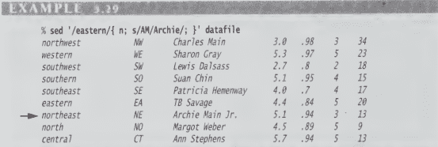

# 解释

如果在一行上匹配到模式 `eastern`，则 `n` 命令会使 `sed` 获取下一行输入（包含 `AM Main Jr.` 的行），用该行替换模式空间，将 `AM` 替换为 `Archie`，打印该行，然后继续。

### 5.9.12 转换：y 命令

`y` 命令是转换命令。它类似于 UNIX/Linux `tr` 命令。字符按一对一的对应关系从左侧翻译到右侧。例如，在命令 `y/abc/ABC/` 中，任何小写字母 `a` 都会被转换为大写 `A`，`b` 转换为 `B`，`c` 转换为 `C`。

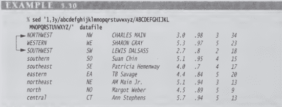

# 解释

对于第 1 行到第 3 行，`y` 命令将所有小写字母转换为大写字母。正则表达式元字符与此命令不兼容，并且与替换分隔符一样，正斜杠可以更改为其他字符。

### 5.9.13 退出：q 命令

`q` 命令是退出命令。它会使 `sed` 程序在不进行进一步处理的情况下退出。

```
% cat datafile

northwest   NW   Charles Main      3.0  .98  3  34

western     WE   Sharon Gray       5.3  .97  5  23

southwest   SW   Lewis Dalsass     2.7  .8   2  18

southern    SO   Susan Chin        5.1  .95  4  15

southeast   SE   Patricia Hemenway 4.0  .7   4  17

eastern     EA   TB Savage         4.4  .84  5  20

northeast   NE   AM Main Jr.       5.1  .94  3  13

north       NO   Margot Weber      4.5  .89  5  9

central     CT   Ann Stephens      5.7  .94  5  13
```

#### EXAMPLE 5.31

```
% sed '5q' datafile

northwest   NW   Charles Main      3.0  .98  3  34

western     WE   Sharon Gray       5.3  .97  5  23

southwest   SW   Lewis Dalsass     2.7  .8   2  18

southern    SO   Susan Chin        5.1  .95  4  15

southeast   SE   Patricia Hemenway 4.0  .7   4  17
```


打印第 5 行后，`q`命令会使`sed`程序退出。

#### EXAMPLE 5.32

```
% sed '/Lewis/s/Lewis/Joseph/;q;' datafile
```

northwest   NW   Charles Main      3.0  .98  3  34

western     WE   Sharon Gray       5.3  .97  5  23

southwest   SW   Joseph Dalsass    2.7  .8   2  18

当在一行上匹配到模式`Lewis`时，首先替换命令（`s`）将`Lewis`替换为`Joseph`，然后`q`命令会使`sed`程序退出。

### 5.9.14 保持和获取：h 和 g 命令

`h`命令用于保持；`g`命令用于获取。当从文件中读取一行时，`sed`会将其放入模式缓冲区并对该行执行命令。还有一个额外的缓冲区称为保持缓冲区。 （两个缓冲区均可容纳多达 8,192 字节。）一行可以通过`h`命令从模式缓冲区发送到保持缓冲区，以后可以用`g`或`G`（获取）命令检索。

```
% cat datafile
```

northwest   NW   Charles Main      3.0  .98  3  34

western     WE   Sharon Gray       5.3  .97  5  23

southwest   SW   Lewis Dalsass     2.7  .8   2  18

southern    SO   Susan Chin        5.1  .95  4  15

southeast   SE   Patricia Hemenway 4.0  .7   4  17

eastern     EA   TB Savage         4.4  .84  5  20

northeast   NE   AM Main Jr.       5.1  .94  3  13

north       NO   Margot Weber      4.5  .89  5  9

central     CT   Ann Stephens      5.7  .94  5  13

#### EXAMPLE 5.33

```
% sed -e '/northeast/h' -e '$G' datafile
```

northwest   NW   Charles Main      3.0  .98  3  34

western     WE   Sharon Gray       5.3  .97  5  23

southwest   SW   Lewis Dalsass     2.7  .8   2  18

southern    SO   Susan Chin        5.1  .95  4  15

southeast   SE   Patricia Hemenway 4.0  .7   4  17

eastern     EA   TB Savage         4.4  .84  5  20

northeast   NE   AM Main Jr.       5.1  .94  3  13

north       NO   Margot Weber      4.5  .89  5  9

central     CT   Ann Stephens      5.7  .94  5  13

northeast   NE   AM Main Jr.       5.1  .94  3  13

当`sed`处理文件时，每一行都存储在称为模式空间的临时缓冲区中。除非该行被删除或禁止打印，否则该行会在处理后打印到屏幕上。然后清空模式空间，下一个输入行将被存储在其中以供处理。在此示例中，在找到包含模式`northeast`的行后，它被放入模式空间，`h`命令将其复制并放入另一个称为保持缓冲区的特殊缓冲区中。在第二个`sed`指令中，当到达最后一行（`$`）时，`G`命令告诉`sed`从保持缓冲区获取该行并将其放回模式空间缓冲区，将其附加到当前存储在其中的行，在本例中为最后一行。简单来说：包含模式`northeast`的任何行都将被复制并附加到文件末尾。

#### EXAMPLE 5.34

```
% sed -e '/WE/{h; d; }' -e '/CT/{G;}' datafile
```

northwest   NW   Charles Main      3.0  .98  3  34

southwest   SW   Lewis Dalsass     2.7  .8   2  18

southern    SO   Susan Chin        5.1  .95  4  15

southeast   SE   Patricia Hemenway 4.0  .7   4  17

eastern     EA   TB Savage         4.4  .84  5  20

northeast   NE   AM Main Jr.       5.1  .94  3  13

north       NO   Margot Weber      4.5  .89  5  9

central     CT   Ann Stephens      5.7  .94  5  13

western     WE   Sharon Gray       5.3  .97  5  23

如果在一行上找到模式`WE`，则`h`命令会使该行从模式空间复制到保持缓冲区，从中可以在以后检索该行（`G`或`g`命令）。在此示例中，找到模式`WE`的行首先存储在模式缓冲区中。然后`h`命令将该行的副本放入保持缓冲区。`d`命令删除模式缓冲区中的副本，因此它不会被显示。第二个命令在行中搜索`CT`，并在找到时，`sed`获取（`G`）存储在保持缓冲区中的行并将其附加到当前位于模式空间中的行。简单来说：包含`WE`的行被移至包含`CT`的行之后。另请参阅第 151 页的“保持和交换：`h`和`x`命令”。

#### EXAMPLE 5.35

```
% sed -e '/northeast/h' -e '$g' datafile
```

northwest   NW   Charles Main      3.0  .98  3  34

western     WE   Sharon Gray       5.3  .97  5  23

southwest   SW   Lewis Dalsass     2.7  .8   2  18

southern    SO   Susan Chin        5.1  .95  4  15

southeast   SE   Patricia Hemenway 4.0  .7   4  17

eastern     EA   TB Savage         4.4  .84  5  20

northeast   NE   AM Main Jr.       5.1  .94  3  13

north       NO   Margot Weber      4.5  .89  5  9

northeast   NE   AM Main Jr.       5.1  .94  3  13

当`sed`处理文件时，每一行都存储在称为模式空间的临时缓冲区中。除非该行被删除或禁止打印，否则该行会在处理后打印到屏幕上。然后清空模式空间，下一个输入行将被存储在其中以供处理。在此示例中，在找到包含模式`northeast`的行后，它被放入模式空间。`h`命令复制它并将其放入另一个称为保持缓冲区的特殊缓冲区中。在第二个`sed`指令中，当到达最后一行（`$`）时，`g`命令告诉`sed`从保持缓冲区获取该行并将其放回模式空间缓冲区，用它替换当前存储在其中的行，在本例中为最后一行。简单来说：包含模式`northeast`的行被复制并移动以覆盖文件中的最后一行。

# 示例 5.36

```
% sed -e '/WE/{h; d; }' -e '/CT/{g; }' datafile
```


| northwest | NW | Charles Main | 3.0 | .98 | 3 | 34 |
| southwest | SW | Lewis Dalsass | 2.7 | .8 | 2 | 18 |
| southern | SO | Suan Chin | 5.1 | .95 | 4 | 15 |
| southeast | SE | Patricia Hemenway | 4.0 | .7 | 4 | 17 |
| eastern | EA | TB Savage | 4.4 | .84 | 5 | 20 |
| northeast | NE | AM Main Jr. | 5.1 | .94 | 3 | 13 |
| north | NO | Margot Weber | 4.5 | .89 | 5 | 9 |
| western | WE | Sharon Gray | 5.3 | .97 | 5 | 23 |

# 解释

如果找到模式 `WE`，则 `h` 命令将该行复制到保持缓冲区；`d` 命令删除模式空间中的该行。当找到模式 `CT` 时，`g` 命令获取保持缓冲区中的副本并覆盖当前模式空间中的行。简单来说：包含模式 `WE` 的任何行都将被移动以覆盖包含 `CT` 的行。 （参见图 5.1。）

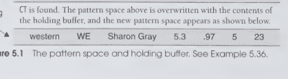

图 5.1 模式空间和保持缓冲区。参见示例 5.36。

```
% cat datafile
northwest NW Charles Main 3.0 .98 3 34
western WE Sharon Gray 5.3 .97 5 23
southwest SW Lewis Dalsass 2.7 .8 2 18
southern SO Suan Chin 5.1 .95 4 15
southeast SE Patricia Hemenway 4.0 .7 4 17
eastern EA TB Savage 4.4 .84 5 20
northeast NE AM Main Jr. 5.1 .94 3 13
north NO Margot Weber 4.5 .89 5 9
central CT Ann Stephens 5.7 .94 5 13
```

## 5.10.1 sed 脚本示例

### 示例 5.38

```
% cat sedding1          # 查看 sed 脚本的内容

1 # My first sed script by Jack Sprat

2 /Lewis/a\
   Lewis is the TOP Salesperson for April!!!
   Lewis is moving to the southern district next month.\
4 CONGRATULATIONS!

5 /Margot/c\
   ***************\
   MARGOT HAS RETIRED\
   ***************

6 i\
   EMPLOYEE DATABASE\
   -------------------

7 $d
```

```
% sed -f sedding1 datafile  # 执行 sed 脚本命令；输入文件为 datafile

EMPLOYEE DATABASE

-------------------

northwest NW Charles Main 3.0 .98 3 34

western WE Sharon Gray 5.3 .97 5 23

southwest SW Lewis Dalsass 2.7 .8 2 18

Lewis is the TOP Salesperson for April!!!

Lewis is moving to the southern district next month.

CONGRATULATIONS!
```

### 示例 5.38（续）

```
southern    SO    Suan Chin    5.1    .95    4    15
southeast   SE    Patricia Hemenway    4.0    .7    4    17
eastern     EA    TB Savage    4.4    .84    5    20
northeast   NE    AM Main Jr.    5.1    .94    3    13

********************
MARGOT HAS RETIRED
********************
```

#### 解释

- 1. 这是一行注释。注释必须单独成行并以井号（`#`）开头。
- 2. 如果一行包含模式 `Lewis`，则在该行后追加接下来的三行。
- 3. 每个被追加的行，除最后一行外，均以反斜杠结尾。反斜杠必须紧跟换行符。如果在换行符后有任何尾随文本，即使是一个空格，`sed` 也会报错。
- 4. 最后要追加的行没有终止反斜杠。这表示对 `sed` 来说这是最后要追加的行，下一个行是另一条命令。
- 5. 任何包含模式 `Margot` 的行都将被替换（`c` 命令）为接下来的三行文本。
- 6. 接下来的两行将在第 1 行上方插入（`i` 命令）。
- 7. 最后一行（`$`）将被删除。

### 示例 5.39

```
% cat sedding2        # 查看 sed 脚本的内容

# This script demonstrates the use of curly braces to nest addresses
# and commands. Comments are preceded by a pound sign (#) and must
# be on a line by themselves. Commands are terminated with a newline
# or semicolon. If there is any text after a command, even one
# space, you receive an error message:
#
# sed: Extra text at end of command:
1 /western/, /southeast/{
\ $/d
/Suan/{ h; d; }
}
/Ann/g
s/TB \(Savage\)/Thomas \1/
```

### 示例 5.39（续）

```
% sed -f sedding2 datafile
northwest   NW   Charles Main   3.0  .98  3  34
western     WE   Sharon Gray    5.3  .97  5  23
southwest   SW   Lewis Dalsass  2.7  .8   2  18
southeast   SE   Patricia Hemenway 4.0  .7   4  17
eastern     EA   Thomas Savage  4.4  .84  5  20
northeast   NE   AM Main Jr.    5.1  .94  3  13
north       NO   Margot Weber   4.5  .89  5  9
southern    SO   Suan Chin      5.1  .95  4  15
```


# 解释

- 1. 在从 `western` 开始到 `southeast` 结束的行范围内，空行将被删除，并且匹配 `Suan` 的行会从模式缓冲区复制到保持缓冲区，然后从模式缓冲区删除。
- 2. 当匹配到模式 `Ann` 时，`g` 命令会将保持缓冲区中的行复制到模式缓冲区，覆盖模式缓冲区中的内容。
- 3. 所有包含模式 `TB Savage` 的行都将被替换为 `Thomas` 和被标记的模式 `Savage`。在搜索字符串中，`Savage` 被转义的括号括起来，以便可以再次使用。它是标签号 `1`，由 `\1` 引用。
- 4. `Sed` 将从 `-f` 选项后的文件获取命令，`sedding2`。`sed` 编辑的文件是 `datafile`。

## 5.10.2 sed 复习

表 5.4 列出了 `sed` 命令及其作用。

### 表 5.4 sed 复习

| 命令 | 其作用 |
|---|---|
| `sed -n '/sentimental/p' filex` | 打印到屏幕上所有包含 `sentimental` 的行。文件 `filex` 不会改变。没有 `-n` 选项时，所有包含 `sentimental` 的行将被打印两次。 |
| `sed '1,3d' filex > newfilex` | 从 `filex` 中删除第 1、2 和 3 行并将更改保存到 `newfilex` 中。 |
| `sed '/[Dd]aniel/d' filex` | 删除包含 `Daniel` 或 `daniel` 的行。 |
| `sed -n '15,20p' filex` | 仅打印第 15 到 20 行。 |
| `sed '1,10s/Montana/MT/g' filex` | 在第 1 到 10 行中全局将 `Montana` 替换为 `MT`。 |
| `sed '/March/\d' filex`  (csh) | 删除所有不包含 `March` 的行。 （反斜杠仅在 `csh` 中用于转义历史字符。） |
| `sed '/March/\d' filex`  (sh) |  |

### 表 5.4 sed 复习（续）

| 命令 | 其作用 |
|---|---|
| `sed '/report/s/5/8/' filex` | 在所有包含 `report` 的行上，将 `5` 的第一次出现更改为 `8`。 |
| `sed 's/...//' filex` | 删除每行的前四个字符。 |
| `sed 's/...//' filex` | 删除每行的最后三个字符。 |
| `sed '/east/,/west/s/North/South/' filex` | 对于落在从 `east` 到 `west` 的范围内的任何行，用 `South` 替换 `North`。 |
| `sed -n '/Time off/w timefile' filex` | 将包含 `Time off` 的所有行写入文件 `timefile`。 |
| `sed 's/\([Oo]ccur\|ence\)/\1rence/' file` | 用 `Occurrence` 或 `occurrence` 替换 `Occurence` 或 `occurence`。 |
| `sed -n 'l' filex` | 打印所有行，将不可打印字符显示为 `\nn`，其中 `nn` 为该字符的八进制值，并将制表符显示为 `>`。 |

# 练习 2：sed 练习

（请参考 CD 上的名为 `datebook` 的文件。）

`Steve Blenheim:238-923-7366:95 Latham Lane, Easton, PA 83755:11/12/56:20300`
`Betty Boop:245-836-8337:635 Cutey Lane, Hollywood, CA 91464:6/23/23:14500`
`Igor Chevsky:385-375-8995:3567 Populus Place, Caldwell, NJ 23875:6/18/68:23400`
`Norma Corder:397-857-2735:74 Pine Street, Dearborn, MI 23874:3/28/45:24700`
`Jennifer Cowan:548-834-2348:583 Laurel Ave., Kingsville, TX 83743:10/1/35:58900`
`Jon DeLouch:408-253-3122:123 Park St., San Jose, CA 04806:7/25/53:5100`
`Karen Evich:284-758-2857:23 Edgecliff Place, Lincoln, NB 92743:7/25/53:85100`
`Karen Evich:284-758-2867:23 Edgecliff Place, Lincoln, NB 92743:11/3/35:58200`
`Karen Evich:284-758-2867:23 Edgecliff Place, Lincoln, NB 92743:11/3/35:58200`
`Fred Fardbarkle:674-843-1385:20 Parak Lane, Duluth, MN 23850:4/12/23:780900`
`Fred Fardbarkle:674-843-1385:20 Parak Lane, Duluth, MN 23850:4/12/23:780900`
`Lori Gortz:327-832-7286:3465 Mirlo Street, Peabody, MA 34756:10/6/25:35200`
`Paco Gutierrez:835-365-1284:454 Easy Street, Decatur, IL 75372:2/8/53:123500`
`Ephram Hardy:293-259-5395:235 CarltonLane, Joliet, IL 73858:8/12/0:56700`
`James Ikeda:834-938-8376:2345 Aster Ave., Allentown, NJ 87435:12/1/38:45000`
`Barbara Kertz:385-573-8262:832 Ponce Drive, Gary, IN 83756:1/1/46:268500`
`Lesley Kirstin:408-456-1234:4 Harvard Square, Boston, MA 02133:4/22/62:52600`
`William Kopl:846-836-2837:6937 Ware Road, Milton, PA 93756:9/21/46:43500`
`Sir Lancelot:837-835-8257:474 Camelot Boulevard, Bath, WY 28356:5/13/69:24500`
`Jesse Neal:408-233-8971:45 Rose Terrace, San Francisco, CA 92303:3/36:2500`
`Zippy Pinhead:834-823-8319:2356 Bizarro Ave., Farmount, IL 84457:1/1/67:89500`
`Arthur Putie:923-835-8745:23 Wimp Lane, Kensington, DL 38758:8/31/69:126000`
`Popeye Sailor:156-454-3322:945 Bluto Street, Anywhere, USA 29358:3/19/35:22350`
`Jose Santiago:385-898-8357:38 Fife Way, Abilene, TX 39673:1/5/58:95600`

`Tommy Savage:408-724-0140:1222 Oxbow Court, Sunnyvale, CA 94087:5/19/66:34200`
`Yukio Takeshiba:387-827-1095:13 Uno Lane, Asheville, NC 23556:7/1/29:57000`
`Vinh Tranh:438-910-7449:8235 Maple Street, Wilmington, VM 29085:9/23/63:68900`

- 1. 将名字 `Jon` 改为 `Jonathan`。
- 2. 删除前三行。
- 3. 打印第 5 行到第 10 行。
- 4. 删除包含 `Lane` 的行。
- 5. 打印所有生日在十一月或十二月的行。
- 6. 在以 `Fred` 开头的行末追加三个星号。
- 7. 用 `JOSE HAS RETIRED` 替换包含 `Jose` 的行。
- 8. 将 `Popeye` 的生日改为 `11/14/46`。假设你不知道 `Popeye` 的原始生日。使用正则表达式搜索它。
- 9. 删除所有空白行。
- 10. 编写一个 `sed` 脚本，它将
  - a. 在第一行上方插入标题 `PERSONNEL FILE`。
  - b. 删除以 `500` 结尾的薪水。
  - c. 打印文件内容并将姓氏和名字互换。
  - d. 在文件末尾追加 `THE END`。

# chapter 6

# The awk Utility

### 6.1 What's awk? What's nawk? What's gawk?

`Awk` 是一种 UNIX 编程语言，用于操作数据和生成报告。 `Nawk` 是 `awk` 的较新版本，`gawk` 是在 Linux 上使用的 GNU 版本。

数据可能来自标准输入、一个或多个文件，或作为进程的输出。 `Awk` 可用于命令行进行简单操作，也可编写成程序用于大型应用。 由于 `awk` 可以操作数据，因此它是 `shell` 脚本中不可或缺的工具，也是管理小型数据库的工具。

`Awk` 按行扫描文件（或输入），从第一行到最后一行，搜索匹配指定模式的行，并在这些行上执行选定的操作（用大括号括起来）。 如果有模式但没有特定操作，则匹配该模式的所有行都会显示；如果有操作但没有模式，则所有由该操作指定的输入行都会执行。

#### 6.1.1 What Does awk Stand For?

`Awk` 代表该语言作者姓氏的首字母，`Alfred Aho`、`Brian Kernighan` 和 `Peter Weinberger`。 他们本可以称之为 `wak` 或 `kaw`，但无论出于何种原因，`awk` 获胜了。

#### 6.1.2 Which awk?

`Awk` 有多个版本：旧版 `awk`、新版 `awk`、GNU `awk`（`gawk`）、POSIX `awk` 等。 `Awk` 最初于 1977 年编写，1985 年，原实现得到改进，使 `awk` 能够处理更大的程序。 新增功能包括用户定义函数、动态正则表达式、处理多个输入文件等。 在大多数系统上，使用旧版本时命令为 `awk`，使用新版本时为 `nawk`，使用 GNU 版本时为 `gawk`。

1. 在 `SCO UNIX` 上，新版本拼写为 `nawk`，在 Linux 上，GNU 版本拼写为 `gawk`。 本书主要涉及新版 `awk`，`nawk`。 GNU 实现 `gawk` 与 `nawk` 完全向上兼容。

## 6.2 awk 的格式

一个 `awk` 程序由 `awk` 命令、包含在引号中（或在文件中）的程序指令以及输入文件的名称组成。如果未指定输入文件，则输入来自标准输入（`stdin`），即键盘。

`Awk` 指令由模式、动作或模式与动作的组合组成。模式是一个由某种类型的表达式组成的语句。如果你没有看到关键字 `if`，但在评估表达式时想到 `if` 这个词，那就是一个模式。动作由一个或多个用分号或换行符分隔并用大括号括起来的语句组成。模式不能用大括号括起来，并由用正斜杠括起来的正则表达式或由 `awk` 提供的众多运算符之一或多个组成的表达式构成。

`Awk` 命令可以键入在命令行中或 `awk` 脚本文件中。输入行可以来自文件、管道或标准输入。

### 6.2.1 从文件输入

在下面的示例中，百分号是 `shell` 提示符。请注意：在所有使用 `nawk` 命令的示例中，如果你使用的是 `HP-UX` 系列系统或 Linux，请改用 `awk` 或 `gawk`。

# 格式


`% nawk 'pattern' filename`

`% nawk '{action}' filename`

`% nawk 'pattern {action}' filename`

下面是一个名为 `employees` 的示例文件：

# 示例 6.1

```
% cat employees
Tom Jones    4424  5/12/66  543354
Mary Adams   5346  11/4/63  28765
Sally Chang  1654  7/22/54  65000
Billy Black  1683  9/23/44  336500
% nawk '/Mary/' employees
Mary Adams   5346  11/4/63  28765
```

# 解释

`Nawk` 打印包含模式 `Mary` 的所有行。

# 示例 6.2

```
% cat employees
Tom Jones    4424  5/12/66  543354
Mary Adams   5346  11/4/63  28765
Sally Chang  1654  7/22/54  650000
Billy Black  1683  9/23/44  336500
% nawk '{print $1}' employees
Tom
Mary
Sally
Billy
```

# 解释

`Nawk` 打印文件 `employees` 的第一个字段，其中字段从行的左边界开始，并以空白字符分隔。

# 示例 6.3

```
% cat employees
Tom Jones    4424  5/12/66  543354
Mary Adams   5346  11/4/63  28765
Sally Chang  1654  7/22/54  650000
Billy Black  1683  9/23/44  336500
% nawk '/Sally/{print $1, $2}' employees
Sally Chang
```

# 解释

如果行中包含模式 `Sally`，`Nawk` 就会打印文件 `employees` 的第一个和第二个字段。请记住，字段分隔符是空白字符。

### 6.2.2 从命令输入

`UNIX/Linux` 命令或命令的输出可以被管道传输到 `awk` 进行处理。`Shell` 程序通常使用 `awk` 来操作命令。

# 格式

```
% command | nawk 'pattern'
% command | nawk '{action}'
% command | nawk 'pattern {action}'
```

# 示例 6.4

```
1 % df | nawk '$4 > 75000'
/oracle (/dev/dsk/c0t0d0s7):399780 blocks 105756 files
/opt (/dev/dsk/c0t0d0s8):1943994 blocks 49187 files
```

```
2 % rusers | nawk '/root$/ {print $1}'
owl
crow
bluebird
```

# 解释

- 1 `df` 命令报告文件系统上的可用磁盘空间。`df` 命令的输出被管道传输到 `nawk`。如果第四个字段大于 75,000 个块，则打印该行。
- 2 `rusers` 命令打印在网络上远程机器上登录的用户。`rusers` 命令的输出作为输入被管道传输到 `nawk`。如果正则表达式 `root` 与行尾匹配（`$`），则打印第一个字段；也就是说，打印所有 `root` 已登录的机器名称。

# 6.3 awk 的工作原理

在深入了解 `awk` 的所有细节之前，让我们一步步看看它是如何完成工作的。我们来看一个名为 `names` 的简单三行文件：

```
Tom Savage 100
Molly Lee 200
John Doe 300
```

`awk` 命令如下：

```
% nawk '{print $1, $3}' names
```

- 1. `Awk` 读取一行输入（来自文件或管道）并将其放入名为 `$0` 的内部变量中。每行也称为记录，默认情况下以换行符终止。

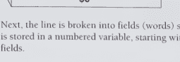

- 2. 接下来，该行被拆分为由空白字符分隔的字段（单词）。每个字段存储在编号变量中，从 `$1` 开始。可以多达 100 个字段。


3. `awk` 如何知道空白字符分隔了字段？还有另一个内部变量，称为 `FS`，用来指定字段分隔符。初始时，`FS` 被赋值为空白字符——制表符和空格。如果字段由其他字符分隔，例如冒号或连字符，你可以更改 `FS` 的值来指定新的字段分隔符。参见第 169 页的“字段分隔符”。

4. 当 `awk` 打印字段时，使用 `print` 函数如下：

```
{print $1,$3}
```

输出显示每个字段之间用空格分隔，如

Tom 100
Molly 200
John 300

`awk` 在 `Tom` 和 `100` 之间提供输出空格，是因为在 `$1` 和 `$3` 之间放置了一个逗号。逗号是特殊的。它映射到另一个内部变量，称为输出字段分隔符 `OFS`。`OFS` 的默认值为一个空格。逗号会生成分配给 `OFS` 变量的字符。

5. 在 `awk` 显示其输出后，它获取文件中的下一行并将其存储在 `$0` 中，覆盖之前的内容。然后它将该行拆分为字段并进行处理。这会一直持续到文件中的所有行都被处理完毕。

# 6.4 格式化输出

### 6.4.1 print 函数

`awk` 命令的动作部分用大括号括起来。如果未指定动作并且匹配到模式，`awk` 会采用默认动作，即将匹配的行打印到屏幕上。`print` 函数用于打印不需要花哨格式的简单输出。对于更复杂的格式，则使用 `printf` 或 `sprintf` 函数。如果你熟悉 `C`，那么你已经知道 `printf` 和 `sprintf` 的工作原理。`print` 函数也可以在 `awk` 的动作部分中显式使用，如 `{print}`。`print` 函数接受变量、计算值或字符串常量作为参数。字符串必须用双引号括起来。逗号用于分隔参数；如果未提供逗号，则参数会被连接在一起。逗号求值为 `OFS` 的值，默认是一个空格。

`print` 函数的输出可以重定向或通过管道传递给另一个程序，并且另一个程序的输出也可以通过管道传递给 `awk` 以进行打印。参见第 25 页的“重定向”和第 28 页的“管道”。

#### EXAMPLE 6.5

```
% date
Wed Jul 28 22:23:16 PDT 2004
% date | awk '{ print "Month: " $2 "\nYear: " , $6 }'
Month: Jul
Year: 2004
```

### EXPLANATION

`UNIX` `date` 命令的输出将被通过管道传递给 `awk`。字符串 `Month:` 会被打印，后跟第二个字段，包含换行字符的字符串 (`\n`)，以及 `Year:`，后跟第六个字段 (`$6`)。

### Escape Sequences.

转义序列由反斜杠和字母或数字表示。它们可以在字符串中使用来表示制表符、换行符、换页符等（参见表 6.1）。

### Table 6.1 print Escape Sequences

| Escape Sequence | Meaning |
|---|---|
| `\b` | Backspace |
| `\f` | Form feed |
| `\n` | Newline |
| `\r` | Carriage return |
| `\t` | Tab |
| `\047` | Octal value 47, a single quote |
| `\c` | c represents any other character, e.g., `\` |

#### EXAMPLE 6.6

Tom Jones 4424 5/12/66 543254
Mary Adams 5346 11/4/63 28765
Sally Chang 1654 7/22/34 650000
Billy Black 1683 9/23/44 336500

```
% awk '/Sally/{print "\t\tHave a nice day, "$1, $2 "\"!"}' employees
Have a nice day, Sally Chang!
```


### EXPLANATION

如果行中包含模式 `$1`，`print` 函数会打印两个制表符、字符串 `Have a nice day`、第一个字段（其中 `$1` 为 `Sally`）和第二个字段（其中 `$2` 为 `Chang`），后跟包含感叹号的字符串。

### 6.4.2 OFMT 变量

打印数字时，你可能希望控制数字的格式。通常这会使用 `printf` 函数来完成，但特殊的 `awk` 变量 `OFMT` 可以被设置为控制使用 `print` 函数时数字的打印方式。它默认设置为 `%.6g`——打印小数点右侧的六位有效数字。以下部分描述了如何更改此值。

#### EXAMPLE 6.7

```
% nawk 'BEGIN{OFMT="%.2F"; print 1.2456789, 12E-2}'
1.25 0.12
```

### EXPLANATION

`OFMT` 变量被设置为使浮点数 (`f`) 以小数点后两位数字打印。百分号 (`%`) 表示正在指定格式。

### 6.4.3 printf 函数

打印输出时，你可能希望指定字段之间的空格量，以便列整齐对齐。因为使用制表符的 `print` 函数并不总是能保证所需的输出，所以可以使用 `printf` 函数来格式化花哨的输出。

`printf` 函数像 C 中的 `printf` 语句一样，将格式化的字符串返回到标准输出。`printf` 语句由一个引号控制字符串组成，该字符串中可能嵌入格式规范和修饰符。控制字符串后跟一个逗号和一个由逗号分隔的表达式列表，这些表达式将根据控制字符串中声明的规范进行格式化。与 `print` 函数不同，`printf` 不提供换行符。如果需要换行符，必须提供转义序列 `\n`。

对于每个百分号和格式说明符，必须有一个对应的参数。要打印字面百分号，必须使用两个百分号。表 6.2 列出了 `printf` 转换字符，表 6.3 列出了 `printf` 修饰符。格式说明符前面有一个百分号；表 6.4 列出了 `printf` 格式说明符。

当参数被打印时，输出被打印的位置称为字段，字段的宽度是该字段包含的字符数。

以下示例中的管道符号（竖线）在 `printf` 字符串中时是文本的一部分，并用于指示格式的开始和结束。

# 示例 6.8

```
1 % echo "UNIX" | nawk '{printf "%-15s\n", $1}'
(Output)
/UNIX
/UNIX
```

```
2 % echo "UNIX" | nawk '{ printf "%15s\n", $1}'
(Output)
      UNIX
```

# 解释

1 `echo` 命令的输出，`UNIX`，被管道传输到 `nawk`。`printf` 函数包含一个控制字符串。百分号提醒 `printf` 它将打印一个 15 个空格、左对齐的字符串，该字符串用竖线括起来并以换行符结束。百分号后的连字符表示左对齐。控制字符串后面跟着一个逗号和 `$1`。字符串 `UNIX` 将根据控制字符串中的格式规范进行格式化。

2 字符串 `UNIX` 以右对齐的 15 个空格字符串打印，用竖线括起来，并以换行符结束。

# 示例 6.9

```
% cat employees
Tom Jones   4424  5/12/66  543354
Mary Adams  5346  11/4/63  28765
Sally Chang 1654  7/22/54  650000
Billy Black 1683  9/23/44  336500
```

```
% nawk '{printf "The name is: %-15s ID is %8d\n", $1, $3}' employees
The name is Tom        ID is 4424
The name is Mary       ID is 5346
The name is Sally      ID is 1654
The name is Billy      ID is 1683
```

# 解释

要打印的字符串用双引号括起来。第一个格式说明符是 `%-15s`。它有一个对应的参数 `$1`，位于控制字符串中逗号右侧的关闭引号正后方。百分号表示格式规范：连字符表示左对齐，`15s` 表示 15 个空格的字符串。在此位置，打印一个左对齐的 15 个空格的字符串，后跟字符串 `ID is` 和一个数字。

`%8d` 格式指定 `$2` 的十进制（整数）值将在字符串中其位置打印。数字将右对齐并占用八个空格。将带引号的字符串和表达式放在括号内是可选的。

# 表 6.2 printf 转换字符

| 转换字符 | 定义 |
|---|---|
| c | 字符 |
| s | 字符串 |
| d | 十进制数 |
| ld | 长十进制数 |
| u | 无符号十进制数 |
| lu | 长无符号十进制数 |
| x | 十六进制数 |
| lx | 长十六进制数 |
| o | 八进制数 |
| lo | 长八进制数 |
| e | 科学计数法表示的浮点数（e 表示法） |
| f | 浮点数 |
| g | 使用 e 或 f 转换表示浮点数，以占用空间最少者为准 |

# 表 6.3 printf 修饰符

| 字符 | 定义 |
|---|---|
| - | 左对齐修饰符 |
| # | 以八进制格式显示的整数前面带一个前导 0；以十六进制形式显示的整数前面带一个前导 0x |
| + | 对于使用 d、e、f 和 g 的转换，整数将显示数字符号 + 或 – |
| 0 | 显示的值用零填充而不是空白 |

# 表 6.4 printf 格式说明符

| 格式说明符 | 其作用 |
|---|---|
| Given x = 'A', y = 15, z = 2.3, and $1 = Bob Smith: | |
| %c | 打印单个 ASCII 字符。`printf("The character is %c.\n",x)` 打印：The character is A. |
| %d | 打印十进制数。`printf("The boy is %d years old.\n", y)` 打印：The boy is 15 years old. |
| %e | 打印数字的 e 表示法。`printf("z is %e.\n",z)` 打印：z is 2.3e+01. |
| %f | 打印浮点数。`printf("z is %f.\n", z)` 打印：z is 2.300000. |
| %o | 打印数字的八进制值。`printf("y is %o.\n", y)` 打印：y is 17. |
| %s | 打印字符字符串。`printf("The name of the culprit is %s.\n", $1)` 打印：The name of the culprit is Bob Smith. |
| %x | 打印数字的十六进制值。`printf("x is %x.\n", y)` 打印：x is f. |

# 6.5 从文件内部的 awk 命令

如果 `awk` 命令放在一个文件中，则使用 `-f` 选项加上 `awk` 文件的名称，后跟要处理的输入文件的名称。记录被读入 `awk` 的缓冲区，并且 `awk` 文件中的每个命令都会对该记录进行测试并执行。在 `awk` 处理完第一条记录后，它会被丢弃，下一个记录被读入缓冲区，以此类推。如果一个动作不受模式控制，则默认行为是打印整个记录。如果一个模式没有与其关联的动作，则默认是打印模式匹配输入行的记录。

# 示例 6.10

（数据库）

| $1 | $2 | $3 | $4 | $5 |
| Tom | Jones | 4424 | 5/12/66 | 543354 |
| Mary | Adams | 5346 | 11/4/63 | 28765 |
| Sally | Chang | 1654 | 7/22/54 | 650000 |
| Billy | Black | 1683 | 9/23/44 | 336500 |

```
% cat awkfile
1 {/Mary/{print "Hello Mary!"}
2 {print $1, $2, $3}
```

```
% nawk -f awkfile employees
Tom Jones 4424
Hello Mary!
Mary Adams 5346
Sally Chang 1654
Billy Black 1683
```


# 解释

- 1. 如果记录以正则表达式 `Mary` 开头，则打印字符串 `Hello Mary!`。该动作由前面的模式控制。字段由空白分隔。
- 2. 打印每条记录的第一、第二和第三个字段。因为没有模式控制该动作，所以该动作对每一行都发生。

# 6.6 记录和字段

## 6.6.1 记录

`Awk` 并非将输入数据视为无尽的字符流，而是将其视为具有格式或结构。默认情况下，每一行称为一条记录，并以换行符终止。

### 记录分隔符

默认情况下，输出和输入记录分隔符（行分隔符）是回车符（换行符），分别存储在 `awk` 内置变量 `ORS` 和 `RS` 中。`ORS` 和 `RS` 的值可以更改，但更改方式有限。

### `$0` 变量

整条记录由 `awk` 用 `$0` 引用。（当 `$0` 通过替换或赋值被更改时，`NF` 的值，即字段数，可能会被更改。）换行符的值存储在 `awk` 的内置变量 `RS` 中，默认为回车符。

# 示例 6.11

```
% cat employees

Tom Jones    4424  5/12/66  543254

Mary Adams   5346  11/4/63  28765

Sally Chang  1654  7/22/54  650000

Billy Black  1683  9/23/44  336500

% awk '{print $0}' employees

Tom Jones    4424  5/12/66  543354

Mary Adams   5346  11/4/63  28765

Sally Chang  1654  7/22/54  650000

Billy Black  1683  9/23/44  336500
```

# 解释

`awk` 变量 `$0` 包含当前记录。它被打印到屏幕上。默认情况下，如果命令为
`% awk '{print}' employees`
`awk` 也会打印该记录。

### `NR` 变量

每条记录的编号存储在 `awk` 的内置变量 `NR` 中。处理完一条记录后，`NR` 的值会递增一。

# 示例 6.12

```
% cat employees

Tom Jones    4424  5/12/66  543354

Mary Adams   5346  11/4/63  28765

Sally Chang  1654  7/22/54  650000

Billy Black  1683  9/23/44  336500

% awk '{print NR, $0}' employees

1 Tom Jones    4424  5/12/66  543354

2 Mary Adams   5346  11/4/63  28765

3 Sally Chang  1654  7/22/54  650000

4 Billy Black  1683  9/23/44  336500
```

# 解释

每条记录 `$0` 会按其在文件中的存储方式打印，并在前面加上记录编号 `NR`。

## 6.6.2 字段

每条记录由称为字段的单词组成，默认情况下字段由空白（空格或制表符）分隔。这些单词称为字段，`awk` 会在内置变量 `NF` 中跟踪字段数。`NF` 的值会因行而异，且限制取决于实现，通常为每行 100 个字段。可以创建新字段。以下示例有四条记录（行）和五个字段（列）。每条记录从第一个字段开始，表示为 `$1`，然后移动到第二个字段 `$2`，以此类推。

# 示例 6.13

（字段由美元符号和字段编号表示。）
（数据库）

```
        $1        $2        $3        $4        $5

        Tom       Jones     4424      5/12/66   543354

        Mary      Adams     5346      11/4/63   28765

        Sally     Chang     1654      7/22/54   650000

        Billy     Black     1683      9/23/44   336500

        % nawk '{print NR, $1, $2, $5}' employees

        1 Tom Jones 543354

        2 Mary Adams 28765

        3 Sally Chang 650000

        4 Billy Black 336500
```

# 解释

`Nawk` 会打印记录的编号（`NR`），以及文件中每行第一、第二和第五个字段（列）。

# 示例 6.14

```
% nawk '{print $0, NF}' employees

Tom Jones 4444 5/12/66 543354 5

Mary Adams 5346 11/4/63 28765 5

Sally Chang 1654 7/22/54 650000 5

Billy Black 1683 9/23/44 336500 5
```

# 解释

`Nawk` 会打印文件中的每条记录（`$0`），后跟字段数。

## 6.6.3 字段分隔符

**输入字段分隔符。** `Awk` 的内置变量 `FS` 保存输入字段分隔符的值。当使用 `FS` 的默认值时，`awk` 会用空格和/或制表符分隔字段，并去掉前导的空格和制表符。`FS` 的值可以通过为其分配新值来更改，可以在 `BEGIN` 语句中或在命令行中进行更改。现在，我们将在命令行中分配新值。要在命令行中更改 `FS` 的值，使用 `-F` 选项，后跟表示新分隔符的字符。

### 在命令行更改字段分隔符

参见示例 6.15，演示如何使用 `-F` 选项在命令行更改输入字段分隔符。

# 示例 6.15

```
% cat employees

Tom Jones:4424:5/12/66:543354

Mary Adams:5346:11/4/63:28765

Sally Chang:1654:7/22/54:650000

Billy Black:1683:9/23/44:336500

% nawk -F ':' '{print $1, $2}' employees2

Tom Jones 4424
```

# 解释

`-F` 选项用于在命令行重新赋值输入字段分隔符。当冒号紧跟在 `-F` 选项后面时，`nawk` 会查找冒号作为 `employees` 文件中字段的分隔符。

### 使用多个字段分隔符

你可以指定多个输入分隔符。如果字段分隔符 `FS` 使用了多个字符，那么该字符串是一个正则表达式，并用方括号括起来。在下面的示例中，字段分隔符是空格、冒号或制表符。（旧版本的 `awk` 不支持此功能。）

#### 示例 6.16

```
% nawk -F '[ :\t]' '{print $1, $2, $3}' employees

Tom Jones 4424

Mary Adams 5346

Sally Chang 1654

Billy Black 1683
```

# 解释

`-F` 选项后面跟一个用方括号括起来的正则表达式。如果遇到空格、冒号或制表符，`nawk` 将使用该字符作为字段分隔符。该表达式用引号括起来，以便 `shell` 不会自行处理这些元字符。（请记住，`shell` 使用方括号进行文件名扩展。）

### 输出字段分隔符

默认的输出字段分隔符是单个空格，存储在 `awk` 的内部变量 `OFS` 中。到目前为止的所有示例中，我们都使用 `print` 语句将输出发送到屏幕。在 `print` 语句中用于分隔字段的逗号，其计算结果取决于 `OFS` 的设置。如果使用默认值，插入在 `$1` 和 `$2` 之间的逗号将计算为单个空格，`print` 函数将打印这些字段，并在它们之间用一个空格分隔。

如果不使用逗号分隔字段，这些字段会紧贴在一起。除非用逗号分隔字段，否则 `OFS` 不会被计算。`OFS` 可以更改。

#### 示例 6.17

```
% cat employees2

Tom Jones:4424:5/12/66:543354

Mary Adams:5346:11/4/63:28765

Sally Chang:1654:7/22/54:650000

Billy Black:1683:9/23/44:336500
```

（命令行）
`% nawk -F ':' '/Tom Jones/{print $1, $2, $3, $4}' employees2`
`Tom Jones 4424 5/12/66 543354`

# 解释

输出字段分隔符（一个空格）存储在 `nawk` 的 `OFS` 变量中。字段之间的逗号计算为存储在 `OFS` 中的任何值。字段被打印到标准输出，并用空格分隔。

#### 示例 6.18

```
% nawk -F ':' '/Tom Jones/{print $0}' employees2

Tom Jones:4424:5/12/66:543354
```


# 解释

`$0` 变量保存当前记录，内容与输入文件中的完全一致。该记录将按原样打印。

# 6.7 模式与动作

## 6.7.1 模式

`awk` 模式控制 `awk` 对一行输入采取什么动作。模式由正则表达式、产生真或假条件的表达式，或这些的组合构成。默认动作是在表达式结果为真的情况下打印每一行。在读取模式表达式时，隐含一个 `if` 语句。当 `if` 是隐含的时候，不能用花括号将其括起来。当 `if` 是显式的时候，它成为一个动作语句，语法会有所不同。（参见第 227 页的“条件语句”。）

# 示例 6.19

```
% cat employees

Tom Jones    4424  5/12/66  543354

Mary Adams   5346  11/4/63  28765

Sally Chang  1654  7/22/54  650000

Billy Black  1683  9/23/44  336500
```

（命令行）

```
1  awk '/Tom/' employees

Tom Jones  4424  5/12/66  543354
```

```
2  awk '$3 < 4000' employees

Sally Chang  1654  7/22/54  650000

Billy Black  1683  9/23/44  336500
```

# 解释

- 1 如果在输入文件中匹配到模式 `Tom`，则打印该记录。如果没有指定显式动作，默认动作是打印该行。这等价于 `awk '$0 ~/Tom/print $0;' employees`
- 2 如果第三个字段小于 4000，则打印该记录。

## 6.7.2 动作

动作是用花括号括起来并以分号分隔的语句。² 如果模式位于动作之前，模式决定何时执行该动作。动作可以是简单的语句，也可以是复杂的语句组。语句之间用分号分隔，或者如果放在单独的一行中，则用换行符分隔。

格式

```
{ 动作 }
```

# 示例 6.20

```
{ print $1, $2 }
```

# 解释

该操作是打印字段1和2。
模式可以与操作关联。记住，操作是用花括号括起来的语句。模式控制从第一个左花括号到第一个右花括号之间的操作。如果操作跟在模式后面，第一个左花括号必须与模式在同一行。模式永远不会被花括号括起来。

# 格式

```
pattern{ action statement; action statement; etc. }

    or

pattern{

    action statement

    action statement

}
```

# 示例 6.21

```
% nawk '/Tom/{print "Hello there, " $1}' employees

Hello there, Tom
```

# 解释

如果记录包含模式`Tom`，将打印字符串`Hello there, Tom`。
没有操作的模式会显示所有匹配该模式的行。字符串匹配模式包含用正斜杠括起来的正则表达式。

# 6.8 正则表达式

在`awk`中，正则表达式是一种由正斜杠括起来的字符构成的模式。`awk`支持使用正则表达式元字符（与`egrep`相同）以某种方式修改正则表达式。如果输入行中的字符串与正则表达式匹配，则结果条件为真，并且执行与该表达式关联的任何操作。如果未指定操作，且输入行与正则表达式匹配，则打印该记录。参见表6.5。

# 示例 6.22

```
% nawk '/Mary/' employees

Mary Adams 5346 11/4/63 28765
```

# 解释

`employees`文件中包含正则表达式模式`Mary`的所有行都会显示。

# 示例 6.23

```
% nawk '/Mary/{print $1, $2}' employees

Mary Adams
```

# 解释

`employees`文件中包含正则表达式模式`Mary`的所有行的第一个和第二个字段都会显示。

# 表6.5 awk正则表达式元字符

| 元字符 | 作用 |
|---|---|
| ^ | 匹配字符串的开头 |
| $ | 匹配字符串的结尾 |
| . | 匹配单个字符 |
| * | 匹配前一个字符的零个或多个 |
| + | 匹配前一个字符的一个或多个 |
| ? | 匹配前一个字符的零个或一个 |
| [ABC] | 匹配字符集合A、B或C中的任意一个字符 |
| [^ABC] | 匹配不在字符集合A、B或C中的任意一个字符 |
| [A-Z] | 匹配A到Z范围内的任意一个字符 |
| A|B | 匹配A或B |
| (AB)+ | 匹配一个或多个AB集合；例如AB、ABAB、ABABAB |
| \* | 匹配字面星号 |
| & | 在替换字符串中用于表示搜索字符串中找到的内容 |

表6.6中列出的元字符受大多数版本的`grep`和`sed`支持，但不受任何版本的`awk`支持。

# 表6.6 不支持的元字符

| 元字符 | 功能 |
|---|---|
| \< >\ | 单词锚点 |
| \( \) | 反向引用 |
| \{ \} | 重复 |

# 6.8 正则表达式

### 6.8.1 匹配整行

独立的正则表达式匹配整行上的模式，如果没有给出操作，将打印发生匹配的整行。正则表达式可以使用元字符锚定到行的开头。

```
% nawk '/Mary/' employees

Mary Adams     5346     11/4/63     28765
```

`employees`文件中以正则表达式`Mary`开头的所有行都会显示。

```
% nawk '/^[A-Z][a-z]+/' employees

Tom Jones      4424     5/12/66     543354

Mary Adams     5346     11/4/63     28765

Sally Chang    1654     7/22/54     650000

Billy Black    1683     9/23/44     336500
```

`employees`文件中以大写字母开头，后跟一个或多个小写字母，再后跟一个空格的所有行都会显示。

### 6.8.2 匹配运算符

匹配运算符，即波浪号（`~`），用于匹配记录或字段中的表达式。

```
% cat employees

Tom Jones      4424     5/12/66     543354

Mary Adams     5346     11/4/63     28765

Sally Chang    1654     7/22/54     650000

Billy Black    1683     9/23/44     336500

% nawk '$1 ~ /[Bb]ill/' employees

Billy Black    1683     9/23/44     336500
```

第一个字段中匹配`Bill`或`bill`的任何行都会显示。

```
% nawk '$1 ~ /[yY]s/' employees

Tom Jones      4424     5/12/66     543354

Mary Adams     5346     11/4/63     28765
```


# 解释

任何不匹配 `$y` 的行，当 `$y` 位于第一个字段末尾时将被显示。

# POSIX 字符类

POSIX（可移植操作系统接口）是一个行业标准，用于确保程序在不同操作系统之间可移植。为了实现可移植性，POSIX 认识到不同国家或区域在字符编码方式、字母表、表示货币的符号以及时间和日期的表示方式上可能存在差异。为处理不同类型的字符，POSIX 在基本和扩展正则表达式中增加了表 6.7 所示的带括号字符类。`Gawk` 支持这种新的元字符类，而 `awk` 和 `nawk` 不支持。

类 `[:alnum:]` 另一种说法是 `A-Za-z0-9`。要使用此类，它必须被另一组括号括起来才能被识别为正则表达式。例如，`A-Za-z0-9` 本身不是正则表达式，但 `[A-Za-z0-9]` 是。同样，`[:alnum:]` 应写成 `[[:alnum:]]`。使用第一种形式 `[A-Za-z0-9]` 与带括号形式 `[[:alnum:]]` 之间的区别在于，第一种形式依赖于 ASCII 字符编码，而第二种形式允许将其他语言的字符表示在该类中，例如瑞典语的圆圈和德语变音符号。

## 表 6.7 POSIX 添加的带括号字符类

| Bracket Class | Meaning |
|---|---|
| `[:alnum:]` | Alphanumeric characters |
| `[:alpha:]` | Alphabetic characters |
| `[:cntrl:]` | Control characters |
| `[:digit:]` | Numeric characters |
| `[:graph:]` | Nonblank characters (not spaces, control characters, etc.) |
| `[:lower:]` | Lowercase letters |
| `[:print:]` | Like `[:graph:]`, but includes the space character |
| `[:punct:]` | Punctuation characters |
| `[:space:]` | All whitespace characters (newlines, spaces, tabs) |
| `[:upper:]` | Uppercase letters |
| `[:xdigit:]` | Allows digits in a hexadecimal number (0-9a-FA-F) |

# 6.9 脚本文件中的 awk 命令

当你有多个 `awk` 模式/动作语句时，将语句放在脚本中通常容易得多。脚本是一个包含 `awk` 注释和语句的文件。如果语句和动作在同一行，则用分号分隔。如果语句在单独的行上，则不需要分号。如果动作跟随模式，则左大括号必须与模式在同一行。注释以井号（`#`）开头。

### EXAMPLE 6.28

```
% gawk '/[[:lower:]]+g[[:space:]]+[:digit:]/' employees
```

`Sally Chang 1654 7/22/54 650000`

# 解释

`Gawk` 搜索一个或多个小写字母，后跟 `g`，后跟一个或多个空格，后跟一个数字。 （如果你是 Linux 用户，`awk` 链接到 `gawk`，使 `awk` 和 `gawk` 都是有效的命令。）

### EXAMPLE 6.29

```
% cat employees
```

`Tom Jones:4424:5/12/66:54335`

`Mary Adams:5346:11/4/63:28765`

`Billy Black:1683:9/23/44:336500`

`Sally Chang:1654:7/22/54:65000`

`Jose Tomas:1683:9/23/44:33650`

`(The Awk Script)`

```
% cat info
```
`1  # My first awk script by Jack Sprat`

`  # Script name: info; Date: February 28, 2004`

`2 /Tom/(print "Tom's birthday is $3")`

`3 /Mary/(print NR, $0)`

`4 /Sally/(print "Hi Sally. $1 has a salary of $4 .")`

`  # End of info script`

`(The Command Line)`

`5  % nawk -f -f info employees2`

`Tom's birthday is 5/12/66`

`2 Mary Adams:5346:11/4/63:28765`

`Hi Sally. Sally Chang has a salary of $65000.`

# 解释

1 这些是注释行。
2 如果正则表达式 `Tom` 与输入行匹配，则打印字符串 `Tom's birthday is` 和第三个字段的值（`$3`）。

# 解释（续）

3 如果正则表达式 `$Mary` 与输入行匹配，则动作块打印 `NR`，即当前记录的编号，以及该记录。
4 如果在输入行的开头找到正则表达式 `$Sally`，则打印字符串 `Hi Sally,` 后跟第一个字段的值（`$1`）、字符串 `has a salary of $` 和第四个字段的值（`$4`）。
5 `awk` 命令后跟 `-F:` 选项，指定冒号为字段分隔符。 `-f` 选项后跟 `awk` 脚本的名称。 `Awk` 将从 `info` 文件读取指令。 输入文件 `employees2` 紧随其后。

# 6.10 复习

本节中的示例使用以下示例数据库，称为 `datafile`，为方便起见定期重复。在数据库中，输入字段分隔符 `FS` 为空白，为默认值。字段数 `NF` 为 8。数字可能因行而异，但在该文件中，字段数是固定的。记录分隔符 `RS` 为换行符，它分隔文件中的每一行。 `Awk` 跟踪 `NR` 变量中每个记录的编号。输出字段分隔符 `OFS` 为空格。如果用逗号分隔字段，则在打印行时，每个打印的字段将用空格分隔。

| % cat datafile | | | | | | | |
| northwest | NW | Joel Craig | 3.0 | .98 | 3 | 4 |
| western | WE | Sharon Kelly | 5.3 | .97 | 5 | 23 |
| southwest | SW | Chris Foster | 2.7 | .8 | 2 | 18 |
| southern | SO | May Chin | 5.1 | .95 | 4 | 15 |
| southeast | SE | Derek Johnson | 4.0 | .7 | 4 | 17 |
| eastern | EA | Susan Beal | 4.4 | .84 | 5 | 20 |
| northeast | NE | TJ Nichols | 5.1 | .94 | 3 | 13 |
| north | NO | Val Shultz | 4.5 | .89 | 5 | 9 |
| central | CT | Sheri Watson | 5.7 | .94 | 5 | 13 |

### 6.10.1 简单模式匹配

#### EXAMPLE 6.30

```
nawk '/west/' datafile
```

| northwest | NW | Joel Craig | 3.0 | .98 | 3 | 4 |
| western | WE | Sharon Kelly | 5.3 | .97 | 5 | 23 |
| southwest | SW | Chris Foster | 2.7 | .8 | 2 | 18 |

# 解释

所有包含模式 `west` 的行都被打印。

# 示例 6.31

```
nawk '/^north/' datafile
```

`northwest    NW    Joel Craig    3.0    .98    3    4`

`northeast    NE    TJ Nichols    5.1    .94    3    13`

`north        NO    Val Shultz    4.5    .89    5    9`

# 解释

所有以模式 `north` 开头的行都被打印。

# 示例 6.32

```
nawk '/^(no|so)/' datafile
```

`northwest    NW    Joel Craig    3.0    .98    3    4`

`southwest    SW    Chris Foster  2.7    .8     2    18`

`southern     SO    May Chin      5.1    .95    4    15`

`southeast    SE    Derek Johnson 4.0    .7     4    17`

`northeast    NE    TJ Nichols    5.1    .94    3    13`

`north        NO    Val Shultz    4.5    .89    5    9`


# 解释

所有以模式 `no` 或 `so` 开头的行都被打印。

### 6.10.2 简单动作

#### 示例 6.33

```
nawk '{print $3, $2}' datafile
```
Joel NW

Sharon WE

Chris SW

May SO

Derek SE

Susan EA

TJ NE

Val NO

Sheri CT

# 解释

输出字段分隔符 `OFS` 默认是一个空格。`$3` 和 `$2` 之间的逗号被转换为 `OFS` 的值。第三个字段被打印，其后是一个空格和第二个字段。

| % cat datafile |  |  |  |  |  |  |
|---|---|---|---|---|---|---|
| northwest | NW | Joel Craig | 3.0 | .98 | 3 | 4 |
| western | WE | Sharon Kelly | 5.3 | .97 | 5 | 23 |
| southwest | SW | Chris Foster | 2.7 | .8 | 2 | 18 |
| southern | SO | May Chin | 5.1 | .95 | 4 | 15 |
| southeast | SE | Derek Johnson | 4.0 | .7 | 4 | 17 |
| eastern | EA | Susan Beal | 4.4 | .84 | 5 | 20 |
| northeast | NE | TJ Nichols | 5.1 | .94 | 3 | 13 |
| north | NO | Val Shultz | 4.5 | .89 | 5 | 9 |
| central | CT | Sheri Watson | 5.7 | .94 | 5 | 13 |

#### 示例 6.34

```
nawk '{print $3 $2}' datafile
```
JoelNW

SharonWE

ChrisSW

MaySO

DerekSE

SusanEA

TJNE

ValNO

SheriCT

# 解释

第三个字段后面跟着第二个字段。因为逗号没有分隔 `$3` 和 `$2`，输出在字段之间不显示空格。

#### 示例 6.35

```
nawk 'print $1' datafile
nawk: syntax error at source line 1
context is
>>> print <<< $1
nawk: bailing out at source line 1
```

# 解释

这是 `nawk`（新 `awk`）的错误信息。`Nawk` 的错误信息比旧 `awk` 的要详细得多。在此程序中，动作语句中缺少大括号。

#### 示例 6.36

```
awk 'print $1' datafile
awk: syntax error near line 1
awk: bailing out near line 1
```

# 解释

这是 `awk`（旧 `awk`）的错误信息。旧 `awk` 程序难以调试，因为几乎所有错误都会产生相同的此信息。动作语句中缺少大括号。

#### 示例 6.37

```
nawk '{print $0}' datafile
```
northwest   NW   Joel Craig   3.0   .98   3   4

western     WE   Sharon Kelly 5.3   .97   5   23

southwest   SW   Chris Foster 2.7   .8    2   18

southern    SO   May Chin     5.1   .95   4   15

southeast   SE   Derek Johnson 4.0   .7    4   17

eastern     EA   Susan Beal   4.4   .84   5   20

northeast   NE   TJ Nichols   5.1   .94   3   13

north       NO   Val Shultz   4.5   .89   5   9

central     CT   Sheri Watson 5.7   .94   5   13

# 解释

每个记录都被打印。`$0` 包含当前记录。

#### 示例 6.38

```
nawk '{print "Number of fields: "NF}' datafile
```
Number of fields: 8

Number of fields: 8

Number of fields: 8

Number of fields: 8

Number of fields: 8

Number of fields: 8

Number of fields: 8

Number of fields: 8

Number of fields: 8

# 解释

每个记录都有 8 个字段。内置 `awk` 变量 `NF` 保存字段数，并且对每个记录进行重置。

`% cat datafile`
northwest NW Joel Craig 3.0 .98 3 4
western WE Sharon Kelly 5.3 .97 5 23
southwest SW Chris Foster 2.7 .8 2 18
southern SO May Chin 5.1 .95 4 15
southeast SE Derek Johnson 4.0 .7 4 17
eastern EA Susan Beal 4.4 .84 5 20
northeast NE TJ Nichols 5.1 .94 3 13
north NO Val Shultz 4.5 .89 5 9
central CT Sheri Watson 5.7 .94 5 13

### 6.10.3 模式和动作组合中的正则表达式

#### 示例 6.39

```
nawk '/northeast/{print $3, $2}' datafile
```
TJ NE

# 解释

如果记录包含（或匹配）模式 `northeast`，则打印第三个字段，其后是第二个字段。

#### 示例 6.40

```
nawk '/E/' datafile
```
western WE Sharon Kelly 5.3 .97 5 23

southeast SE Derek Johnson 4.0 .7 4 17

eastern EA Susan Beal 4.4 .84 5 20

northeast NE TJ Nichols 5.1 .94 3 13

# 解释

如果记录包含 `E`，则打印整个记录。

#### 示例 6.41

```
nawk '/^[ns]/{print $1}' datafile
```
northwest

southwest

southern

southeast

northeast

north

# 解释

如果记录以 `n` 或 `s` 开头，则打印第一个字段。

#### 示例 6.42

```
nawk '$5 ~ /\.[7-9]/' datafile
```
southwest  SW  Chris Foster  2.7  .8  2  18

central    CT  Sheri Watson  5.7  .94 5  13

# 解释

如果第五个字段 (`$5`) 包含一个字面量的句点，后跟一个或多个介于 7 到 9 之间的数字，则记录会被打印。

#### 示例 6.43

```
nawk '$2 !~ /E/{print $1, $2}' datafile
```
northwest NW

southwest SW

southern SO

north NO

central CT

# 解释

如果第二个字段不包含模式 `E`，则打印第一个字段后跟第二个字段 (`$1, $2`)。

#### 示例 6.44

```
nawk '$3 ~ /Joel/{print $3 " is a nice guy."}' datafile
```
Joel is a nice guy.

# 解释

如果第三个字段 (`$3`) 以模式 `Joel` 开头，则打印第三个字段后跟字符串 `is a nice guy.`。请注意，如果要打印字符串，则其中包含一个空格。

#### 示例 6.45

```
nawk '$8 ~ /[0-9][0-9]$/{print $8}' datafile
```
23

18

15

17

20

13

13

# 解释

如果第八个字段 (`$8`) 以两位数字结尾，则会被打印。

`% cat datafile`
northwest NW Joel Craig 3.0 .98 3 4
western WE Sharon Kelly 5.3 .97 5 23
southwest SW Chris Foster 2.7 .8 2 18
southern SO May Chin 5.1 .95 4 15
southeast SE Derek Johnson 4.0 .7 4 17


eastern EA Susan Beal 4.4 .84 5 20

northeast NE TJ Nichols 5.1 .94 3 13

north NO Val Shultz 4.5 .89 5 9

central CT Sheri Watson 5.7 .94 5 13

# 示例 6.46

```
nawk '$4 ~ /Chin/{print "The price is $" $8 "."}' datafile
```

The price is $15.

# 解释

如果第四个字段 (`$4`) 以 `Chin` 结尾，则打印用双引号括起来的字符串 (`"The price is $"`)、`$8` 以及包含句点的字符串。

# 示例 6.47

```
nawk '/TJ/{print $0}' datafile
```

northeast NE TJ Nichols 5.1 .94 3 13

# 解释

如果记录包含模式 `TJ`，则打印 `$0`（记录）。

#### 6.10.4 输入字段分隔符

使用以下 `datafile2` 作为示例 6.48 至 6.52。

```
% cat datafile2

Joel Craig:northwest:NW:3.0:.98:3:4

Sharon Kelly:western:WE:5.3:.97:5:23

Chris Foster:southwest:SW:2.7:.8:2:18

May Chin:southern:SO:5.1:.95:4:15

Derek Johnson:southeast:SE:4.0:.7:4:17

Susan Beal:eastern:EA:4.4:.84:5:20

TJ Nichols:northeast:NE:5.1:.94:3:13

Val Shultz:north:NO:4.5:.89:5:9

Sheri Watson:central:CT:5.7:.94:5:13
```

# 示例 6.48

```
nawk '{print $1}' datafile2
```

Joel

Sharon

Chris

May

Derek

Susan

TJ

Val

Sheri

# 解释

默认输入字段分隔符为空白。打印第一个字段 (`$1`)。

# 示例 6.49

```
nawk -F: '{print $1}' datafile2
```

Joel Craig

Sharon Kelly

Chris Foster

<more output here>

Val Shultz

Sheri Watson

# 解释

`-F` 选项指定冒号作为输入字段分隔符。打印第一个字段 (`$1`)。

# 示例 6.50

```
nawk '{print "Number of fields: "NF}' datafile2
```

Number of fields: 2

Number of fields: 2

Number of fields: 2

<more of the same output here>

Number of fields: 2

Number of fields: 2

# 解释

因为字段分隔符是默认值（空白），每个记录的字段数为 2。唯一的空格在名和姓之间。

# 示例 6.51

```
nawk -F: '{print "Number of fields: "NF}' datafile2
```

Number of fields: 7

Number of fields: 7

Number of fields: 7

<more of the same output here>

Number of fields: 7

Number of fields: 7

# 解释

因为字段分隔符是冒号，每个记录中的字段数为 7。

# 示例 6.52

```
nawk -F'[ :]' '{print $1, $2}' datafile2
```

Joel Craig northwest

Sharon Kelly western

Chris Foster southwest

May Chin southern

Derek Johnson southeast

Susan Beal eastern

TJ Nichols northeast

Val Shultz north

Sheri Watson central

# 解释

可以使用 `nawk` 以正则表达式的形式指定多个字段分隔符。空格或冒号将被指定为字段分隔符。打印第一个和第二个字段 (`$1`, `$2`)。（方括号必须加引号以防止 shell 将其解释为 shell 元字符。）

#### 6.10.5 awk 脚本编写

以下 `datafile` 用于下一个示例。

| % cat datafile | | | | | | |
|---|---|---|---|---|---|---|
| northwest | NW | Joel Craig | 3.0 | .98 | 3 | 4 |
| western | WE | Sharon Kelly | 5.3 | .97 | 5 | 23 |
| southwest | SW | Chris Foster | 2.7 | .8 | 2 | 18 |
| southern | SO | May Chin | 5.1 | .95 | 4 | 15 |
| southeast | SE | Derek Johnson | 4.0 | .7 | 4 | 17 |
| eastern | EA | Susan Beal | 4.4 | .84 | 5 | 20 |
| northeast | NE | TJ Nichols | 5.1 | .94 | 3 | 13 |
| north | NO | Val Shultz | 4.5 | .89 | 5 | 9 |
| central | CT | Sheri Watson | 5.7 | .94 | 5 | 13 |

# 示例 6.3

```
cat nawk.scl
```

# This is a comment

# This is my first nawk script

1    /north/{print $1, $2, $3}

2    /south/{print "The " $1 " district."}

3    nawk -f nawk.scl datafile

     northwest NW Joel

     The southwest district.

     The southern district.

     The southeast district.

     northeast NE TJ

     north NO Val

# 解释

- 1. 如果记录以模式 `north` 开头，则打印第一、二和第三个字段（`$1`, `$2`, `$3`）。
- 2. 如果记录以模式 `south` 开头，则打印字符串 `The`，后跟第一个字段（`$1`）的值，以及字符串 `district.`。
- 3. `-f` 选项在 `nawk` 脚本文件名之前，后跟要处理的输入文件。

# 实验 3：awk 练习

（请参考 CD 上的名为 `lab3.data` 的数据库。）

```
Mike Harrington:(510) 548-1278:250:100:175

Christian Dobbins:(408) 538-2358:155:90:201

Susan Dalsass:(206) 654-6279:250:60:50

Archie McNichol:(206) 548-1348:250:100:175

Jody Savage:(206) 548-1278:15:188:150

Guy Quigley:(916) 343-6410:250:100:175

Dan Savage:(406) 298-7744:450:300:275

Nancy McNeil:(206) 548-1278:250:80:75

John Goldenrod:(916) 348-4278:250:100:175

Chet Main:(510) 548-5258:50:95:135

Tom Savage:(408) 926-3456:250:168:200

Elizabeth Stachel:(916) 440-1763:175:500
```


数据库包含姓名、电话号码以及过去三个月对党派竞选的资金捐助。

- 1. 打印所有电话号码。
- 2. 打印 Dan 的电话号码。
- 3. 打印 Susan 的姓名和电话号码。
- 4. 打印所有以 D 开头的姓氏。
- 5. 打印所有以 C 或 E 开头的名字。
- 6. 打印所有名字仅包含四个字符的名字。
- 7. 打印所有 916 区号中人员的名。
- 8. 打印 Mike 的竞选捐款。每个值都应带前导美元符号打印；例如，`$250 $100 $175`。
- 9. 打印姓氏后跟逗号和名字。
- 10. 编写一个名为 `facts` 的 `awk` 脚本，该脚本
  a. 打印 Savages 的全名和电话号码。
  b. 打印 Chet 的捐款。
  c. 打印第一个月捐款为 `$250` 的所有人。

# 6.11 比较表达式

比较表达式匹配执行操作的行的条件仅在某个条件为真时才成立。这些表达式使用关系运算符，用于比较数字或字符串。

## 6.11.1 关系和相等运算符

表 6.8 列出了关系运算符。表达式的值如果求值为真则为 1，如果为假则为 0。

**表 6.8 — 关系运算符**

| 运算符 | 含义 | 示例 |
|---|---|---|
| `<` | 小于 | `x < y` |
| `<=` | 小于或等于 | `x <= y` |
| `==` | 等于 | `x == y` |
| `!=` | 不等于 | `x != y` |
| `>=` | 大于或等于 | `x >= y` |
| `>` | 大于 | `x > y` |

### 表 6.8 关系运算符（续）

| 运算符 | 含义 | 示例 |
|---|---|---|
| `~` | 由正则表达式匹配 | `x ~ /y/` |
| `!~` | 未由正则表达式匹配 | `x !~ /y/` |

## 示例 6.54

### (The Database)

```
% cat employees

Tom Jones    4423  5/12/66  543354

Mary Adams   5346  11/4/63  28765

Sally Chang  1654  7/22/54  650000

Billy Black  1683  9/23/44  336500
```

### (The Command Line)

```
1 % awk '$3 == 5346' employees

Mary Adams   5346  11/4/63  28765

2 % awk '$3 > 5000{print $1}' employees

Mary

3 % awk '$2 ~ /Adam/' employees

Mary Adams   5346  11/4/63  28765

4 % awk '$2 !~ /Adam/' employees

Tom Jones    4423  5/12/66  543354

Sally Chang  1654  7/22/54  650000

Billy Black  1683  9/23/44  336500
```

### 解释

- 1 如果第三个字段恰好等于 5346，则条件为真，`awk` 将执行默认操作——打印该行。当隐含 `if` 条件时，它是一个条件模式测试。
- 2 如果第三个字段大于 5000，`awk` 打印第一个字段。
- 3 如果第二个字段匹配或包含正则表达式 `Adam`，则记录将被打印。
- 4 如果第二个字段不匹配或不包含正则表达式 `Adam`，则记录将被打印。如果表达式是数值且正在与字符串值使用需要数值比较的运算符进行比较，则字符串值将被转换为数值。如果运算符需要字符串值，则数值将被转换为字符串值。

## 6.11.2 条件表达式

条件表达式使用两个符号：问号和冒号，来对表达式求值。它实际上只是实现与 `if/else` 语句相同结果的简写方式。一般格式如下：

### 格式

```
conditional expression1 ? expression2 : expression3
```

这与下面所示的 `if/else` 产生相同的结果。（关于 `if/else` 结构的完整讨论将在后文给出。）

```
{
if (expression1)
    expression2
else
    expression3
}
```

### 示例 6.55

```
% awk '{max=($1 > $2) ? $1 : $2; print max}' filename
```

### 说明

如果第一个字段大于第二个字段，则将问号后面的表达式的值赋给 `max`；否则，将冒号后面的表达式的值赋给 `max`。这相当于

```
if ($1 > $2)
    max=$1
else
    max=$2
```

## 6.11.3 计算

可以在模式内进行计算。`awk`（所有版本）都以浮点数执行所有算术运算。算术运算符见表 6.9。

### 示例 6.56

```
% awk '$3 * $4 > 500' filename
```

### 说明

`awk` 将第三个字段（`$3`）与第四个字段（`$4`）相乘，如果结果大于 500，则会显示这些行。（假定 `filename` 是包含输入的文件。）

### 表 6.9 算术运算符

| 运算符 | 含义 | 示例 |
|---|---|---|
| `+` | 加 | `x + y` |
| `-` | 减 | `x - y` |
| `*` | 乘 | `x * y` |
| `/` | 除 | `x / y` |
| `%` | 取模 | `x % y` |
| `^` | 幂 | `x ^ y` |

## 6.11.4 逻辑运算符和复合模式

逻辑运算符测试表达式或模式是真还是假。使用 `&&`（逻辑 AND 运算符）时，如果两个表达式都为真，则整个表达式为真。如果有一个表达式为假，则整个表达式为假。使用 `||`（逻辑 OR 运算符）时，只需要一个表达式或模式求值为真，即可使整个表达式为真。如果两个表达式都为假，则整个表达式为假。

复合模式是将模式与逻辑运算符组合起来的表达式（参见表 6.10）。表达式从左到右求值。

### 表 6.10 逻辑运算符

| 运算符 | 含义 | 示例 |
|---|---|---|
| `&&` | 逻辑与 | `a && b` |
| `\|\|` | 逻辑或 | `a \|\| b` |
| `!` | 非 | `! a` |

### 示例 6.57

```
% awk '$2 > 5 && $2 <= 15' filename
```

### 说明

`awk` 将显示同时匹配两个条件的行；也就是说，第二个字段（`$2`）大于 5 **且**第二个字段（`$2`）小于或等于 15。使用 `&&` 运算符时，两个条件都必须为真。（假定 `filename` 是包含输入的文件。）

### 示例 6.38

```
% awk '$3 == 100 || $4 > 50' filename
```

### 说明

`awk` 将显示匹配其中一个条件的行；也就是说，第三个字段等于 100 **或**第四个字段大于 50。使用 `||` 运算符时，只需要其中一个条件为真。（假定 `filename` 是包含输入的文件。）

### 示例 6.59

```
% awk '!($2 < 100 && $3 < 20)' filename
```

### 说明

如果两个条件都为真，`awk` 将对该表达式取反并显示这些行——因此显示的行会有一个或两个条件为假。一元 `!` 运算符对条件的结果取反，因此如果表达式产生真条件，NOT 将使其变为假，反之亦然。（假定 `filename` 是包含输入的文件。）

## 6.11.5 范围模式

范围模式从第一个模式第一次出现的位置开始匹配，直到第二个模式第一次出现的位置，然后从第一个模式下一次出现的位置匹配到第二个模式下一次出现的位置，依此类推。如果匹配到了第一个模式但未找到第二个模式，`awk` 将显示直到文件末尾的所有行。

### 示例 6.60

```
% awk '/Tom/,/Suzanne/' filename
```

### 说明

`awk` 将显示从 `Tom` 第一次出现到 `Suzanne` 第一次出现之间的所有行（包括边界）。如果未找到 `Suzanne`，`awk` 将继续处理行直到文件末尾。如果在打印完 `Tom` 和 `Suzanne` 之间的范围后 `Tom` 再次出现，`awk` 将开始显示行，直到找到另一个 `Suzanne` 或文件结束。

## 6.11.6 数据验证程序

使用到目前为止讨论的 `awk` 命令，《AWK 程序设计语言》³ 一书中的密码检查程序展示了如何验证文件中的数据。

> 3. Aho、Weinberger 和 Kernighan 著，《AWK 程序设计语言》（波士顿：Addison-Wesley，1988 年）。

### 示例 6.61

（密码数据库）

```
1 % cat /etc/passwd

tooth:pwfTudo.eC9M9:476:40:Contract Admin.:/home/rickenbacker/tooth:/bin/csh

lisam:9i7Y0uS2F3IY:4467:40:Lisa M. Spencer:/home/fortune1/lisam:/bin/csh
```


good e:v7mW...:3255:60:Goodwill Guest User:/usr/goodwill/bin/csh

bonzo:e7ZbQ0uM2JY:A:5101:911: SSTOOL Log account:/home/sun4/bonzo:/bin/csh

info:mK2SrioPwhA:611:41:Terri Stern:/home/chewie/info/bin/csh

cnc:INIVqj1bV2:10289:41:Charles Carnell:/home/christine/cnc:/bin/csh

bee::347:40:Contract Temp.:/home/chanel5/bee:/bin/csh

friedman:oyuiKfoVBT E:3561:50:Jay Friedman:/home/ibanez/friedman:/bin/csh

chambers:rWkR7K7YV4::592:40:Carol Chambers:/usr/callisto2/chambers:/bin/csh

gregc:nk2EYi7kLu10g:7777:30:Greg Champlin FE Chicago

ramona:gbQQLdD8eR c46:16660:68:Ramona Leininger MWA Customer Service Rep:/home/forsh:

```
(Awk 命令)
```

```
2 % cat /etc/passwd | awk -F ':'
3 NF != 7{
4 printf("line %d, does not have 7 fields: %s\n",NR,$0) \
5 $1 !/^[A-Za-z0-9]/ {printf("line %d, nonalphnumeric user id: %s\n",NR,$0)} \
6 $2 == "" {printf("line %d, no password: %s\n",NR,$0)}
```

```
(输出)
```
line 7, no password: bee::347:40:Contract Temp.:/home/chanel5/bee:/bin/csh
line 10, does not have 7 fields: gregc:nk2EYi7kLu10g:7777:30:Greg Champlin FE Chicago
line 11, does not have 7 fields: ramona:gbQQLdD8eR c46:16660:68:Ramona Leininger MWA Customer Service Rep:/home/forsh:

# 解释

- 1. 显示 `/etc/passwd` 文件的内容。
- 2. `cat` 程序将其输出发送给 `awk`。`Awk` 的字段分隔符是冒号。
- 3. 如果字段数 `NF` 不等于 7，则执行以下动作块。
- 4. `printf` 函数打印字符串 line <number>, does not have 7 fields 后跟当前记录的编号 `NR` 和记录本身 `$0`。
- 5. 如果第一个字段 `$1` 不包含任何字母数字字符，则 `printf` 函数打印字符串 nonalphnumeric user id，后跟记录的编号和记录本身。
- 6. 如果第二个字段 `$2` 等于星号，则打印字符串 no password，后跟记录的编号和记录本身。

# 6.12 复习

本节中的示例使用以下示例数据库，称为 `datafile`，为方便起见定期重复。

| % cat datafile | | | | | | |
| northwest | NW | Joel Craig | 3.0 | .98 | 3 | 4 |
| western | WE | Sharon Kelly | 5.3 | .97 | 5 | 23 |
| southwest | SW | Chris Foster | 2.7 | .8 | 2 | 18 |
| southern | SO | May Chin | 5.1 | .95 | 4 | 15 |
| southeast | SE | Derek Johnson | 4.0 | .7 | 4 | 17 |
| eastern | EA | Susan Beal | 4.4 | .84 | 5 | 20 |
| northeast | NE | TJ Nichols | 5.1 | .94 | 3 | 13 |
| north | NO | Val Shultz | 4.5 | .89 | 5 | 9 |
| central | CT | Sheri Watson | 5.7 | .94 | 5 | 13 |

#### 6.12.1 等值测试

# 示例 6.62

```
% awk '$7 == 5' datafile
```

| western | WE | Sharon Kelly | 5.3 | .97 | 5 | 23 |
| eastern | EA | Susan Beal | 4.4 | .84 | 5 | 20 |
| north | NO | Val Shultz | 4.5 | .89 | 5 | 9 |
| central | CT | Sheri Watson | 5.7 | .94 | 5 | 13 |

# 解释

如果第七个字段 `$7` 等于数字 5，则打印该记录。

# 示例 6.63

```
% awk '$2 == "CT"{print $1, $2}' datafile
```

| central | CT |

# 解释

如果第二个字段等于字符串 `CT`，则打印字段一和字段二 `$1, $2`。字符串必须加引号。

# 解释

如果第七个字段 `$7` 不等于数字 5，则打印该记录。

#### 6.12.2 关系运算符

# 示例 6.63

```
% awk '$7 < 5 {print $4, $7}' datafile
Craig 3
Foster 2
Chin 4
Johnson 4
Nichols 3
```

# 解释

如果第七个字段 `$7` 小于 5，则打印字段 4 和 7。

# 示例 6.66

```
% awk '$6 > .9 {print $1, $6}' datafile
northwest .98
western .97
southern .95
northeast .94
central .94
```

# 解释

如果第六个字段 `$6` 大于 `.9`，则打印字段 1 和 6。

# 示例 6.67

```
% awk '$8 <= 17 { print $8}' datafile
4
15
17
13
9
13
```

# 解释

如果第八个字段 `$8` 小于或等于 17，则打印它。

```
% cat datafile
northwest NW Joel Craig 3.0 .98 3 4
western WE Sharon Kelly 5.3 .97 5 23
southwest SW Chris Foster 2.7 .8 2 18
southern SO May Chin 5.1 .95 4 15
southeast SE Derek Johnson 4.0 .7 4 17
eastern EA Susan Beal 4.4 .84 5 20
northeast NE TJ Nichols 5.1 .94 3 13
north NO Val Shultz 4.5 .89 5 9
central CT Sheri Watson 5.7 .94 5 13
```

# EXAMPLE 6.68

```
% awk '$8 >= 17 {print $8}' datafile
23
18
17
20
```

### EXPLANATION

如果第八个字段（`$8`）大于或等于 17，则打印第八个字段。

#### 6.12.3 Logical Operators (&&, ||)

# EXAMPLE 6.69

```
% awk '$8 > 10 && $8 < 17' datafile
southern SO May Chin 5.1 .95 4 15
northeast NE TJ Nichols 5.1 .94 3 13
central CT Sheri Watson 5.7 .94 5 13
```

### EXPLANATION

如果第八个字段（`$8`）大于 10 且小于 17，则打印记录。只有当两个表达式都为真时，记录才会被打印。

# EXAMPLE 6.70

```
% awk '$2 == "NW" || $1 ~ /south/{print $1, $2}' datafile
northwest NW
southwest SW
southern SO
southeast SE
```


### EXPLANATION

如果第二个字段（`$2`）等于字符串 `NW` 或 第一个字段（`$1`）包含模式 `south`，则打印第一个和第二个字段（`$1`, `$2`）。如果仅有一个表达式为真，记录也会被打印。

#### 6.12.4 Logical NOT Operator (!)

### EXAMPLE 6.71

```
% awk '(!($8 == 13)){print $8}' datafile
4
23
18
15
17
20
9
```

### EXPLANATION

如果第八个字段（`$8`）等于 `13`，则 `!`（NOT 运算符）对表达式进行取反并打印第八个字段（`$8`）。`!` 是一个一元否定运算符。

#### 6.12.5 Arithmetic Operators

### EXAMPLE 6.72

```
% awk '/southern/{print $5 + 10}' datafile
15.1
```

### EXPLANATION

如果记录包含正则表达式 `southern`，则将 `10` 加到第五个字段（`$5`）的值上并打印。请注意，数字以浮点形式打印。

### EXAMPLE 6.73

```
% awk '/southern/{print $8 + 10}' datafile
25
```

### EXPLANATION

如果记录包含正则表达式 `southern`，则将 `10` 加到第八个字段（`$8`）的值上并打印。请注意，数字以十进制形式打印。

|  |  |  |  |  |  |  |
|---|---|---|---|---|---|---|
| northwest | NW | Joel Craig | 3.0 | .98 | 3 | 4 |
| western | WE | Sharon Kelly | 5.3 | .97 | 5 | 23 |
| southwest | SW | Chris Foster | 2.7 | .8 | 2 | 18 |
| southern | SO | May Chin | 5.1 | .95 | 4 | 15 |
| southeast | SE | Derek Johnson | 4.0 | .7 | 4 | 17 |
| eastern | EA | Susan Beal | 4.4 | .84 | 5 | 20 |
| northeast | NE | TJ Nichols | 5.1 | .94 | 3 | 13 |
| north | NO | Val Shultz | 4.5 | .89 | 5 | 9 |
| central | CT | Sheri Watson | 5.7 | .94 | 5 | 13 |

### EXAMPLE 6.74

```
% awk '/southern/{print $5 + 10.56}' datafile
15.66
```

### EXPLANATION

如果记录包含正则表达式 `southern`，则将 `10.56` 加到第五个字段（`$5`）的值上并打印。

### EXAMPLE 6.75

```
% awk '/southern/{print $8 - 10}' datafile
5
```

### EXPLANATION

如果记录包含正则表达式 `southern`，则从第八个字段（`$8`）的值中减去 `10` 并打印。

### EXAMPLE 6.76

```
% awk '/southern/{print $8 / 2}' datafile
7.5
```

### EXPLANATION

如果记录包含正则表达式 `southern`，则将第八个字段（`$8`）的值除以 `2` 并打印。

### EXAMPLE 6.77

```
% awk '/northeast/{print $8 / 3}' datafile
4.33333
```

### EXPLANATION

如果记录包含正则表达式 `northeast`，则将第八个字段（`$8`）的值除以 `3` 并打印。精度为小数点右侧五位。

### EXAMPLE 6.78

```
% awk '/southern/{print $8 * 2}' datafile
30
```

### EXPLANATION

如果记录包含正则表达式 `southern`，则将第八个字段（`$8`）乘以 `2` 并打印。

### EXAMPLE 6.79

```
% awk '/northeast/{print $8 % 3}' datafile
1
```

### EXPLANATION

如果记录包含正则表达式 `northeast`，则将第八个字段（`$8`）除以 `3` 并打印余数（模）。

### EXAMPLE 6.80

```
% awk '$3 ~ /\Susan\\/{print "Percentage: "$6 + .2 " % Volume: "$8}' datafile
Percentage: 1.04 Volume: 20
```

### EXPLANATION

如果第三个字段（`$3`）以正则表达式 `Susan` 开头，则 `print` 函数打印计算结果和双引号中的字符串。

```
% cat datafile
northwest NW Joel Craig 3.0 .98 3 4
western WE Sharon Kelly 5.3 .97 5 23
southwest SW Chris Foster 2.7 .8 2 18
southern SO May Chin 5.1 .95 4 15
southeast SE Derek Johnson 4.0 .7 4 17
eastern EA Susan Beal 4.4 .84 5 20
northeast NE TJ Nichols 5.1 .94 3 13
north NO Val Shultz 4.5 .89 5 9
central CT Sheri Watson 5.7 .94 5 13
```

#### 6.12.6 范围运算符

### 示例 6.81

```
% awk '/\/western/,/\/eastern/' datafile
western WE Sharon Kelly 5.3 .97 5 23
southwest SW Chris Foster 2.7 .8 2 18
southern SO May Chin 5.1 .95 4 15
southeast SE Derek Johnson 4.0 .7 4 17
eastern EA Susan Beal 4.4 .84 5 20
```

### 解释

所有从以正则表达式 `western` 开始的范围内的记录都会被打印，直到找到以表达式 `eastern` 开始的记录为止。如果找到模式 `western`，记录将重新开始打印，并会一直打印到 `eastern` 或文件末尾。

#### 6.12.7 条件运算符

### 示例 6.82

```
% awk '{print ($7 > 4 ? "high $7" : "low $7")} ' datafile
low 3
high 5
low 2
low 4
low 4
high 5
low 3
high 5
high 5
```

# LAB 4: awk 练习

（请参考 CD 上的名为 `lab4.data` 的数据库。）

```
Mike Harrington:(510) 548-1278:250:100:175
Christian Robbins:(408) 538-2358:155:90:201
Susan Dalass:(206) 654-279:250:60:50
Archie McNichol:(206) 548-1348:250:100:175
Jody Savage:(206) 548-1278:15:188:150
Guy Quigley:(916) 343-6410:250:100:175
Dan Savage:(406) 298-7744:450:300:275
Nancy McNeil:(206) 548-1278:250:80:75
John Goldenrod:(916) 348-4278:250:100:175
Chet Main:(510) 548-5258:50:95:135
Tom Savage:(408) 926-3456:250:168:200
Elizabeth Stachelin:(916) 440-1763:175:75:300
```


数据库包含姓名、电话号码以及过去三个月对党派竞选的资金捐助。

- 1. 打印第二个月捐助超过 `$100` 的人的名字和姓氏。
- 2. 打印上个月捐助少于 `$85` 的人的姓名和电话号码。
- 3. 打印第一个月捐助在 `$75` 到 `$150` 之间的人的姓名。
- 4. 打印三个月期间总捐助少于 `$800` 的人的姓名。
- 5. 打印月均捐助大于 `$200` 的人的姓名和地址。
- 6. 打印不在 `916` 区号中的人的名字。
- 7. 打印每个记录前面加上记录编号。
- 8. 打印每个人的姓名和总捐助额。
- 9. 为 `Chet` 的第二次捐助增加 `$10`。
- 10. 将 `Nancy McNeil` 的姓名更改为 `Louise McInnes`。

# 6.13 变量

## 6.13.1 数字和字符串常量

数字常量可以表示为整数，如 `243`；浮点数，如 `3.14`；或使用科学计数法的数字，如 `.723E-1` 或 `3.4e7`。字符串，如 `Hello world`，用双引号括起来。

初始化和类型强制转换。

在 `awk` 程序中仅提及一个变量就会使其存在。一个变量可以是字符串、数字或两者兼有。当它被设置时，它会变成等号右边表达式的类型。

未初始化的变量具有值零或值 `""`，取决于它们被使用的上下文。

```
name = "Nancy"    name is a string
```

```
x++
    x is a number;
    x is initialized to zero and incremented by 1
```

```
number = 35    number is a number
```

要将字符串强制转换为数字：

```
name + 0
```

要将数字强制转换为字符串：

```
number ""
```

`split` 函数创建的所有字段和数组元素都被视为字符串，除非它们仅包含数值。如果字段或数组元素为空，则其字符串值为 `null`。空行也被视为 `null` 字符串。

## 6.13.2 用户定义变量

用户定义变量由字母、数字和下划线组成，且不能以数字开头。`awk` 中的变量不声明。`awk` 通过变量在表达式中的上下文推断数据类型。如果变量未初始化，`awk` 会将字符串变量初始化为空，数值变量初始化为零。如果需要，`awk` 会将字符串变量转换为数值变量，反之亦然。变量使用 `awk` 的赋值运算符赋值。请参阅表 6.11。

### 表 6.11 赋值运算符

| 运算符 | 含义 | 等价 |
|---|---|---|
| `=` | `a = 5` | `a = 5` |
| `+=` | `a = a + 5` | `a += 5` |
| `-=` | `a = a - 5` | `a -= 5` |
| `*=` | `a = a * 5` | `a *= 5` |
| `/=` | `a = a / 5` | `a /= 5` |
| `%=` | `a = a % 5` | `a %= 5` |
| `^=` | `a = a ^ 5` | `a ^= 5` |

最简单的赋值是将表达式的结果赋给一个变量。

### 格式

```
variable = expression
```

### 示例 6.86

```
% nawk '$1 ~ /Tom/ { wage = $2 * $3; print wage }' filename
```

### 解释

`Awk` 会扫描第一个字段查找 `Tom`，并在匹配时，将第二个字段的值乘以第三个字段的值，并将结果赋给用户定义的变量 `wage`。由于乘法运算是算术运算，`awk` 会将 `wage` 的初始值设为零。 （`%` 是 `shell` 提示符，`filename` 是输入文件。）

### 自增和自减运算符

要给操作数加一，使用自增运算符。表达式 `x++` 等价于 `x = x + 1`。类似地，自减运算符从其操作数中减去一。表达式 `x--` 等价于 `x = x - 1`。这种记法在循环操作中很有用，当你只是想递增或递减计数器时。你可以使用自增和自减运算符放在操作数前，如 `++x`，或放在操作数后，如 `x++`。如果这些表达式在赋值语句中使用，其位置会对操作结果产生影响。

```
{x = 1; y = x++ ; print x, y}
```

这里的 `++` 称为后自增运算符：`y` 被赋值为 `1`，然后 `x` 增加 `1`，因此最终 `y` 等于 `1`，`x` 等于 `2`。

```
{x = 1; y = ++x; print x, y}
```

这里的 `++` 称为前自增运算符；`x` 先递增，然后将值 `2` 赋给 `y`，因此该语句执行完毕后，`y` 等于 `2`，`x` 等于 `2`。

### 命令行上的用户定义变量

变量可以在命令行上赋值为并传入 `awk` 脚本。有关处理参数和 `ARGV` 的更多信息，请参阅第 239 页的“处理命令行参数 (`nawk`)”。

### 示例 6.87

```
nawk -F: -f awk script   month=4 year=2004 filename
```

### 解释

用户定义变量 `month` 和 `year` 分别被赋值为 `4` 和 `2004`。在 `awk` 脚本中，这些变量可以像在脚本中创建的一样使用。注意：如果 `filename` 在参数之前，变量在 `BEGIN` 语句中将不可用。 （请参阅第 208 页的“`BEGIN` 模式”。）

### `-v` 选项 (`nawk`)

`nawk` 提供的 `-v` 选项允许在 `BEGIN` 语句中处理命令行参数。对于在命令行上传递的每个参数，必须在其前面加上 `-v` 选项。

### 字段变量

字段变量可以像用户定义变量一样使用，只是它们引用字段。可以通过赋值创建新字段。被引用但没有值的字段值将被赋为空字符串。如果字段值被更改，`$0` 变量会使用当前 `OFS` 作为字段分隔符重新计算。允许的字段数通常限制为 `100`。

### 示例 6.88

```
% nawk '{ $5 = 1000 * $3 / $2; print $ }' filename
```

### 解释

如果 `$5` 不存在，`nawk` 将创建它并将表达式 `1000 * $3 / $2` 的结果赋给第五个字段 (`$5`)。如果第五个字段存在，结果将被赋给它，覆盖原有内容。

### 示例 6.89

```
% nawk '$4 == "CA" { $4 = "California"; print}' filename
```


# 解释

如果第四个字段 (`$4`) 等于字符串 `CA`，`awk` 将重新分配第四个字段为 `California`。双引号是必要的。没有它们，字符串将变成初始值为 `null` 的用户定义变量。

内置变量。内置变量名称为大写。它们可以在表达式中使用并且可以重置。请参阅表 6.12 获取内置变量列表。

## 表 6.12 内置变量

| 变量名 | 内容 |
|---|---|
| `ARGC` | 命令行参数的数量 |
| `ARGIND` | 当前处理的命令行文件的 `ARGV` 中的索引 (仅 `gawk`) |
| `ARGV` | 命令行参数的数组 |
| `CONVMT` | 数字的转换格式，默认为 `% .6g` (仅 `gawk`) |
| `ENVIRON` | 包含从 shell 传入的当前环境变量值的数组 |
| `ERRNO` | 包含从 `getline` 函数读取时或使用 `close` 函数时重定向发生的系统错误的描述字符串 (仅 `gawk`) |
| `FIELDWIDTHS` | 用于代替 `FS` 分割固定字段宽度的记录的字段宽度以空白分隔的列表 (仅 `gawk`) |
| `FILENAME` | 当前输入文件的名称 |
| `FNR` | 当前文件中的记录号 |
| `FS` | 输入字段分隔符，默认为空格 |
| `IGNORECASE` | 关闭正则表达式和字符串操作的区分大小写 (仅 `gawk`) |
| `NF` | 当前记录中的字段数 |
| `NR` | 到目前为止的记录数 |
| `OFMT` | 数字的输出格式 |
| `OFS` | 输出字段分隔符 |
| `ORS` | 输出记录分隔符 |
| `RLENGTH` | `match` 函数匹配的字符串长度 |
| `RS` | 输入记录分隔符 |

## 表 6.12 内置变量（续）

| Variable Name | Contents |
|---|---|
| `RSTART` | `match` 函数匹配的字符串的偏移量 |
| `RT` | 记录终止符；`gawk` 将其设置为与 `RS` 指定的字符或正则表达式匹配的输入文本 |
| `SUBSEP` | 下标分隔符 |

### 示例 6.90

（员工数据库）
```
% cat employees2
Tom Jones:4423:5/12/66:543354
Mary Adams:5346:11/4/63:28765
Sally Chang:1654:7/22/54:650000
Mary Black:1683:9/23/44:336500
```

（命令行）
```
% nawk -F: '$1 == "Mary Adams"{print NR, $1, $2, $NF}' employees2
```

（输出）
```
2 Mary Adams 5346 28765
```

#### 解释

`-F` 选项将字段分隔符设置为冒号。`print` 函数打印记录号、第一个字段、第二个字段和最后一个字段（`$NF`）。

### 示例 6.91

（员工数据库）
```
% cat employees2
Tom Jones:4423:5/12/66:543354
Mary Adams:5346:11/4/63:28765
Sally Chang:1654:7/22/54:650000
Mary Black:1683:9/23/44:336500
```

（命令行）
```
% gawk -F: '{IGNORECASE=1; $1 == "mary adams"{print NR, $1, $2,$NF}' employees2
```

（输出）
```
2 Mary Adams 5346 28765
```

#### 解释

`-F` 选项将字段分隔符设置为冒号。`gawk` 内置变量 `IGNORECASE`，在设置为非零值时，会在进行大小写敏感的字符串和正则表达式操作时关闭 `gawk` 的大小写敏感性。字符串 `mary adams` 将会被匹配，即使在输入文件中她的名字拼写为 `Mary Adams`。`print` 函数打印记录号、第一个字段、第二个字段和最后一个字段（`$NF`）。

### 6.13.3 BEGIN 模式

`BEGIN` 模式后面跟着一个动作块，该动作块在 `awk` 处理输入文件的任何行之前执行。事实上，可以在没有任何输入文件的情况下测试 `BEGIN` 块，因为 `awk` 要等到 `BEGIN` 动作块完成后才开始读取输入。`BEGIN` 动作通常用于更改内置变量 `OFS`、`RS`、`FS` 等的值，为用户定义变量分配初始值，并在输出中打印标题或标题。

#### 示例 6.92

```
% nawk 'BEGIN{FS=":"; OFS="\t"; ORS="\n\n"}{print $1,$2,$3}' file
```

#### 解释

在处理输入文件之前，字段分隔符（`FS`）被设置为冒号，输出字段分隔符（`OFS`）被设置为制表符，输出记录分隔符（`ORS`）被设置为两个换行符。如果动作块中有两个或多个语句，它们应该用分号分隔或放在单独的行上（如果在 shell 提示符下，使用反斜杠转义换行符）。

#### 示例 6.93

```
% nawk 'BEGIN{print "MAKE YEAR"}'
```

```
MAKE YEAR
```

#### 解释

`Awk` 将显示 `MAKE YEAR`。`print` 函数在 `awk` 打开输入文件之前执行，即使输入文件尚未指定，`awk` 仍会打印 `MAKE` 和 `YEAR`。在调试 `awk` 脚本时，可以在编写其余程序之前测试 `BEGIN` 块的动作。

### 6.13.4 END 模式

`END` 模式不匹配任何输入行，但会执行与 `END` 模式关联的任何动作。`END` 模式在处理完所有输入行后处理。

#### 示例 6.94

```
% awk 'END{print "The number of records is " NR }' filename
```

```
The number of records is 4
```

#### 解释

`END` 块在 `awk` 完成文件处理后执行。`NR` 的值是读取的最后一个记录的编号。

#### 示例 6.95

```
% awk '/Mary/{count++}END{print "Mary was found " count " times."}' employees
```

```
Mary was found 2 times.
```

#### 解释

对于来自文件 `employees` 的每一条包含模式 `Mary` 的输入行，用户定义变量 `count` 将递增 1。当所有输入行都已读取后，`END` 块被执行以显示包含 `count` 最终值的字符串 `Mary was found 2 times`。

## 6.14 重定向和管道

### 6.14.1 输出重定向

在 `awk` 内部将输出重定向到 `UNIX/Linux` 文件时，使用 shell 重定向运算符。文件名必须用双引号括起来。当使用 `>` 符号时，文件会被打开并截断。一旦文件被打开，它将保持打开状态，直到显式关闭或 `awk` 程序终止。对该文件的后续 `print` 语句的输出将被追加到文件中。`>>` 符号用于打开文件，但不会清空它；相反，它只是将内容追加到文件中。

#### 示例 6.96

```
% awk '$4 >= 70 {print $1, $2 > "passing_file"}' filename
```

#### 解释

如果第四个字段的值大于或等于 70，则第一个和第二个字段将被打印到文件 `passing_file`。

### 6.14.2 输入重定向（getline）

`getline` 函数。`getline` 函数用于从标准输入、管道或当前正在处理的文件以外的文件读取输入。它获取下一行输入，并设置 `NF`、`NR` 和 `FNR` 内建变量。如果找到一条记录，`getline` 函数返回 1；如果到达 `EOF`（文件末尾），返回 0。如果发生错误，例如无法打开文件，`getline` 函数返回 -1。

#### 示例 6.97

```
% nawk 'BEGIN{ "date" | getline d; print d}' filename
```

```
Thu Jan 14 11:24:24 PST 2004
```

#### 说明

将执行 `UNIX/Linux` 的 `date` 命令，把输出通过管道传给 `getline`，赋给用户自定义变量 `d`，然后打印 `d`。

#### 示例 6.98

```
% nawk 'BEGIN{ "date " | getline d; split( d, mon ); print mon[2]}' filename
```

```
Jan
```

#### 说明

将执行 `date` 命令，并把输出通过管道传给 `getline`。`getline` 函数将从管道读取输入，并存储到用户自定义变量 `d` 中。`split` 函数将变量 `d` 拆分为一个名为 `mon` 的数组，然后打印数组 `mon` 的第二个元素。

#### 示例 6.99

```
% nawk 'BEGIN{while("") | getline) print}'
```

```
a.out
db
dbook
getdir
file
sortedf
```

#### 说明

将 `ls` 命令的输出发送给 `getline`；在循环的每次迭代中，`getline` 都会从 `ls` 的输出中多读取一行，并将其打印到屏幕。这里不需要输入文件，因为 `BEGIN` 块会在 `awk` 尝试打开输入之前被处理。

#### 示例 6.100

（命令行）
```


`1 % nawk 'BEGIN{ printf "What is your name?"; getline name < "/dev/tty"\n 2 $1 ~ name {print "Found " name " on line ", NR ","}\n 3 END{print "See ya, " name "."} }' filename`

（输出）

```
What is your name? Ellie < 等待用户输入 >
Found Ellie on line 5.
See ya, Ellie.
```

# 说明

- 1. 向屏幕打印 `What is your name?` 并等待用户响应；`getline` 函数将从终端（`/dev/tty`）接受输入，直到输入换行符，然后将输入存储到用户自定义变量 `name` 中。
- 2. 如果第一个字段与赋给 `name` 的值匹配，则执行 `print` 函数。
- 3. `END` 语句打印 `See ya,` 然后显示存储在变量 `name` 中的值 `Ellie`，后面跟一个句点。

#### 示例 6.101

（命令行）

```
% nawk 'BEGIN{while (getline < "/etc/passwd" > 0) {lc++; print lc}' file
```

（输出）

```
16
```

# 说明

`Awk` 将从 `/etc/passwd` 文件逐行读取，递增 `lc`，直到到达 `EOF`，然后打印 `lc` 的值，即 `passwd` 文件中的行数。

注意：如果文件不存在，`getline` 返回 `-1`。如果到达 `EOF`，返回值为 `0`；如果读取了一行，返回值为 `1`。因此，命令

```
while ( getline < "/etc/junk" )
```

如果文件 `/etc/junk` 不存在，将启动一个无限循环，因为返回值 `-1` 会产生一个真条件。

# 6.15 管道

如果在 `awk` 程序中打开了一个管道，则在打开另一个管道之前必须先关闭它。管道符号右侧的命令用双引号括起来。一次只能打开一个管道。

#### 示例 6.102

（数据库）

```
% cat names

john smith

alice cheba

george goldberg

susan goldberg

tony tram

barbara nguyen

elizabeth lone

dan savage

eliza goldberg

john goldenrod
```

（命令行）

```
% nawk '{print $1, $2 | "sort -r +1 -2 +0 -1"}' names
```

（输出）

```
tony tram

john smith

dan savage

barbara nguyen

elizabeth lone

john goldenrod

susan goldberg

george goldberg

eliza goldberg

alice cheba
```

# 说明

`Awk` 会将 `print` 语句的输出通过管道作为输入传给 `UNIX/Linux` 的 `sort` 命令，该命令以第二个字段为主键、第一个字段为次键进行反向排序（即按姓氏反向排序）。`UNIX/Linux` 命令必须用双引号括起来。（参见附录 A 中的 "`sort`"。）

### 6.15.1 关闭文件和管道

如果你计划在 `awk` 程序中再次对某个文件或管道进行读写操作，可能需要先关闭它，因为它会一直保持打开状态直到脚本结束。一旦打开，管道会一直保持打开状态直到 `awk` 退出。因此，`END` 块中的语句也会受到管道的影响。`END` 块中的第一行关闭了管道。

```
**EXAMPLE 6.103**

(In Script)
```awk
{
  1  print $1, $2, $3 | "sort -r +1 -2 +0 -1"
}
END{
  2  close("sort -r +1 -2 +0 -1")
  <rest of statements>
}
```
```

- **EXPLANATION**
- 1. `Awk` 将输入文件中的每一行通过管道传递给 `UNIX/Linux` `sort` 实用程序。
- 2. 当到达 `END` 块时，管道被关闭。双引号内的字符串必须与最初打开管道时使用的管道字符串完全相同。

**The system Function.** 内置的 `system` 函数以 `UNIX/Linux` 系统命令作为参数，执行该命令并将退出状态返回给 `awk` 程序。它类似于 C 标准库函数，也称为 `system()`。`UNIX/Linux` 命令必须用双引号括起来。

```
**FORMAT**

```awk
system("UNIX/Linux command")
```
```

```
**EXAMPLE 6.104**

(In Script)
```awk
{
  1  system ( "cat" $1 )
  2  system ( "clear" )
}
```
```

- **EXPLANATION**
- 1. `system` 函数以 `UNIX/Linux` `cat` 命令和输入文件中第一个字段的值作为其参数。`cat` 命令以第一个字段的值，即文件名，作为其参数。`UNIX/Linux` `shell` 导致 `cat` 命令被执行。
- 2. `system` 函数以 `UNIX/Linux` `clear` 命令作为其参数。`shell` 执行该命令，导致屏幕被清除。

# 6.16 Review

本节中的示例，除非另有说明，均使用以下数据文件，为方便起见会定期重复。

| % cat datafile |  |  |  |  |  |
|---|---|---|---|---|---|
| northwest | NW | Joel Craig | 3.0 | .98 | 3 | 4 |
| western | WE | Sharon Kelly | 5.3 | .97 | 5 | 23 |
| southwest | SW | Chris Foster | 2.7 | .8 | 2 | 18 |
| southern | SO | May Chin | 5.1 | .95 | 4 | 15 |
| southeast | SE | Derek Johnson | 4.0 | .7 | 4 | 17 |
| eastern | EA | Susan Beal | 4.4 | .84 | 5 | 20 |
| northeast | NE | TJ Nichols | 5.1 | .94 | 3 | 13 |
| north | NO | Val Shultz | 4.5 | .89 | 5 | 9 |
| central | CT | Sheri Watson | 5.7 | .94 | 5 | 13 |

#### 6.16.1 Increment and Decrement Operators

# EXAMPLE 6.103

```
% nawk '/^north/{count += 1; print count}' datafile

1

2

3
```

### EXPLANATION

如果记录以正则表达式 `north` 开头，则会创建一个用户定义的变量 `count`；`count` 增加 `1` 并打印其值。

# EXAMPLE 6.106

```
% nawk '/^north/{count++; print count}' datafile

1

2

3
```

### EXPLANATION

# EXAMPLE 6.107

```
% awk '{x = $7--; print "x = "x, "$7 = "$7}' datafile

x = 3, $7 = 2

x = 5, $7 = 4

x = 2, $7 = 1

x = 4, $7 = 3

x = 4, $7 = 3

x = 5, $7 = 4

x = 3, $7 = 2

x = 5, $7 = 4

x = 5, $7 = 4
```

### EXPLANATION

将第七个字段 (`$7`) 的值赋给用户定义的变量 `x` 后，自减运算符将第七个字段减 `1`。`x` 的值和第七个字段的值被打印出来。

#### 6.16.2 Built-In Variables

# EXAMPLE 6.108

```
% awk '/north/{print "The record number is " NR}' datafile

The record number is 1

The record number is 7

The record number is 8
```

### EXPLANATION

如果记录以正则表达式 `north` 开头，则字符串 `The record number is` 和 `NR` 的值（记录号）将被打印。

# EXAMPLE 6.109

```
% awk '{print NR, $0}' datafile

1 northwest NW Joel Craig 3.0 .98 3 4

2 western WE Sharon Kelly 5.3 .97 5 23
```


3 southwest SW Chris Foster 2.7 .8 2 18

4 southern SO May Chin 5.1 .95 4 15

5 southeast SE Derek Johnson 4.0 .7 4 17

6 eastern EA Susan Beal 4.4 .84 5 20

7 northeast NE TJ Nichols 5.1 .94 3 13

8 north NO Val Shultz 4.5 .89 5 9

9 central CT Sheri Watson 5.7 .94 5 13

### EXPLANATION

`NR`的值，即当前记录的编号，以及 `$0`的值，即整条记录，被打印出来。

使用以下 `datafile2` 作为示例 6.112 和 6.113。

```
% cat datafile2

Joel Craig:northwest:NW:3.0:.98:3:4

Sharon Kelly:western:WE:5.3:.97:5:23

Chris Foster:southwest:SW:2.7:.8:2:18

May Chin:southern:SO:5.1:.95:4:15

Derek Johnson:southeast:SE:4.0:.7:4:17

Susan Beal:eastern:EA:4.4:.84:5:20

TJ Nichols:northeast:NE:5.1:.94:3:13

Val Schultz:north:NO:4.5:.89:5:9

Sheri Watson:central:CT:5.7:.94:5:13
```

# 示例 6.112

```
% awk -F: 'NR == 5{print NF}' datafile2

7
```

# 解释

字段分隔符在命令行中通过 `-F` 选项设置为冒号。如果记录的编号（`NR`）为 5，则打印字段数（`NF`）。

# 示例 6.113

```
% awk 'BEGIN{OFMT="%.2f";print 1.23456789,12E-2}' datafile2

1.25 0.12
```

# 解释

`OFMT`，即 `print` 函数的输出格式变量，被设置为使浮点数以小数点后两位精度打印。数字 `1.23456789` 和 `12E-2` 以新格式打印。

```
% cat datafile
northwest NW Joel Craig 3.0 .98 3 4
western WE Sharon Kelly 5.3 .97 5 23
southwest SW Chris Foster 2.7 .8 2 18
southern SO May Chin 5.1 .95 4 15
southeast SE Derek Johnson 4.0 .7 4 17
eastern EA Susan Beal 4.4 .84 5 20
northeast NE TJ Nichols 5.1 .94 3 13
north NO Val Shultz 4.5 .89 5 9
central CT Sheri Watson 5.7 .94 5 13
```

# 示例 6.114

```
% nawk '{$9 = $6 * $7; print $9}' datafile

2.94

4.85

1.6

3.8

2.8

4.2

2.82

4.45

4.7
```

# 解释

第六个字段（`$6`）和第七个字段（`$7`）相乘的结果存储在新的字段 `$9` 中并打印。原来有八个字段；现在有九个。

# 示例 6.115

```
% nawk '{$10 = 100; print NF, $9, $0}' datafile

10 northwest NW Joel Craig 3.0 .98 3 4 100

10 western WE Sharon Kelly 5.3 .97 5 23 100

10 southwest SW Chris Foster 2.7 .8 2 18 100

10 southern SO May Chin 5.1 .95 4 15 100

10 southeast SE Derek Johnson 4.0 .7 4 17 100

10 eastern EA Susan Beal 4.4 .84 5 20 100

10 northeast NE TJ Nichols 5.1 .94 3 13 100

10 north NO Val Shultz 4.5 .89 5 9 100

10 central CT Sheri Watson 5.7 .94 5 13 100
```

# 解释

为每个记录分配一个第十个字段（`$10`）为 100。这是新字段。第九个字段（`$9`）不存在，因此将被视为空字段。打印字段数（`NF`），随后是 `$9` 的值、空字段以及整个记录（`$0`）。第十个字段的值为 100。

以下 `datafile2` 用于示例 6.118。

```
% cat datafile2

Joel Craig:northwest:NW:3.0:.98:3:4

Sharon Kelly:western:WE:5.3:.97:5:23

Chris Foster:southwest:SW:2.7:.8:2:18

May Chin:southern:SO:5.1:.95:4:15

Derek Johnson:southeast:SE:4.0:.7:4:17

Susan Beal:eastern:EA:4.4:.84:5:20

TJ Nichols:northeast:NE:5.1:.94:3:13

Val Shultz:north:NO:4.5:.89:5:9

Sheri Watson:central:CT:5.7:.94:5:13
```

# 示例 6.118

```
% awk 'BEGIN {FS=";";OFS="\t"} /Sharon/{print $1, $2, $8}' datafile2

Sharon Kelly	western	28
```

# 解释

`BEGIN` 动作块用于初始化变量。`FS` 变量（字段分隔符）被赋值为冒号。`OFS` 变量（输出字段分隔符）被赋值为制表符（`\t`）。在处理完 `BEGIN` 动作块后，`awk` 打开 `datafile2` 并开始从文件中读取输入。如果记录以正则表达式 `Sharon` 开头，则打印第一个、第二个和第八个字段（`$1`、`$2`、`$8`）。输出中的每个字段都由制表符分隔。

#### 6.16.4 END 模式

以下 `datafile` 用于示例 6.119 和 6.120。

```
% cat datafile

northwest    NW    Joel Craig       3.0    .98    3    4

western      WE    Sharon Kelly     5.3    .97    5    23

southwest    SW    Chris Foster     2.7    .8     2    18

southern     SO    May Chin         5.1    .95    4    15

southeast    SE    Derek Johnson    4.0    .7     4    17

eastern      EA    Susan Beal       4.4    .84    5    20

northeast    NE    TJ Nichols       5.1    .94    3    13

north        NO    Val Shultz       4.5    .89    5    9

central      CT    Sheri Watson     5.7    .94    5    13
```

# EXAMPLE 6.119

```awk
% awk 'END{print "The total number of records is " NR}' datafile
```

The total number of records is 9

### EXPLANATION

After `awk` has finished processing the input file, the statements in the `END` block are executed. The string The total number of records is is printed, followed by the value of `NR`, the number of the last record.

# EXAMPLE 6.120

```awk
% awk '/north/{count++}END{print count}' datafile
```


### EXPLANATION

If the record begins with the regular expression `north`, the user-defined variable `count` is incremented by one. When `awk` has finished processing the input file, the value stored in the variable `count` is printed.

### 6.16.5 awk Script with BEGIN and END

The following `datafile2` is used for Example 6.121.

```text
% cat datafile2

Joel Craig:northwest:NW:3.0:.98:3:4

Sharon Kelly:western:WE:5.3:.97:5:23

Chris Foster:southwest:SW:2.7:.8:2:18

May Chin:southern:SO:5.1:.95:4:15

Derek Johnson:southeast:SE:4.0:.7:4:17

Susan Beal:eastern:EA:4.4:.84:5:20

TJ Nichols:northeast:NE:5.1:.94:3:13

Val Shultz:north:NO:4.5:.89:5:9

Sheri Watson:central:CT:5.7:.94:5:13
```

# EXAMPLE 6.121

```awk
# Second awk script-- awk.sc2

1 BEGIN { FS=":"
print "NAME\t\tDISTRICT\tQUANTITY"
print "________________________________________\n"
}
2 {print $1"\t " $3"\t\t" $7}
{total+=$7}
/north/{count++}
3 END{
print "________________________________________"
print "The total quantity is " total
print "The number of northern salespersons is " count "."
}
```

(The Output)

```text
4 % nawk -f awk.sc2 datafile2
NAME DISTRICT QUANTITY
________________________________________
Joel Craig NW 4
Sharon Kelly WE 23
Chris Foster SW 18
May Chin SO 15
Derek Johnson SE 17
Susan Beal EA 20
TJ Nichols NE 13
Val Shultz NO 9
Sheri Watson CT 13
________________________________________
The total quantity is 132
The number of northern salespersons is 3.
```

### EXPLANATION

- 1 The `BEGIN` block is executed first. The field separator (`FS`) is set. Header output is printed.
- 2 The body of the `awk` script contains statements that are executed for each line of input coming from `datafile2`.
- 3 Statements in the `END` block are executed after the input file has been closed, i.e., before `awk` exits.
- 4 At the command line, the `nawk` program is executed. The `-f` option is followed by the script name, `awk.sc2`, and then by the input file, `datafile2`.

The remaining examples in this section use the following datafile, repeated periodically for your convenience.

| region | code | name | 3.0 | .98 | 3 | 4 |
| --- | --- | --- | --- | --- | --- | --- |
| northwest | NW | Joel Craig | 3.0 | .98 | 3 | 4 |
| western | WE | Sharon Kelly | 5.3 | .97 | 5 | 23 |
| southern | SO | May Chin | 5.1 | .95 | 4 | 15 |
| southeast | SE | Derek Johnson | 4.0 | .7 | 4 | 17 |
| eastern | EA | Susan Beal | 4.4 | .84 | 5 | 20 |
| northeast | NE | TJ Nichols | 5.1 | .94 | 3 | 13 |
| north | NO | Val Shultz | 4.5 | .89 | 5 | 9 |
| central | CT | Sheri Watson | 5.7 | .94 | 5 | 13 |

#### 6.16.6 The printf Function

### EXAMPLE 6.122

```text
% nawk '{printf "$%6.2f\n", $6 * 100}' datafile
$ 98.00
$ 97.00
$ 95.00
$ 70.00
$ 84.00
$ 94.00
$ 89.00
$ 94.00
```


The `printf` function formats a floating-point number to be right-justified (the default) with a total of 6 digits, one for the decimal point, and two for the decimal numbers to the right of the period. The number will be rounded up and printed.

### EXPLANATION

- 1. The special `BEGIN` pattern is followed by an action block. The statements in this block are executed first, before `awk` processes the input file.
- 2. The `printf` function displays the string `NAME` as a 22-character, left-justified string, followed by the string `DISTRICT`, which is right-justified.
- 3. The `BEGIN` block ends.
- 4. Now `awk` will process the input file, one line at a time. If the pattern `west` is found, the action block is executed, i.e., the user-defined variable `count` is incremented by one. The first time `awk` encounters the `count` variable, it will be created and given an initial value of `0`.
- 5. The `printf` function formats and sends its output to a pipe. After all of the output has been collected, it will be sent to the `sort` command.
- 6. The `END` block is started.
- 7. The pipe (`sort +1`) must be closed with exactly the same command that opened it; in this example, `sort +1`. Otherwise, the `END` statements will be sorted with the rest of the output.

# LAB 5: nawk EXERCISE

(Refer to the database called `lab5.data` on the CD.)

- Mike Harrington:(510) 548-1278:250:100:175
- Christian Dobbins:(408) 538-2358:155:90:201
- Susan Dalsass:(206) 654-6279:250:60:50
- Archie McNichol:(206) 548-1348:250:100:175
- Jody Savage:(206) 548-1278:15:188:150
- Guy Quigley:(916) 343-6410:250:100:175
- Dan Savage:(406) 298-7744:450:300:275
- Nancy McNeil:(206) 548-1278:250:80:75
- John Goldendrod:(916) 348-4278:250:100:175
- Chet Main:(510) 548-3258:50:95:135
- Tom Savage:(408) 926-3456:250:168:200
- Elizabeth Stachelmin:(916) 440-1763:175:75:300

The database contains the names, phone numbers, and money contributions to the party campaign for the past three months.

# 6.17 条件语句

`awk` 中的条件语句借鉴自 C 语言。它们用于在做出决策时控制程序的流程。

### 6.17.1 if 语句

以 `if` 构造开头的语句是动作语句。借助条件模式，`if` 是隐含的；借助条件动作语句，`if` 是显式声明的，并后跟用括号括起来的表达式。如果表达式求值为真（非零或非空），则执行表达式后面的语句或语句块。如果条件表达式后面有多个语句，则语句之间用分号或换行符分隔，并且语句组必须用大括号括起来，以便作为块执行。

编写一个 `nawk` 脚本来产生以下输出：

```
% nawk -f nawk.sc db
```

***CAMPAIGN 2006 CONTRIBUTIONS***

| NAME | PHONE | Jan | Feb | Mar | Total Donated |
|---|---|---|---|---|---|
| Mike Harrington | (510) 548-1278 | 250.00 | 100.00 | 175.00 | 525.00 |
| Christian Dobbins | (408) 538-3558 | 155.00 | 90.00 | 201.00 | 446.00 |
| Susan Dalsass | (206) 654-6279 | 250.00 | 60.00 | 50.00 | 360.00 |
| Archie McNichol | (206) 548-1348 | 250.00 | 100.00 | 175.00 | 525.00 |
| Jody Savage | (206) 548-1278 | 15.00 | 188.00 | 150.00 | 353.00 |
| Guy Quigley | (916) 343-6410 | 250.00 | 100.00 | 175.00 | 525.00 |
| Dan Savage | (406) 299-7744 | 450.00 | 300.00 | 275.00 | 1025.00 |
| Nancy McNeil | (206) 548-1278 | 250.00 | 80.00 | 75.00 | 405.00 |
| John Goldenrod | (916) 345-4278 | 250.00 | 100.00 | 175.00 | 525.00 |
| Chet Main | (510) 548-5258 | 50.00 | 95.00 | 135.00 | 280.00 |
| Tom Savage | (408) 926-3456 | 250.00 | 68.00 | 200.00 | 518.00 |
| Elizabeth Stachelin | (916) 440-1763 | 175.00 | 75.00 | 300.00 | 550.00 |

SUMMARY

The campaign received a total of $6137.00 for this quarter.
The average donation for the 12 contributors was $511.42.
The highest contribution was $450.00.
The lowest contribution was $15.00.

### FORMAT

```
if (expression) {
    statement; statement; ...
}
```

### EXAMPLE 6.127

```
1 % awk '{if ( $6 > 50 ) print $1 "Too high"}' filename
2 % awk '{if ($6 > 20 && $6 <= 50){safe++; print "OK"}}' filename
```


### EXPLANATION

1 In the `if` action block, the expression is tested. If the value of the sixth field (`$6`) is greater than 50, the print statement is executed. Because the statement following the expression is a single statement, curly braces are not required. (`filename` represents the input file.)

2 In the `if` action block, the expression is tested. If the sixth field (`$6`) is greater than 20 and the sixth field is less than or equal to 50, the statements following the expression are executed as a block and must be enclosed in curly braces.

### 6.17.2 if/else 语句

`if/else` 语句允许进行双向决策。如果 `if` 关键字后的表达式为真，则执行与该表达式关联的语句块。如果第一个表达式求值为假或 0，则执行 `else` 关键字后的语句块。如果要在 `if` 或 `else` 中包含多个语句，则必须用大括号将其括起来。

### FORMAT

```
{if (expression) {

    statement; statement; ...

}

else{

    statement; statement; ...

}

}
```

### EXAMPLE 6.128

```
1 % awk '{if ($6 > 50) print $1 "Too high"; \ else print "Range is OK"}' filename

2 % awk '{if ( $6 > 50 ) { count++; print $3 } \ else { x+=5; print $2 } }' filename
```

### EXPLANATION

- 1 If the first expression is true, that is, the sixth field (`$6`) is greater than 50, the `print` function prints the first field and Too high; otherwise, the statement after the `else`, Range is OK, is printed.
- 2 If the first expression is true, that is, the sixth field (`$6`) is greater than 50, the block of statements is executed; otherwise, the block of statements after the `else` is executed. Note that the blocks are enclosed in curly braces.

### 6.17.3 if/else 和 else if 语句

`if/else` 和 `else if` 语句允许进行多向决策。如果 `if` 关键字后的表达式为真，则执行与该表达式关联的语句块，并且控制从与最终 `else` 关联的最后一个右大括号之后重新开始。否则，控制转到 `else if` 并测试该表达式。当第一个 `else if` 条件为真时，执行表达式后面的语句。如果没有任何条件表达式测试为真，则控制转到 `else` 语句。`else` 被称为默认动作，因为如果其他语句都为假，则执行 `else` 块。

### FORMAT

```
{if (expression) {

    statement; statement; ...

}

else if (expression){

    statement; statement; ...

}

else if (expression){

    statement; statement; ...

}

else{

    statement

}

}
```

### EXAMPLE 6.129

```
(In the Script)

1 {if ( $3 > 89 && $3 < 101 ) Agrade++

2 else if ( $3 > 79 ) Bgrade++

3 else if ( $3 > 69 ) Cgrade++

4 else if ( $3 > 59 ) Dgrade++

5 else Fgrade++

}

END{print "The number of failures is" Fgrade }
```

# 6.18 循环

循环用于在条件为真时重复执行测试表达式之后的语句。循环通常用于在 `END` 块中遍历记录中的字段以及数组的元素。`Awk` 有三种类型的循环：`while`、`for` 和 `special-for`，后者将在处理 `awk` 数组时稍后讨论。

#### 6.18.1 while 循环

使用 `while` 循环的第一步是将变量设置为初始值。然后在 `while` 表达式中测试该值。如果表达式求值为真（非零），则进入循环体并执行其中的语句。如果循环体中有多个语句，则这些语句必须用大括号括起来。在结束循环块之前，必须更新控制循环表达式的变量，否则循环将永远继续。在下面的示例中，每次处理新记录时变量都会重新初始化。

`do/while` 循环与 `while` 循环类似，只是表达式不是在循环体至少执行一次之前进行测试。

# 示例 6.13

```
awk '{ i = 1; while ( i <= NF ) { print NF, $i; i++ } }' filename
```

# 解释

变量 `i` 初始化为 1；只要 `i` 小于或等于记录中字段的数量（`NF`），`print` 语句就会被执行，然后 `i` 将递增 1。然后再次测试表达式，直到变量 `i` 大于 `NF` 的值。变量 `i` 不会在 `awk` 开始处理下一条记录之前重新初始化。

#### 6.18.2 for 循环

`for` 循环和 `while` 循环本质上是相同的，只是 `for` 循环需要在括号内包含三个表达式：初始化表达式、测试表达式以及更新测试表达式中变量的表达式。在 `awk` 中，`for` 循环括号内的第一个语句只能执行一次初始化。（在 C 中，你可以用逗号分隔多个初始化。）

# 示例 6.131

```
% nawk '{for(i = 1; i <= NF; i++) print NF,$i }' filex
```

# 解释

变量 `i` 初始化为 1，并测试它是否小于或等于记录中字段的数量（`NF`）。如果是，`print` 函数打印 `NF` 的值和 `$i` 的值（`$` 前面的 `i` 是第 `i` 个字段的编号），然后 `i` 递增 1。（经常在 `END` 动作中使用 `for` 循环与数组一起遍历数组的元素。）参见第 233 页的“数组”。

#### 6.18.3 循环控制

`break` 和 `continue` 语句。`break` 语句允许你在某个条件为真时跳出循环。`continue` 语句会导致循环跳过后续的任何语句，如果某个条件为真，则返回控制到循环顶部，从下一次迭代开始。

# 示例 6.132

```
(In the Script)

1 {for ( x = 3; x <= NF; x++ )
    if ( $x < 0 ) { print "Bottomed out!"; break }
    # breaks out of for loop
}

2 {for ( x = 3; x <= NF; x++ )
    if ( $x == 0 ) { print "Get next item"; continue }
    # starts next iteration of the for loop
}
```

# 解释

+   1 如果字段 `$x` 的值小于 0，`break` 语句会导致控制转移到循环体闭合大括号之后的语句；即，它跳出循环。
+   2 如果字段 `$x` 的值等于 0，`continue` 语句会导致控制从循环顶部开始，并在 `for` 循环的第三个表达式处开始执行 `x++`。

# 6.19 程序控制语句

`next` 语句从输入文件获取下一行输入，从 `awk` 脚本顶部重新开始执行。

```
(In Script)

{ if ($1 ~ /Peter/){next}
else {print}
}
```

如果第一个字段包含 `Peter`，`awk` 会跳过这一行并从输入文件获取下一行。脚本从开头恢复执行。

`exit` 语句用于终止 `awk` 程序。它停止处理记录，但不会跳过 `END` 语句。如果 `exit` 语句以 0 到 255 之间的值作为参数给出——在下面的示例中为 `exit (1)`——该值可以在命令行打印以指示成功或失败，输入如下。


(In Script)

```
{exit (1) }
```

```

```

`% echo $status` (csh)

`$ echo $?` (sh/ksh)

1

```

退出状态为 0 表示成功，非零退出值表示失败（这是 UNIX 中的惯例）。程序员有责任在程序中提供退出状态。此示例中返回的退出值为 1。

# 6.20 数组

`awk` 中的数组称为关联数组，因为下标可以是数字或字符串。下标通常称为键，与分配给相应数组元素的值相关联。键和值在内部存储在一个表中，其中对所讨论键的值应用哈希算法。由于用于哈希的技术，数组元素不会按顺序存储，并且在显示数组内容时，可能不会按您期望的顺序显示。

数组与变量一样，是通过使用它来创建的，`awk` 可以推断它用于存储数字还是字符串。数组元素根据上下文初始化为数值零和字符串值 null。您不必声明 `awk` 数组的大小。`awk` 数组用于从记录中收集信息，可用于累积总数、计数单词、跟踪模式出现的次数等等。

## 6.20.1 关联数组的下标

使用变量作为数组索引。[参见示例 6.135 的演示。

### 示例 6.135

（输入文件）
```
% cat employees
Tom Jones      4424   5/12/66    543354
Mary Adams     5346   11/4/63    28765
Sally Chang    1654   7/22/54    658000
Billy Black    1683   9/23/44    336500
```

（命令行）
```
1 % awk '{name[++i]=$2};END{for(i=0; i<NR; i++) print i, name[i]}' employees
0 Jones
1 Adams
2 Chang
3 Black

2 % awk '{id[NR]=$3};END{for(x = 1; x <= NR; x++) print id[x]}' employees
4424
5346
1654
1683
```

# 解释

1 数组 `name` 中的下标是用户定义的变量，`x`。`++` 表示数值上下文。`awk` 将 `x` 初始化为 0，并在使用后（后增运算符）将其递增 1。第二字段的值被分配给 `name` 数组的每个元素。在 `END` 块中，`for` 循环用于遍历数组，打印存储在其中的值，从下标 0 开始。因为下标只是一个键，所以它不必从 0 开始。它可以从任何值开始，无论是数字还是字符串。

2 `awk` 变量 `NR` 包含当前记录的编号。通过使用 `NR` 作为下标，第三字段的值被分配给每个记录的数组的每个元素。最后，`for` 循环将遍历数组，打印存储在其中的值。

特殊 `for` 循环。特殊 `for` 循环用于在 `for` 循环不切实际的情况下遍历关联数组；也就是说，当使用字符串作为下标或下标不是连续数字时。特殊 `for` 循环使用下标作为与之关联的值的键。

# 格式

```
{for(item in arrayname){
print arrayname[item]
}
}
```

### 示例 6.136

（输入文件）
```
% cat db
1 Tom Jones
2 Mary Adams
3 Sally Chang
4 Billy Black
5 Tom Savage
6 Tom Chung
7 Reggie Steel
8 Tommy Tucker
```

（命令行，for 循环）
```
1 % nawk '/^Tom/{name[NR]=$1};\
END{for(i = 1; i <= NR; i++) print name[i]}' db
Tom

Tom
Tom

Tommy
```

### 示例 6.136（续）

```
（命令行，特殊 for 循环）

2 % nawk '/Tom/{name[NR]=$1;}
END{for(i in name){print name[i]}}' db

Tom

Tommy

Tom

Tom

```

# 解释

- 1 如果正则表达式 `Tom` 与输入行匹配，则 `name` 数组被赋予一个值。`NR` 值，即当前记录的编号，将用作 `name` 数组中的索引。每次在行上匹配到 `Tom` 时，`name` 数组都会被赋予 `$1` 的值，即第一个字段的值。当到达 `END` 块时，`name` 数组由四个元素组成：`name[1]`、`name[5]`、`name[6]` 和 `name[8]`。因此，使用传统 `for` 循环打印 `name` 数组的值时，索引 2、3、4 和 7 的值为空。
- 2 特殊 `for` 循环遍历数组，仅打印与该值相关联的下标存在的值。打印的顺序是随机的，因为关联数组的存储方式（哈希）。

使用字符串作为数组下标。下标可以由包含字符串的变量或字面字符串组成。如果字符串是字面值，则必须用双引号括起来。

### 示例 6.137

```
（输入文件）

% cat datafile3

tom

mary

sean

tom

mary

mary

bob

mary

alex

```

```
（脚本）

# awk.sc 脚本

1 /tom/ { count["tom"]++ }

2 /mary/ { count["mary"]++ }

3 END{print "There are " count["tom"] " Toms in the file and " count["mary"] " Marys in the file."}
```

# 示例 6.137（续）

（命令行）
```
% awk -f awk.sc datafile3
There are 2 Toms in the file and 4 Marys in the file.
```

# 说明

+   1. 一个名为 `count` 的数组包含两个元素：`count["tom"]` 和 `count["mary"]`。每个数组元素的初始值均为 0。每当匹配到 `tom` 时，该数组的值就增加 1。
+   2. `count["mary"]` 采用相同的过程。注意：每行只记录一个 `tom`，即使该行出现多次也是如此。
+   3. `END` 模式会打印每个数组元素中存储的值。

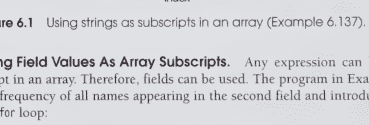

图 6.1 在数组中使用字符串作为下标（示例 6.137）。

# 使用字段值作为数组下标

任何表达式都可以用作数组的下标，因此字段也可以。示例 6.138 中的程序统计出现在第二个字段中的所有名字的频率，并引入了一种新的 `for` 循环形式：

```
for( index_value in array ) statement
```


上一个示例的 `END` 块中的 `for` 循环的工作原理如下：变量 `name` 被设置为 `count` 数组的下标值。在 `for` 循环的每次迭代之后，执行 `print` 操作，先打印下标值，再打印该元素中存储的值。（打印顺序不保证。）

# 示例 6.138

（输入文件）
```
% cat datafile4
4234 Tom 43
4567 Arch 45
2008 Eliza 65
4571 Tom 22
3298 Eliza 21
4622 Tom 53
2345 Mary 24
```

# 示例 6.138（续）

（命令行）
```
% nawk '{count[$2]++}END{for(name in count)print name,count[name] }' datafile4
```
Tom 3
Arch 1
Eliza 2
Mary 1

# 说明

`awk` 语句首先将第二个字段用作 `count` 数组的下标。下标随第二个字段的变化而变化，因此 `count` 数组的第一个下标是 `Tom`，存储在 `count["Tom"]` 中的值是 1。

接下来，`count["Arch"]` 被设置为 1，`count["Eliza"]` 被设置为 1，`count["Mary"]` 被设置为 1。当 `awk` 在第二个字段中再次遇到 `Tom` 时，`count["Tom"]` 增加，现在其值为 2。对于 `Arch`、`Eliza` 和 `Mary` 的每一次出现，都会发生同样的情况。

# 示例 6.139

（输入文件）
```
% cat datafile4
4234 Tom 43
4567 Arch 45
2008 Eliza 65
4571 Tom 22
3288 Eliza 21
4622 Tom 53
2345 Mary 24
```

（命令行）
```
% nawk '{dup[$2]++; if (dup[$2] > 1){name[$2]++} } END{print "The duplicates were\n" for (i in name)print i, name[i]}}' datafile4
```

（输出）
Tom 2
Eliza 2

# 说明

`dup` 数组的下标是第二个字段中的值，即人名。该下标对应的值的初始值为 0，每处理一条新记录就增加 1。如果名字重复，该下标对应的值会增加到 2，以此类推。如果 `dup` 数组中该下标的值大于 1，则另一个名为 `name` 的数组也会以第二个字段为下标，并记录出现次数大于 1 的名字的数量。

# 数组与 split 函数

`awk` 的内置 `split` 函数允许你将一个字符串拆分为单词并存入数组。你可以自行定义字段分隔符，也可以使用当前存储在 `FS` 中的值。

# 格式

```
split(string, array, field separator)
split (string, array)
```

# 示例 6.140

（命令行）
```
% nawk BEGIN{ split("/3/15/2004", date, "/"); print "The month is " date[1] " and the year is " date[3]; } filename
```

（输出）
The month is 3 and the year is 2004.

# 说明

字符串 `3/15/2004` 被存入数组 `date`，并使用正斜杠作为字段分隔符。现在 `date[1]` 包含 3，`date[2]` 包含 15，`date[3]` 包含 2004。字段分隔符在第三个参数中指定；如果未指定，则使用 `FS` 的值作为分隔符。

# delete 函数

`delete` 函数用于删除一个数组元素。

# 示例 6.141

```
% nawk '{line[x++]= $2}END{for(x in line) delete(line[x])}' filename
```

# 说明

赋给数组 `line` 的值是第二个字段的值。所有记录处理完毕后，特殊的 `for` 循环会遍历数组中的每个元素，`delete` 函数随后会逐一删除每个元素。

# 多维数组（nawk）

尽管 `awk` 并不正式支持多维数组，但它提供了一种语法，使其呈现出多维数组的样子。这是通过将下标连接成一个字符串来实现的，各下标之间使用特殊的内置变量 `SUBSEP` 的值分隔。`SUBSEP` 变量的值为 `"\034"`，这是一个不可打印字符，该字符十分特殊，几乎不可能作为下标字符出现。表达式 `matrix[2,8]` 实际上是数组 `matrix[2 SUBSEP 8]`，其计算结果为 `matrix["2\0348"]`。该下标成为关联数组中的一个唯一字符串。

# 示例 6.042

```
(输入文件)

1 2 3 4 5

2 3 4 5 6

6 7 8 9 10

(脚本)

1  {nf=NF}
2  for(x = 1; x <= NF; x++) {
3      matrix[NR, x] = $x
   }
4  END { for (x=1; x <= NR; x++) {
          for (y = 1; y <= nf; y++)
              printf "%d ", matrix[x,y]
          printf "\n"
       }
   }
(输出)

1 2 3 4 5
2 3 4 5 6
6 7 8 9 10
```

# 解释

- 1. 变量 `nf` 被赋值为 `NF` 的值，即字段数。（本程序假定每条记录固定有五个字段。）
- 2. 进入 `for` 循环，将行中每个字段的编号存储在变量 `x` 中。
- 3. `matrix` 数组是一个二维数组。两个索引，`NR`（当前记录编号）和 `x`，被赋值为每个字段的值。
- 4. 在 `END` 块中，使用两个 `for` 循环遍历 `matrix` 数组，并打印出存储在那里的值。此示例仅用于演示如何模拟多维数组。

#### 6.20.2 处理命令行参数（nawk）

`ARGV.` 命令行参数可通过内建数组 `ARGV` 提供给 `nawk`（`awk` 的新版本）。这些参数包括命令名称，但不包括传递给 `nawk` 的任何选项。`ARGV` 数组的索引从零开始。（这仅适用于 `nawk`。）

`ARGC.` `ARGC` 是一个内建变量，包含命令行参数的数量。

# 示例 6.143

```
(脚本)
# 脚本名：argv s
BEGIN{
    for ( i=0; i < ARGC; i++ ){
        printf("argv[%d] is %s\n", i, ARGV[i])
    }
    printf("The number of arguments, ARGC=%d\n", ARGC)
}
```

```
(输出)
% nawk -f argv s datafile
argv[0] is nawk
argv[1] is datafile
The number of arguments, ARGC=2
```

# 解释

在 `for` 循环中，`i` 被设置为零，测试 `i` 是否小于命令行参数的数量（`ARGC`），`printf` 函数依次显示遇到的每个参数。当所有参数处理完毕后，最后一个 `printf` 语句输出参数数量，即 `ARGC`。此示例说明 `nawk` 不将命令行选项计为参数。

# 示例 6.144

```
(命令行)
% nawk -f argv s datafile "Peter Pan" 12
argv[0] is nawk
argv[1] is datafile
argv[2] is Peter Pan
argv[3] is 12
The number of arguments, ARGC=4
```


# 解释

与上一个示例相同，每个参数都会被打印出来。`nawk` 命令被视为第一个参数，而 `-f` 选项和脚本名 `argv s` 则被排除在外。

## 示例 6.145

(数据文件)
```
% cat datafile5
Tom Jones:123:03/14/56
Peter Pan:456:06/22/58
Joe Blow:145:12/12/78
Santa Ana:234:02/03/66
Ariel Jones:987:11/12/66
```

(脚本)
```
% cat arging.sc
# 脚本名：arging.sc
1 BEGIN{FS=":"; name=ARGV[2]
2 print "ARGV[2] is " ARGV[2]
}
$1 ~ name { print $0 }
```

(命令行)
```
% nawk -f arging.sc datafile5 "Peter Pan"
ARGV[2] is Peter Pan
Peter Pan:456:06/22/58
nawk: can't open Peter Pan
input record number 5, file Peter Pan
source line number 2
```

# 解释

- 1. 在 `BEGIN` 块中，变量 `name` 被赋值为 `ARGV[2]` 的值，即 `Peter Pan`。
- 2. `Peter Pan` 被打印出来，但随后 `nawk` 在处理并关闭数据文件后，试图将 `Peter Pan` 作为输入文件打开。`Nawk` 将参数视为输入文件。

## 示例 6.146

(脚本)
```
% cat arging2.sc
BEGIN{FS=":"; name=ARGV[2]
print "ARGV[2] is " ARGV[2]
delete ARGV[2]
}
$1 ~ name { print $0 }
```

(命令行)
```
% nawk -f arging2.sc datafile "Peter Pan"
ARGV[2] is Peter Pan
Peter Pan:456:06/22/58
```

# 解释

`Nawk` 将 `ARGV` 数组的元素视为输入文件；一个参数使用后，它会向左移动，下一个参数被处理，直到 `ARGV` 数组为空。如果参数在使用后立即被删除，它就不会被当作下一个输入文件处理。

# 6.21 awk 内建函数

### 6.21.1 字符串函数

`sub` 和 `gsub` 函数。`sub` 函数在记录中匹配正则表达式最大且最左侧的子串，然后用替换字符串替换该子串。如果指定了目标字符串，则正则表达式匹配目标字符串中最大且最左侧的子串，并用替换字符串替换该子串。如果没有指定目标字符串，则使用整个记录。

# 格式

```
sub (regular expression, substitution string);
sub (regular expression, substitution string, target string)
```

# 示例 6.147

```
1 % nawk '{sub(/Mac/, "MacIntosh"); print}' filename
2 % nawk '{sub(/Mac/, "MacIntosh", $1); print}' filename
```

# 解释

1 当记录（`$0`）中第一次匹配正则表达式 `Mac` 时，它将被替换为字符串 `MacIntosh`。替换仅在行中第一次匹配出现时进行。（有关多次出现的情况，请参阅 `gsub`。）

2 当记录的第一个字段中第一次匹配正则表达式 `Mac` 时，它将被替换为字符串 `MacIntosh`。替换仅在目标字符串中行内第一次匹配出现时进行。`gsub` 函数会将正则表达式全局替换为字符串，即在每个记录（`$0`）中所有匹配正则表达式的位置都进行替换。

# 格式

```
gsub(regular expression, substitution string)
gsub(regular expression, substitution string, target string)
```

# `substr` 函数。

`substr` 函数返回从某个位置开始的字符串子串，其中第一个位置为 1。如果指定了子串的长度，则返回该长度的字符串；如果指定的长度超过实际字符串长度，则返回整个字符串。

# 格式

```
substr(string, starting position)
substr(string, starting position, length of string)
```

### 示例 6.151

```
% nawk ' { print substr("Santa Claus", 7, 6) } ' filename
Claus
```

# 说明

在字符串 `"Santa Claus"` 中，从第 7 个位置开始，打印长度为 6 个字符的子串。

# `match` 函数。

`match` 函数返回字符串中与正则表达式匹配的位置索引，如果没有找到则返回 0。`match` 函数会将内置变量 `RSTART` 设置为字符串中子串的起始位置，并将 `RLENGTH` 设置为到子串末尾的字符数。这些变量可与 `substr` 函数一起使用以提取模式。（仅适用于 `nawk`。）

# 格式

```
match(string, regular expression)
```

### 示例 6.152

```
% nawk 'END{start=match("Good ole USA", /[A-Z]+$/); print start}'\
filename
10
```

# 说明

正则表达式 `/[A-Z]+$/` 表示在字符串末尾搜索连续的多个大写字母。找到子串 `USA` 起点为字符串 `"Good ole USA"` 的第十个字符。如果无法匹配该字符串，则返回 0。

### 示例 6.133

```
1 % awk 'END{start=match("Good ole USA", /[A-Z]+S/);\nprint RSTART, RLENGTH}' filename
10 3
2 % awk 'BEGIN{ $line="Good ole USA"; } \
END{ match($line, /[A-Z]+S/);\nprint substr($line, RSTART, RLENGTH)}' filename
USA
```

# 说明

- 1 `match` 函数将 `RSTART` 变量设置为匹配的正则表达式的起始位置。`RLENGTH` 变量设置为子串的长度。
- 2 使用 `substr` 函数在变量 `$line` 中查找子串，并利用 `match` 函数设置的 `RSTART` 和 `RLENGTH` 值作为子串的起始位置和长度。

# `split` 函数。

`split` 函数根据指定的第三个参数作为字段分隔符，将字符串分割成一个数组。如果未提供第三个参数，`awk` 将使用 `FS` 的当前值。

# 格式

```
split (string, array, field separator)
split (string, array)
```

### 示例 6.134

```
% awk 'BEGIN{split("12/25/2001",date,",");print date[2]}' filename
25
```

# 说明

`split` 函数将字符串 `"12/25/2001"` 以斜杠 `/` 作为分隔符分割为名为 `date` 的数组。数组下标从 1 开始。打印 `date` 数组的第二个元素。

# `sprintf` 函数。

`sprintf` 函数以指定格式返回一个表达式。它允许你使用 `printf` 函数的格式规范。

# 格式

```
variable=sprintf("string with format specifiers ", expr1, expr2, ... , expr2)
```

### 示例 6.15

```
% awk '{line = sprintf ("%-15s %.2f", $1, $3); print line}' filename
```


# 说明

根据 `printf` 规范对第一个字段和第三个字段进行格式化（一个左对齐、占 15 个空格的字符串，以及一个右对齐、占 6 个字符的浮点数）。结果被赋给用户自定义变量 `line`。参见第 223 页的“`printf` 函数”。

# 6.22 内置算术函数

表 6.13 列出了内置算术函数，其中 `x` 和 `y` 是任意表达式。

| 函数 | 返回值 |
|---|---|
| `atan2(x,y)` | `y/x` 的反正切值 |
| `cos(x)` | `x` 的余弦（`x` 以弧度为单位） |
| `exp(x)` | 指数函数 `e` 的 `x` 次幂 |
| `int(x)` | `x` 的整数部分；当 `x > 0` 时向 0 截断 |
| `log(x)` | `x` 的自然（以 `e` 为底）对数 |
| `rand( )` | 随机数 `r`，其中 `0 < r < 1` |
| `sin(x)` | `x` 的正弦（`x` 以弧度为单位） |
| `sqrt(x)` | `x` 的平方根 |
| `srand(x)` | `x` 是 `rand( )` 的新种子 |

## 6.22.1 整数函数

`int` 函数截断小数点右侧的任何数字，以生成一个整数。不会进行四舍五入。

### 示例 6.156

```
% awk 'END{print 31/3}' filename
```

```
10.333
```

```
% awk 'END{print int(31/3)}' filename
```

```
10
```

#### 解释

1 在 `END` 块中，除法的结果被打印为浮点数。

2 在 `END` 块中，`int` 函数导致除法的结果在小数点处被截断。显示一个整数。

## 6.22.2 随机数生成器

`rand` 函数。`rand` 函数生成一个大于或等于 0 且小于 1 的伪随机浮点数。

### 示例 6.157

```
% awk '{print rand()}' filename
```

```
0.513871
0.175726
0.308634
```

每次程序运行时，都会打印相同的数字集。`srand` 函数可用于为 `rand` 函数提供新的起始值。否则，如本例所示，每次调用 `rand` 时都会重复相同的序列。

`srand` 函数。没有参数的 `srand` 函数使用当前时间来为 `rand` 函数生成种子。`srand(x)` 使用 `x` 作为种子。通常，`x` 应在程序运行期间变化。

### 示例 6.158

```
% nawk 'BEGIN{srand()};{print rand()}' filename
```

```
0.508744
0.639485
0.657277
```

```
% nawk 'BEGIN{srand()};{print rand()}' filename
```

```
0.133518
0.324747
0.691794
```

#### 解释

`srand` 函数为 `rand` 设置新的种子。起点是当前时间。每次调用 `rand` 时，都会打印一组新的数字。

### 示例 6.159

```
% nawk 'BEGIN{srand()};{print 1 + int(rand() * 25)}' filename
```

```
6
24
14
```

#### 解释

`srand` 函数为 `rand` 设置新的种子。起点是当前时间。`rand` 函数在 0 到 25 之间选择一个随机数并将其转换为整数值。

# 6.23 用户定义函数 (nawk)

用户定义函数可以放置在脚本中的任何位置，该位置可以放置模式动作规则。

## 格式

```
function name ( parameter, parameter, parameter, ... ) {
    statements
    return expression
    (The return statement and expression are optional)
}
```

变量按值传递，并且在使用的函数中是局部的。只使用变量的副本。数组按地址或按引用传递，因此可以在函数内部直接更改数组元素。函数内部使用的任何未在参数列表中传递的变量都被视为全局变量；也就是说，它对整个 `awk` 程序可见，如果在函数中更改，则在整个程序中都会更改。在函数内提供局部变量的唯一方法是将其包含在参数列表中。此类参数通常放在列表末尾。如果函数调用中没有提供形式参数，则该参数最初设置为 `null`。`return` 语句将控制权和可能的值返回给调用者。

### 示例 6.160

（排序前的 `grades` 文件命令行显示）
```
% cat grades
44 55 66 22 77 99
100 22 77 99 33 66
55 66 100 99 88 45
```

（脚本）
```
% Scriptname: sorter.sc
```

```
# Scriptname: sorter
# It sorts numbers in ascending order
function sort ( scores, num_elements, temp, i, j ) {
  # temp, i, and j will be local and private,
  # with an initial value of null.
  for ( i = 2; i <= num_elements; ++i ) {
    for ( j = i; scores[j-1] > scores[j]; --j ) {
      temp = scores[j]
      scores[j] = scores[j-1]
      scores[j-1] = temp
    }
  }
}
{for ( i = 1; i <= NF; i++)
  grades[i]=$i
}
sort(grades, NF)  # Two arguments are passed
{for ( j = 1; j <= NF; ++j )
  printf("%d ", grades[j])
  printf("\n")
}
```

（排序后）
```
% awk -f sorter.sc grades
22 44 55 66 77 99
22 33 66 77 99 100
45 55 66 88 99 100
```

#### 解释

+ 1. 定义了名为 `sort` 的函数。函数可以在脚本中的任何位置定义。除了作为参数传递的变量外，所有变量在函数中都是全局作用域。如果在函数中更改，它们将在整个 `awk` 脚本中更改。数组按引用传递。五个形式参数被括在括号内。`scores` 数组按引用传递，因此如果在函数内部修改数组的任何元素，原数组将被修改。变量 `num_elements` 是一个局部变量，是原变量的副本。变量 `temp`、`i` 和 `j` 是函数中的局部变量。
+ 2. 外层 `for` 循环将遍历一个数字数组，只要有至少两个数字可比较。
+ 3. 内层 `for` 循环将当前数字与 `scores[j-1]` 中的前一个数字进行比较。如果前一个数组元素大于当前元素，`temp` 将被赋值为当前数组元素的值，当前数组元素将被赋值为前一个元素的值。
+ 4. 外层循环块结束。
+ 5. 这是函数定义的结束。
+ 6. 脚本的第一个动作块从此处开始。`for` 循环遍历当前记录的每个字段，创建一个数字数组。
+ 7. 调用 `sort` 函数，传递当前记录的数字数组和当前记录的字段数。
+ 8. `sort` 函数完成后，程序控制从此处开始。`for` 循环打印排序后数组中的元素。

# 6.24 复习

除非另有说明，本节中的示例使用以下数据文件，为方便起见定期重复。

| % Cat datafile |  |  |  |  |  |  |
|---|---|---|---|---|---|---|
| northwest | NW | Joel Craig | 3.0 | .98 | 3 | 4 |
| western | WE | Sharon Kelly | 5.3 | .97 | 5 | 23 |
| southwest | SW | Chris Foster | 2.7 | .8 | 2 | 18 |
| southern | SO | May Chin | 5.1 | .95 | 4 | 15 |
| southeast | SE | Derek Johnson | 4.0 | .7 | 4 | 17 |
| eastern | EA | Susan Beal | 4.4 | .84 | 5 | 20 |
| northeast | NE | TJ Nichols | 5.1 | .94 | 3 | 13 |
| north | NO | Val Shultz | 4.5 | .89 | 5 | 9 |
| central | CT | Sherl Watson | 5.7 | .94 | 5 | 13 |

# 示例 6.161

```


`% nawk '{if ($8 > 15) { print $3 " has a high rating" } else print $3 "---NOT A COMPETITOR---"}' datafile`

```
Joel---NOT A COMPETITOR---
Sharon has a high rating
Chris has a high rating
May---NOT A COMPETITOR---
Derek has a high rating
Susan has a high rating
TJ---NOT A COMPETITOR---
Val---NOT A COMPETITOR---
Sheri---NOT A COMPETITOR---
```

## 说明

`if`语句是一种操作语句。如果表达式后面跟有多条语句，则必须使用花括号将它们括起来。（在本例中不需要花括号，因为表达式后面只有一条语句。）该表达式的含义是：如果第8个字段大于15，则打印第3个字段以及字符串`has a high rating`；否则打印第3个字段和`---NOT A COMPETITOR---`。

## 示例 6.162

```
% nawk '{ i = 1; while (i <= NF && NR < 2) { print $i; i++ } }' datafile
```

```
northwest
NW
Joel
Craig
3.0
.98
3
4
```

## 说明

用户自定义变量`i`被赋值为1。进入`while`循环并测试表达式。如果表达式计算结果为真，则执行`print`语句，打印第`i`个字段的值。先打印`i`的值，然后将`i`递增1，再重新进入循环。当`i`的值大于`NF`且`NR`的值大于等于2时，循环表达式将变为假。在处理下一条记录之前，变量`i`不会重新初始化。

```
% cat datafile
```

|    |    |    |    |    |    |    |    |
|----|----|----|----|----|----|----|----|
| northwest | NW | Joel | Craig | 3.0 | .98 | 3 | 4 |
| western | WE | Sharon | Kelly | 5.3 | .97 | 5 | 23 |
| southwest | SW | Chris | Foster | 2.7 | .8 | 2 | 18 |
| southern | SO | May | Chin | 5.1 | .95 | 4 | 15 |
| southeast | SE | Derek | Johnson | 4.0 | .7 | 4 | 17 |
| eastern | EA | Susan | Beal | 4.4 | .84 | 5 | 20 |
| northeast | NE | TJ | Nichols | 5.1 | .94 | 3 | 13 |
| north | NO | Val | Shultz | 4.5 | .89 | 5 | 9 |
| central | CT | Sheri | Watson | 5.7 | .94 | 5 | 13 |

## 示例 6.163

```
% nawk '{ for (i = 3; i <= NF && NR == 3; i++) print $i }' datafile
```

```
Chris
Foster
2.7
.8
2
18
```

## 说明

这在功能上与`while`循环类似。初始化、测试和循环控制语句都在同一个表达式中。`i`的值（`i = 3`）仅对当前记录初始化一次。接着测试表达式。如果`i`小于等于`NF`，且`NR`等于3，则执行`print`块。打印完第`i`个字段的值后，控制返回到循环表达式。`i`的值递增并重复测试。

## 示例 6.164

```
(The Command Line)
% cat nawk.sc4
# Awk script illustrating arrays
BEGIN { OFS = "\t" }
{ list[NR] = $1 }  # The array is called list. The index is
                    # the number of the current record. The value of the
                    # first field is assigned to the array element.
END { for (n = 1; n <= NR; n++) {
        print list[n]   # for loop is used to loop through the array.
     }
}
```

```
(The Command Line)
% nawk -f nawk.sc4 datafile
northwest
western
southwest
southern
southeast
eastern
northeast
north
central
```

## 说明

数组`list`使用`NR`作为索引值。每处理一行输入，第一个字段就被赋给`list`数组。在`END`块中，`for`循环遍历数组的每个元素。

## 示例 6.165

```
(The Command Line)
% cat nawk.sc5
# Awk script with special for loop
/north/ { name[count++] = $3 }
END {
    print "The number living in a northern district: " count
    print "Their names are:"
    for (i in name)   # Special nawk for loop is used to
        print name[i] # iterate through the array.
}
```

```
(The Command Line)
% nawk -f nawk.sc5 datafile
The number living in a northern district: 3
Their names are:
Joel
TJ
Val
```

## 说明

每当行中出现正则表达式`north`时，`name`数组就会获得第三个字段的值。每处理一条新记录，索引`count`都会递增，从而在数组中产生一个新元素。在`END`块中，使用特殊的`for`循环来遍历数组。

| % cat datafile |  |  |  |  |  |
|---|---|---|---|---|---|
| northwest | NW | Joel Craig | 3.0 | .98 | 3 | 4 |
| western | WE | Sharon Kelly | 5.3 | .97 | 5 | 23 |
| southwest | SW | Chris Foster | 2.7 | .8 | 2 | 18 |
| southern | SO | May Chin | 5.1 | .95 | 4 | 15 |
| southeast | SE | Derek Johnson | 4.0 | .7 | 4 | 17 |
| eastern | EA | Susan Beal | 4.4 | .84 | 5 | 20 |
| northeast | NE | TJ Nichols | 5.1 | .94 | 3 | 13 |
| north | NO | Val Shultz | 4.5 | .89 | 5 | 9 |
| central | CT | Sheri Watson | 5.7 | .94 | 5 | 13 |

## EXAMPLE 6.166

```
(The Command Line)
% cat nawk.sc6
# Awk and the special for loop
{region[$1]++} # The index is the first field of each record
END{for(item in region){
    print region[item], item
}
}
% nawk -f nawk.sc6 datafile
1 central
1 northwest
1 western
1 southeast
1 north
1 southern
1 northeast
1 southwest
1 eastern
% nawk -f nawk.sc6 datafile3
4 Mary
2 Tom
1 Alax
1 Bob
1 Sean
```


### EXPLANATION

`region`数组使用第一个字段作为索引。存储的值是每个地区出现的次数。`END`块使用`awk`的特殊`for`循环遍历名为`region`的数组。

# LAB 6: awk EXERCISE

（请参考 CD 上的名为`lab6.data`的数据库。）

`Mike Harrington:(510) 548-1278:250:100:175`
`Christian Dobbins:(408) 538-2358:155:90:201`
`Susan Dalass:(206) 654-6279:250:50:50`
`Archie McNichol:(206) 548-1348:250:100:175`
`Jody Savage:(206) 548-1278:15:188:150`
`Guy Quigley:(916) 343-6410:250:100:175`
`Dan Savage:(406) 298-7744:450:300:275`
`Nancy McNeil:(206) 548-1278:250:80:75`
`John Goldenrod:(916) 348-4278:250:100:175`
`Chet Main:(510) 548-5258:50:95:135`
`Tom Savage:(408) 926-3456:250:160:200`
`Elizabeth Stachelin:(916) 440-1763:175:75:300`

上文数据库包含姓名、电话号码以及过去三个月对党派竞选活动的资金捐助情况。

+ 1. 编写一个`nawk`脚本以生成以下报告：

```
***FIRST QUARTERLY REPORT***

***CAMPAIGN 2004 CONTRIBUTIONS***

------------------------------------------------------------
NAME              PHONE       Jan   | Feb   | Mar   | Total Donated
------------------------------------------------------------
Mike Harrington   (510) 548-1278  250.00 100.00 175.00 525.00
Christian Dobbins (408) 538-2358  155.00  90.00 201.00 446.00
Susan Dalass      (206) 654-6279  250.00  50.00  50.00 350.00
Archie McNichol   (206) 548-1348  250.00 100.00 175.00 525.00
Jody Savage       (206) 548-1278   15.00 188.00 150.00 353.00
Guy Quigley       (916) 343-6410  250.00 100.00 175.00 525.00
Dan Savage        (406) 298-7744  450.00 300.00 275.00 1025.00
Nancy McNeil      (206) 548-1278  250.00  80.00  75.00 405.00
John Goldenrod    (916) 348-4278  250.00 100.00 175.00 525.00
Chet Main         (510) 548-5258   50.00  95.00 135.00 280.00
Tom Savage        (408) 926-3456  250.00 160.00 200.00 618.00
Elizabeth Stachelin (916) 440-1763 175.00 75.00 300.00 550.00
------------------------------------------------------------
                         SUMMARY
------------------------------------------------------------
The campaign received a total of $6137.00 for this quarter.
The average donation for the 12 contributors was $511.42.
The highest total contribution was $1025.00 made by Dan Savage.
***THANKS Dan***
The following people donated over $500 to the campaign.
They are eligible for the quarterly drawing!!
Listed are their names (sorted by last names) and phone numbers:
    John Goldenrod--(916) 348-4278
    Mike Harrington--(510) 548-1278
```

`Archie McNichol--(206) 548-1348`
`Guy Quigley--(916) 343-6410`
`Dan Savage--(406) 298-7744`
`Tom Savage--(408) 926-3456`
`Elizabeth Stachelin--(916) 440-1763`
Thanks to all of you for your continued support!!

# 6.25 Odds and Ends

某些数据（例如从磁带或电子表格中读取的数据）可能没有明显的字段分隔符，而可能具有固定宽度的列。要预处理此类数据，`substr`函数很有用。

#### 6.25.1 Fixed Fields

在下面的示例中，字段是固定宽度的，但没有用字段分隔符分隔。`substr`函数用于创建字段。

# EXAMPLE 6.167

```
% cat fixed
031291ax5633(408)987-0124
021589bg2455(415)866-1345
122498de1227(916)933-1234
010187ax3458(408)264-2546
092491bd9923(415)1234-8900
112990bg4567(803)234-1456
070489qr3455(415)899-1426
```

```
% nawk '{printf substr($0,1,6) " ";printf substr($0,7,6) " ";\nprint substr($0,13,length())}' fixed
031291 ax5633 (408)987-0124
021589 bg2455 (415)866-1345
122490 de1237 (916)933-1234
010187 ax3458 (408)264-2546
092491 bd9923 (415)1234-8900
112990 bg4567 (803)234-1456
070489 qr3455 (415)899-1426
```

### EXPLANATION

第一个字段是通过获取整个记录的子字符串，从第一个字符开始，偏移 6 个位置得到的。接下来打印一个空格。第二个字段是通过获取记录的子字符串，从第 7 个位置开始，偏移 6 个位置，然后跟一个空格得到的。最后一个字段是通过获取整个记录的子字符串，从第 13 个位置开始到由该行长度表示的位置得到的。（`length`函数如果没有参数，则返回当前行`$0`的长度。）

# 空字段。

如果数据存储在定宽字段中，则可能某些字段为空。在下面的示例中，`substr`函数被用来保留字段，无论它们是否包含数据。

# 示例 6.168

```
1 % cat db
xxx xxx
xxx abc xxx
xxx a bbb
xxx   xx
% cat awkfix
# Preserving empty fields. Field width is fixed.
{
2 f[1]=substr($0,1,3)
3 f[2]=substr($0,5,3)
4 f[3]=substr($0,9,3)
5 line=sprintf("% -4s%-4s%-4s", f[1],f[2], f[3])
6 print line
}
% nawk -f awkfix db
xxx xxx
xxx abc xxx
xxx a bbb
xxx   xx
```


# 解释

- 1 文件 `db` 的内容被打印出来。文件中存在空字段。
- 2 `f` 数组的第一个元素被赋值为记录的子字符串，从位置 1 开始，偏移量为 3。
- 3 `f` 数组的第二个元素被赋值为记录的子字符串，从位置 5 开始，偏移量为 3。
- 4 `f` 数组的第三个元素被赋值为记录的子字符串，从位置 9 开始，偏移量为 3。
- 5 数组的元素在经过 `sprintf` 函数格式化后被赋给用户自定义变量 `line`。
- 6 `line` 的值被打印出来，且空字段得以保留。

# 带有 $、逗号或其他字符的数字。

在下面的示例中，价格字段包含美元符号和逗号。脚本必须消除这些字符以便将价格相加得到总成本。这是通过使用 `gsub` 函数完成的。

# 示例 6.169

```
% cat vendor

access tech:gp237221:220:vax789:20/20/11/90:$1,043.00

alisa systems:bp262292:280:macintosh:new updates:06/30/91:$456.00

alisa systems:gp23435:260:vax8700:alisa talk:02/01/91:$1,598.50

apple computer:zx342567:240:mcs:e-mail:06/25/90:$375.75

caci:gp62313:280:sparc station:network11.5:05/12/91:$1,259.75

datalogics:bp134255:260:microvax2:pagestation maint:07/01/90:$1,200.00

dec:zx354612:220:microvax2:vms sms:07/20/90:$1,350.00

% awk -F '{gsub(/\$/, ""); gsub(/,/,''); cost +=$7};\nEND{print "The total is $" cost}' vendor

$7474
```

# 解释

第一个 `gsub` 函数将字面美元符号（`$`）全局替换为空字符串，第二个 `gsub` 函数将逗号替换为空字符串。然后用户自定义的 `cost` 变量通过将第七个字段加到 `cost` 上并将结果赋回给 `cost` 来进行累加。在 `END` 块中，字符串 `The total is $` 被打印出来，后跟 `cost` 的值。

> a. 有关如何在程序中重新添加逗号的详细信息，请参阅 Alfred V. Aho、Brian W. Kernighan 和 Peter J. Weinberger 所著的 The AWK Programming Language（波士顿：Addison-Wesley，1988），第 72 页

#### 6.25.2 多行记录

到目前为止使用的示例数据文件中，每条记录都单独占一行。在下面的示例数据文件 `checkbook` 中，记录由空行分隔，字段由换行符分隔。为了处理此文件，记录分隔符 `RS` 被赋值为 null，字段分隔符 `FS` 被赋值为换行符。

# 示例 6.170

```
（输入文件）

% cat checkbook

1/1/04

#125

-695.00

Mortgage

1/1/04

#126

-56.89

PCGE

1/2/04

#127

-89.99

Safeway

1/3/04

+750.00

Paycheck

1/4/04

#128

-60.00

Visa
```

```
（脚本）

% cat awkchecker

1 BEGIN{RS=""; FS="\n"; ORS="\n\n"}
2 {print NR, $1,$2,$3,$4}
```

```
（输出）

% nawk -f awkchecker checkbook

1 1/2/04 #125 -695.00 Mortgage

2 1/2/04 #126 -56.89 PG&E

3 1/2/04 #127 -89.99 Safeway

4 1/3/04 +750.00 Paycheck

5 1/4/04 #128 -60.00 Visa
```

# 解释

- 1. 在 `BEGIN` 块中，记录分隔符 `RS` 被赋值为 null，字段分隔符 `FS` 被赋值为换行符，输出记录分隔符 `ORS` 被赋值为两个换行符。现在每一行都是一个字段，每个输出记录由两个换行符分隔。
- 2. 记录的编号被打印出来，后跟每个字段。

#### 6.25.3 生成表单信件

下面的示例改编自 The AWK Programming Language 中的一个程序。其棘手之处在于跟踪实际正在处理的内容。输入文件名为 `data.form`。它仅包含数据。输入文件中的每个字段由冒号分隔。另一个文件名为 `form.letter`。它是用于创建信件的实际表单。此文件通过 `getline` 函数加载到 `awk` 的内存中。表单信件的每一行都存储在一个数组中。该程序从 `data.form` 获取数据，并通过用 `form.letter` 中以 `#` 和 `$` 开头的特殊字符串的实际数据进行替换来创建信件。临时变量 `temp` 保存数据替换后实际显示的行。此程序允许你为 `data.form` 中列出的每个人创建个性化的表单信件。

# 示例 6.171

```
（Awk 脚本）

% cat form.awk

# form.awk is an awk script that requires access to 2 files: The
# first file is called "form.letter." This file contains the
# format for a form letter. The awk script uses another file,
# "data.form," as its input file. This file contains the
# information that will be substituted into the form letters in
# the place of the numbers preceded by pound signs. Today's date
# is substituted in the place of "$date" in "form.letter."

1 { BEGIN { FS=":"; n=1 }
2 while(getline < "form.letter" > 0) {
3   form[n++]= $0  # Store lines from form.letter in an array
4   "date" | getline d; split(d, today, " ")
# Output of date is Fri Mar 2 14:35:50 PST 2004
5   thisday=today[2] "," today[3] "," today[6]
6 }
7 { for( i = 1; i <= n; i++ ) {
8   temp=form[i]
9   for ( j = 1; j <=NF; j++ ) {
10    gsub("$date", thisday, temp)
    gsub("#" j, $j, temp )
11  }
    print temp
  }
}
```

# 示例 6.171（续）

```
% cat form.letter
```

格式信函 `form.letter` 如下所示：

**************************************************
主题：项目“#1”状态报告
收件人：#2
发件人：#3
日期：@date
这封信是要告诉你，#2，项目“#1”目前进展正常。
我们预计一切将按计划于 #4 完成并准备发货。

谨致敬意！

#3
**************************************************

文件 `data.form` 是 `awk` 的输入文件，其中包含将替换 `form.letter` 中 `#1-4` 和 `@date` 的数据。

```
% cat data.form
```

Dynamo:John Stevens:Dana Smith, Mgr:4/12/2004
Callactius:Guy Sterling:Dana Smith, Mgr:5/18/2004

（命令行）

```
% nawk -f form.awk data.form
```


**************************************************
主题：项目“Dynamo”状态报告
收件人：John Stevens
发件人：Dana Smith, Mgr
日期：2004 年 3 月 2 日
这封信是要告诉你，John Stevens，项目“Dynamo”目前进展正常。
我们预计一切将按计划于 4/12/2001 完成并准备发货。
谨致敬意！

Dana Smith, Mgr
主题：项目“Callactius”状态报告
收件人：Guy Sterling
发件人：Dana Smith, Mgr
日期：2004 年 3 月 2 日
这封信是要告诉你，Guy Sterling，项目“Callactius”目前进展正常。
我们预计一切将按计划于 5/18/2004 完成并准备发货。

谨致敬意！

Dana Smith, Mgr

# 说明

- 1. 在 `BEGIN` 块中，字段分隔符（`FS`）被赋值为冒号，用户定义变量 `n` 被赋值为 1。
- 2. 在 `while` 循环中，`getline` 函数从名为 `form.letter` 的文件中一次读取一行。如果 `getline` 找不到该文件，则返回 -1。当到达文件末尾时，它返回 0。因此，通过测试返回值是否大于 1，我们可以知道该函数是否已从输入文件中读入一行。
- 3. `form.letter` 中的每一行都被赋给一个名为 `form` 的数组。
- 4. UNIX/Linux 的 `date` 命令的输出通过管道传递给 `getline` 函数，并赋给用户定义变量 `d`。然后，`split` 函数使用空白字符分割变量 `d`，创建一个名为 `today` 的数组。
- 5. 用户定义变量 `thisday` 被赋值为月份、日期和年份。
- 6. `BEGIN` 块结束。
- 7. `for` 循环将循环 `n` 次。
- 8. 用户定义变量 `temp` 被赋值为 `form` 数组中的一行。
- 9. 嵌套的 `for` 循环会遍历输入文件 `data.form` 中的一行，共循环 `NF` 次。`temp` 变量中存储的每一行都会检查字符串 `@date`。如果匹配到 `@date`，`gsub` 函数会将其替换为今天的日期（存储在 `thisday` 中的值）。
- 10. 如果存储在 `temp` 中的行包含 `#` 和一个数字，`gsub` 函数会将该 `#` 和数字替换为输入文件 `data.form` 中对应字段的值。例如，如果正在测试存储的第一行，则 `#1` 会被替换为 Dynamo，`#2` 会被替换为 John Stevens，`#3` 会被替换为 Dana Smith，`#4` 会被替换为 4/12/2004，依此类推。
- 11. 替换完成后，打印存储在 `temp` 中的行。

## 6.25.4 与 Shell 的交互

现在你已经了解了 `awk` 的工作方式，你会发现，在编写 shell 脚本时，`awk` 是一个非常强大的实用工具。你可以将单行 `awk` 命令或 `awk` 脚本嵌入 shell 脚本中。下面是一个嵌入了 `awk` 命令的 Korn shell 程序示例。

### 示例 6.172

```
#!/bin/ksh

# This korn shell script will collect data for awk to use in

# generating form letter(s). See above.

print "Hello $LOGNAME."

print "This report is for the month and year:"

1 cal | nawk 'NR==1{print $0}'

if [[ -f data.form || -f formletter? ]]

then

  rm data.form formletter? 2> /dev/null

fi

integer num=1

while true

do

  print "Form letter #$num:"

  read project?"What is the name of the project? "

  read sender?"Who is the status report from? "

  read recipient?"Who is the status report to? "

  read due_date?"What is the completion date scheduled? "

  echo $project:$recipient:$sender:$due_date >> data.form

  print -n "Do you wish to generate another form letter? "

  read answer

  if [[ "$answer" != [Yy]* ]]

  then

    break

  else

2   nawk -f form.awk data.form > formletter$num

  fi

  (( num+=1 ))

done

nawk -f form.awk data.form > formletter$num
```

# 说明

- 1 UNIX 的 `cal` 命令通过管道传递给 `nawk`。其中包含当前月份和年份的第一行会被打印出来。
- 2 `nawk` 脚本 `form.awk` 会生成格式信函，并将其重定向到 UNIX 文件中。

# LAB 7: nawk 练习

（参考 CD 上的名为 `lab7.data` 的数据库。）

Mike Harrington:(510) 548-1278.250:100:175
Christian Dobbins:(408) 538-2358:155:90:201
Susan Dalsass:(206) 654-6279:250:60:50
Archie McNichol:(206) 548-1348:250:100:175
Jody Savage:(206) 548-1278:15:188:150
Guy Quigley:(916) 343-6410:250:100:175
Dan Savage:(406) 298-7744:450:300:275
Nancy McNeil:(206) 548-1278:250:80:75
John Goldenrod:(916) 348-4278:250:100:175
Chet Main:(510) 548-5258:50:95:135
Tom Savage:(408) 926-3456:250:168:200
Elizabeth Stachelin:(916) 440-1763:175:75:300

数据库包含姓名、电话号码以及过去三个月对党派竞选的资金捐助。编写一个用户自定义函数来返回给定月份所有捐助的平均值。月份将通过命令行传入。

# 6.26 awk 内置函数

除非另有说明，本节中的示例使用以下数据文件，为方便起见会定期重复。

| % cat datafile |  |  |  |  |  |
|---|---|---|---|---|---|
| northwest | NW | Joel Craig | 3.0 | .98 | 3 | 4 |
| western | WE | Sharon Kelly | 5.3 | .97 | 5 | 23 |
| southwest | SW | Chris Foster | 2.7 | .8 | 2 | 18 |
| southern | SO | May Chin | 5.1 | .95 | 4 | 15 |
| southeast | SE | Derek Johnson | 4.0 | .7 | 4 | 17 |
| eastern | EA | Susan Beal | 4.4 | .84 | 5 | 20 |
| northeast | NE | TJ Nichols | 5.1 | .94 | 3 | 13 |
| north | NO | Val Shultz | 4.5 | .89 | 5 | 9 |
| central | CT | Sheri Watson | 5.7 | .94 | 5 | 13 |

## 6.26.1 字符串函数

### 示例 6.173

```
% nawk 'NR==1{gsub(/northwest/,"southeast", $1);print}' datafile
```

southeast NW Joel Craig 3.0 .98 3 4

# 解释

如果这是第一条记录（`NR == 1`），则全局将正则表达式 `northwest` 替换为 `southeast`，如果在第一个字段中找到 `northwest`。

### 示例 6.174

```
% nawk 'NR==1{print substr($3, 1, 3)}' datafile
```

Joe

# 解释

如果这是第一条记录，则显示第三个字段的子字符串，从第一个字符开始，提取长度为 3 个字符。子字符串 `Joe` 被打印。

### 示例 6.175


`% nawk 'NR==1{print length($1)}' datafile`

```
9
```

# 解释

如果这是第一条记录，则打印第一个字段中的长度（字符数）。

# 示例 6.176

`% nawk 'NR==1{print index($1,"west")}' datafile`

```
6
```

# 解释

如果这是第一条记录，则打印第一个字段中子字符串 `west` 首次出现的位置。字符串 `west` 从第六个位置（索引）开始出现在字符串 `northwest` 中。

以下 `datafile2` 用于示例 6.179。

`% cat datafile2`

```
Joel Craig:northwest:NW:3.0:.98:3:4
Sharon Kelly:western:WE:5.3:.97:5:23
Chris Foster:southwest:SW:2.7:.8:2:18
May Chin:southern:SO:5.1:.95:4:15
Derek Johnson:southeast:SE:4.0:.7:4:17
Susan Beal:eastern:EA:4.4:.84:5:20
TJ Nichols:northeast:NE:5.1:.94:3:13
Val Shultz:north:NO:4.5:.89:5:9
Sheri Watson:central:CT:5.7:.94:5:13
```

# 示例 6.179

`% awk -F: '/north/{split($1, name, " ");\nprint "First name: " name[1];\nprint "Last name: " name[2];\nprint "\n----------------"}' datafile2`

```
First name: Joel
Last name: Craig
----------------
First name: TJ
Last name: Nichols
----------------
First name: Val
Last name: Shultz
----------------
```

# 解释

输入字段分隔符设置为冒号（`-F:`）。如果记录包含正则表达式 `north`，则第一个字段被拆分为名为 `name` 的数组，其中空格为分隔符。数组的元素被打印。

## 6.26.2 使用 gawk 的时间函数

`gawk` 提供了两个用于获取时间和格式化时间戳的函数：`systime` 和 `strftime`。

### systime 函数

`systime` 函数返回自 1970 年 1 月 1 日（称为 Epoch）以来，非闰年秒数表示的当天时间。

#### 格式

```
systime()
```

#### 示例 6.182

`% awk 'BEGIN{now=systime(); print now}'`

```
939515282
```

#### 解释

`systime` 函数的返回值被赋给用户定义的变量 `now`。该值是自 1970 年 1 月 1 日以来，非闰年秒数表示的当天时间。

### strftime 函数

`strftime` 函数使用 C 库 `strftime` 函数格式化时间。格式规范的形式为 `%T`、`%D` 等（参见表 6.14）。时间戳的形式与 `systime` 的返回值相同。如果省略时间戳，则默认使用当前时间。

#### 表 6.14 日期和时间格式规范

| 日期格式 | 定义 |
|---|---|
| 对于以下定义，假设当前日期和时间如下：日期：2004 年 10 月 17 日星期日 时间：15:26:26 PDT |
| `%a` | 星期几的缩写名称（Sun） |
| `%A` | 星期几的全称（Sunday） |
| `%b` | 月份的缩写名称（Oct） |
| `%B` | 月份的全称（October） |
| `%c` | 区域设置的日期和时间（Sun Oct 17 15:26:46 2004） |
| `%d` | 十进制表示的月份中的天数（17） |
| `%D` | 日期格式为 10/17/04 |
| `%e` | 月份中的天数，如果只有一位则用空格填充 |

#### 解释

`strftime` 函数根据作为参数提供的格式说明来格式化时间和日期。（参见表 6.14。）如果 `systime` 作为第二个参数给出或根本没有给出参数，则假定为此区域设置的当前时间。如果给出第二个参数，则它必须与 `systime` 函数的返回值格式相同。

下一节中的示例使用以下数据文件 `database`，为方便起见会定期重复。

| `% cat datafile` |   |   |   |   |   |   |
| --- | --- | --- | --- | --- | --- | --- |
| northwest | NW | Joel Craig | 3.0 | .98 | 3 | 4 |
| western | WE | Sharon Kelly | 5.3 | .97 | 5 | 23 |
| southwest | SW | Chris Foster | 2.7 | .8 | 2 | 18 |
| southern | SO | May Chin | 5.1 | .95 | 4 | 15 |
| southeast | SE | Derek Johnson | 4.0 | .7 | 4 | 17 |
| eastern | EA | Susan Beal | 4.4 | .84 | 5 | 20 |
| northeast | NE | TJ Nichols | 5.1 | .94 | 3 | 13 |
| north | NO | Val Shultz | 4.5 | .89 | 5 | 9 |
| central | CT | Sheri Watson | 5.7 | .94 | 5 | 13 |

## 6.26.3 命令行参数

### 示例 6.184

`% cat argv$.sc`

```
# Testing command-line arguments with ARGV and ARGC using a for loop.
BEGIN{
    for(i=0;i < ARGC;i++)
        printf("argv[%d] is %s\n", i, ARGV[i])
        printf("The number of arguments, ARGC=%d\n", ARGC)
}
```

`% nawk -f argv$.sc datafile`

```
argv[0] is nawk
argv[1] is datafile
The number of arguments, ARGC=2
```

#### 解释

`BEGIN` 块包含一个 `for` 循环来处理命令行参数。`ARGC` 是参数的数量，`ARGV` 是一个包含实际参数的数组。`Awk` 不将选项计为参数。在此示例中，唯一有效参数是 `nawk` 命令和输入文件 `datafile`。

`% cat datafile`

```
northwest NW Joel Craig 3.0 .98 3 4
western WE Sharon Kelly 5.3 .97 5 23
southwest SW Chris Foster 2.7 .8 2 18
southern SO May Chin 5.1 .95 4 15
southeast SE Derek Johnson 4.0 .7 4 17
eastern EA Susan Beal 4.4 .84 5 20
northeast NE TJ Nichols 5.1 .94 3 13
north NO Val Shultz 4.5 .89 5 9
central CT Sheri Watson 5.7 .94 5 13
```

### 示例 6.185

```
1 % nawk 'BEGIN{name=ARGV[1];}
$0 ~ name {print $3, $4}' "Derek" datafile
nawk: can't open Derek
source line number 1
2 % nawk 'BEGIN{name=ARGV[1]; delete ARGV[1];}
$0 ~ name {print $3, $4}' "Derek" datafile
Derek Johnson
```

#### 解释

- **1.** 名称 `"Derek"` 在 `BEGIN` 块中被赋给变量 `name`。在模式-动作块中，`nawk` 尝试将 `"Derek"` 作为输入文件打开并失败。
- **2.** 将 `"Derek"` 赋给变量 `name` 后，`ARGV[1]` 被删除。开始模式-动作块时，`nawk` 不会尝试将 `"Derek"` 作为输入文件打开，而是改为打开 `datafile`。

## 6.26.4 读取输入 (getline)

### 示例 6.186

`% nawk 'BEGIN{ "date" | getline d; print d }' datafile`

```
Mon Jan 15 11:24:24 PST 2004
```


# 解释

UNIX/Linux `date` 命令通过管道传递给 `getline` 函数。结果存储在变量 `d` 中并打印。

### 示例 6.187

```
% nawk 'BEGIN{ "date" | getline d; split( d, mon ); print mon[2] }' datafile
```

Jan

# 解释

UNIX/Linux `date` 命令通过管道传递给 `getline` 函数，结果存储在 `d` 中。`split` 函数将字符串 `d` 拆分为名为 `mon` 的数组。打印该数组的第二个元素。

### 示例 6.188

```
% nawk 'BEGIN{ printf "Who are you looking for? "; getline name < "/dev/tty" }'
```

# 解释

输入从终端 `/dev/tty` 读取并存储在名为 `name` 的变量中。

### 示例 6.189

```
% nawk 'BEGIN{ while (getline < "/etc/passwd" > 0) lc++; print lc }' datafile
```

16

# 解释

`while` 循环用于一次一行地遍历 `/etc/passwd` 文件。每次进入循环时，`getline` 读取一行并递增变量 `lc` 的值。循环退出时，`lc` 的值被打印（即 `/etc/passwd` 文件中的行数）。只要 `getline` 的返回值不是 0（即已读取一行），循环就会继续。

#### 6.26.5 控制函数

### 示例 6.190

```
% nawk '{if ($5 >= 4.5) next; print $1}' datafile
```

northwest

southwest

southeast

eastern

north

# 解释

如果第五个字段大于或等于 4.5，则从输入文件 `datafile` 读取下一行，并从 `awk` 脚本开头开始处理（`BEGIN` 块之后）。否则，打印第一个字段。

```
% cat datafile
northwest NW Joel Craig 3.0 .98 3 4
western WE Sharon Kelly 5.3 .97 5 23
southwest SW Chris Foster 2.7 .8 2 18
southern SO May Chin 5.1 .95 4 15
southeast SE Derek Johnson 4.0 .7 4 17
eastern EA Susan Beal 4.4 .84 5 20
northeast NE TJ Nichols 5.1 .94 3 13
north NO Val Shultz 4.5 .89 5 9
central CT Sheri Watson 5.7 .94 5 13
```

# 示例 6.191

```
% nawk '{if ($2 =~ /5/) {print ; exit 0}}' datafile
```

southwest SW Chris Foster 2.7 .8 2 18

```
% echo $status (csh) or echo $? (sh or ksh)
```

0

# 说明

如果第二个字段包含5，则打印该记录并且`awk`程序退出。C shell的状态变量包含退出值。如果使用Bourne或Korn shell，则`$?`变量包含退出状态。

#### 6.2.6 用户自定义函数

# 示例 6.192

```
(The Command Line)
% cat nawk.sc7
```
```
1 BEGIN{largest=0}
2 {maximum=max($5)}
3 function max ( num ) {
4   if ( num > largest) {largest=num}
5   return largest
6 }
6 END{ print "The maximum is " maximum "."}
```
```
% nawk -f nawk.sc7 datafile
```

The maximum is 5.7.

# 说明

- 1. 在`BEGIN`块中，用户自定义变量`largest`被初始化为0。
- 2. 对于文件中的每一行，变量`maximum`被赋值为函数`max`返回的值。函数`max`以`$5`作为其参数。
- 3. 定义用户自定义函数`max`。函数语句用花括号括起来。每次从输入文件`datafile`读取新记录时，都将调用函数`max`。
- 4. 它将比较`num`和`largest`中的值，并返回两个数中较大的一个。
- 5. 函数定义块结束。
- 6. `END`块打印`maximum`中的最终值。

#### 6.26.7 awk/gawk 命令行选项

`Awk`有许多命令行选项。`Gawk`有两种命令行选项格式：GNU长格式，以双破折号（`--`）加单词开头；以及传统的短POSIX格式，由一个破折号和一个字母组成。`Gawk`特有的选项通过`-W`选项或其对应的长选项来使用。提供给长选项的任何参数要么用`=`号连接（中间没有空格），要么在下一个命令行参数中提供。`gawk`的`--help`选项（参见示例6.193）列出了所有`gawk`选项。参见表6.15。

# 示例 6.193

```
% awk --help
```
```
Usage: awk [POSIX or GNU style options] -F progfile [--] file ...
      awk [POSIX or GNU style options] [--] 'program' file ...
POSIX options:          GNU long options:
  -f progfile           --file=progfile
  -F fs                 --field-separator=fs
  -v var=val            --assign=var=val
  -m[f|r] val
  -W compat             --compat
  -W copyleft            --copyleft
  -W copyright           --copyright
  -W help                --help
  -W lint                --lint
  -W lint-old            --lint-old
  -W posix               --posix
  -W re-interval         --re-interval
  -W source-program-text --source=program-text
  -W traditional         --traditional
  -W usage               --usage
  -W version             --version
```


# 示例 6.193（续）

> 请将bug报告发送至`bug-gnu-utils@prep.ai.mit.edu`，并且抄送`arnold@gnu.ai.mit.edu`

## 表6.15 `awk` 命令行选项

| 选项 | 含义 |
|---|---|
| `-F fs`,<br>`--field-separator fs` | 指定输入字段分隔符，其中`fs`可以是字符串或正则表达式；例如，`FS=";"`或`FS="\t"`。 |
| `-v var=value`,<br>`--assign var=value` | 在`awk`脚本开始执行之前，将值赋给用户自定义变量`var`。可用于`BEGIN`块。 |
| `-f scriptfile`,<br>`--file scriptfile` | 从脚本文件读取`awk`命令。 |
| `-mf nnn`,<br>`-mr nnn` | 将内存限制设置为`nnn`的值。使用`-mf`选项时，将字段的最大数量限制为`nnn`；使用`-mr`选项时，设置记录的最大数量。不适用于`awk`。 |
| `-W traditional`,<br>`-W compat`,<br>`--traditional`,<br>`--compat` | 以兼容模式运行，使`gawk`的行为与UNIX版本的`awk`完全一致。所有`gawk`扩展都被忽略。两种模式作用相同；`--traditional`是首选。 |
| `-W copyleft`,<br>`-W copyright`,<br>`--copyleft` | 打印版权信息的简要版本。 |
| `-W help`,<br>`-W usage`,<br>`--help`,<br>`--usage` | 打印可用的`awk`选项及其功能的简短摘要。 |
| `-W lint`,<br>`--lint` | 打印关于使用可能无法移植到传统UNIX `awk`版本的构造的警告。 |
| `-W lint-old`,<br>`--lint-old` | 提供关于无法移植到原始UNIX实现版本的构造的警告。 |
| `-W posix`,<br>`--posix` | 打开兼容模式。不识别`\x`转义序列、不识别当`FS`被赋值为单个空格时将换行符作为字段分隔符、不识别函数关键字`func`、不识别用运算符`&&`和`||`替换`^`和`^=`，以及`fflush`。 |
| `-W re-interval`,<br>`--re-interval` | 允许使用间隔正则表达式（参见第176页的“POSIX字符类”）；即括号表达式，如`a{1alpha}`。 |

# 交互式 Bourne shell

## 7.1 简介

当你在命令行工作时，就是在以交互方式使用 shell。shell 有一个特殊的内建变量，其中包含一串选项。如果其中一个选项是字母 `i`，则表示 shell 正在以交互方式运行。要测试这一点，请在提示符下输入以下小脚本：

```
case "$-" in
* i*) echo This shell is interactive ;;
*) echo This shell is not interactive ;;
esac
```

Bourne shell 为你在命令行上的工作提供了许多让生活更轻松的特性。尽管 Bourne shell 在这方面不如本书讨论的其他 shell 那样强大，但它提供了文件名扩展、I/O 重定向、命令替换、函数以及许多其他功能。一旦你熟悉了交互式 shell，你就可以开始在 shell 脚本中使用这些功能了。

如果 Bourne shell 是你的登录 shell，那么在看到 shell 提示符之前，它会经历一系列进程（见图 7.1）。

下面是一个非常粗略的流程描述：首先运行的进程称为 `init`，PID 为 1。它从名为 `/etc/inittab` 的文件（System V）获取指令，或者它会产生一个 `getty` 进程（BSD）。这些进程打开终端端口，为标准输入提供来源，为标准输出和错误输出去向提供位置，并在你的屏幕上显示登录提示。然后执行 `/bin/login` 程序。登录程序提示输入密码，加密并验证密码，建立初始环境，然后启动登录 shell `/bin/sh`，它是 `passwd` 文件中的最后一项。`sh` 进程查找系统文件 `/etc/profile` 并执行其命令。然后它在用户的主目录中查找名为 `.profile` 的初始化文件。执行完 `.profile` 中的命令后，默认的美元符号（`$`）提示符出现在屏幕上，Bourne shell 等待命令。当然，如今大多数系统启动时都带有图形用户界面

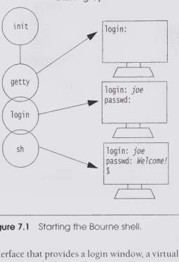

图 7.1 启动 Bourne shell。

该界面提供了登录窗口、虚拟桌面和子菜单，以启动 shell 终端和其他应用程序。这比图 7.1 所示的设置更复杂，但一旦用户选择了终端窗口，就会出现提示符，shell 将等待命令。

## 7.2 环境

进程的环境由变量、打开的文件、当前工作目录、函数、资源限制、信号等组成。它定义了那些在 shell 之间继承的特性，以及工作环境的配置。用户 shell 的配置在 shell 初始化文件中定义。

### 7.2.1 初始化文件

Bourne shell 程序启动后，首先检查系统文件 `/etc/profile`。执行该初始化文件中的命令后，再执行用户主目录中的 `.profile`。初始设置的骨架文件可以在 `/etc/skel`（SVR4）中找到。

#### `/etc/profile` 文件

`/etc/profile` 文件是由系统管理员设置的系统级初始化文件，用于在用户登录时执行任务。它在 Bourne shell 启动时执行。系统上的所有 Bourne 和 Korn shell 用户都可以使用它，它通常执行检查邮件假脱机程序是否有新邮件、显示来自 `/etc/motd` 文件的每日消息等任务。（完成本章后，以下示例将更容易理解。）

# 示例 7.1

```
(Sample /etc/profile)

# The profile that all logins get before using their own .profile

1  trap "" 2 3

2  export LOGNAME PATH

3  if [ "$TERM" = "" ]
    then
        if /bin/i386
        then
            TERM=AT386   # Sets the terminal
        else
            TERM=sun
        fi
    export TERM
fi

# Login and -su shells get /etc/profile services.
# -rsh is given its environment in its own .profile.

4  case "$0" in
    -sh | -ksh | -jsh )
5      if [ ! -f .hushlogin ]
        then
            /usr/sbin/quota
            # Allow the user to break the Message-Of-The-Day only.
6      trap "trap "" 2" 2
7      /bin/cat -s /etc/motd
      # Message of the day displayed
8      trap "" 2
      /bin/mail -E   # Checks for new mail
9      case $? in
        0)
            echo "You have new mail."
            ;;
        2)
            echo "You have mail."
            ;;
        esac
        fi
    esac

10 umask 022
11 trap 2 3
```


### EXPLANATION

+ 1 `trap` 命令控制着程序运行期间进入该程序的信号。如果在程序执行期间发送信号 2（Ctrl-C）或 3（Ctrl-\），这些信号将被忽略。
+ 2 变量 `LOGNAME` 和 `PATH` 被导出，以便从该进程启动的子 shell 中知道它们的值。
+ 3 执行命令 `/bin/i386`。如果命令的退出状态为 0，则终端变量 `TERM` 被赋值为 `A7386`；如果不是，则 `TERM` 变量被赋值为 `sun`。
+ 4 如果 `$0` 的值，即运行 `/etc/profile` 文件的程序的名称，是登录 Bourne、Bourne 或 job shell，则将执行以下命令。
+ 5 如果 `.hushlogin` 文件不存在，则 `quota` 将运行以显示磁盘使用警告，如果使用超过配额。
+ 6 `trap` 被重置，以便用户可以用 Ctrl-C 终止每日消息（motd）。
+ 7 在显示完每日消息后，`trap` 被重置以忽略 Ctrl-C。
+ 8 `mail` 程序检查是否有新的传入邮件。
+ 9 如果 `mail` 程序的退出状态（？）为 0 或 2，则分别显示消息 `You have new mail.` 或 `You have mail.`。
+ 10 `umask` 命令被设置为确定文件和目录在创建时的初始权限。
+ 11 `trap` 命令将信号 2 和 3 设置回默认值；也就是说，如果出现 Ctrl-C 或 Ctrl-\，则终止程序。

# The .profile File.

`.profile` 文件是一个用户定义的初始化文件，在登录时执行一次，位于你的主目录中。它使你能够自定义和修改 shell 环境。环境和终端设置通常放在这里，如果要启动窗口应用程序或数据库应用程序，则在此启动。本章进展过程中将详细讨论此文件中的设置，但此处对文件中的每一行进行简要概述。

# EXAMPLE 7.2

```
(Sample .profile)

1 TERM=vt102

2 HOSTNAME=`uname -n`

3 EDITOR=/usr/ucb/vi

4 PATH=/bin:/usr/ucb:/usr/bin:/usr/local/etc:/bin:/usr/bin:.

5 PS1="HOSTNAME $> "

6 export TERM HOSTNAME EDITOR PATH PS1

7 stty erase Ah

8 go () { cd $1; PS1=`pwd`; PS1=`basename $PS1`; }

9 trap '$HOME/.logout' EXIT

10 clear
```

### EXPLANATION

+ 1 `TERM` 变量被赋值为终端类型 `vt102`。
+ 2 因为 `uname -n` 命令被反引号括起来，shell 将执行命令替换；也就是说，命令的输出（主机名）将被赋给变量 `HOSTNAME`。
+ 3 `EDITOR` 变量被赋值为 `/usr/ucb/vi`。诸如 `mail` 之类的程序在定义编辑器时现在将可以使用此变量。
+ 4 `PATH` 变量被赋值为 shell 搜索以找到 UNIX/Linux 程序的目录条目。例如，如果你输入 `ls`，shell 将搜索 `PATH`，直到在列出的目录之一中找到该程序。如果从未找到该程序，shell 将告诉你。
+ 5 主提示被赋值为 `HOSTNAME`，即机器名，以及 `$` 和 `>` 符号。
+ 6 列出的所有变量都被导出。它们将被从此 shell 启动的子进程所知。
+ 7 `stty` 命令设置终端选项。`erase` 键被设置为 `^h`，因此当你按下 Backspace 键时，光标前输入的字母将被擦除。
+ 8 定义了一个名为 `go` 的函数。此函数的目的是接受一个参数，即目录名，`cd` 到该目录，并将主提示设置为当前工作目录。`basename` 命令删除路径中除最后一个条目之外的所有内容。提示将显示你当前的目录。
+ 9 `trap` 命令是信号处理命令。当你退出 shell，即注销时，`.logout` 文件将被执行。
+ 10 `clear` 命令清除屏幕。

#### 7.2.2 The Prompts

在使用交互方式时，shell 会提示你输入。当你看到提示时，你就知道可以开始输入命令。Bourne shell 提供两个提示：主提示，即美元符号（`$`），和次提示，即右尖括号符号（`>`）。提示在 shell 交互运行时显示。你可以更改这些提示。变量 `PS1` 是主提示，初始设置为美元符号。主提示在你登录时出现，shell 等待你输入命令。变量 `PS2` 是次提示，初始设置为右尖括号字符。如果你在部分输入命令后按下回车，则会出现该提示。你可以更改主提示和次提示。

### The Primary Prompt.

美元符号是默认的主提示。你可以更改你的提示。通常提示在 `.profile` 中定义，即用户初始化文件。

### EXAMPLE 7.3

```
1  $ PS1="`uname -n` > "

2  chargers >
```

### EXPLANATION
- 1 默认的主提示符是美元符号（`$`）。`PS1` 提示符被重置为机器名称（`uname -n`）和一个 `>` 符号。（不要混淆反引号和单引号。）
- 2 新的提示符被显示。

次要提示符。`PS2` 提示符是次要提示符。其值显示到标准错误，默认情况下为屏幕。当你尚未完成一条命令并按下回车时，该提示符会出现。

# EXAMPLE 7.4

```
1  $ echo "Hello

2  > there"

3  Hello

    there

4  $

5  $ PS2=">---> "

6  $ echo 'Hi

7  ----->

    -----> there'

    Hi

    there

    $
```

### EXPLANATION
- 1 双引号必须在字符串 `"Hello` 之后匹配。
- 2 当输入换行时，次要提示符会出现。在输入闭合双引号之前，次要提示符会一直显示。
- 3 `echo` 命令的输出被显示。
- 4 主提示符被显示。
- 5 次要提示符被重置。
- 6 单引号必须在字符串 `'Hi` 之后匹配。
- 7 当输入换行时，新的次要提示符会出现。在输入闭合单引号之前，次要提示符会一直显示。

#### 7.2.3 The Search Path

`PATH` 变量由 Bourne shell 用于定位在命令行输入的命令。路径是由 shell 在搜索命令时使用的以冒号分隔的目录列表。搜索是从左到右进行的。路径末尾的点代表当前工作目录。如果在路径列出的任何目录中都找不到命令，Bourne shell 会向标准错误发送消息 `filename: not found`。建议在 `.profile` 文件中设置路径。

如果路径中不包含点，并且你正在从当前工作目录执行命令或脚本，则脚本的名称必须以 `./` 开头，例如 `./program_name`，以便 shell 能找到该程序。

### EXAMPLE 7.3

```
(Printing the PATH)

1 $ echo $PATH

/home/gsa12/bin:/usr/ucb:/usr/bin:/usr/local/bin:/usr/bin:/usr/local/bin:.

(Setting the PATH)

2 $ PATH=$HOME:/usr/ucb:/usr/bin:/usr/local/bin:.

3 $ export PATH
```

### EXPLANATION
- 1 通过 `echo $PATH`，`PATH` 变量的值会被显示。路径由以冒号分隔的元素列表组成，并从左到右搜索。路径末尾的点代表用户的当前工作目录。
- 2 要设置路径，将以冒号分隔的目录列表赋给 `PATH` 变量。
- 3 通过导出路径，子进程将可以访问它。

#### 7.2.4 The hash Command

`hash` 命令控制 shell 用于提高搜索命令效率的内部哈希表。每次输入命令时不必搜索路径，第一次输入命令时，shell 使用搜索路径找到该命令，然后将其存储在 shell 内存中的表中。下次使用同一命令时，shell 使用哈希表来查找它。这使得访问命令的速度远快于搜索完整路径。如果知道将经常使用某个命令，可以将其添加到哈希表中。也可以从表中删除命令。`hash` 命令的输出同时显示 shell 使用表查找命令的次数（hits）和查找命令的相对成本（cost），即在搜索路径中向下查找多远才找到该命令。带 `-r` 选项的 `hash` 命令会清除哈希表。

### EXAMPLE 7.6

```
1 $ hash

hits cost command

3 8 /usr/bin/date

1 8 /usr/bin/who

1 8 /usr/bin/ls

2 $ hash vi

3 8 /usr/bin/date

1 8 /usr/bin/who

1 8 /usr/bin/ls

0 6 /usr/ucb/vi

3 $ hash -r
```


### EXPLANATION
- 1. `hash` 命令显示当前存储在内部哈希表中的命令。当在命令行输入这些命令时，shell 不必搜索搜索路径来查找它们。这节省了时间。否则，shell 必须到磁盘上搜索路径。当你输入新命令时，shell 会先搜索路径，然后将其放在哈希表上。下次使用该命令时，shell 在内存中找到它。
- 2. `hash` 命令可以接受参数；你想要提前保证存储在哈希表上的命令的名称。
- 3. 带 `-r` 选项的 `hash` 命令会清除哈希表。

#### 7.2.5 The dot Command

`dot` 命令是 Bourne shell 的内置命令。它接受脚本名称作为参数。脚本将在当前 shell 的环境中执行；即不会启动子进程。脚本中设置的所有变量都将成为当前 shell 环境的一部分。同样，当前 shell 中设置的所有变量都将成为脚本环境的一部分。`dot` 命令通常用于重新执行 `.profile` 文件，如果它已被修改。例如，如果自登录以来某些设置，例如 `EDITOR` 或 `TERM` 变量，已被更改，你可以使用 `dot` 命令重新执行 `.profile`，而无需注销然后重新登录。

### EXAMPLE 7.7

```
$ .profile
```

### EXPLANATION

`dot` 命令在此 shell 中执行初始化文件 `.profile`。本地和全局变量在此 shell 中被重新定义。`dot` 命令使得无需注销然后重新登录。

a. 如果 `.profile` 被直接作为脚本执行，将会启动一个子 shell。然后变量将在子 shell 中设置，但不会在登录 shell（父 shell）中设置。

# 7.3 命令行

登录后，shell 会显示其主提示符，默认是一个美元符号。shell 是你的命令解释器。当 shell 以交互方式运行时，它从终端读取命令并将命令行拆分为单词。命令行由一个或多个单词（标记）组成，单词之间用空白（空格和/或制表符）分隔，并以换行符终止，该换行符是通过按 Enter 生成的。第一个单词是命令，后续单词是命令的参数。命令可能是 UNIX 可执行程序，如 `ls` 或 `pwd`，也可能是内置命令，如 `cd` 或 `test`，或 shell 脚本。命令可能包含特殊字符，称为元字符，shell 在解析命令行时必须解释这些字符。如果命令行很长并且你想在下一行继续输入，反斜杠字符后跟换行符将允许你在下一行继续输入。直到命令行终止，次要提示符将会出现。

#### 7.3.1 退出状态

命令或程序终止后，它会向父进程返回一个退出状态。退出状态是一个介于 0 和 255 之间的数字。根据惯例，程序退出时，如果返回的状态为 0，则表示命令执行成功。当退出状态为非零时，表示命令以某种方式失败。shell 状态变量 `$?` 被设置为最后执行的命令的退出状态值。程序的成功或失败由编写该程序的程序员决定。

### EXAMPLE 7.8

```
1 $ grep "john" /etc/passwd

john:MgYbS2Javd16s:9496:40:John Doe:/home/falcon/john:/bin/sh

2 $ echo $?

0

3 $ grep "nicky" /etc/passwd

4 $ echo $?

1

5 $ grep "scott" /etc/passsswd

grep: /etc/passsswd: No such file or directory

6 $ echo $?

2
```

### EXPLANATION
- 1. `grep` 程序在 `/etc/passwd` 文件中搜索模式 `john` 并成功。`/etc/passwd` 中的行被显示。
- 2. `$?` 变量被设置为 `grep` 命令的退出值。零表示成功。
- 3. `grep` 程序在 `/etc/passwd` 文件中找不到用户 `nicky`。

### EXPLANATION (CONTINUED)
- 4 If the `grep` program cannot find the pattern, it returns an exit status of 1.
- 5 The `grep` program fails because the `/etc/passwd` file cannot be opened.
- 6 If `grep` cannot find the file, it returns an exit status of 2.

#### 7.3.2 命令行中的多个命令

命令行可以由多个命令组成。每个命令由分号分隔，命令行以换行符终止。

### EXAMPLE 7.9

```
$ ls; pwd; date
```

### EXPLANATION

命令从左到右依次执行，直到遇到换行符。

### Grouping Commands.

命令也可以被分组，以便所有输出都通过管道传递给另一个命令或重定向到文件。

### EXAMPLE 7.10

```
$ ( ls ; pwd; date ) > outfile
```

### EXPLANATION

每个命令的输出都被发送到名为 `outfile` 的文件。括号内的空格是必要的。

#### 7.3.3 命令的条件执行

在条件执行中，两个命令字符串由特殊元字符双与号（`&&`）和双竖线（`||`）分隔。位于任一元字符右侧的命令是否执行取决于左侧命令的退出条件。

### EXAMPLE 7.11

```
$ cc prgn1.c -o prgn1 && prgn1
```

### EXPLANATION

如果第一个命令成功（退出状态为 0），则 `&&` 后的命令将被执行；也就是说，如果 `cc` 程序能够成功编译 `prgn1.c`，则生成的可执行程序 `prgn1` 将被执行。

### EXAMPLE 7.12

```
$ cc prog.c 2> err || mail bob < err
```


### EXPLANATION

如果第一个命令失败（退出状态为非零），则 `||` 后的命令将被执行；也就是说，如果 `cc` 程序无法编译 `prog.c`，错误将被发送到名为 `err` 的文件，并且用户 `bob` 将收到 `err` 文件的邮件。

#### 7.3.4 后台命令

通常，当你执行命令时，它在前台运行，并且在命令执行完成之前提示符不会重新出现。有时等待命令完成并不方便。通过在命令行末尾放置一个与号（`&`），shell 将立即返回 shell 提示符并在后台并发执行命令。你不必等待即可启动另一个命令。后台作业的输出将在处理时发送到屏幕。因此，如果你打算在后台运行命令，该命令的输出可能需要重定向到文件或通过管道传输到另一个设备，例如打印机，以便输出不会干扰你正在进行的工作。

变量 `$!` 包含最近放入后台的作业的 PID 号。

### EXAMPLE 7.13

- 1 `$ man sh | lp&`
- 2 `[1] 1557`
- 3 `$ kill -9 $!`

### EXPLANATION

- 1 `man` 命令的输出（`sh` 命令的手册页）被通过管道传输到打印机。命令行末尾的与号将作业置于后台。
- 2 屏幕上出现了两个数字：方括号中的数字表示这是被置于后台的第一个作业；第二个数字是该作业的 PID，即进程识别号。
- 3 shell 提示符立即出现。在你的程序在后台运行时，shell 正在等待前台的另一个命令。`!` 变量求值为最近放入后台的作业的 PID。如果你及时操作，你将在它进入打印队列之前杀死此作业。

# 7.4 Shell 元字符（通配符）

与 `grep`、`sed` 和 `awk` 一样，shell 也有元字符。乍一看，它们可能看起来相同，但在 shell 对其进行求值时，它们并不总是代表相同的字符。元字符，正如我们在第 4 章第 83 页“元字符”中讨论的那样，是用于代表除其自身以外的其他内容的特殊字符。Shell 元字符通常称为通配符。表 7.1 列出了 Bourne shell 元字符及其作用。

# 表 7.1 Bourne Shell 元字符

| 元字符 | 含义 |
|---|---|
| `\` | 字面解释其后的字符 |
| `&` | 在后台处理 |
| `;` | 分隔命令 |
| `$` | 替换变量 |
| `?` | 匹配单个字符 |
| `[abc]` | 匹配来自一组字符中的一个字符 |
| `[!abc]` | 匹配不来自该字符集的一个字符 |
| `*` | 匹配零个或多个字符 |
| `(cmds)` | 在子 shell 中执行命令 |
| `{cmds}` | 在当前 shell 中执行命令 |

# 7.5 文件名替换

在对命令行进行求值时，shell 使用元字符来缩写匹配某一字符集的文件名或路径名。表 7.2 中列出的文件名替换元字符会扩展为按字母顺序排列的文件名集合。将元字符扩展为文件名的过程也称为文件名替换，或 globbing。如果使用了元字符但没有匹配的文件名，shell 会将元字符视为字面字符。

# 表 7.2 Bourne Shell 元字符和文件名替换

| 元字符 | 含义 |
|---|---|
| `*` | 匹配零个或多个字符 |
| `?` | 匹配恰好一个字符 |
| `[abc]` | 匹配集合 a、b 或 c 中的一个字符 |

# 表 7.2 Bourne Shell 元字符和文件名替换（续）

| 元字符 | 含义 |
|---|---|
| `[a-z]` | 匹配从 a 到 z 范围内的一个字符 |
| `[!a-z]` | 匹配不在从 a 到 z 范围内的一个字符 |
| `\` | 转义或禁用元字符 |

#### 7.5.1 星号

星号是一个通配符，用于匹配文件名中零个或多个任意字符。

# 示例 7.14

```
1 $ ls *
abc abc1 abc122 abc123 abc2 file1 file1.bak file2 file2.bak none
nonsense nobody nothing nowhere one
2 $ ls *.bak
file1.bak file2.bak
3 $ echo a*
ab ab1 abc1 abc122 abc123 abc2
```

# 解释

- 1 星号扩展为当前工作目录中的所有文件。所有文件都作为参数传递给 `ls` 并显示。
- 2 所有以零个或多个字符开头并以 `.bak` 结尾的文件都匹配并列出。
- 3 所有以 `a` 开头，后跟零个或多个字符的文件都匹配并作为参数传递给 `echo` 命令。

#### 7.5.2 问号

问号代表文件名中的单个字符。当文件名包含一个或多个问号时，shell 通过用问号匹配的字符替换问号来进行文件名替换。

# 示例 7.15

# 示例 7.13（续）

```
3 $ ls ??
?? not found
4 $ echo abc??
abc122 abc123
5 $ echo ??
??
```

# 解释

- 1 当前目录中的文件被列出。
- 2 以 `a` 开头，后跟单个字符，后跟 `c` 和单个字符的文件名被匹配并列出。
- 3 如果找到，则列出包含恰好两个字符的文件名。因为没有两个字符的文件名，所以问号被视为字面文件名。
- 4 以 `abc` 开头并后跟恰好三个字符的文件名会被扩展并由 `echo` 命令显示。
- 5 目录中没有包含恰好两个字符的文件。如果找不到匹配项，shell 会将问号视为字面问号。

#### 7.5.3 方括号

方括号用于匹配包含一组或一系列字符中的一个字符的文件名。

# 示例 7.16

```
1 $ ls
abc abc122 abc2 file1.bak file2.bak nonsense nothing one abc1 abc123 file1 file2 none noone nowhere
2 $ ls abc[123]
abc1 abc2
3 $ ls abc[1-3]
abc1 abc2
4 $ ls [a-z][a-z][a-z]
abc one
5 $ ls [f-z]???
abc1 abc2
6 $ ls abc12[23]
abc122 abc123
```

# 解释

- 1 当前工作目录中的所有文件都被列出。
- 2 所有包含四个字符的文件名都被匹配并列出，如果文件名以 `abc` 开头，后跟 1、2 或 3。方括号中的集合只匹配一个字符。

### EXPLANATION (CONTINUED)

- 3 所有包含四个字符的文件名都会被匹配并列出，如果文件名以 `abc` 开头，后跟 1 到 3 范围内的数字。
- 4 所有包含三个字符的文件名都会被匹配并列出，如果文件名恰好包含三个小写字母字符。
- 5 所有包含四个字符的文件名都会被列出，如果第一个字符不是 `f` 到 `z` 之间的小写字母（`[f-z]`），后跟任意三个字符（例如，`???`）。
- 6 如果文件名包含 `abc12` 后跟 2 或 3，则列出文件。

#### 7.5.4 Escaping Metacharacters

要将元字符用作字面字符，可以使用反斜杠来防止元字符被解释。

# EXAMPLE 7.17

- 1 `$ ls`
  `abc file1 youx`
- 2 `$ echo How are you?`
  `How are youx`
- 3 `$ echo How are you\?`
  `How are you?`
- 4 `$ echo when does this line \`
  `> ever end?`
  `when does this line ever end?`

### EXPLANATION

- 1 列出当前工作目录中的文件。 （注意文件 `youx`。）
- 2 shell 将对 `?` 执行文件名扩展。 当前目录中以 `y-o-u` 开头并后跟恰好一个字符的任何文件都会被匹配并在字符串中替换。 文件名 `youx` 将被替换为字符串，读作 `How are youx`（可能不是你想要发生的事情）。
- 3 通过在问号前加上反斜杠，它被转义，这意味着 shell 不会尝试将其解释为通配符。
- 4 通过在它前面加上反斜杠来转义换行符。 在字符串以换行符终止之前，将显示二级提示。 问号 (`?`) 被转义以防止文件名扩展。

# 7.6 Variables

有两种类型的变量：本地变量和环境变量。 有些变量由用户创建，其他的是特殊的 shell 变量。

#### 7.6.1 Local Variables

本地变量被赋予仅对其创建的 shell 已知的数值。 变量名必须以字母或下划线字符开头。 剩余的字符可以是字母、十进制数字 0 到 9，或下划线字符。 任何其他字符标记变量名的终止。 在分配值时，等号周围不能有空白。 要将变量设置为 null，等号后跟一个换行符。¹

在变量前使用美元符号来提取存储在其中的值。

设置本地变量。 有关设置本地变量的演示，请参阅示例 7.18。

# EXAMPLE 7.18

```
1
$ round=world
$ echo $round
world
2
$ name="Peter Piper"
$ echo $name
Peter Piper
3
$ x=
$ echo $x
4
$ file.bak="$HOME/junk"
```


`file.bak=/home/jody/ellie/junk`: not found

### EXPLANATION

- 1 变量 `round` 被赋值为 `world`。当 shell 遇到变量名前面的美元符号时，它会执行变量替换。变量的值将被显示。
- 2 变量 `name` 被赋值为 `"Peter Piper"`。需要引号来隐藏空白，以便 shell 在解析命令行时不会将字符串拆分为单独的单词。变量的值将被显示。

### EXPLANATION (CONTINUED)

- 3 变量 `x` 未被赋予值。shell 将分配 `null` 值。`null` 值，即空字符串，被显示。
- 4 变量名中的句点是非法的。变量名中允许的唯一字符是数字、字母和下划线。shell 尝试将字符串作为命令执行。

本地变量的作用域。本地变量仅对其创建的 shell 已知。它不会传递给子 shell。双美元符号变量是一个特殊变量，包含当前 shell 的 PID。

# EXAMPLE 7.19

```
1 $ echo $$
1313
2 $ round=world
$ echo $round
world
3 $ sh   # Start a subshell
4 $ echo $$
1326
5 $ echo $round
6 $ exit   # Exits this shell, returns to parent shell
7 $ echo $$
1313
8 $ echo $round
world
```

### EXPLANATION

- 1 双美元符号变量的值计算为当前 shell 的 PID。此 shell 的 PID 为 1313。
- 2 本地变量 `round` 被赋值为字符串 `world`，并且显示变量的值。
- 3 启动一个新的 Bourne shell。这称为子 shell 或子进程 shell。
- 4 此 shell 的 PID 为 1326。父 shell 的 PID 为 1313。
- 5 在此 shell 中未定义变量 `round`。打印一个空行。
- 6 `exit` 命令终止此 shell 并返回到父 shell。`Ctrl-D` 也会退出此 shell。
- 7 父 shell 返回。显示其 PID。
- 8 显示变量 `round` 的值。

# 设置只读变量。只读变量不能被重新定义或取消设置。

### EXAMPLE 7.20

```
1  $ name=Tom
2  $ readonly name
$ echo $name
Tom
3  $ unset name
name: readonly
4  $ name=Joe
name: readonly
```

### EXPLANATION

- 1 局部变量 `name` 被赋值为 `Tom`。
- 2 该变量被设为只读。
- 3 只读变量不能被取消设置。
- 4 只读变量不能被重新定义。

## 7.6.2 环境变量

环境变量可供创建它们的 shell 以及从该 shell 启动的任何子 shell 或进程使用。按照惯例，环境变量使用大写字母。环境变量是已被导出的变量。

创建变量的 shell 称为父 shell。如果从父 shell 启动新的 shell，则称为子 shell。某些环境变量，例如 `HOME`、`LOGNAME`、`PATH` 和 `SHELL`，在登录时由 `/bin/login` 程序设置。通常，环境变量在用户主目录中的 `.profile` 文件中定义和存储。有关环境变量的列表，请参阅表 7.3。

### Table 7.3 Bourne Shell Environment Variables

| Variable | Value |
|---|---|
| PATH | 命令的搜索路径。 |
| HOME | 主目录；当未指定目录时由 `cd` 使用。 |
| IFS | 内部字段分隔符，通常为空格、制表符和换行符。 |
| LOGNAME | 用户的登录名。 |
| MAIL | 如果将此参数设置为邮件文件的名称且未设置 `MAILPATH` 参数，则 shell 会通知用户指定文件中邮件的到达。 |
| MAILCHECK | 此参数指定 shell 检查 `MAILPATH` 或 `MAIL` 参数指定的文件中邮件到达的频率（以秒为单位）。默认值是 600 秒（10 分钟）。如果设置为零，shell 将在发出每个主提示符之前进行检查。 |

### EXPLANATION

- 1 `TERM` 变量被赋值为 `wyse`。该变量被导出。现在，从此 shell 启动的进程将继承该变量。
- 2 该变量被定义并导出，以便使其可用于从该 shell 启动的子 shell。
- 3 打印此 shell 的 PID 值。
- 4 启动一个新的 Bourne shell。新的 shell 称为子 shell。原始 shell 是其父 shell。
- 5 新 Bourne shell 的 PID 存储在 `$$` 变量中并被回显。
- 6 在父 shell 中设置的变量已导出到此新 shell 并被显示。
- 7 该变量被重置为 `April Jenner`。它被导出到所有子 shell，但不会影响父 shell。导出的值不会向上传播到父 shell。
- 8 退出此 Bourne 子 shell。
- 9 再次显示父 shell 的 PID。
- 10 变量 `NAME` 包含其原始值。变量在从父 shell 导出到子 shell 时会保留其值。子 shell 不能更改其父 shell 的变量值。

## 7.6.3 列出已设置的变量

有两个内置命令可以打印变量的值：`set` 和 `env`。`set` 命令打印所有变量，本地和全局。`env` 命令仅打印全局变量。

### EXAMPLE 7.22

```
1 $ env  (Partial list)
LOGNAME=ellie
TERMCAP=sun-cmd
USER=ellie
DISPLAY=:0.0
SHELL=/bin/sh
HOME=/home/jody/ellie
TERM=sun-cmd
LD_LIBRARY_PATH=/usr/local/Ow3/7lib
PWD=/home/jody/ellie/perl
2 $ set
DISPLAY=:0.0
FMHOME=/usr/local/Frame-2.1X
FONTPATH=/usr/local/Ow3/7lib/fonts
HELPPATH=/usr/local/Ow3/7lib/locale:/usr/local/Ow3/7lib/help
```

### EXAMPLE 7.22 (CONTINUED)

```
HOME=/home/jody/ellie
HZ=100
IFS=
LANG=C
LD_LIBRARY_PATH=/usr/local/0W3/lib
LOGNAME=ellie
MAILCHECK=600
MANPATH=/usr/local/0W3/share/man:/usr/local/0W3/man:/usr/local/man:/usr/local/doctools/man:/usr/man
OPTIND=1
PATH=/home/jody/ellie:/usr/local/0W3/bin:/usr/ucb:/usr/local/doctools/bin:/usr/bin:/usr/local:/usr/etc/etc:/usr/spool/news/bin:/home/jody/ellie/bin:/usr/lo
PS1=$
PS2=>
PWD=/home/jody/ellie/kshprog/joke
SHELL=/bin/sh
TERM=sun-cmd
TERMCAP=sun-cmd:te=\E[4:tfi=\E[7:tfc=sun:
USER=ellie
name=Tom
place="San Francisco"
```

### EXPLANATION

- 1. `env` 命令列出所有环境（已导出）变量。这些变量按照惯例使用全大写字母命名。它们从创建它们的进程传递到其任何子进程。
- 2. `set` 命令在不带选项的情况下打印所有已设置的变量，本地和已导出的（包括设置为 `null` 的变量）。

## 7.6.4 取消设置变量

本地变量和环境变量都可以使用 `unset` 命令取消设置，除非变量被设为只读。

### EXAMPLE 7.23

```
unset name; unset TERM
```


### EXPLANATION

`unset` 命令从 shell 的内存中删除该变量。

#### 7.6.5 打印变量的值：`echo` 命令

`echo` 命令将参数打印到标准输出，主要用于 Bourne 和 C shell。Korn shell 有内置的 `print` 命令。`echo` 命令有不同版本；例如，Berkeley（BSD）`echo` 与 System V `echo` 不同。除非指定完整路径名，否则你将使用 `echo` 命令的内置版本。内置版本会反映你所使用的 UNIX 版本。System V `echo` 允许使用众多转义序列，而 BSD 版本则不支持。表 7.4 列出了 BSD `echo` 选项和转义序列。

### 表 7.4 BSD echo 选项和 System V 转义序列

| Option | Meaning |
|---|---|
| BSD | |
| -n | Suppress newline at the end of a line of output |
| System V | |
| \b | Backspace |
| \c | Print the line without a newline |
| \f | Form feed |
| \n | Newline |
| \r | Return |
| \t | Tab |
| \v | Vertical tab |
| \\ | Backslash |

### EXAMPLE 7.24

```
1 $ echo The username is $LOGNAME.
   The username is ellie.
2 $ echo "\tHello there\c"   # System V
   Hello there$
3 $ echo -n "Hello there"   # BSD
   Hello there$
```

### EXPLANATION

- 1. The `echo` command prints its arguments to the screen. Variable substitution is performed by the shell before the `echo` command is executed.
- 2. The System V version of the `echo` command supports escape sequences similar to those of the C programming language. The `$` is the shell prompt.
- 3. The `-n` option to the `echo` command indicates that the BSD version of the `echo` command is being used. The line is printed without the newline. The escape sequences are not supported by this version of `echo`.

#### 7.6.6 变量扩展修饰符

变量可以通过使用特殊修饰符进行测试和修改。修饰符提供了一个快捷的条件测试，用于检查变量是否已设置，然后根据测试结果为变量分配值。表 7.5 列出了 Bourne shell 变量修饰符。

### 表 7.5 Bourne Shell 变量修饰符

| Modifier | Value |
|---|---|
| `${variable:-word}` | If variable is set and is non-null, substitute its value; otherwise, substitute word. |
| `${variable:=word}` | If variable is set or is non-null, substitute its value; otherwise, set it to word. The value of variable is substituted permanently. Positional parameters may not be assigned in this way. |
| `${variable:+word}` | If parameter is set and is non-null, substitute word; otherwise, substitute nothing. |
| `${variable:?word}` | If variable is set and is non-null, substitute its value; otherwise, print word and exit from the shell. If word is omitted, the message parameter null or not set is printed. |

Using the colon with any of the modifiers (-, =, +, ?) checks whether the variable is not set or is null; without the colon, a variable set to null is considered to be set.

### EXAMPLE 7.25

```
(Assigning temporary default values)
1  $ fruit=peach
2  $ echo ${fruit:-plum}
   peach
3  $ echo ${newfruit:-apple}
   apple
4  $ echo $newfruit
5  $ echo $EDITOR      # More realistic example
6  $ echo ${EDITOR:-/bin/vi}
   /bin/vi
7  $ echo $EDITOR
8  $ name=
   $ echo ${name:-Joe}
9  $ echo ${name:-Joe}
   Joe
```

### EXPLANATION

- 1 The variable `fruit` is assigned the value `peach`.
- 2 The special modifier will check to see if the variable `fruit` has been set. If it has, the value is printed; if not, plus is substituted for `fruit` and its value is printed.
- 3 The variable `newfruit` has not been set. The value `apple` will be temporarily substituted for `newfruit`.
- 4 The setting was only temporary. The variable `newfruit` is not set.
- 5 The variable `EDITOR` has not been set.
- 6 The `:-` modifier substitutes `EDITOR` with `/bin/vi`.
- 7 The `EDITOR` was never set. Nothing prints.
- 8 The variable `name` is set to null. By not prefixing the modifier with a colon, the variable is considered to be set, even if to null, and the new value `Joe` is not assigned to `name`.
- 9 The colon causes the modifier to check that a variable is either not set or is set to null. In either case, the value `Joe` will be substituted for `name`.

### EXAMPLE 7.26

```
(Assigning permanent default values)
1 $ name=
2 $ echo ${name:=Patty}
Patty
3 $ echo $name
Patty
4 $ echo ${EDITOR:=/bin/vi}
/bin/vi
5 $ echo $EDITOR
/bin/vi
```


### EXPLANATION

- 1 The variable name is assigned the value null.
- 2 The special modifier `:=` will check to see if the variable name has been set. If it has been set, it will not be changed; if it is either null or not set, it will be assigned the value to the right of the equal sign. Patty is assigned to name because the variable is set to null. The setting is permanent.
- 3 The variable name still contains the value Patty.
- 4 The value of the variable EDITOR is set to `/bin/vi`.
- 5 The value of the variable EDITOR is displayed.

# 示例 7.27

```
*(Assigning temporary alternate values)

1  $ foo=grapes

2  $ echo ${foo:+pears}

   pears

3  $ echo $foo

   grapes

   $
```
# 解释

- 1. 变量 `foo` 已被赋值为 `grapes`。
- 2. 特殊修饰符 `+` 会检查变量是否已设置。如果已设置，则 `pears` 将临时替代 `foo`；如果未设置，则返回 null。
- 3. 变量 `foo` 现在具有其原始值。

# 示例 7.28

```
*(Creating error messages based on default values)

1  $ echo ${name:?"name is undefined"}

   name: name is undefined

2  $ echo ${y:?}

   y: parameter null or not set
```
# 解释

- 1. `?` 修饰符会检查变量是否已设置。如果未设置，则 `?` 右侧的字符串会连同变量名一起打印到标准错误。如果在脚本中，脚本会退出。
- 2. 如果在 `?` 之后未提供消息，shell 会向标准错误发送默认消息。

#### 7.6.7 位置参数

通常，特殊内置变量，通常称为位置参数，用于在 shell 脚本中传递命令行参数，或在函数中保存传递给函数的参数的值。参见表 7.6。变量被称为位置参数，因为它们由其在命令行上的位置表示。Bourne shell 允许最多九个位置参数。shell 脚本的名称存储在 `$0` 变量中。位置参数可以用 `set` 命令设置和重置。

# 表 7.6 Bourne Shell 位置参数

| 位置参数 | 含义 |
|---|---|
| `$0` | 引用当前 shell 脚本的名称 |
| `$1-$9` | 表示位置参数 1 到 9 |
| `$#` | 计算为位置参数的数量 |
| `$@` | 计算为所有位置参数 |
| `$0` | 与 `$@` 相同，除了在双引号中时 |
| `"$*"` | 计算为 `"$1 $2 $3"` |
| `"$@"` | 计算为 `"$1"` `"$2"` `"$3"` |

# 示例 7.29

```
1  $ set tim bill ann fred

$ echo $*  # Prints all the positional parameters.

tim bill ann fred

2  $ echo $1  # Prints the first positional parameter.

tim

3  $ echo $2 $3  # Prints the second and third positional parameters.

bill ann

4  $ echo $#  # Prints the total number of positional parameters.

4

5  $ set a b c d e f g h i j k l m

$ echo $10  # Prints the first positional parameter followed by a zero.

a0

6  $ echo $@

a b c d e f g h i j k l m

7  $ set file1 file2 file3

$ echo \$$#

$3

8  $ eval echo \$$#

file3
```
# 解释

- 1 `set` 命令为位置参数分配值。`$*` 特殊变量包含所有已设置的参数。
- 2 显示第一个位置参数 `tim` 的值。
- 3 显示第二个和第三个参数 `bill` 和 `ann` 的值。
- 4 `$#` 特殊变量包含当前设置的位置参数的数量。
- 5 `set` 命令重置所有位置参数。原始设置被销毁。位置参数不能编号超过九。打印第一个位置参数的值，后跟数字 0。
- 6 `$` 允许你打印所有参数，即使超过九个。
- 7 位置参数被重置为 `$1`、`$2`、`$3` 和 `$n`。美元符号被转义；`$#` 是参数的数量。`echo` 命令显示 `$$`。
- 8 `eval` 命令在执行命令之前第二次解析命令行。第一次解析时，shell 将 `$$` 替换为 `$3`，第二次解析时，shell 将 `$3` 的值替换为 `$1 $3`。

# 7.6 变量

#### 7.6.8 其他特殊变量

shell 具有由单个字符组成的特殊变量。在字符前加上美元符号即可访问变量中存储的值。参见表 7.7。

| 变量 | 含义 |
| --- | --- |
| `$` | shell 的 PID |
| `-` | 当前设置的 sh 选项 |
| `?` | 最后执行的命令的退出值 |
| `!` | 最后放入后台的作业的 PID |

```
1 $ echo The pid of this shell is $$

The pid of this shell is 4725

2 $ echo The options for this shell are $-

The options for this shell are s

3 $ grep dodo /etc/passwd

$ echo $?

4 $ sleep 2&

4736

$ echo $!

4736
```
- 1 `$` 变量保存此进程的 PID 值。
- 2 `-` 变量列出此交互式 Bourne shell 的所有选项。

### EXPLANATION (CONTINUED)

3 `grep` 命令在 `/etc/passwd` 文件中搜索字符串 `dodo`。`?` 变量保存上一个执行的命令的退出状态。因为 `grep` 返回的值为 1，所以认为 `grep` 在搜索中失败了。退出状态 0 表示成功退出。

4 `!` 变量保存上一个放到后台的命令的 PID 号。附加到 `sleep` 命令的 `&` 将命令发送到后台。

# 7.7 Quoting

引用用于保护特殊元字符不被解释。有三种引用方法：反斜杠、单引号和双引号。表 7.8 中列出的字符对 shell 来说是特殊的，必须加引号。

### Table 7.8 Special Metacharacters Requiring Quotes

| Metacharacter | Meaning |
|---|---|
| `;` | 命令分隔符 |
| `&` | 后台处理 |
| `( )` | 命令分组；创建子 shell |
| `{ }` | 命令分组；不创建子 shell |
| `|` | 管道 |
| `<` | 输入重定向 |
| `>` | 输出重定向 |
| `newline` | 命令终止 |
| `space/tab` | 单词分隔符 |
| `$` | 变量替换字符 |
| `* [ ] ?` | Shell 用于文件名扩展的元字符 |

单引号和双引号必须匹配。单引号保护特殊元字符，如 `$`、`*`、`?`、`!`、`>` 和 `<`，不被解释。双引号也保护特殊元字符不被解释，但允许变量和命令替换字符（美元符号和反引号）被处理。单引号会保护双引号，双引号会保护单引号。

# 7.7 Quoting

Bourne shell 不会让你知道引号是否不匹配。如果交互运行，当引号不匹配时会出现二级提示。如果在 shell 脚本中，文件会被扫描，如果引号不匹配，shell 会尝试用下一个可用的引号匹配它；如果 shell 无法用下一个可用的引号匹配它，程序会中止，并在终端上出现 'end of file' unexpected 消息。对即使是最好的 shell 程序员来说，引号也可能是一个真正的麻烦！请参阅第 985 页的“关于引号你应该知道的内容”了解 shell 引用的规则。

#### 7.7.1 The Backslash

反斜杠用于引用（或转义）单个字符，使其不被解释。反斜杠在单引号中放置时不被解释。如果反斜杠被双引号包围，它会保护美元符号（`$`）、反引号（`` ` ``）和反斜杠本身不被解释。

# EXAMPLE 7.31
```


### 1
```
$ echo Where are you going?\
```
where are you going?

### 2
```
$ echo Start on this line and \
> go to the next line.
```
Start on this line and go to the next line.

### 3
```
$ echo \\
```
\

### 4
```
$ echo '\'
```
\\

### 5
```
$ echo '\$5.00'
```
\$5.00

### 6
```
$ echo "\$5.00"
```
$5.00

### EXPLANATION

+ 1 反斜杠阻止 shell 对问号执行文件名替换。
+ 2 反斜杠转义换行符，使下一行成为此行的一部分。
+ 3 因为反斜杠本身是一个特殊字符，所以它阻止其后的反斜杠被解释。
+ 4 反斜杠在单引号中被包围时不被解释。
+ 5 单引号中的所有字符都被视为字面量。这里反斜杠没有任何作用。
+ 6 当被双引号包围时，反斜杠阻止美元符号被解释为变量替换。

#### 7.7.2 Single Quotes

单引号必须匹配。它们保护所有元字符不被解释。要打印单引号，它必须被双引号包围或用反斜杠转义。

# EXAMPLE 7.32

```
1 $ echo 'hi there
> how are you?
> when will this end?
> when the quote is matched
> oh'
hi there
how are you?
when will this end?
when the quote is matched
oh

2 $ echo 'Don\'t you need $5.00?'
Don' t you need $5.00?

3 $ echo 'Mother yelled, "Time to eat!"'
Mother yelled, "Time to eat!"
```

### EXPLANATION

+ 1 单引号在该行上未匹配。Bourne shell 会产生二级提示。它正在等待引号被匹配。
+ 2 单引号保护所有元字符不被解释。Don’t 中的撇号用反斜杠转义。否则，它将匹配第一个引号，而字符串末尾的单引号将没有配对。在此示例中，`$` 和 `?` 受 shell 保护，将被视为字面量。
+ 3 单引号保护此字符串中的双引号。

#### 7.7.3 Double Quotes

双引号必须匹配，会允许变量和命令替换，并保护 shell 不解释其他任何特殊元字符。

# EXAMPLE 7.33

```
1 $ name=Jody

2 $ echo "Hi $name, I'm glad to meet you!"
Hi Jody, I'm glad to meet you!

3 $ echo "Hey $name, the time is `date`"
Hey Jody, the time is Wed Oct 13 14:04:11 PST 2004
```

# 解释
- 1 变量名被赋值为字符串 `Jody`。
- 2 包围字符串的双引号会保护所有特殊元字符不被解释，`$` 在 `$name` 中的例外。变量替换在双引号内执行。
- 3 变量替换和命令替换在双引号内都会执行。变量名会被展开，反引号中的命令 `date` 会被执行。

# 7.8 命令替换

当命令被包含在反引号中时，它将被执行并返回其输出。此过程称为命令替换。它用于将命令的输出赋给变量或在字符串中替换命令的输出。所有三个 shell 都使用反引号执行命令替换。

# 示例 7.34

```
1 $ name=`nawk -F: '{print $1}' database`
$ echo $name
Ebenezer Scrooge

2 $ set `date`

3 $ echo $*
Fri Oct 22 09:35:21 PDT 2004

4 $ echo $2 $6
Oct 2004
```

# 解释
- 1 `nawk` 命令被包含在反引号中。执行命令替换。输出被赋给变量 `name`，作为字符串，并显示。
- 2 `set` 命令将 `date` 命令的输出赋给位置参数。空白将单词列表分隔为各自的参数。
- 3 `$*` 变量保存所有位置参数。`date` 命令的输出被存储在 `$*` 变量中。每个参数由空白分隔。
- 4 打印第二个和第六个参数。

# 示例 7.36（续）

```
3 $ welcome () { echo "Hi $1 and $2"; }

4 $ welcome tom joe
Hi tom and joe

5 $ set jane nina lizzy

6 $ echo $*
jane nina lizzy

7 $ welcome tom joe
hi tom and joe

8 $ echo $1 $2
jane nina
```

# 解释
1 函数 `fun` 被命名并定义。名称后面跟着用大括号括起来的命令列表。每个命令由分号分隔。第一个大括号后需要一个空格，否则会出现语法错误。函数必须在被使用前定义。

2 函数在被调用时表现得就像一个脚本。函数定义中的每个命令依次执行。

3 `welcome` 函数中使用了两个位置参数。当向函数提供参数时，位置参数会被赋予这些值。

4 函数的参数 `tom` 和 `joe` 分别赋给 `$1` 和 `$2`。函数中的位置参数是私有的，不会干扰函数外部使用的参数。

5 位置参数在命令行上设置。这些变量与函数中设置的不相关。

6 `$*` 显示当前设置的位置参数的值。

7 调用 `welcome` 函数。赋给位置参数的值为 `tom` 和 `joe`。

8 在命令行上赋予的位置变量不受函数中设置的影响。

#### 7.9.2 列出和取消设置函数

要列出函数及其定义，请使用 `set` 命令。函数及其定义将出现在输出中，同时还有导出的和本地变量。函数及其定义使用 `unset` 命令取消设置。

# 7.10 标准 I/O 和重定向

当 shell 启动时，它会继承三个文件：`stdin`、`stdout` 和 `stderr`。标准输入通常来自键盘。标准输出和标准错误通常发送到屏幕。有时你想从文件读取输入或将输出或错误发送到文件。这可以通过使用 I/O 重定向来实现。有关重定向操作符的列表，请参阅表 7.9。

# 表 7.9 重定向操作符

| 操作符 | 其作用 |
|---|---|
| `<` | 重定向输入 |
| `>` | 重定向输出 |
| `>>` | 追加输出 |
| `2>` | 重定向错误 |
| `1>&2` | 将输出重定向到错误所在位置 |
| `2>&1` | 将错误重定向到输出所在位置 |

# 示例 7.37

```
1 $ tr '[A-Z]' '[a-z]' < myfile    # Redirect input

2 $ ls > lsfile                  # Redirect output
$ cat lsfile
dir1
dir2
file1
file2
file3

3 $ date >> lsfile               # Redirect and append output
$ cat lsfile
dir1
dir2
file1
file2
file3
Mon Sept 20 12:57:22 PDT 2004

4 $ cc prog.c 2> errfile         # Redirect error

5 $ find . -name \*.c -print > foundit 2> /dev/null   # Redirect output to foundit,
# and error to /dev/null

6 $ find . -name \*.c -print > foundit 2>&1   # Redirect output and send standard
# error to where output is going

7 $ echo "File needs an argument" 1>&2   # Send standard output to error
```


### EXPLANATION

- 1. 代替从键盘获取输入，标准输入从文件 `myfile` 重定向到 UNIX `tr` 命令。所有大写字母都被转换为小写字母。
- 2. 代替将输出发送到屏幕，`ls` 命令将其输出重定向到文件 `lsfile`。
- 3. `date` 命令的输出被重定向并追加到 `lsfile`。
- 4. 文件 `prog.c` 被编译。如果编译失败，标准错误被重定向到文件 `errfile`。现在你可以把错误文件带给本地专家去解释（某种程度上）！
- 5. `find` 命令从当前工作目录开始搜索以 `.c` 结尾的文件名，并将文件名打印到名为 `foundit` 的文件。`find` 命令的错误被发送到 `/dev/null`。
- 6. `find` 命令从当前工作目录开始搜索以 `.c` 结尾的文件名，并将文件名打印到名为 `foundit` 的文件。错误也被发送到 `foundit`。
- 7. `echo` 命令将其消息发送到标准错误。其标准输出与标准错误合并。

#### 7.10.1 The exec Command and Redirection

`exec` 命令可用于用新程序替换当前程序，而无需启动新进程。标准输出或输入可以用 `exec` 命令更改，而无需创建子 shell（参见表 7.10）。如果使用 `exec` 打开文件，后续的读命令将文件指针一次一行地向下移动文件，直到文件末尾。必须关闭文件才能再次从开头开始读取。然而，如果使用 `cat` 和 `sort` 等 UNIX 实用程序，操作系统会在每个命令完成后关闭文件。有关如何在脚本中使用 `exec` 命令的示例，请参阅第 358 页的“Looping Control Commands”。

# Table 7.10 The exec Command

| Command | What It Does |
|---|---|
| `exec ls` | 执行 `ls` 代替 shell。当 `ls` 完成后，启动它的 shell 不会返回。 |
| `exec < filea` | 打开 `filea` 用于读取标准输入。 |
| `exec > filex` | 打开 `filex` 用于写入标准输出。 |
| `exec 3< datfile` | 打开 `datfile` 作为文件描述符 3 用于读取输入。 |
| `sort <&3` | 对 `datfile` 进行排序。 |
| `exec 4>newfile` | 打开 `newfile` 作为文件描述符 `fd` 4 用于写入。 |
| `ls >&4` | `ls` 的输出被重定向到 `newfile`。 |
| `exec 5>&4` | 使 `fd` 5 成为 `fd` 4 的副本。 |
| `exec 3<&-` | 关闭 `fd` 3。 |

# EXAMPLE 7.38

```
1 $ exec date

Sun Oct 17 10:07:34 PDT 2004

<Login prompt appears if you are in your login shell>

2 $ exec > temp

$ ls

$ pwd

$ echo Hello

3 $ exec > /dev/tty

4 $ echo Hello

Hello
```

### EXPLANATION

- 1. `exec` 命令在当前 shell 中执行 `date` 命令（它不会 fork 子 shell）。由于 `date` 命令是代替当前 shell 执行的，当 `date` 命令退出时，shell 终止。如果 Bourne shell 是从 C shell 启动的，Bourne shell 将退出并出现 C shell 提示符。如果你在登录 shell 中尝试此操作，你将被注销。如果你正在交互式 shell 窗口中工作，窗口将退出。
- 2. `exec` 命令为当前 shell 打开标准输出到 `temp` 文件。`ls`、`pwd` 和 `echo` 的输出将不再进入屏幕，而是进入 `temp`。
- 3. `exec` 命令重新打开标准输出到终端。现在，输出将如第 4 行所示进入屏幕。
- 4. 标准输出已重新定向回终端 `/dev/tty`。

# EXAMPLE 7.39

```
1 $ cat doit

pwd

echo hello

date

2 $ exec < doit

/home/jody/ellie/shell

hello

Sun Oct 17 10:07:34 PDT 2004

3 %
```

### EXPLANATION

- 1. 显示名为 `doit` 的文件的内容。
- 2. `exec` 命令将标准输入打开到名为 `doit` 的文件。输入从文件而不是键盘读取。文件 `doit` 中的命令在当前 shell 的位置执行。当最后一个命令退出时，shell 也退出。参见图 7.2。
- 3. Bourne shell 在 `exec` 命令完成后退出。C shell 提示符出现了。它是父 shell。如果你 `exec` 完成时在登录 shell 中，你将被注销；如果在窗口中，窗口将消失。

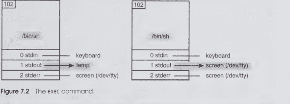

Figure 7.2 The exec command.

# EXAMPLE 7.40

```
1 $ exec 3> filex

2 $ who >&3

3 $ date >&3

4 $ exec 3>&-

5 $ exec 3< filex

6 $ cat <&3

ellie console Oct 7 09:53

ellie ttyp0 Oct 7 09:54

ellie ttyp1 Oct 7 09:54

ellie ttyp2 Oct 11 15:42

Sun Oct 17 13:31:31 PDT 2004

7 $ exec 3>&-

8 $ date >&3

Sun Oct 17 13:41:14 PDT 2004
```

# 解释

+ 1 文件描述符 3（`fd` 3）被分配给 `filex` 并打开用于输出重定向。请参阅图 7.3。
+ 2 `who` 命令的输出被发送到 `fd` 3，`filex`。
+ 3 `date` 命令的输出被发送到 `fd` 3；`filex` 已打开，因此输出会被追加到 `filex`。
+ 4 `Fd` 3 被关闭。
+ 5 `exec` 命令为读取输入打开 `fd` 3。输入将从 `filex` 重定向。
+ 6 `cat` 程序从 `fd` 3 读取，已分配给 `filex`。
+ 7 `exec` 命令关闭 `fd` 3。 （实际上，一旦到达文件末尾，操作系统就会关闭文件。）
+ 8 当尝试将 `date` 命令的输出发送到 `fd` 3 时，输出会显示在屏幕上，因为文件描述符已被关闭。

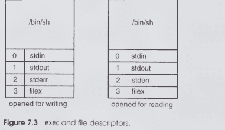

# 7.11 管道

管道将管道符号左侧命令的输出取出并发送到管道符号右侧命令的输入。管道线可以包含一个以上的管道。

下面三个命令的目的是统计已登录人数的数量（`who`），将命令的输出保存到文件中（`tmp`），使用 `wc -l` 统计 `tmp` 文件中的行数（`wc -l`），然后删除 `tmp` 文件（即找出已登录人数）。请参阅图 7.4 和 7.5。

### 示例 7.41

```
1 $ who > tmp

2 $ wc -l tmp

4

3 $ rm tmp

# Using a pipe saves disk space and time.

4 $ who | wc -l

4

5 $ du . | sort -n | sed -n '$p'

72388 /home/jody/ellie
```

# 解释

+ 1. `who` 命令的输出被重定向到 `tmp` 文件。
+ 2. `wc -l` 命令显示 `tmp` 中的行数。
+ 3. `tmp` 文件被删除。
+ 4. 使用管道功能，你可以在一步中完成前面三个步骤。`who` 命令的输出被发送到一个匿名内核缓冲区；`wc -l` 命令从缓冲区读取并将其输出发送到屏幕。
+ 5. `du` 命令的输出，即每个目录使用的磁盘块数，被管道传输到 `sort` 命令并按数字排序。然后将其管道传输到 `sed` 命令，该命令打印其接收到的输出的最后一行。

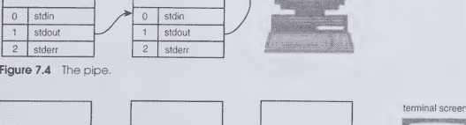

图 7.4 管道。

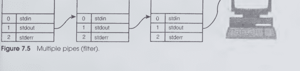

图 7.5 多个管道（过滤器）。

# 7.12 here 文档和输入

`here` 文档为期望输入的程序（如 `mail`、`sort` 或 `cat`）提供内联文本，直到达到用户定义的终止符。它常用于 shell 脚本中创建菜单。接收输入的命令后附加 `<<` 符号，后跟用户定义的词或符号，以及换行符。下一行文本将是发送给命令的输入行。当用户定义的词或符号单独放在一行最左侧列时，输入即终止（它不能有周围的空格）。该词用作 Ctrl-D 来停止程序读取输入。

### 示例 7.42

```
1 $ sort        # Sort waits for user input if it does get a file

pears

apples

bananas
```


^D (Ctrl-D)    # User presses Ctrl-D to stop input to sort

(Output)

apples

bananas

pears

$

2 $ sort <<DONE  # DONE is a user-defined terminator

> pears

> apples        # The user input is called the "document"

> bananas

3 DONE          # Marks end of here document

                # Here is where input stops

4 (Output)

apples

bananas

pears

5 $

```
# 解释

+   1 UNIX/Linux `sort` 命令等待用户输入，因为它没有作为参数提供文件名。用户输入三行，然后必须按 Ctrl-D，即停止向程序输入的键序列。 （不要把 Ctrl-D 与 Ctrl-C 混淆。Ctrl-C 会终止程序，这样你根本得不到任何输出！）用户按 Ctrl-D 后，`sort` 命令会将排序后的输出发送到屏幕。
+   2 here 文档将为 `sort` 命令提供输入。 `<<` 后跟所谓的 user-defined terminator，即一个词或符号。会出现二级提示。以下文本是 `sort` 命令的输入。pears。

# 解释（续）

+   3 `DONE` 终止符标志着 here 文档的结束。`DONE` 两侧不能有空格。终止符替代了输入 Ctrl-D。`sort` 命令将不再接收输入。完成后，`sort` 会将其输出发送到屏幕。
+   4 `sort` 程序的输出被显示。
+   5 shell 提示符重新出现。

如果终止符前面有 `<<` 运算符，则在最终终止符之前可以有前导制表符，且只能是制表符。用户定义的终止词或符号必须从“here”到“here”完全匹配。以下示例说明了在命令行中使用 here 文档来演示语法的用法。在脚本中使用它们更为实用。

# EXAMPLE 7.43

```
1 $ cat << FINISH        # FINISH is a user-defined terminator

2 > Hello there $LOGNAME

3 > The time is `date`

> I can't wait to see you!!!

4 > FINISH                # terminator matches first FINISH on line 1.

5 Hello there ellie

The time is Wed April 22 19:42:16 PST 2004

I can't wait to see you!!!

6 $
```

### EXPLANATION

+   1 UNIX `cat` 程序将接受输入，直到单词 `FINISH` 单独出现在一行。
+   2 出现二级提示符。以下文本是 `cat` 命令的输入。变量替换在 here 文档中执行。
+   3 命令替换，`date`，在 here 文档中执行。
+   4 用户定义的终止符 `FINISH` 标志着 `cat` 程序输入的结束。它前后不能有任何空格，并且单独占一行。
+   5 `cat` 程序的输出被显示。
+   6 shell 提示符重新出现。

# EXAMPLE 7.44

```
1 $ cat << DONE

> Hello there

> what's up?

> Bye now The time is `date`.

2 > DONE

Hello there

what's up?

Bye now The time is Thu Oct 28 19:48:23 PST 2004.

$
```

### EXPLANATION

+   1. `cat` 程序接受输入，直到 `DONE` 单独出现在一行。`<<` 运算符允许输入和最终终止符前面有一个或多个制表符。
+   2. 最终匹配的终止符 `DONE` 前面有一个制表符。`cat` 程序的输出显示在屏幕上。

#### 7.12.1 Now What?

现在我们已经完成了对交互式 shell 的讨论，是时候将这些特性结合到脚本中，以生成能够自动化重复任务、生成信息、监控进程等的程序。如果你不是程序员，编写 shell 脚本可能是你开始的好地方。它很有趣，而且你能快速获得结果。

# chapter

# 8

# Programming the Bourne Shell


# 8.1 Introduction

Shell 程序通常称为 shell 脚本。现在你已经学会了如何交互式地使用 shell，你就可以开始使用本章提供的编程结构以及你所学到的知识进行脚本编写。无论你是系统管理员、程序员还是用户。Shell 脚本可以自动化许多例行任务，让生活变得轻松很多——编写和使用它们也很有趣！

### 8.1.1 The Steps in Creating a Shell Script

Shell 脚本通常在编辑器中编写，由命令和注释交错组成。注释以井号（`#`）开头，由用于记录正在进行情况的文本组成。

# The First Line.

脚本左上角的第一行将指示执行脚本中各行的程序。这一行被称为 shbang 行，通常写成

```
#!/bin/sh
```

`#!` 被称为魔数，由内核用来识别应解释脚本中各行的程序。这一行必须是脚本的顶行。

# Comments.

注释是以井号开头的行，可以单独占一行，也可以跟在脚本命令之后。它们用于记录你的脚本。如果脚本没有注释，有时很难理解脚本 supposed to do。虽然注释很重要，但它们经常过于稀少或根本未使用。尽量养成注释你所做工作的习惯，不仅为了别人，也为了你自己。两天后你可能记不清自己当时想做什么。

# 可执行语句和 Bourne Shell 构造。

Bourne shell 程序由 UNIX 命令、Bourne shell 命令、编程构造和注释的组合构成。

# 使脚本可执行。

当你创建文件时，它不会被赋予执行权限。你需要此权限来运行脚本。使用 `chmod` 命令打开执行权限。

### EXAMPLE 8.1

```
1  $ chmod +x myscript

2  $ ls -lF myscript

-rwxr-xr-x  1 ellie  0 Jul 13:00 myscript*
```

### EXPLANATION

- 1 `chmod` 命令用于为用户、组和其他人打开执行权限。
- 2 `ls` 命令的输出表明所有用户对 `myscript` 文件都有执行权限。文件名末尾的星号也表明这是一个可执行程序。

# 脚本会话。

在以下示例中，用户在编辑器中创建脚本。保存文件后，执行权限被打开，然后执行脚本。如果程序中有错误，shell 会立即响应。

### EXAMPLE 8.2

```
(The Script)

1  #!/bin/sh

2  # Scriptname: greetings

# Written by: Barbara Born

# This is the first Bourne shell program of the day.

3  echo "Hello $LOGNAME, it's nice talking to you."

4  echo "Your present working directory is `pwd`."

   echo "You are working on a machine called `uname -n`."

   echo "Here is a list of your files."

5  ls      # List files in the present working directory

6  echo "Bye for now $LOGNAME. The time is `date +%T`!"

(The Command Line)

7  $ chmod +x greetings

   $ greetings

3  Hello barbara, it's nice talking to you.
```

### EXAMPLE 8.3

(The Script)

```
#!/bin/sh

# Scriptname: nosy

echo "Are you happy? \c"

1 read answer

echo "$answer is the right response."

echo "What is your full name? \c"

2 read first middle last

echo "Hello $first"
```

(The Output)

```
Are you happy? Yes

1 Yes is the right response.

2 What is your full name? Jon Jake Jones

Hello Jon
```


### EXPLANATION

- 1. `read` 命令接受一行用户输入并将输入分配给变量 `answer`。
- 2. `read` 命令从用户接受输入并将输入的第一个词分配给变量 `first`，第二个词分配给变量 `middle`，其余所有词直到行尾分配给变量 `last`。

# EXAMPLE 8.4

(The Script)

```
#!/bin/sh

# Scriptname: printer_check

# Script to clear a hung up printer for SVR4

1 if [ $LOGNAME != root ]
then
    echo "Must have root privileges to run this program"
    exit 1
fi

2 cat << EOF
Warning: All jobs in the printer queue will be removed.
Please turn off the printer now. Press Enter when you
are ready to continue. Otherwise press Ctrl-C.
EOF

3 read ANYTHING    # Wait until the user turns off the printer
echo

4 /etc/init.d/lp stop    # Stop the printer
```

```
5  rm -f /var/spool/lp/SCHEDLOCK /var/spool/lp/temp
   echo
   echo "Please turn the printer on now."

6  echo "Press Enter to continue"

7  read ANYTHING        # Stall until the user turns the printer back on
   echo                # A blank line is printed

8  /etc/init.d/lp start  # Start the printer
```

### EXPLANATION

- 1. 检查用户是否为 `root`。如果不是，则发送错误并退出。
- 2. 创建一个 here 文档。警告信息显示在屏幕上。
- 3. `read` 命令等待用户输入。当用户按下 Enter 时，变量 `ANYTHING` 接受所键入的内容。该变量未用于任何用途。此处的 `read` 用于等待用户关闭打印机，返回后按下 Enter。
- 4. `lp` 程序停止打印机守护进程。
- 5. 在调度程序重新启动之前，必须删除 `SCHEDLOCK` 文件，以及 `/var/spool/lp` 中的临时文件。
- 6. 提示用户在准备好时按下 Enter。
- 7. 用户键入的任何内容都被读入变量 `ANYTHING`，并在按下 Enter 后程序将恢复执行。
- 8. `lp` 程序启动打印守护进程。

# 8.3 算术

算术并未内置于 Bourne shell。如果需要执行简单的整数算术计算，UNIX `expr` 命令在 Bourne shell 脚本中最常用。对于浮点算术，可以使用 `awk` 或 `bc` 程序。由于算术未内置，shell 在循环迭代多次时的性能会下降。每次在循环机制中递增或递减计数器时，都需要 fork 另一个进程来处理算术。

### 8.3.1 整数算术和 expr 命令

`expr` 命令是一个表达式处理程序。当用于计算算术表达式时，它可以执行简单的整数运算（参见表 8.2）。其每个参数必须用空格分隔。支持 `+`、`−`、`*`、 `/`、和 `%` 运算符，并且正常的编程结合性和优先级规则适用。

# 表 8.2 expr 命令算术运算符

| 运算符 | 功能 |
|---|---|
| * | 乘法 |
| / | 除法 |
| % | 取模 |
| + | 加法 |
| - | 减法 |

### 示例 8.5

```
1 $ expr 1 + 4
5

2 $ expr 1+4
1+4

3 $ expr 5 + 9 / 3
8

4 $ expr 5 * 4
expr: syntax error

5 $ expr 5 \* 4 - 2
18

6 $ expr 11 % 3
2

7 $ num=1
$ num=`expr $num + 1`
$ echo $num
2
```

# 解释

+ 1 `expr` 命令计算表达式。两个数字相加。
+ 2 因为运算符之间没有空格，表达式被当作字符串求值。
+ 3 加法和除法组合使用。先执行除法，然后执行加法。
+ 4 星号 (`*`) 被 shell 当作其通配符之一进行求值，导致 `expr` 命令失败。
+ 5 星号 (`*`) 用反斜杠转义以防止 shell 解释。`expr` 命令执行算术运算。
+ 6 取模运算符 (`%`) 返回除法后的余数。
+ 7 变量 `num` 被赋值为 1。`expr` 命令将 1 加到变量的值上并将结果赋给 `num`。`num` 的值被回显到屏幕上。

### 8.3.2 浮点运算

如果需要执行更复杂的计算，`bc`、`awk` 和 `nawk` 工具很有用。

### 示例 8.6

```
(The Command Line)

1 $ n=`echo "scale=3; 13 / 2" | bc`
$ echo $n
6.500

2 $ n=`bc << EOF
scale=3
13/2
EOF`
$ echo $n
6.500

3 $ product=`nawk -v x=2.45 -v y=3.123 'BEGIN{printf "%.2f\n",x*y}'`
$ echo $product
7.65
```

# 解释

+ 1 `echo` 命令的输出被管道传输到 `bc` 程序。`scale` 被设置为 3，即小数点右侧将打印的有效数字位数。计算是 13 除以 2。整个管道被反引号括起来。命令替换将被执行并将输出赋给变量 `n`。
+ 2 此示例在反引号中使用 here 文档来执行与第一个示例相同的功能。命令的输出将被赋给变量 `n`，然后用 `echo` 命令显示。
+ 3 `nawk` 程序从命令行传入的参数列表获取其值，`x=2.45` `y=3.123`。(`-v` 开关适用于 `nawk`，不适用于 `awk`。) 在数字相乘后，`printf` 函数格式化并打印结果，小数点右侧的精度为两位。输出被赋给变量 `product`。

# 8.4 位置参数和命令行参数

信息可以通过命令行传递到脚本中。脚本名之后每个由空白分隔的单词称为一个参数。

命令行参数可以在脚本中使用位置参数引用；例如，`$1` 表示第一个参数，`$2` 表示第二个参数，`$3` 表示第三个参数，以此类推。`$#` 变量用于测试参数的数量，而 `$*` 用于

# 解释

+ 1. 在 `greetings` 脚本中，位置参数 `$0` 引用脚本名，`$1` 引用第一个命令行参数，`$2` 引用第二个命令行参数。
+ 2. `greetings` 脚本在未传递任何参数的情况下执行。输出说明脚本名为 `greetings`（脚本中的 `$0`），并且 `$1` 和 `$2` 从未被赋予任何值；因此它们的值为空，什么也不会打印。
+ 3. 这次传递了一个参数 `Tommy`。`Tommy` 被赋给位置参数 1。
+ 4. 输入了两个参数 `Tommy` 和 `Kimberly`。`Tommy` 被赋给 `$1`，`Kimberly` 被赋给 `$2`。

#### 8.4.1 set 命令和位置参数

带参数的 `set` 命令会重置位置参数。¹ 一旦重置，旧的参数列表就会丢失。要取消所有位置参数，请使用 `set --`。`$0` 始终是脚本的名称。

### 示例 8.8

```
(The Script)

#!/bin/sh

# Scriptname: args

# Script to test command-line arguments

1 echo The name of this script is $0.
2 echo The arguments are $*.
3 echo The first argument is $1.
4 echo The second argument is $2.
5 echo The number of arguments is $#.
6 oldargs=$*      # Save parameters passed in from the command line
7 set Jake Nicky Scott   # Reset the positional parameters
8 echo All the positional parameters are $*.
9 echo The number of positional parameters is $#.
10 echo "Good-bye for now, $1"
11 set `date`      # Reset the positional parameters
12 echo The date is $2 $3, $6.
```


13 `echo "The value of \$oldargs is $oldargs."`

14 `set $oldargs`

15 `echo $1 $2 $3`

```
# 示例 8.8（续）

（命令行和输出）
$5 args a b c d

+   1 此脚本的名称是 args。
+   2 参数是 a b c d。
+   3 第一个参数是 a。
+   4 第二个参数是 b。
+   5 参数的数量是 4。
+   8 所有位置参数都是 Jake Nicky Scott。
+   9 位置参数的数量是 3。
+   10 再见了，Jake
+   12 日期是 Mar 25, 2004。
+   13 `$oldargs` 的值是 a b c d。
+   15 a b c
```

# 解释

+   1 脚本的名称存储在 `$0` 变量中。
+   2 `$*` 代表所有位置参数。
+   3 `$1` 代表第一个位置参数（命令行参数）。
+   4 `$2` 代表第二个位置参数。
+   5 `$#` 是位置参数（命令行参数）的总数。
+   6 所有位置参数都保存在一个名为 `oldargs` 的变量中。
+   7 `set` 命令允许你重置位置参数，清除旧列表。现在，`$1` 是 Jake，`$2` 是 Nicky，`$3` 是 Scott。
+   8 `$*` 代表所有参数，Jake、Nicky 和 Scott。
+   9 `$#` 代表参数的数量，3。
+   10 `$1` 是 Jake。
+   11 在命令替换执行后——即 `date` 被执行——位置参数被重置为 `date` 命令的输出。
+   12 显示 `$2`、`$3` 和 `$6` 的新值。
+   13 打印保存在 `oldargs` 中的值。
+   14 `set` 命令从保存在 `oldargs` 中的值创建位置参数。
+   15 显示前三个位置参数。

# 示例 8.9

```
(The Script)

#!/bin/sh

# Scriptname: checker

# Script to demonstrate the use of special variable modifiers and arguments

name=${1:?'requires an argument'}

echo Hello $name
```

```
(The Command Line)

$ checker

./checker: 1: requires an argument

$ checker Sue

Hello Sue
```

# 解释

+   1. 特殊变量修饰符 `:?` 会检查 `$1` 是否有值。如果没有，脚本会退出并打印消息。
+   2. 程序在没有参数的情况下执行。`$1` 未被赋予值；显示错误。
+   3. `checker` 程序被赋予命令行参数 Sue。在脚本中，`$1` 被赋值为 Sue。程序继续执行。

#### 8.4.2 `$*` 和 `$@` 有何不同

`$*` 和 `$@` 只有在被双引号包围时才不同。当 `$*` 被双引号包围时，参数列表变成一个单一字符串。当 `$@` 被双引号包围时，每个参数都被引用；也就是说，每个词都被视为一个单独的字符串。

# 示例 8.10

```
$ set 'apple pie' pears peaches

$ for i in $*

> do

> echo $i

> done

apple

pie

pears

peaches
```

# 示例 8.10（续）

```
3 $ set 'apple pie' pears peaches

4 $ for i in "$*"

> do

> echo $i

> done

apple pie pears peaches
```

```
5 $ set 'apple pie' pears peaches

6 $ for i in $@

> do

> echo $i

> done

apple

pie

pears

peaches
```

```
7 $ set 'apple pie' pears peaches

8 $ for i in "$@"    # At last!!

> do

> echo $i

> done

apple pie

pears

peaches
```

# 解释

1 位置参数被设置。

2 当 `$*` 被展开时，包围 `apple pie` 的引号被去掉；`apple` 和 `pie` 变成两个独立的词。`for` 循环依次将每个词赋给变量 `i`，然后打印 `i` 的值。每次循环，左边的词被移出，下一个词被赋给变量 `i`。

3 位置参数被设置。

4 通过将 `$*` 用双引号包围，整个参数列表变成一个字符串，`"apple pie pears peaches"`。整个列表作为一个词被赋给 `i`。循环只执行一次。

5 位置参数被设置。

6 未加引号时，`$@` 和 `$*` 的行为相同（参见本解释的第 2 行）。

7 位置参数被设置。

8 通过用双引号包围 `$@`，每个位置参数都被视为一个带引号的字符串。列表将是 `"apple pie"`、`"pears"`、`"peaches"`。最终获得了期望的结果。

# 表 8.4 字符串、整数和文件测试（续）

| 测试操作符 | 测试内容 |
|---|---|
| 逻辑测试 | |
| expr1 -a expr2 | 逻辑与 |
| expr1 -o expr2 | 逻辑或 |
| ! expr | 逻辑非 |
| 文件测试 | |
| -b filename | 块特殊文件 |
| -c filename | 字符特殊文件 |
| -d filename | 目录存在 |
| -f filename | 普通文件存在且不是目录 |
| -g filename | 已设置组 ID |
| -k filename | 已设置粘滞位 |
| -p filename | 文件是命名管道 |
| -r filename | 文件可读 |
| -s filename | 文件大小非零 |
| -u filename | 已设置用户 ID 位 |
| -w filename | 文件可写 |
| -x filename | 文件可执行 |

#### 8.5.1 测试退出状态：`test` 命令

以下示例说明如何测试退出状态。

`test` 命令用于评估条件表达式，返回 true 或 false。它会在为真时返回零退出状态，在为假时返回非零退出状态。可以使用 `test` 命令或括号。 （请参考表 8.4。）

# 示例 8.11

```
(At the Command Line)

1 $ name=Tom

2 $ grep " $name" /etc/passwd

Tom:S2KX2F:S102:40:Tom Savage:/home/tom:/bin/ksh

3 $ echo $?

0 Success!

4 $ test $name != Tom

5 $ echo $?

1 Failure

6 $ [ $name = Tom ]    # Brackets replace the test command

7 $ echo $?

0 Success

8 $ [ $name = [Tt]?m ]    # Wildcards are not evaluated by the test command

9 $ echo $?
```


# 解释

- 1 变量 `name` 被赋值为字符串 `Tom`。
- 2 `grep` 命令将在 `passwd` 文件中搜索字符串 `Tom`。
- 3 `$?` 变量包含最后执行的命令的退出状态，在本例中为 `grep` 的退出状态。如果 `grep` 成功找到字符串 `Tom`，它将返回 0 的退出状态。`grep` 命令执行成功。
- 4 `test` 命令用于评估字符串、数字并执行文件测试。与所有命令一样，它会返回退出状态。如果退出状态为 0，则表达式为真；如果退出状态为 1，则表达式求值为假。等号前后必须有空格。测试 `name` 的值是否不等于 `Tom`。
- 5 `test` 失败并返回退出状态 1。
- 6 括号是 `test` 命令的另一种表示法。第一个括号后必须有空格。测试表达式 `$name` 是否求值为字符串 `Tom`。
- 7 `test` 的退出状态为 0。`test` 成功，因为 `$name` 等于 `Tom`。
- 8 `test` 命令不允许通配符扩展。因为问号被视为字面字符，所以 `test` 失败。`Tom` 和 `[Tt]?m` 不相等。
- 9 退出状态为 1，表示第 8 行的 `test` 失败。

#### 8.5.2 if 命令

最简单的条件形式是 `if` 命令。`if` 结构后面的命令或 UNIX 实用程序将被执行并返回其退出状态。退出状态通常由编写该实用程序的程序员决定。通常，如果退出状态为零，则命令成功，并且 `then` 关键字后的语句被执行。在 C shell 中，`if` 命令后的表达式是像 C 语言一样的布尔类型表达式。但在 Bourne 和 Korn shell 中，`if` 后的语句是一个命令或一组命令。如果被评估的命令的退出状态为零，则 `then` 之后的一组语句将被执行，直到遇到 `fi`。`fi` 终止 `if` 块。如果退出状态为非零，意味着命令以某种方式失败，则 `then` 关键字后的语句将被忽略，控制转移到 `fi` 语句之后的下一行。了解正在测试的命令的退出状态非常重要。例如，`grep` 的退出状态可靠地告知你 `grep` 是否在文件中找到了它正在搜索的模式。如果 `grep` 搜索成功，它返回 0 退出状态；如果不成功，它返回 1。`sed` 和 `awk` 程序也搜索模式，但无论是否找到模式，它们都会报告成功的退出状态。`sed` 和 `awk` 的成功标准是正确的语法，而不是功能。

# 格式

```
if command

then

    command

    command

fi
```

```
if test expression

then

    command

fi
```

```
if [ expression ]

then

    command

fi
```

# 示例 8.12

```
1 if ypmatch "$name" passwd > /dev/null 2>&1
2 then
3     echo Found $name!
    fi
```

> 2. 与 C shell 不同，Bourne shell 不支持没有 `then` 的 `if` 语句，即使对于简单语句也是如此。

# 解释

+   1 `ypmatch` 命令是一个 NIS（Sun 的网络信息服务）命令，它在服务器机器上的 NIS `passwd` 数据库中搜索其参数 `name`。标准输出和标准错误都被重定向到 `/dev/null`，即 UNIX 的位桶。如果你的系统不支持 `ypmatch`，请尝试
+   `if grep "$name" /etc/passwd > /dev/null 2>&1`
+   2 如果 `ypmatch` 命令的退出状态为 0，程序将进入 `then` 语句并执行命令直到遇到 `fi`。
+   3 `fi` 终止 `then` 语句之后的一系列命令。

# 示例 8.13

```
1 echo "Are you okay (y/n) ?"
read answer
2 if [ "$answer" = Y -o "$answer" = y ]
then
    echo "Glad to hear it."
3 fi
```

# 解释

+   1 用户被问到问题并被告知要做出回应。`read` 命令会等待响应。
+   2 测试命令，由方括号表示，用于测试表达式。如果表达式为真，则返回退出状态为零；如果表达式为假，则返回非零退出状态。如果变量 `answer` 的计算结果为 `Y` 或 `y`，则执行该语句之后的命令。 （测试命令在测试表达式时不允许使用通配符，并且方括号（以及 `=` 运算符）周围必须有空格。请参阅第 333 页的表 8.4。
+   变量 `$answer` 使用双引号将其作为单个字符串保留。 如果在 `=` 运算符之前出现多个单词，测试命令将失败。 例如，如果用户输入 `yes, you betcha`，则 `answer` 变量将计算为三个单词，导致测试失败，除非 `$answer` 用双引号括起来。
+   3 `fi` 终止 `then` 语句之后的一系列命令。

#### 8.5.3 exit 命令和 ? 变量

`exit` 命令用于终止脚本并返回到命令行。 如果出现某些条件，你可能希望脚本退出。 传递给 `exit` 命令的参数是一个介于 0 到 255 之间的数字。 如果程序以 0 作为参数退出，则程序成功退出。 非零参数表示某种失败。 传递给 `exit` 命令的参数存储在 shell 的 `?` 变量中。

# 示例 8.14

（脚本）

```
# Name: bigfiles
# Purpose: Use the find command to find any files in the root
# partition that have not been modified within the past n (any
# number within 30 days) days and are larger than 20 blocks
# (512-byte blocks)
1 if [ $# -ne 2 ]
then
    echo "Usage: $0 mdays size " 1>&2
    exit 1
fi
2 if [ $1 -lt 0 -o $1 -gt 30 ]
then
    echo "mdays is out of range"
    exit 2
fi
4 if [ $2 -le 20 ]
then
    echo "size is out of range"
    exit 3
fi
7 find / -xdev -mtime $1 -size +$2 -print
```

（命令行）

```
$ bigfiles
Usage: bigfiles mdays size
$ echo $?
1
$ bigfiles 400 80
mdays is out of range
$ echo $?
2
$ bigfiles 25 2
size is out of range
$ echo $?
3
$ bigfiles 2 25
(Output of find prints here)
```

#### 8.5.4 检查空值

检查变量中的空值时，使用双引号来保留空值，否则测试命令将失败。

```
*(The Script)*
1  if [ "$name" = "" ]    # Alternative to [ ! "$name" ] or [ -z "$name" ]
   then
       echo The name variable is null
   fi
*(From System Showmount program, which displays all remotely mounted systems)*
2  remotes=`/usr/sbin/showmount`
   if [ "${remotes}" != "X" ]
   then
       /usr/sbin/wall ${remotes}
       ...
3  fi
```

# 解释

+   1 如果 `name` 变量的计算结果为空，则测试为真。 双引号用于表示空值。
+   2 `showmount` 命令列出从主机机器远程挂载的所有客户端。 该命令将列出一个或多个客户端，或什么都不列出。 变量 `remotes` 将被分配一个值或为空。 字母 `X` 在测试时位于变量 `remotes` 之前。 如果 `remotes` 的计算结果为空，则没有客户端远程登录，`X` 将等于 `X`，导致程序在第 3 行重新开始执行。 如果变量具有值，例如主机名 `pluto`，则表达式将读取 `if Xpluto != X` 并且 `wall` 命令将被执行。 （所有远程机器上的用户都将收到一条消息。） 在表达式中使用 `X` 的目的是确保即使 `remotes` 的值为空，`!=` 运算符两侧的表达式中始终存在占位符。
+   3 `fi` 终止 `if`。

#### 8.5.5 if/else 命令

`if/else` 命令允许进行双向决策。 如果 `if` 之后的命令失败，则执行 `else` 之后的命令。

# 格式

```
if command
then
```


# 示例 8.16

（脚本）

```bash
#!/bin/sh

1 if `ypmatch` "$name" `passwd` > /dev/null 2>&1
2 then
  `echo` Found $name!
3 else
4   `echo` "Can't find $name."
  `exit` 1
5 fi
```

a. 如果使用 NIS+，该命令应读为：If `nismatch` "$name" `passwd.org.dir`.

### EXPLANATION

+   1 `ypmatch` 命令在 NIS `passwd` 数据库中搜索其参数 `name`。因为用户不需要看到输出，标准输出和标准错误被重定向到 `/dev/null`，即 UNIX 位桶。
+   2 如果 `ypmatch` 命令的退出状态为 0，程序控制进入 `then` 语句并执行命令直到到达 `else`。
+   3 `else` 语句下的命令在 `ypmatch` 命令未能在 `passwd` 数据库中找到 `$name` 时执行；即 `ypmatch` 的退出状态必须为非零，`else` 块中的命令才会被执行。
+   4 如果 `$name` 的值在 `passwd` 数据库中未找到，此 `echo` 语句将被执行，程序以 1 退出，表示失败。
+   5 `fi` 终止了 `if`。

# EXAMPLE 8.17

(The Script)

```bash
#!/bin/sh

# Scriptname: idcheck
# purpose: check user ID to see if user is root.
# Only root has a uid of 0.
# Format for id output:uid=9496(eillie) gid=40 groups=40
# root's uid=0
```

```bash
1 id=`id | nawk -F'[=]' '{print $2}'`   # Get user ID
echo your user id is: $id
2 if [ $id -eq 0 ]
then
3     echo "you are superuser."
4 else
echo "you are not superuser."
5 fi
```

(The Command Line)

```bash
$ idcheck
your user id is: 9496
you are not superuser.
```

```bash
7 $ su
Password:
8 # idcheck
your user id is: 0
you are superuser
```

### EXPLANATION

+   1 `id` 命令通过管道传递给 `awk` 命令。`awk` 使用等号或左括号作为字段分隔符，从输出中提取用户 ID，并将输出赋给变量 `id`。
+   2 如果 `id` 的值等于 0，则执行第 3 行。
+   4 如果 `id` 不等于 0，则执行 `else` 语句。
+   5 `fi` 标记了 `if` 命令的结束。
+   6 `idcheck` 脚本由当前用户执行，其 UID 为 9496。
+   7 `su` 命令将用户切换为 `root`。
+   8 `#` 提示符表示超级用户 `root` 是新用户。`root` 的 UID 为 0。

#### 8.5.6 The if/elif/else Command

`if/elif/else` 命令允许多路决策过程。如果 `if` 之后的命令失败，则测试 `elif` 之后的命令。如果该命令成功，则执行其 `then` 语句下的命令。如果 `elif` 之后的命令失败，则检查下一个 `elif` 命令。如果没有任何命令成功，则执行 `else` 命令。`else` 块称为默认值。

### FORMAT

```
if command
then
    command(s)
elif command
then
    commands(s)
elif command
then
    command(s)
else
    command(s)
fi
```

# EXAMPLE 8.18

```bash
(The Script)
#!/bin/sh
# Scriptname: tellme
1 echo -n "How old are you? "
read age
```

```bash
2 if [ $age -lt 0 -o $age -gt 120 ]
then
    echo "Welcome to our planet! "
    exit 1
fi
```

```bash
3 if [ $age -ge 0 -a $age -lt 13 ]
then
    echo "A child is a garden of verses"
elif [ $age -ge 13 -a $age -lt 20 ]
then
    echo "Rebel without a cause"
elif [ $age -ge 20 -a $age -lt 30 ]
then
    echo "You got the world by the tail!!!"
elif [ $age -ge 30 -a $age -lt 40 ]
then
    echo "Thirty something..."
```

```bash
4 else
    echo "Sorry I asked"
```

```bash
5 fi
```

(The Output)

```bash
$ tellme
How old are you? 200
Welcome to our planet!
$ tellme
How old are you? 13
A child is a garden of verses
$ tellme
How old are you? 55
Sorry I asked
```

### EXPLANATION

1 用户被要求输入。输入被赋给变量 `age`。
2 在方括号内执行数值测试。如果 `age` 小于 0 或大于 120，则执行 `echo` 命令，程序以退出状态 1 终止。交互式 shell 提示符将出现。
3 在方括号内执行数值测试。如果 `age` 大于或等于 0 且小于 13，测试命令返回退出状态 0，即 true，然后执行 `then` 之后的语句。否则，程序控制转到 `elif`。如果该测试为假，则测试下一个 `elif`。
4 `else` 构造是默认值。如果以上任何语句都不为真，则将执行 `else` 命令。
5 `fi` 终止了初始的 `if` 语句。

#### 8.5.7 文件测试

在编写脚本时，脚本通常要求某些文件可用，并且这些文件具有特定的权限、属于特定类型或具有其他属性。 （参见第 333 页的表 8.4。）你会发现文件测试是编写可靠脚本的必要部分。

当 `if` 语句嵌套时，`fi` 语句始终与最近的 `if` 语句配对。对嵌套的 `if` 进行缩进可以更轻松地看出哪个 `if` 语句与哪个 `fi` 语句对应。

### EXAMPLE 8.19

(The Script)

```bash
#!/bin/sh
file=./testing
1 if [ -d $file ]
then
    echo "$file is a directory"
2 elif [ -f $file ]
then
3   if [ -r $file -a -w $file -a -x $file ]
   then  # nested if command
      echo "You have read, write, and execute permission on $file."
4   fi
5 else
    echo "$file is neither a file nor a directory."
6 fi
```

### EXPLANATION

- 1 如果文件测试为目录，则打印 `testing is a directory`。
- 2 如果文件 `testing` 不是目录，否则如果文件是普通文件，则...
- 3 如果文件 `testing` 可读、可写且可执行，则...
- 4 `fi` 终止最内层的 `if` 命令。
- 5 如果第 1 行和第 2 行均不为真，则执行 `else` 命令。
- 6 这个 `fi` 与第一个 `if` 对应。

#### 8.5.8 空命令

空命令由冒号表示，是一个内置的、无操作的命令，返回退出状态 0。它用作 `if` 命令之后的占位符，当你没有要执行的操作，但需要一个命令，否则程序会因 `then` 语句后需要内容而产生错误信息。空命令常被用作循环命令的参数，使循环成为无限循环。

### EXAMPLE 8.20

(The Script)

```bash
1 name=Tom
2 if grep "$name" databasefile > /dev/null 2>&1
then
3 :
4 else
echo "$1 not found in databasefile"
exit 1
fi
```


### EXPLANATION

- 1 变量 `name` 被赋值为字符串 `Tom`。
- 2 `if` 命令测试 `grep` 命令的退出状态。如果在数据库文件中找到 `Tom`，则执行空命令，即冒号 `:`，且不执行任何操作。
- 3 冒号是空命令。它除了返回 `0` 退出状态外什么也不做。
- 4 我们真正想做的是，如果未找到 `Tom`，则打印错误信息并退出。如果 `grep` 命令失败，则 `else` 后的命令将被执行。

### EXAMPLE 8.21

(The Command Line)

```
1 $ DATAFILE=

2 $ : ${DATAFILE:=$HOME/db/datafile}

$ echo DATAFILE

/home/jody/ellie/db/datafile

3 $ : ${DATAFILE:=$HOME/junk}

$ echo DATAFILE

/home/jody/ellie/db/datafile
```

### EXPLANATION

- 1 变量 `DATAFILE` 被赋值为 `null`。
- 2 冒号命令是“无操作”命令。修饰符 `(: =)` 返回可分配给变量或用于测试的值。在此示例中，表达式作为参数传递给无操作命令。`shell` 将执行变量替换；也就是说，如果 `DATAFILE` 尚未有值，则将路径名分配给 `DATAFILE`。变量 `DATAFILE` 被永久设置。
- 3 因为变量已经被设置，所以它不会被修饰符右侧提供的默认值重置。

### EXAMPLE 8.22

```
(The Script)

#!/bin/sh

# Name:wholenun

# Purpose:The expr command tests that the user enters an integer

echo "Enter a number."

read number

if expr "$number" + 0 > /dev/null 2>&1

then

:

else

echo "You did not enter an integer value." 1>&2

exit 1

fi
```

### EXPLANATION

- 1. 用户被要求输入一个整数。数字被赋给变量 `number`。
- 2. `expr` 命令计算表达式。如果可以执行加法，则该数字为整数且 `expr` 返回成功的退出状态。所有输出都被重定向到位桶 `/dev/null`。
- 3. 如果 `expr` 成功，则返回 `0` 退出状态，冒号命令不执行任何操作。
- 4. 如果 `expr` 命令失败，则返回非零退出状态，`echo` 命令将消息显示到标准错误 `1>&2`，程序退出。
- 5. `fi` 结束 `if` 块。

#### 8.5.9 case 命令

`case` 命令是多路分支命令，可用作 `if/elif` 命令的替代。`case` 变量的值与 `value1`、`value2` 等进行匹配，直到找到匹配项。当某个值与 `case` 变量匹配时，值后面的命令将被执行，直到遇到双分号 `;;` 为止。然后执行从单词 `esac` 开始的部分，`esac` 是 `case` 的反写。

如果 `case` 变量未匹配，程序将执行 `*)` 后的命令，即默认值，直到 `;;` 或 `esac`。`*)` 值的功能与 `if/else` 条件中的 `else` 语句相同。`case` 值允许使用 `shell` 通配符和竖线（管道符号）对两个值进行或运算。

# 格式

```
case variable in

value1)

command(s)

;;

value2)

command(s)

;;

*)

command(s)

;;

esac
```

### 示例 8.23

(The Script)

```
#!/bin/sh

# Scriptname: colors

1 echo -n "Which color do you like?"
2 read color
3 case "$color" in
4 [Bb]l??)
 echo I feel $color
 echo The sky is $color
5 ;;
6 [Gg]ree*)
 echo $color is for trees
 echo $color is for seasick;;
7 red | orange)   # The vertical bar means "OR"
 echo $color is very warm;;
8 *)
9 echo No such color as $color;;
10 esac
11 echo "Out of case"
```

# 解释

1. 用户被要求输入。输入被赋给变量 `color`。
2. `case` 命令计算表达式 `$color`。
3. 如果颜色以 `b` 或 `B` 开头，后跟字母 `l` 和任意两个字符，则 `case` 表达式匹配第一个值。值以单个右括号终止。通配符是用于文件名扩展的 `shell` 元字符。
4. 如果第 3 行的值与 `case` 表达式匹配，则执行语句。
5. 在此命令块的最后一个命令之后需要双分号。到达分号时控制跳转到第 10 行。如果分号单独成行，脚本更易于调试。
6. 如果 `case` 表达式匹配 `G` 或 `g`，后跟字母 `ree` 并以零个或多个任意其他字符结尾，则执行 `echo` 命令。双分号终止语句块并使控制跳转到第 10 行。
7. 垂直线用作 `OR` 条件运算符。如果 `case` 表达式匹配 `red` 或 `orange`，则执行 `echo` 命令。
8. 这是默认值。如果上述值均不匹配 `case` 表达式，则执行 `*)` 后的命令。
9. `esac` 语句终止 `case` 命令。
10. 在匹配其中一个 `case` 值后，执行继续到此处。

#### 8.5.10 使用 here 文档和 case 命令创建菜单

`here` 文档和 `case` 命令经常一起使用。`here` 文档用于创建将显示到屏幕上的选项菜单。用户将被要求选择其中一个菜单项，而 `case` 命令将根据一组选择进行测试以执行适当的命令。

### 示例 8.24

```
(The .profile file)

echo "Select a terminal type:"
1 cat << ENDIT

    1) vt120
    2) wyse50
    3) sun
2 ENDIT
3 read choice
4 case "$choice" in
5 1) TERM=vt120
    export TERM
    ;;
2) TERM=wyse50
    export TERM
    ;;
6 3) TERM=sun
    export TERM
    ;;
7 esac
8 echo "TERM is $TERM."
```

(The Output)

```
$ .profile
Select a terminal type:
1) vt120
2) wyse50
3) sun
3
TERM is sun.
```

# 解释

1. 如果将此脚本段放入 `.profile` 中，登录时您将有机会选择正确的终端类型。`here` 文档用于显示选项菜单。
2. 用户定义的 `ENDIT` 终止符标记 `here` 文档的结束。
3. `read` 命令将用户输入存储在变量 `choice` 中。
4. `case` 命令计算变量 `choice` 并将该值与右括号前的其中一个值进行比较：`1`、`2` 或 `3`。
5. 第一个测试的值是 `1`。如果匹配，则终端设置为 `vt120`。`TERM` 变量被导出，以便子 `shell` 继承它。
6. 不需要默认值。`TERM` 变量通常在登录时在 `/etc/profile` 中分配。如果选择为 `3`，则终端设置为 `sun`。
7. `esac` 终止 `case` 命令。
8. 在 `case` 命令完成后，执行此行。

# 8.6 循环命令

循环命令用于执行命令或一组命令固定次数或直到满足特定条件。`Bourne shell` 有三种类型的循环：`for`、`while` 和 `until`。

#### 8.6.1 for 命令

`for` 循环命令用于在项目列表上有限次数地执行命令。例如，您可能会使用此循环在文件列表或用户名列表上执行相同的命令。`for` 命令后面跟一个用户定义的变量、关键字 `in` 和一个单词列表。循环第一次时，单词列表中的第一个单词被赋给变量，然后从列表中移出。一旦单词被赋给变量，就会进入循环体，命令在 `do` 之间

`and done` 关键字被执行。循环的下一次迭代中，第二个单词将被赋给变量，以此类推。循环体从 `do` 关键字开始，到 `done` 关键字结束。当列表中的所有单词都被移出后，循环结束，程序控制继续执行 `done` 关键字之后的代码。

### FORMAT

```
for variable in word_list
 do
   command(s)
done
```

# EXAMPLE 8.23

(The Script)

```
#!/bin/sh

# Scriptname: forloop
for pal in Tom Dick Harry Joe
do
echo "Hi $pal"
done
echo "Out of loop"
```

(The Output)


$ `forloop`

Hi Tom

Hi Dick

Hi Harry

Hi Joe

Out of loop

```
### EXPLANATION

- 1. 这个 `for` 循环将遍历名字列表 Tom、Dick、Harry 和 Joe，使用后将其逐个移出（向左移动并将其值赋给用户定义的变量 `pal`）。一旦所有单词都被移出且 `wordlist` 为空，循环结束，执行从 `done` 关键字之后开始。第一次进入循环时，变量 `pal` 将被赋值为 Tom。第二次循环时，`pal` 将被赋值为 Dick，下一次 `pal` 将被赋值为 Harry，最后一次 `pal` 将被赋值为 Joe。
- 2. 在 `wordlist` 之后必须使用 `do` 关键字。如果它与同一行使用，列表必须以分号结尾。示例：`for pal in Tom Dick Harry Joe; do`
- 3. 这是循环体。Tom 被赋给变量 `pal` 后，循环体中的命令（即 `do` 和 `done` 关键字之间的所有命令）将被执行。

### EXPLANATION (CONTINUED)

4 `done` 关键字结束循环。一旦列表中的最后一个单词（Joe）被赋给并移出，循环退出。

5 循环退出时控制从此处恢复。

# EXAMPLE 8.26

```
(The Command Line)

1 $ `cat mylist`

tom

patty

ann

jake
```

```
(The Script)

#!/bin/sh

# Scriptname: mailer

2 `for person in` `cat mylist`
do

3   `mail $person < letter`

  `echo $person was sent a letter.`

4 done

5 `echo "The letter has been sent."`
```

### EXPLANATION

1 显示名为 `mylist` 的文件的内容。

2 执行命令替换，`mylist` 的内容成为 `wordlist`。第一次进入循环时，`tom` 被赋给变量 `person`，然后被移出以被 `patty` 替换，依此类推。

3 在循环体中，每个用户都会收到一份名为 `letter` 的文件的副本。

4 `done` 关键字标记此循环迭代的结束。

# EXAMPLE 8.27

```
(The Script)

#!/bin/sh

# Scriptname: backup

# Purpose:

# Create backup files and store them in a backup directory

1 `dir=/home/jody/ellie/backupscripts`
```

# EXAMPLE 8.27 (CONTINUED)

```
2 `for file in memo[1-5]`

3 do

  if [ -f $file ]

  then

    cp $file $dir/$file.bak

    echo "$file is backed up in $dir"

  fi

done
```

(The Output)
memo1 is backed up in /home/jody/ellie/backupscripts
memo2 is backed up in /home/jody/ellie/backupscripts
memo3 is backed up in /home/jody/ellie/backupscripts
memo4 is backed up in /home/jody/ellie/backupscripts
memo5 is backed up in /home/jody/ellie/backupscripts

### EXPLANATION

- 1 变量 `dir` 被赋值。
- 2 `wordlist` 将由当前工作目录中所有以 `memo` 开头并以 1 到 5 之间的数字结尾的文件组成。每个文件名将在循环的每次迭代中依次赋给变量 `file`。
- 3 当进入循环体时，文件将被测试以确保它存在并且是真实文件。如果是，则将其复制到目录 `/home/jody/ellie/backupscripts`，并在其名称后附加 `.bak` 扩展名。

#### 8.6.2 The `$*` and `$@` Variables in Wordlists

展开时，`$*` 和 `$@` 除非用双引号括起来，否则是相同的。`$*` 求值为一个字符串，而 `$@` 求值为一个单独的单词列表。

# EXAMPLE 8.28

```
(The Script)

#!/bin/sh

# Scriptname: greet

1 `for name in $*`

2 do

3   `echo Hi $name`

done

# Same as for name in $@
```

# EXAMPLE 8.28

(The Command Line)

```
$ greet Dee Bert Lizzy Tommy

Hi Dee

Hi Bert

Hi Lizzy

Hi Tommy
```

### EXPLANATION

- 1. `$*` 和 `$@` 展开为所有位置参数的列表，在本例中为从命令行传入的参数：Dee、Bert、Lizzy 和 Tommy。列表中的每个名字将依次赋给 `for` 循环中的变量 `name`。
- 2. 循环体中的命令在列表为空之前一直执行。
- 3. `done` 关键字标记循环体的结束。

# EXAMPLE 8.29

(The Script)

```
#!/bin/sh

# Scriptname: permx

1 `for file` # Empty wordlist

do

2 if [ -f $file -a ! -x $file ]

then

3   `chmod +x $file`

    `echo $file now has execute permission`

fi

done
```

(The Command Line)

```
4 $ permx *

addon now has execute permission

checkon now has execute permission

do it now has execute permission
```

### EXPLANATION

- 1. 如果 `for` 循环未提供 `wordlist`，它将遍历位置参数。这与 `for file in $*` 相同。
- 2. 文件名来自命令行。`shell` 将星号 (`*`) 扩展为当前工作目录中的所有文件名。如果文件是普通文件且没有执行权限，则执行第 3 行。
- 3. 为每个正在处理的文件添加执行权限。
- 4. 在命令行中，星号将被 `shell` 评估为通配符，当前目录中的所有文件将替换为 `*`。文件将作为参数传递给 `permex` 脚本。

#### 8.6.3 while 命令

`while` 命令会评估紧随其后的命令，如果其退出状态为 0，则循环体中的命令（`do` 和 `done` 之间的命令）会被执行。当到达 `done` 关键字时，控制返回到循环顶部，`while` 命令再次检查该命令的退出状态。直到 `while` 所评估的命令的退出状态变为非零，循环就会继续。当退出状态变为非零时，程序执行从 `done` 关键字之后开始。

### FORMAT

```
while command

do

    command(s)

done
```

### EXAMPLE 8.30

(The Script)

```
#!/bin/sh

# Scriptname: num

num=0                  # Initialize num

while [ $num -lt 10 ]  # Test num with test command

do

echo -n $num

num=`expr $num + 1`   # Increment num

done

echo "\nAfter loop exits, continue running here"
```

(The Output)
0123456789
After loop exits, continue running here

### EXPLANATION

- 1. 这是初始化步骤。变量 `num` 被赋值为 0。
- 2. `while` 命令后面跟着测试（方括号）命令。如果 `num` 的值小于 10，则进入循环体。
- 3. 在循环体中，`num` 的值递增 1。如果 `num` 的值从未改变，循环将无限迭代或直到进程被杀死。

### EXAMPLE 8.31

(The Script)

```
#!/bin/sh

# Scriptname: quiz

1  echo "who was the chief defense lawyer in the OJ case?"

2  read answer

3  while [ "$answer" != "Johnny" ]

4  do

5      echo "Wrong try again!"

6      read answer

7  done

8  echo You got it!
```


```
(The Output)
```
$ quiz

who was the chief defense lawyer in the OJ case? Marcia

Wrong try again!

who was the chief defense lawyer in the OJ case? I give up

Wrong try again!

who was the chief defense lawyer in the OJ case? Johnny

You got it!

```
### EXPLANATION
- 1. `echo` 命令提示用户，who was the chief defense lawyer in the OJ case? `read` 命令等待用户输入。输入将被存储在变量 `answer` 中。
- 2. 进入 `while` 循环，测试命令、方括号测试表达式。如果变量 `answer` 不等于字符串 `Johnny`，则进入循环体并执行 `do` 和 `done` 之间的命令。
- 3. `do` 关键字是循环体的开始。
- 4. 要求用户重新输入。
- 5. `done` 关键字标记循环体的结束。控制返回到 `while` 循环顶部，并再次测试表达式。只要 `$answer` 的求值结果不为 `Johnny`，循环就会继续迭代。当用户输入 `Johnny` 时，循环结束。程序控制转到第 6 行。
- 6. 当循环体结束时，控制从这里开始。

# Chapter 8 • Programming the Bourne Shell

### EXAMPLE 8.32
```
#!/bin/sh

# Scriptname: sayit

# Type q to quit.

go=start

while [ -n "$go" ]  # Make sure to double quote the variable

do

echo -n I love you.

read word

if [ "$word" = q -o "$word" = Q ]

then

echo "I''ll always love you!"

go=

fi

done
```
```
(The Output)
```
$ sayit

Type q to quit.

I love you.  <- When user presses the Enter key, the program continues

I love you.

I love you.

I love you.

I love you.

I love you.q

I''ll always love you!

$
```
### EXPLANATION
- 1. `while` 之后执行的命令会被求值并测试其退出状态。`test` 命令的 `-n` 选项用于测试非空字符串。因为 `go` 最初有值，测试成功，产生零退出状态。如果变量 `go` 未用双引号括起来且变量为空，`test` 命令会抱怨：`go: test: argument expected`
- 2. 进入循环。将字符串 `I love you.` 回显到屏幕。
- 3. `read` 命令等待用户输入。
- 4. 测试表达式。如果用户输入 `q` 或 `Q`，则显示字符串 `"I''ll always love you!"`，并且变量 `go` 被设为空。当重新进入 `while` 循环时，变量 `go` 为空。循环终止。控制转到 `done` 语句之后的行。在此示例中，脚本将终止，因为没有更多行可执行。

#### 8.6.4 until 命令
`until` 命令的使用方式与 `while` 命令类似，但只有在 `until` 之后命令执行失败时才会执行循环语句；也就是说，当命令返回非零退出状态时。到达 `done` 关键字时，控制返回到循环顶部，`until` 命令再次检查命令的退出状态。在 `until` 评估的命令的退出状态变为 0 之前，循环继续。当退出状态达到 0 时，循环退出，程序执行从 `done` 关键字之后开始。

### FORMAT
```
until command

do

    command(s)

done
```
### EXAMPLE 8.33
(The Script)
```
#!/bin/sh

1 until who | grep linda

2 do

3     sleep 5

done

talk linda@dragonwings
```
### EXPLANATION
- 1. `until` 循环测试管道中最后一个命令 `grep` 的退出状态。`who` 命令列出登录到本机的用户并将其输出通过管道传递给 `grep`。`grep` 命令只有在找到用户 `linda` 时才会返回 0 退出状态（成功）。
- 2. 如果用户 `linda` 尚未登录，则进入循环体，程序休眠五秒。
- 3. 当 `linda` 登录时，`grep` 命令的退出状态将为 0，控制将转到 `done` 关键字之后的语句。

### EXAMPLE 8.34
(The Script)
```
#!/bin/sh

# Scriptname: hour

hour=1

until [ $hour -gt 24 ]

do
```
```
3 case "$hour" in

[0-9]|[1[0-1]])echo "Good morning!"

;;

12) echo "Lunch time."

;;

1[3-7])echo "Siesta time."

;;

*) echo "Good night."

;;

esac

hour=`expr $hour + 1`

done
```
```
(The Output)
```
$ hour

Good morning!

Good morning!

...

Lunch time.

Siesta time.

...

Good night.

...
```
### EXPLANATION
- 1 变量 `hour` 初始化为 1。
- 2 测试命令测试 `hour` 是否大于 24。如果 `hour` 不大于 24，则进入循环体。仅当其后命令返回非零退出状态时，`until` 循环才会被进入。在条件为真之前，循环继续迭代。
- 3 `case` 命令评估 `hour` 变量并测试每个 `case` 语句是否匹配。
- 4 在控制返回到循环顶部之前，`hour` 变量递增。
- 5 `done` 命令标记循环体的结束。

#### 8.6.5 循环控制命令
如果发生某些条件，你可能想要跳出循环、返回到循环顶部，或提供一种停止无限循环的方法。Bourne shell 提供了循环控制命令来处理这些情况。

### EXAMPLE 8.36
(With a loop)
(The Script)
```
#!/bin/sh

# Name: doit

# Purpose: shift through command-line arguments

# Usage: doit [args]

1  while [ $# -gt 0 ]

    do

2      echo $*

3      shift

4  done
```
(The Command Line)
```
$ doit a b c d e

a b c d e

b c d e

c d e

d e

e
```
### EXPLANATION
- 1. `while` 命令测试数值表达式。如果位置参数的数量 (`$#`) 大于 0，则进入循环体。位置参数来自命令行作为参数。有五个。
- 2. 打印所有位置参数。
- 3. 参数列表向左移动一次。
- 4. 循环体在此结束；控制返回到循环顶部。每次进入循环时，`shift` 命令都会使参数列表减少 1。第一次 `shift` 后，`$#`（位置参数的数量）为四。当 `$#` 减少到零时，循环结束。

### EXAMPLE 8.37
(The Script)
```
#!/bin/sh

# Scriptname: dater

# Purpose: set positional parameters with the set command

# and shift through the parameters.
```
```
1  set `date`

2  while [ $# -gt 0 ]

    do

3    echo $1

4    shift

done
```


```
(The Output)
$ dater
Sat
Oct
16
12:12:13
PDT
2004
```

### EXPLANATION

- 1 `set` 命令获取 `date` 命令的输出并将其分配给位置参数 `$1` 到 `$6`。
- 2 `while` 命令测试位置参数的数量 (`$#`) 是否大于 0。如果为真，则进入循环体。
- 3 `echo` 命令显示 `$1` 的值，即第一个位置参数。
- 4 `shift` 命令将参数列表向左移动一次。每次循环，列表都会移动，直到列表为空。此时，`$#` 将为零，循环终止。

### The break Command.

内置的 `break` 命令用于强制立即退出循环，但不退出程序。 （要离开程序，使用 `exit` 命令。）执行 `break` 命令后，控制从 `done` 关键字之后开始。`break` 命令导致退出最内层的循环，因此如果有嵌套循环，`break` 命令可以接受一个数字作为参数，允许你跳出特定的外部循环。如果嵌套了三个循环，最外层的循环是 3 号循环，下一个嵌套循环是 2 号循环，最内层的嵌套循环是 1 号循环。`break` 对于退出无限循环很有用。

### FORMAT

```
break [n]
```

# 示例 8.38

```
#!/bin/sh

1 while true; do

2 echo Are you ready to move on\?
   read answer

3 if [ "$answer" = Y -o "$answer" = y ]
   then

4     break

5 else
      ....commands....
   fi

6 done

7 print "Here we are"
```

# 解释

- 1 `true` 命令是一个总是以 0 状态退出的 UNIX 命令。它常用于启动无限循环。将 `do` 语句放在 `while` 命令同一行是可以的，只要它们之间用分号分隔。循环体被进入。
- 2 向用户请求输入。用户的输入被赋给变量 `answer`。
- 3 如果 `$answer` 求值为 Y 或 y，控制转到第 4 行。
- 4 执行 `break` 命令，退出循环，控制转到第 7 行。打印行 Here we are。在用户用 Y 或 y 回答之前，程序将继续请求输入。这可能永远持续下去！
- 5 如果第 3 行的测试失败，则执行 `else` 命令。当循环体在 `done` 关键字处结束时，控制重新从第 1 行的 `while` 顶部开始。
- 6 这是循环体的结束。
- 7 在执行 `break` 命令后控制从这里开始。

# continue 命令。

`continue` 命令如果某个条件变为真，则将控制返回到循环顶部。`continue` 下面的所有命令将被忽略。如果嵌套在多个循环中，`continue` 命令将控制返回到最内层的循环。如果给出数字作为其参数，则控制可以从任意循环的顶部开始。如果你在三个循环中嵌套，最外层的循环是 3 号循环，下一个嵌套循环是 2 号循环，最内层的嵌套循环是 1 号循环。

# 格式

```
continue [n]
```

3. 如果 `continue` 命令给出的数字高于循环数，则循环退出。

# 示例 8.39

（邮件列表）
```
$ cat mail_list
errie
john
richard
melanie
greg
robin
```

（脚本）

```
#!/bin/sh

# Scriptname: mail'em

# Purpose: To send a list

1 for name in `cat mail_list`
do

2   if [ "$name" = "richard" ] ; then

3   continue

4   else
    mail $name < memo
  fi

5 done
```

# 解释

1 在命令替换后，`cat mail_list`，`for` 循环将遍历名为 `mail_list` 的文件中的名字列表（即 errie john richard melanie greg robin）。
2 如果名字匹配 `richard`，则执行 `continue` 命令，控制返回到循环顶部，在那里评估循环表达式。因为 `richard` 已经从列表中移出，下一个用户 `melanie` 将被赋给变量 `name`。这里不需要对字符串 `richard` 加引号，因为它只有一个词。但是，在测试的 `=` 运算符之后对字符串加引号是一个良好的实践，因为如果字符串包含多个词，例如 `richard jones`，`test` 命令会产生错误信息：
`test: unknown operator richard`
3 `continue` 命令将控制返回到循环顶部，跳过循环体其余部分的任何命令。
4 列表中的所有用户，除了 `richard`，将收到 `memo` 文件的副本。
5 这是循环体的结束。

#### 8.6.6 嵌套循环和循环控制

使用嵌套循环时，`break` 和 `continue` 命令可以给出数字整数参数，以便控制可以从内层循环转到外层循环。

# 示例 8.40

（脚本）

```
#!/bin/sh

# Scriptname: months

for month in Jan Feb Mar Apr May Jun Jul Aug Sep Oct Nov Dec
do

  for week in 1 2 3 4
do

    echo -n "Processing the month of $month. Okay? "
    read ans

    if [ "$ans" = "n" -o -z "$ans" ]
    then

      continue 2

    else

      echo -n "Process week $week of $month? "
      read ans

      if [ "$ans" = "n" -o -z "$ans" ]
      then

        continue

      else

        echo "Now processing week $week of $month."
        sleep 1
        # Commands go here
        echo "Done processing..."

      fi

    fi

done

done
```

（输出）

```
$ months

Processing the month of Jan. Okay?

Processing the month of Feb. Okay? y

Process week 1 of Feb? y

Now processing week 1 of Feb.

Done processing...

Processing the month of Feb. Okay? y

Process week 2 of Feb? y

Now processing week 2 of Feb.

Done processing...

Processing the month of Feb. Okay? n

Processing the month of Mar. Okay? n

Processing the month of Apr. Okay? n

Processing the month of May. Okay? n
```

### EXPLANATION

+   1 外层 `for` 循环开始。循环第一次执行时，`Jan` 被赋给 `month`。
+   2 内层 `for` 循环开始。循环第一次执行时，`1` 被赋给 `week`。内层循环完全迭代完毕后才会返回外层循环。
+   3 如果用户输入 `n` 或按下 Enter，则执行第 4 行。
+   4 带参数 `2` 的 `continue` 命令使控制跳转到第二个最外层循环的顶部。没有参数的 `continue` 将控制返回到最内层循环的顶部。
+   5 控制返回到最内层的 `for` 循环。
+   6 这个 `done` 终止最内层的循环。
+   7 这个 `done` 终止最外层的循环。

#### 8.6.7 I/O 重定向和子 shell

输入可以从文件通过管道或重定向到循环。输出也可以从循环通过管道或重定向到文件。`shell` 会启动一个子 `shell` 来处理 I/O 重定向和管道。循环内定义的任何变量在循环终止后都不会为脚本的其余部分所知。

# 将循环的输出重定向到文件。

请参阅示例 8.41，了解如何将循环的输出重定向到文件的演示。

# EXAMPLE 8.41

```
(The Command Line)

1 $ cat memo

abc

def

ghi

(The Script)

#!/bin/sh

# Program name: numberit

# Put line numbers on all lines of memo

2 if [ $# -lt 1 ]
then

3 echo "Usage: $0 filename" >&2

exit 1

fi

4 count=1        # Initialize count
```


5 `cat $1` | `while read line`   # Input is coming from file on command line

do

```
# EXAMPLE 8.41 (CONTINUED)
```

6  `[ $count -eq 1 ] && echo "Processing file $1..." > /dev/tty`

7  `echo $count $line`

8  `count=`expr $count + 1``

9  done > tmp$$        # Output is going to a temporary file

10 `mv tmp$$ $1`

```
(The Command Line)
```

11 `$ numberit memo`

    Processing file memo...

```
12 $ cat memo

    1 abc

    2 def

    3 ghi
```

### EXPLANATION

+   1 文件 `memo` 的内容被显示。
+   2 如果用户在运行此脚本时未提供命令行参数，则参数的个数 (`$#`) 将小于 1，错误消息会出现。
+   3 如果参数个数小于 1，则使用消息会发送到标准错误 (`>&2`)。
+   4 变量 `count` 被赋值为 1。
+   5 UNIX `cat` 命令显示存储在 `$1` 中的文件名的内容，并将输出通过管道传递给 `while` 循环。`read` 命令在循环第一次执行时被赋予文件的第一行，第二次循环时赋予文件的第二行，以此类推。`read` 命令在成功读取输入时返回 0 的退出状态，失败时返回 1。
+   6 如果 `count` 的值为 1，则执行 `echo` 命令，其输出被发送到 `/dev/tty`，即屏幕。
+   7 `echo` 命令打印 `count` 的值，后跟文件中的行。
+   8 `count` 增加 1。
+   9 此整个循环的输出，即 `$1` 中的文件的每一行，被重定向到文件 `tmp$$`，除了文件的第一行被重定向到终端 `/dev/tty`。
+   10 `tmp` 文件被重命名为分配给 `$1` 的文件名。
+   11 程序被执行。待处理的文件名为 `memo`。
+   12 脚本执行完毕后，文件 `memo` 被显示，证明每一行前面都添加了行号。

> a. `$$` 扩展为当前 shell 的 PID 号码。通过将此号码附加到文件名，文件名变得唯一。

#### 8.6 Looping Commands

# EXAMPLE 8.4

```
(The Input File)
$ cat testing

apples

pears

peaches
(The Script)
#!/bin/sh

# This program demonstrates the scope of variables when
# assigned within loops where the looping command uses
# redirection. A subshell is started when the loop uses
# redirection, making all variables created within the loop
# local to the shell where the loop is being executed.

1  while read line
2  do
3      echo $line   # This line will be redirected to outfile
       name=JOE
4  done < testing > outfile  # Redirection of input and output
5  echo Hi there $name
(The Output)

Hi there
```

### EXPLANATION

+   1. 如果 `read` 命令的退出状态成功，则进入 `while` 循环的主体。`read` 命令从文件 `testing` 获取输入，该文件名称在第 4 行的 `done` 之后命名。每次循环，`read` 命令都会从文件 `testing` 读取另一行。
+   2. `line` 的值将在第 4 行被重定向到 `outfile`。
+   3. 变量 `name` 被赋值为 `JOE`。由于此循环使用了重定向，变量是循环本地的。
+   4. `done` 关键字包括从文件 `testing` 重定向输入，以及将输出重定向到文件 `outfile`。此循环的所有输出都将进入 `outfile`。
+   5. 退出循环后，`name` 未定义。它是 `while` 循环本地的，仅在该循环的主体中已知。由于变量 `name` 没有值，只显示字符串 `Hi there`。

将循环的输出通过管道传递给 UNIX 命令。输出可以传递给另一个命令或重定向到文件。

# 示例 8.43

（脚本）
```
#!/bin/sh

1 for i in 7 9 2 3 4 5
2 do
    echo $i
3 done | sort -n
```

（输出）
```
2

3

4

5

7

9
```

# 解释

+   1 `for` 循环遍历一组未排序的数字。
+   2 在循环体中，数字会被打印出来。此输出将被通过管道传递到 UNIX `sort` 命令，进行数值排序。
+   3 管道是在 `done` 关键字之后创建的。循环在子 shell 中运行。

#### 8.6.8 在后台运行循环

循环可以执行以在后台运行。程序可以继续执行，而无需等待循环完成处理。

# 示例 8.44

（脚本）
```
#!/bin/sh

1 for person in bob jim joe sam
2 do
    mail $person < memo
3 done &
```

# 解释

+   1 `for` 循环依次遍历 wordlist 中的每个名称：`bob`、`jim`、`joe` 和 `sam`。每个名称依次被赋给变量 `person`。
+   2 在循环体中，每个人的 `memo` 文件内容都会被发送。
+   3 `done` 关键字末尾的 `&` 会导致循环在后台执行。程序将在循环执行的同时继续运行。

#### 8.6.9 exec 命令与循环

`exec` 命令可用于在不创建子 shell 的情况下打开或关闭标准输入或输出。因此，在启动循环时，循环体中创建的任何变量在循环完成后仍会保留。当在循环中使用重定向时，循环中创建的任何变量都会丢失。

`exec` 命令通常用于按名称或文件描述符号打开文件以供读写。请记住，文件描述符 0、1 和 2 分别保留用于标准输入、输出和错误。如果打开一个文件，它将获得下一个可用的文件描述符。例如，如果文件描述符 3 是下一个空闲描述符，则新文件将被分配文件描述符 3。

# 示例 8.45

```
（文件）
1 $ cat tmp

apples

pears

bananas

peaches

plums
（脚本）
#!/bin/sh
# Scriptname: speller
# Purpose: Check and fix spelling errors in a file
2 exec < tmp        # Opens the tmp file
3 while read line        # Read from the tmp file
do
4     echo $line
5     echo -n "Is this word correct? [Y/N] "
6     read answer < /dev/tty  # Read from the terminal
7     case "$answer" in
8     [Yy]*
9         continue;;
*)
10        echo "What is the correct spelling? "
11        read word < /dev/tty
12        sed "s/$line/$word/g" tmp > error
13        mv error tmp
        echo "$line has been changed to $word."
    esac
14 done
```


# 解释

1. 显示 `tmp` 文件的内容。
2. `exec` 命令更改标准输入（文件描述符 `0`），使得输入不再来自键盘，而是来自 `tmp` 文件。
3. `while` 循环开始。`read` 命令从 `tmp` 文件获取一行输入。
4. `line` 变量存储的值会被打印出来。
5. 用户会被询问该词是否正确。
6. `read` 从终端 `/dev/tty` 获取用户的响应。如果输入未直接从终端重定向，它仍将继续从仍处于打开读取状态的 `tmp` 文件读取。
7. `case` 命令评估用户的答案。
8. 如果变量 `answer` 的值以 `Y` 或 `y` 开头，则下一行的 `continue` 语句将被执行。
9. `continue` 语句导致程序跳转到第 3 行的 `while` 循环开头。
10. 再次询问用户输入（该词的正确拼写）。输入从终端 `/dev/tty` 重定向。
11. `sed` 命令将在 `tmp` 文件中出现的所有位置用 `word` 的值替换 `line` 的值，并将输出发送到 `error` 文件。
12. `error` 文件将被重命名为 `tmp`，从而用 `error` 文件的内容覆盖 `tmp` 的旧内容。
13. 此行显示以表明更改已完成。
14. `done` 关键字标记循环体的结束

### 8.6.10 IFS 与循环

`shell` 的内部字段分隔符（`IFS`）默认为空格、制表符和换行符。它用作解析单词列表的命令（如 `read`、`set` 和 `for`）的单词（标记）分隔符。如果列表中使用不同的分隔符，可以由用户重置。在更改其值之前，最好将 `IFS` 的原始值保存在另一个变量中。这样如果需要，可以轻松恢复到默认值。

# 示例 8.36

（脚本）

```sh
#!/bin/sh

# Scriptname: runit

# IFS is the internal field separator and defaults to

# spaces, tabs, and newlines.

# In this script it is changed to a colon.
```

# 示例 8.46（续）

```sh
1 names=Tom:Dick:Harry:John
2 OLDFS="$IFS"    # Save the original value of IFS
3 IFS=":"
4 for persons in $names
 do
5    echo Hi $persons
done
6 IFS="$OLDFS"    # Reset the IFS to old value
7 set Jill Jane Jolene    # Set positional parameters
8 for girl in $@
 do
9    echo Howdy $girl
done
```

（输出）

```
5 Hi Tom
 Hi Dick
 Hi Harry
 Hi John
9 Howdy Jill
 Howdy Jane
 Howdy Jolene
```

# 解释

1. `names` 变量被赋值为字符串 `Tom:Dick:Harry:John`。每个单词都用冒号分隔。
2. `IFS` 的值，即空白字符，被赋给另一个变量 `OLDFS`。因为 `IFS` 的值是空白字符，所以必须加引号以保留它。
3. `IFS` 被赋值为冒号。现在冒号用于分隔单词。
4. 在变量替换之后，`for` 循环将遍历 `names` 中的每个名称，使用冒号作为单词之间的内部字段分隔符。
5. `wordlist` 中的每个名称都会被显示。
6. `IFS` 被重新赋值为存储在 `OLDFS` 中的原始值。
7. 位置参数被设置。`$1` 被赋值为 `Jill`，`$2` 被赋值为 `Jane`，`$3` 被赋值为 `Jolene`。
8. `$@` 求值为所有位置参数，即 `Jill`、`Jane` 和 `Jolene`。`for` 循环在每次循环迭代中依次将每个名称赋给 `girl` 变量。
9. 参数列表中的每个名称都会被显示。

# 8.7 函数

函数是在 AT&T 的 UNIX System V Release 2 中引入到 Bourne `shell` 的。函数是命令或一组命令的名称。函数用于模块化你的程序并使其更高效。你甚至可以将函数存储在另一个文件中，并在准备使用时将其加载到脚本中。

以下是关于使用函数的重要规则的回顾。

- 1. Bourne `shell` 会确定你使用的是内置命令、函数还是磁盘上找到的可执行程序。它首先查找内置命令，然后是函数，最后是可执行文件。
- 2. 函数必须在其使用之前定义。
- 3. 函数在当前环境中运行；它与调用它的脚本共享变量，并允许你通过将其分配为位置参数来传递参数。如果你在一个函数中使用 `exit` 命令，你将退出整个脚本。但是，如果函数的输入或输出被重定向，或者函数被包含在反引号中（命令替换），则会创建一个子 `shell`，并且函数及其变量和当前工作目录仅在子 `shell` 中已知。当函数退出时，在其中设置的任何变量都将丢失，如果你更改了目录，你将恢复到调用函数之前所在的目录。如果你退出函数，你将返回到脚本在调用函数时离开的位置。
- 4. `return` 语句返回函数内执行的最后一个命令的退出状态或给定的参数值，且不能超过 `255`。
- 5. 函数仅存在于定义它们的 `shell` 中；它们不能导出到子 `shell`。点命令可用于执行存储在文件中的函数。
- 6. 要列出函数和定义，请使用 `set` 命令。
- 7. 陷阱与变量一样在函数内部是全局的。它们由脚本和脚本中调用的函数共享。如果在函数中定义了陷阱，它也将被脚本共享。这可能会产生不想要的副作用。
- 8. 如果函数存储在另一个文件中，可以使用点命令将其加载到当前脚本中。

# 格式

```
function_name () { commands ; commands; }
```

# 示例 8.47

```
dir () { echo "Directories: "; ls -l | awk '/^d/ {print $NF}' ; }
```

# 解释

函数的名称是 `dir`。空的圆括号是命名函数的必要语法，但没有其他用途。花括号内的命令将在输入 `dir` 时执行。函数的目的是仅列出当前工作目录下的子目录。花括号周围的空格是必需的。

### 8.7.1 取消设置函数

要从内存中删除函数，使用 `unset` 命令。

# 格式

```
unset function_name
```

### 8.7.2 函数参数和返回值

因为函数是在当前 `shell` 中执行的，所以变量对函数和 `shell` 都是已知的。在函数中对环境所做的任何更改也将反映到 `shell` 中。可以通过使用位置参数将参数传递给函数。位置参数对函数是私有的；也就是说，传递给函数的参数不会影响函数外部使用的任何位置参数。

`return` 命令可用于退出函数并将控制权返回到调用函数的位置。（请记住，如果你在脚本的任何地方使用 `exit`，包括在函数内部，脚本将终止。）函数的返回值实际上只是脚本中最后一个命令的退出状态值，除非你为 `return` 命令给出特定的参数。如果为 `return` 命令分配了一个值，该值将存储在 `$?` 变量中，可以保存 `0` 到 `255` 之间的整数值。因为 `return` 命令仅限于返回 `0` 到 `255` 之间的整数，所以你可以使用命令替换来捕获函数的输出。将整个函数放在反引号中并将输出赋给变量，就像获取 UNIX 命令的输出一样。

# 示例 8.48

（使用 `return` 命令）

（脚本）

```sh
#!/bin/sh

# Scriptname: do_increment
1 increment () {
2   sum= `expr $1 + 1`
3   return $sum   # Return the value of sum to the script.
}
```

# 示例 8.48（续）

```sh
4 echo -n "The sum is "
5 increment 5   # Call function increment; pass 5 as a parameter.
                 # 5 becomes $1 for the increment function.
6 echo $?        # The return value is stored in $?
7 echo $sum      # The variable "sum" is known to the function,
                 # and is also known to the main script.
```

（输出）

```
4,6   The sum is 6
7       6
```


# 说明

- 1 定义了名为 `increment` 的函数。
- 2 当函数被调用时，第一个参数 `$1` 的值将加 1，结果赋给 `sum`。
- 3 内建 `return` 命令在给定参数时，会返回到调用函数的那一行之后的脚本处。它将其参数存储在 `$?` 变量中。
- 4 字符串被回显到屏幕。
- 5 以参数 5 调用 `increment` 函数。
- 6 当函数返回时，其退出状态存储在 `$?` 变量中。退出状态是函数中最后一条已执行命令的退出值，除非在 `return` 语句中使用了显式参数。`return` 的参数必须是介于 0 和 255 之间的整数。
- 7 虽然 `sum` 是在 `increment` 函数中定义的，但它的作用域是全局的，因此在调用该函数的脚本中也可使用。其值被打印出来。

# 8.7 函数

## 示例 8.49

（使用命令替换）
（脚本）

```sh
#!/bin/sh

# Scriptname: do_square

1 function square() {
    sq=`expr $1 \* $1`
    echo "Number to be squared is $1."
2   echo "The result is $sq "
}

3 echo "Give me a number to square. "
read number

4 value_returned=`square $number`    # Command substitution

5 echo  $value_returned
```

（输出）

```
3    Give me a number to square.
     10
5    Number to be squared is 10. The result is 100
```

# 说明

- 1. 定义了名为 `square` 的函数。当被调用时，其功能是将参数 `$1` 乘以自身。
- 2. 打印数字平方后的结果。
- 3. 提示用户输入。这是程序开始执行的地方。
- 4. 以用户输入的数字作为参数调用 `square` 函数。由于函数被反引号括起来，因此执行了命令替换。函数的输出（两条 `echo` 语句）被赋值给变量 `value_returned`。
- 5. 命令替换会移除字符串 "Number to be squared is 10." 和 "The result is 100" 之间的换行符。

### 8.7.3 函数与 dot 命令

**存储函数。** 函数通常定义在 `.profile` 文件中，这样当你登录时，它们就会被定义。函数不能被导出，但可以存储在文件中。然后，当你需要该函数时，使用 dot 命令加上文件名来激活文件中函数的定义。

#### 示例 8.50

```sh
1    $ cat myfunctions
2    go() {    # This file contains two functions
       cd $HOME/bin/prog
       PS1='$PWD > '
       }
3    greetings() { echo "Hi $1! Welcome to my world."; }
4    $ . myfunctions
5    $ greetings george
   Hi george! Welcome to my world.
```

# 说明

- 1 显示文件 `myfunctions`。它包含两个函数定义。
- 2 定义的第一个函数名为 `go`。它将主提示符设置为当前工作目录。
- 3 定义的第二个函数名为 `greetings`。它会向作为参数传入的用户名打招呼。
- 4 `dot` 命令将 `myfunctions` 文件的内容加载到 shell 内存中。现在这两个函数都在该 shell 中定义好了。
- 5 调用并执行 `greetings` 函数。

#### 示例 8.51

（下面显示的 `.dbfunctions` 文件包含主程序要使用的函数。）

```sh
1 $ cat .dbfunctions
2 addon () {  # Function is named and defined in file .dbfunctions
3 while true
do
echo "Adding information "
echo "Type the full name of employee "
read name
echo "Type address for employee "
read address
echo "Type start date for employee (4/10/88) :"
read startdate
echo $name:$address:$startdate
echo -n "Is this correct? "
read ans
case "$ans" in
[Yy]*)
echo "Adding info..."
echo $name:$address:$startdate>>datafile
sort -u datafile -o datafile
echo -n "Do you want to go back to the main menu? "
read ans
if [ $ans = Y -o $ans = y ]
then
return      # Return to calling program
else
continue    # Go to the top of the loop
fi
;;
*)
echo "Do you want to try again? "
read answer
```


```
case "$answer" in
    [Yy]* ) continue;;
    * ) exit;;
esac
    ;;
esac
done
6 }  # End of function definition
--------------------------------------------------
(The Script)
7 #!/bin/sh
# Scriptname: mainprog
# This is the main script that will call the function, addon
datafile=$HOME/bourne/datafile
8 . .dbfunctions  # The dot command reads the dbfunctions file into memory
if [ ! -f $datafile ]
then
    echo "basename $datafile does not exist" 1>&2
    exit 1
fi
9 echo "Select one: "
cat <<EOF
[1] Add info
[2] Delete info
[3] Exit
EOF
read choice
case "$choice" in
10 1) addon        # Calling the addon function
    ;;
    2) delete      # Calling the delete function
    ;;
    3) update
    ;;
    4)
        echo Bye
        exit 0
    ;;
    *) echo Bad choice
        exit 2
    ;;
esac
echo Returned from function call
echo The name is $name
# Variables set in the function are known in this shell.
```

### EXPLANATION

+   1 The `.dbfunctions` file is displayed. It is not a script. It contains only functions.
+   2 The `addon` function is defined. Its function is to add new information to the file `datafile`.
+   3 A `while` loop is entered. It will loop forever unless a loop control statement such as `break` or `continue` is included in the body of the loop.
+   4 The `return` command sends control back to the calling program where the function was called.
+   5 Control is returned to the top of the `while` loop.
+   6 The closing curly brace ends the function definition.
+   7 This is the main script. The function `addon` will be used in this script.
+   8 The dot command loads the file `.dbfunctions` into the program's memory. Now the function `addon` is defined for this script and available for use. It is as though you had just defined the function right here in the script.
+   9 A menu is displayed with the here document. The user is asked to select a menu item.
+   10 The `addon` function is invoked.

# 8.8 Trapping Signals

While your program is running, if you press `Ctrl-C` or `Ctrl-\`, your program terminates as soon as the signal arrives. There are times when you would rather not have the program terminate immediately after the signal arrives. You could arrange to ignore the signal and keep running or perform some sort of cleanup operation before actually exiting the script. The `trap` command allows you to control the way a program behaves when it receives a signal.

A signal is defined as an asynchronous message that consists of a number that can be sent from one process to another, or by the operating system to a process if certain keys are pressed or if something exceptional happens.⁴ The `trap` command tells the shell to terminate the command currently in execution upon the receipt of a signal. If the `trap` command is followed by commands within quotes, the command string will be executed upon receipt of a specified signal. The shell reads the command string twice, once when the trap is set, and again when the signal arrives. If the command string is surrounded by double quotes, all variable and command substitution will be performed when the trap is set the first time. If single quotes enclose the command string, variable and command substitution do not take place until the signal is detected and the trap is executed.

Use the command `kill -l` to get a list of all signals. Table 8.5 provides a list of signal numbers and their corresponding names.

> 4. Morris I. Bolsky and David G. Korn, The New KornShell Command and Programming Language (Englewood Cliffs, NJ: Prentice Hall PTR, 1995), p. 327.

# Table 8.5 Signal Numbers and Signals a b

| 1) HUP | 12) SYS | 23) POLL |
| 2) INT | 13) PIPE | 24) XCPU |
| 3) QUIT | 14) ALRM | 25) XFSZ |
| 4) ILL | 15) TERM | 26) VTALRM |
| 5) TRAP | 16) URG | 27) PROF |
| 6) IOT | 17) STOP | 28) WINCH |
| 7) EMT | 18) TSTP | 29) LOST |
| 8) FPE | 19) CONT | 30) USR1 |
| 9) KILL | 20) CHLD | 31) USR2 |
| 10) BUS | 21) TTIN |  |
| 11) SEGV | 22) TTOU |  |

a. The output of the `kill` command may differ depending on the OS and/or the shell.
b. For a complete list of UNIX signals and their meanings, go to www.cybermagician.co.uk/technet/unixsignals.htm. For Linux signals, go to www.comptedchoc.org/os/s/linux/programming/linux_nsignals.html.

### FORMAT


`trap 'command; command' signal-number`

# EXAMPLE 8.52

```
trap 'rm tmp; exit 1' 1 2 15
```

### EXPLANATION

当信号 1（hangup）、2（interrupt）或 15（software termination）中的任意一个到达时，删除所有 `tmp` 文件并退出。

如果在脚本运行时收到中断信号，`trap` 命令允许你以多种方式处理该信号。你可以让信号按正常方式行为（默认）、忽略信号，或创建在信号到达时调用的处理函数。

#### 8.8.1 Resetting Signals

要将信号重置为其默认行为，`trap` 命令后跟信号名称或编号。

# 示例 8.31

```
trap 2
```

# 解释

重置信号 2，`SIGINT` 的默认动作，该信号用于终止进程（即 Ctrl-C）。

# 示例 8.34

```
trap 'trap 2' 2
```

# 解释

设置信号 2（`SIGINT`）的默认动作，在信号到达时执行引号内的命令字符串。用户必须按两次 Ctrl-C 才能终止程序。第一次 `trap` 捕获信号，第二次 `trap` 将 `trap` 重置为其默认动作，即终止进程。

#### 8.8.2 忽略信号

如果 `trap` 命令后面跟一对空引号，则列出的信号将被进程忽略。

# 示例 8.53

```
trap '' 1 2
```

# 解释

信号 1 和 2 将被 `shell` 忽略。

#### 8.8.3 列出 Traps

要列出所有 `traps` 及其分配的命令，输入 `trap`。

# 示例 8.56

（脚本）
```
#!/bin/sh
# Scriptname: trapping
# Script to illustrate the trap command and signals
1  trap 'echo "Ctrl-C will not terminate $0."' 2
2  trap 'echo "Ctrl-\ will not terminate $0."' 3
3 echo "Enter any string after the prompt."
echo "When you are ready to exit, type \stop\"."
4 while true
do
echo -n "Go ahead..."
read reply
5 if [ "$reply" = stop ]
6 then
break
7 fi
done
```

（输出）
```
Enter any string after the prompt.
When you are ready to exit, type "stop".
Go ahead... this is it\C
Ctrl-C will not terminate trapping.
Go ahead... this is never it \A
Ctrl-\ will not terminate trapping.
Go ahead... stop
$
```

# 解释

+   1 第一个 `trap` 捕获 `INT` 信号，Ctrl-C。如果在程序运行时按下 Ctrl-C，引号内的命令将被执行。程序不会中止，而是会打印 `Ctrl-C will not terminate trapping.`，并继续提示用户输入。
+   2 第二个 `trap` 命令将在用户按下 Ctrl-\、`QUIT` 信号时执行。字符串 `Ctrl-\ will not terminate trapping.` 将被显示，程序将继续运行。此信号默认会终止进程并产生 `core` 文件。
+   3 提示用户输入。
+   4 进入 `while` 循环并显示提示 `Go ahead...`。
+   5 用户输入被赋给 `reply` 变量，如果其值匹配 `stop`，则退出循环并终止程序。这是我们退出此程序的方式，除非使用 `kill` 命令终止它。
+   6 `break` 命令导致退出循环体，控制从第 7 行之后开始。在这种情况下，程序已到末尾。
+   7 这是 `while` 循环的结束。

# 示例 8.36（续）

#### 8.8.4 函数中的 Traps

如果你在函数中使用 `trap` 来处理信号，一旦函数被调用，它将影响整个脚本。`trap` 对脚本是全局的。在以下示例中，`trap` 被设置为忽略中断键 Ctrl-C。此脚本必须使用 `kill` 命令才能停止循环。它演示了在函数中使用 `traps` 时可能产生的不可取的副作用。

# 示例 8.57

（脚本）

```
#!/bin/sh

1 trapper () {

    echo "In trapper"

2 trap 'echo "Caught in a trap!"' 2

    # Once set, this trap affects the entire script. Anytime

    # ^C is entered, the script will ignore it.

}

3 while :

    do

        echo "In the main script"

4       trapper

5       echo "Still in main"

        sleep 5

    done
```

（输出）

```
In the main script

In trapper

Still in main

^C Caught in a trap!

In the main script

In trapper

Still in main

^C Caught in a trap!

In the main script
```

# 解释

+   1. 定义了 `trapper` 函数。函数中设置的所有变量和 `traps` 对脚本都是全局的。
+   2. `trap` 命令将忽略信号 2，即中断键（^C）。如果按下 ^C，将打印消息 `Caught in a trap!`，脚本将永远继续。
+   3. 主脚本开始一个无限循环。
+   4. 调用函数 `trapper`。
+   5. 函数返回后，执行从此处开始。

#### 8.8.5 调试

通过使用 `sh` 命令的 `-n` 选项，你可以检查脚本的语法，而无需真正执行任何命令。如果脚本中有语法错误，`shell` 将报告错误。如果没有错误，则不显示任何内容。

调试脚本最常用的方法是使用带有 `-x` 选项的 `set` 命令，或使用 `-x` 选项作为 `sh` 命令的参数，后跟脚本名称。有关调试选项的列表，请参阅表 8.6。这些选项允许对脚本进行执行跟踪。脚本中的每个命令在执行前进行替换后显示，然后执行该命令。当脚本中的一行被显示时，其前面会加上加号（+）。

打开 `verbose` 选项，或通过使用 `-v` 选项调用 Bourne shell（`sh -v pathname`），脚本的每一行将按在脚本中输入的方式显示，然后执行。

# 表 8.6 调试选项

| 命令 | 选项 | 其作用 |
|---|---|---|
| `sh -x scriptname` | Echo 选项 | 在变量替换后、执行前显示脚本的每一行 |
| `sh -v scriptname` | Verbose 选项 | 在执行前按您输入的方式显示脚本的每一行 |
| `sh -n scriptname` | Noexec 选项 | 解释但不执行命令 |
| `set -x` | 打开 echo | 在脚本中跟踪执行 |
| `set +x` | 关闭 echo | 关闭跟踪 |

# 示例 8.58

```
(The Script)

#!/bin/sh

1 # Scriptname: codedebug

name="Joe Blow"

if [ "$name" = "Joe Blow" ]

then

    echo "Hi $name"

fi

num=1

while [ $num -lt 5 ]

do

    num=`expr $num + 1`

done

echo The grand total is $num
```

# 示例 8.38（续）

（命令行和输出）

```
2 $ sh -x todebug

+ name=Joe Blow

+ [ Joe Blow = Joe Blow ]

+ echo Hi Joe Blow

Hi Joe Blow

num=1

+ [ 1 -lt 5 ]

+ expr 1 + 1

num=2
```


```
+ [ 2 -lt 5 ]
+ expr 2 + 1
num=3
+ [ 3 -lt 5 ]
+ expr 3 + 1
num=4
+ [ 4 -lt 5 ]
+ expr 4 + 1
num=5
+ [ 5 -lt 5 ]
+ echo The grand total is 5
The grand total is 5
```

# 解释

1. 脚本名为 `todebug`。你可以使用打开的 `-x` 开关来观察脚本的运行情况。循环的每次迭代都会显示出来，变量的值在设置时以及更改时都会打印出来。

2. `sh` 命令使用 `-x` 选项启动 Bourne shell。回显已打开。脚本的每一行都将显示到屏幕上，并在前面加上加号（`+`）。在显示行之前会执行变量替换。命令执行的结果会在行显示后出现。

# 8.9 命令行

## 8.9.1 使用 `getopts` 处理命令行选项

如果你正在编写需要大量命令行选项的脚本，位置参数并不总是最高效的。例如，UNIX `ls` 命令接受多个命令行选项和参数。（选项需要以连字符开头；参数不需要。）选项可以通过多种方式传递给程序：`ls -laF1`、`ls -l -a -l -F`、`ls -la -F` 等等。如果你有一个需要参数的脚本，位置参数可能用于单独处理参数，例如 `ls -l -a -F`。每个连字符选项将分别存储在 `$1`、`$2` 和 `$3` 中。但如果用户将所有选项列为一个连字符选项，如 `ls -1f` 呢？现在 `-1f` 将全部分配给脚本中的 `$1`。`getopts` 函数使得可以像 `ls` 程序处理它们一样处理命令行选项和参数。`getopts` 函数将允许 `runit` 程序使用各种组合来处理其参数。

# 示例 8.59

（命令行）

```
1  $ runit -x -n 200 filex
2  $ runit -xn200 filex
3  $ runit -xy
4  $ runit -yx -n 30
5  $ runit -n250 -xy filey
```

（这些参数的任何其他组合）

# 解释

- 1. 程序 `runit` 接受四个参数：`x` 是一个选项，`n` 是一个需要其后跟数字参数的选项，`filex` 是一个独立的参数。
- 2. 程序 `runit` 将选项 `x` 和 `n` 以及数字参数 `200` 组合在一起；`filex` 也是一个参数。
- 3. 程序 `runit` 使用组合的 `x` 和 `y` 选项调用。
- 4. 程序 `runit` 使用组合的 `y` 和 `x` 选项调用；`n` 选项单独传递，数字参数 `30` 也是如此。
- 5. 程序 `runit` 使用与数字参数组合的 `n` 选项调用，`x` 和 `y` 选项组合，`filey` 单独。

在详细介绍 `runit` 程序之前，我们先检查程序中 `getopts` 用到的那一行，看看它是如何处理参数的。

# 示例 8.60

（来自名为 "`runit`" 的脚本的一行）

```
while getopts :xyn: name
```

# 解释

- `x`、`y` 和 `n` 是选项。选项是可以从命令行传递给此脚本的允许参数；例如，`runit -x -y -n`。
- 命令行中输入的选项以连字符开头：`-x -y -z`、 `-xyz`、 `-x -yz` 等等。如果选项后有一个冒号，则表示该选项需要一个命名参数，例如 `-x filename`，其中 `-x` 是选项，`filename` 是命名参数。
- 任何不包含连字符的选项都会告诉 `getopts` 选项列表已结束。
- 每次调用 `getopts` 时，它都会将找到的下一个选项放入变量 `name` 中。（你可以在此处使用任何变量名。）如果给出非法参数，`name` 将被分配一个问号。
- `OPTIND` 是一个特殊变量，初始化为 `1`，并且每次 `getopts` 完成对命令行参数的处理时都会递增到 `getopts` 将处理的下一个参数的编号。
- 如果选项需要参数，`getopts` 会将其放入 `OPTARG` 变量中。如果选项列表中的第一个字符是冒号，shell 变量 `name` 将被设置为冒号字符，并且 `OPTARG` 变量将被设置为非法选项的值。

`getopts` 脚本。以下示例说明 `getopts` 如何处理参数。

# 示例 8.61

（脚本）

```
#!/bin/sh
# Program opts1
# Using getopts -- First try --
1 while getopts xy options
do
2   case $options in
3   x) echo "you entered -x as an option";;
    y) echo "you entered -y as an option";;
    esac
done
```

（命令行）

```
4 $ opts1 -x
you entered -x as an option
5 $ opts1 -xy
you entered -x as an option
you entered -y as an option
6 $ opts1 -y
you entered -y as an option
7 $ opts1 -b
opts1: illegal option -- b
8 $ opts1 b
```

# 解释

- 1. `getopts` 命令被用作 `while` 命令的条件。此程序的有效选项列在 `getopts` 命令之后；它们是 `x` 和 `y`。每个选项都在循环体中依次进行测试。每个选项将被分配给变量 `options`，不带前导的连字符。当没有更多参数需要处理时，`getopts` 将以非零状态退出，导致 `while` 循环终止。
- 2. `case` 命令用于测试 `options` 变量中发现的每个可能选项，即 `x` 或 `y`。
- 3. 如果 `x` 是选项，则会显示你作为选项输入 `-x` 的字符串。
- 4. 在命令行中，`opts1` 脚本被赋予一个 `x` 选项，这是 `getopts` 可以处理的合法选项。
- 5. 在命令行中，`opts1` 脚本被赋予一个 `xy` 选项；`x` 和 `y` 都是 `getopts` 可以处理的合法选项。
- 6. 在命令行中，`opts1` 脚本被赋予一个 `y` 选项，这是 `getopts` 可以处理的合法选项。
- 7. `opts1` 脚本被赋予一个 `b` 选项，这是非法选项。`Getopts` 将错误消息发送到 `stderr`。
- 8. 没有连字符前缀的选项不是选项，会导致 `getopts` 停止处理参数。

# EXAMPLE 8.62

```
(The Script)
#!/bin/sh
# Program opts2
# Using getopts -- Secondary try --
while getopts xy options 2> /dev/null
do
    case $options in
    x) echo "you entered -x as an option";;
    y) echo "you entered -y as an option";;
    \?) echo "Only -x and -y are valid options" 1>&2;
    esac
done
(The Command Line)
    $ opts2 -x
    you entered -x as an option
    $ opts2 -y
    you entered -y as an option
```

# EXAMPLE 8.62 (CONTINUED)

```
$ opts2 xy
$ opts2 -xy
you entered -x as an option
you entered -y as an option
4 $ opts2 -g
Only -x and -y are valid options
5 $ opts2 -c
Only -x and -y are valid options
```

### EXPLANATION

- 1. 如果 `getopts` 有错误消息，它将被重定向到 `/dev/null`。
- 2. 如果选项是错误选项，问号将被分配给 `options` 变量。`case` 命令可用于测试问号，从而允许你将自己的错误消息打印到标准错误。
- 3. 如果 `options` 变量被分配问号，则执行 `case` 语句。问号用反斜杠保护，以免 shell 将其视为通配符并尝试执行文件名替换。
- 4. `g` 不是合法选项。问号被分配给变量 `options`，并显示错误消息。
- 5. `c` 不是合法选项。问号被分配给变量 `options`，并显示错误消息。

# EXAMPLE 8.63

```
(The Script)
#!/bin/sh
# Program opts3
# Using getopts -- Third try --
1 while getopts dq: options
do
2   case $options in
3     d) echo "-d is a valid switch ";;
     q) echo "The argument for -q is $OPTARG";;
```


`) echo "Usage:opts3 -dq filename ... " 1>&2;;`

`esac`

`done`

```
# EXAMPLE 8.63 (CONTINUED)

(The Command Line)
```

```
4 $ opts3 -d

-d is a valid switch
```

```
5 $ opts3 -q foo

The argument for -q is foo
```

```
6 $ opts3 -q

Usage: opts3 -dq filename ...
```

```
7 $ opts3 -e

Usage: opts3 -dq filename ...
```

```
8 $ opts3 e
```

### EXPLANATION

1 `while` 命令测试 `getopts` 的退出状态。如果 `getopts` 能成功处理一个参数，它返回 `0` 退出状态，`while` 循环的主体将被进入。附加到参数列表的冒号意味着 `q` 选项需要一个参数。该参数将存储在特殊变量 `OPTARG` 中。

2 合法的选项之一是 `d`。如果 `d` 作为选项输入，则 `d`（不带连字符）存储在 `options` 变量中。

3 合法的选项之一是 `q`。`q` 选项需要一个参数。`q` 选项与其参数之间必须有空格。如果 `q` 作为选项后跟参数输入，则 `q`，不带连字符，存储在 `options` 变量中，参数存储在 `OPTARG` 变量中。如果 `q` 选项后没有参数，则问号存储在 `options` 变量中。

4 `d` 选项是 `opts3` 的合法选项。

5 带参数的 `q` 选项也是 `opts3` 的合法选项。

6 没有参数的 `q` 选项是一个错误。

7 `e` 选项无效。如果选项非法，则问号存储在 `options` 变量中。

8 选项前面既没有连字符也没有加号。`getopts` 命令不会将其处理为选项并返回非零退出状态。`while` 循环终止。

# 示例 8-4

```
（The Script）

#!/bin/sh

# Program opts4

# Using getopts - Fourth try

while getopts xyz: arguments 2>/dev/null

do

    case $arguments in

        x) echo "you entered -x as an option.";;

        y) echo "you entered -y as an option.";;

        z) echo "you entered -z as an option.";;

           echo "\$OPTARG is \$OPTARG,";;

        \?) echo "Usage: opts4 [-xy] [-z argument]"

            exit 1;;

    esac

done

echo "The initial value of \$OPTIND is 1.

The final value of \$OPTIND is \$OPTIND.

Since this reflects the number of the next command-line argument,

the number of arguments passed was `expr \$OPTIND - 1`."
```

```
（The Command Line）

$ opts4 -xyz foo

you entered -x as an option.

you entered -y as an option.

you entered -z as an option.

\$OPTARG is foo.

The initial value of OPTIND is 1.

The final value of OPTIND is 3.

Since this reflects the number of the next command-line argument, the number of arguments passed was 2.

$ opts4 -x -y -z boo

you entered -x as an option.

you entered -y as an option.

you entered -z as an option.

\$OPTARG is boo.

The initial value of OPTIND is 1.

The final value of OPTIND is 5.

Since this reflects the number of the next command-line argument, the number of arguments passed was 4.

$ opts4 -d

Usage: opts4 [-xy] [-z argument]
```

# 解释

- 1. `while` 命令测试 `getopts` 的退出状态。如果 `getopts` 能成功处理一个参数，则返回 `0` 退出状态，`while` 循环体将被进入。附加在 `z` 选项后的冒号告诉 `getopts` 必须在 `-z` 选项后跟一个参数。如果选项需要参数，则该参数会存储在 `getopts` 内建变量 `OPTARG` 中。
- 2. 如果 `x` 作为选项给出，则它会被存储在变量 `arguments` 中。
- 3. 如果 `z` 作为选项并带参数给出，则参数会被存储在内建变量 `OPTARG` 中。
- 4. 如果输入了无效选项，则问号会被存储在变量 `arguments` 中，并显示错误信息。
- 5. 特殊的 `getopts` 变量 `OPTIND` 保存下一个要处理的选项的编号。其值始终比实际命令行参数的数量多一。

#### 8.9.2 eval 命令和解析命令行

`eval` 命令会评估命令行，执行所有 shell 替换，然后执行命令行。本质上，它会将命令行解析两次。当正常的命令行解析不足时，就会使用它。

# 示例 8.63

```
1 $ set a b c d

2 $ echo The last argument is \$#

   The last argument is $4

3 $ echo The last argument is $4

   The last argument is d

4 $ eval echo The last argument is \$#

   The last argument is d

5 $ set -x

$ echo The last argument is \$#

+ eval echo the last argument is $4

+ echo the last argument is d

   The last argument is d
```

# 解释

- 1. 设置了四个位置参数。
- 2. 期望的结果是打印最后一个位置参数的值。`\$` 会打印字面量的美元符号。`$#` 会求值为 `4`，即位置参数的数量。shell 在求值 `$4` 之后，不会再次解析该行以获取 `$4` 的值。
- 3. 打印的是 `$4` 而不是最后一个参数。
- 4. 在 shell 执行变量替换后，`eval` 命令会执行变量替换然后执行 `echo` 命令。
- 5. 打开回显以观察解析的顺序。

# 示例 8.66

```
(From SVR4 Shutdown Program)

1 eval `/usr/bin/id | /usr/bin/sed 's/[^a-z0-9=].*/'"

2 if [ "$uid"-0 -ne 0 ]

3 then

    echo $0: Only root can run $0

    exit 2

fi
```


# 解释

1 这是一个棘手的问题。`id` 程序的输出被发送到 `sed` 以提取字符串中 `uid` 部分。`id` 的输出为

```
uid=9496(e11e) gid=40 groups=40
uid=0(root) gid=1(daemon)
```

`sed` 正则表达式的含义为：查找任何不是字母、数字或等号的字符并删除该字符及之后的所有字符。其结果是将从第一个左括号到行尾的所有内容替换为空。剩下的就是 `uid=9496` 或 `uid=0`。

在 `eval` 评估命令行后，它会执行 resulting 命令：

```
uid=9496
```

或

```
uid=0
```

例如，如果用户的 ID 为 root，则执行的命令将为 `uid=0`。这会在 shell 中创建一个名为 `uid` 的局部变量并将其赋值为 0。

2 使用命令修饰符测试 `uid` 变量的值是否为 0。

3 如果 `uid` 不是 0，则 `echo` 命令会显示脚本名称 (`$0`) 和消息。

# 8.10 Shell 调用选项

当使用 `sh` 命令启动 shell 时，它可以接受选项来修改其行为。参见表 8.7。

## 表 8.7 Shell 调用选项

| Option | Meaning |
|---|---|
| `-i` | Shell is in the interactive mode. QUIT and INTERRUPT are ignored. |
| `-s` | Commands are read from standard input and output is sent to standard error. |
| `-c string` | Commands are read from string. |

# 8.10 Shell 调用选项

### 8.10.1 set 命令和选项

`set` 命令可用于打开和关闭 shell 选项，以及处理命令行参数。要打开一个选项，在选项前加上破折号 (`-`)；要关闭一个选项，在选项前加上加号 (`+`)。请参阅表 8.8 获取 `set` 选项列表。

```
1  $ set -f

2  $ echo *

3  $ echo ??

   ??

4  $ set +f
```


# 解释

- 1. `f` 选项被打开；文件名扩展被禁用。
- 2. 星号未被扩展。
- 3. 问号未被扩展。
- 4. `f` 被关闭；文件名扩展被启用。

**表 8.8** `set` 命令选项

| 选项 | 含义 |
|---|---|
| `-a` | 标记已被修改或导出的变量 |
| `-e` | 如果命令返回非零状态则退出程序 |
| `-f` | 禁用 globbing（文件名扩展） |
| `-h` | 在函数被定义时而非仅在执行时定位并记住函数命令作为函数 |
| `-k` | 将所有关键字参数放入命令的环境中，而不仅仅是那些位于命令名称之前的参数 |
| `-n` | 读取命令但不执行它们；用于调试 |
| `-t` | 读取并执行一条命令后退出 |
| `-u` | 在进行替换时将未设置变量视为错误 |
| `-v` | 在读取时打印 shell 输入行；用于调试 |
| `-x` | 在执行时打印命令及其参数；用于调试 |
| `--` | 不更改任何标志 |

### 8.10.2 Shell 内置命令

shell 有许多内置于其源代码中的命令。因为这些命令是内置的，shell 不必在磁盘上定位它们，从而使执行速度更快。内置命令列在表 8.9 中。

**表 8.9 内置命令**

| 命令 | 其作用 |
|---|---|
| `:` | 无操作命令；返回退出状态 0 |
| `. file` | 点命令从 `file` 读取并执行命令 |
| `break [n]` | 参见第 361 页的“`break` 命令” |
| `cd` | 更改目录 |
| `continue [n]` | 参见第 362 页的“`continue` 命令” |
| `echo [ args ]` | 回显参数 |
| `eval command` | shell 在执行前两次扫描命令行 |
| `exec command` | 用此命令代替当前 shell 运行命令 |
| `exit [ n ]` | 以状态 `n` 退出 shell |
| `export [ var ]` | 使 `var` 对子 shell 可知 |
| `hash` | 控制内部哈希表以更快地搜索命令 |
| `kill [ -signal ] process` | 向进程的 PID 号码或作业号码发送信号；请参阅 `/usr/include/sys/signal.h` 获取信号列表 |
| `getopts` | 用于在 shell 脚本中解析命令行并检查合法选项 |
| `login [ username ]` | 登录系统 |
| `newgrp [ arg ]` | 通过更改真实组和有效组 ID 将用户登录到新组 |
| `pwd` | 打印当前工作目录 |
| `read [ var ]` | 从标准输入读取一行到变量 `var` |
| `readonly [ var ]` | 使变量 `var` 只读；无法重置 |
| `return [ n ]` | 从函数返回，其中 `n` 是返回给返回的退出值 |
| `set` | 参见表 8.8 |
| `shift [ n ]` | 将位置参数向左移动 `n` 次 |

**表 8.9 内置命令（续）**

| 命令 | 其作用 |
|---|---|
| `stop pid` | 停止进程号 PID 的执行 |
| `suspend` | 停止当前 shell 的执行（但如果为登录 shell 则不行） |
| `times` | 打印从此 shell 运行的进程的累计用户时间和系统时间 |
| `trap [ arg ] [ n ]` | 当 shell 收到信号 `n`（0、1、2 或 15）时，执行 `arg` |
| `type [ command ]` | 打印命令的类型；例如，`pwd` 在 `ksh` 中具有内置 shell，是命令 `whence -v` 的别名 |
| `umask [ octal digits ]` | 用户文件创建模式掩码，用于所有者、组和其他用户 |
| `unset [ name ]` | 取消变量或函数的值 |
| `wait [ pid#n ]` | 等待 PID 号码为 `n` 的后台进程并报告终止状态 |
| `ulimit [ options size ]` | 设置进程的最大限制 |
| `umask [ mask ]` | 无参数时，打印权限的文件创建掩码 |
| `wait [ pid#n ]` | 等待 PID 号码为 `n` 的后台进程并报告终止状态 |

# 实验 8：Bourne Shell—入门

- 1. 什么进程在你的屏幕上显示登录提示？
- 2. 什么进程为 `HOME`、`LOGNAME` 和 `PATH` 分配值？
- 3. 你如何知道你使用的是什么 shell？
- 4. 你的登录 shell 在哪里分配？（什么文件？）
- 5. 解释 `/etc/profile` 和 `.profile` 文件之间的区别。哪个先执行？
- 6. 按如下方式编辑你的 `.profile` 文件：
  - a. 欢迎用户。
  - b. 如果路径中没有，则将你的主目录添加到路径中。
  - c. 使用 `stty` 将擦除功能设置为退格键
  - d. 输入：`. .profile`
    点命令的功能是什么？

# 实验9：元字符

+ 1. 创建一个名为 `wildcards` 的目录。`cd` 到该目录，并在提示符下输入：`touch ab abc a1 a2 a3 a11 a12 ba.b1 ba.2 filex filey ABC ABC ABC2 abc`

+ 2. 编写并测试能够完成以下操作的命令：

+ a. 列出所有以 `a` 开头的文件。
+ b. 列出所有以至少一个数字结尾的文件。
+ c. 列出所有以 `a` 或 `A` 开头的文件。
+ d. 列出所有以句点后跟一个数字结尾的文件。
+ e. 列出文件名中任意位置包含字母 `a` 的所有文件。
+ f. 列出所有三个字符且所有字母均为大写的文件。
+ g. 列出以 10、11 或 12 结尾的文件。
+ h. 列出以 `x` 或 `y` 结尾的文件
+ i. 列出所有以数字、大写字母或小写字母结尾的文件。
+ j. 列出所有不是以字母 `b` 或 `B` 开头的文件。
+ k. 删除以 `a` 或 `A` 开头的两个字符的文件。

# 实验10：重定向

+ 1. 与你的终端关联的三个文件流的名称是什么？

+ 2. 什么是文件描述符？

+ 3. 你会使用什么命令来完成以下操作：

+ a. 将 `ls` 命令的输出重定向到名为 `lsfile` 的文件？
+ b. 将 `date` 命令的输出重定向并追加到 `lsfile`？
+ c. 将 `who` 命令的输出重定向到 `lsfile`？发生了什么？

+ 4. 执行以下操作：

+ a. 单独输入 `cp`。会发生什么？
+ b. 将上述示例中的错误消息保存到一个文件中。
+ c. 使用 `find` 命令，从父目录开始查找所有类型为目录的文件。将标准输出保存到名为 `found` 的文件中，将任何错误保存到名为 `found.errs` 的文件中。
+ d. 获取三个命令的输出，并将输出重定向到名为 `gotten_all` 的文件。
+ e. 使用管道（一个或多个）结合 `ps` 和 `wc` 命令，找出你当前正在运行多少个进程。

# 实验11：第一个脚本

+ 1. 编写一个名为 `greetme` 的脚本，该脚本将完成以下操作：

+ a. 包含一个注释部分，其中包括你的姓名、此脚本的名称以及此脚本的用途。

+ b. 向用户问好。

+ c. 打印日期和时间。

+ d. 打印本月的日历。

+ e. 打印你机器的名称。

+ f. 打印该操作系统的名称和发行版本，（`cat /etc/motd`）。

+ g. 打印你的父目录中的所有文件列表。

+ h. 打印 `root` 正在运行的所有进程。

+ i. 打印 `TERM`、`PATH` 和 `HOME` 变量的值。

+ j. 打印你的磁盘使用情况（`du`）。

+ k. 使用 `id` 命令打印你的组 ID。

+ l. 打印：请问，你能借我 50.00 美元吗？

+ m. 告诉用户再见以及当前的小时数（参见 `date` 命令的手册页）。

+ 2. 确保你的脚本是可执行的。

```
chmod +x greetme
```

+ 3. 你的脚本的第一行是什么？为什么需要这一行？

# 实验12：命令行参数

+ 1. 编写一个名为 `rename` 的脚本，该脚本将接受两个参数：第一个参数是原文件名，第二个参数是文件的新名称。如果用户没有提供两个参数，屏幕上将显示一条用法信息，脚本将退出。以下是一个脚本工作示例：

```
$ rename

Usage: rename oldfilename newfilename

$
```

```
$ rename file1 file2

file1 has been renamed file2

Here is a listing of the directory:

a file2

b file.bak
```

+ 2. 下面的 `find` 命令（SunOS）将列出根分区中大于 100K 且在过去一周内被修改过的所有文件。（请查阅你系统上的手册页以获得正确的 `find` 语法。）

```


```
find / -xdev -mtime -7 -size +200 -print
```

+   3. 编写一个名为 `bigfiles` 的脚本，该脚本将接受两个参数：一个是 `mtime`，另一个是 `size` 值。如果用户没有提供两个参数，一条合适的错误信息将被发送到 `stderr`。

+   4. 如果你有时间，编写一个名为 `vib` 的脚本，用于为 `vi` 创建备份文件。备份文件将在原始文件名后附加扩展名 `.bak`。

# 实验13：获取用户输入

+   1. 编写一个名为 `nosy` 的脚本，该脚本将完成以下操作：

+   a. 询问用户的全名——名字、姓氏和中间名。
+   b. 用用户的名字向他/她问好。
+   c. 询问用户的出生年份并计算他/她的年龄（使用 `expr`）。
+   d. 询问用户的登录名并打印他/她的用户 ID（来自 `/etc/passwd`）。
+   e. 告诉用户他/她的主目录。
+   f. 向用户显示他/她正在运行的进程。
+   g. 告诉用户星期几，以及当前的非军事时间（12小时制）。输出应类似
+   今天是星期二，当前时间是下午 04:07:38。

+   2. 创建一个名为 `datafile` 的文本文件（除非此文件已经为你提供）。每个条目由以冒号分隔的字段组成。字段如下：

+   a. 名和姓
+   b. 电话号码
+   c. 地址
+   d. 出生日期
+   e. 薪水

+   3. 创建一个名为 `lookup` 的脚本，该脚本将完成以下操作：

# LAB 14: 条件语句

- 1. 编写一个名为 `checking` 的脚本，完成以下操作：
  - a. 接受一个命令行参数：用户的登录名。
  - b. 测试是否提供了命令行参数。
  - c. 检查用户是否在 `/etc/passwd` 文件中。如果是，则打印 `Found <user> in the /etc/passwd file`。
  - d. 否则，打印 `No such user on our system`。

- 2. 在 `lookup` 脚本中，询问用户是否希望向 `datafile` 添加一个条目。如果回答是 `yes` 或 `y`：
  - a. 提示用户输入新的姓名、电话、地址、出生日期和薪水。每个项目将存储在单独的变量中。你将提供字段之间的冒号，并将信息追加到 `datafile`。
  - b. 按姓氏对文件进行排序。告诉用户你已添加该条目，并向其显示该行，并在前面加上行号。

# LAB 15: 条件语句和文件测试

- 1. 重写 `checking`。 在检查指定用户是否在 `/etc/passwd` 文件中之后，程序将检查用户是否已登录。如果是，程序将打印所有正在运行的进程；否则，将告知用户 `<user> is not logged on`。

- 2. `lookup` 脚本依赖于 `datafile` 才能运行。在 `lookup` 脚本中，检查 `datafile` 是否存在且可读可写。向 `lookup` 脚本添加一个菜单，使其类似于以下内容：
  `[1] Add entry.`
  `[2] Delete entry.`
  `[3] View entry.`
  `[4] Exit.`
  - a. 你已经编写了脚本的 `Add entry` 部分。`Add entry` 例程现在应包含代码，用于检查姓名是否已存在于 `datafile` 中，如果存在，则告知用户。如果姓名不存在，则添加新条目。
  - b. 现在编写 `Delete entry`、`View entry` 和 `Exit` 函数的代码。
  - c. 脚本的 `Delete` 部分应首先检查条目是否存在，然后再尝试删除。如果不存在，通知用户；否则，删除条目并告知用户已删除。在退出时，确保使用数字表示适当的退出状态。
  - d. 如何从命令行检查退出状态？

# LAB 16: case 语句

1. `ps` 命令在 BSD 和 AT&T UNIX 上不同。在 AT&T UNIX 上，列出所有进程的命令是：

```
ps -ef
```

在 BSD UNIX 和 Linux 上，命令是

```
ps -aux
```

编写一个名为 `systype` 的程序，用于检查多种不同的系统类型。需要测试的 `case` 包括

- AIX
- Darwin (Mac OS X)
- Free BSD
- HP-UX
- IRIX
- Linux
- OS
- OSF1
- SCO
- SunOS (Solaris / SunOS)
- ULTRIX

Solaris、HP-UX (10.x)、SCO 和 IRIX 是 AT&T 类型系统。其余为 BSD 类。

你使用的 UNIX/Linux 版本将打印到 `stdout`。系统名称可通过 `uname -s` 命令或从 `/etc/node` 文件中找到。

# LAB 17: 循环

选择以下其中一项：

1. 编写一个名为 `mchecker` 的程序，用于检查新邮件，并在有新邮件到达时向屏幕写入一条消息。

该程序将获取用户邮件 `spool` 文件的大小。 （在 AT&T 系统上，`spool` 文件位于 `/usr/mail/$LOGNAME`，在 UCB 系统上位于 `/usr/spool/mail/$USER`。如果无法定位文件，请使用 `find` 命令。）脚本将以连续循环执行，每 30 秒一次。每次循环执行时，它将比较邮件 `spool` 文件的大小与其上一次循环时的大小。如果新大小大于旧大小，则在屏幕上打印一条消息，内容为 `Username, You have new mail`。

文件大小可以通过查看 `ls -l`、`wc -c` 或 `find` 命令的输出来找到。

2. 编写一个名为 `dusage` 的程序，将用户列表逐一通过邮件发送给他们，列出他们当前使用的块数。用户列表将位于名为 `potential_hogs` 的文件中。`potential_hogs` 文件中列出的用户之一将是 `admin`。

- a. 使用文件测试检查 `potential_hogs` 文件是否存在且可读。

b. 将使用循环遍历用户列表。只有使用超过500个块（`blocks`）的用户才会收到邮件。用户`admin`将被跳过（即，他/她不会收到邮件消息）。邮件消息将存储在您的用法脚本（`usage script`）中的一个`here document`中。

c. 保留一份每个收到邮件的人的姓名列表。通过创建日志文件来实现。在列表中的每个人都被发送邮件后，打印收到邮件的人数及其姓名列表。

# 实验18：函数

1. 将实验16中的`systype`程序重写为一个返回系统名称的函数。使用此函数来确定在检查程序（`checking program`）中`ps`命令将使用哪些选项。

在AT&T UNIX上列出所有进程的`ps`命令是

```
ps -ef
```

在BSD UNIX上，该命令是

```
ps -aux
```


2. 编写一个名为`cleanup`的函数，该函数将删除所有临时文件并退出脚本。如果在程序运行期间发送了中断或挂断信号，`trap`命令将调用`cleanup`函数。

3. 使用一个here document向`lookup`脚本添加一个新的菜单项，使其类似如下：

+   [1] 添加条目
+   [2] 删除条目
+   [3] 修改条目
+   [4] 查看条目
+   [5] 退出

编写一个函数来处理菜单中的每一项。在用户选择了有效条目且函数执行完毕后，询问用户是否希望再次查看菜单。如果输入了无效条目，程序应打印
无效条目，请重试。
并重新显示菜单。

4. 在`lookup`脚本的“查看条目”（View entry）下创建一个子菜单。将询问用户是否希望查看所选个人的特定信息：
a) 电话
b) 地址
c) 生日
d) 薪资

5. 在脚本中使用`trap`命令，以便在程序运行期间发送中断信号时执行清理操作。

# 9 交互式 C 和 TC Shell


## 9.1 引言

交互式shell是标准输入、输出和错误都连接到终端的shell。C shell（`csh`）和TC shell（`tcsh`）为交互式使用提供了许多Bourne shell所不具备的便捷功能，包括文件名补全、命令别名、历史替换、作业控制等。这些shell在用作编程语言时几乎相同，但TC shell比其前身C shell拥有更多交互式功能。本节介绍C shell和TC shell用于交互式使用的常见功能。如果您正在寻找命令行的一些便捷快捷方式，TC shell的新增强功能将在本章后半部分介绍，从第460页的“交互式TC shell的新功能”开始。

### 9.1.1 C/TC Shell 启动

在shell显示提示符之前，会先运行许多进程。（见图9.1。）系统启动后，第一个运行的进程称为`init`；它被分配进程标识号（PID）1。它从一个名为`initab`的文件（System V）中获取指令，或生成一个`getty`进程（BSD）。这些进程负责打开终端端口，提供输入的来源（`stdin`）、标准输出（`stdout`）和错误（`stderr`）的出口，并在屏幕上显示登录提示符。然后执行`/bin/login`程序。`login`程序提示输入密码，加密并验证您的密码，设置初始工作环境，然后启动shell，对于C shell或TC shell，分别是`/bin/csh`或`/bin/tcsh`。

当shell是登录shell时，调用顺序如下：C/TC shell在`/etc`目录中查找系统启动文件，如果存在则执行它们。例如，对于C shell，这些文件是`/etc/csh.cshrc`和`/etc/csh.login`。（有关详细信息，请参见第1023页的“系统管理员与shell”一章。）然后C/TC shell在用户的主目录中查找名为`.cshrc`或`.tcshrc`的文件（分别对应）。

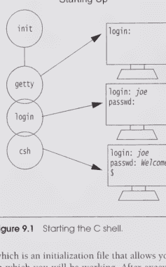

# 图 9.1 启动 C shell。

它是一个初始化文件，允许你自定义将要工作的 C/TC shell 环境。在执行 `.cshrc` 或 `.tcshrc` 文件中的命令后，`.login` 文件中的命令将被执行。每次启动新的 C/TC shell 时都会执行 `.cshrc` 或 `.tcshrc` 文件。登录时仅执行一次 `.login` 文件，它也包含用于初始化用户环境的命令和变量。执行完这些文件中的命令后，提示符会出现在你的屏幕上，C/TC shell 等待命令。今天大多数系统启动时都会使用图形用户界面，增加上述步骤。当你在桌面环境中，如 CDE 时，你会看到图标和菜单。一旦从菜单中选择终端，shell 提示符就会出现，你可以开始输入命令。

## 9.2 环境

### 9.2.1 初始化文件

`csh`/`tcsh` 程序启动后，它被编程为在用户主目录中执行两个文件：`.cshrc` 或 `.tcshrc` 文件，以及 `.login` 文件。这些文件允许用户初始化自己的环境。

#### `.cshrc` 和 `.tcshrc` 文件。

`.cshrc` 文件包含 C shell 变量设置，并在你登录时以及每次启动 `csh` 子 shell 时执行。同样，`.tcshrc` 文件包含 TC shell 变量设置，并在你登录时以及每次启动 `tcsh` 子 shell 时执行。这些文件共享相似的设置。例如，别名和历史记录通常在这里设置。

# EXAMPLE 9.1

```
(The .cshrc File)

1  if ($?prompt) then

2     set prompt = "\! stardust >"

3     set history = 32

4     set savehist = 5

5     set noclobber

6     set filec ignore = (.o)

7     set cdpath = (/home/jody/ellie/bin /usr/local/bin /usr/bin)

8     set ignoreeof

9     alias m more
     alias cd 'cd \!*;set prompt = "!\! <cwd> "'

endif
```

### EXPLANATION

- 1 如果已设置提示符 (`$?prompt`)，则 shell 以交互方式运行；也就是说，它不是在脚本中运行。
- 2 主提示符被设置为当前历史事件的编号、名称 `stardust` 和一个 `>` 字符。这将改变 `%` 提示符，即默认值。
- 3 `history` 变量被设置为 32。这控制将出现在屏幕上的历史事件数量。你输入的最后 32 条命令将在你输入 `history` 时显示（参见第 413 页的“命令行历史”）。
- 4 通常，当你注销时，历史列表会被清除。`savehist` 变量允许你从历史列表末尾保存指定数量的命令。在此示例中，最后 5 条命令将保存在你主目录中的一个文件 `.history` 文件中，这样当你再次登录时，shell 可以检查该文件是否存在并将保存的历史行放在新历史列表的顶部。
- 5 `noclobber` 变量被设置为防止用户在使用重定向时无意中删除文件。例如，`sort myfile > myfile` 将会破坏 `myfile`。设置 `noclobber` 后，屏幕上会出现 `file exists` 消息。
- 6 `filec` 变量用于文件名补全，这样你只需输入文件名的首个有意义字符，按 Esc 键，shell 就会补全其余文件名。通过在输入文件名时按 `^D`（Ctrl-D），C shell 将显示与该字符串匹配的文件列表。`fignore` 变量允许你排除不希望受文件名补全影响的文件。在此情况下，所有 `.o` 文件名（目标文件）都不会受 `filec` 影响，即使 `filec` 已被设置（参见第 431 页的“文件名补全：filec 变量”）。

### EXPLANATION (CONTINUED)

- 7 `cdpath` 变量被赋予一个路径元素列表。更改目录时，如果你只指定目录名，并且该目录不是当前工作目录下的直接子目录，shell 将搜索 `cdpath` 目录条目，查看是否能在这些位置中找到该目录，然后更改目录。
- 8 `ignoreeof` 变量阻止你使用 `^D` 注销。接受键盘输入的 UNIX 实用程序，如 `mail` 程序，通过按 `^D` 终止。通常，在慢速系统上，用户会想按多次 `^D`。第一次时，`mail` 程序会被终止，第二次时，用户会被注销。通过设置 `ignoreeof`，你必须输入 `logout` 才能注销。
- 9 别名被设置为为单个命令或一组命令提供简写表示法。现在当你输入别名时，将执行分配给它的命令。`more` 命令的别名为 `m`。每次你输入 `m`，`more` 命令就会执行。`status` 别名打印日期和用户磁盘使用情况的摘要。`cd` 别名在用户每次更改目录时创建新的提示符。新的提示符将包含当前历史事件的编号（`\!`）和当前工作目录 `$cwd`，用 `< >` 包围（参见第 418 页的“别名”）。

#### `.login` 文件。

`.login` 文件在你首次登录时执行一次。它通常包含环境变量和终端设置。它是通常启动窗口应用程序的文件。因为环境变量会被从此 shell 生成的进程继承且只需设置一次，而终端设置无需为每个进程重置，所以这些设置属于 `.login` 文件。

# EXAMPLE 9.2

```
(The .login File)

1 stty -istrip

2 stty erase ^h

3 stty kill ^u

#

# If possible start the windows system.

# Give a user a chance to bail out

#

4 if ( $TERM == "linux" ) then

5     echo "Starting X windows. Press Ctrl-C \
to exit within the next 5 seconds "

    sleep 5

    startx

6 endif

7 

8 set autologout=60
```


# 解释

- 1 `stty` 命令用于设置终端选项。如果使用 `-istrip`，则输入字符不会被剥离为七位。
- 2 `stty` 命令将 `Ctrl-H`，即退格键，设置为擦除。
- 3 以 `#` 开头的任何行都是注释。它不是可执行语句。
- 4 如果当前终端窗口（tty）是控制台（linux），则执行下一行；否则，程序控制转到最后一个 `endif`。
- 5 该行会被回显到屏幕上，如果用户没有按 `Ctrl-C` 终止进程，程序将休眠（暂停）五秒钟，然后 X Windows 程序将启动。
- 6 `startx` 程序在该系统为 Linux 时启动 X Windows。
- 7 `endif` 标记最内层 `if` 构造的结束。
- 8 `autologout` 变量被设置为 60，因此在 60 分钟不活动后，用户将被自动注销（从登录 shell 注销）。

#### 9.2.2 搜索路径

`path` 变量由 shell 用于定位在命令行输入的命令。搜索是从左到右进行的。点表示当前工作目录。如果命令在 `path` 中列出的任何目录中或当前工作目录中都找不到，shell 会向标准错误发送消息 `Command not found`。建议在 `.login` 文件中设置 `path`。1 在 C/TC shell 中，搜索路径的设置方式与 Bourne 和 Korn shell 不同。每个元素由空白字符分隔。

```
set path = (/usr/bin /usr/ucb /bin /usr .)
```

```
echo $path
```

`/usr/bin /usr/ucb /bin /usr .`

环境变量 `PATH` 将显示为

```
echo $PATH
```

`/usr/bin:/usr/ucb:/bin:/usr:.`

C/TC shell 内部会更新环境变量 `PATH`，以保持与其他程序（如从该 shell 启动的 Bourne 或 Korn shell）的兼容性，这些程序可能需要使用 `path` 变量。

> 1. 不要将搜索路径变量与在 `.cshrc` 文件中设置的 `cpath` 变量混淆。

#### 9.2.3 rehash 命令

shell 构建一个内部哈希表，由搜索路径中列出的目录的内容组成。（如果搜索路径中包含点，则点目录，即当前工作目录中的文件，不会放入哈希表中。）为了提高效率，shell 使用哈希表在命令行查找输入的命令，而不是每次都搜索路径。如果在搜索路径中已列出的目录之一中添加了新命令，则必须重新计算内部哈希表。这可以通过输入以下命令完成

```
% rehash
```

（`%` 是 C shell 提示符。）当你在提示符下更改 `path` 或启动另一个 shell 时，哈希表也会自动重新计算。

#### 9.2.4 hashstat 命令

`hashstat` 命令显示性能统计，以显示其从哈希表中搜索命令的有效性。统计数据以“命中”和“未命中”表示。如果 shell 发现你使用的大多数命令位于 `path` 的末尾，它的工作量会比命令位于 `path` 前部时更大，导致未命中数高于命中数。在这种情况下，你可以将命中率最高的目录放在 `path` 的前面以提高性能。

```
% hashstat
2 hits, 13 misses, 13%²
```

#### 9.2.5 source 命令

`source` 命令是 shell 内置命令，即 shell 内部代码的一部分。它用于从文件中执行命令或一组命令。通常，当执行命令时，shell 会 fork 一个子进程来执行命令，这样所做的任何更改都不会影响原始 shell，即父 shell。`source` 命令会导致程序在当前 shell 中执行，因此文件中设置的任何变量都将成为当前 shell 环境的一部分。`source` 命令通常用于重新执行 `.cshrc` 或 `.login`，如果其中任何一个已被修改。例如，如果在登录后更改了 `path`，请输入

```
% source .login or .cshrc
```

#### 9.2.6 Shell 提示符

C shell 有两个提示符：主提示符，是百分号（`%`），和次提示符，是问号（`?`）。TC shell 使用 `>` 作为其主默认提示符。 （请参阅第 461 页的“Shell 提示符”，了解 `tsch` 增强提示符设置的介绍。）

主提示符是在你登录后显示在终端上的提示符；它等待你输入命令。主提示符可以被重置。如果你正在提示符下编写脚本，需要使用 C/TC shell 编程结构，例如决策或循环，次提示符将会出现，以便你继续输入下一行。它会在每次换行后继续出现，直到结构被正确终止。次提示符无法被重置。

### 主提示符。

交互运行下，提示符等待你输入命令并按下 Enter 键。如果你不想使用默认提示符，在 `.cshrc` 文件中重置它，它将为本次及所有其他 C 子 shell 设置。如果你只想在登录会话中设置它，就在 shell 提示符处设置它。

# 示例 9.3

```
1  % set prompt = "$LOGNAME > "
2.  ellie >
```

# 解释

- 1 主提示符被赋值为用户的登录名，后跟一个 `>` 符号和一个空格。
- 2 新的提示符被显示。

### 次提示符。

当你在提示符下编写在线脚本时，次提示符会出现。每当输入 shell 编程结构后跟一个换行符，次提示符就会出现并继续出现，直到结构被正确终止。在提示符下正确编写脚本需要练习。一旦输入命令并按下 Enter，就无法回退，并且 C shell 历史机制不会保存在次提示符下输入的命令。

# 示例 9.4

```
1  % foreach pal (joe tom ann)
2  ? mail $pal < memo
3  ? end
4  %
```

# 解释

- 1 这是在线脚本的一个例子。因为 C shell 在输入 `foreach` 循环后期望进一步的输入，所以次提示符会出现。`foreach` 循环处理圆括号中的每个单词。
- 2 第一次循环时，`joe` 被赋给变量 `pal`。用户 `joe` 被发送 `memo` 的内容到邮件中。随后再次循环时，`tom` 被赋给变量 `pal`，以此类推。
- 3 `end` 语句标记循环的结束。当圆括号中的所有项目都被处理完后，循环结束并显示主提示符。
- 4 主提示符被显示。

# 9.3 C/TC Shell 命令行

登录后，C/TC shell 显示其主提示符，分别为 `%` 或 `>`。shell 是你的命令解释器。当 shell 交互运行时，它从终端读取命令并将命令行拆分为单词。命令行由一个或多个单词（或标记）组成，这些单词由空白（空格和/或制表符）分隔，并以换行符终止，通过按下 Enter 键生成。第一个单词是命令，后续单词是命令的选项和/或参数。命令可能是 UNIX/Linux 可执行程序，如 `ls` 或 `pwd`，也可能是别名、内置命令如 `cd` 或 `jobs`，或 shell 脚本。命令可能包含特殊字符，称为元字符，shell 在解析命令行时必须解释这些字符。如果命令行最后一个字符是反斜杠，后跟换行符，则该行可以继续到下一行。

#### 9.3.1 退出状态

命令或程序终止后，它会向父进程返回一个退出状态。退出状态是一个介于 0 和 255 之间的数字。按惯例，程序退出时，如果返回的状态为 0，则表示命令执行成功。当退出状态非零时，表示命令以某种方式失败。C/TC shell `status` 变量被设置为最后执行的命令的退出状态值。程序的成功或失败由编写该程序的程序员决定。

# 示例 9.5

```
1 % grep "ellie" /etc/passwd
ellie:GMy8Sj...:9496:40:Ellie Quigley:/home/jody/ellie
2 % echo $status
0
3 % grep "nicky" /etc/passwd
4 % echo $status
1
5 % grep "scott" /etc/passsswd
grep: /etc/passsswd: No such file or directory
6 % echo $status
2
```

# 解释

+   1 `grep` 程序在 `/etc/passwd` 文件中搜索模式 `ellie` 并成功。`/etc/passwd` 中的行被显示出来。
+   2 `status` 变量被设置为 `grep` 命令的退出值；0 表示成功。
+   3 `grep` 程序在 `/etc/passwd` 文件中找不到用户 `nicky`。
+   4 `grep` 程序找不到该模式，因此返回退出状态 1。
+   5 `grep` 程序失败，因为文件 `/etc/passsswd` 无法打开。
+   6 Grep 找不到文件，因此返回退出状态 2。

#### 9.3.2 命令分组

一条命令行可以由多个命令组成。每个命令由分号分隔，命令行以换行符结束。

# 示例 9.6

```
% ls; pwd; cal 2004
```

# 解释

命令从左到右执行，直到遇到换行符。

命令也可以被分组，以便所有输出都通过管道传递给另一个命令或重定向到文件。shell 在子 shell 中执行命令。

# 示例 9.7

```
1 % ( ls ; pwd; cal 2004 ) > outputfile
```


2 `% pwd; ( cd / ; pwd )`

`/home/jody/ellie`

`/`

`/home/jody/ellie`

```
```

# 解释

+ 1 各命令的输出被发送到名为 `outputfile` 的文件。没有括号，前两个命令的输出会发送到屏幕，只有 `cal` 命令的输出会被重定向到输出文件。
+ 2 `pwd` 命令显示当前工作目录。括号导致括在其中的命令由子 shell 处理。`cd` 命令是 shell 内置命令。在子 shell 中，目录被更改为 `root` 并显示当前工作目录。退出子 shell 后，原始 shell 的当前工作目录被显示。

#### 9.3.3 命令的条件执行

使用条件执行，两个命令字符串由两个特殊元字符分隔，双与号和双竖线（`&&` 和 `||`）。在任一元字符右侧的命令是否执行，取决于左侧命令的退出条件。

# 示例 9.8

```
% grep 'atom:' /etc/passwd && mail tom < letter
```

# 解释

如果第一个命令成功（退出状态为 0），则 `&&` 后的第二个命令将被执行。如果 `grep` 命令成功在 `passwd` 文件中找到 `tom`，则右侧的命令将被执行：`mail` 程序将向 `tom` 发送 `letter` 文件的内容。

# 示例 9.9

```
% grep 'atom:' /etc/passwd || echo "tom is not a user here."
```

# 解释

如果第一个命令失败（退出状态为非零），则 `||` 后的第二个命令将被执行。如果 `grep` 命令在 `passwd` 文件中找不到 `tom`，则右侧的命令将被执行：`echo` 程序将把 `tom is not a user here.` 打印到屏幕上。

#### 9.3.4 后台命令

通常，当你执行一个命令时，它在前台运行，并且在命令执行完成之前提示符不会重新出现。等待命令完成并不总是方便的。通过在命令行末尾放置一个与号，shell 将立即返回 shell 提示符，这样你就不必等待最后一个命令完成后再启动另一个命令。在后台运行的命令称为后台作业，其输出将在处理时发送到屏幕。如果两个命令同时向屏幕发送输出可能会令人困惑。为了避免混淆，你可以将后台作业的输出发送到文件，或通过管道将其发送到打印机等其他设备。启动一个新的 shell 窗口作为后台作业通常很方便，这样你就可以同时访问启动它的窗口和新的 shell 窗口。

# 示例 9.10

```
1  % man xview | lp&
2  [1] 1557
3  %
```

# 解释

+ 1. `xview` 程序的手册页输出通过管道传递给打印机。命令行末尾的与号将作业置于后台。
+ 2. 屏幕上出现了两个数字：方括号中的数字表示这是第一个被置于后台的作业，第二个数字是该作业的 PID。
+ 3. shell 提示符立即出现。在你的程序在后台运行时，shell 会提示你输入另一个前台命令。

#### 9.3.5 命令行历史

历史机制内置于 C/TC shell 中。有关 `tcsh` 对历史的增强，请参阅第 466 页的“TC Shell 命令行历史”。它保存了你在命令行上输入的命令的编号列表（称为历史事件）。你可以从历史列表中召回命令并重新执行它，而无需重新输入命令。历史替换字符，感叹号，通常称为 bang 字符。`history` 内置命令显示历史列表。

# 示例 9.11

```
(The Command Line)
% history
1 cd
2 ls
3 more /etc/fstab
4 /etc/mount
5 sort index
6 vi index
```

# 解释

历史列表显示了在命令行上输入的最后几个命令。列表中的每个事件前面都有一个数字。

# 设置历史。

C shell 历史变量设置为你希望从历史列表中保存并在屏幕上显示的事件数。通常，这是在 `.cshrc` 文件中设置，用户初始化文件。

### EXAMPLE 9.12

```
set history=50
```

### EXPLANATION

在终端输入的最后 50 条命令会被保存，并且可以通过输入 `history` 命令在屏幕上显示。

# 保存历史。

要跨登录保存历史事件，请设置 `savehist` 变量。此变量通常在 `.cshrc` 文件中设置，用户初始化文件。

### EXAMPLE 9.13

```
set savehist=25
```

### EXPLANATION

历史列表中的最后 25 条命令会被保存，并在下次登录时位于历史列表顶部。

# 显示历史。

`history` 命令会显示历史列表中的事件。`history` 命令还有控制将显示的事件数量和格式的选项。事件的编号不一定从 1 开始。如果你历史列表中有 100 条命令，并且将 `history` 变量设置为 25，你将只看到保存的最后 25 条命令。 （TC shell 支持使用方向键。参见第 470 页的“Accessing Commands from the History File”。）

### EXAMPLE 9.14

```
% history
1 ls
2 vi file1
3 df
4 ps -eaf
5 history
6 more /etc/passwd
7 cd
8 echo $USER
9 set
```

### EXPLANATION

历史列表被显示。每个命令都被编号。

### EXAMPLE 9.15

```
% history -h    # Print without line numbers
ls
vi file1
df
ps -eaf
history
more /etc/passwd
cd
echo $USER
set
history -n
```

### EXPLANATION

历史列表不带行号显示。

### EXAMPLE 9.16

```
% history -r    # Print the history list in reverse
11 history -r
10 history -h
9 set
8 echo $USER
7 cd
6 more /etc/passwd
5 history
4 ps -eaf
3 df
2 vi file1
1 ls
```

### EXPLANATION

历史列表以相反顺序显示。

### EXAMPLE 9.17

```
% history 5    # Prints the last 5 events on the history list
7 echo $USER
8 cd
9 set
10 history -n
11 history 5
```

### EXPLANATION

历史列表上的最后五个命令被显示。

# 重新执行命令。

要从历史列表重新执行命令，使用感叹号（bang）。如果你输入两个感叹号 (`!!`)，则重新执行最后一条命令。如果你输入感叹号后跟一个数字，该数字与历史列表中的命令相关联并执行该命令。如果你输入感叹号和一个字母，则执行以该字母开头的最后一条命令。插入符号（`^`）也用作编辑上一条命令的快捷方法。

### EXAMPLE 9.18

```
1 % date
Mon Apr 26 8 12:27:35 PST 2004
2 % !!
date
Mon Apr 26 12:28:25 PST 2004
3 % !3
date
Mon Apr 26 12:29:26 PST 2004
4 % !d
date
Mon Apr 26 12:30:09 PST 2004
5 % dare
dare: Command not found.
6 % ^A^t
date
Mon Apr 26 12:33:25 PST 2004
```

### EXPLANATION

- 1 `date` 命令在命令行执行。历史列表已更新。
- 2 `!!`（bang bang）获取历史列表中的最后一条命令；该命令被重新执行。
- 3 历史列表中的第三条命令被重新执行。
- 4 历史列表中以字母 `d` 开头的最后一条命令被重新执行。
- 5 命令输入错误。
- 6 使用插入符号从历史列表中的最后一条命令替换字母。第一次出现的 `r` 被替换为 `t`。

### EXAMPLE 9.19

```
1 % cat file1 file2 file3
<Contents of file1, file2, and file3 are displayed here>
% vi 1:1
vi file1
```

### EXAMPLE 9.19 (CONTINUED)

```
2
% cat file1 file2 file3
<Contents of file1, file2, and file3 are displayed here>
% ls !:2
ls file2
file2
```

```
3
% cat file1 file2 file3
% ls !:3
ls file3
file3
```

```
4
% echo a b c
a b c
```


% `echo !$`

`echo c`

c

```

```

5

% `echo a b c`

a b c

% `echo !^`

`echo a`

a

```

```

6

% `echo a b c`

a b c

% `echo !:`

`echo a b c`

a b c

```

```

7

% `!!:p`

`echo a b c`

```

### EXPLANATION

1 `cat` 命令将 `file1`、`file2` 和 `file3` 的内容显示到屏幕。历史列表已更新。命令行被拆分为单词，从单词号 0 开始。如果单词号前面有冒号，则可以从历史列表中提取该单词。`!:1` 记法表示：获取历史列表中最后一条命令的第一个参数并将其替换到命令字符串中。最后一条命令的第一个参数是 `file1`。 （单词 0 是命令本身。）

2 `!:2` 被替换为最后一条命令的第二个参数 `file2`，并作为 `ls` 的参数给出。`file2` 被打印。 （`file2` 是第三个单词。）

3 `ls !:3` 的含义是：转到历史列表中的最后一条命令并获取第四个单词（单词从 0 开始）并将其作为参数传递给 `ls` 命令（`file3` 是第四个单词）。

# 说明（续）

- 4 感叹号 (`!`) 与美元符号 (`$`) 一起表示历史列表中最后一个命令的最后一个参数。最后一个参数是 `c`。
- 5 插入符号 (`^`) 表示命令后的第一个参数。感叹号 (`!`) 与 `^` 一起表示历史列表中最后一个命令的第一个参数。最后一个命令的第一个参数是 `a`。
- 6 星号 (`*`) 表示命令后的所有参数。感叹号 (`!`) 与 `*` 一起表示历史列表中最后一个命令的所有参数。
- 7 打印历史列表中的最后一个命令但不执行。历史列表已更新。你现在可以对该行执行插入符号替换。

# 9.4 别名

别名是 C/TC shell 用户定义的命令缩写。（有关 `tcsh` 对别名机制的增强，请参阅第 491 页的“TC Shell 别名”。）当命令具有许多选项和参数或语法难以记住时，别名很有用。在命令行上设置的别名不会被子 shell 继承。别名通常设置在 `.cshrc` 或 `.tcshrc` 文件中。因为在启动新 shell 时会执行 `.cshrc` 或 `.tcshrc`，所以在其中设置的任何别名都将被重置为新 shell。别名也可以传递到 shell 脚本中，但除非在脚本中直接设置，否则会引起潜在的可移植性问题。

#### 9.4.1 列出别名

内置命令 `alias` 列出所有已设置的别名。别名先打印出来，其后是它所代表的真实命令或命令。

### 示例 9.20

```
% alias

co      compress

cp      cp -i

ls1     enscript -B -r -Porange -f Courier8 !* &

mailq   /usr/lib/sendmail -bp

mroe    more

mv      mv -i

rn      /usr/spool/news/bin/rn3

uc      uncompress

uu      uudecode

vg      vgrind -t -s11 !:1 | lpr -t

weekly  (cd /home/jody/ellie/activity; ./weekly_report; echo Done)
```

# 说明

`alias` 命令在第一列列出命令的别名（昵称），在第二列列出别名所代表的真实命令或命令。

#### 9.4.4 别名循环

当别名定义引用另一个引用回原始别名的别名时，就会发生别名循环。

### 示例 9.23

```
1 % alias m more
2 % alias mroe m
3 % alias m roe   # Causes a loop
4 % m datafile

Alias loop.
```

# 说明

- 1. 别名是 `m`。别名定义是 `more`。每次使用 `m` 时，都会执行 `more` 命令。
- 2. 别名是 `mroe`。别名定义是 `m`。如果输入 `mroe`，则会调用别名 `m` 并执行 `more` 命令。
- 3. 这是罪魁祸首。如果使用别名 `m`，它会调用别名 `mroe`，而别名 `mroe` 又引用回 `m`，从而导致别名循环。不会发生坏事。你只会收到一条错误消息。
- 4. 使用别名 `m`。它是循环的。`m` 调用 `mroe`，`mroe` 调用 `m`，然后 `m` 又调用 `mroe`，等等。C shell 会捕获该问题并显示错误消息，而不是无限循环。

# 9.5 操作目录栈

如果你发现自己在工作时不断在目录树中上下切换到许多相同的目录，你可以通过将它们推入目录栈并操作该栈来轻松访问这些目录。目录栈通常与自助餐厅中叠放的托盘相比较，托盘彼此叠放，最上面的一个在栈的顶部。内置命令 `pushd` 将目录推入栈，`popd` 命令将其移除。（请参阅以下示例。）栈是一个按编号排列的目录列表，其中顶部目录是最新的被推入栈的目录。目录的编号从顶部目录的 0 开始，下一个编号为 1，以此类推。内置命令 `dirs` 带 `-v` 选项可显示编号的目录栈。

#### 9.5.1 pushd 和 popd 命令

`pushd` 命令带目录作为参数时，会将新目录添加到目录栈中，同时切换到该目录。如果参数是连字符 (`-`)，则连字符指的是上一个工作目录。如果参数是 `+` 和一个数字 (`n`)，`pushd` 会从栈中提取第 `n` 个目录并将其推到

the top, then changes to that directory. Without arguments, `pushd` exchanges the top two elements of the directory stack, making it easy to switch back and forth between directories. There are a number of shell variables that control the way `pushd` works. (See "Setting Local Variables" on page 441.)

To save a directory stack across login sessions, you must set the `savedirs` variable in one of the `tcsh` initialization files (e.g., `~/.tcshrc`). The directory stack will be stored in a file called `~/.cshdirs` and will be automatically sourced when the shell starts up.

The `popd` command removes a directory from the top of the stack, and changes to that directory.

See Table 9.1 for a list of directory stack variables.

# Table 9.1 Directory Stack Variables

| Variable | What It Does |
|---|---|
| `deextract` | If set, `pushd +n` extracts the nth directory from the directory stack before pushing it onto the stack. |
| `dirsfile` | Can be assigned a filename where the directory stack can be saved across logins. |
| `dirstack` | Used to display the stack or assign directories to it. |
| `dunique` | Before pushing a directory onto the stack, removes any directories with the same name. |
| `pushdsilent` | Doesn't print the directory stack when `pushd` is executed. |
| `pushdtohome` | If set, `pushd` without arguments, is same as `pushd ~` or `cd`. |
| `pushtohome` | Without arguments, pushes to `~`, the user's home directory |
| `savedirs` | Saves the directory stack across logins. |

# EXAMPLE 9.24

```
1 % pwd

/home/ellie

% pushd ..

/home -

% pwd

/home
2 % pushd   # swap the two top directories on the stack

~ /home

% pwd

/home/ellie
```

# EXAMPLE 9.23 (CONTINUED)
```


```
3  % pushd perlclass

   ~/perlclass  ~  /home

4  % dirs -v

   0       ~/perlclass

   1       ~

   2       /home

5  % popd

   ~       /home

   % pwd

   /home/ellie

6  % popd

   /home

   % pwd

   /home

7  % popd

   popd: Directory stack empty.
```

### EXPLANATION

+ 1. First the `pwd` command displays the present working directory, `/home/ellie`. Next the `pushd` command with `..` as its argument pushes the parent directory (`..`) onto the directory stack. The output of `pushd` indicates that `/home` is at the top of the directory stack and the user's home directory (`~`), `/home/ellie`, is at the bottom of the stack. `pushd` also changes the directory to the one that was pushed onto the stack; that is, `..`, which translates to `/home`. The new directory is displayed with the second `pwd` command.
+ 2. `pushd`, without arguments, exchanges the two top directory entries on the stack and changes to the swapped directory; in this example, the directory is switched back to the user's home directory, `/home/ellie`.
+ 3. The `pushd` command will push its argument, `~/perlclass`, onto the stack, and change to that directory.
+ 4. The built-in `dirs` command displays the numbered directory stack, with `0` being the top level.
+ 5. The `popd` command removes a directory from the top of the stack, and changes to that directory.
+ 6. The `popd` command removes another directory from the top of the stack, and changes to that directory.
+ 7. The `popd` command cannot remove any more directory entries because the stack is empty, and issues an error message saying so.

# 9.6 Job Control

Job control is a powerful feature of the C/TC shell that allows you to run programs, called jobs, in the background or foreground. Normally, a command typed at the command line runs in the foreground, and will continue until it has finished. If you have windows, job control may not be necessary, because you can simply open another window to start a new task. On the other hand, with a single terminal, job control is a very useful feature. For a list of job commands, see Table 9.2. (See "TC Shell Job Control" on page 495 for TC shell enhancements for job control.)

# Table 9.2 Job Control Commands

| Command | Meaning |
|---|---|
| `jobs` | Lists all the jobs running |
| `^Z` (Ctrl-Z) | Stops (suspends) the job; the prompt appears on the screen |
| `bg` | Starts running the stopped job in the background |
| `fg` | Brings a background job to the foreground |
| `kill` | Sends the kill signal to a specified job |

#### 9.6.1 The Ampersand and Background Jobs

If you expect a command to take a long time to complete, you can append the command with an ampersand and the job will execute in the background. The C/TC shell prompt returns immediately and now you can type another command. Now the two commands are running concurrently, one in the background and one in the foreground. They both send their standard output to the screen. If you place a job in the background, it is a good idea to redirect its output either to a file or pipe it to a device such as a printer.

# EXAMPLE 9.25

```
1 % find . -name core -exec rm {} \; &
2 [1] 543
3 %
```

### EXPLANATION

#### 9.6.2 挂起键序列和后台作业

要挂起一个程序，需发出挂起键序列 `Ctrl-Z`。作业现在被挂起（停止），shell 提示符显示出来，并且程序在发出 `fg` 或 `bg` 命令之前不会恢复。（在使用 `vi` 编辑器时，`ZZ` 命令会写入并保存文件。请勿将其与 `Ctrl-Z` 混淆，后者会挂起 `vi` 会话。）如果在作业被挂起时尝试注销，屏幕上会出现 `There are stopped jobs` 消息。

#### 9.6.3 jobs 命令

C/TC shell 内置的 `jobs` 命令会显示当前处于活动状态且在后台运行或被挂起的程序。运行意味着作业在后台执行。当作业被停止时，它处于挂起状态；它未在执行。在这两种情况下，终端都可以接受其他命令。

### 示例 9.26

```
(The Command Line)

1

% jobs

2

[1] + Stopped      vi filex
[2] - Running      sleep 25

3

% jobs -l
[1] + 355 Stopped  vi filex
[2] - 356 Running  sleep 25

4

[2] Done sleep 25
```


# 解释

- 1 `jobs` 命令列出当前活动的作业。
- 2 记号 `[1]` 是第一个作业的编号；加号表示该作业不是最近放入后台的作业；减号表示这是最近放入后台的作业；`Stopped` 表示该作业已通过 `^Z` 挂起且当前未处于活动状态。
- 3 `-l` 选项（长列表）会显示作业编号以及作业的 PID。记号 `[2]` 是第二个作业的编号，在本例中为最后放入后台的作业。减号表示这是最近的作业。`sleep` 命令在后台运行。
- 4 `sleep` 运行 25 秒后，作业将完成，屏幕上会出现已完成的提示信息。

## 9.6.4 前台和后台命令

`fg` 命令将后台作业带到前台。`bg` 命令使被挂起的作业在后台开始运行。可以使用百分号和作业编号作为 `fg` 和 `bg` 命令的参数，如果你想对特定作业进行作业控制。

### 示例 9.27

```
1  % jobs

   [1] + Stopped    vi file

   [2] - Running    cc prog.c -o prog

3  % fg %1

   vi file

   (vi session starts)

4  % kill %2

   [2] Terminated  cc prog.c -o prog

5  % sleep 15

   (Press ^Z)

   Stopped

6  % bg

   [1] sleep 15 &

   [1] Done       sleep 15
```

# 解释

- 1. `jobs` 命令列出当前正在运行的进程，称为作业。
- 2. 第一个被停止的作业是 `vi` 会话，第二个作业是 `cc` 命令。
- 3. 编号为 `[1]` 的作业被带到前台。编号前加上百分号。
- 4. `kill` 命令是内置的。它默认向进程发送 `TERM`（终止）信号。参数可以是进程的编号或 PID。
- 5. `sleep` 命令通过按下 `^Z` 被停止。`sleep` 命令未使用 CPU 并在后台挂起。
- 6. `bg` 命令使最后一个后台作业开始在后台执行。`sleep` 程序将在执行恢复前以秒为单位开始倒计时。

# 9.7 Shell 元字符

元字符是用于表示除其本身以外的其他内容的特殊字符。经验法则是，既不是字母也不是数字的字符可能是元字符。与 `grep`、`sed` 和 `awk` 类似，`shell` 也有自己的一套元字符，通常称为 shell 通配符。Shell 元字符可用于将命令组合在一起、缩写文件名和路径名、重定向和管道输入/输出、将命令置于后台等等。表 9.3 给出了 shell 元字符的部分列表。

### 表 9.3 Shell 元字符

| 元字符 | 用途 | 示例 | 含义 |
|---|---|---|---|
| `$` | 变量替换 | set name=Tom echo $name Tom | 将变量 `name` 设置为 `Tom`；显示其中存储的值。 |
| `!` | 历史替换 | `!3` | 重新执行历史列表中的第三个事件。 |
| `*` | 文件名替换 | `rm *` | 删除所有文件。 |
| `?` | 文件名替换 | `ls ??` | 列出所有两字符文件。 |
| `[ ]` | 文件名替换 | `cat f[123]` | 显示 `f1`、`f2`、`f3` 的内容。 |
| `;` | 命令分隔符 | `ls;date;pwd` | 每个命令依次执行。 |
| `&` | 后台处理 | `lp nbox&` | 打印在后台进行。提示符立即返回。 |
| `>` | 输出重定向 | `ls > file` | 将标准输出重定向到 `file`。 |
| `<` | 输入重定向 | `ls < file` | 将标准输入从 `file` 重定向。 |
| `>&` | 输出和错误重定向 | `ls >& file` | 将输出和错误都重定向到 `file`。 |
| `>!` | 如果设置了 noclobber，则覆盖它 | `ls >! file` | 如果 `file` 存在，则截断并覆盖它，即使设置了 `noclobber`。 |
| `>>!` | 如果设置了 noclobber，则覆盖它 | `ls >>! file` | 如果 `file` 不存在，则创建它；即使设置了 `noclobber`。 |

> 4. `grep`、`sed` 和 `awk` 等程序有一套元字符，称为正则表达式元字符，用于模式匹配。这些不应与 shell 元字符混淆。

# 9.8 文件名替换

表 9.3 Shell 元字符（续）

| 元字符 | 用途 | 示例 | 含义 |
|---|---|---|---|
| `( )` | 将命令分组在子 shell 中执行 | `{ls ; pwd} >tmp` | 执行命令并将输出发送到 `tmp` 文件。 |
| `{ }` | 将命令分组在此 shell 中执行 | `{ cd /; echo $cwd }` | 更改到根目录并显示当前工作目录。 |

在评估命令行时，shell 使用元字符来缩写匹配某一字符集的文件名或路径名。表 9.4 中列出的文件名替换元字符会被扩展为按字母顺序排列的文件名集合。将元字符扩展为文件名的过程也称为 `globbing`。与其他 shell 不同，当 C shell 无法为元字符替换出文件名时，shell 会报告 `No match`。

### 表 9.4 Shell 元字符和文件名替换

| 元字符 | 含义 |
|---|---|
| `*` | 匹配零个或多个字符 |
| `?` | 匹配恰好一个字符 |
| `[abc]` | 匹配集合中的一个字符：a、b 或 c |
| `[a-z]` | 匹配范围 a 到 z 中的一个字符 |
| `{a, !le, ax}` | 匹配一个字符或一组字符 |
| `~` | 用波浪线替换用户的主目录 |
| `\` | 转义或禁用元字符 |

`shell` 通过评估其元字符并用文件名中的适当字母或数字替换它们来执行文件名替换。

#### 9.8.1 星号

星号匹配文件名中的零个或多个字符。

# EXAMPLE 9.28

```
1 % ls

 a.c b.c abc ab3 file1 file2 file3 file4 file5

2 % echo *

 a.c b.c abc ab3 file1 file2 file3 file4 file5

3 % ls *.c

 a.c b.c

4 % rm z?p

 No match.
```

### EXPLANATION

- 1 列出当前目录中的所有文件。
- 2 `echo` 程序将所有参数打印到屏幕上。星号（也称为 splat）是一个通配符，意思是：匹配文件名中任意字符的零个或多个。目录中的所有文件都被匹配并回显到屏幕上。
- 3 列出以 `.c` 结尾的文件名。
- 4 因为目录中没有以 `z` 开头的文件，shell 报告 `No match`。

#### 9.8.2 问号

问号匹配文件名中的恰好一个字符。

# EXAMPLE 9.29

```
1 % ls

 a.c b.c abc ab3 file1 file2 file3 file4 file5

2 % ls ???

 abc ab3

3 % echo How are you?

 No match.

4 % echo How are you\?

 How are you?
```

### EXPLANATION

- 1 列出当前目录中的所有文件。
- 2 问号匹配单字符文件名。任何由三个字符组成的文件名都被列出。
- 3 shell 查找拼写为 `y-o-u` 后跟一个字符的文件名。目录中没有匹配这些字符的文件。shell 打印 `No match`。
- 4 问号前的反斜杠用于关闭问号的特殊含义。现在 shell 将问号视为字面字符。

#### 9.8.3 方括号

方括号为文件名匹配来自一组字符或字符范围中的一个字符。

# EXAMPLE 9.30

```
1 % ls

a.c b.c abc ab3 file1 file2 file3 file4 file5 file10 file11 file12

2 % ls file[123]

file1 file2 file3

3 % ls [A-Za-z][a-z][1-5]

ab3

4 % ls file[0-2]

file10 file11 file12
```

### EXPLANATION

- 1 列出当前目录中的所有文件。
- 2 匹配并列出以 `file` 开头后跟 `1`、`2` 或 `3` 的文件名。
- 3 匹配并列出以字母（大写或小写）开头，后跟小写字母，再后跟 `1` 到 `5` 之间数字的文件名。
- 4 列出以 `file1` 开头后跟 `0`、`1` 或 `2` 的文件名。

#### 9.8.4 花括号

花括号 `{}` 为文件名匹配一个字符或字符串。

# EXAMPLE 9.31

```
1 % ls

a.c b.c abc ab3 ab4 ab5 file1 file2 file3 file4 file5 foo faa fumble

2 % ls f{oo,aa,umble}

foo faa fumble

3 % ls a{,.c,c,b}[3-5]

a.c ab3 ab4 ab5
```


### EXPLANATION

- 1 列出当前目录中的所有文件。
- 2 列出以 f 开头后跟字符串 oo、aa 或 umble 的文件。花括号内有空格会导致错误信息 Missing }。
- 3 列出以 a 开头后跟 .、c、c 或 b3、b4 或 b5 的文件。 （花括号内可以使用方括号。）

#### 9.8.5 转义元字符

反斜杠用于转义单个字符的特殊含义。被转义的字符将代表其本身。

### EXAMPLE 9.32

```
1 % gotta light?

   No match.

2 % gotta \light?

   gotta: Command not found.
```

### EXPLANATION

+ 1 这是一个小型的 UNIX 笑话。问号是一个文件替换元字符，评估为单个字符。shell 会在当前工作目录中查找包含字符 l-i-g-h-t，后跟单个字符的文件。如果 shell 找不到该文件，它会报告 No match。这展示了 shell 解析命令行时顺序的一些情况。元字符在 shell 尝试定位 `gotta` 命令之前就被评估了。
+ 2 反斜杠保护元字符不被解释，通常称为转义元字符。现在 shell 不会再抱怨 No match，而是搜索 `gotta` 命令的路径，但该命令未找到。

#### 9.8.6 波浪号展开

单独的波浪号字符会展开为用户主目录的完整路径名。当波浪号前加上用户名时，它会展开为该用户主目录的完整路径名。当前置于路径时，它会展开为主目录和剩余的路径名。

### EXAMPLE 9.33

```
1 % echo ~

   /home/jody/ellie

2 % cd ~/desktop/perlstuff

   % pwd

   /home/jody/ellie/desktop/perlstuff

3 % cd ~joe

   % pwd

   /home/bambi/joe
```

### EXPLANATION

#### 9.8.7 文件名补全：filec 变量

在交互式运行中，C/TC shell 提供了输入文件名或用户名的快捷方法。当内置的 `filec` 变量被设置时，它用于所谓的“文件名补全”。如果你输入当前工作目录中文件的前几个显著字符并按下 Esc 键，shell 会补全剩余的文件名，前提是没有任何其他文件以相同的字符开头。如果你输入 Ctrl-D 后跟文件的部分拼写，shell 会打印出匹配这些字符的文件列表。如果有多个匹配项，终端会发出蜂鸣声。如果列表以波浪号开头，shell 会尝试将其展开为用户名。

### EXAMPLE 9.34

```
1 % set filec

2 % ls

rum rumple rumplestiltsken run2

3 % ls ru[ESC]a  # terminal beeps

4 % ls rum/D

rum rumple rumplestiltsken

5 % ls rump[ESC]

rumple

6 % echo ~e11[ESC]

/home/jody/ellie
```

a. `[ESC]` 代表 Esc 键

### EXPLANATION

+ 1 特殊的 C shell 变量 `filec` 被设置。可以使用文件名补全。
+ 2 列出当前工作目录中的文件。
+ 3 尝试文件名补全。字母 r 和 u 不是唯一的；也就是说，shell 不知道该选择哪一个，所以它会使终端发出蜂鸣声。
+ 4 在输入字母 r-u-u 之后，按下 ^D。显示所有以 rum 开头的文件名列表。
+ 5 以 rump 开头的第一个文件名被补全并显示。
+ 6 如果部分拼写的用户名前面有波浪号，shell 会尝试补全用户名的拼写并显示用户的主目录。

#### 9.8.8 使用 noglob 关闭元字符

如果设置了 `noglob` 变量，文件名替换将被关闭，这意味着所有元字符都代表其本身；它们不会用作通配符。这在搜索 `grep`、`sed` 或 `awk` 等程序中的模式时很有用，这些程序可能包含 shell 可能尝试展开的元字符。

### EXAMPLE 9.35

```
1  % set noglob

2  % echo * ?? [] -

   * ?? [] ~
```

### EXPLANATION

+ 1 变量 `noglob` 被设置。它关闭了通配符的特殊含义。
+ 2 元字符被显示为其本身，不做任何解释。

# 9.9 重定向和管道

通常，命令的标准输出 `stdout` 会输出到屏幕，标准输入 `stdin` 来自键盘，错误消息 `stderr` 会输出到屏幕。shell 允许你使用特殊的重定向元字符将输入/输出重定向到或从文件。重定向操作符（`<`, `>`, `>>`, `&>`）后面跟一个文件名。该文件在 shell 执行左侧命令之前被打开。

管道，由垂直条 `|` 符号表示，允许将一个命令的输出发送到另一个命令的输入。管道左侧的命令称为写入者，因为它向管道写入。管道右侧的命令称为读取者，因为它从管道读取。请参阅表 9.5 获取重定向和管道元字符的列表。

### Table 9.5 Redirection Metacharacters

| Metacharacter | Meaning |
|---|---|
| command < file | 将输入从 file 重定向到 command。 |
| command > file | 将输出从 command 重定向到 file。 |
| command >& file | 将输出和错误重定向到 file。 |
| command >> file | 将 command 的输出重定向并追加到 file。 |
| command >>& file | 将 command 的输出和错误重定向并追加到 file。 |
| command << WORD
<input>
WORD | 将从第一个 WORD 到终止 WORD 的输入重定向到 command；开始 here document。用户输入在此处。它将被视为双引号字符串文本。WORD 标记输入到 command 的终止；结束 here document。 |
| command | command | 将第一个 command 的输出通过管道传输到第二个 command 的输入。 |
| command |& command | 将第一个 command 的输出和错误通过管道传输到第二个 command 的输入。 |
| command >! file | 如果设置了 `noclobber` 变量，则覆盖其对该命令的影响，并打开或覆盖 file。 |

# 表 9.5 重定向元字符（续）

| 元字符 | 含义 |
|---|---|
| command >>! file | 覆盖 `noclobber` 变量；如果文件不存在，则创建该文件并将命令的输出追加到其中。 |
| command >>&! file | 覆盖 `noclobber` 变量；如果文件不存在，则创建该文件并将输出和错误都追加到其中。 |

#### 9.9.1 重定向输入

输入不再来自终端键盘，而是可以从文件重定向。shell 会打开 `<` 符号右侧的文件，左侧的程序将从该文件读取。如果文件不存在，C shell 会报告错误 No such file or directory。

### FORMAT

```
command < file
```

### EXAMPLE 9.36

```
mail bob < memo
```

### EXPLANATION

文件 `memo` 由 shell 打开，输入被重定向到 `mail` 程序。简单地说，`mail` 程序通过该文件向用户 `bob` 发送名为 `memo` 的文件。

#### 9.9.2 here document

`here document` 是将输入重定向到命令的另一种方式。它常用于 shell 脚本中创建菜单和处理来自其他程序的输入。通常，接受键盘输入的程序会用 Ctrl-D (^D) 终止。`here document` 提供了一种在不输入 ^D 的情况下向程序发送输入并终止输入的替代方法。`<<` 符号后面跟着一个用户定义的词，通常称为终止符。输入将被定向到 `<<` 符号左侧的命令，直到达到用户定义的终止符。最终的终止符单独占一行，且不能被任何空格包围。`here document` 中会执行变量和命令替换。 （通常，`here document` 用于 shell 脚本中创建菜单并为 `mail`、`bc`、`ex`、`ftp` 等命令提供输入。）

### FORMAT

```
command << MARK

MARK ... input ...
```

### EXAMPLE 9.37

(Without the here document)
(The Command Line)

```
1 % cat

2 Hello There.

How are you?

I'm tired of this.

3 ^D
```

(The Output)

```
4 Hello There.

How are you?

I'm tired of this.
```


### EXPLANATION

- 1. 没有参数的 `cat` 程序等待键盘输入。
- 2. 用户在键盘上输入内容。
- 3. 用户输入 `^D` 以终止向 `cat` 程序的输入。
- 4. `cat` 程序将输出发送到屏幕。

### EXAMPLE 9.38

(With the here document)
(The Command Line)

```
1 % cat << DONE

2 Hello There.

How are you?

I'm tired of this.

3 DONE
```

(The Output)

```
4 Hello There.

How are you?

I'm tired of this.
```

### EXPLANATION

- 1. `cat` 程序将从第一个 `DONE` 接收输入，直到终止符 `DONE`。 这些词是用户定义的终止符。
- 2. 这些行是输入。当达到单词 `DONE` 时，不再接受输入。

### EXPLANATION (CONTINUED)

3 最终的终止符标记输入的结束。此单词两侧不能有任何空格。

4 第一个单词 `DONE` 与最终单词 `DONE` 之间的文本是 `cat` 命令的输出（从“这里”到“这里”），并被发送到屏幕。最终的 `DONE` 必须靠在左边界，没有空格或其他文本在其右侧。

### EXAMPLE 9.30

(The Command Line)

```
1 % set name = steve

2 % mail $name << EOF

3 Hello there, $name

4 The hour is now `date +%H`

5 EOF
```

### EXPLANATION

1 `shell` 变量 `name` 被赋值为用户名 `steve`。 （通常，此示例会包含在 `shell` 脚本中。）

2 变量 `name` 在 `here document` 中被展开。

3 `mail` 程序将接收输入，直到达到终止符 `EOF`。

4 `here document` 中执行命令替换；即，反引号内的命令被执行，命令的输出在字符串中被替换。

5 达到终止符 `EOF`，输入到 `mail` 程序停止。

#### 9.9.3 重定向输出

默认情况下，命令或命令的标准输出会发送到终端屏幕。要将标准输出从屏幕重定向到文件，使用 `>` 符号。命令位于 `>` 符号的左侧，文件名位于右侧。`shell` 会打开 `>` 符号右侧的文件。如果文件不存在，`shell` 将创建它；如果文件存在，`shell` 将打开文件并截断它。使用重定向时文件经常会被意外删除。 （可以设置一个特殊的 C/TC `shell` 变量，称为 `noclobber`，以防止重定向覆盖现有文件。参见第 439 页的表 9.6。）

### FORMAT

```
command > file
```

# 示例 9.40

```
cat file1 file2 > file3
```

# 解释

`file1` 和 `file2` 的内容被连接起来，输出发送到 `file3`。请记住，`shell` 在尝试执行 `cat` 命令之前会先打开 `file3`。如果 `file3` 已存在且包含数据，该数据将被丢失。如果 `file3` 不存在，则会创建它。

#### 9.9.4 将输出追加到现有文件

要将输出追加到现有文件，使用 `>>` 符号。如果 `>>` 符号右侧的文件不存在，则会创建它；如果存在，则打开文件并将输出追加到文件末尾。

# 格式

```
command >> file
```

# 示例 9.41

```
date >> outfile
```

# 解释

`date` 命令的标准输出被重定向并追加到 `outfile`。

#### 9.9.5 重定向输出和错误

`&>` 符号用于将标准输出和标准错误重定向到文件。通常，命令要么成功并将输出发送到 `stdout`，要么失败并将错误消息发送到 `stderr`。某些递归程序，如 `find` 和 `du`，在遍历目录树时会将标准输出和错误都发送到屏幕。通过使用 `&>` 符号，可以将标准输出和标准错误都保存到文件中进行检查。C/TC `shell` 没有提供仅重定向标准错误的符号，但可以通过在子 `shell` 中执行命令来获取仅标准错误。参见示例 9.42 和图 9.2。

# 示例 9.42

```
1 % date

Tue Aug 9 10:31:56 PDT 2004

2 % date > & outfile

3 % cat outfile

Tue Aug 9 10:31:56 PDT 2004
```

# 解释

- 1 `date` 命令的输出发送到标准输出，即屏幕。
- 2 输出和错误发送到 `outfile`。
- 3 因为没有错误，标准输出被发送到 `outfile`，并且文件的 `contents` 被显示。

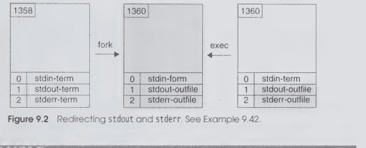

### 示例 9.43

```
1 % cp file1 file2

2 % cp file1

Usage: cp [-ipR] f1 f2; or: cp [-ipr] f1 ... fn d2

3 % cp file1 >& errorfile

4 % cat errorfile

Usage: cp [-ipR] f1 f2; or: cp [-ipr] f1 ... fn d2
```

# 解释

- 1 要复制文件，`cp` 命令需要源文件和目标文件。`cp` 命令复制 `file1` 并将副本放入 `file2`。因为 `cp` 命令使用了正确的语法，屏幕上不会显示任何内容。复制成功。
- 2 这次目标文件缺失，`cp` 命令失败，将错误发送到 `stderr`，即终端。
- 3 `>&` 符号用于将 `stdout` 和 `stderr` 都发送到 `errorfile`。因为命令的唯一输出是错误消息，所以保存到 `errorfile` 的就是它。
- 4 `errorfile` 的内容被显示，显示它包含 `cp` 命令产生的错误消息。

#### 9.9.6 分离输出和错误

标准输出和标准错误可以通过将命令括在括号中来分离。当命令被括在括号中时，C/C `shell` 会启动一个子 `shell`，在子 `shell` 中处理重定向，然后执行命令。通过使用示例 9.4 中所示的技术，可以将标准输出与错误分离。

# 示例 9.4

```
        (The Command Line)

1   % find . -name '*.c' -print >& outputfile

2   % (find . -name '*.c' -print > goodstuff) >& badstuff
```

# 解释

- 1. `find` 命令将从当前目录开始，搜索所有以 `.c` 结尾的文件，并将输出打印到 `outputfile`。如果发生错误，也会进入 `outputfile`。
- 2. `find` 命令被括在括号内。`shell` 将创建一个子 `shell` 来处理该命令。在创建子 `shell` 之前，括号外的词将被处理；即 `badstuff` 文件将被打开用于标准输出和错误。当子 `shell` 启动时，它会继承父 `shell` 的标准输入、输出和错误。子 `shell` 然后从键盘获取标准输入，标准输出和标准错误都发送到 `badstuff` 文件。现在子 `shell` 将处理 `>` 运算符。`stdout` 将被分配文件 `goodstuff`。输出进入 `goodstuff`，错误进入 `badstuff`。参见图 9.3。

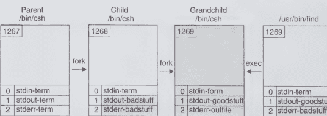

图 9.3 分离 `stdout` 和 `stderr`。

#### 9.9.7 noclobber 变量

特殊 `shell` 内置变量 `noclobber`，在设置时，可保护你免受重定向覆盖文件的影响。参见表 9.6。

**表 9.6 — noclobber 变量与重定向**

| | 如果文件存在 | 如果文件不存在 |
|---|---|---|
| **noclobber 未设置** |  |  |
| `command > file` | file 被覆盖 | file 被创建 |
| `command >> file` | 向 file 追加 | file 被创建 |
| **noclobber 已设置** |  |  |
| `command > file` | 错误信息 | file 被创建 |
| `command >> file` | 向 file 追加 | 错误信息 |
| **覆盖 noclobber** |  |  |
| `command >! file` | 如果 `noclobber` 变量已设置，则覆盖其对本次命令的影响并打开或截断 `file`，将 `command` 的输出重定向到 `file`。 |  |
| `command >>! file` | 覆盖 `noclobber` 变量；如果文件不存在，则创建它并将 `command` 的输出追加到其中。参见示例 9.45。 |  |

### 示例 9.43

```text
1  % cat filex

   abc

   123

2  % date > filex

3  % cat filex
```


   Wed Aug  5 11:51:04 PDT 2004

4  % set noclobber

5  % date > filex

   filex: File exists.

6  % ls >! filex    # Override noclobber for this command only

   % cat filex

   abc

   ab1

   dir

   filex

   plan.c

7  % ls > filex

   filex: File exists.

8  % unset noclobber  # Turn off noclobber permanently

```
# 解释

- 1. filex 的内容显示在屏幕上。
- 2. date 命令的输出被重定向到 filex。文件被截断，其原始内容被覆盖。
- 3. filex 的内容被显示。
- 4. noclobber 变量被设置。
- 5. 由于 filex 已存在且 noclobber 已设置，shell 报告文件存在且不允许覆盖它。
- 6. ls 的输出被重定向到 filex，因为 `>!` 操作符覆盖了 noclobber 的效果。
- 7. `>!` 符号的效果是临时的。它不会关闭 noclobber。它只是对实现该命令的命令覆盖 noclobber。
- 8. noclobber 变量被取消设置。

# 9.10 变量

C/TC shell 变量只保存字符串或一组字符串。一些变量是 shell 内置的，可以通过打开或关闭来设置，例如 `noclobber` 或 `filec` 变量。其他变量被赋予字符串值，例如 `path` 变量。你可以创建自己的变量并将其赋值为字符串或命令的输出。变量名区分大小写，可以包含最多 20 个字符，由数字、字母和下划线组成。

变量有两种类型：本地和环境。本地变量使用 `set` 命令创建。全局变量使用 `setenv` 命令创建。变量的范围是其可见性。本地变量对定义它的 shell 可见。环境变量的范围通常称为全局。其范围适用于此 shell 以及由此 shell 启动的所有进程。

美元符号 (`$`) 是一个特殊元字符，当置于变量名前时，告诉 shell 提取该变量的值。`echo` 命令在将变量作为参数给出时，将在 shell 处理命令行并执行变量替换后显示变量的值。

特殊记法 `$?` 置于变量名前，可让你知道变量是否已被设置。如果返回 1，则表示 true，变量已被设置。如果返回 0，则表示 false，变量未被设置。

# 示例 9.46

```text

1 % set filec

2 % set history = 50

3 % set name = George

4 % set machine = `uname -n`

5 % echo $?machine

1

6 % echo $?blah

0

```

# 解释

- 1. 设置用于文件名补全的内置变量 `filec`。它要么打开要么关闭。
- 2. 将内置变量 `history` 设置为 50 以控制显示的事件数。
- 3. 将用户定义变量 `name` 设置为 George。
- 4. 将用户定义变量 `machine` 设置为 UNIX 命令的输出。命令位于反引号中，告诉 shell 执行命令替换。
- 5. 因为 `$?` 置于变量名前以测试变量是否已设置。由于测试产生 1（true），因此变量已被设置。
- 6. `$?` 产生 0（false）。变量未被设置。

#### 9.10.1 大括号

大括号可将变量与其后可能出现的任何字符隔离开来。

### 示例 9.47

```text

1 % set var = net

% echo $var

net

2 % echo $varwork

varwork: Undefined variable.

3 % echo ${var}work

network

```

# 解释

- 1. 包围变量名的大括号将变量与其后字符隔离开来。
- 2. 未定义名为 `varwork` 的变量。shell 打印错误信息。
- 3. 大括号保护变量免受附加到其上的字符的影响。`$var` 被展开并追加字符串 work。

#### 9.10.2 本地变量

本地变量仅在创建它们的 shell 中已知。如果在 `.cshrc` 文件中设置了本地变量，则每次启动新的 C shell 时变量将被重置。按惯例，本地变量使用小写字母命名。

# 设置本地变量。

如果被赋值的字符串包含多个单词，则必须加引号：否则，只有第一个单词会被赋给变量。等号周围是否有空格无关紧要，但如果等号一侧有空格，则另一侧也必须有空格。

# 示例 9.36

```
1 % set round = world
2 % set name = "Santa Claus"
3 % echo $round
world
4 % echo $name
Santa Claus
5 % csh      # Start a subshell
6 % echo $name
name: Undefined variable.
```

# 解释

+   1 将局部变量 `round` 分配值为 `world`。
+   2 将局部变量 `name` 分配值为 `Santa Claus`。双引号防止 shell 对 Santa 和 Claus 之间的空白进行求值。
+   3 变量前加上美元符号可使 shell 执行变量替换，即提取变量中存储的值。
+   4 执行变量替换。
+   5 启动一个新的 C shell 进程（称为子 shell）。
+   6 在子 shell 中，变量 `name` 未被定义。它是在父 shell 中作为局部变量定义的。

`set` 命令。`set` 命令打印为此 shell 设置的所有局部变量。

# 示例 9.49

```
(The Command Line—Linux/tcsh)
> set
addsuffix      ()
argv
cwd            /home/jody/meta
dirstack       /home/ellie/meta
echo_style both
edit
gid            501
group          ellie
history        500
home           /home/ellie
i              /etc/profile.d/mc.csh
owd            /home/ellie
noclobber
path (/usr/sbin /sbin /usr/local/bin /bin /usr/bin /usr/X11R6/bin )
```

```
prompt    {%M% %c]#
prompt2   %R
prompt3   %C?%R (y|n|e|a)?
savehist  3
shell     /bin/tcsh
shlvl     2
status    0
tcsh      6.07.09
term      xterm
user      ellie
version   tcsh 6.07.09 (Astron) 2004-07-07 (i386-intel-linux)
options   8b,nls,dl,al,rh,color
```

# 解释

打印为此 shell 设置的所有局部变量。其中许多变量，如 `history`、`dirstack` 和 `noclobber`，都是在 `.tcshrc` 文件中设置的。其他变量，如 `argv`、`cwd`、`shell`、`term`、`user`、`version` 和 `status` 变量，则是预设的内置变量。

# 示例 9.50

```
(The Command Line—UNIX/csh)
% set
argv        ()
cwd         /home/jody/ellie
fignore     0
filec       
history     500
home        /home/jody/ellie
hostname    jody
ignoreeof
noclobber
notify
path        (/home/jody/ellie /bin /usr/local /usr/usr/bin/usr/etc .)
prompt      jody%
shell       /bin/csh
status      0
term        sun-cmd
user        ellie
```

# 解释

打印为此 shell 设置的所有局部变量。其中大多数变量是在 `.cshrc` 文件中设置的。`argv`、`cwd`、`shell`、`term`、`user` 和 `status` 变量是预设的内置变量。

# 只读变量（tcsh）。

只读变量是局部变量，一旦设置就无法更改或取消设置，否则会产生错误消息。环境变量不能设为只读。如果使用 C shell，以下示例将导致错误：`set: Syntax error`。

# 示例 9.31
```


`1 > set -r name = Tommy`

`2 > unset name`

`unset: $name is read-only.`

`3 > set name = Danny`

`set: $name is read-only`

```
# 内置局部变量。
```

shell 有许多具有各自定义预定义变量。其中一些变量要么开启要么关闭。例如，如果你设置 `noclobber`，则该变量处于开启并生效状态，而当你取消设置 `noclobber` 时，它就被关闭。一些变量在设置时需要定义。内置变量通常在 C shell 的 `.cshrc` 文件和 TC shell 的 `.tcshrc` 文件中设置，如果它们要对不同的 C/TC shell 生效。一些已讨论过的内置变量包括 `noclobber`、`cdpath`、`history`、`filec` 和 `noglob`。完整列表请参阅第 514 页的表 9.26。

## 9.10.3 环境变量

环境变量通常称为全局变量。它们在创建它们的 shell 中定义，并被从该 shell 启动的所有 shell 继承。虽然环境变量会被子 shell 继承，但在子 shell 中定义的变量不会传回父 shell。继承是从父到子，而不是反过来（就像现实生活一样）。按照惯例，环境变量使用大写字母命名。

### 示例 9.32

```
(The Command Line)

1 % setenv TERM wyse

2 % setenv PERSON "Joe Jr."

3 % echo $TERM

wyse

4 % echo $PERSON

Joe Jr.

5 % echo $$    # $$ evaluates to the PID of the current shell

206

6 % csh        # Start a subshell

7 % echo $$

211
```

### 示例 9.52（续）

```
8   % echo $PERSON

    Joe Jr.

9   % setenv PERSON "Nelly Nerd"

10  % echo $PERSON

    % Nelly Nerd

11  % exit              # Exit the subshell

12  % echo $$

    206

13  % echo $PERSON      # Back in parent shell

    Joe Jr.
```

#### 解释

- 1. shell 环境变量 `TERM` 被设置为 `wyse` 终端。
- 2. 用户自定义变量 `PERSON` 被设置为 `Joe Jr.`。引号用于保护空格。
- 3. 加在变量名前面的美元符号（`$`）允许 shell 计算变量的内容，称为变量替换。
- 4. 环境变量 `PERSON` 的值被打印出来。
- 5. `$$` 变量包含当前 shell 的 PID。PID 为 206。
- 6. `csh` 命令启动了一个新的 C shell，称为子 shell。
- 7. 当前 shell 的 PID 被打印出来。因为这是一个新的 C shell，所以它有不同的 PID 号。PID 为 211。
- 8. 环境变量 `PERSON` 被新 shell 继承。
- 9. `PERSON` 变量被重置为 `Nelly Nerd`。此变量将被从该 shell 启动的任何 shell 继承。
- 10. `PERSON` 变量的新值被打印出来。
- 11. 此 C shell 已退出。
- 12. 原始 C shell 正在运行；为此，PID 206 被打印出来。它与子 shell 启动前相同。
- 13. `PERSON` 变量包含其原始值。

**打印环境变量。** `printenv`（BSD）和 `env`（SVR4）命令（两者在 Linux 中都可用）打印为此 shell 及其子 shell 设置的所有环境变量。`setenv` 命令在 BSD 和 SVR4 版本的 C shell 上打印变量及其值。

### 示例 9.3

```
(Linux/tcsh Example)

> env or printenv or setenv

USERNAME=root

COLORTERM=rxvt-xpm

HISTSIZE=1000

HOSTNAME=homebound

LOGNAME=ellie

HISTFILESIZE=1000

MAIL=/var/spool/mail/ellie

MACHTYPE=i386

COLORFGBG=default;15

TERM=xterm

HOSTTYPE=i386-linux

PATH=/usr/sbin:/sbin:/usr/local/bin:/bin:/usr/bin:/usr/X11R6/bin:/home/ellie/bin:/root/bash-2.03:/usr/X11R6/bin

HOME=/root

SHELL=/bin/bash

PS1=[\u@\h \W]\$ 

USER=ellie

VENDOR=intel

GROUP=ellie

HOSTDISPLAY=homebound:0.0

DISPLAY=:0.0

HOST=homebound

OSTYPE=linux

WINDOWID=37748738

PWD=/home/ellie

SHLVL=6

_= /usr/bin/env
```

#### 解释

环境变量为此会话设置，并由从此 shell 启动的所有进程显示，使用以下内置命令之一：`env` 或 `printenv`。许多应用程序需要设置环境变量。例如，`mail` 命令有一个 `MAIL` 变量设置为用户邮件 spooler 的位置，而 `xterm` 程序有一个 `DISPLAY` 变量决定使用哪个位图显示终端。当执行其中任何一个程序时，它们各自变量中的值会被传递给它们。

### 示例 9.34

```
(UNIX/Solaris/csh Example)

% env

FONTPATH=/usr/local/OW3/lib/fonts

HELPPATH=/usr/local/OW3/lib/locale:/usr/local/OW3/lib/help

HOME=/home/jody/ellie

LD_LIBRARY_PATH=/usr/local/OW3/lib

LOGNAME=ellie

MANPATH=/usr/local/man:/usr/local/man:/usr/local/doctools/man:/usr/man

NOSVIEW=0

OPENWINHOME=/usr/local/OW3

PATH=/bin:/usr/local/usr:/usr/bin:/usr/etc:/home/sbin:/usr/doctools:/usr::

PWD=/home/jody/ellie

SHELL=/bin/csh

TERM=sun-cmd

USER=ellie

WINDOW_PARENT=/dev/win0

WINDOW_TTYPARMS=

WNCR_ENV_PLACEHOLDER=/dev/win3
```

## 9.10.4 数组

在 C shell 中，数组只是一个由空格或制表符分隔并用括号括起来的单词列表。数组的元素由从 1 开始的子脚本编号。如果子脚本没有对应的数组元素，则会显示 `Subscript out of range` 消息。命令替换也会创建数组。如果 `$#` 记法置于数组名称之前，则会显示数组中元素的数量。

### 示例 9.53

```
1 % set fruit = ( apples pears peaches plums )

2 % echo $fruit

apples pears peaches plums

3 % echo $fruit[1]    # Subscripts start at 1

apples

4 % echo $fruit[2:4]  # Prints the 2nd, 3rd, and 4th elements

pears peaches plums

5 % echo $fruit[6]

Subscript out of range.

6 % echo $fruit[*]    # Prints all elements of the array

apples pears peaches plums

7 % echo $#fruit      # Prints the number of elements

4
```

### 示例 9.55（续）

```
8 % echo $fruit[$#fruit]    # Prints the last element

plums

9 % set fruit[2] = bananas    # Reassigns the second element
% echo $fruit

apples bananas peaches plums

10 % set path = ( ~/usr/bin /usr /usr/local/bin . )
% echo $path

/home/jody/ellie /usr/bin /usr /usr/local/bin .
```


`11 % echo $path[1]`

`/home/jody/ellie`

```
# 说明

- 1. 词表包含在括号内。每个单词由空白字符分隔。该数组称为`fruit`。
- 2. 打印`fruit`数组中的单词。
- 3. 打印`fruit`数组的第一个元素。下标从1开始。
- 4. 打印词表的第二、第三和第四个元素。破折号允许您指定一个范围。
- 5. 该数组没有六个元素。下标超出范围。
- 6. 打印`fruit`数组的所有元素。
- 7. 数组前的`#$`用于获取数组中的元素个数。`fruit`数组中有四个元素。
- 8. 由于下标`$#fruit`的值等于数组中的元素总数，如果将该值用作数组的索引值，即`[$#fruit]`，则会打印`fruit`数组的最后一个元素。
- 9. 数组的第二个元素被赋予一个新值。打印数组时会显示替换后的值`bananas`。
- 10. `path`变量是C shell中用于搜索命令的目录数组，是一个特殊数组。通过创建数组，可以访问或更改`path`的各个元素。
- 11. 打印`path`的第一个元素。

## shift命令与数组。

如果内建`shift`命令将数组名作为其参数，它会将数组的第一个元素移出（向左）。数组的长度减少一。（不带参数时，`shift`命令将内建`argv`数组的第一个元素移出。参见第534页的“命令行参数”。）

### 示例9.36

```
1  % set names = ( Mark Tom Liz Dan Jody )
2  % echo $names
Mark Tom Liz Dan Jody
3  % echo $names[1]
Mark
4  % shift names
5  % echo $names
Tom Liz Dan Jody
6  % echo $names[1]
Tom
7  % set days = ( Monday Tuesday )
8  % shift days
9  % echo $days
Tuesday
10 % shift days
11 % echo $days
12 % shift days
shift: no more words.
```

#### 说明

- 1 该数组名为`names`。它被赋值为括号中的单词列表。每个单词由空白字符分隔。
- 2 打印该数组。
- 3 打印数组的第一个元素。
- 4 数组向左移动一个元素。单词`Mark`被移出。
- 5 移动后数组减少了一个元素。
- 6 移动后，数组的第一个元素是`Tom`。
- 7 创建了一个名为`days`的数组。它有两个元素：`Monday`和`Tuesday`。
- 8 数组`days`向左移动一位。
- 9 打印该数组。`Tuesday`是仅剩的元素。
- 10 数组`days`再次被移动。该数组为空。
- 11 `days`数组为空。
- 12 这一次，尝试移动会导致shell发送一条错误消息，指示它无法从空数组中移出元素。

## 从字符串创建数组。

您可能希望从带引号的字符串中创建一个词表。这可以通过将字符串变量放在一组括号内来实现。

### 示例9.37

```
1 % set name = "Thomas Ben Savage"
% echo $name[1]
Thomas Ben Savage
2 % echo $name[2]
Subscript out of range.
3 % set name = ( $name )
4 % echo $name[1] $name[2] $name[3]
Thomas Ben Savage
```

#### 说明

- 1 变量`name`被赋值为字符串`Thomas Ben Savage`。
- 2 当将其视为数组时，只有一个元素，即整个字符串。
- 3 该变量被放在括号内，创建了一个名为`name`的单词数组。
- 4 显示新数组的三个元素。

### 9.10.5 特殊变量

C shell内建了几个由一个字符组成的变量。字符前的`$`允许进行变量解释。参见表9.7。

#### 表9.7 变量及其含义

| 变量 | 示例 | 含义 |
|---|---|---|
| `$?var` | `echo $?name` | 如果变量已设置则返回1，否则返回0。 |
| `$#var` | `echo $#fruit` | 打印数组中元素的个数。 |
| `$$` | `echo $$` | 打印当前shell的PID。 |
| `$<` | `set name = $<` | 接受用户输入的一行，直到换行符。 |

### 示例9.36

```
1 % set num
% echo $?num
1
2 % echo $path
/home/jody/ellie /usr/bin/ usr/local/bin
% echo $#path
3
```

### 示例 9.50

```
1 % set pathvar = /home/danny/program.c
2 % echo $pathvar:r
/home/danny/program
3 % echo $pathvar:h
/home/danny
4 % echo $pathvar:t
program.c
5 % echo $pathvar:e
c
6 % set pathvar = ( /home/* )
echo $pathvar
/home/jody /home/local /home/lost+found /home/perl /home/tmp
7 % echo $pathvar:gt
jody local lost+found perl tmp
```

#### 解释

- 1 变量 `pathvar` 被设置为 `/home/danny/program.c`
- 2 当 `:r` 附加到变量时，显示时扩展名会被移除。
- 3 当 `:h` 附加到变量时，路径的头部会被显示；也就是说，路径的最后一个元素被移除。
- 4 当 `:t` 附加到变量时，路径的尾端（最后一个元素）会被显示。
- 5 当 `:e` 附加到变量时，扩展名会被显示。
- 6 变量被设置为 `/home/*`。星号会扩展为当前目录下以 `/home/` 开头的全部路径名。
- 7 当 `:gt` 附加到变量时，每个（全局）路径元素的尾端会被显示。

## 9.11 命令替换

可以通过将命令放在反引号中来将字符串或变量赋值为 UNIX 命令的输出。这称为命令替换。 （在键盘上，反引号通常位于波浪号字符下方。）如果命令的输出被赋给一个变量，它会存储为一个词表（参见第 447 页的“数组”），而不是字符串，这样列表中的每个词都可以单独访问。要访问列表中的一个词，可以在变量名后附加下标。下标从 1 开始。

### 示例 9.60

```
1 % echo The name of my machine is `uname -n`.
The name of my machine is stardust.
2 % echo The present working directory is `pwd`.
The present working directory is /home/stardust/john.
3 % set d = `date`
% echo $d
Sat Jun 20 14:24:21 PDT 2004
4 % echo $d[2] $d[6]
Jun 2004
5 % set d = "`date`"
% echo $d[1]
Sat Jun 20 14:24:21 PDT 2004
```

#### 解释

- 1 UNIX 命令 `uname -n` 被反引号包围。当 shell 遇到反引号时，它会执行被包围的命令 `uname -n`，并将命令的输出 `stardust` 替换到字符串中。当 `echo` 命令将其参数打印到标准输出时，机器名将成为其参数之一。
- 2 UNIX 命令 `pwd` 由 shell 执行，输出在字符串中被原位替换。
- 3 局部变量 `d` 被赋值为 `date` 命令的输出。输出存储为词的列表（数组）。
- 4 `d` 数组的第 2 和第 6 个元素被打印。下标从 1 开始。
- 5 因为输出被双引号包围，所以它是一个单一字符串而不是词表。

### 9.11.1 词表和命令替换

当命令被反引号包围并赋给变量时，结果值是一个数组（词表）。可以通过在数组名后附加下标来访问数组的每个元素。下标从 1 开始。如果使用的下标大于数组中词的数量，C shell 会打印 `Subscript out of range`。如果命令的输出包含多行，则每行的换行符会被剥离并替换为单个空格。

### 示例 9.61

```
1 % set d = `date`
% echo $d
Fri Aug 27 14:04:49 PDT 2004
```

### 示例 9.61 （续）

```
2  % echo $d[1-3]
Fri Aug 27
3  % echo $d[6]
2004
4  % echo $d[7]
Subscript out of range.
5  % echo "The calendar for the month of November is `cal 11 2004`"
The calendar for month of November is November 2004 S M Tu W
```


Th F S 1 2 3 4 5 6 7 8 9 10 11 12 13 14 15 16 17 18 19 20 21

22 23 24 25 26 27 28 29 30

# 解释

- 1. 变量 `d` 被赋值为 UNIX `date` 命令的输出。输出存储为数组。变量的值被显示。
- 2. 数组的前三个元素被显示。
- 3. 数组的第六个元素被显示。
- 4. 数组中没有七个元素。shell 报告下标超出范围。
- 5. 输出跨越多行。每个换行符都被替换为空格。这可能不是你期望的输出。

# 示例 9.62

```
1  % set machine = `users | awk '/tom/{print $1}'`

2  % echo $machine

dumbo bambi dolphin

3  % echo $#machine

3

4  % echo $machine[$#machine]

dolphin

5  % echo $machine

dumbo bambi dolphin

6  % shift $machine

% echo $machine

bambi dolphin

7  % echo $machine[1]

bambi

8  % echo $#machine

2
```

# 说明

+   1. `rusers` 命令的输出通过管道传递给 `awk`。如果找到正则表达式 `tom`，`awk` 就打印第一个字段。在本例中，第一个字段是用户 `tom` 登录的机器名称。
+   2. 用户 `tom` 登录了三台机器。显示这些机器的名称。
+   3. 通过在前面加上 `$#` 来访问数组中的元素个数。该数组中有三个元素。
+   4. 显示数组的最后一个元素。数组中元素的个数（`$#machine`）被用作下标。
+   5. 显示整个数组。
+   6. `shift` 命令将数组向左移动。数组的第一个元素被丢弃，下标从 1 开始重新编号。
+   7. 移位后显示数组的第一个元素。
+   8. 移位后，数组的长度减少了 1。

# 9.12 引用

C/TC shell 有一整套具有特殊含义的元字符。事实上，键盘上几乎所有不是字母或数字的字符都对 shell 有某种特殊含义。以下是部分列表：

* ? [ ] $ - | ^ & { } ( ) > < ; : %

反斜杠和引号用于转义 shell 对元字符的解释。反斜杠用于转义单个字符，而引号则用于保护一串字符。使用引号有一些通用规则：

+   1. 引号是成对的，必须在同一行内匹配。反斜杠字符可用于转义换行符，以便引号可以在下一行匹配。
+   2. 单引号可以保护双引号，双引号可以保护单引号。
+   3. 单引号可以保护所有元字符不被解释，但历史字符（`!`）除外。
+   4. 双引号可以保护所有元字符不被解释，但历史字符（`!`）、变量替换字符（`$`）和反引号（用于命令替换）除外。

#### 9.12.1 反斜杠

反斜杠用于转义对单个字符的解释，在 C shell 中，它是唯一可用于转义历史字符（感叹号，也称为 bang）的字符。反斜杠通常用于转义换行符。反斜杠的解释在引号内不会发生。

## 示例 9.63

```
1 % echo Who are you?

echo: No match.

2 % echo Who are you\?

who are you?

3 % echo This is a very,very long line and this is where \
break the line.

This is a very, very long line and this is where
I break the line.

4 % echo "\\abc

\\|abc
% echo '\abc'

\\|abc
% echo \\abc

\\abc

5 % echo Wow\!

Wow!
```

# 说明

+   1 问号用于文件名展开。它匹配单个字符。shell 在当前目录中查找一个拼写为 `y-o-u` 后跟单个字符的文件。因为目录中没有同名文件，shell 会报错，提示 `No match`。
+   2 shell 不会尝试解释该问号，因为它已用反斜杠转义。
+   3 通过使用反斜杠转义换行符，将该字符串延续到下一行。
+   4 如果反斜杠被括在单引号或双引号中，它会被打印出来。当不在引号中时，反斜杠会转义自身。
+   5 感叹号必须用反斜杠转义。否则 C shell 会执行历史替换。

### 9.12.2 单引号

单引号必须在同一行内匹配，并且会转义所有元字符，但历史（bang）字符（`!`）除外。历史字符不受保护，因为 C shell 在引号之前先评估历史，但反斜杠除外。

## 示例 9.64

```
1 % echo 'I need $5.00'

I need $5.00

2 % echo 'I need $500.00 now\!\!'

I need $500.00 now!!
```

## 示例 9.64（续）

```
3 % echo 'This is going to be a long line so
Unmatched '.

4 % echo 'This is going to be a long line so \
I used the backslash to suppress the newline'

This is a very, very long line so
I used the backslash to suppress the newline
```

# 说明

+   1 该字符串包含在单引号中。除了历史（bang）字符（`!`）之外，所有字符都受到保护，不会被 shell 解释。
+   2 必须使用反斜杠字符保护 `!!` 不被 shell 解释。
+   3 引号必须在同一行内匹配，否则 shell 会报告 `Unmatched '`。
+   4 如果要继续该行，则使用反斜杠字符转义换行符。引号在下一行的末尾匹配。尽管 shell 忽略了换行符，但 `echo` 命令没有忽略。

### 9.12.3 双引号

双引号必须匹配，允许变量和命令替换，并隐藏除历史（bang）字符（`!`）之外的所有其他内容。当反斜杠括在双引号中时，它不会转义美元符号。

## 示例 9.65

```
1 % set name = Bob
% echo "Hi $name"

Hi Bob

2 % echo "I don't have time."

I don't have time.

3 % echo "WOH!"  # Watch the history metacharacter!

%: Event not found.

4 % echo "whoopie!"!

Whoopie!

5 % echo "I need \$5.00"

I need \$5.00
```

# 说明

+   1 局部变量 `name` 被赋值为 `Bob`。双引号允许使用美元符号进行变量替换。
+   2 单引号在双引号内受到保护。

### EXPLANATION (CONTINUED)

+   3 双引号或单引号都无法阻止感叹号被 shell 解析。内置的 history 命令正在查找以双引号开头的最后一条命令，但该事件未找到。
+   4 反斜杠用于保护感叹号。
+   5 在双引号内使用时，反斜杠不会转义美元符号。

## 9.12.4 The Quoting Game

只要遵守引用规则，双引号和单引号可以在单个命令中以多种组合使用。 （请参阅第 15 章“Debugging Shell Scripts”，第 967 页，获取有关引用的完整讨论。）

### EXAMPLE 9.66

```
1 % set name = Tom
2 % echo "I can't give $name" $5.00\!
3 % echo She cried, \"Oh help me!\" , $name.
   She cried, "Oh help me!", Tom.
```

### EXPLANATION

+   1 局部变量 `name` 被赋值为 `Tom`。
+   2 单词 `can't` 中的单引号在被双引号包围时得到保护。 如果 `$5.00` 中的美元符号在双引号内，shell 会尝试执行变量替换。 因此，字符串 `$5.00` 用单引号括起来，以便美元符号成为字面量。 感叹号用反斜杠保护，因为双引号或单引号都无法阻止它被 shell 解析。
+   3 第一个对话引号由反斜杠保护。 感叹号也用反斜杠保护。 最后一个对话引号被一组单引号包围。 单引号会保护双引号。

## Quoting with the :q Modifier.

`:q` 修饰符用于替换双引号。

### EXAMPLE 9.67

```
1 % set name = "Daniel Savage"
2 % grep $name:q database
   same as
3 % grep "$name" database
```


### 示例

```
4 % set food = "apple pie"

5 % set dessert = ($food "ice cream")

6 % echo $dessert

3

7 % echo $dessert[1]

apple

8 % echo $dessert[2]

pie

9 % echo $dessert[3]

ice cream

10 % set dessert = ($food:q "ice cream")

11 % echo $dessert

2

12 % echo $dessert[1]

apple pie

13 % echo $dessert[2]

ice cream
```

### EXPLANATION

1 `变量`被赋值为字符串`Daniel Savage`。

2 当`:q`附加到变量时，变量会被引用。这与将变量用双引号括起来相同。

3 包围变量`$name`的双引号允许进行变量替换，但会保护任何空白字符。如果没有双引号，`grep`程序将会在名为`Savage`的文件和名为`database`的文件中搜索`Daniel`。

4 变量`food`被赋值为字符串`apple pie`。

5 变量`dessert`被赋值为一个数组（wordlist），由`apple pie`和`ice cream`组成。

6 `dessert`数组中的元素数为三。当`food`变量展开时，引号被移除。有三个元素，`apple`、`pie`和`ice cream`。

7 打印数组的第一个元素。如果未加引号，变量会展开为分隔的单词。

8 打印数组的第二个元素。

9 打印数组的第三个元素。

10 `:q`修饰符可防止`food`变量被拆分为单独的单词。

11 `dessert`数组现在包含两个元素。

12 第一个元素是`apple pie`。

13 第二个元素是`ice cream`。

## Quoting with the :x Modifier.

如果您正在创建数组并且列表中的任何单词包含元字符，`:x`可防止 shell 在执行变量替换时解释元字符。

### EXAMPLE 9.60

```
1 % set things = ".c a?? file[1-5]"

% echo $things

.c a?? file[1-5]

2 % set newthings = ( $things )

set: No match.

3 % set newthings = ( $things:x )

4 % echo $newthings

3

5 % echo "$newthings[1] $newthings[2] $newthings[3]"

.c a?? file[1-5]

6 % grep $newthings[2]:q filex

The question marks in a?? would be used for filename expansion

it is not quoted
```

### EXPLANATION

+ 1 变量`things`被赋值为一个字符串。每个字符串包含一个通配符。变量中的元素数为一，一个字符串。
+ 2 尝试将字符串`things`转换为数组时，C shell 尝试展开通配符以在`things`内执行文件名替换，并产生`No match`。
+ 3 `:x`扩展可防止 shell 展开`things`变量中的通配符。
+ 4 数组`newthings`由三个元素组成。
+ 5 要打印数组的元素，必须加引号，否则 shell 会尝试展开通配符。
+ 6 `:q`就像变量被双引号包围一样引用变量。`grep`程序将打印`filex`文件中包含模式`a??`的任何行。

## 9.13 New Features of the Interactive TC Shell

`TC shell`是其前身`Berkeley UNIX C shell`的公共领域增强版本。如果您使用的是`Linux`，您将拥有它而不是传统的`C shell`。尽管`tcsh`包含在大多数`Linux`发行版中，但它也可以移植到许多其他操作系统，包括`Solaris`、`Windows NT`、`HP-UX`、`QNX`等。`TC shell`中有一系列新功能。本章的其余部分涵盖了这些附加功能，其中大部分是快捷方式，包括命令行编辑、花哨的提示、可编程补全（文件名、命令和变量）、拼写校正等等。

本节仅关注添加到`TC shell`的新功能。上节介绍的主题适用于`C shell`和`TC shell`。

## 9.13.1 tcsh 的版本

要了解你正在使用的`tcsh`版本，请在 shell 提示符下输入：

```
which tcsh
```

要告诉你`tcsh`安装在哪个目录（通常是`/bin`），并打印版本信息，请输入：

```
/directory_path/tcsh -c 'echo $version'
```

### EXAMPLE 9.69

```
1 which tcsh

/bin/tcsh

2 /bin/tcsh -c 'echo $version'

tcsh 6.07.09 (Astron) 1998-07-07 (i386-intel-linux) options

8b,nls,dl,al,rh,color
```

## 9.13.2 Shell 提示符

`TC shell`有三个提示符：主提示符，为`>`符号；次要提示符，为问号`?`后跟`tcsh`命令，如`while`、`foreach`或`if`；以及用于拼写校正功能的第三个提示符。主提示符是在你登录后显示在终端上的提示符。它可以被重置。如果你正在提示符下编写需要`tcsh`编程构造的脚本，例如决策或循环，次要提示符将会出现，以便你继续到下一行。它会在每次换行后继续出现，直到构造被正确终止。第三个提示符会在拼写校正开启时出现以确认自动拼写校正。参见“`TC Shell`拼写校正”第 490 页。提示符包含字符串`CORRECT > corrected command (y|n|e|a)?`。提示符可以通过向提示符字符串添加特殊格式序列来自定义。参见表 9.9。

## 表 9.9 提示符字符串

| String | Description |
|---|---|
| %/ | 当前工作目录 |
| %~ | 当前工作目录，其中 ~ 表示用户的主目录，其他用户的主目录用 ~user 表示 |
| %c[.{[0]n}] | 当前工作目录的尾部组件，或如果给出 n（数字），则为 n 个尾部组件 |
| %... | ... |
| %C | 类似 %c，但不进行 ~ 替换 |
| %h, %!, ! | 当前历史事件编号 |
| %M | 完整主机名 |
| %m | 主机名直到第一个 "." |
| %S (%s) | 开始（停止）突出显示模式 |
| %B (%b) | 开始（停止）粗体模式 |
| %U (%u) | 开始（停止）下划线模式 |
| %T, %t | 12 小时 AM/PM 格式的当日时间 |
| %t | 类似 %t，但为 24 小时格式 |
| %p | 12 小时 AM/PM 格式的“精确”当日时间，带秒 |
| %P | 类似 %p，但为 24 小时格式 |
| ^C | c 按 bindkey 中的方式解析 |
| \c | c 按 bindkey 中的方式解析 |
| %% | 单个 % |
| %n | 用户名 |
| %d | 星期几，格式为“Day” |
| %D | 日期，格式为“dd” |
| %w | 月份，格式为“Mon” |
| %m | 月份，格式为“mm” |
| %y | 年份，格式为“yy” |
| %Y | 年份，格式为“yyyy” |
| %T | shell 的 tty |
| %L | 从提示符末尾清除到显示末尾或行末 |
| %S | 展开 $ 后立即出现的 shell 或环境变量名 |
| % # | >（或 promptchars shell 变量的第一个字符）用于普通用户，#（或 promptchars 的第二个字符）用于超级用户 |
| %{string} | 将 string 包含为字面转义序列；应仅用于更改终端属性且不应移动光标位置；不能是提示符中的最后一个序列 |
| %? | 提示符前刚执行的命令的返回码 |
| %R | 在 prompt2 中，解析器的状态；在 prompt3 中，校正后的字符串；在历史记录中，历史字符串 |

### 主提示符。

交互运行时，提示符等待你输入命令并按 Enter 键。如果你不想使用默认提示符，请在 `.tcshrc` 文件中重置它，它将为本次及之后启动的所有 `TC shell` 设置。如果你只想为本次登录会话设置，请在 shell 提示符下设置。

### EXAMPLE 9.70

```
1 > set prompt = "[%n@%m %c]%#"

2 [ ellie@homebound ~]% cd ..

3 [ ellie@homebound /home]% cd ..
```


### EXPLANATION

- 1 主提示符被赋值为用户的登录名（`%n`），后跟主机名（`%m`）、一个空格和当前工作目录。字符串用方括号括起来，后跟 `#`。
- 2 显示新的提示符。提示符中出现的 `~` 代表用户的主目录。`cd` 命令将目录更改为父目录。
- 3 新的提示符指示当前工作目录 `/home`。这样用户始终知道自己所在的目录。

## 次要提示符。

当你在提示符下编写在线脚本时，次要提示符会出现。次要提示符可以更改。每当输入 shell 编程构造后跟换行符时，次要提示符就会出现并继续出现，直到构造被正确终止。在提示符下正确编写脚本需要练习。一旦输入命令并按 Enter，就无法回退，并且 `tcsh` 历史机制不会保存在次要提示符下输入的命令。

### EXAMPLE 9.71

```
1 > foreach pal (joe tom ann)
2 foreach? echo Hi $pal
3 foreach? end
   Hi joe
   Hi tom
   Hi ann
4 >
```

### EXPLANATION

- 1 这是在线脚本的示例。因为 TC shell 在输入 `foreach` 循环后期望进一步输入，所以次要提示符会出现。`foreach` 循环处理括号列表中的每个单词。

### EXPLANATION (CONTINUED)

- 2 第一次循环时，`joe` 被赋给变量 `pal`。用户 `joe` 会收到 memo 内容的邮件。然后下一次循环，`tom` 被赋给变量 `pal`，以此类推。
- 3 `end` 语句标记循环的结束。当圆括号列表中的所有项目都被处理完后，循环结束并显示主提示符。
- 4 显示主提示符。

## EXAMPLE 9.72

```
> set prompt2='\$R %\$ '
> foreach name ( joe tom ann )
foreach % echo Hi $name
foreach % end
Hi joe
Hi tom
Hi ann
>
```

### EXPLANATION

- 1 次要提示符 `prompt2` 被重置为格式化的字符串，其中 `$R` 是在主提示符下第 2 行输入的条件或循环构造的名称。两个百分号将求值为一个百分号。
- 2 `foreach` 命令已启动。这是一个循环构造，必须以关键字 `end` 结束。只要循环未正确终止，次要提示符将继续出现。
- 3 次要提示符为 `foreach %`。
- 4 在输入 `end` 关键字后，循环执行。
- 5 主提示符重新出现，等待用户输入。

## 9.14 The TC Shell Command Line

### 9.14.1 The Command Line and Exit Status

登录后，`tc shell` 会显示其主提示符，默认为 `>` 符号。`shell` 是你的命令解释器。当 `shell` 以交互方式运行时，它从终端读取命令并将命令行拆分为单词。命令行由一个或多个单词（或标记）组成，这些单词由空白（空格和/或制表符）分隔，并以换行符终止，通过按下 Enter 键生成。第一个单词是命令，后续单词是命令的选项和/或参数。命令可以是 Linux 可执行程序，如 `ls` 或 `pwd`，也可以是别名、内置命令如 `cd` 或 `jobs`，或 `shell` 脚本。命令可能包含特殊字符，称为元字符，`shell` 在解析命令行时必须解释这些字符。如果命令行最后一个字符是反斜杠，后跟换行符，则该行可以继续到下一行。

## Exit Status and the printexitvalue Variable.

命令或程序终止后，它会向父进程返回一个退出状态。退出状态是一个介于 0 和 255 之间的数字。按惯例，程序退出时，如果返回的状态为 0，则程序执行成功。当退出状态非零时，则表示以某种方式失败。如果程序异常终止，则会向状态中加上 `0200`。失败的内置命令返回退出状态 1；否则，它们返回状态 0。

`tcsh` 状态变量或 `?` 变量被设置为最后执行的命令的退出状态值。程序的成功或失败由编写程序的程序员决定。通过设置 `tcsh` 变量 `printexitvalue`，任何以非 0 值退出的程序，其状态都将自动打印。

## EXAMPLE 9.73

```
1 > grep "ellie" /etc/passwd
ellie:GmY8$S...:501:40::E Quigley:/home/jody/ellie:/bin/tcsh
2 > echo $status or echo $?
0
3 > grep "nicky" /etc/passwd
4 > echo $status
1
5 > grep "scott" /etc/passsswd
grep: /etc/passsswd: No such file or directory
6 > echo $status
2
7 > set printexitvalue
> grep "XXX" /etc/passwd
Exit 1
>
```

### EXPLANATION

- 1 `grep` 程序在 `/etc/passwd` 文件中搜索模式 `"ellie"` 并成功。`/etc/passwd` 中的行被显示。
- 2 状态变量被设置为 `grep` 命令的退出值；0 表示成功。`?` 变量也保存退出状态。这是 `bash` 和 `ksh` shell 用于检查退出状态的变量。（`csh` 不使用它。）
- 3 `grep` 程序在 `/etc/passwd` 文件中找不到用户 `nicky`。
- 4 `grep` 程序找不到该模式，因此返回退出状态 1。

### EXPLANATION (CONTINUED)

- 5 `grep` 失败，因为无法打开 `/etc/passwd` 文件。
- 6 Grep 找不到文件，因此返回退出状态 2。
- 7 特殊的 `tcsh` 变量 `printexitvalue` 被设置。它将自动打印任何以非零值退出的命令的退出值。

## 9.14.2 TC Shell Command-Line History

历史机制内置于 TC shell 中。它在内存中保存一个按顺序编号的列表，其中包含你在命令行输入的命令，称为事件。除了历史事件的编号外，它还跟踪事件在终端输入的时间。当 `shell` 从终端读取命令时，它会使用空白来指定单词分隔，将命令行拆分为单词，将该行保存到历史列表中，解析它，然后执行它。之前输入的命令始终会被保存。你可以随时从历史列表中召回命令并重新执行，而无需重新输入命令。在登录会话期间，你输入的命令会一直追加到历史列表，直到你退出，此时它们可以保存在你主目录中的一个文件中，称为 `.history`。术语历史列表和历史文件可能有些令人困惑。历史列表由 `shell` 内存中当前保存的命令行组成。历史文件，通常称为 `.history`，是保存这些命令以供将来使用的文本文件。内置变量 `savehist` 在你注销时将历史列表保存到 `.history` 文件，并在启动时将其内容加载到内存中。（请参阅 Table 9.10 中 `history` 命令的 `-S` 和 `-L` 选项。）`history` 内置命令显示历史列表。它支持多个参数来控制历史的显示方式。

## Table 9.10 The history Command and Options

| Option | Meaning |
|---|---|
| -c | 清除内存中的历史列表，而不是历史文件 |
| -h | 不带编号打印历史列表 |
| -L [filename] | 将历史文件（.history 或 filename）追加到历史列表 |
| -M [filename] | 与 -L 类似，只是将历史文件的内容与当前历史列表合并 |
| n | n 是一个数字，例如 `history 5`，控制显示的行数 |
| -r | 反向打印历史列表 |
| -S [filename] | 将历史列表保存到 `.history` 或指定的 filename |
| -T | 以注释形式打印时间戳 |

6. `.history` 文件的名称可以通过将新名称赋给 `histfile` shell 变量来更改。

虽然历史文件的默认名称为 `.history`，但可以通过为内置 shell 变量 `histfile` 分配一个替代名称来更改其名称。`history` shell 变量被设置为指定要显示多少条命令的数字，而 `histdup` 变量可以被设置为使重复条目不会添加到历史文件中。

## EXAMPLE 9.74

```
(The Command Line)
> history
1 17:12 cd
2 17:13 ls
3 17:13 more /etc/fstab
4 17:24 /etc/mount
5 17:54 sort index
6 17:56 vi index
```


### EXPLANATION

历史列表显示了在命令行中输入的最后几条命令。列表中的每个事件前面都有一个数字（称为事件编号）和在命令行中输入的时间。

## The history Variable.

TC shell 的 `history` 变量可以被设置为将在终端上显示的历史列表中的事件数。通常，这是在 `/etc/.cshrc` 或 `~/.tcshrc` 文件中设置的，即用户的初始化文件。默认设置为 100。你也可以为 `history` 变量提供一个可选的第二个值来控制历史的格式。此值使用与 `prompt` 变量相同的格式化序列。（参见表 9.10。）`history` 的默认格式字符串为 `%h\t%T\r\n`。

## EXAMPLE 9.75

```
1 set history=1000

2 set history=( 1000 '%bh %B%t\n' )

3 history

136 history

137 set history = ( 1000 '%bh %B%t\n' )

138 history

139 ls

140 pwd

141 cal

141 pwd

142 cd
```

### EXPLANATION

- 1 The last 1,000 commands typed at the terminal can be displayed on the screen by typing the `history` command.

### EXPLANATION (CONTINUED)

- 2. The last 1,000 commands typed at the terminal are displayed. The format string causes the history list to be displayed in bold text (`%B`) first with the event number (`%h`), then a space, and finally the command that was typed (`%R`) at the command line followed by a newline (`\n`).
- 
- 3. When you type `history`, the new format is shown. This is only a selected section of the real history list.

## Saving History and the savehist Variable.

要跨登录保存历史事件，请设置 `savehist` 变量。此变量通常在 `.tcshrc` 文件中设置，即用户的初始化文件。如果分配给 `savehist` 的第一个值是一个数字，则它不能超过 `history` 变量中设置的数量，如果 `history` 变量已设置。如果第二个值设置为 `merge`，则历史列表将与现有历史文件合并而不是替换它。它按时间戳排序，并保存最近的事件。

### EXAMPLE 9.16

```
1  set savehist

2  set savehist = 1000

3  set savehist = 1000 merge
```

### EXPLANATION

- 1. The commands from the history list are saved in the history file and will be at the top of the history list the next time you log in.
- 
- 2. The history file is replaced with the last 1,000 commands from the history list, and saved. It will be displayed when you next log in.
- 
- 3. Rather than replacing the existing history file, the current history list will be merged with the existing history file when you log out, and loaded into memory after you log in.

## Displaying History.

`history` 命令显示历史列表中的事件。`history` 命令还具有控制将显示多少个事件以及事件格式的选项。事件的编号不一定从一开始。如果历史列表中有 100 条命令，并且你将 `history` 变量设置为 25，你将只看到保存的最后 25 条命令。

### EXAMPLE 9.17

```
1  > set history = 10

2  > history

   1 ls

   2 vi file1

   3 df
```

## EXAMPLE 9.77 (CONTINUED)

```
4 ps -eaf

5 history

6 more /etc/passwd

7 cd

8 echo $USER

9 set

10 ls
```

### EXPLANATION

- 1. The `history` variable is set to 10. Only the last 10 lines of the history list will be displayed, even if there are many more.
- 2. The last 10 events from the history are displayed. Each command is numbered.

## EXAMPLE 9.78

```
1 > history -h   # print without line numbers

ls

vi file1

df

ps -eaf

history

more /etc/passwd

cd

echo $USER

set

history -n

2 > history -c
```

### EXPLANATION

- 1. With the `h` option, the history list is displayed without line numbers.
- 2. With the `c` option, the history list is cleared.

## EXAMPLE 9.79

```
> history -r   # print the history list in reverse

11 history -r

10 history -h

9 set

8 echo $USER

7 cd

6 more /etc/passwd

5 history

4 ps -eaf

3 df

2 vi file1

1 ls
```

# 解释

历史列表以相反顺序显示。

## 示例 9.80

```
> history 5   # prints the last 5 events on the history list

7  echo $USER

8  cd

9  set

10 history -n

11 history 5
```

# 解释

历史列表上的最后五个命令被显示。

## 从历史文件访问命令。

有几种方法可以从历史列表访问和重复命令。`tcsh` 中包含了一个很棒的新功能：你可以使用历史记录配合方向键。它们允许你上下滚动历史列表，并在行间左右移动，同时进行编辑；你可以使用一种称为历史替换的机制来重新执行并修正拼写错误；或者你可以使用内置的 `emacs` 或 `vi` 编辑器来检索、编辑和执行之前的命令。我们将逐步介绍这些程序，然后你可以选择最适合你的方式。

## 1. 方向键

要从历史列表访问命令，你可以使用键盘上的方向键在历史列表中上下移动，并左右移动。你可以使用标准的删除、退格等键来编辑历史列表中的任何一行。只要你编辑了该行，按下回车键（Enter 键）就会导致命令行重新执行。你也可以使用标准的 `emacs` 或 `vi` 命令来编辑历史列表。（参见第 475 页的表 9.13 和第 476 页的表 9.14。）对于 `vi` 和 `emacs` 两种键绑定，方向键的行为方式相同。（参见表 9.11。）

### 表 9.11 方向键

| 键 | 其作用 |
| --- | --- |
| ↑ | 上箭头向上移动历史列表 |
| ↓ | 下箭头向下移动历史列表 |
| → | 右箭头将光标移动到历史命令的右侧 |
| ← | 左箭头将光标移动到历史命令的左侧 |

## 示例 9.81（续）

```
8 > set histlit

9 > history

1 16:18 1s

2 16:19 date

3 16:19 !!

4 16:20 !3

5 16:21 dare

6 16:21 ArAt
```


# 解释

1 `date` 命令在命令行执行。历史列表已更新。这是列表上的最后一个命令。

2 `!!`（bang bang）从历史列表获取最后一个命令；该命令被重新执行。

3 历史列表上的第三个命令被重新执行。

4 以字母 `d` 开头的历史列表上的最后一个命令被重新执行。

5 命令输入错误。

6 使用插入符号从历史列表上的最后一个命令中替换字母。第一次出现的 `r` 被替换为 `t`。

7 `history` 命令显示历史列表，历史替换已执行。

8 通过设置 `histlit`，shell 将执行历史替换，但会将输入的字面命令放在历史列表中；也就是说，就像输入的那样。

9 当设置了 `histlit` 时，`history` 命令的输出显示在进行历史替换之前字面输入的命令。（这只是一个演示；历史编号不准确。）

## 示例 9.82

```
1 % cat file1 file2 file3

<Contents of files displayed here>

> vi !:1

vi file1

2 > cat file1 file2 file3

<Contents of file, file2, and file3 are displayed here>

> ls !:2

ls file2

file2

3 > cat file1 file2 file3

> ls !:3

ls file3

file3
```

## 示例 9.82（续）

```
4 > echo a b c

  a b c

> echo !$ 

echo c

c

5 > echo a b c

  a b c

> echo !^ 

echo a

a

6 > echo a b c

  a b c

> echo !:

 echo a b c

a b c

7 > !!:p

echo a b c
```

# 解释

- 1 `cat` 命令将 `file1` 的内容显示到屏幕上。历史列表已更新。命令行被拆分为单词，从单词编号零开始。如果单词编号前面有冒号，则可以从历史列表中提取该单词。`!:1` 记法表示：从历史列表上的最后一个命令获取第一个参数并将其替换到命令字符串中。最后一个命令的第一个参数是 `file1`。（单词 0 是命令本身。）

- 2 `!:2` 被替换为上一个命令的第二个参数 `file2`，并作为 `ls` 的参数给出。`file2` 被打印。（`file2` 是第三个单词。）

- 3 `!s` `!:3` 读取：转到历史列表上的最后一个命令并获取第四个单词（单词从零开始）并将其作为参数传递给 `!s` 命令。（`file3` 是第四个单词。）

- 4 感叹号 (`!`) 与美元符号 (`$`) 引用历史列表上最后一个命令的最后一个参数。最后一个参数是 `c`。

- 5 插入符号 (`^`) 代表命令后的第一个参数。感叹号 (`!`) 与 `^` 引用历史列表上最后一个命令的第一个参数。最后一个命令的第一个参数是 `a`。

- 6 星号 (`*`) 代表命令后的所有参数。感叹号 (`!`) 与 `*` 引用历史列表上最后一个命令的所有参数。

- 7 历史列表上的最后一个命令被打印但未执行。历史列表已更新。你现在可以对该行执行插入符号替换。

## 表 9.12 替换与历史

| 事件指示符 | 含义 |
|---|---|
| `!` | 表示历史替换的开始 |
| `!!` | 重新执行上一条命令 |
| `!N` | 从历史列表中重新执行第 N 条命令 |
| `!-N` | 从当前命令往回数第 N 条命令并重新执行 |
| `!string` | 重新执行以 string 开头的最后一条命令 |
| `!?string?` | 重新执行包含 string 的最后一条命令 |
| `!?string%?` | 从历史列表中重新执行包含 string 的最近一个命令行参数 |
| `!^` | 在当前命令行中使用历史最后一条命令的第一个参数 |
| `!$` | 在当前命令行中使用历史最后一条命令的所有参数 |
| `!$` | 在当前命令行中使用历史最后一条命令的最后一个参数 |
| `!! string` | 将 string 附加到上一条命令并执行 |
| `!N string` | 将 string 附加到历史列表中的第 N 条命令并执行 |
| `!N:s/old/new/` | 在第 N 条命令中，将 old 字符串的第一次出现替换为 new 字符串 |
| `!N:gs/old/new/` | 在第 N 条命令中，全局将 old 字符串替换为 new 字符串 |
| `!#old#new#` | 在历史最后一条命令中，将 old 字符串替换为 new 字符串 |
| `command !N:w` | 执行当前命令并附加第 N 条先前命令中的一个参数（`!n`）；`!n` 是一个从 0、1、2... 开始编号的数字，表示先前命令中单词的编号；单词 0 是命令本身，1 是它的第一个参数，依此类推 |
| `!N:p` | 将命令放在历史列表底部并打印它，但不执行它 |

## 9.14.3 内置命令行编辑器

可以使用与 `emacs` 或 `vi` 编辑器相同类型的按键序列来编辑命令行。你可以使用编辑器命令在历史列表中上下滚动。找到命令后，可以对其进行编辑，然后按回车键重新执行。在编译 shell 时，它被赋予了一组默认的 `emacs` 编辑器键绑定。

## `bindkey` 内置命令

内置的 `bindkey` 命令用于选择 `vi` 或 `emacs` 进行命令行编辑，并列出和设置相应编辑器的键绑定。要将 `vi` 用作命令行编辑器，请使用带 `-v` 选项的 `bindkey`：

```
bindkey -v
```

要返回 `emacs`，请输入

```
bindkey -e
```

要查看编辑器命令列表以及每个命令的简要说明，请输入

```
bindkey -l
```

要查看实际按键及其绑定方式，请输入

```
bindkey
```


要实际将按键绑定到命令，请参阅第 477 页的“绑定按键”。

## vi 内置编辑器

要编辑历史列表，请转到命令行并按 `Esc` 键。然后，如果要在历史列表中向上滚动，请按 `K` 键；要向下移动，请按 `J` 键，就像标准的 vi 移动键一样。找到要编辑的命令后，使用 vi 中用于向左和向右移动、删除、插入和更改文本的标准键。（参见表 9.13。）完成编辑后，按回车键。该命令将被执行并添加到历史列表的底部。如果要添加或插入文本，请使用任何插入命令（`i`、`e`、`o`、`O` 等）。请记住，vi 有两种模式：命令模式和插入模式。实际键入文本时，你始终处于插入模式。要返回命令模式，请按 `Esc` 键。

### 表 9.13 vi 命令

| 命令 | 功能 |
|---|---|
| 在历史文件中移动 | |
| `Esc K` 或 `+` | 在历史列表中向上移动 |
| `Esc J` 或 `-` | 在历史列表中向下移动 |
| `G` | 移动到历史文件中的第一行 |
| `5G` | 移动到历史文件中的第五个命令 |
| `/string` | 在历史文件中向上搜索 |
| `?` | 在历史文件中向下搜索字符串 |

### 表 9.13 vi 命令（续）

| 命令 | 功能 |
|---|---|
| 在行内移动 | |
| `h` | 在行内向左移动 |
| `l` | 在行内向右移动 |
| `b` | 向后移动一个单词 |
| `e` 或 `w` | 向前移动一个单词 |
| `^` 或 `0` | 移动到行首第一个字符 |
| `$` | 移动到行尾 |
| 使用 vi 编辑 | |
| `a A` | 追加文本 |
| `i I` | 插入文本 |
| `dd dw x` | 将文本删除到缓冲区（行、单词或字符） |
| `cc C` | 更改文本 |
| `u U` | 撤销 |
| `yy Y` | 复制（将一行复制到缓冲区） |
| `p P` | 将复制或删除的行放到当前行下方或上方 |
| `r R` | 替换行中的一个字母或任意数量的文本 |

## emacs 内置编辑器

如果你使用的是 emacs 内置编辑器，与 vi 一样，从命令行开始。要通过历史文件向上移动，请按 `^P`。要向下移动，请按 `^N`。使用 emacs 编辑命令更改或纠正文本，然后按回车键，该命令将被重新执行。参见表 9.14。

### 表 9.14 emacs 命令

| 命令 | 功能 |
|---|---|
| `Ctrl-P` | 在历史文件中向上移动 |
| `Ctrl-N` | 在历史文件中向下移动 |
| `Esc <` | 移动到历史文件的第一行 |
| `Esc >` | 移动到历史文件的最后一行 |
| `Ctrl-B` | 向后移动一个字符 |

### 表 9.14 emacs 命令（续）

| 命令 | 功能 |
|---|---|
| `Ctrl-R` | 向后搜索字符串 |
| `Esc B` | 向后移动一个词 |
| `Ctrl-F` | 向前移动一个字符 |
| `Esc F` | 向前移动一个词 |
| `Ctrl-A` | 移动到行首 |
| `Ctrl-E` | 移动到行尾 |
| `Esc <` | 移动到历史文件第一行 |
| `Esc >` | 移动到历史文件最后一行 |
| 使用 emacs 编辑 | |
| `Ctrl-U` | 删除该行 |
| `Ctrl-Y` | 恢复该行 |
| `Ctrl-K` | 从光标删除到行尾 |
| `Ctrl-D` | 删除一个字母 |
| `Esc D` | 向前删除一个词 |
| `Esc H` | 向后删除一个词 |
| `Esc (space)` | 在光标位置设置标记 |
| `Ctrl-X Ctrl-X` | 交换光标和标记 |
| `Ctrl-P Ctrl-Y` | 将从光标到标记的区域推入缓冲区（`Ctrl-P`）并放下（`Ctrl-Y`） |

## 使用 emacs 编辑

## 绑定键

`bindkey` 内置命令列出所有标准键绑定，包括 emacs 和 vi 的键绑定。键绑定分为四组：标准键绑定、替代键绑定、多字符键绑定和箭头键绑定。`bindkey` 命令还允许您更改键的当前绑定。

### 示例 9.81

```
1 > bindkey

Standard key bindings

"^B" -> is undefined

"^A" -> beginning-of-line

"^B" -> backward-char

"^C" -> tty-sigintr

"^D" -> list-or-eof

"^E" -> end-of-line

"^F" -> forward-char

"^L" -> clear-screen

"^M" -> newline

...

Alternative key bindings

"^B" -> is undefined

"^A" -> beginning-of-line

"^B" -> is undefined

"^C" -> tty-sigintr

"^D" -> list-choices

"^E" -> end-of-line

"^F" -> is undefined

...

Multi-character bindings

"^["A" -> up-history

"^["B" -> down-history

"^["C" -> forward-char

"^["D" -> backward-char

"^["OA" -> up-history

"^["OB" -> down-history

...

Arrow key bindings

down -> down-history

up -> up-history

left -> backward-char

right -> forward-char
```

`bindkey` 的 `-l` 选项列出编辑器命令及其作用。参见示例 9.84。

### 示例 9.84

```
> bindkey -l

backward-char

  Move back a character

backward-delete-char

  Delete the character behind cursor
```

### 示例 9.84（续）

```
backward-delete-word

Cut from beginning of current word to cursor - saved in cut buffer

backward-kill-line

Cut from beginning of line to cursor - save in cut buffer

backward-word

Move to beginning of current word

beginning-of-line

Move to beginning of line

capitalize-word

Capitalize the characters from cursor to end of current word

change-case

Vi change case of character under cursor and advance one character

change-till-end-of-line

Vi change to end of line

clear-screen

Standard key bindings

...... ...
```


`bindkey` 命令还可以显示单个键绑定的值，如示例 9.85 所示。默认情况下显示 emacs 映射，但使用 `bindkey` 的 `-a` 选项，则会显示 vi 键的替代映射。`bindkey` 的参数指定为一系列特殊字符来表示键序列，后跟要将键绑定到的编辑命令键。参见表 9.15 中这些键绑定字符的列表。您可以将键绑定到 emacs 或 vi 编辑器命令，也可绑定到 Linux 命令和字符串。

## 表 9.15 键绑定字符

| 字符 | 含义 |
|------------|---------|
| ^C | Ctrl-C |
| ^[ | Escape |
| ^? | Delete |
| \a | Ctrl-G（铃声） |
| \b | Ctrl-H（退格） |
| \e | Esc（转义） |
| \f | 换页 |
| \n | 换行 |
| \r | 回车 |

## 表 9.15 键绑定字符（续）

| 字符 | 含义 |
|------------|---------|
| \t | Tab |
| \v | Ctrl-K（垂直制表符） |
| \nn | ASCII 八进制数字 |

## 表 9.16 `bindkey` 选项

| `bindkey` | 列出所有键绑定 |
|---------|------------------------|
| `bindkey -a` | 允许替代键映射 |
| `bindkey -d` | 恢复默认绑定 |
| `bindkey -e` | 使用 emacs 绑定 |
| `bindkey -l` | 显示所有编辑命令及其含义 |
| `bindkey -u` | 显示使用信息 |
| `bindkey -v` | 使用 vi 键绑定 |
| `bindkey key` | 显示键的绑定 |
| `bindkey key command` | 将键绑定到 emacs 或 vi 命令 |
| `bindkey -c key command` | 将键绑定到 UNIX/Linux 命令 |
| `bindkey -s key string` | 将键绑定到字符串 |
| `bindkey -r key` | 移除键绑定 |

## 示例 9.85

```
1 > bindkey ^L

"^L" -> clear-screen

2 > bindkey ^C

"^C" -> tty-sigintr

3 > bindkey "j"

"j" -> self-insert-command

4 > bindkey -v

5 > bindkey -a "j"

"j" -> down-history
```

### 解释

1 使用 Ctrl 键（`^L`）的 `bindkey` 命令显示 Ctrl 键绑定到哪个命令。`^L` 会清除屏幕。

### EXPLANATION (CONTINUED)

2 Ctrl-C (`^C`) 被绑定到中断信号，通常会终止一个进程。

3 小写字母 `"j"` 是一个 emacs 自插入命令，它除了将该字母插入缓冲区外什么也不做。

4 为了查看备用的 vi 键绑定，请确保你已使用 `bindkey -v` 设置了 vi 命令行编辑器，如下所示。

5 使用 `-a` 选项，`bindkey` 会显示 `"j"` 的备用键映射；即用于向下移动历史列表的 vi 键。

## EXAMPLE 9.86

```
1 > bindkey "^T" clear-screen      # Create a new keybinding

2 > bindkey "^T"

"^T" -> clear-screen

3 > bindkey -a "^T"                # Alternate keybinding undefined

"^T" -> undefined-key

4 > bindkey -a {Ctrl-v Control t} clear-screen   # Create an alternate keybinding

Press keys one after the other

5 > bindkey -a [Ctrl-v Control t]

"^T" -> clear-screen

> bindkey -s 'ehi' 'Hello to you!\n'   # Bind a key to a string

> echo [Esc]hi Press escape followed by 'h' and 'i'

Hello to you!

>

7 > bindkey '^Ahi'

"^Ahi" -> "Hello to you!"

8 > bindkey -r '^Ahi'                # Remove keybinding

9 > bindkey '^Ahi'

Unbound extended key "^Ahi"

10 > bindkey -c '^ex' 'ls | more'     # Bind a key to a command
```

### EXPLANATION

1 Ctrl-T 被绑定到清除屏幕的命令，这是默认的 emacs 键映射。该键序列原本未绑定任何操作。现在同时按下 Ctrl 和 T 键，屏幕将被清除。

2 `bindkey` 命令以键序列作为参数，将显示该序列的映射，如果存在的话。

3 使用 `-a` 选项和键序列，`bindkey` 会显示备用键映射 vi 的值。在此示例中，带 `-a` 选项的 `bindkey` 和键序列显示备用映射（vi）未将该序列绑定到任何操作。

### EXPLANATION (CONTINUED)

4 使用 `-a` 选项，`bindkey` 可以将键绑定到备用键映射 vi。通过按下 Ctrl-V 后跟 Ctrl-T，键序列被创建并赋值为 `clear-screen`。Ctrl-V/Ctrl-T 也可表示为 `^AT`，如前例所示。

5 `bindkey` 函数显示 `^T` 的备用映射及其命令。

6 使用 `-s` 命令，`bindkey` 会将字面字符串绑定到键序列。这里字符串 `"Hello to you!\n"` 被绑定到转义序列 h!。按下 Esc 键然后按 h 和 !，字符串将被发送到标准输出。

7 `bindkey` 命令显示转义序列 h! 的绑定。 `^[` 是表示 Esc（转义）的另一种方式。

8 使用 `-r` 选项，`bindkey` 删除键绑定。

9 由于键绑定已被删除，输出显示该扩展键序列未被绑定。

10 使用 `-c` 选项，`bindkey` 可以将键序列绑定到 Linux 命令。在此示例中，按下 Esc 键，然后按 `"x"` 键，将导致命令 `ls` 通过管道传递给 `more`。

## 9.15 TC Shell 命令、文件名和变量补全

为了节省输入，`tcsh` 有一种称为补全的机制，允许你输入命令、文件名或变量的一部分，然后按 Tab 键，剩余的词将被自动补全。

如果你输入命令的前几个字母并按 Tab 键，`tcsh` 将尝试补全命令名。如果 `tcsh` 无法补全命令，因为它不存在，终端会发出蜂鸣声，光标会停留在命令末尾。如果有多个以这些字符开头的命令，按下 Ctrl-D，所有以这些字符开头的命令将被列出。

文件名和变量补全的工作方式与命令补全相同。对于文件名补全，如果有多个以相同字母开头的文件，`tcsh` 将补全最短的匹配名称，扩展文件名直到字符不同，然后闪烁光标供你补全剩余部分。参见示例 9.87。

### 9.15.1 The `autolist` Variable

如果设置了 `autolist` 变量，并且存在多个可能的补全项，则在按下 Tab 键时，将根据正在执行的补全类型列出所有可能的命令、变量或文件名。

## EXAMPLE 9.67

```
1 > ls

file1 file2 foo foobarckle fumble

2 > ls fu[tab]    # expands to filename to fumble

3 > ls fx[tab]    # terminal beeps, nothing happens

4 > ls fi[tab]    # expands to file_ (_ is a cursor)

5 > set autolist

6 > ls f[tab]     # lists all possibilities

file1 file2 foo foobarckle fumble

7 > ls foob[tab]  # expands to foobarckle

8 > da[tab]       # completes the date command

date

Fri Aug 9 21:15:38 PDT 2004

9 > ca[tab]       # lists all commands starting with ca

cal captoinfo case cat

10 > echo $ho[tab]me  # expands shell variables

/home/ellie/

11 > echo $h[tab]

history home
```


### EXPLANATION

1. 所有文件都被列出，位于当前工作目录。

2. 在输入 `fu` 之后，按下 `Tab` 键，导致文件名补全为 `fumble`，并被列出。

3. 因为没有文件以 `fx` 开头，终端会发出蜂鸣声，光标保持不动且什么也不做。

4. 有多个文件以 `fi` 开头；文件名会被补全到字母不再相同为止。当你按下 `Ctrl-D` 时，所有具有该拼写的 文件都会被列出。

5. `autolist` 变量被设置。如果有多个选择，按下 `Tab` 键时，`autolist` 会显示所有可能性。

6. 按下 `Tab` 键后，所有以 `f` 开头的文件列表会被打印。

7. 按下 `Tab` 键时，文件名会被扩展为 `foobarckle`。

### 9.15.2 The fignore Variable

`shell` 变量 `fignore` 可用于在文件名补全使用时忽略某些文件名扩展名。例如，你可能不想扩展以 `.o` 结尾的文件，因为它们是不可读的目标文件。或者你可能不想在文件名扩展时意外删除 `.gif` 文件。不论出于何种原因，`fignore` 变量都可以被赋值为将被排除在文件名扩展之外的扩展名列表。

## EXAMPLE 9.88

```
1 > ls

   baby    box.gif  file2  prog.c

   baby.gif file1  file3  prog.o

2 > set fignore = (.o .gif)

3 > echo ba[tab]  # Completes baby but ignores baby.gif

   baby

4 > echo box[tab].gif  # fignore is ignored if only one completion is possible

   box.gif

5 > vi prog[tab]      # expands to prog.c

   Starts vi with prog.c as its argument
```

### EXPLANATION

+ 1 当前工作目录中的文件被列出。请注意，其中一些文件在其名称上带有扩展名。
+ 2 `fignore` 变量允许你列出在执行文件名补全时应被忽略的文件名扩展名。所有以 `.o` 或 `.gif` 结尾的文件名都将被忽略。
+ 3 通过按下 `Tab` 键，仅列出文件 `baby`，而不列出 `baby.gif`。`.gif` 文件被忽略。
+ 4 尽管 `.gif` 被列为应被忽略的后缀，当没有其他可能的补全时，例如第 3 行中没有 `.gif` 扩展名的相同文件名，`fignore` 将不会生效。
+ 5 当调用 `vi` 编辑器时，`prog` 被扩展为 `prog.c`。

### 9.15.3 The complete Shell Variable

这是一个功能强大的变量！从 `tcsh` 手册页中解读它能做什么有点棘手，但以下示例可能有助于入门。你可以控制要执行哪种类型的补全。例如，也许你只希望补全扩展目录名，或根据其在命令行中的位置扩展文件名，或者你可能希望某些命令被扩展而其他命令被排除，甚至创建可被扩展的可能单词列表。不管你想对补全做什么，`complete` `shell` 变量无疑会满足你的需求。

如果将 `complete` `shell` 变量设置为 `enhance`，文件名补全可以变得更加复杂。这会导致 `Tab` 补全忽略大小写；将连字符、句点和下划线视为单词分隔符；并将连字符和下划线视为等价。

## EXAMPLE 9.80

```
1 > set complete=enhance

2 > ls g..[tab]  # expands to gawk-3.0.3

gawk-3.0.3

3 > ls GAW[tab]  # expands to gawk-3.0.3

gawk-3.0.3
```

### EXPLANATION

+ 1. 通过将 `complete` `shell` 变量设置为 `enhance`，`Tab` 补全将忽略大小写；将连字符、句点和下划线视为单词分隔符；并将连字符和下划线视为等价。
+ 2. 在 `enhance` 设置下，文件名补全将 `g..` 扩展为以 `g` 开头，后跟任意两个字符 `...`，以及任何字符以完成文件名，包括连字符、句点等。
+ 3. 在 `enhance` 设置下，文件名补全将 `GAW` 扩展为以 `GAW` 开头的任何文件，其中 `GAW` 可以是大小写字母的任意组合，且剩余字符可以是任意字符，即使它们包含连字符、句点和下划线。

### 9.15.4 Programming Completions

为了将补全自定义为更具体的功能，你可以对补全进行编程，然后将它们存储在 `~/.tcshrc` 文件中，使其在每次启动新的 `TC` `shell` 时都成为你的 `tcsh` 环境的一部分。编程补全的目的是提高效率并选择受影响的命令和参数类型。（用于单词补全的 `Tab` 键和用于列出可能补全的 `Ctrl-D` 仍与简单补全时的工作方式相同。）

补全类型。有三种类型的补全：`p`、`n` 和 `c`。`p` 型补全是位置相关的。它根据单词在命令行中的位置来决定补全方式，其中位置 `0` 是命令，位置 `1` 是第一个参数，位置 `2` 是第二个参数，依此类推。假设，例如，你希望确保每当对内置 `cd` 命令执行补全时，`cd` 的第一个也是唯一一个参数仅在它是目录名时才被补全，其他情况不补全；那么你可以按以下示例对补全进行编程：

```
complete cd 'p/1/d/'
```

完整命令由 `cd` 命令和所谓的补全规则组成。`p` 代表命令行中的单词位置。命令 `cd` 是位置 `0`，它的第一个参数是位置 `1`。规则的模式部分包含在斜线中 `p/1/` 表示位置 `1`，即 `cd` 的第一个参数，将受到补全规则的影响。模式中的 `d` 部分称为单词类型。有关单词类型的完整列表，请参见第 487 页的表 9.17。`d` 单词类型表示只有目录会受到补全的影响。例如，如果作为 `cd` 的第一个参数给出文件名或别名，则不会进行补全。该规则规定，每当对 `cd` 命令执行 `Tab` 补全时，只有在第一个参数是目录时才会进行补全，并且如果匹配不明确（即存在多个可能的补全），`Ctrl-D` 将仅列出目录。有关 `p` 类型补全，请参见示例 9.90。

## 示例 9.90

```
# p 类型补全（位置补全）

1 > complete

  alias 'p/1/a/'

  cd 'p/1/d/'

  ftp 'p/1/ (owl ftp.funet.fi prep.ai.mit.edu )'

  man 'p/1/c/'

2 > complete vi 'p/s/t/'

3 > complete vi

  vi 'p/*/t/'

4 > set autolist

5 > man fin[tab]  # 补全命令名

  find fin2perl findaffix findsmb finger

6 > vi b[tab]  # 仅补全文件名，不补全目录

  bashtest binded bindings bindit

7 > vi na[tab]mes

8 > cd sh[tab](solutions/

9 > set hosts = ( netcom.com 192.100.1.10 192.0.0.200 )

10 > complete telnet 'p/1/shosts/'

  > telnet net[tab].com

  telnet netcom.com

11 > alias m[tab]  # 补全别名

  mc mroe mv

12

13 > ftp prep[tab]
```


# 说明

- 1 不带参数的 `complete` 内建命令会列出所有编程补全。以下示例（第 2 行到第 11 行）使用这些补全规则。
- 2 此规则规定，如果在对 `vi` 命令输入参数时使用 Tab 补全，则所有参数（*）都必须是“t”类型（即纯文本文件）才能执行补全。

# 说明（续）

3 以命令名称作为参数的 `complete` 命令会显示该命令的补全规则。这里显示了 `vi` 的补全规则。

4 通过设置内建命令 `autolist`，所有可能的 Tab 补全将自动打印出来。（你不必按 Ctrl-D。）

5 `man` 命令有一个编程补全：`complete man 'p/1/c/'`。此规则规定，给 `man` 命令的第一个参数必须是命令，因为 `c` 被定义为命令单词类型。在此示例中，尝试使用字母 `fin` 作为 `man` 的参数进行补全。所有以 `fin` 开头的手册命令都将显示。

6 只会补全文件名，因为 `vi` 编辑器的补全被编程为仅补全文本文件，而不补全目录。

7 根据 `vi` 补全规则，无论传递多少个参数，都只会补全文本文件名。

8 当对内建 `cd` 命令的第一个参数执行文件名补全时，按照补全规则，唯一会被补全的单词必须是目录名。此示例中的参数将扩展为一个名为 `shellsolutions` 的目录。

9 变量 `hosts` 被设置为一个 IP 地址或主机名的列表。

10 `telnet` 的补全规则规定，如果位置 1 包含 `hosts` 变量中设置的主机名之一，则将执行补全。这是一种列表单词类型补全。

11 执行 `telnet` 命令，以 `net` 开头的单词在按下 Tab 键后被补全为 `netcom.com`，它是之前设置的 `hosts` 变量中的主机名之一。

12 如果用户输入单词 `alias` 后跟一个将被扩展为所有包含该单词的别名的单词，则执行别名补全。单词类型 `a` 表示只有别名会被扩展用于 `p`，位置 1。

## 表 9.17 补全单词类型

| 单词 | 类型 |
|------|------|
| a | 别名 |
| b | 编辑器键绑定命令 |
| c | 命令（内建或外部命令） |
| C | 以提供的路径前缀开头的外部命令 |
| d | 目录 |
| D | 以提供的路径前缀开头的目录 |
| e | 环境变量 |

# 表 9.17 补全词类型（续）

| Word | Type |
|------|------|
| f | 文件名（非目录） |
| F | 以所提供路径前缀开头的文件名 |
| g | 组名 |
| j | 作业 |
| l | 限制 |
| n | 无 |
| s | Shell 变量 |
| S | 信号 |
| t | 纯文本（`text`）文件 |
| T | 以所提供路径前缀开头的纯文本（`text`）文件 |
| v | 任意变量 |
| u | 用户名 |
| X | 已定义补全的命令名 |
| x | 类似 n，但如果键入 `?D` 则打印一条消息 |
| C, D, F, T | 类似 c, d, f, t，但从给定目录中选择补全 |
| (!ist) | 从列表中的词中选择补全 |

`c-type` 补全用于补全当前词中的模式。当前词指的是用正斜杠括起来的模式。它规定如果模式匹配，则执行的任何补全都将完成该模式。

## 示例 9.91

```
# c-type completions

1 > complete

stty 'c//(raw xcase nofish)/'

bash 'c//no(profile rc braceexpansion)/'

find 'c//(user name type exec)/'

man 'c//perl/(delta faq toc data modlib locale)/'

2 > stty -r[tab]aw

stty -raw

3 > bash -nop[tab]rofile

bash -noprofile

4 > find / -n(tab)ame .tcshrc -p(tab)rint

find / -name .tcshrc -print
```

## 9.15 TC Shell 命令、文件名和变量补全

```
5 > man perl6e[tab]|ta

6 man perl6delta

7 > complete

8 bash 'c/-no/(profile rc braceexpansion)//'

9 find 'c/-/(user name type exec)/'

10 man 'c/perl/(delta faq toc data modlib locale)/'

11 > uncomplete 
```

- 1. 这些示例演示了 `c-type` 补全。如果键入第一组正斜杠中的模式，则该模式将在键入来自括号中列出的词的字符之一后按 Tab 键时，由该列表中的一个词补全。
- 2. 当键入 `stty` 命令，后跟连字符 `-` 字符时，如果输入连字符、r 和 Tab 键，词将被补全为 `-raw`。可以补全规则列表中括号内的词之一（raw xcase nofish）。
- 3. 当键入 `bash` 命令，后跟模式 `-no` 时，如果在模式 `-no` 后跟 `p` 并按 Tab 键，该模式将被补全为 `-noprofile`。补全从规则列表中的一个词执行（profile rc brace-expansion）；在此示例中，结果为 `-noprofile`。
- 4. `find` 命令的参数在通过键入 `find` 规则列表中任意词的显著字符来补全连字符 `-` 字符时会被补全（user name type exec）。
- 5. 当键入 `man` 命令时，模式 `perl` 被补全为 `perl6delta`，因为该模式后跟列表中的一个词（delta faq toc data modlib locale）。
- 6. `uncomplete` 内建命令删除 `stty` 的补全规则。其他补全规则保持不变。
- 7. `uncomplete` 内建命令以星号作为其参数时，删除所有补全规则。

```
# n-type completions (next word completion)
1 > complete
2 rm 'n/-r/d/'
3 find 'n/-exec/c/'
4 ls -ld testing
5 drwxr-sr-x 2 e1ie root 1024 Aug 29 11:02 testing
6 > rm -r testing
```

# 解释

- 1 这些示例演示了 `n-type` 补全。如果键入第一组正斜杠中的词（当前词）并匹配，则下一个词（在第二组正斜杠中）将根据词类型进行补全。`complete` 命令列出了两个 `n-type` 补全，一个用于 `rm` 命令，一个用于 `find` 命令。当 `rm` 命令使用 `-r` 开关执行时，后跟 `-r` 的词必须是目录类型才能进行补全。`find` 命令的规则是：如果给出 `-exec` 选项，其后跟随的任何词必须是命令才能进行补全。
- 2 `ls` 命令的输出显示 `testing` 是一个目录。
- 3 `rm` 命令的文件名补全成功，因为对名为 `testing` 的目录尝试了词补全。如果 `testing` 是一个纯文件，则不会执行补全。

## 9.16 TC Shell 拼写校正

拼写校正，是添加到 TC shell 的功能，是能够校正文件名、命令和变量中的拼写错误。如果使用 `emacs` 内建编辑器，可以使用绑定到 Meta-s 或 Meta-S 键的拼写校正键来校正拼写错误（如果没有 Meta，请使用 Alt 或 Esc 键，并使用 Meta-S 校正整行。`prompt`、`prompt3` 的值显示拼写校正提示。如果您使用 `vi` 内建编辑器，请设置内建变量 `correct`，shell 将提示您修复拼写。

# 表 9.18 correct 变量参数

| Argument | What It Does |
|---|---|
| all | 拼写校正整个命令行 |
| cmd | 拼写校正命令 |
| complete | 补全命令 |

## 示例 9.93

```
1 > finger[Alt-s]  # Replaces finger with finger

2 > set correct=all

3 > dite

CORRECT?date (y/n/e/a)? yes

Wed Aug 8 19:26:27 PDT 2004
```

> 7 来自 `tsch` 手册页：“注意：拼写校正不保证按预期工作，并作为实验性功能提供。欢迎建议和改进。”

## 示例 9.93（续）

```
4  > dite

CORRECT-date (y|n|e|a)? no

dite: Command not found.

> 

5  > dite

CORRECT-date (y|n|e|a)? edit

> dite  # waits for user to edit and then executes command

6  > dite

CORRECT-date (y|n|e|a)? abort

>
```


# 解释

- 1. 通过同时按下 `Meta`（或 `Alt` 或 `Esc`）键和 `s`，可以纠正命令、文件名或变量的拼写。如果使用内置的 `vi` 编辑器，则此功能不起作用。
- 2. 通过将 `correct` 设置为 `all`，`tcsh` 将尝试纠正命令行中的所有拼写错误。此功能适用于 `emacs` 和 `vi` 键绑定。
- 3. 因为命令拼写错误，第三个提示 `prompt3`，“`CORRECT-date (y|n|e|a)?`” 会出现在屏幕上，用户应该输入字母 `y` 如果他/她想要纠正拼写，输入 `n` 如果不想要，输入 `e` 如果他/她想要编辑该行，或输入 `a` 如果他/她想要中止整个操作。
- 4. 如果用户希望命令保持不变，他输入 `n` 表示 `no`。
- 5. 如果用户想要编辑更正，他/她输入 `e`，并会被提示修复或增强命令。
- 6. 如果更正不正确或不想要，用户输入 `a`，拼写更正将被中止。

## 9.17 TC Shell 别名

别名是 `TC shell` 用户定义的命令缩写。如果命令有许多选项和参数或语法难以记住，别名很有用。在命令行上设置的别名不会被子 `shell` 继承。别名通常设置在 `.tcshrc` 文件中。因为 `.tcshrc` 在启动新 `shell` 时执行，因此在其中设置的任何别名都会为新 `shell` 重置。别名也可以传递到 `shell` 脚本中，但除非在脚本中直接设置，否则会造成潜在的可移植性问题。

`TC shell` 有一些额外的预设别名，在您定义它们之前它们保持未定义。它们是：`beepcmd`、`cwdcmd`、`periodic` 和 `precmd`。这些别名在第 494 页的“Special tcsh Aliases”中列出并定义。

### 9.17.1 列出别名

内置命令 `alias` 列出所有已设置的别名。别名首先打印，然后是它所代表的真实命令或命令。

```
> alias
apache  $HOME/apache/httpd -f $HOME/apache/conf/httpd.conf
co      compress
cp      cp -i
ls1     enscript -B -r -Porange -f Courier8 ! &
mailq   usr/lib/sendmail -bp
mc      setenv MC '/usr/bin/mc -p !'; cd $MC; unsetenv MC
more    more
mv      mv -i
uc      uncompress
uu      uudecode
vq      vqprint -t -s11 :!1 | /pr -t
weekly  (cd /home/jody/ellie/activity; ./weekly_report; echo Done)
```

# 解释

`alias` 命令在第一列列出命令的别名（昵称），在第二列列出别名所代表的真实命令。

### 9.17.2 创建别名

`alias` 命令用于创建别名。第一个参数是别名的名称，即命令的昵称。行的其余部分由在执行别名时将被执行的命令或命令组成。多个命令由分号分隔，包含空格和元字符的命令用单引号括起来。

# 格式

```
alias
alias aliasname command
alias aliasname 'command command(s)'
unalias aliasname
```

## 示例 9.95

```
1  > alias more
2  > alias more more
3  > alias lf ls-F
4  > alias cd 'cd \!; set prompt = "%/ > "'
5  > cd ..
6  /home/jody  > cd /
            # new prompt displayed
   / >
```

### 9.17.4 别名循环

别名循环发生在别名定义引用另一个别名，而该别名又引用回原始别名时。

## 示例 9.97

```
1  > alias m more
2  > alias more m
3  > alias m more   # Causes a loop
4  > m datafile
Alias loop.
```

# 解释

- 1 别名是 `m`。别名定义是 `more`。每次使用 `m` 时，都会执行 `more` 命令。
- 2 别名是 `more`。别名定义是 `m`。如果输入 `more`，则会调用别名 `m` 并执行 `more` 命令。
- 3 这是罪魁祸首。如果使用 `alias m`，它会调用别名 `more`，而别名 `more` 又引用回 `m`，从而导致别名循环。不会发生坏事。你只是收到一条错误消息。
- 4 使用别名 `m`。它是循环的。`M` 调用 `more`，`more` 调用 `m`，然后 `m` 又调用 `more`，等等。`TC shell` 会捕获该问题并显示错误消息，而不是无限循环。

### 9.17.5 特殊 tcsh 别名

如果设置，每个 `TC shell` 别名都会在指示的时间自动执行。它们最初都是未定义的。

## 表 9.19 tcsh 别名

| 别名 | 其作用 |
|-------|--------------|
| `beepcmd` | 当 `shell` 想要响铃时运行 |
| `cwdcmd` | 每次更改工作目录后运行 |
| `periodic` | 每 `tperiod` 分钟运行一次；例如，`> set tperiod = 30` `> alias periodic date` |
| `precmd` | 每次提示符打印前运行；例如，`alias precmd date` |

## 9.18 TC Shell 作业控制

作业控制是 `TC shell` 的一项强大功能，允许你将程序，即作业，在后台或前台运行。通常，在命令行输入的命令在前台运行，并且会一直运行到完成为止。如果你有一个窗口程序，作业控制可能不是必需的，因为你可以简单地打开另一个窗口来启动新任务。另一方面，对于单个终端，作业控制是非常有用的功能。有关作业命令的列表，请参阅表 9.20。

### 表 9.20 作业控制命令

| Command | Meaning |
|---|---|
| `jobs` | Lists all the jobs running |
| `^Z` (`Ctrl-Z`) | Stops (suspends) the job; the prompt appears on the screen |
| `bg` | Starts running the stopped job in the background |
| `fg` | Brings a background job to the foreground |
| `kill` | Sends the kill signal to a specified job |
| Argument to jobs Command | |
| `%n` | Job number n |
| `%string` | Job name starting with string |
| `%?string` | Job name containing string |
| `%` | Current job |
| `%+` | Current job |
| `%-` | Previous job, before current job |

### 9.18.1 jobs 命令和 listjobs 变量

`tcsh` 内置的 `jobs` 命令显示当前处于活动状态并且在后台运行或挂起的程序。运行意味着作业在后台执行。当作业被挂起时，它被停止；它不在执行中。在这两种情况下，终端都可以接受其他命令。如果你尝试在作业被挂起时退出 `shell`，屏幕上会出现警告 “There are suspended jobs”。当你第二次立即尝试退出时，`shell` 将继续终止挂起的作业。你可以设置 `tcsh` 内置的 `listjobs` 变量，如果你想在挂起作业时自动打印消息。

### EXAMPLE 9.98

(The Command Line)

```
1  > jobs
[1] +    Suspended    vi filex
[2] -    Running      sleep 25
3  > jobs -l
[1] +  355  Suspended  vi filex
[2] -  356  Running    sleep 25
[2] Done
> set listjobs = long
> sleep 1000
Press Ctrl-Z to suspend job
[1] + 3337  Suspended  sleep 1000
> 
6  > set notify
```


### EXPLANATION

+   1 `jobs` 命令列出当前活动的作业。
+   2 记号 `[1]` 是第一个作业的编号；加号表示该作业不是最近放入后台的作业；减号表示这是最近放入后台的作业。`Suspended` 表示该作业是用 `^Z` 停止的，并且当前未处于活动状态。
+   3 `-l` 选项（长列表）显示作业的编号以及作业的 PID。记号 `[2]` 是第二个作业的编号，在本例中为最近放入后台的作业。减号表示这是最近的作业。`sleep` 命令在后台运行。
+   4 `sleep` 运行 25 秒后，作业将完成，屏幕上会出现一条已完成的提示信息。
+   5 当 `tcsh` `listjobs` 变量设置为 `long` 时，将在作业被挂起时打印作业的编号及其进程 ID 号。（请参阅第 514 页的表 9.26 获取内置 `tcsh` 变量列表。）。
+   6 通常 shell 会在打印提示符之前通知你作业是否被停止，但如果设置了 shell 变量 `notify`，shell 将在后台作业状态发生变化时立即通知你。例如，如果你正在 `vi` 编辑器中工作，并且后台作业被终止，像这样的消息会立即出现在你的 `vi` 窗口中：
+   `[1]  Terminated      sleep 20`

### 9.18.2 前台和后台命令

`fg` 命令将后台作业带到前台。`bg` 命令使挂起的作业在后台开始运行。百分号和作业的编号可以用作 `fg` 和 `bg` 的参数，如果你想为作业控制选择特定作业。

### EXAMPLE 9.99

```
1 > jobs

[1] + Suspended        vi filex

[2] - Running          cc prog.c -o prog

3 > fg %1

vi filex

(vi session starts)

4 > kill %2

[2] Terminated         c prog.c -o prog

5 > sleep 15

(Press ^Z)

Suspended

6 > bg

[1] sleep 15 &

[1] Done  sleep 15
```

### EXPLANATION

+   1 `jobs` 命令列出当前正在运行的进程，即作业。
+   2 第一个被停止的作业是 `vi` 会话，第二个作业是 `cc` 命令。
+   3 作业编号 `[1]` 被带到前台。编号前面加上百分号。
+   4 `kill` 命令是内置的。它默认向进程发送 `TERM`（终止）信号。参数是进程的编号或 PID。
+   5 `sleep` 命令通过按下 `^Z` 被停止。`sleep` 命令未使用 CPU 并在后台挂起。
+   6 `bg` 命令使最后一个后台作业开始在后台执行。`sleep` 程序将开始倒计时，秒数后执行将恢复。

a. `grep`、`sed` 和 `awk` 等程序有一组元字符，称为正则表达式元字符，用于模式匹配。这些不应与 shell 元字符混淆。

### 9.18.3 安排作业

`sched` 内置命令允许你创建将在特定时间运行的作业列表。不带参数的 `sched` 命令会显示所有已安排事件的编号列表。它以 `hh:mm`（小时:分钟）形式设置时间，其中 hour

可以采用军用时间或 12 小时 AM/PM 格式。时间也可以相对于当前时间指定，使用 `+` 号。 使用 `−` 号，事件将从列表中移除。

# 格式

```
sched

sched [-+]hh:mm command

sched -n
```

### 示例

```
1    > sched 14:30 echo '^G Time to start your lecture!'

2    > sched 5PM  echo Time to go home.

3    > sched +1:30 /home/ellie/scripts/logfile.sc

4    > sched

     1    17:47 /home/scripts/logfile.sc

     2    5PM   echo Time to go home.

     3    14:30 echo '^G Time to start your lecture!'

5    > sched -2

     > sched

     1    17:47 /home/scripts/logfile.sc

     2    14:30 echo '^G Time to start your lecture!'
```

# 解释

- 1. `sched` 命令安排 `echo` 命令在 14:30 执行。届时将发出蜂鸣声（Ctrl-G）并显示消息。
- 2. `sched` 命令将安排 `echo` 命令在下午 5 点执行。
- 3. 脚本 `logfile.sc` 将在 1 小时 30 分钟后执行。
- 4. `sched` 命令按数字顺序显示已安排的事件，最后一个排在最前。
- 5. 使用数字参数时，`sched` 将从已安排列表中移除编号的任务。任务编号 2 已被移除，如 `sched` 的输出所示。

a. 要将 `^G` 放入 `echo` 语句中，输入 Ctrl-M，然后输入 Ctrl-V，然后输入 Ctrl-G。

> 8. 来自 `tcsh` 手册页：“已安排事件列表中的命令将在安排命令的时间之后打印第一个提示符之前执行。可能错过命令应运行的确切时间，但逾期命令将在下一个提示符时执行。”

## 9.19 在 TC Shell 中打印变量的值

### 9.19.1 echo 命令

内置的 `echo` 命令将其参数打印到标准输出。`echo` 允许使用大量转义序列，这些序列会被解释并显示为制表符、换行符、换页符等。表 9.21 列出了 `echo` 选项和转义序列。

`TC` shell 使用 BSD 和 SVR4 的风格，但允许你通过使用内置的 `echo_style` 变量来修改 `echo` 命令的行为；例如，`set echo_style=bsd`。参见表 9.22，以及 `echo` 的手册页。

表 9.21 echo 选项和转义序列

选项 | 含义
--- | ---
-n | 抑制行尾的换行符

转义序列
\a | 警报（铃声）
\b | 退格
\c | 打印行但不带换行符
\f | 换页
\n | 换行
\r | 回车
\t | 制表符
\v | 垂直制表符
\\ | 反斜杠
\nnn | ASCII 码为 nnn（八进制）的字符

表 9.22 echo_style 变量（SVR4 和 BSD）

系统 | 行为
--- | ---
bsd | 如果第一个参数是 -n，则抑制换行符
both | -n 和转义序列均生效（默认值）
none | 既不识别 sysv 也不识别 bsd
sysv | 在 echo 字符串中展开转义序列

## 示例 9.101

```
1  > echo The username is $LOGNAME.

    The username is ellie.

2  > echo "\t\tHello there\c"

    Hello there

3  > echo -n "Hello there"

    Hello there

4  > set echo_style=none

5  > echo "\t\tHello there\c"

    -n \t\tHello there\c
```

# 解释

1  `echo` 命令将其参数打印到屏幕。变量替换由 shell 在执行 `echo` 命令之前完成。

2  `echo` 命令默认支持与 C 编程语言类似的转义序列，也用于 SVR4 版本的 `echo`。`>` 是 shell 提示符。

3  使用 `-n` 选项，`echo` 在不带换行符的情况下显示字符串。

4  `echo_style` 变量被赋值为 `none`。BSD `-n` 开关和 SVR4 转义序列均不生效。

5  使用新的 echo 样式，字符串将被显示。

### 9.19.2 printf 命令

GNU 版本的 `printf` 可用于格式化打印输出。它以与 C 语言 `printf` 函数相同的方式打印格式化的字符串。格式由一个字符串组成，其中可能包含格式化指令，用来描述打印输出的外观。格式化指令以 `%` 开头，后跟限定符（`d i o u X f e g G c s`），其中 `%f` 代表浮点数，`%d` 代表整数（十进制）。

要查看 `printf` 限定符的完整列表以及如何使用它们，请在命令行提示符下输入 `printf --help`。 （参见表 9.23。）要查看你使用的 `printf` 的版本，请输入 `printf --version`。

# 格式

```
printf format [argument...]
```

## 示例 9.102

```
printf "%10.2f%5d\n" 10.5 25
```


## 表 9.23 `printf` 命令的格式说明符

| 格式说明符 | 值 |
|---|---|
| `\"` | 双引号 |
| `\0NNN` | 八进制字符，其中 NNN 表示 0 到 3 位数字 |
| `\\` | 反斜杠 |
| `\a` | 警报或蜂鸣 |
| `\b` | 退格 |
| `\c` | 不再产生输出 |
| `\f` | 换页 |
| `\n` | 换行 |
| `\r` | 回车 |
| `\t` | 水平制表符 |
| `\v` | 垂直制表符 |
| `\xNNN` | 十六进制字符，其中 NNN 为 1 到 3 位数字 |
| `%%` | 单个 % |
| `%b` | 将 `ARGUMENT` 作为字符串，其中 `\` 转义被解释 |

## 示例 9.103

```
1 > printf --version

printf (GNU sh-utils) 1.16

2 > printf "The number is %.2f\n" 100

The number is 100.00

3 > printf "% -20s%-15s%10.2f\n" "Jody" "Savage" 28

Jody              Savage                28.00

4 > printf "%s-20s%-15s%10.2f\n" "Jody" "Savage" 28

/Jody             /Savage                28.00/
```

### 解释

+ 1 打印 GNU 版本的 `printf` 命令。它位于 `/usr/bin` 中。
+ 2 参数 `100` 被打印为浮点数，小数点右侧仅打印两位，由格式字符串中的格式说明 `%.2f` 指定。请注意，与 C 不同，参数之间没有逗号分隔。

### 解释（续）

3 这次格式字符串指定将进行三次转换：第一个是 `% -20s`（左对齐、20 字符的字符串），接下来是 `% -15s`（左对齐、15 字符的字符串），最后是 `%10.2f`（右对齐 10 字符的浮点数，其中一个字符是小数点，最后两个字符是小数点右侧的两个数字）。每个参数按对应的 `%` 符号顺序进行格式化，因此字符串 `"Jody"` 对应第一个 `%`，字符串 `"Savage"` 对应第二个 `%`，数字 `28` 对应最后一个 `%` 符号。竖线用于演示字段的宽度。

## 9.19.3 大括号和变量

大括号可将变量与其后可能跟随的字符隔离开来。它们可用于将字符串连接到变量的末尾。

## 示例 9.104

```
1 > set var = net

> echo $var

net

2 > echo $varwork

varwork: Undefined variable.

3 > echo ${var}work

network
```

### 解释

1 包围变量名的花括号将变量与其后跟随的字符隔离开来。
2 尚未定义名为 `varwork` 的变量。`shell` 打印错误消息。
3 花括号保护变量免受附加到其上的字符的影响。`$var` 被展开并附加字符串 `work`。

## 9.19.4 大小写修饰符

可使用特殊的历史修饰符来更改变量中字母的大小写。

## 表 9.24 TC Shell 大小写修饰符

| 修饰符 | 其作用 |
|---|---|
| `:a` | 对单个单词尽可能多次应用修饰符。 |
| `:g` | 对每个单词应用一次修饰符。 |
| `:l` | 将单词中的第一个大写字母改为小写。 |
| `:u` | 将单词中的第一个小写字母改为大写。 |

## 示例 9.105

```
1 > set name = nicky

> echo $name:u

Nicky

2 > set name = ( nicky jake )

> echo $name:gu

Nicky Jake

3 > echo $name:agu

NICKY JAKE

4 > set name = ( TOMMY DANNY )

> echo $name:ag1

tommy danny

5 > set name = "$name:agu"

> echo $name

TOMMY DANNY
```

### 解释

+ 1 当 `:u` 附加到变量时，其值的第一个字母会被大写。
+ 2 当 `:gu` 附加到变量时，值列表中每个单词的第一个字母会被大写。
+ 3 当 `:agu` 附加到变量时，其值中的所有字母都会被大写。
+ 4 当 `:ag1` 附加到变量时，其值中的所有字母都会被小写。
+ 5 变量被重置，其列表中的所有字母都被大写。

## 9.20 TC Shell 内置命令

与驻留在磁盘上的 UNIX/Linux 可执行命令不同，内置命令是 C/TC shell 内部代码的一部分，并在 `shell` 内部执行。如果内置命令作为管道中除最后一个之外的任何组件出现，则它将在子 `shell` 中执行。名为 `builtins` 的 `tcsh` 内置命令列出了所有内置命令。

## 示例 9.106

```
1 > builtins

; @ alias alloc bg bindkey break

breaksw builtins case cd chdir complete continue

default dirs echo echo tc else end endif

endsw eval exec exit fg filetest foreach

glob goto hashstat history hug if jobs

kill limit log login logout ls-F nice

nohup notify onintr popd printenv pushd rehash

repeat sched set setenv set tc setty shift

source stop suspend switch telltc time umask

unalias uncomplete unhash unlimit unset unsetenv wait

where which while
```


参见表 9.25 获取内置命令列表。

## 表 9.25 tcsh 内置命令及其含义

| 命令 | 含义 |
|---|---|
| : | 解析空命令，但不执行任何操作。 |
| alias [name [wordlist]] | 命令的别名。无参数时，打印所有别名；指定名称时，打印该别名的名称；指定名称和 wordlist 时，设置别名。 |
| alloc | 显示已获取的动态内存量，按已用和空闲内存细分。各系统间有所不同。 |
| bg [%job] <br> %job & | 在后台运行当前或指定的作业。 <br> `bg` 内置命令的同义词。 |
| bindkey [-l] -d -l -e -l -vi -u] (*) | 无选项时，第一种形式列出所有绑定键及其绑定的编辑器命令；第二种形式列出键绑定的编辑器命令；第三种形式将编辑器命令 command 绑定到键 key。选项包括： |
| bindkey [-a] [-b] [-k] [-r] [--] key | -a 在替代键映射中列出或更改键绑定。这是 vi 命令模式下使用的键映射。 <br> -b 该键被解释为控制字符，写作 ^character（例如 ^A）或 C-character（例如 C-A），元字符写作 M-character（例如 M-A），功能键写作 F-string（例如 F-string）或扩展前缀键写作 X-character（例如 X-A）。 <br> -c 该命令被解释为内置或外部命令，而非编辑器命令。 <br> -d 将所有键绑定到默认编辑器的标准绑定。 <br> -e 将所有键绑定到标准 GNU emacs 风格的绑定。 <br> -k 该键被解释为符号箭头键名，可能是 "down"、"up"、"left" 或 "right" 之一。 <br> -l 列出所有编辑器命令及其简短描述。 <br> -r 移除键的绑定。注意：`bindkey -d` 并不会将键绑定到 self-insert 命令（见下文），它会完全解除键的绑定。 <br> -s 该命令被视为字面字符串，并在键入 key 时作为终端输入处理。命令中的绑定键本身会被重新解释，并可继续进行最多 10 级解释。 <br> -u（或任何无效选项）打印用法信息。该键可以是单个字符或字符串。如果命令绑定到字符串，则字符串的第一个字符绑定到序列引导符，整个字符串绑定到该命令。 <br> -v 将所有键绑定到标准 vi(1) 风格的绑定。 <br> -- 强制中断选项处理，因此下一个词被视为键，即使它以连字符（-）开头。 |
| bindkey [-a] [-b] [-k] [-c] [-s] [--] key command |  |

## 表 9.25 tcsh 内置命令及其含义（续）

| 命令 | 含义 |
|---|---|
| `default:` | 在 switch 语句中标记默认情况。`default` 应放在所有 case 标签之后。 |
| `dirs [-l] [-n -v]` <br> `dirs -S|-L [filename]` <br> `dirs -c` | 第一种形式打印目录栈。栈顶在左侧，栈中的第一个目录是当前目录。`-l`，或在输出中 `--name` 将主目录或主目录的更多路径名显式展开。使用 `-c` 时，条目会在到达屏幕边缘前换行。使用 `(+)-v` 时，条目每行打印一个，并在前面加上其栈位置。`-S`，第二种形式将目录栈保存到 filename 中，作为一系列 `cd` 和 `pushd` 命令。`-L`，shell 读取 filename，该文件 presumably 是保存的目录栈文件。在任一情况下，如果未给出 filename 则使用 dirsfile，如果 dirfile 未设置则使用 `~/.cshdirs`。使用 `-c` 时，该形式会清空目录栈。 |
| `echo [-n] list` | 将 list 中的词写入 shell 的标准输出，以空格字符分隔。输出以换行符终止，除非使用 `-n` 选项。 |
| `echo [-n] word ...` | 将每个 word 写入 shell 的标准输出，以空格分隔并以换行符终止。`echo_style` shell 变量可以设置为模拟（或不模拟）BSD 和/或 System V 版本的 echo 的标志和转义序列。 |
| `echotc [-sv] arg ...` | 执行终端功能（参见 `termcap(5)`）中的 args。例如，`echotc home` 将光标发送到起始位置。如果 arg 为 baud、cols、lines、meta 或 tabs，则打印该功能的值。使用 `-s` 时，不存在的功能返回空字符串而不是引发错误。使用 `-v` 时，信息为详细模式。 |
| `else if (expr2) then` <br> `else` <br> `endif` <br> `endsw` | 参见第 535 页的“条件构造和流程控制”。 |
| `end` | 参见下面 foreach、if、switch 和 while 语句的描述。 |
| `end` | 执行 while 和匹配的 end 之间的命令，而 expr 评估为非零。while 和 end 必须单独出现在输入行中。Break 和 continue 可用于提前终止或继续循环。如果输入为终端，则在第一次循环时像 foreach 一样提示用户。 |

## 表 9.25 `tcsh` 内建命令及其含义（续）

| 命令 | 含义 |
|---|---|
| `eval arg ...` | 将参数视为 shell 的输入并在当前 shell 的上下文中执行由此产生的命令(组)。这通常用于执行作为命令或变量替换结果而生成的命令，因为解析在这些替换之前发生。 |
| `eval command` | 将 command 作为 shell 的标准输入运行并执行由此产生的命令。这通常用于执行作为命令或变量替换结果而生成的命令，因为解析在这些替换之前发生（例如，`eval 'tset -s options'`）。 |
| `exec command` | 代替当前 shell 执行 command，当前 shell 终止。 |
| `exit [(expr)]` | 退出 shell，使用状态变量的值或 expr 指定的值退出。 |
| `fg [%job]`<br>`%job` | 将当前或指定的作业带到前台。`fg` 内建命令的同义词。 |
| `filetest -op file ...` | 对每个文件应用 op（即文件查询操作符）并以空格分隔的列表形式返回结果。 |
| `foreach name (wordlist)`<br>`end` | 参见第 566 页的“循环控制命令”。 |
| `foreach var (wordlist)` | 参见第 561 页的“The foreach Loop”。 |
| `getspath` | 打印系统执行路径。 |
| `getxvers` | 打印实验版本前缀。 |
| `glob wordlist` | 对 wordlist 执行文件名展开。与 echo 类似，但不识别转义（\）。单词在输出中以空字符分隔。 |
| `goto label` | 参见第 547 页的“The goto”。 |
| `goto word` | word 是文件名并经过命令替换以产生形如“label”的字符串。shell 尽可能回绕其输入，搜索形如“label:”的行，可能前面有空格或制表符，并在该行之后继续执行。 |
| `hashstat` | 打印统计行，指示内部哈希表在定位命令（并避免 exec）方面的有效性。会在哈希函数指示可能命中以及每个不以反斜杠开头的路径组件中尝试 exec。 |
| `limit [ -h ] [ resource [ max-use ] ]` | 限制当前进程或其派生的任何进程的消耗，使其不超过指定资源上的 max-use。若省略 max-use，则打印当前限制；若省略 resource，则显示所有限制。加上 -h 时，使用硬限制而非当前限制。硬限制对当前限制的值施加上限。只有超级用户可以提高硬限制。Resource 为以下之一：cputime，每进程最大 CPU 秒数；filesize，允许的最大单个文件大小；datasize，进程的最大数据大小（包括栈）；stacksize，进程的最大栈大小；coredump，核心转储的最大大小；以及 descriptors，文件描述符的最大值。 |
| `log` | 打印 watch shell 变量并报告 watch 中指示的每个已登录用户，无论他们何时登录。另见 watchlog。 |
| `login` | 终止登录 shell，用 `/bin/login` 的实例替换它。 |
| `login [ username -p ]` | 终止登录 shell 并调用 `login(1)`。不处理 `.logout` 文件。若省略 username，login 会提示输入用户名。加上 -p 时，保留当前环境（变量）。 |
| `logout` | 终止登录 shell。 |
| `ls-F [-switch ...] [file ...]` | 像 `ls -F` 一样列出文件但速度更快。它用特殊字符标识列表中每种特殊文件类型：/ 目录 * 可执行文件 # 块设备 % 字符设备 | 命名管道（仅有命名管道的系统） = 套接字（仅有套接字的系统） @ 符号链接（仅有符号链接的系统） + 隐藏目录（仅 AIX）或上下文相关（仅 HP-UX） : 网络特殊设备（仅 HP-UX） 若设置了 `listlinks` shell 变量，则符号链接会被更详细地标识（当然，仅在有符号链接的系统上）：@ 指向非目录的符号链接 > 指向目录的符号链接 & 指向无处的符号链接 `ls-F` 内建命令可以根据文件类型或扩展名使用不同颜色列出文件。 |

## 9.20 TC Shell 内建命令

### 表9.25 tcsh 内建命令及其含义（续）

| 命令 | 含义 |
|---|---|
| `migrate [-site] pid/jobid ...`<br>`migrate -site` | 第一种形式将进程或作业迁移到指定站点，或由系统路径决定的默认站点。第二种形式等价于 `migrate -site $$`。它将当前进程迁移到指定站点。迁移 shell 本身可能导致意外行为，因为 shell 不希望丢失其 tty。 |
| `@`<br>`@ name = expr`<br>`@ name[index] = expr`<br>`@ name++|--`<br>`@ name[index]++|--` | 第一种形式打印所有 shell 变量的值。第二种形式将 expr 的值赋给 name。第三种形式将 expr 的值赋给 name 的第 index 个分量；name 及其第 index 个分量都必须已存在。第四和第五种形式对 name 或其第 index 个分量进行递增（`++`）或递减（`--`）。 |
| `newgrp [-] group` | 等价于 `exec newgrp`；参见 `newgrp(1)`。仅当 shell 以这种方式编译时才可用；参见 `version` shell 变量。 |
| `nice [+number] [command]` | 将 shell 的调度优先级设置为 number，若省略 number 则设置为 4。如果带 command，则以相应优先级运行 command。数字越大，进程获得的 CPU 越少。超级用户可以使用 `nice -number` 指定负优先级。命令总是在子 shell 中执行，并且适用于简单 if 语句中对命令的限制。 |
| `nohup [ command ]` | 运行 command 时忽略 HUP（挂断信号）。不带参数时，在脚本的其余部分忽略 HUP。 |
| `notify [ %job ]` | 当当前作业或指定作业的状态发生变化时，异步通知用户。 |
| `onintr [ - \| label ]` | 控制 shell 对中断的处理。不带参数时，`onintr` 恢复 shell 对中断的默认处理。（shell 终止 shell 脚本并返回终端命令输入级别。）带减号参数时，shell 忽略所有中断。带 label 参数时，当收到中断或子进程因中断而终止时，shell 执行 `goto label`。 |
| `popd [+n]` | 弹出目录栈并 cd 到新的栈顶目录。目录栈的元素从栈顶开始编号为 0。使用 +n 时，丢弃栈中的第 n 个条目。 |
| `printenv [name]` | 打印所有环境变量的名称和值，或使用 name 时，打印环境变量 name 的值。 |
| `pushd [+n \| dir]` | 将目录推入目录栈。不带参数时，交换最上面的两个元素。使用 +n 时，将第 n 个条目旋转到栈顶并 cd 到该目录。使用 dir 时，将当前工作目录推入栈并切换到 dir。 |
| `rehash` | 重新计算 path 变量中列出的目录内容的内部哈希表，以考虑新添加的命令。 |
| `repeat count command` | 重复执行 command count 次。 |
| `rootnode //nodename` | 将根节点 rootnode 更改为 `//nodename`，这样 / 将被解释为 `//nodename`。（仅限 Domain/OS） |
| `sched` | 第一种形式打印计划事件列表。可以设置 `sched` shell 变量来定义计划事件列表的打印格式。第二种形式向计划事件列表添加命令。 |
| `sched [+]hh:mm command` |  |
| `set` | 命令的第一种形式打印所有 shell 变量的值。包含多个单词的变量以带括号的单词列表形式打印。第二种形式将 name 设置为空字符串。第三种形式将 name 设置为单个单词。第四种形式将 name 设置为 wordlist 中的单词列表。在所有情况下，值都经过命令和文件名扩展。如果指定了 -r，则将该值设置为只读。如果指定了 -r 或 -l，则只设置唯一的单词并保持其顺序。-f 优先使用单词的第一次出现，-l 优先使用单词的最后一次出现。第五种形式将 name 的第 index 个分量设置为 word；该分量必须已存在。第六种形式是所有只读 shell 变量的名称（仅名称）。第七种形式使 name 变为只读，无论它是否有值。第八种形式与第三种形式相同，但同时使 name 变为只读。 |
| `set name ...` |  |
| `set name=word ...` |  |
| `set [-r] [-f|-l] name=(wordlist) ... (+)` |  |
| `set name[index]=word ...` |  |
| `set -r` |  |
| `set -r name` |  |
| `set -r name=word ...` |  |
| `set [var [= value]]` | 参见第 440 页的“变量”。 |
| `setenv [ VAR [ word ] ]` | 参见第 440 页的“变量”。最常用的环境变量 USER、TERM 和 PATH 会自动与 csh 变量 user、term 和 path 相互导入和导出；不需要为这些变量使用 setenv。此外，当 csh 变量 cwd 改变时，shell 会根据它设置 PWD 环境变量。 |
| `setenv [name [value]]` | 不带参数时，打印所有环境变量的名称和值。给定 name 时，将环境变量 name 设置为 value，若省略 value 则设置为空字符串。 |
| `setpath path` | 等价于 `setpath(1)`。（仅限 Mach） |

## 表 9.25 tcsh 内建命令及其含义（续）

| 命令 | 含义 |
|---|---|
| setspath LOCAL\|site\|cpu ... | 设置系统执行路径。 |
| settc cap value | 告知 shell 认定终端能力 cap（如 `termcap(5)` 中所定义）具有值 value。不进行健全性检查。Concept 终端用户可能必须设置 `settc xn no`，才能在最右列获得正确的换行。 |
| setty [-d\|-q\|-x] [-a] [+\|-]mode | 控制 shell 不允许更改哪些 tty 模式。-d、-q 或 -x 分别让 setty 作用于编辑、引号或执行这组 tty 模式；不带 -d、-q 或 -x 时，使用执行模式。没有其他参数时，setty 列出所选集合中固定为开（+mode）或关（-mode）的模式。可用模式及其显示随系统而异。使用 -a 时，列出所选集合中的所有 tty 模式，无论其是否固定。使用 +mode、-mode 或 mode，可将模式固定为开或关，或取消对所选集合中该模式的控制。例如，`setty +echo echok` 将 echo 模式固定为开，并允许命令将 echoe 模式设置为开或关；这两者均发生在 shell 执行命令时。 |
| setxvers [string] | 将实验版本前缀设置为 string；如果省略 string，则移除该前缀。 |
| shift [ variable ] | 将 argv（若提供了 variable，则为 variable）的各分量向左移动，丢弃第一个分量。若 variable 未设置或值为空，则会报错。 |
| source [-h ] name | 从 name 中读取命令。`source` 命令可以嵌套，但如果嵌套过深，shell 可能会耗尽文件描述符。任何一层 source 的文件出错都会终止所有嵌套的 source 命令。通常用于重新执行 `.login` 或 `.cshrc` 文件，以确保变量设置在当前 shell 中处理，即 shell 不会创建子 shell（fork）。使用 -h 时，将文件中的命令放入历史列表而不执行。 |
| stop [%job] ... | 停止当前或指定的后台作业。 |
| suspend | 立即停止 shell 的运行，就像收到了 ^Z 停止信号一样。这通常用于停止由 su 启动的 shell。 |
| switch (string) | 参见第 557 页的“switch 命令”。 |
| telltc | 列出所有终端能力的值（参见 `termcap(5)`）。 |
| time [ command ] | 不带参数时，打印此 shell 及其子进程所用时间的摘要。带可选命令时，执行该命令并打印其使用时间的摘要。 |
| umask [ value ] | 显示文件创建掩码。带 value 时，设置文件创建掩码。value 以八进制给出，与文件的 666 权限和目录的 777 权限进行异或，得到新文件的权限。不能通过 umask 增加权限。 |
| unalias pattern | 移除所有名称匹配 pattern 的别名。因此 `unalias *` 会移除所有别名。如果没有可移除的别名，也不算错误。 |
| uncomplete pattern | 移除所有名称匹配 pattern 的补全。因此 `uncomplete *` 会移除所有补全。 |
| unhash | 禁用内部哈希表。 |
| universe universe | 将 universe 设置为 universe。（仅限 Masscomp/RTU） |
| unlimit [-h] [resource] | 移除对 resource 的限制；如果未指定 resource，则移除所有资源限制。使用 -h 时，移除相应的硬限制。只有超级用户才能执行此操作。 |
| unsetenv pattern | 移除所有名称匹配 pattern 的环境变量。因此 `unsetenv *` 会移除所有环境变量；这不是一个好主意。如果没有可取消设置的 pattern，此内建命令也不会产生错误。 |
| unsetenv variable | 从环境中移除 variable。与 unset 一样，不执行模式匹配。 |
| @ [ var =expr ] | 不带参数时，显示所有 shell 变量的值。带参数时，将变量 var（或 var 值中的第 n 个单词）设置为 expr 求值的结果。 |
| @ [ var[n] =expr ] |  |
| ver [systype [command]] | 不带参数时，打印 SYSTYPE。带 systype 时，将 SYSTYPE 设置为 systype。带 systype 和 command 时，在 systype 下执行 command。systype 可以是 bsd4.3 或 sys5.3。（仅限 Domain/OS） |
| wait | 在提示之前等待后台作业完成（或等待中断）。 |
| warp universe | 将 universe 设置为 universe。（仅限 Convex/OS） |
| watchlog | 是 log 内建命令的另一个名称（q.v.）。仅当 shell 编译时包含该功能时才可用；参见 version shell 变量。 |
| where command | 报告 command 的所有已知实例，包括别名、内建命令以及 path 中的可执行文件。 |

### 表9.25 tcsh内建命令及其含义（续）

| 命令 | 含义 |
|---|---|
| which command | 显示 shell 在执行替换、路径搜索等操作后将要执行的命令。该内建命令与 `which(1)` 类似，但它能正确报告 tcsh 别名和内建命令，并且速度快 10 到 100 倍。 |
| while (expr) | 参见第566页的“循环控制命令”。 |

## 9.20.1 特殊的 C/TC Shell 内建变量

内建 shell 变量对 shell 具有特殊含义，用于修改和控制许多 shell 命令的行为方式。它们是局部变量，因此如果要传递给子 C/TC shell 并对其产生影响，其中大多数变量会在 TC shell 的 `.tcshrc` 文件和 C shell 的 `.cshrc` 文件中设置。

当 shell 启动时，它会自动设置以下变量：`addsuffix`、`argv`、`autologout`、`command`、`echo_style`、`edit`、`gid`、`group`、`home`、`logname`、`oid`、`path`、`prompt`、`prompt2`、`prompt3`、`shell`、`shlvl`、`tcsh`、`term`、`tty`、`uid`、`user` 和 `version`。除非用户决定更改这些变量，否则它们将保持不变。shell 还会跟踪并更改可能需要周期性更新的特殊变量，例如 `cwd`、`dirstack`、`owd` 和 `status`，并在用户注销时设置 `logout` 变量。

某些局部变量具有同名的对应环境变量。如果环境变量或局部变量受到用户环境变化的影响，shell 将同步局部变量和环境变量*，以使它们的值始终匹配。交叉匹配变量的示例包括 `afsuser`、`group`、`home`、`path`、`shlvl`、`term` 和 `user`。（尽管 `cwd` 和 `PWD` 含义相同，但它们不进行交叉匹配。即使 `path` 和 `PATH` 变量的语法不同，只要其中一个发生变化，它们也会自动交叉匹配。）

### 表9.26 特殊的 C/TC Shell 变量 a b

| 变量 | 含义 |
|---|---|
| addsuffix (+) | 用于文件名补全：当匹配时，在目录末尾添加斜杠，在普通文件末尾添加空格。默认设置。 |
| afsuser (+) | 如果设置了该变量，`autologout` 的 autolock 功能将使用其值而不是本地用户名进行 Kerberos 认证。 |
| ampm (+) | 如果设置，所有时间都以12小时制 AM/PM 格式显示。 |
| argv | shell 的命令行参数数组；也可表示为 `$1`、`$2` 等。 |
| autocorrect (+) | 在每次尝试文件名、命令或变量补全之前调用拼写检查器。 |
| autoexpand (+) | 如果设置，在每次补全尝试之前会自动调用 expand-history 编辑器命令。 |
| autolist (+) | 如果设置，在歧义补全后列出可能的选项。如果设置为 ambiguous，则仅当补全未添加新字符时才列出可能的选项。 |
| autologout (+) | 其参数为自动注销前无活动的分钟数；第二个可选参数为自动锁定导致屏幕锁定前的分钟数。 |
| backslash_quote (+) | 如果设置了该变量，反斜杠将始终用于引用自身、单引号或双引号。 |
| cdpath | 目录列表，当子目录在当前目录中找不到时，cd 应在此列表中搜索子目录。 |
| color (+) | 为内建命令 `ls -f` 启用彩色显示，并将 `--color=auto` 传递给 ls。 |
| complete (+) | 如果设置为 enhance，补全将忽略大小写，将句点、连字符和下划线视为单词分隔符，并将连字符和下划线视为等价。 |
| correct (+) | 如果设置为 cmd，命令将自动进行拼写纠正。如果设置为 complete，命令将自动补全。如果设置为 all，则纠正整个命令行。 |
| cwd | 当前工作目录的完整路径名。 |
| dextract (+) | 如果设置，`pushd +n` 从目录栈中提取第 n 个目录，而不是将其轮转到栈顶。 |
| dirsfile (+) | `dirs -S` 和 `dirs -L` 查找历史文件的默认位置。如果未设置，则使用 `~/.cshdirs`。 |
| dirstack (+) | 目录栈上所有目录的列表。 |
| dunique (+) | 不允许 `pushd` 在栈上保留重复的目录项。 |
| echo | 如果设置，每条命令及其参数在执行前都会被回显。由 `-x` 命令行选项设置。 |
| echo-style (+) | 设置 echo 的风格。如果设置为 bsd，当第一个参数为 -n 时不会回显换行符；如果设置为 sysv，则识别反斜杠转义序列；如果设置为 both，则同时识别 -n 标志和反斜杠转义序列；在默认设置下以及设置为 none 时，两者都不识别。 |
| edit (+) | 为交互式 shell 设置命令行编辑器；默认设置。 |

> 9. 除非该变量是只读变量，否则这是成立的；如果是只读变量，则不会进行同步。

## 表 9.26 特殊 C/TC Shell 变量 a b（续）

| Variable | Meaning |
|---|---|
| ellipsis (+) | 如果设置，提示序列 `%c`、`%` 和 `%&`（参见第 461 页的“Shell 提示”）将用省略号 (...) 表示被跳过的目录，而不是 /skipped。 |
| fignore | 列出在补全时将被忽略的文件名后缀。 |
| filec (+) | 在 tcsh 中，补全始终使用且此变量被忽略。如果在 csh 中设置，则使用文件名补全。 |
| gid (+) | 用户的读取组 ID 号。 |
| group (+) | 用户的组名。 |
| hardpaths | 如果设置，目录堆栈中的路径名将被解析为不包含符号链接组件。 |
| histchars | 一个字符串值，用于确定历史替换中使用的字符。其值的第一个字符用作历史替换字符，替换默认字符 !。其值的第二个字符替换快速替换中的字符 ^。 |
| histdup (+) | 控制历史列表中重复条目的处理方式。可设置为 all（删除所有重复项）、prev（如果当前命令与前一个命令重复则删除当前命令）或 erase（为旧的重复事件插入当前事件）。 |
| histfile (+) | `history -S` 和 `history -L` 查找历史文件的默认位置。如果未设置，则使用 `~/.history`。 |
| histlit (+) | 以字面形式将事件输入历史列表；即不经历史替换展开。 |
| history | 第一个词表示要保存的历史事件数。可选的第二个词 (+) 表示历史打印的格式。 |
| home | 用户的主目录；与 ~ 相同。 |
| ignoreeof | 如果通过按 Ctrl-D 注销，则打印 "exit" 以离开 tcsh。防止意外注销。 |
| implicitcd (+) | 如果设置，shell 将输入的目录名作为命令处理，就像它是更改到该目录的请求一样，并更改到该目录。 |
| inputmode (+) | 如果设置为 insert 或 overwrite，则在每行开始时将编辑器置于该输入模式。 |
| listflags (+) | 如果设置为 x、a、A 或任意组合（例如 xA），则值用作 `ls -F` 的标志，使其表现如同 `ls -xF`、`ls -Fa`、`ls -FA` 或这些标志的任意组合。 |
| listjobs (+) | 如果设置，在作业被挂起时列出所有作业。如果设置为 long，则列表为长格式。 |
| listlinks (+) | 如果设置，`ls -F` 内置命令会显示每个符号链接指向的文件类型。 |
| listmax (+) | `list-choices` 编辑器命令在询问之前将列出的最大项目数。 |
| listmaxrows (+) | `list-choices` 编辑器命令在询问之前将列出的最大项目行数。 |
| loginsh (+) | 由 shell 在它是登录 shell 时设置。在 shell 内部设置或取消设置它没有效果。另见 `shlvl`。 |
| logout (+) | 由 shell 在正常注销前设置为 normal，在自动注销前设置为 automatic，如果 shell 被挂断信号杀死则设置为 hangup。 |
| mail | 要检查是否有传入邮件的文件或目录名。10 分钟后如果有新邮件到来，将打印 You have new mail。 |
| matchbeep | 如果设置为 never，补全永远不蜂鸣；如果设置为 nomatch，仅在无匹配时补全蜂鸣；如果设置为 ambiguous，在有多个匹配时蜂鸣。 |
| nobeeps | 禁用所有蜂鸣。 |
| noclobber | 防止在使用重定向时意外删除现有文件；例如，`ls > file`。 |
| noglob | 如果设置，禁止使用通配符时进行文件名和目录堆栈替换。 |
| nokanj i (+) | 如果设置且 shell 支持 Kanji（参见 `version` shell 变量），则禁用它以便可以使用 Meta 键。 |
| nonomatch | 如果设置，文件名替换或目录堆栈替换如果不匹配任何现有文件则保持不变，而不是导致错误。 |
| nostat (+) | 不应在补全操作期间进行 stat(2) 的目录列表（或匹配目录的 glob 模式）。这通常用于排除 stat(2) 所需时间过长的目录。 |
| notify | 如果设置，shell 会异步通知作业完成，而不是等待到提示符出现前。 |
| oid (+) | 用户的真实组织 ID。（仅限 Domain/OS） |
| owd (+) | 旧的或先前的当前工作目录。 |
| path | 查找可执行命令的目录列表。`path` 由 shell 在启动时从 `PATH` 环境变量设置，或如果 `PATH` 不存在，则设置为系统相关的默认值，如 `/usr/local/bin /usr/bin /bin /usr/bin`。 |

## 表 9.26 特殊 C/TC Shell 变量ᵃ ᵇ（续）

| Variable | Meaning |
|---|---|
| print exitvalue (+) | 如果设置且交互式程序以非零状态退出，shell 会打印 Exit status。 |
| prompt | 在从终端读取每个命令之前打印的字符串；可能包含特殊格式序列（参见第 461 页的“Shell 提示符”）。 |
| prompt2 (+) | 在 while 和 foreach 循环中以及以 \ 结尾的行之后用于提示的字符串。`prompt` 中可使用的相同格式序列也可在此使用；请注意 `%R` 的变量含义。在交互式 shell 中默认为 `?>?`。 |
| prompt3 (+) | 用于确认自动拼写校正时提示的字符串。`prompt` 中可使用的相同格式序列也可在此使用；请注意 `%R` 的变量含义。在交互式 shell 中默认为 `CORRECT>%R (y|n|e|a)?`。 |
| promptchars (+) | 如果设置为两个字符的字符串，则 `prompt` shell 变量中的 `%#` 格式序列会被第一个字符替换给普通用户，第二个字符替换给超级用户。 |
| pushtohome (+) | 如果设置，`pushd` 不带参数时执行 `pushd ~`，类似于 cd。 |
| pushdsilent (+) | 如果设置，`pushd` 和 `popd` 不会打印目录栈。 |
| recexact (+) | 如果设置，完成时即使存在更长的匹配，也会在完全匹配时完成。 |
| recognize_only_executables (+) | 如果设置，命令列表仅显示路径中可执行的文件。 |
| rmstar (+) | 如果设置，在执行 `rm *` 之前会提示用户。 |
| rprompt | 在提示符显示在左侧时，打印在屏幕右侧的字符串（在命令输入之后）。它识别与 `prompt` 相同的格式字符。它会根据需要自动消失和重新出现，以确保命令输入不会被遮挡，并且只有在提示符、命令输入和它本身能够在第一行一起容纳时才会出现。如果未设置 `edit`，则 `rprompt` 会在提示符之后、命令输入之前打印。 |
| savedirs (+) | 如果设置，shell 在退出前执行 `dirs -S`。 |
| savehist | 如果设置，shell 在退出前执行 `history -S`。如果第一个词设置为数字，则最多保存该数量的行。（该数字必须小于或等于 `history`。）如果第二个词设置为 merge，则历史列表会与现有历史文件合并而不是替换它（如果存在），并按时间戳排序并保留最近的事件。 |
| sched (+) | `sched` 内建命令打印已安排事件的格式；如果未给出，则使用 `%h:%m:%S%T%R\n`。格式序列在上文 `prompt` 下描述；请注意 `%R` 的变量含义。 |
| shell | shell 所在的</message>


`#!/bin/csh` or `#!/bin/tcsh`

```
#!，也称为 *magic number*，由内核用来识别应解释脚本中各行的程序。当程序被加载到内存中时，内核会检查第一行。如果第一行是二进制数据，程序将作为编译程序执行；如果第一行包含 `#!`，内核将查看 `#!` 后的路径并启动该程序作为解释器。如果路径是 `/bin/csh`，C shell 将解释程序中的各行。如果路径是 `/bin/tcsh`，TC shell 将解释程序中的各行。此行必须是脚本的顶行，否则该行将被视为注释行。
```

当脚本启动时，`.cshrc` 文件（对于 `csh`）或 `.tcshrc` 文件（对于 `tcsh`）首先被读取并执行，因此在该文件中设置的内容将成为脚本的一部分。你可以通过使用 C shell 程序的 `-f`（快速）选项来防止 `.cshrc` 或 `.tcshrc` 文件被读入脚本。此选项写为

```
#!/bin/csh -f  or  #!/bin/tcsh -f
```

注意：在以下所有示例中，如果你使用 `tcsh`，请将 `shbang` 行更改为

```
#!/bin/tcsh -f
```


# 注释

注释是以井号开头的行。它们用于记录你的脚本。如果脚本没有注释，有时很难理解脚本 supposed to do。虽然注释很重要，但它们通常太稀少或根本未使用。尝试养成注释你所做工作的习惯，不仅是为了别人，也是为了你自己。两天后你可能不记得自己当时试图做什么。

# 使脚本可执行

当你创建一个文件时，它不会被赋予执行权限。你需要此权限来运行脚本。使用 `chmod` 命令来打开执行权限。

### EXAMPLE 10.1

```
1 % chmod +x myscript

2 % ls -lF myscript

-rwxr-xr-x 1 ellie 0 Jul 13:00 myscript*
```

### EXPLANATION

- 1 `chmod` 命令用于为用户、组和其他人打开 `myscript` 文件的执行权限。
- 2 `ls` 命令的输出表明所有用户对 `myscript` 文件都有执行权限。文件名末尾的星号（由 `-F` 选项产生）也表明这是一个可执行程序。

## 一个示例脚本会话

在下面的示例中，用户将在编辑器中创建脚本。保存文件后，使用 `chmod` 命令打开执行权限，然后执行脚本。如果程序中有错误，C shell 会立即响应。

### EXAMPLE 10.2

```
(The Script - info)

#!/bin/csh -f

# Scriptname: info

1 echo Hello $ {LOGNAME}!

2 echo The hour is `date +%H`

3 echo "This machine is `uname -n`"

4 echo The calendar for this month is

5 cal

6 echo The processes you are running are:

7 ps -ef | grep "A $LOGNAME"

8 echo "Thanks for coming. See you soon!\!\!"
```

```
(The Command Line)

% chmod +x info

% info
```

### EXAMPLE 10.2 (CONTINUED)

```
1 Hello ellie!

2 The hour is 09

3 This machine is jody

4 The calendar for this month is

5 July 2004

   S M Tu W Th F S

      1  2  3

 4  5  6  7  8  9 10

11 12 13 14 15 16 17

18 19 20 21 22 23 24

25 26 27 28 29 30 31

7 The processes you are running are:

< output of ps prints here >

8 Thanks for coming. See you soon!!
```

### EXPLANATION

1 用户被问候。变量 `LOGNAME` 保存用户名。在 BSD 系统上，使用 `USER`。大括号将变量与感叹号隔开。感叹号不需要转义，因为除非在其后附加字符，否则它不会被解释为历史字符。

2 `date` 命令被包含在反引号中。shell 将执行命令替换，并将日期的输出，即当前小时，替换到 `echo` 字符串中。

3 `uname -n` 命令显示机器名。

4, 5 `cal` 命令未被包含在反引号中，因为当 shell 执行命令替换时，输出中的所有换行符都会被删除。这会产生一个看起来奇怪的日历。通过将 `cal` 命令单独放在一行上，格式得以保留。本月的日历被打印出来。

6, 7 用户的进程被打印出来。对 BSD 使用 `ps -aux`，对 Linux 使用 `ps au`。
字符串被打印出来。注意两个感叹号前面加上了反斜杠。这是为了防止历史替换。

8

> a. Linux 支持多种不同的样式选项，包括 UNIX98、BSD 和 GNU。请参阅你的 `man` 手册了解 `ps`。

## 10.2 读取用户输入

### 10.2.1 The $ < Variable

为了使脚本具有交互性，使用一个特殊的 C shell 变量从标准输入读取到变量中。`$<` 符号从标准输入读取一行，直到但不包括换行符，并将该行分配给一个变量。1

> 1. 另一种读取一行输入的方法是 `set variable = `head -1'。

### EXAMPLE 10.3

```
(The Script - greeting)

#!/bin/csh -f

# The greeting script

1 echo -n "What is your name? "

2 set name = $<

3 echo Greetings to you, $name.
```

```
(The Command Line)

% chmod +x greeting

% greeting

1 What is your name? Dan Savage

3 Greetings to you, Dan Savage.
```

### EXPLANATION

- 1 字符串被回显到屏幕上。`-n` 选项导致 `echo` 命令抑制字符串末尾的换行符。在某些版本的 `echo` 中，使用字符串末尾的 `\c` 来抑制换行；例如，`echo hello\c`。
- 2 在终端上输入的任何内容，直到换行符，都作为字符串存储在 `name` 变量中。
- 3 在执行变量替换后，字符串被打印出来。

## 10.2.2 从输入字符串创建词列表

由于 `$<` 变量的输入作为字符串存储，你可能希望将字符串拆分为词列表。

### EXAMPLE 10.4

```
1 % echo What is your full name? 

2 % set name = $<

Lola Justin Lue

3 % echo Hi $name[1]

Hi Lola Justin Lue

4 % echo $name[2]

Subscript out of range.

5 % set name = ( $name )

6 % echo Hi $name[1]

Hi Lola

7 % echo $name[2] $name[3]

Justin Lue
```

## 表10.2 快捷运算符

| 运算符 | 示例 | 等价于 |
|---|---|---|
| += | @ num += 2 | @ num = $num + 2 |
| -= | @ num -= 4 | @ num = $num - 4 |
| *= | @ num *= 3 | @ num = $num * 3 |
| /= | @ num /= 2 | @ num = $num / 2 |
| ++ | @ num++ | @ num = $num + 1 |
| -- | @ num-- | @ num = $num - 1 |

### 示例10.5

```
1

% @ sum = 4 + 6

echo $sum

10

2

% @ sum++

echo $sum

11

3

% @ sum += 3

echo $sum

14

4

% @ sum--

echo $sum

13

5

% @ n = 3+4

@: Badly formed number
```

# 说明

+   1. 变量 `sum` 被赋值为 4 加 6 的结果。（`@` 符号后必须有一个空格。）
+   2. 变量 `sum` 自增 1。
+   3. 变量 `sum` 自增 3。
+   4. 变量 `sum` 自减 1。
+   5. `@` 符号后以及运算符两侧都需要有空格。

## 10.3.2 浮点算术

因为该 shell 不支持浮点算术，如果你需要更复杂的数学运算，可以使用 UNIX 实用程序。

如果你需要执行复杂的计算，`bc` 和 `awk` 实用程序很有用。

### 示例10.6

（命令行）

```


`set n=`echo "scale=3; 13 / 2" | bc``

`echo $n`

6.500

```

```

`set product=`nawk -v x=2.45 -v y=3.124 'BEGIN{\nprintf "%.2f\n", x + y }'``

% `echo $product`

7.65

```

# 说明

1 `echo`命令的输出通过管道传给`bc`程序。将`scale`设置为3，即要打印的小数点右侧的有效数字位数。计算是将13除以2。整个管道命令用反引号括起来。将执行命令替换，并将输出赋给变量`n`。

2 `awk`程序从命令行传入的参数列表中获取其值。传给`awk`的每个参数都以`-v`开关开头；例如，`-v x=2.45`和`-v y=3.124`。数字相乘后，`printf`函数格式化并打印结果，精度为小数点右侧2位。输出赋给变量`product`。

## 10.4 调试脚本

C/TC shell脚本常常会因为一些简单的语法错误或逻辑错误而失败。表10.3提供了`csh`命令的选项，可帮助你调试程序。

### 表10.3 echo(-x)和verbose(-v)

| 选项 | 作用 |
|---|---|
| 作为csh和tcsh的选项 | |
| `csh -x scriptname`<br>`tcsh -x scriptname` | 在变量替换之后、执行之前显示脚本的每一行。 |
| `csh -v scriptname`<br>`tcsh -v scriptname` | 在执行之前，按你输入的原始形式显示脚本的每一行。 |
| `csh -n scriptname`<br>`tcsh -n scriptname` | 解释但不执行命令。 |
| 作为`set`命令的参数 | |
| `set echo` | 在变量替换之后、执行之前显示脚本的每一行。 |
| `set verbose` | 在执行之前，按你输入的原始形式显示脚本的每一行。 |

### 表10.3 echo(-x)和verbose(-v)（续）

| 选项 | 作用 |
|---|---|
| 作为脚本的第一行 | |
| `#!/bin/csh -xv` | 同时打开`echo`和`verbose`。这些选项可以单独调用，也可以 |
| `#!/bin/tcsh -xv` | 与其他`csh`调用参数组合使用。 |

### 示例10.7

（-v和-x选项）

```
1

% cat practice

#!/bin/csh

echo Hello $LOGNAME

echo The date is `date`

echo Your home shell is $SHELL

echo Good-bye $LOGNAME
```

```
2

% csh -v practice

echo Hello $LOGNAME

Hello ellie

echo The date is `date`

The date is Sun May 23 12:24:97 PDT 2004

echo Your login shell is $SHELL

Your login shell is /bin/csh

echo Good-bye $LOGNAME

Good-bye ellie
```

```
3

% csh -x practice

echo Hello ellie

Hello ellie

echo The date is `date`

date

The date is Sun May 23 12:24:15 PDT 2004

echo Your login shell is /bin/csh

Your login shell is /bin/csh

echo Good-bye ellie

Good-bye ellie
```

# 说明

+ 1 显示了C shell脚本的内容。其中包含了变量和命令替换行，以便你了解`echo`和`verbose`之间的区别。
+ 2 `csh`命令的`-v`选项会启用`verbose`功能。脚本的每一行都按脚本中输入的原始形式显示，然后执行该行。
+ 3 `csh`命令的`-x`选项会启用`echo`功能。在完成变量和命令替换之后，脚本的每一行才会显示，然后执行该行。因为该功能让你可以检查命令和变量替换的结果是什么，所以它比`verbose`选项更常用。

# 示例 10.8

(Echo 和 Verbose)

```
1 % cat practice

#!/bin/csh

echo Hello $LOGNAME

echo The date is `date`

set echo

echo Your home shell is $SHELL

unset echo

echo Good-bye $LOGNAME

% chmod +x practice
```

```
2 % practice

Hello ellie

The date is Sun May 26 12:25:16 PDT 2004

---> echo Your login shell is /bin/csh

---> Your login shell is /bin/csh

---> unset echo

Good-bye ellie
```

# 解释

- 1 在脚本内部设置并取消了 `echo` 选项。这使你能够调试脚本中遇到瓶颈的某些部分，而不必回显整个脚本的每一行。
- 2 ---> 标记 `echo` 被打开的位置。每一行在变量和命令替换后打印，然后执行。

# 示例 10.9

```
1 % cat practice

#!/bin/csh

echo Hello $LOGNAME

echo The date is `date`

set verbose

echo Your home shell is $SHELL

unset verbose

echo Good-bye $LOGNAME
```

```
2 % practice

Hello ellie

The date is Sun May 23 12:30:09 PDT 2004

---> echo Your login shell is $SHELL

---> Your login shell is /bin/csh

---> unset verbose

Good-bye ellie
```

# 解释

- 1. 在脚本内部设置并取消了 `verbose` 选项。
- 2. --> 标记 `verbose` 被打开的位置。行按在脚本中输入的方式打印，然后执行。

# 10.5 命令行参数

Shell 脚本可以接受命令行参数。参数用于以某种方式修改程序的行为。C shell 将命令行参数分配给位置参数，并且不对可以分配的参数数量施加特定限制（Bourne shell 将位置参数限制为九个）。位置参数是编号变量。脚本名称分配给 `$0`，后跟脚本名称的任何单词都分配给 `$1`、`$2`、`$3` ... `${10}`、`${11}` 等。`$1` 是第一个命令行参数。除了使用位置参数外，C shell 还提供内置数组 `argv`。

### 10.5.1 位置参数和 argv

如果使用 `argv` 数组表示法，必须提供有效的下标以对应从命令行传入的参数，否则 C shell 会发送下标超出范围的错误消息。`argv` 数组不包括脚本名称。第一个参数是 `$argv[1]`，参数数量由 `$#argv` 表示。（没有其他方式表示参数数量。）参见表 10.4。

# 表 10.4 命令行参数

| Argument | Meaning |
|---|---|
| `$0` | 脚本的名称。 |
| `$1`, `$2`, ... `${10}` ... | 第一个和第二个位置参数由数字后加美元符号引用。大括号保护数字 10，以免它打印第一个位置参数后跟一个 0。 |
| `$*` | 所有位置参数。 |
| `$argv[0]` | 无效；不打印任何内容。C shell 数组下标从 1 开始。 |
| `$argv[1]` `$argv[2]`... | 第一个参数、第二个参数，等等。 |
| `$argv[*]` | 所有参数。 |
| `$argv` | 所有参数。 |
| `$#argv` | 参数的数量。 |
| `$argv[$#argv]` | 最后一个参数。 |

# 示例 10.10

(脚本)

```
#!/bin/csh -f

# The greetings script

# This script greets a user whose name is typed in at the command line.

echo $0 to you $1 $2 $3

echo Welcome to this day `date | awk '{print $1, $2, $3}'`

echo Hope you have a nice day, $argv[1]!

echo Good-bye $argv[1] $argv[2] $argv[3]
```

(命令行)

```
% chmod +x greetings

% greetings Guy Quigley

greetings to you Guy Quigley

Welcome to this day Fri Aug 28
```


Hope you have a nice day, Guy!

Subscript out of range

```
# 解释

- 1. 脚本名称和前三个位置参数将被显示。因为从命令行传入的只有两个位置参数，Guy 和 Quigley，所以 `$1` 变为 `Guy`，`$2` 变为 `Quigley`，而 `$3` 未定义。
- 2. `awk` 命令用单引号引用，这样 `shell` 就不会将 `awk` 的字段号 `$1`、`$2` 和 `$3` 与位置参数混淆。（不要将 `awk` 的字段指示符 `$1`、`$2` 和 `$3` 与 `shell` 的位置参数混淆。）
- 3. `argv` 数组被分配从命令行传入的值。`Guy` 被分配给 `argv[1]` 并且其值被显示。你可以使用 `argv` 数组在脚本中表示命令行参数，也可以使用位置参数。区别在于，如果引用一个没有值的参数，位置参数不会产生错误，而未分配的 `argv` 值会导致脚本以 `Subscript out of range` 错误消息退出。
- 4. `shell` 打印错误消息 `Subscript out of range`，因为 `argv[3]` 没有值。

# 10.6 条件构造和流程控制

在做出决策时，使用 `if`、`if/else`、`if/else if` 和 `switch` 命令。这些命令通过允许基于表达式为真或为假的决策来控制程序的流程。

## 10.6.1 测试表达式

表达式由一组操作数和运算符分隔组成。运算符和优先级分别列在表 10.5 和 10.6 中。要测试一个表达式，表达式会被括号包围。C shell 会计算表达式，结果为零或非零数值。如果结果为非零，则表达式为真；如果结果为零，则表达式为假。

### 表 10.5 比较和逻辑运算符

| Operator | Meaning | Example |
|---|---|---|
| == | Equal to | `$x == $y` |
| != | Not equal to | `$x != $y` |
| > | Greater than | `$x > $y` |
| >= | Greater than or equal to | `$x >= $y` |
| < | Less than | `$x < $y` |
| <= | Less than or equal to | `$x <= $y` |
| =~ | String matches | `$ans =~ [Yy]*` |
| !~ | String does not match | `$ans !~ [Yy]*` |
| ! | Logical NOT | `! $x` |
| \|\| | Logical OR | `$x \|\| $y` |
| && | Logical AND | `$x && $y` |

在用逻辑 AND (`&&`) 评估表达式时，`shell` 从左到右进行评估。如果第一个表达式（`&&` 之前）为假，`shell` 会将整个表达式的结果指定为假，永远不会检查剩余的表达式。围绕逻辑 `&&` 运算符的两个表达式都必须为真，整个表达式才会被评估为真。

```
( 5 && 6 )    Expression is true

( 5 && 0 )    Expression is false

( 0 && 3 && 2 )    Expression is false
```

在用逻辑 OR (`||`) 评估表达式时，如果 `||` 左侧的第一个表达式为真，`shell` 会将整个表达式指定为真，并且永远不会进一步检查。在逻辑 `||` 表达式中，只需要其中一个表达式为真。

```
( 5 || 6 )  Expression is true

( 5 || 0 )  Expression is true

( 0 || 0 )  Expression is false

( 0 || 4 || 2 )  Expression is true
```

逻辑 NOT 是一个一元运算符；也就是说，它评估一个表达式。如果 NOT 运算符右侧的表达式为真，则表达式变为假。如果为假，则表达式变为真。

```
! 5  Expression is false

! 0  Expression is true
```

## 10.6.2 优先级和结合性

像 C 一样，C shell 在测试表达式时使用优先级和结合性规则。如果表达式中混合了不同运算符，例如以下示例，`shell` 会按特定顺序读取运算符：

```
@ x = 5 + 3 * 2

echo $x

11
```

优先级指的是运算符的重要性顺序。结合性指的是当优先级相等时，`shell` 是从左到右还是从右到左读取表达式。2 除算术表达式外（反正 `shell` 脚本中也不太需要），如果优先级相等，结合性顺序是从左到右。你可以通过使用括号来改变顺序。 （参见表 10.6。）

```
@ x = ( 5 + 3 ) * 2

echo $x

16
```

表达式可以是数值、关系或逻辑。数值表达式使用以下算术运算符：

```
+ - * / ++ -- %
```

关系表达式使用产生真（非零）或假（零）结果的运算符：

```
> < >= <= == != 
```

逻辑表达式使用这些也产生真或假的运算符：

```
! && ||
```

2. 在算术表达式中，结合性在优先级相等的情况下是从右到左。

### 表 10.6 运算符优先级

| Operator | Precedence | Meaning |
|---|---|---|
| () | High | Change precedence: group |
| ~ | | Complement |
| ! | | Logical NOT, negation |
| * / % | | Multiply, divide, modulo |
| + - | | Add, subtract |
| << >> | | Bitwise left and right shift |
| > >= < <= | | Relational operators: greater than, less than |
| == != | | Equality: equal to, not equal to |
| =~ !~ | | Pattern matching: matches, does not match |
| & | | Bitwise AND |
| ^ | | Bitwise exclusive OR |
| \| | | Bitwise inclusive OR |
| && | Low | Logical AND |
| \|\| | Low | Logical OR |

最简单的条件形式是 `if` 语句。在 `if` 表达式被测试为真之后，`then` 关键字之后的命令会被执行，直到遇到 `endif`。`endif` 关键字终止该块。`if` 语句可以嵌套，只要每个 `if` 语句都以匹配的 `endif` 终止即可。`endif` 与最近的包含 `if` 配对。

```
if ( expression ) then

command

command

endif
```

# 解释

- 1 用户被要求输入。如果用户仅按下 Enter，变量名会被设置，但它被设置为 null。
- 2 变量使用双引号，以便如果用户在 `name` 中输入多个单词，表达式仍会被求值。如果去掉引号且用户输入了名和姓，`shell` 将会以错误信息退出脚本：表达式语法。空双引号代表空字符串。

## 10.6.5 if/else 语句

`if/else` 结构是一种双向分支控制结构。如果 `if` 后面的表达式为真，则其后的语句会被执行；否则，`else` 后的语句会被执行。`endif` 与最内层的 `if` 语句匹配并终止该语句。

# 格式

```
if ( expression ) then

    command

else

    command

endif
```

### 示例 10.14

```
1 if ( $answer =~ [Yy]*) then
2   mail bob < message
3 else
4   mail john < datafile
5 endif
```


# 解释
- 1 该行读作：如果 `$answer` 的值匹配 Y 或 y 后跟零个或多个字符，则转到第 2 行；否则，转到第 3 行。（`*` 是一个 shell 元字符。）
- 2 用户 `bob` 会收到文件 `message` 的内容。
- 3 如果第 1 行不为真，则执行 `else` 下的命令。
- 4 用户 `john` 会收到文件 `datafile` 的内容。
- 5 `endif` 块结束 `if` 块。

## 10.6.6 逻辑表达式

逻辑运算符为 `&&`、`||` 和 `!`。AND 运算符 `&&` 会先求值 `&&` 左侧的表达式，如果为真，则测试 `&&` 右侧的表达式且也必须为真。如果一个表达式为假，则表达式为假。OR 运算符 `||` 会求值 `||` 左侧的表达式；如果为真，则表达式为真；如果为假，则测试 `||` 运算符右侧的表达式。如果它为真，则表达式为真。如果两个表达式都为假，则表达式为假。NOT 运算符 `!` 是一个一元运算符。它求值右侧的表达式，如果该表达式为真，则变为假，如果为假，则变为真。如果一个表达式为假，则表达式为假。

C/TC shell 的 `-x` 选项（称为回显）允许你在脚本执行时跟踪正在发生的情况。（参见第 15 章“调试 Shell 脚本”，第 967 页。）

### 示例 10.15

（脚本：使用逻辑表达式并检查值）

```
#!/bin/csh -f

# Scriptname: logical

set x = 1

set y = 2

set z = 3

if ( ( "$x" && "$y" ) || ! "$z" ) then

  # Note: grouping and parentheses

echo TRUE

else

echo FALSE

endif
```

（输出）

```
% csh -x logical

set x = 1

set y = 2

set z = 3

if ( ( 1 && 2 ) || ! 3 ) then

echo TRUE

TRUE

else

%
```

# 解释
- 1 正在求值逻辑表达式。第一个表达式用括号括起来（不是必需的，因为 `&&` 的优先级高于 `||`）。嵌套时括号不需要空格，但否定运算符 (`!`) 之后必须有空格。
- 2 如果表达式求值为真，则执行此行。
- 3 `csh` 程序使用 `-x` 开关执行。这会打开回显。脚本中的每一行在变量替换后都会回显给你。

## 10.6.7 if 语句和单个命令

如果表达式后面跟随单个命令，则不需要 `then` 和 `endif` 关键字。

# 格式

```
if ( expression ) single command
```

### 示例 10.16

```
if ($#argv == 0) exit 1
```

# 解释

表达式被测试。如果命令行参数的数量 `$#argv` 等于 0，则程序以状态 1 退出。

## 10.6.8 if/else if 语句

`if/else if` 结构提供了一种多路决策机制。可以测试多个表达式，当其中一个表达式求值为真时，其后的语句块会被执行。如果没有任何表达式为真，则执行 `else` 块。

# 格式

```
if ( expression ) then
  command
  command
else if ( expression ) then
  command
  command
else
  command
endif
```

### 示例 10.17

## 10.6.9 退出状态和状态变量

每个 UNIX/Linux 命令都会返回一个退出状态。如果命令执行成功，则返回零的退出状态。如果命令执行失败，则返回非零的退出状态。你可以通过查看 C shell 状态变量的值来测试命令是否成功或失败。状态变量包含最后执行的命令的退出状态。

```
% grep ellie /etc/passwd

ellie:x:427k66a:946:491:Ellie:/home/joe/ellie:/bin/csh

% echo $status

0                 # Zero shows that grep was a success

% grep joe /etc/passwd

% echo $status

1                 # Nonzero shows that grep failed
```

- 1. `grep` 程序在 `/etc/passwd` 文件中找到了 `ellie`。
- 2. `grep` 程序如果找到模式 `ellie`，在退出时会返回零状态。
- 3. `grep` 程序在 `/etc/passwd` 文件中没有找到 `joe`。
- 4. `grep` 程序如果未找到模式则返回非零状态。

## 10.6.10 从 Shell 脚本退出

在你的 shell 脚本中，`exit` 命令会将你带回到 shell 提示符。`exit` 命令接受一个整数值来指示退出类型。非零参数表示失败；零表示成功。数字必须在 0 到 255 之间。

### EXAMPLE 10.19

```
(The checkon Shell Script)

#!/bin/csh -f

1  if ( $#argv != 1 ) then

2    echo "$0 requires an argument"

3    exit 2

4  endif

(At the command line)

5  % checkon

checkon requires an argument

6  % echo $status

2
```

### EXPLANATION

- 1 如果从命令行传入的参数数量 (`$#argv`) 不等于 1，则跳转到第 2 行。
- 2 `echo` 打印脚本名称 (`$0`) 和字符串 `requires an argument`。
- 3 程序以值为 2 退出到提示符。此值将被存储在父 shell 的状态变量中。
- 4 条件 `if` 的结束。
- 5 在命令行中，程序 `checkon` 未带参数执行。
- 6 程序以值为 2 退出，该值存储在状态变量中。

## 10.6.11 使用别名创建错误消息

当由于某种错误条件从脚本退出时，你可能想要创建一个自定义的诊断消息。这可以通过别名来实现，如示例 10.20 所示。

### EXAMPLE 10.20

```
(The Script)

#!/bin/tcsh -f

# Scriptname: filecheck

# Usage: filecheck filename

1 alias Usage 'echo "  Usage: $0 filename\n" ; exit 1'

2 alias Error 'echo "  Error: \!* ; exit 2'

3 set file=$1

4 if ( $#argv == 0 ) then

    Usage

endif

5 if ( ! -e $file ) then

    Error "$file does not exist"

endif

(The Command Line)

% filecheck

Usage: filecheck filename

% echo $status

1

% filecheck xyzfile

Error: xyzfile does not exist

% echo $status

2
```

## 10.6.12 在脚本中使用状态变量

状态变量可以在脚本中使用来测试命令的状态。状态变量被赋予最后执行的命令的值。

### EXAMPLE 10.21

```
(The Script)

#!/bin/csh -f

1 ypmatch $1 passwd > /dev/null

2 if ( $status == 0 ) then

3    echo Found $1 in the NIS database

endif
```

### EXPLANATION
- 1. `ypmatch` 程序检查 NIS 数据库，以查看作为第一个参数传入的用户名是否在数据库中。
- 2. 如果上一个命令返回的状态为 0，则执行 `then` 块。
- 3. 如果 `if` 测试表达式求值为真，则执行此行。

### FORMAT

```
if ! { (command) } then
```

### EXAMPLE 10.23

```
1  if ! { `ypmatch $user passwd >& /dev/null` } then

2    echo $user is not a user here.

    exit 1

3  endif
```


### EXPLANATION

1 `ypmatch` 命令用于搜索 NIS passwd 文件，如果你使用网络。如果命令成功找到用户 (`$user`) 在 passwd 文件中，表达式求值为真。表达式前面的感叹号 (`!`) 对表达式进行 NOT 或取补；也就是说，如果为真则使其为假，反之亦然。

2 如果表达式不为真，则未找到用户，执行此行。

3 `endif` 结束此 if 块。

## 10.6.14 The goto

`goto` 允许你跳转到程序中的某个标签并从该点开始执行。虽然许多程序员不赞成使用 `goto`，但有时对于跳出嵌套循环很有用。

### EXAMPLE 10.24

```
(The Script)

#!/bin/csh -f

startover:

1  echo "What was your grade?"

   set grade = $<

3  if ( "$grade" < 0 || "$grade" > 100 ) then

4    echo "Illegal grade"

5  goto startover

endif

if ( $grade >= 89 ) then

  echo "A for the genius!"

else if ( $grade >= 79 ) then

  .. < Program continues >
```

### EXPLANATION

1 标签是一个用户定义的单词，后面加上冒号。标签称为 start-over。在程序执行期间，shell 会忽略标签，除非 shell 被明确指示跳转到该标签。

# 说明（续）

+ 2 请求用户输入。
+ 3 如果表达式为真（用户输入的成绩小于 0 或大于 100），则打印字符串 Illegal grade，并 `goto` 从命名标签 `startover` 开始执行。程序将从该点继续执行。
+ 4 if 表达式测试为假，因此打印此行。
+ 5 `goto` 将控制发送到第 1 行，并在标签 `startover` 之后开始执行。

## 10.6.15 使用 C Shell 进行文件测试

C Shell 和 TC Shell 都有内置的一组选项用于测试文件的属性，例如它是否是目录、普通文件（不是目录）、可读文件等等。TC Shell 在此领域增加了一些功能，将在第 351 页的“使用 TC Shell 进行文件测试”中讨论。对于其他类型的文件测试，使用 UNIX/Linux `test` 命令。文件查询的内置选项列于表 10.7。

### 表 10.7 使用 C Shell 进行文件测试

| 测试标志 | （测试内容）为真时 |
|---|---|
|-d|文件是目录|
|-e|文件存在|
|-f|文件是普通文件|
|-o|当前用户拥有该文件|
|-r|当前用户可以读取该文件|
|-w|当前用户可以写入该文件|
|-x|当前用户可以执行该文件|
|-z|文件长度为零|

## 示例 10.23

```
#!/bin/csh -f

1 if ( -e file ) then

    echo file exists

endif

2 if ( -d file ) then

    echo file is a directory

endif
```

## 示例 10.25（续）

```
3  if ( ! -z file ) then

    echo file is not of zero length

endif

4  if ( -r file && -w file ) then

    echo file is readable and writable

endif
```

# 说明

+ 1. 该语句读作：如果文件存在，则...
+ 2. 该语句读作：如果文件是目录，则...
+ 3. 该语句读作：如果文件不是零长度，则...
+ 4. 该语句读作：如果文件可读且可写，则... 文件测试标志不能堆叠，如 `-rw file`。文件名前面只有一个选项（例如，`-r file && -w file && -x file`）。

## 10.6.16 test 命令和文件测试

UNIX/Linux `test` 命令包含内置于 C shell 中的选项，以及一些未内置的选项。有关测试选项的列表，请参阅表 10.8。当测试不太常见的属性时，您可能需要这些附加选项，例如块文件和特殊字符文件，或 setuid 文件。`test` 命令评估表达式并返回退出状态 0 表示成功或 1 表示失败。在 if 条件语句中使用 `test` 命令时，必须用大括号括住该命令，以便 shell 能够正确评估退出状态。⁴

### 表 10.8 使用 test 命令进行文件测试

| 选项 | 含义—测试为真时 |
|--------|------------------------|
| -b | 文件是块特殊设备文件 |
| -c | 文件是字符特殊设备文件 |
| -d | 文件存在且是目录文件 |
| -f | 文件存在且是普通文件 |
| -g | 文件已设置 set-group-ID 位 |
| -k | 文件已设置粘滞位 |

> 4. 一个常见的错误是将脚本命名为 `test`。如果您的搜索路径中 UNIX `test` 命令排在第一位，它将执行它而不是您的脚本。如果语法正确，`test` 命令要么显示错误，要么什么也不显示。

## 示例 10.27（续）

```
2 if ( -d $file ) then

    echo "$file is a directory"

3 else if ( -f $file ) then

4     if ( -r $file && -x $file ) then   # Nested if construct

        echo "You have read and execute permission on $file"

5     endif

    else

        print "$file is neither a plain file nor a directory."

6 endif
```

（命令行）
`$ filecheck testing`
You have read and execute permission of file testing.

# 说明

+ 1 如果 `file`（变量替换后）是不存在的文件（注意 NOT 运算符，`!`），则 `then` 关键字下的命令将被执行。退出值为 1 表示程序失败。
+ 2 如果文件是目录，则打印 testing is a directory。
+ 3 如果文件不是目录，`else if` 文件是普通文件，则...执行下一个语句，另一个 if。
+ 4 此 if 嵌套在前一个 if 中。如果文件可读、可写且可执行，则...此 if 有自己的 `endif` 并对齐以指示其所属位置。
+ 5 `endif` 终止最内层的 if 结构。
+ 6 `endif` 终止最外层的 if 结构。

## 10.6.18 使用 TC Shell 进行文件测试

TC Shell 与 C Shell 类似，具有内置的一组选项用于测试文件的属性，例如文件是否是目录、普通文件（不是目录）、可读文件等等。但 TC Shell 提供了下面列出的用于文件测试的附加技术。

表 10.9 中列出的运算符在测试文件或目录相对于真实用户的属性后返回 1 表示真，0 表示假。内置的文件查询选项列于第 554 页的表 10.10。TC Shell 允许将这些运算符绑定在一起（C Shell 不允许）。形式 `-rwx` 与 `-r && -w && -x` 相同。

### 表 10.9 使用 TC Shell 进行文件测试

| 测试标志 | （测试内容）为真时 |
|---|---|
| -b | 文件是块特殊文件 |
| -c | 文件是字符特殊文件 |

## 示例 10.28（续）

```
4 if ( -r file && -w file && -x file ) then

    echo file is readable and writable and executable.

endif

5 if ( -rwx file ) then

    echo file is readable and writable and executable.

endif
```

# 解释

- 1 该语句读作：如果文件存在，则...
- 2 该语句读作：如果文件是目录，则...
- 3 该语句读作：如果文件不是零长度，则...
- 4 该语句读作：如果文件可读且可写，则... 在文件名之前只有一个选项，例如 `-r file && -w file && -x file`。
- 5 文件测试标志可以堆叠（仅限 tcsh），例如 `-rwx file`。

## 示例 10.29

（脚本）

```
#!/bin/tcsh -f

# Scriptname: filetest2

1 foreach file ( `ls` )

2   if ( -rwf $file ) then
```


```
3     echo "$file": readable/writable/plain file

    endif

end
```

（输出）

```
3 complete: readable/writable/plain file

dirstack: readable/writable/plain file

file.sc: readable/writable/plain file

filetest: readable/writable/plain file

glob: readable/writable/plain file

modifiers: readable/writable/plain file

env: readable/writable/plain file
```

# 解释

- 1 `foreach` 循环遍历 UNIX/Linux `ls` 程序产生的 文件列表，一次一个文件，将每个文件名赋给变量 `file`。
- 2 如果文件可读、可写且为普通文件（`-rwf`），则执行第 3 行代码。在 `tcsh` 中堆叠这些文件测试选项是合法的，但在 `csh` 中不合法。
- 3 如果正在测试的文件名可读、可写且可执行，则执行此行。

## 10.6.19 filetest 内建命令（tcsh）

`tcsh` 内建的 `filetest` 命令将一个文件查询操作符应用于一个文件或文件列表，并返回一个以空格分隔的数字列表；1 表示真，0 表示假。

### 示例 10.30

```
1 > filetest -rwf dirstack file.sc xxx

1 1 0

2 > filetest -b hdd

1

3 > filetest -lrx /dev/fd

1
```

# 解释

- 1 对每个文件 `dirstack`、`file.sc` 和 `xxx` 进行测试，看它们是否可读、可写、普通文件。对前两个文件测试返回真（1 1），对最后一个文件测试返回假（0）。
- 2 `filetest` 命令如果文件 `hdd` 是块特殊设备文件则返回 1。是的。否则返回 0。
- 3 `filetest` 命令如果文件 `fd` 是符号链接且可读且可执行则返回 1。是的。否则返回 0。

## 10.6.20 附加的 TC Shell 文件测试操作符

还有一组附加的文件测试操作符（仅限 `tcsh`），如表 10.10 所示，用于返回有关文件的信息。由于返回的值不是真/假值，-1 表示失败（除 F 外，F 返回一个 ）。

### 表 10.10 附加的 tcsh 文件测试

| 操作符 | 其作用 |
|---|---|
| -A | 最后一次文件访问时间，以自纪元（1970 年 1 月 1 日）以来的秒数表示 |
| -A: | 与 A 相同，但以时间戳格式，例如 Fri. Aug. 27 16:36:10 2004 |
| -M | 最后一次文件修改时间 |
| -M: | 与 M 相同，但以时间戳格式 |
| -C | 最后一次 inode 修改时间 |
| -C: | 与 C 相同，但以时间戳格式 |
| -F | 复合文件标识符，格式为 device:inode |
| -G | 数字组 ID |

### 表 10.10 附加的 tcsh 文件测试（续）

| 操作符 | 其作用 |
|---|---|
| -G: | 组名或如果组名未知则为数字组 ID |
| -L | 符号链接指向的文件名 |
| -N | （硬）链接数 |
| -P | 权限，以八进制表示，无前导零 |
| -P: | 与 P 相同，但带前导零 |
| -Pmode | 等价于 -P file & mode；例如 -P22 file 如果文件可被组和其他用户写入则返回 22，如果仅可被组写入则返回 20，如果两者都不可则返回 0 |
| -Mode: | 与 Mode: 相同，带前导零 |
| -U | 数字用户 ID |
| -U: | 用户名，或如果用户名未知则为数字用户 ID |
| -Z | 大小，以字节为单位 |

### 示例 10.31

```
1 > date

Wed Apr 22 13:36:11 PST 2004

2 > filetest -A myfile

934407771

3 > filetest -A: myfile

Wed Apr 22 14:42:53 2004

4 > filetest -U myfile

501

5 > filetest -P: myfile

0600

> filetest -P myfile

600
```

# 解释

- 1. 打印今天的日期。
- 2. 使用 `-A` 选项，`filetest` 内建命令打印 `myfile` 最后一次被访问的日期（以纪元形式表示）。
- 3. 使用 `-A:` 选项，`filetest` 内建命令以时间戳格式打印日期。
- 4. 使用 `-U` 选项，`filetest` 内建命令打印 `myfile` 所有者的数字用户 ID。
- 5. 使用 `-P:` 选项，`filetest` 内建命令打印带前导 0 的八进制权限模式。不带冒号时，前导 0 会被移除。

# 示例 10.32

(脚本)

```
#!/bin/tcsh -f

# Scriptname: filecheck

# Usage: filecheck filename

1 alias Usage 'echo " Usage: $0 filename\n"; exit 1'

2 alias Error 'echo " Error: \n"; exit 2'

3 set file=$1

4 if ($#argv == 0 ) then

file

Usage

endif

5 if ( ! -e $file ) then

Error "$file does not exist"

endif

6 if ( -d $file ) then

echo "$file is a directory"

7 else if ( -f $file ) then

8 if ( -rx $file ) then  # nested if construct

echo "You have read and execute permission on $file"

9 endif

else

print "$file is neither a plain file nor a directory."

10 endif
```

(命令行)
```
% filecheck testing1
You have read and execute permission on file testing1.
```

# 说明

+   1 这个别名 `Usage` 可用于产生错误消息并退出程序。
+   2 这是一个名为 `Error` 的别名，它会在被调用时产生一条错误消息，并附带所传入的任何参数。
+   3 变量 `file` 被设置为从命令行传入的第一个参数 `$1`（即 `testing1`）。
+   4 如果传入的参数个数为 0，即没有提供参数，则别名 `Usage` 会在屏幕上打印其消息。
+   5 如果 `file`（在变量替换后）是一个不存在的文件（注意 NOT 操作符 `!`），那么 `then` 关键字下的别名 `Error` 会显示其消息。
+   6 如果文件是目录，则打印 "`testing1 is a directory.`"。
+   7 如果文件不是目录，`else if` 该文件是一个普通文件，那么……执行下一条语句，即另一个 `if`。
+   8 这个 `if` 嵌套在前一个 `if` 中。如果 `file` 可读且可执行，那么……这个 `if` 有它自己的 `endif`，并且通过缩进对齐来表明它所属的位置。
+   9 `endif` 终止最内层的 `if` 结构。
+   10 `endif` 终止最外层的 `if` 结构。

# 说明（续）

## 10.6.21 switch 命令

`switch` 命令是使用 `if-then-else if` 结构的替代方案。在处理多个选项时，`switch` 命令有时能让程序更清晰易读。`switch` 表达式中的值会与 `case` 关键字之后的表达式（称为标签）进行匹配。`case` 标签可以接受常量表达式和通配符。标签以冒号结尾。`default` 标签是可选的，但如果没有其他 `case` 与 `switch` 表达式匹配，则执行 `default` 标签对应的操作。`breaksw` 用于将执行转移到 `endsw`。如果省略 `breaksw` 且某个标签被匹配，则会执行该匹配标签下方的所有语句，直到遇到 `breaksw` 或 `endsw` 为止。

### 格式

```
switch (variable)

case constant:

    commands

    breaksw

case constant:

    commands

    breaksw

endsw
```

### 示例 10.33

(脚本)

```
#!/bin/csh -f

# Scriptname: colors

1  echo -n "Which color do you like? "

2  set color = $c

3  switch ("$color")

4  case bl*:
       echo I feel $color
```


```csh
echo the sky is $color

5     breaksw

6  case red:        # Is is red or is it yellow?

7  case yellow:

8     echo The sun is sometimes $color.

9     breaksw

10 default:

11    echo $color is not one of the categories.

12    breaksw

13 endsw
```

(命令行)
`% colors`

(输出)
1 Which color do you like? red
8 The sun is sometimes red.
11 Which color do you like? Doesn't matter
11 Doesn't matter is not one of the categories.

# 说明

+   1 要求用户输入。
+   2 输入被赋值给变量 `color`。
+   3 `switch` 语句对该变量进行求值。如果字符串是用双引号括起来的，`switch` 语句会对单个单词或单词字符串进行求值。
+   4 `case` 标签是 `b*`，这意味着 `switch` 表达式将与任何以 `b` 开头、后跟 `l` 的字符串进行匹配。如果用户输入了 `blue`、`black`、`blah`、`blast` 等，则会执行该 `case` 标签下的命令。
+   5 `breaksw` 将程序控制转移到 `endsw` 语句。
+   6 如果 `switch` 语句匹配到该标签 `red`，程序将开始执行语句，直到到达第 9 行的 `breaksw`。第 8 行将被执行。屏幕上会显示 `The sun is sometimes red.`。
+   7 如果第 6 行不匹配（即颜色不是 `red`），则测试 `case yellow`。
+   8 如果 `red` 或 `yellow` 这两个标签中的任何一个被匹配，就执行这一行。
+   9 `breaksw` 将程序控制转移到 `endsw` 语句。
+   10 如果没有 `case` 标签与 `switch` 表达式匹配，则会到达 `default` 标签。这类似于 `if/else if/else` 结构。
+   11 如果用户输入的内容与上述任何 `case` 都不匹配，则会打印这一行。
+   12 这个 `breaksw` 是可选的，因为 `switch` 到此结束。建议保留此处的 `breaksw`，这样以后如果添加更多 `case`，就不会被遗漏。
+   13 `endsw` 终止 `switch` 语句。

`switch` 的嵌套。`switch` 可以嵌套；也就是说，一个 `switch` 语句及其 `case` 可以作为另一个 `switch` 语句的一个 `case`，包含在该 `switch` 语句中。每个 `switch` 语句都必须有一个 `endsw` 来终止它。`default` `case` 不是必需的。

# 示例 10.34

（脚本）

```csh
#!/bin/csh -f

# Scriptname: systype

# Program to determine the type of system you are on.

echo "Your system type is:"

1 set release = (`uname -r`)

2 switch (`uname -s`)

3 case SunOS:

4   switch "$release"

5   case 4:;

      echo "SunOS $release"

      breaksw

6   case [5-9]:;

      echo "Solaris $release"

      breaksw

7   endsw

      breaksw

case HP-UX:

    echo HP-UX

    breaksw

case Linux:

    echo Linux

    breaksw

8 endsw
```

（输出）

Your system type:
SunOS 4.1.2

# 解释

+   1 变量 `release` 被赋值为 `uname -r` 的输出，即操作系统的发行版本号。
+   2 `switch` 命令评估 `uname -s` 的输出，即操作系统的名称。
+   3 如果系统类型是 `SunOS`，则执行第 3 行的 `case` 命令。
+   4 变量 `release` 的值在每个 `case` 中进行匹配。
+   5 测试所有发行版本为 4 的情况。
+   6 测试所有发行版本为 5-9 的情况。
+   7 内部 `switch` 语句终止。
+   8 外部 `switch` 语句终止。

# 10.6.22 here 文档和菜单

`here` 文档（在第 433 页“`here` 文档”中讨论过）用于在 shell 脚本中生成菜单。它通常与 `switch` 语句一起使用。用户看到菜单后，选择一个项目，然后该选择在 `switch` 语句中与对应选择的 `case` 进行匹配。`here` 文档减少了原本需要的 `echo` 语句数量，并使程序更易于阅读。

# 示例 10.33

```
(The Script)

#!/bin/tcsh

1 echo "Select from the following menu:"

2 cat << EOF

1) Red

2) Green

3) Blue

4) Exit

3 EOF

4 set choice = $<

5 switch ("$choice")

6 case 1:

    echo Red is stop.

    breaksw

7 case 2:

    echo Green is go!\!

    breaksw

case 3:

    echo Blue is a feeling...

    breaksw

case 4:

    exit

    breaksw

default:

    echo Not a choice\!\!

endsw

8 echo Good-bye
```

（输出）
Select from the following menu:
1) Red
2) Green
3) Blue
4) Exit

2
Green is go!
Good-bye

# 解释

+   1 用户被要求从第 2 行 `here` 文档生成的菜单中进行选择。
+   2 `here` 文档用于显示颜色选择列表。
+   3 `EOF` 标记 `here` 文档的结束。
+   4 用户输入被赋给变量 `choice`。
+   5 `switch` 语句评估变量 `choice` 并将用户的选择与其中一个 `case` 进行匹配。
+   6 如果用户选择了 1，则显示 `Red is stop.` 并且第 7 行的 `breaksw` 命令导致程序退出 `switch` 并跳转到第 8 行。如果用户没有选择 1，则程序从 `case 2` 开始，依此类推。

# 10.7 循环命令

循环结构允许你多次执行相同的语句。C shell 支持两种类型的循环：`foreach` 和 `while`。`foreach` 循环用于在列表的每个项目上执行命令，例如文件列表或用户名列表。`while` 循环用于在满足特定条件之前持续执行命令。

## 10.7.1 foreach 循环

`foreach` 命令后面跟着一个变量和用括号括起来的词表。第一次进入循环时，列表中的第一个词被赋给变量。列表向左移动一位并进入循环体。循环体中的每个命令执行到遇到 `end` 语句为止。控制返回到循环顶部。列表中的下一个词被赋给变量，`foreach` 行之后的命令被执行，遇到 `end`，控制返回到 `foreach` 循环顶部，处理词表中的下一个词，以此类推。当词表为空时，循环结束。

# 格式

```
foreach variable (wordlist)

    commands

end
```

# 示例 10.36

```
1  foreach person (bob sam sue fred)

2      mail $person < letter

3  end
```

# 解释

1 `foreach` 命令后面跟着一个变量 `person`，以及用括号括起来的词表。变量 `person` 在第一次进入 `foreach` 循环时会被赋值为 `bob`。`bob` 被赋给 `person` 后，`bob` 会被移出（向左移），`sam` 成为列表的开头。当到达 `end` 语句时，控制回到循环顶部，`sam` 被赋给变量 `person`。此过程一直持续，直到 `fred` 被移出，此时列表为空，循环结束。

2 用户 `bob` 在第一次循环时会收到文件 `letter` 的内容作为邮件。

3 当到达 `end` 语句时，循环控制返回到 `foreach`，列表中的下一个元素被赋给变量 `person`。

## 示例 10.37

```
(The Command Line)

% cat maillist

tom

dick

harry

dan

(The Script)

#!/bin/csh -f

# Scriptname: mailtomaillist

1 foreach person ('cat maillist')
```


`mail $person <<EOF`

Hi `$person`,

How are you? I've missed you. Come on over

to my place.

Your pal,

`$LOGNAME`@``uname -n``

EOF

`end`

# 解释

1 在括号内执行命令替换。文件 `maillist` 的内容成为词表。词表中的每个名字（`tom`、`dick`、`harry`、`dan`）依次被赋给变量 `person`。循环语句执行完毕并到达 `end` 后，控制返回到 `foreach`，一个名字从列表中移出并赋给变量 `person`。列表中的下一个名字取代刚移出的那个。因此列表大小每次减少一个。此过程一直持续，直到所有名字都被移出且列表为空。

# 解释（续）

2 使用了 here 文档。输入从第一个 `EOF` 发送到 `mail` 程序，直到终止的 `EOF`（重要的是最后一个 `EOF` 必须靠在左边界，没有任何 surrounding 空白）。列表中的每个人都会收到这封邮件。

3 `foreach` 循环的 `end` 语句标记了在此循环内执行的代码块的结束。控制返回到循环顶部。

## 示例 10.38

```
1 foreach file (*.c)
2   cc $file -o $file:r
end
```

# 解释

1 `foreach` 命令的词表是当前目录中以 `.c` 结尾的文件列表（即所有 C 源码文件）。

2 列表中的每个文件都会被编译。例如，如果第一个要处理的文件是 `program.c`，shell 会将 `cc` 命令行展开为
`cc program.c -o program`
`:r` 会导致 `.c` 扩展名被移除。

## 示例 10.39

```
(The Command Line)
1 % runit f1 f2 f3 dir2 dir3

(The Script)
#!/bin/csh -f

# Scriptname: runit
# It loops through a list of files passed as arguments.
2 foreach arg ($*)
3   if ( -e $arg ) then
...      Program code continues here
else
...      Program code continues here
endif
4 end
5 echo "Program continues here"
```

# 解释

+ 1 脚本名为 `runit`；命令行参数为 `f1`、`f2`、`f3`、`dir2` 和 `dir3`。
+ 2 变量 `$*` 求值为在命令行传入的所有参数（位置参数）的列表。`foreach` 命令依次处理词表中的每个词，`f1`、`f2`、`f3`、`dir2` 和 `dir3`。每次循环，列表中的第一个词被赋给变量 `arg`。分配后，该词被移出（向左移），下一个词被赋给 `arg`，直到列表为空。
+ 3 此块中的命令对列表中的每个项目执行，直到到达 `end` 语句。
+ 4 `end` 语句在词表为空后终止循环。
+ 5 循环结束后，程序继续运行。

## 10.7.2 while 循环

`while` 循环会计算一个表达式，只要表达式为真（非零），`while` 命令下面的命令就会执行，直到到达 `end` 语句。控制随后返回到 `while` 表达式，表达式会被重新计算，如果仍为真，则命令会再次执行，如此反复。当 `while` 表达式为假时，循环结束，控制从 `end` 语句之后开始。

## 示例 10.40

```
(The Script)
#!/bin/csh -f
1 set num = 0
2 while ($num < 10)
3   echo $num
4   @ num++      # See arithmetic.
5 end
6 echo "Program continues here"
```

# 解释

+ 1 变量 `num` 被设为初始值 `0`。
+ 2 进入 `while` 循环并测试表达式。如果 `num` 的值小于 `10`，表达式为真，则执行第 3 行和第 4 行。
+ 3 每次循环都会显示 `num` 的值。
+ 4 变量 `num` 的值被递增。如果省略此语句，循环将无限继续。
+ 5 `end` 语句终止可执行语句块。当到达此行时，控制返回到 `while` 循环顶部并再次计算表达式。这会一直持续，直到 `while` 表达式为假（即当 `$num` 为 `10` 时）。
+ 6 循环终止后，程序执行继续于此。

# 示例 10.41

```
(The Script)
#!/bin/csh -f
1 echo -n "Who wrote \"War and Peace\"?"
2 set answer = $<
3 while ("$answer" != "Tolstoy")
    echo "Wrong, try again!"
4   set answer = $<
5 end
6 echo Yeah!
```

# 解释

1 用户被要求输入。

2 变量 `answer` 被赋值为用户输入的内容。

3 `while` 命令计算表达式。如果 `$answer` 的值不完全等于字符串 `Tolstoy`，则打印消息 `Wrong, try again!` 并等待用户输入。

4 变量 `answer` 被赋值为新的输入。这行很重要。如果变量 `answer` 的值从未改变，循环表达式将永远不会变为假，从而导致循环无限旋转。

5 `end` 语句终止 `while` 循环内部的代码块。

6 如果用户输入 `Tolstoy`，循环表达式测试为假，控制转移到此行。`Yeah!` 被打印。

## 10.7.3 repeat 命令

`repeat` 命令接受两个参数，一个数字和一个命令。该命令将被执行指定次数。

# 示例 10.42

```
% repeat 3 echo hello
hello
hello
hello
```

# 解释

`echo` 命令被执行三次。

# 10.7.4 循环控制命令

`shift` 命令。`shift` 命令在没有数组名作为参数的情况下，将 `argv` 数组从左侧向左移动一个词，从而使 `argv` 数组的大小减少一个。移出后，数组元素丢失。

# 示例 10.43

```
(The Script)
#!/bin/csh -f
# Scriptname: loop.args
1 while ($#argv)
2 echo $argv
3 shift
4 end
(The Command Line)
5 % loop.args a b c d e
a b c d e
b c d e
c d e
d e
e
```

# 解释

+ 1. `$#argv` 计算为命令行参数的数量。如果有五个命令行参数 `a`、`b`、`c`、`d` 和 `e`，则循环第一次时 `$#argv` 的值为 `5`。表达式被测试并产生 `5`，为真。
+ 2. 命令行参数被打印。
+ 3. `argv` 数组向左移动一个。只剩下四个参数，从 `b` 开始。
+ 4. 到达循环的末尾，控制返回到循环顶部。表达式被重新评估。这次 `$#argv` 为 `4`。参数被打印，数组再次移动。如此继续，直到所有参数都被移出。此时表达式被评估时为 `0`，为假，循环退出。
+ 5. 参数 `a`、`b`、`c`、`d` 和 `e` 通过 `argv` 数组传递给脚本。

`break` 命令。`break` 命令用于跳出循环，使控制从 `end` 语句之后开始。它跳出最内层的循环。执行在循环的 `end` 语句之后继续。

# 示例 10.44

```
#!/bin/csh -f
# Scriptname: baseball
1  echo -n "What baseball hero died in August 1995? "
2  set answer = $<
3  while ("$answer" !~ [Mm]*)
    echo "Wrong! Try again."
    set answer = $<
5    if ("$answer" =~ [Mm]*) break
6  end
7  echo "You are a scholar."
```

# 解释

+ 1. 用户被要求输入。
+ 2. 用户的输入被赋给变量 `answer`（`answer: Mickey Mantle`）。
+ 3. `while` 表达式的含义是：当 `answer` 的值不以大写 `M` 或小写 `m` 开头，后跟零个或多个任意字符时，进入循环。
+ 4. 用户可以再次尝试。变量被重置。
+ 5. 如果变量 `answer` 匹配 `M` 或 `m`，则跳出循环。转到 `end` 语句并从第 7 行开始执行语句。
+ 6. `end` 语句在循环之后终止此语句块。
+ 7. 循环退出后，控制从此处开始并执行此行。

# 示例 10.45

```
#!/bin/csh -f
# Scriptname: database
1  while (1)
    echo "Select a menu item"
    cat << EOF
1) Append
2) Delete
3) Update
4) Exit
EOF
```


`3` `set choice = $<`

`4` `switch ($choice)`

`case 1:`

`echo "Appending"`

`break`          # Break out of loop; not a breaksw

`case 2:`

`echo "Deleting"`

`break`

```
# 示例 10.45（续）
```

`case 3: echo "Updating"`

`break`

`case 4: exit 0`

`default: echo "Invalid choice. Try again."`

`6`

`endsw`

`7 end`

`8 echo "Program continues here"`

```
# 解释
```
+   1 这称为无限循环。表达式始终计算为 1，为真。
+   2 这是一个 here 文档。菜单被打印到屏幕上。
+   3 用户选择一个菜单项。
+   4 `switch` 命令计算变量。
+   5 如果用户选择有效选项，介于 1 和 4 之间，则执行与相应匹配 `case` 标签后的命令。`break` 语句导致程序跳出循环并从第 8 行开始执行。不要将其与 `breaksw` 语句混淆，后者仅退出 `switch` 到 `endsw`。
+   6 当以上任何 `case` 都未匹配时选择 `default`。在显示 `echo` 消息后，控制转到循环末尾，然后再次从 `while` 顶部开始。因为 `while` 后的表达式始终计算为真，所以进入循环体并再次显示菜单。
+   7 `while` 循环语句的结束。
+   8 循环退出后，执行此行。

嵌套循环和 `repeat` 命令。与 `goto` 不同，`repeat` 命令可用于跳出嵌套循环。`repeat` 命令不能与 `continue` 命令一起使用。

# 示例 10.46

```
(Simple Script)

#!/bin/csh -f

1 while (1)

    echo "Hello, in 1st loop"

2 while (1)

    echo "In 2nd loop"

3 while (1)

    echo "In 3rd loop"

4 repeat 3 break

    end

    end

5 end

echo "Out of all loops"
```

### 示例 10.46（续）

（输出）

```text

Hello, in 1st loop

In 2nd loop

In 3rd loop

Out of all loops

```

# 解释

- 1. 开始第一个 `while` 循环。
- 2. 进入第二个嵌套 `while` 循环。
- 3. 进入第三个嵌套 `while` 循环。
- 4. `repeat` 命令将导致 `break` 被执行三次；它将首先跳出这个最内层的循环，然后是第二个循环，最后是第一个循环。控制继续在第 5 行。
- 5. 程序控制在循环终止后从此处开始。

`continue` 命令。`continue` 语句从最内层循环的顶部开始执行。

### 示例 10.47

```
1 set done = 0

2 while ( ! $done )

    echo "Are you finished yet?"

    set answer = $<

3   if ("$answer" =~ [Nn]*) continue

4   set done = 1

5 end
```

# 解释

- 1. 变量 `done` 被赋值为 0。
- 2. 表达式被测试。它读作：`while (! 0)`。非 0 被求值为真（逻辑非）。
- 3. 如果用户输入了 No、no 或 nope（以 N 或 n 开头的任何内容），表达式为真，`continue` 语句将控制返回到循环顶部，在那里表达式会被重新求值。
- 4. 如果 `answer` 不以 N 或 n 开头，则变量 `done` 被重置为 1。当到达循环末尾时，控制从循环顶部开始，表达式被测试。它读作：`while (! 1)`。非 1 为假。循环退出。
- 5. 这标志着 `while` 循环的结束。

### 示例 10.48

（脚本）

```sh

#!/bin/csh

1  if ( ! -e memo ) then

echo "memo file non existent"

exit 1

endif

2  foreach person (anish bob don karl jaye)

3    if ($person == [Kk]arl) continue

4  mail -s "Party time" $person < memo

end
```

# 解释

- 1. 执行文件检查。如果 `memo` 文件不存在，用户会收到错误消息，程序以状态 1 退出。
- 2. 循环将依次把列表中的每个 `person` 分配给变量 `person`，然后从列表中移出该名称以处理下一个名称。
- 3. 如果人名是 Karl 或 karl，`continue` 语句将从 `foreach` 循环顶部开始执行（Karl 不会被发送备忘录，因为他的名字在分配给 `person` 后已被移出）。列表中的下一个名称将被分配给 `person`。
- 4. 邮件列表中的每个人都会收到备忘录，除了 karl。

## 10.8 中断处理

如果脚本被中断键中断，它会终止并将控制返回给 C shell；也就是说，你会得到提示符。`onintr` 命令用于在脚本内部处理中断。它允许你忽略中断（^C）或在退出前将控制转移到程序的另一部分。通常，中断命令与标签一起使用以在退出前“清理”。不带参数的 `onintr` 命令恢复默认操作。

### 示例 10.49

（脚本）

```sh

1  onintr finish

2  < Script continues here >

3  finish:

4  onintr -	# Disable further interrupts

5  echo Cleaning temp files

6  rm $$tmp*; exit 1
```

# 解释

- 1. `onintr` 命令后面跟一个标签名。标签 `finish` 是用户定义的标签；如果发生中断，控制将被转移到该标签。通常这一行位于脚本开头。它在脚本中执行之前不会生效。
- 2. 除非在程序执行期间按下 `^C`（中断键），否则脚本的其余行将被执行，此时控制将被转移到标签。
- 3. 这是标签；当中断到来时，程序将继续运行，执行标签下面的语句。
- 4. 为了使脚本的这一部分免受进一步中断的影响，使用了 `onintr -`。如果现在输入 `^C`，它将被忽略。
- 5. 该行会被回显到屏幕上。
- 6. 所有 `tmp` 文件都被删除。`tmp` 文件以 shell 的 PID（`$$`）号码为前缀，并以任意数量的字符为后缀。程序以状态 1 退出。

## 10.9 setuid 脚本

谁运行 `setuid` 程序，谁在运行 `setuid` 程序期间（只要他或她正在运行 `setuid` 程序）就暂时成为该程序的所有者，并具有与所有者相同的权限。`passwd` 程序是 `setuid` 程序的一个很好的例子。当你更改密码时，你暂时成为 `root`，但仅在 `passwd` 程序执行期间。这就是为什么你能够更改 `/etc/passwd`（或 `/etc/shadow`）文件中的密码，而该文件通常对普通用户是禁止访问的。

Shell 程序可以作为 `setuid` 程序编写。如果你有一个脚本访问包含不应让普通用户访问的信息的文件，例如薪水或其他个人信息，你可能想要这样做。如果脚本是 `setuid` 脚本，运行脚本的人可以访问数据，但它仍然对其他人受限。`setuid` 程序需要以下步骤：

- 1. 在脚本中，第一行是

   ```sh

   #!/bin/csh -feb
   ```

   其中 `-feb` 选项为

   ```text

   -f  快速启动；不执行 .cshrc

   -e  中断时立即中止

   -b  这是一个 setuid 脚本
   ```

- 2. 接下来，更改脚本的权限，使其可以作为 `setuid` 程序运行：

   ```sh

   % chmod 4755 script_name

   or

   % chmod +srx script_name

   % ls -l

   -rwsr-xr-x  2 ellie       512 Oct 10 17:18 script_name
   ```

## 10.10 存储脚本

在成功创建脚本之后，通常的做法是将它们收集到一个公共脚本目录中，并修改你的路径，以便可以从任何位置执行这些脚本。

### 示例 10.30

```
1  % mkdir ~/bin

2  % mv myscript ~/bin

3  % vi .login

（在 .login 中重置路径以添加 ~/bin。）

4    set path = (/usr/ucb /usr /usr/etc ~/bin .)

5  （在命令行）

% source .login
```


# 说明

- 1. 在你的主目录下创建一个名为 `bin` 的目录，或者你选择的其他名称。
- 2. 将所有无错误的脚本移动到 `bin` 目录中。将含有错误的脚本放在这里只会引发问题。
- 3. 进入你的 `.login` 文件并重置路径。
- 4. 新路径包含目录 `~/bin`，shell 将在此目录中查找可执行程序。由于它位于路径的末尾附近，因此与你的脚本同名的系统程序将优先被执行。
- 5. 通过 `source .login`，路径更改即可生效；无需注销并重新登录。

## 10.11 内置命令

与 UNIX/Linux 命令驻留在磁盘上不同，内置命令是 C/TC shell 内部代码的一部分，并从 shell 内部执行。如果内置命令作为管道中除最后一个以外的任何组件出现，它将在子 shell 中执行。适用于 C 和 TC shell 的内置命令列表见表 10.11。有关仅适用于 TC shell 的内置命令的扩展列表，请参见第 504 页的表 9.25。

### 表 10.11 C 和 TC shell 内置命令及其含义

| 命令 | 含义 |
|---|---|
| `:` | 解释空命令，但不执行任何操作。 |
| `alias` | 命令的昵称。 |
| `bg [%job]` | 在后台运行当前或指定的作业。 |
| `break` | 跳出最内层的 `foreach` 或 `while` 循环。 |
| `breaksw` | 从 `switch` 中跳出，在 `endsw` 之后继续执行。 |
| `case label:` | `switch` 语句中的标签。 |
| `cd [dir]` `chdir [dir]` | 将 shell 的工作目录更改为 `dir`。如果未提供参数，则更改为用户的主目录。 |
| `continue` | 继续执行最近的外层 `while` 或 `foreach` 循环。 |
| `default:` | 在 `switch` 语句中标记默认情况。`default` 应放在所有 `case` 标签之后。 |
| `dirs [-l]` | 打印目录栈，最近的在左侧；显示的第一个目录是当前目录。使用 `-l` 参数时，输出不缩写；抑制使用 `~` 符号。 |
| `echo [-n] list` | 将 `list` 中的单词写入 shell 的标准输出，以空格字符分隔。除非使用 `-n` 选项，否则输出以换行符结束。 |
| `eval command` | 将 `command` 作为 shell 的标准输入运行，并执行生成的命令。这通常用于执行由命令或变量替换生成的命令，因为解析发生在这些替换之前（例如，`eval `tset -s options``）。 |
| `exec command` | 在当前 shell 的位置执行 `command`，当前 shell 随之终止。 |
| `exit [(expr)]` | 退出 shell，使用 `status` 变量的值或 `expr` 指定的值。 |
| `fg [% job]` | 将当前或指定的作业带入前台。 |
| `foreach var (wordlist)` | 参见第 561 页的“`foreach` 循环”。 |
| `glob wordlist` | 对 `wordlist` 执行文件名扩展。类似 `echo`，但不识别转义字符（`\`）。输出中单词以空字符分隔。 |
| `goto label` | 参见第 547 页的“`goto`”。 |

### 表 10.11 C 和 TC shell 内置命令及其含义（续）

| 命令 | 含义 |
|---|---|
| `hashstat` | 打印一行统计信息，说明内部哈希表在定位命令（以及避免 `exec`）方面的有效性。对于路径中哈希函数指示可能命中的每个组件，以及每个不以反斜杠开头的组件，都会尝试一次 `exec`。 |
| `history [-hr] [n]` | 显示历史列表；如果给出 `n`，则仅显示 `n` 个最近的事件。`-r` 反转打印顺序，使最近的事件先于最旧的事件显示。`-h` 显示不带前导编号的历史列表。这用于生成适合使用 `source` 的 `-h` 选项进行 `source` 的文件。 |
| `if (expr)` | 参见第 535 页的“条件结构和流程控制”。 |
| `else if (expr?) then` | 参见第 535 页的“条件结构和流程控制”。 |
| `jobs [-l]` | 在作业控制下列出活动作业。`-l` 在正常信息之外还列出 ID。 |
| `kill [-sig] [pid[%job] ...]` `kill -l` | 默认情况下或按指定信号，向指定 ID、指定作业或当前作业发送 `TERM`（终止）信号。信号以数字或名称给出。没有默认值。键入 `kill()` 不会向当前作业发送信号。如果发送的信号是 `TERM`（终止）或 `HUP`（挂断），则还会向作业或进程发送 `CONT`（继续）信号。`-l` 列出可以发送的信号名称。 |
| `limit [-h] [resource [max-use]]` | 限制当前进程或其产生的任何进程的资源消耗，每个进程在指定资源上不超过 `max-use`。如果省略 `max-use`，则打印当前限制；如果省略 `resource`，则显示所有限制。`-h` 使用硬限制而不是当前限制。硬限制对当前限制的值设置了上限。只有超级用户可以提高硬限制。`resource` 是以下之一：`cputime`，每个进程的最大 CPU 秒数；`filesize`，允许的最大单个文件；`datasize`，进程的最大数据大小（包括堆栈）；`stacksize`，进程的最大堆栈大小；`coredump`，核心转储的最大大小；`descriptors`，文件描述符的最大值。 |
| `login [username -p]` | 终止登录 shell 并调用 `login(1)`。不处理 `.logout` 文件。如果省略 `username`，`login` 会提示输入用户名。`-p` 保留当前环境（变量）。 |
| `logout` | 终止登录 shell。 |

## 表 10.11 C Shell 和 TC Shell 内建命令及其含义（续）

| 命令 | 含义 |
|---|---|
| `nice [+n|-n] [command]` | 将 shell 或命令的进程优先级值增加 `n`。优先级值越高，进程的优先级越低，运行越慢。如果省略 `command`，`nice` 会增加当前 shell 的值。如果未指定增量，`nice` 将 `nice` 值设为 4。`nice` 值的范围为 -20 至 19。`n` 值超出此范围时，将分别设为下限或上限。`+n` 将进程优先级值增加 `n`。`-n` 将其减少 `n`。仅超级用户可以使用此参数。 |
| `nohup [command]` | 运行 `command` 并忽略 `HUP` 信号（挂断）。无参数时，在脚本剩余部分忽略 `HUP` 信号。 |
| `notify [%]job` | 当当前或指定作业的状态发生变化时，异步通知用户。 |
| `onintr [- | label]` | 控制 shell 对中断的处理。无参数时，`onintr` 恢复 shell 对中断的默认行为。 （shell 会终止 shell 脚本并返回到终端命令输入层。）使用减号参数时，shell 忽略所有中断。使用 `label` 参数时，收到中断或子进程因被中断而终止时，shell 执行 `goto label`。 |
| `popd [+n]` | 弹出目录栈并 `cd` 到新的栈顶目录。目录栈的元素从零开始编号，从栈顶开始。`+n` 丢弃栈中第 `n` 个条目。 |
| `pushd [+n | dir]` | 将目录压入目录栈。无参数时，交换前两个元素。`+n` 将第 `n` 个条目旋转到栈顶并 `cd` 到该目录。`dir` 将当前工作目录压入栈并切换到 `dir`。 |
| `rehash` | 重新计算 `path` 变量所列目录内容的内部哈希表，以反映新增命令。 |
| `repeat count command` | 重复执行 `command` `count` 次。 |
| `set [var [= value]]` | 参见第 440 页的“变量”。 |
| `setenv [VAR [word]]` | 参见第 440 页的“变量”。最常用的环境变量 `USER`、`TERM` 和 `PATH` 会自动导入到并从 `csh` 变量 `user`、`term` 和 `path` 中导出；对这些变量无需使用 `setenv`。此外，每当后者发生变化时，shell 都会从 `csh` 变量 `cwd` 设置 `PATH` 环境变量。 |
| `shift [variable]` | 将 `argv` 的各分量，或如果提供则为 `variable` 的各分量向左移动，丢弃第一个分量。`variable` 未设置或为空值时为错误。 |
| `source [-h] name` | 从 `name` 读取命令。`source` 命令可以嵌套，但嵌套过深时 shell 可能耗尽文件描述符。任何层级的 `sourced` 文件中的错误都会终止所有嵌套的 `source` 命令。常用于重新执行 `.login` 或 `.cshrc` 文件，以确保变量设置在当前 shell 中处理，即确保 shell 不会创建（`fork`）子 shell。`-h` 将文件名中的命令放入历史记录列表但不执行它们。 |
| `stop [%job] ...` | 停止当前或指定的后台作业 |
| `suspend` | 停止 shell 的运行，就像它收到了 `^Z` 停止信号一样。这最常用于停止由 `su` 启动的 shell。 |
| `switch (string)` | 参见第 557 页的“`switch` 命令”。 |
| `time [command]` | 无参数时，打印此 shell 及其子进程使用的时间汇总。有可选 `command` 时，执行 `command` 并打印其使用的时间汇总。 |
| `umask [value]` | 显示文件创建掩码。有 `value` 时，设置文件创建掩码。`value` 以八进制给出，与文件权限 666 和目录权限 777 进行 XOR 运算，以得出新文件的权限。`umask` 不能添加权限。 |
| `unalias pattern` | 丢弃与（文件名替换）`pattern` 匹配的别名。`unalias *` 会删除所有别名。 |
| `unhash` | 禁用内部哈希表。 |
| `unlimit [-h] [resource]` | 移除 `resource` 的限制。若未指定 `resource`，则移除所有资源限制。参见 `limit` 命令的说明以获取资源名称列表。`-h` 移除相应的硬限制。仅超级用户可以执行此操作。 |
| `unset pattern` | 删除名称与（文件名替换）`pattern` 匹配的变量。`unset *` 会删除所有变量；这会有明显不愉快的副作用。 |
| `unsetenv variable` | 从环境中删除变量。不执行如 `unset` 那样的模式匹配。 |
| `wait` | 在提示前等待后台作业完成（或等待中断）。 |
| `while (expr)` | 参见第 564 页的“`while` 循环”。 |

## LAB 24: C/TC SHELLS—入门

- 1. `init` 进程做什么？
- 2. `login` 进程的功能是什么？
- 3. 你如何知道自己使用的是什么 shell？
- 4. 你如何更改你的登录 shell？
- 5. 解释 `.cshrc`、`.tcshrc` 和 `.login` 文件之间的区别。哪个先执行？
- 6. 按如下方式编辑你的 `.cshrc/.tcshrc` 文件：
  a. 创建三个你自己的别名。
  b. 重置你的提示符。
- 7. 设置以下变量，并在每个变量后加上注释说明其作用：
  `noclobber`   # 防止重定向覆盖而破坏文件
  `history`
  `ignoreeof`
  `savehist`
  `filec`
- 8. 输入以下内容：`source .cshrc`  `source .tcshrc`。`source` 命令做什么？
- 9. 按如下方式编辑你的 `.login` 文件：
  a. 欢迎用户。
  b. 如果尚未存在，则将你的主目录添加到路径中。
  c. `Source .login` 文件。
- 10. 输入 `history`。输出是什么？
  a. 你如何重新执行上一条命令？
  b. 现在输入 `echo a b c`。使用 `history` 命令重新执行 `echo` 命令，仅使用其最后一个参数 `c`。

## LAB 25: SHELL 元字符

- 1. 在提示符下输入以下内容：
  `touch ab abc a1 a2 a3 a11 a12 ba ba.1 ba.2 filex filey ABC ABC ABC2 abc`
  编写并测试将执行以下操作的命令：
  a. 列出所有以 `a` 开头的文件。
  b. 列出所有以至少一个数字结尾的文件。
  c. 列出所有以 `a` 或 `A` 开头的文件。
- d. 列出所有以句点后跟一个数字结尾的文件。
- e. 列出包含恰好两个字母 `a` 的文件。
- f. 列出所有字母均为大写的三字符文件。
- g. 列出以 `11` 或 `12` 结尾的文件。
- h. 列出以 `x` 或 `y` 结尾的文件。
- i. 列出所有以数字、大写字母或小写字母结尾的文件。
- j. 列出包含字母 `b` 的所有文件。
- k. 删除以 `a` 开头的两个字符文件。

## LAB 26: 重定向

- 1. 与你的终端关联的三个文件流的名称是什么？
- 2. 什么是文件描述符？
- 3. 你会使用什么命令执行以下操作：
  a. 将 `ls` 命令的输出重定向到名为 `lsfile` 的文件。
  b. 将 `date` 命令的输出重定向并追加到 `lsfile`。
  c. 将 `who` 命令的输出重定向到 `lsfile`。发生了什么？
- 4. 当你单独输入 `cp all` 时会发生什么？
  a. 你如何将上述示例的错误消息保存到文件中？
- 5. 使用 `find` 命令从父目录开始查找所有类型为目录的文件。将标准输出保存到名为 `found` 的文件，将任何错误保存到名为 `found.errs` 的文件。
- 6. 什么是 `noclobber`？如何覆盖它？
- 7. 获取三个命令的输出并将输出重定向到名为 `gotemail` 的文件。
- 8. 使用管道与 `ps` 和 `wc` 命令找出你当前正在运行的进程数。

## LAB 27: 第一个脚本

- 1. 编写一个名为 `greetme` 的脚本，将执行以下操作：
  a. 问候用户。
  b. 打印日期和时间。
  c. 打印本月的日历。
  d. 打印你的机器名称。
  e. 打印父目录中的所有文件列表。
- f. 打印你正在运行的所有进程。
- g. 打印 `TERM`、`PATH` 和 `HOME` 变量的值。
- h. 打印 `Please, could you loan me $50.00?`
- i. 告诉用户再见以及当前小时。参见 `date` 命令的手册页。
- 2. 确保你的脚本可执行。
  `chmod +x greetme`
- 3. 你的脚本的第一行是什么？

## LAB 28: 获取用户输入

- 1. 编写一个名为 `nosy` 的脚本，将执行以下操作：
  a. 询问用户的全名——名、姓和中间名。
  b. 用用户的名字向用户问候。
  c. 询问用户的出生年份并计算用户的年龄。
  d. 询问用户的登录名并打印用户的 ID（来自 `/etc/passwd`）。
  e. 告诉用户他的主目录。
  f. 向用户显示他正在运行的进程。
  g. 告诉用户星期几，以及当前非军用时间。

输出应类似于以下内容：
`The day of the week is Tuesday and the current time is 04:07:38 PM.`

- 2. 创建一个名为 `datafile` 的文本文件（除非此文件已为你提供）。每个条目由冒号分隔的字段组成。字段如下：
  a. 名字和姓氏
  b. 电话号码
  c. 地址
  d. 出生日期
  e. 薪水
- 3. 创建一个名为 `lookup` 的脚本，将执行以下操作：
  a. 包含注释部分，包含脚本名称、你的名字、日期以及编写此脚本的原因。编写此脚本的原因是按排序顺序显示 `datafile`。
  b. 按姓氏对 `datafile` 进行排序。
  c. 向用户显示 `datafile` 的内容。
  d. 告诉用户文件中条目的数量。

4. 尝试使用 `echo` 和 `verbose` 命令来调试你的脚本。你是如何使用这些命令的？

## LAB 29: 命令行参数

- 1. 编写一个名为 `rename` 的脚本，其功能如下：
  - a. 将两个文件名作为命令行参数接收；第一个文件是旧文件，第二个文件是新文件。
  - b. 将旧文件名重命名为新文件名。
  - c. 列出目录中的文件以显示更改。
- 2. 编写一个名为 `checking` 的脚本，其功能如下：
  - a. 接收一个命令行参数，即用户的登录名。
  - b. 测试是否提供了命令行参数。
  - c. 检查用户是否在 `/etc/passwd` 文件中。如果是，打印以下内容：
    `Found <user> in the /etc/passwd file.`
    否则，打印以下内容：
    `No such user on our system.`

## LAB 30: 条件语句和文件测试

- 1. 在 `lookup` 脚本中，询问用户是否希望向 `datafile` 添加一个条目。如果回答是或 `y`：
  - a. 提示用户输入新的姓名、电话、地址、出生日期和薪水。每个项目将存储在单独的变量中。你将在字段之间提供冒号并将信息追加到 `datafile`。
  - b. 按姓氏对文件进行排序。告诉用户你已添加该条目，并显示添加的行，其前面加上行号。
- 2. 重写 Lab 29 中的 `checking`。 在检查指定用户是否在 `/etc/passwd` 文件中之后，程序将检查他或她是否已登录。如果是，程序将打印正在运行的所有进程；否则将向用户显示以下信息：
  `<user> is not logged on.`
- 3. `lookup` 脚本依赖 `datafile` 才能运行。在 `lookup` 脚本中，检查 `datafile` 是否存在且可读可写。
- 4. 为 `lookup` 脚本添加一个菜单，使其类似于以下内容：
  `[1] Add entry`
  `[2] Delete entry`
  `[3] View entry`
  `[4] Exit`
- 5. 你已经编写了脚本的 `Add entry` 部分。`Add entry` 例程现在应包含代码来检查姓名是否已存在于 `datafile` 中，如果存在，则通知用户。如果姓名不存在，则添加新条目。
- 6. 现在编写 `Delete entry`、`View entry` 和 `Exit` 函数的代码。
- 7. `Delete entry` 部分的脚本应首先检查条目是否存在，然后再尝试删除它。如果条目不存在，请通知用户；否则，删除条目并告诉用户你已删除它。在 `Exit` 时，确保使用数字表示适当的退出状态。
- 8. 你如何从命令行检查退出状态？

## LAB 31: switch 语句

- 1. 使用 `switch` 语句重写以下脚本：
```


#!/bin/csh -f

# Grades program

```
echo -n "What was your grade on the test? "

set score = $<

if ( $grade >= 90 && $grade <= 100 ) then

echo You got an A!

else if ( $grade >= 80 && $grade <= 89 ) then

echo You got a B.

else if ( $grade >= 70 && $grade <= 79 ) then

echo You're average.

else if ( $grade >= 60 && $grade <= 69 ) then

echo Better study harder

else

echo Better luck next time.

endif
```

- 2. 使用 `switch` 语句为每个菜单项重写 `lookup` 脚本。

## LAB 32: 循环

- 1. 编写一个名为 `picnic` 的程序，该程序将逐一向用户列表发送野餐邀请。用户列表将位于名为 `friends` 的文件中。`friends` 文件中列出的用户之一将是 `Popeye`。

Bonus: 如果你有时间，可以自定义你的邀请文件，以便每个用户收到包含其姓名的信件。例如，消息可能以以下内容开头：

```
Dear John,

I hope you can make it to our picnic....
```

为此，你的邀请文件可以这样写：

```
Dear XXX,

I hope you can make it to our picnic....
```

然后使用 `sed` 或 `awk` 将 `XXX` 替换为用户名。 （将用户名中的大写字母放入其中可能很棘手，因为用户名始终为小写。）

- 2. 在 `lookup` 脚本中添加一个新菜单项，使其类似于以下内容：
  [1] Add entry
  [2] Delete entry
  [3] Change entry
  [4] View entry
  [5] Exit

用户选择有效条目后，函数完成后，询问用户是否希望再次查看菜单。如果输入无效条目，程序应打印以下内容：

```
Invalid entry, try again.
```

菜单将被重新显示。

- 3. 在 `lookup` 脚本的 View entry 下创建一个子菜单。用户将被询问是否希望查看所选个人的特定信息：
  + a) Phone
  + b) Address
  + c) Birth date
  + d) Salary

- 4. 使用标签向你的脚本添加 `onintr` 命令。当程序在标签处开始执行时，任何临时文件都将被删除，用户将被告知 Good-bye，并且程序将退出。

## 第11章 交互式Korn Shell

### 11.1 引言

使用交互式Shell时，标准输入、输出和错误都连接到终端。当你在Korn（`ksh`）Shell中交互式操作时，你会在`ksh`提示符下输入UNIX/Linux命令，然后等待响应。交互式Korn Shell结合了UNIX Bourne Shell和C Shell的优点，为你提供了大量内置命令和命令行快捷方式，例如历史记录、别名、文件和命令补全等。David Korn扩展了他的Shell，加入了更多功能，比如使用`vi`和`emacs`进行命令行编辑、新的元字符、协同处理和错误处理。Korn Shell非常流行，虽然它起源于AT&T，但已经适配到大多数操作系统中运行。

本章重点介绍如何在命令行上与`ksh`交互，以及如何定制你的工作环境。你将学习如何利用所有快捷方式和内置功能，以创建一个高效且有趣的工作环境。第12章将进一步深入。到那时，你将准备好编写`ksh` Shell脚本，通过自动化日常任务和开发复杂的脚本，进一步为自己定制工作环境；如果你是管理员，不仅为自己，也为整个用户群体这样做。

#### 11.1.1 启动

在Korn Shell显示提示符之前，会先经过一系列进程。（参见图11.1.1。）第一个运行的进程叫做`init`，PID为1。它从名为`inittab`的文件（System V）获取指令，或者产生一个`getty`（BSD）进程。这些进程打开终端端口，提供输入来源（`stdin`）以及标准输出（`stdout`）和标准错误（`stderr`）的出口，并在屏幕上显示登录提示符。然后执行`/bin/login`程序。登录程序提示你输入密码，加密并验证密码，设置初始环境，然后启动登录Shell，即`/bin/ksh`，这是`passwd`文件中的最后一个条目。`ksh`程序查找系统文件`/etc/profile`并执行其中的命令。然后它在用户的主目录中查找名为`.profile`的初始化文件，以及一个环境文件，通常称为`.kshrc`。执行这些文件中的命令后，美元符号提示符出现在屏幕上，Korn Shell等待命令输入。


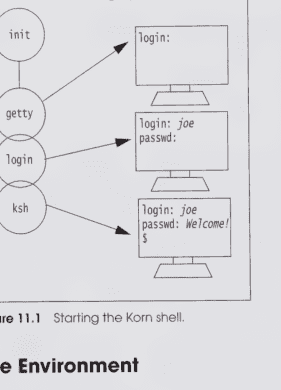

### 11.2 环境

#### 11.2.1 初始化文件

在`/etc/profile`中的命令执行之后，会执行用户主目录中的初始化文件。首先执行`.profile`，然后执行ENV文件，通常称为`.kshrc`文件。

**`/etc/profile`文件。**

`/etc/profile`是一个系统级可读文件，由系统管理员设置，用于在用户登录且Korn Shell启动时执行任务。它对系统上所有Bourne和Korn Shell用户可用，通常执行诸如检查邮件队列中是否有新邮件、显示`/etc/motd`文件中的当日消息等任务。以下文本是`/etc/profile`的示例。关于`/etc/profile`每一行的完整解释，请参见第321页的第8章“Bourne Shell编程”。

**示例11.1**

```
# The profile that all logins get before using their own .profile

trap "" 2 3

export LOGNAME PATH  # Initially set by /bin/login

if [ "$TERM" = "" ]

then

    if /bin/i386

    then  # Set the terminal type

        TERM=AT386

    else

        TERM=sun

    fi

    export TERM

fi

# Login and -su shells get /etc/profile services.

# -rsh is given its environment in the .profile.

case "$0" in

-sh | -ksh | -jsh )

    if [ ! -f .hushlogin ]

    then

        /usr/sbin/quota

    fi

# Allow the user to break the Message-Of-The-Day only.

trap "trap ' ' 2" 2

/bin/cat -s /etc/motd

# Display the message of the day

trap "" 2

/bin/mail -E

case $? in

0)  # Check for new mail

echo "You have new mail."

;;

2) echo "You have mail."

;;

esac

fi

esac

umask 022

trap 2 3
```

**`.profile`文件。**

`.profile`文件是用户自定义的初始化文件，在登录时由Bourne和Korn Shell执行一次，位于你的主目录中。它使你能够自定义和修改你的工作环境。环境变量和终端设置通常在此处设置；如果某个窗口应用程序或`dm`需要启动，也是从这里启动的。如果`.profile`文件中包含一个特殊变量`ENV`，那么赋给该变量的文件名将接下来被执行。`ENV`文件是

often named `.kshrc`; it contains aliases and `set -o` commands. The `ENV` file is executed every time a `ksh` subshell is spawned. The lines from the following files may not be meaningful to you now, but all of the concepts, such as exporting variables, history, the search path, and so on, will be discussed in detail throughout the text of this book.

## EXAMPLE 11.2

```
1  set -o allexport

2  TERM=vt102
```


### HOSTNAME=$(uname -n)

### HISTSIZE=50

### EDITOR=/usr/ucb/vi

### ENV=$HOME/.kshrc

### PATH=$HOME/bin:/usr/ucb:/usr/bin:/usr/local:/etc/bin:/usr/bin:/usr/local/bin:/usr/hosts:/usr/5bin:/usr/etc:/usr/bin:.

### PS1="$HOSTNAME: $ "

### set +o allexport

### alias openwin=/usr/openwin/bin/openwin

### trap '$HOME/.logout' EXIT

### clear

### EXPLANATION

- 1 By setting the `allexport` option, all variables created will automatically be exported (made available to subshells).
- 2 The terminal is set to vt102.
- 3 The variable `HOSTNAME` is assigned the name of this machine. `$(uname -n)`.
- 4 The `HISTSIZE` variable is assigned 50; 50 lines from the history file will be displayed on the terminal when the user types `history`.
- 5 The `EDITOR` variable is assigned the pathname for the `vi` editor. Programs such as `mail` allow you to select an editor in which to work.
- 6 The `ENV` variable is assigned the path to the home directory (`$HOME`) and the name of the file that contains further Korn shell customization settings. After the `.profile` is executed, the `ENV` file is executed. The name of the `ENV` file is your choice; it is commonly called `.kshrc`.
- 7 The search path is defined. It is a colon-separated list of directories used by the shell in its search for commands typed at the prompt or in a script file. The shell searches each element of the path from left to right for the command. The dot at the end represents the current working directory. If the command cannot be found in any of the listed directories, the shell will look in the current directory.
- 8 The primary prompt, by default a dollar sign (`$`), is set to the name of the host machine, the number of the current command in the history file, and a dollar sign (`$`).
- 9 The `allexport` option is turned off.

### EXPLANATION (CONTINUED)

- 10 An alias is a nickname for a command. The alias for `openwin` is assigned the full pathname of the `openwin` command, which starts Sun's window application.
- 11 The `trap` command will execute the `.logout` file when you exit this shell, that is, when you log out. The `.logout` file is a user-defined file containing commands that are executed at the time of logging out. For example, you may want to record the time you log out, clean up a temporary file, or simply say So long.
- 12 The `clear` command clears the screen.

## The ENV File.

The `ENV` variable is assigned the name of a file that will be executed every time an interactive `ksh` or a `ksh` program (script) is started. The `ENV` variable is set in the `.profile` and is assigned the name of the file that will contain special `ksh` variables and aliases. The name is conventionally `.kshrc`, but you can call it anything you want. (The `ENV` file is not processed when the privileged option is on. See Table 11.1.)

## EXAMPLE 11.3

```
1 $ export ENV=.kshrc

2 $ cat .kshrc

# The .kshrc file

3 set -o trackall

4 set -o vi

5 alias ls='ls -laF'

alias lsa='ls -af'

alias hi='fc -l'

alias c='clear'

6 function pushd { pwd > $HOME/.lastdir.$$ ; }

function popd { cd $(< $HOME/.lastdir.$$); rm $HOME/.lastdir.$$; pwd; }

function psg { ps -ef | egrep $1 | egrep -v egrep; }

function vg { vgrind -sll -t $* | lpr -t ; }
```

### EXPLANATION

- 1 The `ENV` variable is assigned the name of the file that will be executed every time the Korn shell is invoked. Exporting `ENV` makes it available to all subshells.
- 2 The contents of the `.kshrc` file are displayed.
- 3 The `set` option for tracked aliases is turned on. (For a complete description, see "Aliases" on page 604.)
- 4 The `set` option for the `vi` editor is turned on for in-line editing of the history file. (See "Command-Line History" on page 595.)
- 5 The aliases (nicknames) for the commands are defined.
- 6 The functions are named and defined. (See "Functions" on page 639.)

## set -o 选项。

`set` 命令单独使用时，用于设置位置参数（参见第 633 页的“位置参数”），但使用 `-o` 开关时，可用于打开和关闭 `ksh` 选项，从而自定义 shell 环境。选项要么开启要么关闭，通常在 `.ENV` 文件中设置。（请参阅表 11.1 获取 shell `set` 选项列表。）

# 格式

```
set -o option    Turns on the option.
```


`set +o option`    Turns off the option

`set -[a-z]`       Abbreviation for an option; the minus turns it on

`set +[a-z]`       Abbreviation for an option; the plus turns it off

```
## 示例 11.4
```
1 `set -o allexport`
2 `set +o allexport`
3 `set -a`
4 `set +a`
```

# 解释

- 1 设置 `allexport` 选项。此选项会导致所有变量自动导出到子 shell。
- 2 取消设置 `allexport` 选项。所有变量现在将仅限于当前 shell。
- 3 设置 `allexport` 选项。与 1 相同。并非每个选项都有缩写（参见表 11.1）。
- 4 取消设置 `allexport` 选项。与 2 相同。

## 表 11.1 Korn Shell set 选项

| 选项名称 | 缩写 | 其作用 |
|---|---|---|
| `allexport` | `-a` | 导致 set 变量自动导出。 |
| `bgnice` |  | 以较低优先级运行后台作业。 |
| `emacs` |  | 命令行编辑时，使用 emacs 内置编辑器。 |
| `errexit` | `-e` | 如果命令返回非零退出状态（失败），则执行 ERR 陷阱（如果已设置），并退出。读取初始化文件时未设置。 |
| `gmacs` |  | 命令行编辑时，使用 gmacs 内置编辑器。 |
| `ignoreeof` |  | 防止使用 ^D 注销；必须键入 `exit` 才能退出 shell。 |
| `markdirs` |  | 在使用文件名扩展时，在目录名称上添加尾部反斜杠（/）。 |
| `monitor` | `-m` | 允许作业控制。 |
| `noclobber` |  | 防止在重定向时覆盖文件。 |
| `noexec` | `-n` | 读取命令，但不执行它们。用于检查脚本的语法。交互运行时不开启。 |
| `noglob` | `-f` | 禁用路径名扩展；即关闭通配符。 |
| `nolog` |  | 不将函数定义存储在历史文件中。 |
| `notify` |  | 后台作业完成时通知用户。 |
| `nounset` |  | 在展开未设置的变量时显示错误。 |
| `privileged` | `-p` | 设置时，shell 不读取 `.profile` 或 `ENV` 文件；与 setuid 脚本一起使用。 |
| `trackall` |  | 启用别名跟踪。 |
| `verbose` | `-v` | 打开用于调试的详细模式。 |
| `vi` |  | 命令行编辑时，使用 vi 内置编辑器。 |
| `xtrace` | `-x` | 打开用于调试的回显模式。 |

## 11.2.2 提示符

Korn shell 提供四个提示符。主提示符和次提示符在 Korn shell 交互运行时使用。您可以更改这些提示符。变量 `PS1` 是主提示符，初始设置为美元符号（`$`）。它在您登录时出现并等待您键入命令。变量 `PS2` 是次提示符，初始设置为 `>` 字符。它在您部分键入命令后按 Enter 时出现。您可以更改主提示符和次提示符。

### 主提示符

`$` 是默认主提示符。您可以更改提示符。通常，提示符在 `.profile` 中定义。

## 示例 11.5

```
1  $ `PS1="$(uname -n) ! $ "`
2  jody 1141 $
```

# 解释

- 1 默认主提示符为 `$`。`PS1` 提示符正被重置为机器名称 `$(uname -n)`、当前历史记录号以及 `$`。感叹号求值为当前历史记录号。（要在 `PS1` 定义中打印感叹号，请键入两个感叹号 (`!!`)。）
- 2 显示新的提示符。

### 次提示符

`PS2` 提示符是次提示符。其值显示到标准错误（屏幕）。当您尚未完成命令并按下回车时，此提示符会出现。

## 示例 11.6

```
1 $ `print "Hello"`
2 > `there"`
3 Hello
   there
4 $
5 $ `PS2="----> "`
6 $ `print "Hi"`
7 -------> 
-------> `there"`
Hi
there
$
```

# 解释

- 1 字符串 `"Hello` 之后必须匹配双引号。
- 2 当输入换行符时，次提示符会出现。在输入闭合双引号之前，次提示符将一直显示。
- 3 显示 `print` 命令的输出。
- 4 显示主提示符。
- 5 重置次提示符。
- 6 字符串 `"Hi` 之后必须匹配双引号。
- 7 当输入换行符时，新的次提示符会出现。在输入闭合双引号之前，次提示符将一直显示。

### 11.2.3 搜索路径

为了执行在命令行或 Shell 脚本中键入的命令，Korn Shell 会搜索 `PATH` 变量中列出的目录。`PATH` 是一个以冒号分隔的目录列表，Shell 会从左到右依次搜索。`PATH` 中的点代表当前工作目录。如果在路径列出的任何目录中都未找到该命令，Shell 会向标准错误发送消息 `ksh: filename: not found`。建议在 `.profile` 文件中设置路径。为了加快搜索过程，Korn Shell 实现了跟踪别名。参见第 606 页的“跟踪别名”。

### 示例 11.7

```
$ `echo $PATH`
/home/gsa12/bin:/usr/ucb:/usr/bin:/usr/local/bin:.
```

# 说明

Korn Shell 将从 `/home/gsa12/bin` 开始搜索命令。如果在那里找不到该命令，则搜索 `/usr/ucb`，然后是 `/usr/bin`、`/usr/local/bin`，最后搜索用户当前工作目录（由句点表示）。

### 11.2.4 dot 命令

`dot` 命令（`.`）是 Korn Shell 的内置命令。它接受一个脚本名作为参数。该脚本将在当前 Shell 的环境中执行，不会启动子进程。`dot` 命令通常用于重新执行 `.profile` 文件或 `ENV` 文件（如果这两个文件中的任何一个被修改过）。例如，如果你登录后这两个文件中某个设置发生了变化，你可以使用 `dot` 命令重新执行初始化文件，而无需注销后重新登录。

### 示例 11.8

```
$ `. .profile`
$ `. .kshrc`
$ `: $ENV`
```

# 说明

通常，命令执行时会启动子进程。`dot` 命令会在当前 Shell 中执行每个初始化文件，即 `.profile` 和 `ENV` 文件（`.kshrc`）。这些文件中的局部变量和全局变量就在该 Shell 内被定义。否则，用户必须注销并重新登录，才能使登录 Shell 执行这些文件。`dot` 命令使这一步骤变得不必要。

## 11.3 命令行

登录后，Korn Shell 会显示其主提示符。Shell 是你的命令解释器。当 Shell 以交互方式运行时，它会从终端读取命令，并将命令行拆分为单词。命令行由一个或多个单词（或记号）组成，这些单词由空白（空格和/或制表符）分隔，并以按回车键产生的换行符结束。第一个单词是命令，后续单词是命令的参数。该命令可以是 UNIX 可执行程序（如 `ls` 或 `pwd`）、内置命令（如 `cd` 或 `jobs`）或 Shell 脚本。命令可能包含特殊字符（称为元字符），Shell 在解析命令行时必须解释这些字符。如果命令行太长，可以使用反斜杠字符后跟换行符，从而在下一行继续输入。次提示符将一直显示到命令行结束。

### 11.3.1 命令的处理顺序

命令行上的第一个单词是要执行的命令。该命令可以是关键字、特殊内置命令或实用程序、函数、脚本或可执行程序。命令按以下顺序根据其类型执行：

- 1. 关键字（如 `if`、`while`、`until`）
- 2. 别名（参见 `typeset -f`）
- 3. 内置命令
- 4. 函数
- 5. 脚本和可执行程序

特殊的内置命令和函数定义在 Shell 内部，因此在当前 Shell 内执行，这使得它们的执行速度更快。脚本和可执行程序（如 `ls` 和 `pwd`）存储在磁盘上，Shell 必须通过搜索 `PATH` 环境变量在目录层次结构中找到它们；然后 Shell 会派生一个新 Shell 来执行该脚本。要确定正在使用的命令类型，请使用内置命令 `whence -v`，或其别名 `type`。（参见示例 11.9。）

### 示例 11.9

```
$ `type print`
print is a shell builtin
$ `type test`
test is a shell builtin
$ `type ls`
ls is a tracked alias for /usr/bin/ls
```

> 1. 内置命令会覆盖函数；因此，必须为函数名定义别名。（参见第 60 页的“别名”。）在 1994 版本的 Korn Shell 中，函数和内置命令的处理顺序被颠倒，从而缓解了这个问题。

# 示例 11.9（续）

```
$ `type type`
type is an exported alias for whence -v
```


$ type bc

bc is /usr/bin/bc

$ type if

if is a keyword

## 11.3.2 退出状态

命令或程序终止后，它会向父进程返回退出状态。退出状态是一个介于 0 和 255 之间的数字。按照惯例，当程序退出时，如果返回的状态为 0，则该命令在其执行中是成功的。当退出状态为非零时，命令在某些方面失败。Korn shell 状态变量 `?` 设置为最后执行的命令的退出状态的值。程序的成功或失败由编写程序的程序员决定。在 shell 脚本中，您可以使用 `exit` 命令显式控制退出状态。

### 示例 11.10

```
1  $ grep "ellie" /etc/passwd

ellie:/g0yWds5Jvwd16s:9496:40:Ellie Quigley:/home/jody/ellie

2  $ echo $?

0

3  $ grep "nicky" /etc/passwd

4  $ echo $?

1

5  $ grep "scott" /etc/passsswd

grep: /etc/passsswd: No such file or directory

6  $ echo $?

2
```

### 解释

- 1. `grep` 程序在 `/etc/passwd` 文件中搜索模式 `ellie` 并成功。`/etc/passwd` 中的行被显示。
- 2. `?` 变量设置为 `grep` 命令的退出值。零表示成功。
- 3. `grep` 程序在 `/etc/passwd` 文件中找不到用户 `nicky`。
- 4. 如果 `grep` 程序找不到模式，它会返回退出状态 1。
- 5. `grep` 失败，因为无法打开文件 `/etc/passsswd`。
- 6. 如果 `grep` 找不到文件，它会返回退出状态 2。

## 11.3.3 多个命令和命令分组

命令行可以包含多个命令。每个命令由分号分隔，命令行以换行符终止。

### 示例 11.11

```
$ ls; pwd; date
```

### 解释

命令从左到右执行，直到到达换行符。命令也可以分组，以便所有输出要么被管道传输到另一个命令，要么重定向到文件。

### 示例 11.12

```
$ ( ls ; pwd; date ) > outfile
```

### 解释

每个命令的输出被发送到名为 `outfile` 的文件。

## 11.3.4 条件执行命令

使用条件执行，两个命令字符串由两个特殊元字符 `&&` 和 `||` 分隔。根据左边命令的退出条件，右边的命令要么被执行，要么不被执行。

### 示例 11.13

```
$ cc progml.c -o progml && progml
```

## 11.3.5 后台命令

通常，当你执行一个命令时，它在前台运行，提示符在命令完成执行之前不会重新出现。等待命令完成并不总是方便的。在命令行末尾放置一个和号 (`&`)，shell 将立即返回 shell 提示符，并在后台同时执行命令。你不必等待就开始另一个命令。后台作业的输出在处理时会发送到屏幕。因此，如果你打算在后台运行一个命令，该命令的输出应该重定向到文件或管道传输到另一个设备，如打印机，以便输出不会干扰你正在做的事情。

### 示例 11.15

```
1  $ man ksh | lp &

2  [1] 1557

3  $
```

### 解释

- 1 Korn shell 的手册页输出被管道传输到打印机。命令行末尾的和号将作业放入后台。
- 2 屏幕上出现两个数字：方括号内的数字表示这是第一个被放入后台的作业；第二个数字是该作业的 PID，进程标识号。
- 3 Korn shell 提示符立即出现。在你的程序在后台运行时，shell 正在等待前台的另一个命令。

## 11.3.6 命令行历史

历史机制在历史文件中保留你键入的命令的编号记录。你可以从历史文件中召回一个命令并在不重新键入命令的情况下重新执行它。`history` 内建命令显示历史列表。历史文件的默认名称是 `.sh_history`，它位于你的主目录中。

`HISTSIZE` 变量在 ksh 首次访问历史文件时访问，指定可以从历史文件中访问多少个命令。默认大小是 128。`HISTFILE` 变量指定命令历史文件的名称（`~/ .sh_history` 是默认的），命令存储在那里。历史文件从一次登录会话增长到下一次登录会话；除非你清理它，否则它会变得非常大。`history` 命令是 `fc -l` 命令的预设别名。

### 示例 11.16

`~/.sh_history` 文件
该文件包含用户在命令行输入的命令列表

```
netscape&

ls

mkdir javascript

cd javascript

cp ../javapdf.zip .

gunzip javapdf.zip

unzip javapdf.zip

ls

ls

more chapter10&

ls -l

rm chapter9.pdf

ls

ls -l

... continues ...
```

```
1  $ history -1 -5      # List last 5 commands, preceding this one in reversed order.

13  history -3

12  history 8

11  history -n

10  history

9   set

2  $ history -5 -1      # Print last 5 commands, preceding this one in order.

10  history

11  history -n

12  history 8

13  history -3

14  history -1 -5

3  $ history             # (Different history list)

78  date

79  ls

80  who

81  echo hi

82  history

4  $ history ls echo     # Display from most recent ls command to
                        # most recent echo command.

79  ls

80  who

81  echo hi

5  $ history -r ls echo  # -r reverses the list

81  echo hi

80  who

79  ls
```

## 11.3 命令行

### history 命令/重显命令。

内置的 `history` 命令列出之前输入的命令，并在前面加上编号。该命令可以接受参数来控制显示。

### 示例 11.17

```
1  $ history              # Same as fc -l

   1 ls

   2 vi file1

   3 df

   4 ps -eaf

   5 history

   6 more /etc/passwd

   7 cd

   8 echo $USER

   9 set

  10 history

2  $ history -n           # Print without line numbers

   ls

   vi file1

   df

   ps -eaf

   history

   more /etc/passwd

   cd

   echo $USER

   set

   history

   history -n

3  $ history 8            # List from 8th command to present

   8 echo $USER

   9 set

  10 history

  11 history -n

  12 history 8

4  $ history -3           # List this command and the 3 preceding it

  10 history

  11 history -n

  12 history 8

  13 history -3

5  $ history -1 -5        # List last 5 commands, preceding this one in reversed order.

  13 history -3

  12 history 8

  11 history -n

  10 history

   9 set

6  $ history -5 -1    # Print last 5 commands, preceding this one in order.

10 history

11 history -n

12 history 8

13 history -3

14 history -1 -5

7  $ history           # (Different history list)

78 date

79 ls

80 who

81 echo hi

82 history
```


### 使用 `r` 命令重新执行命令。

`r` 命令重新执行在命令行输入的最后一条命令。如果 `r` 命令后面跟一个空格和一个数字，则执行该编号的命令。如果 `r` 命令后面跟一个空格和一个字母，则执行以该字母开头的最后一条命令。如果没有参数，`r` 命令将重新执行历史列表中最前面的命令。

### 示例 11.18

```
1  $ r date

date

Mon May 15 12:27:35 PST 2004

2  $ r 3    redo command number 3

df

Filesystem  kbytes  used  avail  capacity  Mounted on

/dev/sd0a   7735    6282   680    90%       /

/dev/sd0g  144613  131183 0      101%      /usr

/dev/sd2c  388998  211395 138704  60%       /home

3  $ r vi    # Redo the last command that began with pattern vi.

4  $ r vi file1=file2  # Redo last command that began with vi and substitute the first occurrence of file1 with file2.
```

# 解释

- 1. 最后一条命令 `date` 被重新执行。
- 2. 历史文件中的第三条命令被执行。
- 3. 最后一条以字符串 `vi` 开头的命令被执行。
- 4. 字符串 `file1` 被替换为字符串 `file2`。最后一条命令 `vi file1` 被替换为 `vi file2`。

### 11.3.7 命令行编辑

Korn shell 提供了两个内置编辑器，`emacs` 和 `vi`，允许你交互式地编辑历史列表。要启用 `vi` 编辑器，请添加下面列出的 `set` 命令并将其放入你的 `.profile` 文件中。`emacs` 内置编辑器一次处理历史文件中的一行，而 `vi` 内置编辑器处理由多行组成的命令。要设置 `vi`，输入

```
set -o vi   or   VISUAL=vi   or   EDITOR=/usr/bin/vi
```

如果使用 `emacs`，输入

```
set -o emacs   or   VISUAL=emacs   or   EDITOR=/usr/bin/emacs
```

请注意 `set -o vi` 会覆盖 `VISUAL`，而 `VISUAL` 会覆盖 `EDITOR`。

### vi 内置编辑器。

要编辑历史列表，请按 `Esc` 键并使用你在 `vi` 中用于向上、向下、向左、向右移动、删除、插入和更改文本的标准键。参见表 11.2。编辑完成后，按 `Enter` 键。该命令将被执行并添加到历史列表底部。要在历史文件中向上滚动，请按 `Esc` 键然后按 `K` 键。

### 表 11.2 vi 命令

| Command | Function |
|---|---|
| Moving Through the History File | |
| Esc k or + | Move up the history list |
| Esc j or - | Move down the history list |
| Esc G | Move to first line in history file |
| Esc 5G | Move to fifth command in history file |
| /string | Search upward through history file for string |
| ? | String search downward through history file |
| Moving Around on a Line (Press the Esc Key First) | |
| h | Move left on a line |
| l | Move right on a line |
| b | Move backward a word |
| e or w | Move forward a word |

## 表 11.2 vi 命令（续）

| Command | Function |
|---|---|
| ^ or 0 | 移动到行首第一个字符 |
| $ | 移动到行尾 |
| 使用 vi 编辑 | |
| a A | 追加文本 |
| i I | 插入文本 |
| dd dw x | 删除文本到缓冲区（行、单词或字符） |
| cc C | 更改文本 |
| u U | 撤销 |
| yy Y | Yank（将一行复制到缓冲区） |
| p P | 将 yank 或删除的行放在下方或上方该行 |
| r R | 替换一行上的一个字母或任意数量的文本 |

`emacs` 内置编辑器。要开始向后浏览历史文件，按 `^P`。要向前，按 `^N`。使用 `emacs` 编辑命令更改或纠正文本，然后按 `Enter`，命令将被重新执行。参见表 11.3。

## 表 11.3 emacs 命令

| Command | Function |
|---|---|
| Moving Through the History File | |
| Ctrl-P | 向上浏览历史文件 |
| Ctrl-N | 向下浏览历史文件 |
| Ctrl-B | 向后移动一个字符 |
| Ctrl-R | 向后搜索字符串 |
| Esc B | 向后移动一个单词 |
| Ctrl-F | 向前移动一个字符 |
| Esc F | 向前移动一个单词 |
| Ctrl-A | 移动到行首 |
| Ctrl-E | 移动到行尾 |

## 表 11.3 emacs 命令（续）

| Command | Function |
|---|---|
| Esc < | 移动到历史文件第一行 |
| Esc > | 移动到历史文件最后一行 |
|  |  |
| 使用 emacs 编辑 |  |
| Ctrl-U | 删除该行 |
| Ctrl-Y | 放回该行 |
| Ctrl-K | 删除从光标到行尾 |
| Ctrl-D | 删除一个字母 |
| Esc D | 向前删除一个单词 |
| Esc H | 向后删除一个单词 |
| Esc space | 在光标位置设置标记 |
| Ctrl-X Ctrl-X | 交换光标和标记位置 |
| Ctrl-P Ctrl-Y | 将从光标到标记的区域推入缓冲区（Ctrl-P）并放下（Ctrl-Y） |

## FCEDIT 和编辑命令。

`fc` 命令是一个内置命令，可与 `FCEDIT` 变量（通常在 `.profile` 文件中设置）一起使用，以调用您选择的编辑器来编辑历史文件。这可以是系统上的任何编辑器。`FCEDIT` 变量设置为您最喜欢的编辑器的完整路径名。如果未设置 `FCEDIT`，则在键入 `fc` 命令时将调用默认编辑器 `/bin/ed`。

`FCEDIT` 变量应设置为所选编辑器。您可以指定要编辑的历史列表中的多个项目。编辑命令后，Korn shell 将执行整个文件。任何以磅符号（`#`）为前缀的命令都将被视为注释，不会被执行。有关注释和文件名扩展的更多信息，请参见第 603 页上的表 11.4。

> 2. 在 1988 年之后的 Korn shell 版本中，`FCEDIT` 变量已被重命名为 `HISTEDIT`，`fc` 命令已被重命名为 `hist`。

## EXAMPLE 11.19

```
1  $ FCEDIT=/usr/bin/vi

2  $ pwd

3  $ fc

<Starts up the full-screen vi editor with the pwd command on line 1>
```

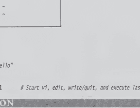

```
4  $ history

1 date

2 ls -l

3 echo "hello"

4 pwd
```

```
5  $ fc -3 -l    # Start vi, edit, write/quit, and execute last 3 commands.
```


# 解释

- 1 `FCEDIT` 变量可以分配给系统上您拥有的任何 UNIX 文本编辑器的路径名，例如 `vi`、`emacs`、`textedit` 等。如果未设置，则默认使用 `ed` 编辑器。
- 2 `pwd` 命令在命令行键入。它将被放入历史文件中。
- 3 `fc` 命令导致编辑器（在 `FCEDIT` 中设置）使用在编辑器窗口中键入的最后一个命令被调用。如果用户编写并退出编辑器，则键入的任何命令都将被执行。
- 4 `history` 命令列出最近键入的命令。
- 5 `fc` 命令用于在编辑器的缓冲区中启动编辑器，并使用历史文件中的最后三个命令。

## 11.4 注释和文件名扩展

文件名扩展是一种机制，它允许用户键入部分文件名并按 `Esc` 键查看其余文件名。在以下示例中，`[Esc]` 表示 `Esc` 键。

## 表 11.4 使用 Esc 键和文件名展开

| 组合 | 结果 |
|---|---|
| command [Esc]# | # 在命令前加上 #；将其放在历史列表中并注释；命令不会被执行。 |
| command [Esc]_ | 下划线在光标处插入上一条命令的最后一个词。 |
| command [Esc] 2_ | 在光标位置插入上一条命令的第二个词。 |
| word[Esc] * | * 用所有匹配的文件替换当前词。 |
| word[Esc] \ | \ 用以相同字符开头的文件名替换当前词；文件名展开。 |
| word[Esc]= | 显示以当前词相同字符开头的所有文件名并以编号列表显示。 |

## 示例 11.20

（按 `Esc` 键表示 `[Esc]`。）

```
1 $ ls a[Esc]=

1) abc

2) abc1

3) abc122

4) abc123

5) abc2

2 $ ls a[Esc]*

ls abc abc1 abc122 abc123 abc2

abc abc1 abc122 abc123 abc2

3 $ print apples pears peaches

apples pears peaches

4 $ print [Esc]_

print peaches

peaches

5 $ print apples pears peaches plums

apples pears peaches

6 $ print [Esc]2_

print pears

pears
```

# 解释

1 通过输入 `a`，然后按 `Esc` 键和等号 (`=`)，所有以 `a` 开头的文件都会被编号并列出。（这些数字没有任何特殊用途。）

2 通过输入 `a`，然后按 `Esc` 键和星号 (`*`)，以 `a` 开头的文件名将被显示。

# 解释（续）

- 3 `print` 命令显示其参数：`apples`、`pears` 和 `peaches`。
- 4 `Esc` 键后跟下划线 (`_`) 被替换为最后一个参数。
- 5 `print` 命令显示其参数：`apples`、`pears` 和 `peaches`。
- 6 `Esc` 键后跟数字 `2` 和下划线，被第二个参数替换。命令（`print`）是第一个参数，从第零个词开始。

## 11.5 别名

别名是 Korn shell 或用户定义的命令缩写。别名名称包含字母数字字符。`shell` 提供了默认别名，可以重新定义或取消设置。与 C shell 别名不同，Korn shell 不支持传递参数。（如果需要使用参数，请参阅第 639 页的“函数”。）

别名可以通过将其存储在 `ENV` 文件中导出到子 `shell`。（`ENV` 文件中的命令在每次生成新 `shell` 时都会执行。）从 1988 年版的 Korn shell 开始，`-x` 选项允许别名导出到子 `shell`，只要新 `shell` 不是 `ksh` 的单独调用即可。Korn shell 提供了跟踪别名，以加快 `shell` 搜索路径所需的时间。别名可以别名自身；即它们是递归的。

### 11.5.1 列出别名

`alias` 内建命令列出所有已设置的别名。

## 示例 11.21

```
$ alias

1 autoload=typeset -fu

2 false=let 0

3 functions=typeset -f

4 hash=alias -t

5 history=fc -l

6 integer=typeset -i

7 r=fc -e -

8 stop=kill -STOP

9 suspend=kill -STOP $$

10 true=:

11 type=whence -v
```

# 解释

- 1 不带参数的 `alias` 命令列出所有别名。这是预设别名的列表，包括你自己设置的别名。
- 2 `autoload` 别名用于动态调用函数。
- 3 `false` 别名用于测试假条件的表达式。

# 解释（续）

- 4 `functions` 别名列出所有函数及其定义。
- 5 `hash` 别名列出所有跟踪的别名。
- 6 `history` 别名列出并编号历史文件 `.sh_history` 中的所有命令。
- 7 `integer` 别名允许你创建整数类型变量。
- 8 `r` 别名让你从历史列表中重做之前的命令。
- 9 `stop` 别名使进程在向 `kill` 命令提供作业号或 PID 时被挂起。作业可以通过输入 `fg` 在前台恢复。
- 10 `suspend` 别名通过发送 `STOP` 信号和此进程的 PID (`$$`) 到 `kill` 命令来挂起当前作业。
- 11 `true` 别名被设置为无操作命令，常用于启动无限循环。
- 12 `type` 别名指示你正在执行的命令的类型：别名、二进制可执行文件等。

### 11.5.2 创建别名

用户可以在 Korn shell 中创建别名。别名是现有命令或命令组的昵称。当 `shell` 评估命令行时，实际命令将被替换为别名。

## 示例 11.22

```
1 $ alias c1='clear'

2 $ alias l='ls -laF'

3 $ alias ls='ls -aF'

4 $ \ls ..
```

# 解释

- 1 别名 `c1` 是 `clear` 的别名。
- 2 别名 `l` 是 `l`。字母 `l` 是命令 `ls -laF` 的昵称。
- 3 别名 `ls` 被分配命令 `ls -aF`。
- 4 反斜杠关闭了该行执行时别名的含义。执行的是真正的 `ls` 命令，而不是别名。

### 11.5.3 删除别名

`unalias` 命令删除一个别名。

## 示例 11.23

```
unalias c1
```

# 解释

别名 `c1` 从已设置的别名列表中删除。

## 示例 11.23

```
1  $ vi

   [1] + Stopped        # vi

2  $ sleep 25&

   [2] 4538

3  $ jobs

   [2] + Running        # sleep 25&

   [1] - Stopped        # vi

4  $ jobs -l

   [2] + 4538  Running   # sleep 25&

   [1] - 4537  Stopped   # vi

5  $ fg %1
```

# 解释

- 1. 调用 `vi` 编辑器后，可以按 `^Z`（Ctrl-Z）挂起 `vi` 会话。编辑器将在后台被挂起，出现 `Stopped` 消息后，`shell` 提示符会立即出现。
- 2. 命令末尾的与符号（`&`）使 `sleep` 命令以参数 `25` 在后台执行。符号 `[2]` 表示这是第二个在后台运行的作业，该作业的 PID 为 `4538`。
- 3. `jobs` 命令显示当前后台中的作业。
- 4. 带 `-l` 选项的 `jobs` 命令显示后台中运行的进程（作业）及这些作业的 PID 编号。
- 5. `fg` 命令后跟百分号和作业编号，将该编号的作业调入前台。如果没有编号，`fg` 会将最近放到后台的作业调回前台。

## 11.7 元字符

元字符是用来表示自身以外含义的特殊字符。表 11.6 列出了一些常见的 Korn Shell 元字符及其功能。

### 表 11.6 Korn Shell 元字符

| 命令 | 功能 |
| --- | --- |
| \ | 对后面的字符进行字面解释 |
| & | 后台处理 |
| ; | 命令分隔符 |
| $ | 变量替换 |
| ? | 匹配单个字符 |

### 表 11.6 Korn Shell 元字符（续表）

| 命令 | 功能 |
|---|---|
| [abc] | 匹配字符集合中的一个 |
| [!abc] | 匹配不在字符集合中的一个 |
| * | 匹配零个或多个字符 |
| (cmds ) | 在子 shell 中执行命令 |
| {cmds} | 在当前 shell 中执行命令 |

## 示例 11.26

```
1 $ ls -d s

all files are displayed

abc abc122 abc2 file1.bak file2.bak nonsense nothing one

abc1 abc123 file1 file2 none noone

2 $ print hello \
> there        # The carriage return is escaped

hello there
```


3 `$ rusers&`

# Process the rusers command in the background

`[1] 4334`

`$`

4 `$ who; date; uptime   # Commands are executed one at a time`

ellie console Feb 10 10:46

ellie tty p0 Feb 15 12:41

ellie tty p1 Feb 10 10:47

ellie tty p2 Feb 5 10:53

Mon Feb 15 17:16:43 PST 2004

5:16pm up 5 days, 6:32, 1 user, load average: 0.28, 0.23, 0.01

5 `$ print $HOME        # The value of the HOME variable is printed`

`/home/jody/ellie`

6 `$ print $LOGNAME     # The value of the LOGNAME variable is printed`

ellie

7 `$ ( pwd; cd / ; pwd )`

`/home/jody/ellie`

`/`

```
## 示例 11.26（续）
```

```
$ pwd

/home/jody/ellie
```

8 `$ { pwd; cd /; pwd; }`

`/home/jody/ellie`

`/`

`$ pwd`

`/`

9 `$ { date; pwd; ls } > outfile`

`$ cat outfile`

Mon Feb 15 15:56:34 PDT 2004

`/home/jody/ellie`

foo1

foo2

foo3

# 解释

- 1 星号匹配当前目录中的所有文件。`ls` 命令的 `-d` 选项可防止子目录内容被显示出来。
- 2 反斜杠转义换行符，使命令行能够继续在下一行输入。
- 3 与符号 `&` 使 `rusers` 程序在后台执行；shell 提示符立即返回。两个进程将同时运行。
- 4 每个命令之间用分号分隔。每条命令将依次执行。
- 5 如果变量前有美元符号，shell 将执行变量替换。环境变量 `HOME` 的值被显示出来。`HOME` 变量包含用户主目录的完整路径名。
- 6 同样，美元符号位于变量名之前。`LOGNAME` 变量的值是用户的登录名。
- 7 圆括号表示括号内的命令将在子 shell 中执行。`cd` 命令内置于 shell 中，因此每个被调用的 shell 都有自己的 `cd` 副本。`pwd` 命令打印当前工作目录。`/home/jody/ellie` 在使用 `cd` 命令切换到根目录后，`pwd` 命令显示新目录为根目录。子 shell 退出后，父 shell 中 `pwd` 命令的输出表明，目录仍与进入子 shell 之前一样，设置为 `/home/jody/ellie`。

### EXPLANATION (CONTINUED)

8 大括号表示其中的命令将在当前 shell 中执行。`pwd` 命令打印当前工作目录，`/home/jody/ellie`。`cd` 到根目录后，`pwd` 命令显示新目录为 root。在大括号内的命令退出后，`pwd` 命令的输出表明目录仍设置为根目录。

9 圆括号用于对命令进行分组，以便将全部三个命令的输出发送到 `outfile`。

## 11.8 文件名替换（通配符）

在评估命令行时，shell 使用元字符来缩写匹配某一组字符的文件名或路径名，通常称为通配符。表 11.7 中列出的文件名替换元字符会扩展为按字母顺序排列的文件名集合。将元字符扩展为文件名的过程也称为文件名替换，或 `globbing`。如果使用了元字符但没有匹配的文件名，Korn shell 会将元字符视为字面字符。

## Table 11.7 Shell Metacharacters and Filename Substitution

| Metacharacter | Meaning |
|---|---|
| `*` | 匹配零个或多个字符 |
| `?` | 匹配恰好一个字符 |
| `[abc]` | 匹配集合中的一个字符，a、b 或 c |
| `[!abc]` | 匹配不在集合 a、b 或 c 中的一个字符 |
| `[a-z]` | 匹配范围内的一个字符：a 和 z 之间的集合中的任意字符 |
| `~` | 用 ~ 替换用户的主目录 |
| `\` | 转义或禁用元字符 |

### 11.8.1 星号

星号是一个通配符，匹配文件名中零个或多个任意字符。

### EXAMPLE 11.27

```
1 $ ls *

abc abc1 abc122 abc123 abc2 file1 file1.bak file2 file2.bak none

nonsense noone nothing nowhere one
```

### EXAMPLE 11.27 (CONTINUED)

```
2  $ ls *.bak

file1.bak file2.bak

3  $ print a?c

abc
```

### EXPLANATION

- 1 星号扩展为当前工作目录中的所有文件。所有文件都传递给 `ls` 并显示。
- 2 所有以零个或多个字符开头并以 `.bak` 结尾的文件都匹配并列出。
- 3 所有以 `a` 开头，其后跟零个或多个字符，以 `c` 结尾的文件都匹配并作为参数传递给 `print` 命令。

### 11.8.2 问号

问号代表文件名中的单个字符。当文件名包含一个或多个问号时，shell 通过用问号匹配到的字符替换问号来进行文件名替换。

### EXAMPLE 11.28

```
1  $ ls

abc abc1 abc122 abc123 abc2 file1 file1.bak file2 file2.bak

none nonsense noone nothing nowhere one

2  $ ls a?c?

abc1 abc2

3  $ ls ??

?? not found

4  $ print abc???

abc122 abc123

5  $ print ??

??
```

### EXPLANATION

- 1 列出当前目录中的文件。
- 2 匹配包含四个字符的文件名并列出，如果文件名以 `a` 开头，其后跟一个字符，其后跟 `c` 再跟一个字符。
- 3 列出包含恰好两个字符的文件名。没有这样的文件，因此两个问号被视为字面字符。因为目录中没有名为 `??` 的文件，shell 发送消息 `?? not found`。
- 4 匹配包含六个字符的文件名并打印，以 `abc` 开头，其后跟恰好任意三个字符。

### EXPLANATION (CONTINUED)

5 `ksh` `print` 函数将两个问号作为参数获取。shell 尝试匹配恰好有两个字符的任何文件名。目录中没有包含恰好两个字符的文件。shell 如果找不到匹配项，则将问号视为字面问号。两个字面问号作为参数传递给 `print` 命令。

### 11.8.3 方括号

方括号用于匹配包含来自字符集合或范围的一个字符的文件名。

### EXAMPLE 11.29

```
1 $ ls

abc abc1 abc122 abc123 abc2 file1 file1.bak file2 file2.bak

none nonsense noone nothing nowhere one

2 $ ls abc[123]

abc1 abc2

3 $ ls abc[1-3]

abc1 abc2

4 $ ls [a-z][a-z][a-z]

abc one

5 $ ls [!f-z]???

abc1 abc2

6 $ ls abc12[2-3]

abc122 abc123
```

### EXPLANATION

1 列出当前工作目录中的所有文件。

2 匹配并列出所有四字符名称，如果文件名以 `abc` 开头，其后跟 1、2 或 3。方括号中的集合仅为文件名匹配一个字符。

3 匹配并列出所有四字符文件名，如果文件名以 `abc` 开头，其后跟一个介于 1 到 3 范围内的数字。

4 匹配并列出所有三字符文件名，如果文件名包含恰好三个小写字母字符。

## 11.8.4 转义元字符

要将元字符用作字面字符，请使用反斜杠防止元字符被解释。

### Example 11.30

```sh
1  $ ls

abc file1 youx

2  $ print How are you?

How are youx

3  $ print How are you\?

How are you?

4  $ print when does this line \
> ever end\?
when does this line ever end?
```


### Explanation

- 1. 列出当前工作目录中的文件。注意文件 `youx`。
- 2. `shell` 会对问号执行文件名扩展。当前目录中以 `you` 开头并后跟恰好一个字符的任何文件都会被匹配并替换到字符串中。文件名 `youx` 将被替换到字符串中，读作 `How are youx`（可能不是你想要的结果）。
- 3. 通过在问号 (`?`) 前加上反斜杠，它被转义，这意味着 `shell` 不会尝试将其解释为通配符。
- 4. 通过在换行符前加上反斜杠，换行符被转义。直到字符串以换行符终止，都会显示二级提示。问号 (`?`) 被转义以防止文件名扩展。

## 11.8.5 波浪号和连字符扩展

波浪号字符由 Korn shell（源自 C shell）采用用于路径名扩展。单独的波浪号求值为用户主目录的完整路径名。当波浪号后附加用户名时，它会扩展为该用户的完整路径名。

连字符字符指的是之前的工作目录；`OLDPWD` 也指的是之前的工作目录。

### Example 11.31

```sh
1  $ echo ~
/home/jody/ellie
2  $ echo ~joe
/home/joe
3  $ echo ~+
/home/jody/ellie/perl
4  $ echo ~-
/home/jody/ellie/prac
5  $ echo $OLDPWD
/home/jody/ellie/prac
6  $ cd -
/home/jody/ellie/prac
```

### Explanation

- 1. 波浪号求值为用户主目录的完整路径名。
- 2. 波浪号后跟用户名求值为 `joe` 的主目录的完整路径名。
- 3. `~+` 记法求值为工作目录的完整路径名。
- 4. `~-` 记法求值为之前的工作目录。
- 5. `OLDPWD` 变量包含之前的工作目录。
- 6. 连字符指的是之前的工作目录；`cd -` 用于切换到之前的工作目录并显示该目录。

## 11.8.6 新的 ksh 元字符

新的 Korn shell 元字符用于文件名扩展，其方式类似于 `grep` 和 `awk` 的正则表达式元字符。放在括号内字符之前的元字符控制模式匹配的内容。请参阅表 11.8。

**Table 11.8 Regular Expression Wildcards**

| Regular Expression | Meaning |
| --- | --- |
| `abc?(2\|9)1` | `?` 匹配括号内模式的零次或一次出现。垂直线表示或条件；例如，2 或 9。匹配 `abc21`、`abc91` 或 `abc1`。 |
| `abc*([0-9])` | `*` 匹配括号内模式的零次或多次出现。匹配后跟零个或多个数字；例如，`abc`、`abc1234`、`abc3` 或 `abc2`。 |
| `abc+([0-9])` | `+` 匹配括号内模式的一次或多次出现。匹配后跟一个或多个数字；例如，`abc3` 或 `abc123`。 |
| `no@(one\|ne)` | `@` 匹配括号内模式的恰好一次出现。匹配 `noone` 或 `none`。 |
| `no!(thing\|where)` | `!` 匹配除括号内任何模式所匹配的字符串之外的所有字符串。匹配 `no`、`nobody` 或 `none`，但不匹配 `nothing` 或 `nowhere`。 |

### Example 11.32

```sh
1  $ ls
abc abc1 abc122 abc123 abc2 file1 file1.bak file2 file2.bak none nonsense nothing nowhere one
2  $ ls abc?(1|2)
abc abc1 abc2
3  $ ls abc*([1-5])
abc abc1 abc122 abc123 abc2
4  $ ls abc+([1-5])
abc1 abc122 abc123 abc2
5  $ ls no@(thing|ne)
none nothing
6  $ ls no!(one|nonsense)
none nothing nowhere
```

### Explanation

- 1. 列出当前工作目录中的所有文件。
- 2. 匹配以 `abc` 开头并后跟零个字符或括号内两种模式之一的文件名。匹配 `abc`、`abc1` 或 `abc2`。
- 3. 匹配以 `abc` 开头并后跟零个或多个 1 到 5 之间的数字的文件名。匹配 `abc`、`abc1`、`abc122`、`abc123` 和 `abc2`。
- 4. 匹配以 `abc` 开头并后跟一个或多个 1 到 5 之间的数字的文件名。匹配 `abc1`、`abc122`、`abc123` 和 `abc2`。
- 5. 匹配以 `no` 开头并后跟恰好 `thing` 或 `ne` 的文件名。匹配 `nothing` 或 `none`。
- 6. 匹配以 `no` 开头并后跟除 `one` 或 `nonsense` 之外的任何内容的文件名。匹配 `none`、`nothing` 和 `nowhere`。

## 11.8.7 The noglob Variable

如果设置了 `noglob` 变量，则关闭文件名替换，这意味着所有元字符都代表自身；它们不作为通配符使用。这在像 `grep`、`sed` 或 `awk` 这样的程序中搜索包含元字符的模式时很有用。如果未设置 `noglob`，则所有不希望被解释的元字符都必须用反斜杠转义。

```ksh
% set -o noglob        # or set -f
% print -r -- [?] $LOGNAME
% ?? [] /home/jody/ellie/ellie
% set +o noglob        # or set +f
```

# 说明

- 1. 设置 `noglob` 变量。它关闭了通配符在文件名扩展中的特殊含义。你可以使用 `-f` 选项设置命令来达到同样的效果。
- 2. 文件名扩展元字符将按原样显示，不进行任何解释。注意，波浪号和美元符号仍会被扩展。
- 3. 重置 `noglob` 选项。文件名元字符将被扩展。

## 11.9 变量

### 11.9.1 局部变量

局部变量只在创建它们的 `shell` 中可知。变量名必须以字母或下划线字符开头。其余字符可以是字母、十进制数字 0 到 9 或下划线字符。任何其他字符都表示变量名的终止。

**设置和引用局部变量。** 给变量赋值时，等号两侧不能有空白。要将变量设为 null，等号后不跟任何内容。如果给一个变量赋多个单词，则必须用引号引起来以保护这些字符；否则，`shell` 会打印错误消息，且该变量未定义。

如果在变量名前加上美元符号，就可以引用赋给该变量的值。如果变量名后附加了其他字符，则使用花括号将变量名与这些额外字符隔开。

## 示例 11.34

```ksh
1  $ state=Cal
   $ echo $state
   Cal
2  $ name="Peter Piper"
   $ echo $name
   Peter Piper
```

## 示例 11.34（续）

```ksh
3  $ x=
$ echo $x
# Blank line appears when a variable is either unset or set to null
$
4  $ state=Ca
$ print ${state}ifornia
California
```

# 说明

- 1 变量 `state` 被赋值为 `Cal`。当 `shell` 遇到变量名之前的美元符号时，它会执行变量替换。显示该变量的值。
- 2 变量 `name` 被赋值为 `"Peter Piper"`。需要引号来隐藏空白，这样 `shell` 在解析命令行时就不会将字符串拆分成单独的单词。显示该变量的值。
- 3 变量 `x` 没有被赋值。它将被赋予一个 null 字符串。显示这个 null 值（空字符串）。如果变量根本没有被设置，也会显示相同的输出。
- 4 变量 `state` 被赋值为 `Ca`。该变量用花括号括起来，以使其与附加的字符隔开。变量值 `Ca` 与附加的 `ifornia` 一起显示。

### 局部变量的作用域。

局部变量只在其创建的 `shell` 中可知。它不会传递给子 `shell`。`$$` 变量是一个特殊变量，包含当前 `shell` 的 PID。

## 示例 11.35

```ksh
1  $ echo $$
1313
2  $ round=world
$ echo $round
world
3  $ ksh   # Start a subshell
4  $ echo $$
1326
5  $ echo $round
6  $ exit   # Exits this shell, returns to parent shell
7  $ echo $$
1313
8  $ echo $round
world
```


# 说明

- 1 `$$` 变量的值就是当前 shell 的 PID。此 shell 的 PID 是 1313。
- 2 局部变量 `round` 被赋值为字符串 `world`，并显示该变量的值。
- 3 启动了一个新的 Korn Shell。这称为子 shell 或子进程 shell。
- 4 此 shell 的 PID 是 1326。父 shell 的 PID 是 1313。
- 5 变量 `round` 在此 shell 中未定义。
- 6 `exit` 命令终止此 shell 并返回父 shell。如果未设置 `ignoreeof` 选项，Ctrl-D 也会退出此 shell。
- 7 返回父 shell。显示其 PID。
- 8 显示该变量的值。

### 设置只读变量。

只读变量不能被重新定义或取消设置。可以使用 `readonly` 或 `typeset -r` 内置命令进行设置。在特权模式下运行时，出于安全原因，您可能希望将变量设置为只读。

## 示例 11.36

```
1 $ readonly name=Tom

$ print $name

Tom

2 $ unset name

ksh: name: is read only

3 $ name=Joe

ksh: name: is read only

4 $ typeset -r PATH

$ PATH=${PATH}:/usr/local/bin

ksh: PATH: is read only
```

# 说明

- 1 只读局部变量 `name` 被赋值为 `Tom`。
- 2 只读变量不能被取消设置。
- 3 只读变量不能被重新定义。
- 4 `PATH` 变量被设置为只读。任何取消设置或更改变量的尝试都会产生错误消息。

### 11.9.2 环境变量

环境变量可用于创建它们的 shell 以及从该 shell 派生的任何子 shell 或进程。按照惯例，环境变量使用大写字母。

创建变量的 shell 称为父 shell。如果从父 shell 启动一个新的 shell，则称为子 shell。某些环境变量，例如 `HOME`、`LOGNAME`、`PATH` 和 `SHELL`，是由 `/bin/login` 程序在您登录前设置的。通常，环境变量是在用户主目录中的 `.profile` 文件中设置的。

## 设置环境变量。

要设置环境变量，使用 `export` 命令在为其分配值之后或在变量被设置时使用。可以通过打开 `set` 命令的 `allexport` 选项来导出脚本中的所有变量（例如，`set -o allexport`）。

### EXAMPLE 11.37

```
1  $ TERM=wyse ; export TERM

2  $ export NAME ="John Smith"
   $ print $NAME
   John Smith

3  $ print $$
   319

4  $ ksh

5  $ print $$
   340

6  $ print $NAME
   John Smith

7  $ NAME="April Jenner"
   $ print $NAME
   April Jenner

8  $ exit

9  $ print $$
   319

10 $ print $NAME
    John Smith
```

### EXPLANATION

- 1 `TERM` 变量被赋值为 `wyse`。变量被导出。现在从此 shell 启动的进程将继承该变量。
- 2 变量在同一步骤中被导出并定义。（Korn shell 的新功能。）
- 3 打印此 shell 的 PID 值。
- 4 启动一个新的 Korn shell。新的 shell 是子 shell，原来的 shell 是其父 shell。
- 5 打印新的 Korn shell 的 PID，存储在 `$$`（340）变量中。
- 6 变量已导出到新 shell 并显示出来。
- 7 变量被重置为 `April Jenner` 并显示。
- 8 退出此 Korn 子 shell。父 shell 将返回。
- 9 再次显示父 shell 的 PID，319。
- 10 变量 `NAME` 包含其原始值。变量在从父 shell 导出到子 shell 时会保留其值。子 shell 不能更改其父 shell 的变量值。

## 特殊环境变量。

Korn shell 为环境变量 `PATH`、`PS1`、`PS2`、`PS3`、`PS4`、`MAILCHECK`、`FCEDIT`、`TMOUT` 和 `IFS` 分配默认值。`SHELL`、`LOGNAME`、`USER` 和 `HOME` 由 `/bin/login` 程序设置。您可以更改默认值并设置表 11.9 中列出的其他变量。

### Table 11.9 Korn Shell Environment Variables

| Variable Name | Meaning |
|---|---|
| `_` (underscore) | 上一个命令的最后一个参数。 |
| `CDPATH` | `cd` 命令的搜索路径。以冒号分隔的目录列表，用于在路径名开头没有 `/`、`./` 或 `../` 时查找目录。 |
| `COLUMNS` | 如果设置，定义 shell 编辑模式和 `select` 命令的编辑窗口宽度。 |
| `EDITOR` | 内置编辑器的路径名：`emacs`、`gmacs` 或 `vi`。 |
| `ENV` | 设置为包含函数和别名的文件名称的变量，Korn shell 在调用 `ksh` 程序时会调用该文件。在 1988 年之后的新版本中，此文件仅在 `ksh` 以交互方式调用时执行，而非交互式 shell 不执行。如果打开了特权选项，该变量不会被展开。 |
| `ERRNO` | 系统错误号。其值是最新的失败系统调用的错误号。 |
| `FCEDIT` | `fc` 命令的默认编辑器名称。在 1988 年之后的新版本中，此变量称为 `HISTEDIT`，`fc` 命令为 `hist`。 |
| `FPATH` | 以冒号分隔的目录列表，定义包含自动加载函数的目录的搜索路径。 |
| `HISTEDIT` | 对于 1988 年之后版本的 Korn shell，`FCEDIT` 的新名称。 |
| `HISTFILE` | 指定用于存储命令历史的文件。 |
| `HISTSIZE` | 可以访问的历史命令的最大数量；默认为 128。 |
| `HOME` | 主目录；`cd` 在未指定目录时使用。 |
| `IFS` | 内部字段分隔符，通常为空格、制表符和换行符，用于命令替换结果的字段分割、循环结构中的列表以及读取输入。 |
| `LINENO` | 脚本中的当前行号。 |
| `LINES` | 用于 `select` 循环中垂直显示菜单项；默认为 24。 |

# 表 11.9 Korn Shell 环境变量（续）

| 变量名 | 含义 |
|---|---|
| `MAIL` | 如果将此参数设置为邮件文件的名称且未设置 `MAILPATH` 参数，则 shell 会通知用户指定文件中邮件的到达。 |
| `MAILCHECK` | 此参数指定 shell 检查 `MAILPATH` 或 `MAIL` 参数指定的文件中邮件到达的频率（以秒为单位）。默认值是 600 秒（10 分钟）。如果设置为零，则 shell 会在发出每个主提示符之前进行检查。 |
| `MAILPATH` | 以冒号分隔的文件名列表。如果设置了此参数，shell 会通知用户在任何指定文件中邮件的到达。每个文件名可以跟随一个 % 和一条消息，当修改时间更改时该消息将被打印。默认消息是 You have mail。 |
| `OLDPWD` | 上次工作目录。 |
| `PATH` | 命令的搜索路径；shell 用于搜索要执行的命令的一系列以冒号分隔的目录。 |
| `PWD` | 当前工作目录；由 `cd` 设置。 |
| `PPID` | 父进程的进程 ID。 |
| `PS1` | 主提示符字符串，默认为 `$`。 |
| `PS2` | 次提示符字符串，默认为 `>`。 |
| `PS3` | `select` 命令使用的选择提示符字符串，默认为 `#?`。 |
| `PS4` | 调试提示符字符串，在跟踪打开时使用，默认为 `+`。 |
| `RANDOM` | 每次引用变量时生成的随机数。 |
| `REPLY` | 当 `read` 未提供参数时设置。 |
| `SHELL` | 当 shell 被调用时，它会扫描环境以查找此名称。shell 为 `PATH`、`PS1`、`PS2`、`MAILCHECK` 和 `IFS` 提供默认值。`HOME` 和 `MAIL` 由 `login` 设置。 |
| `TMOUT` | 指定在退出前等待输入的秒数。 |
| `VISUAL` | 指定内联命令编辑的编辑器：`emacs`、`gmacs` 或 `vi`。 |

## 11.9.3 列出已设置变量

有三个内置命令可以打印变量的值：`set`、`env` 和 `typeset`。`set` 命令打印所有变量，局部和全局。`env` 命令仅打印全局变量。`typeset` 命令打印所有变量、整数、函数和已导出的变量。`set -o` 命令打印为 Korn shell 设置的所有选项。

### 示例 11.38

```
1  $ env  # Partial list
LOGNAME=ellie
TERMCAP=sun-cmd:tE\E[4h:t\E[4l:tc=sun:
USER=ellie
DISPLAY=:0.0
```


SHELL=/bin/ksh

HOME=/home/jody/ellie

TERM=sun-cmd

LD_LIBRARY_PATH=/usr/local/0w3/1ib

PMD=/home/jody/ellie/perl

```
```

2  $ `typeset`

`export MANPATH`

`export PATH`

`integer ERRNO`

`export FONTPATH`

`integer OPTIND`

`function LINENO`

`export OPENWINHOME`

`export LOGNAME`

`function SECONDS`

`integer PPID`

PS3

PS2

`export TERMCAP`

OPTARG

`export USER`

`export DISPLAY`

`function RANDOM`

`export SHELL`

`integer TMOUT`

`integer MAILCHECK`

```
```

3  $ `set`

DISPLAY=:0.0

ERRNO=10

FCEDIT=/bin/ed

FMHOME=/usr/local/Frame-2.1X

FONTPATH=/usr/local/0w3/1ib/fonts

HELPPATH=/usr/local/0w3/1ib/locale:/usr/local/0w3/1ib/help

HOME=/home/jody/ellie

IFS=

LD_LIBRARY_PATH=/usr/local/0w3/1ib

LINENO=1

LOGNAME=ellie

MAILCHECK=600

```

### 示例 11.38（续）

```

MANPATH=/usr/local/0W3/share/man:/usr/local/0W3/man:/usr/local/man:/usr/local/doctools/man:/usr/man

OPTIND=1

PATH=/home/jody/ellie:/usr/local/0W3/bin:/usr/ucb:/usr/local/doctools/bin:/usr/bin:/usr/local:/usr/etc/etc:/usr/spool/news/bin:/home/jody/ellie/bin:/usr/lo

PID=1332

PS1=$

PS2>>

PS3=?

PS4++

PWD=/home/jody/ellie/kshprog/joke

RANDOM=4251

SECONDS=36

SHELL=/bin/ksh

TERM=sun-cmd

TERMCAP=sun-cmd:te=[E>4;h:ti=[E>4;tc=sun:

TMOUT=0

USER=ellie

_=pwd

name=Joe

place=San Francisco

x=

```

```

4 `set -o`

allexport off

bgnice on

emacs off

errexit off

gmacs off

ignoreeof off

interactive on

keyword off

markdirs off

monitor on

noexec off

noclobber off

noglob off

nolog off

nounset off

privileged off

restricted off

trackall off

verbose off

viraw off

xtrace off

```

# 说明

- 1 `env` 命令列出所有环境（已导出）变量。这些变量按惯例使用大写字母命名。它们会从创建它们的进程传递给任何子进程。
- 2 `typeset` 命令显示所有变量及其属性、函数和整数。带有 + 选项的 `typeset` 命令仅显示变量的名称。
- 3 `set` 命令，不带选项，会打印所有已设置的变量，局部和已导出的，包括设置为 null 的变量。
- 4 带 `-o` 选项的 `set` 命令列出所有设置为 on 或 off 的内置变量。要关闭选项，使用加号（+），要打开选项，使用减号（-）；例如，`set -o allexport` 打开 `allexport` 选项，导致所有变量都设置为全局。

## 11.9.4 取消设置变量

可以使用 `unset` 命令取消设置局部变量和环境变量（除非变量设置为只读）。

### 示例 11.39

```
unset name; unset TERM
```

# 说明

变量 `name` 和 `TERM` 不再为此 shell 定义。

## 11.9.5 打印变量的值

`echo` 命令（在 Bourne 和 C shell 中使用）在此 shell 中仍然有效，但 `print` 命令具有更多选项且更高效。`echo` 命令和 `print` 命令都内置于 shell 中。`print` 命令有许多选项来控制其输出。它们列在表 11.10 中。

# 表 11.10 print 选项

| 选项 | 含义 |
| --- | --- |
| - | 其后的任何参数都不是 print 选项。连字符允许包含连字符的参数，例如，-2。 |
| -f | 对于 1988 年之后的新版本，用于模拟 printf。 |
| -n | 输出中无换行符，像 echo -n。 |

## 表 11.10 print 选项（续）

| Option | Meaning |
| --- | --- |
| -p | 将输出发送到协进程或管道（&!）而不是标准输出。 |
| -r | 阻止 print 命令解释转义序列。 |
| -R | 阻止 ksh 将 -2 或 -x 视为 print 参数；关闭参数前面的连字符（-p 除外）；\t、\c、\e 不被识别为特殊字符，在打印时不带 \ 的情况下保持不变。 |
| -s | 输出作为命令追加到历史文件，而不是输出到标准输出。 |
| -un | 将输出重定向到文件描述符 n。 |

## 示例 11.40

```
1 $ print Hello my friend and neighbor!

Hello my friend and neighbor!

2 $ print "Hello     friends"

Hello     friends

3 $ print -r "\n"

\n

4 $ print -s "date +%H"

$ history -2

133 print -s "date +%H"

133 date +8H

134 history -2

$ r 133

09

5 $ print -n $HOME

/home/jody/ellie

6 $ var=world

$ print ${var}wide

worldwide

7 $ print -x is an option

ksh: print: bad option(s)

8 $ print -- -x is an option

-x is an option
```

# 解释

1 shell 解析命令行，将命令行拆分为由空格分隔的词（标记），并将这些词作为参数传递给 `print` 命令。shell 删除词之间多余的空白。

# 解释（续）

+   2 引号创建一个单一字符串。shell 将字符串作为一个词进行求值，空白得以保留。
+   3 这是原始选项。任何转义序列，例如 `\r`，都不会被解释。
+   4 `-s` 选项将 `print` 命令的参数作为命令追加到历史文件中。字符串 `"date +%H"` 是 `print` 命令的参数。`date` 字符串作为命令追加到历史列表中，然后使用 `r` 命令（history 的重做命令）执行。
+   5 `-n` 选项抑制换行。Korn shell 提示符与 `print` 命令的输出在同一行。
+   6 局部变量被赋值为 world。大括号将变量与附加在其后的字符隔离开。
+   7 当 `print` 函数的第一个参数以连字符开头时，除非提供了额外的前置连字符，否则 `print` 命令会将参数解释为其选项之一。
+   8 连字符作为选项允许你使用连字符作为要打印的字符串的第一个字符。

### 11.9.6 转义序列

转义序列由反斜杠前导的字符组成，并在被引号括起时具有特殊含义。（参见表 11.11。）

`print` 命令在未使用 `-r` 和 `-R` 选项时，如果字符串中包含以下任何转义序列，则会格式化输出。字符串必须用双引号或单引号括起来。

## 示例 11.41

```
1 $ print '\t\t\tHello\n'

    Hello

2 $ print "\aTea \tTime!\n\n"

Ding ( bell rings ) Tea    Time!
```


# 解释

+ 1 反斜杠字符必须用单引号或双引号引起来。`\t` 转义序列表示制表符，`\n` 表示换行。输出为三个制表符，后跟字符串 `Hello`，以及一个换行。
+ 2 `\a` 转义序列会发出铃声（`\007`），`\t` 创建制表符。两个 `\n` 序列会打印两个换行字符。

## 表 11.11 转义序列

| Backslash Character | Meaning |
|---|---|
| `\a` | 铃声字符 |
| `\b` | 退格 |
| `\c` | 抑制换行并忽略 `\c` 之后的所有参数 |
| `\f` | 换页 |
| `\n` | 换行 |
| `\r` | 回车 |
| `\t` | 制表符 |
| `\v` | 垂直制表符 |
| `\\` | 反斜杠 |
| `\0x` | 八位字符，其 1、2 或 3 位 ASCII 值，如 `print \0124` |
| `\E` | 仅在 1988 年之后的版本上使用；用于转义序列 |

### 11.9.7 变量表达式和扩展修饰符

变量表达式可以通过使用特殊修饰符进行测试和修改。修饰符提供了一种快捷的条件测试，用于检查变量是否已设置，然后根据修饰符，可能为变量分配默认值。这些表达式可与 `if` 和 `elif` 等条件结构一起使用。参见表 11.12。

冒号不必与修饰符一起使用。使用冒号与修饰符一起使用会检查变量是否未设置或为空；不使用冒号时，设为空值的变量被视为已设置变量。

## 表 11.12 变量表达式和修饰符

| Expression | Function |
|---|---|
| `${variable:-word}` | 如果 `variable` 已设置且非空，则替换其值；否则，替换 `word`。 |
| `${variable:=word}` | 如果 `variable` 未设置或为空，则将其设置为 `word`；`variable` 的值被永久替换。位置参数不能以这种方式赋值。 |
| `${variable:+word}` | 如果 `variable` 已设置且非空，则替换 `word`；否则替换为空。 |
| `${variable:?word}` | 如果 `variable` 已设置且非空，则替换其值；否则，打印 `word` 并退出 `shell`。如果省略 `word`，则打印消息 `parameter null or not set`。 |

## 示例 11.42
（使用临时默认值）

```
1 $ fruit=peach

2 $ print ${fruit:-plum}

peach

3 $ print ${newfruit:-apple}

apple

4 $ print ${newfruit}

5 $ print ${TERM:-vt120}

sun-cmd
```

# 解释

- 1 变量 `fruit` 被赋值为 `peach`。
- 2 特殊修饰符 `:-` 会检查变量 `fruit` 是否已设置。如果已设置，则打印值 `peach`；如果未设置，则打印 `plum`。
- 3 变量 `newfruit` 未被设置。值 `apple` 将被打印。
- 4 变量 `newfruit` 未被设置，因此什么也不打印。在步骤 3 中，表达式只是被替换为单词 `apple` 并打印。
- 5 如果 `TERM` 变量未被设置，默认值 `vt120` 将被显示。在此示例中，终端已被设置为 `sun-cmd`，即 Sun 工作站。

## 示例 11.43
（分配永久默认值）

```
1 $ name=

2 $ print ${name:=Patty}

Patty

3 $ print ${name}

Patty

4 $ print ${TERM:=vt120}

vt120

$TERM

vt120
```

# 解释

- 1 变量 `name` 被赋值为 `null`。
- 2 特殊修饰符 `:=` 会检查变量 `name` 是否被设置为除 `null` 以外的某个值。如果已设置，则不会被更改；如果为 `null` 或未设置，则会被赋予等号右侧的值。因为变量被设置为 `null`，所以 `Patty` 被赋给 `name`。该设置是永久的。
- 3 变量 `name` 仍包含值 `Patty`。
- 4 如果变量 `TERM` 未设置，它将被永久赋予默认值 `vt120`。

## 11.9.8 子字符串的变量扩展

模式匹配参数用于从字符串的前端或末端剥离某些部分。最常见的用途是剥离路径头或尾的路径名元素。参见表 11.13。

**表 11.13 变量扩展子字符串**

| 表达式 | 功能 |
|---|---|
| `${variable#pattern}` | 匹配变量值的最小尾部部分与 `pattern` 并将其移除。 |
| `${variable##pattern}` | 匹配变量值的最大尾部部分与 `pattern` 并将其移除。 |
| `${variable%pattern}` | 匹配变量值的最小头部部分与 `pattern` 并将其移除。 |
| `${variable%%pattern}` | 匹配变量值的最大头部部分与 `pattern` 并将其移除。 |

**示例 11.47**

```sh
$ pathname='/usr/bin/local/bin'

$ print ${pathname%/bin}

/usr/bin/local
```

**解释**

1. 局部变量 `pathname` 被赋值为 `/usr/bin/local/bin`。
2. `%` 移除 `pathname` 的最小尾部部分，该部分包含模式 `/bin`，后跟零个或多个字符；也就是说，它剥离了 `/bin`。

**示例 11.48**

```sh
$ pathname='/usr/bin/local/bin'

$ print ${pathname%%/bin}

/usr
```

**解释**

1. 局部变量 `pathname` 被赋值为 `/usr/bin/local/bin`。
2. `%%` 移除 `pathname` 的最大尾部部分，该部分包含模式 `/bin`，后跟零个或多个字符；也就是说，它剥离了 `/bin/local/bin`。

## 11.9 变量

**示例 11.49**

```sh
1  $ pathname=/home/liliput/jake/.cshrc

2  $ print ${pathname#/home}

   /liliput/jake/.cshrc
```

**解释**

1. 局部变量 `pathname` 被赋值为 `/home/liliput/jake/.cshrc`。
2. `#` 移除 `pathname` 的最小头部部分，该部分包含模式 `/home`；也就是说，`/home` 被从路径变量的开头剥离。

**示例 11.50**

```sh
1  $ pathname=/home/liliput/jake/.cshrc

2  $ print ${pathname##*/}

   .cshrc
```

**解释**

1. 局部变量 `pathname` 被赋值为 `/home/liliput/jake/.cshrc`。
2. `##` 移除 `pathname` 的最大头部部分，该部分包含零个或多个字符直到最后的斜杠；也就是说，它从路径变量中剥离了 `/home/liliput/jake/`。

## 11.9.9 变量属性：typeset 命令

变量的属性，例如其大小写、宽度以及左对齐或右对齐，可以通过 `typeset` 命令控制。当 `typeset` 命令更改变量的属性时，该更改是永久的。`typeset` 函数还有其他多个功能。参见表 11.14。

**示例 11.51**

```sh
1  $ typeset -u name="john doe"

   $ print "$name"

   JOHN DOE          # 将所有字符更改为大写。

2  $ typeset -l name

   $ print $name

   john doe          # 将所有字符更改为小写。

3  $ typeset -L4 name

   $ print $name

   john             # 左对齐的固定宽度 4 字符字段。
```


**表 11.14 `typeset` 命令的其他用途**

| 命令 | 作用 |
|---|---|
| `typeset` | 显示所有变量 |
| `typeset -i num` | 仅接受 `num` 的整数值 |
| `typeset -x` | 显示已导出的变量 |
| `typeset a b c` | 如果在函数中定义，会将 `a`、`b` 和 `c` 创建为局部变量 |
| `typeset -r x=foo` | 将 `x` 设置为 `foo`，然后使其只读 |

## 11.9.10 位置参数

通常，这些特殊的內建变量（常被称为位置参数）在 shell 脚本中用于从命令行传递参数，或在函数中用于保存传递给函数的参数值。这些变量之所以称为位置参数，是因为它们通过数字 1、2、3 等来引用，这些数字代表了它们在参数列表中各自的位置。参见表 11.15。

shell 脚本的名称存储在 `$0` 变量中。位置参数可以通过 `set` 命令进行设置和重置。

**表 11.15 位置参数**

| 表达式 | 功能 |
|---|---|
| `$0` | 引用当前 shell 脚本的名称 |
| `$1-$9` | 位置参数 1-9 |
| `${10}` | 位置参数 10 |
| `$#` | 求值为位置参数的个数 |
| `$*` | 求值为所有位置参数 |
| `$@` | 与 `$*` 相同，但被双引号括起时除外 |
| `"$*"` | 求值为 `"$1 $2 $3"` 等 |
| `"$@"` | 求值为 `"$1" "$2" "$3"` 等 |

### 示例 11.32

```sh
1  $ set tim bill ann fred

    $ print $*        # prints all the positional parameters.

    tim bill ann fred

2  $ print $1        # Prints the first position.

    tim

3  $ print $2 $3     # Prints the second and third position.

    bill ann

4  $ print $#        # Prints the total number of positional parameters.

    4

5  $ set a b c d e f g h i j k l m

    $ print $10      # Prints the first positional parameter followed by a 0.

    a0

    $ print ${10} ${11} # Prints the 10th and 11th positions.

    j k

6  $ print $#

    13

7  $ print $*

    a b c d e f g h i j k l m

8  $ set file1 file2 file3

    $ print \$$#

    $3

9  $ eval print \$$#

    file3
```

# 说明

- **1.** `set` 命令将值赋给位置参数。`$*` 特殊变量包含所有已设置的参数。
- **2.** 显示第一个位置参数 `tim` 的值。
- **3.** 显示第二个和第三个参数 `bill` 和 `ann` 的值。
- **4.** `$#` 特殊变量包含当前设置的位置参数个数。
- **5.** `set` 命令重置所有位置参数，原有的参数列表被清空。要打印第 9 个之后的位置参数，需要使用花括号将两位数字组合在一起。否则，将会打印第一个位置参数的值，并在其后附加该数字。
- **6.** 此时位置参数的个数为 13。
- **7.** 打印所有位置参数的值。
- **8.** 美元符号被转义；`$#` 是参数的个数。`print` 命令显示 `$3`，即一个美元符号后跟位置参数的个数。
- **9.** `eval` 命令在执行命令之前会对命令行进行第二次解析。第一次由 shell 解析时，`print` 会显示 `$3`；第二次在 `eval` 之后，`print` 会显示 `$3` 的值，即 `file3`。

## 11.9.11 其他特殊变量

Korn shell 有一些特殊的內建变量，如表 11.16 所示。

**表 11.16 特殊变量**

| 变量 | 含义 |
|---|---|
| `$$` | shell 的 PID |
| `$-` | 当前设置的 ksh 选项 |
| `$?` | 最后执行命令的退出值 |
| `$!` | 放入后台的最后一个作业的 PID |

### 示例 11.33

```sh
1 $ print The pid of this shell is $$

The pid of this shell is 4725

2 $ print The options for this korn shell are $-

The options for this korn shell are ism

3 $ grep dodo /etc/passwd

$ print $?

1

4 $ sleep 25 &

[1] 400

$ print $!

400
```

# 说明

- **1.** `$$` 变量保存此进程的 PID 值。
- **2.** `$-` 变量列出此交互式 Korn shell 的所有选项。
- **3.** `grep` 命令在 `/etc/passwd` 文件中搜索字符串 `dodo`。`$?` 变量保存最后执行命令的退出状态。由于 `grep` 返回的值为 1，因此可以认为 `grep` 搜索失败。退出状态为 0 表示成功退出。
- **4.** 在 `sleep` 命令后附加的 `&` 会使该命令在后台执行。`$!` 变量保存最后放入后台的命令的 PID。

## 11.10 引用

引号用于保护特殊元字符不被解释。它们会在所有 shell 脚本中造成主要的调试麻烦。单引号必须配对。它们会保护特殊元字符不被 shell 解释。双引号也必须配对。它们会保护大多数字符不被 shell 解释，但允许变量和命令替换字符被处理。单引号会保护双引号，双引号会保护单引号。与 Bourne shell 不同，Korn shell 如果引号不匹配，会向标准错误发送错误信息并指出检测到引号不匹配的行。

### 11.10.1 反斜杠

反斜杠用于保护（或转义）单个字符不被解释。

### EXAMPLE 11.54

```
1 $ print where are you going\?

   where are you going?

2 $ print Start on this line and \
> go to the next line.

   Start on this line and go to the next line.
```

### EXPLANATION

- 1. 特殊元字符 `?` 用反斜杠转义。shell 不会将其解释为文件名扩展。
- 2. 换行符被转义。下一行将成为第一行的组成部分。`>` 是 Korn shell 的二级提示符。

### 11.10.2 单引号

单引号必须配对。它们会保护所有元字符不被解释。要打印单引号，它必须用双引号括起来或用反斜杠转义。

### EXAMPLE 11.55

```
2 $ print 'Do you need $5.00?'

Do you need $5.00?

3 $ print 'Mother yelled, "Time to eat!"'

Mother yelled, "Time to eat!"
```

### EXPLANATION

- 1. 该行的单引号未配对。Korn shell 会产生二级提示符。它正在等待引号被配对。
- 2. 单引号保护所有元字符不被解释。在此示例中，`$` 和 `?` 受 shell 保护，将被视为字面量。
- 3. 单引号保护此字符串中的双引号。这里的双引号是对话引号。

### 11.10.3 双引号

双引号必须配对。它们允许变量和命令替换，并保护其他任何特殊元字符不被 shell 解释。

### EXAMPLE 11.56

```
1 $ name=Jody

2 $ print "Hi $name, I'm glad to meet you!"

Hi Jody, I'm glad to meet you!

3 $ print "Hey $name, the time is `date`"

Hey Jody, the time is Fri Dec 18 14:04:11 PST 2004
```

## 11.11 命令替换

命令替换用于将命令的输出赋给变量，或将命令的输出替换到字符串中。Bourne shell 和 C shell 使用反引号执行命令替换。Korn shell 仍允许反引号格式（称其为“过时”），但将命令放在括号中是首选方法，因为它具有更简单的引用规则并且使嵌套命令更容易。

```
Unix/Linux command # Old method with backquotes
```


# Unix/Linux command # New method

```
```

(Old Way)

1 `$ print "The hour is `date +%H`"`

The hour is 09

2 `$ name=`nawk -F: '{print $1}' database``

`$ print $name`

Ebenezer Scrooge

3 `$ ls -l /etc`

shutdown

4 `$ set `date``

5 `$ print $*`

Sat Oct 13 09:35:21 PDT 2004

6 `$ print $2 $6`

Oct 2004

- 1. `date` 命令的输出被替换到字符串中。
- 2. `nawk` 命令的输出被赋给变量 `name`，并显示出来。
- 3. 用反引号括起来的 `ls` 命令的输出，是来自 `/etc` 目录的文件列表。文件名将作为命令中第一个 `$` 的参数。`/etc` 中与当前目录同名且所有文件都被列出。
- 4. `set` 命令将 `date` 命令的输出赋给位置参数。空白字符将单词列表分隔为各自的参数。
- 5. `$*` 变量保存所有参数。`date` 命令的输出被存储在 `$*` 变量中。每个参数由空白字符分隔。
- 6. 第二个和第六个参数被打印。

> 使用反引号进行命令替换是 Bourne shell 和 C shell 中仍在使用的一种旧形式。虽然仍然是合法语法，但 Korn shell 引入了本节所示的新方法。

that invoked the function. Often functions are used to improve the modularity of a script. Once defined, they can be used repeatedly and even stored in another directory.

Functions must be defined before they are invoked; there are two formats used to define them. One format came from the Bourne shell and the other is new with the Korn shell. Functions can be exported from one invocation of the shell to the next. The `typeset` command and `unset` command can be used to list and unset functions. See Table 11.17.

**Table 11.17 Commands to List and Set Functions**

| Command | Function |
|---|---|
| `typeset -f` | Lists functions and their definitions; functions is an alias for `typeset -f` |
| `typeset +f` | Lists only function names |
| `unset -f name` | Unsets a function |

### 11.12.1 Defining Functions

There are two acceptable formats for defining functions: the Bourne shell format (still allowed for upward compatibility) and the new Korn shell format. A function must be defined before it can be used.

**FORMAT**

```
(Bourne Shell)

functionname() { commands ; commands; }

(Korn Shell)

function functionname { commands; commands; }
```

**EXAMPLE 11.59**

```
1  $ function fun { pwd; ls; date; }

2  $ fun

/home/jody/ellie/prac

abc   abc123  file2.bak  none    nothing  tmp

abc1  abc2    file2      nonsense nowhere  touch

abc122 file1  file2.bak noone    one

Mon Feb 9 11:15:48 PST 2004

3  $ function greet { print "Hi $1 and $2"; }

4  $ greet tom joe        # Here $1 is tom and $2 is joe

     Hi tom and joe

5  $ set jane nina lizzy

6  $ print $*

     jane nina lizzy

7  $ greet tom joe

     Hi tom and joe

8  $ print $1 $2

     jane nina
```


### EXPLANATION

1. The function `fun` is named and defined. The name is followed by a list of commands enclosed in curly braces. Each command is separated by a semicolon. There must be a space after the first curly brace or you will get a syntax error such as `ksh: syntax error: '}' unexpected`. A function must be defined before it can be used.
2. The function behaves like a script or an alias when invoked. Each of the commands in the function definition is executed in turn.
3. There are two positional parameters used in the function `greet`. When arguments are given to the function, the positional parameters are assigned those values.
4. The arguments to the function `tom` and `joe` are assigned to `$1` and `$2`, respectively. The positional parameters in a function are private to the function and will not interfere with any used outside the function.
5. The positional parameters are set at the command line. These variables have nothing to do with the ones set in the function.
6. `$*` displays the values of the currently set positional parameters.
7. The function `greet` is called. The values assigned to the positional parameters `$1` and `$2` are `tom` and `joe`, respectively.
8. The positional variables assigned at the command line are unaffected by those set in the function.

## 11.12.2 Functions and Aliases

When processing the command line, the shell looks for aliases before special built-in commands and for special built-ins before functions. If a function has the same name as a built-in, the built-in will take priority over the function. An alias for a special built-in can be defined, and then the function name can be given the name of the alias to override the order of processing.

### EXPLANATION

1. The `typeset` command, with the `-f` option, lists the function and its definition.
2. The `typeset` command, with the `+f` option, lists only the names of defined functions.

## 11.12.4 Unsetting Functions

When a function is unset, it will be removed from the shell's memory.

### EXAMPLE 11.62

```
(The Command Line)

1 $ typeset -f

function fun

{

    pwd; ls; date;

}

function greet

{

    print "hi $1 and $2";

}

2 $ unset -f fun

3 $ typeset -f

function greet

{

    print "hi $1 and $2";

 }
```

### EXPLANATION

1. The `typeset -f` command displays the function and its definition. Two functions, `fun` and `greet`, are displayed.
2. The built-in command `unset`, with the `-f` option, undefines the `fun` function, removing it from the shell's memory.
3. The `fun` function is no longer shown as one of the functions defined when the `typeset -f` command is executed.

## 11.13 Standard I/O and Redirection

The Korn shell opens three files (called streams) whenever a program is started: `stdin`, `stdout`, and `stderr`. Standard output normally goes to the screen, file descriptor `1`. Standard error normally goes to the screen, file descriptor `2`. Standard input, output, and error can be redirected to or from a file. See Table 11.18 for a list of redirection operators.

## 表 11.18 重定向

| 操作符 | 功能 |
|---|---|
| `< file` | 从文件重定向输入 |
| `> file` | 将输出重定向到文件 |
| `>> file` | 将输出重定向并追加到文件 |
| `2> file` | 将错误重定向到文件 |
| `2>> file` | 将错误重定向并追加到文件 |
| `1>&2` | 将输出重定向到错误输出的位置 |
| `2>&1` | 将错误重定向到输出输出的位置 |

## 示例 11.63

（命令行）

```
1 $ tr '[A-Z]' '[a-z]' < myfile  # Redirect input

2 $ ls > lsfile      # Redirect output
$ cat lsfile
dir1
dir2
file1
file2
file3

3 $ date >> lsfile   # Redirect and append output
$ cat lsfile
dir1
dir2
file1
file2
file3
Mon Sept 20 12:57:22 PDT 2004

4 $ cc prog.c 2> errfile      # Redirect error

5 $ find . -name \*.c -print > founditfile 2> /dev/null

6 $ find . -name \*.c -print > foundit 2>&1

7 $ print "File needs an argument" 1>&2

8 $ function usage { print "Usage: $0 [-y] [-g] filename" 1>&2 ; exit 1; }
```


# 解释

1. 标准输入从文件 `myfile` 重定向到 UNIX `tr` 命令。所有大写字母都被转换为小写字母。
2. `ls` 命令将其输出重定向到文件 `lsfile`。
3. `date` 命令的输出被重定向并追加到 `lsfile`。

# 解释（续）

4. 文件 `prog.c` 被编译。如果编译失败，标准错误将被重定向到 `errfile`。
5. `find` 命令从当前工作目录开始搜索以 `.c` 结尾的文件名并将文件打印到名为 `founditfile` 的文件。`find` 命令的错误被发送到 `/dev/null`。
6. `find` 命令从当前工作目录开始搜索以 `.c` 结尾的文件名并将文件打印到名为 `foundit` 的文件。标准错误（文件描述符 `2`）被发送到标准输出（文件描述符 `1`）所在的位置，即名为 `foundit` 的文件。
7. `print` 命令将其消息发送到标准错误。标准输出与标准错误合并；也就是说，标准输出被重定向到标准错误所在的位置，即终端。这使得可以将错误消息与“正常”输出分开。
8. 定义了函数 `usage`。该函数在被调用时将打印使用消息，将输出发送到标准错误并退出。此类函数通常在脚本中使用。

### 11.13.1 exec 命令与重定向

`exec` 命令可用于用正在执行的程序替换当前程序。`exec` 命令的另一个用途是在不创建子 shell 的情况下更改标准输出或输入。如果使用 `exec` 打开文件，后续的读取命令将文件指针一次向下移动一行，直到文件末尾。必须关闭文件才能重新从开头读取。然而，如果使用 `cat` 和 `sort` 等 UNIX 实用程序，操作系统会在每个命令完成后关闭文件。有关 `exec` 功能，请参阅表 11.19。

## 表 11.19 exec 命令

| 命令 | 功能 |
|---|---|
| `exec ls` | `ls` 将代替 shell 执行。当 `ls` 完成后，启动它的 shell 不会返回。 |
| `exec < filea` | 打开 `filea` 以供标准输入读取。 |
| `exec > filex` | 打开 `filex` 以供标准输出写入。 |
| `exec 2> errors` | 打开 `errors` 以供标准错误写入。 |
| `exec 2>> errors` | 打开 `errors` 以供标准错误写入并追加。 |
| `exec 2> /dev/console` | 将所有错误消息发送到控制台。 |
| `exec 3< datfile` | 打开 `datfile` 作为文件描述符 `3` 以供输入读取。 |

## 表 11.19 exec 命令（续）

| 命令 | 功能 |
|---|---|
| `sort <&3` | `datfile` 被排序。 |
| `exec 4>newfile` | 打开 `newfile` 作为文件描述符 `4` 以供写入。 |
| `ls >&4` | `ls` 的输出被重定向到 `newfile`。 |
| `exec 5>&4` | 使 fd `5` 成为 fd `4` 的副本。两个描述符都引用 `newfile`。 |
| `exec 3<&-` | 关闭文件描述符 `3`，`datfile`。 |

### 11.13.2 重定向与子 Shell

当命令的输出从屏幕重定向到文件时，Korn shell 会创建（fork）一个子 shell 来重新排列文件描述符，如图 11.2 所示。

## 11.14 管道

管道将管道符号左侧命令的输出取出并发送到管道符号右侧命令的输入。管道线可以包含一个以上的管道。

## 示例 11.64

```
1 $ who > tmp

2 $ wc -l tmp

tmp

3 $ rm tmp

4 $ who | wc -l   # Using the pipe
```

# 解释

第 1 行到第 3 行的目的是统计已登录的人数（`who`），将命令的输出保存在文件中（`tmp`），使用 `wc -l` 统计 `tmp` 文件中的行数（`wc -l`），然后删除 `tmp` 文件；即，找到已登录的人数。管道在一条命令中执行相同的任务。

1. `who` 命令的输出被重定向到 `tmp` 文件。
2. `wc -l` 命令显示 `tmp` 中的行数。
3. `tmp` 文件被删除。
4. 使用管道功能，你可以在一步中执行步骤 1、2 和 3。`who` 命令的输出被发送到匿名内核缓冲区（而不是需要磁盘空间的临时文件）；`wc -l` 命令从缓冲区读取并将其输出发送到屏幕。

## 图 11.2 标准输出和错误的重定向

```
$ grep john /etc/passwd > tmp 2> /dev/null
```

父 `ksh` 运行中
`pid=1256`
导出变量 `HOME`、`PATH`、`USER` 等
`0:` 标准输入，终端
`1:` 标准输出，终端
`2:` 标准错误，终端
`ksh` 的局部变量

父 `ksh` 休眠中
`pid=1256`
导出变量 `HOME`、`PATH`、`USER` 等
`0:` 标准输入，终端
`1:` 标准输出，终端
`2:` 标准错误，终端
`ksh` 的局部变量
`wait(&status)`

子 `ksh` 运行中
`pid=1258`
导出变量 `HOME`、`PATH`、`USER` 等
`0:` 标准输入，终端
`1:` 标准输出，终端
`2:` 标准错误，终端
`ksh` 的局部变量

`fork()`

`wait(&status)`

`exec()`

子进程处理重定向

父 `ksh` 休眠中
`pid=1256`
导出变量 `HOME`、`PATH`、`USER` 等
`0:` 标准输入，终端
`1:` 标准输出，终端
`2:` 标准错误，终端
`ksh` 的局部变量

子 `ksh` 作为子进程运行
`pid=1258`
导出变量 `HOME`、`PATH`、`USER` 等
`0:` 标准输入，终端
`1:` 标准输出，`tmp`
`2:` 标准错误，`/dev/null`
`grep` 的局部变量

父 `ksh` 运行中
`pid=1256`
导出变量 `HOME`、`PATH`、`USER` 等
`0:` 标准输入，终端
`1:` 标准输出，终端
`2:` 标准错误，终端
`ksh` 的局部变量

子进程退出

`grep` 代替子进程运行

## 示例 11.65

```
1 $ ls | more

< lists (ls) all files one page at a time (more) >

2 $ du -s | sort -n | sed -n '$p'

72388 /home/jody/ellie

3 $ cat | lp or cat | lpr
```

# 说明

- 1. `ls` 的输出通过管道传递给 `more` 命令，后者接受输入。输出一次显示一页。
- 2. `du` 命令（磁盘使用情况）的输出按数字排序，并通过管道传递给 `sed` 命令（流编辑器），后者只显示最后一行（`$p`）。
- 3. `cat` 命令从标准输入读取；其输出通过管道传递给行式打印机（SVR4 中为 `lp`，BSD 中为 `lpr`）。

### 11.14.1 此处文档与输入重定向

此处文档为 `mail`、`sort` 和 `cat` 等程序捕获内联输入。输入放在两个单词或符号之间。第一个单词前面是 UNIX 命令和 `<<` 符号。下一行是命令要接收的输入。最后一行是与第一个单词完全匹配的第二个单词。这个单词称为最终终止符，标记输入的结束。它的使用方式与 Ctrl-D 结束输入的方式相同。最终终止符前后不能有空格。如果第一个单词前面是 `<<`，则最终终止符前面可以有前导制表符（且只能是制表符）。通常，此处文档在 shell 脚本中使用，而不是交互式使用。此处文档的一个好用途是在脚本中创建菜单。

# 格式

```
UNIX command << TERMINATOR

lines of input

input

TERMINATOR
```

## 示例 11.66

```
(The Command Line)

1 $ cat << FINISH

2 > Hello there $LOGNAME

3 > The time is $(date)

4 > I can't wait to see you!!!

5 > FINISH
```

## 示例 11.66（续）

```
5 Hello there ellie

The time is Sun May 30 19:42:16 PDT 2004

I can't wait to see you!!

6 $
```

# 说明

- 1. UNIX/Linux 的 `cat` 程序将接受输入，直到单词 `FINISH` 单独出现在一行上。`FINISH` 被称为用户自定义终止符。
- 2. 在此处文档内进行变量替换。`>` 是 Korn shell 的辅助提示符。
- 3. 在此处文档内进行命令替换。
- 4. 用户自定义终止符 `FINISH` 标记 `cat` 程序输入的结束。它的前后不能有任何空格，并且单独位于一行上。
- 5. 显示 `cat` 程序的输出。
- 6. shell 提示符重新出现。

## 示例 11.67

```
(From the .profile File)

1 print "Select a terminal type"

2 cat << EOF

[1] sun

[2] ansi

[3] wyse50

3 EOF

4 read TERM
...
```


# 说明

- 1. 要求用户选择终端类型。
- 2. 菜单将出现在屏幕上。这是一个此处文档，意味着从现在开始，直到第 3 行匹配的 `EOF` 为止，输入将提供给 `cat` 命令。你可以使用一系列 `echo` 命令获得相同的结果，但从视觉上看，此处文档更美观。
- 3. `EOF` 是一个用户自定义终止符，标志着此处文档的结束。它必须位于左边缘，周围没有空格。
- 4. 将从键盘读取用户输入并赋值给 `TERM`。

## 示例 11.68

```
(The Command Line)

1 $ cat << DONE

>Hello there

>what's up?

>Bye now The time is $(date).

2 > DONE

3 Hello there

What's up?

Bye now The time is Sun May 30 19:48:23 PDT 2004.
```

# 说明

- 1 `cat` 程序会一直接受输入，直到 `DONE` 单独出现在一行上。`<<` 运算符允许最终终止符前面有一个或多个制表符。（`>` 是 shell 的辅助提示符。）
- 2 最终匹配的 `DONE` 终止符前面有一个制表符。从第 1 行的第一个 `DONE` 到这一行的最后一个 `DONE`，之间的文本会作为输入发送给 `cat` 命令。
- 3 `cat` 程序的输出会显示在屏幕上。

## 11.15 计时命令

### 11.15.1 time 命令

`time` 命令是 `ksh` 的内建命令。`time` 命令将以下内容打印到标准错误输出：执行命令所用的已用时间、用户时间和系统时间。

## 示例 11.69

```
1 $ time sleep 3

real 0m3.15s took 3.15 seconds to run

user 0m0.01s sleep used its own code for .01 seconds

sys 0m0.08s and kernel code for .08 seconds

2 $ time ps -ef | wc -l # time is measured for all commands in the pipeline

38

real 0m1.03s

user 0m0.01s

sys 0m0.10s
```

# 说明

- 1. `time` 命令会显示运行命令所经过的总时间、程序用户部分运行所花的时间，以及内核运行该程序所花的时间。`sleep` 命令运行了 3.15 秒。
- 2. 这里对 `ps` 命令和 `wc` 命令进行计时。

### 11.15.2 TMOUT 变量

`TMOUT` 变量是整数类型。可以设置它来强制用户在特定时间内输入命令。默认情况下，`TMOUT` 设置为零，允许用户在 `PS1` 提示符后有无限的时间输入命令。如果将 `TMOUT` 设置为大于零的值，则时间到期后 shell 将终止。在实际退出 shell 之前，还会有 60 秒的宽限期。

## 示例 11.70

```
$ TMOUT=600

time out in 60 seconds due to inactivity

ksh: timed out waiting for input
```

# 说明

`TMOUT` 变量设置为 600 秒。如果用户在 600 秒内没有任何操作，屏幕上会显示一条消息，然后在 shell 退出前会再给予 60 秒的宽限期。如果你在提示符下这样做，当前 shell 会退出。

## 第 12 章

## Korn Shell 编程


## 12.1 简介

当命令从文件内而不是从命令行执行时，该文件称为 shell 脚本，此时 shell 以非交互方式运行。编写 Korn shell 脚本需要几个步骤，如下节所述。

### 12.1.1 创建 Shell 脚本的步骤

Shell 脚本通常在编辑器中编写，由命令和注释组成。注释以井号（`#`）开头。

## 第一行

在左上角，以 `#!` 开头（通常称为 shebang）的行指明将执行脚本中各行内容的程序。在 Korn shell 脚本中，这一行是：

```
#!/bin/ksh
```

`#!`（也称为幻数）供内核用来识别应当解释脚本中各行内容的程序。这一行必须是脚本的第一行。Korn shell 还提供许多调用选项来控制 shell 的行为。这些选项列在本章末尾的“Korn Shell 调用参数”（第 740 页）中。

## 注释

注释是以井号开头的行，用于为脚本编写文档。如果脚本没有注释，有时很难理解它应该做什么。尽管注释很重要，但往往过于稀疏，甚至根本没有使用。试着习惯为自己所做的事情添加注释，这不仅是为了别人，也是为了你自己。

## 可执行语句与 Korn Shell 结构

Korn shell 程序由 UNIX/Linux 命令、Korn shell 命令、编程结构和注释组合而成。

## 脚本的命名与存储

为脚本命名时，最好给脚本一个有意义的名称，避免与其他 UNIX/Linux 命令或别名冲突。例如，你可能想将脚本命名为 `test`，因为它只是执行某个简单的测试过程，但 `test` 是内建命令，你可能会发现自己执行了错误的 `test`。此外，如果你将文件命名为 `foo`、`goo`、`boobar` 等，几天甚至几小时后，你可能根本不知道那个脚本里是什么！

在你测试脚本并发现它没有 bug 之后，创建一个可以存储脚本的目录，然后设置路径，以便你的脚本可以从目录层次结构中的任何位置执行。

## 示例 12.1

```
1  $ mkdir ~/bin

2  $ mv myscript ~/bin

(In .profile)

3  export PATH=${PATH}:~/bin

4  $ . .profile
```

# 说明

- 1. 存储脚本的一个常见位置是在你的主目录下名为 `bin` 的目录中。
- 2. 名为 `myscript` 的脚本被移动到新的 `bin` 目录中。
- 3. 新目录被添加到 `.profile` 初始化文件中的 `PATH` 变量里。
- 4. 点命令（`.`）使 `.profile` 文件在当前环境中执行，这样你就不必注销再重新登录来启用新设置。

## 使脚本可执行

创建文件时，它不会自动获得执行权限（无论 `umask` 如何设置）。运行脚本需要此权限。使用 `chmod` 命令打开执行权限。

## 示例 12.2

```
1  $ chmod +x myscript

2  $ ls -lF myscript

-rwxr-xr-x 1 ellie 0 Jul 12 13:00 myscript*
```

# 说明

- 1. `chmod` 命令用于为用户、组和其他人打开执行权限。
- 2. `ls` 命令的输出表明所有用户对 `myscript` 文件都有执行权限。文件名末尾的星号也表示这是一个可执行程序。

## 将脚本作为 ksh 的参数使用。

如果不让脚本可执行，可以通过将其作为参数传递给 `ksh` 命令来执行它。

### 示例 12.3

```
(The Command Line)

$ ksh myscript
```

# 说明

如果 `ksh` 程序获得一个脚本名作为其参数，它将执行该脚本，并且 `#!` 行不是必需的，甚至不会被使用。

## 一个编写脚本的会话。

在示例 12.4 中，用户将在编辑器中创建一个脚本。保存文件后，打开执行权限，并执行脚本。如果程序中有错误，Korn shell 会立即响应。

### 示例 12.4

```
(The Script)

1 #!/bin/ksh

2 # This is the first Korn shell program of the day.

# Scriptname: greetings

# Written by: Karen Korny

3 print "Hello $LOGNAME, it's nice talking to you."

4 print "Your present working directory is $pwd."

print "You are working on a machine called $(uname -n)."

print "Here is a list of your files."

5 ls   # List files in the present working directory

print "Bye for now $LOGNAME. The time is $(date +%T)!"
```

```
(The Command Line)

$ chmod +x greetings

$ greetings

3 Hello karen, it's nice talking to you.

4 Your present working directory is /home/lion/karen/junk

You are working on a machine called lion.

Here is a list of your files.
```


5 Afiles cplus library prac

Answerbook cprog library prac1

bourne joke notes perl5

Bye for now karen. The time is 18:05:07!

# 说明

- 1 脚本的第一行 `#!/bin/ksh` 让内核知道哪个解释器将执行此程序中的各行。
- 2 注释是以 `#` 开头的不可执行行。它们可以单独占一行，也可以插入到命令后的行中。
- 3 `print` 命令在 shell 执行变量替换后，将行显示在屏幕上。
- 4 `print` 命令在 shell 执行命令替换后，将行显示在屏幕上。
- 5 执行 `ls` 命令。注释，即 `#` 号之后的任何文本，将被 shell 忽略。

## 12.2 读取用户输入

`read` 命令用于从终端或文件读取输入，直到遇到换行符。Korn shell 为 `read` 命令提供了一些额外的选项。参见表 12.1 了解不同的 read 格式。参见表 12.2 了解 read 选项。

### 表 12.1 read 格式

| 格式 | 含义 |
|---|---|
| `read answer` | 从标准输入读取一行，并将其赋给变量 `answer`。 |
| `read first last` | 从标准输入读取一行，直到第一个空白或换行符，将输入的第一个单词放入变量 `first`，其余行放入变量 `last`。 |
| `read response?"Do you feel okay?"` | 将字符串“你感觉还好吗？”输出到标准错误，并等待用户输入回复，然后将回复放入变量 `response`。这种形式的 `read` 要求且仅接受一个变量。无论用户输入什么，直到换行符为止，都将存储在 `response` 中。 |
| `read -u3 line` | 从文件描述符 3 读取一行到变量 `line` 中。 |
| `read` | 将输入读入内建变量 `REPLY`。 |

### 表 12.2 read 选项

| 选项 | 含义 |
|---|---|
| `-p` | 从协同进程读取一行输入。 |
| `-r` | 将换行符 `\n` 视为字面字符。 |
| `-s` | 将一行复制到历史文件中。 |
| `-un` | 从文件描述符 n 读取；默认是 fd 0，即标准输入。 |
| **在1988年后发布的 ksh 版本中** | |
| `-A` | 将字段存储为数组；索引从 0 开始。 |
| `-d char` | 用作终止输入的替代分隔符；默认是换行符。 |
| `-t sec` | 限制用户的响应时间为若干秒。 |

### 示例 12.5

```
(The Script)

#!/bin/ksh

# Scriptname: nosy

print -n "Are you happy? "

1 read answer

print "$answer is the right response."

print -n "What is your full name? "

2 read first middle last

print "Hello $first"

print -n "Where do you work? "

3 read

4 print I guess $REPLY keeps you busy!

5 read place?"Where do you live? "

# New ksh read and print combined

print Welcome to $place, $first $last
```

```
(The Output)

$ nosy

Are you happy? Yes

1 Yes is the right response.

2 What is your full name? Jon Jake Jones

Hello Jon

3 Where do you work? Tandem

4 I guess Tandem keeps you busy!

5 Where do you live? Timbuktu

Welcome to Timbuktu, Jon Jones
```

# 说明

- 1. `read` 命令接受一行用户输入，并将该输入赋给变量 `answer`。
- 2. `read` 命令接受用户输入，并将输入的第一个单词赋给变量 `first`，将输入的第二个单词赋给变量 `middle`，将行内其余所有单词赋给变量 `last`。

### EXPLANATION (CONTINUED)

- 3 `read` 命令如果没有参数，会从用户接受一行输入并将其分配给内置变量 `REPLY`。
- 4 在 shell 执行变量替换后，`print` 函数会打印字符串，显示内置 `REPLY` 变量的值。
- 5 如果 `read` 命令后面的变量附加了问号（?），问号后的字符串会显示为提示。用户输入存储在变量位置中。

### 12.2.1 read and File Descriptors

系统启动时，会打开三个称为流的文件（stdin、stdout 和 stderr）并分配给文件描述符数组。前三个文件描述符 0、1 和 2 分别用于标准输入、标准输出和标准错误。下一个可用的文件描述符是文件描述符 3。`-u` 选项允许 `read` 命令直接从文件描述符读取。

### EXAMPLE 12.6

(The Command Line)

```
1 $ cat filex

Captain Kidd

Scarlett O'Hara

2 $ exec 3< filex    # filex is assigned to file descriptor 3 for reading

3 $ read -u3 name1  # read from filex and store input in variable, name1

4 $ print $name1

Captain Kidd

5 $ read -u3 name2

$ print $name2

Scarlett O'Hara

6 $ exec 3<&-       # close file descriptor 3

7 $ read -u3 line

ksh: read: bad file unit number
```

### EXPLANATION

- 1 `filex` 的内容被显示。
- 2 `exec` 命令用于打开文件描述符 3 以从 `filex` 读取。
- 3 `read` 命令直接从单元 3（文件描述符 3，`filex`）读取一行并将该行分配给变量 `name1`。
- 4 存储在 `name1` 中的行被打印。
- 5 文件 `filex` 仍然打开，此 `read` 命令从文件中读取下一行并将该行存储在变量 `name2` 中。
- 6 文件描述符 3（单元 3）被关闭。`filex` 不再打开。
- 7 因为文件描述符 3（`filex`）已被关闭，`read` 命令在尝试从该描述符向变量 `line` 读取输入时失败。

### 12.3 Arithmetic

Korn shell 支持整数和浮点运算，但浮点运算仅在 1988 年之后版本的 Korn shell 中可用。`typeset` 命令用于分配类型。有关 `typeset` 命令，请参阅表 12.3。

### Table 12.3 typeset and Arithmetic

| Command | Alias | Meaning |
|---|---|---|
| `typeset -i variable` | `integer variable` | `variable` is only allowed integer assignment |
| `typeset -i#` |  | `#` is the base number for the integer |
| On Versions of ksh Newer Than 1988 |  |  |
| `typeset -F variable` |  | Floating-point number assignment |
| `typeset -E variable` | `float variable` | Floating-point number assignment |

### 12.3.1 The Integer Type

变量可以用 `typeset -i` 命令或其别名 `integer` 声明为整数。如果尝试分配任何字符串值，ksh 会返回错误。如果分配浮点数，小数点和小数部分将被截断。可以使用 `integer` 别名代替 `typeset -i`。数字也可以用不同的进制表示，例如二进制、八进制和十六进制。

### EXAMPLE 12.8

```
1  $ typeset -i num or integer num    # integer is an alias for typeset -i

2  $ num=hello

   /bin/ksh: hello: bad number

3  $ num=5 + 5

   /bin/ksh: +: not found

4  $ num=5+5

   $ echo $num

   10
```


5  `$ num=4*6`

   `$ echo $num`

   24

6  `$ num="4" * 6"`

   `$ echo $num`

   24

7  `$ num=6.789`

   `$ echo $num`

   6

```
```

### EXPLANATION

- 1. 使用 `-i` 选项的 `typeset` 命令创建整数变量 `num`。
- 2. 尝试将字符串 `hello` 分配给整数变量 `num` 会导致错误。
- 3. 除非使用 `(())` 运算符（参见第 662 页的“Arithmetic Operators and the `let` Command”），否则空白必须加引号或删除。
- 4. 删除空白并执行算术运算。
- 5. 执行乘法并将结果分配给 `num`。
- 6. 对空白加引号以便执行乘法并防止 shell 展开通配符（`*`）。
- 7. 由于变量被设为整数，数字的小数部分被截断。

### 12.3.2 Using Different Bases

数字可以用十进制（基数 10）、八进制（基数 8）等表示，使用 `typeset` 命令并使用 `-i` 选项和基数。

### EXAMPLE 12.9

```
1

$ num=15

2

$ typeset -i2 num   # binary

$ print $num

2#1111

3

$ typeset -i8 num   # octal

$ print $num

8#17

4

$ typeset -i16 num  # hex

$ print $num

16#f

5

$ read number

2#1101

$ print $number

2#1101

6

$ typeset -i number

$ print $number

2#1101

7

$ typeset -i10 number  # decimal

$ print $number

13

8

$ typeset -i8 number   # octal

$ print $number

8#15
```

> 1. 在 1988 年之后版本的 Korn shell 中，可使用大于 36 的基数。

### EXPLANATION

+   1 变量 `num` 被赋值为 15。
+   2 `typeset` 命令将数字转换为二进制格式。显示的是数字的基数（2），后面跟一个井号（#），以及数字的二进制值。
+   3 `typeset` 命令将数字转换为八进制格式并显示数字在 8 进制中的值。
+   4 `typeset` 命令将数字转换为十六进制格式并显示数字在 16 进制中的值。
+   5 `read` 命令接受用户输入。输入以二进制格式输入，存储在变量 `number` 中，并以二进制格式显示。
+   6 `typeset` 命令将 `number` 转换为整数。它仍然以二进制格式显示。
+   7 `typeset` 命令将 `number` 转换为十进制整数并显示。
+   8 `typeset` 命令将 `number` 转换为八进制并显示其在 8 进制中的值。

## 12.3.3 Listing Integers

仅带 `-i` 参数的 `typeset` 命令将列出所有预设整数及其值，如以下显示所示。

```
$ typeset -i

ERRNO=2

LINENO=1

MAILCHECK=600

OPTIND=1

PPID=4881

RANDOM=25822

SECONDS=47366

TMOUT=0

n=5

number=#15
```

## 12.3.4 Arithmetic Operators and the let Command

`let` 命令是 Korn shell 内置命令，用于执行整数运算。 （参见表 12.4。）这取代了 Bourne shell 的整数测试方法。使用 `let` 命令的替代且首选的方法是使用 `(( ))` 运算符。

## Table 12.4 let Operators

| Operator | Meaning |
|---|---|
| - | Unary minus |
| ! | Logical NOT |

## Table 12.4 let Operatorsᵃ (continued)

| Operator | Meaning |
|---|---|
| ~ | Bitwise NOT |
| * | Multiply |
| / | Divide |
| % | Remainder |
| + | Add |
| - | Subtract |
| << | Bitwise left shift |
| >> | Bitwise right shift |
| <= >= < > == != | Comparison operators |
| & | Bitwise AND |
| ^ | Exclusive OR |
| && | Logical AND |
| || | Logical OR |
| ! | Unary NOT |
| = | Assignment |
| += -= *= /= %= <<= >>= &= ^= |= | Shortcut assignments |

a. The ++ and -- operators are supported on versions of ksh that are newer than 1988

## EXAMPLE 12.10

```
1

$ i=5

2

$ let i=i+1

$ print $i

6

3

$ let "i = i + 2"

$ print $i

8

4

$ let "i+=1"

$ print $i

9
```

### EXPLANATION

+   1 变量 `i` 被赋值为 5。
+   2 `let` 命令将 1 加到 `i` 的值上。执行算术运算时，变量替换不需要 `$` （美元符号）。
+   3 如果参数包含空白，则需要引号。
+   4 使用了快捷运算符 `+=` 将 1 加到 `i` 的值上。

## EXAMPLE 12.11

(The Command Line)

```
1 $ (( i = 9 ))

2 $ (( i = i * 6 ))

$ print $i

54

3 $ (( i > 0 && i <= 10 ))

4 $ print $?

1

$ j=100

5 $ (( i < j || i == 5 ))

$ print $?

0

7 $ if (( i < j && i == 54 ))

> then

> print True

> fi

True

$
```


### EXPLANATION

+   1 变量 `i` 被赋值为 9。`(( ))` 运算符是 `let` 命令的另一种形式。因为表达式被包含在双括号中，所以运算符之间允许有空格。
+   2 变量 `i` 被赋值为 `i*6` 的乘积。
+   3 测试数值表达式。如果两个表达式都为真，则返回 0 退出状态。
+   4 特殊变量 `?` 保存上一个执行的命令（`let` 命令）的退出状态。因为值为 1，所以命令失败（求值为 false）。
+   5 测试数值表达式。如果其中一个表达式为真，则返回 0 退出状态。
+   6 特殊变量 `?` 保存上一个执行的命令（`let` 命令）的退出状态。因为值为 0，所以命令成功（求值为 true）。
+   7 `if` 条件命令在 `let` 命令之前。等待命令完成时出现二级提示。如果退出状态为 0，则执行 `then` 语句后的命令；否则返回主提示。

## 12.4 Positional Parameters and Command-Line Arguments

命令行参数可以通过位置参数在脚本中引用：例如，`$1` 设置为第一个参数，`$2` 设置为第二个参数，`$3` 设置为第三个参数。位置参数可以用 `set` 命令重置。参见表 12.5。

## Table 12.5 Positional Parameters

| Variable | Function |
|---|---|
| `$0` | References the name of the script |
| `$#` | Holds the value of the number of positional parameters |
| `$*` | Contains a list of all the positional parameters |
| `$@` | Means the same as `$*`, except when enclosed in double quotes |
| `"$*"` | Expands to a single argument, for example, `"$1 $2 $3"` |
| `"$@"` | Expands to separate arguments, for example, `"$1" "$2" "$3"` |

## 12.4.1 The set Command and Positional Parameters

`set` 命令设置位置参数。如果位置参数已经设置，`set` 命令将重置它们，删除旧列表中的任何值。要取消设置所有位置参数，请使用 `set --`。

## EXAMPLE 12.12

```
(The Script)

$ cat args

#!/bin/ksh

# Script to test command-line arguments

1 print The name of this script is $0.

2 print The arguments are $*.

3 print The first argument is $1.

4 print The second argument is $2.

5 print The number of arguments is $#.

6 oldparameters=$*

7 set Jake Nicky Scott

8 print All the positional parameters are $*.

9 print The number of positional parameters is $#.

10 print $oldparameters
```

# 示例 12.12（续）

```
11 set --

12 print Good-bye for now, $1.

13 set $oldparameters

14 print $*
```

（输出）

```
$ args a b c d

1 The name of this script is args.

2 The arguments are a b c d.

3 The first argument is a.

4 The second argument is b.

5 The number of arguments is 4.

8 All the positional parameters are Jake Nicky Scott.

9 The number of positional parameters is 3.

10 a b c d

12 Good-bye for now, .

14 a b c d

$
```

# 解释

+   1 脚本的名称存储在 `$0` 变量中。
+   2 `$*`（和 `$@`）都表示所有的位置参数。
+   3 `$1` 表示第一个位置参数（命令行参数）。
+   4 `$2` 表示第二个位置参数。
+   5 `$#` 是位置参数（命令行参数）的总数。
+   6 变量 `oldparameters` 被赋值为所有位置参数（`$*`）。之后，如果你想恢复原始参数，可以通过输入 `set $oldparameters` 来实现。
+   7 使用 `set` 命令重置位置参数。`set` 命令会完全清除之前设置的所有参数。`Jake` 被赋给 `$1`，`Nicky` 被赋给 `$2`，`Scott` 被赋给 `$3`。
+   8 打印新的位置参数。
+   9 打印位置参数的数量。
+   10 原始参数存储在变量 `oldparameters` 中。它们被打印出来。
+   11 所有参数都被取消赋值。
+   12 `$1` 没有值。参数列表已通过 `set --` 命令清空。
+   13 通过 `set` 命令用 `oldparameters` 中的值替换参数列表，从而分配新的参数列表。
+   14 打印所有位置参数。

# 示例 12.13

（`$*` 和 `$0` 的区别）

```
1  $ set 'apple pie' pears peaches

2  $ for i in $*
> do
> echo $i
> done
apple
pie
pears
peaches
```

```
3  $ set 'apple pie' pears peaches

4  $ for i in "$*"
> do
> echo $i
> done
apple pie pears peaches
```

```
5  $ set 'apple pie' pears peaches

6  $ for i in $0
> do
> echo $i
> done
apple
pie
pears
peaches
```

```
7  $ set 'apple pie' pears peaches

8  $ for i in "$@"      # At last!!
> do
> echo $i
> done
apple pie
pears
peaches
```

# 解释

+   1 设置位置参数。展开 `$*` 时，引号会被剥离，`apple pie` 会变成两个独立的词。`for` 循环依次将每个词赋给变量 `i`，然后打印 `i` 的值。每次循环，左边的词会被移出，下一个词会被赋给 `i`。
+   2 如果 `$*` 被双引号包围，列表中的所有词会变成一个单一字符串，整个字符串会被赋给变量 `i`。
+   3 设置位置参数。

## 12.5 条件构造和流程控制

条件命令允许你根据条件是否成功或失败来执行某些任务。`if` 命令是最简单的决策形式。`if/else` 命令允许双向决策构造，而 `if/elif/else` 命令允许多向决策构造。

Korn shell 要求 `if` 后面跟一个命令。该命令可以是系统命令或内置命令。命令的退出状态用于评估条件。要评估表达式，使用内置的 `test` 命令。该命令也链接到 `and` 以及 `[[` 符号。Bourne shell 使用一对单括号将表达式括起来：`[` 和 `]`。Korn shell 有一种更复杂的测试表达式方法。表达式被双括号括起来：`[[` 和 `]]`。在单括号中，不允许通配符展开；使用双括号时，支持通配符展开，并且增加了一组新的运算符。命令的结果会被测试，状态为零表示成功，非零状态表示失败。

### 12.5.1 测试退出状态和 $? 变量

`$?` 变量包含一个数值（介于 0 和 255 之间），表示上一个退出的命令的退出状态。如果退出状态为零，表示命令成功退出；如果非零，表示命令以某种方式失败。你可以测试命令的退出状态，并使用 `test` 命令测试表达式的退出状态。

以下示例说明如何测试退出状态。单括号在 Bourne shell 中使用，虽然在 Korn shell 中完全可以接受，但 Dr. Korn 为你提供了新的双括号记法来测试表达式。

```
        （命令行）

1       $ name=Tom

2       $ grep "$name" datafile

        Tom Savage:408-124-2345
```


解释（续）

4 将 `$*` 用双引号括起来后，整个参数列表会变成一个字符串。
5 设置位置参数。
6 未加引号时，`$@` 的行为与 `$*` 相同。
7 设置位置参数。
8 将 `$@` 用双引号包围后，每个位置参数都被视为一个带引号的字符串。列表将由 `"apple pie"`、`"pears"` 和 `"peaches"` 组成。每个带引号的词会在循环的每次迭代中依次展开。

# 示例 12.14（续）

```
3 $ print $? 

0

# Success

4 $ test $name = Tom

5 $ print $? 

0

# Success

6 $ test $name != Tom

$ print $? 

1

# Failure

7 $ [ $name = Tom ]

# Brackets instead of the test command

8 $ print $? 

0

9 $ [[ $name = [Tc]?m ]]

# New ksh test command

10 $ print $? 

0
```

# 解释

1 字符串 `Tom` 被赋给变量 `name`。
2 `grep` 命令会在 `datafile` 中搜索字符串 `Tom`，如果搜索成功，则会显示找到的行。
3 `?` 变量，通过 `$?` 访问，包含最后执行的命令的退出状态，在本例中为 `grep` 的退出状态。如果 `grep` 成功找到字符串 `Tom`，它将返回退出状态 `0`。`grep` 命令执行成功。
4 `test` 命令用于评估字符串和数字，并执行文件测试。如果表达式为真，则返回退出状态 `0`，如果表达式失败，则返回退出状态 `1`。等号前后必须有空格。
5 检查 `name` 的值是否等于 `Tom`。`test` 命令返回退出状态 `0`，意味着 `$name` 确实求值为 `Tom`。
6 检查 `name` 的值是否等于 `Tom`。`test` 命令返回退出状态 `1`，意味着 `name` 不等于 `Tom`。
7 方括号是 `test` 命令的另一种记法。第一个方括号后必须有空格。表达式被测试以查看 `$name` 是否求值为字符串 `Tom`。
8 `test` 的退出状态为 `0`。测试成功，因为 `$name` 等于 `Tom`。
9 使用了新的 Korn shell 测试命令 `[[`。新的测试允许 shell 元字符扩展。如果变量匹配 `Tom`、`tom`、`Tim`、`tim` 等，测试将返回成功状态 `0`。
10 变量 `name` 确实匹配以 `T` 或 `t` 开头并以 `m` 结尾的字符串，导致成功的退出状态 `$?` 为 `0`。

## 12.5.2 旧的 test 命令

`test` 命令用于评估条件表达式，返回 true 或 false。true 时返回零退出状态，false 时返回非零退出状态。可以使用 `test` 命令或方括号。Korn shell 引入了使用双方括号测试表达式的新方法。为了与 Bourne shell 向后兼容，可以使用 `test` 命令或单方括号使用旧式的 test。然而，Korn shell 程序员的首选方法是使用双方括号的新测试。完整的测试运算符列表（旧式和新式）见表 12.6。

## 表 12.6 测试和逻辑运算符

| Test/Operator | Tests For |
|---|---|
| String Testing | |
| string1 = string2 | string1 is equal to string2 |
| string1 != string2 | string1 is not equal to string2 |
| string | string is not null |
| -z string | length of string is zero |
| -n string | length of string is nonzero |
| EXAMPLE | test -n $word or [ -n $word ]<br>test tom = sue or [ tom = sue ] |
| Integer Testing (Old-Style test Used with Bourne Shell) | |
| int1 -eq int2 | int1 is equal to int2 |
| int1 -ge int2 | int1 is greater than or equal to int2 |
| int1 -gt int2 | int1 is greater than int2 |
| int1 -le int2 | int1 is less than or equal to int2 |
| int1 -lt int2 | int1 is less than int2 |
| int1 -ne int2 | int1 is not equal to int2 |
| Logical Operators (Old-Style test) | |
| ! | NOT operator |
| -a | AND operator |
| -o | OR operator |

## 表 12.6 测试和逻辑运算符（续）

| Test/Operator | Tests For |
|---|---|
| File Testing (Old-Style test) | |
| -b filename | Block special file |
| -c filename | Character special file |
| -d filename | Directory existence |
| -f filename | File existence and not a directory |
| -g filename | Set-group-ID is set |
| -h filename | Symbolic link |
| -k filename | Sticky bit is set |
| -p filename | File is a named pipe |
| -r filename | File is readable |
| -s filename | File is nonzero size |
| -u filename | Set-user-ID bit is set |
| -w filename | File is writable |
| -x filename | File is executable |

## 12.5.3 新的 test 命令

使用 `[[ ... ]]` 复合测试命令，可使用额外的运算符。可以在字符串匹配测试中使用通配符，并且消除了旧 test 的许多错误。新的字符串测试运算符列于表 12.7。

## 表 12.7 字符串测试（新式测试）

| String Testing Operator | Tests For |
|---|---|
| string = pattern | string matches patternᵃ |
| string != pattern | string does not match pattern |
| string1 < string2 | ASCII value of string1 is less than string2 |
| string1 > string2 | ASCII value of string1 is greater than string2 |
| -n string | string is nonzero in length, nonnull parameter |
| -z string | string is zero in length, null parameter |

a. On versions newer than 1988, the == operator is permitted.

# 示例 12.15

（脚本）

```
read answer
```

```
1 if [[ $answer = [Yy]* ]]    # Test for Yes or yes or Y or y, etc.

then...
```

示例：
（脚本）

```
guess=Noone
```

```
2 if [[ $guess != [Nn]o{one|body} ]]    # Test for Noone, noone, or Nobody, nobody...

then...
```

示例：
（命令行）

```
3 [[ apples < oranges ]]

print $? 

0
```

```
4 [[ apples > oranges ]]

print $? 

1
```

```
5 $ name="Joe Shmoe"

$ [ $name = "Abe Lincoln" ]

ksh: Shmoe: unknown test operator

# old style
```

```
6 $ [[ $name = "Abe Lincoln" ]]

$ echo $?

1

# new style
```


# 说明

+   1 从用户读入的回答会被测试是否匹配以 `Y` 或 `y` 开头的任何内容。
+   2 测试变量 `guess`。如果它不等于以 `N` 或 `n` 开头、后跟 `o`、并且恰好是 `one` 或 `body` 的字符串（例如 `noone` 或 `nobody`），则执行 `then` 命令。
+   3 测试字符串 `apples` 在 ASCII 排序序列中是否排在 `oranges` 之前。是的。
+   4 测试字符串 `apples` 在 ASCII 排序序列中是否排在 `oranges` 之后。不是的。
+   5 在旧式测试中，变量 `name` 会被拆分成独立的单词。由于 `=` 运算符期望其左操作数是单个字符串，因此 `test` 命令失败。要解决这个问题，变量应该用双引号括起来。
+   6 在新式测试中，变量不会被拆分成独立的单词；因此，不需要在 `$name` 两侧添加双引号。

# 12.5.4 使用二元运算符进行文件测试

用于测试文件的二元运算符需要两个操作数（即在运算符的每一侧各有一个文件）。见表 12.8，其中列出了二元文件测试运算符。

# 表 12.8 二元文件测试与逻辑运算符

| 运算符 | 测试目的 |
|---|---|
| `file1 -nt file2` | 若 `file1` 比 `file2` 新，则为真 |
| `file1 -ot file2` | 若 `file1` 比 `file2` 旧，则为真 |
| `file1 -ef file2` | 若 `file1` 是 `file2` 的另一个名称，则为真 |

# 12.5.5 使用逻辑运算符进行表达式测试

Korn shell 与 C 类似，提供了对表达式真假的逻辑测试。它们列于表 12.9 中。

# 表 12.9 逻辑运算符

| 运算符 | 测试目的 |
|---|---|
| `&&` | AND 运算符对 `&&` 左侧的表达式求值；如果为真，则再测试 `&&` 右侧的表达式，且其必须同样为真。如果其中一个表达式为假，则整个表达式为假。`&&` 运算符取代 `-a`；例如，`(( $x && $y ) > 5 )`。 |
| `||` | OR 运算符对 `||` 左侧的表达式求值；如果为真，则整个表达式为真；如果为假，则对 `||` 右侧的表达式求值；如果为真，则整个表达式为真。仅当两个表达式都为假时，整个表达式才求值为假。`||` 运算符取代 `-o`；例如，`(( $x || $y )`。 |

# 12.5.6 使用标志进行文件测试

Korn shell 提供了许多内置测试命令，用于检查文件的属性，例如存在性、类型、权限等。文件测试选项（也称为标志）列于表 12.10 中。

# 表 12.10 文件测试（新测试标志）

| 标志 | 测试目的 |
|---|---|
| 仅限 Korn Shell | |
| `-a file` | 文件存在 |
| `-e file` | 文件存在（1988 年之后的版本） |

# 表 12.10 文件测试（新测试标志）（续）

| 标志 | 测试目的 |
|---|---|
| `-L file` | 文件存在且是符号链接 |
| `-O file` | 你是文件的所有者 |
| `-G file` | 你的组 ID 与文件的组 ID 相同 |
| `-S file` | 文件存在且是套接字 |

# Bourne 和 Korn Shell

| 标志 | 测试目的 |
|---|---|
| `-b file` | 文件存在且是块特殊文件 |
| `-c file` | 文件存在且是字符特殊文件 |
| `-d file` | 文件存在且是目录 |
| `-f file` | 文件存在且不是目录 |
| `-g file` | 文件存在且设置了 setgid |
| `-k file` | 文件存在且设置了粘滞位 |
| `-p file` | 文件存在且是命名管道 |
| `-r file` | 文件存在且可读 |
| `-s file` | 文件具有非零大小 |
| `-u file` | 文件存在且设置了 setuid |
| `-w file` | 文件存在且可写 |
| `-x file` | 文件存在且可执行 |

# 示例 12.16

```
(The Script)

1 file=/etc/passwd

2 if [[ -f $file && (-r $file || -w $file) ]]

   then

3   print $file is a plain file and is either readable or writable

fi
```

# 说明

+   1. 变量 `file` 被赋值为 `/etc/passwd`
+   2. 文件测试运算符测试该文件是否为普通文件，并且是否可读或可写。圆括号用于分组。在旧式测试中，圆括号必须用反斜杠转义。
+   3. 如果两个测试都为真，即该文件是普通文件，并且可读或可写，则执行这一行。

## 12.5.7 if 命令

最简单的条件形式是 `if` 命令。`if` 关键字后面的命令会被执行并返回其退出状态。如果退出状态为 0，则命令成功，`then` 关键字后面的语句将被执行。

在 C shell 和 C 语言中，`if` 命令后面的表达式是布尔型表达式。但在 Bourne 和 Korn shell 中，`if` 后面的语句是一个命令或一组命令。`if` 行的最后一个命令的退出状态用于确定是否继续并执行 `then` 语句下的命令。如果 `if` 行上最后一个命令的退出状态为 0，则执行 `then` 语句下的命令。`fi` 终止 `then` 之后要执行的命令列表。如果退出状态为非零，意味着命令以某种方式失败，则忽略 `then` 语句后的语句，控制转到 `fi` 语句之后的下一行。

条件命令可以嵌套。每个 `if` 必须有一个对应的 `fi`。`fi` 与最近的 `if` 配对。使用缩进来格式化你的 `if` 块有助于在调试程序时。

### FORMAT

```
if command

then  # Testing command exit status

    command

    command

fi

--------------------------------

if test expression

then  # Using the test command to test expressions

    command

fi

        or

if [ expression ]

then        # Using the old-style test command--
    command    # brackets replace the word test
fi

--------------------------------

if [[ expression ]]

then        # New-style brackets for testing expressions
    command
fi

--------------------------------
```

## EXAMPLE 12.18 (CONTINUED)

```
2 if [ "$answer" = Y -o "$answer" = y ]   # Old-style test
then

    print "Glad to hear it."

3 fi
```

### EXPLANATION

- 1 用户被问到问题，Are you ok (y/n) ?。`read` 命令会导致程序等待用户输入。
- 2 `test` 命令，由 `[` 表示，用于测试表达式，如果表达式为真则返回退出状态 0，如果表达式为假则返回非零。如果变量 `answer` 的计算结果为 `Y` 或 `y`，则执行 `then` 语句后的命令。 （`test` 命令在测试表达式时不允许使用通配符。）
- 3 `fi` 终止 `then` 语句之后的一系列命令。

## 12.5.9 使用新式 Korn test

新式 Korn shell 测试允许表达式包含 shell 元字符和 Korn shell 运算符，如 `&&` 和 `||`。

### EXAMPLE 12.19

```
#!/bin/ksh

# Scriptname: are_you_ok2

1 print "Are you ok (y/n) ?"
read answer

2 if [[ "$answer" = [Yy]* ]]   # New-style test
then

    print "Glad to hear it."

3 fi
```

### EXPLANATION

- 1 用户被问到问题，Are you ok (y/n) ?。`read` 命令会导致程序等待用户输入。
- 2 `[[ ]]` 是用于测试表达式的特殊 Korn shell 构造。如果 `answer` 的计算结果为 `Y` 或 `y` 后跟任意数量的字符，则执行 `then` 语句后的命令。
- 3 `fi` 语句终止 `if`。

## 12.5.10 使用带数字的老式 Bourne test

要测试数值表达式，老式 Bourne shell `test` 命令及其运算符在 Korn shell 中仍然可以接受，但首选新式 `let` 命令。

### EXAMPLE 12.20

```
1 if [ $# -lt 1 ]
then
```


`print "$0: Insufficient arguments " 1>&2`

`exit 1`

2 `fi`

```
```

### EXPLANATION

- 1 该语句的含义是：如果参数数量小于 1，则打印错误消息并将其发送到标准错误。然后退出脚本。使用 `test` 命令使用旧式方法测试整数。
- 2 `fi` 标记 `then` 之后的一组语句的结束。

## 12.5.11 let 命令和测试数字

尽管使用单方括号和老式 Bourne shell 数值运算符来测试数值表达式仍然是可以接受的，但在 Korn shell 中测试数值表达式的首选方法是使用双括号和新的 C 语言风格的数值运算符。请注意，双括号仅用于测试字符串表达式和文件测试（请参阅表 12.10）。

### EXAMPLE 12.21

```
1 if (( $# < 1 ))
then
    print "$0: Insufficient arguments " 1>&2
    exit 1
2 fi
```

### EXPLANATION

- 1 该语句的含义是：如果参数数量小于 1，则打印错误消息并将其发送到标准错误。然后退出脚本。这是 Korn shell 中执行数值测试的首选方法。
- 2 `fi` 标记 `then` 之后的一组语句的结束。

## 12.5.12 if/else 命令

`if/else` 命令允许进行双向决策过程。如果 `if` 后的命令失败，则执行 `else` 后的命令。

### FORMAT

```
if command
then
    command(s)
else
    command(s)
fi
```

### EXAMPLE 12.22

```
1 if ypmatch "$name" passwd > /dev/null 2>&1
2 then
3     print Found $name!
4 else
5     print "Can't find $name."
     exit 1
6 fi
```

### EXPLANATION

+   1 `ypmatch` 命令在 NIS `passwd` 数据库中搜索其参数 `$name`。标准输出和标准错误被重定向到 `/dev/null`，即 UNIX 位桶。
+   2 如果 `ypmatch` 命令的退出状态为 0，程序控制转到 `then` 语句并执行命令直到到达 `else`。
+   3 如果 `ypmatch` 命令未能在 `passwd` 数据库中找到 `name`，则执行 `else` 语句下的命令；也就是说，只有 `ypmatch` 的退出状态为非零时，`else` 块中的命令才会被执行。
+   4 `print` 函数将输出发送到屏幕并程序退出。
+   5 这标志着 `if` 构造的结束。

## 12.5.13 if/elif/else 命令

`if/elif/else` 命令允许进行多向决策过程。如果 `if` 后的命令失败，则测试 `elif` 后的命令。如果该命令成功，则执行其 `then` 语句下的命令。如果 `elif` 后的命令失败，则检查下一个 `elif` 命令。如果没有任何命令成功，则执行 `else` 命令。`else` 块称为默认值。

### FORMAT

```
if command
then
  command(s)
elif command
then
  commands(s)
elif command
then
  command(s)
else
  command(s)
fi
------------------------------------------------------------
if [[ string expression ]]    or    if (( numeric expression ))
then
  command(s)
elif [[ string expression ]]  or    elif (( numeric expression ))
then
  commands(s)
elif [[ string expression ]]  or    elif(( numeric expression ))
then
  command(s)
else
  command(s)
fi
```

### EXAMPLE 12.23

```
(The Script)
#!/bin/ksh
# Scriptname: tellme
1  read age?"How old are you? "
2  if (( age < 0 || age > 120 ))
then
    print "Welcome to our planet! "
    exit 1
fi
3  if (( age >= 0 && age < 13 ))
then
    print "A child is a garden of verses"
elif (( age > 12 && age < 20 ))
then
    print "Rebel without a cause"
```

### EXAMPLE 12.23 (CONTINUED)

```
elif (( age >= 20 && age < 30 ))
then
    print "You got the world by the tail!!"
elif (( age >= 30 && age < 40 ))
then
    print "Thirty something..."
else
    print "Sorry I asked"
fi
(The Output)
$ tellme
How old are you? 200
Welcome to our planet!
$ tellme
How old are you? 13
Rebel without a cause
$ tellme
How old are you? 55
Sorry I asked
```

### EXPLANATION

+   1. 用户被要求输入。输入被赋给变量 `age`。
+   2. 在双括号内执行数值测试。如果 `age` 小于 0 或大于 120，则执行 `print` 命令并程序以退出状态 1 终止。交互式 shell 提示符将出现。请注意，使用 `(( ))` 运算符时不需要美元符号 `$` 来执行变量替换。
+   3. 在双括号内执行数值测试。如果 `age` 大于 0 且小于 13，则 `let` 命令返回退出状态 0，即 true。
+   4. `else` 构造是默认值。如果以上任何语句都为真，则执行 `else` 命令。
+   5. `fi` 终止初始的 `if` 语句。

## 12.5.14 exit 命令

`exit` 命令用于终止脚本并返回到命令行。你可能希望在某些条件测试不为真时使脚本退出。`exit` 命令的参数是一个整数，范围从 0 到 255。当程序退出时，退出号存储在 shell 的 `?` 变量中。

### EXAMPLE 12.24

(The Script)

```
#!/bin/ksh
# Scriptname: filecheck
# Purpose: Check to see if a file exists, what type it is, and its permissions.
1 file=$1   # Variable is set to first command-line argument
2 if [[ ! -a $file ]]
then
    print "$file does not exist"
    exit 1
fi
3 if [[ -d $file ]]
then
    print "$file is a directory"
4 elif [[ -f $file ]]
then
5     if [[ -r $file && -w $file && -x $file ]]
    then
        print "You have read, write, and execute permission on file $file"
    else
6       print "You don't have the correct permissions"
        exit 2
    fi
else
7   print "$file is neither a file nor a directory."
    exit 3
8 fi
```

(The Command Line)

```
9 $ filecheck testing
testing does not exist
10 $ echo $?
1
```


### EXPLANATION

+   1 将传递给此程序的第一个命令行参数 `$1` 分配给变量 `file`。
+   2 测试命令跟在 `if` 之后。如果 `$file`（变量替换后）是一个不存在的文件（注意 NOT 运算符 `!`），则执行 `then` 关键字下的命令。退出值为 1 表示程序以某种方式失败。（在本例中，测试失败。）
+   3 如果文件是目录，则打印它是目录。
+   4 如果文件不是目录，`else if` 文件是普通文件，则...

# 解释（续）

+   5 如果文件可读、可写且可执行，则……
+   6 `fi` 终止最内层的 `if` 命令。如果文件没有读、写和执行权限，程序将以 2 作为参数退出。
+   7 如果第 2 行和第 3 行失败，则执行 `else` 命令。程序将以 3 的值退出。
+   8 这个 `fi` 与示例中第 3 行的 `if` 对应。
+   9 名称为 `testing` 的文件不存在。
+   10 `$?` 变量保存退出状态，1。

## 12.5.15 空命令

空命令是一个冒号。它是一个内置的、无操作的命令，返回的退出状态为 0。它用作 `if` 命令之后的占位符，当你没有需要说的内容，但需要一个命令，否则程序会因 `then` 语句之后需要内容而产生错误信息。空命令常被用作循环命令的参数，使循环成为无限循环，或用于测试变量表达式修饰符，例如 `{EDITOR:=/bin/vi}`。

# 示例 12.25

```
(The Script)

1 name=Tom

2 if grep "$name" databasefile > /dev/null 2>&1

then

3 :

4 else

    print "$1 not found in databasefile"

    exit 1

fi
```

# 解释

+   1 字符串 `Tom` 被赋给变量 `name`。
+   2 `if` 命令测试 `grep` 命令的退出状态。如果在 `databasefile` 中找到 `Tom`，则执行空命令且不执行任何操作。
+   3 冒号是空命令。它总是以 0 退出状态退出。
+   4 我们真正想要做的是，如果未找到 `Tom`，则打印错误信息并退出。如果 `grep` 命令失败，则 `else` 之后 的命令将被执行。

# 示例 12.26

```
(The Script)

1 : ${EDITOR:=/bin/vi}

2 echo $EDITOR
```

# 解释

+   1. 冒号命令接受一个由 shell 求值的参数。表达式 `${EDITOR:=/bin/vi}` 被用作冒号命令的参数。如果变量 `EDITOR` 已被之前设置，其值不会被更改；如果未设置，则值 `/bin/vi` 将被赋给它。如果没有冒号命令在表达式之前，Korn shell 会响应类似 `ksh: /bin/vi: not found` 的错误。
+   2. 显示 `EDITOR` 变量的值。

## 12.5.16 case 命令

`case` 命令是一个多路分支命令，可用作 `if/elif` 命令的替代。`case` 变量的值与 `value1`、`value2` 等进行匹配，直到找到匹配项。当某个值与 `case` 变量匹配时，值之后的命令将被执行，直到遇到双分号。然后，`esac` 之后的指令将被执行（`esac` 是 `case` 反写）。

如果 `case` 变量未匹配，程序将执行 `*)` 之后的命令，即默认值，直到遇到双分号或 `esac`。`*` 值的作用与 `if/else` 条件中的 `else` 语句相同。`case` 值可以使用 shell 通配符和垂直线（管道符号）来对两个值进行 OR 操作。

# 格式

```
case variable in

value1)

    command(s);;

value2)

    command(s);;

*)

    command(s);;

esac
```

# 示例 12.21

```
(The Script)

#!/bin/ksh

# Scriptname: xtermcolor

# Sets the xterm foreground color (the color of the prompt and

# input typed for interactive windows)

1  read color?"Choose a foreground color for your terminal?"

2  case "$color" in

3  ${b|b|?}

4      xterm -fg blue -fn terminal &

5          ;;
```

# 示例 12.27（续）

```
6  *\(G\green)

    xterm -fg darkgreen -fn terminal &

    ;;

7  red | orange)        # The vertical bar means "OR"

    xterm -fg "$color" -fn terminal &

    ;;

8  *) xterm -fn terminal &   # default

    ;;

9  esac

10 print "Out of case..."
```

# 解释

+   1 用户被要求输入。输入被赋给变量 `color`。
+   2 `case` 命令计算表达式 `$color`。
+   3 如果 `color` 以 `B` 或 `b` 开头，后跟字母 `l` 和任意两个字符，则 `case` 表达式匹配第一个值。值以单个右括号终止。通配符是 shell 元字符。
+   4 如果第 3 行的值与 `case` 表达式匹配，则执行该语句。`xterm` 命令将前景色设置为蓝色。
+   5 在此命令块的最后一个命令之后需要双分号。控制转移到第 10 行，在分号处结束。
+   6 如果 `case` 表达式匹配 `G` 或 `g`，后跟字母 `r-e-e-n`，则 `xterm` 窗口前景色被设置为深绿色。双分号终止语句块，控制转移到第 10 行。
+   7 垂直线用作 OR 条件运算符。如果 `case` 表达式匹配 `red` 或 `orange`，则执行 `xterm` 命令。
+   8 这是默认值。如果上述值都不匹配 `case` 表达式，则执行 `*)` 值之后的命令(s)。终端前景的默认颜色为黑色。
+   9 `esac` 语句（`case` 反写）终止 `case` 命令。
+   10 在匹配其中一个值后，执行继续到此处。

`case` 命令和 here 文档。经常，here 文档被用来创建菜单。在用户从菜单中选择一个选项后，`case` 命令被用来与其中一个选项进行匹配。Korn shell 还提供 `select` 循环来创建菜单。

# 示例 12.28

（`.profile` 文件）

```
print "Select a terminal type."

1 cat << EOF

    1) vt120

    2) wyse50

    3) ansi

    4) sun

2 EOF

3 read TERM

4 case "$TERM" in

1) export TERM=vt120

    ;;

2) export TERM=wyse50

    ;;

3) export TERM=ansi

    ;;

*) export TERM=sun

    ;;

5 esac

print "TERM is $TERM"
```

# 说明

- 1. 此处文档（here document）用于显示一个选项菜单。
- 2. `EOF` 是用户自定义的终止符。此处文档的输入到此为止。
- 3. `read` 命令等待用户输入，并将其赋给 `TERM` 变量。
- 4. `case` 命令对变量 `TERM` 求值，并将其与列表中的某个数字进行匹配。如果找到匹配项，就设置终端类型。
- 5. `case` 命令以 `esac` 结束。

## 12.6 循环命令

循环命令用于按指定次数执行一条或一组命令，或者一直执行到满足某个条件为止。Korn shell 有四种循环类型：`for`、`while`、`until` 和 `select`。

### 12.6.1 for 命令

`for` 循环命令用于对一组参数中的每个成员执行命令。你可以用该循环对文件列表或用户名列表执行相同的命令。`for` 命令后面跟着一个用户自定义变量、关键字 `in` 和一个单词列表。第一次进入循环时，将单词列表中的第一个单词赋给该变量，然后将其移出列表。下一次进入循环时，将第二个单词赋给该变量，依此类推。循环体从 `do` 关键字开始，到 `done` 关键字结束。当列表中的所有单词都被移出后，循环结束，程序控制流从 `done` 关键字之后继续执行。

# 格式

```
for variable in wordlist

do

    command(s)

done
```

# 示例 12.29

（脚本）

```
1  for pal in Tom Dick Harry Joe

2  do

3      print "Hi $pal"

4  done

5  print "Out of loop"
```

（输出）

```
Hi Tom

Hi Dick

Hi Harry
```


Hi Joe

Out of loop

# 说明

- 1 这个 `for` 循环会遍历名字列表 `Tom`、`Dick`、`Harry` 和 `Joe`，在每次将名字赋给变量 `pal` 后将其移出（左移）。当所有单词都被移出且单词列表为空时，循环结束，并从 `done` 关键字之后开始执行。`for` 命令后面的单词 `pal` 是一个变量，每次循环迭代时，它都会被赋值为 `in` 关键字之后的值中的一个。第一次进入循环时，变量 `pal` 被赋值为 `Tom`；第二次进入循环时，`pal` 被赋值为 `Dick`；下一次被赋值为 `Harry`；最后一次被赋值为 `Joe`。
- 2 在单词列表之后必须使用 `do` 关键字。如果 `do` 与列表在同一行，则列表必须以分号结束。例如：
  ```
  for pal in Tom Dick Harry Joe; do
  ```
- 3 这是循环体。将 `Tom` 赋给变量 `pal` 之后，执行循环体中的命令，即 `do` 与 `done` 关键字之间的所有命令。
- 4 `done` 关键字结束循环。如果第 1 行的单词列表中没有剩余待处理的单词，循环退出，并从第 5 行开始执行。
- 5 当循环终止时，执行该行。

# 示例 12.30

```
(The Command Line)

1 $ cat mylist

tom

patty

ann

jake

(The Script)

2 for person in $(< mylist)    #same as for person in `cat mylist`

do

3   mail $person < letter

  print "The letter was sent a letter."

4 done

5 print "The letter has been sent."
```

# 说明

- 1. 显示文件 `mylist` 的内容。
- 2. 执行命令替换，`mylist` 的内容成为单词列表。第一次进入循环时，将 `tom` 赋给变量 `person`，然后将其移出，之后替换为 `patty`，依此类推。
- 3. 在循环体中，向每个用户发送名为 `letter` 的文件的副本。
- 4. `done` 关键字标志着本次循环迭代的结束。
- 5. 当列表中的所有用户都已发送邮件后，循环退出，并执行这一行。

# 示例 12.31

```
1 for file in *.c

2 do

  if [[ -f $file ]]; then

    cc $file -o ${file%.c}

  fi

done
```

# 说明

- 1. 单词列表由当前工作目录中所有以 `.c` 为扩展名（C 源文件）的文件组成。每次循环迭代时，每个文件名将依次赋给变量 `file`。
- 2. 进入循环体后，将测试该文件以确保它存在且是真实文件。如果是，就编译它。`${file%.c}` 会展开为去掉扩展名后的文件名。

## 12.6.2 单词列表中的 `$*` 和 `$@` 变量

展开时，`$*` 和 `$@` 是相同的，除非它们被放在双引号中。`"$*"` 求值结果为一个字符串，而 `"$@"` 求值结果为一个独立的单词列表。

### 示例 12.32

```
(The Script)

#!/bin/ksh

1 for name in $*   # or for name in $@

2 do

3   echo Hi $name

done

(The Command Line)

$ greet Dee Bert Lizzy Tommy

Hi Dee

Hi Bert

Hi Lizzy

Hi Tommy
```

# 说明

- 1 `$*` 和 `$@` 展开为所有位置参数的列表；在本例中，即从命令行传入的参数：`Dee`、`Bert`、`Lizzy` 和 `Tommy`。列表中的每个名字将依次赋值给 `for` 循环中的 `name` 变量。
- 2 循环体中的命令一直执行，直到列表为空。
- 3 `done` 关键字标记循环体的结束。

## 12.6.3 while 命令

`while` 会对紧随其后的命令进行求值，如果其退出状态为 `0`，则执行循环体中的命令（`do` 和 `done` 之间的命令）。当到达 `done` 关键字时，控制权返回到循环顶部，`while` 命令再次检查该命令的退出状态。直到 `while` 所求值的命令的退出状态变为非 `0`，循环才会继续。当退出状态达到非 `0` 时，程序从 `done` 关键字之后开始执行。如果退出状态永远不会变为非 `0`，循环将无限地一圈圈执行。（当然，按 `Ctrl-C` 或 `Ctrl-\` 会停止循环。）

# 格式

```
while command

do

    command(s)

done
```

### 示例 12.33

（脚本）

```
1 num=0        # Initialize num

2 while (( num < 10 ))  # Test num with the let

do

    print -n $num

3    (( num=num + 1 ))  # Increment num

done

print "\nAfter loop exits, continue running here"
```

（输出）

```
0123456789

After loop exits, continue running here
```

# 说明

- 1. 这是初始化步骤。变量 `num` 被赋值为 `0`。
- 2. `while` 命令后跟 `let` 命令。如果 `num` 的值小于 `10`，则进入循环体。
- 3. 在循环体中，`num` 的值加 `1`。如果 `num` 的值从未改变，循环将无限迭代，直到进程被杀死。

### 示例 12.34

（脚本）

```
#!/bin/ksh

# Scriptname: quiz

1 read answer?"Who was the U.S. President in 1992? "

2 while [[ $answer != "Bush" ]]

do

4   print "Wrong try again!"

5   read answer

done

6 print Good guess!
```

（输出）

```
$ quiz

Who was the U.S. President in 1992? George

Wrong try again!

Who was the U.S. President in 1992? I give up

Wrong try again!

Who was the U.S. President in 1992? Bush

Good guess!
```

# 说明

1 `read` 命令会打印问号（`?`）后面的字符串“Who was the U.S. President in 1992?”，然后等待用户输入。输入内容将存储在变量 `answer` 中。

2 进入 `while` 循环，测试命令 `[[` 对表达式进行求值。如果变量 `answer` 不等于字符串 `Bush`，则进入循环体，并执行 `do` 和 `done` 之间的命令。

3 `do` 关键字是循环体的开始。

4 提示用户重新输入。

5 `done` 关键字标记循环体的结束。控制权返回到 `while` 循环的顶部，并再次测试表达式。只要 `$answer` 的值不是 `Bush`，循环就会继续迭代。当用户的输入为 `Bush` 时，循环结束。程序控制转到第 6 行。

### 示例 12.35

（脚本）

```
1 go=1

print Type q to quit.

2 while let go or (( go ))

do

    print I love you.

    read word

3 if [[ $word = [qQ] ]]

then

    print "I'll always love you"

    go=0

4

5 fi

done
```

（输出）

```
$ sayit

Type q to quit.

I love you.

I love you.

I love you.

I love you.

I love you.

q

I'll always love you

$
```


# 说明

- 1 变量 `go` 被赋值为 1。
- 2 进入循环。`let` 命令测试表达式。表达式求值为 1。程序进入 `while` 循环体，并从 `do` 关键字执行到 `done` 关键字。
- 3 如果用户输入 `q` 或 `Q` 作为变量 `word` 的值，则执行 `then` 和 `fi` 之间的命令。其他任何输入都会导致输出“I love you.”。
- 4 变量 `go` 被赋值为 0。当程序控制返回到 `while` 循环顶部时，将对表达式进行测试。由于表达式求值为假，循环退出，脚本从第 5 行的 `done` 关键字之后开始执行。
- 5 `done` 标记循环体的结束。

## 12.6.4 until 命令

`until` 命令的用法与 `while` 命令类似，但求值退出状态的方式相反。`until` 会对紧随其后的命令进行求值，如果其退出状态不为 0，则执行循环体中的命令（`do` 和 `done` 之间的命令）。当到达 `done` 关键字时，控制权返回到循环顶部，`until` 命令再次检查该命令的退出状态。直到 `until` 所求值的命令的退出状态变为 0，循环才会继续。当退出状态达到 0 时，程序从 `done` 关键字之后开始执行。

# 格式

```
until command

 do

   command(s)

 done
```

### 示例 12.36

```
#!/bin/ksh

until who | grep linda

do

  sleep 5

done

talk linda@dragonwings
```

# 说明

- 1 `until` 循环测试管道中最后一个命令 `grep` 的退出状态。`who` 命令列出当前登录到本机的用户，并将其输出通过管道传给 `grep`。`grep` 命令只有在找到用户 `linda` 时才会返回退出状态 0（成功）。
- 2 如果用户 `linda` 尚未登录，则进入循环体，程序休眠 5 秒。
- 3 当 `linda` 登录时，`grep` 命令的退出状态将为 0，控制权将转到 `done` 关键字之后的语句。

# 示例 12.37

```
#!/bin/ksh

hour=0

until (( hour > 23 ))

do

case "$hour" in

[0-9]|1[0-1]) print "Good morning!"

;;

12) print "Lunch time"

;;

1[3-7]) print "Siesta time"

;;

*) print "Good night"

;;

esac

(( hour+=1 ))

done
```

# 解释

+ 1 `hour` 变量被赋值为 0。在 `until` 循环中使用变量之前必须对其进行初始化。
+ 2 `until` 命令后面跟着 `let` 命令。如果 `hour` 不大于 23，即退出状态为非零，则进入循环体。
+ 3 `case` 命令将 `hour` 变量的值与其中一个小时值匹配，或匹配默认值，执行适用的命令。
+ 4 `hour` 增加 1；否则，`hour` 将永远不会大于 23，循环将永远无法退出。控制返回到 `until` 命令并再次评估 `hour`。
+ 5 `done` 关键字标记循环的结束。当 `hour` 大于 23 时，控制将转到 `done` 下面的行，如果有的话；否则，程序退出。

## 12.6.5 select 命令和菜单

Here 文档是创建菜单的一种简便方法，但 Korn shell 引入了一种新的循环，称为 `select` 循环，主要用于创建菜单。数字列出的菜单项会显示到标准错误。`PS3` 提示符用于提示用户输入；默认情况下，`PS3` 为 `#?`。显示 `PS3` 提示符后，shell 会等待用户输入。输入应为菜单列表中的其中一个数字。输入存储在特殊的 Korn shell `REPLY` 变量中。`REPLY` 变量中的数字与选择列表中括号右侧的字符串相关联。

> 2. 如果你希望在循环重新开始时菜单重新出现，请在 `done` 关键字之前将 `REPLY` 变量设为空。

`case` 命令与 `select` 命令一起使用，允许用户从菜单中进行选择并基于该选择执行命令。`LINES` 和 `COLUMNS` 变量可用于确定在终端上显示的菜单项的布局。输出显示到标准错误，每个项目前面都有一个数字和右括号，`PS3` 提示符显示在菜单底部。由于 `select` 命令是循环命令，因此请记住使用 `break` 命令退出循环，或使用 `exit` 命令退出脚本非常重要。

# 格式

```
select var in wordlist

 do

   command(s)

 done
```

# 示例 12.3a

（脚本）

```
#!/bin/ksh

# Program name: goodboys

PS3="Please choose one of the three boys : "

select choice in tom dan guy

do

  case $choice in

    tom)

      print Tom is a cool dude!

      break;;          # break out of the select loop

    dan | guy )

      print Dan and Guy are both sweethearts.

      break;;

  esac

  print "$REPLY is not one of your choices" 1>&2

  print "Try again."

  ;;

done
```

（命令行）

```
$ goodboys

1) tom

2) dan

3) guy

Please choose one of the three boys : 2

Dan and Guy are both sweethearts.
```

# 示例 12.38（续）

```
$ goodboys

1) tom

2) dan

3) guy

Please choose one of the three boys : 4

4 is not one of your choices

Try again.

Please choose one of the three boys : 1

Tom is a cool dude!

$
```

# 解释

+ 1. `PS3` 变量被赋值为将出现在菜单选择列表下方的提示。显示提示后，程序等待用户输入。输入存储在名为 `REPLY` 的内置变量中。
+ 2. `select` 命令后面跟着变量 `choice`。这种语法与 `for` 循环类似。变量 `choice` 会依次被分配其后列表中的每个项目；在这种情况下为 `tom`、`dan` 和 `guy`。正是这个 `wordlist` 将在菜单中显示，并在前面加上数字和右括号。
+ 3. `do` 关键字表示循环体的开始。
+ 4. `select` 循环体中的第一个命令是 `case` 命令。`case` 命令通常与 `select` 循环一起使用。`REPLY` 变量中的值与其中一个选择相关联：1 与 `tom` 相关联，2 与 `dan` 相关联，3 与 `guy` 相关联。
+ 5. 如果 `tom` 是选择，在打印字符串 `Tom is a cool dude!` 之后，`break` 命令会导致 `select` 循环退出。程序控制从 `done` 关键字之后开始。
+ 6. 如果选择了任一菜单项，2（`dan`）或 3（`tom`），`REPLY` 变量包含用户的选择。
+ 7. 如果选择不是 1、2 或 3，则错误消息发送到标准错误。用户被要求重试，控制从 `select` 循环的开头开始。
+ 8. `case` 命令的结束。
+ 9. `select` 循环的结束。

# 示例 12.39

（脚本）

```
#!/bin/ksh

# Program name: ttype

# Purpose: set the terminal type

# Author: Andy Admin
```

## 示例 12.39（续）

```
1 COLUMNS=60

2 LINES=1

3 PS3="Please enter the terminal type: "

4 select choice in wyse50 vt200 vt100 sun

   do

5   case $REPLY in

   1)

6     export TERM=$choice

     print "TERM=$choice"

     break;

          # break out of the select loop

   2 | 3 )

     export TERM=$choice

     print "TERM=$choice"

     break;

   4)

     export TERM=$choice

     print "TERM=$choice"

     break;

   *)

7     print "$REPLY is not a valid choice. Try again" 1>&2

     ;;

8 done
```
（命令行）

```
$ ttype
```


1) wyse50  2) vt200  3) vt100  4) sun

Please enter the terminal type : 4

`TERM=sun`

$ `ttype`

1) wyse50  2) vt200  3) vt100  4) sun

Please enter the terminal type : 3

`TERM=vt100`

$ `ttype`

1) wyse50  2) vt200  3) vt100  4) sun

Please enter the terminal type : 7

7 is not a valid choice. Try again.

Please enter the terminal type: 2

`TERM=vt200`

```
# 解释

- 1 `COLUMNS` 变量被设置为终端显示的宽度，以列为单位，用于 `select` 循环创建的菜单。默认值为 80。
- 2 `LINES` 变量控制 `select` 菜单在终端上的垂直显示。默认值为 24 行。通过将 `LINES` 值改为 1，菜单项将在一行上打印，而不是像上一个示例中那样垂直打印。
- 3 `PS3` 提示符被设置，并在菜单选项下方出现。
- 4 `select` 循环将打印一个包含四个选择的菜单：wyse50、vt200、vt100 和 sun。变量 `choice` 将根据保存在 `REPLY` 变量中的用户响应被赋值为这些值之一。如果 `REPLY` 为 1，则 `choice` 被赋值为 wyse50；如果 `REPLY` 为 2，则 `choice` 被赋值为 vt200；如果 `REPLY` 为 3，则 `choice` 被赋值为 vt100；如果 `REPLY` 为 4，则 `choice` 被赋值为 sun。
- 5 `REPLY` 变量计算为用户的输入选择。
- 6 终端类型被赋值、导出并打印。
- 7 如果用户未输入 1 到 4 之间的数字，他或她将被再次提示。请注意，菜单不会出现，只会出现 `PS3` 提示符。要使菜单重新出现，请将 `REPLY` 变量设为空。在第 8 行上方输入：`REPLY =`
- 8 `select` 循环的结束。

### 12.6.6 循环控制命令

如果发生某些条件，您可能想要跳出循环、返回到循环顶部，或提供一种停止无限循环的方法。Korn shell 提供了循环控制命令来控制循环。

`shift` 命令。`shift` 命令将参数列表向左移动指定的次数。不带参数的 `shift` 命令将参数列表向左移动一次。列表移动后，参数将被永久移除。`shift` 命令通常在 `while` 循环中使用，用于遍历位置参数列表。

# 格式

```
shift [n]
```

## 示例 12.40

```
(without a loop)

(The Script)

#!/bin/ksh

# Scriptname: doit

1 set joe mary tom sam

2 shift
```

## 示例 12.40（续）

```
3 print $5

4 set $(date)

5 print $*

6 shift 5

7 print $*

8 shift 2
```
（输出）

```
$ doit0

3 mary tom sam

5 Sun Sep 9 10:00:12 PDT 2004

7 2004

8 ksh: shift: bad number
```

# 解释

- 1 `set` 命令设置位置参数。`$1` 被赋值为 joe，`$2` 被赋值为 mary，`$3` 被赋值为 tom，`$4` 被赋值为 sam。
- 2 `shift` 命令将位置参数向左移动；joe 被移出。
- 3 在 `shift` 之后打印参数列表。`$*` 表示所有参数。
- 4 `set` 命令将位置参数重置为 UNIX `date` 命令的输出。
- 5 打印新的参数列表。
- 6 这次列表向左移动五次。
- 7 打印新的参数列表。
- 8 通过尝试移动的次数超过参数数量，shell 会向标准错误发送一条消息。

## 示例 12.41

（带循环）

（脚本）

```
#!/bin/ksh

# Usage: doit [args]

1 while (( $# > 0 ))

do

2     print $*

3     shift

4 done
```

## 示例 12.41（续）

```
(The Command Line)

$ doit a b c d e

 a b c d e

 b c d e

 c d e

 d e

 e
```

# 解释

- 1. `while` 命令测试数值表达式。如果位置参数的数量（`$#`）大于 0，则进入循环体。位置参数来自命令行作为参数。有五个。
- 2. 打印所有位置参数。
- 3. 参数列表向左移动一次。
- 4. 循环体在此结束；控制返回到循环顶部。参数列表减少了一个。第一次移动后，`$#` 为四。当 `$#` 减少到 0 时，循环结束。

`break` 命令。内置的 `break` 命令用于强制立即退出循环，但不退出程序。 （要离开程序，使用 `exit` 命令。）执行 `break` 命令后，控制从 `done` 关键字之后开始。`break` 命令导致退出最内层的循环，因此如果您有嵌套循环，`break` 命令接受一个数字作为参数，允许您退出任意数量的外层循环。`break` 对于退出无限循环很有用。

# 格式

```
break [n]
```

## 示例 12.42

```
1  while true; do

2    read answer? Are you ready to move on\?

3    if [[ $answer = [Yy]* ]]; then

4      break

    else

      ....commands...

    fi

5  done

6  print "Here we are"
```

### EXPLANATION

- 1 `true` 命令是一个 UNIX 命令，也是 Korn shell 中冒号命令的别名。它总是以 0 状态退出，并且经常用于启动无限循环。 （空命令 `(:)` 也可以用来做同样的事情。）进入循环体。
- 2 提示用户输入。用户的输入被赋给变量 `answer`。
- 3 如果 `answer` 求值为 Y、y、Yes、Yup 或 Ya（以 Y 或 y 开头的任何内容），则执行 `break` 命令，控制转到第 6 行。打印 Here we are 行。直到用户回答以 Y 或 y 开头的内容，程序将继续提示输入。这可能会无限持续下去！
- 4 如果第 3 行的测试失败，则执行 `else` 命令。当循环体在 `done` 关键字处结束时，控制重新开始于第 1 行的 `while` 顶部。
- 5 循环体的结束。
- 6 在执行 `break` 命令后，控制从此处开始。

`continue` 命令。`continue` 命令在某个条件为真时重新开始于循环顶部。`continue` 下方的所有命令将被忽略。`continue` 命令将控制返回到最内层循环的顶部；如果嵌套在多个循环中，`continue` 命令可以将其参数作为数字。控制可以从任意数量的外层循环的顶部开始。

### FORMAT

```
continue [n]
```

## EXAMPLE 12.43

```
(The Mailing List)

$ cat mail_list

errie

john

richard

melanie

greg

robin

(The Script)

# Scriptname: mailtomail?list

#!/bin/ksh

1 for name in $(< mail_list)

do

2   if [[ "$name" = "richard" ]] then

3     continue

4   else

      mail $name < memo

5   fi

done
```

### EXPLANATION

- 1 `for` 循环将遍历存储在名为 `mail_list` 的文件中的姓名列表。每次从列表中将一个姓名赋给变量 `name` 时，它就会从列表中移出并被列表中的下一个姓名替换。
- 2 名称匹配 richard；执行 `continue` 命令。因为 richard 已经移出，下一个用户 melanie 将被赋给变量 `name`。
- 3 `continue` 命令将控制返回到循环顶部，跳过循环体其余部分的任何命令。
- 4 列表中的所有用户，除了 richard，都将收到 `memo` 文件的副本。
- 5 循环体的结束。

### 12.6.7 Nested Loops and Loop Control

如果使用嵌套循环，`break` 和 `continue` 命令可以让你控制要终止哪个循环。

## EXAMPLE 12.44

```
(The Script)

#!/bin/ksh

1 while true ; do

  < Commands here>

2 for user in tom dick harry joe

  do

    if [[ $user = [Dd]* ]]

    then

3     continue 2

      < Commands here >


```
4 while true

  do

      < Commands here>

5 break 3

  done

6

7 fi

8 done

9 print Out of loop
```

### EXPLANATION

- 1 `true` 命令总是返回零退出状态。循环设计为无限进行，除非使用循环控制命令。
- 2 进入 `for` 循环。

### EXPLANATION (CONTINUED)

- 3 `for` 循环将遍历列表中的每个名称。如果 `user` 变量以 `D` 或 `d` 开头，`continue` 命令会使控制转到 `while` 循环的顶部。如果没有参数，`continue` 命令会使控制从 `for` 循环顶部开始。参数 `2` 告诉 shell 转到第二个封闭循环的顶部并在那里重新开始执行。
- 4 `while` 循环是嵌套的。`true` 命令总是以零状态退出。循环将无限进行。
- 5 `break` 命令终止最外层的 `while` 循环。执行从第 9 行开始。
- 6 `done` 关键字标记最内层 `while` 循环的结束。
- 7 这个 `done` 关键字标记 `for` 循环的结束。
- 8 这个 `done` 关键字标记最外层 `while` 循环的结束。
- 9 出循环。

## 12.6.8 I/O Redirection and Loops

Korn shell 允许你在循环中使用重定向和管道。与 Bourne shell 不同，循环在此 shell 中运行，而不是在子 shell 中。循环内设置的变量在循环退出时仍会被设置。

### Redirecting the Output of a Loop to a File.

循环的输出不必发送到屏幕，而是可以重定向到文件或管道。参见示例 12.45。

## EXAMPLE 12.43

```
(The Command Line)

1 $ cat memo

abc

def

ghi
----------------------------------------
(The Script)

#!/bin/ksh

# Program name: numberit

# Put line numbers on all lines of memo

2 if (( $# < 1 ))

then

    print "Usage: $0 filename" >&2

    exit 1

fi

3 integer count=1      # Initialize count

4 cat $1 | while read line   # Input is coming from memo
do
```

## 示例 12.46

（脚本）

```
1  for i in 7 9 2 3 4 5
2  do
     print $i
3  done | sort -n
```

（输出）

```
2
3
4
5
7
9
```

# 说明

- 1 `for` 循环遍历一个未排序的数字列表。
- 2 在循环体中，打印这些数字。此输出将通过管道传给 UNIX 的 `sort` 命令。
- 3 管道是在 `done` 关键字之后创建的。

## 12.6.9 在后台运行循环

如果循环需要一段时间才能处理完成，可以将其作为后台作业运行，以便程序的其余部分可以继续执行。

## 示例 12.47

```
1  for person in bob jim joe sam
     do
2     mail $person < memo
3  done &
```

# 说明

- 1 `for` 循环依次遍历单词列表中的每个名字：`bob`、`jim`、`joe` 和 `sam`。每个名字依次赋给变量 `person`。
- 2 在循环体中，每个 `person` 都会收到 `memo` 文件的内容。
- 3 `done` 关键字末尾的 `&` 符号使循环在后台执行。程序在循环执行期间将继续运行。

## 12.6.10 exec 命令与循环

`exec` 命令可用于关闭标准输入或输出，而无需创建子 shell。

## 示例 12.48

（文件）

```
1  cat tmp
apples
pears
bananas
peaches
plums
```

（脚本）

```
#!/bin/ksh
# Scriptname: spellerr
# Purpose: Check and fix spelling errors in a file

2  exec < tmp      # Opens the tmp file
3  while read line  # Read from the tmp file
do
4    print $line
5    print -n "Is this word correct? [Y/N] "
6    read answer </dev/tty  # Read from the terminal
    case $answer in
    [Yy]*)
        continue
        ;;
    *)
        print "New word? "
7      read word </dev/tty
        sed "s/$line/$word/" tmp > error
        mv error tmp
8
        print $word has been changed.
        ;;
    esac
done
```

# 说明

- 1 `tmp` 文件的内容被显示出来。
- 2 `exec` 命令更改标准输入（文件描述符 0），从而使输入不再来自键盘，而是来自 `tmp` 文件。
- 3 `while` 循环开始。`read` 命令从 `tmp` 文件中读取一行输入。

# 说明（续）

- 4 存储在 `line` 变量中的值被打印到屏幕上。
- 5 系统询问用户该单词是否正确。
- 6 `read` 命令从终端 `/dev/tty` 获取用户的响应。如果输入没有直接从终端重定向，它将继续从仍处于打开输入状态的 `tmp` 文件中读取。
- 7 再次要求用户输入，并且输入从终端 `/dev/tty` 重定向。
- 8 显示新单词。

## 12.6.11 IFS 与循环

`IFS` 是 shell 的内部字段分隔符，通常为空格、制表符和换行符。它被用作单词（记号）分隔符，用于解析单词列表的命令，如 `read`、`set`、`for` 和 `select`。如果列表中要使用不同的分隔符，用户可以重新设置它。最好在更改之前将 `IFS` 的原始值保存在另一个变量中。这样就很容易恢复其默认值。

## 示例 12.49

（脚本）

```
#!/bin/ksh
# Scriptname: runit
# IFS is the internal field separator and defaults to
# spaces, tabs, and newlines.
# In this script it is changed to a colon.

1 names=Tom:Dick:Harry:John
2 OLDIFS="$IFS"      # Save the original value of IFS
3 IFS=":"
4 for persons in $names
do
5     print Hi $persons
done
6 IFS="$OLDIFS"      # Reset the IFS to old value
7 set Jill Jane Jolene   # Set positional parameters
8 for girl in $*
do
    print Howdy $girl
done
```

## 示例 12.49（续）

```
(The Output)
$ runat
Hi Tom
Hi Dick
Hi Harry
Hi John
Howdy Jill
Howdy Jane
Howdy Jolene
```

# 说明

- 1. `names` 变量被设置为字符串 `Tom:Dick:Harry:John`。每个单词之间用冒号分隔。
- 2. `IFS` 的值被赋给另一个变量 `OLDIFS`。由于 `IFS` 的值是空白字符，必须用引号引起来以保留空白。
- 3. `IFS` 被赋值为冒号。现在将使用冒号来分隔单词。
- 4. 变量替换之后，`for` 循环将使用冒号作为单词之间的内部字段分隔符，遍历每个名字。
- 5. 单词列表中的每个名字都会被显示。
- 6. `IFS` 被重新赋值为存储在 `OLDIFS` 中的原始值。
- 7. 位置参数被设置。`$1` 被赋值为 `Jill`，`$2` 被赋值为 `Jane`，`$3` 被赋值为 `Jolene`。
- 8. `$@` 展开为所有位置参数，即 `Jill`、`Jane` 和 `Jolene`。`for` 循环在每次迭代中依次将每个名字赋给 `girl` 变量。

## 12.7 数组


Korn shell 数组是一维数组，最多可包含 1,024（大小可能有所不同）个元素，元素由单词或整数组成。索引从 0 开始。数组的每个元素都可以单独设置或取消设置。值不必按任何特定顺序设置。例如，你可以先给第十个元素赋值，再给第一个元素赋值。可以使用带 `-A` 选项的 `set` 命令来设置数组。

1988 年之后更新的 Korn shell 版本支持关联数组。

## 示例 12.30

```
(The Command Line)
1  $ array[0]=tom
   $ array[1]=dan
   $ array[2]=bill
2  $ print ${array[0]}    # Curly braces are required.
   tom
3  $ print ${array[1]}
   dan
4  $ print ${array[2]}
   bill
5  $ print ${array[*]}    # Display all elements.
   tom dan bill
6  $ print ${#array[*]}   # Display the number of elements.
   3
```

## 解释

+   1 `array` 的前三个元素被赋予值。索引从 0 开始。
+   2 打印第一个数组元素的值 `tom`。请确保记住用大括号括住变量。`$array[0]` 会打印 `tom[0]`。
+   3 打印数组第二个元素的值 `dan`。
+   4 打印数组第三个元素的值 `bill`。
+   5 打印数组中的所有元素。
+   6 打印数组中元素的数量。如果已知大小和类型，可以使用 `typeset` 声明数组。

## 示例 12.31

```
(At The Command Line)
1  $ typeset -i ints[4]   # Declare an array of four integers.
2  $ ints[0]=50
   $ ints[1]=75
   $ ints[2]=100
3  $ ints[3]=happy
   ksh: happy: bad number
```

## 解释

+   1 `typeset` 命令创建一个包含 4 个整数的数组。
+   2 向数组分配整数值。
+   3 向数组的第四个元素分配字符串值，Korn shell 向标准错误发送一条消息。

### 12.7.1 使用 set 命令创建数组

你可以使用 `set` 命令为数组分配值。`-A` 选项后的第一个词是数组的名称；其余的词是数组的元素。

## 示例 12.52

```
(The Command Line)

1  $ set -A fruit apples pears peaches
2  $ print ${fruit[0]}
   apples
3  $ print ${fruit[*]}
   apples pears peaches
4  $ fruit[1]=plums
5  $ print ${fruit[*]}
   apples plums peaches
```

## 解释

+   1. 使用 `-A` 选项的 `set` 命令创建一个数组。数组的名称 `fruit` 位于 `-A` 选项之后。`fruit` 数组的每个元素在其名称之后。
+   2. 下标从 0 开始。为了正确求值，变量周围必须使用大括号。打印数组的第一个元素。
+   3. 当使用星号作为下标时，会显示数组的所有元素。
+   4. 数组的第二个元素被重新赋值为 `plums`。
+   5. 显示数组的所有元素。

# 12.8 函数

Korn shell 函数与 Bourne shell 中使用的函数类似，用于模块化你的程序。函数是一组一个或多个命令，只需输入函数名即可执行，类似于内置命令。以下是关于使用函数的重要规则的回顾。

+   1. Korn shell 首先执行内置命令，然后是函数，最后是可执行文件。函数在定义时只读取一次到内存中，而不是每次引用时都读取。
+   2. 函数必须在被使用之前定义；因此，最好将函数定义放在脚本的开头。
+   3. 函数在当前环境中运行；它与调用它的脚本共享变量，并允许你通过将其设置为位置参数来传递参数。当前工作目录是调用脚本的目录。如果你更改函数中的目录，它将在调用脚本中被更改。
+   4. 在 Korn shell 中，你可以使用 `typeset` 命令在函数中声明局部变量。Ksh 函数可以导出到子 shell。
+   5. `return` 语句返回函数内执行的最后一个命令的退出状态或给定参数的值，且不能超过 255。
+   6. 要列出函数和定义，请使用预设别名 `functions`。
+   7. 陷阱是函数本地的，并在函数退出时重置为其先前的值（Bourne shell 则不是如此）。
+   8. 函数可以递归，即调用自身。递归应谨慎处理。Korn shell 否则会警告你，消息为 `recursion too deep`。
+   9. 函数可以自动加载；只有在被引用时才定义。如果从未被引用，则不会加载到内存中。
+   10. 比 1988 年更新的 Korn shell 版本还支持纪律函数、按引用传递变量和复合变量。内置命令不再在同名函数之前找到。在旧版本中，有必要使用别名和函数的组合来编写会覆盖内置命令的函数。

## 12.8.1 定义函数

函数必须在调用之前定义。Korn shell 函数使用 `function` 关键字在函数名称前定义。大括号内部必须有空格。请参阅第 372 页的“Functions”了解旧式的 Bourne shell 函数定义；这些在 Korn shell 脚本中仍然兼容。

### 格式

```
function function_name { commands; commands; }
```

## 示例 12.53

```
function usage { print "Usage $0 [-y] [-g]" ; exit 1; }
```

## 解释

函数名是 `usage`。它用于在脚本未接收到正确的参数 `-y` 或 `-g` 时打印诊断消息并退出脚本。

## 12.8.2 列出和取消设置函数

要列出本地函数定义，输入 `typeset -f`。要列出导出的函数定义，输入 `typeset -fx`。要取消设置函数，输入 `unset -f function_name`。参见 `typeset` 命令，第 714 页表 12.11。

> 3. David G. Korn 和 Morris I. Bolsky，《The Korn Shell Command and Programming Language》（新泽西州恩格尔伍德悬崖：Prentice-Hall, Inc., 1988），第 77 页。

## 12.8.3 局部变量和返回值

`typeset` 命令可用于创建局部变量。这些变量仅在创建它们的函数中已知。一旦离开函数，局部变量即未定义。

函数的返回值实际上只是脚本中最后一个命令的退出状态的值，除非使用了特定的 `return` 命令。如果为 `return` 命令分配了一个值，该值会存储在 `$?` 变量中。它可以保存 0 到 255 之间的整数值。由于 `return` 命令仅限于返回整数值，因此你可以使用命令替换来返回函数的输出并将输出分配给变量，就像获取 UNIX 命令的输出一样。

```sh
(The Script)
#!/bin/ksh
# Scriptname: do_increment
# Using the return Command
1  function increment {
2      typeset sum       # sum is a local variable.
       (( sum = $1 + 1 ))
3      return $sum       # Return the value of sum to the script.
   }

   print -n "The sum is "
4  increment 5          # Call the function increment and pass 5 as a
                         # parameter. 5 becomes $1 for the increment function.
5  print $?              # The return value is stored in the $? variable.
6  print $sum            # The variable “sum” was local to the function, and
                         # is undefined in the main script. Nothing is printed.

(The Output)
   $ do_increment
   The sum is 6
   6
```

### EXPLANATION

- 1. 定义了名为 `increment` 的函数。
- 2. `typeset` 命令将变量 `sum` 定义为此函数的局部变量。


- `3.` `return` 内建命令在给定参数时，会在函数被调用的行之后返回到主脚本，并将其参数存储在 `$?` 变量中。在脚本中，`increment` 函数被调用并带有一个参数。

- `4.` `increment` 函数被调用，参数为 `5`。

- `5.` 函数的退出状态存储在 `$?` 中，除非为 `return` 命令显式给出参数。`return` 命令参数指定函数的返回状态，其值存储在 `$?` 变量中，且必须为 `0` 到 `255` 之间的整数。

- `6.` 由于 `sum` 在 `increment` 函数中被定义为局部变量，因此在调用该函数的脚本中未定义。没有输出。

### EXAMPLE 12.53

(Using Command Substitution)

(The Script)

```sh
#!/bin/ksh
# Scriptname: do_square
function square {
(( sq = $1 * $1 ))
print "Number to be squared is $1."
print "The result is $sq "
}
read number?"Give me a number to square."
value_returned=$(square $number)
print $value_returned
```

(The Output)

```sh
$ do_square
Number to be squared is 10. The result is 100
```

### EXPLANATION

- `1.` 定义了名为 `square` 的函数。它将把其参数乘以自身。

- `2.` 打印出平方后的结果。

- `3.` 提示用户输入。

- `4.` `square` 函数被调用，参数为一个数字（来自用户的输入）。由于函数被 `$` 前缀的括号括起来，因此执行了命令替换。函数的输出（其两个 `print` 语句）被分配给变量 `value_returned`。

- `5.` 命令替换去掉了字符串 `Number to be squared is` 和 `The result is 100` 之间的换行符。

## 12.8.4 导出的函数

除非你使用 `typeset` 命令在 `ENV` 文件中定义它们，例如 `typeset -fx function_names`，否则函数定义不会被子 shell 继承。

你可以使用 `typeset -fx` 将函数从当前 Korn shell 导出到脚本，或从一个脚本导出到另一个脚本，但不能从一次 `ksh` 调用导出到下一次调用（例如，单独的调用意味着如果你在提示符下输入 `ksh`，将启动一个全新的 shell）。导出的函数定义不会被新 shell 继承。

### EXAMPLE 12.36

(The First Script)

```sh
$ cat calling_script
#!/bin/ksh
1 function sayit { print "How are ya $1?" ; }
2 typeset -fx sayit  # Export sayit to other scripts
3 sayit Tommy
4 print "Going to other script"
5 other_script    # Call other_script
print "Back in calling script"
```

************************************************

(The Second Script)

```sh
$ cat other_script  # NOTE: This script cannot be invoked with #!/bin/ksh
6 print "In other script "
7 sayit Dan
8 print "Returning to calling script"
```

(The Output)

```sh
$ calling_script
3 How are ya Tommy?
4 Going to other script
6 In other script
7 How are ya Dan?
8 Returning to calling script
Back in calling script
```

### EXPLANATION

- `1.` 定义了函数 `sayit`。它将接受一个参数存储在 `$1` 中。

- `2.` 带 `-fx` 选项的 `typeset` 命令允许函数被导出到从此脚本调用的任何脚本。

- `3.` `sayit` 函数被调用，参数为 `Tommy`。`Tommy` 将在函数中存储在 `$1` 中。

- `4.` `sayit` 函数终止后，程序在此恢复。

- `5.` 脚本 `other_script` 被执行。

- `6.` 我们现在处于另一个脚本中。此脚本由第一个脚本调用 `sayit`。它不能以 `#!/bin/ksh` 行开头，因为该行会导致启动 `ksh` 子 shell，而如果调用了单独的 Korn shell，则导出函数不起作用。

- `7.` `sayit` 函数被调用。`Dan` 作为参数传递，将在函数中存储在 `$1` 中。

- `8.` 打印完此行后，`other_script` 终止，控制返回到调用脚本，在函数被调用后离开的位置。

## 12.8.5 函数选项与 typeset 命令

`typeset` 命令用于显示函数属性。参见表 `12.11`。

### 表 12.11 typeset 与函数选项

| 选项 | 作用 |

|---|---|

| `typeset -f` | 显示所有函数及其值。必须有历史文件，因为所有函数定义都存储在其中。 |

| `typeset +f` | 仅显示函数名。 |

| `typeset -fx` | 显示所有将跨 shell 脚本导出的函数定义，但不是作为 `ksh` 的单独调用来显示。 |

| `typeset -fu func` | `func` 是尚未定义的函数的名称。 |

### 自动加载函数。

自动加载函数只有在被引用时才会加载到程序中。自动加载函数可以定义在别处的文件中，其定义不会出现在你的脚本中，从而使脚本保持小巧紧凑。要进行自动加载，你需要在 `ENV` 文件中设置 `FPATH` 变量。`FPATH` 变量包含一个搜索路径，用于查找包含函数文件的目录。该目录中的文件名与其中定义的函数名相同。

`typeset -fu` 的 `autoload` 别名指定那些尚未定义的函数名为自动加载函数。在 `autoload` 命令以该函数作为参数执行后，你必须调用该函数，才能执行其中包含的命令。自动加载函数的主要优点是性能更好，因为 Korn shell 无需读取那些从未被引用过的函数定义。

### 示例 12.57

```
(The Command Line)
1  $ mkdir functionlibrary
2  $ cd functionlibrary
3  $ vi foobar

(In Editor)
4  function foobar { pwd; ls; whoami; }  # function has the same name as the file.

(In .profile File)
5  export FPATH=$HOME/functionlibrary   # This path is searched for functions.
```

### 示例 12.57（续）

```
(In Your Script)
6  autoload foobar
7  foobar
```

# 说明

- `1` 创建一个用于存储函数的目录。

- `2` 进入该目录。

- `3` `foobar` 是 `functionlibrary` 中的一个文件。该 `foobar` 文件包含函数 `foobar` 的定义。文件名与函数名必须匹配。

- `4` 函数 `foobar` 在名为 `foobar` 的文件中定义。

- `5` 在用户的 `.profile` 初始化文件中，`FPATH` 变量被赋值为函数存储路径。这是 Korn shell 在自动加载函数时将要搜索的路径。`FPATH` 会被导出。

- `6` 在你的脚本中，函数 `foobar` 被载入程序内存。

- `7` 调用函数 `foobar`。

一个文件中可以存储多个函数；例如，计算函数可以放在名为 `math` 的文件中。由于函数必须与其存储文件同名，你可以创建指向该函数文件的硬链接。每个函数名都将是指向定义该函数的文件的链接。例如，如果 `math` 文件中的一个函数名为 `square`，可使用 UNIX/Linux `ln` 命令为 `math` 文件另起一个名字 `square`。现在，`math` 文件和 `square` 文件都可以被引用；无论哪种情况，你都是在通过相应的函数名引用该文件。这样，`square` 函数就可以按它自己的名称被自动加载。

### 示例 12.58

```
(The Command Line)
1 $ ln math square add divide
2 $ ls -i
12256 add
12256 math
12256 square
12256 divide
3 $ autoload square; square
```

# 说明


- 1 `UNIX/Linux` `ln`（链接）命令允许你为文件指定别名；`math` 和 `square` 是同一个文件。每创建一个链接，链接计数就增加 1。

- 2 列表显示所有这些文件都有相同的 `inode` 编号，也就是说它们其实是同一个文件，但可以通过不同名称访问。

# 说明（续）

3 现在，当 `square` 文件被自动加载时，函数 `square` 与它同名，因此会被调用。该文件中定义的其他函数都不能被引用，除非它们也按名称逐一被专门自动加载。

## 12.9 捕获信号

当程序运行时，如果你按下 `Ctrl-C` 或 `Ctrl-\`，程序会在信号到达时立即终止。有时你可能不希望程序在信号到达后立即终止。你可以选择忽略信号并继续运行，或者在实际退出脚本之前执行某种清理操作。`trap` 命令允许你控制程序在接收信号时的行为方式。

信号被定义为一种异步消息，由一个数字组成，可以从一个进程发送到另一个进程，也可以在按下某些键或发生异常事件时由操作系统发送给某个进程。5 `trap` 命令指示 `shell` 在收到信号时终止当前正在执行的命令。如果 `trap` 命令后跟单引号内的命令，这些命令将在收到指定信号时执行。使用 `kill -l` 命令可以获取所有信号及其对应编号的列表。

# 格式

```
trap 'command; command' signal
```

### 示例 12.59

```
trap 'rm tmp.$$; exit 1' 1 2 15
```

# 说明

当信号 1（挂断）、2（中断）或 15（软件终止）中的任何一个到达时，删除所有 `tmp` 文件，然后退出。

如果脚本运行期间有中断到达，`trap` 命令允许你以多种方式处理中断信号。你可以让信号正常执行（默认行为）、忽略该信号，或者创建一个在信号到达时调用的处理函数。关于信号编号及其对应名称的列表，参见表 12.12。6 输入 `kill -l` 可获得表 12.12 所示的输出。

5. Morris I. Bolsky 和 David G. Korn，《新 KornShell 命令与编程语言》（新泽西州恩格尔伍德克利夫斯：Prentice Hall PTR，1995），第 327 页。

6. 关于 UNIX 信号的完整讨论，参见 W. Richard Stevens，《UNIX 环境高级编程》（波士顿：Addison-Wesley Professional，1992）。

# 表 12.12 信号 a b

|  |  |  |

|---|---|---|

| 1) HUP | 12) SYS | 23) POLL |

| 2) INT | 13) PIPE | 24) XCPU |

| 3) QUIT | 14) ALRM | 25) XFSZ |

| 4) ILL | 15) TERM | 26) VTALRM |

| 5) TRAP | 16) URG | 27) PROF |

| 6) IOT | 17) STOP | 28) WINCH |

| 7) EMT | 18) TSTP | 29) LOST |

| 8) FPE | 19) CONT | 30) USR1 |

| 9) KILL | 20) CHLD | 31) USR2 |

| 10) BUS | 21) TTIN |  |

| 11) SEGV | 22) TTOU |  |

a. 该命令的输出可能因操作系统不同而略有差异。

b. 如需 UNIX 信号及其含义的完整列表，请访问 www.cybermagician.co.uk/technet/unixsignals.htm。如需 Linux 信号，请访问 www.comptedoc.org/os/linux/programming/linux_possignals.html。

## 12.9.1 伪信号或假信号

这三个假信号并不是真正的信号，而是由 `shell` 生成的，用于帮助调试程序。`trap` 命令将它们当作真实信号处理，定义方式也相同。伪信号列表参见表 12.13。

# 表 12.13 Korn Shell 伪 trap 信号

| 信号 | 作用 |

|---|---|

| DEBUG | 每执行一条脚本命令后，执行 `trap` 命令 |

| ERR | 如果脚本中的任何命令返回非零退出状态，则执行 `trap` 命令 |

| 0 或 EXIT | 如果 `shell` 退出，则执行 `trap` 命令 |

诸如 `HUP` 和 `INT` 这样的信号名通常以 `SIG` 为前缀，例如 `SIGHUP`、`SIGINT` 等。Korn `shell` 允许你使用信号的符号名，即去掉 `SIG` 前缀后的信号名，也可以使用信号的数值。参见示例 12.60。

## 12.9.2 重置信号

要将信号重置为默认行为，请在 `trap` 命令后跟信号名或信号编号。在函数中设置的 `trap` 仅对函数局部有效；也就是说，在设置它们的函数之外不可见。

# 示例 12.60

```
trap 2 or trap INT
```

# 说明

将信号 2（`SIGINT`）重置为默认动作。该默认动作是在按下中断键（`Ctrl-C`）时终止进程。

## 12.9.3 忽略信号

如果 `trap` 命令后跟一对空引号，则列出的信号将被进程忽略。

# 示例 12.61

```
trap "" 1 2   or   trap "" HUP INT
```

# 说明

信号 1（`SIGHUP`）和信号 2（`SIGINT`）将被 `shell` 进程忽略。

## 12.9.4 列出 trap

要列出所有 `trap` 及其分配的命令，请键入 `trap`。

# 示例 12.62

```
(The Script)
#!/bin/ksh
# Scriptname: trapping
# Script to illustrate the trap command and signals
# Can use the signal numbers or ksh abbreviations seen
# below. Cannot use SIGINT, SIGQUIT, etc.
1  trap 'print "Ctrl-C will not terminate SPROGRAM."' INT
2  trap 'print "Ctrl-\ will not terminate SPROGRAM."' QUIT
3  trap 'print "Ctrl-Z will not terminate SPROGRAM."' TSTP
4  print "Enter any string after the prompt.\nWhen you are ready to exit, type \"stop\"."
5  while true
do
```

# 示例 12.62（续）

```
6    print -n "Go ahead..."
7    read
8    if [[ $REPLY == ${s[top] } ]]
       then
9         break
       fi
10   done
```

（输出）

```
$ trapping
4 Enter any string after the prompt.
When you are ready to exit, type "stop".
6 Go ahead... > this is it^C
1 Ctrl-C will not terminate trapping.
6 Go ahead... > this is it again^Z
3 Ctrl-Z will not terminate trapping.
6 Go ahead... > this is never it^\ 
2 Ctrl-\ will not terminate trapping.
6 Go ahead... > stop
$
```

# 说明

+   1 第一个 `trap` 捕捉 `INT` 信号，即 `Ctrl-C`。如果在程序运行期间按下 `Ctrl-C`，将执行引号中的命令。程序不会中止，而是会打印“`Ctrl-C will not terminate trapping`”，并继续提示用户输入。

+   2 当用户按下 `Ctrl-\`（`QUIT` 信号）时，将执行第二个 `trap` 命令。程序将显示字符串“`Ctrl-\ will not terminate trapping`”，并继续运行。该信号（`SIGQUIT`）默认会终止进程并生成核心转储文件。

+   3 当用户按下 `Ctrl-Z`（`TSTP` 信号）时，将执行第三个 `trap` 命令。程序将显示字符串“`Ctrl-Z will not terminate trapping`”，并继续运行。如果实现了作业控制，该信号通常会使程序挂起到后台。

+   4 程序提示用户输入。

+   5 进入 `while` 循环。

+   6 打印字符串“`Go ahead...`”，程序等待输入（参见第 7 行）。

+   7 `read` 命令将用户输入赋给内建变量 `REPLY`。

+   8 如果 `REPLY` 的值与 `Stop` 或 `stop` 匹配，`break` 命令将使循环退出，程序终止。除非程序被 `kill` 命令杀死，否则输入 `Stop` 或 `stop` 是退出该程序的唯一方式。


+   `9` `break` 命令使循环体退出。

+   `10` `done` 关键字标记循环结束。

## 示例 12.63

（脚本）

```
$ cat trap.err
#!/bin/ksh
# This trap checks for any command that exits with a nonzero
# status and then prints the message.
1 trap 'print "You gave me a non-integer. Try again."' ERR
2 typeset -i number   # Assignment to number must be integer
3 while true
do
4   print -n "Enter an integer. "
5   read -r number 2>/dev/null
6   if (( $? == 0 ))   # Was an integer read in?
                  # Was the exit status zero?
7   then
      break
   fi
done
8 trap - ERR          # Unset pseudo trap for ERR
n=$number
9 if grep ZOMBIE /etc/passwd > /dev/null 2>&1
then
:
else
10  print "\n is $n. So long"
fi
```

（输出）

```
$ trap.err
4 Enter an integer. hello
1 You gave me a non-integer. Try again.
4 Enter an integer. good-bye
1 You gave me a non-integer. Try again.
4 Enter an integer. |||
1 You gave me a non-integer. Try again.
4 Enter an integer. 5
10 $n is 5. So long.
$ trap.err
4 Enter an integer. 4.5
10 $n is 4. So long.
```

# 说明

+   1. 当程序中的任意命令返回非零退出状态（即失败）时，`ERR`（伪）信号会打印双引号中的消息。

+   2. `typeset` 命令与 `-i` 选项创建一个整型变量 `number`，该变量只能被赋值为整数。

# 说明（续）

3 `true` 命令的退出状态总是 `0`；因此进入 `while` 循环体。

4 要求用户输入一个整数。

5 `read` 命令读取用户输入并将其赋给 `number` 变量。该变量必须是整数；如果不是，错误消息将被发送到 `/dev/null`。`read` 命令的 `-r` 选项允许输入负数（以减号开头）。

6 如果 `read` 命令的退出状态为 `0`，则说明输入了一个数字，`if` 语句将被执行。

7 执行 `break` 命令，退出循环。

8 取消 Korn Shell 伪信号 `ERR` 的陷阱。

9 当 `grep` 失败时，它返回非零退出状态；如果我们没有取消 `ERR` 陷阱，那么当 `grep` 未能在 `/etc/passwd` 文件中找到 `ZOMBIE` 时，脚本将打印 “You gave me a non-integer. Try again. So long”。

10 如果 `grep` 失败，将打印此行。注意，如果输入了浮点数（如 `4.5`），该数字将被截断为整数。

## 12.9.5 陷阱与函数

如果在函数中使用 `trap`，则 `trap` 及其命令是该函数的局部项。

## 示例 12.64

```
(The Script)
#!/bin/ksh
1 function trapper {
    print "In trapper"
2   trap 'print "Caught in a trap!"' INT
    print "Got here."
    sleep 2S
}
3 while :
do
    print "In the main script"
4   trapper  # Call the function
5   print "Still in main"
    sleep 5
    print "Bye"
done
```

## 示例 12.64（续）

```
(The Output)
$ functrap
In the main script
In trapper
Got here.
^C Caught in a trap!
$
```

# 说明

+   1 定义了 `trapper` 函数。它包含 `trap` 命令。

+   2 如果输入 `Ctrl-C`，将执行 `trap` 命令。`trap` 内的 `print` 命令被执行，程序继续执行。`Ctrl-C` 是在 `sleep` 命令运行期间输入的。正常情况下，程序将在被中断的命令之后继续运行（`sleep` 命令除外，它会导致程序中止）。`trap` 对第 4 行之后的行没有影响。

+   3 在脚本的主部分启动了一个 `while` 循环。冒号是一个什么都不做的命令，它总是返回零退出状态。该循环将永远运行。

+   4 进入循环后，调用 `trapper` 函数。

+   5 `trapper` 函数内的 `trap` 命令在程序的这一部分不会起作用，因为 `trap` 是函数的局部项。如果函数正常退出（即未按 `^C`），执行将继续到这里。如果在此处或后续任意行接收到 `^C` 信号，`^C` 的默认行为将导致脚本中止。

## 12.10 协同进程

协同进程是一种特殊的双向管道，它允许 shell 脚本向另一个命令的标准输入写入，并从其标准输出读取。这为现有程序提供了一种创建新接口的方法。将追加操作符 `|&` 放在命令末尾，即可将该命令作为协同进程启动。不应在协同进程上使用普通的重定向和后台处理。`print` 和 `read` 命令需要 `-p` 选项来从协同进程读取或向协同进程写入。输出必须发送到标准输出，并且每条输出消息的末尾都要有换行符。每向标准输出发送一条消息后，都必须刷新标准输出。你可以使用带有 `>&p` 或 `<&p` 操作符的 `exec` 命令来运行多个协同进程。要将文件描述符 `4` 打开为协同进程，可以输入 `exec 4>&p`。

## 示例 12.63

### （脚本）

```
#!/bin/ksh
# Scriptname: mycalculator
# A simple calculator -- uses the bc command to perform the calculations
# Because the shell performs operations on integers only, this program allows
# you to use floating-point numbers by writing to and reading from the bc program.

1 cat << EOF
2   ****************************************
      WELCOME TO THE CALCULATOR PROGRAM
   ****************************************
3 EOF

4 bc |&        # Open coprocess

5 while true
6 do
7   print "Select the letter for one of the operators below "
   cat <<- EOF
     a) +
     s) -
     m) *
     d) /
     e) ^
   EOF
8 read op
9 case $op in
    a) op="+";;
    s) op="-";;
    m) op="*";;
    d) op="/";;
    e) op="^";;
    *) print "Bad operator"
       continue;;
  esac

10 print -p scale=3        # write to the coprocess
11 print "Please enter two numbers: "  # write to standard out
12 read num1 num2          # read from standard in
13 print -p "$num1" "$op" "$num2"   # write to the coprocess
14 read $result            # read from the coprocess
15 print $result
16 print -n "Continue (y/n)? "
17 read answer
18 case $answer in
    [Yy]* )
19     break;;
        esac
20 done
21 print Good-bye
```

### （输出）


```
$ mycalculator
*********************************************
WELCOME TO THE CALCULATOR PROGRAM
*********************************************
```

6 Select one of the operators below

7 a) +

s) -

m) *

d) /

e) ^

e

11 Please enter two numbers:

2.3 4

27.984

16 Continue (y/n)? y

6 Select one of the operators below

7 a) +

s) -

m) *

d) /

e) ^

d

11 Please enter two numbers:

2.1 4.6

0.456

# 说明

- 1 这里文档用于显示标题横幅。
- 2 此文本作为下方菜单的标题打印。
- 3 `EOF` 是用户定义的终止符，标记这里文档的结束。
- 4 `bc` 命令（台式计算器）作为协同进程打开。它在后台执行。
- 5 开始一个 `while` 循环。因为 `true` 命令始终返回成功的退出状态 `0`，所以循环将无限期地继续，直到遇到 `break` 或 `exit`。
- 6 提示用户从要显示的菜单中选择一个项目。
- 7 另一个这里文档显示用户可以为 `bc` 程序选择的数学运算列表。
- 8 `read` 命令将用户输入分配给变量 `op`。
- 9 `case` 命令匹配其中一个 `op` 值并将运算符分配给 `op`。
- 10 带 `-p` 选项的 `print` 命令将输出（`scale=3`）管道传输到协同进程，即 `bc` 命令。`bc` 命令接受 `print` 输出作为输入并将 `scale` 设置为 `3`。 （`scale` 定义了 `bc` 显示的数字小数点右侧的有效位数。）
- 11 提示用户输入两个数字。
- 12 `read` 命令将用户输入分配给变量 `num1` 和 `num2`。
- 13 `print -p` 命令将算术表达式发送到 `bc` 协同进程。
- 14 shell 从 `bc` 协同进程读取（`read -p`）并将输入分配给变量 `result`。
- 15 计算结果（`$result`）被打印。
- 16 询问用户是否继续。
- 17 用户输入输入。它被分配给变量 `answer`。
- 18 `case` 命令评估变量 `answer`。
- 19 如果用户输入了 No 或 no 或 nope 等，`break` 命令将被执行，`while` 循环将被终止，控制将发送到第 21 行。
- 20 `done` 关键字标记 `while` 循环的结束。
- 21 循环终止时打印此行。

## 12.11 调试

通过打开 `noexec` 选项或使用 `ksh` 命令的 `-n` 参数，您可以在不真正执行任何命令的情况下检查脚本的语法。如果脚本中有语法错误，shell 将报告错误。如果没有错误，则不显示任何内容。

调试脚本最常用的方法是打开 `xtrace` 选项或使用带 `-x` 选项的 `ksh` 命令。这些选项允许对脚本进行执行跟踪。脚本中的每个命令在变量替换后显示

instruction has been performed, and then the command is executed. When a line from your script is displayed, it is preceded with the value of the `PS4` prompt, a plus (+) sign. The `PS4` prompt can be changed.

With the verbose option turned on, or by invoking the Korn shell with the `-v` option (`ksh -v scriptname`), each line of the script will be displayed, just as it was typed in the script, and then executed. See Table 12.14 for debug commands.

## Table 12.14 Debug Commands and Options

| Command | Function | How It Works |
|---|---|---|
| `export PS4=' $LINENO '` | The `PS4` prompt by default is a +. | You can reset the prompt. In this example, a line number will be printed for each line. |
| `ksh -x scriptname` | Invokes `ksh` with echo option. | Displays each line of the script after variable substitution and before execution. |
| `ksh -v scriptname` | Invokes `ksh` with verbose option. | Displays each line of the script before execution, just as you typed it. |
| `ksh -n scriptname` | Invokes `ksh` with noexec option. | Interprets but does not execute commands. |
| `set -x` or `set -o xtrace` | Turns on echo option. | Traces execution in a script. |
| `set +x` | Turns off echo. | Turns off tracing. |
| `trap 'print $LINENO' DEBUG` | Prints value of `$LINENO` for each line in the script. | For each script command, the trap action is performed. See format for trap. |
| `trap 'print Bad input' ERR` |  | If a nonzero exit status is returned, the trap is executed. |
| `trap 'print Exiting from $0' EXIT` |  | Prints message when script or function exits. |
| `typeset -ft` | Turns on tracing. | Traces execution in a function. |

## EXAMPLE 12.66

### (The Script)

```
#!/bin/ksh
# Scriptname: todebug
1 name="Joe Blow"
2 if [[ $name = [Jj]* ]] then
    print Hi $name
fi
num=1
3 while (( num < 5 ))
do
4   (( num=num+1 ))
done
5 print The grand total is $num
```

### (The Output)

```
1 $ ksh -x todebug
2 + name=Joe Blow
+ [[ Joe Blow = [Jj]* ]]
+ print Hi Joe Blow
Hi Joe Blow
+ num=1
  The + is the PS4 prompt
+ let num < 5
+ let num=num+1
+ let num < 5
+ let num=num+1
+ let num < 5
+ let num=num+1
+ let num < 5
+ let num=num+1
+ let num < 5
+ print The grand total is 5
5 The grand total is 5
```

### EXPLANATION

+ 1 The Korn shell is invoked with the `-x` option. Echoing is turned on. Each line of the script will be displayed on the screen, followed by the result of executing that line. Variable substitution is performed. Alternatively, the `-x` option can be used in the script instead of at the command line (e.g., `#!/bin/ksh -x`).

+ 2 The lines are preceded by the plus (+) sign, the `PS4` prompt.


+   3 The while loop is entered. It will loop 4 times.

+   4 The value of `num` is incremented by 1.

+   5 After the while loop exits, this line is printed.

## EXAMPLE 12.67

(The Script)

```
#!/bin/ksh
# Scriptname: todebug?
1 trap 'print "num=$num on line $LINENO"' DEBUG
num=1
while (( num < 5 ))
do
  (( num=num+1 ))
done
print The grand total is $num
```

(The Output)

```
$ todebug?
2 num=1 on line 3
num=1 on line 4
num=2 on line 6
num=2 on line 4
num=3 on line 6
num=3 on line 4
num=4 on line 6
num=4 on line 4
num=5 on line 6
num=5 on line 4
The grand total is 5
num=5 on line 8
num=5 on line 8
```

### EXPLANATION

+   1. `LINENO` is a special Korn shell variable that holds the number of the current script line. The `DEBUG` signal, used with the `trap` command, causes the string enclosed in single quotes to be executed every time a command in the script is executed.

+   2. As the `while` loop executes, the value of the variable `num` and the line of the script are displayed.

## 12.12 The Command Line

### 12.12.1 Processing Command-Line Options with getopts

If you are writing scripts that require a number of command-line options, positional parameters are not always most efficient. For example, the UNIX/Linux `ls` command takes a number of command-line options and arguments. (An option requires a leading dash; an argument does not.) Options can be passed to the program in several ways: `ls -l a -f`, `ls -l -a -f`, `ls -ia -f`, and so forth. If you have a script that requires

arguments，位置参数可能被用来单独处理参数，例如 `ls -l -1 -F`。每个短划线选项将分别存储在 `$1`、`$2` 和 `$3` 中。但是，如果用户将所有选项列为一个短划线选项，如 `ls -l1F` 呢？现在 `-l1F` 将全部被分配给脚本中的 `$1`。`getopts` 函数使得能够以与 `ls` 程序处理相同的方式处理命令行选项和参数。`getopts` 函数将允许 `runit` 程序使用各种组合来处理其参数。

## EXAMPLE 12.68

### (The Command Line)

- 1. `$ runit -x -n 200 filex`

- 2. `$ runit -xn200 filex`

- 3. `$ runit -xy`

- 4. `$ runit -yx -n 30`

- 5. `$ runit -n250 -xy filey`

(any other combination of these arguments)

### EXPLANATION

- 1. 程序 `runit` 接受四个参数；`x` 是一个选项，`n` 是一个需要其后跟数字参数的选项，而 `filex` 是一个独立存在的参数。

- 2. 程序 `runit` 将选项 `x` 和 `n` 以及数字参数 `200` 组合在一起；`filex` 也是一个参数。

- 3. 程序 `runit` 将 `x` 和 `y` 选项组合在一起。

- 4. 程序 `runit` 将 `y` 和 `x` 选项组合在一起；`n` 选项作为单独项传递，数字参数 `30` 也是如此。

- 5. 程序 `runit` 将 `n` 选项与数字参数组合在一起；`x` 和 `y` 选项被组合，而 `filey` 是分开的。

在深入了解 `runit` 程序的所有细节之前，我们先检查程序中 `getopts` 用到的那一行，看看它是如何处理参数的。以下是名为 `runit` 的脚本中的一行：

```
while getopts :xyn: name
```

- 1. `x`、`y` 和 `n` 是选项。

- 2. 命令行中输入的选项以 `-` 或 `+` 开头。

- 3. 任何不包含 `+` 或 `-` 的选项都会告诉 `getopts` 选项列表已结束。

- 4. 选项后的冒号表示该选项需要一个参数；也就是说，`-n` 选项需要一个参数。

5. 选项列表前的冒号表示如果输入非法选项，`getopts` 将允许程序员自行处理。例如，在命令 `runat -p` 中，`-p` 不是合法选项之一，`getopts` 会以编程方式通知你。shell 不会打印错误消息。

6. 每次调用 `getopts` 时，它会将找到的下一个选项，不带短划线，放入变量 `name` 中。（你可以在此处使用任何变量名。）如果选项前加上了加号，则它会连同加号一起进入 `name`。如果给出非法参数，`name` 会被赋值为问号；如果缺少必需的参数，`name` 会被赋值为冒号。

7. `OPTIND` 是一个特殊变量，初始化为 `1`，并且每次 `getopts` 完成对命令行参数的处理时都会递增，递增到 `getopts` 将处理的下一个参数的编号。

8. `OPTARG` 变量包含合法参数的值，或者如果给出非法选项，则非法选项的值会存储在 `OPTARG` 中。

## Sample getopts Scripts. The following sample scripts illustrate how `getopts` processes arguments.

## EXAMPLE 12.69

### (The Script)

```
#!/bin/ksh
# Program opts1
# Using getopts -- First try --
1 while getopts xy options
do
2 case $options in
3 x) print "you entered -x as an option";;
y) print "you entered -y as an option";;
esac
done
```

### (The Command Line)

4 `$ opts1 -x`

    you entered -x as an option

5 `$ opts1 -xy`

    you entered -x as an option

    you entered -y as an option

6 `$ opts1 -y`

    you entered -y as an option

7 `$ opts1 -b`

opts1[3]: getopts: b bad option(s)

8 `$ opts1 b`

### EXPLANATION

1 `getopts` 命令被用作 `while` 命令的条件。此程序的有效选项列在 `getopts` 命令之后；它们是 `x` 和 `y`。循环体中会逐一测试每个选项。每个选项都会被分配给变量 `options`，且不带前导短划线。当没有更多参数需要处理时，`getopts` 将以非零状态退出，导致 `while` 循环终止。

2 `case` 命令用于测试 `options` 变量中可能出现的每个选项，即 `x` 或 `y`。

3 如果 `x` 是一个选项，则会显示字符串 `you entered -x as an option`。

4 在命令行中，`opts1` 脚本被赋予 `x` 选项，这是 `getopts` 处理的合法选项。

5 在命令行中，`opts1` 脚本被赋予 `xy` 选项，这是 `getopts` 处理的合法选项。

6 在命令行中，`opts1` 脚本被赋予 `y` 选项，这是 `getopts` 处理的合法选项。

7 `opts1` 脚本被赋予 `b` 选项，这是一个非法选项。Getopts 发送错误消息。

8 没有 `-` 或 `+` 前缀的选项不是选项，会导致 `getopts` 停止处理参数。

## EXAMPLE 12.70

### (The Script)


```
#!/bin/ksh
# Program opts2
# Using getopts -- Second try --
1 while getopts :xy options
do
2 case $options in
x) print "you entered -x as an option";;
y) print "you entered -y as an option";;
3 *) print $OPTARG is not a valid option 1-$2;;
esac
done
```

### (The Command Line)

```
$ opts2 -x

you entered -x as an option

$ opts2 -y

you entered -y as an option
```

# 示例 12.70（续）

```
$ opts2 xy
$ opts2 -xy
you entered -x as an option
you entered -y as an option
4 $ opts2 -g
g is not a valid option
5 $ opts2 -c
c is not a valid option
```

# 解释

- 1 在选项列表前加上冒号可防止 Korn shell 对无效选项打印错误信息。然而，如果选项是无效选项，则问号将被赋给 `options` 变量。
- 2 `case` 命令可用于测试问号，从而允许你向标准错误打印自己的错误信息。
- 3 如果 `options` 变量被赋予问号，则执行此 `case` 语句。问号用反斜杠保护，这样 Korn shell 就不会将其视为通配符并尝试执行文件名替换。
- 4 `g` 不是合法选项。问号被赋给 `options` 变量，且 `OPTARG` 被赋给非法选项 `g`。
- 5 `c` 不是合法选项。问号被赋给 `options` 变量，且 `OPTARG` 被赋给非法选项 `c`。

# 示例 12.71

（脚本）

```
#!/bin/ksh
# Program opts3
# Using getopts -- Third try --
1 while getopts :d options
do
  case $options in
2   d) print -R "-d is the ON switch";;
3   +d) print -R "+d is the OFF switch";;
    \?) print $OPTARG is not a valid option;;
  esac
done
# Need the -R option with print or the shell tries to use -d as a print option
```

# 示例 12.71（续）

（命令行）

```
4 $ opts3 -d

-d is the ON switch

5 $ opts3 +d

+d is the OFF switch

6 $ opts3 -e

e is not a valid option

7 $ opts3 e
```

# 解释

1 `while` 命令测试 `getopts` 的退出状态；如果 `getopts` 能成功处理一个参数，则返回 0 退出状态，并进入 `while` 循环体。加在 `d` 选项前面的冒号告诉 `getopts` 如果用户输入无效选项则不要打印错误信息。
2 合法选项之一是 `-d`。如果输入 `-d` 作为选项，则 `d`（不带连字符）存储在 `options` 变量中。（`print` 命令的 `-x` 选项允许 `print` 字符串中的第一个字符为连字符。）
3 合法选项之一是 `+d`。如果输入 `+d` 作为选项，则 `d`（带加号）存储在 `options` 变量中。
4 `-d` 选项是 `opts3` 的合法选项。
5 `+d` 选项也是 `opts3` 的合法选项。
6 `-e` 选项无效。如果选项非法，则在 `options` 中存储问号。非法参数存储在 `OPTARG` 中。
7 选项前面既没有加连字符也没有加加号。`getopts` 命令不会将其处理为选项并返回非零退出状态。`while` 循环终止。

# 示例 12.72

（脚本）

```
#!/bin/ksh
# Program opts4
# Using getopts -- Fourth try --
1 alias USAGE='print "usage: opts4 [-x] filename " >&2'
2 while getopts :x: arguments
do
case $arguments in
3 x) print "$OPTARG is the name of the argument ";;
4 :) print "Please enter an argument after the -x option" >&2
USAGE ;;
```

# 示例 12.72（续）

```
5 \?) print "$OPTARG is not a valid option." >&2
USAGE;
esac
```

```
6 print "$OPTIND" # The number of the next argument to be processed
done
```

（命令行）

```
7 $ opts4 -x
Please enter an argument after the -x option
usage: opts4 [-x] filename
2
```

```
8 $ opts4 -x filex
filex is the name of the argument
3
```

```
9 $ opts4 -d
d is not a valid option.
usage: opts4 [-x] filename
1
```

# 解释

- 1 `alias` `USAGE` 被赋值为当 `getopts` 失败时将要打印的诊断错误信息。
- 2 `while` 命令测试 `getopts` 的退出状态；如果 `getopts` 能成功处理一个参数，则返回零退出状态，并进入 `while` 循环体。加在 `x` 选项前面的冒号告诉 `getopts` 如果用户输入无效选项则不要打印错误信息。加在 `x` 选项后面的冒号告诉 `getopts` `x` 选项后面应跟一个参数。如果选项需要参数，则参数存储在 `getopts` 内建变量 `OPTARG` 中。
- 3 如果 `x` 选项被赋予了参数，则参数存储在 `OPTARG` 变量中并将被打印。
- 4 如果在 `x` 选项后未提供参数，则冒号存储在变量 `arguments` 中。显示相应的错误信息。

## 12.13 安全性

### 12.13.1 特权脚本

如果 Korn shell 使用 `-p` 选项调用，则该脚本具有特权。当使用特权选项且真实 UID 和/或真实 GID 与有效 UID 或有效 GID 不相同时，`.profile` 将不会执行，系统文件 `etc/suid_profile` 将代替 `ENV` 文件执行。

### 12.13.2 受限 Shell

当 Korn shell 使用 `-r` 选项调用时，shell 处于受限状态。在受限 shell 中，`cd` 命令无法使用，`SHELL`、`ENV` 和 `PATH` 变量不能被修改或取消设置；如果命令的第一个字符是反斜杠，则无法执行；重定向运算符（`<`、`>`、`|`、`>>`）是非法的。此选项不能通过 `set` 命令取消设置或设置。命令 `rksh` 将调用一个受限 shell。

## 12.14 内建命令

Korn shell 有许多内建命令，如表 12.15 所示。

### 表 12.15 内建命令及其功能

| 命令 | 功能 |
|---|---|
| `:` | 空操作命令；返回退出状态 0。 |
| `. file` | 点命令从 `file` 中读取并执行命令。 |
| `break` | 参见第 699 页的“`break` 命令”。 |
| `continue` | 参见第 700 页的“`continue` 命令”。 |
| `cd` | 更改目录。 |
| `echo [ args ]` | 显示参数。 |
| `eval command` | Shell 在执行前对命令行进行两次扫描。 |
| `exec command` | 在当前 shell 中运行命令以替换该 shell。 |
| `exit [ n ]` | 以状态 `n` 退出 shell。 |
| `export [ var ]` | 使 `var` 对子 shell 可见。 |

### 表 12.15 内建命令及其功能（续）

| 命令 | 功能 |
|---|---|
| `fc -e [ editor ] [ lnr ] first last` | 用于编辑历史列表中的命令。如果未指定编辑器，则使用 `FCEDIT` 的值；如果未设置 `FCEDIT`，则使用 `/bin/ed`。通常 `history` 是 `fc -l` 的别名。 |
|  | **示例** |
|  | `fc -l` 列出历史列表中最后 16 条命令。 |
|  | `fc -e emacs grep` 将最后一条 `grep` 命令读入 `emacs` 编辑器。 |


### 表 12.15 内建命令及其功能（续）

| 命令 | 功能 |
|---|---|
| `fc` 25 30 | 将第 25 到 30 条命令读入 `FCEDIT` 指定的编辑器，默认是 `ed` 编辑器。 |
| `fc` -e - | 重新执行最后一条命令。 |
| `fc` -e - Tom=Joe 28 | 将历史命令 28 中的 `Tom` 替换为 `Joe`。 |
| `fg` | 将最后一个后台作业移至前台。 |
| `fg` `%n` | 将作业编号 `n` 移至前台。输入 `jobs` 可找到正确的作业编号。 |
| `jobs` [-l] | 按编号列出活动作业，使用 `-l` 选项时按 PID 编号列出。 |
|  | **示例** |
|  | `$ jobs` |
|  | `[1] + Running sleep 50&` |
|  | `[1] - Stopped vi` |
|  | `[2] Running sleep&` |
| `kill` [-signal process ] | 向进程的 PID 编号或作业编号发送信号。信号列表参见 `/usr/include/sys/signal.h`。 |
|  | **信号** |
|  | `SIGHUP` 1 /* 挂起（断开连接）*/ |
|  | `SIGINT` 2 /* 中断 */ |
|  | `SIGQUIT` 3 /* 退出 */ |
|  | `SIGILL` 4 /* 非法指令（捕获时不会重置）*/ |
|  | `SIGTRAP` 5 /* 跟踪陷阱（捕获时不会重置）*/ |
|  | `SIGIOT` 6 /* IOT 指令 */ |
|  | `SIGABRT` 6 /* 由 abort 使用，将来替换 SIGIOT */ |
|  | `SIGEMT` 7 /* EMT 指令 */ |
|  | `SIGFPE` 8 /* 浮点异常 */ |
|  | `SIGKILL` 9 /* 杀死（无法捕获或忽略）*/ |
|  | `SIGBUS` 10 /* 总线错误 */ |
|  | `SIGSEGV` 11 /* 段违规 */ |
|  | `SIGSYS` 12 /* 系统调用参数错误 */ |
|  | `SIGPIPE` 13 /* 向无人读取的管道写入 */ |
|  | `SIGALRM` 14 /* 闹钟 */ |
|  | `SIGTERM` 15 /* 来自 kill 的软件终止信号 */ |

| 命令 | 功能 |
|---|---|
| `kill`（续） | `SIGURG` 16 /* I/O 通道上的紧急情况 */ |
|  | `SIGSTOP` 17 /* 可发送的停止信号，非来自 tty */ |
|  | `SIGTSTP` 18 /* 来自 tty 的停止信号 */ |
|  | `SIGCONT` 19 /* 继续一个已停止的进程 */ |
|  | **示例** |
|  | （要使用 `kill` 命令和信号名称，请去掉 `SIG` 前缀并在信号名称前加一个短横线。） |
|  | `kill -INT 93` |
|  | `kill -HUP 1256` |
|  | `kill -9 93` |
|  | `kill %1` |
| `getopts` | 用于 shell 脚本中解析命令行并检查合法选项。 |
| `hash` | 列出所有被跟踪的别名。 |
| `login` [ username ] |  |
| `newgrp` [ arg ] | 将真实组 ID 更改为指定组 ID。 |
| `print` [-mRsup] | 替代 `echo`。参见 `print`。 |
| `pwd` | 打印当前工作目录。 |
| `read` [ var ] | 从标准输入读取一行到变量 `var`。 |
| `readonly` [ var ] | 使变量 `var` 只读。无法重置。 |
| `return` [ n ] | 赋予函数的退出值。 |
| `set` [-aefhkmnoptuvx- -o option] [-A arrayname] [ arg ] | **示例** |
|  | `set` 列出所有变量及其值。 |
|  | `set +` 列出所有变量但不包括其值。 |
|  | `set -o` 列出所有选项设置。 |
|  | `set a b c` 重置位置参数 `$1`、`$2`、`$3`。 |
|  | `set -s` 按字母顺序对 `$1`、`$2` 和 `$3` 排序。 |
|  | `set -o vi` 设置 `vi` 选项。 |
|  | `set -xv` 为调试打开 `xtrace` 和 `verbose` 选项。 |
|  | `set --` 取消设置所有位置参数。 |
|  | `set -- "$x"` 将 `$1` 设置为 `x` 的值，即使 `x` 是 `-x`。 |
|  | `set == $x` 对 `x` 中的每一项执行路径名扩展，然后将位置参数设置为每一项。 |
|  | `set -A name ton dick harry` `name[0]` 设置为 `ton`；`name[1]` 设置为 `dick`；`name[2]` 设置为 `harry`。 |
|  | `set +A name joe` `name[0]` 重置为 `joe`，数组其余部分保持不变；`name[1]` 是 `dick`；`name[2]` 是 `harry`。 |

# 表 12.15 内置命令及其功能（续）

| Command | Function |
|---|---|
| `set` (continued) | （要设置选项，使用 `-o` 标志；要取消设置选项，使用 `+o` 标志。） |
| `set -o ignoreeof` | Options: |
| `allexport` | 设置此选项后，导出了任何已定义或更改的变量。 |
| `bgnice` | 以较低优先级运行后台作业；代替 `nice` 使用。 |
| `emacs` | 设置 `emacs` 内置编辑器。 |
| `errexit` | 当命令返回非零退出状态时，shell 退出。 |
| `gmacs` | 设置内置 `gmacs` 编辑器。 |
| `ignoreeof` | 忽略 EOF（Ctrl-D）键使 shell 终止。必须使用 `exit` 退出。 |
| `keyword` | 将命令行上任何位置出现的关键字参数添加到 shell 的环境中。 |
| `markdirs` | 在文件名展开后得到的所有目录名后加上尾部反斜杠。 |
| `monitor` | 设置作业控制。 |
| `noclobber` | 防止使用重定向运算符 `>` 覆盖文件。使用 `>!` 强制覆盖。 |
| `noexec` | 与 `ksh -n` 相同；读取命令但不执行它们。用于检查 shell 脚本中的语法错误。 |
| `noglob` | 禁用 `ksh` 通配符元字符的路径名展开。 |
| `nolog` | 函数定义不会存储在历史文件中。 |
| `nounset` | 如果变量未设置，则显示错误。 |
| `privileged` | 为 setuid 程序打开特权模式。 |
| `trackall` | `ksh` 使每个命令都成为跟踪别名；对交互式 shell 自动打开。 |
| `verbose` | 将输入的每一行回显到标准错误；调试时很有用。 |
| `vi` | 设置 `vi` 内置编辑器。 |
| `viraw` | 指定 `vi` 逐字符输入。 |
| `xtrace` | 展开每个命令并在 `PS4` 提示符中显示它，变量已展开。 |
| `shift` [ n ] | 将位置参数向左移动 `n` 次。 |
| `times` | 打印从此 shell 运行的进程的累计用户时间和系统时间。 |
| `trap` [ arg ] [ n ] | 当 shell 收到信号 `n`（0、1、2 或 15）时，执行 `arg`。 |

| Command | Function |
|---|---|
| `type` [ command ] | 打印命令的类型；例如，`pwd` 是内置 shell。在 `ksh` 中，是 `whence -v` 的别名。 |
| `typeset` [ options ] [ var ] | 设置 shell 变量和函数的属性和值。 |
| `ulimit` [ options size ] | 设置进程的最大限制。 |

**EXAMPLES**

`ulimit -a` 显示所有限制：

Time (seconds) unlimited.

File (blocks) unlimited.

Data (kbytes) 524280.

Stack (kbytes) 8192.

Memory (kbytes) unlimited.

Core dump (blocks) unlimited.

Other Options:

`-c size` 将核心转储限制为 `size` 块。

`-d size` 将数据大小（可执行文件）限制为 `size` 块。

`-f size` 将文件大小限制为 `size` 块（默认值）。

`-m size` 将物理内存大小限制为 `size` K 字节。

`-s size` 将堆栈区域大小限制为 `size` K 字节。

`-t secs` 将进程执行时间限制为 `secs` 秒。

| `umask` [ mask ] | 无参数时，打印权限的文件创建掩码。 |
| `umask` [ octal digits ] | 用户文件创建模式掩码，用于所有者、组和其他用户。 |


| `unset` [ `name` ] | 取消变量或函数的值。 |

| `wait` [ `pid#n` ] | 等待 PID 号为 `n` 的后台进程并报告终止状态。 |

| `whence` [ `command` ] | 打印有关命令的信息，如 `ucb wherein`。 |

### EXAMPLES

`whence -v happy`
`happy` is a function

`whence -v addon`
`addon` is an undefined function

`whence -v ls`
`ls` is a tracked alias for `/bin/ls`

`whence ls`
`/bin/ls`

## 12.15 Korn Shell 调用参数

当 Korn shell 被调用时，它可以接受选项来控制其行为。参见表 12.16。

### 表 12.16 ksh 的参数

| Command | Function |
|---|---|
| `-a` | 自动导出所有变量。 |
| `-c cmd` | 执行一个命令字符串。 |
| `-e` | 当命令返回非零状态时退出。 |
| `-f` | 关闭 globbing，即文件名元字符的展开。 |
| `-h` | 使命令被视为跟踪别名。 |
| `-i` | 设置交互模式。 |
| `-k` | 设置关键字选项。所有命令的关键字参数都将成为环境的一部分。 |
| `-m` | 使在后台执行的命令在单独的进程组中运行，即使尝试 Ctrl-C 或注销也会继续运行。完成后发送作业已终止的消息。 |
| `-n` | 可用于调试。命令会被扫描，但不执行。可与 `-x` 和 `-v` 选项一起使用。 |
| `-o` | 允许通过 `set` 命令使用表 12.15 中列出的名称设置选项。 |
| `-p` | 打开特权模式。用于运行 setuid 程序。 |
| `-r` | 设置受限模式。 |
| `-s` | 从 stdin 读取命令，为默认值。 |
| `-t` | 导致 shell 在执行 shell 输入中发现的第一个命令并且指定了 `-c` 选项后退出。 |
| `-u` | 对未设置变量的任何引用都被视为错误。 |
| `-v` | 在进行任何解析、变量替换或其他处理之前，打印脚本或标准输入的每一行。输出写入标准错误。用于调试。 |
| `-x` | 在执行脚本或标准输入的每一行之前打印该行。文件名展开、变量替换和命令替换在输出中显示。所有输出都以 PS4 提示符的值为前缀，即加号后跟空格。行写入标准错误。 |

## LAB 33：KORN SHELL——入门

- 1. 你正在使用什么 shell？怎么知道的？
- 2. 在你家目录中是否有 `.profile` 和/或 `.kshrc` 文件？ `.profile` 和 `.kshrc` 有什么区别？ `ENV` 文件是什么？你在里面做出更改后如何调用它？
- 3. 默认的主提示符是什么？默认的次提示符是什么？在命令行上更改你的主提示符，使其包含你的登录名。
- 4. 设置以下每个变量的目的是什么？
  - a. `set -o ignoreeof`
  - b. `set -o noclobber`
  - c. `set -o trackall`
  - d. `set -o monitor`
  - e. `set -o vi`
  这些变量为什么在 `ENV` 文件中设置？ `PATH` 的目的是什么？你的 `PATH` 变量的元素是什么？
- 5. 本地变量和环境变量有什么区别？如何列出所有你的变量？如何只列出环境变量？要列出所有当前选项设置，输入以下内容：
  `set -o`
  哪些 `set` 选项被打开？
- 6. 创建一个名为 `myname` 的本地变量，包含你的全名。现在导出该变量。在提示符下输入以下内容：
  `ksh`
  变量名被导出了吗？输入 `exit` 返回到父 shell。使变量名只读。什么是只读变量？
- 7. 位置参数通常用于什么？
  - a. 输入以下内容：
    `set apples pears peaches plums`
    使用位置参数，打印 `plums`。打印 `apples peaches`。打印 `apples pears peaches plums`。打印参数数量。重置位置参数为蔬菜列表。打印整个蔬菜列表。水果列表发生了什么？
  - b. 输入以下内容：
    `set --`
    `print $*`
    发生了什么？

## 8. 打印当前 shell 的 PID。在提示符下输入以下内容：

```
grep $LOGNAME /etc/passwd
echo $?
```

`$?` 告诉你什么。退出状态告诉你关于命令执行的什么？

## 9. 在你的 `.profile` 中更改主提示符和次提示符。你如何在不注销和重新登录的情况下重新执行 `.profile` 文件？

## LAB 34: HISTORY

### 1.
你的 `HISTSIZE` 变量设置为多少？你的 `HISTFILE` 变量设置为多少？检查你的 `.kshrc` 文件，看 `set -o vi` 是否在那里。如果没有设置，在 `.kshrc` 文件中设置它并通过输入以下内容重新执行文件：
```
. .kshrc
```

### 2.
在命令行输入以下命令：
```
ls
date
who
cal 2 1993
date +%T
```
输入 `history` 或 `fc -l`。这些命令做什么？以相反顺序打印你的历史列表。不带数字打印你的历史列表。打印当前命令和前五个命令。打印从第十个命令到现在的所有内容。打印从最近的 `ls` 命令到最近的 `cal` 命令之间的所有内容。

### 3.
使用 `r` 命令，重新执行最后一个命令。重新执行以字母 `d` 开头的最后一个命令。更改 `cal` 命令的年输出为 `1897`。更改 `date` 命令 `+%T` 参数以查找当前小时。

现在使用历史 Esc 序列，做以下事情：
- a. 打印以 `a` 开头的第一个文件。
- b. 打印以 `a` 开头的所有文件列表。
- c. 打印以 `b` 开头的第一个文件。
- d. 打印一个命令并对其进行注释。

### 8.
在命令行输入以下内容：
```
print a b c d e
```
使用历史 Esc 下划线命令，将命令更改为以下内容：
```
print e
```
使用历史 Esc 下划线命令，将第一个命令更改为输出：
```
print c
```

## LAB 35: ALIASES AND FUNCTIONS.

- 1. 什么命令列出所有当前设置的别名？
- 2. 什么命令列出所有跟踪的别名？
- 3. 为以下命令创建别名：
  - `date +%T`
  - `history -n`
  - `ls -aLF`
  - `rm -i`
  - `cp -i`
  - `print`
- 4. 如何导出别名？
- 5. 创建一个包含以下命令的函数：
  - `ls -F`
  - `print -n "The time is"`
  - `date +%T`
  - `print -n "Your present working directory is"`
  - `pwd`
- 6. 执行该函数。
- 7. 现在使用位置参数创建你自己的函数，以传递参数。
- 8. 什么命令列出函数及其定义？
- 9. 尝试一些 `print` 选项。

## LAB 36: SHELL 元字符

1. 创建一个名为 `meta` 的目录。进入该目录。使用 `touch` 创建以下文件（`touch` 命令会创建一个新的空文件或更新现有文件的修改时间）：
`touch abc1 abc2 abc2191 Abc1 ab2 ab345 abc29 abc91 abc21yz abc2121 noone nobody nothing nowhere`

2. 执行以下操作：
a. 列出所有以小写 `a` 开头的文件。
b. 列出所有以大写 `A` 开头后跟两个字符的文件。
c. 列出所有以数字结尾的文件。
d. 列出所有匹配 `abc` 后跟一个数字的文件。
e. 列出所有匹配 `nothing` 或 `noone` 的文件。
f. 列出所有匹配 `abc` 后跟一个或多个数字的文件。
g. 列出所有不包含模式 `abc` 的文件。
h. 列出所有包含 `ab` 后跟 `b` 或 `4` 的文件。
i. 列出所有以 `a` 或 `A` 开头，后跟 `3`，并以一个数字结尾的文件。
j. 如果没有匹配项，会出现什么错误信息？

## LAB 37: 波浪号展开、引号和命令替换

1. 使用波浪号执行以下操作：
a. 打印你的主目录。
b. 打印你邻居的主目录。
c. 打印你的上一个工作目录。
d. 打印你的当前工作目录。

2. 哪个变量保存你当前工作目录的值？哪个变量保存你上一个工作目录的值？

3. 使用 `-` 返回到你的上一个工作目录。

4. 使用 `print` 命令将以下输出发送到屏幕上。（用 `<>` 括起来的词是会被展开的变量名，用 `[ ]` 括起来的词是已执行的命令的输出；即，使用命令替换。）


```
Hi <USERNAME> how's your day going?
"No, <USERNAME> you can't use the car tonight!", she cried.
The time is [ date ] [ time ] PST 2004
The name of this machine is [ hostname ] and the time is [ date ] [ time ]
```

5. 创建一个包含用户名列表的文件。现在创建一个名为 `nlist` 的变量，其中包含通过使用命令替换提取的用户名列表。

a. 打印该变量的值。命令替换如何影响列表的格式？

b. 通过将变量设置为 `ps -eaf` 命令的输出来测试这一点。

c. 格式发生了什么变化？

# LAB 38: 重定向

1. 进入编辑器并创建以下两行文本文件，命名为 `ex6`：

Last time I went to the beach I found a sea shell.

While in Kansas I found a corn shell.

2. 现在将此行追加到你的 `ex6` 文件中：

The National Enquirer says someone gave birth to a shell, called the born shell.

3. 将 `ex6` 文件邮件发送给自己。

4. 使用管道，统计 `ex6` 文件中的行数（`wc -l`）。

5. 要列出所有已设置选项，输入以下内容：

`set -o`

你是否设置了 `noclobber` 变量？如果没有，输入以下内容：

`set -o noclobber`

发生了什么？

6. 在命令行输入以下内容：

```
cat << FINIS

How are you $LOGNAME

The time is `date`Bye!!

FINIS
```

打印了什么？

7. 现在尝试使用制表符：

```
cat << END

hello there

how are you

END
```

打印了什么？

8. 在命令行输入以下内容：

`kat file 2> error || print kat failed`

发生了什么？为什么？

9. 现在在命令行输入以下内容：

`cat zombie > errorfile || print cat failed`

发生了什么？为什么？`||` 运算符如何工作？尝试自己的命令来测试它。

10. 使用 `find` 命令打印从根目录向下开始的所有以 `a` 开头的文件。将标准输出放入名为 `foundit` 的文件中，并将错误发送到 `/dev/null`。

# LAB 39: 作业控制

1. 在命令行输入以下内容：

`mail <user>` 按 Ctrl-z

现在输入：

`jobs`

方括号中的数字是什么？

2. 现在输入：

`sleep 300`

`jobs`

`bg`

`bg` 有什么作用？`+` 和 `–` 符号表示什么？

3. 使用作业控制杀死 `mail` 作业。

4. 进入编辑器。输入 ^Z 来停止作业。现在将停止的 `vi` 作业带回前台。你输入了什么命令？

5. 输入以下命令：

`jobs -l`

输出是什么？

6. `TMOUT` 变量有什么用途？

7. 执行以下命令时内核花费了多少时间：

`(sleep 5 ; ps -eaf )`

# LAB 40: 编写 info Shell 脚本

1. 编写一个名为 `info` 的程序。在尝试执行它之前，确保使用 `chmod` 命令使程序可执行。

2. 程序应包含注释。

3. 程序在执行时应执行以下操作：

a. 输出已登录用户的数量。

b. 输出时间和日期。

c. 输出当前工作目录。

d. 列出父目录中的所有目录文件。

e. 打印正在使用的 shell 的名称。

f. 打印包含你的登录名的密码文件中的一行。

g. 打印你的用户 ID。

h. 打印此机器的名称。

i. 打印你的磁盘使用情况。

j. 打印本月的日历。

k. 向用户告别并以非军用时间打印小时。

# LAB 41: VARIABLE EXPANSION OF SUBSTRINGS

1. 编写一个脚本执行以下操作：

a. 设置一个名为 `mypath` 的变量为你的主目录。

b. 打印 `mypath` 的值。

c. 仅打印 `mypath` 中路径的最后一个元素。

d. 打印 `mypath` 中路径的第一个元素。

e. 打印变量 `mypath` 中除最后一个元素外的所有内容。

# LAB 42: THE lookup SCRIPT

1. 如果 CD 上未为你提供，请创建一个名为 `datafile` 的文件。它将由冒号分隔的字段组成：

a. 名字和姓氏

b. 电话号码

c. 地址（街道、城市、州和邮政编码）

d. 出生日期（04/12/66）

e. 薪资

2. 在你的文件中放入十个条目。编写一个名为 `lookup` 的脚本执行以下操作：

a. 欢迎用户。

b. 打印 `datafile` 中所有用户的姓名和电话号码。

c. 打印 `datafile` 中的行数。

d. 向用户告别。

# LAB 43: USING typset

1. 编写一个脚本执行以下操作：

a. 提示用户输入他的或她的名字和姓氏。

b. 将答案存储在两个变量中。

c. 使用新的 `ksh read` 命令。

2. 使用 `setenv` 命令将名字和姓氏变量转换为全小写字母。

3. 测试此人的姓名是否为 Tom Jones。如果是，打印 Welcome, Tom Jones；如果不是，打印，Are you happy today, `$FIRSTNAME $LASTNAME`？（用户的名字和姓氏转换为大写字母。）

4. 让用户输入对该问题的回答，并使用新的 `ksh test` 命令查看答案是否为 yes 或 no。如果是，让你的脚本对他或她说些好听的话，如果不是，告诉用户回家并给出当前时间。

5. 重写 `lookup` 脚本。

a. 脚本将询问用户是否希望向 `datafile` 添加一个条目。

b. 如果用户回答 yes 或 y，请要求以下输入：

Name

Phone number

Address

Birth date

Salary

每个项目的变量将被分配用户输入。

### EXAMPLE

```
print -n "What is the name of the person you are adding to the file?"
read name The information will be appended to the datafile.
```

# LAB 44: THE if/else CONSTRUCT AND THE let COMMAND

1. 编写一个名为 `grades` 的脚本，它将询问用户他在测试中的数字成绩。

a. 脚本将测试成绩是否在可能的成绩范围内，0 到 100。

b. 脚本将告诉用户他或她是否获得 A、B、C、D 或 F。

2. 编写一个名为 `calc` 的脚本，它将执行简单计算器的功能。脚本将提供一个简单的菜单：

[a] Add

[s] Subtract

[m] Multiply

# LAB 47: AUTOLOADING FUNCTIONS

Steps for autoloading a function:

1. 创建一个名为 `myfunctions` 的目录。

2. 更改目录到 `myfunctions` 并使用编辑器创建一个名为 `good-bye` 的文件。

3. 在 `good-bye` 文件中插入一个名为 `good-bye` 的函数，拼写与文件名完全相同。

4. `good-bye` 函数包含：

5. 编写并退出编辑器。你现在有一个包含与文件名相同名称的函数的文件。

6. 进入你的主目录。通过键入以下行在编辑器中修改 `.kshrc` 文件：

7. 退出编辑器，并使用点命令在当前环境中执行 `.kshrc`。

8. 在你在 Lab 45 中编写的 `timegreet` 脚本中，包含以下行：

9. 运行 `timegreet` 脚本。`good-bye` 函数输出将会出现。

10. 为 `lookup` 脚本中的每个菜单项创建函数。将函数存储在名为 `lookup_functions` 的文件中，该文件位于名为 `myfunctions` 的目录中。

11. 在你的 `lookup` 脚本中自动加载函数并为相应的 case 做出函数调用。


+ 12. 使用 `trap` 命令，以便如果用户输入的菜单选择不是整数值，`trap` 命令将向屏幕打印错误，并导致脚本要求用户重新输入正确的数据类型。

```
function good-bye {
print The current time is $date
print "The name of this script is $0"
print See you later $1
print Your machine is `uname -n`
}
```

```
FPATH=$HOME/myfunctions
```

```
autoload good-bye
good-bye $LOGNAME
```

# 第 13 章：交互式 Bash Shell


## 13.1 引言

在交互式 shell 中，标准输入、标准输出和标准错误都与终端绑定。交互式使用 Bourne Again shell（Bash）时，你可以在 bash 提示符下输入 UNIX/Linux 命令，然后等待响应。`bash` 为你提供了大量内置命令和命令行快捷方式，例如历史记录、别名、文件补全和命令补全、命令行编辑等等。其中一些特性在标准 UNIX Bourne shell 和 Korn shell 中已经存在，但 GNU 项目扩展了该 shell，不仅增加了许多新特性，还加入了 POSIX 兼容性。随着 Bash 2.x 的发布，`bash` shell 已包含 UNIX Korn shell 和 C shell 的众多特性，使其在交互层面和编程层面都是功能完备的 shell，同时向上兼容标准 Bourne shell。对于 UNIX 用户，`bash` 为标准的 `sh`、`csh` 和 `ksh` shell 提供了一种替代选择。

本章重点介绍如何在命令行中与 `bash` 交互，以及如何自定义你的工作环境。你将学习如何利用所有快捷方式和内置功能，以创建一个高效且有趣的工作环境。第 14 章将在此基础上更进一步。届时，你将能够编写 `bash` shell 脚本，通过自动化日常任务和开发复杂的脚本，为自己进一步定制工作环境；如果你是管理员，还可以不仅为自己，也为整个用户群体实现同样的定制。

### 13.1.1 bash 的版本

Bourne Again shell 于 1988 年 1 月 10 日诞生（摩羯座），由 Brian Fox 创立，后来由 Chet Ramey 接手，他现在正式负责维护 `bash`、增强其功能并修复 bug。`bash` 的第一个版本是 0.99。当前版本（截至本书写作时）是 2.05。版本 2.0 中完成了重大增强，但有些操作系统仍在使用 1.14.7 版本。所有版本都可以在 GNU 公共许可证² 下免费获取。甚至还有适用于 Windows 的 `bash`！要查看你正在使用的版本，可以使用 `bash` 的 `--version` 选项，或者打印 `BASH_VERSION` 环境变量的值。

> 1. 尽管 `bash` 历来是 Linux 平台的默认 shell，但现在它也随 Solaris 8 捆绑提供。
> 2. 要获取 `bash` 的最新版本，请访问 www.delorie.com/gnu/。

#### 示例 13.1

```
(UNIX)
$ bash --version
GNU bash, version 2.05.0(1)-release (sparc-sun-solaris)
Copyright 2000 Free Software Foundation, Inc.

$ echo $BASH_VERSION
2.05.0(1)-release
```

#### 示例 13.2

```
(Linux)
$ bash --version
GNU bash, version 2.05.0(1)-release (i386-redhat-linux-gnu)
Copyright 2000 Free Software Foundation, Inc.
```

### 13.1.2 启动

如果 `bash` shell 是你的登录 shell，那么在看到 shell 提示符之前，它会经历一系列启动过程。见图 13.1。

当系统启动时，运行的第一个进程称为 `init`（PID #1）。它会生成一个 `getty` 进程。该进程打开终端端口，提供标准输入来源以及标准输出和错误输出的去向，并在屏幕上显示登录提示符。随后执行 `/bin/login` 程序。登录程序会提示输入密码，对密码进行加密并验证，设置初始环境，然后启动登录 shell `/bin/bash`，即 `passwd` 文件中的最后一个条目。`bash` 进程会查找系统级初始化文件 `/etc/profile`，并执行其中的命令。然后，它会在用户的主目录中查找名为 `.bash_profile` 的初始化文件。执行完 `.bash_profile`³ 中的命令后，它还会执行用户初始化文件（通常称为 `.bashrc`）中的命令，最后，默认的美元符号 ($) 提示符会出现在你的屏幕上，shell 等待命令输入。（有关初始化文件的更多信息，请参阅第 756 页的“环境”部分。）

> 3. `bash` 会使用多种不同的初始化文件；后续页面会讨论这些文件。

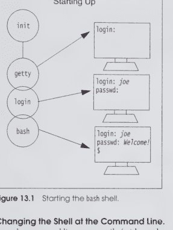

## 图 13.1 启动 bash shell

## 在命令行更改 shell

如果你想临时从命令行启动另一个 shell（而不更改 `/etc/passwd` 文件），只需输入该 shell 的名称。例如，如果你当前正在使用标准 Bourne shell，并希望 `bash` 作为你的 shell，只需在命令行输入 `bash` 即可更改 shell。

#### 示例 13.3

```
1 $ ps
 PID TTY TIME CMD
 1574 pts/6 0:00 sh

2 $ bash
 bash-2.05$

3 bash-2.05$ ps
 PID TTY TIME CMD
 1574 pts/6 0:00 sh
 1576 pts/6 0:00 bash
```

# 说明

- 1 `ps` 命令的输出显示当前正在运行的进程。目前，`sh`（Bourne shell）正在运行。
- 2 在 Bourne shell 提示符下，用户输入 `bash` 启动 Bourne Again shell。出现一个新的提示符。
- 3 在 `bash` 提示符下，执行 `ps` 命令。输出显示两个 shell 正在运行，当前 shell 现在是 `bash`。

## 13.2 环境

进程的环境由变量、打开的文件、当前工作目录、函数、资源限制、信号等组成。它定义了从一个 shell 继承到下一个 shell 的特性，以及工作环境的配置。用户 shell 的配置在 shell 初始化文件中定义。

### 13.2.1 初始化文件

`bash` shell 有许多启动文件会被 `source`。`source` 一个文件会使文件中的所有设置成为当前 shell 的一部分；也就是说，不会创建子 shell。（`source` 命令在“`source` 或 dot 命令”一节（第 773 页）中讨论。）初始化文件是否被 `source` 取决于 shell 是登录 shell、交互式 shell（非登录 shell）还是非交互式 shell（shell 脚本）。

当你登录时，用户主目录中的 `.bash_profile` 会被 `source`。它设置用户的别名和函数，然后设置用户特定的环境变量和启动脚本。

如果用户没有 `.bash_profile`，但有名为 `.bash_login` 的文件，那么该文件将被 `source`；如果没有 `.bash_login`，但有 `.profile`，则 `.profile` 将被 `source`。

### `/etc/profile` 文件

`/etc/profile` 文件是系统级初始化文件，由系统管理员设置，用于在用户登录时执行任务。它在 `bash` 启动时被执行。它也可供系统上所有 Bourne 和 Korn shell 用户使用，通常执行诸如检查邮件假脱机（mail spooler）是否有新邮件以及从 `/etc/motd` 文件显示每日消息等任务。（完成本章后，以下示例将更有意义。）

#### 示例 13.4

```
(Sample /etc/profile)
# /etc/profile
# Systemwide environment and startup programs
# Functions and aliases go in /etc/bashrc
1 PATH="$PATH:/usr/X11R6/bin"
2 PS1="[\u@\h \W]\$ "
```

#### 示例 13.4（续）


```
3 ulimit -c 1000000
4 if [ `id -gn` = `id -un` -a `id -u` -gt 14 ]; then
5   umask 002
else
  umask 022
fi
6 USER=`id -un`
7 LOGNAME=$USER
8 MAIL="/var/spool/mail/$USER"
9 HOSTNAME=`/bin/hostname`
10 HISTSIZE=1000
11 HISTFILESIZE=1000
12 export PATH PS1 HOSTNAME HISTSIZE HISTFILESIZE USER LOGNAME MAIL
13 for i in /etc/profile.d/*.sh ; do
14   if [ -x $i ]; then
15     . $i
fi
16 done
17 unset i #
```

# 说明

- 1 `PATH` 变量被赋予了 shell 搜索命令时应查找的位置。
- 2 设置了主提示符。它将在 shell 窗口中显示为用户名（`\u`）、@ 符号、主机名（`\W`）和美元符号。
- 3 `ulimit` 命令（shell 内建命令）被设置为将创建的 core 文件的最大大小限制为 1,000,000 字节。核心文件是崩溃程序的内存转储，占用大量磁盘空间。
- 4 这行的意思是：如果用户的组名等于用户名，且用户 ID 号大于 14……（参见第 5 行）
- 5 ……那么将 `umask` 设置为 002。创建目录时，目录将获得 775 权限，文件将获得 664 权限。否则，`umask` 设置为 022，目录获得 755，文件获得 644。
- 6 `USER` 变量被赋予用户名（`id -un`）。
- 7 `LOGNAME` 变量被设置为 `$USER` 中的值。
- 8 `MAIL` 变量被赋予用户邮件保存到的邮件假脱机路径。
- 9 `HOSTNAME` 变量被赋予用户宿主机器的名称。
- 10 `HISTSIZE` 变量设置为 1000。`HISTSIZE` 控制记住的历史项数量（来自存储在 shell 内存中的历史列表），并在 shell 退出后保存到历史文件中。

### EXPLANATION (CONTINUED)

+ 11 `HISTFILESIZE` 被设置为限制历史文件中存储的命令数为 1000，即历史文件在达到 1,000 行后会被截断。 (参见第 785 页的“History”。)
+ 12 这些变量被导出，以便在子 shell 和子进程中可用。
+ 13 对于 `/etc/profile.d` 目录中每个以 `.sh` 结尾的文件…… (参见第 14 行)
+ 14 ……检查该文件是否可执行，如果可执行…… (参见第 15 行)
+ 15 ……使用点命令执行（source）该文件。`/etc/profile.d` 目录中的文件（分别为 `lang.sh` 和 `mc.sh`）设置字符集和字体集，并创建一个名为 `mc` 的函数，该函数启动一个名为 Midnight Commander 的可视化/浏览器文件管理器程序。要查看文件管理器如何工作，请在 bash 提示符下输入 `mc`。
+ 16 `done` 关键字标记 `for` 循环的结束。
+ 17 变量 `i` 被 `unset`，即从 shell 的命名空间中移除。`i` 的值是在 `for` 循环中分配给它的值，如果有分配的话。

The `~/.bash_profile` File. 如果在用户的主目录中找到 `~/.bash_profile`，则在 `/etc/profile` 之后对其进行 source。如果 `~/.bash_profile` 不存在，bash 会查找另一个用户定义文件 `~/.bash_login` 并对其进行 source，如果 `~/.bash_login` 也不存在，则会 source `~/.profile`（如果存在）。三个文件（`~/.bash_profile`、`~/.bash_login` 或 `~/.profile`）中只有一个会被 source。Bash 还会检查用户是否具有 `~/.bashrc` 文件，然后对其进行 source。

## EXAMPLE 13.5

```
(Sample .bash_profile)
# .bash_profile
# The file is sourced by bash only when the user logs on.

# Get the aliases and functions
1 if [ -f ~/.bashrc ]; then
2   . ~/.bashrc
fi

# User-specific environment and startup programs
3 PATH=$PATH:$HOME/bin
4 ENV=$HOME/.bashrc   # or BASH_ENV=$HOME/.bashrc
5 USERNAME="root"
6 export USERNAME ENV PATH
7 mesg n
8 if [ $TERM = linux ]
then
    startx  # Start the X Window system
fi
```

### EXPLANATION

+ 1 如果用户主目录中存在名为 `.bashrc` 的文件…… (参见第 2 行)
+ 2 ……为登录 shell 执行（source） `.bashrc` 文件。
+ 3 `PATH` 变量被追加了用户 bin 目录的路径，通常是存放 shell 脚本的地方。
+ 4 `BASH_ENV`（`ENV`）文件被设置为 `.bashrc` 文件的路径名，这是一个初始化文件，仅当 `BASH_ENV`（`ENV`）变量被设置时，才会对交互式 bash shell 和脚本进行 source。`.bashrc` 文件包含用户定义的别名和函数。
+ 5 变量 `USERNAME` 被设置为 `root`。
+ 6 变量被导出，以便子 shell 可用，其他进程也会知道它们。
+ 7 `mesg` 命令使用 `n` 选项执行，禁止他人向终端写入。
+ 8 如果 `TERM` 变量的值为 `linux`，则 `startx` 将启动 X Window 系统（允许多个虚拟控制台的图形用户界面），而不是在 Linux 控制台窗口中启动交互式会话。由于 `~/.bash_profile` 仅在登录时被 source，登录 shell 是启动 X Windows 会话的最佳位置。

a. `BASH_ENV` 从 bash 2.0 版本开始使用。

## The BASH_ENV (ENV) Variable.

在 bash 2.0 版本之前，`BASH_ENV` 文件仅称为 `ENV` 文件（与 Korn shell 相同）。`BASH_ENV`（`ENV`）变量在 `~/.bash_profile` 中设置。它被赋予一个文件名，该文件将在每次启动交互式 bash shell 或 bash 脚本时执行。`BASH_ENV`（`ENV`）文件将包含特殊的 bash 变量和别名。名称通常为 `.bashrc`，但你可以随意命名。当特权选项打开时（`bash -p` 或 `set -o privileged`）或使用 `--norc` 命令行选项时（`bash --norc` 或使用 bash 2.x+ 时的 `bash --norc`），`BASH_ENV`（`ENV`）文件不会被处理。

## The .bashrc File.

`BASH_ENV`（`ENV`）变量按惯例被赋予名称 `.bashrc`。此文件在每次启动新的或交互式 bash shell 或 bash 脚本时自动被 source。它包含仅与 bash shell 相关的设置。

## EXAMPLE 13.6

```
(Sample .bashrc)
# If the .bashrc file exists, it is in the user's home directory.
# It contains aliases (nicknames for commands) and user-defined functions.

# .bashrc
# User-specific aliases and functions
```

## 示例 13.6（续）


```
1  set -o vi
2  set -o noclobber
3  set -o ignoreeof
4  alias rm='rm -i'
   alias cp='cp -i'
   alias mv='mv -i'
5  stty erase ^H
   # Source global definitions
6  if [ -f /etc/bashrc ]; then
       . /etc/bashrc
   fi
7  case "$-" in
       *i*) echo This is an interactive bash shell
           ;;
       *)  echo This shell is noninteractive
           ;;
   esac
10 history control=ignoredups
11 function cd { builtin cd $1; echo $PWD; }
```

# 解释

- 1. `set` 命令配合 `-o` 开关可以打开或关闭特殊的内置选项。参见“`set -o` 选项”第 763 页。如果开关是 `-o`，即减号，则选项被打开；如果是加号，则选项被关闭。`vi` 选项允许交互式命令行编辑。例如，`set -o vi` 打开交互式命令行编辑，而 `set +o vi` 则关闭它。参见第 764 页表 13.1。
- 2. `noclobber` 选项被打开，这会阻止用户在使用重定向时覆盖文件；例如，`sort filex > filex`。参见“标准 I/O 和重定向”第 844 页。
- 3. 退出 shell 时，通常可以输入 `^D`（Ctrl-D）。设置了 `ignoreeof` 后，必须输入 `exit`。
- 4. `rm` 的别名 `rm -i` 使 `rm` 成为交互式（`-i`），即在实际删除文件之前会询问用户是否可以删除文件。`cp` 命令的别名 `cp -i` 使复制操作成为交互式。
- 5. `stty` 命令用于将终端退格键设置为擦除。`^H` 表示退格键。
- 6. 如果存在名为 `/etc/bashrc` 的文件，则对其进行 `source`。
- 7. 如果 shell 是交互式的，特殊变量 `$-` 将包含 `i`。如果不是，你可能正在运行脚本。`case` 命令会评估 `$-`。
- 8. 如果 `$-` 返回的值匹配 `*i*`（即包含 `i` 的任意字符串），则 shell 打印 `This is an interactive bash shell`。
- 9 否则，shell 打印 `This shell is noninteractive`。如果你启动脚本或在提示符下启动新 shell，你将能够判断你的 shell 是否是交互式的。它仅用于让你测试对“交互式”和“非交互式” shell 术语的理解。
- 10 `history_control` 设置用于控制命令在历史文件中的保存方式。此行读作：如果命令已存在于历史文件中，则不要保存；即忽略重复项。
- 11 这是一个用户定义的函数。当用户更改目录时，会打印当前工作目录 `PWD`。函数名为 `cd`，其定义中包含 `cd` 命令。特殊内置命令 `builtin` 在函数定义中位于 `cd` 命令之前，以防止函数进入无限递归；即无限调用自身。

`/etc/bashrc` 文件。系统范围的函数和别名可以在 `/etc/bashrc` 文件中设置。主提示符通常在此处设置。

## 示例 13.7

```
(Sample /etc/bashrc)

# Systemwide functions and aliases
# Environment stuff goes in /etc/profile

# For some unknown reason bash refuses to inherit
# PS1 in some circumstances that I can’t figure out.
# Putting PS1 here ensures that it gets loaded every time.

1 PS1="[\u@\h \W]\$ "
2 alias which="type -path"
```

# 解释

1 系统范围的函数和别名在此设置。主要的 bash 提示符被设置为用户名（`\u`）、`@` 符号、主机名（`\h`）、当前工作目录的基名，以及美元符号。参见第 769 页表 13.2。此提示符将出现在所有交互式 shell 中。
2 别名，即命令的昵称，通常在用户的 `.bashrc` 文件中设置。该别名已预设，并在 bash 启动时可用。你在想知道程序在磁盘上的位置时使用它；即它位于哪个目录中（例如，`which ls` 将打印 `/bin/ls`）。

## ~/.profile 文件。

`.profile` 文件是一个用户定义的初始化文件。它位于用户的主目录中，并在以 `sh`（Bourne shell）运行时登录时 `source` 一次。因为该文件由 Bourne shell 使用，所以不应包含任何 bash 特定的设置。如果运行 bash，且 bash 找不到之前列出的其他初始化文件，则会运行 `.profile`。它允许用户自定义和修改其 shell 环境。环境和终端设置通常放在此处，如果要启动窗口应用程序或数据库应用程序，则在此处启动。

## 示例 13.8

```
(Sample .profile)
# A login initialization file sourced when running as sh or the #.bash_profile or
# .bash_login are not found.

1 TERM=xterm
2 HOSTNAME=`uname -n`
3 EDITOR=/bin/vi
4 PATH=/bin:/usr/ucb:/usr/bin:/usr/local:/etc:/bin:/usr/bin:.
5 PS1="HOSTNAME $ > "
6 export TERM HOSTNAME EDITOR PATH PS1
7 stty erase ^h
8 go () { cd $1; PS1=`pwd`; PS1=`basename $PS1`; }
9 trap 'HOME/ logout' EXIT
10 clear
```

# 解释

- 1. `TERM` 变量被赋值为终端类型 `xterm`。
- 2. 因为 `uname -n` 命令被反引号括起来，shell 会执行命令替换；即命令的输出（主机名）将被赋给变量 `HOSTNAME`。
- 3. `EDITOR` 变量被赋值为 `/bin/vi`。`mail` 和 `history` 等程序在定义编辑器时现在可以使用此变量。
- 4. `PATH` 变量被赋值为 shell 为查找 UNIX/Linux 程序而按顺序搜索的目录条目。例如，如果你输入 `ls`，shell 将在 `PATH` 中搜索，直到在其中一个列出的目录中找到该程序。如果从未找到该程序，shell 会通知你。
- 5. 主提示符被赋值为 `HOSTNAME`，即机器名，以及 `$` 和 `>` 符号。
- 6. 列出的所有变量都被导出。它们将被从此 shell 启动的子进程所知。
- 7. `stty` 命令设置终端选项。`Erase` 键被设置为 `^H`，因此当你按下退格键时，光标前输入的字母将被擦除。

# 说明（续）

8 定义了一个名为 `go` 的函数。该函数的目的是接受一个参数（目录名），然后 `cd` 到该目录，并将主提示符设置为当前工作目录。`basename` 命令会移除路径中除最后一项之外的所有部分。提示符将显示当前目录。
9 `trap` 命令是一个信号处理命令。当你退出 shell（即注销）时，`.logout` 文件将被执行。`.logout` 文件是一个用户自定义文件，其中包含将在注销前执行的命令，这些命令用于清理临时文件、记录注销时间等。
10 `clear` 命令用于清屏。

## ~/.bash_logout 文件。

当用户注销（退出登录 shell）时，如果存在名为 `~/.bash_logout` 的文件，它将被引用（`source`）。该文件通常包含清理临时文件、截断历史文件、记录注销时间以及执行其他维护任务的命令。

## 防止启动文件被执行的选项。

如果 bash 以 `--noprofile` 选项调用（例如 `bash --noprofile`），则 `/etc/profile`、`~/.bash_profile`、`~/.bash_login` 或 `~/.profile` 启动文件将不会被引用。如果以 `-p` 选项调用（例如 `bash -p`），bash 将不会读取用户的 `~/.profile` 文件。如果 bash 以 `sh`（Bourne shell）方式调用，它会尽可能模仿 Bourne shell 的行为。对于登录 shell，它只会按顺序尝试引用 `/etc/profile` 和 `~/.profile`。仍可使用 `-noprofile` 选项来禁用此行为。如果 shell 以 `sh` 方式调用，它不会尝试引用任何其他启动文件。

## .inputrc 文件。


另一个默认初始化文件 `.inputrc` 也会在 `bash` 启动时被读取。如果该文件存在于用户的主目录中，它包含用于自定义按键行为的变量，以及将字符串、宏和控制功能绑定到按键的设置。按键绑定的名称及其功能可以在 `Readline` 库中找到，这是一个供操作文本的应用程序使用的库。这些绑定尤其在执行命令行编辑时被内置的 `emacs` 和 `vi` 编辑器使用。（有关 `readline` 的更多信息，请参见第 793 页的“命令行编辑”。）

## 13.2.2 使用内置 set 和 shopt 命令设置 bash 选项

### set -o 选项

使用 `-o` 开关时，`set` 命令可以接受选项。这些选项允许你自定义 shell 环境。它们要么开启要么关闭，通常设置在 `BASH_ENV`（`ENV`）文件中。`set` 命令的许多选项都有缩写形式。例如，`set -o noclobber` 也可以写成 `set -C`。（参见表 13.1。）

## 表 13.1 内置 set 命令选项

| 选项名称 | 快捷开关 | 作用 |
|---|---|---|
| `allexport` | `-a` | 从设置该选项开始，自动将新的或修改过的变量标记为导出的，直到取消设置。 |
| `braceexpand` | `-B` | 启用花括号扩展，是默认设置。 |
| `emacs` |  | 用于命令行编辑，使用 `emacs` 内置编辑器，是默认设置。 |
| `errexit` | `-e` | 如果命令返回非零退出状态（失败），则退出。在读取初始化文件时不设置。 |
| `histexpand` | `-H` | 在执行历史替换时启用 `!` 和 `!!`，是默认设置。 |
| `history` |  | 启用命令行历史记录；默认为开启。 |
| `ignoreeof` |  | 禁止 `EOF`（`Ctrl-D`）退出 `shell`；必须输入 `exit`。等同于设置 `shell` 变量 `IGNOREEOF=10`。 |
| `keyword` | `-k` | 将关键字参数放入命令的环境中。 |
| `interactive-comments` |  | 对于交互式 `shell`，行首的 `#` 用于注释掉该行剩余的任何文本。 |
| `monitor` | `-m` | 允许作业控制。 |
| `noclobber` | `-C` | 在使用重定向时保护文件不被覆盖。 |
| `noexec` | `-n` | 读取命令但不执行。用于检查脚本的语法。在交互式运行时不会开启。 |
| `noglob` | `-d` | 禁用路径名扩展；即关闭通配符。 |
| `notify` | `-b` | 后台作业完成时通知用户。 |
| `nounset` | `-u` | 在展开未设置的变量时显示错误。 |
| `onecmd` | `-t` | 读取并执行一条命令后退出。 |
| `physical` | `-P` | 如果设置，键入 `cd` 或 `pwd` 时不跟随符号链接。而是使用物理目录。 |
| `posix` |  | 如果默认操作不符合 `POSIX` 标准，则改变 `shell` 行为。 |
| `privileged` | `-p` | 设置后，`shell` 不读取 `.profile` 或 `ENV` 文件，且不会从环境中继承 `shell` 函数；对于 `setuid` 脚本自动设置。 |

## 13.2 环境

### 表 13.1 内置 set 命令选项（续）

| 选项名称 | 快捷开关 | 其作用 |
|---|---|---|
| `verbose` | `-v` | 打开调试的详细模式。 |
|  |  | 对于命令行编辑，使用 `vi` 内置编辑器。 |
| `vtrace` |  |  |
| `xtrace` | `-x` | 打开调试的回显模式。 |

### 格式

```
set -o option  # Turns on the option.
set +o option  # Turns off the option.
set -[a-z]  # Abbreviation for an option; the minus turns it on.
set +[a-z]  # Abbreviation for an option; the plus turns it off.
```

### 示例 13.9

```
1  set -o allexport
2  set +o allexport
3  set -a
4  set +a
```

### 解释

- 1. 设置 `allexport` 选项。此选项会导致所有变量自动导出到子 `shell`。
- 2. 取消设置 `allexport` 选项。所有变量现在将在当前 `shell` 中保持本地。
- 3. 设置 `allexport` 选项。与 1 相同。并非每个选项都有缩写形式。（参见表 13.1。）
- 4. 取消设置 `allexport` 选项。与 2 相同。

### 示例 13.10

```
$ set -o
    braceexpand        on
    errexit            off
    hashall            on
    histexpand         on
    keyword            off
    monitor             on
    noclobber           off
    noexec              off
    noglob              off
    notify              off
```

### 示例 13.10（续）

- `nounset` `off`
- `onecmd` `off`
- `physical` `off`
- `privileged` `off`
- `verbose` `off`
- `xtrace` `off`
- `history` `on`
- `ignoreeof` `off`
- `interactive-comments` `on`
- `posix` `off`
- `emacs` `off`
- `vi` `on`

```
2 $ set -o noclobber
3 $ date > outfile
4 $ ls > outfile
bash: outfile: Cannot clobber existing file.
5 $ set +o noclobber
6 $ ls > outfile
7 $ set -C
```

### 解释

- 1 使用 `-o` 选项，`set` 命令列出当前设置或未设置的所有选项。
- 2 要设置一个选项，使用 `-o` 选项。设置了 `noclobber` 选项。它可防止在重定向时覆盖文件。如果没有 `noclobber`，`>` 符号右侧的文件如果存在将被截断，如果不存在则会被创建。
- 3 `UNIX/Linux` `date` 命令的输出被重定向到名为 `outfile` 的文件。
- 4 这次 `outfile` 已存在。通过尝试将 `ls` 的输出重定向到 `outfile`，`shell` 会抱怨文件已存在。如果未设置 `noclobber`，它将被覆盖。
- 5 使用 `set` 命令的 `+o` 选项，关闭 `noclobber`。
- 6 这次，由于 `noclobber` 已不再设置，尝试覆盖 `outfile` 是可以的。
- 7 使用 `set` 命令的 `-C` 开关是打开 `noclobber` 的另一种方法。`+C` 将关闭它。

### The shopt Built-In (Version 2.x+)

`shopt`（`shell` 选项）内置命令在 `bash` 的较新版本中用作 `set` 命令的替代方案。在许多方面 `shopt` 重复了 `set` 内置命令，但它为配置 `shell` 增加了更多选项。有关所有 `shopt` 选项的列表，请参阅第 855 页的表 13.27。在以下示例中，`shopt` 使用 `-p` 选项打印所有可用的选项设置。`-u` 开关表示未设置的选项，`-s` 表示当前已设置的选项。

### 示例 13.11

```
1 $ shopt -p
shopt -u cdable_vars
shopt -u cdspell
shopt -u checkhash
shopt -u checkwinsize
shopt -s cmdhist
shopt -u dotglob
shopt -u execfail
shopt -s expand_aliases
shopt -u extglob
shopt -u histreedit
shopt -u histappend
shopt -u histverify
shopt -s hostcomplete
shopt -u huponexit
shopt -s interactive_comments
shopt -u lithist
shopt -u mailwarn
shopt -u nocaseglob
shopt -u nullglob
shopt -s promptvars
shopt -u restricted_shell
shopt -u shift_verbose
shopt -s sourcepath
```

```
2 $ shopt -s cdspell
$ shopt -p cdspell
shopt -s cdspell
```

```
3 $ shopt -s cdspell
$ shopt -p cdspell
shopt -s cdspell
```


```
4 $ cd /home
/home
```

```
5 $ pwd
/home
```

```
6 $ cd /usr/local/man
/usr/local/man
```

```
7 $ shopt -u cdspell
$ shopt -p cdspell
shopt -u cdspell
```

# 解释

1 使用 `-p`（打印）选项，`shopt` 命令列出所有可设置的 shell 选项及其当前值，已设置（`-s`）或未设置（`-u`）。

2 使用 `-s` 选项，`shopt` 设置（或打开）一个选项。`cdspell` 选项会导致 shell 在 `cd` 命令的参数中给出的目录名出现轻微拼写错误时进行纠正。它可以纠正简单的拼写错误，插入缺失的字母，甚至在可能的情况下调换字母。

3 使用 `-p` 选项和选项名称，`shopt` 指示选项是否已设置。该选项已设置（`-s`）。

# 说明（续）

+ 4 在此示例中，用户尝试 `cd` 到其主目录，但拼错了 `home`。Shell 修正了拼写，`hame` 变成了 `home`。目录被更改为 `/home`。

+ 5 `pwd` 命令的输出显示了当前工作目录，表明尽管用户拼写错误，目录确实已被更改。

+ 6 这次目录名缺少了字母，并且最后一个条目 `ban` 也有拼写错误。Shell 通过插入缺失的字母并将 `ban` 修正为 `man`，很好地尝试拼写出了正确的路径名。由于 `ban` 中的 `b` 是第一个拼写错误的字符，Shell 在目录中搜索可能以 `a` 和 `n` 结尾的条目。它找到了 `man`。

+ 7 使用 `-u` 开关，`shopt` 会取消设置（或关闭）该选项。

+ 8 使用 `-p` 开关并带上选项名，`shopt` 会指示该选项是否已设置。`cdspell` 选项已被取消设置（`-u`）。

> a. “开关”和“选项”这两个词可以互换使用。它们是命令的参数，且带有前导破折号。

## 13.2.3 提示符

在交互式使用时，Shell 会提示你输入。当你看到提示符时，就知道可以开始输入命令了。`bash` Shell 提供四种提示符：主提示符是美元符号（`$`）；次提示符是右尖括号符号（`>`）；第三和第四种提示符，分别是 `PS3` 和 `PS4`，将在后面讨论。当 Shell 以交互方式运行时，这些提示符会显示出来。你可以更改这些提示符。

变量 `PS1` 被设置为包含主提示符的字符串。它的值，即美元符号，在你登录时出现，并等待用户输入，通常是 UNIX/Linux 命令。变量 `PS2` 是次提示符，初始设置为右尖括号字符（`>`）。如果你输入了部分命令然后按了回车键，它就会出现。你可以更改主提示符和次提示符。

### 主提示符

美元符号（或 `bash $`）是默认的主提示符。你可以更改你的提示符。通常，提示符定义在 `/etc/bashrc` 或用户初始化文件 `.bash_profile` 或 `.profile`（Bourne Shell）中。

## 示例 13.12

```
1 $ PS1="$(uname -n) > "
2 chargers >
```

# 说明

+ 1 默认的主提示符是美元符号（`bash $`）。`PS1` 提示符被重新设置为机器名的名称a（`uname -n`）和一个 `>` 符号。

+ 2 新的提示符被显示出来。

> a. 命令 `uname -n` 会被执行，因为它被包含在一组以美元符号开头的括号内。另一种方法是将命令包含在反引号中。（参见第 835 页的“命令替换”。）

## 使用特殊转义序列设置提示符

通过在提示符字符串中插入特殊的反斜杠/转义序列，你可以自定义提示符。表 13.2 列出了这些特殊序列。

## 表 13.2 提示符字符串设置

| 反斜杠序列 | 它求值为什么 |
|---|---|
| `\d` | 日期，格式为“星期 月份 日期”（例如，Tue May 26） |
| `\h` | 主机名 |
| `\n` | 换行符 |
| `\nnn` | 对应于八进制数 nnn 的字符 |
| `\s` | Shell 的名称，即 `$0` 的基本名称（最终斜杠之后的部分） |
| `\t` | 当前时间，格式为 HH:MM:SS |
| `\u` | 当前用户的用户名 |
| `\w` | 当前工作目录 |
| `\W` | 当前工作目录的基本名称 |
| `\#` | 此命令的命令编号 |
| `\!` | 此命令的历史编号 |
| `\$` | 如果有效 UID 为 0，则显示 `#`，否则显示 `$` |
| `\\` | 反斜杠 |
| `\[` | 开始一段非打印字符序列；可用于将终端控制序列嵌入提示符中 |
| `\]` | 结束一段非打印字符序列 |
| bash 2.x+ 新增 | |
| `\a` | ASCII 响铃字符 |
| `\e` | ASCII 转义字符（033） |
| `\H` | 主机名 |
| `\T` | 当前时间，12 小时格式：HH:MM:SS |
| `\v` | bash 的版本，例如，2.03 |
| `\V` | bash 的发布版本和补丁级别；例如，2.03.0 |
| `\@` | 当前时间，12 小时 AM/PM 格式 |

# 示例 13.3

```
1  $ PS1="[\u\h \W]\$ "
   [ellie@homebound ellie]$
2  $ PS1="\W;\d"
   ellie:Tue May 18>
```

# 解释

- 1. 你使用特殊的反斜杠/转义序列来自定义主要的 bash 提示符。`\u` 求值为用户的登录名，`\h` 求值为主机名，而 `\W` 是当前工作目录的基名。有两个反斜杠。第一个反斜杠转义第二个反斜杠，从而得到 `\$`。美元符号被保护免受 shell 解析，因此原样打印。

- 2. 主要提示符被赋值为 `\W`，该转义序列求值为当前工作目录的基名，以及 `\d`，该转义序列求值为今天的日期。

**次要提示符。** `PS2` 变量被赋值为一个字符串，称为次要提示符。其值显示到标准错误，默认情况下为屏幕。当你尚未完成命令或需要更多输入时，会出现此提示符。默认的次要提示符是 `>`。

# 示例 13.4

```
1  $ echo "Hello
2  > there"
   Hello
   there
3

4  $

5  $ PS2="----> "
6  $ echo "Hi
7  ---->
   ---->
   -----> there"

   Hi

   there
   $
```

# 示例 13.1（续）

```
8  $ PS2="\s:PS2> "
echo "Hello
bash:PS2 > what are
bash:PS2 > you
bash:PS2 > trying to do?
bash:PS2 > '
Hello
what are
you
trying to do?
$
```

# 解释

- 1. 双引号必须在字符串 `"Hello` 之后匹配。

- 2. 当输入换行符时，次要提示符会出现。在输入闭合双引号之前，次要提示符将一直显示。

- 3. `echo` 命令的输出被显示。

- 4. 主要提示符被显示。

- 5. 次要提示符被重置。

- 6. 单引号必须在字符串 `'Hi` 之后匹配。

- 7. 当输入换行符时，新的次要提示符会出现。在输入闭合单引号之前，次要提示符将一直显示。

- 8. `PS2` 提示符被设置为 shell 的名称（`\s`），后跟一个由冒号、`PS2` 和 `>` 组成的字符串，再跟一个空格。

### 13.2.4 搜索路径

`Bash` 使用 `PATH` 变量来定位在命令行输入的命令。路径是由冒号分隔的目录列表，shell 在搜索命令时使用该列表。默认路径取决于系统，由安装 bash 的管理员设置。路径从左到右搜索。路径末尾的点代表当前工作目录。如果在路径列出的任何目录中都找不到命令，shell 会向标准错误发送消息 `filename: not found`。路径通常在 `.bash_profile` 中设置，如果运行 bash shell，或在 `.profile` 中设置，如果使用 `sh`，Bourne shell。

如果路径中不包含点，并且你从当前工作目录执行命令或脚本，则脚本的名称必须以 `./` 开头，例如 `./program_name`，以便 shell 找到该程序。

# 示例 13.15

（打印 `PATH`）

1  $ echo $PATH

/usr/gnu/bin:/usr/local/bin:/usr/ucb/bin:/usr/bin:.

（设置 `PATH`）

2  $ PATH=$HOME:/usr/ucb:/usr:/usr/bin:/usr/local/bin:

3  $ export PATH

4  $ runit

bash: runit: command not found

5  $ ./runit

< program starts running here >

# 解释

- 1 通过 `echo $PATH`，`PATH` 变量的值会被显示。路径由冒号分隔的元素列表组成，并从左到右搜索。路径末尾的点代表用户的当前工作目录。


### 2
要设置路径，将冒号分隔的目录列表赋给 `PATH` 变量。请注意，在此路径中，点不在路径末尾，也许是出于安全考虑。

### 3
通过导出路径，子进程将能够访问它。导出 `PATH` 不必单独成行：它可以写成如下形式：

`export PATH=$HOME:/usr/ucb/bin:.,` 等等，在同一行上。

### 4
因为点不在搜索路径中，当在当前工作目录中执行 `runit` 程序时，`bash` 找不到它。

### 5
因为程序名称前面加上了点和斜杠（`./`），`shell` 将能够找到它，并在它是当前工作目录时执行它。

## 13.2.5 hash 命令

`hash` 命令控制 `shell` 用于提高搜索命令效率的内部哈希表。每次输入命令时不必搜索路径，第一次输入命令时，`shell` 使用搜索路径找到命令，然后将其存储在 `shell` 内存中的表中。下次使用同一命令时，`shell` 使用哈希表找到它。这使得访问命令比搜索完整路径快得多。如果你知道自己会经常使用某个命令，可以将其添加到哈希表中。你也可以从表中删除命令。`hash` 命令的输出显示 `shell` 使用表找到命令的次数（`hits`）以及命令的完整路径名。带 `-r` 选项的 `hash` 命令会清除哈希表。`--` 参数会禁用对后续参数的选项检查。哈希由 `bash` 自动实现。虽然你可以关闭它，但如果没有令人信服的理由，不要这样做。

## 示例 13.16

（打印 `PATH`）

（命令行）

```
1  hash
hits  command
1    /usr/bin/mesg
4    /usr/bin/man
2    /bin/ls
2  hash -r
3  hash
No commands in hash table
4  hash find
hits  command
0    /usr/bin/find
```

### 说明

- 1 `hash` 命令显示在此登录会话中已执行命令的完整路径名。（内建命令不会列出。）命中次数是 `hash` 表被用来查找命令的次数。

- 2 `hash` 命令的 `-r` 选项会清除 `hash` 表中所有记住的位置。

- 3 在上一条命令中使用 `-r` 选项后，`hash` 命令报告当前表中没有任何命令。

- 4 如果你知道某个命令会经常使用，可以通过将其作为参数传给 `hash` 命令来把它添加到 `hash` 表中。`find` 命令已被添加。由于该命令尚未使用，所以表中命中次数为 0。

## 13.2.6 source（或点）命令

`source` 命令（来自 C shell）是 `bash` 的内建命令。点命令，即一个句点（来自 Bourne shell），是 `source` 的另一个名称。这两个命令都接受脚本名作为参数。脚本将在当前 `shell` 的环境中执行；也就是说，不会启动子进程。脚本中设置的所有变量将成为当前 `shell` 环境的一部分。同样，当前 `shell` 中设置的所有变量也将成为脚本环境的一部分。`source`（或点）命令通常用于在初始化文件（如 `.bash_profile`、`.profile` 等）被修改后重新执行它们。例如，如果自登录以来 `.bash_profile` 中的某个设置（如 `EDITOR` 或 `TERM` 变量）已被更改，你可以使用 `source` 命令重新执行 `.bash_profile` 中的命令，而无需注销后重新登录。像 `.bash_profile` 这样的文件，或者任何 `shell` 脚本，都不需要具有执行权限即可用点命令或 `source` 命令来引用。

## 示例 13.17

```
$ source .bash_profile
$ . .bash_profile
```

### 说明

`source`（或点）命令会在当前 `shell` 的上下文中执行初始化文件 `.bash_profile`。局部变量和全局变量将在此 `shell` 内被重新定义。点命令使得在文件被修改后无需注销并重新登录。

a. 如果直接以脚本方式执行 `.bash_profile`，会启动一个子 `shell`。然后变量将在子 `shell` 中设置，当子 `shell` 退出时，父 `shell` 将无法获得其中的任何设置。

## 13.3 命令行

登录后，`bash shell` 会显示其主提示符，默认是一个美元符号。`shell` 是你的命令解释器。当 `shell` 以交互方式运行时，它从终端读取命令并将命令行拆分为单词。命令行由一个或多个单词（或记号）组成，这些单词以空白（空格和/或制表符）分隔，并以按回车键产生的换行符结束。第一个单词是命令，后续单词是该命令的参数。命令可以是 UNIX/Linux 可执行程序（如 `ls` 或 `date`）、用户定义的函数、内建命令（如 `cd` 或 `pwd`）或 `shell` 脚本。命令可能包含特殊字符，称为元字符，`shell` 在解析命令行时必须解释这些字符。如果命令行太长，反斜杠字符后跟换行符可以让你在下一行继续输入。次提示符将一直显示，直到命令行结束。

### 13.3.1 命令的处理顺序

命令行上的第一个单词是要执行的命令。命令可以是关键字、别名、函数、特殊内建命令或实用程序、可执行程序或 `shell` 脚本。命令按以下顺序根据其类型执行：

- 1. 别名
- 2. 关键字（如 `if`、`function`、`while`、`until`）
- 3. 函数
- 4. 内建命令
- 5. 可执行程序和脚本

特殊的内置命令和函数定义在 `shell` 内部，因此在当前 `shell` 的上下文中执行，这使得它们的执行速度更快。脚本和可执行程序（如 `ls` 和 `date`）存储在磁盘上，`shell` 为了执行它们，必须首先通过搜索 `PATH` 环境变量在目录层次结构中定位它们：然后 `shell` 派生出一个新的 `shell` 来执行该脚本。要确定你所使用的命令类型——即内置命令、别名、函数还是可执行文件——可以使用内置的 `type` 命令。（参见示例 13.18。）

## 示例 13.18

```
$ type pwd
pwd is a shell builtin
$ type test
test is a shell builtin
$ type clear
clear is /usr/bin/clear
$ type m
m is aliased to 'more'
$ type bc
bc is /usr/bin/bc
$ type if
if is a shell keyword
$ type -path cal
/usr/bin/cal
$ type which
which is aliased to 'type -path'
$ type greetings
greetings is a function
greetings ()
{
    echo "Welcome to my world!";
}
```

### 13.3.2 内置命令与 help 命令

内置命令是 `shell` 内部源代码的一部分。它们是内置于 `shell` 中并且随时可用的，而像 `date`、`cal` 和 `finger` 这样的命令则是驻留在磁盘上的已编译二进制程序。执行内置命令的开销较小，因为它不涉及磁盘操作。`shell` 会先于磁盘上的可执行程序执行内置命令。`Bash` 增加了一个新的在线帮助系统，使你能够查看所有内置命令，或某个特定内置命令的描述；`help` 本身就是一个内置命令。完整的内置命令列表参见第 857 页的表 13.28。

## 示例 13.19

```
1 $ help help
help: help [pattern ...]
Display helpful information about built-in commands. If PATTERN
is specified, gives detailed help on all commands matching
PATTERN, otherwise a list of the built-ins is printed.
2 $ help pwd
pwd: pwd
Print the current working directory.
```

### 13.3.3 更改命令行处理的顺序

`Bash` 提供了三个可以覆盖命令行处理顺序的内置命令：`command`、`builtin` 和 `enable`。

`command` 内置命令会消除别名和函数在命令处理顺序中的查找。只有搜索路径中找到的内置命令和可执行文件才会被处理。

`builtin` 命令只查找内置命令，忽略路径中的函数和可执行文件。

`enable` 内置命令用于启用和禁用内置命令。默认情况下，内置命令是启用的。禁用某个内置命令后，即使可执行命令与内置命令同名，也无需指定完整路径即可执行。（在正常处理中，`bash` 会先于磁盘上的可执行命令搜索内置命令。）使用 `-n` 选项可以禁用内置命令。例如，新的 `shell` 程序员经常会犯的一个经典困惑是把脚本命名为 `test`。因为 `test` 是一个内置命令，`shell` 会尝试执行它而不是用户的脚本（因为内置命令通常在任何可执行程序之前执行）。通过输入 `enable -n test`，`test` 内置命令被禁用，用户的脚本就会优先执行。

不带选项时，`enable` 内置命令会打印所有内置命令的列表。以下每个内置命令都在第 857 页的“Shell 内置命令”中进行了描述。

## 示例 13.20


```
1 $ enable
enable .
enable :
enable [
enable alias
enable bg
enable bind
enable break
enable builtin
enable cd
enable command
```

## 示例 13.20（续）

```
enable continue
enable declare
enable dirs
....
enable read
enable readonly
enable return
enable set
enable shift
enable shopt
....
enable type
enable typeset
enable ulimit
enable umask
enable unalias
enable unset
enable wait
```

```
2 enable -n test
```

```
3 function cd { builtin cd; echo $PWD; }
```

# 说明

1. `enable` 内置命令在不带任何选项时，会显示所有 bash shell 内置命令的完整列表。此示例仅展示了该列表的一部分。

2. 使用 `-n` 选项后，`test` 内置命令被禁用。现在你可以执行名为 `test` 的脚本，而不必担心内置的 `test` 会被执行。将脚本命名为与操作系统命令同名的做法并不好，因为如果你在另一个 shell 中运行同一个脚本，那里并不存在禁用内置命令的功能。

3. 这个函数名为 `cd`。`builtin` 命令使得函数定义中的 `cd` 调用的是内置的 `cd`，而不是函数 `cd`，否则会导致无限递归循环。

shell 状态变量 `?` 被设置为最后执行的命令的退出状态值。程序的成功或失败由编写该程序的程序员决定。

## 示例 13.21

```
1  $ grep ellie /etc/passwd
ellie:MrHJEd2YpKjY:501:501::/home/ellie:/bin/bash
2  $ echo $?
0
3  $ grep nicky /etc/passwd
4  $ echo $?
1
5  $ grep ellie /junk
grep: /junk: No such file or directory
6  $ echo $?
2
7  $ grip ellie /etc/passwd
bash: grip: command not found
8  $ echo $?
127
9  $ find / -name core ^C  # User presses Ctrl-C
10 $ echo $?
130
```

# 说明

+ 1 `grep` 程序在 `/etc/passwd` 文件中搜索模式 `ellie`，并成功找到。显示来自 `/etc/passwd` 的行。
+ 2 `?` 变量被设置为 `grep` 命令的退出值。`0` 表示成功状态。
+ 3 `grep` 程序无法在 `/etc/passwd` 文件中找到用户 `nicky`。
+ 4 `grep` 程序无法找到该模式；`?` 变量返回值为非零。退出状态 `1` 表示失败。
+ 5 `grep` 失败，因为无法打开 `/junk` 文件。`grep` 错误消息被发送到标准错误输出，也就是屏幕。
+ 6 如果 `grep` 找不到文件，它返回退出状态 `2`。
+ 7 shell 找不到 `grip` 命令。
+ 8 因为找不到命令，所以返回退出状态 `127`。
+ 9 当通过按 Ctrl-C 发送 SIGINT 信号时，`find` 命令被中断。Ctrl-C 的信号编号为 `2`。
+ 10 被终止的进程返回的状态是 `128 +` 信号编号（即 `128 + 2`）。

## 13.3.5 命令行中的多个命令

命令行可以由多个命令组成。每个命令之间用分号分隔，命令行以换行符结束。退出状态是命令链中最后一个命令的退出状态。

## 示例 13.22

```
$ ls; pwd; date
```

# 说明

命令从左到右依次执行，直到遇到换行符。

## 13.3.6 命令分组

命令也可以分组，以便将所有输出通过管道传递给另一个命令或重定向到文件。

## 示例 13.23

```
$ ( ls; pwd; date ) > outfile
```

# 说明

每个命令的输出都被发送到名为 `outfile` 的文件中。括号内的空格是必需的。

## 13.3.7 命令的条件执行

使用条件执行时，两个命令字符串由特殊元字符双与号（`&&`）和双竖线（`||`）分隔。这些元字符右侧的命令是否执行，取决于左侧命令的退出状态。

## 示例 13.24

```
$ cc prgm1.c -o prgm1 && prgm1
```

# 说明

如果第一个命令成功（退出状态为 `0`），则执行 `&&` 之后的命令；也就是说，如果 `cc` 程序能够成功编译 `prgm1.c`，则生成的可执行程序 `prgm1` 将被执行。

## 示例 13.25

```
$ cc prog.c >& err || mail bob < err
```

# 说明

如果第一个命令失败（退出状态非零），则执行 `||` 之后的命令；也就是说，如果 `cc` 程序无法编译 `prog.c`，错误信息会被发送到名为 `err` 的文件中，并通过电子邮件将 `err` 文件发送给用户 `bob`。

## 13.3.8 后台命令

通常，当你执行命令时，它会在前台运行，并且在该命令执行完成之前，提示符不会重新出现。等待命令完成并不总是方便的。当你在命令行末尾放置一个与号（`&`）时，shell 会立即返回 shell 提示符，并在后台并发执行该命令。你不必等待一个命令完成后再开始另一个命令。后台作业的输出会在处理时发送到屏幕。因此，如果你打算在后台运行命令，该命令的输出可能会被重定向到文件或通过管道传递给其他设备（如打印机），这样它的输出就不会干扰你刚刚输入的命令。

`!` 变量包含最后一个放入后台的作业的 PID 号。（有关后台处理的更多信息，请参见下一节“作业控制”。）

## 示例 13.26

+ 1 $ `man sh | lp &`
+ 2 `[1] 1557`
+ 3 $ `kill -9 $!`

# 说明

+ 1 `man` 命令的输出（UNIX 命令的手册页）通过管道传递给打印机。命令行末尾的与号将作业放入后台。
+ 2 屏幕上出现两个数字：方括号中的数字表示这是第一个放入后台的作业；第二个数字是 PID，即该作业的进程标识号。
+ 3 shell 提示符立即出现。当你的程序在后台运行时，shell 正在前台等待另一个命令。`!` 变量计算为最近放入后台的作业的 PID。如果你及时获取它，就能在该作业进入打印队列之前将其终止。

## 13.4 作业控制

作业控制是 bash shell 的一项强大功能，允许你选择性地在后台或前台运行称为“作业”的程序。正在运行的程序称为进程或作业，每个进程都有一个进程 ID 号，称为 PID。通常，在命令行输入的命令在前台运行，并会一直运行到结束，除非你按 Ctrl-C 或 Ctrl-\ 发送信号终止它。通过作业控制，你可以将作业发送到后台并让它继续运行；你可以按 Ctrl-Z 停止作业，这会将该作业发送到后台并挂起；你可以让已停止的作业在后台运行；你可以将后台作业带回前台；你甚至可以杀死在后台或前台运行的作业。有关作业命令列表，请参见第 782 页的表 13.3。

### 13.4.1 作业控制命令与选项

默认情况下，作业控制已经设置（某些较旧版本的 UNIX 不支持此功能）。如果被禁用，可以通过以下任意一条命令重置：

# 格式

```
set -m      # set job control in the .bashrc file
set -o monitor  # set job control in the .bashrc file
bash -m -i   # set job control when invoking interactive bash
```

### 示例 13.27

```
1 $ vi
[1]+ Stopped      vi

2 $ sleep 25&
[2] 4538

3 $ jobs
[2]+ Running     sleep 25&
[1]- Stopped      vi

4 $ jobs -l
[2]+ 4538 Running     sleep 25&
[1]- 4537 Stopped      vi

5 $ jobs %
[2]- 4538 Running     sleep 25&

6 $ fg %1
```

### 示例 13.27（续）

```
7  $ jobs -x echo %1
4537

8  $ kill %1    # or kill 4537
[1]+  Stopped      vi
Vim: Caught deadly signal TERM
Vim: Finished.
[1]+  Exit 1      vi
```

# 说明

1 调用 `vi` 编辑器后，你可以按 ^Z (Ctrl-Z) 挂起 `vi` 会话。编辑器将在后台被挂起，在出现 Stopped 消息后，shell 提示符将立即出现。


- 2 命令末尾的与号（`&`）使 `sleep` 命令以参数 `25` 在后台执行。`[2]` 符号表示这是第二个在后台运行的作业，该作业的 PID 为 `4538`。
- 3 `jobs` 命令显示当前在后台的作业。
- 4 带 `-l` 选项的 `jobs` 命令显示在后台运行的进程（作业）及其 PID 号。
- 5 `%%` 参数使 `jobs` 显示最近放入作业表中的命令。
- 6 `fg` 命令后跟百分号和作业号，将把该编号的作业带到前台。如果不带编号，`fg` 将最近后台处理的作业带回前台。
- 7 `-x` 选项可用于仅打印作业的 PID 号。`%1` 指的是第一个示例中停止的 `vi` 会话。
- 8 `kill` 命令向进程发送 `TERM` 信号并将其杀死。`vi` 程序被杀。你可以将作业号或 PID 号作为 `kill` 命令的参数。

### 表 13.3 作业控制命令

| 命令 | 含义 |
|---|---|
| `bg` | 在后台开始运行已停止的作业 |
| `fg` | 将后台作业带到前台 |
| `jobs` | 列出所有正在运行的作业 |
| `kill` | 向指定作业发送终止信号 |
| `stop` | 挂起后台作业 |

### 表 13.3 作业控制命令（续）

| 命令 | 含义 |
|---|---|
| `stty tostop` | 如果后台作业向终端发送输出，则挂起它 |
| `wait [n]` | 等待指定作业并返回其退出状态；`n` 是 PID 或作业号 |
| `^Z` (Ctrl-Z) | 停止（挂起）作业；提示符出现在屏幕上 |

| `jobs` 命令的参数 | 表示 |
|---|---|
| `%n` | 作业号 `n` |
| `%string` | 以 `string` 开头的作业名 |
| `%string` | 包含 `string` 的作业名 |
| `%%` | 当前作业 |
| `%+` | 当前作业 |
| `%-` | 当前作业之前的作业 |
| `-r` | 列出所有正在运行的作业 |
| `-s` | 列出所有挂起的作业 |

新的作业选项。在 `bash` 2.x 版本中，`jobs` 命令新增了两个选项。它们是 `-r` 和 `-s` 选项。`-r` 选项列出所有正在运行的作业，`-s` 选项列出所有已停止的作业。

`disown` 内建命令。`disown` 内建命令（`bash` 2.x）从作业表中移除指定作业。作业被移除后，shell 将不再将其视为有效的作业进程，只能通过其进程 ID 号来引用它。

## 13.5 命令行快捷键

### 13.5.1 命令和文件名补全

为了节省输入，`bash` 实现了命令和文件名补全。这一机制允许你输入命令或文件名的部分内容，按 Tab 键，单词的其余部分将自动补全。

如果你输入命令的前几个字母并按 Tab 键，`bash` 将尝试补全该命令并执行它。如果 `bash` 无法补全文件名或命令（因为两者都不存在），终端可能会发出蜂鸣声，光标将停留在命令末尾。如果有多个命令以这些字符开头，而你再次按 Tab 键，将列出所有以这些字符开头的命令。

如果有多个以相同字母开头的文件，`bash` 会补全最短的匹配名称，将文件名扩展到字符不同的位置，然后闪烁光标供你完成剩余部分。

## EXAMPLE 13.28

```text
1 $ ls
file1 file2 foo foobarckle fumble

2 $ ls fu[tab]      # Expands filename to fumble

3 $ ls fx[tab]      # Terminal beeps, nothing happens

4 $ ls fi[tab]      # Expands to file_ (_ is a cursor)

5 $ ls fi[tab][tab] # Lists all possibilities
file1 file2

6 $ ls foob[tab]    # Expands to foobarckle

7 $ da[tab]         # Completes the date command
date
Tue Feb 24 18:53:40 PST 2004

8 $ ca[tab][tab]    # Lists all commands starting with ca
cal captoinfo case cat
```

### EXPLANATION

1. 列出当前工作目录下的所有文件。
2. 在输入 `fu` 后按下 Tab 键，会将文件名的拼写补全为 `fumble`，并进行列出。
3. 因为没有文件以 `fx` 开头，终端会发出蜂鸣声，光标保持不动，但什么也不做。 （如果该功能已被禁用，终端可能不会发出蜂鸣声。）
4. 有多个以 `fi` 开头的文件；文件名会被补全到字母不再相同为止。如果再次按下 Tab，会列出所有具有该拼写的文件。
5. 按下两次 Tab 会打印出所有以 `file` 开头的文件列表。
6. 按下 Tab 键时，文件名会被扩展为 `foobarckle`。
7. 在 `da` 后按下 Tab 键时，以 `da` 开头的唯一命令是 `date` 命令。命令名会被扩展并执行。
8. 在 `ca` 后按下 Tab 键时，什么也不会发生，因为有多个命令以 `ca` 开头。再次按下 Tab 键会列出所有以 `ca` 开头的命令。

## 13.5.2 History

历史机制会保留一个历史列表，即你在命令行输入的命令的编号记录。在登录会话期间，你输入的命令会存储在 shell 的内存中的历史列表中，并在退出时追加到历史文件中。你可以从历史列表中召回命令并重新执行，而无需重新输入命令。`history` 内置命令会显示历史列表。历史文件的默认名称为 `.bash_history`，位于你的主目录中。

当 `bash` 开始访问历史文件时，`HISTSIZE` 变量指定可以从历史文件复制到历史列表中的命令数量。默认大小为 500。`HISTFILE` 变量指定存储命令的命令历史文件名称（`./.bash_history` 为默认值）。如果未设置，交互式 shell 退出时命令历史不会被保存。

历史文件会从一次登录会话增长到下一次。`HISTFILESIZE` 变量控制历史文件中包含的最大行数。当为此变量分配值时，历史文件会在超过该行数时被截断。默认大小为 500。

`fc -l` 命令可用于显示或编辑历史列表中的命令。

## Table 13.4 History Variables

| Variable | Description |
|---|---|
| `FCEDIT` | 使用 `fc` 命令的 UNIX/Linux 编辑器的路径名。 |
| `HISTCMD` | 当前命令在历史列表中的历史编号或索引。如果 `HISTCMD` 未设置，即使随后重置，它也会失去其特殊属性。 |
| `HISTCONTROL` | 如果设置为 `ignorespace`，以空格字符开头的行不会进入历史列表。如果设置为 `ignoredups`，与上一条历史行匹配的行不会被输入。`ignoreboth` 值结合了这两个选项。如果未设置，或设置为上述值之外的任何其他值，解析器读取的所有行都会保存在历史列表上。 |
| `HISTFILE` | 指定存储命令历史的文件。默认值是 `~/.bash_history`。如果未设置，交互式 shell 退出时命令历史不会被保存。 |
| `HISTFILESIZE` | 历史文件中包含的最大行数。当为此变量分配值时，历史文件会被截断（如有必要），以包含不超过该数量的行。默认值为 500。 |
| `HISTIGNORE` | 用于决定哪些命令行应保存在历史列表上的以冒号分隔的模式列表。每个模式都锚定在行的开头，并由普通 shell 模式匹配字符组成。模式中可以使用 `&`，导致 `history` 命令忽略重复项；例如，`ty??:&` 将匹配以 `ty` 开头后跟两个字符的任何命令行，以及该命令的任何重复项。这些命令不会被放入历史列表。 |
| `HISTSIZE` | 命令历史中记住的命令数量。默认值为 500。 |

## 13.5.3 从历史文件中访问命令

方向键。要从历史文件中访问命令，可以使用键盘上的方向键在历史文件中上下移动，以及左右移动（见表 13.5）。你可以使用标准的删除、更新、退格等按键来编辑历史文件中的任意行。编辑完该行后，按下回车键即可重新执行该命令行。

### 表 13.5 方向键

|  |  |
|---|---|
| ↑ | 上箭头在历史列表中向上移动。 |
| ↓ | 下箭头在历史列表中向下移动。 |
| → | 右箭头在历史命令上向右移动光标。 |
| ← | 左箭头在历史命令上向左移动光标。 |

`history` 内建命令。`history` 内建命令显示已输入的命令历史，并在每条命令前带有一个事件编号。

### 示例 13.29


```
1 $ history
982 ls
983 for i in 1 2 3
984 do
985 echo $i
986 done
987 echo $i
988 man xterm
989 afasdfasdfasdfasdfasdfasdf
990 id -gn
991 id -un
992 id -u
993 man id
994 more /etc/passwd
995 man ulimit
996 man bash
997 man bashw
998 man bash
999 history
1000 history
```

# 说明

- 1. 内建 `history` 命令显示来自历史列表的带编号命令列表。任何带有 * 显示的行都已被修改。

### `fc` 命令

`fc` 命令（也称为 fix 命令）有两种用法：（1）从历史列表中选择命令；（2）在 `vi` 或 `emacs` 编辑器中编辑命令，或者在你系统上的任何编辑器中编辑命令。

在第一种形式中，带 `-l` 选项的 `fc` 可以从历史列表中选择特定行或行的范围。当 `-l` 开关打开时，输出会显示到屏幕上。例如，默认的 `fc -l` 会打印历史列表中的最后 16 行；`fc -l 10` 会选择编号为 10 到列表末尾的行；而 `fc -l -3` 会选择最后三行。

`-n` 开关会关闭历史列表中命令的编号。使用此选项时，你可以选择一系列命令并将其重定向到文件中，该文件随后可以作为 shell 脚本执行。`-r` 开关会反转命令的顺序。

`fc` 的第二种形式在 793 页的“命令行编辑”一节中描述。

### 表 13.6 `fc` 命令

| 参数 | 含义 |
|---|---|
| `-e editor` | 将历史列表放入编辑器 |
| `-l n-m` | 列出从 n 到 m 范围内的命令 |
| `-n` | 关闭历史列表的编号 |
| `-r` | 反转历史列表的顺序 |
| `-s string` | 访问以 string 开头的命令 |

### 示例 13.30

```
1 $ fc -l
4   ls
5   history
6   exit
7   history
8   ls
9   pwd
10  clear
11  cal 2000
12  history
13  vi file
14  history
15  ls -l
16  date
17  more file
18  echo a b c d
19  cd
20  history
2 $ fc -l -3
19      cd
20      history
21      fc -l
3 $ fc -ln
exit
history
ls
pwd
clear
cal 2000
history
vi file
history
ls -l
date
more file
echo a b c d
cd
history
fc -l
fc -l -3
4 $ fc -ln -3 > saved
5 $ more saved
fc -l
fc -l -3
fc -ln
6 $ fc -l 15
15      ls -l
16      date
17      more file
18      echo a b c d
19      cd
20      history
21      fc -l
22      fc -l -3
23      fc -ln
24      fc -ln -3 > saved
25      more saved
26      history
7 $ fc -l 15 20
15      ls -l
16      date
17      more file
18      echo a b c d
19      cd
20      history
```

# 说明

- 1. `fc -l` 从历史列表中选择最后 16 条命令。
- 2. `fc -l -3` 从历史列表中选择最后三条命令。
- 3. 带 `-ln` 选项的 `fc` 打印不带行号的历史列表。
- 4. 历史列表中不带行号的最后三条命令被重定向到名为 `saved` 的文件。
- 5. `saved` 文件的内容被显示。
- 6. 从编号 15 开始列出历史列表中的命令。
- 7. 显示编号为 15 到 20 的命令。

如果给 `fc` 加上 `-s` 选项，可以使用字符串模式来重新执行之前的命令；例如，`fc -s rm` 将导致最近一条包含模式 `rm` 的行被重新执行。为了模拟 Korn shell 的 redo 命令，你可以创建一个名为 `r` 的 bash 别名（例如 `alias r='fc -s'`），这样当你在命令行输入 `r` 时，包含该模式的最后一条历史项将被重新执行；在这种情况下，`vi` 编辑器将像上次启动时一样被启动，包括传入的所有参数。

### 示例 13.31

```
1 $ history
1 ls
2 pwd
3 clear
4 cal 2000
5 history
6 ls -l
7 date
8 more file
9 echo a b c d
2 $ fc -s da
date
Thu Jul 15 12:33:25 PST 2004
3 $ alias r='fc -s'
4 $ date +%T
18:12:32
5 $ r d
date +%T
18:13:19
```

# 说明

- 1. 内建 `history` 命令显示历史列表。
- 2. 带 `-s` 选项的 `fc` 搜索以字符串 `da` 开头的最后一条命令。在历史列表中找到 `date` 命令，并重新执行它。

# 解释（续）

3 一个名为 `r` 的别名（用户定义的昵称）被赋值为命令 `fc -s`。这意味着任何时候在命令行输入 `r`，它都会被替换为 `fc -s`。

4 执行 `date` 命令。它将打印当前时间。

5 该别名被用作 `fc -s` 命令的快捷方式。历史列表中以字母 `d` 开头的最后一条命令会被重新执行。

## 重新执行历史命令（Bang! Bang!）

要从历史列表中重新执行一条命令，可使用感叹号（称为 bang）。如果你输入两个感叹号（`!!`）——bang、bang，历史列表中的最后一条命令会被重新执行。如果你输入一个感叹号后跟一个数字，则重新执行该数字所对应的命令。如果你输入一个感叹号和一个字母或字符串，则重新执行以该字母或字符串开头的最后一条命令。脱字符（`^`）也用作编辑上一条命令的快捷方式。完整的历史替换字符列表见表 13.7。

## 表 13.7 替换与历史

| 事件指示符 | 含义 |
|---|---|
| `!` | 表示历史替换的开始。 |
| `!!` | 重新执行上一条命令。 |
| `!N` | 重新执行历史列表中的第 N 条命令。 |
| `!-N` | 从当前命令往回数第 N 条命令并重新执行。 |
| `!string` | 重新执行以 string 开头的最后一条命令。 |
| `?string?` | 重新执行包含 string 的最后一条命令。 |
| `?string%?` | 重新执行历史列表中包含 string 的最近的命令行参数。 |
| `!$` | 在当前命令行中使用上一条历史命令的最后一个参数。 |
| `!! string` | 将 string 追加到上一条命令后面并执行。 |
| `!N string` | 将 string 追加到历史列表中的第 N 条命令后面并执行。 |
| `!N:s/old/new/` | 在之前的第 N 条命令中，将 old 字符串的第一次出现替换为 new 字符串。 |
| `!N:gs/old/new/` | 在之前的第 N 条命令中，将 old 字符串全局替换为 new 字符串。 |

## 表 13.7 替换与历史（续）

| 事件指示符 | 含义 |
|---|---|
| `^old^new` | 在上一条历史命令中，将 old 字符串替换为 new 字符串。 |
| `command !N:w` | 执行当前命令，并从第 N 条之前的命令中追加一个参数（`!n`）。`!n` 是一个从 0、1、2……开始的数字，指定上一条命令中单词的编号；单词 0 是命令本身，1 是它的第一个参数，依此类推。（参见示例 11.32。） |

## 示例 13.32

```
1  $ date
Mon Jul 12 12:27:35 PST 2004

2  $ !!
date
Mon Jul 12 12:28:25 PST 2004

3  $ !106
date
Mon Jul 12 12:29:26 PST 2004

4  $ !d
date
Mon Jul 12 12:30:09 PST 2004

5  $ dare
dare: Command not found.

6  $ ^r^t
date
Mon Jul 12 12:33:25 PST 2004
```

# 解释

+   1. 在命令行执行 UNIX/Linux 的 `date` 命令。历史列表被更新。这是列表中的最后一条命令。
+   2. `!!`（bang bang）从历史列表中获取最后一条命令；然后重新执行该命令。
+   3. 重新执行历史列表中的第 106 号命令。
+   4. 重新执行历史列表中最后一条以字母 `d` 开头的命令。
+   5. 命令被输错了。应该是 `date`，而不是 `dare`。


6. 使用脱字符替换历史列表中最后一条命令中的字母。第一个出现的 `r` 被替换为 `t`；也就是说，dare 变成了 date。

## 示例 13.33

```text
1  $ ls file1 file2 file3
    file1 file2 file3
    $ vi !:1
    vi file1

2  $ ls file1 file2 file
    file1 file2 file3
    $ ls !:2
    ls file2
    file2

3  $ ls file1 file2 file3
    $ ls !:3
    ls file3
    file3

4  $ echo a b c
    a b c
    $ echo !$ 
    echo c
    c

5  $ echo a b c
    a b c
    $ echo !^ 
    echo a
    a

6  % echo a b c
    a b c
    % echo !:
    echo a b c
    a b c

7  % !!:p
    echo a b c
```

### 解释

1. `ls` 命令列出了 `file1`、`file2` 和 `file3`。历史列表被更新。命令行被拆分成单词，从单词编号 0 开始。如果单词编号前面带有冒号，就可以从历史列表中提取该单词。`!:1` 记号的含义是：从历史列表中的最后一条命令获取第一个参数，并将其替换到命令字符串中。最后一条命令的第一个参数是 `file1`。（单词 0 是命令本身。）

2. `!:2` 被替换为最后一条命令的第二个参数 `file2`，并作为 `ls` 的参数。`file2` 被打印出来。（`file2` 是第三个单词。）

### 说明（续）

- 3. `ls !:3` 的含义是：获取历史列表中的最后一条命令，并取出其中的第四个单词（单词从 0 开始编号），然后将其作为参数传给 `ls` 命令。（`file3` 是第四个单词。）

- 4. 感叹号（`!`）加美元符号（`$`）表示历史列表中最后一条命令的最后一个参数。最后一个参数是 `c`。

- 5. 脱字符（`^`）表示命令之后的第一个参数。感叹号（`!`）加 `^` 表示历史列表中最后一条命令的第一个参数。最后一条命令的第一个参数是 `a`。

- 6. 星号（`*`）表示命令之后的所有参数。`!` 加 `*` 表示历史列表中最后一条命令的所有参数。

- 7. 历史列表中的最后一条命令会被打印出来，但不会执行。历史列表会更新。此时你可以对该行进行脱字符替换。

## 13.5.4 命令行编辑

`bash` shell 提供了两个内置编辑器：`emacs` 和 `vi`，允许你交互式地编辑历史列表。当你在命令行使用编辑功能时，无论处于 `vi` 模式还是 `emacs` 模式，readline 函数都会决定哪些按键执行哪些功能。例如，如果使用 `emacs`，`Ctrl-P` 可以在命令行历史中向上滚动；而如果使用 `vi`，`k` 键会在历史列表中向上移动。Readline 还控制方向键、光标移动、修改、删除、插入文本，以及重做或撤销修正。readline 的另一个功能是补全功能，前面在第 783 页的“命令与文件名补全”中已经讨论过。

这允许你输入命令、文件名或变量的一部分，然后按 Tab 键，单词的其余部分就会被补全。Readline 库还提供了更多功能，旨在帮助你在命令行中操纵文本。

`emacs` 内置编辑器是默认的内置编辑器，并且是无模式的；而 `vi` 内置编辑器则有两种模式：一种用于在行上执行命令，另一种用于输入文本。如果你使用 UNIX，你很可能至少熟悉其中一个编辑器。要启用 `vi` 编辑器，请添加下面列出的 `set` 命令，并将这一行放入你的 `~/.bashrc` 文件中。要设置 `vi`，请在提示符下或 `~/.bashrc` 文件中输入下面示例所示的内容。

### 示例 13.34

```bash
set -o vi
```

#### 说明

为历史列表的命令行编辑设置内置的 `vi` 编辑器。

- 4. 如果尚未设置 `set -o`（编辑器），但 `EDITOR` 变量已被设置为 `emacs` 或 `vi`，那么 `bash` 将使用该定义。

要切换到 `emacs` 编辑器，请输入：

### 示例 13.35

```bash
set -o emacs
```

#### 说明

为历史列表的命令行编辑设置内置的 `emacs` 编辑器。

### `vi` 内置编辑器

要编辑历史列表，请转到命令行并按 `Esc` 键。如果希望在历史列表中向上滚动，请按 `K` 键；要向下移动，请按 `J` 键，就像标准 `vi` 移动键一样。当你找到要编辑的命令时，使用 `vi` 中用于左右移动、删除、插入和更改文本的标准按键。（参见表 13.8。）完成编辑后，按 `Enter` 键。该命令将被执行并添加到历史列表的底部。

#### 表 13.8 `vi` 命令

| 命令 | 功能 |
| --- | --- |
| 在历史文件中移动 | |
| `Esc k` 或 `+` | 在历史列表中向上移动 |
| `Esc j` 或 `-` | 在历史列表中向下移动 |
| `G` | 移动到历史文件中的第一行 |
| `5G` | 移动到历史文件中的第五条命令 |
| `/string` | 在历史文件中向上搜索字符串 |
| `?string` | 在历史文件中向下搜索字符串 |
| 在行内移动 | |
| `h` | 在行中向左移动 |
| `l` | 在行中向右移动 |
| `b` | 向后移动一个单词 |
| `e` 或 `w` | 向前移动一个单词 |
| `^` 或 `0` | 移动到行首第一个字符处 |
| `$` | 移动到行尾 |

- 5. `vi` 区分大小写；大写 `J` 和小写 `j` 是不同的命令。

#### 表 13.8 `vi` 命令（续）

| 命令 | 功能 |
| --- | --- |
| 使用 vi 编辑 | |
| `a A` | 追加文本 |
| `i I` | 插入文本 |
| `dd dw x` | 删除文本到缓冲区（行、词或字符） |
| `cc C` | 更改文本 |
| `u U` | 撤销 |
| `yy Y` | 提取（复制一行到缓冲区） |
| `p P` | 将提取或删除的行放在当前行下方或上方 |
| `r R` | 替换一行中的一个字母或任意数量的文本 |

Emacs 内置编辑器。如果使用 `emacs` 内置编辑器，像 `vi` 一样，在命令行启动。要开始向上浏览历史文件，按 `^P`。要向下移动，按 `^N`。使用 `emacs` 编辑命令来更改或校正文本，然后按 `Enter`，命令将被重新执行。参见表 13.9。

### 表 13.9 `emacs` 命令

| 命令 | 功能 |
| --- | --- |
| `Ctrl-P` | 向上移动历史文件 |
| `Ctrl-N` | 向下移动历史文件 |
| `Ctrl-B` | 向后移动一个字符 |
| `Ctrl-R` | 向后搜索字符串 |
| `Esc B` | 向后移动一个词 |
| `Ctrl-F` | 向前移动一个字符 |
| `Esc F` | 向前移动一个词 |
| `Ctrl-A` | 移动到行首 |
| `Ctrl-E` | 移动到行尾 |
| `Esc <` | 移动到历史文件的第一行 |
| `Esc >` | 移动到历史文件的最后一行 |

### 表 13.9 `emacs` 命令（续）

| 命令 | 功能 |
| --- | --- |
| 使用 emacs 编辑 | |
| `Ctrl-U` | 删除该行 |
| `Ctrl-Y` | 恢复该行 |
| `Ctrl-K` | 从光标删除到行尾 |
| `Ctrl-D` | 删除一个字母 |
| `Esc D` | 向前删除一个词 |
| `Esc H` | 向后删除一个词 |
| `Esc space` | 在光标位置设置标记 |
| `Ctrl-X Ctrl-X` | 交换光标和标记 |
| `Ctrl-P Ctrl-Y` | 将从光标到标记的区域推入缓冲区（Ctrl-P）并放下（Ctrl-Y） |

### `FCEDIT` 和编辑命令

如果 `fc` 命令后跟 `-e` 选项以及 UNIX/Linux 编辑器的名称，则该编辑器将被调用，其中包含从历史列表中选择的 history 命令；例如，`fc -e vi -1 -3` 将调用 `vi` 编辑器，在 `/tmp` 中创建临时文件，并将历史列表中的最后三个命令放在 `vi` 缓冲区中。命令可以被编辑或注释掉。（在命令前加上 `#` 将对其进行注释。）如果用户退出编辑器，所有命令都将被回显并执行。⁶

如果未给出编辑器名称，则使用 `FCEDIT` 变量的值（通常在初始化文件 `bash_profile` 或 `.profile` 中设置），如果未设置 `FCEDIT`，则使用 `EDITOR` 变量的值。编辑完成后，退出编辑器后，所有编辑过的命令都将被回显并执行。

> 6. 无论用户保存并退出编辑器，还是直接退出编辑器，所有命令都将被执行，除非它们被注释或删除。

#### 示例 13.36

```text
1  $ FCEDIT=/bin/vi
2  $ pwd
3  $ fc
< Starts up the full screen vi editor with the pwd command on line 1 >
```

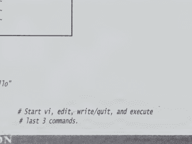


```
4  $ history
1 date
2 ls -l
3 echo "hello"
4 pwd

5  $ fc -3 -1    # Start vi, edit, write/quit, and execute
                  # last 3 commands.
```

# 解释

1 `FCEDIT`变量可以被赋值为系统上任何 UNIX/Linux 文本编辑器的路径名，例如`vi`、`emacs`等。如果未设置，则`vi`编辑器为默认值。

2 `pwd`命令在命令行输入。它将被放入历史文件中。

3 `fc`命令导致编辑器（在`FCEDIT`中设置）被调用，并将最后输入的命令放在编辑器窗口中。用户写入并退出编辑器后，编辑器中输入的任何命令都将被执行。

4 `history`命令列出最近输入的命令。

5 `fc`命令用于启动编辑器，并将历史文件中的最后三个命令放在编辑器的缓冲区中。

## 13.6 别名

别名是`bash`用户定义的命令缩写。如果命令有许多选项和参数或语法难以记住，别名很有用。在命令行设置的别名不会被子`shell`继承。别名通常设置在`.bashrc`文件中。因为`.bashrc`在启动新`shell`时执行，因此在其中设置的任何别名都将为新`shell`重置。别名也可以传递到`shell`脚本中，但除非在脚本中直接设置，否则会引起潜在的可移植性问题。

### 13.6.1 列出别名

`alias`内置命令列出所有已设置的别名。别名首先打印，其后是它所代表的真实命令或命令。

## 示例 13.37

```
$ alias
alias cow='compress'
alias cpe='cp -i'
alias mroe='more'
alias mv='mv -i'
alias ls='ls --color=tty'
alias uc='uncompress'
```

# 解释

`alias`命令列出命令的别名（昵称）和`=`号后别名所代表的真实命令。

### 13.6.2 创建别名

`alias`命令用于创建别名。第一个参数是别名的名称，即命令的昵称。行的其余部分由在执行别名时将被执行的命令或命令组成。`Bash`别名不能接受参数（参见第 841 页的“定义函数”）。多个命令由分号分隔，包含空格和元字符的命令用单引号括起来。

## 示例 13.38

```
1 $ alias m=more
2 $ alias mroe=more
3 $ alias lf='ls -alF'
4 $ alias r='fc -s'
```

# 解释

+   1. `more`命令的别名设置为`m`。

+   2. `more`命令的别名设置为`mroe`。如果拼写不好，这很有用。

+   3. 别名定义用引号括起来是因为存在空白。别名`lf`是命令`ls -alF`的昵称。

+   4. 别名`r`将被用作`fc -e`的替代，用于按指定模式从历史列表中召回命令；例如，`r vi`将重新执行历史列表中包含模式`vi`的最后一条命令。

## 13.6.3 删除别名

`unalias`命令用于删除别名。要临时关闭别名，请在别名名称前加上反斜杠。

## 示例 13.39

```
1  $ unalias mroe
2  $ \ls
```

# 解释

+   1. `unalias`命令从已定义的别名列表中删除别名`mroe`。

+   2. 别名`ls`在本次命令执行时被临时关闭。

## 13.7 操作目录栈

如果你在工作时发现自己在目录树中不断在许多相同的目录之间`cd`上下切换，你可以通过将它们推入目录栈并操作该栈来轻松访问这些目录。`pushd`内建命令将目录推入栈，`popd`命令将它们移除。 （参见示例 13.40。）栈是一个目录列表，左侧的目录是最近推入栈的目录。目录可以用内建的`dirs`命令列出。

### 13.7.1 dirs 内建命令

内建命令`dirs`，带`-l`选项时，会以完整路径名格式显示目录栈中的每个目录；不带选项时，`dirs`使用波浪线表示主目录。带`+n`选项时，`dirs`显示从目录列表左侧开始计数、从 0 开始的第`n`个目录条目。带`-n`选项时，它做同样的事情，但从目录列表右侧开始计数，0 为起点。

### 13.7.2 pushd 和 popd 命令

`pushd`命令带目录作为参数时，会将新目录添加到目录栈中，同时切换到该目录。如果参数是`+n`，其中`n`为数字，`pushd`会旋转栈，使从栈左侧起的第`n`个目录被推到栈顶。带`-n`选项时，它做同样的事情但从右侧开始。不带参数时，`pushd`交换目录栈的前两个元素，使在目录之间来回切换变得容易。

`popd`命令从栈顶移除一个目录，并切换到该目录。带`+n`，其中`n`为数字时，`popd`移除从`dirs`显示的列表左侧开始的第`n`个条目。

## 示例 13.40

```
1 $ pwd
/home/ellie
$ pushd ..
/home ~
$ pwd
/home
2 $ pushd    # Swap the two top directories on the stack
~/home
$ pwd
/home/ellie
3 $ pushd perlclass
~/perlclass ~/ /home
4 $ dirs
~/perlclass ~/ /home
5 $ dirs -l
/home/ellie/perlclass /home/ellie /home
6 $ popd
~/home
$ pwd
/home/ellie
7 $ popd
/home
$ pwd
/home
8 $ popd
bash: popd: Directory stack empty.
```

# 解释

1 首先`pwd`命令显示当前工作目录，`/home/ellie`。接下来`pushd`命令以`..`作为参数，将父目录`(..)`推入目录栈。`pushd`的输出表明`/home`在目录栈顶部（从显示列表的左侧开始），用户的家目录，用波浪线`(~)`表示，在栈底部。`pushd`还会切换到被推入栈的目录；即`..`，它转换为`/home`。第二个`pwd`命令显示了新目录。

2 不带参数的`pushd`命令交换栈上两个顶部的目录条目并切换到交换后的目录；在该示例中，目录切换回用户的主目录`/home/ellie`。

3 `pushd`命令会将其参数`~/perlclass`推入栈，并切换到该目录。

4 内建的`dirs`命令显示目录栈，顶层从列表左侧开始。波浪线扩展为用户的主目录。

5 带`-l`选项时，`dirs`列表以完整路径名而不是使用波浪线扩展显示目录栈。

6 `popd`命令从栈顶移除一个目录，并切换到该目录。

7 `popd`命令从栈顶移除另一个目录，并切换到该目录。

8 `popd`命令无法再移除任何目录条目，因为栈为空，并发出错误消息说明这一点。

## 13.8 元字符（通配符）

元字符是用于表示除其本身以外其他内容的特殊字符。`Shell`元字符称为通配符。表 13.10 列出了元字符及其作用。

## 表 13.10 元字符

| 元字符 | 含义 |
|---|---|
| `\` | 按字面解释下一个字符 |
| `&` | 在后台处理 |
| `:` | 分隔命令 |
| `$` | 替换变量 |
| `?` | 匹配单个字符 |

## 表 13.10 元字符（续）

| 元字符 | 含义 |
|---|---|
| `[abc]` | 匹配来自一组字符中的一个字符；例如，a、b 或 c |
| `[!abc]` | 匹配不来自该组字符的一个字符；例如，不是 a、b 或 c |
| `*` | 匹配零个或多个字符 |
| `(cmds)` | 在子`shell`中执行命令 |
| `{cmds}` | 在当前`shell`中执行命令 |

## 13.9 文件名替换（Globbing）

在评估命令行时，`shell`使用元字符来缩写匹配某一组字符的文件名或路径名。表 13.11 中列出的文件名替换元字符会扩展为按字母顺序排列的文件名集合。将元字符扩展为文件名的过程也称为文件名替换，或`globbing`。如果使用了元字符但没有匹配的文件名，`shell`会将元字符视为字面字符。

## 表 13.11 Shell 元字符和文件名替换

| 元字符 | 含义 |
|---|---|
| `*` | 匹配零个或多个字符 |
| `?` | 匹配恰好一个字符 |
| `[abc]` | 匹配集合 a、b 或 c 中的一个字符 |
| `[!abc]` | 匹配不在集合中的一个字符，不是 a、b 或 c |
| `{a,i le,ax}` | 匹配一个字符或一组字符 |
| `[a-z]` | 匹配从 a 到 z 范围内的一个字符 |
| `[!a-z]` | 匹配不在从 a 到 z 范围内的一个字符 |
| `\` | 转义或禁用元字符 |

### 13.9.1 星号

星号是一个通配符，匹配文件名中零个或多个任意字符。

## 示例 13.41


```text
1  $ ls *
abc abc1 abc122 abc123 abc2 file1 file1.bak file2 file2.bak none
nonsense nobody nothing nowhere one
2  $ ls *.bak
file1.bak file2.bak
3  $ echo a*
ab abc1 abc122 abc123 abc2
```

**解释**

- 1 星号扩展为当前工作目录中的所有文件。所有文件作为参数传递给`ls`并显示。
- 2 所有以零个或多个字符开头并以`.bak`结尾的文件都被匹配并列出。
- 3 所有以`a`开头，后跟零个或多个字符的文件都被匹配并作为参数传递给`echo`命令。

### 13.9.2 问号

问号代表文件名中的单个字符。当文件名包含一个或多个问号时，shell 通过用问号匹配的字符替换问号来执行文件名替换。

#### 示例 13.42

```text
1  $ ls
abc abc122 abc2 file1.bak file2.bak nonsense nothing one
abc1 abc123 file1 file2 none noone nowhere
2  $ ls a?c?
abc1 abc2
3  $ ls ??
ls: ??: No such file or directory
4  $ echo abc???
abc122 abc123
5  $ echo ??
??
```

**解释**

- 1 列出当前目录中的文件。
- 2 匹配并列出以`a`开头，后跟单个字符，后跟`c`和单个字符的文件名。
- 3 列出包含恰好两个字符的文件名，如果找到。因为没有两个字符的文件，问号被视为字面文件名。找不到此类文件，并打印错误消息。

**解释（续）**

- 4 以`abc`开头并后跟恰好三个字符的文件名会被扩展并由`echo`命令显示。
- 5 目录中没有包含恰好两个字符的文件。如果找不到匹配项，shell 会将问号视为字面问号。

### 13.9.3 方括号

方括号用于匹配包含一组字符或字符范围中的一个字符的文件名。

#### 示例 13.43

```text
1 $ ls
abc abc122 abc2 file1.bak file2.bak nonsense nothing
one abc1 abc123 file1 file2 none noone nowhere
2 $ ls abc[123]
abc1 abc2
3 $ ls abc[1-3]
abc1 abc2
4 $ ls [a-z][a-z][a-z]
abc one
5 $ ls [!f-z]???
abc1 abc2
6 $ ls abc12[23]
abc122 abc123
```

**解释**

- 1 列出当前工作目录中的所有文件。
- 2 匹配并列出包含四个字符的文件名，如果文件名以`abc`开头，后跟`1`、`2`或`3`。方括号中的集合只匹配一个字符。
- 3 匹配并列出包含四个字符的文件名，如果文件名以`abc`开头，后跟从`1`到`3`范围内的数字。
- 4 匹配并列出包含三个字符的文件名，如果文件名以`abc`开头并包含恰好三个小写字母字符。
- 5 列出包含四个字符的文件名，如果第一个字符不是`f`到`z`之间的字母`[!f-z]`，后跟任意三个字符，其中`?`代表单个字符。
- 6 如果文件名包含`abc12`后跟`2`或`3`，则列出文件。

### 13.9.4 大括号展开

花括号匹配逗号分隔的字符串列表中的任意一项。通常这些字符串是文件名。左花括号之前的任何字符称为前导（preamble），右花括号之后的任何字符称为后缀（postamble）。前导和后缀都是可选的。花括号内不能有未加引号的空白字符。

#### 示例 13.44

```text
1 $ ls
 a.c b.c abc ab3 ab4 ab5 file1 file2 file3 file4 file5 foo
 faa fumble
2 $ ls f{oo,aa,umble}
 foo faa fumble
3 $ ls a{[.c],b[3-5]}
 a.c ab3 ab4 ab5
4 $ mkdir /usr/local/src/{old,new,dist,bugs}
5 $ chown root /usr/ucb/{ex,edit} /usr/lib/{ex?.??s,how_ex}
6 $ echo fo{jo, um}:
 fo{jo, um}:
7 $ echo {mam,pap,ba}a
 mama papa baa
8 $ echo post{script,office,ure}
 postscript postoffice posture
```

**说明**

- 1 列出当前目录中的所有文件。
- 2 列出以`f`开头且后面跟着字符串`oo`、`aa`或`umble`的文件。花括号内的空格会导致错误消息`Missing }`。
- 3 列出以`a`开头且后面跟着`.c`、`c`，或`b3`、`b4`、`b5`的文件。（方括号可以在花括号内部使用。）
- 4 将在`/usr/local/src`中创建四个新目录：`old`、`new`、`dist`和`bugs`。
- 5 将`/usr/ucb`目录下的文件`ex`和`edit`以及`/usr/lib`目录下名为`ex`后跟一个字符、一个点以及至少一个字符的文件和名为`how_ex`的文件的所有者改为`root`。
- 6 如果花括号内有任何未加引号的空格，将不会进行大括号展开。
- 7 大括号展开不一定会导致文件名的扩展。在此示例中，后缀`a`被添加到花括号内的每个字符串之后，并在展开后回显输出。
- 8 前导是字符串`post`，后跟花括号内包含的逗号分隔列表。执行大括号展开后，显示生成的字符串。

### 13.9.5 转义元字符

要将元字符用作字面量字符，请使用反斜杠来防止元字符被解释。

#### 示例 13.45

```text
1  $ ls
   abc file1 youx
2  $ echo How are you?
   How are youx
3  $ echo How are you\?
   How are you?
4  $ echo When does this line \
   > ever end\?
   when does this line ever end?
```

**说明**

- 1 列出当前工作目录中的文件。（注意文件`youx`。）
- 2 shell 会对`?`执行文件名扩展。当前目录中任何以`y-o-u`开头且后面恰好跟一个字符的文件会被匹配并替换到字符串中。文件名`youx`将被替换到字符串中，结果显示为`How are youx`（这可能不是你想要的结果）。
- 3 通过在问号前加反斜杠，问号被转义，这意味着 shell 不会尝试将其解释为通配符。
- 4 换行符通过在其前面加反斜杠来转义。次提示符会一直显示，直到字符串以换行符终止。问号（`?`）被转义以保护它免受文件名扩展的影响。

### 13.9.6 波浪号与连字符展开

bash shell（从 C shell 引入）采用波浪号进行路径名扩展。单独的波浪号计算为用户主目录的完整路径名。当波浪号后跟用户名时，它会扩展为该用户的完整主目录路径。

当加号跟在波浪号后面时，`PWD`（当前工作目录）的值替换波浪号。波浪号后跟连字符会被替换为上一个工作目录；`OLDPWD` 也指上一个工作目录。

如果用双引号或单引号将波浪号括起来，波浪号将不会被扩展。

#### 示例 13.46

```text
1 $ echo ~
/home/jody/ellie
2 $ echo ~joe
/home/joe
3 $ echo ~+
/home/jody/ellie/perl
4 $ echo ~-
/home/jody/ellie/prac
5 $ echo $OLDPWD
/home/jody/ellie/prac
6 $ cd -
/home/jody/ellie/prac
```

**说明**

- 1 波浪号计算为用户主目录的完整路径名。
- 2 用户名前的波浪号计算为`joe`的主目录的完整路径名。
- 3 `~+` 记法计算为工作目录的完整路径名。
- 4 `~-` 记法计算为上一个工作目录。
- 5 `OLDPWD` 变量包含上一个工作目录。
- 6 连字符指上一个工作目录；`cd -` 会进入上一个工作目录并显示该目录。

### 13.9.7 控制通配符（Globbing）

如果设置了 bash 的`noglob`变量，或者给`set`命令加上`-f`选项，文件名替换（称为 globbing）将被关闭，这意味着所有元字符都表示它们本身；它们不会被用作通配符。这在用`grep`、`sed`或`awk`等程序搜索包含元字符的模式时很有用。如果未设置 globbing，则所有元字符都必须用反斜杠转义以关闭通配符解释。

内置的`shopt`命令（bash 版本 2.x）也支持控制 globbing 的选项。

#### 示例 13.47


```text
1 $ set noglob or set -f
2 $ print * ?? [] ~ $LOGNAME
* ?? [] /home/jody/ellie ellie
3 $ unset noglob or set +f
4 $ shopt -s dotglob # Only available in bash versions 2.x
5 $ echo *bash*
.bash_history .bash_logout .bash_profile .bashrc bashnote bashtest
```

### EXPLANATION

+ 1 `-f` 选项作为参数传递给 `set` 命令。它关闭了用于文件名扩展的通配符的特殊含义。

+ 2 文件名扩展元字符会原样显示，不做任何解释。请注意，波浪号和美元符号仍然会被扩展，因为它们不用于文件名扩展。

+ 3 如果 `noglob` 未设置或 `+f` 选项已设置，文件名元字符将被扩展。

+ 4 `shopt` 内置命令允许你为 shell 设置选项。`dotglob` 选项允许使用 globbing 元字符匹配文件名，即使它们以点开头。通常以点开头的文件是不可见的，在执行文件名扩展时不会被识别。

+ 5 由于第 4 行设置了 `dotglob` 选项，当使用通配符 `*` 进行文件名扩展时，以点开头的文件名也会被扩展，如果文件名包含模式 `bash`。

## 13.9.8 Extended Filename Globbing (bash 2.x)

源自 Korn shell 模式匹配，`bash` 2.x 已包含此扩展功能，允许使用正则表达式类型的语法（参见表 13.12）。除非通过 `shopt` 命令打开 `extglob` 选项，否则不会识别正则表达式运算符：

```
shopt -s extglob
```

### Table 13.12 Extended Pattern Matching

| Regular Expression | Meaning |
|---|---|
| `abc?(2\|9)1` | `?` 匹配括号内任意模式的零次或一次出现。垂直线代表 OR 条件；例如，2 或 9。匹配 `abc21`、`abc91` 或 `abc1`。 |
| `abc*([0-9])` | `*` 匹配括号内任意模式的零次或多次出现。匹配以 `abc` 开 followed by 零个或多个数字；例如，`abc`、`abc1234`、`abc3`、`abc2` 等。 |
| `abc+([0-9])` | `+` 匹配括号内任意模式的一次或多次出现。匹配以 `abc` 开 followed by 一个或多个数字；例如，`abc3`、`abc123` 等。 |
| `nob?(one\|ne)` | `?` 匹配括号内任意模式恰好一次出现。匹配 `noone` 或 `none`。 |
| `no!(thing\|where)` | `!` 匹配除括号内任意模式所匹配字符串之外的所有字符串。匹配 `no`、`nobody` 或 `noone`，但不匹配 `nothing` 或 `nowhere`。 |

### EXAMPLE 13.48

```
1  $ shopt -s extglob
```

```
2  $ ls
abc    abc122  f1  F3  nonsense  nothing  one
abc1   abc2    f2  none  noone     nowhere
```

```
3  $ ls abc?(1|2)
abc    abc1    abc2
```

```
4  $ ls abc{([1-5])}
abc    abc1    abc122  abc2
```

```
5  $ ls abc{([0-5])}
abc1   abc122  abc2
```

```
6  $ ls no@(thing|ne)
none    nothing
```

```
7  $ ls no!(thing)
none    nonsense  noone  nowhere
```

#### EXPLANATION

1. `shopt` 内置命令用于设置 `extglob`（扩展 globbing）选项，使 `bash` 能够识别扩展模式匹配字符。

2. 列出当前工作目录中的所有文件。

3. 匹配以 `abc` 开头并后跟零个字符或括号内两种模式之一的文件名。匹配 `abc`、`abc1` 或 `abc2`。

4. 匹配以 `abc` 开头并后跟零个或多个 1 到 5 之间的数字的文件名。匹配 `abc`、`abc1`、`abc122`、`abc123` 和 `abc2`。

5. 匹配以 `abc` 开头并后跟一个或多个 0 到 5 之间的数字的文件名。匹配 `abc1`、`abc122`、`abc123` 和 `abc2`。

6. 匹配以 `no` 开头并后跟 `thing` 或 `ne` 的文件名。匹配 `nothing` 或 `none`。

7. 匹配以 `no` 开头并后跟除 `thing` 之外的任何内容的文件名。匹配 `none`、`nonsense`、`noone` 和 `nowhere`。`!` 表示 NOT。

## 13.10 Variables

### 13.10.1 Types of Variables

有两种类型的变量：局部变量和环境变量。局部变量仅对创建它们的 shell 可知。环境变量可供从创建它们的 shell 生成的任何子进程使用。一些变量由用户创建，其他则是特殊的 shell 变量。

### 13.10.2 Naming Conventions

变量名必须以字母或下划线字符开头。其余字符可以是字母、十进制数字（0 到 9）或下划线字符。任何其他字符都会标记变量名的结束。名称区分大小写。在为变量赋值时，不要在等号周围包含任何空白。要将变量设为空，请在等号后跟一个换行符。创建局部变量的最简单格式是以以下格式为变量赋值。

#### FORMAT

```
variable=value
```

### EXAMPLE 13.49

```
name=Tommy
```

### 13.10.3 The declare Built-In

有两个内置命令，`declare` 和 `typeset`，用于创建变量，并带有控制变量设置方式的选项。`typeset` 命令（来自 Korn shell）与 `declare` 命令（`bash`）完全相同。`bash` 文档说，“`typeset` 命令是为了与 Korn shell 兼容而提供的；然而，它已被弃用，取而代之的是 `declare` 内置命令。”8 因此从现在开始我们将使用 `declare` 内置命令（尽管我们同样可以轻松选择使用 `typeset`）。

不带参数时，`declare` 列出所有已设置的变量。通常只读变量不能被重新赋值或取消设置。如果使用 `declare` 创建只读变量，则它们不能被取消设置，但可以被重新赋值。整数类型变量也可以使用 `declare` 进行赋值。

#### 13.10 变量

```
declare variable=value
```

```
declare name=Tommy
```

**表 13.13** `declare` 选项

| 选项 | 含义 |
|---|---|
| `-a` | 将变量视为数组（即赋值元素） |
| `-f` | 列出函数名和定义 |
| `-fa` | 仅列出函数名 |
| `-i` | 使变量成为整数类型 |
| `-r` | 使变量为只读 |
| `-x` | 将名称导出到子shell |

a. `-a` 和 `-F` 仅在 `bash` 2.x 版本中实现。

### 13.10.4 局部变量与作用域

变量的作用域指的是变量在程序中的可见范围。对于 shell 而言，局部变量的作用域限定于创建该变量的 shell 中。

赋值时，等号周围不能有空白字符。要将变量设置为 null，等号后面需要跟随换行符。⁹

在变量前面使用美元符号可以提取存储在该变量中的值。

`local` 函数可用于创建局部变量，但只能用于函数内部。（参见第 841 页的“定义函数”。）

**设置局部变量。** 可以通过简单地将值赋给变量名来设置局部变量，或者使用 `declare` 内建函数，如示例 13.51 所示。

9. 通过 `set` 命令可以显示已设置为某个值或 `null` 的变量，但未设置的变量不会显示。

### 示例 13.51

```
1 $ round=world or declare round=world
$ echo $round
world
2 $ name="Peter Piper"
$ echo $name
Peter Piper
3 $ x=
$ echo $x
4 $ file_bak="$HOME/junk"
bash: file_bak=/home/jody/ellie/junk: not found
```

#### 说明

1. 局部变量 `round` 被赋值为 `world`。当 shell 遇到变量名前的美元符号时，会执行变量替换。显示变量的值。（不要将提示符 `$` 与用于变量替换的 `$` 混淆。）

2. 局部变量 `name` 被赋值为 `"Peter Piper"`。引号用于隐藏空白，这样 shell 在解析命令行时不会将字符串拆分为多个单词。显示变量的值。

3. 局部变量 `x` 未被赋值。它将被赋值为 `null`。显示 `null` 值，即空字符串。


### 4 变量名中的句点是非法的。变量名中允许的字符只有数字、字母和下划线。`shell`会尝试将该字符串作为命令执行。

## 示例 13.52

```
1 $ echo $$
1313
2 $ round=world
$ echo $round
world
3 $ bash        # Start a subshell
4 $ echo $$
1326
5 $ echo $round
6 $ exit        # Exits this shell, returns to parent shell
7 $ echo $$
1313
8 $ echo $round
world
```

# 说明

+   1 双美元符号变量的值求值为当前 `shell` 的 `PID`。此 `shell` 的 `PID` 为 1313。
+   2 局部变量 `round` 被赋值为字符串 `world`，并显示变量的值。
+   3 启动一个新的 `bash` `shell`。这称为子 `shell` 或子进程 `shell`。
+   4 此 `shell` 的 `PID` 为 1326。父 `shell` 的 `PID` 为 1313。
+   5 局部变量 `round` 未在此 `shell` 中定义。打印一个空行。
+   6 `exit` 命令终止此 `shell` 并返回到父 `shell`。`Ctrl-D` 也会退出此 `shell`。
+   7 父 `shell` 返回。显示其 `PID`。
+   8 显示变量 `round` 的值。它在此 `shell` 中是局部的。

设置只读变量。只读变量是一种特殊变量，不能被重新定义或取消设置。但是，如果使用 `declare` 函数，只读变量可以重新定义，但不能取消设置。

## 示例 13.53

```
1 $ name=Tom
2 $ readonly name
$ echo $name
Tom

3 $ unset name
bash: unset: name: cannot unset: readonly variable
4 $ name=Joe
bash: name: readonly variable

5 $ declare -r city='Santa Clara'
6 $ unset city
bash: unset: city: cannot unset: readonly variable

7 $ declare city='San Francisco'  # what happened here?
$ echo $city
San Francisco
```

# 说明

+   1 局部变量 `name` 被赋值为 `Tom`。
+   2 该变量被设为只读。
+   3 只读变量不能被取消设置。
+   4 只读变量不能被重新定义。

### EXPLANATION (CONTINUED)

- 5. `declare` 内建命令将只读变量 `city` 分配值为 `Santa Clara`。分配包含空白字符的字符串时需要引号。
- 6. 由于它是只读的，变量无法被 `unset`。
- 7. 当使用 `declare` 命令创建只读变量时，它无法被 `unset`，但可以被重新赋值。

### 13.10.5 环境变量

环境变量可供创建它们的 `shell` 以及从该 `shell` 启动的任何子 `shell` 或进程使用。它们通常被称为全局变量，以区别于局部变量。按照惯例，环境变量使用大写。环境变量是使用 `export` 内建命令导出的变量。

创建变量的 `shell` 称为父 `shell`。如果从父 `shell` 启动新的 `shell`，则称为子 `shell`。环境变量会传递给从创建环境变量的 `shell` 启动的任何子进程。它们从父级传递到子级再到孙级，依此类推，但不会反向传递——子进程可以创建环境变量，但不能将其传回父进程，只能传给其子进程。其中一些环境变量，如 `HOME`、`LOGNAME`、`PATH` 和 `SHELL`，是在登录前由 `/bin/login` 程序设置的。通常，环境变量在用户主目录中的 `.bash_profile` 文件中定义和存储。有关环境变量的列表，请参阅表 13.14。

> 10. 与 DNA 一样，继承只能朝一个方向进行：从父级到子级。

**Table 13.14 bash Environment Variables**

| Variable Name | Meaning |
|---|---|
| `_` (underscore) | 上一个命令的最后一个参数。 |
| `BASH` | 展开为用于调用此 `bash` 实例的完整路径名。 |
| `BASH_ENV` | 与 `ENV` 相同，但仅在 `bash` 中设置。ᵃ |
| `BASH_VERSINFO` | 有关此版本 `bash` 的版本信息。ᵃ |
| `BASH_VERSION` | 展开为此 `bash` 实例的版本号。 |
| `CDPATH` | `cd` 命令的搜索路径。这是一个由冒号分隔的目录列表，`shell` 在其中查找 `cd` 命令指定的目标目录。示例值为 `../:/usr`。 |
| `COLUMNS` | 如果设置，则定义 `shell` 编辑模式和 `select` 命令的编辑窗口宽度。 |
| `DIRSTACK` | `bash` 的目录堆栈当前内容。ᵃ |
| `EDITOR` | 内建编辑器的路径名：`emacs`、`gmacs` 或 `vi`。 |
| `ENV` | 每次启动新的 `bash` `shell` 时，包括脚本时都会执行的环境文件。通常分配给此变量的文件名为 `.bashrc`。`ENV` 的值在被解释为路径名之前会进行参数扩展、命令替换和算术扩展。 |
| `EUID` | 展开为当前用户的有效用户 ID，在 `shell` 启动时初始化。 |
| `FCEDIT` | `fc` 命令的默认编辑器名称。 |
| `FIGNORE` | 执行文件名补全时要忽略的后缀的冒号分隔列表。文件名后缀与 `FIGNORE` 中的条目匹配的文件名将从匹配文件名列表中排除。示例值为 `.o:-` |
| `FORMAT` | 用于格式化命令管道上 `time` 保留字输出。 |
| `GLOBIGNORE` | 在文件名扩展（称为 `globbing`）期间将被忽略的文件列表。ᵃ |
| `GROUPS` | 当前用户所属的组数组。ᵃ |
| `HISTCMD` | 当前命令在历史记录中的历史编号或索引。如果 `HISTCMD` 被 `unset`，则即使随后被重置，也会失去其特殊属性。 |
| `HISTCONTROL` | 如果设置为 `ignorespace`，则以空格字符开头的行不会进入历史记录列表。如果设置为 `ignoredups`，则与上一条历史记录行匹配的行不会进入。如果设置为 `ignoreboth`，则组合两个选项。如果未设置，或设置为上述值之外的任何值，则解析器读取的所有行都会保存在历史记录列表中。 |
| `HISTFILE` | 指定存储命令历史的文件。默认值是 `~/.bash_history`。如果未设置，交互式 `shell` 退出时命令历史不会保存。 |
| `HISTFILESIZE` | 历史文件中包含的最大行数。当为此变量分配值时，历史文件如有必要将被截断，以不超过该行数。默认值是 500。 |
| `HISTSIZE` | 命令历史中记住的命令数。默认值是 500。 |
| `HOME` | 主目录；`cd` 未指定目录时使用。 |
| `HOSTFILE` | 包含与 `/etc/hosts` 格式相同的文件名，当 `shell` 需要补全主机名时应读取该文件。文件可以交互更改；下次尝试主机名补全时，`bash` 会将新文件的内容添加到已有的数据库中。 |

## 表13.14 bash环境变量（续）

| 变量名 | 含义 |
|---|---|
| `HOSTTYPE` | 自动设置为 `bash` 正在执行的机器类型。默认值取决于系统。 |
| `IFS` | 内部字段分隔符，通常为空格、制表符和换行符，用于对命令替换、循环结构中的列表以及读取输入所产生的单词进行字段拆分。 |
| `IGNOREEOF` | 控制 `shell` 在收到 `EOF` 字符作为唯一输入时的行为。如果设置了该变量，其值为 `bash` 退出前，在输入行开头连续输入的 `EOF` 字符数。如果该变量存在但没有数值，或没有值，则默认值为 10。如果该变量不存在，则 `EOF` 表示 `shell` 输入的结束。此设置仅对交互式 `shell` 有效。 |
| `INPUTRC` | `readline` 启动文件的文件名，覆盖默认的 `~/.inputrc`。 |
| `LANG` | 用于确定未以 `LC_` 开头的变量专门选择的任何类别的区域设置。 |
| `LC_ALL` | 覆盖 `LANG` 及任何其他 `LC_` 变量的值。ᵃ |
| `LC_COLLATE` | 确定路径名扩展结果排序时使用的排序规则，以及匹配路径名和模式时范围表达式、等价类和排序序列的行为。ᵃ |
| `LC_MESSAGES` | 确定用于翻译前面带有 `$` 的双引号字符串的区域设置。ᵃ |
| `LINENO` | 每次引用该参数时，`shell` 会用一个十进制数字替换，该数字表示脚本或函数中当前的连续行号（从 1 开始）。 |
| `MACHTYPE` | 包含一个描述 `bash` 正在执行的系统的字符串。ᵃ |
| `MAIL` | 如果该参数设置为邮件文件的名称且未设置 `MAILPATH` 参数，则 `shell` 会通知用户指定文件中邮件的到达。 |


| `MAIL_WARNING` | 如果设置了该变量，并且bash检查的邮件文件自上次检查以来被访问过，则会打印消息“The mail in [存储邮件的文件名] has been read”。 |
| `MAILCHECK` | 该参数指定shell检查`MAILPATH`或`MAIL`参数指定的文件中邮件到达的时间间隔（以秒为单位）。默认值为600秒（10分钟）。如果设置为零，shell将在发出每个主提示符之前进行检查。 |
| `MAILPATH` | 冒号分隔的文件名列表。如果设置了该参数，shell会通知用户任何指定文件中邮件的到达。每个文件名后可以跟一个?和一条消息，当修改时间改变时会打印该消息。默认消息为“You have mail”。 |
| `OLDPWD` | 上一个工作目录。 |
| `OPTARG` | 由`getopts`内置命令处理的最后一个选项参数的值。 |
| `OPTERR` | 如果设置为1，则显示`getopts`内置命令的错误消息。 |
| `OPTIND` | 下一个要由`getopts`内置命令处理的参数的索引。 |
| `OSTYPE` | 自动设置为描述bash正在执行的操作系统的字符串。默认值取决于系统。 |
| `PATH` | 命令的搜索路径。它是shell查找命令的冒号分隔目录列表。默认路径取决于系统，由安装bash的管理员设置。常见值为`/usr/gnu/bin:/usr/local/bin:/usr/ucb/bin:/usr/bin:`。 |
| `PIPESTATUS` | 一个数组，包含管道中最近执行的前台作业中各进程的退出状态值列表。 |
| `PPID` | 父进程的进程ID。 |
| `PROMPT_COMMAND` | 分配给此变量的命令在主提示符显示之前执行。 |
| `PS1` | 主提示符字符串，默认为`$`。 |
| `PS2` | 次提示符字符串，默认为`>`。 |
| `PS3` | 与`select`命令一起使用的选择提示符字符串，默认为`#?` |
| `PS4` | 启用跟踪时使用的调试提示符字符串，默认为`+`。可以使用`set -x`启用跟踪。 |
| `PWD` | 当前工作目录；由`cd`设置。 |
| `RANDOM` | 每次引用该参数时，都会生成一个随机整数。可以通过给`RANDOM`赋值来初始化随机数序列。如果`RANDOM`被取消设置，它将失去其特殊属性，即使随后重新设置也是如此。 |
| `REPLY` | 当`read`未提供参数时设置。 |
| `SECONDS` | 每次引用`SECONDS`时，返回自shell调用以来的秒数。如果给`SECONDS`赋值，则后续引用返回的值是自赋值以来的秒数加上所赋的值。如果`SECONDS`被取消设置，它将失去其特殊属性，即使随后重新设置也是如此。 |

## 表13.14 bash环境变量（续）

| 变量名 | 含义 |
|---|---|
| `SHELL` | 当shell被调用时，它会扫描环境中是否有此名称。shell会为`PATH`、`PS1`、`PS2`、`MAILCHECK`和`IFS`提供默认值。`HOME`和`MAIL`由`login(1)`设置。 |
| `SHELLOPTS` | 包含已启用的shell选项列表，如`braceexpand`、`hashall`、`monitor`等。 |
| `SHLVL` | 每次启动一个bash实例时，该值增加1。 |
| `TMOUT` | 指定退出前等待输入的秒数。 |
| `UID` | 展开为当前用户的用户ID，在shell启动时初始化。 |

a. 在bash 2.x之前的版本中不可用。

## 设置环境变量

要设置环境变量，可以在赋值后或变量设置时使用`export`命令。（参见表13.15。）使用带`-x`选项的内置`declare`命令也可以实现同样的效果。（导出变量时不要在变量前加`$`。）

### 格式

```
export variable=value
variable=value; export variable
declare -x variable=value
```

### 示例13.34

```
export NAME=john
PS1='\d\W\$USER\$ ' ; export PS1
declare -x TERM=sun
```

## 表13.15 export命令及其选项

| 选项 | 值 |
|---|---|
| `--` | 标记选项处理结束；其余参数被视为参数。 |
| `-f` | 名称-值对被视为函数而不是变量。 |
| `-n` | 将全局（已导出）变量转换为局部变量。该变量将不会导出到子进程。 |
| `-p` | 显示所有全局变量。 |

### 示例13.13

```
1 $ export TERM=sun    # or declare -x TERM=sun
2 $ NAME="John Smith"
$ export NAME
$ echo $NAME
John Smith
3 $ echo $$
319                 # pid number for parent shell
4 $ bash             # Start a subshell
5 $ echo $$
340                 # pid number for new shell
6 $ echo $NAME
John Smith
7 $ declare -x NAME="April Jenner"
$ echo $NAME
April Jenner
8 $ exit              # Exit the subshell and go back to parent shell
9 $ echo $$
319                 # pid number for parent shell
10 $ echo $NAME
John Smith
```

### 说明

1 `TERM`变量被赋值为`sun`。该变量同时被导出。现在，从此shell启动的进程将继承该变量。你可以使用`declare -x`来做同样的事情。

2 定义变量`NAME`并导出，以便从该shell启动的子shell可以使用它。

3 输出此shell的PID值。

4 启动一个新的bash shell。新shell称为子shell。原始shell是其父shell。

5 新bash shell的PID存储在`$$`变量中，并回显其值。

6 在父shell中设置的变量已导出到此新shell并显示出来。

7 内置`declare`函数是设置变量的另一种方式。使用`-x`开关，`declare`会将变量标记为导出。变量被重置为`April Jenner`。它会导出到所有子shell，但不会影响父shell。导出的值不会向上传播到父shell。

8 退出此bash子shell。

9 再次显示父shell的PID。

10 变量`NAME`包含其原始值。当从父shell导出到子shell时，变量会保留其值。子shell无法更改父shell中变量的值。

## 13.10.6 取消变量的设置

局部变量和环境变量都可以使用`unset`命令取消设置，除非这些变量被设置为只读。

### 示例13.56

```
unset name; unset TERM
```

### 说明

`unset`命令将变量从shell的内存中移除。

## 13.10.7 打印变量的值

`echo`命令。内置的`echo`命令将其参数打印到标准输出。带`-e`选项的`echo`允许使用许多控制输出外观的转义序列。表13.16列出了`echo`选项和转义序列。

## 表13.16 echo选项和转义序列

| 选项 | 含义 |
|---|---|
| `-e` | 允许解释下面所示的转义序列 |
| `-E` | 即使在某些默认解释这些转义字符的系统上，也禁用对这些转义字符的解释ᵃ |
| `-n` | 抑制输出行末尾的换行符 |

**转义序列**

| `\a` | 警报（响铃）ᵃ |
| `\b` | 退格 |
| `\c` | 打印该行而不带换行符 |
| `\f` | 换页 |
| `\n` | 换行 |
| `\r` | 回车 |
| `\t` | 制表符 |
| `\v` | 垂直制表符 |
| `\\` | 反斜杠 |
| `\nnn` | ASCII码为nnn（八进制）的字符 |

a. 在bash 2.x之前的版本中不可用。

使用转义序列时，别忘了使用 `-e` 开关！

## EXAMPLE 13.57

```
1  $ echo The username is $LOGNAME.
    The username is ellie.

2  $ echo -e "\t\tHello there\c"
    Hello there$

3  $ echo -n "Hello there"
    Hello there$
```

### EXPLANATION

- 1 `echo` 命令会将参数打印到屏幕上。变量替换在 `echo` 命令执行前由 shell 完成。
- 2 带 `-e` 选项的 `echo` 命令支持与 C 编程语言类似的转义序列。`$` 是 shell 提示符。
- 3 当 `-n` 选项打开时，行会不带换行符打印。此版本的 `echo` 不支持转义序列。

## The printf Command.


GNU 版的 `printf`¹¹ 可用于格式化打印输出。它以与 C 语言 `printf` 函数相同的方式打印格式化字符串。格式由一个可能包含格式化指令的字符串组成，用来描述打印输出的外观。格式化指令以 `%` 开头，后跟限定符（`d` `i` `o` `u` `x` `X` `f` `e` `g` `G` `s`），其中 `%f` 代表浮点数，`%d` 代表整数。

要查看 `printf` 限定符的完整列表及用法，请在命令行提示符下输入 `printf --help`。要查看你使用的 `printf` 的版本，请输入 `printf --version`。如果使用 `bash` 2.x，内置的 `printf` 命令使用与 `/usr/bin` 中的可执行版本相同的格式。

### FORMAT

```
printf format [argument...]
```

### EXAMPLE 13.58

```
printf "%10.2f\n" 10.5 25
```

### Table 13.17 Format Specifiers for the printf Command

| Format Specifier | Value |
|---|---|
| \" | Double quote |
| \0NNN | An octal character where NNN represents 0 to 3 digits |
| \\ | Backslash |
| \a | Alert or beep |
| \b | Backspace |
| \c | Produce no further output |
| \f | Form feed |
| \n | Newline |
| \r | Return |
| \t | Horizontal tab |
| \v | Vertical tab |
| \xNNN | Hexadecimal character, where NNN is 1 to 3 digits |
| %% | A single % |
| %b | Argument as a string with \ escapes interpreted |

### EXAMPLE 13.59

```
1 $ printf --version
printf (GNU sh-utils) 1.16
```

```
2 $ type printf
printf is a shell builtin
```

```
3 $ printf "The number is %.2f\n" 100
The number is 100.00
```

```
4 $ printf "%-20s%-15s%.2f\n" "Jody" "Savage" 28
Jody          Savage                28.00
```

```
5 $ printf "|%-20s|%-15s|%10.2f|\n" "Jody" "Savage" 28
Jody                |Savage       |     28.00|
```

```
6 $ printf "%s's average was %.1f%%.\n" "Jody" $(( (80+70+90)/3 ))
Jody's average was 80.0%.
```

### EXPLANATION

- 1 打印了 GNU 版的 `printf` 命令。
- 2 如果使用 `bash` 2.x，`printf` 是一个内置命令。
- 3 参数 `100` 被打印为浮点数，小数点右边只有 2 位，由格式字符串中的规格说明 `%.2f` 指定。与 C 不同，参数之间没有逗号分隔。
- 4 格式字符串指定将进行三次转换：第一个是 `%-20s`（左对齐、20 字符的字符串），下一个是 `%-15s`（左对齐、15 字符的字符串），最后一个是 `%10.2f`（右对齐、10 字符的浮点数，其中一个字符是小数点，最后两个字符是小数点右边的两位数字）。每个参数按对应的 `%` 标志顺序格式化，因此字符串 `Jody` 对应第一个 `%`，字符串 `Savage` 对应第二个 `%`，数字 `28` 对应最后一个 `%` 标志。
- 5 这一行与第 4 行相同，只是添加了垂直线以演示字符串的左对齐和右对齐。
- 6 `printf` 命令格式化字符串 `Jody` 并格式化算术扩展的结果。参见第 837 页的“算术扩展”。需要两个百分号（`%`）来打印一个百分号（`%`）。

### 13.10.8 Variable Expansion Modifiers (Parameter Expansion)

变量可通过使用特殊修饰符进行测试和修改。修饰符提供了一个快捷的条件测试，用于检查变量是否已设置，然后根据测试结果为变量分配值。有关变量修饰符的列表，请参阅表 13.18。

### Table 13.18 Variable Modifiers

| Modifier | Value |
|---|---|
| `${variable:-word}` | If `variable` is set and is non-null, substitute its value; otherwise, substitute `word`. |
| `${variable:=word}` | If `variable` is set or is non-null, substitute its value; otherwise, set it to `word`. The value of `variable` is substituted permanently. Positional parameters may not be assigned in this way. |
| `${variable:+word}` | If `variable` is set and is non-null, substitute `word`; otherwise, substitute nothing. |
| `${variable:?word}` | If `variable` is set and is non-null, substitute its value; otherwise, print `word` and exit from the shell. If `word` is omitted, the message parameter null or not set is printed. |
| `${variable:offset}` | Gets the substring of the value in `variable` starting at `offset`, where `offset` starts at 0 to the end of the string.ᵃ |

### 表 13.18 变量修饰符（续）

| Modifier | Value |
|---|---|
| `${variable:offset:length}` | Gets the substring of the value in `variable` starting at `offset`, `length` characters over. |

a. Not available on `bash` versions prior to 2.0.

Using the colon with any of the modifiers (-, +, ?, ) checks whether the variable is not set or is null; without the colon, a variable set to null is considered to be set.

### EXAMPLE 13.60

(Substitute Temporary Default Values)

```
1 $ fruit=peach
2 $ echo ${fruit:-plum}
   peach
3 $ echo ${newfruit:-apple}
   apple
4 $ echo $newfruit
5 $ echo $EDITOR   # More realistic example
6 $ echo ${EDITOR:-/bin/vi}
   /bin/vi
7 $ echo $EDITOR
8 $ name=
   $ echo ${name-Joe}
9 $ echo ${name:-Joe}
   Joe
```

### EXPLANATION

- 1 The variable `fruit` is assigned the value `peach`.
- 2 The special modifier will check to see if the variable `fruit` has been set. If it has, the value is printed; if not, `plum` is substituted for `fruit` and its value is printed.
- 3 The variable `newfruit` has not been set. The value `apple` will be temporarily substituted for `newfruit`.


- 4 The setting was only temporary. The variable `newfruit` is not set.

- 5 The environment variable `EDITOR` has not been set.

- 6 The `:-` modifier substitutes `EDITOR` with `/bin/vi`.

- 7 The `EDITOR` was never set. Nothing prints.

- 8 The variable name is set to null. By not prefixing the modifier with a colon, the variable is considered to be set, even if to null, and the new value `Joe` is not assigned to `name`.

- 9 The colon causes the modifier to check that a variable is either not set or is set to null. In either case, the value `Joe` will be substituted for `name`.

## EXAMPLE 13.61

(Substitute Permanent Default Values)

```
1  $ name=
2  $ echo ${name:=Peter}
   Peter
3  $ echo $name
   Peter
4  $ echo ${EDITOR:=/bin/vi}
   /bin/vi
5  $ echo $EDITOR
   /bin/vi
```

### EXPLANATION

- 1. The variable `name` is assigned the null value.

- 2. The special modifier `:=` will check to see if the variable `name` has been set. If it has been set, it will not be changed; if it is either null or not set, it will be assigned the value to the right of the equal sign. `Peter` is assigned to `name` because the variable is set to null. The setting is permanent.

- 3. The variable `name` still contains the value `Peter`.

- 4. The value of the variable `EDITOR` is set to `/bin/vi`.

- 5. The value of the variable `EDITOR` is displayed.

## EXAMPLE 13.62

(Substitute Temporary Alternate Value)

```
1  $ foo=grapes
2  $ echo ${foo:-pears}
   pears
3  $ echo $foo
   grapes
```

### EXPLANATION

- 1. The variable `foo` has been assigned the value `grapes`.

- 2. The special modifier `:-` will check to see if the variable has been set. If it has been set, `pears` will temporarily be substituted for `foo`; if not, null is returned.

- 3. The variable `foo` now has its original value.

## EXAMPLE 13.63

(Creating Error Messages Based On Default Values)

```
1  $ echo ${namex:?'namex is undefined'}
   namex: namex is undefined
2  $ echo $y?
   y: parameter null or not set
```

### EXPLANATION

- 1. The `:?` modifier will check to see if the variable has been set. If not, the string to the right of the `?` is printed to standard error, after the name of the variable. If in a script, the script exits.

- 2. If a message is not provided after the `?`, the shell sends a default message to standard error.

## EXAMPLE 13.64

(Creating Substring)

```
1  $ var=notebook
2  $ echo ${var:0:4}
   note
3  $ echo ${var:4:4}
   book
4  $ echo ${var:0:2}
   no
```

a. Not available in versions of bash prior to 2.x.

### EXPLANATION

- 1. The variable is assigned the value, `notebook`.

- 2. The substring of `var` starts at offset 0, the `n` in `notebook`, and has a length of 4 characters, ending at the `e`.

- 3. The substring of `var` starts at offset 4, the `b` in `notebook`, and has a length of 4 characters, ending at the `k`.

- 4. The substring of `var` starts at offset 0, the `n` in `notebook`, and has a length of 2 characters, ending at the `o`.

# 13.10.9 子字符串变量展开

模式匹配参数用于从字符串的前端或后端剥离某些部分。 这些操作符最常见的用途是从路径的头部或尾部剥离路径名元素。 请参阅表 13.19。

## 表 13.19 变量展开子字符串ᵃ

| 表达式 | 功能 |
|---|---|
| `${variable%pattern}` | 匹配变量值的最小尾部部分与 `pattern`，并将其移除。 |
| `${variable%%pattern}` | 匹配变量值的最大尾部部分与 `pattern`，并将其移除。 |
| `${variable#pattern}` | 匹配变量值的最小头部部分与 `pattern`，并将其移除。 |
| `${variable##pattern}` | 匹配变量值的最大头部部分与 `pattern`，并将其移除。 |
| `${#variable}` | 替换为变量中的字符数。 如果为 `*` 或 `@`，长度为位置参数的数量。 |

a 在 bash 2.x 之前的版本中不可用。

## 示例 13.65

```
1 $ pathnames="/usr/bin/local/bin"
2 $ echo ${pathnames%/*bin}
/usr/bin/local
```

# 解释

- 1 本地变量 `pathname` 被赋值为 `/usr/bin/local/bin`。

- 2 `%` 移除 `pathname` 中包含模式 `/bin` 后跟零个或多个字符的最小尾部部分；也就是说，它剥离了 `/bin`。

## 示例 13.66

```
1 $ pathnames="usr/bin/local/bin"
2 $ echo ${pathname%%/*bin}
/usr
```

# 解释

## 示例 13.67

```
1  $ pathname=/home/1111input/jake/.bashrc
2  $ echo ${pathname#/home}
   /1111input/jake/.bashrc
```

# 解释

- 1  本地变量 `pathname` 被赋值为 `/home/1111input/jake/.bashrc`。

- 2  `#` 移除 `pathname` 中包含模式 `/home` 的最小头部部分；也就是说，`/home` 从路径变量的开头被剥离。

## 示例 13.68

```
1  $ pathname=/home/1111input/jake/.bashrc
2  $ echo ${pathname##/}
   .bashrc
```


# 解释

1. 本地变量 `pathname` 被赋值为 `/home/1111input/jake/.bashrc`。
2. `##` 移除 `pathname` 中包含零个或多个字符直到且包括最后一个斜杠的最大头部部分；也就是说，它从路径变量中剥离 `/home/1111input/jake`。

## 示例 13.69

```sh
1  $ name="Ebenezer Scrooge"
2  $ echo ${#name}
   16
```

### 解释

1. 变量 `name` 被赋值为字符串 `Ebenezer Scrooge`。
2. `${#variable}` 语法显示分配给变量 `name` 的字符串中的字符数。`Ebenezer Scrooge` 中有 16 个字符。

# 13.10.10 位置参数

通常，特殊内置变量，通常称为位置参数，在 shell 脚本中用于从命令行传递参数时使用，或在函数中用于保存传递给函数参数的值。这些变量称为位置参数，因为它们按数字 1、2、3 等引用，表示它们在参数列表中的各自位置。请参阅表 13.20。

shell 脚本的名称存储在 `$0` 变量中。位置参数可以用 `set` 命令设置、重置和取消设置。

## 表 13.20 位置参数

| 表达式 | 功能 |
|---|---|
| `$0` | 引用当前 shell 脚本的名称 |
| `$1-$9` | 位置参数 1-9 |
| `${10}` | 位置参数 10 |
| `$#` | 计算为位置参数的数量 |
| `$@` | 计算为所有位置参数 |
| `$*` | 与 `$@` 相同，除了在双引号中时 |
| `"$*"` | 计算为 `"$1 $2 $3"`，等等 |
| `"$@"` | 计算为 `"$1" "$2" "$3"`，等等 |

## 示例 13.70

```sh
1  $ set punky tommy bert jody
     $ echo $@        # Prints all the positional parameters
     punky tommy bert jody
2  $ echo $1          # Prints the first position
     punky
3  $ echo $2 $3       # Prints the second and third position
     tommy bert
4  $ echo $#          # Prints the total number of positional parameters
     4
5  $ set a b c d e f g h i j k l m
     $ print $10       # Prints the first positional parameter followed by a 0
     a0
     $ echo ${10} ${11}  # Prints the 10th and 11th positions
     j k
6  $ echo $*
     13
7  $ echo $*
     a b c d e f g h i j k l m
8  $ set file1 file2 file3
     $ echo \$$#
     $3
9  $ eval echo \$$#
     file3
10 $ set --           # Unsets all positional parameters
```

### 解释

1. `set` 命令为位置参数赋值。`$*` 特殊变量包含所有已设置的参数。
2. 显示第一个位置参数 `punky` 的值。
3. 显示第二个和第三个参数 `tommy` 和 `bert` 的值。
4. `$#` 特殊变量包含当前已设置的位置参数的数量。
5. `set` 命令重置所有位置参数。原始参数列表被清空。要打印超过 9 的位置参数，请使用大括号将两位数字保持在一起。否则，将打印第一个位置参数的值，后跟附加到它的数字。
6. 位置参数的数量现在为 13。
7. 打印所有位置参数的值。
8. 美元符号被转义；`$#` 是参数的数量。`echo` 命令显示 `$3`，即字面上的美元符号后跟位置参数的数量。
9. `eval` 命令在执行命令之前第二次解析命令行。第一次由 shell 解析时，`print` 会显示 `$3`；第二次，经过 `eval` 后，`print` 显示 `$3` 的值，`file3`。
10. 带 `--` 选项的 `set` 命令清除或取消设置所有位置参数。

# 13.10.11 其他特殊变量

shell 具有由单个字符组成的特殊变量。在字符前加上美元符号即可访问变量中存储的值。参见表 13.21。

## 表 13.21 特殊变量

| Variable | Meaning |
|---|---|
| `$` | The PID of the shell |
| `-` | The `sh` options currently set |
| `?` | The exit value of last executed command |
| `!` | The PID of the last job put in the background |

## 示例 13.71

```sh
1  $ echo The pid of this shell is $$
   The pid of this shell is 4725
2  $ echo The options for this shell are $-
   The options for this shell are inh
```

## 表 13.22 需要引用的特殊元字符（续）

| Metacharacter | Meaning |
|---|---|
| `newline` | Command termination |
| `space/tab` | Word delimiter |
| `$` | Variable substitution character |
| `* [ ] ?` | Shell metacharacters for filename expansion |

单引号和双引号必须匹配。单引号可保护诸如 `$`、`&`、`?`、`|`、`>` 和 `<` 等特殊元字符不被解释。双引号也保护特殊元字符不被解释，但允许变量和命令替换字符（美元符号和反引号）被处理。单引号会保护双引号，双引号会保护单引号。

与 `Bourne shell` 不同，`bash` 会尝试告知你引号不匹配的情况。如果交互运行，当引号不匹配时会出现二级提示；如果在 shell 脚本中，文件会被扫描，如果引号未匹配，shell 会尝试用下一个可用的引号进行匹配。如果 shell 无法用下一个可用的引号匹配它，程序会中止，并在终端上显示消息 `bash:unexpected EOF while looking for ""`。即使是最好的 shell 程序员，引号也可能是一个真正的麻烦！

# 13.11.1 反斜杠

反斜杠用于引用（或转义）单个字符，使其不被解释。如果反斜杠放在单引号中，则不被解释。如果反斜杠被双引号包围，它会保护美元符号（`$`）、反引号（`` ` ``）和反斜杠本身不被解释。

## 示例 13.72

```sh
1  $ echo where are you going?\n
   where are you going?
2  $ echo Start on this line and \
>  go to the next line.
   Start on this line and go to the next line.
3  $ echo \\
\
4  $ echo '\'
\\
5  $ echo '\$5.00'
\$5.00
```

## 示例 13.72（续）

```sh
$ echo "$$5.00"

$ echo 'Don'''t you need $5.00?'
Don't you need .00?
```

1. 反斜杠阻止 shell 对问号执行文件名替换。
2. 反斜杠转义换行符，使下一行成为此行的一部分。
3. 由于反斜杠本身是特殊字符，它阻止其后的反斜杠被解释。
4. 当反斜杠被单引号包围时，不会被解释。
5. 单引号中的所有字符都被视为字面量。这里反斜杠没有任何作用。
6. 当被双引号包围时，反斜杠阻止美元符号被解释为变量替换。
7. 反斜杠在单引号内不被解释；因此，shell 看到三个单引号（字符串末尾的那个未匹配）。二级提示出现，等待闭合单引号。当 shell 最终得到闭合引号时，它会去掉所有引号并将字符串传递给 `echo` 命令。由于前两个引号已匹配，其余字符串 `you need $5.00` 不在任何引号内。shell 尝试计算 `$5`；它是空的，`.00` 被打印。

# 13.11.2 单引号

单引号必须匹配。它们保护所有元字符不被解释。要打印单引号，必须将其用双引号括起来或用反斜杠转义。

```sh
$ echo 'hi there'
> how are you?
```


> When will this end?
> When the quote is matched
> oh'

```

```

oh'

```

## 示例 13.73（续）

```

hi there

how are you?

When will this end?

When the quote is matched

oh

```

```

2 $ echo Don\'t you need '$5.00'?
Don\'t you need $5.00?

```

```

3 $ echo 'Mother yelled, "Time to eat!"'
Mother yelled, "Time to eat!"

```

# 说明

- 1 这一行中单引号没有匹配。`bash` shell 产生一个二级提示符，正在等待引号匹配。
- 2 单引号保护所有元字符不被解释。`Don\'t` 中的撇号用反斜杠转义（反斜杠保护单个字符，而不是字符串）。否则，它会与 `$` 前面的单引号匹配，那么字符串末尾的单引号就没有配对。`$` 和 `?` 被一对单引号括起来，保护它们不被 shell 解释，从而将它们视为字面量。
- 3 单引号保护此字符串中的双引号。

## 13.11.3 双引号

双引号必须成对匹配，允许变量替换和命令替换，并保护其他任何特殊元字符不被 shell 解释。

## 示例 13.74

```

1 $ name=Jody

```

```

2 $ echo "Hi $name, I'm glad to meet you!"
Hi Jody, I'm glad to meet you!

```

```

3 $ echo "Hey $name, the time is $(date)"
Hey Jody, the time is Wed Jul 14 14:04:11 PST 2004

```

# 说明

- 1 变量 `name` 被赋值为字符串 `Jody`。
- 2 字符串两侧的双引号保护所有特殊元字符不被解释，但 `$name` 中的 `$` 除外。变量替换在双引号内执行。
- 3 变量替换和命令替换都在双引号内执行。变量 `name` 被展开，括号中的命令 `date` 被执行。（参见下一节“命令替换”。）

## 13.12 命令替换

命令替换用于将命令的输出赋值给变量，或在字符串中替换命令的输出。所有 shell 都使用反引号执行命令替换。¹² `Bash` 允许两种形式：旧形式是将命令放在反引号中；新的 Korn 风格形式是将命令放在前面带美元符号的一组括号内。

`Bash` 通过执行命令并返回命令的标准输出（删除所有尾随换行符）来进行展开。当使用旧式反引号替换形式时，反斜杠保留其字面含义，除非后面跟有 `$`、` 或 `\`。使用 `$(command)` 形式时，括号之间的所有字符构成命令；没有任何字符被特殊处理。

命令替换可以嵌套。使用旧形式嵌套时，内部反引号必须用反斜杠转义。

# 格式

```

`UNIX command`  # Old method with backquotes

```

```

$(UNIX command)  # New method

```

## 示例 13.73

（旧方法）

- 1. `$ echo "The hour is `date +%H`"`
  `The hour is 09`
- 2. `$ name=`awk -F: '{print $1}' database``
  `$ echo $name`
  `Ebenezer Scrooge`
- 3. `$ ls `ls /etc``
  `shutdown`
- 4. `$ set `date``
  `$ echo $*`
  `Wed Jul 14 09:35:21 PDT 2004`
- 5. `$ echo $2 $6`
  `Jul 2004`
- 6. `$ echo `basename \`pwd\``` 
  `ellie`

# 说明

- 1. `date` 命令的输出被替换到字符串中。
- 2. `awk` 命令的输出被赋值给变量 `name` 并显示。

# 说明（续）

3 用反引号括起来的 `ls` 命令输出是来自 `/etc` 目录的文件列表。这些文件名将作为第一个 `ls` 命令的参数。当前目录中与 `/etc` 中同名的所有文件都会被列出。（此目录中不匹配的文件会产生错误消息，例如 `ls: temicaps: No such file or directory`。）

4 `set` 命令将 `date` 命令的输出赋值给位置参数。空白将单词列表分隔为各自的参数。

5 `$*` 变量包含所有参数。`date` 命令的输出存储在 `$*` 变量中。每个参数由空白分隔。

6 打印第二个和第六个参数。

7 要将变量 `dirname` 设置为当前工作目录的名称（仅名称），需要嵌套命令替换。首先执行 `pwd` 命令，将当前工作目录的完整路径名作为参数传递给 UNIX 命令 `basename`。`basename` 命令会去掉路径名中除最后一个元素之外的所有部分。在反引号内嵌套命令时，内部命令的反引号必须用反斜杠转义。

`Bash` 中用于命令替换的反引号的替代形式如下面的示例 13.76 所示。

## 示例 13.76

（新方法）

```

1 $ d=$(date)
$ echo $d
Wed Jul 14 09:35:21 PDT 2004

```

```

2 $ lines = $(cat filex)
$ echo The time is $(date +%H)
The time is 09

```

```

4 $ machine=$(uname -n)
$ echo $machine
jody

```

```

5 $ pwd
/usr/local/bin
$ dirname="$(basename $(pwd))"   # Nesting commands
$ echo $dirname
bin

```

```

6 $ echo $(cal)
# Newlines are lost
July 2004 S M Tu W Th F S 1 2 3 4 5 6 7 8 9 10 11 12 13 14 15
16 17 18 19 20 21 22 23 24 25 26 27 28 29 30 31

```

## 示例 13.76（续）

```

7 $ echo "$(cal)"
     2004年7月
日 一 二 三 四 五 六
             1  2  3
 4  5  6  7  8  9 10
11 12 13 14 15 16 17
18 19 20 21 22 23 24
25 26 27 28 29 30 31

```

# 说明

- 1. `date` 命令被括在圆括号内。该命令的输出被替换到表达式中，然后赋值给变量 `d`，并显示出来。
- 2. `cat` 命令的输出被赋值给变量 `lines`。
- 3. `date` 命令同样被括在圆括号内。`date +%H` 的输出（当前小时）被替换到表达式中，并回显到屏幕。
- 4. 变量 `machine` 被赋值为 `uname -n` 的输出，即主机名。`machine` 变量的值被回显到屏幕。
- 5. `pwd` 命令（当前工作目录）的输出为 `/usr/local/bin`。变量 `dirname` 被赋值为命令替换的输出，其中命令替换是嵌套的。`$(pwd)` 是第一个要执行的命令替换。`pwd` 命令的输出被替换到表达式中，然后 `basename` 程序将使用该替换的结果 `/usr/local/bin` 作为其参数，得到 `basename /usr/local/bin`。
- 6. `cal`（当前月份）命令的输出被回显。执行命令替换时，末尾的换行符会被删除。
- 7. 当把整个命令替换表达式放在双引号中时，末尾的换行符会被保留，日历看起来就正常了。

## 13.13 算术展开

Shell 通过计算算术表达式并替换结果来执行算术展开。该表达式被视为位于双引号中，并且表达式可以嵌套。有关算术运算和算术求值的完整讨论，请参阅第 662 页的“算术运算符与 let 命令”。

计算算术表达式有两种格式：

# 格式

```

$[ expression ]
$(( expression ))

```

### 示例 13.77

```

echo $[ 5 + 4 - 2 ]
7
echo $[ 5 + 3 * 2 ]
11
echo $[(5 + 3) * 2]
16
echo $(( 5 + 4 ))
9
echo $(( 5 / 0 ))
bash: 5/0: division by 0 (error token is "0")
```


## 13.14 展开顺序

当执行变量、命令、算术表达式和路径名的展开时，Shell 在扫描命令行时会按照特定顺序进行。假设变量未被引用，处理按以下顺序执行：

- 1. 花括号展开
- 2. 波浪号展开
- 3. 参数展开
- 4. 变量替换
- 5. 命令替换
- 6. 算术展开
- 7. 单词拆分
- 8. 路径名展开

## 13.15 数组

`bash` 2.x 版本支持创建一维数组。数组允许你将一个单词列表收集到一个变量名中，例如数字列表、名称列表或文件列表。数组可以使用内置函数 `declare -a` 创建，也可以通过为变量名指定下标来动态创建，例如 `x[0]=5`。索引值是从 0 开始的整数。数组没有最大大小限制，并且索引不一定是连续的数字，例如 `x[0]`、`x[1]`、`x[2]` 等。要提取数组的元素，语法为 `${arrayname[index]}`。如果 `declare` 使用了 `-a` 和 `-r` 选项，则会创建只读数组。

### 格式

```
declare -a variable_name

variable=( item1 item2 item3 ... )
```

### 示例 13.78

```
declare -a nums=(45 33 100 65)

declare -ar names  # 数组为只读

names=( Tom Dick Harry )

states=( ME [3]=CA CT )

x[0]=55

n[4]=100
```

为数组赋值时，元素会自动从索引 0 开始，每增加一个元素，索引递增 1。在赋值时可以不提供索引，如果提供索引，也不要求按顺序排列。要取消数组，使用 `unset` 命令后跟数组名；要取消数组中的某个元素，使用 `unset` 后跟 `arrayname[subscript]` 语法。

`declare`、`local` 和 `readonly` 内置命令也可以使用 `-a` 选项来声明数组。`read` 命令搭配 `-a` 选项用于从标准输入读取单词列表到数组元素中。

### 示例 13.79

```
1 $ declare -a friends

2 $ friends=(Sheryl Peter Louise)

3 $ echo ${friends[0]}

Sheryl

4 $ echo ${friends[1]}

Peter

5 $ echo ${friends[2]}

Louise

6 $ echo "All the friends are ${friends[*]}"

All the friends are Sheryl Peter Louise

7 $ echo "The number of elements in the array is ${#friends[*]}"

The number of elements in the array is 3

8 $ unset friends  # 或 unset ${friends[*]}
```

### 说明

- 1. 使用 `declare` 内置命令显式声明数组，但这不是必需的。任何使用下标的变量（如 `variable[0]`）在被赋值时，都会自动被视为数组。
- 2. 数组 `friends` 被赋值为一个值列表：Sheryl、Peter 和 Louise。

### EXPLANATION (CONTINUED)

3. 通过将数组名及其下标用大括号括起来，并使用 0 作为下标的值，可以访问 `friends` 数组的第一个元素。Sheryl 被打印出来。
4. 通过使用索引值 1 来访问 `friends` 数组的第二个元素。
5. 通过使用索引值 2 来访问 `friends` 数组的第三个元素。
6. 当你在下标中放置星号时，可以访问数组的所有元素。这行代码显示了 `friends` 数组中的所有元素。
7. 语法 `${#friends[*]}` 生成数组的大小（即数组中元素的数量）。另一方面，`${#friends[0]}` 生成数组第一个元素的值中的字符数。Sheryl 中有六个字符。
8. `unset` 内置命令会删除整个数组。只需输入 `unset friends[0]` 即可删除数组的一个元素；这将删除 Sheryl。

### EXAMPLE 13.80

```
1 $ x[3]=100

$ echo ${x[*]}

100

2 $ echo ${x[0]}

3 $ echo ${x[3]}

100

4 $ states=(ME [3]=CA [2]=CT)

$ echo ${states[*]}

ME CA CT

5 $ echo ${states[0]}

ME

6 $ echo ${states[1]}

7 $ echo ${states[2]}

CT

8 $ echo ${states[3]}

CA
```

### EXPLANATION

1. 数组 `x` 的元素 `x[3]` 被赋值为 100。索引号是 3 并不重要，但由于前两个元素尚不存在，因此数组的大小只有 1。`${x[*]}` 显示数组 `x` 的一个元素。
2. `x[0]` 没有值，`x[1]` 和 `x[2]` 也是如此。
3. `x[3]` 的值为 100。
4. `states` 数组被赋值为索引 0 处的 ME、索引 3 处的 CA 和索引 2 处的 CT。在此示例中，你可以看到 `bash` 不关心你在哪个索引处存储值，并且索引号不必连续。
5. 打印 `states` 数组的第一个元素。
6. `states[1]` 中没有存储任何内容。
7. `states` 数组的第三个元素 `states[2]` 被赋值为 CT。
8. `states` 数组的第四个元素 `states[3]` 被赋值为 CA。

## 13.16 Functions

Bash 函数用于在当前 shell 的上下文中以名称执行一组命令（不会 fork 子进程）。它们类似于脚本，只是更高效。一旦定义，函数就成为 shell 内存的一部分，因此当调用函数时，shell 不必像处理文件那样从磁盘读取它。函数通常用于提高脚本的模块化。一旦定义，函数可以反复使用。虽然函数可以在交互运行时在提示符下定义，但它们通常定义在用户的初始化文件 `.bash_profile` 中。它们必须在被调用之前定义。

### 13.16.1 Defining Functions

声明 bash 函数有两种方法。一种方法是旧的 Bourne shell 方法，即给出函数名，后跟一组空括号，然后是函数定义。另一种新方法（Korn shell 方法）是使用 `function` 关键字，后跟函数名，然后是函数定义。如果使用新方法，括号是可选的。函数定义用大括号括起来。它由用分号分隔的命令组成。最后一个命令以分号结尾。大括号周围需要有空格。传递给函数的任何参数在函数内部都被视为位置参数。函数中的位置参数是函数本地的。`local` 内置命令允许在函数定义内创建局部变量。函数也可以是递归的；也就是说，它们可以无限次地调用自身。

### FORMAT

```
function_name () { commands ; commands; }

function function_name { commands ; commands; }

function function_name () { commands ; commands; }
```

### EXAMPLE 13.81

```
3 $ greet () { echo "Hello $LOGNAME, today is $(date)"; }

4 $ greet

Hello ellie, today is Wed Jul 14 15:16:22 PDT 2004

5 $ declare -f

declare -f greet()

{

    echo "Hello $LOGNAME, today is $(date)"

}

6 $ declare -F

declare -f greet

7 $ export -f greet

8 $ bash        # Start subshell

9 $ greet

Hello ellie, today is Wed Jul 14 17:59:24 PDT 2004
```


a. 仅在 `bash` 版本 `2.x` 上。

### EXPLANATION

1. 关键字 `function` 后跟函数名 `greet`。函数定义由大括号包围。必须在大括号后留一个空格。同一行上的语句以分号结尾。
2. 当调用 `greet` 函数时，大括号内括起来的命令在当前 `shell` 的上下文中执行。
3. `greet` 函数再次使用 Bourne shell 语法定义，即函数名，后跟一组空括号，然后是函数定义。
4. `greet` 函数再次被调用。
5. 带 `-f` 开关的 `declare` 命令列出此 `shell` 中定义的所有函数及其定义。
6. 带 `-F` 开关的 `declare` 命令仅列出函数名。
7. 带 `-f` 开关的 `export` 命令使函数变为全局（即对子 `shell` 可用）。
8. 启动一个新的 `bash` `shell`。
9. 该函数对这个子 `shell` 是已定义的，因为它已被导出。

### EXAMPLE 13.82

```
1 $ function fun {

    echo "The current working directory is $PWD."

    echo "Here is a list of your files:"

    ls

    echo "Today is $(date +%A).";

}
```

# 示例 13.82（续）

```
2 $ fun

The current working directory is /home.

Here is a list of your files:

abc abc123 file1.bak none nothing tmp

abc1 abc2 file2 nonsense nowhere touch

abc122 file1 file2.bak noone one

Today is Wednesday.
```

```
3 $ function welcome { echo "Hi $1 and $2"; }
```

```
4 $ welcome tom joe

Hi tom and joe
```

```
5 $ set jane anna lizzy
```

```
6 $ echo $*

jane anna lizzy
```

```
7 $ welcome johan joe

hi johan and joe
```

```
8 $ echo $1 $2

johan joe
```

```
9 $ unset -f welcome   # unsets the function
```

# 说明

1 `fun` 函数被命名并定义。关键字 `function` 后跟函数的名称和用大括号括起来的命令列表。命令列在单独的行上；如果它们列在同一行，则必须用分号分隔。第一个大括号后需要一个空格，否则会得到语法错误。函数必须在被使用之前定义。

2 函数在被调用时表现得就像一个脚本。函数定义中的每个命令都会依次执行。

3 函数 `welcome` 中使用了两个位置参数。当向函数提供参数时，位置参数会被赋予这些值。

4 函数的参数 `tom` 和 `joe` 分别被赋给 `$1` 和 `$2`。函数中的位置参数是私有的，不会干扰函数外部使用的参数。

5 位置参数在命令行上设置。这些变量与函数中设置的不相关。

6 `$*` 显示当前设置的位置参数的值。

7 调用函数 `welcome`。位置参数被赋予的值为 `johan` 和 `joe`。

8 在命令行上分配的位置变量不受函数中设置的影响。

9 带 `-f` 开关的 `unset` 内建命令取消设置函数。它不再被定义。

## 13.16.2 列出和取消设置函数

要列出函数及其定义，请使用 `declare` 命令。在 `bash` `2.x` 及以上版本中，`declare -f` 只列出函数名称。函数及其定义将出现在输出中，以及导出的和本地变量。函数及其定义使用 `unset -f` 命令取消设置。

## 13.17 标准 I/O 和重定向

当 `shell` 启动时，它会继承三个文件：`stdin`、`stdout` 和 `stderr`。标准输入通常来自键盘。标准输出和标准错误通常发送到屏幕。有时你想从文件读取输入或将输出或错误发送到文件。这可以通过使用 I/O 重定向来实现。有关重定向操作符的列表，请参阅表 13.23。

## 表 13.23 重定向

| 重定向操作符 | 其作用 |
|---|---|
| < filename | 重定向输入 |
| > filename | 重定向输出 |
| >> filename | 追加输出 |
| 2> filename | 重定向错误 |
| 2>> filename | 重定向并追加错误 |
| &> filename | 重定向输出和错误 |
| >& filename | 重定向输出和错误（推荐方式） |
| 2>&1 | 将错误重定向到输出所去的位置 |
| 1>&2 | 将输出重定向到错误所去的位置 |
| >| | 重定向输出时覆盖 noclobber |
| <> filename | 如果是设备文件（来自 /dev），则将文件用作标准输入和输出 |

# 示例 13.83

```
1 $ tr '[A-Z]' '[a-z]' < myfile   # Redirect input

2 $ ls > lsfile                  # Redirect output

$ cat lsfile

dir1

dir2

file1

file2

file3
```

# 示例 13.83（续）

```
3 $ date >> lsfile      # Redirect and append output

$ cat lsfile

dir1

dir2

file1

file2

file3

Sun Sept 17 12:57:22 PDT 2004
```

```
4 $ cc prog.c 2> errfile      # Redirect error
```

```
5 $ find . -name \*.c -print > foundit 2> /dev/null

# Redirect output to foundit and errors to /dev/null,

# respectively.
```

```
6 $ find . -name \*.c -print > & foundit

# Redirect both output and errors to foundit.
```

```
7 $ find . -name \*.c -print > foundit 2>&1

# Redirect output to foundit and send errors to where output

# is going; i.e. foundit
```

```
8 $ echo "File needs an argument" 1>&2

# Send standard output to error
```


## 说明

1. 不是从键盘获取输入，标准输入从文件 `myfile` 重定向到 UNIX/Linux `tr` 命令。所有大写字母都被转换为小写。
2. 不是将输出发送到屏幕，`ls` 命令将其输出重定向到文件 `lsfile`。
3. `date` 命令的输出被重定向并追加到 `lsfile`。
4. C 程序源文件 `prog.c` 被编译。如果编译失败，标准错误会被重定向到文件 `errfile`。现在你可以把错误文件带给本地专家去解释（某种程度上）！
5. `find` 命令从当前工作目录开始搜索以 `.c` 结尾的文件名，并将文件名打印到名为 `foundit` 的文件。`find` 命令的错误被发送到 `/dev/null`。
6. `find` 命令从当前工作目录开始搜索以 `.c` 结尾的文件名，并将文件名打印到名为 `foundit` 的文件。错误也发送到 `foundit`。
7. 与 6 相同。
8. `echo` 命令将其消息发送到标准错误。其标准输出与标准错误合并。

## 13.17.1 `exec` 命令和重定向

`exec` 命令可用于用新程序替换当前程序，而无需启动新进程。标准输出或输入可通过 `exec` 命令更改，而无需创建子 shell。（参见表 13.24。）如果使用 `exec` 打开文件，后续的读命令将使文件指针每次向下移动一行，直到文件末尾。必须关闭文件才能重新从开头读取。然而，如果使用 `cat` 和 `sort` 等 UNIX 工具，操作系统会在每个命令完成后关闭文件。

### 表 13.24 `exec` 命令

| 命令 | 其作用 |
| --- | --- |
| `exec ls` | `ls` 在 shell 位置执行。当 `ls` 完成后，启动它的 shell 不会返回。 |
| `exec < filea` | 打开 `filea` 以供标准输入读取。 |
| `exec > filex` | 打开 `filex` 以供标准输出写入。 |
| `exec 3< datfile` | 打开 `datfile` 作为文件描述符 3 以供输入读取。 |
| `sort <&3` | `datfile` 被排序。 |
| `exec 4>newfile` | 打开 `newfile` 作为文件描述符 (fd) 4 以供写入。 |
| `ls >&4` | `ls` 的输出被重定向到 `newfile`。 |
| `exec 5>&4` | 使 fd 5 成为 fd 4 的副本。 |
| `exec 3<&-` | 关闭 fd 3。 |

### 示例 13.84

```text
1 $ exec date

Thu Oct 14 10:07:34 PDT 2004

<login prompt appears if you are in your login shell>

2 $ exec > temp

$ ls

$ pwd

$ echo Hello

3 $ exec > /dev/tty

4 $ echo Hello

Hello
```

#### 解释

- 1 `exec` 命令在当前 shell 中执行 `date` 命令（不 fork 子 shell）。由于 `date` 命令是在当前 shell 的位置执行，当 `date` 命令退出时，shell 终止。如果是从 TC shell 启动的 `bash` shell，`bash` shell 将退出并出现 TC shell 提示符。如果你在登录 shell 中尝试此操作，你将被注销。如果你正在交互式 shell 窗口中工作，窗口将退出。
- 2 `exec` 命令为当前 shell 打开标准输出到 `temp` 文件。`ls`、`pwd` 和 `echo` 的输出将不再显示在屏幕上，而是写入 `temp`。（参见图 13.2。）
- 3 `exec` 命令重新打开标准输出到终端。现在，输出将显示在屏幕上，如第 4 行所示。
- 4 标准输出已重新定向回终端（`/dev/tty`）。

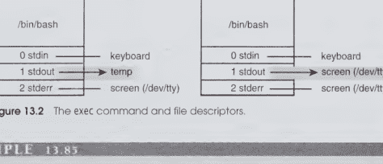

### 示例 13.85

```text
1 > bash

2 $ cat doit

pwd

echo hello

date

3 $ exec < doit

/home/homebound/ellie/shell

hello

Thu Oct 14 10:07:34 PDT 2004

4 >
```

#### 解释

- 1 从 TC shell 提示符启动 `bash`。（这样做是为了当 `exec` 命令退出时，用户不会被注销。）
- 2 显示名为 `doit` 的文件的内容。
- 3 `exec` 命令将标准输入打开到名为 `doit` 的文件。输入从文件而不是键盘读取。文件 `doit` 中的命令在当前 shell 的位置执行。当最后一个命令退出时，shell 也退出。
- 4 `bash` shell 在 `exec` 命令完成后退出。TC shell 提示符出现。它是父 shell。如果你是在登录 shell 中等待 `exec` 完成，你将被注销；如果在窗口中，窗口将消失。

### 示例 13.86

```text
1 $ exec 3> filex

2 $ who >&3

3 $ date >&3

4 $ exec 3<&-

5 $ exec 3<filex

6 $ cat <&3

   ellie    tty1   Jul 21 09:50

   ellie    ttyv0  Jul 21 11:16  (:0.0)

   ellie    ttyv0  Jul 21 16:49  (:0.0)

   Wed Jul 21 17:15:18 PDT 2004

7 $ exec 3<&-

8 $ date >&3

date: write error: Bad file descriptor
```

## 13.18 管道

管道将管道符号左侧命令的输出取出并发送到管道符号右侧命令的输入。管道线可以包含一个以上的管道。

示例 13.87 中命令的目的是统计登录人数（`who`），将命令的输出保存到文件（`tmp`），使用 `wc -l` 命令统计 `tmp` 文件中的行数（`wc -l`），然后删除 `tmp` 文件（即找出登录人数）。

### 示例 13.87

```text
1 $ who > tmp

2 $ wc -l tmp

4 tmp

3 $ rm tmp

# Using a pipe saves disk space and time.

4 $ who | wc -l

4

5 $ du .. | sort -n | sed -n '5p'

1980 ..

6 $ ( du / | sort -n | sed -n '5p' ) 2> /dev/null

1057747 /
```

#### 解释

1. `who` 命令的输出被重定向到 `tmp` 文件。
2. `wc -l` 命令显示 `tmp` 中的行数。

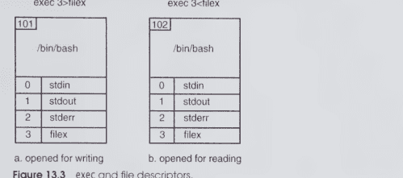

图 13.3 `exec` 和文件描述符。

#### 解释（续）

3. 临时文件被删除。
4. 使用管道设施，可以将前面三个步骤合并为一步执行。`who` 命令的输出被发送到一个匿名内核缓冲区；`wc -l` 命令从缓冲区读取并将输出发送到屏幕。参见图 13.4。
5. `du` 命令的输出，即从父目录（`..`）开始每个目录使用的磁盘块数，被管道传输到 `sort` 命令并按数值排序。然后再管道传输到 `sed` 命令，后者打印其接收到的输出的最后一行。参见图 13.5。
6. `du` 命令（从根目录开始）在因权限关闭而无法进入目录时，会将错误消息发送到 `stderr`（屏幕）。当你将整个命令行放在一组括号中时，所有输出都会发送到屏幕，而所有错误都会被定向到 UNIX/Linux 位桶 `/dev/null`。

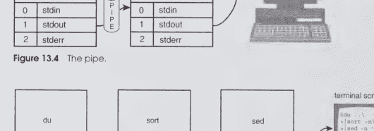

图 13.4 管道。

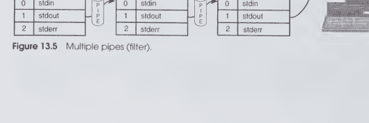

图 13.5 多个管道（过滤器）。

## 13.18.1 Here 文档和重定向输入

Here 文档是一种特殊的引用形式。它接受内联文本作为期望输入的程序的输入，例如 `mail`、`sort` 或 `cat`，直到达到用户定义的终止符。它常用于 shell 脚本中创建菜单。接收输入的命令后加上 `<<` 符号，后跟用户定义的词或符号，以及换行符。下一行文本将是发送给命令的输入行。当用户定义的词或符号单独放在一行最左列时，输入即终止（它前后不能有空格）。该词用作 Ctrl-D 来停止程序读取输入。

如果终止符前面是 `<<-` 运算符，则允许在最终终止符前加上前导制表符，且仅限于制表符。用户定义的终止词或符号必须从“here”到“here”完全匹配。以下示例说明了在命令行中使用 here 文档来演示语法。将其用于脚本中更为实用。

### 示例 13.88

```text
1 $ cat << FINISH          # FINISH is a user-defined terminator

2 > Hello there $LOGNAME

3 > The time is $(date +%T).
```


4 > I can't wait to see you!!!

5 > FINISH                 # terminator matches first

Hello there ellie          # FINISH on line 1.

The time is 19:42:12.

I can't wait to see you!!!

6 $

```
### EXPLANATION

1. UNIX/Linux `cat` 程序将接受输入，直到单词 `FINISH` 单独出现在一行。
2. 出现二级提示符。以下文本是 `cat` 命令的输入。Here 文档中会执行变量替换。
3. Here 文档中会执行命令替换，`$(date +%T)`。也可以使用旧的命令替换形式：`` `date +%T` ``。
4. 用户定义的终止符 `FINISH` 标记 `cat` 程序输入的结束。它前后不能有任何空格，且单独占一行。
5. `cat` 程序的输出被显示。
6. Shell 提示符重新出现。

### EXAMPLE 13.89

```
1  $ cat <<- DONE

> Hello there

> What's up?

> Bye now. The time is `date`.

2  > DONE

Hello there

What's up?

Bye now. The time is Sun Feb 8 19:48:23 PST 2004.

$
```

### EXPLANATION

1. `cat` 程序接受输入，直到 `DONE` 单独出现在一行。`<<-` 运算符允许输入和最终终止符前面加上一个或多个制表符。在命令行输入此示例可能会导致 Tab 键出现问题；如果从脚本运行，示例将正常工作。
2. 最终匹配的终止符 `DONE` 前面有一个制表符。`cat` 程序的输出显示在屏幕上。

## 13.19 Shell 调用选项

当使用 `bash` 命令启动 shell 时，它可以接受选项来修改其行为。选项有两种类型：单字符选项和多字符选项。单字符选项由一个前导连字符后跟单个字符组成。多字符选项由两个前导连字符和任意数量的字符组成。多字符选项必须出现在单字符选项之前。交互式登录 shell 通常以 `-i`（启动交互式 shell）、`-s`（从标准输入读取）和 `-m`（启用作业控制）启动。参见表 13.25。

### Table 13.25 Bash 2.x Shell Invocation Options

| Option | Meaning |
|---|---|
| `-c string` | 命令从 `string` 中读取。`string` 后的任何参数都分配给位置参数，从 `$0` 开始。 |
| `-D` | 以 `$` 开头的双引号字符串列表会被打印到标准输出。这些字符串在当前区域设置不是 C 或 POSIX 时会进行语言翻译。 |
| `-i` | Shell 处于交互模式。TERM、QUIT 和 INTERRUPT 被忽略。 |
| `-s` | 命令从标准输入读取，并允许设置位置参数。 |

## 表 13.25 Bash 2.x Shell 调用选项（续）

| 选项 | 含义 |
|---|---|
| `-r` | 启动受限 shell。 |
| `--` | 表示选项结束并禁用后续选项处理。`--` 或 `-` 之后的任何参数都被视为文件名和参数。 |
| `--dump-strings` | 与 `-0` 相同。 |
| `--help` | 显示内置命令的使用信息并退出。 |
| `--login` | 使 `bash` 作为登录 shell 被调用。 |
| `--noediting` | 当 `bash` 以交互方式运行时，不使用 Readline 库。 |
| `--noprofile` | 启动时，`bash` 不读取初始化文件：`/etc/profile`、`~/.bash_profile`、`~/.bash_login` 或 `~/.profile`。 |
| `--norc` | 对于交互式 shell，`bash` 不会读取 `~/.bashrc` 文件。如果作为 `sh` 运行 shell，则默认启用。 |
| `--posix` | 如果 `bash` 的行为不符合 POSIX 1003.2 标准，则更改其行为以匹配该标准。 |
| `--quiet` | 在 shell 启动时不显示任何信息，这是默认行为。 |
| `--rcfile file` | 如果 `bash` 是交互式的，则使用此初始化文件而不是 `~/.bashrc`。 |
| `--restricted` | 启动受限 shell。 |
| `--verbose` | 打开详细模式；与 `-v` 相同 |
| `--version` | 显示此 `bash` shell 的版本信息并退出。 |

## 13.19.1 set 命令与选项

`set` 命令可用于打开和关闭 shell 选项，也可用于处理命令行参数。要打开某个选项，在选项前加上短横线（`-`）；要关闭某个选项，在选项前加上加号（`+`）。有关 `set` 选项的列表，请参见表 13.26。

## 示例 13.90

```
1  $ set -f

2  $ echo *

   a

3  $ echo ??

   ??

4  $ set +f
```


# 说明

- 1. 打开 `f` 选项，禁用文件名扩展。
- 2. 星号不会被扩展。
- 3. 问号不会被扩展。
- 4. 关闭 `f` 选项，启用文件名扩展。

## 表 13.26 内建 set 命令选项

| 选项名称 | 快捷开关 | 作用 |
|---|---|---|
| `allexport` | `-a` | 从设置该选项开始直到取消设置，自动将新的或修改过的变量标记为用于导出。 |
| `braceexpand` | `-B` | 启用花括号扩展，这是默认设置。 |
| `emacs` |  | 对于命令行编辑，使用 `emacs` 内置编辑器，这是默认设置。 |
| `errexit` | `-e` | 如果命令返回非零退出状态（失败），则退出。读取初始化文件时不设置。 |
| `histexpand` | `-H` | 在执行历史替换时启用 `!` 和 `!!`，这是默认设置。 |
| `history` |  | 启用命令行历史；默认开启。 |
| `ignoreeof` |  | 禁止 EOF（Ctrl-D）退出 shell；必须输入 `exit`。相当于设置 shell 变量 `IGNOREEOF=10`。 |
| `keyword` | `-k` | 将关键字参数放入命令的环境中。 |
| `interactive_comments` |  | 对于交互式 shell，行首的 `#` 用于注释掉该行剩余的任何文本。 |
| `monitor` | `-m` | 允许作业控制。 |
| `noclobber` | `-C` | 防止在使用重定向时覆盖文件。 |
| `noexec` | `-n` | 读取命令但不执行。用于检查脚本语法。交互式运行时不会开启。 |
| `noglob` | `-d` | 禁用路径名扩展（即关闭通配符）。 |
| `notify` | `-b` | 当后台作业完成时通知用户。 |
| `nounset` | `-u` | 展开未设置的变量时显示错误。 |

## 表 13.26 内建 set 命令选项（续）

| 选项名称 | 快捷开关 | 作用 |
|---|---|---|
| `onecmd` | `-t` | 读取并执行一条命令后退出。 |
| `physical` | `-P` | 如果设置，则在输入 `cd` 或 `pwd` 时不遵循符号链接。而是使用物理目录。 |
| `posix` |  | 如果默认操作不符合 POSIX 标准，则更改 shell 行为。 |
| `privileged` | `-p` | 设置后，shell 不读取 `.profile` 或 `ENV` 文件，并且 shell 函数不会从环境中继承；对于 `setuid` 脚本会自动设置。 |
| `verbose` | `-v` | 打开详细模式以进行调试。 |
| `vi` |  | 对于命令行编辑，使用 `vi` 内置编辑器。 |
| `xtrace` | `-x` | 打开回显模式以进行调试。 |

## 13.19.2 shopt 命令与选项

`shopt`（`bash` 2.x）命令也可用于打开和关闭 shell 选项。

## 表 13.27 shopt 命令选项

| 选项 | 含义 |
|---|---|
| `cdable_vars` | 如果 `cd` 内置命令的参数不是目录，则假定它是一个变量名，其值为要切换到的目录。 |
| `cdspell` | 纠正 `cd` 命令中目录名拼写的小错误。检查的错误包括字符颠倒、缺少一个字符和多一个字符。如果找到更正，则打印更正后的路径，并继续执行命令。仅由交互式 shell 使用。 |
| `checkhash` | `bash` 在尝试执行命令之前，会检查哈希表中找到的命令是否存在。如果哈希命令不再存在，则执行正常的路径搜索。 |
| `checkwinsize` | `bash` 在每条命令之后检查窗口大小，并在必要时更新 `LINES` 和 `COLUMNS` 的值。 |
| `cmdhist` | `bash` 尝试将多行命令的所有行保存在同一条历史记录中。这样可以方便地重新编辑多行命令。 |
| `dotglob` | `bash` 在文件名扩展的结果中包含以点（`.`）开头的文件名。 |

## 表 13.27 shopt 命令选项（续）

| 选项 | 含义 |
|---|---|
| `execfail` | 非交互式 shell 在无法执行作为 `exec` 内建命令参数指定的文件时不会退出。交互式 shell 在 `exec` 失败时也不会退出。 |
| `expand_aliases` | 别名会被展开。默认启用。 |
| `extglob` | 扩展的模式匹配功能（用于文件名展开的源自 Korn shell 的正则表达式元字符）已启用。 |
| `histappend` | 当 shell 退出时，历史记录列表会追加到 `HISTFILE` 变量指定的文件中，而不是覆盖该文件。 |
| `histreedit` | 如果正在使用 `readline`，则用户有机会重新编辑失败的历史替换。 |
| `histverify` | 如果设置，且正在使用 `readline`，则历史替换的结果不会立即传递给 shell 解析器。相反，结果行会被加载到 `readline` 编辑缓冲区中，允许进一步修改。 |
| `hostcomplete` | 如果设置，且正在使用 `readline`，`bash` 会尝试在包含 `@` 的单词补全时执行主机名补全。默认启用。 |
| `huponexit` | 如果设置，`bash` 在交互式登录 shell 退出时会向所有作业发送 `SIGHUP`（挂断信号）。 |
| `interactive_comments` | 允许以 `#` 开头的词在交互式 shell 中导致该词及该行剩余字符被忽略。默认启用。 |
| `lithist` | 如果启用，且 `cmdhist` 选项已启用，多行命令会以嵌入换行符的方式保存到历史记录中，而不是在可能的情况下使用分号分隔。 |
| `mailwarn` | 如果设置，且 `bash` 检查邮件的文件自上次检查以来已被访问，则会显示消息 `The mail in mailfile has been read`。 |
| `nocaseglob` | 如果设置，`bash` 在执行文件名展开时以不区分大小写的方式匹配文件名。 |
| `nullglob` | 如果设置，`bash` 允许匹配不到任何文件的模式展开为空字符串，而不是自身。 |
| `promptvars` | 如果设置，提示符字符串在展开后会进行变量和参数扩展。默认启用。 |
| `restricted_shell` | shell 在受限模式下启动时会设置此选项。值不可更改。在执行启动文件时不会重置此选项，允许启动文件发现 shell 是否受限。 |
| `shift_verbose` | 如果设置，`shift` 内建命令在移位计数超过位置参数数量时会打印错误消息。 |
| `sourcepath` | 如果设置，`source` 内建命令会使用 `PATH` 的值来查找作为参数提供的文件所在的目录。默认启用。 |
| `source` | `dot`（`.`）的同义词。 |

## 13.20 Shell 内建命令

shell 有许多命令已内置在其源代码中。由于命令是内置的，shell 不必在磁盘上定位它们，从而使执行速度更快。`bash` 提供的 `help` 功能可为任何内置命令提供在线帮助。内置命令列于表 13.28 中。

## 表 13.28 内建命令

| 命令 | 其作用 |
|---|---|
| `:` | 无操作命令；返回退出状态零。 |
| `.` | 在当前进程上下文中执行程序；与 `source` 相同。 |
| `. file` | `dot` 命令从 `file` 中读取并执行命令。 |
| `break` | 跳出最内层的循环。 |
| `break [n]` | 参见第 919 页的“`break` 命令”。 |
| `alias` | 列出并创建现有命令的“昵称”。 |
| `bg` | 将作业置于后台。 |
| `bind` | 显示当前键和函数绑定，或将键绑定到 `readline` 函数或宏。 |
| `builtin [sh-builtin [args]]` | 运行 shell 内建命令，将 `args` 传递给它并返回零退出状态。如果函数和内建命令同名则很有用。 |
| `cd [arg]` | 如果没有 `arg` 则更改目录到主目录，或更改到 `arg` 的值。 |

## 表 13.28 内置命令（续）

| 命令 | 其作用 |
|---|---|
| `command command [arg]` | 即使存在同名函数也运行命令；即，绕过函数查找。 |
| `continue [n]` | 请参阅第 920 页的“`continue` 命令”。 |
| `declare [var]` | 显示所有变量或声明具有可选属性的变量。 |
| `dirs` | 显示由 `pushd` 产生的当前记住的目录列表。 |
| `disown` | 从作业表中移除活动作业。 |
| `echo [args]` | 显示以换行符结尾的 `args`。 |
| `enable` | 启用和禁用 shell 内置命令。 |
| `eval [args]` | 将 `args` 作为 shell 的输入读取并执行 resulting 命令。 |
| `exec command` | 用该命令替换当前 shell。 |
| `exit [n]` | 以状态 `n` 退出 shell。 |
| `export [var]` | 使 `var` 对子 shell 可知。 |
| `fc` | 历史记录的修复命令，用于编辑历史命令。 |
| `fg` | 将后台作业置于前台。 |
| `getopts` | 解析并处理命令行选项。 |
| `hash` | 控制内部哈希表以更快地搜索命令。 |
| `help [command]` | 显示有关内置命令的帮助信息，如果指定了 `command`，则显示该内置命令的详细帮助。 |
| `history` | 显示带行号的历史列表。 |
| `jobs` | 列出置于后台的作业。 |
| `kill [-signal] process` | 向进程的 PID 编号或作业编号发送信号。在提示符下输入：`kill -1`。 |
| `getopts` | 用于 shell 脚本中解析命令行并检查合法选项。 |
| `let` | 用于计算算术表达式并将算术计算结果赋给变量。 |
| `local` | 用于在函数中将变量的作用域限制为该函数。 |
| `logout` | 退出登录 shell。 |
| `popd` | 从目录栈中移除条目。 |
| `pushd` | 向目录栈中添加条目。 |
| `pwd` | 打印当前工作目录。 |
| `read [var]` | 从标准输入读取一行到变量 `var` 中。 |
| `readonly [var]` | 使变量 `var` 只读。无法重置。 |
| `return [n]` | 从函数返回，其中 `n` 是返回给 `return` 的退出值。 |
| `set` | 设置选项和位置参数。参见第 876 页的“`set` 命令和位置参数”。 |
| `shift [n]` | 将位置参数向左移动 `n` 次。 |
| `stop pid` | 暂停进程号 PID 的执行。 |
| `suspend` | 停止当前 shell 的执行（但登录 shell 除外）。 |
| `test` | 检查文件类型并计算条件表达式。 |
| `times` | 打印从该 shell 运行的进程的累计用户时间和系统时间。 |
| `trap [arg] [n]` | 当 shell 收到信号 `n`（0、1、2 或 15）时，执行 `arg`。 |
| `type [command]` | 打印命令的类型（例如，`pwd` 是一个内置 shell 命令）。 |
| `typeset` | 与 `declare` 相同。设置变量并赋予其属性。 |
| `ulimit` | 显示并设置进程资源限制。 |
| `umask [octal digits]` | 设置用户文件创建模式掩码，供所有者、组和其他用户使用。 |
| `unalias` | 取消别名。 |
| `unset [name]` | 取消变量或函数的值。 |
| `wait [pid#n]` | 等待 PID 编号为 `n` 的后台进程并报告终止状态。 |

## 实验 48：bash SHELL—入门

- 1. 什么进程在你的屏幕上显示登录提示？
- 2. 什么进程为 `HOME`、`LOGNAME` 和 `PATH` 分配值？
- 3. 你如何知道自己使用的是什么 shell？
- 4. 什么命令允许你更改登录 shell？
- 5. 你的登录 shell 在哪里分配（什么文件）？
- 6. 解释 `/etc/profile` 和 `~/.bash_profile` 文件之间的区别。哪个先执行？
- 7. 按如下方式编辑你的 `.bash_profile` 文件：
  a. 欢迎用户。
  b. 如果尚未存在，则将你的主目录添加到路径中。
  c. 使用 `stty` 将 `erase` 设置为退格键。
  d. 输入 `source .bash_profile`。`source` 命令的功能是什么？
- 8. `BASH_ENV` 文件是什么？它在何时执行？
- 9. 默认主提示是什么？
  a. 将提示更改为包含一天中的时间和你的主目录。
  b. 默认的次要提示是什么？它的功能是什么？
- 10. 解释以下每个设置的函数：
  a. `set -o ignoreeof`
  b. `set -o noclobber`
  c. `set -o emacs`
  d. `set -o vi`
- 11. 上一个示例中的设置存储在什么文件中？为什么将它们存储在那里？
- 12. `shopt -p` 有什么作用？为什么使用 `shopt` 而不是 `set`？
- 13. 什么是内置命令？如何判断一个命令是内置的还是可执行的？`builtin` 命令的用途是什么？`enable` 命令呢？
- 14. 什么会导致 shell 返回 127 的退出状态？

## 实验 49：作业控制

- 1. 程序和进程有什么区别？什么是作业？
- 2. 你的 shell 的 PID 是什么？
- 3. 你如何停止一个作业？

## LAB 50: 命令补全、历史记录和别名

- 1. 什么是文件名补全？
- 2. 存储命令行输入命令历史记录的文件名称是什么？
- 3. `HISTSIZE` 变量控制什么？`HISTFILESIZE` 控制什么？
- 4. “bang, bang”是什么意思？
- 5. 你如何重新执行以 `v` 开头的最后一条命令？
- 6. 你如何重新执行第 125 条命令？如何以逆序打印历史列表？
- 7. 如何设置交互式编辑使用 `vi` 编辑器？应将此设置放在哪个初始化文件中？
- 8. `fc` 命令是什么？
- 9. `Readline` 库的用途是什么？它从哪个初始化文件读取指令？
- 10. 什么是键绑定？如何查出哪些键被绑定了？
- 11. 什么是通用参数？
- 12. 为以下命令创建别名：
  a. `clear`
  b. `fc -s`
  c. `ls --color=tty`
  d. `kill -l`

## LAB 51: Shell 元字符

- 1. 创建一个名为 `wildcards` 的目录。进入该目录并在提示符下输入：
  ```
  touch ab abc a1 a2 a3 all a12 ba.1 ba.2 filex filey ABC AbC2 abc
  ```
  编写并测试将执行以下操作的命令：
  a. 列出所有以 `a` 开头的文件。
  b. 列出所有以至少一个数字结尾的文件。

- 4. 什么命令可以将后台作业调到前台？
- 5. 如何列出所有正在运行的作业？所有已停止的作业？
- 6. `kill` 命令的用途是什么？
- 7. `jobs -l` 显示什么？`kill -l` 显示什么？

- 2. 什么是环境变量？用于列出它们的命令是什么？创建一个名为 `CITY` 的环境变量并将其赋值为你的家乡。如何导出它？
- 3. 什么是局部变量？将局部变量设置为你的名字。打印其值。取消设置它。
- 4. `declare -i` 的功能是什么？
- 5. `$$` 变量显示什么？`!$` 显示什么？

# chapter 14

## Programming the Bash Shell

### 14.1 Introduction

当命令从文件中执行而不是从命令行执行时，该文件称为 shell 脚本，shell 此时以非交互方式运行。当 `bash`（Bourne Again）shell 以非交互方式启动时，它会查找环境变量 `BASH_ENV`（`ENV`）并启动其值所指定的文件（通常为 `.bashrc`）。在读取完 `BASH_ENV` 文件后，shell 将开始执行脚本中的命令。

### 14.1.1 The Steps in Creating a Shell Script

Shell 脚本通常在编辑器中编写，由命令和注释交错组成。注释以井号（`#`）开头，由用于记录正在进行操作的文本组成。

# The First Line.

脚本左上角的第一行将指示执行脚本中各行的程序。该行通常称为 shbang 行，写法为


```bash
#!/bin/bash
```

`#!`，也称为魔数，由内核用来识别应解释脚本中各行的程序。此行必须是脚本的顶行。`bash`程序还可以接受参数来修改其行为。有关`bash`选项的列表，请参阅第951页的表14.8。

> 1. 当`bash`以交互方式启动时，如果给出`-norc`或`--norc`选项，则不会读取`BASH_ENV`或`ENV`文件。

# Comments.

注释是以井号开头的行，可以单独成行，也可以跟在脚本命令之后的一行上。它们用于记录你的脚本。如果脚本没有注释，有时很难理解脚本 supposed to do。尽管注释很重要，但它们经常过于稀少或根本未使用。尽量养成注释你所做工作的习惯，不仅为了他人，也为了你自己。两天后你可能记不清自己当时想做什么。

### Executable Statements and bash Shell Constructs.

`bash` shell 程序由 UNIX/Linux 命令、`bash` shell 命令、编程结构和注释的组合构成。

### Making the Script Executable.

创建文件时，不会赋予执行权限。你需要此权限来运行脚本。使用`chmod`命令打开执行权限。

### EXAMPLE 14.1

```
1  $ chmod +x myscript

2  $ ls -lF myscript

-rwxr-xr-x 1 ellie 0 Jul 13:00 myscript*
```

### EXPLANATION

- 1. `chmod`命令用于为用户、组和其他用户打开执行权限。
- 2. `ls`命令的输出表明所有用户对`myscript`文件都有执行权限。文件名末尾的星号也表明这是一个可执行程序。

### A Scripting Session.

在以下示例中，用户将在编辑器中创建脚本。用户保存文件后，将打开执行权限并执行脚本。如果程序中有错误，shell 会立即响应。

### EXAMPLE 14.2

```
(The Script)

1  #!/bin/bash

2  # This is the first Bash shell program of the day.

# Scriptname: greetings

# Written by: Barbara Bashful

3  echo "Hello $LOGNAME, it's nice talking to you."

4  echo "Your present working directory is `pwd` ."

echo "You are working on a machine called `uname -n` ."

echo "Here is a list of your files."
```

# 示例 14.2（续）

```
5 ls  # List files in the present working directory

6 echo "Bye for now $LOGNAME. The time is `date +%T`!"
```

(The Command Line)
```
$ greetings  # Don't forget to turn on x permission!
bash: ./greetings: Permission denied.
$ chmod +x greetings
$ greetings or ./greetings
```
```
Hello barbara, it's nice talking to you.
Your present working directory is /home/lion/barbara/prog
You are working on a machine called lion.
Here is a list of your files.

+   5
+   Afile    cplus    letter    prac
+   Answerbook cprog library prac1
+   bourne    joke    notes    perl5

6
Bye for now barbara. The time is 18:05:07!
```

# 说明

+   1 脚本的第一行 `#!/bin/bash` 让内核知道将执行此程序中各行的解释器；在这种情况下，是 `bash` 解释器。
+   2 注释是以井号开头的不可执行行。它们可以单独占一行，也可以附加在命令之后的一行上。
+   3 在 shell 执行变量替换后，`echo` 命令将该行显示在屏幕上。
+   4 在 shell 执行命令替换后，`echo` 命令将该行显示在屏幕上。
+   5 执行 `ls` 命令。注释将被 shell 忽略。
+   6 `echo` 命令显示双引号内的字符串。变量和命令替换（反引号）在放在双引号内时会被展开。在这种情况下，引号其实并不是必要的。

## 14.2 读取用户输入

### 14.2.1 变量（复习）

在上一章我们谈到了声明和取消设置变量。变量可以设置为当前 shell 的局部变量或环境变量。除非你的 shell 脚本会调用另一个脚本，否则变量通常在脚本内设置为局部变量。（参见第810页的“变量”。）

要提取变量的值，请在变量前加上美元符号。你可以将变量用双引号括起来，美元符号将被 shell 解释为变量展开。如果变量被单引号括起来，则不会执行变量展开。

## 示例 14.3

```
1 names="John Doe" or declare name="John Doe"  # local variable

2 export NAME="John Doe"  # global variable

3 echo "$name" "$NAME"  # extract the value
```

### 14.2.2 read 命令

`read` 命令是内置命令，用于从终端或文件读取输入（参见表 14.1）。`read` 命令读取一行输入直到遇到换行符。行尾的换行符在读取时会被转换为空字节。如果没有提供名称，读取的行将被分配给特殊内置变量 `REPLY`。你也可以使用 `read` 命令使程序在用户按下 Enter 之前停止。要了解如何最有效地使用 `read` 命令从文件读取输入行，请参见第903页的“循环命令”。`read` 的 `-r` 选项会导致反斜杠/换行符对被忽略；反斜杠被视为行的一部分。`read` 命令有四个选项来控制其行为：`-a`、`-e`、`-p` 和 `-r`。

## 表 14.1 read 命令

| 格式 | 含义 |
|---|---|
| `read answer` | 从标准输入读取一行并将其分配给变量 `answer` |
| `read first last` | 从标准输入读取一行到第一个空白或换行符，将输入的第一个词放入变量 `first`，其余行放入变量 `last` |
| `read` | 从标准输入读取一行并将其分配给内置变量 `REPLY`（Bash 和 Korn shell） |
| `read -a arrayname` | 将一组词读入名为 `arrayname` 的数组中ᵃ |
| `read -e` | 用于启用命令行编辑的交互式 shell；例如，如果编辑器是 vi，则可以在输入行上使用 vi 命令ᵃ |
| `read -p prompt` | 打印提示符，等待输入，并将输入存储在 `REPLY` 变量中ᵃ |
| `read -r line` | 允许输入包含反斜杠ᵃ |

a. 未在 `bash` 2.0 之前的版本中实现。

2. 选项 `-a`、`-e` 和 `-p` 仅在 `bash` 2.x 版本中可用。

## 示例 14.4

(The Script)

```
#!/bin/bash

# Scriptname: nosy

echo -e "Are you happy? \c"

1  read answer

echo "$answer is the right response."

echo -e "What is your full name? \c"

2  read first middle last

echo "Hello $first"

echo -n "where do you work? "

3  read

4  echo I guess $REPLY keeps you busy!

5  read -p "Enter your job title: "

6  echo "I thought you might be an $REPLY."

echo -n "Who are your best friends? "

8  read -a friends

echo "Say hi to ${friends[2]}."
```

(The Output)

```
$ nosy

Are you happy? Yes

1  Yes is the right response.

2  What is your full name? Jon Jake Jones

Hello Jon

3  Where do you work? the Chico Nut Factory
```


4  I guess the Chico Nut Factory keeps you busy!

5  Enter your job title: Accountant

6  I thought you might be an Accountant.

7,8  Who are your best friends? Melvin Tim Ernesto

9  Say hi to Ernesto.

```
a. 以下列出的命令在 bash 2.x 之前的版本中未实现。
```

# 解释

- 1 `read` 命令接受一行用户输入并将输入分配给变量 `answer`。
- 2 `read` 命令从用户接受输入并将输入的第一个词分配给变量 `first`，第二个词分配给变量 `middle`，其余所有词直到行尾分配给变量 `last`。
- 3 从标准输入读取一行并存储在内置的 `REPLY` 变量中。
- 4 打印 `REPLY` 变量的值。

# 解释（续）

- 5 使用 `-p` 选项，`read` 命令会产生提示。`Enter your job title:` 并将输入行存储在特殊的内置 `REPLY` 变量中。
- 6 `REPLY` 变量的值显示在字符串中。
- 7 用户被要求输入。
- 8 使用 `-a` 选项，`read` 命令将输入作为单词数组。数组名为 `friends`。读入数组的元素为 `Melvin`、`Tim` 和 `Ernesto`。
- 9 打印 `friends` 数组的第三个元素 `Ernesto`。数组索引从 0 开始。

## 示例 14.3

(The Script)

```
#!/bin/bash

# Scriptname: printer_check

# Script to clear a hung-up printer

1 if [ $LOGNAME != root ]

then

echo "Must have root privileges to run this program"

exit 1

fi

2 cat << EOF

Warning: All jobs in the printer queue will be removed.

Please turn off the printer now. Press return when you

are ready to continue. Otherwise press Control C.

EOF

3 read JUNK    # Wait until the user turns off the printer

echo

4 /etc/rc.d/init.d/lpd stop      # Stop the printer

5 echo -e "\nPlease turn the printer on now."

6 echo "Press Enter to continue"

7 read JUNK            # Stall until the user turns the printer back on

echo                  # A blank line is printed

8 /etc/rc.d/init.d/lpd start   # Start the printer
```

# 解释

- 1 检查用户是否为 `root`。如果不是，则发送错误并退出。
- 2 创建一个 here 文档。警告消息显示在屏幕上。
- 3 `read` 命令等待用户输入。当用户按下 Enter 时，变量 `JUNK` 接受所键入的内容。该变量未用于任何用途。此处的 `read` 用于等待用户关闭打印机，返回后按下 Enter。
- 4 `lpd` 程序停止打印守护进程。
- 5 现在是时候重新打开打印机了！

# 解释（续）

- 6 用户被要求在准备好时按下 Enter。
- 7 用户键入的任何内容都会读入变量 `JUNK`，并在按下 Enter 时程序将恢复执行。
- 8 `lpd` 程序启动打印守护进程。

## 14.3 算术

### 14.3.1 整数（`declare` 和 `let` 命令）

### `declare` 命令。

变量可以用 `declare -i` 命令声明为整数。如果尝试分配任何字符串值，`bash` 会将 0 分配给该变量。可以对已声明为整数的变量执行算术运算。 （如果变量未声明为整数，内置的 `let` 命令允许算术运算。参见第 873 页的“`let` 命令”。）如果尝试分配浮点数，`bash` 会报告语法错误。数字也可以以二进制、八进制和十六进制等不同进制表示。

## 示例 14.6

```
1 $ declare -i num

2 $ num=hello

$ echo $num

0

3 $ num=5 + 5

bash: +: command not found

4 $ num=3+5

$ echo $num

10

5 $ num=4*6

$ echo $num

24

6 $ num="4 + 6"

$ echo $num

24

7 $ num=6.5

bash: num: 6:5: syntax error in expression (remainder of expression is ".5")
```

# 解释

- 1 使用 `-i` 选项的 `declare` 命令创建整数变量 `num`。
- 2 尝试将字符串 `hello` 分配给整数变量 `num` 会导致该字符串被存储为 0。

# 解释

- 3. 除非使用 `let` 命令，否则空白必须加引号或删除。
- 4. 空白被删除并执行算术运算。
- 5. 执行乘法并将结果赋给 `num`。
- 6. 空白被加引号以便执行乘法并防止 shell 展开通配符（`*`）。
- 7. 因为变量被设为整数，添加小数部分会导致 `bash` 语法错误。

### 列出整数

仅使用 `-i` 参数的 `declare` 命令将列出所有预设整数及其值，如以下显示所示。

```text
$ declare -i
declare -ir EUID="15"    # effective user id
declare -ir PPID="235"   # parent process id
declare -ir UID="15"     # user id
```

### 表示和使用不同进制

数字可以用十进制（基数 10，默认值）、八进制（基数 8）、十六进制（基数 16）以及从基数 2 到 36 的范围表示。

# 格式

```text
variable-base#number-in-that-base
```

### 示例 14.7

```text
n=2#101    # Base is 2; number 101 is in base 2
```

### 示例 14.8

（命令行）

```text
1 $ declare -i x=017
   $ echo $x
   15
2 $ x=2#101
   $ echo $x
   5
3 $ x=8#17
   $ echo $x
   15
4 $ x=16#b
   $ echo $x
   11
```

# 解释

- 1. `declare` 函数用于将整数变量 `x` 赋值为八进制值 `017`。八进制数必须以前导 0 开始。15，即 `017` 的十进制值，被打印出来。
- 2. 变量 `x` 被赋值为 `101`（二进制）。`2` 表示基数，用 `#` 分隔，后面是该基数中的数字 `101`。`x` 的值以十进制打印，为 5。
- 3. 变量 `x` 被赋值为 `17`（八进制）。`x` 的值以十进制打印，为 15。
- 4. 变量 `x` 被赋值为 `b`（十六进制）。`x` 的值为十进制 11。

### `let` 命令

`let` 命令是 `bash` 内置命令，用于执行整数算术运算和数值表达式测试。要查看你的 `bash` 版本支持哪些 `let` 运算符，请在提示符下输入：

```text
help let
```

`let` 运算符的列表也可在第 884 页的表 14.4 中找到。

### 示例 14.9

（命令行）

```text
1 $ i=5    # or let i=5
2 $ let i=i+1
$ echo $i
6
3 $ let "i = i + 2"
$ echo $i
8
4 $ let "i+=1"
$ echo $i
9
5 $ i=3
6 $ (( i+=4 ))
$ echo $i
7
7 $ (( i-=2 ))
$ echo $i
5
```


#### 解释

- 1. 变量 `i` 被赋值为 5。
- 2. `let` 命令将向 `i` 的值加 1。在执行算术运算时不需要 `$`（美元符号）进行变量替换。
- 3. 如果参数包含空白，则需要引号。
- 4. 使用了快捷运算符 `+=`，将 1 加到 `i` 的值上。
- 5. 变量 `i` 被赋值为 3。
- 6. 双括号可以用作 `let` 的替代。4 被加到 `i` 并赋给 `i`。
- 7. 从 `i` 中减去 2。我们也可以写成 `i-=2`。

a. 在 `bash` 2.x 版本中实现。

## 14.3.2 浮点算术

`Bash` 仅支持整数算术，但如果需要执行更复杂的计算，`bc`、`awk` 和 `nawk` 实用程序很有用。

### 示例 14.10

（命令行）

```text
1 $ n=`echo "scale=3; 13 / 2" | bc`

   $ echo $n

   6.500

2 $ product=`awk -v x=2.45 -v y=3.123 'BEGIN{printf "%.2f\n",x*y}'`

   $ echo $product

   7.65
```

#### 解释

- 1. `echo` 命令的输出被管道传输到 `bc` 程序。`scale` 被设为 3，即将打印的小数点右侧的有效位数。计算是将 13 除以 2。整个管道被反引号括起来。命令替换将被执行并将输出赋给变量 `n`。
- 2. `awk` 程序从命令行传入的参数列表获取其值，`x=2.45 y=3.123`。在数字相乘后，`printf` 函数格式化并打印结果，小数点右侧的精度为两位。输出被赋给变量 `product`。

## 14.4 位置参数和命令行参数

### 14.4.1 位置参数

信息可通过命令行传递到脚本中。脚本名称后面跟着的每个词（以空白分隔）称为一个参数。

命令行参数可以在脚本中通过位置参数引用；例如，`$1` 表示第一个参数，`$2` 表示第二个参数，`$3` 表示第三个参数，以此类推。在 `$9` 之后，使用大括号来保持数字为一个数字。例如，

位置参数10被引用为`${10}`。`$#`变量用于测试参数的数量，`$*`用于显示所有参数。位置参数可以使用`set`命令设置或重置。使用`set`命令时，先前设置的任何位置参数都会被清除。参见表14.2。

#### 表14.2 位置参数

| 位置参数 | 它引用的内容 |
|---|---|
| `$0` | 引用脚本的名称 |
| `$#` | 保存位置参数的个数 |
| `$*` | 列出所有位置参数 |
| `$@` | 与`$*`相同，除非用双引号括起来 |
| `"$*"` | 展开为单个参数（例如 `"$1 $2 $3"`） |
| `"$@"` | 展开为单独的参数（例如 `"$1" "$2" "$3"`） |
| `$1 ... ${10}` | 引用各个位置参数 |

#### 示例14.11

```
(The Script)

#!/bin/bash

# Scriptname: greetings2

echo "This script is called $0."

echo "$0 $1 and $2"

echo "The number of positional parameters is $#"
```

（命令行）

```
$ chmod +x greetings2

$ greetings2

This script is called greetings2.

greetings2 and

The number of positional parameters is
```

```
$ greetings2 Tommy

This script is called greetings2.

greetings2 Tommy and

The number of positional parameters is 1
```

```
$ greetings2 Tommy Kimberly

This script is called greetings2.

greetings2 Tommy and Kimberly

The number of positional parameters is 2
```

#### 说明

- 1 在脚本`greetings2`中，位置参数`$0`引用脚本名，`$1`引用第一个命令行参数，`$2`引用第二个命令行参数。
- 2 `greetings2`脚本执行时没有传递任何参数。输出显示脚本名为`greetings2`（脚本中的`$0`），并且`$1`和`$2`从未被赋值；因此，它们的值为空，不会打印任何内容。
- 3 这次传递了一个参数`Tommy`。`Tommy`被赋给位置参数1。
- 4 输入了两个参数`Tommy`和`Kimberly`。`Tommy`被赋给`$1`，`Kimberly`被赋给`$2`。

### 14.4.2 `set`命令与位置参数

带参数的`set`命令会重置位置参数。³ 一旦重置，旧的参数列表将丢失。要取消设置所有位置参数，请使用`set --`。`$0`始终是脚本的名称。

#### 示例14.12

```
(The Script)

#!/bin/bash

# Scriptname: args

# Script to test command-line arguments

1 echo The name of this script is $0.

2 echo The arguments are $*.

3 echo The first argument is $1.

4 echo The second argument is $2.

5 echo The number of arguments is $#.

6 oldargs=$*

7 set Jake Nicky Scott   # Reset the positional parameters

8 echo All the positional parameters are $*.

9 echo The number of positional parameters is $#.

10 echo "Good-bye for now, $1."

11 set $(date)           # Reset the positional parameters

12 echo The date is $2 $3, $6.

13 echo "The value of $oldargs is $oldargs."

14 set $oldargs

15 echo $1 $2 $3
```

> 3 记住，不带参数时，`set`命令会显示为此shell设置的所有变量，包括局部变量和导出变量。带选项时，`set`命令会打开或关闭shell控制选项，如`-x`和`-v`。

#### 示例14.12（续）

（输出）

```
$ args a b c d

1 The name of this script is args.

2 The arguments are a b c d.

3 The first argument is a.

4 The second argument is b.

5 The number of arguments is 4.

8 All the positional parameters are Jake Nicky Scott.

9 The number of positional parameters is 3.

10 Good-bye for now, Jake.

12 The date is Mar 25, 2004.

13 The value of $oldargs is a b c d.

15 Wed Mar 25
```

#### 说明

- 1 脚本的名称存储在`$0`变量中。
- 2 `$*`表示所有位置参数。
- 3 `$1`表示第一个位置参数（命令行参数）。
- 4 `$2`表示第二个位置参数。
- 5 `$#`是位置参数（命令行参数）的总数。
- 6 所有位置参数都保存在一个名为`oldargs`的变量中。
- 7 `set`命令允许你重置位置参数，清除旧列表。现在，`$1`是`Jake`，`$2`是`Nicky`，`$3`是`Scott`。
- 8 `$*`表示所有参数：`Jake`、`Nicky`和`Scott`。
- 9 `$#`表示参数的数量，即3。
- 10 `$1`是`Jake`。
- 11 命令替换执行后（即`date`命令被执行），位置参数被重置为`date`命令的输出。
- 12 显示`$2`、`$3`和`$6`的新值。
- 13 打印保存在`oldargs`中的值。
- 14 `set`命令根据存储在`oldargs`中的值创建位置参数。
- 15 显示前三个位置参数。

#### 示例14.13

```
#!/bin/bash

# Scriptname: checker

# Script to demonstrate the use of special variable modifiers and arguments

1 name=${1:?"requires an argument"}

echo Hello $name
```

#### 示例 14.13（续）

（命令行）

```
2  $ checker

checker: 1: 需要一个参数
```


``` 
3  $ checker Sue

你好，Sue
```

## 说明

- 1 特殊变量修饰符`:?`会检查`$1`是否有值。如果没有值，脚本退出并打印该消息。
- 2 程序在没有参数的情况下执行。`$1`没有被赋值；显示错误信息。
- 3 `checker`程序被赋予一个命令行参数`Sue`。在脚本中，`$1`被赋值为`Sue`。程序继续执行。

`$*`与`$@`的区别。`$*`和`$@`仅在用双引号括起来时才有区别。当`$*`被双引号括起来时，参数列表会变成一个单一的字符串。当`$@`被双引号括起来时，每个参数都会被单独引用；也就是说，每个单词都被当作一个独立的字符串。

## 示例 14.14

```
1  $ set 'apple pie' pears peaches

2  $ for i in $*

> do

> echo $i

> done

apple

pie

pears

peaches

3  $ set 'apple pie' pears peaches

4  $ for i in "$*"

> do

> echo $i

> done

apple pie pears peaches

5  $ set 'apple pie' pears peaches

6  $ for i in $@

> do

> echo $i

> done

apple

pie

pears

peaches

7 $ set 'apple pie' pears peaches

8 $ for i in "$@"    # 终于好了！！

> do

> echo $i

> done

apple pie

pears

peaches
```

### 说明

- 1. 设置位置参数。
- 2. 当`$*`展开时，apple pie 周围的引号被去除；apple 和 pie 变成两个独立的单词。for 循环依次将每个单词赋给变量`i`，然后打印`i`的值。每次循环时，左边的单词被移出，下一个单词被赋给变量`i`。
- 3. 设置位置参数。
- 4. 通过将`$*`括在双引号中，整个参数列表变成一个字符串：apple pie pears peaches。整个列表作为一个单词赋给`i`。循环只迭代一次。
- 5. 设置位置参数。
- 6. 不加引号时，`$@`和`$*`的行为相同（参见本说明的第 2 条）。
- 7. 设置位置参数。
- 8. 通过将`$@`括在双引号中，每个位置参数都被视为一个带引号的字符串。列表将是 apple pie、pears 和 peaches。终于得到了期望的结果。

# 14.5 条件结构与流程控制

## 14.5.1 退出状态

条件命令允许你根据某个条件是成功还是失败来执行一些任务。`if`命令是最简单的决策形式：`if`/`else`命令允许双向决策；`if`/`elif`/`else`命令允许多向决策。

`Bash`允许你测试两种类型的条件：命令的成功或失败，或者表达式为真或假。在两种情况下，都使用退出状态。退出状态为 0 表示成功或真，非零退出状态表示失败或假。`$?`状态变量包含一个表示退出状态的数值。为了帮助你回忆退出状态的工作方式，请看示例 14.15。

### 示例 14.15

```
（命令行）

1  $ name=Tom

2  $ grep "$name" /etc/passwd

Tom:82K2XF:5102:40:Tom Savage:/home/tom:/bin/sh

3  $ echo $?

0        # 成功！

4  $ name=Fred

5  $ grep "$name" /etc/passwd

$ echo $?

1        # 失败
```

#### 说明

- 1 变量`name`被赋值为字符串Tom。
- 2 `grep`命令将在`passwd`文件中搜索字符串Tom。
- 3 `$?`变量包含最后执行命令的退出状态；在本例中，是`grep`的退出状态。如果`grep`成功找到字符串Tom，它将返回退出状态0。`grep`命令成功了。
- 4 变量`name`被赋值为Fred。
- 5 `grep`命令在`passwd`文件中搜索Fred，但未能找到他。`$?`变量的值为1，表示`grep`失败了。

## 14.5.2 内建 test 与 let 命令

### 带单括号的 test 命令。

为了计算表达式的值，通常使用内建`test`命令。该命令也与方括号符号相关联。既可以使用`test`命令本身，也可以将表达式括在一组单括号中。使用简单的`test`命令或方括号时，不对表达式执行`Shell`元字符展开。因为会对变量执行单词拆分，所以包含空格的字符串必须加引号。（参见示例 14.16。）

### 带双括号的 test 命令。

在`bash` 2.x 版本中，可以使用双括号`[[ ]]`（内建复合`test`命令）来计算表达式的值。不对变量执行单词拆分，并且会进行模式匹配，从而允许元字符展开。包含空格的字符串字面量必须加引号，如果要将一个字符串（无论是否包含空格）作为精确字符串求值，rather than part of a pattern, it too must be enclosed in quotes. The logical operators `&&` (AND) and `||` (OR) replace the `-a` and `-o` operators used with the simple `test` command. (See Example 14.17.)

### Table 14.3 The test Command Operators

| Test Operator | Tests True If |
|---|---|
| *String Test* | |
| `[ string1 = string2 ]`<br>`[ string1==string2 ]` | String1 is equal to String2 (*space surrounding = required*).<br>(Can be used instead of the single = sign on bash versions 2.x.) |
| `[ string1 != string2 ]` | String1 is not equal to String2 (*space surrounding != required*). |
| `[ string ]` | String is not null. |
| `[ -z string ]` | Length of string is zero. |
| `[ -n string ]` | Length of string is nonzero. |
| `[ -l string ]` | Length of string (number of characters). |
| *Logical Test* | |
| `[ string1 -a string2 ]` | Both string1 and string2 are true. |
| `[ string1 -o string2 ]` | Either string1 or string2 is true. |
| `[ ! string1 ]` | Not a string1 match. |
| *Logical Test (Compound Test)* | |
| `[[ pattern1 && pattern2 ]]` | Both pattern1 and pattern2 are true. |
| `[[ pattern1 || pattern2 ]]` | Either pattern1 or pattern2 is true. |
| `[[ ! pattern ]]` | Not a pattern match. |
| *Integer Test* | |
| `[ int1 -eq int2 ]` | Int1 is equal to int2. |
| `[ int1 -ne int2 ]` | Int1 is not equal to int2. |
| `[ int1 -gt int2 ]` | Int1 is greater than int2. |
| `[ int1 -ge int2 ]` | Int1 is greater than or equal to int2. |

```
test -n $word  or  [ -n $word ]

test tom = sue  or  [ tom = sue ]
```


## Table 14.3 The test Command Operators (continued)

| Test Operator | Tests True If |
|---|---|
| `[ int1 -lt int2 ]` | `Int1` is less than `int2`. |
| `[ int1 -le int2 ]` | `Int1` is less than or equal to `int2`. |

## Binary Operators for File Testing

|  |  |
| `[ file1 -nt file2 ]` | True if `file1` is newer than `file2` (according to modification date). |
| `[ file1 -ot file2 ]` | True if `file1` is older than `file2`. |
| `[ file1 -ef file2 ]` | True if `file1` and `file2` have the same device or inode numbers. |

a. With the compound test, pattern can contain pattern-matching metacharacters; for exact string testing, pattern2 must be enclosed in quotes.

## EXAMPLE 14.16

(The test Command)
(At the Command Line)

```
1 $ name=Tom
2 $ grep "^name" /etc/passwd
3 $ echo $?
4 $ test $name != Tom
5 $ echo $?
1        # Failure
6 $ [ $name = Tom ]    # Brackets replace the test command
7 $ echo $?
0
8 $ [ $name = [Tt]?? ]
$ echo $?
1
9 $ x=5
$ y=20
10 $ [ $x -gt $y ]
$ echo $?
1
11 $ [ $x -le $y ]
$ echo $?
0
```

### EXPLANATION

+ 1 The variable `name` is assigned the string `Tom`.
+ 2 The `grep` command will search for string `Tom` in the `passwd` file.

### EXPLANATION (CONTINUED)

3 The `$?` variable contains the exit status of the last command executed, in this case, the exit status of `grep`. If `grep` is successful in finding the string `Tom`, it will return an exit status of `0`. The `grep` command was successful.

4 The `test` command is used to evaluate strings, numbers, and perform file testing. Like all commands, it returns an exit status. If the exit status is `0`, the expression is true; if the exit status is `1`, the expression evaluates to false. There must be spaces surrounding the equal sign. The value of `name` is tested to see if it is not equal to `Tom`.

5 The `test` fails and returns an exit status of `1`.

6 The brackets are an alternate notation for the `test` command. There must be spaces after the first bracket. The expression is tested to see if `name` evaluates to the string `Tom`. `Bash` allows either a single or double equal sign to be used for equality of strings.

7 The exit status of the `test` is `0`. The test was successful because `name` is equal to `Tom`.

8 The `test` command does not allow wildcard expansion. Because the question mark is treated as a literal character, the test fails. `Tom` and `Tom[?]` are not equal. The exit status is `1`, indicating that the test in line 8 failed.

9 `x` and `y` are given numeric values.

10 The `test` command uses numeric relational operators to test its operands; in this example it tests whether `$x` is greater than (`-gt`) `$y`, and returns `0` exit status if true, `1` if false. (See Table 14.3 on page 881.)

11 Tests if `$x` less than or equal to (`-le`) `$y`, returning `0` exit status if true, `1` if false.

## EXAMPLE 14.17

(The compound test command)(bash 2.x)

```
$ name=Tom; friend=Joseph
1 $ [[ $name == [T]om ]]   # wildcards allowed
$ echo $?
0
```

```
2 $ [[ $name == [T]om && $friend == "Jose" ]]
$ echo $?
1
```

```
3 $ shopt -s extglob   # Turns on extended pattern matching
4 $ name=Tommy
5 $ [[ $name == [T]o+(m)y ]]
$ echo $?
0
```


# 说明

1. 如果使用复合测试命令，则可以在字符串测试中使用 shell 元字符。在此示例中，表达式测试字符串相等性，`name` 可以匹配 Tom、tom、tommy 等。如果表达式为真，则退出状态（`?`）为 0。

2. 逻辑运算符 `&&`（AND）和 `||`（OR）可以与复合测试一起使用。如果使用 `&&`，则两个表达式都必须为真，并且如果第一个表达式求值为假，则不再进行进一步检查。对于 `||` 逻辑运算符，两个表达式中只需有一个为真即可。如果第一个表达式求值为真，则不再进行进一步检查。请注意，"Jose" 被引号括起来了。如果不加引号，则会检查 `friend` 变量是否包含模式 Jose。Jose 会匹配，Joseph 也会匹配。该表达式求值为假，因为第二个条件不成立。退出状态为 1。

3. 扩展模式匹配通过内置的 `shopt` 命令开启。

4. 变量被赋值为 Tommy。

5. 在此测试中，使用新的模式匹配元字符测试字符串相等性。它测试 `name` 是否匹配以 T 或 t 开头，后跟一个 o、一个或多个 # 字符以及一个 y 的字符串。

以下示例说明了如何使用内置 `test` 命令及其替代形式（一组单括号 `[ ]`）以及复合命令（一组双括号 `[[ ]]`）来测试退出状态。

## let 命令与双括号算术

虽然 `test` 命令可以计算算术表达式，但您可能更倾向于使用 `let` 命令，它提供了丰富的类 C 运算符（`bash` 2.x）。`let` 命令也可以用一对双括号将表达式括起来来表示。

无论您使用 `test` 命令、复合命令还是 `let` 命令，都会测试表达式的结果，其中零状态表示成功，非零状态表示失败。（参见表 14.4。）

示例 14.18 说明了 `let` 命令如何使用双括号 `(( ))`。

## 表 14.4 let 命令的运算符

| 运算符 | 含义 |
|---|---|
| - | 一元减号 |
| + | 一元加号 |
| ! | 逻辑非 |
| ~ | 按位非（取反） |

## 表 14.4 let 命令的运算符（续）

| 运算符 | 含义 |
|---|---|
| * | 乘 |
| / | 除 |
| % | 取余 |
| + | 加 |
| - | 减 |
| << | 按位左移 |
| >> | 按位右移 |
| <= >= < > | 比较运算符 |
| == != | 等于和不等于 |
| & | 按位与 |
| ^ | 按位异或 |
| \| | 按位或 |
| && | 逻辑与 |
| \|\| | 逻辑或 |
| = += -= /= %= *= >>= <<= &= ^= \|= | 赋值和快捷赋值 |

## bash 2.x 之前未实现的 let 运算符

a. 参见示例 14.18。

## 示例 14.18

（`let` 命令）（`bash` 2.x）
（在命令行下）

```
1 $ x=2

$ y=3

2 (( x > 2 ))

echo $?

1

3 (( x < 2 ))

echo $?

0

```

## 示例 14.18（续）

```
4 (( x = 2 && y = 3 ))

echo $?

0

```

```
5 (( x > 2 || y < 3 ))

echo $?

1

```

### 说明

1. `x` 和 `y` 被赋值为数值。
2. 双括号代替 `let` 命令来求值数值表达式。如果 `x` 大于 `y`，则退出状态为 0。因为条件不成立，所以退出状态为 1。`?` 变量保存最后一条已执行命令（即 `()` 命令）的退出状态。注意：要对变量求值，当变量用 `(( ))` 括起来时，不需要美元符号。
3. 双括号对表达式求值。如果 `x` 小于 2，则返回退出状态 0；否则，返回 1。
4. 复合表达式被求值。表达式的测试方式如下：如果 `x` 等于 2 且 `y` 等于 3（即两个表达式都为真），则返回退出状态 0；否则，返回 1。
5. 复合表达式被求值。表达式的测试方式如下：如果 `x` 大于 2 或 `y` 小于 3（即其中一个表达式为真），则返回退出状态 0；否则，返回 1。

## 14.5.3 if 命令

最简单的条件形式是 `if` 命令。`if` 结构后面的命令（`bash` 内置命令或可执行文件）被执行并返回其退出状态。退出状态通常由编写该实用程序的程序员决定。如果退出状态为 0，则命令成功，并执行 `then` 关键字之后的语句。在 C shell 中，`if` 命令后面的表达式是类似 C 的布尔类型表达式。但在 Bash、Bourne 和 Korn shell 中，`if` 后面的语句是一个命令或一组命令。如果被求值命令的退出状态为 0，则执行 `then` 之后的语句块，直到遇到 `fi`。`fi` 终止 `if` 块。如果退出状态非零，表示命令以某种方式失败，则 `then` 关键字之后的语句将被忽略，控制权转到 `fi` 语句之后的一行。

了解被测试命令的退出状态非常重要。例如，`grep` 的退出状态可以可靠地让您知道 `grep` 是否在文件中找到了它搜索的模式。如果 `grep` 搜索成功，它返回退出状态 0；如果没有找到，则返回 1。`sed` 和 `awk` 程序也会搜索模式，但无论是否找到模式，它们都会报告成功的退出状态。`sed` 和 `awk` 的成功标准是语法正确，而不是功能正常。

### FORMAT

```
if command

then

    command

    command

fi

```

(Using test for numbers and strings -- old format)

```
if test expression

then

    command

fi

```

or

```
if [ string/numeric expression ] then

    command

fi

```

(Using test for strings -- new format)

```
if [[ string expression ]] then

    command

fi

```

(Using let for numbers -- new format)

```
if (( numeric expression ))
```

## EXAMPLE 14.19

```
1 if grep "$name" /etc/passwd > /dev/null 2>&1

2 then

3     echo Found $name!

fi
```


### EXPLANATION

1 The `grep` command searches for its argument, `name`, in the `/etc/passwd` database. Standard output and standard error are redirected to `/dev/null`, the UNIX bit bucket.

### EXPLANATION (CONTINUED)

3 The `fi` terminates the `if` on line 2.

4 The `test` command fails if more than one word appears before the `=` operator. For example, if the user entered `yes, you betcha`, the `answer` variable would evaluate to three words, causing the `test` to fail. `$answer` is enclosed in double quotes to prevent the resulting error message shown here.

5 The compound command operators `[[ ]]` allow the expansion of shell metacharacters in a string expression. The variable does not need quotes surrounding it, even if it contains more than one word, as it did with the old `test` command. (The double equal sign `==` can be used to replace the single equal sign `=`.)

6 The `shopt` built-in, if set to `extglob`, allows expanded parameter expansion. See Table 14.11 on page 955.

7 The `answer` variable is set to the string `"not really"`.

8 Extended pattern matching is used here. The expression reads: If the value of the `answer` variable matches a string starting with `no` or `No` and if followed by zero or one occurrences of the expression in the parentheses, the expression is true. The expression could be evaluated to `no`, `No`, `no way`, `No way`, `not really`, or `Not really`.

# The `exit` Command and the `?` Variable.

The `exit` command is used to terminate the script and return to the command line. You may want the script to exit if some condition occurs. The argument given to the `exit` command is a number ranging from 0 to 255. If the program exits with 0 as an argument, the program exited with success. A non-zero argument indicates some kind of failure. The argument given to the `exit` command is stored in the shells `?` variable.

# EXAMPLE 14.21

```
(The Script)

$ cat bigfiles

# Name: bigfiles

# Purpose: Use the find command to find any files in the root

# partition that have not been modified within the past n (any

# number within 30 days) days and are larger than 20 blocks

# (512-byte blocks)

1 if (( $# != 2 ))   # [ $# -ne 2 ]

then

    echo "Usage: $0 mdays size" 1>&2

    exit 1

2 fi

3 if (( $1 < 0 || $1 > 30 ))   # [ $1 -lt 0 -o $1 -gt 30 ]

then

    echo "mdays is out of range"

    exit 2

4 fi
```

# EXAMPLE 14.21 (CONTINUED)

```
5  if (( $2 <= 20 ))   # [ $2 -le 20 ]

    then

        echo "size is out of range"

        exit 3

6  fi

7  find / -xdev -mtime $1 -size +$2
```

(The Command Line)

```
$ bigfiles mdays size

Usage: bigfiles mdays size
```

```
$ echo $?

1

$ bigfiles 400 80

mdays is out of range

$ echo $?

2

$ bigfiles 25 2

size is out of range

$ echo $?

3

$ bigfiles 2 25

(Output of find prints here)
```


a. Not implemented on versions prior to bash 2.x. On older versions could also be written `if let (( $# != 2 ))`.

b. Same as above. On older versions could also be written `if let (( $1 < 0 || $1 > 30 ))`.

### EXPLANATION

- 1 The statement reads: If the number of arguments is not equal to 2, print the error message and send it to standard error, then exit the script with an exit status of 1. Either the built-in test command or the `let` command can be used to test numeric expressions.
- 2 The `fi` marks the end of the block of statements after `then`.
- 3 The statement reads: If the value of the first positional parameter passed in from the command line is less than 0 or greater than 30, then print the message and exit with a status of 2. See Table 14.4 on page 884 for numeric operators.
- 4 The `fi` ends the if block.
- 5 The statement reads: If the value of the second positional parameter passed in at the command line is less than or equal to 20 (512-byte blocks), then print the message and exit with a status of 3.
- 6 The `fi` ends the if block.
- 7 The `find` command starts its search in the root directory. The `-xdev` option prevents `find` from searching other partitions. The `-mtime` option takes a number argument, which is the number of days since the file was modified, and the `-size` option takes a number argument, which is the size of the file in 512-byte blocks.

## 检查空值。

在检查变量中的空值时，使用双引号来包含空值，否则测试命令将失败。

### 示例 14.22

```
(The Script)

1 if [ "$name" = "" ]   # Alternative to [ ! "$name" ] or [ -z "$name" ]

then

    echo The name variable is null

fi

(From System showmount program, which displays all remotely mounted systems)

2 remotes=$(/usr/sbin/showmount)

if [ "${remotes}" != "X" ]

then

    /usr/sbin/wall ${remotes}

3 fi

...
```

# 解释

1 如果 `name` 变量求值为 null，则测试为真。双引号用于表示 null。

2 `showmount` 命令列出从主机远程挂载的所有客户端。该命令将列出一个或多个客户端，或什么都不列出。变量 `remotes` 将要么被赋予一个值，要么为 null。字母 X 在测试时置于变量 `remotes` 之前。如果 `remotes` 求值为 null，则没有客户端远程登录，X 将等于 X，导致程序在第 3 行重新开始执行。如果变量有一个值，例如主机名 `pluto`，则表达式将读作 `if Xpluto != X`，并且 `wall` 命令将被执行。 （所有远程机器上的用户都将被发送一条消息。） 在表达式中使用 X 的目的是保证即使 `remotes` 的值为 null，`!=` 运算符两侧也始终存在占位符。

3 `fi` 终止了 if。

## 嵌套 if 命令。

当 if 语句嵌套时，`fi` 语句始终与最近的 if 语句配对。对嵌套的 if 进行缩进使得更容易看出哪个 if 语句与哪个 `fi` 语句配对。

## 14.5.4 if/else 命令

`if/else` 命令允许进行双向决策过程。如果 `if` 之后的命令失败，则 `else` 之后的命令将被执行。

# 格式

```
if command

then

    command(s)

else

    command(s)

fi
```

### 示例 14.23

(The Script)

```
#!/bin/bash

# Scriptname: grepit

1 if grep "$name" /etc/passwd >& /dev/null; then

2     echo Found $name!

3 else

4     echo "Can't find $name."

    exit 1

5 fi
```

# 解释

1 `grep` 命令在 NIS passwd 数据库中搜索其参数 `name`。由于用户不需要看到输出，标准输出和标准错误被重定向到 `/dev/null`，即 UNIX/Linux 的位桶。

2 如果 `grep` 命令的退出状态为 0，程序控制转到 `then` 语句并执行命令直到到达 `else`。

3 如果 `grep` 命令未能在 `passwd` 数据库中找到 `$name`，则 `else` 语句下的命令将被执行；也就是说，只有当 `grep` 的退出状态为非零时，`else` 块中的命令才会被执行。

4 如果 `$name` 的值未在 `passwd` 数据库中找到，则执行此 `echo` 语句，并且程序以 1 退出，表示失败。

5 `fi` 终止了 if。

### 示例 14.24

(The Script)

```
#!/bin/bash

# Scriptname: idcheck

# purpose:check user id to see if user is root.

# Only root has a uid of 0.

# Format for id output:uid=9496(e1lie) gid=40 groups=40

# root's uid=0
```

### 示例 14.24 （续）

```
1  id=`id | gawk -F'[' '{print $2}'`  # get user id

2  echo your user id is: $id

3  if [ $id == 0 ]

4  then

5     echo "you are superuser."

6  else

7     echo "you are not superuser."

8  fi
```
(The Command Line)

```
6  $ idcheck

   your user id is: 9496

   you are not superuser.

7  $ su

   Password:

8  # idcheck

   your user id is: 0

   you are superuser
```


a. 在 `bash` 2.x 之前的版本中未实现。

## 解释

+   1 `id` 命令通过管道传递给 `gawk` 命令。`Gawk` 使用等号和左括号作为字段分隔符，从输出中提取用户 ID，并将输出分配给变量 `id`。
+   2,3,4 如果 `id` 的值等于 0，则执行第 3 行。如果 `id` 不等于 0，则执行 `else` 语句。
+   5 `fi` 标记了 `if` 命令的结束。
+   6 `idcheck` 脚本由当前用户执行，其 `UID` 为 9496。
+   7 `su` 命令将用户切换为 `root`。
+   8 `#` 提示符表示超级用户（`root`）是新用户。`root` 的 `UID` 为 0。

## 14.5.5 if/elif/else 命令

`if`/`elif`/`else` 命令允许进行多向决策过程。如果 `if` 之后的命令失败，则 `elif` 之后的命令将被测试。如果该命令成功，则其 `then` 语句下的命令将被执行。如果 `elif` 之后的命令失败，则检查下一个 `elif` 命令。如果没有任何命令成功，则执行 `else` 命令。`else` 块称为默认值。

## 示例 14.25（续）

（输出）

```
$ tellme

你多大了？200

欢迎来到我们的星球！
```

```
$ tellme

你多大了？13

无缘无故的反叛者
```

```
$ tellme

你多大了？55

抱歉，我问了这个问题
```

```
#!/bin/bash

# 使用新的 (( )) 复合 let 命令

# 脚本名：tellme2

1 echo -n "你多大了？ "
read age

2 if (( age < 0 || age > 120 ))
then
    echo "欢迎来到我们的星球！ "
    exit 1
fi

3 if ((age >= 0 && age <= 12))
then
    echo "孩子是诗歌的花园"
elif ((age > 12 && age <= 19 ))
then
    echo "无缘无故的反叛者"
elif (( age > 19 && age <= 29 ))
then
    echo "你已经掌控了整个世界！"
elif (( age > 29 && age <= 39 ))
then
    echo "三十多岁……"
4 else
    echo "抱歉，我问了这个问题"
5 fi
```

## 解释

1 用户会被要求输入内容。输入内容会被赋值给变量 `age`。

2 `test` 命令执行数值测试。如果 `age` 小于 0 或大于 120，则执行 `echo` 命令，并以退出状态 1 终止程序。此时会显示交互式 Shell 提示符。

## 解释（续）

3 `test` 命令执行数值测试。如果 `age` 大于或等于 0 且小于或等于 12，则 `test` 命令返回退出状态 0，即条件为真，并执行 `then` 后面的语句。否则，程序控制权转到 `elif`。如果该测试为假，则测试下一个 `elif`。

4 `else` 结构是默认分支。如果上述语句均不为真，则执行 `else` 命令。

5 `fi` 终止最初的 `if` 语句。

### 14.5.6 文件测试

编写脚本时，脚本通常需要确保某些文件可用，并且这些文件具有特定权限、属于某种类型或具备其他属性。文件测试是编写可靠脚本时必不可少的一部分。

### 表 14.5 文件测试运算符

| 测试运算符 | 条件为真时的测试结果 |
|---|---|
| `-b filename` | 块特殊文件 |
| `-c filename` | 字符特殊文件 |
| `-d filename` | 目录存在 |
| `-e filename` | 文件存在 |
| `-f filename` | 常规文件存在且不是目录 |
| `-G filename` | 文件存在，且归有效组 ID 所有 |
| `-g filename` | 已设置组 ID |
| `-k filename` | 已设置粘滞位 |
| `-L filename` | 文件是符号链接 |
| `-p filename` | 文件是命名管道 |
| `-O filename` | 文件存在，且归有效用户 ID 所有 |
| `-r filename` | 文件可读 |
| `-S filename` | 文件是套接字 |
| `-s filename` | 文件大小非零 |
| `-t fd` | 如果 `fd`（文件描述符）已在终端上打开，则为真 |

**表 14.5** 文件测试运算符（续）

| 测试运算符 | 条件为真时的测试结果 |
|---|---|
| `-u filename` | 已设置用户 ID 位 |
| `-w filename` | 文件可写 |
| `-x filename` | 文件可执行 |

## 示例 14-26

```
 （脚本）

#!/bin/bash

# 使用旧式的 test 命令 [ ] 单括号

# 文件名：perm_check

file=./testing

if [ -d $file ]
then
    echo "$file 是一个目录"
elif [ -f $file ]
then
    if [ -r $file -a -w $file -a -x $file ]
    then        # 嵌套的 if 命令
        echo "你拥有对 $file 的读、写和执行权限。"
    fi
else
    echo "$file 既不是文件，也不是目录。"
fi

----------------------------------------------------------

#!/bin/bash

# 使用用于 test [[ ]]ᵃ 的新式复合运算符

# 文件名：perm_check2

file=./testing

if [[ -d $file ]]
then
    echo "$file 是一个目录"
elif [[ -f $file ]]
then
    if [[ -r $file && -w $file && -x $file ]]
    then        # 嵌套的 if 命令
        echo "你拥有对 $file 的读、写和执行权限。"
    fi
```

## 示例 14.26（续）

```
5 else
    echo "$file 既不是文件，也不是目录。"
6 fi
```

a. 使用复合运算符的新式测试，在 `bash` 2.x 之前尚未实现。

## 解释

- 1 如果文件测试结果表明这是一个目录，则打印“`testing` 是一个目录”。
- 2 如果文件测试结果表明这不是一个目录，而是一个普通文件，则……
- 3 如果文件测试结果表明该文件可读、可写且可执行，则……
- 4 `fi` 终止最内层的 `if` 命令。
- 5 如果第 1 行和第 2 行的条件均不为真，则执行 `else` 命令。
- 6 此处的 `fi` 与第一个 `if` 配对。

### 14.5.7 空命令

空命令用冒号（`:`）表示，是一种内置的无操作命令，返回退出状态 0。当 `if` 命令后没有要执行的内容，但又必须提供一个命令时，可以使用它作为占位符；否则，由于 `then` 语句后必须有命令，程序将产生错误消息。空命令通常作为循环命令的参数使用，从而使循环成为无限循环。

## 示例 14.27

```
（脚本）

#!/bin/bash

# 文件名：name_grep

1 name=Tom

2 if grep "$name" databasefile >& /dev/null
then
3 :
4 else
    echo "在 databasefile 中找不到 $1"
    exit 1
fi
```

## 解释

## 解释（续）

3 `:` 是空命令。它除了返回 0 的退出状态外什么也不做。

4 我们真正想要做的是，如果找不到 Tom，就打印错误消息并退出。`grep` 命令失败后，`else` 之后的命令将被执行。

## 示例 14.28

```
(The Command Line)

1 $ DATAFILE=

2 $ { DATAFILE:= $HOME/db/datafile }

$ echo $DATAFILE

/home/jody/ellie/db/datafile

3 $ { DATAFILE:= $HOME/junk }

$ echo $DATAFILE

/home/jody/ellie/db/datafile
```

## 解释

1 变量 `DATAFILE` 被赋值为 null。

2 `:` 命令是一个不做任何事的命令。修饰符（`=`）返回一个值，该值可以赋给变量或在测试中使用。在此示例中，表达式作为参数传递给不做任何事的命令。`shell` 将执行变量替换；也就是说，如果 `DATAFILE` 尚未有值，则将路径名赋给 `DATAFILE`。变量 `DATAFILE` 被永久设置。

3 因为变量 `DATAFILE` 已经被设置，所以它不会用修饰符右侧提供的默认值重置。

## 示例 14.29


(The Script)

```
#!/bin/bash
# Scriptname: wholenm
# Purpose: The expr command tests that the user enters an integer

1 echo "Enter an integer."
read number
2 if expr "$number" + 0 >/dev/null
then
3 :
4 else
    echo "You did not enter an integer value."
    exit 1
5 fi
```

#### 解释

1. 用户被要求输入一个整数。`number` 被赋给变量 `number`。
2. `expr` 命令计算表达式。如果可以执行加法，则该数字为整数且 `expr` 返回成功的退出状态。所有输出都被重定向到位桶 `/dev/null`。
3. 如果 `expr` 成功，它返回 0 的退出状态，而 `:` 命令什么也不做。
4. 如果 `expr` 命令失败，它返回非零退出状态，`echo` 命令显示消息，程序退出。
5. `fi` 结束 `if` 块。

## 14.5.8 `case` 命令

`case` 命令是一个多路分支命令，可用作 `if`/`elif` 命令的替代。`case` 变量的值与 `value1`、`value2` 等进行匹配，直到找到匹配项。当某个值与 `case` 变量匹配时，值之后的命令将被执行，直到遇到双分号 `;;`。随后执行从单词 `esac` 开始之后的部分（`case` 反写）。

如果 `case` 变量不匹配，程序将执行 `*)` 之后的命令，即默认值，直到 `;;` 或 `esac`。`*)` 值的功能与 `if`/`else` 条件中的 `else` 语句相同。`case` 值允许使用 shell 通配符和竖线 `|`（管道符号）来对两个值进行 OR 操作。

### 格式

```
case variable in
value1)
  command(s)
  ;;
value2)
  command(s)
  ;;
*)
command(s)
;;
esac
```

### 示例 14.30

(The Script)

```
#!/bin/bash
# Scriptname: xcolors

+   1 echo -n "Choose a foreground color for your xterm window: "
+   read color

2 case "$color" in

3 [Bb]1???

4 xterm -fg blue -fn terminal &

5 ;;

6 [Gg]ree*

7 xterm -fg darkgreen -fn terminal &

8 red | orange)    # The vertical bar means "or"

   xterm -fg "$color" -fn terminal &

   ;;

*) xterm -fn terminal

;;

9 esac

10 echo "Out of case command"
```

#### 解释

1. 用户被要求输入。输入被赋给变量 `color`。
2. `case` 命令计算表达式 `$color`。
3. 如果颜色以 B 或 b 开头，其后是字母 l 和任意两个字符，例如 blah、blue、blip 等，`case` 表达式将匹配第一个值（通配符是 shell 元字符）。该值以单个右括号 `)` 终止。`xterm` 命令将前景色设置为蓝色。
4. 如果第 3 行的值与 `case` 表达式匹配，则执行该语句。
5. 在此命令块的最后一个命令之后需要双分号 `;;`。当到达分号时，控制分支到第 10 行。如果分号单独占一行，脚本更易于调试。
6. 如果 `case` 表达式匹配 G 或 g，其后是字母 ree 并以零个或多个任意其他字符结尾，则执行 `xterm` 命令。双分号 `;;` 终止语句块，控制分支到第 10 行。
7. 竖线 `|` 用作 OR 条件运算符。如果 `case` 表达式匹配 red 或 orange，则执行 `xterm` 命令。
8. 这是默认值。如果上述任何值都不匹配 `case` 表达式，则执行 `*)` 之后的命令。
9. `esac` 语句终止 `case` 命令。
10. 在匹配其中一个 `case` 值后，执行继续到此处。

### 使用 here 文档和 `case` 命令创建菜单

here 文档和 `case` 命令经常一起使用。here 文档用于创建将显示到屏幕上的选项菜单。用户将被要求选择其中一个菜单项，而 `case` 命令将针对一组选择进行测试以执行适当的命令。

#### 示例 14.31

（来自 .bash_profile 文件）

```
echo "Select a terminal type: "

1 cat << ENDIT

1) unix

2) xterm

3) sun

2 ENDIT

3 read choice

4 case "$choice" in

5 1) TERM=unix

export TERM

;;

2) TERM=xterm

export TERM

;;

6 3) TERM=sun

export TERM

;;

7 esac

8 echo "TERM is $TERM."
```

（命令行和输出）

```
5 .bash_profile

Select a terminal type:

1) unix

2) xterm

3) sun

2      <-- User input

TERM is xterm.
```

##### 解释

1. 如果将这段脚本放入 `.bash_profile` 中，登录时你将有机会选择合适的终端类型。这里文档用于显示选项菜单。
2. 用户定义的 `ENDIT` 终止符标记这里文档的结束。
3. `read` 命令将用户输入存储在变量 `TERM` 中。
4. `case` 命令评估变量 `TERM` 并将该值与右括号前的其中一个值进行比较：1、2 或 3。
5. 第一个被测试的值是 1。如果匹配，终端将被设置为 unix。`TERM` 变量被导出，以便子 shell 可以继承它。
6. 不需要默认值。`TERM` 变量通常在登录时在 `/etc/profile` 中分配。如果选择为 3，则终端将被设置为 sun。
7. `esac` 终止 `case` 命令。
8. `case` 命令完成后，此行被执行。

## 14.6 循环命令

循环命令用于执行命令或一组命令固定次数或直到满足特定条件。`bash` shell 有三种类型的循环：`for`、`while` 和 `until`。

### 14.6.1 `for` 命令

`for` 循环命令用于对一组项目执行命令有限次数。例如，你可能会使用此循环对一组文件或用户名执行相同的命令。`for` 命令后面跟着用户定义的变量、关键字 `in` 和一个词列表。循环第一次执行时，词列表中的第一个词被分配给变量，然后从列表中移出。一旦词被分配给变量，就会进入循环体，并在 `do` 和 `done` 关键字之间的命令被执行。循环下一次执行时，第二个词被分配给变量，以此类推。循环体从 `do` 关键字开始，到 `done` 关键字结束。当列表中的所有词都被移出后，循环结束，程序控制继续在 `done` 关键字之后。

#### 格式

```
for variable in word_list

 do

   command(s)

 done
```

#### 示例 14.32

```
（脚本）

#!/bin/bash
# Scriptname: forloop

1  for pal in Tom Dick Harry Joe
2  do
3      echo "Hi $pal"
4  done
5  echo "Out of loop"

（输出）

Hi Tom
Hi Dick
Hi Harry
Hi Joe
Out of loop
```

##### 解释

1. 此 `for` 循环将遍历名字列表 Tom、Dick、Harry 和 Joe，将每个名字从左移出并将其值分配给用户定义的变量 `pal`，使用后即分配。一旦所有词都被移出且词列表为空，循环结束，执行从 `done` 关键字之后开始。循环第一次执行时，变量 `pal` 将被分配单词 Tom。第二次循环时，`pal` 将被分配 Dick，下一次 `pal` 将被分配 Harry，最后一次 `pal` 将被分配 Joe。
2. 在词列表之后需要 `do` 关键字。如果它与同一行使用，列表必须以分号终止。例如：`for pal in Tom Dick Harry Joe; do`
3. 这是循环体。Tom 被分配给变量 `pal` 后，循环体中的命令（即 `do` 和 `done` 关键字之间的所有命令）将被执行。
4. `done` 关键字结束循环。一旦列表中最后一个词（Joe）被分配并移出，循环退出，执行从第 2 行开始。
5. 循环退出时控制在此恢复。

#### 示例 14.33

（命令行）

```
1 $ cat mylist

tom

patty

ann

jake
```

（脚本）

```
#!/bin/bash

# Scriptname: mailer
```


```
2 for person in $(cat mylist)  # `cat mylist` command substitution the alternate way

do

3   mail $person < letter

  echo $person was sent a letter.

4 done

5 echo "The letter has been sent."

```

# 解释

+ 1 显示名为`mylist`的文件的内容。
+ 2 执行命令替换，`mylist`的内容成为词列表。循环第一次执行时，tom 被分配给变量`person`，然后被移出以被 patty 替换，依此类推。
+ 3 在循环体中，每个用户都会收到一份名为`letter`的文件副本。

### EXPLANATION (CONTINUED)

4 `done`关键字标记此循环迭代的结束。

5 当列表中的所有用户都已发送邮件且循环已退出时，此行被执行。

## EXAMPLE 14.34

(The Script)

```
#!/bin/bash

# Scriptname: backup

# Purpose: Create backup files and store

# them in a backup directory.

#

1 dir=/home/jody/ellie/backupscripts

2 for file in memo[1-5]

do

3 if [ -f $file ]

then

    cp $file $dir/$file.bak

    echo "$file is backed up in $dir"

fi

4 done

```

(The Output)

```
memo1 is backed up in /home/jody/ellie/backupscripts

memo2 is backed up in /home/jody/ellie/backupscripts

memo3 is backed up in /home/jody/ellie/backupscripts

memo4 is backed up in /home/jody/ellie/backupscripts

memo5 is backed up in /home/jody/ellie/backupscripts

```

### EXPLANATION

1 变量`dir`被赋值为备份脚本要存储的目录。

2 单词列表将由当前工作目录中所有以`memo`开头并以 1 到 5 之间的数字结尾的文件组成。每个文件名将一次一个地分配给变量`file`，用于循环的每次迭代。

3 当进入循环体时，文件将被测试以确保其存在且为真实文件。如果是，则将其复制到目录`/home/jody/ellie/backup-scripts`，并在其名称后附加`.bak`扩展名。

4 `done`标记循环的结束。

## 14.6.2 The `$*` and `$@` Variables in Wordlists

当展开时，`$*`和`$@`在未用双引号括起时是相同的。`$*`求值为一个字符串，而`$@`求值为一个单独的单词列表。

## EXAMPLE 14.33

```

(The Script)

#!/bin/bash

# Scriptname: greet

1 for name in $*    # same as for name in $@

2 do

    echo Hi $name

3 done

```

```

(The Command Line)

$ greet Dee Bert Lizzy Tommy

Hi Dee

Hi Bert

Hi Lizzy

Hi Tommy

```

### EXPLANATION

- 1. `$*`和`$@`展开为所有位置参数的列表，在本例中为从命令行传入的参数：Dee、Bert、Lizzy 和 Tommy。列表中的每个名称将依次分配给 for 循环中的变量`name`。
- 2. 循环体中的命令在列表为空之前执行。
- 3. `done`关键字标记循环体的结束。

## EXAMPLE 14.36

```

(The Script)

#!/bin/bash

# Scriptname: permx

1 for file    # Empty wordlist

do

2 if [[ -f $file && ! -x $file ]]

3 then

    chmod +x $file

    echo $file now has execute permission

fi

done

```

## EXAMPLE 14.36 (CONTINUED)

```

(The Command Line)

4 $ perms *

addon now has execute permission

checkout now has execute permission

do it now has execute permission

```

### EXPLANATION

- 1 如果`for`循环未提供单词列表，它将遍历位置参数。这等同于`for file in $*`。
- 2 文件名来自命令行。shell 将星号（`*`）扩展为当前工作目录中的所有文件名。如果文件是普通文件且没有执行权限，则执行第 3 行。
- 3 为每个正在处理的文件添加执行权限。
- 4 在命令行中，星号将被 shell 评估为通配符，当前目录中的所有文件将替换为`*`。这些文件将作为参数传递给`permx`脚本。

## 14.6.3 The `while` Command

`while`命令评估其后面的命令，如果其退出状态为 0，则执行循环体中的命令（`do`和`done`之间的命令）。当到达`done`关键字时，控制返回到循环顶部，`while`命令再次检查命令的退出状态。直到`while`评估的命令的退出状态变为非零，循环继续。当退出状态变为非零时，程序执行从`done`关键字之后开始。

### FORMAT

```
while command

do

    command(s)

done

```

## EXAMPLE 14.37

```

(The Script)

#!/bin/bash

# Scriptname: num

1 num=0    # Initialize num

```

## EXAMPLE 14.37 (CONTINUED)

```

2 while (( $num < 10 ))  # or while [ num -lt 10 ]

do

    echo -n "$num "

    let num+=1        # Increment num

done

4 echo -e "\nAfter loop exits, continue running here"

```

(The Output)

```
0 1 2 3 4 5 6 7 8 9
4 After loop exits, continue running here
```

a. Versions of bash 2.x use this form.

### EXPLANATION

- 1 这是初始化步骤。变量`num`被赋值为 0。
- 2 `while`命令后面跟着`let`命令。`let`命令评估算术表达式，如果条件为真（即`num`的值小于 10），则返回退出状态 0（真），进入循环体。
- 3 在循环体中，`num`的值递增一。如果`num`的值从未改变，循环将无限迭代或直到进程被终止。
- 4 循环退出后，`echo`命令（带`-e`选项）打印换行符和字符串。

## EXAMPLE 14.38

(The Script)

```
#!/bin/bash
# Scriptname: quiz

1 echo "Who was the 2nd U.S. president to be impeached?"

   read answer

2 while [[ "$answer" != "Bill" Clinton" ]]

3 do

    echo "Wrong try again!"

    read answer

4 done

5 echo You got it!
```


(The Output)

```
Who was the 2nd U.S. president to be impeached? Ronald Reagan
Wrong try again!
Who was the 2nd U.S. president to be impeached? I give up
Wrong try again!
Who was the 2nd U.S. president to be impeached? Bill Clinton
You got it!
```

### 解释

1. `echo` 命令提示用户，Who was the 2nd U.S. president to be impeached? `read` 命令等待用户输入。输入将被存储在变量 `answer` 中。
2. 进入 `while` 循环，测试命令，括号，测试表达式。如果变量 `answer` 不完全等于字符串 `Bill Clinton`，则进入循环体，并在 `do` 与 `done` 之间的命令被执行。
3. `do` 关键字是循环体的开始。
4. 要求用户重新输入。
5. `done` 关键字标记循环体的结束。控制返回到 `while` 循环顶部，并再次测试表达式。只要 `answer` 不求值为 `Bill Clinton`，循环将继续迭代。当用户输入 `Bill Clinton` 时，循环结束。程序控制转到第 6 行。
6. 当循环体结束时，控制从此处开始。

### 示例 14.39

(The Script)

```
$ cat sayit

#!/bin/bash

# Scriptname: sayit

echo Type q to quit.

go=start

1 while [[ -n "$go" ]]  # Make sure to double quote the variable

do

2     echo -n I love you.

3     read word

4     if [[ $word == [Qq] ]]

    then        # [ "$word" = -o "$word" = Q ]  Old style

        echo "I'll always love you!"

    go=

    fi

done
```

(The Output)

```
Type q to quit.

I love you.     <-- When user presses Enter, the program continues

I love you.

I love you.

I love you.

I love you.

I love you.q

I'll always love you!

$
```

### 解释

1. `while` 之后执行的命令被测试其退出状态。`test` 命令的 `-n` 选项测试非空字符串。因为变量 `go` 最初有值，测试成功，产生零退出状态。如果变量 `go` 未用双引号括起来且变量为空，`test` 命令会抱怨：

    `go: test: argument expected`
2. 进入循环。将字符串 `I love you` 回显到屏幕。
3. `read` 命令等待用户输入。
4. 测试表达式。如果用户输入 `q` 或 `Q`，则显示字符串 `I'll always love you!`，并且变量 `go` 被设为空。当重新进入 `while` 循环时，测试不成功，因为变量为空。循环终止。控制转到 `done` 语句之后的行。在此示例中，脚本将终止，因为没有更多行可执行。

## 14.6.4 until 命令

`until` 命令的使用方式与 `while` 命令类似，但仅当 `until` 之后的命令失败时才执行循环语句，即当命令返回非零退出状态时。当到达 `done` 关键字时，控制返回到循环顶部，`until` 命令再次检查命令的退出状态。直到 `until` 正在评估的命令的退出状态变为 0，循环才会继续。当退出状态达到 0 时，循环退出，程序执行从 `done` 关键字之后开始。

### 格式

```
until command

do

    command(s)

done
```

### 示例 14.40

```
#!/bin/bash

until who | grep linda

do

    sleep 5

done

talk linda@dragonwings
```

### 解释

1. `until` 循环测试管道中最后一个命令 `grep` 的退出状态。`who` 命令列出在此机器上登录的用户并将其输出通过管道传递给 `grep`。`grep` 命令只有在找到用户 `linda` 时才会返回 0 退出状态（成功）。
2. 如果用户 `linda` 尚未登录，则进入循环体，程序休眠五秒。
3. 当 `linda` 登录时，`grep` 命令的退出状态将为零，控制将转到 `done` 关键字之后的语句。

### 示例 14.41

(The Script)

```
#!/bin/bash

# Scriptname: hour

1 hour=0

2 until (( hour > 24 ))

do

3   case "$hour" in

    [0-9]|1[0-1]) echo "Good morning!"

    ;;

    12) echo "Lunch time."

    ;;

    1[3-7]) echo "Siesta time."

    ;;

    *) echo "Good night."

    ;;

  esac

4   (( hour+=1 ))  # Don't forget to increment the hour

5 done
```

(The Output)

```
Good morning!
Good morning!
...
Lunch time.
Siesta time.
...
Good night.
...
```

### 解释

1. 变量 `hour` 被初始化为 0。
2. `let` 命令 `(( ))` 测试算术表达式，判断小时是否大于 24。如果小时不大于 24，则进入循环体。`until` 循环在其后的命令返回非零退出状态时进入。直到条件为真，循环才会继续迭代。
3. `case` 命令评估 `hour` 变量并测试每个 `case` 语句是否匹配。
4. 在控制返回到循环顶部之前，`hour` 变量会被递增。
5. `done` 命令标记循环体的结束。

## 14.6.5 select 命令和菜单

here 文档是创建菜单的一种简便方法，但 `bash` 引入了另一种循环机制，称为 `select` 循环，主要用于创建菜单。数字列出的菜单项会显示到标准错误。`PS3` 提示符用于提示用户输入；默认情况下 `PS3` 为 `#?`。在显示 `PS3` 提示符后，shell 会等待用户输入。输入应为菜单列表中的其中一个数字。输入会存储在特殊的 shell 变量 `REPLY` 中。`REPLY` 变量中的数字与选择列表中括号右侧的字符串相关联。

`case` 命令与 `select` 命令一起使用，允许用户从菜单中进行选择，并基于该选择执行命令。`LINES` 和 `COLUMNS` 变量可用于确定在终端上显示的菜单项布局。 （这些变量内置于 `bash` 2.x 版本中，但在更早版本中未内置；如果未定义，可以在 `.bash_profile` 中定义并导出它们。）输出显示到标准错误，每个项目前面都有一个数字和右括号，`PS3` 提示符显示在菜单底部。由于 `select` 命令是循环命令，因此请务必记住使用 `break` 命令退出循环，或使用 `exit` 命令退出脚本。

### 格式

```
select var in wordlist

 do

   command(s)

 done
```

### 示例 14.42

（脚本）

```
#!/bin/bash
# Scriptname: runit

1 PS3="Select a program to execute: "
2 select program in 'ls -F' pwd date
3 do
4   $program
5 done
```

（命令行）

```
Select a program to execute: 2

1) ls -F

2) pwd

3) date

/home/ellie

Select a program to execute: 1

1) ls -F

2) pwd

3) date

12abcry abc12 doit+ progs/ xyz

Select a program to execute: 3

1) ls -F

2) pwd

3) date

Sun Mar 12 13:28:25 PST 2004
```


# 解释

+ 1 `PS3` 提示符被赋值为 `select` 循环显示的菜单下方出现的字符串。此提示符默认为 `$#` 并发送到标准错误，即屏幕。
+ 2 `select` 循环由一个名为 `program` 的变量和将在菜单中显示的三个词列表组成：`ls -F`、`pwd` 和 `date`。此列表中的词是 UNIX/Linux 命令，但它们可以是任何词（例如，`red`、`green`、`yellow` 或 `cheese`、`bread`、`milk`、`crackers`）。如果词中包含空格，则必须加引号（例如，`'ls -F'`）
+ 3 `do` 关键字开始 `select` 循环的循环体。
+ 4 当用户在菜单中选择数字时，该数字将与括号后数字右侧的词值相等。例如，如果用户选择数字 2，则它与 `pwd` 相关联，并且 `pwd` 存储在 `program` 变量中。`$program` 求值为可执行命令 `pwd`；该命令被执行。
+ 5 `done` 关键字标记 `select` 循环中语句体的结束。控制将返回到循环顶部。此循环将继续执行，直到用户按下 `^C`。

## 示例 14.43

（脚本）

```#!/bin/bash

# Scriptname: goodbye

1 PS3="Please choose one of the three boys : "

2 select choice in tom dan guy

3 do

4   case "$choice" in

      tom)

      echo Tom is a cool dude!

5     break;;        # break out of the select loop

6   dan | guy )

      echo Dan and Guy are both wonderful.

      break;;

      *)

7     echo "$REPLY is not one of your choices" 1>&2

      echo "Try again."

8     ;;

9   esac

done
```

（命令行）

```
$ goodbye

1) tom

2) dan

3) guy

Please choose one of the three boys : 2

Dan and Guy are both wonderful.

$ goodbye

1) tom

2) dan

3) guy

Please choose one of the three boys : 4

4 is not one of your choices

Try again.

Please choose one of the three boys : 1

Tom is a cool dude!

$
```

# 解释

+ 1. `PS3` 提示符将在第 2 行的 `select` 循环创建的菜单下方打印。
+ 2. 进入 `select` 循环。它会导致其列表中的词以编号菜单的形式显示。
+ 3. 循环体从此处开始。

### EXPLANATION (CONTINUED)

- 4 变量 `choice` 被赋值为列表中的第一个值，之后该值从列表中移出，下一个项目将成为第一个。
- 5 `break` 语句将循环控制发送到第 9 行之后。
- 6 如果选择了 `dan` 或 `guy`，则执行以下 `echo` 命令，然后执行 `break` 命令，将控制发送到第 9 行之后。
- 7 内置的 `REPLY` 变量包含当前列表项的编号：即 1、2 或 3。
- 8 这标志着 `case` 命令的结束。
- 9 `done` 标志着 `select` 循环的结束。

## EXAMPLE 14.44

(The Script)

```#!/bin/bash

# Scriptname: ttype

# Purpose: set the terminal type

# Author: Andy Adrin

1 COLUMNS=60

2 LINES=1

3 PS3="Please enter the terminal type: "

4 select choice in wyse50 vt200 xterm sun

do

5   case "$REPLY" in

6     1)

        export TERM=$choice

        echo "TERM=$choice"

        break;;      # break out of the select loop

    2 | 3 )

        export TERM=$choice

        echo "TERM=$choice"

        break;;

    4)

        export TERM=$choice

        echo "TERM=$choice"

        break;;

    *)

7       echo -e "$REPLY is not a valid choice. Try again\n" 1>&2

8       REPLY=   # Causes the menu to be redisplayed

        ;;

9 done
```

## EXAMPLE 14.44 (CONTINUED)

(The Command Line)

```
$ ttype

1) wyse50   2) vt200   3) xterm   4) sun

Please enter the terminal type : 4

TERM=sun
```

```
$ ttype

1) wyse50   2) vt200   3) xterm   4) sun

Please enter the terminal type : 3

TERM=xterm
```

```
$ ttype

1) wyse50   2) vt200   3) xterm   4) sun

Please enter the terminal type : 7

7 is not a valid choice. Try again.

1) wyse50   2) vt200   3) xterm   4) sun

Please enter the terminal type: 2

TERM=vt200
```

### EXPLANATION

- 1. `COLUMNS` 变量被设置为使用 `select` 循环创建的菜单的终端显示列宽。默认值为 80。
- 2. `LINES` 变量控制 `select` 菜单在终端上的垂直显示。默认值为 24 行。当你将 `LINES` 值改为 1 时，菜单项将在一行上打印，而不是像上一个示例中那样垂直打印。
- 3. `PS3` 提示符被设置，并在菜单选项下方出现。
- 4. `select` 循环将打印一个包含四个选择的菜单：`wyse50`、`vt200`、`xterm` 和 `sun`。变量 `choice` 将根据保存在 `REPLY` 变量中的用户响应被赋予这些值之一。如果 `REPLY` 为 1，则 `choice` 被赋值为 `wyse50`；如果 `REPLY` 为 2，则 `choice` 被赋值为 `vt200`；如果 `REPLY` 为 3，则 `choice` 被赋值为 `xterm`；如果 `REPLY` 为 4，则 `choice` 被赋值为 `sun`。
- 5. `REPLY` 变量计算为用户的输入选择。
- 6. 终端类型被赋值、导出并打印。
- 7. 如果用户未输入 1 到 4 之间的数字，他或她将被再次提示。请注意，菜单不会出现，只会出现 `PS3` 提示。
- 8. 如果 `REPLY` 变量被设为空（例如 `REPLY=`），菜单将被重新显示。
- 9. `select` 循环的结束。

## 14.6.6 Looping Control Commands

如果发生某些条件，你可能想要跳出循环、返回到循环顶部，或提供一种停止无限循环的方法。`bash` shell 提供了循环控制命令来处理这些情况。

### The shift Command.

`shift` 命令将参数列表向左移动指定的次数。没有参数的 `shift` 命令将参数列表向左移动一次。列表移动后，参数将被永久移除。通常，`shift` 命令在 `while` 循环中用于遍历位置参数列表。

### FORMAT

```
shift [n]
```

## EXAMPLE 14.43

(without a loop)
(The Script)

```#!/bin/bash

# Scriptname: shifter

1 set joe mary tom sam

2 shift

3 echo $*

4 set $(date)

5 echo $*

6 shift 5

7 echo $*

8 shift 2
```

(The Output)

```
3 mary tom sam

5 Thu Mar 18 10:00:12 PST 2004

7 2002

8 shift: shift count must be <= $#
```


### EXPLANATION

- 1 `set` 命令设置位置参数。`$1` 被赋值为 joe，`$2` 被赋值为 mary，`$3` 被赋值为 tom，`$4` 被赋值为 sam。`$*` 代表所有参数。
- 2 `shift` 命令将位置参数向左移动；joe 被移出。
- 3 `shift` 后的参数列表被打印。
- 4 `set` 命令将位置参数重置为 UNIX `date` 命令的输出。
- 5 新的参数列表被打印。

### EXPLANATION (CONTINUED)

6 这次列表向左移动了 5 次。

7 打印新的参数列表。

8 通过尝试移动的次数超过参数数量，shell 会向标准错误发送一条消息，指出 `shift` 命令无法移动的参数比它拥有的多。`$#` 是位置参数的总数。在 bash 2.x 版本中，不会出现错误消息。

## EXAMPLE 14.46

(with a Loop)

(The Script)

```
#!/bin/bash

# Name: doit

# Purpose: shift through command-line arguments

# Usage: doit [args]

1 while (( $# > 0 ))

    do

2     echo $*

3     shift

4 done
```

(The Command Line and Output)

```
$ doit a b c d e

a b c d e

b c d e

c d e

d e

e
```

### EXPLANATION

1 `while` 命令测试数值表达式。如果位置参数的数量 (`$#`) 大于 0，则进入循环体。位置参数来自命令行作为参数。有五个。

2 打印所有位置参数。

3 参数列表向左移动一次。

4 循环体在此结束；控制返回到循环顶部。每次进入循环，`shift` 命令都会使参数列表减少一个。第一次 `shift` 后，`$#`（位置参数的数量）为四。当 `$#` 减少到 0 时，循环结束。

## EXAMPLE 14.47

(The Script)

```
#!/bin/bash

# Scriptname: dater

# Purpose: set positional parameters with the set command

# and shift through the parameters.

1  set $(date)

2  while (( $# > 0 ))

    do

3      echo $1

4      shift

done
```

(The Output)

```
Wed

Mar

17

19:25:00

PST

2004
```

### EXPLANATION

- 1 `set` 命令获取 `date` 命令的输出并将其分配给位置参数 `$1` 到 `$6`。
- 2 `while` 命令测试位置参数的数量 (`$#`) 是否大于 0。如果为真，则进入循环体。
- 3 `echo` 命令显示 `$1` 的值，即第一个位置参数。
- 4 `shift` 命令使参数列表向左移动一次。每次循环，列表都会移动，直到列表为空。此时，`$#` 将为零，循环终止。

### The break Command.

内置的 `break` 命令用于强制立即退出循环，但不退出程序。（要离开程序，使用 `exit` 命令。）执行 `break` 命令后，控制从 `done` 关键字之后开始。`break` 命令导致退出最内层的循环，因此如果您有嵌套循环，`break` 命令会将数字作为参数，允许您退出特定的外部循环。如果您嵌套在三个循环中，最外层的循环是循环号 3，下一个嵌套循环是循环号 2，最内层的嵌套循环是循环号 1。`break` 对于退出无限循环很有用。

### FORMAT

```
break [n]
```

## EXAMPLE 14.48

(The Script)

```
#!/bin/bash

# Scriptname: loopbreak

1  while true; do

2  echo Are you ready to move on?\n

read answer

3  if [[ "$answer" == [Yy] ]]

then

4      break

5  else

      ....commands...

  fi

6  done

7  print "Here we are"
```

### EXPLANATION

- 1 `true` 命令是一个始终以 0 状态退出的 UNIX/Linux 命令。它常用于启动无限循环。将 `do` 语句与 `while` 命令放在同一行是可以的，只要它们之间用分号分隔即可。进入循环体。
- 2 提示用户输入。用户的输入被分配给变量 `answer`。
- 3 如果 `$answer` 的计算结果为 Y 或 y，控制转到第 4 行。
- 4 执行 `break` 命令，退出循环，控制转到第 7 行。打印行 Here we are。在用户用 Y 或 y 回答之前，程序将继续提示输入。这可能会无限期地持续下去！
- 5 如果第 3 行的测试失败，则执行 `else` 命令。当循环体在 `done` 关键字处结束时，控制重新开始于第 1 行的 `while` 顶部。
- 6 这是循环体的结束。
- 7 `break` 命令执行后控制从此处开始。

## The continue Command.

`continue` 命令如果某些条件为真，则将控制返回到循环顶部。其下的所有命令将被忽略。如果嵌套在多个循环中，`continue` 命令将控制返回到最内层的循环。如果作为其参数给出一个数字，则控制可以从任何循环的顶部开始。如果您嵌套在三个循环中，最外层的循环是循环号 3，下一个嵌套循环是循环号 2，最内层的嵌套循环是循环号 1。

> 4. 如果 `continue` 命令给出的数字高于循环数，则循环退出。

### FORMAT

```
continue [n]
```

## EXAMPLE 14.49

(The mailing list)

```
$ cat mail_list

 ernie

 john

 richard

 melanie

 greg

 robin
```

(The Script)

```
#!/bin/bash

# Scriptname: mail_em

# Purpose: To send a list

1 for name in $(cat mail_list)

 do

2   if [[ $name == richard ]] ; then

3   continue

 else

4   mail $name < memo

 fi

5 done
```

### EXPLANATION

- 1 After command substitution, `$(cat mail_list)` or `cat mail_list`, the `for` loop will iterate through the list of names from the file called `mail_list`.
- 2 If the name matches richard, the `continue` command is executed and control goes back to top of the loop where the loop expression is evaluated. Because richard has already been shifted off the list, the next user, melanie, will be assigned to the variable `name`. Old style: `if [ "$name" = richard ] ; then`
- 3 The `continue` command returns control to the top of the loop, skipping any commands in the rest of the loop body.
- 4 All users in the list, except richard, will be mailed a copy of the file `memo`.
- 5 This is the end of the loop body.

### Nested Loops and Loop Control

When you are using nested loops, the `break` and `continue` commands can be given a numeric, integer argument so that control can go from the inner loop to an outer loop.

## EXAMPLE 14.50

(The Script)

```
#!/bin/bash

# Scriptname: months

for month in Jan Feb Mar Apr May Jun Jul Aug Sep Oct Nov Dec
```


```bash
do

  for week in 1 2 3 4

  do

    echo -n "Processing the month of $month. OK? "

    read ans

    if [ "$ans" = n -o -z "$ans" ]

    then

      continue 2

    else

      echo -n "Process week $week of $month? "

      read ans

      if [ "$ans" = n -o -z "$ans" ]

      then

        continue

      else

        echo "Now processing week $week of $month."

        sleep 1

        # Commands go here

        echo "Done processing..."

      fi

    fi

  done

done
```

(The Output)

```
Processing the month of Jan. OK?

Processing the month of Feb. OK? y

Process week 1 of Feb? y

Now processing week 1 of Feb.

Done processing...

Processing the month of Feb. OK? y

Process week 2 of Feb? y

Now processing week 2 of Feb.

Done processing...

Processing the month of Feb. OK? n

Processing the month of Mar. OK? n

Processing the month of Apr. OK? n

Processing the month of May. OK? n
```

### EXPLANATION

- 1 The outer `for` loop is started. The first time in the loop, `Jan` is assigned to `month`.
- 2 The inner `for` loop starts. The first time in this loop, `1` is assigned to `week`. The inner loop iterates completely before going back to the outer loop.
- 3 If the user enters either an `n` or presses Enter, line 4 is executed.
- 4 The `continue` command with an argument of `2` starts control at the top of the second outermost loop. The `continue` without an argument returns control to the top of the innermost loop.
- 5 Control is returned to the innermost `for` loop.
- 6 This `done` terminates the innermost loop.
- 7 This `done` terminates the outermost loop.

## 14.6.7 I/O Redirection and Subshells

Input can be piped or redirected to a loop from a file. Output can also be piped or redirected to a file from a loop. The shell starts a subshell to handle I/O redirection and pipes. Any variables defined within the loop will not be known to the rest of the script when the loop terminates.

### Redirecting the Output of a Loop to a File

Output from a `bash` loop can be sent to a file rather than to the screen. See Example 14.51.

## EXAMPLE 14.51

(The Command Line)

```
1 $ cat memo

abc

def

ghi
```

(The Script)

```
#!/bin/bash

# Program name: numberit

# Put line numbers on all lines of memo

2 if (( $# < 1 ))

then

3   echo "Usage: $0 filename" >&2

    exit 1

fi

4 count=1          # Initialize count

5 cat $1 | while read line

# Input is coming from file provided at command line

do

6 ((count == 1)) && echo "Processing file $1..." > /dev/tty

7 echo -e "$count\t$line"

8 let count+=1

9 done > tmp$$      # Output is going to a temporary file

10 mv tmp$$ $1
```

(The Command Line)

```
11 $ numberit memo

Processing file memo...

12 $ cat memo

1 abc

2 def

3 ghi
```


### EXPLANATION

- 1 The contents of file `memo` are displayed.
- 2 If the user did not provide a command-line argument when running this script, the number of arguments (`$#`) will be less than one and the error message appears.
- 3 The usage message is sent to stderr (`>&2`) if the number of arguments is less than 1.
- 4 The count variable is assigned the value 1.
- 5 The UNIX/Linux `cat` command displays the contents of the filename stored in `$1`, and the output is piped to the while loop. The `read` command is assigned the first line of the file the first time in the loop, the second line of the file the next time through the loop, and so forth. The `read` command returns a 0 exit status if it is successful in reading input and 1 if it fails.
- 6 If the value of `count` is 1, the `echo` command is executed and its output is sent to `/dev/tty`, the screen.
- 7 The `echo` command prints the value of `count`, followed by the line in the file.
- 8 The `count` is incremented by one.
- 9 The output of this entire loop, each line of the file in `$1`, is redirected to the file `tmp$$`, with the exception of the first line of the file, which is redirected to the terminal, `/dev/tty`.
- 10 The `tmp` file is renamed to the filename assigned to `$1`.
- 11 The program is executed. The file to be processed is called `memo`.
- 12 The file `memo` is displayed after the script has finished, demonstrating that line numbers have been prepended to each line.

> a. `$$` expands to the PID number of the current shell. By appending this number to the filename, the filename is made unique.

## 将循环的输出通过管道传递给 UNIX/Linux 命令。

输出可以被管道传输到另一个命令或重定向到文件。

## 示例 14.52

```
(The Script)

#!/bin/bash

1 for i in 7 9 2 3 4 5

2 do

    echo $i

3 done | sort -n
```

```
(The Output)

2

3

4

5

7

9
```

# 解释

+ 1 `for` 循环遍历一组未排序的数字。
+ 2 在循环体中，数字被打印出来。此输出将被管道传输到 UNIX/Linux `sort` 命令，进行数值排序。
+ 3 管道是在 `done` 关键字之后创建的。循环在子 shell 中运行。

## 14.6.8 在后台运行循环

循环可以被执行以在后台运行。程序可以继续执行而无需等待循环处理完成。

## 示例 14.53

```
(The Script)

#!/bin/bash

1 for person in bob jim joe sam

2 do

    mail $person < memo

3 done &
```

# 解释

+ 1. `names` 变量被设置为字符串 `Tom:Dick:Harry:John`。每个单词由冒号分隔。
+ 2. `IFS` 的值，空白，被赋给另一个变量 `oldifs`。因为 `IFS` 的值是空白，所以必须加引号以保留它。
+ 3. `IFS` 被赋值为冒号。现在冒号用于分隔单词。
+ 4. 在变量替换之后，`for` 循环将遍历每个名称，使用冒号作为单词之间的内部字段分隔符。
+ 5. `wordlist` 中的每个名称都会被显示。
+ 6. `IFS` 被重新赋值为存储在 `oldifs` 中的原始值。
+ 7. 位置参数被设置。`$1` 被赋值为 `Jill`，`$2` 被赋值为 `Jane`，`$3` 被赋值为 `Jolene`。
+ 8. `$*` 求值为所有位置参数，`Jill`、`Jane` 和 `Jolene`。`for` 循环依次将每个名称赋给 `girl` 变量，在循环的每次迭代中。
+ 9. 参数列表中的每个名称都会被显示。

## 14.7 函数

函数是在 AT&T 的 UNIX System V R2 中引入到 Bourne shell 的，并在 Bourne Again shell 中得到增强。函数是命令或一组命令的名称。函数用于模块化你的程序并使其更高效。它们在当前 shell 的上下文中执行。换句话说，与运行 `ls` 等可执行程序时一样，不会生成子进程。你甚至可以将函数存储在另一个文件中，并在准备使用时将它们加载到脚本中。

以下是关于使用函数的重要规则的回顾。

+ 1. `shell` 判断你是否在使用别名、内置命令或磁盘上找到的可执行程序（或脚本）。它首先查找别名，然后查找函数、内置命令，最后查找可执行文件。
+ 2. 函数必须在被使用之前定义。
+ 3. 函数在当前环境中运行；它与调用它的脚本共享变量，并允许你通过将它们赋值为位置参数来传递参数。可以使用 `local` 函数在函数内部创建局部变量。
+ 4. 如果你在函数中使用 `exit` 命令，你将退出整个脚本。如果你退出函数，你将返回到脚本在调用函数时离开的位置。
+ 5. 函数中的 `return` 语句返回函数内执行的最后一个命令的退出状态或给定参数的值。
+ 6. 函数可以通过 `export -f` 内置命令导出到子 shell。
+ 7. 要列出函数及其定义，请使用 `declare -f` 命令。要仅列出函数名称，请使用 `declare -F`。
+ 8. 陷阱与变量一样在函数内部是全局的。它们由脚本和脚本中调用的函数共享。如果在函数中定义了陷阱，它也将被脚本共享。这可能会产生不想要的副作用。
+ 9. 如果函数存储在另一个文件中，可以使用 `source` 或点命令将它们加载到当前脚本中。
+ 10. 函数可以是递归的；也就是说，它们可以调用自身。对递归调用的次数没有限制。

# 格式

```
function function_name { commands ; commands; }
```

## 示例 14.33

```
function dir { echo "Directories:";"ls -lawk '/d/' |print $NF"; }
```

# 解释

关键字 `function` 后跟函数名 `dir`。之后有时会跟空括号，但不是必需的。花括号内的命令将在输入 `dir` 时执行。函数的目的是仅列出当前工作目录下的子目录。第一个花括号周围的空格是必需的。

## 14.7.1 取消设置函数

要从内存中删除函数，请使用 `unset` 命令。

# 格式

```
unset -f function_name
```

## 14.7.2 导出函数

函数可以被导出，以便子 shell 知道它们。

# 格式

```
export -f function_name
```


## 14.7.3 函数参数和返回值

因为函数是在当前 shell 中执行的，变量将同时为函数和 shell 所知。在函数中对环境所做的任何更改也将作用于 shell。

参数。参数可以通过使用位置参数传递给函数。位置参数是函数私有的；也就是说，传递给函数的参数不会影响函数外部使用的任何位置参数。参见示例 14.36。

内置 `local` 函数。要创建在函数退出后消失的、私有的局部变量，请使用内置的 `local` 函数。参见示例 14.37。

内置 `return` 函数。`return` 命令可用于退出函数并将控制权返回到调用函数的位置的程序。 （请记住，如果你在脚本的任何地方使用 `exit`，包括在函数内部，脚本将终止。）函数的返回值实际上只是脚本中最后一个命令的退出状态的值，除非你给 `return` 命令一个特定的参数。如果为 `return` 命令指定了一个值，该值将被存储在 `$?` 变量中，并且可以保存 0 到 256 之间的整数值。因为 `return` 命令仅限于返回 0 到 256 之间的整数，所以你可以使用命令替换来捕获函数的输出。将整个函数放在 `$` 前面的括号中（例如，`$(function_name)`），或使用传统的反引号来捕获输出并将其分配给变量，就像获取 UNIX 命令的输出一样。

### EXAMPLE 14.36

```
(Passing Arguments)
(The Script)
#!/bin/bash
# Scriptname: checker
# Purpose: Demonstrate function and arguments
1 function Usage { echo "error: $0" 2>&1; exit 1; }
2 if (( $# != 2 ))
then
3     Usage "$0: requires two arguments"
fi
4 if [[ ! ( -r $1 && -w $1 ) ]]
then
5     Usage "$1: not readable and writable"
fi
6 echo The arguments are: $*
< Program continues here >
```

### EXAMPLE 14.36 (CONTINUED)

(The Command Line and Output)
```
$ checker
error: checker: requires two arguments
$ checker file1 file2
error: file1: not readable and writable
$ checker filex file2
The arguments are filex file2
```

### EXPLANATION

- 1. 函数 `Usage` 被定义。它将被用来向标准错误（屏幕）发送错误消息。其参数由调用函数时发送的任何字符串组成。参数存储在 `$*` 中，该特殊变量包含所有位置参数。在函数内部，位置参数是局部的，对函数外部使用的位置参数没有影响。
- 2. 如果从命令行传入脚本的参数数量不等于 2，程序将分支到第 3 行。
- 3. 当调用 `Usage` 函数时，字符串 `$0: requires two arguments` 被传递给函数并存储在 `$*` 变量中。`echo` 语句随后将消息发送到标准错误，并且脚本将以退出状态 1 退出以指示出现问题。
- 4, 5. 如果从命令行传入程序的第一个参数不是可读且可写的 文件名，`Usage` 函数将被调用，其参数为 `$1: not readable and writable`。
- 6. 从命令行传入脚本的参数存储在 `$*` 中。这对函数中的 `$*` 没有影响。

a. 使用旧的测试形式，表达式写为 `if [ ! \( -r $1 -a -w $1 \) ]`。

### EXAMPLE 14.37

(Using the return Command)
(The Script)

```
#!/bin/bash
# Scriptname: do_increment
1 increment () {
2   local sum;  # sum is known only in this function
3   let "sum=$1 + 1"
4   return $sum  # Return the value of sum to the script
}
5 echo -n "The sum is "
```

### EXAMPLE 14.37 (CONTINUED)

```
6 increment 5  # (call) function increment; pass 5 as a
                # parameter; 5 becomes $1 for the increment function
7 echo $?      # The return value is stored in $?
8 echo $sum    # The variable "sum" is not known here
```

(The Output)
```
4,6 The sum is 6
8
```

### EXPLANATION

- 1 The function called `increment` is defined.
- 2 内置的 `local` 函数使变量 `sum` 对此函数是局部的（私有的）。它在函数外部不存在。当函数退出时，它将被删除。
- 3 当函数被调用时，第一个参数 `$1` 的值将被加一并将结果赋给 `sum`。
- 4 `return` 内置命令在给定参数时，会在调用函数的行之后返回到主脚本。它将参数存储在 `?` 变量中。
- 5 字符串被回显到屏幕。
- 6 `increment` 函数被调用，参数为 5。
- 7 当函数返回时，其退出状态存储在 `?` 变量中。退出状态是函数中执行的最后一个命令的退出值，除非在 `return` 语句中使用了显式参数。`return` 的参数必须是 0 到 255 之间的整数。
- 8 虽然 `sum` 在 `increment` 函数中定义，但它作用域是局部的，因此在函数外部也不为人知。没有打印任何内容。

### EXAMPLE 14.58

(Using Command Substitution)

(The Script)

```
#!/bin/bash
# Scriptname: do_square
1 function square {
    local sq  # sq is local to the function
    let "sq=$1 * $1"
    echo "Number to be squared is $1."
2 echo "The result is $sq "
}
```

## 示例 14.28（续）

```
3 echo "Give me a number to square."
read number
4 value_returned=$(square $number)   # Command substitution
echo "$value_returned"
```

（命令行和输出）
```
$ do_square
3 Give me a number to square.
10
5 Number to be squared is 10.
The result is 100
```

# 说明

- 1 定义了名为 `square` 的函数。它的用途是在被调用时将其参数 `$1` 乘以自身。
- 2 打印数字平方后的结果。
- 3 提示用户输入。这是程序开始执行的行。
- 4 以一个数字（用户输入）作为参数调用 `square` 函数。由于该函数被放在前面带有 `$` 的括号中，因此执行了命令替换。该函数的输出（两条 `echo` 语句的输出）被赋值给变量 `value_returned`。
- 5 打印命令替换返回的值。

### 14.7.4 函数与 source（或点）命令

存储函数。函数通常定义在 `.profile` 文件中，以便你在登录时它们已被定义。函数可以被导出，也可以存储在文件中。当你需要某个函数时，可以使用 `source` 或点命令，加上文件名，以激活文件中的函数定义。

## 示例 14.59

```
1 $ cat myfunctions
2 function go() {
    cd $HOME/bin/prog
    PS1="\pwd > "
    ls
}
3 function greetings() { echo "Hi $1! Welcome to my world."; }
4 $ source myfunctions
5 $ greetings george
Hi george! Welcome to my world.
```


# 说明

- 1 显示了 `myfunctions` 文件。它包含两个函数定义。
- 2 定义的第一个函数名为 `go`。它将主提示符设置为当前工作目录。
- 3 定义的第二个函数名为 `greetings`。它会向作为参数传入的用户名致意。
- 4 `source` 或点命令将 `myfunctions` 文件的内容加载到 shell 的内存中。现在，这两个函数都已为此 shell 定义。
- 5 调用并执行 `greetings` 函数。

## 示例 14.60

（下面显示的 `dbfunctions` 文件包含供主程序使用的函数。完整脚本参见 `cd`。）

```
1 $ cat dbfunctions

2 function addon () {    # Function defined in file dbfunctions

3   while true
    do
      echo "Adding information "
      echo "Type the full name of employee "
      read name
      echo "Type address for employee "
      read address
      echo "Type start date for employee (4/18/88) :"
      read startdate
      echo $name:$address:$startdate
      echo -n "Is this correct? "
      read ans
      case "$ans" in
        [Yy]*)
          echo "Adding info..."
          echo $name:$address:$startdate>>datafile
          sort -u datafile -o datafile
          echo -n "Do you want to go back to the main menu? "
          read ans
          if [[ $ans == [Yy] ]]
          then
4           return    # Return to calling program
          else
```

## 示例 14.60（续）

```
5    continue  # Go to the top of the loop
    fi
    ;;
)
 echo "Do you want to try again? "
 read answer
 case "$answer" in
   [Yy]*) continue;;
   *) exit;;
 esac
    ;;
 done
 esac
6 }    # End of function definition
```

（命令行）
```
7 $ more mainprog
#!/bin/bash
# Scriptname: mainprog
# This is the main script that will call the function, addon

datafile=$HOME/bourne/datafile
8 source dbfunctions   # The file is loaded into memory
 if [ ! -e $datafile ]
 then
   echo "$ (basename $datafile) does not exist" >&2
   exit 1
 fi
9 echo "Select one: "
 cat <<EOF
 [1] Add info
 [2] Delete info
 [3] Update info
 [4] Exit
 EOF
 read choice
 case $choice in
10 1) addon        # Calling the addon function
    ;;
    2) delete      # Calling the delete function
    ;;
    3) update
    ;;
```

## 示例 14.60（续）

```
4)
    echo Bye
    exit 0
    ;;
5) echo Bad choice
    exit 2
    ;;
esac
echo Returned from function call
echo The name is $name
# Variable set in the function are known in this shell.
done
```

# 说明

- 1 显示了 `dbfunctions` 文件。
- 2 定义了 `addon` 函数。它的作用是向 `datafile` 添加新信息。
- 3 进入 `while` 循环。除非在循环体中包含 `break` 或 `continue` 等循环控制语句，否则它将永远循环下去。
- 4 `return` 命令将控制权返回到调用函数的调用程序。
- 5 控制权返回到 `while` 循环的顶部。
- 6 右花括号结束函数定义。
- 7 这是主脚本。此脚本将使用 `addon` 函数。
- 8 `source` 命令将 `dbfunctions` 文件加载到程序的内存中。现在，`addon` 函数已为此脚本定义，可供使用。就好像你刚刚在脚本中的这个位置定义了该函数一样。
- 9 使用 here 文档显示菜单。要求用户选择一个菜单项。
- 10 调用 `addon` 函数。

### 14.8 捕获信号

当你的程序正在运行时，如果你按下 `Ctrl-C` 或 `Ctrl-\`，一旦信号到达，你的程序就会立即终止。有时你可能不希望程序在信号到达后立即终止。你可以安排忽略该信号并继续运行，或在真正退出脚本之前执行某种清理操作。`trap` 命令允许你控制程序在接收信号时的行为。

信号被定义为一种异步消息，它由一个数字组成，该数字可以从一个进程发送到另一个进程，或者当某些键被按下时由操作系统发送给进程。

被按下，或者发生了某些异常情况时。⁶ `trap` 命令告诉 shell 在接收到信号时终止当前正在执行的命令。如果 `trap` 命令后面跟有引号内的命令，则当收到指定信号时，将执行该命令字符串。shell 会读取命令字符串两次：一次是在设置 `trap` 时，另一次是在信号到达时。如果命令字符串被双引号括起来，则所有变量和命令替换将在首次设置 `trap` 时执行。如果命令字符串用单引号括起来，则变量和命令替换直到检测到信号并执行 `trap` 时才进行。

使用命令 `kill -l` 或 `trap -l` 获取所有信号的列表。表 14.6 提供了信号编号及其对应名称的列表。`trap` 最常用的信号有：1) `SIGHUP`（挂起），2) `SIGINT`（中断），3) `SIGQUIT`（退出），4) `SIGTERM`（终止）。

# 格式

```
trap 'command; command' signal-number
trap 'command; command' signal-name
```

## 示例 14.61

```
trap 'rm tmp*; exit 1' 0 1 2 15
trap 'rm tmp*; exit 1' EXIT HUP INT TERM
```

# 说明

当信号 1（挂起）、2（中断）或 15（软件终止）中的任何一个到达时，删除所有 `tmp` 文件并退出。

## 表 14.6 信号编号与信号ᵃ

| 1) SIGHUP | 9) SIGKILL | 17) SIGCHLD | 25) SIGXFSZ |
| 2) SIGINT | 10) SIGUSR1 | 18) SIGCONT | 26) SIGVTALRM |
| 3) SIGQUIT | 11) SIGSEGV | 19) SIGSTOP | 27) SIGPROF |
| 4) SIGILL | 12) SIGUSR2 | 20) SIGTSTP | 28) SIGWINCH |
| 5) SIGTRAP | 13) SIGPIPE | 21) SIGTTIN | 29) SIGIO |
| 6) SIGABRT | 14) SIGALRM | 22) SIGTTOU | 30) SIGPWR |
| 7) SIGBUS | 15) SIGTERM | 23) SIGURG |  |
| 8) SIGFPE | 16) SIGSTKFLT | 24) SIGXCPU |  |

a. 有关 UNIX 信号及其含义的完整列表，请访问 `www.cybermagician.co.uk/technet/unixsignals.htm`。有关 Linux 信号，请访问 `www.comptedoc.org/os/11unix/programming/linux_pgsignals.html`。


如果脚本在运行期间收到中断，`trap` 命令允许你以多种方式处理中断信号。你可以让信号正常（默认）表现，忽略该信号，或创建一个在信号到达时调用的处理函数。

诸如 `HUP` 和 `INT` 之类的信号名称通常以 `SIG` 作为前缀，例如 `SIGHUP`、`SIGINT` 等。`bash` shell 允许你使用信号的符号名称，即不带 `SIG` 前缀的信号名称，或者使用信号的数值。参见表 14.6。伪信号名称 `EXIT` 或数字 `0` 将在 shell 退出时导致 `trap` 被执行。

## 14.8.1 重置信号

要将信号重置为其默认行为，请在 `trap` 命令后跟信号名称或编号。在函数中设置的 `trap` 一旦函数被调用，就会被调用该函数的 shell 识别。在函数外部设置的任何 `trap` 也会在函数中被识别。

### 示例 14.62

```
trap INT
```

**说明：**

将信号 2（`SIGINT`）的默认操作重置。默认操作是在按下中断键（Ctrl-C）时杀死进程。

### 示例 14.63

```
trap 2
```

**说明：**

将信号 2（`SIGINT`）的默认操作重置，该信号用于杀死进程（即 Ctrl-C）。

### 示例 14.64

```
trap 'trap 2' 2
```

**说明：**

将信号 2（`SIGINT`）的默认操作设置为在信号到达时执行引号内的命令字符串。用户必须按两次 Ctrl-C 才能终止程序。第一个 `trap` 捕获信号，第二个 `trap` 将 `trap` 重置为其默认操作，即杀死进程。

## 14.8.2 忽略信号

如果 `trap` 命令后面跟一对空引号，则列出的信号将被进程忽略。

### 示例 14.65

```
trap "" 1 2 or trap "" HUP INT
```

**说明：**

信号 1（`SIGHUP`）和 2（`SIGINT`）将被 shell 进程忽略。

## 14.8.3 列出 `trap`

要列出所有 `trap` 及其分配的命令，请键入 `trap`。

### 示例 14.66

```
(At the command line)
1  $ trap 'echo "Caught ya!; exit"' 2
2  $ trap
trap -- 'echo "Caught ya!; exit 1"' SIGINT
3  $ trap -
```

**说明：**

+   1 `trap` 命令被设置为在信号 2（Ctrl-C）时退出。

+   2 不带参数的 `trap` 命令列出所有已设置的 `trap`。

+   3 如果参数是短横线（-），所有信号都将重置为原始值，即 shell 启动时的值。

### 示例 14.67

```
(The Script)
#!/bin/bash
# Scriptname: trapping
# Script to illustrate the trap command and signals
# Can use the signal numbers or bash abbreviations seen
# below. Cannot use SIGINT, SIGQUIT, etc.
1  trap 'echo "Ctrl-C will not terminate $0."' INT
2  trap 'echo "Ctrl-\ will not terminate $0."' QUIT
3  trap 'echo "Ctrl-Z will not terminate $0."' TSTP
echo "Enter any string after the prompt."
When you are ready to exit, type \"stop\"."
```

### 示例 14.67（续）

```
5 while true
6 do
7 echo -n "Go ahead..."
8 read
9 if [[ $REPLY == [Ss]top ]]
10 then
    break
fi
done
```

（输出）

```
4 Enter any string after the prompt.
When you are ready to exit, type "stop".
6 Go ahead... this is it^C
1 Ctrl-C will not terminate trapping.
6 Go ahead... this is it again^Z
3 Ctrl-Z will not terminate trapping.
6 Go ahead... this is never it^\ 
2 Ctrl-\ will not terminate trapping.
6 Go ahead... stop
$
```

**解释：**

- 1 第一个 `trap` 命令捕获 `INT` 信号，即 Ctrl-C。如果在程序运行期间按下 Ctrl-C，将执行引号内的命令。程序不会中止，而是打印“Ctrl-C will not terminate trapping”并继续提示用户输入。

- 2 第二个 `trap` 命令将在用户按下 Ctrl-\（即 `QUIT` 信号）时执行。程序会显示“Ctrl-\ will not terminate trapping”并继续运行。默认情况下，该信号（`SIGQUIT`）会终止进程并生成核心转储文件。

- 3 第三个 `trap` 命令将在用户按下 Ctrl-Z（即 `TSTP` 信号）时执行。程序会显示“Ctrl-Z will not terminate trapping”并继续运行。如果启用了作业控制，该信号通常会导致程序在后台挂起。

- 4 提示用户输入。

- 5 进入 `while` 循环。

- 6 打印字符串“Go ahead...”，然后程序等待输入（参见下一行的 `read`）。

- 7 `read` 命令将用户输入赋值给内置变量 `REPLY`。

**解释（续）：**

8 如果 `REPLY` 的值与“Stop”或“stop”匹配，`break` 命令将使循环退出，程序终止。除非用 `kill` 命令杀死，否则输入“Stop”或“stop”是退出此程序的唯一方式。

9 `break` 命令使循环体退出。

10 `done` 关键字标记循环的结束。

## 14.8.4 `trap` 与函数

如果在函数中使用 `trap` 来处理信号，那么一旦函数被调用，它就会影响整个脚本。`trap` 对脚本来说是全局的。在下面的示例中，`trap` 被设置为忽略中断键 ^C。这个脚本必须用 `kill` 命令杀死才能停止循环。这演示了在函数中使用 `trap` 时可能产生的不良副作用。

### 示例 14.68

```
(The Script)
#!/bin/bash
1 function trapper () {
    echo "In trapper"
2   trap "echo 'Caught in a trap!'" INT
    # Once set, this trap affects the entire script. Anytime
    # ^C is entered, the script will ignore it.
3 }
    while :
    do
        echo "In the main script"
4       trapper
5       echo "Still in main"
6       echo "The pid is $$"
        sleep 5
7   done
```

```
(The Output)
In the main script
In trapper
Still in main
The pid is 4267
Caught in a trap!      # User presses ^C
```

### 示例 14.68（续）

```
In the main script
In trapper
Still in main
The pid is 4267
Caught in a trap!      # User just pressed Ctrl-C
In the main script
```

**解释：**

- 1. 定义了 `trapper` 函数。函数中设置的所有变量和 `trap` 都是脚本全局的。

- 2. `trap` 命令将忽略 `INT` 信号（信号 2，即中断键 ^C）。如果按下 ^C，将打印消息“Caught in a trap!”，脚本将永远继续执行。可以使用 `kill` 命令或 Ctrl-\ 杀死该脚本。

- 3. 主脚本开始一个无限循环。

- 4. 调用 `trapper` 函数。

- 5. 当函数返回时，执行从这里开始。

- 6. 将显示 PID。之后，你可以在另一个终端中使用该编号来杀死进程。例如，如果 PID 是 4267，执行 `kill 4267` 将终止该进程。

- 7. 程序暂停（休眠）5 秒。

## 14.9 调试

通过使用 `bash` 命令的 `-n` 选项，你可以在不实际执行任何命令的情况下检查脚本的语法。如果脚本中存在语法错误，shell 将报告错误。如果没有错误，则不会显示任何内容。


最常用的脚本调试方法是使用带 `-x` 选项的 `set` 命令，或者使用 `-x` 选项及脚本名调用 `bash`。调试选项列表参见表 14.7。这些选项允许对脚本进行执行跟踪。脚本中的每个命令都会在执行替换后显示出来，然后执行该命令。当脚本中的某一行被显示时，其前面会带有一个加号（`+`）标志。

打开 `verbose` 选项，或使用 `-v` 选项调用 shell（`bash -v 脚本名`）时，脚本中的每一行都会按照脚本中键入的原样显示，然后执行。（详见第 967 页第 15 章“调试 Shell 脚本”。）

## 表 14.7 调试选项

| 命令 | 选项 | 其作用 |
|---|---|---|

| `bash -x scriptname` | Echo 选项 | 显示脚本在变量替换后、执行前的每一行。 |

| `bash -v scriptname` | Verbose 选项 | 显示脚本在执行前的每一行，正如你输入的那样。 |

| `bash -n scriptname` | Noexec 选项 | 解释但不执行命令。 |

| `set -x` | 打开回显 | 在脚本中跟踪执行。 |

| `set +x` | 关闭回显 | 关闭跟踪。 |

**示例 14.69**

```bash
(The Script)
#!/bin/bash
# Scriptname: todebug

name="Joe Shmoe"
if [ "$name" == "Joe Blow" ]
then
    printf "Hello $name\n"
fi

declare -i num=1
while (( num < 5 ))
do
    let num+=1
done
printf "The total is %d\n", $num

(The Output)
$ bash -x todebug
+ name=Joe Shmoe
+ [[ Joe Shmoe == \J\o\e\ \B\l\o\w ]]
+ declare -i num=1
+ (( num < 5 ))
+ let num+=1
+ (( num < 5 ))
+ let num+=1
+ (( num < 5 ))
+ let num+=1
```

### 示例 14.69（续）

```
+ (( num < 5 ))
+ let num+=1
+ (( num < 5 ))
+ printf 'The total is %d\n' 5
The total is 5
```

# 解释

- 1. 脚本名为 `todebug`。你可以使用打开的 `-x` 开关观察脚本的运行。循环的每次迭代都会显示出来，变量的值在设置时以及更改时都会打印出来。

- 2. Bash 使用 `-x` 选项调用。回显已打开。脚本的每一行都会显示到屏幕上，并在前面加上加号（`+`）。在显示行之前会执行变量替换。命令执行的结果会在行显示后出现。

## 14.10 命令行

### 14.10.1 使用 getopts 处理命令行选项

如果你编写的脚本需要多个命令行选项，位置参数并不总是最高效的。例如，UNIX `ls` 命令接受多个命令行选项和参数。（选项需要以连字符开头；参数不需要。）选项可以通过多种方式传递给程序：`ls -lafl`、`ls -i -a -l -f`、`ls -ia -f` 等等。如果你有一个需要参数的脚本，位置参数可能用于单独处理参数，例如 `ls -l -i -f`。每个连字符选项将分别存储在 `$1`、`$2` 和 `$3` 中。但是，如果用户将所有选项列为一个连字符选项，如 `ls -l1f` 呢？现在 `-l1f` 将全部分配给脚本中的 `$1`。`getopts` 函数使处理命令行选项和参数成为可能，其方式与 `ls` 程序处理的方式相同。`getopts` 函数将允许 `runt` 程序使用各种组合来处理其参数。

## 示例 14.70

```
(The Command Line )
1 $ runt -x -n 200 filex
2 $ runt -xn200 filex
3 $ runt -xy
```

### 示例 14.70（续）

```
4  $ runit -yx -n 30
5  $ runit -n250 -xy filey
( any other combination of these arguments )
```

# 解释

- 1 程序 `runit` 接受四个参数：`x` 是一个选项，`n` 是一个需要其后跟数字参数的选项，`filex` 是一个独立的参数。

- 2 程序 `runit` 将选项 `x` 和 `n` 以及数字参数 `200` 组合在一起；`filex` 也是一个参数。

- 3 程序 `runit` 使用组合的 `x` 和 `y` 选项调用。

- 4 程序 `runit` 使用组合的 `y` 和 `x` 选项调用；`n` 选项单独传递，数字参数 `30` 也是如此。

- 5 程序 `runit` 使用与数字参数组合的 `n` 选项调用，`x` 和 `y` 选项组合，`filey` 单独。

在详细介绍 `runit` 程序之前，我们先检查程序中 `getopts` 用到的那一行，看看它是如何处理参数的。

## 示例 14.71

(A line from the script called runit)

```
while getopts :xyn: name
```

# 解释

`x`、`y` 和 `n` 是选项。在此示例中，第一个选项前面有一个冒号。这告诉 `getopts` 使用静默错误报告。如果某个选项后面有冒号，则该选项期望在其后以空白分隔的参数。参数是一个不以连字符开头的词。`-n` 需要一个参数。

命令行中输入的任何选项都必须以连字符开头。

任何不包含连字符的选项都告诉 `getopts` 选项列表已结束。

每次调用 `getopts` 时，它都会将找到的下一个选项值放入变量 `name` 中。（你可以在此处使用任何变量名。）如果给出非法参数，`name` 将被赋值为问号。

# 示例 getopts 脚本。以下示例说明 getopts 如何处理参数。

## 示例 14.2

```
(The Script)
#!/bin/bash
# Program: opts1
# Using getopts -- First try --

1  while getopts xy options
   do
2      case $options in
3      x) echo "you entered -x as an option";;
       y) echo "you entered -y as an option";;
       esac
   done

(The Command Line)
4  $ opts1 -x
   you entered -x as an option
5  $ opts1 -xy
   you entered -x as an option
   you entered -y as an option
6  $ opts1 -y
   you entered -y as an option
7  opts1: illegal option -- b
8  $ opts1 b
```

# 解释

- 1. `getopts` 命令被用作 `while` 命令的条件。此程序的有效选项列在 `getopts` 命令之后；它们是 `x` 和 `y`。每个选项都在循环体中依次进行测试。每个选项将被分配给变量 `options`，且不带前导的连字符。当没有更多参数需要处理时，`getopts` 将以非零状态退出，导致 `while` 循环终止。

- 2. `case` 命令用于测试 `options` 变量中发现的每个可能选项，即 `x` 或 `y`。

- 3. 如果 `x` 是选项，则显示字符串 `you entered -x as an option`。

- 4. 在命令行中，`opts1` 脚本被赋予 `x` 选项，这是 `getopts` 处理的合法选项。

- 5. 在命令行中，`opts1` 脚本被赋予 `xy` 选项；`x` 和 `y` 都是 `getopts` 处理的合法选项。

- 6. 在命令行中，`opts1` 脚本被赋予 `y` 选项，这是 `getopts` 处理的合法选项。

# 解释（续）

- 7. `opts1` 脚本被赋予一个错误选项，即非法选项。`Getopts` 将错误消息发送到 `stderr`。

- 8. 没有连字符前缀的选项不是选项，会导致 `getopts` 停止处理参数。

## 示例 14.7


```
(The Script)
#!/bin/bash
# Program: opts2
# Using getopts -- Second

1  while getopts xy options ?
   do
2      case $options in
          x) echo "you entered -x as an option";;
          y) echo "you entered -y as an option";;
3         ?) echo "Only -x and -y are valid options" 1>&2;;
         esac
   done

(The Command Line)
   $ opts2 -x
   you entered -x as an option
   $ opts2 -y
   you entered -y as an option
   $ opts2 xy
   $ opts2 -xy
   you entered -x as an option
   you entered -y as an option
4  $ opts2 -q
   Only -x and -y are valid options
5  $ opts2 -d
   Only -x and -y are valid options
```

# 解释

- 1. 如果 `getopts` 有错误消息，它将被重定向到 `/dev/null`。

- 2. 如果选项是错误选项，则问号将被分配给 `options` 变量。可以使用 `case` 命令测试问号，从而允许你将自己的错误消息打印到标准错误。

# 解释（续）

3 如果 `options` 变量被分配问号，则执行 `case` 语句。问号用反斜杠保护，以防止 shell 将其视为通配符并尝试执行文件名替换。

4 `q` 不是合法选项。问号被分配给变量 `options` 并显示错误消息。

5 `c` 不是合法选项。问号被分配给变量 `options` 并显示错误消息。

特殊 `getopts` 变量。`getopts` 函数提供两个变量来帮助跟踪参数：`OPTIND` 和 `OPTARG`。`OPTIND` 是一个特殊变量，初始化为一，并在 `getopts` 完成处理命令行参数的每次处理时递增，为 `getopts` 将处理的下一个参数编号。`OPTARG` 变量包含合法参数的值。参见示例 14.74 和 14.75。

## 示例 14.74

```
(The Script)
#!/bin/bash
# Program: opts3
# Using getopts -- Third try --

1 while getopts dq: options
do
  case $options in
 2 d) echo "-d is a valid switch" ;;
 3 q) echo "The argument for -q is $OPTARG";;
 \?) echo "Usage:opts3 -dq filename ..." 1>&2;;
esac
done

(The Command Line)
4 $ opts3 -d
 -d is a valid switch
5 $ opts3 -q foo
 The argument for -q is foo
6 $ opts3 -q
Usage:opts3 -dq filename ...
7 $ opts3 -e
Usage:opts3 -dq filename ...
8 $ opts3 e
```

# 解释

- 1. `while` 命令测试 `getopts` 的退出状态；如果 `getopts` 能成功处理一个参数，它返回 0 状态，`while` 循环的主体将被进入。附加在参数列表后的冒号表示 `q` 选项需要一个参数。该参数将存储在特殊变量 `OPTARG` 中。

- 2. 合法的选项之一是 `d`。如果 `d` 作为选项输入，则 `d`（不带破折号）存储在 `options` 变量中。

- 3. 合法的选项之一是 `q`。`q` 选项需要一个参数。`q` 选项与其参数之间必须有一个空格。如果 `q` 作为选项后跟一个参数输入，则 `q`，不带破折号，存储在 `options` 变量中，参数存储在 `OPTARG` 变量中。如果 `q` 选项后没有参数，则问号存储在变量 `options` 中。

- 4. `d` 选项是 `opts3` 的合法选项。

- 5. 带参数的 `q` 选项也是 `opts3` 的合法选项。

- 6. 不带参数的 `q` 选项是错误的。

- 7. 选项无效。如果选项非法，则问号存储在 `options` 变量中。

- 8. 选项前面既没有破折号也没有加号。`getopts` 命令不会将其处理为选项并返回非零退出状态。`while` 循环终止。

## 示例 14.75

```
（Script）
#!/bin/bash
# Program: opts4
# Using getopts -- Fourth try --

while getopts xyz: arguments 2>/dev/null
do
  case $arguments in
    x) echo "you entered -x as an option ";;
    y) echo "you entered -y as an option." ;;
    z) echo "you entered -z as an option."
       echo "\$OPTARG is \$OPTARG.";;
    \?) echo "Usage opts4 [-xy] [-z argument]"
        exit 1;;
  esac
done
echo "The number of arguments passed was $(( $OPTIND - 1 ))"
```

## 示例 14.73（续）

```
(The Command Line)
$ opts4 -xyz foo
You entered -x as an option.
You entered -y as an option.
You entered -z as an option.
$OPTARG is foo.
The number of arguments passed was 2.
```

```
$ opts4 -x -y -z boo
You entered -x as an option.
You entered -y as an option.
You entered -z as an option.
$OPTARG is boo.
The number of arguments passed was 4.
```

```
$ opts4 -d
Usage: opts4 [-xy] [-z argument]
```

# 解释

- 1. `while` 命令测试 `getopts` 的退出状态；如果 `getopts` 能成功处理一个参数，它返回 0 退出状态，`while` 循环的主体将被进入。附加在 `z` 选项后的冒号告诉 `getopts` 必须在 `-z` 选项后跟一个参数。如果选项接受参数，参数存储在 `getopts` 内置变量 `OPTARG` 中。

- 2. 如果 `x` 作为选项给出，它存储在变量 `arguments` 中。

- 3. 如果 `z` 作为选项带参数给出，参数存储在内置变量 `OPTARG` 中。

- 4. 如果输入了无效选项，问号存储在变量 `arguments` 中并显示错误消息。

- 5. 特殊的 `getopts` 变量 `OPTIND` 保存下一个要处理的选项的编号。它的值始终比实际命令行参数的数量多一个。

## 14.10.2 eval 命令和解析命令行

`eval` 命令评估一条命令行，执行所有 shell 替换，然后执行该命令行。当正常的命令行解析对于我们想要做的事情不够灵活时，就会使用它。

## 示例 14.76

```
1 $ set a b c d
2 $ echo The last argument is \$$#
   The last argument is $4
4 $ eval echo The last argument is \$$#
   The last argument is d
5 $ set -x
$ eval echo The last argument is \$$#
+ eval echo The last argument is '$4'
++ echo the last argument is d
The last argument is d
```

# 解释

- 1 四个位置参数被设置。

- 2 期望的结果是打印最后一个位置参数的值。`$` 将打印一个字面量的美元符号。`$#` 求值为 4，即位置参数的数量。shell 在求值 `$#` 之后，不会再次解析该行以获取 `$4` 的值。

- 3 打印 `$4` 而不是最后一个参数。

- 4 在 shell 执行变量替换后，`eval` 命令执行变量替换然后执行 `echo` 命令。

- 5 打开回显以观察解析的顺序。

## 示例 14.77


```
(From Shutdown Program)
1 eval `/usr/bin/id | /usr/bin/sed 's/[a-zA-Z0-9]=/./'`
2 if [ "$uid:=0" -ne 0 ]
then
3   echo $0: Only root can run $0
   exit 2
fi
```

# 解释

1 这是一个棘手的问题。`id`程序的输出被发送到`sed`以提取字符串的`uid`部分。`id`的输出为：

# 解释（续）

`sed`正则表达式的含义是：从字符串开头开始，查找任何不是字母、数字或等号的字符，并删除该字符及其后的所有字符。结果是将从第一个左括号到行尾的所有内容替换为空。剩下的是`uid=9496`或`uid=0`。

在`eval`评估命令行之后，它会执行结果命令：`uid=9496`或`uid=0`。

例如，如果用户 ID 是`root`，执行的命令将是`uid=0`。这会在 shell 中创建一个名为`uid`的局部变量，并将`0`赋值给它。

- 2 使用命令修饰符测试`uid`变量的值是否为`0`。

- 3 如果`uid`不为`0`，`echo`命令会显示脚本名称（`$0`）和消息。

## 14.11 bash 选项

### 14.11.1 Shell 调用选项

当使用`bash`命令启动 shell 时，它可以带选项来修改其行为。有两类选项：单字符选项和多字符选项。单字符选项由一个前导短横线后跟一个字符组成。多字符选项由两个前导短横线和任意数量的字符组成。多字符选项可以在单字符选项之前使用。交互式登录 shell 通常以`-l`（启动交互式 shell）、`-s`（从标准输入读取）和`-m`（启用作业控制）启动。参见表 14.8。

### 表 14.8 bash 2.x Shell 调用选项

| 选项 | 含义 |
| --- | --- |
| `-c string` | 从`string`读取命令。`string`之后的任何参数都被赋值给位置参数，从`$0`开始。 |
| `-D` | 以`$`开头的一系列双引号字符串被打印到标准输出。当当前区域设置不是 C 或 POSIX 时，这些字符串需要进行语言翻译。`-D`选项是 ... 命令将被执行。 |
| `-i` | Shell 处于交互模式。TTY 和 INTERRUPT 被忽略。 |
| `-s` | 命令从 ... 读取，并允许设置位置参数。 |
| `-r` | 启动受限 shell。 |

### 表 14.8 bash 2.x Shell 调用选项（续）

| 选项 | 含义 |
| --- | --- |
| `--` | 表示选项结束，并禁用进一步的选项处理。`--`或`-`之后的任何参数都被视为文件名和参数。 |
| `--dump-strings` | 与`-0`相同。 |
| `--help` | 显示内建命令的使用消息并退出。 |
| `--login` | 使`bash`作为登录 shell 被调用。 |
| `--noediting` | 当`bash`以交互方式运行时，不使用 Readline 库。 |
| `--noprofile` | 启动时，`bash`不读取初始化文件`/etc/profile`、`~/.bash_profile`、`~/.bash_login`或`~/.profile`。 |
| `--norc` | 对于交互式 shell，`bash`不会读取`~/.bashrc`文件。如果作为`sh`运行，则默认开启。 |
| `--posix` | 更改`bash`的行为以匹配 POSIX 1003.2 标准，如果原本不匹配的话。 |
| `--quiet` | 在 shell 启动时不显示任何信息，这是默认行为。 |
| `--rcfile file` | 如果`bash`是交互式的，使用此初始化文件而不是`~/.bashrc`。 |
| `--restricted` | 启动受限 shell。 |
| `--verbose` | 打开详细模式；与`-v`相同。 |
| `--version` | 显示此`bash`shell 的版本信息并退出。 |

### 表 14.9 bash（2.x 之前的版本）Shell 调用选项

| 选项 | 含义 |
| --- | --- |
| `-c string` | 从`string`读取命令。`string`之后的任何参数都被赋值给位置参数，从`$0`开始。 |
| `-0` | 以`$`开头的一系列双引号字符串被打印到标准输出。当当前区域设置不是 C 或 POSIX 时，这些字符串需要进行语言翻译。隐含`-n`选项；不会执行任何命令。 |
| `-i` | Shell 处于交互模式。TERM、QUIT 和 INTERRUPT 被忽略。 |
| `-s` | 从标准输入读取命令，并允许设置位置参数。 |
| `-r` | 启动受限 shell。 |
| `-` | 表示选项结束，并禁用进一步的选项处理。`--`或`-`之后的任何参数都被视为文件名和参数。 |

## 表 14.9 bash（2.x 之前的版本）Shell 调用选项（续）

| Option | Meaning |
|---|---|
| `-login` | 使`bash`作为登录 shell 被调用。 |
| `-nobraceexpansion` | 大括号扩展被关闭。 |
| `-nolinenoediting` | 当`bash`以交互方式运行时，不使用 Readline 库。 |
| `-noprofile` | 启动时，`bash`不读取初始化文件`/etc/profile`、`~/.bash_profile`、`~/.bash_login`或`~/.profile`。 |
| `-posix` | 将`bash`的行为更改为符合 POSIX 标准，如果原本不符合的话。 |
| `-quiet` | 在 shell 启动时不显示任何信息，为默认值。 |
| `-rcfile file` | 如果`bash`是交互式的，则使用此初始化文件代替`~/.bashrc`。 |
| `-verbose` | 打开详细模式；与`-v`相同 |
| `-version` | 显示此`bash`shell 的版本信息并退出。 |

## 14.11.2 set 命令和选项

`set`命令可用于打开和关闭 shell 选项，以及处理命令行参数。要打开一个选项，在选项前加上连字符（`-`）；要关闭一个选项，在选项前加上加号（`+`）。请参阅表 14.10 获取`set`选项列表。

### EXAMPLE 14.78

```
1  $ set -f
2  $ echo *
   *
3  $ echo ??
   ??
4  $ set +f
```

### EXPLANATION

- 1 `f`选项被打开，禁用文件名扩展。

- 2 星号未被扩展。

- 3 问号未被扩展。

- 4 `f`被关闭，文件名扩展被启用。

## 表 14.10 内置 set 命令选项

| Name of Option | Shortcut Switch | What It Does |
|---|---|---|
| `allexport` | `-a` | 自动将新变量或修改过的变量标记为导出，从设置该选项时起直到取消设置。 |
| `braceexpand` | `-B` | 启用大括号扩展，并且是默认设置。ᵃ |
| `emacs` |  | 对于命令行编辑，使用`emacs`内置编辑器，并且是默认设置。 |
| `errexit` | `-e` | 如果命令返回非零退出状态（失败），则退出。在读取初始化文件时未设置。 |
| `histexpand` | `-H` | 启用`!`和`!!`以进行历史替换，并且是默认设置。ᵃ |
| `history` |  | 启用命令行历史；默认开启。ᵃ |
| `ignoreeof` |  | 禁用 EOF（Ctrl-D）退出 shell；必须输入`exit`。与设置 shell 变量`IGNOREEOF=10`相同。 |
| `keyword` | `-k` | 将关键字参数放入命令的环境中。ᵃ |
| `interactive-comments` |  | 对于交互式 shell，以`#`开头的文本将注释掉该行剩余的任何内容。 |
| `monitor` | `-m` | 允许作业控制。 |
| `noclobber` | `-C` | 在使用重定向时保护文件不被覆盖。 |
| `noexec` | `-n` | 读取命令，但不执行它们。用于检查脚本的语法。在交互式运行时不开启。 |
| `noglob` | `-f` | 禁用路径名扩展（即关闭通配符）。 |
| `notify` | `-b` | 当后台作业完成时通知用户。 |
| `nounset` | `-u` | 在扩展未设置的变量时显示错误。 |
| `onecmd` | `-t` | 读取并执行一条命令后退出。ᵃ |
| `physical` | `-P` | 如果设置，则在输入`cd`或`pwd`时不跟随符号链接。而是使用物理目录。 |
| `posix` |  | 如果默认操作与 POSIX 标准不匹配，则更改 shell 行为。 |
| `privileged` | `-p` | 设置后，shell 不读取`.profile`或`ENV`文件，并且 shell 函数不会从环境中继承；对于`setuid`脚本自动设置。 |

## 表 14.10 内置 set 命令选项（续）


| Name of Option | Shortcut Switch | What It Does |
|---|---|---|
| `posix` |  | 将默认行为更改为 POSIX 1003.2。 |
| `verbose` | `-v` | 打开调试的详细模式。 |
| `vi` |  | 对于命令行编辑，使用 `vi` 内置编辑器。 |
| `xtrace` | `-x` | 打开调试的回显模式。 |

a. 选项仅适用于 `bash` 2.x 版本。

## 14.11.3 shopt 命令和选项

`shopt`（`bash` 2.x）命令也可以用于打开和关闭 shell 选项。请参阅表 14.11。

### 表 14.11 shopt 命令选项

| Option | Meaning |
|---|---|
| `cdable_vars` | 如果 `cd` 内置命令的参数不是目录，则假定它是变量的名称，其值是要切换到的目录。 |
| `cdspell` | 纠正 `cd` 命令中目录名称拼写上的小错误。检查的错误有字符颠倒、缺少字符和多余字符。如果找到修正，修正后的路径将被打印，并且命令继续执行。仅由交互式 shell 使用。 |
| `checkhash` | `Bash` 在尝试执行命令之前检查哈希表中找到的命令是否存在。如果哈希命令不再存在，则执行正常的路径搜索。 |
| `checkwinsize` | `Bash` 在每个命令后检查窗口大小，并在必要时更新 `LINES` 和 `COLUMNS` 的值。 |
| `cmdhist` | `Bash` 尝试将多行命令的所有行保存到同一个历史记录条目中。这使得多行命令易于重新编辑。 |
| `dotglob` | `Bash` 在文件名扩展的结果中包含以点（`.`）开头的文件名。 |
| `execfail` | 非交互式 shell 在无法执行作为 `exec` 内置命令参数指定的文件时不会退出。交互式 shell 在 `exec` 失败时也不会退出。 |
| `expand_aliases` | 别名会被扩展。默认启用。 |

### 表 14.11 shopt 命令选项（续）

| 选项 | 含义 |
|---|---|
| `extglob` | 扩展的模式匹配功能（源自 Korn shell 用于文件名展开的正则表达式元字符）已启用。 |
| `histappend` | 当 shell 退出时，历史记录列表会追加到由 `HISTFILE` 变量值指定的文件中，而不是覆盖该文件。 |
| `histreedit` | 如果正在使用 `readline`，则在历史替换失败时，用户有机会重新编辑。 |
| `histverify` | 如果设置，且正在使用 `readline`，则历史替换的结果不会立即传递给 shell 解析器。相反，结果行会被加载到 `readline` 编辑缓冲区中，允许进一步修改。 |
| `hostcomplete` | 如果设置，且正在使用 `readline`，`bash` 会尝试在包含 `@` 的单词补全时执行主机名补全。默认启用。 |
| `huponexit` | 如果设置，当交互式登录 shell 退出时，`bash` 会向所有作业发送 `SIGHUP`（挂断信号）。 |
| `interactive_comments` | 允许以 `#` 开头的单词在交互式 shell 中导致该单词及该行剩余字符被忽略。默认启用。 |
| `lithist` | 如果启用，且 `cmdhist` 选项已启用，多行命令会以嵌入换行符的方式保存到历史记录中，而非在可能的情况下使用分号分隔。 |
| `mailwarn` | 如果设置，且 `bash` 检查邮件的文件自上次检查以来已被访问，则会显示消息 The mail in mailfile has been read。 |
| `nocaseglob` | 如果设置，`bash` 在执行文件名展开时以不区分大小写的方式匹配文件名。 |
| `nullglob` | 如果设置，`bash` 允许与任何文件都不匹配的文件名模式展开为空字符串，而非自身。 |
| `promptvars` | 如果设置，提示符字符串在展开后会进行变量和参数扩展。默认启用。 |
| `restricted_shell` | shell 在受限模式下启动时设置此选项。值不可更改。在执行启动文件时不会重置此选项，允许启动文件发现 shell 是否受限。 |
| `shift_verbose` | 如果设置，`shift` 内建命令会在移位计数超过位置参数数量时打印错误消息。 |
| `sourcepath` | 如果设置，`source` 内建命令会使用 `PATH` 的值来查找作为参数提供的文件的目录。默认启用。 |
| `source` | `dot`（`.`）的同义词。 |

## 14.12 Shell 内建命令

shell 有许多命令已内置在其源代码中。因为命令是内建的，shell 不必在磁盘上定位它们，从而使执行速度更快。`bash` 提供的 `help` 功能可为任何内建命令提供在线帮助。内建命令列于表 14.12 中。

### 表 14.12 内建命令

| 命令 | 其作用 |
|---|---|
| `.` | 在当前进程上下文中执行程序；与 `source` 相同。 |
| `. file` | `dot` 命令从 `file` 中读取并执行命令。 |
| `:` | 无操作命令；返回 0 退出状态。 |
| `alias` | 列出并创建现有命令的“昵称”。 |
| `bg` | 将作业置于后台。 |
| `bind` | 显示当前键和函数绑定，或将键绑定到 `readline` 函数或宏。ᵃ |
| `break` | 跳出最内层的循环。 |
| `break [n]` | 参见第 919 页的“`break` 命令”。 |
| `builtin [sh-builtin [args]]` | 运行 shell 内建命令，将 `args` 传递给它，并返回 0 退出状态。如果函数和内建命令同名时很有用。ᵃ |
| `cd [arg]` | 如果没有 `arg` 则更改目录到主目录，或更改到 `arg` 的值。 |
| `command command [arg]` | 即使存在同名函数也运行命令（即绕过函数查找）。ᵃ |
| `continue [n]` | 参见第 920 页的“`continue` 命令”。 |
| `declare [var]` | 显示所有变量或声明具有可选属性的变量。ᵃ |
| `dirs` | 显示由 `pushd` 生成的当前记住的目录列表。 |

### 表 14.12 内置命令（续）

| Command | What It Does |
|---|---|
| `disown` | 从作业表中移除活动作业。 |
| `echo [args]` | 显示以换行符结尾的 `args`。 |
| `enable` | 启用和禁用 shell 内置命令。ᵃ |
| `eval [args]` | 将 `args` 作为 shell 的输入读取并执行 resulting 命令。 |
| `exec command` | 用 `command` 替换当前 shell 运行。 |
| `exit [n]` | 以状态 `n` 退出 shell。 |
| `export [var]` | 使 `var` 对子 shell 可知。 |
| `fc` | History 的修复命令，用于编辑历史命令。 |
| `fg` | 将后台作业置于前台。 |
| `getopts` | 解析并处理命令行选项。 |
| `hash` | 控制内部哈希表以更快地搜索命令。 |
| `help [command]` | 显示有关内置命令的帮助信息，如果指定了 `command`，则显示该内置命令的详细帮助。ᵃ |
| `history` | 显示带行号的历史列表。 |
| `jobs` | 列出置于后台的作业。 |
| `kill [-signal process]` | 向进程的 PID 号或作业号发送信号。输入 `kill -l` 可列出信号。 |
| `let` | 用于计算算术表达式并将算术计算结果赋给变量。 |
| `local` | 用于在函数中将变量的作用域限制为该函数。 |
| `logout` | 退出登录 shell。 |
| `popd` | 从目录栈中移除条目。 |
| `pushd` | 向目录栈中添加条目。 |
| `pwd` | 打印当前工作目录。 |
| `read [var]` | 从标准输入读取一行到变量 `var`。 |
| `readonly [var]` | 使变量 `var` 只读。无法重置。 |
| `return [n]` | 从函数返回，其中 `n` 是返回给 `return` 的退出值。 |

### 表 14.12 内置命令（续）

| Command | What It Does |
|---|---|
| `set` | 设置选项和位置参数。参见第 875 页的表 14.2。 |
| `shift [n]` | 将位置参数向左移动 `n` 次。 |
| `stop pid` | 暂停进程号 PID 的执行。 |
| `suspend` | 停止当前 shell 的执行（但登录 shell 除外）。 |
| `test` | 检查文件类型并评估条件表达式。 |
| `times` | 打印从此 shell 运行的进程的累计用户时间和系统时间。 |
| `trap [arg] [n]` | 当 shell 收到信号 `n`（0、1、2 或 15）时，执行 `arg`。 |


- `type [command]`：打印命令的类型（例如，`pwd` 是一个内置 shell 命令）。
- `typeset`：与 `declare` 相同。设置变量并赋予其属性。
- `ulimit`：显示并设置进程资源限制。
- `umask [octal digits]`：设置用户文件创建模式掩码，针对所有者、组和其他用户。
- `unalias`：取消别名设置。
- `unset [name]`：取消变量或函数的值。
- `wait [pid|n]`：等待 PID 号为 `n` 的后台进程并报告终止状态。

a. 选项适用于 `bash` 2.x 及更高版本。

## LAB 54: `bash` SHELL—FIRST SCRIPT

1. 编写一个名为 `greetme` 的脚本，将执行以下操作：

    - a. 包含注释部分，包含你的姓名、此脚本的名称以及此脚本的目的。
    - b. 向用户问候。
    - c. 打印日期和时间。
    - d. 打印本月的日历。
    - e. 打印你的机器名称。
    - f. 打印此操作系统的名称和发行版（`cat /etc/motd`）。
    - g. 打印父目录中所有文件列表。
    - h. 打印 root 运行的所有进程。
    - i. 打印 `TERM`、`PATH` 和 `HOME` 变量的值。
    - j. 打印你的磁盘使用情况（`du`）。
    - k. 使用 `id` 命令打印你的组 ID。
    - l. 打印 Please, could you loan me $50.00?
    - m. 向用户告别并显示当前小时（参见 `date` 命令的手册页）。

2. 确保你的脚本可执行。

    - `chmod +x greetme`
    - 你的脚本的第一行是什么？为什么需要这一行？

## LAB 55: COMMAND-LINE ARGUMENTS

1. 编写一个名为 `rename` 的脚本，将接受两个参数：第一个参数是原始文件名称，第二个参数是文件的新名称。

    如果用户没有提供两个参数，将在屏幕上显示用法消息并退出脚本。以下是脚本的工作示例：

    ```
    $ rename
    Usage: rename oldfilename newfilename
    $
    $ rename file1 file2
    file1 has been renamed file2
    ```

    这里是目录的列表：

    ```
    a file2
    b file.bak
    ```

2. 以下 `find` 命令（SunOS）将列出根分区中大于 100K 且在过去一周内修改过的所有文件。（检查你的手册页以获取系统上正确的 `find` 语法。）

    ```
    find / -xdev -atime -7 -size +200 -print
    ```

3. 编写一个名为 `bigfiles` 的脚本，将接受两个参数：一个是 `mtime`，一个是 `size` 值。如果用户没有提供两个参数，将向 `stderr` 发送适当的错误消息。

4. 如果有时间，编写一个名为 `vib` 的脚本，为 `vi` 创建备份文件。备份文件将以 `.bak` 扩展名附加到原始名称。

## LAB 56: GETTING USER INPUT

1. 编写一个名为 `nosy` 的脚本，将执行以下操作：

    - a. 询问用户的全名——名、姓和中间名。
    - b. 用用户的名字向用户问候。
    - c. 询问用户的出生年份并计算其年龄（使用 `expr`）。
    - d. 询问用户的登录名并打印他的或她的用户 ID（来自 `/etc/passwd`）。
    - e. 告诉用户他的或她的家目录。
    - f. 显示用户正在运行的进程。
    - g. 告诉用户星期几，以及当前时间（非军用时间）。输出应类似于：

      ```
      The day of the week is Tuesday and the current time is 04:07:38 PM.
      ```

2. 创建一个名为 `datafile` 的文本文件（除非该文件已为您提供）。每个条目由冒号分隔的字段组成。字段如下：

    - a. 名字和姓氏
    - b. 电话号码
    - c. 地址
    - d. 出生日期
    - e. 薪资

3. 创建一个名为 `lookup` 的脚本，它将执行以下操作：

    - a. 包含一个注释部分，其中包含脚本名称、您的姓名、日期以及编写此脚本的原因。编写此脚本的原因是按排序顺序显示 `datafile`。
    - b. 按姓氏对 `datafile` 进行排序。
    - c. 向用户显示 `datafile` 的内容。
    - d. 告诉用户文件中条目的数量。

4. 尝试使用调试脚本的 `-x` 和 `-v` 选项。您如何使用这些命令？它们有何不同？

## LAB 57: 条件语句

1. 编写一个名为 `checking` 的脚本，它将执行以下操作：

    - a. 接受一个命令行参数，即用户的登录名。
    - b. 测试是否提供了命令行参数。
    - c. 检查用户是否在 `/etc/passwd` 文件中。如果是，将打印：

      ```
      Found <user> in the /etc/passwd file.
      ```

      否则，将打印：

      ```
      No such user on our system.
      ```

2. 在 Lab 56 的 `lookup` 脚本中，询问用户是否希望向 `datafile` 添加一个条目。如果答案是 `yes` 或 `y`：

    - a. 提示用户输入新姓名、电话号码、地址、出生日期和薪资。每个项目将存储在单独的变量中。您将在字段之间提供冒号并将信息附加到 `datafile`。
    - b. 按姓氏对文件进行排序。告诉用户您已添加该条目，并向他或她显示该行，前面带有行号。

## LAB 58: 条件语句和文件测试

1. 重写 Lab 57 中的 `checking` 脚本。在检查指定用户是否在 `/etc/passwd` 文件中之后，程序将检查用户是否已登录。如果是，程序将打印所有正在运行的进程；否则它将告诉用户 `<user>` 未登录。

2. 使用 `let` 命令评估一组成绩。脚本将要求用户输入他在考试中的数字成绩。（使用 `declare -i`。）脚本将测试成绩是否在 0 到 100 之间的允许范围内。如果不是，程序将退出。如果成绩在范围内，将显示用户的字母等级（例如，`You received an A. Excellent!`）。范围如下：A（90–100）、B（80–89）、C（70–79）、D（60–69）、F（低于 60）

3. Lab 57 中的 `lookup` 脚本依赖于 `datafile` 才能运行。在 `lookup` 脚本中，检查 `datafile` 是否存在且可读可写。为 `lookup` 脚本添加一个菜单，使其类似于以下内容：

    ```
    [1] Add entry
    [2] Delete entry
    [3] View entry
    [4] Exit
    ```

    您已编写了脚本的 `Add entry` 部分。`Add entry` 例程现在应包含代码以检查姓名是否已在 `datafile` 中，如果在，则通知用户。如果姓名不在其中，则添加新条目。现在编写 `Delete entry`、`View entry` 和 `Exit` 函数的代码。`Delete` 部分的脚本应首先检查条目是否存在，然后再尝试删除它。如果存在，通知用户；否则，删除条目并告诉用户您已删除它。退出时，确保使用数字表示适当的退出状态。您如何从命令行检查退出状态？

## LAB 59: `case` 语句

1. `ps` 命令在 BSD（伯克利 UNIX）、System 5（AT&T UNIX）和 Linux 上是不同的。在 System 5 上，列出所有进程的命令是 `ps -ef`；在 BSD UNIX 上，命令是 `ps aux`；在 Linux 上，命令是：

    ```
    ps -aux
    ```

    编写一个名为 `systype` 的程序，它将检查多种不同的系统类型。需要测试的案例为：

    - AIX
    - Darwin（Mac OS X）
    - Free BSD
    - HP-UX
    - IRIX
    - Linux
    - OS
    - OSF1
    - SCO
    - SunOS（Solaris/SunOS）
    - ULTRIX

    Solaris、HP-UX、SCO 和 IRIX 是 AT&T 类型系统。其余的是 BSD 类。

    您使用的 UNIX 版本将打印到 `stdout`。系统名称可以使用 `uname -s` 命令或从 `/etc/nod` 文件中找到。

2. 编写一个名为 `timegreet` 的脚本，它将执行以下操作：

    - a. 在脚本顶部提供一个注释部分，其中包含您的姓名、日期和程序的目的。
    - b. 将以下程序转换为使用 `case` 命令而不是 `if`/`elif`。


```
#!/bin/bash
# Comment section
you=$LOGNAME
hour=$( date +%H )
echo "The time is: $( date +%T )"
if (( hour > 0 && hour < 12 ))
then
  echo "Good morning, $you!"
elif (( hour == 12 ))
then
  echo "Lunch time!"
elif (( hour > 12 && hour < 16 ))
then
  echo "Good afternoon, $you!"
else
  echo "Good night, $you. Sweet dreams."
fi
```

## LAB 60: 循环

从以下选项中选择一个：

- 1. 编写一个名为 `nchecker` 的程序来检查新邮件，并在有新邮件到达时向屏幕写入一条消息。

- a. 该程序将获取用户邮件 spool 文件的大小。 （在 AT&T 系统上，spool 文件位于 `/usr/mail/$LOGNAME`；在 BSD 和 UCB 系统上位于 `/usr/spool/mail/$USER`；在 Linux 上位于 `/var/spool/mail/$USER`。如果无法定位文件，请使用 `find` 命令。）脚本将以连续循环执行，每 30 秒一次。每次循环执行时，它将比较邮件 spool 文件的大小与其上一次循环时的大小。如果新大小大于旧大小，则会在屏幕上打印一条消息，内容为 Username, You have new mail。

文件大小可以通过查看 `ls -l`、`wc -c` 或 `find` 命令的输出来找到。

- 2. 编写一个脚本执行以下操作：

- a. 在脚本顶部提供注释部分，包含你的姓名、日期和程序的目的。

- b. 使用 `select` 循环生成食物菜单。

- c. 生成与以下类似的输出：

```
1) steak and potatoes
2) fish and chips
3) soup and salad
Please make a selection. 1
Stick to your ribs.
Watch your cholesterol.
Enjoy your meal.
1) steak and potatoes
2) fish and chips
3) soup and salad
Please make a selection. 2
British are coming!
Enjoy your meal.
1) steak and potatoes
2) fish and chips
3) soup and salad
Please make a selection. 3
Health foods...
Dieting is so boring.
Enjoy your meal.
```

3. 编写一个名为 `dusage` 的程序，它将一次向一个用户发送邮件列表，列出他们当前使用的块数。用户列表将位于名为 `potential_hogs` 的文件中。`potential_hogs` 文件中列出的用户之一将是 `admin`。

- a. 使用文件测试检查 `potential_hogs` 文件是否存在且可读。

- b. 将使用循环遍历用户列表。只有使用超过 500 个块的用户才会收到邮件。用户 `admin` 将被跳过（即他或她不会收到邮件消息）。邮件消息将存储在 `dusage` 脚本中的一个 here 文档中。

- c. 保留收到邮件的每个人的姓名列表。通过创建日志文件来实现。向列表中的每个人发送邮件后，打印收到邮件的人数及其姓名列表。

## LAB 61: 函数

- 1. 将 Lab 59 中的 `systype` 程序重写为一个返回系统名称的函数。使用此函数确定在检查程序中将使用 `ps` 命令的哪些选项。

在 AT&T UNIX 上列出所有进程的 `ps` 命令是

`ps -ef`

在 UNIX/BSD UNIX/Linux 上，命令是

`ps -aux` or `ps aux`

2. 编写一个名为 `cleanup` 的函数，该函数将删除所有临时文件并退出脚本。如果在程序运行时发送中断或挂断信号，`trap` 命令将调用 `cleanup` 函数。

3. 使用 here 文档向 `lookup` 脚本添加一个新菜单项，使其类似于以下内容：

[1] Add entry

[2] Delete entry

[3] Change entry

[4] View entry

[5] Exit

为菜单中的每个项目编写一个处理函数。用户选择有效条目后，函数执行完毕后，询问用户是否想再次查看菜单。如果输入无效条目，程序应打印

Invalid entry, try again.

并且菜单将被重新显示。

4. 在 `lookup` 脚本的 View entry 下创建一个子菜单。用户将被询问是否想查看所选个人的特定信息：

+ a) Phone

+ b) Address

+ c) Birth date

+ d) Salary

5. 在脚本中使用 `trap` 命令，如果在程序运行时发送中断信号，则执行清理操作。

# chapter

15

## Debugging

Shell Scripts


### 15.1 Introduction

程序员花费在调试程序上的时间往往比编写程序的时间更多。由于许多 shell 程序执行的任务可能会影响整个操作系统，确保这些脚本正常运行至关重要。无论你是用户还是系统管理员编写脚本来自动化简单或复杂的任务，你都希望你的脚本按预期工作，并且在排除了所有语法错误后不会造成奇怪且意外的惊喜。 “如果它没坏，就不要修它” 这一说法在你思考如何“改进”一个已经在运行的脚本时经常被忽视。也许你认为你的脚本应该更用户友好一些，可能需要一些外观上的修改，或是增加一些错误检查。或者你甚至在清理其他程序员的代码。所以，你把脚本放回编辑器，敲打，敲打，敲打，退出编辑器，然后运行程序。哎呀！它坏了！ @<!@%&#$!>! 本章旨在提供一种无价的工具，用于查找、修复和理解导致 shell 脚本行为异常并让你感到沮丧、浪费大量你可能没有的时间的许多类型的错误。

### 15.2 Style Issues

虽然不是必需的，但风格可以在你多快找到程序中的错误方面产生很大差异。以下是一些简单指南：

- 在程序中加入注释，以便你和其他人知道你试图做什么。今天的一个小巧技巧明天可能就是一个耗时难解的谜题。

- 使用有意义的名称定义变量并将它们放在程序顶部，以帮助检测拼写错误和空值。像 `foo1`、`foo2` 和 `foo3` 这样的名称真的没说明什么。检查你是否没有使用保留字并注意大小写敏感性。

- 每当你使用条件或循环命令时，至少缩进一个制表位其后的语句块。如果条件或循环嵌套，则进一步缩进。将结束关键字与条件和循环命令（如 `if` 和 `endif`、`if` 和 `fi`、`while`、`done` 等）对齐。（参见第 976 页的“Missing Keywords”和第 976 页的“Indentation”。）

- 在你不断出现语法错误的地方使用 `echo` 命令，或打开 `echo` 和 `verbose` 开关以追踪程序的执行。（参见第 1009 页的“Tracing with Shell Options and the set Command”。）

- 逻辑错误可能是程序中隐藏故障的来源，即使程序能够无误运行。了解你的运算符。它们在不同 shell 之间有所差异，且常是逻辑错误的原因。

- 使你的程序健壮——检查所有可能的人为错误情况，例如错误输入、参数不足、文件不存在等。（参见第 1001 页的“Logic Errors and Robustness”。）

- 在测试时保持简短和简单。例如，如果你正在使用一个函数，先测试其语法，然后用一个小型脚本尝试，看看是否得到想要的结果。

- 了解你的操作系统命令。因为大多数语句都由 UNIX/Linux 命令组成，如果你不确定其行为，请先在命令行尝试该命令再在脚本中使用。你是否理解其退出码、变量如何被解释、如何正确使用引号、如何重定向输出和错误？

- 最后，如果你是系统管理员，在将脚本提升到系统级别之前要仔细测试它。一个意外的错误可能导致整个系统瘫痪。

以下指南将帮助你解决所有这些问题，并为每个 shell 提供最常见的语法错误列表、其原因以及如何修复它。

## 15.3 Types of Errors

你将在 shell 程序中遇到几种类型的错误：运行时错误、逻辑错误，以及本可通过使程序健壮而避免的错误。运行时错误发生在脚本开始运行并遇到使用错误的脚本名称、权限问题、路径问题或语法错误（如引号不匹配或拼写错误）时。如果出现此类错误，shell 会报告一些诊断信息并通常中止程序。逻辑错误往往更难找到，因为它们并不明显，并且涉及程序构造方式的问题，例如在表达式中使用了错误的运算符、不了解命令的退出状态，或在分支或循环语句中使用了有缺陷的逻辑。其他错误涉及缺乏健壮性，即本可通过适当的错误检查避免的错误，例如未预料到用户输入错误或参数不足等。

### 15.3.1 Runtime Errors


运行时错误发生在脚本开始运行并遇到使用错误的脚本名称、权限问题、路径问题或语法错误时，例如引号不匹配或拼写错误。

### 15.3.2 Naming Conventions

当你在 shell 提示符下输入命令时，shell 会在 UNIX/Linux 路径中搜索该命令。当你在提示符下输入脚本名称时，它被视为任何其他命令——shell 会在路径中搜索它。但假设你用与某个其他 UNIX 命令相同的名称命名脚本。假设例如你将程序命名为`ls`。哪个`ls`会被执行？这取决于路径中先找到哪个`ls`，而最可能的是 UNIX 命令会被执行而不是你的脚本。虽然避免将脚本命名为`ls`或`cat`似乎显而易见，但对于更晦涩的命令如`test`或`script`来说就不那么明显了。例如，由于 UNIX `test` 命令不产生输出，意识到存在命名问题可能很棘手。UNIX `script` 命令启动另一个交互式 shell，将你的终端会话复制到`typescript`文件中。另一个 shell 已开始运行并不明显，可能需要一些时间你才会意识到真的出了问题。因此，避免使用`test`和`script`作为文件名，就像你会避免使用`cat`或`ls`一样。

一种查看你是否已将脚本命名为 UNIX/Linux 命令的方法是使用 `which` 命令。它会显示找到命名程序的路径。参见 Example 15.1。你也可以在脚本前加上前导 `./`；然后脚本将在你的当前工作目录中运行。

#### EXAMPLE 15.1

```
1  $ cat test
#! /bin/sh
echo "She sells C shells on the C shore"
2  $ test
$ (no output)
3  $ echo $PATH
/usr/bin:/bin:/usr/local/bin:/usr/X11R6/bin:/home/ellie/bin:.
4  $ which test
/usr/bin/test
5  $ mv test nytest
6  $ nytest
She sells C shells on the C shore
```

#### EXPLANATION

- 1. 注意脚本名称是 `test`，它也是一个 UNIX/Linux 命令名称。
- 2. 当用户尝试运行名为 `test` 的脚本时，UNIX/Linux 命令反而运行了。UNIX `test` 命令不产生输出。

#### EXPLANATION (CONTINUED)

+ 3 用户的搜索路径被显示出来。第一个将被搜索的路径是`/usr/bin`。路径末尾的`.`代表用户当前的工作目录。
+ 4 `which` 命令定位了`test`命令并显示其完整路径名。UNIX/Linux 的`test`命令位于`/usr/bin/test`。
+ 5, 6 如果脚本名为`test`且使用的是唯一的名称，而非 UNIX/Linux 命令名，则应按预期运行。`test`脚本被重命名为`mytest`。

### 15.3.3 Insufficient Permissions

普通文件没有执行权限。如果脚本直接从命令行运行，它必须开启执行权限，否则 shell 会提示你权限不足。脚本通过 `chmod` 命令设置为可执行。

#### EXAMPLE 15.2

```
1 $ mytest
sh: ./mytest: Permission denied.
2 $ ls -l mytest
-rw-rw-r-- 1 ellie ellie 23 Jan 22 12:37 mytest
3 $ chmod +x mytest  # or chmod 755 mytest
4 $ ls -l mytest
-rwxrwxr-x 1 ellie ellie 23 Jan 22 12:37 mytest
5 $ mytest
She sells C shells on the C shore
```

#### EXPLANATION

+ 1 当脚本被执行时，会显示错误信息，表明脚本没有适当的权限运行。
+ 2 `ls -l` 命令显示脚本对任何人，包括脚本所有者，都没有执行权限。
+ 3 `chmod` 命令为所有人添加执行权限（`+x`）。现在脚本应该可以运行了。
+ 4 `ls -l` 命令显示新的权限。执行权限已打开。
+ 5 脚本按预期执行。

### 15.3.4 Path Problems

正如我们之前提到的，当你在命令行输入 shell 脚本的名称时，shell 会检查搜索 `PATH` 变量中列出的目录以定位你的脚本。如果 `.` 目录被列入路径，shell 会在当前工作目录中查找你的脚本。如果脚本在那里，它将被执行。然而，如果 `.` 不在你的路径中，你会收到错误信息：`Command not found`。要使 shell 能够定位你的脚本，你可以将点 (`.`) 目录添加到你的 `PATH` 中。然而，如果你拥有超级用户账户（`UID` 为 0 的账户），出于安全原因，建议你不要在搜索路径中包含 `.`。有两种替代方案，如果你选择不在 `PATH` 变量中放入 `.`：

- 1. 通过在脚本名前加上 `./` 来明确指出脚本的位置（例如，`./mytest`）。
- 2. 在脚本名前加上调用 shell 的名称（例如，`csh mytest` 或 `bash mytest`）。

当脚本名称作为参数传递给 shell 时，shell 会自动检查当前目录中是否存在该脚本名称。

#### EXAMPLE 15.3

```
1 $ cat mytest
#!/bin/sh
echo "Users may wish to include the . directory in their PATH"
2 $ echo $PATH
/usr/bin:/bin:/usr/local/bin:/usr/X11R6/bin:/home/ellie/bin:
3 $ mytest
not found
4 $ ./mytest  # this is one possible solution
Users may wish to include the . directory in their PATH
5 $ PATH=$PATH:.  # this solution should only be used by non-root
$ export PATH # bash, sh, ksh set PATH this way
% setenv PATH $PATH:.  # csh/tcsh set path this way
6 $ mytest
Users may wish to include the . directory in their PATH
```

#### EXPLANATION

+ 1. Bourne shell 脚本被显示出来。它位于用户当前的工作目录中。
+ 2. `PATH` 变量不包含 `.`；`.` 代表当前工作目录。
+ 3. shell 无法定位 `mytest` 脚本。
+ 4. shell 现在能够定位脚本，因为目录（即 `.`）已包含在脚本名称中。
+ 5. `PATH` 已更新以包含当前目录。第一种语法可用于 `sh`/`ksh`/`bash` shell，第二种用于 `csh`/`tcsh`。
+ 6. 脚本现在运行正确。

### 15.3.5 The Shbang Line

当你创建脚本时，脚本的第一行通常是 shbang (`#!`) 行。当脚本启动时，UNIX 内核会检查文件第一行以确定要执行什么类型的程序。shbang 标记 (`#!`) 之后跟随的路径是将被调用来解释此脚本的 shell 的位置。`#!` 字符必须是文件中的前两个字符，此功能才能正常工作。如果文件顶部有空行或空白，此功能将被忽略，该行将被解释为普通注释行。

#### EXAMPLE 15.4

```
(The Script)
1
2 #!/bin/csh
3 # Scriptname: shbang.test
setenv MYVAR 18
echo "The value of MYVAR is $MYVAR"
```

```
(The Output)
./shbang.test: line 3: setenv: command not found

The value of MYVAR is
```

```
(The Script)
4
#!/bin/csh
setenv MYVAR 18
echo "The value of MYVAR is $MYVAR"
```

```
(The Output)
The value of MYVAR is 18
```

#### EXPLANATION

+ 1 注意此脚本顶部有一个空行。另请注意，脚本是为 C shell 编写的。第 3 行的 `setenv` 命令在 Bourne、Korn 或 Bash shell 中无法工作。
+ 2, 3 因为 `#!` 行不是脚本的第一行，脚本将由用户的登录 shell 执行。如果登录 shell 是 `ksh`，则 Korn shell 将执行脚本；如果是 `bash`，则 Bash shell 将执行脚本。然而，如果用户的登录 shell 是 C shell，此脚本将由 Bourne shell 执行。错误信息显示是因为 Bourne shell 不理解 `setenv` 命令。


+   4 脚本现在运行正确，因为 `#!` 标记已输入在顶行。内核将识别 `#!` 并启动其后路径中列出的 shell。因为 shell 是 `/bin/csh`，所以 C shell 将成为此脚本的解释器（前提是执行权限已打开）。`setenv` 命令为 C shell 所理解。

## 示例 15.3

```
1 #! /bin/chs
echo "Watch out for typing errors on the #! line"
2 $ ./mytest
mytest: Command not found.

----------------------------------------
3 #! /bin/csh
echo "Watch out for typing errors on the #! line"
4 ./mytest
Watch out for typing errors on the #! line
```

# 解释

+   1. `shbang` 行中 shell 名称有拼写错误。shell 应该是 `/bin/csh` 而不是 `/bin/chs`。`shbang` 行拼写错误是非常常见的错误！

+   2. 由于拼写错误，内核会查找 `/bin/chs` 程序，导致出现 `Command not found` 错误信息。这一信息具有误导性，会让你以为脚本本身或脚本中输入的命令找不到。如果唯一出现的错误是 `Command not found`，首先检查 `shbang` 行的拼写。

+   3. `shbang` 行中 shell 的拼写已更正。

+   4. 脚本现在运行正确。

## 15.3.6 隐蔽的别名

别名是命令的缩写或替代名称。Bourne shell 不支持别名。别名通常放在初始化文件中，并在命令行用作快捷方式，但在 shell 脚本中并不常用。然而，如果用户的 `.cshrc` 或 `.kshrc` 定义了别名并且没有将别名限制在交互式 shell 会话中，别名也可能进入脚本。

## 示例 15.6

```
(In the .cshrc File)
1 alias ls 'ls -aF'

(At the shell prompt)
2 $ ls
./  a  c  t1  t3
../  b  t*  t2  tester*

(The Script)
#!/bin/csh
3 foreach i ( `ls` )
4 echo $i
end
```

## 示例 15.6 （续）

(Output)

```
./
../
a
b
c
t t1 t2 t3 tester  <-- What happened here?
t1
t2
t3
tester
```

---------------------Possible Fix---------------------

```
5 #!/bin/csh -f    <-- Add the -f option to the shebang line
6 unalias ls        <-- turn off the alias
```

# 解释

1 在用户的 `.cshrc` 初始化文件中，定义了一个别名。通常 `.cshrc` 文件在每次调用 C shell 时都会启动，包括 C shell 脚本。许多通用的 `.cshrc` 文件在以下表达式之后定义别名：

if ( $?prompt ) then

< aliases listed here >

endif

这意味着：如果正在运行交互式 shell，即产生提示符的 shell，则可以使用别名。因为 shell 脚本是非交互式的且没有提示符，所以它们将无法使用别名。 （通常别名也存储在名为 `.aliases` 的文件中，并在 `.cshrc` 文件、`.kshrc` 文件、`.bashrc` 文件或 `.tcshrc` 文件中被引用。）

2 当用户在提示符下输入 `ls` 时，会使用别名。它会导致执行 `ls -af`。`-F` 开关会列出带有 `*` 附加到可执行文件、`/ `附加到目录以及 `@` 附加到符号链接的文件。`-a` 开关会导致打印不可见文件（即以句点开头的文件）。

3 在 shell 脚本中，`ls` 命令在 `foreach` 表达式中执行。shell 将评估别名，导致 `ls -af` 命令以上述格式列出文件，这是毫无防备的程序员可能没有意识到的。每个可执行文件都会附加一个 `*`，shell 会将其视为 `globbing` 元字符并开始匹配文件名。因为文件 `t` 是一个可执行文件，它将被列为 `t*`，导致 shell 匹配所有以 `t` 开头的文件。

4 所有文件都使用别名列出。

## 15.4 语法错误的可能原因

### 15.4.1 未定义和拼写错误的变量

正如你所知，shell 不要求变量必须声明。当程序中使用变量名时，变量会自动创建。虽然这看起来比必须显式声明每个变量更方便，但有一个不幸的后果：无意的拼写错误可能会引入你本无意创建的额外变量。而且由于 UNIX/Linux 是区分大小写的，即使从大写改为小写也可能导致程序失败。

在 C/TC shell 中设置变量时，使用 `set` 命令，且 `=` 号必须用空格包围（或完全不使用空格）。`bash`、`sh` 和 `ksh` 中的 `set` 命令用于设置 shell 选项或创建位置参数，但不用于定义变量。`=` 号两侧不允许有空格。在从一种 shell 切换到另一种 shell 时，很容易忘记何时使用 `set` 以及何时使用或不使用空格。

C 和 TC shell 会在你使用未定义变量时通知你。Bourne、Bash 和 Korn shell 会显示空白行，除非你使用 `set -u` 或 `shells -u` 调用选项请求错误检查。`-u` 选项会标记任何未定义的变量，称为未绑定变量。

在 Bourne、Korn 和 Bash shell 中，变量的设置方式如下：

```
x=5
name=John
friend="John Doe"
empty= or empty=""
```

检查未定义变量：

```
set -u
echo "Hi $firstname"
```

(Output)

ksh: firstname: parameter not set

解释（续）

5 解决此问题的办法之一是在 `shbang` 行中向 `/bin/csh` 添加 `-f` 选项。通常称为快速启动，`-f` 开关告诉 shell 在启动脚本时不要加载 `.cshrc` 文件。对于 `ksh`，`shbang` 行将为 `#!/bin/ksh -p`，对于 `bash` 它将为 `#!/bin/bash --noprofile`。

在 C 和 TC shell 中：

```
set x = 5
set name = John
set friend = "John Doe"
set empty = ""
```

shell 会检查未定义的变量：

```
echo "Hi $firstname"
```

（输出）

firstname: Undefined variable

## EXAMPLE 15.7

```
#!/bin/tcsh
1 set friend1 = "George"
set friend2 = "Jake"
set friend4 = "Danny"
2 echo "Welcome $friend3 "
(Output)
3 friend3: Undefined variable.
```

### EXPLANATION

- 1 设置了三个变量。当变量名如此相似时，后续在程序中很容易输错其中一个。

- 2 变量 `friend3` 从未被定义。

- 3 C 和 TC shell 会发送错误信息以告知你存在未定义的变量。Bourne、Korn 和 Bash shell 会留下一个空白行。

## 15.4.2 Incomplete Programming Statements

缺少关键字。当使用 `if` 语句或 `while` 循环等编程语句时，你可能会不小心遗漏语句的一部分。例如，你可能忘记用 `done` 关键字完成 `while` 循环。每当你看到关于文件意外结束的错误信息，或消息指向最后一行之后的某一行号时（例如你的脚本包含 10 行而错误信息指的是第 11 行），你应检查是否存在不完整的编程语句。

缩进。确保 `if/else`、`while/do/done`、`case` 语句和其他结构完整的一种简便方法是，将每个测试表达式下的语句块缩进（至少一个制表位），并将终止关键字（`done`、`end`、`endsW` 等）移动到与它所终止的条件或循环命令对齐。这在这些结构嵌套时是一个极有帮助的技术。

在 `sh`、`bash`、`ksh` 中：

if [ expression ]

then

    statement

    statement

fi

在 `csh`、`tcsh` 中：

if ( expression ) then

    statement

    statement

endif

if/endif 错误。以下格式展示了使用制表位正确设置 `if/endif` 构造的方法。

### FORMAT

在 Bourne、Korn 和 Bash shell 中：


# Without indentation
```
if [ $ch = "a" ]   # Use indentation
then
echo $ch
if [ $ch = "b" ]   <-- Missing 'then'
echo $ch
else
echo $ch
fi

<-- Missing 'fi' for first 'if'
-----------------------------------
--Fix--
# With indentation
if [ $ch = "a" ]
then
    echo $ch
    if [ $ch = "b" ]
    then
        echo $ch
    else  # 'else' goes with nearest 'if'
        echo $ch
    fi
fi
```

在 C 和 TC shell 中：

```
if ( $ch == "a" )   <-- Missing 'then'
    echo $ch
    if ( $ch == "b" ) then
        echo $ch
else
    echo $ch
endif

<-- Missing 'endif' for first 'if'
```

### FORMAT (CONTINUED)

```
if ( $ch == "a" ) then
    echo $ch
    if ( $ch == "b" ) then
        echo $ch
    else
        echo $ch
    endif
endif
----------------------Fix
```

`case` 和 `switch` 错误。`case` 和 `switch` 命令中常出现许多错误。正在测试的变量如果值包含多个词，应使用双引号。`case` 常量中不允许使用关系、逻辑和相等运算符。

### FORMAT

# Bourne、Korn 和 Bash shell 的 Case 语句：

```
case $color in
    blue)
        statements
        statements
    red || orange)
        statements
    ;; 
    *)
        statements
    ;;
    <-- Missing esac
    ----------------------The Fix
case "$color" in
    blue )
        statement
        statement
    ;;
    red | orange )
        statements
    ;;
    *)
        statements
    ;;
    esac
```

### FORMAT (CONTINUED)

# C 和 TC shell 的 Switch 语句：

```
switch ($color)      <-- Variable should be quoted
case blue:
    statements
    statements          <-- Missing breaksw
case red || orange:   <-- Logical operator not allowed
    statements
    breaksw
default:
    statements
    breaksw

                        <-- Missing endsw
-----------------------------------The Fix-----------------------------------
switch ("$color")
case blue:
    statements
    statements
    breaksw
case red:
case orange:
    statements
    breaksw
default:
    statements
    breaksw
endsw
```

## Looping Errors.

循环错误发生在 `for`、`foreach`、`while` 或 `until` 循环的语法不正确时，最常见的是用于终止循环块的关键字被遗漏，例如 `do`、`done` 或 `end`。

### FORMAT

# Bourne shell：

```
while [ $n -lt 10 ]    <-- Missing do keyword
echo $n
n= `expr $n + 1`
done

while [ $n -lt 10 ]
do
echo $n
n= `expr $n + 1`

                        <-- Missing done keyword
```

## 操作符错误。

各 shell 在处理字符串和数字时使用不同的操作符。Bourne shell 使用 `test` 命令（参见 `man test`）及其操作符来比较数字和字符串。虽然这些操作符在 Korn 和 Bash shell 中也能工作，但通常不使用。相反，Korn 和 Bash shell 提供了一套类似 C 的操作符来使用 `let` 命令 `(( ))` 处理算术运算，以及用于新 `test` 命令 `[[ ]]` 的字符串操作符。但 Korn shell 不使用双 `==` 号表示相等，而 Bash shell 使用。

C 和 TC shell 也提供了一套类似 C 的操作符来比较数字和字符串，并且对数字和字符串都使用 `==`。令人困惑？如果你正在移植 shell 脚本，最好检查一下每个 shell 的操作符。本书中为每个 shell 提供了表格。（参见附录 B。）以下示例说明了每个 shell 的一些操作符。

### FORMAT

### Bourne shell:

```
Numeric testing
if [ $n -lt 10 ]
if [ $n -gt 5y ]
if [ $n -eq 6 ]
if [ $n -ne 6 ]

String testing
if [ "$name" = "John" ]
if [ "$name" != "John" ]
```

### Korn shell:

```
Numeric testing
if (( n < 10 ))
if (( n > y ))
if (( n == 6 ))
if (( n != 6 ))

String testing
if [[ $name = "John" ]]
if [[ $name != "John" ]]
```

### Bash shell:

```
Numeric testing
if (( n < 10 ))
if (( n > y ))
if (( n == 6 ))
if (( n != 6 ))

String testing
if [[ $n == "John" ]]
if [[ $n != "John" ]]
```

## FORMAT (CONTINUED)

C and TC shells:

```
Numeric testing
if ( $n < 10 )
if ( $n > $y )
if ( n == 6 ))
if ( n != 6 )

String testing
if ( "$name" == "John" )
if ( "$name" != "John" )
```

## 误用操作符。

以下示例说明了误用操作符最常见的原因。

## EXAMPLE 15.8


```(sh)
1  n=5; name="Tom"
2  if [ $n > 0 ]  # Should be: if [ $n -gt 0 ]
    then
3  if [ $n == 5 ]  # Should be: if [ $n -eq 5 ]
    then
4  n++  # Should be: n=`expr $n + 1`
5  if [ "$name" == "Tom" ]  # Should be: if [ $name = "Tom" ]

(csh/tcsh)
set n = 5; set name = "Tom"
6  if ( $n <= 5 ) then  # Should be: if ( $n <= 5 ) then
7  if ( $n == 5 && $n < 6 ) then  # Should be: if ( $n == 5 && $n < 6 )
8  if ( $name == [Tc]om ) then  # Should be: if ( $name == [Tc]om )

(ksh)
name="Tom"
n=5
9  if [ $name == [Tc]om ]  # Should be: if [[ $name == [Tc]om ]]
10 [[ n+=5 ]]  # Should be: (( n+=5 ))

a. On versions of ksh newer than ksh88, the == is okay; earlier version must use a single = sign.
```

### EXPLANATION

1. In the Bourne shell, the variable `n` is assigned 5.

2. The `[` bracket is a symbol for the `test` command. The `test` command does not use `>` for greater than, but instead, uses `-gt` for the relational operator.

### EXPLANATION (CONTINUED)

- 3. The double equal sign is not a valid equality operator for the `test` command. The operator that should be used is `-eq`.

- 4. The Bourne shell does not support arithmetic operations.

- 5. The `test` command does not use `==` for equality testing; it uses a single `=` for string testing and `-eq` for numeric testing.

- 6. The csh/tcsh relational operator should be `<=`. Misusing relational operators causes a syntax error in all shells.

- 7. The expression on the right-hand side of the logical `&&` is incomplete.

- 8. The csh/tcsh shells use `=` when evaluating strings containing wildcards. The error in this example would be `No match`.

- 9. The single bracket type of testing does not support the `==` sign. Bash and ksh use the `[[` test command to test expressions containing wildcards. The double equal sign, rather than the single equal sign, is used for testing string equality. (Only versions of ksh newer than ksh88 support the `==` sign. Earlier versions require the single `=` for string testing.)

- 10. The `[[` test command is used with string expressions; the `((` `let` command is used for numeric expressions.

## 引号错误。

误用引号是 shell 脚本中导致错误的最常见原因之一，因此专门设立了一个章节来讨论引号。（参见第 985 页的“你应该了解引号”。）引号常被称为 shell 程序员的“祸根”或“地狱引号”。有三种类型的引号：单引号、双引号和反引号。单引号和双引号用于包围文本字符串以保护某些字符不被解释，而反引号用于命令替换。虽然我们在前几章中讨论过引号，但接下来的几节将重点介绍如何正确使用它们以避免错误。

## 引号元字符。

与引号直接相关的一个问题是元字符的误用。我们已经讨论过两种元字符：shell 元字符以及与 `vi`、`grep`、`sed`、`awk` 和 shell 以外的实用程序一起使用的正则表达式元字符。（参见第 67 页的第 3 章“正则表达式和模式匹配”。）未加引号的元字符将被 shell 解释为文件匹配，而未加引号的正则表达式元字符可能会导致 `grep`、`sed` 和 `awk` 等程序出现故障。在以下示例中，`*` 被 `grep` 用来表示字母“b”的零个或多个，`+` 被 shell 用来匹配以“f”开头的所有文件名。shell 总是在执行命令之前先评估命令行。由于 `grep` 的 `*` 未加引号，shell 会尝试对其进行求值，从而导致错误。

```
grep abc* f*
```

为了解决这个问题，使用了引号：

```
grep 'ab*c' f*
```

现在当 shell 解析命令行时，它不会对引号内的字符进行求值。

引号必须配对。大多数 shell 在发现引号不匹配时会发送错误消息。另一方面，Bourne shell 会在报告问题之前解析整个脚本文件，这通常是 `unexpected end of file`，当同一错误消息显示用于许多其他问题时，这几乎没有多大帮助。

为了真正掌握 shell 脚本编写的专业知识，务必对引用机制有良好的理解。

## EXAMPLE 15.9

```csh
#!/bin/csh
1   echo I don't understand you.    # Unmatched single quote
```

(Output)

```
Unmatched '
```

------------------------------

```csh
#!/bin/csh
3   echo Gottalight?    # Unprotected wildcard
```

(Output)

```
echo: No match
```

------------------------------

```csh
#!/bin/csh
5   set name = "Steve"
6   echo 'Hello $name.'    # Variable not interpreted
```

(Output)

```
Hello $name
```


### EXPLANATION

1. 引号必须配对。`don't` 中的单引号导致了错误。要修复这个问题，可以将字符串用双引号括起来，或者在单引号前加上反斜杠，如 `don\'t`。
2. C shell 会显示单引号不匹配的错误消息。
3. shell 元字符 `?` 用于匹配单字符文件名。目录中没有以 `light` 开头并跟随一个单字符的文件。
4. C shell 抱怨该元字符没有匹配项。要修复这个问题，字符串应使用单引号或双引号括起来，或者在问号前加上反斜杠，如 `"Gotta light?"` 或 `light\?`。
5. 字符串 `"Steve"` 被赋给一个变量。
6. 字符串被单引号括起来。单引号内的字符会被原样处理（即变量不会被解释）。要修复这个问题，字符串应使用双引号括起来或完全不加引号，如 `"Hello $name"`。

## What You Should Know About Quotes.

引号是 shell 脚本编写中固有的部分，因此本节提供以澄清它们在所有 shell 中的用法。如果你经常遇到引号语法错误，请学习本节以确保你知道如何使用它们，特别是如果你的脚本包含像 `grep`、`sed` 和 `awk` 这样的命令。

## The Backslash

1. 在字符前加上反斜杠并转义该字符
2. 与对单个字符加上单引号相同

## Single Quotes

1. 必须配对
2. 保护所有元字符不被解释，除了以下情况：
   - a. 它本身
   - b. 感叹号（仅 csh）
   - c. 反斜杠

## Table 15.1 Proper Single Quoting Examples

| C/TC Shells | Bourne/Bash Shells | Korn Shell |
|---|---|---|
| `echo '$&<>?'`<br>`$&<>?` | `echo '$&<>?'`<br>`$&<>?` | `print '$&<>?'`<br>`$&<>?` |
| (C) `echo 'I need $5.00!'`<br>`I need $5.00!`<br>(TC) `echo 'I need $5.00!'` | `echo 'I need $5.00!'`<br>`I need $5.00!` | `print 'I need $5.00!'` |
| `echo 'She cried, "Help"'`<br>`She cried, "Help"` | `echo 'She cried, "Help"'`<br>`She cried, "Help"` | `print 'She cried, "Help"'`<br>`She cried, "Help"` |
| `echo '\\'`<br>`\\\` | `echo '\\'`<br>(Bourne) `\\`<br>(Bash) `\\\\` | `print '\\'`<br>`\\` |

## Double Quotes

1. 必须配对
2. 保护所有元字符不被解释，除了以下情况：
   - a. 它本身
   - b. 感叹号（仅 csh）
   - c. `$` 用于变量替换
   - d. `` ` `` 反引号用于命令替换

## Table 15.2 Proper Double Quoting Examples

| C Shell | Bourne Shell | Korn Shell |
|---|---|---|
| `echo "Hello $LOGNAME!"` | `echo "Hello $LOGNAME!"` | `print "Hello $LOGNAME!"` |
| `echo "I don't care"` | `echo "I don't care"` | `print "I don't care"` |
| ``echo "The date is `date`"`` | ``echo "The date is `date`"`` | `print "The date is $(date)"` |
| `echo "\\"` | `echo "\\"` | `print "\\"` |
| `\\\\` | `\` | `\` |

## Backquotes

反引号在 shell 程序中用于命令替换。它们与单引号和双引号无关，但通常是问题的来源。例如，在复制 shell 脚本时，如果反引号被替换为单引号（仅仅是误读代码），程序将不再工作。

## EXAMPLE 15.10

```sh
#!/bin/sh

1 now=`date`

2 echo Today is $now

3 echo "You have `ls|wc -l` files in this directory"

4 echo 'You have `ls|wc -l` files in this directory'
```

(Output)

```
2 Today is Mon Jul 5 10:24:06 PST 2004
3 You have 33 files in this directory
4 You have `ls|wc -l` files in this directory
```

### EXPLANATION

1. 变量 `now` 被赋值为 UNIX/Linux `date` 命令的输出。（对于 T/C shell：`` set now = `date` ``。）反引号导致命令替换。反引号通常位于键盘上的波浪号（`~`）下方。
2. 变量 `now` 的值与当前日期一起显示。
3. 反引号包围了一个 UNIX/Linux 管道。`ls` 的输出被管道传输到 `wc -l`。结果是计算此目录中列出的文件数。字符串周围的双引号不会干扰命令替换。输出被嵌入到字符串中并打印。
4. 通过将字符串用单引号括起来，反引号不会被解释，而是被视为字面字符。

## 组合引号

组合引号可能是一个大难题。下一节将指导你完成成功引用的步骤。我们将演示如何在 `awk` 命令行中嵌入 shell 变量，并让 shell 展开该变量，同时不干扰 `awk` 的字段标识符 `$1` 和 `$2`。

### 设置 Shell 变量

```sh
name="Jacob Savage"  (Bourne and Korn shells)

set name = "Jacob Savage"  (C shell)
```

（来自数据文件的一行）

```
Jacob Savage:408-298-7732:934 La Barbara Dr. , San Jose, CA:02/27/78:500000
```

（nawk 命令行）

```sh
nawk -F: '$1 ~ /^"$name"/{print $2}' datafile
```

（输出）

```
408-298-7732
```

试试这个例子：

1. 在插入任何 shell 变量之前，先在命令行测试你对 UNIX/Linux 命令的了解。

```sh
nawk -F: '$1 ~ /^Jacob Savage/{print $2}' filename
```

（输出）

```
408-298-7732
```

2. 插入 shell 变量，不要改变其他任何东西。保持所有引号不变。

```sh
nawk -F: '$1 ~ /^"$name"/{print $2}' datafile
```

从 `awk` 命令的左侧开始，保持第一个引号不变；在 `$name` 中的 shell 美元符号前，放置另一个单引号。现在第一个引号已匹配，这两个引号之间的所有文本都受到了 shell 干预的保护。变量被暴露出来。现在在 `$name` 中的 e 之后再放一个单引号。这开始了另一组匹配的单引号，在 `awk` 的闭合大括号之后结束。这组引号内的所有内容也都受到了 shell 解析的保护。


3. 用一组双引号将 shell 变量括起来。这允许变量被展开，但如果变量的值包含空白，则变量的值将被视为单个字符串。空白必须得到保护，以便命令行能够正确解析。

```sh
nawk -F: '$1 ~ /"A"$name/ {print $2}' datafile
```

数一下引号的数量。单引号的数量应为偶数，双引号的数量也应为偶数。

这里是另一个例子：

```sh
oldname="Ellie Main"

newname="Eleanor Quigley"
```

1. 确保命令有效。

```sh
nawk -F: '/Ellie Main/{ $1="Eleanor Quigley"; print $0}' datafile
```

2. 插入变量。

```sh
nawk -F: '/$oldname/{ $1="$newname"; print $0}' datafile
```

3. 玩引号游戏。从左侧的第一个单引号开始，向右移动，直到遇到变量 `$oldname`，并在美元符号前放置另一个单引号。在变量名中的最后一个字母后放一个单引号。

现在向右移动，并在 `$newname` 中的美元符号前放置另一个单引号。在 `$newname` 中的最后一个字符后放一个单引号。


`nawk -F:` `/'"$oldname/"'{ $1="$newname"; print $0}' datafile`

```
- 4. 数一下单引号的数量。如果单引号的数量为偶数，则每个引号都有匹配的引号。如果不是，则你遗漏了一步。
- 5. 用双引号将每个 shell 变量括起来。双引号紧紧地包围 shell 变量。
```

`nawk -F:` `/'"$oldname"/ { $1=""$newname""; print $0}' datafile`

## here 文档的问题。

here 文档主要用于在 shell 脚本中创建菜单，通常是错误来源。问题通常出在结束 here 文档的用户定义终止符上。终止符周围不能有空格。所有 shell 都严格遵守此规则，尽管 Bourne、 Bash 和 Korn shell 在某些条件下允许使用制表符。参见以下示例。

### EXAMPLE 15.11

```
#! /bin/ksh

print "Do you want to see the menu?"

read answer

if [[ $answer = y ]]

then

1 cat << EOF    <-- No space after user-defined terminator

1) Steak and eggs

2) Fruit and yogurt

3) Pie and icecream

2 EOF    <-- User-defined terminator cannot have spaces surrounding it

print "Pick one "

read choice

case "$choice" in

1) print "Cholesterol"

;;

2) print "Dieter"

;;

3) print "Sweet tooth"

;;

esac

else

print "Later alligator!"

fi
```

(Output)

file: line 6: here document 'EOF' unclosed

or

file: line 6: syntax error: unexpected end of file (bash)

### EXPLANATION

1 这是 here 文档的开始。`cat` 命令后跟 `<<` 和一个用户定义的终止符，在本例中为 `EOF`。终止符之后的行被用作 `cat` 命令的输入，在屏幕上生成一个选项菜单。当在第 2 行遇到终止符时，输入停止。

### EXPLANATION (CONTINUED)

2 第 2 行的结束符必须与第 1 行的完全一致，否则 here 文档将无法结束。此外，最终的结束符不能被任何空格包围。善意的程序员试图缩进脚本以提高可读性，但在这种情况下对第 2 行的 `EOF` 进行缩进会导致语法错误。解决方法是将终止的 `EOF` 移到最左边的边距，并确保其周围没有空格。`bash`/`ksh`/`sh` shell 允许另一种修复方法，即在 `<<` 符号后加上一个连字符：`cat << -EOF`。这允许你使用制表符（仅限制表符）来缩进第 2 行的最终结束符。

## File-Testing Errors.

如果脚本中使用外部文件，最好在使用它们之前检查文件的某些属性，例如它们是否存在、可读或可写、是否有数据、是否为符号链接等等。各种 shell 的文件测试非常相似，但文件存在性测试有所不同。例如，C、TC 和 Bash shell 使用 `-e` 开关来检查文件是否存在，Korn shell 使用 `-a` 开关，而 Bourne shell 使用 `-f` 开关。TC shell 除外，文件测试开关不能绑定在一起，例如 `-rw` 表示可读和可写。相反，单个文件测试开关位于文件名之前。C shell 对可读、可写和可执行文件的测试示例为 `if (-r filename && -w filename && -x filename)`。TC shell 测试的示例为 `if (-rwx filename)`。

## Checking for File Existence in the Five Shells

在脚本中执行文件测试之前生成了以下错误消息。名为 `db` 的文件不存在。

> `grep: db: cannot open [No such file or directory]`

以下示例演示了如何为每种五种 shell 修复此问题。

### EXAMPLE 15.12

```
(csh/tcsh)

set filedb = db

if ( ! -e $filedb ) then

 echo "$filedb does not exist"

 exit 1

endif
```

```
(sh)

filedb=db

if [ ! -f $filedb ]

then

 echo "$filedb does not exist"

 exit 1

fi
```

### EXAMPLE 15.12 (CONTINUED)

```
(ksh)

filedb=db

if [[ ! -a $filedb ]]

then

  print "$filedb does not exist"

  exit 1

fi
```

```
(bash)

filedb=db

if [[ ! -e $filedb ]]

then

echo "$filedb does not exist"

exit 1

fi
```


## 15.4.3 Common Error Messages from the Big 5 Shells

当你运行脚本时，shell 会报告多种不同类型的语法错误。每个 shell 通过向标准错误发送消息来报告这些错误，并且消息因 shell 而异。例如，C shell 非常啰嗦，会在错误发生的同一行报告未匹配的引号和未定义变量等错误，而 Bourne shell 的错误消息则稀少且相当晦涩。调试 Bourne shell 脚本通常非常困难，因为错误直到脚本完全解析后才会被报告，而且当你收到错误消息时，它可能不会提供任何帮助来理解你的错误。

由于每个 shell 都有自己的错误报告风格，表 15.3 至 15.6 说明了最常见的语法错误、可能的原因、错误消息的含义以及简单的修复方法。

## Common C/TC Shell Error Messages

mimics the C shell errors so closely so the chart serves to address both shells.

### Table 13.3 Common C/TC Shell Error Messages

| Error Message | What Caused It | What It Means | How to Fix It |
|---|---|---|---|
| " : Event not found. | `echo "Now"` | 感叹号（历史字符）必须转义。引号无法保护它。 | `echo 'Now!'` |
| @: Badly formed number. | `set n = 5; @ n = 3 + 4` | 只能对整数执行算术运算，且算术运算符周围必须有空格。 | `set n = 5; @ n = 3 + 4` |
| @++: Command not found. | `@n++` | `@` 符号后面必须跟一个空格。 | `@ n++` |
| Ambiguous. | `` `date` `` | 反引号用于命令替换，当命令的输出被赋给变量或成为字符串的一部分时使用。如果命令单独占一行，则不应将其括在反引号中。TCB 会给出“Command not found”错误。 | `echo `date`` or `set d = `date`` |
| Bad : modifier in $ f(). | `echo $ode:f` | `:f` 是一个无效的路径名扩展修饰符。 | `echo $ode:t` |
| Badly placed `()`. | `echo (abc)` | 括号用于启动子 shell。整个命令应放在 `()` 中或字符串应被引用。 | `echo "(abc)"` or `( echo abc )` etc. |
| echo: No match. | `echo How are you?` | 问号是 shell 元字符，用于文件名扩展。它代表文件名中的一个字符。shell 会将 you 后跟单个字符 `?` 匹配到名为 you? 的字符，或如果没有该名称的文件，则显示 No match 错误。 | `echo How are you?` or `echo How are you?` |

## 表 15.3 常见 C/Shell 错误信息（续）

| 错误信息 | 原因 | 含义 | 如何修复 |
|---|---|---|---|
| Too many 's | `if $x = $y && $x != 3 ) then` | 表达式存在不平衡的括号。要么添加右侧部分，要么在 `(` 后移除 `&&` | `if ( $x = $y && $x != 3 ) then` or `if $x = $y && $x != 3 ) then` |
| top: label not found. | `goto top` | `goto` 命令正在查找名为 `top` 的标签，该标签应单独占一行出现在程序中的某处。要么该标签本身存在但拼写不同。 | `top:` `goto top` |
| undefined variable | `echo $name` | 变量 `name` 从未被设置。 | `set name = "John"; set name = $name` |
| unmatched " | `echo "She said, "Hello"` | 双引号必须在同一行匹配。 | `echo "She said, "Hello"` |
| unmatched ' | `echo 'I don't care'` | 单引号必须在同一行匹配。 | `echo 'I don't care'` |
| while: Expression syntax. | `while ( $n <= 5 )` | 使用了错误的运算符。应为 `<=` | `while ( $n <= 5 )` |

### 表 15.4 常见 Bourne Shell 错误信息。

常见 Bourne Shell 错误信息

表 15.4 列出了常见 Bourne shell 错误信息。

### 表 15.4 常见 Bourne Shell 错误信息

| 错误信息 | 原因 | 含义 | 如何修复 |
|---|---|---|---|
| (file): syntax error near 'case' | `case "blue"` | `case` 命令缺少 `in` 关键字。 | `case $color in` |
| (file): syntax error near 'case' | `case $color` | 变量不存在或为空。 | `name="some value"` |
| (blank line): no error message. | `blank line` | `{` 后面必须有一个空格 | `if [ $USER = "elfie" ] ; then` |
| [elfie]: not found | `if [ $USER = "elfie" ] ; then` | 等号两侧不能有任何空格。 | `answer="Yes"` |
| answer: not found | `answer = "Yes"` | | |

### 表 15.4 常见 Bourne Shell 错误信息（续）

| 错误信息 | 原因 | 含义 | 如何修复 |
|---|---|---|---|
| cannot shift | `shift 2` | `shift` 内建命令用于将位置参数左移。如果剩余的位置参数不足两个，`shift` 将失败。 | `set apples pears peaches; shift 2` (apples and pears will be shifted from the list) |

### 表 15.4 常见 Bourne Shell 错误信息（续）

| 错误信息 | 原因 | 含义 | 如何修复 |
|---|---|---|---|
| test: unknown operator Doe | `name="John Doe"` `if [ "$name" = "Joe" ]` | 测试表达式中变量名应使用双引号。`=` 运算符左侧只能有一个字符串，除非它被引用。 | `if [ "$name" = "Joe" ]` |
| trap: bad trap | `trap 'rm trap' 500 500` | `trap` 中的数字是非法信号。正常情况下信号 2 或 3 会被捕获。2 用于 Ctrl C，3 用于 Ctrl-\ 。这两个信号都会导致在 `trap` 命令之后命名的程序被终止。 | `trap 'rm trap' 2` |
| unexpected EOF or unexpected end of file | `echo "hi"` | shell 双引号在文件中未匹配。Bourne shell 将一直搜索到文件末尾寻找匹配的引号。你可能不会收到 unexpected EOF 错误信息，但程序输出将不会收到。如果 `case` 或循环命令未分别以其关键字 `esac` 和 `done` 结束，将会发生错误信息。 | `echo "hi"` |

表 15.5 列出了常见 Korn shell 错误信息。

### 表 15.5 常见 Korn Shell 错误信息

| 错误信息 | 原因 | 含义 | 如何修复 |
|---|---|---|---|
| ./file: The 5: syntax error near `case $color' unexpected token `)' | `case $color in blue)` | 脚本中 `case` 命令缺少 `in` 关键字。 | `case "$color" in blue)` |
| filename: line2: syntax error at `)' line 6: unexpected | `case $color in blue echo "blue" red) echo "red" ;; esac` | 第一个 `case` 语句未在 `echo "blue"` 后以 `;` 终止。 | `case $color in blue) echo "blue" ;; red) echo "red" ;; esac` |

常见 Korn Shell 错误信息。

# 表 15.5 常见的 Korn Shell 错误信息（续）

## 15.4 语法错误的可能原因

| 错误信息 | 导致原因 | 其含义 | 如何修复 |
|---|---|---|---|
| [空白行] | `echo $name` 或 `echo ${fruit[5]}` | 变量不存在或为空。 | `name="Some value"` |
| file2: line2: syntax error at line 6: `done' unexpected | `while (( $n < 5 )) do statements done` | `while` 缺少 `do` 关键字 | `while (( $n < 5 )) do statements done` |
| file: syntax error at line 3: unmatched | `print I don't care` | 脚本中单引号未匹配。应使用双引号括起来。 | `echo "I don't care"` 或 `echo 'I don't care'` |
| file: syntax error at line 3: unmatched | `print She said Hello` | 脚本中双引号未匹配。 | `print She said "Hello"` |
| ksh: [: Doe: unknown operator | `name="John Doe"; then if [ $name = Joe ]; then` 或 `if [[ $name == Joe ]]; then` | 变量 `name` 应在测试表达式中用双引号括起来。`=` 测试运算符的左侧只能有一个字符串。使用此运算符时不会使用其他替代方案。使用 `[` 或 `[[` 时单词会被拆分。 | `if [ "$name" = Joe ]; then` 或 `if [[ $name == Joe ]]; then` |
| ksh: [ellie: not found | `if [ $USER = "ellie" ]; then` `if [[ $USER = "ellie" ]]; then` | `[` 或 `[[` 运算符后面必须有空格。 | `if [ $USER = "ellie" ]; then` `if [[ $USER = "ellie" ]]; then` |
| ksh: apples: bad number | `set -a; apples pears peaches fruit` | `shift` 内置命令 `shift` 只能移动仅在 `shift` 命令中使用的位置参数。 | `set apples pears peaches fruit` |
| -ksh: file.exe-foo: not found | `file.exe-foo` | 变量名中不能包含句点。 | `file.exe-foo` |
| ksh: file: file already exists. | `sort file > temp` | `nodobber` 变量已设置且 `temp` 文件存在。 | `sort file > temp`（使用不同的输出文件）或 `sort file > temp`（覆盖 `nodobber`）或 `nodobber` 不允许你覆盖现有文件。 |

| 错误信息 | 导致原因 | 其含义 | 如何修复 |
|---|---|---|---|
| ksh: fred: unknown test operator if [ grey fred /etc/passwd ] ; then | `if [ grey fred /etc/passwd ] ; then` | `grep` 命令不应被方括号或其他符号包围。方括号仅用于测试表达式。`!` 是一个测试运算符。 | `if grep fred /etc/passwd ; then` |
| ksh: name: not found name = "Tom" | `name = "Tom"` | 没有空格可用于内置命令或用于移动位置参数。内置命令要么是等号。 | `set name "Tom"` |
| ksh: shift: bad number shift 2 | `shift 2` | `shift` 命令将移动 `apples` 和 `pears` 将从列表中移出。至少应有两个位置参数。如果不会则会失败。 | `apples 2` |
| ksh: syntax error: "echo hi" not expected | `function fun { echo "hi"; }` | 函数定义中大括号周围应有空格（`fun`）。分号将终止函数语句。 | `function fun { echo "hi"; }` |
| ksh: syntax error: "Doe" unexpected if [[ $name = "John Doe" ]] | `if [[ $name = John Doe ]]` | `=` 左侧不会执行单词拆分，但右侧的字符串必须加引号。 | `if [[ $name = "John Doe" ]]` |
| ksh: syntax error: "fi" unexpected if [ USER = "ellie" ] then or | `if [ USER = "ellie" ] then` or | `then` 应在下一行或前面加上分号。 | `if [ USER = "ellie" ] then` |
| ksh: syntax error: "then" unexpected if (( $a == $b )) | `if (( $a == $b ))` | 括住第二个表达式的括号不匹配。 | `if (( $a == $b ))` |
| ksh: trap: 500: bad trap trap 'm trap' 500 | `trap 'm trap' 500` | 数字 500 是非法的信号。通常在 shell 脚本中会捕获信号 2 或 3。2 用于 Ctrl-C，3 用于 Ctrl-Y。两者都会导致以 `trap` 命令命名的程序被终止。 | `trap 'm trap' 2` |

# 表 15.5 常见的 Korn Shell 错误信息（续）

a. 此错误在使用公共领域的 Korn shell 时出现，但 Korn shell 88（Solaris）不产生任何输出。

## 15.4 语法错误的可能原因

### 表 15.6 常见的 Bash Shell 错误信息。

表 15.6 列出了常见的 Bash shell 错误信息。

| 错误信息 | 导致原因 | 其含义 | 如何修复 |
|---|---|---|---|
| bash: syntax error: unexpected EOF while looking for matching `"` | `echo I don't care` | 脚本中单引号未匹配。 | `echo "I don't care"` |
| bash: syntax error: unexpected EOF while looking for matching `'` | `print She said "Hello"` | 脚本中双引号未匹配。 | `print She said 'Hello'` |
| [空白行] 无错误信息，无输出 | `echo $name` or `echo ${Fruit[5]}` | 变量不存在或为空。 | `name="some value"` or use `-d` to catch any variables that have not been set. The message will be printed later if the SET is sent to stderr. |
| bash: name: command not found | `name="Tom"` | 等号两侧不能有空格 | `name=Tom` |
| bash: 8.5: syntax error in expression (error token is ".5") | `declare -i num=8.5` | 只能为变量 `num` 分配整数值 | `num=6` |
| bash: [Ellie]: command not found | `if [[ $USER = "Ellie" ]]; then` or `if [[ $USER = "Ellie" ]]; then` | `[[` 后面必须有一个空格或 `[[` | `if [[ $USER = "Ellie" ]]; then` |
| bash: syntax error near unexpected token `fi' | `if [[ $USER = "Ellie" ]]; then` `if [[ $USER = "Ellie" ]]; then` `if [[ $USER = "Ellie" ]]; then` `if [[ $USER = "Ellie" ]]` | `then` 应该在下一行或前面加上分号 | `if [[ $USER = "Ellie" ]]; then` |
| bash: syntax error in conditional expression | `if [[ $name = "John Doe" ]]; then` | `=` 右侧不会进行单词拆分，但左侧的字符串必须加引号。 | `if [[ "$name" = "John Doe" ]]; then` |
| [: fret: binary operator expected | `if [ grep Fred /etc/passwd ]; then` | `grep` 命令不应被方括号或其他符号包围。方括号仅用于测试表达式。 `[` 是一个测试操作符。 | `if grep Fred /etc/passwd; then` |

| 错误信息 | 导致原因 | 其含义 | 如何修复 |
|---|---|---|---|
| `./file: line 5: syntax error near unexpected token \`blue\''`<br>`./file: line 5: \`blue\': unexpected` | `color="blue"`<br>`case $color in`<br>`blue)`<br>`echo "red"`<br>`;;`<br>`esac` | `case` 命令缺少 `in` 关键字。 | `case $color in` |
| `./file: line 12: syntax error at unexpected \\`\\`'` | `color="blue"`<br>`case $color in`<br>`blue)`<br>`echo "red"`<br>`;;`<br>`esac` | `case` 语句在 `blue` 后未以 `;;` 终止。 | 在每个 `case` 模式后添加 `;;`。 |
| `bash: shift: bad non-numeric arg \`fruit\''` | `declare -a fruit=(apples pears)`<br>`shift fruit` | `shift` 内建命令不能移动数组；它仅用于移动位置参数。 | 使用 `shift 2` 或其他数值。 |
| `./file: too many arguments`<br>`./file: line 10: syntax error near unexpected token \`[\`'` | `if [ "$name" = Joe ]`<br>`if [ "$name" == Joe ]` | `[` 命令要求其参数之间有空格。 `==` 操作符是 Bash 扩展；为保证可移植性请使用 `=`。 | `if [ "$name" = Joe ]` |
| `bash: syntax error near unexpected token \`echo\''` | `function fun (echo hi)` | 函数定义中花括号周围应有空格，并且用分号终止函数语句。 | `function fun { echo hi; }` |
| `bash: if: cannot overwrite temp`<br>`existing file` | `sort file > temp`<br>`sort file` | `root` 变量已设置且 `temp` 文件存在； `sort` 不允许覆盖现有文件。 | `sort file > temp`<br>`sort file >| temp`<br>`set +o noclobber` or `set -o noclobber`<br>`(override noclobber)` |
| `bash: trap: 500: not a signal specification` | `trap "500" SIGALRM`<br>`for c in $@; do`<br>`...` | 数字 500 是非法的信号。通常使用信号 2 或 15 表示 Ctrl-C 和 Ctrl-D。 Bash 也可接受以 `SIG` 开头的字符串； `trap` 命令应被终止。 | `trap "" 2` or `trap 2` |

## 15.4.4 逻辑错误与健壮性

逻辑错误很难发现，因为它们不一定会显示错误消息，但会导致程序以意外方式运行。这类错误可能是误用关系运算符、相等运算符或逻辑运算符，在一组嵌套条件语句中错误分支，或陷入无限循环。健壮性指的是，如果执行了充分的错误检查（例如检查错误的用户输入、参数不足或变量中的空值）本应被发现的错误。

逻辑运算符错误。示例15.13展示了逻辑运算符错误及可能的修复方法。

### 示例15.13

```


#!/bin/csh

echo -n "Enter -n your grade: "

set grade = $<

if ( $grade < 0 && $grade > 100 ) then

 echo "Illegal grade.  # This line will never be executed

exit 1

endif

echo "This line will always be executed."

```
（输出）
Enter your grade: -44
This line will always be executed.

Enter your grade: 234
This line will always be executed.
Enter your grade
```

--------------可能的修复--------------
```
if ( $grade < 0 || $grade > 100 ) then
```

# 解释

- 1. 系统要求用户输入。输入被赋值给变量 `grade`。
- 2. 使用逻辑与 `&&` 时，两个表达式都必须为真，才能进入第3行的 `if` 块。如果两个表达式都为真，用户输入的分数就必须既低于0又大于100。这怎么可能呢？应该使用 `||` 或运算符。这样只需其中一个条件为真即可。
- 3. 这一行将永远不会被打印。
- 4. 因为第2行永远不可能为真，所以这条语句将始终被执行。

## 关系运算符错误。

示例15.14展示了关系运算符错误及可能的修复方法。

### 示例15.14

```
#!/bin/csh

echo -n "Please enter your age "

set age = $<

1 if ( $age > 12 && $age < 19 ) then

    echo A teenager      # What if you enter 20?

2 else if ( $age >= 20 && $age < 30 ) then

    echo A young adult

3 else if ( $age >= 30 ) then

    echo Moving on in years   # What if the user enters 125?

4 else

    echo "Invalid input"

endif
```

（输出）
Please enter your age 20
Invalid input

Please enter your age 125
Moving on in years

----------------可能的修复----------------

```
if ( $age > 12 && $age <= 19 ) then

    echo A teenager

else if ( $age >= 20 && $age < 30 ) then

    echo A young adult

else if ( $age >= 30 && $age < 90 ) then

    echo Moving on in years

else if ( $age <=12 ) then

    echo still a kid

else

    echo "Invalid input"

endif
```

# 解释

- 1 这个表达式测试年龄在13到18之间。若要检查13到20之间的年龄，右侧表达式可以通过两种方式修改：(`$age <= 19`) 以包含19，或 (`$age < 20`)。
- 2 如果年龄是19，程序将总是进入第3行。这个表达式测试年龄在21到29之间。我们需要在这个表达式中包含20。如果用户输入19或20，程序会打印 Invalid input。

# 解释（续）

3 这个表达式测试任何大于29的年龄。这里没有范围限制。除非用户能无限老，否则该表达式需要包含范围上限。

4 无效输入包括19、20以及任何小于13的数字。

分支错误。示例15.15展示了分支错误及可能的修复方法。

### 示例15.15

```
1 set ch = "c"

2 if ( $ch == "a" ) then

3 echo $ch

4 if ( $ch == "b" ) then # This "if" is never evaluated

 echo $ch

5

6 else echo $ch

7 endif

8 endif
```

（输出）
<no output>

----------------可能的修复----------------

```
set ch = "c"

if ( $ch == "a" ) then

echo $ch

else if ( $ch == "b" ) then

echo $ch

else

echo $ch

endif
```

# 解释

1 变量 `ch` 被赋值为字母 c。

2 如果 `$ch` 的值为 a，则执行第3到5行。

3 如果 `$ch` 的值为 a，则打印 `$ch` 的值，程序继续执行第4行的嵌套 `if`。除非 `$ch` 是 a，否则这条语句永远不会执行。

4 如果 `$ch` 的值是 a，那么它不可能是 b，第6行将被执行。

5 这个 `else` 应该缩进，使其位于内部 `if` 的下方。该 `else` 与第4行最内层的 `if` 配对。

6 只有 `$ch` 是 a 时，这一行才会执行。

7 这个 `endif` 与第4行最内层的 `if` 配对。

8 这个 `endif` 与第2行的外部 `if` 配对。

# 使用 if 条件判断的退出状态。

当 `if` 命令在评估某个命令的成功或失败时，它会检查该命令的退出状态。如果退出状态为 0，则表示命令成功；如果非零，则表示命令以某种方式失败。如果不确定某个命令返回的退出状态，应在使用前先检查，否则程序可能无法按预期执行。请考虑以下示例。`awk`、`sed` 和 `grep` 命令都能够使用正则表达式在模式中进行搜索，但 `grep` 是这三者中唯一一个在找不到搜索模式时报告非零退出状态的命令。`sed` 和 `awk` 程序无论是否找到模式都会返回 0。因此，这两个程序在 `if` 条件之后都不会有任何用处，因为条件将始终为真。

## EXAMPLE 13.16

```
#!/bin/sh

name="Fred Fardbuckle"

if grep "$name" db > /dev/null 2>&1

then

echo Found $name

else

echo "Didn't find $name"     # Fred is not in the db file

fi

if awk "/$name/" db > /dev/null 2>&1

then

echo Found $name

else

echo "Didn't find $name"

fi

if sed -n "/$name/p" db > /dev/null 2>&1

then

echo Found $name

else

echo "Didn't find $name"

fi
```

(Output)
4 grep: Didn't find Fred Fardbuckle
6 awk: Found Fred Fardbuckle
8 sed: Found Fred Fardbuckle

Possible Fix

Check the exit status of the command before using it.

```
awk "/$name/" db

echo $? (bash, sh, ksh)

echo $status (tcsh, csh, bash)
```

### EXPLANATION

Here we see that `awk`, `nawk`, and `gawk` always return an exit status of 0, unless the command statements are incorrect. `grep` returns an exit status of 0 if its search is successful, and a nonzero integer if it cannot find the pattern in the file or if the file does not exist.

# 缺乏健壮性。

如果程序能够以合理的方式处理非法输入和其他意外情况，则该程序是健壮的。例如，如果程序期望数值数据，则必须能够检查是否确实获得了该数据，并在数据错误时打印错误消息并忽略错误输入。健壮性的另一个例子是，如果脚本要从外部文件提取数据，但外部文件不存在或没有读取权限。健壮的程序会在尝试读取文件之前使用文件测试来检查文件是否存在。

Example 15.17 shows how to check for null input.

## EXAMPLE 15.17

```
#!/bin/csh

# Program should check for null input -- T and TC shells

1 echo -n "Enter your name: "


```
set name = $<

    # if user enters nothing, program will hang

2 if ( `grep "$name" db >& /dev/null` ) then

    echo Found name

endif

(Output)

Enter your name: Ellie

Found name

Enter your name:

<program prints every line in the file Found name>

--------------------------------Possible Fix--------------------------------

echo -n "Enter your name: "

set name = $<

    # if user enters nothing, program will hang

3 while ( $name == "" )

    echo "Error: you did not enter anything."

    echo -n "Please enter your name"

    set name = $<

end

<program continues here>
```

### EXPLANATION

The user is asked for input. If he or she presses the Enter key, the variable, `name`, will be set to null.

## EXAMPLE 15.19

```
#!/bin/csh

# Script: renames a file -- C/TC shells

1 if ( $#argv < 2 ) then      # Argument checking

2   echo "Usage: $0 file1 file2"

3   exit 1

endif

if ( -e $1 ) then            # Check for file existence

  mv $1 $2                   # Rename file1

  echo "$1 has been renamed to $2"

else

  echo "$1 doesn't exist"

  exit 2

endif

(Output)

% ./rename file1

Usage: mytest file1 file2
```

Examples 15.20 and 15.21 show how to check for numeric input.

## EXAMPLE 15.20

```
(The Script)

$ cat trap.err

#!/bin/ksh

# This trap checks for any command that exits with a nonzero
# status and then prints the message -- Korn shell

1 trap 'print "You gave me a non-integer. Try again."' ERR

2 typeset -i number          # Assignment to number must be integer

3 while true

do

4   print -n "Enter an integer. "

5   read -r number 2> /dev/null

6   if ( ( $? == 0 ) )        # Was an integer read in?

   then                       # Was the exit status zero?

7     break

   fi

done

8 trap -- ERR                # Unset pseudo trap for ERR

n=$number
```

## 示例 15.20（续）

```
9  if grep ZOMBIE /etc/passwd > /dev/null 2>&1

   then

       :

   else

10     print "\$n is \$n. So long"

   fi
```

（命令行和输出）

```
   $ trap.err
4  Enter an integer, hello
1  You gave a non-integer. Try again.
4  Enter an integer, good-bye
1  You gave a non-integer. Try again.
4  Enter an integer, \\
1  You gave a non-integer. Try again.
4  Enter an integer, 5
10 \$n is 5. So long.

   $ trap.err
4  Enter an integer, 4.5
10 \$n is 4. So long.
```

## 示例 15.21

```
（脚本）

#!/bin/bash

# Scriptname: wholenum

# Purpose: The expr command tests that the user enters an integer -- bash shell

echo "Enter an integer."

read number

2  if expr "$number" + 0 >& /dev/null

   then

3      :

   else

4      echo "You did not enter an integer value."

       exit 1

5  fi
```

## 15.5 使用 Shell 选项和 set 命令进行跟踪

### 15.5.1 调试 Bourne Shell 脚本

**Bourne Shell 调试选项。** 通过使用`sh`命令的`-n`选项，你可以在不真正执行任何命令的情况下检查脚本的语法。如果脚本中存在语法错误，shell 将报告错误。如果没有错误，则不显示任何内容。

调试脚本最常用的方法是使用带有`-x`选项的`set`命令（`set -x`），或使用`-x`选项作为`sh`命令的参数（`sh -x`）后跟脚本名称。有关调试选项的列表，请参阅表 15.7。这些选项允许对脚本进行执行跟踪。脚本中的每个命令在进行替换后显示，然后执行。当脚本中的一行被显示时，它前面会加上一个加号（`+`）。

使用 verbose 选项（`set -v`）打开，或通过使用`-v`选项调用 Bourne shell（`sh -v`），脚本的每一行将按在脚本中输入的方式显示，然后执行。

#### 表 15.7 Bourne Shell 调试选项

| Command | Option | What It Does |
|---|---|---|
| `sh -x scriptname` | Echo option | Displays each line of script after variable substitutions and before execution. |
| `sh -v scriptname` | Verbose option | Displays each line of script before execution, just as you typed it. |
| `sh -n scriptname` | Noexec option | Interprets but does not execute commands. |
| `set -u` | Unbound variables | Flags variables that have not been set. |
| `set -x` | Turns on echo | Traces execution in a script. |
| `set +x` | Turns off echo | Turns off tracing. |

`set`命令允许你在脚本中打开或关闭回显，以便调试脚本的一部分，而不是整个程序。

#### 格式

```
set -x    # turns echoing on

<program statements go here>

set +x    # turns echoing off
```

#### 示例 15.32

```
$ cat todebug

#!/bin/sh

# Scriptname: todebug

name="Joe Blow"

if [ "$name" = "Joe Blow" ]

then

    echo "Hi $name"

fi

num=1

while [ $num -lt 5 ]

do

    num=`expr $num + 1`

done

echo The grand total is $num
```


```
（输出）

```
$ sh -x todebug

+ name=Joe Blow

+ [ Joe Blow = Joe Blow ]

+ echo Hi Joe Blow

Hi Joe Blow

num=1

+ [ 1 -lt 5 ]

+ expr 1 + 1

num=2

+ [ 2 -lt 5 ]

+ expr 2 + 1

num=3

+ [ 3 -lt 5 ]

+ expr 3 + 1

num=4

+ [ 4 -lt 5 ]

+ expr 4 + 1

num=5

+ [ 5 -lt 5 ]

+ echo The grand total is 5

The grand total is 5
```

# 解释

1 脚本名为 `todebug`。你可以使用打开的 `-x` 开关观察脚本的运行。循环的每次迭代都会显示，并且变量的值会在设置时以及更改时打印出来。

## 15.5 使用 Shell 选项和 set 命令进行跟踪

> **解释（续）**
> 
> 2. `sh` 命令使用 `-x` 选项启动 Bourne shell。回显已打开。脚本的每一行将显示在屏幕上，并在前面加上加号（`+`）。在显示行之前会执行变量替换。命令执行的结果会在行显示后出现。

### 15.5.2 调试 C/TC Shell 脚本

C shell 脚本通常因某些简单的语法错误或逻辑错误而失败。`csh` 命令提供了选项来帮助你调试程序。见表 15.8。

**表 15.8** `echo (-x)` 和 `verbose (-v)`

| | |
|---|---|
| **As Options to csh (works the Same in tcsh)** | |
| `csh -x scriptname` | Display each line of script after variable substitution and before execution. |
| `csh -v scriptname` | Display each line of script before execution, just as you typed it. |
| `csh -n scriptname` | Interpret but do not execute commands. |
| **As Arguments to the set Command** | |
| `set echo` | Display each line of script after variable substitution and before execution. |
| `set verbose` | Display each line of script before execution, just as you typed it. |
| **As the First Line in a Script** | |
| `#!/bin/csh -xv` | Turns on both echo and verbose. These options can be invoked separately or combined with other csh/tcsh invocation arguments. |

**示例 15.23**

*（-v 和 -x 选项）*

```csh
% cat practice

#!/bin/csh

echo Hello $LOGNAME

echo The date is `date`

echo Your home shell is $SHELL

echo Good-bye $LOGNAME
```

## 15.5 使用 Shell 选项和 set 命令进行跟踪

### 示例 15.23（续）

```
2 % csh -v practice

echo Hello $LOGNAME

Hello ellie

echo The date is `date`

The date is Sun May 23 12:24:07 PDT 2004

echo Your login shell is $SHELL

Your login shell is /bin/csh

echo Good-bye $LOGNAME

Good-bye ellie
```

```
3 % csh -x practice

echo Hello ellie

Hello ellie

echo The date is `date`

date

The date is Sun May 23 12:24:15 PDT 2004

echo Your login shell is $SHELL

Your login shell is /bin/csh

echo Good-bye ellie

Good-bye ellie
```

# 说明

- 1 显示了 C shell 脚本的内容。其中包含变量替换和命令替换的行，以便你能看出 `echo` 与 `verbose` 之间的区别。
- 2 对 `csh` 命令使用 `-v` 选项会启用 `verbose` 功能。脚本中的每一行都会按照脚本中键入的原样显示，然后执行该行。
- 3 对 `csh` 命令使用 `-x` 选项会启用 `echo` 功能。脚本中的每一行会在完成变量替换和命令替换后显示，然后执行该行。由于该功能允许你检查命令和变量替换后的结果是什么，因此它比 `verbose` 选项更常用。

### 示例 15.24

```
(Echo)

1 % cat practice

#!/bin/csh

echo Hello $LOGNAME

echo The date is `date`

set echo

echo Your login shell is $SHELL

unset echo

echo Good-bye $LOGNAME
```

### 示例 15.24（续）

```
(Echo)

% chmod +x practice

2  % practice

Hello ellie

The date is Sun May 23 12:25:16 PDT 2004

--> echo Your login shell is /bin/csh

--> Your login shell is /bin/csh

--> unset echo

Good-bye ellie
```

# 说明

- 1. `echo` 选项在脚本内部被设置和取消。这使你能够调试脚本中遇到瓶颈的特定部分，而不必回显整个脚本的每一行。
- 2. `-->` 标记表示 `echo` 被开启的位置。每一行在完成变量替换和命令替换后被打印，然后执行。

### 示例 15.25

```
(Verbose)

1  % cat practice

   #!/bin/csh

   echo Hello $LOGNAME

   echo The date is `date`

   set verbose

   echo Your login shell is $SHELL

   unset verbose

   echo Good-bye $LOGNAME

2  % practice

Hello ellie

The date is Sun May 23 12:30:09 PDT 2004

--> echo Your login shell is $SHELL

--> Your login shell is /bin/csh

--> unset verbose

Good-bye ellie
```


## 说明

1. `verbose` 选项在脚本内部被设置和取消。
2. `-->` 标记表示 `verbose` 被开启的位置。这些行会按照脚本中键入的原样打印，然后执行。

## 15.5.3 调试 Korn Shell 脚本

通过开启 `noexec` 选项或使用 `ksh` 命令的 `-n` 参数，你可以检查脚本的语法，而无需真正执行任何命令。如果脚本中存在语法错误，shell 会报告该错误。如果没有错误，则不显示任何内容。

最常用的脚本调试方法是开启 `xtrace` 选项，或使用带 `-x` 选项的 `ksh` 命令。这些选项允许对脚本进行执行跟踪。脚本中的每条命令会在完成变量替换后显示，然后执行该命令。当脚本中的一行被显示时，其前面会带有 `PS4` 提示符的值，即一个加号（`+`）。`PS4` 提示符可以被更改。

开启 `verbose` 选项，或使用 `-v` 选项调用 Korn shell（`ksh -v scriptname`），脚本中的每一行都会按照脚本中键入的原样显示，然后执行。调试命令参见表 15.9。

### 表 15.9 Korn Shell 调试命令和选项

| 命令 | 功能/工作原理 |
|---|---|
| `export PS4='+\$LINENO '` | `PS4` 提示符默认为 `+`。你可以重新设置该提示符。在此示例中，每一行都会打印一个行号。 |
| `ksh -n scriptname` | 以 `noexec` 选项调用 `ksh`。解释但不执行命令。 |
| `ksh -u scriptname` | 检查未设置的变量。在展开尚未设置的变量时显示错误。 |
| `ksh -v scriptname` | 以 `verbose` 选项调用 `ksh`。在執行之前显示脚本的每一行，按你键入的原样显示。 |
| `ksh -x scriptname` | 以 `echo` 选项调用 `ksh`。在变量替换之后、执行之前显示脚本的每一行。 |
| `set +x` | 关闭 `echo`。关闭跟踪。 |
| `set -x` 或 `set -o xtrace` | 开启 `echo` 选项。跟踪脚本中的执行。 |
| `trap 'print $LINENO ' DEBUG` | 对于脚本中的每条命令，执行 `trap` 操作。参见 `trap` 的格式。打印脚本中每一行的 `$LINENO` 值。 |
| `trap 'print Bad input' ERR` | 如果返回非零退出状态，则执行 `trap`。 |
| `trap 'print Exiting from $0' EXIT` | 当脚本或函数退出时打印消息。 |
| `typeset -ft` | 开启跟踪。跟踪函数中的执行。 |

### 示例 15.26

#### （脚本）

```
#!/bin/ksh

# Scriptname: todebug

name="Joe Blow"

if [[ $name = "Joe Blow" ]] then

  print Hi $name

fi

num=1

while (( num < 5 ))

do

  (( num=num+1 ))

done

print The grand total is $num
```

#### （命令行与输出）

```
$ ksh -x todebug

+ name=Joe Blow

+ [[ Joe Blow = [Jj]* ]]

+ print Hi Joe Blow

Hi Joe Blow

+ num=1        # The + is the PS4 prompt

+ let num < 5

+ let num=num+1

+ let num < 5

+ let num=num+1

+ let num < 5

+ let num=num+1

+ let num < 5

+ let num=num+1

+ let num < 5

+ let num=num+1

+ print The grand total is 5

The grand total is 5
```

#### 解释

1. 以 `-x` 选项调用 Korn shell，打开回显功能。脚本的每一行都会显示在屏幕上，随后显示执行该行的结果。并进行变量替换。另外，`-x` 选项也可以写在脚本中（例如 `#!/bin/ksh -x`），而不在命令行中使用。
2. 每一行前面都会加上加号（`+`），即 `PS4` 提示符。
3. 进入 `while` 循环，该循环将执行 4 次。
4. `num` 的值增加 1。
5. `while` 循环退出后，打印此行。

### 示例 15.27

#### （脚本）

```
#!/bin/ksh

# Scriptname: todebug2

trap 'print "num=$num on line $LINENO"' DEBUG

num=1

while (( num < 5 ))

do

(( num=num+1 ))

done

print The grand total is $num
```

#### （输出）

```
num=1 on line 3

num=1 on line 4

num=2 on line 6

num=2 on line 4

num=3 on line 6

num=3 on line 4

num=4 on line 6

num=4 on line 4

num=5 on line 6

num=5 on line 4

The grand total is 5

num=5 on line 8

num=5 on line 8
```


# 解释

1. `LINENO` 是 Korn shell 的一个特殊变量，保存当前脚本行的行号。`DEBUG` 信号与 `trap` 命令一起使用时，会在脚本中每次执行命令时执行单引号内包含的字符串。
2. 当 `while` 循环执行时，会显示变量 `num` 的值以及脚本所在的行号。

# 15.5.4 调试 Bash 脚本

通过给 `bash` 命令使用 `-n` 选项，你可以在不真正执行任何命令的情况下检查脚本的语法。如果脚本中存在语法错误，`shell` 会报告该错误。如果没有错误，则不显示任何内容。

调试脚本最常用的方法是使用带 `-x` 选项的 `set` 命令，或者使用带 `-x` 选项的 `bash` 命令并指定脚本名。有关调试选项的列表，请参见表 15.10。这些选项允许对脚本进行执行跟踪。脚本中的每条命令都会在完成替换后显示出来，然后执行该命令。当脚本中的一行被显示时，其前面会带有一个加号（`+`）。

打开 `verbose` 选项，或者使用 `-v` 选项调用 `shell`（`bash -v scriptname`），脚本中的每一行都会按照脚本中键入的原样显示，然后执行。

# 表 15.10 Bash 调试选项

| 命令 | 选项 | 作用 |
|---|---|---|
| `bash -x scriptname` | 回显选项 | 在变量替换之后、执行之前显示脚本的每一行。 |
| `bash -v scriptname` | 详细选项 | 在脚本执行之前，按你键入的原样显示脚本的每一行。 |
| `bash -n scriptname` | 不执行选项 | 解释但不执行命令。 |
| `set -x` | 打开回显 | 跟踪脚本中的执行过程。 |
| `set +x` | 关闭回显 | 关闭跟踪。 |

# Bash 调用选项

使用 `bash` 命令启动 `shell` 时，可以带选项来修改其行为。选项有两种类型：单字符选项和多字符选项。单字符选项由一个前导短横线加一个字符组成。多字符选项由两个前导短横线和任意数量的字符组成。多字符选项必须出现在单字符选项之前。交互式登录 `shell` 通常会以 `-i`（启动交互式 `shell`）、`-s`（从标准输入读取）和 `-m`（启用作业控制）启动。参见表 15.11。

# 表 15.11 用于辅助调试的其他 bash 选项

| 选项 | 含义 |
|---|---|
| `-i` | `shell` 处于交互模式。忽略 `TERM`、`QUIT` 和 `INTERRUPT`。 |
| `-r` | 启动受限 `shell`。 |
| `--` | 表示选项结束，并禁用后续选项处理。`--` 或 `-` 之后的任何参数都被视为文件名和参数。 |
| `--help` | 显示内建命令的使用信息并退出。 |
| `--noprofile` | 启动时，`bash` 不读取初始化文件 `/etc/profile`、`~/.bash_profile`、`~/.bash_login` 或 `~/.profile`。 |
| `--norc` | 对于交互式 `shell`，`bash` 不读取 `~/.bashrc` 文件。如果以 `sh` 方式运行 `shell`，默认会启用该选项。 |

## 表 15.11 辅助调试的附加 bash 选项（续）

| Option | Meaning |
|---|---|
| `--posix` | 将 `bash` 的行为更改为符合 POSIX 1003.2 标准，如果原本不符合的话。 |
| `--quiet` | 在 `shell` 启动时不显示任何信息，为默认值。 |
| `--rcfile file` | 如果 `bash` 是交互式的，则使用此初始化文件代替 `~/.bashrc`。 |
| `--restricted` | 启动受限 `shell`。 |
| `--verbose` | 打开详细模式；与 `-v` 相同。 |
| `--version` | 显示此 `bash` `shell` 的版本信息并退出。 |

`The set Command and Options.` `The set` 命令可用于打开和关闭 `shell` 选项，以及处理命令行参数。要打开一个选项，在选项前加上连字符 `-`；要关闭一个选项，在选项前加上加号 `+`。

`set` 命令及选项。`set` 命令可用于打开和关闭 `shell` 选项，以及处理命令行参数。要打开一个选项，在选项前加上连字符 `-`；要关闭一个选项，在选项前加上加号 `+`。

# 表 15.12 内置 set 命令选项

| Name of Option | Shortcut Switch | What It Does |
|---|---|---|
| `allexport` | `-a` | 自动将新变量或修改过的变量标记为导出，从设置该选项时起直至取消设置。 |
| `braceexpand` | `-B` | 启用大括号展开，且为默认设置。ᵃ |
| `emacs` |  | 对于命令行编辑，使用 `emacs` 内置编辑器，且为默认设置。 |
| `errexit` | `-e` | 如果命令返回非零退出状态（失败），则退出。读取初始化文件时未设置。 |
| `histexpand` | `-H` | 启用 `!` 和 `!!` 进行历史替换，且为默认设置。ᵃ |
| `history` |  | 启用命令行历史；默认开启。ᵃ |
| `ignoreeof` |  | 禁用 `EOF`（Ctrl-D）退出 `shell`；必须输入 `exit`。等同于设置 `shell` 变量 `IGNOREEOF=10`。 |
| `keyword` | `-k` | 将关键字参数置于命令的环境中。ᵃ |

## 表 15.12 内置 set 命令选项（续）

| Name of Option | Shortcut Switch | What It Does |
|---|---|---|
| `interactive-comments` |  | 对于交互式 `shell`，以 `#` 开头的行中剩余的文本将被视为注释。 |
| `monitor` | `-m` | 允许作业控制。 |
| `noclobber` | `-C` | 在使用重定向时保护文件不被覆盖。 |
| `noexec` | `-n` | 读取命令，但不执行它们。用于检查脚本的语法。交互运行时不开启。 |
| `noglob` | `-f` | 禁用路径名扩展（即关闭通配符）。 |
| `notify` | `-b` | 后台作业完成后通知用户。 |
| `nounset` | `-u` | 在展开未设置的变量时显示错误。 |
| `onecmd` | `-t` | 读取并执行一条命令后退出。ᵃ |
| `physical` | `-P` | 如果设置，则在输入 `cd` 或 `pwd` 时不跟随符号链接。改用物理目录。 |
| `posix` |  | 如果默认操作与 POSIX 标准不匹配，则更改 `shell` 行为。 |
| `privileged` | `-p` | 设置后，`shell` 不读取 `.profile` 或 `ENV` 文件，且 `shell` 函数不会从环境中继承，`setuid` 脚本自动设置。 |
| `verbose` | `-v` | 打开调试的详细模式。 |
| `vi` |  | 对于命令行编辑，使用 `vi` 内置编辑器。 |
| `xtrace` | `-x` | 打开调试的回显模式。 |

a. Option applies only to versions of `bash` 2.x.

a. 选项仅适用于 `bash` 2.x 版本。

## The shopt Command and Options.

`The shopt`（`bash` 2.x）命令也可用于打开和关闭 `shell` 选项。

`shopt` 命令及选项。

`shopt`（`bash` 2.x）命令也可用于打开和关闭 `shell` 选项。

# 表 15.13 shopt 命令选项

| Option | Meaning |
|---|---|
| `cdable_vars` | 如果 `cd` 内置命令的参数不是目录，则假定它是变量名，其值是要切换到的目录。 |
| `cdspell` | 纠正 `cd` 命令中目录名拼写上的细微错误。检查的错误包括字符颠倒、缺少字符和多余字符。如果找到修正，修正后的路径将被打印，命令继续执行。仅交互式 `shell` 使用。 |
| `checkhash` | `Bash` 在尝试执行之前会检查哈希表中找到的命令是否存在。如果哈希命令不再存在，则执行正常的路径搜索。 |
| `checkwinsize` | `Bash` 在每个命令后检查窗口大小，并在必要时更新 `LINES` 和 `COLUMNS` 的值。 |
| `cmdhist` | `Bash` 尝试将多行命令的所有行保存到同一个历史记录条目中。这便于轻松重新编辑多行命令。 |
| `dotglob` | `Bash` 在文件名扩展结果中包含以点 `.` 开头的文件名。 |
| `execfail` | 非交互式 `shell` 在无法执行作为 `exec` 内置命令参数指定的文件时不会退出。交互式 `shell` 在 `exec` 失败时也不会退出。 |
| `expand_aliases` | 别名将被扩展。默认启用。 |
| `extglob` | 扩展的模式匹配功能（源自 Korn `shell` 用于文件名扩展的正则表达式元字符）已启用。 |
| `histappend` | `shell` 退出时，历史列表会追加到 `HISTFILE` 变量指定的文件中，而不是覆盖该文件。 |
| `histreedit` | 如果正在使用 `readline`，则用户有机会重新编辑失败的历史替换。 |
| `histverify` | 如果设置，且正在使用 `readline`，则历史替换的结果不会立即传递给 `shell` 解析器。相反，结果行会被载入 `readline` 编辑缓冲区，允许进一步修改。 |
| `hostcomplete` | 如果设置，且正在使用 `readline`，`bash` 会尝试在包含 `@` 的单词补全时执行主机名补全。默认启用。 |

## 表 15.13 shopt 命令选项（续）

| 选项 | 含义 |
|---|---|
| `huponexit` | 如果设置，`bash` 在交互式登录 `shell` 退出时将向所有作业发送 `SIGHUP`（挂断信号）。 |
| `interactive_comments` | 允许以 `#` 开头的词导致该词及该行剩余字符在交互式 `shell` 中被忽略。默认启用。 |
| `lithist` | 如果启用，且 `cmdhist` 选项已启用，多行命令将以嵌入换行符的方式保存到历史记录中，而非在可能的情况下使用分号分隔。 |
| `mailwarn` | 如果设置，且 `bash` 检查邮件的文件自上次检查以来已被访问，则显示消息 `The mail in mailfile has been read`。 |
| `nocaseglob` | 如果设置，`bash` 在执行文件名扩展时将以不区分大小写的方式匹配文件名。 |
| `nullglob` | 如果设置，`bash` 允许匹配不到任何文件的文件名模式扩展为空字符串，而非自身。 |
| `promptvars` | 如果设置，提示符字符串在扩展后会进行变量和参数扩展。默认启用。 |
| `restricted_shell` | `shell` 在受限模式下启动时设置此选项。值不可更改。在执行启动文件时不会重置此选项，从而使启动文件能够发现 `shell` 是否受限。 |
| `shift_verbose` | 如果设置，`shift` 内建命令在移位计数超过位置参数数量时会打印错误消息。 |
| `sourcepath` | 如果设置，`source` 内建命令会使用 `PATH` 的值来查找作为参数提供的文件所在的目录。默认启用。 |
| `source` | `dot` `.` 的同义词。 |

# 15.6 总结

现在我们已经介绍了主要的 UNIX 和 Linux `shell`，你可以开始阅读、编写和维护脚本了。请记住，调试脚本会花费大量时间。因此，你经常会有一个成功的脚本，但你会想要让它更好。所以，你会回到编辑器中做一些修改，尝试运行程序，然后哎呀！它坏了！通过本章学到的知识，你将能够把这些意外降到最低。如果你是系统管理员并想了解 `shell` 如何与系统交互，下一个章节将阐明通常适用于 `shell` 用于系统管理的方式的主题。

# 第 16 章 系统管理员与 Shell

作者：Susan Barr

## 16.1 引言

系统管理员负责需要超出用户级别专业知识的任务，例如修改启动脚本、添加用户、修复安装软件、监控进程、挂载文件系统、备份等。因为许多系统任务已通过 `shell` 脚本自动化，系统管理员需要掌握 `shell` 编程知识，以便阅读和修改现有脚本，并在需要时创建新脚本。本章并非系统管理的权威指南，而是从 UNIX/Linux `shell` 的角度审视系统管理。它将涵盖诸如以 `root` 身份运行 `shell` 脚本、系统启动脚本、`shell` 初始化脚本以及如何编写可移植 `shell` 脚本等主题。示例将来自可在大多数系统上运行的特定 UNIX/Linux 版本。你需要查阅你特定发行版的文档以获取更具体的信息。

如果你熟悉系统管理，你可能会发现本章的信息填补了你知识中的空白。如果你是系统管理的新手，你将了解通常不被特权用户使用的 `shell` 主题。

## 16.2 超级用户

一个 UNIX 或 Linux 新手忘记了密码并问同事该怎么办。典型的回应是“你自己无法修复，除非你是 `root`。去找一个超级用户。”在深入了解以超级用户（也称为 `root` 用户）身份运行脚本的细节之前，你应该确保你理解超级用户这个术语的含义。UNIX/Linux 系统带有两种类型的用户账户，普通用户和超级用户。普通账户只能访问它们拥有或授予其特定权限的文件和进程，例如组和其他。而超级用户账户则可以访问系统上的所有文件和进程。超级用户可以修改、复制、删除、检查、更改权限并删除其他用户拥有的文件，而无需具有特定

Specific permissions to do so; they can kill processes without being the process owner. They are omnipotent and have no restrictions. The most common superuser account is called `root`. Many machines also have additional superuser accounts. You can identify a superuser account by running the `id` command or by looking at the prompt. If the output of the `id` command displays a user identification number (`uid`) of 0, or the `shell` prompt is a pound sign (`#`), then the account belongs to a superuser. The terms superuser and `root` are often used interchangeably.

## EXAMPLE 16.1

```


# id

`uid=0(root) gid=0(root) groups=0(root)`

# `ls -l /tmp`

```
total 1

drwxr-xr-x 2 root root 72 Feb 10 23:29 .
drwxr-xr-x 26 root root 680 Feb 10 23:28 ..
-r-------- 1 ellie users 0 Feb 10 23:29 myfile
```

# `cat myfile`

```
This is my file.
```

### EXPLANATION

- 1 First, notice that the prompt is a pound sign (`#`). Superuser accounts traditionally use this prompt. When the `id` command is run, the output shows a `uid` number of `0`, which means that this is a superuser account. (The `uid` number is your account number, listed in the third field of `/etc/passwd` file on your machine.) The output also shows a login name of `root`. Although `root` is commonly the name of the account, it is technically the `uid` number of `0` that gives you superuser access; it doesn't matter whether the account is named `root` or something else.
- 2 The `ls` command displays a file called `myfile` in the `/tmp` directory owned by user `ellie`. User `ellie` is the only user who has permission to read the file. All other permissions are all turned off.
- 3 Because this is a superuser account, the file contents can be displayed without having read access to the file.

## 16.3 Becoming a Superuser with the su Command

The `su` (switch user) command allows you to become another user without logging off. The `su` command can take as its argument the name of another user, and if you know that user's password, a new shell will be started owned by the username you specified, allowing you to gain the privileges of that user temporarily. If you do not specify a username, the `su` command defaults to `root`, and will ask for a password. If you use a dash (`-`) option after the `su` command (with or without the username), the new shell will inherit the environment of the specified user, including variables such as `SHELL`, `HOME`, and `PATH`.

Traditionally, when a system administrator wants to run some commands that require root privileges, he or she logs onto an unprivileged account first, and then uses the `su` command to switch to superuser. A new root-owned shell will be started, and after running privileged commands (presumably to fix a problem that the user can't handle), the superuser will exit from the root shell and return to the account of the unprivileged user.

## EXAMPLE 16.2

```
1 $ id # or use whoami instead

uid=501(ellie) gid=100(users) groups=100(users)

2 $ echo $PATH

/usr/local/bin:/usr/bin:/bin:/usr/X11R6/bin:.

3 $ su

Password:

4 # id

uid=0(root) gid=0(root) groups=0(root)

5 # echo $PATH

/usr/local/bin:/usr/bin:/bin:/usr/X11R6/bin:.

6 # exit

exit

7 $ su -

Password:

8 # id

uid=0(root) gid=0(root) groups=0(root)

9 # echo $PATH

/usr/sbin:/bin:/usr/sbin:/usr/X11R6/bin
```

### EXPLANATION

- 1. The `id` command shows that `ellie` is the current user.
- 2. The `PATH` variable for user `ellie` is displayed.
- 3. The `su` command is run to switch user to `root`. Note that a password must be provided.
- 4. The prompt has changed to a pound sign (`#`). This almost always signifies a superuser account. The `id` command is run, showing that the current shell has root permissions.
- 5. When the value of the `PATH` variable is displayed, it shows the same value as before. This is because the plain `su` command (without the dash) was used to become root. Plain `su` does not change the value of the `PATH` variable.
- 6. `exit` is run to terminate the shell created by the `su` command.
- 7. The prompt changes back to a dollar sign because the previous command terminated the root-owned shell. The `su` command is run, this time including the dash option.
- 8. The `id` command verifies that `root` is the current user.
- 9. Because this shell was run using the dash option to the `su` command, the `PATH` value from the root account was used. When the value of the `PATH` variable is echoed, it shows root's path.

如果使用 `su` 命令获取 `root` 权限，则应使用连字符 (`-`) 选项来获得 `root` 环境，特别是 `root` 的 `PATH`。下面的示例展示了 `su` 命令在有和没有连字符选项时的运行情况。请注意，如果没有连字符，就会运行错误的 `useradd` 命令。

## EXAMPLE 16.3

```
1 $ id

uid=501(ellie) gid=100(users) groups=100(users)
```


```
2 $ echo $PATH

/usr/local/bin:/usr/bin:/bin:/usr/X11R6/bin:.

3 $ su

password:

4 $ echo $PATH

/usr/local/bin:/usr/bin:/bin:/usr/X11R6/bin:.

5 # cd /tmp

6 # ls -l useradd

-rwxr-xr-x 1 ellie group 65 Feb 12 11:56 useradd

7 # ls -l /usr/sbin/useradd

-rwxr-xr-x 1 root root 57348 Mar 17 2003

/usr/sbin/useradd

8 # useradd newguy

this is the useradd script in the /tmp directory

9 # tail -1 /etc/passwd

ellie:x:501:100::/home/ellie:/bin/bash

# exit

10 $ su -

password:

11 # useradd newguy

12 # tail -1 /etc/passwd

newguy:x:502:100::/home/newguy:/bin/bash

13 # exit
```

### EXPLANATION

- 1 运行`id`命令，显示此 shell 由用户 ellie 拥有，这是一个非超级用户账户。
- 2 显示`PATH`变量，显示它确实包含`.`目录，但不包含`/usr/sbin`目录。
- 3 运行`su`命令，启动一个由 root 拥有的新 shell。
- 4 显示`PATH`变量，显示它没有改变。
- 5 运行`cd`命令，将`/tmp`设为当前目录。
- 6 `ls`命令显示当前目录中存在一个名为`useradd`的程序，该目录为`/tmp`目录。此程序几乎肯定不存在于你的系统上。此程序恰好位于该特定系统的`/tmp`目录中。

### EXPLANATION (CONTINUED)

- 7 此`ls`命令显示`/usr/sbin`目录中也存在`useradd`程序。`/usr/sbin`中的版本是管理员用于创建新账户的正常`useradd`命令。
- 8 运行`useradd`命令。由于`PATH`中存在`.`（点），shell 运行了当前目录中的`useradd`副本。这并非本意；本应运行`/usr/sbin`目录中的`useradd`命令。由此错误导致 newguy 账户从未被添加。
- 9 使用`exit`命令终止当前的 root 拥有 shell。
- 10 再次运行`su`命令，这次使用连字符选项。`su`命令在创建新 shell 时将使用 root 的`PATH`而不是非特权账户的`PATH`（`su`命令创建的 shell）。
- 11 再次执行`useradd`命令。shell 将使用 root 的`PATH`来查找命令，并执行`/usr/sbin`目录中的`useradd`。`useradd`命令将在`/etc/passwd`文件末尾添加一行以创建此账户。
- 12 使用`tail`命令显示`/etc/passwd`文件的最后一行。你可以看到 newguy 账户已被添加。
- 13 退出 root 拥有 shell。这是一个良好的做法——当超级用户完成需要 root 访问的命令后，应终止 root shell。如果超级用户忘记退出 root shell，它将对使用该账户的任何人开放。不是一个好主意！

## 16.3.1 Running Scripts As Root

以 root 账户（超级用户）运行脚本所需的技巧与以普通用户运行脚本略有不同。传统上，root 账户的`PATH`变量值与非特权账户不同。root 的`PATH`通常由包含系统命令的目录组成。例如，`/usr/sbin`目录通常是 root `PATH`的一部分，但不是非 root 账户`PATH`的一部分。为了防止 root 意外运行当前目录中的程序，root 的`PATH`变量通常不包含当前目录，称为点目录，用`.`表示。

### Running a Script in the Current Directory.

由于`.`（点）不是 root 的`PATH`的一部分，因此脚本在以正常方式通过在命令行单独输入脚本名称调用时不会运行。当你以 root 身份运行脚本时，应在脚本前加上调用 shell 的名称。

#### 示例 16.4

```
1  # cat myscript

#! /bin/sh

echo this is my script

2  # echo $PATH

/usr/sbin:/bin:/usr/bin:/sbin:/usr/X11R6/bin

3  # myscript

bash: myscript: command not found

4  # /bin/sh myscript
```

#### 解释

1. `shell`脚本`myscript`的内容被显示出来。该脚本的第一行表明它为`/bin/sh`程序编写，该程序是 Bourne shell。
2. `PATH`变量的值被显示出来。注意`PATH`中不包含点（`.`）目录。
3. 该命令失败，因为`PATH`不包含`.`（点）目录。
4. 该命令成功，因为脚本名称作为参数传递给了 shell `/bin/sh`。通过这种方式调用 shell，`PATH`变量不会被用来定位脚本；相反，shell 会检查当前工作目录以查看脚本是否在那里。

执行当前工作目录中的脚本或任何其他命令的另一种方法是，在程序前加上`./`以表示该程序位于当前工作目录中。

#### 示例 16.3

```
1  # cd /usr/local/bin

2  # myprog

-bash: myprog: command not found

3  # ./myprog

this is my program
```

#### 解释

1. 当前目录被更改为`/usr/local/bin`。
2. 该目录包含一个名为`myprog`的程序。尝试运行该程序`myprog`并未成功。在`PATH`中没有`.`的情况下，shell 无法定位该程序。
3. 在指定了`myprog`的位置（`.`目录）之后，命令成功运行。

## 16.3.2 以 root 身份运行的脚本（setuid 程序）

谁运行 setuid 程序，谁就会暂时成为该程序的所有者，并拥有与所有者相同的权限。虽然大多数 setuid 程序设置为 root，但它们可以设置为任何用户。如果 setuid 程序设置为 root，当一个无特权用户运行此类程序时，他或她会暂时成为 root。这有点像灰姑娘的故事，因为当程序退出时，用户会回到他或她卑微的生活地位并失去所有 root 权限。`passwd`程序是 setuid 程序的一个很好的例子。当你更改密码时，你会暂时成为 root，但仅在`passwd`程序执行期间。这就是为什么你能够在不求助于系统管理员帮助的情况下更改密码。如果不能以 root 身份运行，你将不被允许访问`/etc/passwd`（或`/etc/shadow`）文件，该文件通常对普通用户禁止访问。要识别 setuid 程序，请使用`ls -l`命令。如果程序是 setuid 程序，则`x`（执行）权限将被`s`替换。

#### 示例 16.6

```
1 $ ls -l /bin/passwd

-r-sr-sr-x 1 root sys 21964 Apr 6 2002 /bin/passwd

2 $ ls -l /etc/shadow

-r-------- 1 root sys 4775 May 5 13:33 /etc/shadow
```

#### 解释

1. `ls -l`的输出显示此 setuid 程序将以 root 身份运行。权限字段中用字母`s`替换了`x`（执行位）。
2. `/etc/shadow`文件，即密码存储位置（Solaris），显示这是一个 root 所拥有的文件，只有 root 可以读取它。

Shell 程序可以写成 setuid 程序，如果不由系统管理员监控，则会构成严重的安全威胁。如果 shell 脚本是 setuid 程序（对 root），则生成的 shell 是 root 所拥有的 shell，并且从脚本中执行的命令将以 root 身份运行。为什么 shell 脚本需要是 setuid 程序？如果某个文件，例如数据库或日志文件，包含不应让普通用户访问的信息，则该文件上的权限应对除所有者之外的所有人关闭。如果脚本需要访问该文件，并且由非特权用户执行，则会显示`Permission denied`错误并且脚本将失败。如果脚本是 setuid 脚本，运行脚本的人可以采用文件所有者的身份并访问文件中的数据。并非所有 shell 都允许脚本设置为 root 权限，即使 shell 允许，操作系统也可能不允许。例如，`Bash`不支持 setuid 脚本，而`Korn shell`有一个特权模式（`-p`）用于在操作系统允许的情况下运行 setuid 脚本。以下步骤为`C/TC shell`脚本设置 setuid 程序。

1. 在脚本中，第一行是

```
#!/bin/csh -feb
```


`-feb` 选项：

- `-f` 快速启动；不执行 `.cshrc`
- `-e` 中断时立即中止
- `-b` 这是一个 `setuid` 脚本

2. 接下来，修改脚本的权限，使其可以作为 `setuid` 程序运行：

```
% chmod 4755 script_name
```
or
```
% chmod +srx script_name
```
```
% ls -l
-nwxr-xr-x 2 ellie 512 Oct 10 17:18 script_name
```

由于 `setuid` 程序存在的安全风险，大多数系统会允许管理员对单个文件系统禁用 `setuid` 和 `setgid` 程序。UNIX `find` 命令也可以用来定位 `setuid` 为 `root` 的程序：

```
# find / -user root -perm -4000 | more
```

在 shell 脚本中，你可以使用所有 shell 可用的文件测试操作符来检查 `setuid` 程序。例如 Korn 和 Bash shell，测试为：

```
if [[ -u filename ]]; then
```

对于 C/TC shell：

```
if { test -u filename } then
```

对于 Bourne shell：

```
if test -u filename; then
```

或

```
if [ -u filename ]; then
```

## 16.4 启动脚本

在系统启动期间，会运行 shell 脚本执行诸如启动守护进程和网络服务、启动数据库引擎、挂载磁盘等任务。系统关机时也会运行它们。这些脚本根据阅读的文档和交谈的对象，被称为启动脚本、启动和关机脚本、`init` 脚本或运行控制脚本。它们经常被称为启动脚本，本章其余部分将使用该术语来指代这些脚本。在几乎所有 UNIX/Linux 系统上，启动脚本都是用 Bourne 或 Bash shell 编写的。UNIX 安装会附带一套启动脚本的初始集合，以便管理员无需自行编写脚本，但他们应该能够在需要时调试和修改脚本。

对于熟悉 System V 和 BSD 风格 UNIX 系统之间差异的人来说，本节将重点介绍 System V 风格的启动脚本，主要是因为它们是最常用的。

### 16.4.1 一点术语

在本文中，我们一直使用诸如内核、`init`、进程、`PIDs`、守护进程和初始化脚本等术语来描述 shell。本节提供了这些术语与启动过程以及在系统初始化期间启动的脚本相关的进一步说明。

### 内核和 init

系统启动时，UNIX/Linux 内核从磁盘加载。它是管理操作系统从启动到关机的程序。最初它初始化设备驱动程序，启动交换程序，并挂载根文件系统（`/`）。然后内核创建第一个进程，称为 `init`，所有进程的父进程，其 `PID`（进程识别号）为 1。当 `init` 启动时，它会读取一个名为 `/etc/inittab` 的初始化文件。该文件定义了在启动期间以及正常操作期间要启动哪些进程，监督串行端口上的登录，并定义运行级别以确定应启动哪些进程或进程组。

### 什么是运行级别？

运行级别，也称为系统状态，决定了系统上当前可用的进程集。通常有八个运行级别：0–6 和 `s` 或 `S`。运行级别分为三类：已停止、单用户和多用户。在已停止的系统状态下，UNIX 未运行——它已停止。切换到已停止状态会关闭系统。运行级别 0 是已停止状态。在某些版本的 UNIX 中，尤其是 Solaris，运行级别 5 也是已停止状态，并且与运行级别 0 不同，UNIX 停止后机器会自动断电。单用户运行级别是 `S` 或 1。在单用户模式下，系统控制台被打开，并且只有 `root` 登录。（参见第 1033 页的“单用户模式”。）多用户运行级别为 2–5。多用户模式允许用户登录系统。多用户模式的运行级别编号在不同版本的 UNIX/Linux 之间差异很大。事情更复杂的是，特定系统上可能存在多个多用户运行级别。例如，在 SuSE Linux 下，运行级别 2 和 5 都是多用户级别。级别 2 允许用户登录，但他们将登录到仅文本的单屏会话。级别 5 允许登录，并启动额外的进程，包括 KDE（K 桌面环境）等窗口管理器。作为超级用户，您可以使用 `init`（或 `telinit`）命令切换到不同的运行级别。例如 `init 0` 将系统切换到运行级别 0，从而关闭它。

## 表 16.1 运行级别

| 运行级别 | 其含义 |
|---|---|
| Solaris | |
| S, s | 单用户模式。用于基本系统操作的文件系统已挂载。 |
| 0 | 停止。 |
| 1 | 系统管理员模式。所有本地文件系统均已挂载。运行着一小套基本系统进程。也是单用户模式。 |
| 2 | 将系统置于多用户模式。所有多用户环境终端进程和守护进程均已生成。 |
| 3 | 通过在网络上提供本地资源来扩展多用户模式。 |
| 4 | 可用于定义为替代多用户环境配置。它对系统操作不是必需的，通常不使用。 |
| 5 | 关闭机器以便安全地切断电源。如有可能，让机器切断电源。 |
| 6 | 重启。 |
| a, b, c | 仅处理 `/etc/inittab` 中运行级别设置为 a、b 或 c 的条目。这些是伪状态，可定义为运行某些命令，但不会导致当前运行级别发生变化。 |
| Q, q | 重新检查 `/etc/inittab`。 |
| HP-UX | |
| 0 | 系统完全关闭。 |
| 1, s, S | 单用户模式。所有系统服务和守护进程均已终止，所有文件系统均已卸载。 |
| 2 | 多用户模式，但未启用 NFS。 |
| 3, 4 | 多用户模式。已启用 NFS。 |
| 4 | 具有 NFS 和 HP 桌面的多用户模式。 |
| 6 | 重启。 |
| OpenBSD | |
| -1 | 永久不安全模式——始终以 0 级模式运行系统。 |
| 0 | 不安全模式——所有设备均可根据权限进行读写。 |
| 1 | 安全模式——已挂载文件系统的磁盘、`/dev/mem` 和 `/dev/kmem` 为只读。 |
| 2 | 高度安全模式——与安全模式相同，另外磁盘无论是否挂载始终为只读，且 `settimeofday` 系统调用只能使时间前进。 |
| Linux | |
| 0 | 停止系统。 |
| 1 | 单用户模式。 |
| 2, 3 | 多用户模式。通常相同。级别 2 或 3 为默认值。 |
| 4 | 未使用。 |
| 5 | 具有图形环境的多用户模式（X Window）。 |
| 6 | 重启系统。 |

### 示例 16.7

```
$ who -r
    run-level 3 Mar 18 14:24 3 0 5
```

**说明**

`who -r` 命令显示 `init` 进程的当前运行级别，在此例中为运行级别 3，多用户模式（Solaris）。

### 单用户模式

在单用户状态下，UNIX 正在运行，但用户无法登录。`init 1` 或 `init s` 都可以将系统带入单用户状态。与系统的唯一交互是通过在特定窗口或工作站上自动启动的 `root` 拥有的 shell。单用户状态用于维护，并非所有系统进程都会启动。例如，网络和数据库进程通常不会运行。一般来说，系统管理员会将机器更改为单用户状态以修复严重的软件问题、安装软件，或执行任何其他任务，在这些任务中，已登录的用户可能会看到部分功能正常的系统（并感到困惑）或可能干扰系统性能（例如，在你尝试升级操作系统时，你不希望用户访问文件）。

### 启动脚本

系统中定义的每个运行级别都应包含一个脚本目录，这些脚本为特定运行级别运行。这些脚本管理诸如邮件、`cron`、网络服务、`lpd` 等服务。目录名称反映运行级别：`rc5.d` 目录包含运行级别 5 的脚本，`rc3.d` 目录包含运行级别 3 的脚本，以此类推。这些目录的位置因你的 UNIX/Linux 版本而异。例如，运行级别 3 的脚本通常存储在以下其中一个目录中：`/etc/rc3.d`、`/sbin/rc3.d`、`/etc/init.d/rc3.d` 或 `/etc/rc.d/rc3.d`。一旦找到正确的目录，几乎所有版本的 UNIX/Linux 在这些目录中脚本的名称上都使用相同的通用方案。脚本名称以字母 `S` 或 `K` 开头，后跟一个数字，然后是描述脚本功能的名称。脚本接受 `start` 或 `stop` 作为参数。`start` 参数要求脚本启动服务；`stop` 参数要求它关闭服务。如果脚本名称以 `S` 开头，则该脚本将使用 `start` 参数运行。如果脚本名称以 `K` 开头，则脚本将使用 `stop` 参数运行。`K` 脚本在系统从较低运行级别启动时很有用，停止进程，因为机器被关闭。脚本按 `ls` 命令列出的顺序运行。

### 示例 16.8

```
$ cd rc3.d
$ ls
README          S34dhcp       S77dmi        S89sshd       S15nfs.server
S13kcm.master   S50apache     S80mpagent     S90samba      S99idled
S14kdc          S52imq        S81volmgt      S99fkkde
```


S16boot.server  S75nmpq       S84appserv     S995nmsd

```
**说明**

此示例取自运行 Solaris 5.9 的系统。显示了 `rc3.d` 目录（运行级别 3）的内容。查阅你系统的文档。

### 示例 16.9

```
$ cd rc3.d

$ ls

K01linuxconf   K25squid      K55routed      K92iptables    S55sshd

K03rshusd       K28ams        K61dap         K95kudzu       S56radvservices

K05anacron      K30mcserv      K65identd      K95reconfig     S56xinetd

K05imnd         K30sendmail    K65kadmin      K96bird        S60lpd

<not all output is shown>
```

**说明**

此示例取自运行 Red Hat Linux 的系统。显示了 `rc3.d` 目录（运行级别 3）的部分内容。查阅你系统的文档。

## 什么是守护进程？

守护进程¹是一种在后台运行，代表用户执行一个或多个任务的进程。例如，打印机守护进程 `lpsched` 会将文件逐个发送到打印机。如果使用 `lpsched` 进行打印的系统中没有运行该守护进程，则文件将不会被发送到打印机。Web 服务器（如 Apache）也是一个守护进程；它处于休眠状态，直到收到网页请求才会被唤醒。`cron` 程序（在某些系统上称为 `crond`）也是一个守护进程。它每分钟检查一次 `cron` 指令文件（称为 `crontab` 文件），以判断是否到了执行其中指定命令的时间。当时间到达时，`cron` 守护进程会自动运行 `crontab` 文件中指定的程序。关于 `cron` 实用程序的完整讨论，请参阅下文“示例启动脚本——`cron` 实用程序”。许多守护进程程序（如 `cron`）是在启动过程中启动的，并在系统运行的整个过程中持续运行。其他守护进程（如 `telnet`）则受主守护进程的控制，仅在需要时才会启动（主守护进程确实需要一直运行）。

> 1. 该术语源于希腊神话，其中 `daemon` 是守护神，不要与指代魔鬼的 `demon` 混淆。

### 16.4.2 示例启动脚本——cron 实用程序

在本节中，我们将查看 Red Hat Linux 中的一个示例启动脚本。该脚本在系统启动期间启动 `cron` 守护进程。该脚本也可以手动运行来控制守护进程。`cron` 启动脚本是一个很好的例子，因为它相对容易理解，而且 `cron` 程序几乎存在于所有 UNIX 版本中。在查看 `cron` 的启动脚本之前，了解 `cron` 的功能会有所帮助。`cron` 实用程序允许 `root` 和其他用户将系统命令、`shell` 脚本、程序等安排到预设时间运行。用户无需在场与系统交互；`cron` 将根据用户的 `crontab` 文件运行命令，该文件包含一个表，其中指定了命令列表以及命令应执行的日期和时间。以下示例显示 Solaris `cron` 守护进程以 `root` 身份运行。

### 示例 16.10

```
$ ps -ef | grep cron | grep -v grep

root 202 1 0 Mar 18 ? 0:03 /usr/sbin/cron
```

Red Hat Linux 在启动时启动 `crond` 守护进程。

```
$ ps aux | grep cron | grep -v grep

root 436 0.0 0.5 1552 700 ? S 06:13 0:00 crond
```

### 创建 cron 指令文件（crontab 文件）

`cron` 守护进程读取系统用户提交的 `crontab` 文件。`crontab` 文件中的每一行由六个以空格分隔的字段组成。前五个字段告诉 `cron` 守护进程何时运行第六个字段中包含的命令。前五个字段的值为：分钟（00–59）、小时（00–23）、日期（1–31）、月份（1–12）和星期（0–6）。第六个字段是在前五个字段指定的时间执行的命令。请参见表 16.2。

### 表 16.2 crontab 字段值

| 字段 | 值 |
| --- | --- |
| 分钟 | 00 到 59 |
| 小时 | 00 到 23 |
| 日期 | 1 到 31 |
| 月份 | 1 到 12 |
| 星期 | 0 到 6，其中 0 = 星期日（Linux 使用 sun、mon 等） |

前五个字段还可以使用以下任一格式。

- 星号（`*`）匹配该字段的所有值。
- 单个整数匹配该确切值。
- 以逗号分隔的整数列表（例如 `1,3,5`）匹配其中一个列出的值。
- 以短划线分隔的整数范围（例如 `4-6`）匹配该范围内的值。

下面的示例显示了使用 `crontab` 命令提交给 `cron` 的一个 `crontab` 文件。

### 示例 16.11

```
1  # crontab -l > instructions

2  # vi instructions

(There might or might not be lines at the top of this file.

You can ignore any lines except the one added below.)

3  25 1 * * * /root/checkpercent

4  # crontab instructions

5  # crontab -l

(There may not be lines above the entry that was added in item 3.)

25 1 * * * /root/checkpercent
```

### EXPLANATION

- 1 `crontab -l` 命令的输出被重定向到名为 `instructions` 的文件。在此示例中，因为 `crontab` 文件中没有列出任何命令，`instructions` 文件将只包含由 `crontab` 命令生成的一些注释。
- 2 `instructions` 文件使用 `vi` 进行编辑。此文件可能包含或不包含任何起始行。这取决于你的 UNIX/Linux 版本以及 `root` 是否之前为 `cron` 输入过指令。
- 3 在文件的底部添加了一条新指令。此指令告诉 `cron` 每天每天的 1:25 a.m. 运行 `/root/checkpercent` 脚本。有关在此文件中指定时间的详细信息（时间由该行开头的数字和星号表示）可在 `crontab` 手册页中找到。
- 4 `crontab` 命令用于将 `instructions` 文件提交给 `cron`。
- 5 `crontab -l` 命令导致 `cron` 显示当前用户，即本例中为 `root` 用户的当前指令集。这验证了 `cron` 已接受来自上一命令的文件。

## The cron Boot Script.

在查看 `cron` 启动脚本的内容之前，让我们先看看启动脚本的总体布局。以下示例显示了 Red Hat 系统上运行级别 5 的部分启动脚本列表。虽然大多数其他 UNIX 版本的启动脚本布局类似，但有些，如 Mac OS X 中的 Darwin，则大不相同

下面是 Red Hat Linux 下运行级别 5 启动脚本所在目录的截断列表。

### EXAMPLE 16.12

```
1 # pwd

/etc/rc5.d

2 # ls

#

K20nfs   K45named   S55sshd   S90crond

... K35smb   S12syslog   S80sendmail1

# ls -l /etc/rc5.d/cron:

-rwxrwxrwx 1 root root 15 Oct 13 21:19 /etc/rc5.d/S90crond ->

../init.d/crond

4 # ls -l /etc/init.d/cron:

-rwxr-xr-x 1 root root 1316 Feb 19 2004 /etc/init.d/crond
```


### EXPLANATION

- 1 当前目录是 `/etc/rc5.d`，即运行级别 5 的启动脚本目录（Red Hat Linux）。
- 2 列表显示有些脚本名称以 `S` 开头，有些以 `K` 开头。

### EXPLANATION (CONTINUED)

- 3 此脚本启动 `cron` 守护进程，因为文件名以 `S` 开头。如果脚本名称以 `K` 开头，则脚本将停止 `cron` 守护进程。输出显示该文件实际上是一个链接——文件权限前面的字母 `l` 表示链接。`->` 字符指向链接文件 `crond`，该文件位于 `/etc/init.d` 目录中。
- 4 运行级别目录中的每个脚本通常都是指向 `/etc/init.d` 目录中主副本的链接。
- 5 这是 `cron` 启动脚本主副本的列表。请注意，主副本的名称不以 `S` 或 `K` 开头，也不包含数字。启动目录中通常有多个指向主脚本的链接，只有链接名称会包含数字。此主脚本可用于启动或停止 `cron` 守护进程。我们将在下一节详细查看该脚本。

`cron` 启动脚本名为 `crond`，可以手动运行以启动或停止 `cron` 守护进程。在某些发行版中，它还可用于检查状态或重启 `cron`。其他发行版允许使用额外参数。传统上，启动脚本是通过在脚本名称前加上为其编写的 `shell`，然后是脚本名称来运行的。下面示例运行了 `/etc/init.d` 目录中的 `crond` 脚本的主副本。由于它们是链接的，你也可以通过运行 `/etc/rc5.d/crond` 脚本来实现同样的效果。

### EXAMPLE 16.13

```
1 # cd /etc/init.d

2 # ls crond

crond

3 # sh crond stop

Stopping crond: [OK]

4 # sh crond start

Starting crond: [OK]

5 # sh crond restart

Stopping crond: [OK]

Starting crond: [OK]
```

### EXPLANATION

- 1 `cd` 命令用于切换到 `/etc/init.d` 目录，该目录包含启动脚本的主副本。
- 2 `ls` 命令验证 `cron` 启动脚本是否存在。
- 3 `crond` 脚本使用 `stop` 参数运行以停止 `cron` 守护进程。由于当前用户是 `root`，因此脚本是通过在脚本名称前加上为其编写的 `shell` 来运行的。

# 说明（续）

4 脚本再次运行，这次启动 `cron` 守护进程。

5 脚本第三次运行。这次守护进程将被停止，然后再次启动。

以下是来自 Red Hat Linux 的 `cron` 守护进程启动脚本的简化版本。该脚本引用了另一个名为 `functions` 的脚本，其中为脚本定义了 `daemon` 和 `killproc` 函数。`daemon` 函数以守护进程名称作为参数。它尝试启动该守护进程，并根据结果返回成功或失败代码。

### 示例 16.14

```
#!/bin/bash

# crond Start/Stop the cron clock daemon.

#

# chkconfig: 2345 90 60

# description: cron is a standard UNIX program that runs

# user-specified programs at periodic scheduled times.

# config: /etc/crontab

# pidfile: /var/run/crond.pid

# Source function library.

. /etc/init.d/functions

RETVAL=0

# prog="crond"

start() {

 echo -n "$prog: Starting $prog: "

 daemon crond

 RETVAL=$?

 echo

 [ $RETVAL -eq 0 ] && touch /var/lock/subsys/crond

 return RETVAL

}

stop() {

 echo -n "$prog: Stopping $prog: "

 killproc crond

 RETVAL=$?

 echo

 [ $RETVAL -eq 0 ] && rm -f /var/lock/subsys/crond

 return RETVAL

}

restart() { stop ; start }

case "$1" in

 start) start ;;

 stop) stop ;;

```

```
restart) restart ;;

*)    echo $'Usage: $0 {start|stop|restart}'

      exit 1 ;;

```
# 说明

- 1 脚本引用了名为 `functions` 的脚本，以使其中定义的函数可用于此脚本。
- 2 `RETVAL` 变量（保存函数返回值）被初始化为 `0`，`prog` 变量被初始化为 `crond`。
- 3 此行开始定义 `start()` 函数。
- 4 显示一条消息，说明 `cron` 守护进程正在启动。
- 5 调用 `daemon` 函数，参数为 `crond`。（该函数定义在脚本开头引用的 `functions` 脚本中。）该函数尝试启动 `crond` 守护进程，并返回成功（`0`）或失败（`1`）的值。
- 6 `RETVAL` 变量被赋值为状态变量 `$?` 的值。它包含 `daemon()` 函数返回的值。操作系统在启动过程中使用该值在屏幕上打印 `OK` 或 `FAILED` 消息。
- 7 `echo` 命令在屏幕上打印一个空行。
- 8 如果返回值表示成功（`0` 表示成功），则使用 `touch` 命令为 `cron` 守护进程创建锁文件 `/var/lock/subsys/crond`。
- 9 从函数返回 `RETVAL` 变量。
- 10 此行开始定义 `stop()` 函数。
- 11 显示一条消息，说明 `cron` 守护进程正在停止。
- 12 这将调用 `killproc()` 函数，该函数定义在第 1 行引用的 `functions` 脚本中。它将参数 `crond` 传递给该函数。该函数尝试停止守护进程，并根据其成功或失败返回一个值。
- 13 `RETVAL` 变量被赋值为 `killproc()` 函数返回的值，该值存储在 `$?` 中。
- 14 打印一个空行。
- 15 如果返回值表示成功，则删除 `cron` 守护进程的锁文件 `/var/lock/subsys/crond`。
- 16 这定义了 `restart()` 函数，它先停止然后启动 `cron` 守护进程。
- 17 `case` 命令计算 `$1` 的值，该值保存了发送到此脚本的第一个参数，可以是 `start` 或 `stop`。
- 18 如果 `$1` 的值是 `start`，则运行 `start()` 函数。
- 19 如果 `$1` 的值是 `stop`，则运行 `stop()` 函数。
- 20 如果 `$1` 的值是 `restart`，则运行 `restart()` 函数。
- 21 否则，将打印一条用法消息，脚本将以状态 `1`（失败）退出。

## 16.4.3 编写可移植脚本

系统管理员经常编写可在多种 UNIX 版本上运行的 `shell` 脚本。由于命令在不同 UNIX 版本之间会有所变化，您的脚本需要确定其运行所在的 UNIX 版本。这可以通过 `uname` 命令来完成。下面列出了一些流行的 UNIX 版本以及每个版本的 `uname` 命令输出。要创建一个可移植到这些不同 UNIX 版本的脚本，您的脚本应检查 `uname` 输出并相应地修改命令。

| UNIX 版本： | uname 输出： |
|---|---|
| AIX | AIX |
| FreeBSD | FreeBSD |
| HP-UX | HP-UX |
| IRIX | IRIX |
| Linux | Linux |
| Mac OS X | Darwin |
| NetBSD | NetBSD |
| OpenBSD | OpenBSD |
| SCO OpenServer 5 | SCO_SV |
| Solaris | SunOS |

通常使用 `case` 命令来检查您正在使用的操作系统。示例 16.15 检查 Linux（任何品牌）、HP-UX、Solaris、FreeBSD 和 Mac OS X UNIX。

### 示例 16.15

```
1  uname_out=`uname`

2  case "$uname_out" in

3  HP-UX) echo "You are running HP-UX"

4  SunOS) echo "You are running Solaris"

;;

FreeBSD) echo "You are running FreeBSD"

;;

Linux) echo "You are running Linux"

;;

Darwin) echo "You are running Mac OS X"

;;

*) echo "Sorry, $uname_out UNIX"

   echo "is not supported by this script"

;;

6  esac
```


# 解释

1. 变量 `uname_out` 被赋值为 `uname` 命令的输出。这会将当前版本的 UNIX 名称赋给该变量。
2. `case` 语句将评估 `uname_out` 变量。
3. 如果 `uname_out` 变量的评估结果为 `HP-UX`，则这是惠普的 UNIX 版本，并且会打印 `You are running HP-UX`。
4. 如果 `uname_out` 评估为 `SunOS`，则会打印消息。`case` 语句在后续语句中检查其他版本的 UNIX。
5. 如果 `uname_out` 包含上述选项中未列出的值，则它将匹配默认模式，即星号。在这种情况下，会打印一条通用消息，告知用户该操作系统不被此脚本支持。
6. `case` 语句使用 `esac` 语句结束。

示例 16.16 是一个示例脚本，用于在机器的任何文件系统变得已满时通知管理员。此脚本不检查所有版本的 UNIX，尽管您可以修改脚本以适应任何版本的 UNIX。示例脚本更改 `df` 命令的形式以适应四种类型的 UNIX。

## 示例 16.16

```
# cat /root/checkpercent

# ! /bin/sh

rm $HOME/df_output $HOME/message 2> /dev/null

uname_out=`uname`

case "$uname_out" in

    HP-UX)

        bdf | awk '{print $5,$6}' | awk -F% '$1>90 {print $0}' \
        > $HOME/df_output

    ;;

    SunOS)

        df -k | awk '{print $5,$6}' | awk -F% '$1>90 {print $0}' \
        > $HOME/df_output

    ;;

    Linux)

        df | awk '{print $5,$6}' | awk -F% '$1>90 {print $0}' \
        > $HOME/df_output

    ;;

    Darwin)

        df | awk '{print $5,$6}' | awk -F% '$1>90 {print $0}' \
        > $HOME/df_output

    ;;
```

## 示例 16.16（续）

```
13 *)

    echo "Sorry, $uname_out UNIX not supported by this script"

;;

esac

14 if [ -s $HOME/df_output ]

then

15 echo "** WARNING **" > $HOME/message

echo "The following file systems are filling up." >> $HOME/message

echo "You may want to look into the situation." >> $HOME/message

cat $HOME/df_output >> $HOME/message

16 cat $HOME/message

17 echo "This warning message is stored in the file $HOME/message"

echo "You should create a copy of the file now if you would"

echo "like to save this message."

fi

18 rm $HOME/df_output
```

# 解释

1. `shell` 名称为 `/bin/sh`。在某些系统上，`/bin/sh` 是 Bourne，在其他系统上它是 `bash`，或 POSIX `shell`——所有这些 `shell` 都与 Bourne `shell` 兼容。为了使这是一个可移植的脚本，请使用 Bourne `shell` 语法。
2. 此命令将删除 `$HOME/df_output` 和 `$HOME/message` 文件（如果它们存在）。此命令产生的任何错误消息都通过重定向到 `/dev/null` 文件而被丢弃。删除文件是一种预防措施——如果存在其中任何一个文件，可能会导致此脚本出现问题。请记住，`$HOME` 是一个存储用户主目录的变量，因此 `$HOME/message` 表示运行脚本的人的主目录中的一个名为 `message` 的文件。`$HOME/df_output` 表示用户主目录中的一个名为 `df_output` 的文件。
3. `uname` 命令的输出被赋给一个名为 `uname_out` 的变量。如前例所示，请注意此命令使用的是反引号（backquotes），而不是普通的单引号。
4. 此 `case` 语句评估变量 `uname_out`，其中包含操作系统的名称。
5. 如果变量评估为 `HP-UX`，则执行第 6 行的 `case` 语句。
6. 运行 `HP-UX` 版本的 `df` 命令，即 `bdf`。`bdf` 命令的输出通过 `awk` 管道传输以选择第 5 和第 6 字段，即已用百分比和文件系统名称。然后这两个值通过第二个 `awk` 管道传输，该 `awk` 会打印已用百分比大于 90 的行。`$0` 会在第一个字段大于 90 时打印整行。输出随后存储在 `$HOME/df_output` 文件中。
7. 如果这是 Sun 系统...

# 解释（续）

8. ... 则运行 Solaris 版本的 `df` 命令，即 `df -k`。其余命令与 `HP-UX` 版本相同。
9. 如果这是 Linux 系统...
10. ... 则为 Linux 运行普通的 `df` 命令。其余命令与 `HP-UX` 版本相同。
11. 如果这是 OS X 系统...
12. ... 则运行 `df` 命令。请注意，这与为 Linux 使用的命令相同。这两者可以合并为一个 `case` 语句。
13. 如果变量 `uname_out` 包含任何其他值，则会打印所示的错误消息。
14. 此 `if` 语句检查文件 `$HOME/df_output` 是否包含任何文本。此真/假测试如果 `$HOME/df_output` 文件包含任何文本则结果为真，如果文件为空或不存在则结果为假。如果 `$HOME/df_output` 文件确实存在...
15. ... 则生成一条消息并存储在 `$HOME/message` 文件中。三个 `echo` 命令打印警告消息，然后 `$HOME/df_output` 文件被追加到 `$HOME/message` 文件。
16. 显示 `$HOME/message` 文件的内容。这将显示警告消息以及已满文件系统的列表。
17. 脚本打印一条提醒，说明信息位于 `$HOME/message` 文件中。
18. `$HOME/df_output` 被删除，因为它不再需要。

## 16.4.4 用户特定的初始化文件

当用户账户最初创建时，管理员通常会在用户的主目录中放置登录文件，例如 `.profile` 和 `.login`。管理员必须了解 `shell` 的语法，以便为其用户编写合适的版本。

每个 `shell` 都有一个或多个初始化文件可以放置在用户的主目录中。作为管理员，您可能希望在用户的主目录首次创建时放置这些初始化文件的起始副本。大多数 UNIX 版本通过 `/etc/skel` 目录帮助您自动化此过程，尽管有时目录名称略有不同。使用 `useradd` 命令创建新账户时，`/etc/skel` 中的所有文件都会复制到用户的主目录。

## 示例 16.17

```
1 # ls -a /etc/skel

... .profile .cshrc

2 # useradd -m newguy1

3 # ls -a /home/newguy1

... .profile .cshrc
```


## 16.4.5 系统范围的初始化文件

系统管理员负责维护一组用于各种登录 shell 的系统范围初始化文件。管理员通常会在这些文件中执行设置 `PATH` 和 `MANPATH` 变量初始值等任务。对于登录 shell，`/etc/profile` 是 Bourne、Korn 和 Bash shell 的系统范围初始化文件，而 `/etc/.cshrc` 或 `/etc/csh.login` 是 C 和 TC shell 的系统范围初始化文件（不同系统上的文件名可能有所不同）。参见表 16.4。大多数 UNIX 安装会附带一组这些文件的初始版本，可根据特定系统进行定制。

## 表 16.4 系统范围初始化文件

| Shell | 文件名 | 适用版本 | 备注 |
|---|---|---|---|
| `/bin/sh` | `/etc/profile` | 大多数版本 | 仅在登录时运行。 |
|  | `/etc/profile.local` | SuSE Linux | 仅在登录时运行，与 `/etc/profile` 配合使用。用于本地设置。SuSE 的 `/etc/profile` 中包含一条注释，要求你不要修改 `/etc/profile`，而是修改 `/etc/profile.local`。 |
|  | `/etc/login.conf` | FreeBSD | 仅在登录时运行。 |
| `/bin/ksh` | `/etc/profile` | 大多数版本 | 仅在登录时运行。 |
|  | `/etc/profile.local` | SuSE Linux | 仅在登录时运行，与 `/etc/profile` 配合使用。用于本地设置。SuSE 的 `/etc/profile` 中包含一条注释，要求你不要修改 `/etc/profile`，而是修改 `/etc/profile.local`。 |
| `/bin/bash` | `/etc/profile` | 大多数版本 | 仅在登录时运行。 |
|  | `/etc/profile.local` | SuSE Linux | 仅在登录时运行，与 `/etc/profile` 配合使用。用于本地设置。SuSE 的 `/etc/profile` 中包含一条注释，要求你不要修改 `/etc/profile`，而是修改 `/etc/profile.local`。 |
|  | `/etc/bash.bashrc` | SuSE Linux | 每次调用 shell 时运行。 |
|  | `/etc/bashrc` | 某些 Linux 版本 | 当手动启动 bash 时运行。如果您的 UNIX 版本没有自动运行此脚本，您可以从用户本地的 `.bashrc` 文件中调用它。有关如何执行此操作的详细信息，请参阅第 1049 页的“`/etc/bashrc`”。 |

## 表 16.4 系统范围初始化文件（续）

| Shell | 文件名 | 适用版本 | 备注 |
|---|---|---|---|
| `/bin/csh` | `/etc/csh.login` | Linux、FreeBSD、HP-UX、 | 对 `tcsh` 相同。 |
|  |  | OS X | 仅在登录时运行。 |
|  | `/etc/.login` | Solaris | 仅在登录时运行。 |
|  | `/etc/csh.cshrc` | Linux、FreeBSD、OS X | 每次调用 shell 时运行。 |
|  | `/etc/.cshrc` | Solaris | 每次运行 `tcsh` 时由 `tcsh` 运行，而不是由 `csh` 运行。 |

除了系统初始化文件外，用户登录时还会运行本地初始化文件。例如，如果用户登录 Red Hat 系统上的 TC shell，将按列出的顺序加载下面列出的文件。前两个文件是系统文件，后两个文件是本地文件。`HOME` 环境变量的值是用户主目录的路径。

- `/etc/csh.cshrc`
- `/etc/csh.login`
- `$HOME/.tcshrc`
- `$HOME/.login`

## `/etc/profile`

`/etc/profile` 文件包含当用户使用 Bourne、Bash 或 Korn shell 登录系统时自动运行的命令。安装过程中会提供 `/etc/profile` 的初始副本。系统管理员通常会修改此文件以适应特定系统的需求。

## 示例 16.18

```
# cat /etc/profile

# System-wide environment and startup programs, for login setup

# Functions and aliases go in /etc/bashrc

1 pathmunge () {

2   if [ echo $PATH | /bin/egrep -q "(:$1:)" ]; then

3     if [ "$2" = "after" ] ; then

4       PATH=$PATH:$1

5     else

      PATH=$1:$PATH

    fi

  fi

6 }

# Path manipulation

7 if [ `id -u` = 0 ]; then

8   pathmunge /sbin

9   pathmunge /usr/sbin

10  pathmunge /usr/local/sbin

    fi

11 pathmunge /usr/X11R6/bin after

12 unset pathmunge

# No core files by default

13 ulimit -S -c 0 > /dev/null 2>&1

14 USER="`id -un`"

15 LOGNAME=$USER

16 MAIL="/var/spool/mail/$USER"

17 HOSTNAME=`/bin/hostname`

18 HISTSIZE=1000

19 if [ -z "$SINPUTRC" -a ! -f "$HOME/.inputrc" ]; then

    INPUTRC=/etc/inputrc

    fi

20 export PATH USER LOGNAME MAIL HOSTNAME HISTSIZE INPUTRC

21 for i in /etc/profile.d/*.sh ; do

22   if [ -r "$i" ]; then

23     . $i

    fi

done

unset i
```


# 解释

- 1 开始定义名为 `pathmunge()` 的函数。该函数接受一个目录名作为参数。其目的是将作为参数给出的目录预先添加到 `PATH` 变量前面。该函数可选地接受第二个参数 `after`，该参数会将目录追加到 `PATH` 的末尾。注意，函数定义只是将 `pathmunge()` 的代码放入内存；在调用之前，该函数不会激活。
- 2 检查要添加的目录是否已在用户的 `PATH` 中。
- 3 检查函数调用中是否包含了可选参数 `after`。
- 4 将目录（`pathmunge` 函数的第一个参数）添加到 `PATH` 的开头。仅当函数调用中未包含可选参数 `after` 时，此行才会执行。
- 5 将目录（`pathmunge` 函数的第一个参数）添加到 `PATH` 的末尾。仅当函数调用中包含可选参数 `after` 时，此行才会执行。

## EXPLANATION (CONTINUED)

- 6 结束 `pathmunge` 定义。
- 7 如果用户的 `UID` 等于 0（换句话说，如果他或她是超级用户），那么……
- 8 ……调用 `pathmunge()` 函数，该函数将 `/sbin` 目录添加到 `PATH`。
- 9 将 `/usr/sbin` 目录添加到 `PATH`。
- 10 将 `/usr/local/sbin` 目录添加到 `PATH`。
- 11 将 `/usr/X11R6/bin` 目录添加到 `PATH` 的末尾。因为该行不在 `if` 语句内部，所以它将始终执行。
- 12 从内存中删除 `pathmunge()` 函数定义。
- 13 将最大 coredump 大小设置为 0——这有效地阻止用户生成 coredump 文件。
- 14 将 `USER` 变量设置为用户的登录名。
- 15 将 `LOGNAME` 变量设置为与 `USER` 相同的值。
- 16 将 `MAIL` 变量设置为用户的收件邮箱文件。
- 17 将 `HOSTNAME` 变量设置为此系统的主机名。
- 18 将历史记录列表大小设置为最多 1,000 条命令。
- 19 如果 `INPUTRC` 变量没有值且 `$HOME/.inputrc` 不存在，则将 `INPUTRC` 变量设置为 `/etc/inputrc`。
- 20 导出此脚本中设置的所有变量。
- 21 此 `for` 循环将遍历 `/etc/profile.d` 目录中的所有文件。
- 22 如果用户对 `for` 循环当前处理的该文件具有读权限……
- 23 ……则 `source` 该文件。

`/etc/bashrc`。`/etc/bashrc` 文件在某些 UNIX 版本上使用，例如 Red Hat Linux，用于在每次运行 `bash` shell 时运行 `bash` 命令。该文件应包含不会自动传递给子进程的设置，例如命令别名。

## EXAMPLE 16.19

```
1 $ cat /etc/bashrc
2 alias ls="ls -F"
3 alias grep="grep -i"
```

### EXPLANATION

- 1 显示 `/etc/bashrc` 文件的内容。
- 2 为 `ls` 命令定义别名 `ls -F`。当输入 `ls` 时，将执行 `ls -F`，从而修改 `ls` 的显示方式。
- 3 为 `grep` 命令定义别名 `grep -i`。当使用 `grep` 命令时，它将不区分大小写。

如果你希望使用 `/etc/bashrc` 而你的 UNIX 没有自动 `source` 它，你可以在用户主目录中的个人 `.bashrc` 文件中包含它。

## EXAMPLE 16.20

```
1  $ cat .bashrc
2  if [ -f /etc/bashrc ]
    then
3      . /etc/bashrc
    fi
4  alias dir=ls
```

### EXPLANATION

- 1 在用户主目录中找到的 `.bashrc` 文件被 `source`。
- 2 如果 `/etc/bashrc` 文件存在且为普通文件，则转到第 3 行。某些机器会自动运行 `/etc/bashrc`；在这些机器上，此 `if` 语句将不是必需的。
- 3 点命令 `source /etc/bashrc` 文件（在当前 shell 进程的上下文中运行文件中的命令；即，不创建子进程）。
- 4 为 `dir` 命令定义别名。请注意，这是由用户在其 `.bashrc` 文件中创建的个人别名。

`/etc/csh.login`。`/etc/csh.login` 文件在登录过程中由 C 和 TC shell `source`。示例 16.21 是来自 Red Hat Linux 系统的 `/etc/csh.login` 文件。与 `.login` 文件一样，该文件在登录时由登录 shell 运行，而不会由之后生成的任何子 shell 运行。它用于为 shell 和登录 shell 将执行的任何其他命令设置环境变量。

## EXAMPLE 16.21

```
# cat /etc/csh.login
# System-wide environment and startup programs, for login setup

1 if ($?PATH) then
2     setenv PATH "$PATH:/usr/X11R6/bin"
else
3     setenv PATH "/bin:/usr/bin:/usr/local/bin:/usr/X11R6/bin"
endif
4 limit coredumpsize unlimited
5 setenv HOSTNAME `/bin/hostname`
6 set history=1000
7 if ( -f $HOME/.inputrc ) then
8     setenv INPUTRC /etc/inputrc
endif
```

### EXAMPLE 16.21 (CONTINUED)

```
9 if ( $?tcsh ) then
10   bindkey "^[[3~" delete-char
    endif
```

### EXPLANATION

- 1 如果 `PATH` 变量已被设置，`$?PATH` 将求值为 true。
- 2 `/usr/X11R6/bin` 被添加到 `PATH` 环境变量。
- 3 否则，`PATH` 被赋予初始值 `/bin:/usr/bin:/usr/local/bin:/usr/X11R6/bin`。
- 4 `limit` 命令限制 coredump 大小的上限。
- 5 `HOSTNAME` 变量被赋予 `hostname` 命令的输出，即系统的主机名。
- 6 历史记录列表大小被设置为最多 1,000 条命令。
- 7 `.inputrc` 文件设置 Readline 库的编辑模式、键绑定等。此行检查 `$HOME/.inputrc` 是否存在。
- 8 如果 `$HOME/.inputrc` 确实存在，则将 `INPUTRC` 变量设置为 `/etc/inputrc`。
- 9 如果 `tcsh` 是当前 shell，`$?tcsh` 将返回 true，并且第 10 行将被执行。
- 10 `bindkey` 命令为命令行编辑中使用的 Delete 键设置转义序列。

`/etc/csh.cshrc`。`/etc/csh.cshrc` 文件在每次运行 C 和 TC shell 时都会被 `source`。C 和 TC shell 可以在登录时启动（如果它已被指定为用户的登录 shell），在运行 C 或 TC shell 脚本时，或在打开运行 C 或 TC shell 的 shell 窗口时启动。下面给出的示例 `/etc/csh.cshrc` 文件来自 Red Hat Linux 系统。`/etc/csh.cshrc` 文件应包含不会导出到子进程的项目，例如设置 `umask` 或设置提示符。请注意，在 C 和 TC shell 中，`prompt` 变量是局部的，这意味着它不会传递给子进程。

## EXAMPLE 16.22

```
# cat /etc/csh.cshrc
1 umask 022
2 if ($?prompt) then
3   if ($?tcsh) then
4     set prompt='[\$\$@\$\%] '
5   else
    set prompt='\! -n\u @'hostname -s'\!'
  endif
endif
```

### 示例 16.11（续）

```
6  if ( -d /etc/profile.d ) then
7      set nonomatch
8      foreach i ( /etc/profile.d/*.csh )
9          if ( -r $i ) then
10             source $i
11         endif
    end
    unset i nonomatch
endif
```


# 解释

- 1 将 `umask` 设置为 `022`，这将阻止在新创建的文件的组和其他人的权限上设置写权限。
- 2 `?` 用于检查 `prompt` 变量是否有值。如果有，则这是交互式 shell。
- 3 `?` 用于查看 `tcsh` 变量是否有值。此变量仅在我们处于 `tcsh` 时设置；在 C shell 中未设置。
- 4 如果这是 TC shell，则提示符设置为用户名（`%n`），后跟 `@` 符号，后跟主机名（`%m`），后跟当前目录（`%c`）。
- 5 如果这是 C shell，则提示符设置为用户名（`id -nu` 命令的输出），后跟 `@` 符号，后跟主机名（`hostname -s` 命令的输出），后跟美元符号。
- 6 如果 `/etc/profile.d` 目录存在，则转到第 7 行。
- 7 设置 `nonmatch` 以抑制 shell 通配符不匹配文件名时产生的任何错误消息。此设置一直有效，直到运行 `unset` 命令。
- 8 此 `foreach` 循环将遍历 `/etc/profile.d` 目录中以 `.csh` 结尾的任何文件，依次将每个名称分配给变量 `i`。请注意，如果 `*.csh` 与 `/etc/profile.d` 目录中的任何文件名都不匹配，通常会显示错误消息 No match。由于 `nonmatch` 设置，这不会发生。
- 9 如果运行此脚本的用户对当前存储在变量 `i` 中的文件具有读权限，则转到第 10 行。
- 10 该文件被 `source`。
- 11 `nonmatch` 变量被 `unset`。这意味着如果 shell 通配符不匹配任何文件名，错误消息将再次显示。`i` 变量也被 `unset`，这会将其值从内存中删除。以常规方式运行的 shell 脚本，即在命令行输入脚本名称时运行，在子 shell 中运行，因此无需 `unset` 变量，因为当脚本退出时，子 shell 也会退出，变量将自动从内存中删除。因为此脚本是被 `source` 的，所以不会创建子 shell，变量将保留在当前 shell 的内存中。由于它们不再需要，变量应被 `unset`。

## 16.5 总结

作为系统管理员，你是超级用户，在权力上至高无上。就像神一样，你只需几个按键就能创建或销毁系统。对于这样的责任，少量知识是危险的。理解 shell 的工作原理以及如何阅读、编写和修改 shell 脚本对你的工作至关重要，不仅是为了自动化日常任务，也是为了保持环境安全和整洁，供依赖你的用户使用。Shell 脚本从系统启动时运行到系统关闭时。它们用于系统初始化、监控进程、安装软件、检查磁盘使用情况、安排任务等等。除了系统维护之外，你的大部分时间将致力于管理从登录 shell 开始的用户账户，运行初始化脚本，在 shell 中执行命令，并在 shell 退出时退出。本书旨在帮助所有类型的 UNIX/Linux 用户理解主要 shell 的工作原理以及如何阅读和编写脚本。本章被添加以概述与系统管理相关的一些 shell 脚本，以及它们如何与系统及其用户交互。许多主题在此不相关，但在系统管理的整体主题中很重要。你可能会发现以下资源列表有帮助。

Nemeth, E., Snyder, G., Seebass, S., Hein, T. R., *UNIX System Administration Handbook*, 3rd Ed., Upper Saddle River, NJ: Prentice Hall PTR, 2000. ISBN: 0131510517.

Nemeth, E., Snyder, G., Hein, T. R. *Linux Administration Handbook*, Upper Saddle River, NJ: Prentice Hall PTR, 2002. ISBN: 0130084662.

Gagné, M., *Linux System Administration: A User's Guide*, Boston: Addison-Wesley, 2001. ISBN: 0201719347.

Sobell, M. G., *A Practical Guide to Red Hat Linux: Fedora Core and Red Hat Enterprise Linux*, 2nd Ed., Pearson Education, 2004. ISBN: 0131470248.

另见 www.ugu.com，Unix Guru Universe：Unix 系统管理员的官方主页。

## Shell 程序员有用的 UNIX/Linux 工具

### apropos—搜索 whatis 数据库中的字符串

```
apropos keyword ...
```

`apropos` 搜索一组数据库文件（参见目录 `/usr/man/whatis`）中系统命令的简短描述，以查找关键字并将结果显示在标准输出上。与 `man -k` 相同。

**EXAMPLE A.1**

```
1 $ apropos bash

bash (1)          - GNU Bourne-Again Shell

2 $ man -k tcsh

tcsh (1)         - C shell with filename completion and command-line editing
```

**EXPLANATION**

- 1 `apropos` 搜索关键字 `bash` 并打印其简短描述。
- 2 `man -k` 的行为与 `apropos` 相同。

### arch—打印机器架构（参见 uname -m）

```
arch
```

在当前的 Linux 系统上，`arch` 打印诸如 `i386`、`i486`、`i586`、`alpha`、`sparc`、`arm`、`m68k`、`mips` 或 `ppc` 之类的内容。

**EXAMPLE A.2**

```
$ arch

i386
```

### at, batch—在稍后时间执行命令

```
at [-csm] [-f script] [-q queue] time [date] [+ increment]
at -l [ job... ]
at -r job...
batch
```

`at` 和 `batch` 从标准输入读取命令以在稍后时间执行。`at` 允许你指定命令应执行的时间，而使用 `batch` 排队的作业将在系统负载允许时执行。执行的命令从 stdin 或文件在稍后时间读取。除非重定向，否则输出会发送邮件给用户。

**EXAMPLE A.3**

- 1. `at 6:30am Dec 12 < program`
- 2. `at noon tomorrow < program`
- 3. `at 7:45 pm August 9 < program`
- 4. `at now + 3 hours < program`
- 5. `at 8:30am Jan 4 < program`
- 6. `at -r 8388355320.a`

**EXPLANATION**

- 1. 在 12 月 12 日早上 6:30 开始作业。
- 2. 在明天中午开始作业。
- 3. 在 8 月 9 日晚上 7:45 开始作业。
- 4. 三小时后开始作业。
- 5. 在 1 月 4 日早上 8:30 开始作业。
- 6. 删除先前计划的作业 `8388355320.a`。

### awk—模式扫描和处理语言

```
awk [ -f program-file ] [ -Fc ] [ prog ] [ parameters ] [ filename... ]
```

`awk` 扫描每个输入文件名中的行，查找与 `prog` 中指定的任何一组模式匹配的行。

**EXAMPLE A.4**

### banner—制作海报

`banner` 在标准输出上以大写字母打印其参数（每个最多 10 个字符）。

**EXAMPLE A.5**

```
banner Happy Birthday
```

**EXPLANATION**

以横幅格式显示字符串 `Happy Birthday`。

### basename—使用目录名提供路径名的部分

```
basename string [ suffix ]
dirname string
```

`basename` 从 `string` 中删除以 `/`（正斜杠）结尾的任何前缀以及 `string` 中存在的后缀（如果存在），并将结果打印到标准输出。

**EXAMPLE A.6**

```
1  basename /usr/local/bin
2  scriptname=`basename $0`
```

**EXPLANATION**

- 1. 去掉前缀 `/usr/local/` 并显示 `bin`。
- 2. 将脚本 `$0` 的名称仅分配给变量 `scriptname`。

### bash—GNU Bourne Again Shell

```
bash [options] [file[arguments]]
sh [options] [file[arguments]]
```


bash 的版权所有 © 1989、1991 由自由软件基金会，Inc. `bash` 是一个与 `sh` 兼容的命令语言解释器，执行从标准输入或文件读取的命令。`bash` 还包含了 Korn 和 C shell（`ksh` 和 `csh`）的有用特性。

### bc—处理精密算术

```
bc [ -c ] [ -l ] [ filename... ]
```

`bc` 是一个交互式处理器，用于一种类似于 C 的语言，但提供无限精度算术。它先读取给定的任何文件，然后读取标准输入。

**EXAMPLE A.7**

```
1 bc << EOF

scale=3

4.5 + 5.6 / 3

EOF

Output : 6.366

--------------------------

2 bc

ibase=2

5

101 (Output)

20

10100 (Output)

^D
```

**EXPLANATION**

- 1 这是一个 here 文档。从第一个 `EOF` 到最后一个 `EOF`，输入都提供给 `bc` 命令。`scale` 指定小数点右侧的位数。计算结果显示在屏幕上。
- 2 数字基数为 2。数字被转换为二进制（仅 AT&T）。

### bdiff—比较两个大文件

`bdiff` 比较两个对于 `diff` 来说太大而无法处理的文件。

### cal—显示日历

```
cal [ month ] year
```

`cal` 打印指定年份的日历。如果还指定了月份，则仅打印该月份的日历。如果两者均未指定，则打印当前月份的日历。

**EXAMPLE A.8**

- 1. `cal 1997`
- 2. `cal 5 1978`

**EXPLANATION**

- 1. 打印 1997 年的日历。
- 2. 打印 1978 年 5 月。

### cat—连接并显示文件

```
cat [ -bnsuvet ] filename...
```

`cat` 按顺序读取每个文件名并将其写入标准输出。如果没有给出输入文件，或者遇到参数 `-`，`cat` 从标准输入文件读取。

### EXAMPLE A.9

```
1  cat /etc/passwd

2  cat -n file1 file2 >> file3
```

### EXPLANATION

- 1 显示 `/etc/passwd` 文件的内容。
- 2 连接 `file1` 和 `file2` 并将输出追加到 `file3`。`-n` 开关会导致每一行都被编号。

## chfn—changes the finger information

```
chfn [ -f full-name ] [ -o office ] [ -p office-phone ]
     [ -h home-phone ] [ -u ] [ -v ] [ username ]
```

`chfn` 用于更改你的 finger 信息。此信息存储在 `/etc/passwd` 文件中，并由 `finger` 程序显示。Linux `finger` 命令将显示四项可由 `chfn` 更改的信息：你的真实姓名、工作房间和电话，以及家庭电话。

## chmod—changes the permissions mode of a file

```
chmod [ -fR ] mode filename...
chmod [ugoa] [ { + | - | = } [rwxXstugo] ] filename...
```

`chmod` 更改或分配文件的模式。文件的模式指定其权限和其他属性。模式可以是绝对的或符号的。

### EXAMPLE A.10

## chown—changes owner of file

```
chown [ -fHR ] owner filename ...
```

`chown` 将文件的拥有者更改为 `owner`。`owner` 可以是 `/etc/passwd` 文件中查找到的十进制用户 ID 或登录名。只有文件的拥有者（或超级用户）可以更改该文件的拥有者。

### EXAMPLE A.11

- 1. `chown john filex`
- 2. `chown -R ellie ellie`

### EXPLANATION

- 1. 将 `filex` 的用户 ID 更改为 `john`。
- 2. 递归地将 `ellie` 目录下所有文件的拥有权更改为 `ellie`。

## chsh—changes your login shell

```
chsh [ -s shell ] [ -l ] [ -u ] [ -v ] [ username ]
```

`chsh` 用于更改你的登录 shell。如果在命令行上未给出 `shell`，`chsh` 会提示输入。所有有效 shell 都列在 `/etc/shells` 文件中。

- `-s`, `--shell` 指定你的登录 shell。
- `-l`, `--list-shells` 打印 `/etc/shells` 中列出的 shell 列表并退出。
- `-u`, `--help` 打印用法消息并退出。
- `-v`, `--version` 打印版本信息并退出。

### EXAMPLE A.12

```
1 $ chsh -l
/bin/bash
/bin/sh
/bin/ash
/bin/bash
/bin/tcsh
/bin/csh
/bin/ksh
/bin/zsh

2 $ chsh
Changing shell for ellie.
New shell [/bin/sh] tcsh
chsh: shell must be a full pathname.
```

### EXPLANATION

- 1 列出此 Linux 系统上所有可用的 shell。
- 2 要求用户输入新登录 shell 的完整路径名。除非给出完整路径名，例如 `/bin/tcsh`，否则会失败。

## clear—clears the terminal screen

## cmp—compares two files

```
cmp [ -l ] [ -s ] filename1 filename2
```

比较两个文件。`cmp` 如果文件相同则不作评论；如果不同，它会宣布首次出现差异的字节和行号。

### EXAMPLE A.13

```
cmp file.new file.old
```

### EXPLANATION

如果文件不同，则会显示字符号和行号。

## compress, uncompress, zcat—compress, uncompress files, or display expanded files

```
compress [ -cfv ] [ -b bits ] [ filename... ]
uncompress [ -cv ] [ filename... ]
zcat [ filename... ]
```

`compress` 使用自适应 Lempel-Ziv 编码减小命名文件的大小。每当可能时，每个文件都会被替换为带有 `.Z` 扩展名的文件。所有权模式、访问时间和修改时间将保持不变。如果未指定文件，则标准输入将被压缩到标准输出。

### EXAMPLE A.14

- 1 `compress -v book`
- `book: Compression: 35.07% -- replaced with book.Z`
- 2 `ls`
- `book.Z`

### EXPLANATION

## cp—copies files

```
cp [ -i ] [ -p ] [ -r ] [ filename ... ] target
```

`cp` 命令将 `filename` 复制到另一个目标，该目标可以是文件或目录。`filename` 和 `target` 不能同名。如果目标不是目录，则在其之前只能指定一个文件；如果是目录，则可以指定多个文件。如果 `target` 不存在，`cp` 会创建一个名为 `target` 的文件。如果 `target` 已存在且不是目录，其内容将被覆盖。如果 `target` 是目录，则文件将被复制到该目录。

### EXAMPLE A.15

- 1. `cp file1 file2`
- 2. `cp chapter1 book`
- 3. `cp -r desktop /usr/bin/tester`

### EXPLANATION

- 1. 将 `file1` 的内容复制到 `file2`。
- 2. 将 `chapter1` 的内容复制到 `book` 目录。在 `book` 目录中，`chapter1` 保持其原始名称。
- 3. 递归地将整个 `desktop` 目录复制到 `/usr/bin/tester`。

## cpio—copies file archives in and out

```
cpio -i [ bBcdkmrStuvV6 ] [ -C bufsize ] [ -E filename ] [ -H header ] [ -I filename ] [ -M message ] [ -R id ] [ pattern ... ]
```


`cpio -o [ aABcLV ] [ -C bufsize ] [ -H header ] [ -O filename ] [ -M message ]`

`cpio -p [ adlmuvV ] [ -R id ] directory`

`cpio` 根据给定的修饰符复制文件归档，通常用于备份到磁带或目录。

### EXAMPLE A.16

```
find . -depth -print | cpio -pdmv /home/john/tmp
```

### EXPLANATION

从当前目录开始，`find` 遍历目录层次结构，打印目录的每个条目，即使目录没有写权限，并将文件名发送给 `cpio` 以复制到 `/home` 分区中的 `john/tmp` 目录。

## cron—the clock daemon

`cron` 在指定的日期和时间执行命令。定期安排的作业可以在 `/etc/crontab` 文件中指定。为了使用 `cron`，必须满足以下条件之一：（1）你是超级用户；（2）你是普通用户，但你的用户 ID 被列在

`/etc/cron.allow` 文件：(3) 你是普通用户，但你的系统包含一个文件 `/etc/cron.deny`，且该文件为空。

## crypt—对文件进行编码或解码

```
crypt [ password ]
```

`crypt` 对文件的内容进行加密和解密。密码是选择一种转换类型的密钥。

## cut—从文件的每一行中删除选定的字段或字符

```
cut -clist [ filename ... ]
```

```
cut -flist [ -dc ] [ -s ] [ filename ... ]
```

`cut` 命令从文件的一行中剪切出列或字符；如果未给出文件，则使用标准输入。`-d` 选项指定字段分隔符。默认分隔符是制表符。

## EXAMPLE A.17

|  |  |
|---|---|
| 1 | `cut -d: -f1,3 /etc/passwd` |
| 2 | `cut -d: -f1-5 /etc/passwd` |
| 3 | `cut -c1-3,8-12 /etc/passwd` |
| 4 | `date | cut -c1-3` |

### EXPLANATION

- 1. 使用冒号作为字段分隔符，显示 `/etc/passwd` 文件的字段 1 和 3。
- 2. 使用冒号作为字段分隔符，显示 `/etc/passwd` 文件的字段 1 到 5。
- 3. 剪切并显示 `/etc/passwd` 文件中每一行的第 1 到 3 个字符和第 8 到 12 个字符。
- 4. 将 `date` 命令的输出作为输入发送给 `cut`。打印前三个字符。

## date—显示日期和时间或设置日期

```
[ -u ] [ -a [ - ] sss.fff ] [ yymmddhhmm [ .ss ] ] [+format ]
```

不带参数时，`date` 命令显示日期和时间。如果命令行参数以加号开头，则参数的其余部分用于格式化输出。如果使用百分号，则下一个字符是格式化字符，用于提取日期的特定部分，例如仅年份或星期几。要设置日期，命令行参数以表示年份、月份、日期、小时和分钟的数字表示。

## EXAMPLE A.18

```
1  date +%T

2  date +20%y

3  date "It is now %m/%d/%y"
```

### EXPLANATION

- 1  以 20:25:51 的格式显示时间。
- 2  显示 2096。
- 3  显示 It is now 07/25/96。

## dd—在复制文件时转换文件

```
dd [--help] [--version] [if=file] [of=file][ibs=bytes] [obs=bytes] [bs=bytes] [cbs=bytes] [skip=blocks] [seek=blocks] [count=blocks] [conv={ascii,ebcdic,ibm,block,unblock,lcase,ucase,swab,noerror,notrunc,sync}]
```

从一个位置复制文件到另一个位置，最常见的是到磁带驱动器或从磁带驱动器，或在不同的操作系统之间。

## EXAMPLE A.19

```
1  $ dd --help

2  $ dd if=inputfile of=outputfile conv=ucase
```

### EXPLANATION

- 1  打印所有选项和标志，并附带简短说明。
- 2  将 `inputfile` 中的所有字符转换为大写并发送输出到 `outputfile`。

## diff—比较两个文件的差异

```
[ -bitw ] [ -c ] [ -Cn ]
```

比较两个文件并逐行显示差异。还显示你将使用 `ed` 编辑器使用的命令来做出更改。

## EXAMPLE A.20

### EXPLANATION

显示 `file1` 和 `file2` 的每一行如何不同。第一个文件由 `<` 符号表示，第二个文件由 `>` 符号表示。每行前面都有一个 `ed` 命令，表示将用于使文件相同的编辑命令。

## dos, xdos, dosexec, dosdebug—一个 Linux DOS 模拟器，可在 Linux 下运行 MS-DOS 和 MS-DOS 程序

（请参阅 Linux 手册页以获取完整说明。内容很长……）

## df—汇总可用磁盘空间

```
df [-aikPv] [-t fstype] [-x fstype] [--all][--inodes][--type=fstype]
[--exclude-type=fstype][--kilobytes] [--portability] [--print-type]
[--help] [--version] [filename...]
```

`df` 命令显示每个文件所在的 文件系统 的信息，或默认情况下显示所有文件系统。

## EXAMPLE A.21

```
df

Filesystem      1024-blocks Used Available Capacity Mounted on

/dev/hda5       1787160 1115587 579141 66% /
```

## du—汇总磁盘使用情况

```
du [-arskod] [name ...]
```

`du` 命令报告每个目录和文件中包含的 512 字节块数，以及（递归地）其中的所有文件和目录。

## EXAMPLE A.22

```
1  du -s /desktop

2  du -a
```

### EXPLANATION

- 1. 显示 `/desktop` 及其子目录中所有文件的块使用情况汇总。
- 2. 显示此目录及其子目录中每个文件的块使用情况。

## echo—回显参数

```
echo [ argument ] ...

echo [ -n ] [ argument ]
```

`echo` 将其参数用空格分隔并以换行符终止写入标准输出。

## System V echo 选项：

- `\b` 退格
- `\c` 抑制换行
- `\f` 换页
- `\n` 换行
- `\r` 回车
- `\t` 制表符
- `\v` 垂直制表符
- `\\` 反斜杠
- `\0n` n 为 1、2 或 3 位八进制值

## egrep—使用完整正则表达式搜索文件中的模式

```
egrep [ -bcHilnsv ] [ -e special-expression ] [ -f filename ]
[ strings ] [ filename ... ]
```

`egrep` (expression grep) 搜索文件中字符模式并打印包含该模式的所有行。`egrep` 使用完整正则表达式（使用完整字母数字和特殊字符集的字符串值表达式）来匹配模式。

### EXAMPLE A.23

- 1 `egrep 'Tom|John' datafile`
- 2 `egrep '^ [A-Z]*' file`

### EXPLANATION

- 1 显示 `datafile` 中包含模式 Tom 或 John 的所有行。
- 2 显示以一个或多个大写字母开头的所有行。

## expr—将参数作为表达式求值

```
expr arguments
```

参数被视为表达式。求值后，结果写入标准输出。表达式的项必须用空格分隔。shell 中的特殊字符必须转义。在 Bourne shell 脚本中用于执行简单的算术运算。

### EXAMPLE A.24

```
1 expr $5 + 4

2 expr $5 \* 3

3 num=0

num=`expr $num + 1`
```

### EXPLANATION

- 1. 打印 5 + 4 的和
- 2. 打印 5 * 3 的结果。星号被保护以免 shell 展开。
- 3. 在将 0 分配给变量 `num` 之后，`expr` 命令将 1 加到 `num` 上并将结果分配给 `num`。

## fgrep—搜索文件中的字符字符串

```
```


## `fgrep`

```
fgrep [ -bchilnsvx ] [ -e special string ]
[ -f filename ] [ strings ] [ filename ... ]
```

`fgrep`（last grep）搜索文件中字符字符串并打印包含该字符串的所有行。`fgrep`与`grep`和`egrep`不同，因为它将正则表达式元字符解释为字面量。

### EXAMPLE A.25

```
1 fgrep '***' *
2 fgrep '[" ] * ?' filex
```

### EXPLANATION

- 1. 显示当前目录中每个文件包含三个星号的任何行。所有字符都被视为其本身（即元字符不是特殊的）。
- 2. 显示`filex`中包含引号内字符串的任何行。

## `file`—通过查看其内容确定文件类型

### EXPLANATION

- 1 `ls`是一个在执行时动态链接的二进制文件。
- 2 `go`是一个可执行的 shell 脚本。
- 3 `junk`是一个包含 ASCII 文本的文件。

## `find`—查找文件

```
find path-name-list expression
```

`find`递归地遍历每个路径名列表中的目录层次结构（即一个或多个路径名），寻找与选项匹配的文件。第一个参数是搜索开始的路径。其余参数指定用于查找文件的一些标准，例如名称、大小、所有者、权限等。请查阅 UNIX 手册页以了解不同语法。

### EXAMPLE A.27

- 1 `find . -name "*.c" -print`
- 2 `find .. -type f -print`
- 3 `find . -type d -print`
- 4 `find / -size 0 -exec rm "{}" \;`
- 5 `find ~ -perm 644 -print`
- 6 `find . -type f -size +500c -atime +21 -ok rm -f "{}" \;`
- 7 `find -name core -print 2> /dev/null` (Bourne and Korn Shells)
- 8 `( find . -name core -print ) > /dev/tty 2> /dev/null` (C shell)
- 9 `find / -user ellie xdev -print`
- `find -atime +31 -exec mv {} /old/{} \; -print`

### EXPLANATION

- 1 从当前工作目录（点）开始，查找以`.c`结尾的所有文件并打印文件的完整路径名。
- 2 从父目录（点点）开始，查找所有类型为文件的文件（即不是目录的文件）。
- 3 从当前目录（点）开始，查找所有目录文件。
- 4 从根目录开始，查找所有大小为 0 的文件并删除它们。`{}`用作找到的每个文件名称的占位符。
- 5 从用户的主目录`~`开始（Korn 和 C shell），查找权限为 644 的所有文件（所有者可读可写，组和其他人可读）。
- 6 从当前工作目录开始，查找大小超过 500 字节且在最近 21 天内未被访问的文件，并询问是否可以删除它们。
- 7 从当前工作目录开始，查找并显示所有名为`core`的文件，并将错误发送到`/dev/null`，即 UNIX 位桶。

### EXPLANATION (CONTINUED)

8 打印根分区上属于用户`ellie`的所有文件。

9 将超过 31 天的文件移动到目录`/old`中，并在移动时打印这些文件。

## `finger`—displays information about local and remote users

```
finger [ -bfhiImpqsw ] [ username... ]
finger [-l] username@hostname...
```

默认情况下，`finger`命令显示每个已登录用户的信息，包括登录名、全名、终端名（如果禁止写权限则前面加上`*`）、空闲时间、登录时间以及已知的位置。

## `fmt`—simple text formatters

```
fmt [ -c ] [ -s ] [ -w width | -width ] [ inputfile... ]
```

`fmt`是一个简单的文本格式化程序，它填充并连接行以生成最多包含`-w width`选项指定的字符数的输出行。默认宽度为 72。`fmt`将作为参数列出的输入文件连接起来。如果未给出任何文件，`fmt`则从标准输入格式化文本。

### EXAMPLE A.28

```
fmt -c -w45 letter
```

### EXPLANATION

格式化`letter`。`-c`开关保留段落中前两行的缩进，并将每一后续行的左边界与第二行的左边界对齐。`-w`开关将输出行填充至最多 45 列。

## `fold`—folds long lines

```
fold [ -w width | -width ] [ filename ... ]
```

`fold`对指定文件名的内容进行折叠，或如果未指定文件则对标准输入进行折叠，将行拆分为最大宽度。`width`的默认值为 80。如果存在制表符，`width`应为 8 的倍数，或应扩展制表符。

## `ftp`—file transfer program

```
ftp [ -dgin tv ] [ hostname ]
```

`ftp`命令是 Internet 标准文件传输协议 FTP 的用户界面。`ftp`将文件传输到远程网络站点或从远程网络站点传输文件。文件传输程序不限于 UNIX 机器。

### EXAMPLE A.29

```
1 ftp ftp.uu.net
2 ftp -n 127.150.28.56
```

### EXPLANATION

- 1 连接到机器`ftp.uu.net`，该机器是 UU NET 服务运行的大型存储库，该服务处理 UNIX 系统的电子邮件和网络新闻。
- 2 打开到地址为 127.45.4.1 的机器的连接，并且不尝试自动登录。

## `free`—displays amount of free and used memory in the system

```
free [-b | -k | -m] [-o] [-s delay ] [-t] [-v]
```

`free`显示系统中空闲和已使用的物理内存和交换内存的总量，以及内核使用的共享内存和缓冲区。

### EXAMPLE A.30

```
% free

Mem: total used free shared buffers cached
64148 54528 9620 45632 3460 29056
-/- buffers/cache: 22012 42136
Swap: 96352 0 96352
```

## `fuser`—identifies processes using files or sockets

```
fuser [-a|-s] [-n space] [-signal] [-kmuv] name ...[-] [-n space] [-signal] [-kmuv] name ...
fuser -l
fuser -V
```

`fuser`命令显示使用指定文件或文件系统的进程的 PID。在默认显示模式下，每个文件名后面跟一个表示访问类型的字母。

### EXAMPLE A.31

```
% fuser --help

usage: fuser [-a | -q ] [-n space ] [ -signal ] [ -kmuv ] filename ... [ -n space ] [ -signal ] [ -kmuv ] name ...

...

fuser -l
fuser -V

-a display unused files too
-k kill processes accessing that file
```

### EXAMPLE A.31 (CONTINUED)

- `-l` list signal names
- `-m` mounted FS
- `-n` space search in the specified name space (file, udp, or tcp)
- `-s` silent operation
- `-signal` send signal instead of SIGKILL
- `-u` display user ids
- `-v` verbose output
- `-V` display version information
- `-` reset options

udp/tcp names: `[local_port][,[rmt_host][,[rmt_port]]]`

## `gawk`—pattern scanning and processing language

```
gawk [ POSIX or GNU style options ] -f program-file [--] file ...
```


gawk [ POSIX or GNU style options ] [ -- ]program-text file ...

```
gawk 是 GNU 项目对 awk 编程语言的实现。它符合 POSIX 1003.2 命令语言和实用程序标准中对该语言的定义。此版本又基于 Aho、Kernighan 和 Weinberger 所著《The AWK Programming Language》中的描述，并具有在 UNIX awk 的 System V Release 4 版本中发现的附加功能。`gawk` 还提供更新的 Bell Labs awk 扩展以及一些 GNU 特定扩展。

## gcc, g++—GNU project C and C++ Compiler (v2.7)

```
gcc [ option | filename ]...
g++ [ option | filename ]...
```

## getopt(s)—parses command-line options

`getopts` 命令取代了 `getopt`。`getopts` 用于将命令行中的选项分解以便 shell 过程易于解析，并检查选项是否合法。

## grep—searches a file for a pattern

```
grep [ -bchilnsvw ] limited-regular-expression [ filename ... ]
```

`grep` 在文件中搜索模式并打印包含该模式的所有行。使用正则表达式元字符来匹配模式。`egrep` 具有扩展的元字符集。

## EXAMPLE A.32

```
1  grep Tom file1 file2 file3
2  grep -in 'Atom savage' *
```

# 说明

+   1. `Grep` 显示 `file1`、`file2` 和 `file3` 中包含模式 `Tom` 的所有行。
+   2. `Grep` 显示当前工作目录中包含 `Tom` 的文件中的所有行，并显示行号，如果它出现在行的开头，则保存到 stdout，忽略大小写。

## groups—打印用户所属的组

```
groups [ user... ]
```

命令 `groups` 在标准输出上打印你或可选指定的用户所属的组。

## gzip, gunzip, zcat—压缩或扩展文件

```
gzip [ -acdfhlLnNrtVv19 ] [-S suffix] [ name ... ]
gunzip [ -acdfhlLnNrtVv ] [-S suffix] [ name ... ]
zcat [ -fhLV ] [ name ... ]
```

`gzip` 使用 Lempel-Ziv 编码（LZ77）减小命名文件的大小。每当可能时，每个文件都会被替换为扩展名为 `.GZ` 的文件，同时保持相同的拥有者模式、访问权限和修改时间。

## head—输出文件的前十行

```
head [-c N[k|m]] [-n N] [-qv] [bytes=N[k|m]] [ -lines=N] [--quiet]
[--silent] [--verbose] [--help] [--version] [file...]
head [-N[k|m]qv] [file...]
```

`head` 将每个文件的前十行显示到标准输出。文件多于一个时，它会在每个文件前加上一个包含文件名的标题。没有文件或文件为 `-` 时，读取标准输入。

## host—打印 DNS 中指定主机或区域的信息

```
host [] [-v] [-w] [-r] [-d] [-t querytype] [a] host [server]
```

`host` 命令打印有关指定 Internet 主机的信息。它从遍布全国的互联服务器集中获取信息。默认情况下，它在主机名和 IP 地址之间转换。使用 `-a` 或 `-t` 开关时，会打印所有信息。

## id—打印用户名、用户 ID、组名和组 ID

```
/usr/bin/id [-a]
```

`id` 显示你的用户 ID、用户名、组 ID 和组名。如果你的真实 ID 和有效 ID 不匹配，则两者都会打印。

## jsh—标准作业控制 shell

```
jsh [ -acefhiknprstuvx ] [ argument... ]
```

命令 `jsh` 是标准 Bourne shell 的接口，提供 Bourne shell 的所有功能并启用作业控制。

## kill—发送信号以终止一个或多个进程

```
kill [
```

`kill` 发送信号以终止一个或多个进程 ID。

## killall—按名称杀死进程

## less—more 的相反操作

```
less -?
less --help
less -V
less --version
less [-+][aAbBcCdDeEfFgGiImMnNoOqQrRsSuUuWwXx][-b bufs] [-h lines] [-j line] [-k keyfile][-o[0] logfile] [-p pattern] [-P prompt] [-t tag] [-T tagsfile] [-x tab] [-y lines] [-[z] lines] [+{+cmd}] [--] [filename]...
```

`less` 是一个类似于 `more` 的程序，但允许在文件中向后移动以及向前移动。此外，`less` 在开始之前不必读取整个输入文件，因此对于大型输入文件，其启动速度比 `vi` 等文本编辑器更快。`less` 使用 `termcap`（某些系统上使用 `terminfo`），因此可以在各种终端上运行。甚至对硬拷贝终端也有有限的支持。

## line—读取一行

`line` 从标准输入复制一行（直到换行符）并将其写入标准输出。它在 EOF 时返回退出代码 1，并且始终至少打印一个换行符。它通常在 shell 文件中用于从用户终端读取。

如果最后一个参数命名的是现有目录，`ln` 将每个其他给定文件链接到该目录中同名文件。如果只给出一个文件，它会将该文件链接到当前目录。否则，如果只给出两个文件，它会将第一个文件链接到第二个文件。如果最后一个参数不是目录且给出超过两个文件，则为错误。跨分区时使用符号链接。

## 选项：

| 选项 | 描述 |
|---|---|
| `-b, --backup` | 对即将被删除的文件进行备份。 |
| `-d, -F, --directory` | 允许超级用户对目录进行硬链接。 |
| `-f, --force` | 删除已存在的目标文件。 |
| `-i, --interactive` | 提示是否删除已存在的目标文件。 |
| `-n, --no-dereference` | 当指定的目标是目录的符号链接时，尝试替换符号链接而不是将其解析为在指向的目录中创建链接。此选项与 `--force` 结合使用时最有用。 |
| `-s, --symbolic` | 创建符号链接而不是硬链接。 |
| `-v, --verbose` | 在链接文件之前打印每个文件的名称。 |
| `--help` | 在标准输出上打印使用消息；成功退出。 |
| `--version` | 在标准输出上打印版本信息；成功退出。 |
| `-S, --suffix backup-suffix` | 用于创建简单备份文件的后缀可以使用 `SIMPLE_BACKUP_SUFFIX` 环境变量设置，该变量可被此选项覆盖。如果两者均未给出，则默认为 `~`，与 `emacs` 相同。 |
| `-V, --version-control {numbered,existing,simple}` | 所做的备份类型可以使用 `VERSION_CONTROL` 环境变量设置。 |

## 示例 43

```
1  % ls -l
   total 2
   drwxrwsr-x  2 ellie  root  1024 Jan 19 18:34 dir
   -rw-rw-r--  1 ellie  root    16 Jan 19 18:34 filex
2  % ln filex dir
3  % cd dir
4  % ls -l
   total 1
   -rw-rw-r--  2 ellie  root    16 Jan 19 18:34 filex
```


# 解释

1 `ls` 命令的输出显示了一个名为 `dir` 的目录和一个名为 `filex` 的文件的长列表。目录的链接数始终至少为两个，一个用于目录本身，一个用于其父目录。文件的链接数始终至少为一个，用于将其链接到创建它的目录。当你删除一个文件时，其链接计数会降为零。

2 `ln` 命令创建硬链接。`filex` 现在已链接到目录 `dir` 以及当前目录。链接不会创建新文件。它只是为现有文件提供一个额外的名称或目录，以便可以找到它。如果你删除其中一个链接，你仍然会剩下另一个链接。对其中一个链接文件所做的任何更改都会导致另一个文件发生变化，因为它们是同一个文件。

3 更改到 `filex` 被链接到的目录。

4 `filex` 的链接计数为 2。它是同一个文件，但现在可以在此目录以及父目录中访问。

# logname—获取运行进程的用户名

# look—显示以给定字符串开头的行

```
look [-d|-f|-a] [-t termchar] string [file]
```

`look` 显示文件中包含字符串作为前缀的任何行。由于 `look` 执行二进制搜索，因此文件中的行必须已排序。如果未指定文件，则使用文件 `/usr/dict/words`，仅比较字母数字字符，并且忽略字母字符的大小写。

## 选项：

| `-d` | 字典字符集和顺序，即仅比较字母数字字符。 |
| `-f` | 忽略字母字符的大小写。 |
| `-a` | 使用备用字典 `/usr/dict/web2`。 |
| `-t` | 指定字符串终止字符，即仅比较字符串中直到且包括终止字符首次出现为止的字符。 |

`look` 实用程序在找到并显示一个或多个行时退出 0，在未找到任何行时退出 1，在发生错误时退出 >1。

# 示例 A.34

```
1  % look sunb

sunbeam

sunbeams

Sunbelt

sunbonnet

sunburn

sunburnt

2  % look karen sorted.datebook

3  % look -v karen sorted.datebook

Karen Evich:284-758-2857:23 Edgecliff Place, Lincoln, NB

92086:7/25/53:85100

Karen Evich:284-758-2867:23 Edgecliff Place, Lincoln, NB

92743:11/3/35:58200

Karen Evich:284-758-2867:23 Edgecliff Place, Lincoln, NB

92743:11/3/35:58200

4  % look -f karen sorted.datebook

Karen Evich:284-758-2857:23 Edgecliff Place, Lincoln, NB

92086:7/25/53:85100

Karen Evich:284-758-2867:23 Edgecliff Place, Lincoln, NB

92743:11/3/35:58200

Karen Evich:284-758-2867:23 Edgecliff Place, Lincoln, NB

92743:11/3/35:58200
```

# 解释

+ 1 `look` 显示 `/usr/dict/words` 中以字符串 `sunb` 开头的所有行，假设 `/usr/dict/words` 在当前目录中。
+ 2 `look` 在名为 `sorted.datebook` 的文件中找不到以 `karen` 开头的行。（文件必须已排序，否则 `look` 将找不到任何内容。）
+ 3 `look` 显示文件 `sorted.datebook` 中以字符串 `Karen` 开头的行。
+ 4 `-f` 选项在搜索字符串中折叠大小写（即关闭大小写敏感）。

# lp—将输出发送到打印机（AT&T）

```
lp [ -cmsg ] [ -ddest ] [ -number ] [ -ooption ] [ -ttitle ] filename ...
cancel [ ids ] [ printers ]
```

`lp`, `cancel` 发送或取消对行式打印机的请求。

# 示例 A.35

```
1  lp -n5 filea fileb

2  lp -dShakespeare filex
```

# 解释

+ 1 将 `filea` 和 `fileb` 的五份副本发送到打印机。
+ 2 指定 `Shakespeare` 为 `filex` 将被打印的打印机。

# lpr—将输出发送到打印机（UCB）

```
lpr [ -Pprinter ] [ -#copies ] [ -Cclass ] [ -Jjob ]
    [ -Ttitle ] [ -i [ indent ] ] [ -1234font ] [ -wcols ]
    [ -r ] [ -m ] [ -h ] [ -s ] [ -filter-option ] [ filename ... ]
```

`lpr` 在 spooling 区域中创建一个打印机作业，以便在设施可用时进行后续打印。每个打印机作业由一个控制作业和一个或多个数据文件组成。

# 示例 A.36

+ 1 `lpr -#5 filea fileb`
+ 2 `lpr -PShakespeare filex`

# 解释

+ 1 将 `filea` 和 `fileb` 的五份副本发送到打印机。
+ 2 指定 `Shakespeare` 为 `filex` 将被打印的打印机。

# lpstat—打印 LP 打印服务状态的信息（AT&T）

# lpq—打印打印机状态的信息（UCB）

# ls—列出目录内容

```
ls [ -abcCdfFgilLmnopqrRStux1 ] [ names ]
```

对于每个目录参数，`ls` 列出目录的内容；对于每个文件参数，`ls` 重复其名称以及请求的任何其他信息。输出默认按字母顺序排序。当未给出参数时，列出当前目录。

# 示例 A.37

+ 1 `ls -alF`
+ 2 `ls -d a*`
+ 3 `ls -i`

# 解释

1 `-a` 列出不可见文件（以点开头的文件），`-l` 是长列表显示文件的属性，`-F` 在目录文件名的末尾加上斜杠，在可执行脚本名称的末尾加上 `*`，在符号链接文件的末尾加上 `@` 符号。

## 说明（续）

- 2. 如果 `-d` 开关的参数是目录，则只显示目录的名称，而不显示其内容。
- 3. `-i` 开关会使每个文件名前面显示其 inode 编号。

## mail, rmail—读取邮件或向用户发送邮件

```
Sending mail
    mail [ -tw ] [ -m message_type ] recipient...
    rmail [ -tw ] [ -m message_type ] recipient...

Reading mail
    mail [ -ehpPq ] [ -f filename ]

Forwarding mail
    mail -F recipient...

Debugging
    mail [ -x debug_level ] [ other_mail_options ] recipient...
    mail [ -T mailsurr_file ] recipient...
```

收件人通常是 `login` 能识别的用户名。当指定收件人后，`mail` 假定正在发送消息。它会从标准输入读取，直到文件末尾（Ctrl-D），或者如果从终端读取，则直到读取到只含一个句点的一行。当收到这些指示之一时，`mail` 会将信件添加到每个收件人的邮件文件中。

## mailx—交互式消息处理系统

```
mailx [ -dehiNuv ] [ -f filename|folder ]
     [ -T filename ] [ -u user ] recipient...

mailx [ -dfiNuv ] [ -h number ] [ -r address ] [ -s subject ] recipient...
```

上述 `mail` 实用程序提供了用于发送、接收和处理邮件消息的交互式界面。某些功能需要安装 Basic Networking Utilities 才能工作。传入的邮件存储在一个名为 `mailbox` 的文件中，读取后会发送到一个名为 `mbox` 的文件中。

## make—维护、更新和重新生成相关程序和文件组

```
make [ -f makefile ] ... [ -d ] [ -dd ] [ -D ]
     [ -DD ] [ -e ] [ -i ] [ -k ] [ -n ] [ -p ] [ -P ]
     [ -q ] [ -r ] [ -s ] [ -S ] [ -t ] [ target ... ]
     [ macro=value ]
```

`make` 根据描述文件中列出的命令更新文件；如果目标文件比同名的依赖文件新，`make` 将更新目标文件。

## man—格式化并显示联机手册页
```


## manpath—确定用户搜索 man 页面的路径

```
man [-acdfhktw] [-m system] [-p string] [-C config_file] [-M path] [-P pager] [-S section_list] [section] name...
```

`man [-acdfhktw] [-m system] [-p string][-C config_file][-M path] [-P pager] [-S section_list][section] name ...`

`man` 格式化并显示联机手册页。此版本支持 `MANPATH` 和 `MANPAGER` 环境变量，因此你可以拥有自己的个人手册页集，并选择你喜欢的任何程序来显示格式化页面。如果指定了 `section`，`man` 只查看手册的该部分。

## mesg—允许或拒绝由 write 命令产生的消息

```
mesg [ -n ] [ -y ]
```

带 `-n` 参数的 `mesg` 通过撤销用户终端上的其他用户写权限，禁止通过 `write` 发送消息。带 `-y` 参数的 `mesg` 恢复该权限。单独执行时，`mesg` 报告当前状态而不改变它。

## mkdir—创建目录

```
mkdir [ -p ] dirname ...
```

## more—浏览或分页查看文本文件

```
more [ -cdflrsuw ] [ -lines ] [ +linenum ] [ +/pattern ] [ filename ... ]

page [ -cdflrsuw ] [ -lines ] [ +linenum ] [ +/pattern ] [ filename ... ]
```

`more` 是一个过滤器，用于在终端上显示文本文件的内容，一次一屏。它通常在每屏后暂停，并在屏幕底部打印 `-More-`。

## mtools—在 UNIX 中访问 DOS 磁盘的实用程序

`mtools` 是一组公共领域工具，允许 UNIX 系统操作 MS-DOS 文件系统（通常是软盘）上的文件，包括读取、写入和移动文件。在合理的情况下，每个程序都试图模拟对应的 MS-DOS 命令。然而，并不模拟 DOS 中不必要的限制和怪异行为。例如，可以将子目录从一个子目录移动到另一个子目录。`mtools` 可以在以下位置（及其镜像）找到：

- `http://mtools.ltnb.lu/mtools-3.9.1.tar.gz`
- `ftp://www.tux.org/pub/knauff/mtools/mtools-3.9.1.tar.gz`
- `ftp://sunsite.unc.edu/pub/Linux/utils/disk-management/mtools-3.9.1.tar.gz`

## nice——以低优先级运行命令

```
nice [ -increment ] command [ arguments ]
```

`/usr/bin/nice` 以较低的 CPU 调度优先级执行命令。调用进程（通常是用户的 shell）必须处于分时调度类中。该命令在分时类中执行。默认增量为 10。除非您是超级用户，否则增量值必须在 1 到 19 之间。这也是 `csh` 的内置命令。

## nohup——使命令免受挂断和退出的影响

```
/usr/bin/nohup command [ arguments ]
```

`nohup` 有三个不同的版本。`nohup` 内置于 C shell 中，当使用 Bourne shell 时，它也是一个可执行程序，位于 `/usr/bin/nohup`。Bourne shell 版本的 `nohup` 执行命令时，使其不受 `HUP`（挂断）和 `TERM`（终止）信号的影响。如果标准输出是终端，则将其重定向到文件 `nohup.out`。标准错误会被重定向以跟随标准输出。优先级会增加五。应从 shell 中配合 `&` 调用 `nohup`，以防止它响应中断或来自下一个用户的输入。

### 示例 A.39

```
nohup look up &
```

# 说明

`look up` 程序将在后台运行，并持续运行直到完成，即使用户注销也是如此。生成的任何输出都会写入当前目录中名为 `nohup.out` 的文件。

## od——八进制转储

```
od [ -bcCdDfFosSvXx ] [ filename ] [ [ + ] offset [ . ] [ b ] ]
```

`od` 以第一个参数选择的一种或多种格式显示文件。如果缺少第一个参数，则默认使用 `-o`（例如，文件可以按字节八进制、ASCII、十进制、十六进制等格式显示）。

## pack, pcat, unpack——压缩和展开文件

`pcat` 对打包文件所起的作用与 `cat` 对普通文件所起的作用相同，但 `pcat` 不能用作过滤器。指定的文件会被解包并写入标准输出。因此，要查看名为 `name.z` 的打包文件，请使用 `pcat name.z` 或直接使用 `pcat name`。`unpack` 用于展开由 `pack` 创建的文件。

## passwd——更改登录密码和密码属性

```
passwd [ name ]

passwd [ -d | -l ] [ -f ] [ -n min ] [ -w warn ] [ -x max ] name

passwd -s [ -a ]

passwd -S name
```

`passwd` 命令用于更改密码或列出与用户登录名关联的密码属性。此外，特权用户可以使用 `passwd` 来安装或更改与任何登录名关联的密码和属性。

## paste——合并多个文件的相同行或单个文件的后续行

```
paste filename1 filename2...

paste -d list filename1 filename2...

paste -s [ -d list ] filename1 filename2...
```

`paste` 将给定输入文件 `filename1`、`filename2` 等的对应行连接起来。它将每个文件视为表格的一列或多列，并将它们水平粘贴在一起（参见 `cut`）。

### 示例 A.40

- 1. `ls | paste - - -`
- 2. `paste -s -d"\t\n" testfile1 testfile2`
- 3. `paste file1 file2`

# 说明

- 1. 文件以三列形式列出，并用制表符粘合在一起。
- 2. 使用制表符和换行符作为分隔符将一对行合并为一行（即，第一对行用制表符粘合；下一对行用换行符粘合，再下一对用制表符，依此类推）。`-s` 选项使 `testfile1` 的后续行先被粘贴，然后是 `testfile2` 的后续行。
- 3. `file1` 中的一行与 `file2` 中的一行粘贴在一起，用制表符粘合，使文件行显示为两列。

## pcat——（参见 pack）

## pine——一个用于互联网新闻和电子邮件的程序

```
pine [ options ] [ address, address ]

pinef [ options ] [ address, address ]
```

`pine` 是一个面向屏幕的消息处理工具。在默认配置中，`pine` 有意提供一组有限的功能，面向新手用户，但它也有越来越多的选项以及“高级用户”和个人偏好功能。`pinef` 是 `pine` 的一个变体，使用功能键而不是助记单字母命令。`pine` 的基本功能集包括：查看、保存、导出、删除、打印、回复和转发消息。

## pg——逐页显示文件

```
pg [ -number ] [ -p string ] [ -c e f n r s ] [ +linenumber ]

[ +/pattern/ ] [ filename ... ]
```

`pg` 命令是一个过滤器，允许您在终端上一次一屏地浏览文件。如果未指定文件名，或者遇到文件名 `-`，`pg` 将从标准输入读取。每屏后都有一个提示符。如果用户按下回车键，则显示下一页。它允许您回退并查看已经过去的内容。（参见 `more`。）

## pr——打印文件

```
pr [[-columns] [-width] [-a] [-eck] [-ick] [-drtfp]

[+page] [-nck] [-offset] [-l length] [-sseparator]

[- header] [-f] [filename ...]

pr [[-m] [-width]] [-eck] [-ick] [-drtfp] [+page] [-nck]

[-offset] [-l length] [-sseparator] [-h header] [-f]

[filename1 filename2 ...]
```

`pr` 命令根据不同的格式选项格式化并打印文件内容。默认情况下，列表发送到标准输出，并分成页，每页带有页码、文件上次修改的日期和时间以及文件名。如果未指定选项，默认文件格式为 66 行，带有五行页眉和五行页脚。

### 示例 A.41

```
pr -2dh "TITLE" file1 file2
```


# 说明

以双列双面形式打印 `file1` 和 `file2`，并带有页眉 `TITLE`。

## ping——报告远程系统是否可达并处于活动状态

```
ping [-dfgnqrVR] [-c count] [-i wait] [-l preload] [-p pattern]
[-s packetsize]
```

`ping` 向主机发送 `ICMP ECHO_REQUEST` 数据包，并等待响应，以告诉您主机或网关是否可达并处于活动状态。它用于排查网络连接问题。如果 `ping` 根本没有收到任何回复数据包，它将退出并返回代码

1. 出错时以代码 2 退出。否则以代码 0 退出。这使得可以使用退出代码来查看主机是否存活。

此程序 intended for use in network testing, measurement, and management. 因为它可能给网络带来负载，在正常操作期间或从自动化脚本中使用 `ping` 是不明智的。

## ps—reports process status

```
ps [ -acdefj ] [ -g grplist ] [ -p proclist ]
[ -s sidlist ] [ -t term ] [ -u uidlist ]
```

`ps` 打印有关活动进程的信息。没有选项时，`ps` 打印与控制终端关联的进程的信息。输出仅包含进程 ID、终端标识符、累计执行时间和命令名。否则，显示的信息由选项控制。`ps` 选项在 AT&T 和 Berkeley 类型的 UNIX 版本中并不相同。

### EXAMPLE A.42

```
1  ps -aux | grep "^linda"    # ucb
2  ps -ef | grep "A ^linda"   # at&t
```

### EXPLANATION

- 1 打印所有正在运行的进程并将输出通过管道传递给 `grep` 程序，并仅打印由用户 `linda` 拥有的进程，其中 `linda` 位于每行的开头。 （UCB 版本）
- 2 与第一个示例相同，只是 AT&T 版本。

## pstree—displays a tree of processes

```
pstree [-a] [-c] [-h] [-l] [-n] [-p] [-u] [-G|-U][pid|user]
pstree -V
```

`pstree` 将正在运行的进程显示为树。树的根为 `pid` 或如果省略 `pid` 则为 `init`。如果指定了用户名，则显示由该用户拥有的进程为根的所有进程树。`pstree` 通过将它们放在方括号中并在前面加上重复次数来视觉合并相同的分支，例如：

```
init--+--getty
      |-getty
      |-getty
      |-getty
becomes
init---+--4[ getty ]
```

## pwd—displays the present working directory name

## quota—displays users' disk usage and limits

```
quota [ -guvv | q ]
quota [ -uvv | q ] user
quota [ -guv | q ] group
```

`quota` 显示用户的磁盘使用情况和限制。默认情况下，仅打印用户配额。

- `-g` 为用户所属的组打印组配额。
- `-u` 一个可选标志，等同于默认值。
- `-v` 在未分配存储的文件系统上显示配额。
- `-q` 打印更简洁的消息，仅包含使用量超过配额的文件系统的信息。

## rcp—remote file copy

```
rcp [ -p ] filename1 filename2
rcp [ -pr ] filename...directory
```

`rcp` 命令以以下形式在机器之间复制文件：

```
remotehostname:path
user@hostname:file
user@hostname.domainname:file
```

### EXAMPLE A.43

- 1 `rcp dolphin:filename /tmp/newfilename`
- 2 `rcp filename broncos:newfilename`

### EXPLANATION

- 1 将文件 `filename` 从远程机器 `dolphin` 复制到本机上的 `/tmp/newfilename`。
- 2 将文件 `filename` 从本机复制到远程机器 `broncos` 并命名为 `newfilename`。

## rdate—gets the date and time via the network

```
rdate [-p] [-s] [host...]
```

`rdate` 使用 TCP 通过 RFC 868 中描述的协议检索另一台机器的当前时间。使用 `-p` 选项，`rdate` 打印从远程机器检索到的时间。这是默认模式。使用 `-s` 选项，`rdate` 将本地系统时间设置为从远程机器检索到的时间。只有超级用户可以重置时间。每个系统的返回时间采用 `ctime(3)` 格式。

### EXAMPLE A.44

```
1 rdate homebound atlantis
(Output)
[homebound] Tue Jan 18 20:35:41 2000
[atlantis] Tue Jan 18 20:36:19 2000
```


## rgrep—a recursive, highlighting grep program

`rgrep [ options] pattern [file] .....`

`rgrep` 与 `grep` 和 `egrep` 不同，可以递归下降目录。 在 UNIX 系统上执行此类搜索的传统方法利用 `find` 命令与 `grep` 结合使用。使用 `rgrep` 可获得更好的性能。另请参阅 `xargs` 命令。

### COMMAND-LINE OPTIONS:

| `-?` | Additional help (use `-?` to avoid shell expansion on some systems). |
| `-c` | Count matches. |
| `-h` | Highlight match (ANSI-compatible terminal assumed). |
| `-H` | Output match instead of entire line containing match. |
| `-i` | Ignore case. |
| `-l` | List filename only. |
| `-n` | Print line number of match. |
| `-F` | Follow links. |
| `-r` | Recursively scan through directory tree. |
| `-N` | Do NOT perform a recursive search. |
| `-R pat` | Like `-r` except that only those files matching `pat` are checked. |
| `-v` | Print only lines that do NOT match the specified pattern. |
| `-x ext` | Check only files with extension given by `ext`. |
| `-D` | Print all directories that would be searched. This option is for debugging purposes only. No file is grepped with this option. |
| `-W len` | Lines are `len` characters long (not newline terminated). |

### 支持的正则表达式：

|  |  |
|---|---|
| `.` | 匹配除换行符外的任意字符。 |
| `\d` | 匹配任意数字。 |
| `\e` | 匹配 ESC 字符。 |
| `*` | 匹配前一个 RE 的零次或多次出现。 |
| `+` | 匹配前一个 RE 的一次或多次出现。 |
| `?` | 匹配前一个 RE 的零次或一次出现。 |
| `^` | 匹配行首。 |
| `$` | 匹配行尾。 |
| `[ ... ]` | 匹配括号之间的任意单个字符。例如，`[-0-24&8]` 匹配 `-` 或任意偶数位数字，而 `[-0-9a-z]` 匹配 `-` 以及 0 到 9 之间的任意数字和字母 a 到 z。 |
| `\{ ... \}` | 用于重复；例如，`x\{9\}` 匹配九个 `x` 字符 |
| `\( ... \)` | 用于反向引用。`\( ... \)` 中的模式会被标记并保存。从正则表达式的左侧开始，最多允许九个标记。要恢复已保存的模式，使用 `\1, \2 ... \9`。 |
| `\2 \1, ..., \9` | 匹配由第 n 个 `\( ... \)` 表达式指定的匹配项。例如，`\( [\t][a-zA-Z]+ \)/\1[\t]` 匹配连续重复的任意单词。 |

## EXAMPLE A.45

```
1  rgrep -n -R '*.c' 'A'int'

2  rgrep -n -xc 'A'int'
```

### EXPLANATION

- 1. 在当前目录及其所有子目录中查找所有扩展名为 "c" 的文件，查找行首匹配 "int" 的情况，并打印包含匹配项的行及其行号。
- 2. 在所有扩展名为 ".c" 的文件中查找，打印以 "int" 开头的行并在其前面加上行号。 （与上面相同。）

## rlogin—远程登录

```
rlogin [-l ] [-8 ] [-ec ] [-l username ] hostname
```

`rlogin` 从你的终端建立到名为 `hostname` 的远程机器的远程登录会话。主机名列在主机数据库中，该数据库可能包含在 `/etc/hosts` 文件中、Network Information Service (NIS) hosts 映射中、Internet

### EXPLANATION

- 1 连接到机器 `bluebird` 并显示该机器上运行的所有进程。
- 2 以用户 `john` 的身份登录到远程机器 `owl` 并执行全部三个命令。

## ruptime—显示本地机器的主机状态

```
ruptime [ -alrtu ]
```

`ruptime` 为本地网络上的每台机器提供类似状态行的运行时间；这些信息由网络上每台主机每分钟广播一次的数据包形成。对于五分钟内未收到状态报告的机器，将显示为宕机。 通常，列表按主机名排序，但可以通过指定 `ruptime` 的选项来改变此顺序。

## rwho—显示本地机器上登录的用户

```
rwho [ -a ]
```

`rwho` 命令产生的输出类似于 `who`，但针对网络上的所有机器。 然而，它不通过网关工作，并且主机必须具有 `/var/spool/rwho` 目录以及正在运行的 `rwho` 守护进程。如果五分钟内未从某台机器收到报告，`rwho` 假定该机器已宕机，并且不会报告最后已知登录到该机器的用户。如果用户一分钟或更长时间未在系统上输入，`rwho` 会报告此空闲时间。如果用户一小时或更长时间未在系统上输入，则该用户将被从 `rwho` 的输出中省略，除非给出 `-a` 标志。

## script—创建终端会话的转储

```
script [ -a ] [ filename ]
```

`script` 会将终端上打印的所有内容制作成转储。转储写入 `filename`。 如果未给出文件名，转储将保存在名为 `typescript` 的文件中。脚本在 shell 退出或输入 Ctrl-D 时结束。

## EXAMPLE A.48

- 1 `script`
- 2 `script myfile`

### EXPLANATION

- 1 启动一个脚本会话到新的 shell。终端上显示的所有内容都存储在名为 `typescript` 的文件中。必须按 ^d 或退出才能结束会话。
- 2 启动一个脚本会话到新的 shell，将终端上显示的所有内容存储在 `myfile` 中。必须按 ^d 或退出才能结束会话。

## sed—流编辑器

```
sed [-n] [-e script] [-f sfilename] [filename ...]
```

`sed` 将命名的文件名（默认使用标准输入）复制到标准输出，并根据脚本或命令进行编辑。不会更改原始文件。

## EXAMPLE A.49

```
1 sed 's/Elizabeth/Lizzy/g' file

2 sed '/Dork/d' file

3 sed -n '15,20p' file
```

### EXPLANATION

- 1. 将文件中所有出现的 `Elizabeth` 替换为 `Lizzy` 并显示在终端屏幕上。
- 2. 删除包含 `Dork` 的所有行并将剩余行打印到屏幕上。
- 3. 仅打印第 15 行到第 20 行。

## size—以字节为单位打印对象文件的段大小

```
size [-f] [-F] [-n] [-o] [-V] [-x] filename...
```

`size` 命令为 ELF 或 COFF 对象文件中每个已加载段产生以字节为单位的段或节大小信息。 `size` 打印出文本、数据和 bss（未初始化数据）段（或节）的大小及其总和。

## sleep—暂停执行若干秒

```
sleep time
```

`sleep` 将暂停执行 `time` 秒。它用于在经过一定时间后执行命令。

## EXAMPLE A.50

```
1 (sleep 105; command)&

2 (In Script)

while true

do

    command

    sleep 60

done
```

### EXPLANATION

- 1. 105 秒后，`command` 被执行。提示符立即返回。
- 2. 进入循环；执行 `command` 并在再次进入循环前休眠一分钟。

## sort—排序和/或合并文件

```
sort [ -cmu ] [ -o output ] [ -T directory ] [ -y kmen ] [ -dfiMnr ] [ -b tx ] [ +pos1 [ -pos2 ] ] [ filename... ]
```


`sort` 命令将所有命名文件中的（ASCII）行一起排序并将结果写入标准输出。比较基于从每一行输入中提取的一个或多个排序键。默认情况下，有一个排序键，即整个输入行，排序顺序按机器整理序列中的字节进行词法排序。

### EXAMPLE A.31
- 1. `sort filename`
- 2. `sort -u filename`
- 3. `sort -r filename`
- 4. `sort +1 -2 filename`
- 5. `sort -2n filename`
- 6. `sort -t: +2n -3 filename`
- 7. `sort -f filename`
- 8. `sort -b +1 filename`

### EXPLANATION
- 1. 按字母顺序排序行
- 2. 排序并删除重复项。
- 3. 反向排序。
- 4. 从第 1 个字段开始排序（字段由空白分隔并从字段 0 开始），在第 2 个字段处停止，而不是排序到行尾。
- 5. 按第三个字段数值排序。
- 6. 从第 2 个字段开始数值排序并在第 3 个字段处停止，以冒号指定为字段分隔符（`-t:`）。
- 7. 排序时不区分大小写字母。
- 8. 从第 1 个字段开始排序，删除前导空白。

## spell—查找拼写错误

```
spell [ -blvx ] [ -d hlist ] [ -s hstop ] [ +local_file ] [ filename ]...
```

`spell` 从命名文件名中收集单词并在拼写列表中查找它们。既不在拼写列表中出现也不能通过应用某些词形变化、前缀和/或后缀从拼写列表中的单词派生出来的单词将被打印到标准输出。如果未命名文件名，则单词从标准输入中收集。

## split—将文件拆分为片段

```
split [ -n ] [ filename [ name ] ]
```

`split` 读取 `filename` 并将其以 `n` 行片段写入一组输出文件。第一个输出文件以 `aa` 追加命名，依此类推，按字典顺序排列，直到 `zz`（最多 676 个文件）。`name` 的最大长度比文件系统允许的最大文件名长度少 2 个字符。参见 `statvfs`。如果未给出输出名称，则使用 `x` 作为默认值。（输出文件将称为 `xaa`、`xab` 等。）

### EXAMPLE A.32
- 1 `split -500 filea`
- 2 `split -1000 fileb out`

### EXPLANATION
- 1 将 `filea` 拆分为 500 行的文件。文件命名为 `xaa`、`xab`、`xac`，依此类推。
- 2 将 `fileb` 拆分为 1,000 行的文件，命名为 `out.aa`、`out.ab`，依此类推。

## strings—在对象或二进制文件中查找任何可打印字符串

```
strings [ -a ] [ -o ] [ -number ] [ filename... ]
```

`strings` 命令在二进制文件中查找 ASCII 字符串。字符串是四个或更多打印字符的任何序列，以换行符或空字符结尾。`strings` 对于识别随机对象文件和其他许多事物很有用。

### EXAMPLE A.33

```
strings /bin/nawk | head -2
```

### EXPLANATION
打印二进制可执行文件 `/bin/nawk` 的前两行中的任何 ASCII 文本。

## stty—设置终端的选项

```
stty [ -a ] [ -g ] [ modes ]
```

`stty` 为当前标准输入的设备设置某些终端 I/O 选项；不带参数时，它报告某些选项的设置。

### EXAMPLE A.34
- 1 `stty erase <Press backspace key> or ^h`
- 2 `stty -echo; read secretword; stty echo`
- 3 `stty -a` (AT&T) or `stty -everything` (BSD)

### EXPLANATION
- 1 将 Backspace 键设置为删除。
- 2 关闭回显；等待用户输入；重新打开回显。
- 3 列出 `stty` 的所有可能选项。

## su—成为超级用户或其他用户

```
su [ - ] [ username [ arg ... ] ]
```

`su` 允许在不注销的情况下成为另一个用户。默认用户名为 `root`（超级用户）。要使用 `su`，必须提供适当的密码（除非调用者已是 root）。如果密码正确，`su` 会创建一个新的 shell 进程，其真实和有效用户 ID、组 ID 和补充组列表设置为指定用户名的那些。新 shell 将是用户名密码文件条目 shell 字段中指定的 shell。如果未指定 shell，则使用 `sh`（Bourne shell）。要返回到普通用户 ID 权限，请键入 Ctrl-D 退出新 shell。`-` 选项指定完整登录。

## sum—为文件计算校验和

## sync—更新超级块并将更改的块发送到磁盘

## tabs—在终端上设置制表位

## tail—显示文件的尾部

```
tail +[-number [ lbc ] [ f ] ] [ filename ]
tail +[-number [ l ] [ rf ] ] [ filename ]
```

当数字前有加号时，`tail` 从文件开头计数显示块、字符或行。如果数字前有连字符，`tail` 从文件末尾计数。

### EXAMPLE A.35
- 1. `tail +50 filex`
- 2. `tail -20 filex`
- 3. `tail filex`

### EXPLANATION
- 1. 显示 `filex` 从第 50 行开始的内容。
- 2. 显示 `filex` 的最后 20 行。
- 3. 显示 `filex` 的最后 10 行。

## talk—允许你与其他用户交谈

```
talk username [ ttyname ]
```

`talk` 是一个视觉通信程序，将行从你的终端复制到另一用户的终端。

## 示例 A.56

```
talk joe@cowboys
```

# 解释

打开一个请求与名为 `cowboys` 的机器上的用户 `joe` 通话。

## tar—从归档文件存储和检索文件，通常是磁带设备

```
tar [ - ] c|r|t|u|x [ bBeFfhilmopwX0134778 ] [ tarfile ]
[ blocksize ] [ exclude-file ] [ -i include-file ]
filename1 filename2 ... -C directory filenameN ...
```

## 示例 A.37
- 1. `tar cvf /dev/diskette`
- 2. `tar tvf /dev/fd0`
- 3. `tar xvf /dev/fd0`

# 解释
- 1. 将当前工作目录下的所有文件发送到设备 `/dev/diskette` 的磁带，并打印正在发送的文件。
- 2. 显示磁带设备 `/dev/fd0` 上的目录表。
- 3. 从磁带中提取所有文件并打印已提取的文件。

## tee—复制标准输出

```
tee [ -ai ] [ filename ]
```

`tee` 将标准输入复制到标准输出和一个或多个文件，如 `ls | tee outfile`。输出会显示在屏幕上并写入 `outfile`。

## 示例 A.58

```
date | tee nowfile
```

# 解释

`date` 命令的输出会显示在屏幕上，同时也存储在 `nowfile` 中。

## telnet—与远程主机通信

## 示例 A.39

```
telnet necom.com
```

# 解释

与远程主机 `necom.com` 打开一个会话。

## test—评估表达式

`test` 评估一个表达式并返回一个退出状态，表示该表达式为真（0）或假（非零）。主要由 Bourne 和 Korn shell 用于字符串、数值和文件测试。C shell 大多数测试已内置。

## 示例 A.60

```
1 test $gt 6
2 echo $?  { Bourne and Korn shells }
(Output is 1, meaning the result of the test is not true.)
```

# 解释
- 1 `test` 命令执行整数测试，检查 5 是否大于 6。
- 2 `$?` 变量包含上一条命令的退出状态。如果报告非零状态，则测试结果不为真；如果返回状态为 0，则测试结果为真。

## time—显示本 shell 及其子进程使用的时间摘要

## timex—计时命令；报告进程数据和系统活动

```
timex [-o ] [ -p [ -fnkart ] ] [ -s ] command
```

执行给定的命令；以秒为单位报告执行所花费的经过时间、用户时间和系统时间。可选地，可以列出或汇总该命令及其所有子进程的进程记账数据，并报告执行间隔期间的总系统活动。`timex` 的输出写入标准错误。

## top—显示占用 CPU 最多的进程


`top` [-] [d delay] [q] [c] [S] [s] [i]

```
top
```

`top` 实时持续显示 CPU 的活动情况，并列出最占用 CPU 的任务。

## `touch`—更新文件的访问时间和/或修改时间

## `tput`—初始化终端或查询 terminfo 数据库

```
tput [ -Ttype ] capname [ parms... ]
tput [ -Ttype ] init
tput [ -Ttype ] reset
tput [ -Ttype ] longname
tput -S <<
```

`tput` 使用 terminfo 数据库将终端相关功能和信息的值提供给 shell（参见 `sh`），以初始化或重置终端，或返回所请求终端类型的长名称。

### 示例 A.62

```
1 tput longname
2 bold=`tput smso`
unbold=`tput rmso`
echo "$bold\Enter your id: $ {offbold}\c"
```

#### 解释

- 1 从 terminfo 数据库显示终端的长名称。
- 2 将 shell 变量 `bold` 设置为打开显示文本的高亮。然后将 shell 变量 `unbold` 设置为恢复到正常文本显示。行 `Enter your id:` 以黑底白字高亮显示。后续文本正常显示。

## `tr`—转换字符

```
tr [ -cds ] [ string1 [ string2 ] ]
```

`tr` 将标准输入复制到标准输出，并对选定字符进行替换或删除。`string1` 中找到的输入字符会被映射为 `string2` 中对应的字符。可使用正斜杠加八进制数字来表示 ASCII 码。当 `string2`（去除重复字符后）包含的字符少于 `string1` 时，`string1` 中没有对应字符的字符将不被转换。字符的八进制值可在前面加上反斜杠使用：

`\11` Tab
`\12` Newline
`\042` Single quote
`\047` Double quote

### 示例 A.63

```
1 tr 'A' 'B' < filex
2 tr '[A-Z]' '[a-z]' < filex
3 tr -d ' ' < filex
```

### 示例 A.63（续）

```
4  tr -s '\11' '\11' < filex
5  tr -s 'A-Z' 'a-z' < filex
6  tr '\047' '\042'
```

#### 解释

+ 1. 将 `filex` 中的 `As` 翻译为 `Bs`。
+ 2. 将所有大写字母翻译为小写字母。
+ 3. 删除 `filex` 中的所有空格。
+ 4. 在 `filex` 中用单个制表符替换（压缩）多个制表符。
+ 5. 在 `filex` 中将多个冒号压缩为单个空格。
+ 6. 将来自标准输入的文本中的双引号翻译为单引号。

## `true`—提供成功的退出状态

`true` 什么也不做，但成功执行，意味着它总是返回 0 的退出状态，表示成功。在 Bourne 和 Korn shell 程序中用作启动无限循环的命令。

```
while true
do
    command
done
```

## `tsort`—拓扑排序

```
/usr/ccs/bin/tsort [filename]
```

`tsort` 命令在标准输出上生成一个有序的项目列表，该列表与输入文件名中提到的项目的部分排序一致。如果未指定文件名，则理解为标准输入。输入由空白分隔的项目对（非空字符串）组成。不同项目的对表示排序。相同项目的对表示存在，但不表示排序。

## `tty`—获取终端名称

```
tty [-l] [-s]
```

`tty` 打印用户终端的路径名。

## `umask`—设置文件创建模式掩码以用于权限

```
umask [ ooo ]
```

用户文件创建模式掩码被设置为 `ooo`。三个八进制数字分别指所有者、组和其他的读/写/执行权限。每个指定数字的值从系统为文件创建时指定的相应“数字”中减去。例如，`umask 022` 去除了组和其他的写权限（文件通常以模式 777 创建变为模式 755；以模式 666 创建的文件变为模式 644）。如果省略 000，则打印掩码的当前值。`umask` 由 shell 识别并执行。

### 示例 A.64

```
1  umask
2  umask 027
```

#### 解释

+ 1 显示当前文件权限掩码。
+ 2 目录权限 777 减去 `umask 027` 为 750。文件权限 666 减去 `umask 027` 为 640。创建时，目录和文件将被分配由 `umask` 创建的权限。

## `uname`—打印当前机器的名称

```
uname [ -amnp rsv ]
uname [ -S system_name ]
```

`uname` 在标准输出上打印有关当前系统的信息。如果未指定选项，`uname` 打印当前操作系统的名称。选项打印由 `uname` 和/或 `sysinfo` 返回的所选信息。

### 示例 A.65

```
1  uname -n
2  uname -a
```

#### 解释

+ 1 打印主机机器的名称。
+ 2 打印机器硬件名称、网络节点名、操作系统发行版号、操作系统名称和操作系统版本——与 `-m`、`-n`、`-r`、`-s` 和 `-v` 相同。

## `uncompress`—在文件使用 `compress` 命令压缩后将其恢复到原始状态

```
uncompress [ -cfv ] [ file . . . ]
```

### 示例 A.66

```
uncompress file.Z
```

#### 解释

将 `file.Z` 恢复到其原始状态（即压缩之前的状态）。

## `uniq`—报告文件中重复的行

```
uniq [ -u ] [ -d ] [ -c ] [ +n ] [ -n ] [ input [ output ] ]
```

`uniq` 读取输入文件，比较相邻行。在正常情况下，重复行的第二个及后续副本将被删除；其余部分写入输出文件。输入和输出应始终不同。

### 示例 A.67

+ 1  `uniq file1 file2`
+ 2  `uniq -d -2 file3`

#### 解释

+ 1 从 `file1` 中删除重复的相邻行并将输出放入 `file2`。
+ 2 显示重复的行，其中重复从第三个字段开始。

## `units`—将用标准尺度表示的数量转换为其他尺度

`units` 将用各种标准尺度表示的数量转换为其他尺度的等价量。它以交互方式工作如下：

```
You have: inch
You want: cm
* 2.54000e+00
/ 3.9370086e-01
```

## `unpack`—展开由 `pack` 创建的文件

`unpack` 展开由 `pack` 创建的文件。对于命令中指定的每个文件名，都会搜索名为 `name.z` 的文件（如果 `name` 以 `.z` 结尾，则为 `name`）。如果该文件似乎是打包文件，则它将被其展开版本替换。新的文件去掉了 `.z` 后缀，并具有与打包文件相同的访问模式、访问和修改日期以及所有者。

## `uucp`—将文件复制到另一系统，UNIX 到 UNIX 系统复制

```
uucp [ -c ] [ -C ] [ -d ] [ -f ] [ -ggrade ] [ -j ] [ -m ] [ -nuser ] [ -r ] [ -sfile ] [ -xdebug_level ] source-file destination-file
```

`uucp` 将源文件参数指定的文件复制到目标文件参数。

## `uuencode`, `uudecode`—将二进制文件编码为 ASCII 文本以便通过电子邮件发送，或将其转换回原始形式

```
uuencode [ source-file ] file-label
uudecode [ encoded-file ]
```

`uuencode` 将二进制文件转换为可使用 `mail` 发送的 ASCII 编码表示形式。`label` 参数指定解码时使用的输出文件名。如果没有文件给出，`stdin` 已编码。`uudecode` 读取编码文件，去除邮件程序添加的前后行，并根据头部指定的文件名、模式和所有者重建原始二进制数据。编码文件是一个普通的 ASCII 文本文件；可以用任何文本编辑器编辑。但最好只更改头部中的模式或文件标签，以免损坏解码后的二进制文件。

### EXAMPLE A.68

```
1  uuen code mybinfile decodedname > uumybinfile.tosend
2  uudecode uumybinfile.tosend
```


### EXPLANATION

- 1 第一个参数 `mybinfile` 是要编码的现有文件。第二个参数是邮件发送后 `uudecoded` 文件所使用的名称，而 `uumybinfile.tosend` 是通过邮件发送的文件。
- 2 这将解码 `uuen` 编码的文件并创建一个文件名，该文件名作为 `uuen` code 的第二个参数给出。

## wc—counts lines, words, and characters

```
wc [ -lwc ] [ filename ... ]
```

`wc` 统计文件中的行数、单词数和字符数，如果未给出文件名则统计标准输入中的内容。单词是由空格、制表符或换行符分隔的字符串。

## EXAMPLE A.69

```
1  wc filex

2  who | wc -l

3  wc -l filex
```

### EXPLANATION

- 1 打印 `filex` 中的行数、单词数和字符数。
- 2 `who` 命令的输出被管道传输到 `wc`，显示计数的行数。
- 3 打印 `filex` 中的行数。

## what—extracts SCCS version information from a file by printing information found after the @(#) pattern

```
what [ -s] filename
```

`what` 在每个 `filename` 中搜索模式 `@(#)` 的出现，该模式由 SCCS `get` 命令替换为 `%Z` 关键字，并打印其后直到 `">"`、换行符、`\\` 或空字符为止的内容。

## which—locates a command and displays its pathname or alias (UCB)

```
which [ filename ]
```

`which` 接收一组名称并查找如果将这些名称作为命令给出时将被执行的文件。每个参数如果被别名化则会被展开，并在用户的路径中搜索。别名和路径均取自用户的 `.cshrc` 文件。仅使用 `.cshrc` 文件。

## whereis—locates the binary, source, and manual page files for a command (UCB)

```
whereis [ -bmsu ] [ -BMS directory ... -f ] filename
```

## who—displays who is logged on the system

## write—writes a message to another user

```
write username [ ttyname ]
```

`write` 将从你的终端复制的行发送到另一用户的终端。

## xargs—constructs an argument list(s) and executes a command

```
xargs [ flags ] [ command [ initial-arguments ] ]
```

`xargs` 允许你将文件内容传输到命令行并动态构建命令行。

## EXAMPLE A.70

- 1 `ls $1 | xargs -i -t mv $1/{ } $2/{ }`
- 2 `ls | xargs -p -I rm -rf`

### EXPLANATION

- 1 将目录 `$1` 中的所有文件移动到目录 `$2`，并在执行前回显每个 `mv` 命令。
- 2 提示用户 (`-p`) 逐个要删除的文件并删除每个文件。

## zcat—uncompresses a compressed file to standard output; Same as uncompress -c

```
zcat [ file ... ]
```

## EXAMPLE A.71

```
zcat book.doc.Z | more
```

## zipinfo—lists detailed information about a ZIP archive

```
zipinfo [-l2smVhMCTz] file[.zip][file(s)...] [-x xfile(s) ...]
```

`zipinfo` 列出 ZIP 归档中文件的技术信息，最常见于 MS-DOS 系统。此类信息包括文件访问权限、加密状态、压缩类型、压缩程序的版本和操作系统或文件系统等。默认行为（无选项）是为归档中的每个文件列出单行条目，并以头部和尾部行提供整个归档的汇总信息。格式介于 UNIX `ls -l` 和 `unzip -v` 输出之间。

## zmore—file perusal filter for crt viewing of compressed text

```
zmore [ name ... ]
```


`zmore` 是一个过滤器，允许在软拷贝终端上一次一屏地检查压缩或纯文本文件。`zmore` 可处理用 `compress`、`pack` 或 `gzip` 压缩的文件，也可处理未压缩的文件。如果文件不存在，`zmore` 会查找添加了 `.gz`、`.z` 或 `.Z` 后缀的同名文件。行为类似于 `more` 命令，一次打印一屏。

## 附录 B
## Shell 比较

### B.1 Shell 对比

| 特性 | Bourne | C | TC | Korn | Bash |
|---|---|---|---|---|---|
| 别名 | 否 | 是 | 是 | 是 | 是 |
| 高级模式匹配 | 否 | 否 | 否 | 是 | 是 |
| 命令行编辑 | 否 | 否 | 是 | 是* | 是 |
| 目录堆栈（pushd、popd） | 否 | 是 | 是 | 否 | 是 |
| 文件名补全 | 否 | 是* | 是 | 是 | 是 |
| 函数 | 是 | 否 | 否 | 是 | 是 |
| 历史记录 | 否 | 是 | 是 | 是 | 是 |
| 作业控制 | 否 | 是 | 是 | 是 | 是 |
| 键绑定 | 否 | 否 | 是 | 否 | 是 |
| 提示符格式化 | 否 | 否 | 是 | 否 | 是 |
| 拼写纠正 | 否 | 否 | 是* | 否 | 是† |
| * 非默认设置；必须由用户设置。 |
| † `cdspell` 是一个 shell 选项，用于在使用 `cd` 时纠正目录名中的轻微拼写错误。 |

### B.2 tcsh 与 csh

TC shell（`tcsh`）是伯克利 C shell（`csh`）的增强版本。以下是一些新特性。

- 增强的历史机制
- 用于编辑命令行的内置命令行编辑器（emacs 或 vi）
- 格式化提示符
- 拼写纠正工具以及用于拼写纠正和循环的特殊提示符
- 增强和可编程的单词补全，用于补全命令、文件名、变量、用户名等
- 创建和修改键绑定的能力
- 自动、周期性和定时事件（计划事件、特殊别名、自动注销、终端锁定等）
- 新的内置命令（`hup`、`ls -f`、`newgrp`、`printenv`、`which`、`where` 等）
- 新的内置变量（`gid`、`loginsh`、`oid`、`shlvl`、`tty`、`uid`、`version`、`HOST`、`REMOTEHOST`、`VENDOR`、`OSTYPE`、`MACHTYPE`）
- 只读变量
- 更好的缺陷报告工具

### B.3 bash 与 sh

Bourne Again（`bash`）shell 具有传统 Bourne shell（`sh`）所没有的以下特性。

- 格式化提示符
- 历史记录（csh 风格）
- 别名
- 用于编辑命令行的内置命令行编辑器（emacs 或 vi）
- 使用 `pushd` 和 `popd` 进行目录操作
- Csh 类型的作业控制，可使用 `bg`、`fg`、`Ctrl-Z` 等命令停止或后台运行作业、将其调到前台等。
- 波浪号、花括号和参数展开
- 用于自定义按键序列的键绑定
- 高级模式匹配
- 数组
- `select` 循环（来自 Korn shell）
- 许多新的内置命令

| 特性 | C/TC | Bourne | Bash | Korn |
|---|---|---|---|---|
| 变量： |  |  |  |  |
| 为局部变量赋值 | `set x = 5` | `x=5` | `x=5` | `x=5` |
| 为变量设置属性 | `setenv NAME Bob` | `NAME='Bob'; export NAME` | `declare` 或 `typeset` | `typeset` |
| 为环境变量赋值 | `setenv NAME Bob` |  | `export NAME='Bob'` | `export NAME='Bob'` |
| 只读变量： |  |  |  |  |
| 访问变量 | `echo $NAME` | `echo $NAME` | `echo $NAME` | `echo $NAME` 或 `print $NAME` |
|  | `set var = $net` | `var=$net` | `var=${var}network` | `var=${var}network` |
|  | `echo $var` | `echo ${var}network` | `echo ${var}network` | `print ${var}` |
| 字符数量 | `echo $#var`（仅限 csh） | N/A | `${var}` | `${var}` |
| 特殊变量： |  |  |  |  |
| 进程的 PID | `$$` | `$$` | `$$` | `$$` |
| 退出状态 | `$status` | `$?` | `$?` | `$?` |
| 最后一个后台作业 | `$!`（仅限 csh） | `$!` | `$!` | `$!` |
| 数组： |  |  |  |  |
| 分配数组 | `set x = (a b c)` | N/A |  |  |
|  |  |  | `X[0]=1; X[1]=2; X[2]=3; X[3]=C` | `X[0]=1; X[1]=2; X[2]=3; X[3]=C` |
| 访问数组元素 | `echo $x[1] $x[2]` | N/A | `fruit=(apples pears peaches plums)` | `set -A fruit apples pears plums` |
|  |  |  | `echo ${fruit[0]} ${fruit[1]}` | `print ${fruit[1]}` |
| 所有元素 | `echo $x` 或 `$x[*]` | N/A | `echo ${fruit[*]}` | `print ${fruit[*]}` |
| 元素数量 | `echo $#x` | N/A | `echo ${#fruit[*]}` | `print ${#fruit[*]}` |

| 特性 | C/TC | Bourne | Bash | Korn |
|---|---|---|---|---|
| **命令替换：** |  |  |  |  |
| 将命令输出赋值给变量 | `set a = `date`` | `` `date` `` | `` `d$(date)` `` 或 `` `d -date` `` | `` `d$(date)` `` 或 `` `d -date` `` |
| 访问值 | `echo $d` | `echo $d` | `echo $d` | `print $d` |
|  | `echo $[1], $[2], ...` | `echo $1` |  |  |
|  | `echo $#d` |  |  |  |
| **命令行参数（位置参数）：** |  |  |  |  |
| 访问 | `$argv[1], $argv[2]` 或 `$argv[1] ... $argv[2] ... $argv[1] ... $argv[2] ... $1, $2 ... $9` | `$1, $2 ... $9` | `$1, $2 ... ${10} ...` | `$1, $2 ... ${10} ...` |
| 设置位置参数 | N/A | `set a b c` | `set a b c` | `set a b c` |
|  |  | `set date,` 或 `set (date)` | `set date,` 或 `set (date)` | `set date,` 或 `set (date)` |
|  |  | `echo $1 $2 ...` | `echo $1 $2 ...` | `print $1 $2 ...` |
| 命令行参数数量 | `$#argv ($#sh)` | `$#` | `$#` | `$#` |
| `$argv[]` 中的字符数量（计数） | `$#L, $#2, ($#sh)` | N/A | N/A | N/A |
| **文件名展开的元字符：** |  |  |  |  |
| 匹配： |  |  |  |  |
| 单个字符 | `?` | `?` | `?` | `?` |
| 零个或多个字符 | `*` | `*` | `*` | `*` |
| 集合中的一个字符 | `[abc]` | `[abc]` | `[abc]` | `[abc]` |
| 集合中一个字符范围内的一个字符 | `[a-c]` | `[a-c]` | `[a-c]` | `[a-c]` |

# 附录 B • Shell 比较

| Feature | Bourne | Bash | Korn |
|---|---|---|---|
| Metacharacters for Filename Expansion (continued): |  |  |  |
| `*` | `[A-Z]` (sh) | `[ ]` | `abc?z(19)1` |
| `?` matches zero or more characters in the set |  |  |  |
| `[...]` matches any one character in the set. Parentheses, the vertical bar, and braces represent an OR condition. |  |  |  |
| `[...]` matches zero or more characters in the set. |  |  |  |
| `?` matches any one character. |  |  |  |
| `@(pattern)` |  |  |  |
| `?(pattern)` |  |  |  |
| `*(pattern)` |  |  |  |
| `+(pattern)` |  |  |  |
| `!(pattern)` |  |  |  |
| `abc?z(19)1` |  |  |  |

| Feature | Bourne | Bash | Korn |
|---|---|---|---|
| **I/O Redirection and Pipes:** |  |  |  |
| Command output redirected to a file | `cmd > file` | `cmd > file` | `cmd > file` |
| Command output appended to a file | `cmd >> file` | `cmd >> file` | `cmd >> file` |
| Command input redirected from a file | `cmd < file` | `cmd < file` | `cmd < file` |
| Command errors redirected | `(cmd > /dev/tty) 2>errors` | `cmd 2> file` | `cmd 2> errors` |
| Output and errors redirected to a file | `cmd > file 2>&1` | `cmd &> file or cmd > file 2>&1` | `cmd > file 2>&1` |

| Feature | C / TC | Bourne | Bash | Korn |
|---|---|---|---|---|
| I/O Redirection and Pipes (continued): |  |  |  |  |
| Assign output and ignore noblocker | `cmd > file` | N/A | `cmd > file` | `cmd > file` |
| here document | `cmd < EOF\ninput\nEOF` | `cmd < EOF\ninput\nEOF` | `cmd << EOF\ninput\nEOF` | `cmd << EOF\ninput\nEOF` |
| Pipe output of one command to input of another | `cmd | cmd` | `cmd | cmd` | `cmd | cmd` | `cmd | cmd` |
| Pipe output and error to a command | `cmd | & cmd` | N/A | N/A | N/A | (See coprocesses) |
| Coprocess | N/A | N/A | N/A | `command &` | `&\n cmd && cmd\n cmd || cmd` |
| Conditional statement | `cmd && cmd\n cmd || cmd` | `cmd && cmd\n cmd || cmd` | `cmd && cmd\n cmd || cmd` | `cmd && cmd\n cmd || cmd` |
| Reading from the Keyboard: |  |  |  |  |
| Read a line of input and store into variable(s) | `set var = $k\n set var1 = "line"` | `read var\n read var1 var2...` | `read var\n read var1 var2...\n read -p prompt` | `read var\n read var1 var2...\n read var"Enter value"` |
| Arithmetic: |  |  |  |  |
| Perform calculation | `@ var = 3 + 1` | `var = expr 5 + 1` | `(( var = 5 + 1 ))\n let var=5+1` | `(( var = 5 + 1 ))\n let var=5+1` |

| Feature | C/TC | Bourne | Bash | Korn |
|---|---|---|---|---|
| Tilde Expansion: |  |  |  |  |
| Represent home directory of user | `~username` | N/A | `~username` | `~username` |
| Represent home directory | `-` | N/A | `,` | `,` |
| Represent present working directory | N/A | N/A | `†` | `†` |
| Represent previous working directory | N/A | N/A | `;` | `:` |
| working directory |  |  |  |  |
| Aliases: |  |  |  |  |
| Create an alias | `alias m more` | N/A | `alias m more` | `alias m more` |
| List aliases | `alias` | N/A | `alias, alias -p` | `alias, alias -t` |
| Remove an alias | `unalias m` | N/A | `unalias m` | `unalias m` |
| History: |  |  |  |  |
| Set history | `set history = 25` | N/A | `automatic or HISTSIZE=25` | `automatic or HISTSIZE=25` |
| Display numbered history list | `history` | N/A | `history, fc -l` | `history, fc -l` |
| Display portion of history list selected by number | `history 5` | N/A | `history 5` | `history 5` |
|  |  |  | `history -5` | `history -5` |
| Re-execute a command | `!! (last command)` |  | `!! (last command)` | `r (last command)` |
|  | `!5 (5th command)` |  | `!5 (5th command)` | `!5 (5th command)` |
|  | `!v (last command starting with v)` |  | `!v (last command starting with v)` | `!v (last command starting with v)` |
| Set interactive editor | N/A (vi) | N/A | `set -o vi` | `set -o vi` |
|  | `bindkey -v` |  | `set -o emacs` | `set -o emacs` |
|  | `or bindkey -e (tcsh)` |  |  |  |

| Feature | C/TC | Bourne | Bash | Korn |
|---|---|---|---|---|
| Signals: Command | `onintr` | `trap` | `trap` | `trap` |
| Initialization Files: |  |  |  |  |
| Executed at login | `.login` | `.profile` | `.bash_profile` | `.profile` |
| Executed every time the shell is invoked | `.cshrc` | N/A | `Bash_2. bashrc (or other filename) ENV=.bashrc` | `ENV=.kshrc (or other filename)` |
| Functions: |  |  |  |  |
| Define a function | N/A | `fun() { commands; }` | `function fun { commands; }` | `function fun { commands; }` |
| Call a function | N/A | `fun\nfun param? ...` | `fun\nfun param? ...` | `fun\nfun param? ...` |
| Programming Constructs: |  |  |  |  |
| If conditional | `if ( expression ) then\ncommands\nendif` | `if [ expression ]\nthen\ncommands\nfi` | `if [[ string expression ]]\nthen\ncommands\nfi` | `if [[ string expression ]]\nthen\ncommands\nfi` |
| if ( command ) then\ncommands\nendif | `if command\nthen\ncommands\nfi` | `if (( numeric expression ))\nthen\ncommands\nfi` | `if (( numeric expression ))\nthen\ncommands\nfi` |
| if/else conditional | `if ( expression ) then\ncommands\nelse\ncommands\nendif` | `if command\nthen\ncommands\nelse\ncommands\nfi` | `if command\nthen\ncommands\nelse\ncommands\nfi` | `if command\nthen\ncommands\nelse\ncommands\nfi` |

| 功能 | C/TC | Bourne | Bash | Korn |
|---|---|---|---|---|
| 编程结构（续） | | | | |
| if/else/elif 条件 | `if (expression) then commands else if (expression) then commands else commands endif` | `if command then commands elif command then commands else commands fi` | `if command then commands elif command then commands else commands fi` | `if command then commands elif command then commands else commands fi` |
| goto | `goto label :label:` | N/A | N/A | N/A |
| switch 和 case | `switch ("$value") case pattern1: commands breaksw case pattern2: commands breaksw default: commands breaksw endsw` | `case "$value" in pattern1) commands ;; pattern2) commands ;; esac` | `case "$value" in pattern1) commands ;; pattern2) commands ;; esac` | `case "$value" in pattern1) commands ;; pattern2) commands ;; esac` |
| 循环 | | | | |
| while | `while (expression) commands end` | `while command do commands done` | `while command do commands done` | `while command do commands done` |
| for/foreach | `foreach var (wordlist) commands end` | `for var in wordlist do commands done` | `for var in wordlist do commands done` | `for var in wordlist do commands done` |
| until | N/A | `until command<br>do commands<br>done` | `until command<br>do commands<br>done` | `until command<br>do commands<br>done` |
| repeat | `repeat 3 'echo "Hello"'<br>Hello<br>Hello<br>Hello` | N/A | N/A | N/A |
| select | N/A | N/A | `PS3="Please select a menu item"<br>select var in wordlist<br>do commands<br>done` | `PS3="Please select a menu item"<br>select var in wordlist<br>do commands<br>done` |

## 索引

### 符号

- `!` 命令，129
- `$`，527，528
- `$*` 变量：
  - 与 `$#` 变量对比，331
  - 与 Bash 的词列表，906
  - 与 Bourne shell 的词列表，352
  - 与 Korn shell 的词列表，689
- `$<` 变量，528
- `$?` 变量：
  - C shell，539
  - Korn shell，668
- `$@` 变量：
  - 与 `$*` 变量对比，331
  - 与 Bash 的词列表，906
  - 与 Bourne shell 的词列表，352
  - 与 Korn shell 的词列表，689
- `$0` 变量，167
- `?` 变量，889
- `-a` GNU grep 选项，114

### 数字

- `022` umask 值，19
- `666` 权限，19
- `777` 权限，19

### A

- `a` 命令，129，143
- `-A` GNU grep 选项，114

## informit.com/register

注册您拥有的 Addison-Wesley、Exam Cram、Prentice Hall、Que 和 Sams 出版的产品以解锁优质福利。

要开始注册流程，只需前往 **informit.com/register** 登录或创建账户。随后系统会提示您输入产品封底背面显示的 10 位或 13 位 ISBN。

## About InformIT — THE TRUSTED TECHNOLOGY LEARNING SOURCE

INFORMIT 是领先的技术出版品牌 Addison-Wesley Professional、Cisco Press、Exam Cram、IBM Press、Prentice Hall Professional、Que 和 Sams 的家。

## LearnIT at InformIT

正在寻找关于新技术的书籍、电子书或培训视频？寻求及时相关信息和教程？寻找专家意见、建议和技巧？InformIT 有解决方案。

## Are You Part of the IT Crowd?

通过 RSS 订阅源、Facebook、Twitter、YouTube 等与 Pearson 作者和编辑建立联系！访问 informit.com/socialconnect。

## Try Safari Books Online FREE

获取 5,000+ 本图书和视频的在线访问权限

## Safari Books Online

## FREE TRIAL—GET STARTED TODAY!

www.informit.com/safaritrial

## CD-ROM Warranty

Prentice Hall PTR 保证随附的 CD-ROM 在正常使用下，自购买之日起九十天内免受材料缺陷和工艺不良的影响。

## 关于光盘

脚本文件和数据文件按章节分别存放在相应的目录中。

脚本和数据文件的名称与书中的一致。

## 包含子目录的示例目录

有些章节的示例非常多，因此示例文件按示例编号分放在子目录中。

## 脚本的小幅改动

最后，书中的少数脚本要求数据文件位于特定目录。这些脚本的光盘版本已被修改为在与脚本相同的目录中查找数据文件。

## 全球排名第一的Shell编程图书——现已针对Linux等全面更新！

《UNIX Shells by Example》是全球排名第一的Shell编程图书，出自全球排名第一的Shell编程讲师：Ellie Quigley。

## 本版新增内容：

- 全面覆盖使用bash进行Linux Shell编程
- Shell编程快速入门：只需15页即可让首次接触Shell编程的人快速上手
- 完整且实用的调试章节
- 更新了最新的UNIX和GNU/Linux版本的awk、sed和grep
- 面向系统管理员的Shell编程：带你了解关键的UNIX和Linux系统Shell脚本

## 关于光盘

全面的Shell编程代码库：本书数百个示例程序的所有源代码和数据文件

## ELLIE QUIGLEY是《Linux Shells by Example》（Prentice Hall PTR，2000年）和《Perl by Example》第三版（Prentice Hall PTR，2001年）的作者。

```
