# Linux 的 DB2 快速上手

## 前言

这本 IBM Redbook 将帮助您在 Linux 系统上安装、配置、管理和监控 DB2 UDB Enterprise Server Edition Version 8，适用于单分区和多分区数据库环境。本书展示了如何利用 DB2 的自管理功能，即自我管理和资源调优（SMART）技术。

第 1 章介绍 DB2 Universal Database (UDB) Version 8 及其在 Linux 上的产品，并提供 DB2 环境和架构的概述。

第 2 章介绍单分区和多分区数据库环境下的 DB2 安装。它讨论了如何为 DB2 安装准备您的 Linux 数据库环境，并提供了如何使用 DB2 提供的不同安装程序的说明。

第 3 章讨论安装后应执行的任务，以使 DB2 环境正常运行。它涵盖了 Linux 特定的设置，以及数据库的创建和配置。

第 4 章说明如何将您的 Version 6 或 Version 7 数据库环境迁移到 DB2 UDB Version 8。本章涵盖诸如准备数据库环境进行迁移、安装新的数据库服务器以及执行安装后任务（如迁移实例和数据库）等任务。

第 5 章包含有关 Linux 平台上 DB2 UDB 的一些重要数据库维护任务的信息，例如数据库备份和恢复、表和索引重组以及通过导入、导出和加载等工具进行的数据移动等。

第 6 章讨论 DB2 的监控功能，这些功能由 Health Center 和 Health Monitor 提供，它们是自我管理和资源调优（SMART）数据库技术的一部分。此外，还介绍了 DB2 通知和诊断日志文件，以及一些常用的 Linux 操作系统监控工具。

第 7 章讨论 DB2 集成工具。DB2 UDB 提供了大量工具，使得安装和维护数据库以及开发应用程序变得更加容易和高效。本章以一般方式讨论其中的大部分工具。一些集成工具如 Design Advisor、Visual Explain 和 Memory Visualizer 将详细讨论。

第 8 章涉及应用程序开发。DB2 提供许多标准接口的可访问性，并内置了各种工具来帮助开发应用程序。本章讨论了应用程序配置的某些方面、DB2 应用程序对象（如存储过程）、编程语言以及 DB2 支持的应用程序开发工具。

## 编写本红皮书的团队

本红皮书由来自世界各地的专家团队在国际技术支持组织圣何塞中心共同编写。


UDB 团队（从左到右）：Louisa Ford、Kang Yong Ying、Paul Jud、Whei-Jen Chen

**Whei-Jen Chen** 是国际技术支持组织圣何塞中心的项目负责人。她在应用程序开发、数据库设计和建模以及 DB2 系统管理方面拥有丰富的经验。Whei-Jen 是 IBM 认证的数据库管理和应用程序开发解决方案专家，同时也是 IBM 认证的 IT 专家。

Rav Ahuja 是 IBM 多伦多实验室 DB2 for Linux 的全球产品经理。他从事数据库工作已有十多年，并在分布式平台上使用 DB2 已从 1.0 版本开始。在 DB2 支持团队工作多年，与全球客户合作后，Rav 在数据库连接、应用程序开发和 Web 访问问题方面积累了专业知识。他为多项 DB2 技术和《DB2 UDB 认证指南》做出了贡献。Rav 是 IBM 认证的 DB2 数据库管理员和应用程序开发人员。

Louisa Ford 是 IBM 多伦多实验室 DB2 用户中心设计部门的软件工程师。她拥有多伦多大学工业工程学位，专业方向为人因工程。在加入 IBM 之前，她曾在摩托罗拉担任界面设计师和用户中心研究员。她在 IBM 的专业领域包括 DB2 安装、打包和应用程序开发的可用性。

Paul Jud 是 IBM 全球服务瑞士分部的顾问 IT 专家。他在 IT 行业拥有超过 16 年的经验，尤其是在数据库和数据仓库领域。11 年来，他的主要工作重点是大型主机环境中大型 DB2 数据库的运行、优化和维护。在过去五年中，他主要致力于分布式环境中的 DB2 UDB。他的专业领域包括 DB2 UDB EE 和 EEE 的安装、管理和监控、调优，以及 Data Joiner 和 Data Replication。他也是 IBM 认证的数据库管理员。

Kang Yong Ying 是来自 IBM 中国技术支持中心的顾问 IT 专家。他在分布式平台数据库软件方面拥有超过八年的经验。他也是 IBM 认证的高级技术专家 — DB2 for Clusters。他的专业领域包括 DB2 UDB 管理和故障排除，以及商业智能解决方案实施。

## 致谢

作者对来自 IBM 多伦多实验室的 Darin McBride 给予的帮助表示深切感谢。他们还想感谢以下人员对本项目做出的贡献。

- Jakob B. Carstensen
- IBM Software Group, Linux Marketing
- Yvonne Chan, Ryan Chase, Subho Chatterjee, Jessica Escott, Anson Kokkat, Dan Scott, Dwaine Snow, Bill Wong
- IBM Toronto Laboratory
- Harold T. Morgan
- **World Wide Consulting - Data management group**
- Philipp Spaeti
- **IBM Switzerland**
- Emma Jacobs, Gabrielle Velez
- **International Technical Support Organization, San Jose Center**

## 成为出版作者

加入我们为期两到六周的驻地项目！帮助撰写一本关于特定产品或解决方案的 IBM Redbook，同时获得领先技术的实践经验。你将与 IBM 技术专业人员、业务合作伙伴和/或客户组成团队。

你的努力将有助于提高产品接受度和客户满意度。作为额外收获，你将在 IBM 开发实验室建立人脉网络，并提高你的生产力和市场竞争力。

了解有关驻地项目的更多信息，浏览驻地项目索引，并在以下网址在线申请：

`ibm.com/redbooks/residencies.html`

## 欢迎评论

你的评论对我们很重要！

我们希望我们的 Redbooks 尽可能有用。你可以通过以下方式之一向我们发送对本 Redbook 或其他 Redbook 的评论：

- 使用在线 **Contact us** review redbook 表单，网址为：
- `ibm.com/redbooks`
- 通过 Internet 便条发送你的评论至：
- `redbook@us.ibm.com`
- 将你的评论邮寄至：
- IBM Corporation, International Technical Support Organization
- Dept. QXXE Building 80-E2
- 650 Harry Road
- San Jose, California 95120-6099

## 引言

DB2 for Linux 提供广泛的产品和功能，允许你跨企业访问、管理和分析各种形式的信息。DB2 为你提供了一个功能强大、易于管理的数据库，提供高性能，

Rav Ahuja 是 IBM 多伦多实验室 DB2 on Linux 的全球产品经理。他从事数据库工作已超过十年，并在分布式平台上使用 DB2 自 1.0 版起。他曾在 DB2 支持团队工作多年，与全球客户合作，积累了数据库连接、应用程序开发和 Web 访问问题的专业知识。他为多项 DB2 技术和《DB2 UDB 认证指南》做出了贡献。Rav 是 IBM 认证的 DB2 数据库管理员和应用程序开发人员。

Louisa Ford 是 IBM 多伦多实验室 DB2 用户中心设计部门的软件工程师。她拥有多伦多大学工业工程学位，专攻人因工程。在加入 IBM 之前，她曾在摩托罗拉担任界面设计师和用户中心研究员。她在 IBM 的专业领域包括 DB2 安装、打包和应用程序开发的可用性。

Paul Jud 是 IBM 全球服务瑞士分部的顾问 IT 专家。他在 IT 行业拥有超过 16 年的经验，尤其是在数据库和数据仓库领域。11 年来，他主要专注于大型主机环境中大型 DB2 数据库的运营、优化和维护。过去五年，他主要致力于分布式环境中的 DB2 UDB。他的专业领域包括 DB2 UDB EE 和 EEE 的安装、管理和监控、调优，以及 Data Joiner 和 Data Replication。他也是 IBM 认证的数据库管理员。

Kang Yong Ying 是 IBM 中国技术支持中心的顾问 IT 专家。他在分布式平台数据库软件方面拥有超过八年的经验。他也是 IBM 认证的高级技术专家 — DB2 for Clusters。他的专业领域包括 DB2 UDB 管理和故障排除，以及商业智能解决方案实施。

## Acknowledgements


作者对来自 IBM 多伦多实验室的 Darin McBride 给予的帮助表示深深的感谢。他们还想感谢以下人员对本项目做出的贡献。

- Jakob B. Carstensen
- IBM Software Group, Linux Marketing
- Yvonne Chan, Ryan Chase, Subho Chatterjee, Jessica Escott, Anson Kokkat, Dan Scott, Dwaine Snow, Bill Wong
- IBM Toronto Laboratory

Harold T. Morgan

**World Wide Consulting - Data management group**

Philipp Spaeti

**IBM Switzerland**

Emma Jacobs, Gabrielle Velez

**International Technical Support Organization, San Jose Center**

## Become a published author

加入我们为期两到六周的驻地项目！帮助撰写一本关于特定产品或解决方案的 IBM Redbook，同时获得领先技术的实践经验。你将与 IBM 技术专业人员、业务合作伙伴和/或客户组成团队。

你的努力将有助于提高产品接受度和客户满意度。作为奖励，你将在 IBM 开发实验室建立人脉网络，并提高你的生产力和市场竞争力。

了解有关驻地项目的更多信息，浏览驻地项目索引，并在以下网址在线申请：

`ibm.com/redbooks/residencies.html`

## Comments welcome

你的评论对我们很重要！

我们希望我们的 Redbooks 尽可能有用。你可以通过以下方式之一向我们发送对本 Redbook 或其他 Redbook 的评论：

- 使用在线 **Contact us** review redbook 表单，网址为：
  - `ibm.com/redbooks`
- 通过 Internet 便条将你的评论发送至：
  - `redbook@us.ibm.com`
- 将你的评论邮寄至：
  - IBM Corporation, International Technical Support Organization
  - Dept. QXXE Building 80-E2
  - 650 Harry Road
  - San Jose, California 95120-6099

## Introduction

凭借广泛的产品和功能，DB2 for Linux 使你能够在整个企业中访问、管理和分析各种形式的信息。DB2 为你提供了一个功能强大、易于管理的数据库，提供高性能，补充了 Linux 的稳定性和可靠性。DB2 中领先的并行技术使其成为当今生产中最具可扩展性和功能强大的数据库之一，与 Linux 集群结合使用时，可让你以低于其他企业级数据库的成本管理关键任务数据。

DB2 for Linux 可从网站 `http://ibm.com/db2/v8` 下载，并访问 `http://ibm.com/db2/v8/linux` 获取更多信息。

本章介绍 DB2 Universal Database (UDB) 版本 8 及其面向 Linux 的产品，并概述 DB2 环境及其与 Linux 的并行性。

- DB2 for Linux offerings
  - Features
  - Supported platforms
  - Products and packages
- DB2 environment
  - Deployment topologies
  - DB2 database objects
- 与 DB2 的并行性
  - SMP 环境
  - 数据库集群
  - 分区数据库

### 1.1 概述

Linux 服务器被主要用于学术和科学领域的时间并不久远。短短几年内，Linux 就获得了最快速增长的服务器操作系统平台之一的称号，并在企业中日益普及。其开放性、灵活性以及降低拥有成本的能力，只是推动该操作系统在电子商务系统商业领域取得惊人成功的因素之一。Linux 一度仅被用于运行文件和 Web 服务等基础设施任务，如今已进入企业数据中心。许多公司已超越了最初的实验和测试阶段，现在正在利用 Linux 和 DB2 部署关键任务应用程序和数据库所带来的好处。

IBM DB2 通用数据库长期以来以其技术领导力而闻名。因此，当 IBM 领先将 DB2 经过验证的性能、可扩展性和易用性功能带到 Linux 时，这并不令人意外。多年来，DB2 通过在 Linux 上发布首个集群环境数据库、展示首个面向 Intel 和 AMD 驱动的 64 位平台的商业数据库，以及不断率先在 Linux 上宣布行业领先的基准测试，保持了领先地位。IBM 对 Linux 的承诺进一步体现在其持续努力利用和增强 Linux 内核以适应数据库工作负载的举措中。

因此，IBM 是 Linux 关系数据库系统市场的领导者¹。全球主要公司和政府选择在企业环境中部署 Linux 版 DB2 的原因很简单。DB2 的丰富功能已在 Linux 上运行近四年，在此期间，随着数千名程序员和志愿者的努力 Linux 内核不断成熟，IBM 团队一直在忙于进一步加固 Linux 上的内核和 DB2 以适应企业工作负载。如今，DB2 是 Linux 上最通用、最强大的数据库，能够在决策支持和事务环境中有效处理数 TB 的数据。DB2 与 Linux 的结合为各种解决方案和垂直应用提供了一个强大的数据库平台，包括：

- Web 和应用服务器的后端
- 商业智能和数据仓库
- 事务型企业系统
- 企业应用如 ERP、CRM、SCM
- 信息集成和内容管理
- 通往大型机和主机数据的网关
- 零售、金融、公共部门和制造业应用
- 生命科学和生物信息学解决方案

> ¹ 基于：The RDBMS Top 10: License Sales Analysis and Market Forecast, 2001-2006 Analyst: Carl W. Olofson, IDC Research, Oct. 2002

- 空间和地理系统的存储
- 高性能计算应用包括：
  - 金融建模
  - 石油和天然气勘探
  - 研究和科学

尽管在不同行业实施了各种各样的解决方案，DB2 for Linux 的客户通常会谈到他们获得的一些共同主题的好处。其中最重要的是 DB2 for Linux 提供的卓越价值。DB2 不仅以初始成本较低而闻名，与微软和 Oracle 的其他数据库相比，它还提供了最低的长期总拥有成本（TCO）²。在开放的 Linux 平台和基于 Intel 或 AMD 处理器的服务器或刀片上运行 DB2 提供了更具说服力的价格/性能故事。DB2 以其关键的自调优和自愈功能而闻名。自管理与资源调优（SMART）技术使 DB2 易于使用和维护，同时最大限度地降低管理成本。IBM 与所有主要 Linux 分销商的联盟以及能够直接从 IBM 获得 DB2 和 Linux 的 24x7 支持，提供了额外的安心保障。

以下各节将概述 DB2 在 Linux 上的功能和产品供应，以及在企业中部署该产品的不同架构。

### 1.2 DB2 for Linux 功能和产品

本节提供了 DB2 UDB 版本 8 功能、支持平台和产品供应的描述。

#### 1.2.1 功能

DB2 通用数据库是一个开放标准、多平台的关系数据库系统，其功能强大足以满足大型企业的需求，同时又足够灵活，可为中型和小型企业服务。其功能包括：

- 利用基于 SMP 和集群的并行性
- 对各种数据源的联邦支持
- 先进的内置 OLAP 和商业智能功能
- 能够管理多种数据类型，包括二进制大对象
- 基于开放行业标准构建：SQL、DRDA、CLI、ODBC、JDBC 等

2 详情请参阅 `http://www.ibm.com/software/data/highlights/db2tco.html`

- 查询优化技术和性能领域的领导者
- 存储过程、UDF、数据加密和全球化
- 完全基于 Web 并通过领先企业应用的认证
- 高可用性功能和故障转移支持
- J2EE 认证以及用于 JDBC 和 SQLJ 的 Java 应用程序接口
- 支持 PHP、Python 和 Perl 等开源接口
- DB2 XML Extender 用于 XML 文档的存储和检索
- 借助 DB2 Net Search Extender 实现高速内存搜索功能
- 用于管理本地和远程数据库的图形化集成工具集
- 用于可视化开发和迁移的生产力工具
- 支持 InfiniBand I/O 高速互连
- 利用最新的 Linux 内核功能

DB2 自版本 6 起已在 Linux 上商业化提供。然而大多数部署目前运行在版本 7.2 或更高版本。2002 年 11 月，IBM 发布了 DB2 V8.1，标志着关系数据库演进的下一个阶段。此版本引入了超过 400 项新功能³，包括：

- 创新的自管理技术以减少 DBA 干预


- 新工具和向导，如 Health Center、Memory Visualizer
- 简化集群上大规模数据库的管理
- 联邦 Web 服务实现信息集成的新水平
- 增强的 XML 支持和生产力工具
- Connection Concentrator 实现更高的用户可扩展性
- 动态配置（无需重启数据库）
- 在线工具和实用程序，如 reorg、load、存储和内存管理
- 多维聚类以提高复杂查询的性能
- Null 和默认压缩

### 1.2.2 支持的平台

IBM 致力于 Linux，并在多种硬件平台上提供支持。除了 Intel 32 位硬件外，DB2 for Linux 今日在 IBM eServer zSeries 上运行。IBM 已宣布支持基于 64 位 Intel Itanium 2 的系统，并计划支持基于 PowerPC 的 IBM eServer iSeries 和 pSeries Linux 平台。IBM 还公开演示了 DB2 for Linux 在基于 64 位 AMD Opteron 的系统上运行。

在 32 位 x86 平台上，DB2 需要配备 Intel Pentium、Intel Xeon、AMD Athlon 或更高处理器的系统。DB2 V7.2 支持任何具有 2.4 内核、glibc 2.1.2 和 libstdc++ 2.9.0 或更高版本的 Linux 发行版。随着 DB2 V8，Linux 验证计划已引入，以确保 DB2 在 Linux 平台上的更好互操作性，从而提升客户体验。IBM

> ³ 有关 DB2 Universal Database 版本 8 功能集的更完整概述，可参阅 http://www.ibm.com/db2/v8

正在与 Linux 社区、Linux 发行版合作伙伴以及独立软件和硬件供应商密切合作，使用各种 Linux 内核、发行版、第三方产品、硬件和其他与 DB2 交互的组件对 DB2 进行测试。作为验证计划的一部分，在产品获得 DB2 支持之前，它会经过严格测试，使用户确信可直接开箱即用 DB2 与其他产品。

已成功通过验证用于与 DB2 配合使用的 Linux 发行版包括 Red Hat Linux Professional 7.2、7.3、8.0、Advanced Server 2.1、SuSE Linux Professional 7.3、8.0、8.1、SuSE Linux Enterprise Server 7、8、SCO Linux 4.0、Turbolinux 7 Server、Turbolinux 8 Server、Turbolinux Enterprise Server 8.0，以及由 United Linux 1.0 驱动的其他发行版，其内核和库级别在以下验证网站指定：

http://www.ibm.com/db2/linux/validate

要运行 Java 应用程序和随 DB2 提供的图形工具（例如 Control Center），需要 IBM JDK 1.3.1。为方便起见，它随 DB2 V8.1 CD 一起提供，并且在大多数情况下会在 DB2 安装时自动安装。请参阅验证网站以获取最新支持产品列表，因为该列表会频繁更新。

### 1.2.3 DB2 产品和包

DB2 在 Linux 上的产品涵盖了整个范围，从手持设备上的产品到大型集群和大型机。见图 1-1。这些产品在以下几个类别下进一步讨论：

- 生产环境中的 DB2 包
- 用于访问遗留和主机数据的产品
- DB2 的附加功能
- 应用程序开发人员的 DB2 包
- DB2 用于无处不在的平台

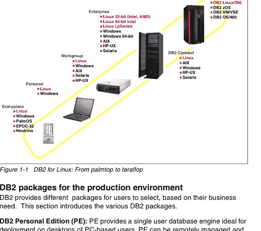

图 1-1 DB2 for Linux：从掌上电脑到万亿次浮点运算

## 生产环境的 DB2 包

DB2 为用户提供不同的包以供选择，基于其业务需求。本节介绍各种 DB2 包。

DB2 Personal Edition (PE)：PE 提供单用户数据库引擎，非常适合部署在基于 PC 的用户的桌面上。PE 可以远程管理并可用于管理网络上的其他数据库服务器，使其成为部署在偶尔连接或远程办公环境中的完美选择，这些环境不需要多用户功能。

DB2 Workgroup Server Edition (WSE)：WSE 是为部署在部门或小型企业环境中的数据库服务器而设计的，该环境涉及少量内部用户。WSE 采用基于用户的许可模式，旨在为较小的安装提供有吸引力的价格点，同时仍提供全功能数据库服务器。WSE 可部署在最多四颗 CPU 的系统上。

DB2 Workgroup Server Unlimited Edition (WSUE)：WSUE 为部署在部门或小型企业环境中且具有 Internet 用户或用户数量使其按处理器许可比 WSE 许可模式更具吸引力的环境提供简化的按处理器许可模式。WSUE 也可以用于最多四颗 CPU 的系统。

## DB Enterprise Server Edition (ESE)：

ESE 满足中型到大型企业的数据库服务器需求。ESE 是构建数据仓库、事务处理或基于 Web 的解决方案以及 ERP、CRM 和 SCM 等打包解决方案的后端理想基础。此外，ESE 还提供对其他企业 DB2 和 Informix 数据源的连接和集成。

在 DB2 V8.1 之前的版本中，该产品以两个企业包提供：DB2 Enterprise Edition (EE) 和 DB2 Enterprise-Extended Edition，后者提供创建分区数据库或在集群上运行的能力。在 V8.1 中，EE 和 EEE 的功能已合并为单一的 ESE 产品，然而运行分区数据库需要 DPF 许可证。

## DB2 Database Partitioning Feature (DPF)：

数据库分区功能是一种许可选项，允许 ESE 客户在单个系统内或跨系统集群对数据库进行分区。DPF 功能为客户提供多项好处，包括可扩展性以支持非常大的数据库或复杂的工作负载，以及管理任务的并行性提高。

## 用于访问遗留和主机数据的产品

通过以下 DB2 产品，您可以扩展企业系统以访问遗留系统。

## DB2 Connect Personal Edition：

DB2 Connect Personal Edition 提供应用程序编程接口 (API) 驱动程序和连接基础设施，以实现从桌面应用程序到大型机 (zSeries、S/390、VM/VSE) 和 iSeries (AS/400) 数据库服务器的直接连接。该产品专门设计并许可用于启用在单个工作站上运行的两层客户端-服务器应用程序，因此不适合在服务器上使用。

## DB2 Connect Enterprise Edition：

DB2 Connect Enterprise Edition 满足组织从各种桌面系统到大型机和 iSeries 数据库服务器的强大连接需求。DB2 客户端软件部署在桌面系统上，并提供 API 驱动程序，将在这些桌面系统上运行的客户端-服务器应用程序连接到访问主机数据的 DB2 Connect 服务器（网关）。该产品的许可模式基于用户。

## DB2 Connect Application Server Edition：

DB2 Connect Application Server Edition 产品在技术上与 DB2 Connect Enterprise Server 相同。然而，其许可条款和条件旨在满足多层客户端-服务器应用程序以及使用 Web 技术应用程序的特定需求。DB2 Connect Application Server Edition 的许可费用基于应用程序服务器可用处理器数量的大小。

## DB2 Connect Unlimited Edition：

DB2 Connect Unlimited Edition 产品非常适合广泛使用 DB2 Connect 的组织，尤其是在涉及多个应用程序的情况下。该产品提供 DB2 Connect Personal Edition 的程序代码以及与 DB2 Connect Application Server Edition 相同的程序代码，可在整个组织中无限部署。

## 其他 DB2 功能

除了用于访问遗留和主机数据的产品之外，DB2 还提供以下功能。

## DB2 Spatial Extender：

该产品使用户能够利用关系数据库模型的强大功能来管理其基于位置的数据，就像管理传统业务数据一样轻松，并使用行业标准的 SQL 进行空间数据分析，这可以为现有和新应用程序增加竞争优势。DB2 Spatial Extender 在 DB2 PE 和 DB2 WSE 中可免费提供给最多五名用户。它也可以作为 DB2 UDB WSUE 和 DB2 UDB ESE 的单独程序提供。

## DB2 Net Search Extender：


该产品使解决方案能够包含强大的内存中搜索功能，用于基于文本的数据。将这些高级搜索功能直接集成到数据库中可节省集成第三方基于文本解决方案的时间和费用，同时提供电子商务应用程序所需的文本搜索速度和灵活性。`DB2 Net Search Extender`在`DB2 PE`和`DB2 WSE`中可免费提供给最多五名用户。它也可以作为`DB2 UDB WSUE`和`DB2 UDB ESE`的单独程序提供。

## DB2 Intelligent Miner Products

这些产品提供进行明智业务决策所需的分析能力。`DB2 Intelligent Miner Scoring`扩展了`DB2`分析能力，并使用户能够通过简单的`SQL`调用在实时应用程序中部署挖掘。`DB2 Intelligent Miner Modeling`提供`DB2 Extenders`（具体为存储过程）用于建模操作，如关联发现、人口统计聚类和树分类。`DB2 Intelligent Miner Visualization`提供`Java`可视化工具，以交互并以图形方式呈现建模操作的结果。

## DB2 应用开发人员包

`DB2`为应用开发提供了两个包。

**`DB2`个人开发者版 (`PDE`)：** `PDE`使开发人员能够设计和构建单用户桌面应用程序。此产品附带`Linux`和`Windows`版本的`DB2 PE`产品以及`DB2 Extenders`。

**`DB2`通用开发者版 (`UDE`)：** `UDE`为单个应用程序开发人员提供了一个低成本的包，用于设计、构建或原型化可在任何`DB2`客户端或服务器平台上部署的应用程序。它包括适用于所有受支持的`Linux`、`UNIX`和`Windows`平台的客户端和服务器`DB2`版本、`DB2 Connect`、`DB2 Extenders`和`Intelligent Miner`。此包中的软件不能用于生产系统。

## DB2 用于普及平台

最后一个但并非最不重要的`DB2`产品是：

**`DB2 Everyplace`：** `DB2 Everyplace`是一个关系数据库和企业同步服务器，可将企业应用程序和企业数据扩展到个人数字助理 (`PDA`) 和智能手机等移动设备。`DB2 Everyplace`还可以嵌入到设备和电器中，以提高其功能和市场吸引力。该产品可作为移动设备上的本地独立数据库使用，也可在有连接时查询远程服务器上的信息。

### 1.3 DB2 环境

本节描述了`Linux`上各种`DB2`应用程序配置。它还讨论了`SMP`和集群上的并行性，并对`DB2`架构进行了描述。

#### 1.3.1 部署拓扑

`DB2` for `Linux`可与各种应用程序一起使用，无论它们是在内部开发还是预先打包。应用程序可以使用多种配置与`DB2`部署，这些配置包括：

- **单层**

在此配置中，应用程序和数据库驻留在同一系统上。在企业环境中，这种配置可能很少见，因为通常需要远程访问数据库服务器。尽管如此，对于开发稍后可以在多层`DB2`环境中透明部署而无需任何更改的应用程序来说，这很常见。

#### 客户端/服务器或 2 层

应用程序和数据库驻留在不同的系统上。运行应用程序的机器通常安装了`DB2`客户端，该客户端通过网络与数据库服务器通信。对于应用程序而言，数据的物理位置是透明的。应用程序使用标准接口（例如`ODBC`）与`DB2`客户端通信，而`DB2`客户端则负责通过网络访问数据。在某些情况下，例如基于浏览器或`Java`的访问，不需要在执行应用程序的同一台机器上运行`DB2`客户端。

`DB2`为在异构环境中混合匹配客户端和服务器平台提供了卓越的灵活性。`DB2`客户端和服务器代码可用于各种平台。例如，应用程序可以在安装了`DB2` for `Windows`客户端的`Windows`机器上执行，然后可以访问`Linux`服务器上的`DB2`数据库。同样，`Linux`机器也可以充当客户端并从`UNIX`服务器或大型机访问数据。

#### 多层

在多层配置中，应用程序、`DB2`客户端和数据源通常驻留在不同的系统上。此类配置的示例包括但不限于下图所示的场景（表 1-1）。

表 1-1 多层配置示例

| 客户端 | 中间层 | 服务器 |
|---|---|---|
| Web 浏览器 | Web 服务器<br>`DB2`客户端 | `DB2`数据库服务器 |
| 应用程序客户端 | 应用程序服务器<br>`DB2`客户端 | `DB2`数据库服务器 1<br>`DB2`数据库服务器 2 |
| 应用程序<br>`DB2`客户端 | `DB2 Connect`网关 | `OS/390`<br>`AS/400`<br>`VM/VSE` |
| 应用程序<br>`DB2`客户端 | `DB2`服务器 | 次要数据源<br>（例如，大型机`DB2`、非`DB2`、非关系型） |

`IBM`认识到，在许多情况下，可能需要从各种分布式数据源访问数据，而不是从一个集中式数据库。数据源可以来自`IBM`，例如`DB2`或`Informix®`，或非`IBM`数据库，例如`Oracle`，甚至非关系数据，例如文件或电子表格。正如上表中最后一个场景所示，`IBM`通过允许对各种分布式数据源进行联邦访问，提供最全面的业务集成解决方案。

### 1.3.2 DB2 数据库对象

在本节中，我们介绍一些`DB2`对象及其相互关系。

#### 实例

实例（有时称为数据库管理器）是管理数据的`DB2`代码。它控制可以对数据执行的操作，并管理分配给它的系统资源。每个实例都是一个完整的环境。它包含为给定并行数据库系统定义的所有数据库分区。实例拥有自己的数据库（其他实例无法直接访问），并且其所有数据库分区共享相同的系统目录。它还与其他实例在同一机器（系统）上具有独立的安全性，例如允许生产和开发环境在同一台机器上在单独的`DB2`实例下运行而互不干扰。

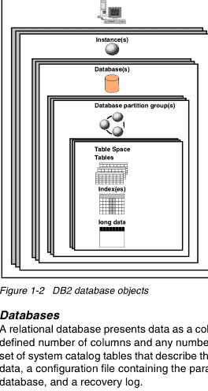

图 1-2 `DB2`数据库对象

#### 数据库

关系数据库将数据表示为表的集合。表由固定数量的列和任意数量的行组成。每个数据库都包含一组系统目录表，用于描述数据的逻辑和物理结构、包含为数据库分配的参数值的配置文件以及恢复日志。

#### 数据库分区组

数据库分区组是一组一个或多个数据库分区。在为数据库创建表之前，您首先需要创建表空间将要存储的数据库分区组，然后创建表将要存储的表空间。如果未指定分区组，则存在一个默认组用于分配表空间。在`DB2`的早期版本中，数据库分区组被称为节点组。在非分区环境中，所有数据都驻留在单个分区中，因此无需担心分区组。

#### 表空间

数据库被组织成称为表空间的部分。表空间是存储表的场所。在创建表时，您可以决定将某些对象（如索引和大对象（`LOB`）数据）与表的其余数据分开存储。表空间也可以分布在一个或多个物理存储设备上。

表空间驻留在数据库分区组中。表空间定义和属性记录在数据库系统目录中。容器分配给表空间。容器是物理存储的分配（例如文件或设备）。表空间可以是系统管理空间（`SMS`），也可以是数据库管理空间（`DMS`）。对于`SMS`表空间，每个容器都是操作系统文件空间中的一个目录，操作系统的文件管理器控制存储空间。对于`DMS`表空间，每个容器要么是固定大小的预分配文件，要么是物理设备（如磁盘），数据库管理器控制存储空间。

#### 表

关系数据库将数据表示为表的集合。表由逻辑上排列在列和行中的数据组成。所有数据库和表数据都分配给表空间。表中的数据在逻辑上相关，并且可以在表之间定义关系。数据可以根据称为关系的数学原理和操作进行查看和操作。表数据通过结构化查询语言（`SQL`）进行访问，`SQL`是一种用于定义和操作关系数据库中数据的标准化语言。查询用于应用程序或用户从数据库中检索数据。查询使用`SQL`创建如下形式的语句：

```
SELECT <data_name> FROM <table_name>
```

#### 缓冲池

缓冲池是分配给主内存以缓存表和索引数据页的内存量，这些数据页正在从磁盘读取或正在修改。缓冲池的目的是提高系统性能。从内存访问数据比从磁盘访问数据快得多；因此，数据库管理器需要从磁盘读取或写入磁盘（`I/O`）的次数越少，性能越好。（您可以创建多个缓冲池，尽管对于大多数情况只有一个就足够了。）缓冲池的配置是最重要的调优区域，因为您可以减少由缓慢的`I/O`引起的延迟。

### 1.4 DB2 的并行性

单处理器和磁盘的系统对可以处理的数据量、用户和应用程序有限制。并行处理是关键

企业工作负载涉及将负载分布到多个处理器和磁盘上，从而能够处理大量数据和高事务速率。在许多环境中，数据量正以惊人的速度增长，因此数据库管理系统需要能够通过添加更多磁盘和`CPU`轻松扩展到更高的负载。

`DB2`的并行技术将处理过程分解为可在多个处理器上并发运行的独立执行组件，从而在大型数据库上实现高度可扩展的性能。通过并行处理单个查询，可以显著缩短查询的耗时。`DB2`支持可扩展的增长路径，通过“纵向扩展”（`SMP`）或“横向扩展”（`MPP`）或两者兼施，轻松为现有系统添加更多处理能力。

#### 1.4.1 SMP环境


过去，复杂的企业工作负载通常运行在高端的`SMP`（对称多处理器）机器上。在同一机器内运行并通过高带宽总线连接的大量处理器可以提供出色的性能。由于`Linux`版`DB2`与运行在高端`UNIX`系统上的`DB2`共享99%以上的代码，因此它继承了利用`SMP`架构的能力。`DB2`在`SMP`系统上运行的能力仅受当今`Linux SMP`可扩展性的限制。最近在8路`Linux`系统上进行的`SAP`基准测试⁴取得了前所未有的结果，这证明了`DB2 for Linux`在`SMP`环境中的有效性。`IBM Linux`技术中心的众多开发人员正与`Linux`社区合作，以扩展`Linux`在16路及更高路`SMP`机器上的能力。

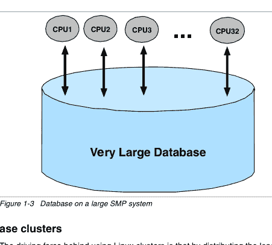

图1-3 大型`SMP`系统上的数据库

#### 1.4.2 数据库集群

使用`Linux`集群的驱动力在于，通过将负载分布到多个运行开源操作系统的低成本服务器上，可以更快、更可靠、更经济地完成更大的任务。如果负载增加，可以扩展集群以管理额外的需求，而不会影响性能。`DB2`是`Linux`上第一个提供内置集群功能的商业数据库。也就是说，`DB2`可以直接部署在`Linux`集群上，无需额外的集群软件。`Linux`上的`DB2`集群非常适合运行要求苛刻的事务性应用程序以及涉及大量数据的仓库，同时提供以下好处：

- 更快的处理时间
- 支持超大型数据库
- 出色的可扩展性
- 更高的可用性
- 更低的成本

将集群方法与`DB2`对64位`Linux`环境的支持相结合，可提供额外的性能和可扩展性优势。

### 数据库集群架构

主要有两种数据库集群架构：共享磁盘（shared-disk）和无共享（shared-nothing）。`Oracle RAC`使用共享磁盘架构。`Linux`版`DB2`采用无共享架构。

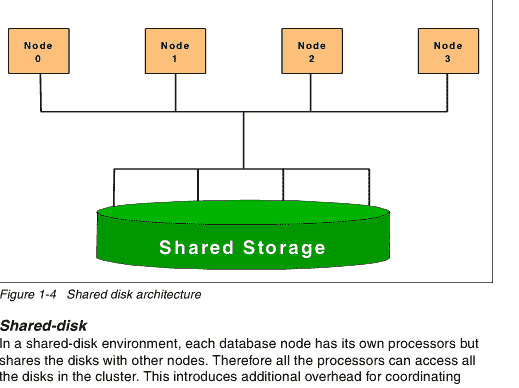

图1-4 共享磁盘架构

#### 共享磁盘

在共享磁盘环境中，每个数据库节点都有自己的处理器，但与其他节点共享磁盘。因此，所有处理器都可以访问集群中的所有磁盘。这带来了协调节点间资源和锁的额外开销。例如，如果节点1想要访问某个磁盘上的数据，而该磁盘已被集群中的另一个节点锁定以进行更新，则节点1必须等待其他节点完成操作。虽然这在集群中节点较少时（例如大型机环境）效果很好，但分布式锁管理和缓存一致性问题的开销会严重限制可扩展性，并在四个或更多节点时导致性能下降，从而无法在`Linux`上利用大型集群的经济性。此外，这种方法需要专门的硬件和软件来进行共享磁盘和缓存管理，使其比无共享架构昂贵得多。

#### 无共享

顾名思义，在无共享环境中，分区（节点）不与其他机器上的分区共享处理器、内存或磁盘。每个分区在其自己的数据子集上运行。由于每个分区都有自己的私有资源，因此这种方法不会与其他服务器发生任何资源竞争，从而使其具有几乎无限的可扩展性。这就是 `DB2 for Linux` 可以支持多达 1000 个分区的原因之一。而且由于访问资源没有协调开销，因此可以轻松地将额外的机器添加到集群中，并实现线性可扩展的性能，这意味着，如果数据量的翻倍与集群资源的翻倍相匹配，数据库的高性能将保持在同一水平。如果集群中的一个分区发生故障，其资源可以动态转移到另一台机器，确保高可用性。`DB2 for Linux` 使用的无共享方法带来的另一个好处是，它不需要专用硬件，使解决方案更简单、成本更低，并且适用于基于 `Linux` 的“通用”硬件。

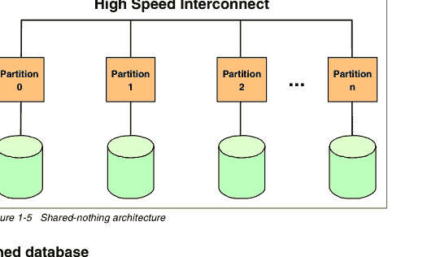

### 1.4.3 分区数据库

`DB2` 通过采用数据库分区利用了 `Linux` 集群的强大功能。在分区环境中，数据库分布在多个分区上，通常位于不同的机器上。每个分区负责数据库总数据的一部分。数据库分区有时也称为节点或数据库节点。由于数据分布在数据库分区之间，因此可以使用多个物理节点上的多个处理器来满足信息请求。数据检索和更新请求会自动分解为子请求，并在适用的数据库分区之间并行执行。

作为分区数据库系统处理能力的说明，假设你有一个单分区数据库，其中有 100,000,000 条记录需要扫描。此扫描需要单个数据库管理器搜索 100,000,000 条记录。现在假设这些记录均匀分布在 20 个数据库分区上；每个分区只需扫描 5,000,000 条记录。如果每个数据库分区服务器以相同的速度并行扫描，则完成扫描所需的时间应比单分区系统处理整个任务快约 20 倍。

数据库分区跨多个数据库分区的情况对用户和应用程序是透明的。用户交互通过一个数据库分区进行，该分区被称为该用户的协调节点。任何数据库分区都可以用作协调节点。客户端或应用程序连接到的数据库分区就成为协调节点。你应考虑将用户分散到数据库分区服务器上，以分配协调功能。

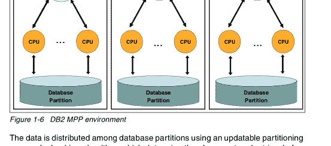

图 1-6 `DB2 MPP` 环境

数据使用可更新的分区映射和哈希算法在数据库分区之间进行分布，该算法确定每一行数据的放置和检索位置。例如，如果向表中添加一行，协调节点会检查分区映射，该映射指定行应存储的数据库分区。行仅发送到该数据库分区服务器，其结果是只有感兴趣的数据库分区服务器参与插入。

数据库分区不共享所有资源。处理器是共享的，但磁盘和内存不是。参见图 1-8。

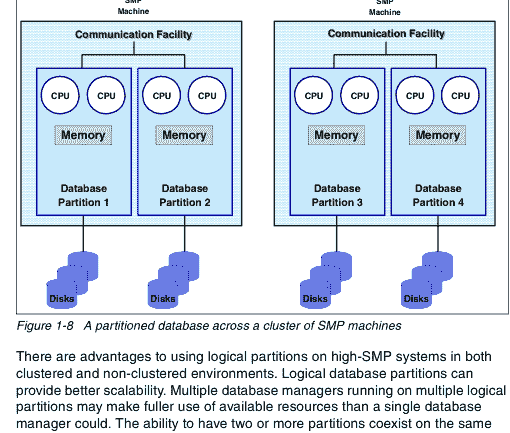

图 1-8 跨 `SMP` 机器集群的分区数据库

在集群和非集群环境中，在高 `SMP` 系统上使用逻辑分区具有优势。逻辑数据库分区可以提供更好的可扩展性。在多个逻辑分区上运行的多个数据库管理器可能比单个数据库管理器更充分地利用可用资源。能够在同一台机器上共存两个或多个分区（无论处理器数量如何）允许在设计高可用性配置和故障转移策略时具有更大的灵活性。在机器发生故障时，数据库分区可以自动移动并在已包含同一数据库的另一个分区的第二台机器上重新启动。

## 安装

本章指导您在 `Linux` 系统上安装 `DB2` 的过程。它涵盖单分区和多分区环境，并提供三种安装方法的说明：`DB2 Setup`、`db2_install` 和响应文件安装。

以下主题将被讨论：

- 基本要求
- 安装注意事项和规划
- 多分区安装注意事项
- 用户和组设置
- 安装 `DB2`

### 2.1 基本要求

在安装 `DB2` 之前，确保您拥有所需硬件和软件非常重要。您可能需要配置通信并安装额外的软件包，以便 `DB2` 能够成功运行。

在本节中，我们将介绍以下安装先决条件：

- `DB2` 支持的 `Linux` 发行版
- 所需磁盘空间
- 内存要求
- 通信要求
- 所需内核级别和库
- 额外软件要求

#### 2.1.1 DB2 支持的 Linux 发行版

确保您的 `Linux` 发行版级别得到 `DB2` 支持。有关当前支持的 `Linux` 发行版、内核和库的最新信息，请参阅 `DB2 for Linux` 验证网站：

`http://www-3.ibm.com/software/data/db2/linux/validate`

在撰写本书时，以下 `Linux` 发行版已成功通过与 `DB2` 配合使用的验证（表 2-1）：

表 2-1 当前支持的 `Linux` 发行版、内核和库

| Platform | Distribution | Kernel | Libraries | Comments |
|---|---|---|---|---|
| IA 32 | Red Hat 7.2 | 2.4.9-34 | glibc 2.2.4 | |
|  | Red Hat 7.3 | 2.4.18 | glibc 2.2.5 | |
|  | Red Hat AS 2.1 | 2.4.9 | glibc 2.2.4 | |
|  | Red Hat 8.0 | 2.4.18-14 | glibc 2.2.93-5 | |
|  | SCO Linux 4.0 | 2.4.19 | glibc 2.2.5 | |
|  | SuSE 7.3 | 2.4.10 | glibc 2.2.4 | |
|  | SuSE Pro 6.0 | 2.4.18 | glibc 2.2.5 | |
|  | SuSE Pro 8.1 | 2.4.19 | glibc 2.2.5 | |
|  | SuSE SLES-7 | 2.4.7 | glibc 2.2.2 | |
|  | SuSE SLES-8 | 2.4.19 | glibc 2.2.5 | |
|  | TurboLinux Server 7 | 2.4.9 | glibc 2.2.4 | |
|  | TurboLinux Server 8 | 2.4.18-5 | glibc 2.2.5 | |
|  | United Linux 1.0 | 2.4.19 | glibc 2.2.5 | |
| IA 64 | SuSE SLES 8 | 2.4.19 | glibc 2.2.5 | |
|  | United Linux 1.0 | 2.4.19 | glibc 2.2.5 | |


| zSeries (32 bit) | Red Hat 7.2 | 2.4.9-38 | 2.2.4 | Run `up2date` to get the required kernel fixes from Red Hat |

|  | SuSE SLES 7 | 2.4.7-58 | 2.2.4 | SuSE refresh is required: `SLES-7-PatchCD-1-s390-20020522.iso` -- `compat.rpm` contains `libstdc++` 6.1 |

|  | SuSE SLES 8 | 2.4.19 | 2.2.5 | |

### 2.1.2 所需磁盘空间

在配置分区时，您必须考虑以下磁盘要求（表 2-2）：

表 2-2 所需磁盘空间

| Install Type | Description | Required disk space |

|---|---|---|

| Typical | DB2 is installed with most features and functionality, including graphical tools such as the Control Center and Configuration Assistant. | 450 to 500 MB |

| Compact | Installs only basic DB2 features and functions and does not include graphical tools. | 350 to 400 MB |

| Custom | This option allows you to select the features you want to install. | 350 to 700 MB |

您还应为所需软件、通信产品、DB2 文档和数据库分配磁盘空间。在 DB2 Version 8 中，HTML 和 PDF 文档现在提供在单独的 CD-ROM 上。仅安装英文版核心 DB2 HTML 文档需要 25 MB 磁盘空间；仅安装英文版所有 HTML 文档需要 82 MB 磁盘空间。额外语言需要额外空间。

### 2.1.3 内存要求

我们建议您为 DB2 ESE 分配至少 256 MB 的 RAM，但应为其他软件和通信产品分配额外内存。在确定内存要求时，请注意以下事项：

- 我们建议您的 `SWAP` 空间至少是 RAM 的两倍。

- 应为可能在系统上运行的非 DB2 软件分配额外内存。

- 需要额外内存来支持数据库客户端和数据库活动。

- 内存要求将受数据库系统大小和复杂性以及特定性能要求的影响。

### 2.1.4 通信要求

需要 `TCP/IP` 来访问远程数据库。如果在安装期间选择，您的 Linux 发行版将提供 `TCP/IP` 连接。

如果您的 Linux 机器安装在现有网络上并且需要使用静态 IP 地址，则应从网络管理员处收集类似下表的信息（表 2-3）：

**表 2-3 所需网络信息**

| 名称 | 示例编号 |

|---|---|

| 主机 IP 地址 | 191.72.1.3 |

| 子网掩码 | 255.255.255.0 |

| 网关 | 191.72.1.1 |

| 域名服务器 | 191.72.3.1 |

上述信息应在操作系统安装期间的设置屏幕上指定，或作为安装后步骤使用发行版的设置实用程序指定。

此外还需要某些通信软件包。这些在 2.1.6 节“其他软件要求”第 31 页中有讨论。

### 2.1.5 所需内核级别和库

最低支持的内核级别和库在第 25 页的表 2-1 中提供。您的 Linux 发行版还应包含 `RPM` 3 或更高版本。

#### 内核参数值

您可能需要更新一些默认的内核参数设置，以便 DB2 在 Linux 上成功运行。例如，2.4.x 系列内核消息队列参数 `msgmni` 的默认值仅允许有限数量的同时连接到 DB2。信号量数组和共享内存限制值默认也不够。

通常，这些是 DB2 优化运行的推荐值：

```
kernel.shmmax=268435456 for 32-bit; 1073741824 for 64-bit
kernel.msgmni=1024
fs.file-max=8192
kernel.sem="250 32000 32 1024"
```

幸运的是，DB2 版本 8 有一个新功能，会在 `db2start` 时检查 `kernel.semmni`、`kernel.msgmni` 和 `kernel.shmmax` 参数的值，如果当前值不理想，则为您更改它们。`DB2start` 执行以下操作：

- 将 `semmni` 内核参数更改为 1024

- 将 `msgmni` 内核参数更改为 1024

- 将 `shmmax` 内核参数更改为 268435456（32 位）或 1073741824（64 位）

例如，首次发出 `db2start` 后，我们在 `db2diag.log` 中得到了以下消息：

#### 示例 2-1 启动实例后 db2diag.log 条目

```
ADM05061 DB2 has automatically updated the "semmni" kernel parameter from "128" to the recommended value "1024".
2002-10-31-16.38.59.074791 Instance:db2inst1
Node:000
PID:15996(db2sysc) TID:8192 Appid:none
base sys utilities sqlesysc_main Probe:9

ADM05061 DB2 has automatically updated the "msgmni" kernel parameter from "16" to the recommended value "1024".
2002-10-31-16.38.59.076916 Instance:db2inst1
Node:000
PID:15996(db2sysc) TID:8192 Appid:none
base sys utilities sqlesysc_main Probe:9

ADM05061 DB2 has automatically updated the "shmmax" kernel parameter from "33554432" to the recommended value "268435456".
2002-10-31-16.39.01.262594 Instance:db2inst1
Node:000
PID:15994(db2star2) TID:8192 Appid:none
base sys utilities startdbm Probe:911

ADM7513W Database manager has started.
```

您可能注意到 `db2start` 没有更新 `fs.file-max` 参数——这是因为 2.4.18 及更高版本的任何内核都会自动为您完成此操作。

由于此新功能，在安装前手动更新 *kernel.shmmax*、*kernel.msgmni* 和 *kernel.sem* 参数已不再必要。

#### 手动更新内核参数

如果任何默认内核参数设置不符合您特定系统的要求，您可以手动更新它们。

要检查当前共享内存段、信号量数组和消息队列限制，请输入 `ipcs -l` 命令。您的输出应如下所示：

```
------ Shared Memory Limits --------
max number of segments = 4096
max seg size (kbytes) = 32768
max total shared memory (kbytes) = 8388608
min seg size (bytes) = 1

------ Semaphore Limits --------
max number of arrays = 1024
max semaphores per array = 250
max semaphores system wide = 32000
max ops per semop call = 32
semaphore max value = 32767

------ Messages: Limits --------
max queues system wide = 1024
max size of message (bytes) = 8192
default max size of queue (bytes) = 16384
```

#### 在 Red Hat 上修改 2.4.x 系列内核参数

在本示例中，我们将说明如何在 Red Hat 上更新 `kernel.shmmax`、`kernel.sem` 和 `kernel.msgmni` 参数并在每次重新启动后设置它们。

1. 以具有 root 权限的用户身份登录。

2. 使用文本编辑器，将以下条目添加到 `/etc/sysctl.conf`：


```
kernel.shmmax=268435456
kernel.msgmni=1024
kernel.sem="250 32000 32 1024"
```

3. 通过输入以下命令将这些条目加载到 `sysctl` 中：`sysctl -p`

现在如果您输入命令 `ipcs -l`，您将看到内核参数已在 `sysctl` 中更新。要查看所有 `sysctl` 设置，请输入命令：

`sysctl -a`

如果您只想在运行时更新内核参数，请使用 `sysctl -w` 命令。

例如，要将 `kernel.msgmni` 改为 1024，请输入以下命令：

```
sysctl -w kernel.msgmni=1024
```

然而，除非这些设置保存在 `/etc/sysctl.conf` 文件中，否则在下次重启后这些设置将不会保留。

### 在 SuSE 上修改 2.4.x 系列内核参数

在 SuSE 上修改内核参数与 Red Hat 有些不同。以下说明将解释如何更新 `kernel.shmmax`、`kernel.sem` 和 `kernel.msgmni` 参数并使其在重启后生效。

- 1. 以具有 root 权限的用户身份登录。
- 2. 某些 SuSE 发行版没有 `/etc/sysctl.conf` 文件。如果是这种情况，你需要使用文本编辑器手动创建一个。
- 3. 在 `/etc/sysctl.conf` 文件中，添加以下条目：

  `kernel.shmmax=268435456`

  `kernel.msgmni=1024`

  `fs.file-max=8129`

  `kernel.sem="250 32000 32 1024"`
- 4. 运行 `sysctl -p` 以从默认文件 `/etc/sysctl.conf` 加载 `sysctl` 设置。

  `sysctl -p`
- 5. 接下来，你需要在系统初始化文件中添加 `sysctl -p`，以便在每次重启后设置内核参数。为此，编写一个脚本并配置它在运行级别 5 自动运行。具体来说，你需要在 `/etc/init.d` 中创建一个可执行文件，然后在 `/etc/init.d/rc5.d` 中添加指向此脚本的指针。按照我们的示例操作：

在 `/etc/init.d` 中，我们创建了一个名为 `kerneld b2` 的可执行文件。此文件包含以下脚本：

```
#!/bin/sh
#
# /etc/init.d/kerneld b2
#
### END INIT INFO
touch /var/lock/subsys/kerneld b2
/sbin/sysctl -p >> /var/lock/subsys/kerneld b2
```

然后在 `/etc/init.d/rc5.d` 中，我们通过输入以下命令添加了指向 `kerneld b2` 脚本的指针：

```
bash# cd /etc/init.d/rc5.d
bash# ln -s ../kerneld b2 S99kerneld b2
bash# ln -s ../kerneld b2 K99kerneld b2
```

> **注意：** 我们选择数字 99 是因为字母 S 与名称之间的数字应大于 `rc5.d` 目录中所有其他链接上的数字，这样脚本才能最后执行。

与 Red Hat 一样，你可以使用 `sysctl -w` 命令在运行时更改内核参数（用于测试目的）。例如，要更改信号量数组参数，请输入：

```
sysctl -w kernel.sem="250 32000 32 1024"
```

请记住，除非这些设置在 `/etc/sysctl.conf` 文件中，否则在下次重启时这些设置将不会被保存。

### 2.1.6 其他软件需求

根据你的 DB2 需求，你可能需要安装额外的软件包才能使 DB2 正常运行。在使用 DB2 之前，请确保安装了以下软件。

- IBM Java 开发人员工具包 `JDK` 版本 1.3.1，服务发布版 1，这对于运行 DB2 图形工具以及创建和运行 Java 应用程序（包括存储过程和用户定义函数）是必需的。如果尚未安装正确版本的 JDK，在使用 DB2 Setup 或响应文件进行安装过程中，它将被为你安装。`db2_install` 实用程序不会为你安装 JDK。请参阅本节末尾有关如何安装 JDK 的说明...
- > **注意：** 如果你的机器上已安装了另一个版本的 JDK，我们建议你在安装 DB2 之前将其删除。如果机器上同时存在两个不同版本的 JDK，控制中心可能无法启动。如果你的应用程序需要现有的 JDK 或 JRE，在安装前你可能需要通过取消设置 `PATH` 或 `CLASSPATH` 等环境信息来禁用它。
- Web 浏览器，用于查看 DB2 HTML 文档。
- X Window System 软件，能够渲染图形用户界面。如果你想使用 DB2 Setup 向导安装 DB2（它是一个图形安装程序）或任何 DB2 图形工具，则需要此软件。
- 其他软件，见下表提供（表 2-4 和表 2-5）。`pdksh` 包对所有 DB2 系统都是必需的，而 `rsh-server` 和 `nfs-utils` 包主要用于分区数据库系统。

## 表 2-4 SuSE 的软件包需求

| 软件包名称 | RPM 名称 | 描述 |
|---|---|---|
| `pdksh` | `pdksh-5.2.14-293.i386.rpm` (for V7.2)<br>`pdksh-5.2.14-515.src.rpm` (for V8) | Korn Shell。这对于多分区数据库环境是必需的。 |
| `rsh-server` | `rsh-0.17-214.src.rpm` (for V7.2)<br>`rsh-0.17-285.src.rpm` (for V8) | 包含一组服务器程序，允许用户在远程机器上运行命令、登录到其他机器以及在机器之间复制文件（rsh、rexec、rlogin 和 rcp） |
| `nfs-utils` | `nfs-utils-0.3.3-109.src.rpm` (for V7.2)<br>`nfs-utils-1.0.1-26.src.rpm` (for V8) | 网络文件系统支持包。它允许对远程机器上的本地文件进行访问。 |

## 表 2-5 Red Hat 的软件包需求

| 目录 | 软件包名称 | RPM 名称 | 描述 |
|---|---|---|---|
| `/System Environment/Shell` | `pdksh` | `pdksh-5.2.14-13.i386.rpm` (for V7.2)<br>`pdksh-5.2.14-19.i386.rpm` (for V8) | Korn Shell。这对于多分区数据库环境是必需的。 |
| `/System Environment/Daemons` | `rsh-server` | `rsh-0.17-5.i386.rpm` (for V7.2)<br>`rsh-0.17-10.src.rpm` (for V8) | 包含一组允许用户在远程机器上运行命令的程序。适用于多分区环境。 |
| `/System Environment/Daemons` | `nfs-utils` | `nfs-utils-0.3.3-5.src.rpm` (for V7.2)<br>`nfs-utils-1.0.1-2.src.rpm` (for V8) | 网络文件系统支持包。它允许对远程机器上的本地文件进行访问。 |

要检查这些软件包是否已安装，请使用以下 `rpm -qa` 命令：

```
rpm -qa | grep pdksh
rpm -qa | grep rsh
rpm -qa | grep nfs
```

要在 Red Hat 上安装这些软件包，请使用 Red Hat 光盘和 `rpm` 命令。例如，要在 Red Hat V8 上安装 `pdksh`，请挂载 Red Hat 光盘 #3，然后输入以下命令：

```
rpm -ivh /mnt/cdrom/RedHat/RPMS/pdksh-5.2.14-19.i386.rpm
```

在 SuSE 上也可以使用 `rpm`。如果您的 SuSE 发行版包含 X Window 系统软件，那么使用 YaST 安装这些软件包是最简便的方法。例如，要在 SuSE V8 上安装 `pdksh`，请执行以下操作：

1. 以 root 身份登录
2. 在 YaST2 控制中心中，选择“软件 -> 安装或删除软件”，然后选择相应的软件包。

### 注意事项

- RPM 名称可能会因您使用的 Linux 版本而异。请查看最新的 Linux 信息以获取您所需的 RPM 名称。
- `nfs-utils` 软件包为内核 NFS 服务器及相关工具提供守护进程，其性能远高于大多数用户所使用的传统 Linux NFS 服务器。
- 虽然 DB2 7 版本的 C/C++ 开发需要 `compat-libs` 和 `compat-egcs-C++` 软件包，但 DB2 8 版本的开发已不再需要它们。在 V8 中，我们已经改用 Intel 编译器。

## 安装 IBM Developer Kit for Java 1.3.1 版


`db2_install` 工具不会安装 IBM Developer Kit for Java（JDK），而该 JDK 是 DB2 图形界面工具（如 Control Center 和 Task Center）以及应用程序开发所必需的。因此，如果您计划使用 `db2_install`，并希望使用 GUI 工具或应用程序开发工具，则必须按照以下步骤手动安装 JDK。

1. 从您的 DB2 ESE 光盘的 `/ese/db2/linux/Java-1.3` 目录中获取 IBM Developer Kit for Java 1.3.1 版。
2. 以 root 身份输入以下命令来安装 IBM Developer Kit for Java：
```
rpm -ivh IBMJava2-SDK-1.3.1-2.0.i386.rpm
```
3. 如果您计划开发 Java 应用程序，请将以下行添加到您的 `/etc/profile` 文件中，以便为所有用户设置 Java 环境：
```
export PATH=$PATH:/opt/IBMJava2-131/jre/bin
```

### 2.2 安装注意事项与规划

现在您已经确认系统满足 DB2 的基本要求，接下来需要为 DB2 安装准备系统。在本节中，我们将讨论以下主题：

- 安装方法——`db2setup` 与 `db2_install` 与响应文件
- 存储规划
  - Linux 文件系统与原始设备
  - 原始设备配置
  - 文件系统配置
  - DB2 日志空间
  - DB2 临时表空间
- 多分区安装的网络配置
  - 启用 `rsh`
  - 设置 NFS
- 用户和组设置
  - 用户和组要求
  - 创建用户——单分区
  - 创建用户——多分区
  - 多分区环境中的 DAS 用户注意事项

#### 2.2.1 安装方法

在 Linux 上安装 DB2 有四种方法：（1）DB2 Setup 向导，（2）`db2_install` 工具，（3）使用响应文件，（4）Linux RPM 命令。每种方法都有各自的优缺点。首选方法通常取决于您的专业水平和环境类型，但一般来说，如果图形终端可用，建议使用 DB2 Setup 向导。

##### DB2 Setup 向导

DB2 Setup 向导是一个基于 Java 的图形工具，用于安装 DB2。它会安装 DB2 文件集、Java Developer Kit，并允许您创建新的 DB2 实例、创建新用户和组或配置 DB2 以使用现有用户、配置通信、创建工具目录数据库以及设置通知。DB2 Setup 还提供了一个选项，允许您创建响应文件。对于经验较少的用户来说，这是最佳方法，因为大部分配置都会自动完成。

##### db2_install

`db2_install` 脚本使用 RPM 安装工具在您的 Linux 系统上安装所有 DB2 ESE 软件包。这种方法很可靠，通常被专家用户用于在较大、更复杂的多分区系统上安装 DB2。用户 ID/组设置、实例创建、工具目录数据库创建和通知设置等任务需要在安装后手动执行。

有些人更喜欢这种方法，因为它绕过了 DB2 Setup 所执行的配置，允许您从一开始就以自己喜欢的方式配置 DB2。例如，它可以更好地控制数据库管理。默认情况下，如果您选择不将工具目录数据库放入现有数据库，DB2 Setup 向导会在实例所有者的主目录中创建该数据库，并且还会分配主目录用于存储其他数据库。特别是对于较大的多分区系统，我们建议将数据库存储在一个单独的文件系统中（例如 `/database`）。手动配置允许您从一开始就分配自己首选默认数据库目录。

`db2_install` 的一个限制是它仅安装英文支持。这意味着帮助、消息和工具界面都是英文的。而 DB2 Setup 向导可以安装一种或多种不同语言的支持。其他限制包括：安装可能需要更长的时间（考虑到需要手动配置的任务较多）、需要更高的技能水平，并且无法创建响应文件。

##### 响应文件安装

可以使用 DB2 Setup 向导或编辑示例响应文件来创建响应文件。它允许您在多台机器上安装 DB2，并保持一致的安装和配置设置，也可用于设置 DB2 集群。响应文件安装速度很快，因为它绕过了图形向导并自动完成配置。使用响应文件的另一个优点是它会在每台机器上创建数据库管理服务器（DAS），而使用 `db2_install` 时必须在安装后手动创建 DAS。对于更高级的用户，我们建议您通过编辑示例响应文件来创建响应文件，然后使用该文件安装 DB2。示例响应文件不仅可以安装 DB2，还可以配置用户、创建实例、设置通知、创建工具目录以及配置大量 DBM 参数。如果您已经拥有所需的所有信息，这是最快速的安装方法。与 DB2 Setup 向导不同，响应文件

首先在数据库管理器级别，然后在内核（或文件系统）级别。在此级别，内核拦截调用并在将数据传递给物理设备或进程之前将其传输到自己的缓冲区。额外的缓冲会阻碍性能。

DB2 在表 2-6 中列出的 Linux 发行版上支持原始 I/O。这意味着原始设备可以连接到在这些系统上运行的任何 UDB 通用数据库系统。

不同 Linux 发行版对默认原始设备节点的命名不同，如下表所示。DB2 在 Linux/390 上不支持原始设备。

*表 2-6 当前支持原始 I/O 的 Linux 发行版*

| Distribution | Raw device nodes | Raw device controller |
|---|---|---|
| Red Hat or TurboLinux | `/dev/raw/raw1` to 255 | `/dev/rawctl` |
| SuSE | `/dev/raw1` to 63 | `/dev/raw` |

### Raw device configuration

有关如何在 Linux 机器上设置原始 I/O 的详细步骤，请参阅 *IBM DB2 UDB Administration Guide: Implementation*，SC09-4820。本节我们将解释如何将原始设备绑定到 Linux 内核。

要在块设备上执行原始 I/O，您必须先将 Linux 内核的原始设备池绑定到该块设备。这是通过以 root 身份运行 `raw` 命令完成的。`raw` 实用程序现在通常由 Linux 发行商提供。

例如，如果您的磁盘分区是 `/dev/hda12` 并且您想将其绑定到 `/dev/raw/raw1`，请输入以下命令：
```
bash$ raw /dev/raw/raw1 /dev/hda12
```
接下来，配置 `/etc/rc.d/boot.local` 文件，以便 DB2 在启动时可以访问原始设备。在示例 2-2 中，我们在 `/etc/rc.d/boot.local` 中添加了以下条目：

*示例 2-2 将原始设备与块设备绑定*
```
raw /dev/raw/raw1 /dev/hda12
raw /dev/raw/raw2 /dev/hda13
```
要显示所有当前可用的原始设备，请发出以下命令：
```
raw -qa
```

### Example 2-3 Display available raw devices
```
udb1nx04:"# raw -qa
/dev/raw/raw1: bound to major 3, minor 12
/dev/raw/raw2: bound to major 3, minor 13
```

### File system configuration

我们建议您在 Linux 操作系统安装期间创建不同的分区。已成为惯例将某些基本目录，例如 `/db2home` 或 `/software`（在我们的示例中）放在单独的文件系统或分区中，原因有几个：

- ► Disk capacity - There is a limited amount of space on each disk, and you might run out of space if you use a single disk for multiple purposes.
- ► Performance - The root directory has to be searched linearly every time any pathname in Linux is accessed. If the root directory is cluttered, this will impair performance of the entire system.
- ► Backup - It is better to separate important and frequently changing data from massive, and seldom changing data. This way you can save system resources by backing up some file systems more frequently than others.


### User convenience
It's easier to find things if the naming convention is well-organized.

文件系统配置，或分区，通常使用 `fdisk` 工具执行。对于 SuSE，您也可以使用图形 `YaST` 工具。Linux 提供了几种日志文件系统格式，例如 `Ext3`、`JFS`、`XFS` 和 `ReiserFS`。在我们的示例中，对于数据库相关文件系统，我们使用 `Ext3` 格式创建日志文件系统。请注意，不建议在内核级别低于 `2.4.18` 且未应用适当修复的情况下使用 `Ext3` 文件系统。

要显示所有已定义的文件系统，请发出 `df` 命令，如示例 2-4 所示。

### Example 2-4 df command

```
udb1nx04:"# df
Filesystem         1K-blocks    Used Available Use% Mounted on
/dev/hda1          4200828 1588840  2611988 38% /
/dev/hda5           54416    4682    46925 10% /boot
/dev/hda8          3099260  32828  2909000 2% /database
/dev/hda9          1035660  32828   950224 4% /db2log1
/dev/hda10         2071384  32828  1933332 2% /db2temp
shmfs               387124      0   387124 0% /dev/shm
/dev/hda7          1035660  32828   950224 4% /db2home_Local
```

来自数据库文件。这种配置在许多生产环境中普遍使用。

下面是一个可能的配置示例（表 2-7）。本书的其余部分都将使用这种系统设置。

## 表 2-7 示例分区设置

| 分区名称 | 描述 |
|---|---|
| `/` | Linux |
| `/boot` | Linux |
| `/swap` | Linux 交换空间 |
| `/db2home` | 用于存储 DB2 用户的主目录（例如 `db2inst1`、`db2fenc1`、`dasusr1`） |
| `/database` | 用于存储数据库 |
| `/db2log1` | 用于存储日志的主副本 |
| `/db2log2` | 用于存储 DB2 镜像日志 |
| `/db2temp` | 用于存储 DB2 临时表空间 |
| `/software` | 用于存储软件。例如，我们将 DB2 安装映像下载到此目录。 |
| `/tablespaces` | 保存所有用户表空间 |

> 注意：镜像日志文件有助于保护数据库免受活动日志意外删除以及磁盘错误导致的数据损坏。尽管此功能提高了系统的高可用性，但日志镜像可能会影响系统性能，因为所有日志数据都将同时写入日志路径和镜像日志路径。

## 日志空间

默认情况下，DB2 在创建数据库时将日志路径设置为默认数据库路径。例如，我们的默认数据库路径是 `/db2home`，日志路径是：

```
/db2home/db2inst2/db2inst2/NODE0000/SQL00001/SQLLOGDIR/
```

我们建议您将日志的主副本和镜像日志分别存储在不同的物理磁盘上，最好是位于不同的磁盘控制器上。

镜像日志是使用 `MIRRORLOGPATH` 配置参数创建的。日志镜像允许数据库将相同的日志文件副本写入另一个路径。

在示例 2-6 中，我们将主日志路径从默认路径更改为 `/db2log1`，并将镜像日志路径设置为 `/db2log2`。

## 示例 2-6 db2 日志配置

```
db2 update db cfg for db_name using NEWLOGPATH /db2log1
db2 update db cfg for db_name using MIRRORLOGPATH /db2log2
```

更改日志路径的过程在第 97 页的“更改日志路径”中讨论。

**注意：** 只有在停用并重新激活数据库后，这些更改才会生效。

## 临时空间

DB2 将系统临时表空间用于许多 SQL 操作，例如 `JOIN` 和 `SORT`。DB2 的临时表空间 `TEMPSPACE1` 是在创建数据库时创建的三个默认表空间（`SYSCATSPACE`、`TEMPSPACE1` 和 `USERSPACE1`）之一。默认情况下，`TEMPSPACE1` 位于数据库路径中。对于大型系统，我们建议将临时表空间放置在单独的文件系统和磁盘上。例如，在我们的系统中，我们创建了挂载点为 `/db2temp` 的文件系统 `/db2temp` 来存储临时表空间。

在分区数据库环境中，编目节点应包含所有三个默认表空间，而其他数据库分区应仅包含 `TEMPSPACE1` 和 `USERSPACE1`。

示例 2-7 演示了如何在 `/db2temp` 文件系统中的多个节点上创建系统临时表空间：

## 示例 2-7 在不同文件系统中创建临时表空间

```
connect to db_name;

create temporary tablespace TEMPSPACE01 in IBM TEMPGROUP
managed by SYSTEM
using ('/db2temp/$INSTANCE/db_name/n001tmp/tempspace01') on dbpartitionnum (1)
using ('/db2temp/$INSTANCE/db_name/n002tmp/tempspace01') on dbpartitionnum (2)
using ('/db2temp/$INSTANCE/db_name/n003tmp/tempspace01') on dbpartitionnum (3)
using ('/db2temp/$INSTANCE/db_name/n004tmp/tempspace01') on dbpartitionnum (4)
extentsize 32
prefetchsize 128
bufferpool IBMDEFAULTBP
overhead 24.1
transferrate 0.9;

drop tablespace tempspace1;
```

有关在不同文件系统中创建临时表空间的详细步骤，请参阅第 95 页的“重新分配临时空间和用户空间 1”。

### 2.2.3 多分区安装的网络配置

如果您的配置为单个数据库实例使用多台机器，则必须在安装 DB2 之前配置通信。在本节中，我们将讨论如何设置 `rsh` 和 `NFS`。

## 启用 rsh

要成功运行 DB2 ESE，分区数据库系统中的所有机器上都必须有 `rsh` 服务器。该服务器在远程主机上生成一个 shell，并允许用户执行命令。`rsh` 服务由 `inetd` 管理。在启用 `rsh` 之前，请确保已安装 `rsh` 服务器 `rpm` 包，因为许多发行版默认不会安装它。

## 在 SuSE 上启用 rsh

要在 SuSE 上启用 `rsh` 服务器和其他相关服务，请执行以下步骤：

1. 以 `root` 身份登录，并手动编辑 `/etc/inetd.conf` 文件。删除行首的 `#` 以启用某项服务，并通过注释掉不需要的服务来禁用它们（在行首添加 `#`）。只有未被注释的服务才可用。示例 2-8 提供了 SuSE v8 上 `/etc/inetd.conf` 文件的摘录。在此示例中，我们启用了 `in.ftpd`、`in.telnetd`、`in.rshd` 和 `in.rlogind` 服务，这些服务在您的机器上启用了 `ftp`、`telnet`、`rsh` 和 `rlogin`。

_示例 2-8 /etc/inetd.conf 文件_

```
# /etc/inetd.conf
# These are standard services.
#
ftp stream tcp nowait root /usr/sbin/tcpd in.ftpd
# ftp stream tcp nowait root /usr/sbin/tcpd vsftpd
#
# If you want telnetd not to "keep-alives" (e.g. if it
# runs over a ISDN uplink), add "-n". See 'man telnetd' for more details.
telnet stream tcp nowait root /usr/sbin/tcpd in.telnetd
```

# nntp stream tcp nowait news /usr/sbin/tcpd /usr/sbin/leafnode

# smtp stream tcp nowait root /usr/sbin/sendmail sendmail -L sendmail -Am -bs

# Shell, login, exec and talk are BSD protocols.


# The option "-h" permits "-.rhosts" files for the superuser, Please look

# at man-page of rlogind and rshd to see more configuration possibilities

# about .rhosts files.

```
shell stream tcp nowait root /usr/sbin/tcpd in.rshd -L
# shell stream tcp nowait root /usr/sbin/tcpd in.rshd -aL
#
# If you want rlogind not to "keep-alives" (e.g. if it runs over a ISDN
# uplink), add "-n". See "man rlogind" for more details.
login stream tcp nowait root /usr/sbin/tcpd in.rlogind
# login stream tcp nowait root /usr/sbin/tcpd in.rlogind -a
# exec stream tcp nowait root /usr/sbin/tcpd in.rexecd
# talk dgram udp wait root /usr/sbin/tcpd in.talkd
# ntalk dgram udp wait root /usr/sbin/tcpd in.talkd
# End
```

2. 以 `root` 身份登录并输入以下命令重新启动 `inetd` 超级服务器：

```
/etc/init.d/inetd restart
```

你也可以使用基于 GUI 的 YaST2 网络配置工具来启用 `inetd` 服务。具体操作如下：

- 1. 在 YaST2 菜单中，选择 YAST2 模块 → Network/Basic → Start/stop services (`inetd`)。
- 2. 在出现的窗口中，选择 ON WITH CUSTOM CONFIGURATION 并点击 Next。在启用/禁用网络服务窗口中，使用鼠标高亮显示对应 `rshd` 服务的行，然后为每一项按下 Activate 或 Deactivate。完成后，按下 Finish。

## 在 Red Hat 上启用 rsh

- 1. 以具有 `root` 权限的用户登录。
- 2. 通过将 `disable` 标志更改为 `no` 来编辑 `/etc/xinetd.d/rsh` 文件。
- 3. 通过输入以下命令重新启动 `xinetd` 服务器：

```
/etc/init.d/xinetd restart
```

你的 `/etc/xinetd.d/rsh` 文件应如下所示 Example 2-9：

### Example 2-9 Red Hat rsh configuration file

```
# default: on
# description: The rshd server is the server for the rcmd(3) routine and, \
#   consequently, for the rsh(1) program. The server provides \
#   remote execution facilities with authentication based on \
#   privileged port numbers from trusted hosts.
service shell
{
    socket_type      = stream
    wait             = no
    user             = root
    log_on_success   += USERID
    log_on_failure   += USERID
    server           = /usr/sbin/in.rshd
    disable          = no
}
```

另外，你也可以使用 `ntsysv` 命令启动 Red Hat 的 `ntsysv` 工具。此应用程序允许你为每个运行级别配置启动时启动哪些服务。请注意，你所做的更改不会立即生效，并且 `ntsysv` 不能用于停止、启动或重新启动服务。

## Red Hat 上的网络故障排除

如果你在 Red Hat 上设置网络通信时遇到问题，你应该查看以下网络配置文件。

- `/etc/hosts` - 这是主机名解析文件（将主机名解析为 IP 地址）。此文件必须包含 `localhost` 条目 `127.0.0.1`。我们的 `/etc/hosts` 文件如下所示：

```
# /etc/hosts file on host "udblnx03"
# Do not remove the following line, or various programs
# that require network functionality will fail.
127.0.0.1   localhost
9.1.38.63   udblnx01
9.1.38.64   udblnx02
9.1.38.65   udblnx03 udblnx03.local
9.1.38.66   udblnx04
9.1.38.67   udblnx05
```

- `/etc/sysconfig/network` - 此文件指定所有网络接口的路由和主机信息。它应如下所示：

```
# our /etc/sysconfig/network file on host "udblnx03"
NETWORKING=yes
HOSTNAME=udblnx03
```

- `/etc/sysconfig/network-scripts/ifcfg-eth0` - 这包含一个接口配置脚本，用于控制系统中的第一个网络接口卡。例如，我们的 `ifcfg-eth0` 文件包含以下数据：

```
DEVICE=eth0
BOOTPROTO=none
BROADCAST=9.1.39.255
IPADDR=9.1.38.65
NETMASK=255.255.254.0
NETWORK=9.1.38.0
ONBOOT=yes
USERCTL=no
PEERDNS=no
TYPE=Ethernet
GATEWAY=9.1.38.1
```

> `/etc/resolv.conf` - 此配置文件指定 DNS 服务器的 IP 地址和搜索域。除非另行配置，否则网络初始化脚本会填充此文件。我们的 `/etc/resolv.conf` 文件包含两个 `nameserver` 的 IP 地址：

```
nameserver 9.1.8.254
nameserver 9.1.24.254
```

有关这些文件的详细信息可在 Red Hat 手册页和 Red Hat 网站上找到。

另一件需要检查的是你的默认防火墙设置。如果防火墙设置为默认（*高安全性*），你的连接可能无法通过。我们建议你更改此防火墙设置并根据环境进行自定义。

## 设置 NFS

要使 NFS 运行起来，你需要配置 `/etc/exports` 文件和 `/etc/fstab` 文件。*exports* 文件在服务器端配置，指定要与哪些客户端共享哪些目录以及每个客户端的访问权限。*fstab* 文件在客户端配置，指定为每个目录联系哪些服务器，以及在目录树中放置它们的位置。

在本节中，我们将引导你完成设置 NFS 所需的以下步骤：

- 在集群中的每台机器上运行 NFS 服务。
- 在集群中的一台机器上（NFS 服务器），创建一个文件系统用作实例主目录（如果尚未创建）。
- 本地挂载此文件系统。
- 设置此文件系统在每次重启时自动挂载。
- 使用 NFS 导出 DB2 主文件系统。
- 在集群中剩余的每台机器上挂载导出的文件系统。

## 启动 NFS 服务

要验证 Network File System (`NFS`) 是否在参与你的分区数据库系统的每台计算机上运行，请输入以下命令：

```
showmount -e hostname
```

如果不指定主机名输入 `showmount`，它将检查本地系统。

如果 NFS 未运行，你将收到类似以下的消息：

```
showmount: ServerA: RPC: Program not registered
```

在确认每台系统上 NFS 均已运行后，使用 `ps -ef | grep rpc.statd` 命令检查 `rpc.statd` 进程。DB2 需要 `rpc.statd` 进程。

如果 NFS 未运行：

- 确保每台机器上都已安装 `nfs-utils` 或 `nfs-server` `rpm` 包。
- 以 `root` 身份运行以下命令手动启动服务器：

```
[root@udblnx02 /root]# /etc/init.d/nfs restart
```

（对于 Red Hat，是 "`nfs`"；对于 SuSE，是 "`nfserver`"）

- 你可以通过运行以下命令检查 NFS 的状态：

```
[root@udblnx02 /root]# /etc/init.d/nfs status
```


## 创建并配置 DB2 主目录文件系统到 NFS

如前文 2.2.2 节“Storage planning”第 36 页所述，你需要在将参与分区数据库系统的所有机器上创建一个共享的 DB2 实例主目录。在我们的示例中，我们将此文件系统称为 `/db2home`。NFS 用于共享此文件系统。

1. 如果尚未创建，请使用 `fdisk` 等工具在 NFS 服务器上创建 DB2 主文件系统（例如，`/db2home`）以创建磁盘分区，以及 `mkfs` 以在分区上创建文件系统，或 SuSE 上的 `YaST` 工具。

2. 使用以下命令本地挂载 DB2 主文件系统：

`mount /db2home`

在 `/etc/fstab` 中，你应该能看到 `/db2home` 的条目。在我们的设置中，条目为：

```
/dev/hda7 /db2home ext3 defaults 1 2
```

4. 接下来，在 `/etc/exports` 文件中添加一个条目，以便在启动时自动导出 NFS 文件系统。你只需在 NFS 服务器上设置此文件。

`/etc/exports` 文件遵循以下格式：

`/directory_to_export machine1_name(permissions) machine2_name(permissions) machinen_name(permissions)`

例如，在我们的 `/etc/exports` 文件中，我们有：

```
/db2home/ *(rw,no_root_squash,sync)
/software/ *(rw,no_root_squash,sync)
```

我们还希望共享我们的 `/software` 文件系统，因为 DB2 安装映像和响应文件存储在此处。

在权限部分，你可以指定用户 ID 映射。默认情况下，权限设置为 `rw` 和 `root_squash`。`root_squash` 设置意味着客户端上的 root 用户在访问 NFS 服务器上的文件时不会被视为 root。尽管这种操作模式在生产环境中通常是理想的，但你需要关闭它，以便在集群中其余机器上创建用户。为此，在权限部分指定 `no_root_squash`。

5. 通过运行以下命令导出 NFS 目录：

`/usr/sbin/exportfs -a`

这会初始化一个名为 `/var/lib/nfs/xtab` 的文件并将所有目录导出到此文件。

> 注意：如果对 `/etc/exports` 进行了更新，请运行 `exportfs -r` 以重新导出所有目录。它会将 `/var/lib/nfs/xtab` 与 `/etc/exports` 同步，并删除 `/etc/exports` 中已删除的 `/var/lib/nfs/xtab` 中的条目。

6. 在集群中其余机器上，首先使用 `mkdir` 命令创建一个目录 `/db2home`，然后在 `/etc/fstab` 文件中添加一个条目，以便在启动时自动 NFS 挂载文件系统。我们建议你配置文件系统在启动时挂载，为读写模式，以硬挂载方式挂载，包含后台 `bg` 选项，并且 setuid 程序可以正常运行。请参考以下示例：

7. 在每台机器上向 `/etc/fstab` 文件添加条目后，通过输入以下命令在集群中其余机器上 NFS 挂载导出的文件系统：

```
mount udb1nx05:/db2home /db2home
```

如果 `mount` 命令失败，请确保 NFS 服务器已启动。要重新启动 NFS 服务器，请在 NFS 服务器工作站上以 root 身份运行以下命令：

在 SuSE 上：

`/etc/init.d/nfserver restart`

在 Red Hat 上：

```
/etc/init.d/nfs restart
```

你也可以使用 `showmount` 命令检查 NFS 服务器的状态。例如：

```
showmount -e udb1nx05
```

### 提示

- 将要导出的所有目录放在 `/export` 层次结构中被认为是良好惯例。如果需要目录也在目录树中的其他位置存在，请使用符号链接。例如，如果你的服务器要导出其 `/usr/local` 层次结构，你应该将目录放在 `/export` 中，从而创建 `/export/usr/local`。因为服务器本身需要访问 `/export/usr/local` 目录，你应该从 `/usr/local` 创建一个指向真实位置 `/export/usr/local` 的符号链接。

- 如果 `/etc/exports` 文件中有错误，它会在 NFS 启动时在 syslog 中报告。你可能会发现这个调试工具非常有用。

### 2.2.4 用户和组设置

在本节中，我们讨论 DB2 所需的用户 ID 和组以及创建它们的流程。

#### 所需用户和组

DB2 需要三个用户和组：实例拥有用户、DB2 fenced 用户以及 Database Administration Server `DAS` 用户。你可以使用 DB2 Setup 提供的默认名称，或指定自己的用户和组名称。在我们的设置中，我们使用了 DB2 Setup 向导的默认用户 ID 和组名称，如表 2-8 所示。

| 所需用户 | 用户名 | 组名 | 描述 |
|---|---|---|---|
| 实例所有者 | `db2inst1` | `db2iadm1` | 管理实例 |
| 受限用户 | `db2fenc1` | `db2iadm1` | 负责执行受限用户定义函数，例如 UDF 和存储过程。 |
| DAS 用户 | `dasusr1` | `db2asgrp` | 管理 DB2 Administration Server |

### 创建用户

您必须具有 root 权限才能创建用户和组。创建 DB2 用户 ID 有三种方法：(1) 使用 DB2 Setup 向导，(2) 响应文件或 (3) 手动使用命令行。

1. DB2 Setup Wizard

`DB2 Setup` 向导在安装期间为您创建所有必需的用户和组。创建的默认用户和组显示在表 2-8 中。DB2 Setup 还允许您指定自己的用户和组名称。

2. Response file

如果在响应文件中指定用户和组信息，也可以在响应文件安装期间创建用户。例如，以下响应文件中的条目为 DB2 创建了三个必需的用户和组：

Example 2-10 Using a response file to create users and groups

```
* DAS user
DAS_USERNAME = dasusr1
DAS_GROUP_NAME = dasadm1
DAS_HOME_DIRECTORY = /home/dasusr1
DAS_PASSWORD = 23526233328355231346
ENCRYPTED = DAS_PASSWORD
* Instance-owning user
inst1.NAME = db2inst1
inst1.GROUP_NAME = db2grp1
inst1.HOME_DIRECTORY = /db2home/db2inst1
inst1.PASSWORD = 23526233328355231346
```

```
ENCRYPTED = inst1.PASSWORD
inst1.AUTOSTART = YES
inst1.AUTHENTICATION = SERVER
inst1.SVCNAME = db2c_db2inst1
inst1.PORT_NUMBER = 50001
inst1.FCM_PORT_NUMBER = 60000
inst1.MAX_LOGICAL_NODES = 4
* fenced user
inst1.FENCED_USERNAME = db2fenc1
inst1.FENCED_GROUP_NAME = db2fgrp1
inst1.FENCED_HOME_DIRECTORY = /db2home/db2fenc1
inst1.FENCED_PASSWORD = 235262333285355231346
ENCRYPTED = inst1.FENCED_PASSWORD
```

3. Manually using command line. To use this method, follow these steps:

a. Log on to your machine as root.

b. Create groups for the instance owner, the fenced user and the DAS user by using the following commands:

```
groupadd -g 999 db2iadm1
groupadd -g 998 db2fadm1
groupadd -g 997 db2asgrp
```

在我们的设置中我们使用了数字 997、998 和 999。请确保您选择的数字在机器上尚未存在。

c. Create a user that belongs to each group and specify the home directory. We chose to place all home directories in `/db2home` by entering the following commands:


```
useradd -u 1004 -g db2iadm1 -m -d /db2home/db2inst1 db2inst1 -p password1
useradd -u 1003 -g db2fadm1 -m -d /db2home/db2fenc1 db2fenc1 -p password2
useradd -u 1002 -g db2asgrp -m -d /db2home/dasusr1 dasusr1 -p password3
```

- d. As root user, set a password for each user that you created by entering the following commands:

```
passwd db2inst1
passwd db2fenc1
passwd dasusr1
```

## 创建用户：多分区注意事项

在分区数据库环境中，您只需要为实例所有者和受限用户创建一个共享主目录（但请记住要在每台机器上创建用户！）。在分区环境中创建用户时，请确保用户和组 ID 在每台机器上相同。在我们的设置中我们有：

- 实例所有者机器上的共享主目录 `/db2home`，该目录通过 NFS 挂载到集群中的其余机器上。在此目录中我们有实例所有者用户和受限用户的主目录：`db2inst1` 和 `db2fenc1`。
- 每台机器上 DAS 用户的本地主目录 `dasusr1`，存储在 `/home` 目录中。

我们无法将 DAS 用户主目录放在共享文件夹中，因为我们在集群中的每台机器上都有相同的 DAS 用户 ID。DB2 Administration Server (DAS) 在 DB2 Version 8 中发生了显著变化；因此，您应注意以下 DAS 用户注意事项。

## 分区数据库的 DAS 用户注意事项

- 分区数据库中的每台物理机器上必须运行一个 DAS，以便图形化管理工具（例如 Control Center）能够工作。
- 每台机器上只能有一个 V8 DAS（尽管 V7 和 V8 DAS 可以共存于一台机器上）。
- 就像实例一样，每个 DAS 必须在用户 ID 下创建。无论环境中使用不同的用户 ID 为每个 DAS，还是使用相同的用户 ID 且该用户 ID 的主目录不共享，都无关紧要。（后者是我们环境的情况——我们在每台机器上都有一个单独的用户 ID `dasusr1`，每个都有自己的本地主目录 `dasusr1`。它工作得很好）。
- 如果要在每台机器上使用相同的用户 ID，则该用户 ID 的主目录不能与其他机器共享。
- 如果为每个 DAS 使用不同的用户 ID，则所使用的用户 ID 的主目录可以共享。
- 如果使用现有用户作为 DAS 用户，则在安装之前该用户必须存在于所有参与计算机上。
- 对于响应文件安装：如果您的响应文件指定在集群中的每台机器上创建新的 DAS 用户，并且该用户已存在于任何参与计算机上，则该用户必须具有与新的 DAS 用户相同的初级组。

### 2.3 安装 DB2

在本节中，我们将介绍如何使用 DB2 Setup、`db2_install` 和响应文件安装方法来安装 DB2。将涵盖以下主题：

- DB2 Setup — 单分区和多分区安装
- `db2_install` 实用程序
- 添加分区系统
- 在 NIS 上安装

#### 2.3.1 DB2 Setup

使用 DB2 Setup 有两种方式：（1）使用 DB2 Setup 向导或响应文件安装单分区数据库系统；（2）使用响应文件安装分区数据库系统。本节将讨论这两种方法。

### 单分区安装

如果要在单台机器、单分区上安装 DB2，请按以下方式使用 DB2 Setup：

- 1. 以 root 用户登录。
- 2. 输入以下命令挂载 CD-ROM：

```
mount /mnt/cdrom or mount /cdrom
```

如果您的 Linux 发行版默认禁止 CD-ROM 设备的执行权限，请以 root 用户执行以下命令以带执行权限挂载：

```
mount -o exec /mnt/cdrom
```

如果您的 CD-ROM 未自动挂载，请输入：

```
mount -t iso9660 -o ro /dev/cdrom /mnt/cdrom
```

其中，`/mnt/cdrom` 表示 CD-ROM 的挂载点。

- 3. 以 root 用户运行 `db2setup`，并在第一个窗口中选择“安装产品”。
- 4. 选择 DB2 UDB Enterprise Server Edition，然后单击“下一步”。
- 5. 再次单击“下一步”。在“许可协议”窗口中，阅读许可协议，然后选择“接受”。
- 6. 选择安装类型（图 2-1）。您可以选择典型、紧凑或自定义安装。

将 DB2 UDB Enterprise Server Edition 安装到这台计算机

将您的设置保存到响应文件

图 2-2 响应文件选项

8. 为数据库管理服务器设置用户信息（图 2-3）。该用户管理数据库管理服务器。

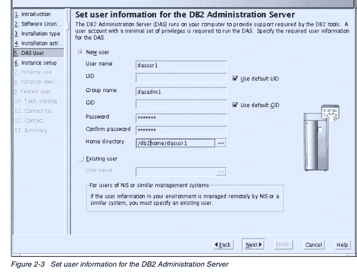

图 2-3 为 DB2 管理服务器设置用户信息

9. 设置 DB2 实例。如果要创建新实例，请勾选“创建 DB2 实例”选项（图 2-4）。否则，您需要在安装后使用 `db2icrt` 创建新实例。

### 设置 DB2 实例所有者的用户信息

为 DB2 实例指定实例所有者用户信息。DB2 将使用该用户执行实例功能，并将实例信息存储在该用户的主目录中。实例名称将与用户名相同。您可以创建新用户或使用现有用户。

图 2-6 设置 DB2 实例所有者的用户信息

12. 为 fenced 用户设置用户信息。该用户负责执行 fenced 用户定义函数，例如 UDF 和存储过程。再次提醒，请注意主目录的位置。

13. 准备 DB2 工具目录（图 2-7）。如果您计划使用任务中心或调度程序，请选择此选项。这会在本地机器上创建一个数据库，用于存储任务元数据。如果没有此存储库，调度程序将无法工作。您也可以在安装后使用 `CREATE TOOLS CATALOG` 命令创建 DB2 工具目录，但现在让 DB2 Setup 为您创建要容易得多。

### 准备 DB2 工具目录

在使用某些 DB2 工具（如任务中心和调度程序）之前，必须先创建 DB2 工具目录。DB2 工具目录包含任务元数据。DB2 Setup 向导可以准备一个本地数据库来存储此元数据。指定是否准备 DB2 工具目录。

使用本地数据库

不要在这台计算机上准备 DB2 工具目录

图 2-7 准备 DB2 工具目录

14. 指定用于存储工具目录的本地数据库（图 2-8）。在此，您指定存储工具目录的实例、数据库和模式。默认情况下，新创建的工具目录将放置在实例所有者的主目录中。

### 指定用于存储 DB2 工具目录的本地数据库

DB2 工具目录将存储在本地数据库中。请指定数据库所需的信息。如果该数据库不存在，系统将为您创建。

实例 `db2inst1`

数据库 New TOOLSD8

模式 New SYSTOOLS

图 2-8 为 DB2 工具目录指定本地数据库

15. 设置管理联系人列表（图 2-9）。管理联系人列表存储管理员联系信息，用于在数据库需要关注时通知管理员。您可以创建存储在本地的新联系人列表，或使用驻留在远程 DB2 服务器上的现有全局联系人列表。如果选中启用通知复选框，系统将搜索可用的 SMTP 服务器并将其设置为用于电子邮件通知。

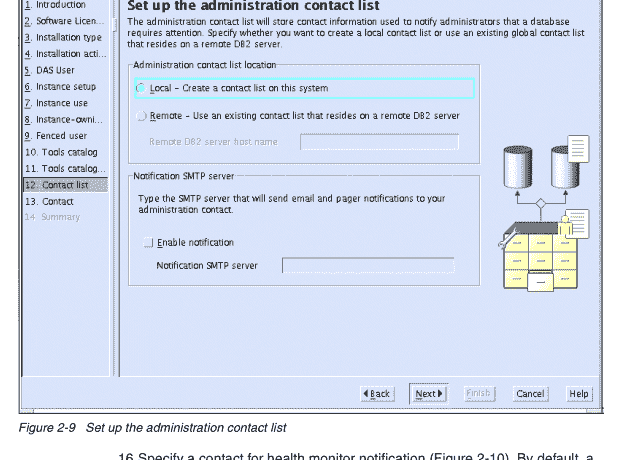

图 2-9 设置管理联系人列表

16. 指定健康监视器通知的联系人（图 2-10）。默认情况下，健康监视器在您正在设置的 DB2 实例上运行。当健康指标阈值被突破时，DB2 健康监视器将向此人在指定的邮件地址发送通知电子邮件。如果选中地址为寻呼机复选框，通知消息将发送到联系人的寻呼机。有关如何在安装后步骤中设置联系人列表和 SMTP 服务器的说明，请参阅第 71 页。

## 指定健康监视器通知的联系人

默认情况下，健康监视器在您正在设置的 DB2 实例上运行。当健康指标阈值被突破时，将通过电子邮件或寻呼机通知发送给管理员联系人。指定新的或现有的健康监视器通知联系人。如果您的联系人列表驻留在远程 DB2 服务器上，您必须提供登录的用户名和密码。

此实例的管理联系人

新联系人

姓名 `db2inst1`

电子邮件地址 `db2inst1@dbblmx02`

地址为寻呼机

将此任务推迟到安装完成后

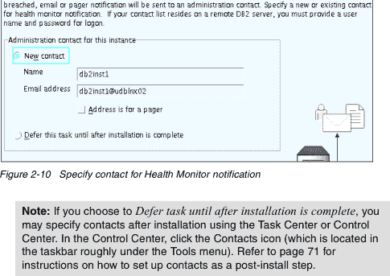

图 2-10 指定健康监视器通知联系人

> 注：如果您选择将任务推迟到安装完成后，您可以使用任务中心或控制中心在安装后指定联系人。在控制中心中，单击联系人图标（位于任务栏中，大致在工具菜单下方）。有关如何在安装后步骤中设置联系人的说明，请参阅第 71 页。

17. 开始复制文件并创建响应文件。此窗口提供了安装和配置设置的摘要（图 2-11）。滚动此窗口以验证设置是否正确，然后单击完成。

## 开始复制文件并创建响应文件


设置已拥有足够的信息来创建响应文件并开始复制程序文件。如果您想查看或更改任何设置，请单击返回。如果您对设置满意，请输入响应文件名并单击完成以开始复制文件。

### 当前设置

**主目录：**

受限用户信息：

用户名：`db2fenc1`

组名：`db2fgrp1`

主目录：`/db2home/db2fenc1`

**DB2 管理服务器：**

实例用户信息：

用户名：`dasusr1`

组名：`dasadm1`

主目录：`/db2home/dasusr1`

**DB2 工具目录：**

名称：`TOOLSCAT`

模式：`SYSTOOLS`

**响应文件名**

`/db2home/db2ese.rsp`

**附加数据库分区服务器的响应文件名**

`/db2home/db2ese2.rsp`

### 目录

- 1. 简介
- 2. 软件许可...
- 3. 安装类型
- 4. 安装活动...
- 5. DAS 用户
- 6. 实例设置
- 7. 实例使用
- 8. 实例所有者...
- 9. 受限用户
- 10. 工具目录
- 11. 工具目录...
- 12. 联系人列表
- 13. 联系人
- 14. 摘要

图 2-11 安装摘要窗口

18. 安装后，阅读状态报告选项卡并检查是否有任何错误。如果一切正常，下一步是安装 DB2 文档。有关“安装 DB2 文档”，请参阅第 72 页。

> 注：安装日志位于 `/tmp/db2setup.log`、`/tmp/db2setup.his` 和 `/tmp/db2setup.err`。

### 响应文件安装

DB2 设置向导生成的响应文件用于在初始安装后安装其他组件或产品。它们包含在初始安装期间指定的所有安装和配置设置，这使您能够在多台机器上安装一致的配置。它还通过绕过 DB2 设置向导为您节省时间。

默认情况下，生成的响应文件名为 `db2ese.rsp`。不过，在使用 DB2 安装向导时，您可以选择更改文件名和目标目录。请参阅第 60 页上的图 2-11。

#### 使用 DB2 安装向导创建响应文件

在 DB2 UDB ESE 安装向导启动后不久，您将看到以下窗口（图 2-12）。

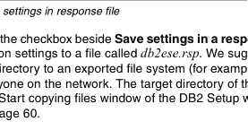

图 2-12 在响应文件中保存设置

只需勾选“在响应文件中保存设置”旁边的复选框。这会将所有安装设置保存到名为 `db2ese.rsp` 的文件中。我们建议您将目标目录更改为网络中所有人都可访问的导出文件系统（例如 `/software`）。响应文件的目标目录是在 DB2 安装向导的“开始复制文件”窗口中指定的，如第 60 页上的图 2-11 所示。

要使用响应文件安装 DB2，请参阅第 64 页中“步骤 2 - 使用响应文件在其余计算机上安装 DB2”的说明。如果要通过编辑示例响应文件来创建响应文件，请参阅第 66 页上的“使用示例响应文件创建响应文件”。

#### 2.3.2 多分区安装

在多个分区环境中安装 DB2 有几种方法：(1) 使用 DB2 安装向导在主计算机上安装 DB2 并创建新实例，然后使用响应文件在参与分区数据库的其余计算机上安装 DB2；或 (2) 编辑示例响应文件，并使用此文件在集群中的每台计算机上安装 DB2；或 (3) 使用 `db2_install` 或 DB2 安装向导与 `db2_install` 的组合来设置您的环境。

最简单的方法是在主计算机上使用 DB2 安装向导，然后在参与分区数据库系统的其余计算机上使用响应文件。我们首先讨论此方法。

### 使用 DB2 安装向导进行多分区安装

使用此方法时，第一步是在拥有实例的计算机上使用 DB2 安装向导安装 DB2 并创建新实例。此实例将在参与分区数据库系统的其余计算机之间共享。第二步是使用由 DB2 安装向导生成的响应文件，在集群中的其余计算机上安装 DB2。

#### 步骤 1：在拥有实例的计算机上使用 DB2 安装向导

1. 在拥有实例的计算机上，以 root 身份登录。
2. 转到 DB2 安装映像所在的目录并运行 `db2setup`。在第一个窗口中选择“安装产品”。
3. 在第二个窗口中，选择 DB2 UDB Enterprise Server Edition，然后单击“下一步”。
4. 再次单击“下一步”。在“许可协议”窗口中，阅读许可协议，然后选择“接受”。
5. 选择安装类型。您可以选择典型（Typical）、紧凑（Compact）或自定义（Custom）安装。

   - 典型安装会安装除应用程序开发和商业智能工具以外的大多数 DB2 组件。单击“查看功能”按钮可查看将安装哪些组件。
   - 紧凑安装仅安装基本的 DB2 特性和功能。
   - 自定义安装允许您安装所需的任何组件。自定义选项的一个优点是，它允许您随 DB2 UDB 一起安装应用程序开发客户端。选择典型选项时，应用程序开发客户端需要单独安装。
6. 在“选择安装操作”窗口中，勾选“在响应文件中保存您的设置”复选框（图 2-13）。这将创建两个响应文件：`db2ese.rsp` 和 `db2ese2.rsp`。您需要使用 `db2ese2.rsp` 在参与集群的其余计算机上安装 DB2。
7. 设置数据库管理服务器（Database Administration Server）的用户信息。该用户管理数据库管理服务器。默认情况下，这是唯一保存在响应文件 `db2ese2.rsp` 中的用户信息。在决定您的 DAS 用户以及 DAS 用户主目录的存储位置时，请参阅第 51 页上的“分区数据库的 DAS 用户注意事项”。
8. 设置 DB2 实例。如果要创建新实例，请勾选“创建 DB2 实例”选项（对于此示例，我们假设您

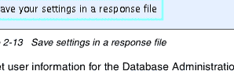

图 2-13 在响应文件中保存设置

selected this option). Otherwise you will need to create a new instance using `db2icrt` after installation.
9. 选择实例的用途。勾选 分区实例（图 2-14）。这意味着该实例将在分区数据库中使用。你当前使用的机器将托管实例拥有数据库分区服务器。

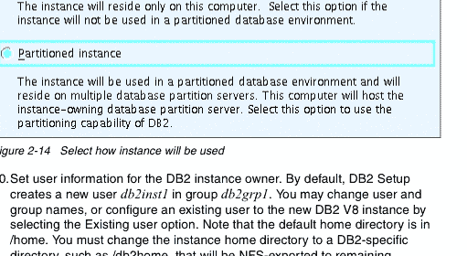

图 2-14 选择实例的用途
10. 设置 DB2 实例所有者的用户信息。默认情况下，DB2 Setup 会在组 `db2grp1` 中创建一个新用户 `db2inst1`。你可以更改用户名和组名，或通过选择 现有用户 选项将现有用户配置到新的 DB2 V8 实例。请注意，默认主目录位于 `/home`。你必须将实例主目录更改为 DB2 专用的目录，例如 `/db2home`，该目录将 NFS 导出到参与分区数据库的剩余机器。
11. 设置受限用户的信息。该用户负责执行受限用户定义函数，例如 UDF 和存储过程。你也应将此主目录放在分区服务器间共享的目录中，例如 `/db2home`。
12. 准备 DB2 工具目录。如果你计划使用任务中心或调度程序，则需要一个 DB2 工具目录。它是一个存储任务元数据的数据库。你也可以在安装后使用 `CREATE TOOLS CATALOG` 命令创建 DB2 工具目录，但现在让 DB2 Setup 为你创建要容易得多。
13. 指定用于存储工具目录的本地数据库。在此处指定用于存储工具目录的实例、数据库和模式。
14. 设置管理联系人列表。管理联系人列表存储管理员联系信息，并用于在数据库需要关注时通知管理员。你可以创建存储在本地的新联系人列表，或使用驻留在远程 DB2 服务器上的现有全局联系人列表。如果你勾选 启用通知 复选框，你的系统将搜索可用的 SMTP 服务器，该服务器将用于电子邮件通知。

> 注： 如果未设置 SMTP 服务器，你可以在安装后使用 DB2 CLP（命令行处理器）进行设置。有关设置说明，请参阅第 71 页。
15. 指定健康监控通知的联系人。默认情况下，DB2 健康监控将在你正在设置的 DB2 实例上运行。DB2 健康监控将在健康指标阈值被突破时向此人指定的电子邮件地址发送通知电子邮件。如果你勾选 地址为寻呼机，通知消息将被发送到联系人的寻呼机。

> 注： 如果你选择 在安装完成后推迟任务，你可以在安装后使用任务中心或控制中心指定联系人。在控制中心，单击任务栏下工具菜单中的联系人图标。有关设置说明，请参阅第 71 页。
16. 开始复制文件并创建响应文件。此窗口提供了你的安装和配置设置的摘要。滚动此窗口以验证设置是否正确，然后单击完成。

#### 第 2 步 - 使用响应文件在剩余机器上安装 DB2

执行分区安装后，DB2 Setup 向导会创建两个响应文件：`db2ese.rsp` 和 `db2ese2.rsp`。`db2ese.rsp` 响应文件包含创建实例、实例拥有者和受限用户以及工具目录数据库（如果在安装期间选择）的说明。`db2ese2.rsp` 响应文件仅安装适当的 DB2 文件集，指定 DAS 属性，并指定要安装的语言。仅在参与计算机上安装数据库分区服务器时才使用 `db2ese2.rsp` 响应文件。

二级响应文件 `db2ese2.rsp` 大致如下所示：


```
**************************************************
* Generated response file used by the DB2 Setup wizard
* generation time: 10/21/02 10:43 AM
**************************************************
* Product Installation
LIC_AGREEMENT = ACCEPT
PROD = ENTERPRISE_SERVER_EDITION
INSTALL_TYPE = TYPICAL
**************************************************
* Das properties
**************************************************
```

`DAS_CONTACT_LIST`      = REMOTE

`DAS_CONTACT_LIST_HOSTNAME`  = `udb1nx01`

`DAS_SMTP_SERVER`       = null

* DAS user

`DAS_USERNAME`          = `dasusr1`

`DAS_GROUP_NAME`        = `dasadm1`

`DAS_HOME_DIRECTORY`    = `/home/dasusr1`

`DAS_PASSWORD`          = 235262333285355231346

`ENCRYPTED`             = `DAS_PASSWORD`

*----------------------------------------

* Installed Languages

*----------------------------------------

`LANG`                  = EN

> 提示：从文件系统网络驱动器执行响应文件安装比从 CD-ROM 驱动器快得多。如果您计划安装多个客户端，应在代码服务器上设置挂载的文件系统以提高性能。

## 要执行响应文件安装

要执行响应文件安装，请找到 `db2ese2.rsp` 文件并执行以下操作：

1. 以 root 身份，使用以下格式输入 `db2setup` 命令：

   `<cd-rom>/db2setup -r <responsefile_directory>/<response_file>`

   其中：

   - `<cd-rom>` 表示 DB2 安装映像的位置；
   - `<responsefile_directory>` 表示响应文件所在的目录；以及
   - `<response_file>` 表示响应文件的名称（例如，`db2ese2.rsp`）。

在我们的设置中，DB2 安装映像位于 `/software`，响应文件 `db2ese2.rsp` 位于 `/db2home`。因此，我们在 `/software` 中执行了以下命令：

```
[root@udb1nx01]/# ./db2setup -r /db2home/db2ese2.rsp
```

2. 安装完成后，检查安装日志以确保未发生错误。主要的安装日志文件是 `/tmp/db2setup.log`。

## 使用示例响应文件安装 DB2

另一种在多个物理节点上安装 DB2 的方法是对示例响应文件进行编辑，并使用此文件在集群中的每台机器上安装 DB2。示例响应文件对于单分区安装也很有用，如果您想绕过图形向导，同时利用 DB2 Setup 的配置功能。

## 使用示例响应文件创建响应文件

DB2 CD-ROM 包含一个即用型示例响应文件，其中包含默认条目。该文件名为 `db2ese.rsp`，位于：

```
`<cd-rom>/db2/linux/samples`
```

其中，`<cd-rom>` 表示 DB2 安装映像的位置。该目录还包含 Application Development Client 和 Administration Client 的示例响应文件，分别命名为 `db2adcl.rsp` 和 `db2admcl.rsp`。

要从示例创建自己的响应文件，您必须将示例响应文件复制到本地文件系统并对其进行编辑。

- 通过删除关键字左侧的星号 `*` 来激活响应文件中的项目，然后用新设置覆盖默认设置。可能的设置范围列在等号右侧。请参阅“Administration”指南（在第 301 页的“Other publications”中列出）以获取配置这些参数的指导。
- 将文件保存在导出的文件系统上（例如，`/software`），网络上的每个人都可以使用。

## 使用响应文件安装 DB2

- 以 root 身份发出 `db2setup -r` 命令执行安装。例如，如果 DB2 安装映像位于 `/software`，而 `db2ese.rsp` 响应文件位于 `/db2home`，则以 root 身份输入以下命令：

```
/software/db2setup -r /db2home/db2ese.rsp
```

您的自定义响应文件由您决定。要让您了解最终产品，以下响应文件是由 DB2 Setup 向导生成的：

```
*>-----------------------------------------------------
* Generated response file used by the DB2 Setup wizard
* generation time: 10/18/02 11:51 AM
*>-----------------------------------------------------
* Product Installation LIC_AGREEMENT = ACCEPT
PROD = ENTERPRISE_SERVER_EDITION
INSTALL_TYPE = TYPICAL
*>-----------------------------------------------------
*
Das properties
*>-----------------------------------------------------
DAS_CONTACT_LIST = LOCAL
* DAS user
DAS_USERNAME = dasusr1
DAS_GROUP_NAME = dasadm1
```

`DAS_HOME_DIRECTORY` = `/home/dasusrl`

`DAS_PASSWORD` = 235262333285355231346

`ENCRYPTED` = `DAS_PASSWORD`

`TOOLS_CATALOG_DATABASE` = `toolsDB`

`TOOLS_CATALOG_SCHEMA` = SYSTOOLS

* toolsDB

properties DATABASE = toolsDB

toolsDB.INSTANCE = inst1

toolsDB.DATABASE_NAME = TOOLSDB

toolsDB.LOCATION = Local

* -----------------------------------------

* 实例属性

* -----------------------------------------

`INSTANCE` = inst1

inst1.TYPE = ese

inst1.WORDWIDTH = 32

* 实例属主用户

inst1.NAME = db2inst1

inst1.GROUP_NAME = db2grp1

inst1.HOME_DIRECTORY = /db2home/db2inst1

inst1.PASSWORD = 235262333285355231346

ENCRYPTED = inst1.PASSWORD

inst1.AUTOSTART = YES

inst1.AUTHENTICATION = SERVER

inst1.SVCNAME = db2c_db2inst1

inst1.PORT_NUMBER = 50001

inst1.FCM_PORT_NUMBER = 60000

inst1.MAX_LOGICAL_NODES = 4

* fenced 用户

inst1.FENCED_USERNAME = db2fenc1

inst1.FENCED_GROUP_NAME = db2fgrp1

inst1.FENCED_HOME_DIRECTORY = /db2home/db2fenc1

inst1.FENCED_PASSWORD = 235262333285355231346

ENCRYPTED = inst1.FENCED_PASSWORD

* 联系属性

CONTACT = contact1

contact1.CONTACT_NAME = db2inst1

contact1.EMAIL = db2inst1@udb1nx01

contact1.PAGER = false

contact1.INSTANCE = inst1


## 已安装语言

`LANG = EN`

### 2.3.3 `db2_install` 实用程序

`db2_install` 实用程序安装 DB2 文件集，但不会创建实例、用户，也不会执行 DB2 安装向导所执行的任何其他配置任务。有些人倾向于在具有特殊要求的大型、复杂数据库系统上安装 DB2 时使用 `db2_install`。

## 安装 DB2

1. 以具有 root 权限的用户身份登录。
2. 插入并挂载 DB2 光盘。
3. 输入 `db2_install` 命令以启动 `db2_install` 脚本。此脚本位于光盘的根目录中。
4. 当 `db2_install` 提示您输入产品关键字时，请输入 `DB2.ESE`。

Linux 上 DB2 的安装目录是 `/opt/IBM/db2/V8.1`。

## 安装后任务

使用 `db2_install` 安装 DB2 后，请执行以下操作：

1. 创建组和用户 ID（如果尚未创建）。
2. 创建 DB2 实例。
3. 为 DB2 文件创建链接（可选）。
4. 为 DB2 实例配置 TCP/IP 通信。
5. 更新产品许可证密钥。
6. 创建 DB2 管理服务器（DAS）。
7. 创建 DB2 工具目录（可选）。
8. 设置 SMTP 服务器和通知联系人列表（可选）。

## 过程

1. 创建组和用户 ID；请参阅第 48 页的 2.2.4 “用户和组设置”。
2. 创建 DB2 实例。使用 `db2icrt` 命令创建新实例：
   a. 以 root 身份登录。
   b. 输入以下命令：

```
/opt/IBM/db2/V8.1/instance/db2icrt [-a AuthType] -u FencedID InstNme
```

其中：

- `AuthType` 表示实例的身份验证类型。如果未指定此参数，则使用默认身份验证类型 `SERVER`。`AuthType` 可以是 `SERVER`、`CLIENT`、`DCS`、`SERVER_ENCRYPT` 或 `DCS_ENCRYPT` 之一。
- `FencedID` 表示 DB2 fenced 用户的名称。
- `InstNme` 表示您正在创建的实例的名称。实例名称必须与实例属主用户的名称相同。此实例将创建在实例属主用户的主目录中。

例如，我们输入了：

```
./db2icrt -u db2fenc1 db2inst1
```

### 3. 为 DB2 文件创建链接（可选）。

如果您正在开发或运行应用程序，您可能希望为 DB2 文件创建指向 `/usr/lib` 目录的链接，并为包含文件创建指向 `/usr/include` 目录的链接。这样可以避免指定产品库和包含文件的完整路径。

在多个 DB2 版本共存的系统上不应创建链接。如果您在一个 DB2 版本上创建链接，则另一个版本上的链接将被覆盖。

要创建链接：
a. 以 root 身份登录。
b. 输入以下命令：

```
/opt/IBM/db2/V8.1/cfg/db2ln
```

> 注意：如果您已有来自先前 DB2 版本的指向 `/usr/lib` 和 `/usr/include` 的链接，并且希望保留指向先前版本库的链接，则必须先执行 DB2 V8 中的 `db2rmln` 命令，然后再执行先前 DB2 版本中的 `db2ln` 命令。`db2ln` 命令会移除现有链接，并将其替换为指向 DB2 V8 库的链接。

### 4. 为 DB2 实例配置 TCP/IP。

您必须为您的实例配置 TCP/IP 协议，以便它能够接受来自远程 DB2 客户机的请求。请按照以下步骤操作：

a. 更新 `/etc/services` 文件，以指定 DB2 服务器将侦听的客户端请求的服务名称和端口号。要更新 `/etc/services` 文件，请使用文本编辑器添加连接条目。例如，我们添加了：

```
db2c_db2inst1 50001/tcp # DB2 connection service port
```

其中：
- `db2c_db2inst1` 表示连接服务名称
- `50001` 表示连接端口号
- `tcp` 表示 TCP/IP 通信协议

服务名称是任意的，但在 services 文件中必须唯一。在分区环境中，请确保端口号不会与 Fast Communications Manager (`FCM`) 或系统上任何其他应用程序使用的端口号冲突。

b. 更新服务器上的数据库管理器配置文件。为此：
   i. 以实例所有者身份登录系统。
   ii. 通过运行 `db2profile` 脚本来设置实例环境：

```
. INSTHOME/sqllib/db2profile
```

iii. 更新 DBM 配置文件中的 `SVCENAME` 参数。您可以指定服务名称或端口号。例如，我们输入：

```
db2 update dbm cfg using SVCENAME db2c_db2inst1
```

您可以通过输入以下命令来检查 `SVCENAME`：

```
db2 get dbm cfg | grep Svc
```

c. 将 `DB2COMM` 注册表变量设置为 `tcp/ip`。这将在启动数据库管理器时启动 DB2 通信管理器。以实例所有者身份输入以下命令：

```
db2set DB2COMM=tcpip
```

d. 停止并重新启动实例以使这些更改生效：

```
db2stop
```

```
db2start
```

### 5. 安装许可证密钥。

您必须在安装了 DB2 服务器的每台计算机上安装许可证密钥。在分区环境中，这意味着您必须在参与分区数据库系统的每台机器上安装许可证密钥。这是通过使用 `db2licm` 命令添加 DB2 许可证文件来完成的。

a. 以 root 用户或实例所有者身份登录。
b. 输入以下命令：

```
/opt/IBM/db2/V8.1/adm/db2licm -a <filename>
```

其中，`filename` 是 DB2 ESE 许可证文件 `db2ese.lic` 的完整路径名和文件名。该许可证文件位于 CD-ROM 根目录的 `/db2/license` 中。例如，如果 CD-ROM 挂载在 `/cdrom` 目录中，请输入以下命令：

```
/opt/IBM/db2/V8.1/adm/db2licm -a /cdrom/db2/license/db2ese.lic
```

在 Linux 上，DB2 许可证密钥位于 `/var/lum` 中的一个名为 `nodelock` 的文件中。

### 6. 创建 DB2 管理服务器 (DAS)。

如果您计划使用 DB2 图形工具，例如 Control Center 和 Task Center，则需要 DAS。您需要在创建 DAS 之前创建 DAS 用户。

以下是步骤：
a. 以具有 root 权限的用户登录。
b. 发出以下命令创建 DAS：

```
/opt/IBM/db2/V8.1/instance/dascrt -u DASuser
```

对于 `-u` 参数，输入为此机器创建的 DAS 用户，例如 `dasusr1`。

### 7. 创建 DB2 工具目录（可选）。

如果您计划使用 Task Center 或调度程序，则必须创建 DB2 工具目录。这将在您的本地机器上创建一个数据库，用于存储任务元数据。调度程序在没有此存储库的情况下无法工作。您可以创建新数据库或使用现有数据库。

a. 以实例所有者身份登录。
b. 使用 `CREATE TOOLS CATALOG` 命令创建新的工具目录数据库，或将工具目录配置为现有数据库。

例如，要在名为 `toolsdb` 的新数据库中创建名为 `toolscat` 的新工具目录，我们发出：

```
db2 create tools catalog toolscat create new database toolsdb
```

> 注：有关 `CREATE TOOLS CATALOG` 命令的其他选项，请参阅 IBM DB2 UDB Command Reference V8，SC09-4828。

### 8. 设置 SMTP 服务器和管理员联系人列表（可选）。

默认情况下，DB2 实例上运行着一个健康监视器。如果您设置了 SMTP 服务器和管理员联系人列表，当健康指标阈值被突破且数据库需要关注时，DB2 健康监视器将向联系人列表中的人员发送通知电子邮件。您可以创建存储在本地的新联系人列表，或使用驻留在远程 DB2 服务器上的现有全局联系人列表。另一个选项是创建联系人组。当通知发送给该组时，组的每个成员都会收到此通知。您还可以指定将通知发送到联系人的寻呼机。首先，您必须设置 SMTP 服务器。为此：

a. 以实例所有者身份登录并发出以下命令：

```
db2 update admin cfg using smtp_server <host_name>
```

其中，`host_name` 是用于电子邮件通知的 SMTP 服务器所在机器的 TCP/IP 主机名。


## 接下来，决定是否要将联系人列表存储在本地或远程服务器上

默认情况下，联系人列表存储在本地。如果您想设置远程联系人列表（对于分区环境强烈推荐，因为它在多个 DB2 管理服务器之间共享一个公共联系人列表），请将 DAS 配置参数 `contact_host` 设置为要存储联系人列表的远程 DAS 的 TCP/IP 主机名。例如，要将我们的联系人列表存储在主机 `udblnx05` 上，我们输入了：

```bash
db2 update admin cfg using contact_host udblnx05
```

## 现在向管理联系人列表添加联系人

- i. 打开控制中心并单击联系人图标。该图标位于任务栏中大致在工具菜单下方，看起来像这样：
- ii. 从系统名称下拉菜单中选择您的系统名称。
- iii. 单击添加联系人按钮。输入管理联系人的姓名和电子邮件地址。如果您希望通知发送到联系人的寻呼机，请勾选地址为寻呼机。
- iv. 单击测试按钮以验证电子邮件通知功能是否正常工作。按确定保存设置并返回联系人窗口。
- v. 如果您想创建联系人组，请单击添加组按钮，并在名称字段中输入组的名称。接下来，从可用联系人列表中选择名称并按箭头键将这些联系人添加到组中。

您也可以使用任务中心添加联系人。

## 最后，使用以下命令打开调度程序

```bash
db2 update admin cfg using sched_enable on
```

然后重新启动 DB2 管理服务器以使更改生效。

# 安装 DB2 文档

DB2 版本 8 在单独的 CD 上提供 HTML 和 PDF 文档。这些 CD 与您的客户端和服务器 CD 一起提供。

- **HTML 文档 CD。** 该 CD 包含 DB2 在线文档，包括帮助屏幕和信息中心。它与其它 DB2 产品分开安装，自 CD-ROM 安装，这意味着您可以在安装 DB2 后立即安装 DB2 HTML 文档，或在以后安装。您还可以将文档和信息中心安装在未安装 DB2 的机器上，例如您公司的内部 Web 服务器。这将节省单个机器上的空间。
- **PDF 文档 CD。** 与 HTML 文档不同，您无需“安装”PDF 文档。该 CD 提供可直接从 CD 读取或复制到您机器上的 PDF 文件。

## 使用 DB2 Setup 向导安装 HTML 文档

1. 插入标记为 *DB2 HTML Documentation* 的 CD-ROM。
2. 以具有 root 权限的用户身份登录系统。
3. 通过输入以下命令进入文档 CD 挂载的目录：

```bash
cd /cdrom
```

其中 `/cdrom` 代表 CD-ROM 的挂载点。
4. 输入 `./db2setup`。这将启动 DB2 Setup 向导。
5. 启动板打开后，单击 **Install Products** 将 DB2 文档安装到您的机器上。您还可以使用此启动板查看安装先决条件、查看发行说明，或进行 **Quick Tour** 以查看 DB2 UDB 版本 8 的功能。
6. 选择您想要安装的产品。选择 **DB2 HTML Documentation** 并单击 **Next**。
7. 欢迎使用 DB2 Setup Wizard。单击 **Next**。
8. 选择要安装的 HTML 文档组件（图 2-15）。默认情况下，`db2setup` 仅安装核心文档。选择您想要安装的任何额外文档，然后单击 **Next**。

### 选择要安装的 HTML 文档组件

选择您想要安装的 HTML 文档组件。

- **DB2 HTML Documentation**
  - Administration information
  - Application Development information
  - Business Intelligence information
  - Core DB2 information
  - DB2 Connect information
  - Getting started information
  - Optional component information
  - Tutorial information

**Description**

Describes how to access mainframe and midrange databases through DB2 Connect.

**Installation directory**

Directory `/opt/IBM/db2/V8.1`

Space required: 25 MB

Space available: 2920 MB

- Select default
- Select all
- Back
- Next
- Finish
- Cancel
- Help

1. Introduction
2. Features
3. Languages
4. Summary


图 2-15 选择要安装的 HTML 文档组件

9. Languages（图 2-16）。默认情况下，DB2 Setup 仅安装英文文档。您可以通过在左侧菜单中选择它们并单击箭头（>）键来安装其他语言。

# 语言

HTML 文档将安装在您在此处选择的全部语言中。安装多种语言会增加磁盘空间需求。默认情况下，HTML 文档将安装在与之前安装联机帮助和消息相同的语言中。

可用语言

- 法语（标准）
- 德语
- 意大利语
- 葡萄牙语（巴西）
- 西班牙语

已选语言

确认安装目录

目录 `/db2home/documentation`

所需空间：51 MB

可用空间：2920 MB

图 2-16 选择语言

10. 开始复制文件。检查设置，然后单击完成。

## 使用 doc_install 安装 DB2 HTML 文档

要手动安装 DB2 HTML 文档，请使用 `doc_install` 脚本。

- 1. 以具有 root 权限的用户登录。
- 2. 决定您要安装文档的位置。在我们的分区环境中，我们创建了一个名为 `/documentation` 的目录，该目录位于共享的 `/db2home` 目录中（例如，`/db2home/documentation`）。
- 3. 插入并挂载 DB2 HTML 文档 CD-ROM。
- 4. 使用以下格式输入 `./doc_install` 命令：

```
doc_install -l <language> -t <topic> [-p <path>] [-d]
```

要安装多个主题，请输入每个主题关键字，用空格分隔。

英语的语言代码为 `en_US`。输入 `./doc_install` 或参考 CD 上的 Readme 文件以查看其他语言的语言代码。

有效主题为：

- **core** Core DB2 信息
- **admin** Administration 信息
- **ad** Application development 信息
- **wareh** Business Intelligence 信息
- **conn** DB2 Connect 信息
- **start** Getting started 信息
- **tutr** Tutorial 信息
- **opt** Optional component 信息

例如，要将英语的核心、管理和入门文档安装到 `/db2home/documentation` 目录中，请输入以下内容：

```
./doc_install -l en_US -t core admin start -p /db2home/documentation
```

> 注意：没有 `db2_deinstall` 程序来卸载文档。只需使用 `rm -rf` 删除文档文件即可。

### 2.3.4 添加额外分区

要在以后在单独的服务器/机器上添加额外分区，我们建议您使用响应文件安装 DB2。您可以使用初始安装期间创建的响应文件，也可以通过编辑示例响应文件生成新的响应文件。示例响应文件 `db2ese.rsp` 位于 `/installation source/ese/db2/linux/samples` 中。这是最佳方法，因为它可以在安装服务器的同时配置 DBM 参数。有关编辑示例响应文件的更多信息，请参阅第 65 页的“使用示例响应文件安装 DB2”。添加数据库分区的逐步操作说明在第 100 页的 3.4“添加数据库分区”中提供。

### 2.3.5 在 NIS 上安装


您可以使用 `DB2 Setup` 或 `db2_install` 在使用网络信息系统（NIS）或 NIS+ 的系统上安装 DB2。但是，在使用 NIS（或其他不允许 DB2 安装程序修改用户特征的外部安全程序）的环境中使用 `DB2 Setup` 安装 DB2 时，需要考虑一些因素。这是因为 `DB2 Setup` 安装脚本中的一些脚本会尝试更新由 NIS 控制的用户和组，并且无法执行此操作。这并不是为了阻止您在 NIS 系统上使用 `DB2 Setup`——您仍然可以从其所有功能中受益，除了用户和组创建功能之外。如果 `DB2 Setup` 检测到您的机器上存在 NIS，它将不会在安装期间为您提供创建新用户的选项。相反，它只允许您选择现有用户。

只需遵守以下安装先决条件，即可在 NIS 系统上成功使用 `DB2 Setup`：

- 在运行 `DB2 Setup` 向导或执行响应文件安装之前，必须先在 NIS 服务器上创建用户和组。
- 必须在 NIS 服务器上为 DB2 实例所有者和 DB2 管理服务器创建辅助组。然后，您必须将实例所有者的主组添加到辅助 DB2 管理服务器组中。同样，您必须将 DB2 管理服务器的主组添加到实例所有者的辅助组中。
- 对于 ESE，在创建实例之前，必须在 `/etc/services` 文件中为实例添加条目。

## 安装后任务

在上一章中，我们提供了在 Linux 上安装 DB2 版本 8 的详细过程。在本章中，我们讨论应执行的安装后任务，以拥有一个功能正常的 DB2 环境。涵盖以下主题：

- Control Center 设置
- 数据库创建准备
- 创建数据库
- DB2 配置
- 客户端访问设置

`Control Center` 是基于 JAVA 的图形工具，用于帮助您管理 DB2 实例和数据库。我们将说明如何首次启动此工具。

本节讨论单分区和多分区数据库的 Linux 特定设置。

本节提供使用数据库向导和命令行处理器创建数据库的说明。

这里我们讨论实例和数据库的一些重要配置参数。

本节讨论安装和配置 DB2 客户端以访问 DB2 ESE。

### 3.1 Control Center 设置

`DB2 UDB` 拥有丰富的图形工具，供数据库管理员用于管理数据库系统，供应用程序开发人员用于开发存储过程和用户定义函数。`Control Center` 是用于帮助您探索和管理数据库的通用管理工具之一。其他此类工具包括可用于生成 SQL 查询的 `Command Center`，以及用于配置数据库环境的优秀工具 `Configuration Assistant`。

如果您想使用 `Control Center` 管理数据库服务器，则必须在数据库服务器环境的每个主机上启动 DB2 Administrator Server。`DB2 Administrator` 服务设置程序在第 2 章“安装”第 23 页中提供。要启动 DB2 Administrator Server，请以 DAS 用户身份登录到每个主机并发出 `db2admin start`。

如果您以实例所有者或特权 DB2 用户身份登录并且已启动 X-Window，则可以键入 `db2cc &` 命令或使用 Start Applications → IBM DB2 菜单启动 Control Center。如果您以 root 用户身份启动 X-Window，则需要在启动 Control Center 之前切换到 DB2 实例所有者 ID 并设置显示。示例命令如下所示。

#### Example 3-1 Start Control Center

```
xhost +
su - db2inst1
export DISPLAY=:0.0
db2cc &
```

命令后的 `&` 符号会返回 shell 提示符，从而允许您使用此 shell 执行其他命令。

> Note: If you get a JAVA error, verify that you have installed and are using the correct JDK Version, which is Java(TM) 2 Runtime Environment, Standard Edition 1.3.1, and verify that the path setting is correct. The JDK is described in 2.1.6, "Additional software requirements" on page 31.

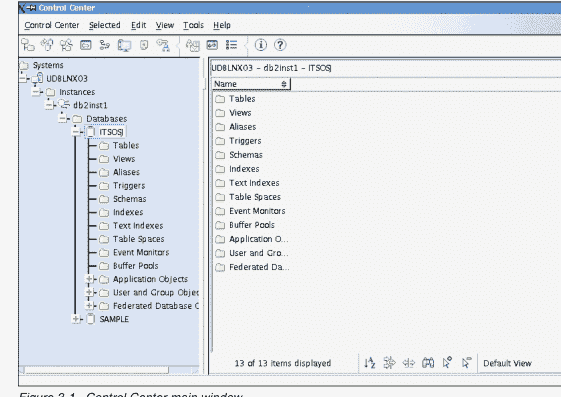

Figure 3-1 Control Center main window

图 3-1 显示了在 Linux 系统上启动的 Control Center。Systems 树已展开以显示 `db2inst1` 实例中的所有数据库。

### 3.2 数据库创建准备

在创建数据库之前，需要在 Linux 和 DB2 上完成一些配置任务。这里我们讨论：

- Linux 特定配置
- 多分区特定配置

#### 3.2.1 Linux 特定配置

为了访问 DB2，每个 Linux 用户必须设置其 Linux 环境。在创建实例期间，DB2 会在实例主目录 `$INSTHOME` 中创建名为 `sqllib` 的子目录。在此目录中，有 `db2nodes.cfg`、`db2profile` 和 `userprofile` 等重要文件。这些文件用于设置 DB2 环境。为了每次用户登录 Linux 系统时设置用户环境以使用 DB2，请将以下命令添加到用户主目录 `$INSTHOME/.profile` 中的用户配置文件下：

```
. $INSTHOME/sqllib/db2profile
```

`db2profile` 包含允许用户使用 DB2 数据库的所有设置。请勿修改此文件，因为在安装 FixPak 后 `db2profile` 将被替换。如果您想对环境进行特定更改，请在 `$INSTHOME/sqllib/userprofile` 中进行更改，该文件由 `db2profile` 调用。此文件对于设置 TSM 参数等特殊环境变量很有用。

**Notes:**

- `$INSTHOME` 应替换为实例主目录的实际值。
- DB2 为 csh 用户提供 `$INSTHOME/sqllib` 下的 `db2cshrc` 以设置 DB2 环境。

#### 3.2.2 多分区特定配置

如果您决定在多分区环境中安装 DB2，则必须准备 DB2 实例以在不止一个节点上运行。在分区数据库系统中，每个数据库分区服务器必须有权在参与实例的所有其他数据库分区服务器上执行远程命令。为此，请以实例所有者身份在 `$INSTHOME` 目录中创建 `.rhosts` 文件并将权限更改为 600。要创建 `.rhosts` 文件，请输入以下命令：

```
vi /db2home/db2inst1/.rhosts
```

`.rhosts` 的格式如下：

```
hostname instance_owner or user_name
```

其中，`hostname` 是物理机器的主机名或 IP 地址。在 Example 3-2 中，用户 `db2inst1` 具有在主机 `udblnx02` 和 `udblnx05` 上执行远程命令的权限。

#### Example 3-2 .rhosts file

```
udblnx02 db2inst1
udblnx05 db2inst1
```

要将 `.rhosts` 文件权限更改为 600，请输入以下命令：

```
chmod 600 /db2home/db2inst1/.rhosts
```

每个将执行远程命令的用户都必须拥有自己的 `.rhosts` 文件。

要定义哪些主机参与分区环境，您必须修改位于 `$INSTHOME/sqllib` 中的 `db2nodes.cfg` 文件。在我们的示例（示例 3-3）中，我们有两台机器，每台机器各托管两个数据库分区。

`db2nodes.cfg` 文件的格式如下：

```
nodenumber hostname logical_port
```

其中，`nodenumber` 表示分区号，`hostname` 表示物理机的主机名或 IP 地址，`logical_port` 表示同一主机上分区的逻辑端口号。

#### 示例 3-3 db2nodes.cfg 文件

```
0 udb1nx02 0
1 udb1nx02 1
2 udb1nx05 0
3 udb1nx05 1
```

要启用参与您的分区数据库系统的数据库分区服务器之间的通信，您必须在 `/etc/services` 中保留 TCP/IP 端口。如果您使用 `db2setup` 向导安装 DB2，则会在主（实例拥有）计算机上自动保留一个端口范围。

以 root 用户身份登录到每台参与的计算机，并在 `/etc/services` 中添加相同的条目。示例 3-4 显示了为此主机上的四个本地分区保留的四个端口。

#### 示例 3-4 /etc/services 中的端口

```
DB2_db2inst1 60000/tcp
DB2_db2inst1_1 60001/tcp
DB2_db2inst1_2 60002/tcp
DB2_db2inst1_END 60003/tcp
```


您可以使用 `db2_all` 命令检查设置。在示例 3-5 中，`db2_all` 命令用于查询两个物理节点上的日期。

## 示例 3-5 db2_all 示例命令

```
db2inst1@udb1nx02:"/sqllib> db2_all date

Mon Oct 21 17:06:28 PDT 2002
udb1nx02: date completed ok

Mon Oct 21 17:06:28 PDT 2002
udb1nx02: date completed ok

Mon Oct 21 17:16:35 PDT 2002
udb1nx05: date completed ok

Mon Oct 21 17:16:35 PDT 2002
udb1nx05: date completed ok
```

现在您可以在多主机、多分区环境中启动 DB2。为此，在任意主机上输入 `db2start` 命令。参考示例 3-6。

## 示例 3-6 启动具有四个分区的 DB2 实例

```
db2inst1@udb1nx02:> db2start
11-01-2002 15:10:51  1  0  SQL1063N  DB2START processing was successful.
11-01-2002 15:10:51  0  0  SQL1063N  DB2START processing was successful.
11-01-2002 15:10:52  3  0  SQL1063N  DB2START processing was successful.
11-01-2002 15:10:53  2  0  SQL1063N  DB2START processing was successful.
SQL1063N  DB2START processing was successful.
```

> 注：`db2_all` 是 DB2 提供的一个 shell 脚本，允许您向一个或所有数据库分区发送命令。

### 3.3 创建数据库

创建数据库时，将为您完成以下任务：

- 设置数据库所需的所有系统目录表
- 在创建新数据库期间，DB2 分配三个表空间：`SYSCATSPACE`、`USERSPACE1` 和 `TEMP SPACE1`。表空间 `SYSCATSPACE` 包含所有系统目录表。这些目录表实际上是一个存储库，用于保存有关数据库中所有对象的相关信息和统计数据。`USERSPACE1` 包含用于保存用户创建表的表。DB2 需要一个系统临时表空间（`TEMP SPACE1`）来支持排序数据、连接表、创建索引等活动。
- 分配数据库恢复日志
- DB2 恢复日志跟踪对数据库所做的所有更改。它也称为事务日志。它与恢复历史文件一起使用，以在发生故障时恢复数据。
- 创建数据库配置文件并设置默认值

数据库配置文件用于向 DB2 提供信息，例如它可以使用多少内存、日志需要存储在哪里以及 DB2 优化器相关信息。

- 将数据库实用程序绑定到数据库

包含 SQL 语句的程序必须绑定到数据库。此绑定过程用于 DB2 实用程序，如 `import` 和 `load`。

在现有实例中创建数据库有两种方法：

- DB2 Create Database Wizard，这是一个基于 JAVA 的图形工具
- 从命令行处理器窗口使用 `create database` 命令

在创建多分区数据库之前，您应考虑哪个分区将成为目录节点。在分区数据库环境中，`create database` 命令会影响 `db2nodes.cfg` 文件中列出的所有数据库分区。发出此命令的数据库分区节点将成为新数据库的目录数据库分区。

> 提示：在具有多个分区的<|message|> 上，每条命令或 SQL 语句默认情况下都会在该主机的第一个分区上运行。要在其他分区上运行命令或 SQL 语句，您需要通过设置 `DB2NODE` 变量来指定节点。

> 例如，主机 `udb1nx02` 具有分区号 0 和 1。如果您发出 `export DB2NODE=1` 命令，并且它继续或随后执行 `db2 terminate` 命令，则每条语句现在将在分区 1 上运行。

您必须具有 `sysadm` 或 `sysctrl` 授权才能创建新数据库。在创建数据库之前，请在您希望存储数据库文件的所有文件系统或目录上设置正确的权限。默认情况下，数据库将在由数据库管理器配置变量 `dftdbpath` 确定的路径中创建并编目。您可以通过输入以下命令将其更改为您想要的默认路径：

```
db2 update dbm cfg using DFTDBPATH /database
```

#### 3.3.1 创建数据库向导

如果您以单分区模式安装了 DB2，那么创建数据库最简单的方法是使用创建数据库向导。DB2 实例已在 DB2 安装期间创建，如 2.3“安装 DB2”第 52 页所述。创建数据库向导也可以用于创建多分区数据库。您可以从控制中心启动“创建数据库向导”，如图3-2所示。

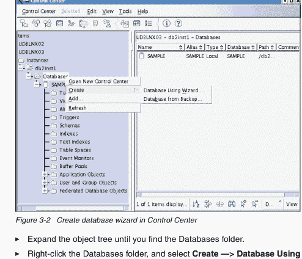

图3-2 控制中心中的创建数据库向导

- 展开对象树，直到找到Databases文件夹。
- 右键单击Databases文件夹，然后从弹出菜单中选择Create --> Database Using Wizard。参见图3-2。

图3-3 创建数据库向导的起始窗口

图3-3展示了“创建数据库向导”窗口，我们需要在此命名数据库和数据库目录。所有与数据库相关的文件都将存储在此目录路径下，例如，对于此实例中的第一个数据库：

```
/database/DB2INSTANCE/NODE0000/SQL00001/
```

创建数据库后，执行以下命令以查看数据库存储在哪个目录中：

```
db2 list database directory on /database
```

示例3-7 list database directory的输出

```
db2inst1@db2blnx02:~> db2 list db directory on /database

Local Database Directory on /database

Number of entries in the directory = 1

Database 1 entry:
```

数据库别名 = ITSOSJ

数据库名称 = ITSOSJ

数据库目录 = SQL00001

数据库发布级别 = a.00

注释 = ITSO San Jose

目录条目类型 = Home

编目数据库分区号 = 0

数据库分区号 = 0

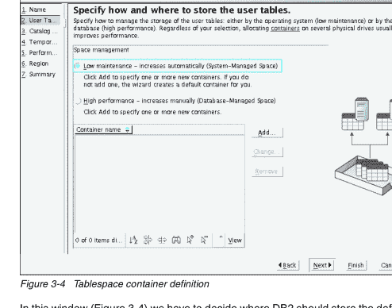

图3-4 表空间容器定义

在此窗口（图3-4）中，我们需要决定DB2应将默认表空间`userspace1`存储在哪里，以及它应是什么类型。SMS（系统管理存储）表示表空间容器是给定路径下的一个目录，所有数据将以文件形式存储在其中。DMS（数据库管理存储）表示表空间容器是一个由DB2控制的预分配文件。

在接下来的两个窗口中，我们需要决定编目表空间`syscatspace`和临时表空间`temspace1`的位置。我们建议您将`temspace1`分配到不同的文件系统中。更多细节请参考第36页2.2.2“存储规划”中的描述。

图3-5 表空间I/O定义

调整此数据库的性能（图3-5）是一个重要的窗口，您需要在此决定DB2应如何读写数据。我们建议您选择Prefetch size为Extend size的倍数，以便DB2在需要数据之前从磁盘读取数据（预取）。每次DB2需要表中的数据时，它都会发出一个I/O请求。这样的请求会从磁盘请求一个extent。如果您允许DB2一次获取更多数据，那么您将减少I/O等待时间。

图3-6 验证生成的SQL

完成所有预览窗口后，如果您选择Show Command，向导将呈现一个窗口（图3-6），其中包含生成的数据库命令以及您指定的所有设置。通过关闭此窗口并单击Finish，DB2将为您创建数据库。随后将显示一条包含配置选项的数据库创建成功确认消息，如图3-7所示。

图3-7 创建数据库的确认

# 图3-9 指定新的日志路径

在图3-9中，我们将日志路径更改为新位置，同时开启新的镜像日志功能。我们为主日志路径和辅助日志路径选择了不同的文件系统。

在所有连接被释放并发出新连接或`activate database`命令后，新路径将生效。更快地更改并激活新路径的方法是执行以下命令：

```
db2 connect to itsosj
db2 update db cfg for itsodb using NEWLOGPATH /db2log1/db2inst1/itsosj
```

```
db2 update db cfg for itsodb using MIRRORLOGPATH
/db2log2/db2inst1/itsosj
```

```
db2 deactivate database itsosj
db2 activate database itsosj
```

要完成数据库配置，请再次打开控制中心，并按您的需要配置数据库。


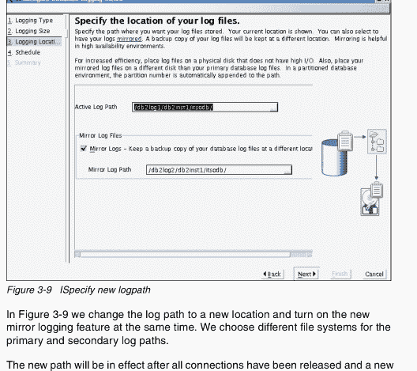

### 3.3.2 命令行

对于多分区环境，我们建议您使用 DB2 命令行，而不是使用创建数据库向导来创建数据库。虽然这需要一定的经验和手工操作，但它能让您更好地控制 DB2 文件的分配位置和方式。在接下来的页面中，我们提供了一个示例，说明如何在一台物理主机上设置分区数据库，每台主机上有两个逻辑分区。

以实例所有者或任何具有 `sysadm` 或 `sysctrl` 权限的用户身份登录到应创建数据库目录的主机。验证您是否已初始化 DB2 环境。为此，输入以下命令：

```
echo $DB2INSTANCE
```

其中，`$DB2INSTANCE` 表示当前的 DB2 环境。

#### 示例 3-8 验证 DB2 环境

```
db2inst1@db1nx02:~/sqllib> echo $DB2INSTANCE
db2inst1
db2inst1@db1nx02:~/sqllib>
```

### 生成目录结构

在我们的示例中，我们不想使用 DB2 提供的默认文件结构。相反，我们想使用在第 38 页“文件系统配置”中创建的自定义文件结构。在此设置中，我们的数据库、表和索引空间以及日志文件存储在不同的文件系统上。要为日志文件、tempspace 和表空间创建目录结构，请以实例所有者身份打开一个 shell 窗口并发出 `db2_all` 命令。参见示例 3-9、示例 3-10 和示例 3-11。

#### 示例 3-9 日志文件目录结构的创建

```
db2_all 'mkdir /db2log/db2inst1'
db2_all 'mkdir /db2log/db2inst1/itsodb'
or combine both commands in one as:
db2_all 'mkdir -p /db2log/db2inst1/itsodb'
```

#### 示例 3-10 tempspace 目录结构的创建

```
db2_all 'mkdir /db2temp/db2inst1'
db2_all 'mkdir /db2temp/db2inst1/itsodb/'
db2_all 'typeset -Z4 DB2NODE; mkdir /db2temp/db2inst1/itsodb/NODE$DB2NODE'
or combine all three commands in one as:
db2_all 'typeset -Z4 DB2NODE; mkdir -p /db2temp/db2inst1/itsodb/NODE$DB2NODE'
```

#### 示例 3-11 表空间目录结构的创建

```
db2_all 'mkdir /tablespaces/db2inst1'
db2_all 'mkdir /tablespaces/db2inst1/itsodb'
db2_all 'typeset -Z4 DB2NODE; mkdir /tablespaces/db2inst1/itsodb/NODE$DB2NODE'
or combine all three commands in one as:
db2_all 'typeset -Z4 DB2NODE; mkdir -p /tablespaces/db2inst1/itsodb/NODE$DB2NODE'
```

> 提示：命令 `typeset -Z4 DB2NODE` 会为 `db2nodes.cfg` 中定义的所有分区返回一个四位数字，例如：0 将为 0000，1 将为 0001。

### 创建数据库

我们决定使用分区号 0 来保存 DB2 目录。在发出命令 `export DB2NODE=0` 和 `db2 terminate` 后，DB2 将对后续命令在分区 0 上运行。

要创建数据库路径为 `/database` 的数据库 `itsodb`，请使用 VI 等文本编辑器并写入以下示例：

#### 示例 3-12 创建 ITSODB 数据库

```
create database itsodb on /database
using codeset ISO8859-1
territory US
with "ITSO San Jose";

connect to itsodb;

create bufferpool BPTEMP all nodes size 5000 PAGESIZE 4k ;

connect reset;
```

将此文件保存为 `any_name` 并使用以下命令执行：

```
db2 -tvf any_name
```

执行此文件后，您将拥有一个名为 `ITSODB` 的数据库，存储在 `/database/db2inst1/NODE0000` 中，其中包含目录表空间和所有相关的数据库文件。在分区环境中，除目录表空间外，相同的目录结构将在每个节点上创建。此表空间仅存在于发出 `create database` 命令的分区上。

同时我们为专用临时空间创建了一个新的缓冲池。因为 DB2 在数据库激活时分配了许多资源，我们必须停止并启动数据库以启用新的缓冲池。为此，输入以下命令：

```
db2 deactivate database itsodb
db2 activate database itsodb
```

### 重新分配临时空间和用户空间

现在我们想要创建一个新的临时表空间并删除默认的临时表空间。这必须按此顺序进行，因为 DB2 至少需要一个临时空间。

使用 VI 等文本编辑器并写入以下示例：

#### 示例 3-13 创建新的 tempspace 并删除默认

```
connect to itsodb;

create system temporary tablespace TEMPSPACE01 in IBM TEMPGROUP pagesize 4k managed by SYSTEM using ('/db2temp/db2inst1/itsodb/NODE$DB2NODE/tempspace01') on dbpartitionnum (0) using ('/db2temp/db2inst1/itsodb/NODE$DB2NODE/tempspace01') on dbpartitionnum (1) using ('/db2temp/db2inst1/itsodb/NODE$DB2NODE/tempspace01') on dbpartitionnum (2) using ('/db2temp/db2inst1/itsodb/NODE$DB2NODE/tempspace01') on dbpartitionnum (3) extentsize 8 prefetchsize 32 bufferpool bptemp ;

drop tablespace tempspace1;
```

将此文件保存为 `any_name` 并使用以下命令执行：

```
db2 -tvf any_name
```

要将默认表空间 `userspace1` 移动到 `/tablespace` 下的新位置，请使用 VI 等文本编辑器并写入以下示例：

#### 示例 3-14 更改表空间 userspace1 的位置

```
drop tablespace userspace1;

create tablespace userspace1 in IBMDEFAULTGROUP pagesize 4k MANAGED BY SYSTEM using ('/tablespaces/db2inst1/itsodb/NODE$DB2NODE/userspace1') on dbpartitionnum (0) using ('/tablespaces/db2inst1/itsodb/NODE$DB2NODE/userspace1') on dbpartitionnum (1)
```

using ('/tablespaces/db2inst1/itsodb/NODE000$N/userspace1') on dbpartitionnum (2)

using ('/tablespaces/db2inst1/itsodb/NODE000$N/userspace1') on dbpartitionnum (3)

extentsize 8 prefetchesize 32;

将此文件保存为 `any_name` 并使用以下命令执行：

```
db2 -tvf any_name
```

我们示例中的 tempspace 创建在：

`/db2temp/db2inst1/itsodb/NODE000x/tempspace01`

其中，`tempspace01` 是一个目录。`userspace` 同样如此，在：

`/tablespaces/db2inst1/itsodb/NODE000x/userspace1`

> **提示：** 示例 3-14 中创建表空间语句中的变量 `$N` 在运行时会被替换为分区号。

> **注意：** 关键字 `autoconfigure` 允许你在创建时覆盖任何默认数据库设置。这在多分区数据库环境中不受支持。


有关 `autoconfigure` 的更详细信息，请参阅 *IBM DB2 UDB Administration Guide: Implementation V8, SC09-4820*，以及 *IBM DB2 UDB Command Reference V8, SC09-4828*。

成功创建数据库后，你将拥有以下文件结构（参见示例 3-15 至示例 3-18）：

## 示例 3-15 主机 udblnx02 分区 0 上的目录结构

```
/database/db2inst1/NODE0000/sqlbdir
/database/db2inst1/NODE0000/SQL00001/db2event/db2detaildeadlock
/database/db2inst1/NODE0000/SQL00001/db2event
/database/db2inst1/NODE0000/SQL00001/SQLGDIR
/database/db2inst1/NODE0000/SQL00001/SQLT0000.0
/db2temp/db2inst1/itsodb/NODE0000/tempspace01
/tablespaces/db2inst1/itsodb/NODE0000/userspace1
/db2log/db2inst1/itsodb/NODE0000/
```

## 示例 3-16 主机 udblnx02 分区 1 的目录结构

```
/database/db2inst1/NODE0001/sqlbdir
/database/db2inst1/NODE0001/SQL00001/db2event
/database/db2inst1/NODE0001/SQL00001/SQLLOGDIR
/db2temp/db2inst1/itsodb/NODE0001/tempspace01
/tablespaces/db2inst1/itsodb/NODE0001/userspace1
/db2log/db2inst1/itsodb/NODE0001/
```

## 示例 3-17 主机 udblnx05 分区 2 的目录结构

```
/database/db2inst1/NODE0002/sqlddir
/database/db2inst1/NODE0002/SQL00001/db2event
/database/db2inst1/NODE0002/SQL00001/SQLLOGDIR
/db2temp/db2inst1/itsodb/NODE0002/tempspace01
/tablespaces/db2inst1/itsodb/NODE0002/userspace1
/db2log/db2inst1/itsodb/NODE0002/
```

## 示例 3-18 主机 udblnx05 分区 3 的目录结构

```
/database/db2inst1/NODE0003/sqlddir
/database/db2inst1/NODE0003/SQL00001/db2event
/database/db2inst1/NODE0003/SQL00001/SQLLOGDIR
/db2temp/db2inst1/itsodb/NODE0003/tempspace01
/tablespaces/db2inst1/itsodb/NODE0003/userspace1
/db2log/db2inst1/itsodb/NODE0003/
```

> 注意：目录 `/database/db2inst1/NODE0000/SQL00001/SQLT0000.0` 用于存放 catalog 表空间，仅存在于 NODE0000。

## 日志路径

下一步，我们将 DB2 日志文件重新分配到单独的文件系统。要显示当前日志路径，输入命令：

```
db2 get db cfg for itsodb | grep Path
```

此命令仅影响你所连接的分区。在我们的环境中，初始日志路径为：

```
Path to log files = /database/db2inst1/NODE0000/SQL00001/SQLLOGDIR/
```

要在每个分区上更改日志路径，请执行以下命令：

```
db2_all 'db2 connect to itsodb;db2 update db cfg for itsodb using NEWLOGPATH /db2log/db2inst1/itsodb'
```

这将把每个节点的日志路径更改为：

`/db2log/db2inst1/itsodb/NODE000x`

子目录将由 DB2 自动添加，但不会动态更改。此更改仅在重新激活数据库后生效。执行以下命令：

```
db2 deactivate db itsodb
db2 activate db itsodb
```

然后使用以下命令验证更改，检查 Path to log files 条目：

```
db2_all 'db2 connect to itsodb; db2 get db cfg for itsodb | grep Path'
```

Path to log files = `/db2log/db2inst1/itsodb/NODE0000/`

## 创建表空间和表

当然，下一步是为你的应用程序创建表。创建数据库时，DB2 会创建三个默认表空间。`USERSPACE1` 用于存放数据表。根据数据库设计，可以创建更多表空间。表通常会根据应用程序和数据库设计放置到特定表空间中。常见的做法是在所有分区或其中一部分上创建自己的表空间。每个表空间都必须在数据库分区组中创建。我们在示例 3-19 中展示了在 `db2nodes.cfg` 中定义的所有分区上创建表空间，使用默认数据库分区组 `IBMDEFAULTGROUP`。

### 示例 3-19 创建多分区表空间

```
connect to itsodb;

create tablespace sample_mpl in IBMDEFAULTGROUP pagesize 4k
MANAGED BY SYSTEM
using ('/tablespaces/db2inst1/itsodb/NODE000$N/sample_mpl')on dbpartitionnum
(0)
using ('/tablespaces/db2inst1/itsodb/NODE000$N/sample_mpl')on dbpartitionnum
(1)
using ('/tablespaces/db2inst1/itsodb/NODE000$N/sample_mpl')on dbpartitionnum
(2)
using ('/tablespaces/db2inst1/itsodb/NODE000$N/sample_mpl')on dbpartitionnum
(3)
extentsize 8 prefetchsize 32;
```

示例 3-20 展示了在分区 1 上创建数据库分区组 `sng_01` 和单分区表空间。

### 示例 3-20 创建单分区表空间

```
connect to itsodb;
```

```
create database partition group sng_01 on dbpartitionnum (1)

create tablespace sample_sng in sng_01 pagesize 4k

MANAGED BY SYSTEM

using ('/tablespaces/db2inst1/itsodb/NODE0000 /sample_sng') on dbpartitionnum

(1)

extentsize 8 prefetchesize 32;
```

要创建新创建的表空间中的表，请使用命令行执行 DDL 脚本，如示例 3-21 所示，使用 `db2 -tvf` 命令。

## Example 3-21 Create table DDL

```
connect to itsodb;

CREATE TABLE PART (
    P_PARTKEY INTEGER NOT NULL,
    P_NAME VARCHAR(55) NOT NULL,
    P_MFGR CHAR(25) NOT NULL,
    P_BRAND CHAR(10) NOT NULL,
    P_TYPE VARCHAR(25) NOT NULL,
    P_SIZE INTEGER NOT NULL,
    P_CONTAINER CHAR(10) NOT NULL,
    P_RETAILPRICE FLOAT NOT NULL,
    P_COMMENT VARCHAR(23) NOT NULL
) IN SAMPL_MPL;
```

如果您更喜欢使用图形工具，请启动 Control Center 并展开数据库下的树，直到出现表文件夹。右键单击并选择 Create。


Figure 3-10 Create Table wizard in Control Center


Create Table Wizard，图 3-10，将引导您完成多个窗口，您可以在其中使用预定义的列定义创建新表，或通过定义自己的列定义来创建。

> Note: Detailed information about creation of tablespaces, tables or indexes can be found in Chapter 5 of the "SQL References" (listed in "Other publications" on page 301).

### 3.4 Add database partition

您可以使用 `add node` 命令向已填充数据的数据库添加逻辑数据库分区。`add node` 命令有两个选项：

- `LIKE NODE` option
- `WITHOUT TABLESPACES` option

`add node` 命令会在新数据库分区创建的节点上，在数据库路径（例如，`/database/.`）中创建数据库目录结构。未使用 'like node' 参数时，临时表空间定义将从 catalog 节点检索。

如果您在不同的主机上添加分区，请使用 `db2_install` 或 `db2setup` 以及 `response file` 实用程序安装 DB2 基础代码。验证 `rsh`、`rlogin`、`db2_all` 等是否正常工作。参见 3.2.2， "Multiple partitioned specific configuration" on page 82。在新系统上创建文件系统和目录结构以保存所有数据库文件。这在 "Generate directory structure" on page 93 中有说明。

检查 `/etc/services`，确保为目标主机上的 DB2 实例预留了足够的端口。在一个节点上，您应为每个逻辑分区预留一个端口。

## Example 3-22 /etc/services with ports reserved for db2inst1

```
DB2_db2inst1      60000/tcp
DB2_db2inst1_1    60001/tcp
DB2_db2inst1_2    60002/tcp
DB2_db2inst1_END  60003/tcp
```

创建与现有分区类似的文件系统结构并设置正确的权限。

关闭您的 DB2 实例（`db2stop`），以便您可以修改 `db2nodes.cfg` 文件。在 `$INSTHOME/sqllib/db2nodes.cfg` 中添加新分区。

## Example 3-23 db2nodes.cfg file

```
0 udb1nx02 0
1 udb1nx02 1
```

以实例所有者身份登录到新分区将驻留的主机，并使用以下命令启动新分区：

```
db2start dbpartitionnum 2
```

或者如果您使用以下命令启动新数据库分区，DB2 将在实例下次停止后自动更新 `db2nodes.cfg`。

```
db2start dbpartitionnum 2 add dbpartitionnum hostname udb1nx02 port 2 without tablespaces
```

要创建 DB2 使用的目录结构，我们必须发出 `add node` 命令，如果尚未通过启动数据库管理器完成。发出示例 3-24 中显示的以下命令。

## Example 3-24 Add dbpartition utility command

```
db2inst1@udb1nx02:~/sqllib> export DB2NODE=2
db2inst1@udb1nx02:~/sqllib> db2 terminate
db2inst1@udb1nx02:~/sqllib> db2 add dbpartitionnum without tablespaces
```

```
DB20000I The ADD NODE command completed successfully.
udb1nx02: db2 add dbpartitionnum without tablespaces completed ok
```

DB2 现在已在 `/database` 中创建了目录结构，但使用关键字 `without tablespaces`，现有分区 0 和 1 中的表空间未在新分区中创建。`IBMTEMPGROUP` 的数据库分区节点组已扩展为新的数据库分区 2，我们必须在新分区上添加 `TEMPSPACE01` 的表空间容器。

现在我们必须通过输入 `db2start` 启动剩余分区，并使用命令 `db2 connect to itsodb` 建立连接。

## Example 3-25 Add tablespace container for temp space

```
db2inst1@udb1nx02:~> db2 "alter tablespace tempspace01 add ('/db2temp/db2inst1/itsodb/NODE0002/tempspace01') on dbpartitionnum (2)"
```

```
DB20000I The SQL command completed successfully.
```

所有将受益于新分区的数据库分区组都必须进行更改，以便可以使用新分区。示例 3-26 显示了我们数据库 `ITSODB` 中 `MPL_01` 的语句。

## Example 3-26 Alter database partition group MPL_01

Local Database Directory on `/database`

Number of entries in the directory = 1

Database 1 entry:

Database alias               = ITSODB

Database name                = ITSODB

Database directory           = SQL00001

Database release level       = a.00

Comment                      = ITSO San Jose

Directory entry type         = Home

Catalog database partition number = 0

Database partition number    = 0

```
db2inst1@udblnx02:> db2 redistribute database partition group mpl_01 uniform
```

```
DB20001I  The REDISTRIBUTE NODEGROUP command completed successfully.
```

```
db2inst1@udblnx02:>
```

For each table that has already been processed, the redistribution utility writes a message to file in `$INSTHOME/sqllib/redist/<dbname>.<part-group>.<time>`. See Example 3-29.

## Example 3-29 Redistribute messages file

```
Data Redistribution Utility

--------------------------------

The following options have been specified:
Nodegroup name            : MPL_01
Data Redistribution option : U
Redistribute Nodegroup    : Uniformly
No. of nodes to be added  : 1
List of nodes to be added :
2
No. of nodes to be dropped : 0
List of nodes to be dropped :

Delete will be done in parallel with the insert.

The execution of the Data Redistribution operation on:

Begun at   Ended at   Table
--------   --------   ------------
15.29.38
15.32.13   DB2INST1.CUSTOMER
15.32.16
15.32.16   DB2INST1.NATION
```

```
15.32.16      DB2INST1.ORDERS
16.42.45
--All tables in the nodegroup have been successfully redistributed.--
```

> **注意：** 重分布实用程序会发出 SQL 插入和删除操作；因此，您应确保有足够的日志空间可用。

> 重分布是一个非常耗时的过程，应在应用程序未使用表时进行。


DB2 包如果依赖于已重分布的表，则会被设为无效。它们将在第一次 SQL 请求时自动重新绑定，但为节省延迟时间，请使用 `rebind` 命令手动重新绑定这些包。

另一个建议是，通过发出 `runstats table` 命令更新统计信息并重新绑定受影响的包。

> **注意：** 有关添加数据库分区的更多信息，请参阅 *IBM DB2 UDB Command Reference V8*，SC09-4828。

添加逻辑数据库分区的另一种方法是使用添加数据库分区向导。参见图 3-11。

Figure 3-11 Add database partition in Control Center

依次浏览所有窗口并填写必要的信息。在图 3-12 中可以看到添加数据库分区生成的命令。

Figure 3-12 Add database partition generated command

对应要扩展到新增分区的每个数据库分区组重复此操作。图 3-15 显示了数据库分区组 IBMDEFAULTGROUP 的重分布语句和完成消息。这些消息也存储在：

`$INSTHOME/sqllib/redist/<dbname>.<part-group>.<stime>`

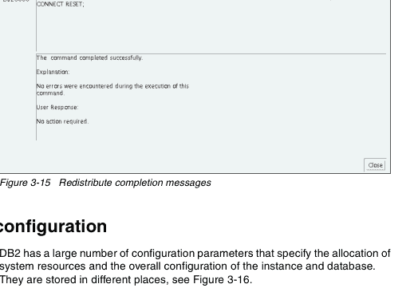

Figure 3-15 Redistribute completion messages

### 3.5 DB2 configuration

DB2 有大量配置参数，用于指定系统资源的分配以及实例和数据库的整体配置。它们存储在不同的位置，参见图 3-16。

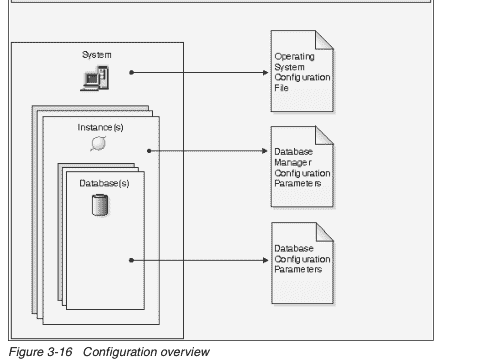

Figure 3-16 Configuration overview

由于默认值为内存和磁盘存储相对较小的机器设置，您可能需要修改它们以适应您的环境。调整配置的一个良好起点是性能配置向导或 `AUTOCONFIGURE` 命令。

#### 3.5.1 DBM configuration

数据库管理器配置参数存储在 `$INSTHOME/sqllib/` 下名为 `db2systm` 的文件中。要修改这些参数，请使用图形界面 Control Center 或使用 DB2 命令行界面。

### Important DBM cfg parameters

以下是重要的 DBM cfg 参数：

- `dftdbpath`

默认情况下它设置为 `$INSTHOME`。我们建议您将其设置为所需的路径。在分区环境中，通常 `$INSTHOME` 位于 NFS 文件系统上，但 DB2 不支持数据库路径使用 NFS。

## dft_mons 开关

将所有监视器开关设置为 ON，以便 DB2 收集统计数据。使用 `get snapshot` 命令显示有关 DB2 行为的详细信息。

## diaglevel

对于故障诊断，请将其设置为 4。DB2 会将所有错误、警告和信息消息写入 `$INSTHOME/sqllib/db2dump/` 目录下的 `db2diag.log` 中。默认值为 3。

## mon_heap_sz

维护数据库系统监视器数据的私有视图所需的内存从监视器堆中分配。其大小由 `mon_heap_sz` 配置参数控制。监视活动所需的内存量差异很大，具体取决于监视应用程序和事件监视器的数量、所设置的开关以及数据库活动的级别。

## query_heap_sz

初始默认值通常就足够了。作为最低要求，您应将 `query_heap_sz` 设置为至少比 `aslheapsz` 大五倍的值。这将允许查询大于 `aslheapsz`，并提供额外的内存。

## sheapthres

对于私有排序，此参数是实例范围内对私有排序在任何给定时间可消耗的内存总量的软限制。

对于共享排序，此参数是数据库范围内对共享排序在任何给定时间所消耗的内存总量的硬限制。达到此限制后，将不再允许进行共享排序。

## num_poolagents

对于并发连接应用程序较少的决策支持系统（DSS）环境，请将此值设置得小一些。对于具有许多并发连接应用程序的联机事务处理（OLTP）环境，请将其设置得更大，以防止额外创建 `db2agents`，这会耗费时间。

## maxagents

最大可用 `db2agent` 进程数。使用 `get snapshot for dbm` 命令并查看 Agents stolen from another application 的值。如果该值大于零，则增大 `maxagents`。

## intra_parallel

对于 OLTP 环境，请将此值设置为 NO，因为事务吞吐量比并行工作更重要。OLTP 查询只读取、更新或插入一行或几行，因此将这些工作拆分到更多进程中没有意义。

在 DSS 环境中，通常大多数查询会一次连接多个表。我们建议您将此值设置为 YES，这样 DB2 就可以将工作拆分到多个进程中。

## max_querydegree

由于在 OLTP 系统中并行性并不是人们所期望的，因此请将其设置为 1。

对于 DSS，请将其设置为数据库服务器的 CPU 数量，以防止用户在程序中设置不正确的并行度，从而减慢 DB2 的活动。请注意，在静态包中，如果在绑定时间设置了查询并行度，则 `max_querydegree` 将被查询并行度设置覆盖。

> 注意：有关所有 DBM 参数的完整详细描述，请参阅 IBM DB2 UDB 管理指南：Performance V8（SC09-4821）中的第 13 章“配置 DB2”。

## 监视和更新 DBM 配置

可以通过控制中心或 DB2 命令行来配置 DB2 实例的设置。

### 控制中心

- 启动控制中心，并将树展开到所需的实例。
- 右键单击该实例，打开弹出窗口，然后选择“配置参数”（图 3-17）。

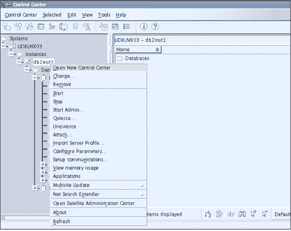

图 3-17 在控制中心中配置实例

- 对要更改的每个参数进行更新，如果存在“可用时更新”选项，请勾选 *可用时更新*。窗口底部是有关所选参数的简要描述（图 3-18）。

### 图 3-18 更改值的示例

- 完成所有所需的更改后，单击“确定”，这些更改将被应用（图 3-19）。

`UPDATE DBM CFG` 命令的默认行为是立即应用更改。如果您不希望立即应用更改，请在 `UPDATE DBM CFG` 命令上使用 `DEFERRED` 选项。

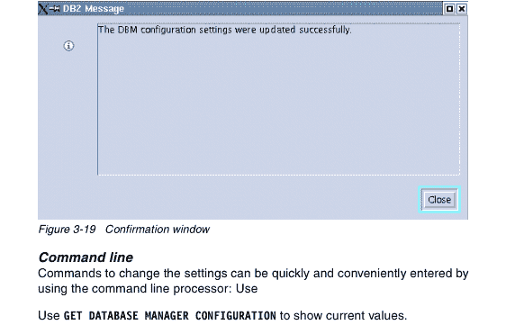

图 3-19 确认窗口

### 命令行

使用命令行处理器可以快速方便地输入更改设置的命令：使用

使用 `GET DATABASE MANAGER CONFIGURATION` 显示当前值。

使用 `UPDATE DATABASE MANAGER CONFIGURATION USING <parameter>` 更改当前值。

使用 `RESET DATABASE MANAGER CONFIGURATION` 将所有数据库管理器参数重置为其默认值。

使用 `AUTOCONFIGURE` 让 DB2 根据您关于系统、应用程序行为等的输入来确定值。

示例 3-30 使用命令行更改 DBm CFG

```
db2 get dbm cfg
db2 update dbm cfg using DFT_MON_BUFPOOL on automatic
db2 get dbm cfg show detail
db2 autoconfigure using mem_precent 60 apply db and dbm
```

#### 3.5.2 DB 配置

为了分配和控制系统资源，DB2 为 DB2 实例中的每个数据库使用一个单独的配置文件。该文件名为 `SQLDBCON`，存储在 `/database_path/$DB2INSTANCE/NODE0000/SQL00001/` 中。

在分区环境中，`SQLDBCON` 存在于每个数据库分区中。因此，可以为每个分区设置不同的配置。要修改这些参数，请使用图形界面 Control Center 或使用 DB2 命令行。

在分区环境中，您需要在每个分区上发出此命令：

```
db2 update db cfg for xy using <parameter>
```

## Important DB cfg parameters

本节描述了一些重要的数据库配置参数及其推荐设置。

- `avg_appls`

  这让 DB2 知道系统中运行了多少个并发应用程序。当设置为 1 时，DB2 会将缓冲池中所有当前可用内存都分配给每个应用程序。

- `catalogcache_sz`

  这会在内存中保存数据库、表空间、表和索引信息。DB2 在准备执行计划时首先查找此缓存。足够的内存可避免耗时的磁盘 I/O。可通过 `db2 get snapshot for database on db_name` 检查并计算命中率：

  `100 - ((Catalog cache inserts X100) / Catalog cache lookups)`


```
db2 get snapshot for database on db_name
```

```
100 - ((Catalog cache inserts X100) / Catalog cache lookups)
```

### maxfilop

这是每个应用程序可以打开的文件数。默认值通常太小。打开和关闭文件会减慢 SQL 响应时间并消耗 CPU 周期。如果文件正在被关闭，请调整 `MAXFILOP` 的值，直到打开和关闭停止。使用命令：

```
db2 get snapshot for database on db_name
```

并查看 `Number of files closed`。如果该值大于 0，请增加 `MAXFILOP` 值。

```
db2 get snapshot for database on db_name
```

### locktimeout

默认设置为 `-1`。这意味着连接可以等待直到获得所有资源。如果一个连接已持有另一个应用程序所需的锁，则会发生死锁问题。为防止过多死锁情况，对于 OLTP 设置为 `10`；对于 DSS 设置为 `60`。

### logbufsz

DB2 使用一个缓冲区在将日志记录写入磁盘之前保存日志记录。如果值设置过小，会导致磁盘上不必要的 I/O。在

增加此参数的值时，您还应考虑增加 `dbheap` 参数，因为日志缓冲区内存是从 `dbheap` 分配的。

## sortheap

每个排序都有数据库管理器分配给它自己的内存量。此参数定义可使用的最大排序内存。当增加此值时，您应检查数据库管理器配置文件中的 `sheapthres` 参数是否也需要调整。

> Note: For a complete and detailed description of all the Database configuration parameters, refer to Chapter 13 "Configuring DB2" in IBM DB2 UDB Administration Guide: Performance V8, SC09-4821.

## Monitor and update DB configuration

配置 DB2 数据库设置可以通过 Control Center 或 DB2 命令行完成。

### Control Center

- 启动 Control Center 并展开树结构直到所需的数据库。
- 右键单击它以打开弹出窗口并选择 `Configure Parameters`（图 3-20）。

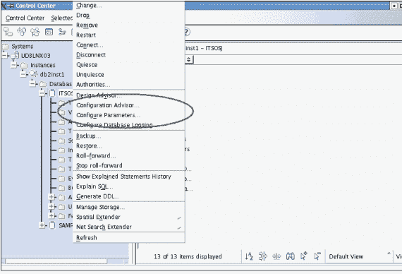

Figure 3-20 Select configuration method in Control Center

有两种修改数据库配置参数的选项：

- `Configure Parameters`：使用此选项更改特定参数。
- `Configuration Advisor`：此选项与 `autoconfigure` 命令相当。

### Using the Configure Parameter option

通过在 Control Center 中选择 `Configure Parameter` 选项，会出现以下窗口（图 3-21）。选择参数后，其简要描述会在下方 Hint 下显示。

## Database Configuration - ITSOSJ

Select the value field of a parameter to change its value

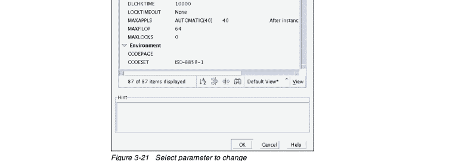

Figure 3-21 Select parameter to change

图 3-22 显示了参数 `maxfilop` 的值更改示例。

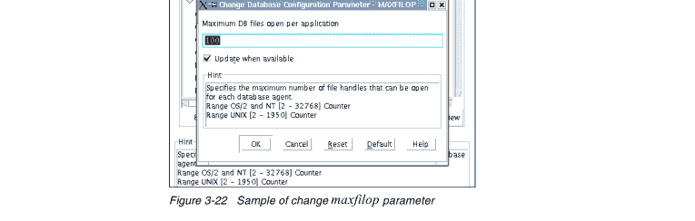

Figure 3-22 Sample of change maxfilop parameter

## Chapter 3. Post installation tasks

完成所有期望的更改后，按 OK，所有更改将应用于数据库（图 3-23）。

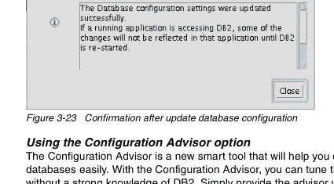

图 3-23 更新数据库配置后的确认

## 使用 Configuration Advisor 选项

`Configuration Advisor` 是一个新的智能工具，可帮助您轻松配置数据库。使用 Configuration Advisor，您无需深入了解 DB2 即可调整数据库。只需向顾问提供有关系统的请求信息，例如计划的工作负载和连接信息，精灵就会为您提供应进行哪些更改的建议。

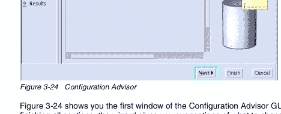

图 3-24 Configuration Advisor

图 3-24 显示了 Configuration Advisor GUI 的第一个窗口。完成所有部分后，精灵会给出应进行哪些更改的建议。最后，您可以选择立即应用更改或保存 SQL 以便稍后运行。任何参数都可能需要重新激活数据库。

## 命令行

使用命令行处理器可以快速方便地输入更改设置的命令。以下示例显示了数据库配置更新命令（示例 3-31）：

使用 `GET DATABASE CONFIGURATION FOR <db_name>` 显示当前值。

使用 `UPDATE DATABASE CONFIGURATION FOR db_name USING <parameter>` 更改当前值。

使用 `RESET DATABASE CONFIGURATION FOR db_name` 将所有数据库参数重置为默认值。

示例 3-31 更新 cfg 示例

```
db2 get db cfg for itsosj
db2 update db cfg for itsosj using DBHEAP 1200
db2 get db cfg for itsosj show detail
```

#### 3.5.3 DB2 注册表和环境变量

DB2 中的所有配置设置都存储为环境变量或注册表变量。在基于 UNIX 的系统上，所有环境变量如 `DB2INSTANCE`、`DB2NODE`、`DB2PATH` 和 `DB2INSTPROF` 均使用 `export` 命令设置。通常位于 `$INSTHOME/sqllib/` 中的文件 `db2profile` 中。

注册表变量通过 `db2set` 命令设置并需要重新启动 DB2。如果注册表变量需要布尔参数，则值 `YES`、`1` 和 `ON` 都等效，值 `NO`、`0` 和 `OFF` 也等效。要为实例级配置文件设置注册表值，请执行：

```
db2set -i <instance_name> <command>
```

要为全局级配置文件设置注册表值，请执行：

```
db2set -g <command>
```

您可以使用 Configuration Assistant（`db2ca`）或 `db2set` 命令来配置配置参数和注册表变量。更新注册表时，更改不会影响当前运行的 DB2 应用程序或用户。在更新后启动的应用程序将使用新值。

## 重要注册表变量

以下是一些重要注册表变量的列表。

## 示例 3-32 db2set 命令示例

```
db2set -all
db2set -lr
db2set -i db2inst1 DBCOMM=tcpip
db2set -g
db2set -g DB2ADMIN SERVER=dasusr1
```

## db2ca 图形工具

要启动图形工具，请执行命令 `db2ca &` 或在应用程序文件夹 IBM DB2 -> Configuration Assistant 中打开它（图 3-25）。

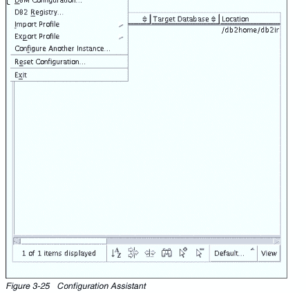

图 3-25 Configuration Assistant

选择 `DBM Configuration` 或 `DB2 Registry` 并进入下一个窗口进行更改。选择要更改的参数后，该参数的描述将显示在窗口底部。

## 多页分配

对于系统管理的表空间（SMS），我们建议您启用多页文件分配。它减少了格式化新页面所需的时间。要启用此参数，请为每个数据库执行命令 `db2empfa`。需要独占访问，因为在现有表空间中，所有空页将被填满到最后一个区。要检查此项，请执行命令：

```
db2 get db cfg for <dbname> | grep Multi-page
```

```
Multi-page file allocation enabled = YES.
```

在多分区环境中，请在每个数据库分区上执行 `db2mpfa`。

### 3.6 客户端配置

在本节中，我们讨论如何使用图形工具 Configuration Assistant 或 DB2 命令行处理器安装和配置 DB2 客户端以访问 DB2 ESE。

有三种类型的 DB2 客户端可用：

- **Run-Time Client**


此客户端为您提供访问 DB2 UDB 服务器的权限，并提供应用程序接口，如 `JDBC`、`SQLJ`、`ODBC`、`CLI` 和 `OLE DB`。如果您不需要管理 DB2 服务器，请使用此客户端。

### Administration Client

`Administration Client` 具有 DB2 Run-Time 客户端的所有功能，外加管理 DB2 服务器的工具。

### Application Development Client

此客户端提供用于开发应用程序的图形和非图形工具的集合。它包含 DB2 Administration Client 的所有组件。

所有客户端版本均可在以下平台上使用：AIX、HP-UNIX、Linux、Solaris 和 Windows 操作系统。

客户端选择取决于您的应用程序环境。至少您必须有一个 Administrator Client 来将所有 DB2 CLI 包绑定到您要使用的 DB2 数据库。

> 注：安装要求详情请参见 IBM DB2 UDB Quick Beginnings for DB2 Clients V8，GC09-4832。

在服务器端，你必须配置 DB2 实例，以便客户端能够连接到此实例中的任何数据库。

请在服务器端确认以下各项：

- DB2 服务名称和端口已设置在文件 `/etc/services` 中，例如：

```
db2c_db2inst1 50001/tcp
```

- 已为 TCP/IP 设置 `DB2COMM` 注册表变量：

```
db2set -all
```

并查看 `DB2COMM=tcpip`。

- 数据库管理器配置中的 TCP/IP 服务名称应已设置：

```
db2 get dbm cfg | grep SVCENAME
```

输出：

```
TCP/IP Service name (SVCENAME) = db2c_db2inst1
```

## 在 Linux 上安装 DB2 管理员客户端

在完成 2.1 节“基本要求”（第 24 页）中指定的先决条件检查后，请执行以下任务：

1. 以 root 用户登录。
2. 挂载 CD-ROM 或将 DB2 代码复制到磁盘。
3. 输入命令 `./db2setup`，DB2 安装向导将启动。
4. 按照向导中的说明安装客户端。

安装 DB2 客户端后，你应该配置客户端以访问远程 DB2 服务器。DB2 Version 8 仅支持使用 TCP/IP 来管理远程数据库。

要配置客户端，请以有效的 DB2 用户身份输入命令 `db2ca &` 启动“配置助手”图形工具，或者在 DB2 文件夹中打开它（图 3-26）。

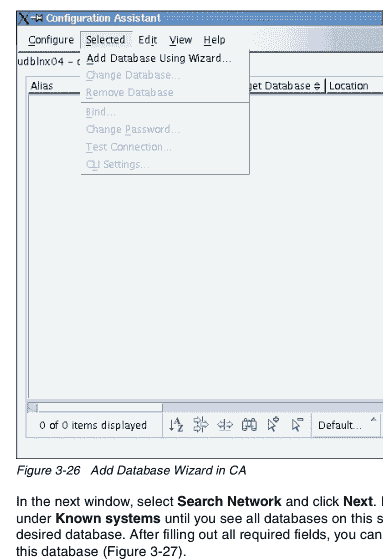

图 3-26 CA 中的“添加数据库向导”

在下一个窗口中，选择“搜索网络”，然后单击“下一步”。展开“已知系统”下的树，直到看到此系统上的所有数据库。选择你想要的数据库。填写完所有必填字段后，你可以测试到此数据库的连接（图 3-27）。

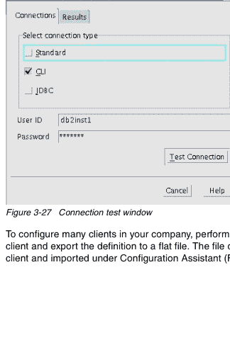

图 3-27 连接测试窗口

要为贵公司配置多个客户端，请在其中一个客户端上执行所有配置，并将定义导出到平面文件。该文件可以传输到每个客户端，并在“配置助手”中导入（图 3-28）。

```
Comment = DB Server udblnx02
Directory entry type = LOCAL
Protocol = TCPIP
Hostname = udblnx02
Service name = 50001
```

```
# db2 list db directory

Database 1 entry:

Database alias = ITSODB
Database name = ITSODB
Node name = UDBLNX02
Database release level = a.00
Comment = Test database for ITSO
Directory entry type = Remote
Authentication = SERVER
Catalog database partition number = -1
```

```
# db2 connect to itsodb user db2inst1 using <password>

Database Connection Information

Database server = DB2/LINUX 8.1.0
SQL authorization ID = DB2INST1
Local database alias = ITSODB
```

> 注意：有关更多详细信息和说明，请参阅 IBM DB2 UDB 命令参考 V8，编号为 SC09-4828。

### 3.7 配置许可

DB2 是许可产品。你可以使用两种工具来配置许可策略：DB2 License Center 和 `db2licm` 实用程序。License Center 是 Control Center 中的图形工具，而 `db2licm` 是其命令行版本。本节提供有关如何使用这两种工具配置许可的说明。将讨论以下主题：

- 安装许可证密钥
- 设置注册用户策略
- 更新许可处理器数量
- 更改强制策略

所有这些任务都是可选的，因为它们取决于你使用的 DB2 版本（*试用版* 或完全许可版）以及贵公司购买的许可证策略类型。

#### 3.7.1 DB2 License Center

DB2 License Center 是 Control Center 中用于管理许可的图形工具。你可以使用此工具查看许可信息、添加和删除许可证密钥、指定用户和强制策略，以及指定许可处理器数量。它还可以生成使用统计信息并显示当前用户的连接信息。要访问 License Center，请执行以下操作：

1. 以实例所有者身份登录。
2. 在 Control Center 中，从 **工具** 菜单中选择 **License Center**。
3. 选择要配置许可的系统及产品。你可以配置本地或远程系统。从“已安装产品”菜单中选择 **DB2 Enterprise Server Edition**。

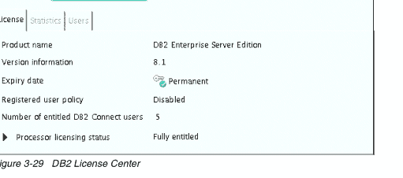

图 3-29 DB2 License Center

##### 安装许可证密钥

要使用 License Center 安装许可证密钥，你必须按如下方式添加 `db2ese.lic` 许可文件：

1. 从 License 菜单中选择 **Add**。
2. 选择 From a file 选项并选择适当的目录。如果您购买了完全授权的 DB2 产品，`db2ese.lic` 许可证文件位于 `/cdrom/db2/1/license`，其中 `/cdrom` 是您的 CD-ROM 的根目录。单击 OK。

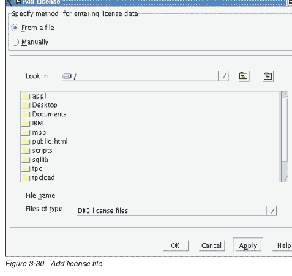

图 3-30 添加许可证文件

要删除许可证文件，请从 License 菜单中选择 Remove。

##### 设置 Registered user 策略

如果您购买了 Registered User 许可证，则需要将 Registered users 添加到 Registered users 列表中。操作方法如下：

1. 从 License 菜单中选择 Change。
2. 勾选 Registered DB2 Connect users 旁边的框，然后按 OK。这将启用 License Center 中的 Users 选项卡。
3. 在 License Center 中选择 Users 选项卡，然后单击 Add。输入用户 ID 并单击 Apply。添加完所有 Registered users 后，单击 OK。

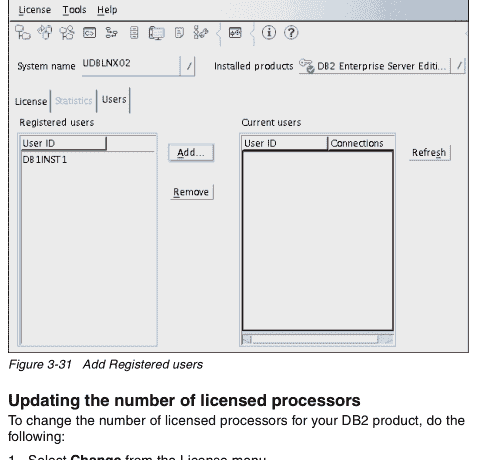

图 3-31 添加 Registered users

##### 更新许可处理器数量

要更改 DB2 产品的许可处理器数量，请执行以下操作：

1. 从 License 菜单中选择 Change。
2. 在 Number of licensed processors 框中，使用上下箭头设置数量，然后单击 OK。

##### 更改执行策略

默认执行策略是 Soft Stop。这意味着即使违反许可证策略，所有对 DB2 数据库的连接仍会通过。当发生违规时，会将许可证违规消息写入 `db2diag.log`。Hard Stop 执行策略不允许任何违反许可证策略的连接。要指定执行策略类型，请执行以下操作：

1. 从 License 菜单中选择 Change。
2. 在 Enforcement policy 下选择适当的单选按钮。

#### 3.7.2 db2licm 和 db2licd


`db2licm` 和 `db2licd` 实用程序是管理许可的命令行工具。`db2licm` 命令用于查看许可证信息、添加和删除许可证密钥、指定用户和执行策略以及指定许可处理器数量。`db2licd` 实用程序显示当前用户的连接信息。

要查看所有许可信息，请输入 `db2licm -l`。例如，这是我们的输出：

```
db2inst1@db2lnx03:~/sqllib> db2licm -l
Product Name                = "DB2 Enterprise Server"
Edition                      = ""
Product Password             = "DB2ESE"
Version Information          = "8.1"
Expiry Date                  = "Permanent"
Registered User Policy       = "Enabled"
Number Of Entitled Users     = "5"
Enforcement Policy           = "Soft Stop"
Number of processors         = "1"
Number of licensed processors = "1"
Annotation                   = ""
Other information            = ""
```

要查看当前已连接用户的连接信息，请运行 `db2licd`：

```
db2licd -q
```

## 安装许可证密钥

要安装许可证密钥，必须使用 `db2licm` 命令添加 `db2ese.lic` 许可证文件。要添加 DB2 许可证文件：

- 1. 以实例所有者身份登录。
- 2. 输入以下命令：

  `/opt/IBM/db2/V8.1/adm/db2licm -a <filename>`

其中，`filename` 是 DB2 ESE 许可证文件 `db2ese.lic` 的完整路径名和文件名。该许可证文件位于 CD-ROM 根目录的 `/db2/license` 中。例如，如果 CD-ROM 挂载在 `/cdrom` 目录中，请输入以下命令：

```
/opt/IBM/db2/V8.1/adm/db2licm -a /cdrom/db2/license/db2ese.lic
```

如果您设置的是多分区数据库系统，请在每台机器上执行此任务。

在 Linux 上，DB2 许可证密钥位于 `/var/lum` 中的一个名为 `nodelock` 的文件中。

要删除许可证文件，请使用 `db2licm -r`。例如：`db2licm -r db2ese`。

## 设置 Registered user 策略

如果您的公司购买了 Registered user 许可证，请执行此任务。

- 1. 以实例所有者身份登录。
- 2. 通过输入以下命令启用 DB2 ESE 的 Registered users 策略：

```
db2licm -p db2ese registered
```

- 3. 进入 `/opt/IBM/db2/V8.1/misc` 目录。
- 4. 在此目录中，创建一个名为 `db2ese.reg` 的文本文件。使用文本编辑器，将注册用户条目添加到此文件中。例如：

```
db2inst1
user2
user3
```

- 5. 重新启动 `db2licd` 进程以使更改生效

运行以下命令停止许可证守护进程：

```
db2licd -end
```

许可证守护进程将在连接请求或许可证中心更新期间自动重新启动，此时需要 `db2licd`。

## 更新许可处理器数量

使用 `db2licm -n` 命令。例如，要将许可处理器数量更改为 4，请输入以下命令：

```
db2licm -n db2ese 4
```

## 更改执行策略

默认执行策略是 Soft Stop。这意味着即使违反许可证策略，所有对 DB2 数据库的连接仍会通过。当发生违规时，会将许可证违规消息写入 `db2diag.log`。Hard Stop 执行策略不允许任何违反许可证策略的连接。要将执行策略从 Soft Stop 更改为 Hard Stop，请输入以下命令：

```
db2licm -e db2ese HARD
```

同样，要将执行策略从 Hard Stop 更改为 Soft Stop，请输入：

```
db2licm -e db2ese SOFT
```

要增加 DMS 表空间的空间，可以添加额外的容器。

在迁移之前，请确保有足够的日志文件空间。我们建议您显著增加 `logfilsiz`、`logprimary` 和 `logsecond` 的值，以防止日志文件空间耗尽。所需空间的多少取决于您的系统设置。

例如，如果您想将 `logfilsiz` 的大小从 1000 改为 2000，请连接到数据库并输入以下命令：

```
db2 update db cfg using logfilsiz 2000
```

## 迁移测试考虑

整个迁移过程包含两个部分：（1）安装 DB2 版本 8 代码，（2）迁移实例和数据库。安装 DB2 版本 8 不需要系统停机。迁移实例和数据库是实际将您的 DB2 系统从版本 6 或 7 转换为版本 8 的步骤。您需要停止 DB2 来执行实例和数据库迁移。

我们建议您在将任何版本 6 或版本 7 实例迁移到版本 8 之前，先安装并测试版本 8。如果您有一个与生产系统类似的测试环境，您可以安装 DB2 V8，迁移 DB2 实例和数据库，在测试系统上测试您的应用程序，然后将相同的流程应用到生产环境中。但是，如果您测试环境有限或没有测试环境，您可以利用 DB2 的功能在新版本下测试您的应用程序。

由于在 Linux 上可以共存多个版本的 DB2，您可以在应用程序仍在版本 6 或 7 下运行的同时安装 DB2 版本 8。然后您可以创建版本 8 的测试实例和数据库来测试您的应用程序，同时生产事务正在运行。

当您确信要将生产系统升级到版本 8 时，在对应用程序或环境进行必要的更改后，您可以在非高峰时段进行实例和数据库迁移，以减少系统停机时间并减少受该停机影响的人员或系统数量。

如果您想跳过测试版本 8 而直接进行迁移，您仍然可以考虑在现有实例继续运行的同时安装版本 8，以再次减少系统停机时间。

### 4.2 安装新的 DB2 V8 服务器

本节讨论使用 DB2 Setup、`db2_install` 和响应文件安装方法在单分区和多分区系统上安装 DB2 时的迁移注意事项。

#### 4.2.1 使用 DB2 Setup 向导安装 DB2 V8

在本节中，我们提供了一个如何迁移 DB2 的示例。在我们的示例中，我们不想创建新用户或新实例。我们只是想将现有的版本 7 实例和数据库迁移到版本 8。

这里我们只讨论第 2 章中未涵盖的迁移特定注意事项。有关如何使用 DB2 Setup 向导安装 DB2 的详细信息，请参阅第 52 页的 2.3.1，“DB2 Setup”。

- 以 root 身份从 DB2 安装映像所在的目录运行 `db2setup`。
- “为数据库管理服务器设置用户信息”窗口出现（图 4-1）。不要为版本 8 的 DAS 用户选择现有的 V6 或 V7 DAS 用户（例如，`db2as`）。始终为版本 8 DAS 选择一个新用户。

## 为 DB2 Administration Server 设置用户信息

DB2 Administration Server（DAS）在您的计算机上运行，为 DB2 工具提供所需的支持。需要一个具有最小权限集的用户帐户来运行 DAS。指定 DAS 所需的用户信息。

- 1. Introduction
- 2. Software Licen...
- 3. Installation type
- 4. Installation acti...
- 5. DAS User
- 6. Instance setup
- 7. Instance use
- 8. Instance-own...
- 9. Fenced user
- 10. Tools catalog
- 11. Contact list
- 12. Contact
- 13. Summary

New user

User name `dasusr1`

UID

Use default UID

Group name `dasadm1`

GID 101

Use default GID

Password ******

Confirm password ******

Home directory `/home/dasusr1`

Existing user

User name

For users of NIS or similar management systems

If the user information in your environment is managed remotely by NIS or a similar system, you must specify an existing user.


Figure 4-1 Create new DAS user

“设置 DB2 实例”窗口出现（图 4-2）。如果您只想迁移现有实例，请选择“Do not create a DB2 instance”选项。如果您想在将要迁移的旧实例之外再创建一个新实例，请选择“Create a new DB2 instance”。如果您想在单独的实例上创建 V8 工具目录，则我们建议您此时选择“Create a new DB2 instance”。此选项允许您使用 DB2 Setup 向导在您创建的新实例上创建工具目录。

Figure 4-2 Migrating existing instance only

- The Prepare the DB2 tools catalog window only appears if you choose to create a new instance. This will create a local database in the new instance you are creating. This database will be used to store task metadata that is used by the scheduler and Task Center. You may also migrate pre-Version 8 scripts and schedules (for the Task Center) to this tools catalog after the installation, using the `dasmigr` command.

#### 4.2.2 Installing DB2 V8 using db2_install

If you want to use `db2_install` to migrate DB2 to Version 8, perform the same pre-migration tasks described in 4.3.1, "Pre-migration tasks" on page 139, run the `db2_install` utility, and then perform all of the post-migration tasks described in 4.3, "Migrating your instances and databases" on page 139. Refer to 2.3.3, "`db2_install` utility" on page 68 for information on using `db2_install`.

One thing to be careful about is the version of JDK residing on your system. Because `db2_install` does not install the latest JDK for you, your system will only have an older version of the IBM JDK. This will cause problems when you try to use the V8 graphical tools or development tools. We recommend you drop the old version of the IBM JDK and install IBM Java Developer's Kit Version 1.3.1. Refer to 2.1.6, "Additional software requirements" on page 31 for instructions on how to install the newer JDK.

#### 4.2.3 Installing DB2 V8 using a response file

Refer to Chapter 2 for instructions on how to install DB2 using a response file. Because the response file install is essentially the same thing as the DB2 Setup wizard, read the migration considerations and recommendations for DB2 Setup in 4.2.1, "Installing DB2 V8 using DB2 Setup wizard" on page 136.

#### 4.2.4 Creating test instance

We recommend that you create a test V8 instance after installing DB2 UDB V8 server, and test it to ensure your V7 applications will work with your test data in your test instance. Refer to Chapter 2, "Installation" for instance user ID, group setup, and creating instances. If you install using the `db2setup` GUI or the response file install, you can create your test instance normally through them.

### 4.3 Migrating your instances and databases

Now that you have successfully installed DB2 UDB V8 server, it is time to migrate the instances and databases. This section provides a list of pre-migration tasks and the migration procedures.

#### 4.3.1 Pre-migration tasks

Perform the following steps to prepare for a safe and successful migration:

- 1. Save DBM and DB configuration settings. You should compare these settings before and after migration to check for any migration errors.
- 2. Save tablespace and package information using the `db2 list tablespaces` and `db2 list packages` commands. You may also want to compare this information before and after migration.
- 3. Change diagnostic error level to 4. Diaglevel 4 records all errors, warnings, and informational messages to make problem determination easier for you if any migration errors occur. Issue the following command:

```
db2 update dbm cfg using diaglevel 4
```

4. Take the V6 or V7 DB2 Server offline:
- a. Stop the DB2 license service by entering `db2licd -end`.
- b. Stop all command line processor sessions by issuing `db2 terminate` on each session window.
- c. Disconnect all applications and users. For a list of all database connections, enter the `db2 list applications` command. You can disconnect applications and users by entering `db2 force applications all`.


5. 如果您使用复制，请使用 `archive log` 命令归档所有 DB2 日志文件。此命令会关闭并截断数据库的活动日志文件。使用以下语法：

```
db2 archive log for database <database_alias> user <user_name> using <password>
```

6. 备份数据库。我们建议您从每个本地数据库执行离线备份。使用以下命令：

```
db2 backup database <database_alias> user <user_name> using password <password>
```

7. 以实例所有者身份，通过发出 `db2stop` 停止实例。

8. 以 root 登录并发出 `ps -ef | grep db2` 检查实例上是否有任何未完成的进程。如果仍有进程在运行，例如 `db2bp`，请使用以下命令杀死该进程：

```
kill -9 <pid>
```

其中，`pid` 表示进程 ID 号。

### 4.3.2 Migrating instances and databases

到目前为止我们所做的一切都是为了准备实例和数据库的迁移。`db2imigr` 命令用于将实例迁移到 Version 8 格式。`db2 migrate database` 命令用于迁移数据库。

如果您想知道实例迁移期间发生了什么，`db2imigr` 命令执行以下操作：

- 检查已编录的数据库以确保它们已准备好进行迁移
- 将您的实例迁移到 V8 实例
- 将系统和本地数据库目录更新为 Version 8 格式
- 合并 pre-V8 DBM 配置设置与 V8 DBM 配置设置

在本节的剩余部分，我们将引导您完成迁移过程。

- 1. 以实例所有者身份登录。
- 2. 运行 `db2ckmig` 以验证数据库是否可以迁移。在以下示例中，我们扫描了所有已编录的数据库并将结果保存到文本文件 `mig.txt`。

#### Example 4-1 db2ckmig command

```
db2inst1@udblnx02:/opt/IBM/db2/V8.1/instance> ./db2ckmig -e -l /db2home/db2inst1/mig.txt

db2ckmig was successful. Database(s) can be migrated.
```

- 3. 接下来，我们查看 `mig.txt` 以检查是否有任何错误，并确保正在运行的 DB2CKMIG 版本为 Version 8，而不是之前的版本。

#### Example 4-2 db2ckmig output

```
db2inst1@udblnx02:/opt/IBM/db2/V8.1/instance> more /db2home/db2inst1/mig.txt

Version of DB2CKMIG being run: VERSION 8.
```

- 4. 现在可以安全地迁移实例。以 root 身份登录并运行 `db2imigr` 命令将实例迁移到 Version 8。使用以下语法：

```
./db2imigr [-u <fenced_user>] instance_name
```

其中，`fenced_user` 表示受限用户 ID，`instance_name` 表示您要迁移的实例的名称。仅当您从客户端实例迁移到服务器实例时才需要受限用户 ID。我们的输入和输出显示在以下示例中。

#### Example 4-3 Migrating the instance

```
udblnx02:/opt/IBM/db2/V8.1/instance # ./db2imigr db2inst1

db2ckmig was successful. Database(s) can be migrated.
DB110701 Program db2imigr completed successfully.
```

- 5. 在此阶段，您可能希望检查 DB2 级别以确保实例现在是 Version 8 实例。我们的 `db2level` 结果显示在 Example 4-4 中。幸运的是，没有任何意外情况。

#### Example 4-4 Check db2level

```
db2inst1@udblnx02:"/sqllib/db2dump" > db2level
DB21085I Instance "db2inst1" uses "32" bits and DB2 code release "SQL08010" with level identifier "01010106".
```

信息标记为 "DB2 v8.1.0.8"、"s021112"、"" 和 FixPak "1"。

产品安装在 "/opt/IBM/db2/V8.1"。

6. 下一步是将所有数据库迁移到 Version 8 格式。为此，以实例所有者身份登录到存储数据库目录的机器，发出 `db2start`，然后运行 `db2 migrate database` 命令。

在执行此操作之前，请检查目录数据库分区号以确保您正在操作的分区正确。

#### Example 4-5 Viewing catalog information

```
db2inst1@udblnx02:~> db2 list db directory on /database
Local Database Directory on /database

Number of entries in the directory = 1
Database 1 entry:
Database alias              = ITSODB
Database name               = ITSODB
Database directory          = SQL0001
Database release level      = a.00
Comment                     = ITSO San Jose
Directory entry type        = Home
Catalog database partition number = 0
Database partition number   = 0
```

接下来，我们启动了实例。

#### Example 4-6 Starting the instance

```
db2inst1@udblnx02:~> db2start
11-15-2002 16:17:55  1  0  SQL1063N  DB2START processing was successful.
11-15-2002 16:17:55  0  0  SQL1063N  DB2START processing was successful.
SQL1063N  DB2START processing was successful.
```

现在我们准备迁移数据库。要迁移数据库，请使用以下命令语法：

```
db2 migrate database <database_alias> user <user_name> using <password>
```

其中，`database_alias` 表示您要迁移的数据库，`user_name` 表示数据库迁移所使用的名称，`password` 是该用户的密码。如果您想使用当前用户执行命令，则 `user` 和 `password` 选项不是必需的，如 Example 4-7 所示。


## Example 4-7 Migrating the database

```
db2inst1@udblnx02:"/sqllib/db2dump> db2 migrate database itsodb
SQL1103W  The Migrate Database command processing was successful.
```

## 7. 更新统计信息。

DB2 Version 8 有一些统计信息在 DB2 的早期版本中已修改或不存在。为了利用这些统计信息，您可能希望在表上运行 `runstats` 命令，特别是对 SQL 查询性能至关重要的表。`runstats` 命令更新有关表及其相关索引的物理特征的统计信息。优化器使用这些统计信息来找到访问数据的最佳路径。

## 8. 重新绑定包。

迁移期间存储在数据库中的任何包都会失效，但在迁移后 V8 数据库管理器首次使用它们时会被重建。迁移后，运行 `db2rbind` 命令以重新绑定这些包。

## 9. 迁移 DB2 Explain 表。

`migrate database` 命令不会迁移 explain 表。如果您想保留之前收集的 explain 表信息，请执行此任务。如果您不想保留此信息，可以稍后重新创建 explain 表并收集新信息。要迁移 explain 表，请使用 `db2exmigr` 命令，如下所示：

```
db2exmigr -d <database_name> -e <explain_schema> [-u userid password]
```

其中，`database_name` 是存储 explain 表的数据库的名称，`explain_schema` 表示要迁移的 explain 表的模式名称，`userid` 和 `password` 是当前用户的 ID 和密码。`userid` 和 `password` 参数是可选的。

`db2exmigr` 命令执行以下操作：

- 重命名 V6/V7 explain 表。
- 使用 EXPLAIN.DDL 创建一组新的 explain 表。此 EXPLAIN.DDL 位于 `$INSTHOME/sqllib/misc` 目录下。
- 将旧表的内容复制到新表。
- 删除旧的 explain 表。

## 10. 比较迁移前后的 DBM 和 DB 配置设置，以及表空间和包记录，以验证迁移是否成功。

### 4.3.3 多分区迁移

要迁移分区数据库系统，你需要 (1) 在每台机器上安装新的 DB2 V8 服务器，(2) 在实例拥有机器上迁移实例，(3) 在目录节点上迁移数据库，以及 (4) 在分区数据库系统中的每台物理机器上创建新的 V8 DAS。

### 4.3.4 迁移 DB2 管理服务器

在 Version 8 中，DB2 Administration Server (DAS) 已发生重大变化。它不再是一个实例；相反，它现在是一个服务。在分区数据库系统中，通常在集群中的每台机器上运行一个单独的 DAS 服务。这允许每台机器充当从 Control Center 或 Configuration Assistant 发出到实例的请求的协调节点。这减少了当一个管理协调节点分布在实例的多个分区中时存在的开销，并有助于平衡传入连接。由于这些变化，在将 DB2 迁移到 Version 8 时，有几件事需要注意。

- 不要使用现有的 DAS 用户（例如 V7 DAS 用户 `db2as`）用于 Version 8。你必须为 Version 8 DAS 创建一个新的 DAS 用户。
- 如果 V7 和 V8 服务器安装不共存于同一台机器，则在迁移到 Version 8 之前先删除 V7 DAS 实例。但是，如果你想将 V7 脚本和计划迁移到 V8 工具目录，则不要删除 V7 DAS。如果是这种情况，仅在安装 DB2 V8、创建 V8 工具目录并运行 `dasmigr` 命令后才删除 V7 DAS。
- 如果 V7 和 V8 服务器安装要共存，则 V7 DAS 用于管理 V7 实例，而 V8 DAS 用于管理 V8 实例。V8 DAS 只能在端口 523 上运行；因此，V7 DAS 必须在私有端口上运行。要在私有端口上设置 V7 DAS，请执行以下步骤：
  - a. 以 V7 DAS 用户身份登录。
  - b. 通过发出 `db2admin stop` 停止 DB2 Administration Server。
  - c. 通过将其设置为空来取消设置 Version 7 DB2ADMINSERVER 注册表值：
    `db2set DB2ADMINSERVER=`
  - d. 通过输入以下命令更新端口号：
    `db2 update dbm cfg using SVCENAME <port_number>`
    其中 `port_number` 是分配给 V7 DAS 的新端口号。
  - e. 将 V7 DB2ADMINSERVER 注册表变量重置为 Version 7 DB2 Administration Server 实例名。例如：
    `db2set DB2ADMINSERVER=db2as`
  - f. 通过发出 `db2admin start` 重新启动 DB2 Administration Server。
  - g. 使用 Control Center，在客户端编目一个新的管理节点以使用 V7 DAS。

### 迁移 V7 脚本和计划

如果你想在 DB2 Version 8 中使用现有的 pre-V8 脚本和计划（在旧 DAS 中创建），你将需要使用 `dasmigr` 命令迁移 DAS。迁移 DAS 将把这些脚本和计划迁移到新的 V8 DB2 工具目录。在执行此任务之前，你需要有一个现有的 V8 DB2 工具目录。如果你尚未创建工具目录，请参阅第 2.3.3 节，“db2_install utility” 第 68 页以获取说明。要迁移 DAS，请按照以下流程操作：

1. 以 root 用户身份登录。
2. 进入：`/opt/IBM/db2/V8.1/instance`
3. 输入命令：
   `dasmigr previous_das_name new_das_name`
   其中 `previous_das_name` 表示 pre-V8 DAS 实例的名称，而 `new_das_name` 表示新的 V8 DAS 的名称。
   例如，我们将旧 DAS `db2as` 迁移到新的 DAS `dasusr1`：
   `./dasmigr db2as dasusr1`
4. 我们在旧 DAS（`db2as`）中创建的脚本已迁移到新的 DAS。默认情况下，脚本和计划放在 `/db2home/dasusr1/das/tmp/migr/` 目录中，并由 Task Center 管理。

#### 4.3.5 客户端和服务器兼容性

请注意以下 DB2 Version 7 和 Version 8 客户端和服务器兼容性限制：

- 避免让 V8 客户端访问 V7 服务器。存在已知的限制且有文档记录，并且可能存在一些未知限制。
- 你可以使用 V7 32 位客户端访问 V8 32 位服务器，但如果你想使用 DB2 GUI 工具（例如 Control Center、Health Center 等）或数据库命令（例如 BACKUP、RESTORE）针对 V8 服务器，则需要 V8 客户端。

## 管理数据库

本章包含有关 Linux 平台上 DB2 UDB 的一些重要数据库维护任务的信息，例如数据库备份与恢复、表和索引重组，以及通过实用程序（如 `export`、`import` 和 `load` 等）进行数据移动。以下将讨论这些主题：

- 数据库备份与恢复

我们讨论了选择数据库和表空间恢复方法时要考虑的因素，包括备份和恢复数据库或表空间，以及使用前滚恢复。我们还讨论了实用程序的基本用法，例如 `BACKUP`、`RESTORE`、`ROLLFORWARD` 等。

- 表和索引重组及统计信息收集

我们讨论了 `REORG` 实用程序，它可用于对表和索引所占用的数据页进行碎片整理，以及用于统计信息收集的 `RUNSTATS` 实用程序，还有 `REBIND` 任务，以使最新的统计信息适用于现有包。我们还讨论了可用于表和索引重组的各种方法。

- 通过 EXPORT、IMPORT 和 LOAD 进行数据移动

我们讨论了可用于在表或数据库之间或其他所需格式之间移动数据的实用程序；例如，将数据导出为电子表格程序格式或采用 ASC、DEL 或 IXF 等格式的操作系统文件。在本节中，我们还讨论了 `LOAD` 实用程序，特别是新增的在线加载功能，该功能现在仅在表级别获取锁。这些新的加载功能显著提高了数据的可用性，帮助客户应对大数据量的维护，并减少了所需的维护窗口时间。

- 使用任务中心进行作业调度

我们讨论了使用任务中心进行作业调度，并提到了 DB2 工具编目数据库（DB2 Tools Catalog Database），该数据库在 DB2 UDB Version 8 中引入，用于存储与调度相关的数据。

### 5.1 DB2 数据库备份与恢复


在某些情况下，数据库可能会变得不可用或损坏，例如硬件故障、电源中断或应用程序错误。为了保护数据库免受数据丢失，制定良好的恢复策略非常重要。这包括对整个数据库的备份以及保存恢复日志文件。`DB2` 区分两种类型的数据库：不可恢复的和可恢复的。不可恢复意味着 `DB2` 只能将整个数据库恢复到备份时的时间点。对于可恢复的数据库，`DB2` 可以将整个数据库或数据库的一部分恢复到中断发生时的时间点（到日志末尾）或特定的时间点。

除非被告知不要记录，`DB2` 会记录每个事务。`Load` 是 `DB2` 的一个工具，当使用该工具加载数据时，`DB2` 不会记录该事务。日志文件用于恢复数据库。`DB2` 有两种类型的日志记录机制：

- 循环日志记录

循环日志记录是新建数据库的默认日志记录方法。使用循环日志记录时，数据库为不可恢复的数据库。在循环日志记录中，一组日志文件以轮询方式使用。日志路径中只存在用于崩溃恢复的活动日志。崩溃恢复是将所有未提交的更改回滚到数据一致状态的过程。在完整离线数据库备份之后，日志文件中的所有更改将被设置为无效。备份后的新更改将写入活动日志。

- 归档日志记录

通过使用归档日志记录，数据库被视为可恢复的数据库。在完整离线数据库备份后，活动日志将保留为归档日志。要启用归档日志记录，请在数据库配置中设置 `LOGRETAIN` 参数。这允许您将数据库或任何表空间恢复到日志末尾或任何时间点。对于崩溃恢复，`DB2` 仅使用活动日志。为防止文件系统充满情况，请启用 `USEREXIT`，以便 `DB2` 在填充活动日志并释放日志路径中的空间后自动将归档日志保存到 `TSM` 或其他文件系统。

自 `Version 7.2` 起，`DB2` 提供了镜像活动日志文件的功能，以防止在磁盘崩溃时日志数据丢失。我们建议您将辅助日志路径放置在物理上独立的磁盘上。在 `DB2 UDB Version 8` 中，可通过更新数据库配置来启用镜像日志路径，如下所示。

```
db2 update db cfg for <db_alias> using MIRRORLOGPATH <log path>
```

另一个高可用性特性是设置事务日志阻塞的配置参数。在日志已满的情况下，`DB2` 无法在日志路径中分配更多日志。只读访问是可能的。

```
db2 update db cfg for <db_alias> using BLK_LOG_DSK_FUL YES
```

`DB2` 提供了以下备份机制。

## 离线备份

在离线备份期间，应用程序无法连接到数据库。这是当你在备份命令中不指定任何参数时的默认备份方法。离线备份后，你将拥有整个数据库的一致映像副本。

## 在线备份

在线备份允许应用程序在数据库备份期间连接到数据库并对表进行读写操作。要进行在线备份，必须启用日志保留或 `userexit`。这种类型的备份可以备份整个数据库或一个或多个表空间。

## 完全备份

完全备份是整个数据库的映像副本（图 5-1）。在分区环境中，每个数据库分区备份都写入单独的输出文件。

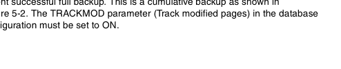

图 5-1 完全备份

## 增量备份

增量备份会复制自最近一次成功完全备份以来更改的数据的映像。这是一种累积备份，如图 5-2 所示。数据库配置中的 `TRACKMOD` 参数（跟踪已修改页面）必须设置为 `ON`。

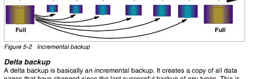

图 5-2 增量备份

## Delta 备份

`Delta` 备份基本上是一种增量备份。它会复制自上一次任何类型的成功备份以来所有已更改的数据页。这也称为非累积备份（图 5-3）。

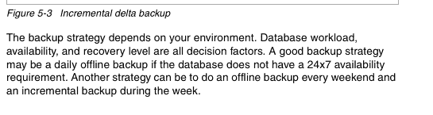

图 5-3 增量 delta 备份

备份策略取决于你的环境。数据库工作负载、可用性和恢复级别都是决策因素。一种良好的备份策略可能是如果数据库没有 24x7 可用性要求，则进行每日离线备份。另一种策略可以是在每个周末进行离线备份，并在工作日进行增量备份。

### 5.1.1 启用 roll forward 和日志归档

为了使用 `DB2` 中防止数据丢失的所有功能，我们将同时启用 `roll forward` 恢复和日志归档文件。这使我们能够将数据库恢复到故障发生的时间点。以下示例指导你在多分区数据库环境中完成此任务。

`DB2` 提供了示例用户退出程序，可将 `DB2` 日志归档到磁盘、`Tivoli Storage Management`（`TSM`）服务器或磁带。在我们的示例中，我们将向你展示如何将 `DB2` 日志归档到磁盘和 `TSM` 存储。我们的第一个任务是创建将保存归档日志文件的文件系统和目录。

使用 `fdsik` 或任何首选工具创建文件系统 `/db2archive` 并在每个主机上挂载它。

创建目录 `/db2archive/db2inst1` 并为实例所有者用户 ID 设置读写权限，以便 `DB2` 可以访问该目录。

```
chown db2inst1:db2grp1 /db2archive/db2inst1
```

为每个分区生成目录结构以保存归档日志：

```
db2_all 'mkdir /db2archive/db2inst1/ITSODB'
```

```
db2_all 'typeset -Z4 DB2NODE;mkdir /db2archive/db2inst1/ITSODB/'NODE$DB2NODE''
```

从 `$INSTHOME/sqllib/samples/c` 复制示例 userexit `db2uext2.cdisk` 到任何工作目录并将其重命名为 `db2uext2.c`。修改定义变量以适应你的环境。参考示例 5-1。

#### 示例 5-1 USEREXIT 定义以将日志归档到磁盘

```
#define ARCHIVE_PATH "/db2archive/db2inst1/" /* path must end with a slash */
#define RETRIEVE_PATH "/db2archive/db2inst1/" /* path must end with a slash */
#define AUDIT_ACTIVE 1 /* enable audit trail logging */
#define ERROR_ACTIVE 1 /* enable error trail logging */
#define AUDIT_ERROR_PATH "/db2home/db2inst1/" /* path must end with a slash */
#define AUDIT_ERROR_ATTR "a" /* append to text file */
#define BUFFER_SIZE 32 /* # of 4K pages for output buffer */
```

如果变量 `ARCHIVE_PATH` 设置为 `/db2archive/db2inst1/`，则 userexit 会将日志文件归档到 `/db2archive/db2inst1/ITSODB/NODE000x/`。

变量 `RETRIEVE_PATH` 指向一个文件系统，在执行日志应用时，userexit 必须将检索到的归档日志放置在该文件系统中。

要将日志归档到 `TSM` 存储，请从 `$INSTHOME/sqllib/samples/c` 复制示例 userexit `db2uext2.ctsm` 到任何工作目录并将其重命名为 `db2uext2.c`。修改 `AUDIT_ERROR_PATH` 变量以设置错误消息文件；参见示例 5-2。

#### 示例 5-2 USEREXIT 定义以将日志归档到 TSM

```
#define BUFFER_SIZE 32768 /* transmit or receive the log */
#define AUDIT_ACTIVE 1 /* enable audit trail logging */
#define ERROR_ACTIVE 1 /* enable error trail logging */
#define AUDIT_ERROR_PATH "/db2home/db2inst1/uexttsm/" /* path must end with */
#define AUDIT_ERROR_ATTR "a" /* append to text file */
#define DSMI_DIR NULL /* use value from the environment */
#define DSMI_CONFIG NULL /* use value from the environment */
#define DSMI_LOG NULL /* use value from the environment */
#define MGMT_CLASS NULL /* use default management class */
```

> 注意：在启用 `USEREXIT` 之前，子目录 `/db2archive/db2inst1/ITSODB/NODE000x` 必须存在。

变量 `AUDIT_ERROR_PATH` 用于设置 userexit 写入其消息文件的路径。


现在，我们需要以 `root` 用户身份编译这个示例 `userexit`。

用于归档到磁盘：

```
cc -D_INCLUDE_POSIX_SOURCE db2uext2.c -o db2uext2
```

用于归档到 TSM：

```
cc -D_INCLUDE_POSIX_SOURCE db2uext2.c -o db2uext2 -I/opt/tivoli/tsm/client/api/bin/sample /opt/tivoli/tsm/client/api/bin/libApiDS.so -lApiDS -lpthread -lcrypt -ldl
```

将输出文件 `db2uext2` 复制到 `$INSTHOME/sqllib/adm`。

通过更新每个分区上的数据库配置来启用日志保留和 `userexit`。

```
db2 update db cfg for itsodb using logretain on userexit on
```

此时数据库处于备份暂挂状态。从每个分区执行一次完整的离线备份，从目录分区开始。例如：

```
db2_all '<<0<db2 backup db itsodb to /db2backup'
```

现在，数据库已启用在线模式下的数据库备份以及单个表空间的备份。要验证这一点，请使用以下命令：

```
db2 get db cfg for itsodb | grep enabled
```

然后查看：

```
Log retain for recovery enabled          (LOGRETAIN) = RECOVERY
User exit for logging enabled            (USEREXIT) = ON
```

要验证自定义的 `USEREXIT`，请输入以下命令：

```
db2 archive log for itsodb
```

`USEREXIT` 将所有输出数据写入 `/db2home/db2inst1/ARCHIVE.LOG`，如 `audit_error_path` 中所指定。

### 示例 5-3 USEREXIT 程序的输出

```
Time Started:      Fri Oct 25 14:26:45 2002

Parameter Count:   8
Parameters Passed:
Database name:     ITSODB
Logfile name:      S0000000.LOG
Logfile path:      /db2log/db2inst1/itsodb/NODE0000/
Node number:       NODE0000
Operating system:  Linux
Release:           SQL08010
Request:           ARCHIVE
System Action:     ARCHIVE from /db2log/db2inst1/itsodb/NODE0000/ file S0000000.LOG to /database/db2inst1/archlog1/ITSODB
Media Type:        disk
User Exit RC:      0
Time Completed:    Fri Oct 25 14:26:45 2002
```

诸如备份或还原之类的命令会在恢复历史文件中写入详细的备份/还原信息。在多分区数据库中，该文件存在于每个分区中。要查看恢复历史文件中的条目，请使用命令 `db2 list history`。示例输出如示例 5-4 所示。

### 示例 5-4 备份历史

```
db2inst1@udblnx02:~> db2 list history backup all for itsodb

    List History File for itsodb

Number of matching file entries = 14

Op Obj Timestamp+Sequence Type Dev Earliest Log Current Log Backup ID
--- --- ------------------- ---- --- ------------ ----------- ---------
B   D   20021028162533001   F    D    S0000008.LOG S0000008.LOG

Contains 11 tablespace(s):

00001 SYSCATSPACE
00002 USERSPACE1
00003 TEST01
00004 CUSTOMER_TSP
00005 LINEITEM_TSP
00006 NATION_TSP
00007 ORDERS_TSP
00008 PART_TSP
00009 PARTSUPP_TSP
00010 REGION_TSP
00011 SUPPLIER_TSP
```

注释：`DB2 BACKUP ITSODB OFFLINE`

开始时间：`20021028162533`

结束时间：`20021028162555`

`00006` 位置：`/db2home`

#### 5.1.2 启用增量备份

`DB2` 支持增量备份和差异备份，它们是对自上次备份以来所有已更新数据页的副本。要启用增量备份或差异备份，需要将 `TRACKMOD` 数据库配置参数设置为 `ON`，如下所示：

```
db2 update db cfg for itsodb using TRACKMOD on
```

在多分区环境中，必须在每个数据库分区上执行此操作。一旦 `TRACKMOD` 设置为 `ON`，需要在开始增量/差异备份之前执行一次完整的数据库备份。该模式只有在执行了完整数据库备份后才会生效。

#### 5.1.3 启用 TSM 的使用

`DB2` 支持使用 `TSM` 存储进行数据库备份和归档日志备份。`TSM` 系统由 `TSM` 服务器和 `TSM` 客户端组成。我们的测试基于以下配置：

- 服务器：安装了 `TSM` 服务器 `4.2.1` 版本的 `WIN 2000` 服务器
- 客户端：安装了 `TSM` 客户端 `4.2.3` 版本的 `Linux SuSE V8.1`

每台主机都必须在 `TSM` 服务器上注册。

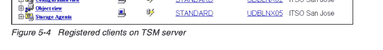

图 5-4 TSM 服务器上已注册的客户端

在 `TSM` 服务器上，`Tivoli` 需要某些存储池来存储归档日志文件和数据库备份副本。默认情况下，使用一个归档存储池（`ARCHIVEPOOL`）来存储由 `USEREXIT` 程序发送的 `DB2` 归档日志，使用一个备份存储池（`BACKUPPOOL`）来存储所有 `DB2` 备份文件（图 5-5）。

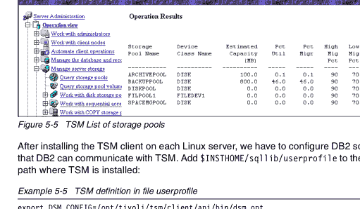

图 5-5 TSM 存储池列表

在每台 `Linux` 服务器上安装 `TSM` 客户端后，我们必须配置 `DB2`，以便 `DB2` 能与 `TSM` 通信。将 `$INSTHOME/sqllib/userprofile` 添加到 `TSM` 安装的路径中：

##### 示例 5-5 文件 userprofile 中的 TSM 定义

```
export DSM_CONFIG=/opt/tivoli/tsm/client/api/bin/dsm.opt
export DSM_DIR=/opt/tivoli/tsm/client/api/bin
```

`TSM` 客户端也必须进行配置。在文件 `/opt/tivoli/tsm/client/api/bin/dsm.sys` 中定义要使用的 `TSM` 服务器：

示例 5-6 显示了我们在测试环境中的文件。

##### 示例 5-6 Linux 客户端上的 dsm.sys 配置文件

```
db2inst1@udblnx02:/opt/tivoli/tsm/client/api/bin> more dsm.sys

SERVERNAME A23BK44W_SERVER1
COMMMethod TCPip
TCPPort 1500
TCPServeraddress 9.1.39.125
PasswordAccess generate
```

下一步是设置永久的 `TSM` 密码。以 `root` 用户身份切换到目录 `$INSTHOME/sqllib/adsm` 并执行以下命令（示例 5-7）：

`./dsmapipw`

##### 示例 5-7 为 TSM 设置密码


```
udb1nx02:/db2home/db2inst1/sqllib/adsm # ./dsmapipw
**************************************************
* Tivoli Storage Manager                         *
* API Version = 4.2.3                            *
**************************************************
Enter your current password:
Enter your new password:
Enter your new password again:

Your new password has been accepted and updated.
```

DB2 提供了 `db2adutl` 命令来管理 TSM 中的备份文件。您可以查看和删除 DB2 备份文件，并将备份文件从 TSM 存储带回数据库服务器。示例 5-8 显示了使用 `db2adutl` 的简单查询。

### 示例 5-8 db2adutl 查询示例

```
db2inst1@udb1nx02:~> db2adutl query full

Query for database ITSODB

Retrieving FULL DATABASE BACKUP information.
1 Time: 20021104103617 Oldest log: S0000043.LOG DB Partition Number: 1 Sessions: 1
2 Time: 20021104103534 Oldest log: S0000046.LOG DB Partition Number: 0 Sessions: 1
3 Time: 20021104103044 Oldest log: S0000045.LOG DB Partition Number: 0 Sessions: 1

db2inst1@udb1nx02:~> db2adutl query logs

Query for database ITSODB

Retrieving LOG ARCHIVE information.
Log file: S0000045.LOG, DB Partition Number: 1, Taken at: 2002-11-04-11.59.11
Log file: S0000046.LOG, DB Partition Number: 1, Taken at: 2002-11-04-11.59.11
Log file: S0000050.LOG, DB Partition Number: 0, Taken at: 2002-11-04-11.59.11
Log file: S0000051.LOG, DB Partition Number: 0, Taken at: 2002-11-04-11.59.14
```

> 注：关于使用 `db2adutl` 的完整说明写在 IBM DB2 UDB 命令参考 V8，SC09-4828 中。

#### 5.1.4 备份实用程序

我们已完成所有步骤，如 5.1.1 中所述，“启用 roll forward 和日志归档”，第 151 页，现在讨论如何进行数据库备份。

- **完全离线：** 完全离线数据库备份允许您在不应用任何日志记录的情况下恢复数据库映像。示例 5-9 显示了离线备份命令。

### 示例 5-9 完全离线备份到磁盘

```
db2inst1@udb1nx02:/db2backup> db2 backup db itsodb to /db2backup

Backup successful. The timestamp for this backup image is : 20021029163312

udb1nx02: db2 backup db itsodb to /db2backup completed ok
```

- **完全在线和增量：** 增量备份节省备份时间和资源。在线备份期间，数据库仍可供应用程序访问。示例 5-10 提供了完全在线备份的示例。

### 示例 5-10 增量备份到磁盘

```
db2inst1@udb1nx02:~> db2 backup db itsodb online incremental to /db2backup

Backup successful. The timestamp for this backup image is : 20021029165004

udb1nx02: db2 backup db itsodb online incremental to /db2backup completed ok
```

- **Delta 备份：** 示例 5-11 显示了在进行完全数据库备份后进行的 delta 数据库备份。

### 示例 5-11 Delta 备份

```
db2inst1@udb1nx02:~> db2 backup db itsodb online incremental delta to /db2backup

Backup successful. The timestamp for this backup image is : 20021029165624

udb1nx02: db2 backup db itsodb online incremental to /db2backup completed ok
```

#### 5.1.5 使用 Control Center 备份数据库

备份实用程序已完全集成在 DB2 Control Center 中（图 5-6）。

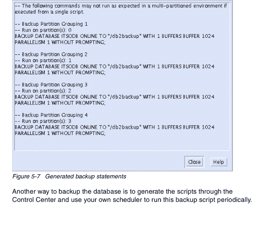

图 5-7 生成的备份语句

另一种备份数据库的方法是通过控制中心生成脚本，并使用自己的调度程序定期运行此备份脚本。

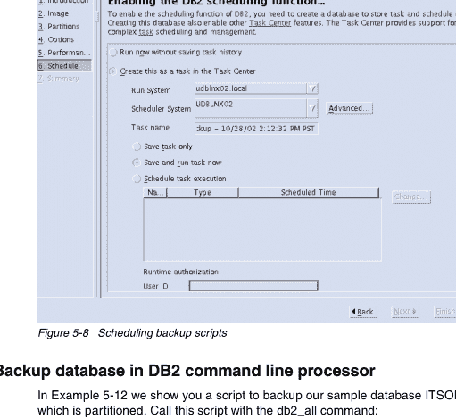

#### 5.1.6 在 DB2 命令行处理器中备份数据库

在示例 5-12 中，我们展示了一个用于备份我们的示例数据库 ITSODB 的脚本，该数据库是分区的。使用 `db2_all` 命令调用此脚本：

```
db2_all '/db2home/db2inst1/database_backup.ksh db2inst1 itsodb'
```

### 示例 5-12 备份脚本 database_backup.ksh

```
#!/usr/bin/ksh
#
# Script: backing up database
#---------------------------------------------

echo running against instance: ${1}
echo running against database: ${2}
INSTANCE=$1
DB_ALIAS=$2
#---------------------------------------------
# check for db2profile and execute it, if available
```


``` 
#-------------------------------------------------------------

DBHOME=`finger -l $INSTANCE | grep Directory | awk '{print $2}'`

if [ ! -f /$DBHOME/sqllib/db2profile ]
then

echo "File not found: " /$DBHOME/sqllib/db2profile
echo "please check host- and instancename"
echo " **************** script abnormally ended *******************"

exit 1

fi

. /$DBHOME/sqllib/db2profile

for i in 1 2 3
do
echo ""
echo "Start backing up database $DB_ALIAS on node $DB2NODE "
echo ""

db2 backup db $DB_ALIAS to /db2backup with 4 buffers parallelism 2

if [ $? = '0' ]
then
szDate=$(date)
echo ""
echo "backing up database $DB_ALIAS on node $DB2NODE successfully $szDate" |
tee -a /$DBHOME/$DB_ALIAS.log
echo ""
exit 0
fi

if [ "$i" -le "3" ]
then
echo "Start another trial"
fi
done
szDate=$(date)
echo ""
echo "backing up database $DB_ALIAS on node $DB2NODE failed after 3 trials $szDate " | tee -a /$DBHOME/$DB_ALIAS.log
echo ""
exit 8
```

根据您的环境和需求修改此示例。

注意：有关备份数据库的详细说明，请参阅 IBM DB2 UDB Data Recovery and High Availability Guide and Reference V8，SC09-4831 中的第 2 章“Database Backup”。

### 5.1.7 DB2 数据库恢复实用程序

在许多情况下可能需要进行完整或部分数据库恢复。 可用的恢复方法取决于您的备份和 DB2 日志处理。 DB2 支持以下恢复方法：

- **崩溃恢复**

DB2 使用此方法在意外故障后将数据库设置为一致状态。 崩溃恢复将回滚所有未提交的更改。 可使用 `db2 restart database` 命令强制执行。

- **完整数据库离线恢复**

这将把整个数据库恢复到数据库备份所取的时间点，或结合向前滚动恢复到特定时间点。 这是恢复具有循环日志的数据库的唯一恢复方法。 完整数据库恢复示例为：

`db2 restore db itsodb from /db2backup taken at 200210291525`

- **带增量的完整数据库恢复**

一旦您的数据库已启用恢复，即 `log retain on`，并且已启用增量备份，即 `trackmod is on`，您就可以将整个或部分数据库恢复到所需的时间点。

`db2 restore db itsodb online incremental auto from /db2backup taken at 200210291525`

- **表空间恢复**

如果您已启用向前滚动恢复，则可以随时将任何表空间恢复到某个时间点或日志末尾。

`db2 restore db itsodb "tablespace(nation_tsp)" online incremental auto from /db2backup taken at 200210291525`

- **向前滚动恢复**

此过程将更改应用于表空间的归档日志或活动日志。 此命令必须从目录分区发出。

`db2 'rollforward db itsodb to end of logs on dbpartitionnum(0,1) and complete online'`

- 恢复已删除的表

DB2 支持通过表空间级恢复来恢复已删除的表，如果表所在的表空间已启用删除表恢复。 这可以在创建表空间期间完成，也可以通过使用 `DROPPED TABLE RECOVERY ON` 选项更改现有表来完成。

> 注意：有关备份数据库的详细说明，请参阅 IBM DB2 UDB Data Recovery and High Availability Guide and Reference V8，SC09-4831 中的第 2 章“Database Backup”。

### 5.1.8 备份和恢复示例场景

以下场景适用于我们的四分区数据库 `ITSODB`：

- 创建并加载许多表到数据库后，我们进行一次完整的离线备份。
- 向前滚动、`userexit` 和 `trackmod` 已启用。
- 数据库开始正常使用，其中包括对表的更新、删除等操作。
- 在线增量备份定期安排。

我们按顺序执行以下活动以演示数据库恢复功能：

- 1. `ITSODB` 的完整离线数据库备份
- 2. 对表 `CUSTOMER` 进行更新
- 3. `ITSODB` 的完整在线增量数据库备份
- 4. 对表 `CUSTOMER` 进行更新
- 5. `ITSODB` 的完整在线增量数据库备份
- 6. 对表 `CUSTOMER` 进行更新
- 7. 表 `CUSTOMER` 在主机 `udblnx05` 系统中断后不再可访问，其中位于数据库分区 2 和 3。

要将我们的表恢复到损坏之前的时点，您必须查明上次备份是在何时进行的。 为此，我们在每个分区上发出以下命令（在我们的示例中为分区 2 和 3）：

```
db2 list history backup all for itsodb
```

#### 示例 5-13 列表数据库备份历史输出

```
Op Obj Timestamp+Sequence Type Dev Earliest Log Current Log Backup ID
--- ------------------- -------- ---- ------------ ------------ ----------
B D 20021029165624001 0 D S0000020.LOG S0000021.LOG
Contains 9 tablespace(s):
00001 USERSPACE1
00002 CUSTOMER_TSP
00003 LINEITEM_TSP
00004 NATION_TSP
00005 ORDERS_TSP
00006 PART_TSP
00007 PARTSUPP_TSP
00008 REGION_TSP
00009 SUPPLIER_TSP
Comment: DB2 BACKUP ITSODB ONLINE
Start Time: 20021029165624
End Time: 20021029165635
00003 Location: /db2backup
```

接下来，从输出中获取时间戳（示例 5-13）并执行以下命令：

```
db2 restore db itsodb "tablespace(customer_tsp)" online incremental auto from /db2backup taken at 20021029165624
```

对需要恢复表空间的每个分区重复这些步骤。恢复表空间后，表空间将在执行恢复的分区上处于 roll forward pending 状态；请参阅示例 5-14。

#### 示例 5-14 列表表空间

```
Tablespace ID = 4
Name = CUSTOMER_TSP
Type = System managed space
Contents = Any data
State = 0x0080
Detailed explanation:
Roll forward pending
```

对分区 2 和 3 的数据库发出 rollforward 命令。有关命令语法和输出，请参阅示例 5-15。

#### 示例 5-15 对分区 2 和 3 进行 Rollforward 数据库

```
db2 'rollforward db itsodb to end of logs on dpartitionnum(2,3) and complete tablespace(customer_tsp) online'
```

#### Rollforward 状态

Input database alias = itsodb

Number of nodes have returned status = 2


| Node number | Rollforward committed transaction status | Next log to be read | Log files processed | Last |
|---|---|---|---|---|
| 2 not pending 2002-10-30-01.20.36.000000 |  | - |  |
| 3 not pending 2002-10-30-01.20.36.000000 |  | - |  |

`DB200001` The ROLLFORWARD command completed successfully.

恢复数据库或表空间后，您应考虑进行新的备份以获取数据库的新一致映像副本。

### 5.1.9 恢复已删除的表

要恢复位于已设置为删除表恢复的表空间中的已删除表，请按照以下步骤操作：

- 1. 从数据库或表空间级别备份中恢复表被删除前所在的表空间。在我们的示例中，已删除的表位于 `nation_tsp` 表空间中，该表空间驻留在分区 1、2 和 3 中。

#### 示例 5-16 所有分区的表空间恢复

```
db2 restore db itsodb "tablespace(nation_tsp)" online incremental auto from /db2backup taken at 20021031151430
```

```
db2inst1@udblnx02:"/scripts> db2_all '<<+
 db2inst1@udblnx02:"/scripts> db2_all '<<+2
db2 restore db itsodb
"tablespace(nation_tsp)" online incremental auto from /db2backup taken at 20021031152514'

DB20000I  The RESTORE DATABASE command completed successfully.
 udblnx05: db2 restore db itsodb "tablespace(nation_tsp)" online incremental auto from /db2backup taken at 20021031152514 completed ok
 db2inst1@udblnx02:"/scripts> db2_all '<<+3
db2 restore db itsodb
"tablespace(nation_tsp)" online incremental auto from /db2backup taken at 20021031152528'

DB20000I  The RESTORE DATABASE command completed successfully.
 udblnx05: db2 restore db itsodb "tablespace(nation_tsp)" online incremental auto from /db2backup taken at 20021031152528 completed ok
```

- 2. 在共享文件系统中创建导出目录，或在每个分区上创建该目录。

```
db2_all 'mkdir /db2backup/rest_table'
```

- 3. 通过查看历史文件确定表 ID（示例 5-17）。在多分区环境中，这必须在 catalog 分区上执行。

#### 示例 5-17 列表历史文件

```
db2 list history dropped table all for itsodb

List History File for itsodb

Number of matching file entries = 1

Op Obj Timestamp+Sequence Type Dev Earliest Log Current Log Backup ID
-- -- ------------------- ----- --- ------------- ----------- ----------
D T 20021031154206
000000000000460500050002
"DB2INST1"."NATION" resides in 1 tablespace(s):
00001 NATION_TSP
Comment: DROP TABLE
Start Time: 20021031154206
End Time: 20021031154206
00001
```

### 5.2 表/索引重组与统计信息收集

当对表进行大量更改时，表和/或索引会变得碎片化，表和/或索引的物理数据页会变得不连续。此外，如果某个表存在聚簇索引，在对表和索引键条目进行大量更改后，该索引可能会变得聚簇不良。在这种条件下处理类似工作负载将需要额外的 CPU 时间和 I/O 操作等成本。这可能会导致明显的性能下降。为获得更好的性能，您需要完成的任务之一是对表和索引进行重组。

完成重组任务后，使用 `RUNSTATS` 实用程序收集有关表物理数据存储特征以及相关索引的信息。此类信息包括，例如，表拥有的记录数，表和相关索引占用的页数，相关聚簇索引的聚簇比率等等。DB2 优化器可以在确定访问数据的路径时利用这些统计信息，以获得后续数据库操作的更好性能。

#### 5.2.1 表重组

DB2 UDB 提供了两种重组表的方法：

- **Online**

  在线表重组允许应用程序在重组期间访问表。此外，任何具有适当权限的人都可以使用模式和表名暂停和稍后恢复在线表重组。仅允许对具有类型 2 索引且没有扩展索引的表进行在线表重组。

- **Offline**

  离线方法提供了更快的表重组，尤其是在您不需要重组 LOB 或 LONG 数据时。LOB 和 LONG 数据不再重组，除非特别请求。此外，在表重组后，索引会按顺序重建。只读应用程序可以在重组的最后阶段之前访问表的原始副本，在该阶段，影子副本替换原始副本并重建索引。

在线和离线重组都已增强，以改善对多分区数据库的支持。您可以重组单个分区、一组分区或所有分区。

> 注意：从 `REORG TABLE` 命令语法的角度来看，DB2 提供的表重组方法包括经典和就地（在线）。通常，经典表重组速度更快，但仅应在重组期间应用程序无需对表进行写访问时使用。此外，经典表重组将需要创建表的影子副本，因此大约需要相当于原始表两倍的空间。如果您的环境不允许此限制，虽然就地重组较慢，但它可以在后台进行，同时正常数据访问继续进行。考虑每种方法的特性并决定哪种方法更适合您的环境。有关经典和就地表重组的更多详细信息，请参阅 DB2 Administration: Performance V8，SC09-4821。

有几种方法可减少表和索引重组的需要，例如，为表设置 `PCTFREE` 以为后续插入和更新操作保留每个数据页的特定百分比。有关更多信息，请参阅在线图书 DB2 Administration: Performance V8。

分析 `RUNSTATS` 生成的统计信息可以指示何时以及需要进行何种类型的重组。此外，可以使用 `REORGCHK` 命令计算数据库的统计信息或使用当前统计信息来确定是否需要重组或清理表或索引，或两者都需要。

#### 5.2.2 索引重组

为了获得索引的最佳性能，请考虑定期重组索引，因为表更新可能导致索引页预取变得不那么有效。命令 `REORG INDEXES` 是 DB2 版本 8 的新命令。它具有在索引重组期间读取和更新表及其现有索引的能力。

在在线索引重组期间，整个索引对象（即表上的所有索引）都会重建。索引对象的影子副本将被制作，原始索引和表可用于读和写访问。任何并发更新表的事务都会被记录。一旦记录的表更改被向前拟合并且新索引（影子副本）准备就绪，新的

index is made available. While the new index is being made available all access to the table is prohibited.

You can reduce the need of index reorganization via a variety of means, for example, setting `PCTFREE` for indexes, or enabling the online index defragmentation by setting `MINPCTUSED` (it will trigger online index leaf page merging when specific conditions are matched). This means it may reduce the likelihood of causing index page splits when future activities such as inserts happen on the table.


The default behavior of the `REORG INDEXES` command is `ALLOW NO ACCESS`, which places an exclusive lock on the table during the reorganization process. But you can also specify `ALLOW READ ACCESS` or `ALLOW WRITE ACCESS` to permit other transactions to read from or update the table.

### 5.2.3 Statistics information collection

The `RUNSTATS` command can be issued from any database partition in the `db2nodes.cfg` file. It can be used to update the catalogs on the catalog database partition. In a partitioned database, the `RUNSTATS` command collects the statistics on only a single node. If the database partition from which the `RUNSTATS` command is executed has a part of the table, then the command will execute on that database partition directly. Otherwise, the command executes on the first database partition in the database partition group across which the table is partitioned.

It is possible to perform read or write operations to the table where `RUNSTATS` is taking place by using different `RUNSTATS` command parameters. For example, `ALLOW READ ACCESS` specifies that other users can have read-only access to the table while statistics are calculated and `ALLOW WRITE ACCESS` specifies that other users can read from and write to the table while statistics are calculated.

> Note: Because reorganizing a table usually takes more time than running statistics, you might execute `RUNSTATS` to refresh the current statistics for your data and rebind your applications. If refreshed statistics do not improve performance, then reorganization may help.

### 5.2.4 Packages rebinding

The command `REBIND` enables the user to take advantage of a change in the system without a need for the original bind file. It is likely that a particular SQL statement can take advantage of a newly created index. The `REBIND` command can be used to recreate the package. `REBIND` can also be used to recreate packages after `RUNSTATS` has been executed, thereby taking advantage of the new statistics. This is especially important for static SQL. Without the rebind, the static SQL application won't be able to utilize the new DB2 statistics.

Additionally, you can use the `db2rbind` utility to rebind all invalid packages or all packages within the database.

### 5.2.5 Examples

This section provides examples demonstrating the usage of the utilities mentioned in this section: `REORG TABLE`, `REORG INDEXES`, `REORGCHK` and `RUNSTATS`. We have created a table named "`EMP`" across three partitions and populated with 100,000 rows of data. An unique index named "`U_EMP_ENO`" is associated with this table.

Here are more details for the table `EMP` (Figure 5-9):

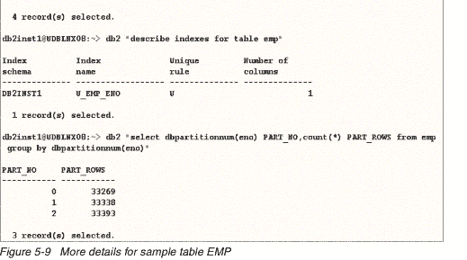

Figure 5-9 More details for sample table EMP

The steps performed in this example are as follows:

- 1. Run "`RUNSTATS`" to gather current statistics information.

catalog views directly, for example, `SYSSTAT.TABLES` and `SYSSTAT.INDEXES`, and so on.

> Attention: The `RUNSTATS` utility is run against one partition only due to performance considerations, so some global statistics information may be inaccurate here. For example, the `CARD` should be 100,000 in reality, but here it says 99,807. Another command `INSPECT CHECK` can be used to generate accurate information about the pages occupied by the table and index objects.

The `RUNSTATS` utility is also available in the DB2 Control Center. If you want to use the Schedule function provided by DB2, please use the DB2 Control Center instead. Figure 5-11 and Figure 5-12 for `RUNSTATS` and Scheduler are provided for your reference.

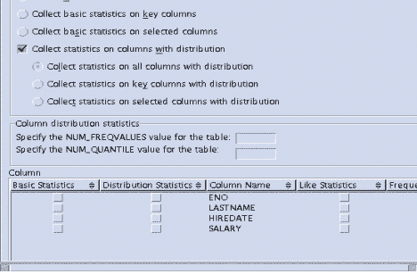

Figure 5-11 RUNSTATS in DB2 Control Center on Linux

## 提示：ELEAF 和 NDEL 的含义：

- `ELEAF`：伪空索引叶页数（`NUM_EMPTY_LEAFS`）

  伪空索引叶页是指所有 RID 均被标记为已删除，但尚未被物理移除的页面。

- `NDEL`：伪删除 RID 数（`NUMRIDS_DELETED`）

  伪删除 RID 是被标记为删除的 RID。该统计信息报告在非伪空叶页上的伪删除 RID。它不包括在所有 RID 均被标记为已删除的叶页上标记为已删除的 RID。


```
db2inst1@UDBLNX08:~/test> db2 "reorg indexes all for table emp allow write access cleanup only all on all dbpartitionnums"
DB20001 The REORG command completed successfully.
db2inst1@UDBLNX08:~/test> db2 "reorgchk update statistics on table db2inst1.emp"
Doing RUNSTATS ...
Table statistics:
...
Index statistics:
SCHEMA NAME CARD LEAF ELEAF LVLS ISIZE NDEL KEYS F4 F5 F6 F7 F8 REORG
Table: DB2INST1.EMP
DB2INST1 U_EMP_ENO 49701 201 0 2 6 0 49701 100 90 0 0 0 -----
```

### 图 5-14 使用 REORG INDEXES 和 REORGCCHK 更新统计信息

然后我们发现 `ELEAF` 和 `NDEL` 回到了 `0`，因为伪删除页已被物理移除。

现在我们按建议重新组织表。在第一个示例（示例 5-21）中，我们使用经典的表重组方法，并使用 `ALLOW READ ACCESS` 选项。

## 示例 5-21 使用 ALLOW READ ACCESS 选项的 REORG TABLE

```
db2inst1@UDBLNX08:~/test> db2 "reorg table emp index u_emp_eno allow read access on all dbpartitionnums"
DB20001 The REORG command completed successfully.
```

然后我们使用 `ALLOW WRITE ACCESS` 选项的原地表重组方法。在发出 `REORG TABLE` 命令之前，为了观察 `REORG TABLE` 的过程，您可以打开另一个窗口并以指定间隔持续运行 "`GET SNAPSHOT`" 命令。间隔的长度取决于您操作的数据量和系统能力。您可以用 shell 脚本或手动执行。在我们的示例（示例 5-22）中，使用名为 "`run`" 的 shell 脚本以 2 秒的间隔运行 "`GET SNAPSHOT`" 命令。

## 示例 5-22 启动监控程序以观察表重组过程

```
db2inst1@UDBLNX08:"/test> run
Usage: run <command_name> [ <sleeping_interval> [ < result_file > ] ]
db2inst1@UDBLNX08:"/test> run "db2 get snapshot for tables on sample" 2
snap_reorgtab_write.out
Program name: "db2 get snapshot for tables on sample"
This program will keep running every 2 seconds for ever,
pls interrupt it with Ctrl+C if needed ...

Command "db2 get snapshot for tables on sample" is running NOW ...
Note: The output of "get snapshot" is gathered into the file "snap_reorgtab_write.out".
```

在监控程序启动后，现在我们可以使用示例 5-23 中显示的命令开始原地表重组。

## 示例 5-23 使用 INPLACE 和 ALLOW WRITE ACCESS 模式的 REORG TABLE

```
db2inst1@UDBLNX08:"/test> db2 "reorg table emp index u_emp_eno inplace allow write access on all dbpartitionnums"
DB20001I The REORG command completed successfully.
DB21024I This command is asynchronous and may not be effective immediately.
```

从输出中可以发现，原地表重组是异步的，可能不会立即生效。要确定原地表重组是否已完成或当前状态如何，您可以使用 `GET SNAPSHOT FOR TABLES ON SAMPLE`（此处示例中使用 `SAMPLE` 数据库）来获取重组的详细信息。示例 5-24 是在 `REORG TABLE` 之前启动的监控程序收集的输出。该输出包含表重组信息，例如重组类型、开始时间、状态（`Started`、`Truncate`、...、`Completed`）等。

## 示例 5-24 表重组的快照信息

```
Table Snapshot

First database connect timestamp = 10-17-2002 13:46:35.708637
Last reset timestamp = 
Snapshot timestamp = 10-17-2002 14:54:53.136558
Database name = SAMPLE
Database path = 
/db2home/db2inst1/db2inst1/NODE0000/SQL00001/
```

Input database alias = SAMPLE

Number of accessed tables = 1

Table List

Table Schema = DB2INST1

Table Name = EMP

Table Type = User

Table Reorg Information:

Node number = 0

Reorg Type =

  Reclustering

  Inplace Table Reorg

  Allow Write Access

Reorg Index = 1

Reorg Tablespace = 2

Start Time = 10-17-2002 14:54:52.336284

Reorg Phase =

Max Phase =

Phase Start Time =

Status = Started

Current Counter = 6

Max Counter = 169

Completion = 0

End Time =

Table Snapshot

First database connect timestamp = 10-17-2002 13:46:35.708637

Last reset timestamp =

Snapshot timestamp = 10-17-2002 14:55:17.020074

Database name = SAMPLE

Database path = /db2home/db2inst1/db2inst1/NODE0000/SQL00001/

Input database alias = SAMPLE

Number of accessed tables = 1

Table List

Table Schema = DB2INST1

Table Name = EMP

Table Type = User

Table Reorg Information:

Node number = 0

Reorg Type =

  Reclustering

  Inplace Table Reorg

  Allow Write Access

Reorg Index = 1

Reorg Tablespace = 2

Start Time = 10-17-2002 14:54:52.336284

Reorg Phase      =

Max Phase        =

Phase Start Time =

Status           = Truncate

Current Counter  = 169

Max Counter      = 169

Completion       = 0

End Time         =

## Table Snapshot


```
First database connect timestamp = 10-17-2002 13:46:35.708637
Last reset timestamp              =
Snapshot timestamp                = 10-17-2002 14:55:19.130922
Database name                     = SAMPLE
Database path                     =
/db2home/db2inst1/db2inst1/NODE0000/SQL00001/
Input database alias              = SAMPLE
Number of accessed tables         = 1
```

## Table List

```
Table Schema      = DB2INST1
Table Name        = EMP
Table Type        = User
Table Reorg Information:
Node number       = 0
Reorg Type        =
  Reclustering
  Inplace Table Reorg
  Allow Write Access
Reorg Index       = 1
Reorg Tablespace  = 2
Start Time        = 10-17-2002 14:54:52.336284
Reorg Phase       =
Max Phase         =
Phase Start Time  =
Status            = Completed
Current Counter   = 169
Max Counter       = 169
Completion        = 0
End Time          = 10-17-2002 14:55:17.746016
```

If you are not willing to use the command line to execute `REORG TABLE` or `REORG INDEXES`, these commands are also available in DB2 Control Center. Figure 5-15 and Figure 5-16 are provided for your reference.

Figure 5-15 REORG TABLE in DB2 Control Center

Figure 5-16 REORG INDEXES in DB2 Control Center

## 5. Use the REORGCHK with UPDATE STATISTICS option to obtain the new statistics after the index and table reorganization.

```
db2inst1@DBLNX08:/test> db2 'reorgchk update statistics on table db2inst1.emp'
Doing RUNSTATS ....

Table statistics:

F1: 100 * OVERFLOW / CARD < 5
F2: 100 * (Effective Space Utilization of Data Pages) > 70
F3: 100 * (Required Pages / Total Pages) > 80

SCHEMA      NAME          CARD   OV   NP   FP ACTBL   TSIZE   F1   F2   F3 REORG
-------------------------------
DB2INST1    EMP           49701  0    510  510     -      2037741 0    98   100 ---

Index statistics:

F4: CLUSTER RATIO or normalized CLUSTERFACTOR > 80
F5: 100 * (KEYS * (ISIZE + 9) + (CARD - KEYS) * 5) / ((NLEAF - NUM EMPTY LEAFS) * INDEXPAGESIZE) > 50
F6: (100 - PCTFREE) * ((INDEXPAGESIZE - 96) / (ISIZE + 12)) ** (NLEVELS - 2) * (INDEXPAGESIZE - 96) / (KEYS * (ISIZE + 9) + (CARD - KEYS) * 5) < 100
F7: 100 * (NUMRIDS DELETED / (NUMRIDS DELETED + CARD)) < 20
F8: 100 * (NUM EMPTY LEAFS / NLEAF) < 20

SCHEMA      NAME          CARD   LEAF   ELEAF   LVLS   ISIZE   NDEL   KEYS   F4   F5   F6   F7   F8   REORG
Table: DB2INST1.EMP
```

Figure 5-17 Using REORGCHK to update statistics after table reorganization

Here you may find that `FP` (File Pages) for table and `LEAF` (Leaf Pages) for index are lowered. For table statistics, you may find that the recommendation part has turned back to `"---"`. It means no REORG is required at present.

## 6. Rebinding packages.

Rebinding is required to take advantage of the new statistics information. For example, if statistics information for the tables or indexes related to the package has been changed, then, in general, rebinding is required for better performance purposes. An example of using the `rebind` command is shown in Example 5-25.

Example 5-25 Re-binding packages

```
db2inst1@DBLNX08:"/sampc> db2 "rebind tbread"
DB20001  The REBIND PACKAGE command completed successfully.
# db2inst1@DBLNX08:/test> db2rbind sample -l db2rbind.log all
```

注意：使用 `"db2rbind"` 实用程序时请谨慎，特别是使用 `"ALL"` 参数时。默认情况下，`db2rbind` 只会重新绑定无效的包。但当指定 `"ALL"` 时，数据库中的所有包，无论有效还是无效，都会被重新绑定。如果您确切知道哪些包与表或索引相关，并且这些表或索引的统计信息刚刚被更改，那么建议使用指定包名的 `REBIND`。

### 5.3 通过 EXPORT、IMPORT 和 LOAD 进行数据移动

在本节中，我们讨论 DB2 使用 `EXPORT`、`IMPORT` 和 `LOAD` 实用程序进行数据移动。我们可以使用 `EXPORT` 将数据从数据库表导出到具有不同文件格式的文件中，也可以将数据从源数据文件写入数据库表。 此外，当需要将大量数据移动到数据库表时，还可以使用 `LOAD` 实用程序以获得更好的性能。此外，我们还描述了在多数据库分区环境下使用 `LOAD` 实用程序的基本用法和注意事项。如果您要处理大量表，`db2move` 实用程序对于这种情况会很有帮助。

#### 5.3.1 从数据库表导出数据到文件

DB2 UDB 导出实用程序可用于将数据从 DB2 数据库写入存储在数据库外部的一个或多个文件。导出的数据随后可使用 DB2 导入或 DB2 加载实用程序分别导入到另一个 DB2 数据库中。或者可以导入到另一个应用程序，例如电子表格。用户通过提供 SQL SELECT 语句或为类型化表提供分层信息来指定要导出的数据。

在调用 `EXPORT` 之前，您需要显式或隐式地建立与数据库的连接。您可以通过 DB2 命令行处理器 (`CLP`) 或 DB2 控制中心 (`CC`)，或通过应用程序编程接口 (`API`) 调用 `EXPORT` 实用程序。示例 5-26 是使用 DB2 CLP 从分布在三个分区中的名为 `EMP` 的表导出数据的示例。


### 示例 5-26 从示例表 "EMP" 导出所有数据

```
db2inst1@UDBLNX08:"/itso/datmov> db2 "export to emp.ixf of ixf select * from emp"
SQL3104N  The Export utility is beginning to export data to file "emp.ixf".
SQL3105N  The Export utility has finished exporting "100000" rows.
```

Number of rows exported: 100000

已导出跨越全部三个分区的数据。如果您只想导出一个分区的数据，例如当前数据库分区上的数据，您可以像示例 5-27 那样操作。

### 示例 5-27 从示例表 "EMP" 导出当前分区的数据

```
db2inst1@UDBLNX08:"/itso/datmov> db2 "export to empart0.del of del messages exppart0.msg select * from emp where dbpartitionnum(eno) = current dbpartitionnum"
```

Number of rows exported: 33269

如果您想跨不同分区并行导出数据，可以使用 `db2_all` 或 `db2batch`。有关使用 `db2batch` 并行导出数据的更多详细信息，请参阅 IBM DB2 UDB Data Movement Utilities Guide and Reference V8, SC09-4830。

您还可以使用 DB2 控制中心在 Linux 平台上调用 `EXPORT`。图 5-18 供您参考。在控制中心，您可以在文件格式选项下选择导出的输出文件格式；在 SELECT 语句区域手动输入 SQL 语句或通过 SQL Assist Wizard 输入。此外，在消息文件下，您可以指定要创建的消息文件，该文件将包含与 `EXPORT` 操作相关的错误、警告和信息性消息。此外，如果您想了解与您的选择相关的命令，请单击显示命令。会出现一个弹出窗口，其中包含详细的命令。此外，您还可以通过在窗口上选择计划选项卡，使用 DB2 提供的计划功能进行导出操作。

### 图 5-18 在 DB2 控制中心使用 EXPORT

表可以通过使用导出实用程序并指定 `IXF` 文件格式来保存。然后可以通过导入实用程序导入数据时重新创建保存的表（包括其索引）。

如果要导出的数据超过导出文件将创建的文件系统上的可用空间，则导出操作将失败。在这种情况下，您应该通过在 `WHERE` 子句中指定条件来限制所选数据的数量，以便导出文件适合目标文件系统。您可以多次调用导出实用程序以导出所有数据。

有关在自己的程序中使用 `EXPORT` API 以及有关 `EXPORT` 实用程序的更多详细信息，请参阅 IBM DB2 UDB Data Movement Utilities Guide and Reference V8, SC09-4830 和 IBM DB2 UDB Command Reference V8, SC09-4828。

#### 5.3.2 将文件导入数据库表或视图

`IMPORT` 实用程序将输入文件中的数据插入到表或可更新视图中。如果接收导入数据的表或视图已包含数据，则可以替换或追加到现有数据。

如果输入文件的格式为 `IXF`（Integrated eXchange Format），您还可以使用 `import` 创建新表。

使用 `import` 运行是否带创建新表选项所需的权限和特权是不同的。要使用 `import` 实用程序创建新表，您必须具有 `SYSADM` 权限、`DBADM` 权限，或数据库的 `CREATETAB` 特权。要替换现有表或视图中的数据，您必须具有 `SYSADM` 权限、`DBADM` 权限，或表或视图的 `CONTROL` 特权。要向现有表或视图追加数据，您必须具有表或视图的 `SELECT` 和 `INSERT` 特权。

`import` 实用程序可以通过命令行处理器（`CLP`）、Control Center 中的 Import 笔记本或应用程序编程接口（API），`sqldmpr` 来调用。您还可以为 `IMPORT` 实用程序指定 `MESSAGES` 参数，以记录与 `IMPORT` 操作相关的错误、警告和信息性消息。

> 注意：如果针对远程数据库的导入操作生成的输出消息量超过 60 KB，该实用程序将保留前 30 KB 和后 30 KB。

### 示例 5-28 通过 DB2 CLP 使用 IMPORT

```
db2inst1@UDLBNX08:/db2home/db2inst1> db2 "create table emp4imp like emp"
DB20000I  The SQL command completed successfully.
db2inst1@UDLBNX08:/db2home/db2inst1> db2 "import from ./itso/datmov/emp.ixf of ixf commitcount 20000 messages emp4imp.msg insert into emp4imp"
```

Number of rows read       = 100000
Number of rows skipped    = 0
Number of rows inserted   = 100000
Number of rows updated    = 0
Number of rows rejected   = 0
Number of rows committed  = 100000

在前面的示例（示例 5-28）中，使用了 `COMMITCOUNT` 参数。这意味着 DB2 将在每导入 n 条记录后执行一次 `COMMIT`。如果在使用 `COMMITCOUNT` 参数时导入因某种原因被中断，已提交的行仍将保留在目标表中，尽管导入过程失败。对于这种情况，您可以使用 `REPLACE` 或 `REPLACE_CREATE` 选项通过截断数据对象来删除表中的所有现有数据并插入导入的数据。或者您也可以使用指定了 `RESTARTCOUNT` 参数的 `INSERT` 选项，以避免重新导入已存在于表中的行。在示例 5-29 中，使用了 `MESSAGES` 参数来监控导入操作的状态。您可以检查生成的消息文件，该文件为 ASCII 格式。

### 示例 5-29 通过消息文件监控 IMPORT 进程


```
db2inst1@UDBLNX08:> tail -f emp4imp.msg
SQL3153N  The T record in the PC/IXF file has name "emp.ixf", qualifier "", and source "".

SQL3109N  The utility is beginning to load data from file "./itso/datmov/emp.ixf".

SQL3221W  ...Begin COMMIT WORK. Input Record Count = "20000".
SQL3222W  ...COMMIT of any database changes was successful.

SQL3221W  ...Begin COMMIT WORK. Input Record Count = "40000".
SQL3222W  ...COMMIT of any database changes was successful.

SQL3221W  ...Begin COMMIT WORK. Input Record Count = "60000".
SQL3222W  ...COMMIT of any database changes was successful.

SQL3221W  ...Begin COMMIT WORK. Input Record Count = "80000".
SQL3222W  ...COMMIT of any database changes was successful.

SQL3221W  ...Begin COMMIT WORK. Input Record Count = "100000".
SQL3222W  ...COMMIT of any database changes was successful.

SQL3110N  The utility has completed processing. "100000" rows were read from the input file.

SQL3221W  ...Begin COMMIT WORK. Input Record Count = "100000".
SQL3222W  ...COMMIT of any database changes was successful.

SQL3149N  "100000" rows were processed from the input file. "100000" rows were successfully inserted into the table. "0" rows were rejected.
```

与 `EXPORT` 类似，我们也可以使用 `DB2 Control Center` 来调用 `IMPORT` 实用程序。要在 Control Center 中打开 Import 笔记本：

1. 从 Control Center 开始，展开对象树直到找到 Tables 文件夹。
2. 单击“表”文件夹。所有现有表都会显示在窗口右侧的窗格（内容窗格）中。
3. 在内容窗格中右键单击所需的表，然后从弹出菜单中选择“导入”。此时将打开“导入”笔记本。

图 5-19 是在 DB2 控制中心中使用 `IMPORT` 的示例。

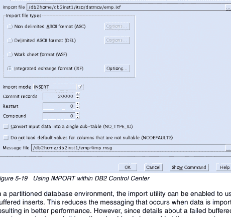

图 5-19 在 DB2 控制中心中使用 `IMPORT`

在分区数据库环境中，可以启用导入实用程序以使用缓冲插入。这会减少导入数据时发生的消息传递，从而提高性能。但是，由于不会返回有关缓冲插入失败的详细信息，因此只有在不关心错误报告时才应启用此选项。

使用 DB2 绑定实用程序请求缓冲插入功能。必须使用 `INSERT BUF` 选项针对数据库重新绑定导入包 `db2uimpm.bnd`。请参阅示例 5-30。

### 示例 5-30 在分区数据库中为 IMPORT 启用 INSERT BUF

```
db2inst1@DBLNX08:~> db2 connect to sample
db2inst1@DBLNX08:~> db2 bind $HOME/sqllib/bnd/db2uimpm.bnd insert buf
```

有关使用 `IMPORT` 的更多信息（例如，将 `IMPORT` 与大对象或标识列一起使用），请参阅 IBM DB2 UDB Data Movement Utilities Guide and Reference V8（SC09-4830）和 IBM DB2 UDB Command Reference V8（SC09-4828）。

### 5.3.3 将数据装入现有表

装入实用程序能够高效地将大量数据移入新建的表或已包含数据的表。该实用程序可以处理大多数数据类型，包括大对象（LOB）和用户定义类型（UDT）。装入实用程序比导入实用程序快，因为它直接将格式化页写入数据库，而导入实用程序执行 SQL `INSERT` 操作。装入实用程序不会触发触发器，也不会执行参照约束或表约束检查（除了验证索引的唯一性）。

- 装入（Load）：在此阶段，数据被写入表。
- 构建（Build）：在此阶段，生成索引。
- 删除（Delete）：在此阶段，导致唯一键冲突或 `DATALINK` 违规的行将从表中删除。
- 索引复制（Index copy）：在此阶段，索引数据从系统临时表空间复制到原始表空间。仅当在指定了 `READ ACCESS` 选项的装入操作期间为索引创建指定了系统临时表空间时，才会执行此操作。

版本 8 对装入实用程序进行了多项增强。新增了功能，以简化将数据装入单分区和多分区数据库环境的过程。

装入操作现在在表级别进行。这意味着装入实用程序不再需要独占访问整个表空间，并且在装入操作期间可以并发访问同一表空间中的其他表对象。此外，涉及装入操作的表空间不会进入静止状态。如果为可恢复数据库指定了 `COPY NO` 选项，则装入操作开始时，表空间将处于备份暂挂表空间状态。

装入实用程序新增的另一个功能是，在装入新数据的同时可以查询表中已存在的数据。为此，可以指定 `LOAD` 命令的 `READ ACCESS` 选项。

此版本还引入了 `LOCK WITH FORCE` 选项。它允许您强制应用程序释放它们在表上持有的锁，从而使装入操作能够继续并获取所需的锁。

现在，您可以使用与单分区数据库环境相同的命令（`LOAD`、`db2load`）和 API（`db2load`、`db2LoadQuery`）在分区数据库环境中装入数据。不再需要 AutoLoader 实用程序（`db2atld`）和 AutoLoader 控制文件。

通过使用新的 `CURSOR` 文件类型，您现在可以将 SQL 查询的结果装入数据库，而无需先将它们导出到数据文件。

在版本 8 之前，如果目标表包含生成列，则在装入操作后该表会保持检查暂挂状态。现在，装入实用程序将生成列值，在向包含生成列且没有其他表约束的表执行装入操作后，不再需要发出 `SET INTEGRITY` 语句。

`LOAD QUERY` 命令的功能也已扩展。现在，它返回正在装入数据的目标表的表状态，以及以前所包含的有关正在进行的装入操作的状态信息。无论特定表上是否正在进行装入操作，都可以使用 `LOAD QUERY` 命令查询表状态。

控制中心现在提供了装入向导，以帮助您设置装入操作。

可以通过命令行处理器（CLP）、控制中心中的装入笔记本或应用程序编程接口（API）`db2Load` 来调用装入实用程序。

以下是通过 CLP 使用装入的一些示例。

### 分区表装入示例

首先，我们创建一个名为 `LOADTAB` 的示例表。其表结构是 `EMPLOYEE` 表的副本，并为该表创建了一个唯一索引。以 `DEL` 格式导出的数据文件将作为后续数据装入示例的外部源文件。此外，在分区数据库环境中，`EMPLOYEE` 表和 `LOADTAB` 表都定义在分区 0 到 3 上。

### 示例 5-31 用于 LOAD 测试的示例表准备

```
db2inst1@UDBLNX08:"/its0> db2 create table loadtab like employee
DB20001I The SQL command completed successfully.
db2inst1@UDBLNX08:"/its0> db2 "create unique index u_lt_empno on loadtab(empno)"
DB20001I The SQL command completed successfully.
db2inst1@UDBLNX08:"/its0> db2 "export to empl.del of del select * from employee"
SQL3104N The Export utility is beginning to export data to file "empl.del".
SQL3105N The Export utility has finished exporting "32" rows.
Number of rows exported: 32
```


在下面的示例中，我们将使用两种方法将数据加载到 `LOADTAB` 中，分别使用外部源文件和使用 `CURSOR` 答案集作为加载的源。

## 示例 5-32 从源 DEL 文件加载数据到分区表

```
db2inst1@UDBLNX08:"/its0> db2 "load from empl.del of del insert into loadtab"
Agent Type   Node   SQL Code   Result
```

| Agent | Type | Node | SQL Code | Result |

|---|---|---|---|---|

| LOAD |  | 000 | +00000000 | Success. |

| LOAD |  | 001 | +00000000 | Success. |

| LOAD |  | 002 | +00000000 | Success. |

| PARTITION |  | 001 | +00000000 | Success. |

| PRE_PARTITION |  | 000 | +00000000 | Success. |

| RESULTS: | 3 of 3 LOADs completed successfully. |  |  |  |

Summary of Partitioning Agents:

Rows Read          = 32

Rows Rejected      = 0

Rows Partitioned   = 32

Summary of LOAD Agents:

Number of rows read        = 32

Number of rows skipped     = 0

Number of rows loaded      = 32

Number of rows rejected    = 0

Number of rows deleted     = 0

Number of rows committed   = 32

```
db2inst1@UDBLNX08:"/its0> db2 "select dbpartitionnum(empno),count(*) from loadtab group by dbpartitionnum(empno)"
```

```
1       2
------------ ------------
        0       10
        1       11
        2       11

3 record(s) selected.
```

在示例 5-32 中，源文件被加载到分布在三个分区上的 `LOADTAB` 中。该命令与单分区环境中的命令一样。为了验证加载结果，在同一示例中，我们使用了一个 SQL 语句来统计不同分区上的行数，从 SQL 执行的输出中，我们发现行被均匀地分布到各分区。

## 示例 5-33 从 CURSOR 加载数据到分区表

```
db2inst1@UDBLNX08:"/itso> db2 "declare mycur cursor for select * from employee"
DB20000I  The SQL command completed successfully.
db2inst1@UDBLNX08:"/itso> db2 "load from mycur of cursor replace into loadtab"
```

| Agent Type | Node | SQL Code | Result |

|------------|------|----------|--------|

| LOAD       | 000  | +00000000 | Success. |

| LOAD       | 001  | +00000000 | Success. |

| LOAD       | 002  | +00000000 | Success. |

| PARTITION  | 001  | +00000000 | Success. |

| RESULTS:   | 3 of 3 LOADs completed successfully. | | |

```
Summary of Partitioning Agents:
Rows Read              = 32
Rows Rejected          = 0
Rows Partitioned       = 32

Summary of LOAD Agents:
Number of rows read     = 32
Number of rows skipped  = 0
Number of rows loaded   = 32
Number of rows rejected = 0
Number of rows deleted  = 0
Number of rows committed = 32
```

在分区数据库环境中加载数据时，只有非定界 ASCII（`ASC`）和定界 ASCII（`DEL`）文件可以被分区。`PC/IXF` 文件不能被分区。要将 `PC/IXF` 文件加载到多分区表中，可以先将其加载到单分区表中，然后使用 `CURSOR` 文件类型执行加载操作，将数据移动到多分区表（示例 5-33）。如果尝试直接将 IXF 格式的源文件加载到分区表，将导致错误 `SQL3004N`。这意味着 `filetype` 参数无效，因为 IXF 文件不能用于加载到定义在多分区节点组上的表。

有一些选项是特定于在分区数据库环境中加载的，例如：

- `PART_FILE_LOCATION`：分区文件的完全限定位置。
- `OUTPUT_DBPARTNUMS`：表示将执行加载操作的数据库分区的分区号列表。
- `PARTITIONING_DBPARTNUMS`：在分区过程中将使用的分区号列表。
- `MODE`：加载分区数据库时加载操作将进行的模式，例如 `PARTITION_AND_LOAD`、`PARTITION_ONLY`、`LOAD_ONLY` 等。
- `PARTITIONED DB CONFIG`：允许您在 `LOAD` 命令中指定分区数据库特定的配置选项。

如果在分区数据库环境中使用 `LOAD` 命令时未指定分区数据库特定的配置选项（当 `DB2` 注册表变量 `DB2_PARTITIONEDLOAD_DEFAULT` 未设置为 `NO` 时），则将使用默认值。例如，`MODE` 将默认为 `PARTITION_AND_LOAD`。

在前两个示例中，使用了在分区数据库环境中加载的默认选项。

## 示例 5-34 在 LOAD 命令中使用 PARTITIONED DB CONFIG 参数

```
db2inst1@UDBLNX08:"/itso> db2 "load from empl.del of del replace into loadtab partitioned db config mode partition_only part_file_location /db2home/db2inst1/itso partitioning_dbpartnums (1,2)"
```

| Agent Type | Node | SQL Code | Result |

|---|---|---|---|

| LOAD_TO_FILE | 000 | +00000000 | Success. |

LOAD_TO_FILE 001 +00000000 成功。

LOAD_TO_FILE 002 +00000000 成功。

PARTITION 001 +00000000 成功。

PARTITION 002 +00000000 成功。

PRE_PARTITION 000 +00000000 成功。

分区代理摘要：

已读取行数 = 32

已拒绝行数 = 0

已分区行数 = 32

## 装载时使用 ALLOW READ ACCESS 的示例

`ALLOW READ ACCESS` 选项在装载大量数据时非常有用，因为它几乎始终允许用户访问表数据，即使在装载操作正在进行或装载操作失败之后也是如此。在 `ALLOW READ ACCESS` 模式下，装载操作的行为与应用程序的隔离级别无关。也就是说，任何隔离级别的读取方始终可以读取原有数据，但在装载操作完成之前，它们无法读取新装载的数据。

除了最后阶段之外，整个装载操作期间都提供读访问。在数据提交之前，装载实用程序会在表上获取排他锁（Z-lock）。装载实用程序将一直等待，直到所有持有该表锁的应用程序释放锁。这可能会导致数据提交出现延迟。可以使用 `LOCK WITH FORCE` 选项强制冲突的应用程序退出，使装载操作无需等待即可继续。

在示例 5-35 中，首先我们创建名为 `LOADREAD` 的表，然后插入三行作为已有数据；接着，我们将使用 `ALLOW READ ACCESS` 从 `DEL` 格式的源文件装载其他行，并且在装载进行的同时尝试从另一个会话访问该表。

### 示例 5-35 使用 ALLOW READ ACCESS 装载数据


```
db2inst1@DBLNX08:"/itso> db2 "create table loadread(col1 int not null primary key, col2 char(10))"
DB20000I The SQL command completed successfully.
db2inst1@DBLNX08:"/itso> db2 "insert into loadread values(1,'aaaa'),(2,'bbbb'),(3,'cccc')"
DB20000I The SQL command completed successfully.
```

```
db2inst1@UDBLNX08:"/itso> db2 "load from loadapp.del of del insert into loadread allow read access"
```

| 代理类型 | 节点 | SQL 代码 | 结果 |

|---|---|---|---|

| LOAD | 000 | +00000000 | 成功。 |

| LOAD | 001 | +00000000 | 成功。 |

| LOAD | 002 | +00000000 | 成功。 |

| PARTITION | 001 | +00000000 | 成功。 |

| PRE_PARTITION | 000 | +00000000 | 成功。 |

| 结果： | 3/3 个 LOAD 均成功完成。 | | |

分区代理摘要：

已读取行数 = 2

已拒绝行数 = 0

已分区行数 = 2

装载代理摘要：

已读取行数 = 2

已跳过行数 = 0

已装载行数 = 2

已拒绝行数 = 0

已删除行数 = 0

已提交行数 = 2

当发出 `LOAD` 命令并且装载正在运行时，我们可以打开另一个会话，以只读操作访问同一个表。在装载操作即将结束前，示例中的 `SELECT` 语句会很快返回结果集。但当装载操作处于最后阶段、装载尚未像前一个示例那样返回成功消息时，由于与装载操作发生资源争用，`SELECT` 语句无法成功执行。此时，装载实用程序需要在数据提交之前获取表上的排他锁（Z-lock）（参见示例 5-36）。

装载操作完成后，新装载的数据对其他应用程序可见。

### 示例 5-36 并发访问正在执行装载的表

```
db2inst1@UDBLNX08:"/itso> db2 "select * from loadread"
```

COL1 COL2

### 示例 5-38 并发应用程序被 LOAD 操作强制退出

```
db2inst0@DBLNX08:"/itso> db2 "select * from loadread"

COL1        COL2
------------ ------------
1           aaaa
2           bbbb
3           cccc

3 record(s) selected.

db2inst0@DBLNX08:"/itso> db2 "select * from loadread"
SQL1224N  A database agent could not be started to service a request, or was terminated as a result of a database system shutdown or a force command.
SQLSTATE=55032
```

如果指定了 `REPLACE` 选项，则不支持 `ALLOW READ ACCESS` 选项，否则会返回错误代码 `SQL3340N` 且原因代码为 1。由于 `LOAD REPLACE` 操作在装载新数据之前会截断现有的表数据，因此在装载操作完成之前没有原有数据可供查询。

对于从 CLP 启动的分区数据库装载操作，消息文件不会显示在控制台中，也不会被保留。要在分区数据库装载完成后保存或查看这些文件的内容，必须指定 `LOAD` 命令的 `MESSAGES` 选项。建议使用完全限定的 `MESSAGES` 文件名，例如 `/db2home/db2inst1/myload.msg`。

如果使用了 `MESSAGES` 选项，装载操作完成后，每个分区上的消息文件都会被传输到客户端计算机，并使用 `MESSAGES` 选项指定的基名称存放在文件中。对于分区数据库装载操作，与生成该文件的装载进程相对应的文件名列于表 5-1 中。

## 表 5-1 分区 LOAD 操作生成的消息文件类型

| 进程类型 | 文件名 |

|---|---|

| Load Agent | `<message-file-name>.-load.<partitionnumber>` |

| Partitioning Agent | `<message-file-name>.-part.<partitionnumber>` |

| Pre-partitioning Agent | `<message-file-name>.-prep.<partitionnumber>` |

有关上表中列出的代理类型的更多信息，请参阅 IBM DB2 UDB Data Movement Utilities Guide and Reference V8（SC09-4830）和 IBM DB2 UDB Command Reference V8（SC09-4828）。

注意：我们强烈建议，从 CLP 发起的分区数据库加载操作应使用 `MESSAGES` 选项。

可以使用 `LOAD QUERY` 命令在加载操作处理期间检查其状态，并返回表状态。即使加载未在处理中，也可以返回表状态。示例 5-39 中 `LOAD QUERY` 命令的输出是在前一个加载示例（第 194 页的“示例 5-35 使用 ALLOW READ ACCESS 加载数据”）正在运行时收集的。

## 示例 5-39 使用 LOAD QUERY 监视 LOAD 状态

```
db2inst1@UDBLNX08:> db2 "load query table loadread"
SQL3530I  The Load Query utility is monitoring "LOAD" progress on partition "0".

SQL3501W  The table space(s) in which the table resides will not be placed in backup pending state since forward recovery is disabled for the database.

SQL3109N  The utility is beginning to load data from file "/db2home/db2inst1/itsol/loadapp.del".

SQL3500W  The utility is beginning the "LOAD" phase at time "10-22-2002 17:14:25.692869".

SQL3519W  Begin Load Consistency Point. Input record count = "0".
SQL3520W  Load Consistency Point was successful.

SQL3110N  The utility has completed processing. "1" rows were read from the input file.

SQL3519W  Begin Load Consistency Point. Input record count = "1".

SQL3520W  Load Consistency Point was successful.

SQL3515W  The utility has finished the "LOAD" phase at time "10-22-2002 17:14:27.993262".

SQL3500W  The utility is beginning the "BUILD" phase at time "10-22-2002 17:14:28.312771".

SQL3213I  The indexing mode is "INCREMENTAL".

SQL3532I  The Load utility is currently in the "LOAD" phase.

Number of rows read       = 1
Number of rows skipped    = 0
Number of rows loaded     = 1
```


```
Number of rows rejected      = 0
Number of rows deleted       = 0
Number of rows committed     = 1
Number of warnings           = 0

Tablestate:
  Load in Progress
  Read Access Only
db2inst1@UDBLNX08:> db2 "load query table loadread"
SQL3521I  The Load utility is currently in the "UNKNOWN" phase.
Tablestate:
  Load in Progress
  Read Access Only
db2inst1@UDBLNX08:> db2 "load query table loadread"
Tablestate:
  Normal
```

## 控制中心中的 LOAD 向导

DB2 控制中心提供了 Load 向导，调用 Load 向导的步骤如下：

- 1. 在控制中心中，展开对象树，直到找到 Tables 文件夹。
- 2. 单击 Tables 文件夹。窗口右侧窗格（内容窗格）中会显示所有已存在的表。
- 3. 右键单击内容窗格中您想要的表，然后从弹出菜单中选择 Load。此时将打开 Load 向导窗口。

有关控制中心的详细信息，请参阅其联机帮助。

以下示例演示了如何使用 Load 向导将数据加载到名为 EMP 的示例表中，该表定义在分区 0 到 2 上，因此这是一个分区加载。具体步骤如下：

- 1. 从 DB2 控制中心调用 Load 向导（图 5-20）。

图 5-20 从 DB2 控制中心调用 Load 向导

2. 选择加载操作（图 5-21）。

### 选择加载操作。

在分区环境中，加载实用程序可以对传入数据执行若干不同操作之一。任务概述。

选择加载操作：

- 拆分并加载数据
- 拆分数据
- 加载数据
- 分析数据

提示

数据被视为非分区数据，在插入之前，实用程序将根据表的分区键对其进行处理。

图 5-21 选择加载操作模式

3. 选择是否保留原始表数据（图 5-22）。

### 选择替换或保留原始表数据。

您可以选择将输入数据追加到表末尾，或替换表中的所有数据。

- 将数据追加到表
- 表加载期间允许读访问
- 替换表数据


图 5-22 选择是否保留原始表

### 4. 指定输入和输出文件（图 5-23）。

在此窗口中，您可以指定输入文件的格式，以及针对所使用格式的特定选项。例如，您可以单击 DEL Options 按钮来设置与源 DEL 文件相关的选项。您还可以指定源所在的位置，是 Server 还是 Remote host。此外，您可以手动指定输入文件名和输出消息文件名，也可以通过单击“...”按钮弹出的窗口来浏览文件。

### 指定输入和输出文件。

大多数加载操作至少会有一个输入或输出文件。其他次要的文件规格可以在“选项”页面中找到。

#### 输入文件格式

- 分隔文本（DEL）
- DEL 选项

#### 输入文件位置

- 服务器（UDLNX08）
- 远程主机
- 数据库服务器上用户退出程序的完整路径和文件名：
- 输入文件的完整路径和文件名：`/db2home/db2inst1/nso/emp.del`
- 用于存储进度消息的完整路径和文件名：`/db2home/db2inst1/nso/guioload.msg`

图 5-23 指定输入和输出文件

### 5. 指定哪些分区参与加载（图 5-24）。

你可以使用窗口中的默认选项“将数据加载到所有表分区”，如果你只想将数据加载到表所在的所有分区中。在某些情况下，你可能希望将数据加载到一个或多个特定分区；那么你可以选择“将数据加载到选定的表分区”。此外，在窗口中的“分区划分”组中，你也可以指定哪些分区将用于执行数据分区工作；通常，你可以保持默认设置，选择“让 DB2 决定哪些分区参与”。

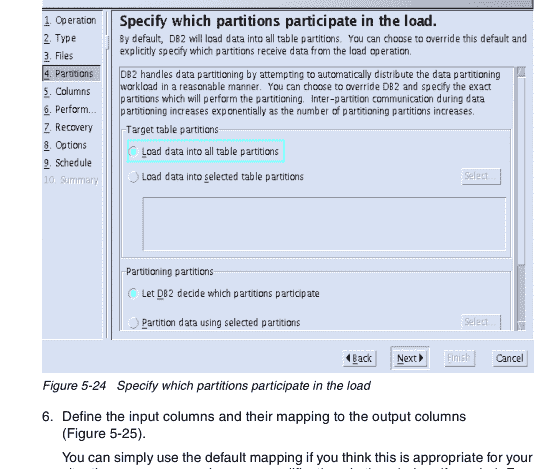

图 5-24 指定哪些分区参与加载

### 6. 定义输入列及其到输出列的映射（图 5-25）。

如果你认为默认映射适合你的情况，可以直接使用它；如果需要，也可以在该窗口中进行一些修改。例如，如果加载涉及大对象（LOB），则可能需要在该窗口中指定与 LOB 相关的选项。

图 5-25 定义与加载相关的列属性

### 7. 指定性能和统计信息收集选项（图 5-26）。

你可以指定影响加载性能的选项，例如，你可以指定加载工具如何更新现有索引、重建所有索引，或增量重建索引。完整索引重建比增量重建更快。但如果索引非常大，增量重建会更快。此外，该窗口还提供了统计信息收集选项。如果你不想做任何修改，保留默认值即可。

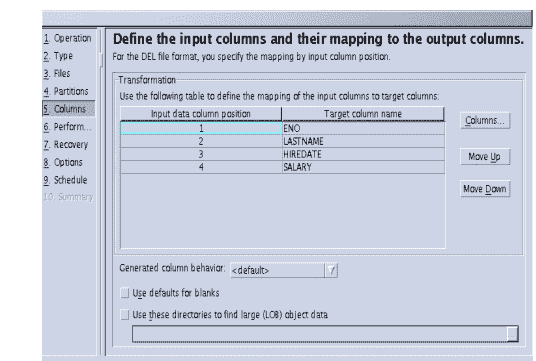

#### 影响加载性能的选项

- 仅对输入数据执行最小检查
- 让加载工具更新现有索引
  - 增量更新现有索引
  - 重建所有索引
  - 让工具自行决定是增量重建还是完全重建
- 指定用于创建索引的特定临时表空间 `TEMPSPACE1`

#### 影响其他应用程序的选项

- 将依赖表置入检查暂挂状态的操作推迟到加载完成之后。
- 立即开始加载，必要时强制其他应用程序。

#### 影响加载后性能的选项

- 每个数据页保留的空闲空间百分比 <默认>
- 每个索引页保留的空闲空间百分比 <默认>
- 追加为可用空间的表大小百分比 <默认>

#### 表的统计信息

图 5-26 指定性能和统计信息收集选项

### 8. 指定故障选项和恢复策略。

此窗口涵盖有关故障处理和恢复策略的选项。例如，如果希望在加载操作期间发生任何错误时整个加载操作停止，则可以同时选中窗口的“崩溃恢复”组中的“加载作业失败...”和“加载将回滚”两个错误隔离复选框，如图 5-27 所示。

#### 选择故障选项和恢复策略。

使用此页面可指定加载失败的故障和恢复选项。如果包含目标表的数据库已配置为支持前滚恢复，您还可以指定前滚恢复选项。

- 1. Operation
- 2. Type
- 3. Files
- 4. Partitions
- 5. Columns
- 6. Perform...
- 7. Recovery
- 8. Options
- 9. Schedule
- 10. Summary

#### 崩溃恢复

在数据加载期间建立一致性点并生成行计数消息

一致性点之间的行数：

如果在设置阶段任一分区遇到错误，则加载作业失败

如果设置完成后任一分区失败，加载将立即在所有分区上回滚

#### 前滚恢复

仅当加载任务运行时数据库配置为支持前滚恢复时，以下选项才有效。如果选择执行不可恢复的加载，则随后通过此加载进行前滚会成功，但会使表不可用。

- 执行可恢复的加载
- 不复制输入数据。这会使表空间进入备份暂挂状态。
- 保存输入数据的副本。加载完成后表将可用。

复制目标：目录

目录名称：

图 5-27 指定故障选项和恢复策略

### 9. 设置高级选项。

在此处，您可以指定前几个窗口未涵盖的与加载操作相关的附加选项，并且可以通过单击窗口中列出的选项来获取提示（图 5-28）。

#### 设置高级选项。

此页面包含额外的、更高级的加载选项。当您选择一个选项时，该选项的解释会在提示部分给出。选择所需的选项并根据需要更改其值。

- 1. Operation
- 2. Type
- 3. Files
- 4. Partitions
- 5. Columns
- 6. Perform...
- 7. Recovery
- 8. Options
- 9. Schedule
- 10. Summary

Options:

| Parameter Description | Value | Changed | DB2 Parameter |
|---|---|---|---|
| Recovery |  |  |  |
| Stop the load after a set number of warnings | default |  | WARNINGCOUNT |
| Performance |  |  |  |
| Degree of CPU parallelism | default |  | CPU_PARALLELISM |
| Degree of disk parallelism | default |  | DISK_PARALLELISM |

Hint

在出现 n 次警告后停止加载操作。如果不期望出现警告，但希望验证正在使用正确的文件和表时，请设置此参数。

Figure 5-28 Set advanced options for load operation

### 10. Scheduling task execution.


如果您想在不保存任务历史的情况下运行加载操作，请选择窗口中显示的 `Run now` 选项。或者如果您想将其作为任务创建在任务中心中，则可以更改窗口中的选项（图 5-29）。

# Scheduling task execution...

您可以选择立即执行命令或在任务中心创建任务。创建任务允许您安排任务执行并维护其历史记录。

- 1. Operation
- 2. Type
- 3. Files
- 4. Partitions
- 5. Columns
- 6. Perform...
- 7. Recovery
- 8. Options
- 9. Schedule
- 10. Summary

Figure 5-29 Scheduling task execution

11. View the task summary and execute it.

在图 5-30 中，根据您在前几个窗口中的选择生成的 `DB2 CLP` 命令会显示出来。您可以单击 `Finish` 提交命令，或单击 `Back` 进一步修改您的选择。

您可以在 `DB2` 控制中心检查消息文件以获取有关加载操作的更多详细信息。消息文件为 `guiload.msg.prep.000` 用于预分区，`guiload.msg.part.001` 用于分区，以及 `guiload.msg.load.000`、`guiload.msg.load.001`、`guiload.msg.load.002` 用于加载。所有这些文件都位于目录 `/db2/home/db2inst1/itso` 下，该目录在之前的 `Specifying input and output files` 窗口中指定。

### 5.4 Task Center, Scheduler, and DB2 Tools Catalog

在本节中，我们讨论如何使用 `DB2` 任务中心在 Linux 上创建和安排任务运行。`DB2` 管理服务器和工具目录数据库是使用任务中心和大多数 GUI 工具的前提。我们首先在以下页面讨论 `DB2` 管理服务器和工具目录数据库，作为启用任务中心和调度程序的准备工作。

#### 5.4.1 DB2 Administration Server and Tools Catalog Database

`DB2` 管理服务器（`DAS`）是仅用于协助 `DB2` 服务器上任务的控制点。如果您想使用任务中心、控制中心、配置助手或开发中心等可用工具，则必须有一个正在运行的 `DAS`。`DAS` 在执行以下管理任务时支持控制中心和配置助手：

- 启用 `DB2` 服务器的远程管理
- 提供作业管理功能，包括能够安排运行 `DB2` 和操作系统命令脚本
- 定义作业的调度、查看已完成作业的结果，并使用任务中心对位于 `DAS` 远程或本地的作业执行其他管理任务
- 与 `DB2 Discovery` 实用程序结合，提供发现 `DB2` 实例、数据库和其他 `DB2` 管理服务器配置信息的方法

Linux 上的 `DAS`（以及 UNIX 和 Windows）包括一个调度程序，用于运行使用任务中心定义的任务（例如 `DB2` 和操作系统命令脚本）。任务信息包括要运行的命令、计划、通知和与任务关联的完成操作。运行结果存储在名为工具目录数据库的 `DB2` 数据库中。工具目录数据库是在常规设置过程中创建的。如果您在安装 `DB2 UDB` 时未创建工具目录数据库，则可以通过控制中心或通过 `CLP` 使用 `CREATE TOOLS CATALOG` 命令创建和激活它。有关如何在 `DB2` 控制中心或通过 `DB2 CLP` 命令创建工具目录的信息，请参阅附录 B，“`DB2 Tools Catalog creation`” 第 295 页。

因此，工具目录数据库包含由任务中心和控制中心创建的任务信息。这些任务由 `DB2` 管理服务器上的调度程序运行。图 5-31 显示了 `DB2` 工具、`DB2` 实例、`DAS`、调度程序和工具目录数据库之间的关系。

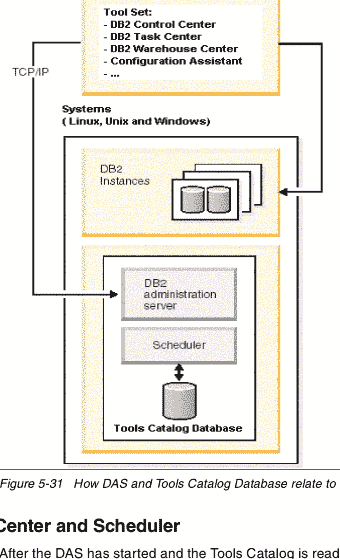

图 5-31 DAS 与 DB2 中 Tools Catalog Database 的关系

#### 5.4.2 Task Center 和 Scheduler

`DAS` 启动并且 `Tools Catalog` 就绪后，您可以在 `DB2 Control Center` 或其他提供 `Tools` 菜单的工具中启动 `Task Center`。您可以使用 `Task Center` 立即运行任务或按计划运行，并通知相关人员已完成任务的状态。`Task Center` 包含 `DB2` 早期版本中 `Script Center` 的功能，并增加了额外功能。

任务是一个脚本，连同相关的成功条件、计划和通知。您可以在 `Task Center` 中创建任务，在其他工具中创建脚本并保存到 `Task Center`，导入现有脚本，或保存来自 `DB2` 对话框或向导（如 `Load` 向导）的选项。脚本可以包含 `DB2` 命令、`SQL` 或操作系统命令。

对于每个任务，使用 `Task Center`，您可以执行以下操作：

- 安排任务。
- 指定成功和失败条件。
- 指定任务成功完成时或失败时应执行的操作。
- 指定在任务成功完成时或失败时应被通知的电子邮件地址（包括寻呼机）。

您可以通过创建任务操作来指定条件编码。每个任务操作由一个任务和该任务应执行的操作组成。例如，任务一可以具有以下任务操作：

- 如果任务一成功，则任务操作 A 启用任务二的计划。
- 如果任务一失败，则任务操作 B 运行任务三。

以下是创建 `Task Center` 中任务的示例，包含详细步骤。任务调度也包含在内。

- 1. 启动 `Task Center` 并创建新任务（图 5-32）：

在内容窗格中右键单击，然后单击 `New`，一个新窗口将打开。

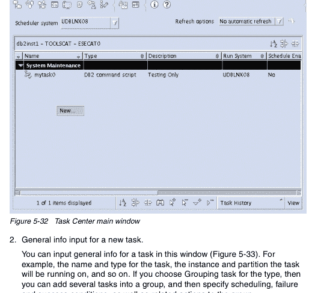

图 5-32 Task Center 主窗口

### 2. 为新任务输入常规信息。

您可以在此窗口中为任务输入常规信息（图 5-33）。例如，任务的名称和类型、任务将运行的实例和分区等。如果您为类型选择 `Grouping task`，则可以将多个任务添加到一个组中，然后为该组指定调度、失败和成功条件以及相关操作。

图 5-35 任务的运行属性

### 5. 安排任务。

您可以安排任务在指定时间运行，一次性或重复运行，具体取决于实际情况。图 5-36 提供了一个示例，说明如何指定每周任务，在每周日运行，并设置结束日期。

图 5-36 安排任务重复运行

图 5-37 是另一个示例，用于一次性运行任务。此外，如果您想将调度模式应用于其他任务，可以通过单击窗口右窗格中的 `Save List of Schedules` 来保存调度列表。保存后，下次安排任务时，您可以选择 `Use saved schedule` 并使用所需名称来安排任务。

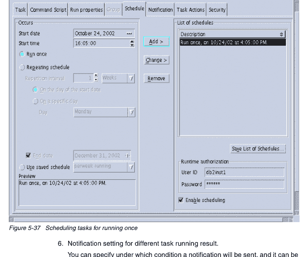

图 5-37 安排任务一次性运行

### 6. 不同任务运行结果的通知设置。

您可以指定在何种条件下发送通知，通知可以发送给联系人或联系人组，通过电子邮件或寻呼机发送，或作为消息条目发送到 `DB2` 的 `Journal`。对于条件，可以是成功或失败，或两者。您也可以为单个任务指定针对不同条件的多个通知。

在图 5-38 中，通知将作为消息条目发送到 `DB2` 的 `Journal`。

图 5-38 不同任务运行结果的通知设置

### 7. 不同任务运行结果的后续操作（图 5-39）。

除了为任务运行结果设置通知外，您还可以指定后续操作。例如，如果任务最终失败，对于“`Task Failure`”条件，您可以指定运行另一个替代任务来补救该情况，或禁用另一个任务的调度以避免不必要的损害。

图5-39 任务的后续操作设置

您还可以通过单击窗口中的“安全”选项卡，为不同用户和组指定对任务的访问权限，例如读取、运行或执行。

现在，您可以单击“确定”将任务提交到任务中心。

在我们的示例中，通知被指定发送到 `DB2` 日志，因此我们可以查看日志来获取运行结果。

要调用日志，您可以在任务中心或控制中心（或其他提供“工具”菜单的 `DB2` GUI 工具）的菜单栏中选择“工具”→“日志”。

这是我们示例任务的结果。您可以通过右键单击与您的任务对应的结果条目，然后选择“显示结果”来获取更多详细信息。将弹出另一个窗口，在该窗口中，您可以获得关于以下内容的详细信息：

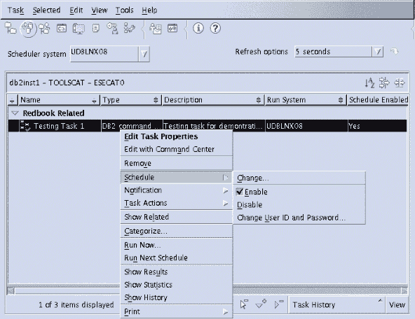

调度功能也可用于许多其他 `DB2` 向导或 GUI 工具，例如导出、导入、加载向导、runstats、reorg、备份和还原。您可以利用这些有用的功能在您的环境中实现任务自动化。

# 在 Linux 上启动并运行 DB2

# 监控 DB2

本章讨论由健康中心和健康监视器提供的 `DB2` 监控功能。


DB2 Universal Database Version 8 增加了自我管理和资源调整（SMART）数据库技术，使数据库管理员能够以更强的自动化方式配置、调整和管理其数据库。SMART 数据库管理意味着管理员花更少时间管理日常任务，而将更多时间聚焦于帮助企业获得并保持可持续竞争优势的任务。为了支持自我管理、自我优化和自我调整的需求，新增或重新设计了多种工具，例如配置顾问、健康中心、性能专家、恢复专家等。这些新工具使 DB2 的配置和维护任务更加智能、更易于使用，最终显著减少了人工干预，并降低了数据库系统运维成本。

本章深入讨论健康中心和健康监视器。第 3 章“安装后任务”（第 79 页）提供了有关配置顾问的详细信息。对于其他 DB2 监控工具，请参阅其联机帮助或特定文档以获取更多信息。

此外，本章还讨论 DB2 UDB 和操作系统日志文件，这些文件可以提供有关特定问题的更详细信息，帮助您进一步确定问题是什么以及原因是什么。然后，您可以根据收集的信息采取纠正措施。

此外，操作系统还提供了一些有用且常用的工具，用于协助监控系统资源使用情况和执行故障排除，我们也提供了这些工具的简要信息。

### 6.1 健康监视器和健康中心

在版本 8 中，DB2 引入了两个新功能来帮助您监控 DB2 系统的健康状况：健康监视器和健康中心。这些工具通过向您发出潜在系统健康问题警报，为 DB2 Universal Database 增加了异常管理能力。这使您能够在健康问题演变成影响系统性能的实际问题之前加以解决。在使用健康监视器和健康中心之前，您需要理解健康指标的概念，下一段将对其进行简要介绍。

#### 6.1.1 健康指标

健康指标是一种衡量对象某一方面健康程度的度量。健康监视器使用这些指标来评估数据库管理器或数据库性能的特定方面。

DB2 为所有健康指标提供了默认设置。使用健康中心、`DB2` 命令或 API，您可以自定义健康指标的设置，并定义在发出警报时应通知谁以及应运行什么脚本或任务。例如，您可以为表空间使用的空间量自定义警报和警告阈值。您还可以使用 DB2 命令或 API 从健康监视器检索健康信息，从而将 DB2 健康监控与现有的系统级监控解决方案集成。

#### 6.1.2 健康监视器

健康监视器是一种服务器端工具，在 DB2 启动时持续监视实例和所有活动数据库对象的健康状况。健康监视器会自动评估一组健康指标，即使没有用户交互也是如此。如果健康指标的当前值超出了由其警告和警报阈值定义的可接受运行范围，健康监视器将生成健康警报。

健康监视器使用不会带来性能损失的新接口来收集系统健康信息。它不会打开任何快照监视器开关来收集信息。创建实例时，健康监视器默认启用；您可以使用数据库管理器配置参数 `health_mon` 停用它。如果健康监视器发现某个已定义的阈值已被超过（例如，可用日志空间不足），或者检测到对象处于异常状态（例如，实例已关闭），健康监视器将发出警报。

Health Monitor 不仅会在数据库系统出现致命情况之前（例如，内存耗尽，或表空间即将满等）通过电子邮件、寻呼机或 PDA 向 DBA 发出警报，而且其自主能力还可以采取或推荐纠正措施。因此，它减少了对 DBA 技能水平的依赖，并提高了他们的工作效率。

#### 6.1.3 健康中心

健康中心为 Health Monitor 提供了图形界面。您可以使用它来配置 Health Monitor，为期望的健康指标定义阈值，并在阈值被超过时定义相关活动，例如，向 DBA 发送通知，或执行后续任务。您还可以使用健康中心查看实例及其数据库对象的汇总警报状态。利用 Health Monitor 的向下钻取功能，您可以访问当前警报的详细信息，并获取推荐操作列表，说明如何解决该警报。

DB2 版本 8 还提供了一个新的 Web 健康中心，可用于通过 Web 浏览器或 PDA 访问 Health Monitor 信息。

#### 6.1.4 使用健康中心和 Health Monitor

您可以通过在任何 DB2 GUI 工具的 Tools 菜单中选择 Health Center 来启动健康中心，前提是该工具提供了 Tools 菜单。您也可以通过单击 DB2 控制中心窗口状态栏上出现时显示的健康中心状态信标来启动健康中心。

Health Monitor 默认处于激活状态，如果因任何原因被停止，您可以使用健康中心或使用 DB2 CLP 命令重新激活它。

当 Health Monitor 因数据库管理器配置（DBM CFG）中的 `health_mon` 参数为 OFF 而停止时，在您右键单击实例名称时弹出的窗口中会出现 Start Health Monitor 菜单项（图 6-1）。同样，如果 `health_mon` 设置为 ON 且 Health Monitor 已启动，则会出现 Stop Health Monitor 菜单项。

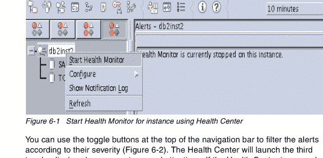

图 6-1 使用健康中心为实例启动 Health Monitor

您可以使用导航栏顶部的切换按钮根据其严重程度过滤警报（图 6-2）。健康中心将启动第三个切换按钮，显示报警、警告和注意。如果首次打开健康中心，您可以选择 Display all alerts 以在窗口左窗格中查看包含所有编目 LUW 实例的导航树。

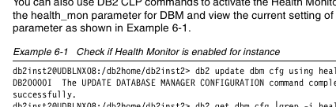

图 6-2 使用切换按钮过滤警报

您还可以使用 DB2 CLP 命令通过更新 DBM 的 `health_mon` 参数来激活 Health Monitor，并如示例 6-1 所示查看 `health_mon` 参数的当前设置。

### 示例 6-1 检查实例是否已启用 Health Monitor

```
db2inst2@UDBLNX08:/db2home/db2inst2> db2 update dbm cfg using health_mon on
DB20000I  The UPDATE DATABASE MANAGER CONFIGURATION command completed successfully.
db2inst2@UDBLNX08:/db2home/db2inst2> db2 get dbm cfg |grep -i health
Monitor health of instance and databases  (HEALTH_MON) = ON
```

`health_mon` 参数可以动态更改。对 `health_mon` 的更新会立即生效。一旦 `health_mon` 被打开（默认情况），代理将收集有关数据库环境中活动对象的健康状况的信息。如果某个对象被认为处于不健康状态，基于阈值或对象状态，则可以发送通知并自动采取行动。

健康中心中的 Configuration 选项允许您为实例设置通知，并修改健康指标设置。当您选择 Configure 菜单项时，会显示另一个包含三个项目的子菜单，如图 6-3 所示。您可以使用 Notifications 为 Health Monitor 设置通知，或选择其他项目以查看或更改全局健康指标默认设置和数据库对象健康指标设置。


图 6-3 健康中心中的 Configure 菜单

如果您想在生成警报时通过电子邮件或寻呼机通知人员，则需要在 DAS 中先定义联系人列表。您可以在联系人管理窗口中添加联系人或联系人组，或使用 DB2 CLP 命令，例如：

```
ADD CONTACT contname TYPE EMAIL ADDRESS contname@compname.com
```

如果您想通过联系人管理 GUI 工具添加联系人，请在健康中心中选择 Tools --> Contacts（图 6-4）。

## 图 6-4 启动联系人管理

在“联系人”窗口中，您可以添加或更改联系人或联系人组，也可以删除不需要的联系人或联系人组。此外，您还可以通过按测试按钮验证为联系人指定的电子邮件是否可达（图 6-5）。

## 图 6-5 联系人管理

按下测试按钮后，如果返回的 DB2 消息显示测试成功，则系统会向指定的电子邮件帐户发送一封电子邮件（图 6-6）。


图 6-6 DB2 自动发送的测试电子邮件

> 注意：在使用电子邮件通知功能之前，您需要确保驻留在服务器上的电子邮件系统（由管理配置中的 `SMTP_SERVER` 指定）已正常启动并运行。

添加联系人列表后，您可以从弹出窗口中选择“配置 -> 通知”，如图 6-3 所示，以添加或更改联系人或联系人组。如果生成了任何严重性在当前通知级别设置范围内的警报，将通知通知列表中的人员。默认情况下，通知信息将写入 DB2 实例的通知日志中，该日志位于目录 `$HOME/sqllib/db2dump` 下，文件名为 `<instance name>.nfy`。有关通知日志及其设置的详细信息，请参阅第 242 页的 6.2.1 节“DB2 管理通知日志”。

## 使用示例


以下示例演示如何在 Health Center 中或通过 DB2 CLP 命令配置健康指示器，以监视 DMS 表空间存储消耗。在本示例中，我们预期当表空间利用率（以已消耗空间的百分比衡量）超过预定义的警告或报警阈值时，DB2 系统将向管理通知日志以及指定的联系人发送通知（通过电子邮件或寻呼机）。您可以从 Health Center 或通过 DB2 CLP 命令获取针对此类情况的建议，并采取相应措施。此外，我们还展示了如何为特定健康指示器出现的警告或报警指定后续操作。当健康指示器设置的值被超过时，您可以让 DB2 系统自动采取纠正措施。

该示例包括以下步骤：

- 1. 准备 DMS 表空间和表。
- 2. 查看 DMS 表空间的健康指示器
- 3. 向表空间填充所需数量的数据
- 4. 检查 DB2 系统发送的通知
- 5. 设置额外的后续操作

这些步骤的详细说明如下：

### 1. 准备 DMS 表空间和表。

在我们的示例中，使用了带裸设备容器的 DMS 表空间。有关如何在 Linux 环境中为 DB2 UDB 使用裸设备的信息，请参阅本书第 23 页的第 2 章“安装”。表空间首次创建时大小为 12 MB。表空间创建后，在其中创建一个带唯一索引的表（示例 6-2）。

#### 示例 6-2 为 Health Center 准备表空间和表

```
db2inst2@UDBLNX08:/db2home/db2inst2/test> cat crt_tbspdms_0.db2
create regular tablespace tbpsdms_0
managed by database
using (DEVICE '/dev/raw/raw1' 12M);
db2inst2@UDBLNX08:/db2home/db2inst2/test> db2 -tvf crt_tbspdms_0.db2
db2inst2@UDBLNX08:/db2home/db2inst2/test> cat emp crt.sql
drop table emp;
CREATE TABLE EMP (ENO INTEGER, LASTNAME VARCHAR(30),
    HIREDATE DATE, SALARY INTEGER)
    in tbpsdms_0;
CREATE UNIQUE INDEX u_emp_eno on EMP(ENO);
db2inst2@UDBLNX08:/db2home/db2inst2/test> db2 -tvf emp crt.sql
```

### 2. 查看 DMS 表空间的健康指示器设置。

要在 Health Center 中配置 DMS 表空间的健康指示器，您需要先启动数据库对象健康指示器设置窗口（图 6-7）。


图 6-7 启动数据库对象健康指示器设置

在“配置数据库对象健康指示器设置”窗口中（如图 6-8 所示），健康指示器列在窗口左侧。您可以通过切换复选框来选择是否监视它们。

box underneath the Evaluate bar, setting the threshold values of warning or alarm, respectively. You can review the commands generated based on your choices by clicking Show Command.


Figure 6-8 Configuring database object health indicators

Furthermore, you can set actions when the threshold values reach the warning or alarm level. To set up the action, choose a specific health indicator and click on this health indicator's action property button "...", as shown in Figure 6-9 highlighted in red ellipse. Another window appears, and this window can be used to enable the action property for the health indicator, and run a script or a task which is predefined in the task center.

Figure 6-9 Setting up Action for specific health indicator

The configuration dialog launches in the context of the database selected in the Health Center. To view the tablespace health indicators, we need to choose the database object first. By clicking the "..." button beside Object as shown in the Figure 6-10 (where the button is highlighted in red), the database object list window will pop up. In the pop-up windows, keep expanding the object tree until the desired object is shown, and then select the object and click OK. Here we chose the DMS tablespace which is created beforehand in Step 1 of this example.


Figure 6-10 Choosing database object for health indicator setting

Once the object is chosen, you can modify the health indicators settings for database objects. Figure 6-11 shows the default setting from the tablespace level global settings. In our example, a threshold value of 80 is set for a warning. Likewise, another threshold value, 90, is set for alarm, and no action is defined. Both default values are expressed in percentage. To change the threshold value, click the number and a new button will appear for you to specify the new value.

Figure 6-11 Database object health indicator setting

You can click Show Command to get the command based on the above choices, as shown in Figure 6-12. You can run the command in DB2 CLP to change configurations for the health indicator, or click OK to submit your changes.

Figure 6-12 Set health indicator value command

You can use the DB2 CLP command `GET ALERT CFG` to verify the setting, as shown in Example 6-3.

#### Example 6-3 Using GET ALERT CFG to view health indicator status

```
db2inst2@UDBLNX08:/db2home/db2inst2> db2 "get alert cfg for tablespaces "
```

Alert Configuration

Indicator Name = ts.ts_op_status

Type = State-based

Sensitivity = 0

Formula = ts.ts_status;


Actions = Disabled

Threshold or State checking = Enabled

Indicator Name = `ts.ts_util`

Type = Threshold-based

```
Warning          = 80
Alarm            = 90
Sensitivity       = 0
Formula = ((ts.ts_used_pages/ts.ts_usable_pages)*100);
Actions          = Disabled
Threshold or State checking = Enabled
```

## 3. Populate a desired amount of data into the tablespace.

We populate a certain amount of data into the tablespace to trigger the threshold. DB2 common table expression is used in our example to generate specified number of rows (Example 6-4). In our example 200,000 rows are inserted into the table and consume more than 11 MB space for table data and index pages. The total space for the table space is around 12 MB so the threshold values will be exceeded as expected.

### Example 6-4 Populating data to trigger threshold for table space utilization

```
db2inst2@UDBLNX08:/db2home/db2inst2/test> cat empins.sql
INSERT INTO EMP
WITH DT(ENO) AS (VALUES(1) UNION ALL SELECT ENO+1 FROM DT WHERE ENO < 200000 )
SELECT ENO, TRANSLATE(CHAR(INTEGER(RAND()*1000000)),
        CASE MOD(ENO,4) WHEN 0 THEN 'aeiou' || 'bcdfg'
                     WHEN 1 THEN 'aeiou' || 'hjkIm'
                     WHEN 2 THEN 'aeiou' || 'npqrs'
                     ELSE 'aeiou' || 'twxyz' END,
                     '1234567890') AS LASTNAME,
        CURRENT DATE - (RAND()*10957) DAYS AS HIREDATE,
        INTEGER(10000+RAND()*200000) AS SALARY
FROM DT;

db2inst2@UDBLNX08:/db2home/db2inst2/test> db2 -tvf empins.sql
DB20000I  The SQL command completed successfully.
```

## 4. Check the notification sent by DB2 system.

Once DB2 Health Monitor detected that the threshold for warning or alarm has been exceeded, it will send warning or alarm messages to the DB2 administration notification log as well as specified contacts if you have configured notifications. In our example, the notification will be sent to notification log and to a contact point via e-mail.

We can use DB2 Journal to check the administration notification log. To start the DB2 Journal, select Tools → Journal in any DB2 Tools window, where the Tools menu is available, or from Health Center, right-click on the instance name and select Show Notification Log. Then select the Notification Log tab, choose Instance to view the notification log. The instance in our example is `db2inst2`. The notification log for the instance will be shown in the bottom pane of the window. You also can use the Notification Log Filter to set up a filter to show health monitor notifications only. Figure 6-13 shows the notification log of our example. It shows that the value of current table space utilization is 98 percent and severity level is Alarm. The timestamp at that time the alarm condition was triggered is also shown.


Figure 6-13 Administration notification log for health monitor indicator

An e-mail is sent to designated contact with content like the following e-mail shows (Figure 6-14).


Figure 6-14 Notification for health indicator by e-mail

In addition to the notifications to the administration notification log and contact, there is more information regarding the alert available within Health Center. The Health Center GUI has red, yellow, orange, and green state indicator icons prefixed to the DB2 objects. The state icon provides you a quick view of system health condition. In Figure 6-15, you find that the red circle icon prefixed to the instance name and database name in the left pane within the Health Center is displayed. It means alarm conditions happened within the instance or any of its databases or their tablespaces and containers. In the right pane of the window, the Health Center lists all the alerts.


Figure 6-15 Monitor health indicators in Health Center


You can work on the alert directly from here. Select one of the alerts which corresponds to your desired health indicator, then right-click the alert entry. It provides you the Show details and Disable Evaluation options. To get detailed information including the recommendation for this alert, choose Show Details; to disable the health indicator choose Disable Evaluation. Figure 6-16 shows you these options.


Figure 6-16 Choosing the options to handle an alert

If you chose Show Details, the following window (Figure 6-17) appears.

Figure 6-17 Detailed information for an alert within Health Center

You can click the Recommendations tab to get recommendation actions for the current situation. In our example, three recommended actions are available for fixing our problem (Figure 6-18).

Figure 6-18 Get recommendations for alert

You can choose any one of the actions which may be appropriate for your real conditions. In our example, we chose Add new table space containers. DB2 now provides a detailed explanation about the chosen action and function button to execute the action. See Figure 6-19.


Figure 6-19 Recommendation details for specific recommendation choice

If you want to perform the recommended action right now, click Launch. For our sample, a window which can be used to add containers appears. You can choose the Containers tab, and then click Add in the window to add containers for the DMS tablespace. See Figure 6-20.


Figure 6-20 Take action according to recommendations given by DB2

Another way to get recommendations is via the DB2 CLP command `GET RECOMMENDATIONS` with specified health indicator. The following command can be used to get recommendation details for our example:

```
db2 get recommendations for health indicator ts.ts_util
```

Then the details of recommendations associated with the specified health indicator will be shown.

You can get the indicator name from the Health Center where you define properties for the health indicator. In general, the name, such as "`ts.ts_util`", is listed in the Description field. For details about the indicators, refer to IBM DB2 UDB System Monitor Guide and Reference V8, SC09-4847.

There are situations when you need a more complex action plan for the error condition. This can be accomplished by using a predefined script or task. To enable the predefined script or task, choose a specific health indicator, click the health indicator's action property, and then click the "..." button (refer to Figure 6-9 Setting up Action for specific health indicator on page 233 for an illustration). Another window will appear to allow you to choose a predefined script or task as the follow-up action. Figure 6-21 shows that a predefined task is chosen as the action for an alarm threshold breach condition for the tablespace health indicator.


The task chosen in this window is predefined in the Task Center. Example 6-5 shows the commands within that task used to add an additional container.

```
db2inst2@UDBLNKX08:/db2home/db2inst2/test2> cat alt_tbspdms_0.db2
connect to sample;
alter tablespace tbspdms_0 add (DEVICE '/dev/raw/rw2' 12M);
connect reset;
```

Health Center 中指定的操作计划由警告或报警条件触发。如果我们从一开始就设置了操作计划，一旦我们填充数据，添加容器任务就会被执行。结果如图 6-22 所示。


图 6-22 警报通知及后续任务执行

该图截取自电子邮件系统，显示表空间上已触发报警。在我们的示例中，我们已为该任务定义了向联系人发送通知，因此后续任务的执行消息也被发送了。

它显示一旦表空间报警被触发，后续的纠正措施会在无需用户干预的情况下自动执行。同时，DB2 也会自动向相关联系人发送与警报相关的详细信息。纠正措施生效后，健康指标将恢复到正常状态并继续监控系统。

### 6.2 用于故障排除的日志文件

在 DB2 UDB 版本 8 中，原先用于故障排除的诊断日志文件 `db2diag.log` 所包含的大部分信息被拆分为两个文件。第一个是 DB2 管理通知日志，也称为 DB2 通知日志，其目的是供数据库和系统管理员使用，内容易于理解。第二个是 DB2 诊断日志，其主要面向 DB2 客户支持人员或熟悉查看诊断日志文件的人员。

警报日志已被弃用，不建议在 DB2 UDB 版本 8 中使用。如果您仍想在 DB2 UDB 版本 8 中使用警报功能，可以通过将 DB2 注册表变量 `DB2_ALERT_LOG` 设置为 `true` 来启用它。

#### 6.2.1 DB2 管理通知日志


通知日志包含用户友好且支持国家语言的消息，可帮助数据库管理员获取与特定问题相关的更多信息，例如补充 SQLCODE 的信息、来自健康监控器的健康指标信息、来自任务执行的信息，以及由应用程序开发人员编写的应用程序中的特定信息。这些信息对数据库管理员快速、轻松地解决数据库或系统相关问题非常有益。

对于 Linux 平台，通知日志是一个文本文件，位于由数据库管理器配置参数 `DIAGPATH` 指定的目录中。该目录也是 `db2diag.log` 所在的位置。通知日志的名称为 `<实例所有者>.nfy`。例如，`/home/db2inst1/sqllib/db2dump/db2inst1.nfy`，这里实例所有者为 `db2inst1`，`DIAGPATH` 为 `/home/db2inst1/sqllib/db2dump`。

数据库管理器参数 `NOTIFYLEVEL` 可用于指定写入管理通知日志的管理员通知消息类型。

此参数的有效值为：

- `0`：不捕获任何管理通知消息。 （不推荐。）
- `1`：致命或无法恢复的错误。仅记录致命和无法恢复的错误。
- `2`：需要立即采取行动。记录需要系统管理员或数据库管理员立即关注的条件。此级别将捕获健康监控器报警。
- `3`：重要信息，无需立即采取行动。记录不构成威胁且无需立即采取行动但可能表明系统非最优的条件。此级别将捕获健康监控器报警、健康监控器警告和健康监控器注意。
- `4`：信息性消息。设置较高级别写入通知日志的消息包括适用于较低级别的消息，例如，将通知级别设置为 `3` 会导致管理通知日志包含适用于级别 `1` 和 `2` 的消息。

示例 6-6 是从锁升级发生时提取的通知日志中的部分消息。它告诉您锁升级发生的时间、发生的实例、数据库和分区，与锁升级相关的进程 ID 和线程 ID、应用程序 ID，以及问题发生时所使用的 DB2 组件和函数。此外，与此次锁升级相关的特定详细信息也会显示出来。

### 示例 6-6 DB2 管理通知日志

```
2002-11-01-12.15.23.061333 instance:db2inst2 Node:000
PID:15683(db2agent (SAMPLE)) TID:1024 AppId:*LOCAL.db2inst2.041A7I201519
data management sqlDe escalateLocks Probe:2 Database:SAMPLE
```

`ADM5500W` DB2 正在执行锁升级。当前持有的锁总数为 "11382"，目标持有的锁数为 "5691"。

```
2002-11-01-12.15.23.114660  Instance:db2inst2 Node:000

PID:15683(db2agent (SAMPLE))  TID:1024  Appid:*LOCAL.db2inst2.041A71201519

data management  sqlDEscalateLocks Probe:3  Database:SAMPLE

ADM5502W 对表 "DB2INST2.EMP" 的 "11373" 个锁升级为锁意图 "X" 成功。
```

#### 6.2.2 DB2 诊断日志 (`db2diag.log`)

除了通知日志之外，您还可以使用 DB2 诊断日志来帮助识别 Linux 系统中出现的问题原因。收集数据后，可以由熟悉该问题的人检查，或提供给 DB2 客户支持人员进行分析，因为有时此日志文件不易理解——它可能包含转储或晦涩的消息。

文件 `db2diag.log` 位于由数据库管理器配置参数 `DIAGPATH` 指定的目录下。另一个实例级参数 `DIAGLEVEL` 用于指定将记录到 `db2diag.log` 中的诊断错误类型。以下为有效值：

- `0`：不捕获诊断数据
- `1`：仅严重错误
- `2`：所有错误
- `3`：所有错误和警告
- `4`：所有错误、警告和信息性消息

您可能希望提高此参数的值以收集额外的故障判定数据来帮助解决问题。`DIAGLEVEL` 的默认值是 `3`。如果您出于某种原因将其更改为 `4`，请在问题解决或所需信息已捕获后，记得将其改回 `3` 或更低值，因为将 `DIAGLEVEL` 保持在 `4` 级会在一定程度上影响系统性能，并且文件系统可能会迅速填满。

以下日志消息（示例 6-7）是从 `db2diag.log` 中提取的。它们在运行以下 DB2 CLP 命令时写入日志文件：

```
db2 update db cfg for sample using newlogpath /db2log
```

`db2diag.log` 的这部分显示 DB2 正在尝试在 `/db2log` 下创建目录名 `/db2log/NODE0000`，但操作系统禁止 DB2 执行此操作并返回错误号 "0d"。这意味着权限被拒绝（您可以从 `errno.h` 头文件获取错误号的含义）。在我们的示例中，这是因为 `/db2log` 的写访问权限仅分配给 `root` 用户。用户 `db2inst1` 不被允许在 `/db2log` 下创建子目录。在使用 `root` 登录执行命令 `chown -R db2inst1.db2grpl /db2log` 后，问题得以解决。

### 示例 6-7 DB2 诊断日志文件

```
2002-11-06-21.34.00.213398  Instance:db2inst1  Node:000
PID:4373(db2agent (instance))  TID:8192  Appid:*N0.db2inst1.047006133400
oper system services  sqlmkdirp Probe:100

errno: 0d00 0000
...

2002-11-06-21.34.00.263248  Instance:db2inst1  Node:000
PID:4373(db2agent (instance))  TID:8192  Appid:*N0.db2inst1.047006133400
oper system services  sqlmkdirp Probe:10

directory:2f64 6232 6c6f 672f 4e4f 4445 3030 3030  /db2log/NODE0000
...
```

#### 6.2.3 操作系统日志

Linux 操作系统还提供了一些系统实用程序，用于支持系统日志记录和内核消息捕获。在这些实用程序中，`syslogd` 提供了许多现代程序使用的日志记录。每条由 `syslogd` 记录的消息通常至少包含时间、主机名字段以及程序名称字段，但这取决于日志程序的可靠性。

位于 `/etc` 目录中的 `syslog.conf` 文件是 `syslogd` 的主要配置文件。它指定 `syslogd` 的日志记录规则。这是一个文本文件，您可以使用任何喜欢的文本编辑器对其进行编辑以使其适用于您的环境，或简单地使用 Linux 安装期间设置的默认值。

养成在遇到不确定是否与系统设置相关的问题时检查系统日志文件（如果您未更改默认配置，该文件可能是 `/var/log/messages`）的习惯是一个好习惯。有关如何设置 `syslog.conf` 以及如何解释系统日志的更多信息，请参阅 Linux 特定文档。

### 6.3 Linux 系统监控工具

有许多 Linux 系统监控工具可帮助您识别性能或系统设置问题发生的位置。这些工具可用于监控系统资源使用情况，例如磁盘 I/O、内存消耗、CPU 活动和网络状态。通过利用

通过这些操作系统工具提供的全面信息，结合来自 DB2 UDB 的数据库系统监控工具，您可以更清晰地了解您的系统；例如，哪些表空间容器正承受高磁盘 I/O 压力，是否过度的排序堆分配会导致大量分页空间活动，如果网络带宽是客户端应用程序响应时间差的瓶颈等等。然后您可以对应用程序、数据库系统或操作系统做出相应的调整以提高系统性能。

在本节中，我们讨论了 Linux 平台上最常用的性能监控工具：`top`、`iostat`、`vmstat` 和 `sar`。

#### 6.3.1 Top

`Top` 是一个非常有用的工具，它能在一个屏幕上为您提供大量信息。`Top` 可以显示哪个进程占用了最长的处理器时间、最大的内存量（均以百分比表示），以及系统已运行多长时间和可用内存量。默认情况下，该实用程序每 5 秒刷新一次显示。您可以通过命令选项 `d` 覆盖默认的刷新间隔。用户应注意，`top` 命令无法正确报告 DB2 使用的总内存。`Top` 会高估内存使用量，因为它会多次计算共享内存段。

> 注意：在 Linux 中，DB2 不会自动释放共享内存。要释放共享内存，您需要回收 DB2。

`Top` 的一些常用命令行选项列在表 6-1 中。

表 6-1 `Top` 的常用命令选项

| 命令选项 | 描述 |
|---|---|
| `d` | 指定屏幕更新之间的延迟。 |
| `p` | 仅监控具有给定进程 ID 的进程。此标志最多可给出二十次。 |
| `i` | 启动 `Top` 时忽略任何空闲或僵尸进程。 |
| `c` | 显示命令行而不是仅显示命令名。 |
| `b` | 批处理模式。适用于将 `Top` 的输出发送到其他程序或文件。在此模式下，`Top` 不会接受命令行输入。它运行直到使用 `n` 选项请求迭代次数产生完毕或被终止。输出为纯文本，适合在哑终端上显示。 |


如果您不是以批处理模式运行 `Top`，那么当 `Top` 的输出屏幕显示时，您可以使用交互式命令来控制显示。例如，您可以切换 CPU 状态的显示开/关，或按内存占用百分比对进程列表进行排序，或终止列表中的进程。表 6-2 显示了一些常用的命令。

### 表 6-2 Top 的常用交互式命令

| 命令 | 描述 |
|---|---|
| `space` | 立即更新显示。 |
| `h` or `?` | 显示帮助屏幕，简要总结命令，并显示安全和累积模式的状态。 |
| `n` or `#` | 更改要显示的进程数。系统会提示您输入数字。 |
| `q` | 退出。 |
| `f` or `F` | 向显示中添加字段或从显示中移除字段。 |
| `c` | 切换命令名或完整命令行的显示。 |
| `A` | 按年龄对任务进行排序（最新的在前）。 |
| `P` | 按 CPU 使用率对任务进行排序（默认）。 |
| `M` | 按内存使用率对任务进行排序。 |
| `W` | 将当前设置写入 top 配置文件 `~/.toprc`。 |

示例 6-8 显示了使用 `Top`，其中使用了某些交互式命令，例如按 "`M`" 按常驻内存使用量重新排序进程列表（默认情况下按进程 ID 排序），按 "`c`" 切换完整命令行显示，并使用 "`n`" 控制将显示的任务数量。

### 示例 6-8 使用 Top 监控系统资源使用情况

```
2:21pm up 2:18, 3 users, load average: 1.75, 1.77, 1.37
74 processes: 71 sleeping, 3 running, 0 zombie, 0 stopped
CPU states: 1.1% user, 0.9% system, 0.0% nice, 97.8% idle
Mem: 578608K av, 448292K used, 130316K free, 0K shrd, 78904K buff
Swap: 1753304K av, 0K used, 1753304K free 290556K cached

PID USER PRI NI SIZE RSS SHARE STAT %CPU %MEM TIME COMMAND
820 root 5 -10 23288 18M 5284 S < 0.1 3.2 16:34 X
1538 root 15 0 14136 13M 9328 S 0.0 2.4 0:12 nautilus
1545 root 15 0 12608 12M 8604 S 0.1 2.1 4:36 rhp-applet-gui
1536 root 15 0 10676 10M 8172 R 0.3 1.8 17:36 gnome-panel
1556 root 15 0 8648 8644 6752 S 0.0 1.4 0:08 gnome-terminal
1551 root 15 0 8468 8464 6828 S 0.0 1.4 0:02 gweather-applet
```

```
1418 root      15  0  8212 8208  6324 S  0.0  1.4  0:00 gnome-session
1496 root      15  0  6988 6984  5576 S  0.0  1.2  0:01 gnome-settings-
1494 root      15  0  6360 6360  5204 S  0.0  1.0  0:02 metacity
1540 root      16  0  5892 5888  4952 S  0.0  1.0  35:23 magicdev
1490 root      15  0  5088 5088  1972 S  0.0  0.8  0:01 gconf-d-2
1543 root      15  0  4064 4064  3440 S  0.0  0.7  0:03 pam-panel-icon
738 xfs        15  0  3276 3276   884 S  0.0  0.5  0:00 xfs
771 root       15  0  2920 2920  2804 S  0.0  0.5  0:00 gdm-binary
1492 root      15  0  2248 2248  1848 S  0.0  0.3  0:00 bonobo-activati
1557 root      16  0  1520 1520  1152 S  0.0  0.2  0:00 bash
560 root       18  0  1468 1468  1224 S  0.0  0.2  0:00 sshd
3855 root      15  0  1448 1412   848 S  0.0  0.2  0:00 db2fmcd
6561 root      15  0  1412 1412  1116 S  0.0  0.2  0:00 bash
695 postfix    15  0  1324 1324  1060 S  0.0  0.2  0:00 nqmgr
```

关于 `top` 命令输出屏幕的字段描述，请参考 `Top` 的 man 帮助页面或其他 Linux 文档。

下面是另一个使用 `Top` 仅监控指定进程的示例。你可以使用 "`p`" 命令选项指定最多 20 个进程供 `Top` 监控。此外，利用 UNIX/Linux shell 提供的功能，你可以使用示例中所示的 "`pgrep db2sampl`" 来获取进程 `db2sampl` 的进程 ID 并直接将其加入 `Top` 监控进程列表。除 "`p`" 命令选项外，命令中还指定了 "`d`" 命令选项。其含义是 `Top` 的输出屏幕每 1 秒刷新一次。

### 示例 6-9 使用 Top 监控指定进程

```
[root@localhost root]# top d 1 p `pgrep db2sampl` p 3766 p 3767

9:16pm up 1:07,  3 users,  load average: 2.54, 0.99, 0.38
3 processes: 3 sleeping,  0 running,  0 zombie,  0 stopped
CPU states:  6.3% user, 37.3% system,  0.6% nice, 55.6% idle
Mem:   255448K av,  242584K used,  12864K free,      OK shrd,   16156K buff
Swap:  265064K av,      0K used,  265064K free                148216K cached

PID USER      PRI NI SIZE RSS SHARE STAT %CPU %MEM   TIME COMMAND
4365 db2inst1  15  0  7744 7728  3856 S  0.4  3.0   0:00 db2sampl
3766 db2inst1  15  0  40732 39M 40564 S  0.0 15.9   0:00 db2sysc
3767 db2inst1  15  0  24308 23M 24152 S  0.0  9.5   0:00 db2sysc
```

#### 6.3.2 Vmstat

该工具可用于报告虚拟内存统计信息以及有关进程、分页、块 IO 和 CPU 活动的信息。它包含在 Linux 平台的 `procps` 软件包中。

首次生成的报告给出自上次重启以来的平均值。后续报告给出长度为 `delay` 的采样周期内的信息。在任何情况下，进程和内存报告都是瞬时的。

以下是 `vmstat` 生成的输出报告的字段描述。要获取有关此命令的更多信息，请参考 `vmstat` 的 man 帮助页面或其他 Linux 文档。

### Procs

- `r`: 等待运行时间的进程数。
- `b`: 处于不可中断睡眠状态的进程数。
- `w`: 已换出但仍可运行的进程数。该字段是计算得出的，但 Linux 从不绝望地进行交换。

### Memory

- `swpd`: 使用的虚拟内存量（KB）。
- `free`: 空闲内存量（KB）。
- `buff`: 用作缓冲区的内存量（KB）。

### Swap

- `si`: 从磁盘换入的内存量（KB/s）。
- `so`: 换出到磁盘的内存量（KB/s）。

### IO

- `bi`: 发送到块设备的块数（块/s）。
- `bo`: 从块设备接收的块数（块/s）。

### System

- `in`: 每秒中断数，包括时钟。
- `cs`: 每秒上下文切换数。

### CPU

这些是总 CPU 时间的百分比。

- `us`: 用户时间
- `sy`: 系统时间
- `id`: 空闲时间

`vmstat` 生成的示例报告如示例 6-10 所示。

## 示例 6-10 使用 vmstat 观察虚拟内存统计


```
[root@UDBLNX06 instance]# vmstat -n 1
      procs -----------memory---------- ---swap-- -----io---- -system-- ----cpu----
 r  b   w   swpd     free     buff    cache   si   so    bi    bo   in   cs us sy id
 0  0  0 47144     8576    16800   466852    0    5    37   121   569   159   3   1  96
 4  0  2 47140     8572    16668   466336    4    0  2572  1160  2557  2225  48  20  33
 3  1  0 47140     8568    16672   466836    0    0  2560  2012  2190  1754  75  17   9
 2  0  0 47140     8568    15644   467908    0    0  3076  1536  2444  2065  62  19  20
 3  0  0 47140     8568    15656   467680    0    0  2564  1728  2535  2018  67  17  16
 3  1  0 47136     8572    15212   467932    4    0  3076  1684  2574  2030  68  22  11
 5  0  1 47136     8568    15112   467936    0    0  2564  1696  2559  2045  65  20  16
 4  1  0 47136     8568    15096   468916    0    0  2564  1412  2190  1678  59  15  26
 4  1  0 47136     8568    15092   468340    0    0  3072  1828  2573  2023  68  20  12
 1  0  0 47136     8572    14956   468048    0    0  2564  1720  2561  2117  66  22  13
 3  1  0 47132     8580    14968   468040    4    0  3080  1684  2543  1975  69  17  15
 3  1  0 47132     8572    14476   468560    0    0  3076  1720  2610  2046  66  20  15
 2  0  0 47132     8568    14476   469168    0    0  2560  1444  2194  1690  56  15  29
 2  1  0 47132     8568    14488   468792    0    0  2564  1540  2487  1965  63  21  17
 3  1  0 47128     8572    14504   468532    4    0  2572  1712  2522  2003  66  18  17
```

## 6.3.3 iostat

`iostat` 命令用于报告中央处理器（CPU）统计信息并监控系统输入/输出设备统计信息，包括设备和分区。`iostat` 命令生成的报告可用于协助更改系统配置，以更好地在物理磁盘之间平衡输入/输出负载。

`iostat` 命令生成的首次报告提供自系统启动以来的统计信息。每个后续报告涵盖自上次报告以来的时间。

`iostat` 命令包含在 `sysstat` 软件包中（`sar` 命令也包含在此软件包中），在使用此命令之前，需要安装此软件包。

`iostat` 命令有一些有用的命令选项。例如，使用 `"-k"` 以千字节而不是块显示统计信息，使用 `"-x"` 获取设备的扩展统计信息，使用 `"-t"` 为每个显示的报告打印时间，等等。更多详细信息，请参考 `iostat` 的 `man` 帮助页面或其他 Linux 文档。

示例 6-11 显示使用 `iostat` 命令监控 CPU 和设备 I/O 统计信息。

### 示例 6-11 使用 iostat 获取 CPU 和 I/O 统计信息

```
[root@UDBLNX06 root]# iostat 1
Linux 2.4.18-14 (UDBLNX06)    11/06/2002

avg-cpu:  %user   %nice   %sys   %idle
         1.98    0.00    0.66   97.36

Device:         tps   Blk_read/s   Blk_wrn/s   Blk_read   Blk_wrtn
dev3-0        5.44      50.72     119.68    1269102    2994466
dev3-1        0.00       0.01       0.00        304          0

avg-cpu:  %user   %nice   %sys   %idle
        64.00    0.00   19.00   17.00

Device:         tps   Blk_read/s   Blk_wrn/s   Blk_read   Blk_wrtn
dev3-0      184.00    5120.00    3216.00      5120       3216
dev3-1        0.00       0.00       0.00          0          0

avg-cpu:  %user   %nice   %sys   %idle
        65.00    0.00   20.00   15.00

Device:         tps   Blk_read/s   Blk_wrn/s   Blk_read   Blk_wrtn
dev3-0      208.00    6144.00    3328.00      6144       3328
dev3-1        0.00       0.00       0.00          0          0

avg-cpu:  %user   %nice   %sys   %idle
        69.00    0.00   18.00   13.00

Device:         tps   Blk_read/s   Blk_wrn/s   Blk_read   Blk_wrtn
dev3-0      180.00    5136.00    3192.00      5136       3192
dev3-1        0.00       0.00       0.00          0          0
```

## 6.3.4 Sar

`sar` 命令是一个集成且功能强大的系统活动报告 System Activity Report（`sar`）实用程序。您可以使用它来收集并报告 CPU 利用率、内存和交换空间利用率统计信息、I/O 和传输速率统计信息，以及网络统计信息等。您可以将 `sar` 命令的输出保存到指定文件中，并在稍后从该文件中检索信息。

运行 `sar` 命令的一般语法为：

```
sar [ options ] [ interval [ count ] ]
```

表 6-3 给出了从 `sar` 手册页中提取的 `sar` 常用命令选项。

### 表 6-3 sar 常用命令选项

| Options | Description |
|---|---|
| `-A` | 这等价于指定 `-bdcqrRuvvWy -I SUM -I PROC -n FULL -U ALL`。 |
| `-b` | 报告 I/O 和传输速率统计信息。 |
| `-c` | 报告进程创建活动。 |
| `-d` | 报告每个块设备的活动。 |
| `-e` | 设置报告的结束时间。 |
| `-f` | 从 `filename` 提取记录（由 `-o filename` 标志创建）。`filename` 参数的默认值是当前每日数据文件，即 `/var/log/sa/sadd` 文件。`-f` 选项与 `-o` 选项互斥。 |
| `-n` | 报告网络统计信息。 |
| `-o` | 以二进制形式将读数保存到文件中。 |
| `-q` | 报告队列长度和负载平均值。 |
| `-r` | 报告内存和交换空间利用率统计信息。 |
| `-s` | 设置数据的开始时间，导致 `sar` 命令提取在指定时间或之后的时间标记的记录。 |
| `-u` | 报告 CPU 利用率。 |
| `-U` | 报告给定处理器的 CPU 利用率。 |
| `-v` | 报告 inode、文件和其他内核表的状态。 |
| `-w` | 报告系统切换活动。 |


|-x| 报告给定进程的统计信息。 |

下面提供了使用 `sar` 命令的一些示例。在示例 6-12 中，首先使用 `"-A"` 命令选项启动 `sar` 并将输出保存到 `sartest.bin` 文件中。为测试目的，您可以为 `sar` 生成一些 CPU 负载以供报告；例如，在多分区环境中将数据加载到 DB2 数据库中。然后您可以从保存的文件中获取不同系统活动的所需报告。例如：

```
sar -u -s 11:09:00 -f sartest.bin|more
```

上述命令可用于获取自指定开始时间以来的 CPU 利用率信息。

```
sar -w -c -s 11:09:10 -e 11:09:25 -f sartest.bin|more
```

上述命令可用于获取进程创建/fork 和系统上下文切换信息。

下面的命令可用于获取特定网络接口的网络统计信息。

```
sar -n DEV -s 11:09:25 -f sartest.bin|egrep "eth0|IFACE"
```

有关更多详细信息，请参阅示例 6-12。

### 示例 6-12 使用 sar 监控系统活动

```
[root@UDBLNX06 root]# sar -A -o sartest.bin 2 20
[root@UDBLNX06 root]# sar -u -s 11:09:00 -f sartest.bin|more
Linux 2.4.18-14 (UDBLNX06) 11/07/2002

11:09:01 AM CPU %user %nice %system %idle
11:09:03 AM all 0.00 0.00 0.00 100.00
11:09:05 AM all 0.50 0.00 0.50 99.00
11:09:07 AM all 0.00 0.00 0.50 99.50
11:09:09 AM all 0.00 0.00 0.00 100.00
11:09:11 AM all 1.00 0.00 1.00 98.00
11:09:13 AM all 8.50 0.00 32.50 59.00
11:09:15 AM all 14.50 0.00 48.00 37.50
11:09:17 AM all 5.50 0.00 6.50 88.00
11:09:19 AM all 17.50 0.00 11.00 71.50
11:09:21 AM all 11.00 0.00 12.50 76.50
11:09:23 AM all 23.50 0.00 9.00 67.50
11:09:25 AM all 67.00 0.00 19.50 13.50
11:09:27 AM all 62.00 0.00 18.00 20.00
11:09:29 AM all 65.00 0.00 20.00 15.00
11:09:31 AM all 63.00 0.00 19.00 18.00
11:09:33 AM all 63.00 0.00 18.00 19.00
11:09:35 AM all 66.00 0.00 18.00 16.00
Average: all 27.53 0.00 13.76 58.71
```

```
[root@UDBLNX06 root]# sar -w -c -s 11:09:10 -e 11:09:25 -f sartest.bin|more
Linux 2.4.18-14 (UDBLNX06) 11/07/2002

11:09:11 AM proc/s
11:09:13 AM 3.00
11:09:15 AM 4.50
11:09:17 AM 1.50
11:09:19 AM 0.00
11:09:21 AM 2.00
11:09:23 AM 0.00
11:09:25 AM 0.00
Average: 1.83

11:09:11 AM cswch/s
```

11:09:13 AM      190.00

11:09:15 AM     1013.50

11:09:17 AM     1349.00

11:09:19 AM     2071.00

11:09:21 AM     2132.00

11:09:23 AM     1643.50

11:09:25 AM     2194.00

Average:        1399.83

```
[root@UDBLNX06 root]# sar -n DEV -s 11:09:25 -f sartest.bin|egrep "eth0|IFACE"

11:09:25 AM     IFACE       rxpck/s   txpck/s    rxbyt/s    txbyt/s

11:09:27 AM     eth0     1187.00   2459.00   1511133.00   3007010.50

11:09:29 AM     eth0     1218.00   2528.50   1558313.00   3078301.00

11:09:31 AM     eth0     1219.00   2534.00   1558488.00   3085869.00

11:09:33 AM     eth0     1209.00   2504.50   1541410.50   3051547.50

11:09:35 AM     eth0     1181.00   2502.50   1504659.50   3050603.50

Average:        eth0     1202.80   2505.70   1534800.80   3054666.30
```

如第 6.3.3 节第 250 页所述的 `Iostat`，`sar` 工具包含在 `sysstat` 软件包中；在使用此命令之前，您需要确保 `sysstat` 软件包已安装在您的系统中。

有关使用 `sar` 命令的详细信息，请参阅 `sar` 的 `man` 帮助页或其它 Linux 文档。

#### 6.3.5 其他系统监控工具

还有大量可用于监控 Linux 系统资源使用的 Linux 系统监控工具可供使用，例如几乎人人都知道的 `ps` 命令用于报告进程状态，`pstree` 可用于显示进程树，`netstat` 用于打印网络相关信息，`nfsstat` 用于 NFS 特定统计信息，等等。此外，`pgrep` 和 `pkill` 命令在您想要根据进程名称和其他进程属性查找或向进程发送信号时非常有帮助。如果您喜欢带有图形用户界面的监控工具，`gnome-system-monitor` 和 `ksysguard` 等实用程序也可以使用。有关更多信息，请参阅 Linux 特定文档。

## DB2 集成工具和向导

本章讨论了 Linux 平台上用于管理和开发目的的一些 DB2 集成工具。`DB2 UDB` 提供了大量工具，使安装和管理数据库系统、持续管理不断增长的数据量、处理用户数量的巨大增长、提供更好的性能并支持不同类型的应用程序等变得更加容易和高效。

除了 GUI 工具之外，DB2 还提供了许多命令行工具来帮助您管理数据库系统，例如您可以使用 `DB2` 命令行处理器执行 DB2 管理命令和 SQL 语句，使用 `db2mtrk` 按实例和数据库跟踪 DB2 内存使用情况，以及 `db2` 代理，并使用 `db2look` 提取重现数据库对象所需的 DDL 语句。

一些工具和向导已在本书记其它章节中讨论过，如表 7-1 第 256 页所示。有关这些工具和向导的信息，请参阅相关章节。

### 表 7-1 本书其它章节中涵盖的工具和向导

| Tool/Wizard | Usage | Chapter Number |
|---|---|---|
| `db2setup` | DB2 installation and instance creation | 2 |
| `db2_install` | DB2 package installation | 2 |
| `Configuration Advisor` | DB2 instance and database parameter configuration | 3 |
| `Command Center` | GUI tool for db2 commands and SQL statements execution | 3 |
| `License center` | Manage db2 licenses information | 3 |
| `Backup/Restore` | Database backup and recovery | 5 |
| `Reorg` | Reorganize table and indexes | 5 |
| `Runstats` | Statistics information collection | 5 |
| `Export/Import` | Table data export and import | 5 |
| `Load` | Load data into database | 5 |
| `Task Center` | Task setup and scheduling | 5 |


| Health Center | System health monitor configuration | 6 |

| Development Center | Integrated tool for stored procedure, UDF development | 8 |

在本章中，我们挑选了几个工具和向导进行详细讨论。有关完整的 DB2 UDB 工具和向导集合，请参阅 IBM DB2 UDB Guide to GUI Tools for Administration and Development，SC09-4851。该书侧重于介绍 GUI 工具，并涵盖了许多工具。此外，您还可以阅读 IBM DB2 UDB Command Reference V8，SC09-4828，以获取有关系统和 DB2 CLP 命令提供的工具和实用程序的更多信息。

通常，要在 Linux 平台的 DB2 UDB 中调用 GUI 工具，您可以从 DB2 控制中心启动它们。要启动 DB2 控制中心，请单击 Linux 桌面上可用的控制中心图标，或从命令行输入命令 `db2cc`，然后按回车。大多数 GUI 工具可以从控制中心调用，如图 7-1 所示；有一个工具菜单可供您选择所需的工具。此外，如果您单击工具菜单中的 `Wizards...` 项目，将会弹出另一个包含向导选择的窗口

menu. 你可以选择 Create Table Space Wizard 在 DB2 的指导下逐步创建表空间，或选择 Load Wizard 将数据加载到单个或多个分区环境中。大多数情况下，这些工具或向导在导航树中右键单击特定对象时出现的弹出菜单中也可用；例如，如果你选择 Databases 并右键单击它，则 Create Database Wizard 将显示在弹出菜单中。


Figure 7-1 Tools and Wizards menu in Control Center

> Tip: 如果在 Linux 桌面上未显示 DB2 UDB 的图标，你可以使用 DB2 Icon Generation Tool for Linux 为 Linux 添加这些图标。要调用 Icon Generation Tool，请从命令行输入 "`db2icons <instance_owner>`"，或仅输入 "`db2icons`" 以获取使用帮助。在为指定用户添加图标后，如果你使用该用户登录系统，DB2 Icons 将出现在该用户的桌面上。

本章将讨论以下工具和向导：

- **Design Advisor:** 也可通过命令行形式 `db2advis` 使用，它可以根据给定的工作负载为你的表推荐合适的索引，或验证虚拟索引是否对给定的工作负载有帮助。

- **Visual Explain:** 它可用于以图形形式获取指定 SQL 语句的访问计划，并帮助你调整 SQL 语句和数据库管理器配置参数以提高性能。命令行工具也可用于获取 SQL 语句的访问计划信息，例如 `db2expln`（用于静态 SQL）、`dynexpln`（用于动态 SQL）等。

- **Memory Visualizer:** 也可通过命令行形式 `db2mtrk`（Memory Tracker）使用，它可用于监控 DB2 实例的内存使用情况。

## 7.1 Design Advisor

Design Advisor 可帮助你根据现有的工作负载为表设计和定义合适的索引，或帮助你验证虚拟索引是否适用于数据库系统。对于设计非常大的表的索引尤其有益，因为有时你无法确定要创建的索引是否真的对应用程序有帮助，并且需要先创建它来测试是否有效。但对于数据量大的表，创建索引通常需要很长时间，并且也需要相当大的磁盘空间。此外，有时你会发现刚创建的索引什么帮助也没有。在这种情况下，Design Advisor 将是最好的工具，因为 Design Advisor 依赖于虚拟索引，无需创建真实索引即可工作。

在使用 Design Advisor 之前，你需要了解两个术语。

### Workload

工作负载是一组具有指定执行频率的 SQL 语句，数据库管理器需要在给定时间内处理的语句。SQL 语句可以包括 SELECT、INSERT、UPDATE 和 DELETE 语句。例如，在一个月内，你的数据库管理器可能需要处理 1,000 条 INSERT、10,000 条 UPDATE、10,000 条 SELECT 和 1,000 条 DELETE。建议引擎使用此工作负载信息结合数据库信息（如统计信息）来推荐索引。建议引擎的目标是最小化总工作负载成本。

### Virtual index

虚拟索引是指当前数据库模式中不存在的索引。这些索引可能是建议设施所做的推荐，或者是你希望建议设施评估的索引。虚拟索引信息在 `ADVISE_INDEX` 表中定义和操作。

Design Advisor 既有图形形式也有命令行形式。可从 DB2 Control Center 启动的 GUI 形式是使用 Design Advisor 的推荐方法，因为它提供了广泛的帮助页面，可以回答你的问题，并且还可以帮助你通过查找最近执行的 SQL 语句，或查看最近使用的包，或让你手动添加 SQL 语句来构建工作负载。

下面提供了一个示例来演示 Design Advisor 在图形形式中的使用。你可以从 DB2 Control Center 启动它，如图 7-2 所示，或在 Control Center 中选择 Tools → Wizards 后从 Wizard 弹出窗口调用它。


Design Advisor 的第一个窗口（图 7-3）是一个介绍性窗口。它告诉你顾问的用途以及你正在操作的数据库。你可以单击 Next 来定义工作负载。


在工作负载定义窗口中，如图 7-4 所示，首先，你需要为工作负载指定一个名称，然后点击 Add 将一条 SQL 语句添加到工作负载中，并指定 SQL 语句名称和执行频率。此处也允许添加多条 SQL 语句，你只需再次选择 Add 即可添加额外的 SQL 语句。


### 图 7-4 为 Design Advisor 定义工作负载

你也可以选择 Import，该选项位于窗口右侧，用于从已解释的 SQL 语句导入工作负载，如图 7-5 所示。

- 1. 选择 SQL 语句的来源。
- 2. 点击要导入的语句旁边的复选框。
- 3. 点击 OK。

SQL 语句来源：已解释的 SQL 语句

导入 SQL 语句：全选、取消全选、确定、取消、应用、帮助

### 图 7-5 导入已解释的 SQL 语句以定义工作负载

下一步是指定需要收集统计信息的表。如前所述，咨询引擎结合工作负载信息和数据库信息（如统计信息）来推荐索引。因此，如果涉及表的最新统计信息不存在，你需要先收集它们，以使推荐的索引可用。图 7-6 显示了一些表被选中进行统计信息更新。

正在更新目录统计信息...

为了提供最佳建议，你数据库目录中的表统计信息必须是最新的。如果要更新表统计信息，请选择指定工作负载所需的表。更新表统计信息会增加计算时间。

可用表 已选表 DB2INST1 EMPLOYEE SALES 返回 下一步 完成 取消

### 图 7-6 为 Design Advisor 更新目录统计信息

然后你可以在磁盘使用窗口中指定推荐对象的默认表空间和组合最大磁盘空间。你可以在计算窗口中指定顾问引擎何时计算建议。如果想立即开始计算，请在窗口中选择 Now，然后建议将在建议窗口中给出，如图 7-7 所示。

在此，如果你想更改推荐索引的名称而不是使用 DB2 提供的名称，可以点击名称字段中显示的原始名称，然后输入你想要的名称。你可以点击 Show SQL 以获取创建索引的详细 SQL 语句，并且你也可以切换 Create 字段中的复选框来指出是否希望由 DB2 创建该索引。


### 图 7-7 Design Advisor 推荐的索引

如果为所选表已存在某些索引，Design Advisor 可以告诉你这些索引在指定工作负载中是否未被使用。然后你可以指定是否要删除这些未使用的索引——在选择这样做之前，请确保删除“未使用”的索引不会影响其他工作负载。

剩余的步骤是安排推荐的 SQL 语句的运行，包括创建索引和删除索引，然后相关索引将被创建或删除。


如果你熟悉命令行，也可以从命令行运行 Design Advisor。示例 7-1 包含三个步骤。第一步是定义工作负载，第二步是为相关表运行统计信息，然后第三步是从命令行运行 `db2advis` 实用程序以获得建议。从输出中可以看到，有无推荐索引的工作负载运行的 `timerons` 显示出来，并且使用推荐索引带来的改进也得到了评估。此外，通过使用参数 `-o`，推荐的索引创建脚本可以放入一个文件中。

### 示例 7-1 使用 `db2advis` 为特定工作负载推荐索引创建

```
$ cat sample.sql
--#SETFREQUENCY 100
select count(*) from sales where region = ?;
--#SETFREQUENCY 3
select projno, sum(comm) tot_comm from employee, emp_act
where employee.empno = emp_act.empno and
employee.job='DESIGNER'
group by projno
order by tot_comm desc;
--#SETFREQUENCY 50
select * from sales where sales_date = ?;

$ db2 "runstats on table db2inst1.employee with distribution allow write access"
DB20000I The RUNSTATS command completed successfully.
$ db2 "runstats on table db2inst1.sales with distribution allow write access"
DB20000I The RUNSTATS command completed successfully.
$ db2 "runstats on table db2inst1.emp_act with distribution allow write access"
DB20000I The RUNSTATS command completed successfully.

$ db2advis -d sample -i sample.sql -t 0 -o ad1.sql
execution started at timestamp 2002-11-11-17.33.32.188732
  found [3] SQL statements from the input file
  recommending indexes...
Initial set of proposed indexes is ready.
Found maximum set of [4] recommended indexes
Cost of workload with all indexes included [1.258857] timerons
total disk space needed for initial set [ 0.035] MB
total disk space constrained to          [ -1.000] MB
  4 indexes in current solution
[101.4306] timerons (without indexes)
[ 1.2589] timerons (with current solution)
[%98.76] improvement
```

尝试解决方案集的变体。

--
-- 推荐索引列表
-- ==========================
-- index[1], 0.009MB
CREATE INDEX IDX021111173333163 ON "DB2INST1"."SALES" ("REGION" DESC) ;
COMMIT WORK ;
--RUNSTATS ON TABLE SALES FOR INDEX IDX021111173333163 ;
COMMIT WORK ;
-- index[2], 0.009MB
CREATE INDEX IDX021111173334209 ON "DB2INST1"."SALES" ("SALES_DATE" ASC, "SALES" ASC, "REGION" ASC, "SALES_PERSON" ASC) ;
COMMIT WORK ;
--RUNSTATS ON TABLE SALES FOR INDEX IDX021111173334209 ;
COMMIT WORK ;
-- index[3], 0.009MB
CREATE INDEX IDX021111173333164 ON "DB2INST1"."EMP_ACT" ("PROJNO" ASC, "EMPN0" ASC) ;
COMMIT WORK ;
--RUNSTATS ON TABLE EMP_ACT FOR INDEX IDX021111173333164 ;
COMMIT WORK ;
-- index[4], 0.009MB
CREATE INDEX IDX021111173333177 ON "DB2INST1"."EMPLOYEE" ("JOB" ASC, "COMM" ASC, "EMPN0" ASC) ;
COMMIT WORK ;
--RUNSTATS ON TABLE EMPLOYEE FOR INDEX IDX021111173333177 ;
COMMIT WORK ;
-- ==========================
DB2 Workload Performance Advisor 工具已完成。

### 7.2 Visual Explain

您可以使用 Visual Explain 以图形方式捕获并查看 DB2 优化器为静态或动态 SQL 语句选择的访问计划的信息。在这里，访问计划是对查询资源使用情况的成本估算，其基于可用信息，例如表和索引的统计信息、实例和数据库配置参数、绑定选项和查询优化级别等。访问计划还指定了访问数据的操作顺序。

从 Visual Explain 获取的访问计划可以帮助您了解单个 SQL 语句是如何执行的，以便您可以调整语句和数据库管理器配置参数以提高性能。

通常，您出于以下原因收集和使用解释数据：
- 为了了解数据库管理器如何访问表和索引以满足您的查询。例如，您可以确定是否使用了索引来访问表。
- 为了评估您在更改数据库管理器、SQL 语句或数据库的某些方面时所进行的性能调优操作。您应该检查解释数据以了解您的操作如何改变了性能。

图 7-8 显示了 Visual Explain 的工作流程。您首先需要准备好表和索引，然后在适当的情况下重新组织表和索引，并为这些表和索引收集统计信息。此外，可能需要更改某些配置参数。然后，您可以将 SQL 语句连同指定的预编译或绑定选项提供给 DB2，DB2 优化器将为您处理剩余项目。


图 7-8 Visual Explain 工作流程

您可以在 DB2 控制中心启动 Visual Explain，通过右键单击数据库名称并选择 Show Explained Statements History 或 Explain SQL，如图 7-9 所示。


### 图 7-9 启动 Visual Explain

您可以在 Explain SQL 窗口中手动输入 SQL 语句，或通过窗口中可用的 Get 按钮导入 SQL 语句。您还可以在同一窗口中更改 SQL 语句的优化类。然后您可以单击 OK 获取结果。另一个窗口出现并以图形方式显示您刚刚提供的 SQL 语句的访问计划，如图 7-10 所示。您可以在窗口中右键单击对象或操作，然后从弹出菜单中选择一个菜单项以获取对象或操作的更多详细信息。例如，您可以通过为表对象从弹出菜单中选择 Show Statistics 菜单项来获取表的统计信息。

图 7-10 Visual Explain 中显示的访问计划

DB2 的访问计划也可以通过命令行工具获取；有关 Visual Explain 或命令行工具的详细信息，请参阅“Administration”指南（列在第 303 页的“Other publications”中）。

### 7.3 Memory Visualizer and Memory Tracker

Memory Visualizer 可以帮助您监控 DB2 实例的内存利用率。它使用可视化显示和绘制的图表来帮助您了解内存组件及其相互关系，并帮助您发现和修复 DB2 实例上的内存相关问题。您可以使用它作为独立的监控工具，或从 Health Center 建议中调用它。

您可以在控制中心启动 Memory Visualizer，通过右键单击实例并选择 View memory usage。Memory Visualizer 窗口出现如图 7-11 所示。


```
Memory for instance

monh    other    fcmbp
16.0K   6.9M     16.6M

Memory for database: SAMPLE

utilh   pckcacheh catcacheh bph     bph     bph     bph
16.0K   640.0K   160.0K   45.3M   656.0K  400.0K  272.0K

bph     lockh    dbh      other   appctlh appctlh appctlh
208.0K  448.0K   1.5M     54.7M   16.0K   16.0K   16.0K

appctlh
320.0K
```

在上面的示例中，`IBMDEFAULTBP` 缓冲池的大小通过动态方式从默认的 1000 个 4K 页更改为 10000 个 4K 页。通过 `db2mtrk` 可以非常清晰地监控 DB2 所做的更改。第一个 `db2mtrk -i -d` 命令可用于获取更改前 `IBMDEFAULTBP` 的缓冲池大小，在示例中以粗体显示；该“`bph`”的值为 4.1 MB。然后，可以使用 `ALTER BUFFERPOOL` 命令并指定“`immediate`”参数，动态更改 `IBMDEFAULTBP` 缓冲池的大小。执行该操作后，可以使用示例中所示的第二个 `db2mtrk -i -d` 命令获取 `IBMDEFAULTBP` 当前的缓冲池大小。可以看到，缓冲池大小现在已经改为 45.3M（以粗体突出显示）。

> 注：您可能已经注意到，示例中仅对于一个数据库显示了多个“`bph`”；这是因为，除了用户创建的缓冲池之外，DB2 还创建了四个隐藏缓冲池供内部使用。

有关 `db2mtrk` 命令参数的详细说明以及 `db2mtrk` 输出字段的说明，请参阅 Memory Tracker 工具的联机帮助信息。

## 应用程序开发

对于数据库而言，有效支持各种开放标准和用于应用程序开发的开源产品已变得越来越重要。DB2 UDB 为许多标准接口提供了访问能力，并附带一整套开发工具。

本章讨论以下主题：

- 应用程序配置

- DB2 应用程序对象

- 编程语言

- 应用程序开发工具

### 8.1 应用程序配置

DB2 支持本地和远程应用程序开发。在应用程序看来，数据库始终是本地数据库。图 8-1 说明了两种不同的开发配置。示意图左侧表示本地开发环境，其中数据库和应用程序位于同一台机器上。右侧表示客户端-服务器开发环境，其中数据库和应用程序位于不同的机器上。无论采用哪种配置，数据库在应用程序面前始终显示为本地数据库。


图 8-1 开发配置

DB2 UDB 的特殊功能之一是，多个 DB2 UDB 版本可以在同一系统中共存。例如，可以在同一台机器上运行 DB2 版本 7.2 实例和 DB2 版本 8.1 实例。此场景的示例请参见图 8-2。使用 DB2 版本 8，现在不仅可以在同一台机器上运行多个 DB2 版本，还可以在同一台机器上运行 DB2 的不同发行版。例如，可以在同一台机器的不同实例中运行 V8.1 FixPak 1 和 V8.1 FixPak 2。在版本 8 之前，在一个版本级别内只能运行一个发行版和 FixPak 级别，也就是说，DB2 版本 7.2 FixPak 4 和版本 7.2 FixPak 5 无法在同一台服务器上运行。


图 8-2 一个主机上的多个数据库管理器实例版本

### 8.2 DB2 应用程序对象

DB2 UDB 支持存储过程（SP）、用户自定义函数（UDF）和触发器，它们都用于开发应用程序。DB2 V8 还提供了一个名为“开发中心”的图形化工具，它是应用程序开发客户端的一个组件。该工具用于开发 SP 和 UDF。有关此工具的更多信息，请参见第 284 页的 8.4“应用程序工具”。

#### 8.2.1 触发器

触发器是一组定义好的 SQL 语句，作为 DB2 对象存储在 DB2 数据库中。当对某个 DB2 表发生特定事件时，将执行这组 SQL 语句。可能调用触发器的事件类型是对给定 DB2 表执行 Insert、Update 或 Delete 操作。触发器可以设置为在 insert、update 或 delete 事件之前、之后执行，或者代替这些事件执行。

- 无级联前触发（No cascade before）：定义的操作将在触发操作执行之前执行。

- 后触发（After）：所有被触发的操作将在触发操作完成后应用。

+   而不是：原始操作将被触发器中定义的操作所替换

触发器是通过使用 `create trigger` DDL 语句来定义的。

> 注意：`create trigger` 语句在“SQL 参考”中的第 5 章“语句”中有更详细的解释（在第 303 页的“其他出版物”中列出）。

以下场景在我们的示例数据库中给出。

当更新表 `EMPLOYEE` 中的 `salary` 列或 `bonus` 列时，触发器会将旧数据保存到历史表中以满足审计要求。

## 示例 8-1 存储历史数据的触发器示例

```
connect to sample;

create table employee_hist(
    empno        char(6),
    salary_old   decimal(9,2),
    salary_new   decimal(9,2),
    bonus_old    decimal(9,2),
    bonus_new    decimal(9,2),
    chg_date     timestamp);

create trigger employee_audit
 after update of salary, bonus on employee
 referencing OLD as old_row NEW as new_row
 for each row mode db2sql
 insert into employee_hist
   Values(old_row.empno,
          old_row.salary,
          new_row.salary,
          old_row.bonus,
          new_row.bonus,
          current timestamp);
```

现在我们修改 `employee` 表中的任何薪资金额以触发触发器并填充 `employee_hist` 表。通过从 `employee_hist` 中选择数据，您可以看到我们的触发器的工作方式。

## 示例 8-2 每次更新都会强制向 employee_hist 插入

```
db2 "update employee set salary = 55000 where empno = '00070'"
db2 "update employee set salary = 45000 where empno = '000110'"
```

```
no external action
deterministic
return
select (salary_new - salary_old) as salary_diff from employee_hist h , employee o
where h.empno = emp
and h.empno = o.empno
and h.chg_date = (select max(chg_date)
from employee_hist
where empno = h.empno)
```

```
db2inst1@db1nx02:~/tpc> db2 "select empno, firstnme, lastname, salary_diff(empno) as salary_diff from employee where empno in ('000110','000070')"
```

| EMPNO | FIRSTNME | LASTNAME | SALARY_DIFF |

| --- | --- | --- | --- |

| 000110 | VINCENZO | LUCCHESSI | -25000.00 |

| 000070 | EVA | PULASKI | 10000.00 |

2 record(s) selected.

> 注意：语句 `select max(chg_date)` 是必要的，因为对于每个 `empno`，`employee_hist` 表中可能存在多行，但 UDF 只能返回一行。

#### 8.2.3 存储过程

存储过程有助于减少客户端与服务器之间不必要的数据传输。SQL 语句和定义存储在数据库服务器上。客户端仅通过网络发送必要的数据来调用存储过程并获取结果返回。这有助于提高客户端服务器应用程序的整体性能。


`create procedure` DDL 语句在应用程序服务器中定义一个过程。有两种类型的过程：外部过程，用编程语言编写；以及 SQL 过程，用 SQL 编写。在示例 8-4 中，有一个 SQL 过程用于计算员工的新薪资和奖金。输入是员工编号和评级，结果是更新表 `EMPLOYEE`。

> 注意：`create procedure` 语句在“SQL 参考”中的第 5 章“语句”中有更详细的解释（在第 303 页的“其他出版物”中列出）。

## 示例 8-4 一个简单的 SQL 过程示例

```
db2inst1@db1nx02:"/sqllib/samples/sqlproc> db2 connect to sample
```

# Database Connection Information

Database server      = DB2/LINUX 8.1.0

SQL authorization ID = DB2INST1

Local database alias = SAMPLE

```
db2inst1@db1nx02:"/sqllib/samples/sqlproc> db2 -td@ -vf basecase.db2
```

```
CREATE PROCEDURE update_salary
(IN employee_number CHAR(6), IN rating INT)
LANGUAGE SQL
BEGIN
  DECLARE SQLSTATE CHAR(5);
  DECLARE not_found CONDITION FOR SQLSTATE '02000';
  DECLARE EXIT HANDLER FOR not_found
    SIGNAL SQLSTATE '02444';

  CASE rating
    WHEN 1 THEN
      UPDATE employee
      SET salary = salary * 1.10, bonus = 1000
      WHERE empno = employee_number;
    WHEN 2 THEN
      UPDATE employee
      SET salary = salary * 1.05, bonus = 500
      WHERE empno = employee_number;
    ELSE
      UPDATE employee
      SET salary = salary * 1.03, bonus = 0
      WHERE empno = employee_number;
  END CASE;
END
```

DB20000I The SQL command completed successfully.

要从命令行调用 SQL 过程，我们输入了以下命令。

```
db2 "CALL update_salary ('000100', 1)"
```

输出显示在示例 8-5 中。

## 示例 8-5 命令行上的过程调用

```
db2inst1@db1nx02:"/sqllib/samples/> db2 "CALL update_salary ('000100', 1)"
```

Return Status = 0

存储过程通常在数据库进程之外，由 fenced 用户下的独立进程运行。fenced 用户在创建实例命令中定义：`./db2icrt -u <fenced id> <instance id>`。在开发 SP 和 UDF 期间，你应将数据库管理器配置参数 `KEEPFENCED`（在旧版本中为 `KEEPDARI`）更改为 `NO`，这样每次调用过程时都会加载实际版本：

```
db2 update dbm cfg using KEEPFENCED NO
```

在数据库服务器或 Windows 或 Linux 客户端上安装 Application Development Client 后，你将在目录 `$INSTHOME/sqllib/samples` 中找到许多关于如何创建 UDF 和存储过程的示例。

有关构建 SQL 过程的详细信息，请参阅 IBM DB2 UDB Application Development Guide: Building and Running Applications V8i, SC09-4825。

### 8.3 编程语言

在本节中，我们介绍了一些可在 Linux 上使用的编程语言，并说明如何为每种语言设置环境。本节涵盖的语言有：

- Perl
- PHP
- C++
- Java

通常，使用这些语言与 DB2 配合需要以下步骤：

1. 为你使用的语言设置应用程序开发环境。构建、安装并测试所需的程序、模块和驱动程序，并对权限和路径进行必要的更改。
2. 在代码中识别并包含 DB2 特定驱动程序。为了使你的程序能够访问 DB2，你必须将所需代码复制到程序中或引用它。
3. 连接到特定的 DB2 数据库。通常从 `connect` 命令生成一个标识符，该标识符与程序中的 SQL 请求一起使用。
4. 使用 SQL 语句操作和检索数据库中的数据。

#### 8.3.1 Perl

这里我们介绍 DB2 上的 Perl 编程，并描述如何在 DB2 for Linux 上设置 Perl 应用程序开发环境。

### Perl 概述

Perl 是一种流行的通用编程语言，可在 Linux 上免费获得。它最初是为文本处理而开发的，但现在被用于系统管理、Web 开发、网络编程和 GUI 开发等广泛任务。它也已成为 Web 的首选脚本语言。据其创建者 Larry Wall 称，他在 Perl 中包含了“其他语言中发现的所有酷特性，并剔除了那些不太酷的特性”。

Perl 通常由 Linux 发行版提供，但你也可以从以下位置下载：

http://www.cpan.org/

### Perl 和 DB2

你可以使用 Perl 数据库接口（DBI）模块配合 `DBD::DB2` 驱动程序创建 DB2 应用程序。这两个组件均可在互联网上免费获得。目前，DB2 支持以下版本：

- Perl 5.004_04 或更高版本
- DBI 0.93 或更高版本

Perl 是与 DB2 配合使用的理想语言。

- 它是一种解释型语言，并且具有使用动态 SQL 的 DBI 模块。这非常适合快速创建和修改 DB2 应用程序的原型
- Perl DBI 模块使用与 CLI 和 JDBC 接口非常相似的接口，这使得你很容易将 Perl 原型移植到 CLI 和 JDBC。

### 设置 Perl 应用程序开发环境

为了在 Linux 上为 DB2 设置 Perl 应用程序开发环境，必须在你的工作站上安装并配置以下组件：

- DB2 UDB
- DB2 Application Development Client
- Perl 5.004_04 或更高版本
- DBI 0.93 或更高版本
- `DBD::DB2` 驱动程序

以下是安装步骤：

1. 在你的工作站上安装 DB2 UDB 和 Application Development Client。有关如何在 Linux 上安装 DB2 UDB 的说明，请参阅第 2 章“Installation”第 23 页。Application Development Client 可安装映像可在你的 DB2 UDB ESE CD-ROM 上找到，也提供在 DB2 Personal Developer's Edition 和 DB2 Universal Developer's Edition media packs. Run `db2setup` to install this product using the installation wizard。
2. 安装 Perl 5。Perl 通常由 Linux 发行版提供，但你也可以从以下位置下载：

  http://www.cpan.org/
3. 构建、测试并安装 DBI 模块。DBI 是一个开放标准 API，可为用 Perl 编写的客户端应用程序提供数据库访问。通用的 Perl DBI 模块可以从 CPAN 网站下载：

  http://www.cpan.org/modules/by-category/07_Database_interfaces/DBI/

  请参考该网站上的 Readme 文件获取安装说明。
4. 构建、测试并安装 `DBD::DB2` 驱动程序。

  `DBD::DB2` 驱动程序与 DBI 和 DB2 客户端配合使用以访问数据库。

  最新版的 DB2 Perl DBI 驱动程序可以从以下位置下载：

  http://www.ibm.com/software/data/db2/perl/

  在撰写本文时，最新可用的驱动程序为 `DBD-DB2-0.76`。

  - 在安装 `DBD::DB2` 驱动程序之前，将 `DB2_HOME` 环境变量设置为安装目录：

    `export DB2_HOME=/opt/IBM/db2/V8.1`
  - 通过输入以下命令解压 `DBD-DB2-0.76`。在此示例中，我们将解压到 `/db2home/db2inst1/perl` 目录。


`tar xzf DBD-DB2-0.76.tar.gz -C /db2home/db2inst1/perl`

设置此文件的权限以允许 DB2 用户访问。

- 在 `DBD-DB2-0.76` 目录中，以 DB2 用户身份登录并运行以下命令以构建和安装 `DBD::DB2` 驱动程序：

  `perl Makefile.PL`

  `make`

  `make test`

  - `make` 命令构建软件
  - `make test` 命令执行自检

- 现在以 root 用户身份登录并运行以下命令：

  `make install`

  - `make install` 命令安装 DBI 然后删除工作目录

## 5. 启用 DBI 模块

要使 Perl 能够加载 DBI 模块，必须在你的 DB2 应用程序中包含以下行：

```
use DBI;
```

当你使用以下语法通过 `DBI->connect` 语句创建数据库句柄时，DBI 模块会自动加载 `DBD::DB2` 驱动程序：

```
my $dbhandle = DBI->connect('dbi:DB2:dbalias', $userID, $password);
```

其中：

- `$dbhandle` 表示 `connect` 语句返回的数据库句柄
- `dbalias` 表示在你的 DB2 数据库目录中编目的 DB2 别名
- `$userID` 表示用于连接数据库的用户 ID
- `$password` 表示用于连接数据库的用户 ID 的密码

> 注：Red Hat 8.0 和 SuSE 8.1 包含 Perl 和 Perl DBI RPM 包（Red Hat：`perl-5.8.0-55.i386.rpm` 和 `perl-DBI-1.30-1.i386.rpm`；SuSE：`perl-5.8.0-57.i586.rpm` 和 `perl-DBI-1.28-30.i586.rpm`）。要使用 Perl 创建 DB2 应用程序，Red Hat 8.0 和 SuSE 8.1 用户只需安装并编译 `DBD::DB2` 包即可。

剩下的就看你了。以下是 DB2 上 Perl 应用程序开发的一些良好参考资料：

`http://perl.apache.org/docs/1.0/guide/`

你需要了解的关于 mod_perl 技术的一切。

`http://dbi.perl.org/`

关于 DBI 的有用信息。

`http://www.ibm.com/software/data/db2/perl/`

IBM DB2 Perl 数据库接口网站。

`http://www2.boulder.ibm.com/dmd/library/tutorials/db2linux/db2linux.html`

在此网站底部有一个有用的教程，名为“使用 Perl 访问 DB2 for Linux”。

### 8.3.2 PHP

如果你想创建 Web 启用的数据库应用程序，你应该考虑使用 DB2 for Linux 与 PHP（超文本预处理器语言）。PHP 是一种服务器端、跨平台脚本语言，允许你将应用程序逻辑直接嵌入到 HTML 文件中。它可用于从基于 Web 的应用程序访问 DB2 以生成定制的动态内容或从 Web 浏览器捕获数据库事务。它支持使用 Unified-ODBC 访问方法访问 DB2，其中用户级 PHP 通过 DB2 CLI 层使用 ODBC 调用与 DB2 通信。PHP 最常用的是与 Apache Web 服务器一起使用，但也适用于其他 Web 服务器，如 WebSphere、thttpd 和 AOLServer。PHP Apache 模块作为 Apache（httpd）进程的一部分运行。

下面我们提供了一些有用的网站参考，可帮助你使用 Apache 服务器设置 PHP 和 DB2。

- 要下载和安装 Apache Web 服务器，请参考：

  `http://httpd.apache.org`

  该网站告诉你有关在 Linux 上安装和配置 Apache 的所有需要了解的信息。它针对 Red Hat，但也应适用于其他发行版。

- 要在 Linux 上为 Apache 1.x.x 下载和安装 PHP 4.x，请访问：

  `http://php.apache.org`

  这是一个很棒的网站，提供有关如何获取、安装、编译和设置 Linux 上 Apache 的 PHP 的详细、易于遵循的说明。

- 有许多配置步骤是必需的才能使其正常工作。这些步骤在互联网上的“使用 IBM DB2 for Linux 的 Apache Web 开发”教程中有所介绍。访问以下网站下载此教程：

  `http://www7.boulder.ibm.com/dmdd/library/tutorials/db2linux/db2linux.html`

### 8.3.3 C++

C++ 是一种非常流行且功能强大的编程语言。目前，DB2 for Linux 支持以下 C/C++ 编程语言和编译器：

- 对于 Intel x86 上的 Linux：GNU/Linux `gcc` 和 `g++` 版本 2.95.3 和 2.96
- 对于 Linux/390：GNU/Linux `gcc` 和 `g++` 版本 2.95.3

访问 DB2 应用程序开发网站，了解有关 Linux 上 Intel 的 `gcc` 和 `g++` 版本 3.0 支持以及 Linux/390 未来版本支持的信息：

`http://www.ibm.com/software/data/db2/udb/ad`

有关 DB2 上 C/C++ 编程的更多信息，请参阅 IBM DB2 UDB 应用程序开发指南：构建和运行应用程序 V8，SC09-4825。

### 8.3.4 Java

Java 是编写可在多平台上运行的程序的理想语言。与 C 或 C++ 等语言不同，Java 完全被规范化，并且每个 Java 启用平台都支持一组已知的核心库。其中一个库是 JDBC，你可以将其视为 ODBC 的 Java 版本。结合使用 Java 和 JDBC，可以编写可移植的数据库应用程序。

要在 Linux 上构建具有 DB2 JDBC 支持的 Java 应用程序，你需要在开发机器上安装并配置以下组件：

- IBM Java Developer Kit:

  - For Linux on Intel: IBM Developer Kit and Runtime Environment for Linux, Java 2 Technology Edition, Version 1.3.1, 32-bit version. This product gets installed with DB2 if you use DB2 Setup.
  - For Linux /390: IBM zSeries Developer Kit for Linux, Java 2 Technology Edition.
  - For Linux on IA64: IBM Developer Kit and Runtime Environment for Linux, Java 2 Technology Edition, Version 1.3.1, 64-bit version.

- DB2 Java Enablement. This is provided with DB2 UDB Version 8 for Linux clients and servers.

要运行 Java 存储过程或用户定义函数，必须先启用 DB2 加载 `libjava.so`、`libjvm.so` 和 `libhi.so` Java 共享库。`load` 程序在 `/lib` 或 `/usr/lib` 中搜索库。你必须通过以下任一方式设置这些库的访问路径：

- 将 Java 共享库的位置添加到 `/etc/ld.so.conf`，然后以 root 身份运行 `ldconfig` 命令以刷新运行时链接器：

```
ldconfig
```

Or,

- 在 `/usr/lib` 中创建符号链接，指向 `libjava.so`、`libjvm.so` 和 `libhi.so` 库。

要创建符号链接，请进入 `/usr/lib` 目录并输入以下命令：

```
ln -fs JAVAHOME/jre/bin/libjava.so .
ln -fs JAVAHOME/jre/bin/classic/libjvm.so .
ln -fs JAVAHOME/jre/bin/libhi.so .
```

其中，`JAVAHOME` 是 JDK 的基本目录。

你可以在 `INSTHOME/sqllib/samples/java` 目录中访问示例 Java 程序，其中 `INSTHOME` 是实例所有者的主目录。

阅读此目录中的 README 文件，了解如何运行示例程序的信息。请特别注意以下事项：

- 在做任何事情之前，将 `/sqllib/samples` 目录复制到你的工作目录：

  `cd /db2home/db2inst1/sqllib`

  `mkdir mysamples`

  `cp -r samples/* mysamples/`

  这将为你提供 `/samples` 目录的正确权限，以便你可以运行示例程序。


- 确保 IBM Java Development Kit 已设置在你的路径中，输入：

```
echo $PATH
```

如果在其中找不到 JDK 路径，请将其附加到 `PATH`。例如，如果你的 JDK 路径是 `/opt/IBMJava2-131/bin`，输入：

```
PATH=$PATH:/opt/IBMJava2-131/bin
```

- 如果你使用 `make` 命令，很可能需要对 `makefile` 文件进行更改，以便使其与你的环境配合使用。

有关 DB2 上 Java 编程的更多信息，请参阅 IBM DB2 UDB Application Development Guide: Building and Running Applications V8, SC09-4825。

除了本节讨论的编程语言外，DB2 还可以使用 BASH 和 AWK 等脚本语言访问。这些脚本语言随 Linux 提供，不需要特殊设置。它们对于简单的 DB2 任务或建模非常方便。

### 8.4 Application tools

DB2 提供了许多用于开发 DB2 应用程序的有用工具，例如 Command Center、Script Center、SQL Assist 和 Development Center。安装 Application Development Client 后，这些工具即可供你使用。

#### 8.4.1 Command Center

DB2 Command Center（图 8-3）是一个功能强大的交互式工具，可用于执行 DB2 SQL 语句和 DB2 命令，以及构建脚本。你可以从 Control Center 的 Tools 菜单或 DB2 提供的任何图形工具启动 Command Center。

### Figure 8-3 Command Center window

在 Interactive 页面上，你可以直接针对 DB2 数据库执行任何 DB2 命令或 SQL 语句。对于复杂的 SQL 语句，Command Center 允许你通过按 Append to Script 按钮将其存储为脚本。此脚本可选择存储在 Task Center 中，以便在特定时间运行。

Script 页面允许你按顺序执行命令、导入存储的脚本以供执行，或生成新脚本。

任何命令或 SQL 语句的结果都显示在 Query Results 页面上。

要显示 DB2 如何为特定 SQL 语句检索你的数据，请使用 Access Plan 页面。

The SQL Assist button starts the SQL Assistant tool (Figure 8-4) which you can use to easily select or modify your data. This tool can be called from many other tools.


#### 8.4.2 Development Center

Development Center 是一个功能强大的工具，用于开发存储过程、用户定义函数或结构化类型。要启动 Development Center（图 8-5），请使用命令行输入 `db2dc &` 或从 DB2 提供的任何图形工具的 Tools 菜单启动它。


Figure 8-5 Development Center main window

Development Center 为您提供函数和过程，可通过向导或手动创建 DB2 应用程序对象。通过右键单击对象，会显示不同操作的选项。您可以编辑或运行现有对象，创建新对象，或从另一个项目或文件系统导入对象。在目录 `$INSTHOME/sqllib/samples` 中，您会找到许多可导入的示例。图 8-6 显示了从示例目录导入的存储过程示例。


Figure 8-6 Stored Procedure edit window

要使用 Development Center 编译存储过程，我们必须配置两个 DB2 环境变量（示例 8-6）：

- `DB2_SQLROUTINE_COMPILER_PATH` 用于设置 C 编译器的路径

- `DB2_SQLROUTINE_COMPILE_COMMAND` 用于定义编译过程的参数。

Example 8-6 Set C compiler environment for Linux

```
DB2SET DB2_SQLROUTINE_COMPILER_PATH=/usr/bin
DB2SET DB2_SQLROUTINE_COMPILE_COMMAND=cc -fpic -I$HOME/sqllib/include SQLROUTINE_FILENAME.c -shared -o SQLROUTINE_FILENAME -L$HOME/sqllib/lib -ldb2
```

> Important: The database server on which you want to use the Development Center must have the Application Development Client installed, even if you are developing from a Windows or Linux Client.

除了存储过程、UDF 和触发器，您还可以使用 Development Center 开发 OLEDB 应用程序。

以下 DB2 UDB 版本 8 手册提供了详细的 DB2 应用程序开发信息：

- IBM DB2 UDB Application Development Guide: Building and Running Applications V8, SC09-4825

- IBM DB2 UDB Application Development Guide: Programming Client Applications V8, SC09-4826

- IBM DB2 UDB Application Development Guide: Programming Server Applications V8, SC09-4827

有关 Development Center 的更多信息，请参阅 IBM DB2 UDB Guide to GUI Tools for Administration and Development, SC09-4851。

#### 8.4.3 Additional development tools

除了随 DB2 发货的工具外，市场上还有许多其他工具。DB2 Development Center 还为以下 Microsoft 产品提供开发插件：

- Visual C++

- Visual Basic

- Visual InterDev

以下是 DB2 在 Linux 上支持的开发工具列表：

- Borland Kylix

  http://www.borland.com/kylix/index.html

- IBM Visual Age for Java

  http://www-3.ibm.com/software/ad/vajava/

- Net.Data

  http://www-3.ibm.com/software/data/net.data/

- WebSphere Integration

  http://www7b.boulder.ibm.com/wsdd/products/

- DB2 Extenders

  http://www-3.ibm.com/software/data/db2/extenders/

- Bunker Hill

  http://www.bunkerhill.com/ei-0_files/WebHelp/2/index.htm


## Issuing commands to multiple database partitions


This appendix discusses some commonly used DB2 commands in a multiple partition environment (MPE). These commands are very useful when you need to collect information from multiple database partitions or machines, or make specified commands running against multiple partitions or machines. The commands that are discussed in this appendix include `db2_ps`, `db2_all`, `rah`, `db2_call_stack`, and so on.

# `db2_all` 和 `rah`

在多分区环境中，您可能希望在实例中的多个机器或分区上运行命令，而不想在每个相关机器或分区上重复相同的命令——为此，您可以使用 `rah` 命令或 `db2_all` 命令。

`rah` 命令允许您在实例分布的所有机器上发出要运行的命令。如果您希望命令在实例的数据库分区级别运行，则运行 `db2_all` 命令。

要使用 `rah` 在所有机器上运行命令，一般的命令语法为：

```
rah [ commands ]
```

要将命令在您指定的所有数据库分区上运行，请使用 `db2_all` 命令。一般的命令语法为：

```
db2_all [ commands ]
```

如果要运行的命令未跟随 `rah` 或 `db2_all`，您将被 `rah` 和 `db2_all` 提示输入命令。一般来说，如果您将命令作为命令行参数指定，当它包含以下特殊字符中的任何一个时，必须用双引号将其括起来：

| & ; < > ( ) { } [ ] 未替换的 $

要获取有关 `db2_all` 或 `rah` 语法的帮助信息，请输入：

```
db2_all "?"
```

或，

```
rah "?"
```

对于 `db2_all` 和 `rah` 存在一些命令前缀序列（此处前缀序列为一个或多个特殊字符），可用于控制命令运行模式，例如，在所有相关机器或分区上按顺序或并行运行命令，在前台或后台运行，是否在执行指定命令前执行环境设置脚本等等。表 A-1 显示了一些常用的命令前缀序列。有关这些前缀序列的详细说明或其他可用的前缀序列，请参阅“Administration”指南（在第 303 页的“Other publications”中列出）。

## 表 A-1 `db2_all` 和 `rah` 常用命令前缀序列

| Sequence | Description |
|---|---|
| `l` | Runs the commands in sequence in the background. |
| `l&` | Runs the commands in sequence in the background and terminates the command after all remote commands have completed. |
| `ll` | Runs the commands in parallel in the background. |
| `ll&` or `;` | Runs the commands in parallel in the background and terminates the command after all remote commands have completed. |
| `<` | Commands sent to all the machines for running except this one. |
| `<<-nnn<` | Commands sent to all other database partitions but not the database partition `nnn` for running. |
| `<<+nnn<` | Commands sent to only database partition `nnn` for running |
| `>` | Substitutes occurrences of `<>` with the machine name. |
| `"` | Substitutes occurrences of `()` by the machine index, and substitutes occurrences of `##` by the node number. |

以下示例中的第一个命令显示了如何为实例中的所有数据库分区更新数据库配置参数；第二个命令显示了如何为替换目的使用前缀序列，以及使用前缀序列 `'`（单引号）回显将要执行的命令。

### 示例：A-1 在多分区环境中使用 `db2_all`

```
$ db2_all "db2 update db cfg for sample using logprimary 10 logsecond 15"

DB20001I The UPDATE DATABASE CONFIGURATION command completed successfully.
UDBLNX06: db2 update db cfg for sample using logprimary 10 logsecond 15 completed ok

DB20001I The UPDATE DATABASE CONFIGURATION command completed successfully.
UDBLNX07: db2 update db cfg for sample using logprimary 10 logsecond 15 completed ok

$ db2_all "'">echo Machine Name: <> Partition Number: ##"
echo Machine Name: <> Partition Number: ##

Machine Name: UDBLNX06 Partition Number: 0
UDBLNX06: echo Machine Name: <> Partition Number: ## completed ok

Machine Name: UDBLNX07 Partition Number: 1
UDBLNX07: echo Machine Name: <> Partition Number: ## completed ok
```

请注意，在我们的示例中，前缀序列 `"`（双引号）前面有一个反斜杠 `\`。这里反斜杠用作转义字符。此外，示例中 DB2 实例所有者的登录 shell 是 `bash`，而不是 DB2 原本支持的 `ksh`。

## `db2_ps`

您可以使用 `db2_ps` 命令列出所有逻辑分区上的所有 db2 引擎进程。

## `db2_call_stack`

此命令在基于 UNIX 的平台上，会导致所有数据库分区服务器上运行的所有进程将调用跟踪写回 `syslog`。一般来说，除非 DB2 支持人员要求，否则您无需运行此命令。

有关此处提及的命令的更多信息，请参阅“Administration”指南（在第 303 页的“Other publications”中列出），或参阅 `db2_all` 或 `rah` 提供的在线帮助。

# DB2 Tools Catalog 创建

本附录提供了手动创建 DB2 Tools Catalog 的示例以及与 Tool Catalog 创建相关的信息。此外，此处还简要介绍了通知设置。

如果您在安装 DB2 时未创建工具目录，可以使用 DB2 Control Center 或命令行处理器创建。如果使用 DB2 Control Center，则在调用 DB2 Control Center 后，可以选择 Tools --> Tools Settings --> Scheduler Settings，并创建一个新的 Tools Catalog。

这里我们提供了使用 DB2 CLP 手动创建 Tools Catalog 的示例，同时还包括在创建 Tools Catalog 之前和之后检查 DAS 配置变化的步骤，以及 `CREATE TOOLS CATALOG` 命令自动创建的新表空间和缓冲池。

在创建 Tools Catalog 之前，我们使用 `GET ADMIN CFG` 获取 DAS 的当前配置，如示例 B-1 所示。您可以看到，与 Tools Catalog 相关的一些参数目前为空，包括 `TOOLSCAT_DB`、`TOOLSCAT_INST` `TOOLSCAT_SCHEMA`。我们将使用此信息在稍后比较 `CREATE TOOLS CATALOG` 命令所做的 DAS 配置更改。

## 示例：B-1 检查当前 DAS 配置


```
db2inst1@UDBLNX08:~> db2 get admin cfg

Admin Server Configuration

Authentication Type DAS                 (AUTHENTICATION) = SERVER_ENCRYPT

DAS Administration Authority Group Name (DASADM_GROUP) = dasadm1

DAS Discovery Mode                      (DISCOVER) = SEARCH
Name of the DB2 Server System           (DB2SYSTEM) = UDBLNX08

Java Development Kit Installation Path DAS (JDK_PATH) = /opt/IBMJava2-131

DAS Code Page                           (DAS_CODEPAGE) = 0
DAS Territory                           (DAS_TERRITORY) = 0

Location of Contact List                (CONTACT_HOST) =
Execute Expired Tasks                   (EXEC_EXP_TASK) = NO
Scheduler Mode                          (SCHED_ENABLE) = OFF
SMTP Server                             (SMTP_SERVER) =
Tools Catalog Database                  (TOOLSCAT_DB) =
Tools Catalog Database Instance         (TOOLSCAT_INST) =
Tools Catalog Database Schema           (TOOLSCAT_SCHEMA) =
Scheduler User ID                       =
```

然后我们按示例 B-2 使用 CLP 创建 Tools Catalog。

## 示例：B-2 使用 CLP 创建 Tools Catalog

```
db2inst1@UDBLNX08:~> db2 "create database toolscat"
DB20000I  The CREATE DATABASE command completed successfully.
db2inst1@UDBLNX08:~> db2 "create tools catalog esecat0 use existing database toolscat"
DB20000I  The CREATE TOOLS CATALOG command completed successfully.
```

在前面的示例中，如果您愿意，可以直接通过 `CREATE TOOLS CATALOG` 命令使用 `CREATE NEW DATABASE` 参数创建新数据库（此处为 `TOOLSCAT`）；有关 `CREATE TOOLS CATALOG` 命令语法的详细信息，请参阅 IBM DB2 UDB Command Reference V8，SC09-4828。

然后您可以再次检查 DAS 配置参数，您可能会发现与 Tools Catalog 相关的参数已自动更改。

## 示例：B-3 DAS Tools Catalog 参数自动更改

```
db2inst1@UDBLNX08:~> db2 get admin cfg

    Admin Server Configuration

Authentication Type DAS                 (AUTHENTICATION) = SERVER_ENCRYPT

DAS Administration Authority Group Name (DASADM_GROUP) = dasadm1

DAS Discovery Mode                      (DISCOVER) = SEARCH
Name of the DB2 Server System           (DB2SYSTEM) = UDBLNX08

Java Development Kit Installation Path DAS (JDK_PATH) = /opt/IBMJava2-131

DAS Code Page                           (DAS_CODEPAGE) = 0
DAS Territory                           (DAS_TERRITORY) = 0

Location of Contact List                (CONTACT_HOST) =
Execute Expired Tasks                   (EXEC_EXP_TASK) = NO
Scheduler Mode                          (SCHED_ENABLE) = ON
SMTP Server                             (SMTP_SERVER) =
Tools Catalog Database                  (TOOLSCAT_DB) = TOOLSCAT
Tools Catalog Database Instance         (TOOLSCAT_INST) = db2inst1
Tools Catalog Database Schema           (TOOLSCAT_SCHEMA) = ESECAT0
Scheduler User ID                       =
```

除了自动的 DAS 参数更改外，在 Tools Catalog 数据库中，还创建了一系列新表，其模式名称由 `TOOLSCAT_SCHEMA` 指定，此处为 `ESECATO`。并且创建了两个新的表空间，其中一个

在数据库中创建了页大小为 32K 的表空间以及页大小同样为 32K 的缓冲池后，您可以使用示例 B-4 中所示的命令和 SQL 语句来检查。

## 示例：B-4 自动创建新的表空间和缓冲池

```
db2inst1@UDBLNX08:~> db2 list tablespaces

Tablespaces for Current Database

Tablespace ID          = 0
Name                   = SYSCATSPACE
Type                   = System managed space
Contents               = Any data
State                  = 0x0000
  Detailed explanation:
    Normal

Tablespace ID          = 1
Name                   = TEMPSPACE1
Type                   = System managed space
Contents               = System Temporary data
State                  = 0x0000
  Detailed explanation:
    Normal

Tablespace ID          = 2
Name                   = USERSPACE1
Type                   = System managed space
Contents               = Any data
State                  = 0x0000
  Detailed explanation:
    Normal

Tablespace ID          = 3
Name                   = TBS32K0000
Type                   = System managed space
Contents               = Any data
State                  = 0x0000
  Detailed explanation:
    Normal

Tablespace ID          = 4
Name                   = TBS32KTMP0000
Type                   = System managed space
Contents               = System Temporary data
State                  = 0x0000
  Detailed explanation:
```


DB21011I In a partitioned database server environment, only the table spaces on the current node are listed.

```
db2inst1@UDBLNX08:~> db2 "select substr(tbspacename,1,20),tbspaceid,substr(dbpgname,1,15) DBPG,bufferpoolid,substr(ngname,1,15) NGName from syscat.tablespaces where tbspaceid>2"
```

| TBSPACENAME | TBSPACEID | DBPG | BUFFERPOOLID | NGNAME |
|---|---|---|---|---|
| TBSP32K0000 | 3 | IBM CATGROUP | 2 | IBM CATGROUP |
| TBSP32KTMP0000 | 4 | IBM TEMPGROUP | 2 | IBM TEMPGROUP |

2 record(s) selected.

```
db2inst1@UDBLNX08:~> db2 "select substr(bpname,1,15) BPName,bufferpoolid,substr(dbpgname,1,15) DBPG,npages,pagesize from syscat.bufferpools"
```

| BPName | BUFFERPOOLID | DBPG | NPAGES | PAGESIZE |
|---|---|---|---|---|
| IBMDEFAULTBP | 1 | - | 1000 | 4096 |
| BP32K0000 | 2 | - | 250 | 32768 |

2 record(s) selected.

在前面的示例中，表空间 ID 为 3 的 `TBSP32K0000` 和表空间 ID 为 4 的 `TBSP32KTMP0000` 是由 `CREATE TOOLS CATALOG` 命令自动创建的，每个表空间的页大小均为 32K。第一个是用于存储任务相关表的常规表空间，第二个是临时表空间。此外，还创建了一个名为 `BP32K0000` 的缓冲池，其页大小为 32K。您需要回收数据库管理器以使新的更改生效。在停止实例之前，如果您使用 `LIST APPLICATIONS` 显示当前应用程序，您可能会发现某些应用程序已连接到 Tools Catalog Database，应用程序名为 "`db2dastm`"：

## 示例：B-5 连接到 Tools Catalog Database 的应用程序

```
db2inst1@UDBLNX08:/db2home/dasusr1/das/bin> db2 list applications
```

| Auth Id | Agents | Application Name | Appl. Handle | Application Id | DB Name | # of |
|---|---|---|---|---|---|---|
| DB2INST1 | db2dasstm | 87 | *NO.db2inst1.079EF4175435 | TOOLSCAT | 1 |
| DB2INST1 | db2dasstm | 86 | *NO.db2inst1.079EF4175434 | TOOLSCAT | 1 |

因此，要重新启动数据库管理器，您可以使用带 `FORCE` 选项的 `DB2STOP`，或者使用以下步骤（以实例所有者身份，这里为 `DB2INST1`）：

- 1. `$ /db2home/dasusr1/das/bin/db2admin stop`
- 2. `$ db2stop [ force ]`

  `# force may be required if other applications are still connected.`
- 3. `db2start`
- 4. `/db2home/dasusr1/das/bin/db2admin start`

此时，Tools Catalog 应该可以使用了。

## 相关出版物

本节列出的出版物被认为特别适合更详细地讨论本红皮书中涵盖的主题。

### IBM Redbooks

有关订购这些出版物的信息，请参阅第 304 页的“如何获取 IBM Redbooks”。

- `DB2 UDB Exploitation of the Windows Environment`, SG24-6893

### 其他出版物

这些出版物也是进一步的信息来源：

- `IBM DB2 UDB Command Reference V8`, SC09-4828
- `IBM DB2 UDB What's New V8`, SC09-4848
- `IBM DB2 UDB Administration Guide: Planning V8`, SC09-4822
- `IBM DB2 UDB Administration Guide: Implementation V8`, SC09-4820
- `IBM DB2 UDB Administration Guide: Performance V8`, SC09-4821
- `IBM DB2 UDB Data Movement Utilities Guide and Reference V8`, SC09-4830
- `IBM DB2 UDB Data Recovery and High Availability Guide and Reference V8`, SC09-4831
- `Federated Systems PIC Guide Version 8 Release 1`, GC27-1224
- `IBM DB2 UDB Guide to GUI Tools for Administration and Development`, SC09-4851
- `IBM DB2 UDB SQL Reference, Volume 1, V8`, SC09-4844
- `IBM DB2 UDB SQL Reference, Volume 2, V8`, SC09-4845
- `IBM DB2 UDB System Monitor Guide and Reference V8`, SC09-4847
- `IBM DB2 UDB Application Development Guide: Building and Running Applications V8`, SC09-4825
- `IBM DB2 UDB Application Development Guide: Programming Client Applications V8`, SC09-4826
- `IBM DB2 UDB 应用程序开发指南：编程服务器应用程序 V8`, SC09-4827
- `IBM DB2 UDB 调用级接口指南和参考：第 1 卷，V8`, SC09-4849
- `IBM DB2 通用数据库调用级接口指南和参考：第 2 卷，V8`, SC09-4850
- `数据仓库中心应用程序集成指南 版本 8 发行版 1`, SC27-1124
- `DB2 XML Extender 管理和编程指南 版本 8 发行版 1`, SC27-1234
- `IBM DB2 UDB DB2 客户端快速入门 V8`, GC09-4832
- `IBM DB2 UDB DB2 服务器快速入门 V8`, GC09-4836
- `IBM DB2 UDB 安装和配置补充 V8`, GC09-4837

## 在线资源

以下网站和 URL 也是相关的进一步信息来源：

- **DB2**
  - **数据库和数据管理**
    - http://www.ibm.com/software/data/
    - http://www.ibm.com/software/data/highlights/db2tco.html
  - **DB2 开发者专区**
    - http://www-7b.software.ibm.com/dmdd/
  - **DB2 通用数据库**
    - http://www.ibm.com/software/data/db2/udb/
    - http://ibm.com/db2/v8
  - **适用于 Linux 的 DB2 通用数据库**
    - http://www.ibm.com/software/data/db2/linux/
    - http://www.ibm.com/db2/linux/validate
    - http://ibm.com/db2/linux
    - http://www-3.ibm.com/software/data/db2/linux/validate
  - **DB2 通用数据库 V8 应用程序开发**
    - http://www.ibm.com/software/data/db2/udb/ad
  - **DB2 技术支持**


- http://www-3.ibm.com/cgi-bin/db2www/data/db2/udb/winos2unix/support/index.d2w/report
- **DB2 扩展器**
  - http://www.ibm.com/software/data/db2/extenders/
- **IBM 数据管理产品手册**
  - http://www.ibm.com/software/data/db2/library/
- **DB2 NOW!**
  - http://www.ibm.com/db2/migration

## Linux
- **适用于 Linux 的 IBM 软件**
  - http://www.ibm.com/software/is/mp/linux/software/
- **SuSE 主页**
  - http://www.suse.com/index_us.html
- **Red Hat 主页**
  - http://www.redhat.com/

## 其他
- **SAP 标准应用基准测试**
  - http://www.sap.com/benchmark/pdf/cert5702.pdf
- **使用适用于 Linux 的 IBM DB2 进行 Apache Web 开发**
  - http://www7b.boulder.ibm.com/dmd/library/tutorials/db2linux/db2linux.html
- **DBI.perl.org**
  - http://dbi.perl.org
- **DB2 Perl 数据库接口**
  - http://www.ibm.com/software/data/db2/perl
- **WebSphere 开发者专区产品**
  - http://www7b.boulder.ibm.com/wsd/products
- **用于 DB2 的 Bunkerhill ei-0**
  - http://www.bunkerhill.com/ei-0_files/WebHelp/2/index.htm
- **Apache HTTP 服务器项目**
  - http://httpd.apache.org
- **Perl.apache.org**
  - http://perl.apache.org/docs/1.0/guide
- **PHP 脚本语言**
  - http://php.apache.org

## 如何获取 IBM Redbooks

您可以在此网站上搜索、查看或下载 Redbooks、Redpapers、提示和技巧、草稿出版物和附加材料，还可以订购纸质版 Redbooks 或 CD-ROM：

ibm.com/redbooks

- DIAGPATH 243–244
- health_mon 227
- KEEPDARI 278
- KEEPFENCED 278
- NOTIFYLEVEL 243
- 数据库对象健康指示器设置 231
- 数据库分区组 13
- DB2 管理通知日志 242
- DB2 管理服务器（DAS）70
- DB2 数据库分区特性（DPF）8
- DB2 企业服务器版（ESE）8
- DB2 企业扩展版（EEE）8
- DB2 Everyplace 10
- DB2 Intelligent Miner 产品 9
- DB2 网络搜索扩展器（NSE）9
- DB2 通知日志 242
- DB2 对象 273
- DB2 个人开发者版（PDE）10
- DB2 个人版（PE）7
- DB2 安装程序 76
- DB2 安装向导 34, 49
- DB2 空间扩展器（SPE）9
- DB2 工具目录 295
- DB2 通用开发者版（UDE）10
- DB2 工作组服务器版（WSE）7
- DB2 工作组服务器无限版（WSUE）7
- db2_all 292
- db2_call_stack 291
- db2_install 138
- db2_ps 294
- db2admin start 80
- db2advise 258
- db2diag.log 242
- db2exmigr 143
- db2expln 258
- db2imigr 140
- db2mtrk 269
- db2rbind 143
- db2set 参数
  - DB2_ALERT_LOG 242
  - DB2_SQLROUTINE_COMPILE_COMMAND 288
  - DB2_SQLROUTINE_COMPILER_PATH 288
- DCS_ENCRYPT 68
- 设计顾问 258
- 开发中心 284
- 诊断日志文件 242
- 禁用评估选项 238
- 磁盘容量 38
- 磁盘 I/O 14, 245
- 磁盘要求 26
- 磁盘使用情况 261
- DMS 231
- DMS 表空间 230
- DNS 服务器 45
- 域名服务器 27
- DRDA 4
- dynexpln 258

### E
- 引擎进程 294
- 企业应用程序 3
- errno.h 244
- 评估选项 238
- explain 143
- Explain SQL 窗口 266
- Ext3 格式 38
- 外部过程 276

### F
- 故障转移 5
- fenced 使用 278
- 文件系统 36, 46
- 灵活性 3

### G
- 网关 3, 11, 27
- gnome-system-monitor 254

### H
- 健康中心 223, 226
- 健康指示器 225, 230–231
- 健康监视器 223, 225
- health_mon 225–226
- 异构环境 11
- 高可用性 5
- 高性能计算应用程序 4
- 高 SMP 系统 21
- 主机 IP 地址 27
- HTML 72
- httpd 282

### I
- 包含文件 244
- 索引 14
- 信息中心 72

## I
- 信息集成应用程序 3
- 初始成本 4
- 实例 12
- 实例所属机器 51
- iostat 250
- IP 地址 45
- ipcs 29
- iSeries 5

### J
- Java 开发工具包 (JDK) 31
- JDBC 4
- 日志文件系统 38

### K
- 内核 24, 27, 36
- 千字节 250
- Korn Shell 32
- ksysguard 254

### L
- 大对象 (LOB) 14
- 生命科学 3
- Linux 发行版 24, 37
- Linux 发行合作伙伴 6
- 加载向导 257
- 日志镜像 41
- 日志路径 40
- logfilsiz 135
- 逻辑数据库分区 20
- 逻辑分区 294
- logical_port 83
- logprimary 135
- logsecond 135

### M
- 内存 24, 249
- 内存组件 267–268
- 内存消耗 245
- 内存需求 26
- Memory Tracker 269
- Memory Tracker 工具 270
- 内存使用率 269
- Memory Visualizer 267
- 消息队列限制 29
- 迁移数据库 143
- 迁移 133–134
- 移动设备 10
- 监控内存 267
- 监控工具 267
- msgmni 27
- 多分区环境 (MPE) 291
- 多分区 35
- 多层 11

### N
- netstat 254
- 网络 245
- 网络文件系统 (NFS) 46–47
- 网络信息系统 (NIS) 76
- NFS 45, 254
- NFS 服务器机器 39
- nfstat 254
- nfs-utils 32
- No cascade before 273
- 节点组 13
- 通知 35, 226, 228, 230, 236

### O
- ODBC 4
- OLAP 4
- TOOLSCAT_SCHEM 296
- 优化 264
- Oracle RAC 17
- OS/390 11

### P
- 分页 248
- 并行处理 14
- 并行性 4
- 参数 27
- 分区组 13
- 分区数据库环境 41
- pdksh 32
- 性能 3, 38
- Performance Expert 223
- Perl 5, 278
- 个人数字助理 (PDA) 10
- pgrep 254
- PHP 5
- 物理设备 36
- 物理存储设备 14
- pkill 254
- 弹出 259
- 弹出窗口 230
- PowerPC 5
- 前缀序列 292
- 处理器时间 246
- 处理器 17
- procps 248


- `Procs` 249

- 协议 69

- `pSeries` 5

- `pstree` 254

- `Python` 5

## R

- `rah` 292

- 裸设备 36

- 重新绑定包 143

- 重新启动 249

- 建议 134

- `Recovery Expert` 223

- 恢复日志 13

- `Redbooks` 网站 304

- 联系我们 xii

- 关系数据库 13

- 关系 14

- 响应文件 35, 49

- 前滚恢复 147

- 行函数 275

- 行 14

- `RPM` (Red Hat 软件包管理器) 27

- `rsh-server` 32

## S

- 可伸缩性 3, 16

- 标量函数 275

- 横向扩展 15

- 纵向扩展 15

- 调度器 71

- 脚本中心 284

- 搜索域 45

- 辅助日志 40

- 自我管理和资源调优 (SMART) 4, 223

- 信号量数组 29

- `SERVER_ENCRYPT` 68

- 安装 DB2 的多种方法 61

- 共享 17

- 共享内存段 29

- 共享磁盘 17

- 无共享 17

- 单分区 52

- 单处理器 14

- 单层 10

- `SMP` 架构 15

- `SMTP` 服务器 71

- `SMTP_SERVER` 230

- `SQL` 4

- `SQL Assist` 284

- `SQL` 过程 276

- `SQL` 语句 258

- 统计信息 265

- 存储过程 5, 273, 276

- 结构化查询语言 (`SQL`) 14

- 子网掩码 27

- 交换 249

- 交换空间 26, 251

- 对称多处理器 15

- 语法 292

- `SYSCATSPACE` 134

- `syslog` 294

- `syslog.conf` 245

- `syslogd` 245

- `sysstat` 软件包 250

- 系统活动报告 (`sar`) 251

- 系统管理空间 (`SMS`) 14

- 系统管理存储 (`SMS`) 36

- 基于系统的 I/O 36

## T

- 表 14

- 表函数 275

- 表空间 14, 231

- 任务中心 71, 285

- `TCP/IP` 69

- 临时表空间 41

- `TEMPSPACE1` 134

- 阈值 226, 232

- 工具目录 35, 71, 145

- `TOOLSCAT_DB` 296

- `TOOLSCAT_INST` 296

- `Top` 246

- 回溯 294

- 事务性企业系统 3

- 传输速率 251

- 触发器 273

- 触发操作 273

- 故障诊断 242

- 典型 26, 53, 62

## U

- `UDFs` 5

- 唯一索引 231

- `UNIX` 294

- 用户定义函数 (`UDFs`) 273

- `userexit` 150

## V

- 虚拟索引 258

- 虚拟内存 248

- `Visual Explain` 265

- `VM/VSE` 11

## W

- `Web` 浏览器 11

- 工作负载 258

## 在 Linux 上启动并运行 DB2


## 在 Linux 上启动并运行 DB2

- 体验 DB2 UDB Version 8 与 Linux 集成的强大功能

- 让 DB2 UDB 在 Linux 上更轻松地启动并运行

- 利用 DB2 强大的自主技术

Linux 是过去几年中增长最快的服务器操作系统平台之一。DB2 Universal Database（UDB）长期以来以其技术领先性而闻名。这本 IBM Redbook 是一本信息丰富的指南，介绍了如何将 DB2 Universal Database（UDB）与 SuSE 和 Red Hat Linux 操作系统有效集成。本书提供了在 Linux 环境中安装、配置、管理和监控 DB2 UDB 的入门和详细信息。

我们介绍了适用于 Linux 的 DB2 UDB 产品系列和功能，并提供了单分区以及多分区 DB2 系统安装和配置的分步说明。我们介绍了如何将单分区和多分区 DB2 迁移到 DB2 Version 8，并详细讨论了 Linux 环境中的 DB2 数据库管理、数据库备份和恢复的过程与工具、在线维护以及系统监控。我们介绍了 DB2 集成工具及其功能和使用。

我们讨论了 Linux 环境中 DB2 应用程序开发的各个方面，并提供了有关在 Linux 上构建和运行 DB2 应用程序以及使用 DB2 应用程序开发工具的一般性提示。

### 国际技术支持组织

### 基于实践经验构建技术信息

IBM Redbooks 由 IBM 国际技术支持组织开发。来自 IBM 的专家以及世界各地的客户和合作伙伴基于真实场景创建及时的技术信息。此外，还提供了具体建议，帮助您在自己的环境中更有效地实施 IT 解决方案。

更多信息：

`ibm.com/redbooks`
