# Linux 上的 DB2 快速指南

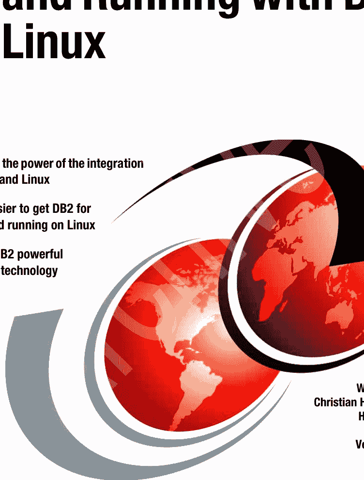

Whei-Jen Chen

Christian Hideaki Kondo

Helmut Riegler

Lifang LF Liu

Veiko Spranger


## 7.1 健康监控器和健康中心 354

## 7.2 内存视化器和内存跟踪器 381

## 7.6 Linux 监控工具 414

# 前言

Linux 是过去增长最快的操作系统之一。DB2 长期以来以其技术领先地位著称。本 IBM Redbooks 出版物是一份信息指南，描述了如何将适用于 Linux、UNIX® 和 Windows® 的 DB2 与 SUSE 和 Red Hat操作系统有效集成。本书提供了 Linux 环境下安装、配置、管理和监控 DB2 的介绍性和详细信息。

我们描述了适用于 Linux 的 DB2 产品族及其功能，并提供了单机及多分区系统安装配置的步骤说明。我们讨论了如何将单机和多分区 DB2 迁移到 DB2 9.5 版本，并详细讨论了 Linux 环境下的 DB2 数据库管理、数据库备份恢复程序、在线维护以及系统监控。我们涵盖了 DB2 集成工具及其功能。

我们讨论了 Linux 环境下 DB2 应用开发的方面，并就在 Linux 上构建和运行 DB2 应用提供了通用建议。

# 编写本书的团队

本书由全球国际技术支持中心（圣何塞）的专家团队编写。

Whei-Jen Chen 是圣何塞国际技术支持中心的项目负责人。他在数据库设计与建模、DB2 系统管理和应用开发方面拥有丰富经验。Wei-Jen 是 IBM 认证数据库管理和应用开发解决方案专家以及 IBM 认证 IT 专家。

Christian Hideaki Kondo 是巴西的 DB2 系统支持人员。他在 DB2 和 Informix®领域领域多年经验。他拥有圣保罗州立大学的计算机科学学位。他的专业领域包括 DB2set和商业智能（BI）解决方案，包括迁移和性能优化服务。他还是 IBM 认证 DB2 9 高级管理员。

**Helmut Riegler** 是就职于维也纳全球学习应用开发组织的一名 IT 专家。他是负责学习应用持续支持的技术负责人。他自 1998 年以来加入 IBM，在软件开发和数据库管理方面拥有丰富经验。在加入 IBM 之前，他曾开发过 CAD 软件。他拥有电气工程学学位。

**刘芳（Lifang Liu）** 是 IBM 中国软件集团的高级 IT 专家。他的主要工作职责是方案设计和建议交付、售前技术支持，以及帮助客户完成项目中的概念验证/技术验证（PoC/PoT）部分。刘芳专注于支持 DB2 在线事务处理 (OLTP) 业务、支持大型 ISV/OEM 客户以及支持 DB2/SAP®。在担任职位之前，他是 IBM 中国技术支持中心工作的 DB2 全球 L2 支持工程师。他是 IBM 认证 DB2 高级数据库管理员。他的专业领域包括 DB2 故障排除、数据库性能管理和数据库维护。

**Veiko Spranger** 是 IBM 子公司 it' Services and Solutions GmbH 的顾问 IT 专家，拥有 14 年 DB2 经验，专注于 DB2 分布式和商业智能。Veiko 是中区前台支持团队以及 EMEA BI VFE（虚拟前端）的成员，并是 IBM 认证高级数据库管理员。他是适用于 LUW 的 DB2 的 SAP 支持后台专家，主要关注 DB2 的备份、恢复和灾难恢复。


**图 1** 从左到右：LiFang、Helmut、Veiko 和 Christian

# 致谢

感谢以下人员对本项目做出的贡献：

- Boris Bialek
- Ian Hakes
- Jeff Shantz
- Martin Schlegel
- Rav Ahuja
- Grant Hutchinson
- Yvonne Chan
- Amy Tang
- Budi Surjanto
- Paul Zikopoulos
- **加拿大 IBM 多伦多实验室**
- George Lapis
- Gary Lazzotti
- Tom Cheung
- **美国 IBM 硅谷实验室**
- Daniel Krook
- **美国 IBM 销售与分销**
Emma Jacobs Sangam Racherla, Deanna Polm

国际技术支持组织

感谢本书以前版本的作者们：

- 2003 年 3 月出版的初版《Linux 上的 DB2：入门与实践》的作者为：
Rav Ahuja
Louisa Ford
Paul Jud
Kang Yong Ying

# 成为已出版作者

加入我们为期二至六周的驻留计划吧！帮助编写涉及特定产品和解决方案的书籍，同时获得尖端技术的实操经验。你将有机会与 IBM 技术专业人员、合作伙伴和客户团队合作。

你的努力将提高产品的接受度和客户满意度。作为奖励，你将在 IBM 开发实验室建立起人脉网络，并提高你的工作效率和市场竞争力。

欲了解更多关于驻留计划的信息，请浏览驻留计划索引并在在线申请：

`ibm.com/redbooks/residencies.html`

# 欢迎意见

您的意见对我们至关重要！

我们希望书籍能够尽可能提供帮助。请通过以下方式之一向我们反馈本书或其他 IBM Redbooks 出版物的意见：

- 通过以下网址找到在线联系我们并反馈 IBM Redbooks 出版物：
`ibm.com/redbooks`
- 通过电子邮件将您的意见发送至：
`redbooks@us.ibm.com`
- 邮寄您的意见至：
IBM Corporation, International Technical Support Organization
Dept. HYTD Mail Station P099
2455 South Road
Poughkeepsie, NY 12601-5400

# 变更摘要

本节描述了本书版本的技术更改。

本版本还可能包含未注明的细微修正和编辑更改。

变更摘要

针对 SG24-6899-01

针对《Linux 上的 DB2：入门与实践》

于 2008 年 6 月 25 日创建或更新

# 2008 年 6 月，第二版

本次修订反映了下述新增、删除或修改的新信息。

新信息：

- DB2 9.5 特性和功能

变更信息：

- DB2 安装
- 安装后任务
- 迁移
- 数据库管理
- 监控
- 应用开发

# 引言

凭借丰富的产品和能力，适用于 Linux 的 DB2 允许您访问、管理和分析跨越企业的所有形式的信息。DB2 为您提供了一个健壮、易于管理的数据库，提供了高性能，并补充了 Linux 的稳定性和可靠性。DB2 行业领先的并行技术使其成为当今生产环境中可扩展性最强、强大的数据库之一，结合 Linux 集群时，它允许您以比其他企业级更低的成本管理关键关键数据。您可以从这些网站下载适用于 Linux 的 DB2 测试版：

- `http://www.ibm.com/software/data/db2/9/download.html`
- `http://www.ibm.com/software/data/db2/9/edition-express-c.html`

访问以下网站获取更多信息：

`http://www.ibm.com/db2/linux`

在本章中，我们介绍了 DB2 9.5 版本及其为 Linux 提供的功能，并对 DB2 环境及其与 Linux 的并行性进行了概述。在概述之余，我们还描述了以下主题：

- DB2 特性和功能
- 涵盖功能、支持的平台和程序包
- DB2 环境
- 涵盖部署拓扑和 db2 数据库对象
- 与 DB2 的并行性
- 涵盖 SMP 环境、数据库集群和分区数据库

## 1.1 概述

在不久以前，Linux 服务器主要用于学术和科学领域。在短短几年内，Linux 已经赢得了增长最快的服务器操作系统之一的称号，并在企业中变得无处不在。它的开放性、灵活性以及降低成本的能力是导致该操作系统在商业系统领域取得巨大成功的因素之一。Linux 曾被边缘化运行基础设施任务（如文件和 Web 服务），现在已进入企业数据中心。许多公司已经越过了最初的实验和测试阶段，现在从通过 Linux 和 DB2 部署关键应用程序和数据库中受益。

DB2 以技术领先而闻名。因此，IBM 领先将 DB2 证明过的性能、可扩展性和易用性功能引入 Linux 并不意外。多年来，DB2 通过发布适用于 Linux 集群环境的首款数据库、展示适用于 Intel® 和 AMD™ 驱动的 64 位平台的商业数据库，以及持续在 Linux 上保持行业领先的基准测试来保持其地位。IBM 对 Linux 的承诺进一步体现在其持续针对数据库工作负载内核。

IBM 是关系型数据库系统的市场领导者。全球范围内大型公司和政府选择在环境中部署适用于 Linux 的 DB2 的原因非常简单。DB2 丰富的功能集已经在 Linux 上运行了近四年，在此期间，当 Linux 内核在数千名程序员和志愿者的努力下变得成熟时，IBM 团队致力于进一步加固内核和 DB2 以满足企业工作负载。如今，DB2 是 Linux 上最通用、最强大的数据库，能够有效处理决策支持和事务环境中 TB 级的数据。DB2 与 Linux 的结合是多种解决方案和垂直应用程序的健壮数据库平台，包括：

- Web 和应用程序服务器后端
- 商业智能和数据仓库
- 事务型企业系统
- 企业应用，如企业资源计划 (ERP)、客户关系管理 (CRM) 和供应链管理 (SCM)
- 信息集成和内容管理
- 大型主机和主机数据的网关
- 零售、金融、公共部门和制造业应用
- 生命科学和生物信息学解决方案
- 空间和地理系统存储
- 高性能计算应用，包括：
  - 金融建模
  - 石油气勘探
  - 研究与科学

尽管在不同行业实施了广泛的解决方案，但 DB2 for Linux 的客户通常在提到他们所获益时会涉及几个共同主题。其中最重要的是 DB2 for Linux 提供的卓越价值。DB2 以其关键的自调优和自愈功能而闻名。自调优内存管理器 (`STMM`)、自动存储和其他自主管理功能使 DB2 变得易用和维护，同时减少了管理它所需的时间。IBM 与所有主要的 Linux 发行版合作，并且能够直接从 IBM 获取针对 DB2 和 Linux 的 24x7 支持，这让用户感到非常安心。

DB2 9.5 版本扩展了其作为混合数据服务器的创新能力以及深度压缩的成本优势，以实现数据的快速使用、领先于威胁，并在业务过程中充分提取可扩展标记语言 (XML) 数据的全部价值。

以下章节概述了 Linux 上提供的 DB2 功能和产品方案，以及在企业中部署该产品的架构。

## 1.2 DB2 for Linux 功能和产品

本节描述了 DB2 9.5 版本的功能、支持的平台和产品方案。

### 1.2.1 功能

DB2 是一个开放标准、多平台的关系数据库系统，足够强大以满足大型企业的需求，又足够灵活以服务中小型企业。其功能包括：

- 利用对称多处理 (`SMP`) 和基于集群的并行性
- 对各种数据源的联邦支持
- 高级内置在线分析处理 (`OLAP`) 和商业智能功能
- 管理多种数据类型的能力，包括二进制大对象 (`BLOB`)
- 基于开放行业标准构建：SQL、分布式关系数据库架构™ (`DRDA®`)、命令行界面 (`CLI`)、开放数据库连接 (`ODBC`)、Java™ 数据库连接 (`JDBC™`) 等
- 查询优化技术和性能领域的领导者
- 存储过程、用户定义函数 (`UDFs`)、数据加密和全球化
- 完全支持 Web 环境，并通过了领先的企业应用认证
- 高可用性功能和故障转移支持、高可用灾备恢复 (`HADR`)、`Tivoli System Automation (TSA)` 等
- Java 2 平台企业版 (`JEE™`)认证以及用于 JDBC 和 SQLJ 的 Java 应用接口
- 支持开源接口，如超文本处理器 (`PHP`)、Python 和 Perl
- 原生 XML 支持
- 用于管理本地和远程数据库的图形化集成工具集
- 用于可视化开发和迁移的生产力工具
- 支持 InfinBand® I/O 高速互连
- 对 Linux 内核能力的探索
- 创新的自管理技术以减少 DBA 的干预
- 用于监控和性能调优的工具和向导
- 简化集群上大规模数据库的管理
- 用于信息集的联邦 Web 服务
- 用于高用户可扩展性的集中器
- 动态配置（无需重启数据库）
- 在线工具和实用程序，例如 `REORG`、`LOAD` 以及存储和内存管理
- 用于提高复杂查询性能的多维聚类

DB2 自 6 版本起已在 Linux 上实现了商业化。DB2 for Linux、UNIX 和 Windows (`LUW`) 持续提供行业领先的性能、可扩展性和可靠性数据库功能和特性。DB2 9.1 原生支持 XML。DB2 9.5 扩展了其作为混合数据服务器的创新能力以及深度压缩的成本优势，以实现数据的快速使用、领先于威胁，并在业务过程中充分提取 XML 数据的全部价值。

新的且增强的 DB2 9.5 功能包括：

- *pureXML™：在 DB 9.1 中引入，pureXML 提供了将 XML 数据作为原生列存储在 DB2 数据库中的能力。XML 与关系数据的这种无缝集成加速了应用开发，通过高度优化的 XML 索引提升了性能，并且可以使用 SQL 和 Xquery 灵活查询 XML 数据。在 DB 9.5 中，增加了包括支持非 Unicode XML 数据库在内的增强。
- *数据压缩增强：在对定义了 `COMPRESS` 属性的表进行数据操作期间，可以自动创建数据压缩字典，这意味着 DB2 可以在没有 DBA 干预的情况下自动压缩数据。
- *数据库备份增强：DB2 9.5 可以自动删除不再需要恢复的备份映像、复制映像和旧日志文件。自动备份提供了新选项，例如压缩、增量备份和差异备份，以及备份中的日志文件。此外，现在通过 `TO OF BACKUP` 参数可以回滚到最小恢复时间。
- *工作负载管理器：工作负载管理功能帮助您识别、管理和监控服务器工作负载。这些功能提供了首次集成到 DB2 服务器中的工作负载管理解决方案。对身份断言（identity assertion）的支持允许你在多层环境中为单个用户或组提供工作负载管理。通过将负载定义与服务类关联，可以使用预测或响应模型对每个独特的工作负载设置优先级，允许企业将其业务目标与其 IT 应用对齐。
- *多线程架构扩展：DB2 使用多线程架构，这提高了性能并简化了配置和优化。此外，内存管理的简化消除了代理级配置参数并实现了其余部分的自动化。
- *部署改进：部署改进简化了安装和维护 DB2 服务器的过程：以前在应用补丁后需要两个手动步骤（运行 `dbupdt` 命令和运行 `dasdt` 命令），现在已实现自动化。此外，绑定在第一次连接时自动发生。
- *非根用户可以执行安装、应用或回滚补丁、配置实例、添加新功能以及卸载。
- *更易于管理分区数据库系统：提供了所有数据库配置元素的单一视图。通过此新功能，您可以在任何数据库所在的分区上通过单个 SQL 语句或管理命令更新或重置所有分区的数据库配置。`BACKUP DATABASE` 现在可以一次备份多分区数据库的所有分区。
- *自动存储增强：自动存储跨磁盘和文件系统扩展数据库的大小。它消除了管理存储容器的需求，同时利用了数据库管理空间的性能和灵活性。从 DB9 开始，此功能默认启用。DB2.5 提供了进一步增强，包括表空间末端的未使用空间、设置自动存储数据库容器的最大值以及支持多分区环境。
- *额外的配置参数：数据服务器自动处理更多的调优参数，无需停止重启实例或数据库。
- *自动维护改进：你可以使用新的 DB2 存储过程配置并收集以下领域的自动维护信息：
  - 维护窗口
  - 自动备份
  - 自动表和索引重组
  - 自动表 `RUNSTATS` 操作
收集信息的 DB2 存储过程为：
  - `SYPROC.AUTOMAINT_GET_POLICY`
  - `SYPROC.AUTOMAINT_GET_POLICYFILE`
配置自动维护请使用：
  - `SYPROC.AUTOMAINT_SET_POLICY`
  - `SYPROC.AUTOMAINT_SET_POLICYFILE`
- *受信任上下文：受信任上下文是一种描述数据库与外部实体（如中间层应用程序服务器）之间关系的数据库对象。受信任上下文在使用限制的敏感权限时提供了更大的控制，并允许中间层服务器或应用程序向数据库服务器断用户身份。
- *自调优内存分配：自调优内存提供了一种能够对工作负载特征的重大变化进行动态响应配置，包括动态快速通信管理器
(FCM) 缓冲区以及由 DB2 数据库管理器自动调优的新配置参数。
*   **基于标签的访问控制 (`LBAC`)：** 此功能增强了您对数据访问权限的控制。`LBAC` 允许您精确决定谁对特定的行和列具有写入权限或读取权限。
*   **自动统计：** DB2 在后台自动运行 `RUNSTATS` 工具，以确保在创建数据库时收集并维护正确的统计信息。
*   **产品许可：** DB2 通过许可中心（License Center）和 `db211cm` 命令提供更早早的产品许可管理。DB2 运行时客户端（Runtime Client）的许可更改允许您自由分发它。
*   **多个 DB2 版本：** DB2 提供了在同一台计算机上安装多个 DB2 版本和修复包的能力。
*   **管理 SQL 例程和视图：** 管理例程和视图提供了一个主要的、易于使用的编程接口，用于通过 SQL 管理 DB2 数据库。DB2 9.5 提供了更多的视图。

### 1.2.2 支持的平台

IBM 致力于 Linux 并在多种硬件平台上提供支持。

如今，DB2 产品支持以下硬件：

*   x86 (Intel Pentium®、Intel Xeon® 和 AMD) 32 位 Intel 和 AMD 处理器
*   x64 (64 位 AMD64 和 Intel EM64AT 处理器)


*   POWER™ (支持 Linux 的 IBM OpenPower®、System i™ 或 System p)
*   System z™ 或 System z9®

支持的 Linux 操作系统包括：

*   Red Hat Enterprise Linux (RHEL) 4 Update 4
*   Red Hat Enterprise Linux (RHEL) 5
*   SUSE Linux Enterprise Server (SLES) 9 Service Pack 3
*   SUSE Linux Enterprise Server (SLES) 10 Service Pack 1
*   Ubuntu 7.0

有关支持的 Linux 发行版的最新信息，请参阅：
`http://www-306.ibm.com/software/data/db2/linux/validate/`

创建和运行 Java 应用以及基于 Java 的工具需要 IBM JDK™。为了方便起见，IBM SDK 5 SR5 随 DB2 9.5 SDK 一起发布，并且在大多数情况下会随 DB2 安装程序自动安装。请参考验证网站获取最新的支持产品列表，因为支持产品列表更新非常频繁。

> 注意：非 IBM 版本的 Java 软件开发包 (SDK) 仅支持构建和运行独立的 Java 应用。对于构建和运行 Java 存储过程和用户定义函数，仅支持包含 DB2 Database for Linux、UNIX 和 Windows 产品中的 IBM SDK for Java。

### 1.2.3 DB2 产品和包

DB2 for Linux, UNIX 和 Windows 通过以下方式提供行业领先的性能、扩展性和可靠性：

*   用于生产环境的 DB2 包
*   额外的 DB2 企业版（Enterprise）功能
*   额外的 DB2 工作组版（Workgroup）和快速版（Express）功能
*   用于访问现有和主机数据的产品
*   用于泛在平台的 DB2

# 用于生产环境的 DB2 包

DB2 for Linux, UNIX 和 Windows 根据用户的业务需求为用户提供了各种软件包。本节介绍了 DB2 包。

DB2 Express-C 版 (DB2 Express-C 9.5) 是 DB2 数据服务器的全功能版本，可免费下载和部署。DB2 Express-C 帮助开发者、中期市场合作伙伴和多分支机构加速价值实现时间并降低总拥有成本。DB2 Express-C 9.5 包含了大型企业可用的 pureXML 和自主功能。如需升级到 DB2 9.5 的其他版本，只需安装许可证书，无需更改您的应用程序代码。免费版 DB2 Express-C 可以利用至多两个核心和 2 GB 内存，而获得许可的支持选项可以使用四个核心和 4 GB 内存。

DB2 Express Edition (DB2 Express 9.5)（快速版）是一个功能完整的 DB2 数据服务器，为中小企业 (SMB) 市场提供了极具吸引力的入门价格。DB2 Express 9.5 包含了更具扩展性版本的自主管理功能。您无需更改应用程序代码即可进行升级——只需安装许可证书。DB2 Express 9.5 可以部署在具有最多两个处理器的系统上。DB2 数据服务器使用的使用的内存不能超过 4 GB。

DB2 Workgroup Server Edition (DB2 Workgroup 9.5) 是在部门、工作组或中等规模业务环境中部署的首选数据服务器。DB2 Workgroup 9.5 可以部署在具有最多四个处理器和 16 GB 内存的系统上。

DB2 Enterprise Server Edition (DB2 Enterprise 9.5) 旨在满足中大型企业的数据需求而设计。它可以部署在任何规模的服务器上，从一个处理器到数百个处理器不等。DB2 Enterprise 9.5 是构建企业级解决方案的理想基础，例如高性能、24x7 可用的高量交易处理业务解决方案或基于 Web 的解决方案。它是行业领先的独立软件供应商 (ISV) 构建企业级解决方案（如商业智能、内容管理、电子商务、企业资源计划、客户关系管理或供应链管理）的首选数据服务器后端。此外，DB2 Enterprise 9.5 提供了与其它 DB2 和 Informix 数据源的连接性、兼容性和集成。DB2 Enterprise 9.5 包含了表分区、高可用灾备恢复 (HADR)、在线重组、物化查询表 (MQTs)、多维聚类 (MDC)、查询并行、连接生成器以及用于平台的 Tiv 系统自动化。

DB2 数据库分区功能 (DPF) 作为 DB2 仓库的一部分可用。该功能允许在单机系统或系统集群内分区数据库。DPF 能力为客户端提供了多项优势，包括支持极大型数据库或复杂负载的可扩展性。

# 用于访问现有和主机数据的产品

通过以下 DB2 产品，您可以将您的企业系统扩展到现有系统。

DB2 Connect™ 个人版提供应用程序接口 (API) 驱动程序，使 Windows 和 Linux 桌面应用程序直接连接到 System z 和 i 数据库。该产品专门为运行在工作站上的双层客户端/服务器应用程序设计，因此不适用于服务器。

DB2 Connect 企业版是 DB2 服务器和客户端软件的组合，满足需要从各种桌面系统到 System z 和 i 数据库进行强健连接的需求。客户端软件部署在桌面系统上，并为运行在桌面系统上的客户端/服务器应用程序提供驱动程序。DB2 服务器旨在为大规模环境下的客户端/服务器提供连接，提供连接池和集中器功能，以最大化利用 System z 和 i 资源。

DB2 Connect 服务器版在技术上与 DB2 企业版相同。与 DB2 企业版一样，它专为大规模环境而设计。但其许可条款和条件旨在满足多层客户端/服务器应用程序以及使用 Web 应用程序的需求。DB2 Connect 服务器版的许可费用基于运行应用程序的服务器的大小或处理器数量。

DB2 Connect 无限制版适用于大量使用 DB2 Connect 的组织，特别是在涉及多个应用程序时。该产品提供了与 DB2 Connect 个人版相同的程序，并允许在组织内无限制部署。

DB2 Connect z 系列无限版的许可费用基于 DB2 System z 服务器的大小（以百万服务单位 MSU 衡量），不受 DB2 Connect 服务器的处理器数量或运行应用程序的服务器的可用处理器数量的影响。

DB2 Connect i 系列无限版与 DB2 Connect z 系列无限版的规格相同，但 i 系列无限版的许可费用基于运行在 i5/OS 或 OS/400® 操作系统上的数据源的处理器数量。允许无限用户使用。

## 1.3 DB2 环境

本节描述了 Linux 上各种 DB2 应用程序配置。它还讨论了 SMP 和集群中的并行性，并描述了 DB2 架构。

### 1.3.1 部署拓扑结构

DB2 for Linux 可用于广泛的应用程序，无论是内部开发的还是预封装的。应用程序可以通过多种配置与 DB2 一起部署。

### 单层 (Single-tier)

在这种配置下，应用程序和数据库位于同一个系统中。在企业环境中，很少看到这种配置，因为通常需要对数据库服务器进行远程访问。尽管如此，对于开发应用程序来说这非常常见，这些后期可以在不进行任何更改的情况下透明地部署到多层 DB2 环境中。

### 客户端/服务器或双层 (Client/Server or two-tier)

应用程序和数据库位于不同的系统中。运行应用程序的机器通常安装了 DB2 客户端，它通过网络与数据库服务器通信。对于应用程序而言，数据的物理位置是透明的。应用程序使用标准接口（例如 ODBC）与 DB2 客户端通信，由 DB2 客户端接管通过网络访问数据的任务。在某些情况下（如浏览器或基于 Java 的访问），没有必要让 DB2 客户端运行在执行应用程序的机器上。

DB2 为异构环境中混合和匹配客户端平台提供了卓越的灵活性。DB2 客户端和服务器代码适用于多种平台。例如，应用程序可以在安装了 Windows 版 DB2 客户端的 Windows 机器上执行，该客户端可以访问 Linux 服务器上的 DB2 数据库。同样，Linux 机器可以作为客户端访问来自 UNIX 服务器或大型主机的数据。

### 多层 (Multi-tier)

在多层配置中，应用程序、DB2 客户端和数据源通常位于不同的系统中。这些配置的示例包括但不限于第 12 页表 1-1 所示的场景。

### 表 1-1 多层配置示例

| 客户端 | 中间层 | 服务器 |
| --- | --- | --- |
| Web 浏览器 | Web 服务器 DB2 客户端 | DB2 数据库服务器 |
| 应用程序客户端 | 应用程序服务器 DB2 客户端 | DB2 数据库服务器 1，DB2 数据库服务器 2 |
| 应用程序 DB2 客户端 | DB2 连接网关 | OS/390® AS/400® VM/MSE |
| 应用程序 DB2 客户端 | DB2 服务器 | 次级数据源（例如，大型机 DB2、非 DB2 和非关系型） |

IBM 认识到，在许多情况下，需要从各种分布式源访问数据，而不是通过一个集中式数据库。数据源可以来自 IBM 产品（如 DB2 或 Informix），也可以是非 IBM 数据库（如 Oracle®），甚至是非关系型数据（如文件或表格）。如表 1-1 所示，通过允许访问联邦数据源，提供了全面的业务解决方案。图 1-1 显示了可扩展的三层架构。


图 1-1 三层架构

第一层代表通过互联网连接的客户端。第二层是应用程序服务器（例如 WebSphere），它负责分发请求。第三层由分区数据库组成。如果数据库增加，可以添加更多分区。在第 8 章数据库（42 页）中可以看到更详细的信息。在发生故障时，应用程序将重定向到备用数据库。数据库的可用性随着分区数量增加。

### OLTP 与 DSS

你可以区分在线事务处理 (OLTP) 和决策支持系统 (DSS)。OLTP 系统设计用于高并发事务。DSS 系统设计用于复杂的查询和报告。图 1-2 显示了这种示例。


图 1-2 多层架构

### 1.3.2 DB2 对象

在本节中，我们将介绍 DB2 对象以及它们之间的关系。

### 实例 (Instances)

实例（有时称为数据库管理器）是管理数据的 DB2 代码。它控制对数据的操作并管理分配给它的系统资源。每个实例都是完整的环境，包含了给定并行数据库的所有分区。实例拥有自己的数据库（其他实例无法直接访问），所有的数据库分区共享系统目录。它还与同一机器上的其他实例实现了隔离，允许生产环境和开发环境通过不同的实例运行在同一台机器上而互不干扰。


### 数据库 (Databases)

关系数据库以表的形式呈现数据。表由定义的列和任意数量的行组成。每个数据库包含一组描述数据逻辑和物理结构的系统目录表、一个包含分配给数据库的参数值的配置文件以及恢复日志。

### 数据库分区组 (Database partition groups)

数据库分区组是一个或多个数据库分区的集合。在为数据库创建表之前，首先需要创建存储表空间的分区组，然后创建用于存储表的表空间。如果没有指定分区组，则有一个用于分配表空间的默认组。在 DB2 的早期版本中，数据库分区组被称为节点组 (node groups)。

### 表空间 (Table spaces)

数据库组织成称为表空间的部分。表空间是存储表的地方。在创建表时，你可以决定某些对象，作为索引和大型对象（LOB）数据，它们与表的其余部分数据分开存储。表空间也可以跨越一个或多个物理存储设备。

表空间存在于分区组中。表空间的定义和属性记录在数据库系统目录中。容器用被分配给表空间。容器是物理存储的分配（表现为文件或设备）。表空间可以是系统管理空间（SMS），也可以是数据库管理空间（DMS）。对于 SMS 表空间，每个容器都是操作系统文件空间中的一个目录，由操作系统的文件管理器控制存储空间。对于 DMS 表空间，每个容器要么是固定大小的预分配文件或物理设备（如磁盘），由数据库管理器控制存储空间。

## 表

关系型数据库将数据以表集合的形式呈现。表由在逻辑上按列和行排列的数据组成。所有数据库数据和表数据都被分配到表空间。表中的数据在逻辑上是相关的，并且可以在表之间定义关系。可以根据特定的数学原理和操作对表数据进行查看和处理。表数据通过结构化查询语言（SQL）进行访问，SQL 是一种用于定义和操作关系型数据库数据的标准语言。应用程序或用户使用查询从数据库中检索数据。查询使用 SQL 创建格式如下的语句：

```
SELECT <data_name> FROM <table_name>
```

## 缓冲区池

缓冲区池是分配给主内存的量，用于缓存从磁盘读取或被修改的表和索引数据页。缓冲区池的目的是提高系统性能。从内存访问数据比从磁盘访问快得多；因此，数据库管理器读取或写入磁盘（I/O）的次数越少，性能越好。（您可以创建多个缓冲区池；尽管对于大多数情况，一个缓冲区池就足够了。）缓冲区池的配置是最重要的调优领域，因为您可以减少 I/O 引起的延迟。

# 1.4 DB2 的并行性

具有单个处理器和磁盘的系统在处理的数据量、用户和应用程序方面存在局限性。并行处理是企业工作负载的关键，它涉及将负载分散到多个处理器和磁盘上，并允许处理大量数据和高事务率。在许多环境中，数据量正以惊人的速度增长；因此，数据库管理系统需要能够通过增加磁盘和 CPU 轻松扩展以适应增加的负载。

DB2 并行技术通过将处理拆分为独立的执行组件（这些组件可以在多个处理器上并发运行），在大型数据库上实现了高度可扩展的性能。通过并行处理单个查询，可以大幅缩短查询的运行时间。DB2 支持可扩展的增长路径，通过“向上扩展”（SMP）、“向外扩展”（大规模并行处理 (MPP)）或两者兼顾，轻松为现有系统添加更多处理能力。

### 1.4.1 SMP 环境

过去，复杂的企业工作负载通常运行在高端 SMP（对称多处理器）机器上。运行在同一台机器内并通过高带宽总线连接的大量处理器可以提供优异的性能。由于 DB2 for Linux 与运行在高端 UNIX 系统上的 DB2 共享许多代码，因此它继承了利用 SMP 架构的能力。DB2 在 SMP 系统上运行的能力仅受当今 Linux SMP 可扩展性的限制。DB2 可以轻松地利用多个处理器，而无需建立集群系统。这被称为域内并行。

### 1.4.2 数据库集群

Linux 集群的驱动力是，通过在运行开源操作系统的低成本服务器上分配负载，可以更快、更可靠且更具效益地完成更大的任务。如果负载增加，集群可以扩展以管理额外需求，而不会损害性能。DB2 是 Linux 上第一个提供内置集群能力的数据库。这意味着 DB2 可以立即部署在 Linux 集群中，而不需要额外的集群软件。Linux 上的 DB2 集群是运行高要求的事务应用程序和涉及大量数据的仓库的理想选择，同时提供了以下优势：

- 更快的处理速度
- 巨大的数据库
- 优异的可扩展性
- 提高可用性
- 降低成本

将集群方法与 DB2 对 64 位 Linux 环境的支持相结合提供了额外的性能和可扩展性优势。

对于 DB2 的集群功能，您必须设置分区环境。这被称为*域间并行*（inter-parallelism）。

## 数据库集群架构

有两种主要的数据库集群架构：共享磁盘和共享节点。*共享磁盘*由 Oracle RAC 使用。DB2 for Linux 采用共享节点。

## 共享磁盘

在共享磁盘环境中，每个数据库节点都有自己的处理器，但与其他节点共享磁盘。因此，所有处理器都可以访问集群中的所有磁盘，这为节点之间的资源协调和锁的同步引入了额外开销。例如，如果节点 1 想要访问被集群中另一个节点锁定的特定磁盘上的数据，节点 1 必须等待其他节点完成操作。虽然这在集群中节点较少时（例如大型机环境）可以运行，但分布式锁管理和缓存一致性问题的开销会严重限制可扩展性，并导致四个或更多节点的性能下降，使其对于大型集群变得不可行。

## 共享节点

顾如名，共享节点环境中的分区（节点）不与其他机器共享处理器、内存或磁盘。每个分区在自己的数据子集上运行。由于每个分区都有自己的私有资源，这种方法不会与其他服务器产生竞争，具有虚拟上无限的可扩展性。这是 DB2 for Linux 支持多达 1,000 个分区的原因之一。由于访问资源没有协调开销，可以轻松向集群中添加更多机器以获得线性可扩展的性能，这意味着数据量的翻倍对应资源的翻倍，数据库的高性能将保持原有水平。如果集群中的一个分区故障，其资源可以动态转移到另一台机器，确保高可用性。DB2 for Linux 采用的共享节点方法的另一个优点是它不需要专用硬件，使得解决方案更加简单、更廉价，并适用于 Linux 的“商品化”硬件。

### 1.4.3 分区数据库

DB2 通过采用数据库分区来利用 Linux 集群的力量。在分区环境中，数据库分布在多个分区上，这些通常位于不同的机器上。每个分区负责数据库总数据的一部分。数据库分区有时也称为节点或数据库节点。由于数据分布在数据库分区上，您可以使用多个物理节点上的多个处理器来满足信息请求。数据检索和更新请求会自动拆分解为子请求，并在相应的数据库分区之间并行执行。

为了说明分区数据库系统中的处理能力，假设您在单分区数据库中有 100,000,000 条记录需要扫描。这种扫描需要单个数据库管理器搜索 100,000,000 条记录。现在，假设这些记录均匀地分布在 20 个数据库分区上；每个分区只需要扫描 5,000,000 条记录。如果每个数据库分区服务器都以相同的速度并行扫描，扫描所需的时间大约比处理整个任务的单分区系统快 20 倍。

数据库跨多个数据库分区进行划分，这一事实对于用户和应用程序是透明的。用户交互通过一个数据库分区进行，该分区被称为该节点的协调节点（coordinator node）。任何数据库分区都可以作为协调节点，客户端或应用程序连接的分区将成为该协调节点。你需要考虑将用户分散在不同的数据库分区服务器上，以分担协调功能。图 1-7 展示了一个分式数据库。

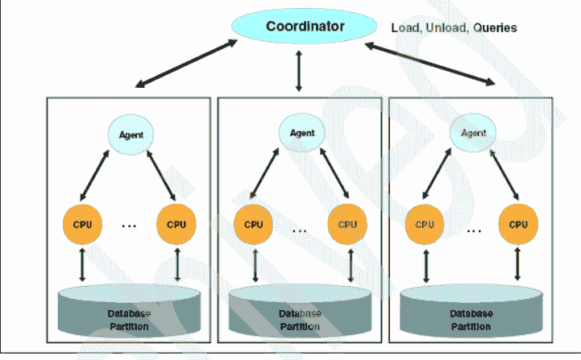

图 1-7 DB2 MPP 环境

第 22 页的图 1-8 显示了分式环境中数据库对象之间的关系。

## 系统 1


## 系统 2

## 实例 1

## 实例 2

| 分区 1（逻辑分区） | 分区 2（逻辑分区） |

|--- | --- |

| 分区 3（物理分区） |

|--- | |

| 表 1 | 表 2 | 索引 1 |

|--- | --- | --- |

| 表 3 |

|--- | |

| 表 4 | 表 5 | 索引 3 | 索引 2 |

|--- | --- | --- | --- |

| 长数据 1 | 长数据 2 | 长数据 3 |

|--- | --- | --- |

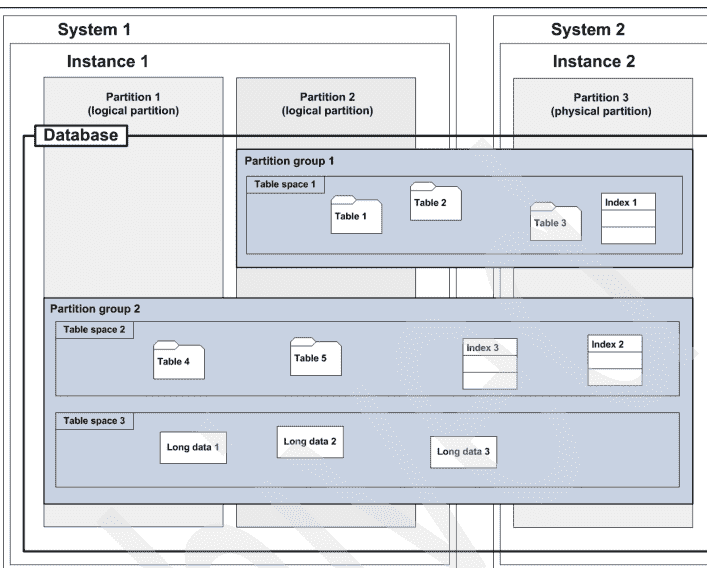

图 1-8 分式环境中的 DB2 数据库对象

你可以看到，在分式环境中，分区组跨分区进行透明扩展。在图 1-8 中，我们展示了第一个系统的两个逻辑分区和第二个系统的一个物理/逻辑分区。表空间被分配到一个分区组。在添加系统或逻辑/物理分区后，你只需要将所需的分区组扩展到新分区。在图 1-8 中，一个分区组跨越分区 2 和分区 3，另一个分区组则跨越所有三个分区。

数据使用可更新的分区映射和哈希算法分布在各个分区之间，这决定了每行数据的放置和检索。例如，如果向表中添加了一行，协调节点会检查分区映射，该映射指定了存储该行的数据库分区。该行仅会被发送到相应的数据库分区服务器，结果是只有相关的数据库分区服务器参与插入操作。这使得节点之间的通信和协调开销保持尽可能低。请参见第 23 页的图 1-9。

## INSERT ... (000120, "Joe Manager", "Reg")

| 索引 | 0 | 1 | 2 | 3 | 4 | 5 | 6 | 7 | 8 | 9 | 10 | 11 | ... | 4094 | 4095 |

| --- | --- | --- | --- | --- | --- | --- | --- | --- | --- | --- | --- | --- | --- | --- | --- |

| 分区 | 1 | 2 | 3 | 4 | 1 | 2 | 3 | 4 | 1 | 2 | 3 | 4 | ... | ... | ... |

EMPNO 000120 DB2 哈希算法

## 分区映射

| 分区 1 | 分区 2 | 分区 3 | 分区 4 |

|--- | --- | --- | --- |

图 1-9 跨 DB2 分区的智能数据分布

数据虽然在物理上被拆分，但在逻辑上被作为一个整体使用和管理。用户可以通过声明分区键来选择如何划分其数据。表可以位于一个或多个数据库分区中。因此，对于大表，你可以将工作负载分散到分式数据库中，同时允许较小的表存储在一个或多个数据库分区上。每个数据库分区对其存储的数据存有本地索引，从而提高了本地数据访问的性能。

你并不受限于将所有表都划分到数据库中的所有分区中。DB2 支持部分去聚集（partial declustering），这意味着你可以将表及其空间划分到系统中的部分数据库分区。当你希望表位于每个数据库分区时，可以考虑的替代方案是使用物化查询表（materialized query tables）并进行复制这些表。你可以创建一个包含所需信息的物化查询表，然后将其复制到每个节点。

## SMP 集群上的分区

在最简单的情况下，集群中的每台物理机器上都有一个数据库分区。在这种配置下，每个分区都是物理数据库分区，并可以访问机器中的所有资源。对于具有一个或两个处理器的系统，每台机器一个分区是典型配置。在使用带有多个处理器的 SMP 机器时，可以在同一系统上创建多个分区。逻辑数据库分区与物理分区的区别在于它没有获得整台机器的控制权。尽管机器拥有共享资源，但数据库分区并不共享所有资源。处理器是共享的，但磁盘和内存不共享。请参见第 24 页的图 1-10。

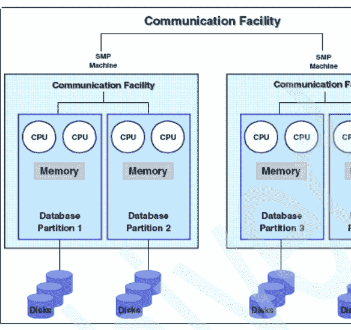

图 1-10 跨 SMP 机器集群的分式数据库

在集群和非集群环境中，在高 SMP 系统上使用逻辑分区是有优势的。逻辑数据库分区可以提供更好的扩展性。在多个逻辑分区上运行的多个数据库管理器（database managers）比单个管理器能够更充分地利用可用资源。允许在同一台机器上（无论处理器数量多少）两个或多个分区共存，为设计高可用配置和切换策略提供了更大的灵活性。

## 在 Linux 上安装并运行 DB2

### 安装

在本章中，我们将引导你如何在 Linux 上安装 DB2。我们描述了单分区和多分区环境，并提供了三种安装方法：DB2 Setup、`db2_install` 和响应文件安装。

在本章中，我们将详细介绍：

- 基础需求

- 安装考虑和规划

- 多分区安装考虑

- 用户和组设置

- 安装 DB2

### 基础需求

在安装 DB2 之前，确保你拥有所需的硬件和软件。你可能需要配置通信并安装软件包以便 DB2 成功运行。

在本节中，我们涵盖了以下安装前提：

- DB2 支持的硬件

- DB2 支持的 Linux 发行版

- 磁盘空间

- 内存需求

- 通信需求

- 内核参数值

- 额外的软件需求

#### DB2 支持的硬件

DB2 产品支持以下硬件：

Intel Pentium、Intel Xeon 和 AMD 32 位 Intel 和 AMD 处理器

x64（64 位 Intel 和 AMD 处理器）

POWER（支持 Linux 的 IBM OpenPower、System i 或 System p 系统）

System z

#### 支持的 Linux 发行版

确保你的 Linux 发行版本受 DB2 支持。有关当前支持的 Linux 发行版、内核和库的最新信息，请参考 DB2 Linux 验证站点：

http://www.ibm.com/software/data/db2/linux/validate

表 2-1 和表 2-2 所示的以下 Linux 发行版已通过 DB2 使用的验证。

表 2-1 DB2 9.5 推荐环境

| 内核架构 | x86 | x86_64 | PPC64 (POWER) | s390x (System z) |

|---|---|---|---|---|

| Red Hat Enterprise Linux (RHEL) 5 | ✓ | ✓ | ✓ | ✓ |

| SUSE Linux Enterprise Server (SLES) 10 | ✓ | ✓ | ✓ | |

| Ubuntu 7.10 | | ✓ | ✓ | |

表 2-2 DB2 9.5 验证环境

| 内核架构 | x86 | x86_64 | PPC64 (POWER) | s390x (System z) |

|---|---|---|---|---|

| Asianux Server 3 | ✓ | ✓ | ✓ | |

| Red Hat Enterprise Linux (RHEL) 4 | ✓ | ✓ | | ✓ |

| SUSE Linux Enterprise Server (SLES) 9 | ✓ | ✓ | | |

| Ubuntu 7.04 | | ✓ | ✓ | |

#### 所需的磁盘空间

在配置系统时，你必须考虑以下磁盘需求。DB2 Setup 向导会根据典型、精简或自定义安装期间所选的组件提供动态大小估值，如第 28 页的表 2-3 和第 28 页的表 2-4 所示。

| 表 2-3 所需的磁盘空间：非根安装 |

| 安装类型 | 描述 | 需磁盘空间 |

| --- | --- | --- |

| 典型 | 典型设置包含基础的数据库服务器功能、数据库管理工具，以及大多数产品特性和功能。 | 400 到 490 MB |

| 紧凑 | 将安装基础的 DB2特性和功能，并进行最小化配置。 | 390 到 470 MB |

| 自定义 | 此选项允许您选择想要安装的功能并指定您的配置偏好。 | 390 到 680 MB |

| 表 2-4 所需的磁盘空间：根安装 |

| 安装类型 | 描述 | 需磁盘空间 |

| --- | --- | --- |

| 典型 | 典型设置包含基础的数据库服务器功能、数据库管理工具，以及大多数产品特性和功能。 | 630 到 760 MB |

| 紧凑 | 将安装基础的 DB2 特性和功能，并进行最小化配置。 | 580 到 700 MB |

| 自定义 | 此选项允许您选择想要安装的功能并指定您的配置偏好。 | 580 到 1020 MB |

您必须为所需的软件、通信产品、DB2 文档和数据库分配磁盘空间。在 DB2 9.5 版本中，DB2 信息中心和 PDF 文档现在通过单独的 DVD 提供。安装英文版 DB2 信息中心需要 131 MB 的磁盘空间。其他语言还需要额外的空间。

我们建议在 `/tmp` 目录中分配 2 GB 的空闲空间。

## 2.1.4 内存需求

我们建议为 DB2 分配至少 256 MB 的 RAM，并为仅运行 DB2 产品和 DB2 GUI 工具的系统分配至少 512 MB 的 RAM。必须为其他软件和通信产品分配额外的内存。

在确定内存需求时，请注意：

- 我们建议您的 SWAP 空间至少是 RAM 的两倍。

- 对于 IBM 数据服务器客户端的支持，这些内存需求是基于 5 个并发客户端连接的。我们建议每 5 个客户端连接额外分配 16 MB 的 RAM。

- 内存需求受数据库系统规模、复杂性以及数据库活动程度和访问系统的客户端数量的影响。

对于 DB2 服务器产品，自调优内存功能通过自动设置多个内存配置参数的值来简化内存配置任务。启用后，内存调优器会将可用内存资源动态分配给内存消耗者，包括排序、包缓存、锁列表和缓冲池。

## 2.1.5 通信需求

访问远程数据库需要 TCP/IP。如果在安装过程中选择了该项，您的 Linux 发行版将提供 TCP/IP 连接性。

如果您的 Linux 机器安装在现有网络上并需要使用静态 IP 地址，则必须从网络管理员处收集类似于表 2-5 的信息。

| 表 2-5 所需网络信息 |

| 名称 | 示例值 |

|---|---|

| 主机 IP 地址 | 192.168.1.3 |

| 子网掩码 | 255.255.255.0 |

| 网关 | 192.168.1.1 |

| 域名服务器 | 192.168.3.1 |

上述信息必须在操作系统安装期间的设置窗口中指定，或使用您发行版的设置工具作为安装后步骤进行指定。

此外，还需要某些通信软件包，这些将在第 32 页的 2.1.7“额外软件需求”中讨论。

## 2.1.6 内核参数值

您可能需要更新几个默认内核参数设置，以便 DB2 在 Linux 上成功运行。运行 DB2 数据库系统时，Linux 特定内核参数的默认值是不足够的。

> 注意：您必须拥有 root 权限才能修改内核参数。

从版本 8 及更高版本开始，DB2 在启动时会自动检查 `kernel.sem`、`kernel.shmgni` 和 `kernel.shmmax` 参数的值，如果当前值不是最优的，会为您进行更改。`dbstart` 命令：

- 将 SEMMNI 内核参数更改为 1024

- 将 MSGNI 内核参数更改为 1024

- 将 SHMMAX 内核参数更改为 268435456 (32位) 或 1073741824 (64位)

在进行根安装之前，不再需要手动更新 `kernel.shmmax`、`kernel.shmgni` 和 `kernel.sem` 参数。但是，对于非根安装，您必须在安装之前检查这些内核参数并在需要时更新。

### 手动更新内核参数

如果任何默认内核参数设置都不符合您特定系统的要求，您可以手动更新它们。

使用 `ipcs -l` 命令检查您当前的共享内存段、信号量数组和消息队列限制。您的输出类似于此：

```
--- Shared Memory Limits ---
max number of segments = 4096              // SHMNI
max size (kbytes) = 32768                   // SHMAX
max total shared memory (kbytes) = 8388608      // SMALL
min seg size (kbytes) = 1

--- Semaphore Limits ---
max number of arrays = 1024                // SEMMNI
max semaphores per array = 250             // SEML
max semaphores systems wide = 256000      // SEMNS
max ops per semop call = 32                // SEMOP
semaphore max value = 32767

--- Messages: Limits ---
max queues system wide = 1024               // MSGMNI
```

对于根安装，如果 `kernel.shmmax` 设置为低值，您可能会在启动实例时遇到内存分配错误，此时必须手动更新 `kernel.shmmax`。

```
max size of message (bytes) = 65536 // MSGMAX
default max size of queue (bytes) = 65536 // MSGMNB
```

我们建议将 SHMAX 值设置为与系统上的物理内存量相等。系统的最小要求为 268435456 (256 MB)，对于 64 位系统为 1073741824 (1 GB)。

在此示例中，`SHMALL` 设置为 8 GB (8388608 KB = 8 GB)。如果您为 DB2 提供的物理内存超过 8 GB，请将此参数的值增加到计算机物理内存的约 90%。

内核参数由四个标记组成：SEMMSL、SEMN、SEMOPM 和 SEMMN。SEMN 是 SEMMSL 乘以 SEMMN 的结果。数据库管理器要求根据需要增加数组数量 (SEMN)。通常，SEMN 需要为系统上最大代理数量的两倍，乘以数据库服务器计算机上的逻辑分区数，再加上数据库服务器上的本地应用程序连接数。

`MSGMAX` 需要更改为 64 KB（即 65536 字节），且 `MSMNB` 需要增加到 65536。

-   X Window System 软件，能够渲染图形用户界面。如果您想使用 DB2 安装向导（图形化安装程序）来安装 DB2 或任何 DB2 图形工具，则需要此软件。

-   表 2-6 提供了 DB2 9.5 对 SUSE Linux 和 Red Hat 的额外包需求。对于单分区数据库，仅需要 `libaio` 和 `compat-libstdc++` 软件包。

## 表 2-6 Linux 的包需求

| 包名 | RPM 名称 | 描述 |

|---|---|---|

| libaio | SLES 10 SP1 x86_64<br>libaio-0.3.104-14.2.x86_64.rpm<br>SLES 10 SP1 x86<br>libaio-0.3.104-14.2.i586.rpm<br>RHEL 5 x86_64<br>libaio-0.3.106-3.2.x86_64.rpm<br>RHEL 5 x86<br>libaio-0.3.106-3.2.i586.rpm | 包含 DB2 服务器所需的异步库。 |

| compat-libstdc++ | SLES 10 SP1 x86_64<br>compat-libstdc++-5.0.7-22.2.x86_64.rpm<br>SLES 10 SP1 x86<br>compat-libstdc++-5.0.7-22.2.i586.rpm<br>RHEL 5 x86_64<br>compat-libstdc++-33-3.2.3-61.x86_64.rpm<br>compat-libstdc++-33-3.2.3-61.i386.rpm | 包含 libstdc++.so.5，DB2 服务器和客户端需要它。 |

| ksh | SLES 10 SP1 x86_64<br>ksh-93r-12.28.x86_64.rpm<br>RHEL 5 x86_64<br>ksh-20060214-1.4.x86_64.rpm | Korn Shell。分区数据库环境需要此包。 |

| openssh | SLES 10 SP1 x86_64<br>openssh-4.2p1-18.25.x86_64.rpm<br>RHEL 5 x86_64<br>openssh-4.3p2-24.el5.x86_64.rpm<br>openssh-clients-4.3p2-24.el5.x86_64.rpm<br>openssh-server-4.3p2-24.el5.x86_64.rpm<br>openssh-askpass-4.3p2-24.el5.x86_64.rpm | 此包包含一组服务器和客户端程序，允许用户通过安全外壳（shell）在远程计算机上（以及从远程计算机）运行命令。如果您使用带有 rsh 的 DB2 默认配置，则不需要此包。 |

| rsh-server | SLES 10 SP1 x86_64<br>rsh-server-0.17-573.2.x86_64.rpm<br>RHEL 5 x86_64<br>rsh-server-0.17-37.el5.x86_64.rpm | 此包包含一组服务器程序，允许用户在远程计算机上运行命令、登录远程计算机并拷贝文件（rsh, rexec, login, rcp）。如果配置 DB2 使用 ssh，则不需要此包。 |


| nfs-utils | SLES 10 SP1 x86_64<br>nfs-utils-1.0.7-36.21.x86_64.rpm<br>RHEL 5<br>nfs-utils-1.0.8-7.z2.x86_64.rpm | 网络文件系统支持。允许访问远程计算机。a. 对于 RHEL 5，运行 32 位应用程序需要 32 位和 64 位的 `compat-libc++` 包。b. 对于 SLES 10 和 RHEL 5，需要 `ksh` 而不是 `pdksh`。要检查是否安装了这些包，请使用 `rpm -q` 命令：

```
rpm -qa | grep libstdc++
```

在 Red Hat 和 SUSE 上安装这些包，使用 `rpm -ivh` 命令。例如，要在 SLES 10 SP1 x86_64 DB2 DVD 上安装 `compat-libc++`：

```
rpm -ivh /mnt/dvd/use/x86_64/compat-libc++-5.0.7-22.2.x86_64.rpm
```

## 在 Linux 上运行 DB2

如果您的 Red Hat 发行版具有 X Window System ，可以使用系统管理管理器安装这些包。例如，在 Red Hat Enterprise Linux (RHEL) 5 上安装 `pdksh`：

- a. 以 root 身份登录。
- b. 选择应用程序 -> 添加/删除软件，然后选择相应的包。

如果您的 SUSE 发行版具有 X Window System ，可以使用 YaST 安装这些包。例如，在 SUSE Linux Enterprise Server (SLES) 10 上安装 `pdksh`：

- a. 以 root 身份登录。
- b. 从 YaST 控制中心选择软件 -> 安装或删除，然后选择相应的包。

注意：

- RPM 名称可能根据 Linux 发行版和您使用的版本而不同。请检查最新的 Linux 信息所需的 RPM 名称。
- 如果 Linux 发行版 DVD/CD 中所需的包，可能需要从相关的 Linux 支持网站下载。

## 2.2 安装考虑和规划

现在您已经验证系统符合 DB2 的基本要求，是时候为 DB2 准备系统了。在本节中我们将讨论以下内容：

- 考虑因素：
  - 多个 DB2 副本
  - 非 root 安装
- 安装方法：
  - DB2 安装向导
  - `db2install`
  - 手动安装
- 存储规划：
  - 文件系统而非原始设备
  - 文件系统配置
  - DB2 日空间
- 用户和组设置：
  - 用户和组要求
  - 创建用户：单分区
  - 创建用户：多分区
  - DB2 管理服务器 (DAS) 考虑因素
- 分区数据库的网络配置：
  - 启用 ssh
  - 设置 NFS

### 2.2.1 考虑因素

从版本 9 开始，DB2 产品可以安装在单个机器的多个位置（作为 DB2 副本）。DB2 副本指的是 DB2 的一次或多次安装。无论有多少个 DB2 副本，机器只能创建一个 DB2 管理服务器 (DAS)。我们需要理解这些变化并在 9.5 中考虑它们。

多个副本功能由 DB2 产品支持，DB2 Information Center 除外。

#### DB2 副本

在版本 9 之前，只有拥有 root 权限时才能安装产品、应用和回滚修复包、配置实例或卸载产品。现在您可以在 Linux 平台上安装和维护非 root DB2。

DB2 安装程序在非 root 安装期间会自动创建并配置非 root 实例。作为非 root 用户，您可以自定义非 root 实例的配置。您可以在没有 root 权限的情况下使用和维护安装的 DB2 产品。

#### 非 root 安装

虽然非 root 安装具有 root 安装的大部分功能，但存在某些差异和局限性。表 2-7 显示了其中一些。

## 表 2-7 root 安装与非 root 安装的差异

| 标准 | root 安装 | 非 root 安装 |
|---|---|---|
| 用户可以选择安装目录 | 是 | 否。DB2 产品安装在用户主目录下。 |
| 实例创建 | 可以在安装期间创建实例。这是推荐的方法。 | 创建并配置单个实例。非 root 安装无法创建更多实例。 |
| 允许的 DB2 实例数量 | 多个 | 一个 |
| 安装期间部署的文件 | 仅程序文件。实例在安装后创建。 | 程序文件和实例文件。DB2 产品在安装后即可立即使用。 |
| DB2 管理服务器 (DAS) 及其相关命令 | 可用 | 不可用 |
| 控制中心 | 可用 | 不可用 |
| 基于操作系统的身份验证 | 是 | 否。您可以通过 root 运行 `db2rf` 命令来消除此局限。 |
| 可以执行 DB2 操作 | 由具有 root 权限的用户创建的 DB2 实例只能由具有 root 权限的用户更新或删除。 | 非 root 实例只能由拥有该非 root实例的非 root 用户使用 `db2install` 命令更新或删除。 |
| 支持分区数据库 | 是 | 否。非 root 安装仅支持单分区数据库。 |

有关非根安装的局限性的详细信息，请参考 IBM DB2 9.5 信息中心。

`http://publib.boulder.ibm.com/infocenter/db2luw/v95/topic/com.ibm.db2.luw.qbserver.doc/doc/c005068.html`

### 32 位和 64 位 DB2 服务器的支持更改

在 DB2 9.5 中，对于 32 位和 64 位服务器的支持更改如下：

- 在 x86_64、POWER 和 System z 的 64 位 Linux 内核上，只能创建 64 位实例。
- 不支持 32 位 DB2 企业服务器版：DB2 9.5 企业服务器版 (ESE) 仅支持 64 位架构。

### 2.2.2 安装方法

您可以通过以下四种方法安装 DB2：

- DB2 安装向导
- `db2_install` 命令
- 响应文件安装
- 负载部署 (Payload deployment)

每种方法都有其优缺点。首选方法通常取决于您的专业水平和环境类型，但通常情况下，如果可以使用图形终端，建议使用 DB2 安装向导。

#### DB2 安装向导

DB2 安装向导是一个基于 Java 的图形化工具，用于安装 DB2。它会部署 DB2 文件集和 Java 开发工具包 (JDK)。它允许您创建新的 DB2 实例、创建新用户和组或为现有用户配置 DB2、配置通信、创建工具目录数据库以及设置通知。

DB2 安装向导还有一个允许创建响应文件的选项。对于经验较少的用户来说，这是最好的方法，因为大部分配置都由系统为您完成。

#### db2_install 命令

`db2_install` 脚本会在您的 Linux 系统上安装所有 DB2 软件包，您无法选择或取消组件。这种方法非常可靠，专家用户通常用它在更大、更复杂的分区数据库环境中安装 DB2。安装后，必须手动执行用户和组设置、实例创建、工具目录数据库创建和通知设置等任务。

某些人倾向于使用这种方法，因为它跳过了 DB2 安装向导执行的配置。它允许您最初根据自己的喜好配置 DB2，并让您对数据库管理有更多控制。特别是对于大型多分区系统，我们建议将数据库存储在单独的文件系统中（例如，`database`）。进行手动配置允许您首先分配首选的默认数据库目录。

`db2_install` 命令会安装您指定的带有英语界面支持的 DB2 产品所有组件。您可以使用 `-L` 参数选择要支持的额外语言。

考虑到手动配置任务较多，这种安装可能会耗时更长。它需要更高的技能水平，并且无法创建响应文件。

#### 响应文件安装

可以使用 DB2 安装向导或通过编辑示例响应文件创建*响应文件*。它允许**您**在多台机器上以一致的安装和配置设置安装 DB2，并**也可以**用于设置 DB2 集群。响应文件安装非常快，因为它跳过了图形化向导并自动为您完成配置。使用响应文件的另一个优势是，它会在每台机器上**创建**数据库管理服务器 (DAS)，而使用 `db2_install` 时，必须在安装后手动创建 DAS。对于高级用户，我们建议通过编辑示例响应文件来创建响应文件，然后使用它来安装 DB2。*响应文件*不仅可以安装 DB2，还可以配置用户、创建实例、设置通知、创建工具目录并配置大量的数据库管理器配置参数。如果您已经拥有所需的所有信息，这是最快的安装方法。与 DB2 安装向导不同，响应文件安装不是交互式的，准备响应文件需要稍长的时间。但是，您只需要**花费**一次“较长”的时间，就可以就可以在多台机器上安装相同的配置。

#### 负载部署

这种方法是一种高级安装方法，不建议大多数用户使用。它要求用户物理安装负载文件。*负载文件*是一个压缩的 tar 包，包含可安装组件的所有文件和元数据。

与 `db2_install` 一样，这种安装在部署产品文件后需要进行手动配置。

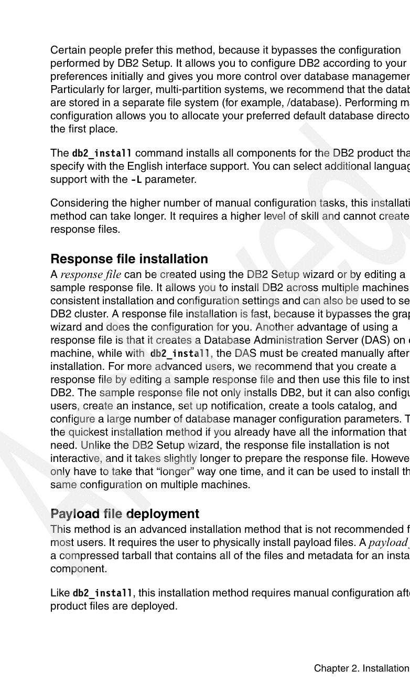

> 注意：在 Linux 平台上，DB2 产品安装不再是操作系统软件包。您无法再使用 `rpm` 命令进行安装。

### 2.2.3 存储规划

DB2 程序和要存储在数据库中的数据都需要磁盘空间。DB2 同时使用原始设备和文件系统。它还需要日志空间。在本节中，我们将讨论 DB2 数据服务器的存储规划。

#### 文件系统与原始设备的比较

DB2 程序、要存储在数据库中的数据以及 DB2 日志都需要磁盘空间。可以通过原始设备或文件系统实现。在本节中，我们将讨论 DB2 数据服务器的存储规划。

#### 文件系统

在 Linux 上配置 DB2 磁盘空间的常用方法是使用独立的文件系统来运行 DB2。文件系统可以被 DB2 用于系统管理存储 (SMS) 或数据库管理存储 (DMS)。文件系统具有许多优势。文件系统可以分布在网络中，并具有网络导向的验证和复制能力。

文件系统可以被 DB2 用于系统管理存储 (SMS) 或数据库管理存储 (DMS)。文件系统具有许多优势。文件系统可以分布在网络中，并具有网络导向的验证和复制能力。在 Linux 上配置 DB2 磁盘空间的常用方法是使用独立的文件系统来运行 DB2。文件系统可以被 DB2 用于系统管理存储 (SMS) 或数据库管理存储 (DMS)。文件系统具有许多优势。文件系统可以分布在网络中，并具有网络导向的验证和复制能力。

DB2 程序、要存储在数据库中的数据以及 DB2 日志都需要磁盘空间。可以通过原始设备或文件系统实现。在本节中，我们将讨论 DB2 数据服务器的存储规划。

*(注：由于原文中存在大量重复的段落，译文已按要求处理核心内容)*

注意：从 DB2 9.1 版本开始，以前需要使用 `raw` 工具将块设备绑定到字符设备的原始 I/O 方法已被弃用。这种原始 I/O 方法在 Linux 操作系统中也已被弃用，并将在未来的 Linux 版本中被移除。你现在可以使用块设备作为 DB2 DMS 表空间容器。块设备使用 Direct I/O 来实现与使用字符设备方法等效的性能。

#### 文件系统配置

我们建议您在使用 Linux 操作系统安装时创建多个分区。出于几个原因，将某些基本目录（例如示例中的 `/db2home` 或 `/software`）放置在单独的文件系统和分区中已成为一种惯例：

- 磁盘容量：每个磁盘上的空间有限，如果你将单块磁盘用于多个用途，可能会耗尽空间。
- 性能：在 Linux 中，每次访问路径时都必须对根目录进行线性搜索。如果根目录过于杂乱，这种杂乱将会损害整个系统的性能。
- 备份：将重要且频繁变化的数据与海量且很少变化的数据分开更好。这样你可以通过更频繁地备份某些文件系统而非其他文件系统来节省资源。
- 用户便利性：如果命名规范组织良好，更容易找到东西。

文件系统配置（或分区）通常使用 `fdisk` 工具完成。对于 SUSE，你也可以使用 YaST 工具。Linux 提供了多种文件系统格式，如 ext3、JFS、VxFS 和 ReiserFS。对于我们的示例，对于数据库相关文件系统，我们使用带日志的 `ext3` 格式来创建文件系统。

要显示所有定义的文件系统，请执行 `df` 命令，如示例 2-1 所示。该命令显示了分区数据库环境的输出。对于单分区环境，DB2 不需要 NFS 文件系统。

| 文件系统 | 1K-块 | 可用空间 | 用用% | 挂载点 |
| --- | --- | --- | --- | --- |
| /sda2 | 50572564 | 21196952 | 29402912 | 42% | / |
| udev | 184 | 1921140 | 1% | /dev |
> 3 ordered 是 ext3 文件系统的默认模式。

| /dev/sdb5 | 2064178 | 924912 | 1971876 | 5% | /export/db2home |
| /dev/sdb6 | 4822142 | 82420 | 473922 | 2% | /database |
| /dev/sdb7 | 1010865 | 41150 | 969715 | 5% | /db2temp |
| /dev/sdb8 | 544166 | 41280 | 502886 | 8% | /db21og1 |
| /dev/sdb9 | 544166 | 41280 | 502886 | 8% | /db21og2 |
| /dev/sdb10 | 1010863 | 41271 | 969592 | 5% | /db20logarc |
| /dev/sdb11 | 5099266 | 2034030 | 306523 | 40% | /software |
| mensa:/export/db2home | 20641792 | 924896 | 1971896 | 5% | /db2home |

要显示 NFS 挂载的文件系统，请在文件系统物理存在主机上执行以下命令（示例 2-2）：

### 示例 2-2 mount 命令

```
mens:~ # mount
All points on mensa:
9.43.86.90:mensa.itsoj.sanjose.ibm.com
mensa.itsoj.sanjose.ibm.com:/export/db2home
```

#### 文件系统配置建议

有许多配置磁盘分区和文件系统的方法，取决于你的环境。我们建议在配置系统时遵循这些建议：

- 对于单机和分区数据库系统，我们建议为 DB2 用户家目录创建一个单独的文件系统。在我们的设置中，单分区环境下的名称为 `/db2home`。对于分区数据库环境，我们建议在集群中的一台机器上创建一个单独的 DB2 家文件系统，用作实例家目录。该文件系统应通过 NFS 在集群中的所有机器之间共享（即从 NFS 服务器机器导出 NFS，并挂载到其余机器上）。在我们的设置中，我们创建了挂载点为 `/db2home` 的文件系统 `/export/db2home`。
- 我们还建议你为存储数据库创建一个单独的文件系统，在每个参与分区数据库的物理系统上都需要一个单独的数据库文件系统。在我们的设置中，我们创建了挂载点为 `/database` 的名为 `/database` 的文件系统。
- 出于性能或可用性考虑，我们建议避免将用户数据放在目录节点（catalog node）上。在恢复目录节点时，如果该节点没有数据，恢复速度会更快。
- 我们还建议为 DB2 日志的主副本、DB2 镜像日志和 DB2 临时空间创建单独分区。在我们的设置中，我们创建了挂载点为 `/db2home` 的文件系统 `/export/db2home`（注：此处原文可能存在表述重复，已按逻辑翻译）。为了将它们与数据库文件分开，这种这样做。这种配置在生产环境中非常常见。

### 表 2-9 数据库相关文件系统示例

| 分区名称 | 描述 |
| --- | --- |
| /db2home | 用于存储 DB2 用户目录 |
| /database | 用于存储数据库 |
| /db2log1 | 用于存储日志的主副本 |
| /db2log2 | 用于存储 DB2 镜像日志 |
| /db2logarc | 用于存储归档日志 |
| /db2temp | 用于存储 DB2 临时空间 |
| /software | 用于存储软件 |

### 2.2.4 实验环境

在书中，我们使用以下系统来演示分区数据库环境下的 DB2 安装、配置和管理。

- Mensa:
  - 主机名：mensa
  - 域名：itsosj.sanjose.ibm.com
  - 主机 IP 地址：9.43.86.90
  - Linux 发行版：SUSE (SLES 10 SP1 x86_64)
  - 分区数据库设置：
    - 分区实例包含一个逻辑分区（节点 0），初初位于此物理节点上，它是分区数据库环境的协调节点。我们稍后会添加更多的逻辑分区。
    - 分区实例的家目录 `/db2home` 已被导出到这台机器。
- Gemini:
  - 主机名：gemini
  - 域名：itsosj.sanjose.ibm.com
  - 主机 IP 地址：9.43.86.94
  - Linux 发行版：SUSE (SLES 10 SP1 x86_64)
  - 分区数据库设置：分区实例在此物理节点上包含一个逻辑分区（节点 1）。我们将添加更多的逻辑分区。

### 2.2.5 为分区数据库环境设置 NFS

如果你的配置中一个分区实例使用了多台机器，则在安装 DB2 之前，必须先配置通信。在本节中，我们将讨论如何设置网络文件系统（NFS）。

为了让 NFS 运行起来，你需要配置 `/etc/exports` 和 `/etc/fstab` 文件。`exports` 文件在服务器端配置，用于指定哪些目录可以与客户端共享。`fstab` 文件在客户端配置，用于指定要连接的服务器以及将它们放置在目录树的何种位置。

在本节中，我们将引导你完成完成设置 NFS 所需的步骤：

- 在每台机器上启动 NFS 服务。


- 在集群中的单台机器（NFS 服务器）上，创建一个作为实例家目录的文件系统（如果尚未创建）。
- 在本地挂载该文件系统。
- 设置该文件系统在系统重启动时自动挂载。
- 使用 NFS 导出 DB2 家目录系统。
- 在集群中剩余的每台机器上挂载导出的文件系统。

### 启动 NFS 服务

要验证参与分区数据库系统的每台计算机是否都在运行 NFS，请输入以下命令：

```
showmount -e
```

如果你输入 `showmount` 而不指定主机名，它将检查本地系统。如果 NFS 未运行，你会收到类似下面的消息：

```
mount: RPC Program not registered
```

### 启动 NFS

- 确保每台机器上都安装了 `nfs-utils` 和 `nfs-server` 软件包。
- NFS 操作（启动、停止和检查状态）在不同的 Linux 发行版中不同：

#### SUSE

SLES 10 使用基于内核的 NFS 服务器。配置 NFS 服务器的命令是 `serviceconfig`：

- 启动 NFS：`serviceconfig start`
- 停止 NFS：`serviceconfig stop`
- 检查 NFS 状态：`serviceconfig status`

确保 NFS 在启动时已。。可以使用命令 `chkconfig nfs` 进行检查。如果 NFS 未开启，请通过以下命令启用它：

```bash
chkconfig nfs on
```

#### Red Hat

- 启动 NFS：`/sbin/service nfs start`
- 停止 NFS：`/sbin/service nfs stop`

有关在 Red Hat 上配置配置 NFS 的更多详细信息，请参阅：

http://www.redhat.com/docs/manuals/enterprise/RHEL-5/manual/Deployment_Guide-en/nfs.html

在你确认 NFS 在每个系统上运行后，使用命令 `ps -ef | grep rpc.statd` 检查 `rpc.statd` 进程。DB2 需要 `rpc.statd`。请注意，在使用基于内核 NFS 的 SLES 中不需要 `rpc.statd`。

### 创建并配置用于 NFS 的 DB2 家目录文件系统

你需要创建一个跨越分区数据库系统中所有机器共享的 DB2 实例家目录。在我们的示例中，我们在 `mensa` 上分配了一个文件系统 `/export/db2home`。使用 NFS 共享此文件系统。要为 NFS 创建并配置 DB2 家目录文件系统：

1. 如果你尚未执行，请在 NFS 服务器上使用 `fdisk`（创建磁盘分区）和 `mkfs`（在磁盘分区上创建文件系统）等工具，或通过 SUSE YaST 工具创建 DB2 家文件系统（例如 `/export/db2home`）。
2. 使用以下命令本地挂载 DB2 家文件系统：

```bash
mount /export/db2home
```

3. 确保你的新文件系统已添加到 `/etc/fstab` 文件中，这将在每次系统重启时挂载该文件系统。Linux 文件系统创建工具（例如 Disk Raid 或 YaST）在你创建新文件系统时会自动向 `/etc/fstab` 文件添加条目。如果在 `/etc/fstab` 文件未找到你的 DB2 家文件系统，可以手动添加。在 `/etc/fstab` 中，你会看到 `/export/db2home` 的条目。在我们的设置中，该条目为：

```
/dev/sdb5 /export/db2home ext3 data=journal,user_xattr
```

4. 接下来，向 `/etc/exports` 文件添加条目，以便在启动时自动导出 NFS 文件系统。你只需要设置此项。在 `/etc/exports` 中，你会看到如下条目：

`/export/db2home *(rw,sync,no_root_squash)`

在我们的设置中，条目是：

```
/export/db2home *(rw,sync,no_root_squash)
```

5. 运行 `exportfs -a` 导出所有目录。
6. 在集群中的每台机器（包括 NFS 服务器）上，首先使用 `mkdir` 创建 `/db2home` 目录，然后向 `/etc/fstab` 添加条目以自动挂载。我们建议将文件系统配置为启动时挂载、为读写、并包含 `bg` 选项，这样 `setuid` 程序可以正常运行。参考以下示例：

```
mensa:/export/db2home *(rw,sync,no_root_squash)
```

7. 在集群的每台机器上向 `/etc/fstab` 添加条目后，通过以下命令在集群中剩余的每台机器上挂载导出的文件系统：

```bash
mount /db2home
```

如果挂载命令失败，请确保 NFS 服务器已启动。要重启 NFS 服务器，在 NFS 工作站上以 root 身份运行以下命令：

你也可以使用 `showmount` 命令检查 NFS 服务器的状态。例如：

```
showmount -e mensa
```

**提示：**

- 一种良好的习惯是将所有想要导出的目录都放在 `/export` 层次结构中。如果你在目录树的其他地方需要该目录，请使用符号链接或作为 NFS 客户端挂载。例如，如果你的服务器导入其 `/db2home` 层次，请将其放在 `/export`，从而创建 `/export/db2home`。挂载到 `/db2home`。
- 如果 `/etc/exports` 文件中有错误，NFS 在启动时会在 `syslog` 中报告错误。你可能会发现这个调试工具有用。

## 2.2.6 用户和组设置

在本节中，我们将讨论 DB2 需要的用户 ID 和组以及创建它们的过程。

DB2 需要三个用户和组：实例所有者、DB2 隔离用户（fenced user）和数据库管理服务器（DAS）用户。你可以使用 DB2 Setup 提供的默认名称或指定自己的所有者和组名称。在我们的设置中，我们使用了 DB2 Setup 向导提供的默认用户 ID 和组名称，如第 51 页表 2-10 所示。

| 表 2-10 DB2 所需用户示例 |
| --- |
| 所需用户 | 用户名 | 组名 | 描述 |
| 实例所有者 | db2inst1 | db2iadm1 | 管理实例 |
| 围栏用户 (Fenced user) | db2fenc1 | db2fadm1 | 执行围栏用户定义函数，如 UDF 和存储过程 |
| DAS 用户 | dasusr1 | dasadm1 | 管理 DB2 管理服务器 |

### 创建用户

创建用户和组需要 root 权限。

对于 root 安装，有三种方法可以创建 DB2 用户和组：

- 使用 DB2 安装向导
- 使用响应文件（response file）进行安装
- 在操作系统命令行或在操作系统管理工具中创建用户和组

对于非 root 安装，用户和组必须在安装之前已经存在。

#### DB2 安装向导

DB2 Setup 会在安装期间为您创建所有必需的用户和组。创建的默认用户和组列在表 2-10 所示。DB2 Setup 允许您指定自己的用户和组名称。

#### 响应文件

如果在响应文件中指定了用户和组信息，也可以在响应文件安装期间创建用户。示例 2-5 显示了我们响应文件中用于创建 DB2 三个必需用户和组的条目。

示例 2-5 使用响应文件创建用户和组

```
** 实例创建设置
db2inst1.NAME = db2inst1
db2inst1.UID = 1001
db2inst1.GROUP_NAME = db2iadm1
db2inst1.GID = 999
db2inst1.HOME_DIRECTORY = /home/db2inst1
db2inst1.PASSWORD = xxxxxxxxxx
......
```

** 围栏用户创建设置

```
db2inst1.FENCED_USERNAME = db2fenc1
dbinst1.FENCED_UID = 1002
db2inst1.FENCED_GROUP_NAME = db2fadml
db2inst1.FENCED_HOME_DIRECTORY = /dbhome/db2fenc1
db2inst1.FENCED_PASSWORD = xxxxxxxxxx
```

```
** 管理服务器创建设置
DAS_USERNAME = dasusur1
DAS_UID = 1003
DAS_GROUP_NAME = dasadml1
DAS_GID = 997
DAS_HOME_DIRECTORY = /home/dasur1
DAS_PASSWORD = xxxxxxxxxx
```

#### 在操作系统命令行中创建用户和组

要使用此方法，请遵循以下步骤：

1. 以 root 身份登录。
2. 使用以下命令为实例所有者、围栏用户和 DAS 用户创建组：

```
groupadd -g 999 db2iadml
groupadd -g 998 db2fadml
groupadd -g 997 dasadml
```

在我们的设置中，我们使用了数字 997、998 和 999。请通过检查 `/etc/group` 文件，确保您选择的数字在机器上已不存在。
3. 创建属于每个组的用户并指定主目录：

```
useradd -u 1001 -g db2iadml -m -d /dbhome/db2inst1 -s /bin/ksh db2inst1
useradd -u 1002 -g db2fadml -m -d /dbhome/db2fenc1 -s /bin/ksh db2fenc1
useradd -u 1003 -g dasadml -m -d /home/dasusur1 -s /bin/ksh dasusur1
```

在我们的设置中，我们选择了数字 1001、1002 和 1003。请通过检查 `/etc/passwd` 文件，确保您选择的数字在机器上已不存在。
4. 以 root 身份，通过输入以下命令为创建的每个用户设置密码：

```
passwd db2inst1
passwd db2fenc1
passwd dasusur1
```

### 创建用户：多分区的考虑因素

在分区数据库环境中，您只需要为实例所有者和围栏用户创建一个共享目录（但请记住在每台机器上创建用户）。在分区环境中创建用户时，请确保每台机器上的用户 ID 和组 ID 是相同的。在我们的设置中，我们使用了：

- 拥有实例所有权的机器上的一个共享主目录 `/db2home`，该目录在其余机器上通过 NFS 挂载。在此目录中，我们拥有实例所有者和围栏用户的主目录：`db2inst1` 和 `db2fenc1`。
- 每台机器上 DAS 的本地主目录 `dasur1`，存储在 `/home` 目录下。

### 分区数据库的 DAS 考虑因素

我们无法将 DAS 主目录放在共享文件夹中，因为每台机器上具有相同的 DAS 用户 ID。您需要注意 DAS 的考虑因素：

- 分区数据库中的每台物理机器上必须运行 DAS，图形化工具（例如 Control Center）才能工作。
- 每台机器只能有一个 DAS。如果您有旧版 DB2 现有的 DAS，我们建议将其删除并创建一个新的 DAS。
- 与实例一样，每个 DAS 必须在用户 ID 下创建。在环境中为 DAS 使用不同的用户 ID，或者使用相同用户 ID 且不共享用户主目录，都没有区别。
- 如果使用现有用户，请确保该用户在安装前已存在。
- 对于响应文件安装：如果响应文件中指定了用户，请确保该用户在安装前已存在。

### 分区数据库的启用 ssh

在分区数据库环境中，为了让图形化工具（例如 Control Center）工作，分区数据库中的每台物理机器上必须运行 DAS。

- 每台机器只能有一个 DAS。如果您有旧版 DB2 现有的 DAS，我们建议将其删除并创建一个新的 DAS。
- 与实例一样，每个 DAS 必须在用户 ID 下创建。在环境中为 DAS 使用不同的用户 ID，或者使用相同用户 ID 且不共享用户主目录，都没有区别。
- 如果使用现有用户，请确保该用户在安装前已存在。
- 对于响应文件安装：如果响应文件中指定了用户，请确保该用户在安装前已存在。

## 2.2 分区数据库的启用 ssh

在分区数据库环境中，为了让图形化工具（例如 Control Center）工作，分区数据库中的每台物理机器上必须运行 DAS。

- 每台机器只能有一个 DAS。如果您有旧版 DB2 现有的 DAS，我们建议将其删除并创建一个新的 DAS。
- 与实例一样，每个 DAS 必须在用户 ID 下创建。在环境中为 DAS 使用不同的用户 ID，或者使用相同用户 ID 且不共享用户主目录，都没有区别。
- 如果使用现有用户，请确保该用户在安装前已存在。
- 对于响应文件安装：如果响应文件中指定了用户，请确保该用户在安装前已存在。

### 设置基于主机的身份验证

基于主机的身份验证允许机器 A 使用机器 B 上的 ssh。对于基于主机的身份验证，信任机制在 `ssh_known_hosts` 文件中查找公密钥。

将客户端机器的未限定主机名、完全限定的主机名和 IP 地址添加到 `ssh_known_hosts` 文件中，如示例 2-10 和示例 2-11 所示。你可以使用 `ssh-keyscan` 工具来填充此文件。

示例 2-10 更新 ssh_known_hosts 文件以 RSA 加密

```
$ cd /etc/ssh
$ ssh-keyscan -t rsa mensa,mensa.itsosj.sanjose.ibm.com,9.43.86.90
>>ssh_known_hosts
$ ssh-keyscan -t rsa gemini,gemini.itsosj.sanjose.ibm.com,9.43.86.90
>>ssh_known_hosts
```

示例 2-11 为 DSA 加密更新 ssh_known_hosts 文件

```
$ cd /etc/ssh
$ ssh-keyscan -t dsa mensa,mensa.itsosj.sanjose.ibm.com,9.43.86.90
>>ssh_known_hosts
$ ssh-keyscan -t dsa gemini,gemini.itsosj.ibm.com,9.43.86.94
>>ssh_known_hosts
```

5. 重启 ssh 守护进程：

```
/etc/init.d/sshd restart
```

### SSH 客户端配置

按照以下步骤配置 SSH 客户端：

- 1. 编辑 `/etc/ssh/ssh_config` 文件。

如示例 2-12 所示，将 `HostBasedAuthentication` 行从 `no` 更改为 `yes`。

> 示例 2-12 编辑 ssh_config 文件

```
HostBasedAuthentication no
HostBasedAuthentication yes
```

注意，ssh 服务器配置文件为 `sshd_config`。

在 `ssh_config` 文件中添加一行，告诉 ssh 客户端使用 `ssh-keyscan` 读取主机的私钥，如示例 2-13 所示。

> 示例 2-13 在 ssh_config 文件中添加一行

```
EnableSSHKeys yes
```

- 2. 确保 `ssh-keyscan` 是一个 suid-root 可执行文件。

检查 `ssh-keyscan` 设置：

在 SUSE 上：

在 Red Hat 上：

```
ls -l /usr/lib64/ssh/ssh-keyscan
-rwr-xr-x 1 root 173952 2007-05-18 03:55 /usr/lib64/ssh/ssh-keyscan
ls -l /usr/libexec/openssl/ssh-keyscan
-rwr-xr-x 1 root 175424 Jul 13 2007 /usr/libexec/openssl/ssh-keyscan
```

如果权限和所有者与此示例输出不符，请按照第 57 页的示例 2-14 和第 57 页的示例 2-15 修复权限。

示例 2-14 在 SUSE 上修复 ssh-keyscan 的权限

```
$ cd /usr/lib64/ssh/
$ chown root:root ssh-keyscan
$ chmod 4755 /usr/lib64/openssl/ssh-keyscan
```


# 示例 2-15 在 Red Hat 上修复 ssh-keyscan 的权限

```
$ cd /usr/libexec/openssl/
$ chown root:root ssh-keyscan
$ chmod 4755 /usr/libexec/openssl/ssh-keyscan
```

# 设置公钥认证

基于公钥的认证允许单个用户 ID（在本例中，即在我们的分区数据库环境中拥有所有权的 DB2 实例所有 ID）在每个分区服务器上以相同的用户 ID 身份登录，而无需提示密码。由于 DB2 分区实例所有者的主目录在所有机器上共享的（这是 DB2 分区数据库环境的先决条件），因此可以在单台机器上完成整个设置。

设置公钥认证的步骤为：

- 1. 创建 `.ssh` 目录。

以 DB2 分区实例所有者用户 ID 登录。如果该 ID 尚未拥有 `~/.ssh` 目录，请创建一个，并确保 `.ssh` 目录不允许组或其他访问。同时，确保您的主目录也不允许组或其他访问。`ssh` 将此视为安全泄露，如果目录权限限制不够严格，它将不会允许基于公钥的认证。

在测试环境 `mensa` 上，实例所有者 ID 为 `db2inst1`，主目录为 `/db2home/db2inst1`。我们按照示例 2-16 所示创建具有所需权限的 `.ssh` 目录。

## 示例 2-16 为 db2inst1 创建 .ssh 目录（以 db2inst1 登录）

```
$ cd /db2home
$ chmod 700 db2inst1
$ mkdir "/.ssh"
$ chmod 700 "/.ssh"
```

- 2. 生成密钥对。

从 `~/.ssh` 目录生成公钥/私钥对。

示例 2-17 显示了如何为 RSA 生成公钥/私钥对。

> 5 参见第 51 页的“创建用户”。

## 示例 2-17 生成 RSA 加密密钥对

```
$ cd ~/.ssh
$ ssh-keygen -t rsa
```

你也可以生成一个 DSA 密钥对。示例 2-18 显示了如何为 DSA 生成公钥/私钥对。

## 示例 2-18 生成 DSA 加密密钥对

```
$ ssh-keygen -t dsa
```

每当提示输入时

- 3. 启用密钥对。

示例 2-19 显示了启用 RSA 密钥对的命令。

### 示例 2-19 启用 RSA 密钥对

```bash
chmod 644 authorized_keys
rm id_rsa
```

示例 2-20 显示了启用 DSA 密钥对的命令。

### 示例 2-20 启用 DSA 密钥对

```
rm_dsa
```

- 4. 设置主机信任关系。

由于尚未设置主机信任关系，第一次执行 `ssh` 到新主机时，会提示无法建立身份验证。为了解决这个问题，可以在分区数据库环境中使用 `ssh-keyscan` 建立信任关系，如示例 2-21 所示。

## 示例 2-21 获取公钥

```
ssh-keyscan -t rsa mensa,mensa.itsosj.sanjose.ibm.com,9.43.86.90 >> ssh_known_hosts
ssh-keyscan -t rsa gemini,gemini.itsosj.ibm.com,9.43.86.94 >> ssh_known_hosts
```

## 示例 2-22 获取公钥

```
ssh-keyscan -t dsa mensa,mensa.itsosj.sanjose.ibm.com,9.43.86.90 >> ssh_known_hosts
ssh-keyscan -t dsa gemini,gemini.itsosj.ibm.com,9.43.86.94 >> ssh_known_hosts
```

## 示例 2-23 配置配置

```
ssh mensa
```

## 2.3 安装 DB2

在本节中，我们解释了如何使用 DB2 Setup、`db2_install` 或响应文件安装 DB2。我们将讨论以下主题：

- 非 root 安装
- root 安装
- 安装许可证文件
- 安装 DB2 文档

> 注意：对于 DB2 9 及更高版本，许可证文件是分发的。无论您选择哪种安装方法，都必须安装许可证文件。参见第 87 页的“安装许可证”。

### 2.3.1 非 root 安装

对于非 root 安装，可以使用以下方法之一安装分区环境：

- DB2 Setup 向导
- 响应文件安装：使用 `dbsetup` 命令进行静默安装
- `db2_install` 工具

#### DB2 Setup 向导

对于非 root 安装，可以使用 DB2 Setup 向导：

- 1. 请求具有 root 权限的 Linux 系统管理员使用以下命令挂载 CD 或 DVD：

```
mount -t iso960 -o ro /dev/dvd /mnt
```

- 2. 以非 root用户登录，运行 `dbsetup` 并在第一个窗口选择 Product。

> 注意：如果你使用 X Window 系统软件，可能需要为非 root 用户设置 `DISPLAY` 变量以启动图形工具。你可以从 root 用户处获取 `DISPLAY` 变量。例如，对于 root，输入以下命令：

```
$DISPLAY
127.0.0.1:1:0
```

此命令显示 root 用户的 `DISPLAY` 变量为 `127.0.0.1:1:0`。你需要首先运行 `xhost` 命令允许客户端访问。首先，作为 root，输入以下命令：

```
$ xhost +127.0.0.1:1:0
```

然后，作为非 root 用户，输入以下命令：

```
$ export DISPLAY=127.0.0.1:0
```

- 6. 你可以使用 `dbsetup -i <language>` 使用另一种语言运行 DB2 Setup 向导。

- 3. 选择 Install New。在 Welcome to the DB2 Setup 窗口中点击 Next。

- 4. 在 Software License Agreement 窗口阅读许可协议，然后选择 Accept 并点击 Next。

- 5. 如第 61 页图 2-1 所示选择安装类型。你可以选择 Typical、Compact 或 Custom 安装：

- Typical 安装应用程序开发工具以外的所有 DB2 组件。点击 View Features 查看将安装哪些组件。
- Compact 仅安装基本的 DB2 功能和特性。
- Custom 允许你安装任何组件。Custom 选项的优势是它允许你与 DB2 一起安装应用程序开发工具。使用 Typical 选项，应用程序开发工具需要单独安装。

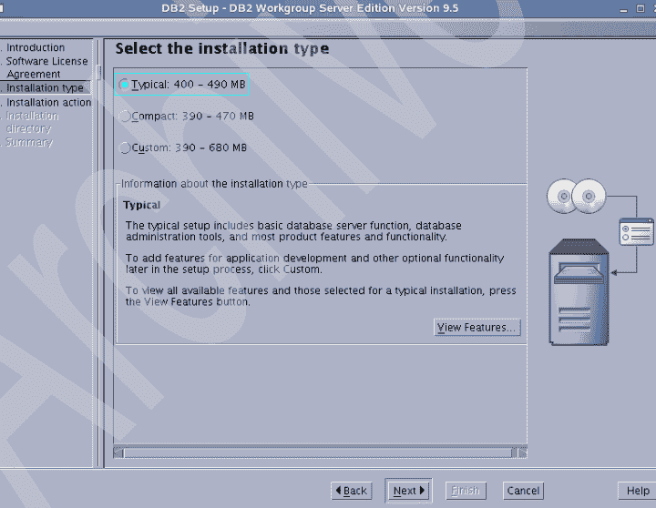

图 2-1 非 root 安装：选择安装类型

6. 在“选择安装、创建响应文件或两者兼选”窗口中（如图 2-2 所示），我们建议您选择“在本计算机上安装 DB2 Workgroup Server Edition 9.5”并“将我的设置保存到响应文件中”。然后，点击“下一步”。

## 选择安装、创建响应文件或两者兼选

DB2 安装向导可以在此计算机上安装 DB2 Workgroup Server Edition 版本 9.5，创建一个响应文件（该文件可用于以后在其他计算机上安装此产品），或者二者兼顾。

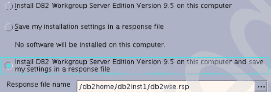

图 2-2 非根安装：选择安装、创建响应文件或两者兼选

7. 在“安装目录”窗口中（如图 2-3 所示），点击“下一步”。

## 安装目录

DB2 安装向导将把 DB2 Workgroup Server Edition 版本 9.5 安装在以下目录：

| 安装目录无法更改。 |

| --- |

| 目录 | /dbhome/db2inst1/sqlib/ | 所需空间：393 MB 可用空间：9104 MB |

图 2-3 非根安装：安装目录

> 注意：由于您正在执行非根安装，因此无法更改安装目录。

- 8. “开始复制文件并创建响应文件”窗口提供了您的安装和配置设置的摘要，如第 63 页的图 2-4 所示。滚动此窗口以验证您的设置是否正确，然后点击“完成”。

- 9. 安装完成后，阅读状态报告并检查任何错误。如果没有错误，点击“完成”。

## DB2 安装 - DB2 Workgroup Server Edition 9.5

开始复制文件并创建响应文件

DB2 向导已拥有足够的信息来开始复制程序文件并创建响应文件。如果您想查看或更改任何设置，请点击“上一步”。如果您对设置满意，点击“完成”以完成文件复制并创建响应文件。

- 1. 简介
- 2. 软件许可协议
- 3. 安装类型
- 4. 安装操作
- 5. 安装目录
- 6. 摘要

当前设置

Java 支持

SQL 驱动程序

基础服务器支持

Java(TM) IBM 软件开发包 (SDK)

通信设置 - TCP/IP

复制工具

DB2 数据支持

DB2 LDAP 支持

DB2 实例设置向导

快速上手

Samn 数据库源

语言：

英语

所有产品

目标目录：

所需空间：

新实例：

实例名称：

重启时启动实例：

TCP/IP 配置：

| /db2home/db2inst1/sql | 393 MB |

| db2Inst1 | 是 |


2-4 非根安装：安装摘要

> 注意：在这种情况下，安装日志位于 `/tmp/db2_setup_db2inst1.log` 和 `/tmp/db2setup_db2inst1.err`。

### 响应文件安装

与 DB2 向导不同，DB2 响应文件安装允许您在不进行任何用户交互的情况下安装 DB2 产品。响应文件是一个仅限英文的文本文件，包含设置和配置信息。响应文件指定了配置和设置参数以及要安装的产品。

响应文件的文件类型为 `.rsp`，例如 `db2wse.rsp`。参见第 62 页的图 2-2。但是，在使用 DB2 向导时，您可以选择更改名称和目标目录。

#### 创建响应文件

您可以运行一次图形模式下的 DB2 安装向导，以捕获您在响应文件中输入的值。

您还可以使用提供的模板手动创建响应文件。响应文件具有 `.rsp` 扩展名，位于 DB2 产品 DVD 上的 `/mnt/dvd/db2/linux/samples` 或 `/mnt/dvd/db2/linuxamd64/samples` 目录，其中 `/mnt/dvd` 代表 CD 和 DVD 的挂载点。

> 注意：在 Linux 平台上，为根安装创建的响应文件可能用于非根安装。某些响应文件关键字仅对根安装有效。我们不建议您为非根 DB2 安装编辑示例响应文件。

#### 使用 DB2 安装向导创建响应文件

在 DB2 安装向导的开头，在“选择安装、响应文件创建或两者兼选”窗口中（第 62 页的图 2-2），选择“将我的安装设置保存到响应文件”或“在本计算机上安装 DB2 Workgroup Server Edition 版本 9.5并将我的设置保存到响应文件”。在“响应名称”字段中，输入您希望 DB2 安装向导放置生成的响应文件的路径。在我们的示例中，我们将所有安装设置保存到名为 `db2wse.rsp` 的文件中。

示例 2-24 显示了 `db2wse.rsp` 文件内容。

## 示例 2-24 示例响应文件 db2wse.rsp

```
* Product Installation
LIC_AGREEMENT = ACCEPT
PROD = WORKGROUP_SERVER_EDITION
FILE = /db2home/db2inst1/sqlib/
INSTALL_TYPE = TYPICAL
---------------------------------
* Instance properties
INSTANCE = inst1
inst1.TYPE = wse
* Instance-owning user
inst1.NAME = db2inst1
inst1.AUTOSTART = YES
inst1.PORT = 50000
---------------------------------
* Installed Languages
LANG = EN
```

#### 使用 DB2 安装向导创建响应文件

在 DB2 安装向导的开头，在“选择安装、响应文件创建或两者兼选”窗口中（第 62 页的图 2-2），选择“将我的安装设置保存到响应文件”或“在本计算机上安装 DB2 Workgroup Server Edition 版本 9.5并将我的设置保存到响应文件”。在“响应名称”字段中，输入您希望 DB2 安装向导放置生成的响应文件的路径。在我们的示例中，我们将所有安装设置保存到名为 `db2wse.rsp` 的文件中。

示例 2-24 显示了 `db2wse.rsp` 文件内容。

```
* Product Installation
LIC_AGREEMENT = ACCEPT
PROD = WORKGROUP_SERVER_EDITION
FILE = /db2home/db2inst1/sqlib/
INSTALL_TYPE = TYPICAL
---------------------------------
* Instance properties
INSTANCE = inst1
inst1.TYPE = wse
* Instance-owning user
inst1.NAME = db2inst1
inst1.AUTOSTART = YES
inst1.PORT = 50000
---------------------------------
* Installed Languages
LANG = EN
```

### 响应文件安装 Linux

与 DB2 向导不同， DB2 响应文件安装允许您在不进行任何用户交互的情况下安装 DB2 产品。响应文件是一个仅限英文的文本文件，包含设置和配置信息。响应文件指定了配置和设置参数以及要安装的产品。

#### 使用响应文件安装 DB2

要使用响应文件安装 DB2，请使用选项：

```
db2setup -r /patto/db2wse.rsp
```

### db2_install 工具

`db2_install` 工具安装 DB2 组件并创建非根安装。许多人倾向于在大型系统上使用 `db2_install`。

#### 安装 DB2

使用响应文件安装 DB2 的步骤如下：

（此处，原文文本存在混乱，根据提供的流程进行修正）：


## 2.3.2 Root installation

For root installation, you can use one of the following methods to install both single-partition and multi-partition database environments:

- DB2 Setup wizard
- Response file installation: `db2setup` with a response (silent install)
- `db2_install` utility

## DB2 Setup wizard

For root installation, you can use the DB2 Setup wizard in the following way:

1. Log in as root.

2. Mount the DB2 product CD or DVD using the following command:

```
mount -t iso9660 -o ro /dev/dvd /mnt/dvd
```

where `/mnt/dvd` represents the mount point of the CD or DVD.

3. As root, run `db2setup` and select Install a Product on the first window.

4. Select Install New. On the Welcome to the DB2 Setup wizard window, click Next.

5. On the Software License Agreement window, read the license agreement, then select Accept, and click Next.

6. Select the installation type as shown in Figure 2-5 on page 67. You can choose a Typical, Compact, or Custom installation:

- Typical installs most DB2 components except for Base application development tools. Click View Features to see what components will be installed.
- Compact installs only the basic DB2 features and functionality.
- Custom allows you to install whatever components you want. An advantage of the Custom option is that it allows you to install the Base

与 DB2 一的应用程序开发工具。在“典型”（Typical）选项下，基础应用开发工具需要单独安装。

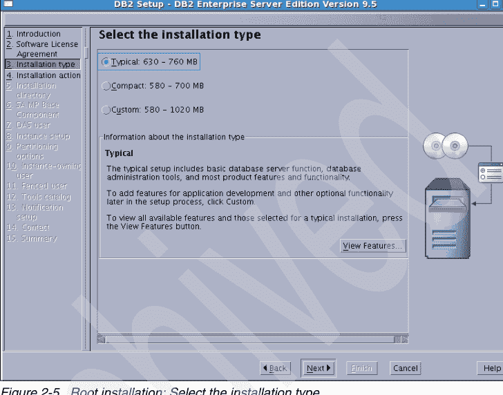

图 2-5 根安装：选择安装类型

在“选择安装、响应文件创建或两者”窗口中（见第 68 页的图 2-6），我们建议您在此计算机上选择安装 DB2 工作组服务器版版本 9.5，并将我的设置保存到响应文件中。然后，点击“下一步”。

第 2 章 安装 67

## 选择安装、响应文件创建或两者

DB2 安装向导将在此计算机上安装 DB2 企业级服务器版版本 9.5，创建一个可供您以后在其他计算机上安装此内容的响应文件，或两者兼顾。

如果您正在设置 DB2 企业级服务器版 (ESD) 分区数据库环境，可以创建一个响应文件，以便在将作为数据库分区服务器的其他计算机上安装 DB2。

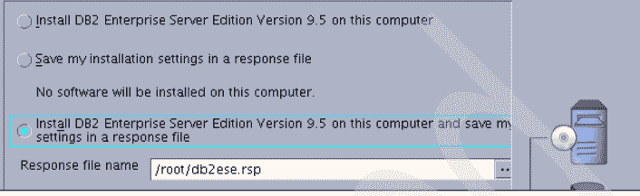

图 2-6 根安装：选择安装、响应文件创建或两者

- 8. 在“选择安装目录”窗口中（如图 2-7 所示），点击**下一步**。

## 选择安装目录

DB2 安装向导将 DB2 企业级服务器版版本 9.5 安装在以下目录。如需选择不同的目录，请输入路径或点击省略号（...）按钮选择另一个目录。

| 目录 | 详情 |
| :--- | :--- |
| `/opt/ibm/db2/v9.5` ... | 需要空间：801 MB 可用空间：12385 MB MB |

图 2-7 根安装：选择安装目录

- 9. 在后续窗口中（如第 69 页的图 2-8 所示），您可以选择是否安装 IBM Tivoli 系统自动化程序，然后点击**下一步**。

## 安装多平台基础组件 IBM Tivoli 系统自动化 (SA MP Base Component)

SA MP 基础组件管理运行在 xServers、zServers、Series、poppies 和 AIX 上的应用程序可用性。它通过自动控制进程、文件系统、IP 地址等 IT 资源的控制来提供高可用性 (HA)。它在硬件或软件故障时，便于用户、应用程序和数据从一个站点自动切换到另一个站点。您可以将 SA MP 基础组件作为高可用策略的一部分与 DB2 HA 使用。

在您的计算机上未检测到 SA MP 基础组件。

选择以下选项之一：

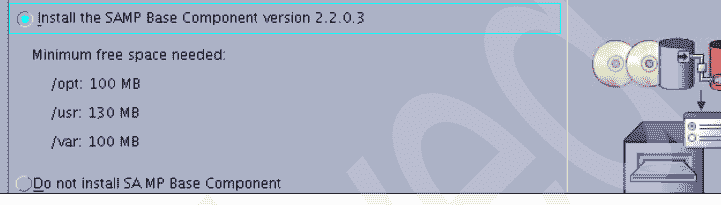

图 2-8 根安装：安装 Tivoli Automation

- 10. 为 DB2 管理服务器设置用户信息（见第 70 页的图 2-9 所示）。此用户负责管理数据库管理服务器。

- 11. 在“设置 DB2 实例”窗口中，选择“创建 DB2 实例”。点击“下一步”。

- 12. 在“为 DB2 实例设置分区选项”窗口中（见第 70 页的图 2-10），选择“单分区实例”，并点击“下一步”。

## 为 DB2 管理服务器设置用户信息

DB2 管理服务器 (DAS) 运行在您的计算机上，提供 DB2 工具所需的支持。需要具有最小权限集的用户来运行 DAS。为 DAS 指定所需的用户信息。

- 新用户

| 字段 | 值 |
| :--- | :--- |
| 用户名 | dasusr1 |
| UID | 1003 (使用默认 UID) |
| 组名 | dasadmn1 |
| GID | 997 (使用默认 GID) |
| 密码 | ***** |
| 确认密码 | ***** |
| 主主目录 | `/home/dasusr1` |

- 现有用户

| 用户名 | |

图 2-9 根安装：为 DAS 设置用户信息

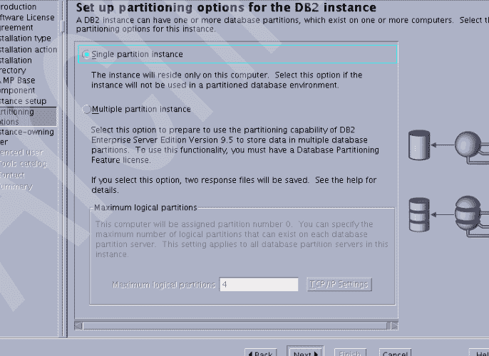

## 为 DB2 实例设置分区选项

DB2 实例可以拥有一个或多个数据库分区，这些分区存在于一个或多个计算机上。为此实例选择分区选项：

- 单分区实例

  实例将仅位于此计算机上。如果实例将不用于数据库环境，请选择此选项。

- 多分区实例

  选择此选项以准备使用 DB2 企业级服务器版 9.5 的分区功能，将数据存储在多个分区中。要使用此功能，您必须拥有数据库分区许可。

  如果您选择此选项，将保存两个响应文件。详情请参阅帮助。

最大逻辑分区

  此计算机将被分配分区号 0。您可以指定每个数据库分区服务器允许的最大逻辑分区数。此设置适用于此实例中的所有数据库分区服务器。

图 2-10 根安装：为 DB2 实例设置分区选项

在 Linux 上运行 DB2

- 13. 在“设置 DB2 实例所有者的用户信息”窗口中（见图 2-11），为 DB2 实例所有者设置用户信息。默认情况下，DB2 Setup会在 `db2adm` 组中创建一个新用户 `db2inst1`。

## 为 DB2 实例所有者设置用户信息

DB2 安装向导会在 `db2adm` 组中创建一个新用户 `db2inst1`。

- 14. 在“设置 DB2 实例所有者的用户信息”窗口中（见图 2-11），为 DB2 实例所有者设置用户信息。默认情况下，DB2 Setup会在 `db2adm` 组中创建一个新用户 `db2inst1`。

- 15. 在“准备 DB2 工具目录”窗口中，接受默认设置。

- 16. 在“设置通知”窗口中（见第 72 页的图 2-12），如果您选择设置您的 DB2 服务器发送通知，请在此处指定通知服务器名称，然后点击“下一步”。

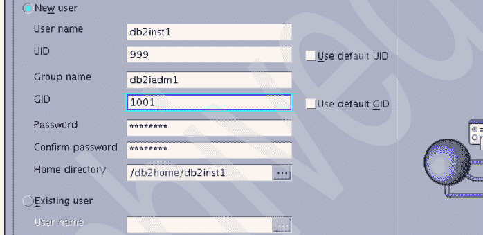

图 2-11 根安装：为 DB2 实例所有者设置用户信息

## 设置通知

您可以设置您的 DB2 服务器在数据库需要关注时自动向管理员发送电子邮件或传呼机通知。联系人信息存储在管理联系列表中。您需要一个 SMTP 服务器来发送这些通知。

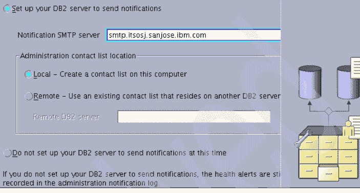

图 2-12 根安装：设置通知


- 17. 在“指定健康监器通知的联系人”窗口中（见第 73 页的图 2-13），您可以为此实例添加一个管理联系人，然后点击“下一步”。默认情况下，健康监器会在您设置的 DB2 实例上运行。当达到健康警报阈值时，DB2 健康监器将向指定的电子邮件地址发送通知电子邮件。如果勾选“电子邮件地址是传呼设备”，则通知消息将发送到联系人的传呼机。

> 注意：如果选择“延迟此任务直到安装完成”，您可以在安装后使用任务中心指定联系人。

## 指定健康监器通知的联系人

默认情况下，健康监器运行在您设置的 DB2 实例上。当生成健康警报时，电子邮件或传呼机通知将发送给管理联系列表中的管理联系人。

此实例的管理联系人

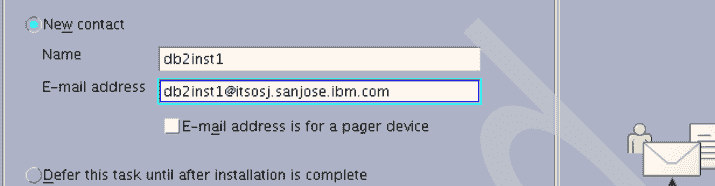

图 2-13 根安装：指定健康监器通知的联系人

- 18. “开始复制文件并创建响应”窗口提供了您的安装和配置设置的摘要，如图 2-14 所示。滚动此窗口以验证您的设置是否正确，然后点击“完成”。

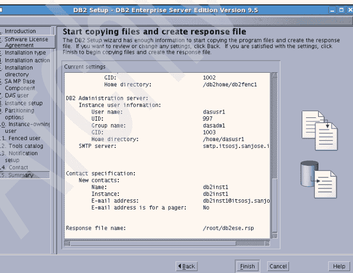

图 2-14 根安装：安装摘要窗口

19. 安装后，读取状态报告选项卡并检查任何错误。如果没有错误，点击“完成”。

> 注意：安装日志位于 `/tmp/db2setup.log` 和 `/tmp/db2setup.err`。

## 响应文件安装

对于 root 安装，你也可以使用响应文件来安装 DB2，如第 63 页的“响应文件安装”一节所讨论的那样。响应文件可以通过 DB2 安装向导程序生成，也可以通过编辑 DB2 提供的示例来生成。

### 使用示例响应文件创建响应文件

你可以通过编辑提供的模板手动创建响应文件。响应文件具有 `.rsp` 扩展名，位于 DB2 产品 DVD 的 `/mnt/dvd/db2/linux/samples` 或 `/mnt/dvd/db2/linuxamd64/samples` 目录下。在该目录中，`/mnt/dvd` 代表 CD 或 DVD 的挂载点。例如，你可以在 `/mnt/dvd/db2/linuxamd64/samples` 目录下找到一个名为 `db2ese.rsp` 的 DB2 企业级服务器版示例响应文件。

要从示例创建你自己的响应文件，你必须将响应文件复制到本地文件系统并对其进行编辑。通过删除关键字左侧的星号 `*` 来激活响应文件中的项目，然后用新设置覆盖默认设置。可能的设置范围列在等号右侧。请参考《DB2 服务器快速上手》（GC23-5864）获取有关配置这些参数的指导。

你可以定制你的自定义响应文件。为了让你对最终产品有一个直观的，示例 2-25 显示了 DB2 安装向导生成的响应文件 `db2ese.rsp`。

#### 示例 2-25 示例响应文件 db2ese.rsp

```
* 由 DB2 安装向导程序使用的生成的响应文件
* 生成时间: 2/7/08 11:15 AM

* 产品安装
LIC_AGREEMENT = ACCEPT
PROD = ENTERPRISE_SERVER_EDITION
FILE = /opt/ibm/db2/v9.5
INSTALL_TYPE = TYPICAL

* Das 属性
DAS_CONTACT_LIST = LOCAL
DAS_SMTP_SERVER = smtp.itsosj.sanjose.ibm.com
```

* DAS 用户

DAS_USERNAME = dasusr1

DAS_UID = 997

DAS_GID = 1003

DAS_GROUP_NAME = dasadml

DAS_HOME_DIRECTORY = /home/dasusr1

DAS_PASSWORD = 346332742828290517797356453226536500132271904055591653873342519640337653352000416

ENCRYPTED = DAS_PASSWORD

* 实例属性

* INSTANCE = inst1

inst1.TYPE = ese

* 实例所有者用户

inst1.NAME = db2inst

inst1.UID = 999

inst1.GID = 1001

inst1.GROUP_NAME = db2iadml

inst1.HOME_DIRECTORY = /db2home/db2inst

inst1.PASSWORD = 346332742828290517797356453226536500132271904055591653873342519640337653352000416

ENCRYPTED = inst1_PASSWORD

inst1.AUTOSTART = YES

inst1.SVSCENAME = db2_cb2inst1

inst1.PORT_NUMBER = 50001

inst1.FCM_PORT_NUMBER = 60001

inst1.MAX_LOGICAL_NODES = 4

* 围栏用户 (Fenced user)

inst1.FENCED_USERNAME = db2fenc

inst1.FENCED_UID = 998

inst1.FENCED_GID = 1002

inst1.FENCED_GROUP_NAME = db2fadml

inst1.FENCED_HOME_DIRECTORY = /db2home/db2fenc

inst1.FENCED_PASSWORD = 723441038963356512064439066512827773457854746554656515324771944520302272926371

ENCRYPTED = inst1_FENCED_PASSWORD

* 联系属性

contact1.NAME = db2inst

contact1.EMAIL = db2inst@itsosj.sanjose.ibm.com

contact1.PAGER = false

contact1.NEW_CONTACT = YES

contact1.INSTANCE = inst1

* 已安装语言

## 使用响应文件安装 DB2

使用响应文件安装 DB2，使用带有 `-r` 的 `db2setup` 命令。例如：

```
/db2setup -r /db2home/db2ese.rsp
```

## db2_install 工具

对于安装，`db2_install` 工具安装文件集，但不会创建实例或用户或执行由 DB2 安装向导执行的其他配置任务。许多人在具有特殊要求的大型复杂系统上安装 DB2 时倾向于使用 `db2_install`。

### 安装 DB2

要安装 DB2：

- 1. 以 root 身份登录

- 2. 输入以下命令进入挂载 DB2 产品 DVD 的目录：

```
cd /mnt/dvd
```

在此命令中，`/mnt/dvd` 代表 DVD 的挂载点。

- 3. 输入 `db2_install` 命令启动 `db2_install` 脚本。

- 4. 当 `db2_install` 询问安装路径时，如果你不想更改默认目录，直接输入。Linux 上 DB2 的默认安装目录为 `/opt/ibm/db2/v9.5`。

- 5. 当 `db2_install` 询问产品关键字时，输入 `ESE`。

### 安装任务

使用 `db2_install` 安装 DB2 后：

- 1. 创建组和 ID（如果你尚未创建）。

- 2. 创建数据库服务器 (DAS)。

- 3. 创建 DB2 实例。

- 4. 为 DB2 文件创建链接（可选）。

- 5. 为 DB2 实例配置 TCP/IP 通信。

### 创建组和 ID

参考第 50 页的 2.2.6 “用户组设置”。

### 创建数据库服务器 (DAS)

如果你计划使用 DB2 图形化工具（如控制中心和任务中心），则需要 DAS。在创建 DAS 之前，你需要先 DAS。

步骤如下：

- 1. 以 root 身份登录。

- 2. 执行以下命令创建 DAS：

```bash
DB2DIR/instance/dascrt -u DASUser
```

其中 `DB2DIR` 是安装 DB2 副本的实例目录。对于 `-u` 参数，输入你为此机器创建的 DAS。例如：

```
/opt/ibm/db2/v9.5/dascrt -u dasusr1
```

### 创建 DB2 实例

使用 `db2inst` 命令创建新实例：

- 1. 以 root 身份登录。

- 2. 输入以下命令：

```bash
DB2DIR/instance/dbinst -u FencedID InstNme
```

在此命令中：

- `DB2DIR` 是当前版本 DB2 产品安装的位置。

- `AuthType` 代表实例的认证类型（SERVER、CLIENT 或 SERVER_CRYPT）。如果你不指定此参数，将分配默认认证类型 SERVER。

- `FencedID` 代表围栏用户名称。

- `InstNme` 代表你正在创建的实例名称。实例名称必须与所有者用户的名称相同。

例如，我们输入了：

```
/opt/ibm/db2/v9.5/instance/dbinst -u db2fenc
```

### 为 DB2 文件创建链接（可选）

如果你正在开发或运行应用程序，你可能想为 DB2 文件在 `/usr/lib` 目录创建链接，并在 `/usr/include` 目录创建链接。创建这些链接将帮助你避免为产品库和包含文件指定完整路径。如果你在一个 DB2 版本上创建了链接，另一个版本的链接将被覆盖。

要创建链接：

- 1. 以 root 身份登录。

- 2. 输入以下命令：

```
/opt/ibm/db2/v9.5/cfg/db2install
```

假设 DB2 安装在默认目录。

> 注意：如果同时存在多个版本或多个 DB2 副本，我们建议你使用 `db2n` 命令为 DB2 文件创建链接。考虑使用来自某个 DB2 版本或副本的 `db2lm` 命令来移除现有链接。

### 为 DB2 实例配置 TCP/IP

你必须为实例配置 TCP/IP 协议，以便接收来自远程 DB2 客户端的请求。

遵循以下步骤：

- 1. 更新 `/etc/services` 文件以指定 DB2 服务器监听客户端请求的服务名称和端口号。更新 `etc/services` 文件时使用文本编辑器添加连接条目。例如，我们添加了：

```
db2_db2inst 50001/tcp # DB2 连接服务端口
```

之前的连接条目中：

- `db2_db2inst` 代表连接服务名称

- `50001` 代表连接端口号

- `tcp` 代表 TCP/IP 通信协议

服务名称是任意的，但在 services 文件中必须是唯一的。在分区环境中，确保端口号不会与快速通信管理器 (FCM) 或系统上其他应用程序使用的端口号冲突。

- 2. 在服务器上更新数据库管理器配置文件：

你可以通过输入以下命令检查 SVCNAME：

```
db2 get dbm cfg | grep SVC
```

- 3. 将 `DB2COMM` 注册表变量设置为 `tcp/ip`，这将在数据库管理器启动时启动 DB2 通信管理器。以实例所有者的身份输入以下命令：

```
db2set DB2COMM=tcpip
```

- 4. 停止并重启实例以使更改生效：

```
db2stop
db2start
```

- 5. 使用 `netstat` 工具验证 TCP/IP 通信端口是否正在监听，例如，在我们的示例中，我们输入了：

```
netstat -an | grep 50001
```

## 2.3.3 安装分区数据库环境

你可以通过多种方式在多分区环境中安装 DB2：

- 使用 DB2 Setup 向导程序在主机器上安装 DB2 并创建一个新实例，然后使用响应文件（response file）在参与分区数据库的其余机器上安装 DB2。

- 编辑示例响应文件，并使用该文件在集群中的每台机器上安装 DB2。

- 使用 `db2_install` 或 DB2 Setup 向导与 `db2_install` 的组合来设置你的环境。

最简单的方法是在主机器上使用 DB2 Setup 向导，然后在参与分区数据库系统的其余机器上使用响应文件。我们将详细讨论这种方法。

### 准备环境

安装分区数据库环境的第一步是准备环境，包括设置 NFS、创建用户和组以及启用 ssh。请参考第 35 页的 2.2节“安装注意事项和规划”。

### 使用 DB2 Setup 向导在主机器上安装 DB2

环境准备就绪后，使用 DB2 Setup 向导在主机器上安装 DB2。在我们的示例中，`mensa` 是分区数据库环境的主机器。要安装 DB2：

- 1. 在主机器上，以 root 身份登录。

- 2. 转到 DB2 安装镜像所在的目录并运行 `db2setup`，在第一个窗口中选择“Install a Product”（安装产品）。

- 3. 在“Welcome to the DB2 Setup”向导窗口中选择“Install New”（安装新内容），并点击“Next”（下一步）。

- 4. 在“Software License Agreement”（软件许可协议）窗口中，阅读许可协议，然后选择“Accept”（接受），并点击“Next”。

- 5. 在“installation type”（安装类型）窗口中，你可以选择 Typical（典型）、Compact（紧凑）或 Custom（自定义）：

    - Typical：安装大多数 DB2 组件，但基础应用开发工具除外。点击“View Features”（查看特性）查看将安装哪些组件。

    - Compact：仅安装 DB2 的基本特性和功能。

    - Custom：允许你安装任何需要的组件。Custom 选项的优势是允许你与 DB2 一起安装基础应用开发工具。使用 Typical 选项时，基础应用开发工具需要单独安装。

- 6. 在“Select installation, response file creation, or both”（选择安装、响应文件创建或两者都有）窗口（图 2-1）中，在你的计算机上选择“Install DB2 Workgroup Server Edition 9.5”并在“save my settings in a response file”（将我的设置保存到响应文件中）。我们将响应文件重命名为 `db2se_mpp.rsp`。然后点击“Next”。

图 2-15 MPP 安装：选择安装、响应文件创建或两者都有

- 7. 在下一个窗口中，你可以选择是否安装 IBM Tivoli System Automation，然后点击“Next”。

- 8. 为 DB2 Administration Server 设置用户信息，如图 2-16 所示。该用户管理数据库管理服务器。选择现有用户 `dasusr1`，并点击“Next”。

### 为 DB2 Administration Server 设置用户信息

DB2 Administration Server (DAS) 运行在你的计算机上，为 DB2 工具提供所需的支持。运行 DAS 需要一个具有最小权限集的用户。为 DAS 指定所需的用户信息。

图 2-16 MPP 安装：为 DB2 Administration Server 设置用户信息

- 9. 在“Set up a DB2 instance”（设置 DB2 实例）窗口中，选择 **Create a DB2 instance**（创建 DB2 实例），然后点击 **Next**。

- 10. 在“Set partitioning options for the DB2 instance”（设置 DB2 实例的分区选项）窗口中（如第 82 页的图 2-17 所示），选择 **Multiple partition instance**（多分区实例）并指定最大逻辑分区数。默认的最大逻辑分区数为 4。在此安装后，`/etc/services` 中将输入 **Local** 服务，条目将类似于示例 2-26。DB2 在 60000 之后为 `db2inst1` 留了四个可用端口。

#### 示例 2-26 /etc/services 中的本地服务条目

| Service Name（服务名称） | Port（端口） | Protocol（协议） |

| :--- | :--- | :--- |

| DB2_dbinst1 | 60000 | tcp |

| DB2_dbinst1_1 | 60001 | tcp |

| DB2_dbinst1_2 | 60002 | tcp |

| DB2_dbinst1_END | 60003 | tcp |

完成后，点击 **Next**。

### 为 DB2 实例设置分区选项

DB2 实例可以有一个或多个数据库分区，存在于一个或多个计算机上。为此实例选择分区选项。

- Single partition instance（单分区实例）：实例将仅位于此计算机上。如果实例不在分区环境中使用，请选择此选项。

- Multiple partition instance（多分区实例）：选择此选项以使用分区功能。这适用于所有数据库服务器。

- Maximum logical partitions（最大逻辑分区）：你可以指定每个服务器上可以存在的逻辑数量。

图 2-17 MPP 安装：为 DB2 实例设置分区选项

- 11. 在“User information for the instance”（实例用户信息）窗口中，为所有者设置用户信息。选择现有用户 `db2inst1`。

- 12. 为围栏用户设置用户信息；选择现有用户 `db2enc1`。该用户负责执行用户功能。

- 13. 在“Prepare the catalog”（准备工具目录）窗口中，接受默认选项并点击 **Next**。

- 14. 设置通知：在此处指定你的 SMTP 服务器，然后点击 **Next**。

- 15. 在“Specify a contact for Health Monitor”（指定健康监控联系人）窗口中，添加你的联系人然后点击 **Next**。


### 16. “Start copying files and create response files”窗口提供了安装和配置设置的摘要。滚动此窗口验证设置是否正确，然后点击 Finish。

### 17. 安装完成后，读取状态报告并检查任何错误。如果没有错误，点击 Finish。

> 注意：安装日志位于 `/tmp/dbsetup.log` 和 `/tmp/dbsetup.err`。

### 18. 由于我们选择了 Create DB2 instance 并且创建了实例所有者 `db2inst1`，在运行 DB2 Setup 之前使用的是 Korn Shell `ksh`，请检查 Korn Shell profile 是否包含以下行：

```bash
# 以下三行由 IBM DB2 实例工具添加
if [ -f /db2home/db2inst1/sqllib/db2profile ]; then
  /db2home/db2inst1/sqllib/db2profile
```

## 使用响应文件在其余机器上安装 DB2

在主机器上执行安装后，DB2 Setup 向导会创建两个响应文件：`db2se_mpp.rsp` 和 `db2se_mpp_addpart.rsp`。`db2se_mpp.rsp` 响应文件包含创建实例、实例所有者和围栏用户以及工具目录（如果在安装期间选择了它）的指令。第二个响应文件仅安装相应的 DB2 文件、指定 DAS 属性并指定要安装的语言。在参与计算机上安装数据库分区时，使用 `db2se_mpp_addpart.rsp` 响应文件。

```
* DAS user = dasusrl
DAS_USERNAME = 1003
DAS_UID = dasadml
DAS_GROUP_NAME = /home/dasusrl
DAS_HOME_DIRECTORY-
* Installed Languages
-----------------
LANG = EN
-----------------
* SA MP Base Component
-----------------
INSTALL_ISAMP = YES
```

使用 `db2setup` 命令并配合 `-r` 选项使用集群中的剩余机器安装 DB2。例如：

1. 以实例所有者的身份登录主节点。在我们的示例中，我们以 `db2inst` 身份登录到 `mensa`。

2. 执行 `db2stop` 命令来停止 DB2 实例：

   `db2stop`

3. 删除 `sqllib` 目录：

   `rm -rf sqllib`

4. 以 root 身份登录另一台机器。在我们的示例中，我们以 root 身份登录到 `gemini`。

5. 将 `db2setup_addpart.rsp` 文件传输到 `/root` 目录。

6. 挂载 DB2 产品 DVD。

7. 运行 `db2setup -r /root/addpart`，例如：

   `/mnt/dvd/db2setup -r /root/addpart`

   安装完成后，检查 `/tmp/db2setup.log` 以确保没有发生错误。

8. 将主机器 `/etc/services` 文件中的实例相关的 TCP/IP 服务项复制到当前服务器。在我们的示例中，我们在 `gemini` 的 `/etc/services` 中添加了以下内容：

   ```
   db2_dbinst1 50001/tcp
   db2_dbinst1 60000/tcp
   db2_dbinst1_1 60001/tcp
   db2_dbinst1_2 60002/tcp
   db2_dbinst1_END 60003/tcp
   ```

9. 执行以下命令在当前服务器上创建物理节点：

   `/opt/ibm/db2/V9.5/instance/db2icrt -p db2c_dbinst1 -u db2f1 db2inst1`

10. 如果分区数据库环境中还有另一个 DB2 服务器（物理节点），请重复本节的第 3 到第 9 步。在我们的示例中，只有两个 DB2 服务器：`mensa` 和 `gemini`。

11. 修改 `~/sqlib/db2nodes.cfg`，为每个逻辑分区服务器向该文件添加一个项。当第一次查看 `db2nodes.cfg` 文件时，它将包含如下项：

    ```
    0 ServerA
    ```

    此项包含数据库分区服务器编号、数据库分区服务器所在的 TCP/IP 主机名以及数据库分区服务器的逻辑端口号。

    如果您正在安装包含三台机器且每台机器有一个逻辑分区服务器的分区数据库环境，更新后的 `db2nodes.cfg` 显示：

    ```
    0 ServerA 0
    1 ServerB 0
    2 ServerC 0
    ```

    如果您正在安装包含两台机器且每台机器有两个逻辑分区服务器的分区数据库环境，更新后的 `db2nodes.cfg` 显示：

    ```
    0 ServerA 0
    1 ServerA 1
    2 ServerB 0
    3 ServerB 1
    ```

    或者

    ```
    0 ServerA 0
    1 ServerB 0
    2 ServerA 1
    3 ServerB 1
    ```

    示例 2-28 显示了示例中 `db2nodes.cfg` 的内容。

    ```
    Example 2-28 db2nodes.cfg
    db2inst1@mensa:/dbhome/db2inst1> ~/sqlib/db2nodes.cfg
    0 mensa 0
    1 gemini 0
    ```

## 启用 ssh

配置 DB2 使用 ssh 作为工具：

1. 配置 DB2 使用 ssh。要设置 DB2 使用 ssh 启动，必须启用 DB2 注册变量 `DB2SHCMD` 并将其指向 ssh shell 的路径。示例 2-29 显示了 `db2set` 命令。默认 DB2 使用 rsh；因此只有在您使用 ssh 时才需要设置此变量。

   示例 2-29 启用 DB2 使用

   `$ db2set DB2SHCMD=/usr/bin/ssh`

2. 要验证 DB2 环境中的 ssh 配置，请以 DB2 分区实例所有用户登录每台机器，并输入示例 2-30 所示的命令。

   示例 2-30 验证 DB2 环境中的 ssh

   ```
   $ mensa db2_all
   $ gemini db2_all
   ```

这些命令将成功完成，无需额外的验证。

## 启动并停止实例管理器以验证安装

现在可以执行 `db2start` 命令验证安装。如果安装成功，可以使用 `db2start` 和 `db2stop` 命令在主节点或任何参与节点上的实例管理器。示例 2-31 显示了 `db2start` 和 `db2stop` 的输出。

示例 2-31 使用 `db2start` 和 `db2stop` 验证安装

```
db2inst1@mensa:/dbhome/db2inst1> db2start
02/07/2008 16:59:05 0 0 DBSTART was successful.
02/07/2008 16:59:06 1 0 DBSTART was successful.
db2inst1@mensa:/dbhome/db2inst1> db2stop
02/07/2008 17:05:02 0 0 DBSTOP was successful.
02/07/2008 17:05:02 1 0 DBSTOP was successful.
```

## 2.3.4 安装 DB2 许可证文件

您必须为每个 DB2 副本安装许可证密钥。因此，在分区环境中，您必须在参与数据库系统的每台机器上安装许可证密钥。您使用 `db2licm` 命令安装许可证密钥：

1. 以 root 或实例所有者身份登录。

2. 以实例所有者身份安装 DB2 许可证密钥。使用 `db2licm` 命令安装许可证密钥：

   `db2licm -add <filename>`

   其中 `filename` 是包含许可证的文件。

   在 Linux 上，许可证位于 `DB2DIR/license`，其中 `DB2DIR` 是 DB2 安装目录。

## 2.3.5 安装 DB2 文档

DB2 9.5 版本提供了信息中心和 PDF 文档。这些 DVD 随您的客户端和服务器提供：

### 信息中心 DVD

DB2 信息中心提供了充分利用 DB2 产品所需的所有信息。它是从 DB2 产品分开提供的，这意味着您可以在安装 DB2 后安装信息中心。您可以通过 IBM 网站访问信息中心：

`http://public.ibm.com/infocenter/db2/`

### PDF 文档

与信息中心不同，您不需要安装 PDF 文档。这些 PDF 可以直接从 DVD 阅读，也可以将其复制到机器。有关 DB2 产品文档的最新信息，请参考网站：

`http://www.ibm.com/support/docview?rs=71&uid=swg2704`

## 使用 DB2 设置向导安装信息中心

遵循以下步骤：

1. 以具有 权限的用户登录系统。

2. 插入并挂载 DB2 产品 DVD。

3. 通过以下命令进入 DB2 产品 DVD 挂载目录：

   `cd /mnt/dvd`

   `/mnt/dvd`

   在此命令中，`/mnt/dvd` 代表 DB2 的挂载点。

4. 运行 `./db2setup` 启动 DB2 设置向导。

5. 启动器打开后，您可以查看安装前提条件和发行说明，也可以直接进行安装。

6. 点击**安装产品**(Install a Product），显示安装产品窗口。

7. 在安装产品页面，如果您的计算机上没有现有的 DB2 信息中心，点击**安装新**(Install New）启动安装。

8. 在欢迎使用 DB2 设置窗口中，点击**下一步**。DB2 设置向导将引导您完成程序设置。

9. 要继续安装，必须接受许可协议。在软件许可协议页面，选择**接受**并点击**下一步**。

10. 在“选择安装、响应文件创建或两者”窗口中，如果您想以后使用响应文件在当前计算机或其他计算机上安装 DB2 信息中心，请选择**在此计算机上安装 DB2 信息中心并在响应文件中设置您的设置**。您可以指定**响应**文件的保存位置。点击**下一步**。

### 选择要安装的语言

文档将安装在您在此选择的所有语言中。安装多种语言将增加磁盘空间需求。

| 可用语言 | 已选语言 |
|---|---|
| 中文（简体） | > |
| 中文（繁体） | >> |
| 罗罗地亚语 | |
| 捷克语 | |
| 法语（标准） | |
| 德语 | |

确认安装目录：

| 目录: /opt/dbm/db2ic/v9.5 | 所需空间: 133 MB |
|---|---|
| 可用空间: 10122 MB | |

图 2-18 选择要安装的语言

12. 如图 2-19 所示，在“指定 DB2 Information Center 端口”窗口中配置 DB2 Information Center 的入站通信。点击“下一步”继续安装。

### 指定 DB2 Information Center 端口

DB2 Information Center 包含 DB2 产品的文档。要使用并允许其他计算机访问 DB2 Information Center，您必须对其配置入站通信。

| 服务名称 | db2icv95 |
| 端口号 | 51001 |

图 2-19 指定 DB2 Information Center 端口

13. 开始复制文件。检查设置，然后点击“完成”。

## 使用 doce_install 命令安装 DB2 Information Center

要手动安装 DB2 Information Center，请使用 `doce_install` 命令：

- 1. 以 root 身份登录。

- 2. 决定您想将文档安装在哪里。在我们的环境中，我们创建了一个名为 `/documentation` 的目录，它位于 `/db2home` 目录（例如，`/db2home/documentation`）。

- 3. 插入并挂载 DB2 Information Center DVD。

- 4. 使用 `doce_install` 命令安装 DB2 Information Center。`doce_install` 命令的语法为：

```
doce_install -b install_path -p doce -n -L language
-b install-path
```

指定 DB2 Information Center 安装路径。默认安装路径为 `/opt/ibm/db2ic/v9.5`。当不使用 `-n` 交互式模式时，此参数是强制性的。

`-n`

指定非交互式模式。

`-L language`

指定国家语言支持。默认是英语。要安装多种语言，可以多次指定此参数。例如，若要同时安装英语和简体中文，请指定 `-L EN -L CN`。

例如，使用以下内容输入 `doce_install` 命令：

`./doce_install -b /db2home/documentation -p doce -n -L EN -L CN`

> 注意：您可以使用 `doce_uninstall` 命令卸载 DB2 Information Center。

## 安装后任务

在上一章中，我们详细介绍了在 Linux 上安装 DB2 9.5 版本的过程。在本章中，我们将讨论需要执行的安装后任务，以获得一个功能完整的 DB2 环境。我们将讨论以下主题：

- 控制中心（Control Center）设置

- 数据库创建准备

- 创建数据库

- 进一步配置

- 添加分区

- DB2 配置

- 安全性

- 客户端配置

- 配置许可

## 3.1 控制中心设置

DB2 拥有一套丰富的图形工具，用于数据库管理员管理数据库系统，用于应用程序开发人员开发存储过程和定义函数。控制中心是用于通用管理工具之一，用于帮助您探索和管理数据库。其他工具还包括用于生成 SQL 查询的命令中心（Command Center）以及配置助手（Configuration Assistant），它是配置数据库环境的优秀工具。

如果您使用控制中心管理数据库服务器，则必须在数据库服务器环境的每个主机上启动 DB2 管理服务器（DB2 Administrator Server）。DB2 管理服务程序见第 25 页第 2 章“安装”。要启动 DB2 管理服务器，请以 DAS 用户身份登录每个主机，并执行 `db2admin start`。

如果您以实例所有者或特权 DB2 用户身份登录并拥有 X Window，则可以使用 `db2cc &` 命令启动控制中心。如果您以 root 用户启动了 X Window，则在启动 DB2 实例所有者 ID 之前需要切换到显示器。您有两种方法设置运行控制中心的环境。

示例 3-1 显示了更简单的方法。

- 示例 3-1 启动控制中心（方法一）

```
puget:\> # xhost +
puget:\> # su - db2inst
db2inst@puget:\> export DISPLAY=:0.0
db2inst@puget:\> db2cc &
[1] 6051
db2inst@puget:\>
```

命令后的符号 `(&)` 会返回 shell 提示符，允许您使用此 shell 执行其他命令。我们不建议对安全关键的生产系统使用方法一，因为它允许所有人访问您的 X 服务器。更安全的方法是如示例 3-2 所示使用 Authority。

- 示例 3-2 启动控制中心（方法二）

```
puget:\> # su - db2inst
db2inst@puget:\> scp root@localhost:~.Xauthority /tmp/xauth.tmp
Password:
.Xauthority                               100% 161    0.2KB/s   00:00
db2inst@puget:\> export DISPLAY=:0.0
db2inst@puget:\> xauth merge /tmp/xauth.tmp
```

在 Linux 上运行 DB2

```
db2inst1@puget~$ db2cc &
[1] 6051
db2inst1@puget:~
```

## 通用表空间考量

默认情况下，DB2 会创建三个表空间：

- 目录表空间，用于存储目录表。

- 用户表空间，用于存储所有表和索引数据。

- 临时表空间，用于在处理 SQL 语句时存储临时数据。

然而，将数据划分到更多的表空间并创建你自己的布局是有意义的。以下是这样做的主要原因：

- 表空间中的数据缓存可以通过相关的缓冲池（buffer pools）进行调优。缓冲池是缓存区域，并分配给一个或多个表空间。拥有不同的表空间允许你根据需求单独调优缓存区域。你可以将很少使用的表与频繁使用的表分开。

你还可以通过通过将一个表空间的容器放在不同的物理磁盘上，来调优该表空间的 I/O 性能。

- 你可以在表空间层级执行备份。独立的表空间允许你实施备份策略。

- 你可以为表空间授予创建对象的权限，从而实现更细粒度的控制。

- 在创建表时，你可以指定数据进入一个表空间，索引数据进入另一个表空间，长型数据（long data）也进入另一个表空间。我们特别建议将长型数据放入不同的表空间，因为长型数据不会在缓冲池中缓存，而是需要文件系统缓存。一旦你定义了表的表空间，只能通过重新创建表来更改表空间。

- 表的存储使用限制在表空间内。如果表空间中的某一个表占据了该表空间的整个磁盘空间，其他表空间不会受到影响。

定义表空间需要更多的设计、实现和维护工作。必须定义多少表空间以及如何将表空间放在磁盘上，取决于应用程序的复杂性和需求。

## SMS 表空间


系统管理（SMS）表空间由底层处理（在我们案例中是 Linux）。在创建表空间时，你指定目录名称作为容器。选择 SMS 表空间的考量如下：

- 磁盘在在使用之前才会被分配。
- 增加 SMS 表空间非常容易。你只需要增加底层文件系统的空间，DB2 会自动使用它。
- 由于上述两个原因，使用 SMS 表空间作为临时表空间是一个很好的做法。
- 你无法添加或删除容器，如果你想通过在物理磁盘上添加另一个容器来增强并行 I/O 性能，这可能会成为问题。
- 数据库在 SMS 管理的文件系统中创建的文件，其文件大小可能会达到文件系统相关的限制。
- 如果其中一个容器满了，则表空间就满额。
- 创建 SMS 表空间所需的初始工作较少，因为你不需要重新定义容器的大小。
- 对于存储在 SMS 表空间中的表，你无法将表、索引和长型数据划分到独立的表空间。

## DMS 表空间

数据库管理（DMS）表空间由 DB2 管理。在创建表空间时，你指定容器文件或原始设备及其大小。虽然大小是在表空间层级定义的，但稍后可以扩展或缩小。DB2 还可以自动扩展表空间，如第 99 页“表空间的自动调整大小”所述。选择 DMS 表空间的考量包括：

- 你可以将索引数据和长型数据划分到存储在 DMS 表空间中的独立表空间中。
- 可以使用 `ALTER TABLE SPACE` 语句通过添加或扩展容器来增加表空间的大小。现有数据会自动重新平衡到新的容器集上，以保持最佳的 I/O 效率。
- DMS 表空间需要更多的管理开销。在创建或扩展 DMS 表空间时，需要在 Linux 和 DB2 层面都执行工作。
- 通常情况下，一组调优良好的 DMS 表空间性能将优于 SMS 表空间。

## 表空间的自动调整大小

创建 DMS 表空间时可以使用 `AUTORESIZE YES` 选项来启用自动调整大小功能。默认情况下，此选项设置为 `NO`。你可以在创建表空间后开启或关闭此功能。

启用了此功能的表空间将根据需要自动增加大小，直到达到文件系统的限制。你可以指定初始大小和增加步长。

## 原始设备

你可以直接在块设备上创建 DMS 表空间容器。这种方法提供了更优的性能，但需要更多的管理。

> 注意：在第 9 版本之前，在 Linux 上使用原始控制器实用程序进行直接磁盘访问。该方法现在已废弃，不再建议使用。如果 Linux 操作系统支持，数据库管理器仍允许你使用这种方法；但是，`db2diag.log` 中会有一条消息指示该方法已废弃。

DB2 允许你使用 `NO FILE SYSTEM CACHING` 选项在文件系统中创建普通的 SMS 和 DMS 表空间。“普通”意味着它们是创建在文件系统中，而不是作为原始设备。该选项与原始设备相同，它将绕过文件系统和缓冲池引起的双重缓冲。

然而，设备文件相对于使用 `NO FILE SYSTEM CACHING` 选项创建的表空间仍有微的性能优势，因为设备文件没有文件系统管理开销。设备文件还提供了更好的可用性，因为它们不依赖于文件系统的故障。

由于长型数据绕过了缓冲池，在高性能场景下通常更优选择原始设备。

### 示例 3-6 空间太小时的 db2diag.log 消息

```
2008-02-11.07.25.2876502-480 E28862G688  LEVEL: Warning
PID : 4185               TID : 2976902048 PROC : db2sys c0
INSTANCE: db2inst1      NODE : 000      DB : ITSODB
APPHD : 0-21             APPID: *LOCAL.db2inst1.080211185714
AUTHID : DB2INST1        EDUNAME: db2Agent (ITSODB)
EUID : 23
FUNCTION: DB2 UDB, buffer pools, sqlbMSAddContainerRequest,probe:105
MESSAGE : ADM0637 Container "/dev/sdb5" was created to be "208840" KB in size
a on device that is "208864" KB in size. Extra storage will be
wasted. The container can be extended to use the wasted space by
using ALTER TABLE SPACE.
```

## 数据库自动存储

自动存储是 DB2 9.1 中引入的一项新功能。它简化了表空间的存储管理。当你创建数据库时，需要指定数据库管理器放置表空间数据的存储路径。在你创建并填充这些表空间时，数据库管理器将管理这些表空间的容器和空间分配。

数据库默认使用自动存储来创建数据库。如果你不想启用它，可以在创建数据库时使用 `AUTOMATIC STORAGE NO` 选项。

> 注意：数据库创建后，你无法更改自动存储设置。

对于启用了自动存储的数据库，你可以使用 `MANAGED BY` 子句来选择自动管理或不自动管理表空间。`MANAGED BY AUTOMATIC STORAGE` 指定表空间的存储将由数据库管理器自动管理。`MANAGED BY SYSTEM` 或 `MANAGED BY DATABASE` 定义为手动管理表空间的存储。如果你省略了 `MANAGED BY` 子句，表空间将由自动存储管理。

如果你没有为数据库启用自动存储，则无法指定 `MANAGED BY AUTOMATIC STORAGE` 选项。

在第 103 页的示例 3-7 中，我们创建了一个启用了自动存储的数据库，并为自动存储添加了一个路径。快照数据显示了数据库的存储路径。

### 示例 3-7 创建启用自动存储的数据库

```
db2inst1@puget:~$ db2 "create database itsdb /database/datal"
DB200000I THE CREATE DATABASE command completed successfully.
db2inst1@puget:~$ db2 connect to itsdb
```

## 数据库连接信息

| 数据库服务器 = DB2/LINUX 9.5.0 |

| SQL 身份 ID = DB2INST1 |

| 本地数据库别名 = ITOTSODB |

```
db2inst1@puget:~$ db2 get snapshot for database on itsdb | grep -i storage
Number of automatic storage paths = 1
Automatic storage path = /database/datal
```

```
db2inst1@puget:~$ db2 "alter database itsdb add storage on '/database/data2*"
DB200000I The SQL command completed successfully.
```

```
db2inst1@puget:~$ db2 get snapshot for database on itsdb | grep -i storage
Number of automatic storage paths = 2
Automatic storage path = /database/datal
Automatic storage path = /database/data2
```

> 注意：你可以在信息中心（Information Center）的自动存储部分获取有关关于自动存储功能的更多信息：

http://publib.b.ibm.com/infocenter/db2luw/v95/topic/ibm.db2.luw.admin.dbobj.doc/c0052484.html

## 3.2.3 Linux 特定配置

为了访问 DB2，每个 Linux 用户必须设置自己的 Linux 环境。在创建实例时，DB2 会在实例目录 `$HOME` 中创建一个名为 `sqlib` 的子目录。在该目录中有重要文件，如 `db2nodes.cfg`、`db2profile` 和 `userprofile`。这些文件用于设置 DB2 环境。每当用户登录 Linux 系统时，在用户的家目录 `$HOME` 下添加以下命令：

- `$HOME/sqlib/db2profile`

`db2profile` 参数包含了用户与 DB2 数据库交互的所有设置。不要修改此文件，因为在安装补丁后 `db2profile` 将被替换。如果你想针对你的环境进行更改，请在 `$HOME/sqlib/userprofile` 中进行，该文件由 `db2profile` 调用。

注意：

- 将 `$HOME` 替换为实例目录的实际值。
- DB2 在 `$HOME/sqlib` 下提供了 `db2shrc` 用于 csh 用户。

## 3.2.4 多分区特定配置

在 DB2 中，数据库分区是数据库的一部分，由数据、索引、配置文件和日志组成。分区用于创建集群数据库，其中一个逻辑数据库分布在多个系统（逻辑分区），或者分区可以在同一个系统（逻辑分区），也可以在不同的系统（物理分区）。第 105 页的图 3-4 显示了分区数据库的文件布局。

`/db2home/<instance>` 是实例目录。在分区数据库环境中，`/db2home` 是挂载到 `/export/db2home` 的网络文件系统 (NFS)。其他数据库位于位于系统的本地目录。`db2nodes.cfg` 文件定义了分区数据库的组成。

| Linux 节点 1 | Linux 节点 2 |
| :--- | :--- |
| 物理实例目录: /export/db2home/<instance> |  |
| 节点: sqllib/db2nodes.cfg |  |
| 实例目录（挂载）:/db2home/<instance> | 实例目录（挂载）:/db2home/<instance> |
| NFS 挂载 | NFS 挂载 |
| 本地数据库文件: /database/... | 本地数据库文件: /database/... |
| /db2log1/... | /db2log1/... |
| /db2log2/... | /db2log2/... |
| /db2logard/... | /db2logard/... |

**图 3-4 分区数据库的文件布局**

`/db2home/<instance>` 的设置和单个分区的文件系统结构见 2.2.3 第 40 页的“存储规划”。必须以相同的方式配置文件系统结构。为了性能和可用性，我们建议不要将数据放在目录分区。在恢复目录分区时，如果没有数据，速度会更快。

要定义哪些主机参与分区环境，你必须修改 `db2nodes.cfg` 文件。`db2nodes.cfg` 的格式如下：

```
nodenum logical_port
```

在此格式中，`nodenum` 代表分区数，`hostname` 代表物理主机或 IP 地址，`logical_port` 代表同一主机上分区的逻辑端口。在我们的示例中，有台机器各持有一个分区。主机 `mens` 将是分区 0，`gemini` 将是分区 1。示例 3-8 显示了我们设置的 `db2nodes.cfg` 内容。

### 示例 3-8 db2nodes.cfg 文件

|  |
| 0 mensa 0 |
| 1 gemini 0 |

要启用分区系统中数据库分区服务器之间的通信，你需要在 `/etc/services` 中为快速通信管理器 (FCM) 预留 TCP/IP 端口。如果你使用 `db2setup` 向导安装 DB2，主计算机上会自动预留一个端口范围。

以 root 用户身份登录每台参与的计算机，并在 `/etc/services` 添加相同的条目。示例 3-9 显示了该主机上为四个本地分区预留的四个端口。

### 示例 3-9 /etc/services 中的端口

```
DB2_db2inst_1 60000/tcp
DB2_db2inst_1 60001/tcp
DB2_db2inst_2 60002/tcp
DB2_db2inst_1 END 60003/tcp
```

现在，你可以在多主机、多分区环境中启动 DB2。要在多主机、多分区环境中启动 DB2，请在任何主机上输入 `db2start` 命令。参考示例 3-10。

### 示例 3-10 带有四个分区的 DB2 实例

```
$ db2start
02/14/2008.16:30:20 0 0 SQL1063N DB2START 处理成功.
02/14/2008.16:30:21 1 0 SQL1063N DB2START 处理成功.
SQL1063N DB2START 处理成功.
```

如果你在启动时遇到任何错误，可以检查集群中每个实例的 `db2diag.log` 文件以获取更详细信息。

## 3.3 创建数据库

现在，我们将展示如何创建数据库。我们将演示两种情况：

- 单分区数据库：我们将引导您通过“创建数据库向导”（Create Database Wizard）完成创建简单数据库的步骤。此外，我们还为您提供了从命令行创建数据库的脚本。
- 多分区数据库：我们将为您提供相应的脚本和命令，用于设置一个具有两个物理分区的分区数据库。

### 3.3.1 创建单分区数据库

当您创建数据库时，系统会自动为您完成以下任务：

- 设置数据库所需的所有系统目录表

在创建新数据库的过程中，DB2 会分配三个表表空间：SYSCAT、USSPACE1 和 TEMP1。SYSCAT 表空间存放所有的系统目录表。这些目录表实际上是存储库，用于保存有关于该数据库内所有对象的信息和统计数据。USSPACE1 包含用户创建的表、索引及其长数据。DB2 需要一个系统临时表空间（TEMP1）来支持诸如排序连接表和创建索引等活动。如果您没有在 `CREATE DATABASE` 命令中指定它们，DB2 将为它们选择默认值。

- 分配数据库恢复日志

DB2 恢复日志跟踪对您的数据库所进行的所有更改。它也被事务日志。它与恢复历史文件配合使用，以便发生故障时恢复数据。

- 创建数据库配置文件并设置默认值

数据库配置文件用于向 DB2 提供信息，例如它可以可以使用多少内存、日志存储在何处以及与 DB2 优化器相关的信息。

- 将数据库实用绑定到数据库

包含 SQL 语句的程序必须绑定到数据库上。这种绑定过程用于 import 和 load 等 DB2 实用程序。第 444 页的“嵌入式 SQL” 提供了有关绑定过程的背景信息。

在现有实例中创建数据库有两种方法：

- DB2 创建数据库向导，这是一个基于 Java 的图形化工具
- 从命令行处理器窗口使用的 `create database` 命令

您您必须拥有 `sysadm` 或 `systri` 权限才能创建新数据库。在创建数据库之前，请在要存储数据库文件的所有文件系统或目录上设置正确的权限。默认情况下，数据库将在由数据库管理器配置（DBM cfg）参数 `DFDTBPATH` 指定的路径下创建并分类。您可以通过输入以下命令将此路径更改为所需的默认路径：

```bash
db2 dbm cfg using DFDTBPATH /database
```

我们将在第 40 页的 2.2.3 “存储规划”中解释文件系统和挂载点的创建。

#### 创建数据库向导

如果您在单分区节点上安装了 DB2，创建数据库最简单的方法是使用“创建数据库向导”。正如第 59 页“安装 DB2”部分所述，DB2 实例在安装 DB2 过程中已经创建完成。

使用创建数据库向导创建单分区数据库的步骤如下：

1. 从控制中心（Control Center）启动**创建数据库向导**。右键点击**All Databases**（所有数据库），然后选择 **Create Database**（创建数据库）→ **Standard**（标准），如图 3-5 所示。

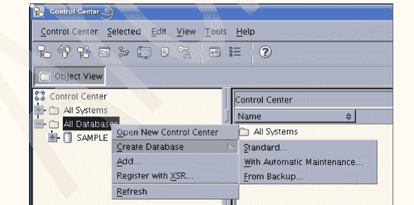

图 3-5 启动创建数据库向导

2. 为您的新数据库指定名称（图 3-6）。输入：

- 数据库名称：ITS0DB
- 数据库别名：ITS0DB
- 数据库注释：ITS0 的实验数据库
- 勾选 DB2 管理我的存储（自动存储）。
- 如果您想限制用户访问系统目录表，请勾选限制访问系统目录。

3. 点击 Next（下一步）。

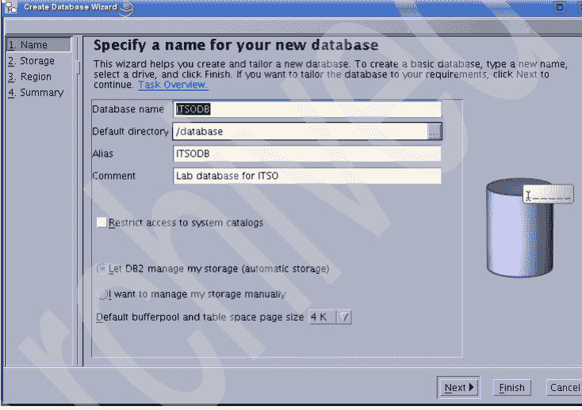

图 3-6 指定数据库名称

4. 下一个面板允许您显示额外的存储路径（见第 110 页图 3-7）。

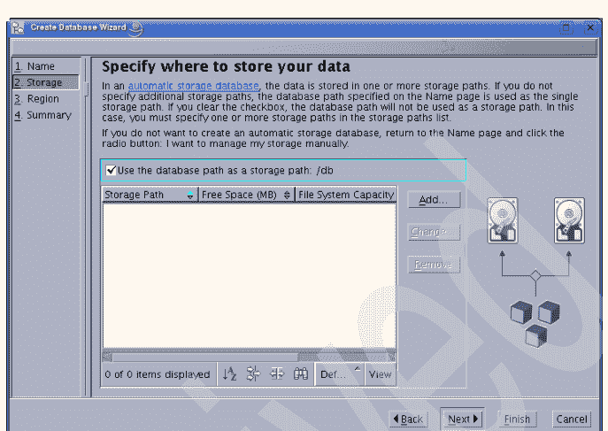

5. 点击 **Next**（下一步），您将看到图 3-8。

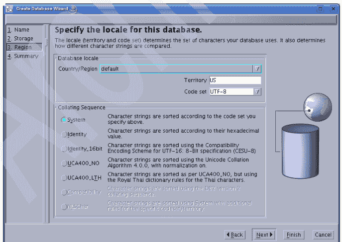

6. 点击 Next（下一步）。

7. 摘要（图 3-9）。在这里，您可以检查设置、查看或保存创建数据库。点击 **Finish**（完成）最后创建数据库。

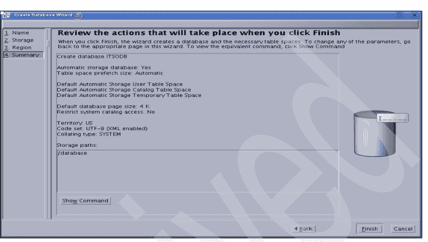

图 3-9 数据库向导摘要页

创建数据库后，控制中心窗口将如图 3-10 所示。展开数据库以查看数据库对象，例如表空间、容器、表等。


图 3-10 数据库已创建

#### 命令行

使用自动存储的命令如示例 3-11 所示。

```bash
CREATE DATABASE ITSODB AUTOMATIC STORAGE YES USING CODESET UTF-8 PAGESIZE 4096
```

DB2 恢复日志跟踪对您的数据库所进行的所有更改。它也被事务日志。它与恢复历史文件配合使用，以便发生故障时恢复数据。

### 3.3.2 创建多分区数据库

您可以使用创建数据库向导创建多分区数据库。然而，对于多分区环境，我们建议您使用 DB2 命令。


在创建多分区数据库之前，请考虑哪个分区将作为目录分区。发布此命令的分区将成为新数据库的目录分区。

> **提示：** 在具有多个分区的宿主机上，该命令默认影响第一个分区。

使用具有 `syscl` 权限的实例所有者或任何用户登录需要创建数据库的主机。验证您已如示例 3-13 所示初始化了 DB2 环境。

### 示例 3-13 验证 db2 环境

```bash
db2inst@mensa> echo $DB2INSTANCE
db2inst
```

## rah 和 db2_all

在我们开始创建多分区数据库之前，我们将向您展示 `db2_all` 和 `rah` 命令。这两个命令对于在所有分区上执行命令都非常有用。

`db2_all` 命令用于在所有分区上执行命令。例如，如果您想在所有分区上创建一个目录，可以执行此命令，如示例 3-14 所示。

### 示例 3-14 typeset 命令示例

```bash
db2inst@mensa> db2_all typeset -Z4 DB2NODE; mkdir -p /database/db2inst1/NODE$DB2NODE/ITSODB/SAMPLE_MPL/
```

mensa.itsosj.sanjose.ibm.com: typeset -Z4 DB2NODE completed ok

gemi.itsosj.sanjose.ibm.com: typeset -Z4 DB2NODE completed ok

`rah` 命令用于在所有物理主机上执行命令。`rah` 命令与 `db2_all` 的区别在于，`rah` 中指定的命令在每个主机上只执行一次，这在在一个物理系统上有多个逻辑分区时非常重要。

> **提示：** 命令 `typeset -Z4 DB2NODE` 为 db2nodes.cfg 中定义的每个分区返回一个位数数字，例如，0 将是 0000，1 将是 0001。

## 创建数据库

示例 3-15 显示了创建多分区数据库的 DDL。该 DDL 与第 112 页示例 3-12 中所示创建单分区数据库的 DDL 几乎相同，不同之处在于引入了 `$N` 的用法，它代表了分区号。

### 示例 3-15 创建分区数据库：crdb.sql

参数 `"$N"` 是一个数据库分区表达式，可以用在存储路径中的任何地方。你可以指定多个数据库分区表达式。分区表达式以空格字符结束。在数据库分区表达式之后的存储路径中没有空格字符，假设字符串的其余部分是分区表达式的一部分。表 3-1 显示了如何使用 `$N` 计算路径名称。

### 表 3-1 假设分区号为 10 时的 $N 计算

| 语法 | 示例 | 值 |
|---|---|---|
| `$N$` | `$N$` | 10 |
| `$N+[number]$` | `$N+100$` | 110 |
| `$N[number]$` | `$N*5$` | 0 |
| `$N+[number][[number]$` | `$N+1*5$` | 1 |
| `$N[number]+[number]$` | `$N*4+2$` | 4 |

`$` 是取模函数。

使用以下命令运行创建数据库脚本：

- `db2 tvf crdb.sql`

创建数据库后，你可以像第 115 页示例 3-16 所示连接到数据库。我们还在目录节点 mensa 中列出了表空间。

### 示例 3-16 在 mensa 上列出表空间

```
db2inst1@mensa:~> db2 connect to itsdb
```

## 数据库连接信息

| 数据库服务器 | DB2/LINUX8664 9.5.0 |
| SQL 身份 ID | DB2INST1 |
| 本地数据库别名 | ITSODB |

```
db2inst1@mensa:~> db2 list tablespaces
```

## 当前数据库的表空间

| 表空间 ID | 0 |
|---|---|
| 名称 | SYSCSPACE |
| 类型 | 系统管理空间 |
| 内容 | 所有永久数据。普通表 |
| 状态 | 0x0000 |
| 详细说明 | 正常 |
| 表空间 ID | 1 |
|---|---|
| 名称 | TEMSPACE1 |
| 类型 | 系统管理空间 |
| 内容 | 系统临时数据 |
| 状态 | 0x0000 |
| 详细说明 | 正常 |
| 表空间 ID | 2 |
|---|---|
| 名称 | USERSPACE1 |
| 类型 | 数据库管理空间 |
| 内容 | 所有永久数据。大表空间 |
| 状态 | 0x0000 |
| 详细说明 | 正常 |

DB2101II 在分区数据库服务器环境中，仅列出当前节点上的表空间。

第 116 页的示例 3-17 列出了节点 gemini 上的表空间。目录表空间仅存在于 mensa，mensa 是目录节点。

### 示例 3-17 在 gemini 上列出表空间

```
db2inst1@gemini:~$ db2 connect to itsodb
```

数据库连接信息

|  |  |
|---|---|
| 数据库服务器 | = DB2/LINX8664 9.5.0 |
| SQL 身份 ID | = DB2INST1 |
| 本地数据库别名 | = ITSODB |

```
db2inst1@gemini:~$ db2 list tablespaces
```

当前数据库的表空间

|  |  |
|---|---|
| 表空间 ID | 1 |
| 名称 | TEMSPACE1 |
| 类型 | 系统管理空间 |
| 内容 | 系统临时数据 |
| 状态 | 0x0000 |
|  |  |
|---|---|
| 表空间 ID | 2 |
| 名称 | USERSPACE1 |
| 类型 | 数据库管理空间 |
| 内容 | 所有永久数据。大表空间 |
| 状态 | 0x0000 |

DB2101II 在分区数据库服务器环境中，仅列出当前节点上的表空间。

## 创建表空间

下一步是为你的应用程序创建表。当创建数据库时，DB2 会创建三个默认表空间。`USERSPACE1` 用于存放数据。表通常基于数据库设计，可以根据应用程序在特定的表空间中创建更多表空间。创建跨越所有分区或仅跨少数分区的自定义表空间是常见的。每个表空间必须在数据库分区组中创建。在这里，我们演示了使用默认分区组在节点中定义的所有分区上创建表空间。

首先，使用以下命令在两个系统上为表空间容器创建目录：

```bash
mkdir -p /db/db2inst1/NODE/ITSODB/SMPL
```

示例 3-18 显示了表空间 SMPL 的创建。我们在创建表的语句中使用了变量 `$N`，它将在运行时被替换为分区号。

### 示例 3-19 创建多分区表空间

```sql
connect to itsdb;

create tablespace sample_mpl in DEFAULTGROUP pagesize 4k
MANAGED BY SYSTEM
using ('db/db2inst1/NODE0000 $N/ITSODB/SMPL')
on dbpartition (0)
using ('db/db2inst1/NODE0000 $N/ITSODB/SMPL')
on dbpartition (0)
```

3. 断开所有用户与的连接。

你可以使用命令 `db2 "list applications"` 查看所有当前连接的应用程序。然后你可以使用命令 `db2 "force application <id>"` 强制断开单个用户。注意，你只需要强制断开连接到我们要更改日志路径的数据库的用户。

4. 连接到数据库。在连接过程中，日志将会被重定位。

示例 3-22 显示日志路径已更改。

### 示例 3-22：更改在线日志路径

```
dbinst1@puget:> db2 terminate
DB200001 The TERMINATE command completed successfully.
dbinst1@puget:> db2 connect to itsodb
```

## 数据库连接信息

| 数据库服务器 | DB2/LINUX 9.5.0 |
| SQL 授权 ID | DB2INST1 |
| 本地数据库别名 | ITSODB |

```
dbinst1@puget:> db2 get config for itsodb | grep "NEWLOGPATH|MIRRORLOGPATH|Path to log files"
Changed path to log files (NEWLOGPATH) =
Path to log files =
/db2log1/ITSODB/NODE0000/
Mirror log path (MIRRORLOGPATH) =
```

对于分区数据库，使用以下命令检查日志路径条目：

`db2 connect to itsodb; db2 get config for itsodb | grep`

此更改记录在 db2diag.log 中，如示例 3-23 所示。如果在更改期间收到错误消息，将在此处看到更多信息。

### 示例 3-23 db2diag.log 条目

```
2008-02-12 10:30:16 LEVEL: Event
PID : 10434 TID : 296851440 PROC : db2sysc 0
INSTANCE: db2inst1 NODE : 0 DB : ITSODB
DBHID : 0 APP: *LOCAL.db2inst1.0802121750
AUTHID : DB2INST1 UID : 61 EDENAME: db2agent (ITSODB) 0
FUNCTION: DB2UDB, config/sqlUpdate, probe:20
CHANGE: CFG ITSODB: Newlogpath From To: "/db26log1/ITSODB"
2008-02-12 10:30:49 29-48 LEVEL: Info
```

第 3 章 安装后任务 121

PID : 10434 TID : 296851440 PROC : db2sysc 0

INSTANCE: db2inst1 NODE : 0 DB : ITSODB

DBHID : 0 APP: *LOCAL.db2inst1.0802183043

AUTHID: DB2INST1 UID : 61 EDENAME: db2agent (ITSODB) 0

FUNCTION: DB2UDB, data protection services,sql, probe:140

MESSAGE : Active log path is moved to /db2log1/ITSODB/NODE00/

我们还如示例 3-24 所示激活镜像日志以增强可用性。

### 示例 3-24 激活镜像日志

```
dbinst1@puget:~$ UPDATE DB CONFIG FOR itsodb USING MIRRORLOGPATH=/db2log2/ITSODB
DB2001 THE UPDATE CONFIGURATION command completed successfully. 立即修改的参数之一未动态更改。对于这些配置参数，所有应用程序在更改生效之前必须从数据库断开。
dbinst1@puget:~$ terminate
DB20001 The TERMINATE command completed successfully.
dbinst1@puget:~$ connect to itsodb
```

## 数据库连接信息

数据库服务器 = DB2/LINUX 9.5.0

SQL 授权 ID = DB2INST1

本地数据库别名 = ITSODB

```
dbinst1@puget:~$ db2 get config for itsodb | grep "NEWLOGPATH|MIRRORLOGPATH|Path to log files"
Changed path to log files (NEWLOGPATH) =
Path to log files
/db2log1/ITSODB/NODE0000 =
Mirror log path (MIRRORLOGPATH) =
/db2log2/ITSODB/NODE0000/
```

此操作记录在 db2diag.log 中。


日志参数也可以在命令行中心（Command Center）中更改。右键点击所有数据库下的数据库，选择“配置数据库”。在这里你可以更改日志参数、应用更改并保存。

## 3.4.2 更改归档日志路径

默认情况下，新数据库设置为循环日志。在这种日志类型下，仅允许数据库的全备和离线备份。对于恢复，数据库只能恢复到上一次离线备份，而无法恢复到故障点。

为了能够将数据库完全恢复到特定的时间点，必须启用归档日志。这些归档日志随后被 `restore` 命令用于恢复到当前时间点。第 6 章第 227 页“管理数据库”详细说明了归档日志路径的设置。

## 3.4.3 更改 db2diag.log 的路径

DB2 日志信息、管理事件或诊断文件 `db2diag` 中的错误。这是一个实例级日志文件，默认位于 `<instance home>/sqldb/db2dump`。定期检查此文件是一个良好的习惯。该文件通常包含有关多个 DB2 命令的附加信息，特别是那些与操作系统交互的命令（如创建表空间）。在 `db2diag.log` 文件中，你可以看到关于错误路径、权限问题、错误代码等信息。

`db2diag.log` 中记录的详细程度由 `DIAGLEVEL` `DBBM` 配置参数指定，范围从 0 到 4。默认值为 3。数字越大，记录的信息越多。设置为 4 可能会对数据库产生性能影响。

由于 `db2diag.log` 文件会不断增长，你需要维护 `db2dump` 目录。

```
示例 3-25 重定位 db2diag.log
db2inst@puget:> db2 get db config | grep DIAGPATH
诊断数据路径 (NEWLOGPATH) = /db26log1/ITSODB
DB2001 THE UPDATE DATABASE command completed successfully.
dbinst1@puget:~$ db2 get config for itsodb
```

## 3.5 添加数据库分区

如果分区数据库的负载过高，可以添加分区以利用并行环境。本节描述了这些步骤。

在分区数据库中，你可以使用 `addpartitionnum` 命令行处理器（CLP）或使用带有 `dbpartitionnum` 的 `db2start` 命令对已填充的数据库进行操作。

## 示例 3-27 添加 dbpartitioning 工具命令

```
db2inst1@mensa:~/sqllib export DB2NODE=2
db2inst1@mensa:~/sqllib db2 terminate
db2inst1@mensa:~/sqllib db2 add dbpartitionum without tablespaces
```

DB200001 ADD NODE 命令成功完成。

DB2 现在已经在 `/database` 中创建了目录结构，但由于 `without tablespaces` 关键字，分区 0 和 1 中的现有表空间并未在新分区中创建。用于 `IBMTEMPGROUP` 的数据库分区组已扩展到新的数据库分区 2，我们必须为新分区上的 `TEMSPACE1` 添加一个表空间容器。参见示例 3-28。

## 示例 3-28 为临时空间添加表空间容器

```
db2inst1@mensa:~"db2 alter tablespace tempspace add
('/db/db2inst1/NODE002/ITS008/TEMPSPACE1') on dbpartitionum (2)"
db200001 SQL 命令成功完成。
```

所有将从新分区中受益的数据库分区组都将进行修改，以便可以使用新分区。首先，我们在表空间 `SAMPLE_SNG` 中创建一张表，该表位于分区组 `SNG_01`（示例 3-29）。

## 示例 3-29 在 SNG_01 中创建表

connect to itsdb;

```
CREATE TABLE PART1(P_PARTKEY INTEGER NOT NULL,
P_NAME VARCHAR(55) NOT NULL,
P_MFR CHAR(25) NOT NULL,
P_BRAND CHAR(10) NOT NULL,
P_TYPE VARCHAR(25) NOT NULL,
P_SIZE INTEGER NOT NULL,
P_CONTAINER CHAR(10) NOT NULL,
P_RETAILPRICE FLOAT NOT NULL,
P_COMMENT VARCHAR(23) NOT NULL
) IN SAMPLE_SNG);
```

```
ALTER TABLE PART1 ADD PARTITIONING KEY (P_PARTKEY);
```

第 127 页的示例 3-30 显示了我们数据库 `ITSODB` 中针对 `SNG_01` 的语句。

## 示例 3-30 修改数据库分区组 SNG_01

db2inst1mena:\> db2 'alter database partition group sng_01 add

dbpartitionum(2) without tablespaces'

SQL1759 需要重新分配数据库分区组以更改无组 'SNG_01' 中对象的数据库分区，以包含某些添加的数据库分区或排除某些删除的数据库分区。SQLSTATE=01618

消息 SQL1759W只是一个警告，表示此数据库分区组中的所有表都将被重新分配，但所有表仍然可以访问。

然后，我们为 `SNG_01` 添加表空间容器（示例 3-31）。

## 示例 3-31 为 SNG_01 添加表空间容器

```
db2inst1mena:\> db2 "alter tablespace SAMPLE_SNG" add
('/db2inst1/NODE0002/ITSDB/SAMPLE_SNG") on dbpartitionum(2)
SQL1759 需要重新分配数据库分区组以更改无组 "SNG_01" 中对象的数据库分区，以包含某些添加的数据库分区或排除某些删除的数据库分区。SQLSTATE=01618
```

重新分配命令影响给定数据库分区组中的所有表空间和表。然而，重新分配是在线进行的，且所有表索引仍然可以完全访问。

要重新分配数据库分区组 `SNG_01` 中的所有数据，请登录到目录分区所在的主机，连接到数据库并执行重新分配命令。

## 示例 3-32 为 MPL_01 的重新分配命令

```
db2inst1mena:\> db2 redistribute database partition group sng_01 uniform
DB200001 REDISTRIBUTE NODEGROUP 命令成功完成。
```

> 注意：你也可以在 `REDISTRIBUTE` 命令中使用 `ADD DBPARTITIONS AT` 选项，它结合了 `ALTER DATABASE PARTITION GROUP` 和 `REDISTRIBUTE DATABASE PARTITION GROUP` 命令。

对于每个已处理的表，重新分配工具会将一个消息写入文件 `$INSTHOME/sqlib/redist/<dbname>.<part-group>.<time>` 中。参见示例 3-33。

## 示例 3-33 重新分配示例

数据重新分配工具：

指定了以下选项：

数据库分区组名称：SNG_01

数据重新分配选项：U

重新分配数据库分区组：均匀地

要添加的分区数：1

要添加的分区列表：

2

要删除的分区数：0

要删除的分区列表：

删除将与插入并行进行。

在以下执行数据重新分配操作：

| 开始 | 结束 | 表 (poolID;objectID) |
| :--- | :--- | :--- |
| 18.19.49 | | "DB2INST1","PART1" (4;2) |
| 18.19.49 | | "DB2INST1","PART1" (4;2) |

所有表已成功重新分配。

**重要：** 重新分配工具会发出 SQL 插入和删除操作；因此，确保有足够的日志空间。重新分配是一个极其耗时的过程，必须在应用程序未使用这些表时进行。

依赖于被重新分配表的 DB2 包被设置为无效。DB2 包在第一次收到 SQL 请求时会自动重新绑定以节省延迟时间，请使用 `rebind` 命令手动重新绑定这些包。

我们建议你通过执行 `runstats` 命令来更新统计信息并重新绑定受影响的包。

> 注意：关于添加数据库分区的更多信息请参阅《分区与集群指南》，SC23-5860。

添加逻辑数据库分区的另一种方法是使用添加数据库分区向导程序（第 129 页的图 3-14）。

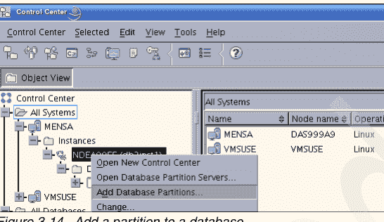

图 3-14 为数据库添加分区

向导程序将引导你完成整个过程。

## 3.6 配置

DB2 有许多配置参数，用于指定系统资源的分配以及实例和数据库的整体配置。这些参数存储在数据库配置、数据库管理器配置和注册表中。

由于默认值是针对内存和存储较小的机器的，你可能需要对其进行修改以适应你的环境。配置的良好起点是配置顾问或 `AUTFIGURE` 命令。

如果你创建一个数据库，许多参数已设置为 `AUTOMATIC`，以便由自适应内存管理进行处理。

### 3.6.1 STMM：自适应内存管理

在第 9 版本中，DB2 引入了一项新功能自适应内存管理（STMM），通过自动设置多个内存配置参数的值极大简化了数据库内存配置。STMM 管理以下 DB2 消费者的内存：

- 缓冲区池
- 包缓存
- 锁内存
- 排序内存

这些区域的调优可以单独开启。调优是在同一系统的不同数据库和不同实例之间进行的。调优内存可以被限制。如果无法从操作系统分配更多调优内存，或者内存达到了定义的限制，则将从不需要那么多内存的区域提取可用内存。例如，如果 STMM 发现某个缓冲区池需要更多内存，它可以从另一个池中提取。

调优频率根据工作负载确定，每个调优步骤都会记录在 `dbdiag.log` 和 `stmml` 目录。

STMM 也适用于分区数据库，但这种情况下每个系统的硬件必须相同。而且工作负载和数据必须均匀分布，因为调优参数是在称为调优分区的指定的指定的，然后分到其他分区。

第 134 页的图 3-19 展示了内存空间如何在各个区域之间进行分配。

## Linux


图 3-19 STMM

对于新创建的数据库，自调优功能默认开启。我们可以从示例 3-34 显示的数据库配置参数看出这一点。

示例 3-34 为 STMM 调优参数

```
db2inst@puget: db2 get db config for innodb | grep -i automatic
Size of database shared memory (4KB) (DATABASE_MEMORY) = AUTOMATIC
Max storage for lock list (4KB) (LOCKLIST) = AUTOMATIC
(MAXLOCKS) = AUTOMATIC
Percent. of lock lists per application = AUTOMATIC
Package cache size (4KB) (PCKCACHE) = AUTOMATIC
Sort heap for shared parts (4KB) (SHEATHRES_SH) = AUTOMATIC
Sort list heap (4KB) (SORTHEAP) = AUTOMATIC
Database heap (4KB) (DBHEAP) = AUTOMATIC
SQL statement heap (4KB) (STMTHEAP) = AUTOMATIC
Default application heap (4KB) (APPLHEAPS) = AUTOMATIC
Application Memory Size (4KB) (APPL_MEMORY) = AUTOMATIC
Statistics heap (4KB) (STAT_HEAP_SZ) = AUTOMATIC
Number of asynchronous page cleaners (NUM_IOCLEANERS) = AUTOMATIC
Number of I/O servers (NUM_IOSERVERS) = AUTOMATIC
Default prefix size (pages) (DFT_PREFETCH_SZ) = AUTOMATIC
```

134 在 Linux 上上手运行 DB2

Max number of active applications (MAXAPPLS) = AUTOMATIC

Average number of active applications (AVG_APPLS) = AUTOMATIC

要关闭特定区域的 STMM，请使用此命令：

```
UPDATE DATABASE CONFIGURATION USING <parameter> MANUAL
```

你可以通过执行此命令来通用关闭 STMM：

```
UPDATE DATABASE CONFIGURATION USING SELF_TUNING_MEM
```

可以使用 `SIZE AUTOMATIC` 选项单独为启用或禁用缓冲池的 STMM：

```
ALTER BUFFERPOOL ibdefaultbp SIZE AUTOMATIC
```

```
CREATE BUFFERPOOL <bpname> SIZE AUTOMATIC
```

STMM 可以以两种模式运行：

- 你可以限制内存调优可用大小小于此值。如果某个区域需要 `DATABASE_MEMORY` 参数，那么 STMM 将不会让数据库使用的内存超过此值。如果某个区域由于需求增加而需要增加内存，另一个内存需求较小的区域将相应地减少。
- 你可以通过将 `DATABASE_MEMORY` 参数设置为 `AUTOMATIC` 来保持可用调优内存大小不受限。在这种情况下，操作系统中的可用内存限制了调优的可用内存。STMM 会为操作系统进程留出缓冲区，以防止发生分页（paging）。
- 你还可以通过设置数据库管理器配置参数 `INSTANCE_MEMORY` 的值来限制实例使用的内存。如果你不想限制它，可以将其值保持为 `AUTOMATIC`。

> 注意：某些 Linux 内核不允许你将 `DATABASE_MEMORY` 数据库参数的值设置为 `AUTOMATIC`。RHEL5 和 SUSE 10 SP1 支持 `AUTOMATIC` 值。对于所有经过验证 Linux 发行版，如果内核不支持此功能，将返回 `COMPUTED`。

## 3.6.2 数据库管理器配置参数

数据库管理器配置 (`DBM cfg`) 参数存储在 `$INHOME/sqlib/` 下名为 `db2system` 的文件中。要修改这些参数，请使用图形界面、控制中心或 DB2 命令行界面。

## 重要的 DBM cfg 参数

以下是重要的 DBM cfg 参数：

- `DFTDBPATH`

默认情况下，此参数设置为 `$INHOME`。我们建议将其设置为你所需的路径。在分区的环境中，`$INHOME` 通常位于 NFS 文件系统上，但 DB2 不支持将 NFS 作为数据库路径。

- `DFT_MONSWITCHES`

将所有监控开关设置为 `ON` 以让 DB2 收集统计数据。使用快照（snapshot）命令显示有关 DB2 行为的详细信息。

- `DIAGLEVEL`

为了确定问题，将 `DIAGLEVEL` 设置为 4。DB2 将所有错误、警告和信息消息写入 `DIAGPATH` 定义的路径下的 `db2diag.log`。默认值为 3。请注意，日志级别 4 可能会对性能产生严重影响。

- `MON_HEAP_SZ`（可以设置为 `AUTOMATIC`）

用于维护数据库系统监视数据私有视图所需的内存由 `MON_HEAP_SZ` 配置参数分配。监控活动所需的内存量在很大程度上取决于监控应用程序和事件监视器的数量、设置的开关以及数据库活动的水平。

- `SHEATHRES`

对于私有排序，此参数是实例级范围内在任何时刻私有排序可以消耗内存的软限制。对于共享排序，此参数是数据库级范围内在任何时刻共享排序消耗内存内存的硬限制。达到此限制后，将不再允许进行共享排序。

- `NUM_POOLAGENTS`（可以设置为 `AUTOMATIC`）

对于应用程序并发连接的决策支持系统 (DSS) 环境，请将此值设小。对于具有许多并发连接应用程序的在线事务处理 (OLTP)，请将此值设大一些，以防止创建额外的 `db2agents`，这是非常耗时的。

- `INTRA_PARALLEL`

对于 OLTP 环境，将此值设置为 `NO`，因为吞吐量比并行工作更重要。OLTP 查询更新或插入少数行，因此将此工作拆分到多个进程中没有意义。在 DSS 环境中，查询通常一次连接多个表。我们建议将此值设置为 `YES`。

- `MAX_QUERYDEG`

对于 OLTP，将此值设置为 1。对于 DSS，DB2 可以将工作拆分到多个进程中。

- `INSTANCE_MEMORY`（可以设置为 `AUTOMATIC`）

如果设置为 `AUTOMATIC`，它将在实例启动时计算。

- `JAVA_HEAP_SIZE`

`JAVA_HEAP_SIZE` 定义了用于 Java 定义函数 (UDF) 的堆大小。

- `SVCNAME`

`SVCNAME` 定义了实例使用的端口。

## 监控和更新 DBM 配置

你可以通过控制中心或 DB2 命令行来配置设置。

## 控制中心

使用以下步骤设置 DBM 配置：

1. 启动控制中心并扩展树到所需的实例。
2. 右键点击实例名称打开弹出窗口并选择参数（图 3-20）。

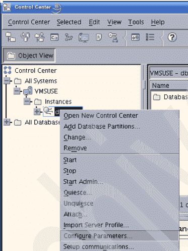

图 3-20 配置参数

3. 进行你的更新并勾选（动态）选项（图 3-21）。
4. 在完成所有所需的更改后，点击确定，更改将应用（图 3-22）。

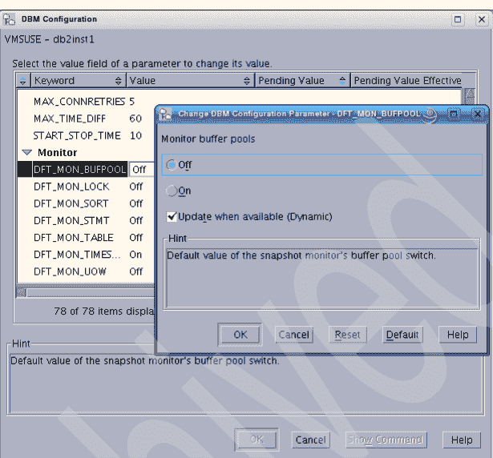

图 3-21 修改参数

## 命令行

更改 DBM 配置设置的命令可以由命令行处理器方便地输入。


使用 `DATABASE CONFIGURATION` 显示当前值。

使用 `DATABASE CONFIGURATION USING <parameter>` 更改当前值。

使用 `RESET DATABASE CONFIGURATION` 将所有数据库参数重置为默认值。

使用 `CONFIGURE` 让 DB2 决定值。

示例 3-35 显示了 DBM 参数更改的示例。

```
db2 get db cfg
db2 update db cfg using DFT_MON_BUFPOOL on automatic
db2 get cfg show detail
db2 autoconfigure using mem_percent 60 apply db
```

## 3.6.3 数据库配置

为了分配和控制系统资源，DB2 为实例中的每个数据库使用独立的配置文件。该文件名为 `SQLDBON/database_path/$DB2INSTANCE/NODE0000/SQL00001`。

在分区的环境中，`SQLDBCON` 存在于每个数据库分区。因此，每个分区可以有不同的设置。

### 重要数据库配置参数

本节描述了重要的数据库配置参数以及推荐的设置。许多参数由 STMM 处理。我们将在第132页的第3.6节“DB2 配置”中讨论 STMM。

- **`AVG_APPLS`（可以设置为 `AUTOMATIC`）**

此参数让 DB2 了解您的系统中平均有多少个并发应用程序在运行。当设置为 1 时，DB2 会为每个应用程序提供缓冲区池中当前可用内存。更改此参数可能会对性能产生巨大影响。

- **`CATALOGCHE_SZ`**

此参数在内存中存储数据库、表空间、表和索引信息。DB2 在准备执行计划时会首先查找缓存。足够的内存可以避免高开销的磁盘 I/O。通过 `db2 get snapshot for database db_name` 命令并通过以下公式计算命中率：

`100 - ((Catalog cache inserts X 100) / Catalog cache lookups)`

- **`MAXFILOP`**

这是每个应用程序可以打开的文件数。默认值通常太低。打开文件和关闭文件会减慢 SQL 响应时间并消耗 CPU 周期。如果文件正在被关闭，请调整 `MAXFILOP` 的值，直到关闭操作停止。使用命令：

```
db2 get snapshot for database db_name
```

然后查看 "Number of files closed"（关闭的文件数）。如果值大于 0，则增加 `MAXFILOP` 的值。

- **`LOCKTIMEOUT`**

默认设置为 -1，这意味着连接可以一直等待获取所有资源。如果一个连接持有另一个应用程序所需的锁，就会发生死锁问题。为了防止出现过多的死锁，对于 OLTP，将此值设置为 10；对于 DSS，将此值设置为 60。

- **`LOGBUFSZ`**

DB2 在将日志记录写入磁盘之前使用一个缓冲区存储日志记录。如果该值设置为 0，会导致磁盘产生不必要的 I/O。在增加此参数值时，请考虑增加 `DBHEAP` 参数，因为日志缓冲区内存是从数据库堆分配的。

- **`SORTHEAP`（可以设置为 `AUTOMATIC`）**

每个排序操作都有由数据库管理器分配的独立内存量。此参数定义了可以使用的最大排序内存。在增加此值时，还需要检查并可能需要调整数据库管理器配置文件中的 `SHEAPATHRES_SHR` 参数。

- **`DATABASE_MEMORY`（可以设置为 `AUTOMATIC`）**

如果 `DATABASE_MEMORY` 设置为 `AUTOMATIC`，STMM 将根据系统的可用内存以及各种调优区域的需求进行调优。如果此参数设置为固定值，则该特定数据库的内存将限制在该值，STMM 将根据该内存调优各个区域。

- **`DFT_DEGREE`**

值 1 表示没有分区内并行性。值 -1（或 `ANY`）意味着优化器根据处理器数量和查询类型来决定分区内并行程度。

在 OLTP 系统上，请关闭分区内并行性。在 OLAP 系统上，考虑开启分区内并行性，以便大型查询能够利用多处理器系统中的多个 CPU。

> 注意：要查看所有数据库配置参数的完整且详细描述，请参考信息中心：`http://publib.boulder.ibm.com/infocenter/db2luw/v95/index.jsp?topic=/com.mb2.luw.admin.config.doc/c0004555.html`

### 监控和更新数据库配置

您可以通过控制中心（Control Center）或 DB2 命令行来配置 DB2 数据库设置。

#### 控制中心

使用以下步骤更新数据库配置参数：

- 1. 启动控制中心并展开树结构到目标数据库。
- 2. 右键点击目标数据库名称打开弹出窗口并选择“Configure Parameters”（配置参数）（见第143页的图 3-23）。

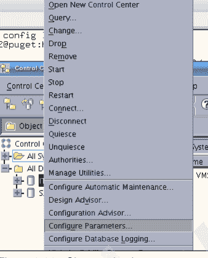

图 3-23 从控制中心更改数据库参数

修改数据库配置有两个选项：

- Configure Parameters 选项：使用此选项更改特定参数。
- Configuration Advisor 选项：此选项等同于 `autoconfig`（自动配置）命令。

**使用 Configure Parameters 选项**

通过在控制中心选择 **Configure Parameters** 选项，会弹出以下窗口（见第144页的图 3-24）。选择参数后，窗口底部的 Hint（提示）处将显示该参数的简要描述。

## 数据库配置 - ITSCOB

选择参数的值字段来更改其值。

| 关键字 (Keyword) | 值 (Value) | 待定值 (Pending Value) | 待定单位 (Pending Va) |
|---|---|---|---|

| COUNTRY | | | |
| DATABASE_LEVEL | 0xc00 | | |
| DB_MEM_THRESH | 10 | | |
| DFT_DEGREE | | | |
| DFT_MTTY_TYPES | | | |
| DFT_QUERYOPT | | | |
| DFT_REFRESH_AGE | | | |
| DFT_SOLMWATH_NA | 1 | | |

图 3-24 更改数据库参数

在完成所有想要更改的操作，点击 OK，所有更改将应用到数据库（见图 3-25）。

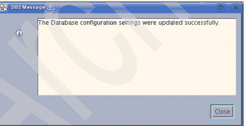

图 3-25 更新后的确认窗口

#### 使用 Configuration Advisor 选项

Configuration Advisor 是一个智能工具，可以帮助您无需深入了解 DB2 的情况下配置数据库。只需向向导提供有关系统的信息（如负载和连接），向导就会提供更改建议。

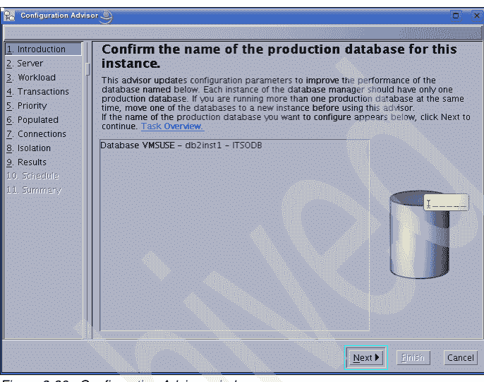

图 3-26 Configuration Advisor 窗口

完成所有章节后，向导会提供更改建议。您可以选择立即应用或稍后保存。

#### 命令行

您可以使用命令行设置快速方便地执行命令：

- `GET DATABASE CONFIGURATION <db_name>` 显示当前值。
- `UPDATE DATABASE CONFIGURATION <db_name> USING <parameter>` 更改当前值。
- `RESET DATABASE CONFIGURATION <db_name>` 将所有参数重置为默认值。

第146页的示例 3-36 显示了数据库更新示例：

```bash
db2 get cfg for itsodb
db2 update cfg for itsodb using DBHEAP 1200
db2 get cfg for itsodb show detail
```

## 3.6.4 DB2 注册表和环境变量

DB2 的所有设置都存储在环境变量或注册表中。在 Unix 系统上，`DB2INSTANCE`、`DB2NODE`、`DB2PATH` 和 `DB2INSTPROF` 等环境变量通过 `export` 命令设置，并位于 `$INHOME/sqlib/` 中的 `dbprofile` 文件。

注册变量通过 `db2set` 命令设置并重启 DB2。如果注册变量需要布尔参数，`YES`、`1` 和 `ON` 都等同，`NO`、`0` 和 `OFF` 也等同。要设置实例级注册变量，请执行：

```bash
db2 set -i <instance_name> <command>
```

要设置全局注册变量，请执行：

```bash
db2 set -g <command>
```

您可以使用配置助手 (`db2ca`) 或 `db2set` 命令来配置参数和注册变量。更新注册表时，更改不会影响当前运行的 DB2 应用程序或用户。启动后的应用程序将使用新值。

### 重要注册变量

以下是重要的注册变量列表：

- **`DB2_DISABLE_FLUSH_LOG`=OFF**

在线备份完成后，最后一个活动日志文件将被截断、关闭并归档，确保您的在线备份有完整的归档日志用于恢复。

- **`DB2DBDFT`=null`

此注册变量指定用于隐式连接的数据库别名。如果任何应用程序没有连接但包含 SQL 语句，它将连接到 `DB2DBDFT` 中指定的数据库。

- `DB2_PARALLEL_IO` Default=null

此变量允许 DB2 对特定表空间或所有表空间进行并行 I/O 操作。并行度由表空间内容器的预取单元大小（prefetch size）和区大小（extent size）决定。

- `DB2COMM` Default=null

此变量决定了与 DB2 通信时使用的协议。通常，服务器和客户端之间的 TCP/IP 协议接受 S/390 系统的通信。在 Linux 上，TCP/IP 是客户端/服务器通信唯一支持的协议。

- `DB2INSTANCE`（由 DB2 配置文件设置）

在执行 `db2profile` 脚本启用了针对 DB2 的变量后，该环境变量将被设置为当前实例的名称。

> 注意：所有注册表变量的详情请参阅信息 Center：
> `http://publib.builder.ibm.com/infocenter/db2luw/v95/index.jsp?topic=/com.ibm.db2.luw.admin.regvars.doc/doc/c0007340.html`

### 命令行上的 db2set

`db2set` 是设置注册表变量的命令。您可以使用命令提示符执行该命令（示例 3-37）。

示例 3-37 设置和删除注册表变量

### db2ca 图形工具

要启动图形工具，请执行命令 `db2ca &`。在主窗口中，选择配置（Configure）→ DB2 注册（DB2 Registry），如第 148 页图 3-27 所示。

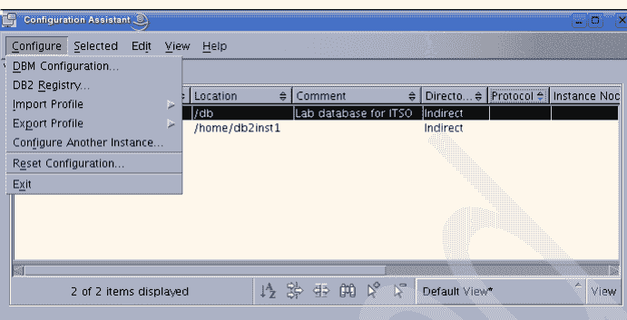

图-3-27 从 db2ca 修改注册表

您将进入图 3-28 所示的面板，可以在那里更改注册表变量。

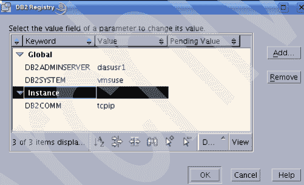

图-3-28 修改注册表变量

### 多页文件分配

对于系统管理表空间 (SMS)，我们建议您启用多页文件分配。这减少了格式化新页所需的时间。要启用此参数，请对每个数据库执行 `db2empfa` 命令。这需要独占访问，因为在现有的表空间中，所有空空间将填充到最后一个区。

要检查所有空页是否已填充到最后一个区，请执行命令：

```
db2 get db cfg for <dbname> | grep Multi-page
```

多页文件分配已启用 = YES。

在多分区环境中，请在每个数据库分区上执行 `db2empfa`。

## 3.7 安全性

在本节中，我们简要讨论了 DB2 的安全性。我们介绍了 Linux 层、实例层、数据库层和网络安全性。有关此主题的详细信息，请参阅：

- Linux、UNIX 和 Windows 的 DB2 安全与合规解决方案，SG24-7555
- 数据库安全指南，SC23-5850
- 数据库基础知识 → 安全项下的信息 Center。

### Linux 层的安全性

在 Linux 层上，安全性是以用户和组的形式进行管理的。用户有一个主组和一个多或少的专有用户 ID，运行所有 DB2 数据库实例的用户多或少属于该实例。数据库实例通过 TCP/IP 端口提供网络访问。Linux 层上 DB2 的安全性考虑是基于这一假设。

#### 文件系统权限

在创建实例时，DB2 将所有 DB2 内容放置在实例用户的家目录下。这些文件必须允许想要使用该实例的用户访问。

您创建的所有后续文件（例如表空间容器、事务日志、归档日志、备份、诊断日志等）不需要用户直接访问。因此，您可以将它们的权限限制为仅实例用户访问。

许多 Linux 系统默认将 `umask` 设置为 0022，这使得所有新创建的文件对所有人都是可的。如果担心安全性，请为实例用户将 `umask` 设置为 0027。

UDF（用户定义函数）和存储过程可以配置为在围栏（fenced）用户 ID 下运行，以保护 UDF 免受数据库管理器核心的影响。因此，崩溃的 UDF 不会导致数据库管理器崩溃。尽管在围栏用户 ID 下运行 UDF 和存储过程会给 UDF 调用增加开销。

使用围栏用户 ID 还有另一个用途。它允许它们在与数据库管理器不同的用户 ID 下运行。因此，它们无法直接访问数据库实例的文件。它还可以防止溢出占用过数据库资源。

围栏用户 ID 在创建实例期间定义。

#### 权限

DB2 实例级权限 `SYSADM`、`SYSMAINT` 和 `SYSMON` 通过操作系统组授予。每个 DB2 实例级权限都为实例的数据库提供特定程度的访问和权限。在数据库管理器配置中，您可以定义哪些 Linux 组分配给哪些权限。授权组在数据库管理器配置中指定，如示例 3-38 所示。

示例 3-8 实例级权限

```
db2inst11> db2 get dbm config | grep _GROUP
SYSADM group name (SYSADM_GROUP) = DB2ADM1
SYSCTRL group name (SYSCTRL_GROUP) =
SYSMAINT group name (SYSMAINT_GROUP) =
SYSMON group name (SYSMON_GROUP) =
```

### 网络层安全性

如果启用了网络，数据库管理器会打开一个 TCP/IP 端口，供 DB2 客户端通信。默认情况下，服务器之间的通信是不加密的。如果您需要保护数据，可以启用安全套层 (SSL) 或身份验证。

身份验证类型在数据库管理器配置中定义，如示例 3-39 所示。

示例 3-39 数据库管理器中的身份验证

```
db2inst1> db2 get dbm config | grep AUTHICATION
Database authentication (AUTHENTICATION) = SERVER
```

### 数据库层安全性

在数据库层，可以使用权限和授权控制访问。DB2 提供的安全性机制包括：

- 管理员的权限
- 用于限制访问数据的视图
- 用于限制访问 DB2 对象的权限
- 用于限制访问函数的包
- UDF 和存储过程
- 提供比 Linux 组更详细的安全实现方式的角色
- 即使是 DBA 也能保护数据的加密
- 基于标签的访问控制 (LBAC) 用于限制列和行级访问
- 用于解决多层架构引入问题的信任上下文

#### 权限

在数据库层，可以对以下类型授予权限：

- 模式
- 表空间
- 表和视图
- 包
- 序列
- 过程

权限可以授予：

- Linux 用户
- Linux 组
- DB2 角色
- PUBLIC

授予权限时请使用 `GRANT` 语句。

#### 加密

如果您需要保护敏感数据（如信用卡信息），可以使用内置函数 `ENCRYPT`、`DECRYPT_BIN` 和 `DECRYPT_CHAR`。加密允许您保护数据免受数据库管理员的访问。

#### 默认值

当最初创建数据库时，将以下权限授予 PUBLIC：

- CREATE TABLE
- BINDADD
- CONNECT
- IMPSCHEMA
- 对 NULLID 模式下创建的所有包的 BIND
- 对 NULLID 模式下创建的所有包的 EXECUTE
- SQLJ 模式的 CREATEIN
- NULLID 模式的 CREATEIN
- USSPACE1 表空间的 USE
- 对 SYIBM 表的 SELECT
- 对 SYSCAT 视图的 SELECT
- 对 SYSSTAT 视图的 SELECT
- 对 SYSSTAT 视图的 UPDATE
- 对 SQLJ 模式下所有过程的 GRANT EXECUTE
- 对 SYSPROC 模式下所有函数和过程的 GRANT EXECUTE

如果您不需要这些权限，可以在 CREATE DATABASE 命令中指定 `RESTRICTIVE` 选项。

## 3.8 客户端配置

在本节中，我们讨论如何使用图形工具 Configuration Assistant 或 DB2 命令行处理器安装和配置 DB2 客户端。

DB2 客户端提供对 DB2 数据库服务器的访问。在 DB2 9.5 中，有三种 DB2 数据服务器客户端可用：

- IBM Data Server Client 这是一个完整安装。它包含了所有组件，以及图形和非图形工具，用于管理 DB2 系统和使用 DB2 开发应用程序。该客户端还包括适用于 Eclipse 和 Microsoft® Visual Studio® 2005 开发环境的插件。

如果您需要数据库管理支持以及使用应用程序编程接口（API）进行应用程序开发，请使用此客户端。

## IBM Data Runtime Client


运行时客户端（Runtime Client）是一个轻量级、非图形化的客户端，它提供了您的应用程序访问 DB2 服务器所需的功能。它为运行使用嵌入 SQL、CLI、Java 数据库连接 (`JDBC`)、SQLJ、ODBC、对象链接与嵌入 (`OLE`) DB、.NET 以及超文本预处理器 (`IPP`) 接口的应用程序提供应用支持。

如果您需要命令行处理器（CLP）支持以及用于应用程序运行和部署支持的基础客户端功能，请使用此客户端。

## 用于 ODBC、CLI 和 .NET 的 IBM Data Server 驱动

该驱动程序是 Windows 应用程序的轻量级部署解决方案。如果您需要在不需要安装 Data Server Client 或 Data Runtime Client 的情况下，为 Windows 应用程序提供 DB2 CLI API、ODBC API 和 .NET API 的运行时支持，请使用它。

客户端的选择取决于您的应用程序环境。 只有 IBM Data Server Client 提供 BIND 支持。所有客户端版本均适用于 AIX®、HP-UX、Linux、Solaris™ 和 Windows 平台。

有关 IBM Data Server 客户端的更多信息以及安装要求的详细信息，请参阅《IBM Data Server 客户端快速入门》，GC23-5863。

### 3.8.1 安装 IBM Data Server Client

在验证了第 26 页 2.1 节“基本要求”指定的前提条件后，执行以下任务安装 IBM Data Server Client：

- 插入并挂载产品 DVD。切换到 DVD 挂载或安装镜像所在的目录。

- 运行 `./db2setup` 命令启动 DB2 安装向导。

- 当 DB2 启动器（launchpad）打开时，选择安装产品（Install a Product）。

- 选择您想要安装的客户端。

- 按照 DB2 安装向导的说明安装客户端。

**注意：** 使用 DB2 版本 9.5 可以在没有 root 权限的情况下安装 IBM Data Server Client。DB2 安装程序在非 root 安装期间会自动创建并配置一个非 root 实例，非 root 安装包含了 root 安装的大部分功能；但仍存在差异和局限性，例如，DB2 控制中心（DB2 Control Center）和配置助手（Configuration Assistant）不可用。更多信息请参阅第 60 页的 2.3.1 节“非 root 安装”。

如果您在安装过程中尚未创建 Data Server Client 实例，则必须以 root 用户身份使用命令创建 Data Server Client 实例。在我们的案例中，我们创建了一个名为 `db2vs` 的 DB2 数据服务器实例：

```bash
/opt/db2/V9.5/instance/db2icrt -s client db2vs
```

如果您已经在你的机器上安装了 DB2 服务器产品（即 DB2 企业版），您可以使用 `db2icrt` 命令配合 `-s client` 选项创建一个单独的实例。

现在，您需要配置客户端以访问远程 DB2 服务器。要远程管理 DB2 数据库，您必须使用 TCP/IP 连接到服务器。支持 TCP/IP V4 和 TCP/IP V6。

### 3.8.2 配置 IBM Data Server Client

为了**接受**来自 Data Server Client 的 TCP/IP **连接请求**，您必须配置数据库服务器。

在 **DB2 服务器**上，验证以下项目：

- **DB2 服务名称和端口**已设置在 `/etc/services` 文件中，例如：

  `db2_db2inst 50001/tcp`

- **DB2COMM 变量**已为 TCP/IP 设置：

  使用 `db2set -all` 命令，并查找 `DB2COMM=TCPIP`。

- 数据库管理器配置中的 TCP/IP 端口名已设置：

  `db2inst1@mensa:~ db2 dbm cfg | grep SVCE`

  `(SCVCENAME) = db2c_db2inst1 TCP/IP 服务名称`

完成更改后，您必须重启 DB2。

您可以通过以下工具之一管理所有这些许可：

- 控制中心（Control Center）中的 DB2 许可中心

- `db21cm`，这是一个许可管理工具命令

本节提供了使用这两个工具配置许可的说明。我们讨论了以下主题：

- 安装许可密钥

- 设置许可策略

- 更改强制策略

- 生成合规性报告

如果您安装了带有“试用后购买”（Try and Buy）许可的 DB2 产品，现在想要升级到完整许可，则无需重新安装 DB2 产品。您只需升级您的许可即可。

## 3.9.1 DB2 许可中心

DB2 许可中心是控制内部用于管理许可的图形化工具。您可以使用此工具查看系统中安装的 DB2 许可状态和使用信息，添加和删除许可密钥，指定用户和强制策略。DB2 许可中心还可以生成使用统计数据并显示用户的连接信息。访问 DB2 许可中心：

1. 以实例所有者的身份登录。

2. 从控制中心，选择 工具（Tools）-> 许可中心（License Center）。

3. 选择您要配置许可的系统和产品。您可以配置本地或远程系统。从“已安装产品”框中选择第 161 页图 3-33所示所示 DB2 Enterprise Server Edition。

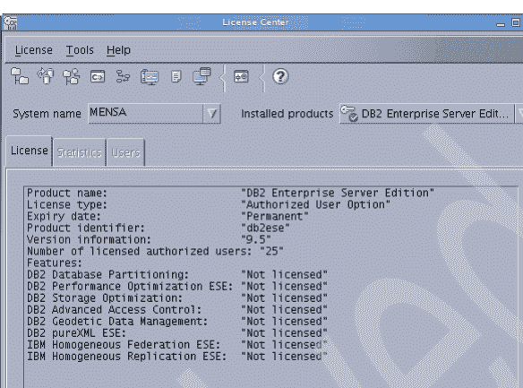

图 3-33 DB2 许可中心

## 安装许可密钥

要使用许可中心安装许可密钥，您必须添加 `db2*.lic` 许可文件：

1. 从许可（License）菜单中选择添加（Add）。

2. 选择来自文件（From a file）并选择相应的目录。如果您购买了完整许可的 DB2 产品，`db2ese.lic` 许可文件位于 `/cdrom/db2/license`，其中 `/cdrom` 是您的 CD-ROM 根目录。确定（OK）。

要删除许可文件，请从许可菜单中选择删除（Remove）。

## 设置许可策略

对于 DB2 Connect Server Edition，许可策略控制并监控同时连接到 DB2 Connect 服务器的用户数。对于 WebSphere Replication Server 或 WebSphere Federation Server，许可策略控制并监控连接到非 DB2 数据源的连接器数量。

使用许可中心设置许可策略：

1. 从许可（License）菜单中选择更改（Change）。

2. 在“更改许可”（Change License）窗口中，选择您为产品购买的许可类型。

## 更改强制策略

默认强制策略是软停止（Soft Stop），这意味着即使违反了许可策略，也允许所有连接到 DB2 数据库。当发生违规时，许可违规消息将写入 `db2diag.log`。硬停止（Hard Stop）强制策略不允许任何违反许可策略的连接。要指定强制策略，请执行操作：

1. 从许可（License）菜单中选择更改（Change）。

2. 在强制策略（Enforcement policy）下选择相应的单选按钮。

## 生成合规性报告

要验证 DB2 功能的许可合规性，可以生成合规性报告。该报告列出了与您当前报告权限不符的 DB2 功能。每个 DB2 功能的状态列为以下项之一：

 全 合规（In compliance）：该功能已使用并已妥善许可。

- 违规（Violation）：该功能未许可但已使用。

您可以通过从许可菜单中选择**生成合规性报告**（Generate Compliance Report）使用许可中心生成合规性报告。图 3-34 显示了报告。

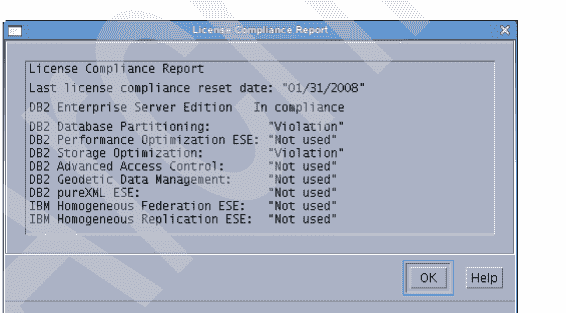

图 3-34 许可合规性报告

还可以通过从许可菜单中选择**重置合规性报告**（Reset Compliance Report）使用许可中心来重置许可使用信息。

要生成合规报告，请使用以下命令：

`db2licm -g <filename>`

其中 `<filename>` 指定存储输出结果的文件名。

若要重置许可证使用信息，请使用 `db2licm -x` 命令。

# 迁移与修复包

在将 DB2 从版本 8 或版本 9.1 迁移到版本 9.5 时，在安装前后有几个重要的步骤需要执行，以确保迁移的安全和成功。

在本章中，我们描述了如何将 DB2 服务器从版本 8.2 和版本 9.1 迁移到版本 9.5，以及修复包的安装。我们将讨论以下内容：

-   迁移规划

-   迁移多分区数据库

-   迁移单分区数据库

-   迁移后任务

-   客户端与服务器的兼容性

-   修复包安装

有关迁移 DB2 服务器以及其他组件（如您 DB2 环境中的句程序和应用程序）的完整信息，请参阅以下地址的 DB2 信息中心：

```
http://publib.boulder.ibm.com/infocenter/db2luw/v9r5/index.jsp?topic=com.ibm.mdb2.luw.qb.ibm.doc/doc/0023662.html
```

DB2 还提供了从其他数据库（如 Oracle 和 Microsoft SQL Server®）迁移的工具和服务。有关更多信息，请参考此网站：

```
http://www.ibm.com/db2/migration/
```

## 4.1 迁移规划

在安装 DB2 9.5 之前，为迁移准备系统和数据库是至关重要的。迁移需要额外的表空间和日志空间，还需要一个以防失败的恢复计划。本节将讨论迁移要求。

图 4-1 显示了迁移路线图。您需要考虑整个 DB2 环境，以确定最佳的迁移策略。

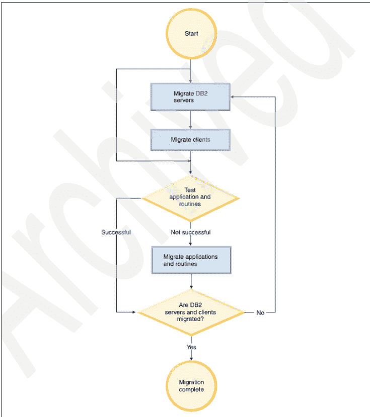

图 4-1 迁移路线图

### 4.1.1 迁移要求

确保您的系统在迁移到版本 9.5 之前满足以下软件和空间要求：

-   支持从 DB2 UDB 版本 8 和 DB2 9.1 迁移。如果您使用的是 DB2 UDB 版本 7 或更早版本，需要在迁移到 DB2 9.5 之前先迁移到 DB2 UDB 版本 8。

-   如果您运行 DB2 UDB 版本 8.1，我们建议您升级到 DB2 UDB 版本 8.2。

-   您只能迁移到 DB2 9.5 的根安装。

-   DB2 9.5 企业服务器版（Enterprise Server Edition）仅支持 64 位架构。

-   在以下站点查看 DB2 9.5 的推荐和验证过的环境：

http://www.ibm.com/software/data/db2/linux/validate/

-   支持从 DB2 U 版本 8 或 DB2 版本 9.1 恢复全数据库在线备份。但是，您无法从之前的级别向前滚动日志。

-   在进行 DB2 数据库产品管理之前，请执行硬件和操作系统升级。

-   如果您迁移 DB2 服务器，您可能还需要迁移数据库应用程序和例程，以支持 64 位实例、SQL 存储过程、Java 虚拟机 (JVM™）和开发软件的变化。

-   在迁移任何 DB2 客户端到版本 9.5 之前，请将所有 DB2 服务器迁移到版本 9.5。先迁移客户端可能会出现某些问题。

-   如果您有 32 位实例并在 64 位系统上迁移到 DB2 9.5，您需要管理由于共享库路径规范和弃用功能导致的不兼容性，以便成功运行您的应用程序和例程。

-   SQLPCS 和 SQLPCS 文件包含表空间信息。在从 DB2 U 版本 8 迁移到 9.5 期间，这些文件需要额外的表空间空间。在迁移到版本 9.5 之前，确保您的系统满足要求，且 `/tmp` 目录有足够的空间。

-   在迁移到 DB2 9.5 之前，确保迁移所在的机器有足够的磁盘空间。

```
http://www.ibm.com/software/data/db2/linux/validate/
```

迁移所需的空间取决于系统，我们在表 4-1 中提供了建议。

| 表空间 | 迁移建议 |

| :--- | :--- |

| 系统目录空间 (SYCATSPACE) | - 对于 SMS 表空间，分配双倍的空间。<br>- 对于 DMS 表空间，必须大于等于使用的空间。 |

| 临时表空间 (TEMPSPACE1，默认) | - 迁移时需要其双倍的空间。<br>- 如果是从版本 8 迁移，检查临时表空间的大小。 |

要检查 DMS 表空间的大小，请作为实例所有者使用以下命令：

```
db2 list database
db2 connect to dbaname
db2 list tablespaces detail
```

要增加 DMS 表空间的空间，可以添加额外的容器或增加现有容器的大小。

要增加系统管理存储 (SMS) 表空间的空间，可以增加文件系统的大小。

- 在迁移之前确保你有足够的日志文件空间。我们建议大幅增加 `LOGFILSIZ`、`LOGPRIMARY` 和 `LOGSECOND` 的值以防止日志文件用尽。所需的空间取决于系统设置。此外，在分区数据库环境中，只需要增加目录日志空间。

例如，如果您想将 `LOGFILSIZ` 从 1000 更改为 2000，连接数据库并输入以下命令：

```
db2 update db cfg logfilsisiz 2000
```

-   在迁移到 DB2 9.5 之前，确保索引表空间有足够的页，以考虑到每个索引一个额外的页：

-   在 DB2 9.5 创建的新数据库中，实时统计默认启用。

-   通过将 `DB2_MDC_ROLLOUT` 设置为 `DEFER` 来启用延迟清理滚动，或者当 `DB2WORKLOAD` 设置为 `SAP` 时。

-   对填充表进行重新组织或重建索引。

### 4.1.2 规划考虑

DB2 9.5 带来了新功能以增强性能和可管理性。某些功能和功能已被弃用。某些配置参数和注册变量的默认值发生了变化，您需要检查它们。

## 创建数据库以启用新功能

迁移是考虑创建新数据库以充分利用 DB2 9.5 功能优势的好机会，这些设置只能在新数据库中更改。考虑因素包括：

-   自动存储：只能在创建数据库时启用。

-   数据库编码：数据库代码集决定了您可以在数据库中存储哪些字符。数据库创建后无法更改编码。在 DB2 9.5 中，默认代码集是 Unicode。

-   数据库区域：此设置决定了日期和时间格式。您必须在创建数据库时定义此选项。

## 已停止及废用的功能

以下是版本 9.5 中若干已停止支持和废用的函数：

- `db2icrt`, `db2ilist`, `db2iupdt` 的 `-w` 选项

- `db2umdgp` 命令

- 若干注册表和环境变量，例如 `DB2_LINUXAIO` 和 `DB2_LPGAGE_BP`

- `IMPORT` 命令的 `CREATE` 和 `REPLACE_CREATE` 选项已废弃。

- XML Extender 已废弃。

当您迁移 DB2 UDB 版本 8 时，您也必须检查版本 9.1 中发生的更改，例如以下更改：

- 备用修复包镜像（fix pack images）已停止。

- 类型 3 Java 数据库连接 (JDBC) 支持已停止。

- 不再包含数据仓库中心（Data Warehouse Center）和信息目录中心（Information Catalog Center）。

- Text Extender 不再支持。

- 音频、图像和视频 (AIV) 扩展器不再再支持。

- `DB2_SCATTERED_IO` 注册表变量已停止。

### 4.1.3 迁移测试考虑

整个迁移过程由两部分组成：安装 DB2 9.5 代码以及迁移实例和数据库。安装 DB2 9.5 代码不需要停机。迁移实例和数据库是将您的 DB2 系统从版本 8 或 9.1 转换为版本 9.5 的实际步骤。您需要停止以执行实例和数据库的迁移。

我们建议在迁移任何版本 8 或 9.1 实例之前，先安装并测试 DB2 版本 9.5。如果您有一个模拟生产系统的测试环境，可以安装 DB2 9.5，迁移 DB2 实例和数据库，在测试系统上测试所有应用程序，并在生产环境中执行相同的步骤。然而，如果您的测试环境有限或没有测试环境，可以利用 DB2 的特性在新版本下对您的应用程序进行测试。

由于多个版本的 DB2 可以在 Linux 上共存，您可以在应用程序仍在版本 8 或 9.1 下运行的同时，安装 DB2 9.5。然后，您可以创建一个包含少量数据的版本 9.5 测试实例和数据库，以便在生产事务运行时测试您的应用程序。

当您准备好将生产系统升级到版本 9.5 时，在对应用程序或环境进行任何必要的更改后，您可以在低峰期迁移实例和数据库，以减少系统停机时间并减少受停机影响的人员或系统。

我们不建议在未经过测试的情况下在生产环境中进行此类迁移。

### 4.2 迁移多分区数据库

本节提供了分区数据库的迁移前任务列表和迁移程序。从 DB2 版本 8 或版本 9.1 迁移多分区数据库的程序通常是相同的。高级步骤包括：

- 迁移准备：此步骤为迁移实例和数据库做准备，包括备份数据库以及使用 `db2migrate` 命令检查数据库是否准备好迁移。

- 安装 DB2 版本 9.5。

- 迁移实例和数据库：实际迁移实例和数据库。

- 迁移后工作：确保 DB2 服务器按预期运行的任务。

- 启用新的 DB2 9.5 功能。

- 迁移管理服务器（Administration Server）。

- 迁移 DB2 客户端。

### 4.2.1 迁移前任务

执行以下步骤以为安全、成功的迁移做准备：

1. 迁移环境的第一步是确定您是否可以将现有实例迁移到您已有的 DB2 9.5 副本中：

   a. 使用以下命令确定节点类型：

      `db2 get dbm cfg | grep "Node type"`

   第174页的示例4-1显示了企业服务器版 DB2 系统的节点类型。

## 示例 4-1 节点类型


```
dpfusrl1@gemini:\> db2 get cbm cfg | grep "Node type"
Node type = Enterprise Server Edition with local and remote clients
```

b. 审核表 4-2 以确定实例类型以及是否支持实例迁移。

表 4-2 节点支持

| 实例类型 | 节点类型 | 迁移支持 |
| --- | --- | --- |
| client: DB2客户端的默认类型 | Client | ► 支持迁移到客户端、独立（stand-alone）或 ese 实例。 |
| stand-alone: DB2个人版 (PE) 的默认类型 | 带有本地客户端的数据库服务器 | ► 支持迁移到独立、wse 或实例。<br>► 不支持迁移到客户端实例。 |
| wse: DB2工作组版 (WSE) 的默认类型 | 带有本地和远程客户端的数据库服务器 | ► 支持迁移到 wse 或 ese 实例。<br>► 迁移到独立实例将创建一个独立实例。<br>► 不支持迁移到客户端实例。 |
| ese: DB2企业服务器版 (ESE) 的默认类型 | 带有本地和远程客户端的分区数据库服务器，或带有本地和远程客户端的企业服务器版 | ► 支持迁移到 ese 实例。<br>► 从单数据库分区迁移到独立实例或 wse 实例将创建一个独立实例。<br>► 不支持迁移到客户端实例。 |

2. 保存 DBM 和 DB 配置设置。在迁移前后比较这些设置以检查任何迁移错误。

保存每个数据库分区的 DB 配置，因为 DB 配置可能会发生变化。

3. 保存每个数据库分区的 DB 配置。在迁移前后比较这些设置以检查任何迁移错误。

保存每个数据库分区的 DB 配置，因为 DB 配置可能会发生变化。

4. 保存每个数据库分区的 DB 配置。在迁移前后比较这些设置以检查任何迁移错误。

保存每个数据库分区的 DB 配置，因为 DB 配置可能会发生变化。

5. 保存每个数据库分区的 DB 配置。在迁移前后比较这些设置以检查任何迁移错误。

保存每个数据库分区的 DB 配置，因为 DB 配置可能会发生变化。

6. 保存每个数据库分区的 DB 配置。在迁移前后比较这些设置以检查任何迁移错误。

保存每个数据库分区的 DB 配置，因为 DB 配置可能会发生变化。

7. 保存每个数据库分区的 DB 配置。在迁移前后比较这些设置以检查任何迁移错误。

保存每个数据库分区的 DB 配置，因为 DB 配置可能会发生变化。

其中 `pid` 代表进程 ID 号。

你必须在所有数据库分区服务器上执行此过程。在停止进程之前，请注意是否有其他实例。

## 13. 在每个数据库分区中运行 `db2ckmig` 以验证数据库是否可以迁移。`db2ckmig` 命令会验证以下所有条件是否均成立：

- 已注册的数据库确实存在。
- 数据库不处于不一致状态。
- 数据库不处于备份等待（backup pending）状态。
- 数据库不处于恢复等待（restore pending）状态。
- 表空间处于正常状态。
- 数据库不包含包含名为 ARRAY、BINARY、DATALINK、DECFLOAT、VARBINARY 或可扩展标记语言 (XML) 的用户定义类型 (UDTs)。
- 数据库的系统目录表中不包含会导致数据库迁移失败的孤立行。
- 启用为高可用灾难恢复 (HADR) 主数据库的数据库允许成功连接。
- 数据库不处于 HADR 备用角色。

如果 SYSCAPS 是 DMS 表空间且未启用 AUTORESIZE，则 SYSCAPS 至少有总页数的 50% 为空闲页。

命令语法为：

```
/db2ckmig -e -llogfile_name
```

在示例 4-5 中，我们扫描了所有注册的数据库并将结果保存到文本文件 `db2ckmig.log`。

## 示例 4-5 db2ckmig 命令

```
dpfus1@mensa:/opt/db2/V9.5/bin> ./db2ckmig -e -l /dbhome/dpfus1/db2ckmig.log
```

`db2ckmig` 成功。数据库可以迁移。

我们检查了 `db2ckmig.log` 是否有任何错误，并确保运行的 DB2CKIG 版本为 9.5 版本，而非之前的版本。第 178 页的示例 4-6 显示了 `db2ckmig.log` 文件。如果 `db2ckmig` 命令在检查数据库时遇到任何错误，你必须在迁移之前采取行动修复这些错误。

## 4.2.2 安装 DB2 9.5 版本

在分区环境的所有机器上安装 DB2。我们将在第 25 页的第 2 章“安装”中提供了安装细节。

## 4.2.3 迁移实例和数据库

我们目前为止执行的所有步骤都是为了实例和数据库迁移做准备。`db2migr` 命令用于将实例迁移到 9.5 版本格式。`db2 migrate database` 命令用于迁移数据库。

`db2migr` 命令执行以下任务：

- 检查数据库以确保通过 `db2ckmig` 已准备好迁移。
- 将你的实例迁移到 9.5 版本。
- 将系统和本地数据库目录更新到 9.5 版本。
- 将你环境中之前的 9.5 版本 DBM 配置设置与新的 9.5 版本 DBM 配置设置合并。

在本部分的其余部分，我们将引导你完成完成迁移的程序。步骤如下：

- 1. 以实例身份登录拥有该实例的数据库分区服务器。`db2node.cfg` 文件的第一个项目显示拥有该实例的数据库分区服务器。示例 4-7 显示了一个 `db2nodes.cfg`。在此示例中，`mensa` 是拥有该实例的数据库分区服务器。

> 示例 4-7 作为拥有实例的数据库分区服务器 Mensa

```
dpfus1@mensa:~ > /home/dpfus1/sqllib/db2nodes.cfg
mensa 0
1emini 0
```

- 2. 通过运行 `db2stop force` 命令停止实例。
- 3. 以 root 身份登录并运行 `db2migr` 命令将你的实例迁移到 9.5 版本。使用以下语法：

```
$DB2DIR/instance/db2migr [-u <fenced_user>] instance_name
```

在此命令中，`DB2DIR` 设置为你在安装 DB2 9.5 时指定的路径，`fenced_user` 是运行围栏用户（fenced user）定义的函数和存储过程的用户名，`instance_name` 是实例所有者的登录名。只有当你从客户端实例迁移到服务器实例时，才需要围栏用户。我们的输入和输出如示例 4-8 。

## 示例 4-8 迁移实例

```
mensa:/opt/db2/v9.5/instance/db2migr
```

`db2ckmig` 成功。数据库可以迁移。程序 `db2migr` 成功完成。

- 4. 此时，你可能想检查 DB2 级别，以确保你的实例现在是 9.5 版本，如示例 4-9 所示。

### 示例 4-9 检查 db2level

```
dpfus1@mensa:> db2level
DB2 Instance "mensa" uses 64 bits and DB2 code release 9.5.0 level identifier "001"
信息标记为 "DB2 v9.5.0", "001", "LINUX64",
产品已安装在 "/opt/db2/v9.5."
```

- 5. 可选，你可以使用 `db2diag -A` 命令重命名 `db2diag.log` 以刷新 `db2diag.log`，以便识别。
- 6. 将 `DIAGPATH` 参数指定目录中的任何现有转储文件（dump files）、轨迹文件（trap files）和告警文件（alert files）移动到另一个目录。
- 7. 将所有数据库迁移到 9.5 版本以实例所有者身份登录并在示例 4-10 中使用 `db2start` 启动实例。

### 示例 4-10 启动实例

```
dpfus1@mensa:~/sqllib/db2start
01/30/2008 17:15:27 DB2START 处理成功。
01/30/2008 17:15:28 DB2START 处理成功。
DB2START 处理成功。
```

命令语法为：

```
/db2ckmig -e -llogfile_name
```

在示例 4-5 中，我们扫描了所有注册的数据库并将结果保存到文本文件 `db2ckmig.log`。

## 示例 4-5 db2ckmig 命令

```
dpfus1@mensa:/opt/db2/V9.5/bin> ./db2ckmig -e -l /dbhome/dpfus1/db2ckmig.log
```

`db2ckmig` 成功。数据库可以迁移。

我们检查了 `db2ckmig.log` 是否有任何错误，并确保运行的 DB2CKIG 版本为 9.5 版本，而非之前的版本。第 178 页的示例 4-6 显示了 `db2ckmig.log` 文件。如果 `db2ckmig` 命令在检查数据库时遇到任何错误，你必须在迁移之前采取行动修复这些错误。

## 4.2.2 安装 DB2 9.5 版本

在分区环境的所有机器上安装 DB2。我们将在第 25 页的第 2 章“安装”中提供了安装细节。

## 4.2.3 迁移实例和数据库

我们目前为止执行的所有步骤都是为了实例和数据库迁移做准备。`db2migr` 命令用于将实例迁移到 9.5 版本格式。`db2 migrate database` 命令用于迁移数据库。

`db2migr` 命令执行以下任务：

- 检查数据库以确保通过 `db2ckmig` 已准备好迁移。
- 将你的实例迁移到 9.5 版本。
- 将系统和本地数据库目录更新到 9.5 版本。
- 将环境中之前的 9.5 版本 DBM 配置设置与新的 9.5 版本 DBM 配置设置合并。

在本部分的其余部分，我们将引导你完成完成迁移的程序。步骤如下：

- 1. 以实例身份登录拥有该实例的数据库分区服务器。`db2node.cfg` 文件的第一个项目显示拥有该实例的数据库分区服务器。示例 4-7 显示了一个 `db2nodes.cfg`。在此示例中，`mensa` 是拥有该实例的数据库分区服务器。

> 示例 4-7 作为拥有实例的数据库分区服务器 Mensa

```
dpfus1@mensa:~ > /home/dpfus1/sqllib/db2nodes.cfg
mensa 0
1emini 0
```

- 2. 通过运行 `db2stop force` 命令停止实例。
- 3. 以 root 身份登录并运行 `db2migr` 命令将你的实例迁移到 9.5 版本。使用以下语法：

```
$DB2DIR/instance/db2migr [-u <fenced_user>] instance_name
```

在此命令中，`DB2DIR` 设置为你在安装 DB2 9.5 时指定的路径，`fenced_user` 是运行围栏用户（fenced user）定义的函数和存储过程的用户名，`instance_name` 是实例所有者的登录名。只有当你从客户端实例迁移到服务器实例时，才需要围栏用户。我们的输入和输出如示例 4-8 。

## 示例 4-8 迁移实例

```
mensa:/opt/db2/v9.5/instance/db2migr
```

`db2ckmig` 成功。数据库可以迁移。程序 `db2migr` 成功完成。

- 4. 此时，你可能想检查 DB2 级别，以确保你的实例现在是 9.5 版本，如示例 4-9 所示。

### 示例 4-9 检查 db2level

```
dpfus1@mensa:> db2level
DB2 Instance "mensa" uses 64 bits and DB2 code release 9.5.0 level identifier "001"
信息标记为 "DB2 v9.5.0", "001", "LINUX64",
产品已安装在 "/opt/db2/v9.5."
```

- 5. 可选，你可以使用 `db2diag -A` 命令重命名 `db2diag.log` 以刷新 `db2diag.log`，以便识别。
- 6. 将 `DIAGPATH` 参数指定目录中的任何现有转储文件（dump files）、轨迹文件（trap files）和告警文件（alert files）移动到另一个目录。
- 7. 将所有数据库迁移到 9.5 版本以实例所有者身份登录并在示例 4-10 中使用 `db2start` 启动实例。

### 示例 4-10 启动实例

```
dpfus1@mensa:~/sqllib/db2start
01/30/2008 17:15:27 DB2START 处理成功。
01/30/2008 17:15:28 DB2START 处理成功。
DB2START 处理成功。
```

要迁移的解释表，`userid` 和 `password` 是当前用户的 ID 和密码参数，是可选的。

- 8. 如果您从 DB2 支持服务获取了过时的代码页转换表，请从 `DB2OLD/convDB2DIR/conv` 复制所有表文件，其中 `DB2OLD` 是您的 DB2 9.1 或 DB2 Version 8 的位置，`DB2DIR` 是您的 DB2 9.5 副本位置。您不需要复制标准的代码页转换表。
- 9. 在完成所有步骤后，备份所有数据库。
- 10. 现在您只能使用 `REORGCHK` 命令检查索引或表是否需要重组。

## 4.2.5 启用新的 DB2 9.5 功能

在迁移数据库和实例后，您可能希望启用一些重要的新功能以增强功能并提高性能。

如果您是从 Version 8.2 迁移，请考虑使用以下功能：

- 自调优内存
- 大记录标识符 (RIDs)
- 数据压缩
- 基于标签的访问控制
- 可信上下文

如果您是从 Version 9 迁移且已经使用了之前的功能，现在您可能想要启用新的 DB2 9.5 功能。如果您是从 Version 8 迁移的：

- 为您的数据库启用自动代理配置。
- 启用使用无缓冲 I/O 操作。
- 启用使用实时统计的自动统计收集。
- 启用工作管理器 (Workload Manager) 功能。
- 启用分区数据库环境，通过带有 `ON ALLDBITIONNUMS` 子句的 `BACKUP DB` 命令利用单系统视图备份优势。

您可以在第 227 页第 6 章“管理数据库”中阅读更多详情。

## 4.2.6 迁移 DB2 管理服务器

在分区数据库系统中，每个 DB2 管理服务器 (DAS) 服务通常运行在集群中的每台机器上。每台机器上独立的 DAS 服务允许每台机器作为协调节点，处理来自控制中心或配置助手向实例发出的请求。这种设计减少了当一个管理协调节点跨越实例中的多个分区时存在的开销，并有助于平衡入站连接。如果您在单分区中运行，仍然需要迁移 DAS 以使用控制中心。

如果您不想保留现有的配置，可以删除 DAS 并创建一个新的。

如果您在任何数据库分区服务器上都没有 DAS，请创建一个新的。您可以在第 25 页第 2 章“安装”中找到更多关于创建 DAS 的详情。

## DAS 迁移

以下步骤显示了如何将 DAS 从 Version 8 或 9.1 迁移到 DB2 9.5：

- 1. 以 root 用户身份登录。
- 2. 进入 `$DB22DIR/instance`。
- 3. 输入命令：

```
./dasmigr
```

> 示例 4-13 显示 `dasmigr` 的执行：

```
mensa:/opt/ibm/db2/v9.5/instance #dasmigr
SQL4407W The DB2 Administration Server was stopped successfully.
SQL4406W The DB2 Administration Server was started successfully.
DB110701 Program dasmigr completed successfully.
```

## 工具目录数据库迁移

如果您想使用在 Version 8 或 Version 9 中创建的现有脚本和计划，必须执行以下步骤：

- 1. 通过 `db2 get admin cfg` 命令获取实例和工具目录数据库的名称；参见示例 4-14。

> 示例 4-14 获取工具目录信息

```
dpfus1r0@semi:~ db2 get admin cfg
Admin Server Configuration
Tools Catalog Database
Tools Catalog Database Instance
Tools Catalog Database Schema
Scheduler User ID
(TOOLSCAT_DB) = TOOLSCDB
(TOOLSCAT_INST) = dpfus1r
(TOOLSCAT_SCHEMA) = CC
```

- 2. 使用第 178 页 4.2.3 节“迁移实例和数据库”中描述的过程迁移拥有工具目录数据库的实例。在 183 页的示例 4-14 中，我们的实例是 `dfpus1`，它已经过迁移。
- 3. 使用第 178 页 4.2.3 节“迁移实例和数据库”提供的步骤迁移工具目录数据库。

示例 4-15 在实验室中迁移工具目录数据库。

示例 4-15 `db2dtbmgr`

```
dfpus1@gemini:> db2dtbmgr -d tools2db -s cc
Tools catalog database migrated successfully to the current level
```

## 工具目录创建

如果您还没有工具目录，现在可以创建一个新的。可以使用现有数据库或创建一个新的。此数据库必须是本地的。

创建新数据库的语法为：

```
db2 "create tools catalog <catalog_name> create new database <database_name>
```

在上一个命令中，`catalog_name` 用于识别 DB2 工具目录，`database_name` 是新数据库。

示例 4-16 显示了如何创建工具目录数据库。

示例 4-16 在新数据库中创建工具目录表


```
dfpus1@gemini:> db2 “create tools catalog cc create new database toolsdb
DB8200001 The CREATE TOOLS CATALOG
```

## 4.2.7 迁移 DB2 客户端

在 DB2 服务器迁移后，我们建议您迁移 DB2 客户端。

### 注意事项

混合服务器和客户端将降低能力。第 185 页的表 4-3 显示了连接性。

| 客户端 | DB2 服务器 | 连性 |
|---|---|---|
| 32位或 64位 DB2 9.5 客户端 | DB2 9.5 服务器 | 任意 9.5 版本。 |
| 32位或 64位 DB2 9.1 客户端 | DB2 9.5 服务器 | 仅 9.1 版本。 |
| 32位或 64位 DB2 8 客户端 | DB2 9.5 服务器 | 仅 8 版本。 |

### 迁移

对于 Linux 环境，两种 DB2 Version 9.5 客户端的迁移过程是相同的。在本节中，我们提供了 Linux 和 Windows 的迁移方法。

表 4-4 Windows 中的迁移选项。

| 从...迁移 | 迁移到 | 迁移方法总结 |
|---|---|---|
| Version 8 DB2 管理客户端 | DB2 9.5 数据服务器 | 安装 DB2 9.5 数据服务器，并在 Work Existing 面板中选择 `migrate` 操作。然后系统将自动为您迁移客户端实例。 |
| Version 8 DB2 应用程序客户端 | DB2 9.5 服务器 | 安装新的 DB2 9.5 服务器副本，然后手动迁移 9.1 或 Version 8 实例。 |
| Version 9.1 DB2 8 运行时客户端 | DB2 9.5 数据服务器运行时 | 安装新的 9.5 数据服务器运行时副本。 |
| Version 8 DB2 运行时客户端 Lite | | 手动迁移您的 Version 9.1 或 Version 8 客户端实例。 |

## 4.3 迁移单分区数据库

本节描述了单分区数据库的迁移过程。通常情况下，单分区数据库的迁移步骤是迁移多分区数据库迁移步骤的“子集”。在这里，我们提供了所需的步骤，并指出了每个步骤的差异，请参见第 173 页的第 4.2 节“迁移多分区数据库”。

按照以下单分区数据库服务器迁移步骤操作：

* 1. 验证您是否可以将实例迁移到已安装的 9.5 版本。
* 2. 保存程序包和表空间信息。
* 3. 备份 DB2 配置和诊断信息 (`db2support`)。
* 4. 确保数据库不包含任何悬挂事务 (`indoubt transactions`)。
* 5. 从 PUBLIC 撤销对迁移后例的 EXECUTE 权限。这是一个可选步骤。
* 6. 将 `DIAGLEVEL` 参数设置为 3 或更高。
* 7. 将 DB2 版本 8 或版本 9.1 的数据库设置为非活动状态。
* 8. 如果使用了复制，请归档所有 DB2 日志文件。
* 9. 备份数据库。我们建议对每个数据库进行离线备份。
* 10. 如果您在使用原始设备进行数据库日志或表空间容器，则必须将其更改为块设备。
* 11. 安装 DB2 9.5 服务器。
* 12. 停止实例。
* 13. 确保要迁移的实例上没有正在运行的进程。
* 14. 使用 `db2mig` 验证实例中的数据库是否可以迁移，并在必要时采取措施修复任何问题。
* 15. 将实例迁移到 DB2 9.5。
* 16. 通过重命名文件保留 `dbdiag.log`。
* 17. 保留 `DIAGPATH` 参数指定的文件，包括转储文件、陷阱文件和警示日志文件。
* 18. 启动 DB2 实例。
* 19. 迁移实例中的数据库。
* 20. 比较迁移后的数据库配置设置与迁移前的配置设置，并在需要时进行调整。
* 21. 将以下配置参数重置为迁移前的值：
    * `DIAGLEVEL`
    * `LOGFILSZ`
    * `LOGPRIMARY`
    * `LOGSECOND`
* 22. 启动数据库并检查管理通知日志或 `db2diag.log` 文件，以验证所有数据库服务均正常运行且所有缓冲池均已激活。
* 23. 更新系统目录表和用户表的状态，特别是那些对您的 SQL 查询性能至关重要的表。
* 24. 重新绑定程序包，以避免在首次使用包时产生隐式重绑定开销。
* 25. 迁移 DB2 解释表。
* 26. 将自定义的代码页转换表复制到相应的目录。
* 27. 备份迁移后的数据库。
* 28. 根据需要检查并重新组织索引或表。
* 29. 迁移 DB2 数据库服务器。
* 30. 迁移 DB2 客户端。

## 4.4 32位到64 位的转换

如果您在 32 位 Linux 下运行 DB2 版本 8 或版本 9 企业版，请注意版本 9.5 仅支持 64 位架构。DB2 工作组版 (Workgroup Edition) 同时支持 32 位和 64 位。

欲需更多关于 Linux 上 DB2 版本 9.5 推荐和验证环境的详细信息，请参考网站：

`http://www.ibm.com/software/data/db2/linux/validate/`

即使您运行的是验证环境以及 32 位 DB2 9.5 版本（如工作组版），也考虑迁移到 DB2 9.5 64 位安装，以避免任何 32 位内核的限制。

关于 32 位虚拟内存地址限制和新的多线程架构有两点考虑：

* 所有代理线程的代理私有内存现在分配在单个进程中。进程内存空间可能不足以分配所有代理的私有内存总量。您可能需要减少配置的代理数量。
* 对多个数据库的支持有限，因为所有数据库的所有数据库共享内存段都分配在单个进程空间中。您可以减少每个数据库的内存占用以便激活所有数据库。然而，这会影响数据库服务器的性能。

**注意：** 在创建或迁移实例时，您无法指定实例的位数。新实例的位数由安装 DB2 9.5 的操作系统决定。

表 4-5 关于 32 位和 64 位 DB2 可用支持的重要细节。

| 大小 | 可用支持 |
| :--- | :--- |
| 32 位 | - 仅限 32 位实例<br>- 32 位 DB2 服务器、客户端和 GUI 工具<br>- 32 位 Java 软件开发工具包 (SDK) |
| 64 位 | - 64 位实例<br>- 可用 32 位和 64 位 DB2 库<br>- 64 位 DB2 服务器和客户端<br>- 64 位应用程序和例程<br>- 仅限 32 位客户端过程/用户定义函数 (UDFs)（非 Java）<br>- Java 围栏存储过程/UDF<br>- 64 位 Java 软件 SDK |

如果您在经过验证的 64 位环境中运行，从 32 位到 64 位的转换将在迁移过程中自动完成。示例 4-17 显示了从版本 8.2 32 位迁移到版本 9.5 64 位的少量细节。

### 示例 4-17 从 DB2 版本 8.2 32 位迁移到 DB2 9.5 64 位

```
### db2 实例所有者 ###
db2inst1@gemi:~> db2level
实例 "db2inst1" 使用 32 位，DB2 代码版本 SQL0828，标识符为 030916。信息标记为 DB2 v8.1.336、070720 以及 Fix Pack15，已安装在 "/opt/IBM/db2/v8.1"。
```

```
### root 用户 ###
gemini:/opt/ibm/db2/V9.5/instance ./db2mig
db2mig 成功。可以迁移数据库。程序 db2mig 成功完成。
```

```
### db2 实例所有者 ###
db2inst1@gemi:~> db2level
实例 "db2inst1" 使用 32 位，DB2 代码版本 SQL0828，标识符为 030916。信息标记为 DB2 v8.1.336、070720 以及 Fix Pack15，已安装在 "/opt/IBM/db2/v8.1"。
```

```
### root 用户 ###
gemini:/opt/ibm/db2/V9.5/instance ./db2mig
db2mig 成功。可以迁移数据库。程序 db2mig 成功完成。
```

```
### db2 实例所有者 ###
db2inst1@gemi:~> db2level
实例 "db2inst1" 使用 32 位，DB2 代码版本 SQL0828，标识符为 030916。信息标记为 DB2 v8.1.336、070720 以及 Fix Pack15，已安装在 "/opt/IBM/db2/v8.1"。
```

```
### db2 实例所有者 ###
db2inst1@gemi:~> db2level
实例 "db2inst1" 使用 32 位，DB2 代码版本 SQL0828，标识符为 030916。信息标记为 DB2 v8.1.336、070720 以及 Fix Pack15，已安装在 "/opt/IBM/db2/v8.1"。
```

```
### db2 实例所有者 ###
db2inst1@gemi:~> db2level
实例 "db2inst1" 使用 32 位，DB2 代码版本 SQL0828，标识符为 030916。信息标记为 DB2 v8.1.336、070720 以及 Fix Pack15，已安装在 "/opt/IBM/db2/v8.1"。
```

```
### db2 实例所有者 ###
db2inst1@gemi:~> db2level
实例 "db2inst1" 使用 32 位，DB2 代码版本 SQL0828，标识符为 030916。信息标记为 DB2 v8.1.336、070720 以及 Fix Pack15，已安装在 "/opt/IBM/db2/v8.1"。
```

```
### db2 实例所有者 ###
db2inst1@gemi:~> db2level
实例 "db2inst1" 使用 32 位，DB2 代码版本 SQL0828，标识符为 030916。信息标记为 DB2 v8.1.336、070720 以及 Fix Pack15，已安装在 "/opt/IBM/db2/v8.1"。
```

```
### db2 实例所有者 ###
db2inst1@gemi:~> db2level
实例 "db2inst1" 使用 32 位，DB2 代码版本 SQL0828，标识符为 030916。信息标记为 DB2 v8.1.336、070720 以及 Fix Pack15，已安装在 "/opt/IBM/db2/v8.1"。
```

```
### db2 实例所有者 ###
db2inst1@gemi:~> db2level
实例 "db2inst1" 使用 32 位，DB2 代码版本 SQL0828，标识符为 030916。信息标记为 DB2 v8.1.336、070720 以及 Fix Pack15，已安装在 "/opt/IBM/db2/v8.1"。
```

## 4.5 迁移到新数据库

在本节中，我们将演示如何通过一个简单的示例迁移到新数据库。请注意，在 DB2 9.5 中创建数据库时启用 Unicode。迁移非 Unicode 数据库的步骤如下：

* 1. 使用 `dbmove` 命令导出到具有足够空间的目录：
   `dbmove export`
* 2. 使用 `dblook` 命令为现有数据库生成数据定义语言 (DDL) 脚本：
   `db2look -d itso -e unicode.ddl`
* 3. 创建 Unicode 数据库，这是默认设置：
   `db2 "create database unidb on '/db2/db2inst1'"`
* 4. 编辑 DDL 脚本 `unicode.ddl`，针对新的数据库名称：
    * 将所有数据库名称替换为新的数据库名称。例如，将 "connect to itso" 更改为 "connect to unidb"。
    * 由于字符转换为 Unicode，需要增加字符列的长度。
    * 如果您想保留现有数据库，还必须更改 `unicode.ddl` 中的表空间指定。否则，可以删除现有数据库并使用表空间文件。
* 5. 通过运行编辑后的 DDL 脚本重建数据库结构：
   `db2 -tvf unicode.ddl`
* 6. 使用 `dbmove` 命令将数据导入到新数据库：
   `db2move unidb import`

> `dbmove` 命令移动的最大大对象 (LOB) 列大小为 32 KB。`dbmove` 命令将截断 32 KB 的 LOB。

```
db2inst1@gemini:> db2 -tvf_create_tables.sql
#
##### 此脚本创建表并插入某些
#
```

```
db2inst1@gemini:> db2level
DB210851 实例db2inst1" 使用 "32" 位，DB2 代码版本 "SQL08028"
版本标识符为 "03090106"。
信息标记为 "DB2 v8.1.3.136", "s070720", "M001994" 以及 FixPak
"15"
产品安装在 /opt/IBM/db2/V8.1。
```

### 以下是将非 Unicode 转换为 Unicode 的步骤

```
db2inst1@gemini:> cd temp
db2inst1@gemini:/temp db2move ITSO export
*****
DB2MOVE *****
操作: EXPORT
开始时间: Wed Feb 6 16:51:37 2008
正在连接到数据库 ITSO ... success！DB2 Common Server V8.2.2
正在自动绑定包 ...
绑定文件: /home/db2inst1/sqllib/bnd/db2move.bind
绑定成功！
从表 "DB2INST" "LOCATION" 导出 2 行
从表 "DB2INSTI" "BRAND" 导出 2 行
从表 "DB2INSTI" "CUSTOMER" 导出 2 行
正在断开数据库连接 ... success！
结束时间: Wed Feb 6 16:51:38 2008
```

```
db2inst1@gemini:/temp db2look -d itso -e -o unidb.1 -l -x -f
-- 未指定用户，db2look 尝试使用环境变量
-- USER 为: DB2INSTI
-- 正在为表创建 DDL
-- 输出发送到文件: unidb.1
-- 正在自动绑定包 ...-- 绑定成功
-- 正在自动绑定包 ...-- 绑定成功
```

```
db2inst1@gemini:/temp unidb.ddl
--> 在此处我们执行了步骤 4 <---
```

```
db2inst1@gemini:"temp/ db2 terminate
DB200001 TERMINATE 命令执行完成。
db2inst1@gemini:"temp/ db2 drop db itso
DB200001 DROP DATABASE 命令执行完成。
db2inst1@gemini:"temp/ db2stop
02/06/2008 16:55:00 0 0 SQL1064N DB2STOP 处理成功。
SQL1064N DB2STOP 处理成功。
gemini:/opt/ibm/db2/v9.5/ instance # ../db2igr db2inst1
系统目录为空。没有处理任何数据库。
DB11I070 程序 db2imigr 执行成功。
db2inst1@gemini:"~ db2start
02/06/2008 16:58:39 0 0 SQL1063N DB2START 处理成功。
SQL1063N DB2START 处理成功。
db2inst1@gemini:"~ db2level
DB20851 实例 "db2inst1" 使用 "64" 位，DB2 代码版本 "SQL09050"
版本标识符为 "03010107"。
信息标记为 "DB2 v9.5.0,"s007101,"LINUXAMDG6495," 以及 Fix
Pack "0"。
产品安装在 /opt/ibm/db2/v9.5"。
db2inst1@gemini:"temp/ db2 create database it automatic storage yes on
'/database/db2inst1' USING CODESET UTF-8 TERRORY collate using
SYSTEM 819 *
DB200001 CREATE DATABASE 命令执行完成。
# 使用编辑后的 DDL 创建数据库对象
# db2inst1@gemini:"temp/ db2 -tvf unidb.ddl
db2inst1@gemini:"temp/ db2move into import
未确定应用程序代码页，使用 ANSI 编码页 1208
***** DBMOVE *****
操作: IMPORT
开始时间: Wed Feb 6 17:07:16 2008
正在连接到数据库 ITSO ... success！服务器 : DB2 Common Server V9.5.0
正在自动绑定包 ... /home/db2inst1/sqllib/bnd/db2common.bnd 成功！
正在自动绑定包 ... /home/db2inst1/sqllib/bnd/db2move.bnd 成功！
* IMPORT: 表 "DB2INSTI" ".LOCATION"
- 读取行数: 2
- 插入: 2
- 拒绝: 0
- 提交: 2
* IMPORT: 表 "DB2INSTI" ".BRAND"
- 读取行数: 2
- 插入: 2
- 拒绝: 0
- 提交: 2
* IMPORT: 表 "DB2INSTI" ".CUSTOMER"
- 读取行数: 2
- 插入: 2
- 拒绝: 0
- 提交: 2
正在断开数据库连接 ... success！
结束时间: Wed Feb 6 17:07:16 2008
```

```
db2inst1@gemini:~ db2 get cfg itso | grep Database
```


数据库配置 = 0c00

数据库版本 = 0c00

数据库页 = 1208

数据库区域 = UTF-8

数据库集 = 819

数据库排序规则 = SYSTEM

数据库大小 = 4096

数据库是否存在 = YES

# 使用编辑后的 DDL 创建数据库对象

`db2inst1@gemini:"temp/ db2 -tvf unidb.ddl`

`db2inst1@gemini:"temp/ db2move into import`

未确定应用程序代码页，使用 ANSI 编码页 1208

```
***** DBMOVE *****

操作: IMPORT

开始时间: Wed Feb 6 17:07:16 2008

正在连接到数据库 ITSO ... success！服务器 : DB2 Common Server V9.5.0

正在自动绑定包 ... /home/db2inst1/sqllib/bnd/db2common.bnd 成功！

正在自动绑定包 ... /home/db2inst1/sqllib/bnd/db2move.bnd 成功！

* IMPORT: 表 "DB2INSTI" ".LOCATION"

- 读取行数: 2

- 插入: 2

- 拒绝: 0

- 提交: 2

* IMPORT: 表 "DB2INSTI" ".BRAND"

- 读取行数: 2

- 插入: 2

- 拒绝: 0

- 提交: 2

* IMPORT: 表 "DB2INSTI" ".CUSTOMER"

- 读取行数: 2

- 插入: 2

- 拒绝: 0

- 提交: 2

正在断开数据库连接 ... success！

结束时间: Wed Feb 6 17:07:16 2008
```

（此处后续重复操作逻辑翻译与上方保持一致）

## 数据管理生命周期

| 数据建模 | 数据访问 | 数据服务器开发 | 管理 | 安全数据 |
| :--- | :--- | :--- | :--- | :--- |
| 逻辑建模 物理建模 | Java NET COBOL PHP | SQL XQuery 用户定义函数 | 配置 性能 恢复 | 归档数据 隐私 加密 安全服务 |
| 数据建模 | 应用开发 | 数据库 | 数据库管理 | 数据治理 |
| 数据架构师 | 应用开发人员 | 数据库开发人员 | 数据库管理员 | 安全管理员 |

**图 5-1** 数据管理生命周期

IBM Data Studio 支持所有平台（包括 i/OS）上的 DB2 和 Informatics 动态服务器 (IDS)。它是 DB2 Developer Workbench 的完全替代品，且功能更多。IBM Data Studio 提供了以下功能：

*   DB2 和 IDS 的通用功能：

    - ER 图绘制

    - 数据分布查看器

    - 集成查询编辑器

    - SQL 构建器

    - XML 编辑器

    - XML 架构编辑器

    - 数据 Web 服务

    - 架构管理

    - 数据管理

    - 安全访问控制

    - 项目管理

*   DB2 的通用功能：

    - SQL 常例调试器

    - Java 常例调试器

*   DB2 Linux、UNIX 和 Windows (LUW) 以及 z/OS® 的通用功能：

    - 更新统计信息

    - 可视化解释

IBM Data Administration Console (DSAC) 用于 1.2 版本，这是一个执行操作数据库管理任务的 Web 界面。DSAC 针对已识别的数据服务器状况和场景提供了快速分析和解决能力。通过 DSAC，你可以随时访问关键的数据服务器信息和功能。在 1.2 版本中，DSAC 的功能包括：

*   健康和可用性监控：

    - 问题确定和建议

    - 72 小时历史记录

    - 支持监控多达 100 个数据库

*   Q Replication 监控和管理

更多详细信息，请参考以下来源：

*   关于 Data Studio 的一般信息：

    http://www.ibm.com/software/data/studio

*   Data Studio 的在线文档：

    http://pubblic.boulder.ibm.com/infocenter/dstudio/v1r1m0/index.jsp

*   关于 Eclipse 平台一般信息：

    http://www.eclipse.org

## 5.2 安装

本节提供了安装 IBM Data Studio 的步骤。你可以通过以下三种方法在 Linux 上安装 IBM Data Studio：

*   从 Launchpad 程序安装

*   使用 IBM Installation Manager 图形界面安装

*   静默安装，即响应文件安装

### 5.2.1 安装 IBM Data Studio

你可以从以下地址免费下载 IBM Data Studio：

http://www.ibm.com/software/data/studio/

在本节中，我们将向你展示如何从电子镜像安装 IBM Data Studio。如需从其他介质安装 Data Studio，请参考《Data Studio 安装指南》。

安装步骤如下：

1.  检查《IBM Data Studio 安装指南》中的“预安装任务”，以确保满足安装要求。

2.  解压 Data Studio zip 包：

    `unzip ibm_data_studio_v111_linux.zip`

3.  运行提供的设置可执行文件：

    `./setup`

Data Studio 使用 IBM Installation Manager 安装产品。如果你尚未安装 IBM Installation Manager，设置程序将为你安装 IBM Installation Manager。

4.  图 5-2 显示了呈现的第一个面板。你可以浏览《安装指南》和发布说明。选择“安装 IBM Data Studio”来安装产品。

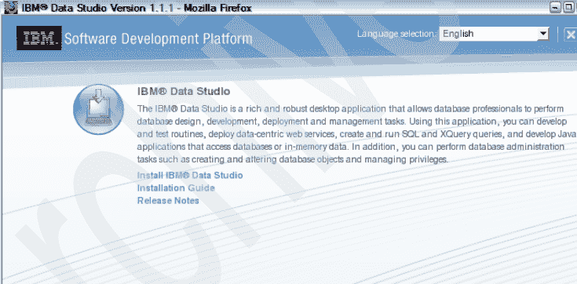

图 5-2 安装 IBM Data Studio

5.  在“安装包”面板中，如果系统尚未安装，则会选中“IBM Installation Manager”。

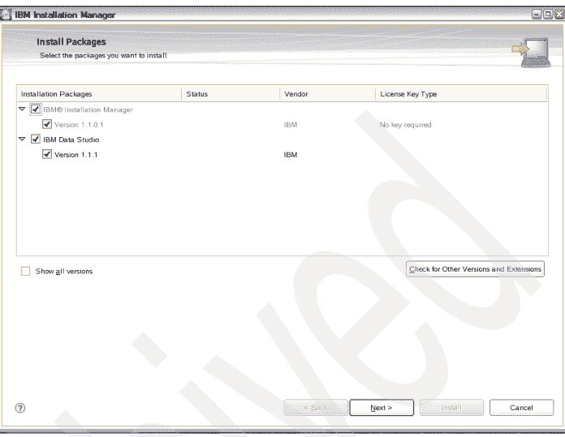

**图 5-3** 选择安装包

6.  在“许可证”面板上，接受许可协议。

7.  “位置”选项页用于指定共享资源、IBM Installation Manager 和包组的位置。

在“位置”选项页的第一个面板上（见第 203 页的图 5-4），指定共享资源目录和 IBM Installation Manager。共享资源目录包含可由一个或多个包组的资源。我们使用默认位置。

> **注意：** 你只有在第一次安装包时才能指定共享资源目录。除非卸载所有包，否则你无法更改目录位置。

202 在 Linux 上运行 DB2

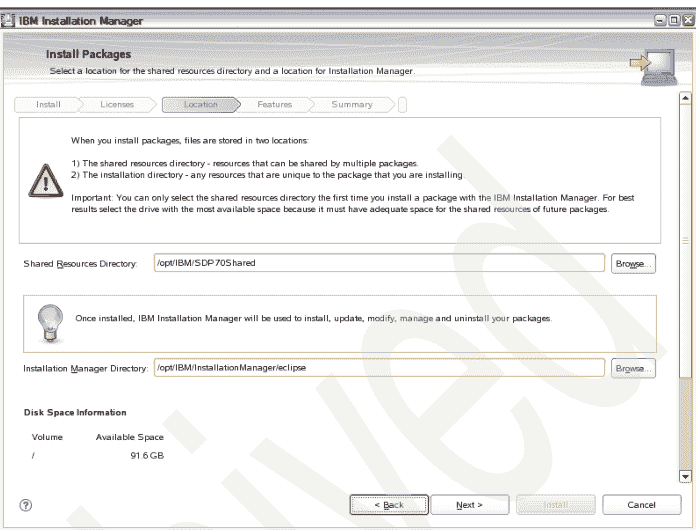

图 5-4 共享资源和 Installation Manager 的位置

接下来，你可以指定要使用现有的包组还是创建一个新的包组。我们使用默认位置创建一个新的包组。见第 204 页的图 5-5。

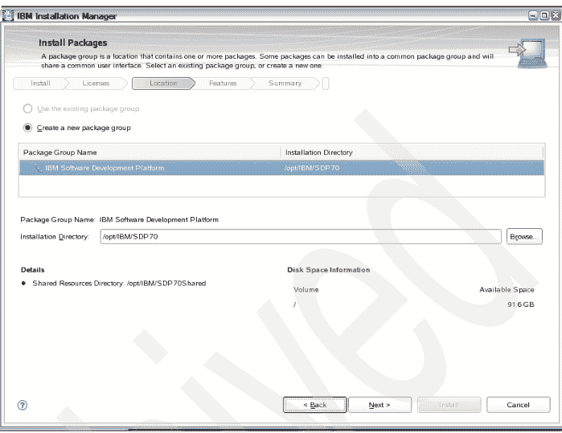

**图 5-5** 包组

IBM Data Studio 是一个基于 Eclipse 的应用程序。包中包含了一个版本的 Eclipse 集成开发环境 (IDE)。下一个面板允许你扩展现有的 Eclipse 版本，而不是安装新版本。见图 5-6。

204 在 Linux 上运行 DB2

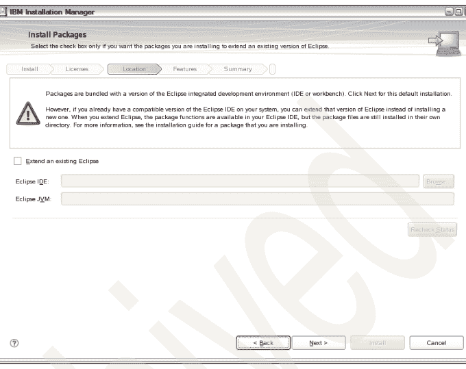

图 5-6 Eclipse 版本

8.  在“功能”选项卡下，你可以选择要安装的 Data Studio 功能。第一个面板用于选择语言。第二个面板列出了功能。见第 206 页的图 5-7。

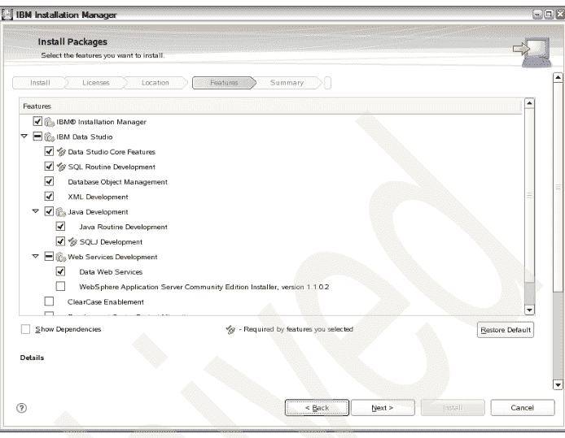

图 5-7 功能

9.  “摘要”选项卡上（见第 207 页的图 5-8）显示了所有配置。在安装 Data Studio 之前检查你的选择。点击“安装”。

10. 完成后完成后，将确认成功。如果你想查看日志，点击“查看日志”，点击“完成”。

### 5.2.2 安装 Data Administration Console

你可以通过以下步骤安装 Data Administration Console (DSAC)：

1.  以 root 身份登录。

2.  输入以下命令启动 DSAC 安装：

    `sh IBM_DSAC_V1.2_1.0-b199_Linux_x86_64.bin`

3.  在“介绍”面板上，点击“下一步”。

4.  在“许可协议”面板上，阅读协议并选择“我接受许可条款”，点击“下一步”。

5.  在“选择安装目录”面板上（见第 208 页的图 5-9），指定安装 DSAC 的目录或接受默认设置。点击“下一步”。

6.  在“指定服务器详细信息”面板上（图 5-10），指定 Web 服务器的名称和端口，然后点击“下一步”。

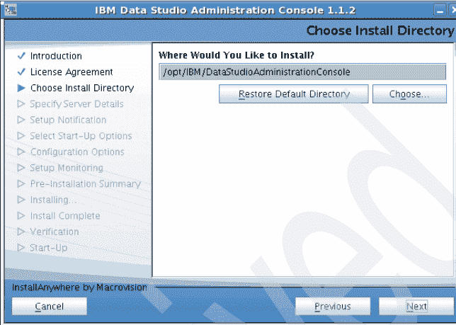

**图 5-9** 选择安装目录

7.  在“设置通知”面板上面板上，你可以选择启用邮件功能并配置简单邮件传输协议 (SMTP) 服务器。点击“下一步”。

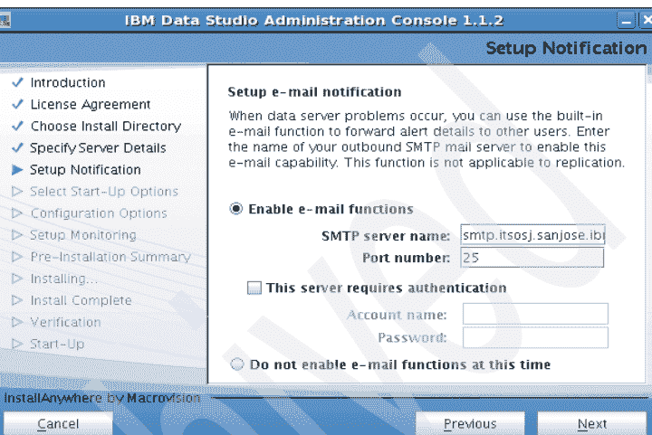

图 5-11 设置通知

8.  在“启动选项”面板上，选择“自动启动服务”，然后点击“下一步”。

9.  在“配置选项”面板上，你可以选择“允许记录日志”或“不允许发送日志”，然后点击“下一步”。

10. 在下一个面板上，为 syadmin 输入密码（该密码将由安装程序自动创建），然后点击“下一步”。

11. 在“预安装摘要”面板上，点击“下一步”。

12. 在“启动”面板上（见第 210 页的图 5-12），DSAC 服务器已成功启动并给了一个 Web 地址。你可以通过 Web 浏览器指向该地址来访问客户端控制台。完成。

### 5.2.3 从 Developer Workbench 迁移

由于 IBM Data Studio 是 Developer Workbench 的完全替代品，因此没有从 Developer Workbench 到 Data Studio 的直接迁移路径。你可以将 Data Studio 作为独立的软件包进行安装，并将现有项目从 Developer Workbench 导入到 Data Studio。

## 5.3 特性与功能

在本节中，我们将介绍 Data Studio 中常用的术语，并简要讨论支持你设计和开发数据库以及数据库应用程序的特性和功能。

在 8.5.3 节“第 470 页的使用 Data Studio 进行应用开发”中，我们演示了如何使用查询编辑器（Query Editor）创建一个查询。我们还创建了一个 Java 存储过程，并演示了如何在数据库服务器上对其进行调试。

### 5.3.1 术语

IBM Data Studio 是一个基于 Eclipse 的应用程序。它与其他基于 Eclipse 的应用程序使用相同的术语，例如工作区（workspace）、视角（perspectives）、视图（views）等。

#### 工作区 (Workspace)

工作区是你定义的项目逻辑集合。它包含了你当前本地工作环境的所有文件。当你启动 Data Studio 时，它会提示你选择工作区位置。此欢迎面板（Welcome panel）包含了几个学习 Data Studio 的链接。你可以通过选择该面板上的复选框在将来跳过此提示。

你可以使用任意数量的工作区。它们之间没有直接关系。你可以使用工作区来组织不同应用程序或不同版本的项目。

> 注意：你始终可以通过选择帮助（Help）→ 欢迎（Welcome）返回欢迎窗口。

如果你想在团队中共享工作区，请使用 5.3.2 节“第 216 页的团队功能（Team function）”中描述的团队功能。

工作区通过布局在视角内的视图呈现。当你关闭欢迎面板时，会显示一个包含工作区信息的视角。参见第 212 页的图 5-13。

#### 视角 (Perspectives)

视角是一个分组到特定布局的视图和编辑器集合。视角反映了工作区中不同的角色或任务，例如调试视角、数据视角和版本控制视角。

你可以通过选择窗口（Window） -> 打开视角（Open Perspective） -> ... 然后选择子菜单中的一个视角来切换到不同的视角。你也可以创建自己的视角或修改现有的视角。图 5-13 显示了数据视角。

在面板的右上角，你可以看到最近使用的视角（参见第 213 页的图 5-14）。点击最近使用的视角之一将切换到相关的视角。

图 5-14 在最近使用的视角之间切换的按钮

以下是可用的几个视角：

- 数据（Data）：这是你进入 Data Studio 时获取的默认视角。它允许你操作数据库、数据库对象和数据。

- 调试（Debug）：当你开始调试 Java 程序时，系统会要求切换到此视角。它支持你调试代码。

- J2EE：如果你开发 Java 2 平台企业版（J2EE）应用程序，该视角提供了一个更有用的布局。如果你创建了访问数据的 Web 服务，你可能会使用它。

- Java：此视角用于开发 Java 应用程序。

- 团队同步（Team Synchronizing）：此视角为你提供了将代码与代码库进行同步的工具。

#### 视图 (Views)

视图是项目中某个资源的表示。资源可以是特定类型的文件或数据库中的某个对象。特定资源的所有视图之间会自动同步，这意味着如果你在其中一个视图中更改任何内容，都可以立即在表示相同资源的所有其他视图中看到结果。

第 212 页图 5-13 显示的示例视角包含以下视图：

- 数据项目资源管理器（Data Project Explorer）：此视图以层级结构列出你正在工作的项目。

- 数据库资源管理器（Database Explorer）：此视图显示定义的数据库连接。它以层级结构显示相关连接的数据库对象。

- 编辑器（Editor）：位于中心是主工作面板。在我们的示例中，你看到一个扩展标记语言（XML）编辑器，当前打开了一个 XML 文件。它以树结构显示 XML 文件并允许你进行修改。在编辑器视图的顶部，你可以看到各种标签，可以在各种编辑器之间切换。

- 大纲（Outline）：大纲视图以大纲模式显示编辑器面板中的当前对象，并允许你在其中快速导航。

在右下角的面板中，你可以看到通过标签组织的其他视图，任务（Tasks）视图是一个记事本，你可以在其中跟踪已打开的任务。它还显示了你在源文件中注释的任务。使用标签切换到其他视图。

编辑器面板显示文件内容的树形表示。图中显示的是名为 NewFile.xml 的 XML 文件。右侧的大纲视图显示了文件的内容。图 5-15 显示了视图。

图 5-15 视图

你可以通过选择窗口（Window） → 显示视图（Show View） → ... 然后选择子菜单中的项来打开视图。新视图将被添加。以下是常用视图列表：

- 导航器（Navigator）：此视图显示过滤器。

- 服务器（Servers）：你可以在此视图内运行和调试应用程序。

- 问题（Problems）：此视图通常是打开的。它显示显示编译或语法问题。

- 错误日志（Error Log）：此视图通常是打开的。它向你显示常规错误消息。

- 控制台（Console）：在这里，你可以看到 Java 程序或服务器的输出。

- 书签（Bookmarks）：在这里，你可以标记代码中的章节。

- 搜索（Search）：此视图包含搜索结果列表。

#### 编辑器 (Editors)

编辑器与你编辑的文件类型相关。例如，在第 212 页的图 5-13 中使用了 XML 编辑器。对于其他文件类型，有其他编辑器。如果没有特定的编辑器，则使用文本编辑器。编辑器工具栏（图 5-16）允许你在文件注释之间移动。

#### 项目 (Projects)

项目用于组织你的资源。例如，Java 项目包含 Java 应用程序的源代码、构建文件和元信息。数据项目与数据库连接相关，并存储有关该项目的信息。在文件系统中，项目表示为工作区中的子目录。

你可以通过选择文件（File） → 新（New） → 项目（Project）创建新项目。面板列出了创建各种类型的向导。选择适用于你应用程序的向导。Data Studio 将向你询问一些特定问题并切换到特定的视角。你可以在工作区中创建任意数量的项目。根据需要打开或关闭项目。如果你想在多个工作区之间或团队中的多个成员之间共享项目，请使用 5.3.2 节“团队功能（Team function）”。仅复制项目子目录是不被支持的。

### 5.3.2 团队功能

团队功能引入了在团队成员之间或工作区之间共享项目的强大机制。此功能支持所有作为 Eclipse 框架插件的版本控制应用程序。例如并发版本系统（CVS）、Subversion（SVN）、配置管理版本控制（CMVC）和 Rational®ClearCase。

#### 共享项目

可以通过右键点击项目资源管理器中的项目名称并选择团队（Team） → 共享项目（Share Project）来共享项目（图 5-17）。

注意：要使用团队功能，需要一个代码仓库，例如 SVN 或 CVS。你需要单独安装并配置 SVN 或 CVS，因为这些仓库不属于 Data Studio 的一部分。Linux 提供了 SVN 和 CVS 的包。

当工作空间被共享时，你可以随时与仓库同步，并可以在某些检查点提交（check in）代码，并执行你的仓库支持的所有操作。你可以访问文件的之前所有提交版本。

## 检出共享项目


如果你想使用一个已在代码仓库中提交的项目，你必须将其检出（check out）到你的本地工作空间。为了进行检出，你可以切换到该仓库的相对视图（perspective）。

例如，如果你想从 CVS 仓库检出一个项目，通过选择 `Window -> Open Perspective -> Other` 切换到 CVS 视图。在 Open Perspective 面板中，选择 `CVS Repository Exploring`。这允许你指定仓库位置并从那里检出项目。

在项目被检出到你的本地工作空间后，它将将与该仓库位置连接，你可以随时与仓库提交或同步你的内容。这样一来，你的所有工作也可以在团队成员之间共享。

## 5.3.3 XML 编辑

Data Studio 包含一个强大的图形 XML 和 XML Schema Definition (XSD) 编辑器。如果你不熟悉 XML 和 XSD 语法，它提供了一个 GUI 工具来引导你完成创建步骤，这有助于经验丰富和缺乏经验的开发者创建自由 XML 和 XSD 文档。

示例 5-1 显示了一个 XSD 文档的源码。

示例 5-1 示例 XSD 文档

```
<xml version="1.0" encoding="UTF-8"?>
<schema xmlns="http://www.w3.org/2001/XMLSchema"
targetNamespace="http://www.example.org/TestSchema"
xmlns:tns="http://www.example.org/TestSchema" elementFormDefault="qualified">
  <element name="products" type="tns:productsType"/>
</schema>
```

```
<complexType name="descriptionType">
  <sequence>
    <element name="name" type="string"></element>
    <element name="price" type="double"></element>
  </sequence>
</complexType>

<complexType name="productType">
  <sequence>
    <element name="description" type="tns:descriptionType" minOccurs="1" maxOccurs="1"></element>
  </sequence>
  <attribute name="pid" type="int"></attribute>
</complexType>

<complexType name="productsType">
  <sequence>
    <element name="product" type="tns:productType" minOccurs="1" maxOccurs="unbounded"></element>
  </sequence>
</complexType>

</schema>
```

图 5-18 XSD 文档在 XML 中的外观。

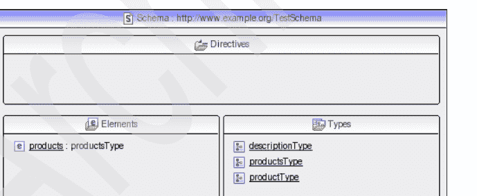

图 5-18 XSD 顶视图

如果你双击图 5-18 所示面板左侧的 `products` 元素，你可以看到它的定义（第 219 页的图 5-19）。

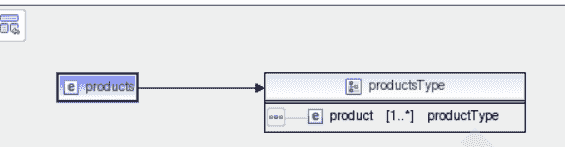

图 5-19 products 元素的定义

双击 `productsType` 元素的标题栏将向你展示它的定义，如图 5-20 所示。

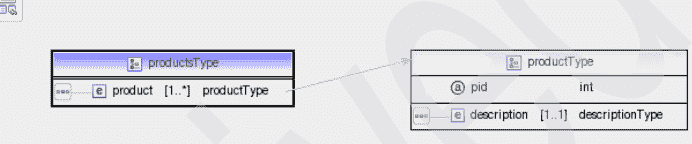

图 5-20 product 元素的定义

要查看 `descriptionType` 元素的定义，请双击它（图 5-21）。

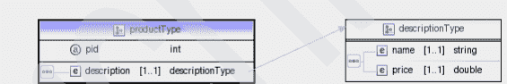

图 5-21 description 元素的定义

XML Schema 编辑 GUI 可以在 XML 结构中进行导航，并允许你轻松添加或修改定义。在这些指导下，你可以避免语法错误。你也可以选择切换到源码直接编辑文件。

你可以根据你创建的 XML Schema 定义创建一个 XML 文档。在 Data Project Explorer 视图中，右键点击 XML Documents 并选择 `New -> XML`。在 Create XML File 面板中，选择 `Create XML file from XML schema file`。为项目、新的 XML 文件和架构文件提供名称。在经过其余面板后，你将进入该文件的 XML 编辑器。

XML 编辑器根据定义引导你（图 5-22）。只需右键点击元素，XML 编辑器将仅为你提供有效选项。这些选项来自之前定义的 XSD 文档。

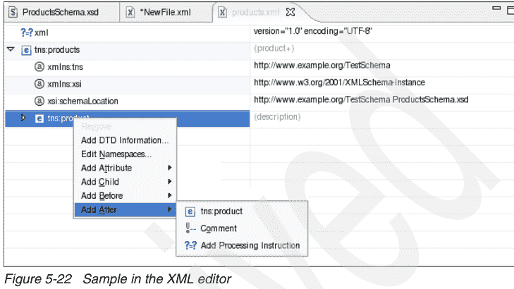

## 5.3.4 实体关系 (ER) 图绘制

Studio Data 允许你从数据库架构轻松创建实体关系 (ER) 图。在 Database Explorer 中，打开树形 `Connections -> SAMPLE -> Schemas -> DB2INST1 -> Tables` 获取表列表。选择想要创建 ER 图的表（第 221 页的图 5-23）。


图 5-23 添加表

### 5.3.5 数据和对象管理

你可以通过 Data 直接管理你的数据。为了进行此操作，打开树形 `Connections -> SAMPLE -> Schemas -> DB2INST1 -> Tables`。右键点击表并选择 `Data`。你将看到一个允许你操作数据的面板（第 222 页的图 5-25）。

| 字段名 | 数据类型 | 值 | 空值 | 范围 | 总计 | 平均值 | 第一分位数 | 中位数 |
| :--- | :--- | :--- | :--- | :--- | :--- | :--- | :--- | :--- |
| FIRSTNAME | varchar(12) | | 0 | | | | | |
| MIDINIT | varchar(13) | | 0 | | | | | |
| LASTNAME | varchar(15) | | 0 | | | | | |
| WORKDEPT | varchar(6) | | 0 | | | | | |
| PHONE | | | 0 | | | | | |
| HIREDATE | | | 0 | | | | | |
| JOB | | | 0 | | | | | |

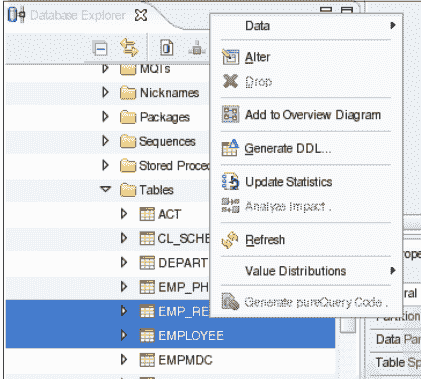

图 5-25 数据视图

| 状态 | 操作 | 对象名称 |
| :--- | :--- | :--- |
| 成功 | 编辑 | "DB2INST1".EMPLOYEE |

`update "DB2INST1".EMPLOYEE set "FIRSTNAME"='SALLY' where "EMPNO"=CAST(0030 AS CHAR(6))`

数据已保存

插入 0 行

更新 1 行

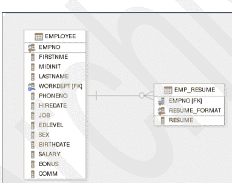

数据查看器可以通过右键点击 Database Explorer 中的 EMPLOYEE 表并选择 `Value Distributions` 来选择。你将获得允许你分析数据的面板（图 26）。

## 5.3.6 数据 Web 服务

Data Web Services 提供了无需任何代码从查询生成 Web 服务的能力。在 Data Project Explorer 视图中右键点击语句并选择 `Add to Web Service`（图 5-28，第 224 页）。

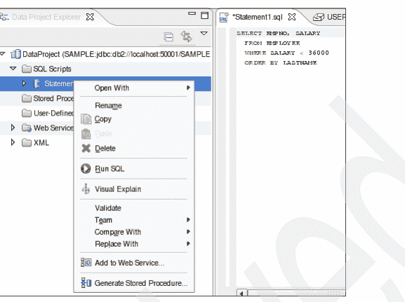

这些操作从查询创建创建一个 Web 服务。你现在可以构建 Web 存档 (WAR) 文件并将其部署到应用程序服务器上。你也可以将其作为进一步开发的框架。

如果你安装了应用程序服务器的运行时（WebSphere、Tomcat 等），你可以在工作空间内对其进行调试和运行。

- 如果你选择 `帮助 -> 教程`，你将通过教程介绍 DB2 的各种功能以及备份。

## 数据库管理

在本章中，我们提供了有关 DB2 数据库重要维护任务的信息，例如数据库备份和恢复、表重组以及通过 `EXPORT`、`IMPORT` 和 `LOAD` 等工具进行数据迁移。我们将讨论以下主题：

- 数据库备份和恢复：
  - 选择数据库和表空间恢复方法的考虑因素
  - 如何启用自动备份功能
  - 工具的基本用法（`BACKUP`、`RESTORE` 和 `ROLLFORWARD`）
  - 表重组和统计收集：
    - 自动表维护
    - 表重组
    - 统计收集
    - 重新绑定
    - 使用 `EXPORT`、`IMPORT` 和 `LOAD` 进行数据迁移
    - 使用任务中心进行备份

恢复

在某些情况下，例如硬件故障、断电或应用程序错误，数据库可能会变得不可或损坏。为了防止数据库丢失数据，一个良好的恢复策略是重要的。良好的恢复策略包括定期备份整个数据库，以及保存恢复日志文件。你的整体策略还需要包括恢复命令脚本、应用程序、用户定义函数（UDFs）、操作系统库以及加载快照。

DB2 区分了两种类型的数据库：不可恢复和可恢复。不可恢复意味着 DB2 只能将整个数据库恢复到备份的时间点。这被称为版本恢复。可以重新创建的数据可以存储在不可恢复数据库中。无法重新创建的数据需要存储在可恢复数据库中。对于可恢复数据库，DB2 可以将整个数据库或部分数据库恢复到中断的时间点（日志末尾）或特定的时间点。我们将此过程称为向前恢复。

## 数据库日志

任何高可用策略的关键元素都是数据库日志。DB2 会记录每个事务，除非指示不要，或者在使用 Load 工具的情况下。如果需要恢复数据库，数据库日志文件是非常重要的。创建数据库时会自动创建恢复日志文件和恢复历史文件。DB2 有两种日志记录机制：

- 循环日志：新创建数据库的默认方法。如果 `LOGARCHMETHOD1` 和 `LOGARCHMETH2` 数据库配置参数设置为 `OFF`，则数据库是不可恢复的并使用循环日志。一组日志文件以轮询方式使用。这些日志在需要时用于崩溃恢复。崩溃恢复是将所有未提交的更改回滚到数据一致状态的过程。
- 归档：通过使用归档，数据库被认为是可恢复数据库。要启用归档，将 `LOGARCHMETHOD1` 或 `LOGARCHMETH2` 数据库配置参数设置为 `OFF` 以外的值。活动日志仍用于崩溃恢复，但你还有包含已事务数据的归档日志。成功恢复后，你可以使用活动日志和归档日志将数据库向前滚动（即超过备份镜像的时间）到特定的时间点或活动日志末尾。

DB2 提供了多种备份机制。你需要在以下备份机制之间进行选择。

## 离线或在线备份

离线备份期间，应用程序无法连接到数据库。当你在 `BACKUP` 命令中指定指定参数时，这是默认备份方法。离线备份后，你将获得整个数据库的一致镜像副本。也可以执行可恢复数据库备份操作。在线意味着其他应用程序可以在备份操作期间连接到数据库。在向前恢复期间，确保如果恢复该备份，所有的表更改都会被捕获并重放。如果你有一个可恢复数据库，你可以备份、恢复并向前滚动单个表空间，而不是整个数据库。当你备份表空间时，它仍然可用，同时的更新会记录在日志中。当你在表空间上执行在线恢复或向前滚动操作时，在操作完成之前，表空间本身不可用，但用户用户访问其他表空间中的表。

## 全量或增量备份

全量备份是整个数据库的镜像副本（图 6-1）。在分区环境中，每个数据库分区备份都写在一个单独的输出文件中。

| 周日 | 周一 | 周二 | 周三 | 周四 | 周五 | 星期六 | 周日 |
|---|---|---|---|---|---|---|---|
| | | | | | | | |


增量备份是自上次备份以来更改的镜像副本（图 6-2）。增量备份记录了自上次全量备份以来更改的所有数据（图 6-3）。

## 选择数据库日志记录

图 6-4 选择数据库日志的菜单

2. 选择“配置数据库日志”将打开如图 6-5 所示的向导。

(图 6-5 图像)

图 6-5 配置数据库日志向导

232 在 Linux 上运行 DB2

### 3. 选择归档日志，并在下一页中让 DB2 自动归档日志文件。你需要按照图 6-6 所示更新主归档日志路径。

(图 6-6 图像)

图 6-6 主归档日志路径

浏览所有页面以配置所有相关的数据库日志参数。

启用日志归档后，DB2 会将数据库设置为等待备份（backup pending）状态，以确保在开始日志归档之前进行完整的离线备份。要在单分区数据库环境中执行备份，请使用以下命令：

```
db2 backup db2db to /db2backup
```

在分区数据库环境中，有不同的方法进行备份。我们将在第 240 页的 6.1.4 “备份实用程序”中详细介绍如何备份操作。现在，第 234 页的示例 6-1 显示了备份分区数据库的一种方法。

## 示例 6-1 备份所有数据库分区

`db2inst1mensa~\> db2 "backup db itsdb on all dbpartitionnums to /db2backup"`

| 分区 |  |

| :--- | :--- |

| 0000 DB20000I | BACKUP DATABASE 命令成功完成。 |

| 0001 DB20000I | BACKUP DATABASE 命令成功完成。 |

备份成功。此备份映像的时间戳为：20080201170437

现在，数据库已准备好进行日志归档。要验证数据库已准备好进行日志归档，请使用以下命令：

`db2 archive log for itsdb`

活动日志将从日志目录归档到 `/db2archive` 目录。`db2` 使用以下子目录结构存储归档日志文件：

`/<logpath>/instance/DBNAME/PARTITION#/CHAIN#`

在我们案例，我们在以下路径看到分区数据库的归档日志文件：

/db2archive/db2inst1/ITSODB/NODE00000/C000000...

---rw-r-- 1 db2inst1 db2grp1 12288 2008-02-01 17:38 S000000.LOG

/db2archive/db2inst1/ITSODB/NODE00001/C000000...

---rw-r-- 1 db2inst1 db2grp1 12288 2008-02-01 17:38 S000000.LOG

数据库现在已启用在线模式下的数据库备份，以便备份单个表空间。

## 日志管理的更多参数

通过我们执行的设置，日志由 DB2 日志管理器 (`db2logmgr`) 自动归档到另一个名为 `/db2archive` 的文件系统。根据公司对日志归档的需求，你可能考虑设置其他配置参数。

对于日志归档，请检查以下参数：

* `LOGARCHMETH2`: 该参数指定了归档日志文件的第二个位置或方法。该参数的设置方式类似于 `LOGARCHMETH1`，但它指向不同的位置，例如另一个文件系统或 Tivoli Storage Manager。如果同时指定 `LOGARCHMETH1` 和 `LOGARCHMETH2`，则每个日志文件将被归档两次，这意味着你在两个位置中都有归档日志文件的副本。

* `ARCHRETRYDELAY`, `NUMARCHRETRY`, `FAILARCHPATH`: 指定的日志归档方法可能会失败，例如归档文件系统已满或 Tivoli Server Manager 服务器不可。在这种情况下，DB2 将将在 `ARCHRETRYDELAY` 参数指定的时间后检索归档。`NUMARCHRETRY` 指定了在将日志文件归档到 `FAILARCHPATH` 配置参数指定的路径之前，将尝试归档的次数。`FAILARCHPATH` 是日志文件的临时存储区域，直到失败的归档方法恢复可用。届时，日志文件将从此目录移动到日志方法目录，从而可能避免某些情况。该参数必须是一个完全限定的现有目录。

日志文件对于数据库恢复至关重要。你需要管理日志文件和日志空间容量。

> 注意：要监控运行数据库的当前日志使用情况，请使用 `GET SNAP` 命令或 `LOG_UTILIZATION` 管理视图：

`db2 SELECT * FROM SYBSADM.LOG_UTILIZATION`

`LOG_UTILIZATION` 视图显示每个数据库分区的总日志空间百分比、可用日志空间百分比和使用的日志空间。

从 DB2 9.5 开始，DB2 维护两个日志控制文件：`SQLOGCTL.LF1` 和 `SQLOGCTL.LF2`。你可以通过设置数据库参数 `MIRRORLOGPATH` 来镜像 DB2 数据库日志文件。DB2 提供了镜像活动日志的能力，以防止磁盘崩溃时丢失日志。

## 6.1.2 恢复文件

### 6.1.2.1 列表文件

恢复时，在分区数据库环境中，你必须使用 `list_history` 命令。

## 示例 6-2 列出历史

`dbdbinst1mensa~\> db2 list history all for itsdb`

| 分区 | 结果 |

| :--- | :--- |

| 0000 DB20000I | BACKUP DATABASE 命令成功完成。 |

| 0001 DB20000I | BACKUP DATABASE 命令成功完成。 |

备份成功。此备份映像的时间戳为：20080201170437

现在，数据库已准备好进行日志归档。要验证数据库已准备好进行日志归档，请使用以下命令：

`db2 archive log for itsdb`

活动日志将从日志目录归档到 `/db2archive` 目录。`db2` 使用以下子目录结构存储归档日志文件：

`/<logpath>/instance/DBNAME/PARTITION#/CHAIN#`

在我们案例，我们在以下路径看到分区数据库的归档日志文件：

/db2archive/db2inst1/ITSODB/NODE00000/C000000...

---rw-r-- 1 db2inst1 db2grp1 12288 2008-02-01 17:38 S000000.LOG

/db2archive/db2inst1/ITSODB/NODE00001/C000000...

---rw-r-- 1 db2inst1 db2grp1 12288 2008-02-01 17:38 S000000.LOG

数据库现在已启用在线模式下的数据库备份，以便备份单个表空间。

## 示例 6-3 归档日志

```
db2inst1mensa~\> db2 archive log all for itsdb
```

| 分区 | 结果 |

| :--- | :--- |

| 0000 DB20000I | BACKUP DATABASE 命令成功完成。 |

| 0001 DB20000I | BACKUP DATABASE 命令成功完成。 |

备份成功。此备份映像的时间戳为：20080201170437

## 257

在分区数据库环境中查看归档日志文件，你必须使用 `list_history` 命令。

## 6.1.3 启用 Tivoli Storage Manager 使用

DB2 支持使用 Tivoli Storage Manager 存储进行数据库备份和日志归档。Tivoli Storage Manager 系统由 Tivoli Storage Manager 服务器和 Tivoli Storage Manager 客户端组成。

使用 Tivoli Storage Manager 客户端 API 与 Tivoli Storage Manager 服务器通信。我们的测试基于 Tivoli Storage Manager 服务器 5.5.0 版本以及 Tivoli Storage Manager 客户端和 API 版本 5.4.0。

在每个数据库服务器上安装了 Tivoli Storage Manager 客户端和 Tivoli Storage Manager API 后，我们必须配置 DB2，以便 DB2 能够与 Tivoli Storage Manager 服务器通信。编辑文件 `$INSTHOME/sqlib/userprofile` 以添加示例 6-4 所示的 Tivoli Manager 变量。

# 示例 6-4 DB2 实例 userprofile 中的 Tivoli Storage Manager 定义

```bash
export DSMI_DIR=/opt/tivoli/tsm/client/api/bin64
export DSMI_CONFIG=/opt/tivoli/tsm/client/api/bin64/dsm.opt
export DSMI_LOG=$HOME/sqlib/db2dump
```

> 注意：如果更改了 `DSMI` 变量，则需要重启 DB2 实例。为了确保在 `db2start` 时使用了正确的值，请运行以下命令：

```bash
db2stop
export | grep DSMI
db2start
```

如果你想验证正在运行的 DB2 的 DSMI 变量，请使用 `ps` 命令：

```bash
ps -fu db2inst1 | grep db2sysc
ps eww <PID_of_db2sys>
```

还必须配置 Tivoli Storage Manager。在接下来的文件中，定义要使用的 Tivoli Storage Manager 服务器：

/opt/tivoli/tsm/client/api/bin64/dsm.sys

示例 6-5 显示了我们测试环境中的文件。

# 示例 6-5 数据库服务器上的示例 dsm.sys 配置文件

| Servername | TSM_SERVER1 |

|---|---||

| NodeName | db2mensa |

| passwordaccess | generate |

| COMMethod | TCip |

| TCPerveraddress | 9.43.86.125 |

| TCPPort | 1500 |

`Servername` 指定的值必须在 `dsm.opt` 文件中指定，如示例 6-6 所示。`dsm.opt` 文件的位置由 `DSMI_CONFIG` 变量指定。

示例 6-6 dsm.opt 文件

| Servername | TSM_SERVER1 |

|---|---|

| tapeprompt | no |

每个 `NodeName` 都必须在 Tivoli Storage Manager 服务器上注册。Tivoli Storage Manager 服务器管理员可以使用 `register node` 命令注册每个节点名称。Tivoli 需要某些池来存储归档日志文件和数据库备份副本。默认情况下，使用归档存储池（ARCHIVEPOOL）存储由 DB2 发的归档日志，使用备份存储池（BACKUPPOOL）存储所有的 DB2 备份文件。

备份管理员还将为节点设置密码。我们需要在数据库服务器上保存此 Tivoli Storage Manager 密码。进入目录 `$INSTHOME/sqlib/dbsm` 并执行示例 6-7 所示的步骤。

示例 6-7 在 Tivoli Storage Manager 客户端上设置密码

```bash
db2inst1@mens:~/sqlib/dbsm= root
root's Password: db2inst1@mens:~/sqlib/dbsm= ../dsmap
************************************************
* Tivoli Storage Manager
* API Version = 5.4.0
************************************************
Enter your current password:
Enter your new password:
Enter your new password again: Your new password has been accepted and updated.
```

DB2 提供了 `db2backup` 实用用于管理 Tivoli Storage Manager 中的备份文件。你可以查看 DB2 备份文件以及从 Tivoli Storage Manager 到数据库服务器的备份文件。如果输入 `db2backup`，将显示所有选项。

+ 注意：使用 `db2backup` 的完整说明见《DB2 for Linux, UNIX, and Windows Command Reference 235-584》。

## 6.1.4 备份工具

我们已经完成了第 230 页 6.1.1“启用向前恢复和日志归档”中描述的所有步骤。现在我们描述几种备份数据库的方法。

## 备份数据库

DB2 提供了几种数据库备份选项：

- 全量离线备份：离线数据库备份允许你在不应用任何日志记录的情况下恢复数据库映像。示例 6-8 显示了离线备份命令。

示例 6-8 全量离线备份到磁盘

```bash
db2inst1@mens:> db2 backup db2inst to /db2backup
```

备份成功。此备份映像的时间戳为：2008024048123

- 全量在线备份：在在线备份期间，数据库对应用程序仍然可用。必须启用向前恢复。为了能够从在线备份恢复数据库，你至少需要从在线备份时间开始的活动日志文件范围。确保这些日志文件可用；你可以在备份中使用 `LOGS` 子句（这是 V9.5 中的默认行为）。此功能包含了与备份映像恢复所需的日志文件。如果你需要将备份映像传输到灾难备备地，则无需单独发送日志文件或手动将它们打包。此外，你不需要决定哪些日志文件用于保证在线备份的一致性。第 241 页的示例 6-9 提供了全量在线备份的示例。

示例 6-9 包含日志的全量在线备份到磁盘

```bash
db2inst1@mens:> db2 backup db2inst online to /db2backup include logs
```

备份成功。该时间戳为：2008024009001

- 表空间备份：表空间备份允许你备份指定的表空间。在示例 6-10 中，我们仅备份 `TBSMS_0`。

示例 6-10 在线表空间备份

```bash
TBSMS_0
db2inst1@mens:> db2 backup db2inst tablespace(TBSMS_0) online to /db2backup
```

备份成功。时间戳为：2008024090637

- 增量备份：增量备份节省了时间和资源。示例 6-11 提供了增量备份示例。

示例 6-11 增量备份到磁盘

```bash
db2inst1@mens:> db2 backup db2inst online incremental to /db2backup
```

备份成功。时间戳为：2008024091101

- 差异备份：示例 6-12 显示了执行全量数据库备份后的差异备份。

示例 6-12 备份到 Tivoli Storage Manager 的差异备份

```bash
db2inst1@mens:> db2 backup db2inst online delta use tsm
```

备份成功。时间戳为：2008024091912

> 注意：要启用增量或差异备份，你需要将数据库配置参数 `TRACKMOD` 设置为 ON：

`db2 update cfg for db2inst using TRACKMOD ON`

当 `TRACKMOD` 设置为 ON 时，需要在增量或差异备份之前执行一次全量备份。

## 备份分区数据库

在分区数据库环境中，有三种备份方法：

- 逐个备份数据库分区。

- 使用 `db2backup` 命令配合 `BACKUP DATABASE` 命令备份所有指定的数据库分区。

- 运行单个系统视图（SSV）备份来同时备份部分或全部数据库分区。

逐个备份分区耗时且容易出错。使用 `db2backup` 命令通过 `BACKUP DATABASE` 命令备份所有分区可以简化流程并节省时间。然而，由于包含目录的数据库分区无法与非目录分区同时备份，你仍然必须先备份目录数据库分区，然后备份其余数据库分区。

假设数据库分区 0 是目录分区，命令如下：

```bash
db2backup db2inst partition 0 to /db2backup
db2backup db2inst to /db2backup
```

## 示例 6-14 用于监控备份的 LIST UTILITIES

`db2inst1@mensa:/> db2 list utilities show detail`

| ID | Value |

| :--- | :--- |

| ID | = 327 |

| Type | = BACKUP |

| Database Name | = ITSODB |

| Partition Number | = 0 |

| Description | = online db |

| Start Time | = 02/21/2008 14:28:40.181501 |

| State | = Executing |

| Invocation Type | = User |

| Throttling: | |

| Priority | = throttled |

| Progress Monitoring: Estimated Percentage Complete | = 29 |

| Total Work | 304720105 bytes |

| Completed Work | 87135441 bytes |

| Start Time | 02/21/2008 14:28:40.181510 |

| ID | Value |

| :--- | :--- |

| ID | = 135 |

| Type | = BACKUP |

| Database Name | = ITSODB |


| Partition Number | = 1 |

| Description | = online db |

| Start Time | = 02/21/2008 14:28:41.835045 |

| State | = Executing |

| Invocation Type | = User |

| Throttling: | |

| Priority | = Unthrottled |

| Progress Monitoring: Estimated Percentage Complete | = 98 |

| Total Work | 224002009 bytes |

| Completed Work | 220510145 bytes |

| Start Time | 02/21/2008 14:28:41.835055 |

可以使用 `SNAPUTIL` 管理视图或结合 `SNAP_GET_UTIL` 表函数获取相同的信息。通过使用 `SNAPUTIL_PROGRESS` 管理视图或 `SNAP_GET_UTIL` 表函数，你可以获取到通过 `LIST UTILITIES SHOW DETAIL` 命令获取的相同信息。第 244 页的示例 6-15 展示了如何使用管理视图。

## 示例 6-15 用于监控备份的管理视图

```
db2inst1@mensa:> db2 "select UTILITY_TYPE, substr(UTILITY_DESCRIPTION,1,15), UTILITY_STATE, DBBPARTITIONUM FROM SYSIBADM.SNAPUTIL"
```

| UTILITY_TYPE | UTILITY_STATE DBBPARTITIONUM |

| :--- | :--- |

| BACKUP | online db EXECUTE 0 |

| BACKUP | online db EXECUTE 1 |

选了 2 条记录。

```
db2inst1@mensa:> db2 "select SNAPSHOT_TIMESTAMP, UTILITY_STATE, PROGRESS_START_TIME, PROGRESS_TOTAL_UNITS, PROGRESS_COMPLETED_UNITS, DBBPARTITIONUM FROM SYSIBADM.SNAPUTIL_PROGRESS*"
```

| SNAPSHOT_TIMESTAMP UTILITY_STATE PROGRESS START_TIME PROGRESS_TOTAL_UNITS PROGRESS_COMPLETED_UNITS DBBPARTITIONUM |

| :--- | :--- | :--- | :--- | :--- | :--- |

| 2008-02-21-14.28.43.442266 | EXECUTE | 2008-02-21-14.28.40.181510 | 504720105 | 8846673 | 0 |

| 2008-02-21-14.28.45.099408 | EXECUTE | 2008-02-21-14.28.41.835055 | 224002009 | 220510145 | 1 |

选了 2 条记录。

## 备份镜像

你可以使用 `dbckbp` 测试备份镜像的完整性，并判断备份镜像是否可以恢复。示例 6-16 显示了如何使用该工具验证备份镜像。

```
示例 6-16 dbckbp 输出
```

```
db2inst1@mensa:/db2backup> dbckbp
ITSDBM.0.db2inst1.NODE0000.CATN0000.2008020418223.001
```

- 处理了 [1] 个缓冲区：##########################

镜像验证成功。

`dbckbp` 工具还可以用于显示备份头中的元数据，例如表空间信息或自动存储路径。备份媒体头如第 245 页示例 6-17 所示使用 `-h` 选项显示。输出显示我们使用了 `LOGS` 子句和 `COMPRESS` 选项进行备份。

## 示例 6-17 使用 dbckbp 显示媒体头

```
db2inst1@mensa:db2backup> dbckbp -h
ITSDB.0..db2inst1.NODE0000.CATN0000.2008020514153.001
```

===========

到达媒体头：

===========

```
服务器数据库名称 -- ITSODB
服务器别名 -- ITSODB
客户端别名 -- ITSODB
时间戳 -- 2008020514153
数据库分区数 -- 0
实例 -- db2inst1
序列号 -- 1
发行 ID -- C0
数据库种子 -- 508962
代码集 (卷) -- 0
数据库 (卷)
代码集 (系统) -- 0
数据库 (系统) -- -1
身份验证值 -- 1
备份模式 -- 1
包含日志 -- 1
压缩 -- 1
备份类型 -- 0
备份范围 -- 0
状态标志 -- 21
系统包含 -- 1
目录分区数 -- 0
数据库编码 -- UTF-8
数据库区域 --
日志ID -- 120239916
日志路径 -- /database/db2inst1/NODE0000/SQL0000/LOGDIR/
备份缓冲区 -- 1048576
会话数 -- 1
平台 -- 1

正确的镜像将是：
ITSODB.0..db2inst1.NODE0000.CATN0000.2008020514153.001

- 处理了 [1] 个缓冲区：###########

镜像验证成功。

有关 `dbckbp` 工具的更多选项，请参阅《DB2 Linux, UNIX 和 Windows 命令参考》，SC23-5846。

## 使用 DB2 Center 备份数据库

备份工具完全集成在 DB2 Control Center 中。图 6-7 显示了可以在哪里调用备份工具。

通过所有面板并输入所有参数。最后，你可以列出如图 6-8 所示的备份语句。

你有两个选择：立即运行生成的脚本，或者让受集成在“工具”中的调度程序控制。请参考第 247 页的图 6-9。

另一种备份方法是通过 Control Center 生成脚本并使用自己的调度程序定期运行此备份。

## 数据库备份示例脚本

我们已经在 6.1.4 备份工具中向你展示了各种备份命令。在第 248 页的示例 6-18 中，我们向你展示了一个备份分区的数据库 `ITSODB` 的脚本。使用 `db2_` 命令调用此脚本：

```
db2_ /home/db2inst1/database_backup.ksh db2inst1 itsodb
```

## 示例 6-18 备份脚本 database_backup.ksh

```bash
#!/usr/bin/ksh

#
## 脚本：备份数据库
#
echo 正在运行实例: ${1}
echo 正在运行数据库: ${2}
INSTANCE=$1
DB_ALIAS=$2
#-
## 检查并执行 db2profile，如果可用
#-
DBHOME=`finger -l $INSTANCE | grep Directory | awk '{print $2}'`
if [[ -f $DBHOME/sqlib/db2profile ]];
then
    echo "未找到文件: $DBHOME/sqlib/db2profile"
    echo "请检查主机和实例名"
    echo "********************脚本异常结束*********************"
    exit 1
fi
.$DBHOME/sqlib/db2profile
for i in 1 2 3
do
    echo ""
    echo "开始在节点 $DB2NODE 上备份数据库 $DB_ALIAS"
    echo ""
    db2 backup db $DB_ALIAS to /db2backup with 4 buffers parallelism
    if [ $? -eq 0 ];
    then
        szDate=$(date)
        echo "在节点 $DB2NODE 上成功备份数据库 $DB_ALIAS $szDate" | tee -a $DBHOME/$DB_ALIAS.log
        echo ""
        exit 0
    fi
    if [ "$i" -le "3" ]
    then
      echo "开始下一次尝试"
    fi
done
szDate=$(date)
echo ""
echo "在节点 $DB2NODE 上备份数据库 $DB_ALIAS 在尝试 3 次后失败"
$szDate | tee -a $DBHOME/$DB_ALIAS.log
echo ""
exit 8
```

修改此示例以适应你的环境和需求。

DB2 9.5 的新功能单系统视图（SSV）备份是备份所有数据库分区的推荐方法（第 242 页示例 6-13）。

> 注意：有关备份数据库的详细说明，请参阅《数据恢复与高可用性指南和参考》第 10 章“数据库备份”，SC23-5848。

## 启用自动备份

## 使用向导配置自动备份

在本节中，我们将演示如何使用“配置自动维护”向导为 `ITS0B` 数据库启用自动数据库备份功能。可以从 DB2 控制中心启动该向导，如图 6-10 所示。

| | | |
|---|---|---|
| 静止 (Quiesce) | | |
| 所有系统 (All System) | 静止 | | |
| 所有数据 (All Data) | 授权 (Author... | | |
| ITS0B | 管理实用程序 (Manage Utilities...) | 系统 |
| | 配置自动维护 (Configure Automatic Maintenance...) | 数据库 |
| | 设计顾问 (Design Advisor...) | | |
| | 配置顾问 (Configuration Advisor...) | | |
| | 配置参数 (Configure Parameters...) | | |
| | 配置数据库日志 (Configure Database Logging...) | | |
| | 备份 (Backup) | 显示 2 个项目 |
| | 恢复 (Restore...) | 控制中心 |
| | 滚恢复 (Roll-forward...) | | |
| | 停止向前恢复 (Stop roll-forward.) | | |
| | 显示已解释语句历史 (Show Explained Statements History) | | |
| | 解释查询 (Explain Query.) | 自定义控制中心 |

**图 6-10** 控制中心中的配置自动维护

第 251 页的图 6-11 显示了您可以在其中指定执行自动维护的时间范围的面板。

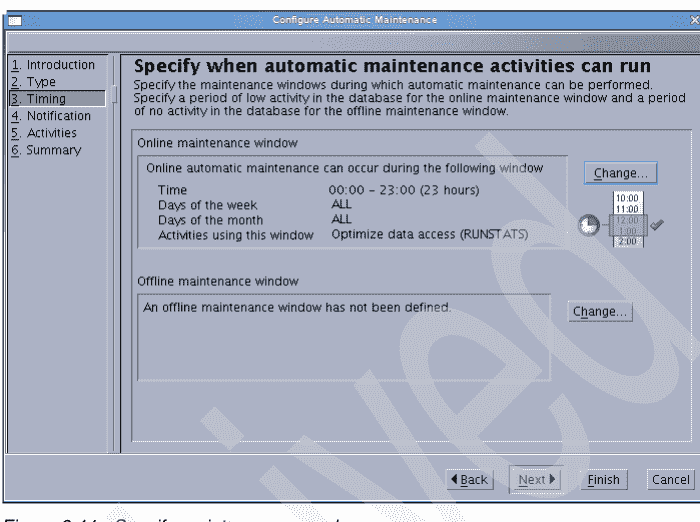

**图 6-11** 指定维护面板

在活动*页面*，必须勾选自动备份复选框；请参考第 252 页的图 6-12。点击**配置设置**以指定策略设置*详情*，例如备份位置。

第 6 章 管理数据库 251 页

## 选择维护活动进行配置

自动维护包含以下系列活动。选择一个维护活动以查看其当前设置。要启用或禁用此活动的自动化和通知，请勾选“自动并通知”复选框。要更新这些设置，请选择“配置设置”按钮。

- 1. 简介
- 2. 类型 
- 3. 时机 
- 4. 通知 
- 5. 活动 
- 6. 摘要 

| 维护活动 | 维护窗口 | |
|---|---|---|
| 备份数据库 (BACKUP) | 在线 | |
| 重组表和索引数据 (REORG) | 离线 | |
| 优化数据访问 (RUNSTATS) | 在线 | x|

### 维护活动设置

备份维护活动使用以下设置自动备份您的数据库

| 标准 | | |
|---|---|
| 平衡恢复性与性能 | |
| 介质 | 文件系统 |
| 位置 | /database/db2inst1/NODE00/2L00002/DB2AUTOBACKUPS |

> **注意**：备份映像将自动从此目录删除。请勿将任何非自动备份映像放在此目录中，因为它们会被删除。

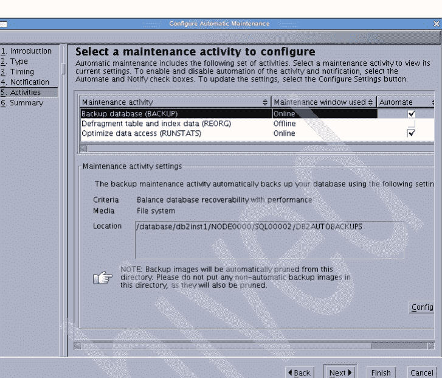

图 6-12 选择维护活动

## 使用命令行处理器配置自动备份

自动维护功能的启用由自动维护数据库配置参数控制，如示例 6-19 所示。

## 示例 6-19 自动维护参数

```
db2inst1@home/db2inst1> db2 get cfg for itsobb | grep
自动维护
自动数据库备份
(AUTO_MAINT) = ON
(AUTO_DB_BACKUP) = OFF
自动表维护
(AUTO_TBL_MAINT) = ON
自动运行stats
(AUTO_RUNSTATS) = ON
自动语句统计
(AUTO_STMT_STATS) = OFF
自动统计分析
(AUTO_STATS_PROF) = OFF
自动分析更新
(AUTO_PROF_UPD) = OFF
自动重组
(AUTO_REORG) = OFF
```

要使用命令行处理器 (`CLP`) 配置自动备份，您必须将 `AUTO_MAINT` 和 `AUTO_DB_BACKUP` 设置为 `ON`。

## DB2 提供了一个存储过程 `AUTOMAINT_SET_POLICY`，用于指定自动备份的自动化维护策略（同样也用于 `AUTO_REORG` 和 `AUTO_RUNSTATS`，以及设置在线和离线维护窗口的天数和时间）。

> **注意**：DB2 内置管理例程序管理视图为执行各种 DB2 管理任务提供了一个易于使用的编程接口。这些例程序和视图可以在基于 SQL 的应用程序或命令行中调用。

要使用 `AUTOMAINT_SET_POLICY` 存储过程配置自动备份，您必须创建一个可扩展标记语言 (`XML`) 配置输入以指定详情，例如备份介质、备份将是在线还是离线以及备份频率。

`AUTOMAINT_SET_POLICY` 存储过程接受两个输入参数：

- 维护类型：`AUTO_BACKUP`、`AUTO_REORG`、`AUTO_RUNSTATS` 或 `MAINTENANCE_WINDOW`
- 配置：二进制大对象 (`BLOB`) 类型参数或一个以 XML 格式指定配置的 XML 文件

存储过程 `AUTOMAINT_GET_POLICYFILE` 允许您以 XML 格式获取有关策略的详情。可以根据需要编辑 XML 文件，并使用 `AUTOMAINT_SET_POLICY` 存储过程重新导入。

在示例 6-20 中，我们从数据库获取当前设置，编辑文件将持续时间定义为小时，并为数据库设置设置。

示例 6-20 更改维护窗口

```
db2inst1@mens: db2 -call
AUTOMAINT_GET_POLICY('MAINTENANCE_WINDOW', 'window.xml')
db2inst1@mens: cat /home/db2inst1/sqlib/tmp/window.xml
<?xml version="1.0" encoding="UTF-8"?>
<DB2MaintenanceWindows
xmlns="http://www.lbm.com/dbms/prod/db2/automatic/config" >
<!-- 在线维护窗口 --
<OnlineWindow Occurrence="During" startTime="00:00:00" duration="24" >
<DaysOfWeek>All</DaysOfWeek>
<DaysOfMonth>All</DaysOfMonth>
<MonthsOfYear>All</MonthsOfYear>
```
</OnlineWindow>
</DB2MaintenanceWindows>
```

-- 现在我们编辑文件 /home/db2inst1/sqlib/tmp/window.xml
-- 将 duration="24" 改为 duration="4"
-- 然后我们执行设置
```
db2inst1@mens: db2 -call
AUTOMAINT_SET_POLICY('MAINTENANCE_WINDOW', 'window.xml')
```

返回状态 = 0

您也可以使用这些过程配置自动备份、重组和运行stats，通过将第 253 页示例 6-20 中的 `MAINTENANCE_WINDOW` 替换为以下之一：

- `AUTO_BACKUP`
- `AUTO_REORG`
- `AUTO_RUNSTATS`

DB2 提供了四个策略文件（每个类型一个），位于 `$HOME/sqlib/automaint`。

> **注意**：有关更多信息，请参阅《数据恢复与高可用性指南》中的“配置自动维护策略”。

## 6.1.5 DB2 数据库恢复

数据库恢复是在发生问题（如介质故障）后重建数据库或表空间。

有三种恢复类型：

- 崩溃恢复保护数据库在事务意外中断时不会处于不一致状态。
- 版本恢复是使用备份期间创建的映像恢复之前的数据库版本。
- 滚恢复可用于重放备份后提交的更改。

待应用。在成功运行恢复（`restore`）命令后，你必须向前重滚到备份结束的时间点。你可以使用以下 V9.5 命令进行向前重滚：

```
db2 rollforward db itsdb to end of backup and stop
```

如果你使用了带有 `INCLUDE LOGS` 子的备份命令，则可以在 `restore` 命令中使用 `LOGTARGET` 选项。示例 6-21 显示了这在单分区数据库中如何工作。

## 示例 6-21 使用在线备份和包含日志进行版本恢复


```
db2inst1@mensa:> db2 "restore itsdb from /db2backup taken at
2008022006143831 logarget /db2backup/logs"
DB200001 The RESTORE DATABASE command completed successfully.
```

```
db2inst1@mensa:> db2 "rollforward itsdb to end of backup overflow log path
(/db2backup/logs)"
```

## 重滚状态

| 输入数据库别名 | 返回状态的节点数 |
| :--- | :--- |
| itsoddb | 1 |

| 节点数 | 重滚状态 | 下一个读取的日志文件 | 已处理的日志文件 | 最后提交的事务 |
| :--- | :--- | :--- | :--- | :--- |
| 0 | DB working | S0000001.LOG | S0000000.LOG - S0000000.LOG | 2008-02-06-22.38.32.000000 UTC |

DB200001 The ROLLFORWARD command completed successfully.

```
db2inst1@mensa:> db2 "rollforward db itsdb stop"
```

## 重滚状态

| 输入数据库别名 | 返回状态的节点数 |
| :--- | :--- |
| itsoddb | 1 |

| 节点数 | 重滚状态 | 下一个读取的日志文件 | 已处理的日志文件 | 最后提交的事务 |
| :--- | :--- | :--- | :--- | :--- |
| 0 | not pending | S0000001.LOG - S0000000.LOG | 2008-02-06-22.38.32.000000 UTC |

DB200001 The ROLLFORWARD command completed successfully.

## 使用增量备份进行全数据库恢复

恢复增量备份映像的最佳方法是使用 `AUTO` 选项。DB2 将收集所需的备份映像（全量和增量备份）以恢复数据库：

```
db2 restore db itsdb incremental from /db2backup taken at 200802049192
```

如果你想知道恢复增量备份需要哪些备份映像，可以使用 `db2crst` 命令：

```
db2crst -d itsdb -t 2008020491912
```

该命令查询数据库历史记录，并生成备份映像的时间戳列表以及建议的恢复顺序。

## 重滚恢复

要使用重滚恢复方法，数据库必须配置为可恢复的数据库。在恢复操作结束时，数据库将处于重滚等待（rollforward pending）状态，这使你能够将数据库向前重滚到特定的时间点或日志末尾。

> 注意：使用 `RESTORE` 和 `ROLLFORWARD` 命令恢复和向前重滚数据库涉及多个步骤。或者，你可以使用 `RECOVER` 命令通过一个命令即可恢复并向前重滚数据库：

```
db2 recover database itsdb
```

`RECOVER` 命令读取数据库文件以获取恢复和向前重滚数据库的所有必要信息。

你可以使用命令检查重滚过程的进度：

```
db2 rollforward db itsdb query status
```

使用 `rollforward` 命令，你可以指定时间戳或日志结束点，这告诉数据库需要向前重滚多远。

重滚恢复有两种类型：

- 数据库向前重滚：

此过程将记录在数据库日志中的事务应用到数据库中。重滚工具会读取所需的日志（归档日志或活动日志文件）。已归档的日志将使用日志归档方法检索。将数据库向前重滚到尽可能远的最简单方法是使用以下命令：

```
db2 "rollforward db itsdb to end of logs and stop"
```

如果你需要将数据库向前重滚到特定的时间点，请使用以下命令：

```
db2 "rollforward db itsodb to 2008-02-06-20.15.30 using local time"
db2 "rollforward db itsodb query status"
db2 "rollforward db itsodb stop"
```

## 表重滚恢复

如果数据库启用了向前恢复，你可以选择备份、恢复和向前重滚表空间，而不是整个数据库。你可以对表空间进行重滚恢复到日志末尾或特定时间点。你指定的时间点必须大于或等于该表空间的最小恢复时间。6-22 显示了如何确定该时间。

## 示例 6-22 恢复到最小时间点

```
db2inst1mens:> db2 "restore db itsodb tablespace (userspace) online
from/db2backup taken 20080206145105"
DB200001 The RESTORE DATABASE command completed successfully.

---- 从另一个登录 shell 中，查找最小恢复时间 -----
db2inst1mensa:> db2 connect to itsodb
```

| 表空间 ID | 名称 | 类型 | 内容 |
| :--- | :--- | :--- | :--- |
| 0 | SYSPACE | Database managed | All |
| 1 | TEMPORARY | System managed | System |
| users | userspace | Database managed | Regular |

command。在实用程序的运行期间，您可以使用 `LIST UTILITY` 命令来监控 `RESTORE` 和 `ROLLFORWARD` 实用程序。也可以使用管理视图 `SNAPUTIL` 和 `SNAPUTIL_PROGRESS` 或表函数 `SNAP_GET_UTIL` 和 `SNAP_GET_PROGRESS` 获取相同的信息。示例 6-23 显示了数据库分区 0 表空间以及随后的 rollforward 的输出。

## 示例 6-23 恢复和 rollforward

```
db2inst1@mensa:> db2 list
```

```
ID = 331
Type = RESTORE
Database Name = ITSODB
Partition Number = 0
Description = tablespace TSDATA2...
Start Time = 02/21/2008 15:23:01.033971
State = Executing
Invocation = User
```

```
db2inst1@mensa:> db2 list utilities show detail
```

```
ID = 331
Type = RESTORE
Database Name = ITSODB
Partition Number = 0
Description = tablespace TSDATA2...
Start Time = 02/21/2008 15:23:01.033971
State = Executing
Invocation = User
```

```
Progress Monitoring:
Completed Work = 54837248 bytes
Start Time = 02/21/2008 15:23:01.033976
```

```
db2inst1@mensa:> db2 "select UTILITY_TYPE, substr(UTILITY_DESCRIPTION,1,15), UTILITY_STATE,DBBPARTITIONNUM FROM SYBMADM.SNAPUTIL"
```

```
UTILITY_TYPE UTILITY_STATE DBBPARTITIONNUM
-------------------------------------------
RESTORE tablespace TSDA EXECUTE 0
record(s) selected.
```

```
db2inst1@mensa:> db2 "select SNAPSHOT_TIMESTAMP, UTILITY_STATE, PROGRESS_START_TIME, PROGRESS_TOTAL_UNITS, PROGRESS_COMPLETED_UNITS, DBBPARTITIONNUM FROM SYBMADM.SNAPUTIL_PROGRESS"
```

```
SNAPSHOT_TIMESTAMP UTILITY_STATE PROGRESS_START_TIME
PROGRESS_TOTAL_UNITS PROGRESS_COMPLETED_UNITS DBPARTITIONNUM

---------------------------------------------------------------------------------
---------------------------------------------------------------------------------
2008-02-21-15.23.523409 EXECUTE 2008-02-21-15.23.013976
54837248 0

1 record(s) selected.
```

```
db2inst1@mens:> db2 list utilities

ID = 332
Type = ROLLFORWARD RECOVERY
Database Name = ITS00B
Partition Number = 0
Description = Online Tablespace Rollforward Recovery: 7
Start Time = 02/21/2008 15:25:243220
State = Executing
Invocation Type = User
Progress Monitoring:
Estimated Percentage Complete = 0
```

```
db2inst1@mens:> db2 list utilities show detail

```

ID = 332

Type = ROLLFORWARD RECOVERY

Database Name = ITS00B

Partition Number = 0

Description = Online Tablespace Rollforward Recovery: 7

Start Time = 02/21/2008 15:25:243220

State = Executing

Invocation Type = User

Progress Monitoring:

Estimated Percentage Complete = 0

Phase Number = 1

Description = Forward

Total Work = 38614 bytes

Completed Work = 38614 bytes

Start Time = 02/21/2008 15:25:243220

Phase Number [Current] = 2

Description = Backward

Total Work = 5627893427 bytes

Completed Work = 0 bytes

Start Time = 02/21/2008 15:25:2098645

```

```

db2inst1@mensa:> db2 select UTILITY_TYPE, substr(UTILITY_DESCRIPTION,1,15),

UTILITY_STATE, DBBPARTITIONNUM from SYSIBADM.SNAPUTIL

```

```

UTILITY_TYPE UTILITY_STATE DBBPARTITIONNUM

ROLLFORWARD_RECOVERY Online Tablespa EXECUTE 0

record(s) selected.

```

```

db2inst1@mensa:> db2 select SNAPSHOT_TIMESTAMP, UTILITY_STATE,

substr(PROGRESS_DESCRIPTION,1,10) desc, PROGRESS_START_TIME,

PROGRESS_TOTAL_UNITS, PROGRESS_COMPLETED_UNITS, DBBPARTITIONNUM

SYSIBADM.SNAPUTIL_PROGRESS

```

```

SNAPSHOT_TIMESTAMP UTILITY_STATE PROGRESS_START_TIME

PROGRESS_TOTAL_UNITS PROGRESS_COMPLETED_UNITS DBPARTITIONNUM

```

| SNAPSHOT_TIMESTAMP | UTILITY_STATE | PROGRESS_START_TIME | PROGRESS_TOTAL_UNITS | PROGRESS_COMPLETED_UNITS | DBPARTITIONNUM |
| :--- | :--- | :--- | :--- | :--- | :--- |
| 2008-02-21-15.23.523409 | EXECUTE | 2008-02-21-15.23.013976 | 54837248 | 38614 | 0 |
| 2008-02-21-15.23.523409 | EXECUTE | 2008-02-21-15.23.013976 | 54837248 | 562347 | 0 |
对于 rollforward 恢复，有两个阶段：向前和向后。在向前阶段，读取日志文件并应用到数据库。在向后阶段，任何未提交的更改都将被回滚。

## 使用 Control Center 数据库恢复

恢复和 rollforward 已完全集成到 DB2 Control Center。您可以从图 13 所示的数据库菜单访问向导。恢复向导（图 14）将引导您完成恢复数据的步骤。例如，如果您想执行完整恢复或表空间恢复，可以选择哪个备份映像以及如何 rollforward。

## 在 Linux 上运行 DB2

> 注意：有关数据库恢复选项的详细说明，请参考《DB2 高可用性指南和参考》第 2 部分，“数据库恢复”。

## 6.1. 重定向恢复场景

使用重定向恢复，可以在将数据库恢复到原有数据库或另一个数据库时，更改存储在备份映像中的容器物理位置。重定向恢复通过带有 `REDIRECT` 参数的 `RESTORE` 命令或使用 Control Center 中的恢复向导执行。您需要使用 `SET TABLESPACE` 命令或向导重新定义要修改的每个表容器。在版本 9.5 中，您也可以从备份映像生成重定向恢复脚本并进行修改。

步骤：
1. 使用恢复程序生成重定向恢复脚本。必须调用 `REDIRECT` 和 `GENERATE` 选项。
2. 根据需要修改生成的重定向恢复脚本：
   - 恢复选项
   - 自动存储路径
   - 容器布局和路径
3. 运行修改后的重定向恢复脚本。

在分区数据库环境中，必须对每个分区执行这些步骤，因为表容器定义可能不同。

对于示例数据库 ITSDB，我们使用生成的重定向恢复脚本更改表空间的位置的大小。示例 6-24 显示了我们如何为分区数据库生成脚本。

## 示例 6-24 准备数据库并生成重定向恢复脚本

```

db2inst1@mensa:db2home/db2inst> db2 connect to itsdb

```

| Field | Value |
| :--- | :--- |
| Database server | DB2/LINUX64 9.5.0 |
| SQL authorization ID | DB2INST1 |
| Local database alias | ITSODB |

```

db2inst1@mensa:db2home/db2inst> db2 -tvf tscrt.sql

```

```

create tablespace TSDATA1 IBMDEFAULTGROUP managed by database using (file

'/tablespaces/db2inst1/itsdb/NODE0000/TSDATA1.000' 40M) on dbpartitionum(0)

using ('tablespaces/db2inst1/itsdb/NODE0001/TSDATA1.000' 40M) on

dbpartitionum(1)

DB200001 The SQL command completed successfully.

```

```

db2inst1@mensa:db2home/db2inst> db2 "create table TAB1 (id not null

primary key, name char(10) in tsdata1"

DB200001 The SQL command completed successfully.

```

```

db2inst1@mensa:db2home/db2inst> db2 "insert into tabl values (1, 'Tina')"

DB200001 The SQL command completed successfully.

```

```

db2inst1@mensa:db2home/db2inst> db2 "insert into tabl values (2, 'Jonas')"

DB200001 The SQL command completed successfully.

```


`db2inst1@mensa:db2home/db2inst> db2 connect reset`

DB200001 The SQL command completed successfully.

`db2inst1@mensa:db2home/db2inst> db2 backup db itsdb on all partitions`

to `"/dbbackup"`

Part Result

+   0000 DB200001 The BACKUP command completed successfully.

0001 DB200001 The BACKUP DATABASE successfully.

备份成功。该备份映像的时间戳为：200802061729

```
db2inst1@mensa:db2home/db2inst> db2_all <<00 db2 restore itsdb from
/dbbackup taken at 200802061729 redirect generate script
itsdb_node0000.clip
```

DB200001 The RESTORE DATABASE command completed successfully.

mensa: db2 restore itsdb ... completed ok

```
db2inst1@mensa:db2home/db2inst> db2_all <<+1 db2 restore itsdb from
/dbbackup taken at 200802061729 redirect generate script
itsdb_node0001.clip
```

DB200001 The RESTORE DATABASE command completed successfully.

gemi: db2 restore itsdb ... completed ok

```
db2inst1@mensa:db2home/db2inst> ls *.clip
itsdb_node0000.clip itsdb_node0001.clip
```

现在，我们需要修改两个生成的脚本，每个数据库分区一个。在我们的案例中，我们更改了表空间容器路径和 TSDATA的大小。第 267 页的示例 6-25 显示了脚本的一部分，它与数据库分区 0 上的空间 TSDATA 相关，并包含了我们所做的更改。

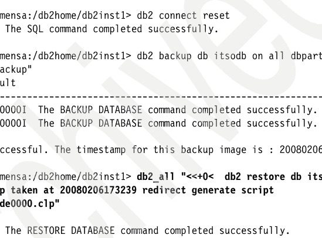

### 示例 6-25 更改后的重定向恢复脚本部分

```
-- 表空间名称 = TSDATA1
** 表空间 ID = 4
** 表空间类型 = 数据库管理空间
** 表空间内容类型 = 所有持久数据。
** 表空间页大小（字节） = 8192
** 表空间区大小（页） = 32
** 使用自动存储 = 否
** 已启用自动调整大小 = 否
** 总页数 = 5120
** 可用页数 = 5088
** 高水位标记（页） = 96
************************************************
SET TABLESPACE CONTAINERS FOR 4
IGNORE ROLLFORWARD CONTAINER OPERATIONS
USING (
FILE '/tables/db2inst1/itsoddb/NODE0000/TSDATA1.000' 5120
FILE '/tables/ITS00000/TSDATA1.000' 4000
);
```

在执行完两个脚本后，我们在每个数据库分区上创建了新目录，并针对其关联的数据库分区运行每个脚本。示例 6-26 显示了数据库分区 0 的输出。

### 6-26 执行针对数据库分区 0 的脚本

```
db2inst1:~/db2home/db2inst1/ mkdir /tables/ITS00000/
db2inst1:~/db2home/db2inst1/ export DB2NODE=0
db2inst1:~/db2home/db2inst1/ db2 terminate
DB200001 The TERMINATE command completed successfully.
db2inst1:~/db2home/db2inst1/ -tvf itsoddb.node0000.clip
UPDATE COMMAND OPTIONS USING S Z ON ITSODDB_NODE0000.out V ON
DB200001 The UPDATE COMMAND completed successfully.
```

```
SET CLIENT ATTACH_DBPARTITION 0
DB200001 The SET CLIENT command completed successfully.
```

```
SET CONNECT_DBPARTITION 0
DB200001 The SET CLIENT command completed successfully.
```

```
RESTORE ITSODDB FROM '/db2backup' TAKEN 20080206173239 INTO ITSODDB
REDIRECT
SQL5239W Warning! 正在恢复一个与备份镜像数据库相同的现有数据库。数据库文件将被删除。
你确定要继续吗？(y/n) y
SQL127W 正在执行重定向恢复操作。现在可以查看表空间配置，并可以对不使用自动存储的表空间重新配置其容器容器。
DB200001 The RESTORE DATABASE command completed successfully.

SET TABLESPACE CONTAINERS FOR 4 USING ( FILE
'/tablespaces/ITS00000/TSDATA1.000' 4000 )
DB200001 The SET TABLESPACE CONTAINERS command completed successfully.

RESTORE DATABASE ITSODB CONTINUE
DB200001 The RESTORE DATABASE command completed successfully.
```

我们还针对数据库分区 1 运行了脚本 `itsdb_node0001`。

由于该数据库启用了日志滚存恢复（rolforward recovery），我们必须在连接到数据库之前执行日志滚存。示例 6-27 显示了状态和新的表空间容器定义。

使用生成的脚本，我们能够轻松地重新定义表空间容器路径和大小。

### 示例 6-27 重定向恢复后的日志滚存

```
db2inst1@mensa:db2home/db2inst1> db2 rolforward db itsdb stop
```

日志滚存状态

```
输入数据库别名 = itsdb
返回状态的节点数 = 2
```

```
节点数 日志滚存 待读取的日志文件
已处理的状态 最后提交的事务
```

```
0 未挂起
S0000002.LOG-S0000002.LOG 2008-02-27-01.32.41.000000 UTC
1 未挂起
2008-02-07-01.36.12.000000 UTC
```

```
DB200001 The ROLLFORWARD command completed successfully.
db2inst1@mensa:db2home/db2inst1> db2 connect to itsdb
```

### 数据库连接信息

```
数据库服务器 = DB2/LINUXX8664 9.5.0
SQL  ID = DB2INST1
本地数据库别名 = ITSODB
```

```
db2inst1@mensa:db2home/db2inst1> db2 list tablespace containers for
```

### 表空间 4 的表空间容器

| 容器 ID | = 0 |
| :--- | :--- |
| 名称 | = /tables/ITS00000/TSDATA1.000 |
| 类型 | = File |

**注意：** 如果你想使用 `db2adut` 和 Tivoli Storage Manager 从一台机器到另一台执行重定向恢复，你需要设置 `logarchopt1` 和 `vendoropt` 数据库配置参数。你可以参考《数据恢复与高可用性指南和参考》（SC23-5848）第 11 章“使用 db2adut1 恢复数据”章节下的详细示例。

### 6.1.7 恢复被删除表的示例

用户可能误删除了一个数据库表，并且需要恢复该表。

由于该数据库启用了日志滚存恢复，我们必须在连接到数据库之前执行日志滚存。示例 6-27 显示了状态和新的表空间容器定义。

使用生成的脚本，我们能够轻松地重新定义表空间容器路径和大小。

### 示例 6-27 重定向恢复后的日志滚存

```
db2inst1@mensa:db2home/db2inst1> db2 rolforward db itsdb stop
```

日志滚存状态

```
输入数据库别名 = itsdb
返回状态的节点数 = 2
```

```
节点数 日志滚存 待读取的日志文件
已处理的状态 最后提交的事务
```

```
0 未挂起
S0000002.LOG-S0000002.LOG 2008-02-27-01.32.41.000000 UTC
1 未挂起
2008-02-07-01.36.12.000000 UTC
```

```
DB200001 The ROLLFORWARD command completed successfully.
db2inst1@mensa:db2home/db2inst1> db2 connect to itsdb
```

### 数据库连接信息

```
数据库服务器 = DB2/LINUXX8664 9.5.0
SQL ID = DB2INST1
本地数据库别名 = ITSODB
```

```
db2inst1@mensa:db2home/db2inst1> db2 list tablespace containers for
```

### 表空间 4 的表空间容器

| 容器 ID | = 0 |
| :--- | :--- |
| 名称 | = /tables/ITS00000/TSDATA1.000 |
| 类型 | = File |

**注意：** 如果你想使用 `db2adut` 和 Tivoli Storage Manager 从一台机器到另一台执行重定向恢复，你需要设置 `logarchopt1` 和 `vendoropt` 数据库配置参数。你可以参考《数据恢复与高可用性指南和参考》（SC23-5848）第 11 章“使用 db2adut1 恢复数据”章节下的详细示例。

### 6.1.7 恢复被删除表的示例

用户可能误删除了一个数据库表，并且需要恢复该表。由于该数据库启用了日志滚存恢复，我们必须在连接到数据库之前执行日志滚存。示例 6-27 显示了状态和新的表空间容器定义。

使用生成的脚本，我们能够轻松地重新定义表空间容器路径和大小。

### 示例 6-27 重定向恢复后的日志滚存

```
db2inst1@mensa:db2home/db2inst1> db2 rolforward db itsdb stop
```

日志滚存状态

```
输入数据库别名 = itsdb
返回状态的节点数 = 2
```

```
节点数 日志滚存 待读取的日志文件
已处理的状态 最后提交的事务
```

```
0 未挂起
S0000002.LOG-S0000002.LOG 2008-02-27-01.32.41.000000 UTC
1 未挂起
2008-02-07-01.36.12.000000 UTC
```

```
DB200001 The ROLLFORWARD command completed successfully.
db2inst1@mensa:db2home/db2inst1> db2 connect to itsdb
```

0 未挂起

2008-02-07-01.32.41.000000 UTC

1 未挂起

2008-02-07-01.36.12.000000 UTC

DB200001 ROLLFORWARD 命令执行成功。

- 5. 在完成滚动恢复后，DB2 将表数据还原到导出子目录 NODEnnn 中的一个名为 data 的文件中。现在，从历史文件中获取信息以创建表，并从导出文件将所有数据加载到表中。CREATE TABLE DDL 在执行 `DROP TABLE` 命令期间已存入恢复历史中，如第 271 页的示例 6-30 所示。我们现在恢复表需要运行的命令如示例 6-32 所示。

### 示例 6-32 重建并导入数据

```
db2inst1:~/ db connect to itsdb
```

数据库连接信息

| 属性 | 值 |
| :--- | :--- |
| 数据库服务器 | DB2/LINUX8664 9.5.0 |
| SQL 授权 ID | DB2INST1 |
| 本地数据库别名 | ITSODB |

```
db2inst1:~/ db2 'CREATE TABLE "DB2INST1" ( "ID" INTEGER NOT NULL, "NAME"CHAR(10)) ) DISTRIBUTE BY HASH('#ID') IN "DATASA1'
DB200001 SQL 命令执行成功.
db2inst1:~/ db2_all <<0= db connect to itsdb; db2 import from /db2backup/rest_table/NODE0000/data of del insert into tab1"
```

数据库连接信息

| 属性 | 值 |
| :--- | :--- |
| 数据库服务器 | DB2/LINUX8664 9.5.0 |
| SQL 授权 ID | DB2INST1 |
| 本地数据库别名 | ITSODB |

实用程序开始从 "//db2backup/rest_table/NODE0000/data" 加载数据文件。

SQL3110N 程序已完成处理。从输入文件中读取了 "0" 行。

```
SQL3221W ...BEGIN COMMIT WORK. Input Record Count = "0".
```

```
SQL3222W ...COMMIT of any database changes was successful.
```

272 在 DB2 Linux 上运行

SQL3149 从输入文件中处理了 "0" 行。已成功向表中插入了 "0" 行。拒绝了 "0" 行。

| 行数 | 值 |
| :--- | :--- |
| 读取的行数 | 0 |
| 跳过的行数 | 0 |
| 插入的行数 | 0 |
| 更新的行数 | 0 |
| 拒绝的行数 | 0 |
| 提交的行数 | 0 |

mensa: db2 connect to itsodb completed ok

db2inst@mensa:/> db2_all <<1 db2 connect to itsodb; db2 import from /db2backup/rest_table/NODE0001/data of insert into table*

### 数据库连接信息

| 属性 | 值 |
| :--- | :--- |
| 数据库服务器 | DB2/LINUXX8664 9.5.0 |
| SQL 授权 ID | DB2INST1 |
| 本地数据库别名 | ITSODB |

SQL310N 程序开始从 //db2backup/rest_table/NODE0001/data 加载数据。"

SQL310ON 程序已完成处理。从输入文件中读取了 "2" 行。

SQL3221W ...Begin COMMIT WORK. Input Record Count = "2",

SQL3222W ...COMMIT of any database changes was successful.

SQL3149 从输入文件中处理了 "2" 行。已成功向表中插入了 "2" 行。拒绝了 "0" 行。

| 行数 | 值 |
| :--- | :--- |
| 读取的行数 | 2 |
| 跳过的行数 | 0 |
| 插入的行数 | 2 |
| 更新的行数 | 0 |
| 拒绝的行数 | 0 |
| 提交的行数 | 2 |

gemini: db2 connect to itsodb completed ok

| ID | NAME |
| :--- | :--- |
| 1 | Tina |
| 2 | Jonas |

选中了 2 条记录。

表已重建，表数据已可用。

## 6.2 表/索引重组和统计信息收集

当表发生重大变化时，该表及其索引的物理数据页将变得不连续或碎片化。如果特定表存在聚集索引，在对索引键值进行多次更改后，它可能会变得聚集非常不佳。在这些情况下，管理类似的工作负载需要额外的成本（如 CPU 时间和 I/O 操作），这可能导致明显的性能下降。对数据库进行维护活动对于确保其在性能和可恢复性方面得到优化至关重要。

DB2 提供了可配置的自动表维护功能。如果您不确定何时以及如何重组表和索引，以及如何收集统计信息，可以将自动维护作为您整体数据库维护计划的一部分。

如果您想手动重组表和索引，DB2 提供了一个 `REORG` 实用程序用于为此。在完成重组任务后，使用 `RUNSTATS` 实用程序收集有关表及其关联索引的物理数据存储特征的信息。

### 6.2.1 自动维护

当表发生重大变化时，该表及其索引的物理数据页将变得不连续或碎片化。如果特定表存在聚集索引，在对索引键值进行多次更改后，它可能会变得聚集非常不佳。在这些情况下，管理类似的工作负载需要额外的成本（如 CPU 时间和 I/O 操作），这可能导致明显的性能下降。对数据库进行维护活动对于确保其在性能和可恢复性方面得到优化至关重要。


DB2 提供了可配置的自动表维护功能。如果您不确定何时以及如何重组表和索引，以及如何收集统计信息，可以将自动维护作为您整体数据库维护计划的一部分。

如果您想手动重组表和索引，DB2 提供了一个 `REORG` 实用程序用于为此。在完成重组任务后，使用 `RUNSTATS` 实用程序收集有关表及其关联索引的物理数据存储特征的信息。

从版本8开始，DB2 提供了备份、保持统计信息更新以及必要时重组表的自动维护功能。

```
db2inst1:~/ db2 get cfg | grep Automatic
AUTO_MAINT = ON
AUTO_BACKUP = OFF
AUTO_REINT = ON
AUTO_STATS = OFF
AUTO_PROF = OFF
AUTO_UPD = OFF
AUTO_REORG = OFF
```

`AUTO_MAINT` 参数允许您关闭它而不影响相应的设置。例如，如果 `AUTO_MAINT` 设置为 `OFF`，则未启用自动维护。

## 启用表维护

要使用自动维护，可以使用命令行或 Configure Maintenance 向导。

- 1. 如图 15 所示，从 Control Center 打开向导。
- 2. 从弹出窗口选择 Configure Maintenance。也可以通过扩展 Control Center 中的数据库树并选择数据库来打开向导。面板位于 Control Center 的右侧。参考图 16。
- 3. 选择 Maintenance 启动向导。向导显示常规信息（图 17）。
- 4. 您可以为活动（如 `RUNSTATS` 实用程序）和离线活动（如 `REORG` 实用程序）指定维护窗口。图 6-18 显示了一个示例。

启用自动维护活动需要如第 279 页图 19 所示选择相应的复选框。

## 指定自动维护运行的时间

指定可以执行自动维护的窗口。为在线维护窗口指定一个数据库空闲时间，为维护窗口指定一个数据库无活动时间。

### 在线维护窗口

在线自动维护可以在以下窗口进行

| 时间 | 星期 | 日期 | 使用此窗口的活动 |
| :--- | :--- | :--- | :--- |
| 00:00 - 23:00 (23 小) | 全部 | 全部 | 优化数据访问 (`RUNSTATS`) |

### 离线维护窗口

离线自动维护可以在以下窗口进行

| 时间 | 星期 | 日期 | 使用此窗口的活动 |
| :--- | :--- | :--- | :--- |
| 22:00 - 05:00 (7 小) | 周三、周六、周日 | 全部 | 整理表和索引数据 (`REORG`) |

## 选择一个要配置的维护活动

自动维护包含以下一组活动。选择一个维护活动以查看其当前设置。要启用或禁用该活动的自动化和通知，请勾选自动（Automate）和通知（Notify）复选框。要更新设置，请选择选择配置（Configure）按钮。

| 维护活动 | 使用的维护窗口 | 自动 | 通知 |
| --- | --- | --- | --- |
| 备份数据库 (`BACKUP`) | 在线 | x | |
| 表和索引数据碎片整理 (`REORG`) | 离线 | | x |
| 优化数据访问 (`RUNINSTAT`) | 在线 | x | |

### 维护活动设置

数据访问优化维护活动会自动分析表中的数据，以便应用程序尽可能快速地访问数据。此活动将通过以下方式进行。

#### 表范围

包括系统表的所有表


图 6-19 选择维护活动

* 6. 使用“配置设置”来指定您想要自动收集统计信息的表，或您想要重新组织的表。

> 注意：使用“配置自动维护”向导，您可以指定您的维护目标。数据库管理器使用这些目标来确定是否需要执行维护活动，并在下一个可用维护窗口（您定义的时间段）期间运行所需的维护活动。

## 自动统计收集

自动统计收集通过确保您拥有最新的统计信息来提高数据库性能。数据库器确定您的工作负载需要哪些统计信息以及哪些统计信息需要更新。DB2 优化器使用这些统计信息来确定访问数据的路径。

统计信息可以通过异步（在后台）或通过在编译 SQL 语句时同步收集运行时统计来进行。默认情况下，自动统计收集设置为开启。只有在启用自动统计收集时，才能启用实时统计收集。实时统计收集由 `AUTO_STMT_STATS` 配置参数控制。如果此配置参数设置为开启，则每当需要优化查询时，表统计信息都会在语句编译时自动进行编译。

在可选情况下，您可以通过将两个配置参数设置为开启来启用自动统计分析文件的生成：

* `AUTO_STMT_PROF`
* `AUTO_PROF_UPD`

自动统计分析通过检测过时、缺失或错误的统计信息，以及根据查询反馈生成统计分析文件，建议何时以及如何收集表统计信息。

## 自动重新组织

在表数据发生多次更改后，表和索引可能会产生碎片。逻辑顺序数据可能存在于表内。特别是对非顺序物理页的统计分析；因此，数据库管理器必须执行额外的读取操作来访问数据。

除了其他信息外，`RUNSTATS` 收集的统计信息显示了表内的数据分布。特别是对这些统计信息的分析可以指示何时以及需要何种重新组织。自动重新组织通过使用 `REORGCHK` 公式确定表和索引是否需要重新组织。它定期评估更新了统计信息的表和索引，查看是否需要重新组织。如果是，它会在内部为该表调度索引重新组织或经典的表重新组织。重新组织要求您的应用程序在表重新组织期间在没有对表的写入权限的情况下正常运行。

在分区的数据库环境中，确定是否执行自动重新组织以及是否启动自动重新组织是在目录分区上完成的。重新组织将在目标表所在的所有数据库分区上运行。

## 6.2.2 手动表维护

如果您没有使用自动表维护功能，则需要确保您的表统计信息是最新的，并定期重新组织表，以便保持应用程序的性能处于最佳状态。

DB2 提供了以下实用程序来手动执行此工作：

* `REORG`
* `RUNSTATS`
* `REBIND`

### 表重新组织

`REORG TABLE` 选项重新组织表以匹配其索引并回收空间。您可以重新组织系统目录表，也可以重新组织用户表。DB2 提供了两种重新组织方法：

* 内联 (Inplace) 重新组织

内联重新组织允许应用程序在重新组织期间访问表。任何具有相应权限的人都可以暂停和恢复内联表重新组织。内联重新组织的简单命令是：

```
db2 reorg table
```

您还可以使用 `ADMIN_CMD` 过程来执行：

```sql
call sysproc.admin_cmd ('reorg table inplace")
```

表 `db2inst.item` 将进行在线重新组织。`REORG` 命令的 `INPLACE` 选项指定离线重新组织。如果没有指定，则运行离线 `REORG`。

* 离线 (classic) 重新组织

离线方法提供了快速表重新组织，特别是当不需要重新组织大对象 (LOB) 或 LONG 数据时。除非特别请求，LOB 和 LONG 数据不会被重新组织。此外，在表重新组织后会重建索引。应用程序可以访问表的原始副本，但在重新组织的最后阶段，影子副本将替换原始副本和索引。离线重新组织的简单命令是：

```
db2 reorg table
```

您还可以使用 `ADMIN_CMD` 过程：

```sql
call sysproc.admin_cmd ('reorg table")
```

**注意：** 通常情况下，离线表重新组织更快，但只有当您的应用程序在重新组织期间没有表写入权限时才能使用。此外，离线表重新组织需要创建表的副本，因此大约需要双倍的空间。如果没有指定，在线重新组织较慢，尽管它可以在后台进行。对于在线和离线重新组织，您都可以指定方法并决定哪种更适合您的环境。

您可以使用 DB2 控制中心进行表重新组织。扩展控制中心中的对象树直到找到表文件夹。右键点击表并选择**重新组织**。参考图 6-20。


图 6-20 表内容菜单

在重新组织表面板中，您可以选择 `REORG` 方法和各种选项（图 6-21）。


图 6-21 重新组织表面板

注意，您还可以将 `REORG` 调度为任务。图 6-22 显示了生成的命令。

## 控制中心

控制中心 选择 编辑 视图 工具 帮助 对象视图

+ 控制中心
- 所有系统
- 所有数据库
  - 对象
  - 视图
  - 别名
  - 昵号
  - 体系对象
  - 触发器
  - 模式
  - 索引
  - 表空间
  - 数据库分区组
  - 缓冲池
  - 应用对象
  - 用户和组对象
- 联邦数据库对象
  - XML 模式存储库(XSR)
- ITODRPL
- SAMPLE
- TOOLSICAT

| 名称 | 模式 | 表空间 |
|---|---|--|
| IN_TRAY | DB2INS1 | USSPACE1 |
| ITEM | DB2INS1 | ITSATASP1 |
| ITEMIMP | 打开数据库分区... | |
| ITEM | | 查询... |
| ORC | | 更改... |
| POLUCY | | 重命名 |
| | | 删除 |
| | | 创建 |
| 152 的 152 条 it... | | 权限 |

## 表 - ITE

| 模式 | 列 |
|---|--|
| DB | 导入... |
| DB - 2 | 加载... |
| | 来源 |
| | 重组... |
| | 重组索引... |
| | 运行统计信息... |
| | 设置完整性 |
| | 估计大小 |

图 6-23 表上下文菜单

在“重组索引”面板中，您可以配置 `REORG` 方法和各种选项（见第 286 页的图 6-24）。

第 6 章 管理数据库 285

图 6-24 重组索引面板

图 6-25 显示了生成的命令。

图 6-25 生成 `REORG INDEX` 命令

### 统计信息收集

286 Linux 上的 DB2 运行指南

底层表显著影响了视图返回的行数。该视图必须之前通过 `ALTER VIEW` 命令启用以用于查询优化。

可以从 `db2nodes.cfg` 文件中的任何分区发布 `RUNSTATS` 命令。它可以用于更新目录数据库分区中的目录。在分区分区数据库中，`RUNSTATS` 命令仅收集单个节点的统计信息。如果执行 `RUNSTATS` 命令的数据库分区是表的一部分，则命令将在跨该表的数据库分区组中的第一个数据库分区上执行。

通过使用不同的 `RUNSTATS` 命令参数，可以对执行 `RUNSTATS` 的表进行读或写操作。例如，`ALLOW READ ACCESS` 指定其他用户在计算统计信息时可以对表具有只读访问权限，而 `ALLOW WRITE ACCESS` 指定其他用户在计算统计信息时可以对表进行读取和写入。

> 注意：由于重组表通常比运行统计信息花费更多时间，您可能需要执行 `RUNSTATS` 来刷新数据的当前统计信息并重新绑定您的应用程序。如果刷新的统计信息没有提高性能，重组可能会有所帮助。

`RUNSTATS` 实用在 DB2 控制中心可用，如第 288 页的图 6-26 所示。

在“运行统计信息”面板中，您可以为 `RUNSTATS` 命令选择各种选项（见第 289 页的图 6-27）。

288 Linux 上的 DB2 运行指南

图 6-27 运行统计信息面板

您还可以在任务中心将 `RUNSTATS` 命令调度为一项任务。

图 6-28 显示了生成命令的示例。

图 6-28 生成的 `RUNSTATS` 命令

## 包重新绑定

`REBIND` 命令允许用户在不需要原始绑定文件的情况下利用系统的更改。特定的 SQL 语句很可能利用新创建的索引。可以使用 `REBIND` 命令重新创建包。`REBIND` 还可以用于在执行 `RUNSTATS` 后重新创建包，从而利用新的统计信息。

> **重要性：** 在执行 `RUNSTATS` 后，您必须使用 `REBIND` 或 `BIND` 命令重新创建存储在数据库中的包；否则静态 SQL 应用程序将无法利用新的 DB2 统计信息。

此外，您可以使用 `db2rbind` 实用程序重新绑定数据库中的所有无效包。

## 示例

本节提供了演示本节讨论的实用程序使用的示例：`REORG TABLE`、`REORG INDEXES`、`REORGCHK` 和 `RUNSTATS`。我们在两个数据库分区上创建了一个名为 `ITEM` 的表，并填充了 3,000,000 行数据。一个名为 `PK_ITEM_ITEMID` 的唯一索引与此表相关。

示例 6-34 显示了 `ITEM` 表的详情。

示例 6-34 示例表 ITEM 的更多细节

```
db2inst1@mens:> db describe table item
```

| 列名 | 数据类型模式 | 数据类型名称 | 列长度 | 标度 空值 |
|---|---|---|---|--|
| ITEMID | SYSIBM | INTEGER | 4 | 0 否 |
| AMOUNT | SYSIBM | DECIMAL | 8 | 2 是 |

```
db2inst1@mens:> db describe indexes table item
```

| 索引模式 | 索引名称 | 唯一规则 | 列数 |
|---|---|---|---|
| DB2INST1 | PK_ITEM_ITEMID | P | 1 |

```
db2inst1@mens:> db "select dbpartitionnumber(itemid) as part_no, count(*) from item group by dbpartitionnumber(itemid)"
```

PART_NO          COUNTER

---------------- -----

0                1500364

1                1499366

此示例中执行的步骤是：

1. 运行 `RUNSTATS` 以收集当前统计信息。
2. 删除 `ITEM` 表中的总行数一半。
3. 使用带有 `UPDATE STATISTICS` 选项的 `REORGCHK` 更新统计信息并检查表。
4. 使用不同的选项运行 `REORG TABLE` 和 `REORG INDEXES`。
5. 使用带有 `UPDATE STATISTICS` 选项的 `REORGCHK` 再次检查表。
6. 如果需要重新绑定。

以下是每一步的详情：

1. 使用 `RUNSTATS` 收集示例 ITEM 的当前统计信息。参考示例 6-35。

```
db2inst1:/> db "runstats on table db2inst1.item with distribution on all columns and indexed items all read access"
dB20001 The RUNSTATS 命令执行成功。
db2inst1:/> db "reorgchk current statistics on table db2inst1.item"
```

表统计信息：

F1: 100 * OVERFLOW / CARD < 5

F2: 100 * (数据页有效利用率) > 50

F3: 100 * (所需页 / 总页数) > 80

| SCHEMA.NAME | OV | NP | ABCTL | TSIZE | F1 | F2 | F3 | REORG |
|---|---|---|---|---|---|---|---|---|
| DB2INST1.ITEM | 3000728 | 0 | 7394 | 7394 | 60014560 | 0 | 99 | 100 |

索引统计信息：

F4: CLUSTERRATIO 或归一化的 CLUSTERFACTOR > 80

F5: 100 * (叶页上使用的空间 / 非空叶页空间) > MIN(50, (100 - PCTFREE))

F6: (100 - PCTFREE) * (少一个层级 / 所有键所需的空间) < 100

F7: 100 * (伪删除的 RID / 总 RID 数) < 20

F8: 100 * (空叶页数 / 总页数) < 20

```
SCHEMA_NAME | OV | NP | ABCTL | TSIZE | F1 | F2 | F3 | REORG
```

2. 从表中删除一半的总行。

表：DB2INST1.ITEM

索引：DB2INST1.PK_ITEM_ITEMID      3000728 6176    0     3 3000728        4        4

                                     1340 100    92    6

## 示例 6-36 从表中删除行

db2inst1@mensa:> db2 "select count(*) from item"

```
1
-----
300000
```

选了 1 条记录。

```
db2inst1@mensa:> db2 -tvf /itemdel.sql
delete from item where itemid >= 250000 and itemid <= 500000
db200001 The SQL command completed successfully.
```

```
delete from item where itemid > 750000 and itemid <= 1000000
db200001 The SQL command completed successfully.
```

```
delete from item where itemid > 1250000 and itemid <= 1500000
db200001 The SQL command completed successfully.
```


```
delete from item where itemid > 1750000 and itemid <= 2000000
db200001 The SQL command completed successfully.
```

```
delete from item where itemid > 2250000 and itemid <= 2500000
db200001 The SQL command completed successfully.
```

```
delete from item where itemid > 2750000 and itemid <= 3000000
db200001 The SQL command completed successfully.
```

```
db2inst1@mensa:> db2 "select count(*) from item"
```

```
1
-----
1500000
```

选了 1 条记录。

### 3. 使用 UPDATE STATISTICS 选项运行 REORGCHK 获取新的统计信息并再次检查表（示例 6-37）。

*示例 6-37 使用 REORGCHK 更新表的统计信息*

```
db2inst1@mensa:> db2 reorgchk update statistics on table db2inst1.item
```

正在执行 RUNSTATS . .

表统计信息：

F1: 100 * OVERFLOW / CARD < 5

F2: 100 * (Effective Space Utilization of Data Pages) > 70

F3: 100 * (Required Pages / Total Pages) > 80

| SCHEMA.NAME CARD OV NP FP ACTBLK TSIZE F2 F3 REORG |
| :--- | :--- | :--- | :--- | :--- | :--- | :--- | :--- | :--- | :--- |
| DB2INST1.ITEM | 1502010 | 0 | 3714 | - | 3004200 | 0 | 50 | ** | |

索引统计信息：

- F4: CLUSTERRatio or normalized CLUSTERFACTOR > 80
- F5: 100 * (Space used leaf pages / Space available on non-empty leaf pages) > MIN(50, (100 PCTFREE))
- F6: (100 - PCTFREE) * (Amount of space available in an index with less level / Amount of space required for all keys) < 100
- F7: 100 * (Number of pseudo-deleted RIDs / Total number of RIDs) < 20
- F8: 100 * (Number of pseudo-empty leaf pages / Total number of leaf pages) < 20

| SCHEMA.NAME INCARD LEAF ELEAF LVLS NODEL KEYS LEAF_RESIZE NLEAF_RESIZE LEAF_PAGE_OVERHEAD NLEAF_PAGE_OVERHEAD F4 F5 F6 F7 F8 REORG |
| :--- | :--- | :--- | :--- | :--- | :--- | :--- | :--- | :--- | :--- | :--- | :--- | :--- | :--- | :--- |
| DB2INST1.PK_ITEM_ITEMID | 1502010 | 3106 | 2 | 3 | 2912 | 1502010 | 4 | 4 | | | | | | | |
| | 1340 | 100 | 91 | 12 | 0 | ---- | | | | | | | | | |

从输出中，我们可以看到 DB2 建议我们重组表（根据输出：表统计部分 "REORG" 下方的 "*"。"*" 表示建议进行 REORG）。关于 REORGCHK 输出说明的更多信息，请参考《DB2 for Linux, UNIX, and Windows Command Reference, SC23-5846-01》。

### 4. 重组索引和表，并使用 GET SNAPSHOT 命令监控重组过程。

在第 293 页示例 6-37 所示输出的“索引统计信息”部分，我们可以看到 `ELEAF` 和 `NDEL` 都大于 0。


提示：`ELEAF` 和 `NDEL` 的含义：

- `ELEAF`：伪空索引叶子页数 (`NUM_EMPTY_LEAFS`)
伪空索引叶子页是指其所有记录标识符 (`RID`) 都被标记为删除，但尚未从物理上删除的页。
- `NDEL`：伪删除 RID 数量 (`NUM_IDS_DELETED`)
伪删除 RID 是标记为删除的 RID。该统计数据报告非空叶子页上的伪删除 RID。它不包括所有 RID 都标记为删除的叶子页。

我们使用示例 6-38 显示的命令来物理删除由伪删除占用的叶子页。

示例 6-38 REORG INDEXES 和 REORGCHK 更新统计信息

```
db2inst1@mensa:> db2 "reorg indexes for item allow write only on allpartitions"
db200001 The SQL command completed successfully.
db2inst1@mensa:> db2 reorgchk update statistics on table db2inst1.item
```

正在执行 RUNSTATS ....

表统计信息：

索引统计信息：

| SCHEMA.NAME CARD LEAF ELEAF LVLS NDEL KEYS LEAF_RESIZE NLEAF_RESIZE |
| :--- | :--- | :--- | :--- | :--- | :--- | :--- | :--- |
| DB2INST1.ITEM | 1502010 | 0 | 3714 | - | 3004200 | 0 | 50 |
| DB2INST1.PK_ITEM_ITEMID | 0 | 2 | 2 | 4 | | |

随着伪删除页被物理删除，`ELEAF` 和 `NDEL` 回到 0。

现在，按照建议重组表。我们演示了经典和内置重组。在第 296 页的示例 6-39 中，我们使用 `ALLOW READ` 选项进行经典表重组。

第 6 章 管理数据库

示例 6-39 使用 ALLOW READ 选项 REORG TABLE

```
db2inst1@mensa:> db2 reorg table index PK_ITEM_ITEMID allow read access on allpartitions
db200001 The SQL command completed successfully.
```

内置表重组使用 `WRITE` 选项。如果你想获取更多关于运行 `REORG` 的信息，可以使用多种方法监控 `REORG`：

- `GET SNAPSHOT` 命令
- `db2pd` 工具
- `SNAP_REORG` 视图和 `SNAP_GET_REORG` 函数

你可以手动或通过 监控 `REORG`。为了监控 `REORG` 任务的进度，我们在另一个终端运行监控命令收集信息。`REORG` 任务正在运行。收集 `REORG` 信息所需的时间取决于操作的数据量和系统能力。

示例 6-40 启动脚本监控表重组过程

```
db2inst1@mensa:> while true
> do
> db2 get snapshot for tables >> snap.out; db2pd -d >> snap.out; sleep 1
> done
```

启动监控程序后，使用示例 6-41 显示的命令启动表重组。

示例 6-41 使用 INPLACE 和 ALLOW WRITE 模式 REORG TABLE

```
db2inst1@mensa:> db2 reorg table index PK_ITEM_ITEMID inplace write access on allpartitions
db200001 The SQL command completed successfully.
DB2024 此命令是异步的，可能不会立即生效。
```

从输出中可以看出内置重组是异步的，可能不会立即生效。你有几种选项来判断内置表重组是否完成或内置表重组当前状态。在 `REORG` 和我们的监控脚本运行时，我们使用第 297 页示例 6-42 所示的 `SNAP_REORG` 视图检查了 `REORG` 的当前状态。

示例 6-42 SNAP_REORG 视图

```
db2inst1@mensa:> db2 "select substr(tablename, 1, 10) as tab_name, substr(reorg_type, 1, 30) as reorg_type, reorg_status, reorg_completion, dbpartitionum from sysbuddy.snaptab_reorg"
```

| TAB_NAME REORG_TYPE | REORG_STATUS REORG_COMPLETION DBPARTITIONUM |
| :--- | :--- | :--- | :--- | :--- |
| ITEM | RECLUSTER+ONLINE_WRITE | STARTED | SUCCESS | 0 |
| ITEM | RECLUSTER+ONLINE_WRITE | STARTED | SUCCESS | 1 |

选了 2 条记录。

```
db2inst1@mensa:> db2 "select substr(tablename, 1, 10) as tab_name, substr(reorg_type, 1, 30) as reorg_type, reorg_status, reorg_completion, dbpartitionum from sysbuddy.snaptab_reorg"
```

| TAB_NAME REORG_TYPE | REORG_STATUS REORG_COMPLETION DBPARTITIONUM |
| :--- | :--- | :--- | :--- | :--- |
| ITEM | RECLUSTER+ONLINE_WRITE | STARTED | SUCCESS | 0 |
| ITEM | RECLUSTER+ONLINE_WRITE | COMPLETED | SUCCESS | 1 |

选了 2 条记录。

```
db2inst1@mensa:> db2 "select substr(tablename, 1, 10) as tab_name, substr(reorg_type, 1, 30) as reorg_type, reorg_status, reorg_completion, dbpartitionum from sysbuddy.snaptab_reorg"
```

| TAB_NAME REORG_TYPE | REORG_STATUS REORG_COMPLETION DBPARTITIONUM |
| :--- | :--- | :--- | :--- | :--- |
| ITEM | RECLUSTER+ONLINE_WRITE | COMPLETED | SUCCESS | 0 |
| ITEM | RECLUSTER+ONLINE_WRITE | COMPLETED | SUCCESS | 1 |

选了 2 条记录。

当两个数据库分区都完成后，我们停止监控脚本。第 298 页的示例 6-43 是在 `REORG TABLE` 之前启动的监控程序收集的输出。输出包含了表重组信息，例如重组类型、开始时间、状态（已启动、截断或完成）等。这些信息对于检测性能问题或查看特定数据库分区上是否仍在 `REORG` 以及它已运行了多久非常有用。

示例 6-43 表重组的快照和 db2pd 信息

## 表快照

首次数据库连接时间 = 02/13/2008 09:32:59.904159

上次重置时间 = 

快照时间 = 02/13/2008 14:35:27.023048

数据库名称 = ITSODB

数据库路径 = `/database/db2inst1/NODE0000/SQL00002/`

输入数据库别名 = ITSODB

访问的表数 = 21

## 表列表

表架构 = DB2INST1

表名 = ITEM

表类型 = 用户

数据对象页 = 3697

索引对象页 = 3101

读取行数 = 未收集

写入行数 = 825117

溢出 = 0

页面重组次数 = 8234

表重组信息：

节点数 = 0

重组类型 = 重新聚集 (Reclustering)

原地表重组 (Inplace Table Reorg)

允许写入访问

重组索引 = 1

重组表空间 = 7

开始时间 = 02/13/2008 14:35:11.064496

重组阶段 =

最大阶段 =

阶段开始时间 =

状态 = 已启动 (Started)

当前计数器 = 543

最大计数器 = 3696

完成度 = 0

结束时间 = 

表分区 0 - 数据库 ITSODB - 激活 - 已运行 0 天 05:02:33

表重组信息：

| AddressSpaceID | TableID | PartID | TableTbs | Master | TableName | Type | Index TempspaceID |
| :--- | :--- | :--- | :--- | :--- | :--- | :--- | :--- |
| 0X0002B6A7E8F1S2228 | 4 | n/a | n/a | n/a | ITEM | Online | |

298 节在 Linux 上与 DB2 正常运行

## 表重组统计：

| Address | TableName | Start | End | PhaseStart | MaxPhase Phase | CurCount MaxCount Status Completion |
| :--- | :--- | :--- | :--- | :--- | :--- | | | |
| 0x00002B6A7EEF1B28 | ITEM | 02/13/2008 14:35:11 | n/a | n/a | 3696 | Started | | |

...

## 表快照

| 首次数据库时间 | 02/13/2008 09:32:59.04159 |
| :--- | :--- |
| 上次重置时间 | |
| 快照时间 | 02/13/2008 14:36:33.59307 |
| 数据库名称 | ITSODB |
| 数据库路径 | `/database/db2inst1/NODE0000/SQL0002/` |
| 输入数据库别名 | ITSODB |
| 访问的表数 | 21 |

## 表列表

| 表架构 | DB2INST1 |
| :--- | :--- |
| 表名 | ITEM |
| 表类型 | 用户 |
| 数据对象页 | 3697 |
| 索引对象页 | 3101 |
| 读取行数 | 未收集 |
| 写入行数 | 8251179 |
| 溢出 | 0 |
| 页面重组次数 | 8921 |
| 表重组信息： | |
| 节点数 | 0 |
| 重组类型 | |
| 重新聚集 | |
| 在地表重组 | |
| 允许写入访问 | |
| 重组索引 | 1 |
| 重组表空间 | 7 |
| 开始时间 | 02/13/2008 14:35:11.064496 |
| 重组阶段 | |
| 最大阶段 | |
| 阶段开始时间 | |
| 状态 | 截断 (Truncate) |
| 当前计数器 | 1850 |
| 最大计数器 | 3696 |

完成度 = 0

结束时间 = 

数据库分区 0 -- 数据库 ITSODB -- 激活 -- 已运行 0 天 05:03:34

| 表重组信息 | |
| :--- | :--- |
| Address TbSpaceID TableID PartID MasterTbs Master TableName Type IndexID TempSpaceID | |
| 00002B6A7E8F1B228 | 7 | 4 | n/a | n/a | n/a | ITEM | Online | |

| 表重组统计 | | |
| :--- | :--- |
| Address TableName Start End PhaseStart MaxPhase Phase CurCount Status Completion | | |
| 00002B6A7E8F1B228 | n/a | n/a | 1850 | 3696 | 02/13/2008 14:35:11 | n/a | n/a | Trunc | 0 |

## 表快照

- 首次数据库连接时间 = 02/13/2008 09:32:59.904159
- 上次重置时间 = 02/13/2008 14:36:33.59307
- 快照时间 = 02/13/2008 14:36:34.88725
- 数据库名称 = ITSODB
- 数据库路径 = `/database/db2inst1/NODE0000/SQL0002/`
- 输入数据库别名 = ITSODB
- 访问的表数 = 21

## 表列表

| 表架构 | DB2INST1 |
| :--- | :--- |
| 表名 | ITEM |
| 表类型 | 用户 |


| 数据对象页 | 3697 |

| 索引对象页 | 3101 |

| 读取行数 | 未收集 |

| 写入行数 | 825117 |

| 溢出 | 0 |

| 页面重组次数 | 8921 |

| 表重组信息： | |

| 节点数 | 0 |

| 重组类型 | |

| 重新聚集 | |

| 在地表重组 | |

| 允许写入访问 | |

| 重组索引 | 1 |

| 重组表空间 | 7 |

| 开始时间 | 02/13/2008 14:35:11.064496 |

| 重组阶段 = |

| 最大阶段 = |

| 阶段开始时间 = |

| 状态 = 完成 (Completed) |

| 当前计数器 = 1850 |

| 最大计数器 = 3696

| 完成度 = 0

| 结束时间 = 02/13/2008 14:36:34.69144

Linux 上与 DB2 正常运行

数据库分区 0 -- 数据库 `ITSODB` -- 激活 -- 0 天 05:03:36

| Address | TbSpaceID | TableID | PartID | MasterTbs | TableName | Type | IndexID | TempSpaceID |

| :--- | :--- | :--- | :--- | :--- | :--- | :--- | :--- | :--- |

| 00002B6A7E8F1B228 | 7 | 4 | n/a | n/a | n/a | ITEM | Online | |

| Address | TableName | Start | End | PhaseStart | MaxPhase Phase | CurCount Status Completion |

| :--- | :--- | :--- | :--- | :--- | :--- | :--- | :--- | :--- |

| 00002B6A7E8F1B228 | n/a | n/a | 1850 | 3696 | 02/13/2008 14:35:11 | n/a | n/a | Trunc | 0 |

## 表快照

- 首次数据库连接时间 = 02/13/2008 09:32:59.904159
- 上次重置时间 = 02/13/2008 14:36:33.59307
- 快照时间 = 02/13/2008 14:36:34.88725
- 数据库名称 = `ITSODB`
- 数据库路径 = `/database/db2inst1/NODE0000/SQL0002/`
- 输入数据库别名 = `ITSODB`
- 访问的表数 = 21

## 表列表

| 表架构 | DB2INST1 |

| :--- | :--- |

| 表名 | ITEM |

| 表类型 | 用户 |

| 数据对象页 | 3697 |

| 索引对象页 | 3101 |

| 读取行数 | 未收集 |

| 写入行数 | 825117 |

| 溢出 | 0 |

| 页面重组次数 | 8921 |

| 表重组信息： | |

| 节点数 | 0 |

| 重组类型 | |

| 重新聚集 | |

| 在地表重组 | |

| 允许写入访问 | |

| 重组索引 | 1 |

| 重组表空间 | 7 |

| 开始时间 | 02/13/2008 14:35:11.064496 |

| 重组阶段 = |

| 最大阶段 = |

| 阶段开始时间 = |

| 状态 = 完成 (Completed) |

| 当前计数器 = 1850 |

| 最大计数器 = 3696

| 完成度 = 0

| 结束时间 = 02/13/2008 14:36:34.69144

## 表重组信息：

5. 使用 `UPDATE STATISTICS` 选项在索引和表重组后获取新统计信息（示例 6-44）。

示例 6-44 使用 REORG 在表重组后更新统计信息

```
db2inst/reorgchk update statistics on db.item
```

正在运行 (RUNNING) ...

表统计信息：

```
F1: 100 * OVERFLOW / CARD < 5
F2: 100 * (数据页利用率) > 70
F3: 100 * (所需页面 / 总页数) > 80
```

| SCHEMA_NAME | CARD | OV | NP | FPTABL | TSIZE | F1 | F2 | F3 | REORG |

| :--- | :--- | :--- | :--- | :--- | :--- | :--- | :--- | :--- | :--- |

| DB2INST1.ITEM | 1502010 | 0 | 3702 | 3702 | 304020 | 0 | 100 | 100 | --- |

索引统计信息：

```
F4: CLUSTERFACTOR > 80
F5: 100 * (叶页使用空间 / 非空叶页可用空间) > MIN(50, (100 - PCTREE))
F6: (100 - PCTREE) * (少一级索引可用空间 / 所有键所需的空间) < 20
F7: 100 * (逻辑删除 RID 数 / 总 RID 数) < 20
F8: 100 * (逻辑空叶页数 / 总叶页数) < 20
```

```
| SCHEMA_NAME | INCARD | LEAF | LEAF_LVLS | NDEL | KEYS | LEAF_RESIZE | NLEAF_RESIZE | LEAF_PAGE_OVERHEAD | NLEAF_PAGE_OVERHEAD | F4 | F5 | F6 | F7 | F8 | REORG |
| :--- | :--- | :--- | :--- | :--- | :--- | :--- | :--- | :--- | :--- | :--- | :--- | :--- | :--- | :--- | :--- |
| 表: DB2INST1.ITEM | 1502010 | 3128 | 0 | 3 | 0 | 1502010 | 4 | 4 | 1340 | 1340 | 100 | 91 | 12 | 0 | ------ |
```

如果数据存在碎片，你可能会发现表的物理页 (`FP`) 和索引的叶页 (`LEAF`) 数量减少。对于表统计信息，你可能会发现报告“---”，这意味着目前不需要执行 `REORG`。

6. 重组包。

重组包是为了利用新的统计信息。例如，如果包的表或索引的统计信息发生了变化，通常需要重组以获得更好的性能。示例 6-45 显示了使用重bind 命令。

> 示例 6-45 重组包

`db2instmgr - db2 rebind MYTEST`

`DB200001 REBIND PACKAGE` 命令成功完成。

重要：使用 `db2rbind` 工具要小心，特别是当使用 `ALL` 参数时。默认情况下，`db2rbind` 只重组无效包。当指定 `ALL` 时，数据库中的所有包（包括有效和无效包）都将被重组。如果你知道哪些包与表或索引相关，且这些表或索引的统计信息刚刚发生了变化，我们建议针对特定包进行 `REBIND`。

## 示例 6-47 从 ITEM 表中为当前数据库分区导出数据

```
db2inst1@mensa:db2backup/datamove> db2 'export to itempart0.del of del messages exppart0.msg select * from item where dbpartitionnum(itemid) = current dbpartitionnum'
```

导出的行数：150364

我们指定了一个名为 `exppart0.msg` 的消息文件。导出实用程序会将错误、警告和信息消息写入此文件。对于除 CLP（命令行界面）以外的所有接口，您都必须预先使用 `MESSAGES` 参数指定消息文件的名称。

如果您想在多个数据库分区上并行导出数据，可以使用 `db2_all` 工具。

## 使用 Control Center 导出表数据

您也可以使用 DB2 Control Center 在 Linux 平台上调用它。在 Control Center 中展开对象树，直到您找到“表”（Tables）或“视图”（Views）文件夹。任何现有的表或视图都会显示在面板右侧的内容窗格中。右键点击您所需的表或视图，将显示一个列出该表或视图所有操作的菜单。请参考第 305 页的图 6-29。


图 6-29 表上下文菜单

您可以选择 EX 以打开导出表笔记本。请参考第 306 页的图 6-30。您可以通过“File Format”（文件格式）选项选择导出的格式，或者通过手动输入 SQL 语句或通过 SQL Assist 向向处理 `SELECT` 语句来选择输出格式。在“Messages”（消息）字段中，您可以指定为与 EX 操作相关的错误、警告和信息消息创建的消息文件。此外，如果您想知道 DB2 为此任务生成的命令，点击“Show Command”（显示命令）。将弹出一个面板显示生成的命令。此外，您还可以通过选择面板上的“Schedule”（调度）选项页，使用 DB2 提供的调度功能来安排计划运行此导出任务的时间。

第 6 章 数据库管理 305


图 6-30 在 DB2 Control Center 中使用 Export

如果您要导出的数据超过创建导出文件的文件系统的可用空间，则导出操作将失败。为了避免这种情况，您可以通过在 WHERE 子句上指定条件来限制选择的数据量，并多次调用导出实用程序来导出所有数据。

有关使用 ADMIN_CMD 存储过程或 IMPORT API 的信息，以及关于 IMPORT 实用程序的更多细节，请参考《数据移动指南与参考》，CS23-5847。

## 6.3.2 从文件导入数据到数据库表或视图

导入实用程序从输入文件数据插入表或可更新视图。如果表或视图已存在数据，您可以替换现有数据或附加到现有数据之后。

如果输入文件的格式是集成交换™ 格式 (`IXF`)，您还可以使用 `IMPORT` 命令的 `REPLACE_CREATE` 选项创建一个新表。当您使用 `CREATE` 和 `REPLACE_CREATE` 时，表的所有属性都不会重新创建。请注意，这些选项已弃用，它们在未来的版本中可能会被移除。

> 注意：不要使用 IMPORT 选项来创建表，而是使用 `db2look` 命令捕原始表定义并重新创建表。表创建后，执行 `LOAD` 或 `IMPORT` 命令将数据添加到表中。`db2look` 命令保留了表的所有属性，是重新创建优优选项。

运行不带创建新表选项的 `import` 权限和权利是不同的。要使用 `import` 创建新表，必须具有相应的权限。导入实用程序在导入数据时执行以下步骤：

1. **锁定表**：导入程序对表获取排他 (`X`) 锁。
2. **定位数据**：导入程序通过 `FROM` 子句定位数据。
3. **插入数据**：导入程序向表插入数据。
4. **检查约束并触发触发器**：导入程序确保数据符合定义的约束。
5. **提交操作**：导入程序提交更改并释放锁。

导入可以通过命令行界面 (`CLP`)、Control Center 中的 Import 笔记本、调用 `ADMIN_CMD` 存储过程或调用 API 调用。您可以指定 `MESSAGES` 参数来记录导入操作的错误、警告和信息。**重要：** 如果导入操作由于任何原因中断，已提交的行将留在表中。您可以使用 `RESTARTCOUNT` 参数继续导入剩余数据。另一种选择是 `REPLACE` 或 `REPLACE_CREATE`。

消息文件是监控导入进度的方便方法，因为您可以在导入期间访问它。如果导入操作失败，您可以使用指示最后成功导入行的消息文件来确定重启操作的起点。示例 6-49 显示了导入期间消息文件的部分。

## 通过 CLP 导入表数据

示例 6-48 显示了通过 CLP 出的导入命令。

```
db2inst1@mensa:db2backup/datamove> db2 'import from item.ixf of table item commit 100000'
```

- 行数：300000
- 跳过的行数：0
- 插入行数：300000
- 更新行数：0
- 拒绝行数：0
- 提交行数：300000

使用 `COMMITCOUNT` 选项，DB2 会每 $n$ 条记录执行一次提交。使用 `COMMITCOUNT`，如果导入被中断，已提交的行将留在表中。您可以使用 `RESTARTCOUNT` 参数来导入剩余数据。

## 使用 Control Center 导入表数据

与 EXPORT 类似，您也可以使用 DB2 Control Center 调用导入实用程序。

通过以下步骤从 Control Center 执行导入：

- 在 Control Center 中，展开对象树，直到您找到“表”（Tables）文件夹。
- 点击“表”。任何现有的表都会显示在面板右侧的内容窗格（contents pane）中。
- 内容窗格中右键点击您所需的表，从弹出菜单中选择“Import”（导入）。打开 Import 笔记本。

请参考图 6-31，这是从 Control Center 使用 IMPORT 的示例。

在 Control Center 中，我们将控制频率（记录数）值（`COMMITCOUNT` 参数）设置为 `AUTOMATIC` (-1)，如第 310 页的图 6-32 所示。

第 331 页

当指定 `AUTOMATIC` 时，导入内部会决定何时执行提交（commit）。该实用程序出于以下一个或两个原因执行提交：

- 避免活动日志空间不足
- 避免从行级升级到表级锁

图 6-33 由控制中心（Control Center）生成的 SQL 命令。

在分区数据库环境中，可以启用导入实用程序的缓冲插入（buffered inserts），这可以减少数据导入时产生的消息，从而获得更好的性能。然而，只有在你担心错误报告时才启用此选项，因为不会返回关于缓冲插入失败的详细信息。

使用 DB2 bind 实用程序请求插入能力。导入包 `db2uimpm.bnd` 必须使用 `INSERT BUF` 选项对数据库进行重新绑定。请参考示例 6-50。

*示例 6-50* 在分区数据库中为 IMPORT 启用 INSERT BUF

```
db2inst1mensa@db2home/db2inst1> db2 connect to itsdb
```

## 数据库连接信息

| 数据库服务器 | DB2/LINUX8664 9.5.0 |

| SQL 授权 ID | DB2INST1 |

| 本地别名 | ITS0DB |

```
db2inst1mensa@db2home/db2inst1> db2 bind sqllib/bnd/db2uimp.bnd bind insert
```

```
SQL0061W 绑定正在进行中。
SQL0091N 绑定结束，有 "0" 个错误，“0" 个警告。
```

有关使用 IMPORT 的更多信息（例如结合大对象、XML 数据或标识列使用 IMPORT），请参考《Data Movement Guide and Reference》，SC23-5847 以及《DB2 for Linux, UNIX, and Windows Command Reference》，SC23-5846-01。

## 6.3.3 从文件加载数据到数据库表

`load` 实用程序提供了一种将大量数据移动到新表或现有表的高效方法。该程序可以处理大多数数据类型，包括 XML、大对象（LOB）和用户定义类型（UDT）。通常，`load` 实用程序比 `import` 实用程序更快因为它因为它数据库写入格式化后的页面，而 `import` 实用程序执行的是 SQL INSERT。`load` 实用程序不会触发触发器，也不会执行引用完整性检查或表约束检查（超出对索引唯一性的验证）。

`load` 过程由四个不同的阶段组成：

- Load（加载）：在此期间数据被写入表。
- Build（构建）：在此期间生成索引。
- Delete（删除）：在此期间，导致唯一键或主键冲突的行将从表中删除并存储在加载异常表中（如果指定了该表）。
- Index copy（索引复制）：在此期间，索引数据从系统临时表空间复制到原始表空间。只有在指定 READ ACCESS 选项进行加载操作并指定了系统临时表空间时，才会发生此复制。

要使用 LOAD 实用程序，你必须拥有数据库的 SYSADM 权限、DBADM 权限或 LOAD 权限，并根据你选择的加载模式拥有所需的权限。例如，对于 REPLACE 模式，你需要该表的 INSERT 和 DELETE 权限。

LOAD 实用程序可以通过命令行处理器 (`CLP`)、控制中心中的加载向导、或者通过调用存储过程 `ADMIN_CMD`，或者使用应用程序编程接口 (API) `db2Load` 来调用。

用于加载的数据可以是文件、磁带或命名管道的形式。数据也可以通过运行当前连接数据库或同一实例下不同数据库的查询所定义的游标进行加载，或者通过用户编写的脚本或应用程序加载数据。

你可以使用 `LIST UTILITIES` 或 `LOAD QUERY` 命令来监控加载操作的进度。

## 通过 CLP 加载数据表

示例 6-51 显示了一个通过 CLP 发出的简单 LOAD 命令。

```
示例 6-51 从命令行加载
dbinst1@mens:db2backup/datamove> db2 create table itemload like item in TSDATA2
db200001 SQL 命令已成功完成。
dbinst1@mens:db2backup/datamove> db2 'export to item.del of del select from item'
SQL3104N 导出实用程序正开始向文件 "item" 导出数据。
SQL3105N 导出实用程序已完成 "3000000" 行的导出。
```

导出的行数：3000000


```
dbinst1@mens:db2backup/datamove> db2 'load from item.del of del insert itemload'
```

| 代理 | 节点 | SQL 代码 | 结果 |
|---|---|---|---|

| LOAD | 000 | +00000000 | 成功 |
| LOAD | 001 | +00000000 | 成功 |
| PARTITION | 001 | +00000000 | 成功 |

### 分区代理摘要：

- 读取行数 = 3000000
- 拒绝行数 = 0
- 分区行数 = 3000000

### LOAD 代理摘要：

- 读取行数 = 3000000
- 跳过行数 = 0
- 加载行数 = 3000000
- 拒绝行数 = 0
- 删除行数 = 0
- 提交行数 = 3000000

```
db2inst1@mensadb2backup/datamove db2 'select dbpartitionum(itemid) as
Partitionnumber, count(*) as Counter from db2inst1.itemload group by
dbpartitionnumber(itemid)'
```

```
COUNTER
------
0 1500364
1 1499636
```

2 条记录(s) 已。

如第 312 页示例 6-51 所示，数据被加载到 `itemload` 表中，该表分布在两个数据库分区。为了验证加载结果和分布，在同一个示例中，我们使用 SQL 语句来统计分区数量。

注意：当指定 `COPY NO` 时，表将进入备份状态。要移除备份状态，你必须运行带有 `COPY YES` 的 `LOAD` 命令。

我们演示了使用默认设置的 `LOAD` 命令将数据加载到分区数据库表中的。在向多分区数据库加载数据时，你也可以使用以下模式之一：

- `PARTITION_AND_LOAD`

数据并行分布并加载到所有数据库分区。此模式是 `LOAD` 命令的默认模式。

- `PARTITION_ONLY`

数据进行分发，并将输出写入到每个加载数据库分区上指定位置的文件。这些文件可以使用 `LOAD_ONLY` 模式加载。

- `LOAD_ONLY`

跳过分发过程，数据在相应的数据库分区上同时加载。

- `LOAD_ONLY_VERIFY_PART`

与 `LOAD_ONLY` 类似，会对每行进行检查，以验证其是否位于正确的数据库分区。

- `ANALYZE`

`ANALYZE` 生成一个在所有数据库分区上均匀分布的最优分布图。

要使用这些模式，有一些针对分区数据库环境加载的特定选项，例如：

- `PART_FILE_LOCATION`: 分区文件的完全限定位置
- `OUTPUT_DBBPARTITIONS`: 分区号列表，代表执行加载操作的数据库分区
- `PARTITIONING_DBBPARTITIONS`: 将用于分区过程的分区号列表
- `MODE`: 加载分区数据库时执行加载操作的模式，例如 `PARTITION_AND_LOAD`、`PARTITION_ONLY`、`LOAD_ONLY` 等
- `PARTITIONED DB CONFIG`: 允许在 `LOAD` 命令中指定分区数据库特定的配置选项

第 317 页的示例 6-54 显示了如何使用 `PARTITIONED DB CONFIG` 参数为 `LOAD` 指定分区数据库特定的选项。使用 `PARTITION_ONLY` 选项时，数据分发到每个数据库分区但不会加载。输出被写入每个数据库分区上指定位置的文件。然后可以在稍后的时间使用 `LOAD_ONLY` 模式从文件将数据加载到表 `ITEM`。

### 示例 6-54 在 LOAD 命令中使用 PARTITIONED DB CONFIG 参数

```
db2inst1@mensa:db2backup/datamove db2 "load from item.del of del replace into itemload partitioned db config mode only_part_file_location /db2backup/datamove/load partitioning_dbpartnums(0,1)"
```

| Agent Type | Node | SQL Code | Result |
| --- | --- | --- | --- |
| LOAD_TO_FILE | 000 | +00000000 | Success. |
| LOAD_TO_FILE | 001 | +00000000 | Success. |
| PARTITION | 000 | +00000000 | Success. |
| PARTITION | 001 | +00000000 | Success. |
| PRE_PARTITION | 000 | +00000000 | Success. |

分区代理摘要：

Rows Read = 3000000

Rows Rejected = 0

Rows Partitioned = 3000000

```
db2inst1@mensa:db2backup/datamove db2 "select count(*)\ from db2inst1.itemload
```

```
1
0
1 record(s).
```

```
db2inst1@mensa:db2backup/datamove/load> ls -la
total 27348
drwxr-xr-x 2 db2inst1 db2iadml 4096 2008-02-11 11:32 .
drwxr-xr-x 4 db2inst1 db2iadml 4096 2008-02-11 11:30 ..
-rw-r------ 1 db2inst1 db2iadml 27959550 2008-02-11 11:32 item.del.000
db2inst1@mensa:db2backup/datamove> db2 all " -la /db2backup/datamove/
```

```
total 27348
drwxr-xr-x 2 db2inst1 db2iadml 4096 2008-02-11 11:32 .
drwxr-xr-x 4 db2inst1 db2iadml 4096 2008-02-11 11:30 ..
-rw-r------ 1 db2inst1 db2iadml 27959550 2008-02-11 11:32 item.del.000
mensa- - ls -la /db2backup/datamove/load completed ok
```

```
total 27332
drwxr-xr-x 2 db2inst db2iadml 4096 2008-02-11 11:36 .
drwxr-xr-x 4 db2inst db2iadml 4096 2008-02-11 11:35 ..
--rw-r------ 1 db2inst db2iadml 27946236 2008-02-11 11:36 item.del.001
gemini: ls -la /db2backup/datamove/load completed ok
```

`db2inst@mensa:db2backup/datamove> db2 "load from item.del of replace into itemcopy todb2backup/copy partitioned db config mode load_only_file_location /db2backup/datamove/load partitioning_dbpartnums(0,1)"`

| Agent Type | Node | SQL Code | Result |
| --- | --- | --- | --- |
| LOAD | 000 | +00000000 | Success. |
| LOAD | 001 | +00000000 | Success. |

RESULTS: 2 of LOADs completed successfully.

rows read = 300000

Number of rows skipped = 0

Number of rows loaded = 300000

Number of rows rejected = 0

Number of rows deleted = 0

Number of rows committed = 300000

```
db2inst1@mensa:db2backup/datamove> db2 "select count(*) from itemload"
```

1

300000

record(s).

### ALLOW READ 示例

`ALLOW READ` 选项在加载大量数据时非常有用，因为它允许用户在加载操作进行期间或失败后访问表。`ALLOW READ` 模式下的加载操作行为与应用程序的隔离级别无关。任何隔离级别的读取器都可以读取现有数据，但在加载操作完成之前无法读取新加载的数据。在加载操作的最后之外都提供读取访问。在数据提交之前，加载工具会获取表的排他锁（Z-lock）。加载工具将等待所有应用程序释放锁，这可能会导致提交前的延迟。可以使用 `WITH FORCE` 选项强制冲突的应用程序，以便加载操作进行。在示例 6-55 中，我们创建一个名为 `ITEMLOAD` 的表并插入三行现有数据。然后我们使用 `ALLOW READ` 从 DEL 格式加载额外的行。在加载运行时，我们从另一个会话访问表。

### 示例 6-55 使用 ALLOW READ 加载数据

```
db2inst1@mensa:db2backup/datamove> db2 drop itemload
db2inst1@mensa:db2backup/datamove> db2 "create table itemload (itemid integer null primary key, amount decimal (8,2))"
db2inst1@mensa:db2backup/datamove> db2 "insert into itemload values (400001,1.1), (400002,2.2), (400003,3.3)"
db2inst1@mensa:db2backup/datamove> db2 "load from item.del insert into itemload read access"
```

| Agent Type | Node | SQL Code | Result |
| --- | --- | --- | --- |
| LOAD | 000 | +00000000 | Success. |
| LOAD | 001 | +00000000 | Success. |
| PARTITION | 001 | +00000000 | Success. |
| PRE_PARTITION | 000 | +00000000 | Success. |
| RESULTS: | | 2 of LOADs completed successfully. | |

分区代理摘要：

Rows Read = 3000000

Rows Rejected = 0

Rows Partitioned = 3000000

LOAD 代理摘要：

Number of rows read = 3000000

Number of rows skipped = 0

Number of rows loaded = 3000000

Number of rows rejected = 0

Number of rows deleted = 0

Number of rows committed = 3000000

当发布加载命令且加载运行时，我们可以从另一个终端会话通过只读操作访问同一个表。在加载操作结束之前，`SELECT` 语句返回结果集。但在加载操作的最后阶段，直到作业完成，`SELECT` 语句由于与加载操作的资源竞争而无法成功。此时，加载工具在数据提交之前必须获取排他锁（Z-lock）。加载操作完成后，新加载的数据对其他应用程序可见。示例 6-56 显示 `SELECT` 正在运行，然后数据提交。

### 示例 6-56 对正在加载的表的并发访问

```
-- LOAD 运行时，我们可以访问数据：
db2inst1@mensa:db2backup/datamove db2 "select * from itemload" | head -10
```

| ITEM | AMOUNT |
| --- | --- |
| 400001 | 1.10 |
| 400002 | 2.20 |
| 400003 | 3.30 |

3 record(s) selected.

```
-- 在 LOAD 完成并提交数据后：
db2inst1@mensa:db2backup/datamove db2 "select * from itemload" | head -10
```

| ITEM | AMOUNT |
| --- | --- |
| 5 | 954.25 |
| 7 | 534.75 |
| 10 | 417.87 |
| 11 | 313.62 |
| 14 | 419.25 |
| 15 | 679.75 |
| 16 | 347.25 |
|```


对于分区数据库，消息文件将不会显示在控制台上，也不会为从 CLP 启动的加载操作而保留。若要在分区数据库加载完成后保存或查看这些文件的内容，您必须指定 `LOAD` 命令的 `MESSAGES` 选项。我们建议您为 `MESSAGES` 文件使用完全限定名称，例如 `/db2/datamove/myload.msg`

如果您使用了 `MESSAGES` 选项，在加载操作完成后，每个数据库分区上的消息文件将传输到客户端机器，并存储在以 `MESSAGES` 选项指定的基名称命名的文件中。对于分区加载操作，表 6-1 列出了与生成它的加载过程对应的文件名。

表 6-1 分区 LOAD 操作生成的消息文件类型

| 进程类型 | 文件名 |
|---|---|
| 加载代理 (Load Agent) | <message-file-name>.load.<partitionnumber> |
| 分区代理 (Partitioning Agent) | <message-file-name>.part.<partitionnumber> |
| 预分区代理 (Pre-partitioning Agent) | <message-file-name>.prep.<partitionnumber> |

> 注意：我们强烈建议您对从 CLP 启动的分区加载操作使用 `MESSAGES` 选项。

### 监控 LOAD 工具

您可以使用 `LOAD QUERY` 命令来检查处理过程中加载操作的状态，并返回表的状态。在加载操作期间，您可以连接到各个数据库分区，并针对目标表执行 `LOAD QUERY` 命令。当从 CLP 执行该命令时，它将显示 `LOAD QUERY` 命令中指定的表在 във分区上的所有消息文件的内容。

示例 6-57 中 `LOAD QUERY` 命令的输出是在第 319 页的示例 6-55 运行时捕获的。如果加载作业已完成，该命令将如示例中最后一条命令所示返回表的状态。

### 示例 6-57 使用 LOAD QUERY 监控 LOAD 状态

```
db2inst1@mensa:/db2backup/datamove> db2 query table itemload"
SQL53011 The Load Query utility is monitoring "LOAD" progress on partition "0".
```

```
SQL3109N The utility is beginning to load data from file
"/db2backup/datamove/item.del".
```

```
SQL3500W The utility is beginning the "LOAD" phase at time "02/11/2008
15:25:41.102272".
SQL3519W Begin Load Consistency Point. Input record count = "0".
SQL3520W Load Consistency Point was successful.
SQL3532I The utility is currently in the "LOAD" phase.
```

| 读取的行数 | 1467592 |
| 跳过的行数 | 0 |
| 加载的行数 | 1467592 |
| 拒绝的行数 | 0 |
| 删除的行数 | 0 |
| 提交的行数 | 0 |
| 警告数 | 0 |

状态:

正在加载中

```
db2inst@mensa:/db2backup/datamove> db2 "load query table itemload"
状态:
正常
```

监控 LOAD 工具的另一种方法是使用 `LIST UTILITY` 命令。

示例 6-58 显示了输出，该输出是在向表 ITEMLOAD 加载数据时获取的。该表位于两个分区。

### 示例 6-58 使用 LIST UTILITIES 监控 LOAD 状态


```
db2inst1@mensa:/db2backup/datamove> db2 list utilities

ID = 136
Type = LOAD
Database Name = ITSODB
Partition Number = 0
Description = OFFLINE LOAD DEL AUTOMATIC INDEXING
COPY NO DB2INST1.ITEMLOAD
Start Time = 02/11/2008 15:57:02.886222
State = Executing
Invocation Type = User

ID = 88
Type = LOAD
Database Name = ITSODB
Partition Number = 1
Description = OFFLINE LOAD DEL AUTOMATIC INDEXING REPLACE
COPY NO DB2INST1.ITEMLOAD = 02/11/2008 16:00:40.095780
Start Time = Executing
State = User
Invocation Time db2inst1@mensa:db2backup/datamove> db2 list utilities show detail

ID = 136
Type = LOAD
Database Name = ITSODB
Partition Number = 0
Description = OFFLINE LOAD DEL AUTOMATIC INDEXING REPLACE
COPY NO DB2INST1.ITEMLOAD = 02/11/2008 15:57:02.886222
State = Executing
Invocation Time = User
Progress Monitoring: = 1
Phase Number = SETUP
Description = 0 bytes
Total Work = 0 bytes
Completed Work = 02/11/2008 15:57:02.286827
Start Time
Phase Number [Current] = 2
Description = 1552469 rows
Total Work = 643221
Completed Work = 02/11/2008 15:57:04.189444
Start Time
Phase Number = 3
Description = BUILD
Total Work = 1 indexes
Completed Work = 0 indexes
Start Time = Not Started
ID = 88
Type = LOAD
Database Name = ITSODB
Partition Number = 1
Description = OFFLINE LOAD DEL AUTOMATIC INDEXING
```


图 **6-37** 指定输入和输出文件

- 5. 指定哪些数据库分区参与加载（见第 330 页的图 6-38）。

如果您只想将数据加载到目标表所在的所有数据库分区中，可以使用默认的“将数据加载到所有数据库分区”选项。在某些情况下，您可能希望为特定的数据库分区或多个分区加载数据；因此，您可以选择“将数据加载到选定的数据库分区”。在“分发分区”下，您可以指定哪些数据库分区将用于执行数据分发工作。通常情况下，您可以仅选择“让 DB2 决定哪些数据库分区参与”。

## 指定哪些数据库分区参与加载。

默认情况下，DB2 将将数据加载到所有数据库分区。您可以选择覆盖此默认设置，并显式指定哪些数据库分区接收来自加载操作的数据。

DB2 通过以可扩展的方式分配工作负载来处理数据分布。您可以覆盖 DB2 并指定执行分发的精确数据库分区。分区间的通信随执行分发的数据库分区数量呈指数级增长。

### 目标数据库分区

- 将数据加载到所有数据库分区

- 将数据加载到选定的数据库分区

### 分发分区

- 让 DB2 决定哪些数据库分区参与


- 6. 定义输入列及其到输出列的映射（见第 331 页的图 6-39）。

如果您认为默认映射适用于您的情况，可以直接使用默认映射；或者在需要时您可以在此面板中进行修改。例如，如果加载过程中涉及大对象 (LOBs)，您可能需要在此处指定 LOB 相关的选项。


- 7. 指定**性能**和**统计**收集选项（见第 332 页的图 6-40）。

您可以指定影响加载性能的选项。例如，您可以指定 `load` 工具程序将如何更新现有索引、重建所有索引或增量重建。全量索引重建比增量重建更快。如果索引非常大，执行增量重建会更快。此外，此面板中还提供了统计收集的选项。如果您不想进行任何修改，请使用默认值。


## 8. 指定失败选项和恢复策略。

该面板涵盖了有关失败处理和恢复策略的选项。例如，如果您希望在加载操作期间发生任何错误时停止整个加载操作，可以勾选第 333 页图 6-41 所示的“崩溃恢复”部分，同时勾选“错误隔离”、“加载作业失败”和“加载回滚”的两个复选框。

## 选择失败选项和恢复策略。

使用此页指定加载失败时的失败和恢复选项。如果包含目标文件的数据库配置了前向恢复，您还可以指定恢复选项。


图-6-41 指定失败选项和恢复策略

## 5. 设置高级选项。

在此，您可以指定与加载操作相关的其他选项，这些选项是前面的面板未涵盖的，可以通过点击面板中列出的选项获取提示（见第 334 页的图 6-42）。


## 10. 调度任务执行。

如果您想在不保存任务历史的情况下运行加载操作，请选择**立即运行且不保存任务历史**（见第 335 页的图 6-43）。如果您想将任务创建为任务中心中的任务（这允许您调度任务执行并保存任务历史），您可以在此处指定详细信息。


图 6-43 调度任务执行

- 11. 查看任务摘要并执行。

在第 336 页的图 6-44 中，显示了根据您的选择生成的 DB2 命令。您可以点击“完成”提交命令，或点击“返回”进一步修改您的选择。

## 查看摘要。

此页汇总了您为本次加载选择的选项。

执行的操作类型：PARTITION_AND_LOAD

加载前将删除现有表数据

不允许其他用户或应用程序访问：

输入数据为 DEL 格式。

```
CONNECT TO DB2;
LOAD FROM "/db2backup/datamove/mem.def" OF DEL "/db2backup/datamove/load.msg" INTO DB2 AMOUNT(1) CHANGING MODE ISOLATE PARTITION_AND_LOAD;
```


加载完成后，可以检查消息文件获取有关 DB2 控制中心加载操作的详细信息。在我们的情况下，消息文件为：

- loadcc.prep.000 用于预分区的

- loadcc.part.001 用于分区的

- loadcc.load.000 和 loadcc.load.001 用于加载

所有这些文件都位于 `/db2backup/datamove`，在第 329 页的图 6-37 中指定的输入和输出文件中。有关加载的详细信息，请参考 Linux、UNIX 和 Windows 命令参考。

## 6.3.4 使用 db2move 工具

该工具方便在位于工作站的 DB2 数据库之间移动大量表。它根据用户请求的操作调用 DB2 导出和导入 API，取决于格式。使用 `-co` 选项，您可以使用 db2move 从源数据库复制一个或多个架构。在示例 60 中，我们将 ITSODB 数据库中的所有表复制到名为 ITSREPL 的新数据库。在复制过程中，架构从 `db2inst1` 变为 `db2vs`，且所有表都放置在默认表空间。注意，您可以指定不同的表空间。

### 示例 60 使用 db2move 更改架构

```
db2inst1@:/db2backup/datamove> db2 create itsorepl The CREATE completed successfully.
db2inst1:db2backup/datamove> db2move itsodb copy -sn DB2INST1 -co schema_map "DB2INST1, DB2VS" owner db2vs -u db2inst1 -p mypassword
```

未确定应用程序代码，使用 ANSI 代码页 1208

*****

DB2MOVE

*****

操作：COPY

开始时间：2月11日 10:15:44

匹配的架构名称：DB2INST1;

连接数据库 ITSODB ...成功！服务器：DB2 Common Server V9.5.0

在目标数据库 ITSREPL 上复制架构 DB2INST1 到 DB2VS

创建 DMT:"SYSTOOLS"."DMT_4"

开始加载阶段：

db2move 执行成功

生成的文件：

----------------

COPSYCHEMA.20080211101544.msg

LOADTABLE.20080211101544.MSG

不再需要时请删除这些文件。

结束时间：2008年2月11日 星期一 10:18:35

可以检查数据移动期间生成的文件查看 COPY 和 LOAD 的详细信息。在我们的情况下，创建了以下文件：

- COPYSCHEMA.20080211101544.msg

- LOADTABLE.20080211101544.MSG

- LOADTABLE.20080211101544.MSG.load.000

- LOADTABLE.20080211101544.MSG.load.001

- LOADTABLE.20080211101544.MSG.part.001

在示例 6-61 中，我们确认架构名称已更改。

**示例 6-61** 在 db2move 期间确认更改的架构名称

```
db2inst1@:/db2backup/datamove> db2 connect to itsdb
```

数据库连接信息

```
数据库服务器           = DB2/LINUXX8664 9.5.0
SQL 授权 ID      = DB2INST1
本地数据库别名      = ITSODB
```

```
db2inst1@:/db2backup/datamove> db2 "select substr(tabschema,1,10), substr(tbname,1,10) from syscat.tables where tableName = 'ITEM'"
```

```
1          2           3
-------------------------------------
DB2INST1   ITEM       TSDATA2
```

```
选了 1 条记录。
```

```
db2inst1@:/db2backup/datamove> db2 connect to itsorepl
```

数据库连接信息

```
数据库服务器           = DB2/LINUXX8664 9.5.0
SQL 授权 ID      = DB2INST1
本地数据库别名      = ITSOREPL
```

DB2VS    ITEM USERSPACE1

选择了 1 条记录。

有关此实用程序的详细信息，请参考《DB2 for Linux, UNIX, and Windows Command Reference, SC23-5846-01》。

`ADMIN_COPY_SCHEMA` 存储过程是复制 schema 的另一种方法。你可以使用此过程复制特定的 schema 及其包含的所有对象。新的目标 schema 对象将使用与源 schema 中对象相同的名称创建，但会带有目标 schema 限定符。

> 注意：你可以使用 `ADMIN_COPY_SCHEMA` 过程来复制同一数据库内的 schema，而 `db2move` 工具则用于跨数据库操作。

在示例 6-62 中，我们创建了一个名为 `db2vsl` 的 schema。

```
Example 6-62 Using the ADMIN_COPY_SCHEMA procedure
db2inst1mensa:db2backup/datamove> db2 "call
sysproc.admin_copy_schema@DB2VS, 'DB2VS1', NULL, 'USERSPACE1',
'USERSPACE1', SYS_ANY, 'DB2VS2', 'ERRORTAB""
```

输出参数值

```
Parameter Name : ERRORTABSCHEMA
Parameter Value : -
```

```
Parameter Name : ERRORTABNAME
Parameter Value : -
```

```
Return Status = 0
```

```
db2inst1mensa:db2backup/datamove> db2 "select substr(tableschema,1,10),
substr(tabname,1,10), substr(tpace,1,10) from syscat.tables where tableName =
'ITEM'"
```

1    3

DB2VS    ITEM USERSPACE1

DB2VS1   ITEM USERSPACE1

选择了 2 条记录。

第 6 章 数据库管理 339

db2inst1@mensa:~db2backup/datamove> db2 "select count(*) from db2vs1.item"

```
1
----
3000000

选择了 1 条记录。
```

## 6.4 任务中心、调度器和 DB2 工具目录

在本节中，我们将讨论如何使用 DB2 任务中心（Task Center）创建并调度在 Linux 上运行的任务。DB2 管理服务器和工具目录数据库（Tools Catalog database）是使用任务中心和大多数 GUI 工具的前提。我们首先讨论 DB2 管理服务器和工具目录数据库，为启用任务中心和调度器做准备。

### 6.4.1 DB2 管理服务器和工具目录数据库

DB2 管理服务器（DAS）是一个仅用于协助 DB2 服务器上任务的控制点。如果你想使用可用工具（如任务中心、控制中心或配置助手），则必须有一个运行中的 DAS。在执行以下管理任务时，DAS 支持控制中心和配置助手：

- 启用 DB2 服务器的远程管理

- 提供作业管理功能，包括调度 DB2 和操作系统命令脚本的能力

- 使用任务中心对位于 DAS 远程或本地的作业进行调度、查看已完成作业的结果并执行其他管理任务

- 结合 DB2 发现（Discovery）工具提供发现有关 DB2 实例、数据库以及其他 DB2 管理服务器配置的信息手段

Linux（以及 UNIX 和 Windows）上的 DAS 包含一个调度器，用于运行使用任务中心定义的任务（如 DB2 和操作系统命令脚本）。任务信息包括要运行的命令、调度计划、通知以及与任务相关的完成操作。结果存储在名为工具目录的 DB2 数据库中。工具目录数据库是在常规设置时创建的。如果你在安装 DB2 时没有创建工具目录数据库，可以通过控制中心或通过 CLP 使用 `CREATE TOOLS CATALOG` 命令创建并激活它。有关如何在 DB2 控制中心或通过使用 DB2 CLP 命令创建工具目录的信息，请参阅附录 B 第 499 页的“创建 DB2 工具目录”。

工具目录数据库包含由任务中心和控制中心创建信息。这些任务由 DAS 调度器运行。图 6-45 显示了其他 DB2 工具、DB2 实例、DAS、调度器和工具目录之间的关系。


图 6-45 其他 DB2 工具、DB2 实例、DAS、调度器和工具目录之间的关系

## 6.4.2 任务中心和调度器

DAS 启动且工具目录准备就绪后，可以使用任务中心创建并调度在 Linux 上运行的任务。DB2 管理服务器和工具目录数据库是使用任务中心和大多数 GUI 工具的前提。我们首先讨论 DB2 管理服务器和工具目录数据库，为启用任务中心和调度器做准备。


**图 6-52** 任务运行各种结果的通知设置

- 7. **针对任务运行的不同结果指定后续操作**（见第第 348 页的图 6-53）。

除了任务运行结果的通知设置外，你还可以指定**后续操作**。例如，如果任务失败：对于“任务失败”条件，你可以指定运行备用任务来补救该状态，或者禁用另一个任务的调度以避免不必要的损害。


图 6-53 任务的后续操作设置

你还可以在“安全”（Security）选项卡下为不同的用户和组指定任务权限，例如读取、运行或执行权限。

现在，你可以点击**确定**将任务提交到任务中心。

如果任务已运行，你可以通过任务的右键菜单获取结果信息，如第 349 页的图 6-54 所示。

348 在 Linux 上运行 DB2


图 6-54 任务的右键菜单

我们示例任务的结果显示在第 350 页的图 6-55 中。


任务成功完成。任务中指定的命令脚本和命令的运行输出见第 351 页的图 6-56。


**图 6-56** DB2 *命令输出*

你可以在任务中心进一步修改任务。例如，你可以更改调度或禁用后续操作。

调度功能也适用于许多其他 DB2 向导或 GUI 工具，例如导出、导入、加载、runstats、reorg、备份和恢复。你可以利用这些实用的功能来实现环境中的任务自动化。

# 监控和故障排除 DB2

在本章中，我们将讨论 DB2 的监控和故障排除功能。我们将描述以下主题：

- 健康监控器 (Health Monitor) 和健康中心 (Health Center)
- 内存可视化器 (Memory Visualizer) 和内存跟踪器 (`db2mtrk`)
- DB2 的 IBM 单系统监控视图 (`db2top`)
- 用于故障排除的日志文件
- DB2 问题确定 (PD)/问题源识别 (PSI) 工具
- Linux 系统监控工具

## 7.1 健康监控器和健康中心

健康监控器和健康中心是 DB2 的两个功能，可以帮助你监控 DB2 系统的健康状况。这些工具通过警报潜在的健康问题为 DB2 增加了异常管理能力。这使你能够在健康问题变成影响系统的真实问题之前处理它们。

## 7.1.1 健康指标和健康监控器

接下来，我们将解释健康指标和健康监控器的概念。

### 健康指标

在使用健康监控器之前，你需要理解健康指标的概念。健康指标是一种用于衡量对象某方面状态的测量值。健康监控器使用这些指标来评估数据库管理器或数据库性能的特定方面。

DB2 为所有健康指标都提供了默认设置。通过健康中心、DB2 命令或应用程序编程接口 (`API`)，你可以自定义健康指标的设置，并定义在发布警报时通知谁以及运行什么脚本或任务。例如，你可以为表空间中使用的空间量自定义警报和警告阈值。

### 健康监控器

健康监控器是一个服务器端工具，在 DB2 启动时监控实例和所有活动数据库对象的健康状况。在创建实例时，健康监控器是默认开启的；你可以通过数据库管理器配置参数 `HEALTH_MON` 将其禁用。

健康监控器使用不产生性能开销的接口收集有关系统健康状况的信息。它不会开启任何快照监控开关来收集信息。健康监控器会自动评估一组健康指标，即使没有用户交互。如果健康监控器发现超过了阈值（例如，可用日志空间不足），或者检测到对象的异常状态（例如，实例宕机），健康监控器将发出警报。警报分为三种：注意 (`attention`)、警告 (`warning`) 和报警 (`alarm`)。每当发出警报时，健康监控器可能会采取以下任何操作进行报告：

- 在日志中记录警报（所有报警类警报都会写入日志）。
- 通过电子邮件或呼机地址向系统负责人员发送警报通知。
- 执行一个或多个预定义的操作（例如，运行任务）。

你可以使用 DB2 命令或 `API` 从健康监控器检索健康信息，允许你将 DB2 健康监控与现有的系统级监控解决方案集成。

## 7.1.2 使用健康中心进行监控

健康中心提供了健康监控器的图形界面。你用它配置健康监控器，为所需的健康指标定义阈值，以及在超过阈值时的相关活动。

### 激活健康监控器

在创建实例时，健康监控器默认开启的；你可以使用数据库管理器配置参数 `HEALTH_MON` 将其禁用。当 `HEALTH_MON` 参数为 `OFF` 时，健康中心中会出现健康监控器项。

你可以通过更新 `HEALTH_MON` 参数使用 DB2 命令激活健康监控器。例如，如示例 7-1 所示，激活健康监控器：


图 7-1 启动健康监控器

356 在 Linux 上运行 DB2

## 配置健康中心

你可以使用切换按钮根据严重程度过滤警报（见第 357 页的图 7-2）。健康中心打开时默认选中警报状态（Alert State）切换按钮，这有助于识别需要处理的当前警报实例。如果是第一次打开健康中心，可以选择“所有对象”（All Objects）切换按钮来显示所有对象，并在面板左侧的树中查看所有已分类、Unix 和 Windows (LUW) 实例。


图 7-2 使用切换按钮过滤警报

健康中心的配置（Configuration）选项允许你为实例设置通知并修改健康指标设置。当你选择“配置”项时，会显示一个包含两个项目的子菜单；参考图 7-3。你可以点击“健康指标设置”来查看或更改健康指标设置，或者使用“警报通知”来为健康监控器设置通知。


图 7-3 健康中心中的配置菜单

如果你想使用联系人管理工具添加联系人，请在健康中心选择“工具 → 联系人”（图 7-4）。

| 控制中心 |
| :--- |
| 复制中心 |
| 卫星管理中心 |
| 命令编辑器 |
| 任务中心 |
| 日志 |
| 许可证中心 |
| 配置向 |
| 联系人 |
| 工具设置 |

图 7-4 启动联系人管理

在“联系人”面板中，你可以添加或更改联系人或联系人组，也可以删除不需要的联系人或联系人组。此外，你还可以点击“测试”来验证为联系人指定的电子邮件地址是否可用，如第 359 页的图 7-5 所示。


**图 7-5** 联系人管理

点击“测试”后，如果返回的 DB2 信息显示测试消息发送成功，将向指定的电子邮件账户发送电子邮件（**图 7-6**）。

| 主题：来自 MENSA 上 DB2 管理服务器的测试消息 |
| :--- |
| 发件人：db2inst1@htosjanjose.ibm.com |
| 收件人：db2inst1@htosjanjose.ibm.com |
| 发送此消息是为了测试 DB2 工具通知系统。这表明您的电子邮件地址已录入为 DB2 工具管理的各种事件通知的候选地址。谢谢。 |

**图 7-6** DB2 自动发送的测试电子邮件

第 7 章. 监控和排除 DB2故障 359

**注意：** 在使用电子邮件通知功能之前，你需要确保位于邮件服务器（由管理配置中的 SMTP SERVER 指定）上的电子邮件系统正在正常运行。

添加完联系人列表后，你可以从弹出面板中选择**配置 -> 告警通知**（第 357 页的图 7-3）。然后，将**所有联系人**添加到健康通知联系人列表中，如**图 7-7** 所示。


**图 7-7** 配置健康告警通知

如果生成的任何告警级别处于当前通知级别设置的范围内，通知列表中的**人员**将收到通知。默认情况下，通知信息被写入 DB2 实例的通知日志中，该日志位于 `$HOME/sqllib/db2dump` 目录下，文件名为 `<instance name>.nfy`。有关通知日志的详细信息，请参阅第 397 页的 7.4.1 部分，“DB2 管理通知日志”。

# 使用示例

在本节中，我们将演示如何在健康中心或通过 DB2 CLP 命令配置健康指标，以监控数据库管理的空间（DMS）表空间存储消耗。在此示例中，我们期望当表空间利用率（以已用空间的百分比衡量）超过预定义的告警或激报阈值时，DB2 系统将向管理通知日志和指定的联系人发送电子邮件通知。你可以从健康中心或通过 DB2 CLP 命令获取针对此类情况的建议，并采取相应的行动。此外，我们还展示了如何针对此健康指标的告警或激报指定后续操作。当健康指标设置的值超过范围时，你可以自动采取纠正措施。

该示例包含以下步骤：

- 1. 准备 DMS 表和表。
- 2. 检查 DMS 表空间的健康指标。
- 3. 向表空间填充所需数量的数据。
- 4. 检查由 DB2 系统发送的通知。
- 5. 采取相应行动解决当前的健康告警。
- 6. 设置额外的后续操作。

这些步骤的细节如下：

- 1. 准备 DMS 表空间和表。

在我们的示例中，我们使用了一个带有文件容器的 DMS 表空间。该表空间在首次创建时，每个分区的大小为 10 MB。创建表空间后，会在该表空间内创建一个具有分布键的表（示例 7-2）。

示例 7-2 为健康中心准备表空间和表

```
db2inst@ensa:db2home/db2inst/script~-tvf crt_sample.db2
CREATE TABLE tbspms_0 IN DATABASE GROUP
IBMDEFAULTGROUP PAGESIZE 8192 MANAGED BY DATABASE USING (file
'/database/db2inst/NODE000/ITSOB/T0000008/C0000000.LRG 10M)
AUTORESIZE NO1
DB200001 SQL 命令执行成功。
```

```
CREATE TABLE db2inst.empinfo (ID INTEGER NOT NULL, LASTNAME VARCHAR(30),
HIREDATE DATE, SALARY INTEGER, PRIMARY KEY(ID)) in tbspms_0 DISTRIBUTE BY
HASH(0)
DB200001 SQL 命令执行成功。
```

# 2. 检查 DMS 表空间的健康指标设置：

为了出于测试目的，我们将表空间的 AUTORESIZE 参数从默认的 YES 更改为 NO。

a. 要在健康中心配置 DMS 表空间的健康指标，请选择**配置健康指标**以启动健康指标配置启动器，如图 7-8 所示。


图 7-8 配置健康指标设置


图 7-9 健康指标启动器

b. 从健康指标启动器（图 7-9），你可以通过点击相应的按钮来查看或更改健康指标设置：

- **实例设置**（Instance Settings）适用于实例。
- **全局设置**（Global Settings）适用于实例中未经过自定义设置的对象，例如数据库、表空间和表容器。
- **对象设置**（Object Settings）是单个对象（如数据库、表空间和容器）的自定义设置。

在我们的示例中，我们通过点击**对象设置**为特定表空间设置健康指标。在对象健康配置面板上（第 370 页的图 7-10），


图 7-10 

对象设置

c. 在弹出面板中（第 371 页的图 7-11），展开对象树直到找到你想要更改的健康指标设置对象。


图 7-11 选择对象

d. 在查看健康指标设置时（图 7-12），我们将表空间的 AUTORESIZE 参数从默认的 YES 更改为 NO。健康指标值以百分比表示。例如，80 的阈值被设置为告警。同样，90 的阈值被设置为激报。


图 7-12

e. 在配置健康指标时（第 372 页的图 7-13），双击你想更改的健康指标。


图 7-13

f. 点击**显示命令**以根据你选择的选项生成命令。参考图 7-14。点击**确定**以提交你的更改。


图 7-14 设置健康指标值

g. 使用 DB2 CLP 命令 GET CFG 验证设置，如示例 7-3 所示。

# 7-3 使用 ALERT CFG 查看健康指标状态

```
db2inst1@mensa:/db2home/db2inst1> db2 "get alert cfg for tablespace tbspms_0"
```

# Alert 配置

| 指标名称 | 值 |
| :--- | :--- |
| ts.ts_util | No |
| 类型 | 阈值型 |
| 告警 | 80 |
| 激报 | 90 |
| 单位 | 百比 |
| 敏感度 | 0 |
| 公式 | ((ts.ts_used_pages/ts.ts_used_pages)*100); |
| 动作 | 已禁用 |
| ts.ts_op_status | Yes |
| 类型 | 状态型 |
| 敏感度 | 0 |
| 公式 | ts.ts_status; |
| 动作 | 已禁用 |
| ts.ts_auto_resize_status | Yes |
| 类型 | 状态型 |
| 敏感度 | 0 |
| 公式 | ts.ts_last_resize_fail; |
| 动作 | 已禁用 |
| ts.ts_util_auto_resize | Yes |
| 类型 | 阈值型 |
| 告警 | 80 |
| 激报 | 90 |
| 单位 | 百比 |
| 敏感度 | 0 |
| 公式 | ((ts.ts_used_pages*ts.ts_page_size)/ts.ts_max_size)*100); |
| 动作 | 已禁用 |

- 3. 向表空间填充所需数量的数据。

我们向表空间阈值中填充一定数量的数据。在我们的示例中，使用了 DB2 **公用表表达式**来生成指定数量的行（示例 7-4）。在我们的示例中，表中插入了 280,000 行数据，这将超过表空间利用率的阈值值。

示例 7-4 填充数据以触发表空间利用率阈值

```
db2inst1@msa:db2home/db2inst/script> more ins_empinfo.db2
INSERT INTO db2inst.empinfo
WITH tmpinfo(ID) AS (VALUES(1)) UNION ALL SELECT ID+1 FROM tmpinfo WHERE
ID < 250000)
SELECT ID, TRANSLATE(CHAR(INTEGER(RAND()*1000000)),
CASE MOD(ID,4)
WHEN 0 THEN 'aeiou' || 'bcdfg'
WHEN 1 THEN 'aeiou' || 'hjklm'
WHEN 2 THEN 'aeiou' || 'npqrs'
ELSE 'aeiou' || 'twxyz' END,
1234567890) AS LASTNAME,
CURRENT_DATE - (RAND()*200000) AS HIREDATE,
INTEGER(100000+RAND()*200000)) AS SALARY
FROM tmpinfo;
db2inst1@msa:db2home/db2inst/script> db2 -tvf ins_empinfo.db2
INSERT INTO db2inst.empinfo WITH tmpinfo(ID) AS (VALUES(1)) UNION ALL
SELECT ID+1 FROM tmpinfo WHERE ID < 280000) SELECT ID,
TRANSLATE(INTEGER(RAND()*1000000)), CASE MOD(ID,4) WHEN 0 THEN 'aeiou'
|| 'bcdfg' WHEN 1 THEN 'aeiou' || 'hjklm' WHEN 2 THEN 'aeiou' || 'npqrs'
ELSE 'aeiou' || 'twxyz' END,1234567890) AS LASTNAME, CURRENT
-(RAND()*200000) AS HIREDATE,INTEGER(100000+RAND()*200000)) AS SALARY
FROM tmpinfo
The command completed successfully.
```

- 4. 检查由 DB2 系统发送的通知。

当 **DB2 健康监控器**检测到超过警告或警报阈值后，它将向数据库管理通知日志发送警告或警报消息，如果你配置了通知，还会发送给指定的联系人。在我们的示例中，通知将发送到通知日志，并通过电子邮件发送到联系点。

我们可以使用 **DB2 日志**来检查管理通知日志。如需启动 DB2 日志，请在任何可用工具菜单的 DB2 工具面板中选择**工具** → **日志**。或者，从健康中心（Health Center）中开始，右键点击实例名称并选择**显示通知日志**。然后，选择**通知日志**选项卡并选择**实例**来查看通知日志。我们示例中的实例是 db2inst1。该实例的通知日志显示在面板底部的窗格中。使用*通知日志过滤器*设置仅针对健康监控通知的过滤器。图 7-15 显示了我们示例的通知日志。它显示当前表空间利用率值为 95%，严重级别为警报（Alarm）。还显示了触发警报条件时的时间戳。


图 7-15 健康监控指标的管理通知日志

电子邮件将发送给指定的联系人，内容如图 7-16 所示。

> 主题 系统 men 上“table space”的“ts_util”db2inst1.0ITSODB TBDPSDMS_0 警报


> 发件人: db2inst1@mensa.motqi.saijose.com
> db2inst1@motqi.saijose.com
>
> ADM10500E “表空间利用率”健康指标 (`ts.ts_util`) 超过 >90 % 的“上限”阈值，位于'table space'
> db2inst1.0ITSODB .TPRHPMS_0: 计算:
> *((ts.timestamp.Value) = ((1184 / 1248) = 100*) = *95
> 历史 (时间戳, 值, 公式) = ( )\)

> 请勿回复此消息，因为它是由 DB2 软件生成的。
> 下面的段落提供了额外的帮助。
> 通过电子邮件发送的健康指标通知

图 7-16 通过电子邮件发送的健康指标通知

除了向管理通知日志和联系人发送通知外，健康中心（Health Center）中还有更多关于警报的信息。健康中心 GUI 在 DB2 对象前标有红、黄、橙、绿色的状态指示图标。状态指示器让你快速查看系统的健康状况。在图 7-17 中，你可以看到红色圆形图标标记在实例名称前，健康中心左侧窗格中显示了数据库名称。这意味着在实例或其任何数据库的表空间和容器内发生了警报条件。在窗口的右侧窗格中，显示了详细信息。我们示例中的实例是 `db2inst1`。该实例的通知日志显示在面板底部的窗格中。使用*通知日志过滤器*设置仅针对健康监控通知的过滤器。图 7-15 显示了我们示例的通知日志。它显示当前表空间利用率值为 95%，严重级别为警报（Alarm）。还显示了触发警报条件时的时间戳。


图 7-17 健康中心

b. 获取建议的另一种方法是使用带有指定健康指标的 DB2 CLP 命令 `GET RECOMMENDATIONS`。可以使用以下命令获取我们示例中的建议详情：

```
db2 get recommendations for health indicator ts.ts_util
```

然后，系统将显示与指定健康指标相关的建议详情。

你可以从“健康中心”（Health Center）中获取指标名称，在该处你可以为健康指标定义属性。通常情况下，如 `ts.ts_util` 等名称列在描述（Description）字段中。有关指标的详细信息，请参阅《系统监控指南和参考》（System Monitor Guide and Reference），SC23-5865。

### 6. 设置额外的后续操作（actions）。

在某些情况下，你需要针对错误状况制定主动的操作计划。该计划可以通过预定义的脚本或任务来实现：

a. 要启用预定义的脚本或任务，在“对象健康指标配置”（Object Health Indicator Configuration）面板上（见第 365 页的图 7-12），双击特定的健康指标。将显示“配置健康指标”（Configure Health Indicator）面板（见第 366 页的图 7-13）。选择“操作”（Actions）选项卡。

b. 在“操作”选项卡中（见第 375 页的图 7-24），勾选“启用操作”（Enable actions）框以启用自动运行操作，然后点击“添加”（Add）。

c. 在如第 376 页图 7-25 所示的弹出面板中，选择运行操作的条件。在我们的示例中，我们选择了“警报阈值越界”（Alarm the threshold breach）。在“脚本”（Script）选项卡上，选择系统名称、预定义的脚本名称以及脚本类型。

图 7-25 *添加脚本操作*

d. 在**运行属性**（Run properties）选项卡上（如见第 377 页的图 7-26），输入运行时授权用户 ID 和密码。

376 在 Linux 上运行 DB2

图 7-26 运行时授权

e. 在“命令”（Command）选项卡上，检查预定义脚本的内容，并指定脚本语句的终止字符和工作目录。点击确定。

# 添加脚本操作

`db2inst1` - ITSOD8 - TBSPDMS_0

健康指标. 表空间利用率 (`ts_ts_util`)

选择运行操作的条件。

条件 警报阈值越界

脚本 运行属性 命令

脚本

`ALTER TABLESPACE tbspdms_0 EXTEND (FILE '/database/db2inst1/NODE0`

)

语句终止字符

工作目录， `/db2home/db2inst1/script`

图 7-27 检查预定义脚本的内容

示例 7-5 显示了我们示例中预定义脚本的内容。操作由表空间 `tbdbms_0` 的健康指标 `ts_util` 警报条件触发。

示例 7-5 扩展表空间容器大小

```
ALTER TABLESPACE tbspdms_0 EXTEND (FILE '/database/db2inst1/NODE000 $N /ITSODB/T0000000/C0000000,LRG');
```

f. 在“配置健康指标”面板上（见第 375 页的图 7-24），点击确定以完成操作启用。

g. 如示例 7-6 所示，你可以使用 DB2 CLP 命令 `GET ALERT CFG` 来验证当前设置。

```
示例 7-6 使用 ALERT CFG 检查当前健康指标
db2 "get alert cfg for tablespace tbspdms_0 on itsoddb"
```

378 在 Linux 上运行 DB2

# 警报配置

| 指标名称 | = ts.ts_util |
| 默认 | =  |
| 类型 | = 基于阈值的 |
| 警告 | = 80 |
| 警报 | = 90 |
| 单位 | = % |
| 敏感性 | = 0 |
| 公式 | = ((ts.ts_used_pages/ts_usable_pages)*100); |
| 操作 | = 已启用 |
| 阈值或状态检查 | = 已启用 |
| 脚本路径 | = /db2home/db21inst/script/alt_tbsp.db2 |
| 条件 | = 警报 |
| 脚本类型 | = DB2 |
| 系统 | = MENSA |
| 工作目录 | = /db2home/db21inst/script |
| 终止字符 | ; |
| 用户 ID | = db21inst |

h. 如果我们从一开始就选择了操作计划，那么当我们填充数据并触发表的警报时，此脚本将执行。后续的纠正措施将自动执行，无需用户干预。如示例 7-7 所示，在健康监控执行预定义命令后，`db2 list tables show detail` 命令的输出显示表空间 `TBSDBMS_0` 的每个分区总页数已扩展到 20 MB (8 KB x 2,560)。

示例 7-7 db2 list tables show detail 输出

```
db21inst@mensa:/db2home/db21inst/script>db2_all "\echo db2
listpaces show detail"=0
```

| 表空间 ID = 8 |
| 名称 = TBSDBMS_0 |
| 类型 = 数据库管理空间 |
| 内容 = 所有持久性数据。大空间 |
| 状态 = 0x0000 |

详细说明：

第 7 章 监控和排错 DB2 379

正常

总页数 = 2560

可用页数 = 2528

已用页数 = 1184

空闲页数 = 1384

```bash
db2inst1@mensa:~/db2home/db2inst> db2mtrk -d -a
Tracking Memory on: 2008/02/12 at 14:20:38
```

实例内存

| other | month | fcmbp |
| :--- | :--- | :--- |
| 32.1M | 320.0K | 10.9M |

数据库 ITSODB 的内存：

| utilh | pckcache | other | catcache | bph (1) | bph (S32K) |
| :--- | :--- | :--- | :--- | :--- | :--- |
| 64.0K | 192.0K | 192.0K | 192.0K | 8.2M | 832.0K |

| bph (S16K) | bph (S8K) | bph (S4K) | shshort | lockh | dbh |
| :--- | :--- | :--- | :--- | :--- | :--- |
| 576.0K | 448.0K | 384.0K | 0 | 640.0K | 18.8M |

| app (5231) | app (5230) | app (5229) | app (5227) | appshrh |
| :--- | :--- | :--- | :--- | :--- |
| 64.0K | 64.0K | 64.0K | 64.0K | 128.0K |

数据库 ITSODB 的应用内存：

| appshrh |
| :--- |
| 128.0K |

应用程序 5230 的内存

| app | other |
| :--- | :--- |
| 64.0K | 192.0K |

应用程序 5229 的内存

| app | other |
| :--- | :--- |
| 64.0K | 192.0K |

应用程序 5231 的内存

| app | other |
| :--- | :--- |
| 64.0K | 576.0K |

在示例中，如第385页的示例 7-9 所示，IBMFAULTBP 的缓冲区池大小从默认的1,000个 8 K 页面动态更改为10,000个 K 页面。你可以通过 `db2mtrk -d` 命令监控 DB2 所做的更改，该命令可获取缓冲区池大小。

| app | other |
| :--- | :--- |
| 64.0K | 320.0K |

在 Linux 上运行 DB2 时，在更改之前的 IBMDEFAULTBP 大小，这在我们的示例中以**粗体**显示；“bph(1)”的值为 8.2 MB。然后，你可以使用 `ALTER BUFFER` 命令并指定“immediate”参数来动态更改缓冲区池的大小。执行该更改后，可以使用示例中的第二个 `db2mtrk -d` 命令来获取 IBMDEFAULTBP 的当前缓冲区大小。它显示缓冲区池的大小已更改为 80.0 M（以**粗体**显示）：

## 示例 7- 使用 db2mtrk 监控内存使用

```bash
db2inst@mensa:/dbhome/db2inst> db2mtrk -d
Tracking Memory on: 2008/02/12 at 14:28:36
```

数据库 ITS008 的内存：

| util | pkccache | other | catcache | bph (1) | bph (S32K) |
| :--- | :--- | :--- | :--- | :--- | :--- |
| 64.0K | 384.0K | 192.0K | 192.0K | 8.2M | 832.0K |

| bph (S16K) | bph (S8K) | bph (S4K) | shshorth | lockh | dbh |
| :--- | :--- | :--- | :--- | :--- | :--- |
| 576.0K | 448.0K | 384.0K | 0 | 640.0K | 18.0M |

| app (68399) | app (5231) | app (5230) | app (5229) | app (5227) | appshrh |
| :--- | :--- | :--- | :--- | :--- | :--- |
| 64.0K | 64.0K | 64.0K | 64.0K | 64.0K | 128.0K |

```bash
db2inst@mensa:/dbhome/db2inst> db2 alter bufferpool IBMDEFAULTBP immediate size 10000
```

```bash
db2inst@mensa:/dbhome/db2inst> db2mtrk -d
Tracking Memory on: 2008/02/12 at 14:29:20
```

数据库 ITS008 的内存：

| util | pkccache | other | catcache | bph (1) | bph (S32K) |
| :--- | :--- | :--- | :--- | :--- | :--- |
| 64.0K | 384.0K | 192.0K | 192.0K | 8.2M | 832.0K |

| bph (S16K) | bph (S8K) | bph (S4K) | shshorth | lockh | dbh |
| :--- | :--- | :--- | :--- | :--- | :--- |
| 576.0K | 448.0K | 384.0K | 0 | 640.0K | 18.0M |

| app (68399) | app (5231) | app (5230) | app (5229) | app (5227) | appshrh |
| :--- | :--- | :--- | :--- | :--- | :--- |
| 64.0K | 64.0K | 64.0K | 64.0K | 64.0K | 128.0K |

```
[14:34:00;refresh=secs(0.04) Bufferpools Linux,part=[2/2]INSTANTIATE:
(d=0,a=0,e=0,p=ALL);

| 25% | 50% | 75% | 100% |
|---|---|---|---|
| Bufferpool Name | Delta l_reads/s | Delta p_reads/s | Hit Ratio Async Reads | Delta a_reads/s Async ReadMs | Delta a_writes/s Async wrt |
| IBMDEFATP | 11 | 100.00% | 0.00% | 0. 0% |00 | 00% |
| IBMSTEMB16K | 0 | 100.00% | 0.00% | 0. 0% |0  | 00% |
| IBMSTEMB32K | 0 | 100.00% | 0.00% | 0. 0% |  0.00% |
| IBMSTEMB64K | 0 | 100.00% | 0.00% | 0. 0% | 0 0.00% |
| IBMSTEMB128K | 0 | 100.00% | 0.00% | 0. 0% | 0 0.00% |
```

Quit: q. Help? mensa.itsos.sanjose.com db2top

Figure 7-30 Monitoring buffer pool

# Monitoring dynamic SQL

To monitor dynamic SQL, press the d key. In this panel (Figure 7-31 on page 390), you can view the number of times an SQL statement has been executed (Num Execution), the average execution time, and the average time for an SQL statement.

| SQL | Num | Exec | Avg | Cpu |
| :---|---|---|---|---|
| Enter SQL string: HashValue (30 char.) | Execution | Time | Time | Time |
| 000000903322174970622 WITH JTAB (ISCHEMA, JNAME) AS (V | 2 | 0.141 | 0.705 | 0.318 | 0.155 |
| 000000904590477125620 select(*) from syscat. | 0 | 0.000 | 0.000 | 0.000 | 0.000 |
| 000000901485371530200 select * FROM syscat. | 0 | 0.000 | 0.000 | 0.000 | 0.000 |
| 00000010657513138800076 LOAD TABLE ITEMS IN EXAMPLE | M | 0 | 0.166 | 0.265 | 0.318 | 0.163 |


| 0000000975952849118116 SELECT COLUMN FROM SYSTOLs. | 1 | 0.206 | 0.855 | 0.065 | 0.171 |
| 000000114331471186705 SELECT COLUMN FROM SYSTAT.COL. | 4 | 0.000 | 0.000 | 0.000 | 0.000 |
| 00000017765739615322933 SELECT TYPE FROM SYSSTAT,SYB | 0 | 0.000 | 0.000 | 0.000 | 0.000 |
| 0000001765774755322793 WITH VTYPED (NAME, SCHEMA) AS | 4 | 0.247 | 0.617 | 0.274 | 0.685 |
| 0000002172550706152194 WITH JTAB (ISCHEMA, JNAME) AS (V | 3 | 0.159 | 0.532 | 0.350 | 0.500 |
| 0000002172550705967245 select FROM SYSSTAT,SYB | 0 | 0.015 | 0.000 | 0.000 | 0.000 |
| 000000253383242518507951 UPDATE HOME_ATM FROM STISO | 3 | 0.222 | 0.739 | 0.208 | 0.656 |
| 0000002538259066328173 WITH VTYPED (NAME, SCHEMA) AS | 2 | 0.181 | 0.340 | 0.279 | 0.139 |
| 0000002538259066328173 select * FROM SYSSTAT,SYB | 0 | 0.015 | 0.015 | 0.015 | 0.115 |
| 000000203060306537933520 SELECT TNAME FROM SYSSTAT,TAB | 1 | 0.445 | 0.444 | 0.424 | 0.823 |
| 00000030363037933593732 select * FROM SYSSTAT,SYB | 0 | 0.375 | 0.238 | 0.221 | 0.221 |
| 00000034268413851664210 SELECT GLOBAL TEMPORARY | 1 | 0.899 | 0.229 | 0.227 | 0.759 |
| 00000037772257095120624 WITH JTAB (ISCHEMA, JNAME) AS (V | 5 | 0.175 | 0.187 | 0.369 | 0.184 |
| 0000003777225709567245 select * FROM SYSSTAT,SYB | 0 | 0.235 | 0.218 | 0.477 | 0.497 |
| 000000415664577835538184 CREATE FROM TAB | 4 | 0.258 | 0.255 | 0.143 | 0.059 |
| 000000420519902579102819 insert into (ic) | 4 | 0.313 | 0.793 | 0.252 | 0.731 |
| 000000431948262665032053 Dynamic SQL (cached). Query Text | 152 | 0.388 | 0.000 | 0.000 | 0.094 |

To check the SQL statement, in the Monitoring SQL panel, obtain the hash value of the query from the first column, press the `(L)` key, and input the hash value. The SQL statement will be displayed as Figure 7-32 on page 391. You can press the `x` to get `dbfmt` output or press the `x` to get default schema `dbfmt` output to analyze a SQL execution plan. In certain cases, if an object referenced by the query is not in the default schema. In this case, you can use the `-V` option in the command line to create a schema for.

# Up and Running with DB2 on Linux

```
db2top.refresh=secs(0.006) SQL Linux.part=[3/2] DB2INST1:ITS
(d=y,a=s,e=s,p=m)
Query text for query #0000000251212167446854860 [0 executions, 1 strings]
```

| SQL Stat | me MashValue | CpuTime |
| :--- |---|---|

| 0000000 | 18 | 0.159 |
| 0000000 delete from itemid > 2750000 and itemid <= 300000 | 0 | 0.00 |
| 0000000 | 0 | 0.00 |
| 0000000 | 0 | 0.00 |
| 0000000 | 63 | 0.163 |
| 0000000 | 85 | 0.171 |
| 0000000 | 0 | 0.00 |
| 0000000 | 74 | 0.685 |
| 0000000 | 50 | 0.500 |
| 0000000 | 58 | 1.586 |
| 0000000 | 08 | 0.696 |
| 0000000 | 77 | 0.139 |
| 0000000 | 15 | 0.115 |
| 0000000 | 24 | 0.234 |
| 0000000 | 223 | 0.222 |
| 0000000 | 389 | 0.229 |
| 0000000 | 227 | 0.759 |
| 0000000 | 375 | 0.187 |
| 0000000 | 235 | 0.184 |
| 0000000 | 497 | 0.497 |
| 0000000 | 152 | 0.288 |
| 0000000 | 255 | 0.143 |
| 0000000 | 94 | 0.094 |
| 0000000 | 4 | 0.016 |
| 0000000 | 373 | 0.793 |
| 0000000 | 252 | 0.751 |
| 0000000 | 0 | 0.000 |

BACK_GND t TBS
BACK_GND b BP
BACK_GND T TABLES
BACK_GND m MEMORY
wait

```
perl -pi -e 's|://|/g' $(DIR)/db2top*.csv &
echo "Done.."
```

2. 将 `db2top.txt` 重命名为 `db2top.sh` 并将 `db2top.sh` 上传到 Linux 工作目录。通过以下方式执行 `db2top.sh`：

```
db2set DB2DBDFT=ITSODB
./db2top.sh
```

在之前的命令中，`ITSODB` 代表我们监控的数据库。

3. 使用 FTP 将在 `/tmp` 中生成的 CSV 格式文件传输到 `db2top` 所在的工作目录。

4. 构建图形以生成图形化报告。图 7 显示了示例报告。

### 在快照模式下运行 db2top

`db2top` 的另一个功能是在快照模式下运行，并对系统性能进行分析。你可以使用 `-A` 选项配合 `db2top` 来启用性能分析。任何在后台模式下支持的功能都可以进行自动性能分析。最好在重放模式 `(-b)` 下使用此选项。

`-b` 的有效子选项有：

- d: 数据库
- l: 会话
- t: 表
- b: 缓冲池
- D: 动态 SQL
- s: 语句
- u: 实用程序
- F: 联邦
- m: 内存

性能分析的典型用法是在收集模式下运行一段时间 `db2top`。示例 7 显示了在第一个终端会话中以收集模式运行 5 分钟的 `db2top`：

```
db2inst@localhost:/software/db2top/linux_amd64> ./db2top -f collect.file -C -m 5
[01:17:26] Starting DB2 快照收集器，每 2 秒收集一次，最大持续时间 5 分钟，每小时最大文件增长 100.0M， <CTRL+C> 取消
[01:18:12] 1.0M write, time 45.865, 82.7M/hour
[01:18:54] 2.1M write, time 88.219, 89.7M/hour
[01:19:38] 3.4M write, time 132.572, 93.0M/hour
[01:20:27] 4.7M write, time 180.961, 95.1M/hour
[01:21:19] 6.2M write, time 233.386, 96.2M/hour
[01:22:13] 7.0M write, time 291.276, 97.4M/hour
[01:22:28] 达到最大时长, 8.1M bytes, time was 301.956...
[01:22:28] 快照数据存储在 'collect.file'
正在退出...
```

示例 7：在收集模式下运行一段时间 db2top

- 在带有自动性能分析的重放模式下运行 db2top

要分析最活跃的会话，当第一个终端会话在收集模式下运行 db2top 时，在另一个终端会话中执行以下命令（如示例 8 所示）：

```
db2top -f collect.file -b 1 -A
```

第一个终端会话中的作业完成后，将生成分析报告。

### 示例 8：分析最活跃的会话

```
db2inst@localhost:/software/db2top/linux_amd64> ./db2top -f collect.file -b 1 -A
```

正在分析 'Sessions' 功能中 'CPU%Total' 最高的对象

*** 到输入流结束，大小为 8514133...

- 01:17:40 到 01:22:26 之间 'Sessions' 的前二十名性能报告

- 排序标准 'CPU%Total'

|句柄(Stat) | 百比 | 从 | 到 | (CPU%Total) |
|---|---|---|---|---|

| 1 44930 | 35.4578% | 01:17:40 | 01:22:26 | 673060 |
| 2 44947 | 64.5422% | 01:17:40 | 01:22:26 | 1225140 |
| 3 65595 | 0.0000% | 01:17:40 | 01:22:26 | 0 |
| 4 44934 | 0.0000% | 01:17:40 | 01:22:26 | 0 |
| 5 83 | 0.0000% | 01:17:40 | 01:22:26 | 0 |
| 6 82 | 0.0000% | 01:17:40 | 01:22:26 | 0 |
| 7 81 | 0.0000% | 01:17:40 | 01:22:26 | 0 |

ADM5502W 表 "DB2INST1.ITEM" 上的 "813" 升级为锁意图 "X" 。

## 7.4.2 DB2 诊断日志 (db2diag.log)

管理通知日志（Administration Notification log）是数据库和系统管理员使用的主要日志文件。管理通知日志消息以及根据设置的其他详细信息也会以标准消息格式记录到 `db2diag.log` 中。`db2diag.log` 文件供 DB2 支持人员用于故障排除，它是调查 DB2 问题时最常用的文件。

`db2diag.log` 文件也位于由数据库管理器配置参数 `DIAGPATH` 指定的目录下。另一个实例参数 `DIAGLEVEL` 用于指定在 `db2diag.log` 中记录何种类型的诊断错误。以下值是有效的：

- 0: 不捕获任何诊断数据
- 1: 仅限严重错误
- 2: 所有错误和警告
- 3: 所有错误和信息消息
- 4: 所有错误、警告和信息消息

你可能希望增加此参数的值，以获取额外的问题确定数据来帮助解决问题。`DIAGLEVEL` 的默认值为 3。如果出于任何原因将其更改 4，请记住在问题解决或获取所需信息后将其改回 3 或更低的值。否则，将 `DIAGLEVEL` 保持在 4 将在一定程度上影响系统性能，并且文件系统可能会迅速满。

如示例 7-1 所示，系统信息始终记录在 `db2diag.log` 文件的开头。在写入实例时，也会记录类似的信息。

示例 7-1 db2diag.log 的开头

```
2008-02-14-10:18:46.77639-480 1E11283  LEVEL: Event
PID : 32098  TID : 4794416495904 PROC : db2set
INSTANCE:db2inst  NODE : 000
FUNCTION: DB2, RAS/PO command, pdLogInternal, probe:120
START : New Diagnostic Log file
DATA #1 : Build Level, 152 bytes
Instance "db2inst" uses "64 bits and DB2 code release "SQL09050"
with level identifier "0301017".
Informational tokens are DB2 v9.5.0.0, "s071001,"LINUXAMD6495, Fix Pack "0".
DATA #2 : System Info, 440 bytes
System: Linux mensa 6 2 x86_64
```

CPU: total:2 online:2 Threading degree per core:1

Physical Memory (MB): total:3753 free:263

Virtual Memory (MB): total:11951 free:8455

Swap Memory (MB): total:8198 free:8192

Swap:65536 msgMap:65536 msgMaxQueueIds:1024


Kernel Params: `msMaxMessageSize`:65536 `msgMaxQueueIds`:65536

`smsMaxSegmentSize`:16 `max`:922337203685475807

`smsIlds`:4096 `semMap`:256000 `semNumIDs`:1024

`semump`:256000 `semundo`:256000 `semNumPeriod`:250 `demops`:32

`semUndoSize`:250 `max`:32767 `semAdjustOnExit`:32767

此记录中的信息仅在文件文件创建时有效（请参见此记录的时间戳）

每当你使用 `db2set` 设置或删除 DB2 配置文件变量时，如果 `DBLEVEL` 为 1 或更高，DB2 就会在 `db2diag` 中记录一条消息。如示例 7-16 所示，在执行以下命令后你将看到一条消息：

```
db2set DB2COMM=TCP
```

当你怀疑 DB2 引擎无法写入 `db2diag.log` 时，可以考虑使用此方法检查。

示例 7-16 关于设置 DB2 配置文件变量的消息

```
2008-02-14-10.18.46.710519-480 11285E292 LEVEL: Event
PID : 32098 TID : 47944161495904 PROC : db2set
INSTANCE: db2inst1 NODE : 000
FUNCTION: DB2 UDB, oper system services, db2set_main, probe:40
CHANGE : CFG DB2COMM: From: "TCPIP" To: "TCPIP"
```

示例 7-17 显示了从 `db2diag.log` 中提取的日志消息。当运行以下 DB2 命令时，该消息会被写入日志文件：

```
db2 update cfg for ITSDB using NEWLOGPATH /db2log
```

此消息显示 `SQLCODE` 为 5099，带有令牌 `"/db2log NEWLOGPATH 9"`，这些令牌在我们的示例中被**加粗**显示。使用 `db2 ? sql5099` 命令可以检查 SQL5099 的含义。该代码告诉你原因 9 意味着“无法访问路径”。在我们的示例中，无法访问该路径是因为 `/db2log` 的写权限仅分配给了 `root` 用户。用户 `db2inst` 不允许在 `/db2log` 下创建子目录。以 `root` 用户执行 `db2adm /db2log` 后，问题得到解决。

示例 7-1 关于设置 NEWLOGPATH 的消息

```
2008-02-14-10.32.19.9084-480 I1578E25 LEVEL: Error
PID : 25392 TID : 4773566839097 PROC : db2sysc
INSTANCE: db2inst1 NODE : 000
```

在 Linux 上运行 DB2

```
HDL : -07433
APPID : *N0.db2inst.1084832
AUTHID : DB2INST
EDUID : 1129
UNAME: db2agent (instance)
FUNCTION: DB2 UCB, config/install, db2Cfg, probe:923
DATA #1 : SQLCA, PD_DB2_TYPE_SQLCA, 136 bytes
sqlaid = SQLCA:136
sqlrml: -5099
sqlrmec: /db2log NEWLOGPATH 9
sqlerrp = SQL09950
sqlerrd = (1) 000000000 (2) 000000000 (3) 000000000 (4) 000000000 (5) 000000000 (6) 000000000
sqlwarn = (1) (2) (3) (4) (5) (6) (7) (8) (9) (10) (11)
sqlstate:
```

## 7.4.3 操作系统日志

Linux 操作系统提供了支持系统日志和内核消息拦截的工具。在这些工具中，`syslog` 是许多程序使用的日志类型。由 `syslog` 记录的每条消息至少包含时间和程序字段。位于 `/etc` 目录下的 `syslog` 文件是 `syslog` 的配置文件。它指定了 `syslog` 的日志规则。这是一个文件，你可以使用任何喜欢的编辑器使其适用于你的环境，或者直接使用 Linux 安装期间设置的默认值。

当你遇到问题且不确定是否与系统设置时，检查系统日志（如果没有更改默认配置，文件可能名为 `/var/log/messages`）是一种良好的做法。有关如何设置 `syslog` 以及如何解释系统日志的更多信息，请参考 Linux 特定文档。

注意：不是 `syslog` 包，SUSE Linux 10 默认安装 `syslog-ng` 包。`syslog-ng.conf` 是主配置文件，位于 `/etc/syslog-ng`。

## 7.5 故障排除工具

DB2 产品包含几个帮助你监控和排除 DB2 系统问题的工具。我们介绍了其中几个有用工具并提供了使用示例。

### 7.5.1 db2diag

`db2diag.log` 文件包含运行 DB2 系统的信息。你需要定期查看此日志。你可以使用 `db2diag` 分析来过滤格式化 `db2diag.log` 文件。作为使用 `db2diag` 的替代方案，可以使用文本编辑器查看怀疑故障机器上的日志文件。最近的记录位于文件末尾。

注意：管理和诊断日志会持续增长。当它们变得太大时，请进行备份并删除文件。系统下次需要时会自动生成一组新文件。

在这里，我们说明带选项使用 `db2diag` 的示例：

- 不带选项运行 `db2diag` 命令：

`db2inst1@ms:~db2diag`

如果你不带任何参数使用 `db2diag` 命令，该工具将处理当前目录下的 `db2diag.log` 文件并将其打印到屏幕。如果在当前目录未找到文件，则搜索由 `DIAGPATH` 变量设置的目录。

- 在控制台运行时观察 `db2diag.log` 文件：

要查看 `db2diag.log` 文件的增长，请使用：

`db2diag -f`

此命令显示到目前为止写入 `db2diag.log` 文件的所有记录，显示将持续，直到你按下 Ctrl+C 停止。

- 查看特定间隔内的日志：

要显示时间戳 `2008-02-14-10.00`（包含）之后记录的所有消息，请输入此命令：

`db2diag -t 2008-02-14-10.00`

将 `2008-02-14 12.00.30` 到 `2008-02-14` 下午 3 点之间的所有条输出到名为 `db2diag_082014noon.log` 的输出文件中，输入：

`db2diag -t 2008-02-14-12.00.30:2008-02-14-15 -o db2diag_082014.log`

日期和时间的格式为 `YYYY-MM-DD-hh.mm.ss.nnnnnn`；然而，你不需要使用完整的时间戳。

要显示过去三天的条目，输入：

`db2diag -H 3d`

#### 查看特定数据库的日志

如果你在 DB2 实例中拥有多个数据库，并且只想查看某个特定数据库的 `db2diag.log` 条目，可以使用：

```
db2diag -g db1TS008
```

`-g` 选项提供了类似 `grep` 的过滤功能，用于处理逗号分隔的字段-模式对。另一个示例是：

```
db2diag -db1SAMPLE,level=Event,pid=5971
```

此命令显示进程 ID 5971 的所有与 SAMPLE 数据库无关的事件。

字段名不区分大小写，而搜索模式（输入字段）区分大小写。要获取所有可用字段名的列表，请使用 `db2diag -h` 命令。

#### 分区数据库

在分区数据库环境中，`db2diag.log` 文件包含所有数据库分区的条目。每个数据库分区都会将其消息写入同一个文件中。你可以对输出结果进行过滤：

- 仅显示数据库分区 2 的日志记录：

`db2diag -n 002`

- 显示数据库分区 0 和 2 中所有仅包含错误的日志记录：

`db2diag -node "0, 2" -l "Error, warning"`

#### 归档 db2diag.log 文件

如果你想存档当前的 `db2diag.log` 文件并启动一个新的日志文件，请输入：

```
db2inst1@ms:/dbhome/db2inst1> db2diag -A
db2diag: Moving "/dbhome/db2inst1/sqllib/db2dump/db2diag.log"
to "/dbhome/db2inst1/sqllib/db2dump/db2diag.log_2008-02-14-16.36.67"
```

#### 格式化 db2diag 输出

以下命令可以格式化 `db2diag` 的输出，仅显示时间戳、数据库分区号、消息级别和文本：

```
db2diag -fmt "Time: %{ts} Partition: %node Message Level: %{level} \nMessage: @{msg}\n"
```

内部错误返回码

#### DB2 内部错误代码

要获取 DB2 内部错误代码 `0x860F000A` 的描述：

```
db2diag -rc 0x860F000A
```

要显示所有可用的 DB2 ZRC 返回码列表，请输入：

```
db2diag -rc zrc
```

你可以组合这些选项。还有许多可用选项。使用命令 `db2diag -h` 查看 `db2diag` 的所有选项。输出如示例 7-18 所示。要查看更多细节和示例，请使用命令 `db2diag -h tutorial`。

#### 示例 7-18 db2diag -help 的输出

```
db2inst1@msa:> db2diag -help
```

`db2diag` - 用于过滤和格式化 `db2diag.log` 的分析工具

命令语法：

```
-----------------------
 V | V 
>>db2diag--+-------+-->>
|      +---+       |
|      --option-- --filename--
```

命令参数：

- `- filename` - 一个或多个用空格分隔的诊断日志路径名

- `-help, -h, ?` - 帮助信息。获取关于帮助的帮助，请尝试 "`db2diag -h h`"

- `-filter, -g` - 对字段-模式列表进行区分大小写的搜索

- `-gi` - 对字段-模式列表进行不区分大小写的搜索

- `-gv` - 区分大小写的反向匹配

- `-gvi, -gilv` - 反转所有过滤选项的匹配方向

- `-invert, -e` - 记录字段必须存在才能被处理

- `-pid` - 查找进程 ID 列表的所有记录

- `-tid` - 查找线程 ID 列表的所有记录

- `-edudiv` - 查找 EDU ID 列表的所有记录

- `-node, -n` - 查找节点列表的所有记录

- `-error, -l` - 查找错误列表的所有记录

- `-level, -H` - 查找严重性级别列表的所有记录

- `-history, -` - 显示在指定时间段内日志记录的历史记录

- `-time, -` - 显示特定时间段内的所有记录

- `-count, -c` - 显示匹配记录的计数

- `-verbose, -V` - 显示所有包含（或不包含）数据的字段

- `-strict` - 使用单个字段显示记录：每行一个“值”值对

- `-cbe` - 以通用基础事件 (CBE) 格式显示记录

- `-fnt` - 使用格式字符串格式化工具的输出

- `-output, -` - 将输出保存到文件

- `-follow, -f` - 随着文件增长连续显示追加的记录

- `-archive, -A` - 归档诊断日志文件

- `-readfile` - 从文件读取并忽略终端输入（用于脚本）

- `-rc` - 显示 DB2 错误代码、ZRC 或 ECF 的描述

- `-ecfid` - 显示从数字 ECF ID 中提取的函数信息

- `-facility, -fac` - 显示来自特定设施的消息

"`db2diag -h <option1,[option3..]>`" - 为选项列表列表中指定的一个或多个选项显示额外的帮助和用法示例

"`db2diag -h brief`" - 在不带示例的情况下所有选项的帮助

"`db2diag -h examples`" - 显示几个入门示例

"`db2diag -h tutorial`" - 显示涵盖所有功能的高级示例

"`db2diag -h notes`" - 显示用法说明和限制

"`db2diag -h all`" - 以最完整的形式显示关于所有选项的帮助

可以在故障排除指南、DB2 Linux、UNIX 命令参考中获取更多信息。

### 7.5. db2pd

你可以使用 `db2pd` 工具从 DB2 系统内存获取锁（latches）并快速返回结果。如果不使用任何选项，它将以交互模式启动。示例 7-19 显示了方法。

```
db2inst1@msa:/home/db2inst1$ db2pd
db2pd> 你正在交互模式运行。
db2pd> 如果你需要命令行模式，请带有有效选项重新运行 db2pd。
db2pd> 输入 -h 或 -help 获取帮助。
db2pd> 输入 q 退出。
db2pd> --memsets
```

```
db2inst@ms:/dbhome/db2inst> export DB2PDOPT="agents"
db2inst@ms:/dbhome/db2inst> db2pd
```

数据库分区 0 -- 激活 -- 已运行 0 23:49

- 代理:

当前代理: 6

空闲代理: 0

激活代理: 4

激活总: 4

池化代理: 2

池化总: 2

| Name | Size(Kb) | Unrsv(Kb) | Used(Kb) | Cmt(Kb) |

|---|---|---|---|---|

| DBMS | | | | |

| BP | 0x0000002000000041235219 | 29568 | 0xF197AE61 | 0 | |

| FMP | 7360 8000 21568 | 0x000002100000041238528 | 22592 | 0x0 | 2 |

| Trace | 320 22592 0 | 0x00000000000000412319750 | 39227 | 0xF197AE74 | 0 | -1 |

| FCM | 39227 0 | 0x00000022000000412418057 | 238592 | 0xF197AE62 | 0 | 11 |

| FCM | 204032 34560 204032 | | | |

```
db2inst@ms:/dbhome/db2inst> db2pd -osinfo
```

#### 操作系统信息:

- OSName: Linux

- NodeName: mensa

- Version: 2

- Release: 6

- Machine: x86_64

| CPU 信息 | OnlineCPU | ConfigCPU | Speed(MHz) | HMTDegree |

|---|---|---|---|---|

| | 2 | 2 | 600 | 1 | 2 |

| 物理内存和交换分区 (MB): | TotalMem | AvailMem | TotalSwap | FreeSwap |

|---|---|---|---|---|

| | 3753 | 209 | n/a | 8198 | 8192 |

| 虚拟内存 (MB): | Total | Reserved | Available | Free |

|---|---|---|---|---|

| | 11951 | n/a | n/a | 8401 |

| 消息队列信息: | MsgSeg | MsgMax | MsgMap | MsgMni | MsgTql | MsgMnb | MsgSsz |

|---|---|---|---|---|---|---|

| n/a | 65536 | 65536 | 1024 | 65536 | 65536 | 16 |

#### 共享内存信息:

| ShmMax | ShmMin | ShmIds | ShmSeg |

|---|---|---|---|

| ShmMap | SemMni | SemMns | SemMnu | SemSls | SemOpm | SemUme |

| SemUz | SemVmx | SemAem | | | | |

| 92237023685477581 | | | | | | |

| 20 | 1024 256000 256000 250 32 | n/a | | |

| 32767 | | | | |

#### CPU 负载信息:

- 短 | 中 | 长

- 0.160000 | 0.140000 | 0.080000

#### CPU 使用率信息:

Total Usr Sys Wait Idle

0.080000 n/a 0.920000 n/a

你可以使用 `DB2PDOPT` 环境变量为 `db2pd` 设置默认选项。

在示例 7-20 中，将默认设置为 "`agents`" 以获取有关运行的信息。

```
db2inst1@msa:/home/db2inst1$ db2pd
db2pd> 你正在交互模式运行。
db2pd> 如果你需要命令行模式，请带有有效选项重新运行 db2pd。
db2pd> 输入 -h 或 -help 获取帮助。
db2pd> 输入 q 退出。
db2pd> --memsets
```

```
db2inst@ms:/dbhome/db2inst> export DB2PDOPT="agents"
db2inst@ms:/dbhome/db2inst> db2pd
```

数据库分区 0 -- 激活 -- 已运行 0 23:49

- 代理:

当前代理: 6

空闲代理: 0

激活代理: 4

激活总: 4

池化代理: 2

池化总: 2

| Address | AppHandle [nod-index] | AgentEUID Priority | Type | State |


|---|---|---|---|---|

| ClientPid LkMot DBName | | | | |

| 0x0000002000000041235219 | 29568 | 0xF197AE61 | 0 | |

| Inst-Agent 9045 | db2bp | 131 | | NotSet ITSODB |

| 0x0000002223c140 | 1056 | [000-0156] | 554 | Coord |

| Inst-Agent 9045 | db2tskd | 2 | | NotSet ITSODB |

| 0x0000002007c008 | 1057 | [000-0157] | 555 | Coord |

| Inst-Agent 9045 | db2wlmd | | | NotSet ITSODB |

| 0x0000002223ac80 | 1058 | [000-0156] | 555 | Coord |

| Inst-Agent 9045 | db2evmg_ | | | 3 |

| 0x00000020007c1540 | 1054 | [000-0000] | 557 | Coord | Pooled |

| n/a | n/a | | 0 | | |

| 0x00000020007c2a00 | | [000-0000] | 558 | Coord | Pooled |

| n/a | n/a | n/a | | 0 | | NotSet ITSODB |

## db2pd 命令

我们已经展示了带有 `-memsets`、`-osinfo` 和 `-agents` 选项的 `db2pd`。在下面的列表中，我们提供了该工具的更多示例以及你可以检索的信息类型：

* - 所有数据库和实例范围的信息

  `db2pd -inst -allibs`

* - 活跃事务

  `db2pd -db itssob -transactions`

* - 锁

  `db2pd -db itssob -locks`

* - 特定应用程序：1072 是一个句柄

  `db2pd -db itssob -applications 1072`

* - 数据库日志

  `db2pd -db itssob -logs`

* - 围厂商进程（Fenced vendor process）

  `db2pd -db itssob -fvp 1lam`

该命令适用于备份、恢复、修剪历史、加载复制（滚动恢复）以及使用厂商媒体设备的日志管理器。

* - 为数据库定义的自动存储路径

  `db2pd -db itssob -storagepaths`

* - 表和数据分区重组

  `db2pd -db itssob -reorgs`

* - 表和索引统计

  `db2pd -db itssob -tbstats 7 4`

在之前的示例中，该命令返回了空间 ID 7 中表 ID 4 的信息。

还会返回 UPDATE、INSERT、DELETE (UDI) 的更新总数以及实时统计 UDI 计数器 (RTSDI)。UDI 是一个用于衡量自上次 RUSTATS 以来更改数据量的计数器。DB2 使用该值确定是否需要更新表的统计信息。

* - 列实例所有的引擎分发单元 (EDUs)

  `db2pd -edus`

在 DB2 9.5 版本中，DB2 引擎的实现已从进程模型演变为基于 Linux 和 UNIX 系统的线程模型。当使用 `-fu instancename` 调用 `ps` 命令时，输出仅列出两个 DB2 进程：`db2sysc` 和 `db2acd`。

要显示与 `db2sysc` 进程关联的各个线程，必须在 `ps` 命令上使用相应的线程选项。在 Linux 上，你可以使用 `-lfp` 选项，或使用带有新选项 `-edus` 的 `db2pd` 命令。

正如我们的示例所示，`db2pd` 命令是用于确定问题的极其强大的工具。使用 `db2pd -h` 查看所有选项。

更多示例和信息请参见《故障排除指南》(Troubleshooting Guide) GI11-7857，以及《DB2 Linux, UNIX 和 Windows 命令参考》SC23-5846-01。

## 7.5.3 DB2 snapshot 命令

与 `db2pd` 命令类似，你可以使用快照监控器在特定时间捕捉数据库及任何连接应用程序的信息。如果你定期间隔捕捉信息，快照对于观察趋势和不可预见的潜在问题也很有用。有多种快照请求类型，每个快照请求返回特定类型的监控数据。

在分区数据库环境中使用该命令时，可以在实例的任何分区或全局拍摄快照。全局快照聚合了在每个分区收集的数据并返回一组单一的值。示例 7-21 通过两个样本显示了差异。

> 示例 7-21 全局快照

```
db2inst1@mensa:> db2_all 'db2 get snapshot for all on itsoddb | grep 'Locks held currently'

Locks held currently = 1
mensa: db2 get snapshot for ... completed ok

Locks held currently = 8
gemini: db2 get snapshot for ... completed ok

db2inst1@mensa:> db2 get snapshot for all on itsoddb global | grep "Locks currently"
held currently = 9

db2inst1@mensa:> db2_all 'db2 get snapshot for all on itsoddb | grep "Lock list*'

Lock list memory in use (Bytes) = 5888
mensa: db2 get snapshot for ... completed ok
Lock list memory in use (Bytes) = 3392
gemini: db2 get snapshot for ... completed ok

db2inst1@mensa:> db2 get snapshot for all on itsdb global | grep "Lock list"
Lock memory in use (Bytes) = 9280
```

在 6.2.2 第 280 页“手动表维护”中，我们使用了 DB2 命令行 (CLP) 的 GET SNAPSHOT 命令来监控就地表重组。你可以从管理视图、SQL 表函数或通过在 C 或 C++ 应用程序中使用快照监控 API 来捕捉快照。

有多个快照管理视图供你查询快照信息。示例 7-22 显示了列表。

## 示例 7-22 Snapshot™ 管理视图

```
db2inst1@mens:> db2 select substr(tabchema,1,10) tabschema, substr(tabname,1,30) tabname from syscat.tabname like 'SNAP*'
```

| SYBSCHEMA | TABNAME |
|---|---|
| SYBSIMADM | SNAPAGENT |
| SYBSIMADM | SNAPAGENT_MEMORY_POOL |
| SYBSIMADM | SNAPAPPL |
| SYBSIMADM | SNAPAPP_INFO |
| SYBSIMADM | SNAPBP |
| SYBSIMADM | SNAPBP_PART |
| SYBSIMADM | SNAPCONTAINER |
| SYBSIMADM | SNAPDB |
| SYBSIMADM | SNAPDBM |
| SYBSIMADM | SNAPDB_MEMORY_POOL |
| SYBSIMADM | SNAPDB_MEMORY_POOL |
| SYBSIMADM | SNAPDETA |
| SYBSIMADM | SNAPFCM |
| SYBSIMADM | SNAPFCM_PART |
| SYBSIMADM | SNAPHOR |
| SYBSIMADM | SNAPLOCK |
| SYBSIMADM | SNAPWAIT |
| SYBSIMADM | SNAPSTMT |
| SYBSIMADM | SNAPSTORAGE_PATHS |
| SYBSIMADM | SNAPSECTION |
| SYBSIMADM | SNAPSWT |
| SYBSIMADM | SNAPTAB |
| SYBSIMADM | SNAP_REORG |
| SYBSIMADM | SNAPBSP_PART |
| SYBSIMADM | SNAP_QUIES |

在 6.2.2 第 280 页“手动表维护”中，我们使用了 DB2 命令行 (CLP) 的 GET SNAPSHOT 命令来监控就地表重组。你可以从管理视图、SQL 表函数或通过在 C 或 C++ 应用程序中使用快照 API 来捕捉快照。

有多个快照管理视图供你查询快照信息。示例 7-22 显示了列表。


正如我们的示例所示，`db2pd`命令是用于确定问题的极其强大的工具。使用`db2pd -h`查看所有选项。

更多示例和信息请参见《故障排除指南》(Troubleshooting Guide) GI11-7857，以及《DB2 Linux, UNIX 和 Windows 命令参考》SC23-5846-01。

## 7.5.3 DB2 snapshot 命令

与`db2pd`命令类似，你可以使用快照监控器在特定时间捕捉数据库及任何连接应用程序的信息。如果你定期间隔捕捉信息，快照对于观察趋势和不可预见的潜在问题也很有用。有多种快照请求类型，每个快照请求返回特定类型的监控数据。

在分区数据库环境中使用该命令时，可以在实例的任何分区或全局拍摄快照。全局快照聚合了在每个分区收集的数据并返回一组单一的值。示例 7-21 通过两个样本显示了差异。

### 示例 7-21 全局快照

```
db2inst1@mensa:> db2_all 'db2 get snapshot for all on itsoddb | grep 'Locks held currently'

Locks held currently = 1
mensa: db2 get snapshot for ... completed ok

Locks held currently = 8
gemini: db2 get snapshot for ... completed ok

db2inst1@mensa:> db2 get snapshot for all on itsoddb global | grep "Locks currently"
held currently = 9

db2inst1@mensa:> db2_all 'db2 get snapshot for all on itsoddb | grep "Lock list*'

Lock list memory in use (Bytes) = 5888
mensa: db2 get snapshot for ... completed ok
Lock list memory in use (Bytes) = 3392
gemini: db2 get snapshot for ... completed ok

db2inst1@mensa:> db2 get snapshot for all on itsdb global | grep "Lock list"
Lock memory in use (Bytes) = 9280
```

在 6.2.2 第 280 页“手动表维护”中，我们使用了 DB2 命令行 (CLP) 的 GET SNAPSHOT 命令来监控就地表重组。你可以从管理视图、SQL 表函数或通过在 C 或 C++ 应用程序中使用快照监控 API 来捕捉快照。

有多个快照管理视图供你查询快照信息。示例 7-22 显示了列表。

### 示例 7-22 Snapshot™ 管理视图

```
db2inst1@mens:> db2 select substr(tabchema,1,10) tabschema, substr(tabname,1,30) tabname from syscat.tabname like 'SNAP*'
```

| SYBSCHEMA | TABNAME |
|---|---|
| SYBSIMADM | SNAPAGENT |
| SYBSIMADM | SNAPAGENT_MEMORY_POOL |
| SYBSIMADM | SNAPAPPL |
| SYBSIMADM | SNAPAPP_INFO |
| SYBSIMADM | SNAPBP |
| SYBSIMADM | SNAPBP_PART |
| SYBSIMADM | SNAPCONTAINER |
| SYBSIMADM | SNAPDB |
| SYBSIMADM | SNAPDBM |
| SYBSIMADM | SNAPDB_MEMORY_POOL |
| SYBSIMADM | SNAPDB_MEMORY_POOL |
| SYBSIMADM | SNAPDETA |
| SYBSIMADM | SNAPFCM |
| SYBSIMADM | SNAPFCM_PART |
| SYBSIMADM | SNAPHOR |
| SYBSIMADM | SNAPLOCK |
| SYBSIMADM | SNAPWAIT |
| SYBSIMADM | SNAPSTMT |
| SYBSIMADM | SNAPSTORAGE_PATHS |
| SYBSIMADM | SNAPSECTION |
| SYBSIMADM | SNAPSWT |
| SYBSIMADM | SNAPTAB |
| SYBSIMADM | SNAP_REORG |
| SYBSIMADM | SNAPBSP_PART |
| SYBSIMADM | SNAP_QUIES |

`db2ls`命令列出系统上安装 DB2 产品的路径以及 DB2 产品级别。要获取有关系统中已安装的每个 DB2 产品的更多信息，您可以使用示例 7-26 所示的命令。

### 示例 7-26 列出产品信息

```
db2inst@mensa:/dbhome/db2inst> db2ls -q -p /opt/ibm/db2/V9.5
```

安装路径：`/opt/ibm/db2/V9.5`

| 产品响应 ID | 级别 | 补包 | 产品描述 |
| :--- | :--- | :--- | :--- |
| ENTERPRISE_SERVER_EDITION | 9.5.0.0 | 0 | DB2 企业版 |

```
db2inst@mensa:/dbhome/db2inst> db2ls -q -b /opt/ibm/db2/V9.5
```

安装路径：`/opt/ibm/db2/V9.5`

| BASE_CLIENT | 级别 | 补包 | 功能描述 |
| :--- | :--- | :--- | :--- |
| BASE_CLIENT | 9.5.0.0 | 0 | 基础客户端支持 |
| JAVA_SUPPORT | 9.5.0.0 | 0 | Java 支持 |
| SQL_PROCEDURES | 9.5.0.0 | 0 | SQL 过程 |
| BASE_DB2_ENGINE | 9.5.0.0 | 0 | 基础服务器支持 |
| JDK | 9.5.0.0 | | 用于 Java(TM) IBM DB2 开发工具包 (SDK) |
| CONNECT_SUPPORT | 9.5.0.0 | 0 | 连接支持 |
| COMMUNICATION_SUPPORT_TCPIP | 9.5.0.0 | 0 | 通信支持 - TCP/IP |
| REPL_CLIENT | 9.5.0.0 | 0 | 复制工具 |
| CONTROL_CENTER | 9.5.0.0 | 0 | 控制中心 |
| DB2_DATA_SOURCE_SUPPORT | 9.5.0.0 | 0 | DB2 数据源支持 |
| LDAP_EXPLOITATION | 9.5.0.0 | | DB2 LDAP 支持 |
| INSTANCE_SETUP_WIZARD | 9.5.0.0 | | DB2 实例设置向导 |
| XML_EXTENDER | 9.5.0.0 | 0 | XML 扩展 |
| APPLICATION_DEVELOPMENT_TOOLS | 9.5.0.0 | 0 | 基础应用开发工具 |
| FIRST_STEPS | 9.5.0.0 | 0 | 入门指南 |
| DB2_SAMPLE_DATABASE | 9.5.0.0 | 0 | 示例数据源 |

## 7.5. db2support

`db2support`实用程序旨在自动收集所有的 DB2 和系统诊断数据。该程序生成有关 DB2 服务器的信息，包括其配置和系统环境信息。该程序的输出存储在一个名为`db2support.zip`的压缩文件中，该文件位于命令行处理器下调用的命令时指定的目录中。通过一步操作，该工具可以收集数据库管理器快照、配置文件和操作系统参数，这可以帮助您更快地确定问题。

您可以使用命令`db2support -h`显示完整的命令选项列表。以下调用通常足够收集诊断问题所需的大部分信息：

```
db2support outputpath -d dbname
```

例如，执行以下命令来收集数据库 ITS0DB 的信息：

```
db2support -d ITS0DB
```

压缩文件`db2support.zip`位于当前目录。您可以将此文件发送给您的 DB2 技术服务代表进行分析。

> 注意：如果使用`-c`选项，实用程序将建立与数据库的连接。

## 7.6 Linux 系统监控工具

有许多可用的 Linux 系统监控工具可以帮助识别性能或系统设置问题发生的地方。您可以使用这些工具监控系统资源使用情况，例如磁盘 I/O、内存消耗、CPU 活动和网络状态。通过利用这些操作系统工具提供的综合信息，结合 DB2 的数据库系统工具，您可以更清楚地了解您的系统。例如，您可以识别哪些空间容器正处于高 I/O 压力下、过多的排序堆内存（sort heap）分配是否是导致大量分页空间活动的瓶颈、网络带宽是否导致了客户端应用程序响应时间变差等。然后，您可以对应用程序、数据库系统或操作系统进行相应调整，以提高系统性能。

在本节中，我们将讨论 Linux 平台上最常用的监控工具：`iostat`、`vmstat`和`sar`。

### 7.6.1 top 实用程序

`top`实用程序是一个非常有用的工具，可以在一个屏幕上提供大量信息。`top`可以显示哪个进程占用了最多的处理器时间（百分比）和最大的内存（百分比），以及系统运行的时间和空闲内存。默认情况下，该实用程序每 3.0 秒刷新一次显示。您可以通过命令选项`-d`覆盖默认刷新间隔。用户需要注意，`top`命令没有正确报告用于 DB2 的总内存。`top`会通过多次计算共享内存来高估内存使用量。

> 注意：在 Linux 中，DB2 不会自动释放内存。要释放共享内存，您需要重启 DB2。

表 7-1 列出了`top`的选项：

| 选项 | 描述 |
| :--- | :--- |
| d | 指定更新间隔。 |
| i | 仅显示运行中的进程。 |
| n | 启动时不显示空闲行。 |
| q | 退出。 |
| f | 配置显示字段。 |
| A | 按年龄排序。 |
| P | 按 CPU 排序。 |
| M | 按内存占用排序。 |
| W | 将输出写入文件。 |

关于`top`输出字段的描述，请参考帮助页面。另一个使用`top`监控指定进程的示例：

```
top -d -p 1785,2928
```

您可以为`top`指定多达 20 个进程。在示例中，我们使用`-p`命令获取 db2samp 的 ID。

以下列表显示了`vmstat`生成的输出报告的字段描述。要获取有关此命令的更多信息，请参阅`vmstat`的帮助页面或其他 Linux 文档：

- 进程（Procs）：
  - r: 等待运行的进程数
  - b: 处于不可中断睡眠状态（Uninterruptible sleep）的进程数
  - w: 已交换出但仍在等待的进程数
- 内存（Memory）：
  - swpd: 使用的虚拟内存量 (kB)
  - free: 空闲内存量 (kB)
  - buff: 作为缓冲区使用的内存 (kB)
- 交换（Swap）：
  - si: 从磁盘交换入内存的量 (kB/s)
  - so: 从内存交换磁盘的量 (kB/s)
- I/O：
  - bi: 发送到块设备的块数 (blocks/s)
  - bo: 从块设备接收的块数 (blocks/s)
- 系统（System）：
  - in: 每秒中断次数（包括时钟中断）
  - cs: 每秒上下文切换次数
- CPU：
  - us: 用户时间
  - sy: 系统时间
  - id: 空闲时间

示例 2-29 显示了由`vmstat`生成的示例报告。命令`vmstat 2 10`显示了 10 次虚拟内存统计，间隔为 2 秒。

### 示例 2-29 使用 `vmstat` 观察虚拟内存统计

```
$db2inst1@home/db2inst1$ vmstat 2 10
procs -----------memory---------- --swap----io---- -system -cpu-----
r b swpd free buff cache si so bo in cs us sy wa st
0 0 618568 274036 2838968 0 0 6 24 13 0 0 99 1 0
0 0 618568 274036 2838968 0 0 0 38 624 3 1 0 99 1 0
0 0 618568 274036 2838968 0 0 0 12 621 2 1 0 100 0
0 0 618568 274036 2838968 0 0 0 36 616 301 0 100 0
0 0 618568 274036 2838968 0 0 0 50 792 529 0 98 2 0
0 0 618568 274036 2838968 0 0 0 24 613 293 0 100 0
0 0 618568 274036 2838968 0 0 0 24 624 310 0 99 1 0
0 0 618578 274036 2838968 0 0 0 36 614 301 0 100 0
```

418 在 Linux 上运行 DB2 *

### 7.6.3 iostat

`iostat`命令用于报告中央处理单元（CPU）统计数据，并监控设备和分区的系统 I/O 设备统计数据。你可以使用`iostat`命令生成的报告来帮助你更改系统配置，以便更好地平衡跨物理磁盘的 I/O 负载。

> 注意：`iostat`命令包含在`sysstat`软件包中（该软件包也包含在此内）。在使用这些命令之前，你需要安装此软件包。

`iostat`命令生成的第一份报告提供了有关自系统启动以来的统计信息。随后的每份报告都涵盖了自上一份报告生成以来的时间段。

你可以配合`iostat`命令使用几个非常有用的选项。例如，使用`-k`以千字节而不是块显示统计数据，使用`-x`获取设备的扩展统计信息，使用`-t`打印显示的每份报告的时间等。更多详细信息，请参阅`iostat`的 man 页或 Linux 文档。

示例 7-30 显示了使用`iostat`命令监控 CPU 和设备 I/O 统计数据。`iostat 2`命令显示当前的 CPU 负载平均值和磁盘 I/O 信息 5 次，间隔为 2 秒。

```
Example 7-30 Using iostat to get CPU and I/O statistics
db21@mensa:/db2home/db21$ iostat 2 5
Linux 
avg-cpu:     user     system    idle     iowait     %steal     softq
             0.00      0.00    99.46      0.00      0.00      0.00

             0.00      0.00    99.54      0.00      0.00      0.00 
device:               r/s  w/s  kB_read  kB_w  kB_read/s  kB_w/s  sz  ..ra-  
sda      0.00     0.00       0.00       0.00      0.00      0.00   0   0.00  0.00 
sdb      0.00     0.00       0.00       0.00      0.00      0.00   0   0.00  0.00 
```

| | | | | | | | | | |
|---|---|---|---|---|---|---|---||}{|
| 14:35:26 | 1.00 | | | | | | | | |
| 平均: | 0.80 | | | | | | | | |
| 14:34:46 | 14:34:51 | 787.03 | | | | | | | |
| 14:34:56 | 1479.36 | | | | | | | | |
| 14:35:01 | 617.80 | | | | | | | | |
| 14:35:06 | 1562.20 | | | | | | | | |
| 14:35:11 | 600.60 | | | | | | | | |
| 14:35:16 | 1559.92 | | | | | | | | |
| 14:35:21 | 627.29 | | | | | | | | |
| 14:35:26 | 1510.82 | | | | | | | | |
| 平均: | 1092.50 | | | | | | | | |
| mensa/tmp # sar -n DEV -s 14:36:00 - fartest.bin|egreg eth0|IFACE | IFACE | rxkpc | tpcks | rxubyt | txbyt | rxcmp | rxmcst | rxmcst |
| 14:36:06 | eth0 | 883.40 | 1207.60 | 62838.40 | 147150.20 | 0.00 | 0.00 | 0.00 |
| 14:36:11 | eth0 | 19.80 | 18.60 | 3153.20 | 17137.40 | 0.00 | 0.00 | 0.00 |
| 14:36:16 | eth0 | 832.06 | 1154.51 | 65476.92 | 145219.90 | 0.00 | 0.00 | 0.00 |


| 14:36:21 | eth0 | 115.50 | 152.60 | 23889.60 | 16506.50 | 0.00 | 0.00 | 0.00 |

| 14:36:26 | eth0 | 769.26 | 1063.47 | 63808.56 | 131718.56 | 0.00 | 0.00 | 0.00 |

| 平均: | 523.92 | 719.32 | 39619.44 | 88497.36 | 0.00 | 0.00 | 0.00 |

有关使用 `sar` 命令的详情，请参考 `sar` 的 man 帮助页面。

> 注意：如 7.6.3 第 419 页中的 "ostat" 所示，`sar` 实用位于 `sysstat` 包。在使用此命令之前，您需要确保系统中已安装了 `sysstat` 包。

# 7.6.5 其他系统监控工具

有许多 Linux 系统监控工具可用于监控 Linux 系统资源使用情况，例如以下命令：

- `ps` 命令几乎几乎人所皆知，用于报告进程状态。
- `pstree` 命令可以显示进程树。
- `netstat` 命令用于网络文件系统 (NFS) 特定的统计数据。

此外，当您想根据进程名称和属性查找或向进程发送信号时，`pgrep` 和 `pkill` 命令非常有帮助。如果您喜欢使用带有图形界面的监控工具，可以使用 `gnome-system-monitor` 和 `ksysguard` 等实用程序。更多信息，请参阅 Linux 特定的文档。

# 应用开发

对于数据库而言，有效支持用于应用程序开发的各种开放标准和开源产品已变得越来越关重要。

DB2 为许多标准接口提供了可访问性，并带有一整套开发工具。

在本章中，我们将讨论以下主题：

- 应用配置
- DB2 应用对象
- 编程语言
- 应用开发工具

在本章中，我们将使用 DB2 提供的 `SAMPLE` 数据库来演示示例。您可以通过在命令行运行 `db2samp` 命令在您的实例中创建示例数据库。或者，您也可以在安装结束时或安装后通过“第一步 (db2fs)”创建 `SAMPLE` 数据库。在示例中，我们通常将 DB2 实例主目录称为 `db2inst1`。如果您想使用不同的实例名称，可以更改该名称。您可以在《Getting Started with Database Application Development, GC23-5856》以及此网站上找到信息：

http://www.ibm.com/software/data/db2/ad/

DB2 在 `<instancehome>/sqlib/samples` 目录下提供了许多编程示例。

# 8.1 应用配置

DB2 支持本地和远程应用开发，这为应用设计提供了灵活性。图 8-1 阐述了三种配置：

- 场景 1：本地客户端连接本地数据库。这种配置需要本地安装数据库服务器。在这种情况下，应用程序和数据库在同一服务器上运行，适用于小型系统或测试和开发。
- 场景 2：本地客户端通过已注册的节点连接远程数据库。这种配置只需要本地安装客户端。数据库托管在另一个系统上。
- 场景 3：本地客户端直接连接远程数据库。这种配置不需要本地系统上安装任何软件。将应用程序和数据库服务器分开（如场景2和3所示）通常是大型安装的首选架构，为调优、维护任务和故障转移提供了更多灵活性。DB2 支持多版本安装。不同版本或不同级别可以在同一机器上共存。例如，Linux ID 实例可以通过网络访问。如果您想远程访问数据库，数据库配置为监听特定端口。端口可以通过以下方式配置：

```
db2 update DBM SVCENAME 5000
```

此外，必须启用 TCP/IP 协议：

```
db2 set tcpip
```

数据库管理器需要重启。图 8-2 显示了实例设置。

# 8.2 DB2 应用对象

DB2 支持存储过程 (SPs)、用户定义函数 (UDFs) 和触发器，所有这些都用于开发应用程序。您可以从命令行开发应用程序，也可以使用 Data Studio。

## 8.2.1 触发器

触发器是存储为 DB2 对象的一组定义的 SQL 语句。当针对 DB2 表发生某些事件时，这组 SQL 语句就会执行。您可以设置触发器在 insert、update 或 delete 事件发生前后执行：

- **Before (之前)**：在触发动作之前执行定义的动作。
- **After (之后)**：在触发动作完成后应用所有被触发的动作。
- **Instead of (替换)**：原始动作将被触发器中定义的动作所替换。

触发器使用定义语言 (DDL) 语句定义。

> 注意：`CREATE TRIGGER` 语句在信息中心的 "Database fundamentals -> SQL -> Statements" 以及《SQL Reference, Volume 2, SC10-4250 中有详细解释。

触发器有助于在中心位置实现业务逻辑。触发器成为触发它的事务的一部分。

示例 8-1 展示了如何创建一个触发器来审核 `EMPLOYEE` 表中 `SALARY` 或 `BONUS` 列的更改。更改被捕获在 `EMPLOYEE_HIST` 表中。

示例 8-1 存储数据的触发器

```sql
CREATE TABLE employee_hist(
  empno CHAR(6),
  salary_old DECIMAL(9,2),
  salary_new DECIMAL(9,2),
  bonus_old DECIMAL(9,2),
  bonus_new DECIMAL(9,2),
  chg_date TIMESTAMP);
```

```sql
CREATE TRIGGER employee_audit
AFTER UPDATE OF salary, bonus ON employee
REFERENCING OLD AS old_row NEW AS new_row
FOR EACH ROW db2sql
INSERT INTO employee_hist
Values(old_row.empno,
old_row.salary,
new_row.salary,
old_row.bonus,
new_row.bonus,
current timestamp);
```

示例 8-2 修改了 employee 表中的多个金额以触发触发器并填充 `EMPLOYEE_HIST` 表。通过从 `EMPLOYEE_HIST` 选择数据，您可以看到我们的触发器如何工作。

示例 8-2 每次更新强制向 `employee_hist` 表插入一条记录

```sql
db2 update employee set salary where empno = 55000 -- '000070'
db2 update employee set salary where empno = 45000 -- '000110'
db2 update employee set salary where empno = 55000 -- '000170'
```

```sql
db2inst1@db>: db2 select * from employee_hist order by empno
```

| EMPNO | SALARY_OLD | SALARY_NEW | BONUS_OLD | BONUS_NEW | CHG_DATE |

|---|---|---|---|---|---|

| 00070 | 96170.00 | 55000.00 | 700.00 | 700.00 | 2008-01-29-23.06.17.126586 |

| 00070 | 55000.00 | 65000.00 | 700.00 | 700.00 | 2008-01-29-23.06.19.649943 |

| 00110 | 66500.00 | 45000.00 | 900.00 | 900.00 | 2008-01-29-23.06.17.287657 |

| 00170 | 44680.00 | 55000.00 | 500.00 | 500.00 | 2008-01-29-23.06.17.353814 |

第 8 章 应用开发

## 8.2.2 用户定义函数

DB2 提供了许多内置函数。内置函数分为两类：标量函数（如 `date`, `length`, `month` 和 `substr`）以及列函数（如 `count`, `sum`, `max`, `avg` 和 `min`）。

可以向数据库添加用户定义函数 (UDF)。它们可以标量函数、行函数、列函数或表函数。UDF 可以用 C、Java 或纯 DB2 SQL 编写。

如果你想在应用程序之间共享业务逻辑，UDF（用户定义函数）非常有用。应用程序可以运行在不同的系统和不同的架构上。

使用 `CREATE FUNCTION` DDL 语句在数据库中注册函数。

> 注意：`CREATE FUNCTION` 语句在“数据库基础 → SQL → 语句 → CREATE FUNCTION”中的信息中心，以及《SQL 参考手册》第 2 卷 (SC10-4250) 中有详细说明。

示例 8-3 创建了一个名为 `salary_diff` 的 SQL UDF，它接收员工 ID 作为输入，并计算 `EMPLOYEE_HIST` 表中新旧工资值之间的差异，该表通过我们的触发器填充（参见第 428 页的示例 8-1）。为了从存储有历史数据的 `EMPLOYEE_HIST` 的 `EMPLOYEE` 表中获取详细信息，我们可以连接 `EMPLOYEE` 和 `EMPLOYEE_HIST` 来计算列 `salary_diff`，或者使用 UDF 执行该函数。

示例 8-3 使用审计表计算薪资差异的 UDF，CONNECT TO sample;

```
CREATE FUNCTION salary_diff (emp CHAR(6))
RETURNS DECIMAL (9,2)
LANGUAGE SQL
READS DATA
NO EXTERNAL ACTION
DETERMINISTIC
RETURN
SELECT (salary_new - salary_old) AS salary_diff
FROM employee_hist h,
employee o
WHERE empno = emp
h.empno = o.empno
AND h.chg_date = (SELECT MAX(chg_date)
FROM employee_hist
WHERE empno = h.empno)
```

> 注意：需要 `SELECT MAX(chg_date)` 语句，因为对于每个 `empno`，`EMPLOYEE_HIST` 表中可能存在多行。然而，UDF 只能返回一行。

在第 431 页的示例 8-4 中，我们可以在查询中使用新创建的 `salary_diff` 函数。

### 示例 8-4 在 select 语句中使用 UDF

```
db2inst1@puget:> db2 "select empno, firstname, salary_diff(empno) as salary_diff from employee where empno in ('000110','000070')
```

| EMPNO | LASTNAME | SALARY_DIFF |

|---|---|---|

| 000110 | VINENZO | LUCCHESI | -25000.00 |

| 000070 | EVA | PULAKI | 10000.00 |

已选择第 2 条记录。

> 注意：你可以在《开发用户定义程序 (SQL 和外部)》(SC23-5855) 中获取更多关于 UDF 的信息。

### 8.2.3 存储过程

存储过程有助于减少客户端和服务器之间不必要的数据传输。SQL 语句和定义存储在数据库服务器上。客户端仅通过网络发送必要的数据来调用存储过程，并获取返回的结果，这有助于提高客户端/服务器应用程序的整体性能。

与 UDF 一样，过程对于将常用业务逻辑放在集中位置并让任何客户端都能访问非常有用。

`CREATE PROCEDURE` DDL 语句在应用程序服务器内定义一个过程。过程有两种类型：用编程语言编写的外部过程，以及用 SQL 编写的 SQL 过程。用 SQL 以外语言编写的存储过程处理方式与用语言编写的 UDF 类似。有关 C 和 Java 中 UDF 的讨论，请参考第 441 页的 8.3.3 “C 和 C++”和第 449 页的 8.3.4 “Java”。

第 432 页的示例 8-5 显示了一个计算员工新工资和奖金的 SQL 过程。输入员工编号和评分，结果是更新 `EMPLOYEE` 表。

文件 `basecase.db2` 是 DB2 示例的一部分，可以在 `<instance home>/sqlib/samples/sqproc` 。

> 注意：`CREATE PROCEDURE` 语句在“数据库基础 → SQL → 语句 → CREATE PROCEDURE”中的信息中心，以及《SQL 参考手册》第 2 卷 (SC10-4250) 中有更详细的说明。

## 示例 8-5 SQL 过程的简单示例

```
db2inst1@puget="sqlib/samples/sqlproc> db2 connect to sample
```

数据库连接信息

| 列 | 值 |

|---|---|

| 数据库服务器 | = DB2/LINUX 9.5.0 |

| SQL 授权 ID | = DB2INST1 |

| 本地数据库别名 | = SAMPLE |

```
CASE rating
  WHEN 1 THEN
    UPDATE employee
      SET salary = salary * 1.10, bonus = 1000
      WHERE empno = employee_number;
  WHEN 2 THEN
    UPDATE employee
      SET salary = salary * 1.05, bonus = 500
      WHERE empno = employee_number;
  ELSE
    UPDATE employee
      SET salary = salary * 1.03, bonus = 0
      WHERE empno = employee_number;
END
DB200001 The SQL command completed successfully.
```

> 注意：在文件 `basecase.db2` 中，我们使用 `@` 字符作为命令终止符，因为分号 `:` 已用于结束过程语句。

第 433 页的示例 8-6 显示了如何从命令行调用 SQL 过程。

## 示例 8-6 命令行上的过程调用

```
db2inst1@puget:> db2 "CALL update_salary ('000110')"
```

存储过程有助于减少客户端和服务器之间不必要的数据传输。SQL 语句和定义存储在数据库服务器上。客户端仅通过网络发送必要的数据来调用存储过程，并获取返回的结果，这有助于提高客户端/服务器应用程序的整体性能。

与 UDF 一样，过程对于将常用业务逻辑放在集中位置并让任何客户端都能访问非常有用。

`CREATE PROCEDURE` DDL 语句在应用程序服务器内定义一个过程。过程有两种类型：用编程语言编写的外部过程，以及用 SQL 编写的 SQL 过程。用 SQL 以外语言编写的存储过程处理方式与用语言编写的 UDF 类似。有关 C 和 Java 中 UDF 的讨论，请参考第 441 页的 8.3.3 “C 和 C++”和第 449 页的 8.3.4 “Java”。

第 432 页的示例 8-5 显示了一个计算员工新工资和奖金的 SQL 过程。输入是员工编号和评分，结果是更新 `EMPLOYEE` 表。

文件 `basecase.db2` 是 DB2 示例的一部分，可以在 `<instance home>/sqlib/samples/sqproc`。

> 注意：`CREATE PROCEDURE` 语句在“数据库基础 → SQL → 语句 → CREATE PROCEDURE”中的信息中心，以及《SQL 参考手册》第 2 卷 (SC10-4250) 中有更详细的说明。

4. 编译、测试并安装 DBD::DB2 驱动。

DBD::DB2 驱动通过 DBI 和 DB2 客户端工作以访问数据库。

最新的 DBD Perl DBI 驱动可以从以下地址下载：

```
http://www.ibm.com/software/data/db2/perl/
```

在编写本文时，最新可用的驱动是 DBD::DB2-1.1：

- a. 确保已安装 C 语言编译器，这是编译 Perl 模块所必需的。为了编译该模块，您需要在系统上安装 DB2 客户端。
- b. 在安装 DBD::DB2 驱动之前，如果 `.profile` 中尚未为您的用户启用 DB2 环境，请启用它：

`db2inst/sqlib/db2profile`

- c. 输入以下命令解压 DBD-DB2-1.1：

`tar xvzf DBD-DB2-1.1.tar.gz`

- d. 在 DBD-DB2-1.1 目录中，运行以下命令来编译并安装 DBD::DB2 驱动：

```
perl Makefile.PL
make
make test
```

命令说明：

- * **make** 命令用于构建软件。
- **make test** 命令执行自测试。
- e. 现在，以 root 用户身份登录并在同一目录下运行以下命令：

`make install`

**make install** 命令安装 DBI。

5. 启用 DBI 模块。

要加载 Perl DBI 模块，您必须在您的 Perl 程序中包含以下行：

```
use DBI;
```

当您使用以下语法通过 `DBI->connect` 语句创建数据库句柄时，DBI 模块会自动加载 DBD::DB2 驱动：

```
my $dbhandle = DBI->connect('dbi:db2:dbalias', $userID, $password);
```

在上述语句中：


- `$dbhandle` 代表由 `connect` 语句返回的数据库句柄。
- `dbalias` 代表在您的 DB2 数据库目录注册的 DB2 别名。
- `$UserID` 代表连接数据库的用户 ID。
- `$password` 代表连接数据库的用户 ID 密码。

示例 8-7 显示了一个使用 DBI 的简短 Perl 程序。它使用了 SAMPLE 数据库。在运行该示例之前，您必须替换 `<password>`。

### 示例 8-7 使用 DBI 的 Perl 脚本：`perltest.pl`

```
#!/usr/bin/perl

use DBI;

my $dbhandle = DBI->connect('dbi:DB2:SAMPLE','db2inst', '<password>');

my $sth = $dbhandle->prepare('
empno,
lastname,
firstname,
salary
from
employee
where
salary < ?
order by lastname
') or die "Couldn't prepare statement: " . $dbh->errstr;

$sth->execute(36000);

while (@data = $sth->fetchrow_array()) {
    print "$data[0],$data[1],$data[2],$data[3]\n"
}

exit 0;
```

第 438 页的示例 8-8 显示了示例 8-7 的输出。

### 示例 8-8 DBI Perl 脚本输出

```
db2inst@puget:"/redbook/perl> ./perltest.pl
200340,ALONZO, ROY,31840.00
000290,PARKER,JOHN,35340.00
000310,SETRIGHT,MAUDE,35900.00
200310,SPRINGER,MICHELLE,35900.00
200330,WONG,HELEN,35270.00
```

> **注意：** Red Hat Enterprise Linux (RHEL) 5.1 和 Suisse Enterprise Server (SLES) 10.1 包含了 Perl 和 Perl DBI RPM 包（Red Hat: `perl-5.8.8-10` 和 `Perl-DBI-1.52-1.fc`; Suisse: `perl-5.8.8-14.2` 和 `perl-DBI-1.50-13.2`）。要使用 Perl 创建 DB2 ，Red Hat 和 Suisse 用户只需安装并编译 `de::DB2` 包即可。

您可以在 `<instance home>/sqlib/samples/perl` 下获取更多示例。

以下是关于在 DB2 上进行 Perl 应用开发的良好参考：

- 关于 mod_perl 技术你需要的一切：
  `http://perl.apache.org/docs/1.0/guide/`
- 关于 DB2 的有用信息：
  `http://dbi.perl.org/`
- IBM DB2 Perl 数据库接口网站：
  `http://www.ibm.com/software/data/db2/perl/`

> **注意：** 您可以在《Developing Perl and PHP Applications, SC23-5854》中获取更多关于 Perl 开发的信息。

## 8.3.2 PHP

如果您的需求需要 Web 应用，请考虑使用带有超文本预处理器 (PHP) 的 Linux 版 DB2。在开发需要快速上线运行且无需投入大量人员或预算资源的应用程序时，PHP 的表现非常出色。您可以使用 PHP 通过 Web 浏览器在局域网内为部门提供 DB2 数据访问，或者您可以构建一个在互联网上需要事务完整性的电子商务商店。

PHP 非常灵活，可以以多种方式利用您对 DB2 的投资。

### PHP 概述

PHP 是一种脚本语言，通常嵌入在 HTML 文档中并在服务器输出之前执行执行。当选择 PHP 来开发需要快速上线运行且无需投入大量人员或预算资源的应用程序时，PHP 表现非常出色。

> **注意：** 您可以在《Developing Perl and PHP Applications, SC23-5854》中获取更多关于 Perl 开发的信息。

4. 编译、测试并安装 `DBD::DB2` 驱动。

`DBD::DB2` 驱动通过 `DBI` 和 DB2 客户端工作以访问数据库。

最新的 `DBD` Perl `DBI` 驱动可以从以下地址下载：

```
http://www.ibm.com/software/data/db2/perl/
```

在编写本文时，最新可用的驱动是 `DBD::DB2-1.1`：

- a. 确保已安装 C 语言编译器，这是编译 Perl 模块所必需的。为了编译该模块，您需要在系统上安装 DB2 客户端。
- b. 在安装 `DBD::DB2` 驱动之前，如果 `.profile` 中尚未为您的用户启用 DB2 环境，请启用它：
  `db2inst/sqlib/db2profile`
- c. 输入以下命令解压 `DBD-DB2-1.1`：
  `tar xvzf DBD-DB2-1.1.tar.gz`
- d. 在 `DBD-DB2-1.1` 目录中，运行以下命令来编译并安装 `DBD::DB2` 驱动：

```
perl Makefile.PL
make
make test
```

命令说明：
- `make` 命令用于构建软件。
- `make test` 命令执行自测试。
- e. 现在，以 root 用户身份登录并在同一目录下运行以下命令：
  `make install`

`make install` 命令安装 DBI。

5. 启用 DBI 模块。

要加载 Perl DBI 模块，您必须在您的 Perl 程序中包含以下行：

```
use DBI;
```

当您使用以下语法通过 `DBI->connect` 语句创建数据库句柄时，DBI 模块会自动加载 `DBD::DB2` 驱动：

```
my $dbhandle = DBI->connect('dbi:db2:dbalias', $userID, $password);
```

在上述语句中：
- `$dbhandle` 代表由 `connect` 语句返回的数据库句柄。
- `dbalias` 代表在您的 DB2 数据库目录注册的 DB2 别名。
- `$UserID` 代表连接数据库的用户 ID。
- `$password` 代表连接数据库的用户 ID 密码。

示例 8-7 显示了一个使用 DBI 的简短 Perl 程序。它使用了 SAMPLE 数据库。在运行该示例之前，您必须替换 `<password>`。

### 示例 8-7 使用 DBI 的 Perl 脚本：`perltest.pl`

```
#!/usr/bin/perl

use DBI;

my $dbhandle = DBI->connect('dbi:DB2:SAMPLE','db2inst', '<password>');

my $sth = $dbhandle->prepare('
empno,
lastname,
firstname,
salary
from
employee
where
salary < ?
order by lastname
') or die "Couldn't prepare statement: " . $dbh->errstr;

$sth->execute(36000);

while (@data = $sth->fetchrow_array()) {
    print "$data[0],$data[1],$data[2],$data[3]\n"
}

exit 0;
```

示例 8-8 在第 438 页显示了示例 8-7 的输出。

### 示例 8-8 DBI Perl 脚本输出

```
db2inst@puget:"/redbook/perl> ./perltest.pl
200340,ALONZO, ROY,31840.00
000290,PARKER,JOHN,35340.00
000310,SETRIGHT,MAUDE,35900.00
200310,SPRINGER,MICHELLE,35900.00
200330,WONG,HELEN,35270.00
```

> **注意：** Red Hat Enterprise Linux (RHEL) 5.1 和 Suisse Enterprise Server (SLES) 10.1 包含了 Perl 和 Perl DBI RPM 包（Red Hat: `perl-5.8.8-10` 和 `Perl-DBI-1.52-1.fc`; Suisse: `perl-5.8.8-14.2` 和 `perl-DBI-1.50-13.2`）。要使用 Perl 创建 DB2 ，Red Hat 和 Suisse 用户只需安装并编译 `de::DB2` 包即可。

您可以在 `<instance home>/sqlib/samples/perl` 下获取更多示例。

以下是关于在 DB2 上进行 Perl 应用开发的良好参考：

- 关于 mod_perl 技术你需要的一切：
  `http://perl.apache.org/docs/1.0/guide/`
- 关于 DB2 的有用信息：
  `http://dbi.perl.org/`
- IBM DB2 Perl 数据库接口网站：
  `http://www.ibm.com/software/data/db2/perl/`

> **注意：** 您可以在《Developing Perl and PHP Applications, SC23-5854》中获取更多关于 Perl 开发的信息。

## 8.3.2 PHP

如果您的需求需要 Web 应用，请考虑使用带有超文本预处理器 (PHP) 的 Linux 版 DB2。在开发需要需要快速上线运行且无需投入大量人员或预算资源的应用程序时，PHP 的表现非常出色。您可以使用 PHP 通过 Web 浏览器在局域网内为部门提供 DB2 数据访问，或者您可以构建一个在互联网上需要事务完整性的电子商务商店。

PHP 非常灵活，可以以多种方式利用您对 DB2 的投资。

### PHP 概述

PHP 是一种脚本语言，通常嵌入在 HTML 文档中并在服务器输出之前执行执行。当选择 PHP 来开发需要快速上线运行且无需投入大量人员或预算资源的应用程序时，PHP 的表现非常出色。

```c
/* Allocate environ handle */
if((clIRC = SQLAllocHandle(SQL_HANDLE_ENV, SQL_NULL_HANDLE, &henv)) !=
SQL_SUCCESS) {
    fprintf(stderr, "CLI error %d in SQLAllocHandle\n", clIRC); exit(clIRC);
}
```

```c
/* Allocate database handle */
if((clIRC = SQLAllocHandle(SQL_HANDLE_DBC, henv, &hdbc)) != SQL_SUCCESS) {
    fprintf(stderr, "CLI error %d in SQLAllocHandle\n", clIRC); exit(clIRC);
}
```

```c
/* connect to the database */
if((clIRC = SQLConnect(hdbc,
    (CHAR*)"SAMPLE", SQL_NTS,
    (CHAR*)"dbinst1", SQL_NTS,
    (CHAR*)"password", SQL_NTS)) != SQL_SUCCESS) {
    fprintf(stderr, "CLI error %d in SQLConnect\n", clIRC); exit(clIRC);
}
```

```c
/* allocate a statement handle */
if((clIRC = SQLAllocHandle(SQL_HANDLE_STMT, hdbc, &hstmt)) != SQL_SUCCESS) {
    fprintf(stderr, "CLI error %d in SQLAllocHandle\n", clIRC); exit(clIRC);
}
```

```c
/* directly execute the statement */
clIRC = SQLExDirect(hstmt, (CHAR*)"select empno from employee where
salary < 36000", SQL_NTS);
if(clIRC != SQL_SUCCESS) {
    fprintf(stderr, "CLI error %d in SQLExDirect\n", clIRC); exit(clIRC);
}
```

```c
/* bind columns to variables */
if((clIRC = SQLBindCol(hstmt, 1, SQL_C_CHAR, empno.val, sizeof(empno)
&empno.ind)) != SQL_SUCCESS) {
    fprintf(stderr, "CLI error %d in SQLBindCol 1\n", clIRC); exit(clIRC);
}
```

```c
/* fetch row, and display */
if((clIRC = SQLFetch(hstmt)) != SQL_SUCCESS) {
    fprintf(stderr, "CLI error %d in SQLFetch\n", clIRC); exit(clIRC);
}
```

```c
while (clIRC != SQL_NO_DATA_FOUND) {
    /* bind columns to variables */
    if((clIRC = SQLGetData(hstmt, 1, SQL_C_CHAR, empno.val, sizeof(empno)
&empno.ind)) != SQL_SUCCESS) {
        fprintf(stderr, "CLI error %d in SQLGetData 1\n", clIRC); exit(clIRC);
    }
}
```

442 在 Linux 上运行 DB2 

```c
printf("-%6.6s\n", empno.val);
```

```c
if((clIRC = SQLFetch(hstmt)) != SQL_SUCCESS) {
    if(clIRC != SQL_NO_DATA_FOUND) {
        fprintf(stderr,"CLI error %d in SQLFetch\n", clIRC); exit(clIRC);
    }
}
```

```c
/* Free statement handle */
if((clIRC = SQLFreeHandle(SQL_HANDLE_STMT, hstmt)) != SQL_SUCCESS) {
```


`fprintf(stderr,"CLI error %d in SQLFreeHandle\n", clIRC); exit(clIRC);`

}

```c
/* disconnect from the database */

if((clIRC = SQLDisconnect(hdbc)) != SQL_SUCCESS) {

    fprintf(stderr,"CLI error %d in SQLConnect\n", clIRC); exit(clIRC);

}
```

```c
/* Free database handle */

if((clIRC = SQLFreeHandle(SQL_HANDLE_DBC, hdbc)) != SQL_SUCCESS) {

    fprintf(stderr,"CLI error %d in SQLFreeHandle\n", clIRC); exit(clIRC);

}
```

```c
/* Free environment handle */

if((clIRC = SQLFreeHandle(SQL_HANDLE_ENV, henv)) != SQL_SUCCESS) {

    fprintf(stderr,"CLI error %d in SQLFreeHandle\n", clIRC); exit(clIRC);

}
```

## 示例 8-10 运行 CLI

```bash
db2inst1@puget:~$ export LD_LIBRARY_PATH=/home/db2inst1/sqlib/lib
db2inst1@puget:~$ cc -I /home/db2inst1/sqlib/include cli_test.c
db2inst1@puget:~$ cc -o cli_test -L/home/db2inst1/sqlib/lib -ldb2 cli_test.o
db2inst1@puget:~$ ./cli_test
000290
00310
200310
200330
200340
```

注意：你可以在 Information Center 中选择 Database application development -> Database Applications -> CLI 来阅读 CLI 函数的详细介绍。你可以通过选择 Reference -> APIs -> CLI 获取详细的参考信息。可用手册包括《Call Level Interface Guide and Reference, Volume 1, SC23-5844》以及《Call Level Interface Guide and Reference, Volume 2, SC23-5845》。

# 嵌入式 SQL

嵌入式 SQL 允许将 SQL 语句直接放入 C/C++ 代码中。在用 C/C++ 编译之前，嵌入式 SQL 需要经过预编译。预编译步骤生成一个绑定文件（包）和一个程序文件。包具有后缀 `.bind`。程序文件可以使用 C/C++ 编译器编译。包包含了嵌入式 SQL 语句的执行计划。该包专门用于此文件。如果你再次编译程序文件，将获得一个新的绑定文件。在运行之前，你需要将相关的包绑定到数据库。使用包的优势是 SQL 语句的执行计划在预编译期间已经生成，运行时不再需要生成。对于复杂的 SQL 语句，此功能可以节省大量时间。包允许你向用户或应用程序授予权限，而无需授予表权限。为了运行嵌入式 SQL 程序，系统需要安装 DB2 客户端。示例 8-11 显示了使用嵌入式 SQL 的程序。它从 EMPLOYEE 表读取记录并使用游遍历结果集。在运行示例之前，你需要替换 `<password>`。

## 示例 8-11 嵌入式 SQL 程序：test_emb.sqc

```c
#include <stdio.h>
#include <stdlib.h>
#include <string.h>
int main(int argc, char *argv[])
{
    EXEC SQL DECLARE
    char empno[7];
    char database[20];
    char user[20];
    char password[20];
    strcpy(database, "SAMPLE");
    strcpy(user, "db2inst1");
    strcpy(password, "<password>");
    EXEC SQL CONNECT TO :database USING :password;
    if(sqlca.sqlcode != 0) {
      fprintf(stderr,"Error connect %d\n", sqlca.sqlcode);
      exit(sqlca.sqlcode);
    }
    EXEC SQL DECLARE EMP_CUR CURSOR FOR
SELECT EMPNO FROM EMPLOYEE WHERE SALARY < 36000;
    EXEC SQL OPEN EMP_CUR;
    if(sqlca.sqlcode != 0) {
      fprintf(stderr,"Error open %d\n", sqlca.sqlcode);
      exit(sqlca.sqlcode);
    }
    EXEC SQL FETCH EMP_CUR INTO :empno;
    if(sqlca.sqlcode != 0) {
      fprintf(stderr,"Error fetch %d\n", sqlca.sqlcode);
      exit(sqlca.sqlcode);
    }
    while (sqlca.sqlcode != 100) {
      printf("%s\n", empno);
      EXEC SQL FETCH EMP_CUR INTO :empno;
      if(sqlca.sqlcode != 0) {
        fprintf(stderr,"Error fetch %d\n", sqlca.sqlcode);
        exit(sqlca.sqlcode);
      }
    }
    EXEC SQL CLOSE EMP_CUR;
    if(sqlca.sqlcode != 0) {
      fprintf(stderr,"Error close %d\n", sqlca.sqlcode);
      exit(sqlca.sqlcode);
    }
}
```

在示例 8-12 中，我们编译并运行程序。预编译步骤生成 `.c` 和 `.bnd` 文件。第一个 `cc` 步骤编译 C 程序，第二个 `cc` 步骤将其链接起来。

## 示例 8-12 运行嵌入式 SQL 程序

```bash
db2inst1@puget> db2 connect to SAMPLE
```

### 数据库连接信息

| 数据库服务器 | = DB2/LINUX 9.5.0 |
| SQL 授权 ID | = DB2INST1 |
| 本地数据库别名 | = SAMPLE |

```bash
db2inst1@puget> db2 precompile test_emb.sqc bindfile
```

```
LINE MESSAGES FOR test_emb.sqc
SQL0006W "C" 预编译器正在运行。
SQL0091W 预编译或绑定结束时有“0”个错误和“0”警告。
db2inst1@puget> cc -c -L/home/db2inst1/sqlib/include test_emb.c
db2inst1@puget> cc -o test_emb -L/home/db2inst1/sqlib/lib -ldb2 test_emb.o
db2inst1@puget> ./test_emb
00290
000310
200310
200330
200340
```

如果你想在另一个数据库上运行此程序，必须通过以下命令绑定包文件：
`db2 bind test_emb.bnd`

否则，你将收到 `-805` SQL 错误。

> 注意：你可以在《Developing Embedded SQL Applications, SC23-5852》中获取更多文档。

# 管理 API

管理 API 为不同的编程语言提供了应用程序接口。它允许你从应用程序对数据库执行各种管理命令。例如，你可以启动数据库，或创建表空间。

你可以在 Information Center 中选择 Database administration -> Administrative interfaces -> Administrative APIs 以及在 Administrative API Reference, SC23-5842 获取有关该 API 的更多信息。

# C 语言 UDF

C 是支持的用户定义函数（UDF）语言之一。如果你希望在多个应用程序中访问相同的业务逻辑，并且难以共享通用 API，UDF 是一个很好的选择。在程序代码编译后，使用 `CREATE FUNCTION` 命令将函数注册到数据库管理器。

示例 8-13 显示了用 C 编写的 UDF。它将字符串转换为小写。

## 示例 8-13 C 语言编写的 UDF 示例：tolower.c

```c
#include <stdio.h>
#include <stdlib.h>
#include <string.h>
#include <sqludf.h>
void SQL_API_FN
to_lower(SQLUDDF_VARCHAR *value,
SQLUDDF_VARCHAR *result,
SQLUDDF_NULLIND *value_ind,
SQLUDDF_NULLIND *result_ind,
SQLUDDF_TRAIL_ARGS)
{
    int i, len;
    if(*value_ind == -1) {
    *result_ind = -1;
    return;
    }
    len = strlen(value);
    for(i = 0; i < len; i++) {
        result[i] = tolower(value[i]);
    }
    result[i] = '\0';
}
```

在第 448 页的示例 8-14 中，我们编译这个 UDF。第一个 `cc` 步骤编译程序，第二个 `cc` 步骤创建动态对象。在 64 位机器上，请使用选项 `-m64` 和 `lib64` 代替。

## 示例 8-14 编译 UDF

```bash
db2inst@puget:> SQL=~/home/db2inst/sqlib tolower.c -D_REENTRANT
db2inst@puget:> cc -m32 -fpic -i$SQL/include -c tolower.c
db2inst@puget:> cc -m32 -fpic -shared -o tolower tolower.o -W1,-rpart,RLL -L$SQL/lib32 -idb2 -lpthread
db2inst@puget:> cp tolower $SQL/function
```

生成的可执行文件 `tolower` 被拷贝到目录 `<instancehome>/lib/function`。从那里开始，数据库管理器将在通过 `CREATE FUNCTION` 命令注册函数后（如示例 8-15 所示）访问该 UDF。

## 示例 8-15 激活 UDF

```sql
CREATE FUNCTION to_lower(VARCHAR(40)) RETURNS VARCHAR(40)
FENCED
EXTERNAL NAME 'tolowerito_lower'
NOT VARIANT NO SQL PARAMETER STYLE DB2SQL LANGUAGE C
NO EXTERNAL ACTION;
```

之后，该 UDF 可以像示例 8-16 所示那样使用。

## 示例 8-16 执行 `to_lower('AAA')`

```bash
db2inst@puget:> db2 "select to_lower('AAA') from sysbm.sysdummy1"
1
aaa
1 record(s) selected.
```

如果你想删除该函数，可以运行命令：
`db2 "DROP FUNCTION to_lower(VARCHAR(40))"`

UDF 可以在围栏（fenced）模式或非围栏（not fenced）模式下运行。围栏例程序作为独立的进程运行，它们涉及一些通信开销。非围栏例程序作为数据库服务器的一部分运行。它们比围栏例程序效率高一点。但是，如果非围栏例程序崩溃，它也会导致数据库服务器崩溃。

因此，我们建议你在围栏模式下开发例程序。如果性能非常重要，你可以考虑将经过良好测试的例程序在生产系统中作为非围栏程序运行。

围栏例程序可以在不同的用户 ID 下运行，这允许你保护它们免受其他实例文件的影响。

在开发 UDF 时，将数据库管理器参数 `KEEPFENCED` 设置为 `NO`，这样每次调用 UDF 都会重新加载该函数。

> 注意：你可以在 *Developing User-defined Routines (SQL and External)*，SC23-5855 中获取更多关于 UDF 的信息。

### 8.3.4 Java

Java 编写将运行在多个平台上的程序的理想语言。与 C 或 C++ 等语言不同，Java 有了完全的规范，每个支持 Java 的平台都支持一个核心库。这些库之一是 JDBC，你可以将其认为 Java 版本的 ODBC。将 Java 与 JDBC 结合允许你编写可移植的数据库应用程序。

> 注意：你可以在 *Developing Java Applications*，SC23-5853 中获取关于为 DB2 编写 Java 信息。

#### JDBC

由于可移植性，你可以在任何系统上开发 Java 应用程序。如果你想在 Linux 下开发 Java 程序，可以使用工具，例如 Data Studio、Eclipse、Rational Developer、Netbeans，或者直接使用 Sun 的纯 Java 开发工具包 (JDK)。

第 450 页的示例 8-17 展示了如何使用纯软件开发工具包 (SDK) 和 Type 4 驱动开发一个基于 JDBC 的小型 Java 程序。它从 SAMPLE 数据库中的 EMPLOYEE 表中选择数据。

首先，驱动由驱动管理器加载。然后，根据驱动 URL 建立连接：`jdbc:db2://<hostname>:<port>/<database>`

```
jdbc:db2://<hostname>:<port>/<database>
```

应用程序随后对表执行 SELECT 操作并遍历结果集。

在运行示例之前，你必须将 `<port>` 替换为实例的端口号，并且将 `<password>` 替换为实际密码。

## 示例 8-17 Sample JDBC Java 程序：test_java.java

```java
import java.sql.Connection;
import java.sql.DriverManager;
import java.sql.SQLException;
import java.sql.ResultSet;
import java.sql.Statement;
public class test_java {
    public static void main(String[] args) {
        try {
            Class.forName("com.ibm.db2.jcc.DB2Driver");
            Connection con = DriverManager.getConnection(
                "jdbc:db2://localhost:<port>/SAMPLE",
                "db2inst1",
                "<password>");
            Statement stmt = con.createStatement();
            ResultSet rs = stmt.executeQuery("select empno, salary from employee" + 
                " where salary = 36000 order by lastname");
            while(rs.next()) {
                System.out.println(rs.getString("empno") + " "," + rs.getDouble("salary"));
            }
            con.close();
        } catch (SQLException e) {
            System.out.println(e.getMessage() + "\nSQLCode=" + e.getErrorCode() + 
                ", SQLState=" + e.getSQLState());
        } catch (ClassNotFoundException e) {
            System.out.println(e.getMessage());
        }
    }
}
```


第 451 页的示例 8-18 显示了编译和运行此程序的步骤。

## 示例 8-18 编译并运行 Java 应用程序：test_java.java

```bash
db2inst@puget:~$ DB2JAVA=/home/db2inst/sqlib
db2inst@puget:~$ $DB2JAVA/jdk32/bin/javac test_java.java
db2inst@puget:~$ $DB2JAVA/jdk32/bin/java test_java
```

示例 8-22 展示了如何编译并安装 `hello.java` 程序。你必须将 `*path*` 替换为 jar 文件的路径。

### Example 8-22 Compile and install hello.java as UDF

```bash
db2inst$1:> $JRE=/home/db2inst/sqlib/java/jdk32
db2inst$1:> $JRE/bin/javac hello.java
db2inst$1:> $JRE/bin/jar cvf hello.jar class
added manifest
adding: hello.class(in= 443) (out= 274) (deflated 38%)
db2inst$1:> db2 CALL sqlj.install_jar('file:<path>/hello.jar', 'HELLOJAR')
db200001 The CALL command completed successfully.
```

在 64 位系统上，你必须使用 `jdk64` 而不是 `jdk32`。接下来，我们在 DB2 中创建一个 UDF 来使用此 Java 例程，如示例 8-23 所示。

### 示例 8-23 在 DB2 中创建 UDF

```
CREATE FUNCTION hello(VARCHAR(40)) RETURNS VARCHAR(60)
FENCED
EXTERNAL NAME 'HELLOJAR:hello.hello'
NOT VARIANT NO SQL PARAMETER STYLE LANGUAGE java
NOT EXTERNAL ACTION
```

外部名称指向文件 `*HELLOJAR.jar*`，它是通过调用 `sqlj.install_jar` 注册的。第一个 `hello` 指类名，第二个 `hello` 指的是方法名。

现在，我们可以像示例 8-24 所示运行该 UDF。

### Example 8-24 Running the UDF

```bash
db2inst$1:> db2 "select hello('Java Guru') from sysdummy"
1
Hello to Java Guru
----------------
1 record(s) selected.
```

在开发 UDF 时，我们建议将参数 `KEEENCED` 设置为 `NO`，这样 UDF 在每次调用时都会重新加载。对于 UDF 的故障排除，请检查 `dbdiag.log` 堆栈跟踪。

## 454 在 Linux 上运行 DB2

### 8.4 pureXML

可扩展标记语言 `XML` 对于 Web、Java 和 Java 平台企业版 `J2EE` 变得越来越重要。`XML` 用于存储配置信息或以独立系统的方式交换数据。DB2 现在实现了原生 `XML` 支持。本节提供了 `XML` 能力的概述。

#### 8.4.1 存储模型

在 DB2 之前，你可以通过以下方式在 DB2 中存储 `XML`：

- 作为大字符对象 `CLOB`：这种方法保留了原始 `XML` 结构，但无法通过属性进行搜索。如果你想提取特定属性，必须解析整个 `CLOB`。这增加了所需的空间并付加了维护开销。
- 将所有属性存储在关系型数据中：使用这种方法将 `XML` 文档插入数据库时需要重建原始 `XML` 结构。对于更复杂和嵌套 `XML` 结构，必须创建更复杂的关系型模型。

DB2 `pureXML` 支持在数据库中原生存储 `XML` 数据。它允许你使用 `SQL` 语句直接处理 `XML` 属性。示例 8-25 显示了一个简单的 `XML` 文档：

```
<products>
  <product xmlns="http://posample.org" pid="10">
    <description>
      <name>Fleece jacket</name>
      <price>19.99</price>
    </description>
  </product>
  <product xmlns="http://posample.org" pid="11">
    <description>
      <name>Mylon pants</name>
      <price>19.99</price>
    </description>
  </product>
</products>
```

DB2 `pureXML` 将 `XML` 数据以树结构存储在数据库中。DB2 `pureXML` 不以树格式存储 `XML` 文档，而是解析文档并将属性值存储在树中。属性名称存储在树中而不是查找表中。这种存储模型提供了高效的检索。DB2 组件（如索引、编程语言和优化器）也支持这种 `XML` 数据模型。

图 8-3 显示了 455 页示例 8-25 中 `XML` 文档的存储布局 `products.xml`。

#### 8.4.2 使用 XML 数据

在本节中，我们通过示例演示如何在 DB2 中使用 `XML` 数据。457 页的示例 8-26 显示了使用数据定义语言 `DDL` 创建存储 ID、时间戳和 `XML` 文档的简单 `XML` 表。

### 示例 8-26 创建带有 XML 的表

```sql
CREATE TABLE product (
  entityid INTEGER NOT NULL,
  lastchange TIMESTAMP NOT NULL,
  xdata XML,
  PRIMARY KEY (entityid)
);
```

如示例 8-27 所示，我们向表中插入了一些数据。

### 示例 8-27 向表插入 XML 数据

```sql
INSERT INTO product (entityid, lastchange, xdata)
VALUES
(0, CURRENT TIMESTAMP, '<product xmlns="http://posample.org" pid="10"><description><name>Fleece jacket</name><price>19.99</price></description></product>'),
(1, CURRENT TIMESTAMP, '<product xmlns="http://posample.org" pid="11"><description><name>Mylon pants</name><price>19.99</price></description></product>'),
(2, CURRENT TIMESTAMP, '<product xmlns="http://posample.org" pid="12"><description><name>Silk scarf</name><price>25.00</price></description></product>'),
(3, CURRENT TIMESTAMP, '<product xmlns="http://posample.org" pid="13"><description><name>Wool hat</name><price>15.00</price></description></product>'),
(4, CURRENT TIMESTAMP, '<product xmlns="http://posample.org" pid="14"><description><name>Cotton shirt</name><price>30.00</price></description></product>');
```

### 示例 8-28 使用 XQuery 获取数据

```sql
SELECT
  p.entityid,
  x.*
FROM
  product p,
  XMLETABLE(
    $/description[price < 20]
    PASSING p.xdata AS "i"
    COLUMNS "name" CHAR(30) PATH 'name',
    "price" DECIMAL(9,2) PATH 'price'
  ) AS x;
```

### 示例 8-29 使用 XQuery 获取列

```sql
SELECT
  entityid,
  xdata
FROM  product
WHERE
  XMLEXISTS(
    $/description[price < 20]
  );
```

### 示例 8-30 在 FROM 子句中匹配记录

```sql
SELECT
  entityid,
  x.*
FROM
  product,
  XMLETABLE(
    $/description[price < 20]
    PASSING p.xdata AS "i"
    COLUMNS "name" CHAR(30) PATH 'name',
    "price" DECIMAL(9,2) PATH 'price'
  ) AS x;
```

### 示例 8-31 将 XML 数据作为表格获取

```sql
SELECT
  entityid,
  name,
  price
FROM
  product,
  XMLETABLE(
    $/description
    PASSING xdata AS "i"
    COLUMNS "name" CHAR(30) PATH 'name',
    "price" DECIMAL(9,2) PATH 'price'
  ) AS x;
```

### 示例 8-32 将 XML 数据与关系表连接

```sql
SELECT
  p.entityid,
  x.name,
  x.price
FROM
  product p,
  XMLETABLE(
    $/description
    PASSING p.xdata AS "i"
    COLUMNS "name" CHAR(30) PATH 'name',
    "price" DECIMAL(9,2) PATH 'price'
  ) AS x;
```

### 示例 8-33 将 XML 数据作为表格获取

| ENTITYID | name | price |
|---|---|---|
| 3 | hat | 15.00 |
| 4 | shirt | 30.00 |

### 示例 8-34 带有循环的 Xquery 示例

```sql
VALUES
XMLSERIALIZE(
  XMLQUERY(
    <ul>
    for $x in
      db2-fn:xmlcolumn("PRODUCT.XDATA")/description/name[../price < 20]
    return <li>(data($x))</li>
    </ul>
  )
  AS CLOB(70)
);
```

在示例 8-36 中，将关系数据检索到 `XML` 结构中。

### 示例 8-36 从表中提取 XML 结构：extract_xml.sql

```sql
SELECT
  MLELEMENT(NAME "employee",
    MLELEMENT(NAME "emp", "empno"),
    MLELEMENT(NAME "lastname",lastname),
    MLELEMENT(NAME "firstname",firstname),
    MLELEMENT(NAME "salary",salary)
  )
FROM
  employee
WHERE
  salary = 37000;
```

函数 `MLELEMENT` 用于构构建 `XML` 数据结构。你可以在示例 8-37 中查看输出。

### 示例 8-37 提取的 XML 示例

```bash
db2inst1@db2> db2 -xf -extract_xml.sql | cut -C1-130
<employee><emp>000280</emp><name>SCHINLIDER</name><firstname>ETHEL</firstname><salary>0036250</salary></employee>
<employee><emp>003590</emp><name>PARKER</name><firstname>JOHN</firstname><salary>0035340</salary></employee>
<employee><emp>000310</emp><name>SETRIGHT</name><firstname>MAUDE</firstname><salary>0035900</salary></employee>
<employee><emp>003010</emp><name>SPRINGER</name><firstname>MICHEL</firstname><salary>0035900</salary></employee>
<employee><emp>002030</emp><name>WONG</name><firstname>HELENA</firstname><salary>0037370</salary></employee>
<employee><emp>003040</emp><name>ALONZO</name><firstname>ROY</firstname><salary>0031840</salary></employee>
```

最后，我们演示了 `XSLT` 的用法。在示例 8-38 中，我们创建了一个辅助表来存储 `XSL` 文档。包含 `XSL` 文档的记录用于转换。

### 示例 8-38 存储 XSL 文档：create_xslt.ddl

```sql
CREATE TABLE xslt (
  doc_id INTEGER NOT NULL,
  xslt XML NOT NULL,
  PRIMARY KEY (doc_id)
);

INSERT INTO xslt VALUES (
  1,
'<xsl:stylesheet version="1.0" xmlns:xsl="http://www.w3.org/1999/XSL/Transform">
<xsl:template match="products">
<body><body>
<h1>List of items</h1>
<table border="1">
<tr bgcolor="#cccccc">
<th align="left">Product</th>
</tr>
<tr>
<xsl:apply-templates/>
</tr>
</table>
</body>
</xsl:template>
<xsl:template match="name">
<tr><td><xsl:value-of select="./*"/></td></tr>
'/template' -->
</xsl:template>
</xsl:stylesheet>'
);
```

在示例 8-39 中，我们使用查询来应用转换。

### 示例 8-39 应用 XSLT 查询 query_html.sql

```sql
VALUES
SUBSTR(
XSLTRANSFORM(
MLELEMENT (NAME "products",
XMLQUERY(
'db2-fn:column("PRODUCT.XDATA"/description/name[..]/price < 9')
)
USING (SELECT XSLT FROM xslt WHERE doc_id = 1)
),1,200);
```

函数 `XMLQUERY` 将结果集检索为 `XML` 文档。`MLELEMENT` 函数在单个 `XML` 文档之间放置 `<product>` 属性。然后，使用 `XSLTRANSFORM` 通过 `XSLT` 将文档转换为 `HTML` 输出。

### 示例 8-40 XML 转换的文本结果

```bash
示例 8-40 XML 转换的文本结果
db2inst@puget:" db2 -xf tf select6.sql
<html>
<body>
<h1>List of items</h1>
<table border="1">
<tr bgcolor="#cccccc">
<th align="left">Product</th>
</tr>
<tr>
<td>Jean</td>
</tr>
<tr>
<td>Shirt</td>
</tr>
</table>
</body>
</html>
```


图 8-4 显示了浏览器中的 HTML。（img/f11f73c917561aadc89cbf81db6d9105_483_0.png）

图 8-XSLT 转换的结果

你可以从以下地方了解更多关于 pureXML 的详情：
- 《pureXML 指南》，SC23-587
- 通过选择 Database Fundamentals -> pureXML 查看信息中心
- 《PureXML. DB2 9; pureXML 概述与快速上手》，SC24-729
- 《DB2 9 pureXML Guide》，SC24-731

重要：DB 9.5 不支持在分区环境中中使用 pureXML。

## 应用工具

DB2 提供了开发应用程序的强大工具。在本节中，我们将讨论解释功能（explain facility）、设计顾问（design advisor）以及使用 Data Studio 进行应用程序开发。

除了本节描述的开发工具外，还支持以下工具：
- Rational Developer
- Microsoft Visual Studio
- Eclipse
- Zend Framework (PHP 开发)
- Ajax
- Ruby on Rails

为了演示解释功能和设计顾问，我们在 SAMPLE 数据库的 EMPMDC 表中添加了列 `EXPLTEST`，如示例 8-41 所示。

示例 8-41 为 EMPMDC 添加列以测试

```
db2inst@puget> db2 "ALTER TABLE empdc ADD COLUMN EXPLTEST CHARACTER(20)"

db2inst@puget> db2 "UPDATE empdc WHERE EXPLTEST='TEST'"

db2inst@puget> db2 RUNSTATS ON TABLE empdc ALL"
```

该列在创建时没有索引。我们填充了示例数据并执行运行，以确保索引统计信息是最新的。新列用于演示解释功能和设计顾问的使用。

作为第二个准备步骤，我们通过运行脚本 `db2 -tv <instance>/sqllib/misc/EXPLAIN.DDL` 来创建解释表。

### 8.5.1 解释功能

在 DB2 执行 SQL 语句之前，它会创建一个访问计划，描述 DB2 如何访问数据以生成结果集。对于静态 SQL 语句，访问计划存储存储在相关的包（package）中。对于动态 SQL 语句，访问计划在运行时生成。

如果你想调优查询，可以使用解释功能查看访问计划，以理解 DB2 如何访问表以形成结果集。然后决定是否可以通过添加索引或重新排列查询来提高查询性能。

有两个工具可以创建可视化的访问路径：可视化解释（Visual Explain）和 `explain` 命令。

注意：解释功能在《数据库性能调优》，SC23-5867 中有详细描述。

#### 解释命令

使用 `explain` 命令从命令行获取访问路径。以下语句解释了对非索引列的查询：

```
db2 "EXPLAIN ALL FOR SELECT * FROM empdc WHERE expltest='TEST'"
```

我们使用 `explainfmt` 命令来格式化输出：

```
db2fmt -d sample -e
```

输出文件 `explain.out` 包含了语句的访问路径以及关于查询的详细信息。示例 8-42 位于第 465 页，显示了文件的片段。

### 示例 8-42 语句的访问计划

| 总成本 | 322.112 |
| :--- | :--- |
| 查询程度 | 1 |
| RETURN (1) Cost I/O | |
| GRPBY (2) | 322.112 |
| 1000 TBSCAN (3) | 322.029 |
| 10000 TABLE: DB2INST |

你可以看到 DB2 执行了表扫描，这花费了较长时间。在 `EXPLTEST` 列上添加索引允许 DB2 扫描索引，这可以提高查询性能。

#### 可视化解释

可视化解释提供了访问路径的可视化视图。要从控制 Center 启动可视化解释，在资源管理器视图中，右键点击你要的数据库并选择“Explain Query”，如图 8-5 所示（位于第 466 页）。

图 8-5 控制 Center 中的选择查询

（img/f11f73c917561aadc89cbf81db6d9105_487_0.png）

在 Explain Query 面板中，你可以输入示例 8-6 所示的查询。

（img/f11f73c917561aadc89cbf81db6d9105_487_1.png）

图 8-6 Explain 面板

图 8-7 位于第 466 页，显示了可视化视图中的访问路径。你可以右击或双击图形项以获取详情。

### 8.5.2 设计顾问

设计顾问可以帮助显著提高查询性能。它接收一组称为工作负载的 SQL 语句并建议改进性能的方法。建议包括：
- 创建新索引
- 创建物化查询表 (MQT)
- 聚类索引
- 转换为多维聚类 (MDC) 表
- 重新分布表
- 删除使用的索引和 MQT

调用设计顾问有两种方法：通过命令行 `db2advis` 命令，以及从 Control Center 调用。

> 注意：设计顾问在《数据库性能调优》，SC23-5867 中有详细描述，并在信息中心选择 Database fundamentals -> Performance tuning -> Tuning database performance -> Design Advisor。

（img/f11f73c917561aadc89cbf81db6d9105_488_0.png）

#### db2advis 命令

`db2advis` 命令从包含 SQL 语句的文件或直接从命令行读取工作负载。以下命令调用设计顾问（Design Advisor）处理我们的示例查询：

```
db2advis -d sample -s "select count(*) from empmdc expltest = 'TEST'" -t5
```

示例 8-43 显示了 `db2advis` 命令输出的摘。在此示例中，工具建议在 EXPLTEST 列上创建一个索引，这将将提升 97% 的性能。

示例 8-43 db2advis 命令的输出

```
+   Recommended indexes...
total disk space needed for initial set [ 0.032] MB
total disk space constrained to [ 21.722 ] MB
Trying variations of the solution set.
Optimization finished.
1 indexes in current solution
[322.0000] timerons (without recommendations)
[ 8.0000] timerons (with current solution)
[97.52%] improvement

-- LIST OF RECOMMENDED INDEXES

=============================

-- index1] 0.032MB

CREATE INDEX "DB2INST2".IDX802051509060000 ON "DB2INST2".EMPMDC 

("EXPLTEST" ASC) ALLOW REVERSE SCANS;

COMMIT WORK;

RUNRUNS ON TABLE "DB2INST2".EMPMDC" FOR INDEX

"DB2INST2".IDX802051509060000";

COMMIT WORK;
```

#### 设计顾问 (Design Advisor)

你可以从控制中心（Control Center）启动设计顾问的图形版本。要在控制中心启动它，在资源管理器视图中，右键点击你需要的数据库，并如第 469 页图 8-8 所示选择 **Design Advisor**。


图 8-8 从控制中心选择设计顾问

设计顾问将引导你逐个面板通过流程。在工作负载面板中，你可以输入我们的测试查询：

```
select count(*) from empmdc where expltest = 'TEST'
```

在建议面板中点击“下一步”后，工具会为提供的工作负载创建建议。第 470 页的图 8-9 显示了创建索引的建议。


图 8-9 设计顾问中的建议

“未使用对象”（Unused Objects）页面显示了评估工作负载不需要的索引。

### 8.5.3 使用 Data Studio 进行应用开发

Data Studio 是一个基于 Eclipse 的工具，它提供了 Eclipse 提供的功能，例如：

- 依赖上下文的帮助
- 上下文辅助
- 支持所有兼容系统的软件配置管理：并发版本系统 (CVS)、配置管理版本控制 (CMVC)、Subversion (SVN) 等
- 调试器
- 有关 Eclipse 的通用信息，请访问以下网站：

http://www.eclipse.org/

Data Studio 是开发中心（Development Center）的替代品，并提供了应用开发之外的功能和特性。在应用开发方面，Data Studio 提供了以下附加功能：

- 用于 SQL 和 XQuery 的集成查询编辑器
- SQLJ 编辑器
- SQL 构建器 (SQL Builder)

SQL 构建器允许你使用拖放功能创建查询。你可以通过运行查询并查看结果来直接测试查询。

- SQL 过程调试器

SQL 过程调试器允许你对调试 SQL 存储过程。

- Java 过程调试器

你可以创建 Java 存储过程，将它们提升到服务器，甚至像处理独立 Java 应用程序一样在数据库服务器上进行远程调试。

- XML 编辑器

它允许你在树形结构中编辑 XML 文档。你不需要处理 XML 语法。

- XML Schema 编辑器

它允许你以图形化方式编辑 XML 架构。你不需要处理 XML 语法。

- 可视化解释 (Visual Explain)

它显示查询的访问计划，以便你排排除性能问题。

- 实体关系 (ER) 图

你可以直接从数据库架构创建 ER 图。反之亦然。图表和数据库之间保持连接，对其中一个的更改会反映在另一个上。

- 数据 Web 服务 (Data Web Services)

只需点击几次，你就可以基于查询创建 Web 服务，将其部署到应用程序服务器，或从中创建一个 Web 归档 (WAR) 文件。

- pureQuery for Java

pureQuery 提供了便捷的数据库访问。在 JDBC 方面，它简化了许多任务。编辑器 GUI 支持你从 Java 程序编辑中熟悉的所有功能。你可以通过在程序代码中选择查询来直接创建、编辑、内容辅助和运行查询。

在本节中，我们将实现调试一个简单的 Java 存储过程，以演示 Data Studio 的若干强大功能。我们在第 197 页第 5 章“IBM Data Studio”中提供了 Data Studio 的通用介绍。

#### 设置项目

你可以使用以下命令启动 Data Studio：
`/opt/IBM/SDP70/eclipse`

或者，你可以通过选择开始菜单 -> Development -> IBM Data Studio Developer 或开始菜单 -> IBM Software Development Platform 来启动，如图 8-10 所示。


使用默认位置或为空间选择另一个位置，如第 473 页图 8-11 所示。当你第一次打开工作空间时，Data Studio 会显示一个帮助窗口。关闭帮助窗口将引导进入“选择工作空间”面板。

#### 图 8-11 Data Studio 中的工作空间选择

要开发应用：

1. 通过设置项目。如果你尚未在该视图中，请通过选择 Window -> Open Perspective -> Data 切换到数据透视视图（Data Perspective）。我们通过选择 File -> New -> Data Development Project 创建数据开发项目。我们将其命名为 DataProject，并如图 8-12 所示采用所有默认值。点击“下一步”。

#### 图 8-12 创建项目

2. 接下来，我们进入连接面板。你可以选择现有的连接或创建一个新连接（第 474 页图 8-13）。


**图 8-13** 选择新连接

我们将为 SAMPLE 数据库选择新连接。然后将显示第 475 页的图 8-14。
如果你尚未建立数据库连接，将自动出现连接参数面板。在连接参数面板中（第 475 页图 8-14），输入连接信息。我们使用 SAMPLE 数据库进行演示。**测试连接**允许你在创建连接之前进行测试。如果数据库连接成功，点击**完成**。

新的数据库连接显示在数据库资源管理器（Database Explorer）中。在资源管理器树中，你可以查看数据库结构或执行数据库维护任务。
如果你已经建立了数据库连接，选择“使用现有连接”，选择所需的连接并点击“下一步”。然后将创建你的项目，并显示第 476 页的图 8-16。在你的示例中，我们继续使用第 475 页的图 8-14。


**图 8-14** Data Studio 中创建连接面板

4. 然后，点击“下一步”。在架构选择面板中，你可以指定在数据库资源管理器中显示哪些架构。我们接受默认值（第 476 页图 8-15）。


图 **8-15** 架构选择面板

5. 现在，点击**完成**以创建连接和项目。
新创建的项目 DataProject 显示在*数据项目管理器*（Data Project Explorer）视图中。参考图 8-16。


图 **8-16** 数据库资源管理器

#### 创建 SQL 语句

使用 Data Studio 中的 SQL 构建器，你可以轻松创建 SQL 查询和 XQuery 脚本，而无需了解语法细节。

要创建查询，请遵循以下步骤：

1. 在数据库资源管理器中，展开 Connections，右键点击 **SAMPLE** 数据库并选择 **New SQL or XQuery Script.**

2. 在弹出面板中，为查询输入名称，并选择图 8-17 所示的 SQL 构建器。我们为查询命名为 EmpSalary。点击确定。


图 8-17 在 Data Studio 中创建查询

3. 显示 SQL 构建器视图。从数据库资源管理器展开树结构 Connections → SAMPLE → Schemas → DB2INST1 Tables，并将 EMPLOYEE 表拖放到 SQL 构建器的中间面板中。表将显示为带有列名的框。你可以移动它们或调整它们大小。

4. 创建连接。在 SQL 构建器中右键点击 EMPLOYEE 表并选择 Join。会出现一个窗口，你可以在其中选择连接的源和目标。源表是 EMPLOYEE，源列是 WORKDEPT，目标表是 DEPARTMENT，目标列是 DEPTNO。第 478 页的图 8-18 显示创建连接面板。

点击确定后，你可以在中间面板中的表之间看到一条线。

图 **8-18** 在查询生成器中创建连接

- 5. 选择查询的列，只需在中间窗格的 EMPLOYEE 框中勾选 EMPNO、LASTNAME，在 DEPARTMENT 框中勾选 DEPTNO 和 DEPTNAME。

- 在这些操作中，你都可以观察上方窗格中查询是如何根据你的操作构建的。

- 6. 最后一步是，我们在 SALARY 列上添加一个条件。选择底部窗格的 Conditions（条件）。双击字段将“打开”该字段，以便你输入值或使用下拉列表选择值。我们在 Column（列）字段中选择 EMPLOYEE.SALARY，选择 < 作为运算符，并在 value（值）列中输入值 37000。

现在，我们已经完成了这些步骤。第 479 页的图 8-19 显示了修改后的完整查询生成器窗口。

# EmpSalary

```sql
SELECT EMPL1.EMPLOYEE_ID, EMPL1.FIRST_NAME, EMPL1.LAST_NAME, EMPL1.DEPT_ID, EMPL1.DEPT_NAME

FROM EMPL1, EMPL2 WHERE EMPL1.EMPLOYEE_ID = EMPL2.EMPLOYEE_ID AND EMPL1.WORKDEP_ID = EMPL2.DEP_ID

WHERE EMPL1.SALARY >= 37000
```


图 19 查询生成器

我们可以保存查询。选择 `File`（文件） -> `Save`（保存）。在面板中，如图 20 所示选择我们的 `DataProject` 项目。

图 8-20 在数据项目中保存查询

该查询出现在 `Data Project Explorer`（数据项目管理器）下的 `SQL Scripts` 文件夹中。可以通过右键点击 `EmpSalary.sql` 并选择 `Run SQL`（运行 SQL）来测试查询。结果显示在 `Data Output`（数据输出）视图中，如第 480 页的图 8-21 所示。

图 8-21 数据输出

`Data Studio` 允许你创建和运行查询。然而，创建查询并不限于图形方法。你也可以直接以文本输入 SQL 语句。手动创建查询时，可以使用 `Content Assist`（内容辅助）获取帮助（图 8-22），通过按下快捷键 `Ctrl+Space` 或右键点击查询并选择 `Content Assist` 来调用它。

图 8-22 查询生成器中的内容辅助

# 在 Java 中创建存储过程

在第 453 页的“Java 中的存储过程”中，在本节中，我们展示了如何从命令行创建存储过程。工具提供的图形辅助有助于此任务更不容易出错。

要开始创建：

1. 在 `Data Project Explorer` 中，展开 `DataProject` -> `SQL Script-EmpSalary.sql`。右键点击它并选择 `Generate Stored Procedure`（生成存储过程）。如第 481 页的图 8-23 所示，我们将过程命名为 `EMSALARY`。我们采用其余默认值创建一个 JDBC 程序。点击 `Next`（下一步）。

图 8-23 创建新存储过程：名称和语言

2. 在 `SQL Statements`（SQL 语句）面板中，我们使用所有默认值，如第 482 页的图 8-24 所示。点击 `Next`。在 Linux 上运行 DB2。

图 8-24 创建存储过程：SQL 语句

3. 在 `Add Parameter`（添加参数）面板中（图 8-25），我们添加一个名为 `SALARY` 的整数参数，并保持面板上的其余值不变。点击 `OK`。在 Linux 上运行 DB2。

图 8-25 添加参数

4. 我们现在完成了图 8-26 中的 `Parameter` 面板。点击 `Next`。

图 8-26 参数面板

5. 在 `Deploy Options`（部署选项）面板中（图 8-27），在 `Name` 字段中输入 `EMSALARY`，并勾选 `Enable debugging`（启用调试）。点击 `Next`。图 8-27 新存储过程的部署选项

6. 在 `Code Fragments`（代码片段）面板中（第 484 页的图 8-28），你可以输入包含包含过程的代码片段的其他文件。在我们的示例中，我们没有额外的文件需要添加。点击 `Next`。

7. 在 `Summary`（摘要）面板中（图 8-29），点击 `Finish`（完成）。

图 8-29 摘要

8. 过程将被创建。它出现在 `Data Project Explorer` 的 `Stored Procedures` 下，并显示代码。参见第 485 页的图 8-30。

## 新过程已创建

9. 如果在 `Data Project Explorer` 中双击 Java 程序 `EMSALARY.java`，可以修改 Java 程序。在 Java 代码中，将此行 `"EMPLOYEE.SALARY < 37000"` 改为 `"WHERE EMPLOYEE.SALARY < + SALARY;"`。然后保存文件。你可以在编辑器窗口中看到更改，如 8-31 所示。

图-31 存储过程的 Java 代码

10. 现在，我们准备好将代码部署到数据库服务器。展开项目 `DataProject` -> `Stored Procedures` -> `EMSALARY`，右键点击 `EMSALARY` 并选择 `Deploy`（部署）。保持 `Deploy` 选项默认如图图 8-32。点击 `Next`。图 8-32 部署选项面板

11. 在 `Routine Options`（常规选项）面板中，保持默认值。参见第 487 页的图 8-33。点击 `Next`。

图 8-33 常规选项面板

12. 在 `Summary` 面板（图 8-34），点击 `Finish`。

图 8-34 摘要面板

13. 在 `Data Output` 面板中（第 488 页的图 8-35），你可以看到部署结果。

## 部署操作输出

现在，代码已部署到服务器上：

1. 过程已就绪。在 `Data Project Explorer` 视图中，选择 `DataProject` → `Stored Procedures` → `EMSALARY`，右键点击 `EMSALARY`，然后选择 `Run`（运行），如图 8-36 所示。

图 8-36 运行过程

2. 你将被要求输入参数，如第 489 页的图 8-37 所示。输入值 `37000`。在 Linux 上运行 DB2。

图 8-37 输入运行参数

输出可以在 `Data Output` 视图中查看。参见图 8-38。

图 8-38 运行存储过程

或者，你可以通过命令行输入以下命令来运行存储过程：

```bash
db2 "call EMSALARY(37000)"
```

如果你想调试该过程，请在过程中设置断点，并在右键点击 `EMSALARY` 时选择 `Debug`（调试）而不是 `Run`（运行）。将弹出 `Run Configuration`（运行配置）窗口。参见第 490 页的图 8-39。

第 8 章. 应用开发

在这里，你可以更改参数（`37000`）并点击 `Debug`。`Data Studio` 将切换到 `Debug-Perspective`。根据你的设置，`Data Studio` 会询问你是否确认切换。在 `Debug Perspective`（图 8-40）中，你可以单步执行代码、查看变量、更改值以及调试所需的一切内容。

图 8-40 调试存储过程

`Data Studio` 是一个用于 DB2 应用程序开发的强大工具。它为你承担了许多容易出错的任务。它支持你开发应用程序代码，使表和列名的输入变得简单，并为各种任务提供智能默认值。你可以专注于实现和测试你的业务逻辑。`Data Studio` 可以大幅缩短你开发所需的时间。

# 向多个数据库分区发布命令

在本附录中，我们将讨论在多分区环境 (MPE) 中常用的 DB2 命令。当你需要从多个数据库分区或机器上收集信息，或者对多个分区或机器运行特定命令时，这些命令将非常有用。我们在本附录中讨论的命令包括 `db2_ps`、`db2_a11`、`rah`、`db2_call1_stack` 等。

## `db2_all` 和 `rah`

在多分区环境中，你可能希望向实例中的多个一个机器或分区发布命令以运行它们，并且你不希望在涉及的每台机器或分区上重复相同的命令。出于此目的，你可以使用 `rah` 命令或 `db2_all` 命令。

`rah` 命令允许你向跨实例分布的所有机器发布你想要运行的命令。如果你希望命令在实例的数据库分区级别运行，则运行 `db2_all` 命令。

要使用 `rah` 在所有机器上运行命令，通用命令语法为：
`rah [ commands ]`

若要在你指定的所有数据库分区上运行命令，请使用 `db2_all` 命令。通用命令语法为：
`db2_all [ commands ]`

如果你要使用的命令不符合 `rah` 或 `db2_all` 命令的格式，`rah` 和 `db2_all` 将提示你输入命令。通常，如果你在命令行上作为参数指定了要使用的命令，且该命令包含任何以下特殊字符，则必须用双引号将命令括起来：

```
| & ; < ( ) { } [ ] unsubstituted $
```

要获取关于 `db2_all` 或 `rah` 语法的帮助信息，请输入：
`db2_all "?"`
或：

`db2_all` 和 `rah` 有某些命令前缀序列（在此上下文中，前缀序列是一个或多个特殊字符），用于控制命令的运行模式，例如：

- 在所有涉及的机器或分区上按顺序或并行运行命令
- 在前台或后台运行命令
- 在执行特定命令之前是否执行环境设置脚本

第 495 页的表 A-1 显示了一些常用的命令前缀序列。

### 表 A-1 `db2_all` 和 `rah` 的常用前缀序列

| 序列 | 说明 |
| --- | --- |
| I | 在后台按顺序运行命令。 |
| I& | 在后台按顺序运行命令，并在所有远程命令完成后终止命令。 |
| II | 在后台并行运行命令。 |
| II&; | 在后台并行运行命令，并在所有远程命令完成后终止命令。 |
| < | 命令被发送到除一台机器以外的所有机器上运行。 |
| <<nnn | 命令被发送到所有其他数据库分区运行，但不在发送到 nnn 数据库分区。 |
| <<+nnn> | 命令仅发送到 nnn 数据库分区运行。 |
| > | 用机器名替换 <-> 的出现处。 |
| " | 用机器索引替换 ()，并用节点号替换 #。 |

示例 A-1 显示了如何连接并列出所有数据库分区上的所有表空间。

示例：A-1 在多分区环境中使用 `db2_all`

```
db2inst1@gemini:~ db2_all "db2 CONNECT TO itsdb;db2 LIST TABLESPACES"
```

数据库连接信息

| 数据库服务器 = DB2/LINUX8664 9.5.0 |
| SQL 授权 ID = DB2IINST1 |
| 本地数据库别名 = ITSDB0 |

当前数据库的表空间

| 表空间 ID = 1 |
| 名称 = TEMPSPACE1 |
| 类型 = 系统管理空间 |
| 内容 = 系统临时数据 |
| 状态 = 0x0000 |
| 详细说明：Normal |

附录 A. 向多个数据库分区发布命令

| 表空间 ID = 1 |
| 名称 = TEMPSPACE1 |
| 类型 = 系统管理空间 |
| 内容 = 系统临时数据 |
| 状态 = 0x0000 |
| 详细说明：Normal |

| 表空间 ID = 2 |
| 名称 = USERSPACE1 |
| 类型 = 系统管理空间 |
| 内容 = 系统临时数据 |
| 状态 = 0x0000 |
| 详细说明：Normal |

| 表空间 ID = 3 |
| 名称 = IBM2SPER |
| 类型 = 系统管理空间 |
| 内容 = 系统临时数据 |
| 状态 = 0x0000 |
| 详细说明：Normal |

数据库连接信息

| 数据库服务器 = DB2/LINUX8664 9.5.0 |
| SQL 授权 ID = DB2IINST1 |
| 本地数据库别名 = ITSDB0 |

## Java Development Kit 安装

Java Development Kit 安装 DAS (`JDK_PATH`) = AUTOMATIC (`/db2home/dasusr/das/java/jdk`)
Java Development Kit 安装路径 DAS (`JDK_64_PATH`) = AUTOMATIC (`/db2home/dasusr/das/java/jdk`)

DAS 代码页 (`DAS_CODEPAGE`) = 0
DAS 区域 (`DAS_TERRITORY`) = 0

联系任务位置 (`CONTACT_HOST`) = NO
执行过期任务 (`EXEC_EXP_TASK`) = OFF
调度模式 (`SCHEDULE_SERVER`) = OFF
SMTP 服务器 (`SMTP_SERVER`) = =
工具目录数据库 (`TOOLSCAT_DB`) =
工具目录数据库实例 (`TOOLSCAT_INST`) =
工具目录数据库模式 (`TOOLSCAT_SCHEMA`) =
调度器用户 ID = 

诊断错误捕获级别 (`DIAGLEVEL`) = 2

当我们像示例 B-2 所示，使用 CLP 创建工具目录时。

### 示例：B-2 使用 CLP 创建工具目录

```
db2inst1Mensa:> db2 create database doit

d200001 The CREATE DATABASE command completed successfully.

db2inst1Mensa:> db2 create tools catalog escape0 using database toolsc

d200001 The CREATE TOOLS CATALOG command completed successfully.
```

注意：在前面的示例中，如果你愿意，可以使用 `CREATE TOOLS CATALOG` 命令配合 `CREATE NEW DATABASE` 直接创建新数据库（此处为 `TOOLSCAT`）。有关语法的详细信息，请参阅《DB2 Linux, UNIX, and Windows Command Reference, SC23-5846-01》。

然后，你可以再次检查 DAS 配置参数，可能会发现与工具目录相关的参数已自动更改。请参见示例 B-3。

### 示例：B-3 DAS 工具目录参数自动更改

```
db2inst1Mensa:> db2 get admin cfg
```

## 管理服务器配置

DAS 验证类型 (`AUTHENTICATION`) = SERVER_ENCRYPT

DAS 管理权限名称 (`DASADM_GROUP`) = dasadm1

DAS 发现模式 (`DISCOVER`) = SEARCH
DB2 服务器系统名称 (`DB2SYSTEM`) = MENSA

Java Development Kit 安装路径 DAS (`JDK_PATH`) = AUTOMATIC (`/db2home/db2inst/sqlib1/java/jdk64`)

Java Development Kit 安装路径 DAS (`JDK_64_PATH`) = AUTOMATIC (`/db2home/db2inst/sqlib1/java/jdk64`)

DAS 代码页 (`DAS_CODEPAGE`) = 0
DAS 区域 (`DAS_TERRITORY`) = 0

联系列表位置 (`CONTACT_HOST`) =
执行过期任务 (`EXEC__TASK`) = NO
调度模式 (`SCHED_ENABLE`) = ON
SMTP 服务器 (`SMTP_SERVER`) = 

工具目录数据库 (`TOOLSCAT_DB`) = TOOLSCAT
工具目录数据库实例 (`TOOLSCAT_INST`) = db2inst1
工具目录数据库模式 (`TOOLSCAT_SCHEMA`) = ESECATO

调度器用户 ID

诊断错误捕获级别 (`DIAGLEVEL`) = 2

除了参数自动更改外，在工具目录数据库内部，还会创建由 `TOOLSCAT_SCHEMA` 指定模式名称的一系列新表。在这里，模式名称为 `ESECATO`。

此外，在数据库中创建了两个新的表空间以及一个页大小为 32 K 的相关缓冲池。你可以使用示例 B-4 所示的控制台和 SQL 语句来验证新创建的表空间和相关缓冲池。

### 示例：B-4 创建的新表空间和缓冲池

```
db2inst1@Mensa:/

当前数据库的表空间

Tablespace ID = 0

Name = SYSCATSPACE

Type = 数据库管理空间

Contents = 所有永久数据。常规数据

State = 0x0000

Detailed explanation: Normal

Tablespace ID = 1

Name = TEMSPACE1

Type = 系统管理空间

Contents = 系统临时空间

State = 0x0000

Detailed explanation: Normal

Tablespace ID = 2

Name = USERSPACE1

Type = 数据库管理空间

Contents = 所有永久数据。大表空间。

State = 0x0000

Detailed explanation: Normal

Tablespace ID = 3

Name = TBSP32K000

Type = 系统管理空间

Contents = 所有永久数据。常规表

State = 0x0000

Detailed explanation: Normal

Tablespace ID = 4

Name = TBSP32KTMP000

Type = 系统管理空间

Contents = 系统临时数据

State = 0x0000
```

DB2101II 在分区数据库服务器环境中，仅列出当前节点上的表空间。

```
db2inst1Mensa@/ db2 select substr(tbspace,1,15) TBSPACE, tbpaceid, substr(dbname,1,15) DBNAME, bufferpool from syscat.tables
```

| TABLESPACE | TBSPACEID | DBNAME | BUFFERPOOL |
|---|---|---|---|
| SYSCATSPACE | | 0 IBMCATGROUP | 1 |
| TEMSPACE1 | | 1 IBMTEMPGROUP | 1 |
| USERSPACE1 | | 2 IBMDEFAULTGROUP | 1 |
| TBSP32K000 | | 3 IBMCATGROUP | 2 |
| TBSP32KTMP000 | | 4 IBMTEMPGROUP | 2 |

```
db2inst1Mensa@/ db2 select substr(bpname,1,15) BPNAME, bufferpool, substr(dbpgname,1,15) DBPG, npages, pagesize from syscat.bufferpools
```


| BPNAME | BUFFERPOOLID | NPAGES | PAGESIZE |
|---|---|---|---|
| IBMDEFAULTBP32K000 | 1 | 1000 | 4096 |
| | 2 | 250 | 32768 |

在第 503 页的示例 B-4 中，`TOOLS CATALOG` 自动创建了表空间 ID 为 3 的 `TBSP32K000` 和 ID 为 4 的 `TBS32TMP`，页大小均为 32 K。第一个表空间用于存储任务相关表，第二个表空间是临时表空间。此外，还创建了一个名为 `BP32K000` 的新缓冲池。你需要重启数据库管理器以使所有新更改生效。在停止实例之前，如果你使用 `LIST` 命令，可能会发现某些应用程序连接到名为 `db2dasm` 的工具目录。

### 示例：B-5 连接到工具目录的应用程序

```
db2inst1Mensa:// db2 list applications
```


| Auth Id | Application | Appl. Name | DB |
|---|---|---|---|
| Handle Name | Agents | | |
| DB2INST1 | db2dasdm | 2710.db2inst1.080128349 | TOOLSCAT 1 |

要重启数据库管理器，可以使用 `DB2STOP` 选项。请参考以下步骤重启数据库管理器（实例所有者为 `db2inst1`）：

1. `db2set -all | grep ADMINSERVER` 获取 DAS 用户名称，这里是 `dasur1`
2. `/db2home/dasur1/bin/db2admin stop`
3. 如果其他应用程序仍在连接，则需要 `db2stop force`
4. `db2start`
5. `/db2home/dasur1/bin/db2admin`

此时，工具目录可以使用。你现在可以使用 Task Center 定义调度。

## 相关书籍

本节列出的出版物特别适用于讨论本书中涵盖的主题。

### IBM Redbooks 出版

有关这些出版物的信息，请参见第 510 页的“如何获取 IBM Redbooks”：

- UDB of the Windows Environment, SG24-6893
- DB2 9: pureXML Overview and Fast Start, SG24-7298
- DB2 9 pureXML Guide, SG24-7315
- DB2 Security and Compliance Solutions for Linux, UNIX, and Windows, SG24-7555
- Database Partitioning, Table Partitioning, and MDC for DB2 9, SG24-7467
- Developing PHP Applications for IBM Data Servers, SG24-7218

## 其他出版物

这些出版物也是进一步的信息来源：

IBM - DB2 9.5

- What’s New, SC23-5869
- Administrative API Reference, SC23-5842
- Administrative Routines and Views, SC23-5843
- Call Level Interface Guide and Reference, Volume 1, SC23-5844
- Call Level Interface Guide and Reference, Volume 2, SC23-5845
- DB2 for Linux, UNIX, and Windows Command Reference, SC23-5846-01
- Data Movement Utilities Guide and Reference, SC23-5847
- Data Recovery and High Availability Guide and Reference, SC23-5848
- Data Servers, Databases, and Database Objects Guide, SC23-5849
- Database Security Guide, SC23-5850
- Developing ADO.NET OLE DB Applications, SC23-5851
- Developing Embedded SQL Applications, SC23-5852
- Developing Java Applications, SC23-5853
- Developing Perl and PHP Applications, SC23-5854
- Developing User-defined Routines (SQL and External), SC23-5855
- Getting Started with Database Application Development, SC23-5856
- Getting Started with DB2 installation and administration on Linux and Windows, SC23-5857
- Internationalization Guide, SC23-5858
- Message Reference, Volume 1, GI11-7855
- Message Reference, Volume 2, GI11-7856
- DB2 for Linux, UNIX, and Windows Migration Guide, GC23-5859
- Net Search Extender Administration and User's Guide, SC23-8509
- Partitioning and Clustering Guide, SC23-5860
- Query Patroller Administration and User's Guide, SC23-8507
- Quick Beginnings for IBM Data Server Clients, GC23-5863
- Quick Beginnings for DB2 Servers, SC23-5864
- Spatial Extender and Geodetic Data Management Feature User's Guide and Reference, SC23-5808
- SQL Reference, Volume 1, SC23-5861
- SQL Reference, Volume 2, SC23-5862
- System Monitor Guide and Reference, SC23-5865
- Troubleshooting Guide, GI11-7857
- Tuning Database Performance, SC23-5867
- Visual Explain Tutorial, SC23-5868
- Workload Manager Guide and Reference, SC23-5870
- pureXML Guide, SC23-5871
- XQuery Reference, SC23-5872

## 在线资源

这些网站和 URL也是相关的信息来源：

## DB2

- DB2 信息中心
http://publib.boulder.ibm.com/infocenter/db2luw/v9r5/

- 数据库和信息管理主页
http://www.ibm.com/software/data/

- DB2 技术支持
http://www.ibm.com/software/data/db2/support/db2_9/

- DB2 产品族库
http://www.ibm.com/software/data/db2/library/

- DB2 开发者中心
http://www.ibm.com/developerworks/db2/

- 适用于 Linux 的 DB2
http://www.ibm.com/software/data/db2/linux/
http://www.ibm.com/software/data/db2/linux/validate/

- DB2 通用数据库 V9 应用开发
http://www.ibm.com/software/data/db2/ad/

- DB2 行星球
http://www.planetdb2.com/

## Linux

- 适用于 Linux 的 IBM 软件
http://www.ibm.com/software/os/linux/software/

## 其他

- SAP 标准应用基准测试
http://www.sap.com/solutions/benchmark/index.exp

- DBI.perl.org
http://dbi.perl.org

- DB2 Perl 数据库接口
http://www.ibm.com/software/data/db2/perl

- 综合 Perl 归档网络
http://www.cpan.org
http://www.cpan.org/modules/by-category/07_Database_Interfaces/DBI

- Apache HTTP 服务器项目
http://httpd.apache.com

- Perl.apache.org
http://perl.apache.org/docs/1.0/guide/

- PHP 脚本语言
http://www.php.net/

## 如何获取 IBM Redbooks 出物

您可以在此网站搜索、查看或下载 IBM Redbooks 出物、Redpapers、技术备注、草案和补充材料，并订购纸质 IBM Redbooks 出物或 CD-ROM：

`ibm.com/redbooks`

## 索引

### 符号
.nfy 397
.Authority 93
/etc 401

### 数字
2 级架构 11
64 位 2

### A
访问路径 181
访问计划 444
admin_cmd 存储过程 303
管理通知 188, 369
管理服务器 239
ADO.NET 434
AMD 2
分析工具 402
APIs 354
应用程序客户端 12
存档日志 123, 228
存档存储池 239
AS/400 12
自动备份 249
自动统计收集 182
自动存储 171
自动存储路径 265
可用性 18
可用性监控 200
可用性要求 230
块 IO 417
书签 215
缓冲池 16, 97
缓冲池大小 384
内置函数 429
商业智能 2

### C
缓存 19
目录表空间 97
目录对话框 97
已编系统 94
中央处理器 (CPU) 419
集中式数据库 12
chown 400
循环日志 123, 228
CLI 4
CLP 303
集群 3
COBOL 434
代码页 95
列函数 429
列 16
命令
df 42
ioast 41
ipcs 31
rpm 34
sar 414
showmount 47
sysctl 31
vmstat 414
命令行处理器 300, 500
命令选项 415, 420
命令行工具 439
命令

### B
备份 42
备份映像 5
备份映像 255
等待备份状态 177
备份存储池 239
备份策略 230
基准测试 2
生物信息学 3
块设备 99
ar 420
db2hop stop 386
ssh 93
通信 46
要求 29
紧凑 28, 61, 66, 80
配置文件 140

### D
配置参数 141
achretrydelay 235
blk_log_dsk_ful 235
catalogcache_sz 141
dbheap 141
dft_degree 142
dft_monswitches 136
dftdbpath 136
diaglevel 123, 136, 180, 188, 399
diagdiag 179, 397, 399
fallarchpath 235
health_mon 356
实例内存 137
intra_parallel并行 137
java_heap_sz 137
keepardi 433
keepleanced 433
logarithmeth1 228, 234
logarithmeth2 228, 234
logbufsz 141
loglsfilz 170–171, 180
logprimary 180, 188
logsecond 170, 188
max_querydegree 137
maxcliff 141
mirrorgraph 235
mon_heap_sz 136
notifylevel 398
numarchistry 235
sheaprives 136
sortheap 141
配置任务 95
控制 215
联系组 358
联系管理 358
内容辅助 224, 470
内容管理 2
控制中心 94
CPU 利用率 422
缓存恢复 255
创建函数 430
创建过程 431
创建触发器 428
累计备份 229
自定义 28, 61, 66, 80
dasupdt 5
数据 199
数据压缩 5
数据分布视图 199
数据填充 5
数据服务器 6
数据管理服务器 (das) 99, 50
数据代码 171
数据排序序列 171
数据级权限 151
数据托管存储 (DMS) 16, 40
数据托管表空间 98
数据对象头指示器 362
数据分区组 15
数据区域 141
DB2 管理服务器 (DAS) 77
DB2 数据库分区功能 (DPF) 9
DB2 企业级服务版 (ESE) 9
DB2 Everyday 10
DB2 对象 428
DB2 设置向导 38, 51
DB2 工具目录 499
DB2 工作组服务版 (WSE) 9
DB2 无限制版 (UE) 9
db2_all 113, 241, 494
db2_call_stack 493
db2_install 39
db2_ps 497
db2_admin 92
db2_mig 177
db2diag 402
db2dump 123
db2_in 378 425
db2exim 390
db2fs 421
db2hist 178
db2jcc 5
db2lin 96
db2logmgr 234
db2look 96
db2move 168
db2mtr 383, 384
db2_pd 405
db2_rel 111
db2_sam 425
db2start 120
db2stop 120
db2_um 175
DBI 435
FCP 41
debugger 194
fdisk 39
flexibility 46
front-end 240
Fortran 434
diagnostic 402
file 224
file system 48
file system 97
full backup 229
gateway 27

## 在 Linux 上运行 DB2

| 属性 | 值 |
| :--- | :--- |
| 脊柱 | 1.0" |
| 尺寸 | 0.875" <> 1.498" |
| 页数 | 460 页 |

## 在 Linux 上运行 DB2

体验 DB2 9.5 与 Linux 集成的力量

在过去的几年中，Linux 是增长最快的服务器操作系统平台之一。DB2 长期以来以其技术领先地位而闻名。本 IBM Redbooks 出版物是一份信息指南，阐述了如何有效地为 Linux、UNIX 和 Windows（SUSE 和 Red Hat Linux 操作系统）集成 DB2。本书提供了有关在 Linux 环境下安装、配置、管理和监控 DB2 的介绍性及详细信息。

让 LUW 上的 DB2 快速运行变得简单

利用 DB2 强大的自主技术

我们描述了适用于 Linux 的 DB2 产品族及其功能，并为单分区以及多分区 DB2 系统的安装和配置提供了逐步说明。我们描述了如何将单分区和多分区 DB2 迁移到 DB2 9.5 版本及实例，详细介绍了 Linux 环境下的 DB2 数据库管理、数据库备份和恢复程序与工具、在线维护以及系统监控。我们描述了 DB2 集成工具及其功能和用途。

我们讨论了 Linux 环境下 DB2 应用开发的方面，并提供了关于在 Linux 上构建和运行 DB2 应用以及使用 DB2 应用开发工具的通用建议。
