# 升级到认证 Linux 工程师 10


## 引言

升级到认证 Linux 工程师 10（3076）课程旨在提供有关 SUSE Linux Enterprise Server 版本 9 与版本 10 之间差异的信息，特别是与 Novell 认证 Linux 工程师（CLE）课程中涵盖的主题相关的差异：

- *SUSE Linux Enterprise Server 10 基础*（课程 3071）
- *SUSE Linux Enterprise Server 10 管理*（课程 3072）
- *SUSE Linux Enterprise Server 10 高级管理*（课程 3073）
- *SUSE Linux Enterprise Server 10：网络服务*（课程 3074）
- *SUSE Linux Enterprise Server 10：安全*（课程 3075）

您将了解 SUSE Linux Enterprise Server 10 的新功能以及与您作为 Novell 认证 Linux 工程师的现有知识相比的更改。

该课程可通过互联网作为学习模块提供，完成大约需要 8 小时。为了获得足够的经验以参加新的 Novell 认证 Linux 工程师 10（CLE 10）实践考试。

Novell 强烈建议您在全球 Novell 授权培训合作伙伴处注册参加升级研讨会。基于本课程，内容得到丰富，并在课程结束时有参加新的实践考试的选项。

## 课程目标

本课程教授您以下概念和技能，以理解 SUSE Linux Enterprise Server 10 的差异：

- 安装 SUSE Linux Enterprise Server 10
- 使用 GNOME 桌面环境
- 管理硬件
- 配置 Linux 文件系统分区
- 使用 NetworkManager 配置网络
- 管理用户访问和安全
- 使用 Syslog 守护进程 syslog-ng
- 使用 Xen 管理虚拟化
- 使用 BIND 配置 DNS 服务器
- 配置 DHCP 池和故障转移
- 管理 OpenLDAP
- 配置邮件服务器
- 应用安全
- AppArmor

## 受众

本课程面向 Novell 认证 Linux 工程师或具有同等知识的人员。本课程内容结合全球 Novell 培训合作伙伴提供的升级研讨会，是参加 Novell 认证 Linux 工程师 10（CLE 10）实践考试的理想准备。


## 认证与先决条件

本课程帮助您备考 Novell 认证 Linux 工程师（Novell CLE 10）实践考试，即所谓的实习考核。Novell CLE 10 是面向已通过 Novell CLP 实习考核的人员的更高级别认证。

与所有 Novell 认证一样，建议完成相应课程学习。要获得该认证，您需要通过 Novell CLE 10 实习考核（050–698）。

Novell CLP 实习考核是一项动手操作的、基于场景的考试，您需要运用所学知识解决实际问题，以证明您知道该做什么以及如何去做。

实习考核将测试您在以下 Novell CLE 10 课程中的目标：

- SUSE Linux Enterprise Server 10：网络服务（课程 3074）
- SUSE Linux Enterprise Server 10：安全性（课程 3075）

下图展示了 Novell CLE 10 的培训/测试路径：

## 图 Intro-1 。

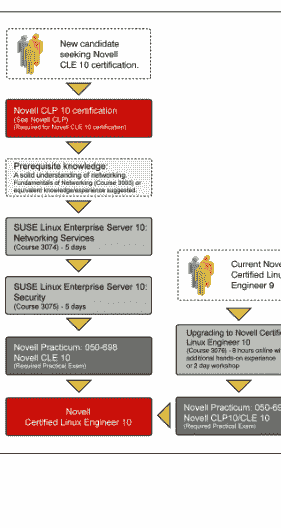

有关 Novell 认证项目以及参加 Novell CLP 10 和 CLE 10 实习考核的更多信息，请参见 http://www.novell.com/training/certinfo/。

## SUSE Linux Enterprise Server 10 支持与维护

要获得 SUSE Linux Enterprise Server 10 的官方支持与维护更新，您需要执行以下操作之一：

- 注册免费的注册/序列号，该号码为您提供 30 天的支持与维护。
- 从 Novell（或其授权经销商）购买 SUSE Linux Enterprise Server 10 的副本。

您可以在 http://www.novell.com/products/linuxenterpriseserver/eval.html 获取免费的 30 天支持与维护代码。

您需要拥有或创建一个 Novell 登录账户才能访问 30 天评估版。

## Novell 客户中心

Novell 客户中心是一个直观的、基于 Web 的界面，可帮助您管理与 Novell 之间的业务和技术互动。Novell 客户中心整合了对以下信息、工具和服务的访问：

- 新 SUSE Linux Enterprise 产品的自动注册
- Novell 所有在售 Linux 产品的补丁和更新
- 所有 Novell 产品、订阅和服务的订单历史
- 新 SUSE Linux Enterprise 产品的授权可见性
- Linux 订阅续订状态
- 通过合作伙伴或 Novell 进行的订阅续订

例如，一家公司可能有需要下载 SUSE Linux Enterprise 软件更新的管理员、希望查看订单历史的采购人员，以及需要核对许可的 IT 经理。借助 Novell 客户中心，公司可以在一个地方满足所有这些需求，并为每个用户分配适合其角色的访问权限。

您可以在 http://www.novell.com/center 访问 Novell 客户中心。

## 练习约定

在完成练习时，您会看到一些约定，用于指示需要输入的、特定于您服务器的信息。

以下是最常见的约定：

- *斜体/粗体文本*。这是指您的独特情况，例如服务器的 host 名称。

  例如，如果服务器的 host 名称是 DA50，并且您看到以下内容：

  *hostname.digitalairlines.com*

  您应输入

  DA50.digitalairlines.com

- **10.0.0.xx**。这是分配给您的 SUSE Linux Enterprise Server 10 服务器的 IP 地址。

  例如，如果您的 IP 地址是 10.0.0.50，并且您看到以下内容：

  **10.0.0.xx**

  您应输入

  **10.0.0.50**

- **选择**。单词 *select* 在练习步骤中用于表示各种操作，包括点击界面上的按钮和选择菜单项。

- **输入和键入**。单词 *enter* 和 *type* 具有不同的含义。

  单词 *enter* 表示在字段或命令行中键入文本，并在必要时按 Enter 键。单词 *type* 表示键入文本但不按 Enter 键。

  如果指示您键入一个值，请确保不要按 Enter 键，否则可能会启动您尚未准备开始的进程。


## SECTION 1 SUSE Linux Enterprise Server 10 的安装

从 SUSE Linux Enterprise Server 9 到 SUSE Linux Enterprise Server 10 的安装过程中变化不大。

在 SUSE Linux Enterprise Server 9 中，默认的身份验证方法是使用 LDAP 服务器。在 SUSE Linux Enterprise Server 10 中，它使用文件 /etc/passwd 进行本地身份验证。

另一个新功能是 Novell Customer Center。

### Objective

- 了解 Novell Customer Center 配置和在线更新

### Objective 1: 了解 Novell Customer Center 配置和在线更新

如果 Internet 连接测试成功，您可以配置 Novell Customer Center，该中心是执行在线更新所必需的。如果 SUSE 更新服务器上有任何更新包可用，您可以下载并安装它们以修复已知错误或安全问题。

Figure 1-1

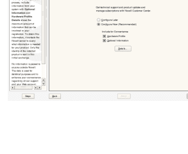

选择 **Next** 会启动浏览器并连接到 Novell 网站，您只需输入您的电子邮件地址，以及如果有的话，激活码。

Figure 1-2

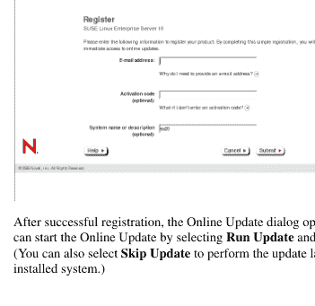

注册成功后，在线更新对话框打开。您可以通过选择 **Run Update** 和 **Next** 开始在线更新。  
（您也可以选择 **Skip Update** 以便稍后在已安装的系统上执行更新。）

YaST 的在线更新对话框打开，显示可用补丁的列表（如果有）。

Figure 1-3

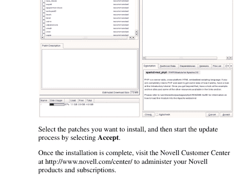

选择您想要安装的补丁，然后通过选择 Accept 开始更新过程。

安装完成后，请访问 Novell Customer Center http://www.novell.com/center/ 以管理您的 Novell 产品和订阅。

> 在软件选择对话框的 Filter 下拉菜单中，有一个名为 Patterns 的项目。此过滤器显示在已知安装介质上可用的所有软件。它按逻辑上属于一起的预定义软件包集合进行分组。在 SUSE Linux Enterprise Server 9 中，此项目被标记为 Selections。

### Summary

| Objective | Summary |
|---|---|
| 1. 了解 Novell Customer Center 配置和在线更新 | 在 SUSE Linux Enterprise Server 10 中，它使用文件 /etc/passwd 进行本地身份验证。Novell Customer Center 是执行在线更新所必需的。 |

## SECTION 2 使用 GNOME 桌面环境

GNOME 是一个舒适的桌面环境。GNOME 支持拖放。众多程序专门为 GNOME 设计。

### Objectives

- 登录
- 注销和关机
- 识别 GNOME 桌面组件
- 管理 GNOME 中的图标
- 使用 GNOME 文件管理器（Nautilus）
- 搜索文件
- 从桌面访问命令行界面

### Objective 1: 登录

当计算机启动并准备工作时，会出现以下登录对话框：

Figure 2-1


输入用户名后，按 **Enter**。然后输入您的密码并再次按 **Enter**。如果登录成功，则会出现以下 GNOME 桌面环境：

Figure 2-2


### Objective 2: 注销和关机

当您准备从系统注销时，打开底部面板中的 Computer 菜单（也称为主菜单）。

Figure 2-3

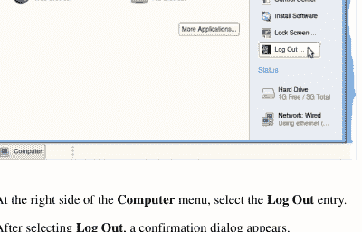

在 Computer 菜单的右侧，选择 Log Out 条目。

选择 Log Out 后，会出现确认对话框。

Figure 2-4

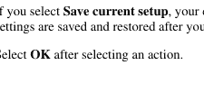

如果您选择 Save current setup，您的当前桌面环境设置将被保存并在下次登录后恢复。

选择操作后选择 OK。

如果您处于登录屏幕，左下角有四个选项可用：

- **Language.** 选择桌面环境的语言。
- **Session.** 您可以选择除 GNOME 之外的窗口管理器。在本学生手册中，我们仅介绍 GNOME（默认窗口管理器）。有关 KDE 环境的一些基本信息，您可以在附录 A 中找到。
- **Reboot.** 重启系统。
- **Shut Down.** 关闭计算机。

只有 root 允许重启系统。因此您必须输入 root 密码。

只有 root 允许关闭系统。因此您必须输入 root 密码。


### 目标 3 识别 GNOME 桌面组件

GNOME 桌面在屏幕底部包含一个面板。

**图 2-5**


面板左侧有一个菜单。该菜单标记为“计算机”。它被称为主菜单。

面板中间的空区域包含任务管理器。屏幕上所有打开的窗口都会列在这里。

面板右侧还有一些项目。可用的图标取决于你的硬件：

- 地球仪。搜索新的更新。
- 电池。笔记本电脑的电源管理。
- 扬声器。音量控制。
- 时钟。显示日期和时间。
- 显示桌面。最小化所有打开的窗口，或让它们重新显示在桌面上。

你可以通过双击桌面上的图标来启动程序。但通常程序是从主菜单启动的。

**图 2-6**

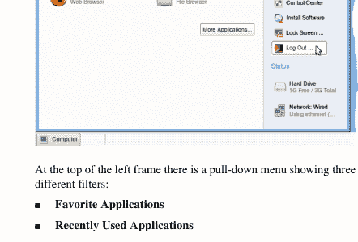

左侧框架顶部有一个下拉菜单，显示三种不同的筛选器：

- 收藏的应用程序
- 最近使用的应用程序
- 最近使用的文档

**图 2-7**

在左侧框架中，还有一个标记为“更多应用程序”的按钮。如果你选择此按钮，应用程序浏览器将出现。

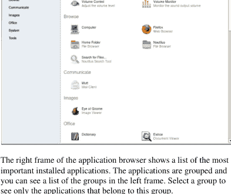

应用程序浏览器的右侧框架显示已安装的最重要的应用程序列表。应用程序按组分类，你可以在左侧框架中看到组列表。选择一个组以仅查看属于该组的应用程序。

筛选选项提供了更大的灵活性。在左侧框架的“筛选”文本框中输入你要启动的应用程序名称的一部分。筛选后的应用程序会立即显示在右侧框架中。

主菜单右侧框架中有五个系统选项：

- **帮助。** 启动在线帮助。
- **控制中心。** 启动 GNOME 控制中心，你可以在其中配置你的桌面。
- **安装软件。** 显示你的已注册安装介质上可用软件的列表。
- **锁定屏幕。** 锁定屏幕。要解锁，你必须输入密码。
- **注销。** 必须选择此项才能从系统注销。

在右侧框架的底部，你可以看到硬盘和网络的状态。

要启动应用程序，请在主菜单或应用程序浏览器中单击该图标。

### 目标 4 管理 GNOME 中的图标

你可以用不同方式管理桌面上的图标。为简单起见，我们将只介绍最重要的方法。

你可以在桌面的以下三个区域中找到图标：

- 桌面
- 面板
- 主菜单

#### 桌面

要在桌面上创建应用程序的图标，请在你的应用程序菜单中选择该项，将其拖到桌面上的空白区域，然后释放鼠标按钮。

注意，移动图标时，鼠标指针处会出现一个小的加号图标。这表示将创建该图标的一个副本。

要创建新图标，请右键单击桌面上的空白区域。会弹出一个菜单。

**图 2-8**

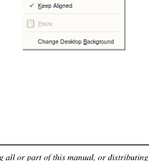

在弹出菜单的顶部，有三个用于创建新项目的条目：

- **创建文件夹。** 创建一个新的空文件夹图标。图标出现后，你可以输入文件夹名称。

**图 2-9**


- **创建启动器。** 创建一个新的应用程序启动器。将出现一个对话框：

**图 2-10**

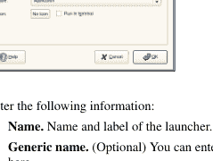

输入以下信息：

- **名称。** 启动器的名称和标签。
- **通用名称。**（可选）你可以在此输入通用名称。
- **注释。**（可选）当鼠标指针移到图标上时，此注释将作为工具提示显示。
- **命令。** 双击启动器图标时应执行的命令。
- **类型。** 你可以使用此对话框为不同的文件类型（例如，应用程序、目录、链接、设备）创建启动器。


- Icon.（可选）为启动器选择一个图标。
- Run in terminal. 如果应用程序没有图形用户界面并且在终端窗口中运行，请选择此选项。
- **Create Document.** 你可以使用此菜单创建一个空文档。

根据你安装的软件，此菜单中可用的文档类型各不相同。默认安装后，只能创建空文本文件。

当图标出现时，你可以输入文本文件的名称。


#### Panel

你可以通过右键单击面板的空白区域，然后选择 Add to Panel 来在底部面板中添加新程序。从出现的对话框中，选择你想要添加的应用程序。

Figure 2-12

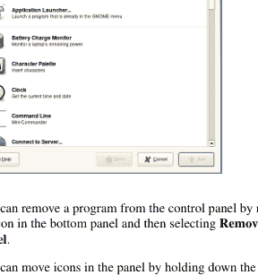

你可以通过右键单击底部面板中其图标，然后选择 Remove From Panel 来从控制面板中删除一个程序。

你可以通过按住鼠标右键并从上下文菜单中选择 Move 来移动面板中的图标。

#### Main Menu

只有 root 用户才允许向菜单中添加新条目。普通用户只能声明喜爱的应用程序。因此请执行以下操作：

1. 在面板中打开主菜单。
   菜单出现。
2. 选择 More Applications。
3. 用鼠标右键在右侧框架中选择一个应用程序项。
4. 从弹出菜单中选择 Add to Favorites。

### Objective 5 Use the GNOME File Manager (Nautilus)

GNOME 提供了自己的文件管理器（称为 Nautilus）：

Figure 2-13

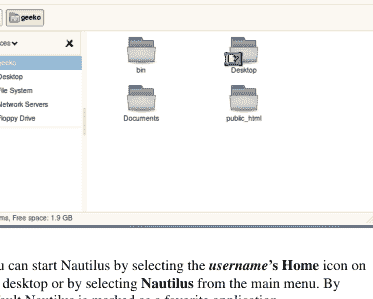

你可以通过在桌面上选择用户名的 Home 图标或从主菜单中选择 Nautilus 来启动 Nautilus。默认情况下，Nautilus 被标记为喜爱的应用。

通常 Nautilus 启动后会显示用户主目录的内容。

Nautilus 窗口的左侧框架显示当前目录的内容。

你可以在工具栏下方的定位栏中看到你的当前位置。所有上级目录都显示为按钮。选择其中一个按钮即可切换到上级目录。

右侧框架称为 Side Panel。

Figure 2-14

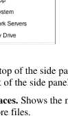

在侧面板顶部有一个菜单，可以在其中选择侧面板的内容：

- **Places.** 显示存储文件最重要的目录和设备。
- **Information.** 显示有关当前目录的一些信息。
- **Tree.** 显示文件系统树和主目录的树。
- **History.** 显示最近访问目录的历史记录。
- **Notes.** 为当前目录输入注释。
- **Emblems.** 显示徽章列表。

要向图标添加徽章，请使用拖放。Erase 可从图标中删除所有徽章。

Figure 2-15


### Objective 6 Search for Files

有时你需要找到一个文件以便编辑它，但你不确切知道它在文件系统中的位置。你可能知道该文件的名称或仅知道名称的一部分。

在另一次，你可能需要一份所有在过去两天内被修改过或超过特定大小的文件列表。

如果在应用程序浏览器中输入 search，会找到两个应用程序：

- **Nautilus Search Tool (Browse application group).** 使用 Nautilus 文件管理器搜索文件。此工具仅允许搜索文件名。
- **GNOME Search Tool (System application group).** 此工具允许你搜索诸如文件大小、日期或文件所有者等信息。

从应用程序浏览器中选择 GNOME Search 工具后，会出现以下对话框。

Figure 2-16

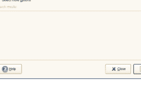

在 Name contains 字段中，输入你想要查找的文件名的一部分。

在 Look in folder 中输入你想要搜索的目录。选择 Find 开始搜索过程。所有匹配的文件和目录都将在下部窗口中显示其位置的详细信息。

在打开 Select more options 下的菜单时可以进行进一步设置。从下拉菜单 Available options 中选择一个搜索规则。

选择 Add 按钮后，会添加一个新文本字段，你可以在其中输入该选项所需的信息。要删除一个搜索规则，请选择该规则旁边的 Remove 按钮。

Figure 2-17

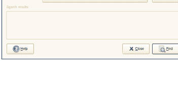


### 目标 7 从桌面访问命令行界面

除了使用虚拟终端外，您还可以通过从主菜单中选择 GNOME 终端（如下图所示）或 X 终端来从 GNOME 桌面启动终端仿真。两者都属于系统应用程序组。

**图 2-18**

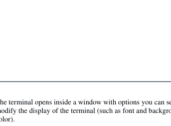

终端会在一个窗口中打开，您可以通过选择选项来修改终端的显示（例如字体和背景颜色）。

### 摘要

| 目标 | 摘要 |
|---|---|
| 1. 登录 | 当计算机启动并准备就绪时，会出现登录对话框。 |
| 2. 注销与关机 | 当您准备注销系统时，请打开底部面板中的“计算机”菜单。 |
| 3. 识别 GNOME 桌面组件 | 标记为“计算机”的菜单称为主菜单。<br><br>您可以通过双击桌面上的图标来启动程序，但通常程序是从主菜单启动的。<br><br>在左侧框架的顶部有一个下拉菜单，显示三种不同的筛选器。<br><br>在左侧框架中，还有一个标记为“更多应用程序”的按钮。如果选择此按钮，将出现应用程序浏览器。<br><br>要启动应用程序，请用鼠标单击主菜单或应用程序浏览器中的图标。 |
| 4. 管理 GNOME 中的图标 | 您可以在桌面的以下三个区域中找到图标：<br>- 桌面<br>- 面板<br>- 主菜单 |
| 5. 使用 GNOME 文件管理器（Nautilus） | GNOME 提供了自己的文件管理器（称为 Nautilus）。<br><br>通常，Nautilus 在启动后会显示用户的主目录内容。<br><br>右侧框架称为**侧面板**。<br><br>在侧面板的顶部有一个菜单，您可以在其中选择侧面板的内容。 |
| 6. 搜索文件 | GNOME 搜索工具允许您搜索诸如文件大小、日期或文件所有者之类的信息。<br><br>当您打开**选择更多选项**下的菜单时，可以进行进一步设置。从下拉菜单**可用选项**中选择一个搜索规则。 |
| 7. 从桌面访问命令行界面 | 您可以通过从主菜单中选择 GNOME 终端（如下图所示）或 X 终端，从 GNOME 桌面启动终端仿真。 |

## 第 3 部分 管理硬件

虽然大多数硬件设备可以使用 YaST 进行配置，甚至在插入系统时会被自动检测到，但了解后台的工作原理有时会很有帮助。

在本部分中，您将了解 SUSE Linux Enterprise Server 10 的硬件管理以及设备驱动程序的加载方式。

您还将学习如何添加和更换某些类型的硬件。

### 目标

1. 描述设备与接口之间的区别
2. 描述设备驱动程序的工作原理
3. 描述设备驱动程序的加载方式
4. 手动管理内核模块
5. 描述 sysfs 文件系统
6. 描述 udev 的工作方式
7. 使用 hwup 命令

### 目标 1 描述设备与接口之间的区别

本目标使用了术语“设备”和“接口”。这些术语经常被混淆，不仅用户和管理员如此，操作系统及相关工具的开发者也是如此。

本课程对设备和接口使用以下定义：

- **设备。** 设备是真实的物理硬件。可以是 PCI 网卡、AGP 图形适配器、USB 打印机，或任何您可以拿在手里、触摸到、甚至想弄坏也可以弄坏的硬件。
- **接口。** 接口是与设备关联的软件组件。要使用物理硬件，需要通过软件接口进行访问。

一个设备可以有多个接口。

接口通常由驱动程序创建。在 Linux 中，驱动程序通常是一个可以加载到 Linux 内核中的软件模块。因此，驱动程序可以被看作是设备与其接口之间的粘合剂。


### Objective 2 描述设备驱动程序的工作方式

如前所述，设备驱动程序访问并使用设备。设备驱动程序主要有 2 种类型：

- 内核模块。Linux 内核的功能可以通过内核模块进行扩展。这些模块可以在运行时加载和移除。它们允许内核提供对硬件的访问。
- 用户空间驱动程序。某些硬件需要在用户空间中运行的额外驱动程序。例如打印机或扫描仪等硬件。

下图说明了内核驱动程序和用户空间驱动程序的作用：

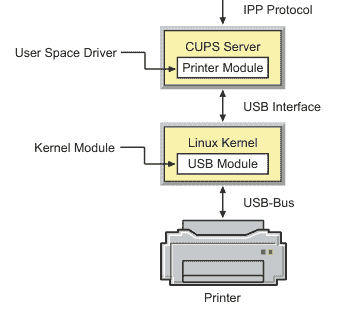

虽然用户空间驱动程序的处理取决于所使用的框架，但你可以使用以下命令管理内核模块：

- **lsmod.** 此命令列出所有已加载的内核模块。例如：
  `lsmod`
- **modprobe.** 此命令加载内核模块。因为内核模块之间可能存在依赖关系，modprobe 会自动解析这些依赖关系并加载所有必需的模块。例如：
  `modprobe usb-storage`
  在此示例中，modprobe 加载 usb-storage 模块，该模块用于访问通过 USB 总线连接的存储设备。
  由于该模块需要其他 USB 模块，modprobe 也会加载这些模块。
- **rmmod.** 此命令移除已加载的内核模块。例如：
  `rmmod usb-storage`
  只有不需要的模块才能被移除。在此示例中，USB 设备必须先断开连接，然后才能移除 usb-storage 模块。

内核模块是存储在目录 `/lib/modules/kernel-version/` 中的文件。

模块存储在多个子目录中，文件名扩展名为 .ko，表示内核对象。在使用 modprobe 加载模块时，可以省略扩展名，只使用模块名称。

### Objective 3 描述设备驱动程序如何加载

由于每次系统启动后手动加载所有内核模块会非常不方便，因此有几种方法可以自动执行此任务。

以下是 SUSE Linux Enterprise Server 10 中设备驱动程序加载方式的概述：

- **initrd.** 用于访问根分区的必要重要设备驱动程序是从 initrd 加载的。initrd 是一个特殊文件，由引导加载程序加载到内存中。此类模块的示例包括 SCSI 主机控制器和文件系统驱动程序。
- **initscripts.** 一些初始化脚本专门用于加载和设置硬件设备，例如用于声卡的 ALSA 声音脚本。
- **udev.** udev 也使用 hwup 命令加载内核模块。
- **X Server.** 尽管显卡驱动程序不是内核模块，但 X Server 会加载特殊驱动程序以启用硬件 3D 支持。
- **手动.** 你始终可以在命令行或脚本中使用 modprobe 命令或 hwup 或 hwdown 命令加载内核模块。

### Objective 4 手动管理内核模块

尽管 SUSE Linux Enterprise Server 10 会自动初始化大多数硬件设备，但了解如何手动管理内核模块仍然非常有帮助。

要管理内核模块，你需要了解以下内容：

- Kernel Module Basics
- Manage Modules from the Command Line
- modprobe Configuration File (/etc/modprobe.conf)

有关最新的内核文档，请参阅 /usr/src/linux/Documentation。

#### Kernel Module Basics

安装在目录 /boot/ 中的内核已针对各种硬件进行了配置。除非你想测试实验性功能和驱动程序，否则无需编译自定义内核。

Linux 内核的驱动程序和功能要么编译到内核中，要么作为内核模块加载。这些模块可以在系统运行时稍后加载，而无需重新启动计算机。

这对于启动系统不需要的内核模块尤其如此。通过在系统启动后将其作为组件加载，内核可以保持相对较小。

内核模块位于目录 /lib/modules/version/kernel/ 中。

例如，2.6 内核的模块可以在以下目录中找到：

```
/lib/modules/2.6.16-0.12-default/kernel/
```


#### 从命令行管理模块

以下是在使用模块时可从命令行使用的命令：

- **lsmod.** 此命令列出内核中当前已加载的模块。

  以下是一个示例：

  ```
DAS50:~ # lsmod
Module          Size  Used by
quota_v2        12928  2
edd             13720  0
joydev          14528  0
sg              41632  0
st              44956  0
sr_mod          21028  0
ide_cd          42628  0
cdrom           42780  2 sr_mod,ide_cd
nvram           13448  0
usbserial       35952  0
parport_pc      41024  1
lp              15364  0
parport         44232  2 parport_pc,lp
ipv6            275348  44
uhci_hcd        25728  0
intel_agp       22812  1
agpgart         36140  1 intel_agp
evdev           13952  0
usbcore         116572  4 usbserial,uhci_hcd
  ```

  该列表包含有关模块名称、模块大小、模块使用频率以及由哪些其他模块使用它的信息。

- **insmod module.** 此命令将指定的 *module* 加载到内核中。

  模块必须存储在目录 `/lib/modules/version_number/` 中。但是，建议使用 modprobe 来加载模块。

- **rmmod module.** 此命令从内核中移除指定的 *module*。但是，只有在没有进程访问与其连接的硬件或相应服务时才能移除。

  我们建议您使用 `modprobe -r` 来移除模块。

- **modprobe module.** 此命令将指定的 *module* 加载到内核中或将其移除（使用选项 -r）。

  使用 modprobe 时会考虑其他模块的依赖关系。此外，modprobe 会读取文件 `/etc/modprobe.conf` 中的任何配置设置。

  此命令只能在由命令 depmod 创建的文件 `/lib/modules/version/modules.dep` 存在时使用。此文件用于添加或移除依赖关系。

  内核守护进程（自内核版本 2.2.x 起为 Kmod）确保在运行操作中需要的模块会使用 modprobe 自动加载（例如访问 CD-ROM 驱动器）。

  如需更详细的信息，请输入 man modprobe。

- **depmod.** 此命令创建文件 `/lib/modules/version/modules.dep`。此文件包含各个模块之间的依赖关系。

  当加载模块（例如使用 modprobe）时，modules.dep 确保其所依赖的所有模块也会被加载。

  如果文件 modules.dep 不存在，则在系统启动时由启动脚本 `/etc/init.d/boot` 自动创建。因此，您无需手动创建该文件。

  在 SUSE Linux Enterprise Server 10 上，depmod 还会创建文件 modules.aliases，该文件由 hwup 和 modprobe 使用，以确定为哪个设备需要加载哪个驱动程序。有关此文件的更多信息，请参阅本节中的 hwup 目标。

- **modinfo option module.** 此命令显示有关命令行中指定的模块的信息（例如许可证、作者和描述）。

  以下是一个示例：

  ```
DAS0:~ # modinfo isdn
license:        GPL
author:         Fritz Elfert
description:    ISDN4Linux: link layer
depends:        slhc
supported:      yes
vermagic:       2.6.5-7.21-default 586 REGPARM gcc-3.3
  ```

  如需更详细的信息，请输入 **man modinfo**。

#### modprobe 配置文件 (/etc/modprobe.conf)

文件 /etc/modprobe.conf 是内核模块的配置文件。例如，它包含直接访问硬件的模块的参数。

该文件在加载模块时起着重要作用。文件中可以找到各种命令类型，例如以下内容：

- **install.** 这些指令让 modprobe 在将特定模块加载到内核时执行命令。

  以下是一个示例：

  `install eth0 /bin/true`

- **alias.** 这些指令确定为特定设备文件将加载哪个内核模块。

  以下是一个示例：

  `alias eth0 nvnet`

- **options.** 这些指令是加载模块的选项。

  以下是一个示例：

  `options ne io=0x300 irq=5`

如需更详细的信息，请输入 man 5 modprobe.conf。


## 练习 3-1 管理 Linux 内核模块

在本练习中，你将加载和卸载内核模块。

执行以下操作：

- 1. 从终端窗口，使用密码 novell 以 root 身份切换用户（su -）。
- 2. 通过输入 lsmod 查看当前已加载的内核模块。
- 3. 滚动浏览模块列表，查看操纵杆模块（joydev）是否已加载。
- Used 列中的 0 表示该模块未被使用。
- 4. 通过输入 rmmod joydev 从内核内存中移除操纵杆模块。
- 5. 通过输入 lsmod 验证 joydev 内核模块是否已从内存中移除。
- 注意模块 joydev 已不再列出。
- 6. 通过输入 modprobe joydev 加载操纵杆内核模块。
- 7. 通过输入 lsmod 验证 joydev 内核模块是否已加载到内存中。
- 8. 通过输入以下命令查看内核模块配置：
- modprobe -c | less
- 9. 通过按空格键滚动浏览配置信息。
- 10. 完成后，通过输入 q 返回命令行。
- 11. 通过输入 depmod -v | less 创建内核模块依赖列表。

```
modprobe -c | less
```

生成信息需要几分钟时间。

- 12. 通过按空格键滚动浏览依赖信息。
- 13. 完成后，通过输入 q 返回命令行。
- 14. 通过输入 exit 两次关闭终端窗口。

*（练习结束）*

## 目标 5
描述 sysfs 文件系统

sysfs 是一个虚拟文件系统，挂载在 /sys 下。在虚拟文件系统中，没有物理设备保存信息。相反，文件系统由内核虚拟生成。

/sys 下的目录和文件结构提供了当前连接到系统的硬件信息。

在 /sys 下，有 4 个主要目录：

- • /sys/bus 和 /sys/devices。这些目录包含系统硬件的不同表示。设备在此处表示。

例如，以下表示连接到 USB 总线的数码相机：

```
/sys/bus/usb/devices/1-1:1.0/
```

该目录包含多个提供设备信息的文件。以下是该目录中文件的列表：

| Filename | Value1 | Value2 |
|----------|--------|--------|
| 1-1:1.0 | hMaxPower | manufacturer |
| bConfigurationValue | bNumConfigurations | maxchild |
| bDeviceClass | bNumInterfaces | power |
| bDeviceClass | detach_state | product |
| bDeviceProtocol | devnum | serial |
| bDeviceSubClass | idProduct | speed |
| bMattributes | idVendor | version |

例如，通过读取 manufacturer 文件的内容，可以确定设备的制造商：

```
cat manufacturer
```

OLYMPUS

在这种情况下，一台奥林巴斯数码相机已连接到系统。

/sys/class 和 /sys/block。设备的接口在这两个目录下表示。

例如，奥林巴斯数码相机的接口由以下目录表示：

```
/sys/block/sda/
```

名为 /sda 的目录是像 SCSI 硬盘一样访问的数码相机。

以下是 /sda 目录的内容：

```
dev    queue  removable  size
device range  sda1      stat
```

子目录 /sda1 表示相机存储卡上第一个分区的接口。例如，通过读取 /sda1/size 的内容，可以确定分区的大小：

```
cat sda1/size
31959
```

该分区的大小为 31959 个 512 字节块，约为 16 MB。

为了将接口与设备连接，使用文件系统链接。在奥林巴斯数码相机的例子中，文件 /sys/block/sda/device 存在一个链接指向对应的设备：

```
ll device
lrwxrwxrwx 1 root root 0 Aug 17 14:03 device -> ../../devices/pci0000:00/0000:00:1d.0/usb1/1-1/1-1.1/0/host0/0:0:0:0
```

以这种方式，系统的所有接口都与其对应的设备链接起来。


除了在 **sysfs** 中的表示方式之外，**/dev** 目录中还有设备文件。

这些文件是应用程序访问设备接口所必需的。“设备文件”这个名称有点误导，名称“接口文件”会更合适。

## Objective 6 Describe how udev Works

在使用硬件设备之前，你需要加载适当的驱动模块并设置相应的接口。对于 SUSE Linux Enterprise Server 10 中的大多数设备，这是由 udev 完成的。

要了解 udev 的概况，请执行以下操作：

- Understand the Purpose of udev
- Understand how udev Works
- Understand Persistent Interface Names

### Understand the Purpose of udev

udev 有三个主要目的：

- **Create device files.** udev 最明显的任务是在设备连接到系统时自动在 /dev 下创建设备文件。此前，/dev 目录会填充系统中可能出现的每个设备。这导致 /dev 目录非常复杂且令人困惑，因为大多数设备文件实际上并未被使用。
- **Persistent device names.** udev 的另一个优点是它提供了一种持久设备名称的机制。
- **Hotplug replacement.** 在 SUSE Linux Enterprise Server 10 中，udev 还取代了热插拔系统，该系统负责在以前版本中硬件设备的初始化。udev 现在是 SUSE Linux Enterprise Server 10 中硬件初始化的中心点。

### Understand how udev Works

udev 实现为一个守护进程（udevd），它在启动时通过脚本 /etc/init.d/boot.d/S03boot.udev 启动。udev 通过 uevent 接口与 Linux 内核通信。当内核发送出 uevent 消息表示设备已添加或移除时，udevd 根据 udev 规则执行以下操作：

- Initializes devices by calling hwup.
- Creates device files in /dev.
- Sets up network interfaces with ifup.
- Renames network interfaces, if necessary.
- Mounts storage devices which are identified as hotplug in /etc/fstab.
- Informs other applications through HAL (Hardware Abstraction Layer) about the new device.

为了处理在 udevd 启动前已发出的 uevent 消息，udev 启动脚本通过解析 sysfs 文件系统来触发这些遗漏的事件。在以前的 SUSE Linux Enterprise Server 版本中，系统初始化的这一部分是由 coldplug 脚本完成的。

udev 所做的一切都取决于 /etc/udev/rules.d/ 下配置文件中定义的规则，这些规则用于处理 uevent。

udev 规则的详细描述超出了本课程的范围。然而，下面列出了最重要的事实：

- udev 规则分布在多个文件中，这些文件按字母顺序处理。这些文件中的每一行都是一个规则。注释可以用 # 字符添加。
- 每个规则由多个键值对组成。键值对的示例：kernel=="hda"
- 有两种不同的键类型：
  - **match keys.** 这些键用于确定是否应使用规则来处理事件。
  - **assignment keys.** 这些键确定如果处理规则时应执行什么操作。

规则中必须至少有一个匹配键和一个赋值键。

- 对于每个 uevent，都会处理所有规则。处理不会在找到匹配规则时停止。

你可以使用 **udevmonitor** 工具监视 udev 的活动。当你启动该工具并更改硬件配置（例如插入或拔出 USB 设备）时，udev 活动会显示在屏幕上。欲了解更多详细信息，你可以使用 **--env** 选项启动该工具。

### Understand Persistent Interface Names

**/dev** 目录中的接口文件在设备被驱动程序识别并初始化时创建并分配给相应的硬件设备。因此设备与接口文件之间的分配取决于：

- 设备驱动程序加载的顺序。
- 设备连接到计算机的顺序。

这可能导致不清楚哪个设备文件被分配给哪个设备的情况。考虑以下示例：

你有两个 USB 设备，一个数码相机和一个闪存卡读卡器。两个设备都通过设备文件 **/dev/sda, /dev/sdb** ... 作为存储设备进行访问。

哪个设备被分配到哪个设备文件通常取决于它们插入的顺序。第一个设备获得 sda，以此类推。


udev 可以帮助使这一点更可预测。在 sysfs 的帮助下，udev 可以查明哪个设备连接到哪个接口文件。对于持久设备名称来说，最简单的解决方案是重命名接口文件，例如从 /dev/sda1 重命名为 /dev/camera。

不幸的是，在 Linux 下接口文件不能被重命名。这一规则的唯一例外是网络接口，它们传统上在 /dev 下没有接口文件。

因此 udev 使用了不同的方法。不是重命名接口文件，而是为分配的接口文件创建一个具有唯一且持久名称的链接。

默认情况下，udev 例如被配置为为所有存储设备创建这些链接。对于每个设备，在 /dev/disk/ 下的以下每个子目录中都会创建一个链接：

- **by-id**。链接的名称基于厂商和设备名称。
- **by-path**。链接的名称基于设备的总线位置。
- **by-uuid**。链接的名称基于设备的序列号。

创建这些链接的 udev 规则位于文件 /etc/udev/rules.d/60-persistent-storage.rules 中。

这意味着，设备与接口文件之间的关联仍然取决于驱动程序加载的顺序或设备与系统连接的顺序。

使用 udev 时，每当设备配置发生变化时，都会创建并调整持久链接。

如前所述，网络接口的处理方式不同。它们没有接口文件，可以直接由 udev 重命名。

持久网络接口被配置为 udev 规则，位于文件 **/etc/udev/rules.d/30-net_persistent_names.rules** 中

以下是一个示例规则：

```
SUBSYSTEM=="net", ACTION=="add", SYSFS{address}=="00:30:05:4b:98:85",
IMPORT="/sbin/rename_netiface %k eth0"
```

匹配键 SYSFS{address} 用于通过其 MAC 地址识别网络设备。规则末尾给出接口的名称。在此示例中为 eth0。


在 SUSE Linux Enterprise Server 9 中，可以在 /etc/sysconfig/network 下的接口配置文件中配置持久网络接口名称。这在 SUSE Linux Enterprise Server 10 中不再受支持。接口名称现在必须在 udev 规则中配置。

## Objective 7 Use the hwup Command

命令 hwup 由 udev 用于加载驱动模块并初始化设备。在本目标中，你将学习如何使用此命令以及如何解释相应的配置文件。

要启动一个设备，hwup 会以硬件描述作为参数调用。硬件描述是系统中特定设备的唯一标识符。以下是 hwup 命令行的示例：

```
hwup bus-pci-0000:02:08.0
```

设备描述由以下组件组成：

- **bus.** 这决定设备由其连接的总线来标识。
- **pci.** 这表示设备连接到 PCI 总线。
- **0000:02:08.0.** 这是设备在 PCI 总线中的地址。

你可以使用 lspci 命令显示设备的 PCI 地址，如以下示例所示：

```
...
0000:02:08.0 Ethernet controller: Intel Corp. 82801BD
PRO/100 VE (LOM) Ethernet Controller (rev 81)
...
```

正如你所见，使用命令 hwup bus-pci-0000:02:08.0，将启动 PCI 地址为 0000:02:08.0 的以太网控制器。

命令 hwdown <hardware_description> 可用于停止设备。hwdown 是 hwup 的链接，而不是单独的命令。

hwdown 将设备与其驱动程序解绑，但不会自动卸载驱动模块。

hwup 获取有关设备以及需要为设备加载的驱动程序的信息有两种不同方式：

- From Configuration Files
- From sysfs

### From Configuration Files

当设备需要初始化时，hwup 首先尝试从目录
/etc/sysconfig/hardware/ 中的文件读取设备配置。

为了确定正确的配置文件，配置文件名遵循特定的命名方案。

以下是 PCI 网络适配器的文件名：

```
hwcfg-bus-pci-0000:02:08.0
```

文件名由关键字 hwcfg 和设备的硬件描述组成。


以下列出了设备配置文件中的可用变量：

## 表 3-1

| 变量 | 描述 |
|---|---|
| STARTMODE | 该变量决定设备在何时以及如何启动：<br> - **auto.** 设备在启动时自动启动，或在设备连接到系统时由 udev 自动启动。<br> - **manual.** 设备不应自动启动，但可以手动启动。<br> - **off.** 设备绝不应被启动。 |
| MODULE | 该变量的值决定应为设备加载的内核模块名称。<br> 如果必须加载多个模块，可以多次使用该变量并附加任意后缀。<br> 然后，必须对多个 MODULE_OPTIONS 变量使用相同的后缀。<br> 示例：<br> **MODULE_A=\"foo\"** <br> **MODULE_B=\"bar\"** <br> **MODULE_OPTIONS_A=\"foo-opt\"** <br> **MODULE_OPTIONS_B=\"bar-opt1=x yz\"** |
| MODULE_OPTIONS | 使用该变量，可以向内核模块传递选项。 |

### （续）表 3-1

| 变量 | 描述 |
|---|---|
| SCRIPT{UP,DOWN}_[type] | 该变量指定用于初始化和解除配置特定设备类型时调用的脚本。<br> 如果待初始化设备的类型与此参数中给定的类型匹配，则调用此脚本。 |
| SCRIPT{UP,DOWN} | 该变量指定用于设备初始化和解除配置时调用的脚本。<br> 仅当未配置匹配的类型特定脚本时，才会调用它。 |

以下是一个网络适配器配置文件的示例：

```
MODULE='e100'
MODULE_OPTIONS=''
STARTMODE='auto'
```

加载了模块 e100，该模块没有选项，设备在启动时会自动启动。

hwup 命令通常由 udev 调用，但您也可以手动使用它。例如，以下命令启动上文中显示的网络卡：

```
hwup bus-pci-0000:02:08.0
```

配置文件名的最后 3 个元素指定设备。

您可以使用 hwdown 命令来解除设备配置，如下所示：

```
hwdown bus-pci-0000:02:08.0
```

## 通过 sysfs

当 /etc/hardware 下没有设备的配置文件时，hwup 会使用 sysfs 来获取有关所需驱动程序的更多信息。

在文件 /sys/bus/devices/<pci_device_id>/modalias 中可以找到设备的唯一 ID。以下是一个网络适配器的 modalias 文件内容：

```
pci:v00008086d00001039sv00001734sd00001001bc02sc00i00 ....
```

现在，udev 调用 modprobe 命令，并使用 modalias 作为参数。

文件 /lib/modules/<kernel_version>/modules.aliases 包含一个列表，列出 modalias ID 及其对应的内核驱动程序模块。关于哪个驱动程序模块处理哪个 modalias ID 的信息包含在模块的源文件中。depmod 命令用于从模块中提取这些信息，并将其写入 modules.aliases 文件。

因此，您可以将 modules.aliases 文件视为一种驱动程序数据库，用于确定哪个驱动程序处理哪个设备。

当 udev 使用 modalias 参数调用 modprobe 时，modprobe 会在 modules.aliases 中查找驱动程序并加载相应的驱动程序。

为了防止 udev/hwup/modprobe 以所述方式自动加载驱动程序，可以将驱动程序添加到 /etc/modprobe.d/blacklist 文件中。例如，默认情况下，ALSA 声音驱动程序就添加在这里，因为这些驱动程序由 ALSA 初始化脚本（alsasound）加载。

## 练习 3-3 探索硬件初始化

在本练习中，您将学习如何使用 hwdown 关闭设备以及如何手动重新启动设备。本练习由以下部分组成：

- 第 I 部分：使用 hwdown 停止以太网适配器
- 第 II 部分：卸载驱动程序模块
- 第 III 部分：使用 modalias 加载驱动程序模块

### 第 I 部分：使用 hwdown 停止以太网适配器

请执行以下操作：

- 1. 打开终端窗口，并使用 su - 切换到 root 用户。
- 2. 输入命令 ip a。您应该会看到网络接口的列表。（至少包含 eth0）。
- 3. 输入命令 lspci。
- 4. 查找描述为 Ethernet controller 的设备，并在本步骤下方记录该设备的 PCI ID。如果您有多个以太网适配器，请选择第一个。
- 5. 输入命令：
  hwdown bus-pci-0000:<network_adapter_pci_id>
- 6. 再次输入命令 ip a。已通过 hwdown 关闭的设备接口应不再可见。

### 第 II 部分：卸载驱动程序模块

- 1. 切换到目录 /etc/sysconfig/hardware/。


2. 使用文本编辑器打开以太网适配器的配置文件：
   
   hwcfg-bus-pci-0000:<network_adapter_pci_id>

3. 在配置文件的 MODULE 选项中，记下本步骤下方内核驱动模块的名称。

--------------------------------------------------------------------------------

4. 输入命令 lsmod | grep <module_name>。如你所见，模块仍处于加载状态。

5. 使用命令 rmmod <module_name> 卸载模块

6. 使用 lsmod | grep <module_name> 验证模块已不再加载。

## Part III: Load the Driver Module with a modalias

1. 切换到目录 /sys/bus/pci/devices/。

2. 切换到目录 0000:network_adapter_pci_id

3. 输入 cat modaliases 以显示以太网适配器的 modaliases。

4. 输入命令 modprobe <modalias>。使用复制粘贴将 cat 输出中的 modalias 输入到 modalias 中。

5. 使用 lsmod | grep <module_name> 验证 modprobe 是否已检测并加载了网络适配器的驱动程序。

6. 输入命令 ip a，并验证网络接口是否已再次可用。

7. 重启系统，以恢复所有网络设置。

(End of Exercise)

## Summary

| Objective | Summary |
|---|---|
| 1. Describe the Differences between Devices and Interfaces | The terms device and interface are often confused. This section uses the following definitions:

- **Device.** A device is a physical piece of hardware.
- **Interface.** An interface is a software component that is used to access a device.

One device can have more than one interface.

An interface is created by a device driver. |
| 2. Describe how Device Drivers Work | There are 2 basic kinds of device drivers:

- **Kernel modules.** Kernel modules are loaded into the Linux kernel and extend its functionality.
- **User space drivers.** These drivers run within user space applications.

Some devices require both: kernel modules and user space drivers.

You can use the following commands to manage kernel modules:

- **lsmod.** Use lsmod to list loaded drivers.
- **modprobe.** Use modprobe load kernel modules. |

| Objective | Summary |
|---|---|
| 2. Describe how Device Drivers Work (continued) | - **rmmod**. Use rmmod to remove loaded kernel modules.

The kernel modules are files that are stored in the directory `/lib/modules/kernel-version/`. |
| 3. Describe how Device Drivers Are Loaded | In a SUSE Linux Enterprise Server 10 system, kernel modules are loaded in the following ways:

- From initrd
- By initscripts
- By udev
- By the X Server
- Manually by the user root |
| 4. Manage Kernel Modules Manually | The hwup command is used to start preconfigured devices.

The device configuration files are stored in the directory `/etc/sysconfig/hardware/`.

The filename of the configuration file contains a unique identifier for the corresponding device.

In the configuration file, the following variables can be used:

- STARTMODE
- MODULE
- MODULE_OPTIONS
- SCRIPT{UP,DOWN}[type]
- SCRIPT{UP,DOWN} |

| Objective | Summary |
|---|---|
| 5. Describe the sysfs File System | The sysfs file system provides a representation of all devices and interfaces of a system.

Devices are represented in the directories: /sys/bus and /sys/devices.

Interfaces are represented by the directories /sys/class and /sys/block.

A device and its interfaces are connected with file system links. |
| 6. Describe how udev Works | In SUSE Linux Enterprise Server 10, udev also replaces the hotplug system, which was responsible for the initialization of hardware devices in previous versions. udev is the central point for hardware initialization in SUSE Linux Enterprise Server 10. |
| 7. Use the hwup Command | hwup is used to load device drivers. Information about the required drivers for a device is either taken from a configuration file under /etc/sysconfig/hardware/ or from the file /lib/modules/kernel_version/modules.aliases. |


## 第 4 节 配置 Linux 文件系统分区

本节介绍了一些用于管理 Linux 文件系统分区的命令。

### 目标

- 1. 完成分区
- 2. 使用命令行工具配置 LVM

## 目标 1 完成分区

程序 fdisk 用于从命令行对硬盘进行分区。

```
dal0:~ # fdisk /dev/sda

The number of cylinders for this disk is set to 1111.
There is nothing wrong with that, but this is larger than 1024,
and could in certain setups cause problems with:
1) software that runs at boot time (e.g., old versions of LILO)
2) booting and partitioning software from other OSs
(e.g., DOS FDISK, OS/2 FDISK)

Command (m for help):
```

要实际将更改写入磁盘上的分区表，请输入 w（write）。

```
Command (m for help): w
The partition table has been altered!

Calling ioctl() to re-read partition table.

WARNING: Re-reading the partition table failed with error 16: Device or resource busy.
The kernel still uses the old table.
The new table will be used at the next reboot.
Syncing disks.
```

写入新表时，不会要求您确认是否真的要执行此操作。

正如 fdisk 的输出所述，您不能直接在新分区上创建文件系统来使用新分区。您可以现在按建议重新启动，但也可以使用程序 partprobe 让内核使用新的分区表。

pvscan 显示物理卷及其使用情况：

```
dal10:~ # pvscan
PV /dev/hda9   lvm2 [242,95 MB]
Total: 1 [242,95 MB] / in use: 0 [0 ] / in no VG: 1 [242,95 MB]
```

工具 pvmove 用于将数据从一个物理卷移动到另一个物理卷（前提是有足够的空间），以便从 LVM 中移除一个物理卷。

## 管理卷组的工具

工具 vgcreate 用于创建新的卷组。要创建卷组 system，并将物理卷 /dev/hda9 添加到其中，请输入：

```
dal10:~ # vgcreate system /dev/hda9
Volume group "system" successfully created
dal10:~ # pvscan
PV /dev/hda9   VG system lvm2 [240,00 MB / 240,00 MB free]
Total: 1 [240,00 MB] / in use: 1 [240,00 MB] / in no VG: 0 [0 ]
```

pvscan 显示新的情况。

要向组中添加更多物理卷，请使用 vgexpand。移除未使用的物理卷是通过在计划移除的物理卷上使用 pvmove 将数据转移到其他物理卷后，使用 vgreduce 完成的。vgremove 删除卷组，前提是组中没有逻辑卷。

## 管理逻辑卷的工具

要创建逻辑卷，请使用 lvcreate，指定大小、逻辑卷的名称以及卷组：

```
dal0:~# lvcreate -L 100M -n data system
Logical volume "data" created
```

下一步是在逻辑卷内创建文件系统并将其挂载：

```
dal0:~# lvscan
ACTIVE '/dev/system/data' [100.00 MB] inherit
dal0:~# mkreiserfs /dev/system/data
mkreiserfs 3.6.19 (2003 www.namesys.com)
ReiserFS is successfully created on /dev/system/data.
dal0:~# mount /dev/system/data /data
```

如上所示，lvscan 用于查看逻辑卷。它显示用于格式化和挂载的设备。

lvextend 用于增加逻辑卷的大小。之后您可以增加该逻辑卷上文件系统的大小以使用额外空间。

在使用 lvreduce 减小逻辑卷大小之前，您必须先减小文件系统的大小。只有这样再减小逻辑卷的大小。如果您在不先缩小文件系统的情况下简单地减小逻辑卷的大小，从而切断文件系统的部分内容，您将丢失数据。

## 总结

| 目标 | 总结 |
|---|---|
| 1. 完成分区 | 使用 fdisk 修改分区后，您不能直接在新分区上创建文件系统。您可以现在重新启动，但也可以使用程序 **partprobe**。 |


| 目标 | 摘要 |
|---|---|
| 2. 使用命令行工具配置 LVM | 要初始化一个用于 LVM 的分区，请使用工具 **pvcreate**。 |
|  | **pvscan** 显示物理卷及其使用情况。 |
|  | 工具 **pvmove** 用于将数据从一个物理卷移动到另一个物理卷。 |
|  | 工具 **vgcreate** 用于创建新的卷组。 |
|  | 要向组中添加更多物理卷，请使用 **vgexpand**。 |
|  | 删除未使用的物理卷是在使用 pvmove 将计划删除的物理卷上的数据转移到其他物理卷之后，使用 **vgreduce** 完成的。 |
|  | **vgremove** 删除卷组，前提是该组中没有逻辑卷。 |
|  | 要创建逻辑卷，请使用 **lvcreate**。 |
|  | **lvscan** 用于查看逻辑卷。 |
|  | **lvextend** 用于增加逻辑卷的大小。 |
|  | 在使用 **lvreduce** 减小逻辑卷大小之前，您必须先减小文件系统的大小。 |

## 第 5 节 使用 NetworkManager 配置网络

如果您在笔记本电脑上使用 SUSE Linux Enterprise Server 10，您很可能会根据所在位置使用不同类型的 Internet 访问——也许是在办公室的局域网，在客户现场的无线连接。

### 目标

- 1. 使用 NetworkManager 配置网络

### 目标 1

## 使用 NetworkManager 配置网络

传统的网络设置要求您切换到 root 账户才能更改网络配置。NetworkManager（软件包 NetworkManager）的目的是允许用户根据需要更改网络配置，而无需切换到 root 账户。

NetworkManager 以 root 用户系统级守护进程的形式运行，因为直接操作硬件需要 root 权限。用于此目的的程序是 /usr/sbin/NetworkManager 和 /usr/sbin/NetworkManagerDispatcher。nm-tools 可用于列出有关 NetworkManager、设备和无线网络的信息。

从系统中当前安装的所有适配器列表中，NetworkManager 首先尝试有线适配器，然后尝试无线适配器。支持无线扫描的无线适配器优先于不支持的适配器。NetworkManager 不会尝试尽可能长时间保持连接，这意味着插入有线网络会将连接切换到有线网络，远离无线网络。

对于无线网络支持，NetworkManager 保留两份无线网络列表：受信任列表和首选列表。受信任列表包含用户明确添加到其中的网络，而首选列表包含用户强制 NetworkManager 连接的网络。

由于受信任和首选网络是特定于用户的，因此必须有某种机制来获取和按用户存储此信息。这是通过桌面级按用户进程 nm-applet 或 KDE 中的 KNetworkManager 实现的。NetworkManager 通过 DBUS 与这些用户级进程通信。

在 YaST 中选择 NetworkManager 也会自动在用户登录时启动网络小程序。使用桌面小程序，用户可以轻松更改网络配置：

# 图 5-2

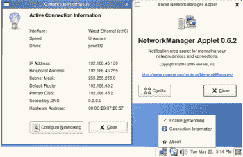

注意：拍摄上述屏幕截图的计算机上没有内置无线网卡，因此该屏幕截图中没有切换网络的选项。

## 使用 NetworkManager 配置网络

| 目标 | 摘要 |
|----------|---|
| 1. 使用 NetworkManager 配置网络 | NetworkManager 允许用户更改网络配置而无需承担 root 权限。 |
|  | NetworkManager 主要适用于笔记本电脑使用。 |

## 第 6 节 管理用户访问和安全

在本节中，您将学习如何执行基本的用户和组管理任务，为用户提供安全且可访问的 SUSE Linux Enterprise Server 环境。

### 目标

- 1. 使用 PAM 配置用户身份验证
- 2. 配置安全设置


## Objective 1 配置 PAM 用户认证

用户认证在 IT 安全中发挥着核心作用。Linux 在认证过程中使用 PAM（可插拔认证模块），作为用户与应用程序之间的层。Linux 系统管理员可以使用这些模块来配置程序应如何认证用户。

通过通过认证模块为应用程序提供系统范围的访问，认证不必成为每个需要认证的应用程序的一部分。可插拔认证模块为应用程序承担了这一任务。

例如，当用户在虚拟终端上登录 Linux 系统时，通常会涉及一个名为 login 的程序。

Login 需要用户的登录名和密码。密码被加密，然后与存储在认证数据库中的加密密码进行比较。如果加密密码相同，login 会通过启动用户的登录 shell 来授予用户访问系统的权限。

如果使用其他认证程序，例如智能卡，则执行用户认证的所有程序都必须能够与这些智能卡协同工作。在引入 PAM 之前，所有处理认证的应用程序，如 login、FTP 或 SSH，都必须扩展以支持智能卡读卡器。

PAM 让事情变得更简单。PAM 创建了一个软件层，在应用程序（如 login）和当前认证机制之间具有明确定义的接口。无需修改每个程序，一个新的 PAM 模块即可启用使用智能卡读卡器的认证。在为应用程序调整 PAM 配置后，该应用程序可以使用这种新的认证方法。

### Figure 6-1

下图说明了 PAM 的作用：

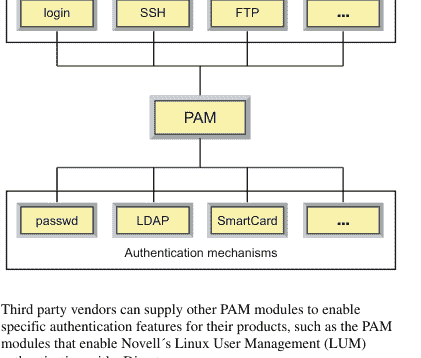

第三方厂商可以提供其他 PAM 模块，以为其产品启用特定的认证功能，例如启用 Novell 的 Linux 用户管理（LUM）通过 eDirectory 进行认证的 PAM 模块。

要了解如何配置 PAM，您需要知道以下内容：

- PAM 配置文件的位置和用途
- PAM 配置
- PAM 配置文件示例
- 安全密码指南
- PAM 文档资源

### Location and Purpose of PAM Configuration Files

PAM 提供各种模块——每个模块都有不同的用途。例如，一个模块检查密码，另一个验证系统访问的位置，还有一个读取用户特定的设置。

每个依赖 PAM 模块的程序都有自己的配置文件 /etc/pam.d/program_name。例如，程序 passwd 的配置文件称为 /etc/pam.d/passwd。

有一个名为 other 的特殊配置文件。此文件包含在找不到应用程序特定文件时的默认配置。

此外，大多数 PAM 模块在 /etc/security/ 中有全局配置文件，这些文件定义了这些模块的确切行为。这些文件包括 pam_env.conf、pam_pwcheck.conf、pam_unix2.conf 和 time.conf 等。

每个使用 PAM 模块的应用程序实际上调用一组 PAM 函数。这些函数在模块中实现，根据各种配置文件中的信息执行认证过程，并将结果返回给调用应用程序。

### PAM Configuration

PAM 配置文件中的每一行包含 3 列加可选参数：

### Figure 6-2

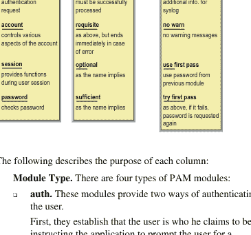

下面描述了每一列的用途：

- **Module Type.** PAM 模块有四种类型：
  - **auth.** 这些模块提供两种认证用户的方式。首先，它们通过指示应用程序提示用户输入密码或其他身份识别方式来确认用户就是其声称的人。其次，模块可以通过其凭证授予属性授予组成员身份或其他特权。
  - **account.** 这些模块执行基于非认证的账户管理。


它们通常用于根据一天中的时间、当前可用的系统资源（最大用户数）或申请人用户的位置（例如，将 `root' 登录限制到控制台）来限制或允许对服务的访问。

session。这些模块与在用户获得服务访问权限之前或服务提供给用户之后需要为用户执行的任务相关联。

此类事项包括记录有关用户的信息、挂载目录以及与另一用户进行某些数据交换的打开和关闭。

password。这种最后一种模块类型是更新与用户关联的身份验证令牌所必需的。通常，每种基于挑战/响应式身份验证（auth）模块类型都有一个模块。

## 控制标志。控制标志指示 PAM 将如何对与其关联的模块的成功或失败做出反应。

由于模块可以堆叠（同一类型的模块按系列执行，一个接一个），控制标志决定了每个模块的相对重要性。

Linux-PAM 库以以下方式解释这些关键字：

- required。具有此标志的模块必须在身份验证继续之前成功处理。
  
  在具有 required 标志的模块失败后，所有其他具有相同标志的模块将在用户收到身份验证尝试失败的消息之前被处理。这可以防止用户知道其身份验证在哪个阶段失败。

- requisite。具有此标志的模块也必须成功处理。在成功的情况下，其他模块随后会被处理，就像具有 required 标志的模块一样。

然而，在失败的情况下，模块会立即向用户反馈，并且不会再处理其他模块。

您可以使用 requisite 标志作为基本过滤器，检查正确身份验证所必需的某些条件是否存在。

- **optional.** 具有此标志的模块的失败或成功没有任何直接后果。
  您可以使用此标志用于仅 intended 显示消息（例如告知用户邮件已到达）的模块，而不采取任何进一步操作。

- **sufficient.** 在具有此标志的模块成功处理后，调用应用程序会收到有关成功的即时消息，并且不会再处理其他模块（前提是没有先前具有“required”标志的模块失败）。
  具有 sufficient 标志的模块的失败没有任何直接后果。换句话说，任何后续模块都将按其各自的顺序处理。

- **include.** 这并不是真正的控制标志，但表示下一列中的关键字应被解释为相对于 /etc/pam.d/ 的文件名，应在此处包含。
  所包含的文件必须具有与任何其他 PAM 配置文件相同的结构。
  **include** 文件的目的是简化对多个应用程序的更改。

- **Module.** PAM 模块位于目录 `/lib/security/` 中。每个模块的文件名都以前缀 `pam_` 开头。只要模块位于默认目录 `/lib/security/` 中，您就不必包含路径。

> 对于 SUSE Linux 支持的所有 64 位平台，默认目录是 /lib64/security/。


某些 PAM 模块（例如 pam_unix2.so）可用于多种模块类型（例如类型 auth 以及类型 password）。

- Arguments (options)。您可以在此列中为模块包含选项，例如 debug（启用调试）或 nullok（允许使用空密码）。

## PAM 配置文件示例

以下是 SLES 10 上 login 程序的默认配置文件，/etc/pam.d/login：

```
#%PAM-1.0
auth	required	pam_securetty.so
auth	include	common-auth
auth	required	pam_nologin.so
account	include	common-account
password	include	common-password
session	include	common-session
session	required	pam_lastlog.so nowtmp
session	required	pam_regrmgr.so
session	optional	pam_mail.so standard
```

作为上述配置中包含的文件的示例，文件 /etc/pam.d/common-auth 看起来像这样::

```
#
# /etc/pam.d/common-auth - authentication settings common to all services
#
# This file is included from other service-specific PAM config files,
# and should contain a list of the authentication modules that define
# the central authentication scheme for use on the system
# (e.g., /etc/shadow, LDAP, Kerberos, etc.). The default is to use the
# traditional Unix authentication mechanisms.
#
auth	required	pam_env.so
auth	required	pam_unix2.so
```


The modules perform the following tasks (not all are included in the above configuration):

- **auth required pam_securetty.so**
  该模块检查文件 /etc/securetty 中有效登录终端的列表。如果终端未列在该文件中，则从该终端拒绝登录。这仅涉及 root 用户。
- **auth required pam_env.so**
  该模块可用于设置额外的环境变量。变量可在文件 /etc/security/pam_env.conf 中配置。
- **auth required pam_unix2.so nullok**
  模块 pam_unix2.so 在身份验证过程中用于验证用户提供的登录名和密码。
- **auth required pam_nologin.so**
  该模块检查是否存在文件 /etc/nologin。如果找到此类文件，其内容会在用户尝试登录时显示。除了 root 用户外，其他用户均被拒绝登录。
- **account required pam_unix2.so**
  在此条目中再次使用 pam_unix2.so 模块，但在此情况下它检查用户的密码是否仍然有效或用户是否需要创建新密码。
- **password required pam_pwcheck.so nullok**
  这是类型为 password 的模块的条目。当用户尝试更改密码时使用。在此情况下，使用模块 pam_pwcheck.so 检查新密码是否足够安全。
  **nullok** 参数允许用户更改空密码，否则空密码将被视为锁定账户。
- **password required pam_unix2.so nullok use_first_pass use_authtok**

  更改密码时也需要 pam_unix2.so 模块。它对新密码进行加密（更准确地说是哈希），并将其写入身份验证数据库。

  **nullok** 的意义与上面对 pam_pwcheck.so 的描述相同。使用参数 **use_first_pass**，pam_unix2 使用来自之前模块的密码，例如 pam_pwcheck.so，如果没有来自之前模块的身份验证令牌则报错终止。参数 **use_authtok** 用于强制此模块将新密码设置为由之前堆叠的密码模块提供的密码。
- **session required pam_unix2.so**

  在此使用 pam_unix2.so 模块的 session 组件。不带参数时该模块无效果，带参数 **trace** 时它使用 syslog 守护进程记录用户的登录。
- **session required pam_limits.so**

  pam_limits.so 为用户设置资源限制，可在文件 /etc/security/limits.conf 中配置。
- **session required pam_mail.so**

  该模块在用户邮箱中有新邮件时会显示消息。它还会设置一个指向用户邮件目录的环境变量。

## Secure Password Guidelines

即使系统的最佳安全设置也可能被攻破，如果用户选择容易猜测的密码。凭借当今的计算能力，简单的密码可在几分钟内被破解。

这些攻击也称为 *字典攻击*，因为密码破解程序只是从字典文件中一个接一个地尝试单词，包括这些单词的一些常见变体。

因此，密码绝不应该是可以在字典中找到的单词。好的、安全密码应始终包含数字和大写字符。

要检查用户密码是否满足此要求，您可以在用户设置密码之前启用一个特殊的 PAM 模块来先测试密码。PAM 模块称为 pam_pwcheck.so 并使用 cracklib 库来测试密码的安全性。

默认情况下，此 PAM 模块在 SLES 10 上已启用。

如果用户输入的密码不够安全，则会显示以下消息：

```
Bad password: too simple
```

然后提示用户输入其他密码。

还有专用的密码检查程序可供使用，例如 **John the Ripper** (http://www.openwall.com/john/)。


## PAM 文档资源

以下 PAM 文档可在目录 `/usr/share/doc/packages/pam/` 中找到：

- **README** 文件。在此目录的顶层，有一些常规的 README 文件。子目录 `modules/` 包含有关可用 PAM 模块的 README 文件。
- **Linux-PAM 系统管理员指南。** 本文档包含系统管理员应了解的关于 PAM 的所有内容。

本文档讨论了一系列主题，从配置文件的语法到 PAM 的安全方面。该文档提供 PDF 文件、HTML 格式和纯文本格式。
- **Linux-PAM 模块编写者手册。** 本文档从开发者的角度总结了该主题，包含如何编写符合标准的 PAM 模块的信息。该文档提供 PDF 文件、HTML 格式和纯文本格式。
- **Linux-PAM 应用程序开发者指南。** 本文档包含希望使用 PAM 库的应用程序开发者所需的一切。该文档提供 PDF 文件、HTML 格式和纯文本格式。

还有一些 PAM 模块的手册页，例如 `man pam_unix2`。

c. 在以下行的开头添加一个 `#` 号，如下所示：
`#auth required pam_nologin.so`
此 PAM 模块在系统认证期间必须成功。它会检查文件 `/etc/nologin` 是否存在，如果存在，此 PAM 模块会通过返回失败状态来阻止普通用户登录。
现在这一行已被注释掉，PAM 将不再检查该文件。这意味着所有用户都可以登录，即使该文件存在。

d. 按 Esc 返回命令模式；输入 `:w` 保存文件。

## 8. 测试修改后的 PAM 配置文件：

- a. 切换到虚拟控制台 4（`Alt+F4`）。
- b. 尝试以 `geeko`（密码 `novell`）登录。
- 您能够登录，因为 PAM 不再检查文件 `/etc/nologin`。
- c. 输入 `exit` 以 `geeko` 身份注销。

## 9. 编辑文件 `/etc/pam.d/login` 以取消注释 `pam_nologin.so` 行：

- a. 切换到虚拟控制台 3（`Alt+F3`）。
- b. 取消注释 `pam_nologin.so` 行（删除之前输入的 `#` 号），使其看起来像这样：
  `auth required pam_nologin.so`
- c. 按 Esc 返回命令模式；输入 `:wq` 保存文件并退出 vi。

## 10. 在虚拟控制台 4 上，尝试以 `geeko` 登录。

您将再次收到“Login incorrect”消息。

## 11. 作为 root 用户在虚拟控制台 3 上删除文件 `/etc/nologin`，输入

```
rm /etc/nologin.
```

- 12. 在虚拟控制台 4 上，再次尝试以 **geeko** 登录。
- 由于文件 `/etc/nologin` 不存在，普通用户的登录已重新启用。

- 13. 输入 **exit** 以 `geeko` 身份注销。

- 14. 切换到虚拟控制台 3，输入 **exit** 以 root 身份注销。

- 15. 按 **Alt+F7** 返回桌面。

（练习结束）

## 目标 2 配置安全设置

YaST 提供一个本地安全模块，可让您为 SUSE Linux Enterprise Server 配置以下本地安全设置：

- 密码设置
- 启动配置
- 登录设置
- 用户创建设置
- 文件权限

您可以从三个预设的安全级别中选择（或修改），或创建自己的自定义安全设置，以满足您企业安全策略和程序的要求。

您可以通过从 YaST 控制中心选择“安全和用户 > 本地安全”，或在终端窗口中输入 `yast2 security`（以 root 身份），访问安全设置模块。

## 图 6-3

出现以下内容：

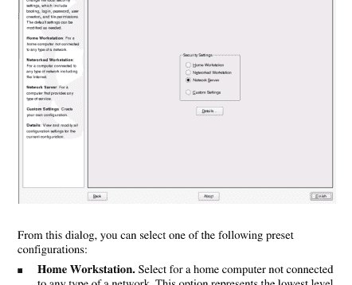

在此对话框中，您可以选择以下预设配置之一：

- **家庭工作站。** 选择此选项适用于未连接任何类型网络的家庭计算机。此选项代表最低级别的本地安全。
- **网络工作站。** 选择此选项适用于连接到任何类型网络或互联网的计算机。此选项提供中级本地安全。
- **网络服务器。** 选择此选项适用于提供任何类型服务（网络或其他）的计算机。此选项启用高级本地安全。
- 您还可以选择**详细信息**或**自定义设置**来修改现有的安全级别或创建您自己的配置。


通过选择三个预定义的其中一个安全级别并选择 Next，所选的安全级别将被应用。通过选择 Details，您可以更改所选安全级别的设置。

如果您选择 Customs Settings 然后选择 Next，您可以直接更改安全配置的详细信息。

每个安全级别的详细设置对话框看起来都一样，但预选的选项不同。在以下对话框中，您可以看到 Level 3（Network Server）的设置。

在第一个对话框中，您可以更改系统接受的默认密码要求：

## Figure 6-4

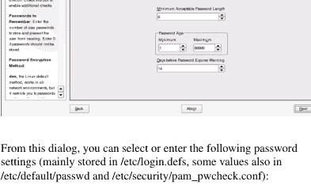

从此对话框中，您可以选择或输入以下密码设置（主要存储在 /etc/login.defs 中，部分值也存储在 /etc/default/passwd 和 /etc/security/pam_pwcheck.conf 中）：

- **Check New Passwords.** 选择密码时，重要的是选择一个不在字典中且不是姓名或其他简单常见词的密码。通过选择此选项，您强制按这些规则检查密码。
- **Test for Complicated Passwords.** 密码应由大小写字母混合以及数字构成。也可以使用特殊字符如 (: 等，但可能在不同的键盘布局上难以输入。这使得猜测密码变得非常困难。选择此选项以启用额外检查。
- **Password Encryption Method.** 从下拉列表中选择以下其中一种加密方法：
  - **DES.** 这是最低的共同标准。它在所有网络环境中都适用，但将密码限制为不超过八个字符。如果您需要与其他系统兼容，请选择此方法。
  - **MD5.** 此加密方法允许更长的密码，并得到所有当前 Linux 发行版的支持，但不被其他系统或旧软件支持。
  - **Blowfish.** 此加密方法使用 blowfish 算法对密码进行加密。尚未被许多系统支持。计算哈希需要大量 CPU 能力，这使得使用字典破解密码变得困难。它是 SLES 10 上的默认加密方法
- **Minimum Acceptable Password Length.** 输入可接受密码的最小字符数。如果用户输入的字符更少，密码将被拒绝。

输入 0 可禁用此检查。
- **Password Age.** Minimum 指的是在密码可以再次更改之前必须经过的天数。Maximum 是密码过期并必须更改的天数。

- **Days Before Password Expires Warning.** 在密码过期前此天数会向用户发出警告。

尽管 root 在设置密码时收到警告，但她仍可能在上述设置下输入一个不好的密码。

配置完密码设置后，选择 Next 继续。随后出现以下内容：

## Figure 6-5

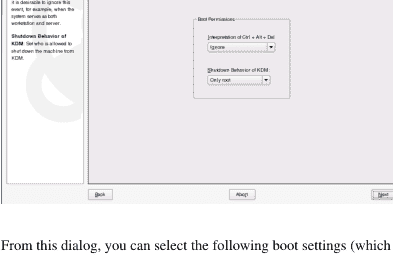

从此对话框中，您可以选择以下启动设置（将更新文件 /etc/inittab）：

- **Interpretation of Ctrl + Alt + Del.** 当有人在控制台按下 Ctrl+Alt+Del 键组合时，系统通常会重新启动。

- **Ignore.** 有时您希望系统忽略此键组合，尤其当系统既作为工作站又作为服务器使用时。按下 **Ctrl+Alt+Del** 键组合时什么也不会发生。
- **Reboot.** 按下 **Ctrl+Alt+Del** 键组合时系统会重新启动。
- **Halt.** 按下 **Ctrl+Alt+Del** 键组合时系统会关闭。

## Shutdown Behavior of KDM. 您使用此选项来设置谁有权从 KDM 关闭计算机。

- **Only Root.** 要停止系统，必须输入 root 密码。
- **All Users.** 每个人，甚至远程连接的用户，都可以使用 KDM 停止系统。
- **Nobody.** 没有人可以使用 KDM 停止系统。
- **Local Users.** 只有本地连接的用户可以使用 KDM 停止系统。
- **Automatic.** 注销后系统会自动关闭。

对于服务器系统，您应使用 **Only Root** 或 **Nobody** 以防止普通用户甚至远程用户停止系统


当你完成启动设置配置后，继续选择 Next。随后会出现以下内容：

## Figure 6-6

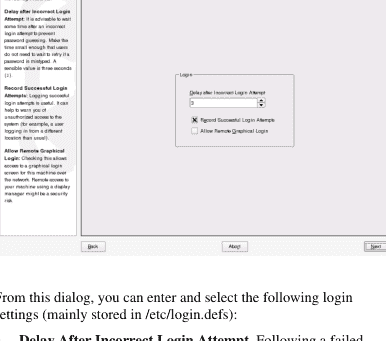

从此对话框中，你可以输入并选择以下登录设置（主要存储在 /etc/login.defs 中）：

- Delay After Incorrect Login Attempt. 在一次登录失败后，通常会有一段几秒钟的等待时间，然后才能再次登录。这使得密码破解者更难登录。

此选项允许你调整下一次登录尝试前的延迟时间。默认值为 3 秒，这是一个合理的值。

- Record Successful Login Attempts. 记录成功的登录尝试可能很有用，尤其是在警告你系统遭到未经授权的访问时（例如用户从非正常位置登录）。

选择此选项可在文件 /var/log/wtmp 中记录成功的登录尝试。你可以使用命令 last 来查看谁在何时登录。

- **Allow Remote Graphical Login.** 你可以选择此选项允许其他用户通过网络访问你的图形登录界面。

由于这种类型的访问代表潜在的安全风险，因此默认情况下处于非活动状态。

当你完成登录设置配置后，继续选择 Next。随后会出现以下内容：

## Figure 6-7

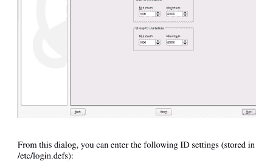

从此对话框中，你可以输入以下 ID 设置（存储在 /etc/login.defs 中）：

- **User ID Limitations.** 输入最小值和最大值以配置可能的 user ID 号码范围。 新用户将从此范围内获取 UID。
- **Group ID Limitations.** 输入最小值和最大值以配置可能的 group ID 号码范围。

当你完成用户和组 ID 限制的配置后，继续选择 Next。 安全配置的最后一页会出现：

## Figure 6-8

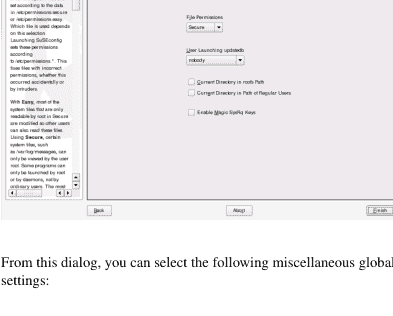

从此对话框中，你可以选择以下杂项全局设置：

**File Permissions.** 某些系统文件的权限设置在 **/etc/permissions.easy**、**/etc/permissions.secure** 或 **/etc/permissions.paranoid** 中配置。你也可以将自己的规则添加到文件 **/etc/permissions.local**。每个文件都包含文件语法和预设用途的描述。

目录 **/etc/permissions.d/** 中的文件设置也会被包含。此目录由自带权限文件的软件包使用。

从下拉列表中选择以下其中一项：

- **Easy.** 选择此选项允许除 root 之外的用户读取大部分系统文件。
- **Secure.** 选择此选项可确保某些配置文件（如 /etc/ssh/sshd_config）只能由用户 root 查看。某些程序只能由 root 或守护进程启动，而不能由普通用户启动。
- **Paranoid.** 选择此选项可获得极其安全的系统。所有程序上的 SUID/SGID 位均已清除。请记住，某些程序可能无法正常工作，因为用户不再具有访问某些文件的权限。

运行 SuSEconfig 会根据各自 /etc/permissions* 文件中的设置设置这些权限。这会修复权限不正确的文件，无论是意外造成的还是由入侵者造成的。

**User Launching updatedb.** 如果安装了程序 updatedb，它会在每天或启动后自动运行。它会生成一个数据库（**locatedb**），其中存储了计算机上每个文件的位置。

你可以使用 locate 实用程序搜索此数据库（输入 **man locate** 了解详情）。

从下拉列表中选择以下其中一项：

- nobody. 任何用户只能找到数据库中任何其他（无特权）用户可见的路径。
- root. 系统中的所有文件都将被添加到数据库中。

### Current Directory in root's Path and Current Directory in the Path of Regular Users.

如果取消选择这些选项（默认），用户必须始终通过添加 "./"（例如 ./configure）来在当前目录中启动程序。

如果选择这些选项，则点号 "." 会附加到 root 和用户的搜索路径末尾，使他们能够在当前目录中输入命令而无需附加 "./"。

选择这些选项可能非常危险，因为用户可能会意外启动当前目录中的未知程序，而不是通常的系统范围文件。

此配置写入 /etc/sysconfig/suseconfig。

### Enable Magic SysRq Keys. 选择此选项即使系统崩溃（例如在内核调试期间）也能让你对系统进行一定程度的控制。详情请参阅 /usr/src/linux/Documentation/sysrq.txt。

此配置写入 /etc/sysconfig/sysctl。

当你完成杂项设置的配置后，通过选择 Finish 保存设置并运行 SuSEconfig。


## 练习 6-2 配置密码安全设置

在本练习中，你练习更改不同的安全设置。将按下 Ctrl+Alt+Del 键时的默认行为更改为停止机器。还将加密方式从 blowfish 更改为 MD5。使用 YaST 本地安全模块完成上述操作。

## 完成此练习的详细步骤：

- 1. 打开一个终端窗口。
- 2. 通过输入 grep ctrlaltdel /etc/inittab 在文件 /etc/inittab 中检查 Ctrl+Alt+Del 键的设置。
- 注意当前设置：
- 3. 启动 YaST 并选择 Security and Users > Local Security。
  出现本地安全配置对话框。
- 4. 确保已选择 Custom Settings；然后选择 Next。
  出现密码设置对话框。
- 5. 在 Password Encryption Method 下拉列表中，选择 MD5。
- 6. 通过选择 Next 继续。
  出现启动设置对话框。
- 7. 在 Interpretation of Ctrl + Alt + Del 下拉列表中，选择 Halt。
- 8. 通过选择 Next 继续。
  出现登录设置对话框。
- 9. 通过选择 Next 接受默认设置。
  出现添加用户对话框。
- 10. 通过选择 Next 接受默认设置。
  出现杂项设置对话框。
- 11. 接受默认设置并通过选择 Finish 配置系统以使用新设置。
- 12. 要测试更改，必须先通过重新启动系统或在终端窗口中以 root 身份输入 init q（重新加载 /etc/inittab 文件）来激活新配置。
  a. 从终端窗口，使用 su - 切换到 root（密码 novell）。
  b. 通过输入 init q 重新加载文件 /etc/inittab。
- 13. 通过输入 grep ctrlaltdel /etc/inittab 验证 Ctrl+Alt+Del 设置是否已更改。
  注意设置现在是“shutdown -h”，而不是你在步骤 2 中记录的内容。
- 14. 通过按 Ctrl+Alt+F2；然后按 Ctrl+Alt+Del 测试此设置。
  系统关闭而不是重新启动。
- 15. 打开你的计算机并以 geeko 身份登录到 Gnome 桌面。
- 16. （可选）使用 YaST 安全设置模块将 Ctrl+Alt+Del 的默认值改回重启。

（练习结束）

### 摘要

| 目标 | 摘要 |
|---|---|
| 1. 使用 PAM 配置用户身份验证 | Linux 在身份验证过程中使用 PAM（可插拔身份验证模块）作为用户与应用程序之间通信的层。在 PAM 框架内有四种不同的模块类型：auth、account、session 和 password。控制标志——required、requisite、sufficient、optional——控制模块成功或失败时发生的情况。/etc/pam.d/ 中的文件用于配置 PAM，/etc/security/ 中的文件为某些模块提供额外的配置选项。 |
| 2. 配置安全设置 | 用户账户和其他与安全相关的设置的默认值可以使用 YaST 本地安全模块进行配置。配置设置写入各种文件，其中最相关的是 /etc/default/ 中的文件，以及 /etc/login.defs。 |

## 第 7 节 使用 Syslog Daemon syslog-ng

在 SUSE Linux Enterprise Server 9 之前，使用 syslogd 记录系统事件。从 SUSE Linux Enterprise Server 10 开始，这些事件由 syslog-ng 记录，即新一代 syslogd。

syslog-ng 相对于 syslogd 的主要优势在于其不仅可以根据设施和优先级过滤消息，还可以根据每条消息的内容进行过滤。

## 目标

- 1. 使用 Syslog Daemon syslog-ng

## 目标 1 使用 Syslog Daemon syslog-ng

syslog 守护进程 syslog-ng 由许多服务用于记录系统事件。使用单一服务进行日志记录的优势在于所有日志记录都可以从一个配置文件进行管理。

syslog 守护进程接受来自系统服务的消息，并且根据其配置，还接受来自其他主机的消息，并根据配置文件 /etc/sysconfig/syslog 和 /etc/syslog-ng/syslog-ng.conf 中的设置进行记录。文件 /etc/syslog-ng/syslog-ng.conf 由 SuSEconfig 从 /etc/syslog-ng/syslog-ng.conf.in 生成。两个文件共享相同的语法。

syslog-ng 的配置分布在三个文件中：

- /etc/sysconfig/syslog
- /etc/syslog-ng/syslog-ng.conf.in
- /etc/syslog-ng/syslog-ng.conf


## 使用 Syslog Daemon syslog-ng

文件 /etc/sysconfig/syslog 包含适用于 syslog-ng 以及 syslog 的通用参数。

在此文件中设置的参数包括传递给 syslogged 或 syslog-ng 的开关、内核日志级别、klogd 的参数，以及要使用的 syslog daemon。

```
## Type: string
## Default: ""
## Config: ""
## ServiceRestart: syslog
#
# if not empty: parameters for syslogd
# for example SYSLOG_PARAMS="-r -s my.dom.ain"
SYSLOG_PARAMS="" 
```

```
## Type: string
## Default: ""
## Config: ""
## ServiceRestart: syslog
#
# if not empty: parameters for klogd
# for example SYSLOG_PARAMS="-x" to avoid (duplicate) symbol resolution
KLOGD_PARAMS="-x" 
```

```
## Type: list(syslog,syslog-ng)
## Default: syslog
## Config: syslog-ng
## Command: /sbin/rcsyslog restart
## PreSaveCommand: /sbin/rcsyslog stop
#
# The name of the syslog daemon used as syslog service: "syslogd", "syslog-ng"
SYSLOG_DAEMON="syslog-ng" 
```

/etc/sysconfig/syslog 中设置的参数由启动脚本 /etc/init.d/syslog 评估。此外，SuSEconfig 使用 /etc/sysconfig/syslog 在从 /etc/syslog-ng/syslog-ng.conf.in 生成文件 /etc/syslog-ng/syslog-ng.conf 时向文件 /etc/syslog-ng/syslog-ng.conf 添加日志套接字。

## /etc/syslog-ng/syslog-ng.conf.in

/etc/syslog-ng/syslog-ng.conf.in 是用于创建配置文件 /etc/syslog-ng/syslog-ng.conf 的模板，后者是 syslog-ng 实际使用的配置文件。两个文件具有相同的语法。

然而，除非你在 /etc/sysconfig/syslog 中关闭 /etc/syslog-ng/syslog-ng.conf 的生成，否则对该文件的任何手动更改在执行 SuSEconfig 时都会被覆盖。

因此，对 syslog-ng 配置的更改应在此文件中进行。

## /etc/syslog-ng/syslog-ng.conf

syslogd 和 syslog-ng 共享两个你必须理解的概念才能配置其中任何一个：

- Facilities
- Priorities

syslog-ng 的配置由几个部分组成，然后组合起来配置要将哪些信息记录到何处。

这些是：

- Sources
- Filters
- Destinations
- Log Paths

## Facilities

facility 指提供相应消息的子系统。使用 syslog 进行日志记录的每个程序都被分配一个这样的 facility，通常由其开发者指定。

以下描述了这些 facility：

表 7-1

| Facility | Description |
|---|---|
| authpriv | 由所有与系统安全或授权有关的服务使用。所有 PAM 消息都使用此 facility。ssh daemon 使用 auth facility。 |
| cron | 接受来自 cron 和 at daemons 的消息。 |
| daemon | 由没有自己 facility 的各种 daemons 使用，例如 ppp daemon。 |
| kern | 所有内核消息。 |
| lpr | 来自打印机系统的消息。 |
| mail | 来自邮件系统的消息。这很重要，因为许多消息可能很快到达。 |
| news | 来自新闻系统的消息。与邮件系统一样，可能需要在短时间内记录许多消息。 |
| syslog | syslog daemon 的内部消息。 |

## 表 7-1（续）

| Facility | Description |
|---|---|
| user | 用于用户级别消息的通用 facility。例如，它被 login 用于记录失败的登录尝试。 |
| uucp | 来自 uucp 系统的消息。 |
| local0 – local7 | 这 8 个 facility 可供你自行配置。所有 local 类别都可以在你自己的程序中使用。 |

通过配置其中一个 facility，可以通过 /etc/syslog-ng/syslog-ng.conf 文件中的条目单独管理来自你自己的程序的消息。

## Priorities

优先级提供了有关消息紧急程度的详细信息。以下优先级可用（按紧急程度递增顺序列出）：

## 表 7-2

| Priority | Description |
|---|---|
| debug | 仅应用于调试目的，因为此类别及更高级别的所有消息都会被记录。 |
| info | 用于纯粹提供信息的消息。 |
| notice | 用于描述应注意的正常系统状态的消息。 |
| warning | 用于显示偏离正常状态的消息。 |
| err | 用于显示错误的消息。 |
| crit | 用于指定程序关键条件消息。 |


## 表 7-2（续）

| Priority | Description |
|---|---|
| alert | 用于通知系统管理员需要立即采取行动以保持系统正常运行的消息。 |
| emerg | 用于警告您系统已无法使用的消息。 |

## Sources

源是一个源驱动程序的集合，这些驱动程序使用给定方法收集消息。这些源用于收集日志消息。通用语法如下：

```
source <identifier> { source-driver(params); source-driver(params); ... };
```

/etc/syslog-ng/syslog-ng.conf 中的相应部分如下所示：

```
source src {
  # include internal syslog-ng messages
  # note: the internal() source is required!
  internal();

  # the following line will be replaced by the
  # socket list generated by SuSEconfig using
  # variables from /etc/sysconfig/syslog:
  unix-dgram("/dev/log");

  # uncomment to process log messages from network:
  #udp(ip("0.0.0.0") port(514));
};
```

在此示例中，定义了一个用于 syslog-ng 内部消息的源和套接字 /dev/log。

## Destinations

目标定义了消息可以记录的位置。通用语法如下：

```
destination <identifier> {
  destination-driver(params);
  destination-driver(params); ... }
```

可能的目标是文件、fifos、套接字、特定用户的 ttys、程序或其它主机。

/etc/syslog-ng/syslog-ng.conf 中的示例如下：

```
destination console { file("/dev/tty10" group(tty) perm(0620)); };
destination messages { file("/var/log/messages"); };
```

## Log Paths

日志路径是所有内容汇聚的地方。它们定义了根据源、过滤器和目标将哪些消息记录到何处。通用语法如下：

```
log { source(s1); source(s2); ...
      filter(f1); filter(f2); ...
      destination(d1); destination(d2); ...
      flags(flag1[, flag2...]); };
```

例如，/etc/syslog-ng/syslog-ng.conf 中的以下条目负责记录到 /dev/tty10 和 /var/log/messages：

```
log { source(src); filter(f_console); destination(console); };
log { source(src); filter(f_messages); destination(messages); };
```

在第一行中，通过源 src 中定义的源传入的日志消息如果匹配过滤器 f_console 则记录到 tty10。在第二行中，通过源 src 中定义的源传入的消息如果匹配过滤器 f_messages 则记录到 /var/log/messages。


有关 syslog-ng.conf 文件的更多详细信息，请输入 **man 5 syslog-ng.conf**。`/usr/share/doc/packages/syslog-ng/html/book1.html` 中的文档提供了 syslog-ng 的总体概述以及配置的详细信息。

## Summary

| Objective | Summary |
|---|---|
| 1. Use Syslog Daemon syslog-ng | 在 Linux 系统中，有许多日志跟踪系统操作的各个方面。许多服务将其活动记录到自己的日志文件中，并且可以按服务设置详细程度。此外，/var/log/ 中的系统日志跟踪系统级事件。

logrotate 是用于归档日志文件的实用程序。 |

## 第 8 节 使用 Xen 管理虚拟化

虚拟化目前是业界最热门的话题之一。然而，虚拟化的概念一点也不新。像 IBM 的 pSeries 或 zSeries 这样的硬件平台很早就支持虚拟化，而像 VMware Workstation 这样的 x86 系统软件也已可用多年。

现在虚拟化进入主流，因为价格合理的基于 Intel 或 AMD 的 x86 系统提供了足够的资源来同时运行多个虚拟机。

SUSE Linux Enterprise Server 10 通过 Xen 虚拟机监视器提供内置虚拟化支持。在以下部分中，您将学习如何使用这一强大的功能。

在本节中，您将了解 SUSE Linux Enterprise Server 10 中的 Xen 虚拟化技术。

## Objectives

- 1. 理解虚拟化的概念
- 2. 理解 Xen 的工作原理
- 3. 安装 Xen
- 4. 使用 YaST 管理 Xen 域
- 5. 在命令行管理 Xen 域
- 6. 理解 Xen 网络
- 7. 迁移访客域


# 目标 1

# 理解虚拟化的概念

虚拟化技术将运行中的操作系统实例与物理硬件分离。操作系统不是在物理机上运行，而是在所谓的虚拟机中运行。多个虚拟机共享底层硬件的资源。

虚拟化允许您在一台物理机上运行多个虚拟系统。

图 8-1


与非虚拟化的物理硬件相比，虚拟化主要有以下优点：

1. **高效的硬件利用率。** 通常，系统并未充分利用其硬件的全部潜力。通过在同一硬件上运行多个虚拟机，可以更高效地利用资源。

2. **减少停机时间。** 虚拟机可以轻松迁移到新的物理主机系统。这可以在硬件发生故障时减少停机时间。

3. **灵活的资源分配。** 硬件资源可以按需分配。当虚拟机的资源需求发生变化时，可以调整资源分配，或者将机器迁移到不同的物理主机上。

# 目标 2

# 理解 Xen 的工作原理

虚拟化的概念并不新鲜。像 IBM zSeries 或 pSeries 这样的平台提供了内置的虚拟化支持，而基于 Intel x86 的系统可以使用 VMware 等第三方软件进行虚拟化。

SUSE Linux Enterprise Server 10 附带了一种名为 Xen 的虚拟化技术，它允许您在一块基于 Intel x86 的硬件上运行多个虚拟机。

目前，在 Xen 虚拟机中运行的操作系统需要经过修改。因此，只能安装 Linux 或 BSD 等开源操作系统。一个例外是 NetWare，Novell 已对其进行了调整，使其能够在 Xen 虚拟机中运行。

Intel 和 AMD 正在开发 x86 标准的扩展（Intel Vanderpool 和 AMD Pacifica）以支持虚拟化。一旦这些扩展可用，Xen 将能够运行未经修改的操作系统，包括 Microsoft Windows。

> 您可以在 OpenSUSE Xen 页面找到有关 Xen 的最新信息，包括如何运行未经修改的操作系统的说明：
> http://en.opensuse.org/Xen

要理解 Xen 的工作原理，您需要做到以下几点：

- 理解虚拟化方法
- 理解 Xen 架构

# 理解虚拟化方法

在详细讨论 Xen 技术之前，您应该理解以下两种不同的虚拟化方法。

- **全虚拟化。** 在这种情况下，虚拟化软件模拟一个完整的虚拟机，包括所有硬件资源。运行在虚拟机中的操作系统（客户操作系统）与这些资源通信，就像它们是物理硬件一样。VMware Workstation 是一款流行的全虚拟化软件。

图 8-2

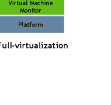

全虚拟化

- **半虚拟化。** 半虚拟化软件不模拟完整的虚拟机，而是提供一个应用程序编程接口（API），客户操作系统通过该接口访问硬件资源。这要求客户操作系统意识到自己运行在虚拟机中，并且需要知道如何访问该 API。Xen 就是一款半虚拟化软件。

图 8-3

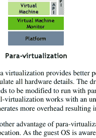

半虚拟化

半虚拟化提供了更好的性能，因为它不模拟所有硬件细节。缺点在于，客户操作系统需要经过修改才能在半虚拟化环境下运行。
全虚拟化可以使用未经修改的客户操作系统，但会产生更多开销，导致性能较弱。

半虚拟化的另一个优点是灵活的资源分配。由于客户操作系统能够感知虚拟环境，Xen 可以（例如）在不重启的情况下动态更改虚拟机的内存分配。


## 了解 Xen 架构

Xen 由以下两个主要组件组成：

- **虚拟机监视器。** 虚拟机监视器在物理硬件和虚拟机之间形成一层。一般这种软件被称为 **Hypervisor**。
- **Xen 工具。** Xen 工具是一组用于管理虚拟机的命令行应用程序。

虚拟机监视器必须在任何虚拟机启动之前加载。在使用 Xen 时，虚拟机被称为 **domains**。

Xen 虚拟机监视器既不包含访问主机物理硬件的驱动程序，也没有与管理员直接通信的接口。这些任务由在特权 **domain0** 中运行的操作系统执行。

以下是包含三个域的 Xen 系统的概述。

Figure 8-4

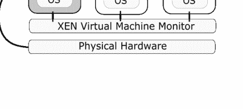

一个名为 xend 的进程在 domain0 Linux 安装中运行。该进程用于管理系统上运行的所有 Xen 域并提供对其控制台的访问。

在 Xen 术语中，未特权的域也称为 domainU。

SUSE Linux Enterprise Server 10 可用于特权（domain0）和非特权（domainU）Xen 域。

## Objective 3 安装 Xen

要设置 Xen 系统，你从一个正常的 SUSE Linux Enterprise 10 安装开始，该安装将在 domain0 中运行。

其他 Xen 域以后可以在物理分区或文件系统映像中安装。当你计划使用物理分区时，必须确保初始的 SUSE Linux Enterprise Server 10 安装没有使用所有可用的磁盘空间。

为了获得最大灵活性，使用逻辑卷管理器 LVM 或 EVMS 对于 Xen 系统是有意义的。

以下软件包必须安装在初始的 SUSE Linux Enterprise Server 10 安装中：

- **xen.** 该软件包包含 Xen 虚拟机监视器（Hypervisor）。
- **xen-tools.** 包含 xend 和用于管理 Xen 系统的命令行工具集合。
- **kernel-xen.** 该软件包包含在 Xen 域中运行的修改版 Linux 内核。
- **xen-doc-***（可选）。各种格式的 Xen 文档。

安装 Xen 软件包会自动在引导加载程序配置文件 /boot/grub/menu.lst 中添加如下条目。

```
title Xen
root (hd0,3)
kernel /boot/xen.gz
module /boot/vmlinuz-Xen root=/dev/hda3 selinux=0
module /boot/initrd-Xen
```

在某些 Xen 系统中，你可能会在内核模块行中看到参数 dom0_mem。该参数在启动时为 domain0 分配一定量的初始主内存。然而在 Xen 版本 3 中，该参数不再需要。

最初所有可用内存都由 domain0 使用。当你启动额外的 domainU 时，domain0 中的所需内存量会减少并用于新的 domainU。

menu.lst 中的条目为系统的启动菜单添加了一个新选项。选择此条目时，Xen 虚拟机监视器将被加载（kernel/boot/xen.gz），它会启动 SUSE Linux Enterprise Server 10 进入 domain0（参见以 module 开头的行）。

在重新启动系统并使用 Xen 选项之前，你应该检查自动生成的条目是否正确。确保 ...

- ... 行 root (hd0,3) 指向包含 Xen 虚拟机监视器和 domain0 Linux 安装内核的文件系统。在我们的示例中，hd0,3 表示系统上第一块硬盘的第四个分区。还要检查第一个 module 行中的参数 root 是否指向 domain0 安装的根分区。
- ... Xen 版本的 Linux 内核和 initrd 在 module 行中加载。映像文件的名称应以 -xen 结尾。

检查完引导加载程序配置文件后，你可以重新启动系统并在引导加载程序菜单中选择 Xen 选项。在启动的早期阶段，你将在屏幕上看到 Xen 虚拟机监视器的一些消息。然后 domain0 Linux 安装将被启动。

如果系统无法正常启动，你可以通过选择常规的 SUSE Linux Enterprise Server 10 启动选项切换回非虚拟化系统。


运行 Xen 时，网络设置由 xend 管理进程完成。这可能会干扰域的原生网络配置脚本。尤其是 SuSEfirewall2 已知会引起问题。因此建议使用 rcSuSEfirewall2 停止 SuSEfirewall2，并从 init 进程中移除防火墙脚本：

```
insserv -r SuSEfirewall2_setup
insserv -r SuSEfirewall2_init
insserv -r SuSEfirewall2_final (conditional)
```

## Exercise 8-1    安装 Xen

在本练习中，你将学习如何安装 Xen 并配置 domain0。

执行以下操作：

- Part I: 安装 XenPackages。
- Part II: 准备重启
- Part III: 重启并测试 Xen。

### Part I: 安装 XenPackages。

执行以下操作：

- 1. 启动 YaST 控制中心。
- 2. 选择 Software > Software Management。
- 3. 从 Filter 菜单中选择 Search。
- 4. 在搜索字段中输入 xen 并选择搜索。
- 5. 在右侧，选择软件包 xen、kernel-xen 和 xen-tools。
- 6. 选择 Accept 并让 YaST 安装所有必需的软件包。
- 7. 关闭 YaST 控制中心。

### Part II: 准备重启

执行以下操作：

- 1. 打开一个终端窗口并 su - 切换到 root 用户。
- 2. 使用文本编辑器（例如 vi）打开文件 /boot/grub/menu.lst。
- 3. 确保文件中有一个标题为 Xen 的部分。
- 4. 在该部分中，确保参数 **root=** 指向你的安装的根分区。
- 5. 关闭文件。
- 6. 输入命令：
  **insserv -r SuSEfirewall2_setup**
  以及
  **insserv -r SuSEfirewall2_init**
- 7. 关闭终端窗口。

### Part III: 重启并测试 Xen。

- 1. 重启你的系统。
- 2. 在启动菜单中，选择 **Xen entry** 并按 **Return**。
- 3. 系统启动后，以用户 **gecko** 登录，密码为 **novell**。
- 4. 打开一个终端窗口并 **su -** 切换到 **root** 用户。
- 5. 输入命令 **xm list**。
- 6. 在输出中你应该看到一个域（Domain-0）状态为 running。

**(End of Exercise)**

## Objective 4

## 使用 YaST 管理 Xen 域

在你安装了 Xen 和 Xen 工具之后，你可以开始创建更多 Xen 域。在深入介绍域配置细节之前，我们将介绍 YaST 模块 Virtual Machine Management（Xen）。

该模块提供了一种便捷的方式来创建和控制系统上的 Xen 域。该模块可以从 YaST 控制中心的 System 部分启动，并且必须在运行在 domain0 的 Linux 系统上运行。

> 以下内容并未描述 Xen 域配置的每一个细节。更深入的信息将在下一个目标中介绍。

以下是使用该 YaST 模块创建和启动新 Xen 域的逐步说明。

启动模块后，屏幕上会出现以下对话框：

### Figure 8-5

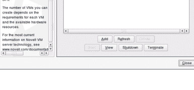

在我们的示例中，系统上已经有一个访客域正在运行，它列在对话框的上部。表格的列显示了域的各种信息，包括名称、状态和内存分配。

对话框下部有以下按钮：

- **Add.** 选择此按钮以创建新域。
- **Refresh.** 此按钮刷新域的信息。
- **Delete.** 完全删除一个域。
- **Start.** 启动一个域。
- **View.** 打开一个终端窗口以访问域的控制台。
- **Shutdown.** 执行访客操作系统的正常关机。
- **Terminate.** 立即终止域，而不等待访客操作系统关机。

选择 Add 后，出现以下对话框：

### Figure 8-6

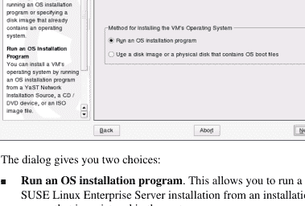

该对话框为你提供了两个选择：

- Run an OS installation program. 这允许你从系统中注册的安装源运行 SUSE Linux Enterprise Server 安装。
- Use a disk image or a physical disk that contains OS boot files. 此选项允许你从物理磁盘或磁盘映像中的现有安装创建 Xen 域。


对于以下示例，我们选择 Run an OS installation program 选项。随后会出现以下对话框：

## Figure 8-7

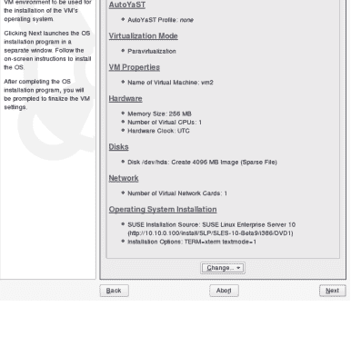

可以通过选择其标题来调整以下选项：

- **AutoYaST.** 在此选项中，您可以指定应在安装过程中使用的 AutoYaST 配置文件。如果没有 AutoYaST 配置文件，则启动手动安装。
- **Virtualization.** 您可以在半虚拟化和全虚拟化之间切换。仅在支持 Intel 或 AMD 虚拟化扩展的硬件上才提供全虚拟化。
- **VM Properties.** 在此处您可以更改新域的名称。
- **Hardware.** 在此选项中您可以配置域的硬件配置。内存、CPU 数量，……
- **Disks.** 在此处配置磁盘。这些可以是物理块设备或文件系统/磁盘映像。
- **Network.** 此选项允许您向域添加额外的网络适配器。
- **Operating System Installation.** 在此处您可以配置安装源和额外的安装选项。

## Figure 8-8

对于我们的示例，我们保留默认设置并选择 Next。现在域环境和安装过程已启动。

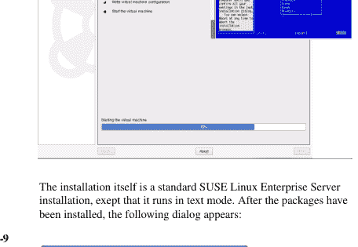

安装本身是标准的 SUSE Linux Enterprise Server 安装，只是它在文本模式下运行。安装完软件包后，会出现以下对话框：

## Figure 8-9

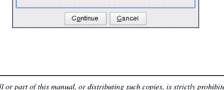

选择 **Continue**。

以下对话框为您提供了有关域配置的摘要。通常在此处无需操作。在此对话框中选择 **Next**，并在域概览中选择。

一个终端窗口打开，您可以在其中使用 YaST 完成操作系统安装的剩余步骤。

## Exercise 8-2    Install a Guest Domain

在本练习中，您将学习如何使用 YaST 安装 Xen 客户域。在开始本练习之前，您必须已在系统上安装了 xen。

执行以下操作：

- 1. 打开 YaST 控制中心。
- 2. 选择 System > Virtual Machine Management。
- 3. 选择 Add。
- 4. 选择 Run an OS installation program 然后选择 Next。
- 5. 选择 Next。
- 6. 过一段时间后，一个终端窗口打开并启动标准的 SUSE Linux Enterprise Server 安装。选择该窗口。
- 7. 按 Alt+N。
- 8. 使用 tab 键导航到项目 “Yes, I Agree to the License Agreement”。然后按空格键。
- 9. 按 Alt+N。
- 10. 按 Alt+N。
- 11. （可选）调整区域和时区设置。使用 tab 键导航到菜单，并使用方向键更改选项。
- 12. 按 Alt+N。
- 13. 通过按 Alt+A 确认安装概览。
- 14. 通过按 Alt+I 启动安装。
- 15. （等待安装完成。）
- 16. 在 Installation Complete 消息框中选择 Continue。
- 17. 在域配置概览中选择 Next。
- 18. 在 **Virtual Machine Started** 消息框中选择 **Finish**。
- 19. 切换到虚拟域的终端。
- 20. 选择 **Next**（按 **Alt+P**）。
- 21. 输入 **novell** 作为 root 密码。选择 **Next** 继续（按 **Alt+N**）。
- 22. 接受密码过于简单。
- 23. 按 **Alt+n** 继续。
- 24. 选择 **No, Skip this Test**（按 **Alt+O**）。
- 25. 选择 **Next**（**Alt+N**）。
- 26. 选择 **Next**（**Alt+N**）。
- 27. 选择 **Next**（**Alt+N**）。
- 28. 创建用户 **gecko**，密码为 **novell**。
- 29. 选择 **Next**（**Alt+N**）。
- 30. 接受密码过于简单。
- 31. 选择 **Next**（**Alt+N**）。
- 32. 选择 **Next**（**Alt+N**）。
- 33. 选择 **Finish**（**Alt+F**）。
- 34. 测试您是否可以使用用户名 root 和密码 novell 登录到新域。
- 35. 请不要关闭终端窗口，我们将在下一个练习中使用它。

*(End of Exercise)*


## 目标 5 在命令行管理 Xen 域

下面你将学习如何在命令行管理 Xen 域。这包括：

- 理解域配置文件
- 使用 xm 工具
- 自动化域的启动和关闭

### 理解域配置文件

每个 Xen 域都需要一个配置文件。对于使用 YaST 创建的域，配置文件通常位于 `/etc/xen/vm/`。

在 `/etc/xen/examples` 下，你可以找到两个示例文件，如果你想从头创建配置，可以使用它们。

- **xmexample1**。这是单个域的模板配置文件。
- **xmexample2**。这是一个在一个文件中包含多个域配置的示例。

对于初学者来说，xmexample1 是更好的选择。

配置文件包含多个关键字，用于配置 Xen 域的不同方面。以下是使用最常见选项的示例配置文件。# 字符用于注释。请阅读示例中的注释以了解配置选项的详细信息。

```
# Unique name of the domain
name = "SLES10-WebServer"

# The following lines point to the kernel and initrd file
# on the filesystem of the domain. The filesystem itself is
# defined later.
kernel = "/boot/vmlinuz-Xen"
ramdisk = "/boot/initrd-Xen"

# The amount of memory that is initially assigned to the
# domain. This can be changed at runtime.
memory = 256

# The next line defines a some details about the network
# configuration. When left blank, defaults are used,
# which work fine in most cases.
vif = [ '' ]

# This defines the disc of the domain. "phy" means that the
# physical device /dev/hda1 is mapped to the virtual device
# /dev/hda1 in the domain. "w" indicates, that the disc is
# writable.
disk = [ 'phy:hda1,hda1,w' ]

# The following is an example for a file based filesystem
# image. In this case the "file:" keyword is used.
# disk = [ 'file:/data/vm/SLES10-disc.img,hda1,w' ]

# Sets the device for the Linux Kernel
root = "/dev/hda1 ro"
```


关于 Xen 和域配置文件的详细文档和 howtos 的一个很好的来源是 Xen wiki，网址为：
http://wiki.xensource.com/xenwiki/

### 使用 xm 工具

xm 是 Xen 域的管理工具。xm 与在 domain0 Linux 安装上运行的 xend 管理进程通信。

以下是 xm 命令行的通用格式：

```
xm command [options] [arguments] [variables]
```

你可以通过输入 xm help 获取最常见的 xm 命令的完整列表。完整的列表可以通过 xm help --long 查看。也可以通过 xm help [command_name] 显示特定命令的详细信息。

要启动虚拟机，使用 create 命令：

```
xm create -c -f /data/xen/SLES10-WebServer.conf
```

-c 选项让 xm 连接到已启动域的终端，以便你与系统交互。要断开终端连接并返回到原始命令行，请输入键组合 Ctrl-] 。

-f 选项指定应启动的域的配置文件。

list 命令显示当前运行的 Xen 域的信息：

```
xm list
```

list 命令的输出包含以下字段：

- name。域的名称，如配置文件中指定的。
- domid。一个数字的、连续的域 ID，在域启动时自动分配。
- memory。分配给该域的内存量。
- vcpus。该域使用的虚拟 CPU 数量。
- state。域的当前状态。这可能是：
  - r。域正在运行。
  - b。域已创建，但当前被阻塞。这可能发生在域等待 I/O 或没有任务可执行时。
  - p。域已暂停。域的状态已保存并且可以恢复。
  - s。域正在关闭过程中。
  - c。域因错误或配置错误而崩溃。

列出命令的替代方案是 top 命令，它以实时更新的方式显示域信息。

console 命令将你连接到正在运行的域的终端：

```
xm console <domain_id>
```

该命令以域 ID 作为参数，可以通过 list 命令确定（字段 domid）。如前所述，使用键组合 Ctrl+] 断开终端连接。

使用 pause 命令可以暂时中断域的执行：

```
xm pause <domain_id>
```


一个暂停的域并未完全关闭。当前状态会被保存，并且域的执行可以通过 **unpause** 命令继续：

```
xm unpause <domain_id>
```

要关闭一个域，请使用 **shutdown** 命令：

```
xm shutdown <domain_id>
```

如果域不再响应，你可以使用 **destroy** 命令强制关闭该域：

```
xm destroy <domain_id>
```

要将域的状态保存更长时间（例如跨越 domain0 的重启），你可以使用 **save** 命令：

```
xm save <domain_id> <filename>
```

域可以从生成的<|message|> 文件中通过 **restore** 命令恢复：

```
xm restore <filename>
```

另一个常用命令是 **mem-set**，它允许你更改域的内存分配：

```
xm mem_set <domain_id> <amount_of_memory>
```

内存量以兆字节为单位指定。

在所有 xm 命令中，除了域 ID <domain_id> 之外，你也可以使用域名称。

## 练习 8-3 更改访客域的内存分配

在本练习中，你将学习如何通过更改域配置文件来更改访客域的内存分配。

以下假设你在之前的练习中配置的访客域仍有一个打开的终端窗口。

执行以下操作：

- 1. 打开一个终端窗口并 su - 到 root 用户。
- 2. 输入命令 xm list。
- 3. 记录域 vm1 的内存分配情况。
- 4. 切换到 Xen 域的终端并输入 halt 停止系统。等待系统停止。
- 5. 返回到 root 终端并使用命令 xm list 验证域 vm1 已不再运行。
- 6. 使用文本编辑器打开文件 /etc/xen/vm/vm1。
- 7. 查找 memory 参数并将值更改为 172。
- 8. 保存并关闭文件。
- 9. 输入以下命令启动域：
  xm create -c -f /etc/xen/vm/vm1
- 10. 等待系统启动完成并看到登录提示。
- 11. 按键组合 Ctrl-] 从域终端分离并返回到 root 终端。
- 12. 使用命令 xm list 确定域 vm1 的内存分配。它应为 172MB。
- 13. 同时记录域 vm1 的 ID。

14. 使用以下命令附加到 vm1 的终端

```xm console <noted_id>```

（练习结束）

## 自动化域启动和关闭

当你启动、关闭或重启 Xen 系统的 domain0 时，这也会影响其他正在运行的 Xen 域。没有运行的 domain0，其他 Xen 域无法操作。

SUSE Linux Enterprise Server 10 附带一个名为 xendomains 的启动脚本，该脚本包含在 xen-tools 包中。

该脚本应安装在 domain0 上，并执行以下操作：

- 当 domain0 启动时，所有位于 /etc/xen/auto/ 下的域和配置文件都会被启动。
- 当 domain0 关闭或重启时，正在运行的 Xen 域会自动关闭。

该脚本有一些配置选项，可以在文件 /etc/sysconfig/xendomains 中调整。该文件中的配置变量有很好的文档说明。

一个有趣的选项是在 domain0 关闭时自动将域迁移到不同的主机。这可以在变量 XENDOMAINS_MIGRATE 中配置。该变量必须设置为目标机器的 IP 地址。当变量为空时，不执行迁移。

## 练习 8-4 自动化域启动

在本练习中，你将学习如何在系统启动时自动启动域。

执行以下操作：

- 1. 打开一个终端窗口并 su - 到 root 用户。
- 2. 将 vm1 配置文件移动到 auto 目录：mv /etc/xen/vm/vm1 /etc/xen/auto/
- 3. 使用命令 xm shutdown vm1 关闭 vm1。
- 4. 等待片刻并使用命令 xm list 检查域是否已关闭。当域 vm1 不再列出时继续下一步。
- 5. 通过输入 reboot 重启你的系统。
- 6. 在启动提示时，选择 Xen 条目。
- 7. 当系统启动后，以用户 gecko 和密码 novell 登录到图形界面。
- 8. 打开一个终端窗口并 su - 到 root 用户。
- 9. 输入命令 xm list。
- 10. 域 vm1 应该已被自动启动并列在 xm 输出中。

（练习结束）


## Objective 6

### Understand Xen Networking

通常 Xen 域的网络连接即插即用。然而，如果你想更改配置，使用 Xen 进行网络配置可能会有点棘手。以下内容将为你概述 Xen 域如何连接到物理网络。

为了更好地理解 Xen 网络的概念，请执行以下操作：

- Understand the Basic Networking Concept
- Understand Bridging
- Understand the Network Interfaces in domain0

### Understand the Basic Networking Concept

在 Xen 环境中，domain0 控制着主机系统的物理网络接口。非特权域通过虚拟以太网适配器连接到 domain0。

非特权域中的一个虚拟适配器连接到 domain0 中的一个虚拟适配器。

在 domain0 中，使用标准的 Linux 网络机制如桥接或路由，通过物理适配器将虚拟适配器连接到网络。

以下是该基本概念的示意图：

### Figure 8-10

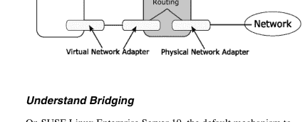

### Understand Bridging

在 SUSE Linux Enterprise Server 10 上，连接 domain0 中虚拟和物理接口的默认机制是桥接。其他机制如带或不带网络地址转换（NAT）的路由不在本课程范围内。

桥接基本上意味着多个网络接口被合并为一个。传统上，这种技术用于连接两个物理网络接口或网络段。

在 Xen 系统中，桥接用于连接 domain0 中的虚拟和物理网络适配器。在 Xen 系统中，你可以将桥视为一种虚拟交换机，所有虚拟和物理接口都连接到该交换机上。

桥的配置由 xend 管理进程完成。当创建新域时，会对网络配置进行以下更改（简化）：

1. Xen 为新域提供一个虚拟接口。
2. xend 在 domain0 中创建一个新的虚拟接口。
3. 两个虚拟接口通过虚拟点对点连接相连。
4. domain0 中的虚拟接口与物理接口一起添加到桥中。

这些步骤仅影响一般的网络连通性。Xen 域中的 IP 配置需要通过 DHCP 或静态网络配置单独完成。

xend 在 **/etc/xen/scripts/** 位置的脚本帮助下执行这些网络更改。以下脚本用于桥接网络：

- **network-bridge.** 该脚本在 xend 启动时初始调用。它设置桥 **xenbr0** 并将物理接口移动到该桥上。
- **vif-bridge.** 该脚本在每个域启动时调用，并将虚拟接口添加到桥中。

在文件 **/etc/xen/xend-config.sxp** 中，你可以配置 xend 使用哪些网络脚本。

### Understand the Network Interfaces in domain0

当你使用命令 **ip a** 查看 domain0 中的网络接口时，你会发现接口比常规 Linux 安装中多得多。

以下是 domain0 上 ip a 的示例输出（已缩短）：

```
linux-1ram:~# ip a
1: lo: <LOOPBACK,UP> mtu 16436 qdisc noqueue
    link/loopback 00:00:00:00:00:00 brd 00:00:00:00:00:00
    inet 127.0.0.1/8 scope host lo
       valid_lft forever preferred_lft forever
2: peth0: <BROADCAST,MULTICAST,NOARP,UP> mtu 1500 qdisc
    pfifo_fast qlen 100
    link/ether fe:ff:ff:ff:ff:ff brd ff:ff:ff:ff:ff:ff
    inet6 fe80::fcff:ffff:feff:ffff/64 scope link
       valid_lft forever preferred_lft forever
4: vif0.0: <BROADCAST,MULTICAST,UP> mtu 1500 qdisc noqueue
    link/ether fe:ff:ff:ff:ff:ff brd ff:ff:ff:ff:ff:ff
    inet6 fe80::fcff:ffff:feff:ffff/64 scope link
       valid_lft forever preferred_lft forever
5: eth0: <BROADCAST,MULTICAST,NOTRAILERS,UP> mtu 1500 qdisc
    noqueue
    link/ether 00:11:25:81:4c:5b brd ff:ff:ff:ff:ff:ff
    inet 149.44.171.67/23 brd 149.44.171.255 scope global
    eth0
       inet6 2001:780:101:aa00:211:25ff:fe81:4c5b/64 scope
    global dynamic
       valid_lft 29998sec preferred_lft 9996sec
    inet6 fe80::211:25ff:fe81:4c5b/64 scope link
       valid_lft forever preferred_lft forever
6: vif0.1: <BROADCAST,MULTICAST> mtu 1500 qdisc noop
    link/ether fe:ff:ff:ff:ff:ff brd ff:ff:ff:ff:ff:ff
7: veth1: <BROADCAST,MULTICAST> mtu 1500 qdisc noop
    link/ether 00:00:00:00:00:00 brd ff:ff:ff:ff:ff:ff
    [...] 
19: veth7: <BROADCAST,MULTICAST> mtu 1500 qdisc noop
    link/ether 00:00:00:00:00:00 brd ff:ff:ff:ff:ff:ff
20: xenbr0: <BROADCAST,MULTICAST,UP> mtu 1500 qdisc noqueue
    link/ether fe:ff:ff:ff:ff:ff brd ff:ff:ff:ff:ff:ff
    inet6 2001:780:101:aa00::fcff:feff:feff:ffff/64 scope
    global dynamic
       valid_lft 29998sec preferred_lft 9996sec
    inet6 fe80::200:ff:fe00:0/64 scope link
       valid_lft forever preferred_lft forever
23: vif3.0: <BROADCAST,MULTICAST,UP> mtu 1500 qdisc noqueue
    link/ether fe:ff:ff:ff:ff:ff brd ff:ff:ff:ff:ff:ff
    inet6 fe80::fcff:ffff:feff:ffff/64 scope link
       valid_lft forever preferred_lft forever
```


在 domain0 中使用以下接口命名方案：

- **peth**。这些是 domain0 中的物理接口。peth 设备连接到网络桥。
- **vif**。这些是桥的一部分的虚拟接口。vif 接口的名称标识该接口连接到哪个域。**例如：vif6.0 连接到域 6 中的第一个虚拟接口。**
- **veth**。这些虚拟接口连接到 domain0 的 vif 接口（vif0.x）。默认情况下创建 7 对 vif <-> veth。veth 接口可用于更复杂的网络设置。
- **eth0**。第一个 veth 接口命名为 eth0 并与 vif0.0 连接。这是 domain0 的“默认”网络接口。
- **xenbr0**。这是连接虚拟和物理接口的默认桥。

下图为您提供了 domain0 中接口的概览。

## 图 8-11

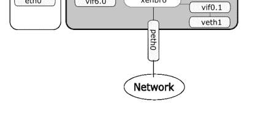

您可以在 domain0 中使用命令 brctl show 来查看哪些接口已添加到网络桥。

由于 Xen 网络设置的复杂性，默认防火墙（SuSEFirewall2）在 domain0 中无法正常工作。因此建议禁用 SuSEFirewall2，并在需要时设置自定义防火墙。


## 练习 8-5    检查网络配置

本练习假设您有一个具有 domain 0 和一个以上 Xen 域运行的 Xen 系统。

执行以下操作：

- 1. 打开一个终端窗口并 su - 切换到 root 用户。
- 2. 通过输入命令 xm list 确保域 vm1 正在运行。
- 3. 在 xm 命令的输出中，记下域 vm1 的 ID。
- 4. 使用命令 brctl show 查看网络桥配置。
- 5. 您应该看到桥 xenbr0 的配置。接口 peth0（物理接口）vif0.0（domain 0 的虚拟接口）和虚拟接口 vifx.0（其中 x 是域 vm1 的域 ID）应已添加到桥中。
- 6. 使用命令 xm shutdown vm1 关闭域。
- 7. 等待片刻并使用命令 xm list 检查域是否已关闭。当域 vm1 不再列出时继续下一步。
- 8. 再次输入命令 brctl show。注意域 vm1 的接口已从桥中移除。
- 9. 使用以下命令重启域：xm create -f /etc/xen/vm/vm1
- 10. 记下 vm1 的 ID 并使用 brctl show 检查 vm1 的接口是否已再次添加。

（练习结束）

## 目标 7 迁移一个客户域

虚拟化的一个优点是域可以轻松地从一个物理系统移动到另一个物理系统。在 Xen 中，此过程称为域迁移。

域迁移是通过复制当前内存内容来执行的。请在迁移域之前注意以下事项：

- 没有自动方式将域的大容量存储设备复制到另一系统。您必须确保文件系统（文件系统映像或物理分区）在当前和新主机系统上可用。这可以通过手动复制数据或使用分布式文件系统（如 NFS 或 SAN/NAS 存储解决方案）来完成。
- 当域被迁移时，网络设置不会自动调整。因此当前和新主机系统必须在同一子网中，或者在迁移后手动调整网络设置。

您有以下两种选项来迁移 Xen 域：

- 使用域保存和恢复
- 使用迁移和实时迁移

### 使用域保存和恢复

迁移域的一种非常简单的方法是使用 xm 工具的保存和恢复功能。

使用命令 xm save <domain_id> <filename>，您可以挂起指定的域并将状态保存到给定的文件名中。

然后可以将此文件复制到新主机系统。要恢复域，请使用命令 xm restore <filename>。


如上所述，除了使用 xm 创建的文件外，您可能还必须将文件系统复制到新的主机系统。

## 使用迁移和实时迁移

除了 xm 的 save 和 restore 命令外，您还可以使用命令 xm migrate <domain_id> <target_host>。该命令可将域直接迁移到新主机。在这种情况下，无需手动复制内存状态文件。

要使此功能正常工作，当前主机和新主机必须运行 Xen 和 xend。

通过在迁移命令行为迁移命令添加 --live 选项，可以将迁移期间的停机时间减少到通常为 60-300ms。Xen 会尝试在迁移进行期间保持域运行，而不是在迁移开始前关闭域。

xend 配置文件 /etc/xen/xend-config.sxp 包含两个与域迁移相关的选项：

(xend-relocation-server yes)

该选项在 xend 中启用迁移功能。

(xend-relocation-hosts-allow "^localhost$")

该选项控制哪些主机允许连接到 xend 进行域迁移。默认情况下，只有 localhost 允许连接。该选项以正则表达式作为参数。请查看配置文件以获取示例。

> 请注意，域迁移涉及两个 xend（当前主机和新主机）。您可能需要在两个系统上调整 xend-config.sxp 文件。

| 目标 | 摘要 |
|---|---|
| 6. 了解 Xen 网络 | Domain0 是在 Xen 系统上配置网络连接的中心点。domain0 中的网络桥用作虚拟交换机。该桥由 xend 设置和控制。 |
| 7. 迁移访客域 | 虚拟化的一个优点是，域可以轻松地从一个物理系统移动到另一个物理系统。在 Xen 中，此过程称为 **域迁移**。域可以使用 xm 的 save 和 restore 命令或 migrate 命令进行迁移。 |

## 第 9 节 使用 BIND 配置 DNS 服务器

本节包含有关命令 dnssec-keygen 和 nsupdate 的一些更改。

### 目标

- 1. 为区域传输创建密钥
- 2. 配置动态 DNS

### 目标 1 创建区域传输密钥

要创建密钥，请使用 dnssec-keygen 命令。密钥的文件名会打印在屏幕上：

```
da51:/var/lib/named # dnssec-keygen -a HMAC-MD5 -b 128 -n HOST Kzonetransfer.+157+01389
```

选项在下表中进行了解释：

### 表 9-1

| 选项 | 描述 |
|--------|-------------|
| -a HMAC-MD5 | 使用的加密程序（此处为 HMAC-MD5） |
| -b 128 | 密钥的长度（示例中为 128 位） |
| -n HOST | 密钥的类型 |
| zonetransfer | 密钥名称 |

如果您使用此命令，将在当前目录中创建两个文件：

```
da51:/var/lib/named # ls -l *
-rw------- 1 root root 56 Feb 21 10:39 Kzonetransfer.+157+01389.key
-rw------- 1 root root 81 Feb 21 10:39 Kzonetransfer.+157+01389.private
```

- .key 文件包含可包含在区域 include 语句中的 DNS KEY 记录。
- .private 文件包含特定于算法的字段。出于安全原因，此文件没有通用读取权限。

运行此命令时，文件名末尾的数字会略有不同。

两个文件包含相同的密钥：

```
da51:/var/lib/named # cat Kzonetransfer.+157+01389.key
zonetransfer. IN KEY 512 3 157 RhDVspoqFonRvK58rFXOWw==
da51:/var/lib/named # cat Kzonetransfer.+157+01389.private
Private-key-format: v1.2
Algorithm: 157 (HMAC_MD5)
Key: RhDVspoqFonRvK58rFXOWw==
```

此密钥必须包含在主服务器和从服务器上的配置文件 /etc/named.conf 中。

### 目标 2

### 配置动态 DNS

如果区域和主机的数量增加，手动编辑区域文件会很不方便。

您可以在不编辑和重新加载文件的情况下动态修改名称服务器的资源记录源。这称为动态 DNS。动态 DNS 也可由外部服务如 DHCP 使用。

要允许动态更改，请在区域定义中添加以下行。

```
allow-update { 127.0.0.1; };
```

在此示例中，仅使用回环地址，但也可以添加其他主机的 IP 地址。

要动态编辑 DNS 记录，请使用命令 nsupdate：

```
da51:~ # nsupdate
```

安全工具 AppArmor 默认在 SUSE Linux Enterprise Server 10 上安装并启用。BIND 有一个 AppArmor 配置文件，禁止 nsupdate 更改 BIND 区域信息。AppArmor 在课程 SUSE Linux Enterprise Server 10 Security（课程 3075）中进行了详细介绍。输入 rcapparmor stop 停止 AppArmor 守护进程，以便按如下所述使用 nsupdate。

在使用 nsupdate 之前，请确保所有区域文件具有正确的访问权限。如果未正确设置，请使用以下命令：chgrp -R named /var/lib/named chmod -R g+w /var/lib/named


动态更新存储在区域的日志文件中。该文件由服务器在执行第一次动态更新时自动生成。日志文件的名称是通过在对应的区域文件名后追加扩展名 .jnl 创建的。日志文件采用二进制格式，不应手动编辑。

日志文件的内容每 15 分钟写入一次到区域文件。当名称服务器关闭时，日志文件的内容也会写入到区域文件。

> 动态更新会在数据写入时改变你的区域文件的布局。你应该使用编辑器或 nsupdate 来修改区域信息，而不是同时使用两种工具。

最重要的 nsupdate 选项是

- **server server [port]**. 将所有动态更新请求发送到名称服务器 server。
  如果未指定端口号，则使用默认的 DNS 端口号 53。

- **update delete reference [ttl] [class] [type value...]**. 删除名为 reference 的任何资源记录。
  如果提供了记录类型和值，则只会移除匹配的资源记录。
  如果未提供 class，则假定为 Internet 类（IN）。
  ttl 被忽略。它仅为兼容性而允许。

- **update add reference ttl [class] type value...** 添加一条具有指定 ttl（以秒为单位）、class 和 value 的新资源记录。

- **send**. 发送当前消息。这对于实际执行命令是必要的。这等同于输入一个空行。

所有命令都在 nsupdate 的 man 手册中有描述：man 8 nsupdate。

## 以下是一个使用 nsupdate 的示例：

```
da51:~ # nsupdate
> server 127.0.0.1
> update add da13.digitalairlines.com 86400 A 10.0.0.13
> 
> update delete da13.digitalairlines.com A
> 
> update add 13.0.0.10.in-addr.arpa 86400 PTR da13.digitalairlines.com
>
```

这将在 /var/log/messages 中生成类似如下的消息：

```
May 20 11:13:58 da51 named[5161]: client 127.0.0.1#32781: updating zone 'digitalairlines.com/IN': adding an RR
May 20 11:13:58 da51 named[5161]: journal file master/digitalairlines.com.zone.jnl does not exist, creating it
May 20 11:13:58 da51 named[5161]: zone digitalairlines.com/IN: sending notifies (serial 2005051903)
May 20 11:21:50 da51 named[5161]: client 127.0.0.1#32783: updating zone '0.0.10.in-addr.arpa/IN': adding an RR
May 20 11:21:50 da51 named[5161]: journal file master/10.0.0.zone.jnl does not exist, creating it
May 20 11:21:50 da51 named[5161]: zone 0.0.10.in-addr.arpa/IN: sending notifies (serial 2005051902)
```

日志文件将自动创建：

```
da51:/var/lib/named # dir master/
total 16
drwxrwxr-x 2 root named 200 May 20 11:21 .
drwxrwxr-x 9 root named 408 May 20 10:40 ..
-rw-rw-r-- 1 root named 463 May 19 12:06 10.0.0.zone
-rw-r--r-- 1 named named 814 May 20 11:21 10.0.0.zone.jnl
-rw-rw-r-- 1 root named 440 May 19 14:51 digitalairlines.com.zone
-rw-r--r-- 1 named named 794 May 20 11:13 digitalairlines.com.zone.jnl
```

按 Ctrl + D 或输入 quit 以退出 nsupdate。

在下面的表格中，列出了最重要的记录类型：

### Table 9-2

| Record Type | Meaning | Value |
|---|---|---|
| SOA | Start of Authority | Parameter for the domain |
| NS | DNS server | Name of a DNS server for this domain |
| MX | Mail exchanger | Name and priority of a mail server for this domain |
| A | Address | IP address of the computer |
| PTR | Pointer | Name of the computer |
| CNAME | Canonical name | Alias name for the computer |

另外，你也可以指定一个包含所需命令的文件。包含以下内容的一个 ASCII 文件（称为 updates）可提供与上面所示的交互式 DNS 更新相同的结果：

```
da51:~# cat updates
update delete da7.digitalairlines.com
update add da8.digitalairlines.com 84600 A 10.0.0.8
da51:~# nsupdate -v -k dhcp-dns.+157+23165.key updates
da51:~#
```

## Summary

| Objective | Summary |
|---|---|
| 1. Create a Key for Zone Transfer | 使用 `dnssec-keygen` 命令生成密钥。 |
|  | *.key 文件包含一个 DNS KEY 记录，可以使用 include 语句将其包含在区域文件中。 |
|  | *.private 文件包含算法特定的字段。出于安全原因，该文件没有通用读权限。 |
|  | 该密钥必须在主服务器和从服务器上的配置文件 /etc/named.conf 中包含。 |
| 2. Configure Dynamic DNS | 你可以动态地修改 BIND 的资源记录，而无需编辑和重新加载文件。 |
|  | 动态 DNS 也可以被 DHCP 等外部服务使用。 |
|  | 要动态操作 DNS 记录，请使用 `nsupdate` 命令。 |


## 第 10 节 配置 DHCP 池和故障转移

DHCP 池和故障转移并不是 dhcpd 的新功能。但它们在 CLE 课程中是新的。

## 目标

- 1. 配置 DHCP 池
- 2. 配置 DHCP 故障转移

## 目标 1 配置 DHCP 池

pool 声明可用于指定一组地址池，这些地址将与其他地址池不同地处理，即使在同一网络段或子网中也是如此。

例如，您可能希望提供一组较大的地址，可分配给已注册到您的 DHCP 服务器的 DHCP 客户端，同时提供一组较小的地址，可能具有较短的租期，供未知客户端使用。

为此，您需要设置一对 pool 声明：

```
subnet 10.0.0.0 netmask 255.255.255.0 {
  option routers 10.0.0.254;

  # Unknown clients get this pool.
  pool {
    option domain-name-servers 10.0.0.254;
    max-lease-time 300;
    range 10.0.0.100 10.0.0.250;
    allow unknown-clients;
  }

  # Known clients get this pool.
  pool {
    option domain-name-servers 10.0.0.251, 10.0.0.252;
    max-lease-time 28800;
    range 10.0.0.5 10.0.0.99;
    deny unknown-clients;
  }
}
```

也可以为已知客户端和未知客户端设置完全不同的子网。“已知客户端”是指使用 host 语句将 IP 地址分配给 MAC 地址。池存在于共享网络的级别，因此 pool 声明中的地址范围可以位于不同的子网。

正如您在前面的示例中看到的，池可以具有许可列表来控制哪些客户端允许访问该池以及哪些不允许。

池的许可列表中的每个条目都以 allow 或 deny 关键字引入。如果池具有许可列表，则只有与许可列表上的特定条目匹配的客户端才有资格从该池分配地址。

如果池具有拒绝列表，则只有与拒绝列表上的任何条目都不匹配的客户端才有资格。如果池同时存在许可列表和拒绝列表，则只有与许可列表匹配且与拒绝列表不匹配的客户端才会被允许访问。

## 目标 2 配置 DHCP 故障转移

本目标涵盖以下主题：

- DHCP 故障转移基础
- 配置故障转移

### DHCP 故障转移基础

故障转移协议允许两个 DHCP 服务器（不超过两个）共享一个公共地址池。每个服务器在任何给定时间都将拥有池中大约一半的可用 IP 地址用于分配。

如果一台服务器失败，另一台服务器将继续从池中续订租约，并从通信丢失前拥有的可用地址的一半中分配新地址。

当一台从未与故障转移对等方通信过的服务器启动时，它必须建立通信并与对等方同步，然后才能为客户端提供服务。这可能发生在您刚刚配置 DHCP 服务器首次执行故障转移时，也可能发生在其中一台故障转移服务器失败并丢失其数据库时。

初始恢复过程旨在确保当一个故障转移对等方丢失其数据库然后重新同步时，失败服务器在失败前分配的任何租约都将被 honoured。当失败服务器启动时，它注意到自己没有保存的故障转移状态并尝试联系其对等方。

建立联系后，它会向对等方请求其租约数据库的完整副本。对等方随后发送其完整数据库并发送一条消息表示已完成。失败的服务器然后等待 MCLT（最大客户端提前时间）过去。一旦 MCLT 过去，两台服务器都将转换回正常操作。

此等待期可确保失败服务器在与合作伙伴失去联系期间可能分配的任何租约都已过期。

在失败服务器恢复期间，其合作伙伴保持在 partner-down 状态，这意味着它正在为所有客户端提供服务。失败服务器在转换到正常操作之前根本不会为 DHCP 客户端提供任何服务。

在两种服务器都检测到它们从未与合作伙伴通信过的这种情况下，它们都会进入此恢复状态并遵循我们刚刚描述的程序。在这种情况下，在 MCLT 过期之前不会为 DHCP 客户端提供任何服务。

### 配置故障转移

在故障转移配置中，您必须决定哪台服务器充当主服务器，哪台充当从服务器。两台服务器都需要为它们共享的基本 DHCP 服务具有相同的配置。它们仅在故障转移设置上有所不同。因此，建议在两台机器上都有一个公共配置文件，该文件包含在文件 /etc/dhcpd.conf 中。


主服务器的配置文件如下所示：

```
failover peer "digitalairlines" {
    primary;
    address 10.0.0.10;
    port 847;
    peer address 10.0.0.12;
    peer port 647;
    max-response-delay 180;
    mclt 1800;
    split 128;
    load balance max seconds 3;
}
# Now we include the identical configuration on both
# machines
include "/etc/dhcpd.conf.master";
```

此示例对等声明中的语句如下：

- **主服务器和辅助服务器。** 确定服务器是主服务器还是辅助服务器，如前所述。
- **地址。** 指定服务器应在其上侦听来自其故障转移对等方的连接的 IP 地址或 DNS 名称。
- **端口。** 指定服务器应在其上侦听来自其故障转移对等方的连接的 TCP 端口（默认值：647 和 847）。必须指定此参数，因为故障转移协议尚未保留 TCP 端口号。
- **对端地址。** 指定服务器为了到达其故障转移对等方而应连接的 IP 地址或 DNS 名称。
- **对端端口。** 指定服务器为了向故障转移对等方发送故障转移消息而应连接的 TCP 端口。必须指定此参数，因为故障转移协议尚未保留 TCP 端口号。对端端口可以与端口相同。
- **最大响应延迟。** 指定 DHCP 服务器在未收到来自其故障转移对等方的消息后等待多少秒，才假定该连接已失败。

此数字应足够小，使得暂时性网络故障导致连接中断时，不会使服务器长时间失去通信；同时又要足够大，以免服务器不断建立和断开连接。

必须指定此参数。

- **最大客户端提前时间。** 定义最大客户端提前时间（Maximum Client Lead Time）。该参数必须在主服务器上指定，也可以在辅助服务器上指定。这是任一故障转移对等方在不联系另一方的情况下可以续订租约的时间长度。

此值设置得越长，运行中的服务器在进入 PARTNER-DOWN 状态后恢复 IP 地址所需的时间就越长。设置得越短，服务器在无法通信时承受的负载就越大。

建议值为 1800。

- **拆分值。** 指定主服务器和辅助服务器之间用于负载均衡的拆分比例。

每当客户端发起 DHCP 请求时，DHCP 服务器会对客户端标识执行哈希计算。如果哈希结果小于拆分值，则由主服务器应答；如果结果大于或等于拆分值，则由辅助服务器应答。

有意义的值为 128，且只能在主服务器上配置。

- **负载均衡最大秒数。** 指定一个截止时间，超过该时间后负载均衡将被禁用。该截止时间基于客户端发送其第一条 DHCPDISCOVER 或 DHCPREQUEST 消息后的秒数。

手册页建议将此值设置为 3 或 5。其效果是，如果其中一个故障转移对等方进入响应故障转移消息但不响应某些客户端请求的状态，另一个故障转移对等方将在客户端重试时自动接管其客户端负载。

## 升级到 Linux 认证工程师 10

辅助服务器的配置文件如下所示：

```
failover peer "digitalairlines" {
    secondary;
    address 10.0.0.12;
    port 647;
    peer address 10.0.0.10;
    peer port 847;
    max-response-delay 180;
    load balance max seconds 3;
}
# Now we include the identical configuration on both
# machines
# include "/etc/dhcpd.conf.master";
```

与主服务器配置的差异在于：语句"secondary"、缺少语句 mclt 和 split，以及 address、port、peer address 和 peer port 的值互换。

主 DHCP 服务器配置包含在文件 /etc/dhcpd.conf.master 中，该文件被两个配置所包含。

为了让 DHCP 服务器找到该文件，需要将其复制到 DHCP 服务器的 chroot 环境中。实现此目的的最佳方法是修改 /etc/sysconfig/dhcpd 中的 DHCP_CONF_INCLUDE_FILES 变量：DHCP_CONF_INCLUDE_FILES="/etc/dhcpd.conf.master"


需要修改主配置文件：

```
ddns-update-style none;

default-lease-time 86400;
max-lease-time 86400;

option domain-name "digitalairlines.com";
option domain-name-servers 10.0.0.254;

option routers 10.0.0.254;

subnet 10.0.0.0 netmask 255.255.255.0 {
    pool {
        failover peer "digitalairlines";
        deny dynamic bootp clients;
        range 10.0.0.101 10.0.0.120;
    }
}
```

所有故障转移配置都必须在 pool 语句中定义。如果使用多个池，则需要在每个池中定义故障转移配置。

> 为了能够识别故障转移配置的名称，它必须在池定义之前定义。这就是为什么 include 语句写在 /etc/dhcpd.conf 的末尾。

故障转移不适用于包含分配给 bootp 客户端的地址的地址分配池。因此，必须定义语句 deny dynamic bootp clients;。

在主服务器上启动 DHCP 服务器时，你将在 /var/log/messages 中看到如下信息：

```
Jul  4 11:52:29 da10 dhcpd: failover peer digitalairlines:
I move from recover to startup
Jul  4 11:52:44 da10 dhcpd: failover peer digitalairlines:
I move from startup to recover
Jul  4 11:54:57 da10 dhcpd: failover peer digitalairlines:
peer moves from unknown-state to recover
Jul  4 11:54:57 da10 dhcpd: failover peer digitalairlines:
requesting full update from peer
Jul  4 11:54:57 da10 dhcpd: Sent update request all message
to digitalairlines
Jul  4 11:54:57 da10 dhcpd: failover peer digitalairlines:
peer moves from recover to recover
Jul  4 11:54:57 da10 dhcpd: failover peer digitalairlines:
requesting full update from peer
Jul  4 11:54:57 da10 dhcpd: Sent update done message to
digitalairlines
Jul  4 11:54:57 da10 dhcpd: Update request all from
digitalairlines: nothing pending
Jul  4 11:54:57 da10 dhcpd: failover peer digitalairlines:
peer update completed.
Jul  4 11:54:57 da10 dhcpd: failover peer digitalairlines:
I move from recover to recover-done
Jul  4 11:54:57 da10 dhcpd: failover peer digitalairlines:
I move from recover-done to normal
Jul  4 11:54:57 da10 dhcpd: failover peer digitalairlines:
peer moves from recover-done to normal
Jul  4 11:54:57 da10 dhcpd: pool 800e4138 10.0.0/24 total
20 free 20 backup 0 lts -10
Jul  4 11:54:57 da10 dhcpd: pool 800e4138 10.0.0/24 total
20 free 20 backup 0 lts 10
```

在稍后启动的从服务器上，/var/log/messages 中会出现如下信息：

```
Jul  4 11:55:52 dal2 dhcpd: failover peer digitalairlines:
I move from recover to startup
Jul  4 11:55:52 dal2 dhcpd: failover peer digitalairlines:
peer moves from unknown-state to recover
Jul  4 11:55:52 dal2 dhcpd: failover peer digitalairlines:
requesting full update from peer
Jul  4 11:55:52 dal2 dhcpd: failover peer digitalairlines:
I move from startup to recover
Jul  4 11:55:52 dal2 dhcpd: Sent update request all message
to digitalairlines
Jul  4 11:55:52 dal2 dhcpd: Sent update done message to
digitalairlines
Jul  4 11:55:52 dal2 dhcpd: Update request all from
digitalairlines: nothing pending
Jul  4 11:55:52 dal2 dhcpd: failover peer digitalairlines:
peer update completed.
Jul  4 11:55:52 dal2 dhcpd: failover peer digitalairlines:
I move from recover to recover-done
Jul  4 11:55:52 dal2 dhcpd: failover peer digitalairlines:
peer moves from recover to recover-done
Jul  4 11:55:52 dal2 dhcpd: failover peer digitalairlines:
I move from recover-done to normal
Jul  4 11:55:52 dal2 dhcpd: failover peer digitalairlines:
peer moves from recover-done to normal
Jul  4 11:55:52 dal2 dhcpd: pool 800e40f8 10.0.0/24 total
20 free 20 backup 0 lts 10
Jul  4 11:55:52 dal2 dhcpd: pool response: 10 leases
```

当客户端请求 IP 地址时，你将在 /var/log/messages 中看到如下信息：

```
Jul 4 11:59:26 dal0 dhcpd: DHCPREQUEST for 192.168.5.16 from 00:04:ac:d6:58:96 via eth0: ignored (not authoritative).
Jul 4 11:59:30 dal0 dhcpd: DHCPREQUEST for 192.168.5.16 from 00:04:ac:d6:58:96 via eth0: ignored (not authoritative).
Jul 4 11:59:36 dal0 dhcpd: pool 800e4138 10.0.0/24 total 20 free 10 backup 10 its 0
Jul 4 11:59:36 dal0 dhcpd: DHCPDISCOVER from 00:04:ac:d6:58:96 via eth0
Jul 4 11:59:36 dal0 dhcpd: DHCPREQUEST for 10.0.0.111 (10.0.0.12) from 00:04:ac:d6:58:96 via eth0: lease owned by peer
Jul 4 11:59:37 dal0 dhcpd: DHCPOFFER on 10.0.0.110 to 00:04:ac:d6:58:96 (linux-5ncs) via eth0
```

在这种情况下，客户端发送 DHCPREQUEST 以获取与上次相同的 IP 地址（192.168.5.16）。该地址不在范围定义中，因此服务器拒绝提供此地址。客户端随后发送 DHCPDISCOVER 以检测 DHCP 服务器。

客户端的下一条消息是针对 IP 地址 10.0.0.111 的 DHCPREQUEST，该地址由从服务器提供（“lease owned by peer”）。最后一条消息是从服务器发出的 DHCPOFFER。


# 配置 DHCP 池和故障转移

在辅助服务器上，对应的消息如下：

```
Jul 4 12:00:20 da12 dhcpcd: DHCPREQUEST for 149.44.85.16 from 00:04:ac:d6:58:96 via eth1: ignored (not authoritative).
Jul 4 12:00:25 da12 dhcpcd: DHCPREQUEST for 149.44.85.16 from 00:04:ac:d6:58:96 via eth1: ignored (not authoritative).
Jul 4 12:00:30 da12 dhcpcd: pool 800e40f8 10.0.0.111 total 20 free 10 backup 10 its 0
Jul 4 12:00:30 da12 dhcpcd: DHCPDISCOVER from 00:04:ac:d6:58:96 via eth1
Jul 4 12:00:31 da12 dhcpcd: DHCPOFFER on 10.0.0.111 to 00:04:ac:d6:58:96 (linux-5ncs) via eth1
Jul 4 12:00:31 da12 dhcpcd: DHCPREQUEST for 10.0.0.111 (10.0.0.111) from 00:04:ac:d6:58:96 (linux-5ncs) via eth1
Jul 4 12:00:31 da12 dhcpcd: DHCPACK on 10.0.0.111 to 00:04:ac:d6:58:96 (linux-5ncs) via eth1
```

在此服务器上，DHCPOFFER 消息被打印出来，因为该服务器提供了 IP 地址。最后一条消息是来自客户端的 DHCPACK。

DHCP 日志文件 /var/lib/dhcp/db/dhcpd.leases 包含如下信息：

```
failover peer "digitalairlines" state {
  my state recover at 2 2006/07/04 09:57:39;
  partner state unknown-state at 2 2006/07/04 09:57:39;
}

failover peer "digitalairlines" state {
  my state recover at 2 2006/07/04 09:57:39;
  partner state recover at 2 2006/07/04 09:57:39;
}

failover peer "digitalairlines" state {
  my state recover-done at 2 2006/07/04 09:57:56;
  partner state recover at 2 2006/07/04 09:57:39;
}

failover peer "digitalairlines" state {
  my state recover-done at 2 2006/07/04 09:57:56;
  partner state recover-done at 2 2006/07/04 09:57:39;
}

failover peer "digitalairlines" state {
  my state normal at 2 2006/07/04 09:57:56;
  partner state recover-done at 2 2006/07/04 09:57:39;
}

failover peer "digitalairlines" state {
  my state normal at 2 2006/07/04 09:57:56;
  partner state normal at 2 2006/07/04 09:57:39;
}
lease 10.0.0.120 {
  starts 2 2006/07/04 09:57:56;
  tstp 2 2006/07/04 09:57:56;
  binding state backup;
}
lease 10.0.0.119 {
  starts 2 2006/07/04 09:57:56;
  tstp 2 2006/07/04 09:57:56;
  binding state backup;
}
...
```

```
...
lease 10.0.0.120 {
  starts 2 2006/07/04 09:57:56;
  tstp 2 2006/07/04 09:57:56;
  tsfp 2 2006/07/04 09:57:56;
  binding state backup;
}
lease 10.0.0.119 {
  starts 2 2006/07/04 09:57:56;
  tstp 2 2006/07/04 09:57:56;
  tsfp 2 2006/07/04 09:57:56;
  binding state backup;
}
...
lease 10.0.0.111 {
  starts 2 2006/07/04 10:00:31;
  ends 2 2006/07/04 10:30:31;
  tstp 2 2006/07/04 09:57:56;
  tsfp 2 2006/07/04 10:45:31;
  cltt 2 2006/07/04 10:00:31;
  binding state active;
  next binding state expired;
  hardware ethernet 00:04:ac:d6:58:96;
  uid "\001\000\004\254\326X\226";
}
```

辅助服务器上的文件 /var/lib/dhcp/db/dhcpd.leases 包含如下信息：

```
failover peer "digitalairlines" state {
  my state recover at 2 2006/07/04 09:58:50;
  partner state unknown-state at 2 2006/07/04 09:58:50;
  mclt 0;
}

failover peer "digitalairlines" state {
  my state recover at 2 2006/07/04 09:58:50;
  partner state recover at 2 2006/07/04 09:58:50;
  mclt 1800;
}

failover peer "digitalairlines" state {
  my state recover-done at 2 2006/07/04 09:58:51;
  partner state recover at 2 2006/07/04 09:58:50;
  mclt 1800;
}

failover peer "digitalairlines" state {
  my state recover-done at 2 2006/07/04 09:58:51;
  partner state recover-done at 2 2006/07/04 09:58:50;
  mclt 1800;
}

failover peer "digitalairlines" state {
  my state normal at 2 2006/07/04 09:58:51;
  partner state recover-done at 2 2006/07/04 09:58:50;
  mclt 1800;
}

failover peer "digitalairlines" state {
  my state normal at 2 2006/07/04 09:58:51;
  partner state normal at 2 2006/07/04 09:58:50;
  mclt 1800;
}
lease 10.0.0.120 {
  starts 2 2006/07/04 09:57:56;
  tsfp 2 2006/07/04 09:57:56;
  binding state backup;
}
```

当辅助服务器发生故障（例如服务器被关闭）并稍后再次恢复时，以下类似的消息将出现在主服务器的 /var/log/messages 中：

```
Jul 4 12:16:25 dal0 dhcpd: peer digitalairlines:
disconnected
Jul 4 12:16:25 dal0 dhcpd: failover peer digitalairlines:
I move from normal to communications-interrupted
Jul 4 12:20:06 dal0 dhcpd: failover peer digitalairlines:
peer moves from normal to normal
Jul 4 12:20:06 dal0 dhcpd: failover peer digitalairlines:
I move from communications-interrupted to normal
Jul 4 12:20:06 dal0 dhcpd: pool 800e4138 10.0.0/24 total 20 free 10 backup 9 lts 0
```

在辅助服务器上，启动消息如下所示：

```
Jul 4 12:21:01 dal2 dhcpd: failover peer digitalairlines:
I move from normal to startup
Jul 4 12:21:01 dal2 dhcpd: failover peer digitalairlines:
peer moves from normal to communications-interrupted
Jul 4 12:21:01 dal2 dhcpd: failover peer digitalairlines:
I move from startup to normal
Jul 4 12:21:01 dal2 dhcpd: failover peer digitalairlines:
peer moves from communications-interrupted to normal
Jul 4 12:21:01 dal2 dhcpd: pool 800e40f8 10.0.0/24 total 20 free 10 backup 9 lts 0
```

为了避免对时间戳感到困惑，请确保使用网络时间协议（ntp）同步所有服务器的时间戳。


客户端日志文件 /var/lib/dhcpcd/dhcpcd-eth0.info 仅包含有关客户端配置以及提供信息的 DHCP 服务器的信息：

```
IPADDR=10.0.0.111
NETMASK=255.255.255.0
NETWORK=10.0.0.0
BROADCAST=10.0.0.255
GATEWAY=10.0.0.254
DOMAIN='digitalairlines.com'
DNS=10.0.0.254
DHCP SID=10.0.0.12
DHCPGIADDR=0.0.0.0
DHCP SIADDR=0.0.0.0
DHCPCHADDR=00:04:AC:D6:58:96
DHCP SHADDR=00:04:AC:D6:55:F4
DHCP SNAME=''
LEASETIME=1800
RENEWALTIME=900
REBIND TIME=1575
INTERFACE='eth0'
CLASSID='Linux 2.6.16.20-0.12-default i686'
CLIENTID=00:04:AC:D6:58:96
```

## Summary

| Objective | Summary |
|---|---|
| 1. Configure DHCP Pools | 可以使用池声明来指定一组地址，该组地址将与其他地址池不同地处理，即使在同一网络段或子网中也是如此。 |
| 2. Configure DHCP Failover | 故障转移协议允许两个 DHCP 服务器共享一个公共地址池。 |
|  | 如果一台服务器发生故障，另一台服务器将继续从池中续租租约并分配新地址。 |
|  | 故障转移协议定义了主服务器角色和次要服务器角色。 |
|  | 为了配置故障转移，您需要在文件 /etc/dhcpd.conf 中编写一个对等声明来配置故障转移协议，并且需要在您想要进行故障转移的每个池声明中编写对等引用。 |

## SECTION 11 Manage OpenLDAP

OpenLDAP 是最受欢迎的开源 LDAP 套件。它不仅提供 LDAP 服务器本身，还提供用于控制和查询服务器以及开发基于 LDAP 的软件的应用程序和工具。

### Objectives

- 1. Install and Set Up an OpenLDAP Server
- 2. Activate LDAP Authentication
- 3. Replicate OpenLDAP Servers

## Objective 1

## Install and Set Up an OpenLDAP Server

要安装和设置 OpenLDAP 服务器，您需要执行以下操作：

- Install the Required Software and Start the Server
- Configure OpenLDAP with YaST
- Edit the OpenLDAP Configuration Files

### Install the Required Software and Start the Server

通常，您可以在 SUSE Linux Enterprise Server 10 的安装过程中使用 YaST 设置 OpenLDAP 服务器。

在安装设置对话框中选择 OpenLDAP Server。

# Figure 11-1


重要值会自动输入到文本字段中。警告信息告知您，任何更改都将禁用基本 DN、根 DN 和 LDAP 密码的自动生成。

# Figure 11-2

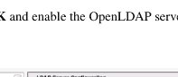

选择 OK 并通过选择 Enable Server 来启用 OpenLDAP 服务器。

# Figure 11-3

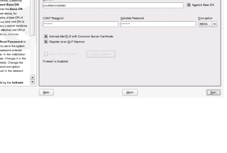

如果您想通过 LDAP 进行身份验证，请在 **User Authentication Method** 对话框中选择 **LDAP**。

# Figure 11-4

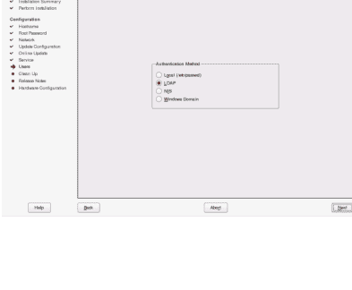

在下一个对话框中，您可以输入 LDAP 客户端的配置。

# Figure 11-5

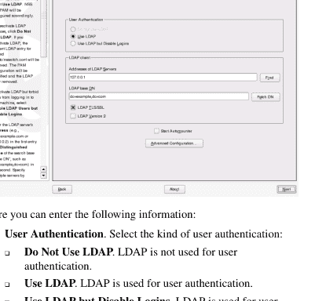

在这里您可以输入以下信息：

- **User Authentication**. 选择用户身份验证类型：
  - Do Not Use LDAP. LDAP 不用于用户身份验证。
  - Use LDAP. LDAP 用于用户身份验证。
  - Use LDAP but Disable Logins. LDAP 用于用户身份验证，但用户将无法再登录到此机器。

- **Addresses of LDAP Servers**. 在此处输入 LDAP 服务器的名称或 IP 地址。如果 LDAP 服务器的 IP 通过 SLP 提供，您可以选择 Find。

- **LDAP base DN.** 在此处输入 LDAP 树的根 DN。选择 Fetch DN 如果您想浏览 LDAP 服务器的 LDAP 树。
- **LDAP TLS/SSL.** 如果您的 LDAP 服务器支持加密，请激活此选项。
- **LDAP Version 2.** 当前 LDAP 协议版本为 3。如果您想使用旧的版本 2，请选择此选项。
- **Start Automounter.** 启动 automounter 守护进程，该进程在目录被使用时自动挂载目录。

### Configure OpenLDAP with YaST

然而，如果您在安装期间选择不安装服务器，您可以通过 YaST 安装以下软件包来设置 LDAP 服务器：

- openldap2
- openldap2-client
- pam_ldap
- nss_ldap

在 YaST 中有以下两个与 OpenLDAP 相关的模块：

- YaST Module for the LDAP Server
- YaST Module for the LDAP Client


## YaST LDAP 服务器模块

如果在 YaST **网络服务** 部分选择 **LDAP 服务器**，但你的 LDAP 服务器当前未运行，则会出现以下对话框。

### 图 11-6

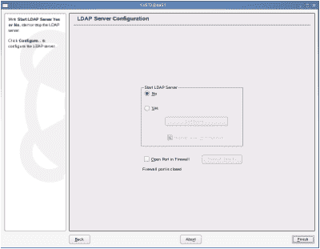

选择 Yes 以启动并配置 LDAP 服务器。你还可以激活在 SLP 守护进程中注册 LDAP 服务器或在防火墙中打开 LDAP 端口的选项。

- **Schema Files**。使用 **Add** 或 **Delete** 添加或删除 LDAP 模式文件。

### 图 11-8

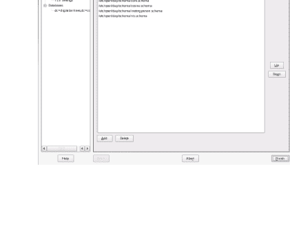

- **Log Level Settings.** 选择你想要记录的信息。

### 图 11-9

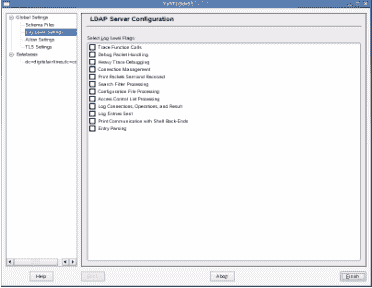

Allow Settings。选择有关访问存储信息的选项。

### 图 11-10

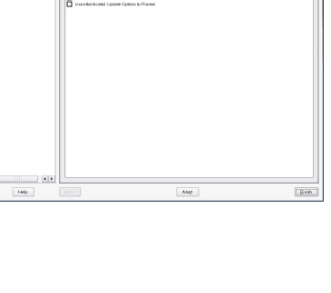

- TLS Settings。激活或停用 TLS。

### 图 11-11

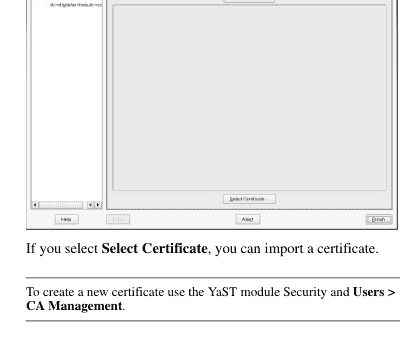

如果选择 Select Certificate，你可以导入一个证书。

要创建新证书，请使用 YaST 模块 Security and Users > CA Management。


## YaST LDAP 客户端模块

在 YaST 网络服务部分选择 LDAP Client 时，如上所述会出现以下对话框。

### 图 11-13

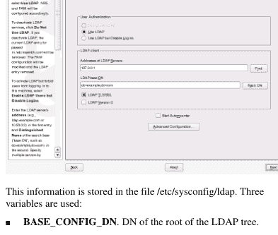

此信息存储在文件 /etc/sysconfig/ldap 中。使用三个变量：

- BASE_CONFIG_DN。LDAP 树的根 DN。
- BIND_DN。管理员的 DN。
- FILE_SERVER。

选择 Advanced Configuration 按钮后会出现一个包含两个选项卡的对话框：

- Client Settings
- Administrator Settings

### Client Settings

在此对话框中你可以指定用户、密码和组的搜索基。

### 图 11-14

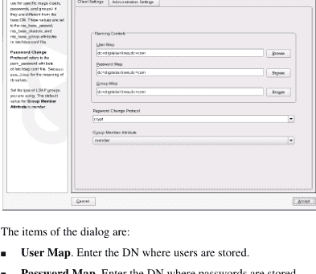

对话框的项目如下：

- User Map。输入存储用户的 DN。
- Password Map。输入存储密码的 DN。
- Group Map。输入存储组的 DN。
- Password Change Protocol。密码更改协议。参见 man 5 pam_ldap 以获取有关可能值的更多信息。
- Group Member Attribute。设置你使用的 LDAP 组的类型。值可能取决于你使用的模式文件。默认值为 member。

此信息存储在文件 /etc/ldap.conf 中。

### Administrator Settings

在此对话框中，你指定一些管理员设置。

### 图 11-15

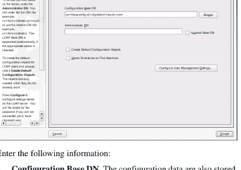

输入以下信息：

- **Configuration Base DN**。配置数据也存储在 LDAP 目录中。在此处可以输入所有配置信息的基 DN。
- **Administrator DN**。LDAP 管理员的 DN。
- **Create Default Configuration Objects**。要为用户和组创建默认配置对象，请选择此选项。

- Home Directories on This Machine。如果用户的主目录应存储在你的机器上，请选择此选项。此选项仅是 YaST 用户模块管理用户主目录的信息。

如果你想配置存储在 LDAP 服务器上的用户管理设置（例如，下一个空闲 UID），请选择 Configure User Management Settings。系统会要求你输入管理员的 LDAP 密码。

### 图 11-16

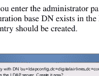

输入管理员密码后，YaST 会确定配置基 DN 是否存在于 LDAP 目录中。如果不存在，它会询问是否应创建该条目。

### 图 11-17


### 图 11-18

选择 Yes 并显示 Module Configuration 对话框。

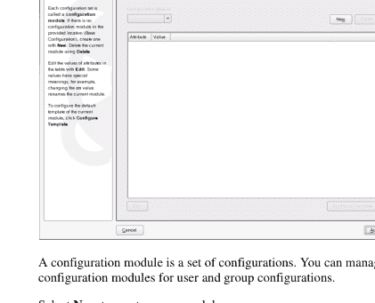

配置模块是一组配置。你可以管理用户和组配置的配置模块。

选择 New 以创建新模块。

### 图 11-19


选择是否要为用户配置或组配置创建一个模块。你还必须输入模块的通用名称（cn）。

# 图 11-20


显示了用户或组模块的模板。你可以在 YaST 模式文件（/etc/openldap/schema/yast.schema）中找到列出的属性。

要编辑属性的值，请从列表中选择一行，然后选择编辑。

# 图 11-21


在属性 **susedefaulttemplate** 的行中，指定了新用户或组的模板。如果要编辑此模板，请选择 **配置模板。**

# 图 11-22


在上部框架中，你可以看到属性及其值的列表。使用 **编辑** 编辑模板属性值。

在下部框架中，你可以为属性指定默认值。按如下方式使用下面的三个按钮：

+   - **添加。** 添加一个新的默认值。
+   - **编辑。** 编辑所选的默认值。
+   - **删除。** 删除所选的默认值。

## 练习 11-1 使用 YaST 设置 OpenLDAP

在本练习中，你使用 YaST 设置 OpenLDAP 服务器和客户端。基本 DN 为“dc=digitalairlines,dc=com”，LDAP 管理员的通用名称为“cn=Administrator,dc=digitalairlines,dc=com”，密码为“novel”。本练习中不使用 TLS/SSL。

执行以下操作：

- 第一部分 - 安装 OpenLDAP
- 第二部分 - 设置 OpenLDAP 服务器
- 第三部分 - 设置 OpenLDAP 客户端

- 1. 从主菜单启动 YaST。
- 2. 输入 root 密码（novel）并选择确定。
- 3. 从 YaST 控制中心，选择 软件 > 软件管理。
- 4. 从筛选器下拉菜单中选择 搜索。
- 5. 在搜索字段中输入 ldap；然后选择 搜索。
- 6. 在右侧，选择以下软件包：
  - nss_ldap
  - openldap2
  - openldap2-client
  - pam_ldap
- 7. 选择 接受；然后插入请求的 SUSE Linux Enterprise Server 10 DVD。
- 8. 安装完成后，取出 DVD 并关闭 YaST 控制中心。

## 第二部分 - 设置 OpenLDAP 服务器

- 1. 启动 YaST。
- 2. 启动 YaST 模块 网络服务 > LDAP 服务器。
- 3. 选择 是 以启动 LDAP 服务器。
- 4. 选择 配置。
- 5. 在 LDAP 服务器配置对话框中选择 添加数据库 以添加数据库。
- 6. 在添加数据库对话框中输入以下信息：

# 表 11-1

| 文本框 | 值 |
|---|---|
| Base DN | dc=digitalairlines,dc=com |
| LDAP Password | novell |
| Validate Password | novell |

- 7. 选择 确定。
- 8. 在左侧框架中选择 全局设置 > TLS 设置。确保选项 TLS Active 设置为 否。
- 9. 选择 完成。

## 第三部分 - 设置 OpenLDAP 客户端

- 1. 启动 YaST 模块 网络服务 > LDAP 客户端。
- 2. 选择 使用 LDAP 以激活 LDAP 用于用户身份验证。
- 3. 确保 LDAP 服务器地址 的内容为 127.0.0.1。
- 4. 确保 LDAP 基本 DN 的内容为 dc=digitalairlines,dc=com
- 5. 确保选项 LDAP TLS/SSL 已停用。
- 6. 选择 **高级配置**。
- 7. 选择 **管理设置** 选项卡。
- 8. 在文本框 管理 DN 中输入 **cn=Administrator**。
- 9. 激活选项 **附加基本 DN**。
- 10. 激活选项 **创建默认配置对象**。
- 11. 激活选项 **本机上的主目录**。
- 12. 选择 **接受**。
- 13. 选择 **完成**。
- 14. 当要求输入管理员密码时输入 **novell**。

*（练习结束）*

- **transport.** 指定传输安全强度因子。
- **tls.** 指定 TLS 安全强度因子。
- **sasl.** 指定 SASL 安全强度因子。
- **update_*.** 指定目录更新所需的安全强度因子。
- **simple_bind.** 指定简单用户名/密码身份验证所需的安全强度因子。

有关更详细的描述，请阅读 slapd.conf 手册页（man 5 slapd.conf）中关于 sasl-secprops 的部分。

**access to.** 授予一组条目和/或属性对一个或多个请求者的访问权限。

语法：**access to objects [by requesters level control]**

**objects** 和 **requesters** 由其 DN 指定。

作为 **requesters**，你也可以使用星号表示 **everybody**。**self** 表示属性的所有者对象。你也可以通过 **dn=DN** 指定 DN 或通过 **group=DN** 指定组。

**level** 可以是：

- **read**（读取访问）
- **write**（写入访问）
- **auth**（需要身份验证）
- **none**（无访问）

示例 1：

```
access to attr=userpassword
by self write
by anonymous auth
by * none

access to *
by * read
```


## Example 2:

```
access to *
by dn="cn=Administrator,dc=digitalairlines,dc=com" write
by * read
```

- **database**. 指定后端类型。支持以下数据库：
- bdb. Berkeley DB
- dnssrv. DNS SRV
- hdb. bdb 的分层变体
- ldap. 轻量级目录访问协议（代理）
- ldbm. 轻量级 DBM
- meta. 元目录
- monitor. 监控后端
- passwd. 对 passwd 的只读访问
- perl. Perl 可编程后端
- shell. 外部 shell 程序
- sql. SQL 可编程后端

- **suffix "DN"**
指定将传递给此后端数据库的查询的 DN 后缀。
示例：

```
suffix    "dc=digitalairlines,dc=com"
```

- **checkpoint ops minutes**. 仅在成功写操作后才检查检查点。如果已完成 ops 次操作或超过指定的分钟数，则执行新的检查点。

可能的 **types** 为：

- **pres.** 允许使用查询属性是否在条目中存在的过滤器（cn=*）。
- **eq.** 允许使用查询属性是否具有精确值的过滤器。它包含存在性，因此无需将某物同时索引为 pres,eq。
- **approx.** 允许使用查询属性值是否“类似于”某物的过滤器。
- **sub.** 允许对属性值进行子字符串搜索的过滤器。
- **none.**

完成配置后，可以使用以下命令启动服务器：

```
rcldap start
```

如果要在服务器启动时自动启动 LDAP 服务器，请使用以下命令：

```
insserv ldap
```

## Configure the LDAP Clients with ldap.conf

更改服务器配置文件后，需要更改客户端配置。两个文件很重要：

- /etc/openldap/ldap.conf
- /etc/ldap.conf

## /etc/openldap/ldap.conf

文件 /etc/openldap/ldap.conf 是 LDAP 客户端的配置文件。

最重要的选项如下指定：

- **host 127.0.0.1**
  此行设置 LDAP 客户端应连接到的默认服务器。

- **base dc=digitalairlines,dc=com**
  这是 LDAP 客户端应使用的默认目录搜索基。

标准安装后，/etc/ldap.conf 中还有一行：

```
TLS_REQCERT    allow    ............
```

TLS_REQCERT 指定在 TLS 会话中对服务器证书执行哪些检查（如有）。级别可以指定为以下关键字之一：

- **never**. 客户端不会请求或检查任何服务器证书。
- **allow**. 请求服务器证书。如果未提供证书或提供错误证书，会话照常进行。
- **try**. 请求服务器证书。如果未提供证书，会话照常进行。如果提供错误证书，会话立即终止。
- **demand or hard**. 请求服务器证书。如果未提供证书或提供错误证书，会话立即终止。（默认）

更多选项，请阅读手册 man 5 ldap.conf。

## /etc/ldap.conf

文件 /etc/ldap.conf 是 LDAP 名称服务切换库、LDAP PAM 模块和 shadow 包的配置文件。该文件属于 RPM 包 pwdutils。

```
da51:~ # rpm -qf /etc/ldap.conf
pwdutils-3.0.7.1-17.10
da51:~ #
```

/etc/ldap.conf 的最重要的选项是：

- **host.** 指定要连接到的 LDAP 服务器的名称或 IP 地址。
- **base.** 指定搜索时使用的默认基本可分辨名称（DN）。
- **ldap_version.** 指定 LDAP 协议的版本；“3”代表 LDAPv3。
- **bind_policy.** 指定 LDAP 服务器不可达时发生的情况。可能的值为：
  - **hard.** nss_ldap 将以指数退避方式重试连接软件。（默认）
  - **soft.** 禁止 nss_ldap 重试失败的 LDAP 查询。
- **binddn.** 指定用于绑定到目录服务器的区分名称。默认是匿名绑定。
- **bindpw.** 指定用于绑定的明文凭据。此选项仅在与上文 binddn 一起使用时适用。
- **scope.** 指定搜索范围。可能的值为：
  - **sub.** 子树
  - **one.** 一级
  - **base.** 基本对象


默认作用域是 **sub**；**base** 作用域几乎不用于名称服务查找。

-   **pam_password.** 指定要使用的密码更改协议。支持以下协议：
  -   **clear.** 使用 LDAPModify 请求更改密码，将 userPassword 值替换为新的明文密码。
  -   **clear_remove_old、nds 或 racf.** 使用 LDAPModify 请求更改密码，首先删除包含旧明文密码的 userPassword 值，然后添加包含新明文密码的 userPassword 值。此协议是 Novell NDS 和 IBM RACF 所必需的。
  -   **crypt.** 使用 LDAPModify 请求更改密码，首先使用 crypt(3) 生成新密码的单向哈希，然后将 userPassword 值替换为新哈希密码。
  -   **md5.** 使用 LDAPModify 请求更改密码，首先使用 MD5 生成新密码的单向哈希，然后将 userPassword 值替换为新哈希密码。
  -   **ad.** 使用 LDAPModify 请求更改密码，使用 Active Directory 服务接口（ADSI）密码更改协议。
  -   **exop.** 使用 RFC 3062 密码修改扩展操作更改密码（仅发送新密码）。
  -   **exop_send_old.** 使用 RFC 3062 密码修改扩展操作更改密码（同时发送旧密码和新密码）。这是使用 PADL XAD 身份服务器时的首选。

-   **ssl.** 指定是否使用 SSL/TLS。可能的值有：
  -   **on**

basedn 和 scope 的语法与配置文件中同名选项的语法相同，另外还可以省略基础 DN 的尾部后缀（这种情况下将改为附加全局基础 DN）。


更多选项请参阅手册 man 5 pam_ldap。

用户可以通过以下方式更改自己的密码：

```
da51:~# ldappasswd -x -D
"uid=geeko,ou=people,dc=digitalairlines,dc=com" -W -S
"uid=geeko,ou=people,dc=digitalairlines,dc=com"
New password:
Re-enter new password:
Enter LDAP password:
Result: Success (0)
da51:~#
```

如果希望用户在首次登录时自动创建主目录，请将以下行添加到 /etc/pam.d/sshd

```
session required pam_mkhomedir.so skel=/etc/skel/ umask=0022
```

如果用户现在搜索新用户的 LDAP 条目，系统应提示其输入密码，并且搜索结果应显示加密后的密码。

```
da51:~# ldapsearch -x -D "uid=geeko,ou=people,dc=digitalairlines,dc=com" -W
Enter LDAP Password:
# extended LDIF
#
# LDAPv3
# base <> with scope subtree
# filter: uid=geeko
# requesting: ALL
#
# geeko, people, digitalairlines.com
dn: uid=geeko,ou=people,dc=digitalairlines,dc=com
objectClass: posixAccount
objectClass: shadowAccount
objectClass: inetOrgPerson
uid: geeko
uidNumber: 1000
gidNumber: 100
cn: Geeko Chameleon
givenName: Geeko
sn: Chameleon
homeDirectory: /home/geeko
loginShell: /bin/bash
shadowMax: 99999
shadowWarning: 7
shadowInactive: -1
shadowMin: 0
shadowLastChange: 12609
userPassword:
eINT5EP9TvjWDIHqM6yDqGxIUeIWHWPuT210QWZ1NDkrUHA4OTU=

# search result
search: 2
result: 0 Success

# numResponses: 2
# numEntries: 1
da51:~#
```

## 激活 pam_ldap

要激活 PAM 和 NSS，您必须将 LDAP 添加为可能的身份验证源。必须确保 /etc/nsswitch.conf 文件中有以下行：

```
passwd: compat
group: compat
...
passwd_compat: ldap
group_compat: ldap
```

如果使用 YaST 配置 LDAP 客户端，则 pam_ldap.so PAM 模块将对所有类型的身份验证生效。这是在 /etc/security/pam_unix2.conf 文件中完成的：

```
auth:       use_ldap
account:    use_ldap
password:   use_ldap
session:    none
```

如果您手动配置 LDAP 客户端，则可以为选定的服务激活 LDAP 身份验证。

为此，请使用 PAM 模块 pam_ldap.so（包含在 pam_ldap 包中）。将与服务对应的模块添加到 /etc/pam.d 中的 PAM 配置文件中。

例如，如果要对 ssh 进行 LDAP 身份验证，/etc/pam.d/sshd 文件必须如下所示：

```
#%PAM-1.0
auth        include        common-auth
auth        required       pam_nologin.so
account     include        common-account
password    include        common-password
session     include        common-session
# Enable the following line to get resmgr support for
# ssh sessions (see /usr/share/doc/packages/resmgr/README)
#session    optional       pam_resmgr.so fake_ttyname
```


这里包含了文件 common-auth、common-account、common-password 和 common-session。这些文件也可以在 /etc/pam.d/ 中找到。文件 /etc/pam.d/common-auth 例如有以下语句：

| auth | required | pam_env.so |
| auth | required | pam_unix.so |

如果一个 required 模块失败，后续模块仍会被测试。但最终会报错。如果一个 sufficient 模块失败，但另一个 sufficient 模块匹配，则允许登录。

在目录 /usr/share/doc/packages/pam_ldap/pam_ldap.d/ 中有一些示例可用。

使用 LDAP 进行各种身份验证的优点（由 YaST 完成）在于你可以使用标准工具如 passwd 或 chsh。

```
kbailey@da51-> passwd
kbailey@da51-> passwd
Enter login(LDAP) password:
New password:
Re-enter new password:
LDAP password changed for geeko
```

## Exercise 11-2 Set up an LDAP User Database

在本练习中，你将向 LDAP 目录添加一个具有以下信息 的用户：

### Table 11-2

| Information | Value |
|---|---|
| Login | kbailey |
| Name | Kate Bailey |
| UID | 1010 |
| GID | 100 |
| Home directory | /home/kbailey |
| Login shell | /bin/bash |

你为用户 kbailey 创建一个密码（"novell"）。在第二部分，你将启用用户通过 ssh 登录时自动创建主目录。在第三部分，你将以用户 kbailey 登录以测试你的配置。

执行以下操作：

- Part I - Add Users to the LDAP Directory
- Part II - Set LDAP User Password
- Part III - Configure Automatically Home Directory Creation
- Part IV - Login as kbailey via SSH

## Part I - Add Users to the LDAP Directory

- 1. YaST 已在 LDAP 目录中创建了一些条目。要查看 LDAP 目录的内容，输入 ldapsearch -x
- 2. 通过输入 vi example.ldif 创建一个 LDIF 文件

3. 要为新用户 kbailey 创建一个 Posix 账户，添加以下行：
**dn: uid=kbailey,ou=people,dc=digitalairlines,dc=com**
**objectClass: posixAccount**
**objectClass: shadowAccount**
**objectClass: inetOrgPerson**
**uid: kbailey**
**uidNumber: 1010**
**gidNumber: 100**
**cn: Kate Bailey**
**givenName: Kate**
**sn: Bailey**
**homeDirectory: /home/kbailey**
**loginShell: /bin/bash**
**shadowMax: 99999**
**shadowWarning: 7**
**shadowInactive: -1**
**shadowMin: 0**
**shadowLastChange: 12609**

你也可以从课程 DVD 复制文件 exercises/section_3/kbailey.ldif。

4. 保存文件并通过输入 :wq 退出文本编辑器。

5. 通过输入将 LDIF 文件添加到你的 LDAP 数据库中
**ldapadd -x -D**
**"cn=Administrator,dc=digitalairlines,dc=com" -W -f**
**kbailey.ldif**

6. 输入 LDAP 管理员的密码（novell）。

7. 要查看 LDAP 目录的内容，输入
**ldapsearch -x "uid=kbailey"**

## Part II - Set LDAP User Password

- 1. 使用命令 **getent**（Get Entry）测试 glibc 是否使用 LDAP 数据库。输入 **getent passwd**

/etc/passwd 中的用户和 LDAP 数据库中的用户都应被列出。输出的末尾可能类似于这样：

```
...
uucp:x:10:14:Unix-to-Unix CoPy system:/etc/uucp:/bin/bash
wwwrun:x:30:8:WWW daemon apache:/var/lib/wwwrun:/bin/false
geeko:x:1000:100:Geeko Chameleon:/home/geeko:/bin/bash
kbailey:x:1010:100:Kate Bailey:/home/kbailey:/bin/bash
```

- 2. 要为用户 kbailey 设置密码，输入 **ldappasswd -x -D "cn=Administrator,dc=digitalairlines,dc=com" -W -S "uid=kbailey,ou=people,dc=digitalairlines,dc=com"**

- 3. 两次输入 **novell** 作为新密码。

- 4. 输入管理员密码（同样是 **novell**）以设置密码。

- 5. 通过输入搜索你自己的 LDAP 条目 **ldapsearch -x -D "cn=Administrator,dc=digitalairlines,dc=com" -x "uid=kbailey" -W**

- 6. 输入管理员密码（**novell**）。你的加密用户密码应被列出。

## Part III - Configure Automatically Home Directory Creation

- 1. 通过输入打开文件 /etc/pam.d/sshd
`vi /etc/pam.d/sshd`
- 2. 添加以下行
`session required pam_mkhomedir.so skel=/etc/skel/ umask=0022`
- 3. 通过输入保存文件并退出 `wq`。

## Part IV - Login as kbailey via SSH

- 1. 通过输入以用户 kbailey 登录
`ssh -l kbailey localhost`
- 2. 输入 yes 以修改已知主机列表。
- 3. 输入 kbailey 的密码（novell）。
主目录应被创建。
- 4. 输入 exit 以注销。

（练习结束）


## 目标 3 复制 OpenLDAP 服务器

如果 LDAP 服务器的请求很多，你可能需要不止一台服务器。一台服务器是主服务器。其他服务器是从服务器。主/从配置提供了一种有效的方式来增加容量、可用性和可靠性。

主服务器上的更改会通过 slurpd 传播到从服务器。在本目标中我们涵盖以下主题：

- 将复制 DN 添加到 LDAP 目录
- 为复制配置 slapd
- slurpd 的命令行选项
- 传输 LDAP 数据库

## 将复制 DN 添加到 LDAP 目录

在 LDAP 目录中（主服务器和从服务器上）必须存在一个用于复制的 DN 对象。这可以如下所示：

```
dn: uid=replicator,dc=digitalairlines,dc=com
objectClass: inetOrgPerson
uid: Replicator
cn: LDAP Replicator
sn: Replicator
```

你还必须使用 ldappasswd 为此对象设置密码。

## 为复制配置 slapd

主服务器上的 slapd 可以通过以下条目 /etc/openldap/slapd.conf 配置为写入复制日志文件：

```
replogfile /var/lib/ldap/master-slapd.replog
```

此文件包含常规 LDIF 更改记录，例如

```
time: 1148659780
dn: ou=groups,dc=digitalairlines,dc=com
changetype: add
objectClass: organizationalUnit
ou: groups
structuralObjectClass: organizationalUnit
entryUUID: c7b0c4e0-811d-102a-9c4d-2129ebe1b381
creatorsName: cn=Administrator,dc=digitalairlines,dc=com
createTimestamp: 20060526160940Z
entryCSN: 20060526160940Z#000000#00000000
modifiersName: cn=Administrator,dc=digitalairlines,dc=com
modifyTimestamp: 20060526160940Z
```

在主服务器上，你必须使用 replica 选项指定从服务器的名称：

```
replica uri=ldap://10.0.0.51:389
binddn="cn=replicator,dc=digitalairlines,dc=com" bindmethod=simple
credentials=novell
```

使用以下参数：

- **uri**。从服务器的名称或 IP。默认 LDAP 端口为 389。如果要使用 LDAPS（端口 636），uri 如下所示
**replica uri=ldaps://10.0.0.51:636 ...**

- **binddn**。允许访问从服务器的主服务器 DN。此 DN 也必须在从服务器上使用 updatedn 选项指定。

此 DN 不应与主服务器的 rootdn 相同。

- **bindmethod.** 指定身份验证方法。你可以在 **simple**（基于密码的身份验证）和 **sasl**（SASL 身份验证）之间选择。
- **credentials.** 简单身份验证的密码。

在从服务器上，你必须添加 **updatedn** 选项，如前所述。例如：

```
updatedn="cn=replicator,dc=digitalairlines,dc=com"
```

使用 **updateref** 指令定义从服务器在收到更新请求时应返回的 URL。

```
updateref="ldap://10.0.0.51"
```

你必须确保此 DN 具有写入数据库的权限（例如，通过 **access** 指令）。

```
access to *
  by dn="cn=replicator,dc=digitalairlines,dc=com" write
  by * read
```

## slurpd 的命令行选项

slurpd 的 man 手册可以通过 man 8 slurpd 访问。

slurpd 的选项有：

- **-d level**。指定调试级别。可能的调试级别有：
  - 4. 详细跟踪调试
  - 64. 配置文件处理
  - 65535. 启用所有调试
  - ?. 列出所有调试级别并退出 slurpd。
- **-f file**。指定 slapd 配置文件。默认是 /etc/openldap/slapd.conf。
- **-r file**。指定 slapd 复制日志文件的名称。
- **-o**。以“一次性”模式运行。通常，slurpd 处理 replog 文件然后监视是否有更多复制条目被追加。在一次性模式下，slurpd 处理复制日志后退出。
- **-t directory**。slurpd 在处理前将复制日志复制到工作目录。

在 /etc/init.d/ 中有一个启动脚本，你可以通过输入 rcslurpd start 启动 slurpd。


## 迁移 LDAP 数据库

在从服务器上启动 slapd 之前，你必须将 LDAP 数据库从主服务器迁移到该服务器。

确保主服务器的 slapd 已关闭。要迁移数据库（默认为 `/var/lib/ldap/`），你可以使用 scp。

另外你也可以使用命令 `slapcat`。`slapcat` 用于根据 slapd 数据库的内容生成 LDIF 输出。默认情况下输出写入 STDOUT。你可以使用选项 `-l` 指定文件。

slapcat 还有其他有趣的选项（例如，用于过滤）。请参阅手册页了解更多详细信息（`man 8 slapcat`）。

## 练习 11-3 复制 OpenLDAP 服务器

在本练习中，你将与邻座同学配置 LDAP 复制。

你使用新的 LDAP 条目 "uid=replicator,dc=digitalairlines,dc=com" 且密码为 "novell" 进行复制。

在第 IV 部分，你将把用户 kbailey 的姓氏从 "Bailey" 改为 "Smith"。你在主服务器上执行此操作以查看复制是否正确工作。

执行以下操作：

- Part I - Add the Replicator DN to the Master's LDAP Directory
- Part II - Configure the LDAP Master Server
- Part III - Configure the LDAP Client Server
- Part IV - Copy the Database and Start the Servers
- Part V - Test Replication

### Part I - Add the Replicator DN to the Master's LDAP Directory

- 1. 要在主服务器上添加新的 LDAP 条目，请通过输入 vi replicator.ldif 创建一个新的 LDIF 文件
- 2. 输入以下行
- dn: uid=replicator,dc=digitalairlines,dc=com
- objectClass: inetOrgPerson
- uid: replicator
- cn: LDAP Replicator
- sn: Replicator
- 你也可以从课程 DVD 复制文件 exercises/section_3/replicator.ldif。

### Part III - Configure the LDAP Client Server

- 1. 通过输入 **rldap stop** 停止你的 LDAP 服务器。
- 2. 通过输入 **vi /etc/openldap/slapd.conf** 打开文件 /etc/openldap/slapd.conf
- 3. 添加以下行 **updatedn="uid=replicator,dc=digitalairlines,dc=com"** **updateref="ldap://master_ip"** *master_ip* 是你邻座同学计算机的 IP 地址。
- 4. 将以下访问规则 **access to *** **by * read** 改为 **access to *** **by dn="uid=replicator,dc=digitalairlines,dc=com" write** **by * read**
- 5. 通过输入 **:wq** 保存文件并退出。

### Part IV - Copy the Database and Start the Servers

- 1. 在主服务器上输入 **scp -r /var/lib/ldap/ host:/var/lib/ldap/** 将 *host* 替换为从服务器的主机名。
- 2. 提示输入密码时输入 **novell**。
- 3. 在两台服务器上通过输入 **rldap start** 启动 slapd
- 4. 在主服务器上通过输入 **rslurpd start** 启动 slurpd

### Part V - Test Replication

- 1. 要在主服务器上更改某些用户信息，请通过输入创建新的 LDIF 文件
- vi change.ldif

- 2. 输入以下行
- dn: uid=kbailey,ou=people,dc=digitalairlines,dc=com
- cn: Kate Smith
- sn: Smith

- 你也可以从课程 DVD 复制文件 exercises/section_3/change.ldif。

- 3. 通过输入 :wq 保存文件并退出。

- 4. 要更改 LDAP 信息，请输入
- ldapmodify -x -D "cn=Administrator,dc=digitalairlines,dc=com" -W -f change.ldif

- 5. 在主服务器和从服务器上输入
- ldapsearch -x "uid=kbailey"

(End of Exercise)

## Summary

| Objective | Summary |
|---|---|
| 1. Install and Set Up an OpenLDAP Server | 如果你在安装期间未配置 OpenLDAP 服务器，你需要安装以下软件包：

- openldap2
- openldap2-client
- pam_ldap
- nss_ldap

OpenLDAP 服务器的配置位于文件 /etc/openldap/slapd.conf。

你可以使用命令 slappasswd 为配置文件中的管理员条目创建密码。

/etc/openldap/ldap.conf 是 LDAP 客户端的配置文件。

/etc/ldap.conf 是 LDAP 名称服务切换库、LDAP PAM 模块和 shadow 包的配置文件。 |


| Objective | Summary |
|---|---|
| 2. Activate LDAP Authentication | 如果你使用 LDAP 目录进行用户身份验证，可以通过使用 `ldappasswd` 命令来更改用户的密码。 |
| | 如果你使用 YaST 模块配置 LDAP 客户端，则 PAM 模块 `pam_ldap.so` 会在文件 `/etc/security/pam_unix2.conf` 中为所有类型的身份验证激活。 |
| | 如果你手动配置 LDAP 客户端，则只能为选定的服务激活 LDAP 身份验证。 |
| | 为此，使用 PAM 模块 `pam_ldap.so`（包含在软件包 `pam_ldap` 中）。将对应服务的模块添加到 `/etc/pam.d` 中的 PAM 配置文件。 |

| Objective | Summary |
|---|---|
| 3. Replicate OpenLDAP Servers | 主服务器上的 slapd 可以配置为写入复制日志文件。 |
| | 在主服务器上你还必须指定从服务器的名称。 |
| | 在主服务器上指定一个由主服务器用于访问从服务器的 DN。该 DN 也必须在从服务器上指定，并且必须具有写入数据库的权限。 |
| | **slapcat** 用于根据 slapd 数据库的内容生成 LDIF 输出。 |

## SECTION 12 Configure a Mail Server

SUSE Linux Enterprise Server 10 中的标准邮件服务器是 Postfix。

在本节中你将了解有关 SMTP 协议的一些背景知识。还介绍了用于检测垃圾邮件和病毒的工具。

## Objectives

- 1. Understand SMTP Communication
- 2. Manage Spam
- 3. Use a Virus Scanner for Email

## Objective 1

## Understand SMTP Communication

下面我们想更详细地了解：

- The SMTP Commands
- Command Syntax
- SMTP Reply Codes
- Minimal SMTP Command Implementation
- An Example for Sending Mail with Telnet

## The SMTP Commands

命令如下：

- **HELO (Hello)** 由 SMTP 发送方用来向 SMTP 接收方打开连接（问候）并以其完整主机名进行自我介绍。这个主机名作为参数附加到 **HELO** 命令。

  SMTP 接收方用其完整主机名回答此问候。这完成了 SMTP 发送方和接收方之间通信的初始化。
- **MAIL FROM** 初始化电子邮件消息的传输。在最简单的情况下，**MAIL FROM** 命令以发送者的电子邮件地址（反向路径）作为参数。参数可以可选地扩展为在收件人地址前包含一串主机列表，以便通过这些主机路由回复（源路由中继），例如：
  - @venus.example.com
  - @mars.example.com:Sales@example.com
- **RCPT TO (Recipient)** 设置邮件项目的收件人地址（正向路径）。如果邮件应同时发送给多个收件人，则重复此命令相应次数。
- **VRFY (Verify)** 验证用户 ID。这会导致 SMTP 接收方检查作为参数给出的收件人的有效性。如果 SMTP 读取器知道收件人，则地址会扩展为完整地址（包括域名）。**VRFY** 命令对 **MAIL FROM, RCPT TO,** 和 **DATA** 指令没有影响。
- **EXPN (Expand)** 指示 SMTP 接收方将参数视为邮件列表。结果，列表的成员会被传输给 SMTP 发送方。
- **RSET (Reset )** 重置先前存储的有关 SMTP 接收方的所有信息。正向路径、反向路径和邮件内容都会丢失。
- **HELP** 以任何其他 SMTP 命令作为参数。关于如何使用相应指令的提示页面将被显示。
- **NOOP (No Operation)** 导致 SMTP 接收方以 **OK** 作出回答。除此之外，邮件内容或正向和返回路径不会发生任何更改。
- **QUIT** 结束 SMTP 发送方和接收方之间的连接。

## Command Syntax

SMTP 命令在发送方和接收方之间提供直接通信。以下表格描述了最常用的 SMTP 命令。

## Table 12-1

| Command Syntax | Description of the Arguments |
|---|---|
| HELO hostname | hostname 包含 SMTP 发送方的完整主机名。 |
| MAIL FROM: reverse-path | reverse-path 包含源路由中继的 relay 路径和发送者地址。 |
| RCPT TO: forward-path | forward-path 包含源路由中继的 relay 路径和收件人地址。 |
| DATA data | data 构成邮件的内容（实际消息）。 |
| RSET | /. |
| VRFY string | string 包含用户或邮箱名称。 |
| EXPN string | string 包含邮件列表标识符。 |
| HELP [string] | string 包含任何 SMTP 命令。 |
| NOOP | /. |
| QUIT | /. |

命令可以用小写或大写书写：SMTP 命令不区分大小写。例如，SMTP 接收方会以相同的方式处理以下命令：MAIL FROM, Mail From, mail from, Mail FrOm。


与此相反，*forward-path* 和 *reverse-path* 中的参数可能是区分大小写的。这些参数的解释取决于 SMTP 收件人的操作系统以及用户数据库的结构，这就是为什么小写和大写字符可能会被不同对待。

## SMTP 回复代码

在 SMTP 发送方与 SMTP 收件人之间进行通信时，发送方向收件人传输各种命令并控制整个通信过程。收件人确认消息的接收并以相应的回复代码给出命令处理的状态。只有当发送方收到前一个命令的回执后，才能开始传输下一个命令。

最常见的 SMTP 回复代码列在下表：

### Table 12-2

| Reply Code | Description |
|---|---|
| 211 | System status or system help reply. |
| 214 | Displays the help message after entering HELP |
| 220 | SMTP server ready. |
| 221 | SMTP server has closed connection. |
| 250 | Specified command has been carried out. |
| 251 | User not local; will forward to *forward-path*. |
| 354 | Start of the DATA entry. |
| 421 | SMTP service not available. |
| 450 | Requested action not taken (mailbox is already in use). |
| 451 | Requested action aborted. |
| 452 | Requested action not taken; insufficient storage space in system. |
| 500 | Syntax error, command unrecognized. |
| 501 | Syntax error in parameters or arguments. |
| 502 | Command not implemented. |
| 503 | Bad sequence of commands. |
| 504 | Command not implemented for that parameter. |
| 550 | Requested action not taken; file unavailable (e.g., mailbox not found, no access). |
| 551 | User does not exist on mail server; try *forward-path*. |
| 552 | Requested mail action aborted: storage allocation exceeded. |
| 553 | Requested action not taken: mailbox name not allowed (e.g., mailbox syntax incorrect). |
| 554 | Transaction failed. |

## Minimal SMTP Command Implementation

并非所有到目前为止介绍的命令都由每个服务器实现。某些 SMTP 命令故意不包含在某些服务器实现中以提高服务器的安全性。其中一个安全关键命令是 HELP。Wietse Venema 的 Postfix SMTP 服务器并未完全实现此命令，并且简单地对 HELP 命令以回复代码 502 作出响应（“Command not implemented”）。

以下列表显示了 SMTP 服务器必须绝对实现以提供 SMTP 通信的 SMTP 命令：

- **HELO**
- **MAIL FROM:**
- **RCPT TO:**
- **DATA**
- **RSET**
- **NOOP**
- **QUIT**

## An Example for Sending Mail with Telnet

下面的文本显示了使用端口 25 上的 telnet 会话（标准邮件服务器端口）可以轻松重建的典型日志输出示例：

```
da53:~# telnet da51.digitalairlines.com 25
Trying 127.0.0.1...
Connected to localhost.
Escape character is '^]'.
220 da51.digitalairlines.com ESMTP Postfix
HELO da53.digitalairlines.com
250 da51.digitalairlines.com
MAIL FROM: jgoldman@digitalairlines.com
250 Ok
RCPT TO: geeko@digitalairlines.com
250 Ok
DATA
354 End data with <CR><LF>.<CR><LF>
Subject: Lorem ipsum dolor sit amet

Lorem ipsum dolor sit amet, consectetuer adipiscing elit,
sed diam nonummy nibh euismod tincidunt ut laoreet dolore
magna aliquam erat volutpat. Ut wisi enim ad minim veniam,
quis nostrud exerci tution ullamcorper suscipit lobortis
isl ut aliquip ex ea commodo consequat.
.
250 Ok: queued as 45B5116A9D
QUIT
221 Bye
Connection closed by foreign host.
da53:~#
```

## Objective 2 Manage Spam

本目标解释了以下内容：

- Use SpamAssassin
- Test SpamAssassin

### Use SpamAssassin

spamassassin（和 spamc）期望其输入来自 STDIN。

使用 SpamAssassin 的最简单方法是将其邮箱通过管道传输到命令 spamassassin：

```
da51:~# cat /var/spool/mail/root | spamassassin
```

如果您想将 SpamAssassin 与 Postfix 配置一起使用，最简单的方法是使用 Procmail。您只需要编辑三个文件：

- Create the file /etc/procmailrc with this content:

```
#LOGFILE=/tmp/procmail.log
#VERBOSE=yes

# Until now, mail is untagged, you may add rules for
# mail that must not be tagged

:0 hbfw
| /usr/bin/spamc
```

邮件在第一个过滤器规则中被管道传输到 spamc。过滤器规则的标志在下面解释：

- h. Feed the header to the pipe, file, or mail destination (default).
- b. Feed the body to the pipe, file, or mail destination (default).


+   f. 将管道视为过滤器。
+   w. 等待过滤器或程序完成并检查其退出代码（通常被忽略）；如果过滤器不成功，则文本将不会被过滤。

+   确保在 /etc/postfix/main.cf 中激活 Procmail：

```
mailbox_command = /usr/bin/procmail
```

+   确保在文件 /etc/postfix/master.cf 中的 smtpd 定义设置为默认值

```
smtp inet n - n - - smtpd
```

之后，通过输入以下命令启动 spamd

rcspam start

垃圾邮件可以从邮件客户端过滤，或在进一步的 Procmail 配置（~/.procmailrc）中通过添加类似以下的行进行过滤：

```
:0
* ^X-Spam-Status: Yes
$MAILDIR/Spam
```

## 测试 SpamAssassin

你可以使用 telnet 来测试你的配置。你也可以直接使用 sendmail 命令发送一封垃圾邮件：

```
cat sample-spam.txt | /usr/sbin/sendmail geeko@digitalairlines.com
```

## 目标 3

## 为邮件使用病毒扫描器

今天，通过电子邮件进行通信对公司和个人都很重要，但电子邮件可能被病毒软件感染。

大多数病毒攻击 Windows 客户端，但公司的邮件服务器通常是 Linux 或 UNIX 机器。为了避免损坏，我们建议在感染的邮件到达用户客户端之前搜索病毒。

SUSE Linux Enterprise Server 10 提供了在邮件服务器上检测电子邮件中病毒的工具。

在本目标中，介绍了以下工具：

- AVMailGate
- AMaViSd-new

## AVMailGate

AVMailGate 是 AntiVir MailGate 的缩写，是 H+BEDV Datentechnik GmbH 的反病毒邮件过滤器（http://www.hbedv.com）。

AVMailGate 更新病毒定义文件和引擎本身。

本主题描述了以下内容：

- AVMailGate 架构
- 安装 AVMailGate
- 配置 AVMailGate
- 理解 AVMailGate 配置文件
- 更新 AVMailGate

### AVMailGate 架构

### 图 12-1


AVMailGate 由三个队列和两种进程组成：

- **队列**（位于 `/var/spool/avmailgate/`）
  - **incoming/**。所有传入电子邮件的输入队列。
  - **rejected/**。可能感染的电子邮件存储的队列。
  - **outgoing/**。未感染电子邮件的输出队列。
- **进程**
  - **avgated**。将传入电子邮件存储在输入队列中的 smtpd 接收器。（守护进程）
  - **avgatefwd**。病毒扫描功能和 SMTP 转发器以及 sendmail 调用器。（守护进程）

两个进程都可以通过编辑文件
`/etc/avmailgate.conf` 进行配置。

该文件包含描述可能设置的注释。

有关所有选项的描述，请参阅 /usr/share/packages/avmailgate/doc/MANUAL。

## 安装 AVMailGate

要安装 AVMailGate，请选择包 avmailgate。

在 rcavgate 中提供了一个启动脚本，用于启动和停止 AVMailGate。

要使 AVMailGate 在系统启动时启动，请输入 insserv avgate。

## 配置 AVMailGate

使用 Postfix 有两种可能性使用 AVMailGate：

- AVMailGate 在端口 25 等待邮件并将其转发到 Postfix
- AVMailGate 被 Postfix 作为内容过滤器使用

### AVMailGate 在端口 25 等待邮件并将其转发到 Postfix

要将 AVMailGate 用作在端口 25 等待邮件的邮件代理，你只需避免 Postfix 在此端口上监听。因此在 /etc/postfix/master.cf 中将以下行标记为注释，在前面添加井号（“#”）

```
#smtp inet n - n - - smtpd
```

然后重新启动 Postfix。

### AVMailGate 被 Postfix 作为内容过滤器使用

使用 Postfix 使用 AVMailGate 的最佳方式是使用完整内容过滤器 API（有关详细信息，请参阅 Postfix 包中的 FILTER_README）。

它在端口 10024 上等待 SMTP 连接，并通过端口 10025 上的 SMTP 发送扫描的电子邮件消息或病毒警告。

要在 Postfix 中将 AVMailGate 集成作为过滤器，请执行以下操作：

1. 编辑 /etc/postfix/master.cf 并取消注释 –如果适用– 或添加以下行：

```
localhost:10025 inet n - y - - smtpd -o content_filter=
```

2. 编辑 /etc/postfix/main.cf 并添加以下行：

```
content_filter = smtp:127.0.0.1:10024
```

3. 由于 AVMailGate 监听端口 10024，而不是端口 25，编辑 /etc/avmailgate.conf 并设置

```
ListenAddress localhost port 10024
```

4. 你必须告诉 AVMailGate 它应该通过 SMTP 在主机 localhost 的端口 10025 上将电子邮件发送回 Postfix。编辑 /etc/avmailgate.conf 并设置

```
ForwardTo SMTP: localhost port 10025
```

5. 由于 AVMailGate 作为 AVMailGate 发送通知消息，请在 /etc/aliases 中设置一个别名：

```
vmailgate: root
```


你必须在之后运行 newaliases。

6. 在进行这些更改后，输入
**rcpostfix reload**
和
**rcavgate start**

你的系统现在已准备好扫描邮件。

## 了解 AVMailGate 配置文件

如前所述，AVMailGate 的配置文件是 /etc/avmailgate.conf。该文件中的选项可以分为以下几组：

- General Parameters
- Scanning of Files in an Archive
- Handling Envelope Recipient Addresses
- Adding a Notification in the Body of Transmitted Mails
- Other Configuration Files

## General Parameters

- **User and Group.** avgated 和 avgatefwd 以此用户和组的权限运行。
- **Postmaster.** 错误和警报消息将发送给此用户。
- **MyHostName.** 计算机的主机名。如果未设置，则通过 gethostname 获取。
- **SpoolDir.** 队列存储的目录。
- **AntiVirDir.** 病毒特征码存储的目录。
- **TemporaryDir.** 邮件消息将被提取和扫描的临时目录。
- **PidDir**. PID 文件的位置。
- **LogFile**. 日志文件的位置。
- **SyslogFacility**. syslog 守护进程的 Facility 参数（默认值：**mail**）。
- **MaxIncomingConnections**. 同时连接的最大数量。
- **SMTPTimeout**. SMTP 超时发生的秒数。
  可以通过以下选项配置更详细的超时：
  - **SMTPGreetingTimeout**
  - **SMTPHeloTimeout**
  - **SMTPMailFromTimeout**
  - **SMTPRcptTimeout**
  - **SMTPDataTimeout**
  - **SMTPDataBlockTimeout**
  - **SMTPDataPeriodTimeout**
- **MaxMessageSize**. 消息的最大大小（以字节为单位）。
- **MaxRecipientsPerMessage**. 收件人的最大数量。
- **MinFreeBlocks**. 空闲文件系统块的数量。如果达到限制，则不再接受传入邮件。 （0=禁用此功能）
- **MaxForwarders**. avgatefwd 的转发进程最大数量。该数值取决于网络连接的质量（网络质量差 > 数值更高）。
- **BlockSuspiciousMime**. 如果设置为 YES，则可疑的 MIME 邮件将被阻止。
- **BlockExtensions**. 应被阻止的文件名扩展名（以分号分隔）。
- **ExposeRecipientsAlerts, ExposeSenderAlerts, ExposePostmasterAlerts.** 指定是否向收件人、发件人或邮局管理员发送警报。可能的值为
  - **NO.** 不会发送警报。
  - **LOCAL**（不适用于 **ExposePostmasterAlerts**）。如果收件人/发件人是本地用户，则会发送警报。
  - **YES.** 将发送警报。
- **AlertsUser.** 警报的发件人名称。 （语法：*username* 或 *username@domain*）
- **ListenAddress.** SMTP 守护进程监听的接口和端口。默认接口 0.0.0.0 表示所有接口。
  语法：**ListenAddress interface port port**
- **ForwardTo.** 邮件转发类型。
  - 通过管道：**ForwardTo path_to_sendmail**
  - 通过 SMTP：**ForwardTo SMTP: host port port**
  默认：**ForwardTo /usr/sbin/sendmail -oem -oi**
- **RefuseEmptyMailFrom.** 如果设置为 **YES**，则包含空白发件人地址的邮件将被阻止。
- **PollPeriod.** avgatefwd 执行队列扫描的间隔（以秒为单位）。
- **QueueLifetime.** 消息在队列中停留的最长时间，之后将被退回。 （0 = 禁用此功能）
- **ForwarderRetryDelay.** 重试发送排队消息之间的最大间隔时间。
- **ThrottleMessageCount.** 在给定时间内将被重新处理的邮件数量。 （仅在队列较大时需要。）重新处理后，avgatefwd 将休眠 **ThrottleDelay** 秒。
- **BounceMessageUser.** 错误消息的发件人名称或邮件地址（例如，如果邮件无法投递）。

## Scanning of Files in an Archive

- **ArchiveMaxRecursion**. 解包和扫描归档的最大递归深度。 （0 = 无限深度）
- **ArchiveMaxSize**. 将被扫描的归档的最大文件大小（以字节为单位）。 （0 = 无限大小）
- **ArchiveMaxRatio**. 将被扫描的归档的最大压缩比。
- **BlockSuspiciousArchive**. 如果设置为 YES，则达到 ArchiveMaxRecursion、ArchiveMaxSize 或 ArchiveMaxRatio 限制的邮件将被阻止。
- **BlockEncryptedArchive**. 如果设置为 YES，则包含加密归档的邮件将被阻止。
- **BlockUnsupportedArchive**. 如果设置为 YES，则包含无法扫描的归档的邮件将被阻止。
- **BlockOnError**. 如果设置为 YES，则由于扫描超时或进程错误而无法扫描的邮件将被阻止。

## Handling Envelope Recipient Addresses

源路由是一种技术，发送方可以指定数据包在网络中应经过的路由。

以下选项涉及 avgated 使用的源路由。有关详细说明，请阅读 AVMailGate 文档。

- **AllowSourceRouting**
- **InEnvelopeAddressesBangIs**
- **InEnvelopeAddressesPercentIs**
- **AcceptLooseDomainName**


## 在传输邮件正文中添加通知

- **AddStatusInBody**。如果设置为 YES，则在邮件正文中插入默认状态文本。
  如果你想插入自己的文本，可以在此处指定文件名。对于不显示状态文本，输入 NO（默认值）。
- **MaxMessageSizeStatus**。指定添加状态文本到邮件中的最大邮件大小。
  语法：MaxMessageSizeStatus Xm | k | b
- **ForwardAllEmailAsMIME**。如果设置为 YES，所有传入的非 MIME 邮件都将被转换为 MIME。
- **AddPrecedenceHeader**。如果设置为 YES，每个通知邮件将在头部标记为 "Precedence:"。你也可以输入自定义文本。
- **AddressFilter**。如果设置为 YES，每个发件人和/或收件人地址都将与表 /etc/avmailgate.scan 和 /etc/avmailgate.ignore 进行匹配。
  表的扫描顺序可以在 **FilterTableOrder** 中指定。（首次命中即匹配）
- **UseProxy**。你可以通过在 AVMailGate 池中使用代理功能来优化扫描。
  池中的防病毒扫描器数量可以用 **ProxyScanners** 选项指定。
  **ProxyConnections** 指定允许的同时连接数。
- **AddHeaderToNotice**。如果设置为 YES，则会在 postmaster 通知邮件中添加邮件头。
- **BounceMessageSizeBody, BounceMessageSizeHeader**。限制退回邮件的大小（以字节为单位）。
- **AddXHeaderInfo**。如果设置为 YES，扫描状态信息将被添加到已检查邮件的头部。
- **AddReceivedByHeader.** 如果设置为 YES，则会在邮件头部添加 "Received:"。
- **MaxHopCount.** 如果头部中 "Received:" 行的数量超过 **MaxHopCount**，邮件将不会被接受。防止邮件循环。

## 其他配置文件

AVMailGate 还有另外四个配置文件。这些文件包含一些正则表达式。我们在此仅给出简要概述：

- **/etc/avmailgate.acl.** 定义哪些主机被视为本地主机以及服务器允许中继邮件的主机。
- **/etc/avmailgate.ignore.** 定义不应被扫描的邮件地址。
- **/etc/avmailgate.scan.** 定义始终被扫描的邮件地址。
- **/etc/avmailgate.warn.** 在此文件中可以指定在警报情况下接收邮件的人员。

## 更新 AVMailGate

包含病毒特征码的文件是 /usr/lib/AntiVir/antivir[0123].vdf。

要更新这些文件，输入

```
/usr/lib/AntiVir/antivir --update
```

## 输出如下所示：

```
AntiVir / Linux Version 2.1.5-24 +gui
Copyright (c) 1994-2005 by H+BEDV Datentechnik GmbH.
All rights reserved.

Warning: the file "antivir.vdf" is more than 14 days old
checking for updates

06.32.00.60  = 06.32.00.60  [vdf database (part 0), on-disk]
06.32.18.16  < 06.34.00.105 [vdf database (part 1), on-disk]
06.32.18.17  < 06.34.00.106 [vdf database (part 2), on-disk]
06.33.00.07  < 06.34.00.124 [vdf database (part 3), on-disk]
06.33.00.11  < 06.34.00.14  [scan engine, running]
06.33.00.11  < 06.34.00.14  [scan engine, on-disk]
antivir1.vdf 100% |********************************| 1630 KB  1.59 MB/s  0:00
ETA
antivir2.vdf 100% |********************************|  1 KB    0.00 KB/s  --:--
ETA
antivir3.vdf 100% |********************************|  35 KB    0.00 KB/s  --:--
ETA
antivir 100% |********************************|  695 KB    0.00 KB/s  --:--
ETA
06.32.00.60  = 06.32.00.60  [vdf database (part 0), on-disk]
06.34.00.105 = 06.34.00.105 [vdf database (part 1), on-disk]
06.34.00.106 = 06.34.00.106 [vdf database (part 2), on-disk]
06.34.00.124 = 06.34.00.124 [vdf database (part 3), on-disk]
06.34.00.14  = 06.34.00.14  [scan engine, on-disk]

scan engine  06.33.00.11 --> 06.34.00.14 (/usr/lib/AntiVir/antivir)
vdf database 06.33.00.07 --> 06.34.00.124 (/usr/lib/AntiVir/antivir1.vdf,
/usr/lib/AntiVir/antivir2.vdf, /usr/lib/AntiVir/antivir3.vdf)

AntiVir updated successfully
```

如果你只想检查是否有新的更新可用而不更新文件，输入

```
/usr/lib/AntiVir/antivir --update --check
```


## 练习 12-1 使用 AVMailGate 作为邮件病毒扫描器

在本练习中，你将安装并配置 AVMailGate 作为邮件的病毒扫描器。最后，你将更新 AVMailGate 病毒特征码。

执行以下操作：
- 第一部分 - 安装 AVMailGate
- 第二部分 - 配置 Postfix 使用 AVMailGate 作为内容过滤器
- 第三部分 - 配置 AVMailGate 使用的端口
- 第四部分 - 使用光盘上的病毒文件检查配置
- 第五部分 - 更新你的病毒特征码

### 第一部分 - 安装 AVMailGate

- 1. 从主菜单启动 YaST。
- 2. 输入 root 密码（novell）并选择确定。
- 3. 在 YaST 控制中心，选择 软件 > 软件管理。
- 4. 从过滤器下拉菜单中选择 搜索。
- 5. 在搜索字段中输入 avmailgate；然后选择 搜索。
- 6. 在右侧选择 avmailgate 软件包。
- 7. 选择 接受；然后插入 SUSE Linux Enterprise Server 10 DVD。
- 8. 选择 继续 以解决依赖关系。
- 9. 安装完成后，取出 DVD 并关闭 YaST 控制中心。

### 第二部分 - 配置 Postfix 使用 AVMailGate 作为内容过滤器

- 1. 在文本编辑器中打开文件 /etc/postfix/master.cf。
- 2. 取消注释以下行（在一行中）：
  localhost:10025 inet n - n - smtpd -o content_filter=
- 3. 在 /etc/postfix/main.cf 中添加以下行：
  content_filter = smtp:127.0.0.1:10024
- 4. 保存文件。
- 5. 输入 postfix reload。

### 第三部分 - 配置 AVMailGate 使用的端口

- 1. 为确保 AVMailGate 在端口 10024 而非端口 25 上监听，编辑 /etc/avmailgate.conf：
  ListenAddress 127.0.0.1 port 10024
- 2. 为确保 AvMailGate 通过 SMTP 将邮件发送回 Postfix，主机为 localhost，端口为 10025，编辑 /etc/avmailgate.conf：
  ForwardTo SMTP: localhost port 10025
- 3. 由于 AvMailGate 以 AvMailGate 身份发送通知消息，在 /etc/aliases 中设置一个别名：
  avmailgate: root
- 4. 输入 newaliases。
- 5. 输入 rcavgate start。

### 第四部分 - 使用光盘上的病毒文件检查配置

- 1. 以用户 geeko 登录。
- 2. 发送一封感染病毒的邮件给用户 root，输入
  mail root -s "Virus Test" -a /media/cdrecorder/section_4/sample-virus-executable.txt

3. 输入电子邮件正文
This is an infected mail.
.

4. 以用户 root 登录。

5. 通过输入 mailq 检查邮件队列是否为空

6. 通过输入 mail 检查感染的邮件是否到达

7. 通过输入 ls /var/spool/avmailgate/rejected 检查感染的邮件是否被检测到

### 第五部分 - 更新你的病毒特征码

1. 要检查病毒特征码是否有新版本，输入 /usr/lib/AntiVir/antivir --update --check

2. 要下载病毒特征码，输入 /usr/lib/AntiVir/antivir --update

（练习结束）

## AMaViSd-new

AMaViSd-new（A Mail Virus Scanner）由守护进程和一些可选的辅助程序组成，这些程序仅在消息传输代理（MTA）与一个或多个内容检查器（病毒扫描器或 SpamAssassin）之间设置时才需要。

邮件服务器将所有收发邮件发送到 AMaViSd。AMaViSd-new 将提取电子邮件并进行测试。

AMaViSd 识别四种不受欢迎的邮件。它们是具有以下特征的邮件：
- 1. 无效的头部
- 2. 禁止的文件类型
- 3. 病毒
- 4. 垃圾邮件

AMaViSd 按列出的顺序检查传入邮件的这四种类型。

如果未发现任何问题，AMaViSd-new 将电子邮件发回邮件服务器，准备投递。

默认情况下，AMaViSd-new 在端口 10024 上监听来自邮件服务器的传入邮件。

AMaViSd-new 通过端口 10025 将干净的邮件发送到邮件服务器。它通常位于中央邮件服务器或其附近，而不一定是用户邮箱和最终投递所在的位置。

本主题描述以下内容：
- 安装 AMaViSd-new
- 配置 AMaViSd-new

## 安装 AMAViSd-new

要安装 AMAViSd-new，请选择软件包 amavisd-new。

如果系统上未安装病毒扫描器，AMAViSd-new 将无法工作。如果你只想使用 AMAViSd-new 进行垃圾邮件过滤，请在 /etc/amavisd.conf 中搜索 @bypass_virus_checks_acl 并删除该行开头的注释符号（"#"）。

压缩工具 gzip、bzip2、arc、lha、unrar、zoo、cpio 和 lzop 也应安装。

在 SUSE Linux Enterprise Server 10 安装期间，会创建一个用户 vscan。它用于 AMAViSd。

```
da51:~# grep vscan /etc/passwd
vscan:x:65:104:vscan account:/var/spool/amavis::/bin/false
```

安装 AMAViSd-new 后，你可以使用 rcmavis start 启动守护进程。

守护进程应监听端口 10024。

```
da51:~# telnet 127.0.0.1 10024
Trying 127.0.0.1...
Connected to 127.0.0.1.
Escape character is '^]'.
220 [127.0.0.1] ESMTP amavisd-new service ready
```


使用 SMTP 命令你现在可以写一封邮件。

```
da51:~# telnet 127.0.0.1 10024
Trying 127.0.0.1..
Connected to 127.0.0.1.
Escape character is '^]'.
220 [127.0.0.1] ESMTP amavisd-new service ready
mail from: jgoldman@digitalairlines.com
250 2.1.0 Sender jgoldman@digitalairlines.com OK
rcpt to: geeko@digitalairlines.com
250 2.1.5 Recipient geeko@digitalairlines.com OK
data
354 End data with <CR><LF>.<CR><LF>
Subject: Test

Test
.
250 2.6.0 Ok, id=09232-01, from MTA([127.0.0.1]:10025): 250
Ok: queued as 5747B16A68
quit
221 2.0.0 [127.0.0.1] amavisd-new closing transmission channel
Connection closed by foreign host.
da51:~#
```

邮件头应包含 amavisd 的一行。

```
geeko@da51:~> mail
mail version 11.25 7/29/05. Type ? for help.
"/var/spool/mail/geeko": 1 message 1 new
>N 1 jgoldman@digitalai Tue May 16 15:30 20/829 Test
>1
Message 1;
From jgoldman@digitalairlines.com Tue May 16 15:30:58 2006
X-Original-To: geeko@digitalairlines.com
Delivered-To: geeko@digitalairlines.com
Subject: Test
X-Virus-Scanned: amavisd-new at example.com
Date: Tue, 16 May 2006 15:30:58 -0400 (EDT)
From: jgoldman@digitalairlines.com
To: undisclosed-recipients;

Test
?
```

## 配置 AMaViSd-new

在 SUSE Linux Enterprise Server 10 上，你可以通过编辑以下文件之一来配置 AMaViSd-new：

- /etc/sysconfig/amavis
- /etc/amavisd.conf

### /etc/sysconfig/amavis

配置文件 /etc/sysconfig/amavis 仅在 SUSE Linux 产品上可用。

该文件中只有两个参数：

- **USE_AMAVIS**。如果设为 yes，Sendmail 或 Postfix 将被准备好使用 AMaViSd-new。

在 Postfix 配置文件 /etc/postfix/main.cf 中，你需要添加以下行：

```
content_filter = smtp-amavis:[127.0.0.1]:10024
```

通过输入 **postfix reload** 重启 Postfix。

## /etc/amavisd.conf

AMaViSd 通过编辑文件 /etc/amavisd.conf 进行配置。该配置文件的语法是纯 Perl 代码。因此，每行以分号结尾。

在 Perl 中，双引号字符串可以包含以 "$" 或 "@" 开头的变量。要在双引号字符串中包含字符 "@" 和 "$"，它们必须前面加上反斜杠。

在单引号字符串中， "$" 和 "@" 失去其特殊含义，因此通常使用单引号字符串更容易。

在这两种情况下，反斜杠都需要加倍。

在 AMaViSd-new 的文档目录 /usr/share/doc/packages/amavisd-new/ 中，还有两种配置文件的变体可用：

- **amavisd.conf-default**。包含所有可能的参数及其默认值。
- **amavisd.conf-sample**。一个结构更清晰的文件，包含大量解释和示例。

在本节中，我们想按其在 /etc/amavisd.conf 文件中出现的顺序讨论一些最重要的参数。

- **@bypass_virus_checks_maps**。该数组包含病毒查找表的列表。你可以通过将该数组设为 "1" 来禁用病毒检查（取消注释该行）。

- **@bypass_spam_checks_maps**。该数组包含垃圾邮件查找表的列表。你可以通过将该数组设为 "1" 来禁用垃圾邮件检查（取消注释该行）。

除了 @bypass_virus_checks_maps 和 @bypass_spam_checks_maps 外，还有另外两个同类型的数组可用：
@bypass_banned_checks_maps 启用对禁止名称或文件类型的检查。
@bypass_header_checks_maps 启用对无效头的检查。

- **$max_servers**。预派生的子进程数量。
应与你的 MTA 管道数量匹配，例如 /etc/postfix/master.cf 中的 **maxproc** 字段。

```
#
=========================================================================
# service type  private unpriv  chroot  wakeup  maxproc command + args
#              (yes)    (yes)   (yes)   (never) (100)
#
=========================================================================
=
smtp     inet  n       -       n       -       2       smtpd -o
content_filter=smtp:[127.0.0.1]:10024
```

- **$daemon_user** 和 **$daemon_group**。守护进程将要切换到的用户和组。

- **$mydomain**。域名。

- **$MYHOME**。AMaViSd-new 文件存储的位置。

- **$TEMPBASE**。AMaViSd-new 可使用的临时目录的路径。该目录必须存在或需要手动创建。

在以下行中，环境变量 $TMPDIR 被定义为 $TEMPBASE 变量的内容。


- **$QUARANTINEDIR**. 可将感染邮件放入的路径。可以是
  - *文件.* 路径不以反斜杠结尾。
  - *目录.* 路径以反斜杠结尾。
  - *禁用.* 留空。
- **$quarantine_subdir_levels**. 如果设为 "1"，则在 $QUARANTINEDIR 中创建子目录以分散隔离区。
- **$daemon_chroot_dir**. 在指定的 chroot jail 中运行守护进程。如果不想使用 chroot，留空。
- **$db_home**. 数据库的路径。默认值：$MYHOME/db。
- **$helpers_home**. 设置环境变量 $HOME。值会传递给其他 SpamAssassin 模块。
- **$pid_file**. PID 文件的路径。
- **$lock_file**. 锁文件的路径。
- **@local_domains_maps**. 可用于判断收件人是否为本地收件人，即邮件是否为外发邮件的查找表列表。
- **@mynetworks**. IP 范围列表，用于判断原始 SMTP 客户端 IP 地址是否属于内部网络，即邮件是否来自内部。
- **$log_level**. 日志级别。
  - **0.** 启动/退出/失败消息，检测到病毒
  - **1.** 来自客户端的参数，一些更有趣的消息
  - **2.** 病毒扫描程序输出，计时
  - **3.** 服务器，客户端
  - **4.** 分解部件
  - **5.** 更多调试细节
- **$log_recip_templ**. 日志文件条目的模板。
  可用宏的列表可在 /usr/share/doc/packages/amavisd-new/README_FILES/README.customize 中找到。
- **$do_syslog**. 如果设为 "1"，则使用 syslog 守护进程进行日志记录。
- **$syslog_level**. syslog 日志记录的级别。
- **$enable_db**. 启用 BerkeleyDB/libdb 的使用。如果启用，还可使用 **$enable_global_cache** 启用 libdb 缓存。
- **$inet_socket_port**. amavisd-new 应监听的端口号。
- **$unix_socketname**. 如果使用 Sendmail milter，必须在此输入套接字名称。
- **$sa_tag_level_deflt**. 如果垃圾邮件级别达到或超过给定数字，则向邮件添加垃圾邮件信息头。
- **$sa_tag2_level_deflt**. 如果垃圾邮件级别达到或超过给定数字，则向邮件添加垃圾邮件检测头。
- **$sa_kill_level_deflt**. 如果垃圾邮件级别达到或超过给定数字，则触发垃圾邮件规避操作（退回/拒绝/丢弃）。
- **$sa_dsn_cutoff_level**. 垃圾邮件级别超过此数字的垃圾邮件不会被发送。
- **$sa_quarantine_cutoff_level**. 垃圾邮件级别超过此数字的垃圾邮件不会被隔离。
- **$sa_mail_body_size_limit**. 大于给定数字的电子邮件消息不会传递给 SpamAssassin。 （小于 1% 的垃圾邮件大于 64 KB。）
- **$sa_local_tests_only**. 如果设为 "1"，则不执行需要 Internet 访问的 SpamAssassin 测试。
- **$sa_auto_whitelist**. 如果设为 "1"，则在 SpamAssassin 2.63 或更旧版本中打开 AWL（自动白名单） （与 SpamAssassin 3.0 无关；在 SUSE Linux Enterprise Server 10 上，可用版本为 3.1.0）
  
  AWL 会在小型磁盘数据库中跟踪您常规通信对象的分数。自 3.0 版本起，默认启用。
- **@lookup_sql_dsn**. 用于支持 SQL 查找的 SQL 服务器和数据库位置信息的数组。一个项目包含三元组数据：源名称、用户和密码。
- **$virus_admin**. 反病毒管理员的完全限定地址。
- **$mailfrom_notify_admin**. 管理员通知发送者的完全限定地址。
- **$mailfrom_notify_recip**. 病毒通知发送者的完全限定地址。
- **$mailfrom_notify_spamadmin**. 垃圾邮件通知发送者的完全限定地址。
- **$mailfrom_to_quarantine**. 隔离邮件显示的发送者。如果未定义，则使用原始发送者。
- **@addr_extension_virus_maps**. 检测到病毒时，将指定的字符串添加到收件人地址。
  
  **@addr_extension_spam_maps**、**@addr_extension_banned_maps** 和 **@addr_extension_bad_header_maps** 字符串的工作方式相同。
  
  该字符串与收件人地址由 **$recipient_delimiter** 指定的字符串分隔。
  
  示例：
  
  geeko@digitalairlines.com > geeko+spam@digitalairlines.com


- **$path**。此变量的内容会传递给 PATH 环境变量。
- **$dspam**。启用 dspam 内容过滤器（http://www.nuclearelephant.com/projects/dspam/）。
- **$MAXLEVELS**。用于提取和解码的最大递归级别。
- **$MAXFILES**。可提取文件的最大数量。
- **$MIN_EXPANSION_QUOTA**、**$MAX_EXPANSION_QUOTA**。可用于邮件提取的最小和最大存储空间（以字节为单位）。
- **$sa_spam_subject_tag**。当邮件超过 **$sa_tag2_level_deflt** 级别时，会添加到主题标头前的字符串。
- **@*_lovers_maps**。对发送给指定收件人的邮件不进行检查和过滤。
- **@blacklist_sender_maps**。来自黑名单信封发件人地址的邮件会被标记为垃圾邮件。
  同时还有一个 **@whitelist_sender_maps**。来自该数组中发件人地址的邮件即使被标记为垃圾邮件也会被投递。
- **@score_sender_maps**。使用此变量，您可以对垃圾邮件分值进行增加或减少指定数值。

接下来的变量（以 **@viruses_that_fake_sender_maps** 开头）包含用于过滤邮件的正则表达式。

许多正则表达式已预先定义，您可以通过删除行首的注释井号来启用它们。

当然，如果这些正则表达式不符合您的需求，您也可以对其进行修改。

其他一些重要变量如下：

- **$final_virus_destiny、$final_banned_destiny、$final_spam_destiny、$final_bad_header_destiny**。定义对包含病毒、被禁止的发件人、垃圾邮件内容或错误标头的电子邮件执行何种操作。

您可以使用以下值：

- D_PASS。邮件将传递给收件人，无论内容是否有问题。
- D_DISCARD。邮件不会投递给收件人；发件人不会被通知。
- D_BOUNCE。邮件不会投递给收件人；AMaViSd-new 会向发件人发送一封退信通知（bounce）。
- D_REJECT。邮件不会投递给收件人；发件人应优先收到拒绝通知（SMTP 永久拒绝响应或 MTA 的退信通知）。如果无法做到这一点，AMaViSd-new 会自行发送退信（与 D_BOUNCE 相同）。

- $notify_method。指定发送通知的主机和端口。

- $notify_sender_templ。如果您不希望通知邮件发件人，请添加此变量。

- $notify_virus_sender_templ。如果您不希望向包含病毒的邮件发件人发送默认通知，请指定一个文本文件。

- $notify_virus_admin_templ。如果您不希望管理员在检测到病毒时收到通知，请指定一个文本文件。

- **$notify_virus_recips_templ**。如果您不希望通知包含病毒的邮件的收件人，请指定一个文本文件。
- **$notify_spam_sender_templ**。如果您不希望通知包含垃圾邮件的邮件发件人，请指定一个文本文件。
- **$notify_spam_admin_templ**。如果您不希望管理员在检测到垃圾邮件时收到通知，请指定一个文本文件。

## 第二部分 - 修改 /etc/sysconfig/amavis

1. 输入以下命令打开文件 /etc/sysconfig/amavis
   vi /etc/sysconfig/amavis
2. 将包含变量 USE_AMAVIS 的行改为
   USE_AMAVIS="yes"
3. 输入 :wq 退出 vi。
4. 输入 SuSEconfig。
5. 查看输出信息。如果文件 /etc/postfix/master.cf 未被修改，请输入以下命令覆盖该文件：
   mv /etc/postfix/master.cf.SuSEconfig /etc/postfix/master.cf
6. 输入以下命令打开文件 /etc/postfix/master.cf：
   vi /etc/postfix/master.cf
7. 将以下行添加到文件 /etc/postfix/master.cf：
   smtp-amavis unix - - n - 2 smtp
   -o smtp_data_done_timeout=1200
   -o smtp_send_xforward_command=yes
   -o disable_dns_lookups=yes
   -o max_use=20
8. 输入 :wq 退出 vi。
9. 输入以下命令打开文件 /etc/postfix/main.cf：
   vi /etc/postfix/main.cf
10. 要移除 mailbox_command 中的 Procmail（在前一个练习中输入），请输入：
    mailbox_command =
11. 将以下行添加到 /etc/postfix/main.cf：
    content_filter = smtp-amavis:[127.0.0.1]:10024
12. 输入 :wq 退出 vi。
13. 输入 rcpostfix reload 重启 Postfix。


## Part III - 修改 /etc/amavisd.conf

- 1. 通过输入以下命令打开文件 /etc/amavis.conf
  vi /etc/amavis.conf

- 2. 将 $mydomain 变量修改为
  $mydomain = 'digitalairlines.com';

- 3. 修改病毒通知应发送到的邮件地址为 root：
  $virus_admin = "root@$mydomain";

- 4. 通过输入 :wq 退出 vi。

- 5. 通过输入 rcamavis start 启动 AMAViS。

## Part IV - 测试配置

- 1. 通过输入以下命令检查 Postfix 是否监听端口 10025
  telnet 127.0.0.1 10025

- 2. 输入 quit。

- 3. 通过输入以下命令检查 AMAViS 是否监听端口 10024
  telnet 127.0.0.1 10024

- 4. 输入 mail from: jgoldman@digitalairlines.com

- 5. 输入 rcpt to: geko@digitalairlines.com

- 6. 输入 data

- 7. 打开文件 /usr/share/doc/packages/amavisd-new/test-messages/sample-virus-simple.txt 并将最后一行复制到剪贴板。该行如下所示：
  X50!P'% @AP!4PZX54(P^)7CC)7)$EICAR-STANDARD-ANTIVIRUS-TEST-FILE!$H+H*

8. 将剪贴板内容粘贴到第一个终端并执行以下操作：

- a. 按 Enter。
- b. 输入 . （点）。
- c. 按 Enter。

9. 你应该会收到类似以下的病毒警告：

250 2.7.1 Ok, discarded, id=14069-01-2 - VIRUS: Eicar-Test-Signature

10. 输入 quit。

## Part V - 发送病毒邮件

- 1. 通过输入 su - jgoldman 以用户 jgoldman 登录。
- 2. 通过输入 mail geeko@digitalairlines.com < /usr/share/doc/packages/amavisd-new/test-messages/sample-virus-simple.txt 向用户 tux 发送病毒邮件
- 3. 通过输入 exit 注销。
- 4. 以 root 身份输入 mail 以查找新邮件。

你的邮件文件夹中应该有一封来自 virusalert 的邮件。

（练习结束）

## Summary

| Objective | Summary |
|---|---|
| 1. Understand SMTP Communication | 必须在 SMTP 服务器中实现以下 SMTP 命令以提供 SMTP 通信：
- HELO
- MAIL FROM:
- RCPT TO:
- DATA
- RSET
- NOOP
- QUIT |

| Objective | Summary |
|---|---|
| 2. Manage Spam | **spamassassin**（和 **spamc**）期望其输入来自 STDIN。

如果你想将 SpamAssassin 与你的 Postfix 配置一起使用，最简单的方法是使用 Procmail。

垃圾邮件可以从邮件客户端过滤，或在进一步的 Procmail 配置（~/.procmailrc）中过滤。

你可以使用 **telnet** 来测试你的配置。你也可以直接使用 **sendmail** 命令发送垃圾邮件。 |

| Objective | Summary |
|---|---|
| 3. Use a Virus Scanner for Email | AVMailGate 是 H+BEDV Datentechnik GmbH 的反病毒邮件过滤器。

AVMailGate 可以更新病毒定义文件和引擎本身。

AVMailGate 由两种进程组成：

- av gated。存储传入邮件到输入队列的 smtpd 接收器。
- avgatefwd。病毒扫描功能和 SMTP 转发器以及 sendmail 调用器。

这两个进程都可以通过编辑文件 `/etc/avmailgate.conf.` 来配置。

AMaViSd-new 由以下部分组成

- 守护进程。
- 可选的辅助程序，仅在消息传输代理（MTA）之间的设置中需要。
- 一个或多个内容检查器：例如 SpamAssassin 的病毒扫描器。

邮件服务器将所有传入和传出邮件发送到 AMaViS d。

邮件将被 AMaViS d-new 提取并使用病毒扫描器进行测试。 |

| Objective | Summary |
|---|---|
| 3. Use a Virus Scanner for Email (continued) | 如果未发现病毒，AMaViSd-new 会将邮件发回邮件服务器以便投递。

AMaViSd-new 在文件 /etc/amavisd.conf 中配置。 |

## SECTION 13 Apply Security

有关安全性的两个重要更改：

- Novell Customer Center 管理您与 Novell 的业务和技术交互。这对于使用 YaST Online update 也很重要。
- syslog-ng 用于在 SUSE Linux Enterprise Server 10 上记录系统消息。

### Objectives

- 1. Apply Security Updates
- 2. Understand Recent Match of iptables
- 3. Log to a Remote Host

## Objective 1 Apply Security Updates

SUSE Linux Enterprise Server 10 随系统维护一起销售。此系统维护包括更新和安全补丁。

软件更新可以使用 YaST Online Update（YOU）模块进行管理。此 YaST 模块下载并安装软件更新和安全补丁。

要应用安全更新，你需要执行以下操作：

- 配置 Novell Customer Center
- 使用 YaST Online Update


## 配置 Novell 客户中心

要访问 Novell 客户中心的配置，请启动 YaST 控制中心并选择 软件 > Novell 客户中心配置。您也可以直接从终端窗口以 root 身份启动该对话框，输入 yast2 inst_suse_register。该对话框与安装期间为此目的提供的对话框相同：

Figure 13-1


选择 Details 可显示正在收集并发送的信息。

通过浏览器，可以在 http://www.novell.com/center/ 访问 Novell 客户中心。在创建 Novell 账户后，您需要使用随 SUSE Linux Enterprise Server 10 产品提供的注册码注册您的产品。

您作为学生套件一部分收到的 SUSE Linux Enterprise Server 10 DVD 不包含维护。访问 Novell 客户中心，了解如何参与 SUSE Linux Enterprise Server 10 维护计划。

只有具有有效维护合同的已注册产品才能通过 YOU 模块进行更新。

## 使用 YaST 在线更新

以下是使用 YOU 应用软件更新的快速指南。

从 YaST 控制中心启动 YOU 模块，选择 软件 > 在线更新。

出现以下内容：

Figure 13-2


在对话框左上方显示所有可用的补丁。选择一个条目可在对话框右侧查看该更新的详细信息。要在下一步中安装更新，请选中对应条目旁边的复选框。

选择 Accept 开始更新过程。

根据您的选择会出现 Automatic Changes 对话框：

Figure 13-3


通过选择 Continue 接受更改；补丁将从更新服务器传输并安装。

Figure 13-4

在安装过程中，YOU 显示以下对话框：


有时某些更新会显示额外信息。

需要确认这些对话框才能安装相应的软件包。

所有更新下载并安装完成后，选择 Finish 关闭对话框。

## Objective 2   Understand Recent Match of iptables

recent 匹配可用于动态创建 IP 地址列表并针对这些 IP 地址创建规则。

例如，存在尝试通过 ssh 猜测账户和密码的自动化攻击。使用 recent 匹配，您可以暂时阻止发起此攻击的机器的流量。

信息保存在 /proc/net/ipt_recent/DEFAULT 中，除非您使用选项 --name 指定不同的名称。指定名称很有用，如果您想在各种规则中跟踪不同的 IP 地址。

以下是 ssh 的示例：

```
# Drop if 2 hits or more within the last 60 seconds
iptables -A INPUT -p tcp --dport 22 -i eth0 -m state --state NEW -m recent --update --seconds 60 --hitcount 2 -j DROP
# Add the source address to the list
iptables -A INPUT -p tcp --dport 22 -i eth0 -m state --state NEW -m recent --set
```

对于第一次 ssh 连接，第一条规则不匹配。第二条规则在 recent 列表 DEFAULT 中创建新条目：因为没有使用 -j 定义目标，数据包会沿链向下传递并被后续规则检查。

对于第二次 ssh 连接，hitcount 为 1，因此第一条规则仍然不匹配。第二条规则更新 DEFAULT 列表中的条目，hitcount 现在为 2。

当第三个数据包在第二个数据包后一分钟内到达时，第一条规则匹配，数据包被丢弃。

合法用户在两次失败后需要等待 60 秒才能再次尝试，因为密码输入错误。

## Objective 3 Log to a Remote Host

SUSE Linux Enterprise Server 10 上用于记录系统消息的 syslog-ng 可以向其他计算机发送消息并从其他计算机接收消息。接收计算机有时被称为 loghost。

两端都需要进行配置更改：

- Client Side Configuration of Syslog-ng
- Server Side Configuration of Syslog-ng

### Client Side Configuration of Syslog-ng

日志记录到其他计算机是在 /etc/syslog-ng/syslog-ng.conf.in 中配置的，如以下示例所示：

```
destination tologhost { udp(10.0.0.254 port(514)); };
log { source(src); destination(tologhost); };
```

第一行定义了一个目标 tologhost，包含协议、IP地址（您也可以使用主机名）和端口。第二行配置向此目标的日志记录。由于未包含过滤器，所有来自源 src 的消息都会发送到目标 tologhost。

编辑文件 /etc/syslog-ng/syslog-ng.conf.in 后，运行 SuSEconfig --module syslog-ng 将更改传输到 /etc/syslog-ng/syslog-ng.conf，后者是 syslog-ng 实际使用的配置文件。


## Syslog-ng 的服务器端配置

要接收消息，syslog-ng 必须监听一个端口，通常是 514 端口。与仅支持 UDP 连接的 syslogd 不同，syslog-ng 还支持 TCP。

要绑定到端口，你需要在一个 source 部分中添加一行。你可以将其添加到现有的 source src 部分，也可以像下面这样创建一个新的：

```
source network {
    udp("10.0.0.254") port(514);
};
```

使用 0.0.0.0 作为 IP 地址会使 syslog-ng 绑定到所有可用接口。

然后需要一个 destination 和一个 log 条目：

```
destination digiair { file("/var/log/$HOST"); };
log { source(network); destination(digiair); };
```

第一行定义了 destination digiair；每个主机的日志条目都会写入以主机名为文件名的文件。log 条目将来自 source network 的消息定向到 destination digiair。

## 练习 13-1 记录到远程主机

在本练习中你与伙伴合作。决定谁发送消息，谁接收消息。 （如果你们互相发送和接收消息，可能会创建无限循环。）

在 loghost 上配置 syslog-ng 以接收来自其他主机的日志消息。

在客户端上配置 syslog-ng 以将日志消息发送到 loghost。

## 完成此练习的详细步骤

- Part I: 在接收消息的计算机上
- Part II: 在发送消息的计算机上

## Part I: 在接收消息的计算机上

执行以下操作：

- 1. 打开一个终端窗口并 su - 到 root（密码 novell）。
- 2. 在 vi 中打开文件 /etc/syslog-ng/syslog-ng.conf.in。

在 source src 部分之后添加另一个 source 部分，如下所示：

```
source network {
    udp(ip("0.0.0.0") port(514));
};
```

- 3. 在文件末尾，添加一个 destination 和一个 log 条目来记录通过网络到达的消息：

```
destination digiair { file("/var/log/$HOST"); };
log { source(network); destination(digiair); };
```

- 4. 保存文件并退出 vi。
- 5. 运行 SuSEconfig：
  SuSEconfig --module syslog-ng
- 6. 通过输入查看 /var/log/messages
  tail -f /var/log/messages
  你应该会看到一条 syslog-ng 初始化其新配置的消息。
- 7. 通过按 ctrl+c 退出 tail。

一旦消息从客户端发送，syslog-ng 将创建一个文件 /var/log/daxx，例如 /var/log/da20。通过输入查看此文件：
tail -f /var/log/daxx
（用邻居计算机的主机名替换 daxx。）

## Part II: 在发送消息的计算机上

执行以下操作：

- 1. 打开一个终端窗口并 su - 到 root（密码 novell）。
- 2. 在 vi 中打开文件 /etc/syslog-ng/syslog-ng.conf.in。

在文件末尾，添加一个 destination 和一个 log 条目以将消息发送到 loghost：

```
destination tologhost { udp("daxx" port(514)); };
log { source(src); destination(tologhost); };
```

用 loghost 的主机名替换上述示例中的 daxx。

- 3. 保存文件并退出 vi。
- 4. 运行 SuSEconfig：
  SuSEconfig --module syslog-ng

SuSEconfig 会导致 syslog-ng 重新读取其配置，因此无需在额外步骤中执行此操作。

- 5. 通过在终端窗口中使用 su - 或使用 program logger 创建日志条目。条目应出现在 loghost 上。

***(练习结束)***

## Summary

| Objective | Summary |
|---|---|
| 1. Apply Security Updates | 要获取并应用 SUSE Linux Enterprise Server 10 的安全更新，你需要执行以下操作： <br>- 在 http://www.novell.com/center/ 注册 SLES 10 <br>- 使用 YOU 下载并应用更新。 |
| 2. Understand Recent Match of iptables | recent match 可用于动态创建 IP 地址列表并针对这些 IP 地址创建规则。 <br>信息保存在 /proc/net/ipt_recent/DEFAULT 中，除非你指定了不同的名称。 |
| 3. Log to a Remote Host | 记录到日志主机可防止入侵后篡改日志文件。 <br>日志文件中的信息只有在有人看到并据此采取行动时才有用。 <br>存在多个程序，如 logcheck、logsurfer 或自定义脚本，可帮助找到相关的日志条目。 |


## 第 14 节 AppArmor

Novell AppArmor 是一种强制访问控制方案，可让你按程序指定该程序可以读取、写入和执行的哪些文件。

AppArmor 通过强制执行良好的应用程序行为来保护应用程序，而不依赖于攻击签名，因此即使攻击利用的是此前未知的安全漏洞，也能防止攻击。

## 目标

- 1. 使用 AppArmor 提高应用程序安全性
- 2. 创建和管理 AppArmor 配置文件
- 3. 控制 AppArmor
- 4. 监控 AppArmor

## 目标 1

### 使用 AppArmor 提高应用程序安全性

即使你可以保持软件为最新状态，仍然可能遭受利用尚未知晓或尚无修复程序的漏洞的攻击。

AppArmor 的理念是让内核限制软件程序可以执行的操作。除了通常的<|message|> 用户和组权限所设定的限制外，还会根据特定程序的一组规则施加限制。

通常入侵者并不会直接获得 root 权限。通过利用例如 Web 服务器中的漏洞，她可能能够以运行 Web 服务器的用户身份启动一个 shell。凭借这种无特权访问，她再利用其他某个软件程序中的另一个漏洞来获得 root 访问权限。

使用 AppArmor，即使入侵者设法在某些服务器软件中发现了漏洞，由于入侵者无法访问或执行超出 AppArmor 规则集允许应用程序在常规操作中访问或执行的任何文件，因此造成的损害是有限的。

这一概念不仅限于普通账户；它也在一定程度上限制了以 root 权限运行的应用程序可以执行的操作。受限进程即使以 root 身份运行也不能调用某些系统调用。因此，即使攻击者获得了 root 权限，她仍然受到限制，无法执行太多操作。

AppArmor 内核模块（apparmor 和 aamatch_pcre）挂钩到内核的 Linux 安全模块框架。

/etc/apparmor.d/ 中的配置文件用于配置哪些应用程序可以访问和执行哪些文件。

AppArmor 必须在受其控制的应用程序启动之前激活。在 AppArmor 激活时已在运行的应用程序不会受 AppArmor 控制，即使为其创建了配置文件。因此，AppArmor 由 /etc/init.d/boot.apparmor 在启动过程的早期激活。

在 SUSE Linux Enterprise Server 10 的默认安装中，AppArmor 使用 Novell 提供的配置文件集积极保护多个服务。使用提供的 YaST 模块或命令行工具，你可以轻松地根据需要调整这些配置文件，并为要保护的其他应用程序创建新的配置文件。

作为一般规则，你应该限制授予特权的程序，即程序可以访问使用该程序的人所没有的资源：

- 网络代理——具有开放网络端口的程序
- Cron 作业
- Web 应用程序

在 AppArmor 文档的某些地方，你会发现 AppArmor 的前身名称 Subdomain。

## 目标 2 创建和管理 AppArmor 配置文件

SUSE Linux Enterprise Server 10 附带了针对各种应用程序的 AppArmor 配置文件，例如 named、ntpd、nscd 等。

配置文件包含在 /etc/apparmor.d/ 中。配置文件的名称代表应用程序的文件名，包括路径，其中 "/" 被 "_" 替换。/usr/sbin/squid 的配置文件将包含在 /etc/apparmor.d/usr.sbin.squid 中。

配置文件可以通过 #include 语句包含其他文件。目录 /etc/apparmor/abstractions/ 包含多个文件，旨在根据要由 AppArmor 保护的程序类型包含在配置文件中。有用于所有程序都应可读或可写的抽象（base），用于名称服务相关文件如 /etc/passwd 的抽象（nameservice），用于与控制台操作相关文件的抽象（console），以及其他抽象。

配置文件是纯文本文件，因此可以用任何文本编辑器创建和修改它们。然而，命令行工具以及 YaST 模块大大简化了创建配置文件的过程。

除了 /etc/apparmor.d/ 中的活动配置文件外，/etc/apparmor/profiles/extras/ 中已准备了多个配置文件，你可以按需自定义并复制到 /etc/apparmor.d/ 以激活它们。

要成功管理 AppArmor，你需要

- 理解配置文件和规则
- 使用 YaST 管理 AppArmor 配置文件
- 使用命令行工具管理 AppArmor 配置文件


## 理解配置文件和规则

Novell AppArmor 配置文件包含两种类型的 AppArmor 规则：路径条目和 capability 条目。路径条目指定进程在文件系统中的访问权限。AppArmor 默认限制进程被赋予的 capabilities（参见 man apparmor）。Capability 条目用于指定进程被授予的特定 POSIX capabilities（man 7 capabilities），从而覆盖默认限制。

其他包含 AppArmor 规则的文件可以通过 #include 语句引入。

作为示例，让我们来看一下内核日志守护进程 /sbin/klogd 的配置文件（/etc/apparmor.d/sbin.klogd）：

```
# Profile for /sbin/klogd
#include <tunables/global>

/sbin/klogd {
    #include <abstracts/base>
    capability sys_admin,
    /boot/System.map* r,
    /proc/kmsg r,
    /sbin/klogd rmix,
    /var/log/boot.msg rw,
    /var/run/klogd.pid rw,
}
```

注释（如第1行）以 # 符号开头，

#include（如第3行和第6行）不是被解释为注释，而是用于包含其他文件中的规则。上面给出的路径相对于 /etc/apparmor.d/。

/etc/apparmor.d/tunables/global（第3行）用于包含应在每个配置文件中可用的定义。默认情况下，它仅包含 /etc/apparmor.d/tunables/home，该文件定义了变量 @{HOMEDIRS} 和 @{HOME}。这些变量在各种配置文件中使用。

目录 /etc/apparmor.d/abstractions/ 包含按通用应用程序任务分组的通用规则文件。这些包括，例如，所有应用程序所需文件的访问权限（base）、身份验证机制的访问权限（authentication）、图形环境（kde, gnome）、名称解析（nameservice）等。无需在多个配置文件中冗余指定这些规则，而是定义在一个位置并包含在需要它们的配置文件中。

示例中第5行给出了 AppArmor 约束的程序的绝对路径。规则以及任何包含内容都在大括号 {} 内跟随。

第8行为此程序启用 capability sys_admin。任何其他需要的 capabilities 都将以 capability 开头的单独行列出。

其余行列出了文件和目录，以及授予的访问权限。

在列出文件和目录的行中，可以使用以下通配符：

- *. 替代任意数量的字符，但不包括 /。
- **. 替代任意数量的字符，包括 /。使用 ** 来包含子目录。
- ?. 替代除 / 外的任意单个字符。
- [abc]. 替代 a、b 或 c。
- [a-d]. 替代 a、b、c 或 d。
- {ab,cd}. 替代 ab 或 cd。

授予的权限可以是

- r. 允许程序对资源具有读取访问权限。读取访问对于脚本是必需的，并且执行中的进程需要此权限以允许其转储核心或使用 ptrace 进行附加。
- w. 允许程序对资源具有写入访问权限。如果要取消链接（删除）文件，则文件必须具有此权限。
- l. 链接模式调解对符号链接和硬链接的访问，并授予取消链接（删除）文件的特权。
- m. 允许可执行映射。此模式允许使用 mmap(2) 的 PROT_EXEC 标志将文件映射到内存中。该标志将页面标记为可执行；在某些架构上用于提供不可执行的数据页，这会使利用尝试变得复杂。AppArmor 使用此模式来限制良好行为的程序（或在强制执行不可执行内存访问控制的架构上的所有程序）可使用的文件作为库，以限制向 ld(1) 和 LD_PRELOAD、LD_LIBRARY_PATH 传递给 ld.so(8) 的无效 -L 标志的影响。
- ix. 继承执行模式。被执行的资源继承当前配置文件。
- px. 独立配置文件执行模式。此模式要求为被执行的资源定义配置文件。如果未定义配置文件，则拒绝访问。
- Px. 独立配置文件执行模式 -- 清理环境。Px 允许命名程序以 px 模式运行，但 AppArmor 将调用 Linux 内核的 unsafe_exec 例程来清理环境，类似于 setuid 程序。（参见 man 8 ld.so 有关 setuid/setgid 环境清理的一些信息。）
- ux. 无约束执行模式。允许程序在未对被执行资源应用任何 Novell AppArmor 配置文件的情况下执行该资源。*这仅应在极少数例外情况下使用。*
- Ux. 无约束执行 -- 清理环境。与 ux 类似，仅应在极少数例外情况下使用。

最后五个，ix、px、Px、ux 和 Ux，不能组合使用。

涵盖配置文件语法的手册页是
**man 5 apparmor.d**


## 使用 YaST 管理 AppArmor 配置文件

上面示例中给出的 `/sbin/klogd` 配置文件相当简短。当你浏览 `/etc/apparmor.d/` 或 `/etc/apparmor/profiles/extras/` 中的配置文件时，会发现这些配置文件可能复杂得多。

AppArmor 提供了多个用于创建和维护 AppArmor 配置文件的工具。YaST 中提供了相应的模块，为这些工具提供图形界面。

你可以使用 YaST 完成各种任务：

- 创建新配置文件
- 更新配置文件
- 删除配置文件

## 创建新配置文件

要创建新配置文件，你可以：

- 使用“新建配置文件向导”
- 手动创建新配置文件

## 使用“新建配置文件向导”

你可以使用向导创建新配置文件。在使用向导为应用程序创建配置文件之前，第一步是停止你要为其创建配置文件的应用程序。

要访问“添加配置文件向导”，请启动 YaST 并选择 Novell AppArmor：

### 图 14-1


然后选择“添加配置文件向导”。第一步是输入要为其创建配置文件的应用程序：

### 图 14-2


如果没有提供路径，向导会在搜索路径（变量 `$PATH`）中查找二进制文件。

下一个对话框会要求你启动并使用要创建配置文件的应用程序。请按照你预期在生产环境中使用它的方式使用该应用程序。例如，如果你要为 Web 服务器创建配置文件，请按照正常运行期间预期的访问方式访问它。对于 Web 浏览器，请按照你预期用户访问 Web 内容的方式使用它。

在此学习阶段，应用程序所需的任何文件访问或功能都会被授予，并记录在日志文件 `/var/log/audit/audit.log` 中。由于任何访问都会被授予，因此必须确保在创建配置文件期间不会发生攻击。AppArmor 此时尚未保护你的应用程序。

当你认为已经完成了应用程序所有预期使用方式的操作后，请在 YaST AppArmor 配置文件向导对话框中选择“扫描系统日志中的 AppArmor 事件”。

对于每个事件，系统都会显示一个对话框，你可以决定将来该事件发生时应执行的操作。根据事件类型，对话框会提供不同的选项。

### 图 14-3

如果涉及程序访问，对话框类似于以下内容：


- 继承。执行的资源继承当前（父级）配置文件。
- 配置文件。要求为执行的程序存在特定配置文件。
- 不受限。在没有安全配置文件的情况下执行程序。除非绝对必要，否则不要以不受限方式运行程序。
- 拒绝。拒绝执行该程序。

如果涉及文件访问，对话框会提供不同的选项：

### 图 14-4


“添加配置文件向导”会建议一种访问模式（`r`、`w`、`l`，或它们的组合）。如果文件、目录或 `#include` 的列表中出现多个项目，请选中相应项目前面的单选按钮，然后选择以下按钮之一：

- 允许。授予程序访问指定目录路径的权限。
- 拒绝。阻止程序访问指定的文件或目录。

有时，建议的文件或目录可能不符合你的需求。在这种情况下，你可以对其进行修改：

- Glob。选择一次“Glob”会将文件名替换为星号，同时包含该目录中的所有文件。选择两次“Glob”会将文件及其所在目录替换为 `**`，同时包含目录树中该层级的所有目录和文件。再次选择“Glob”会沿路径向上移动一级。
- Glob（含扩展名）。选择一次“Glob（含扩展名）”会将文件名替换为 `*`，但保留文件扩展名：`text.txt` 会变为 `*.txt`。选择两次“Glob（含扩展名）”会将文件名及其所在目录替换为 `**`，同时保留文件扩展名：`/a/b/c/text.txt` 会变为 `/a/b/**/*.txt`。
- 编辑。启用对突出显示行的编辑。新编辑的行会显示在列表底部。

修改该行后，选择“允许”或“拒绝”。以这种方式处理每个学习模式条目。

处理完所有条目后，你会返回到 AppArmor 配置文件向导对话框，该对话框之前要求你运行应用程序。你可以再次运行应用程序，然后处理由此生成的其他条目。

确认完成后，选择**完成**。配置文件将被写入并激活。

如果要放弃所做的选择，请选择**中止**。


## 手动创建新配置文件

选择 YaST > Novell AppArmor > Manually Add Profile 时，系统会提示您选择要为其创建配置文件的文件。随后将打开 AppArmor 配置文件对话框。您可以通过选择相应的按钮来添加、编辑和删除配置文件中的条目。

图 14-5


YaST 模块的优势在于其语法检查。不过，您也可以使用任何文本编辑器（如 vi）来创建和编辑配置文件。

## 更新配置文件

要更新配置文件，您有两个选择：

- 再次运行“添加配置文件向导”
- 运行“更新配置文件向导”

## 再次运行“添加配置文件向导”

当您对已存在配置文件的程序运行“添加配置文件向导”时，分析不会从头开始，而是以现有配置文件为基础。

您将经历与生成新配置文件时相同的步骤，但很可能需要回答的问题比第一次运行时少。

此方法适用于更新特定配置文件，尤其是对于运行时间有限的客户端应用程序。

## 运行“更新配置文件向导”

如果要更新多个配置文件，或更新运行时间较长的应用程序的配置文件，使用“更新配置文件向导”是更好的选择。

尽管“更新配置文件向导”是一个 YaST 模块，但您可能需要使用命令行工具执行一些预备步骤。

第一步是确定要更新哪些应用程序配置文件，并将 AppArmor 置于这些应用程序的 complain（也称为学习）模式。（如果尚无可配置文件的应用程序，则必须先使用 autodep 程序创建一个。）

命令 complain 用于激活学习或 complain 模式。您可以使用程序或配置文件作为参数：例如，complain firefox 和 complain /etc/apparmor.d/usr.lib.firefox.firefox.sh 都可以将 AppArmor 切换为 Firefox 的学习模式。

如果要为 AppArmor 限制的所有应用程序启用学习模式，请使用 complain /etc/apparmor.d/*。

在处于 complain 模式的配置文件中，被限制应用程序的路径后会跟随着 flags=(complain)：

```
# Profile for /sbin/klogd

#include <tunables/global>

/sbin/klogd flags=(complain){
...
}
```

然后实际使用您的应用程序在日志文件中创建事件。

下一步是通过启动 YaST 并选择 Novell AppArmor > Update Profile Wizard 来启动“更新配置文件向导”：

# 图 14-6


该界面与“添加配置文件向导”界面几乎完全相同；呈现给您的选项也没有区别。

但是，由于您要更新不同的配置文件，因此必须特别注意第一行中的配置文件，以确保您允许或拒绝的决定与相应的配置文件相符。

处理完日志文件后，选择“完成”。配置文件将重新加载，但 AppArmor 仍处于 complain 模式。

要让 AppArmor 再次强制执行规则，请使用命令 enforce，其语法与 complain 相同：
enforce /etc/apparmor.d/* 会将所有配置文件置于 enforce 模式。

## 删除配置文件

要删除配置文件，请启动 YaST 并选择 Novell AppArmor > Delete Profile。选择要删除的配置文件，然后选择“下一步”。在确认对话框中选择“是”后，该配置文件即被删除，应用程序不再受 AppArmor 限制。

## 使用命令行工具管理 AppArmor 配置文件

有多种工具可用于创建和维护 AppArmor 配置文件。这些工具包括：

- autodep
- genprof
- logprof
- vim

## autodep

autodep 为程序生成配置文件骨架，并以 complain 模式加载到 Novell AppArmor 模块中。

语法为 autodep program1 program2 ...

## genprof

genprof（生成配置文件）用于为应用程序创建配置文件。在运行 genprof 之前，请先停止要为其创建配置文件的应用程序。

如果指定程序尚不存在配置文件，genprof 会对其运行 autodep，将新的或已有的配置文件置于 complain 模式，标记日志文件，并提示用户启动要分析的程序并运行其功能。

```
dal0:~ # genprof firefox
Setting /usr/lib/firefox/firefox.sh to complain mode.

Please start the application to be profiled in
another window and exercise its functionality now.

Once completed, select the "Scan" button below in
order to scan the system logs for AppArmor events.

For each AppArmor event, you will be given the
opportunity to choose whether the access should be
allowed or denied.

Profiling: /usr/lib/firefox/firefox.sh

[(S)can system log for SubDomain events] / (F)inish
```

用户完成上述操作并在运行 genprof 的终端窗口中按 s 后，genprof 会调用 logprof 从 genprof 启动时标记的位置开始处理系统日志。


当访问某个程序时，对话框类似于下面这样：

```
Reading log entries from /var/log/audit/audit.log.
Updating subdomain profiles in /etc/apparmor.d.
Profile: /usr/lib/firefox/firefox.sh
Program: firefox
Execute: /bin/basename
Severity: unknown

[(I)nherit] / (P)rofile / (U)nconfined / (D)eny / (A)bort / (F)inish
```

当访问某个文件或目录时，对话框类似于这样：

```
Complain-mode changes:
Profile: /usr/lib/firefox/firefox.sh
Path: /dev/tty
Mode: rw
Severity: 9

1 - #include <abstractions/consoles>
[2 - /dev/tty

[(A)llow] / (D)eny / (G)lob w/(E)xt / (N)ew /
(A)bort / (F)inish
```

按数字键切换相应的行，然后按括号中与你想要执行的操作对应的字母。对应的选项与 YaST 中的相同；New（新建）选项在一定程度上相当于在 YaST 中进行编辑。

所有日志条目处理完毕后，你将返回 genprof，此时可以开始一次新的扫描，或选择 Finish 完成配置文件生成。

```
Writing updated profile for /usr/lib/firefox/firefox.sh.

Profiling: /usr/lib/firefox/firefox.sh

[(S)can system log for SubDomain events] / (F)inish
```

## logprof

logprof 是一种用于扫描日志 /var/log/audit/audit.log 的工具，查找 AppArmor 为处于学习（complain）模式下的配置文件生成的条目，并以交互方式创建新的配置文件条目。

你可以选择的选项与第 14-18 页中 “genprof” 部分描述的选项相同。

如果你希望 logprof 从日志文件中的某个位置开始扫描，可以传入一个描述该位置的字符串。以下是日志文件中的一条条目：

```
type=APPARMOR msg=audit(852099290.789:1103): PERMITTING w access to /root/.mozilla/firefox/wgzf7zy.default/prefs.js (firefox-bin(8770) profile /usr/lib/firefox/firefox.sh active /usr/lib/firefox/firefox.sh
```

使用选项 -m：logprof -m "852099290.789:1103"，即可从该点开始扫描日志文件，并忽略之前的所有条目。

## vim

可以使用任意文本编辑器修改配置文件。

与其他编辑器相比，vim 的优势在于 AppArmor 包含一个语法高亮描述文件，使 vim 能够高亮配置文件中的语法元素。

在限制 Apache2 时，你可以创建使用不同安全上下文的子配置文件（也称为 hats），例如用于使用 mod_php5 的页面。要利用此类子配置文件，应用程序必须能够“识别 hat（hat-aware）”。对于 Apache2，可通过 SLES10 上随 AppArmor 一起提供的 mod_change_hat 模块实现。有关 hats 的详细信息，请参见 main_change_hat 以及位于 /usr/share/doc/manual/apparmor-admin_en/apparmor-admin_en.pdf 中的管理指南第 5 节。子配置文件是应用程序自身配置文件的一部分，并使用相同的工具（genprof、logprof）进行管理。

## 练习 14-1 AppArmor

在本练习中，你将创建、测试并改进 Firefox 浏览器的配置文件。本练习包含四个部分。

第一部分：为 Firefox 浏览器创建配置文件。在使用 Firefox 为初始配置文件生成日志条目时，请仅浏览网页；不要用 Firefox 访问本地文件。

第二部分：使用 Firefox 访问本地文件，例如 /usr/share/doc/packages/apparmor-docs/apparmor.7.html。AppArmor 应阻止你查看该文件。修改配置文件以允许访问。为此，你可以使用 YaST、genprof，或 complain 模式和 logprof。

第三部分：安装 Java 浏览器插件包 java-1_4_2-sun-plugin。重新启动 Firefox，并访问包含 Java 小程序的页面。

http://java.sun.com/products/plugin/1.4/demos/plugin/applets.html 链接到各种演示程序。Firefox 无法显示这些演示程序。请再次修改配置文件，使其能够运行 Java 小程序，并使用与上述第二部分中不同的方法完成此操作。

第四部分：将你生成的配置文件与 /etc/apparmor/profiles/extras/ 中 Firefox 的配置文件进行比较。判断你的配置文件与这些配置文件相比是更严格还是更宽松。

### 完成本练习的详细步骤

- 第一部分：为 Firefox 浏览器创建配置文件
- 第二部分：修改 Firefox 的配置文件，以允许读取本地文件系统
- 第三部分：使用浏览器插件
- 第四部分：将你创建的配置文件与 SLES 10 中的配置文件进行比较


## Part I: 为 Firefox 浏览器创建配置文件

执行以下操作：

- 1. 启动 Yast，输入 root 密码（novell）。
- 2. 选择 Novell AppArmor > Add Profile Wizard。
- 3. 在提示 Application to Profile 时，输入 firefox。
- 4. 按 Alt+F2 启动 Firefox，输入 firefox 并选择 Run。浏览一些网页。再次关闭 Firefox。
- 5. 在 YaST AppArmor Profile Wizard 对话框中，选择 Scan system log for AppArmor events。
- 6. 现在你创建配置文件并需要回答几个问题。请注意 Firefox 应用程序相当复杂，会访问系统上的多个可执行文件和文件。
- a. 对于 /bin/basename 和其他被执行的程序，选择 Inherit。
- b. 对于文件和目录，选择合适的选项，例如 #include、文件名、目录或带占位符的路径，并选择 Allow。
- 7. 当你返回到 AppArmor Profile Wizard 对话框时，选择 Finish。
- 8. 通过使用 cat 查看 /sys/kernel/security/apparmor/profiles，确保 Firefox 配置文件处于 enforce 模式。必须存在条目 /usr/lib/firefox/firefox.sh (enforce)。如果没有，执行 enforce firefox。

## Part II: 修改 Firefox 的配置文件以允许读取本地文件系统

执行以下操作：

- 1. 打开一个终端窗口并 su - 切换到 root（密码 novell）。
- 2. 输入 tail -f /var/log/audit/audit.log。
- 3. 按 Alt+F2 启动 Firefox，输入 firefox 并选择 Run。尝试查看文件 /usr/share/doc/packages/apparmor-docs/apparmor.7.html。（你应该无法做到。）
- 4. 在终端窗口中查看日志文件。你应该会看到一条 reject 消息。
- 5. 通过按 Ctrl+c 停止查看日志文件。
- 6. 在终端窗口中，输入 complain firefox。
- 7. 在 Firefox 中，再次尝试访问 /usr/share/doc/packages/apparmor-docs/apparmor.7.html。你现在应该能够访问该文件。
- 8. 启动 Yast，输入 root 密码（novell）。
- 9. 选择 Novell AppArmor > Update Profile Wizard。
- 10. 你会看到与 Part I 相同的界面，可以选择 Allow、Inherit、Deny 等。确保你正在更新 Firefox 配置文件，而不是其他配置文件。
  最终你应该会看到路径 /usr/share/doc/packages/apparmor-docs/apparmor.7.html 的条目。通过三次选择 Glob 按钮，可以创建一个建议 /usr/share/doc/**。通过选择 Allow 允许它。
- 11. 当日志文件中的所有条目都已处理完毕时，选择 Finish。
- 12. 通过在终端窗口中输入 enforce firefox 将 Firefox 配置文件重新置于 enforce 模式。

10. 再次启动 Firefox 并选择在步骤 4 中给出的 URL 可用的另一个 Java 演示。这现在应该可以工作，尽管配置文件已再次处于 enforce 模式。

## Part IV: 将你创建的配置文件与 SLES 10 中的配置文件进行比较

执行以下操作：

- 1. 打开一个控制台窗口并使用 cat 查看刚创建的配置文件 /etc/apparmor.d/usr.lib.firefox.firefox.sh。
- 2. 打开另一个控制台窗口并使用 cat 查看配置文件 /etc/apparmor/profiles/extras/usr.lib.firefox.firefox*。
- 3. 比较这些文件。注意任何差异并决定它们是否比你创建的配置文件更严格。

（练习结束）

## Objective 3 Control AppArmor

可以使用脚本 **/etc/init.d/boot.apparmor** 或指向该脚本的链接 **/sbin/rcapparmor** 来控制 AppArmor。该脚本接受通常的参数 start、stop 等，但由于 AppArmor 不是守护进程，其意义略有不同。

要控制 AppArmor，你需要知道如何

- Start and Stop AppArmor
- View AppArmor's Status
- Reload Profiles

### Start and Stop AppArmor

要限制应用程序，AppArmor 必须在应用程序启动之前处于活动状态。因此，AppArmor 通常在启动过程的早期激活。

如果你不再希望 AppArmor 限制你的应用程序，使用 **rcapparmor stop**。这会卸载配置文件，但 AppArmor 内核模块 apparmor 和 aamatch_pcre 仍保持加载。**rcapparmor kill** 也会卸载内核模块。在这两种情况下，应用程序都不会再被限制。

**rcapparmor start** 激活 AppArmor。但是，只有在 AppArmor 激活后启动的应用程序才会被限制。即使例如存在 Squid 的配置文件，如果你在启动 AppArmor 之前就已运行 Squid，Squid 也不会被限制。要将 Squid 纳入 AppArmor 的保护，你需要在激活 AppArmor 后重新启动 Squid。


## 查看 AppArmor 状态

`rcapparmor status` 会给出配置文件和进程的总体概览：

```
dal0:~# rcapparmor status
apparmor module is loaded.
50 profiles are loaded.
49 profiles are in enforce mode.
1 profiles are in complain mode.
Out of 69 processes running:
5 processes have profiles defined.
5 processes have profiles in enforce mode.
0 processes have profiles in complain mode.
```

为了强调一点，即在重启 AppArmor 后，进程需要重启才能再次被限制，请看以下示例：

```
dal0:~# rcapparmor stop
Unloading AppArmor profiles                     done
dal0:~# rcapparmor start
Loading AppArmor profiles                       done
dal0:~# rcapparmor status
apparmor module is loaded.
50 profiles are loaded.
49 profiles are in enforce mode.
1 profiles are in complain mode.
Out of 62 processes running:
0 processes have profiles defined.
0 processes have profiles in enforce mode.
0 processes have profiles in complain mode.
```

重启其中一个有配置文件的进程会改变 `rcapparmor status` 的输出：

```
dal0:~# rcnscd restart
Shutting down Name Service Cache Daemon          done
Starting Name Service Cache Daemon               done
dal0:~# rcapparmor status
apparmor module is loaded.
50 profiles are loaded.
49 profiles are in enforce mode.
1 profiles are in complain mode.
Out of 62 processes running:
1 processes have profiles defined.
1 processes have profiles in enforce mode.
0 processes have profiles in complain mode.
```

AppArmor 的输出不包含有关被限制的配置文件或进程的具体数据。

已加载的配置文件列表保存在 /sys/kernel/security/apparmor/profiles 中。它可能如下所示：

```
dal0:~# cat /sys/kernel/security/apparmor/profiles
/usr/sbin/traceroute (enforce)
/usr/sbin/squid (enforce)
/usr/sbin/sendmail (enforce)
/usr/sbin/postqueue (enforce)
...
/usr/lib/postfix/bounce (enforce)
/usr/lib/firefox/firefox.sh (complain)
/usr/bin/ld (enforce)
...
```

命令 **unconfined** 列出具有绑定套接字但未加载配置文件的进程：

```
dal0:~# unconfined
2659 /sbin/portmap not confined
2659 /sbin/portmap not confined
2694 /usr/lib/zmd/zmd-bin not confined
2756 /usr/sbin/slpd not confined
2756 /usr/sbin/slpd not confined
2756 /usr/sbin/slpd not confined
2756 /usr/sbin/slpd not confined
2756 /usr/sbin/slpd not confined
2756 /usr/sbin/slpd not confined
2756 /usr/sbin/slpd not confined
2831 /usr/sbin/cuped not confined
2831 /usr/sbin/cuped not confined
2874 /usr/sbin/sshd not confined
2905 /usr/sbin/sshd not confined
2905 /usr/sbin/sshd not confined
3040 /usr/lib/postfix/master not confined
3040 /usr/lib/postfix/master not confined
```

这不会提供有关在 AppArmor 激活时已在运行因此未被限制的具有配置文件的进程的信息。要发现这些进程，你必须将 `ps` 的输出与 /sys/kernel/security/profiles 的内容进行比较，并重启应被限制的任何进程。

## 重新加载配置文件

如果你使用编辑器手动更改了 /etc/apparmor.d/ 中的配置文件（不是通过使用 AppArmor 工具如 logprof），你必须重新加载相关配置文件或配置文件。使用的命令是 `rcapparmor reload`。`rcapparmor restart` 等同于 reload；它不会停止然后启动 AppArmor，但它确实会重新加载配置文件。在发出 `rcapparmor reload` 之前已被限制的进程仍会被限制（除非你删除了它们的配置文件或将它们的模式从 enforce 改为 complain）。

命令 `enforce` 和 `complain` 在 enforce 和 complain 之间切换状态，并重新加载相关配置文件。

## 目标 4 监控 AppArmor

有两种方法可以监控 AppArmor：

- Security Event Report
- Security Event Notification

### Security Event Report

用于配置和查看 AppArmor 安全事件报告的 YaST 模块可以通过启动 YaST 并选择 Novel AppArmor > AppArmor Reports 来启动。它也可以直接从 root 的控制台窗口中通过输入 `yast2 SD_Report` 来启动。

打开的对话框显示安全事件报告何时生成。


默认情况下，这些报告每天午夜生成一次。


使用按钮 **Add**、**Edit** 或 **Delete**，你可以安排新的安全事件报告，编辑现有的报告，例如设置应接收报告的电子邮件地址，或删除事件报告。

选择一份报告然后选择 **Run Now** 要么直接显示结果，要么在安全事件报告的情况下，首先打开一个对话框让你可以微调生成报告的内容：

## Figure 14-8


左侧的帮助文本解释了可用的选项。配置完你希望包含在报告中的内容后，选择 Next。报告将被显示，显示安全事件：

## Figure 14-9


根据你在前一个对话框中的配置，它也会保存到磁盘，默认在目录 /var/log/apparmor/reports-exported/ 中。

## Security Event Notification

要配置安全事件通知，启动 YaST 并选择 Novell AppArmor > AppArmor Control Panel，或以 root 身份直接从控制台窗口启动该模块，输入 yast2 subdomain。

以下对话框打开：

Figure 14-10


在 **Enable Security Event Notification** 框中选择 **Configure**。一个对话框打开，你可以在其中配置通知的频率、电子邮件地址以及报告应涵盖的严重级别：

## Figure 14-11


选择 **Ok** 保存你的配置。通过选择 **Done** 关闭 AppArmor 配置窗口。

## Summary

| Objective | Summary |
|---|---|
| 1. Improve Application Security with AppArmor | AppArmor 对基于配置文件中设置的规则对进程施加限制。 

即使被攻破，程序在被允许读取、写入和执行的内容方面也是有限制的。这甚至适用于以 root 权限运行的程序。 |
| 2. Create and Manage AppArmor Profiles | 有 YaST 模块以及命令行工具来创建和管理 AppArmor 配置文件。 

主要的 YaST 模块是 Add Profile Wizard 和 Update Profile Wizard。 

相应的命令行工具是 autodep、genprof 和 logprof。 

配置文件是位于 /etc/apparmor.d/ 的文本文件，可以使用任何文本编辑器维护。 |

| Objective | Summary |
|---|---|
| 3. Control AppArmor | AppArmor 在启动过程早期启动。 

`/etc/init.d/boot.apparmor` 是用于控制 AppArmor 的脚本。 
`/sbin/rcapparmor` 是指向它的链接。 

参数 `stop` 和 `kill` 结束 AppArmor 对进程的限制。 `start` 用于激活进程的限制——但只有在 AppArmor 激活后启动的具有配置文件的进程才会被限制。 `reload` 或 `restart` 重新加载配置文件。 

`enforce` 和 `complain` 在强制模式和投诉模式之间切换。 

`unconfined` 列出具有绑定套接字但没有配置文件的进程。 |
| 4. Monitor AppArmor | AppArmor 可以通过 YaST 配置以创建安全事件报告并发送电子邮件消息以通知安全事件。 |

## Index

## Symbols

#include 14-4
/etc/apparmor.d/ 14-2, 14-8
/etc/apparmor.d/abstractions/ 14-6
/etc/apparmor.d/tunables/ 14-5
/etc/apparmor/abstractions/ 14-4
/etc/apparmor/profiles/extras/ 14-8
/etc/default/passwd 6-18
/etc/init.d/boot.apparmor 14-3, 14-27
/etc/inittab 6-20
/etc/login.defs 6-18
/etc/pam.d/ 6-4
/etc/permissions* 6-25
/etc/permissions.d/ 6-25
/etc/permissions.local 6-25
/etc/permissions.paranoid 6-25
/etc/permissions_secure 6-25
/etc/security/pam_pwcheck.conf 6-18
/etc/sysconfig/syslog 7-3
/etc/syslog-ng/syslog-ng.conf 7-4, 13-8
/etc/syslog-ng/syslog-ng.conf.in 7-4, 13-8
/sbin/rcapparmor 14-27
/sys/kernel/security/apparmor/profiles 14-29
/var/log/audit/audit.log 14-10
/var/log/wtmp 6-23

## A

aamatch_pcre kernel module 14-2

Add Profile Wizard 14-15
Allow 14-12
AppArmor 14-1
apparmor kernel module 14-2
AppArmor profiles 14-4–14-5
AppArmor profiles, administration 14-8
AppArmor profiles, permissions 14-6
AppArmor rules 14-5
AppArmor, monitoring 14-32
AppArmor, starting and stopping 14-27
AppArmor, status 14-28
application browser 2-8
autodep 14-15, 14-17

## B

background 3-1
boot settings 6-20
booting 2-2
bottom panel 2-4, 2-13

## C

Capability, POSIX 14-5
class 3-15, 3-32
clock 2-6
CLP Intro-3, Intro-5
complain 14-15
component 3-2, 3-7, 3-30, 11-27
configuration 3-9, 3-11–3-12, 3-23–3-26,


- 3-31, 11-24, 11-27–11-28, 11-52, 12-10
- 配置 11-1, 11-27, 11-52, 12-1
- 控制器 3-23
- 创建 3-9, 3-12, 11-27, 11-52, 12-10
- Ctrl+Alt+Del 6-20

## D

- 日期 2-6
- dd 4-3
- 删除配置文件 14-17
- 拒绝 14-12
- 目标（syslog-ng.conf）7-9
- 设备 2-11, 3-15
- 目录 3-4, 3-7–3-8, 3-14–3-16, 3-24, 3-31, 8-8, 11-24, 11-29
- DNS 9-7

## E

- 编辑 14-13
- 徽标 2-16
- 加密 11-27
- 强制执行 14-17

## F

- 设备（syslog）7-5
- 文件系统 3-6, 3-14–3-15, 3-32
- 文件管理器 2-15
- 过滤器（syslog-ng.conf）7-8
- 查找 2-17
- 文件夹 2-11

## G

- genprof 14-18
- 通配符 14-12
- 带扩展名的通配符 14-13
- GNOME 2-1, 2-3, 2-5–2-6, 2-10, 2-19
- 图形用户界面 2-12
- 组 ID 设置 6-24

## H

- 硬件 3-1–3-3, 3-6–3-7, 3-9, 3-11, 3-14, 3-17, 3-24, 3-30–3-31
- 头部 12-10
- 主目录 2-15

## I

- 图标 2-10, 2-12–2-13, 2-16
- 继承 14-11

## J

- John（密码破解工具）6-11

## K

- KDE 2-5

## L

- 语言 2-5
- 启动器 2-11
- LDIF 11-51
- 链接 2-11
- 加载 3-6, 3-12, 3-17, 3-30
- 定位 6-25
- locatedb 6-25
- 日志路径（syslog-ng.conf）7-9
- 记录日志到远程主机 13-8
- 日志主机 13-8
- 登录 2-3
- 登录对话框 2-2
- 登录设置 6-22
- logprof 14-20
- lvcreate 4-5, 4-7
- lvextend 4-5, 4-7
- lvreduce 4-5, 4-7
- lvscan 4-5, 4-7

## M

- 魔术 SysRq 键 6-26
- 管理 3-1
- 强制访问控制 14-1
- 手动添加配置文件 14-14
- 主服务器 12-11
- 内存 3-6, 3-12, 3-15

## N

- Nautilus 2-15
- NetworkManager 5-2
- 新建配置文件向导 14-8
- nm-applet 5-2
- nm-tools 5-2
- Novell AppArmor 14-1
- Novell 客户中心 Intro-6

## P

- PAM 6-2
- PAM，参数 6-8
- PAM，配置文件 6-4
- PAM，控制标志 6-6
- PAM，文档 6-12
- PAM，图示 6-3
- PAM，模块类型 6-5
- PAM，模块 6-7
- 面板 2-4, 2-6, 2-13–2-14
- partprobe 4-2
- 密码 2-3
- 密码安全设置，练习 6-27
- 密码设置 6-18
- 密码，安全 6-11
- 物理 3-2, 3-14, 3-30
- 可插拔认证模块 6-2
- POSIX 能力 14-5
- 电源管理 2-6
- 打印机 3-2
- 优先级（syslog）7-6
- 配置文件 14-11
- 配置文件，删除 14-17
- 配置文件，新建 14-8
- 配置文件，更新 14-14
- 配置文件，重新加载 14-31
- pvcreate 4-4, 4-7
- pvmove 4-4, 4-7
- pvscan 4-4, 4-7

## R

- 重启 2-5
- 最近的匹配 13-7
- root 2-14, 3-12, 12-10

## S

- SCSI 3-6, 3-15
- 安全 11-27
- 安全设置 6-16
- 安全更新 13-2
- 安全，应用程序 14-2
- 服务器 3-6, 3-31, 11-1–11-2, 11-6, 11-27–11-29, 11-52, 12-1
- 会话 2-5
- 关机 2-4–2-5
- 侧面板 2-16
- 大小 3-8
- SMTP 12-11
- 软件 3-2, 3-30, 11-1–11-2, 11-6, 11-21, 11-52, 12-24, 12-40
- 源（syslog-ng.conf）7-7
- 启动 3-6, 3-9, 3-23, 3-31, 11-2, 11-28, 12-11
- 状态 3-14
- 存储 3-4
- 子目录 3-15
- 子域 14-3
- SuSEconfig 13-8
- SYS 3-14–3-15, 3-32
- syslog-ng 13-8
- SysRq 6-26
- 系统 3-1, 3-6–3-7, 3-9, 3-14–3-15, 3-25, 3-31–3-32

## T

- 任务管理器 2-6
- 终端 2-12, 2-19
- 术语 3-2
- 时间 2-6, 3-25–3-26
- 类型 12-43

## U

- 未限制的 14-11, 14-30
- 更新 2-6
- 更新配置文件向导 14-15
- updatedb 6-25
- 用户 2-14–2-15
- 用户访问 6-1
- 用户 ID 设置 6-23

## V

- vgcreate 4-4, 4-7
- vgextend 4-4, 4-7
- vgreduce 4-4, 4-7
- vgremove 4-4, 4-7
- vim 14-21
- 虚拟终端 2-19
- 音量控制 2-6

## W

- 窗口管理器 2-5

