# Linux 使用与管理指南：卷 1

```
# CPU type:               x86_64
# Motherboard Mfr:       ASUSTEK COMPUTER INC.
# Motherboard Model:     TUF X299 MARK 2
# Motherboard Serial:    170807951700403
# BIOS Release Date:      07/11/2017

CPU Model:               Intel(R) Core(TM) i9-7960X
CPU Data:                1 Sixteen Core package with 32
Architecture:           x86_64
Multithreading:         Yes
CPU Mhz:                  4400.0000
CPU MHz:                 1199.836
                         1200.0000
```

封面设计由作者设计

作者在书中引用的任何源代码或补充材料均可在 GitHub (`https://github.com/Apress`) 获取。欲需详细信息，请访问 `https://www.apres.com/gp/`。

本产品采用可回收材料

## 目录

- 练习 ................................................................................................................. 50
- 练习 ................................................................................................................. 73
- 默认应用程序 ............................................................................................... 175
- 桌面外观 ................................................................................................................. 178
- Shell（外壳） ................................................................................................................. 209
- Kate .................................................................................................................................... 284
- 学习 Vim ....................................................................................................................... 287
- 将 SELinux 设置为允许模式（Permissive） ................................................................. 288
- 使用你喜欢的文本编辑器 .................................................................. 289
- 本章总结 ................................................................... 290
- 练习题 .................................................................................................................... 291
- 添加软件源 ... 335
- 安装 Zoom ... 338
- 更新 Zoom ... 339
- 关于内核 ... 340
- 练习题 ... 343
- 节省时间的工具 ... 445
- 花括号扩展 ... 446
- 特殊模式字符 ... 448
- 集合 (Sets) ............................................................................................................ 451
- 元字符 (Meta-characters) ........................................................................................... 452
- 使用 grep ......................................................................................................... 453

# 第 16 章：Linux 引导与启动 ................................................... 463

- 目标 (Objectives) ........................................................................................................ 463
- 概述 (Overview) .................................................................................................................... 464
- 硬件启动 (Hardware Boot) ..................................................................................... 464
- 启动区 (The Boot Sector) .................................................................................... 465
- MBR（主引导记录） ........................................................................................................... 466
- GPT（分区表） .......................................................................................................................... 466
- 影响（Impact) ............................................................................................................ 466
- Linux 引导 (Linux Boot) ......................................................................................... 467
- GRUB ................................................................................................................................. 467
- 配置 GRUB (Configuring GRUB) ................................................................ 478
- 完成 GRUB 引导 (Finishing GRUB Boot) .................................................................. 480
- Linux 内核 (The Linux Kernel) ................................................................................ 481
- Linux 启动 (Linux Startup) ................................................................................. 481
- 文本模式启动 (Text-Mode Startup) ................................................................ 481
- systemd ................................................................................................................. 484
- 图形登录界面 (Graphical Login Screen) ....................................................... 492
- 显示管理器 (Display Manager) .................................................................................... 493
- 窗口管理器 (Window Manager) .................................................................................... 494
- 我该如何处理所有选择？(How Do I Deal with All These Choices?) ................................................................ 496
- 恢复模式 (Recovery Mode) ................................................................................................. 502
- 当启动到救援模式失败时 (When Booting to Rescue Mode Fails) ................................................. 504
- 在救援模式下工作 (Working in Rescue Mode) ........................................................................ 505
- 关于登录 (About the Login) ............................................................................................. 508
- CLI 登录界面 (CLI Login Screen) ........................................................................................... 508
- GUI 登录界面 (GUI Login Screen) ......................................................................................... 509
- 章节总结 (Chapter Summary) ............................................................................................ 510
- 练习 (Exercises) ........................................................................................................ 510
- 概述 (Overview) ....................................................................................................... 571

# 索引 ................................................................................................. 627

## 关于作者


David Both 是一位开源软件和 GNU/Linux 倡者、培训师、作家和演讲者。他从事 Linux 和开源软件工作已超过 25 年，从事计算机已有 50 多年。他是“系统管理员的 Linux 哲学”的坚实支持者和传道者。

他在 IBM 工作了 21 年。1981 年在佛罗里达州博卡拉顿（Boca Raton, FL）担任课程开发代表期间，为第一台 IBM PC 编写了培训课程。他曾为红帽教授过 RHCE 课程，并教授过从“午餐学习会”（Lunch'n'Learns）到为期五天的完整 Linux 课程。

David 的书籍和文章是他传递知识并对任何兴趣学习 Linux 的人提供指导的的延续。

David 倾向于购买组件并从零构建自己的电脑，以确保每台新电脑都符合他严苛的规格。自建电脑意味着不需要支付“微软税”。他最新的配置是一台 ASUS TUF: X299 主板，配备 16 核心（32 线程）的 Intel i9 CPU 以及 64GB 内存，安装在 Cooler Master MasterFrame 700 机箱中。

David 是《系统管理员的 Linux 哲学》（The Linux Philosophy for SysAdmins, Apress, 2018）的作者，以及《小企业主的 Linux》（Linux for Small Business Owners, Apress, 2022）的合著者，可以在 Mastodon 上关注 @linuxgeek46@LinuxRocks.online。

## 关于技术评审员


**Branton Brodie** 在去年参加 All Things Open 2022 时开始了他的 Linux 之旅。进入 IT 世界是他一直以来，但在去那里看到所有展示的机会之前，他不知道从何开始。Linux 最令他印象深刻，他现在正在学习成为一名系统管理员。他喜欢阅读关于技术以及技术未来将如何塑造我们周围世界的内容。他住在北卡罗来纳州宁静的韦克森林镇（Wake Forest, NC）。


**Seth Kenlon** 是一位 Unix 和 Linux 极客、系统管理员、开源和自由文化倡导者、音乐制作人、Java 和 Lua 程序员、游戏设计师以及桌面玩家。他通过电影制作进入计算机行业。

## 致谢

写一本书——尤其是三卷本第二版——并不是一项孤单活动，这项庞大的 Linux 培训课程比大多数课程更需要团队的努力。

这项工作中最重要的人是我出色的妻子 Alice，她一直以来都是我的首席拉拉员和最好的朋友。没有你的支持和爱，我无法完成这些。再次感谢！

我还要感谢我的编辑们 James Robinson-Prior、Jim Markham 和 Gryffin Winkler，他们看到了出版第二版的必要，特别是在我进行重大重构和增加大量新内容时给予了支持。当我建议让一名学生作为第二名技术编辑时，特别感谢你们的即时支持。

我优秀的技术评审员 Seth Kenlon 与我曾在之前的书籍中合作过，并在我为已关闭的 Opensource 网站撰写的许多文章中合作过。我感谢他对本课程三卷内容技术准确性的贡献。Seth 还提出了一些重要的建议，改进了本课程的流畅性和准确性。我曾说过，Seth 在编辑任务中处于“近乎残忍诚实的边缘”；他回答说他的目标是“完全残忍”，但显然失败了。对你所的工作我依然感激不尽。

我还要感谢 Brandon Brodie，我全部三卷的第二名技术编辑。Brandon 和我是在我开始编写第二版期间由于他想学习 Linux 而相识的。我想，让一个想要参加课程的学生担任技术编辑，可以为我提供关于学生如何看待本课程的见解。他的贡献对我的工作非常有价值，因为我能够修改那些对我来说合理、但对于从未接触过 Linux 或系统管理的人来说并不一定理解的描述和解释。

当然，任何剩余的错误、遗漏和糟糕解释都是我个人的责任。

## 引言

这本 Linux 培训课程《使用与管理 Linux：从零到管理员》（Using and Administering Linux – Zero to SysAdmin）与其他课程有显著不同。它由三卷组成。这三卷中的每一卷都紧密相连，并相互辅成。

这本 Linux 培训课程与其他课程不同，因为它是一本完整的自学课程。你应该从第一卷开始，阅读文本，执行所有实验，并完成直到第三卷结束的所有章节练习。如果你这样做，即使你从零基础开始，也能学习成为 Linux 系统管理员（SysAdmin）所需要的任务。


本课程与其他课程的另一个区别是，所有的实验都在虚拟网络中的一个或多个虚拟机（VM）上进行。通过免费软件 `VirtualBox`，你可以在任何尺寸的主机（无论是 Linux 还是 Windows）上创建这个虚拟环境。在这个虚拟环境中，你可以自由实验，即使损坏硬件主机的 Linux 安装，仍然可以通过从多个快照完全恢复 Linux 虚拟机主机。这种可以承担风险又能轻松恢复的灵活性使得比通常情况下学习更多。

这些课程材料也可以作为参考资料。多年来，我一直将之前的课程材料作为参考，它们在这个角色上非常有用。这也是我这套材料的目标之一。

本课程中的并非所有复习练习都能通过回顾章节内容来回答。对于某些问题，你需要设计自己的实验来寻找解决方案。在很多情况下，可能会有多种解决方案，所有产生正确结果的都是“正确”的。

## 流程

配合这种格式的流程与课程格式本身同样重要——实际上更为重要。课程开发人员必须的第一件事是生成一份定义课程结构和内容的需求列表。只有这样，课程的编写流程才能进行。事实上，很多时候我发现写大纲很有帮助。

## 引言

在开始创建其余内容之前，我会先复习问题和练习。在课程的许多章节中，我都是以这种方式工作的。

这些课程为像你这样的学生提供了完整的、端到端的 Linux 培训——你在开始之前就知道自己想成为一名 Linux 系统管理员（即 SysAdmin）。这门 Linux 课程将让你从零开始学习 Linux，目标是成为一名 SysAdmin。

许多 Linux 培训课程假设学生应该修的第一门课程是设计用来从用户身份开始的。那些课程可能会讨论 root 在系统管理中的作用，但忽略了对未来 SysAdmin 重要的的话题。其他课程则完全忽略了系统管理。典型的第二门课程会向学生介绍系统管理，而第三门课程可能会处理高级管理主题。

坦率地说，这种“小学步”式的方法对我们许多现在成为 Linux SysAdmin 的人来说并不有效。我们之所以成为 SysAdmin，部分原因是因为我们渴望尽可能快地学习尽可能多的。我想，这在很大程度上也归于我们极强的好奇心。我们学习基础知识，然后开始提问，通过实验来观察它的局限在哪里，什么会让它崩溃，它又会破坏什么。我们探索 man（手册）页和其他文档，以学习它可能被运用的极端用途。如果事情不会自动崩溃，我们会故意弄坏它们，以观察它们是如何工作的，并学习如何修复它们。我们享受自己的失败，因为从修复失败中学到的东西比事情一直如预期般运行要多得多。

在这门课程中，我们将几乎从一开始就深入研究 Linux 系统管理。你将学习许多使用和管理 Linux 工作站及服务器所需的 Linux 工具——通常是可应用于每项任务的多个工具。本课程包含许多实验，旨在为你提供 SysAdmin 所看重的实践经验。所有这些实验都引导你一步步进入那种让 Linux 既优雅又博学的优雅与美感。你将发现 Linux 是简单的，而简单性让它既优雅又博学。

根据我多年与 Unix 和 Linux 打道的经验，这些卷中包含的课程材料旨在向你介绍作为 Linux 用户将执行的实际日常任务，同时，作为一名 Linux 系统管理员（SysAdmin）将执行的任务。

但我并非无所不知——这是不可能的。没有哪个 SysAdmin 是这样的。此外，没有两个 SysAdmin 掌握的知识完全相同，因为这同样是不可能的。我们从不同的知识和技能开始；我们有不同的目标；有不同的经历，因为我们以不同方式失败的系统具有不同的硬件、嵌入在不同的网络、安装了不同的发行版，以及许多其他差异。我们使用不同的工具和解决问题的方法，因为我们接触过的许多导师和老师使用了不同的工具集；我们使用不同的 Linux 发行版；我们的思维方式不同；我们对 Linux 运行的硬件有不同的了解。我们的过去在很大程度上成就了现在的我们，并定义了我们作为 SysAdmin 的身份。

因此，我将在课程中向你展示一些内容——我认为对你来说重要的内容，在我看来，这些内容将为你提供技能，让你利用自己的好奇心和创造力去解决我从未想过的、我从未遇到过的问题。

我一直发现，从错误中学到的东西比事情按预期运行时要多。因此，我建议当你遇到困难时，不要立即恢复到早期快照，而是尝试弄清楚问题是如何产生的以及最好的恢复方法是什么。如果在合理一段时间后你仍然没有解决问题，那么恢复到快照才有意义。

# 这门课程不是什么

这门课程不是认证学习指南。它并不是设计用来帮助你通过任何类型的认证测试。这门课程的纯粹目的是帮助你成为一名优秀甚至是卓越的 SysAdmin，而不是为了通过考试。

有几种认证测试。红帽（Red Hat）和思科（Cisco）认证是最好的，因为它们基于测试者执行特定任务的能力。我不熟悉任何其他认证测试，因为我没有参加过。但你可以参加的课程和可以购买的帮助通过这些测试的书，其设计目的是帮助你通过考试，而不是为了管理 Linux 主机或网络。这并不意味着它们不好——只是与这门课程不同。

# 内容概述

对每卷内容的这个快速概述可以在你需要定位特定信息时，作为一份快速的导读指南。如果你正在决定是否购买这本书及其配套卷，它将为你提供整个课程的良好概述。

# 使用和管理 Linux：第 1 卷 – 从零到管理员：入门

第 1 卷的第 1 章到第 3 章介绍了通用操作系统，特别是 Linux，并简要探索了为 SysAdmin 设计的 Xfce 哲学，为课程其余部分做准备。

第 4 章引导你使用 `VirtualBox` 创建虚拟机（VM）和虚拟网络，作为测试实验室，用于执行整个课程中许多实验。在第 5 章中，你将在虚拟机上安装 Xfce 版本的 Fedora——一种流行且强大的 Linux 发行版。第 6 章向你展示如何使用 Xfce 桌面，这将允许你在继续课程的过程中利用你日益增长的命令行界面（CLI）专业知识。

第 7 章和第 8 章将带你开始使用 Linux 命令行，并为你介绍一些基础命令及其功能。在第 9 章中，你将学习数据流以及用于处理数据流的 Linux 工具。在第 10 章中，你将学习文本编辑器，这对于高级 Linux 用户和系统管理员来说是不可或缺的。

[注：原文此处在第 10 章后描述中断，以下已按要求翻译。]

- 1. 引言
- 2. 操作系统简介
- 3. SysAdmin 的 Xfce 哲学
- 4. 准备
- 5. 安装 Linux
- 6. 使用 Xfce 桌面
- 7. 使用 Linux 命令行
- 8. 核心工具
- 9. 数据流
- 10. 文本编辑器
- 11. 以 root 执行
- 12. 安装和更新软件
- 13. 解决问题的工具
- 14. 终端模拟器高手
- 15. 高级 Shell 主题
- 16. Linux 启动
- 17. Shell 配置
- 18. 文件、目录和链接
- 19. 文件系统

《使用和管理 Linux》第 2 卷向你介绍了一些 SysAdmin 必须掌握的极其强大实用的高级主题。

在第 20 章和第 21 章中，你将深入探索逻辑卷管理以及它的含义，以及如何使用文件管理器操作文件和目录。第 22 章引入了在 Linux 中“一切皆文件”的概念。你还将学习一些关于“一切皆文件”的趣味有趣的用法。

在第 23 章中，你将学习使用多种可以帮助 SysAdmin 管理和监控运行进程的工具。第 24 章将让你体验特殊文件系统（如 `/proc`）的力量，这些系统让我们作为 SysAdmin 能够在不重启的情况下监控和调整运行中的内核。

第 25 章将向你介绍正则表达式以及使用它们进行模式匹配能给命令行带来的威力，第 26 章讨论了打印机管理和从命令行打印。在第 27 章中，你将使用多种工具开启运行 Linux 操作系统的硬件的秘密。

## 引言

第 28 章和第 29 章将向你展示如何进行一些简单以及不那么简单的命令行编程，以及如何自动化各种管理任务。在第 30 章中，你将学习使用 `Ansible`，这是一个强大的工具，它让为成千上万计算机实现任务自动化变得像对待一台一样一样。第 31 章讨论了你用于特定时间执行重复和自动化任务的工具。

你将在第 32 章开始学习网络技术的细节，第 33 章涵盖了强大的 `NetworkManager` 工具的使用。

第 35 至 37 章允许你探索 `systemd`，这是一种用于启动启动 Linux 的现代工具，也用于管理系统服务和工具。第 38 章讨论了 `dbus` 和 `udev` 以及 Linux 如何利用它们将所有设备处理为即插即用。第 39 章探索了传统 Linux 日志文件的使用。

第 40 章涵盖了管理用户所需的任务，而第 41 章向你介绍了管理防火墙所需的某些任务。你将使用防火墙命令行工具来创建和管理区域，根据内网和外网等各种安全需求为网络接口分配区域。

- 21. 文件管理器
- 27. 硬件检测
- 28. 命令行编程
- 29. 使用 Bash 脚本自动化
- 30. 使用 Ansible 自动化
- 31. 时间与自动化
- 32. 网络
- 33. NetworkManager
- 34. BTRFS 文件系统
- 35. systemd – 入门
- 36. 高级 systemd 函数
- 37. systemd 终章
- 38. Dbus 和 Udev
- 39. 传统日志
- 40. 用户用户
- 41. 管理防火墙

## 使用与管理 Linux：卷 3 – 从零到系统管理员：网络服务

在 *Using and Administering Linux* 的第 3 卷中，你将开始在现有虚拟网络上创建一个虚拟机。这个新虚拟机将作为本课程后续部分的服务器，并将取代你虚拟网络中虚拟路由器所执行的一些功能。

第 42 章开始了从简单工作站到服务器的转变，通过为新虚拟机添加第二个网络网卡（NIC），使其能够充当防火墙和路由器，然后将其网络配置从 DHCP 改为静态 IP 地址。这包括配置网卡，使一个连接到现有的虚拟路由器以允许访问外部世界，而另一个网卡连接到包含现有虚拟机的新“内部”网络。

第 43 章将从客户端和服务器的角度详细讨论了域名系统服务（DNS）。你将学习使用 `/etc/hosts` 文件进行简单的名称解析，然后创建一个简单的缓存域名服务器。随后你会将该缓存域名服务器转换为你内部网络的主域名服务器。

## 引言

第 45 章展示了如何使用 `SSHD` 在 Linux 主机之间提供安全的远程访问。它还对远程使用命令以及创建一个简单的命令行程序（将远程主机的特定目录备份到本地主机）提供了一些有趣的见解。

尽管我们在已涵盖的所有方面中都融入了安全性，但第 46 章涵盖了一些额外的安全主题。这包括物理加固，以及对主机进行更进一步的加固，以提供针对网络入侵的增强保护。

第 47 章你将学习使用易于获得的开源工具创建备份的技巧和策略，这些工具对于创建备份以及恢复整个文件系统或单个文件都非常易用。

第 53 章你将回到电子邮件领域，使用 `Mailman` 设置邮件列表。有时，远程访问桌面是完成某些事情的唯一方法，因此在第 54 章中你将实现这一点。

第 55 章从另一个方向讨论了包管理，引导你通过创建 RPM 包的过程来分发你自己的脚本和配置文件。然后第 56 章将引导你向 Linux 和 Windows 主机共享文件。

最后，第 57 章将带你进入正确的方向，因为我知道你将会问：“从这里开始该去哪里？”

## 本课程

尽管本课程主要设计作为自学指南，但可以在教室环境中有效使用。本课程也可以作为有效的参考资料。我以前作为独立培训师和顾问为 Linux 培训课程编写的许多原始课程材料对我来说非常有价值的参考。实验成为了执行许多任务的模板，后来成为了自动化这些许多相同任务的基础。我在本课程的部分使用了其中许多原始实验，因为它们仍然很有意义，并为我仍然需要执行的许多任务提供了极佳的参考。

随着课程进行，你会发现它使用了许多被认为较旧且可能过时的软件，如 `Sendmail`、`Procmail`、`BIND`、`Apache Web 服务器` 等。尽管它们有年代久之久，或者可能正因为如此，我选择用于运行自己的系统和服务器并在本课程中软件已经通过了良好验证，并且仍在被广泛使用。我相信我们在实验中使用的软件具有某些属性，使得它们在学习 Linux 及其服务运行的深度细节时特别有价值。一旦你学习了这些细节，迁移到任何其他执行相同任务的软件将相对容易。无论如何，那些“老旧”软件并不像某些人认为的那么困难或晦涩。

## 引言

## 谁应该参加本课程

如果你想学习成为一名高级 Linux 用户甚至是系统管理员（SysAdmin），那么本课程就适合你。大多数系统管理员都有极强的好心和对学习 Linux 系统管理的深层需求。我们喜欢把事物拆解并重新装好以学习它们是如何工作的。我们喜欢修理东西，并且不犹豫深入朋友和同事带给我们的计算机问题。

我们想知道当某些计算机硬件故障会发生什么，这样我们就可以保存缺陷组件，如主板、内存和存储设备。这为我们提供了可以运行测试的缺陷组件。当我写这些内容时，我有一个故障的驱动器插入到连接我主工作站的硬盘底座中，并正用它测试本课程中将出现的故障场景。

最重要的是，我们做这一切都是为了好，即使没有迫切的职业理由我们也会继续这样做。我们对计算机硬件和 Linux 的强烈好奇心促使我们像别人收集邮票或古董一样收集计算机和软件。计算机是我们的业余爱好——爱好。有些人喜欢船、运动、旅行、硬币、邮票、火车或其他成千上万的其他事情，并作为爱好坚持不懈地追求它们。对于我们——真正的系统管理员来说——计算机就是这些东西。这并不意味着我们不是全面发展或不从事其他事情。我喜欢旅行、阅读、去博物馆和音乐会、乘坐历史火车，我的邮票收藏还在那里，等待着我决定再次开始收藏的时候。

事实上，最优秀的系统管理员（至少是我认识的那些）都是多才多的。我们参与许多不同的事情，我认为这是由于我们对几乎一切事物都有无尽的好奇心。所以，如果你对 Linux 有无法满足的好奇心并想学习它——无论你过去是否有经验——那么本课程绝对适合你。

## 谁不应该参加本课程

如果你没有强烈渴望学习如何使用或管理 Linux 系统，那么本课程就不适合你。如果你只是（或需要）在 Linux 电脑上使用某人放在你桌子上的几个应用程序，那么本课程就不适合你。如果你对 GUI 桌面背后隐藏着什么超能力不好奇，那么本课程就不适合你。

## 为什么编写这门课程

有人问我我为什么想写这门课程。我的答案很简单——我想回馈 Linux 社区。在我的职业生涯中，我遇到了几位出色的导师，他们教了我许多东西——这些东西我觉得非常值得与你们分享，同时也包含了我自己学到的很多经验。

这门课程——整个三卷内容——最初源于我创建并教授的三个 Linux 课程的幻灯片演示和实验项目。由于某些原因，我不再教那些课程了。然而，我仍然希望尽可能传递我的知识，以及我在 Linux 管理方面学到的许多技巧和窍门。我希望通过这门课程，至少能将我在职业生涯中有幸获得的一些指导和建议传给你们。

## 关于 Fedora 版本

这本自学课程的第一版最初是为 Fedora 29 编写的，而现在我们已经更新到了 Fedora 38。在编写本课程第二版的过程中，我添加了我认为合适的新材料，并尽可能地包含了所有的错误修正。

在必要的情况下，我还包含了修订后的图形，例如用于说明的截图。在很多情况下，尽管背景图像和一些非本质视觉元素发生了变化，但早期 Fedora 版本的图形仍然适用。在这些情况下，我保留了原始图形。

我只替换了为了确保插图要点的准确性和清晰度而必须替换的旧图形。本课程中的一些插图来自 Fedora 29。如果你使用的是更高版本的 Fedora（例如 Fedora 37、38 或更高版本），其背景和其他装饰元素可能与 Fedora 29 不同。

## 引言

读完本章后，你将能够：

- 列出两种用于访问 Linux 命令行的终端环境。

## 关于 Linux

> 任何软件的价值在于其用性，而不是在于其价格。
>
> Linus Torvalds¹
>
> ¹维基百科，Linus Torvalds, https://en.wikipedia.org/wiki/Linux_Torvalds

# 第 1 章 引言

上述来自 Linux 创造者 Linus Torvalds 的引言，完美地描述了自由开源软件（FOSS）特别是 Linux 的价值主张。

昂贵但性能差或不满足用户需求的软件无论如何都不值任何金钱。相反，满足用户需求的免费软件对这些用户具有巨大的价值。

大多数开源软件都属于后一类。它是数百万人认为极其实用的软件，正是这赋予了它如此巨大的价值。在我在使用 Linux 的 25 年里，我个人只下载并使用过一个专有软件应用程序。

Linux 本身是一个完整的、开源的操作系统，它是开放、灵活、稳定、强大且安全的。像所有的操作系统一样，它在计算机硬件和运行在其上的应用程序之间提供了一座桥梁。它还提供了系统管理员（SysAdmin）可以使用的工具，用于监控和管理以下内容：

> ²维基百科，Linux 历史，https://en.wikipedia.org/wiki/History_of_linux
>
> ³维基百科，开源软件，https://en.wikipedia.org/wiki/Open-source_software

## Windows 的诞生

专有的 DEC VAX/VMS 操作系统是由那些信奉封闭哲学的开发者设计的，这种哲学认为应该保护用户免受内部“变幻反复”的影响，因为用户害怕计算机。

编写 DEC VAX/VMS 操作系统的 Dave Cutler 是 Windows NT 的首席架构师，它是所有当前 Windows 形式的父级。Cutler 被微软从 DEC 挖走，特定意图是让他开发 Windows NT。作为他与微软交易的一部分，他被允许带上许多来自 DEC 的顶尖工程师。因此，尽管今天的 Windows 版本与 Windows NT 有多远的距离，它们仍然隐藏在这一层秘密面纱之后，这并不意外。

## 黑箱综合症

让我们看看专有软件对于试图修复它的人来说意味着什么。我将使用一个微不足道的黑箱示例来代表某些假设的编译后的专有软件。该软件由一家假设的公司编写，该公司希望保持源代码秘密，以防他们所谓的“贸易秘密”被盗取。

作为该假设专有软件的假设用户，对于我所访问的编译机器语言代码内部发生了什么一无所知。部分限制是合同规定的——注意我没有说“法律上的”——一份许可协议禁止他们通过反向工程机器代码来产生源代码。这段假设代码唯一的功能是：如果输入数字为 17 或少则打印“no”，如果输入大于 17 则打印“yes”。这个结果可能用于判断我的客户是否应该获得 17 台或更多订单的折扣。


# 第 1 章 引言

对 0 到 16 进行简单测试产生了正确的输出“no”。测试 18 产生了正确的输出“yes”。测试 17 导致了错误的输出“no”。为什么？我们根本不知道为什么！

此类受限操作系统的命令行接口（`CLIs`）提供的命令较少，这实际上对任何人可能参与的活动造成了事实上的限制。一些用户认为这是一种慰藉。我不认为如此，显然从你正在上这门课程来看，你也不认为。

## Linux 的诞生

这个故事的简短版本是：在肯·汤普（Ken Thompson）⁷ 和丹尼斯·里奇（Dennis Ritchie）⁸ 的领导下，Unix 的设计了一种符合他们逻辑的开放且易于访问的方式。他们创建了规则、指南和程序化方法，然后将它们设计到操作系统的结构中。这对于系统开发者来说非常有效，至少在某种程度上，对于系统管理员（`SysAdmins`）来说同样有效。这套来自 Unix 操作系统创始者的指导思想被编纂在 Mike Gancarz 编写的优秀书籍《Unix 哲学》（*The Unix Philosophy*）中，随后由 Gancarz 先生更新为《Linux 与 Unix 哲学》（*Linux and the Unix Philosophy*）⁹。

Eric S. Raymond 的另一本佳作《Unix 编程艺术》（*The Art of Unix Programming*）¹⁰ 提供了作者对 Unix 环境下编程的哲学观点。它在某种程度上是作者所经历和回忆的 Unix 发展史。这本书也可以在互联网上免费获取完整版本¹¹。

1991 年，在芬兰的赫尔辛基，林斯·托瓦尔斯（Linus Torvalds）正在上计算机科学课，使用的是 MINIX¹²。这是安德鲁·S·塔能鲍（Andrew S. Tanenbaum）¹³ 编写的 Unix 变体。托瓦尔斯对 Unix 不满意，因为至少在他看来它有很多缺陷。因此，他编写了自己的操作系统，并在互联网上分享了这一事实和代码。这个最初作为一个爱好的小型操作系统，最终以其创建者的名字命名为 Linux，并根据 `GNU GPL`（通用公共许可证）2 开源许可证分发¹⁴。

Wikipedia 关于 Linux 有很好的历史¹⁵，DigitalOcean 也是如此¹⁶。想了解更多个人历史，请阅读林斯·托瓦尔斯自己的书《趣味人生》（*Just for Fun*）¹⁷。

让我们想象与上一个例子相同的软件，但这次是由一家开放了它的源代码的公司编写的，并且如果我需要，他们会提供源代码。同样的问题发生了。在这种情况下，我报告了问题，他们回复说没有其他人遇到这个问题，他们会进行调查，但不要指望会被修复。

于是我下载了源代码。我立即发现了问题并为它写了一个快速补丁。我在自己的客户交易样本上（当然是在测试环境中）测试了补丁，发现结果显示问题已修复。我将补丁以及我的基本测试结果一起提交给他们。他们告诉我这很酷，并把补丁插入他们的代码库中，通过测试，并确定修复有效。在那个时刻，他们已经将代码修订到他们代码库的主干中，一切正常。当然，如果他们收购或由于其他原因无法或不愿维护该软件，结果将是相同的。我仍然可以使用开源代码来修复它，这种情况发生过多次。在其中一次，我从一个不再有时间维护代码的开发者那里接管了部分代码开发，并维护了几年。在另一次，一家大公司购买了一家名为 StarOffice 的软件公司，该公司以 OpenOffice.org 的名义开放了他们的办公套件。新组织决定将从现有代码开始创建自己的软件版本。

重新发布的软件现在被称为 LibreOffice。OpenOffice 现在处于萎缩状态，开发者很少，而 LibreOffice 正在蓬勃发展。开源软件的一个优势是源代码始终可用。任何开发者都可以接管并维护它。即使某个个人或组织试图接管并将其私有化，他们也做不到，因为原始代码就在那里，可以被任何开发者或小组“分叉”（`forked`）成一个新的但完全相同的产品。在 LibreOffice 的情况下，全球有成千上万人在需要时贡献新代码和修复。源代码可用是开源的主要优势之一，因为任何具备技能的人都可以查看并修复它，然后将其提供给周围的社区其他部分。在开源软件的背景下，“开放”意味着代码是免费供所有人不受限制地查看和检查。任何具有适当技能的人都有法律权利修改代码以增强其功能或修复错误。

## 仅靠工具无法解决复杂问题

仅靠工具解决复杂问题是不可能的。我见过许多对 Linux 了如指掌的聪明人，却无法解决一个相对简单的问题，因为他们没有意识到表面之下结构的优雅性。

作为一名系统管理员（`SysAdmin`），在我的许多工作中，我的职责之一是协助招聘新员工。我参加过许多技术面试，面试者通常拥有许多微软认证并附有精美的简历。我也参加过许多寻找 Linux 技能的面试，但这些申请者中很少有人持有证书。那是在 Linux 进入数据中心初期的时期，微软认证是热门趋势，而当时很少有申请者通过了认证。

我们通常以旨在确定申请者知识局限的问题开始面试。然后，我们会进入更有趣的问题，即那些能测试他们通过逻辑推理解决问题并找到解决方案的能力。我观察到了非常有趣的结果：少数 Windows 证书持有者能够通过逻辑推演解决我们提出的情景，而很大比例具有 Linux 背景的申请者能够做到这一点。

我认为，这种结果在程度上是因为获得 Windows 证书依赖于记忆，而非实际的操作经验，加之 Windows 是一个闭源系统，阻止了系统管理员真正理解它的工作原理。我认为 Linux 申请者的表现好得多，是因为 Linux 在多个层面上都是开放的，因此可以使用逻辑和推理来识别并解决任何问题。任何使用 Linux 一段时间的系统管理员都必须学习 Linux 的架构，并在将知识、逻辑和推理应用于解决问题方面积累了大量的经验。

## 架构

> ¹⁹ Wikipedia，Linux 支持的计算机架构列表，https://en.wikipedia.org/wiki/List_of_Linux-supported_architectures

架构目前已知 Linux 可以运行。请注意，这个列表是变化的，CPU 会被添加或移除。但观点很明确：Linux 将运行在许多架构上。如果你的架构目前不受 Linux 支持，通过一些额外工作，你可以重新编译它使其运行在任何 64 位或 32 位系统上。

## 稳定性

当不同的人将该术语应用于 Linux 时，稳定性可以有多种含义。我自己对 Linux 术语的定义是：它可以运行几周或几个月而不崩溃，或不会导致让我担心丢失正在进行的任何关键项目数据的问题。

如今的 Linux 轻松地满足这一要求。在任何时候，我总有几台运行 Linux 的电脑，它们在这一方面都是稳如磐石的。它们无中断地运行。我有工作站、一台服务器、一个防火墙以及一些用于测试的机器，它们就是一直在运行。

这并不是说 Linux 没有任何问题。世上没有完美无缺的事物。许多问题是由我对一个或多个功能的配置错误引起的，但少数是由我使用的某些软件问题引起的。有时软件应用程序会崩溃，但这种情况非常罕见。

如果你读过我的个人网站，就会知道多年来我对 KDE GUI（图形用户界面）桌面遇到过一些问题，它曾有两个显著的不稳定时期。在第一次情况中（那是很多年前，大约是 Fedora 10），KDE 正在从 KDE 3 过渡到 KDE Plasma 4 桌面，后者提供了许多有趣的功能。在这种情况下，特定的 KDE 应用程序尚未为新的桌面环境完全重写，因此缺少所需的功能或会直接崩溃。在第二次情况中，桌面只是锁死、崩溃或无法正常工作。

> 20 树莓派网站，https://www.raspberrypi.org/
> 21 ZdNet，国际空间站刚刚拥有了自己的 Linux 超级计算机，https://www.zdnet.com/article/the-iss-just-got-its-own-linux-supercomputer/
> 22 Wikipedia，TOP500，https://en.wikipedia.org/wiki/TOP500

在这两种情况下，我都能使用不同的桌面在完全稳定的环境中完成工作。在第一种情况下我使用了 Cinnamon 桌面，在第二种情况下我使用了 LXDE 桌面。然而，底层的软件、内核以及在底层运行的程序——它们都继续无问题地运行。这就是稳定性的第二层；如果某件事崩溃了（即使是桌面），底层的东西也会继续运行。

我目前使用 Xfce 桌面并非常喜欢它。

## 可扩展性

可扩展性对于任何软件来说都极其重要，对于操作系统更是如此。从手表到手机（Android）、笔记本电脑、强大的工作站、服务器，甚至地球上最强大的超级计算机，运行相同的操作系统可以使网络管理员或 IT 经理的生活变得简单得多。Linux 是当今地球上唯一提供那种水平可扩展性的操作系统。

自 2017 年 11 月以来，Linux 驱动着世界上所有最快的超级计算机²³。百分之百（100%）的——所有的全球 500 台超级计算机都在运行 Linux，这种情况预计将持续。通常有专门为超级计算机设计的 Linux 发行版。Linux 也用于 Android 设备和树莓派单板机（`SBC`）。超级计算机非常快，可以同时进行许多计算。然而，单个用户可以访问超级计算机的所有资源。许多用户共享这些资源，进行各自的计算。

# 安全

我们在课程过程中将讨论安全。在如今互联网攻击不断的时代，安全是一项关键考量。如果你认为自己不是目标，让我告诉你你错了。你的电脑每天每小时都在遭受攻击。

大多数 Linux 发行版从安装开始就是非常安全的。提供了许多工具来确保需要的地方有严格的安全，并允许指定的访问。例如，你可能希望从有限的远程主机允许 `SSH` 访问，允许从世界任何地方访问 Web 服务器，以及从任何地方向 Linux 主机发送电子邮件。然而可能还想阻止黑客（坏人）的入侵尝试。其他安全机制保护你的个人文件免受同一主机其他用户的影响，同时允许你与其他分享选择的文件。

我们在课程中讨论的许多安全机制从 Linux 诞生之初就被设计并内置。Linux 的架构从底层开始设计就像 Unix 一样，提供了保护文件和运行进程免受内部和外部恶意干预的安全机制。Linux 安全不是附加功能；它是 Linux 不可或缺的一部分。因此，我们与安全相关的讨论将作为书籍的一部分贯穿始终。书中有一个关于安全的章节，但它旨在涵盖其他地方未涵盖的少数内容。

# 自由

## 我们的软件权利

我们在开源软件中拥有的这些自由的权利，应该是我们在下载开源软件时收到的许可证的一部分。源代码软件²⁴ 的定义可以在开源倡议组织（Open Source Initiative）网站上找到。该定义描述了使用开源软件时包含的自由和责任。

本书中使用的所有软件都是开源软件。

尽管该定义非常重要，但我没有在这里包含它，因为这并不是本书的重点。你可以去之前引用的网站，或者在我的书《系统管理员的 Linux 哲学》（*The Linux Philosophy for SysAdmins*）²⁵ 中阅读更多。我强烈建议你至少去该网站阅读定义，这样你就能完全理解什么是真正的开源以及你拥有哪些权利。

我也喜欢 Opensource.com²⁶ 对 Linux 的描述，以及他们列出的其他开源资源列表²⁷。

## 寿命

寿命——有趣的词。我在这里使用它是为了帮助澄清我听过的许多人所做的陈述。这些说法通常是“Linux 可以延长现有硬件的寿命”或“让旧硬件远离垃圾填埋或未经监管的回收设施”。

其想法是你可以更久地使用旧电脑，通过这种方式延长电脑的使用寿命，并减少你一生中需要购买的电脑数量。这减少了对新电脑的需求，并减少了丢弃的旧电脑数量。

我写过 Linux 如何让旧电脑继续运行并远离垃圾填埋场或回收流。我最近的文章是 Opensource.com 上的《Linux 如何拯救电脑（以及地球）》（*How Linux rescues computers (and the planet)*）²⁸，讨论了我其中一台电脑，它的 BIOS（基本输入输出系统）日期为 2010 年，大约有 13 年了。

我现在正在处理一台旧 Dell，它的 BIOS 日期为 2005 年，这让它至少有 18 年了。根据网站显示，奔腾 4 处理器于 2004 年第一季度发布，所以那个 BIOS 日期可能是估计电脑年龄的可靠依据。

你可以看到这个系统的配置，它们非常简陋：

```
################################################################################
# MOTD for Thu Sep 1 03:23:02 AM EDT 2022
# HOST NAME:               test1.blob.org
# Machine Type:           physical machine.
# Host architecture:      X86_64
#----------------------------------------------------------------
# System Serial No.:       XXXXXXX
# System UUID:            4445c4c-5900-1051-8033-c3c04f42383
# Motherboard Mfr:        Dell Inc.
# Motherboard Model:      0F8098
# Motherboard Serial:     ..xxxxxxxx00TQ.
# BIOS Release Date:      05/24/2005
#----------------------------------------------------------------
```

```
# CPU Model: Intel(R) Pentium(R) 4 CPU 3.00GHz
# CPU Data: 1 Single Core package with 2 CPUs
# CPU Architecture: x86_64
# HyperThreading: Yes
# Max CPU MHz: 2992.644
# Min CPU MHz: 
#
# RAM: 3.142 GB
# SWAP: 3.142 GB
#
# Install Date: Wed 31 Aug 2022 09:26:13 PM EDT
# Linux Distribution: Fedora 36 (Thirty Six) X86_64
# Kernel Version: 5.19.4-200.fc36.x86_64
#
# Disk Partition Info
# Filesystem Size Used Avail Mounted on
# /dev/sda2 298G 9.8GB 287G /
# /dev/sda2 298G 9.8GB 287G /home
# /dev/sda1 974M 226M 681M /boot
################################################################################
```


# 第1章 引言

自由也意味着我们不需要担心许可证警察敲门，并要求我们支付巨额费用以达到合规。在某些公司，发生过“过度安装”了他们拥有的操作系统或办公套件可用许可证数量的情况。这意味着我不需要输入一个长长的、长长的“密钥”来解锁我购买或下载的软件。

## 我们的软件权利

我们在开源软件中拥有的这些自由的权利，应该是我们在下载开源软件时收到的许可证的一部分。源代码软件的定义可以在开源倡议组织（Open Source Initiative）网站上找到。该定义描述了使用开源软件时包含的自由和责任。

问题在于，许多许可证都声称是开源的。有些确实是，有些不是。为了成为开源软件，许可证必须满足该定义中规定的要求。该定义本身并不是许可证——它规定了任何许可证在附加到软件时必须符合的条款，以便在法律上被视为开源。如果许可证中不存在定义的任何条款，那么它所指的软件就不是开源软件。

本书中使用的所有软件都是开源软件。

尽管该定义非常重要，但我没有在这里包含它，因为这并不是本书的重点。你可以去之前引用的网站，或者在我的书《系统管理员的 Linux 哲学》（*The Linux Philosophy for SysAdmins*）中阅读更多。我强烈建议你至少去该网站阅读定义，这样你就能完全理解什么是真正的开源以及你拥有哪些权利。

我也喜欢 Opensource.com 对 Linux 的描述，以及他们列出的其他开源资源列表。

> **注脚**
>
> - [^24] Opensource.org, 开源定义, https://opensource.org/docs/osd
> - [^25] Both, David, *The Linux Philosophy for SysAdmins*, Apress, 2018, 311-316
> - [^26] Opensource.com, 什么是 Linux?, https://opensource.com/resources/linux
> - [^27] Opensource.com, 资源, https://opensource.com/resources

## 寿命

寿命——有趣的词。我在这里使用它是为了帮助澄清我听过的许多人所做的陈述。这些说法通常是“Linux 可以延长现有硬件的寿命”或“让旧硬件远离垃圾填埋或未经监管的回收设施”。

其想法是你可以更久地使用旧电脑，通过这种方式延长电脑的使用寿命，并减少你一生中需要购买的电脑数量。这减少了对新电脑的需求，并减少了丢弃的旧电脑数量。

我写过 Linux 如何让旧电脑继续运行并远离垃圾填埋场或回收流。我最近的文章是 Opensource.com 上的《Linux 如何拯救电脑（以及地球）》（*How Linux rescues computers (and the planet)*）^28，讨论了我其中一台电脑，它的 BIOS（基本输入输出系统）日期为 2010 年，大约有 13 年了。

我现在正在处理一台旧 Dell，它的 BIOS 日期为 2005 年，这让它至少有 18 年了。根据网站显示，奔腾4 处理器于 2004 年第一季度发布，所以那个 BIOS 日期可能是估计电脑年龄的可靠依据。

你可以看到这个系统的配置，它们非常简陋：

```
################################################################################
# MOTD for Thu Sep 1 03:23:02 AM EDT 2022
# HOST NAME:               test1.blob.org
# Machine Type:           physical machine.
# Host architecture:      X86_64
#----------------------------------------------------------------
# System Serial No.:       XXXXXXX
# System UUID:            4445c4c-5900-1051-8033-c3c04f42383
# Motherboard Mfr:        Dell Inc.
# Motherboard Model:      0F8098
# Motherboard Serial:     ..xxxxxxxx00TQ.
# BIOS Release Date:      05/24/2005
#----------------------------------------------------------------
# CPU Model: Intel(R) Pentium(R) 4 CPU 3.00GHz
# CPU Data: 1 Single Core package with 2 CPUs
# CPU Architecture: x86_64
# HyperThreading: Yes
# Max CPU MHz: 2992.644
# Min CPU MHz: 
#
# RAM: 3.142 GB
# SWAP: 3.142 GB
#
# Install Date: Wed 31 Aug 2022 09:26:13 PM EDT
# Linux Distribution: Fedora 36 (Thirty Six) X86_64
# Kernel Version: 5.19.4-200.fc36.x86_64
#
# Disk Partition Info
# Filesystem Size Used Avail Mounted on
# /dev/sda2 298G 9.8GB 287G /
# /dev/sda2 298G 9.8GB 287G /home
# /dev/sda1 974M 226M 681M /boot
################################################################################
```

> **注脚**
>
> - [^28] Both, David, Opensource.com, Linux 如何拯救慢电脑（以及地球）, https://opensource.com/article/22/4/how-linux-saves-earth

（注：OCR 的表格是破碎的；这里根据提供的文本重构）：

| Filesystem | Size | Used | Avail | Mounted on |
| :--- | :--- | :--- | :--- | :--- |
| /dev/sda2 | 298G | 9.8GB | 287G | / |
| /dev/sda2 | 298G | 9.8GB | 287G | /home |
| /dev/sda1 | 974M | 226M | 681M | /boot |

直到我去世前，我拥有一台旧的联想 Thinkpad W500，是我在 2006 年 5 月购买的。与许多笔记本电脑相比，它老旧、笨拙且沉重，但我非常喜欢它，并带着它去过大部分旅行和参加培训。Thinkpad 在 2018 年 10 月出现了硬件问题，我用一台 System76 Oryx Pro 替换了它，拥有 32GB 内存、六核 Intel i7（12 个 CPU 线程）和 2TB SSD（固态硬盘）存储。我预计这台新笔记本电脑至少可以使用 15 年。

此外还有我最初的 Eee PC 900 笔记本，配备 1.8GHz 的 Intel Atom CPU、2G 内存和 8GB SSD。它运行了十年的从 Fedora 到 Fedora 37，然后它也开始出现硬件问题。

Linux 绝对可以让旧硬件保持有用。

## 数据

寿命的另一个方面是将数据存储在开放且文档良好的格式中的开源软件。我十多年前编写的文档仍然可以使用我相同软件的当前版本读取，例如 LibreOffice 及其前身、OpenOffice 以及之前的 StarOffice。

## 抵抗恶意病毒

让旧硬件运行得更久的另一个原因是 Linux 对恶意软件具有很强的抵抗力。它并不是完全免疫恶意软件，但我所有的系统从未被感染过。甚至我连接到各种有线和无线网络的笔记本也从未被感染过。

> **注脚**
>
> - [^2] System76 home page, https://system76.com/

没有了那些导致大多数人电脑慢到无法忍受的大型恶意软件感染，我的 Linux 系统——所有的系统——都一直保持着最高速度运行。正是这种持续的变慢（即使在大型连锁店或购物场商店进行了多次“清理”之后），导致大多数人认为他们的电脑老旧且没用。于是他们把它们扔掉并买新的。

Linux 消除了这些问题。

## 我应该成为系统管理员吗？

由于这本书旨在帮助你成为一名系统管理员，了解你是否可能已经是一名系统管理员（无论你是否意识到这一点），或者你是否表现出对系统管理的倾向，对你将非常有帮助。让我们来看看系统管理员可能被要求执行的一些任务，以及系统管理员身上可能具备的品质。

Wikipedia 将系统管理员定义为“负责计算机系统维护、配置和可靠运行的人员，特别是作为服务器的多用户计算机”。根据我的经验，这可以包括计算机和网络硬件、软件、机架和机柜、机房或空间等许多内容。

一个典型系统管理员的工作可能包括大量的任务。在小型企业中，SysAdmin 可能负责处理与计算机相关的所有工作。在较大的环境中，多个 SysAdmin 可能共同承担维持运行所需的所有任务。在某些情况下，你甚至不知道自己是一个 SysAdmin；你的经理可能只是让你开始维护你办公室的一台或多台电脑——无论你是否愿意，这让你变成了一个 SysAdmin。

还有一个术语叫做“DevOps”，用于描述曾经分离的开发和运维组织之间的交汇点。在过去，这主要是关于开发和运维之间更紧密的合作，并包括教授 SysAdmin 编写代码。现在的重点已转向教授程序员如何执行运维任务。处理 SysAdmin 任务也会让这些人成为 SysAdmin，至少在部分时间里是这样。我在 Cisco 工作期间，拥有一份 DevOps 类型的工作。部分时间我编写代码来测试 Linux 设备，其余时间我在测试这些设备的实验室里担任 SysAdmin。那是我职业生涯中一段非常有趣且富有收获的时光。

我创建了这份短列表，帮助你判断自己是否具备 SysAdmin 的某些品质。如果你符合以下情况，你就是一个 SysAdmin……

1. 你觉得这本书可能是一本很有趣的书。
2. 你宁愿花时间学习计算机，而不是看电视。
3. 你喜欢拆解东西来观察它们是如何工作的。
4. 有时候当你被别人要求重新组装时，东西仍然能用。
5. 人们经常请你帮助他们处理电脑。
6. 你知道开源意味着。
7. 你会记录你所做的每一件事。
8. 你发现与计算机的互动比与大多数人类更容易。
9. 你觉得命令行可能很有趣。
10. 你喜欢完全的控制权。
11. 你理解应用到软件时，“像啤酒一样免费（free as in beer）”和“言论自由自由（free as in speech）”之间的区别。
12. 你安装过计算机。
13. 你曾经修理或升级过自己的电脑。
14. 你安装过或尝试安装过 Linux。
15. 你有一台树莓派（Raspberry Pi）。
16. 你不盖上电脑的盖子，因为你经常更换组件。
17. 等等。

你明白我的意思了。我可以列出更多其他可能让你成为 SysAdmin 良好候选人的事情，但我确定你一定能想到更多适用于你身上的情况。这里的底线是：你充满好奇心，你喜欢探索设备的内部构造，你想理解事物是如何运作的——特别是计算机——你喜欢帮助他人，而且你宁愿控制我们日常生活中遇到的至少部分技术，而不是让它完全控制你。

## 关于本课程

如果你问我一个关于如何在 Linux 中执行某些任务的问题，我是那个在回答问题之前会先解释 Linux 是如何工作的“Linux 哥”——至少我留给大多数人的印象是这样的。我的倾向是解释事物是如何运作的，我认为对于 SysAdmin 来说，理解事物为何这样运行以及 Linux 的架构和结构对于发挥最大效用至关重要。

因此，在我们学习本课程的过程中，我会详细解释很多事情。在大多数情况下，这不会是一门要求让你在没有任何理由的情况下输入命令的课程。第 4 章的准备工作也会包含一些解释，但可能没有书中其他部分那么多。如果没有这些对命令的解释，将只是死记硬背，而那不是我们这些 SysAdmin 最好的学习方式。

> UNIX 非常简单，它只需要一个天才来理解它的简单性。
>
> —Dennis Ritchie

我提供的解释有时会包含历史参考，因为 Unix 和 Linux 的历史说明了为什么 Linux 是这样开放且易于理解的。前面的 Ritchie 的引言也适用于 Linux，因为 Linux 被设计成 Unix 的一个版本。是的，Linux 非常简单。你只需要一点引导和指导来向你展示如何探索它。这就是你将在本课程中学到的内容之一。

Linux 的简单之处在于它是完全开放且可知的，你可以以非常强大且具有启发性的方式访问它的任何和所有部分。本课程包含许多实验，旨在探索 Linux 的架构并向你介绍新命令。你为什么认为 Windows 的支持——无论你从哪里获得支持——总是从重启系统开始？因为它是一个封闭系统，永远是不可知的。结果就是解决问题的最简单方法是重启系统，而不是深入问题、找到根源并修复它。

## 关于实验

作为一个注重实践的 SysAdmin，我喜欢通过命令行进行实验以学习新命令、执行任务的方法以及 Linux 是如何工作的。我为本书设计的大多数实验都是我自己在探索中执行过的，只是为了适应课程进行了一些微调。我使用“实验”一词是因为它们的设计目标不仅仅是简单的实验项目，而是为了让你这些学生能够跟随好奇心四处探索。这些实验被设计为你探索的起点。这就是使用虚拟机（VM）进行实验的原因之一，这样生产机器就不会受到伤害，你可以安全地尝试激发好奇心的事物。使用虚拟化软件 VirtualBox 允许我们在硬件计算机上运行一个或多个软件计算机（VM），并在其中安装任何操作系统。这听起来很复杂，我们在第 4 章将通过虚拟网络和虚拟机（VM）对这些实验做准备。

# 示例实验

这是一个实验示例。每个实验都将包含指令和代码，供你在自己的计算机上输入并运行。

许多实验将以像本段落这样的散文格式提供一系列指令。只需按照指令操作，实验就能正常运行。

1. 某些实验将包含一个需要执行的步骤列表。
2. 步骤 2。
3. 以此类推。

你在实验中需要插入代码如下所示：

```
This is a command you enter for experiments:

[root@testvm1 ~]# echo "This is a command you enter for experiments"
```

这就是实验的结束。


某些实验可以使用非 root 用户身份执行；这比以 root 身份执行所有操作要安全得多。然而，许多实验中仍然需要 root 权限。这些实验被认为可以在专门用于训练的虚拟机上安全运行，例如你在第 4 章中创建的那种虚拟机。无论这些实验看起来多么无害，你都不应该在物理或虚拟的生产系统上执行其中任何一个。

有时，我想展示一些很有趣但你不应该作为实验的一部分运行的代码。在这种情况下，我会将代码和任何支持性文本放在“示例”（SAMPLE）部分，如下所示。

# 代码示例

旨在说明某点但你甚至不应该考虑在任何计算机上运行的代码将包含在像这样的章节中。

```
echo "This is sample code which you should never run."
```

# 第 1 章 引言

**警告** 不要在生产系统上执行书中介绍的实验。你应该使用专为本培训而指定的虚拟机。

## 如果实验不起作用该怎么办

- 这些实验旨在是自包含的，不依赖于任何设置（USB 闪盘除外之前执行的实验的结果）。必须存在某些 Linux 实用程序工具，但这些工具在标准的 Fedora 工作站安装或任何其他主流通用发行版中都可用。因此，所有实验都应该“开箱即用”。我们都知道这是怎么回事，对吧？所以当某些事情失败时，首先要做的事情是：

- 验证命令输入是否正确。这是我自己遇到的最常见问题。

- 你可能会看到错误消息，指示未找到命令。`bash`（Bourne again shell）壳会显示错误的命令；在这种情况下，我伪造了 `badcommand`。然后它会给出问题的简要描述。这种错误消息用于显示缺失和拼写错误的命令。多次检查命令的拼写和语法以验证其是正确的。

```
$ student@testm1 ~} badcommand
bash: badcommand: command not found...
```

使用 `man` 命令查看手册页（man pages），以验证命令的正确语法和拼写。

确保所需的命令实际上已经安装。如果尚未安装，请安装它们。

对于需要以 root 身份登录的实验，请确保你已经这样做。这类实验很少，但以非 root 用户身份执行将无法运行。

没有其他可能出错的地方了 —— 如果遇到使用这些提示无法解决的问题，请通过 `LinuxGeek46@both.org` 联系我，我会尽力帮助你解决问题。

## 术语

在继续之前，澄清一些术语是很重要的。在本课程中，我将使用多个术语来代指计算机。“计算机”（computer）是指用于计算的硬件或虚拟机。当计算机连接到网络时，也称为“节点”（node）。网络节点可以是任何类型的设备，包括路由器、交换机、计算机等。“主机”（host）一词通常指网络上的节点计算机，我也遇到过它被用来指未连接的计算机。

## 如何访问命令行

所有现代主流 Linux 发行版都提供至少三种访问命令行的方法。如果你使用图形桌面，大多数发行版都带有多个终端模拟器供你选择。我更偏于 `Kasper`、`Tilix`，特别是 `xfce4-terminal`，但我建议你使用 `xfce4-terminal`，因为它是 Xfce 桌面的默认终端。在完成本课程的所有三卷后，你可以使用任何喜欢的终端模拟器。

Linux 提供了多个虚拟控制台的能力，允许从单个键盘和显示器进行多次登录（KVM³³）。虚拟控制台可以使用没有 GUI 桌面的系统，也可以用于具有 GUI 桌面的系统。每个虚拟控制台都分配有一个与控制台对应的功能键。因此，`vc1` 将分配给键 `F1`，依此类推。切换会话非常简单。在物理计算机上，你可以按住 `Ctrl` 和 `Alt` 键按 `F2` 切换到 `vc2`。然后按住 `Ctrl` 和 `Alt` 键按 `F1` 到 `vc1` 和图形界面。

在 Linux 计算机上访问命令行的最后方法是通过远程登录。`Secure Shell (SSH)` 用于远程终端访问。`SSH` 不是一个 shell，而是一种安全的通信协议。我们将在卷 3 的第 45 章中探索它。

> ³³ 键盘、视频和鼠标。

# 第 1 章 引言

对于某些实验，你可能需要登录多次或在 GUI 桌面上启动多个终端会话。随着本书的进行，我们将详细介绍终端模拟器、控制台会话和 shell。

## 总结

在本章中，我们探讨了 Windows 操作系统的某些缺陷，以及 Windows 和 Linux 设计背后的截然不同的哲学。虽然 Windows 是封闭且未知的，但 Linux 是开放的，想要了解它的人都可以进行详细的探索和理解。

Linux 从起初就被设计成一个开放且自由运行的操作系统。它的价值在于它为操作系统市场带来的力量、可靠性、安全性和开放性，而不仅仅是因为在金钱上是可以免费获取的。因为 Linux 在自由使用、共享和探索方面是开放且免费的，它的使用已扩展到我们生活的各个方面。

系统管理员（SysAdmin）可能被要求执行的任务很多且又多样。你可能已经在执行其中一些任务，或者至少对 Linux 如何工作或如何让它更好地为你服务抱有些好奇心。书中遇到的大多数实验必须在命令行中执行。可以使用任何一个或多个可用的、接受的终端模拟器访问命令行。

## 练习

注意，以下问题中的几个旨在让你思考自己成为系统管理员的愿望。这些问题没有标准答案，只有你自己的答案，你不需要写下来或分享它们。它们仅仅是为了提示你对自身和成为系统管理员进行反思。

- 1. 开源的价值来自哪里？
- 2. Linux 的定义特征是什么？
- 3. 在你阅读本书时，全球前 500 台超级计算机有多少使用 Linux 作为操作系统？
- 4. “Linux 真理”对 Linux 用户和管理员意味着什么？
- 5. 对于开源软件，“自由”意味着什么？
- 6. 你为什么想成为系统管理员？
- 7. 什么让你认为你会是一个优秀的系统管理员？
- 8. 如果 Linux 主机没有安装 GUI 桌面，你会如何访问 Linux 命令行？

# 第 2 章 操作系统简介

## 目标

在本章中你将学习：

- 描述计算机主要硬件组件的功能。
- 列出并描述操作系统的主要功能。
- 简要概述 Linus Torvalds 创建 Linux 的原因。
- 描述 Linux 核心工具如何支持内核并共同创建一个操作系统。

## 选择 —— 真的！

每台计算机都需要操作系统。你在计算机上使用的操作系统与你运行它的硬件同样重要 —— 甚至更重要。操作系统 (OS) 是决定计算机或设备能力和限制的软件。它还定义了计算机的个性。

关于你的计算机，最重要的选择是操作系统，它将把它变成一个有用的工具。没有软件，计算机无法做任何事情。如果你开启一台没有软件程序的计算机，它只是在为电力公司产生收入，作为回报是增加了一点电热房间。加热房间的方法比现在这种要便宜得多。操作系统是允许你的计算机执行有用工作的第一层软件。理解操作系统的作用是关于对你的计算机做出明智决策的关键。

当然，大多数人并没有意识到在涉及到操作系统时其实是有选择余地的。坦率说，Linux 确实给了我们一个选择。像 `EmperorLinux`、`System76` 等某些供应商现在已经在销售预装了 Linux 的系统。另一些厂商，如戴尔（Dell），有时也会通过销售选项很少的单一型号来尝试 Linux 的想法。

我们完全可以只购买一台新电脑，在上面安装 Linux，并擦掉之前可能存在的任何操作系统。我的个人倾向于从本地电脑商店或网上购买配件，按照我的个人规格组装自己的电脑。大多数人并不知道他们拥有这两种选择之一，而且即使他们知道，也不想尝试。

## 什么是操作系统？

关于 Linux 的书籍其实就是关于操作系统的书籍。那么，什么是操作系统呢？这是一个极好的问题——我过的过的训练课程和书籍要么完全跳过了这个问题，要么回答得非常浅显。这个问题的答案有助于系统管理员（SysAdmin）理解 Linux 及其强大的功能。

答案并不简单。

许多人看着电脑的显示器，看到图形界面（GUI¹）桌面，就认为它就是操作系统。GUI 只是操作系统的一小部分。它以桌面比喻的形式提供了一个许多用户都能理解的界面。GUI 之下的东西才是真正的操作系统。事实是，对于像 Linux 这样的高级操作系统，桌面只是另一个应用程序，并且有多个桌面可供选择。我们将在本卷的第 6 章介绍 `Xfce` 桌面，因为那是我推荐在本课程使用的桌面。我们还将在本卷的第 16 章探索窗口管理器（wm），这是一种更简单的桌面形式。

> ¹ 图形用户界面（Graphical user interface）。

在本章以及本课程的其余部分，我将详细阐述这个问题的答案，但了解一下构成计算机系统的硬件结构是有帮助的。让我们简单看看现代英特尔（Intel）电脑的硬件组件。

## 硬件

有许多类型的计算机，从像 `Arduino` 和 `树莓派`（Raspberry Pi）这样的单板计算机（SBC），到台式电脑、服务器、大型主机和超级计算机。其中许多使用 Intel 或 AMD 处理器，但另一些并不是。为了本系列书籍的目的，我将使用 `Intel X86_64` 硬件。通常情况下，如果我说 Intel，你也可以认为是指 `X86_64` 处理器系列及其支持硬件，`AMD X86_64` 硬件应该产生相同的结果，相同的硬件信息也适用。

## 主板

大多数基于 Intel 的电脑都有一个主板，其中包含了计算机的许多组件，如总线和输入/输出（I/O）控制器。它还有用于安装 `RAM` 和 `CPU` 的连接器，这些是使主板实现功能时需要添加的主要组件。单板计算机集成在单个电路板上，不需要任何额外的硬件，因为 `RAM`、视频、网络、USB 以及其他接口等组件都是板载整体的一部分。

某些主板包含图形处理单元（GPU），用于将视频输出连接到显示器。如果没有，可以在主电脑 I/O 总线（通常是 `PCI` 或 `PCIe`）上添加显卡。其他 I/O 设备如键盘、鼠标、外部存储设备和 USB 闪存可以通过 `USB` 总线连接。大多数主板有一个或两个千兆以太网网卡（NICs），以及四个或六个用于存储设备的 `SATA` 接口。

> ² Wikipedia, Conventional PCI, https://en.wikipedia.org/wiki/Conventional_PCI
> ³ Wikipedia, PCI Express, https://en.wikipedia.org/wiki/PCI_Express
> ⁴ Wikipedia, Serial ATA, https://en.wikipedia.org/wiki/Serial_ATA

随机存取存储器（RAM）用于在计算机活跃运行时存储数据和程序。程序和数据存储在 `RAM` 中，否则计算机无法使用它们，因为在 `RAM` 中它们可以快速移动到 `CPU` 缓存中。`RAM` 和缓存都是易失性存储；也就是说，如果关闭计算机，存储在它们中的数据将会丢失。计算机还可以删除或更改 `RAM` 的内容，这是赋予计算机极大活性和能力的因素之一。

存储设备是用于长期存储数据和程序的磁介质。磁介质是非易失性的；即使从计算机断电，存储在磁盘上的数据仍然存在。`DVD` 和 `CD-ROM` 永久存储数据，计算机可以读取但不能覆盖。例外是，某些 `DVD` 和 `CD-ROM` 盘片是可重写的。`ROM` 指的是只读存储，因为它可以被计算机读取但不能被删除或更改。存储设备和 `DVD` 驱动器通过 `SATA` 适配器连接到主板。

固态硬盘（SSDs）是存储设备的固态等效物。它们在长期存储数据方面具有相同的特性，因为在重启和计算机关机时它是持久的。同样，带有旋转磁盘的存储设备一样，`SSD` 允许在需要时删除、移动和管理数据。然而，如果设备断电一年或更长时间，存储在 `SSD` 上的数据可能会开始下降。这使得硬盘（HDDs）比 `SSD` 更适合长期存档备份存储。

打印机用于将数据从计算机传输到纸上。声卡将数据转换为声音，反之亦然。`USB` 存储设备可用于存储数据。网卡（NICs）用于将计算机连接到网络，无论是有线还是无线，以便与其他计算机通信。

## 处理器

让我们花点时间探索一下术语，以减少困惑。在图 2-1 中首先注意到的点是“处理器”（processor）一词从未出现。“处理器”一词的通用用法泛指任何执行形式计算的硬件单元。它可以指的是计算机的 `CPU`⁶——中央处理器，也可以指的是与图形显示相关的图形处理单元（GPU⁷），或者任何其他类型的处理器。在指的是安装在计算机中的物理封装时，处理器和 `CPU` 术语通常可以互换。

使用英特尔术语（这可能有点矛盾），处理器是包含一个或多个计算核心的物理封装。图 2-2 显示了一个包含四个核心的 `i5-2500` 处理器。因为处理器封装插在插槽上，主板有多个插槽，`lscpu` 工具会对插槽进行编号。图 2-1 显示了位于 1 号插槽的处理器的信息。如果此主板有额外的插槽，`lscpu` 将分别列出它们。

```
[root@workstation ~]# lscpu
Architecture:       x86_64
CPU op-mode(s):      32-bit,64-bit
Byte Order:          Little Endian
CPU(s):              32
Virtualization:      -x VT
L1 cache:             32K
L1 cache:             32K
...
...
NUMA node(s):        1
Vendor ID:           GenuineIntel
CPU family:          6
Model:               85
Model name:          Intel(R) Core(TM) i9-7960X CPU @ 2.80GHz
Stepping:            4
CPU MHz:             3542.21
CPU max MHz:         4400.00
CPU min MHz:         1200.00
BogoMIPS:            5600.00
```

**图 2-1.** `lscpu` 命令的输出为我们提供了安装在 Linux 主机上的处理器的某些信息。它还帮助我们理解讨论处理器时使用的术语。

> ⁵ Wikipedia, Processor, https://en.wikipedia.org/wiki/Processor
> ⁶ Wikipedia, Central processing unit, https://en.wikipedia.org/wiki/Central_processing_unit
> ⁷ Wikipedia, Graphics processing unit, https://en.wikipedia.org/wiki/Graphics_processing_unit

## 超线程

`lscpu` 命令中的行指定了处理器封装包含的核心数为“每个插槽的核心数（Core(s) per socket）”。在我主工作站的这个插槽上有十六（16）个核心。这意味着插入此插槽的处理器中有 16 个独立的计算设备。

“CPU(s)”这一行显示该插槽上有 32 个 CPU。这怎么可能呢？查看名为“每个核心的线程数（Thread(s) per core）”的行，其数字是 2，16 x 2 = 32。嗯，这是数学上的计算，但并不是解释。简单的解释是，核心的运行速度非常快。在计算密集型环境中，单流的指令和数据流不足以让它们一直处于工作状态。之所以如此的细节超出了本书的范围，但足以说明，在超线程技术出现之前，大多数核心会在那里无所事事地等待较慢的外部内存电路试图向它们提供足够的程序指令和数据流以保持其活跃。

英特尔并没有让宝贵的周期在高性能计算环境中浪费，而是开发了超线程技术，允许单个核心通过在两个指令和数据流之间切换来处理它们。这使得单个核心的性能等同于两个。使用“CPU”一词是为了说明单个超线程核心在功能上相当于两个 `CPU`。

但也有一些注意事项。如果你们都在进行文字处理和电子表格操作，超线程并没有特别帮助。超线程旨在提高高性能计算环境中的性能，在这些环境中，每个 `CPU` 周期对于加速结果都至关重要。

> ⁸ Wikipedia, 算术逻辑单元, https://en.wikipedia.org/wiki/Arithmetic_logic_unit

## P 核心与 E 核心

等一下——还有更多！

大多数英特尔处理器通常包含相同的内核，无论数量有多少。但较新的处理器现在可能具有两种类型的核心。⁹

`P` 核心（性能核心）用于整体性能，通常包含超线程功能。`E` 核心（能效核心）旨在为低 `CPU` 负载提供高效计算，并在处理这些负载时可以节省能量。`P` 核心和 `E` 核心只有几年的历史，并不是所有的英特尔处理器都使用它们。它们通常出现在高端 `i5`、`i7` 和 `i9` 处理器中。

> ⁹ Help Desk Geek, https://helpdeskgeek.com/reviews/what-are-intels-e-cores-and-p-cores/

## 外围设备

外围设备是通过各种接口端口插入计算机的硬件设备。如外部存储设备和 `U盘` 等 `USB` 设备是这种硬件的典型。其他类型包括键盘、鼠标和打印机。

打印机也可以使用非常老的并行打印端口连接，我仍然在新的主板上看到它们，但大多数都支持 `USB`，可以通过 `USB` 或网络连接附加。显示器通常使用 `HDMI`、`DVI`、`DisplayPort` 或 `VGA` 连接器连接。

外围设备还包括 `USB` 集线器、磁盘驱动器扩展坞、绘图仪等。

## 操作系统

计算机的所有这些硬件部分必须协同工作。数据必须进入计算机并在各种组件之间移动。程序必须从硬盘上的长期存储器加载到 `RAM`（随机存取存储器）中以便在其中执行。需要在各个运行的应用程序之间分配处理器时间。应用程序程序对计算机硬件组件（如 `RAM`、磁盘驱动器和打印机）的访问必须经过管理。

提供这些功能是操作系统的任务。操作系统管理计算机的运行以及运行在计算机上的应用程序软件。

## 定义

操作系统的简单定义是它是一个程序，就像任何其他程序一样。它的不同之处在于其主要功能是管理计算机内部的数据移动。这个定义特指操作系统的内核（kernel）。

操作系统内核通过实用程序和应用程序管理对计算机硬件设备的访问。操作系统管理系统服务，例如内存分配——当各种程序请求内存时为它们分配特定的虚拟内存位置——从各种存储设备将数据移动到内存中供 `CPU` 访问、与其他计算机以及通过网络进行通信、在显示器上以文本或图形格式显示数据、打印等等。


Linux 内核为其他程序提供了一个 API（应用程序编程接口），以便它们使用它来访问内核函数。例如，一个需要为其数据结构分配更多内存的程序会使用内核函数来请求该内存。内核分配内存并通知程序额外的内存已可用。

Linux 内核还管理对 CPU 作为计算资源的访问。它使用复杂的算法来决定哪些进程被分配了某些 CPU 时间，以及分配多久。如有必要，内核可以中断正在运行的程序，以便另一个程序获得某些 CPU 时间。

像 Linux 这样的操作系统也可以访问自己的资源。它需要其他程序——实用程序——来执行基本功能，例如在硬盘上创建目录，然后由其他程序访问该目录、在该目录中创建文件，并管理这些文件。这些实用程序执行诸如创建文件、删除文件、将文件从一处复制到另一个地方、设置显示分辨率以及文本数据的复杂处理等功能。在阅读本书的过程中，我们将介绍其中许多实用程序的使用。

## 典型操作系统功能

任何操作系统都有一组核心功能，这是它们存在的主要原因。这些功能使操作系统能够管理自身、运行其上的硬件，以及依赖于它的应用程序和实用程序，并为它们分配系统资源：

- 内存管理
- 多任务管理
- 多用户管理
- 进程管理
- 进程间通信 (IPC)
- 设备管理
- 错误处理和日志

让我们简要查看这些功能。

## 内存管理

Linux 和其他现代操作系统使用高级的内存管理策略，虚拟内存——随机存取存储器（RAM）和交换内存（磁盘）之间的移动。内存管理的一部分包括管理交换分区或文件以及在 RAM 和交换空间之间移动页。虚拟内存消除了应用程序程序直接处理内存管理的需要，因为它为每个程序提供了一个单一的虚拟地址空间。它还隔离了每个应用程序的内存空间与其他所有空间，使程序的内存空间不会被覆盖或查看。

操作系统的内存管理组件负责为应用程序和实用程序分配虚拟内存并根据隐式或显式的请求分配物理内存。

> ¹⁰ Wikipedia, 随机访问内存, https://en.wikipedia.org/wiki/Random-access_memory
>
> ¹¹ Wikipedia, 虚拟内存, https://en.wikipedia.org/wiki/Virtual_memory

## 多任务

与大多数现代操作系统一样，Linux 可以进行多任务。这意味着它可以同时管理两个、三个或数百个进程。进程管理的一部分是管理在 Linux 计算机上运行的多个进程。

我通常一次运行多个程序，例如作为文字处理器的 LibreOffice Writer、电子程序程序等。Linux 一直在后台运行许多程序——被称为守护进程（daemons）——帮助 Linux 管理硬件以及运行在主机上的其他软件。这些程序通常不会被用户注意到，除非他们专门寻找它们。我们在本课程中学习的某些工具可以揭示其他隐藏的程序。

即使在后台运行许多程序和用户程序的情况下，现代 Linux 计算机也使用少量 CPU 周期，并浪费大部分 CPU 周期来等待事件发生。Linux 能够在下载并安装自身更新的同时，并行执行之前的所有任务——无需重启。等一下——什么？！是的的。Linux 在安装更新之前、期间或之后，以及在安装新软件时不需要重启。新内核或 glibc（通用 C 库）已安装，然而，你可能希望重启计算机以激活它，但你可以随时根据需要重启，而不必强制在更新过程中多次重启，甚至在安装更新时停止你的工作。

## 多用户

Linux 的多任务功能扩展到它托管多个用户的能力——可能是几十个或上百个用户——他们都能在单台计算机上同时运行相同或不同的程序。

多用户能力意味着许多不同的含义。首先，它可能意味着一个用户通过 GUI 桌面和命令行的结合，使用一个或多个终端会话登录了多次。我们将在稍后的代码中探索使用终端会话时提供的极灵活性。其次，多用户就是其字面意思——许多用户同时登录，每个人做自己的事情，并且彼此隔离并保护，免受他人活动的影响。如果主机计算机配置恰当，某些用户可以本地登录，其他用户可以在连接互联网的情况下并在世界任何地方登录。

操作系统的作用是为每个用户分配资源，并确保他们运行的任何任务、进程都有足够的资源，而不会侵犯分配给其他用户的资源。

## 进程管理

Linux 内核管理运行在系统上的所有任务的执行。Linux 操作系统从启动那一刻起就是多任务的。这些任务中的许多是管理多任务环境（对于 Linux 来说是多用户环境）所需的后台任务。这些工具仅占用普通计算机上可用 CPU 资源的一小部分。

每个运行的程序都是一个进程。进程管理是 Linux 内核的责任.¹²

内核的调度部分根据优先级和进程是否能够运行为每个运行的进程分配 CPU 时间。被阻塞的任务——可能它正在等待从磁盘交付数据或等待键盘输入——不会接收 CPU 时间。当一个高优先级的任务被解除阻塞并能够运行时，Linux 内核还会抢占低优先级任务的任务。

为了管理进程，内核创建了表示进程的抽象。我们映射的数据部分包括分配给该进程的内存，以及它是数据还是可执行代码。内核维护着有关执行状态的信息，例如最近的程序获得了多少 CPU 时间、持续多久，以及一个被称为“nice 值”的数值。它利用这些信息和 nice 值来计算进程的优先级。内核利用所有进程的优先级来决定哪些进程将分配 CPU 时间。

注意，并非所有进程都需要同时 CPU 时间。事实上，在正常情况下，对于大多数工作站，通常任何时候最多只有二三个进程需要占用 CPU。这意味着一个简单的四核处理器可以轻松处理这种类型的 CPU 负载。

如果系统中运行的程序（进程）比 CPU 数量，内核负责决定中断哪个进程，以便用另一个需要 CPU 时间的进程来替换它。

> ² 进程管理将在第二卷第 4 章中讨论。

## 进程间通信

进程间通信（IPC）对于任何多任务操作系统都至关重要。许多程序必须相互同步，以确保它们的工作得到良好的协调。进程间通信是实现这种程序协作的工具。

内核管理许多 IPC 方法。当两个任务需要在它们之间传递数据时，使用共享内存。Linux 剪贴板是共享内存的一个示例。剪切或复制到剪贴板的数据存储在共享内存中。当存储的数据粘贴到另一个应用程序时，该应用程序会在剪贴板的共享内存区域查找数据。命名管道可用于两个程序之间通信。一个程序可以将数据推入管道，另一个程序可以从管道的另一端取出数据。

## 设备管理

内核通过驱动程序管理对硬件的访问。这些驱动程序为程序访问硬件设备提供了统一接口，无论底层硬件如何。这使得操作系统可以在不同类型的硬件之间具有移植性。

内核还管理输入输出（I/O）设备，如键盘、鼠标、打印机等。这些设备由驱动程序处理，将通用命令转换为特定操作。内核管理设备与应用程序之间的数据流。

## 错误处理

错误会发生。结果内核需要在错误发生时识别它们。内核可能会采取行动，例如重试操作、向用户显示错误消息并将错误记录到日志。

在许多情况下，内核可以在无需人工干预的情况下从错误中恢复。其他情况下可能需要人工干预。例如，如果用户尝试卸载正在使用的 USB 设备，内核将检测到并向用户发布消息。用户必须采取必要的行动确保该设备不再被使用，然后尝试卸载它。

## 工具

除了内核功能外，大多数操作系统还提供许多工具程序，使用户可以使用它们管理运行操作系统的计算机。这些命令如 `cp`、`ls`、`mv` 等，以及各种 shell，如 `bash`、`ksh`（Korn shell）、`csh`（C shell）等，它们使得管理计算机变得简单得多。

这些工具并不是真正的操作系统的一部分；它们只是作为管理员执行任务的有用工具提供的。在 Linux 中，这些通常是 GNU 工具。然而，习惯用法将内核与工具组合成我们称为操作系统的单一概念实体。

## 历史简介

关于 Linux¹⁵ 和 Unix¹⁶ 的历史已经有很多著作，我将尝试尽可能简洁。使用 Unix 或 Linux 并不需要这些历史，但你可能会发现很有意思。我发现了解这些历史非常有用，因为它帮助我理解了 Unix 和 Linux 哲学并形成了我自己的哲学，我在我的书《Linux 系统的哲学》¹⁷ 以及本课程的三卷内容中对此进行了讨论。

> ¹³ COM（通信）端口用于串口通信，如通过串口调制解调器在没有电缆连接时连接互联网。
>
> ¹⁴ Linux 卸载设备的命令实际上是 `umount`。
>
> ¹⁵ Wikipedia, History of Linux, https://en.wikipedia.org/wiki/History_of_Linux
>
> ¹⁶ Wikipedia, History of Unix, https://en.wikipedia.org/wiki/History_of_Unix
>
> ¹⁷ The Linux Philosophy for SysAdmins, Apress, www.apress.com/book/9781484237298

# 从 UNICS 开始

Linux 的历史与 UNICS 有关，后者最初被编写成一个运行单一游戏的游戏平台。肯·汤普森（Ken Thompson）是 20 世纪 60 年代后期贝尔实验室（Bell Labs）的员工——在分拆之前——他一直在开发一个名为 Multics 的复杂项目。Multics 是“复用信息计算系统”（Multiplexed Information and Computing System）的缩写。它本是为 GE（是的，通用电气）645 主机计算机设计的一个多任务操作系统。这是一个庞大、昂贵且复杂的项目，由三个非常大的组织——GE、贝尔实验室和麻省理工学院（MIT）共同开发。

尽管 Multics 最终并仅仅是计算机历史道路上的一个小插曲，但它引入了许多当时操作系统中从未出现过的创新特性。这些特性包括多任务处理和多用户能力。

肯·汤普森（20）是 Multics 的开发者之一，他编写过一个名为《太空旅行》（Space Travel）的游戏，该游戏在 Multics 上运行。遗憾的是，至少部分是因为 Multics 这种委员会驱动的设计，导致游戏运行得非常缓慢。而且它的运行成本非常高昂，每次迭代大约需要 50 美元。由于许多项目都是由委员会开发的，Multics 经历了缓慢而痛苦的终结。运行《太空旅行》游戏的平台不再可用了。

汤普森随后重写了该游戏，使其运行在一台 DEC PDP-7 计算机上，类似于图 2-3 中的设备，那台机器正放在那里落灰。为了让游戏在 DEC 上运行，他以及他的哥们儿丹尼斯·里奇（Dennis Ritchie）（22）和鲁德·卡纳达里（Rudd Canadary）首先必须为 PDP-7 编写一个操作系统。由于它只能同时处理两个用户——远少于 Multics 设计时的容量——他们带着一种极客幽默感，将自己的新操作系统命名为 UNICS，即“单用信息计算系统”（Uniplex Information and Computing System）。

- 18 [维基百科，贝尔系统分拆](https://en.wikipedia.org/wiki/Breakup_of_the_Bell_System)
- 19 [维基百科，GE 645](https://en.wikipedia.org/wiki/GE_645)
- 20 [维基百科，肯·汤普森](https://en.wikipedia.org/wiki/Ken_Thompson)
- 21 [维基百科，《太空旅行》](https://en.wikipedia.org/wiki/Space_Travel_(video_game))
- 22 [维基百科，丹尼斯·里奇](https://en.wikipedia.org/wiki/Dennis_Ritchie)

# UNIX

在随后的某个时候，UNICS 的名称被稍微修改为 UNIX，并且这个名字一直保留了下来，因为——怎么说呢——“X”可比“CS” 酷多了。

1970 年，贝尔实验室意识到了它的潜力，为 Unix 操作系统提供了一些资金支持，开发工作正式开始。1972 年，整个操作系统用 C 语言进行了重写，使其比最初编写时使用的汇编语言更具移植性且更易于维护。到 1978 年，Unix 在 AT&T 贝尔实验室内部以及许多大学被广泛使用。

由于需求量大，AT&T 决定在 1982 年发布 Unix 的商业版本。Unix System III 是基于该操作系统的第七个版本。1983 年，AT&T 发布了 Unix SystemV Release 1 (SVR1)。AT&T 第一次承诺对未来版本保持向后兼容。因此，为 SVR1 编写的程序也可以在 SVR2 及未来的版本上运行。由于这是一个商业版本，AT&T 开始对操作系统收取许可费。

此外，为了促进 Unix 的传播并协助许多大型大学的计算计划，AT&T 将 Unix 的源代码赠给了许多此类高等教育机构。这为 Unix 造成了既是最好也是最坏的局面之一。AT&T 向大学提供源代码这一事实最棒的一点是，它促进了新功能的快速开发。它也促进了 Unix 分化为许多不同的发行版。

**图 2-3。** 一台 DEC PDP-7 计算机，与肯·汤普森和丹尼斯·里奇用于编写 UNICS[sic] 操作系统的机器类似。这台位于奥斯陆，照片拍摄于 2005 年修复工作开始之前。维基百科，CC by SA 1.0

SystemV 是 Unix 历史上的一个重要里程碑。今天许多 Unix 变体都是基于 SystemV 的。最新的发布版本是 SVR4，它是对重新整合在早期几年分化出的许多变体的严肃尝试。SVR4 包含了 SystemV 和伯克利软件发行版（BSD）的大部分特性。希望这些都是精华。

# 伯克利软件发行版 (BSD)

加州大学伯克利分校很早就参与了进来。许多在该校就读的学生都为 BSD Unix 添加了他们自己喜欢的功能。最终，只有 BSD 的极小部分仍然是 AT&T 的代码。因此，它与 SystemV 虽然相似但非常不同。最终，BSD 的剩余部分也被完全重写了，使用它的人不再需要从 AT&T 购买许可。

# Unix 哲学

Unix 哲学是使 Unix 独特且强大的重要部分。由于 Unix 的开发方式以及参与该开发的特定人员，Unix 哲学是创建 Unix 过程中不可或缺的一部分，并在关于其结构和功能的许多决策中发挥了巨大作用。关于 Unix 哲学的著作有很多。而由于 Linux 源自 Unix 的直接血脉，Linux 哲学本质上与 Unix 哲学是相同的。

最初的 Unix 哲学主要是为系统开发者设计的。事实上，在汤普森和里奇的领导下，Unix 开发者以符合他们逻辑的方式设计了 Unix，创建了规则、指南和程序方法，然后将它们设计到操作系统的结构中。


# Unix 哲学

Unix 哲学是使 Unix 独特且强大的重要部分。由于 Unix 的开发方式，以及参与该开发的特定人员，Unix 哲学是创建 Unix 过程中不可或缺的一部分，并在关于其结构和功能的许多决策中发挥了巨大作用。关于 Unix 哲学的著作有很多。而由于 Linux 源自 Unix 的直接血脉，Linux 哲学本质上与 Unix 哲学是相同的。

最初的 Unix 哲学主要是为系统开发者设计的。事实上，在汤普森和里奇的领导下，Unix 开发者以符合他们逻辑的方式设计了 Unix，创建了规则、指南和程序方法，然后将它们设计到操作系统的结构中。关于 Unix 哲学的著作有很多。而由于 Linux 源自 Unix 的直接血脉，Linux 哲学本质上与 Unix 哲学是相同的。

# Linux 的简短历史

林斯·汤普森，Linux 的创造者在1991 年是赫尔辛基大学的学生。该大学使用一个小版本的 Minix 进行项目开发。林斯对 Minix 不满意，决定编写自己的类 Unix 操作系统。他在 1991 年发布了早期版本，并在 1992 年 3 月发布了第一个版本。Linux 传播迅速，部分原因是许多下载原始版本的人都是黑客，并有想要贡献的想法。这些贡献者在汤普森的指导下，变成了一个松散的国际黑客联盟，致力于改进 Linux。

Linux 现在出现在我们生活的每个部分。它无处不在，我们在许多没有意识的地方依赖它。我们的安卓手机、智能电视、信息系统、国际空间站、500 大超级计算机中的大部分，以及互联网的骨干和大多数网站都使用 Linux。

有关更详细的 Linux 历史，请参见[维基百科](https://en.wikipedia.org/wiki/Linux) 及其大量的参考文献和来源。

## 核心工具

林斯·汤普森编写了内核，但操作系统的其他部分由其他人编写。一个关键部分是由理查德·M·斯托曼（又名 RMS）等人作为计划中的 GNU 操作系统开发的 GNU 核心工具。所有管理员经常使用这些核心工具，几乎不需要思考。我们还有另一组基础工具 `util-linux`，我们应该看看，因为它们也是重要的 Linux 工具。

## 第2章 操作系统简介

这几套工具共同成了许多最基础的工具——Linux 系统管理员工具箱的核心。这些工具处理的任务包括了文本文件、目录、数据流、各种类型的存储介质的管理和操作、进程控制、文件系统等。这些工具的基本功能让系统管理员（Sysadmins）能够执行管理 Linux 计算机时完成的许多任务。这些工具是不可或缺的，因为没有了它们，在 Unix 或 Linux 计算机上无法完成任何有用的工作。

GNU 是一个递归算法，全称“GNU 不是 Unix（GNU’s Not Unix）”，它是指由自由软件基金会（FSF）开发的 GNU 工具集，旨在为程序员和开发者提供免费软件。大多数 发行版都包含 GNU 工具集。

## GNU Coreutils

要理解 GNU 核心工具的起源，我们需要通过“时光机（Wayback machine）”回到贝尔实验室的 Unix 早期时代。Unix 最初的编写是为了让肯·汤普森（Ken Thompson）、丹尼斯·里奇（Dennis Ritchie）、道格·麦克尔罗（Doug McIlroy）和乔·奥萨纳（Joe Ossanna）能够继续他们在为一个名为 Multics 的大型多任务多用户计算机项目工作时开始的事情。其中一个小程序是一个名为《太空旅行（Space Travel）》的游戏。正如今天一样，似乎总是游戏玩家在推动计算技术的发展。这个新操作系统比 Multics 受限得多，因为一次只能有两个用户登录，因此它被称为 UNICS。这个名字后来被改为 UNIX。

随着时间的推移，UNIX 证明得非常成功，贝尔实验室开始将其送给大学，随后送给公司，仅收取介质和运费。在那个年代，系统级软件在组织和程序员之间共享，他们他们在系统管理的背景下为了共同目标而努力。

最终，AT&T 的 PHBs²（尖头发老板）决定应该开始从 Unix 中赚钱，并开始使用更具限制性且更昂贵的许可协议。这发生在软件总体上变得更加专有、受限和封闭的时期。与其他用户和组织共享软件是不可能的。

> ²⁹ PHBs：尖头发的老板。对《迪尔伯特（Dilbert）》漫画中老板的指代。

## 第2章 操作系统简介

有些人不喜欢这一点，并用自由软件与其抗争。理查德·M·斯托曼（Richard M. Stallman）带领了一群反叛者，他们试图编写一个开放且免费获取的操作系统，他们称之为“GNU操作系统”。这个小组创建了 GNU 工具集，但没有产生可行的内核。

当林斯·托瓦尔斯（Lin Torvalds）首次编写并编译 Linux 内核时，他需要一套基础系统工具才能开始执行微有价值的工作。内核并不提供这些命令，甚至不提供任何类型的命令 shell（如 `bash`）。内核本身是无用的。因此，Linux 使用了免费获取的 GNU 核心工具，并为 Linux 重新编译了它们。这给了他一个完整的操作系统，尽管它非常基础。

你可以通过在终端行输入 `info coreutils` 来了解组成 GNU 工具集的所有单独程序。这些工具按功能分组，以便更容易找到特定的工具。高亮显示你想获取更多信息的组，然后按回车键。

此列表中有 102 个工具。它提供了在 Unix 或 Linux 主机上执行某些基础任务所需的许多工具。然而，缺少了许多基础工具。例如，`mount`（挂载）和 `umount`（卸载）命令不在此列表中。这些命令以及许多不在 GNU Coreutils 中的其他命令可以在 `util-linux` 集合中找到。

## util-linux

`util-linux` 工具包包含了系统管理员使用的许多其他常用命令。这些工具由 Linux 内核组织（Linux Kernel Organization）分发，几乎每个发行版都使用它们。这 107 个命令最初是三个独立的集合：`fileutils`、`shellutils` 和 `textutils`，它们在 2003 年被合并到单一软件包 `util-linux` 中。

这两类基础 Linux 工具集——GNU 核心工具和 `util-linux`——共同提供了管理基础 Linux 系统所需的各种工具。当我研究这一章时，我在列表中发现了几个我以前从未见过的有趣工具。

# 第3章 系统管理员的 Linux 哲学

## 目标

在本章中你将学习

- 系统管理员 Linux 哲学的背景
- 系统管理员 Linux 哲学的原则的入门介绍
- Linux 哲学如何帮助你成为更好的系统管理员

## 背景

Unix 哲学是使 Unix¹独特且强大的重要部分。关于 Unix 哲学已经有很多论述，而 Linux 哲学与 Unix 哲学本质上相同，因为它们直接源自 Unix。

最初的 Unix 哲学主要是针对系统开发者的。截至本书时，我与 Unix 和 Linux 工作了超过25 年，我发现 Linux 哲学对我作为系统管理员的效率和有效性贡献很大。我一直尝试遵循 Linux 哲学，因为我的经验是，无论一大群尖头发老板（PHBs）施加多少压力，长期来看总是会有回报的。

> ¹https://en.wikipedia.org/wiki/Unix

原始的 Unix 和 Linux 哲学是为这些操作系统的开发者设计的。虽然系统管理员可以在日常工作中应用其中的许多原则，但缺少了许多针对系统管理员特有事项的重要原则。在多年与 Linux 和 Unix 打交道的经历中，我形成了自己的一套哲学——这种哲学更直接地适用于系统管理员的日常生活和任务。我的哲学在很大程度上源于原始的 Unix 和 Linux 哲学，以及我导师们的哲学思想。

我的书籍《系统管理员的 Linux 哲学》²是我对 Linux 哲学的系统管理员式方法的成果。本章的大部分内容直接取自书中。

## 哲学的结构

对于系统管理员来说，Linux 哲学分为三层，类似于马斯洛的需求层次结构³。这些层级如图 3-1 所示，也象征着我们通过不断提高的启蒙水平所实现的成长。

底层是基础——我们作为系统管理员在执行最低层次的工作时需要掌握的基本命令和知识。中间层由建立在基础之上的实用原则组成，指导着系统管理员的日常任务。顶层包含了满足我们作为系统管理员更高层次需求的原则，并鼓励且使我们能够分享知识。

哲学的第一层也是最基础的一层是基础。它关于“Linux 真理”、数据流、标准输入/输出 (STDIO)、数据流转换、小型命令行程序，以及“一切皆文件”的含义等。

中间层包含了哲学的各个层面。通过拥抱命令行，我们扩展了命令行程序，创建出经过测试且可维护的脚本，并保存、重复使用，甚至分享它们。我们变成了“懒惰管理员”并开始自动化一切。我们恰当地使用 Linux 文件系统层次结构并用开放格式存储数据。这些是哲学的各个部分。

> ²David David, *The Linux Philosophy for SysAdmins*, Apress, 2018, ISBN 978-1-4842-3729-8
>
> ³Wikipedia, Maslow's hierarchy of needs, https://en.wikipedia.org/wiki/Maslow%27s_hierarchy_of_needs


**图 3-1. 系统管理员的 Linux 哲学层次结构**

哲学的顶层是关于启蒙的。我们开始超越仅仅执行系统管理员任务并完成工作；我们对 Linux 设计中优雅与简洁的理解变得完美。我们开始追求以优雅的方式完成自己的工作，保持解决方案的简单，简化现有但复杂的解决方案，并创建可用且完整的文档。我们开始仅仅为了获取新知识而进行探索和实验。在这一启蒙阶段，我们开始将知识和方法传授给那些初入该行业的新士，并积极支持我们喜爱的开源项目。

在我看来，如果不学习 Linux 的结构和哲学，就不可能学习许多 Linux 命令和工具。在命令行工作需要这种知识。同时，在命令行工作本身也产生了了使用它所需的全部知识。如果你使用命令行的时间足够长，你会发现自己即使从未尝试，也至少了解了 Linux 的内在之美。如果你顺着对已学知识的好奇继续探索，其余部分将会揭示。

这听起来有点“禅意”吗？它应该是的，因为它确实如此。

## 原则

在这里我们简要回顾了系统管理员的 Linux 哲学的每一项原则。随着课程的进行，我将指出这些原则应用的许多之处，以及它们揭示了 Linux 底层结构的什么。我们还将发现许多你每天都可以使用的哲学实际应用。

这个列表不可避免地是简洁的，无法涵盖哲学的各个方面。如果你对这些细节感兴趣，请参阅《系统管理员的 Linux 哲学》。

## 数据流是通用接口


# Linux 中的一切都围绕数据流展开

在 Unix 和 Linux 世界中，流是源自某处的文本流；它通过一个或多个程序进行转换，然后存储在文件中或显示在终端上。作为系统管理员，你的工作与数据流紧密相关。

标准输入/输出 (`STDIO`) 的使用是处理数据流的基础。`STDIO` 最初是为 Unix 开发的，并进入了包括 Windows 在内的绝大多数操作系统。

> 这是 Unix 哲学：只做一件事，并把它做好。编写程序处理数据流。  
> —— Doug McIlroy, Unix 哲学

⁴David David, *The Linux Philosophy for SysAdmins*, Apress, 2018, ISBN 978-1-4842-3729-8  
⁵Raymond, Eric S., *The Art of Unix Programming*, www.catb.org  
⁶Linuxtopia, *Basics of the Unix Philosophy*, www.linuxtopia.org

# 第 3 章 系统管理员的 Linux 哲学

`STDIO` 是 Ken Thompson⁷ 为了在早期 Unix 版本中实现管道而开发的。实现 `STDIO` 的程序使用标准文件句柄进行输入输出，而不是存储在磁盘或其他介质上的文件。`STDIO` 最好被描述为缓冲数据流，其主要功能是将数据从一个程序、文件或设备的输出传输到另一个程序、文件或设备的输入。

数据流是核心工具和其他许多工具执行工作的原材料。正如其名称所示，数据流是通过 `STDIO` 从一个文件、设备或程序传递到另一个的数据流。

## 转换数据流

本节探讨如何使用管道将数据流从一个工具程序连接到另一个程序。这些程序的功能是以某种方式转换数据。你还将学习如何使用重定向将数据重定向到文件。

数据流可以通过管道在流中插入转换器。系统管理员使用每个转换器来对流中的数据执行某些转换操作，改变其内容。然后可以在管道末尾使用重定向将数据流引导到文件。正如前面提到的，该文件可以是硬盘上的实际数据文件，也可以是设备文件，如驱动器分区、打印机、终端、伪终端或连接到计算机的任何设备。

我使用“转换”一词来描述这些程序，是因为每个程序的主要任务是按照系统管理员意图特定方式转换来自 `STDIO` 的输入数据，并将转换后的数据发送到 `STDOUT`，供其他程序使用或重定向到文件。

⁷Wikipedia, Ken Thompson, https://en.wikipedia.org/wiki/Ken_Thompson

## 一切皆文件

这是让 Linux 特别灵活和强大的最重要概念之一：一切皆文件。这意味着，一切都可以作为数据流的源头、目标，或者在很多情况下二者兼备。在本门课程中，你将探索“一切皆文件”的真正含义，并学习如何将其转化为系统管理员的巨大优势。

> “一切皆文件”的意义在于……你可以使用通用工具来处理不同的事物。  
> —— Linus Torvalds 在一封邮件中

“一切皆文件”的想法具有一些有趣且惊人的意义。这一概念使得复制引导记录、磁盘分区或包括引导记录在内的整个硬盘变得可能，因为整个硬盘是一个文件，单独的分区也是如此。其他可能性还包括使用 `cp`（复制）命令将 PDF 文件打印到兼容的打印机，使用 `echo` 命令从一个终端发送消息到另一个终端，以及使用 `dd` 命令将 ISO 镜像文件拷贝到优盘。

“一切皆文件”之所以可能，是因为所有设备都被 Linux 实现为被称为“设备特殊文件”的东西，它们位于 `/dev/` 目录下。设备文件并不是设备驱动程序；它们是暴露给用户的设备网关。我们将在整个课程以及第 2 卷第 22 章讨论设备特殊文件。

## 使用 Linux FHS

Linux 文件系统层次结构标准（FHS）定义了 Linux 目录树的结构。它命名了一系列标准目录并指定了它们的用途。建立这一标准是为了确保所有 Linux 发行版在目录使用上保持一致。这种一致性使得系统管理员编写和维护 shell 程序和编译程序变得更容易，因为程序、配置文件及其数据（如果有的话）应该位于标准目录中。这一准则是关于在目录树中的标准和推荐位置存储程序和数据，以及这样做的优势。

作为系统管理员，我们的任务涵盖了修复问题到编写 CLI 程序为自己和他人执行许多任务的所有工作。了解各种类型的数据在 Linux 系统中预期的存储位置，对于解决问题以及预防问题都非常有帮助。

最新的文件系统层次结构标准 (3.0)⁸定义在由 Linux 基金会维护的一份文档中。该文档可以在他们的网站获取多种格式，FHS 的历史版本也是如此。

## 拥抱 CLI

力量与 Linux 在，而力量就在命令行界面——CLI。CLI 巨大的力量在于其完全没有任何限制。Linux 为访问命令行提供了许多选项，例如虚拟控制台、许多种不同的终端模拟器、shell 以及其他可以增强你的灵活性和生产力的相关软件。

命令行是一个在用户和操作系统之间提供文本模式界面的工具。命令行允许用户向计算机输入命令进行处理，并查看结果。

命令行界面通过各种 shell 实现，例如 `bash` (Bourne again)、`csh` (C shell) 和 `ksh` (Korn shell)，这只是可用的许多种 shell 中的三种。任何 shell 的功能都是将用户使用的命令传递给操作系统，由操作系统执行命令并将结果返回给 shell。

> ⁸ Linux 基金会，《Linux 文件系统层次结构标准》，http://refspecs.linuxfoundation.org/fhs.shtml  
> ⁹ Linux 基金会维护定义许多 Linux 标准的文档。它还赞助 Linus Torvalds 的工作。

访问命令行是通过某种类型的终端界面实现的。现代 Linux 计算机中有三种主要的终端接口，但术语可能会让人困惑。这三种接口分别是：虚拟控制台、运行在图形桌面的终端模拟器以及 SSH 远程连接。我们将在第 7 章探索这些术语、虚拟控制台和一种终端模拟器。在第 14 章查看几种不同的终端模拟器。

## 做一个懒惰的系统管理员

尽管父母、老师、老板、心怀善意的权威人士告诉过我们，以及我通过 Google 搜索找到的数百条关于努力工作的格言，但把工作做好并不等同于努力工作。前者并不意味着后者。

我是一个懒惰的系统管理员。我也是一个效率极高的系统管理员。这些看似矛盾的陈述并不是互斥的；相反，它们以一种非常积极的方式互为补充。效率是实现这一点的唯一途径。

这一准则是关于在正确的任务上努力工作，以优化我们作为系统管理员的效率。这部分涉及到自动化，我们将在第 2 卷第 29 章解释，并在整个课程中不断提到。这一准则的大大部分关于发现利用 Linux 内置快捷键的众多方法。

这些诸如使用 `aliases`（别名）作为快捷键来减少输入的内容——但如果你有 Windows 背景，这可能不是你认为的那种方式。命名文件以便于在列表中轻松找到、使用 `bash`（大多数发行版的默认 Linux shell）内置的名称补全功能等，都有助于让懒惰系统管理员的生活变得更轻松。

## 自动化一切

计算机的功能是自动化枯燥的任务，以便我们能够集中在计算机（尚未）无法完成的任务上。对于系统管理员，对于我们这些最贴运行和管理计算机的人来说，我们可以直接访问帮助我们工作更高效的工具。我们应该最大限度地利用这些工具。

在《系统管理员的 Linux 哲学》第 8 章¹⁰ 中我写道：“系统管理员在思考时效率最高——思考如何解决现有问题以及如何避免未来问题；思考如何监控 Linux 计算机以找到预判和暗示未来问题的线索；思考如何让他们的工作更高效；思考如何自动化所有每天或每年需要执行一次的任务。”

当系统管理员在创建自动化他们构思方案的 shell 脚本时，尽管看起来没产出，但效率是最高的。我们建立的自动化越多，当真实问题发生时我们就有更多的时间去修复它们，并有更多的时间思考如何比已经实现的更多的自动化。

我学会了——对我而言——编写 shell 程序（也称为脚本）是利用我时间的最佳单项策略。一旦写好了 shell 程序，就可以根据需要反复运行。

## 尽测试，经常测试

*总会有多一个 bug。*

> —Lubarsky 的网络控制昆虫学法则

Lubarsky —— 无论他们是谁 —— 都是正确的。我们永远无法找到代码中所有的 bug。每当我发现一个，似乎总会有另一个冒出来，通常是在非常不恰宜的时候。

测试影响着系统管理员执行的许多任务的最终结果，是该哲学中不可或缺的一部分。然而，测试不仅关乎程序。它还关于验证那些——无论是由硬件、软件，还是由用户寻找破坏系统的无穷无尽的方法引起的问题——我们本应该解决的问题已经得到了解决。这些问题可能出现在我们编写的应用程序或工具软件、系统软件、应用程序以及硬件中。同样重要的是，测试确保代码易于使用，且界面对用户来说是合理的。

测试是一项艰性工作，它需要基于需求说明设计良好的测试计划。无论情况如何，都要从测试计划开始。即使是一个非常基础的测试计划，也能提供某些保证，确保测试是一致的并涵盖代码所需的功能。

任何好的计划都包含测试，以验证代码执行了它应该做的一切。也就是说，如果你输入 X 并点击按钮 Y，你应该得到结果 Z。你编写一个测试来创建这些条件，并验证 Z 是否为结果。

测试计划显式覆盖的最佳场景固然重要，但它们可能无法预判由意外或完全随机的输入可能造成的混乱。这种情况至少可以通过模糊测试（fuzzy testing）得到部分覆盖，在模糊测试中，某些或某些工具会随机敲击键盘直到发生坏事。

对于系统管理员来说，在生产环境中进行测试（某些人认为这是一个新事物）是一项常见的做法。一个装满测试人员的实验室所设计的任何测试计划，都不可能比真实生产世界中的几分钟。

## 使用常识化命名

懒惰的系统管理员尽一切可能减少不必要的输入，我认真对待这一点。这一准则扩展了这一点，它的意义远不止减少我需要输入的字数。它还关乎脚本的可读性，以及命名以便能够更快地被理解。

Unix 哲学的原始原则之一是始终使用小写并保持名称简短¹²，这是一个令人赞的目标但在系统管理员的世界里并不容易实现。在许多方面，我自己的意图似乎是对原始原则的完全反驳。然而，原始原则是针对不同受众的，而这一个原则是针对具有不同需求的系统管理员的。

最终目标是创建易读且易理解的脚本，以便它们易于维护，然后使用简单的脚本和 cron 任务来自动化运行这些脚本。保持脚本名称合理简短可以减少从命令行执行这些脚本时的输入字数，但当从另一个脚本或 cron 任务启动它们时，这通常无关紧要。

可读的脚本取决于易理解且可读性良好的变量名。有时，就像脚本名一样，这些可能比我过去遇到过的任何名称都长，但更容易理解。像 `$DeviceName5` 这样的变量名比 `$D5` 理解得多，并让脚本更易读。

注意，大多数历史性的 Linux 命令名称很短，但它们也具有意义。例如，`ls` 命令列出目录的内容。其他命令的名称中包含 "is" 字符串，如 `lsusb` 用于列出连接到主机的 USB 设备，或 `lsblk` 用于列出主机中的块设备——存储驱动器。

许多较新的命令，如与逻辑卷管理 (LVM)、NetworkManager 和 systemd init 相关的命令较长但很有意义。随着课程的进行，你会遇到它们。

> ¹² 早期的 Unix 系统与今天的系统相比拥有非常少的内存，因此在名称中节省几个字节是非常重要的。Unix 和 Linux 是区分大小写的，因此多按一次按键就是额外的工作量。

## 以开放格式存储数据

我们使用计算机的原因是为了处理数据。它之所以过去被称为“数据处理”是有原因的，这是一个准确的描述。我们仍然在处理数据，尽管它们可能是视频和音频流、网络和无线流、文字处理数据、表格、图像等形式。它们仍然仅仅是数据。

我们利用 Linux 中现有的工具工作并操纵数据流。当需要存储数据时，将其存储在开放文件格式中总是比封闭格式好。

尽管许多用户应用程序以纯文本格式存储数据（包括简单的平面文本和 XML），但这一准则主要关于与 Linux 相关的配置数据和脚本。然而，如果可能，任何类型的数据都应该以纯文本形式存储。

“开源”是关于数据，并将源代码提供给任何想要查看或修改它的人。“开放数据”¹³ 是关于数据本身的开放性。

“开放数据”一词并不意味着仅仅访问数据本身；它还意味着数据可以被查看、以某种方式使用并与他人共享。实现这些目标的确切方式可能取决于某种归属说明和开放许可。对于开源软件，此类许可旨在确保数据的持续开放可用，而不是以任何阻止其使用的方式来限制它。

开放数据是可知的。这意味着访问它是不受限制的。真正的开放数据可以被自由读取和理解，而不需要进一步的解释或解密。在系统管理员的世界中，开放意味着我们用于配置、监控和管理的数据是开放的。我们用于配置、监控和管理 Linux 的数据易于查找、读取和修改的。它是以允许访问的格式存储的。

## 使用独立文件系统存储数据

这一则有很多内容，需要理解 Linux 文件系统和挂载点。

> ¹³ 维基百科，开放数据, https://en.wikipedia.org/wiki/Open_data

## 使用开源软件

这可能并不意味着你认为的意思。大多数时候，我们认为开源软件是像 Linux 内核、LibreOffice 或构成我们喜爱的发行版的数个开源软件包之类的东西。在系统管理的语境下，开源也意味着我们为了自动化工作而编写的脚本，以及我们从同样分享工作的系统管理员那里获得的脚本和程序。

> 开源软件是任何人都可以检查、修改和增强源代码的软件.¹¹⁶  
> Opensource.com

14 Wikipedia，Linux 支持的计算机架构列表，https://en.wikipedia.org/wiki/List_of_Linux-supported_computer_architectures  
15 树莓派基金会，www.raspberrypi.org/  
16 Opensource.com，什么是开源？https://opensource.com/resources/what-open-source

上述引文所属的网页对开源软件进行了非常详尽的讨论，包括开源的某些优势。我建议你阅读那篇文章，并考虑它如何适用于我们编写的代码——即我们的脚本。只要我们去寻找，其中的含义显而易见的。

开源的官方定义非常简练。opensource.org 上的开源定义注释版¹⁷包含十个部分，明确且简洁地定义了软件被视为真正开源必须满足的条件。这一定义对于“系统管理员的 Linux 哲学”非常重要。你不需要阅读它，但我建议你这样做，以便更完整地理解“开源”一词的真正含义。不过，我可以简单总结一下。

开源之所以是开源，是因为它可以被阅读、修改和共享，因为它的源代码对任何想要的人都是免费提供的。这种“如言论一样自由”的软件方法促进了全球个人和组织参与创建和测试高质量代码，而这些代码可以被所有人自由地共享。成为开源的良好用户也意味着系统管理员应该分享自己的代码，即我们为了解决自己问题而编写的代码，并使用开源许可证之一对其进行授权。

## 追求优雅

优雅是那些难以定义的特性之一。我能一眼看出它，但将我所看到的转化为简练的定义是一项挑战。使用 Linux 的 `dict` 命令，WordNet 提供了优雅的一种定义，即“在解决问题（特别是科学或数学领域）时表现出的整洁和巧妙简洁的品质；‘他发明的简洁与优雅。’”

在本书的语境下，我断言优雅是硬件和软件设计与运行中的一种美与简单的状态。当一个设计是优雅时，软件和硬件的运行得更好、更高效。用户将获得简单、高效且易懂工具的帮助。

在技术环境中创造优雅是困难但必要的。优雅的解决方案会产生优雅的结果，并且容易维护和修复。优雅并非偶然发生；你必须为之而努力。

> ¹⁷ Opensource.org，开源定义（注释版），https://opensource.org/osd-annotated

## 寻找简单

简单的这种品质是技术优雅的重要组成部分。Linux 哲学的准则巩固了我对真理的理解：Linux 是简单的，而这种简单是由哲学所点亮的。

> UNIX 基本上是一个简单的操作系统，但你必须是一个天才才能理解这种简单.¹¹⁸  
> —— 丹尼斯·里奇 (Dennis Ritchie)

在这一原则中，我们寻找 Linux 的简单。当我看到像“你实际上会使用的 77 个 Linux 命令和实用程序”¹⁹ 和 “50 最常用的 UNIX / Linux 命令（带示例）”¹²⁰ 这样的标题时，我不禁皱眉。这些标题意味着存在你必须背的命令集，或者知道大量命令是很重要的。


我确实读了很多这类文章，但我通常是在寻找新而有趣的命令，那些可能帮助我解决问题或简化命令行程序的命令。我从未尝试过学习所有的 Linux 命令，无论你给“所有”命令算出的总数是多少。

我只是从学习当时手头某个项目所需的命令开始的。我开始学习更多命令，是因为我承担了个人项目，并为那些挑战我知识极限的工作工作，这些工作迫使我找到以前未见过的命令来完成这些项目。我的命令库随着时间的推移而增长，我在应用这些命令解决问题方面变得更加熟练。我开始找到付给我更多钱让我玩 Linux（这是我最喜欢的玩具）的工作。

当我学习管道（piping）和重定向（redirection）、标准输入输出流 `STDIO` 时，随着我阅读 Unix 哲学和之后的 Linux 哲学，我开始理解管道和重定向如何以神奇的方式处理数据是如此强大。

¹¹⁸ azquotes.com,www.azquotes.com/quote/24627?ref=unix

¹⁹ TechTarget.com,http://searchdatacenter.techtarget.com/tutorial/77-linux-commands-and-utilities-youll-use

¹²⁰ The Geek Stuff,www.theeksuff.com/2010/11/50-linux-commands/?utm_source=feedburner

## 第 3 章 系统管理员的 Linux 哲学

我发现某些命令并非完全过时，而是极少使用，只在特殊情况下使用。仅凭这一点，对于系统管理员来说，去背许多可能永远用不到的命令并不是一种有效的时间利用。这里的简单性在于学习你完成任务所必需的命令。

在我们编写自己的脚本时，简单性也是关键。我们的每个脚本应该只做一件事并将其做好。复杂的程序难以使用和维护。

> 愚者忽视复杂性；实用主义者受其苦；专家回避它；天才消除它。” 阿兰·珀利斯 (Alan Perlis)¹¹

### 使用你喜爱的编辑器

为什么这是系统管理员的 Linux 哲学之一？因为争论编辑器会浪费大量的精力。每个人都有自己喜欢的编辑器，它可能和我的不一样。所以我的算什么！

我使用 `vim` 作为我的编辑器。我已经用了多年，并且非常喜欢它。我习惯了。它比我尝试过的任何编辑器都更符合我的需求。如果你对编辑器（无论是哪一个）也是这么说，那么你就处于涅槃境界。

我从 20 年前开始学习 Solaris 就使用 `vi`。我的导师建议我学习用 `vi` 编辑，因为它在每个系统上都存在。事实证明，无论操作系统是 Solaris 还是 Linux 都是如此。`vi` 编辑器始终在那里，所以我可以依靠它。对我来说，这很可行。

`vi` 编辑器也可以作为命令行编辑的编辑器。虽然命令行编辑的默认是 EMACS 风格，但我使用 `vi`，因为我已经熟悉 `vi` 的快捷键。`Vim` 是新的 `vi`，但 `vi` 命令是一个启动 `vim` 的链接。你使用的其他编辑器的工具还有 `crontab` 和 `visudo` 命令；这两个都是 `vi` 的封装。懒惰的开发者使用已经存在的代码，特别是当它是开源的时候。使用编辑器处理这些工具是这种行为的极佳例子。

¹¹ Wikipedia，阿兰·珀利斯，https://en.wikipedia.org/wiki/Alan_Perlis

### 你使用什么工具对我来说并不重要

你使用什么工具对我来说并不重要，对其他人来说也应该无关。真正重要的是完成工作。无论你使用 `vim` 还是 `EMACS`，使用 `systemd` 还是 `SystemV`，`RPM` 还是 `DEB`，这有什么区别呢？底线是，你应该使用你最熟悉且最适合你工作的工具。

### 文档化一切

真正的程序员不给代码写注释，如果代码写起来很困难，那么它就应该是很难理解且更难修改。

> — 未名

如果是我写了那句话，我也想保持匿名。那可能本是讽刺或反讽。说实话，这似乎是许多开发者和系统管理员的态度。在某些开发者和系统管理员之间，存在一种掩盖较劣的价值观，即人们必须自己搞定一切才能加入那个俱乐部——无论那是什么俱乐部。他们暗示，如果你无法搞定，你应该去干别的事，因为你不属于这里。

首先，事实并非如此。其次，我认识的大多数开发者、程序员和系统管理员并不认同这种观点。事实上，最优秀的人（其中一些多年来一直是我的导师）恰恰体现了完全相反的观点。最优秀的人会将制作文档——良好的文档——放在他们所做的一切的首要位置。

我用过很多软件，它们信奉“所有代码都是自解释的”这一哲学。我也被要求修复过许多没有任何注释且没有任何其他文档的代码。似乎许多开发者和系统管理员认为，如果程序对他们运行良好，就不需要文档。我曾多次被分配去为没有代码添加注释。这是我做过的最不愉快的任务之一。

问题部分原因在于，许多 PHB（程序员人的惯例）不将文档视为高优先级。我参与过 IT 行业的许多方面，幸运的是，我工作过的大多数公司认为文档不仅重要，而且对于当前任务至关重要，无论该任务是什么。

尽管如此，世界上有很多优秀的文档。例如，LibreOffice 的文档非常出色。它包含了多种格式（包括 HTML 和 PDF）的若干文档，范围从“入门指南”到每个 LibreOffice 应用程序完整的用户指南。

红帽企业级 Linux (RHEL) 和 Fedora 的文档——它们都是关系非常密切的发行版——也是我在 IT 行业工作 50 多年以来见过的顶级文档。

良好的文档并不容易，而且需要时间。它还需要对受众的理解——不仅是关于文档的目的，还包括目标读者的技术水平，以及读者的语言和文化。Rich Bowen 在 Opensource 上的那篇佳文章《RTFM？如何撰写一本值得读的手手册》^22 很好地证明了这一点。

还有一个问题是对于系统管理员来说什么是良好的文档。我们在这一原则中探讨这些问题，主要是对我们编写的脚本进行记录。

### 备份一切 – 频繁

你的电脑永远不会出问题，你永远不会丢失任何数据。如果你这么认为，我这有一座你可能喜欢的桥。

我曾由于无数原因经历过数据丢失，其中许多是我的错。保持良好的备份一直让我能够以最小的干扰继续工作。这一原则涉及数据丢失的一些常见原因，以及防止数据丢失和便于快速恢复的方法。

最近，就在非常最近，我遇到了硬盘崩溃的问题，这摧毁了我主目录中的数据。我已经预料到这种情况一段时间了，所以这并不意外。我发现出问题的第一个迹象是来自主目录所在的支持 SMART（自我监控、分析和报告技术）驱动器的一系列邮件.^23 每一封邮件都表明一个或多个扇区出现了故障，这些故障扇已被下线，并分配了预留扇区来位。这是正常操作。存储设备专门设计了预留扇区以应对这种情况，数据存储在预留扇区而不是目标扇区。

^22 Bowen, Rich, Opensource.com, RTFM? 如何撰写一本值得读的手手册, https://opensource.com/business/15s/write-better-docs

^23 你的主机必须安装并运行如 Sendmail 的邮件传输代理 (MTA)。/etc/aliases 文件必须有一个条目，将 root 的邮件发送到你的电子邮件地址。

### 支持你喜爱的开源项目

Linux 以及我们在其上运行的大部分程序都是开源程序。许多大型项目（例如内核本身）直接由为此目的而成立的基金会支持，例如 Linux 基金会（Linux Foundation），和/或由乐于此的企业和其他组织支持。

作为一名系统管理员，我编写大量的脚本，并且喜欢这样做，但我并不是一名应用程序程序员。我想成为程序员吗？并不，因为我喜欢系统管理员的工作，这种工作允许不同类型的编程。因此，在大多数情况下，贡献开源项目对我来说并不是一个好的选择。还有其他贡献方式，例如在列表或网站上回答问题、提交 bug 报告、编写文档、为 Opensource.com 等网站撰写文章、教学以及捐款。我使用了其中一些选项。这一原则是关于探索你可能贡献的一些方式。在导师指导方面，这是回馈社区的一种极佳方式。

### 现实字节

面向系统管理员的 Linux 哲学是一种技术哲学，通常不被认为非常实用。但这里有“真理”。现实每天以多种方式强加于系统管理员身上。遵循每一条原则是可能的——但极不可能。在“真实”世界中，我们系统管理员为了完成分配的任务，面临着一些不可思议的挑战。截止日期、管理和其他压力迫使我们每天多次决定下一步要做什么以及如何做。会议通常会浪费我们的时间——虽然并非总是如此。在许多组织中，寻找培训的时间和资金是闻所未闻的，这需要向他人出卖你的系统管理员灵魂。

从长期来看，坚持哲学确实提供了高价值的回。尽管如此，现实总是会引入这个充满哲学色彩的领域。如果没有灵活性，任何哲学仅仅是教条，而这并不是系统管理员 Linux 哲学的初极意义。这一原则探讨了现实如何影响我们这些系统管理员。

> 计算机很容易，而人却很难。
>
> — Bridget Kromhout

### 系统管理员必须与人工作并互动

系统管理员必须与人工作并互动。这可能很困难，但我们我们需要这样做。我们系统管理员与其他互动，无论他们是用户、其他团队的技术人员、我们的同事还是管理层。我们需要与知识水平不同的人讨论工作。知识不是一种二元状态；它是模拟的。人们在计算机和技术方面的知识量存在巨大差异。这种范围从似乎少于无到非常专业不等。他们的知识水平对于我们与他们互动的方式非常重要。

我曾被指责过度解释，但我宁愿过度解释也不愿解释不足。有些人甚至称之为“男权式解释（mansplaining）”，但这并不是我的真实意图。我发现，无论性别、性别偏好或身份认同或其他身份特征，所有的技术人员在被问到一个简单问题时，都有从零开始解释事情的相同倾向。这是因为答案永远没有问题那么简单。

### 章节总结

本章是对系统管理员 Linux 哲学的简要概述。该哲学是我作为系统管理员工作的心理框架。对我来说，它是一个非常有用的工具，随着课程的进行，我将指出并解释这些原则为什么以及如何应用于某些情况或任务。按照哲学的原则进行工作将提高我们执行任务时的生产力和效率。

### 练习题

完成以下练习以完成本章：

1. 你为什么认为系统管理员的 Linux 哲学很重要？
2. 在你看来，这些原则中哪一个是最重要的？为什么？
3. 本章讨论的原则是否有任何一个建议你改变做事方式？

# 第 4 章 准备

## 目标

在本章中，你将：

- 选择一个计算机主机来安装 VirtualBox，以及一个可以在其中进行实验的虚拟机（VM）。
- 在你选择的硬件上安装 VirtualBox。
- 创建一个较小的虚拟机，用以安全地进行实验。
- 根据课程需要配置虚拟网络适配器。

## 概述

为了准备这门 Linux 培训课程的实验，需要完成一些任务。大多数实验室环境出于培训目的使用物理机，但本课程最终将使用私有网络中的至少两个 Linux 主机，以便为学习如何成为系统管理员提供一个真实的环境。在这些课程与下一门课程之间，或者在任何课程中间的长假期间，让这些主机保持原样也是有帮助的。因为普通的教室环境并不是学习 Linux 的理想选择。

此外，大多数想学习 Linux 的人通常没有许多物理主机和私有网络。即使你工作的一家提供资金支持你培训的公司（这对许多人来说是一个非常大的考虑）并且有时间上课，除非时间是更稀缺的商品，否则我从未见过哪家公司或公共培训中心可以在课程期间为一名学生配备多台计算机，并在间隔数月的课程之间保持它们不被触动。

由于这些因素，构成我们培训手册的这三卷系列——这也就是本书的内容——使用了虚拟网络中的虚拟机（VM），这些虚拟机可以安装在具有一组特定规格的简易系统上，几乎每个人都可以访问。因此，虚拟机可以用于本卷，并保存以供后续卷使用。当然，它们随时可以从快照恢复，或从头重新创建。

在本章中，我们开始在单台主机上使用多个虚拟机。这是虚拟机优于物理机的优势之一，因为从灾难性故障中恢复相对简单。由于虚拟机不会运行大型复杂的程序，它们在 CPU 和内存方面的负载相对较低。磁盘占用可能会较高，因为在某些实验后，虚拟磁盘可能会占用大量的磁盘空间，而且你还会对虚拟磁盘制作快照。

## 有 Root 吗？

Root 是 Linux 系统上的主账户。Root 是 Linux 的神、管理员、超级用户、特权用户。Root 可以做任何事情。在本书的后面有一整章专门介绍 Root 以及它所拥有的远超凡人的权力。

本课程旨在使你能够安全地使用你的 root 权限，但我们不会一开始就让你试脚水并浅涉。我们将得更深入。

## 硬件规格

为了执行本课程包含的实验，你必须拥有一台物理计算机，可以在在本卷中运行一个虚拟机，并在下一卷中运行至少两个虚拟机。这些硬件规格旨在为你选择用于本课程以及该系列第二门课程的计算机提供一些指导。

主板、处理器和内存应该是 64 位的。许多 32 位的 Linux 版本不再支持，而且事实上也剩下很少 32 位的计算机了。表 4-1 是本课程的最低物理硬件要求列表。

### 表 4-1. 物理系统最低硬件要求

| 组件 | 说明 |
|---|---|
| 处理器 | Intel i5 或 i7 处理器或 AMD 同等处理器；至少四核心并支持超线程及虚拟化技术；CPU 频率 2.5GHz 或更高。 |
| 主板 | 能够支持你之前选择的 Intel 处理器；支持键盘和鼠标的 USB；视频输出需与显示器（见下文）的视频接口匹配，例如 VGA、HDMI 或 DVI。 |
| 内存 | 我建议为主机系统配置 16GB RAM。这将为多个虚拟机提供足够的内存，并为主机本身留出足够的可用空间。最少 8GB 也能勉强运行。 |
| 硬盘 | 内部或外部硬盘，具有至少 300GB 的空闲空间用于存储虚拟机磁盘。 |
| 网络 | 一个支持 1GB 连接的以太网网卡 (NIC)。 |
| USB 键盘和鼠标 | 似乎显而易见，但为了严谨起见。 |
| 视频显示器 | 只要分辨率至少为 HD，任何像样的平板显示器都可以。 |
| 互联网连接 | 物理主机应具备一个下载速度至少为 200Mb/s 的互联网连接。强烈建议更高的下载速度，这将使下载更快并减少等待时间。 |

## 主机软件要求

极有可能，你正在使用的计算机已经安装了操作系统，而且很可能是 Windows。最好你安装的是最新版本，截至本文编写时，最新版本是安装了所有更新的 Windows 11。

你物理实验主机的首选操作系统应该是 Fedora 37 或当前可用的最新版本的 Fedora。我强烈建议使用最新版本的 Fedora，因为我在这些书中使用的就是该版本，而且你不需要为本章中的其他发行版进行任何调整。反正你将在虚拟机上使用 Fedora，所以这是最合理的。

无论在你的实验系统上安装了哪种操作系统作为主机 OS，你都应该使用 VirtualBox 作为这些实验的虚拟化平台，因为它是开源且免费的。创建虚拟机和虚拟网络的所有步骤都是基于 VirtualBox，因此我强烈建议使用它来虚拟化你的实验环境。其他虚拟化工具可能也可以用，但安装和配置它们以及你创建的虚拟机将是你自己的责任。

托管虚拟环境的物理系统不需要任何其他软件。

## 安装 VirtualBox

可以从 URL `www.virtualbox.org/wiki/Downloads` 网页下载 VirtualBox 虚拟化软件。

注意，你必须拥有 Linux 主机的 root 权限（即 root 密码），或在 Windows 主机上作为管理员才能安装 VirtualBox。你还需要在 Linux 主机上有一个非 root 用户账户。

如果你的计算机运行 Linux，请按照下一节所述安装 VirtualBox。完成后，直接进入“创建虚拟机”部分。

如果你的计算机运行 Windows，请跳过下一节，进入“在 Windows 主机上安装 VirtualBox”部分。

## 在 Linux 主机上安装 VirtualBox

本节介绍了在 Fedora Linux 主机上安装 VirtualBox 需要的步骤。如果你是 Windows 主机，请跳到下一节。

对于本书，我们将从 VirtualBox 网站下载文件。如果你使用不同的 Linux 发行版，步骤大部分相同，但你应该使用适用于你自己发行版的 VirtualBox 包和包管理器命令。

在接下来的步骤中，`#` 字符是 root 的命令提示符。请输入它。它显示在控制台或终端屏幕上，表示该行正在等待输入。你将输入后续说明中以**粗体**显示的命令。在输入每个命令并确保其正确后，按回车键将命令提交给 shell 处理。

如果你还不理解这些命令的作用，请不要担心。如果你完全按照要求输入它们，它们将运行得良好。你正在执行的任务是你作为系统管理员经常会做的典型任务，所以你可以直接上手。但是，如果你觉得这样做不安全，你应该让负责该主机的系统管理员为你完成操作。你的输入将以**粗体**显示。当你看到 `<Enter>` 且没有数据需要输入时（例如可能采用不需要键盘输入的默认值），请按回车键。

> **注意** 尽管本节中的许多图形和命令显示的是 VirtualBox 6.0.6，但截至 2023 年 1 月，版本 7.0.2 是最新的。当你阅读本文时，可用版本可能比这两个版本都要新。

> **警告** 当尝试在 Linux 主机上安装 VirtualBox 时，可能会遇到以下错误：
>
> ```
> nothing provided python (abi) = 3.8 needed by virtualBox-6.1-6.18_142142_fedora32-1.x86_64.
> ```
>
> 这是一个较新的问题，当某些旧版本的 Python 库没有更新且与 VirtualBox 的要求不匹配时就会发生。我开始使用 VirtualBox 的“所有发行版”（AMD）版本，它位于 VirtualBox Linux 下载页面 Linux 发行版列表的底部。这个版本看起来运行良好，并解决了所示的错误。
>
> 自从本书最初编写以来，我还没有尝试过在 Windows 主机上安装 VirtualBox，因此我不知道会发生相同的错误。


# VirtualBox 安装与配置指南

## 常见安装错误及解决方案

`nothing provided python (abi) = 3.8 needed by virtualBox-6.1-6.18_142142_fedora32-1.x86_64.`

这是一个较新的问题，当某些旧版本的 Python 库没有更新且与 VirtualBox 的要求不匹配时就会发生。我开始使用 VirtualBox 的“所有发行版”（AMD）版本，它位于 VirtualBox Linux 下载页面 Linux 发行版列表的底部。这个版本看起来运行良好，并解决了所示的错误。自从本书最初编写以来，我还没有尝试过在 Windows 主机上安装 VirtualBox，因此我不知道会发生相同的错误。

> **注意** 尽管本节中的许多图形和命令显示的是 VirtualBox 6.0.6，但截至 2023 年 1 月，版本 7.0.2 是最新的。当你阅读本文时，可用版本可能比这两个版本都要新。

> **警告** 当尝试在 Linux 主机上安装 VirtualBox 时，可能会遇到以下错误：
>
> `nothing provided python (abi) = 3.8 needed by virtualBox-6.1-6.18_142142_fedora32-1.x86_64.`

## 第 4 章 准备

### 在 Linux 主机上安装 VirtualBox

1. 在 GUI 完成后，打开你喜爱的浏览器。
2. 输入 URL：`www.virtualbox.org/wiki/Downloads`。
3. 点击页面左侧的 **Downloads** 链接。
4. 在 “Oracle VirtualBox Extension Pack” 部分下，点击 **All supported platforms** 链接下载 Extension Pack。
5. 当保存对话框弹出时，务必验证浏览器保存文件的目录位置。对于 Chrome 等浏览器，可能是 `~/Downloads`，其他浏览器可能会要求指定位置。如果你有选择，使用 `~/Downloads`。
6. 点击保存按钮。
7. 保存框弹出时，务必选择 `~/Downloads` 作为目标目录。
8. 点击保存按钮。
9. 现在我们两个文件都已下载，我们可以安装 VirtualBox 了。
10. 在桌面启动终端会话并使用命令切换到 root 用户：

```
[student@myworkstation ~]$ su -
Password:<输入 root 密码>
[root@myworkstation ~]#
```

11. 将 `~/Downloads` 设置为当前目录 (PWD)，并验证刚刚下载的文件在此：

```
[root@myworkstation ~]# cd /home/student/Downloads/; ls *Virtual*
Oracle_VM_VirtualBox_Extension_Pack-6.1.38_153438-fedora36-1.x86_64.rpm
```

12. 我们需要安装所有更新以及 VirtualBox 工作所需的某些 RPM。它们可能已经安装在你的 Fedora 上，但再次尝试安装它们不会产生问题。`dnf` 命令是 Fedora Linux 的包管理器，可用于安装、删除和更新包：

```
[root@myworkstation Downloads]# dnf -y update
```

13. 安装最新更新后重启物理计算机。在 Linux 计算机上安装更新后，除非更新了内核，否则并不总是需要重启。我建议在内核更新的情况下进行重启。对于下一步来说，内核必须是最新版本非常重要，否则 VirtualBox 的安装可能无法正常完成。

14. 作为 root 用户，安装一些所需的工具：

```
[root@myworkstation Downloads]# dnf -y install elfutils-libelf-devel kernel-devel
```

> 为了节省空间，我没有包含这些命令的任何输出。

15. 作为 root 用户，将 `/home/student/Downloads` 设置为当前目录 (PWD)：

```
[root@myworkstation ~]# cd /home/student/Downloads/
```

16. 安装 VirtualBox RPM 包：

```
[root@myworkstation Downloads]# dnf -y install VirtualBox-6.0-6.0.0_127566-fedora29-x86_64.rpm
```

输出示例：

```
最后元数据过期检查：0:04:17 前（EST 时间 2018年12月18日 下午 4:40:44）。
依赖关系已解决。
================================================================================
 包名              架构   版本                              存储库         大小
================================================================================
正在安装:
 VirtualBox-6.0    x86_64 6.0.0_127566_fedora29-1           @commandline   130 M
正在安装依赖:
 SDL               x86_64 1.2.15-33.fc29                    fedora         202 k

事务摘要
================================================================================
安装 2 个软件包
总大小：130 M
总下载大小：202 k
安装大小：258 M
正在下载包：
SDL-1.2.15-33.fc29.x86_64.rpm 112 kB/s | 202 kB 00:01
总计 58 kB/s | 202 kB 00:03
正在运行事务检查
事务检查成功。
正在运行事务测试
事务测试成功。
正在运行事务
  准备             : 1/1
  安装             : SDL-1.2.15-33.fc29.x86_64 1/2
  运行脚本段       : VirtualBox-6.0-6.0.0_127566_fedora29-1.x86_64 2/2
  安装             : VirtualBox-6.0-6.0.0_127566_fedora29-1.x86_64 2/2
  运行脚本段       : VirtualBox-6.0-6.0.0_127566_fedora29-1.x86_64 2/2
创建组 'vboxusers'。虚拟机用户必须是该组成员！
  验证             : SDL-1.2.15-33.fc29.x86_64 1/2
  验证             : VirtualBox-6.0-6.0.0_127566_fedora29-1.x86_64 2/2

已安装:
VirtualBox-6.0-6.0.0_127566_fedora29-1.x86_64 SDL-1.2.15-33.fc29.x86_64
完成！
```

17. 我们现在安装扩展包，它为客户操作系统提供额外功能。注意，命令需要在单行内输入。如果你的屏幕宽度不足，命令可能会自动换行。在输入完整命令之前，不要按回车：

```
[root@myworkstation Downloads]# VBoxManage install Oracle_VM_VirtualBox_Extension_Pack-6.0.0.vbox-extpack
VirtualBox Extension Pack 个人使用和评估版许可 (PUEL)
<查看长许可>
```

18. 当要求接受许可时，按下 `Y` 键：

```
你同意这些许可条款吗 (y/n)? y
许可已接受。对于批量安装添加 --accept-license 到 VBoxManage 命令行。

0%...10%...20%...30%...40%...50%...60%...70%...80%...90%...100%
成功安装 "Oracle VM VirtualBox Extension Pack"。
[root@myworkstation Downloads]#
```

> 不要关闭终端会话。这将用于准备外部硬盘，我们在其中存储虚拟机设备和其他文件。如果你的主机运行 Linux，请跳过本节直接进入“创建虚拟机”。

### 在 Windows 主机上安装 VirtualBox

本节介绍了在支持的 Windows 主机上安装 VirtualBox 的步骤。此过程将下载安装程序，然后安装 VirtualBox 和扩展包。如果你以前从未以管理员身份工作过，只需按照指示操作，一切都应正常工作。然而，如果你觉得无法安全地执行此操作，管理员将为你完成此项工作。

1. 以管理员用户登录你的 Windows 主机。
2. 安装所有更新。
3. 打开浏览器。
4. 在浏览器中输入 URL：`www.virtualbox.org`。
5. 点击屏幕中间巨大的 “Download VirtualBox” 按钮进入下载页。
6. 找到 **VirtualBox X.X.X** 章节，其中 X.X.X 是最新版本的 VirtualBox。
7. 找到 **Windows hosts** 并点击。
8. 当 “另存为” 窗口打开时（如图 4-3），确保下载目标是 **Downloads** 目录，这是默认值。
9. 当如图 4-4 所示的设置向导欢迎对话出现时，点击 **Next** 按钮。进入 Setup 对话。VirtualBox 版本会比图 4-4 新，但外观和功能相同。
10. **不要**对 Setup 对话进行任何更改，点击 **Next** 继续。
11. **再次，不要**对第二个 Setup 对话进行任何更改，点击 **Next** 继续。
12. 如果出现关于重置网络接口的对话框，点击 **Yes** 继续。
13. 当显示 **Ready to install** 窗口时，点击 **Install**。
14. 你将看到一个询问是否允许此应用更改设备设置的对话。点击 **Yes** 继续。
15. 显示完成对话框时，取消勾选 “安装后启动 VirtualBox”。
16. 点击 **Finish** 按钮完成基本安装。你现在桌面上应该有一个启动 VirtualBox 的快捷方式。然而，我们仍然需要安装 “扩展包”，它可以将虚拟机更紧密地集成到桌面。
17. 使用浏览器导航到 URL `www.virtualbox.org/wiki/Downloads`。
18. 找到 **VirtualBox X.X.X Oracle VM VirtualBox Extension Pack** 以及下方的 **All Platforms** 链接。
19. 文件下载完成后，打开文件资源管理器并点击 **Downloads**。
20. 找到 Oracle Extension Pack 文件并双击它启动 VirtualBox 并安装扩展包。
21. 显示标题为 **VirtualBox Question** 的对话框时，点击 **Install** 继续。
22. 对话框将显示许可协议。滚动到最后，当 **I Agree** 按钮不再变灰时，点击它。
23. 再次在询问是否允许此应用更改设置的消息时点击 **Yes**。扩展包软件安装后，你将收到一个验证对话框。
24. 点击 **OK** 关闭该对话框，屏幕上将显示 VirtualBox Manager 欢迎窗口。
25. 从现在开始，无论运行的是 Windows 还是 Linux，使用 VirtualBox Manager GUI 都是相同的。

## 创建虚拟机

无论主机计算机运行 Windows 还是 Linux，均继续本节。

在设置虚拟机本身之前，我们想要创建一个具有特定配置的虚拟网络。这将使本课程中的实验按设计运行，并为下一课程的虚拟网络提供基础。配置虚拟网络后，我们将创建虚拟机并对其进行正确配置以供实验使用。此台虚拟机也将用于后续课程。

## VirtualBox Manager

配置虚拟网络和创建虚拟机这两个任务都通过 **VirtualBox Manager** 完成，它是一个用于创建和管理虚拟机的 GUI。

首先从桌面的应用程序启动器中找到 **Oracle VM VirtualBox** 项目。该图标应该类似于图 4-5。

点击此图标启动 VirtualBox Manager。第一次启动 VirtualBox Manager 时，它会显示如图 4-6 所示的 VirtualBox 欢迎界面。

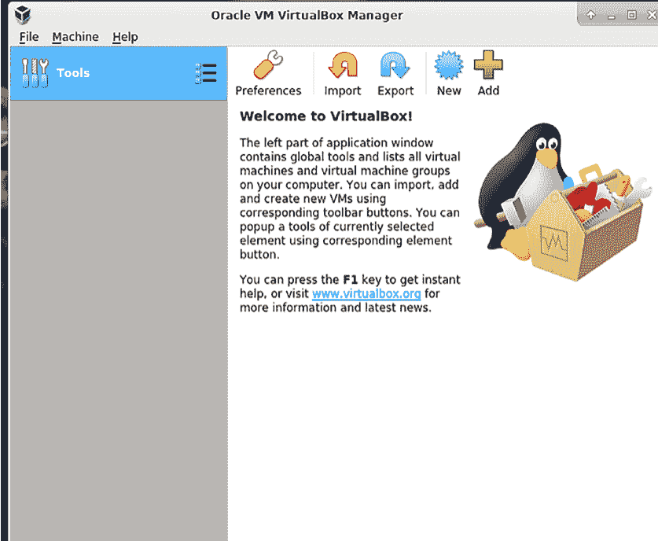

**图 4-6.** 首次启动 VirtualBox Manager 时显示的欢迎界面

VirtualBox Manager 在 Windows 和 Linux 中是完全相同的。创建虚拟机（VM）所需的步骤也是一样的。虽然可以通过命令行管理 VirtualBox，但我发现对我来说，使用图形用户界面（GUI）既快速又方便。尽管我是命令行使用的坚实支持者，但我发现使用 VirtualBox Manager GUI 对于我正在进行的工作类型已经足够简单快速了。此外，对于本书而言，这对你来说可能也会更容易。使用 GUI 无疑能让你更轻松地发现和理解可用选项。

## 配置虚拟网络

在创建虚拟机之前，我们需要配置虚拟网络。虚拟网络是一个仅存在于 VirtualBox 主机上的私有网络。它的设计允许用户管理对外部世界的访问。创建的虚拟路由器为虚拟网络中的虚拟机提供 DHCP 和名称服务等服务。

VirtualBox 有许多有趣的选项可以将虚拟机主机连接到网络。《Oracle VM VirtualBox 用户手册》¹列出了这些选项，并对每个功能及其局限性进行了极佳的描述。

最基本的是默认选项，它使用网络地址转换²（NAT），这允许虚拟机访问互联网，但不允许多个虚拟机主机之间进行通信。由于在课程的下一个版本中我们需要虚拟机能够与至少另一个虚拟机进行通信，因此该选项并不适合我们。我们将改用 NAT 选项，它允许主机在虚拟网络上通信，并通过虚拟路由器与外部世界通信。NAT 选项的局限性是不允许从物理主机访问虚拟网络。如有必要，可以克服这一局限，但 NAT 选项为我们提供了最接近真实网络的虚拟网络环境，因此我们在本课程中将使用它。


我们将在课程的后续部分详细讨论网络问题，但目前，脚注 2 中引用的 `whatismymipaddress.com` 提供了关于 NAT 的简短描述，而 Wikipedia³ 则对 NAT 有了非常精彩但有些冗长且深奥的讨论。我们将使用 `VirtualBox Manager` 来创建和配置虚拟 NAT 网络。

**提示** 请确保你正在使用最新版本的 `VirtualBox`，在本版中为 7.0.x 版本。

¹ [Oracle VM VirtualBox 用户手册 (PDF)](https://download.virtualbox.org/virtualbox/UserManual.pdf), 128–140

² [https://whatismymipaddress.com/nat]

³ [Wikipedia, Network Address Translation](https://en.wikipedia.org/wiki/Network_address_translation)

## 第 4 章 准备

1. `VirtualBox Manager` 应处于打开状态。如果没有打开，请现在启动 `VirtualBox Manager`。

2. 在图 4-6 所示的 `VirtualBox Manager` 中，点击“工具”（Tools）列表图标打开窗口。这与 `VirtualBox` 的早期版本有所不同。

3. 点击弹出菜单右侧的“网络”（Network）文件夹，并如图 4-7 所示选择“网络”。

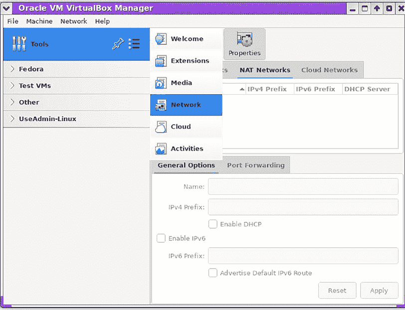

图 4-7. 选择网络文件夹以添加 NAT 网络

4. 确保选了“NAT 网络”（NAT Networks）选项卡。然后点击“创建”图标添加新的 NAT 网络。网络会自动添加并配置。

5. 在网络对话框的“常规”（General）选项中，如图 4-8 所示将网络名称更改为 `StudentNetwork`。

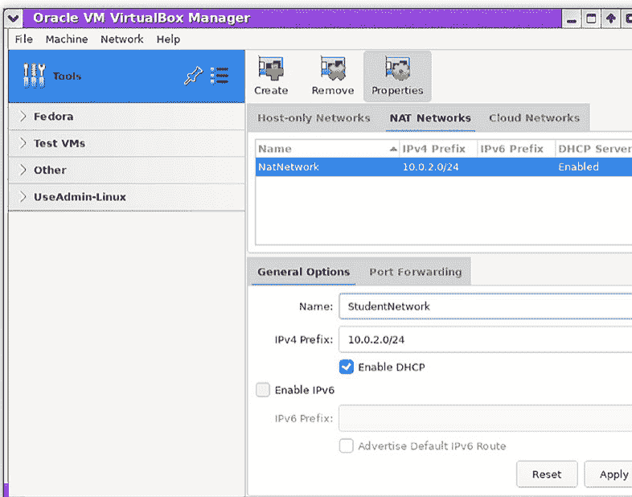

**图 4-8.** 将网络名称更改为 `StudentNetwork`

6. 不要更改此对话框其他内容。

7. 点击**应用**按钮完成名称重命名。

虚拟网络配置完成。

## 准备磁盘空间

为了给课程中使用的虚拟机留出空间，可能需要清理硬盘上的某些空间。在执行此步骤之前，你应该对系统进行备份。如果你的主机主目录下已有约 300GB 的空闲硬盘空间，可以跳过本节。如果可用空间少于该数量，你需要分配一些磁盘空间来存储虚拟存储设备以及虚拟机所需的其他文件。

我发现分配外部 USB 硬盘来存放本课程实验的虚拟机是一个实用的替代方案。我没有比 500GB 更小的外部硬盘，手头正好有这一个，所以我用了它。我建议使用厂商指定容量至少为 300GB 的外部硬盘。实际上，在创建和格式化分区后，用户可用空间将少于此。我们将删除此外部硬盘上的所有现有数据并重新分区，因此请确保对你可能保留的外部硬盘上的任何数据进行备份。

## Windows

这些步骤将引导你在 Windows 主机上配置一个外部 USB 硬盘用于实验。如果你是 Linux 主机，可以跳过本节。

1. 使用开始菜单找到并打开**计算机管理**工具。

2. 选择“存储”，然后是“磁盘管理”。

3. 将 USB 硬盘线插入电脑。

4. 稍后，磁盘管理工具将显示新磁盘，如图 4-9 所示。由于之前删除了分区，该磁盘显示为“未分配”。

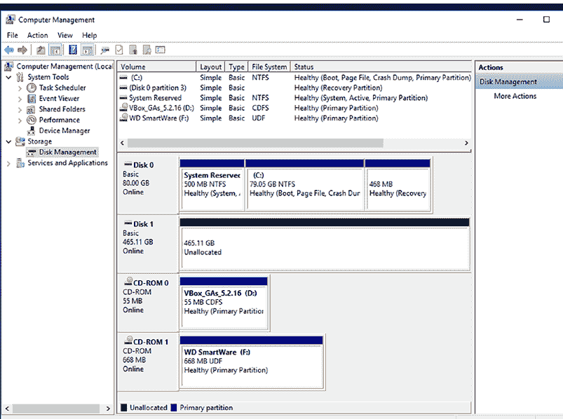

图 4-9. Disk 1 是外部硬盘

5. 右键点击 Disk 1 并选择**新建卷**以准备驱动器。显示“新建卷向导”。

6. 点击**下一步**。

7. 在“指定大小”对话框中不要进行任何更改。这将分配整个物理硬盘。点击**下一步**。

8. 在“分配驱动器号或路径”对话框中接受建议的驱动器号。在你的 Windows 虚拟机中 E:。请记住此驱动器号。点击**下一步**。

9. 如图 4-10 所示，在“格式化分区”对话框中采用默认设置。点击**下一步**。

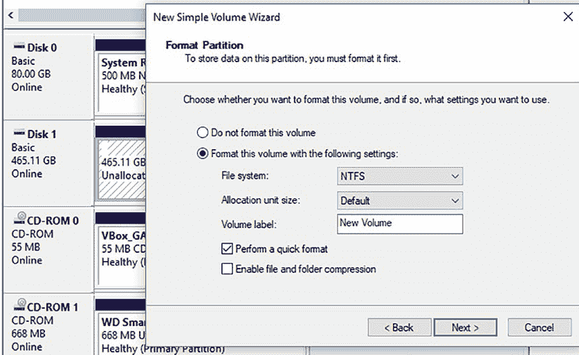

图 4-10. 采用默认设置格式化分区

10. 点击“完成新建卷向导”对话框上的**完成**按钮开始格式化过程。图 4-11 显示了结果。


图 4-11. 完成的磁盘分区

注意，最终格式化的分区提供的空间少于厂商指定的 500GB。这是正常的，由于保留了备用扇区以应对数据缺陷以及文件系统元数据产生的开销。

## Linux

如果你的电脑运行 Windows，请跳过本节。

本节将引导你向 Linux 主机添加外部 USB 硬盘。该硬盘将作为本课程剩余部分虚拟机所需的虚拟硬盘和其他文件的存储位置。

Linux 有一个 GUI 桌面工具，工作原理与 Windows 的磁盘管理工具非常相似。正如你在这里看到的，我们可以这样做，图 4-12 中包含了该磁盘工具的截图。

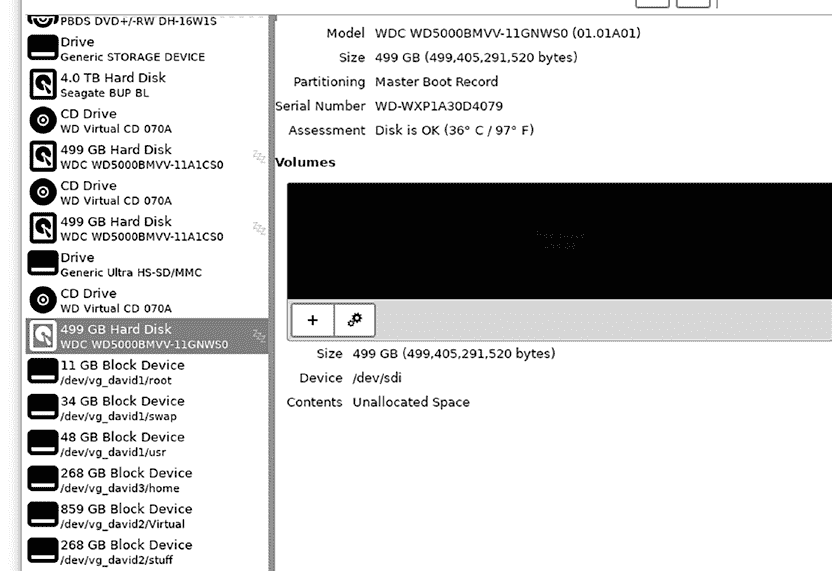

**图 4-12.** Linux GUI 磁盘管理工具提供的功能与 Windows 磁盘管理器工具类似。我们不会使用图 4-12 所示的这个 `gnome-disks` GUI 工具。相反，我们将使用命令行界面 (CLI)，因为没有时间开始学习命令行工具了。这是为了让你将管理

## 第 4 章 准备

熟悉工具本身以及一些其他概念，例如设备识别。随着课程的进行，我们将对你在此处将遇到的许多内容进行非常详细的介绍。

你的输入内容将以**粗体**形式显示。当你看到 **<Enter>** 时，请按回车键。你必须能够执行以下所有任务。

1. 你应该已经打开了一个终端并以 root 身份登录。运行以下命令（就像我在我的物理工作站上执行执行的一样），用以确定你是否有足够的可用空间：

```
[root@myworkstation ]# df -h
Filesystem Size Used Avail Use Mounted on
dvmpfs 32G 40K 32G 1% /dev
tmpfs 32G 24M 32G 1% /dev/shm
tmpfs 32G 2.2M 32G 1% /run
tmpfs 32G 0 32G 0% /sys/fs/cgroup
/dev/mapper/vg_david1-root 9.8G 437M 8.9G 5% /
/dev/mapper/vg_david1-usr 45G 9.6G 33G 23% /usr
/dev/mapper/vg_david3-home 246G 46G 190G 20% /home
/dev/mapper/vg_david2-Virtual 787G 425G 119G 57% /Virtual
/dev/mapper/vg_david2-stuff 246G 115G 119G 50% /stuff
/dev/sdb2 4.9G 433M 5.0G 10% /boot
/dev/sdb1 5.0G 18M 4.2G 1% /boot/efi
/dev/mapper/vg_david1-tmp 45G 144M 42G 1% /tmp
/dev/mapper/vg_david1-var 20G 6.6G 12G 36% /var
tmpfs 6.3G 2.4K 6.3G 1% /run/user/1000
/dev/mapper/vg_Backups-Backups 3.6T 1.9T 1.6T 54% /media/Backups
/dev/sde1 3.6T 1.5T 2.0T 42% /media/4T-Backup
/dev/sdg1 457G 73M 434G 1% /Experiments
```

这是我在工作站上执行 `df` 命令的输出。它显示了我的工作站上每个磁盘卷的可用空间。你在物理主机上运行此命令的输出将与此不同。我有几处符合 FHS¹（文件层次结构标准）的地方，我我可以在我的文件系统中找到虚拟机的数据，但我选择使用 `/Experiments` 文件系统和目录，而不是将这些数据与其他数据混合，即使是虚拟机的数据也是如此。现在你将像我在 `/Experiments` 中做的那样配置 USB 硬盘。

1. 插入外部 USB 硬盘。它需要几秒钟来旋转启动并在硬件级别进行初始化。

2. 运行以下命令确定分配给驱动器的 ID：

```
[root@myworkstation]# dmesg
<SNIP>
[7281.328503] usb 1-14.3: new-speed USB device number 11 using xhci_hcd
[7281.419360] usb 1-14.3: New device found, idVendor=1058, idProduct=070a, bcdDevice=10.32
[7281.419372] usb 1-14.3: New device strings: Mfr=1, Product=2, SerialNumber=3
[7281.419375] usb 1-14.3: Product: My Passport 070A
[7281.419378] usb 1-14.3: Manufacturer: Western Digital
[7281.419381] usb 1-14.3: SerialNumber: 57588314123305382363135
[7281.421007] usb-storage-1-14.3.1:0: Mass Storage device
[7281.422540] usb-storage-1-14.3.1:0: Quirks match vid 1058 pid 070a: 20000
[7281.423506] scsi host:usb-storage-1-4.1
[7281.432258] scsi 9:0:0: Direct-Access My Passport 070A 1032 PQ: ANSI: 4
[7281.432897] scsi 9:0:1: CD-ROM Virtual CD 070A 1032 PQ: ANSI: 4
[7281.439250] scsi 9:0:0: Direct-Access My Passport 070A 1032 PQ: ANSI: 4
[7281.432897] scsi 9:0:1: CD-ROM Virtual CD 070A 1032 PQ: ANSI: 4
[7281.439250] scsi 9:0:0: Direct-Access My Passport 070A 1032 PQ: ANSI: 4
[7281.432897] scsi 9:0:1: CD-ROM Virtual CD 070A 1032 PQ: ANSI: 4
[7281.439250] scsi 9:0:0: Direct-Access My Passport 070A 1032 PQ: ANSI: 4
[7281.432897] scsi 9:0:1: CD-ROM Virtual CD 070A 1032 PQ: ANSI: 4
[7281.439250] scsi 9:0:0: Direct-Access My Passport 070A 1032 PQ: ANSI: 4
[7281.432897] scsi 9:0:1: CD-ROM Virtual CD 070A 1032 PQ: ANSI: 4
[7281.439250] scsi 9:0:0: Direct-Access My Passport 070A 1032 PQ: ANSI: 4
[7281.432897] scsi 9:0:1: CD-ROM Virtual CD 070A 1032 PQ: ANSI: 4
[7281.439250] scsi 9:0:0: Direct-Access My Passport 070A 1032 PQ: ANSI: 4
[7281.432897] scsi 9:0:1: CD-ROM Virtual CD 070A 1032 PQ: ANSI: 4
[7281.439250] scsi 9:0:0: Direct-Access My Passport 070A 1032 PQ: ANSI: 4
[7281.432897] scsi 9:0:1: CD-ROM Virtual CD 070A 1032 PQ: ANSI: 4
[7281.439250] scsi 9:0:0: Direct-Access My Passport 070A 1032 PQ: ANSI: 4
[7281.432897] scsi 9:0:1: CD-ROM Virtual CD 070A 1032 PQ: ANSI: 4
[7281.439250] scsi 9:0:0: Direct-Access My Passport 070A 1032 PQ: ANSI: 4
[7281.432897] scsi 9:0:1: CD-ROM Virtual CD 070A 1032 PQ: ANSI: 4
[7281.439250] scsi 9:0:0: Direct-Access My Passport 070A 1032 PQ: ANSI: 4
[7281.432897] scsi 9:0:1: CD-ROM Virtual CD 070A 1032 PQ: ANSI: 4
[7281.439250] scsi 9:0:0: Direct-Access My Passport 070A 1032 PQ: ANSI: 4
[7281.432897] scsi 9:0:1: CD-ROM Virtual CD 070A 1032 PQ: ANSI: 4
[7281.439250] scsi 9:0:0: Direct-Access My Passport 070A 1032 PQ: ANSI: 4
[7281.432897] scsi 9:0:1: CD-ROM Virtual CD 070A 1032 PQ: ANSI: 4
[7281.439250] scsi 9:0:0:0-Access My  070A 1032 PQ: ANSI: 4
[7281.432897] scsi 9:0:1:0- 00 000A 1032 PQ: ANSI: 4
```

*(注：由于原文中 dmesg 部分存在大量重复和乱码，此处翻译已根据核心逻辑处理，并保持格式一致)*

更正后的逻辑输出：

```
Filesystem Size Used Avail Use Mounted on
dvmpfs 32G 40K 32G 1% /dev
tmpfs 32G 24M 32G 1% /dev/shm
tmpfs 32G 2.2M 32G 1% /run
tmpfs 32G 0 32G 0% /sys/fs/cgroup
/dev/mapper/vg_david1-root 9.8G 437M 8.9G 5% /
/dev/mapper/vg_david1-usr 45G 9.6G 33G 23% /usr
/dev/mapper/vg_david3-home 246G 46G 190G 20% /home
/dev/mapper/vg_david2-Virtual 787G 425G 119G 57% /Virtual
/dev/mapper/vg_david2-stuff 246G 115G 119G 50% /stuff
/dev/sdb2 4.9G 433M 5.0G 10% /boot
/dev/sdb1 5.0G 18M 4.2G 1% /boot/efi
/dev/mapper/vg_david1-tmp 45G 144M 42G 1% /tmp
/dev/mapper/vg_david1-var 20G 6.6G 12G 36% /var
tmpfs 6.3G 2.4K 6.3G 1% /run/user/1000
/dev/mapper/vg_Backups-Backups 3.6T 1.9T 1.6T 54% /media/Backups
/dev/sde1 3.6T 1.5T 2.0T 42% /media/4T-Backup
/dev/sdg1 457G 73M 434G 1% /Experiments
```

这是我在工作站上执行 `df` 命令的输出。它显示了我的工作站上每个磁盘卷的可用空间。你在物理主机上运行此命令的输出将与此不同。我有几处符合 FHS¹ 的地方，我我可以在我的文件系统中找到虚拟机的数据，但我选择使用 `/Experiments` 文件系统和目录，而不是将这些数据与其他数据混合，即使是虚拟机的数据也是如此。现在你将像我在 `/Experiments` 中做的那样配置 USB 硬盘。

1. 插入外部 USB 硬盘。它需要几秒钟来旋转启动并在硬件级别进行初始化。

2. 运行以下命令确定分配给驱动器的 ID：


# 第 4 章 准备

## 识别 USB 硬盘

运行 `dmesg` 命令查看内核消息：

```
[root@myworkstation]# dmesg
<SNIP>
[7281.328503] usb 1-14.3: new-speed USB device number 11 using xhci_hcd
[7281.419360] usb 1-14.3: New device found, idVendor=1058, idProduct=070a, bcdDevice=10.32
[7281.419372] usb 1-14.3: New device strings: Mfr=1, Product=2, SerialNumber=3
[7281.419375] usb 1-14.3: Product: My Passport 070A
[7281.419378] usb 1-14.3: Manufacturer: Western Digital
[7281.419381] usb 1-14.3: SerialNumber: 57588314123305382363135
[7281.421007] usb-storage-1-14.3.1:0: Mass Storage device
[7281.422540] usb-storage-1-14.3.1:0: Quirks match vid 1058 pid 070a: 20000
[7281.423506] scsi host:usb-storage-1-4.1
[7281.432258] scsi 9:0:0: Direct-Access My Passport 070A 1032 PQ: ANSI: 4
[7281.432897] scsi 9:0:1: CD-ROM Virtual CD 070A 1032 PQ: ANSI: 4
```

`dmesg` 命令用于查看内核缓冲区创建的内核消息。通过这些输出，你可以识别出 USB 硬盘被系统分配的 ID。例如：

- `scsi 9:0:0: Direct-Access My Passport 070A 1032 PQ: ANSI: 4`
- `scsi 9:0:1: CD-ROM Virtual CD 070A 1032 PQ: ANSI: 4`

也可以使用 `lsblk` 命令生成块设备列表：

```
[root@david ~]# lsblk
```

| NAME | MAJ:MIN | RM | SIZE | TYPE | MOUNTPOINT |
| :--- | :--- | :--- | :--- | :--- | :--- |
| sda | 8:0 | 0 | 931.5G | disk | |
| vg03-Virtual | 253:7 | 0 | 931.5G | part | /Virtual |
| sdb | 8:16 | 0 | 2.7T | disk | |
| └sdb1 | 8:17 | 0 | 2.7T | part | |
| ├vg04-stuff | 253:8 | 0 | 250G | part | /stuff |
| └vg04-VMArchives | 253:9 | 0 | 800G | part | /VMArchives |
| sdc | 8:32 | 0 | 3.6T | disk | |
| └sdc1 | 8:33 | 0 | 3.6T | part | |
| └vg-Backups-Backups | 253:10 | 0 | 3.6T | part | /media/Backups |
| sdd | 8:48 | 0 | 3.6T | disk | |
| └sdd1 | 8:49 | 0 | 3.6T | part | /media/EXT-Backup |
| sde | 8:64 | 1 | 0 | disk | |
| sdf | 8:80 | 0 | 465.1G | disk | |
| └sdf1 | 8:81 | 0 | 465.1G | part | /run/media/david/USB-X47GF |

## 分区磁盘

使用 `fdisk` 对目标磁盘（此处为 `/dev/sdg`）进行分区：

```
[root@myworkstation /]# fdisk /dev/sdg
```

交互过程如下：

| 设备 | 启动 | 结束 | 扇区 | 大小 | Id | 类型 |
| :--- | :--- | :--- | :--- | :--- | :--- | :--- |
| /dev/sdg1 | 2048 | 975400959 | 975389212 | 465.1G | 83 | Linux |

分区 1 上的文件系统/RAID 签名将被擦除。

命令（m 可获取帮助）：`w`

```
分区表已更改。
正在调用 ioctl() 重新读取分区表。
正在同步磁盘。

[root@myworkstation /]#
```

> **注意**：如果操作系统自动挂载了新创建的分区，请务必先将其卸载。

## 创建文件系统

在分区上创建 EXT4 文件系统。请小心指定正确的设备标识符（此处示例使用 `/dev/sdx1`，实际操作请替换为你的设备 ID，如 `/dev/sdg1`）：

```
[root@myworkstation /]# mkfs -t ext4 /dev/sdx1
mke2fs 1.44.2 (14-May-2018)
Creating filesystem with 121924864 4k blocks and 30482432 nodes
Filesystem UUID: 1f9938a0-82cd-40fb-8069-57be0acd13fd
Superblock stored on:
32768, 98304, 163840, 229376, 249412, 819200, 884736, 1605632, 2654208,
4096000, 7962624, 11239244, 20480000, 2387872, 71663616, 78675968,
102400000

Allocating group tables: done
Writing inode tables: done
Creating journal (262144 blocks): done
Writing superblocks and filesystem accounting information: done

[root@myworkstation /]#
```

## 添加卷标

使用 `e2label` 为分区添加标签，便于识别和挂载：

```
[root@myworkstation /]# e2label /dev/sdg1 Experiments
```

验证标签：

```
[root@myworkstation /]# e2label /dev/sdg1
Experiments
[root@myworkstation /]#
```

## 创建挂载点

在根目录下创建挂载目录：

```
[root@myworkstation ~]# mkdir /Experiments
```

## 配置 `/etc/fstab`

向 `/etc/fstab` 追加挂载配置（务必使用 `>>` 追加，避免覆盖）：

```
[root@myworkstation ~]# echo "LABEL=Experiments /Experiments ext4 user,owner,noauto,defaults 0 0" >> /etc/fstab
```

## 挂载并验证

挂载文件系统并检查磁盘使用情况：

```
[root@myworkstation ~]# mount /Experiments ; df -h
Filesystem Size Used Avail% Mounted on
devmps 32G 40K 32G 1% /dev
tmpfs 32G 34M 32G 1% /dev/shm
tmpfs 32G 2.2M 32G 1% /run
tmpfs 32G 0 0G /sys/fs/cgroup
/dev/mapper/vg_david1-root 9.8G 437M 8.9G 5% /
/dev/mapper/vg_david1-usr 45G 9.6G 33G 23% /home
/dev/mapper/vg_david3-home 246G 115G 190G 20% /
/dev/mapper/vg_david2-Virtual 787G 425G 323G 57% /Virtual
/dev/mapper/vg_david2-stuff 246G 115G 19G 50% /stuff
/dev/sdb1 4.9G 433M 4.2G 10% /boot
/dev/sdb1 5.0G 18M 5.0G 1% /boot/efi
/dev/mapper/vg_david1-tmp 45G 144M 42G 1% /tmp
/dev/mapper/vg_david1-var 20G 6.8G 6.3G 1% /var
tmpfs 6.3T 28K 6.3T 56% /run/user
/dev/mapper/vg_Backups 3.6T 1.9T 1.6T 56% /media/Backups
/dev/sde1 3.6T 1.5T 2.0T 43% /media/Backup
/dev/sdh1 458G 164G 272G 38% /run/media/USB
/dev/sdg1 457G 73M 434G 1% /Experiments
```

输出最后一行显示新文件系统已正确挂载在 `/Experiments`。`-h` 选项让 `df` 以人类可读格式显示结果。

## 验证目录内容

```
[root@myworkstation ~]# ls -a /Experiments/
total 24
drwxr-xr-x 3 root 4096 Aug 8 .
drwxr-xr-x 2 root 4096 Aug 8 ..
drwx------ 2 root 16384 Aug 8 lost+found
```

出现 `lost+found` 目录说明文件系统创建正常。

## 设置权限

### 查看当前权限

```
[root@myworkstation ~]# ls / | grep Exp
drwxr-xr-x 3 root 4096 Aug 8 Experiments
```

### 修改组权限与写权限

将目录所属组改为 `vboxusers` 并赋予组写权限：

```
[root@myworkstation /]# cd /
[root@myworkstation /]# chgrp vboxusers /Experiments
[root@myworkstation /]# chmod g+w /Experiments
[root@myworkstation /]# ls | grep Exp
drwxr-xr-x 3 root 4096 Aug 8 Experiments
[root@myworkstation /]#
```

> **提示**：`grep`（全局正则表达式打印）由 Ken Thompson 于 1974 年编写。`chgrp` 和 `chmod` 命令执行成功时无输出，体现了 Linux “沉默是金”的哲学。`ll` 是 `ls -l` 的常用别名。

## 添加用户到 `vboxusers` 组

将非 root 用户（示例为 `dboth`，请替换为你的用户名）加入 `vboxusers` 组：

```
[root@myworkstation]# cd /etc
[root@myworkstation]# grep vboxusers group
vboxusers:x:973:
[root@myworkstation]# usermod -G vboxusers dboth
[root@myworkstation]# grep vboxusers group
vboxusers:x:973:dboth
[root@myworkstation]#
```

至此，硬盘准备完成。

---

# 下载 ISO 镜像文件

现在下载 Fedora Xfce Live ISO 镜像（约 1.5 GB）。本课程使用 Xfce 桌面，因其轻量、稳定且资源占用少。

1. 访问 `https://spins.fedoraproject.org/xfce/download/index.html`。
2. 点击 **Download** 按钮。
3. Linux 主机建议保存至 `/tmp` 目录。
4. 若文件下载至 `~/Downloads`，请移动至 `/tmp`：

```
[dboth@myworkstation ~]$ cd Downloads/; ls -l Fedora*
-rw-rw-r-- 1 dboth 1517289472 Dec 20 12:56 Fedora-Xfce-Live-x86_64-33-1.iso
[dboth@myworkstation Downloads] $ mv Fedora* /tmp
```

稍后创建虚拟机时将使用该镜像。

---

# 创建虚拟机

在 VirtualBox 管理器中执行以下步骤：

1. 点击 **工具** 图标查看虚拟机列表。
2. 点击 **新建** 图标开始创建。
3. **名称和操作系统** 设置：
   - **名称**：`StudentVM1`
   - **文件夹**：`/Experiments`
   - **ISO 镜像**：选择下载的 ISO 完整路径（如 `/home/dboth/Downloads/Fedora-Xfce-Live-x86_64-37-1.7.iso`）
   - **类型**：`Linux`
   - **版本**：`Fedora (64-bit)`
   > 选择正确的 ISO 后，类型和版本通常会自动填充。

   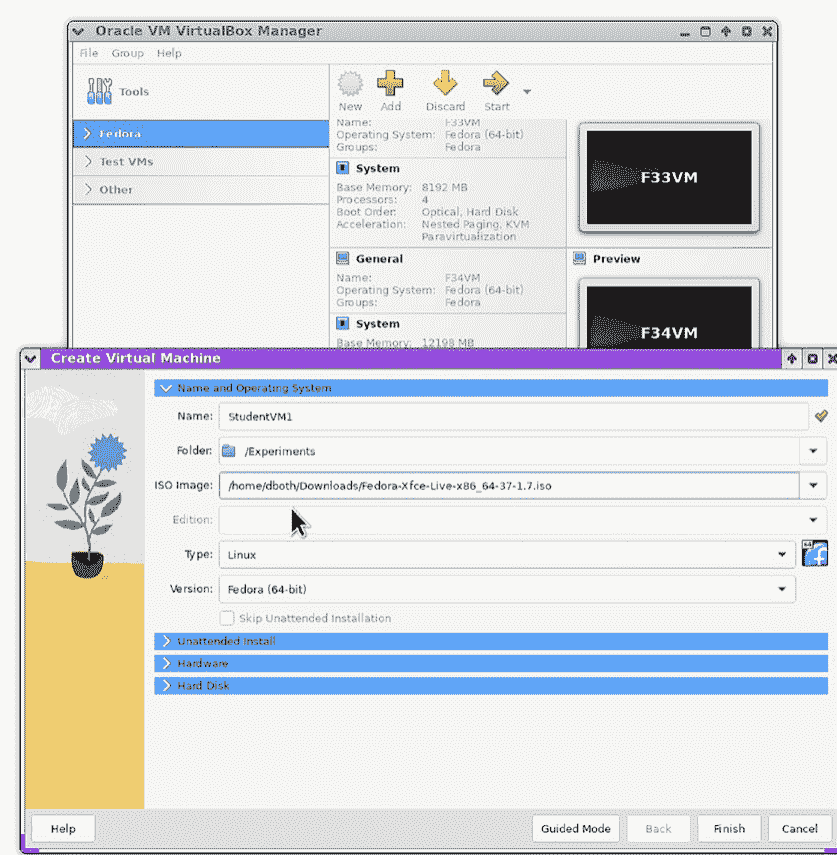

4. 跳过 **无人安装** 部分，进入 **硬件** 设置：
   - **基本内存**：`4096 MB`
   - **CPU 数量**：`2`
   - 勾选 **启用 EFI**
   > 这些设置在虚拟机关闭状态下可随时修改。

## 创建虚拟机


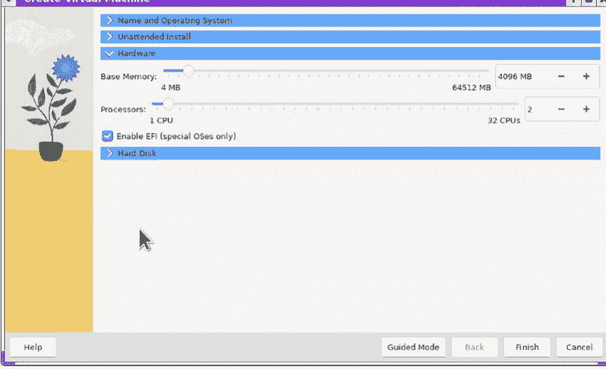

**图 4-14.** 完成硬件部分

- 12. 打开“硬盘”部分。在图 4-15 中你可以看到磁盘设置。文件位置和名称会自动提供。

## 创建虚拟机

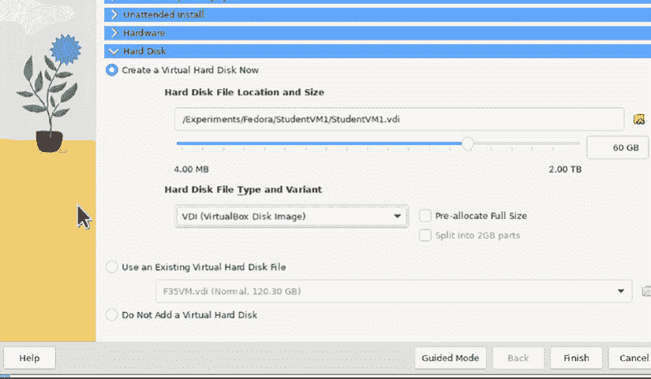

**图 4-15.** 配置硬盘部分

`.vdi` 扩展名是 `VirtualBox` 磁盘镜像文件格式。你可以选择其他格式，但这种 `VDI` 格式将完美符合我们的需求。使用滑块或文本框将虚拟硬盘文件的大小设置为 `60GB`。务必使用磁盘空间的默认“动态分配”。这确保了磁盘在物理硬盘上只占用它实际需要的空间。例如，尽管我们指定的磁盘大小为 `60GB`，但如果我们只使用 `24GB`，物理硬盘上所需的空间将约为 `24GB`。此空间分配将根据需要扩展，但最高为 `60GB`。

- 13. 点击“完成”按钮创建虚拟机。此时，基础虚拟机已经创建完成，但我们需要对某些配置进行一些更改。

- 14. 点击新虚拟机的条目。如果 `VirtualBox` 管理器右侧没有像图 4-16 所示显示虚拟机详情，请点击虚拟机列表中 `StudentVM1` 条目右侧菜单图标上的“详细”按钮。

## 第 4 章 准备

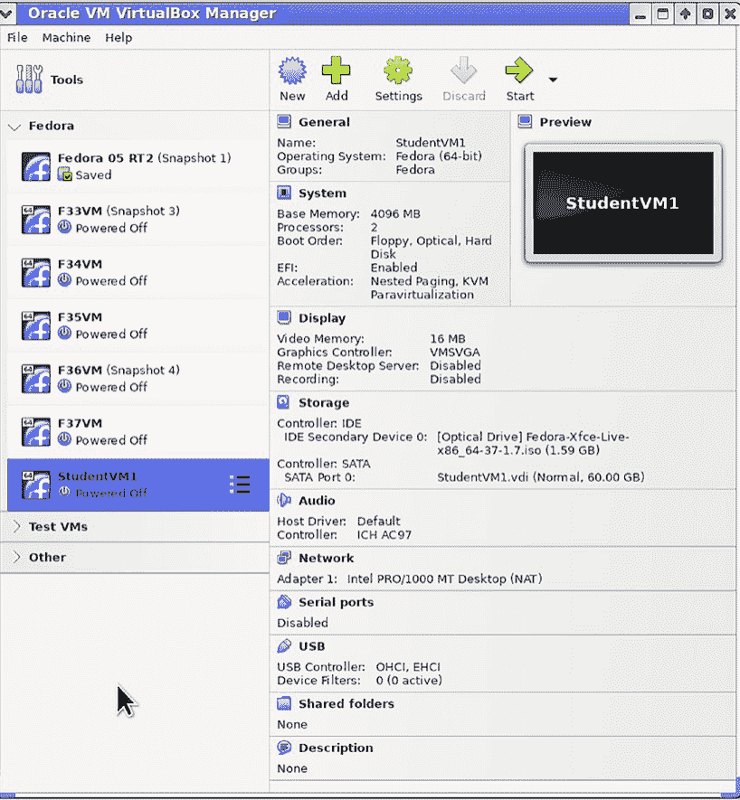

**图 4-16.** 我们刚刚创建的 `StudentVM1` 虚拟机的详情

- 15. 点击“设置”图标打开图 4-17 中的设置对话框，然后选择左侧列表中的“系统”页面。

- 16. 在**主板**选项卡上，如果选中了**软盘**磁盘图标，请取消选择，然后使用向下箭头按钮将其移动到**启动顺序**的下方，位于**硬盘**之下。这样做是为了让虚拟机首先尝试从 `CD/DVD` 光驱驱动器启动，如果没有光盘，则从硬盘启动。

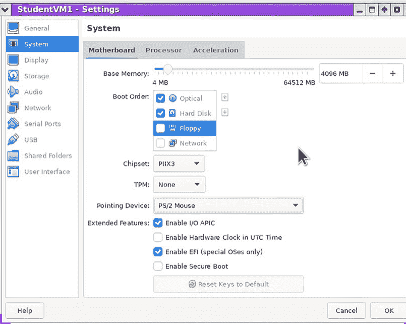

**图 4-17.** 修改后的主板设置

- 17. 将**指针设备**设置为**PS/2 鼠标**。

- 18. 取消勾选**在 UTC 时间启用硬件时钟**。虚拟机应使用本地时间。

- 19. 如果你的物理宿主机有 `8G` 或更多内存，请点击“显示”页面并如图 4-18 所示将显存增加到 `128MB`。不建议启用 `3D` 加速，因为不需要。如果你在显示器上看到显示“无效图形”的错误消息，我们在本课程中需要更多配置。

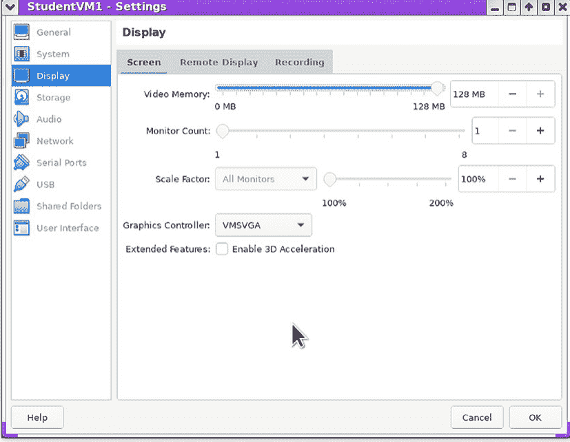

**图 4-18.** 修改后的显示设置

- 20. 点击“存储”页面，如图 4-19 所示。我们在本课程中需要更多配置。

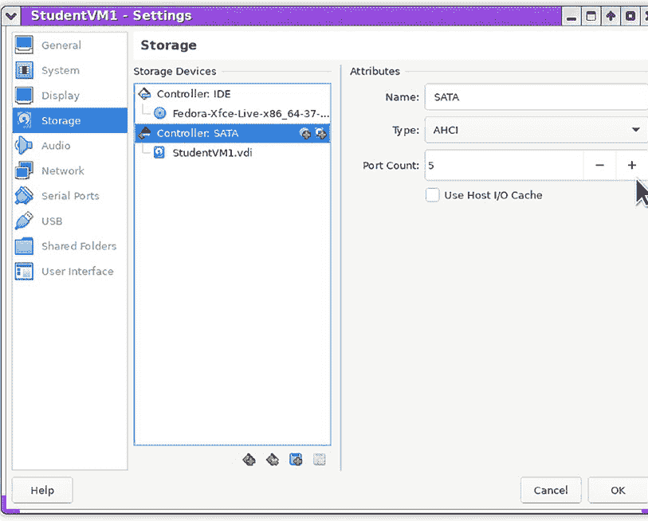

**图 4-19.** 存储设置

## 第 4 章 准备

- 21. 选择“网络”页面，并在适配器 1 选项卡上，如图 4-20 所示选择 `NAT` 网络。系统已为你选择了 `StudentNetwork`。
- 22. 点击“确定”按钮保存更改。

虚拟机现在已配置完毕，可以进行安装。

## 章总结

你已经完成了安装 `Linux` 和进行后续实验的准备工作。你准备了一个硬盘来存放虚拟机，并对虚拟机进行了一些创建时无法进行的更改，例如网络适配器设置和分配的处理器数量。

我们将在第 5 章安装最新的 `Fedora`。

## 练习

完成以下练习以结束本章：

1. 定义“虚拟机”。

2. 本章中哪个命令可以发现计算机系统的硬件组件信息？

3. 使用 `VirtualBox` 时，“NAT 网络”与“NAT”类型有何区别？

4. 为什么虚拟机可能需要多个网络适配器？

## 安装 Linux

## 学习目标

在本章中，你将学习：

- 在你的虚拟机上安装最新版本的 `Fedora`。
- 使用推荐标准划分硬盘。
- 创建虚拟机的快照。
- 重启虚拟机并完成安装。

## 概述

在本章中，你开始从事系统管理员的工作。系统管理员众多任务之一就是安装 `Linux`，这就是我们在本章中要做的。在学习本章的过程中我会尽可能解释，但可能某些内容你现在还不理解。不要担心——我们会涉及的。

> **注意** 本书《Using and Administering Linux: Zero to SysAdmin》第二版已根据需要进行了修订，以展示对 `Fedora 37` 的使用。后续发布的 `Fedora` 版本也可以工作，但可能与本课程中的图形有所不同。

## 第 5 章 安装 LINUX

请安装最新版本的 `Fedora` 作为本课程的 `Linux` 发行版。这将让你的工作变得简单得多，因为你不需要考虑 `Fedora` 与其他发行版之间的差异。即使是像 `RHEL` 和 `CentOS` 这样基于 `Red` 的发行版也与 `Fedora` 有不同。然而，你会发现，完成本课程后，你从中获得的知识可以轻松地迁移到其他发行版。

## 插入 Fedora Live 镜像

如果这是一台物理主机，你将创建一个带有 `ISO` 镜像的物理 `USB` 优存盘，并将其插入主机的 `USB` 插槽中。为了在虚拟机中启动此版 `ISO` 镜像，它需要被“插入”到逻辑设备中。你在第 4 章创建虚拟机时已经完成过这一操作。

不过，以防你没有这样做或者以后需要再次操作，以下是将 `ISO` 镜像插入虚拟机的步骤：

1. 确保虚拟机已关闭且未在运行。
2. 打开 `StudentVM1` 虚拟机的“设置”。
3. 选择“存储”页面。
4. 点击 `IDE` 控制器上的磁盘图标。如果你的虚拟机上没有 `IDE` 控制器——这虽然可能但极少见——你可以右键点击“存储设备”面板中的空白区域，并选择添加新的 `IDE` 控制器。只能添加一个 `IDE` 控制器。
5. 点击 `IDE` 控制器光驱右侧的 `CD` 图标。如图 5-1 所示，这将打开选择列表，允许我们选择要在此设备上挂载哪个 `ISO` 镜像。

> 我们将在第 19 章讨论“挂载”术语及其所有含义。现在如果你想了解更多信息，请参维基百科：https://en.wikipedia.org/wiki/Mount_(computing)

6. 与我的工作站不同，你的电脑列表中可能没有镜像。选择“选择/创建虚拟光驱”选项。

注意图 5-1，光驱的名称为“IDE Secondary Device 0”。这种术语取代了旧的、带有歧视性的“主”和“从”术语。旧术语仍在许多地方在使用，但大多数现代公司和开源组织正努力尽快替换它们。在我编写本课程的第一版时，`VirtualBox` 软件仍在使用旧术语。

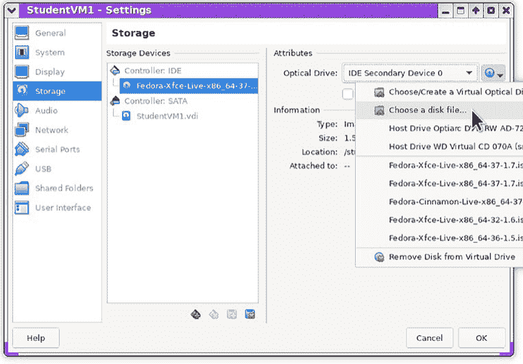

**图 5-1.** 选择“选择磁盘文件”来定位并挂载 `ISO` 镜像

7. 导航到你下载文件时的位置，点击该文件然后点击“选择”设置挂载。在图 5-2 中我们看到了位于我“下载”目录的 `ISO` 镜像。

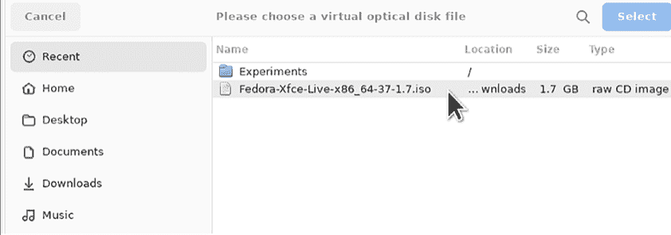

**图 5-2.** 选择 `ISO` 镜像文件并点击“选择”。请确保为此使用最新版本的 `Fedora Xfce`。

8. 验证“存储设备”框中的 `IDE` 控制器已选择正确的文件，如图 5-3 所示。点击“确定”。`Fedora live ISO` 镜像文件现在已“插入”虚拟光驱，我们准备好首次启动虚拟机。

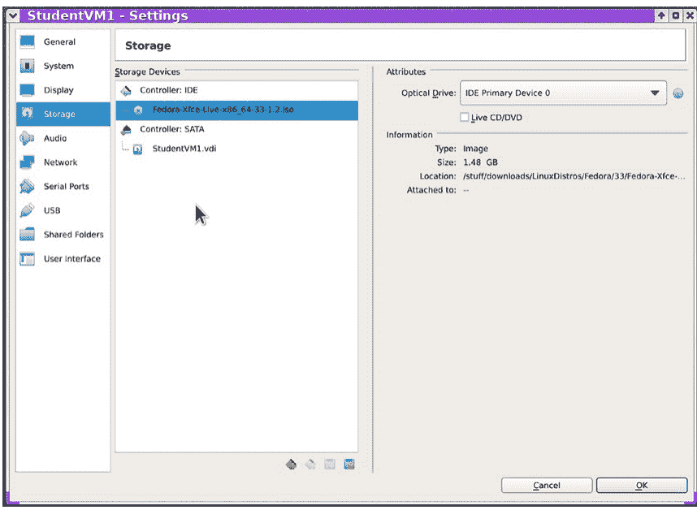

**图 5-3.** `Fedora live` 镜像 `ISO` 文件现在已“插入”虚拟光驱

9. 尽管 `USB` 设备是 live 镜像，但不要在“Live CD/DVD”框中勾选。

虚拟机现在已准备好启动。

## 启动 Live 镜像

无论 `ISO` 镜像是在创建虚拟机期间还是之后插入的，使用上述程序启动 live 镜像的方法都是相同的。

1. 要启动虚拟机，请确保已选择 `StudentVM1` 虚拟机，并点击 `VirtualBox` 管理器图标中的绿色“启动”箭头。这将启动虚拟机，打开一个窗口，虚拟机将在窗口中运行并启动到镜像文件。

你看到的第一个屏幕如图 5-4 所示。当你在任何物理主机上首次使用 `VirtualBox` 时，还会收到一条消息：“你开启了自动捕获键盘选项。这将导致虚拟机每次被激活时自动捕获键盘……”，然后你还会收到关于鼠标指针集成的类似消息。这些只是信息提示，但如果你喜欢可以更改这些设置。

2. 第一个屏幕有一个倒计时器，第二个项目“测试此介质”已被选中。当计时器倒数为零或当你按下回车键后，此选择将首先测试安装媒介以检测任何错误，如果没有问题，将启动安装程序。我们可以跳过测试，因为对于我们的镜像文件来说，它比物理 `DVD` 或 `USB` 存盘有用得多。按下键盘上的向上箭头突出“Start Fedora-Xce-Live XX”（`XX` 为版本号）并按回车。

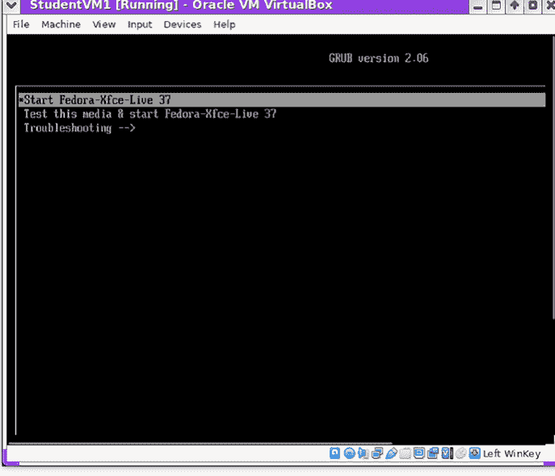

**图 5-4.** Start Fedora-Xce-Live

> **提示** 如果你没有看到 `GRUB`（统一引导加载程序）菜单，你可能需要进入“系统”并勾选“启用 GRUB 菜单”。如果你使用的是 `UEFI`，该选项不会显示。

live 镜像没有选择额外软件包的选项。如果你想安装额外软件，必须在基础安装完成后进行。

## 安装 Fedora

从 live 镜像安装 `Fedora` 非常简单，特别是当使用默认设置时。我们需要处理对话框，最复杂的是分区。

## 开始安装

要开始 `Fedora` 安装，双击图 5-5 所示桌面上的“安装磁盘”图标。

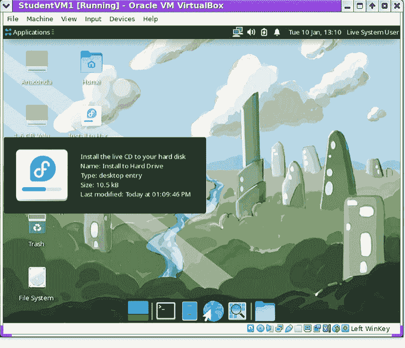

**图 5-5.** 双击安装磁盘以启动 `Fedora`

双击安装磁盘将启动名为“Anaconda”的 `Linux` 安装程序。`Anaconda` 显示的第一个界面欢迎界面，你可以在此处选择过程中使用的语言。如果你的语言不是英语，请在此屏幕上选择适合你的语言。然后点击“继续”按钮。

点击图 5-6 所示安装摘要中的“网络与主机”选项。此主机名是计算机自身的标识。它是你在命令行看到的主机名。

外部世界（即连接到此主机的网络上的任何节点）通过你正在使用的任何名称服务将计算机视为设置的主机。因此，你可能会使用一个名称 `ping` 或 `ssh` 到某台电脑，而在登录后它将显示不同的名称。

按照惯例，计算机主机名通常全小写。注意虚拟机的名称是混合大小写 `StudentVM1`，但那不是主机名且没有功能性用途。

在 **主机名** 字段中输入全小写的主名 **studentvm1**，然后点击“应用”。我们只需要完成操作，因此点击左上角的“完成”按钮。这将带回到安装摘要对话框。

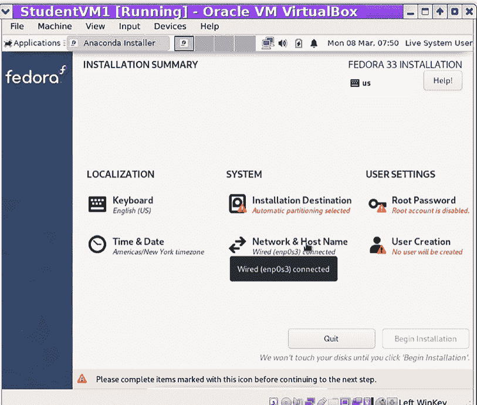

**图 5-6.** 选择“网络与主机”来设置虚拟机的主机名

## 用户账户

点击图 5-6 中的“Root密码”菜单项来配置 `root` 账户。`root` 用户是 `Linux` 的管理员账户。我们将在本书第 11 章详细讨论 `root` 账户。

点击“启用 root 账户”单选按钮。选择一个安全且易于输入的密码。在图 5-7 所示的 Root 密码字段中输入密码，并在“确认”字段中再次输入。不要在此菜单上进行任何更改。

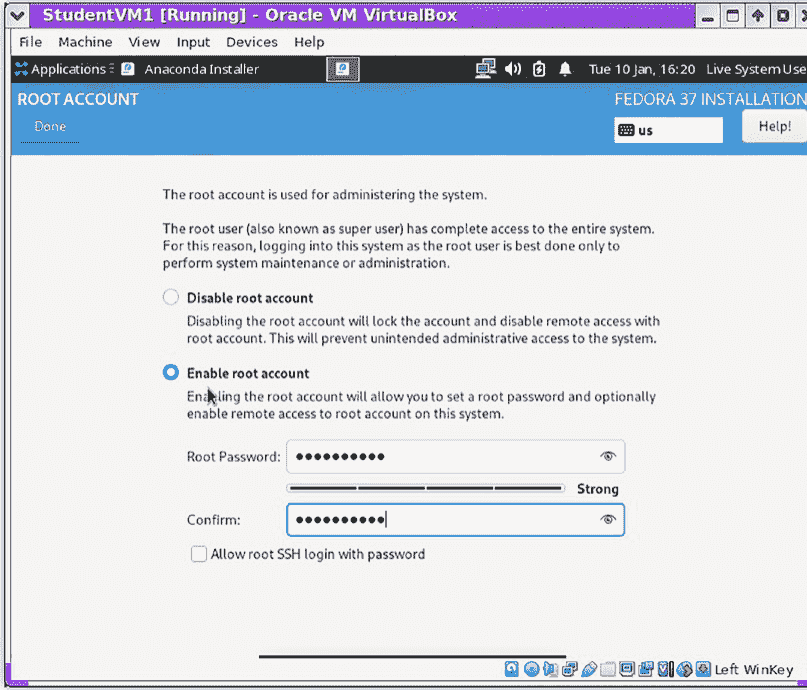

**图 5-7.** 配置 `root` 账户

作为 `root` 用户，你可以选择一个弱密码。如果你这样做，Root 账户屏幕底部将显示一条警告。你可以选择保留弱密码，但即使在训练环境中，我也不建议这样做。如果你保留了弱密码，请点击两次蓝色按钮以返回主安装界面。

如果你以 `root` 身份从命令行为 `root` 或非特权用户设置弱密码，你将收到类似的消息，但仍然可以继续。这是因为 `root` 可以执行任何操作，甚至可以为自己或非 `root` 用户设置弱密码。非特权用户必须设置良好的密码，并且不允许绕过创建良好密码的规则。

然而，你应该输入一个更强的密码——一个不会产生警告的密码。

点击“创建用户”图标，你将进入图 5-8 所示的“创建用户”对话框。在这里你可能可以使用弱密码，但请不要这样做。“全名”应该是“Student User”，这将自动创建用户名 `user`。这种“首字母 + 姓氏”的格式是创建 `Unix` 和 `Linux` 用户名的历史标准。对于本课程，请将用户名更改为全小写的“student”。用户名也可以称为用户 ID。

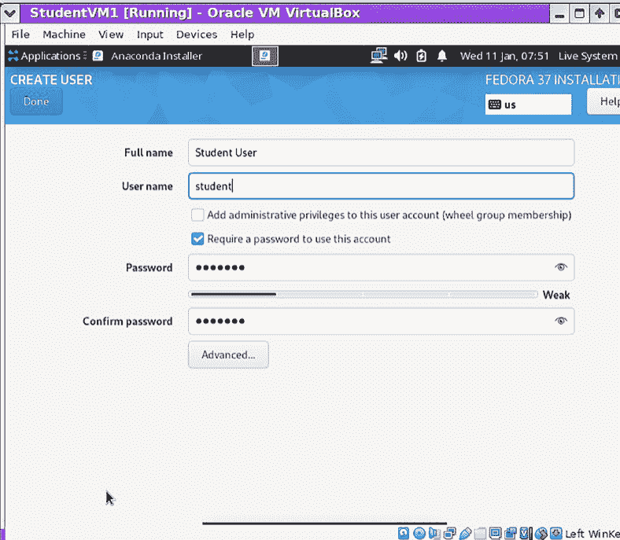

**图 5-8.** 创建学生用户

取消勾选**添加管理员权限...**框框，以防止此用户成为管理员。我们将在课程稍后回顾这一点。不要更改此对话框中的任何其他字段。点击蓝色**完成**按钮。

## 硬盘分区

我们需要更改的下一个最重要的事情是以更标准、推荐的方式对硬盘进行分区。我们这样做而不是采用默认方式，默认方式对大多数初学者来说很容易，但对于旨在训练系统管理员的工作站来说，绝对不是最好的分区设置。我们将在本书第 19 章探索为什么这种分区方案更好的细节。

请注意 `Fedora 37` 已于 `2020` 年 `10` 月发布，并将新安装的默认文件系统从 `EXT4` 文件系统改为 `BTRFS`（B 树文件系统）。从早期版本升级到 `Fedora 37` 会保留新安装的现有 `EXT4` 文件系统，本章不更改。请务必遵循本章的说明，使用 `LVM` 进行分区方案，并为新分区选择 `EXT4` 作为默认文件系统，或为除 `/boot` 外的所有分区选择 `EXT4` 文件系统类型。

在图 5-6 中，注意“安装目标”有一个警告图标，并且红字文字选了“自动分区”。点击“安装目标”，你将得到图 5-9 所示的对话框。

> ²`Fedora Magazine` 上的文章《在 Btrfs 和 LVM-ext4 之间选择》对这两个文件系统的相似之处进行了简短但良好的解释。

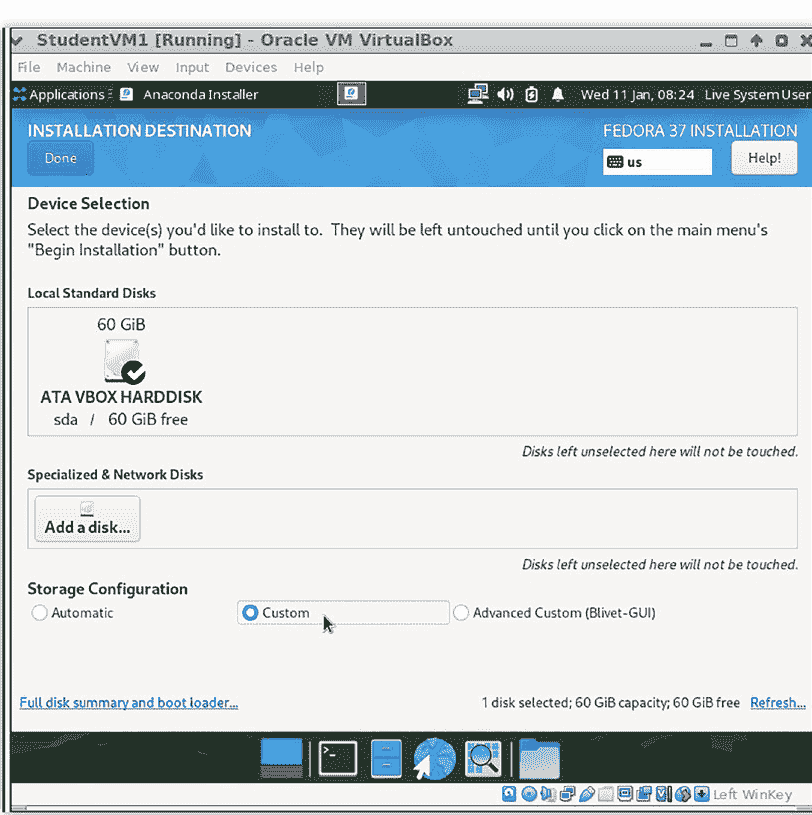

**图 5-9.** 为存储配置选择“自定义”，然后点击“完成”

此虚拟机中我们只有一个虚拟磁盘驱动，如果有多个设备，也可以在这里作为安装目标的一部分进行选择。

此时，虚拟机显示显示窗口的大小可能太小，无法容纳整个对话框。很难看到，但对话框右侧有一个滚动条。使用滚动条或鼠标滚轮向下滚动，直到到达底部。你还应该能够调整运行虚拟机的窗口大小，使其足够大以看到整个对话框。

## 第 5 章 安装 LINUX

你应该看到“存储配置”和三个选项。我们将执行自定义配置，因此请选择中间的单选按钮“自定义”。然后点击“完成”。

下一个对话框见图 5-10，我们将在这里进行大量工作。我们需要做的是创建一个如表 5-1 所示的分区方案。表中的分区大小对于大多数工作系统来说合适的，但对于教学环境来说绰绰有余。

**表 5-1** 磁盘分区、文件系统及其大小

| 挂载点 | 分区 | 文件系统类型 | 大小 | 标签 |
|---|---|---|---|---|
| `/boot` | 标准 | `EXT4` | `1.0` | `boot` |
| `/boot/efi` | | | | |
| `/` (root) | `LVM` | `EXT4` | `2.0` | `root` |
| `/usr` | `LVM` | `EXT4` | `15.0` | `usr` |
| `/home` | `LVM` | `EXT4` | `2.0` | `home` |
| `/var` | `LVM` | `EXT4` | `10.0` | `var` |
| `/tmp` | `LVM` | `EXT4` | `5.0` | `tmp` |
| **总计** | | | **35.0** | |

> **警告** 请务必如图 5-10 所示将设备类型设置为 `LVM`。

## 第 5 章 安装 LINUX

注意设备类型为 `BTRFS`（B 树文件系统）。在继续之前，请务必将类型设置为 `LVM`。我们将在本课程中使用 `LVM`。

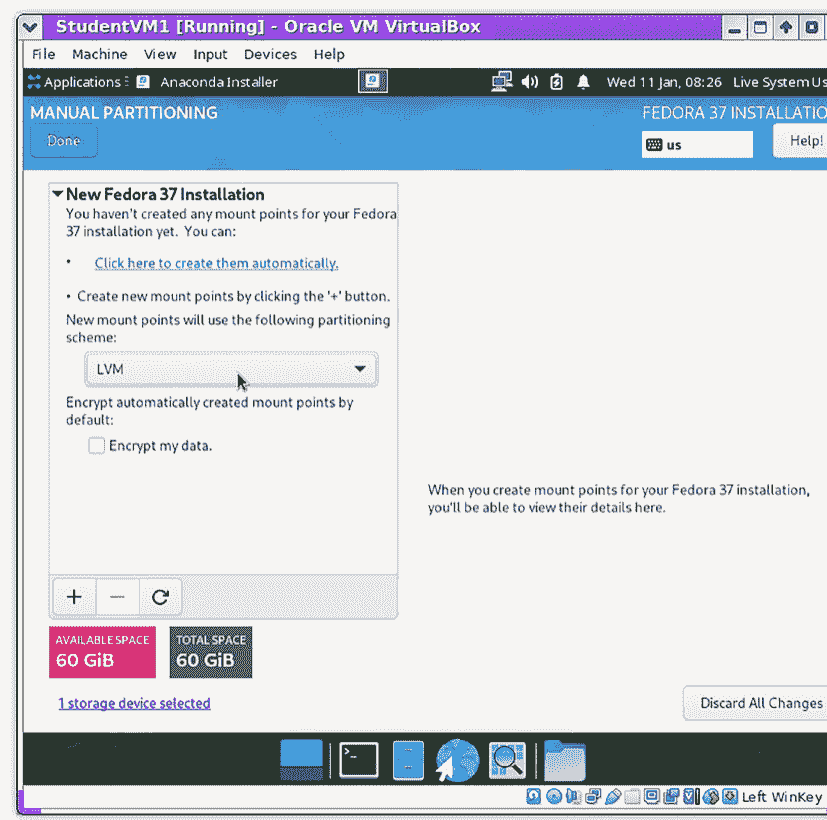

**图 5-10.** 手动分区


在表 5-1 中，你可以看到许多书籍和系统管理员推荐的标准系统。注意，对于包括 Fedora 在内的红帽系发行版，目录结构总是创建的，但独立的文件系统——分区——可能也可能不。表 5-1 中的分区大小不建议用于生产环境，因为它们太小了。

理论上，由于你为此虚拟机创建了全新的硬盘，硬盘上不应该有分区。如果你没有完全按照这些指令，或者使用的是带有现有分区的物理或虚拟硬盘，请在继续操作之前使用此页面删除所有现有分区。如果在图 5-10 中看到你未创建任何挂载点的消息，请继续。

要添加第一个分区，点击图 5-10 对话框左侧显示的 `(+)` 按钮。这将显示图 5-11 所示的“添加新挂载点”对话框。选择 `/boot` 作为第一个挂载点，并在“所需容量”字段中输入 `1G`。然后点击“添加挂载点”按钮。

## 第 5 章 安装 Linux

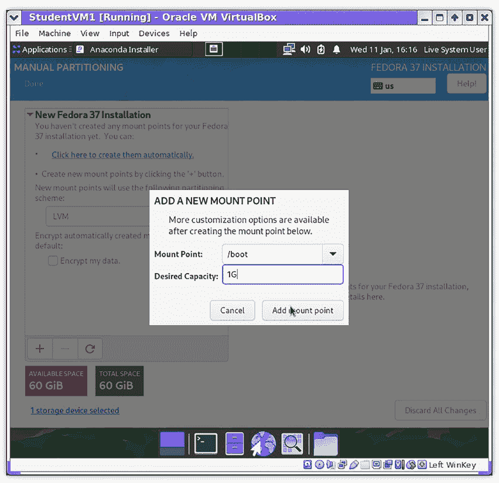

**图 5-11。** 为 `/boot` 分区设置所需的挂载点和大小

尽管我们将在后面的章节中进行更详细的介绍，但让我们花点时间谈分区、文件系统和挂载点。希望这能暂时回答你对这些看似冲突且混淆的术语的疑问。

首先，从根目录 (`/`) 开始的整个 Linux 目录结构可以被称为 **Linux 文件系统**。硬盘上的分区或逻辑卷可以被用 `EXT3`、`EXT4`、`BTRFS`、`XFS` 或其他文件系统元结构进行格式化。

然后该分区将称为文件系统。例如，如果该分区用于 `/home` 目录，它将被称为 `/home` 文件系统。随后，`/home` 文件系统被挂载到 `/home` 挂载点上，这只是根文件系统上的 `/home` 目录，然后它就变成了根文件系统的逻辑和功能部分。只需记住，只有根级目录可以是单独的文件系统，而其他目录在逻辑上没有必要分开。

因此，在定义所有分区后，安装程序 `Anaconda` 将创建卷组、逻辑卷、任何如 `/boot` 的原始分区，以及包括 `/` 文件系统上的挂载点（目录）在内的整个目录树；使用选定的文件系统类型（大部分使用 `EXT4`，或者从 Fedora 37 开始使用 `BTRFS`）格式化卷或分区；并创建 `/etc/fstab` 文件来定义挂载及其挂载点，以便内核在每次系统启动时知道并能找到它们。再次，稍后会详细介绍这些这些内容。

在输入此分区的正确数据后，点击“添加挂载点”按钮继续。此时，“手动分区”对话框如图 5-12 所示。请注意，如果 VM 窗口较小，屏幕右侧会有一个滚动条。如果你将鼠标悬停在那里，滚动条会变宽，以便于查看和操作。如果你还没有调整过大小，也可以重新调整 VM 窗口的大小。

## 第 5 章 安装 Linux


**图 5-12.** 创建 `/boot` 分区

如有必要，向下滚动找到“标签”（Label）字段。输入此分区的标签为“boot”（不带引号）。如前所述，我发现标签使得处理文件系统的各种组件变得比没有标签时要容易得多。

输入标签后，点击“更新设置”（Update Settings）按钮保存你所做的更改。

## 第 5 章 安装 Linux

`/boot` 分区包含了系统启动并达到最小功能状态所需的文件。由于在此过程开始时还没有全功能的文件系统内核驱动程序，允许使用逻辑卷管理 (LVM) 的驱动程序 `/boot` 分区必须是一个标准的、非 LVM¹ Linux 分区，并采用 `EXT4` 文件系统。这些设置在创建 `/boot` 分区时是自动选择的。我们将在第 16 章中详细研究引导和启动序列。

保存 `/boot` 分区的更新设置后，其余分区可以作为逻辑卷在卷组 (VG) 中创建。我们将在卷 2 的第 20 章讨论逻辑卷管理 (LVM)，但现在重要的是知道 LVM 让管理和缩放逻辑卷变得非常简单。

例如，最近在我创建一个新的 VirtualBox 时，我用于存储虚拟机的逻辑卷礼貌地停止了，并带了一条警告消息，指示磁盘空间不足，并在可用额外磁盘空间后继续。我希望所有软件都能如此。大多数情况下你会考虑删除文件，但我这些文件中的内容都是我需要的虚拟机。

请确保接下来创建 `/boot/efi` 分区。这个 `1 GB` 的分区是属于统一可扩展固件接口 (UEFI) 文件所在的位置。这会自动创建一个新分区 `/dev/sda2` 并将其配置为 `EXT4`。确保为此分区添加标签“efi”。

让我们继续创建挂载点。再次，从点击“+ 选择 `/`（根文件系统）”按钮开始，如图 5-13 所示输入大小 `2G`。点击“添加挂载点”继续。

根文件系统是任何 Linux 主机目录树的顶层。所有其他文件系统将挂载在根文件系统的各个挂载点上。

³逻辑卷管理器。

⁴维基百科，UEFI，https://en.wikipedia.org/wiki/UEFI

## 第 5 章 安装 Linux

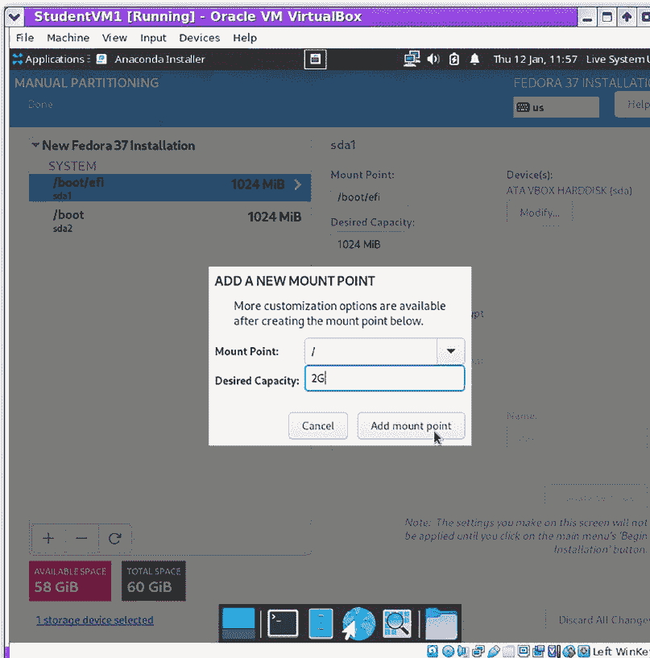

**图 5-13.** 添加根文件系统

如图 5-14 所示添加标签“root”。

## 第 5 章 安装 Linux

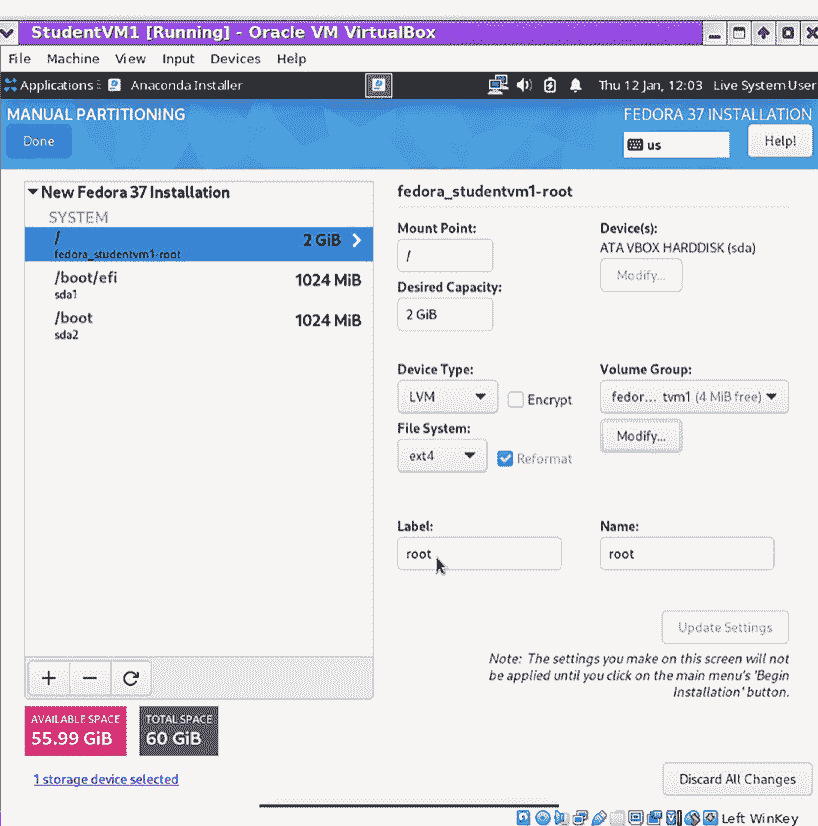

**图 5-14.** 添加根文件系统

如图 5-14 所示添加标签 "root"。

## 第 5 章 安装 LINUX

## 完成安装

完成后，`Anaconda` 安装程序对话框的进度条将显示“Complete!（完成！）”，图 5-16 右下角的成功消息将与蓝色的“Finish Installation（完成安装）”按钮一起显示。

点击 `Finish Installation` 退出 `Anaconda` 安装程序，这是一个运行在 Live 镜像桌面上的应用程序。硬盘已经过分区和格式化，Fedora 也安装完毕。在早期的 Fedora 版本中，此按钮标记为“Quit（退出）”。

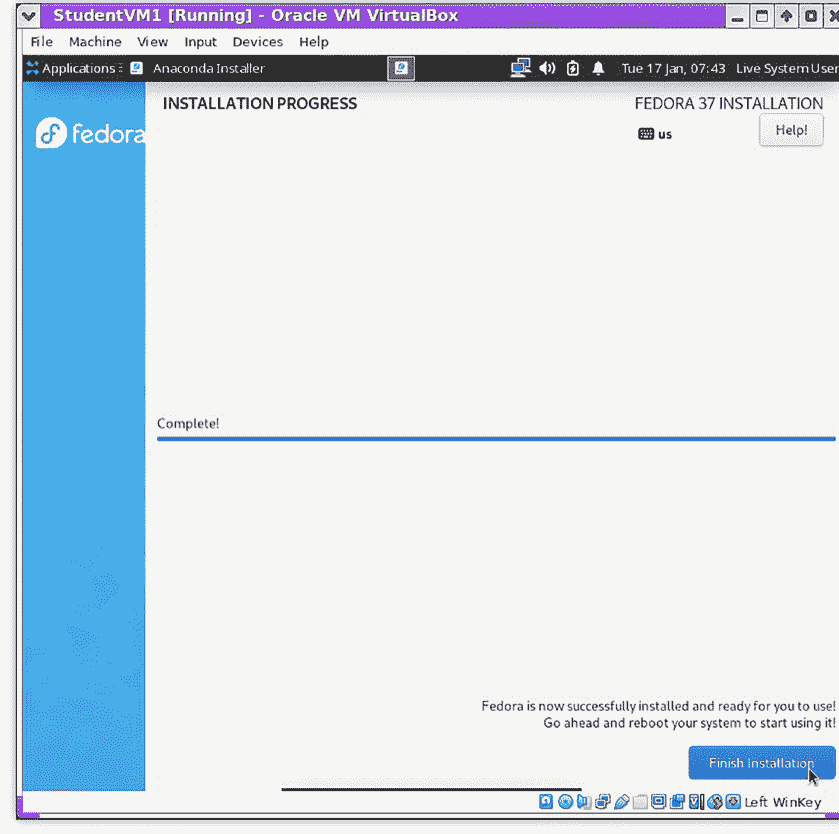

**图 5-16.** 安装已完成。点击“Finish Installation”退出 Anaconda 安装程序

## 关闭 Live 系统

在我们进行任何其他操作之前，先查看 Live 系统的 Xfce 桌面。它的外观和功能与我们之后使用自己的虚拟磁盘而不是 Live 系统重启虚拟机时将使用的 Xfce 桌面完全相同。唯一的区别是某些 Live 文件系统图标将不再出现。因此，使用此桌面与在任何已安装的系统上使用 Xfce 桌面无异。

图 5-17 显示了如何关闭 Live 系统。屏幕顶部的 Xfce 面板左侧是应用程序启动器，中间留有空间显示运行应用程序的图标、时钟、包含各种功能和通知图标的系统托，以及最右侧的用户按钮（该按钮始终显示当前登录用户的名称）。


**图 5-17.** 安装完成后关闭虚拟机

点击 **Live System User（Live 系统用户）**按钮，然后点击 **Shut Down（关机）**操作按钮。将显示一个带有 30 秒倒计的对话框。此对话框允许你立即关机或取消关机。如果你什么都不做，系统将在 30 秒计时器倒数为零时关闭。

此关机操作将关闭虚拟机，虚拟机窗口也将关闭。

## 重新配置虚拟机

在重启虚拟机之前，我们需要通过从虚拟光驱移除 Fedora ISO 镜像文件来稍微重新配置。如果我们让 ISO 镜像保留在虚拟驱动器中，虚拟机将从该镜像启动。

1. 打开 `StudentVM1` 的 `Settings`（设置）。
2. 点击 `Storage`（存储）。
3. 选择 `Fedora Live CD`，它位于 `Storage Devices`（存储设备）面板下的 `IDE` 控制器。
4. 点击 `Attributes`（属性）面板中光驱行的 `CD` 图标。
5. 在列表底部，选择菜单选项 `Remove Disk from Virtual Drive`（从虚拟驱动器中移除磁盘）。`IDE` 控制器下的项目现在应该是空的。
6. 点击设置对话框的 `OK` 按钮。

`StudentVM1` 机器现在准备好运行你将在课程其余部分中遇到的实验。

## 创建快照

在启动虚拟机之前，我们想要创建一个快照，以防虚拟机出现严重故障导致无法在不重新开始的情况下恢复。快照将使你能够轻松恢复到原始系统，而无需执行完整的重新安装。

图 5-18 显示了我们刚刚创建的 `StudentVM1` 虚拟机的 `Snapshots`（快照）视图。要在 `VirtualBox Manager` 中进入此视图，选择 `StudentVM1` 虚拟机，然后点击 `StudentVM1` 选择栏右侧的菜单图标。这会弹出一个包含 `Snapshots` 的短菜单。点击菜单中的 `Snapshots`。仅显示 `Current State`（当前状态）项，没有快照。

在你学习本课程的过程中，你可以对同一台虚拟机拍摄多个快照，这将使你能够备份到最近的快照，而不是一直退回到我们将创建的第一个快照。如果你在存储虚拟机文件的硬盘上有足够的剩余空间，我建议在每一章结束时创建一个快照。

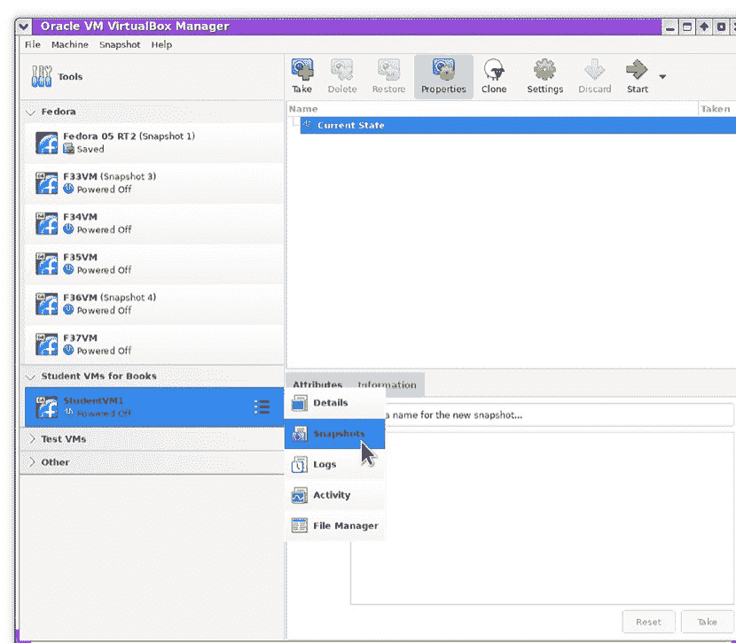

**图 5-18.** 创建快照前的 StudentVM1 快照视图

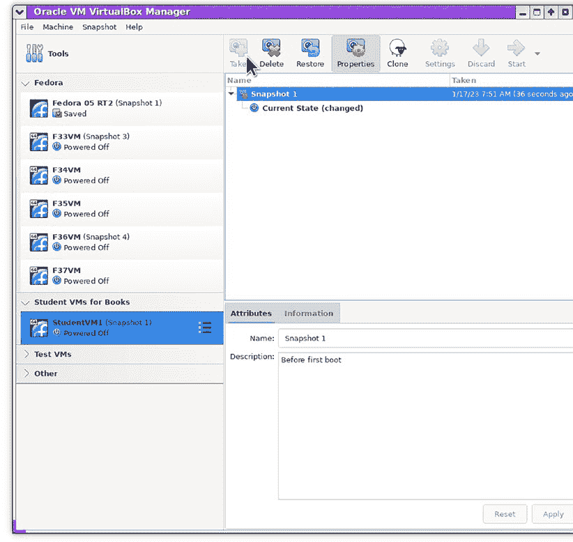

**图 5-19.** 创建 StudentVM1 第一个快照后

## 首次启动

现在是时候启动虚拟机了。

1. 选择 `StudentVM1` 虚拟机。
2. 确保在 `Snapshots` 对话框中选择了虚拟机的 **Current State（当前状态）**。
3. 点击 `VirtualBox Manager` 图标栏中的 `Start`（启动）图标。
   你也可以右键点击虚拟机并在弹出菜单中选择 `Start`。
4. 你将看到 `GRUB` 菜单，我们稍后会详细介绍。你不需要做任何操作。现在只需让它超时并进入启动序列的下一个阶段。
5. 你将看到一些文本滚动过，但不会持续很久。然后你将看到一个图形旋转物体，表示启动序列正在后台进行。我稍后会教你如何更改它，以便你可以看到所有被图形启动隐藏的提示消息。
6. 当首次启动的图形部分几乎完成后，将显示一个“Finish Configuration（完成配置）”屏幕。你可以点击该按钮继续，或者等待几秒直到它超时。
7. 最后，虚拟机应该启动到类似于图 5-20 所示的登录界面。

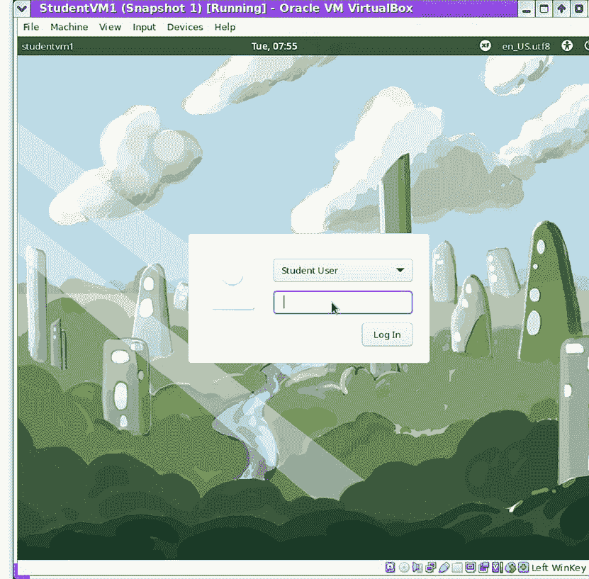

**图 5-20.** Fedora 登录界面

但先不要登录。我们将在第 6 章中进入这个登录界面，并在探索 Xfce 桌面之前学习其他内容。

如果你还没有准备好继续后续章节，可以让虚拟机在此状态运行，或者从登录界面关闭它。登录界面右上角有一个通用的电源符号。点击它并选择 `Shut Down`（关机）以关闭虚拟机。

## 如果实验不起作用该

从下一章开始，你将进行实验以学习成为系统管理员。这些实验设计为是自包含的，不依赖于任何预先的设置结果或准备工作。某些 Linux 工具和程序必须存在，但这些工具在标准的 Fedora 安装中应该是已安装或可用的。如果需要任何这些工具，在相应的实验之前会有一个准备部分。毕竟，安装此类工具也是系统管理员工作的一部分。

假设我们安装了必要的工具，所有这些实验都应该“正常工作”。我们都知道这意味着什么，对吧？所以当实验失败时，首先要做的是显而易见的操作。

- 确保准备部分已安装所需的工具。并不是所有章节都需要准备部分。
- 验证命令是否输入正确。这是我自己最常遇到的问题；有时我的手指并没有输入大脑发送给它们的内容。
- 你可能会看到指示未找到命令的错误消息。`bash` 会显示错误的命令；在此例中我虚构了 `badcommand`。然后它会对问题给出简短描述。这种错误消息对于缺失或拼写错误的命令都会显示。

```
$student@testvm1 ~]$ badcommand
bash: badcommand: command not found...
```

多次检查命令的拼写和语法以确保其正确性。

6. 对于需要你以 root 身份登录的实验，请确保你已经登录。本课程中的许多实验要求你以 root 身份登录——以非 root 用户身份执行将无法运行，工具会抛出错误。
7. 对于需要以非 root 用户执行的实验，请确保你正在使用学生账户。

其他地方应该不会出什么问题——但如果你遇到了无法通过这些提示来解决的问题，请通过 `LinuxGeek46@both.org` 联系我，我将尽力帮助你解决问题。

## 章节总结

1. 你现在已在上一章节中创建的虚拟机上安装了 Fedora Linux 的 Xfce 版本的最新版本。
2. 你使用 `Anaconda` 安装器创建了目录结构，这通常是推荐使用逻辑卷管理挂载为独立文件系统时的推荐结构。你创建了一个非 root 用户，并为该用户以及 root 设置了密码。你还设置了系统的主机名。
3. 安装完成后，你为虚拟机创建了快照，以防你遇到问题并需要回到初始状态。
4. 最后，你重启了系统并进入了登录界面。

## 练习

执行以下练习以完成本章：

1. `Anaconda` 安装器创建的卷组名称可以在安装过程中更改吗？
2. 对于拥有 `10GB` 内存且不需要休眠的主机，Fedora 文档建议使用多少交换空间（swap space）？
3. 安装占用了多少空间？
4. 快照的作用是什么？
5. 是否可以在虚拟机运行时拍摄快照？

# 第 6 章

## 使用 Xfce 桌面

## 目标

在本章中，你将学习：

- 为什么 Xfce 是本课程以及日常使用的良好桌面选择
- Xfce 桌面的基本用法和导航
- 如何启动程序
- `Xfce4` 终端模拟器的基本用法
- 如何安装所有当前更新以及一些新软件
- 如何使用设置管理器（`Settings Manager`）
- 如何在底部面板添加程序启动器
- 如何配置 Xfce 桌面

## 为什么选择 Xfce

对于 Linux 课程桌面，选择 Xfce 似乎是一个不寻常的选择，而不是常见的 GNOME 或 KDE 桌面。我几年前开始使用 Xfce，我发现我非常喜欢它，并享受它的速度和轻量。Xfce 桌面精简且快速，具有整体优雅感，让人很容易看出如何操作。它的轻量级设计节省了内存和 CPU 周期。这使得它成为资源匮乏的旧主机以及资源受限的虚拟机的理想选择。然而，Xfce 足够灵活且强大，可以满足我作为一个高级用户的需求。

## 桌面

与 KDE 和 GNOME 等其他桌面相比，Xfce 是一个轻量级桌面，内存占用和 CPU 使用非常小。在我的系统中，组成 Xfce 桌面的程序对于这样一个强大的桌面来说，占用的内存极少。极低的 CPU 使用率也是 Xfce 桌面的标志。凭借如此小的内存占用，Xfce 同样非常节省 CPU 周期，我并不感到意外。

**注意** Xfce 桌面非常稳定。自本课程（基于 Fedora 29）的第一版发布以来，它变化很小。在 Fedora 37 中，它仍然几乎相同，只是不同的背景壁纸图像和图标的一些差异。尽管我更新了本章中的图表，但它们看起来仍然与 Fedora 上之前的 Xfce 版本非常相似。我预计它们在未来也不会发生太大变化。

如图 6-1 所示，Xfce 桌面简单且没有杂乱内容。基础桌面有两个面板，左侧有一列垂直的图标。

面板 1 位于顶部，有一个应用程序启动器以及“工作空间切换（Workspace Switched）”，它允许用户在多个工作空间之间切换。工作空间是一个类似于桌面的组织实体，拥有多个工作空间就像拥有多个桌面，你可以用它们每个处理一个不同的项目。

面板 2 位于底部，由一些基本应用程序启动器以及“应用程序”图标组成，后者提供了访问系统所有应用程序的。可以通过额外的项目修改面板，例如添加新的启动器或更改其高度和宽度。

## 第 6 章 使用 XFCE 桌面

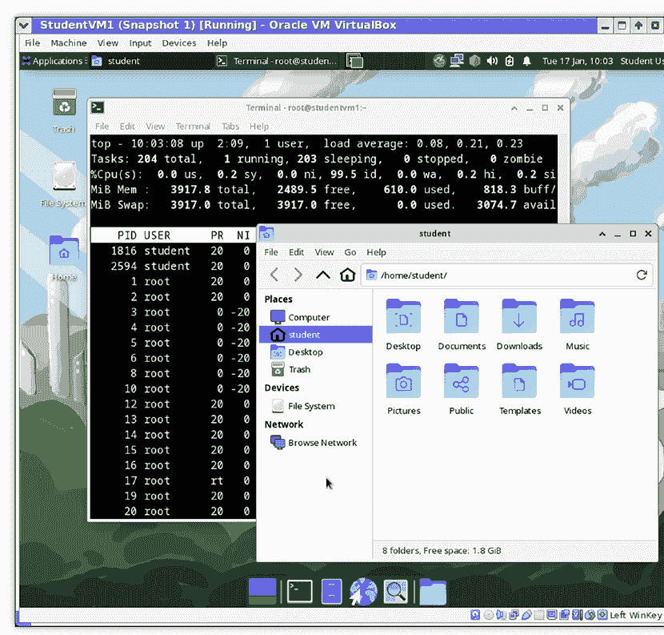

**图 6-1.** 带有 `Thunar` 文件管理器和 `Xfce4` 终端的 Xfce 桌面。

桌面左侧的图标包括主目录图标和垃圾桶图标。每个图标还可以显示完整的文件系统目录树以及任何连接的热插拔 USB 存储设备的图标。这些图标可以用于挂载和卸载设备，以及打开默认文件管理器。如果你愿意，也可以隐藏它们，其中文件系统、垃圾桶和主目录图标是可以分别控制的。可移动驱动器可以作为一个组隐藏或显示。

## 文件管理器

`Thunar` 是 Xfce 的默认文件管理器。`Thunar` 强大、快速且易于使用。它允许你打开多个标签，这对于浏览文件系统非常有用。`Thunar` 还支持搜索、排序和批量重命名文件。

`Thunar` 的最佳功能之一是可以使用自定义操作（custom actions）。这些操作允许你为任何文件或文件夹定义自己的命令。例如，你可以创建一个自定义操作来用特定的编辑器打开文件，或将其上传到远程服务器。

`Thunar` 与 Xfce 桌面的其他部分的集成良好。你可以在 `Thunar` 窗口之间拖放文件，也可以在 `Thunar` 与应用程序之间拖放。

## 稳定性

如前所述，Xfce 桌面非常稳定。自本课程（基于 Fedora 29）的第一版发布以来，它变化很小。在 Fedora 37 中，它仍然几乎相同，只是不同的壁纸图像和图标的一些差异。尽管我更新了本章中的图表，但它们仍然与 Fedora 上之前的 Xfce 版本非常相似。

## 配置

在限制范围内，Xfce 是非常有配置性的。虽然不像像 KDE 那样的桌面具有同样的配置性，但比例如 GNOME 要可配置得多且更容易配置。我发现设置管理器是配置 Xfce 的入口。各个配置程序可以单独使用，但设置管理器将它们收集到一个对话框中以便访问。桌面的所有重要方面都可以根据我的需求和偏好进行配置。

## 入门

在我们第一次查看之前，让我们快速看看图 6-2 所示的 GUI 登录界面。这里有一些值得探索的内容。登录界面即欢迎界面（greeter），由显示管理器（dm）`lightdm`¹ 显示并控制，它是几种图形登录管理器² 中的一种。每个显示管理器还有一个或多个欢迎界面——图形界面——与用户交互。


注意：本章中的大多数插图来自 Fedora 37。如果你使用的是 Fedora 的后续发行版本，例如 Fedora 38，背景和其他视觉元素可能与 Fedora 37 不同。然而，技术和功能特性保持不变。

> ¹Wikipedia, LightDM, https://en.wikipedia.org/wiki/LightDM
>
> ²Wikipedia, DisplayManager, https://en.wikipedia.org/wiki/X_display_manager_(program_type)

# 第 6 章 使用 XFCE 桌面

屏幕中心是登录对话框。学生用户已被选中，因为没有其他用户可以通过图形用户界面（GUI）登录。`root` 用户被允许使用 GUI 登录。和 Linux 中的其他所有设置一样，这种行为是可配置的，但我建议不要更改它。如果为此主机创建了其他用户，将可以使用选择栏进行选择。

登录屏幕顶部的面板包含信息和控制控件。从左侧开始，我们首先看到主机名。我过的许多显示管理器（实际上有好几个）并不显示主机名。

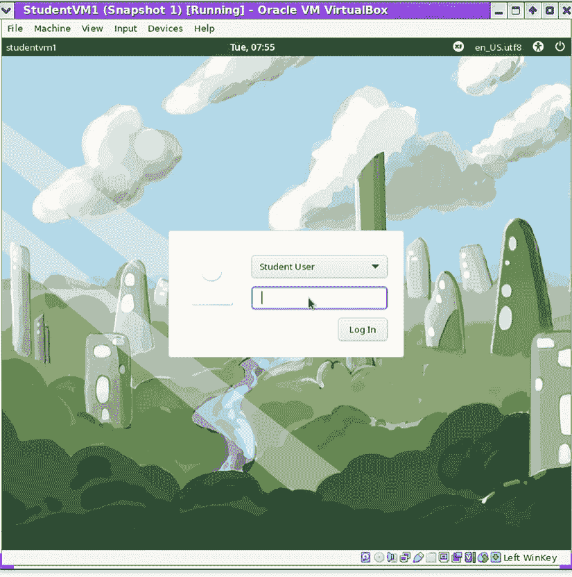

**图 6-2。** 输入密码并点击登录按钮

接下来，有一个时钟，然后是一个张开四肢的人形图标，代表大字体和高对比度颜色选择的辅助功能选项。接着是一个键盘图标，显示当前的键盘布局选择，然后又是一个时钟。最后在靠右侧的是电源按钮的通用图标。点击它可以进入子菜单，允许你挂起、休眠或退出。选择“退出”选项将显示重启（reboot）和关机（power off）系统的附加选项。

## 登录

在使用 Xfce 桌面之前，我们需要登录。StudentVM1 机器应该已经运行并等待你登录，如图 6-2 所示；然而，如果你在上一章结束时关闭了它，请现在启动它。

在登录对话框的右侧，你会找到一个包含 `xf*` 的圆圈，代表 Xfce。如果你安装了多个 Xfce，此控件允许你选择其中任何一个桌面。Linux 有许多可用的桌面，例如 KDE、GNOME、Xfce、LXDE、Mate 等。你可以安装其中任何一个或全部，并在每次登录时在它们之间切换。你需要在登录之前选择所需的桌面。

点击虚拟机屏幕，然后输入你为学生用户选择的密码，并点击登录按钮。

## 初探

Xfce 桌面顶部有一个面板，底部有一个面板，如图 6-3 所示。顶部面板包含几个组件，可以提供对某些重要功能的访问和控制。

顶部面板的最左侧是应用程序菜单。点击此处可以查看一个菜单和几个子菜单，允许你选择并启动程序和实用程序。只需点击所需的应用程序即可启动。

接下来是当前为空区域，将在此显示运行应用程序的图标。我们有四个正方形，其中一个是深灰色，另外三个是浅灰色。这是桌面选择器，颜色较深的是当前选中的桌面。设置多个桌面的目的是允许在不同的桌面上放置不同项目的窗口，以帮助保持条井有序。如果有正在运行的应用程序窗口和图标，它们将显示在桌面选择器中。只需点击所需的桌面即可切换过去。运行中的应用程序可以从一个桌面移动到另一个桌面。将应用程序从切换器中的一个桌面拖动到另一个桌面，或者右键点击应用程序标题栏弹出一个提供桌面切换选项的菜单。


图 6-3。Xfce 桌面

桌面切换器正右侧是系统托盘，它包含提供系统网络图标，并允许某些交互，例如启动和停止网络或选择无线网络。接下来是时钟。你可以右键点击时钟来配置其以不同的格式显示日期和时间。接下来是系统托盘，它包含安装软件更新、连接/断开和检查网络状态、以及检查电池状态的图标。网络在启动时默认已连接，但你也可以找到有关当前连接的信息。在笔记本电脑上，之后你还会无线间隔，`dnf-program` —— 那个难以看到的橙蓝图标 —— 将检查更新并在有任何更新时通知你。在安装和首次启动后可能会出现大量的数字。现在只需忽略它即可。现在不要尝试安装更新；我们将在本章的晚些时候通过命令行完成。

底部面板包含一些基本应用程序的启动器。请务必注意左侧的第二个图标，它将启动 `xfce4-terminal` 终端模拟器。我们很快将详细查看这些启动器的其余部分。

## 探索 Xfce 桌面

让我们花时间探索 Xfce 桌面本身。这包括减少屏幕保护程序的烦扰程度、进行一些配置以设置默认应用程序、在面板 2（底部面板）上添加启动器以便更容易访问，以及使用多个桌面。

在我们继续对 Xfce 桌面的探索时，你应该花时间自己进行一些探索。我发现这是我最好的学习方式。我喜欢摆弄东西尝试得到我想要的结果——或者直到它们坏掉——以先发生的为准。当它们坏时，我可以弄清楚哪里出了问题并修复它们。

## 屏幕保护程序

与所有桌面一样，Xfce 也有一个锁定屏幕的屏幕保护程序。当我坐在桌前时，这可能会很烦人。图 6-4 显示了这一点。

### 实验 1：关闭屏幕保护程序

对于我的物理主机，我通常会为屏幕保护程序设置足够的时间，以免在我在操作鼠标时黑屏。我的耐忍度会随时间改变，所以我经常重置这些设置。你应该设置你自己的。

- 要启动屏幕保护程序，使用面板 1（顶部）并选择应用程序 ► 设置 ► 屏幕保护程序。

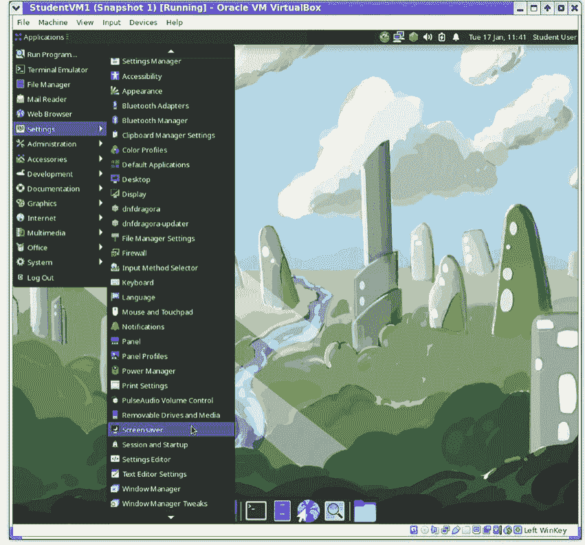

图 6-4.启动屏幕保护程序

- 图 6-5 显示了屏幕保护程序对话框。点击“启用屏幕保护程序”开关禁用屏幕保护程序。

- 然后点击“锁定屏幕”选项卡并禁用所有“启用锁定屏幕”选项。这防止屏幕自动锁定。

- 关闭屏幕保护程序对话框。

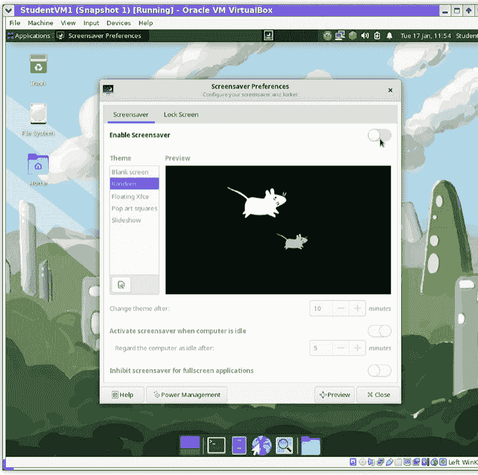

图 6-5 禁用屏幕保护程序

### 设置管理器

让我们看看如何访问 Xfce 的各种设置。有两种方法，一种是使用面板 1 应用程序按钮，选择设置，然后选择你想查看或更改的设置项。另一种是在设置菜单顶部打开设置管理器。设置管理器将所有设置在一个窗口中，方便访问。图 6-6 显示了两种方法。

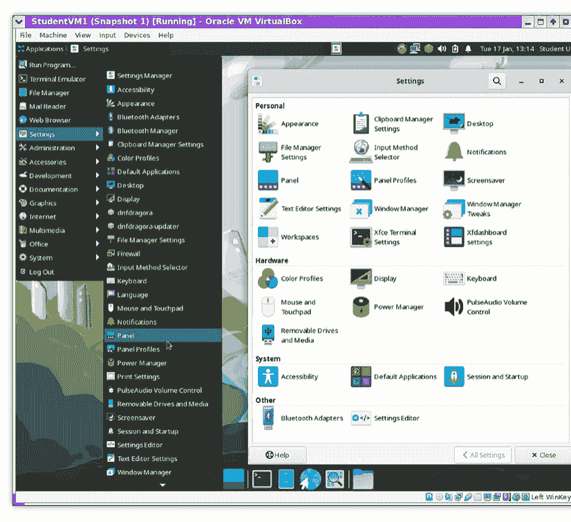

**图 6-6.** 访问 Xfce 桌面设置的两种方法。请注意我调整了 StudentVM1 虚拟机的窗口大小，以便有足够的垂直空间显示设置管理器中的所有设置

## 向面板 2 添加启动器

我倾向于使用设置管理器进行更改，因为它将大多数设置工具聚合在一个窗口中。我也喜欢让自己更容易地访问设置管理器本身。每次我想访问设置工具时，都要通过菜单树点击三次是很累的，但点击一次比三次好。这是作为懒惰系统管理员的一部分；更少的输入和更少的点击效率更高。所以，让我们顺便绕一下，将设置管理器图标添加到面板 2（底部面板）以及作为启动器。

### 实验 6-2：添加设置管理器启动器

在本实验中，我们将把“设置管理器”添加到 Xfce 桌面的面板 2 中。

- 1. 如图 6-7 所示打开应用程序菜单，并在设置菜单的顶部找到“设置管理器”。

- 2. 点击“设置管理器”就像要打开它一样，但按住鼠标并像图 6-7 所示将其拖动到面板 2 的左侧。

  将鼠标悬停在最左侧图标与垂直红色分隔条之间的小空间上。这条红条显示了新启动器添加的位置。

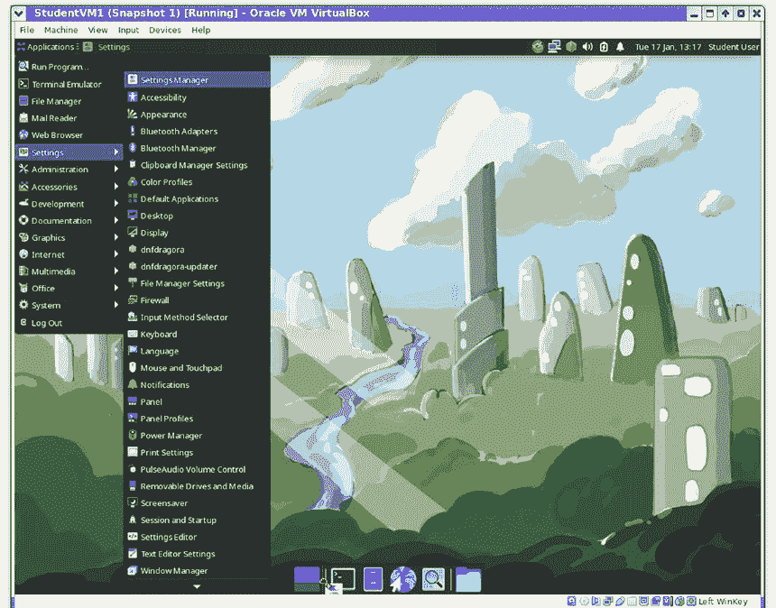

图 6-7. 向面板 2 添加设置管理器

提示：新启动器只能添加到面板的两端，或紧邻其中一个间距器。

- 3. 当红条位于面板上所需位置时，松开鼠标按钮将其释放。

- 4. 将弹出一个询问对话框，询问你是否要“从 1 个桌面文件创建新启动器”。点击“创建启动器”按钮。新启动器现在出现在面板 2 上，如图 6-8 所示。


图 6-8. 添加到面板 2 的设置管理器启动器

现在你可以从面板启动设置管理器了。你可以将启动器放置在面板或桌面的任何位置。

注意，从面板启动应用程序只需一下。我将所有最常用的应用程序都添加到面板 2，这样就可以避免在每次想使用其中一个程序时都在菜单中搜索它们。随着课程的进行，你可以向面板添加更多启动器来提高自己的效率。

## 默认应用程序

我们现在可以返回设置默认应用程序了。默认应用程序是一些选择，例如终端模拟器或浏览器，你希望在需要这些程序之一时，所有应用程序都启动它们。例如，你可能希望在点击文中嵌入的 URL 时由你的文字处理器启动 Chrome。Xfce 将这些称为默认应用程序。

首选终端已配置为 `xfce4-terminal`，你已经有机会使用它。我们将在第 7 章中对 Xfce4-terminal 进行更详细的介绍。

Xfce 桌面底部面板 2 上的图标包含了两个我们需要选择默认应用程序的项目：网络浏览器和文件管理器。如果你点击网络浏览器图标（带有鼠标指针的地球图标），你将获得想要使用已安装的网络浏览器中的哪一个作为默认的选择。目前，只安装了 Firefox 浏览器，因此没有实际的可供选择。

还有一种更好的方法，那就是一次性完成所有首选应用程序的选择。

### 实验 6-3：默认应用程序

在本实验中，我们将为学生用户设置默认应用程序。

- 1. 如果设置管理器尚未打开，请现在打开它。

- 2. 在设置对话框中找到“默认应用程序”图标并点击一次打开它。该对话框将打开到“Internet”选项卡，允许选择浏览器和电子邮件应用程序。目前这两者都没有设置首选应用程序，因此我们需要为浏览器设置一个。

- 3. Firefox 已被预选为默认浏览器。目前唯一的选项是 Firefox，但你稍后可以安装其他浏览器并选择其中一个作为默认。

- 4. 切换到图 6-9 所示的默认应用程序对话框的“工具”选项卡。注意，这里的两个项目都已进行了选择。

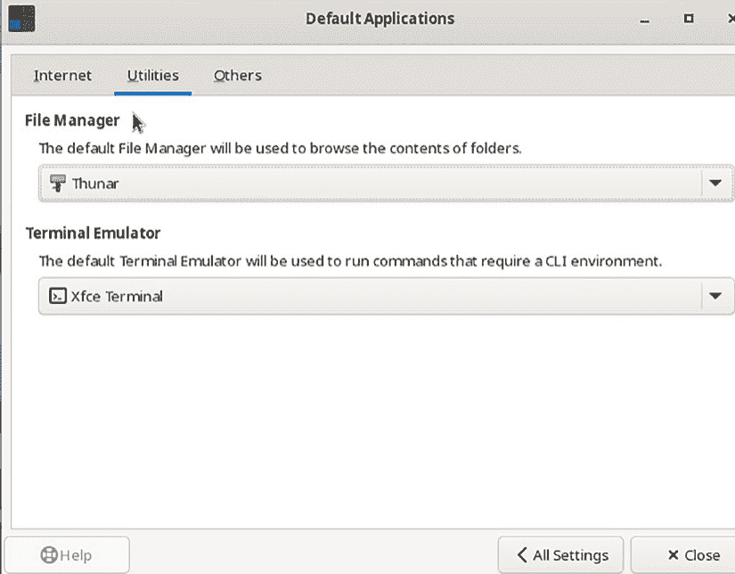

**图 6-9. 默认应用程序对话框的工具选项卡允许选择默认 GUI 文件管理器和默认终端模拟器**

Thunar 是文件管理器唯一的可用选项，而 Xfce-terminal 是终端模拟器的唯一选项。

这些应用程序之所以没有其他可用选项，是因为桌面安装程序执行了基础安装。

- 1. 你可以查看“其他”选项卡，但那里没有需要更改的内容。在那里进行任何更改也需要对各种文件类型以及可用于每种类型的应用程序有深入了解。

- 2. 点击图 6-9 所示的“全部设置”按钮返回主设置管理器。

Thunar 文件管理器是我用过的最好的管理器之一。有很多管理器，大多数大多数适用于 Fedora Linux。Xfce-terminal 也是如此——它是许多非常优秀的程序中最好的之一。在我看来，即使这里有其他可供选择，这些也是优秀的选择，我不会改变它们。我们将在卷 2 的第 21 章中更详细地介绍文件管理器。

## 桌面外观

更改桌面的外观由设置管理器中的多个设置工具管理。我喜欢玩玩设置管理器中的某一个设置工具。

### 外观

“外观”工具有四个选项卡，提供了调整不同部分的控制。对话框打开到“样式”选项卡。此选项卡允许你选择基本的颜色方案和 Xfce 桌面的某些视觉方面。点击一些不同的方案，查看它们在你的虚拟机中的效果。

第二个选项卡“图标”允许选择图标主题。这不是鼠标指针图标，而是应用程序图标。其他主题也可以下载并安装。

第三个选项卡“字体”允许用户选择字体主题。也可以选择默认宽度字体以及等宽字体。

第四个选项卡“设置”允许选择图标上是否带有文本。你还可以开启或关闭声音。

### 实验 6-4：更改桌面的视觉效果和感受

本实验将为你提供一个尝试更改桌面视觉效果和感受的机会。尝试这些更改会花费大量时间，所以尽量不要被它分散注意力。这里的中心思想是让你熟悉如何更改 Xfce 桌面的外观。

开始，使用你在实验 6-2 中添加到面板 2 的图标打开设置管理器。然后点击设置管理器左上角的“外观”图标。图 6-10 显示了“样式”选项卡。此选项卡允许你选择基本的颜色方案和 Xfce 桌面的某些视觉方面。点击一些不同的方案，查看它们在你的虚拟机中的效果。我喜欢 Greybird-dark 样式。

**提示** 请务必打开另一个窗口（如 Thunar）来查看更改。设置管理器本身不会发生变化。这与过去与其他窗口同步变化的情况不同。

### 窗口管理器

“窗口管理器”工具允许你更改窗口装饰的外观。图 6-11 显示了“样式”选项卡，你可以在其中选择不同的窗口边框主题。

键盘选项卡允许你更改一些键盘快捷键，但我很少在这里进行更改。焦点选项卡允许你确定窗口何时获取焦点并成为活动窗口。高级选项卡决定窗口在移动时是否对齐到不可见的网格线，以及网格的粒度。它还允许你配置窗口拖动到屏幕边缘时的行为。

暂时保持设置管理器开启。

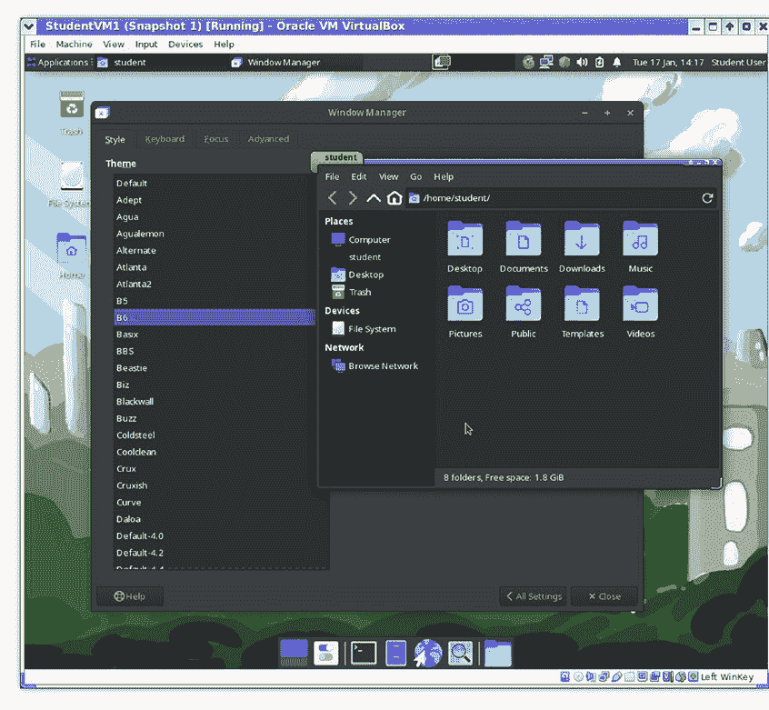

**图 6-11。窗口管理器设置允许你更改窗口装饰的外观**

你也应该花一点时间探索设置管理器中的其他对话框。

不要忘记，你可以随时返回设置管理器来更改桌面的外观。如果你不喜欢今天所选的内容，可以为桌面选择另一种视觉效果和感受。

配置桌面的外观和感受可能看起来有些琐碎，但我发现，拥有一个看起来美观、为我最常用的应用程序提供启动器并且易于修改的桌面，会让我的工作变得愉快而轻松。此外，玩玩这些设置很有趣，系统管理员（SysAdmins）也需要一点乐趣。

## 多桌面

Xfce 桌面的另一个功能（也是我用过的除最简单的之外的所有桌面）是使用多个桌面，在 Xfce 中被称为“工作空间”（workspaces）。我经常使用这个功能，许多人发现通过将属于每个项目的窗口放置在不同的桌面上来组织工作是非常有用的。

例如，我的 Xfce 桌面上有四个工作空间。在主工作空间上，我有我的电子邮件、一个 Chromium 浏览器实例和一个终端会话。我在一个工作空间上运行着 VirtualBox 和我所有运行的虚拟机，以及另一个终端会话。在第三个工作空间上有我的写作工具，包括在 LibreOffice 中打开的各种文档、另一个用于研究的 Chromium 实例、用于打开和管理本书文件的管理器，以及另一个带有多个标签的终端模拟器会话，每个标签都通过 SSH 登录到我运行的其中一个虚拟机。

### 实验 6-5：使用多桌面

此实验旨在让你练习使用多个桌面。你的桌面看起来应该与图 6-12 非常相似，并打开了设置管理器和 Thunar 文件管理器。


图 6-12. 使用系统菜单将 Thunar 文件管理器移动到另一个工作空间

开始之前，点击面板 2（底部面板）中央的文件柜图标。当你将鼠标指针悬停在此图标上时，会弹出显示标题“文件管理器（File Manager）”的提示框。文件管理器是 Thunar，它可以用于探索主目录中的文件和目录，以及你有权访问的其他系统目录（例如 `/tmp`）。

但我们想将此文件管理器移动到不同的桌面。有两种方法。首先，在窗口顶部文件管理器标题栏的任何地方点击右键。然后，如图 6-12 所示选择“移动到另一个工作空间”（Move to Another Workspace），然后点击“工作空间 3”。你也可以通过在顶部面板（面板 1）上运行应用程序的按钮处点击右键访问相同的菜单。

工作空间切换器显示了工作空间 3 上的文件管理器窗口，而设置管理器仍在工作空间 1，如图 6-13 所示。你可以点击切换器中的任何工作空间直接跳转到那里。点击工作空间 3。


图 6-13. 工作空间切换器显示工作空间 1 和 3 上的窗口

注意，切换器中的窗口是它们所代表的工作空间中相对大小的合理近似。切换器中的窗口还有代表窗口中运行应用程序的图标。这使得我们很容易使用切换器将窗口从一个工作空间移动到另一个。

然而，如果面板尺寸太小，窗口可能不会在桌面切换器中复制，或者只有窗口的轮廓而没有图标。如果桌面切换器中没有窗口，你应该跳过下一段。

将文件管理器图标从工作空间 3 拖到工作空间 4 并放那里。文件管理器从当前工作空间消失，文件管理器图标现在位于工作空间 4 上。点击工作空间 4 进入那里。

与 Linux 的所有事物一样，有多种方法可以管理这些工作空间以及每个空间中的窗口。我发现有时将属于特定项目的窗口单独放置在一个工作空间中是一个好方法。

## 安装更新

确保始终保持最新状态是非常重要的。最新的更新将包含最新的安全补丁以及功能修复。

这很容易，但它需要等待过程完成。幸运的是，Linux 更新即使需要重启，也不会自动重启，你可以在准备好重启之前继续工作。

### 实验 6-6：安装更新

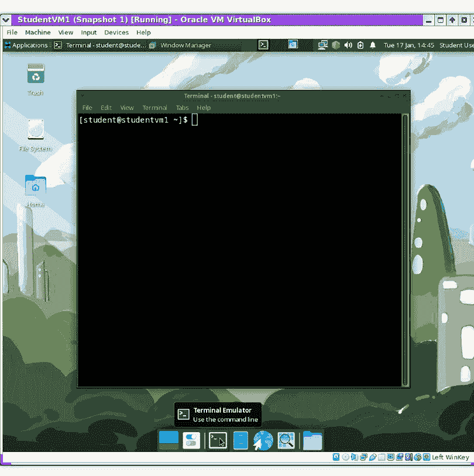

图 6-14. 使用系统菜单将 Thunar 文件管理器移动到另一个工作空间

由于内核已更新，我们将执行重启以加载新内核。在 GUI 上有一些方法可以做到这一点，但我更倾向于从命令行重启。在更新安装完成并显示“完成！（Complete!）”消息后，我们将重启——在此之前：

登录桌面并打开终端会话。更新后，还需要进行其他操作，以确保 man（手册）帮助页——即帮助设施——是最新的。我曾遇到过数据库没有正确更新，导致 `man` 命令无法显示命令的 man 手页。此命令可以确保所有的 man 手页都是最新的：


```
[root@studentvm1 ~]# mandb
<snip>
Purging old database entries in /usr/share/man/ko...
Processing manual pages under /usr/share/man/ko...
Purging old database entries in /usr/local/share/man...
Processing manual pages under /usr/local/share/man...
O man subdirectories contained newer manual pages.
O manual pages were added.
O stray cats were added.
2 old database entries were purged.
```

该系统并没有产生太大结果，但删除了两个旧的手册数据库项。

## 章节总结

你使用 Xfce 桌面的 GUI 登录界面进行了登录并熟悉了桌面。你启动并学习了 Xfce4 终端模拟器的非常基本的用法。你安装了所有的当前更新。

你探索了 Xfce 桌面，并学习了多种配置它的方法以创建不同的外观和感受。你还探索了一些让桌面工作更高效的方法，例如在面板上添加启动器以及使用多个虚拟桌面。

我进行了在线搜索以发现 Xfce 的含义，那里有一个对 XForms Common Environment 的历史引用，但 Xfce 不再使用 Xforms 工具。几年前，我发现了对“Xtra fine computing environment（极精细计算环境）”的引用，我很喜欢这个说法，尽管无法再次找到该页面引用但我会使用它。

## 练习

执行以下练习以完成本章：

1. 当应用于 Xfce 桌面时，“轻量级”（lightweight）一词是什么意思？
2. 你认为使用多个工作区对你和你喜欢的工作方式有利吗？
3. 在“默认应用程序”配置对话框中，终端模拟器有多少个选项？
4. 你更改可用工作区的数量吗？
5. 你会将多个桌面用于？
6. Xfce 桌面的默认文件管理器的名称是什么？这个文件管理器与你用过的其他管理器相比如何？
7. 如何获得 root 身份的终端登录？

# 第 7 章 使用 Linux 命令行

## 目标

在本章中，你将学习：

- 命令行术语以及终端（`terminal`）、控制台（`console`）、shell、命令行（`command line`）和会话（`session`）这些术语之间的区别
- 访问 Linux 命令行界面（CLI）的三种不同方法
- 使用 bash shell
- 关于其他一些替代 shell
- 为什么同时拥有多个命令行会话可能很有用
- 处理多个命令行界面的至少三种不同方法
- 一些基础但重要的 Linux 命令

## 引言

Linux 命令行对于系统管理员（SysAdmin）来说就是“Linux 命令中心”。Linux CLI 是一个非限制性界面，因为它对你如何使用它没有任何限制。

图形用户界面（GUI）从定义上来说是一种非常限制的界面。你只能按照规定的方式执行被允许的任务，而所有这些都是由程序员选择的。你无法超越编写代码的程序员想象力的限制，或者更有可能是——留尖头发的老板对程序员施加的限制。

在我看来，任何图形界面的最大缺点是它抑制了任何自动化的可能性。相反，只有重复的鼠标点击才能在略有不同的数据上多次执行相同或相似的操作。简单的“搜索和替换”操作已经是大多数 GUI 程序能达到的最好结果了。

另一方面，CLI 允许在执行任务时具有极大的灵活性。这是因为每条 Linux 命令（不仅是 GNU 核心实用，还包括绝大多数 Linux 命令）都是根据 Linux 哲学的原则编写的，例如“一切都是文件”、“始终使用 STDIO”、“每个程序应该只做好一件事”、“避免捕获式用户界面”等。你明白我的意思。尽管我们在本书的第三章中讨论了这些准则以及它们的一些影响，但如果你不完全理解我的意思，也不要太担心。我将在整个课程中指出它们的一些实际应用。

对于系统管理员来说，底线情况是，当开发者遵循这些准则时，Linux CLI 的力量在于它完全没有限制。在本章中，我们将开始以各种方式探索命令行，揭示它置于你指尖的力量。

访问命令行有许多选项，例如虚拟控制台、许多不同的终端模拟器以及可以增强你的灵活性和生产力的其他相关软件。本章将涵盖所有这些可能性，以及命令行如何执行看似不可能的任务的特定示例——或者只是让尖头发的老板满意。

## 准备

在我们进一步讨论命令行之前，我们需要处理一些准备工作。

默认 Shell 是 bash，它恰好是我喜欢的那个。与其他许多事情一样，有很多 shell 可供你选择。这些 shell 中的许多都适用于 Linux 和 *nix 系统，包括 Apple 的 macOS。你将在这里安装几个以便你可以尝试它们。

## 定义命令行

命令行是一种文本模式界面，为用户提供了与操作系统交互的方法。任何 shell 的功能都是解释用户输入的命令并将结果传递给操作系统。

```
[root@studentvm1 ~]# dnf -y tilix
```

sysstat


# 使用 Linux 命令行

命令行是一种文本模式界面，为用户提供了与操作系统交互的方法。任何 shell 的功能都是解释用户输入的命令并将结果传递给操作系统。

## CLI 术语

---

## 练习

执行以下练习以完成本章：

1. 当应用于 Xfce 桌面时，“轻量级”（lightweight）一词是什么意思？
2. 你认为使用多个工作区对你和你喜欢的工作方式有利吗？
3. 在“默认应用程序”配置对话框中，终端模拟器有多少个选项？
4. 你更改可用工作区的数量吗？
5. 你会将多个桌面用于什么？
6. Xfce 桌面的默认文件管理器的名称是什么？这个文件管理器与你用过的其他管理器相比如何？
7. 如何获得 root 身份的终端登录？

## 目标

在本章中，你将学习：

- 命令行术语以及`terminal`（终端）、`console`（控制台）、`shell`、`command line`（命令行）和`session`（会话）这些术语之间的区别
- 访问 Linux 命令行界面（CLI）的三种不同方法
- 使用 `bash` shell
- 关于其他一些替代 shell
- 为什么同时拥有多个命令行会话可能很有用
- 处理多个命令行界面的至少三种不同方法
- 一些基础但重要的 Linux 命令

## 引言

Linux 命令行对于系统管理员（SysAdmin）来说就是“Linux 命令中心”。Linux CLI 是一个非限制性界面，因为它对你如何使用它没有任何限制。

图形用户界面（GUI）从定义上来说是一种非常限制的界面。你只能按照规定的方式执行被允许的任务，而所有这些都是由程序员选择的。你无法超越编写代码的程序员想象力的限制，或者更有可能是——留尖头发的老板对程序员施加的限制。

在我看来，任何图形界面的最大缺点是它抑制了任何自动化的可能性。相反，只有重复的鼠标点击才能在略有不同的数据上多次执行相同或相似的操作。简单的“搜索和替换”操作已经是大多数 GUI 程序能达到的最好结果了。

另一方面，CLI 允许在执行任务时具有极大的灵活性。这是因为每条 Linux 命令（不仅是 GNU 核心实用程序，还包括绝大多数 Linux 命令）都是根据 Linux 哲学的原则编写的，例如“一切都是文件”、“始终使用 STDIO”、“每个程序应该只做好一件事”、“避免捕获式用户界面”等。尽管我们在第三章中讨论了这些准则以及它们的一些影响，但如果你不完全理解我的意思，也不要太担心。我将在整个课程中指出它们的一些实际应用。

对于系统管理员来说，底线情况是，当开发者遵循这些准则时，Linux CLI 的力量在于它完全没有限制。在本章中，我们将开始以各种方式探索命令行，揭示它置于你指尖的力量。

访问命令行有许多选项，例如虚拟控制台、许多不同的终端模拟器以及可以增强你的灵活性和生产力的其他相关软件。本章将涵盖所有这些可能性，以及命令行如何执行看似不可能的任务的特定示例——或者只是让尖头发的老板满意。

## 准备

在我们进一步讨论命令行之前，我们需要处理一些准备工作。

默认 Shell 是 `bash`，它恰好是我喜欢的那个。与其他许多事情一样，有很多 shell 可供你选择。这些 shell 中的许多都适用于 Linux 和 *nix 系统，包括 Apple 的 macOS。你将在这里安装几个以便你可以尝试它们。

## 访问命令行

在 Linux 计算机上访问命令行的最后方法是通过远程登录。多年来 `Telnet` 是远程访问的常用工具，但由于安全考虑的大幅增加，它在很大程度上被 `Secure Shell (SSH)` 取代。

## 命令行界面

命令行界面 (CLI) 是任何用于 Linux 系统的文本模式用户界面，允许用户输入命令并以文本输出的形式查看结果。

## 命令

命令是在命令行中输入的内容，用于告诉 Linux 你想让它做什么。命令具有易于理解的通用语法。大多数 shell 的基本命令语法为：

```
command [-o(options)] [arg1] [arg2] ... [argX]
```

`选项`（Options）也称为`开关`（switches）。它们通常是单个字符，且具有二进制含义，即开启或关闭命令的某个功能，例如在 `ls -l` 中使用 `-l` 选项来显示目录内容的详细列表。`参数`（Arguments）通常是命令运行或产生所需结果时所需的文本或数值数据。例如，文件名、目录名、用户名等都是参数。你在本课程中发现的许多命令包含一个或多个选项，有时还会带有参数。

如果你运行的命令仅返回到 CLI 提示符而没有向终端打印任何额外数据，请不要担心；这是大多数命令的预期行为。如果一个 Linux 命令按预期工作而没有任何错误，大多数情况下它根本不会显示任何结果。只有在发生错误时才会显示消息。这符合 Linux 哲学中的一部分——即“**沉默是金**”。

命令名称通常也很短。这被称为 Linux 哲学中的“懒惰管理员”部分：输入越少越好。命令名称通常与其功能有某些字面上的联系。例如，“ls”意味着列（list）目录内容，“cd”意味着切换目录，以此类推。

注意，Linux 是区分大小写的。如果输入大写字母，命令将无法工作。`ls` 可以运行，`LS` 则不行。文件名和目录名也是区分大小写的。

## 终端

在计算机背景下，“终端”（terminal）一词的原意是指与主机或 Unix 计算机进行交互的旧式硬件。在书中，该术语指的是执行相同功能的终端仿真器软件。

终端不是计算机；终端仅连接到主机和 Unix 系统。硬件类终端通常通过长串行线连接到其主机。像图 7-1 所示的 `DEC VT100` 等通常被称为“哑终端”（dumb terminals），以区分于连接到主机或 Unix 主机时可能作为终端使用的 PC 或其他小型计算机。哑终端内部仅包含足够的逻辑来显示来自主机的数据并将按键输入传回主机。所有的处理和计算都在终端所连接的主机上完成。

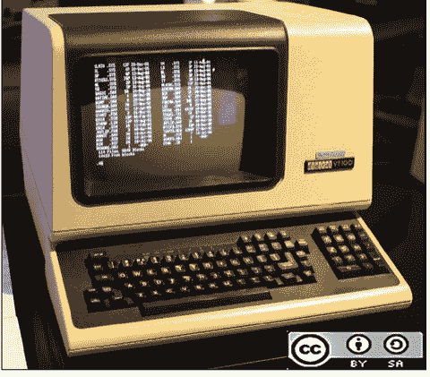

图 7-1. 一个哑终端

## 虚拟终端

运行 Linux 的现代物理计算机和服务器通常没有可以作为控制台的哑终端。Linux 通常提供多个虚拟终端的能力，允许从单个标准 PC 键盘进行多次登录。红帽企业 Linux、CentOS 和 Fedora 通常为文本模式登录提供六或七个虚拟终端。如果使用了图形界面，第一个虚拟终端 vc1 在 X 窗口系统 (X) 启动后成为第一个图形界面 (GUI) 会话，而 vc7 变成第二个 GUI 会话。

每个虚拟终端都分配有一个与控制台编号对应的功能键。因此，vc1 被分配给功能键 F1，以此类推。在这些会话之间切换很容易。在物理计算机上，你可以按住 `Ctrl-Alt` 键并按下 F2 切换到 vc2。然后按住 `Ctrl-Alt` 键并按下 F1 切换到 vc1（通常是图形界面）。我们将在实验 7-1 中介绍如何在虚拟机上进行此操作。如果没有运行 GUI，vc1 将只是另一个文本控制台。

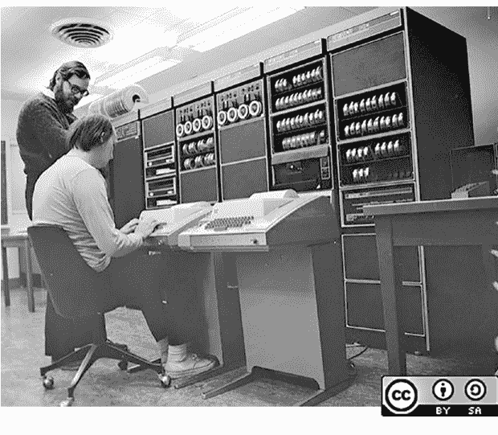

图 7-3. 虚拟终端 2 的登录提示符

## 使用虚拟控制台

`screen` 命令在某些环境中可能不可用，而且大多数服务器上可能无法使用 GUI 桌面。

### 实验 7-1：使用虚拟控制台

在本实验中，你将使用其中一个虚拟控制台以 root 身份登录命令行。命令行是你作为系统管理员进行大部分工作的地方。你稍后将有机会在 GUI 桌面上使用终端会话，但如果你没有 GUI，你的系统看起来就会是这样。

如果你在物理主机上，你将按下 `Ctrl-Alt-F2` 来访问虚拟控制台 2。然而，由于我们运行在虚拟机上，按下该组合键不会带我们进入物理机的虚拟控制台 2。对于虚拟机，我们需要采取稍微不同的方法。

点击虚拟机以使其聚焦。该键被称为“主机键（Host Key）”，我们将用它来模拟 `Ctrl-Alt` 组合键。当前的主键显示在虚拟机窗口的右下角，如图 7-4 所示。如你所见，我将 VirtualBox 安装中的默认主机键更改为左 Windows 键（Left Win），因为我觉得它比右 Ctrl 键更容易使用。¹ Win 键是指你物理键盘上通常带有 Windows 图标的键。


图 7-4. 右 Windows 键是默认主机键，但我将其更改为左 Windows 键，因为它对我来说更容易使用。

当虚拟机聚焦时，要切换到虚拟控制台 2 (vc2)，请按住虚拟机的主机键，然后按下键盘上的 F2 键（**HostKey-F2**）。你的虚拟机窗口现在应该像图 7-5 所示。请注意，我调整了虚拟机的大小，以便整个窗口在此处完整显示。

> ¹ 使用虚拟机窗口菜单栏上的 **File ➤ Preferences（文件 ➤ 偏好）** 菜单，然后选择 **Input（输入）** 来更改主机键和其他组合键。

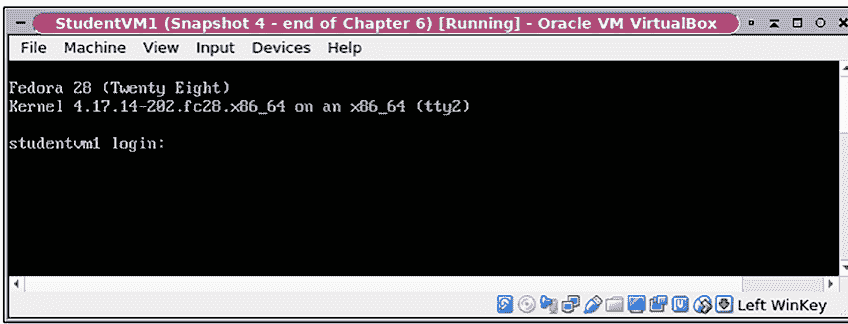

图 7-5. 显示虚拟控制台 2 登录的虚拟机窗口

如果你还没有登录（你可能还没有登录），请以 root 身份登录虚拟控制台会话 2。在登录行输入 **root** 并按下 **Enter** 键，如图 7-6 所示。输入你的 root 密码并再次按下 **Enter**。你现在应该已经登录并在命令提示符下了。

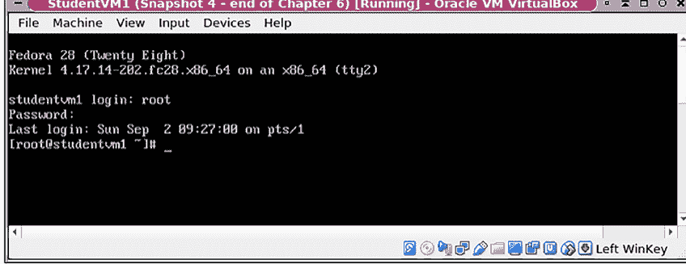

图 7-6. 以 root 登录后的 vc2

提示符显示这是 root 登录。

使用 **HostKey-F3** 切换到虚拟控制台会话 3 (vc3)。在此控制台上以 student 身份登录。请注意，任何用户都可以在虚拟控制台和 GUI 终端模拟器的任何组合中登录多次。请注意 `$` 提示符，它表示非 root（非特权）用户的提示符。在 vc3 上，运行 `ls -la` 命令。注意 bash 和其他配置文件，它们大多数以点（.）开头。你的列表结果可能与我的不同：

```
[student@studentmi ~]$ ls -la
total 160
drwx------ 15 student 4096 Sep 2 09:14 .
drwxr-xr-x. 5 root root 4096 Aug 19 08:52 ..
-rw------ 1 student 19 Aug 29 13:04 .bash_history
-rw-r--r-- 1 student 18 Mar 15 09:56 .bash_logout
-rw-r--r-- 1 student 193 Mar 15 09:56 .bash_profile
-rw-r--r-- 1 student 231 Mar 15 09:56 .bashrc
drwx------ 9 student 4096 Sep 2 09:15 .cache
drwx------ 8 student 4096 Aug 19 15:35 .config
drwxr-xr-x. 2 student 4096 Aug 18 17:10 Desktop
drwxr-xr-x. 2 student 4096 Aug 18 10:21 Documents
drwxr-xr-x. 2 student 4096 Aug 18 10:21 Downloads
-rw------ 1 student 16 Aug 18 10:21 .auth
drwx------ 3 student 4096 Aug 18 10:21 .gnupg
-rw------ 1 student 1550 Sep 2 09:13 .ICEauthority
drwxr-xr-x. 3 student 4096 Aug 18 10:21 .local
drwxr-xr-x. 4 student 4096 Apr 25 02:19 .mozilla
drwxr-xr-x. 2 student 4096 Aug 18 10:21 Music
drwxr-xr-x. 2 student 4096 Aug 18 10:21 Pictures
drwxr-xr-x. 2 student 4096 Aug 18 10:21 Public
drwxr-xr-x. 2 student 4096 Aug 18 10:21 Templates
-rw------ 1 student 5 Sep 2 09:13 .vboxclient-clipboard.pid
-rw------ 1 student 5 Sep 2 09:13 .vboxclient-display.pid
-rw------ 1 student 5 Sep 2 09:13 .vboxclient-dragrop.pid
-rw------ 1 student 5 Sep 2 09:13 .vboxclient-seamless.pid
drwxr-xr-x. 2 student 4096 Aug 18 10:21 Videos
drwxr-xr-x. 1 student 18745 Sep 2 09:24 .xfe4-session-log
-rw-r--r-- 1 student 2002 Sep 2 09:12 .xfe4-session-verbose.log
-rw------ 1 student 8724 Aug 18 21:45 .xaver
-rw------ 1 student 1419 Sep 2 09:13 .xsession-errors
-rw------ 1 student 1748 Sep 2 09:12 .xsession-errors.old
[student@studentmi ~]$
```

使用 `clear` 命令清除控制台：

```
$ clear
```

`reset` 命令重置所有终端设置。如果终端在 `cat` 二进制文件后变得不可用或无法访问，这个命令很有用。即使无法读取 `reset` 命令，它仍然有效。我有连续使用两次 `reset` 命令的经历。

如果你当前没有登录 GUI 上的终端模拟器，请这样做。使用 **HostKey-F1** 返回 GUI 并打开终端模拟器。由于你已经登录了 GUI 桌面，没有必要登录终端模拟器。打开一个终端窗口并输入 `w` 列出当前登录的用户和运行时间。你应该看到至少三个登录：tty2 的 root，tty3 的 student 以及 tty1 的 student（它是 GUI 控制台）：

```
$ w
16:48:31 up 2 days, 7:35, 5 users, load average: 0.05, 0.03, 0.01
USER    TTY     LOGIN@ IDLE    JCPU PCPU    WHAT
student tty1 Sun09               days 10.41s 0.05s /bin/sh /etc/xdg/xfce4/xinitrc -- -
student pts/1 Sun09             18:57m 0.15s 0.05s sshd: student [priv]
root    tty2    13:07             3.41m 0.02s 0.02s -bash
student pts/3 13:17             4.00s 0.05s 0.03s w
student tty3 13:21             3.24m 0.03s 0.03s -bash
[student@studentvm ~]$
```


我列出的登录项比你多，因为我还通过 SSH 从物理工作站“远程”登录了。这让我更容易复制和粘贴命令结果。由于虚拟网络的设置，在课程第三卷的第 42 章之前，你将无法从不同的主机 SSH 进入虚拟机。

注意第一行数据显示 student 登录在 `tty1`。`tty1` 是 GUI 桌面。你还会看到 `tty2` 和 `tty3` 的登录，以及两个使用伪终端 (`pts`) 的登录 `pts/1` 和 `pts/3`。这些是我远程 SSH 会话。

输入 `who` 命令。它提供的信息与 `w` 相似但略不同：

```
$student@studentvm1 ~$ who

student tty1      2018-09-02 09:13 (:)

student pts/1      2018-09-02 09:26 (192.168.0.1)

root tty2          2018-09-04 13:07

student pts/3      2018-09-04 13:17 (192.168.0.1)

student tty3      2018-09-04 13:21
```

在 `who` 命令的结果中，你还可以看到我通过 SSH 登录的 IP 地址。`(tty)` 字符串不是表情符号；它是表示 `tty1` 连接到 `:0` – 第显示器的指示。

输入 `whoami` 显示你当前的登录名：

```
$student@studentvm1 ~$ whoami

student

$student@studentvm1 ~$
```

你的登录名也显示在命令提示符的文中。然而，你并不总是你认为的自己。

输入 `id` 命令显示你的用户 ID、有效 ID 和 GID。`id` 命令还显示用户所属的组列表：

```
$student@studentvm1 ~$ id

uid=1000(student) groups=1000(student)

context=unconfined_u:unconfined_r:unconfined_t:s0-s0:c0.c023

$student@studentvm1 ~$
```

我们将详细讨论用户 ID、组和组 ID。

## 第 7 章 使用 Linux 命令行

切换回控制台会话 2。像其他控制台会话一样使用 `whoami`、`who` 和 `id` 命令。我们也来使用 `who am i` 命令：

```
[student@studentvm ~]$ whoami

student

[student@studentvm ~]$ who

root  pts/1    2019-01-13 14:13 (192.168.0.1:S.0)

root  pts/2    2019-01-14 12:09 (192.168.0.1:S.1)

student pts/3    2019-01-15 16:15 (192.168.0.1)

student tty1    2019-01-15 21:53 (:0)

student pts/5    2019-01-15 22:04 (:pts/4:S.0)

student pts/6    2019-01-15 22:04 (:pts/4:S.1)

student tty2    2019-01-15 22:05

student tty3    2019-01-15 22:06

student pts/8    2019-01-15 22:19

[student@studentvm ~]$ id

uid=1000(student) gid=1000(student) groups=1000(student)

context=unconfined_u:unconfined_r:unconfined_t:s0-s0:c0.c.1023

[student@studentvm ~]$ who am i

student pts/8    2019-01-15 22:19
```

退出所有虚拟控制台会话。

使用 `Ctrl-Alt-F1` (HostKey-F1) 返回 GUI 桌面。

虚拟控制台被分配给设备文件，例如图 7-3 所示虚拟控制台 2 对应的 `/dev/tty2`。我们将在整个课程中详细介绍设备文件，特别是在第 2 卷的第 3 章。Linux Console² 是 Linux 虚拟控制台的终端模拟器。

> ²Wikipedia, Linux Console, https://en.wikipedia.org/wiki/Linux_console

## 终端模拟器

让我们继续学习术语。终端模拟器是一个模拟硬件终端的软件程序。目前大多数图形化终端模拟器，例如图 7-7 所示的 Xfce4 终端模拟器，都可以模拟几种不同类型的硬件终端。大多数终端模拟器都是运行在任何 Linux 图形桌面环境中的图形化程序，如 Xfce、KDE、Cinnamon、LXDE、GNOME 等。

你可以在图 7-7 中看到，在 Xfce4 终端模拟器窗口中点击右键会弹出一个菜单，允许打开另一个标签或另一个模拟器窗口。该图还显示当前有两个标签打开着。你可以在菜单栏下方看到它们。

**图 7-7.** 打开了两个标签的 Xfce4 终端模拟器

第一个终端模拟器 Xterm，³ 最初由 Thomas Dickey⁴ 于 1984 年开发。原始的 Xterm 仍在被维护，并作为许多现代 Linux 发行版的一部分进行打包。其他终端模拟器包括 `xfce4-terminal`，⁵ GNOME terminal，⁶ Tilix，⁷ `rxvt-unicode`，⁸ Terminator，⁹ Konsole，¹⁰ 等更多。这些终端模拟器中的每一个都有一组针对特定用户群的有趣功能。另一些则只提供执行功能所需的最小功能集，通常在需要较小体积和效率时使用。

我最喜欢的终端模拟器是 `xfce4-terminal`、Konsole 和 Tilix，因为它们提供了在单个窗口中拥有多个终端模拟器会话的能力。Xfce4 和 Konsole 终端通过多个可以在之间切换的标签来实现这一点。Tilix 提供了在窗口会话中为多个模拟器会话命名的能力，并提供了多个会话。我目前选择终端模拟器是 Xfce4，主要因为它提供了一组良好的功能，与终端一样好，但非常轻量且消耗的系统资源更少。其他终端模拟器软件提供了许多这些功能，但没有 Xfce4 和 Tilix 那么无缝方便。

对于本课程，我们将使用 Xfce4 终端，因为它是 Xfce 桌面的默认终端，非常节省系统资源，并且包含了我们所需的所有功能。我们将在第 14 章安装并探索其他终端模拟器。

## 伪终端

伪终端是一个 Linux 设备文件，终端模拟器连接到该文件以与操作系统进行接口交互。伪终端的设备文件位于 `/dev/pts` 目录，并在创建新的终端模拟器时被创建——

> ³Wikipedia, Xterm, https://en.wikipedia.org/wiki/Xterm
> ⁴Wikipedia, Thomas Dickey, https://en.wikipedia.org/wiki/Thomas_Dickey
> ⁵Xfce4 Documentation, xfce4-terminal, https://docs.xfce.org/apps/terminal/introduction
> ⁶Wikipedia, GNOME terminal, https://en.wikipedia.org/wiki/GNOME_terminal
> ⁷Wikipedia, Tilix, https://en.wikipedia.org/wiki/Tilix
> ⁸Wikipedia, rxvt-unicode, https://en.wikipedia.org/wiki/rxvt-unicode
> ⁹Wikipedia, Terminator, https://en.wikipedia.org/wiki/Terminator
> ¹⁰Wikipedia, Konsole, https://en.wikipedia.org/wiki/Konsole

## Shell

Shell 是操作系统的命令解释器。每个可用的 Shell 都将由用户输入的命令转换为操作系统可使用的格式。当结果返回到 Shell 时，它将其显示在终端上。

大多数 Linux 发行版的默认 Shell 是 bash。Bash 的意思是“Bourne Again Shell”，因为 bash Shell 是基于旧的 Bourne shell，后者由 Steven Bourne 于 1977 年编写。有很多其他可用的 Shell。我经常遇到的是四个，但也存在其他的¹²

- **csh**: 为喜欢 C 语言语法的程序员设计的 C Shell
- **ksh**: David Korn 编写，深受 Unix 用户欢迎
- **tcsh**: 更多易用性的 csh 版本
- **zsh**: 结合了许多 Shell 的功能

所有 Shell 都有内置命令，用于补充或替换核心工具提供的命令。打开 bash 的手册并找到“BUILT-INS”部分查看 Shell 提供的命令列表。

## 使用不同的 Shell

到为止我们一直在使用 bash Shell，所以你对它有简短的体验。有些其他 Shell 可能更适合你的需求。我们将在实验中查看另外三个。

## Session

Session 是另一个可以应用于不同事物但保持相同含义的术语。最基本的应用是终端。在最基本的意义上，会话是指连接到远程主机的单个窗口。Xfce4 终端通过将每个会话放在单独的标签上支持多个会话。

> ¹¹ Wikipedia, Device File, https://en.wikipedia.org/wiki/Device_file
> ¹² Wikipedia, Comparison of command shells, https://en.wikipedia.org/wiki/Comparison_of_command_shells

## 实验 7-2：使用不同的 shell

由于大多数 Linux 发行版都使用 bash 作为默认 shell，我假设你一直在使用它，并且它是你的默认 shell。在本章的准备工作中，我们安装了另外三个 shell：ksh、tcsh 和 zsh。

请以用户 student 的身份执行此实验。首先查看你的命令行提示符，它看起来应该是这样的：

```
[student@studentvm1 ~]$
```

这是非根用户的标准 bash 提示符。现在让我们切换到 ksh。只需输入 shell 的名称：

```bash
[student@studentvm1 ~]$ ksh

$
```

你可以从提示符的区别中看出这是一个不同的 shell。如果你需要确切知道自己正在使用哪种 shell，还有一个有趣的技巧可以尝试：

```bash
$ echo $0

ksh
```

运行几个简单的命令，如 `ls` 和 `free`，你会发现这些命令的运行方式没有区别。这是因为大多数命令都是独立于 shell 的（内置命令除外）。尝试 `ll` 命令：

```bash
$ ll

ksh: ll: not found [No such file or directory]

$
```


执行失败是因为 Korn 的别名与 bash 的别名不同。尝试向上滚动以获取像 bash 一样的命令历史记录。它不起作用。

## $ zsh

这是针对新用户的 Z Shell 配置函数 `zsh-newuser-install`。

你看到这条消息是因为你没有 zsh 启动文件（位于目录 `~` 目录下的 `.zshenv`、`.profile`、`.zshrc` 和 `.login` 文件）。此函数可以帮助你进行一些设置，让你的 shell 使用变得更加方便。

## 第 7 章 使用 Linux 命令行

你可以：

- (q) 退出且什么都不做。该函数将在下次将再次运行。
- (0) 退出并创建一个仅包含注释的 `~/.zshrc` 文件。这将防止该函数再次运行。
- (1) 继续进入主菜单。

输入按键 "1"，你将进入一系列菜单，这些菜单将帮助你根据需求配置 Z shell——尽管你在这个阶段可能还对它们了解得有限。我选择了 "Q" 进入提示符，它看起来和 bash 提示符略有不同：

```
[student@studentvm1]~%
```

在 Z shell 中运行几个简单的命令。然后输入两次 `exit` 即可回到原始的顶层 bash shell：

```bash
[student@studentvm1]~% w

14:30:25 pm 3 days, 6 users, load average: 0.00, 0.00, 0.02

USER TTY LOGIN@ IDLE JCPU PCPU WHAT

student pts/0 Tue08 0.00s 0.07s 0.00s w

root pts/1 Wed06 18:48 0.26s 0.26s -bash

student pts/2 08:14 6:16m 0.03s 0.03s -bash

[student@studentvm1]~% exit

$ exit

[student@studentvm1]~$
```

你认为如果在已经在 bash shell 的情况下再启动一个 bash shell 会发生什么？

```bash
[student@studentvm1]~$ bash

[student@studentvm1]~$ ls

Desktop Documents Downloads Music Pictures Public Templates Videos

[student@studentvm1]~$ exit

exit

[student@studentvm1]~$
```

你只是进入了另一个 bash shell。

## 第 7 章 使用 Linux 命令行

这所展示的内容比表面看起来要多。首先，每个 shell 都是一个层。启动一个新的 shell 不会终止上一个。当你从 bash 启动 zsh 时，bash shell 留在了后台，当你从 zsh 退出时，你会被返回到等待状态的 shell。

事实证明，当从 shell 运行任何命令或进程时，正是这种情况。命令在自己的会话中运行，而父 shell（进程）会等待该子命令（子进程）结束并将控制权返回给它，然后才能继续处理命令。

如果你有一个运行其他命令的脚本（这脚本的目的），脚本会运行每个命令，并等待其完成后再移动到下一个命令。

这种行为可以通过在命令末尾添加 ampersand (`&`) 来修改，这会将调用的命令放在后台运行，允许用户继续与 shell 交互，或让脚本继续处理命令。你只应该对不需要进一步人工交互或不需要输出到 STDOUT 的命令这样做。如果稍后运行的其他命令需要该命令的结果，但可能在后台任务完成之前就需要这些结果，那么你也不应该在后台运行该命令。

由于 Linux 为系统管理员和用户提供了许多选项，其实没有必要将程序移动到后台。只需在桌面上打开另一个终端模拟器，在 screen 会话中启动另一个终端模拟器，或者切换到一个可用的虚拟控制台。这种能力在脚本中可能更有用，用于启动在脚本继续处理其他命令时运行的程序。

你可以使用 `chsh` 命令更改 shell，更改将在你每次登录并启动新会话时持续有效。我们将在第 14 章更详细探讨终端模拟器和 shell。

## Secure Shell (SSH)

Secure Shell (SSH) 是一种加密网络协议，用于在不安全的网络上运行网络服务。它通常用于在不安全的网络上以安全的方式远程登录计算机。SSH 替代了旧的协议，如 telnet、rsh、rlogin 和 ftp，这些协议因为以明文发送数据而不安全。

SSH 还用于安全文件传输、远程隧道和端口转发。它提供了对远程计算机的强身份验证，以及对连接上传输数据的加密。这确保了数据不会被未经授权的第三方拦截或篡改。

12. 要断开 screen 会话和所有打开的终端，请按 `Ctrl-A` + `D`。
请注意，这将使所有终端及其中的程序保持完好并继续运行。

13. 在命令行上输入 `screen -list` 命令可以列出所有当前的 screen 会话。`screen -ls` 命令的作用相同，但稍微短一点。无论哪种方法，这在存在多个会话时都可以用来确保你重新连接到正确的 screen 会话。

14. 使用命令 `screen -r` 重新连接活跃的 screen 会话。如果有多个活跃的 screen 会话，将显示它们的列表，你可以选择你想要连接的一个；你必须输入想要连接的 screen 会话名称。

我建议不要在现有的 screen 会话内部再开启一个新的 screen 会话。在终端之间切换可能会很困难，因为 screen 程序并不总是理解应该将命令发送到嵌入的哪一个会话。

我一直使用 screen 程序。它是一个强大的工具，为我在命令行下工作提供了极大的灵活性。

## GUI 与 CLI

你可能喜欢并使用几乎在所有 Linux 发行版中提供的许多图形用户界面，即桌面；你可能会发现某个特定的桌面（如 KDE）对于某些任务更易用，而另一个（如 GNOME）更适合其他任务。你还会发现，管理 Linux 计算机所需的大多数图形工具仅仅是执行这些功能的底层 CLI 命令的封装器。

图形界面无法与 CLI 强大，因为 GUI 本质上受限于程序员决定你应该访问的功能。这就是 Windows 和其他限制性操作系统的运行方式。它们只允许你访问它们认为你应该拥有的功能和力量。这可能是因为开发者认为你真的想免受计算机全部力量的干扰，也可能是因为他们认为你没有能力处理那种程度的力量，又可能是编写一个 GUI 来完成 CLI 能做的所有事情对开发者来说是非常耗时的，且优先级较低。

## 第 7 章 使用 Linux 命令行

GUI 在某些方面的局限性，并不意味着优秀的系统管理员无法利用它来让工作变得轻松。我发现，通过桌面上的命令行终端窗口或通过使用如 Xfce、Tilix 等为 GUI 环境设计的高级终端仿真程序，我可以更灵活地利用 GUI 来提高工作效率。在桌面上拥有多个终端让我了同时登录到多台计算机的能力。我也可以多次登录到任何计算机。我可以使用我的所有用户 ID 打开多个终端会话，并使用 root 打开更多的终端会话。

对我来说，随时以多种方式可以使用多个终端会话，这就是 GUI 的意义所在。GUI 可以为我提供如 LibreOffice 这样的程序（我正在用它写这本书）、图形化电子邮件和网页浏览器应用等。但对于系统管理员来说，真正的力量在于命令行。

Linux 的 GNU 核心工具最初由 Richard M. Stallman¹³（也称为 RMS）编写，是任何免费版本的 Unix 或类 Unix 操作系统所需的开源工具。GNU 核心工具是任何作为 GNU/Linux 的 GNU 操作系统中的基本文件、外壳和文本处理工具，且任何系统管理员都可以确信这些工具会存在于每个 Linux 版本中。此外，每个 Linux 发行版都有一套扩展工具集，提供了更多功能。

你可以输入命令 `infoutils` 来查看 GNU 核心工具列表，并选择单个命令获取更多信息。你也可以使用 `man <command>` 查看这些每个命令的帮助页，以及在每个发行版中都是标准的数百个 Linux 命令的帮助页。

## 重要的 Linux 命令

最基础的 Linux 命令是那些允许你确定和更改当前目录结构中位置的命令；创建、管理和查看文件；查看系统状态的各个方面等。这些实验将向你介绍一些能够让你完成所有这些操作的基础命令。它还涵盖了一些在问题确定过程中经常使用的高级命令。

> ¹³ Wikipedia, Richard M. Stallman, https://en.wikipedia.org/wiki/Richard_Stallman

## 第 7 章 使用 Linux 命令行

这些实验中涵盖的大多数命令都有许多选项，其中某些可能非常晦涩。这些实验既不是为了涵盖所有可用的 Linux 命令（有数百个），也不是为了涵盖这些任何命令的所有选项。这仅作为这些命令及其用途的介绍。

## PWD

“PWD”一术语指的是“当前工作目录”（present working directory），你可能知道它被称为“当前目录”。PWD 是重要的，因为除非在命令中显式指定另一个位置，否则命令操作都会在 PWD 中进行。`pwd` 命令的意思是“打印工作目录”，即在 shell 输出中打印当前目录的名称。注意 `pwd` 命令全小写。

## 目录路径表示样式

路径是引用 Linux 目录树中目录的一种表示方法。它为我们表达不在 PWD 中的目录或文件的路径提供了一种方法。Linux 广泛使用路径来方便定位和访问可执行文件，使得在执行时无需输入整个路径。

例如，输入 `ls` 比输入 `usr/bin/ls` 来运行 ls 命令更容易。shell 使用 `PATH` 变量，在其中找到一个目录列表，并在其中搜索名为“ls”的可执行文件。

### 实验 7-4：路径表示法

这个简单的实验显示了学生用户 `PATH` 变量的内容：

```bash
$ student@studentvm1 ~$ echo $PATH

/usr/local/bin:/usr/bin:/usr/local/sbin:/usr/sbin:/home/student/.local/bin:/bin

$ student@studentvm1 ~$
```

shell 将搜索的各种路径——目录——列在上一个命令的输出中。每个路径之间用冒号（:）隔开。

## 第 7 章 使用 Linux 命令行

我们有两种表示方法可以表示路径——绝对路径和相对路径。绝对路径是从根目录完整指定的。因此，如果 PWD 是我家目录下的 Downloads 目录，我将绝对路径指定为 `/home/student/Downloads`。以此为 PWD，我需要将 Documents/Work 的绝对路径指定为 `/home/student/Work`。我也可以从当前的 PWD 使用相对路径指定该路径，即 `../Documents/Work`。我也可以使用 `~/Documents/Work`，因为波浪（~）是我家目录的快捷。

## 在目录树中移动

让我们看看如何在命令行文件系统目录树中移动。很多时候，如果某个目录是 PWD，在那里工作会更容易。移动文件系统是一项非常重要的能力，快捷方法也有帮助。

### 实验 7-5：在目录树中移动

以学生身份执行此实验。你应该已经登录到 Xfce 桌面并打开了作为学生的 Xfce 终端会话。如果还没有，现在就去做。

在 Linux 文件系统树中移动对于许多原因都是重要的。你将在整个课程以及现实生活中作为系统管理员时使用这些技能。

以学生身份启动终端会话。检查当前工作目录：

```bash
$ student@studentvm1 tmp]$ pwd

/tmp

$ student@studentvm1 tmp]$ cd

$ student@studentvm1 ~]$ pwd

/home/student

$ student@studentvm1 ~]$
```

第一次检查时，PWD 是 `/tmp` 目录，因为我一直在那里工作。你的 PWD 将是你的家目录（~）。使用不带任何选项的 `cd` 命令始终会让你的家目录成为 PWD。注意命令行提示符中的波浪（~）是你家目录的快捷指示。

## 第 7 章 使用 Linux 命令行

现在执行一个简单的命令 `ls -l`，来查看你家目录的内容。这些目录在新用户首次使用 GUI 登录账户时会被创建：

```bash
$studentvm1~$ $ ls -l

total 212

drwxr-xr-x. 2 student student 4096 Aug 18 17:10 Desktop

drwxr-xr-x. 2 student student 4096 Aug 18 10:21 Documents

drwxr-xr-x. 2 student student 4096 Aug 18 10:21 Downloads

drwxr-xr-x. 2 student student 4096 Aug 18 10:21 Music

drwxr-xr-x. 2 student student 4096 Aug 18 10:21 Pictures

drwxr-xr-x. 2 student student 4096 Aug 18 10:21 Public

drwxr-xr-x. 2 student student 4096 Aug 18 10:21 Templates

[studentvm1~$]
```

此命令不会显示你家目录中所谓的隐藏文件，这使得扫描其余内容变得更容易。

让我们在那里创建几个文件来操作，目前除了默认创建的隐藏配置外什么都没有。以下命令行程序将创建几个文件，这样我们就有比目录之外的内容可以看了。随着课程的进行，我们将详细介绍命令行编程。如果行在屏幕上换行也没关系；在完成整个命令之前不要按回车：

```bash
$studentvm1~$ $ for X in dmesg.txt dmesg1.txt dmesg2.txt dmesg3.txt dmesg4.txt; do dmesg >$X; done

[studentvm1~$

total 252

drwxr-xr-x. 2 student student 4096 Sep 29 15:31 Desktop

-rw-rw-r--. 1 student student 41604 Sep 30 16:13 dmesg1.txt

-rw-rw-r--. 1 student student 41604 Sep 30 16:13 dmesg2.txt

-rw-rw-r--. 1 student student 41604 Sep 30 16:13 dmesg3.txt

-rw-rw-r--. 1 student student 41604 Sep 30 16:13 dmesg4.txt

-rw-rw-r--. 1 student student 41604 Sep 30 16:13 dmesg.txt

drwxr-xr-x. 2 student student 4096 Sep 29 15:31 Documents

drwxr-xr-x. 2 student student 4096 Sep 29 15:31 Downloads

drwxr-xr-x. 2 student student 4096 Sep 29 15:31 Music

drwxr-xr-x. 2 student student 4096 Sep 29 15:31 Pictures

drwxr-xr-x. 2 student student 4096 Sep 29 15:31 Public

drwxr-xr-x. 2 student student 4096 Sep 29 15:31 Templates

drwx-xr-x. 2 student student 4096 Sep 29 15:31 Videos

[student@studentvm1 ~]$
```

这个长列表显示了每个文件和目录的所有权和权限。`drwx-xr-x` 显示这是一个目录，而文件在该位置显示为连字符 `-`。文件权限由三组组成：(R)读、(W)写和 (X)执行。每一组分别代表所有者、所属组和其他用户。这些权限对于目录有所不同。我们将在第 18 章详细探讨文件和目录的所有权和权限。

进入 `/var/log` 并列出内容：

```bash
[student@studentvm1]# cd /var/log ; ls -l

total 18148

drwx-xr-x. 2 root 4096 Aug 13 16:24 anaconda

drwx----. 2 root 4096 Jul 18 13:27 audit

drwx-xr-x. 2 root 4096 Feb 9 2018 blivet-gui

-rw------. 1 root 74912 Sep 2 09:13 boot.log

-rw-rw----. 1 root 768 Sep 2 09:26 btmp

-rw-rw----. 1 tmp 384 Aug 18 10:21 btmp-20180901

<snip>

drwx-xr-x. 2 lightdm lightdm 4096 Sep 2 09:13 lightdm

-rw------. 1 root 0 Sep 2 03:45 messages

-rw------. 1 root 0 Apr 25 02:21 messages-20180831

-rw------. 1 root 0 Aug 19 03:51 messages-20180831

-rw------. 1 root 0 Aug 31 14:47 messages-20180902

-rw------. 1 root 236050 Sep 6 13:03 messages

-rw------. 1 root 153952 Aug 19 03:48 messages-20180819

-rw------. 1 root 142056 Aug 31 14:44 messages-20180831

drwx-xr-x. 3 root 4096 Jul 8 22:49 pluto

-rw-r--. 1 root 1040 Jan 18 07:39 README

<snip>

-rw-r--. 1 root 29936 Sep 4 16:48 auth.log
```


# 使用 LIN 命令行

你能确定哪些文件和哪些目录吗？尝试显示 `messages` 文件的内容：

```
[student@studentvm1 log]$ cat messages
cat: messages: Permission denied
[student@studentvm1 log]$
```

# 实验 7-6：制表补全

实验 7-6 对命令补全进行了非常短的介绍。

请以 student 用户身份执行此实验。你的主目录应该有一个名为 Documents 的子目录用于此实验。大多数 Linux 发行版都会为每个用户创建一个 Documents 子目录。

确保你的主目录是 PWD（当前工作目录）。我们将使用补全功能进入 `~/Documents` 目录。在终端中输入以下部分命令：

```
$student@studentvm1~$ cd DcTab
```

`<Tab>` 意味着按一次 Tab 键。什么都没有发生，因为有三个以 "D" 开头的目录。你可以通过快速连续按 Tab 键，列出所有匹配你已输入字符的目录：

```
$student@studentvm1~$ cd DcTab<Tab>
Desktop/ Downloads/
$student@studentvm1~$ cd D
```

现在在命令中添加 "o" 并再次按两次 Tab 键：

```
$student@studentvm1~$ cd Do<Tab><Tab>
Documents/ Downloads/
$student@studentvm1~$ cd Do
```

你应该看到两个以 "Do" 开头的目录列表。现在在命令中添加 "c" 并按一次 Tab 键：

```
$student@studentvm1~$ cd Doc<Tab>
$student@studentvm1~$ cd Documents/
```

如果你输入 `cd Doc<Tab>`，命令中的剩余目录名将被补全。按回车键切换到新目录。

现在让你的主目录成为 PWD。

让我们快速查看命令的补全。在这种情况下，命令相对短，但大多数命令都是如此。假设我们想要确定主机当前的运行时间（uptime）：

```
[student@studentvm1 ~]$ up<Tab><Tab>
update-alternatives updatedb update-mime-database upower
update-ca-trust update-desktop-database update-pciids utime
update-crypto-policies update-gtk-immodules update-smart-drivedb
[student@studentvm1 ~]$ up
```

我们可以看到好几个以 "up" 开头的命令，我们还可以看到输入更多字母 "t" 就会补全 `uptime` 命令，使其剩余部分变得唯一。

```
[student@studentvm1 ~]$ up<Tab>ime
07:55:05 up 1 day, 10:01, 7 users, load average: 0.00, 0.00, 0.00
```

补全功能只有在剩余文本字符串明确唯一时才会补全命令、目录名或文件名。

Tab 补全适用于命令、某些子命令，以及文件名和目录名。我发现补全对于完成目录名和文件名最有用（因为它们通常较长），以及一些较长的命令和某些子命令。

许多 Linux 命令非常短，使用补全功能的效率实际上比直接输入命令更低。短命令名非常符合懒惰系统管理员（SysAdmin）的习惯。这取决于你认为在短命令上使用补全更高效还是更符合习惯。一旦你学会了哪些命令值得 Tab 补全以及你需要输入多少，你就可以使用那些你认为有帮助的命令。

# 探索文件

在下一个实验中，我们将探索的命令都与创建和操作文件对象有关。

# 实验 7-7：探索文件

请以 student 用户身份执行此实验。你应该已经通过 GUI 以 student 身份登录了 Linux 计算机，并打开了一个 Xfce 终端会话。

通过终端菜单栏选择 File，然后从下拉菜单中选择 Open Tab 打开新标签页。新标签页将变为活动页，且它已经以 student 身份登录。在终端中打开新标签的另一种简单方法是在终端窗口任何地方点击右键，并从弹出菜单中选择 Open Tab。

输入 `pwd` 命令来确定当前工作目录（PWD）。它应该显示为 `/home/student`：

```
[student@studentvm1 ~$] pwd
/home/student
[student@studentvm1 ~$]
```

如果 PWD 不是你的主目录，请使用不带任何选项或参数的 `cd` 命令切换到主目录。

让我们创建一些新文件，就像你之前在一个项目中作为 root 所做的那样。`cp` 命令用于复制文件。使用以下命令创建并复制一些：

```
[student@studentvm1 ~$] touch newfile.txt
[student@studentvm1 ~$] df -h > usage.txt
```

使用 `ls -Lah` 命令显示主目录中文件的详细列表，并以人类可读的格式显示它们的大小。注意每个文件上显示的时间是 mtime，即文件或目录最后修改的时间。有很多以点（.）作为开头字符的“隐藏”文件。如果你不需要看到隐藏文件，请使用 `ls -lh`。

`touch dmesg2.txt` 会更改该文件的所有时间：

```
[student@studentvm1 ~$] touch dmesg2.txt
[student@studentvm1 ~$] ls -lh
total 216
drwxr-xr-x. 2 student 4.0K Aug 18 17:10 Desktop
-rw-rw-r--. 1 student 1.8K Sep 6 09:08 diskusage.txt
-rw-rw-r--. 1 student 44K Sep 6 10:52 dmesg1.txt
-rw-rw-r--. 1 student 44K Sep 6 10:54 dmesg2.txt
-rw-rw-r--. 1 student 44K Sep 6 10:52 dmesg3.txt
-rw-rw-r--. 1 student 44K Sep 6 10:52 dmesg.txt
drwxr-xr-x. 2 student 4.0K Aug 18 10:21 Documents
drwxr-xr-x. 2 student 4.0K Aug 18 10:21 Downloads
drwxr-xr-x. 2 student 4.0K Aug 18 10:21 Music
-rw-rw-r--. 1 student 0 Sep 6 10:52 newfile.txt
drwxr-xr-x. 2 student 4.0K Aug 18 10:21 Pictures
drwxr-xr-x. 2 student 4.0K Aug 18 10:21 Templates
drwxr-xr-x. 2 student 4.0K Aug 18 10:21 Videos
```

# 第 7 章 使用 Linux 命令行

要查看屏幕底部的单个新行，请按 Enter 键。

按空格键（space bar）可以查看相应命令的整页输出。

你也可以使用向上和向下方向键逐行按相应方向移动。Page Up（向上翻页）和 Page Down（向下翻页）键可以一次移动一页。使用这四个键来导航输出流。当到达数据流结束时，你会在屏幕底部看到 (END)。

你也可以指定行号并使用 G “跳转”（Goto）到指定的行号。以下输入将跳转到 256 行，并将显示在终端顶部。

```
256G
```

不带行号的大写 G 会带你到数据流的末尾。

```
G
```

小写 g 会带你到数据流的开头。

```
g
```

按 Q 键退出并返回命令行。

`less` 中的移动命令与 vim 非常相似，因此你应该会觉得很熟悉。

时间和日期非常重要，Linux 的 `date` 和 `cal` 命令提供了一些有趣的功能。

输入 `date` 命令显示今天的日期：

```
[student@studentvm1 ~]$ date
Thu Jan 19 11:15:46 EST 2023
[student@studentvm1 ~]$
```

输入 `cal` 命令显示当前月的日历：

```
[student@studentvm1 ~]$ cal
January 2023
Su Mo Tu We Th Fr Sa
1 2 3 4 5 6 7
8 9 10 11 12 13 14
15 16 17 18 19 20 21
22 23 24 25 26 27 28
29 30 31
[student@studentvm1 ~]$
```

输入以下命令显示 1949 年全年的日历：

```
[student@studentvm1 ~]$ cal 1949
```

使用命令 `cat /etc/passwd | less` 显示密码文件的内容。提示：它实际上并不包含任何密码。浏览一段时间后，从 `less` 退出。

输入以下命令生成数据流，并将结果管道传输给 `wc`（单词计数），以统计数据流中的单词、行和字符数：

```
[student@studentvm1 ~]$ cat /etc/services | wc
11473 63130 692241
[student@studentvm1 ~]$
```

这显示 `wc` 统计了数据流中的 11,473 行、63,130 个单词和 692,241 个字符。你结果中的数字应该相同或接近。`services` 文件是各种网络服务用于计算机间通信的标准分配和识别的端口列表。

`wc` 命令可以单独使用。使用 `wc -l /etc/services` 来统计该文件的行数。这里小写的 `-l` 代表“line”（行）。

# 命令回溯与编辑

懒惰的管理员不喜欢打字。我们尤其不喜欢重复输入。使用 bash shell 历史可以帮助这一点。`history` 显示从命令行发出的最后 1000 条命令。你可以使用向上/向下方向键在命令行中滚动查看历史记录，然后无需或尽量少重试即可执行相同或修改后的命令。

命令行编辑可以使输入相似命令的列表变得简单。可以使用向上箭头回滚动命令历史来查找之前的命令。然后可以进行简单的编辑来对原始命令进行修改。左方向键和右方向键用于在正在编辑的命令中移动。Backspace 退格键用于删除字符，只需输入即可完成修改后的命令。

# 实验 7-9：命令回溯与编辑

以学生用户身份开始此实验。我们将途中切换到 root。在本次实验中，我们将学习使用 bash 历史、命令行回溯以及对回溯的命令行进行编辑。

输入 `history` 命令查看当前的命令历史：

```
[student@studentvm1 ~]$ history
1 su -
2 poweroff
3 su -
4 ls -la
5 clear
6 w
7 who
8 whoami
9 id
10 ksh
11 exit
12 info core-utils
13 info core-utils
14 info coreutils
15 info utils-linux
16 info utilslinux
17 info utils
18 info coreutils
19 ls -la
20 tty
<snip>
257 dnf list installed
258 dnf list installed | wc
259 dnf list available | wc
260 dnf list available
261 dnf info zorba
262 dnf zipper
263 history
[student@studentvm1 ~]$
```

使用向上箭头滚动历史记录。当你找到一个非破坏性的命令时（例如历史记录中应该存在的许多命令之一），只需按 Enter 键即可再次执行该命令。

使用 `history` 命令再次查看历史。选择一个你想要的命令。

# 第 8 章

## 核心工具

## 目标

在本章中，你将学习：

- GNU 核心工具的一些发展历史
- util-linux 工具的一些发展历史
- 如何使用一些基础核心工具

我经常为我正在写的文章和书籍进行研究——是的，包括这本书中——GNU 核心工具出现的非常频繁。所有的系统管理员（SysAdmins）都会经常使用这些工具，而且几乎是不经思索的。还有另一组基础工具，util-linux，我们也应该查看它们，因为它们也是重要的 Linux 工具。

这两组工具共同构成了 Linux 系统管理员完成日常任务时使用的许多最基础的工具。这些任务包括文本文件、目录、数据流、各种类型的存储媒体、进程控制、文件系统的管理和操作。这些工具的主要功能是允许系统管理员执行管理 Linux 计算机所需的许多基础任务。这些工具是不可或缺的，因为没有它们，在 Unix 或 Linux 计算机上无法完成任何有用工作。

# GNU 核心工具 (Coreutils)

要理解 GNU 核心工具的起源，我们需要通过时光机（Wayback machine）短暂回到贝尔实验室的 Unix 早期时代。Unix 最初的编写是为了让 Ken Thompson、Dennis Ritchie、Doug McIlroy 和 Joe Ossanna 能够继续他们在开发名为 Multics 的大型多任务多用户计算机项目时所开始的某些工作。那个“小小东西”是一个名为“太空旅行”（Space Travel）的游戏。正如今天一样，似乎总是是游戏者推动着计算技术的发展。这个新的操作系统比 Multics 限制得多，一次只能允许两个用户登录，因此它被称为 UNICS。这个名字后来改成了 Unix。

随着时间的推移，Unix 取得了巨大的成功，贝尔实验室开始以媒体成本和共享的方式将其赠给大学，随后提供给公司。在当时，系统级软件在组织和程序员之间共享，因为他们都在系统管理的背景下努力实现共同目标。

最终，PHIBs 决定他们应该开始从 Unix 中赚钱，并开始使用更具限制性的——更昂贵的——许可协议。这发生在通用软件正变得越来越专有、受限且封闭时期。与其他用户和其他组织共享软件变得不再可能。

一些人不喜欢这一点，并用自由软件与其进行反抗。Richard M. Stallman（又名 RMS）带领了一群反叛者，他们试图编写一个开放且免费获取的操作系统，他们称之为“GNU 操作系统”。这个小组创建了后来成为 GNU 核心工具²的内容，但尚未产生可行的内核。

当 Linus Torvalds 初步工作并编译 Linux 内核时，他需要一组非常基础的系统工具来开始执行有用的工作。内核本身不提供命令，也不提供任何类型的命令 shell（如 bash）。它本身是无用的。因此，Linux 使用免费获取的 GNU 核心工具并针对 Linux 对它们进行了重新编译。这形成了一个完整的操作系统，尽管它非常基础。

这些命令最初是三个独立的集合：fileutils、shellutils 和 textutils，它们在 2002 年合并为 Linux 核心工具。

# 实验 8-1：介绍 GNU 核心工具

在执行此实验之前，你需要安装 info 包。`info` 命令包含了关于 coreutils 和其他工具的信息，这些信息在其他地方都无法找到。安装 info 包：

```
[root@studentvm~]# dnf -y install info
```

> ¹ 维基百科，Unix 历史, https://en.wikipedia.org/wiki/History_of_Unix
> ² GNU 操作系统, 核心工具, www.gnu.org/software/coreutils/coreutils.html

实验的其余部分可以由学生用户执行。

你可以通过 `info` 命令学习组成 GNU 工具集的所有单个程序。如果你在 Xfce 桌面面上还没有打开终端模拟器，请现在打开一个：

```
$student@studentvm1~$ info coreutils
Next: Introduction, Up: (dir)
```


## GNU Coreutils

本手册记录了 GNU 核心工具的 8.29 版本，包括用于文本和文件操作的标准程序。

版权所有 © 1994-2017 Free Software Foundation, Inc.

> 允许根据 GNU 自由文档许可 1.3 版本或由自由软件基金发布的任何后续版本的条款复制、分发和/或修改本文；且不包含不变章节、不包含封面文本、不包含封底文本。许可的副本包含在“GNU 自由文档许可”章节中。

- 菜单：
- 介绍 Introduction:: 注意事项、概览和作者
- 常用选项:: 常用选项
- 整个文件的输出:: `cat` `tac` `nl` `od` `base32` `base64`
- 文件内容格式化:: `fmt` `pr` `fold`
<SNIP>
- 数字运算:: `factor` `numfmt` `seq`
- 文件权限:: 访问模式
- 文件时间戳:: 文件时间戳问题
- 日期输入格式：识别日期字符串
- 打开软件工具箱:: 软件工具设施
- GNU 自由文档许可:: 复制和共享本手册
- 概念索引:: 总索引

详细节点列表
------Info: (coreutils)Top, 344 lines --
Top----------------------------------------------------------------

工具按功能分组，以便更容易找到特定的工具。此页面是交互式的。使用键盘上的方向键高亮你想要获取更多信息的组，并按回车键。向下滚动直到光标位于“Working context:”上，然后按回车。将显示下一页：

Next: User information, Prev: File name, Up: Top

# 19 工作上下文 (Working context)

本节描述了显示或更改你工作上下文的命令：当前目录、终端设置等。另见相关命令。

- 菜单：
- `pwd`:: 打印工作目录
- `stty`:: 打印或更改终端
- `printenv`:: 打印环境变量
- `tty`:: 打印终端文件名

## 19.4 'tty': 打印标准输入文件名

`tty` 打印连接到标准输入的终端。如果标准输入不是终端，它会打印“not a tty”。

概要：

```
tty [OPTION]...
```

程序接受以下选项。另见 `-s` `--silent` 静默

不打印任何内容；仅返回退出状态。

退出状态：

- 0 标准输入是终端
- 1 标准输入不是终端
- 2 参数错误
- 3 发生写入错误

你可以阅读关于此工具的信息。现在让我们使用它吧。如果你还没有第二个终端，打开一个新的——你可能想在现有 Xfce 终端模拟器中打开第二个标签页。这样你就可以在信息页面和工作的命令行之间轻松切换。在第二个终端输入以下命令：

```
$ student@studentvm1~$ tty
/dev/pts/52
$ student@studentvm1 ~$
```

你可以看到我们得到的信息与 `w` 和 `who` 命令基本，但这种格式显示了设备文件的完整路径。当你需要在脚本中使用该信息时，这比从这两个命令中提取所需的日期来编写代码要简单得多。

要在 info 中进行导航，请使用以下键。节点是关于特定命令或命令组的页面：

- `p`: 菜单中的上一个 节点
- `n`: 菜单中的下一个 节点
- `u`: 向上一级
- `l`: 历史中上次访问的节点
- `q`: 退出 info 设施
- `H`: 帮助/退出帮助

花些时间使用 info 设施查看几个核心工具。在这个实验中，你了解了一些 GNU 工具。你还学习了使用 info 工具查找 Linux 命令信息的快速教程。要了解更多关于使用 info 设施的信息，请使用 `info info` 命令。而且当然——所有这些工具可以在手册（man pages）中找到，但 info 设施中的文档更完整。

## 第 8 章 核心工具

GNU 核心工具中包含 102 个工具。它们涵盖了在 Unix 或 Linux 主机上执行某些基础任务所需的许多基本功能。然而，许多基础工具仍然缺失。例如，`mount` 和 `umount` 命令就不在此组工具中。这些命令以及许多不在 GNUutils 中的其他命令可以在 `util-linux` 集合中找到。

## util-linux

util-linux 工具包包含了系统管理员使用的许多常用命令。这些工具由 Linux 内核组织分发。如如下列表所示，它们涵盖了 Linux 系统管理的许多方面：

| agetty | fsck.minix | mkfs.bfs | setpriv |
| blkdiscard | fsfreeree | mkfs.cramfs | setsid |
| blkid | fstab | mkfs.minix | setterm |
| blockdev | fstrim | mkswap | sfdisk |
| cal | getopt | more | su |
| cfdisk | hexdump | mount | sulogin |
| chcpu | hwclock | mountpoint | swaplabel |
| chfn | ionice | namei | swapoff |
| chrt | ipcmk | newgrp | swapon |
| chsh | ipcrcm | nologin | switch_root |
| colct | ics | nsenter | tailf |
| col | islice | partx | taskset |
| colrm | kill | pg | tunelp |
| column | last | pivot_root | ul |
| ctrlltdel | lddatch | prlimit | unshare |
| ddpart | line | raw | utmpdump |
| delpart | logger | rename | rename | uuidd |
| eject | look | renice | uuidgen |
| fallocate | losetup | reset | vipw |
| fdformat | lsblk | resizepart | wall |

> ^1Wikipedia, util-linux, https://en.wikipedia.org/wiki/Util-linux

`fdisk` `lscpu` `rev` `wdctl`
`findfs` `lslocks` `rtcwake` `whereis`
`findmnt` `lslogins` `runuser` `wipefs`
`flock` `mcookie` `script` `write`
`fsck` `msg` `scriptreplay` `zramctl`
`fsck.cramfs` `mkfs` `setarch`

注意，这些工具中的某些已经过用，并可能在未来的某个时刻从集合中移除。你应该查看关于 util-linux 的 Wikipedia 参考以获取其中许多工具的信息。可以使用 man页（man pages）来学习这些命令的细节，但这些工具没有对应的 info 页面。注意 `mount` 和 `umount` 是这组命令的一部分。

让我们来看看其中几个工具，看看它们是做什么的。

## 实验 8-2：介绍 UTIL-LINUX 工具

以学生用户身份启动此实验。

让我们从 `cal` 命令开始，它可以生成日历。在不带任何选项的情况下，它会显示当前月份并高亮今天：

```
[student@studentvm1 ~]$ cal
September 2018
Su Mo Tu Th Fr Sa
1
2 3 4 5 6 7 8
9 10 11 12 13 14 15
16 17 18 19 20 21 22
23 24 25 26 27 28 29
30
```

使用 `-3` 选项可以打印三个月份，当前月份位于中间：

```
[student@studentvm1 ~]$ cal -3
August 2018 September 2018 October 2018
Su Mo Tu Th Fr Sa Su Mo Tu Th Fr Sa Su Mo Tu Th Fr Sa
1 2 3 4
5 6 7 8 9 10 11 2 3 4 5 6
 7 8 9 10 11 12 13
```

使用年份作为参数可以显示该年份的日历：

```
[student@studentvm1~$] cal 1948
```

| 一月 | 二月 | 三月 |
| Su Mo We Th Fr Sa | Su Mo We Th Fr Sa | Su Mo We Th Fr Sa |
| | 1 2 3 | 1 2 3 4 5 6 7 | 1 2 3 4 5 6 |
| 4 5 6 7 8 9 10 | 8 9 10 11 12 13 14 | 7 8 9 10 11 12 13 |
| 11 12 13 14 15 16 17 | 15 16 17 18 19 20 21 | 14 15 16 17 18 19 20 |
| 18 19 20 21 22 23 24 | 22 23 24 25 26 27 28 | 21 22 23 24 25 26 27 |
| 25 26 27 28 29 30 31 | 29 | 30 31 |

| 十月 | 十一月 | 十二月 |
| Su Mo We Th Fr Sa | Su Mo We Th Fr Sa | Su Mo We Th Fr Sa |
| | 1 2 3 4 5 6 | 1 2 3 4 5 |
| 3 4 5 6 7 8 9 | 7 8 9 10 11 12 13 | 5 6 7 8 9 10 11 |
| 10 11 12 13 14 15 16 | 14 15 16 17 18 19 20 | 12 13 14 15 16 17 18 |
| 17 18 19 20 21 22 23 | 22 23 24 25 26 27 28 | 19 20 21 22 23 24 25 |
| 24 25 26 27 28 29 30 | 28 29 30 31 | 26 27 28 29 30 31 |

使用 `lscpu` 命令查找关于 CPU 的额外信息。我使用 `lscpu`，所以你可能觉得它有用。我使用一些命令来查找我登录的硬件（真实或虚拟）的信息。

```
student@studentvm1~$ lscpu
Architecture: x86_64
CPU op-mode: 32-bit, 64-bit
Byte Order: Little Endian
CPU(s): 2
On-line CPU(s) list: 0,1
Thread(s) per core: 1
Core(s) per socket: 2
Socket(s): 1
NUMA node(s): 1
Vendor ID: GenuineIntel
CPU family: 6
Model: 85
Model name: Intel(R) Core(TM) i9-7960 CPU @ 2.8GHz
Stepping: 4
CPU MHz: 2807.986
BogoMIPS: 5615.97
Hypervisor vendor: KVM
Virtualization type: full
L1 cache: 32K
L1 cache: 32K
L2 cache: 1024K
L3 cache: 2252KB
NUMA node0(s): 0,1
```

`lsblk` 命令——列出通常为磁盘驱动器的设备——对于我理解使用逻辑卷管理 (LVM) 的磁盘分区、卷组以及物理卷和逻辑卷非常有帮助：

```
$ student@studentvm1 ~ lsblk
NAME MAJ:MIN RM RO TYPE MOPOINTS
sda 8:0 0 60G 0 disk
sda1 8:1 0 1M part
sda2 8:2 0 1G part /boot
sda3 8:3 0 1G part /boot/efi
sda4 8:4 0 58G part
-fedora_studentvm1-root 253:0 0 2G lvm /
-fedora_studentvm1-usr 253:1 0 15G lvm /usr
-fedora_studentvm1-tmp 253:2 0 5G lvm /tmp
-fedora_studentvm1-var 253:3 0 10G lvm /var
-fedora_studentvm1-home 253:4 0 2G lvm /home
```


# 第 9 章
## 数据流

## 目标

在本章中，你将学习：

- 文本数据流如何形成 Linux 命令行极度灵活的架构基础
- 如何生成文本数据流
- 如何创建新的逻辑卷（LV）以供本章实验使用
- 如何使用管道（pipes）、STDIO 以及许多核心实用程序来处理数据流
- 如何将数据流重定向到文件或从文件重定向
- `/dev` 目录中某些特殊设备文件的基本用法

## 作为原材料的数据流

Linux 中的一切活动都围绕着数据流展开——特别是文本流。

数据流是核心实用程序和许多其他命令行（CLI）工具执行工作的原材料。正如其名称所示，数据流是指数据流——文本数据——通过标准输入/输出（STDIO）从一个文件、设备或程序传递到另一个。本章将介绍如何使用管道通过 STDIO 将数据流从一个过滤器程序连接到另一个。你将学习到这些程序的功能是以某种方式转换数据。你还将学习如何使用重定向将数据重定向到文件。过滤器（filter）被定义为：

> 以某种良定义的方式将输入数据流处理为输出数据流的程序，除了可能的错误情况外，不对任何地方进行 I/O 操作；设计用于作为管道中的一个阶段。
>
> —《自由在线计算机字典》（FOLDOC）

可以通过在流中插入一个或多个过滤器程序来对数据流进行处理。管理员（SysAdmin）使用每个过滤器对流中的数据执行某些操作，以某种良定义的方式改变其内容。然后可以在管道的末尾使用重定向将数据流导向一个文件。正如前面提到的，该文件可以是硬盘上的实际数据文件或设备分区、打印机、终端、伪终端或连接到计算机的任何设备。

使用这些微小但功能强大的过滤器来处理这些数据流的能力，是 Linux 命令行界面强大之处的核心。许多核心实用程序都是过滤器程序并使用 STDIO。

我最近在 Google 上搜索了“data stream（数据流）”，大多数热门结果是关于处理单个实体中的海量流数据，例如流媒体视频、音频或由大量个人交易组成的金融机构。这并不是我们在这里讨论的内容，尽管其概念是相同的，也可以认为目前的应用程序将 Linux 的流处理功能作为处理许多类型数据的模型。

在 Linux 世界中，流是源自某个源的文本数据流；流可能会流向一个或多个对其进行转换的程序，然后可能会存储在文件中或在终端会话中显示。作为管理员，你的工作与处理这些数据流的创建和流动密切相关。在本章中，我们将探索数据流——它们是什么、如何创建它们，以及关于如何使用它们的知识。

¹ 在 Linux 系统中，所有硬件设备都被视为文件。更多信息请参见第 2 章，第 2 卷。

## 文本流：通用接口

使用标准输入/输出（STDIO）进行程序的输入和输出是 Linux 处理方式的关键基础。STDIO 最初开发于 Unix，从那以后进入了大多数其他操作系统，包括 DOS、Windows 和 Linux。

> 这就是 Unix 哲学：编写只做一件事并把它做好的程序。编写协作工作的程序。编写处理文本流的程序，因为这是一个通用接口。
> —Doug McIlroy，《Unix 哲学基础》（Basics of the Unix Philosophy）²,³

STDIO 由 Ken Thompson⁴ 开发，作为在早期 Unix 版本中实现管道所需基础设施的一部分。实现 STDIO 的程序使用标准化的输入输出句柄，而不是存储在磁盘或其他记录介质上的文件。STDIO 最好被描述为缓冲数据流，其主要功能是将数据从一个程序、文件或设备的输出流传输到另一个程序、文件或设备的输入。

## STDIO 文件句柄

有三个 STDIO 数据流，每个流在程序启动时都会自动作为文件打开——哦，这里仅指那些使用 STDIO 的程序。每个 STDIO 数据流都与一个文件句柄相关，句柄只是一组描述文件属性的元数据。文件句柄 0、1 和 2 按照惯例和长期实践被明确定义为 STDIN、STDOUT 和 STDERR。

STDIN（文件句柄 0）是标准输入，通常是键盘输入。STDIN 可以从包括设备在内的任何文件重定向，而不是键盘。需要重定向 STDIN 并不常见，但可以做到。

STDOUT（文件句柄 1）是标准输出，默认将数据流发送到终端。将 STDOUT 重定向到文件或将其管道到另一个程序进行进一步处理是常见操作。

STDERR 与文件句柄 2 相关。STDERR 的数据流通常也发送到终端。

如果 STDOUT 被重定向到文件或管道到另一个程序进行进一步处理，STDERR 仍会发送到终端。

² Raymond, Eric S., 《The Art of Unix Programming》，www.catb.org/esr/writings/taoup/html/ch01s6.html
³ Linuxtopia，《Basics of the Unix Philosophy》，www.linuxtopia.org/online_books/programming_books/art_of_unix_programming/ch01s6.html
⁴ Wikipedia，Ken Thompson，https://en.wikipedia.org/wiki/Ken_Thompson

## 为测试准备逻辑卷

使用这些微小但功能强大的过滤器来处理这些数据流的能力，是 Linux 命令行界面强大之处的核心。许多核心实用程序都是过滤器程序并使用 STDIO。

| 名称 | 主:设备 | 大小 | 类型 | 挂载点 |
| :--- | :--- | :--- | :--- | :--- |
| sda | 8:0 | 60G | disk | |
| sda1 | 8:1 | 1M | part | |
| sda2 | 8:2 | 1G | part | /boot |
| sda3 | 8:3 | 1G | part | /boot/efi |
| sda4 | 8:4 | 58G | part | |
| └fedora_studentvm1-root | 253:0 | 2G | lvm | / |
| └fedora_studentvm1-usr | 253:1 | 15G | lvm | /usr |
| └fedora_studentvm1-tmp | 253:2 | 5G | lvm | /tmp |
| └fedora_studentvm1-var | 253:3 | 10G | lvm | /var |
| └fedora_studentvm1-home | 253:4 | 2G | lvm | /home |
| sr0 | 11:0 | 50.5G | rom | |
| zram0 | 252:0 | 8G | disk | [SWAP] |

此树说明了在安装 Fedora 时在存储设备上创建的逻辑结构。该结构是根据你在 Anaconda 安装器手动分区页面输入的分区和 LVM 规范创建的。

Type 列显示了树中每个设备的结构类型。`sda` 设备是整个磁盘的标识。`sda1` 到 `sda3` 是为文件创建的分区。`sda1` 分区是 BIOS 启动分区。另外两个启动分区显而易见。

所有这些分区都是标准的 Type 83 分区。`sda4` 分区已被配置为逻辑卷管理（LVM）的物理卷（PV）。整个 PV 然后被配置为名为 `fedora_studentvm1` 的卷组（VG）。

## 创建新卷

在本节中，你将在现有卷组 `fedora_studentvm1` 中创建一个新的 LV。这是一个相当长的过程。如果你被中断，可以以后再回来处理。只需标记好哪一步是下一步即可。

## 准备工作 9：准备测试卷

为这些实验准备一个新的逻辑卷（LV）。首先，查看当前的 LV 配置。`lvs` 命令列出所有逻辑卷：

```
[root@studentvm1 ~]# lvs
```

| LV | VG | Attr | LSize |
| :--- | :--- | :--- | :--- |
| home | fedora_studentvm1 | -wi-ao---- | 2.00g |
| root | fedora_studentvm1 | -wi-ao---- | 2.00g |
| tmp | fedora_studentvm1 | -wi-ao---- | 5.00g |
| usr | fedora_studentvm1 | -wi-ao---- | 15.00g |
| var | fedora_studentvm1 | -wi-ao---- | 10.00g |

```
[root@studentvm1 ~]#
```

`vgs` 命令列出卷组（VG）及其部分统计信息。这可以显示 VG 中尚未分配给 LV 的剩余空间：

```
[root@studentvm1 ~]# vgs
```

| VG | #PV | #LV | #SN | Attr | VSize | VFree |
| :--- | :--- | :--- | :--- | :--- | :--- | :--- |
| fedora_studentvm1 | 1 | 5 | 0 | wz--n- | <48.00g | <24.00g |

```
[root@studentvm1 ~]#
```

从此可以看出，VG 上还有约 24GB 的空间尚未分配给 LV。对于这些实验，我们需要少量空间，因此我们将使用 500MB 作为测试卷。创建新卷并验证其已正确创建：

```
[root@studentvm1 ~]# lvcreate -L 500M -n test fedora_studentvm1
```

逻辑卷 "test" 已创建。

```
[root@studentvm1 ~]# lvs
```

| LV | VG | Attr | LSize |
| :--- | :--- | :--- | :--- |
| home | fedora_studentvm1 | -wi-ao---- | 2.00g |
| root | fedora_studentvm1 | -wi-ao---- | 2.00g |
| test | fedora_studentvm1 | -wi-a | 500m |
| tmp | fedora_studentvm1 | -wi-ao---- | 5.00g |
| usr | fedora_studentvm1 | -wi-ao---- | 15.00g |
| var | fedora_studentvm1 | -wi-ao---- | 10.00g |

```
[root@studentvm1 ~]#
```

前面的命令中，`-L` 将其定义为线性卷，`500M` 是大小，`-n test` 是新卷名称，而 `fedora_studentvm1` 是现有卷名称。

此过程的第二步是在新卷上创建 EXT4 文件系统。在下面的 `mkfs`（创建文件系统）命令中，`-t ext4` 创建 EXT4 文件系统，路径是该卷对应的设备。路径中的 "mapper" 部分是设备树中的一个特殊位置，用于管理 LVM 设备：

```
[root@studentvm1 ~]# mkfs -t ext4 /dev/mapper/fedora_studentvm1-test
```

Creating filesystem with UUID: 8dfb1594-5d7a-4cf8-dd0afe2a

Superblock stored on blocks: 8193, 24577, 40961, 57345, 73729, 20480, 22185, 40140

Allocating group tables: done

Writing inode tables: done

Creating journal (8192 blocks): done

Writing superblocks and filesystem information: done

```
[root@studentvm1 ~]#
```

你可以使用此命令来验证 LV 是否已正确创建：

```
[root@studentvm1 ~]# lsblk
```

| NAME | MAJ | RO | SIZE | TYPE | MOUNTPOINTS |
| :--- | :--- | :--- | :--- | :--- | :--- |
| sda | 8 | 0 | 60G | disk | |
| sda1 | 8 | 0 | 1M | part | |
| sda2 | 8 | 0 | 1G | part | /boot |
| sda3 | 8 | 0 | 1G | part | /boot/efi |
| sda4 | 8 | 0 | 58G | part | |
| fedora_studentvm1-root | 253 | 0 | 2G | lvm | / |
| fedora_studentvm1-usr | 253 | 0 | 15G | lvm | /usr |
| fedora_studentvm1-tmp | 253 | 0 | 5G | lvm | /tmp |
| fedora_studentvm1-var | 253 | 0 | 10G | lvm | /var |
| fedora_studentvm1-home | 253 | 0 | 2G | lvm | /home |
| fedora_studentvm1-test | 253 | 0 | 500M | lvm | /test |
| sr0 | 11 | 0 | 50.5M | rom | |
| zram0 | 252 | 0 | 8G | disk | [SWAP] |

```
[root@studentvm1 ~]#
```

```
[root@studentvm1 ~]# mount /dev/sdb1 /test
[root@studentvm1 ~]#
```

你可能记得我们在安装期间为每个卷都添加了标签。为了一致性，我们现在对这个新卷也这样做。该卷不需要挂载。首先，确认没有标签，然后添加标签，并验证其已添加：

```
[root@studentvm1 ~]# e2label /dev/mapper/fedora_studentvm1-test
[root@studentvm1 ~]# e2label /dev/mapper/fedora_studentvm1-test test
[root@studentvm1 ~]# e2label /dev/mapper/fedora_studentvm1-test
```

新卷需要在文件系统树上挂载目录，这被称为挂载点，并且只是一个普通目录。创建 `/test` 目录：

```
[root@studentvm1 ~]# mkdir /test
```

你可以在重启后手动挂载新卷，但这不是系统管理员的做法。我们可以轻松地向 `/etc/fstab`（文件系统表）文件添加一行。以下命令将所需的行添加到 `/etc/fstab`：

```
[root@studentvm1 ~]# echo "/dev/mapper/fedora_studentvm1-test /test ext4 defaults 1 2" >> /etc/fstab
```

现在验证该行已添加到文件末尾：

```
[root@studentvm1 ~]# cat /etc/fstab
```

下一个命令让系统重新读取 fstab 文件：

```
[root@studentvm1 ~]# systemctl daemon-reload
```

最后一步是挂载新文件系统：

> ⁷ `/etc/fstab` 文件将在第 9 章详细介绍。
> ⁸ 编辑器将在下一节介绍。

```
[root@studentvm1 ~]# mount /test ; lsblk
```

| NAME | MAJ | RO | SIZE | TYPE | MOUNTPOINTS |
| :--- | :--- | :--- | :--- | :--- | :--- |
| sda | 8 | 0 | 60G | disk | |
| sda1 | 8 | 0 | 1M | part | |
| sda2 | 8 | 0 | 1G | part | /boot |
| sda3 | 8 | 0 | 1G | part | /boot/efi |
| sda4 | 8 | 0 | 58G | part | |
| fedora_studentvm1-root | 253 | 0 | 2G | lvm | / |
| fedora_studentvm1-usr | 253 | 0 | 15G | lvm | /usr |
| fedora_studentvm1-tmp | 253 | 0 | 5G | lvm | /tmp |
| fedora_studentvm1-var | 253 | 0 | 10G | lvm | /var |
| fedora_studentvm1-home | 253 | 0 | 2G | lvm | /home |
| fedora_studentvm1-test | 253 | 0 | 500M | lvm | /test |
| sr0 | 11 | 0 | 50.5M | rom | |
| zram0 | 252 | 0 | 8G | disk | [SWAP] |

```
[root@studentvm1 ~]# cd /test
```

输入并运行以下命令行程序在驱动器上创建文件。我们使用 `dmesg` 命令为文件提供数据。内容本身并不重要，关键是每个文件都有内容：

```
[root@studentvm1 ~]# for i in 0 1 2 3 4 5 6 7 8 9; do dmesg > file$i.txt; done
```

验证驱动器上至少有十个文件名为 `file0.txt` 到 `file9.txt` 的文件：

```
[root@studentvm1 test]# ll
```

total 702

-rw-r--r-- 1 root root 69827 Jan 21 16:53 file0.txt

-rw-r--r-- 1 root root 69827 Jan 21 16:53 file1.txt

-rw-r--r-- 1 root root 69827 Jan 21 16:53 file2.txt


# 第 9 章 数据流

## 生成数据流

大多数核心工具使用 `STDIO` 作为输出流，而那些生成数据流而非转换数据流的工具可以用于创建我们实验使用的数据流。数据流可以短到一行甚至一个字符，也可以根据需要任意长。让我们尝试第一个实验并创建一个数据流。

## 实验 9-1：创建一个简单的数据流

如果你还没有登录，请以用户“student”登录实验使用的主机。如果你登录的是 GUI 会话，启动你喜欢的终端模拟器；如果你登录的是虚拟控制台或终端模拟器，你已经准备就绪了。

使用显示的命令生成数据流：

```bash
[student@studentvm1 test]$ ls -la
total 46529
-rw-r--r-- 1 root root 69827 Jan 21 16:53 file0.txt
-rw-r--r-- 1 root root 69827 Jan 21 16:53 file1.txt
-rw-r--r-- 1 root root 69827 Jan 21 16:53 file2.txt
-rw-r--r-- 1 root root 69827 Jan 21 16:53 file3.txt
-rw-r--r-- 1 root root 69827 Jan 21 16:53 file4.txt
-rw-r--r-- 1 root root 69827 Jan 21 16:53 file5.txt
-rw-r--r-- 1 root root 69827 Jan 21 16:53 file6.txt
-rw-r--r-- 1 root root 69827 Jan 21 16:53 file7.txt
-rw-r--r-- 1 root root 69827 Jan 21 16:53 file8.txt
-rw-r--r-- 1 root root 69827 Jan 21 16:53 file9.txt
drwx------ 2 root root 12288 Jan 21 10:16 last+found
-rw-r--r-- 1 root root 475674443 Jan 21 17:11 testfile.txt
[root@studentvm1 ~]#
```

该命令的输出是一个显示在 `STDOUT`（即你登录的控制台或终端会话）上的短数据流。

某些 GNU 核心实用程序专门设计用于产生数据流。让我们来看看其中一些工具。

## 实验 9-2：YES 命令

`yes` 命令产生一个连续的数据流，该流由作为参数提供的数据字符串重复组成。生成的数据流将持续产生，直到通过 `Ctrl-C` 中断（它在屏幕上显示为 `^C`）。

按照所示输入命令并让它运行几秒钟。当你厌了看着同一串数据滚动时，按下 `Ctrl-C`：

```bash
[student@studentvm1 test]$ yes 123465789-abcdefg
123465789-abcdefg
123465789-abcdefg
123465789-abcdefg
123465789-abcdefg
123465789-abcdefg
123465789-abcdefg
123465789-abcdefg
123465789-abcdefg
1234^C
```

现在直接不带任何选项输入 `yes` 命令：

```bash
[student@studentvm1 test]$ yes
y
y
y
y
y
yy^C
```

`yes` 命令的主要功能是产生数据流。

> “这证明了什么？”你可能会问。这仅说明有很多方法可以创建可能有用的数据流。当以 root 身份运行时，`rm *` 命令将删除当前工作目录 (`PWD`) 中的每个文件——但它会要求你为每个文件输入“y”以确认你确实想删除该文件。¹⁰ 这意味着更多的输入工作。

## 实验 9-3：将 yes 作为命令的输入

以 root 用户身份在 `/test` 目录下执行此实验。

我还没有提到管道（pipes），但作为系统管理员或想成为管理员的人，你应该知道如何使用它们。以下 CLI 程序将为 `rm` 命令的每个请求提供“y”响应，并删除 `PWD` 中的所有文件。

首先尝试删除 `/test` 目录中的所有文件。确保 `/test` 是 `PWD`：

```bash
[root@studentvm1 test]# rm file*txt
rm: remove regular file 'file0.txt'?
```

按下 `Ctrl-C` 退出此命令，该命令会为每个文件请求单独的删除权限。当文件数量很多时，这会非常耗时。

以下命令行程序为 `rm` 命令提供了必要的输入，因此不需要你进行干预：

```bash
[root@studentvm1 test]# yes | rm file*txt
rm: remove regular file 'file0.txt'? rm: remove regular file 'file1.txt'? rm: remove regular file 'file2.txt'? rm: remove regular file 'file3.txt'? rm: remove regular file 'file4.txt'? rm: remove regular file 'file5.txt'? rm: remove regular file 'file6.txt'? rm: remove regular file 'file7.txt'? rm: remove regular file 'file8.txt'? rm: remove regular file 'file9.txt'? total
```

⁰ `rm` 命令的 `-f` 选项强制 `rm` 命令删除所有文件而不询问用户。这个实验是 `yes` 命令用法的良好说明。

¹¹ `Ctrl-C` 组合键会杀掉进程。同时按住 `Ctrl` 键并按下 `C` 键。

```bash
[root@studentvm1 test]# rm -f *
total 12
drwx------ 2 root 12288 Jan 21 10:16 lost+found
[root@studentvm1 test]#
```

**警告！** 不要在此实验指定的 `/test` 以外的任何地方运行此命令，因为它将删除 `PWD` 中的所有文件。

现在，使用 `seq`（序列）命令生成文件编号来重新创建你删除的文件，而不是像之前那样提供一个列表。然后验证文件是否已重新创建：

```bash
[root@studentvm1 test]# for I in `seq 0 9`; do dmesg > file$I.txt; done;
```

你也可以使用 `rm -f *`，这也会强制删除 `PWD` 中的所有文件。`-f` 意味着“强制”删除。确保你处于 USB 设备挂载的 `/test` 目录中。运行以下命令删除我们刚刚创建的所有文件，并验证它们已被删除：

```bash
rm -f f*;
```

在没有确保文件确实会被删除的情况下，你不应该这样做。此后，在 `/test` 中重新创建文件。注意，你可以可以使用命令节省一些时间。简单地向上方向键找到你想要的命令，然后按下 `Enter` 键。不要卸载 USB 设备。

## 测试

`yes` 命令的另一个选项是用一些无关数据填满目录。我使用这种技术来测试当特定目录变满时会发生什么。在特定情况下，我遇到了问题无法登录计算机。

## 实验 9-4：使用 YES 测试

此实验应以 root 身份执行。为了防止根文件系统充满，此实验将使用你在“准备逻辑卷”章节中准备的卷。此实验不会影响该卷上的现有文件。确保 `/test` 是 `PWD`。花点时间学习 `watch` 工具，它能很好地让 `df` 命令持续更新。

```bash
[root@studentvm1 test]# df
Filesystem-blocks Available% Mounted on
devtmpfs 4096 0 4096 0% /dev
tmpfs 2006112 0 2006112 0% /dev/shm
tmpfs 3276064 1992 3274872 1% /run
/dev/mapper/fedora_studentvm1-root 1992552 39600 1831712 3% /
/dev/mapper/fedora_studentvm1-usr 15375304 4817352 9755136 34% /boot
/dev/sda2 9967830 233516 694452 26% /boot
/dev/mapper/fedora_studentvm1-tmp 5074592 392 4795672 1% /tmp
/dev/mapper/fedora_studentvm1-home 1992552 29716 1841596 2% /home
/dev/mapper/fedora_studentvm1-var 10218772 404012 9274088 5% /var
tmpfs 1638028 88 1637940 1% /run/user/1000
tmpfs 1638028 64 1637964 1% /user/0
/dev/mapper/fedora_studentvm1-test 469328 704 438928 1% /test
[root@studentvm1 test]#
```

`-h` 选项以（h）人类可读格式显示数字：

```bash
[root@studentvm1 test]# df -h
Filesystem Size Used Avail Mounted on
devtmpfs 4.0M 0 4.0M 0 /dev
tmpfs 7.9G 12K 7.9G 1% /dev/shm
tmpfs 3.2G 1.2M 3.2G 1% /run
/dev/mapper/fedora_studentvm1-root 2.0G 39M 1.8G 3% /
/dev/mapper/fedora_studentvm1-usr 15G 4.6K 9.4G 34% /usr
/dev/sda2 974M 229M 679M 26% /boot
/dev/sda3 1022M 188M 1005M 2% /boot/efi
/dev/mapper/fedora_studentvm1-tmp 4.9G 392K 4.6G 1% /tmp
/dev/mapper/fedora_studentvm1-home 2.0G 30M 1.8G 2% /home
/dev/mapper/fedora_studentvm1-var 9.8G 395M 8.9G 5% /var
tmpfs 1.6G 88K 1.6G 1% /run/user/1000
tmpfs 1.6G 64K 1.6G 1% /run/user/0
/dev/mapper/fedora_studentvm1-test 459M 704K 429M 1% /test
[root@studentvm1 test]#
```

注意 `df` 命令的单位是 1K。在 root 会话中，启动 `watch` 命令并使用 `df` 命令作为参数。这会不断更新磁盘使用情况，允许我们观察 USB 设备填充的过程。`watch` 命令上的 `-n` 选项指示每秒运行一次 `df` 命令，而不是默认的每两秒。它看起来像这样：

```bash
[root@studentvm1 ~]# watch -n 1 df
Every 1.0s: df
studentvm: Fri 20 Jun 16:06:23
Filesystem Size Used Available% Mounted on
devtmpfs 4096 0 4096 0% /dev
tmpfs 2006112 0 2006112 0% /dev/shm
tmpfs 802448 1244 801204 1% /run
/dev/mapper/fedora_studentvm1-root 1992552 25932 1845380 2% /
/dev/mapper/fedora_studentvm1-usr 15375304 4819656 9752832 34% /usr
/dev/mapper/fedora_studentvm1-home 1992552 29168 1842144 2% /home
/dev/mapper/fedora_studentvm1-tmp 5074592 228 4795836 1% /tmp
/dev/mapper/fedora_studentvm1-var 10218772 341856 9936244 4% /var
```

| 文件系统 | 1K-块 | 已用 | 可用 | 使用% | 挂载点 |
| :--- | :--- | :--- | :--- | :--- | :--- |
| /dev/sda3 | 1046508 | 178004 | 2% | /boot/efi |
| tmpfs | 401220 | 88 | 401132 | 1% | /run/user/1000 |
| tmpfs | 401220 | 64 | 401156 | 1% | /run/user/0 |
| /dev/sdb1 | 7812864 | 16 | 7812848 | 1% | /test |

数据每秒更新一次。

将此终端会话放在桌面的某个以便查看；然后以 root 身份打开另一个终端会话并运行后续显示的命令。根据你的 USB 文件系统的大小，填充空间所需的时间可能会不同，但在小容量测试卷上应该非常快。我第一次测试此时，在我带有 4GB 设备的系统上花费了 18 分 55 秒。

注意，我们正在重定向一个数据流。观察 `/test` 上的 `/dev/sdb1` 文件系统如何填充的：

```bash
[root@studentvm1 test]# yes 123456789-abcdefg >> /test/testfile.txt
yes: standard output: no space left
[root@studentvm1 test]#
```

当文件系统满时，将显示错误并终止程序。`df` 命令的输出如下：

| 文件系统 | 1K-块 | 已用 | 可用 | 使用% | 挂载点 |
| :--- | :--- | :--- | :--- | :--- | :--- |
| devtmpfs | 4096 | 0 | 4096 | 0% | /dev |
| tmpfs | 8190156 | 12 | 8190144 | 1% | /dev/sh |
| tmpfs | 3276064 | 1200 | 3274864 | 1% | /run |
| /dev/mapper/dev_studentvm1-root | 1992552 | 39600 | 1831712 | 3% | / |
| /dev/mapper/dev_studentvm1-usr | 15375304 | 481352 | 9755136 | 34% | /user |
| /dev/sda2 | 996780 | 694452 | 26% | /root |
| /dev/sda3 | 1046508 | 178804 | 1028704 | 2% | /boot/efi |
| /dev/mapper/dev_studentvm1-tmp | 5074592 | 392 | 4795672 | 1% | /tmp |
| /dev/mapper/dev_studentvm1-home | 1992552 | 29716 | 1841596 | 2% | /home |
| /dev/mapper/dev_studentvm1-var | 10218772 | 404024 | 9240706 | 5% | /var |
| tmpfs | 1638028 | 88 | 1637940 | 1% | /run/user/1000 |
| tmpfs | 1638028 | 64 | 1637964 | 1% | /run/user/0 |
| /dev/mapper/dev_studentvm1-test | 469328 | 465231 | 0 | 100% | /test |

```bash
[root@studentvm1 test]# ls -l
total 465229
-rw-r--r-- 1 root 698227 Jan 21 16:53 file0.txt
-rw-r--r-- 1 root 698227 Jan 21 16:53 file1.txt
-rw-r--r-- 1 root 698227 Jan 21 16:53 file2.txt
-rw-r--r-- 1 root root 69827 Jan 21 16:53 file3.txt
-rw-r--r-- 1 root root 69827 Jan 21 16:53 file4.txt
-rw-r--r-- 1 root root 69827 Jan 21 16:53 file5.txt
```


```
-rw-r--r-- 1 root root 69827 Jan 21 16:53 file6.txt
-rw-r--r-- 1 root root 69827 Jan 21 16:53 file7.txt
-rw-r--r-- 1 root root 69827 Jan 21 16:53 file8.txt
-rw-r--r-- 1 root root 69827 Jan 21 16:53 file9.txt
drwx------ 2 root root 12288 Jan 21 10:16 lost
-rw-r--r-- 1 root root 47567443 Jan 21 17:11 test.txt
[root@studentvm1]#
```

你的结果应该和我的相似。请注意 `df` 输出中指向 `/test` 卷的这一行，它显示该文件系统使用了 100% 的空间。

现在删除 `/test` 中的 `testfile.txt`：

```
[root@studentvm1]# rm -f /test/testfile.txt
```

我使用了实验 9-4 来帮助我确定客户的问题。当 `/tmp` 满后，用户将无法登录图形界面，但仍然可以使用控制台登录。这是因为在 `/tmp` 目录中创建新文件时失败了。在对我自己的系统上进行测试后，我使用控制台登录宿主机并发现了一些大文件占满了 `/tmp` 目录。

## 引导记录

现在是时候进行一点探索了，为了安全起见——尽可能使用测试卷。在这个实验中，我们将查看一些文件系统结构。`dd` 命令正式被称为“磁盘破坏者”，这并非偶然。许多系统管理员无意中使用 `dd` 命令破坏了整个硬盘或分区。尽管如此，`dd` 在探索各种存储介质、存储设备和分区方面非常有用。我们将使用它来探索 Linux 的其他方面。

### 实验 9-5：探索引导记录

此实验必须以 root 身份执行。如果你还没有，请以 root 身份登录终端会话。在虚拟机上的唯一硬盘 `/dev/sda` 上安装 Linux 后，引导记录是该设备的第一个扇区。引导记录并不位于任何分区或逻辑卷中。以 root 身份在终端会话中查看虚拟机上的块（HDD 或 SSD）：

```
[root@studentvm1]# lsblk
| NAME | MAJ:MIN | SIZE | TYPE | MOUNTPOINTS |
| :--- | :--- | :--- | :--- | :--- |
| sda | 8:0 | 60G | disk | |
||-sda1 | 8:1 | 1M | part | /boot |
||-sda2 | 8:2 | 1G | part | |
||-sda3 | 8:3 | 1G | part | /boot/efi |
||-sda4 | 8:4 | 58G | part | |
||-fedora_studentvm1-root | 25:0 | 2G | lvm | |
||-fedora-usr | 25:1 | 15G | lvm | /usr |
||-fedora_studentvm1-tmp | 25:2 | 5G | lvm | /tmp |
||-fedora_studentvm1-var | 25:3 | 10G | lvm | /var |
||-fedora_studentvm1-home | 25:4 | 2G | lvm | /home |
||-fedora_studentvm1-test | 25:5 | 500M | lvm | /test |
|sro | 11:0 | 5.5M | rom | |
|zram0 | 25:0 | 8G | disk | SWAP |
```

使用 `dd` 命令查看硬盘 `/dev/sda` 的引导记录。`bs` 参数并不是你认为的那样；它指定的是块的大小。`count` 参数指定要转出的块数。`if=(输入文件)` 参数指定数据流的源，在本例中为测试卷：

```
[root@studentvm test]# dd if=/dev/sda bs=1024 count=1
Disk Read Error
+0 records in
+0 records out
1024 bytes (1.0 KB, 1.0 KiB) copied, 0.001644 s, 637 kB/s
[root@studentvm test]#
```

这打印出引导记录的文本，它是存储设备（任何 HDD 或 SSD）上的第一个块。在这种情况下，有关于文件系统的信息，尽管它是以二进制格式（分区表）存储的，因此是不可读。由于这是一个可启动设备，GRUB 的第一阶段或其他引导加载程序位于该扇区。最后三行包含关于处理的记录数和字节数的数据。

现在进行相同的实验，但是针对分区的第一个记录。

### 实验 9-6：查看分区记录

## 深入探索

存储设备的内容远不止引导记录。让我们进一步查看存储设备 `sda` 上的分区。

### 实验 9-7：显示分区的多个记录

输入与上一个实验相同的命令，但这次使用 `/dev/sda4` 并将块计数（block count）增加到 2000，如下所示以便显示更多数据。

注意，`@@@@@@@@` 本质上是空数据。在分区的第一条记录和数据区域开始之前，会有大量的此类数据：

```bash
[root@studentvm1 ~]# dd if=/dev/sda4 bs=512 count=2000 | less
```

向下翻页直到你看到类似的内容：

```
^@@@@@@@@@@@@@@@@@@@@@@@@@@@@@@@@@@@@@@@@@@@@@@@@@@@@@@@@@@@@@@@@@@@@@@@@@@@@@@@@@@@@@@@@@@@@@@@@@@@@@@@@@@@@@@@@@@@@@@@@@@@@@@@@@@@@@@@@@@@@@@@@@@@@@@@@@@@@@@@@@@@@@@@@@@@@@@@@@@@@@@@@@@@@@@@@@@@@@@@@@@@@@@@@@@@@@@@@@@@@@@@@@@@@@@@@@@@@@@@@@@@@@@@@@@@@@@@@@@@@@@@@@@@@@@@@@@@@@@@@@@@@@@@@@@@@@@@@@@@@@@@@@@@@@@@@@@@@@@@@@@@@@@@@@@@@@@@@@@@@@@@@@@@@@@@@@@@@@@@@@@@@@@@@@@@@@@@@@@@@@@@@@@@@@@@@@@@@@@@@@@@@@@@@@@@@@@@@@@@@@@@@@@@@@@@@@@@@@@@@@@@@@@@@@@@@@@@@@@@@@@@@@@@@@@@@@@@@@@@@@@@@@@@@@@@@@@@@@@@@@@@@@@@@@@@@@@@@@@@@@@@@@@@@@@@@@@@@@@@@@@@@@@@@@@@@@@@@@@@@@@@@@@@@@@@@@@@@1@@1@@@@11111111@@1111@@111111111111
 = = = =---d--------PX7---vk-vk-Swdudu"
    device = "/dev/sda4"
}
}
status = ["ALLOCATABLE"]
flags = []
dev_size = 121628672
pe_start = 2048
pe_count = 14847
}
```

这些数据是卷组（volume group）元数据的一部分。LVM 元数据非常多，因此滚动查看它需要一些时间。继续向下滚动直到看到类似的内容。这是 `/home` 卷的 LVM 元数据。所有的卷定义都位于 `sda4` 设备的这一区域：

```
home {
id = "sfKPPQ-7kAx-fIdF-S74h-St3W-Pw3-HfnHl1Z"
status = ["READ", "WRITE", "VISIBLE"]
flags = []
creation_time = 1673958577
creation_host = "localhost-live"
segment_count = 1
segment1 {
start_extent = 0
extent_count = 512
type = "striped"
stripe_count = 1
stripes = [
"pvo", 3840
]
}
```

滚动查看这些数据可能花费很长时间，但我们还有另一个选项。

让我们看看 `dd` 命令的一个新选项，它能提供更大的灵活性。

### 实验 9-8：从非第一条记录开始

我们现在想每次显示 100 块数据，但我们不想从分区的开始开始，而是想跳过已经过的块。

输入以下命令并添加 `skip` 参数，它将跳过前 2000 块数据并显示后续 100 块：

```bash
[root@studentvm1 test]# dd if=/dev/sda4 bs=512 count=100 skip=2000
10+0 records in
10+0 records out
5120 bytes (5.1 kB, 5.0 KiB) copied, 0.01786 s, 287 kB/s
```

这组参数可能无法显示你的测试卷的文件数据（如果该卷的大小不同或格式不同），但它应该是一个很好的起点。你可以继续。

## 随机性

事实证明随机性是一件值得的事情。

## 第 9 章 数据流

### 实验 9-9：生成随机性

以学生用户的身份执行此实验。输入所示命令：

```bash
[student@studentvm test]$ w | tail -n +3 | awk '{print $1}' | sort | uniq
root
student
```

## 构建流水线

当我尝试新事物或解决一个新问题时，我通常不会直接凭空输入一个完整的 bash 命令流水线，就像在实验 9-10 中这样做的那样。我通常从管道中的一或两个命令开始，通过添加更多处理数据流的命令从此继续构建。这允许我查看管道中每条命令执行后数据流的状态，并在需要时进行修正。

在实验 9-11 中，您应该逐行输入命令并按所示运行以查看结果。这会让您感受到如何分阶段构建复杂的流水线。

### 实验 9-11：构建流水线

按每行所示输入命令。观察当每个过滤器工具通过管道插入数据流时，数据流的变化。

以 root 身份登录两个 Linux 虚拟控制台，以 student 身份登录另外两个终端，并在桌面上打开几个终端会话。这将为本实验提供充足的数据：

```
[student@studentvm1 test]$ w | tail -n +3
[student@studentvm1 test]$ w | tail -n +3 | awk '{print $1}'
[student@studentvm1 test]$ w | tail -n +3 | awk '{print $1}' | sort
[student@studentvm1 test]$ w | tail -n +3 | awk '{print $1}' | sort | uniq
```

此实验的结果说明了管道中每个过滤器工具程序对数据流进行的更改。

可以使用许多与 STDIO 工作的不同工具来构建非常复杂的流水线，从而转换数据流。

## 重定向

重定向是将程序的 STDOUT（标准输出）数据流重定向到文件而不是默认显示目标的能力。“大于号”字符（`>`），又称为 “gt”，是重定向的语法符号。实验 9-12 显示了如何将 `df -h` 命令的输出数据流重定向到文件 `diskusage.txt`。

### 实验 9-12：重定向 STDOUT

重定向命令的 STDOUT 可以创建一个包含该命令结果的文件：

```
[student@studentvm1 test]$ df -h > diskusage.txt
```

除非发生错误，否则此命令不会向终端输出内容。这是因为 STDOUT 数据流被重定向到了文件，而 STDERR（标准错误）仍然指向 STDOUT 设备（即显示器）。您可以使用下一个命令查看创建的文件内容：

```
[student@studentvm1 test]$ cat diskusage.txt
```

| Filesystem | Size | Used | Avail | Mounted on |
|---|---|---|---|---|
| devtmpfs | 2.0G | 0 | 2.0G | 0% /dev |
| tmpfs | 2.0G | 0 | 2.0G | 0% /dev/shm |
| tmpfs | 2.0G | 1.2M | 2.0G | 1% /run |
| tmpfs | 2.0G | 0 | 2.0G | 0% /fs/cgroup |
| /dev/mapper/fedora_studentvm1-root | 2.0G | 49M | 1.8G | 3% / |
| /dev/mapper/fedora_studentvm1-user | 15G | 3.8M | 11G | 27% /user |
| /dev/sda1 | 976M | 185M | 724M | 21% /boot |
| /dev/mapper/fedora_studentvm1-tmp | 4.9G | 21M | 4.6G | 1% /tmp |
| /dev/mapper/fedora_studentvm1-var | 9.8G | 504M | 8.8G | 6% /var |
| /dev/mapper/fedora_studentvm1-home | 2.0G | 7.3M | 1.8G | 1% /home |
| tmpfs | 395M | 8.0K | 395M | 1% /run/user/1000 |
| tmpfs | 395M | 0 | 395M | 0% /run/user/0 |
| /dev/sdb1 | 60M | 440K | 59M | 1% /test |

```
[student@studentvm1 test]$
```

## 第 9 章 数据流

当使用 `>` 符号进行重定向时，如果指定的文件不存在，则创建它。如果它已经存在，其内容将被来自命令的数据流覆盖。您可以使用大于符号 `>>` 将新数据流追加到文件中任何现有内容的之后，如实验 9-13 所示。

### 实验 9-13：追加重定向的数据流

此命令将新数据流追加到现有文件的末尾：

```
[student@studentvm1]$ df -h >> diskusage.txt
```

您可以使用 `cat` 或 `less` 来查看 `diskusage.txt` 文件，以验证新数据是否已追加到文件末尾。

`<`（小于号）符号将数据重定向到程序的 STDIN（标准输入）。您可能想使用这种方法从文件将数据输入到不接受文件名作为参数但使用 STDIN 的命令中。虽然输入源可以被重定向到 STDIN（例如作为 `grep` 的输入的文件），但通常没有必要，因为 `grep` 也接受文件名作为参数。使用重定向到 STDIN 的一个示例是使用 `od` 命令，如实验 9-14 所示。`-N 50` 选项可以防止输出持续进行。如果您不使用 `-N` 选项来限制它，可以使用 Ctrl-C 终止输出流。

### 实验 9-14：重定向 STDIN

此实验演示了将重定向作为 STDIN 输入的使用：

```
[student@studentvm1]$ od -N 50 < /dev/urandom
```

...

使用 `od`（八进制显示）时，理解结果的本质要容易得多，因为它以一种更易懂的方式格式化数据流。阅读 `od` 的主页获取更多信息。

重定向可以是流水线的源，也可以是终点。因为作为输入的需求很少，所以重定向通常用作流水线的终点。

### 实验 9-15：使用 `ECHO` 生成流

以 student 用户身份执行此实验。此活动提供了某些尚未涵盖的重定向示例。`echo` 命令用于将文本字符串打印到 STDOUT。

将您的主目录设置为 `PWD`，并创建一个小的文本文件：

```
[student@studentvm1 test]$ echo "Hello world" > hello.txt
```

通过将文件重定向到 STDIN 来读取文件内容：

```
[student@studentvm1 test]$ cat < hello.txt
Hello world
[student@studentvm1 test]$
```

向现有文件添加另一行文本：

```
[student@studentvm1 test]$ echo "How are you?" >> hello.txt
```

查看内容：

```
[student@studentvm1 test]$ cat hello.txt
Hello world
How are you?
[student@studentvm1 test]$
```

删除（移除）文件并列出主目录内容以验证文件已删除：

```
[student@studentvm1 test]$ rm hello.txt; ls -l
```

再次创建文件：

```
[student@studentvm1 test]$ echo "Hello world" >> hello.txt
```


## 深入了解 grep

`grep` 命令用于从数据流中选择匹配指定模式的行。grep 是最常用的过滤器工具之一，并以一些创意且有趣的方式使用。grep 命令是少数可以被被称为过滤器的之一，因为它过滤掉了数据流中你不需要的行；将你需要的行留在剩余的数据流中。

根据第 3 卷评论员 Klaatu 的说法，“一个在 1974 年由 Ken Thompson 开发的经典 Unix 命令之一是全局表达式打印 (grep) 命令。它在计算领域无处不在，以至于经常被用作动词（‘grep 一个文件’），并且取决于你的观众的极客程度，它也可以很好地融入现实世界的场景中（例如，‘我需要检索我的记忆库来回想起那个信息’）。简而言之，grep 是一种在文件中搜索特定字符模式的方法。如果这听起来像任何文字处理器或文本编辑器中可用的现代查找功能，那么你已经体验过 grep 对计算行业的影响了。”

## 实验 9-16：引入 grep

我们需要创建一个包含一些随机数据的文件。可以使用一个生成随机密码的工具，但我们首先需要以 root 身份安装它：

```
dnf -y install pwgen
```

现在作为学生用户，让我们生成一些随机数据并创建一个文件。如果当前工作目录（PWD）不是 `/test`，请将其切换。以下命令会创建一个 5000 行随机数据的流，每行长度 75 个字符，并将它们存储在 `random.txt` 文件中：

```
pwgen 75 5000 > random.txt
```

考虑到有这么多密码，其中某些字符字符串很可能是相同的。使用 `grep` 命令从屏幕上最后十个密码中随机选择一些字符串。我在十个密码中的一个看到了“see”和“loop”这两个单词，所以我的命令看起来如下：

```
grep see random.txt
```

你可以尝试一下，但你也应该自己选一些字符串进行检查。二到四个字符的短字符串效果最好。

使用 `grep` 过滤器定位 `dmesg` 输出中所有包含 `cpu` 的行：

```
dmesg | grep cpu
```

使用命令列出你主目录下的所有目录：

```
ls -la | grep ^d
```

这之所以有效，是因为在长格式列表中，每个目录的第一个字符都是“d”。`grep` 和其他工具使用脱字符（^）将搜索的文本锚定在行首。

要列出所有不是目录的文件，使用 `-v` 选项反转之前的 `grep` 命令的含义：

```
ls -la | grep -v ^d
```

## 本章总结

你可能已经注意到这一章不仅仅关于创建随机数据流。你创建了有意义的数据流，然后对它们进行操作以查看或使用特定数据。这很大程度上与存储有关，因为在后续章节的实验中你需要一个逻辑卷（LV），这是一个探索数据流以及磁盘和 LVM 结构的良好机会。

## 第 9 章 数据流

只有通过使用管道（pipes）、分页器（pagers）和重定向（redirection），Linux 命令行才能执行许多神奇且强大的任务。管道将 STDIO 数据流从一个程序或文件传输到另一个。在本章中，你学习了将数据流通过一个或多个过滤器程序可以对这些流中的数据进行强大且灵活的操作。

实验中演示的管道中的每个程序都是很小的，并且每个程序都能良好做好一件事。它们也是过滤器，即接收标准输入，以某种方式进行处理，然后将结果发送到标准输出。将这些程序实现为过滤器，并将处理后的数据流从自己的输出发送到其他程序的标准输入，对于实现作为 Linux 工具的管道是补充且必要的。

你学习了 STDIO 不仅仅是数据流。这些数据可以是几乎任何内容，从列出目录中文件的命令输出，到来自 `/dev/urandom` 等特殊设备的无尽数据流，甚至是包含来自硬盘、LV 或分区的所有原始数据的流。你学习了一些生成不同类型数据流的有趣方法，以及如何使用 `dd` 命令来探索硬盘的内容。

Linux 计算机上的任何设备都可以被被视为数据流。你可以使用 `dd` 和 `cat` 等普通工具将数据从设备转储到 STDIO 数据流，并使用其他普通 Linux 工具进行处理。

## 练习

完成以下练习以结束本章：

1. 大于符号 ( `>` ) 的功能是什么？
2. 是否可以将数据流的内容追加到现有文件中？
3. 设计一个短的命令行程序，显示包含 CPU 模型名称的行且不显示其他任何内容。
4. 在 `/test` 目录下创建一个包含十行随机数据的文件。

# 第 10 章 文本编辑器

## 目标

在本章中你将学习：

- 为什么需要文本编辑器
- 关于几种文本编辑器，有些用于终端会话，另一些用于 GUI 桌面
- 如何使用 `nano` 文本编辑器
- 如何使用 `vim` 文本编辑器
- 为什么你应该使用你选择的文本编辑器

## 为什么我们需要文本编辑器

在文字处理程序出现之前，有了文本编辑器。早期文本编辑器的初始用途是创建和维护文本文件，例如 shell 脚本、用 C 和其他编程语言编写的程序以及系统配置文件。

不久，开发了如 LaTeX 等文档准备软件，以自动化各种类型文档（特别是技术文档和期刊）的排版过程。这不是文字处理，而是排版。LaTeX 仍然仍被大量使用且非常流行，它关注的是文档的内容，而不是格式和外观。LaTeX 创建的文本文件是像 `vim` 等文本编辑器创建的 ASCII 纯文本文件。

> LaTeX 项目，www.latex-project.org

## 文本编辑器

文本编辑器的开发是为了一种环境，在这种环境中文本字符和字符串是生成文件的唯一重要方面。编辑器创建的文本文件不包含文字处理程序为了表示字体、样式、各种标题级别、花哨和图形插图而使用的额外标记字符。编辑器的核心意义是创建一个只包含文本的文件。对于 Intel PC 和相关处理器，这意味着 ASCII 文本。

LibreOffice Writer 和其他文字处理程序确实可以将文件保存为 ASCII 文本，但那需要几个额外的步骤，而且结果并不是真正的 ASCII。非常简单。我在 LibreOffice Writer 文档中创建了以下文本，并将其保存为“文本”文档。

## 代码示例 10-1: ASCII —— 并非如此

```
#!/usr/bin/bash

## 这是一个文本文件。

echo "This is a text"

exit
```

你看出问题所在了吗？看看 LibreOffice。这是一个文本。有方法可以说服 LibreOffice 使用可以工作的标准 ASCII。

> ²Wikipedia，ASCII，https://en.wikipedia.org/wiki/ASCII

## Vim

`vim` 编辑器是 `vi` 编辑器的增强版本，随许多版本的 Unix 分发。在某些情况下，`vi` 编辑器可用而 `vim` 不可用。这可能在其他发行版的系统启动到恢复模式时发生。目前的 Fedora 发行版在救援模式下使用 `vim`。

尽管 `vim` 看起来可能是一个简单的文本编辑器，但实际上非常强大。`vim` 可以被配置，并且有插件可用。当与支持颜色的终端和 shell 使用时，可以使用各种预定义的颜色方案。颜色可用时，`vim` 可以高亮各种编程和脚本语言的语法和逻辑结构，以增强程序员可视化代码结构和功能的能力。

`vim` 拥有强大的搜索和替换功能，超过了任何文字处理器。使用正则表达式（regex），`vim` 可以定位并修改文本字符串，这是你的文字处理处理器 LibreOffice Writer 无法比拟的。`vim` 将此称为替换。`vim` 还有它自己的脚本语言 Vim Script。

作为大多数 Linux 发行版默认的 `bash` shell 有许多非常强大的内置命令，还有许多工具作为 Linux 核心工具可用。所有这些都可以直接从 `vim` 编辑器调用。

这是 Linux 哲学许多原则的绝佳例子；其中之一是，每个程序应该只做一件事并并做好。一个特别的例子是 `sort` 工具。`sort` 工具是一个很小的程序，非常擅长排序。它只负责排序。当 `vim` 开发者认为执行某些已经作为核心工具可用的任务（如排序）很好时，他们决定直接使用那些已经存在的工具。为什么要重新发明轮子并让 `vim` 变得复杂呢？使用外部 `sort` 命令——以及所有其他外部命令——意味着添加这些以及任何未来的功能是简单的；只需使用这些在 `vim` 外部已经存在的命令即可。

> ³Vim 网站，Vim，www.vim.org/

Vim 可以以分屏模式工作，在同一个屏幕上编辑两个文件，甚至在一个屏幕上编辑不同的文件。它还内置了帮助功能，可以在编辑文件的同时，以分屏形式显示帮助。

为了让 Vim 用户获得更好的体验，它还可以作为 `gvim` 供 GUI 桌面环境使用。Vim 还可以被配置为运行其自身的简化版本，即 easy vim。此外，你还可以选择在 `bash` Shell 中使用 vim 进行命令行编辑。Vim 编辑器（在 Fedora 和其他基于 Red Hat 的发行版中称为 `vim`）是系统管理员工具箱中功能强大的工具之一。

我建议学习 Vim，因为它始终存在于 Linux 的所有版本和发行版中，即使是最精简的安装也是如此。它也是 Unix 系统中最容易获取的编辑器。没有其他编辑器像 Vim 这样无处不在。由于 Vim 有如此广泛的可用性，这正是我们在课程中使用的编辑器。

## 其他编辑器

Linux 系统管理员还有许多可用的编辑器，让我们来看看其中几个，让你了解一下有哪些选择。

使用“Linux open text editors”作为搜索词进行 Google 搜索会得到很多结果。其中许多结果是标题为“最佳 X 种文本编辑器……”的文章，因此这里有很多选择。编辑器太多了，无法将它们全部包含在内。这些编辑器都是非常好的，每个都有自己的优缺点。我尝试过其中一些其他编辑器，但总是会回到 Vim。我对它们并不十分了解，所以我在这里只列出我尝试过的。

### Nano

`nano` 编辑器非常流行，现在是包括 Fedora 在内的许多 Linux 发行版的默认编辑器。`nano` 的设计比其他编辑器更符合用户习惯。它以编辑模式打开文件（而 `Vim` 则不会），并在屏幕底部显示最常用的快捷键。

我喜欢 `nano` 的相对简单性，我认为它对于任何初学 Linux 和文本编辑的人来说，都是一个更好的选择。我在第二版中增加了一个关于如何开始使用 `nano` 的短章节，并建议你将其作为本课程的默认编辑器。Fedora 的 Xfce 版本默认安装了 `vim` 和 `nano`。

尽管我建议你在本课程中使用 `nano` 作为编辑器，但书中可能仍然会有一些使用 `vim` 编辑文件的引用。你可以使用 `nano` 或 `vim`，任取决于你最喜欢哪一个。

### Emacs

GNU Emacs 可以说是另一个最受欢迎且最常用的开源编辑器。凭借极具扩展性的架构和大量的插件，Emacs 非常强大。它是一个文本模式编辑器，但像 `Vim` 一样，它也有 GUI 版本。
Emacs 支持许多编程和脚本语言的语法高亮。它拥有一种脚本语言 Emacs Lisp 以及详尽的内置文档。有些人认为 Emacs 本身就是一个操作系统，因为你可以用 Emacs 编写许多类型的程序，并运行在 Emacs 会话中。
Emacs 模式也是 `bash` Shell 的默认编辑模式。如果你喜欢 Emacs，那么默认的命令行编辑对你来说将是本能。

> ^GNU Emacs 网站，www.gnu.org/software/emacs/

### gnome-text-editor

GNOME 文本编辑器是一个用于桌面的简单编辑器。它是专门为 GNOME 设计的，但也可以在其他桌面上运行。它的功能非常少，但我特别喜欢的一点是，你可以打开多个文档，每个文档都有自己的标签页。

### gedit

`gedit` 文本编辑器是一个 GUI 程序，提供语法高亮、插件、内置拼写检查以及一个可以显示打开文本文档列表的侧边栏。它的开发初衷是简单易用，但仍然提供了一套强大的功能。

`gedit` 仍然可用，但它不再默认安装，因为它已被 `gnome-text-editor` 取代。

### Leafpad

Leafpad 是我尝试过的另一个 GUI 文本编辑器。它非常简单，只有几个功能。你可以开启自动换行、自动缩进和行号。如果你想要一个最简单的 GUI 编辑器，这绝对是一个候选者。

### Kate

Kate 是一个为 KDE 环境设计的高级 GUI 桌面编辑器，但它也可以在其他桌面运行。它具有语法高亮、类似分屏的多窗格显示、用于文档概览的侧边栏、行号等功能。Kate 还支持插件，并为我们这些拥有根深蒂固肌肉记忆的人提供了 `vi` 模式。

与其他与 KDE 相关的工具不同，Kate 不需要大量的 KDE 包依赖。当我安装它时，只安装了一个额外的依赖项。

Kate 拥有许多专为编程环境设计的功能。如果你是一名开发者并在 GUI 桌面上工作，Kate 是你应该考虑的编辑器。

### xfw

`xfw` 编辑器也称为 X File Write。它是一个非常基础的 GUI 文本编辑器，除了基础的搜索和替换之外功能很少。它只有几个配置选项。如果你喜欢非常简单干净的，`xfw` 是一个不错的选择。

### xed

`xed` 是另一个简单的 GUI 编辑器。它具有拼写检查和语法高亮，因此对于某些编写代码或处理长文档的用户来说，它可能是更好的选择。

## 学习 Nano

许多 Linux 发行版将 `vim` 封装为默认文本编辑器。这吸引了许多长期 Linux 用户，而那些不喜欢它的人可以在安装后立即更改。不过，`Vim` 是一个很有有趣的编辑器，因为它是少数几个打开后进入不允许文本输入的模式的编辑器。这对于任何用户来说都是一个令人困惑的选择，而且让人感到困惑。`nano` 在屏幕底部，有一个函数和键盘快捷键列表。Fedora 是例外。

## 实验 10-1：介绍 nano

在 Linux 和 macOS 上，你已经安装了 `nano`。你可以使用以下命令进行验证：

```bash
which nano
/bin/nano
```

如果你还没有安装，可以从仓库安装。以 root 身份执行：

```bash
dnf install nano
```

从终端启动 `nano`，进入空缓冲区或你打开的文件：

```bash
nano
```

或者你可以通过跟参数打开特定文件。如果该文件不存在，它将被创建：

```bash
nano example.txt
```

`Nano` 没有 `Emacs` 或 `vim` 那样可扩展，但你可以通过名为 `~/.nanorc` 的文件进行大量的自定义。在这个文件中，你可以设置全局偏好，包括换行、配色方案、行号等。你还可以创建按键绑定，如果你想用 `Ctrl-V` 代替 `nano` 默认的 `Ctrl-U` 粘贴，可以更改绑定：

```bash
bind ^V paste all
```

It's FOSS 网站对使用 `nano` 有很好的介绍。现在去查看，然后执行以下操作。

作为学生用户，确保你的主目录是 PWD。使用 `nano` 创建一个新文件并在其中输入几段文本。移动一些句子。删除一些文本，撤销删除，然后重做。

花一点时间熟悉一下 `nano`，以便你将其与 `vim` 进行比较。然后你就可以决定在课程剩余时间中使用哪个你最喜欢的编辑器。

你可以在 GNU nano 文档获取所有可用函数的列表。GNU `nano` 是一个简单实用、直截了当文本编辑器。它易于使用，并提供了你对文本编辑器所期望的所有功能。尝试一下，看看你是否喜欢这种直观编辑的简单性。

> GNU nano 文档，www.nano-editor.org/dist/latest/nanorc.5.html

## 学习 Vim

学习任何编辑器都具有挑战性。学习 `vim` 编辑器对所有系统管理员都有好处，因为 `vim` 或 `vi` 总是可用的。幸运的是，`vim` 有一个非常出色的教程 `vimtutor`。按照实验 10-2 中的说明安装并启动该教程。

## 实验 10-2：VIM 教程

`vimtutor` 教程可能已经安装，但让我们确保它确实已安装。`vimtutor` 位于 `vim-enhanced` 包中。

在 root 用户身份的终端会话中，安装 `vim-enhanced` 包：

```
[root@studentvm1 ~]# dnf -y install vim-enhanced
```

在学生用户身份的终端会话中，输入命令 `vimtutor` 来启动教程：

```
[student@studentvm1 ~]$ vimtutor
```

阅读 `vimtutor` 引导的文件并按照它给出的指示操作。你完成 `vimtutor` 文件中所需的所有信息都在其中。

系统管理员社区中有很多关于新用户无法退出 `vim` 的笑话。这在 `vimtutor` 第 1.2 节中有所介绍，所以务必注意这一点。这并不难，但如果你不知道如何操作，你会感到沮丧。

`vimtutor` 教程为你提供了一组基本技能，让你能够执行所需的编辑。然而，`vimtutor` 仅仅接触了 `vim` 能力的皮毛。在课程以及现实世界中，你将会遇到以下情况：我们会希望 `vim` 具有某种特定功能。很有可能它确实拥有你所想的任何功能。使用帮助功能查看你是否可以找到你需要的特性或能力。

我还可以推荐《Pro Vim》这本书，它提供了一种从零开始学习 `vim` 的极佳方法。

## 将 SELinux 设置为 Permissive（许可模式）

现在是时候让这些编辑器之一工作了。

SELinux 是最初由美国安全局（NSA）创建的安全协议，用于防止黑客在获得访问权限后仍对 Linux 做出更改。它是一个很好的安全措施，而且它是开源的，因此 NSA 之外的许多开发者有机会验证没有后门。由于 SELinux 可能会引起未来实验引起潜在问题，你必须将 SELinux 改为“permissive”。

## 实验 10-3：将 SELINUX 设置为 PERMISSIVE

首先，检查 SELinux 的当前状态：

```
[root@studentvm1 ~]# getenforce
Enforcing
```

作为 root，使用你偏好的编辑器在 `/etc/selinux/config` 文件中将 SELinux 设置为“permissive”。在我的示例中，我展示了如何使用 SELinux 配置文件启动 `vim`：


# 第 10 章 文本编辑器

进入`/etc/selinux/config`目录，找到`SELINUX`行。

将`SELINUX=enforcing`更改为`SELINUX=permissive`。

> Donnell, Mark, Pro Vim, Apress, 2014

编辑完成后，文件内容应该如下所示（高亮行为更改行）：

```text
# 此文件控制系统上 SELinux 的状态。
# SELINUX= 可以接受以下三个值之一：
# enforcing - 强制执行 SELinux 安全策略。
# permissive - SELinux 打印警告而非强制。
# disabled - 不加载任何 SELinux 策略。
SELINUX=permissive
# SELINUXTYPE= 可以接受以下三个值之一：
# targeted - 保护目标进程，
# minimum - 修改目标策略。仅对选定的进程进行保护。
# mls - 多级安全保护。
SELINUXTYPE=targeted
```

保存文件，退出编辑器并重启虚拟机。重启后，作为 root 运行以下命令以验证 SELinux 的当前状态：

```bash
[root@studentvm1 ~]# getforce
permissive
[root@studentvm1 ~]#
```

这是少数几个需要重启才能使 Linux 配置更改生效的情况之一。在重启期间可能需要几分钟时间，因为 SELinux 会重新标记目标文件和目录。标记是为进程或文件分配安全上下文的过程。系统将在标记过程再次重启。我们将在卷 3 的第 46 章中更详细介绍 SELinux。

## 使用你喜欢的文本编辑器

“使用你喜欢的文本编辑器”是系统管理员 Linux 哲学的原则之一。^我认为这很重要，因为争论编辑器可能会导致浪费大量的精力。每个人都有自己喜欢的编辑器，它可能和我的不一样。那又怎样？

> ^8 Both, David, The Linux Philosophy for SysAdmins, Apress, 2018, 371–379

我使用 `vim` 作为我的编辑器。我已经用了多年并非常喜欢它。我习惯了。它比我尝试过的任何其他编辑器都更符合我的需求。如果你对你的编辑器——无论它是哪种——也可以这么说，你就处于编辑器的涅槃境界。

我在 20 多年前开始使用 Solaris 时就开始使用 `vim` 了。如果你能对你的编辑器——无论它是哪种——这么说，那么你就处于编辑器的涅槃境界。这种方式，`vim` 也是可见的。如果你想在 `bash` 中使用，就可以在 `~/.bashrc` 中对其进行设置。虽然默认是 `Emacs`，但我已经习惯了这些快捷键。使用 `vim` 风格编辑的选项可以通过在 `~/.bashrc` 中添加 `set -o vi` 来设置。为了全局设置，使用了 `/etc/profile.d/` 下的配置文件。

其他使用 `vim` 的工具还有 `crontab` 和 `visudo`；这两个工具都是它的封装。懒惰的系统管理员使用代码，即使它是开源的。使用 `vim` 处理这些工具是一个极佳的例子。

还有许多优秀且强大的编辑器可用，但我仍然使用 `vim`。对于所有类型的文件，你可以非常高效。

## 本章总结

本章主要向你介绍 `nano` 和 `vim` 编辑器。这部分是因为在任何 Linux 发行版中一个或两者都会出现。也是因为它们都拥有强大的功能。学习它们的语法就可以变得非常高效。学习它们更高级的功能可以增强它们的力量并让你变得高效。

正如本章提到的，还有许多开源文本编辑器。有些在大量开发者和用户中受欢迎，另一些则不然。但它们都有推荐理由。

你可能会发现这些其他编辑器之一更符合你自己的风格，如果是这样你完全可以使用。但你对 `vim` 和 `nano` 的知识总是用的。

## 练习

完成以下练习以结束本章：

1. 文本编辑器和文字处理器有什么区别？
2. 使用什么 `vim` 命令删除五个单词？
3. `vim` 使用哪两种操作模式？
4. 如何将光标移动到特定的行号——假设你已经知道该行号？
5. 使用 `nano` 在学生用户的家目录下创建一个名为 `fruit.txt` 的文件，包含至少十种水果列表，每行一个。保存文件，然后使用 `cat` 工具显示文件内容。
6. 使用 `vim` 编辑 `fruit.txt` 文件并按字母顺序对水果名称进行排序。保存文件并再次使用 `cat` 显示其内容。
7. `nano` 和 `vim` 是否具有拼写检查功能？你是如何确定这一点的？

# 第 11 章 以 root 用户身份

## 目标

在本章中，你将学习：

- root 用户与非 root 用户之间的功能区别
- 拥有 root 权限的优点
- 拥有 root 权限的缺点
- 提升非 root 用户的权限级别以执行特权任务
- `sudo` 的正确用法
- 如何为非 root 用户分配 root 权限运行单个程序

## 为什么是 root？

所有的 Linux 操作系统都需要一个管理员。系统管理员——SysAdmin（系统管理员）——被授予权限在计算机上执行任何必要管理任务的用户。对于 Unix 和 Linux，该管理员被称为 `root`。`root` 的常用同义词是超级用户（superuser）。

无论文件、目录或进程属于哪个用户，`root` 用户都可以在 Linux 计算机上进行任何操作并执行任何任务。`root` 可以删除不需要的文件并添加用户。`root` 可以更改任何正在运行的程序的优先级（通过“nice” 权重值），并杀死或挂起任何运行程序的执行。`root` 还可以探索文件系统目录树中所有深层且迷人的角落，以及文件系统本身的结构。

非 `root` 用户（即没有分配 `root` 用户用户权限级别的用户）没有权限在 Linux 计算机上执行 `root` 级任务。例如，非特权用户可能无法进入家目录或任何属于其他用户的目录，除非 `root` 或该其他非 `root` 用户显式设置了权限，允许非 `root` 用户执行此类操作。这是因为 Linux 保护一个用户的文件和进程不被其他用户删除或更改。这在像 Linux 这样的多用户操作系统中是必要的。

非 `root` 非特权用户可以做的是管理自己的文件和目录，并访问被允许访问的共享资源。他们还可以管理自己启动的用于自己执行某些工作的程序。

虽然非 `root` 账户拥有 `root` 权限是可能的，但这不是最佳实践。最佳实践是指定一个拥有 `root` 账户访问权限的知识人员。如果一个或多个非特权非 `root` 用户需要访问一两个需要 `root` 权限的命令，适当的做法是使用 `sudo` 功能来允许对这些少数命令的访问。我们将在本章稍后的部分详细介绍 `sudo` 的用法。

## 关于 `su` 命令

`su`（switch user，也称为 substitute user）命令为我们提供了一个强大的工具，允许我们以与登录用户不同的用户身份在命令行中工作。我们已经在命令行中使用此命令从 `student` 用户切换到 `root` 用户，但它需要更多的关注。

这种命令在当今的 Linux 环境中是必要的，因为不鼓励用户直接以 `root` 身份登录图形桌面。这种限制通常由显示管理器实现，要求在显示所有有效用户名供选择时输入用户名 `root`。虽然这可以被绕过，但它的目的是为了劝阻系统管理员不要以 `root` 身份执行所有操作，因为这可能会导致安全问题。每个系统管理员都应该有一个非 `root` 登录，仅在需要执行某些需要 `root` 权限的操作时才切换到 `root` 用户。

关于那个连字符（`-`）。例如，如果非 `root` 用户不带连字符使用命令来获取 `root` 权限，那么环境、`$PATH` 以及其他环境变量将保持为 `student` 用户的设置，且 `PWD`（工作目录）也将保持不变；这种行为是为了历史向后兼容。在命令中添加连字符会告诉 `su` 命令作为登录 shell（login shell）启动，这会设置 `root` 环境并将 `/root`（`root` 的家目录）设为 `PWD`。如果 `root` 正在使用 `su` 切换到非 `root` 用户，该连字符会导致环境被设置为目标用户的环境。让我们探索一下。

`$PATH` 环境变量中定义的路径告诉 Linux 无论是 `root` 用户还是非 `root` 用户，从哪里查找可执行文件。路径是顺序敏感的，因此在 `$PATH` 系列位置中找到的第一个程序就是用于该命令的可执行文件。如果 `$PATH` 环境变量为空（即空值），你需要输入完全限定目录名（FQDN）来告诉 Linux 在哪里查找可执行文件。

## 实验 11-1：SU 环境

以 `student` 用户身份启动此实验。如有，打开终端会话。使用不带连字符的 `su` 命令切换到 `root` 用户：

```bash
[student@studentvm1 ~] su
Password:<输入 root 密码>
[root@studentvm1 student]# echo $PATH
/root/.local/bin:/root/bin:/home/student/.local/bin:/home/student/bin:/usr/local/bin:/usr/local/sbin:/usr/sbin
```

`exit` 命令退出 `su` 命令创建的子 shell 并返回原始的 `bash` shell：

```bash
[root@studentvm1 student]# exit
[student@studentvm1 ~]$ su -
Password:<输入 root 密码>
[root@studentvm1 ~]# echo $PATH
/root/.local/bin:/root/bin:/usr/local/sbin:/usr/local/bin:/usr/sbin/
[root@studentvm1]# exit
[student@studentvm1 ~]$
```

注意 `PWD` 的差异以及 `$PATH` 环境变量的显著差异。由于这些以及其他 shell 环境差异，某些命令的结果可能是不正确的，并提供误导性的结果。

实验 11-1 的结果告诉我们，在切换到 `root` 时始终使用连字符是非常重要的。

## 了解 `root` 账户

`root` 账户具有一些识别它的独特属性。其中两个是用户 ID (UID) 和组 ID (GID)。让我们先从查看用户和组开始。

## 实验 11-2：开始使用 `root`

此简单实验应以 `root` 身份执行。我们需要的查找 UID 和 GID 信息可以通过 `id` 命令从 `/etc/passwd` 中提取。在用于本课程的虚拟机上，如果还没有打开登录到 `root` 的终端模拟器，请使用 `su -` 打开它：

```bash
[student@studentvm1 ~]$ su -
Password:<输入密码>
[root@studentvm1 ~]#
```

在第 7 章中，我们使用 `id` 命令查看 `student` 的账户信息。现在让 `root` 使用该命令：

```bash
[root@studentvm1 ~]# id
uid=0(root) gid=0(root) groups=0(root)
[root@studentvm1 ~]#
```

这显示 `root` 的 UID 和 GID 均为 0，且 `root` 用户是 `root` 组的成员，GID 为 0。如果 SELinux 设置为“强制”（enforcing），此命令将显示有关 SELinux 的额外信息。

现在让我们查看 `root` 家目录的所有权。`id` 命令中的 `-n` 选项显示的是用户和组所有权的数值 UID，而不是用户和组名称：

你可以看到用户和组的所有权是 UID 和 GID 零，即 `root`。

## 实验 11-3：非根用户限制

让我们从创建一个目录的简单示例开始。以 `student` 用户身份，使用示例所示命令尝试在文件系统树的不同位置创建一个名为 `testdir` 的新目录：

```bash
[student@studentvm1 ~]$ mkdir /testdir
mkdir: cannot create directory '/testdir': Permission denied
[student@studentvm1 ~]$ mkdir /etc/testdir
mkdir: cannot create directory '/etc/testdir': Permission denied
[student@studentvm1 ~]$ mkdir /var/testdir
mkdir: cannot create directory '/var/testdir': Permission denied
[student@studentvm1 ~]$ mkdir /media/testdir
mkdir: cannot create directory '/media/testdir': Permission denied
[student@studentvm1 ~]$ mkdir /mnt/testdir
mkdir: cannot create directory '/mnt/testdir': Permission denied
[student@studentvm1 ~]$ mkdir testdir
[student@studentvm1 ~]$
```

学生用户无法在目录树的大部分区域创建目录。这些尝试会导致“Permission denied”（权限拒绝）错误信息。学生用户能够创建新目录的唯一位置是它自己的家目录。

有一个目录，像 `student` 这样的非根用户可以在其中创建新目录。你能想到那是哪里吗？

尝试以下操作：

```bash
[student@studentvm1 ~]$ mkdir /tmp/testdir
[student@studentvm1 ~]$ ll -l /tmp
total 264
-rw-r--r-- 1 root      root      1654 Jan 17 07:54 anaconda.log
<SNIP>
drwxr-xr-x 2 student student 4096 Jan 22 14:32 tmp1_0161i5.png
<SNIP>
[student@studentvm1 ~]$
```

在这种情况下没有发生错误，我们可以确认 `/tmp/testdir` 目录已创建。为什么这样做可以？

为了解释为什么非根用户无法创建新目录（或文件），我们需要查看设置在这些目录上的所有和权限。

## 实验 11-4：快速查看权限

查看学生用来创建新目录的两个目录的所有权和权限：

```bash
[student@studentvm1]$ ls -la /
total 76
dr-xr-xr-x. 18 root 4096 Apr 25 02:19 ..
dr-xr-xr-x. 18 root 4096 Apr 25 02:19
<SNIP>
dr-xr-xr-x. 13 root 0 Sep 12 17:18 sys
drwxr-xr-xwt. 10 root 4096 Sep 13 16:45 tmp
drwxr-xr-x. 13 root 4096 Apr 25 02:19 usr
drwxr-xr-x. 22 root 4096 Apr 25 02:23 var
[student@studentvm1]$]$
```

这些信息告诉了我们所需的知识。我在这些目录列表中高亮了两个演示的条目。

在实验 11-4 所示的两个高亮目录中，你可以看到权限存在差异。同样注意，两个目录的所有者都是 `root`，组所有者也是 `root`。让我们看看当权限应用于目录时意味着什么。我们将在第 18 章详细介绍文件和目录权限。图 11-1 显示了 Linux 文件和目录权限结构的拆解。

| 用户 | 组 | 其他 |
|---|---|---|
| rwx | rwx | rwx |

**图 11-1.** 应用于目录的 Linux 权限

文件和目录权限以及所有权是 Linux 提供的安全性方面之一，它们与用户账户相关。Linux 系统上的每个文件和目录都有所有者、所属组以及一组访问权限。在用户账户及其处理文件目录的能力的背景下，了解文件所有权权限是非常重要的。文件或目录的权限设置也称为文件模式（mode）。查看 `/usr` 目录的条目：

```text
drwx-xr-x. 13 root root 4096 Apr 25 02:19 usr
```

在这种情况下，第一个字符“d”告诉我们它是一个目录。“l”将表示该条目是一个链接；我们将在第 18 章详细查看链接。第一位置的连字符 (`-`) 表示没有字符，默认情况下代表一个文件——任何在 `root` 家目录中可见的文件类型：

```text
-rw-------. 1 root 2118 Dec 22 11:07 anaconda-ks.cfg
-rw-r--r--. 1 root 2196 Dec 22 12:47 initial-setup-ks.cfg
```

然后有三类权限，每类都为文件提供 (R)读、(W)写和 e(X)执行访问。权限分类为 (U)用户（User）、(G)组（Group）和 (O)其他（Other）。

用户是文件或目录的所有者。(U)权限是 `rwx`，意味着用户可以列出内容（读）并在目录中创建新文件（写）。(G)组和(O)其他权限是 `r-x`，这意味着任何该组的成员（以及本不应该是这样的）都可以进入此目录 (`x`) 并读取 (`r`) 里面的文件。“其他”类权限可能允许所有其他用户（即不是 `root` 也不是文件所有组成员的用户）进入目录并读取，但不能在里面创建文件或目录。结果是学生用户可以创建并列出文件和其他目录。在所有情况下，目录中单个文件的读写访问都是由每个文件的模式管理的。

## 实验 11-5：更改权限

以 `root` 身份执行此实验。在 `/test` 中创建一个目录：

```bash
[root@studentvm1 ~]$ mkdir /test
cd /test
[root@studentvm1 test]$ ls -l
total 0
```

### 以 root 身份操作


-rw-r--r--. 1 root root 69827 Jan 22 10:09 `file0.txt`

-rw-r--r--. 1 root root 69866 22 10:000.

drwxr-xr-x.. 10 root 4096 Sep 13 16:45 `tmp`

drwxr-xr-x. 13 student root 4096  25 02:11110111i..

drdr--xr-.. 2 student root 4096 Apr 22 14:32 `tmp1_0161i5.png`

<SNIP>

[student@studentvm1 ~]$

```
*(注：此处原文代码块似乎存在显示异常或重复，翻译时已保持其逻辑结构)*
```

在此例中没有发生错误，我们可以确认 `/tmp/testdir` 目录已创建。为什么这样做可以？

为了解释为什么非根用户无法创建新目录（以及文件），我们需要查看设置在这些目录上的所有权权限。

## 实验 11-4：权限的快速查看

查看学生曾用来创建新目录的两个目录的所有权和权限：

```
[student@studentvm1]$ ls -la /

total 76

dr-xr-xr-x. 18 root 4096 Apr 25 02:19 ..

dr-xr-xr-x. 18 root 4096 Apr 25 02:19

<SNIP>

dr-xr-xr-x. 13 root 0 Sep 12 17:18 sys

drwxr-xr-xwt. 10 root 4096 Sep 13 16:45 tmp

drwxr-xr-x. 13 root 4096 Apr 25 02:19 usr

drwxr-xr-x. 22 root 4096 Apr 25 02:23 var

[student@studentvm1]$]$
```

这些信息告诉了我们所需的知识。我在这些目录列表中高亮了两个演示的条目。

在实验 11-4 所示的两个高亮目录中，你可以看到权限存在差异。同样注意，两个目录的所有者都是 `root`，组所有者也是 `root`。让我们看看当权限应用于目录时意味着什么。我们将在第 18 章详细介绍文件和目录权限。图 11-1 显示了 Linux 文件和目录权限结构的拆解。

| 用户 | 组 | 其他 |
|---|---|---|
| rwx | rwx | rwx |

**图 11-1.** 应用于目录的 Linux 权限

文件和目录权限以及所有权是 Linux 提供的安全性方面之一，因为它们与用户账户相关。Linux 系统上的每个文件和目录都有所有者、所属组以及一组访问权限。在用户账户及其处理文件目录的能力的背景下，了解文件所有权权限是非常重要的。文件或目录的权限设置也称为文件模式（mode）。查看 `/usr` 目录的条目：

```
drwx-xr-x. 13 root root 4096 Apr 25 02:19 usr
```

在这种情况下，第一个字符“d”告诉我们它是一个目录。“l”将表示该条目是一个链接；我们将在第 18 章详细查看链接。第一位置的连字符 (-) 表示没有字符，默认情况下代表一个文件——任何在 `root` 家目录中可见的文件类型如下：

```
-rw-------. 1 root 2118 Dec 22 11:07 anaconda-ks.cfg

-rw-r--r--. 1 root 2196 Dec 22 12:47 initial-setup-ks.cfg
```

然后有三类权限，每类都为文件提供 (R)读、(W)写和 e(X)执行访问。权限分类为 (U)用户（User）、(G)组（Group）和 (O)其他（Other）。

用户是文件或目录的所有者。(U)权限是 `rwx`，意味着用户可以列出内容（读）并在目录中创建新文件（写）。(G)组和(O)其他权限是 `r-x`，意味着任何该组的成员（以及本不应该是这样的）都可以进入此目录 (x) 并读取 (r) 里面的文件。“其他”类权限可能允许所有其他用户（即不是 `root` 也不是文件所有组成员的用户）进入目录并读取，但不能在里面创建文件或目录。结果是学生用户可以创建并列出文件和其他目录。在所有情况下，目录中单个文件的读写访问都是由每个文件的模式管理的。

## 实验 11-5：更改权限

以 root 身份执行此实验。在 `/test` 中创建一个目录：

```
[root@studentvm1 ~]$ mkdir /test

cd /test

[root@studentvm1 test]$ ls -l

total 0
```

### 以 root 身份操作

```
-rw-r--r--. 1 root root 69827 Jan 22 10:09 file0.txt

-rw-r--r--. 1 root root 69866 22 10:000.

.

drwxr-xr-x.. 10 root 4096 Sep 13 16:45 tmp

drwxr-xr-x. 13 student root 4096  25 02:11110111i..

drdr--xr-.. 2 student root 4096 Apr 22 14:32 tmp1_0161i5.png

<SNIP>

[student@studentvm1 ~]$
```

```
*(注：此处原文代码块似乎存在显示异常或重复，翻译时已保持其逻辑结构)*
```

在此例中没有发生错误，我们可以确认 `/tmp/testdir` 目录已创建。为什么这样做可以？

为了解释为什么非根用户无法创建新目录（以及文件），我们需要查看设置在这些目录上的所有权权限。

## 实验 11-4：权限的快速查看

查看学生曾用来创建新目录的两个目录的所有权和权限：

```
[student@studentvm1]$ ls -la /

total 76

dr-xr-xr-x. 18 root 4096 Apr 25 02:19 ..

dr-xr-xr-x. 18 root 4096 Apr 25 02:19

<SNIP>

dr-xr-xr-x. 13 root 0 Sep 12 17:18 sys

drwxr-xr-xwt. 10 root 4096 Sep 13 16:45 tmp

drwxr-xr-x. 13 root 4096 Apr 25 02:19 usr

drwxr-xr-x. 22 root 4096 Apr 25 02:23 var

[student@studentvm1]$]$
```

这些信息告诉了我们所需的知识。我在这些目录列表中高亮了两个演示的条目。

在实验 11-4 所示的两个高亮目录中，你可以看到权限存在差异。同样注意，两个目录的所有者都是 `root`，组所有者也是 `root`。让我们看看当权限应用于目录时意味着什么。我们将在第 18 章详细介绍文件和目录权限。图 11-1 显示了 Linux 文件和目录权限结构的拆解。

| 用户 | 组 | 其他 |
|---|---|---|
| rwx | rwx | rwx |

**图 11-1.** 应用于目录的 Linux 权限

文件和目录权限以及所有权是 Linux 提供的安全性方面之一，因为它们与用户账户相关。Linux 系统上的每个文件和目录都有所有者、所属组以及一组访问权限。在用户账户及其处理文件目录的能力的背景下，了解文件所有权权限是非常重要的。文件或目录的权限设置也称为文件模式（mode）。查看 `/usr` 目录的条目：

```
drwx-xr-x. 13 root root 4096 Apr 25 02:19 usr
```

在这种情况下，第一个字符“d”告诉我们它是一个目录。“l”将表示该条目是一个链接；我们将在第 18 章详细查看链接。第一位置的连字符 (-) 表示没有字符，默认情况下代表一个文件——任何在 `root` 家目录中可见的文件类型如下：

```
-rw-------. 1 root 2118 Dec 22 11:07 anaconda-ks.cfg

-rw-r--r--. 1 root 2196 Dec 22 12:47 initial-setup-ks.cfg
```

然后有三类权限，每类都为文件提供 (R)读、(W)写和 e(X)执行访问。权限分类为 (U)用户（User）、(G)组（Group）和 (O)其他（Other）。

用户是文件或目录的所有者。(U)权限是 `rwx`，意味着用户可以列出内容（读）并在目录中创建新文件（写）。(G)组和(O)其他权限是 `r-x`，意味着任何该组的成员（以及本不应该是这样的）都可以进入此目录 (x) 并读取 (r) 里面的文件。“其他”类权限可能允许所有其他用户（即不是 `root` 也不是文件所有组成员的用户）进入目录并读取，但不能在里面创建文件或目录。结果是学生用户可以创建并列出文件和其他目录。在所有情况下，目录中单个文件的读写访问都是由每个文件的模式管理的。

## 实验 11-5：更改权限

以 root 身份执行此实验。在 `/test` 中创建一个目录：

```
[root@studentvm1 ~]$ mkdir /test

cd /test

[root@studentvm1 test]$ ls -l

total 0
```

### 以 root 身份操作

```
-rw-r--r--. 1 root root 69827 Jan 22 10:09 file0.txt

-rw-r--r--. 1 root root 69866 22 10:000.

.

drwxr-xr-x.. 10 root 4096 Sep 13 16:45 tmp

drwxr-xr-x. 13 student root 4096  25 02:11110111i..

drdr--xr-.. 2 student root 4096 Apr 22 14:32 tmp1_0161i5.png

<SNIP>

[student@studentvm1 ~]$
```

```
*(注：此处原文代码块似乎存在显示异常或重复，翻译时已保持其逻辑结构)*
```

在此例中没有发生错误，我们可以确认 `/tmp/testdir` 目录已创建。为什么这样做可以？

为了解释为什么非根用户无法创建新目录（以及文件），我们需要查看设置在这些目录上的所有权权限。

## 实验 11-4：权限的快速查看

查看学生曾用来创建新目录的两个目录的所有权和权限：

```
[student@studentvm1]$ ls -la /

total 76

dr-xr-xr-x. 18 root 4096 Apr 25 02:19 ..

dr-xr-xr-x. 18 root 4096 Apr 25 02:19

<SNIP>

dr-xr-xr-x. 13 root 0 Sep 12 17:18 sys

drwxr-xr-xwt. 10 root 4096 Sep 13 16:45 tmp

drwxr-xr-x. 13 root 4096 Apr 25 02:19 usr

drwxr-xr-x. 22 root 4096 Apr 25 02:23 var

[student@studentvm1]$]$
```

这些信息告诉了我们所需的知识。我在这些目录列表中高亮了两个演示的条目。

在实验 11-4 所示的两个高亮目录中，你可以看到权限存在差异。同样注意，两个目录的所有者都是 `root`，组所有者也是 `root`。让我们看看当权限应用于目录时意味着什么。我们将在第 18 章详细介绍文件和目录权限。图 11-1 显示了 Linux 文件和目录权限结构的拆解。

| 用户 | 组 | 其他 |
|---|---|---|
| rwx | rwx | rwx |

**图 11-1.** 应用于目录的 Linux 权限

文件和目录权限以及所有权是 Linux 提供的安全性方面之一，因为它们与用户账户相关。Linux 系统上的每个文件和目录都有所有者、所属组以及一组访问权限。在用户账户及其处理文件目录的能力的背景下，了解文件所有权权限是非常重要的。文件或目录的权限设置也称为文件模式（mode）。查看 `/usr` 目录的条目：

```
drwx-xr-x. 13 root root 4096 Apr 25 02:19 usr
```

## 错误的方法

然而，我见过许多系统管理员（SysAdmins）直接给用户 root 密码的情况。这是非常危险的，可能会导致缺乏经验的用户引发问题。在帮助用户完成合法工作的同时从 root 用户那里卸载一些重复任务，这是一种糟糕的方法。这绝对不是允许非特权用户访问需要 root 权限命令的安全方法。

还有一种提供完全权限提升的糟糕方法。你应该知道它们是什么，因为你应该能够识别它们并禁用它们。将用户的 UID 和 GID 改为 0。你可以通过编辑 `passwd`、`group` 和 `shadow` 文件来实现此。我们将在第 2 卷第 3 章探索这些文件。这类方法可能是以前培训不当的管理员留下的遗留——如果他们受过培训的话——或者他们根本不理解这些方法有多不安全。也可能是由于某些无知的惯性行为（PHB）要求使用这些方法之一。

有更好的方法。

## 使用 sudo

使用 `sudo` 功能为非 root 用户提供对特定特权命令的合法访问，可以在保持安全的同时减少系统管理员的工作量，并根据 ID 和命令记录用户的操作。`sudo` 功能可以允许非特权用户对某个命令或一组相关命令进行某些权限提升。

## 实验 11-6：引入 SUDO

在 root 终端会话中，输入以下命令，这将显示你测试虚拟机上的互联网连接信息。`nmcli` 命令（NetworkManager 命令行界面）是用于管理网络接口的最新工具。NMCLI 工具将在第 2 卷第 33 章中介绍：

```
[root@studentvm1 ~]# nmcli

enp03: connected to Wired connection 1

  "Intel 82540EM"

  ethernet (e1000), 08:00:27:01:7D:AD, hw, mtu 1500

  ip4 default

inet4 10.0.2.22/24
route4 10.0.2.0/24 metric 100
route4 default via 10.0.2.1 metric 100
inet6 fe80::b36:f81c:21ea:75c0/64
route6 fe80::4 metric 1024

enp09: connected to Wired connection 2
"Intel 82540EM"
ethernet (e1000), 08:00:27:FF:C6:4F, hw, mtu 1500
inet4 192.168.0.181/24
route4 192.168.0.0/24 metric 101
route4 default via 192.168.0.254 metric 101
inet6 fe80:6ce0:897c:5b7f:7c62/64
route6 fe80::4 metric 1024

lo: unmanaged
"lo"
loopback (unknown), 00:00:00:00:00:00, sw, mtu 65536

DNS 配置:
servers: 192.168.0.52 8.8.8.8 8.8.4.4
domains: both.org
interface: enp03

servers: 192.168.0.52 8.8.8.8 8.8.4.4
domains: both.org
interface: enp09

使用 "nmcli device show" 获取已知设备的完整信息，使用 "nmcli connection show" 获取活动连接配置文件的文件的概览。

参阅 `nmcli(1)` 和 `nmcli-examples(7)` 手页以获取完整的用法详情。
[root@studentvm1]#
```

查看第一条目（在前面的代码中突出显示），它包含在此虚拟机上配置的 NIC 名称。它可能应该是 `enp0s3`，IP 地址应该是 `10.0.2.22/24`，或者至少在该范围内（正如在我的虚拟机上的一样），但请检查以确认。如果与我的不同，请务必使用与你虚拟机匹配的 NIC 名称。

¹ 网络接口卡。

## 第 11 章以 root 身份工作

只是让你了解一下，我的虚拟机上有第二个 NIC `enp0s8`。我配置了该网卡，以便我可以直接从主工作站的终端会话登录虚拟机。这使得在编写这些书籍时复制和粘贴更加方便。你将在第 3 卷中设置第二个 NIC。除非是为了说明某个观点，否则我可能会删除后续的引用。

以 student 身份输入命令尝试查看 NIC 的详情：

```
[student@studentvm1 ~]$ mii-tool -v enp0s3

SIOCGMIPHY 'enp0s3' failed: Operation not permitted

[student@studentvm1 ~]$
```

此操作失败，是因为 student 用户没有运行此命令所需的权限。

赋予 student 用户访问此单一命令的权限。在 root 终端会话中操作，使用 `visudo` 命令：

```
[root@studentvm1 ~]# visudo
```

在 `/etc/sudoers` 文件的底部添加以下行。此行赋予 student 用户使用仅这一个特权命令的权限：

```
student ALL=/usr/sbin/mii-tool
```

如果你不习惯使用 vim 或编辑器编辑配置文件，你也可以输入以下单行命令，它会将单行追加到 `/etc/sudoers` 的末尾：

```
[root@studentvm1 ~]# echo "student ALL=/usr/sbin/mii-tool" >> /etc/sudoers
```

我坦然惊讶，使用 `visudo` 编辑 sudoers 文件是推荐。

运行以下命令测试 student 执行 `mii-tool` 命令的能力：

```
[student@studentvm1 ~]$ sudo mii-tool -v enp0s3
```


# sudoers 文件

作为系统管理员（SysAdmin），我可以使用 `/etc/sudoers` 文件来允许用户或用户组访问单个命令、定义的命令组或所有命令。这种灵活性是使用 `sudo` 进行授权时既强大又保持简单性的关键。为了节省空间，我没有在这里复制 sudoers 文件的内容。你可以使用 `less` 命令查看 sudoers 文件。

## 实验 11-7：查看 sudoers 文件

请以 root 执行此实验。输入以下命令查看 sudoers 文件：

```
[root@studentvm1]# less /etc/sudoers
```

你可以使用 Page Up（向上翻页）和 Page Down（向下翻页）键逐页滚动文件，并使用上、下箭头键逐行滚动。查看完 sudoers 文件后，只需按下“Q”键——即 Q 键即可退出并返回命令行提示符。

我第一次遇到 sudoers 文件时，觉得它非常困惑。希望在我们读完这个解释后，它不会再那么晦涩了。我喜欢基于 Red Hat 的发行版倾向于带有大量注释和示例的默认配置文件以提供指导。这确实让事情变得更容易了，因为减少了对互联网搜索的需求。

通常，我们会编辑 sudoers 文件，而不是仅仅在末尾追加新行。不要使用你的标准编辑器来修改 sudoers 文件。请使用 `visudo` 命令，因为它被设计为在保存并退出编辑器后立即启用任何更改。`visudo` 命令是 `vi` 编辑器的封装器。也可以像 `vis` 一样使用 vi 以外的编辑器。

让我们从开始分析这个文件中的几种类型的别名（aliases）。在我们检查每个部分时，滚动 sudoers 文件。

## 主机别名 (Host Aliases)

Host Aliases 部分用于创建主机组，在这些主机上可以使用命令或命令别名来提供访问。基本思想是，这个单一文件将为组织中的所有主机维护，并复制到每个主机的 `/etc` 目录下。这样，服务器等主机就可以被配置为一组，允许某些用户访问特定命令，例如启动和停止 HTTPD、DNS 和网络服务的权限、挂载文件系统的权限等。在主机别名中，可以使用 IP 地址代替主机名。

## 用户别名 (User Aliases)

下一组配置示例是用户别名。这允许 root 将用户分类到别名组，以便为整个组提供某些 root 权限的访问。你可以在此部分创建自己的别名。

对于我写的小型程序，我在此部分添加了以下别名：

```
User_Alias AUDIO = dboth, ruser
```

正如 sudoers 文件所述的，也可以直接使用 `/etc/group` 文件中定义的组而不是别名。如果你已经定义了一个符合你需求的组（例如“audio”），那么在稍后 sudoers 文件中为组分配可用命令时，请在组名前加一个 `%` 符号，如下：`%group`。

## 命令别名 (Command Aliases)

sudoers 文件的下方是命令别名部分。这些别名是相关命令的列表，例如网络命令或安装更新或新 RPM 包所需的命令。这些别名允许系统管理员轻松地允许对一组命令的访问。此部分已经设置了许多别名，使得授权特定类型命令的访问变得简单。

## 环境默认值 (Environment Defaults)

下一部分设置了一些默认环境变量。此部分中最感兴趣的项是 `!visiblepw` 行，它防止在用户环境设置为显示密码时运行 `sudo`。这是一项不应被覆盖的安全预防措施。

## 命令部分 (Command Section)

此部分是 sudoers 文件的主体部分。不需要所有的别名，通过在此处添加足够的条目就可以完成所有必要的操作。别名只是让这一切变得容易得多。

此部分使用已定义的别名来告诉 `sudo` 谁可以在哪些主机上执行什么。一旦你理解了该部分的语法，示例就是自言自明的。这里我们为我们的用户账户 ruser 有了一个示例条目：

```
ruser ALL=(ALL) ALL
```

前一行的第一个 "ALL" 表示该规则适用于所有主机。第二个 "ALL" 允许 ruser 以任何其他用户的身份运行命令。默认情况下，命令是以 root 用户身份运行的，但 ruser 可以在 `sudo` 命令行指定以任何其他用户的身份运行程序。最后一个 "ALL" 意味着 ruser 可以无限制地运行所有命令。此条目将赋予 ruser 完整的 root 权限。我没有使用这样的一行来解决我的问题，因为那会给不需要的用户赋予过大的权力。

注意这里有一个 root 的条目。该条目允许 root 对所有主机上的所有命令拥有全面的访问权限。

接下来的条目是我添加的用于控制对 myprog 访问的条目。它指定了 sudoers 文件顶部定义的 AUDIO 组中的用户，仅具有在主机 guest1 上对这一个程序 myprog 的访问权限：

```
AUDIO guest1=/usr/local/bin/myprog
```

注意，AUDIO 组命令的语法仅指定了允许此类访问的主机和程序。它并没有指定用户可以以任何其他用户的身份运行该程序。

## 绕过密码 (Bypassing Passwords)

可以使用 `NOPASSWORD` 允许 AUDIO 组中指定的用户无需输入密码即可运行 myprog。命令部分修改后的条目看起来像这样：

```
AUDIO guest1=NOPASSWORD : /usr/local/bin/myprog
```

我没有对我的程序使用这个功能，因为我认为拥有 sudo 权限但经验相对较少的用户必须停下来思考他们正在做什么，这可能对他们有所帮助。我只是把我那个小程序的条目作为一个示例。

## wheel

命令部分中的 `wheel` 指定允许“wheel”组中的所有用户运行所有的 sudoers 文件，如下所示，允许在任何主机上执行所有命令。wheel 组定义在 `/etc/group` 文件中，必须在该处将用户添加到组中才能生效。组名前的 `%` 符号意味着 `sudo` 应该在 `/etc/group` 文件查找该组：

```
%wheel ALL = (ALL) ALL
```

这是在不提供 root 密码的情况下向多个用户授予完整 root 权限的好方法。只需将用户添加到 wheel 组即可让他们获得完整的 root 权限。它还提供了监控 `sudo` 创建的日志记录的方法。某些发行版（如 Ubuntu）会将用户 ID 添加到 `/etc/group` 中的 wheel 组，允许他们使用 `sudo` 命令使用所有权限命令。

在这种情况下，我使用 `sudo` 的目标非常有限——为一两个用户提供访问单个命令的权限。我通过两行实现了这一点。向没有 root 权限的用户授予执行某些任务的权限是简单的，并且可以为你系统管理员节省大量时间。它生成的日志条目有助于检测问题。

sudoers 文件提供了大量的配置功能和选项。查看 `sudo` 命令和 sudoers 文件的手册页（man pages）可以获取底层细节。

## 真正的系统管理员不用 sudo (Real SysAdmins Don’t sudo)

我最近读到过非常有趣的文章，其中包含关于我想要学习的 Linux 特性的一些良性信息。我不会告诉你文章的名字、它关于什么，甚至不会告诉你在哪里读的，但文章本身让我不寒而栗。

我发现这篇文章如此令人发指的原因是它在每个命令前都加了 `sudo` 命令。我的问题在于，这篇文章据说是给系统管理员的，而真正的系统管理员不会在发布的每个命令前使用 `sudo`。这是对 `sudo` 命令的误用。

## 使用 sudo还是不用 (sudo or Not sudo)

> [系统管理员] 不使用 sudo。
> — Paul Venezia

Venezia 在他的 InfoWorld 文章中解释说，`sudo` 是系统管理员的一个工具。他没有花大量时间来辩护这一立场或解释它。他只是将其陈述为一个事实。我同意。

我认为作为系统管理员和使用你喜爱的工具的一部分，就是正确使用这些工具并在没有任何限制的情况下使用它们。在这种情况下，我发现 `sudo` 命令被以一种并非其初衷的方式使用。

让我们明确这一点——我建议当你执行需要多个 root 权限的管理任务时，始终使用 `sudo` 命令，就像你到目前为止在本课程中所做的那样。

## 第 11 章 以 root 身份工作

# Unix 从不请求。
—Rob Pike

这句关于 Unix 的话对于 Linux 来说同样真实。作为管理员（SysAdmins），我们在需要以 root 身份工作时登录 root，并在完成后退出 root 会话。有些时候我们整天都留在 root 登录，并且在需要时总是以 root 身份工作。我们从不使用 `sudo`，因为这强迫我们在运行执行工作所需的命令时输入比必要的更多的字符。Unix 或 Linux 都不会询问我们是否真的想做某事，也就是说，它们不会说：“请验证你确实想这样做。”

是的，我喜欢某些发行版使用 `sudo` 命令。

# 使用 su 变为 root

到目前为止，我们已经了如何使用 `su` 和 `sudo` 命令将我们的权限级别从普通用户提升到 root（超级用户）。有时，有必要切换到另一个用户。

例如，我可能正在以 `student` 等非 root 用户身份工作，而另一个用户（比如 `student1`）弄坏了账户，导致了一些奇怪的事情，他们无法修复或解释。相信我，这确实会发生。所以作为管理员，我的工作就是弄清楚这个问题。而且我是一个懒惰的管理员，我完全不想走到 `student1` 所在的地方（即使在步行范围内也不行），仅仅为了看他们的屏幕以便观察症状。

我可以在其中一个终端会话中使用 `su - student1` 来切换到 `student1`。我只需要 `student1` 的密码——只是我没有它——如果我向 `student1` 要密码并得到了肯定的答复，他们就违反了最基本的安全规则之一：永远不要分享你的密码，即使是给 root 也一样。

即使不是直接操作，root 也可以做任何事情。从 `student` 切换到 root，然后使用命令 `su - student1` 完成这两步切换。此时，我就可以看到发生了什么并解决问题。root 用户在切换到该用户时不需要非 root 用户的密码。

³以几乎任何可能的方式侵入，通常是造成最大破坏的方式。

## 本章总结

在本章中，我们查看了 root 用户并探索了 root 的几项功能。底线是 root 可以做任何事情。在 Linux 中，root 用户是全能的，以至于它可以执行完全自毁的任务而不受惩罚。作为管理员在以 root 身份工作时，我们拥有的权力对于 Linux 主机来说是无限的。

非 root 用户确实有一些限制，这些限制仅旨在防止他们干扰或破坏他人的工作。允许管理员为普通用户分配某些有限的额外权限，以便他们执行需要 root 权限的特定任务。

如果在实施了该要求的 Linux 发行版上工作，管理员绝不应该对自己 `sudo` 自己并绕过它。你配置了 `sudoers` 文件，使得非特权用户可以使用 `sudo` 在管理员不可用时获取他们可能需要的一个或少数命令的有限访问权限。

## 练习

完成以下练习以结束 root 账户的学习：

1. root 账户的功能是什么？
2. 在实验 11-1 中，我们探索了使用 `su` 命令从 `student` 切换用户到 root。当 root 使用 `su` 切换到非特权用户时，带有和不带连字符 `-` 会发生什么？
3. 为什么管理员在自己的工作中心应该使用 `su -`？
4. 对于管理员来说，使用 `sudo` 为非特权用户提供一个或几个程序的管理访问权限有什么好处？
5. 实验 11-5 显示 root 可以在所有权限都关闭（000）的目录中创建文件。该实验使用的目录由 root 拥有。在较早的章节中，`student` 用户在 `/tmp` 中也创建了一个目录。root 仍然可以在另一个用户拥有且所有权限设置为 000 的目录中创建文件吗？证明你的答案。
6. 在 Linux 主机上 root 账户能做的操作是否有限制？
7. 为什么在实验 11-8 中使用 `sudo` 会消除执行特权命令后的通常超时？
8. 编辑 `sudoers` 文件允许 `student` 用户使用 `vgs` 命令——仅使用 `vgs` 命令并测试结果。

# 第 12 章 安装和更新软件

## 目标

在本章中，你将学习：

- 为什么创建 RPM 包管理器 (RPM)
- 在当今连接互联网的世界中，红帽包管理器（Red Hat Package Manager）的缺陷
- DNF 包管理器的优势
- 如何使用 DNF 安装、更新和管理软件包
- RPM 工具如何仍能高效使用

包管理以及像 RPM 和 DNF 等工具的目的是为 Linux 主机上的软件提供方便的安装和管理。DNF 是 RPM 的一个封装，其开发是为了弥补 RPM 的缺陷。在本章中，我们将探索 RPM 的用法和缺陷，以及使用 DNF 安装和更新软件。

## 依赖地狱 (Dependency Hell)

我认为理解依赖地狱的全面影响是非常重要的——至少在不实际陷入其中的情况下尽可能多地理解。依赖地狱是解决多层复杂依赖的困难过程，这是在现代包管理工具开发之前的一个常见问题。

在我非常早的 Linux 经验中（在原始的红帽 Linux，即红帽企业级 Linux (RHEL)、CentOS 和 Fedora 之前），我在我的其中一台电脑上安装了 Linux。由于不知道最后可能需要哪些软件，我只安装了几样东西。系统运行起来后，我决定安装一些额外的软件，于是尝试安装一个文字处理器；我不记得是哪一个了，但不是 LibreOffice 甚至不是它的前身之一。所有的软件都在 CD 上，所以这应该是很容易的。哈！

我首先尝试安装文字处理器本身。我尝试了一个很长的软件包依赖项列表，我需要先安装它们。于是开始从列表向下处理。第一个依赖项是一个库文件包。我尝试安装它，结果收到了另一份依赖列表，这些依赖之前没有列出，并且在安装库包之前需要它们。于是开始处理那个列表。在安装了几个依赖项后，我成功安装了库。我开始原始列表中的第二个依赖项，结果又得到了另一个需要满足的依赖列表。

我发现了依赖地狱。我花了一整天的时间安装了所有软件包，才能实际安装文字处理器。这是一个糟糕的状况，也许是 Linux 在那些早期被认为非常难以使用的原因之一。需要其他东西。

你已经使用过 DNF 安装更新和一些新软件。现在，让我们更详细地查看包管理和 DNF。RPM 和 DNF 都能做的不只是软件的安装和更新。

## RPM

RPM¹ 是 RPM 包管理器。它既是一个系统也是一个程序，提供了安装、删除、升级和管理 RPM 软件包的能力。RPM 是红帽包管理系统的名称。它也是用于安装和管理 RPM 软件包的程序 `rpm` 的名称，而 `.rpm` 是 RPM 软件包的文件扩展名。

`rpm` 程序有一些缺点，例如无法处理正在安装或删除的 RPM 包中的依赖关系。这意味着你可能尝试安装一个想要使用的新软件包，结果却收到一条指示缺少依赖的错误信息——或者一长串缺失依赖。

> ¹Wikipedia, RPM, https://en.wikipedia.org/wiki/Rpm_(software)

`rpm` 程序只能对已经下载到本地主机的 RPM 软件包进行操作。它没有访问远程仓库（即 repos）的能力。

尽管有所有缺点，RPM 是让 Linux 比以往任何时候都服务更多用户的一大进步。通过取代所谓的“五步法”下载并编译每个软件软件包的需求，RPM 简化并标准化了 Linux 的软件安装。旧且繁琐的五步法需要时间和耐心。以下步骤列表假设编译器和 `make` 程序已安装，并且你知道如何使用它们。它假设互联网上有一个易访问的站点可以下载源码：

1. 下载源代码。这些通常以 tarball³ 的的形式分发。
2. 在你目录树中所需的开发位置解压 tarball。
3. 运行 `make configure` 命令，为执行这些步骤的特定主机配置配置过程。
4. 运行 `make` 命令执行从源码到可执行文件的实际编译。
5. 运行 `make install` 将可执行的二进制文件、编译过程中创建的任何库以及包括 man 页面在内的任何文档安装到文件系统目录结构中的正确位置。

RPM 包管理系统是第一个适用于任何发行版的可用系统，它让制作和维护 Linux 主机比以前变得更容易了。它还以签名密钥的形式提供了安全性。打包者可以使用 `rpm` 程序使用 GPG²签名密钥对 RPM 软件包进行签名，然后在下载 RPM 时使用该密钥验证其真实性。签名密钥被用于

² 功能上与 zip 文件类似，tarball 使用 `tar` 命令创建并具有 `.tar` 文件名扩展名。

³GNU Privacy Guard.

使用如 DNF 等包管理系统可以确保从软件包仓库（如 Fedora 仓库）下载的任何包都是安全的且未被篡改的。

尽管存在某些缺点，并且有了像 DNF 这样更强大的封装器，但 `rpm` 程序仍然非常强大且实用。由于 `dnf` 是对 `rpm` 程序的封装器，理解 RPM 的工作原理是理解使用 DNF 进行高级包管理的重要部分。你也会发现许多使用 RPM 本身的理由。

让我们通过尝试安装一个简单的 RPM 软件包开始探索 RPM 吧。在实验 12-1 中你会遇到的 `wget` 命令只要你知道完整的 URL，就可以从互联网下载文件。这意味着不需要打开 浏览器并导航到正确的 URL，这可能会非常耗时。

## 实验 12-1：使用 RPM

请以 root 身份执行此实验。本实验旨在说明 `rpm` 程序存在的问题。我们将尝试安装一个我为此实验创建的 RPM 软件包：`utils-1.0.0-1.noarch.rpm`。

将工作目录切换到 `/tmp`。将实验中使用的 RPM 文件下载到 `/tmp` 目录：

```
[root@studentvm1 tmp]# wget https://github.com/Apress/using-and-administering-linux-volume-1/raw/master/utils-1.0.0-1.noarch.rpm
```


使用以下命令安装下载的 RPM。选项分别是 (i)install（安装）、(v)verbose（详细模式）和 (h)hash（用于显示进度条）：

```
[root@studentvm1 tmp]# rpm -ivf utils-1.0.0-1.noarch.rpm
error: Failed dependencies:
mc is needed by utils-1.0.0-1.noarch
[root@studentvm1 tmp]#
```

此错误是因为尚未安装 `mc` (Midnight Commander) 软件包。

`rpm` 程序无法解决此依赖关系，因此它直接抛出错误并退出。至少它告诉了我们哪里出了问题。

`rpm` 程序本身无法解决实验 12-1 中遇到的依赖问题。我们需要从仓库下载 Midnight Commander 软件包，然后使用 `rpm` 进行安装，最后再次尝试安装 `utils` 软件包。当然，这假设 Midnight Commander 没有任何未满足的依赖项。

在查看这些问题的解决方案之前，让我们先看看 RPM 能做的一些事情。

## 实验 12-2：探索 RPM 软件包

此实验必须以 root 身份执行。我们将使用 RPM 探索 `utils` 软件包并获取更多信息。

让我们查看 `utils-1.0.0-1.noarch.rpm` 文件并找到它所有的依赖项。`-q` 选项表示查询（query），`-R` 选项表示查询类型，在此情况下是 Requires，意味着依赖项或要求。`-q` 选项必须位于任何其他查询选项之前：

```
[root@studentvm1 tmp]# rpm -qR utils-1.0.0-1.noarch.rpm
/bin/bash
/bin/sh
/bin/sh
/bin/sh
/bin/sh
bash
didecode
mc
rpmlib(CompressedFileNames) <= 3.0.4-1
rpmlib(FileDigests) <= 4.6.0-1
rpmlib(PayloadFilesHavePrefix) <= 4.0-1
rpmlib(PayloadIsXz) <= 5.2-1
screen
[root@studentvm1 tmp]#
```

我们可能还想知道这个 RPM 软件包将安装哪些文件。`-l`（小写 L）列出将要安装的文件。这些主要是我写的一些小脚本以及 GPL 许可证信息：

```
[root@studentvm1 tmp]# rpm -ql utils-1.0.0-1.noarch.rpm
/usr/local/bin/create_motd
/usr/local/bin/die
/usr/local/bin/mymotd
/usr/local/bin/sysdata
/usr/local/share/utils/Copyright.and.Notice.txt
/usr/local/share/utils/GPL_LICENSE.txt
/usr/local/share/utils/utils.spec
[root@studentvm1 tmp]#
```

注意，此文件列表显示了安装文件的完整绝对路径。

`-i` 选项显示软件包详细信息，如下：

```
[root@studentvm1 tmp]# rpm -qi utils-1.0.0-1.noarch
Name        : utils
Version     : 1.0.0
Release     : 1
Architecture: noarch
Install Date: (not installed)
Group       : System
Size        : 71985
License     : GPL
Signature   : (none)
Source RPM  : utils-1.0.0-1.src.rpm
Build Date  : Thu 30 Aug 2018 10:16:42 AM EDT
Build Host  : testvm1.both.org
Relocations : (not relocatable)
Packager    : David Both
URL         : http://www.both.org
Summary     : Utility scripts for testing RPM creation
Description : 一组用于测试 RPM 创建的实用脚本。
[root@studentvm1 tmp]#
```

有时 RPM 数据库会损坏。当这种情况发生时，你会知道 rpm 数据库已损坏。可以使用以下命令进行重建：

```
[root@studentvm1 tmp]# rpm --rebuilddb
[root@studentvm1 tmp]#
```

## 更新软件

## 实验 12-3：YUM

请以 root 身份执行此实验。让我们看看 yum 和 dnf 的链接：

```
[root@studentvm1]# for I in `which dnf`; do ll $I ; done
lrwxr-xr-x. 1 root 5 Dec 13 05:53 /usr/bin/yum -> dnf-3
lrwxr-xr-x. 1 root 5 Dec 13 05:53 /usr/bin/dnf -> dnf-3
[root@studentvm1]#
```

`which` 工具定位 yum 和 dnf 的位置。循环使用该工具对文件进行详细列出。

你可以尝试单独运行 `which yum dnf`。

## DNF

DNF 在 Fedora 22 中取代 YUM 成为默认包管理器。它是对 `rpm` 程序的封装。它提供了从本地或远程仓库安装 RPM 软件包并处理依赖关系的功能。DNF 对依赖关系的处理包括递归确定可能阻止目标软件包安装的所有依赖项并满足它们。这意味着，如果目标软件包有 25 个依赖包，它将识别所有包，判断它们是否已经安装，如果没有安装则标记。然后它会检查这些依赖的进一步依赖并标记；继续递归所有新标记的软件包，直到没有发现更多依赖。它下载所有标记的软件包并进行安装。

DNF 的意思是“去冗后的 YUM”。DNF 命令的语法与 YUM 完全相同，使得从 YUM 切换到 DNF 非常容易。DNF 可以安装和删除软件包。它还可以更新并以及仓库中可用但尚未安装软件包。DNF 允许对已签名软件包进行自动检查，以防止伪造软件包在你的 Fedora 系统上安装恶意软件。

DNF 可以自动下载 GPG 签名密钥，并在下载后、安装前对 RPM 软件包进行真实性检查。

## 安装软件包

在新的系统上安装 Linux 之后，安装新软件是大多数人做的第一件事。由于从 Fedora 现场 USB 启动盘进行安装时缺乏可用选项，大多数软件需要在操作系统完成初始安装后进行安装。

## 实验 12-4：使用 DNF 安装 RPM

此实验必须以 root 身份执行。RPM 和 DNF 工具只有在以 root 用户身份运行时，才能完成其大部分工作。

现在让我们尝试安装我们之前尝试过的过的 `utils` 软件包。`utils-1.0.0-1.noarch.rpm` 包应该在 `/tmp` 目录下，请将 `/tmp` 设置为当前工作目录（PWD）。

使用 `dnf` 安装此软件包：

```
[root@studentvmi #] dnf -y install ./utils-1.0.0-1.noarch.rpm
Last metadata expiration check: 3:58:01 ago on Tue 24 Jan 2023 04:15:51 AM EST.
Dependencies resolved.
=============================================================
 Package  Architecture  Version      Repository   Size
=============================================================
 utils    noarch        1.0.0-1      @commandline  24 k
 mc       x86_64        1:4.28-3.fc37 fedora       1.9 M
=============================================================
Transaction Summary
=============================================================
Install  2 Packages
=============================================================
Total size: 1.9 M
Total download size: 1.9 M
Installed size: 7.0 M
Downloading Packages:
mc-4.8.28-3.fc37.x86_64.rpm          1.5 MB/s | 1.9 MB      00:01
Total                                1.3 MB/s | 1.9 MB      00:01
Running transaction check
Transaction check succeeded.
Running transaction test
Transaction test succeeded.
Running transaction
  Preparing        : 1/1
  Installing       : mc-1:4.8.28-3.fc37.x86_64 1/2
  Running scriptlet: utils-1.0.0-1.noarch 2/2
  Installing       : utils-1.0.0-1.noarch 2/2
  Running scriptlet: utils-1.0.0-1.noarch 2/2
  Verifying        : mc-1:4.8.28-3.fc37.x86_64 1/2
  Verifying        : utils-1.0.0-1.noarch 2/2
Installed:
  mc-1:4.8.28-3.fc37.x86_64  utils-1.0.0-1.noarch
Complete!
```

令人惊叹的是，DNF 不仅确定了满足你安装的软件包的依赖关系需要哪些软件包，它还为你下载并安装了它们。没有出现“依赖地狱”。

如果你还记得在实验 12-2 中，我们查看了 `utils` 软件包指定的依赖项，`libssh2` 并不在其中。它很可能是 `mc`（Midnight Commander）软件包的依赖项。我们可以按照以下方式检查：

```
[root@studentvm tmp]# dnf repoquery --deplist mc
Last metadata expiration check: 02:27 on Sun 23 Sep 2018 09:11:46 PM EDT.
package: mc-1:4.8.19-7.fc27.x86_64
  dependency: /bin/sh
  provider: bash-4.4.23-1.fc27.x86_64
  dependency: /usr/bin/perl
  provider: perl-interpreter-4:5.26.2-413.fc28.x86_64
  dependency: /usr/bin/python
  provider: python2-2.7.15-2.fc28.i686
  provider: python2-2.7.15-2.fc28.x86_64
  dependency: libc.so.6(GLIBC_2.15)(64bit)
  provider: glibc-2.27-32.fc28.x86_64
  dependency: libglib-2.0.so.0(64bit)
  provider: glib2-2.56.1-4.fc28.x86_64
  dependency: libgmodule-2.0.so.0()(64bit)
  provider: glib2-2.56.1-4.fc28.x86_64
  dependency: libgpm.so.2()(64bit)
  provider: gpm-libs-1.20.7-15.fc28.x86_64
  dependency: libthread.so.0()(64bit)
  provider: glibc-2.27-32.fc28.x86_64
  dependency: libthread.so.0(GLIBC_2.2)
  provider: glibc-2.27-32.fc28.x86_64
  dependency: libslang.so.2()(64bit)
  provider: slang-2.3.2-fc28.x86_64
  dependency: slang.so.2(SLANG)(64bit)
  provider: slang-2.3.2-fc28.x86_64
  dependency: libssh2.so.1()(64bit)
  provider: libssh2-1.8.0.fc28.x86_64
  dependency: perl(File::Basename)
  provider: perl-interpreter-4:5.26.2-413.fc28.x86_64
  dependency: perl(File::Temp)
  provider: perl-File-Temp-2.300-1.fc28.noarch
  dependency: perl(POSIX)
  provider: perl-interpreter-4:5.26.2-413.fc28.x86_64
  dependency: perl(bytes)
  provider: perl-interpreter-4:5.26.2-413.fc28.x86_64
  dependency: perl(strict)
  provider: perl-libs-4:5.26.2-413.fc28.x86_64
  dependency: rtld(GNU_HASH)
  provider: glibc
[root@studentvm tmp]#
```


# 第 12 章 软件的安装与更新

在屏幕跳过之前，请务必按下 `Escape` 键。默认超时时间为五秒钟，因此你需要做好准备。按下空格键或 `Escape` 键将停止倒计时并让你查看选项。你可以使用方向键选择任何可用的内核，并选择列出的任何内核进行启动。请留意此菜单，因为我们稍后还会回到这里。

按 `Enter` 键从顶部内核开始启动。

**GRUB** – 实际上是 **GRUB2** —— 全局引导加载程序（Grand Unified Bootloader），负责 Linux 启动过程的初始阶段。我们将在第 16 章详细讨论 GRUB、内核和启动。

## 更新后的任务

在执行更新后，通常还有一个额外的步骤需要执行，特别是当有很多 RPM 包被更新时。更新 `man`（手册）页数据库是一个好主意，可以包含新的和修订的页面并删除过时的页面。

### 实验 12-6：更新 man 数据库

此实验必须以 root 身份执行。更新 man 手页数据库：

```
[root@studentvmi ~]# mandb
Purging old database entries in /usr/share/man...
Processing manual pages under /usr/share/man...
Purging old database entries in /usr/share/man/ru...
Processing manual pages under /usr/share/man/ru...
Purging old database entries in /usr/share/man/zh_CN...
Processing manual pages under /usr/share/man/zh_CN...
Purging old database entries in /usr/share/man/cs...
<snip>
Purging old database entries in /usr/local/share/man...
Processing manual pages under /usr/local/share/man...
3 subdirectories contained newer manual pages.
27 manual pages were added.
```

添加了 0 个残留项。
删除了 5 个旧数据库条目。
[root@studentvm1 ~]#

现在你需要在时可以使用最新的 man 手页。

我不确定为什么 man 数据库此时没有被自动更新。

## 软件包

DNF 也可以删除软件包（`dnf remove`），它还会删除与包一起安装的依赖项。因此，删除 `utils` 包也会删除 `libssh2` 和 `mc` 包。

### 实验 12-7：删除软件包

以 root 身份执行此实验。在实验中，我们使用以下命令删除 `utils` 包。不要使用 `-y` 选项，以便 DNF 询问我们是否想要继续。当我尝试删除认为是孤立或未使用的包时，我将其用作安全保护措施；它曾防止我删除了仍需要的数百个文件：

```
[root@studentvm1]# dnf remove utils
Dependencies resolved.
```

| Package | Arch | Version | Repository | Size |
|---|---|---|---|---|
| Removing: | | | | |
| utils | noarch | 1.0.0-1 | @commandline | 70 k |
| Removing dependent packages: | | | | |
| mc | x86_64 | 1:4.8.19-7.fc27 | @fedora | 6.7 M |
| Removing unused dependencies: | | | | |
| libssh2 | x86_64 | 1.8.0-7.fc28 | @fedora | 197 k |

事务摘要

删除 3 个软件包

释放空间：7.0 M

此命令将删除列出的三个软件包。这存在一个问题。删除 `utils` 包还会导致 `mc`（Midnight Commander）包被删除。Midnight Commander 并不是 `utils` 包的真正依赖项。在另一个 root 会话中，使用以下命令查询存储数据库并列出 `mc` 的依赖项——要求：

```
[root@studentvm1 log]$ # dnf repoquery --requires mc
```

你认为为什么 DNF 尝试将 `mc` 作为依赖项删除？返回到等待删除的终端会话并输入 `y` 继续删除：

Is this ok [y/N]: y

Running transaction check
Transaction check succeeded.
Running transaction test
Transaction test succeeded.

```
Running transaction
Preparing : 1/1
Erasing : utils-1.0.0-1.noarch 1/3
Running scriptlet: utils-1.0.0-1.noarch 1/3
Erasing : mc-1:4.8.19-7.fc27.x86_64 2/3
Erasing : libsh2-1.8.0-7.fc28.x86_64 3/3
Running scriptlet: libsh2-1.8.0-7.fc28.x86_64 3/3
Verifying : utils-1.0.0-1.noarch 1/3
Verifying : libsh2-1.8.0-7.fc28.x86_64 2/3
Verifying : mc-1:4.8.19-7.fc27.x86_64 3/3
```

```
Removed:
utils.noarch 1.0.0-1 mc.x86_64 1:4.8.19-7.fc27 libsh2.x86_64 1.8.0-7.fc28
```

完成！

[root@studentvm1 ~]#

虽然有“稳定”发布版，但由于编写时，它们尚未更新到 Fedora 37。这个问题可以通过...

## 组

许多软件包不属于任何组。组是管理需要许多软件包的系统的手段。软件包属于一个或多个组是真实的，可以不安装整个组。

### 实验 12-8：安装组

此实验必须以 root 身份执行。我们首先列出所有组：

```
[root@studentvm1 ~]# dnf grouplist
```

结果列表中的组被分类。可用环境类别通常是桌面。已安装组类别是显而易见的。可用组类别由未安装的组组成。

查看关于组的信息。注意对带有空格的组名使用引号。

```
[root@studentvm1 ~]# dnf groupinfo "Audio Production"
```

取决于你的连接速度，下载并安装一套完整的办公套件可能只需要几分钟。首先，使用 DNF 查看 LibreOffice 的组信息并安装该组。不要使用 `-y` 选项，这样你就可以看到需要的依赖项列表：

```
[root@studentvm1 ~]# dnf group install LibreOffice
```

## 添加存储库

并不是你可能需要的软件都在 Fedora 标准存储库中。添加其他存储库，特别是受信任的存储库，可以使添加 Fedora 之外的软件变得更加快捷。

RPMFusion 包含了许多 Fedora 未提供的软件包。RPMFusion 存储库及其软件包维护良好并经过签名，可以信任。如果愿意，可以使用浏览器浏览 RPMFusion 网站。对于 CentOS 和 RHEL，你必须首先安装 EPEL（企业 Linux 额外程序）存储库，但由于我们使用 Fedora，这不需要。

### 实验 12-9：添加存储库

此实验必须以 root 身份执行。我们将下载 RPMFusion 的免费和非免费 RPM 包并安装它们。

进入 `/tmp` 为当前目录：

```
[root@studentvm1 ~]# cd /tmp
```

使用 `wget` 将 RPMFusion 的 RPMs 下载到 `/tmp`。输入以下两个命令。每个命令应该单独成行。由于空间问题，这里被拆分了。

## 两步法

这种两步法使用分开的下载和安装命令。使用 `wget` 命令可以方便地从互联网上的已知位置下载文件。然后可以使用 `dnf` 命令在本地安装（这些）文件：

```
[root@studentvm1 tmp#] wget http://download1.rpmfusion.org/free/fedora/rpmfusion-free-release-37.noarch.rpm
--2023-01-24 09:29:00-- http://download1.rpmfusion.org/free/fedora/rpmfusion-free-release-37.noarch.rpm
Resolving download1.rpmfusion.org (download1.rpmfusion.org)... 193.28.235.6, 201:67c:1740:800::65
Connecting to download1.rpmfusion.org (download1.rpmfusion.org)|193.28.235.6|:80: connected.
HTTP request sent, awaiting response... 200 OK
Length: 11374 (11K) [application/x-rpm]
Saving to: 'rpmfusion-free-release-37.noarch.rpm'===================================> 11.1K --- /s in Os
2023-01-24 09:29:00 (78.3 MB/s) - 'rpmfusion-free-release-37.noarch.rpm' saved [11374/11374]
[root@studentvm1 tmp#] wget http://download1.rpmfusion.org/nonfree/fedora/rpmfusion-nonfree-release-37.noarch.rpm
--2023-01-24 09:29:30-- http://download1.rpmfusion.org/nonfree/fedora/rpmfusion-nonfree-release-37.noarch.rpm
Resolving download1.rpmfusion.org (download1.rpmfusion.org)... 193.28.235.6, 2001:67c:1740:800::65
Connecting to download1.rpmfusion.org (download1.rpmfusion.org) |193.28.235.6|80... connected.
HTTP request sent, awaiting response... 200 OK
Length: 11431 (11K) [application/x-rpm]
Saving to: 'rpmfusion-nonfree-release-37.noarch.rpm' rpmfusion-nonfree-release 100%[====================================] 11.16K --KB/s in OS
2023-01-24 09:29:31 (83.4 MB/s) - 'rpmfusion-nonfree-release-37.noarch.rpm' saved [11431/11431]
$root@studentvm1 tmp#
```

使用以下命令在本地安装这两个 RPM。

```
$root@studentvm1 tmp]# dnf -y install ./rpmfusion*
```

## 一步法

一步法使用 `dnf` 命令通过一个单条命令下载并安装每个 RPM：

```
# dnf install http://download1.rpmfusion.org/free/fedora/rpmfusion-free-release-37.noarch.rpm
## dnf install http://download1.rpmfusion.org/nonfree/fedora/rpmfusion-nonfree-release-37.noarch.rpm
```

安装完这些 RPM 后，将工作目录（PWD）切换到 `/etc/yum.repos.d` 目录并列出文件。你应该看到几个 RPMFusion 仓库。你还应该看到默认的 fedora 和 fedora-updates 仓库配置文件。

查看其中一些文件的内容。注意 `testing` 和 `rawhide` 仓库的 `enabled=0`，这意味着它们是被禁用的。这些是用于测试的仓库，除非你是一个编程专家并且有点“自虐”倾向，否则永远不应该启用它们。

我们现在可以轻松地从 RPMFusion 仓库安装 RPM 包了。

有些仓库只是让你下载仓库文件并将其放置在 `/etc/yum.repos.d` 中，而不是将它们封装成 RPM。

## 其他软件

我的瑜伽老师辛迪（Cyndi）与我共同合过书籍《小企业主者的 Linux》（Linux for Small Business Owners），她受新冠肺炎迫使，将业务模式从旧的线下授课改为线上。她现在在 Fedora 上使用 Zoom 来运行她的许多瑜伽课程，并发现这对她非常有效。

### 安装 Zoom

在 Fedora 上使用 Zoom 来运行她的许多瑜伽课程，并发现这对她非常有效。

# 第 12 章 安装与更新软件

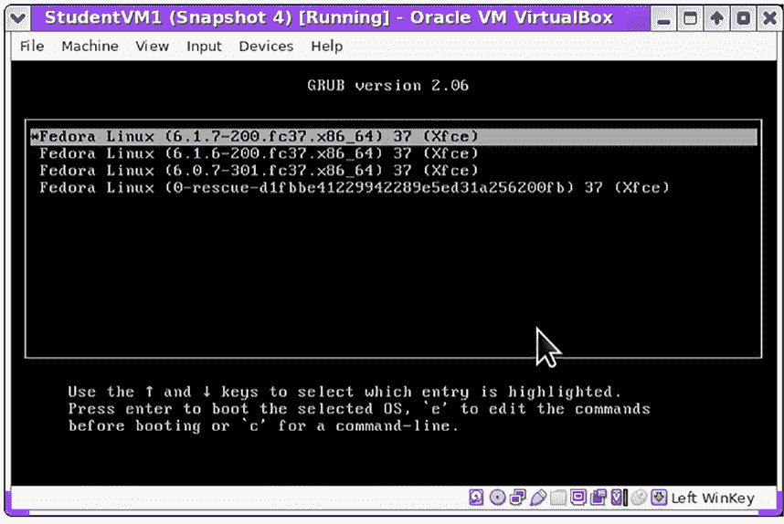

```
ora Linux (6.1.7-200.fc37.x86_64) 37 (Xfce)
Dora Linux (6.1.6-200.fc37.x86_64) 37 (Xfce)
Dora Linux (6.0.7-301.fc37.x86_64) 37 (Xfce)
Dora Linux (0-rescue-d1fbbc41229942289e5ed31a256200fb) 37 (Xfce)
```

**图 12-1.** 在更新几次系统后，GRUB 显示三个普通内核和一个救援选项。最新的内核位于顶部，但你可以使用方向键选择较旧的内核进行启动。

## 实验 12-12：保留旧内核

以 root 身份执行此实验。让我们看看允许我们维护多个内核以供选择启动的配置项。我们还将更改保留的旧内核数量。

使用 `vim` 编辑 `/etc/dnf/conf` 配置文件。将行

`installonly_limit=3`

更改为

`installonly_limit=5`

以便将保留内核的总数增加到 5 个。

查看 `clean_requirements_on_remove=True` 这一行。这意味着，当删除具有依赖项的包时，只要没有已安装的包依赖于这些依赖项，这些依赖项也应该删除。不要更改此项，因为它确实有助于保持我们的 Linux 主机不被未使用的 RPM 包占满。旧的未使用的内容，无论是 RPM 包、其他旧程序、程序中旧且未使用的代码，还是任何种类的未使用文件，统称为“垃圾”（craft）。

`gpgcheck=1` 行表示下载的 RPM 包将根据 GPG 签名密钥进行检查，以确保它们有效且未被篡改。

保存文件并退出。

现在让我们查看 `/etc/yum.repo.d` 目录下的仓库文件。进入 `/etc/yum.repo.d` 目录并列出目录内容：

```
[root@studentvm1 yum.repos.d]# ls
fedora-cisco-openh264.repo rpmfusion-free-updates.repo
fedora.repo rpmfusion-free-updates-testing.repo
fedora-updates.repo rpmfusion-nonfree.repo
fedora-updates-testing.repo rpmfusion-nonfree-updates-testing.repo
rpmfusion-free.repo
[root@studentvm1 yum.repos.d]#
```

你的仓库列表看起来应该是所示。

使用 `cat` 命令查看 fedora 仓库配置文件的内容。注意 `fedora.repo` 文件有多个部分。第一个部分 `[fedora]` 是启用的。另外两个部分 `[fedora-debuginfo]` 和 `[fedora-source]` 是禁用的。只有当你使用调试代码来解决问题，或者当你安装源码 RPM 包 (.src.rpm) 来修改和复制一个或多个包时，你才会启用这些部分。我们大多数人永远不需要启用其中任何一个。

可以使用 `/etc/yum.repo.d` 中的配置文件禁用任何所有仓库。还可以使用 `disablepo=<codename>` 和 `enablepo=<codename>` 临时启用或禁用仓库。请务必阅读 DNF 手页。

## 章节总结

使用 DNF 和 YUM 包管理器等工具，更新和安装新软件是非常容易的。DNF 是强大的 RPM 包管理器的封装，但它提供了高级功能，例如提供自动处理依赖的能力；它将确定依赖项、从仓库下载它们并安装它们。


DNF 使用“组”的概念来启用安装和删除大量相关的包，例如复杂系统使用的包。使用组来定义桌面、开发环境、办公套件和相关技术，使得通过单个命令安装变得简单。DNF 和 RPM 都提供了允许探索包内容的工具。可以列出 RPM 将安装的文件，以及 Fedora 提供的默认之外的某些额外仓库。这些额外的仓库使得安装并非发行版包含的软件变得更加容易。

## 练习

完成以下练习以结束本章：

1. 在实验 12-7 中，你删除了 `utils` 包，`mc` (Midnight Commander) 也被删除了。你知道你可以在终端中浏览互联网、接收和发送电子邮件、从远程服务器下载文件等一切吗？

2. 重启你的虚拟机并选择一个旧内核，但不是恢复选项。使用你已经学过的几个工具来确定一切似乎运行正常。

3. 有时 DNF 数据库和缓存可能会损坏，或至少与系统不同步。你会如何纠正这种情况？

# 第 13 章 解决问题的工具

## 目标

在本章中，你将学习：

- 一个用于解决问题的程序
- 安装一些默认未安装的有用问题解决工具
- 选择并使用正确的工具来调查 CPU、内存和磁盘等各种 Linux 资源的状态
- 创建模拟某些问题的命令行程序
- 使用可用工具定位并解决问题
- 创建一个 FIFO（先进先出）管道来演示函数的功能

本章介绍了一些用于定位和解决问题的强大且重要的工具。本章很长，因为关于这些工具有很多需要了解的内容。

### 问题的艺术

### 问题的工具

- 在调查 CPU、内存和磁盘等各种 Linux 资源的状态时，选择并使用正确的工具
- 创建模拟某些问题的命令行程序
- 使用可用工具定位并解决问题
- 创建一个 FIFO（先进先出）管道来演示函数的功能

这些工具都是强大且灵活的，并对它们访问的数据提供了许多选项。

### 随你的好奇心

我的导师帮助我做的最好的事情之一是制定了一个可以一直用于解决几乎任何类型问题的定义过程。这个过程与科学方法非常相似。

我发现这篇名为《科学方法如何工作》的短文章很有帮助。它描述科学方法的方式与我为问题解决步骤创建的图非常相似。所以作为导师，我把它传给你们这些年轻人。希望你们发现它像我一样有用。

解决任何类型的问题都是艺术、科学，而且有些人会说——可能还有一点魔法。解决技术问题（如计算机上发生的问题）还需要大量的专业知识。解决任何性质问题的解决方法（包括 Linux 问题）不能仅仅是症状列表以及修复或规避这些问题的步骤。这种所谓的“症状修复”方法在纸面上对经理们——那些头尖脑袋的老板（PHBs）来说很好，但在实践中非常糟糕。解决问题的最佳方法是拥有该学科的基础知识和强大的方法论。

## 解决问题的五个步骤

如图 13-1 所示，解决问题的过程中涉及五个基本步骤。该算法与脚注 2 中提到的科学方法非常相似，但它是专门用于解决技术问题的。

你可能在排除故障时已经在遵循这些步骤，但甚至没有意识到。这些步骤是通用的，适用于解决任何类型的问题，而不仅仅是计算机或 Linux 问题。我曾在没有意识到的情况下使用这些步骤处理各种问题。将它们编码化使我在解决问题时变得更加高效，因为当我卡住时，我可以回顾已采取的步骤，验证我在流程中的位置，并在任何适当步骤重新开始。

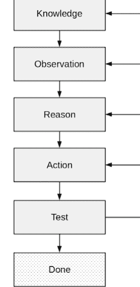

**图 13-1. 我用于故障排除的算法**

你过去可能已经听过其他一些用于解决问题的术语。这个过程的前三个步骤也被称为问题确定（problem determination），即找到问题的根源。最后两个步骤是问题解决（problem resolution），实际上就是修复问题。接下来的章节将更详细介绍这五个步骤中的每一个步骤。

## 知识（Knowledge）

对你试图解决的问题的主题了解知识是第一步。我见过的关于科学方法的文章似乎都假设此为前提条件。然而，知识的获取是一个持续的过程，它由好奇心驱动，并通过使用科学方法通过实验来探索和扩展你现有的知识所获得的知识来增强。这就是我在课程中使用“实验”（experiment）一词而不是“实验室项目”之类的词的原因之一。

你至少必须熟悉 Linux，而且你还必须熟悉其他可能与 Linux 交互并影响它的因素，例如硬件、网络，甚至是环境因素，如 Linux 系统运行的温度、湿度和电气环境如何影响它。

记住，引用博格（Borg）的话：“没有知识，反抗是徒劳。”知识就是力量。

## 观察（Observation）

解决问题的第二步是观察问题的症状。记录所有问题症状也很重要。观察哪些部分运行正常同样重要。现在不是修复问题的时候；仅仅是观察。

观察的另一个重要部分是对你看到和没看到的现象自己提问。除了需要提出的针对特定问题的问题外，还有一些通用问题可以问：

- 这个问题是由硬件、Linux、应用程序引起的，还是可能因为缺乏用户知识或培训？
- 这个问题和我见过的其他问题相似吗？
- 是否有错误消息？
- 是否有与问题相关的日志条目？
- 在错误发生之前，计算机上发生了什么？
- 如果错误没有发生，我预期会发生什么？
- 系统硬件或软件最近有任何变化吗？

在你收集数据时，永远不要假设从别人那里获得的信息是正确的。要亲自观察一切。最好的解决者是那些从不认为任何事情是理所当然的人。他们从不假设自己拥有的信息是 100% 准确或完整的。当你拥有的信息似乎自相矛盾或与症状矛盾时，从头开始，就像没有任何信息一样。

在一次非常奇怪的经历中，我通过坐在一台大电脑上修复了它。这是一个长故事，事实是我观察到了一个非常短暂的症状，那是由于坐在一个巨大的打印机控制单元顶部的工作台上。完整故事可以在我的书《Linux 哲学》（The Linux Philosophy for SysAdmins）中找到。

## 推理（Reasoning）

运用推理技能根据你对症状的观察信息以及你的知识来确定问题的可能原因。通过对问题的观察、你的知识和过去的经验进行推理的过程，是艺术与科学结合并产生灵感、直觉或其他神秘心理过程的地方，这种过程为问题的根源提供了一些洞察。

这有助于记住，症状不是问题本身。问题导致了症状。你想修复的是问题，而不仅仅是症状。

## 行动（Action）

现在是执行适当修复行动的时候。这通常是最简单的一部分。困难的部分是之前的工作——确定该做什么。在知道问题原因后，确定要采取的正确修复行动通常很容易。

你采取的具体行动将取决于问题的原因。记住，我们是在修复根源，而不仅仅是为了消除它或掩盖症状。

一次只进行一种更改。如果有多个行动可能纠正问题的原因，请只进行一种更改，或采取一个最可能解决根源的行动。你在这里尝试做的是选择具有最高修复概率的正确行动。无论是根据你自己的经验告诉你采取什么行动，还是根据别人的经验，都要按优先级从高到低移动列表，一次一个行动。在每个行动后测试结果。

> Both, David, *The Linux Philosophy for SysAdmins*, Apress, 2018, 471–472

## 测试（Test）

在采取某些修复行动后，应该对修复进行测试。这通常意味着执行最初失败的任务，但也可能是一个说明问题的简单命令。

进行一次更改，采取一个潜在的纠正行动，然后测试该行动的结果。这是我们确定纠正行动修复了问题的唯一方法。如果我们采取了多项纠正行动然后只测试一次，将无法知道哪一个行动修复了问题。如果我们在找到解决方案后想要撤销所做的的那些无效更改，这一点尤为重要。

测试时务必检查最初观察到的症状。它们可能因为你所采取的行动而改变，你需要意识到这一点，以便在过程的下次迭代中做出明智决策。即使问题尚未解决，改变的症状对于确定如何进行也可能非常有价值。图 13-1 显示你可能需要迭代某些步骤。保持灵活。如果没有进展，不要犹豫要后退。

## 系统性能与问题解决

现在让我们探索一些允许你观察系统性能各个方面的命令。有很多 Linux 命令用于性能分析。大多数这些命令从 `/proc` 中的各种文件中获取信息，我们稍后会探讨。我使用 `top`、`htop` 和 `atop` 作为开始工作的主要工具。这三个工具都显示许多相同的信息，但每个工具都有自己的方式和侧重点。这三个工具都以近乎实时显示数据。`top` 和 `htop` 工具还是交互式的，允许系统管理员通过发送信号来调整优先级和杀死进程。`atop` 工具可以杀死进程，但不能调整它们的优先级。

**注** `nice` 命令可以更改进程的 nice 值，以修改其优先级，从而影响 Linux 调度器分配其多少 CPU 时间。我们将在本章以及第 2 卷第 23 章探讨 nice 值、优先级和调度。

让我们详细查看这三个工具中的每一个。

## top

`top` 命令是我解决任何类型性能问题时的首选工具。我喜欢它是因为它已经存在了很久，而其他工具可能没有安装。`top` 工具在 Fedora 和我工作过的所有发行版都是预装的。

`top` 程序是一个在动态环境中观察内存和 CPU 使用情况以及负载平均值的非常重要且强大的工具。`top` 提供的信息对于诊断现有问题非常有帮助；它通常是我在排除新问题时使用的第一个工具。

## 实验 13-1：top

以 root 用户在 StudentVM1 执行此实验。启动 top：

```
[root@StudentVM1 ~] # top
```

结果将全屏显示并实时更新，每三秒更新一次。top 是一个交互式工具，允许更改显示的程序以及显示结果的排序方式。它还允许与程序进行交互，例如通过 renice 它们的优先级以及杀死它们：

```
top -12:19:00 2:16, 2 users, load average: 0.08, 0.04, 0.01
Tasks: 15s total, 1 running, 157 sleeping, 0 stopped, 0 zombie
%(cpu): 0.0 us, 0.2 sy, 0.0 ni, 97.6 id, 0.0 wa, 0.9 hi, 0.0 st
Mem: 15996.4 total, 10565.5 free, 289.7 used, 641.2 buff/cache
Swap: 8192.0 total, 8192.0 free, 0.0 used, 15437.4 avail Mem
PID USER NI VIRT RES SHR S %MEM TIME+ COMMAND
8058 system+ 20 0 16428 6332 5460 S 0.2 0.0 00:08:35 systemd-oomd
1009 root 20 0 473224 19968 17112 S 0.2 0.1 00:00:37 NetworkManager
1317 root 20 0 16128 6632 4852 S 0.0 0.0 00:00:16 sshd
1586 root 20 0 0 0 I 0.2 0.0 00:00:10 kworker/0-3-events
1 root 20 0 103172 13812 S 0.0 0.0 00:00:00 kthread
2 root 20 0 0 0 S 0.0 0.0 00:00:00 -
3 root 0-20 0 0 I 0.0 0.0 00:00:00 rcu_gp
4 root 0-20 0 0 I 0.0 0.0 00:00:00 slub_flushhwq
5 root 0-20 0 0 I 0.0 0.0 00:00:00 netns
6 root 0-20 0 0 I 0.0 0.0 00:02:47 systemd
8 root 0-20 0 0 I 0.0 0.0 00:00:00 kworker/0:0H-events_+h
10 root 0-20 0 0 I 0.0 0.0 00:00:00 mm_perpc_qu
12 root 20 0 0 0 I 0.0 0.0 00:00:00 rcu_tasks_kthread
13 root 20 0 0 0 I 0.0 0.0 00:00:00 rcu_tasks_rude_kthread
14 root 20 0 0 0 I 0.0 0.0 00:00:00 rcu_tasks_trace_kthre+
15 root 20 0 0 0 S 0.0 0.0 00:00:07 ksoftirqd/0
16 root 20 0 0 0 S 0.0 0.0 00:00:07 root_preempt
17 root rt 0 0 0 S 0.0 0.0 00:00:18 migration/0
19 root 20 0 0 0 S 0.0 0.0 00:00:00 cpuphup/0
20 root 20 0 0 0 S 0.0 0.0 00:00:00 kdevmtmps
21 root 0-20 0 0 I 0.0 0.0 00:00:00 inet_frag_wk
```

```
<SNIP>
```

在我们边学习时边运行它。然后按下 `s`（小写）键。top 工具会显示 `Change delay from 3.0 to,` 提示，你输入 `1` 并按回车键。这会将显示更新设置为一秒。我发现这样响应快一点，而且比默认的二秒更符合我的喜好。

现在按下 `1` 键来显示此虚拟机中的两个 CPU，以便在头部部分分单独的行显示每个 CPU 的统计数据。再次按下 `1` 则返回到显示汇总 CPU 数据状态。重复操作几次以比较数据，让 top 保持分开显示的状态。

在做出这些更改后，我们希望让它们永久生效。top 工具不会自动保存这些更改，因此我们按下 `W`（大写）将配置写入到 `~/.toprc`。

运行 top 直到阅读各个部分。top 显示被分为两个部分：“Summary”（摘要）部分是输出的最顶部，“Process”（进程）部分是输出的底部；top 有许多实用的命令可以管理显示和操作单个进程。按下 `h` 查看帮助页面。按下两次 `H` 查看所有页面。使用 `Q` 键退出并返回活动显示。

## 摘要部分

top 的 Summary 部分提供了当前系统状态的极佳概述。该部分可以告诉你 CPU 和内存使用的基本事实。第一行显示系统更新以及 1 分钟、5 分钟和 15 分钟的负载平均（load averages），几乎为零，因为主机工作量很少。第二行显示当前活动进程的数量及其状态。包含 CPU 统计数据的行接下来：可以使用单行合并所有 CPU 的统计数据，或者如图 13-2 所示，为每个 CPU 显示一行。按下 `1` 键可以在 CPU 使用的汇总显示和单个 CPU 显示之间进行切换。这些行中的数据以可用 CPU 时间的百分比显示。Summary 部分的最后行是内存使用情况，包括物理内存和交换空间。许多其他工具也将查看这些相同的信息。

## 负载平均

top 输出的第一行包含当前负载平均。负载平均代表系统的 1 分钟、5 分钟和 15 分钟负载平均。负载平均可以被视为对 CPU 的需求量；它是一个代表等待 CPU 时间的指令平均数量。因此，在单处理器系统中，充分利用的 CPU 负载平均为 1。这意味着 CPU 恰好跟上需求；换句话说就是完美利用。负载平均小于 1 意味着 CPU 未被充分利用，负载平均大于 1 则意味着 CPU 利用过度，存在积压的、未满足的需求。例如，单 CPU 系统中负载平均为 1.5 表示某些实例强制等待执行，直到之前的实例完成。

```
top -12:21:44 1 day, 3:25, 7 users, load average: 2.49, 1.37, 0.60
Tasks: 257, 5 running, 252 sleeping, 0 stopped, 0 zombie
Cpu0 : 32.2%us, 32.3%sy, 0.0%ni, 34.5%id, 0.0%wa, 0.0%hi, 0.0%si, 0.0%st
Cpu1 : 51.7%us, 24.0%sy, 0.0%ni, 24.2%id, 0.0%wa, 0.0%hi, 0.0%si, 0.0%st
Cpu2 : 24.6%us, 48.5%sy, 0.0%ni, 27.0%id, 0.0%wa, 0.0%hi, 0.0%si, 0.0%st
Cpu3 : 67.1%us, 21.6%sy, 0.0%ni, 11.3%id, 0.0%wa, 0.0%hi, 0.0%si, 0.0%st
Mem : 6122964k total, 3582032k used, 2540932k free, 358752k buffers
Swap : 8191996k total, 0k used, 8191996k free, 2596520k cached
```

> 图 13-2。样本中的负载平均表明 CPU 使用率最近增加

当我说 1 分钟（或 5 分钟、10 分钟）负载平均为 2.497 时，这到底意味着什么？负载平均可以被视为对 CPU 的需求量；它是一个代表等待 CPU 时间的指令平均数量。因此，在单处理器系统中，充分利用的 CPU 负载平均为 1。这意味着 CPU 恰好匹配需求；换句话说就是完美利用。负载平均小于 1 意味着 CPU 未被充分利用，负载平均大于 1 则意味着 CPU 利用过度，存在积压的、未满足的需求。这对于多处理器也是同样的。如果一个四 CPU 系统处于完美利用，例如它的负载平均为 3.24，那么其三个处理器被充分利用，一个被利用了 76%。在前面的例子中，四 CPU 系统负载平均为 2.49，意味着仍有容量。负载平均的理想状态是等于 CPU 的数量，这意味着每个 CPU 都被利用了。

### CPU 使用率

CPU 使用率是衡量执行时使用了多少 CPU 的简单指标。这些数字以百分比形式显示，代表在定义期间 CPU 使用的时间。默认更新间隔通常为三秒，尽管可以使用 `s` 键更改，我不建议使用非常短的间隔（即小于一秒），因为这会增加系统负载并难以阅读。然而，凭借 Linux 及其灵活性，有时将间隔设置为小于一秒是有用的。


# 第 13 章 解决问题的工具

## top 命令输出分析

```
top -09:47:38 1 day, 24 min, 6 users, load average: 0.13, 0.04, 0.01
Tasks: 180, 1 running, 177 sleeping, 0 stopped, 0 zombie
Cpu0 : 0.0%us, 0.0%sy, 0.0%ni, 100.0%id, 0.0%wa, 0.0%hi, 0.0%si, 0.0%st
Cpu1 : 0.9%us, 0.9%sy, 0.0%ni, 98.1%id, 0.0%wa, 0.0%hi, 0.0%si, 0.0%st
Cpu2 : 0.0%us, 0.0%sy, 0.0%ni, 100.0%id, 0.0%wa, 0.0%hi, 0.0%si, 0.0%st
Cpu3 : 1.0%us, 0.0%sy, 0.0%ni, 99.0%id, 0.0%wa, 0.0%hi, 0.0%si, 0.0%st
Mem : 2056456k total, 79768k used, 125688k free, 92028 buffers
Swap : 4095992k total, 88k used, 4095904k free, 336252k cached
```

**图 13-3。top 的摘要部分包含了 CPU 和内存使用数据的全面概述。**

有八个字段可以详细描述 CPU 的使用情况。`us`、`sy`、`ni`、`id`、`wa`、`hi`、`si` 和 `st` 字段将 CPU 使用情况分为若干类别，可以提供关于系统中正在占用 CPU 时间的更深入见解：

- `us`：用户空间是指在用户空间内执行任务所花费的 CPU 时间，而不是系统或内核空间。这里是用户级程序运行的地方。
- `sy`：系统是指执行任务所花费的 CPU 时间。这些大部分是内核任务，如内存管理、任务调度以及内核执行的所有其他任务。
- `ni`：这是“nice”时间，即对具有正 nice 值的任务所花费的 CPU 时间。正数会让任务变得更“nice”，也就是说它对 CPU 时间的需求较少，其他任务可能会获得比它更高的优先级。
- `id`：空闲时间是 CPU 空闲且未执行任何处理或未等待 I/O 发生的任何时间。
- `wa`：I/O 等待时间是 CPU 等待 I/O（如磁盘读或写）发生的时间。运行在该 CPU 上的程序在等待该 I/O 操作的结果之前无法继续，在此期间处于阻塞状态。
- `hi`：在该时间间隔内等待硬件中断的 CPU 时间百分比。此处数字较高（尤其是当 I/O 等待也较高时）可能表明硬件速度对于现有负载来说太慢。
- `si`：在该时间间隔内软件中断的数量。此处数字较高（尤其是当 I/O 等待也较高时）可能表明某些软件应用程序可能处于某种密集循环或竞态条件中。
- `st`：这是从“此”虚拟机中偷取的时间，因为它可以运行，但另一个虚拟机正在运行，层次管理程序无法将时间分配给“此”虚拟机。对于非虚拟化主机，此值应始终为 0。在虚拟主机中，显著大于 0 的数字可能意味着对于给定的虚拟虚拟系统负载需要更多的物理 CPU 功率。

这些时间通常相加为 100%，可能会有轻微的舍入误差。

## 进程部分

`top` 输出的进程部分是系统中运行进程的列表——至少对于终端显示器能够显示的进程数量。`top` 默认显示的列描述如下。还有其他几列可用，每个都可以通过按键添加；详情请参阅 `top` 手册页：

- `PID`：进程 ID。
- `USER`：进程所有者的用户名。
- `PR`：进程的优先级。
- `NI`：进程的 nice 值。
- `VIRT`：分配给进程的虚拟内存总量。
- `RES`：进程消耗的未交换物理 RAM 驻留大小（除非另有说明，单位为 kb）。
- `SHR`：进程使用的共享内存量（单位为 kb）。
- `S`：进程状态。可以是 `R`（运行/running）、`I`（空闲）、`S`（睡眠/sleeping）和 `Z`（僵尸/zombie）。较少见的状态可以是 `T`（已追踪或已停止）、`I`（空闲）和 `D`（深度、不可中断的睡眠）。
- `%CPU`：在上次测量期间内，该进程占用的 CPU 周期百分比。
- `%MEM`：该进程占用的物理系统内存百分比。
- `TIME+`：自进程启动以来，进程消耗的累计 CPU 时间（精确到百分分之一）。
- `COMMAND`：用于启动进程的命令。

## 交互操作

使用 `Page Up` 和 `Page Down` 键滚动运行进程列表。你可以使用 `<` 和 `>` 键来将排序列向左或向右移动。

可以使用 `k` 键杀死进程，或使用 `r` 键对其调整 nice 值（renice）。你必须知道想要杀死或调整 nice 值的进程 `PID` (ID)，这些信息显示在 `top` 显示的进程部分。杀死进程时，先请求 `PID`，然后请求用于杀死进程的信号值。输入它们并按回车键。从信号 15 (`SIGTERM`) 开始，如果它没有杀死进程，则使用 9 (`SIGKILL`)。

## CPU 使用的注意事项

在排查故障时，你应该检查 CPU 使用的几点。寻找一个或多个长时间空闲时间为 0% 的 CPU。如果所有 CPU 的空闲时间为零或极低，你可能会遇到特殊问题。此时，你应该查看显示器的任务区域以确定哪个进程正在占用 CPU 时间。

注意理解 CPU 使用对于特定环境或程序是否可能是正常的，这样你就能知道它是正常行为还是瞬态行为。负载平均值可以帮助判断系统是过载还是仅仅非常忙。

让我们探索如何使用 `top` 来观察那些消耗 CPU 的程序的 CPU 使用情况。

### 实验 13-2：寻找 CPU 占用者

以用户身份启动第二个终端会话，并将其放在已运行 `top` 的 root 会话旁边，以便同时看到。

以用户 `student` 的身份，在家目录下创建一个名为 `cpuHog` 的文件，并赋予 `rwxr-xr-x` 权限以使其可执行：

```bash
[student@studentvm1 ~]$ touch cpuHog
[student@studentvm1 ~]$ chmod 755 cpuHog
```

使用 `vim` 编辑器向文件中添加以下内容：

```bash
#!/bin/bash
# 这个小程序是一个 CPU 占用者
X=0
while [ true ]; do 
echo $X
X=$((X+1))
done
```

保存此脚本，关闭 `vim`，并以下命令运行 `cpuHog` 程序：

```bash
[student@studentvm1 ~]$ ./cpuHog
```

前面的程序只需将 `X` 的当前值打印到标准输出并每次加 1。这消耗了 CPU 周期。观察对性能的影响。CPU 使用率立即上升，负载平均值也会开始增加。`cpuHog` 的目的是什么？现在打开另一个 `student` 用户会话并运行该程序。你现在有两个实例在运行。在 `top` 中注意，这两个进程倾向于获得大致相同的 CPU 时间。有时一个比另一个多。图 13-4 显示了这两个 CPU 占用者运行时 `top` 的结果。注意我通过 SSH 远程登录虚拟机执行这些实验，你的输出应该两个条目。你看到的结果基本上相同。

```
top -11:46:13 20:55 6 users, load average: 2.64, 2.46, 1.14
Tasks: 161 total, 5 running, 99 sleeping, 0 stopped, 0 zombie
%CPU: 3.0 us, 73.7 sy, 0.0 ni, 0.0 id, 0.0 wa, 12.1 hi, 11.1 si, 0.0 st
%CPU1: 11.2 us, 85.7 sy, 0.0 ni, 0.0 id, 0.0 wa, 3.1 hi, 0.0 si, 0.0 st
KiB Mem: 403848 total, 301548 free, 240244 used, 782696 buff/cache
KiB Swap: 1048756 total, 1048756 free, 0 used, 3543352 avail
PID USER PR NI VIRT RES SHR S %CPU %MEM TIME+ COMMAND
1893 student 20 0 214388 1180 136 R 52.0 0.0 10:19:30 cpuHug
1919 student 20 0 214388 1184 1040 R 33.3 0.0 04:07:18 cpuHug
15017 root 20 0 0 0 I 13.7 0.0 00:27:36 kworker/u4:0-ev
15158 root 20 0 0 0 I 13.7 0.0 00:22:97 kworker/u4:0-ev
814 root 20 0 98212 6704 5792 S 1.0 0.2 00:02:01 rnd
1303 root 20 0 257244 4384 3628 R 1.0 0.1 01:16:87 top
3 root 20 0 171068 9488 6880 S 0.0 0.2 04:08:52 systemd
2 root 20 0 0 0 S 0.0 0.0 00:00:02 kththread
3 root 0 -20 0 0 0 I 0.0 0.0 00:00:00 rcu_pg
```

> 图 13-4. 两个 cpu hug 程序运行时 top 命令显示

注意在你的虚拟机上，如图 13-4 所示，负载平均值会随着时间的推移而上升，直到最终稳定。你还可以看到一个或两个 CPU 将开始显示硬件和软件中断的等待。

作为 root 用户，先将这些 CPU 占用者之一的 nice 值设为 +19，然后设置为 -20，并观察每个设置一段时间后的结果。我们将在第 2 卷第 23 章讨论调整 nice 和优先级的细节，但目前知道数字越大表示越 nice，数字越小（即使是负数）表示越不 nice。一个更 nice 的程序优先级更高，接收到的 CPU 周期比数字较小的相同程序要少。如果这看起来违背直觉，那么它至少乍看是一个 RPL（反向优先级逻辑）案例。

**提示：按 `r`（小写）键进行 renice，按照屏幕上“Swap”行下方的指示：**

要使用 `top` 更改运行中程序的 nice 值，只需输入 `r`。当要求输入 renice 的 `PID` 时，输入如图 13-5 所示的 `PID` 数字。你运行的进程 `PID` 会与我的不同。`top` 然后会询问你值是多少。输入 `19` 并按回车。我建议选择累积时间（`TIME+`）最长的 `cpuHog` `PID`，以观察 `cpuHog` 随时间追赶的过程。我高亮了几行中的相关数据：

```
top -11:46:13 20:55 6 users, load average: 2.64, 2.46, 1.14
Tasks: 161 total, 5 running, 99 sleeping, 0 stopped, 0 zombie
%CPU: 3.0 us, 73.7 sy, 0.0 ni, 0.0 id, 0.0 wa, 12.1 hi, 11.1 si, 0.0 st
%CPU1: 11.2 us, 85.7 sy, 0.0 ni, 0.0 id, 0.0 wa, 3.1 hi, 0.0 si, 0.0 st
KiB Mem: 403848 total, 301548 free, 240244 used, 782696 buff/cache
KiB Swap: 1048756 total, 1048756 free, 0 used, 3543352 avail
PID USER PR NI VIRT RES SHR S %CPU %MEM TIME+
1893 student 20 0 214388 1180 136 R 52.0 0.0 10:19:30 cpuHug
1919 student 20 0 214388 1184 1040 R 33.3 0.0 04:07:18 cpuHug
15017 root 20 0 0 0 I 13.7 0.0 00:27:36 kworker/u4:0-ev
15158 root 20 0 0 0 I 13.7 0.0 00:22:97 kworker/u4:0-ev
```

> 图 13-5. 调整其中一个 cpuhog 程序

尽管运行了这两个 `cpuHogs`，但你会发现整个系统的性能和响应速度几乎没有变化，因为没有其他程序在与之激烈竞争资源。然而，优先级最高（负数值越小）的 `CPU hog` 将持续获得 CPU 时间，即使只是一一小部分。你应该注意到 `top` 命令所显示的 `nice` 值（习性值）和实际优先级。图 13-6 显示了运行几小时后的结果，其中 `PID` 1893 的 nice 值为 +19。注意，虽然 `PID` 1893 在图 13-5 中拥有最长的累计时间，但现在它是两个 `cpuHogs` 中累计时间最少的。

```
top - 21:11:30 up 8:36, 6 users, load average: 3.98, 3.79, 3.88
Tasks: 177 total, 5 running, 172 sleeping, 0 stopped, 0 zombie
%CPU : 20.1 us, 33.8 si, 17.7 ni, 0.0 id, 0.0 wa, 12.7 si, 0.0 st
%Cpu1 : 6.1 us, 60.8 sy, 8.5 ni, 11.8 id, 0.0 wa, 9.2 hi, 1.7 si, 0.0 st
Mem Mem : 15996.1 total, 15015.0 free, 326.1 used, 655.1 buff/cache
Mib Swap: 8192.0 total, 8192.0 free, 0.0 used, 15397.8 avail Mem
```

| USER | PR | NI | VIRT | RES | SHR | S | %CPU | %MEM | TIME+ | COMMAND |
| :--- | :--- | :--- | :--- | :--- | :--- | :--- | :--- | :--- | :--- | :--- |
| 1919 student | 20 | 0 | 222940 | 1424 | 1268 | R | 42.0 | 0.0 | 116:07.22 | cpuhog |
| 1893 student | 39 | 19 | 222940 | 1332 | 1172 | R | 41.8 | 0.0 | 105:06.44 | cpuhog |
| 2319 root | 20 | 0 | 0 | 0 | 0 | I | 0.0 | 0.0 | 05:59:22 | kworker/u4:3- |
| 1789 root | 20 | 0 | 224736 | 3512 | 2936 | R | 0.2 | 0.0 | 04:46.40 | top |
| 2331 root | 20 | 0 | 0 | 0 | 0 | I | 4.3 | 0.0 | 03:39.97 | kworker/u4:0- |

> 图 13-6. 在运行近三小时且 nice 值为 +19 后，cpuHog PID 1893 的累计 CPU 时间已低于 cpuHog PID 1919。

现在查看 `nice` 值从 +19 改为 -20 的进程的 `nice` 值。我们将 `cpuHog 1893` 的 own `nice` 值从 +19 改为 -20，并让另一个 `cpuHog` 的 `nice` 值保持为 0（零）。图 13-7 显示了运行几小时后的变化结果。

```
top - 07:48:17 up 19:13, 6 users, load average: 3.64, 3.75, 3.89
Tasks: 179 total, 3 running, 176 sleeping, 0 stopped, 0 zombie
%Cpu : 21.6 u, 41.5 s, 0.0 ni, 3.7 id, 0.0 wa, 20.2 hi, 13.1 si, 0.0 st
%Cpu1 : 30.1 u, 69.9 s, 0.0 ni, 1.0 id, 0.0 wa, 5.6 hi, 1.5 si, 0.0 st
Mib Mem : 15996.1 total, 15005.2 free, 335.6 used, 655.2 buff/cache
Mib Swap : 8192.0 total, 8192.0 free, 0.0 used, 15388.3 avail Mem
```

| PID | USER | PR | NI | VIRT | RES | SHR | S | %CPU | %MEM | TIME+ | COMMAND |
| :--- | :--- | :--- | :--- | :--- | :--- | :--- | :--- | :--- | :--- | :--- | :--- |
| 1893 | student | 0 | 20 | 222960 | 1332 | 1172 | R | 36.2 | 0.0 | 391:58.50 | cpuhog |
| 1919 | student | 0 | 20 | 222960 | 1424 | 1268 | R | 46.6 | 0.0 | 377:44.29 | cpuhog |
| 1869 | student | 0 | 20 | 224080 | 2544 | 1628 | S | 33.0 | 0.0 | 92:11.01 | screen |
| 1822 | student | 0 | 20 | 16236 | 6820 | 5040 | S | 23.1 | 0.0 | 69:57.38 | sshd |

> 图 13-7. 将 PID 1893 的 `nice` 值从 +19 改为 -20 后，1893 积累的 CPU 时间现在超过了 1919。

……的问题。情况并非总是如此；某些应用程序只是消耗大量的 CPU 时间。任务列表还向我们展示了其他数据，如果不显而易见，它们也可以从帮助选项或顶部的 `man` 手页获取。


# 第 13 章 解决问题的工具

再次，你必须观察一个运行正常的系统以理解什么是“正常”，这样你才知道什么时候是“异常”的。我花费大量时间使用 `top` 以及其他工具在没有现有问题时观察我的主机的活动。这使我能够理解这些主机的“正常”状态是什么，并为我理解它们何时运行异常提供了所需的知识。

## 信号

`top`、`atop` 和 `htop` 工具允许你向运行中的进程发送信号。这些信号中的每一个都有特定的功能，尽管某些信号可以由接收程序通过信号处理器进行定义。

`kill` 命令独立于 `top`，也可以向监控之外的进程发送信号。`kill -l` 可以列出所有可以发送的信号。如果你并不打算真正杀死进程，使用 `kill` 命令发送信号可能会引起困惑。需要记住，`kill` 命令用于向进程发送信号，其中至少有三个信号可以以不同程度的偏好终止进程：

- **SIGTERM (15)**: 信号 15，`SIGTERM` 是 `top` 和其他监控程序在按下“k”键时发送的默认信号。它也可能是最有效的信号，因为程序必须内置一个信号处理器。程序的信号处理器必须拦截传入的信号并采取相应行动。对于大多数没有信号处理器的脚本来说，`SIGTERM` 会被忽略。`SIGTERM` 背后的思想是，简单地告诉程序你想终止它本身，它会利用这个机会清理诸如打开的文件等内容，然后以受控的方式自终结。

- **SIGKILL (9)**: 信号 9，`SIGKILL` 提供了一种杀死即使是最顽固的程序的手段，包括没有信号处理器的脚本和其他程序。然而，对于没有信号处理器的脚本和其他程序，它不仅会杀死运行的脚本，还会杀死运行该脚本的 shell 会话；这可能不是你想要的行为。如果你想杀死一个进程且不在乎是否够“礼貌”，那么这就是你需要的信号。此信号无法被程序代码中的信号处理器拦截。

- **SIGINT (2)**: 信号 2，当 `SIGTERM` 不起作用且你想让程序死得更体面一点（例如，杀死它运行的 shell 会话）时，可以使用 `SIGINT`。`SIGINT` 向程序运行的会话发送一个中断。这等同于使用 `Ctrl-C` 键组合终止运行中的程序（特别是脚本）。

还有许多其他信号，但这些是我发现与终止程序相关的。它们实际上是我作为管理员唯一使用的信号。

## 一致性

关于 `top` 及其许多兄弟程序的一点：它不需要持续运行即可显示正确且一致的当前统计数据。例如，像 `TIME+` 是从系统启动或进程启动开始的累计时间。启动 `top` 或重启它不会改变数据的准确性。这并不是由于 `top` 的任何内在能力；而是因为 `top` 以及类似的程序从 `/proc` 虚拟文件系统获取信息。

## 其他类似 top 的工具

像 Linux 的所有事物一样，还有其他以类似 `top` 的方式工作的程序，如果你喜欢可以使用它们。在本节中，我们将查看这三个替代方案：`htop`、`atop` 和 `iotop`。这些工具可能都没有安装在你的 Fedora 虚拟机上，所以现在就安装。

### 准备工作 13-1：安装 HTOP、ATOP 和 IOTOP

以 root 身份执行此准备步骤。安装我们本章需要的工具：

```
[root@studentvm1 ~]# dnf -y install htop atop iotop
```

注意，`htop` 的包名可能显示为针对较早版本打包。这并不常见，但如果某个工具尚未被替换为 Fedora 的最新版本，就会发生这种情况。我的技术审查员 Jason 和我都注意到了这一点。这不是一个问题。如果是问题，旧版本的软件包就不会出现在当前 Fedora 版本的仓库中。

## htop

`htop` 工具与 `top` 非常相似，但提供了与运行进程交互的略有不同的能力。`htop` 允许选择多个进程以便同时对它们进行操作。它允许你同时杀死和调整（renice）所选进程的优先级，并向一个或多个进程发送信号。

### 实验 13-4：使用 HTOP

让 `top` 和两个 CPU 占用程序保持运行。在另一个 root 用户身份的终端会话中，启动 `htop`：

```
[root@studentvm1 ~]# htop
```

注意图 13-9 屏幕顶部的条形图和负载平均数据。我删除了一些数据行以减少所需的页面空间，但你仍然可以看到显示的数据与 `top` 非常相似。屏幕底部的功能键菜单提供了访问许多功能的便捷方式：

```
0|[100.0%]| Tasks: 75, 57 thr, 107 kthr; 2 running
1||[100.0%]| Load average: 3.08 3.08 3.42
```

| PID | USER | S | NI | VIRT | SHR | CPU% | TIME+ | COMMAND |
| :--- | :--- | :--- | :--- | :--- | :--- | :--- | :--- | :--- |
| 1893 | student | S | 20 | 217M | 1332 | 69.4 | 00:01:03 | /bin/bash |
| 1919 | student | R | 20 | 217M | 1428 | 61.4 | 00:00:09 | /bin/bash |
| 1869 | root | S | 0 | 209M | 1528 | 35.2 | 00:15:18 | top |
| 3697 | root | S | 0 | 218M | 4784 | 2.1 | 00:04:63 | htop |
| 857 | dbus | S | 0 | 6056 | 3956 | 0.0 | 00:00:27 | dbus-broker |
| 664 | root | S | 0 | 1664 | 3056 | 0.5 | 00:02:01 | top |
| 676 | root | S | 0 | 4906 | 2051 | 0.0 | 00:00:24 | /usr/lib/system |
| 826 | student | S | 20 | 32176 | 1021 | 0.0 | 00:00:29 | system-oo |
| 827 | student | S | 20 | 20796 | 1224 | 0.0 | 00:00:24 | system-re |
| 828 | root | S | -4 | 91616 | 2440 | 0.0 | 00:00:06 | /sbin/audit |
| 829 | root | S | -4 | 91616 | 2440 | 0.0 | 00:00:00 | /sbin/audit |
| 830 | root | S | 20 | 15860 | 6908 | 0.0 | 00:00:39 | /usr/lib/system |
| 831 | root | S | -4 | 60668 | 2588 | 0.0 | 00:00:00 | /sbin/sedpatch |
| 832 | root | S | -4 | 91616 | 2440 | 0.0 | 00:00:00 | /sbin/audit |

图 13. `htop` 显示了与 `top` 类似的数据，但具有不同的配置选项和数据展示方式。

可以取消选中进程。突出该进程然后再次按空格键。取消选中累积 CPU 时间（`TIME+`）最高的 `cpuHog`，然后将另一个 `cpuHog` 进程（它仍应处于被选中状态）的 nice 值设置为比已取消选中进程更小的负数。

使用 `F5` 键显示进程树视图。我喜欢这个视图，因为它显示了运行程序的父子层级结构。向下滚动进程列表，直到找到 CPU 占用户（CPU hogs）。

我们在这里探索的 `htop` 还有很多。我建议你花些时间探索并学习它强大的功能。不要终止 `htop` 工具。

## atop

`atop` 实用程序提供了与 `top` 和 `htop` 大部分相同的数据。图 13-10 展示了这一点，以及数据组织形式上的显著差异。

### 实验 13-5：使用 atop

在另一个 root 终端会话中启动 `atop` 程序：

```
[root@studentvm1 ~]# atop
```

现在你应该可以看到 `top`、`htop` 和 `atop` 以及两个 CPU 占用户正在运行。我减小了下方输出内容的字体大小，以便留出数据空间。你可以看到下方由 `atop` 显示的额外信息。`atop` 实用程序提供了 I/O 使用的详细信息，包括聚合的、每个设备的以及每个进程的数据。你应该能够从以下信息以及你的学生虚拟机中轻松提取出这些数据。

```
ATOP - studentv1 2023/01/25 10:44:03

| PRC | sys | user | #proc | #zombie | #exit |
| :--- | :--- | :--- | :--- | :--- | :--- |
| CPU | 12.76 | 5.88s | 179 | 0 | 0 |
| CPU | 124% | 61% | irq: 15% | idle: 0% | wait: 0 |
| CPU | 55% | 41% | irq: 4% | idle: 0% | cpu00 w: 0 |
| CPU | 69% | 20% | irq: 11% | idle: 0% | cpu01 w: 0 |
| CPL | numpcu: 2 | avg1: 3.64 | 3.73 | csw: 272942 | intr: 572365 |
| MET | tom: 15.66 | free: 14.36 | cache: 858.3M | buff: 127.3M |
| MET | mem node: 1 | shmem: 8.1m | shrm: 6.7M | tcpsk: 0.0M | udps: 0.0M |
| SWT | top: 8.06 | free: 0.86 | swacm: 0.0 | vcmom: 810.2M |
| PSI | softcpu: 37% | memcmp: 0% | memctl: 0% | ioull: 0% |
| NET | transport | tpi: 17 | icmp: 0 | udp: 0% |
| NET | | ipi | ipbo: 18 | ifprw: 0 | deliv: 18 |
| NET | en059: 0% | pckbi: 1 | pckto: 17 | si: 1 Kbps | 2 Kbps |

| PID | SYUSCR | UPC | RELAY | BDELAY | VGRO | VGRO | RDDSK | WDSCN | CPU | CMD |
| :--- | :--- | :--- | :--- | :--- | :--- | :--- | :--- | :--- | :--- | :--- |
| 1897 | 0.07s | 3.19s | 0.00s | 0B | 0B | 0B | 0% | 0% | 74% | cpuHog |
| 1919 | 0.05s | 3.98s | 0.00s | 0B | 0B | 0B | 0% | 0% | 65% | cpuHog |
| 1629 | 0.03s | 1.05s | 0.05s | 0B | 0B | 0B | 0% | 0% | 33% | screen |
| 3929 | 1.34s | 0.00s | 0.21s | 0B | 0B | 0B | 0% | 0% | 15% | konwer/u4:o-3 |
| 3949 | 1.34s | 0.00s | 0.21s | 0B | 0B | 0B | 0% | 0% | 0% | at-e |
| 3945 | 0.02s | 0.01s | 0.02s | 0B | 0B | 0B | 0% | 0% | 0% | |
| 1276 | 0.01s | 0.00s | 0.00s | 0B | 0B | 0B | 0% | 0% | 4.0k | lightdm-gtk-gr |
| 826 | 0.01s | 0.01s | 0.00s | 0B | 0B | 0B | 0% | 0% | systemd-homed |
| 857 | 0.00s | 0.00s | 0.00s | 0B | 0B | 0B | 0% | 0% | dbus-broker |
| 1249 | 0.00s | 0.00s | 0.00s | 0B | 0B | 0B | 0% | 0% | NetworkManager |
| 1030 | 0.00s | 0.00s | 0.00s | 0B | 0B | 0B | 0% | 0% | Xorg |
| 866 | 0.00s | 0.00s | 0.00s | 0B | 0B | 0B | 0% | 0% | rplog |
| 864 | 0.00s | 0.00s | 0.00s | 0B | 0B | 0B | 0% | 0% | accounts-daemon |
| 3943 | 0.00s | 0.00s | 0.00s | 0B | 0B | 0B | 0% | 0% | systemd-user |
| 3944 | 0.00s | 0.00s | 0.00s | 0B | 0B | 0B | 1% | 0% | systemd-user |
| 1333 | 0.00s | 0.00s | 0.00s | 0B | 0B | 0B | 1% | 0% | sshd |
| 1164 | 0.00s | 0.00s | 0.00s | 0B | 0B | 0B | 1% | 0% | VBoxService |
| 883 | 0.00s | 0.00s | 0.00s | 0B | 0B | 0B | 1% | 0% | screen |
| 1358 | 0.00s | 0.00s | 0.00s | 0B | 0B | 0B | 1% | 0% | screen |
| 1360 | 0.00s | 0.00s | 0.00s | 0B | 0B | 0B | 1% | 0% | screen |
| 867 | 0.00s | 0.00s | 0.00s | 0B | 0B | 0B | 1% | 0% | rtkit-daemon |
| 22 | 0.00s | 0.00s | 0.00s | 0B | 0B | 0B | 1% | 0% | ksfatird/1 |
| 31 | 0.00s | 0.00s | 0.00s | 0B | 0B | 0B | 0% | 0% | compactode |

```

**图 13-atop 展示了系统资源利用的不同视角，包括网络统计**

`atop` 程序提供了某些网络利用数据，以及合并和单独的详细 CPU 使用数据。默认情况下，它只显示在采集间隔期间实际获得 CPU 时间的进程。按 `A` 键显示所有进程。如果存在活动，`atop` 也会在头部空间显示数据。当你观察输出一段时间后，就会发现这一点。它可以杀死进程，但不能重启一次。

`atop` 程序以十秒为间隔启动。要将间隔设置为一秒，请先输入 `i` 然后输入 `1`。

要访问帮助功能，输入 `h`。扫描此帮助以了解此工具的许多功能。输入 `q` 退出帮助。

`atop` 提供了大量信息的洞察，我发现它非常有用。它有一个创建日志文件的选项，因此可以用于监控长期系统性能，并在稍后进行审查。按 `Q` 退出 `atop`。

这些工具是我寻找问题时开始使用的工具。它们共同可以告诉我关于运行系统的几乎我需要的所有信息。我发现 `atop` 是最复杂的界面，在宽度（列数）不足的终端上，输出可能会错位和失真。

## 更多工具

作为管理员，我们还有许多可用工具。这些工具大部分集中在系统操作的某一方面，例如内存或 CPU 使用。让我们简要查看其中几个。

### 内存工具

`free` 和 `vmstat` 实用程序查看内存使用。`vmstat` 工具还提供有关 CPU 分类的信息，例如用户、系统和空闲时间。这些工具都是静态的——它们获取某一时刻的内存快照。

#### 实验 13-6：使用 free 命令

你应该以 root 身份执行此实验，但这些命令也可以任何非特权用户使用。使用 `free` 命令显示系统信息：

```
[root@studentvm1 ~]# free
total used free available
Mem: 1638056 331504 1496008 1252 1084756
Swap: 838804 0 838804
```

这与 `top` 的输出吻合吗？`vmstat` 命令显示了 `/proc` 中的一些数据。数据格式可能需要更多解释，使用主页面来解读它：

```
[root@studentvm1 ~]# vmstat
procs  r  b  free buff cache   so    bo wa id us sy
 0  0 1496376      0     0     0     0     0  0 99  0  0
```

这两个命令都不是交互式的；`watch` 命令可以帮助我们循环执行。输出实际上出现在终端顶部：

```
[root@studentvm1 ~]# watch free
total used free available
Mem: 4038488 255932 2864320 6092 918236
Swap: 1048576 0 1048576
```

`watch` 以默认两秒为间隔更新。更改该间隔可以观察其中的差异。当然，`watch` 命令也可以与其他工具一起工作。完成后，可以使用 `Ctrl-C` 退出 `watch` 程序。

### 显示 I/O 统计

尽管 `top` 提供了关于 I/O 使用的一些洞察，但这些数据限于 I/O 等待。`atop` 实用程序提供了大量的 I/O 信息。`iostat` 程序像 `free` 命令一样，提供了时间点的 I/O 统计，`iotop` 则提供了顶部视图。

#### 实验 13-7：I/O 工具

以 root 身份执行此实验。首先查看 `iostat` 工具的结果。图 13-11 显示了你工作站上的结果。你的虚拟机将拥有


# 第 13 章 解决问题的工具

## iostat 工具

```
[root@workstation ~] iostat
Linux 5.10.10-200.fc33.x86_64 (david.org) 02/18/2021 _x86_64 (32 CPUs)
avg-cpu: %user %nice %iowait %idle
       0.49 84.53 0.00 0.03
Device:     tps kB_read/s kB_write/s kB_dsc/s kB_read kB_wrt kB_dsc
dm-0       0.05 0.69 0.23 5.69 1146291 377237 938824
dm-1       0.00 0.00 0.00 2226 0 0
dm-2       0.10 37.59 2.18 106.94 62657552 3596334 176547684
dm-3       0.37 4.73 0.39 23.59 7814765 395448639 121870348
dm-4       0.13 16.55 2034.99 73.82 27316881 339548839 52970436
dm-5       0.05 0.41 0.13 9.03 683809 211397 14911968
dm-6       2.50 25.29 33.35 135.83 41931295 54987441 24223188
dm-7       7.26 25.71 291.42 0.00 4193809 481972 0
dm-8       0.03 4.27 0.00 0.00 7057516 54483 0
dm-9       0.00 0.00 0.00 0.00 0 0
nvme0n1   24.49 24.22 2046.05 156.37 30726537 337740935 25184924
vme1n1    1.55 25.30 32.89 135.83 41931295 522984935 24223188
```

图 13-12 中的 `iostat` 工具提供了存储设备每秒读写的即时数据，以及累积的读写数据。`sda` 设备代表整个硬盘，因此该行中的数据是该设备上所有文件系统的聚合数据。`dm` 设备是 `/dev/sda` 设备上的各个文件系统。你可以使用以下命令查看文件系统的名称。

```
[root@studentvm1 tmp]# iostat -j ID
Linux 4.18.9-220.fc28.x86_64 (studentvm1) 10/28/2018 _x86_64_ (2-CPU)
avg-cpu: %user %nice %i %steal %idle
8.56 11.10 42.79 0.54 0.00 37.01
tps kB_read/s kB_wrtn/s kB_read Device
2.09 15.57 670835 405914 ata-VBOX_HARDDISK_Vb426cd38-22c9b6be
0.00 0.00 0.00 280 44 dm-0
0.01 0.08 0.02 20917 5640 dm-1
0.01 0.08 0.02 20853 5640 dm-name-fedora_studentvm1-root
0.01 0.14 0.02 37397 6028 dm-name-fedora_studentvm1-usr
0.00 0.01 0.00 3320 0 dm-name-fedora_studentvm1-swap
0.15 1.41 0.13 368072 34580 dm-name-fedora_studentvm1-user
0.00 0.01 0.00 29116 412 dm-name-fedora_studentvm1-home
2.28 1.00 11.59 261985 302178 dm-name-fedora_studentvm1-var
0.01 0.02 4.09 6252 1065412 dm-name-fedora_studentvm1-tmp
```

图 13-12. 显示文件系统的 `iostat` 命令

`iostat` 程序具有多个选项，可以提供这些数据更动态的视图，并为以后创建日志文件。

## iotop 工具

`iotop` 由两个表头组成，显示当前间隔（默认为秒）的总计和实际磁盘读写情况。首先，我们在终端中以 root 用户身份启动 `iotop` 程序：

```
[root@studentvm1 tmp]# iotop
```

起初，全屏输出在终端中看起来如下，没有太大变化。此输出包含了所有将填充终端的进程，无论它们是否真的在执行 I/O：

| Total DISK READ | 0.00 B/s | Total DISK WRITE | 0.00 B/s |
| :--- | :--- | :--- | :--- |
| Actual DISK READ | 0.00 B/s | Actual DISK WRITE | 0.00 B/s |
| TID PRIO USER | DISK READ | DISK WRITE | SWAPIN | IO> COMMAND |
| 1 be/4 root | 0.00 B/s | 0.00 B/s 0.00% 0.00% | systemd switched-root-system --deserialized 32 |
| 2 be/4 root | 0.00 B/s | 0.00 B/s 0.00% 0.00% | [kthread] |
| 3 be/0 root | 0.00 B/s | 0.00 B/s 0.00% 0.00% | [rcu_gp] |
| 4 be/0 root | 0.00 B/s | 0.00 B/s 0.00% 0.00% | [rcu_par_gp] |

虽然 `cpuHog` 程序应该正在运行，但它们没有执行任何磁盘 I/O，因此我们需要一个小程序来帮我们完成操作。在此终端中保持 `iotop` 工具运行。

以学生用户身份打开另一个终端，可以在上一个终端看到正在运行的 `iotop`。运行下所示的命令行程序。此 `dd` 命令为 `/home` 文件系统创建镜像备份并将结果存储在 `/tmp` 中。如果你是按照表 5-1 中提供的文件系统大小创建的文件系统，这不应该用 2.0 GB `/home` 文件系统的内容填满 5GB 的 `/tmp` 文件系统：

```
[root@studentvm1 tmp]# time dd if=/dev/mapper/fedora_studentvm1-home of=/tmp/home.bak
4194304+0 records in
4194304+0 records out
2147483648 bytes (2.1 GB, 2.0 GB) copied, 96.192 s
real 1m36.194s
user 0m96.8s
sys 0m14.808s
[root@studentvm1 ~]#
```

使用了 `time` 工具来了解 `dd` 程序运行了多久。在我的虚拟机上运行了一分钟多半，但这取决于主机的规格和负载。`iotop` 命令的输出应该大致如下。你的结果取决于系统的细节，但至少应该看到一些活动：

| Total DISK READ | 53.88 M/s | Total DISK WRITE | 53.93 M/s |
| :--- | :--- | :--- | :--- |
| Current DISK READ | 53.88 M/s | Current DISK WRITE | 0.00 B/s |
| TID PRIO USER | DISK READ | DISK WRITE | COMMAND |
| 4185 be/4 root | 53.88 M/s | 53.93 M/s | dd if=/dev/mapper/fedora_studentvm1-home of=/tmp/home.bak |
| 1 be/4 root | 0.00 B/s | 0.00 B/s | systemd --deserialized 35 |
| 2 be/4 root | 0.00 B/s | 0.00 B/s | [kthread] |

如果在备份完成之前你可以在 `iotop` 中观察到它，请再次运行。使用 `iotop` 的该选项仅显示正在执行 I/O 的进程。完成此实验的最后部分。

## /proc 文件系统

本章显示的所有命令和其他工具的数据都存储在 `/proc` 文件系统中。由于内核已经将这些数据存储在易于访问的 ASCII 文本中，`/proc` 文件系统有两个重要点：首先，它是一个虚拟文件系统，不存在于任何物理硬盘上；其次，`/proc` 是内核与操作系统其余部分之间的直接接口。简单的 Linux 命令允许我们查看内核的当前状态及其配置。无需重启即可更改许多配置项。更多信息请参见卷 2，第 24 章。

### 实验 13-8: 探索 /PROC

此实验应以 root 身份执行。首先，进入 `/proc` 目录并列出内容：

```
[root@studentvm1 proc]# ls
1 crypto
10 devices
100 diskstats
1000 dma
1002 driver
101 dynamic_debug
1030 ecdams
1043 fb
1046 filesystems
1157 fs
1164 interrupts
12 iomem
1225 ioports
1249 irqstat
1256 kallsyms
1261 kcore
1262 keys
1270 consoles-self
1272 bootconfig
1273 timer_list
1274 cgroups
1279 cmdinfo
1280 vmstat
1282 user-users
```

我们刚刚触及了 `/proc` 文件系统的一小部分。将所有数据暴露并供我们系统管理员（SysAdmins），更不用说系统开发者使用了，使得获取有关内核、硬件和运行程序的信息变得简单。这意味着，无需编写需要访问内核或其数据结构的代码，就可以发现 Linux 系统中所有可知的方面。

CentOS/RHEL 7.2 的文档列出了 `/proc` 文件系统中许多非常有用的文件列表。一些较旧的 Fedora 文档也包含这些信息。Linux 文档项目（Linux Documentation Project）对 `/proc` 中的某些数据文件进行了简要描述。

## 探索硬件

有时——实际上是经常——我发现了解主机上安装的硬件的具体特定信息是非常好的，我们有一些工具可以提供帮助。我喜欢的两个命令是 `lshw`（列出硬件）和 `dmidecode`（桌面管理接口解码），它们都以 SMBIOS 中可用的硬件信息形式进行显示。`dmidecode` 的主页指出：“SMMI 代表系统管理接口，标准由 DMTF（桌面任务工作组）严格制定和开发。”

这些实用工具使用存储在 SMBIOS 中的数据，SMBIOS 是系统成员上的数据存储区域，允许 BIOS 启动过程存储有关系统硬件的数据。由于收集硬件数据的任务是在 BIOS 启动时执行的，因此操作系统不需要直接探测硬件即可收集信息，用于执行任务，例如在 Linux 内核引导和启动过程中确定要加载哪些硬件相关的内核模块。我们将在第 16 章中详细讨论 Linux 计算机的引导和启动序列。

收集到 SMBIOS 中的数据可以被 `lshw` 和 `dmidecode` 等工具轻松访问供系统管理员使用。例如，我在规划升级时会使用这些数据。上一次需要向系统中安装更多内存时，我使用 `dmidecode` 工具来确定主板上的可用内存总量、当前类型（如 DDR）以及是否有空闲内存槽。很多时候还可以获取主板厂商、型号和序列号。这使得在互联网上查找所需的文档变得非常容易。

其他工具如 `lsusb`（列出 USB）和 `lspci`（列出 PCI）不使用 DMI 信息；它们使用 Linux 启动期间生成的特殊文件系统 `/proc` 和 `/sys` 中的来自数据。我们将在卷 2 第 24 章探索这些特殊文件系统。

由于这些是命令行工具，我们可以访问本地或位于地球另一端系统的硬件细节。这种能够在无需拆解系统的情况下确定系统详细硬件信息的能力，价值是无法估量的。

### 实验 13-9：探索硬件

以 root 身份执行此实验以安装 `lshw`（列出硬件）包：

```
[root@studentvm1 ~]# dnf install -y lshw
```

此程序列出关于主板、CPU 和其他已硬件的数据。运行以下命令列出你主机上的硬件。提取和显示数据可能需要几秒钟，请耐心。查看数据以查看虚拟机中所有的（虚拟）硬件：

```
[root@studentvm1 ~]# lshw | less
```

现在运行 `dmidecode` 并执行相同操作：

```
[root@studentvm1 ~]# dmidecode | less
```

也可以通过 DMI 类型列出硬件信息。例如，主板的 DMI 类型为 2，因此你可以使用以下命令仅列出主板的硬件信息：

```
[root@studentvm1 ~]# dmidecode -t 2
```

你可以在 `dmidecode` 的帮助页中找到不同硬件的类型代码。

有两个命令可以列出 USB 和 PCI 设备。它们都应该已经安装。运行以下命令并花时间查看输出。`-v` 选项意味着详细（verbose）：

```
[root@studentvm1 ~]# lsusb -v | less
[root@studentvm1 ~]# lspci -v | less
```

> **注意** `dmidecode` 和 `lshw` 工具的结果可能不可靠。根据它们的两个帮助页，“DMI 表中包含的信息往往是不准确、不完整或直接是错误的。”

在很大程度上，这种信息的缺失是因为硬件供应商并不总是以实用的方式存储其硬件数据——如果他们真的提供了任何数据的话。

## 监控硬件温度

保持计算机冷却对于帮助确保它们长久使用至关重要。大型数据中心花费大量能量来保持冷却。在不涉及细节的情况下，设计人员需要确保冷流引导向中心，特别是机架内部，以保持它们处于相当恒定的温度。

适当的冷却在家庭或办公环境中至关重要。事实上，它在这些环境中更为重要，因为环境温度通常高于数据中心。人们可以测量数据中心许多不同点以及单个机架内的温度。但计算机内部的温度又是怎样的？

幸运的是，现代计算机在各种组件中内置了许多传感器，以便监控温度、风扇转速和电压。如果你查看过计算机在 BIOS 配置模式下的某些数据，你可以看到许多此类值。但这无法显示计算机在现实世界情况下内部发生的情况。

Linux 有一些软件工具允许系统管理员监控他们的传感器。这些工具都基于 `lm_sensors`、SMART 和 `htemp` 库模块，这些模块在所有基于 Red Hat 的发行版（如 Fedora 和 CentOS）中可用。

最简单的工具是 `sensors` 命令。在运行 `sensors` 命令之前，使用 `sensors-detect` 命令来尽可能检测主机系统安装的所有传感器。然后 `sensors` 命令产生输出，包括主板和 CPU 温度、主板上各点的电压以及风扇转速。`sensors` 命令还会显示被认为是正常、高和危险的温度范围。

`htemp` 命令显示指定硬盘的温度。`smartctl` 命令显示硬盘的当前温度、指示硬盘故障的各种测量值，在某些情况下还可以显示硬盘温度的 ASCII 文本历史图。最后这种输出对于某些类型的问题可能特别有帮助。

还有许多良好的图形化监控工具可以用于监控计算机的热状态。我喜欢在桌面使用 GKrellM，也有许多其他供你选择。

我建议在每个新安装的系统中安装这些工具并监控它们的输出。这样你就可以了解你计算机的正常温度。使用这些工具允许你实时监控温度，并了解各种类型的负载如何影响这些温度。

### 实验 13-10：探索温度

以 root 身份安装 `lm_sensors` 和 `hddtemp` 软件包。如果你的虚拟机的物理主机是 Linux 系统，只要你有 root 权限，就可以在该系统上执行这些实验：

```bash
[root@studentvm1 proc]# dnf -y install lm_sensors hddtemp
```

在获取有用数据之前，必须安装 `lm_sensors` 软件包。遗憾的是，这是一个高度交互的过程，但你通常可以按 Enter 键接受所有默认值（通常是 "no"），或者通过管道传递 `yes` 来回答所有选项：

```bash
[root@studentvm1 proc]# yes | sensors-detect
```

由于这些工具需要真实的硬件，它们在虚拟机上不会产生任何结果。因此，我将使用我的一个主机——我的主工作站的数据来演示结果：


# 监控存储驱动器

存储设备是计算机中最常见的故障点之一，仅次于风扇。它们具有移动部件，而这些部件比电子集成电路芯片更容易故障。预先知道硬盘可能即将故障可以节省大量时间并避免烦恼。现代存储驱动器内置的自我监控、分析和报告技术（SMART）功能使我们这样的系统管理员能够识别可能故障的驱动器，并在计划内的维护期间对其进行更换。

尽管 SSD 存储设备没有移动部件，但使用 SATA 连接到主机的 SSD 存储设备也支持 SMART 功能，某些外部 USB 存储设备也是如此。

`smartctl` 命令用于访问支持 SMART 的存储驱动器提供的可用数据和统计信息。如今大多数存储设备都支持 SMART，但并非全部，特别是非常旧的存储设备和一些外部 USB 存储驱动器。

> Wikipedia, S.M.A.R.T., https://en.wikipedia.org/wiki/S.M.A.R.T.

## 实验 13-11：监控存储驱动器

**提示** 此实验在虚拟机中无法运行。我使用了我的其中一个物理主机，以便让你看到它的效果。如果你对适当的物理主机拥有 root 权限，可以安全地执行此实验。

以 root 身份执行此实验。此实验在虚拟机中无法运行。我使用了我的其中一个物理主机供你查看其效果。你可能需要在你的主机上安装 `smartmontools`：

```
root@myworkstation ~]# dnf -y install smartmontools
```

验证你硬盘的设备名称。在你的虚拟机上应该只有一个驱动器 `sda`，因为这是我们创建它的的方式。使用以下命令打印所有 SMART 数据，并通过过滤器，该过滤器假设你的硬盘为 `/dev/sda`：

```
root@myworkstation ~]# smartctl -x /dev/sda
```

结果来自我主工作站上的其中一个存储设备。这是一个很长的数据流，但我为你缩短了它，让你看到在物理主机和硬盘上可以找到的所有数据：

```
root@myworkstation proc]# sensors
coretemp-isa-0000
Adapter: ISA adapter
Package id 0: +54.0°C (high = +86.0°C, crit = +96.0°C)
Core 0: +44.0°C (high = +86.0°C, crit = +96.0°C)
Core 1: +51.0°C (high = +86.0°C, crit = +96.0°C)
Core 2: +49.0°C (high = +86.0°C, crit = +96.0°C)
Core 3: +51.0°C (high = +86.0°C, crit = +96.0°C)
Core 4: +51.0°C (high = +86.0°C, crit = +96.0°C)
Core 5: +50.0°C (high = +86.0°C, crit = +96.0°C)
Core 6: +47.0°C (high = +86.0°C, crit = +96.0°C)
Core 7: +51.0°C (high = +86.0°C, crit = +96.0°C)
Core 8: +48.0°C (high = +86.0°C, crit = +96.0°C)
Core 9: +51.0°C (high = +86.0°C, crit = +96.0°C)
Core 10: +53.0°C (high = +86.0°C, crit = +96.0°C)
Core 11: +47.0°C (high = +86.0°C, crit = +96.0°C)
Core 12: +52.0°C (high = +86.0°C, crit = +96.0°C)
Core 13: +52.0°C (high = +86.0°C, crit = +96.0°C)
Core 14: +54.0°C (high = +86.0°C, crit = +96.0°C)
Core 15: +52.0°C (high = +86.0°C, crit = +96.0°C)

radeon-pci-6500
Adapter: PCI adapter
temp1:+40.5°C (crit = +120.0°C, hyst = +90.0°C)

asus-isa-0000
Adapter: ISA adapter
cpu_fan:0 RPM
```

```
root@myworkstation proc]# hddtemp
/dev/sda: TOSHIBA DWE140: 38°C
/dev/sdb: ST3200DM000-1BD14C: 33°C
/dev/sdc: ST3200DM001-1CH166: 31°C
/dev/sdd: ST1000DM003-1CH162: 32°C
/dev/sdg: WD My Passport 070A: drive supported, but it doesn't have a temperature sensor.
[root@myworkstation proc]#
```


```bash
root@myworkstation ~]# smartctl -x /dev/sda
smartctl 6.6 2017-11-05 [x86_64-linux-local]
Copyright (C) 2002-2017 Bruce Allen, Christian Franke, www.smartmontools.org

=== START OF INFORMATION ===
Model Family: X300
Device Model: TOSHIBA HDWE140
Serial Number: 46P20DZ58
Device Id: 500003fb78
Firmware Version: FP2A
User Capacity: 4,000,787,016 bytes
Sector Sizes: 512 logical, 4096 bytes
Rotation Rate: 7200 rpm
Form Factor: 3.5 inches
ATA Version: ATA-ACS (minor indicated)
ATA Version: 3.0, 6.0 Gb/s
Local Time: Wed Oct 31 08:59:01 2018
SMART support: Available - device with SMART capability.
SMART: Enabled
AAM: 128 (minimum power consumption)

=== START OF READ DATA ===
health-assessment: PASSED
General SMART Values:
Offline data status: 0x82 (completed) 
Self-test status: 0x0 (error or no self-test ever run)
Total time to complete: 120 seconds
Offline collection: 0x5b (immediate)
Wait for self-test: 0x0 (completed)
Limit: 100
Value: 100
Worst: 100
RAW: 0

=== START OF TOOLS ===
Offline collection: 0x00 (off)
Self-test: 0x00 (supported)
Custom test list: 0x00 (supported)
Offline format test: 0x00 (supported)
Extended test list: 0x00 (supported)
Format test unit: 0x00 (supported)
Write log feature: 0x00 (supported)
Read log feature: 0x00 (supported)
Device log page: 0x00 (supported)
Error log page: 0x00 (supported)
Temperature log page: 0x00 (supported)
Statistics log page: 0x00 (supported)
Test log page: 0x00 (supported)
Thermal log page: 0x00 (supported)
Test log page: 0000 (supported)
SCT-enabled features: 0x00 (supported)
SCT-enabled tests: 0x00 (supported)
SCT-enabled attributes: 0x00 (supported)
SCT-enabled data: 0x00 (supported)

Vendor Specific Attributes:
ID# | ATTRIBUTE | FLAGS | VALUE | WORST | THRESH | RAW_VALUE
--- | --- | --- | --- | --- | --- | ---
1 | Read_Error_Rate | PO-- | 100 | 100 | 50 | 0
2 | Throughput | P--- | 100 | 100 | 50 | 0
3 | Spin_Up_Time | --K | 100 | 100 | 001 | 4146
4 | Start_Stop | ---CK | 100 | 100 | 0 | 132
5 | Reallocated_Ct | --CK | 100 | 100 | 50 | 0
7 | Seek_Error_Rate | PO-R | 100 | 100 | 50 | 0
8 | Seek_Time | P--- | 100 | 100 | 50 | 0
9 | Power_On_Hours | ---CK | 051 | 051 | 000 | 19888
10 | Spin_Retry_Count | PO--CK | 102 | 100 | 30 | 0
12 | Spin_Cycle_Count | ---CK | 100 | 100 | 000 | 0
191 | G_Sense_Error_Rate | PO-R | 100 | 100 | 63 | 0
192 | Power_Off_Retract | --CK | 100 | 100 | 82 | 0
193 | Load_Cycle_Count | ---CK | 100 | 100 | 162 | 0
194 | Temperature_Celsius | -/K | 100 | 100 | 36 | 45
196 | Reallocated_Event_Count | ---CK | 100 | 100 | 50 | 0
197 | Current_Pending_Sector | ---CK | 100 | 100 | 50 | 0
198 | Offline_Uncorrectable | ---CK | 100 | 100 | 0 | 0
199 | UDMA_CRC_Error_Count | -CK | 200 | 253 | 0 | 0
220 | Disk_Shift | P--- | 100 | 100 | 0 | 0
222 | Loaded_Hours | ---CK | 051 | 051 | 000 | 19891
223 | Load_Retry_Count | ---CK | 100 | 100 | 0 | 0
224 | Load_Friction | ---K | 100 | 100 | 0 | 0
226 | Load_in_Time | -OSK | 100 | 100 | 001 | 210
240 | Head_Flying_Hours | P----- | 100 | 100 | 0 | 0
```

## 第 13 章 解决问题的工具

| 地址 | 类型 | 大小 | 描述 |
| :--- | :--- | :--- | :--- |
| `0x11` | GPL R/O | 1 | SATA 物理层计数器日志 |
| `0x24` | GPL R/O | 12288 | 当前设备内部状态数据日志 |
| `0x30` | GPL,SL R/O | 9 | 识别设备数据特定日志 |
| `0x80-09f` | GPL,SL R/W | 16 | 主机厂商特定日志 |
| `0xa7` | GPL VS | 8 | 设备厂商特定日志 |
| `0xe0` | GPL,SL R/W | 1 | SCT 命令/状态 |
| `0xe1` | GPL,SL R/W | 1 | SCT 数据传输 |

SMART 扩展综合错误日志版本：1 (64 扇区)
无记录的错误

SMART 扩展自检日志版本：1 (1 扇区)
未记录任何自检测试。[如要运行自检，请使用：`smartctl -t`]

SMART 选择性自检日志结构版本号 1
| 跨区域 (SPAN) | 最小 LBA | 最大 LBA | 当前测试状态 |
| :--- | :--- | :--- | :--- |
| 1 | 0 | 0 | 未测试 (Not_testing) |
| 2 | 0 | 0 | 未测试 (Not_testing) |
| 3 | 0 | 0 | 未测试 (Not_testing) |
| 4 | 0 | 0 | 未测试 (Not_testing) |
| 5 | 0 | 0 | 未测试 (Not_testing) |

选择性自检标签 (`0x0`):

> 在扫描选定的跨区域后，不要读取磁盘剩余部分。
> 如果在上电时有待处理的选择性自检，将在延迟 0 分钟后恢复。

SCT 状态版本：3
SCT 版本（厂商特定）：1 (`0x001`)
SCT 支持级别：1
设备状态：激活 (0)
当前温度：36 摄氏
通电循环最小/最大温度：34/45 摄氏
使用寿命最小/最大温度：24/45 摄氏
欠温/过热限制计数：0/0

SCT 温度历史版本：2
温度采样周期：1 分钟
温度记录间隔：1 分钟

建议最小/最大温度：5/55 摄氏
最小/最大温度限制：5/55 摄氏
温度历史大小（索引）：478 (197)

| 索引 | 估计时间 | 温度 (摄氏) | ... |
| :--- | :--- | :--- | :--- |
| 198 | 2018-10-31 01:02 | 37 | ****************** |
| ... | .. (跳过 12) | .. | ****************** |
| 211 | 2018-10-31 01:15 | 37 | ****************** |
| 212 | 2018-10-31 01:16 | 36 | ****************** |
| ... | .. (跳过 13) | .. | ****************** |
| 16 | 2018-10-31 05:58 | 35 | ****************** |
| 17 | 2018-10-31 05:59 | 36 | ****************** |
| ... | .. (跳过 19) | .. | ****************** |
| 197 | 2018-10-31 08:59 | 36 | ****************** |

SCT 错误恢复控制：
读取：已禁用
写入：已禁用

设备统计 (GP 日志 `0x04`)

| 页面偏移量 | 大小 | 值 | 标志 | 描述 |
| :--- | :--- | :--- | :--- | :--- |
| `0x01` | ==== | | | == 普通统计 (修订 2) == |
| `0x01` | `0x008` | 4 | 132 | --- 寿命通电重置次数 |
| `0x01` | `0x010` | 4 | 19898 | --- 通电小时数 |
| `0x01` | `0x018` | 6 | 37056039193 | --- 逻辑扇区写入次数 |
| `0x01` | `0x020` | 6 | 31778305 | --- 写入命令数 |
| `0x01` | `0x028` | 6 | 4611092753 | --- 逻辑扇区读取次数 |
| `0x01` | `0x030` | 6 | 256272184 | --- 读取命令数 |
| `0x02` | ==== | | | == 自由落体统计 (修订 1) == |
| `0x02` | `0x010` | 4 | 63 | --- 超限冲击事件 |
| `0x03` | ==== | | | == 旋转介统计 (修订 1) == |
| `0x03` | `0x008` | 4 | 19897 | --- 主盘电机通电小时数 |
| `0x03` | `0x010` | 4 | 19891 | --- 磁头飞行小时数 |
| `0x03` | `0x018` | 4 | 162 | --- 磁头加载事件 |
| `0x03` | `0x020` | 4 | 0 | --- 重映射逻辑扇区数 |
| `0x03` | `0x028` | 4 | | 读取恢复尝试次数 |
| `0x03` | `0x030` | 4 | | 故障数 |
| `0x04` | ==== | | | == 普通错误统计 (修订 1) == |
| `0x04` | `0x008` | 4 | | --- 报告的重置次数 |
| `0x04` | `0x010` | 4 | 1 | --- 命令接受与完成之间的重置 |
| `0x05` | ==== | | | == 温度统计 (修订 1) == |
| `0x05` | `0x008` | 4 | 36 | --- 当前温度 |
| `0x05` | `0x010` | 4 | 37 | --- 短期平均温度 |
| `0x05` | `0x018` | 4 | 38 | --- 长期平均温度 |
| `0x05` | `0x020` | 4 | 45 | --- 最高温度 |
| `0x05` | `0x040` | 1 | 24 | --- 最低温度 |
| `0x05` | `0x030` | 1 | 41 | --- 最高短期平均温度 |
| `0x05` | `0x038` | 1 | 30 | --- 最低短期平均温度 |
| `0x05` | `0x038` | 4 | 39 | --- 最低长期平均温度 |
| `0x05` | `0x048` | 1 | 32 | --- 最低长期平均温度 |
| `0x05` | `0x050` | 4 | 0 | --- 过热时间 |
| `0x05` | `0x058` | 1 | 55 | --- 指定工作温度 |
| `0x05` | `0x060` | 4 | 0 | --- 欠温时间 |
| `0x05` | `0x068` | 1 | 5 | --- 指定工作温度 |
| `0x06` | ==== | | | == 传输统计 (修订 1) == |
| `0x06` | `0x008` | 4 | 1674 | --- 硬件重置数 |
| `0x06` | `0x018` | 4 | 0 | --- 接口错误 |
| `0x07` | ==== | | | == 固态设备统计 (修订 1) === |

监控条件符合 DSN 规范化值

待处理缺陷日志 (GP 日志 `0xc`)

SATA 物理层计数器 (GP 日志 `0x11`)

| ID | 大小 | 值 | 描述 |
| :--- | :--- | :--- | :--- |
| `0x0001` | 4 | 0 | ICRC 错误导致命令失败 |
| `0x0002` | 4 | | 数据 FIS 的 R_ERR 响应 |
| `0x0003` | 4 | 0 | 设备到主机的 FIS 的 R_ERR 响应 |
| `0x0004` | 4 | 0 | 主机到设备的非数据 FIS 的 R_ERR 响应 |
| `0x0005` | 4 | 0 | 非数据 FIS 的 R_ERR 响应 |
| `0x0006` | 4 | 0 | 设备到主机的非数据 FIS 的 R_ERR 响应 |
| `0x0007` | 4 | 0 | 主机到设备的非数据 FIS 的 R_ERR 响应 |
| `0x0008` | 4 | 0 | 设备到主机的非数据 FIS 重试 |
| `0x0009` | 4 | 15 | 从 driveRdy 到 driveNRdy 的转换 |
| `0x000a` | 4 | 16 | 由于 COMRESET 发出的设备到主机寄存器 FIS |
| `0x000b` | 4 | 0 | 主机到设备的 FIS 中的 CRC 错误 |
| `0x000d` | 4 | 0 | 主机到设备的 FIS 中的非 CRC 错误 |
| `0x000f` | 4 | 0 | 主机到设备数据 FIS (CRC) 的 R_ERR 响应 |
| `0x0010` | 4 | | 主机到设备数据 FIS (非 CRC) 的 R_ERR 响应 |
| `0x0012` | 4 | 0 | 主机到设备的非数据 FIS (CRC) 的 R_ERR 响应 |
| `0x0013` | 4 | 0 | 主机到设备的非数据 FIS (非 CRC) 的 R_ERR 响应 |

```bash
[root@myworkstation ~]#
```


## 第 13 章 解决问题的工具

在这个长而复杂的结果中，一个容易理解的部分是“读取 SMART 数据部分”。之前显示的结果是：

SMART 整体健康自评估测试结果：通过 (PASSED)

针对特定硬盘显示的特定数据将根据设备厂商和型号而异。软件的最新版本可以利用较新存储设备存储的附加信息。由于技术不同，SSD 与硬盘 (HDD) 具有一些不同的信息。

SMART¹⁰ 报告了大量信息，如果能够理解，将非常有用。从乍看之下这些数据可能非常令人困惑，但一点知识非常有帮助。导致困惑的一个因素是显示的信息没有标准，不同的厂商以不同的方式实现 SMART。

一家大型云存储公司在过去几年中记录了接近 40000 台设备，并将数据发布在网上。根据 Computerworld 网站的一篇文章¹¹，该公司识别出五个预测硬盘（而非 SMART）故障的数据点：

- SMART 5: 重映射扇区计数
- SMART 187: 报告不可修复错误
- SMART 188: 命令超时
- SMART 197: 当前待处理扇区计数
- SMART 198: 离线不可修复

这些属性都列在 SMART 部分，且数值越低越好。如果这些任何一个属性的数值很高，那么更换硬盘是一个好主意。

¹⁰ 维基百科，S.M.R.T., https://en.wikipedia.org/wiki/S.M.R.T.

¹¹ Mearian, Lucas, Computerworld, 能够预测硬盘故障的五个智能统计，www.computerworld.com/article/2846009/the-5-smart-stats-that-actually-predict-hard-failure.html

### 检查收集的数据

`sar` 命令的输出非常详细。在我主工作站（拥有 16 个 Intel 核心和 32 个 CPU）上，全一天的数据产生了 14,921 行。你可以通过多种方式处理这些数据。你可以通过指定某些数据子集来限制显示的数据，可以使用 `grep` 过滤出你需要的数据，或者将其通过到 `less` 工具并使用 `less` 的内置搜索功能翻页查看。

### 实验 13-12: SAR

以学生用户身份执行此实验。运行 `sar` 命令不需要 root 权限。由于 SAR 输出的数据量非常巨大，除了头部和几行用于说明结果的数据外，我将不会重现所有内容。

> **注意** `sar` 命令的某些选项如所示为大写形式。使用小写将导致错误或显示错误的数据。

首先，直接输入不带选项的 `sar` 命令，它仅显示聚合的 CPU 性能数据。`sar` 命令默认使用当天的数据，从午夜或当天系统启动的时间开始。如果系统在当天重启过，结果中将有一条通知。注意 `sar` 的某些输出可能非常：

```
[student@studentvm1 ~]$ sar

Linux 4.18.9-200.fc28.x86_64 (studentvm1)  11/01/2018 _x86_64_ (2-CPU)

08:44:33  LINUX RESTART (2-CPU)

08:50:01 AM  CPU %user %nice %system %iowait %steal %idle

09:00:05 AM  all 0.01 0.03 0.13 1.54 0.00 98.28

09:10:05 AM  all 0.01 0.00 0.09 0.95 0.00 98.95

09:20:05 AM  all 0.01 0.00 0.08 1.14 0.00 98.77

09:30:02 AM  all 0.02 0.00 0.09 1.17 0.00 98.72

09:40:05 AM  all 0.01 0.00 0.08 0.95 0.00 98.96

09:50:02 AM  all 0.01 0.00 0.09 1.04 0.00 98.86
```

| Time | CPU | %user | %nice | %system | %iowait | %steal | %idle |
| :--- | :--- | :--- | :--- | :--- | :--- | :--- | :--- |
| 10:00:01 AM | all | 0.01 | 0.01 | 0.09 | 1.29 | 0.00 | 98.61 |
| 10:10:01 AM | all | 0.01 | 0.00 | 0.08 | 0.93 | 0.00 | 98.98 |
| 10:20:05 AM | all | 6.26 | 3.91 | 82.39 | 0.18 | 0.00 | 7.26 |
| Average: | all | 0.68 | 0.42 | 8.89 | 1.02 | 0.00 | 88.98 |

11:10:03 AM LINUX RESTART (2-CPU)

| Time | CPU | %user | %nice | %system | %iowait | %steal | %idle |
| :--- | :--- | :--- | :--- | :--- | :--- | :--- | :--- |
| 11:20:31 AM | all | 18.41 | 10.15 | 71.34 | 0.00 | 0.00 | 0.10 |
| 11:30:31 AM | all | 20.07 | 10.93 | 68.88 | 0.00 | 0.00 | 0.17 |
| 11:40:07 AM | all | 18.68 | 10.32 | 70.88 | 0.00 | 0.00 | 0.13 |
| 11:50:18 AM | all | 17.83 | 10.09 | 71.98 | 0.00 | 0.00 | 0.09 |
| 12:00:31 PM | all | 17.87 | 10.95 | 71.07 | 0.00 | 0.00 | 0.11 |
| Average: | all | 18.55 | 10.48 | 70.84 | 0.00 | 0.00 | 0.12 |

以上都是所有 CPU 的聚合数据，每十分分钟一个。这也是你在 `top`、`htop` 中看到的 CPU 使用率。使用下一个命令查看每个 CPU 的详情：

```
[student@studentvm1 ~]$ sar -P

Linux 4.18.9-200.fc28.x86_64 (studentvm1) 11/01/2018 _x86_64_ (2-CPU)

08:44:38  LINUX RESTART (2-CPU)

| Time | CPU | %user | %nice | %system | %iowait | %steal | %idle |

| :--- | :--- | :--- | :--- | :--- | :--- | :--- | :--- |

| 08:50:01 AM | all | 0.01 | 0.03 | 0.13 | 1.54 | 0.00 | 98.28 |

| 09:00:05 AM | all | 0.01 | 0.00 | 0.09 | 0.95 | 0.00 | 98.95 |

| 09:10:05 AM | all | 0.01 | 0.00 | 0.08 | 1.14 | 0.00 | 98.77 |

| 09:20:05 AM | all | 0.02 | 0.00 | 0.09 | 1.17 | 0.00 | 98.72 |

| 09:30:02 AM | all | 0.01 | 0.00 | 0.08 | 0.95 | 0.00 | 98.96 |

| 09:40:05 AM | all | 0.01 | 0.00 | 0.09 | 1.04 | 0.00 | 98.86 |
```

... （注意：OCR 文本跨越了页面，根据上下文重新对齐）

等，让我根据提供的 OCR 文本正确对齐表格：

| Time | CPU | %user | %nice | %system | %iowait | %steal | %idle |
| :--- | :--- | :--- | :--- | :--- | :--- | :--- | :--- |
| 08:50:01 AM | all | 0.01 | 0.03 | 0.13 | 1.54 | 0.00 | 98.28 |
| 09:00:05 AM | all | 0.01 | 0.00 | 0.09 | 0.95 | 0.00 | 98.95 |
| 09:10:05 AM | all | 0.01 | 0.00 | 0.08 | 1.14 | 0.00 | 98.77 |
| 09:20:05 AM | all | 0.02 | 0.00 | 0.09 | 1.17 | 0.00 | 98.72 |
| 09:30:02 AM | all | 0.01 | 0.00 | 0.08 | 0.95 | 0.00 | 98.96 |
| 09:40:05 AM | all | 0.01 | 0.00 | 0.09 | 1.04 | 0.00 | 98.86 |

现在使用以下命令查看磁盘统计。`-h` 选项让数据更易于人类阅读，并且对于块设备（磁盘），还会显示设备名称。`-d` 选项指定 SAR 显示设备活动：

```
[student@studentvm1]$ sar -dh
Linux 4.18.9-200.fc28.x86_64 (studentvm1)    11/01/2018 _x86_64_ (2-CPU)
08:44:38                LINUX RESTART (2-CPU)
08:50:01 AM    tps   rkB/s  wkB/s  areq-s   au-sz   await  svctm  %util
DEV
09:00:05 AM    8.12  168.8k  13.5k   22.5k    0.07   7.88   4.49   3.6%
sda
09:00:05 AM    0.00   0k      0k      0k       0.00   0.00   0.00   0.0%
fedora_studentvm1-pool002_meta
09:00:05 AM    0.09   0.5k    0.1k    7.1k    0.00  15.53   9.13   0.1%
fedora_studentvm1-pool001_data
09:00:05 AM    0.09   0.5k    0.1k    7.1k    0.00  15.53   9.13   0.1%
fedora_studentvm1-pool000_pool
09:00:05 AM    0.09   0.2k    9.5k    0.00  15.33   9.13   0.1%
fedora_studentvm1-root
09:00:05 AM    0.00   0k      0k      0k       0.00   0.00   0.00   0.0%
fedora_studentvm1-swap
09:00:05 AM    0.86   14.3k   1.1k    18.1k    0.01  10.25   4.41%
fedora_studentvm1-usr
09:00:05 AM    0.00   0k      0k      0k       0.00   0.00   0.00   0.0%
fedora_studentvm1-home
09:00:05 AM    7.71  154.0k  12.3k   21.6k    0.06  8.39   4.21%
fedora_studentvm1-tmp
09:00:05 AM    0.06   0k      0.2k    4.0k    0.00  27.37   23.71%
09:10:05 AM    1.74   0.4k    8.3k    5.0k    0.10  55.05   14.06%
```

（注意：OCR 表格存在重复行；已根据标准 sar 输出格式清理）。

尝试不带 `-h` 选项运行前面的命令。运行以下命令查看当天的所有输出，或至少自当天首次启动以来的输出：

```
$student@studentvm1 ~ sar -A | less
```

使用 sar 命令的帮助页解释结果并了解许多选项。许多选项允许你查看网络和磁盘性能等特定数据。我通常使用 `sar -A` 命令，因为许多可用数据类型是相互关联的，有时我会在平时可能不会查看的输出部分中发现性能问题的线索。

你可以将总数据量限制为仅总 CPU 活动。尝试一下，你会发现只得到了 CPU 数据，而不是每个 CPU 的数据。还要尝试用于内存的 `-r` 选项和用于交换空间的 `-s` 选项。还可以组合这些选项，因此以下命令将显示 CPU、内存和交换空间：

```
$student@studentvm1 ~ sar -rus
```

只需要某些时间之间的数据，可以使用 `-s` 和 `-e` 分别定义开始和结束时间。以下命令显示今天上午 7:50 到 8:11 之间的所有 CPU 数据（包括单独和聚合）。

```
$student@studentvm1 ~ sar -P ALL -s 07:50:00 -e 08:11:00
```

注意所有时间必须以 24 小时格式指定。如果你有多个 CPU，每个 CPU 都会单独列出，并所有给出平均值。

下一个命令使用 `-n` 选项显示所有接口的网络统计数据：

```
$student@studentvm1 ~ sar -n ALL | less
```

可以通过指定的日志文件检查之前收集的数据。假设你想查看每月第二天的数据。以下命令显示该当天收集的所有数据。文件名的最后两位数字是收集数据的日期。

我在以下示例中使用了 `sa02` 文件，但你应该列出 `/var/log/sa2` 目录的内容并选择一个你主机存在的文件：

```
[student@studentvm1 ~]$ sar -A -f /var/log/sa/sa02 | less
```

你还可以使用 SAR 显示（近乎）实时数据。以下命令每 5 秒间隔显示 10 次的内存使用情况：

```
[student@studentvm1 ~]$ sar -r 5 10
```

### 实验续

使用 `top` 通过信号 2 杀死其中一个 CPU 占用型进程。现在使用 `htop` 通过信号 15 杀死另一个 CPU 占用型进程。退出 `top`、`htop` 和 `atop` 程序，并关闭除一两个终端会话之外的所有。

### 章总结

本章向你介绍了系统管理员（SysAdmins）用于确定多种类型性能问题来源的一些最常用工具。我们探索的每种工具都提供了帮助定位问题源的有用信息。虽然我是从 `top` 开始的，但也依赖所有其他工具，因为它们非常有用且有价值。每种工具都曾让我能够在其他工具无法解决时解决某个问题。

还有许多其他可用工具，其中许多可以在 GUI 桌面上使用，用以显示各种类型的精美图表。我们查看了这些特定工具，是因为它们最有可能在几乎任何 Linux 主机上可用或易于安装。随着你系统管理员经验的增长，你将发现其他对你有用的工具。

你绝不应该尝试去背诵每个工具的每一个选项。只需要知道这些工具存在，并且它们每个都有有用且有趣的功能，就能在尝试解决问题时为你提供一个起点。你可以根据时间允许探索更多，而拥有特定的任务（例如修复损坏的系统）可以将你的精力集中在解决该问题所需的细节上。

在我看来，完全没有必要购买仅仅重新封装 `/proc` 文件系统内容的昂贵工具——因为这正是它们所做的。没有什么比使用标准 Linux 工具已经获得的信息能给你更多信息了。Linux 甚至有许多 GUI 工具可以选择，它们可以显示我们在这里看过的所有数据的图表，并且同时适用于本地和远程主机。

最后，到目前为止你应该已经习惯了查看 `man` 和 `info` 页面，以及我们正在使用的大多数命令上的可用帮助选项，以学习更多关于它们。所以我怀疑你厌倦阅读这些建议就像我厌倦编写这些建议一样。让我们规定，当你阅读新命令时应该始终做的一件事就是使用这些工具来帮助你学习更多。

### 练习

执行以下练习以完成本章：

1. 你能将 `top` 命令的刷新延迟设置为亚秒级，例如 0.2 或 0.5 秒吗？
2. 定义负载平均值（load average）数字。
3. 使用 `top` 查看 StudentVM1 虚拟机上有多少空闲内存和交换空间（swap）？
4. 列出另外三个可以找到内存使用信息的工具。
5. `top` 显示中的 `TIME+` 值告诉了什么？
6. 这台虚拟机上有多少空闲内存和交换空间？
7. `top` 的默认排序列是什么？
8. 先将 `top` 的排序列更改为 PID，然后更改为 `TIME+`。占用 CPU 时间最长的进程的 PID 是多少？
9. `top` 以及本章中探索的每个其他工具的数据原始源是什么？
10. 是否可以在从同一个命名管道（named pipe）读取任何数据之前，在同一个管道中缓冲来自一个一个以上程序的数据？
11. 本章讨论的工具中哪一个提供了网络 I/O 信息？
12. 本章讨论的工具中哪一个允许同时对多个进程执行如 `renice`（调整优先级）等操作？
13. 使用 `top`，你会通过哪一列进行排序以确定哪些进程积累了最多的总 CPU 时间？
14. `iotop` 显示的磁盘总读写与实际读写有什么区别？
15. 使用 `htop` 的设置功能将主机名和时钟添加到右侧头部列的顶部。
16. 你会使用什么命令来获取硬盘内部温度的时域图？
17. 使用 `SAR` 查看当天的网络统计数据。
18. 查看截至阅读时昨天记录的所有系统活动，并确认你的虚拟机在当时是否正在运行。如果没有，请在 SAR 数据收集中选择另一天。
19. 你的虚拟机中安装了什么类型的 CPU？ 厂商：\_\_\_\_\_\_\_\_\_\ 型号：\_\_\_\_\_\_\_\_\_ 速度：\_\_\_\_\_\_\_\_\_ GHz

## 第 14 章 终端模拟器狂

### 目标

在本章中，你将学习：

- 使用多个不同的终端模拟器
- 使用这些终端模拟器的高级功能更高效地工作
- 使用高级 bash shell 工具（如通配符、集合、大括号扩展、元字符等）来轻松定位并处理单个或多个文件


任何终端模拟器的功能都是为我们在 GUI 桌面上提供一个窗口，允许我们访问 Linux 命令行，在其中我们可以不受限制地利用 Linux 的全部威力。在本章中，我们将详细探索几个终端模拟器，以更好地理解这些终端模拟器如何让我们的 CLI 使用更有成效。

## 关于终端

终端模拟器是一个仿真硬件终端的软件程序。大多数终端模拟器是运行在任何 Linux 桌面环境（如 Xfce, KDE, Cinnamon, LXDE, GNOME）中的图形程序。

我们在第 7 章中详细探讨了命令行界面（CLI）以及终端模拟器的概念¹

¹ 维基百科，https://en.wikipedia.org/wiki/Terminal_emulator

## 第 14 章 终端模拟器

## 准备工作 14-1：安装模拟器

Fedora 没有预装我们将用到的所有模拟器。以 root 身份执行操作：

```
dnf install -y tilix lxterminal konsole rxvt-unicode terminator
```

你会注意到，除了模拟器本身，还安装了许多项。所有这些项现在都应该出现在 Xfce 面板的“应用程序”或“系统”中。

## 我的需求

作为一个需要管理多个位置系统的管理员，我的生活核心在于简化和方便访问这些系统。将我的会话整合到几个窗口中是清理混乱的一大进步。

图 14-1 显示了我编写此内容时自己的桌面。我打开了三个不同的模拟器。我理解在图 14-1 中无法辨认任何细节，但它让你直观感受到单个 GUI 上打开多个终端模拟器所提供的灵活性。

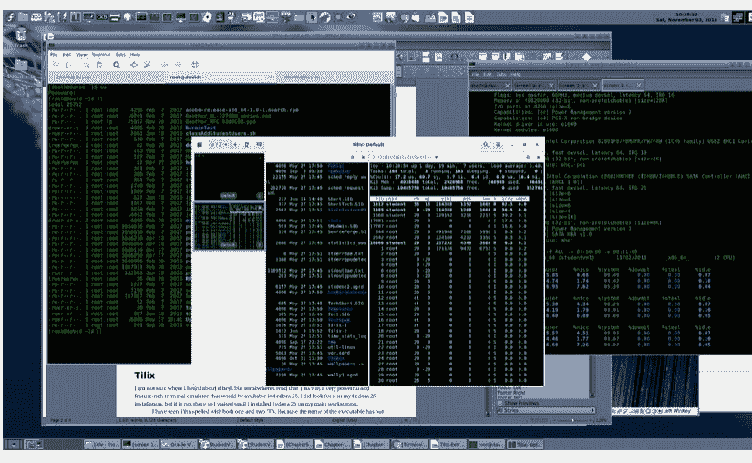

图 14-1. 打开多个模拟器的主工作站桌面

我打开了它的多个实例，可能也打开了其他终端模拟器的实例，例如 `xfce4-terminal`，这是我的另一个最爱。但让我们更仔细地观察这些终端模拟器。

## rxvt

市面上有一些极简主义的 Unicode 终端。`rxvt` 终端模拟器就是其中之一。我们之前安装了 `rxvt-unicode` 软件包，它是原始 `rxvt` 软件包的 Unicode 升级，该包曾用于包括 Fedora 29 在内的早期 Fedora 版本中。

`rxvt` 终端模拟器没有在单个窗口中打开多个标签页或多窗格等功能。它的字体支持非常原始，必须在命令行中指定特定的字体，否则将使用基础的默认字体。

## 实验 14-1：RXVT

在虚拟机的桌面上打开一个 `rxvt` 实例。`rxvt` 窗口没有菜单或图标栏。在窗口中右键点击没有任何反应。但你可以把它作为一个基础终端模拟器使用。

尝试使用 `rxvt` 几分钟，感受一下一种真正老式但功能完备的终端模拟器。

我在探索中包含这个终端模拟器，是为了为你提供一个基准，以便与其他一些终端模拟器的高级功能进行比较。此外，你可能更喜欢这种类型的终端模拟器。有些人喜欢它，这是你的选择，完全没问题。

`rxvt` 终端可执行文件的大小为 197,472 字节，运行时使用 226MB 的虚拟内存。这是我在本章中查看过的终端模拟器中内存占用最小的。但它也是一个极简项目。除了作为终端模拟器工作外，它没有任何类型的功能。它确实有一些可以作为启动命令行一部分的选项，但这些选项也非常极简。

## xfce4-terminal

`xfce4-terminal` 是一个强大的模拟器，它使用标签页允许在单个窗口中运行多个终端。它灵活且易用。与 Tilix、Terminator 和 Konsole 等模拟器相比，这个终端模拟器虽然简单，但它能完成任务。是的，`xfce4-terminal` 是该模拟器可执行文件的名称。

我最喜欢的 `xfce4-terminal` 功能之一是标签页。你可以在一个单窗口中打开许多标签页。将每个标签页想象成独立的终端会话。这为在保持桌面单个窗口的同时运行多个终端会话提供了巨大的灵活性。

我喜欢 `xfce4-terminal` 模拟器的标签页，因为无论连接了多少主机来建立该连接，它们都会显示所连接的主机名称，例如，`host1 => host2 host3 => host4` 会在标签页上正确地显示 `host4`。其他模拟器最多只能显示 `host2`。与 Xfce 桌面的其他组件一样，这个终端使用的系统资源非常少。你还可以使用鼠标拖动标签页并更改它们的顺序；标签页可以完全拖出窗口并释放到桌面上，将其置于自己的窗口中，如果你喜欢，可以在那里添加更多标签页。

让我们现在试一下。因为我们正在使用 Xfce 桌面，到目前为止你应该已经在使用 `xfce4-terminal` 了。因此，你应该对它已经有些熟悉了。

## 实验 14-2：XFCE4

以学生用户的身份执行此实验。如果你桌面上还没有打开可用的 `xfce4-terminal` 实例，请现在打开一个。该启动器位于底部面板从左侧第三个位置。另一个启动器位于主应用程序下拉菜单中。

图 14-2 显示了一个打开了三个标签页的 `xfce4-terminal` 窗口。你的实例中应该只有一个打开的标签页。执行一个简单的任务让这个第一个终端会话显示一些内容，例如运行 `ls` 命令。

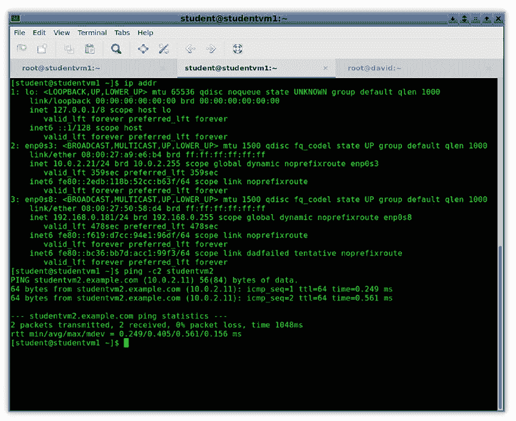

**图 14-2.** `xfce4-terminal` 模拟器采用易于使用的界面，包括用于切换模拟器会话的标签页。每个标签页可以作为不同的用户登录不同的主机或任何组合。

除了标准菜单栏外，`xfce4-terminal` 模拟器还有一个图标栏，可以用它打开另一个标签页或另一个模拟器窗口。我们需要打开图标栏才能看到它。在菜单栏上，选择 **View > Show Toolbar**（查看 > 显示工具栏）。将鼠标指针悬留在栏上最左边的图标上。工具提示显示此图标将在当前窗口中启动另一个标签页。点击该标签页。如果之前只打开了一个终端会话，新标签页将插入到标签栏的最右侧。多打开几个标签页并在其中一个 `su` 到 root。

标签页可以更改，可以通过拖放或选择菜单栏上的选项重新排列标签页。双击其中一个标签页打开一个小对话框，允许你为标签页指定一个新的静态名称。输入名称 "My Tab"。将 "My Tab" 拖到标签栏上的新位置。现在将一个标签页完全拖离 `xfce4-terminal` 窗口并释放到桌面的其他地方。这将创建一个只包含该标签页的新窗口。新窗口现在与原始窗口完全相同。

## LXTerminal

LXTerminal 模拟器使用最少的 RAM，且在我用过的其他模拟器中可执行文件最小。它功能多余很少，但它有标签页允许在单个模拟器窗口中启用多个会话。

LXTerminal 窗口没有图标栏；只有在窗口中右键点击时它才使用菜单栏、弹出菜单和对话框。

## 实验 14-3：LXTERMINAL

以学生用户的身份打开 LXTerminal 实例。运行一个短命令如 `ls` 在第一个会话中显示一些内容。目前还没有显示标签页。

在现有会话中右键点击显示弹出菜单并选择 New Tab（新标签页）打开第二个标签页。现在模拟器窗口顶部应该可见两个标签页。现在从菜单栏打开 File 菜单并打开新标签页。如图 14-4 所示，现在应该有三个标签页。

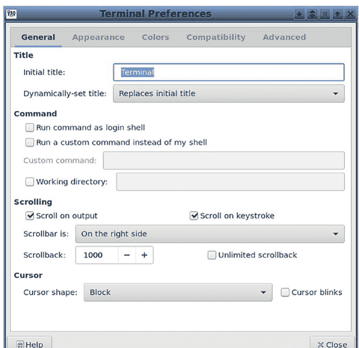

**图 14-3.** `xfce4-terminal` 偏好允许你配置许多方面。

再次按下 `F1` 关闭 htop 帮助。

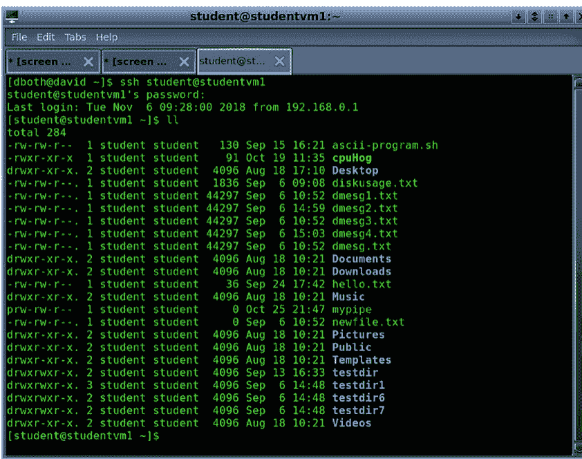

图 14-4. 打开了三个标签的 LXTerminal 窗口

请注意，在点击 OK 按钮之前，任何偏好更改都不会生效，该按钮还会关闭“偏好”对话框。这是我不喜欢的一。保存你当前的更改以查看效果。

再次打开“偏好”并选择“显示（Display）”选项卡。我喜欢将标签放在顶部，但你可能更喜欢让它们位于窗口底部。选择“底部（Bottom）”并保存更改。“显示”选项卡还允许更改回滚的行数（scrollback lines），我通常不会更改它，以及当打开新的 LXTerminal 时的默认窗口大小。我目前将其调整为 130 列 65 行。我有大量的屏幕空间，这在我的宽屏上完全没问题。尝试调整窗口大小，并启动一个适合你的 LXTerminal 新会话。

此选项卡上的其他选项允许你隐藏各种工具，如滚动条和菜单栏。尝试一下，看看在没有这些工具的环境下你会如何工作。我从不隐藏其中任何一个。

切换到**高级（Advanced）**选项卡。我在该选项卡上唯一做的一件事就是禁用 F10 菜单快捷键。“**快捷键（Shortcuts）**选项卡提供了将该键更改为其他内容的功能，但我从不更改这里的默认设置。

花些时间自己探索 LXTerminal，以便你更好地感受它是如何适用于你的。完成后，关闭所有 LXTerminal 实例。

LXTerminal 是一个非常轻量级的模拟器，这体现在它较小的体积和相对较少的配置选项上。这个终端模拟器的重要之处在于，它包含了我们系统管理员快速方便地完成工作所需的所有功能。这两个事实使得 LXTerminal 非常适合小型系统（如内存较小且较旧的笔记本电脑），但它也足够强大，可以完美运行在像我的主工作站这样的大系统中。

LXTerminal 的大小为 98,592 字节，运行时消耗 457MB 虚拟内存。这两个数字在我测试过的任何高级模拟器中都是最小的。

## Tilix

Tilix 允许我将所有——或至少大部分终端会话保持在一个非常灵活的窗口中，这帮助我稍微整理了一下思路。由于 Tilix 极其强大且灵活，我可以以许多不同的方式组织我的终端会话。图 14-5 显示了一个典型的 Tilix 窗口，其中两个活动会话中的一个包含三个终端。该会话（2 个会话中的第 2 个）中的每个终端都通过 SSH 连接到不同的主机。请注意，每个终端中的栏都显示了该终端的用户、主机名和当前目录。

图 14-5 中的 Tilix 实例运行在我的个人工作站上。我已使用 SSH 登录了学生网络中三个不同的主机。屏幕左侧是我用于测试的主机，名为 testvm1。右上角的终端登录到了我安装在虚拟测试网络上的虚拟机服务器，studentvm2。右下角的终端登录到了 ubuntuterm1。这将使我能够轻松监控虚拟网络中的所有三个主机。图 14-5 中的某些细节可能很难看清，但你可以看到在一个模拟器窗口中拥有多个终端如何让我们通过单个主机轻松比较多个系统或实用程序，这非常有用。

```
root@ubuntuterm1:~$ 
link 1:scope service is not known
link 1:scope prefer lft
seq 2:BROADCAST,MULTICAST,LOWER,UPPER mtu 1500 qdisc codel
64 bytes from 192.168.1.82 (192.168.1.82): 64 bytes, time 0.012 ms
link:from 192.168.1.82:233 from 192.168.1.82 (192.168.1.82): icmp-seq=1 time=64
link 40964 prefer lft
link lft prefer link forroute
64 bytes from 192.168.1.82 (192.168.1.82): 64 bytes, time 0.015 ms
64 bytes from 192.168.1.82 (192.168.1.82): 64 bytes, time 0.013 ms
link:from 192.168.1.82:233 from 192.168.1.82 (192.168.1.82): icmp-seq=2 time=64
link 40964 prefer lft
link lft prefer link forroute
64 bytes from 192.168.1.82 (192.168.1.82): 64 bytes, time 0.014 ms
64 bytes from 192.168.1.82 (192.168.1.82): 64 bytes, time 0.014 ms
link:from 192.168.1.82:233 from 192.168.1.82 (192.168.1.82): icmp-seq=2 time=64
```


# 第 14 章 终端模拟器狂热


图 14-4. 打开了三个标签的 LXTerminal 窗口

请注意，在点击 `OK` 按钮之前，任何偏好更改都不会生效，该按钮还会关闭“偏好”对话框。这是我不喜欢的一。保存你当前的更改以查看效果。

再次打开“偏好”并选择“显示”选项卡。我喜欢将标签放在顶部，但你可能更喜欢让它们位于窗口底部。选择 `Bottom` 并保存更改。“显示”选项卡还允许更改回滚的行数，我通常不会更改它，以及当打开新的 `LXTerminal` 时的默认窗口大小。我目前将其调整为 130 列 65 行。我有大量的屏幕空间，这在我的宽屏上完全没问题。尝试调整窗口大小，并启动一个适合你的 `LXTerminal` 新会话。

此选项卡上的其他选项允许你隐藏各种工具，如滚动条和菜单栏。尝试一下，看看在没有这些工具的环境下你会如何工作。我从不隐藏其中任何一个。

切换到**高级**选项卡。我在该选项卡上唯一做的一件事就是禁用 `F10` 菜单快捷键。**快捷键**选项卡提供了将该键更改为其他内容的功能，但我从不更改这里的默认设置。

花些时间自己探索 `LXTerminal`，以便你能更好地感受它是如何适用于你的。完成后，关闭所有 `LXTerminal` 实例。

`LXTerminal` 是一个非常轻量级的模拟器，这反映在它的体积小和相对较少的配置选项上。对于我们系统管理员来说，重要的是这个终端模拟器拥有我们快速轻松完成工作所需的一切。这两点使得 `LXTerminal` 非常适合内存较少但功能强大的小型系统和旧款笔记本电脑，同时也足以胜任我的主力工作站这类大型系统。

`LXTerminal` 执行文件大小为 98,592 字节，运行时消耗 457MB 虚拟内存。这两个数字在我测试的所有较高级模拟器中均最小。

## Tilix

`Tilix` 通过允许我在一个非常灵活的窗口中保留所有——或者至少大量——终端会话，帮我至少稍微整理了一下。由于 `Tilix` 的极致强大和灵活，我可以用许多不同的方式组织我的终端会话。图 14-5 展示了一个典型的——至少对我来说——`Tilix` 窗口，其中包含两个活动会话中的一个，该会话包含三个终端。此会话——第 2 个会话，共 2 个——中的每个终端都使用 `SSH` 连接到不同的主机。请注意，每个终端中的栏会显示该终端的用户、主机名和当前目录。

图 14-5 中的 `Tilix` 实例运行在我的个人工作站上。我使用 `SSH` 登录到了学生网络中的三台不同主机。屏幕左半部分是我用于测试的主机 `testvm1`。右上角的终端登录到了 `studentvm2`，这是一台我安装在虚拟测试网络中的 VM 服务器。右下角的终端登录到了 `ubuntuterm1`。这将方便我在虚拟网络中监控这三台主机。图 14-5 中的某些细节可能难以看清，但你可以看到，在单个模拟器窗口中拥有多个终端，如何允许使用单个主机轻松比较多个系统或工具，这非常有用。

```
root@ubuntuterm1:~$ 

link 1:scope service is not known

link 1:scope prefer lft

seq 2:BROADCAST,MULTICAST,LOWER,UPPER mtu 1500 qdisc codel

64 bytes from 192.168.1.82 (192.168.1.82): 64 bytes, time 0.012 ms

link:from 192.168.1.82:233 from 192.168.1.82 (192.168.1.82): icmp-seq=1 time=64

link 40964 prefer lft

link lft prefer link forroute

64 bytes from 192.168.1.82 (192.168.1.82): 64 bytes, time 0.015 ms

64 bytes from 192.168.1.82 (192.168.1.82): 64 bytes, time 0.013 ms

link:from 192.168.1.82:233 from 192.168.1.82 (192.168.1.82): icmp-seq=2 time=64

link 40964 prefer lft

link lft prefer link forroute

64 bytes from 192.168.1.82 (192.168.1.82): 64 bytes, time 0.014 ms

64 bytes from 192.168.1.82 (192.168.1.82): 64 bytes, time 0.014 ms

link:from 192.168.1.82:233 from 192.168.1.82 (192.168.1.82): icmp-seq=2 time=64
```


# LXTerminal

LXTerminal 是一个非常轻量级的模拟器，这体现在它较小的体积和相对较少的配置选项上。这个终端模拟器的重要之处在于，它包含了我们系统管理员快速方便地完成工作所需的所有功能。这两个事实使得 LXTerminal 非常适合小型系统（如内存较小且较旧的笔记本电脑），但它也足够强大，可以完美运行在像我的主工作站这样的大系统中。

LXTerminal 的大小为 98,592 字节，运行时消耗 457MB 虚拟内存。这两个数字在我测试过的任何高级模拟器中都是最小的。

# Tilix

Tilix 允许我将所有——或至少大部分终端会话保持在一个非常灵活的窗口中，这帮助我稍微整理了一下思路。由于 Tilix 极其强大且灵活，我可以以许多不同的方式组织我的终端会话。图 14-5 显示了一个典型的——对我而言——Tilix 窗口，其中两个活动会话中的一个包含三个终端。该会话（2 个会话中的第 2 个）中的每个终端都通过 SSH 连接到不同的主机。请注意，每个终端中的栏都显示了该终端的用户、主机名和当前目录。

图 14-5 中的 Tilix 实例运行在我的个人工作站上。我已使用 SSH 登录了学生网络中三个不同的主机。屏幕左侧是我用于测试的主机，名为 `testvm1`。右上角的终端登录到了我安装在虚拟测试网络上的虚拟机服务器，`studentvm2`。右下角的终端登录到了 `ubuntuterm1`。这将使我能够轻松监控虚拟网络中的所有三个主机。图 14-5 中的某些细节可能很难看清，但你可以看到在一个模拟器窗口中拥有多个终端如何让我们通过单个主机轻松比较多个系统或实用程序，这非常有用。

```
root@ubuntuterm1:~$ 
link 1:scope service is not known
link 1:scope prefer lft
seq 2:BROADCAST,MULTICAST,LOWER,UPPER mtu 1500 qdisc codel
64 bytes from 192.168.1.82 (192.168.1.82): 64 bytes, time 0.012 ms
link:from 192.168.1.82:233 from 192.168.1.82 (192.168.1.82): icmp-seq=1 time=64
link 40964 prefer lft
link lft prefer link forroute
64 bytes from 192.168.1.82 (192.168.1.82): 64 bytes, time 0.015 ms
64 bytes from 192.168.1.82 (192.168.1.82): 64 bytes, time 0.013 ms
link:from 192.168.1.82:233 from 192.168.1.82 (192.168.1.82): icmp-seq=2 time=64
link 40964 prefer lft
link lft prefer link forroute
64 bytes from 192.168.1.82 (192.168.1.82): 64 bytes, time 0.014 ms
64 bytes from 192.168.1.82 (192.168.1.82): 64 bytes, time 0.014 ms
link:from 192.168.1.82:233 from 192.168.1.82 (192.168.1.82): icmp-seq=2 time=64
```

## 图 14-10

标题栏左侧的图标看起来像一个终端屏幕，我们通常认为它应该是标准的系统菜单。但对于 Tilix 窗口来说，这种理解是错误的。Tilix 在该图标处放置了自身的菜单。该菜单中的选项之一是“偏好”。打开“偏好”对话框。

我会让你自己熟悉这个“偏好”对话框。我建议你尝试从侧边栏切换到使用标签页来切换会话。尝试一段时间，看看你更喜欢哪种。

Tilix 有一个默认配置用于配置其外观和感受，并可以根据需要添加其他配置。每个配置为 Tilix 的功能和外观设置了交替值。可以克隆现有配置以为新配置提供起点。

若要在已打开的窗口从配置列表中选择，点击终端窗口的名称并选择“配置”，然后选择你想要更改的配置。你也可以选择一个配置作为启动新 Tilix 会话或终端时使用的默认配置。

对我而言，在 GUI 桌面面上使用终端模拟器为命令行增加了 GUI 的强大功能。当使用像 Tilix、Terminator 或 Konsole 这样允许多个页面和分屏的终端模拟器时，我的工作效率呈指数级增长。尽管还有其他强大的终端模拟器也可以在单个窗口中运行多个终端会话，但我发现 Tilix 比我尝试过的其他更符合我对此功能的需求。

Tilix 为我提供了 `xfce4-terminal`、`LXTerminal`、`Konsole`、`Terminator` 以及其他终端模拟软件的大多数标准功能，同时提供了一些它们不具备的功能。它以一种易于学习、配置和导航的优雅界面实现了这些功能，并最大限度地利用了屏幕空间。我发现 Tilix 非常适合我的桌面工作风格，而这正是它的核心所在，不是吗？Tilix 可执行文件的大小为 2.9MB，运行时消耗 675MB 的虚拟内存。

在单个窗口中管理多个终端模拟器会话还有其他选项。我们已经探索了其中一个，即 GNU `screen` 工具，而 `tmux`（终端复用器）是另一个。这两种工具都可以在任何终端会话中通过单个窗口、虚拟控制台或远程连接运行，在该窗口内创建对多个终端模拟器会话的访问。这两个命令行工具可以通过简单的——或中等简单的——按键完全进行导航。它们运行不需要任何种类的 GUI。

# 第 14 章 终端模拟器狂热

我们在本章中讨论的终端模拟器，以及许多我们未讨论的，都是使用多个标签页或能够将模拟器窗口拆分为多个格的 GUI 工具，每个格都有一个终端模拟器会话。某些 GUI 终端模拟器（如 Tilix）将屏幕分为多个格并同样使用标签页。拥有多个格的优势之一是很容易将我们想要一起比较或观察的会话放在同一个窗口中。但也很容易将屏幕分成许多格，以至于格内没有足够的空间来真正观察发生了什么。

因此我们可以使用这些花哨的多格、标签页模拟器，然后在这些一个或多个模拟器会话中运行 `screen` 或 `tmux`。我发现所有这些功能的唯一缺点是，我有时会忘记已打开的会话，忘记我已经为某个需要执行的任务开启了一个会话。组合可能会变得非常复杂。

所有这些有趣的功能使得在几个窗口内管理大量的终端会话，从而让你的桌面不那么杂乱。不过，寻找特定的会话可能会有一点问题。在错误的终端会话中输入命令也很容易，这可能会导致混乱。

## Konsole

Konsole 是 KDE 桌面环境的默认终端模拟器。它可以与任何桌面一起安装和使用，但它会安装许多其他终端模拟器不需要的 KDE 库和包。Konsole 是目前最喜欢的终端模拟器。

## 实验 14-5：KONSOLE

打开一个 Konsole 终端模拟器实例。在继续之前，让我们先做一次配置更改。打开 `设置` ➤ `配置控制台`，并选择“标签栏”。将“标签栏可见性”更改为“始终显示标签栏”，并在“新标签页”和“关闭标签页”按钮上勾选。点击确定按钮以使这些更改生效。Konsole 不需要重启。

现在你可以看到标签栏两侧用于打开和关闭标签页的控制台图标，它允许我们只需双击标签栏上的空白处即可打开新标签页。也可以在 `文件` 菜单中打开标签页。

使用上述方法之一打开第二个标签页。你的控制台窗口现在应该看起来像图 14-11。

**图 14-11** 控制台模拟器打开了一个带有两个标签页的标签页。在标签栏空白处双击可打开新标签页。

Konsole 具有非常灵活的配置功能，可以通过 `设置` > `管理配置...` 访问，这将打开配置对话框。选择“配置”标签页并点击“新建配置...”使用此标签页创建一个新配置，并以不同的方式对其进行配置以探索这里的选项。确保在配置的“显示”列中勾选，以列出新配置。点击确定保存更改。现在打开 `设置` > `切换配置` 并点击你新配置的名称。

Konsole 还有许多其他方面可以探索。花些额外的时间，让好奇心带你进入那些有趣的地方。

我非常喜欢 Konsole，因为它为多个终端会话提供标签页的同时，保持了整洁简单的用户界面。我对 KDE Plasma 工作空间有些担心，因为它似乎变得越来越臃肿和缓慢。我在 KDE Plasma 桌面遇到过性能问题和崩溃，但在 Konsole 上没有遇到任何性能问题。

Konsole 实例使用 859MB 的虚拟内存。

## Terminator

Terminator 是另一个强大且功能丰富的终端模拟器。尽管它基于 GNOME 终端，但它的目标是为管理员提供一种工具，可以在标签页内的多个网格中同时使用。

## 实验 14-6：TERMINATOR

作为学生用户，打开一个 Terminator 实例。现在右键点击窗口打开如图 14-12 所示的菜单。

将右侧终端水平拆分。运行顶部的终端应该是上方的，新终端应该在底部。在右下角的终端中运行一个简单的程序（如 `top`）。将底部终端垂直拆分。

调整终端会话的相对大小可能有助于更容易观察。终端会话通过拖动条界定。将鼠标指针移动到左右之间的垂直拖动条上。拖动该条为终端会话留出更多空间。

**图 14-12** 与 Terminator 功能的所有交互都通过弹出菜单进行。

> **注意** 双向箭头图标仅在移动时使用。当指针遇到垂直拖动条时，会显示上下/箭头图标。所有其他终端会话使用左/右箭头指示可以移动的方向。

## 第 14 章 终端模拟器

你的导师展示了类似于图 14-13 的内容。打开一个新标签页，该页至少包含三个会话。

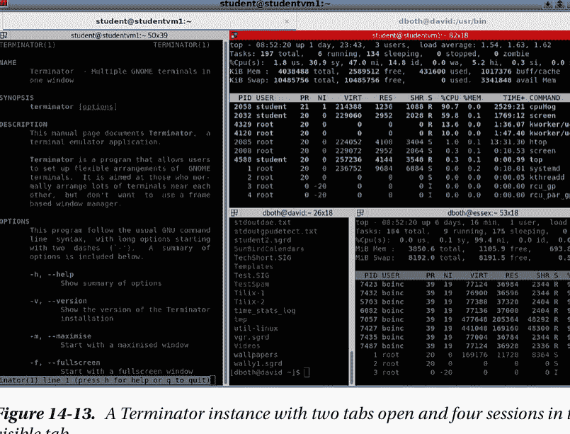

**图 14-13** 带有两个标签页且可见标签内包含四个会话的 Terminator

可以使用拖拽在窗口内重新排列终端会话。将该终端会话拖到窗口内某一个会话的另一个位置。移动终端以感受一下此功能的工作原理。终端会话不能被拖到桌面上以打开另一个窗口；它们只能被拖到它们已经存在的窗口内的位置。

右键点击 Terminator 菜单并选择“选项”。在这里你可以进行配置更改并创建新的配置文件。使用黑色配色方案和稍大的字体创建一个新配置。使用你选择的配色方案创建第三配置。在每个配置之间切换，特别是在管理各种偏好设置时。

花些时间探索 Terminator，否则当你需要打开许多终端会话并同时显示其中几个时，你会发现它非常有用。我确实发现自己有时会产生很多小窗口，因此我需要重新排列它们以便我查看更重要的终端。

一个 Terminator 实例通常消耗 753MB 的虚拟内存。

## 本章总结

与 Linux 的几乎其他任何方面一样，对于终端模拟器，用户和系统管理员都有很多选择。我尝试过很多，但本章讨论的通常是我使用得最多、且能为我提供最高效工作工具的那些。如果你已经有了喜欢的终端模拟器而我没有在这里列出，我深表歉意——种类太多，无法全部包含。

我一直重复使用这些中的每一个，是因为我喜欢它们，即使是因为由于不同的功能。我也继续寻找我没有遇到过的其他终端模拟器，因为学习新事物总是好的，而且其中一个可能就是我可以排除所有其他而使用的终端模拟器。

我喜爱的终端模拟器随时间而变化。我想那是因为我喜欢尝试不同的事物，但也因为每个模拟器都有某些功能，对于我任何时候正在运行的不同项目中运行得更好。

你应该花时间在实验范围之外使用这些每一个终端模拟器。在本课程的其余实验中使用不同的终端模拟器。这样你将有机会更好地理解它们如何帮助你利用对命令行的使用。如果这些终端模拟器不满足你的需求，不要认为你必须使用其中任何一个。请务必尝试你发现的其他工具，并使用你最喜欢的。你可能会发现，像我一样，你的喜好会随时间改变。

## 练习题

执行以下练习以完成本章：

1. 为什么终端模拟器有这么多选择？
2. 为 Tilix 添加一个配置文件，并对其进行配置以满足你的需求，并且你想更改颜色、字体和默认终端大小。
3. 使用 DNF 和互联网寻找本章未涉及的新型终端模拟器。安装至少两个并探索它们的功能。
4. 在我们在本章探索的终端模拟器功能中，哪些对你现在来说最重要？
5. 选择一个合适的终端模拟器并在其中打开终端会话，以便你能够同时启动并查看以下程序——`top`、`iotop` 和用于实时查看网络统计的 `sar`。
6. 你是否对某个特定的终端模拟器产生了偏好？如果是，是哪一个？为什么？

# 第 15 章 高级 Shell 主题

## 目标

在本章中你将学习：

- bash shell 的高级用法
- shell 选项的使用
- 内部命令和外部命令之间的区别
- 如何为命令失败制定计划
- 如何确定将使用内部命令还是外部命令
- 如何指定使用外部命令
- 使用通配符匹配多个文件名以执行操作命令
- `PATH` 变量如何影响可以使用哪些命令
- 将 shell 脚本放置在单个用户或所有用户下的何处
- 命令行程序的使用
- 在简单的命令行程序中使用基本的流程控制
- 使用 `grep` 高级模式匹配从数据流中提取行
- 如何使用 `find` 根据简单或复杂的准则定位文件

## 第 15 章 高级 Shell 主题

在第 7 章中，我们简要地查看了 bash shell 的使用，以及模拟器与 bash shell 的区别，以确保我们对什么是终端有相同的理解。以及命令行以及更多可能令人困惑的术语。在第 9 章中，我们查看了一些基础 Linux 命令以及一些简单管道和重定向的使用。

在本章中，我们将更仔细地查看 bash shell。我们将详细探索 bash 内部命令以及其中包含的环境和变量。我们探索环境对 shell 命令执行的影响。我们还将通过探索命令行程序的能力开始命令行编程，然后转向一些高级工具，`grep` 和 `find`。

## Bash Shell

我们已经在使用 bash shell 了，现在它看起来应该至少有点熟悉，意义在于我们对它是如何运行的了解了一点。shell（外壳）——任何 shell——都是一个命令行解释器。shell 的功能是获取在命令行上输入的命令并执行它们。shell 在用户和操作系统内核之间提供了一个接口。shell 允许用户通过基于文本的命令与系统交互。shell 还用于通过脚本实现自动化。shell 提供了各种功能，如变量、函数和控制结构。shell 对于开发者和管理员来说都是一个强大的工具。有很多不同的 shell 可用，如 `bash`、`zsh`、`sh` 和 `fish`。每个 shell 都有自己的功能和语法，但它们具有相同的目的。

## Shell 选项

Shell 选项是允许你更改 shell 行为的设置。它们可用于自定义 shell 环境以适应你的需求。例如，你可以使用 shell 选项来启用或禁用命令历史，或者更改 shell 处理错误的方式。有很多 shell 选项可用，你可以通过使用 `set` 和 `unset` 命令找到关于它们的信息。

## 实验 15-1：SHELL 选项

以学生用户身份执行此实验。我们将使用 `shopt` 命令快速查看一下 shell 选项：

```
$ student@studentvm1 ~$ shopt
autocd off
cdable_vars off
cdspell off
checkhash off
checkjobs off
checkwinsize on
cmdhist on
compat31 off
<snip>
nullglob off
progcomp on
promptvars on
restricted_shell off
shift_verbose off
sourcepath on
xpg_echo off
```

## Shell 变量

我们将在第 17 章更详细地探索环境变量和 shell 变量，但现在让我们看一下。

变量是代表内存中位置的命名实体。变量的值不是固定的，会随着数值或字符串操作而改变。Bash shell 变量是没有类型的；也就是说，它们可以作为数字或字符串进行处理。

## 实验 15-2：SHELL 变量

以学生用户身份执行此实验。首先，让我们打印 shell 中 `$HOSTNAME` 变量的值，因为它已经存在了。每当我们在脚本或命令行命令中访问变量值时，我们使用 `$` 符号来引用它。`$` 符号指示 bash shell 后随的名称（没有空格）是变量名：

```
student@studentvm1~$ echo $HOSTNAME
studentvm1
```

现在让我们看另一个变量——一个尚未存在的变量，我们将其命名为 `MYVAR`：

```
student@studentvm1~$ echo $MYVAR

student@studentvm1~$
```

由于这个变量尚不存在，它是空的，所以 shell 打印了一个空行。让我们给这个变量赋值，然后再次打印该变量：我们使用不带 `$` 符号的变量名来为变量赋值。在这种情况下，bash shell 可以根据上下文推断出等号后面的名称是变量名。

> **提示** bash shell 语法非常严格，有时需要空格，有时则不需要。在变量赋值的情况下，等号两边不能有空格。

我有时使用 "PATH" 或 "path" 作为对“路径”这一通用概念的引用，而当我使用 `$PATH` 时，它始终指的是该变量或其值。

## 命令

shell 的目的是让人与计算机的交互变得简单且高效。shell 接收我们输入的命令，对其进行修改以便内核能够理解，并将它们传递给操作系统，由操作系统执行。shell 提供了实现这种交互的工具。

命令分为两类：有**内部命令**，它们是 shell 程序不可或缺的一部分；以及**外部命令**，它们是那些独立存在、拥有自己的可执行文件的命令，例如 GNU 和 Linux 核心实用程序。其他外部命令是单独提供的或由 Linux 组件（如逻辑卷管理 LVM）提供的。

这种区别非常重要，因为 shell 内部命令可能会被同名的外部命令执行。例如，有一个 bash 内部 `echo` 命令和一个外部 `echo` 命令。除非你在命令行中指定外部命令的路径，否则将使用 bash 内部的 `echo` 命令。如果这些命令的工作方式略有不同，这可能会导致问题。


让我们具体看看当输入命令时 bash shell 是如何工作的：

- 输入命令并按回车。
- Bash 解析命令，查看命令名前是否带有一个路径。如果有，则跳到第 4 步。
- Bash 检查该命令是否为内部命令。如果是，bash shell 会派生一个新的子进程并立即运行命令。这种派生需要时间，并消耗 CPU、I/O 和 RAM 等系统资源。
- 如果命令中使用了路径，Bash 会派生一个新的子进程并在其中执行该命令，然后运行它。这种派生需要时间，并消耗 CPU、I/O 和 RAM 等系统资源。
- 如果没有指定命令的路径且其不是内部命令，bash 将搜索别名（aliases）和 shell 函数列表——即系统和用户创建的程序。如果找到了，它会派生一个新的 shell 进程并执行该函数或别名。同样，这一切仍然需要时间，尽管时间非常短。
- 如果没有找到别名或函数，bash 然后将在 `$PATH` 变量指定的目录列表中进行搜索以定位命令。找到命令后，bash 会派生一个新的子 shell 来执行该命令。这会消耗更多时间。
- 如果在子 shell 中运行命令，该子 shell 将终止，执行将返回父 shell。

## PATH

`$PATH` 是 shell 的一个重要环境变量。它定义了一个由冒号分隔的目录列表，系统和 shell 会在这些目录中查找可执行文件。当输入非内部命令时，shell 会在 `$PATH` 列出的每个目录中查找可执行文件。

`$PATH` 环境变量可以针对当前 shell、特定用户的所有 shell 实例、甚至是所有用户进行修改。这通常既不可行也不理想，因为正如我们稍将看到的，默认的 `$PATH` 考虑了单个用户在自己的主目录树上维护如 shell 脚本等可执行文件的需求。

## 实验 15-3：探索 $PATH

以学生用户的身份执行此实验。让我们从发现 `$PATH` 的默认值开始：

```
[student@studentvm1 ~] echo $PATH
/usr/local/bin:/usr/bin:/usr/local/sbin:/usr/sbin:/home/student/.local/bin:
home/student/bin
```

考虑 PATH 中的元素。第一个是 `/usr/local/bin`，这是一个专门定义的路径，用于存储本地创建的可执行文件，例如供系统管理员或所有用户使用的 shell 脚本。`/usr/local/etc` 目录用于存储 `/usr/local/bin` 中可执行文件的配置文件。

第二个元素是 `/bin`。它用于大多数用户可执行的二进制文件，并供所有用户使用。第三个是 `/usr/local/sbin`，用于系统管理员使用的标准但非必需的二进制文件。

最后两个目录指定符位于用户的目录树中。因此，如果用户有一些私有的可执行文件（例如个人 shell 脚本），它们通常存储在 `~/bin` 中，内核会在那里搜索它们，因为它们在用户的 `$PATH` 中。

`$PATH` 节省了大量的输入工作。还记得我们被要求启动 `cpuHog` 程序吗？

```
./cpuHog
```

我们必须在命令前加上 `./`（点斜杠）的原因是 `cpuHog` 可执行 shell 脚本位于学生的家目录 `/home/student/` 中，而该目录不在 `$PATH` 中。

尝试以学生的家目录作为 PWD 且不以任何方式指定家目录：

```
[student@studentvm1 ~] cpuHog
Bash: /home/student/bin/cpuHog: No such file or directory
```

我们收到了错误，因此我们需要指定路径，在这种情况下使用当前目录的相对路径。点（`.`）表示法是当前目录的快捷方式。我们可以通过以下方式发布此命令：

- `/cpuHog`
- `~/cpuHog`
- `/home/cpuHog`

终止任何正在运行的 `cpuHog` 实例。确保学生用户的 PWD 是家目录（`-`）。

## 第 15 章 高级 Shell 主题

```
comopt [-o|+o option] [-DEI] [name ...]
continue [n]
cproc [NAME] command [redirections]
declare [-Aaffgiilntrux] [name=value] ...]
dirs [-clpv] [-N] [-N]
<SNIP>
```

```
set [-abefhkmnptuvxBCEHPHT] [-o option-name]
shift [n]
shop [-pqsu] [-o] [optname ...]
source filename [arguments]
suspend [-f]
```

注意：帮助输出列中某些行末尾的大于字符 `gt (>)` 表示该行由于空间不足在终端中被截断了。

要获取每个命令的详细信息，请使用 bash 的 man 页，或直接在内置命令名称后输入 `help`，例如：

```
[student@studentvm ~]$ help echo
echo: echo [-neE] [arg ...]
将参数写入标准输出。
```

在标准输出上以单个空格字符分隔并以换行符结尾显示 ARGs。

```
<snip>
```

man 页仅提供外部命令的信息。内置命令的信息仅位于 bash 自身的 man 和 info 页中：

```
[student@studentvm1 ~]$ man bash
```

要找到内置命令，请搜索 `^SHELL BUILT`。是的，全大写。

正斜杠 (`/`) 开始搜索。脱字符 (`^`) 是一个锚点字符，表示只有当该字符串位于行开头时才会被找到。这个字符串确实出现在很多地方，但都指向该部分开始的唯一位置，显示为“见下文 SHELL BUILT COMMANDS”。

每个内置命令都在 SHELL BUILT COMMANDS 部分列出，并附有其语法和可能的选项及参数。许多 bash 内置命令（如 `continue`、`break`、`declare`、`getopts` 等）是用于脚本或命令行程序，而不是作为命令行上的独立命令。我们将在本章稍后查看其中一些。请浏览 bash man 页中的 SHELL BUILT COMMANDS 部分。

438

让我们取这些命令中的三个并使用 `type` 实用程序来识别它们：

```
 [student@studentvm1]$ type echo getotops egrep
echo is a shell builtin
getotops is a shell builtin
egrep is aliased to `egrep --color=auto`
```

`type` 命令使我们能够轻松识别那些 shell 内置命令。像许多 Linux 命令一样，它可以接受参数列表。

## 外部命令

外部命令是那些作为可执行文件存在且不属于 shell 的命令。这些是存储在 `/bin`、`/usr/bin`、`/sbin` 等位置的可执行文件。

## 实验 15-5：外部命令

首先，进入 PWD 并对那里的文件进行长列表：

```
[student@studentvm1 bin]$ type $1 | less
```

滚动列表并找到一些熟悉的命令。你也会在这些外部命令中找到 `echo` 和 `getotops`。为什么 `type` 命令没有向我们显示这些？如果我们使用 `-a` 选项（定位任何形式的命令，甚至是别名）：

```
[student@studentvm1 bin]$ type -a echo getotops egrep
echo is a shell builtin
echo is /usr/bin/echo
getotops is /usr/bin/getotops
egrep is aliased to `egrep --color=auto`
egrep is /usr/bin/egrep
[student@studentvm1 bin]$
```

`type` 命令搜索可执行文件的顺序与 shell 在准备执行该命令时的搜索顺序相同。如果没有 `-a` 选项，`type` 会在找到第一个实例处停止，显示如果执行该命令时将运行的可执行文件。`-a` 选项告诉它显示所有实例。

我们的 `cpuhog` 脚本呢？`type` 命令告诉了我们关于什么？尝试并发现吧。

## 第 15 章 高级 Shell 主题

## 强制使用外部命令

正如我们所看到的，某些命令的内部和外部版本可能同时存在。当这种情况发生时，一个命令的工作方式可能与另一个不同——尽管名称相同——我们需要意识到这种可能性，以便使用提供所需结果的命令。

如果有必要确保运行外部命令而不运行同名的内部命令，只需在命令名称前加上路径即可，例如 `/usr/bin/echo`。此时，理解 bash shell 如何搜索和执行命令就变得非常有帮助。

## 命令行程序

我们已经使用过非常简单的命令行程序。命令行程序的最简单形式只是在命令行中将多个命令顺序连接在一起；此类命令由分号分隔，分号定义了命令的结束。

你可以像构建复杂的命令流水线一样构建命令行程序。要在单行上创建一系列简单的命令，只需用分号分隔每个命令，如下所示：

```
command1 ; command2 ; command3 ; command4 ; ... 等;
```

不需要最后的分号，因为按回车键意味着最后一个命令的结束。为了一致性添加最后一个分号也是可以的。这个包含多个命令的列表可能就像我们在 15-3 实验中做的那样，我们创建一个新目录，将 `cpuHug` 文件移动到该目录中，然后执行 `cpuHug`。在这种情况下，后续命令的功能取决于前面的命令。

分号也被视为命令的结束，正如换行符一样。分号也是 bash 控制运算符，允许我们改变执行的序列。

440

`&&` 运算符简单地表示：如果 command1 执行成功，则运行 command2。如果 command1 因任何原因失败，则跳过 command2。这种语法看起来像：

```
command1 && command2
```

这之所以有效，是因为每个命令都会向 shell 发送返回码 (RC)，指示其执行成功还是发生了某种失败。按照惯例，返回码为零 (0) 表示成功，而任何正数表示某种类型的失败。我们使用的某些工具只返回一 (1) 表示失败，但许多工具也可以返回其他代码。返回码 (RC) 为零 (0) 意味着命令执行成功。

## 实验 15-6：命令行程序

首先，查看返回码。尝试 `&&` 控制运算符，因为它可能被用于命令行程序。我们从简单的内容开始。我们的目标是创建一个目录并在其中创建一个新文件。我们只在目录创建成功时才执行此。

我们可以使用 `~testdir`，它是为了之前的实验而创建的。后续命令旨在 `~testdir` 中创建一个新目录，它目前应该是空的。`-p` 选项意味着创建任何父目录，因此如果 `~testdir` 不存在，该命令也将创建它。你可以运行 `tree` 命令在创建新目录之前查看当前的目录结构：

```
$student@studentvm1 ~$ tree
Desktop
  diskusage.txt
  dmesg1.txt
  dmesg2.txt
  dmesg3.txt
  dmesg4.txt
  Documents
  Downloads
  Music
  mypipe
  newfile.txt
  Pictures
  Public
  Templates
  testdir
    testdir1
      testdir2
        testdir3
          testdir4
            testdir5
    testdir6
  testdir7
  Videos
```

```
[student@studentvm1 ~$ mkdir -p ~/testdir/newdir && touch ~/testdir/newdir/newfile && echo "Success"
```

返回码 (RC) 为零 (0)，意味着命令执行成功。现在对我们没有权限的目录执行相同的命令：

```
[student@studentvm1 ~]$ ls /root
ls: cannot open directory '/root': Permission denied
RC = 2
```

```
[student@studentvm1 ~]$
```

# 第 15 章 高级 Shell 主题

17 个目录，9 个文件

```
[student@studentvm1]$ mkdir -p ~/testdir/testdir8 && touch ~/testdir/testdir8/testfile1
[student@studentvm1]$ tree
```

```
.
| cpuHog
<SNIP>
|-- Templates
|-- testdir
|   | testdir8
|     |-- testfile1
|-- testdir1
|   | testdir2
|     |-- testdir3
|       |-- testdir4
|         |-- testdir5
|-- testdir6
|-- testdir7
|-- Videos
  | zoom_x86_64.rpm
```

18 个目录，10 个文件

[student@studentvm1]#

一切运行都符合预期，因为 testdir 目录是可访问且可写的。

更改 testdir 的权限，使其 student 用户不再能够访问。我们将在本卷的第 18 章中详细探讨所有权和权限：

```
[student@studentvm1]# chmod 0766 testdir; grep testdir ; tree
d--rwx-xr- 2 student student 4096 Jan 27 08:05 testdir
drwxr-xr-x. 2 student student 4096 Jan 21 16:36 testdir1
drwxr-xr-x. 2 student student 4096 Jan 21 16:36 testdir6
drwxr-xr-x. 2 student student 4096 Jan 21 16:36 testdir7
```

```
.
| cpuHog
<SNIP>
|-- Templates
|-- testdir [error opening dir]
```

```
testdir1
  testdir2
    testdir3
      testdir4
```

```
<SNIP>
  Videos
    zoom_x86_64.rpm
```

列表 (11) 之后使用 grep 命令向我们展示了名称中包含 testdir 的目录列表。你可以看到用户不再具有访问 testdir 目录的权限。现在让我们使用与之前几乎相同的命令，但在 testdir 中创建一个不同的目录：

```
[student@testvm1 ~]$ mkdir ~/testdir/testdir9 && touch ~/testdir/testdir9/testfile1
mkdir: cannot create directory '/home/student/testdir/testdir9': Permission denied
[student@testvm1 ~]$
```

使用 `&&` 控制操作符可以防止 `touch` 命令运行，因为在创建 testdir9 时发生了错误。这种类型的命令行程序流控制可以防止错误累积并导致局面变得混乱。但让我们变得变得复杂一点点。

`||` 运算符允许我们在初始程序语句返回大于零的退出码时添加另一个程序语句。其基本语法看起来如下：

```
command1 || command2
```

这种语法的含义是：如果 command1 失败，则执行 command2。这意味着如果 command1 成功，则跳过 command2。让我们在尝试创建新目录时测试一下：

```
[student@testvm1 ~]$ mkdir "~/testdir/testdir9 || echo "testdir9 was not created."
mkdir: cannot create directory '/home/student/testdir/testdir9':
Permission denied
testdir9 was not created.
[student@testvm1 ~]$
```

> 我们将在第 18 章详细探讨文件和目录权限。

这正是我们预期的。因为无法创建新目录，第一条命令失败了，导致了第二个命令的执行。

结合这两个操作符可以得到两者的优点：

```
$student@studentvm1~$ mkdir ~/testdir/testdir9 && touch ~/testdir/testdir9/testfile1 || echo "."
mkdir: cannot create directory '/home/student/testdir9'
Permission denied
```

```
$student@studentvm1~$ chmod 0775 testdir and try this last command again.
```

当我们同时使用 `&&` 和 `||` 控制操作符时，使用某些流控制的命令行程序语法现在采用这种通用形式：

前置命令 ; command1 && command2 || command3 ; 后置命令

这种语法可以表述为：如果 command1 以返回码 0 退出，则执行 command2；否则，执行 command3。使用控制操作符的命令行程序前后可以跟随其他的命令，这些命令可以与流控制部分的命令相关，但不受流控制的影响。所有前置和后置命令都将执行，而不忽略流控制命令行程序内部发生的任何情况。

## 省时工具


作为系统管理员，非特权用户还有一些额外的工具可用，这为我们在执行广泛任务时提供了很大的灵活性。通配（globbing）和集合的使用允许我们匹配文件名中的字符字符串和数据流中的字符串，以便对它们执行进一步的转换或操作。括号扩展（Brace expansion）允许我们将具有共同特征的字符串扩展为多个不同的字符串。我们已经见过了 bash 中可用的几个元字符；它们提供了极大地增强 shell 功能的编程能力。

## 括号扩展

让我们从括号扩展开始，因为我们将使用这个工具来创建大量带有特殊字符的文件。括号扩展可用于生成任意字符串列表，并将其插入到包含字符串的特定位置或字符串的末端。这可能很难可视化，所以我们直接来吧。

## 实验 15-7：括号扩展

首先，让我们看看基础括号扩展的作用什么：

```
[student@testvm1 ~]$ echo {string1,string2,string3}
string1 string2 string3
```

嗯，这没什么帮助，对吧？但当我们稍微不同的方式使用它时会怎样：

```
[student@testvm1 ~]$ echo "Hello " {David,Jason}.
Hello David. Hello Jason.
```

这种用法可能很有用，因为可以节省大量打字时间。现在尝试这个：

```
[student@testvm1 ~]$ echo b{ed,ar}
beds bars
```

这是我们如何生成文件名的：

```
[student@testvm1 ~]$ echo testfile{0,1,2,3,4,5,6,7,8,9}.txt
testfile0.txt testfile1.txt testfile2.txt testfile3.txt testfile4.txt testfile5.txt testfile6.txt testfile7.txt testfile8.txt testfile9.txt
```

顺序创建文件的更好方法是：

```
[student@testvm1 ~]$ echo test{0..9}.file
test0.file test1.file test2.file test3.file test4.file test5.file test6.file test7.file test8.file test9.file
```

`{x..y}` 语法，其中 x 和 y 是整数，展开为从 x 到包含 y 的所有整数。下面更具说明性：

```
[student@testvm1 ~]$ echo test{20..54}.file
test20.file test21.file test22.file test23.file test24.file test25.file test26.file test27.file test28.file test29.file test30.file test31.file test32.file test33.file test34.file test35.file test36.file test37.file test38.file test39.file test40.file test41.file test42.file test43.file test44.file test45.file test46.file test47.file test48.file test49.file test50.file test51.file test52.file test53.file test54.file
```

现在这个：

```
[student@testvm1 ~]$ echo test{0..9}.file
```

以及这个：

```
[student@testvm1 ~]$ echo test{0..20}{a..f}.file
```

这个通过在数字前加零以保持文件名长度相等，便于搜索和排序：

```
[student@testvm1 ~]$ echo test{000..200}{a..f}.file
```

到目前为止我们学到的只是创建字符串列表。在做更有效率的操作之前，让我们进入一个可以玩耍……意思是创建和操作文件的目录。如果你还没有这样做，请将 `~/testdir` 设置为工作目录（PWD）。检查该目录中没有其他文件，如果有就删除它们。

现在稍微更改格式，然后使用结果作为文件名实际创建文件：

```
[student@studentvm1 test7]$ touch {my,your,our}.test.file.{000..200}{a..f}.{txt,asc}
```

真快！我想知道有多快，所以删除刚刚创建的文件，并使用 `time` 命令看看……呃，花了多久：

```
[student@studentvm1 test7]$ rm ~/testdir/*; touch {my,your,our}.test.file.{000..200}{a..f}.{txt,asc}
```

```
real      0.385s
user      0.056s
sys       0.321s
```

```
[student@studentvm1 test7]$
```

花费了385秒实际时间创建了 14472 个空文件。使用 `wc` 命令进行验证。如果结果是 14473，为什么？你能找到获得正确结果的方法吗？

你将在后续实验中使用这些文件。不要删除它们。

## 特殊模式字符

虽然大多数系统管理员都在说文件通配（globbing），但我们指的是允许我们在执行各种操作时匹配文件名和其他字符串时提供极大灵活性的特殊模式字符。这些特殊模式字符允许匹配字符串中的单个、多个或特定字符：

- `?`：匹配字符串中指定位置的任意一个字符。
- `*`：匹配字符串中指定位置的零或多个任意字符。

你可能已经用过这些了。让我们尝试一些有效使用它们的方法。

## 实验 15-8：特殊模式字符

你可能使用了文件通配来回答我在实验 15-7 中提出的问题：

```
$student@studentvm testdir]$ ls 1*test* | wc
14472 14472 340092
$student@studentvm]$
```

为了实现这个结果，我们必须理解我们创建的文件名的结构。它们都包含字符串 "test"，所以我们可以使用它。该命令使用 shell 内的文件通配来匹配所有在名称任何位置包含 "test" 字符串的文件，并且在该特定字符串前后可以是任意数量的任意字符。让我们看看输出像什么样，而不计算输出行数：

```
$student@studentvm testdir]$ ls 1*test*
```

## 第 15 章 高级 Shell 主题

我确定“你”不想在你的主目录下看到任何属于“我的”文件。首先，查看有多少个“我的”文件，并将它们全部删除，然后验证是否没有剩余任何文件：

```
$student@studentvm1 testdir$ ls my* | wc ; rm -v my*; ls my*
```

`rm` 命令的 `-v` 选项会在删除时列出每一个文件。这些信息可以重定向到日志文件中，记录我们所做的操作。该文件使 `ls` 命令能够列出所有以“my”开头的文件，并对它们执行操作。

找到所有以 `txt` 为扩展名的“我们的”文件：

```
$student@studentvm1 testdir$ ls our*txt | wc
```

找到所有文件名中嵌入的三位数数字在第三位包含 `6` 且以 `asc` 结尾的文件：

```
$student@studentvm1 testdir$ ls *.6?*.asc
```

我们必须多做一些工作，以确保“6”的定位是准确的，防止列出所有仅在三位数数字百位或个位包含 `6` 但不在十位的文件。我们知道没有任何文件名的百位包含 `6`，但这使得我们的通配符更具通用性，从而在这两种情况下都能生效。

我们不在乎文件名是以 `our` 还是 `your` 开头，但我们使用“file.” 最后的“e.”（带点）来锚定接下来的三个字符。在文件名的“e.” 之后，所有文件都有三个数字。我们不在第一位和第三位，只关心第二位。因此，我们使用 `?` 来显式定义在 `6` 的前后有且只有一个字符。我们使用 `*` 来指定我们不在乎之后有多少个字符或是什么字符，但我们想要列出所有以“asc” 结尾的文件。

我们想向某些文件中添加一些内容。我们拥有的文件模式规范几乎符合我们的要求。让我们向所有三位数数字中间位置包含 `6` 且在数字后紧跟一个“a”（即 `x6xa`）的文件中添加内容。我们想要所有匹配此模式的文件，无论后续扩展名是 `asc`、`txt` 还是 `file`。

首先，让我们确保我们的模式正常工作：

```
$student@studentvm1 testdir$ ls *.6?a.*
our.test.file.060a.asc our.test.file.163a.txt
our.test.file.060a.file our.test.file.163a.txt your.test.file.067a.file
our.test.file.060a.text our.test.file.164a.asc your.test.file.067a.text
our.test.file.060a.txt our.test.file.164a.file your.test.file.067a.txt
our.test.file.061a.asc our.test.file.164a.txt your.test.file.068a.asc
our.test.file.061a.file our.test.file.164a.file your.test.file.068a.file
our.test.file.061a.txt our.test.file.165a.asc your.test.file.068a.txt
<snip>
our.test.file.162a.file our.test.file.065a.txt your.test.file.169a.file
our.test.file.162a.txt our.test.file.066a.asc your.test.file.169a.txt
our.test.file.162a.txt our.test.file.066a.file your.test.file.169a.txt
our.test.file.163a.asc our.test.file.066a.txt
our.test.file.163a.file your.test.file.066a.txt
```

看起来我们找全了。完整列表有 160 个。我们想在这些文件中存储一些任意数据，因此我们需要安装一个生成随机密码的小程序 `pwgen`。通常我们希望生成体面的密码，但我们也可以同样容易地将这些随机数据用于其他事情。它可能已经安装了，但让我们确认一下：

```
[root@studentvm1 ~]# dnf -y install pwgen
```

测试 `pwgen`。以下 CLI 命令生成 50 行每行 80 个随机字符：

```
[root@studentvm1 ~]# pwgen 80 50
```

我们将构建一个简短的命令行程序，在匹配模式的每个现有文件中都放入一些随机数据：

```
[student@studentvm1 testdir7]$ for File in `ls *.??a.*` ; do pwgen 80 50 > $File ; done
```

为了验证这些文件是否包含数据，我们检查它们的大小：

```
[student@studentvm1 testdir7]$ ls -l *.??a.*
```

使用 `cat` 查看几个文件的内容。

通配符（Globbing）——使用模式选择文件是一个强大的工具。然而。

## 第 15 章 高级 Shell 主题

## 集合（Sets）

集合是定位文件的强大工具，我们可以对它们执行某些操作，如删除、移动、添加文本、搜索内容等。

## 元字符（Meta-characters）

元字符是对 Shell 有特殊含义的字符。Bash Shell 定义了许多此类字符，其中许多我们已经遇到过：

- `$` Shell 变量
- `~` 主目录变量
- `&` 后台运行命令
- `;` 命令终止/分离
- `>`, `>>`, `<` I/O 重定向
- `|` 管道
- 引号
- 命令替换 - POSIX 标准方法
- 分组
- Shell 控制操作符；条件命令执行

## 使用 grep

正如我们所见，使用通配符模式可以非常强大。我们能够高效地对大量文件执行许多任务。然而，正如其名称所示，文件通配符用于文件名，它不作用于文件内容。

有一个工具 `grep`，可以根据匹配模式从数据流中提取并打印到 STDOUT。这些模式可以从简单的文本模式到复杂的正则表达式（regex）。`grep` 工具由 Ken Thompson 编写并于 1974 年首次发布，由 GNU 项目提供并默认安装在我们使用的每个 Unix 版本和 Linux 发行版中。

在通配符字符（`grep` 不理解这些）方面，`grep` 命令的默认模式是 *PATTERN*。在搜索模式的前后都有隐式的通配符匹配。因此，你可以假设你指定的任何模式无论出现在被扫描行的什么位置，都能被找到。它可能出现在开头、中间任何位置或末尾。因此，没有必要显式说明在我们搜索的字符串之前或/后是否存在字符。

## 第 15 章 高级 Shell 主题

## 实验 15-10：使用 GREP

请以 root 身份执行此实验。虽然非特权用户可以访问我们将搜索的部分数据，但只有 root 用户可以访问所有数据。

我经常执行的需要使用 `grep` 工具的常见任务之一是扫描日志文件以查找有关特定内容的信息。例如，我可能需要确定有关操作系统的信息，以及以其 BIOS 名称 ⁵ ethX 开头的网络接口卡（NICs）的信息。有关主机上安装的网卡的信息可以通过 `dmesg` 命令找到，类似于 `/var/log/messages` 日志文件中的内容。

我们将从查看不使用管道的输出开始。首先，将输出管道到 `less` 并使用 `less` 内置的搜索功能：

```
root@studentvm1 ~# dmesg | less
```

你可以翻页 `less` 生成的屏幕，并使用“肉眼”⁶来定位 "eth" 字符串，你也可以通过输入斜杠（/）字符然后输入要查找的字符串来搜索：`/eth/`。搜索将高亮该字符串，你可以使用“n”键查找字符串的下一个实例，使用“b”键向后搜索上一个实例。

在数页数据中进行搜索，即使有良好的搜索功能，也比肉眼观察要简单，但没有使用 `grep` 简单。`-i` 选项告诉 `grep` 忽略大小写，并无论字母的大小写如何都显示 "eth" 字符串。它将找到 `ethX`、`ETH`、`eTh`、`eTh` 等，这些在 Linux 中都是不同的：

```
root@studentvm1 ~# dmesg | grep -i eth
[ 1.861992 e10000 0000:03.0 eth0:(PCI:33MHz:32-bit) 08:00:27:a9:e6:b4
[ 1.861999 e10000 0000:03.0 eth0:Intel(R) PRO/1000 Network Connection
[ 2.205263 e10000 0000:08.0 eth1:(PCI:33MHz:32-bit) 08:00:27:50:58:d4
[ 2.205268 e10000 0000:08.0 eth1:Intel(R) PRO/1000 Network Connection
[ 2.205334 e10000 0000:03.0 enp0s3 renamed from eth
[ 2.209591 e10000 0000:08.0 enp0s8 renamed from eth1
root@studentvm1 ~#
```

> ⁵ 大多数现代 Linux 发行版将网卡从旧的 BIOS 名称重命名为类似 `enp0s3` 的名称。我们将在卷 2 的第 36 和 38 章中讨论的内容。
> ⁶ Wikipedia，视觉检查（Visual Inspection），https://en.wikipedia.org/wiki/Visual_inspection

这些结果显示了关于 BIOS 名称、它们所在的 PCI 总线、MAC 地址以及 Linux 给它们的新名称。现在寻找作为网卡名称开头字符串 "enp" 的实例。你找到任何了吗？

**注意** 方括号内的数字如 `[ 2.205334]` 是时间戳，表示该日志项是在内核接管计算机控制权几秒后生成的。

在第一个用法示例中，`grep` 使用 STDIN 接收输入数据流，然后将输出到 STDOUT。`grep` 工具也可以使用文件作为数据流的源。我们可以在下一个示例中看到这一点，我们在消息日志中搜索有关我们网卡的信息。

```
[root@studentvm1 ~]$ cd /var/log | grep -i eth messages*
<snippet>
messages-20181111:Nov 09:27:36 studentvm1 dbus-daemon[830]: [system]
Rejected message, 2 matched rules; type="method_call", sender=":1.89"
(uid=1000 pid=1738 comm="/usr/bin/pulseaudio") --daemonize="no"
interface="org.freedesktop.DBus.ObjectManager" member="GetManagedObjects"
error="unset" requested_reply="o" destination="org.bluez" (bus)
messages-20181111:Nov 06:27:36 studentvm1 pulseaudio[1738]: E:
[payload]bluez2-util: GetManagedObjects() failed: org.freedesktop.


DBus.Error.AccessDenied: Rejected message, 2 matched rules;

type="method_call", sender=":11.89" (uid=1000 pid=1738 comm="/usr/bin/pulseaudio" --daemonize="no" interface="org.freedesktop.DBus.ObjectManager" member="GetManagedObjects" error="unset" requested_reply="o" destination="org.bluez"

messages-20181111:Nov 16 07:41:00 studentvm1 kernel: [1.861992 e10000 0000:03.0 eth0:(PCI:33MHz:32-bit) 08:00:27:a9:e6:b4

[ 1.861999 e10000 0000:03.0 eth0:Intel(R) PRO/1000 Network Connection

[ 2.205263 e10000 0000:08.0 eth1:(PCI:33MHz:32-bit) 08:00:27:50:58:d4

[ 2.205268 e10000 0000:08.0 eth1:Intel(R) PRO/1000 Network Connection

[ 2.205334 e10000 0000:03.0 enp0s3 renamed from eth

[ 2.209591 e10000 0000:08.0 enp0s8 renamed from eth1

## 使用正则表达式的 GREP

`grep` 的高级功能之一是能够从包含一个或多个模式的文件中读取搜索模式。如果你需要定期执行相同的复杂搜索，这种方法非常有用。

`grep` 工具功能强大且复杂。手册页（man page）提供了大量信息，GNU 项目提供了一份 36 页的免费手册辅助学习和使用 `grep`。

## 查找文件

`ls` 命令及其别名（如 `ll -l`）旨在列出目录中的所有文件。特殊模式字符和 `grep` 命令可以缩小发送到 STDOUT 的文件列表。但仍然存在一些不足。我们在实验 15-10 中使用的 `ls -R | grep -E "^kde"` 命令存在一些问题。它找到的一些文件位于 `/etc/` 的子目录中，但 `ls` 命令不会显示存储这些文件的子目录名称。

幸运的是，`find` 命令专门设计用于使用模式在目录树中搜索文件，并列出文件及其所在的目录，或者对它们执行某些操作。`find` 命令还可以使用属性，例如文件的创建或访问日期、在特定日期和大小之前创建或修改的文件、权限、用户 ID、组 ID 等等属性。这些属性可以组合起来变得非常精确，例如：查找所有大小大于 12M、创建于 5 年以前、超过一年未被访问、属于 UID 为 XXXX 的用户且是普通文件（换句话说，不是目录、符号链接、套接字、命名管道等）的文件。

一旦找到了这些文件，`find` 命令就内置了选项来执行操作，如列出、删除、打印，甚至使用文件名作为选项执行系统命令（例如移动或复制它们）。这是一个非常强大且灵活的命令。

## 实验 15-11：查找文件

以 root 用户身份执行此实验。以下命令查找 `/etc` 及其子目录下所有以 "kde" 开头的文件，它使用了 `-iname` 而不是 `-name`，搜索是不区分大小写的：

```bash
[root@studentvm1]# find /etc -iname "kde*"
/etc/xdg/kdebugrc
/etc/profile.d/kde.sh
/etc/profile.d/kde.sh
/etc/kde4rc
/etc/kderc
/etc/kde
[root@studentvm1 ~]#
```

以学生用户身份执行其余命令。将学生的家目录（~）设置为当前工作目录（PWD）。

假设你想找到在之前的实验中主目录中创建的所有空文件（长度为 0）。下一个命令执行了此操作。它开始在主目录（~）中查找类型为 `f`、为空且文件名中包含字符串 "test.file" 的文件：

```bash
[student@studentvm1 ~]$ find . -type f -name "*test.file*" | wc -l
9488
[student@studentvm1 ~]$
```

我的主目录中有来自之前实验的 9,488 个文件，但你的数字可能会不同。这是预期的，因为我们在之前的某些实验中创建了大量的空文件。运行此命令，但不要将数据流通过 `wc` 命令。只需列出名称。注意，文件名是没有排序的。

但让我们也看看是否有这些文件不属于之前的实验，因此我们想查找文件名中不包含字符串 "test.file" 的空文件。感叹号（`!`）反转了 `-name` 选项的含义，因此只显示不匹配我们提供的文件名字符串的文件：

```bash
[student@studentvm1 ~]$ find . -type f -empty ! -name "*test.file*"
./link3
./local/share/ranger/vim/Trash/000_file02
./local/share/vim/Trash/000_file03
./local/share/orage/orage_persistent_alarms.txt
./local/share/mc/filepos
./local/share/user-places.xbel.tbcache
./.cache/abrt/applet_dirlist
./file005
./newfile.txt
```

## 第 15 章 高级 Shell

```bash
./.testdir/file006
./testdir/file077
./testdir/link2
./testdir/file008
./testdir/file055
./testdir/file007
<snip>
```

让我们也找到非空文件：

```bash
[student@studentvm1 ~]$ find . -type f ! -empty -name "**test.file*" | wc -l
160
[student@studentvm1 ~]$
```

我们现在知道有 160 个文件名中包含 "test.file" 字符串的文件是非空的。现在我们知道，对上一个命令找到的文件执行操作（如删除它们）不会影响任何其他重要文件。因此，让我们删除所有文件名包含字符串 "test.file" 的空文件。验证没有这些空文件留存，且非空文件仍然存在：

```bash
[student@studentvm1 ~]$ find . -type f -empty -name "**test.file*" -delete
[student@studentvm1 ~]$ find . -type f -empty -name "**test.file*"
[student@studentvm1 ~]$ find . -type f ! -name "**test.file*" | wc -l
160
```

这里还有几个可以尝试尝试。首先，为我们的下一个示例创建一个相当大的文件，即创建一个超过 1GB 包含随机数据的文件：

```bash
[student@studentvm1 ~]$ dd if=/dev/urandom of=testfile count=1 bs=1G
```

现在查找我们刚刚创建的文件：

```bash
[student@studentvm1 ~]$ find . -type f -name "testfile"
```

现在查看我们创建的文件的大小：

```bash
[student@studentvm1 ~]$ ls -lh testfile
```

最后，删除我们创建的文件：

```bash
[student@studentvm1 ~]$ rm testfile
```

现在让我们验证该文件已删除：

```bash
[student@studentvm1 ~]$ find . -type f -name "testfile"
```

## 第 16 章 LINUX 引导与启动

## 概述

将 Linux 主机从关闭状态变为运行状态的完整过程是复杂的，但它是开放且可知的。在进入细节之前，快速概述一下从硬件启动到系统准备好用户登录之间的时间，将有助于我们理清思路。大多数时候，我们听到的“启动过程”被视为一个单一整体，但事实并非如此。事实上，完整的引导和启动过程包含三个部分：

- 硬件启动：初始化系统硬件
- GRUB2 引导加载程序中的 Linux 启动：从存储设备加载 Linux 内核和 systemd
- systemd 中的 Linux 启动：使主机准备好进行生产性工作

将硬件启动与 Linux 启动过程以及 Linux 启动区分离开来，并显式地定义它们之间的分界点是非常关键的。理解这些差异以及各个部分在让 Linux 系统达到可以工作的状态方面起起的作用，使得能够管理这些过程，并更好地确定在大多数人所说的“启动”过程中发生问题的是哪个环节。

## 硬件启动

Linux 启动过程的第一步实际上与 Linux 完全没有关系。这是启动过程中的硬件部分，对于任何基于 Intel 的操作系统来说都是相同的。

当电源首次接入计算机或我们为本课程创建的虚拟机时，它会运行通电自检（POST）¹，这是 BIOS² 或更新的统一可扩展固件接口³（UEFI）的一部分。BIOS 代表基本输入/输出系统，POST 代表通电自检。当 IBM 在 1981 年设计第一台 PC 时，BIOS 的设计初衷是初始化硬件组件。POST 是 BIOS 的一部分，其任务是确保计算机硬件运行正常。如果 POST 失败，计算机可能无法使用，因此启动过程将不会继续进行。

¹Wikipedia, Power-On Self-Test, http://en.wikipedia.org/wiki/Power-on_self-test

²Wikipedia, BIOS, http://en.wikipedia.org/wiki/BIOS

³Wikipedia, Unified Extensible Firmware Interface, https://en.wikipedia.org/wiki/Unified_Extensible_Firmware_Interface

现代主板提供了较新的 UEFI 来替代 BIOS。许多主板还提供旧版 BIOS 支持。BIOS 和 UEFI 执行着相同的功能——硬件验证、初始化以及加载引导加载程序。

BIOS/UEFI POST 检查硬件的基本可性。然后，它会在所有连接的可启动设备上寻找引导区，包括旋转硬盘或 SSD 存储设备、DVD 或 CD-ROM，以及像我们用于安装 StudentVM1 虚拟机时使用的可启动 USB 闪盘。第一个包含有效主引导记录（MBR）⁴的引导区将被加载到 RAM 中，并将控制权转移到 RAM 中的引导区副本。

BIOS/UEFI 用户界面可用于配置系统硬件，例如超频、设置 CPU 核心为激活或非激活状态、系统可能启动的特定设备，以及搜索启动引导区的设备顺序。我不再创建或从可启动的 CD 或 DVD 设备启动。我只使用可启动的 USB 驱动器从外部可拆卸设备启动。

由于我有时会从外部 USB 驱动器启动——或者在虚拟机的情况下，使用这样的可启动 ISO 镜像——我配置系统首先从外部 USB 设备启动，然后从相应的内部磁盘驱动器启动。这在大多数商业环境中被认为是不安全的，但我经常从外部 USB 盘启动。如果他们偷走了电脑或它在自然灾害中被毁，我可以恢复到存在保险箱中的备份⁵。

在大多数环境中，你可能希望更安全一些，设置主机仅从内部引导设备启动。使用 BIOS 密码防止未经授权的用户访问 BIOS 更改默认启动顺序。

当引导区接管系统控制时，硬件启动结束。

## 引导区

引导区始终位于存储设备（无论是 HDD 还是 SSD）的第一个扇区，它包含了主引导记录（MBR）的一部分的分区表。这种 MBR 分区方法可以追溯到 1983 年，对现代存储硬件的限制远未达到其全部能力。

⁴Wikipedia, Master Boot Record, https://en.wikipedia.org/wiki/Master_boot_record

⁵备份将在卷 2 的第 40 章中讨论。

现代分区方案使用 GUID 分区表⁶（GPT）来克服这些限制。

在本节中，我们将非常简要地查看 MBR 和 GPT。

## MBR

MBR 非常小——只有 512 字节。因此，空间非常有限，必须包含一小段代码（GRUB 第 1 阶段）以及定义存储设备空间细子划分的分区表。

MBR 能够支持四个主分区，尽管可以创建一个分区作为所谓的“扩展分区”，该分区支持额外的逻辑分区，从而对驱动器空间进行进一步划分。MBR 方法支持的总磁盘大小约为 2.2TB (2.2 × 10¹²)，这比目前许多可用的存储设备都要小。

## GPT

GPT 是一种全新的现代磁盘分区表标准。它的设计目标是为了支持更大的磁盘容量和系统冗余，它比 MBR 大，因此支持大得多的存储设备——高达 9.44 z 字节（9.44 × 10²²）。

GPT 在磁盘的第一个扇区使用 MBR，但它被用作一种保护结构来提供标识符，以便系统工具不会将驱动器视为空存储设备。

## 影响

大多数情况下，MBR 和 GPT 之间的差异与 Linux 操作或问题解决无关。两者的功能是将存储设备划分为可用的区块，并提供一小段代码执行 BIOS/UEFI 硬件启动与 GRUB 主引导加载程序之间的转换。

⁶Wikipedia, GUID Partition Table, https://en.wikipedia.org/wiki/GUID_Partition_Table. 该条目包含了 MBR 的优秀描述以及 GPT 的结构。

⁷Wikipedia, Disk Partitioning – Partition Table, https://en.wikipedia.org/wiki/Disk_partitioning#Partition_table

在 Fedora 安装期间使用不同的分区策略可以决定是安装 MBR 还是 GPT。两者都适用于现在的 Linux 系统，如 EXT4、BTRFS、ZFS 等。唯一的功能区别是 GPT 支持极大容量的存储设备，这种设备目前很难出现在数据中心之外。

### Linux 启动

由 BIOS 加载的引导区是 GRUB 的第 1 阶段。Linux 启动本身由多个 GRUB 阶段组成。我们在本节中考虑每个阶段。

### GRUB

GRUB 的主要功能是将内核加载到内存并运行。在操作系统外部环境中使用 GRUB 命令不在本章的范围内。虽然 GRUB 正式没有使用“阶段”术语来描述它的三个阶段，但这样引用它们非常方便。GRUB2 是 GRUB 加载器的最新版本，且使用频率更高。我们本课程中不会涵盖 GRUB1 或 LILO，因为它们比 GRUB2 老旧得多。

由于写和说 GRUB2 更方便，我们在课程中使用 GRUB 术语，除非另有说明，否则指的是 GRUB2。GRUB2 代表“通用统一引导程序 2”，它现在是许多当前 Linux 发行版的标准引导程序。GRUB 是让计算机足够智能以启动操作系统并将其加载到内存中的程序，但需要三个 GRUB 阶段才能完成。Wikipedia 有一篇关于 GNU GRUB 的优秀文章¹¹⁰

⁸GNU, GRUB, www.gnu.org/software/manual/grub

⁹Wikipedia, GNU GRUB, https://en.wikipedia.org/wiki/GNU_Documentation

¹⁰GNU, GNU GRUB, www.gnu.org/software/grub/grub-documentation.html

## 第 16 章 LINUX 启动

由于系统更新，可能会存在多个发行版内核。这使得当更新后的内核因某种原因失败或与某些软件不兼容时，可以启动到之前的内核版本。GRUB 通过 `/boot/grub/grub.conf` 文件进行配置。

基于 Red Hat 的发行版在 Fedora 15 和 CentOS/RHEL 7 左右升级到了 GRUB2。GRUB2 提供了与 GRUB1 相同的启动功能，但 GRUB2 还提供了一个类似于大型机的基于命令的 OS 前环境，并在预启动阶段允许更大的灵活性。

### GRUB 第 1 阶段

正如在“硬件启动”部分提到的，在 POST 结束后，BIOS/UEFI 会在连接的磁盘上搜索引导记录，引导记录位于主引导记录（MBR）中，并将找到的第一个记录加载到内存中，然后开始执行引导记录。引导代码（即 GRUB 第 1 阶段）非常小，因为它必须与分区表一起放入硬盘上第一个 512 字节的扇区中.¹¹¹ 在经典的通用 MBR 中，分配给实际引导代码的总空间为 446 字节。第 1 阶段的文件名为 `boot.img`，它不包含分区表。分区表在设备分区时创建，并从第 447 字节开始覆盖在引导记录上。

在 UEFI 系统中，分区表已移出 MBR 并移动到紧随 MBR 之后的空间。这为定义分区提供了更多空间，因此允许创建更多的分区。

由于引导记录必须非常小，它并不智能，也不理解 EXT4 等文件系统结构。因此，第 1 阶段的唯一目的是加载 GRUB 第 1.5 阶段，后者可以访问文件系统。为了实现这一点，GRUB 第 1.5 阶段必须位于引导记录与 UEFI 分区数据以及硬盘第一个分区之间的空间。将 GRUB 第 1.5 阶段加载到 RAM 后，第 1 阶段会将控制权交给第 1.5 阶段。

> ¹¹¹ Wikipedia，GUID 分区表，https://en.wikipedia.org/wiki/GUID_Partition_Table

### 实验 16-1：引导记录

如果已有可用的终端会话，请以 root 身份登录。在终端会话中以 root 身份运行以下命令以验证虚拟机上启动驱动器的标识。它应该与启动分区是同一个器：


# 第 16 章 LINUX 启动

## 实验 16-2：GRUB 第 1.5 阶段

```
[root@studentvm1 ~]# lsblk -i
NAME                      MAJ MIN TYPE MOUNTPOINT
sda       8:0 0 60G disk
-sda1     8:1 0 1G part /boot
-sda2     8:2 0 5G part
|-fedora_studentvm1-root 253:0 0 2G lvm /
|-fedora_studentvm1-swap 253:1 0 6G lvm [SWAP]
|-fedora_studentvm1-home 253:2 0 15G lvm /usr
|-fedora_studentvm1-home 253:3 0 4G lvm /home
|-fedora_studentvm1-var 253:4 0 10G lvm /var
|-fedora_studentvm1-tmp 253:5 0 5G lvm /tmp
[root@studentvm1 ~]#
```

使用 `dd` 命令查看启动驱动器的引导记录。在本实验中，假设它被分配给 `/dev/sda` 设备。命令中的 `bs` 参数指定块大小，`count` 参数指定要转储到 STDIO 的块数。`if` 参数（输入文件）指定数据流的源，在这种情况下为 USB 设备：

```
[root@studentvm1 ~]# dd if=/dev/sda bs=512 count=1
������|||���u
����������u�����������
��������tpt��|10-�|d<t��R|10@D@��D��f�\
f����|�|��
D�B��r��p��K��������a����������f1f�TCPAf�
a�&Z|).�43}.GRUB GeomHardDisk Error
������.U1+0 records in
1+0 records out
[root@studentvm1 ~]#
```

这会打印引导记录的文本，它是磁盘上的磁盘任何块。在这种情况下，有关于文件系统的信息，虽然由于它是以二进制格式存储的而不可读，但包含了分区表。GRUB 或其他引导加载程序的第 1 阶段位于此部分，但对于大多数人类来说，那里大部分是不可用的。我们可以在引导记录中看到一些 ASCII 文本消息。如果我们稍微改变一下方法，读取这些消息可能会更容易。`od` 命令（八进制显示）将传递给它的数据流以八进制格式在一个整洁的矩阵中显示，使内容变得稍微易读。`-a` 参数告诉命令尽可能转换为可读的 ASCII 格式字符。命令末尾的 `-` 告诉我们从 STDIN 获取输入：

```
[root@studentvm1 ~]# dd if=/dev/sda bs=512 count=1 | od -a
1+0 records in
1+0 records out
0000000 k cle dle so < nul 0 nul so @
0000020 nul > nul < nul ? s ack
0000040 nul > nul 8 nul v etx dle so ~
0000060 nul syn 4 stx 0 soh |
0000100 stx Mc3 j nul | nul nul nul nul
0000120 nul nul nul nul nul nul nul nul
0000140 nul nul nul nul nul nul | z nul | B nul enq B <
0000160 stx 2 nul j y | | nul 1 @ so so <
0000200 nul sp { sp < d nul | stx bs R > dle nul
0000220 1 @ ht D eot @ ds del ht B > geot dle nul
0000240 f vt rs \ | f ht \ bs f vt rs | | f ht
0000260 \ ff G D ack ` 4 B Mc3 r enq ; nul p
0000300 k stx k K _ rs 9 nul soh [ 1 ? nul nul
0000320 so f / % us a - 8 ; | Sub f enq @
0000340 u gs 8 ; ? nul f 1 v f ; T C p
0000360 A 9 nul stx nul f : bs nul M sub a
0000400 del & Z | us } | k kan | etx > } h 4 nul <
0000420 3 } h . nul kan GRU sp nul G
0000440 e o m nul a r sp D i s | nul R e
0000460 a d nul sp E r o 0 | cr nul ; soh 4
0000500 so Mle | < nul | t C nul nul nul nul nul
0000520 nul nul nul nul nul nul nul nul nul nul nul nul nul nul nul *
0000660 nul nul nul nul nul nul nul nul \ ; ^ . nul nul eot
0000700 soh etx ~ B del nul bs nul sp nul ~
0000720 B del so ~ B del nul sp nul x _ bel nul nul
0000740 nul nul nul nul nul nul nul nul nul nul nul nul nul nul nul nul
0000760 nul nul nul nul nul nul nul nul nul nul nul nul nul nul nul U *
0001000
```

注意地址 0000520 和 0000660 之间的星号（*）。这表示该范围内的所有数据与 0000520 之前的最后一行相同，全都是空字符。这节省了输出流空间。地址是八进制的，即基 8。

一个不包含分区表的通用引导记录位于 `/boot/grub/i386-pc`。让我们看看该文件。如果我们使用 `dd`，没有指定块大小和计数，因为我们查看的是长度限制的文件。我们可以直接使用 `od` 并指定文件名，而不是使用 `dd` 命令，尽管也可以：

```
[root@studentvm1 ~]# od -a /usr/lib/grub/i386-pc/boot.img
0000000 k c dle nul nul nul nul nul nul nul nul nul nul nul nul
0000020 nul nul nul nul nul nul nul nul nul nul nul nul nul nul *
0000120 nul nul nul nul nul nul nul nul soh nul nul soh nul
0000140 nul nul nul nul nul nul del z nul z nul k enq v B nul | nul 1 @ enq v p
0000160 stx 2 nul j y | | nul 1 @ so so s p
0000180 nul nul sp @ D del ht bs < del stx bs R > dle nul
0000220 1 @ ht D eot @ ds del ht B > geot dle nul
0000240 f vt rs \ | f ht \ bs f vt rs | | f ht
0000260 \ ff G D ack ` 4 B Mc3 r enq ; nul p
0000300 k stx k K _ rs 9 nul soh [ 1 ? nul nul
0000320 so f / % us a - 8 ; | Sub f enq @
0000340 u gs 8 ; ? nul f 1 v f ; T C p
0000360 A 9 nul stx nul f : bs nul M sub a
0000400 del & Z | us } | k kan | etx > } h 4 nul <
0000420 3 } h . nul kan GRU sp nul G
0000440 e o m nul a r sp D i s | nul R e
0000460 a d nul sp E r o 0 | cr nul ; soh 4
0000500 so Mle | < nul | t C nul nul nul nul nul
0000520 nul nul nul nul nul nul nul nul nul nul nul nul nul nul nul *
0000660 nul nul nul nul nul nul nul nul \ ; ^ . nul nul eot
0000700 soh etx ~ B del nul bs nul sp nul ~
0000720 B del so ~ B del nul sp nul x _ bel nul nul
0000740 nul nul nul nul nul nul nul nul nul nul nul nul nul nul nul nul
0000760 nul nul nul nul nul nul nul nul nul nul nul nul nul nul nul U *
0001000
```

包含 GRUB 第 1.5 阶段的文件存储在 `/boot/grub2/i386-pc/core.img`。你可以像之前验证第 1 阶段那样，通过比较文件中的代码与存储在启动器 MBR 间隙（gap）中的代码来验证这一点：

```
[root@studentvm1 ~]# dd if=/dev/sda bs=512 count=1 skip=1 | od -a -
1+0 records in
1+0 records out
512 bytes copied, 0.000132697 s, 3.9 MB/s
0000000 E F I sp P A R T nul soh soh \ nul nul nul
0000020     * so nul nul nul nul soh nul soh nul nul nul nul
0000040 del del del bel nul nul nul nul ~" nul nul nul nul nul nul nul nul
0000060 ade del del bel nul nul nul nul | _ ht @ ack sp nl F
0000100 dci ff c ? 1 > so etx stx nul nul soh nul nul nul nul
0000120 nul nul nul nul nul nul nul nul ack ~ J $ nul nul nul nul
0000140 nul nul nul nul nul nul nul nul nul nul nul nul nul nul nul nul
*
0000100
```

```
[root@studentvm1]# dd if=/boot/grub2/i386-pc/core.img bs=512 count=1 | od -a -
1+0 records in
1+0 records out
512 bytes copied, 5.1455e-05 s, 10.0 MB/s
0000000 R V ~ esc soh h 9 soh ^ ? t soh f vt - etx
0000020      bs nul nul si eot b nul nul | del nul t F f vt gs
0000040 fvt Vt M eot f 1 @ 0 del 9 E bs del etx vt E
0000060     ) bs noh fsh enq etx U eot nul G eot nul
0000100 ht Dst x f ht \ bs fht L L ff G D ack nul p nul
0000120 P G D eot nul nul 4 B M dc36 si stx nul ; p nul
0000140 p k f1 R f w Vt Vt Eot f ht @ six enq nul f vt
0000160 enq f 1 R f w 4 bs Tnl f nl 1 R f w t
0000200 et bs T vt ht d FF ; D bs ) vy vt etx * D
0000220 nl 9 E bs del etx wt ~ E bs ) E bs soh enq f
0000240 etx U eot nul nt T cr @ back nl L nl ~ A bs
0000260 Q nl 1 ff Z R nl t vt P ; nul p so C 1
0000300 [ 4 stx Mc33 r FF C so nl X A enq
0000320 soh E nl ` rs A ` etx ht A del 1 v so [
00003400 / s % us > # soh h W nul a etx } bs nul si
0000360 enq $ del etx o ff i syn den > % soh h b nul Z
0000400 j nul stx nul o > ( soh h 6 nul k ack > - soh
0000420 h . nul > 2 soh h ( nul k ~ 1 o a d i
0000440 n g nul > nul cr nl nul G e o m nul R e a
0000460 d nul sp E r r o r nul ; soh so 4 so M dle
0000500 F nl elot u r < nul C nul nul nul nul nul nul nul nul nul
0000520 n nul nul nul nul nul nul nul nul nul nul nul nul nul nul nul
*
0000760 nul nul nul stx nul nul nul nul nul nul nul nul nul nul ? nul sp bs
0001000
[root@studentvmi ~]#
```

每个文件的第一个扇区即可验证，但如果你愿意，可以自由探索更多代码。虽然可以使用工具来将该文件与硬盘上 GRUB 第 1.5 阶段的数据进行比较，但显而易见这两个扇区的数据是相同的。

此时我们已经知道了包含 GRUB 引导器第 1 和第 1.5 阶段的文件，以及它们在硬盘上的位置，以便执行它们作为 Linux 启动器的功能。

由于第 1.5 阶段可以容纳的代码比第 1 阶段多，我们有足够的代码包含几个常见的文件系统驱动，例如标准的 EXT、XFS 以及 FAT 和 NTFS 等非文件系统。GRUB2 的 `core.img` 比旧的 GRUB1 第 1.5 阶段复杂且功能强大。这意味着 GRUB 的第 2 阶段可以位于标准的 EXT 文件系统中，但不能位于本地卷上，因为它需要在文件系统驱动程序加载之前从可启动的卷中读取。请注意，`/boot` 目录必须位于 GRUB 支持的 EXT4 文件系统上。第 1.5 阶段的功能是开始执行必要的文件系统驱动程序，以便在 `/boot` 中定位第 2 阶段的文件。

## GRUB 第 2 阶段

GRUB 第 2 阶段的所有文件都位于 `/boot/grub2` 及其子目录下。GRUB 没有像第 1 和第 2 阶段那样的镜像。相反，它由从 `/boot/grub2` 目录加载的文件和运行时模块组成。某些 Linux 发行版可能会将这些文件存储在 `/boot/` 目录下。GRUB 第 2 阶段的功能是定位并将 Linux 内核加载到内存并将控制权交给它。内核及其关联文件是可以识别的，因为它们都以 `vmlinuz` 开。你可以列出 `/boot/` 的内容查看当前安装的内核。你的 Linux 内核列表应该和我的虚拟机上的类似，但内核版本和发布会有所不同。你应该在虚拟机上使用最新版本的 Fedora，因此这不会产生任何影响。


```
[root@studentvm1 ~]# ls -l /boot
total 2750
-rw-xr---- 1 root 251528 Nov  4 14:55 config-6.0.7-301.fc37.x84
-rw-xr---- 1 root 253534 Jan 14 12:12 config-6.1.6-200.fc37.x84
-rw-xr---- 1 root 253512 Jan 15 18:29 config-6.1.7-200.fc37.x84
drwx-xr-x 3 root 4096 Dec 31 19:69 efi
drwx------ 5 root 4096 Jan 29 08:28 grub2
-rw-xr---- 1 root 105160 Jan 17 07:39 initramfs-rescue-d1fb4122994289e531a2569.img
-rw-xr---- 1 root 3668746 Jan 17 07:40 initramfs-6.0.7-301.fc37.x84
-rw-xr---- 1 root 34616617 Jan 21 23:33 initramfs-6.1.6-200.fc37.x84
-rw-xr---- 1 root 34617482 Jan 24 08:29 initramfs-6.1.7-200.fc37.x84
drwxr-xr-x 3 root 4096 Jan 17 07:36 loader
drwx------ 2 root 163834 Jan 17 07:37 found+found
lrwxr-xr-x 1 root 45 Jan 17 07:36 symvers-6.0.7-301.fc37.x84 -> /lib/modules/6.0.7-301.fc37.x84/symvers.gz
lrwxrwxr-x 1 root 45 Jan 17 21:32 symvers-6.1.6-200.fc37.x84 -> /lib/modules/6.1.6-200.fc37.x84/symvers.gz
lrwxr-xr-x 1 root 45 Jan 24 08:28 symvers-6.1.7-200.fc37.x84 -> /lib/modules/6.1.7-200.fc37.x84/symvers.gz
-rw------- 1 root 7252122 Nov  4 14:55 System.map-6.0.7-301.fc37.x84
-rw------- 1 root 5988440 Jan 14 12:12 System.map-6.1.6-200.fc37.x84
-rw------- 1 root 5988800 Jan 18 12:29 System.map-6.1.7-200.fc37.x84
```

# 第 16 章 LINUX 引导与启动

与每个内核版本运行。每当我更新到一个不支持的内核版本时，我都会使用 GRUB 菜单选择一个我已知已可以工作的旧内核。我发现只维护三个内核并不总是够的，因此我配置了 DNF 包管理器保存多达十个内核。DNF 包管理器的配置将在本第 12 章中介绍。

## 配置 GRUB

GRUB 通过 `/boot/grub2/grub.cfg` 配置，但我们不修改该文件，因为当内核更新到新版本时，它可能会被覆盖。相反，我们对 `/etc/default/grub` 文件进行修改。

> 提示：这是你遇到的第一个 Linux 风格允许用户对操作系统本身以及许多工具和应用程序进行配置的实例。它有一个默认配置文件以及另一个用于添加修改默认值条目的辅助文件。因此，如果我们在辅助配置文件中犯了严重的错误，我们只需要在弄清楚做错了什么时，删除、移动或重命名辅助文件即可。然后我们就可以进行修正或重新开始。这样我们永远不需要或无法对主配置文件进行更改，并且始终可以返回功能正常的配置。

### 实验 16-4：配置 GRUB

让我们先查看未修改过的 `/etc/default/grub` 文件：

```
[root@studentvm1 ~]# cd /etc/default ; cat grub
GRUB_TIMEOUT=5
GRUB_DISTRIBUTOR=$(sed '$, release *,$g' /etc/system-release)
GRUB_DEFAULT=saved
GRUB_DISABLE_SUBMENU=true
GRUB_TERMINAL_OUTPUT="console"
GRUB_CMDLINE_LINUX="resume=/dev/mapper/fedora_studentvm1-swap rd.lvm.lv=fedora_studentvm1/root rd.lvm.lv=fedora_studentvm1/swap rd.lvm.lv=fedora_studentvm1/usr rhgb quiet"
```

```
GRUB_DISABLE_RECOVERY="true"
[root@studentvm1 default]#
```

脚注 6 中引用的 GRUB 文档第 6 章包含了 `/etc/default/grub` 文件所有可能条目的完整列表，但这里有三个条目是应该关注。

我总是将 `GRUB_TIMEOUT`（GRUB 菜单倒计的秒数）从 5 改为 10，这在倒计时归零之前提供了更多时间对 GRUB 菜单做出响应。

我以前会将 `GRUB_DISABLE_RECOVERY` 从 "true" 改为 "false"，这有点像反向编程逻辑。这本应该为每个安装的内核创建一个救援启动选项。但从 Fedora 30 开始，它不再这样做了。

**注意**：从 Fedora 30 开始，在 GRUB 默认配置中更改 `GRUB_DISABLE_RECOVERY` 不再起作用。其他更改，如 `GRUB_TIMEOUT` 和从 `GRUB_CMDLINE_LINUX` 变量中移除 "rhgb quiet"，仍然有效。

`GRUB_CMDLINE_LINUX` 这一行也可以被修改。此行列出了启动时传递给内核的命令行参数。我通常会删除该行的最后两个参数。"rhgb" 代表红帽图形化启动（Red Hat Graphical Boot），它会导致在内核初始化期间显示 Fedora 图标的小型图形动画，而不是显示启动消息。"quiet" 参数会防止显示记录启动进度和可能发生的任何错误的启动消息。删除这两个条目，因为系统管理员（SysAdmins）需要能够看到这些消息。如果启动过程中出现问题，屏幕上显示的消息可以引导我们找到问题所在。

按照描述修改这两行，使你的 grub 文件看起来如下所示：

```
[root@studentvm1 default]# cat grub
GRUB_TIMEOUT=10
GRUB_DISTRIBUTOR="$(sed 's, release .*,,$g' /etc/system-release)
GRUB_DEFAULT=saved
GRUB_DISABLE_SUBMENU=false
GRUB_TERMINAL_OUTPUT="console"
```

```
GRUB_CMDLINE_LINUX="resume=/dev/mapper/fedora-studentvm1-swap rd.lvm.lv=fedora_studentvm1/root rd.lvm.lv=fedora_studentvm1/swap rd.lvm.lv=fedora_studentvm1/usr"
GRUB_DISABLE_RECOVERY="true"
```

检查 `/boot/grub2/grub.cfg` 的当前时间戳，为特定的变量提供机会。

运行以下命令更新 `/boot/grub2/grub.cfg` 配置文件：

```
[root@studentvm1]# grub2-mkconfig > /boot/grub2/grub.cfg
Generating grub configuration file ...
Adding boot menu entry for UEFI Firmware Settings ...
done
[root@studentvm1]#
```

重新检查 `/boot/grub2/grub.cfg` 的时间戳和内容，它应该反映更改。你可以 grep 我们所修改的特定行来验证更改是否已发生。

我们还可以使用该命令的另一种形式配合 `-o`（不是数字零）来指定输出文件：

```
grub2-mkconfig -o /boot/grub2/grub.cfg
```

这两种形式都有效且结果相同。

## 完成 GRUB 引导

在加载 GRUB 第 2 阶段后，会显示 GRUB 菜单，为用户提供可选内核或等待超时的机会。这两种方式都会启动默认内核。GRUB 第 2 阶段定位并加载选定的内核并将控制权交给它。

## Linux 内核

所有 Linux 内核采用压缩格式以节省空间。内核位于 `/boot` 目录，带有初始 RAM 磁盘和符号。选定的内核被 GRUB 加载到内存后，它必须首先解压自身才能执行任何有用工作。内核解压自身，加载系统，并将控制权交给它。这是启动过程的结束。此时，Linux 内核和 systemd 正在运行，但对于默认用户来说，还没有提供 shell 来管理网络或其他功能。

## Linux 启动

启动过程遵循启动并使 Linux 进入工作状态。启动始于内核接管系统。

## 文本模式启动

文本模式比默认 GUI 模式显示更多。这些额外信息允许系统管理员更好地定位问题。查看数据流可以帮助你判断一切是否正常。文本和 GUI 在同一处结束。

### 实验 16-5：探索文本模式

由于 Linux 启动的速度以及大量的信息输出到数据流，我们无法跟踪大部分。然而，Linux 开发者为我们提供了 `dmesg` 命令。`dmesg` 命令列出了所有在屏幕上显示的启动消息，让我们探索启动期间发生了什么，包括定位内存和系统执行的服务。以 root 用户身份执行此实验：

```
root@studentvm1 ~# dmesg | less
0.000000 Linux version 6.1.7-200.fc37.x86_64 (mockbuild@kernel01.fedaproject.org) (gcc) 12.2.1 20221122 (Red Hat 12.2.1-4), GNU ld 2.38-25-fc37) #1 SMP PREEMPT DYNAMIC Wed Jan 18 17:11:49 UTC 2023
0.000000 Command line: BOOT_IMAGE=(hd0,gpt2)/vmlinuz-6.1.7-200fc37.x86_64 root=/dev/mapper/fedora_studentvm1 rd.lvm=fedora_studentvm1 root.lv=fedora_studentvm1/
0.000000 x86/fpu: Supporting XSAVE feature 0001: 'x87 floating point registers'
0.000000 x86/fpu: Supporting XSAVE feature 0002: 'SSE registers'
0.000000 x86/fpu: Supporting XSAVE feature 0004: 'AVX registers'
0.000000 x86/xstate_offset[2]: 57, xstate_sizes[2]: 256
0.000000 x86/fpu: Enabled xstate features 07, context size is 832 bytes, using 'standard' format.
0.000000 signal: max sigframe size: 1776
0.000000 BIOS-e280: [mem 0x0000000000000000-0x000000000000009bf] usable
0.000000 BIOS-e280: [mem 0x0000000000000fc00-0x000000000000ffff] reserved
0.000000 BIOS-e280: [mem 0x0000000000000f00-0x000000000000ffff] reserved
0.000000 BIOS-e280: [mem 0x0000000000010000-0x000000000000dfeff] usable
0.000000 BIOS-e280: [mem 0x000000000000dff00-0x000000000000ffff] ACPI data
0.000000 BIOS-e280: [mem 0x0000000000000fc00-0x000000000000ffff] reserved
0.000000 BIOS-e280: [mem 0x0000000000000efe00-0x000000000000ffff] reserved
0.000000 BIOS-e280: [mem 0x000000000000fffc00-0x000000000000ffff] reserved
0.000000 BIOS-e280: [mem 0x0000000000010000-0x00000000000041ffff] usable
0.000000 NX (Execute Disable) protection: active
0.000000 SMBIOS 2.5 present.
0.000000 DMI: innotek GbH VirtualBox/VirtualBox, BIOS VirtualBox 12/01/2006
<SNIP>
[ 3.749441 Run /init as process
[ 3.749793] with arguments:
```

## 第 16 章 LINUX 启动

```
[ 3.749795 /init
[ 3.749797 with environment:
[ 3.749798 HOME=/
[ 3.749799 TERM=-linux
[ 3.749800 BOOT_IMAGE=(hd0,gpt2)/vmlinuz-6.1.7-200.fc37.x86_64
[ 3.760797]systemd[1]: systemd 251.10+UTMP-CURL50.58.fc37 running in system mode
(+PAM+AUDIT +SELINUX -APPARMOR +IMA +SMACK +SECCOM -GCRYPT +GNUTLS +OPENSSL
+ACL +BLKID +CURL +ELFTUS +P11KIT +QENCODE +FIDO2 +IDN2 -IPTC +KMOD +LIBCRYPTSETUP
+LIFDBISK +PCRE2 +PWQUALITY +BZIP2 +LZ +ZLIB
+ZSTD+BPF_FRAMEWORK +XXBCOMMON +SYVSINIT default-hierarchy-unified)
[ 3.763176]systemd[1]: Detected virtualization oracle.
[ 3.765139]systemd[1]: Detected architecture x86-64.
[ 3.765569]systemd[1]: Running in initial RAM disk.
[ 3.768793]systemd[1]: Hostname set to <studentvm>.
[ 5.208337]systemd[1]: bpf-lism: LSM BPF program attached
[ 5.309583]systemd[1]: Queued start job for default target inititrd.target.
[ 5.310415]systemd[1]: Reached target initrd-usrfs.target - Initrd /usr File System.
[ 5.315207]systemd[1]: Reached target local-fs.target - Local File Systems.
[ 3.316402]systemd[1]: Reached target slices.target - Slice Units.
[ 5.317445]systemd[1]: Reached swap.target - Swaps.
[ 5.318450]systemd[1]: Reached target timers.target - Timer Units.
[ 5.319616]systemd[1]: Listening on dbus.socket - D-Bus System Message Socket.
[ 5.321141]systemd[1]: Listening on systemd-journal-audit.socket Journal Audit Socket.
[ 5.322570]systemd[1]: Listening on systemd-journal-dev-log.socket Journal Socket (/dev/log).
[ 5.324061]systemd[1]: Listening on systemd-journal.socket Journal Socket.
```

像 `[5.321141]` 这样的数字是内核内核运行以来的纳秒（百万级）。

翻阅数据并寻找如文件系统挂载和网络接口卡（NIC）配置等事件。

## systemd

systemd¹³，¹⁴ 是所有进程的父进程。它的进程 ID（PID）始终为 1。它负责将 Linux 主机引导到可以高效工作的状态。它的某些功能比旧的 SystemV¹⁵ init 程序要广泛得多，包括管理运行中 Linux 主机的许多方面、挂载文件系统，以及启动和管理运行高效 Linux 主机所需的系统服务。systemd 的任何任务与本章范围之外的目标序列无关，但我们将在卷 2 的第 35 章中探索它们。


systemd 根据 `/etc/fstab`（文件系统表）文件的定义挂载文件系统，包括任何交换文件或分区。在此时，它可以访问位于 `/etc` 中的配置文件，包括它自己的配置。它使用其配置链接 `/etc/systemd/default.target` 来确定应该引导主机到哪种状态或目标（target）。`default.target` 文件是一个符号链接¹⁶——指向真实目标文件的指针。对于桌面工作站，这通常指向 `graphical.target`，它等同于 SystemV 中的运行级别 5。对于服务器，默认值更有可能是 SystemV 中的多用户运行级别 3。`emergency.target` 类似于单用户模式。目标（Targets）和服务是系统单元（system units）。

图 16-2 是 systemd 目标与旧 SystemV 启动运行级别的比较。systemd 别名由 systemd 提供以向后兼容。目标别名允许所有脚本——以及许多系统管理员——使用像 `init 3` 等 SystemV 命令来更改运行级别。当然，SystemV 命令会被转发到 systemd 进行解释和执行。

¹³ [Wikipedia, systemd](https://en.wikipedia.org/wiki/Systemd)

¹⁴ 是的，systemd 应该始终这样拼写，即使在句首也不大写。systemd 的文档对此这一点非常明确。

¹⁵ [Wikipedia, Runlevel](https://en.wikipedia.org/wiki/Runlevel)

¹⁶ 链接将在本卷的第 18 章中介绍。

## 第 16 章 LINUX 启动与引导

| Systemd 目标 | SystemV 运行级别 | 描述 |
| :--- | :--- | :--- |
| default.target | | 系统的默认目标。 |
| graphical.target | 5 | 系统的图形目标。 |
| multi-user.target | 4 | 系统的多用户目标。 |
| multi-user.target | 3 | 系统的多用户目标。 |
| multi-user.target | 2 | 系统的多用户目标。 |
| rescue.target | 1 | 系统的救援目标。 |
| emergency.target | | 系统的紧急目标。 |
| halt.target | | 系统的停止目标。 |
| reboot.target | 6 | 系统的重启目标。 |
| poweroff.target | 0 | 系统的关机目标。 |

图 16-2：systemd 目标与旧 SystemV 运行级别的比较。

# 第 16 章 LINUX 启动


图 16-3. 来自启动帮助页的 systemd 启动映射

# 实验 16-6：更改默认目标

到目前为止，我们只启动到了 `graphical.target`（图形目标），让我们将默认目标改为 `multi-user.target`（多用户目标），以便进入控制台界面而不是 GUI。

在 StudentVM1 上以 root 用户身份切换到维护 systemd 配置的目录并列出内容：

```
[root@studentvm1 ~]# cd /etc/systemd/system/
[root@studentvm1 system]# ls -l
total 56
drwxr-xr-x. 2 root 4096 Nov 5 04:17 basic.target.wants
drwxr-xr-x. 2 root 4096 Nov 5 04:17 bluetooth.target.wants
lrwxr-xr-x. 1 root 37 Nov 5 04:17 ctrl-alt-del.target -> /usr/lib/system/reboot.target
<SNIP>
lrwxr-xr-x. 1 root 40 Jan 17 07:39 default.target -> /usr/lib/system/system/guest_agent.o.device.wants
drwxr-xr-x. 2 root 4096 Nov 5 04:18 'dev-virtio-x2ports-org.qemu.
lrwxr-xr-x. 1 root 39 Feb 7 16:18 display-manager.service -> /usr/lib/system/lightdm.service
drwxr-xr-x. 2 root 4096 Nov 5 04:17 getty.target.wants
drwxr-xr-x. 2 root 4096 Jan 17 07:54 graphical.target.wants
drwxr-xr-x. 2 root 4096 Nov 5 04:18 local-user.target.wants
drwxr-xr-x. 2 root 4096 Jan 25 13:52 multi-user.target.wants
drwxr-xr-x. 2 root 4096 Nov 5 04:17 network-online.target.wants
drwxr-xr-x. 2 root 4096 Nov 5 04:18 remote-fs.target.wants
drwxr-xr-x. 2 root 4096 Nov 5 04:18 sockets.target.wants
drwxr-xr-x. 2 root 4096 Nov 5 04:18 timers.target.wants
drwxr-xr-x. 2 root 4096 Jan 17 02:53 sysinit.target.wants
drwxr-xr-x. 2 root 4096 Jan 20 11:28 sysstat.service.wants
drwxr-xr-x. 2 root 4096 Nov 5 04:18 vm-tools.service.requires
```

`default.target` 是一个指向目录 `/lib/systemd/system/graphical.target` 的符号链接。列出该目录以查看其他内容：

```
[root@studentvm1 system]# ls -l /lib/systemd/system/ | less
```

你应该会在列出列表中看到文件、目录更多的链接，但请寻找 `multi-user-target` 和 `graphical.target`。现在显示 `default.target` 的内容，它是指向文件 `/lib/systemd/system/graphical.target` 的链接。`cat` 命令显示被链接文件的内容。你可以看到，此链接提供了一个实际上位于不同当前工作目录（PWD）的文件的访问——就像它在 PWD 中一样：

```
[root@studentvm1 system]# cat default.target
# SPDX-License-Identifier: LGPL-2.1+
#
# 此文件是 systemd 的一部分。
# systemd 是自由软件；你可以根据自由软件基金会发布的
# GNU 简化通用公共许可证（Lesser General Public License）条款
# 重新发发和或修改它；该许可证的 2.1 版本或
# （根据你的选择）任何更高版本。

[Unit]
Description=图形界面
Documentation=man:systemd.special(7)
Requires=multi-user.target
Wants=display-manager.service
Conflicts=rescue.service rescue.target
After=multi-user.target rescue.service rescue.target display-manager.service
Isolate=yes
```

```
[root@studentvm1 system]#
```

此指向图形目标文件的链接描述了图形用户界面所需的所有先决条件和需求。要使主机启动到多用户模式，我们需要删除现有链接并指向正确目标的新链接。如果 `/etc/systemd/system` 还不是当前工作目录，请切换过去：

```
# rm -f default.target
# ln -s /lib/systemd/system/multi-user.target default.target
```

列出目标以验证它是否链接到正确的文件：

```
# ls -l default.target
lrwxrwxrwx 1 root 37 Nov 5 04:17 default.target -> /lib/systemd/system/multi-user.target
[root@studentvm1 system]#
```

如果 `default.target` 链接到错误的文件，请删除它并尝试。现在列出 `default.target` 的内容：

```
[root@studentvm1 system]# cat default.target
# SPDX-License-Identifier: LGPL-2.1+
#
# 此文件是 systemd 的一部分。
# systemd 是自由软件；你可以根据自由软件基金会发布的
# GNU 简化通用公共许可证（Lesser General Public License）条款
# 重新发发和或修改它；该许可证的 2.1 版本或
# （根据你的选择）任何更高版本。
```

已经更改了默认目标，现在使用 `systemctl` 命令检查当前的默认目标：

```
[root@studentvm1 system]# systemctl get-default
multi-user.target
```

现在使用以下命令将默认目标更改为图形目标：

```
[root@studentvm1 system]# systemctl set-default graphical.target
```

更改了默认目标后，再次列出链接以验证它是否已更改：

```
[root@studentvm1 system]# ls -l default.target
lrwxrwxrwx 1 root 37 Nov 5 04:17 default.target -> /lib/systemd/system/graphical.target
```

已经更改了默认目标，现在使用 `systemctl` 命令检查当前的默认目标：

```
[root@studentvm1 system]# systemctl get-default
graphical.target
```

已经更改了默认目标，现在重启系统以查看效果：

```
[root@studentvm1 system]# reboot
```

| 桌面环境 | 显示管理器 | 注释 |
| --- | --- | --- |
| GNOME | gdm | GNOME 显示管理器 |
| KDE | kdm | KDE 显示管理器（用于 Fedora 20 及以前） |
| | lightdm | 轻量级显示管理器 |
| LXDE | lxdm | LXDE 显示管理器 |
| KDE | sddm | 简单桌面显示管理器（Fedora 21 及以上） |
| | xdm | 默认 X Window 系统显示管理器 |

**图 16-4。** 显示管理器简要列表

无论在安装时配置了哪种显示管理器作为默认值，稍后安装额外的桌面环境都不会自动更改正在使用的显示管理器。如果你想更改显示管理器，必须自己从命令行进行操作。无论使用何种窗口管理器和桌面环境，可以使用任何显示管理器。

## 窗口管理器

窗口管理器$^{22}$ 的功能是管理 GUI 桌面（包括 GUI 登录界面）上窗口的创建、移动和销毁。窗口管理器与 X Window$^{23}$ 系统或较新的 Wayland$^{24}$ 协作执行这些任务。X Window 系统提供了为 Linux 或 Unix 图形界面生成图形的所有图形原语和函数。

> $^{22}$ [Wikipedia, X Window Manager](https://en.wikipedia.org/wiki/X_window_manager)
>
> $^{23}$ [Wikipedia, X Window System](https://en.wikipedia.org/wiki/X_Window_System)
>
> $^{24}$ [Wikipedia, Wayland](https://en.wikipedia.org/wiki/Wayland_(display_server_protocol))

窗口管理器还控制其生成的窗口的外观。这包括窗口的功能性和装饰性方面，例如按钮、滑块、窗口边框、弹出菜单等的外观。

与 Linux 的几乎所有其他组件一样，这里有许多不同的窗口管理器可供选择。图 16-5 中的列表仅代表可用窗口管理器的示例。其中一些窗口管理器是独立的，也就是说它们不与任何桌面环境关联，可以用于提供简单的图形用户界面，而无需完整桌面环境那种更复杂、功能更丰富且资源更密集型的开销。独立的窗口管理器不应与任何桌面环境配合使用。

| 桌面环境 | 窗口管理器 | 注释 |
| --- | --- | --- |
| Unity | Compiz | |
| | Fluxbox | |
| | FVWM | |
| | IceWM | |
| KDE | Kwin | 从 2008 年的 KDE Plasma 4 开始 |
| GNOME | Metacity | GNOME 2 的默认 |
| GNOME | Mutter | 从 GNOME 3 开始默认 |
| LXDE | Openbox | |
| | twm | 一个非常老且简单的平铺窗口管理器。某些发行版将其作为回备，以防没有其他窗口管理器或桌面环境可用。 |
| Xfce | xfwm4 | |

**图 16-5。** 窗口管理器简要列表

## 第 16 章 LINUX 引导与启动

大多数窗口管理器并不与任何桌面直接关联。事实上，某些窗口管理器可以在没有任何类型桌面软件（如 KDE 或 GNOME）的情况下使用，为用户提供极简的 GUI 体验。许多桌面环境都支持使用多个窗口管理器。

## 我该如何处理这些选择？

在大多数现代发行版中，选择是在安装时为你完成的，并基于你对桌面环境的选择以及发行版打包者的偏好。桌面环境、窗口管理器和显示管理器可以轻松更改。

既然 systemd 已经成为许多发行版的标准启动系统，你可以在 `/etc/systemd/system` 中设置首选显示管理器，那里是基本系统启动配置所在。通过一个名为 `display-manager.service` 的符号链接（symlink），指向 `/usr/lib/systemd/system` 中的其中一个显示管理器服务单元。每个安装的显示管理器在那里都有一个服务单元。要更改激活的显示管理器，删除现有的 `display-manager.service` 链接并替换为你想要使用的那个。

## 实验 16-7：显示与窗口管理器

以 root 身份执行此实验。我们将安装额外的显示管理器和独立窗口管理器，然后在它们之间切换。

检查并查看已安装了哪些窗口管理器。封装窗口器的 RPM 包命名不一致，除非你已经知道它们的 RPM 包名，否则很难通过简单的 DNF 搜索找到它们。经过一番研究，我执行了：

```bash
# dnf list compiz fluxbox fwwm icew xorg-x11-twm xwm4
```

```
Last metadata expiration check: 01:19:40 ago on Sun 05 Feb 2023
01:37:32 PM EST.
Installed Packages
xwm4.x86_64 4.16.1-fc37 anaconda
Available Packages
compiz.i686 1:0.8.18-fc37 fedora
compiz.x86_64 1:0.8.18-fc37 fedora
fluxbox.x86_64 1.3.7-20.fc37 fedora
fvwm.x86_64 2.6.9-8.fc37 fedora
icewm.x86_64 1.3.7-20.fc37 fedora
```

现在让我们来看一些显示管理器：

```bash
# dnf list compiz fluxbox fwwm icew xorg-x11-twm xwm4
```

```
Last metadata expiration check: 01:19:40 ago on Sun 05 Feb 2023
01:37:32 PM EST.
Installed Packages
xwm4.x86_64 4.16.1-fc37 anaconda
Available Packages
compiz.i686 1:0.8.18-fc37 fedora
compiz.x86_64 1:0.8.18-fc37 fedora
```

重启显示管理器以显示新安装的项：

```bash
# systemctl restart display-manager
```

但我们也可以通过切换到多用户目标再切回图形目标来实现。也尝试一下，看看切换目标看起来是什么样的：

```bash
# systemctl isolate multi-user.target
# systemctl isolate graphical.target
```


但这种方法需要输入很多字。如有必要，注销以切换回 `lightdm`，然后在登录界面的右上角。最左侧的图标（在我的虚拟机上看起来像一张带扳手的纸$^{25}$）允许我们在登录之前选择想要使用的桌面或窗口管理器。点击此图标并从图 16-6 的菜单中选择 FVWM，然后登录。


**图 16-7.** 带有 Xterm 实例和一些可用菜单的 FVWM 窗口管理器

在花一点时间探索 FVWM 界面后，注销。找不到操作方法？我当初找不到，因为它非常不符合直觉。在桌面上左键点击并打开 `FvwmConsole`。然后输入命令 `Quit` —— 是的，注意是大写字母 Q —— 并按下 `Enter`。

我们还可以打开一个 Xterm 会话并使用以下命令，它可以杀死所有属于学生用户的 FVWM 窗口管理器的实例：

```bash
# killall fvwm
```

尝试其他的窗口管理器，探索启动应用程序和终端会话的基本功能。完成后，退出你当前所在的窗口管理器，并使用 Xfce 桌面环境重新登录。

## 第 16 章 Linux 引导与启动

将显示管理器更改为我们安装的新管理器之一。每个显示管理器的功能相同，都是为登录提供 GUI 界面，并作为用户界面启动桌面环境或窗口管理器进行配置。进入 `/etc/systemd/system/` 目录并列出显示管理器服务的链接：

```bash
# cd /etc/systemd/system/ ; ls display-manager.service
total 60
lrwxrwxr-x. 1 root root 39 Nov 5 04:18 display-manager.service -> /usr/lib/systemd/lightdm.service
```

在 `/usr/lib/systemd/system/` 目录下找到所有的显示管理器服务：

```bash
# ls /usr/lib/systemd/system/*dm.service
-rw-r--r-- 1 root root 1081 Jul 21 2022 /usr/lib/systemd/system/lightdm.service
-rw-r--r-- 1 root root 384 Sep 11 02:19 /usr/lib/systemd/system/lxdm.service
```

进行更改：

```bash
# rm -f /usr/lib/systemd/system/lxdm.service display-manager.service
# ls display-manager.service
lrwxrwxrwx 1 root root 36 Feb 5 16:08 display-manager.service -> /usr/lib/systemd/system/lxdm.service
```

据我目前所知，重启主机是可靠激活新 dm 的唯一方法。现在去重启你的虚拟机完成操作。图 16-8 显示了 lxdm 显示器的界面。


**图 16-8.** lxdm 显示管理器与 lightdm 有些不同，但功能相同，允许你选择窗口管理器并登录。

使用 lxdm 登录。然后注销并切换回 lightdm。

## 第 16 章 Linux 引导与启动

不同的发行版和桌面环境有多种更改窗口管理器的方法，但通常情况下，更改桌面环境也会将窗口管理器更改为桌面的默认值。对于当前的 Fedora Linux 版本，可以在显示管理器的登录界面更改桌面环境。如果安装了独立的窗口管理器，它们也会与桌面环境一起出现在列表中。

有许多不同的显示器和窗口管理器可供选择。当你安装带有任何种桌面的现代发行版时，安装和激活哪些的选择通常是由安装程序做出的。对于大多数用户来说，永远不需要更改这些选择。但对于其他有不同需求的人或仅仅是喜欢冒险的人来说，有许多选项和组合可以选择。通过少量研究，你可以进行一些有趣的更改。

### 恢复模式

恢复模式通常有三种不同的术语：recovery（恢复）、rescue（救援）和 maintenance（维护）。它们在功能上是完全相同的。当 Linux 主机由于引导和启动过程中发生某些错误而无法引导到默认目标时，通常使用维护模式。

恢复模式的功能是允许在受限状态访问系统以进行修复。它经常用于修复阻止正常启动的配置错误。


**图 16-8.** lxdm 显示管理器与 lightdm 有些不同，但功能相同，允许你选择窗口管理器并登录。

# 关于登录

当 Linux 主机开启后，它会启动并经过启动过程。当启动过程完成后，我们将看到一个图形界面或命令行登录界面。如果没有登录提示，就无法登录到 Linux 主机。

登录提示是如何显示的，以及在用户注销后如何显示新的登录提示，是理解 Linux 启动的最后阶段。

# CLI 登录界面

CLI 登录界面由一个名为 `getty` 的程序启动，全称是 GET TTY。`getty` 的历史功能是等待来自串口通信线路的远程哑终端的连接。`getty` 程序会产生登录界面并等待登录的发生。当远程用户登录时，`getty` 会终止，用户账户的默认 shell 会启动，并允许用户通过命令行与主机进行交互。当用户注销时，`init` 程序会产生一个新的 `getty` 来监听下一次连接。

今天的过程大体相同，但有一些更新。我们现在使用 `agetty`，结合 `systemd` 服务管理器来处理 Linux 虚拟控制台以及日益稀见的调制解调线路。以下列出的步骤显示了现代 Linux 计算机中的事件序列：

1. `systemd` 启动 `systemd-getty-generator` 守护进程。
2. `systemd-getty-generator` 通过 `serial-getty@.service` 在每个虚拟控制台上产生一个 `agetty`。
3. `agetty` 等待虚拟控制台连接，即用户切换到其中一个 VC（虚拟）。
4. `agetty` 在显示器上呈现文本模式的登录界面。
5. 用户登录。
6. 启动 `/etc/passwd` 中指定的 shell。
7. 执行 shell 配置脚本。
8. 用户在 shell 会话中工作。
9. 用户注销。
10. `systemd-getty-generator` 在注销的虚拟控制台上产生一个 `agetty`。
11. 回到第 3 步。

从第 3 步开始这是一个循环过程，只要主机处于运行状态就会不断重复。在用户注销旧会话后，新的登录界面会立即显示在虚拟控制台上。

# GUI 登录界面

由显示管理器显示的 GUI 登录界面的处理方式与 `systemd-getty-generator` 处理文本模式登录的方式非常相似：

1. `systemd` 在启动序列结束时启动指定的显示管理器 (dm)。
2. 显示管理器显示图形化登录界面，通常在虚拟控制台 1 上。
3. 显示管理器等待登录。
4. 用户登录。
5. 启动指定的窗口管理器。
6. 启动指定的桌面 GUI（如果有的话）。
7. 用户在窗口管理器/桌面中工作。
8. 用户注销。
9. `systemd` 产生显示管理器。
10. 回到第 2 步。

这些步骤几乎相同，显示管理器充当了 `agetty` 的图形化版本。

## 第 16 章 LINUX 引导与启动

## 本章总结

我们详细地探讨了 Linux 的引导和启动过程。本章探讨了对 GRUB 引导加载器的重新配置，以便显示内核引导和启动消息，并为 GRUB 菜单创建实际有效的恢复模式条目。由于尝试启动到救援模式内核时存在 Bug，我们讨论了作为系统管理员（SysAdmins）通过适当渠道报告 Bug 的责任。

我们安装并探索了一些窗口管理器，作为更复杂桌面环境的替代方案。桌面环境确实依赖至少一个窗口管理器来实现其低级图形功能，同时提供了有用、必要且有时很少的功能。我们还发现了如何更改默认显示管理器以提供不同的 GUI 登录界面，以及 GUI 和命令行登录的工作原理。

本章还涉及了学习如 `dd` 等工具，我们使用这些工具从文件和硬盘特定位置提取数据。理解这些工具以及如何使用它们定位和追踪数据及文件，为系统管理员提供了可以应用于探索 Linux 其他方面的技能。

## 习题

1. 描述 Linux 引导过程。
2. 描述 Linux 启动过程。
3. GRUB 的作用是什么？
4. GRUB 的第一阶段位于硬盘的什么位置？
5. `systemd` 在启动期间的作用是什么？
6. `systemd` target 文件和链接位于哪里？
7. 配置 StudentVM1 主机，使 `default.target` 设置为 `reboot.target` 并重启系统。在观察虚拟机重启几次后，再次将 `default.target` 重新指向 `graphical.target` 并重启。
8. 在救援模式下，根分区（/）可以可以被卸载吗？
9. `getty` 的作用是什么？
10. 描述显示管理器（display manager）的作用。
11. 哪个 Linux 组件附加到虚拟控制台并显示文本模式的登录界面？
12. 列出并描述用户登录虚拟控制台直到注销期间涉及的 Linux 组件以及发生的事件序列。
13. 在桌面的 root 终端会话中使用 `systemctl restart display-manager.service` 命令重启显示管理器服务时会发生什么？

## 第 17 章

# Shell 配置

## 目标

在本章中，你将学习：

- 如何配置 bash shell
- 如何修改配置以防止更改被覆盖
- 全局和用户级配置文件的名称和位置
- 哪些配置文件是不应该修改的
- 如何设置 shell 选项
- 查找配置文件的位置
- 如何从命令行设置环境变量
- 如何使用配置文件设置变量
- 别名（aliases）的作用以及如何设置它们

在本章中我们将学习配置 bash shell，因为它是几乎所有发行版的默认 shell。我们将发现全局和用户级的文件。

# shell 配置

本章不是关于学习每一个可能的环境变量，更多是关于用于配置 shell 的文件位于何处以及如何管理。

我们查看了 `$PATH` 等，但不仅仅是这些。例如，`$EDITOR` 变量定义了程序调用编辑器时使用的默认文本模式编辑器。

大多数变量都用于定义 shell 及其运行程序的行为。运行程序（无论是命令行还是 GUI）可以提取一个或多个环境变量来确定行为。

# 启动 Shell

当我们启动 shell 时发生的事件序列为我们提供了理解其配置的信息。序列从全局配置文件开始，然后进入本地配置文件，允许用户覆盖全局设置。我们在本节中遇到的所有文件都是 ASCII 文本文件。某些文件是不应该修改的，但其内容可以在本地文件中被覆盖。

从 GUI 桌面内部、通过 `screen` 命令，或者从终端模拟器内部启动，其中多个标签页或窗口每个都可以包含一个 shell 实例。

有五个主文件和一个目录包含了系统级配置文件，这些文件用于配置 bash 环境。稍后我们将详细查看其中的每一个文件，但在这里先列出它们及其主要功能：

- `/etc/profile`：系统级环境变量和启动程序。
- `/etc/bashrc`：系统级别名（aliases）。
- `~/.bash_profile`：用户特有的环境变量和启动程序。
- `~/.bashrc_logout`：用户注销时执行的用户特有命令。
- `/etc/profile.d/`：此目录包含用于配置各种 CLI 工具（如 `vic` 和 `mdc`）的系统级脚本。管理员也可以在此目录中自定义配置脚本。

位于 `/etc/` 目录下的所有 shell 配置文件（例如 `~/.bash_profile` 和 `~/.bashrc`）在创建每个新用户账户时都会复制到新用户的家目录中。我们将在第 2 卷第 35 章探索用户管理和新账户的创建。

所有 bash 配置文件的执行顺序如图 17-1 所示。它看起来很复杂，而且确实如此。一旦我们解开它，你就能理解 bash 是如何配置的。你将知道在何处进行覆盖默认设置更改（一直到 `$PATH`），并防止未来的更新覆盖你所做的更改。请注意，全局配置文件位于 `/etc` 或其子目录，而本地 bash 配置文件位于用户的家目录 (`~`)。

让我们结合图 17-1 中的流程图走一遍这个顺序，然后通过几个实验，这些实验将使你能够在以后需要时学会如何遵循该顺序。请注意，图 17-1 中的虚线表示脚本调用了外部脚本，然后控制返回到调用脚本。因此，`/etc/profile` 和 `/etc/bashrc` 都调用了位于 `/etc/profile.d` 中的脚本，`~/.bash_profile` 调用了 `~/.bashrc`，当这些脚本完成后，控制会返回到调用它们的脚本。


**图 17-1.** shell 程序的 bash shell 配置顺序

## 非登录 Shell 启动

我们从非登录 shell 开始，因为它稍微简单一些。从图 17-1 的右上角开始，我们启动 shell。系统判断它是一个非登录 shell，因此我们从决策菱形沿着“否（No）”路径离开。这是因为我们已经登录了桌面。

这条路径引导我们执行 `~/.bashrc`，它调用了 `/etc/bashrc`。`/etc/bashrc` 程序包含了对位于 `/etc/profile.d` 目录中每个以 `.sh` 结尾的文件以及 `sh.local` 文件的调用（code calls）。这些并不是该目录中的唯一文件，因为其他文件也存储了配置文件。在 `/etc/profile.d/` 中所有的 bash 配置文件执行完成后，控制返回到 `/etc/bashrc`，它会执行一些清理工作并退出。此时，bash shell 已已完成完全配置。

## 登录 Shell 启动

对于登录 shell 来说，通过这些脚本的启动和配置顺序比非登录 shell 更复杂。大部分相同的配置仍然会发生。

这一次，我们从图 17-1 左上角的第一个决策点沿着“是（Yes）”路径离开。这导致 `/etc/profile` 脚本执行。`/etc/profile` 脚本包含一些自己的代码，执行位于 `/etc/profile` 中所有以 `.sh` 结尾的文件以及 `sh.local` 文件，然后完成它自身的执行。

shell 现在按顺序查找三个文件：`~/.bash_profile`、`~/.bash_login` 和 `~/.profile`。Fedora 的家目录通常包含 `~/.bash_profile` 文件，因此执行的是它。其他文件不存在，因为没有必要。这二文件（`~/.bash_login` 和 `~/.profile`）被某些认为是可能存在于某些旧主机上的备选文件，因此 shell 会继续查找它们以保持向后兼容。某些软件（如 Torch 机器学习）将其环境变量存储在 `~/.profile` 中，其他软件也可能使用这些遗留文件。

`~/.bash_profile` 配置文件也会调用 `~/.bashrc` 文件，后者也会执行，然后控制返回 `~/.bash_profile`。当 `~/.bash_profile` 执行完成后，shell 配置即完成。

## 探索全局配置脚本

`/etc`、`/etc/profile`、`/etc/bashrc` 以及 `/etc/profile.d/` 中的 `*.sh` 脚本都是 bash shell 的全局配置脚本。全局配置被所有用户继承。对这些脚本内容的稍作了解有助于我们更好地理解它们是如何结合的。

## 实验 17-1：全局配置脚本

以学生的身份执行此实验。将 `/etc` 设置为当前工作目录（PWD），然后查看 `/etc/profile` 的权限：

```bash
# cd /etc ; ll profile
-rw-r--r-- 1 root 2078 Apr 17 2018 profile
```


它是对所有人可读的，但只能由 root 修改。注意它没有设置执行权限。事实上，这些配置文件没有一个被标记为可执行，尽管它们中的命令必须按顺序执行以设置环境。这是因为 shell “源”（source）了 `/etc/profile`，而后者又 source 了其他文件。在 source 文件后（可以使用 `source` 命令完成）...

## 第 17 章 Shell 配置

### 检查是否重复加载是在 `/etc/bashrc` 中完成的

```bash
. /etc/bashrc

fi

fi
```

现在来看 `/etc/bashrc` 的内容。正如该文件的第一条注释所示，它的功能是设置系统范围函数和别名。这包括设置终端模拟器类型、命令提示符字符串、定义新文件创建时默认权限的掩码（`umask`），以及——非常重要的——`SHELL` 变量，该变量定义了 bash shell 可执行文件的完整路径和名称。我们将在本卷的第 18 章中探索 `umask`。

不应修改用于 bash shell 全局配置的默认文件。要修改或添加全局配置，你应该在 `/etc/profile.d/` 目录下添加一个自定义文件，其中包含你希望进行的配置修改。文件名并不重要，只要以 “.sh” 结尾即可，但我建议它起一个显眼的名称。

### 探索本地配置脚本

bash 配置文件位于每个用户的家目录下。每个用户都可以修改这些文件，以根据自己的偏好配置 shell 环境。本地配置文件 `.bashrc` 和 `.bash_profile` 包含了一些基础配置项。

#### 实验 17-2：本地配置脚本

当启动一个登录 shell 时，bash 首先运行 `/etc/profile`，完成后，shell 会运行 `~/.bash_profile`。查看 `~/.bash_profile`。我们在实验中查看的本地文件足够小，可以在这里完整呈现：

```bash
$ cat .bash_profile

# .bash_profile

# 获取别名和函数

if [ -f ~/.bashrc ]; then

  ~/.bashrc

fi

# 用户特定环境和启动程序

PATH=$HOME/.local/bin:$HOME/bin

export PATH
```

首先，`~/.bash_profile` 运行 `~/.bashrc` 将别名和函数设置到环境中。然后它设置并导出路径。这意味着该路径对之后所有的非登录 shell 都可用。

`~/.bashrc` 配置文件由 `~/.bash_profile` 调用。如下所示，该文件调用了 `/etc/bashrc`：

```bash
$ cat .bashrc

# 加载全局定义

if [ -f /etc/bashrc ]; then

  /etc/bashrc

fi

# 如果你不喜欢 systemctl 的自动分页功能，请取消下行的注释：
# export SYSTEMD_PAGER=

# 用户特定别名和函数
[student@studentvmi~$]
```

这些文件中的注释告知用户他们可以在哪里插入任何本地配置，例如环境变量或别名。

### 测试它

这些解释听起来很不错，但它们到底意味着什么？有一种方法可以发现，这是我经常使用的一种技术，用于测试复杂的相互关联的 shell 程序系统或 shell 程序内部过程的执行顺序。我只需要在每个相关程序的开头处添加一个 `echo` 语句，说明正在运行的是哪一个 shell 程序。

#### 实验 17-3：追踪配置脚本的执行

编辑以下每个 shell 程序，并在程序开头添加一行。我已用**粗体**标记了要添加的行，以便你知道将它们放在哪里。对于此实验，忽略每个程序中嵌入的反对修改的警告注释是安全的。

前三个程序需要由 root 用户进行修改。

编辑 `/etc/profile` 配置文件：

```bash
# /etc/profile

# 全局环境和启动程序，用于登录设置

# 函数和别名放在 /etc/bashrc

# 除非你知道自己在做什么，否则修改此文件不是一个好主意。更好的是在 /etc/profile.d/ 中创建一个 custom.sh shell 脚本对你的环境进行自定义更改，因为这将避免未来更新时需要合并。

pathmunge() {

    case "${PATH}:" in

        *"$1":*)

            ;

    *)

        if [ "$2" = "after" ]; then

            PATH=$PATH:$1

        else

            PATH=$1:$PATH

        fi

    esac

}

echo "Running /etc/profile"

if [ -x /usr/bin/id ]; then

    if [ -z "$EUID" ]; then

        # ksh 变措施

        EUID=`id -ru`

        UID=`id -ru`

    fi

    USER=`id`

    LOGNAME=$USER

    MAIL=/var/spool/mail/$USER
```

注意，在 `/etc/profile` 的情况下，我们在 `pathmunge` 过程之后添加我们的代码。这是因为所有过程必须出现在任何内联代码之前。

编辑 `/etc/bashrc` 文件：

```bash
# /etc/bashrc

# 全局函数放在 aliases 中

# 环境内容放在 /etc/profile

# 除非你知道自己在做什么，否则修改此文件不是一个好主意。

# 在 /etc/profile.d/ 中创建一个 custom.sh shell 脚本对你的环境进行更改，因为这将避免未来更新时需要合并。

echo "Running /etc/bashrc"

# 防止重复加载

if [ -z ".bashrc" ]; then

  . .bashrc

fi

# 用户特定别名和函数

[student@studentvmi~$]
```

这些文件中的注释告知用户他们可以在哪里插入任何本地配置，例如环境变量或别名。

```bash
[student@studentvm1 ~]$ echo $MyVar ; MyVar="MyVariable" ; echo $MyVar

MyVariable
```

以 student 用户身份打开另一个 bash 终端会话，验证你创建的新变量在此 shell 中不存在：

```bash
[student@studentvm1 ~]$ echo $MyVar

[student@studentvm1 ~]$
```

退出第二个 shell。在第一个终端会话（即存在 MyVar 变量会话）中，验证它仍然存在，并启动一个 screen 会话：

```bash
[student@studentvm1 ~]$ echo $MyVar

MyVariable

[student@studentvm1 ~]$ screen
```

现在检查 `$MyVar`：

```bash
[student@studentvm1 ~]$ echo $MyVar

[student@studentvm1 ~]$
```

注意，`$MyVar` 在此 bash shell 的 screen 实例中并不存在。输入一次 `exit` 命令退出 screen 会话。

现在运行 export 命令并启动另一个 screen 会话：

```bash
[student@studentvm1 ~]$ export MyVar="MyVariable" ; echo $MyVar

MyVariable

[student@studentvm1 ~]$ screen
```

现在在 screen 会话中再次检查 `$MyVar`：

```bash
[student@studentvm1 ~]$ echo $MyVar

MyVariable

[student@studentvm1 ~]$
```

再次退出 screen 会话并取消 MyVar：

```bash
[student@studentvm1 ~]$ exit

[screen is terminating]

[student@studentvm1 ~]$ unset MyVar

[student@studentvm1 ~]$ echo $MyVar
```

### 第 17 章 Shell 配置（续）

```bash
[student@studentvm1 ~]$ 我们来尝试最后的一件事。env 工具允许我们为程序（或者在本例中为子 shell）临时设置一个环境变量。Bash 命令必须是 env 命令的参数才能起作用：
```

```bash
[student@studentvm1 ~]$ env MyVar=MyVariable Bash

[student@studentvm1 ~]$ echo $MyVar

MyVariable

[student@studentvm1 ~]$ exit

exit

[student@studentvm1 ~]$
```

这个最后一个工具在测试脚本或其他需要与你平时工作环境不同的环境工具时非常有用。

进行一些清理工作——退出所有终端会话。

> 我们现在通过经验发现，当设置局部变量时，它们会成为该 shell 环境的一部分。即使在导出变量后，它也只会变成通过 screen 命令启动的新 shell 环境的一部分。

我很少有理由临时创建一个本地用户环境变量。如果它仅针对我的登录账户，我通常会将创建变量的语句添加到 `~/.bashrc` 文件中；如果是为了系统中的所有用户设计的，我会将其添加到 `/etc/profile.d` 中的一个自定义 shell 配置脚本中。

## 别名

我不喜欢打字。我成长和上学的那个时代，男孩是不学打字的，所以我的打字技巧非常糟糕。因此，我倾向于尽可能少打字。当然，懒惰系统管理员为了节省时间，无论打字水平如何，都会尽量减少打字。

别名是减少打字的好方法，从而可以减少错误。它是一种用较短命令替换长命令的方法，因为字符更少更容易输入。别名是减少打字的常用方法，通过将我们可能经常使用的长选项包含在别名中，从而无需输入它们。

### 实验 17-6：别名

作为 student 用户，输入 `alias` 命令查看当前别名列表。在查看这些别名之前，我不知道 `ls` 命令已经设置了别名。因此，当我在命令行上输入 `ls` 时，shell 会扩展为 `ls --color=auto`，如果让我我自己这样做，那将花费大量的额外字量：

```bash
$student@testvm1]$ alias

alias egrep='egrep --color=auto'

alias fgrep='fgrep --color=auto'

alias glances='glances -t1'

alias grep='grep --color=auto'

alias l.='ls -d .* --color=auto'

alias ll1='ls1 --color=auto'

alias ls1='ls1 --color=auto'

alias lsn='ls --color=no'

alias mc='.'/usr/libexec/mc/mc-wrapper.sh'

alias vi='vim'

alias vim='vim -c "colorscheme desert "'

alias which='(alias); declare -f) | /usr/bin/which --tty-only --read-functions --show-tilde --show-dot'

alias xzgrep='xzgrep --color=auto'

alias xzfgrep='xzfgrep --color=auto'

alias xzgrep='xzgrep --color=auto'

alias zegrep='zegrep --color=auto'

alias zfgrep='zfgrep --color=auto'

alias zgrep='zgrep --color=auto'
```

你的结果应该和我的相似，但我添加了一些额外的别名。其中一个是用于 glances 工具的，它不是大多数发行版的一部分。

由于 vi 已经被 vim 取代，而像我这样的系统管理员具有习惯性的肌肉记忆并继续输入 `vi`，因此 `vi` 被别名为 `vim`。另一个别名是让 vim 使用“desert”配色方案。当我在命令行输入 `vi` 并按下回车键时，bash shell 首先将 `vi` 扩展为 `vim`，然后扩展 `vim -c "colorscheme desert"` 并执行该命令。

> **注意**：对于 Fedora 中的 root 用户，`vi` 不会自动被别名为 `vim`。

虽然这些别名几乎都是通过 `/etc/profile.d` 中的 shell 配置文件添加到全局环境的，但你也可以使用自己的本地配置文件添加它们，也可以在命令行中添加。命令行中的语法与之前显示的相同。

实验 17-6 中显示的别名主要用于设置默认行为，如颜色和标准选项。我特别喜欢 `ll` 别名，因为我喜欢目录内容的详细列表，而不是输入 `ls -l`；我只需要输入 `ll`。我经常使用 `ll` 命令，每次使用都能节省三个字符。对于像我这样打字慢的人来说，这可以节省大量时间。别名还让我可以使用复杂的命令，而无需学习和记忆带有许多选项和参数的长而复杂的命令。

我强烈建议你不要像某些人那样对 Linux 命令使用别名（就像你在其他操作系统中使用那样）。那样你永远学不会 Linux。

在实验 17-6 中，vim 编辑器的别名设置了一个不是默认的配色方案。我恰好更喜欢 desert 配色方案而不是默认，将 `vim` 命令别名为更长的命令是我用更少字量获得想要结果的方法。

你可以将自己的新别名添加到 `~/.bashrc` 文件中，以便它们在重启和注销后仍然有效。要让别名对主机上的所有用户可用，请如前所述，将它们添加到 `/etc/profile.d` 中的自定义文件中。

## 总结

你觉得 shell 的启动和配置对你来说深奥又混乱吗？我不会感到意外，因为我曾经（有时现在）也很困惑。在这一章的研究过程中，我学习并重新学习了很多。

需要记住的首要点是，有特定的文件用于永久配置，它们根据启动的是登录 shell 还是非登录 shell 以不同的顺序执行。我们探索了 shell 的启动顺序，查看了 bash 配置文件的内容以及更改环境的正确方法。我们还学会了使用别名来减少我们需要输入的量。

## 练习

完成以下练习以结束本章：

1. shell 变量和环境变量之间有什么区别？为什么这种区分很重要？
2. 启动非登录 bash shell 时，哪个配置文件第一个运行？
3. 非特权用户可以设置或更改自己的 shell 变量吗？
4. 桌面上新启动的 shell 第一个执行哪个配置文件？
5. 在当前桌面上打开的终端会话中，`COLUMNS` 变量的值是多少？如果你没有看到区别，请调整一个或多个终端窗口并重新检查值。这个变量可能用于什么？
6. 使用虚拟控制台登录时运行的 shell 配置文件的顺序是什么？
7. 为什么理解 bash 文件执行的顺序很重要？
8. 添加一个别名，用以不同的配色方案启动 vim，且仅供 student 用户使用。配色方案和一个信息丰富的 `README.txt` 文件位于 `/usr/share/vim81/colors` 目录。尝试不同的配色方案，并通过打开一个 bash 配置文件来测试它们。
9. 你在哪里添加了问题 8 中的别名？
10. 当你使用 `su` 命令切换到 root 用户时，运行了哪些顺序 bash 配置文件？
11. 当你使用 `sudo` 命令时，运行了哪些 bash 配置文件？
12. 你有一个需要添加的环境变量，使其成为所有用户环境的一部分。你应该在哪个文件中添加它？
13. 当系统启动到恢复模式时，会执行哪些 shell 配置文件？

## 第 18 章 文件、目录与链接

### 学习目标

在本章中，你将学习：

- 定义“文件”这一术语
- 描述文件的用途
- 读取和描述文件权限
- `umask` 命令和设置如何影响用户创建文件
- 设置文件权限
- 文件的元数据结构，包括目录项和索引节点（inode）
- 描述三种类型的 Linux 文件时间戳
- 查找、使用和设置 Linux 文件的三个时间戳
- 识别文件类型（二进制或文本）的简单方法
- 获取文件的元数据
- 定义硬链接和软链接
- 如何使用和管理链接

### 引言

我们通常认为文件是存储在某种存储介质（如磁硬盘或固态硬盘）上的包含数据的实体。在 Linux 环境中，这种程度上确实是正确的。

《在线计算机字典》对“计算机文件”提供了一个很好的定义，我将特地针对 Linux 文件对其进行转述。计算机文件是一个存储单元，由一段有限长度的数据组成，存储在非易失性存储介质上。文件存储在目录中，并通过文件名和可选路径进行访问。文件还支持各种属性，如权限以及创建、最后修改和最后访问的时间戳。

尽管这个定义基本上是我所说的的，但它提供了更多关于 Linux 文件固有特征的详细信息。我会修改 FOLDOC 的定义，说明文件*通常*存储在某些非易失性介质。文件也可以存储在易失性介质上，例如虚拟文件系统，我们将在第 2 卷第 24 章探索它们。

在本章中，我们将探索这些特性、提供这些能力的数据元结构等。

### 准备工作

我们在第 7 章中创建了一些目录和文件，但 `~/Documents` 目录中没有用户文件供我们在本章中使用，所以让我们在在那里创建一些。

#### 实验 18-1：准备工作

在这个实验中，我们创建了一些新文件和一个新用户，以说明文件权限的某些方面。以学生用户身份启动此实验。将 PWD 设置为 `~/Documents` 目录。在单行输入以下命令：

```bash
$student@studentvm1 Documents$ for X in $(seq -w 20); do echo "Hello world"fileX > testfile$X ; touch testfile$X ; done
```


# 第 18 章 文件、目录与链接

`seq` 工具打印数字序列，在本例中从 0 到 20。该命令周围的反引号 `()` 会导致结果展开为可供 `for` 命令使用的列表。`-w` 选项确保所有数字具有相同的长度，如果是单位数，则会补零，使其变为 01 等。

列出文件的详细列表，并以人类可读的格式显示它们的大小，而不是精确的字节数：

```bash
[student@studentvm1 Documents]$ ls -lh
total 880K
-rw-rw-r-- 1 student student 0 Dec 4 09:47 file01
-rw-rw-r-- 1 student student 0 Dec 4 09:47 file02
-rw-rw-r-- 1 student student 0 Dec 4 09:47 file03
-rw-rw-r-- 1 student student 0 Dec 4 09:47 file04
-rw-rw-r-- 1 student student 0 Dec 4 09:47 file05
-rw-rw-r-- 1 student student 0 Dec 4 09:47 file06
<snip>
-rw-rw-r-- 1 student student 0 Dec 4 09:47 test18
-rw-rw-r-- 1 student student 0 Dec 4 09:47 test19
-rw-rw-r-- 1 student student 0 Dec 4 09:47 test20
-rw-rw-r-- 1 student student 44K Dec 4 09:47 testfile09
-rw-rw-r-- 1 student student 44K Dec 4 09:47 testfile02
-rw-rw-r-- 1 student student 44K Dec 4 09:47 testfile03
<snip>
-rw-rw-r-- 1 student student 44K Dec 4 09:47 testfile19
-rw-rw-r-- 1 student student 44K Dec 4 09:47 testfile20
```

现在我们有几个文件可以处理了。但我们还需要另一个用户进行测试，因此以 root 身份登录终端会话并添加新用户。使用简单的密码。

```bash
[root@studentvm1 ~]# useradd -c "Student" student1
[root@studentvm1 ~]# passwd student1
New password: <Enter password for student1>
Retype new password: <Enter password for student1>
passwd: password updated successfully
```

现在我们准备好了。

## 用户账户

用户账户是安全的。我们将在第 2 章探索更多用户账户。

Linux 的安全性基于用户账户和文件。

## 属性

文件的属性是与文件相关的。

## 所有权

文件 18-1 显示的。我们将使用此文件探索文件的属性。

创建文件的用户是文件的所有者，直到所有更改。

## 图 18-1 创建的文件详细列表

| 权限 | 链接 | 所有者 | 组 | 大小 | 日期 | 时间 | 名称 |
| :--- | :--- | :--- | :--- | :--- | :--- | :--- | :--- |
| -rw-rw-r-- | 1 | student | student | 0 | Dec 4 | 09:47 | file01 |
| -rw-rw-r-- | 1 | student | student | 0 | Dec 4 | 09:47 | file02 |
| -rw-rw-r-- | 1 | student | student | 0 | Dec 4 | 09:47 | file03 |
| -rw-rw-r-- | 1 | student | student | 0 | Dec 4 | 09:47 | file04 |
| -rw-rw-r-- | 1 student | student | 0 | Dec 4 | 09:47 | file05 |
| -rw-rw-r-- | 1 | student | student | 0 | Dec 4 | 09:47 | file06 |
| <snip> | | | | | | | |
| -rw-rw-r-- | 1 | student | student | 0 | Dec 4 | 09:47 | test18 |
| -rw-rw-r-- | 1 | student | student | 0 | Dec 4 | 09:47 | test19 |
| -rw-rw-r-- | 1 | student | student | 0 | Dec 4 | 09:47 | test20 |
| -rw-rw-r-- | 1 | student | student | 44K | Dec 4 | 09:47 | testfile09 |
| -rw-rw-r-- | 1 | student | student | 44K | Dec 4 | 09:47 | testfile02 |
| -rw-rw-r-- | 1 | student | student | 44K | Dec 4 | 09:47 | testfile03 |
| <snip> | | | | | | | |
| -rw-rw-r-- | 1 | student | student | 44K | Dec 4 | 09:47 | testfile19 |
| -rw-rw-r-- | 1 | student | student | 44K | Dec 4 | 09:47 | testfile20 |

## 实验 18-2：文件所有权

以学生用户的身份执行此实验。查看我们在实验 18-1 中在 `~/Documents` 目录中创建的文件之一，`file09`：

```bash
[student@studentvm1 Documents]$ ll file09
-rw-r--r-- 1 student student 0 Feb 9 16:17 file09
```

该文件和我们 `Documents` 目录中的所有其他文件一样，所有者是 `student.student`。让我们尝试使用 `chown`（更改所有权）命令将其所有权更改为 `student1.student`：

```bash
[student@studentvm1 Documents]$ chown student1 file09
chown: changing ownership of 'file09': Operation not permitted
```

学生用户没有权限将任何文件的用户所有权更改为其他用户。现在让我们尝试更改组所有权。如果你同时更改文件的用户和组所有权，则不需要在 `chown` 命令中指定组。我们可以使用 `chgrp`（更改组）命令尝试更改组所有权：

```bash
[student@studentvm1 Documents]$ chgrp student1 file09
chgrp: changing group of 'file09': Operation not permitted
```

我们再次没有权限更改此文件的所有权。Linux 防止用户更改文件的所有权是为了保护我们免受其他用户的影响，并保护其他用户免受我们的影响。root 用户可以更改任何文件的所有权。

看起来用户完全无法更改文件的用户组所有权。这是一个安全特性。它防止一个用户以另一个用户的身份创建文件。但如果我真的想和别人共享文件怎么办？有一种回避所有权问题的方法：将文件复制到 `/tmp/`。让我们看看它是如何工作的。

## 实验 18-3：共享文件

首先作为学生用户给 `file09` 添加一些数据：

```bash
[student@studentvm1 Documents]$ echo "Hello world." > file09
[student@studentvm1 Documents]$ cat file09
Hello world.
```

现在将文件复制到 `/tmp`：

```bash
[student@studentvm1 Documents]$ cp file09 /tmp
```

打开终端窗口并使用 `su` 命令切换到 `student1`：

```bash
[student@studentvm1 ~]$ su - student1
Password: <Enter password for student1>
Running /etc/profile
Running /etc/profile.d/myBashConfig.sh
Running /etc/bashrc
Running /etc/bashrc
[student1@studentvm1 ~]
```

现在查看位于 `/tmp` 中的文件内容。然后将文件从 `/tmp` 复制到 `student1` 的家目录并再次查看：

```bash
[student1@studentvm1 ~]$ cat /tmp/file09
Hello world.
[student1@studentvm1 ~]$ cp /tmp/file09 .; cat file09
Hello world.
```

为什么这可行通？让我们查看文件权限寻找答案：

```bash
[student1@studentvm1 ~]$ ll /tmp/file09 file09
-rw-r--r-- 1 student1 student1 13 Feb 10 09:28 file09
-rw-r--r-- 1 student student 13 Feb 10 09:26 /tmp/file09
```

## 文件权限

文件权限也称为模式（mode），与文件所有权一起提供了定义哪些用户和组对文件和目录具有特定类型访问的方法。目前我们只查看文件，稍后将检查目录权限。图 18-2 显示了权限类型及其在符号（rwx）格式中的表示。八进制与十六进制在字面上仅有不同——十六进制字符由 4 个二进制位组成，而八进制由 3 个二进制位组成。

用户（User）、组（Group）和其他（Other）定义了权限影响的用户类别。用户是文件的主要所有者。因此，`student` 拥有所有所有权为 `student` 的文件。这些文件可能拥有或没有 `student` 的组所有权，但在大多数情况下它们是。因此，用户权限定义了拥有该文件的用户的访问权限。组权限定义了拥有该文件的组的访问权限（如果它与用户所有权不同）。其他是指其他人。所有其他用户都属于 Other 类，因此系统上所有其他用户的访问由 Other 权限定义。

| User | Group | Other |
| :--- | :--- | :--- |
| r w x | r w x | r w x |
| Bits | 1 1 1 | 1 1 1 | 1 1 1 |
| Octal value | 4 2 1 | 4 2 1 | 4 2 1 |

**图 18-2.** 文件权限表示及其八进制值

对于每个类别（用户、组和其他），都有三种权限。每个位都有一个含义：读（Read）、写（Write）和执行（eXecute），以及一个对应的八进制位置值。我们可以通过在命令中单独或组合使用“U”、“G”、“O”来简化类别表示。这些类别在影响它们的命令中以小写表示：

- 读取意味着该类别的成员可以读取该文件。
- 写入意味着该类别的成员可以写入该文件。
- 执行意味着该类别的成员可以执行该文件。

组（group）是在 `/etc/group` 文件中定义的实体，具有有意义的名称，例如 "development" 或 "dev"，并列出了组内成员的用户 ID（如 "student"）。通过将文件的组所有者设置为 "development"，`development` 组的所有成员都可以根据其组权限访问该文件。

让我们在实验 18-5 中看看这是如何完成的，并在此过程中学习其他一些知识。

## 实验 18-5：探索组所有权

此实验将要求以不同用户（包括 root）的身份进行操作。我们将为测试创建一个新用户，并为开发者创建一个组。我们将使用简短名称 `dev` 作为组名。然后，我们将创建一个同样名为 `dev` 的目录，用于存储共享文件，并将我们的三个非 root 用户中的两个加入 `dev` 组。

以 root 身份启动并创建新用户。再次说明的是，在这些实验中，在你的虚拟机（VM）上使用短密码是可以接受的：

```bash
[root@studentvm1 ~]# useradd -c "Student User 2" student2
[root@studentvm1 ~]# passwd student2
Changing password for user student2.
New password: <Enter new password>
Retype new password: <Enter new password>
passwd: all authentication tokens updated successfully.
```

添加新组。组 ID 数字有一些松散的标准，我们将在稍后的章节中探讨，但底线是，将在本次实验中使用 GID（组 ID） 5000：

```bash
[root@studentvm1 ~]# groupadd -g 5000 dev
```

现在我们使用 `usermod`（修改用户）工具将现有的两个用户中的 `student` 和 `student1` 加入 `dev` 组。`-G` 选项是要将用户添加的组列表。在这种情况下，组列表长度为 1，但我们可以一次性将用户添加到多个组：

```bash
[root@studentvm1 ~]# usermod -G 5000 student
[root@studentvm1 ~]# usermod -G 5000 student1
```

将用户添加到新组的另一种方法是使用 `gpasswd` 而不是 `usermod`。这两种方法都会产生相同的结果，即两个用户都被添加到 `dev` 组：

```bash
[root@studentvm1 ~]# gpasswd -M student,student1 dev
```

查看 `/etc/group` 文件。`tail` 命令显示流的最后十行：

```bash
[root@studentvm1 ~]# tail /etc/group
vboxsf:x:981:
dnsmasq:x:980:
tcpdump:x:72:
student:x:1000:
screen:x:84:
systemd-timesync:x:979:
ctdict:x:978:
student1:x:1001:
student2:x:1002
dev:x:5000:student,student1
```

作为 root 用户，创建共享目录 `/home/dev`，并将组所有者设置为 `dev`，并将权限设置为 `770` (rwxrwx---)，这将防止非 `dev` 组成员访问该目录：

```bash
[root@studentvm1 ~]# cd /home; mkdir dev; chmod 770 dev; ls -la
total 32
drwxrwx--- 2 root dev 4096 Feb 10 13:42 dev
drwx------ 2 root root 16384 Jan 17 07:29 lost+found
drwx------ 21 student student 4096 Feb 10 06:41 student
drwx------ 4 student1 student1 4096 Feb 10 09:28 student1
drwx------ 3 student2 student2 4096 Feb 10 13:06 student2
```

作为 `student` 用户，将 `/home/dev` 设置为当前工作目录（PWD）：

```bash
[student@studentvm1 ~]$ cd /home/dev
-bash: cd: /home/dev: Permission denied
```

此操作失败是因为新的组成员关系尚未初始化：

```bash
[student@studentvm1 ~]$ id
uid=1000(student) gid=1000(student) groups=1000(student)
```

组成员关系是在终端会话或虚拟控制台启动时由 shell 读取并设置的。要使更改生效，你需要退出所有的终端会话，注销并重新登录，并启动新的终端会话以便 shell 初始化新组。

Linux 仅在启动 shell 时读取 `/etc/group` 文件。GUI 桌面是登录 shell，而你启动的终端模拟器不是登录 shell。使用 SSH 进行远程访问是登录 shell。在 `screen` 会话中运行的 shell 不是登录 shell。还记得我们在第 17 章中遵循的启动序列吗？

重新登录后：

```bash
[student@studentvm1 ~]$ id
uid=1000(student) gid=1000(student) groups=1000(student), 5000(dev)
```

将 `/home` 设置为 PWD，并验证 `dev` 目录为空：

```bash
[student@studentvm1 ~]$ cd /home
[student@studentvm1 home]$ ls -la
total 32
drwxrwx--- 2 root dev 4096 Feb 10 13:42 dev
drwx------ 2 root root 16384 Jan 17 07:29 lost+found
drwx------ 21 student student 4096 Feb 10 06:41 student
drwx------ 4 student1 student1 4096 Feb 10 09:28 student1
drwx------ 3 student2 student2 4096 Feb 10 13:06 student2
```


drwx------ 3 student2 student2 4096 Feb 10 13:06 student2

drwx------ 2 root dev 4096 Feb 10 13:42 dev

作为 root 用户，在 `/home/dev` 中创建一个文件，将组所有者设置为 dev，并将权限设置为 660，这将防止其他用户访问该文件：

```
[root@studentvmi ~]$ echo "Hello" > /home/dev/file01
[root@studentvmi ~]$ chgrp dev /home/dev/file01
[root@studentvmi ~]$ chmod 660 /home/dev/file01
[root@studentvmi ~]$ ls -l /home/dev/file01
-rw-rw---- 1 root dev 0 Feb 10 13:45 file01
```

# 第 18 章 文件、目录和链接

作为 student1 用户，将 `/home/dev` 设置为 PWD，并在文件中添加一些文本：

```bash
[student1@studentvm1~]$ cd /home/dev
[student1@studentvm1 dev]$ echo "Hello, too" >> file01
[student1@studentvm1 dev]$ cat file01
Hello
Hello, too
```

现在我们有了在用户之间共享文件的方法。尽管该文件属于 dev 组，但 student1 作为 dev 组的成员，也可以读写它。

还有一件事我们可以做。我们可以在 dev 目录上设置 setgid（设置组 ID）位，即 SGID，这通知 Linux 在 `/home/dev` 中创建的文件，其 GID 将与目录的 GID 相同。使用符号表示法设置 SGID 比进制模式更简单：

```
[root@studentvm1 home]# chmod g+s dev
[root@studentvm1 home]# ls -ld dev
drwxrwsr-x 2 root dev 4096 Feb 10 13:42 dev
```

将 `/home` 设置为 PWD，并检查目录为空：

```
[student@studentvm1~]$ cd /home
[student@studentvm1 home]$ ls -la
total 32
drwxrwsr-x 2 root dev 4096 Feb 10 13:42 dev
drwx------ 2 root root 16384 Jan 17 07:29 last+found
drwx------ 21 student student 4096 Feb 10 06:41 student
drwx------ 4 student1 student1 4096 Feb 10 09:28 student1
drwx------ 3 student2 student2 4096 Feb 10 13:06 student2
drwx------ 2 root dev 4096 Feb 10 13:42 dev
```
（注：上面的 `ls` 输出可能根据实际系统环境略有不同，重点在于 `dev` 目录的 `s` 位）

对于想要尝试这种进制模式的人，八进制模式设置通常由三个八进制数字组成，范围从 0 到 7，分别代表用户、组和其他权限。但有一个第四个八进制数字位于这些常用数字之前，但如果它不是特定的，则会被忽略。SGID 位是八进制 2（二进制为 010），因此我们知道要把 dev 目录的八进制权限设置为 2770。可以这样设置：

```
[root@studentvm1 home]# ls -l dev ; chmod 2770 dev ; ls -l dev
drwxrwsr-x 2 root dev 4096 Apr 1 13:39 dev
drwxrwsr-x 2 root dev 4096 Apr 1 13:39 dev
```

作为两个 student1 用户，将 `/home/dev` 设置为 PWD 并创建一些新文件。注意，这些文件的组所有者是 dev，因此没有必要使用 `chgrp` 命令更改它。

在终端会话中，切换用户到 student2 并将 `/home/dev` 设置为 PWD：

```
[student2@studentvm1 ~]$ cd /home/dev
-Bash: cd: /home/dev: Permission denied
[student2@studentvm1 ~]$
```

访问被拒绝是因为 student2 不是 dev 组的成员，且目录权限不允许非成员访问该目录。

# 第 18 章 文件、目录与链接

## 实验 18-6：UMASK

此实验应以学生用户的身份执行。由于我们已经通过默认 umask 看到了许多新文件的权限，我们首先查看当前的 umask 值：

```
[student@studentvm1 ~]$ umask
0002
```

这里有四个数字，右侧的三个分别代表用户（User）、用户组（Group）和其他用户（Other）。第一个数字是什么？虽然在使用此命令时，这个数字对 Linux 文件来说没有意义，但正如我们刚刚看到的，开头的 零可以在某些命令中用于指定特殊模式位，即 `setgid` 和 `setuid`。在使用 `umask` 命令时可以安全地忽略它。`info setgid` 命令可以提供更多关于这些特殊模式位信息的链接。

更改 umask 并进行快速测试。你的家目录下可能已经有一个 `file01` 文件，因此我们将创建 `umask.test` 文件作为 umask 的测试：

```
[student@studentvm1 ~]$ umask 006 ; umask
0006
[student@studentvm1 ~]$ touch umask.test ; ls umask.test
-rw-rw---- 1 student 0 Apr 08:50 umask.test
[student@studentvm1 ~]$
```

umask 仅对发布命令的 shell 生效。为了使其在所有新会话和重启后持续有效，它将在 `/etc/profile.d` 中的一个脚本中进行修改。这将在第 17 章中介绍。

新文件的权限不允许“其他用户”类进行任何访问。将 umask 还原为 002。

我个人从未遇到过更改我的任何 Linux 系统的 umask 对我有意义的情况，但我知道对某些其他用户来说某些情况是有意义的。例如，当文件位于公共可访问的目录时，将 umask 设置为 006 以防止“其他用户”访问该文件可能是有意义的，正如我们在实验 18-6 中所做的那样。在脚本中对许多文件执行操作之前更改它可能也有意义，这样就不需要对每个文件执行 `chmod` 了。

## 修改文件权限

你可能已经注意到设置文件和目录权限的方法是非常灵活的。在设置权限时有两种基本方法：符号表示法（symbolic）和八进制表示法（octal notation）。我们在设置权限时都使用了这两种方法，但有必要进一步研究 `chmod` 命令以完全理解它的局限性以及它提供的灵活性。

## 实验 18-7：修改文件权限

以学生用户的身份执行此实验。让我们先看看使用数字表示法设置权限。假设我们想将单个文件的权限设置为 `rw-rw-r--`。这很简单。让我们用 `~/umask.test` 来进行操作。验证当前权限，然后设置新权限：

```
[student@studentvm1 ~]$ ls umask.test ; chmod 664 umask.test ; ls
umask.test
-rw-rw---- 1 student 0 Apr 2 08:50 umask.test
-rw-rw-r-- 1 student 0 Apr 2 08:50 umask.test
```

这种设置权限的方法会忽略任何现有的权限。无论我们在执行命令之前权限是什么，现在都变成了命令中指定的权限。没有方法只更改其中一个或某些权限。如果我们为多个文件添加单个权限时，这可能不是我们想要的。

为了测试这一点，我们需要创建额外的文件并在它们上设置一些不同的权限。创建 `~/testdir`

```
[student@studentvm1 ~]$ mkdir testdir
[student@studentvm1 ~]$ cd ~/testdir
[student@studentvm1 testdir]$ for X in $(seq -w 100); do touch file$X; done
```

你可以列出目录内容以验证新文件的权限为 `rw-rw-r--`。如果你的终端宽度为 130 列或更多，你可以像这样管道输出：

```
[student@studentvm1 testdir]$ ls | column
total 0
-rw-rw---- 1 student 0 Dec 12 21:56 file051
-rw-rw---- 1 student 0 Dec 12 21:56 file001
-rw-rw---- 1 student 0 Dec 12 21:56 file052
-rw-rw---- 1 student student0 Dec 12 21:56 file002
-rw-rw---- 1 student student0 Dec 12 21:56 file053
-rw-rw---- 1 student student0 Dec 12 21:56 file003
-rw-rw---- 1 student student0 Dec 12 21:56 file054
-rw-rw---- 1 student student0 Dec 12 21:56 file004
-rw-rw---- 1 student student0 Dec 12 21:56 file055
```

我们也可以做类似的操作来显示文件名及其权限，这样留出了足够的空间将输出数据流格式化列：

```
[student@studentvm1 testdir]$ ls -l | awk '{print $1, $9}' | column
total 0
drwxr-xr-x 1 student student 4096 Dec 12 21:56 Desktop
drwxr-xr-x 1 student student 4096 Dec 12 21:56 Downloads
drwxr-xr-x 1 student student 4096 Dec 12 21:56 Documents
drwxr-xr-x 1 student student 4096 Dec 12 21:56 Downloads
drwxr-xr-x 1 student student 4096 Dec 12 21:56 Music
drwxr-xr-x 1 student student 4096 Dec 12 21:56 Public
drwxr-xr-x 1 student student 4096 Dec 12 21:56 Templates
drwxr-xr-x 1 student student 4096 Dec 12 21:56 Videos
-rw-rw-r-- 1 student student 0 Dec 12 21:56 file001
-rw-rw-r-- 1 student student 0 Dec 12 21:56 file002
-rw-rw-r-- 1 student student 0 Dec 12 21:56 file003
-rw-rw-r-- 1 student student 0 Dec 12 21:56 file004
-rw-rw-r-- 1 student student 0 Dec 12 21:56 file005
-rw-rw-r-- 1 student student 0 Dec 12 21:56 file006
-rw-rw-r-- 1 student student 0 Dec 12 21:56 file007
-rw-rw-r-- 1 student student 0 Dec 12 21:56 file008
-rw-rw-r-- 1 student student 0 Dec 12 21:56 file009
-rw-rw-r-- 1 student student 0 Dec 12 21:56 file010
-rw-rw-r-- 1 student student 0 Dec 12 21:56 file011
-rw-rw-r-- 1 student student 0 Dec 12 21:56 file012
-rw-rw-r-- 1 student student 0 Dec 12 21:56 file013
-rw-rw-r-- 1 student student 0 Dec 12 21:56 file014
-rw-rw-r-- 1 student student 0 Dec 12 21:56 file015
-rw-rw-r-- 1 student student 0 Dec 12 21:56 file016
-rw-rw-r-- 1 student student 0 Dec 12 21:56 file017
-rw-rw-r-- 1 student student 0 Dec 12 21:56 file018
-rw-rw-r-- 1 student student 0 Dec 12 21:56 file019
-rw-rw-r-- 1 student student 0 Dec 12 21:56 file020
-rw-rw-r-- 1 student student 0 Dec 12 21:56 file021
-rw-rw-r-- 1 student student 0 Dec 12 21:56 file022
-rw-rw-r-- 1 student student 0 Dec 12 21:56 file023
-rw-rw-r-- 1 student student 0 Dec 12 21:56 file024
-rw-rw-r-- 1 student student 0 Dec 12 21:56 file025
-rw-rw-r-- 1 student student 0 Dec 12 21:56 file026
-rw-rw-r-- 1 student student 0 Dec 12 21:56 file027
-rw-rw-r-- 1 student student 0 Dec 12 21:56 file028
-rw-rw-r-- 1 student student 0 Dec 12 21:56 file029
-rw-rw-r-- 1 student student 0 Dec 12 21:56 file030
-rw-rw-r-- 1 student student 0 Dec 12 21:56 file031
-rw-rw-r-- 1 student student 0 Dec 12 21:56 file032
-rw-rw-r-- 1 student student 0 Dec 12 21:56 file033
-rw-rw-r-- 1 student student 0 Dec 12 21:56 file034
-rw-rw-r-- 1 student student 0 Dec 12 21:56 file035
-rw-rw-r-- 1 student student 0 Dec 12 21:56 file036
-rw-rw-r-- 1 student student 0 Dec 12 21:56 file037
-rw-rw-r-- 1 student student 0 Dec 12 21:56 file038
-rw-rw-r-- 1 student student 0 Dec 12 21:56 file039
-rw-rw-r-- 1 student student 0 Dec 12 21:56 file040
-rw-rw-r-- 1 student student 0 Dec 12 21:56 file041
-rw-rw-r-- 1 student student 0 Dec 12 21:56 file042
-rw-rw-r-- 1 student student 0 Dec 12 21:56 file043
-rw-rw-r-- 1 student student 0 Dec 12 21:56 file044
-rw-rw-r-- 1 student student 0 Dec 12 21:56 file045
-rw-rw-r-- 1 student student 0 Dec 12 21:56 file046
-rw-rw-r-- 1 student student 0 Dec 12 21:56 file047
-rw-rw-r-- 1 student student 0 Dec 12 21:56 file048
-rw-rw-r-- 1 student student 0 Dec 12 21:56 file049
-rw-rw-r-- 1 student student 0 Dec 12 21:56 file050
-rw-rw-r-- 1 student student 0 Dec 12 21:56 file051
-rw-rw-r-- 1 student student 0 Dec 12 21:56 file052
-rw-rw-r-- 1 student student 0 Dec 12 21:56 file053
-rw-rw-r-- 1 student student 0 Dec 12 21:56 file054
-rw-rw-r-- 1 student student 0 Dec 12 21:56 file055
umask.test
```


```
drwxr-xr-x 1 student student 4096 Dec 12 21:56 Downloads
drwxr-xr-x 1 student student 4096 Dec 12 21:56 Documents
drwxr-xr-x 1 student student 4096 Dec 12 21:56 Downloads
drwxr-xr-x 1 student student 4096 Dec 12 21:56 Music
drwxr-xr-x 1 student student 4096 Dec 12 21:56 Public
drwxr-xr-x 1 student student 4096 Dec 12 21:56 Templates
drwxr-xr-x 1 student student 4096 Dec 12 21:56 Videos
-rw-rw-r-- 1 student student 0 Dec 12 21:56 file001
-rw-rw-r-- 1 student student 0 Dec 12 21:56 file002
-rw-rw-r-- 1 student student 0 Dec 12 21:56 file003
-rw-rw-r-- 1 student student 0 Dec 12 21:56 file004
-rw-rw-r-- 1 student student 0 Dec 12 21:56 file005
-rw-rw-r-- 1 student student 0 Dec 12 21:56 file006
-rw-rw-r-- 1 student student 0 Dec 12 21:56 file007
-rw-rw-r-- 1 student student 0 Dec 12 21:56 file008
-rw-rw-r-- 1 student student 0 Dec 12 21:56 file009
-rw-rw-r-- 1 student student 0 Dec 12 21:56 file010
-rw-rw-r-- 1 student student 0 Dec 12 21:56 file011
-rw-rw-r-- 1 student student 0 Dec 12 21:56 file012
-rw-rw-r-- 1 student student 0 Dec 12 21:56 file013
-rw-rw-r-- 1 student student 0 Dec 12 21:56 file014
-rw-rw-r-- 1 student student 0 Dec 12 21:56 file015
-rw-rw-r-- 1 student student 0 Dec 12 21:56 file016
-rw-rw-r-- 1 student student 0 Dec 12 21:56 file017
-rw-rw-r-- 1 student student 0 Dec 12 21:56 file018
-rw-rw-r-- 1 student student 0 Dec 12 21:56 file019
-rw-rw-r-- 1 student student 0 Dec 12 21:56 file020
-rw-rw-r-- 1 student student 0 Dec 12 21:56 file021
-rw-rw-r-- 1 student student 0 Dec 12 21:56 file022
-rw-rw-r-- 1 student student 0 Dec 12 21:56 file023
-rw-rw-r-- 1 student student 0 Dec 12 21:56 file024
-rw-rw-r-- 1 student student 0 Dec 12 21:56 file025
-rw-rw-r-- 1 student student 0 Dec 12 21:56 file026
-rw-rw-r-- 1 student student 0 Dec 12 21:56 file027
-rw-rw-r-- 1 student student 0 Dec 12 21:56 file028
-rw-rw-r-- 1 student student 0 Dec 12 21:56 file029
-rw-rw-r-- 1 student student 0 Dec 12 21:56 file030
-rw-rw-r-- 1 student student 0 Dec 12 21:56 file031
-rw-rw-r-- 1 student student 0 Dec 12 21:56 file032
-rw-rw-r-- 1 student student 0 Dec 12 21:56 file033
-rw-rw-r-- 1 student student 0 Dec 12 21:56 file034
-rw-rw-r-- 1 student student 0 Dec 12 21:56 file035
-rw-rw-r-- 1 student student 0 Dec 12 21:56 file036
-rw-rw-r-- 1 student student 0 Dec 12 21:56 file037
-rw-rw-r-- 1 student student 0 Dec 12 21:56 file038
-rw-rw-r-- 1 student student 0 Dec 12 21:56 file039
-rw-rw-r-- 1 student student 0 Dec 12 21:56 file040
-rw-rw-r-- 1 student student 0 Dec 12 21:56 file041
-rw-rw-r-- 1 student student 0 Dec 12 21:56 file042
-rw-rw-r-- 1 student student 0 Dec 12 21:56 file043
-rw-rw-r-- 1 student student 0 Dec 12 21:56 file044
-rw-rw-r-- 1 student student 0 Dec 12 21:56 file045
-rw-rw-r-- 1 student student 0 Dec 12 21:56 file046
-rw-rw-r-- 1 student student 0 Dec 12 21:56 file047
-rw-rw-r-- 1 student student 0 Dec 12 21:56 file048
-rw-rw-r-- 1 student student 0 Dec 12 21:56 file049
-rw-rw-r-- 1 student student 0 Dec 12 21:56 file050
-rw-rw-r-- 1 student student 0 Dec 12 21:56 file051
-rw-rw-r-- 1 student student 0 Dec 12 21:56 file052
-rw-rw-r-- 1 student student 0 Dec 12 21:56 file053
-rw-rw-r-- 1 student student 0 Dec 12 21:56 file054
-rw-rw-r-- 1 student student 0 Dec 12 21:56 file055
umask.test
```

`awk` 命令使用空白字符分隔原始数据流中的字段。然后我们使用变量配合想要打印的字段列表，在这种情况下 `$1` 是文件权限，`$9` 是文件名。我们将该结果管道到 `column` 工具以更好地利用终端宽度。让我们更改其中一些文件的权限。首先我们更改所有文件：

```
[student@studentvm1 test]$ chmod 760 umask.test
```

现在让我们为部分文件添加“其他用户”权限。还有几次更改：

```
[student@studentvm1 test]$ chmod 764 file*
[student@studentvm1 test]$ chmod 764 file*
[student@studentvm1 test]$ chmod 700 file[2-5]
[student@studentvm1 test]$ chmod 640 file[4-7]
```

应该是不同的权限集合。到目前为止，我们主要一直在使用暴力法通过通配符（globbing）更改各种文件的权限。这是我们使用数字格式进行更改所能做的最好的。假设我们想为 `file013`、`file026`、`file027`、`file053` 和 `file092` 开启组执行位。此外，如果组的读取位未开启，文件无法执行，因此我们需要开启该位。注意，这些文件中的一些已经设置了一些位，但没关系；再次将其设置为相同的值不会引起任何问题。我们还希望确保这些文件的写入位是关闭的，以便同一组的用户无法更改文件。我们可以在一个命令中完成所有操作，而不更改这些文件的任何其他权限：

```
[student@studentvm1 testdir]$ chmod g+rx,g-w file*
```

我们使用了符号模式对一组具有我们需要保持不变的权限范围的文件添加和删除权限。

## 应用权限

权限有时会很复杂。给定一个所有者为 `student.student` 权限为 `rw--` 的文件，你认为学生能够读取这个文件吗？你可能认为是的——我也是——但权限并不是这样工作的。权限是从左到右扫描的，序列中的第一个匹配提供权限访问。在这种情况下，学生用户尝试读取文件，但权限扫描发现了文件用户的权限。这意味着用户没有访问该文件的权限。

## 实验 18-8：关于权限的更多信息

作为 `~/testdir` 中的学生用户，将 `file001` 的权限更改为 `066`，然后尝试读取它：

```
[student@studentvm1 testdir]$ chmod 066 file001; ls file001; cat file001
```

```
-rw-rw---- 1 student 0 Dec 12 21:56 file001
cat: file001: Permission denied
```

尽管组和其他用户对该文件有读取和写入权限，但用户无法访问它。然而，用户可以通过添加 `u+rw` 来更改权限。

现在作为学生用户，将 `/home/dev` 设置为 PWD 并在那里创建一个带有内容的文件，将权限设置为 `066` 并读取文件：

```
[student@studentvm1 dev]$ echo "Hello World" > testfile-01.txt; ls -l; cat testfile-01.txt
```

```
total 4
-rw-rw-r-- 1 student dev 12 Apr 09:19 testfile-01.txt
```

Hello World

注意该文件的组所有者是 `dev`。然后作为 student1 用户，将 `/home/dev` 设置为 PWD 并读取文件：

```
[student1@studentvm ~]$ cd /home/dev; cat testfile-01.txt
```

Hello World

这表明我们可以创建一个所有者没有访问权限，但共同组成员（在这种情况下是 dev）或其他人都可以读取和写入它的文件。

# 文件元结构

所有这些文件属性都存储在存储设备上的各种元结构中。每个文件都有一个目录项，指向该文件的 inode（索引节点）。inode 包含了与文件有关大部分信息，包括数据在存储设备上的位置。我们将在本书的第 19 章中详细介绍 EXT4 文件系统的元结构，它是许多发行版的默认文件系统。

# 目录项

目录项非常简单。它存在于如你的家目录之类的目录中，包含文件名以及指向该文件 inode 的指针。该指针就是 inode 编号。

## inode

inode 比目录项更复杂，因为它包含了与文件有关的所有其他元数据。这些元数据包括用户 ID 和组 ID、时间戳、访问权限、文件类型（如 ASCII 文本文件或二进制可执行文件）、以及指向存储设备上数据的指针等。文件系统（分区或逻辑卷）中的每个 inode 都通过一个唯一的 inode 编号来标识。我们将在本章的稍后部分详细讨论 inode，因为它是 EXT 文件系统元结构中一个非常重要的部分。

# 文件信息

在 Linux 环境中，你会遇到许多不同类型的文件。Linux 有一些命令可以帮助你确定关于文件的大量信息。这些工具提供的大部分信息存储在文件的 inode 中。

# 第 18 章 文件、目录和链接

## 实验 18-9：探索文件

`file` 命令告诉我们文件的类型。在这种情况下，`~/.bash_profile` 是一个 ASCII 文本文件：

```
[student@studentvm1 ~]$ file .bash_profile
.bash_profile ASCII text
```

这告诉我们 `/bin/ls` 是一个动态链接的编译二进制文件：

```
[student@studentvm1 ~]$ file /bin/ls
/bin/ls: ELF 64-bit LSB pie executable, x86-64, version 1 (SYS),
dynamically linked, interpreter /lib64/ld-linux-x86-64.so.2,
BuildID[sha1=c317b9642fb20adb11ab875e9bce8d8abc6ce] for GNU/Linux
3.2.0, stripped
```

`strings` 命令从任何文件（包括二进制可执行文件）提取所有文本字符串。你可以使用以下命令查看 ls 可执行文件中的文本字符串。你可能需要将输出通过 `less` 过滤器：

```
[student@studentvm1 ~]$ strings /bin/ls
```

`strings` 命令会从像 ls 这样的二进制文件中产生大量内容。许多 ASCII 纯文本只是二进制文件中出现的随机文本字符串，但有些是实际的消息。

`stat` 命令提供了关于文件的大量信息。以下命令显示了 atime、ctime 和 mtime；以字节和块计算的文件大小；以及它的 inode、（硬）链接数等等：

```
[student@studentvm1 ~]$ stat /bin/ls
File: /bin/ls
Size: 142072 Blocks: 280 IO Block: 4096 regular file
Device: 253,1 Inode: 788998 Links: 1
Uid: 0 (root) Gid: 0 (root)
Access: (0755/-rw-xr-x) 0/
Access: 2023-02-12 09:42:45.381755845 -0500
Modify: 2023-01-02 07:55:31.00000000 -0500
Change: 2023-01-17 21:22:49.99032410 -0500
Birth: 2023-01-17 21:22:49.762032384 -0500
```

还显示了 Birth 时间（创建时间）。

看看我们刚刚修改了权限的 `~/testdir` 中的文件：

```
[student@studentvm1 testdir]$ stat file013
File: file013
Size: 0 Blocks: 0 IO Block: 4096 regular empty file
Device: 253,4 Inode: 2291 Links: 1
Access: (0754-/rxr-xr--)Uid: (1000/student) Gid: (1000/student)
Access: 2023-02-11 15:36:47.469943267 -0500
Modify: 2023-02-11 15:36:47.469943267 -0500
Change: 2023-02-12 09:03:14.730693683 -0500
Birth: 2023-02-11 15:36:47.469943267 -0500
```

这显示 ctime（更改时间）记录了存储在 inode 中的文件属性（权限或其他数据）发生更改的时间。现在让我们通过向文件中添加一些文本来更改内容，并再次检查元数据：

```
[student@studentvm1 testdir]$ echo "Hello World" > file013 ; stat file013
File: file013
Size: 12 Blocks: 8 IO Block: 4096 regular file
Device: 253,4 Inode: 2291 Links: 1
Access: (0754-/rxr-xr--)Uid: (1000/student) Gid: (1000/student)
Access: 2023-02-11 15:36:47.469943267 -0500
Modify: 2023-02-12 09:49:06.90856902 -0500
Change: 2023-02-12 09:49:06.90856902 -0500
Birth: 2023-02-11 15:36:47.469943267 -0500
```

mtime 变化是因为文件内容发生了更改。分配给文件的块数发生了变化，这些更改存储在 inode 中，因此 ctime 也发生了变化。注意空文件最初分配了零块，在添加 12 个字符后分配了 8 个块，这比需要的要多。这说明在创建文件时预分配了磁盘空间是为了减少碎片，提高访问效率。读取文件中的数据并检查一次元数据：

```
[student@studentvm1 testdir]$ cat file013 ; stat file013
Hello World
File: file013
```


# 第 18 章 文件、目录和链接

## 文件元数据示例

```
Size: 12 Blocks: 8 IO Block: 4096 regular file
Device: 253,4 Inode: 2291 Links: 1
Access: (0754/-rxr-xr--)Uid: (1000/student) Gid: (1000/student)
Access: 2023-02-11 15:36:47.469943267 -0500
Modify: 2023-02-12 09:49:06.90856902 -0500
Change: 2023-02-12 09:49:06.90856902 -0500
Birth: 2023-02-11 15:36:47.469943267 -0500
```

首先，我们看到文件的内容，然后可以看到该文件的 `atime` 改变了。注意 `birth` 从未改变。花点时间探索其他文件的结果，包括你家目录和 `~/testdir` 中的文件。

## 链接

链接是 Linux 文件系统的一个有趣功能，通过提供文件系统树中多个位置的访问，使得某些任务变得更容易。链接有两种类型：硬链接（hard）和软链接（soft）。两种链接之间的差异很大，但两者都用于解决类似的问题。两种链接都提供了多个目录项（即对单个文件的引用），但实现方式不同。链接是强大的，并为 Linux 文件系统增加了灵活性。我过去发现某些应用程序需要特定版本的库。当库升级替换了旧版本时，程序会崩溃并提示缺少旧库名。通常库名的唯一变化是版本号。根据直觉，我简单地为新库添加了一个链接并将其命名为旧库。我再次尝试程序，它运行得完美。好吧，那个程序是一个游戏，大家都知道玩家为了让游戏运行所做的努力。事实上，所有应用程序都使用带有主版本号的通用名称链接到库，指向带有次版本号的实际库文件。在其他情况下，文件从一个目录移动到另一个目录，以符合我们将在第 19 章学习的 Linux 文件系统层次结构（FHS）。在这种情况下，旧目录提供了链接，为那些尚未跟上新位置的程序提供向下兼容。如果你列出 `/lib64` 目录，可以找到两者的许多示例。图 18-4 显示了简略列表。

```
lrwx------xrwx. 1 root root 36 Dec 8 2016 cracklib_dict.hwm ->../usr/share/cracklib/pw_dict.hwm
lrwx------xrwx. 1 root root 36 Dec 8 2016 cracklib_dict.PwD ->../usr/share/cracklib/pw_dict.PwD
lrwx------xrwx. 1 root root 36 Dec 8 2016 cracklib_dict.pwi ->../usr/share/cracklib/pw_dict.pwi
lrwx------xrwx. 1 root root 27 Jun 9 2016 libaccountsservice.so.0.0.0 ->-rwxr-xr-x. 1 root root 288456 Jun 9 2016 libaccountsservice.so.0.0.0
-rwxr-xr-x. 1 root root 15 May 17 11:47 libaio.so.1 ->libaio.so.1.1.0
```

**图 18-4.** 此 `/lib64` 目录的简略列表包含了许多符号链接示例。

## 硬链接

硬链接是指向文件 `inode` 的目录项。每个文件都有关于该文件数据位置的信息。每个 `inode` 都被一个或多个目录项引用。

在图 18-5 中，多个目录项指向同一个 `inode`。这些都是硬链接。我使用波号（`~`）对家目录并简写了三个目录项的位置，因此在此示例中，`~` 等同于 `/home/user`。注意，第四个目录项位于一个完全不同的目录 `/home/shared`，它代表了计算机用户之间共享文件的位置。

图 18-5 很好地展示了包含文件元数据的元结构，这些结构为操作系统提供了访问文件进行读写操作所需的数据。

> **提示：** 这些实验中显示的 `inode` 号在你的虚拟机（VM）上会与我的虚拟机上显示的有所不同。


**图 18-5.** 对于硬链接，多个目录项通过在文件系统中唯一的 `inode` 号指向同一个 `inode`。

在图 18-6 中，我们通过带有 `-i` 选项的详细列表（该选项列出 `inode` 号）看到，所有这些目录项都指向同一个 `inode`。

```
$ student@studentvm1 11 -i Documents/TextFiles/file.txt ~/tmp/file* /home/shared/file.txt
434 -rw-rw-r student student 12 Apr 2 12:32 Documents/TextFiles/file.txt
434 -rw-rw-r-4 student student 12 Apr 2 12:32 /home/shared/file.txt
434 -rw-rw-r-4 student student 12 Apr 2 12:32 /home/student/tmp/file2.txt
434 -rw-rw-r-- student student 12 Apr 2 12:32 /home/student/tmp/file.txt
```

**图 18-6.** 图 18-5 所示文件的详细列表。`inode` 号 434 是第一个字段。所有这些目录项共享同一个 `inode`。

我们将在第 19 章详细探讨此图。现在我们将学习更多关于链接的知识。

## 实验 18-10：探索链接

作为学生，进入 `~/testdir` 并删除其中包含的所有文件：

```
$ student@studentvm1 testdir$ cd ~/testdir ; rm -rf * ; 11
0
```

创建一个带有少量纯文本内容的单文件并列出目录内容：

```
$ student@studentvm1 testdir$ echo "Hello World" > file001 ; 11
4
-rw-rw-- 1 student student 12 Feb 12 11:59 file001
```

注意权限和所有者之间的数字 `1`。这是指向该文件的链接数。因为目前只有一个目录项指向该文件，所以只有一个链接。使用 `stat` 命令来验证这一点：

```
$ student@studentvm1 testdir$ stat file001
File: file001
Size: 12           Blocks: 8          IO Block: 4096      regular file
Device: 253,4      Inode: 2182       Links: 1
Access: (0660/-rw-rw--)Uid: ( 1000/ student)  Gid: ( 1000/ student)
Access: 2023-02-12 11:59:41.942185794 -0500
Modify: 2023-02-12 11:59:41.942185794 -0500
Change: 2023-02-12 11:59:41.942185794 -0500
Birth: 2023-02-12 11:59:41.942185794 -0500
```

该文件在你的虚拟机上的 `inode` 号是 157，但在你的虚拟机上很可能会不同。现在为该文件创建一个硬链接。`ln` 实用默认创建硬链接：

```
[student@studentvm1 testdir]$ ln file001 link1; 11
total 8
-rw-rw---- 2 student student 12 Feb 12 11:59 file001
-rw-rw---- 2 student student 12 Feb 12 11:59 link1
```

现在两个目录项的链接数都变成了 2。显示两个文件的内容并对它们执行 `stat`：

```
[student@studentvm1 testdir]$ cat file001 link1
Hello World
Hello World
[student@studentvm1 testdir]$ stat file001 link1
File: file001
Size: 12 Blocks: 8 IO Block: 4096 regular file
Device: 253,4 Inode: 2182 Links: 2
Access: (0660/-rw-rw--)Uid: ( 1000/ student)  Gid: ( 1000/ student)
Access: 2023-02-12 12:06:41.752916155 -0500
Modify: 2023-02-12 11:59:41.942185794 -0500
Change: 2023-02-12 12:04:34.457983455 -0500
Birth: 2023-02-12 11:59:41.942185794 -0500

File: link1
Size: 12 Blocks: 8 IO Block: 4096 regular file
Device: 253,4 Inode: 2182 Links: 2
Access: (0660/-rw-rw--)Uid: ( 1000/ student)  Gid: ( 1000/ student)
Access: 2023-02-12 12:06:41.752916155 -0500
Modify: 2023-02-12 11:59:41.942185794 -0500
Change: 2023-02-12 12:04:34.457983455 -0500
Birth: 2023-02-12 11:59:41.942185794 -0500
```

所有文件的元数据都是完全相同的，包括 `inode` 号和链接数。在同一目录下创建另一个链接。使用哪一个目录项来创建新链接并不重要，因为它们都指向同一个 `inode`：

```
[student@studentvm1 testdir]$ ln link1 link2; 11
total 12
-rw-rw---- 3 student student 12 Feb 12 11:59 file001
-rw-rw---- 3 student student 12 Feb 12 11:59 link1
-rw-rw---- 3 student student 12 Feb 12 11:59 link2
```

你应该对所有这些文件执行 `stat` 以验证它们的元数据是相同的。在你的家目录中创建该链接：

```
[student@studentvm1 testdir]$ ln link1 ~/link3
-rw-rw---- 4 student student 12 Feb 12 11:59 link3
```

从列表中可以看到，我们现在对该文件有四个硬链接。可以使用 `-li` 或 `ll -i` 命令查看 `inode` 号。每个列表左侧的数字 2182 就是 `inode` 号：

```
[student@studentvm1 testdir]$ ll -i
total 12
2182 -rw-rw---- 4 student student 12 Feb 12 11:59 file001
2182 -rw-rw---- 4 student student 12 Feb 12 11:59 link1
2182 -rw-rw---- 4 student student 12 Feb 12 11:59 link2
```

让我们从 `/tmp` 到 `/home` 创建另一个链接：

```
[student@studentvm1 testdir]$ link file001 /tmp/link4
link: cannot create link '/tmp/link4' to 'file001': Invalid cross-device link
```

尝试从 `/tmp` 到 `/home` 中的文件创建硬链接失败了，因为这些目录是独立的文件系统。

硬链接限于单个文件系统内的文件。这里的“文件系统”指的是挂载在指定挂载点的分区或逻辑卷，例如 `/home`。这是因为 `inode` 号仅在每个文件系统中是唯一的，不同的文件系统（例如 `/var` 或 `/opt`）可能会具有与你的文件相同的 `inode` 号。

由于所有硬链接都指向包含文件元数据的单个 `inode`，因此所有这些属性（所有者、权限和指向 `inode` 的硬链接总数）都不会因每个链接而不同。它们共享同一组属性。唯一可能不同的是文件名，文件名并不包含在 `inode` 中。位于同一目录的同一个文件/`inode` 的硬链接可能有不同的名称，这是因为同一个目录内不能有重复的文件名。

硬链接的一个有趣的后果是，删除实际的文件 `inode` 和数据需要删除所有的链接。问题在于，可能并不清楚所有链接的位置。普通的文件列表无法直观地显示这一点。因此，我们需要一种来搜索特定文件的所有链接。

### 查找具有多个硬链接的文件

`find` 命令可以定位具有多个硬链接的文件。它可以定位所有具有给定 `inode` 号的文件，这意味着我们可以找到一个文件的所有硬链接。

## 实验 18-11：寻找硬链接

作为 root 用户，让我们查找所有具有四个硬链接的文件。我们也可以使用 `+4` 或 `-4` 分别查找所有多于四个或少于四个硬链接的文件，但我们将查找恰好为四个的。在 `/` 目录中搜索，这样 `find` 命令就能找到所有具有四个链接的文件：

这显示了我们在实验 18-10 中创建的硬链接，以及其他一些有趣的文件，例如创建 EXT3 和 EXT4 文件系统的程序。

进一步探索，查看 `mkfs` 文件的 `inode` 号。`-exec` 选项执行随其后的命令。此命令中的大括号 `{}` 会将找到的文件名替换到 `ls -li` 命令中，这样我们就可以获得仅针对找到的文件详细列表。

`-i` 选项显示 `inode` 节点。此命令的最后部分是一个转义的分号（`\;`），它用于终止 `-exec` 命令。如果有更多命令，则将使用未转义的分号来分隔 `-exec` 选项的各个单独命令：

```
[root@studentvm1 ~]# find -type f -name mkfs*[0-9] -links 4 -exec ls \
-li {};
264063 -rwxr-xr-x. 4 root 136976 Jul 20 2022 /usr/sbin/mkfs.ext2
264063 -rwxr-xr-x. 4 root 136976 Jul 20 2022 /usr/sbin/mkfs.ext3
264063 -rwxr-xr-x. 4 root 136976 Jul 20 2022 /usr/sbin/mkfs.ext4
```

所有这些文件具有相同的 `inode`（264063），因此它们实际上是带有多个链接的同一个文件。这里有四个指向该文件的硬链接，让我们通过搜索 `inode` 号为 264063 的文件来找到所有它们。请确保使用与你的虚拟机上匹配的 `inode` 号——它与链接中的编号不同：

```
[root@studentvm1 ~]# find /usr -inum 531003
/usr/sbin/mkfs.ext3
/usr/sbin/mke2fs
/usr/sbin/mkfs.ext4
/usr/sbin/mkfs.ext2
```

我们也可以使用 `-samefile` 选项在不知道 `inode` 编号的情况下完成相同的操作。该选项可以找到硬链接和软链接：

```
[root@studentvm1 ~]# find /usr -samefile /usr/sbin/mkfs.ext3
/usr/sbin/mkfs.ext3
/usr/sbin/mke2fs
/usr/sbin/mkfs.ext4
/usr/sbin/mkfs.ext2
```

结果显示，我们之前进行的名称搜索将找不到第四个链接。

## 符号链接（软链接）

在实验 18-10 中，我们通过实验发现硬链接无法跨文件系统边界工作。软链接（也称为符号链接或 symlinks）可以规避这个问题。软链接可以使用大多数与硬链接相同的地方，以及更多地方。

与硬链接的区别在于，硬链接直接指向属于文件的 `inode`，而软链接指向目录项（该目录项是文件的硬链接之一）。软链接指向该文件的硬链接而不是 `inode`，它们不依赖于 `inode` 编号，并且可以跨文件系统工作，从而跨越分区和逻辑卷。而且与硬链接不同，软链接可以指向目录本身，这是软链接的一个常见用途。

这种方法的缺点是，如果指向软链接的硬链接被删除或重命名，软链接仍然存在，但它指向的是一个不再存在的硬链接。幸运的是，`ls` 命令在长列表中会用红背景上的闪烁白字高亮显示损坏的链接。

## 实验 18-12：符号链接

作为终端会话中的 student 用户，将 `~/testdir` 目录设置为当前工作目录（PWD）。有三个硬链接，让我们为其中一个硬链接创建一个软链接，然后列出目录：

```
student@studentvm1$ ln -s link1 link1$ ls -l
total 12
-rw-rw-rw- 4 student 12 Feb 12 11:59 file001
-rw-rw-rw- 4 student 12 Feb 12 11:59 link1
-rw-rw-rw- 4 student 5 Feb 12 12:37 softlink1 -> link1
```

符号链接只是一个包含其所链接目标指针的文件。可以通过以下命令进行进一步测试：

```
student@studentvm1 testdir$ stat softlink1
File: link1
Size: 5 Blocks: 0 IO Block: 4096 symbolic link
```


## `stat` 命令输出示例

### 软链接文件信息
```
Device: 253,4 Inode: 21883 Links: 1
Access: (0777/lrwxrwxrwx) Uid: (1000/ student) Gid: (1000/ student)
Access: 2023-02-12 12:37:31.635884495 -0500
Modify: 2023-02-12 12:37:31.633884495 -0500
Change: 2023-02-12 12:37:31.633884495 -0500
Birth: 2023-02-12 12:37:31.633884495 -0500
File: link1
Blocks: 8 IO Block: 4096 regular file
```

### 硬链接文件信息
```
Device: 253,4 Inode: 21883 Links: 4
Access: (0660/-rw-rw--) Uid: (1000/student) Gid: (1000/student)
Access: 2023-02-12 12:37:31.635884495 -0500
Modify: 2023-02-12 12:37:31.633884495 -0500
Change: 2023-02-12 12:37:31.633884495 -0500
Birth: 2023-02-12 12:37:31.633884495 -0500
File: link1
Blocks: 8 IO Block: 4096 regular file
```

第一个文件是软链接，第二个是硬链接。软链接具有不同的时间戳、不同的 `inode` 号，甚至不同的大小。硬链接都是相同的，因为它们都指向同一个 `inode`。

## 创建链接并验证

现在我们可以从 `/tmp` 创建其中一个文件的一个链接并验证：

```
student@studentvm1 testdir$ cd /tmp ; ln -s ~/testdir/file001 softlink2

total 8

-rw-rw---- 3 student 12 Feb 10 09 file09

drwx------ 2 root 16384 Jan 17 29

lrwxrwxr-x 1 student 4096 Feb 12 40 softlink2 -> /home/student/testdir/file001

drwx------ 2 student 4096 Feb 8 14

XXXXstudent@studentvm1$ cat softlink2

Hello World
```

这允许我们通过将链接放置在 `/tmp` 中访问文件，但与文件的副本不同，文件的当前版本始终在那里。

## 删除原始文件后的效果

现在让我们删除原始文件看看发生了什么：

```
student@studentvm1 testdir$ rm file001

total 8

-rw-rw---- 3 student 12 Feb 12 59 link1

-rw-rw---- 3 student 12 Feb 12 59 link2

lrwxrwxr-x 1 student 5 Feb 12 12:37 softlink1 -> link1
```


观察软链接发生了什么。删除软链接指向的硬链接会在 `/tmp` 中留下一个损坏的链接。在我的系统中，损坏的链接显示为红色且目标在闪烁。

如果需要修复损坏的链接，可以在相同目录中创建一个与旧链接同名的硬链接。如果软链接不再需要，可以使用 `rm` 命令删除。

`unlink` 命令也可以用于删除文件和链接。它非常简单，没有像 `rm` 命令那样的选项。它的名称更准确地反映了删除过程，因为它删除的是指向被删除文件的目录项。

## 本章总结

本章详细探讨了文件、目录和链接。我们查看了文件和目录的所有权和权限、文件时间戳、红帽私有组（Red Hat Private Group）概念及其安全性、设置新文件默认权限的 `umask` 以及如何获取文件信息。我们还创建了一个目录，用户可以在其中共享文件并通过足够的安全性防止其他用户访问。

我们学习了文件元数据、其位置以及目录项和文件索引等元数据结构。我们探索了硬链接和软链接的区别、它们与元数据结构的关系以及一些用途。

不要忘记权限和所有权对 `root` 用户来说大多是无关紧要的。`root` 用户可以任何。

## 练习

完成这些练习以结束本章：

1. 如果 `ops` 组的成员 `student` 将 `/tmp` 或共享目录下的 `file09` 权限设置为 `066`，组所有设置为 `ops`，谁拥有什么类型的访问，谁没有？解释这一细节的逻辑。
2. 如果开发组使用共享目录 `/home/dev` 来共享文件，需要在 `dev` 目录上设置什么权限，以确保在该目录中创建的文件可以由整个组访问而无需额外干预？
3. 为什么你的家目录 `/home/student` 的权限设置为 `700`？
4. 对于练习 1 中的 `file09`，`student` 用户如何重新获得文件的访问权限？
5. 为什么我们在实验 18-5 中将共享目录权限设置为 `770`？
6. 如果我们将共享目录的权限设置为 `774`，会有什么不同？
7. 如果 `root` 在 `/home/dev` 中创建一个新文件，它属于哪个组？
8. 给定目录 `~/test` 的所有权为 `student.student`，且文件权限设置为 `--rwrwx` (177)，`student` 用户可以执行以下哪些任务？列出目录内容？在目录中创建和删除文件？将目录设置为 PWD？
9. 在公共访问目录 `/tmp` 中创建一个文件并赋予其权限，使得除 `dev` 组以外的所有用户都可以读写。`dev` 组的用户完全没有权限。
10. 以 `student` 用户身份创建一个文件并设置权限，使得 `root` 用户没有访问权限，但创建文件的 `student` 用户具有完全的读写权限，其他用户可以读取该文件。
11. 从一个文件系统链接到另一个文件系统时需要哪种类型的链接？为什么？
12. `root` 用户的 `umask` 为 `022`。`root` 创建的新文件的权限是什么？
13. 如果将一个链接移动到同一文件系统中的另一个目录，硬链接为什么不会失效？请演示这一点。
14. 修复我们在删除 `file001` 时损坏的软链接。

# 第 19 章：文件系统

## 目标

在本章中，你将学习：

- 关于“文件系统”一术语的三种定义
- EXT4 文件系统的元结构
- 如何获取有关 EXT4 文件系统的信息
- 解决因配置文件错误而导致主机无法启动的问题
- 检测并修复可能导致数据丢失的文件系统不一致问题
- 描述和使用 Linux 文件系统层次结构标准 (FHS)
- 创建新分区并在其安装 EXT4 文件系统
- 配置 `/etc/fstab` 以在启动时挂载新分区

## 概述

每台通用计算机都需要在硬盘驱动器 (HDD)、固态硬盘 (SSD) 或类似的设备（如 USB 闪存盘）上存储各种类型的数据。这其中有几个原因。首先，RAM 在计算机关闭时会丢失其内容，因此存储在 RAM 中的所有内容都会丢失。存在非易失性 RAM，它们可以在断电后保持存储的数据，例如用于 USB 闪存盘和固态硬盘 (SSDs) 的闪存 RAM。

数据需要存储在存储设备上的第二个原因是，即使是标准的 RAM 价格仍然比磁盘空间昂贵。RAM 和磁盘成本都在迅速下降，但在每字节成本方面，RAM 仍然领先。根据 16GB RAM 与 2TB 硬盘的成本对每字节成本进行快速计算显示，RAM 的单位成本是硬盘的 71 倍左右。截至本文编写，RAM 的典型成本约为每字节 0.0000000043743750 美元。

为了让 RAM 成本具有参考价值，提供一个简短的历史说明：在计算的早期，一种内存是基于 CRT 屏幕上的点。这种内存非常贵，每比特大约 1.00 美元！

## 定义

你可能会听到人们以多种且可能混淆的方式讨论“文件系统 (filesystems)”和“存储 (storage)”这些术语。这两个词都有多种含义，你可能需要根据讨论或文档的语境来判断正确的含义。这里的术语是根据它们在课程中的用法定义的。

### 文件系统

我根据观察到的在不同情况下的用法，定义了“文件系统”一词的不同含义。请注意，尽管我尝试符合标准的“官方”含义，但我的意图是根据它的各种用法来定义该术语。本章涵盖了 Linux 环境中“文件系统”一词的所有三个含义。

- 一种特定的数据存储格式，例如 EXT3、BTRFS、XFS 等。Linux 支持几乎 100 类型文件系统，包括一些非常老的系统以及一些最新的系统。
- 这些文件系统的每个类型都使用自己的元数据结构来定义数据如何存储和访问。
- 从顶层（`/`）根目录开始的整个 Linux 层次目录结构。
- 使用特定类型文件系统格式化的分区或逻辑卷，它可以挂载到 Linux 文件系统上的指定挂载点上。

### 存储

另一组需要定义的术语是与持久数据存储硬件相关的术语：

1. **存储 (Storage)**：任何为长期、非易失性数据存储设计的硬件设备。也就是说，数据在重启后是持久的，并且在断电后不会丢失。
2. **硬盘 (HDD/hard disk drive)**：一种使用旋转磁盘进行持久数据存储的存储设备。
3. **固态硬盘 (SSD)**：使用闪存内存形式进行持久数据存储的存储设备。

## 文件系统功能

存储文件系统旨在为数据的非易失性存储提供空间，这带来了一些有趣且不可避免的细节。从该需求中衍生出了许多其他重要功能。

A 指以下所有内容：

1. **数据存储**：用于存储和检索数据的结构化位置。这是任何文件系统的主要功能。
2. **命名空间 (Namespace)**：一种命名和组织方法，为命名和结构化数据提供规则。
3. **安全模型 (Security model)**：用于定义访问权限的方案。
4. **应用程序接口 (API)**：用于操作目录和文件等文件系统对象的系统函数调用。
5. **实现 (Implementation)**：实现上述功能的软件。

所有文件系统都需要提供一个命名空间，即一种命名和组织方法。它定义了文件如何被命名，特别是文件名的长度以及从总可用字符集中可以用于文件名的字符子集。它还定义了磁盘上数据的逻辑结构，例如使用目录来组织文件，而不是仅仅将它们全部堆积在一个巨大的数据空间中。

一旦定义了命名空间，就需要元数据结构为该命名空间提供逻辑基础。这包括支持层次结构目录结构所需的数据结构；确定磁盘上哪些空间块被使用和可用的结构；以及允许维护文件和目录名称、文件信息（如大小以及创建、修改或最后访问时间）以及属于文件的数据在磁盘上的一个或多个位置的结构。其他元数据用于存储关于磁盘划分（如逻辑卷和分区）的高级信息。这些高级别的元数据及其代表的结构包含了描述存储在驱动器或分区上的文件系统的信息，但它们与文件系统元数据是分离且独立的。

文件系统还需要一个应用程序接口 (API)，提供访问操作目录和文件等文件系统对象的系统函数调用权限。现代文件系统还提供安全模型，这是一种用于定义访问权限的方案。Linux 安全模型有助于确保用户只能访问自己的文件，而无法访问他人或其他操作系统的文件。

最后一个构建模块是实现所有功能的软件。Linux 使用两部分实现来提高系统和开发者的效率，如图 19-1 所示。

这种两部分实现的第一部分是 Linux 虚拟文件系统。该虚拟文件系统为内核和开发者提供了访问所有类型文件系统的统一命令。虚拟文件系统软件调用特定的设备程序来连接各种类型的文件系统（如 EXT4 和 BTRFS）以及远程文件系统（如网络文件系统 NFS）。特定文件系统的驱动程序是实现的第二部分。设备程序将标准文件系统命令解释为特定于分区或逻辑卷上文件系统的命令。

| Linux 内核 | 虚拟文件系统 |
| :--- | :--- |
| EXT3 | EXT4 |
| FreeBSD | VFAT |
| BTRFS | ZFS |

**图 19-1. Linux 结构**

## Linux 文件系统层次结构标准

作为一个通常非常有条理处女座，我喜欢将事物存储在较小的、组织良好的组中，而不是在一个大桶里。目录的使用有助于我在需要时存储和定位文件。目录也被称为文件夹，因为它们可以被认为是物理桌面文件中的文件夹。

在 Linux 以及许多其他操作系统中，目录可以以树形层次结构组织。Linux 目录结构在 Linux 文件系统层次结构标准 (FHS) 中有良好的定义和记录¹。该标准的制定是为了确保所有 Linux 发行版在目录使用上保持一致。这种一致性使得管理员编写和维护 Shell 脚本和编译程序变得更容易，因为程序、其配置文件及其数据（如果有的话）应该位于标准目录。

¹ Linux Foundation, Linux Filesystem Hierarchical Standard, http://refspecs.linuxfoundation.org/fhs.shtml

### 标准

最新的文件系统层次结构标准 (3.0) 定义在 Linux 基金会维护的一份文档中。你可以从他们的网站获取该文档的多种格式，FHS 的历史版本也是如此。我建议你花些时间至少扫读一遍整个文档，以便更好地理解这些顶级目录下的许多子目录所扮演的角色。

图 19-2 列出了标准的、熟悉的且已定义的顶层 Linux 目录及其用途。这些目录按字母顺序列出。

> Linux 基金会维护定义许多 Linux 标准的文档。它还赞助 Linus Torvalds 的工作。

| 目录 | 属于 / | 描述 |
| :--- | :--- | :--- |
| /(根文件系统) | 是 | 根文件系统是文件系统的顶层目录。它必须包含在其他文件系统挂载之前启动 Linux 系统所需的所有文件。系统启动后，所有其他文件系统都将作为标准的、定义良好的挂载点作为根文件系统的子目录被挂载。 |
| /bin | 是 | /bin 目录包含可执行文件。 |
| /boot | 否 | 启动 Linux 计算机所需的静态引导程序和内核可执行配置文件。 |
| /dev | 是 | 此目录包含连接到系统的每个硬件设备的设备文件。这些不是设备驱动程序，而是代表计算机上每个设备并便于访问这些设备的文件。 |
| /etc | 是 | 包含主机计算机的各种系统配置文件。 |
| /home | 否 | 用户文件存储的家目录。每个用户在 /home 中有一个子目录。 |
| /lib | 是 | 包含启动系统所需的共享库文件。 |
| /media | 否 | 用于挂载外部可移动介质设备（例如连接到主机的 USB 优存盘）。 |
| /mnt | 否 | 普通文件系统（不作为可移动介质）的临时挂载点，可在管理员正在修复或处理文件系统时使用。 |
| /opt | 否 | 可选文件，供应商提供的应用程序应位于此处。 |

**图 19-2. Linux 文件系统层次结构标准的顶层**

> ³ 注意，/bin 和 /sbin 现在分别只是指向 /usr/bin 和 /usr/sbin 的链接。它们不再像以前那样通常被划分为任意的“本质”和“非本质”分类。

| 目录 | 属于 / | 描述 |
| :--- | :--- | :--- |
| /proc | 虚拟 | 用于暴露访问内部内核信息和可编辑调优参数的虚拟文件系统。 |
| /root | 是 | 这不是根 (/) 文件系统。它是 root 用户的家目录。 |
| /sbin | 是 | 系统二进制文件。这些是用于系统管理的可执行文件。 |
| /selinux | 虚拟 | 此文件系统仅在启用 SELinux 时使用。 |
| /sys | 虚拟 | 此虚拟文件系统包含有关 USB 和 PCI 总线以及连接到每个总线的设备的信息。 |
| /tmp | 否 | 临时目录。由操作系统和许多程序用于存储临时文件。用户也可以临时存储文件在这里。注意，存储在此处的文件可能随时在不事先通知的情况下被删除。 |
| /usr | 否 | 这些是共享的、只读的文件，包括可执行二进制文件和库、手册文件和其他类型的文档。 |
| /usr/local | 否 | 这些通常是本地编写的 shell 程序或编译程序及其辅助配置文件，由系统管理员或主机或其他用户使用。 |
| /var | 否 | 可变数据文件存储在这里。这可能包括日志文件、MySQL 和其他数据库文件、Web 服务器数据文件、电子邮件收件箱等。 |

**图 19-2.**（续）

图 19-2 中所示的第 2 列显示为“是”的目录被认为是根文件系统的不可缺部分。也就是说，它们不能被创建为独立的文件系统并在启动时挂载。这是因为它们（特别是它们的内容）必须在启动时存在，系统才能正常启动。/media 和 /mnt 目录是根文件系统的一部分，但它们永远不应包含任何数据。相反，它们仅仅是临时挂载点。

其余目录不需要在启动过程中存在，它们将在启动序列后期被挂载，该启动序列用于准备主机执行实用的工作。

### 遵循标准

这之所以能够实现，是因为像 `/home`、`/tmp`、`/var`、`/opt` 或 `/usr` 这样的文件系统可以位于独立的物理存储设备、不同的分区或与 `/`（根）文件系统不同的逻辑卷上，然后挂载到挂载点（目录）作为根文件系统树的一部分。即使是如 USB 闪存、外部 USB 或 ESATA 硬盘等可移动驱动器，也会被挂载到根文件系统中，并成为该目录树不可或缺的一部分。

这样做的一个原因在从 Linux 发行版的一个版本升级到另一个版本或在两者之间切换时显而易见。通常情况下，除了像 Fedora 中的 `dnf-upgrade` 这样的升级操作外，在升级期间偶尔重新格式化包含系统的硬盘是明智的，这可以彻底消除随时间累积的任何杂质。如果 `/home` 是根文件系统的一部分，它将会被重新格式化，然后必须从备份中恢复。通过将 `/home` 设置为单独的文件系统，安装程序会将其识别为独立文件系统，从而跳过对其的格式化。这同样适用于 `/var`，其中存储了数据库、邮箱、网站以及其他变量的用户和系统数据。

你也可以有意识地决定哪些文件存放在磁盘上。如果你有一个较小的 SSD 和一个较大的机械硬盘（spinning rust），但可以将启动系统所需的、频繁访问的重要文件——或者你喜欢的游戏或其他任何内容——放在 SSD 上。同样，不要浪费 SSD 空间来存储你很少访问的大文件的归档数据。

再举一个例子，很久以前，当我还没有意识到将所有必要的 Linux 目录作为 `/`（根）文件系统的一部分会产生的问题时，我向我的家目录中填充了大量大文件。由于 `/home` 目录和 `/tmp` 目录都不是独立的文件系统，而只是根文件系统的子目录，导致整个根分区满了。操作系统没有剩余空间创建临时文件或扩展现有的数据文件。第一个启动的应用程序就开始抱怨没有空间保存文件，然后操作系统本身也开始运行异常。进入单用户模式并清理我家目录中引起问题的文件让我能够重新运行；随后，我使用非常标准的层级结构重新安装了 Linux，并成功防止了系统崩溃再次发生。

我曾遇到过一种情况，Linux 拒绝运行，但阻止了用户通过 GUI 桌面登录。我能够通过其中一个虚拟控制台在本地使用命令行界面 (CLI) 以及远程使用 SSH 登录。问题是 `/tmp` 文件系统满了，GUI 桌面所需的某些临时文件在登录时无法创建。CLI 登录不需要在 `/tmp` 中创建文件，因此那里空间不足并没有阻止我使用 CLI 登录。在这种情况下，`/tmp` 目录是一个独立的文件系统，并且 `/tmp` 卷所在的卷组中有充足的可用空间。我将 `/tmp` 卷扩展到了一个大小，以满足了我对该主机所需临时文件空间数量的新理解，问题也随之解决。请注意，此解决方案不需要重启，一旦 `/tmp` 文件系统启用，用户就可以登录桌面了。

## 文件系统类型

Linux 支持约 100 种分区类型；每种类型都可以创建并写入其中一种。但这是可能的——而且在我们讨论的语境下非常常见，我们讨论的是用于管理硬盘分区或逻辑卷上用户数据所需的结构和元数据的文件系统。Linux `fdisk` 识别的文件系统类型列表见图 19-3，因此你可以感受到它对许多类型系统具有高度的兼容性。

| 空闲 | 24 NEC DOS | 81 Minix / 旧 Linux bf | Solaris |
| :--- | :--- | :--- | :--- |
| 1 FAT12 | 27 Hidden NTFS Windows | 82 Linux swap / Sol1 | DRDOS/sec (FAT- |
| 2 XENIX root | 39 Plan 9 | 83 Linux | DRDOS/sec (FAT- |
| 3 XENIX usr | 3c Partitioning | 84 OS/2 hidden c4 | DRDOS/sec (FAT- |
| 4 FAT16 <32M | 40 AIX Free Boot | 85 NTFS extended c7 | Syrinx |
| 5 Extended | 41 SFS | 86 NTFS volume de | Non-FS data |
| 6 FAT16 | 42 AIX | 87 NTFS volume set de | CP/M / CTOS / |
| 7 HFS+/NTFS/EXFAT | 43 DQNX.x | 88 Linux plaintext de | Dell Utility |
| 8 AIX boot | 44 QNX.x 2nd part | 89 Linux LVM | BootII |
| 9 OS/2 Boot Manager | 45 QNX.x 3rd part | 90 Amoeba BB/FT | doOS |
| 10 W95 FAT32 | 51 OnTrack DM 9f | 91 Amoeba BB | Dos R/O |
| 11 W95 FAT16 | 52 CP/LBA | 92 IBM hintap hi e4 | SpeedStor |
| 12 W95 FAT16 | 53 OnTrack DM a6 | 93 FreeBSD e5 | eBdos FS |
| 13 W95 EXT+3 | 54 W'ext'3 de | 94 OpenBSD e6 | GPT |
| 14 OPUS | 55 | 96 | | | |
| 15 | 56 | 97 | | |
| 16 | 57 | 98 | | |
| 17 | 58 | 99 | | |
| 18 | 59 | | | | |
| 19 | 60 | | | | |

*(注：由于原文表格后半部分缺失或存在重复占位，此处保持格式对齐逻辑)*

### Linux EXT4 文件系统

虽然是为 Linux 设计的，EXT 文件系统源于 Minix 操作系统，Minix 文件系统比 Linux 早了大约五年，于 1987 年发布。在编写原始 Linux 内核时，Linus Torvalds 需要一个文件系统，但他不想从头写一个。因此包含了 Minix 文件系统，该系统由 Andrew S. Tanenbaum 编写，是 Tanenbaum Minix 操作系统的一部分。Minix 是一种为了教学目的而编写的类 Unix 操作系统，代码免费且许可允许将其包含在 Linux 中。

> **Tip** 目前 Fedora 新安装默认文件系统是 BTRFS，但 EXT4 仍然被更广泛使用，这就是为什么我们在课程中使用它的原因。我认为 EXT4 更适用于服务器和其他用于基础设施的系统，但我知道其他系统管理员对此有不同意见。

原始的 EXT 文件系统（扩展）由 Remy Card 编写，并于 1992 年随 Linux 发布，以克服 Minix 文件系统的某些局限性。结构上的变化是文件系统的元数据，它基于 Unix 文件系统 UFS（也称为伯克利快速文件系统 FFS）。EXT2 文件系统迅速取代了 EXT 文件系统，EXT3 和 EXT4 随之出现并增加了更多功能。

EXT4 文件系统具有以下元数据结构：

- 每个 EXT4 分区的空间被划分为圆柱组（cylinder groups），以便对数据空间进行更细粒度的管理。根据我的经验，组的大小通常约为 8MB。
- 每个圆柱组包含以下内容：
  - 一个超级块（superblock），包含定义其他文件系统结构的元数据，并在分配给该组的物理磁盘上定位它们。
  - 一个 inode 位图块（inode bitmap block），用于确定哪些 inode 是已使用的，哪些是空闲的。
  - inode 在磁盘上拥有自己的空间。每个节点都包含关于一个文件的信息，包括数据块的位置（即属于该文件的区域）。
  - 一个区域位图（zone bitmap），用于跟踪已使用和空闲的数据区域。
- 日志（journal）¹⁰，预记录将要对文件系统进行的更改，有助于消除因崩溃和断电导致的数据丢失。

### 圆柱组

每个 EXT4 文件系统的空间被划分为圆柱组，以便对数据空间进行更细粒度的管理。根据我的经验，组的大小可以从旧系统的约 8MiB 到对于较新主机、更大存储设备和较新版本 EXT 文件系统的 34MiB 不等。图 19-4 显示了圆柱组的基本结构。圆柱中的数据分配单元是块（block），通常大小为 4K。

> ¹⁰ 维基百科，日志文件系统，https://en.wikipedia.org/wiki/Journaling_file_system

**图 19-4. 圆柱组的结构**

圆柱组中的第一个块是超级块，包含定义其他文件系统结构的元数据并在物理磁盘上定位它们。分区中的某些额外组会有备份超级块，但并非所有组都有。损坏的超级块可以使用如 `dd` 等磁盘工具通过将备份超级块的内容复制主超级块来替换。这种情况并不常见，但我在多年前确实遇到过超级块损坏，并成功使用其中一个备份超级块恢复了它的内容。幸运的是，我非常有远见，使用了 `dumpe2fs` 命令导出了我系统中分区的描述符信息。

> 损坏的超级块非常罕见。我可能已经 20 多年没有遇到过了。

每个圆柱组有两个类型的位图。inode 位图用于确定该组内哪些 inode 是已使用的，哪些是空闲的。inode 拥有自己的空间，即组中的 inode 表。每个 inode 包含关于一个文件的信息，包括属于该文件的数据块的位置。块位图（block bitmap）用于跟踪文件系统内已使用和空闲的数据块。在非常大的文件系统中，组数据可能长达数百页。组元数据包括该组内所有空闲块的列表。对于这两种类型的位图，每个位都代表一个特定的数据区域或一个特定的 inode。如果位为 0，则该区域或 inode 是空闲且可用的；如果为 1，则该数据区域或 inode 正在使用中。

让我们来看虚拟机根文件系统的元数据。你的细节和值可能与我的不同。

## 实验 19-1：探索超级块

以 `root` 身份执行此实验。我们使用 `dumpe2fs` 工具从根 (`/`) 文件系统的主超级块中导出数据。你可能需要将输出数据流通过 `less` 命令运行查看全部内容：

```


# 第 19 章 文件系统

## dumpe2fs 命令输出示例

```bash
root@studentvm1 ~]# dumpe2fs -h /dev/mapper/fedora_studentvm1-root | less

dumpe2fs 1.4.5 (30-Dec-2021)

Filesystem volume name: root
Last mounted on: /
Filesystem UUID: 7cc97551-57b1-4d2c-b839-06f9d885b64
Filesystem magic number: OXEF53
Filesystem revision #: 1 (dynamic)
Filesystem features: has_journal_ext_attr inode_dir dir_index filetype needs-recovery extent 64bit flex_bg sparse_large_file huge_file dir nlink extra_isize metadata_csum
Filesystem flags: signed_directory_hash
Default mount options: user_xattr acl
Filesystem state: clean
Errors behavior: Continue
Filesystem OS type: Linux
Inode count: 131072
Block count: 524288
Reserved block count: 26214
Overhead clusters: 26150
Free blocks: 336688
Free inodes: 126045
First block: 0
Block size: 4096
Fragment size: 4096
Group descriptor size: 64
Reserved GDT blocks: 255
Blocks per group: 32768
Frags per group: 32768
Inodes per group: 8192
Inode blocks per group: 512
Flex block group size: 16
Filesystem created: Tue Jan 17 07:29 2023
Last mounted on: Fri Feb 10 02:01 2023
Last write time: Fri Feb 10 02:01 2023
Check time: Tue Jan 17 07:29 2023
Mount count: 1
Reserved blocks: 26214
Reserved blocks: 0
First block: 0
Block size: 4096
Desired isize: 32
Required isize: 32
Check interval: 0
Maximum count: 0
Inode count: 131072
Block count: 524288
Free blocks: 336688
Free inodes: 126045
Block size: 4096
Fragment size: 4096
Group descriptor size: 64
Reserved GDT blocks: 255
Blocks per group: 32768
Frags per group: 32768
Inodes per group: 8192
Inode blocks per group: 512
Flex block group size: 16
```

## 组描述符信息

```
44 空闲块，3181 个空闲 inode，588 个目录，3174 个未使用的 inode
空闲块：24544-24575, 32756-32767
空闲 inode：1126, 2217-2218, 5014-5016, 5018-8192

第 1 组：[块 32768-65535] csum0x2fd5 [ITABLE_ZEROED]
32768 处的备份超级块，组描述符位于 32769-32769
预留的 GDT 块位于 32770-33024
块位图位于 258 (bg #0 + 258)，校验和 0x24936e4
inode 位图位于 274 (bg #0 + 274)，校验和 0x7a501695
inode 表位于 801-1312 (bg #0 + 801)
32511 个空闲块，8189 个空闲 inode，3 个目录，8188 个未使用的 inode
空闲块：33025-65535
空闲 inode：8196-16384

第 2 组：[块 65536-98303] 校验和 0xded7 [ITABLE_ZEROED]
块位图位于 259 (bg #0 + 259)，校验和 0xda4d287
inode 位图位于 275 (bg #0 + 275)，校验和 0x8ca184e6
inode 表位于 1313-1824 (bg #0 + 1313)
32768 个空闲块，8190 个空闲 inode，2 个目录，8190 个未使用的 inode
空闲块：65536-98303
空闲 inode：16387-24576

<SNIP>
```

上述输出中的第 2 组没有存储任何数据，因为分配给该组的所有数据块都是空闲的。如果你滚动到文件系统数据的末尾，你会发现剩余的组也没有存储任何数据。

## inode

什么是 inode？inode 是索引节点（index-node）的缩写，它是磁盘上的一个 256 字节的块，用于存储有关文件的数据。这包括文件的大小；文件所有者和组所有者的用户 ID；文件模式（即访问权限）；以及三个时间戳，分别指定文件最后一次访问、最后一次修改以及 inode 本身数据最后一次修改的时间日期。

之前提到过 inode 是 Linux EXT 文件系统元数据的关键组件。图 19-5 显示了 inode 与存储在硬盘上的数据之间的关系。该图显示的是单个文件的目录和 inode，在这种情况下，它是高度碎片化的。EXT 文件系统积极工作减少碎片化，因此你很可能会看到一个包含许多间接数据块或范围（extents）的文件。事实上，EXT 文件系统中的碎片程度极低，因此大多数 inode 仅使用一个或两个直接数据指针，而不使用任何间接指针。


**图 19-5.** inode 存储了关于每个文件的信息，并使 EXT 文件系统能够定位属于它的所有数据

inode 的元数据中不包含文件名称。对文件的访问是通过目录条目实现的，目录条目本身就是文件名，并包含一个指向 inode 的指针。该指针的值就是 inode 号。文件系统中的每个 inode 都有唯一的 ID 号，但同一台计算机甚至同一块硬盘上其他文件系统中的节点可能具有相同的 inode 号。这对于第 18 章中讨论的链接（links）有影响。对于碎片严重的文件，有必要以间接节点的形式提供一些额外功能。从技术上讲，这些并不是真正的节点，因此为了方便起见，我在这里使用了 node 一词。

间接节点是文件系统中的普通数据块，仅用于描述数据而不用于存储元数据。因此，它可以支持超过 15 个条目。4K 的块大小可以支持 512 个 4 字节间接节点，允许单个文件拥有 12（直接） + 512（间接） = 524 个范围（extents）。支持双级间接和三级间接节点也是可能的，但在大多数环境中可能会遇到需要许多范围的文件。

在 Minix 和 EXT1 到 EXT3 系统中，指向数据的指针以数据块或列表的形式存在。对于 EXT4，inode 列出了属于该文件的范围。范围（extent）是属于文件的连续数据块列表。每个范围可能由多个范围组成。单个范围内数据块数量的唯一限制是块组的总大小。实践中，限制是该组在创建时的连续空闲空间量。

## 日志（Journal）

EXT3 引入的日志在更改提交到主文件系统之前记录这些更改。如果系统崩溃，可以通过重放日志来恢复文件系统。

## 分配策略与碎片化

在机械硬盘（HDD）上尽可能地减少旋转延迟。在创建新文件或扩展现有文件时，会使用额外的策略来预留额外的存储空间。这有助于确保扩展文件不会自动导致其产生碎片。新文件永远不会紧随现有文件的末尾，这也减少或防止了现有文件的碎片化。

除了数据在磁盘上的实际位置外，EXT4 还使用了诸如延迟分配（delayed allocation）等功能性策略，允许文件系统在为其分配空间之前收集所有正在写入磁盘的数据。这可以提高分配的数据空间保持连续的几率。

### 数据碎片化

对于较旧的 PC 文件系统（如 FAT 及其所有变体以及 NTFS），碎片化一直是一个严重的问题，会导致驱动器性能下降。碎片整理已成为了一项产业，不同品牌的碎片整理软件其效果从非常有效到微乎其微不等。

旧设备使用高速旋转的磁盘，通过移动磁头来定位数据读写换能器以获取正确的磁道。正是这种等待磁头寻道特定磁道，以及等待读写头读取所需数据块的过程，导致了文件碎片化时的延迟。虽然固态硬盘（SSD）也会遇到文件碎片化，但并没有性能损失，因为就像所有固态内存一样，尽管 SSD 设计用于模拟硬盘的功能，但它们没有传统硬盘的旋转盘和移动磁头。

Linux 的扩展文件系统（Extended）使用数据分配策略，有助于减少硬盘上文件的碎片化，并减少碎片发生时产生的影响。你可以使用 EXT 系统上的 `fsck` 来检查文件系统的总碎片情况。以下示例检查了我主工作站的主目录，其碎片率仅为 1.5%。我勤奋的技术评审员 Jason 报告他的桌面工作站碎片率为 1.2%：

```bash
fsck -fn /dev/mapper/vg_01-home
```

让我们看看我们的虚拟机主目录的碎片化程度。

## 实验 19-2：碎片化

查看你虚拟机硬盘上的文件碎片化程度。请以 root 身份执行此实验。

`fsck`（文件系统检查）命令通常用于在崩溃或其他可能导致文件系统不一致的事件后修复文件系统。它也可以报告碎片化情况。`-f` 选项在文件系统被标记为清洁（clean）时强制进行检查，`-n` 选项告诉 `fsck` 不要修复问题。这会产生一份关于文件系统当前状态的报告（希望是短的）：

```bash
root@studentvm1:~# fsck -fn /dev/mapper/fedora_studentvm1-home

fsck from util-linux 2.38

e2fsck 1.46.5 (30-Dec-2021)

Warning! /dev/mapper/fedora_studentvm1-home is mounted.

Warning: skipping journal recovery because doing a read-only filesystem check.

Pass 1: Checking inodes, blocks, and sizes

Pass 2: Checking directory structure

Pass 3: Checking directory connectivity

Pass 4: Checking reference counts

Pass 5: Checking group summary information

Free blocks count wrong (147338, counted=147283).

Fix? no

Free inodes count wrong (128657, counted=128631).

Fix? no

home: 2415/131072 files (1.7% non-contiguous), 376950/524288 blocks
```


某些问题偶尔会被报告为 inode 或数据块计数的不一致。这在虚拟硬盘的正常运行期间可能会发生，就像在物理硬盘上一样。我曾在没有正常关机的情况下直接关闭虚拟机。你不太可能遇到此类错误。

现在，查看 `fsck` 输出的最后一行。它显示有 1.7% 的非连续块，这意味着碎片化很小。本课程第一版的技术编辑 Jason 报告他的 `studentvm1` 宿主机碎片率为 1.9%。

该行中的其他数字相当晦涩难懂。在阅读了 `fsck` 的 man 页面并经过多次在线搜索后，我发现这些数字并没有明确的定义。我认为第一对数字意味着在共 131,072 个 inode 中已使用了 2,415 个。

通过实验 19-1 中 `dumpe2fs` 的输出进行交叉检查，数字 131,072 作为 inode 总数是正确的，空闲 inode 数量为 126,045，差值为 5027。总块数 524,288 也是正确的，它与空闲块之间的差值也是，因此我们可以得出我的初始假设是正确的。

在你自己的虚拟机上检查所有这些数字以验证它们是正确的。

我曾进行过一些理论计算，以确定磁盘碎片整理是否会产生任何明显的性能提升。虽然我做了一些假设，但我使用的磁盘数据来自一个全新的 300GB 西部数据硬盘，其寻道时间为 2.0ms。此示例中的文件数量是我进行计算当天文件系统中存在的实际数量。我假设每天会有相当数量（20%）的碎片化文件被访问。

| 总文件数 | 271,794 |
| :--- | :--- |
| 碎片化 % | 5.00% |
| 非连续项 | 13,590 |
| 每日碎片文件占比（假设） | 20% |
| 额外的寻道次数 | 2,718 |
| 平均寻道时间 | 10.90ms |
| 每日总额外时间 | 29.63Sec |
| 寻道时间 | 2.00ms |
| 每日总额外时间 | 5.44Sec |

图 19-6. 碎片化对磁盘性能的理论影响

我针对每日总额外时间做了两次计算：一种是基于寻道时间（由于 EXT 分配策略，这是大多数文件更可能的情况），另一种是基于平均寻道时间（我假设这会构成一个公平的最坏情况）。从图 19-6 可以看出，对于带有性能中等硬盘的现代 EXT 文件系统，碎片化对绝大多数应用程序的影响是微乎其微且忽略不计的。你可以将环境中的数字输入到类似的电子表格中，看看可能会产生什么影响。这种计算可能无法代表实际性能，但它可以为碎片化及其影响提供一些见解。Jason 报告说，对于近连续访问的大文件（通常是数据库），碎片化会有明显的影响——因为应用程序本身也是非顺序读取的，这意味着磁盘 I/O 的频繁跳跃已经是一个限制因素。我主要工作负载中的大多数分区碎片率都在 1.5% 或 1.6% 左右；我确实有一个位于逻辑卷（LV）上的 128GB 文件系统碎片率为 3.3%，那在只有不到 100 个非常大的图像文件的情况下。多年来由于空间太满，我不得不多次扩展该 LV。结果导致的碎片化比我最初没有为 LV 分配更多空间时要多。

由于大多数 EXT 文件系统的碎片量很低，没有必要进行碎片整理。有几个工具允许你检查单个文件的碎片情况或文件系统中剩余可用空间的碎片情况。有一个名为 `e4defrag` 的工具，它可以根据剩余可用空间的大小对单个文件、目录或文件系统进行碎片整理。正如名称所示，它只对 EXT4 文件系统中的文件有效，并且具有一些局限性。

某些应用程序需要更有力的减少碎片保证。丰富的管理员可以对 EXT 文件系统进行仔细调优，通过调整参数来补偿特定的工作负载类型。这可以在创建文件系统时完成，也可以以后使用 `tune2fs` 命令完成。每次更改后的结果都应该经过测试、详细记录和分析，以确保目标环境的最优性能。在性能无法达到预期水平的最坏情况下，还有其他文件系统类型可用，它们可能更适合特定的工作负载。请记住，在单一主机系统上混合使用类型的文件系统以匹配每个文件系统的负载是常见做法。

## 实验 19-3: 检查碎片

以 root 身份执行此实验。运行以下命令来检查文件系统的碎片状态。我使用了 /var 文件系统，因为它在我的虚拟机上碎片化最严重：

```
[root@studentvm1 ~]# e4defrag -c /dev/mapper/fedora-studentvm1-var

e4defrag 1.46.5 (30-Dec-2021)

<Fragmented files>

1. /var/log/cron-20230129 16/1 4 KB

2. /var/log/wtmp 26/1 4 KB

3. /var/log/secure-20230122 13/1 4 KB

4. /var/log/cron-202302025 10/1 4 KB

5. /var/log/secure-20230129 7/1 4 KB

Total/best extents 4781/2863
Average size per extent 137 KB
Fragmentation score 9
[0-30 no problem: 31-55 a bit fragmented: 56- needs defrag]
此设备 (/dev/mapper/fedora-studentvm1-var) 不需要进行碎片整理。

完成。
```

此输出显示了碎片文件列表、一个评分以及关于如何解释该评分的信息。它还包含一个关于是否需要进行碎片整理的建议。这里的建议是不需要碎片整理。

但让我们对这些文件中的一个进行碎片整理，看看效果如何。选择一个碎片化程度最高的文件进行测试：

```
[root@studentvm1 ~]# e4defrag -v /var/log/wtmp

e4defrag 1.46.5 (30-Dec-2021)

existing ext4 defragmentation for /var/log/wtmp

[1/1]/var/log/wtmp: 100% extents: 26 -> 1 [ OK ]

Success:

[1/1]
```

这在我的虚拟机上只花了几秒钟。

阅读 `e4defrag` 的 man 手页以获取更多关于其限制的信息。

没有安全的工具可以对 EXT1、EXT2 和 EXT3 文件系统进行碎片整理。而且，根据其自己的 man 手页，`e4defrag` 工具并不保证能执行完全的碎片整理。它可能“减少”文件碎片。根据实验 19-3 中显示的报告不一致性，我犹豫于使用它，而且在任何情况下，很少有必要这样做。

如果确实需要对 EXT 文件系统进行完全碎片整理，只有一种方法是可靠的。你必须将要碎片整理的文件系统中的所有文件，确保它们在安全地复制到另一个位置后被删除。如果可能，你还可以增加文件系统的大小以帮助减少未来的碎片。然后将文件复制回目标文件系统。即使如此，也不能保证所有文件都会被完全碎片整理。

## 修复问题

我们可以修复导致主机无法启动的问题，例如配置错误的 `/etc/fstab` 文件，但为了这样做，被修复的配置文件所在的文件系统必须处于挂载状态。如果相关文件系统在 Linux 启动期间无法挂载，就会出现问题。这意味着主机必须进入恢复模式来执行修复。

## /etc/fstab 文件

Linux 如何知道在目录树上挂载文件系统的位置？`/etc/fstab` 定义了文件系统以及它们要挂载的挂载点。由于我已经提到了 `/etc/fstab` 是一个潜在问题，让我们看看显示的内容。然后我们将按顺序拆解它以查看如何修复它。

图 19-7 显示了我们虚拟机 StudentVM1 的 `/etc/fstab`。你的 fstab 应该和这个看起来完全一样，启动分区的 UUID 值除外。fstab 的功能是指定启动期间应该挂载的文件系统以及它们挂载的挂载点，以及任何可能必要的选项。每个文件系统至少有一个属性，我们可以在 `/etc/fstab` 中引用该属性，以便向启动过程标识它。

在这个简单的 fstab 中，每个文件系统行条目都包含 6 列数据。

```
#
# /etc/fstab
# Created by anaconda on Tue 17 07:34:13 2023
# Accessible filesystems, by reference, are maintained under '/dev/disk/'.
# See man pages fstab(5), findfs(8), mount(8) and/or blkid(8) for more info.
#
# After editing this file, run systemctl daemon-reload to update systemd
# units generated from this file.
/dev/mapper/fedora_studentvm1-root / ext4 defaults 1 1
UUID=ea70b9-9d11-4214-b89c-73eadfc74f3 /boot ext4 defaults 1 2
UUID=4B7A-D235 /boot/home vfat umask=0077,shortname=winnt 0 2
/dev/mapper/fedora_studentvm1-tmp / ext4 defaults 1 2
/dev/mapper/fedora_studentvm1-user / ext4 defaults 1 2
/dev/mapper/fedora_studentvm1-var / ext4 defaults 1 2
/dev/mapper/fedora_studentvm1-test /test ext4 defaults 1 2
```

图 19-7。StudentVM1 的文件系统表 (fstab)。第一列是标识文件系统的标识符，以便启动过程知道要处理哪个文件系统。标识文件系统有多种方法，这里显示了两种。图 19-7 中的 /boot 分区是通过 UUID 标识的，UUID 是唯一标识符，保证是唯一的，因此没有其他分区具有相同的。UUID 在创建文件系统时生成。所有其他分区都使用路径进行标识。另一个选项是使用安装期间创建的标签。fstab 中的一个典型条目看起来如图 19-8 所示：`LABEL=boot /boot ext4 defaults 1 2`

图 19-8。在 `/etc/fstab` 中使用标签标识系统。文件系统标签也存储在分区超级块中。

## 实验 19-4: 检查标签

以 root 身份执行此实验。运行以下命令来查看文件系统的标签。我使用了 `lsblk` 命令来查看：

```
[root@studentvm1 ~]# lsblk

NAME                               SIZE MOUNTPOINTS
sda                               60G
sda1                             1G /
sda2                             1G /boot
sda3                             10G /boot/home
sda4                             2G /
└- fedora_studentvm1-root         20G /
└- fedora_studentvm1-tmp          5G /
└- fedora_studentvm1-user        10G /
└- fedora_studentvm1-var         10G /
└- fedora_studentvm1-test         5G
```

使用 `blkid` 命令可以查看分区的 UUID：

```
[root@studentvm1 ~]# blkid

/dev/sda1: UUID="ea70b9-9d11-4214-b89c-73eadfc74f3" TYPE="ext4" PART_UUID="0xabcd..."
/dev/sda2: TYPE="ext4" PART_UUID="0xdefg..."
/dev/sda3: UUID="4B7A-D235" TYPE="vfat" LABEL="home" umask=0077,shortname=winnt
/dev/sda4: TYPE="ext4" PART_UUID="0xghij..."
```

现在，为 /boot 分区设置一个标签：

```
[root@studentvm1 ~]# e2label /dev/sda2 boot

LABEL: 1 inode /dev/sda2
```

现在，更新 `/etc/fstab`：

```
[root@studentvm1 ~]# cat /etc/fstab
...
LABEL=boot /boot ext4 defaults 1 2
...
```

重启虚拟机并检查 /boot 分区是否已挂载：

```
[root@studentvm1 ~]# reboot
...
df -h /boot
```

## 第 19 章 文件系统

重启 StudentVM 以确保更改按预期生效。

噢！它没有生效。


```
Starting File System Check on /dev/mapper/folder_student_home...
[ OK ] Reached target Local Encrypted Volumes.
[ 12.208631 audit: type=1308 msg=162496725.176:73] pid=1 uid=0 auid=4294967295 ses=4294967295 subsystem=system-units rinit=1 tid=s8 unit=system-fsck de=/dev/mapper/folder_student_home\x2dhome comm= system=/usr/lib/systemd status=res=success
[ OK ] Started File System Check on /dev/mapper/folder_student_home.
[ 13.1140931 audit: type=1308 msg=1624967295.389:70] pid=1 uid=0 auid=4294967295 ses=4294967295 subsystem=system-units rinit=1 tid=s8 unit=system-fsck de=/dev/mapper/folder_student\x2dhome comm= system=/usr/lib/systemd status=res=success addr=terminal=7
[ 13.5027551 EXT4-fs (da-4): Filesystem with ordered data mode. Opts: (null)
[ OK ] Mounted.
Starting Load/Save Random Seed.
Starting Flush to Persistent Storage...
[ 13.6027751 EXT4-fs (da-5): Filesystem with ordered data mode. Opts: (null)
[ OK ] Mounted.
[ 13.7931771 audit: type=1308 msg=1624967296.336:71] pid=1 uid=0 auid=4294967295 ses=4294967295 subsystem=system-units rinit=1 tid=s8 unit=system-fsck de=/dev/tmp\x2dtemp comm= system=/usr/lib/systemd status=res=success addr=terminal=7
Starting File System Check on /dev/mapper/folder_student_tmp.
[ 14.7803931 system-journal[5048]: File /var/log/journal/a6b2c55bd4f7e8627ae69b3694328bd1/system.journal: 0 blocks remaining and replacing
[ 14.8982171 EXT4-fs (da-5): Filesystem with ordered data mode. Opts: (null)
[ OK ] Mounted.
Starting Load/Save Random Seed.
[ 14.9282931 audit: type=1308 msg=1624967296.119:76] pid=1 uid=0 auid=4294967295 ses=4294967295 subsystem=system-units rinit=1 tid=s8 unit=system-journal-random-seed comm=system system=/usr/lib/systemd status=res=success
[ 15.0415921 audit: type=1308 msg=1624967296.337:70] pid=1 uid=0 auid=4294967295 ses=4294967295 subsystem=system-units rinit=1 tid=s8 unit=system-journal-flush comm=system system=/usr/lib/systemd status=res=success addr=terminal=7
-- A start job is running for disk-by-uuid=label-boot.device (15s / min 38s)
```


图 19-9。在更改 fstab 后重启 StudentVM1 时发生错误。

如果你严格遵守了我的说明，此问题将在启动期间（启动后）¹⁵出现，并带有图 19-9 最后一行的消息。这表明启动设备 (`/sda1`) 无法挂载。

¹⁵ 参见第 16 章。

你能想到导致这种情况的任何原因吗？我能——我刻意跳过了将文件系统标签从 MyBoot 设置为 boot 的步骤。

我们可以等候 1 分钟 30 秒的超时完成，然后系统在确定文件系统未挂载后将自动进入维护模式。输入你的 root 密码并按回车键继续。

验证当前的文件系统标签，将其更改为“boot”，然后运行 `mount` 命令：

```
root@studentvm1 ~]# e2label /dev/sda2
MyBoot
root@studentvm1 ~]# e2label /dev/sda2 boot
root@studentvm1 ~]# mount -a
[ 188.388009 ] EXT4-fs (sda2): mounted filesystem with ordered data mode. Quota: none.
```

现在将系统恢复到图形目标（类似于运行级别 5）：

```
root@studentvm1 ~]# systemctl isolate graphical.target
```

让我们重新解析 fstab 文件。`/etc/fstab` 文件中的第二列是由列 1 识别的文件系统的挂载点。这些挂载点是文件系统挂载的位置。第三列指定文件系统类型，大多数情况下是 EXT4。图 19-7 中的一个条目是交换分区。图 19-10 显示 FAT 设备的条目，该挂载点位于 `/media/usb`。

| 设备 | 挂载点 | 类型 | 选项 |
| :--- | :--- | :--- | :--- |
| LABEL=usb | /media/usb | vfat | user,noauto,defaults |

图 19-10 USB 盘的 fstab 条目显示了一些可能性。fstab 文件的第四列是选项列表。`mount` 命令有很多选项，每个选项都有默认设置。在图 19-7 中，第四列指示使用所有默认值。在图 19-10 中，某些默认值被覆盖了。“user”选项意味着任何用户都可以挂载或卸载文件系统。“noauto”选项意味着该文件系统在启动时不会自动挂载。这对于 USB 盘等可移动设备，用于共享文件或将其传输到另一个位置是非常理想的。

最后两列是数字。在图 19-7 中，对于 `/home`，它们分别是 1 和 2。第一个数字被 `dump` 命令使用，用于备份。现在 `dump` 命令很少被使用，所以这一列通常被忽略。如果有人仍在使用 `dump` 进行备份，该列中的 0 表示跳过该文件系统，而 1 表示在该文件系统上运行 `fsck`。

最后一列是数字。它指定了在启动期间对文件系统运行 `fsck` 的顺序。从图 19-7 的最后一列数字可以看出，根分区总是首先被检查。该列中的其余条目的值为 2，这意味着在完成根文件系统的检查之前，不会对这些文件系统运行 `fsck`。所有值为 2 的文件系统可以并行检查，以便更快完成整体检查。

虽然直接在根文件系统的挂载点上工作是最佳实践，但也可以使用多级挂载。图 19-11 显示了多级挂载的样子。例如，`/usr` 文件系统挂载在 `/` 目录下。在图 19-7 中列出了 `/usr/local` 目录。它包含了本地创建的可执行文件，特别是 `/usr/local/bin` 中的脚本和 `/usr/local/etc` 中的配置文件，以及库等。我遇到过将“local”文件系统挂载在 `/usr` 的安装。这在 Linux 升级期间提供了额外的灵活性，因为 `/usr/local` 文件系统不需要像 `/usr` 文件系统的部分那样被格式化。

| 根文件系统 | /usr 文件系统 | /usr/local 文件系统 |
| :--- | :--- | :--- |
| - bin -> usr/bin | bin | bin |
| - boot | dev | etc |
| - etc | home | games |
| - home | include | include |
| - lib -> usr/lib | lib | lib |
| - lib64 -> usr/lib64 | lib64 | lib64 |
| - lost+found | lost+found | libexec |
| - media | mnt | sbin |
| - mnt | opt | share |
| - opt | proc | src |
| - root | root | |
| - run | sbin -> usr/sbin | |
| - sbin | srv | |
| - sys | sys | |
| - tmp | tmp | |
| - usr | usr | |
| - var | | |

`/usr` 文件系统挂载在 `/usr` 挂载点。

- bin
- games
- include
- lib
- lib64
- libexec
- local
- lost+found
- sbin
- src
- tmp -> ../var/tmp

local 文件系统挂载在 `/usr/local` 挂载点。

- bin
- etc
- games
- include
- lib
- lib64
- libexec
- sbin
- share
- src

**图 19-11。可以进行多级挂载，尽管这不认为是一个良好的做法。** 注意此插图仅显示了每个文件系统的顶级目录。

## 修复损坏的文件系统

有时文件系统本身由于硬件故障而损坏，我们需要修复元结构的不一致。正如实验 19-2 中提到的，这些可能以错误的 inode 或数据块计数的形式存在。你可能遇到孤立 inode。孤立 inode 是一个与属于目录或柱面组的 inode 列表断开的 inode，因此无法找到使用。

在所有文件系统上运行 `fsck` 最好且简单的方法是重启主机。`systemd`（系统和服务管理器）被配置为当 `/etc/fstab` 中文件系统条目的最后一列有非零数字时，对所有文件系统运行 `fsck`。`fsck` 程序首先检查是否存在可检测的问题，这花费的时间非常短。如果 `fsck` 检测到问题，它将解决该问题。

## 实验 19-5：FSCK

执行此实验不需要重启，但必须以 root 身份执行。`/var/log/messages` 文件包含记录启动时对每个文件系统运行 `fsck` 的条目：

```
root@studentvm1 ~]# cd /var/log && grep fsck messages
<snip>
Feb 13 19:50:39 studentvm1 systemd[1]: Starting systemd-fsck-root.service - File System Check on /dev/mapper/fedora-studentvm1-root...
Feb 13 19:50:40 studentvm1 systemd-fsck[542]: root: clean, 5027/13172 files, 187600/524288 blocks
Feb 13 19:50:40 studentvm1 systemd[1]: Finished systemd-fsck-root.service - File System Check on /dev/mapper/fedora-studentvm1-root.
<snip>
```

这三条消息告诉我们 `fsck` 已在根文件系统上启动，然后由于没有检测到错误或不一致之处而停止。你应该在每次启动时为每个文件系统看到类似的消息。

由于 `fsck` 在每次启动时都会运行，因此应该有理由从命令行运行它。尽管如此，系统管理员（SysAdmins）有时会觉得需要做一些“本不应该需要”的事情。因此，有一种方法进入救援模式并手动对大多数文件系统运行 `fsck`。

## 使用 Fedora Live USB 设备进行系统恢复

当根文件系统无法挂载时，我们在启动系统时无法进入维护模式，因此我们需要找到其他方法进入维护模式、运行 `fsck` 或对根文件系统进行其他维护。我曾成功地搞坏了 fstab 文件，导致主机无法启动。

## 使用 Live USB 镜像进入恢复模式

解决此问题的唯一方法是找到一种进入可用恢复模式的方法。当所有其他尝试都失败时，Fedora 提供了一个非常酷的工具，就是我用来安装新 Fedora 实例的同一个 live USB 驱动。

由于 `fsck` 不能在已挂载的根文件系统上运行，我们需要在不挂载根的情况下启动系统。唯一的方法是使用 live USB 设备。

### 实验 19-6：使用 live USB 设备进行恢复

即使你的文件系统没有损坏，你也应该执行这个实验，因为在你的职业生涯中，你肯定需要这样做至少几次。

此实验的目标是在根分区上运行 `fsck`。在此期间，我们还会顺便做其他几件事。

关闭虚拟机并验证它已设置为首先从“光驱”设备启动。这在创建虚拟机时应该已经设置好了。在存储配置页上，在 IDE Secondary Device 0 上“挂载” Fedora live USB ISO 镜像。像安装 Fedora 那样进入 Fedora Xfce live 用户桌面。

打开终端会话并切换到 root 权限。

运行 `lsblk` 作为参考。我使用这些结果识别了 `/` 根目录、boot 和 efi 分区。在这种情况下没有 efi 分区，因为我没有在这个虚拟机上使用 UEFI。循环¹设备用于让 Linux 将分区或卷挂载到 RAM 中的虚拟挂载点，而不是物理设备上的物理挂载点：

```
[root@localhost-live ~]# lsblk
NAME        MAJ:MIN RM  SIZE RO TYPE MOUNTS
loop0       7:0    0  1.5G  1 loop
loop1       7:1    0    6G  1 loop
|-rw        253:0  0    6G  0 dm   /
|-rw-base   253:1  0    6G  1 loop
loop2       7:2    0   32G  0 loop
|-rw        253:0  0    6G  0 dm   /
sda         8:0    0   60G  0 disk
|-sda1      8:1    0    1M  0 part
|-sda2      8:2    0    1G  0 part
|-sda3      8:3    0    1G  0 part
|-sda4      8:4    0   58G  0 part
  |-fedora-studentvm1-tmp     253:2  0    5G  0 lvm
  |-fedora_studentvm1-var     253:3  0   10G  0 lvm
  |-fedora_studentvm1-home    253:4  0    2G  0 lvm
  |-fedora_studentvm1-usr     253:5  0   15G  0 lvm
  |-fedora_studentvm1-root    253:6  0    2G  0 lvm
  |-fedora_studentvm1-test    253:7  0  500M  0 lvm
sr0         11:0   1  1.6G  0 rom  /run/initramfs/live
zram0       252:0  0    8G  0 disk [SWAP]
[root@localhost-live ~]#
```

运行文件系统检查（`fsck`）时并不需要挂载根分区。事实上，我们正处于这种状况，是因为在运行 `fsck` 时文件系统必须是卸载的。这可以防止文件系统在 `fsck` 执行恢复操作期间发生更改。否则将会非常糟糕。

运行文件系统检查。`-a` 选项告诉 `fsck` 自动修复它遇到的任何问题。否则，你需要按“y”键来修复每个问题，而在严重损坏的文件系统上，可能有成百上千个这样的问题。我从经验中知道这一点：

```
[root@localhost-live ~]# fsck -a /dev/mapper/fedora-studentvm1-root
fsck from util-linux 2.38.1
e2fsck 1.46.5 (30-Dec-2021)
root: clean, 5027/131072 files, 187600/524288 blocks
```

对于我的虚拟机来说只需要几秒钟，但没有需要修复的异常。

我们还看到配置文件可能会损坏，我们也可以 USB 驱动器帮助解决这些问题。将根分区挂载到 `/mnt` 挂载点，以便我们对其进行操作：

```
root@localhost-live ~]# mount /dev/mapper/fedora-studentvm1-root /mnt
```

将 `/mnt/etc` 设置为当前目录（PWD）。记住虚拟机的根目录挂载在 `/mnt` 上。现在使用 vim 编辑 fstab：

```
[root@localhost-live ~]# vim /mnt/etc/fstab
```

没有必要进行任何更改。但你现在可以看到可以使用 live 设备执行许多类型的恢复。要完成这个实验，退出 vim（Esc，然后输入 `:q`）并关闭虚拟机。从虚拟机控制器的“光驱器”中移除 ISO 镜像。你可以通过我在 Opensource.com 上写的一篇文章《我如何使用 Live USB 恢复 Linux 系统》了解更多信息。

## 第 19 章 文件系统

发生这种情况的一个原因是文件的目录项已损坏，不再指向 inode。在启动期间，你可能会看到关于孤立 inode 的消息。这些文件丢失了。`fsck` 工具拥有该 inode，但该文件没有对应的目录项。`fsck` 工具不知道文件的名称或它被列在何处。它可以恢复文件；它所做的只是编造一个名称并将其添加到目录中，同时带上指向 inode 的指针。

## 创建新文件系统

我有许多时候发现必须创建一个新的文件系统。这可能仅仅是因为我某些特定目的需要一个全新的文件系统，也可能是由于某些原因。

## 查找空间

在向主机添加原始分区之前，我们需要识别可用空间。我们目前在虚拟机上有一个设备 `/dev/sda`。看看这个设备上是否有空间用于分区。

## 实验 19-7：查找可用空间

在 Student1 上执行此实验。如果虚拟机没有运行，现在启动它并登录。

使用 `fdisk` 命令确定 `/dev/sda` 是否存在空闲空间：

```
[root@studentvm1 ~]# fdisk -l /dev/sda
Disk /dev/sda: 60 GiB, 6442509440 bytes, 125829120 sectors
Disk model: VDISK
Units: sectors of 1 * 512 = 512 bytes
Sector size (logical/physical): 512 bytes / 512 bytes
I/O size (minimum/optimal): 512 bytes / 512 bytes
Disklabel: gpt
Disk identifier: 864009FC-A0DF-460A-918C-EBF313E803

| Device     | Start      | End        | Sectors    | Size | Type            |
|------------|------------|------------|------------|------|-----------------|
| /dev/sda1  | 2048       | 4095       | 2048       | 1M   | BIOS boot       |
| /dev/sda2  | 4096       | 2101247    | 2097152    | 1G   | Linux filesystem|
| /dev/sda3  | 2101248    | 4198399    | 2097152    | 1G   | EFI System      |
| /dev/sda4  | 4198400    | 125827071  | 121628672  | 58G  | Linux LVM       |
```

[root@studentvm1 ~]#


可以使用显示数据中的扇区进行快速计算。输出的第一行显示设备总扇数为 125,829,120，而 `/dev/sda4` 的结束扇区是 125827071，差值为 2049 个扇区——对于创建一个分区来说远远不够。

如果我们想添加分区，我们需要另一个选项。

注意实验 19-7 所示 Type 列中的分区类型。`fdisk` 程序没有提供每个分区总大小的直接信息，但可以从可用信息进行计算。

## 添加新的虚拟硬盘

由于现有的虚拟硬盘没有空间创建新分区，我们需要创建一个新的虚拟硬盘。在 VirtualBox 中完成这一操作很容易，因为在创建虚拟机（VM）时，我们已经为 SATA 控制器添加了一些额外的端口。

## 实验 19-8：添加新的虚拟硬盘

在物理桌面上，如果尚未打开 VirtualBox Manager（VirtualBox 管理），请将其打开。检查是否有可用的 SATA 端口，以便我们可以在虚拟机运行时添加新的虚拟磁盘驱动器。虽然我们在第 4 章中已将 SATA 端口数量设置为 5，但仍请务必核实这一点。

我们可以在虚拟机运行时添加新的虚拟磁盘设备。此步骤等同于在物理硬件系统运行时插入一个新的热插拔硬盘。启动虚拟机并以学生用户身份登录 GUI 桌面。

打开“存储”设置菜单，点击如图 19-12 所示的“添加硬盘”图标，在 SATA 控制器上创建一个新磁盘设备。

# 第 19 章 文件系统


图 19-12. 点击“添加硬盘”图标向 SATA 控制器添加新驱动器

点击“确定”按钮，然后点击“创建新磁盘”按钮。下一个对话框是选择硬盘文件类型。默认是 VDI，即 VirtualBox 映像（VirtualBox Disk Image）。点击“下一步”。我们希望此磁盘按照默认进行动态分配，因此不要在此对话框中进行任何更改，直接点击“下一步”继续。

使用图 19-13 所示对话框将虚拟磁盘名称设置为 `StudentVM1-1`，磁盘大小设置为 `20GB`。点击“完成”按钮创建新的虚拟硬盘。新驱动器现在出现在“硬盘选择”对话框中并被高亮。点击“选择”按钮完成添加新虚拟驱动器。


**图 19-13.** 输入虚拟磁盘名称为 `StudentVM1-1` 并将大小设置为 `20GB`

最终结果如图 19-14 所示，你可以在那里看到新驱动器。


**图 19-14. SATA 控制器上的新存储驱动器**

我们现在为 StudentVM1 虚拟机添加了第二个虚拟硬盘。

既然新存储驱动器已经创建，我们可以对该设备进行分区和格式化。

## 实验 19-9：准备新存储驱动器

打开终端会话并执行 `su – root`。显示当前存储设备和分区列表：

```
root@studentvm1 ~]# lsblk -i

NAME        MAJ:MIN SIZE RO TYPE MOUNTPOINTS

sda         8:0    0 60G disk

|-sda1      8:1    0 1M O part

|-sda2      8:2    0 1G O part /boot

|-sda3      8:3 0 1G part /boot/efi

|-sda4      8:4 0 58G part

| -fedora_studentvm1-root 253:0 0 2G lvm /

| -fedora_studentvm1-usr 253:1 0 15G lvm /usr

| -fedora_studentvm1-tmp 253:2 0 5G lvm /tmp

| -fedora_studentvm1-var 253:3 0 10G lvm /var

| -fedora_studentvm1-home 253:4 0 2G lvm /home

^-fedora_studentvm1-test 253:5 0 500M lvm /test

sdb         8:16   0 20G disk

sr0         11:0   1 1024M 0 rom

zram0       252:0   0 8G disk [SWAP]
```

新的虚拟硬盘是 `/dev/sdb`。即使它不是物理硬件，我们也可以获取该设备的详细信息以验证其是正确的：

```
[root@studentvm ~]# smartctl -x /dev/sdb

smartctl 7.3 2022-02-28 5338 [x86_64-linux-6.1.7-200.fc37.x86_64]

(local build)

Copyright (C) 2002, Bruce Allen, Christian Franke, smartmontools.org

=== START OF INFORMATION ===

Device: VBOX HARDDISK

Serial Number: b9d5d540ea7d6

Firmware Version: 1.0

User Capacity: 2147483648 bytes [21.0 GB]

Sector Size: 512 bytes logical/physical

ATA Version: ATA/API-2002

Local Time: Wed Oct 25 12:17 EST

SMART support: Unavailable - device lacks capability.
```

我们已经确定有一个 20GB 的（虚拟）硬盘 `/dev/sdb`。下一步是创建分区、格式化并添加标签。我们使用 `fdisk` 工具创建分区：

```
root@studentvm ~]# fdisk /sdb

Welcome to fdisk (linux 32).

Changes will remain in memory only until you decide to write

Be careful before using the command.

Device does not contain partition table.

Created a new DOS disk with identifier 0xd1acaf8.

Because this device was just created, it has no partition table. Let's create a new partition of 20GB size. We do not need lot of space for this experiment.

n

Partition number (1-4, default 1): 1

First sector (2048-419439, default 2048): 2048

Last sector, +size [K,M,G,T] (2048-419439): +2G

Created a new partition of type 'Linux' and size 2 GiB.

Now enter p to print the current partition table:

p

/dev/sdb: 20 GiB, 2147483640 bytes, 4194304 sectors

Disk model: VBOX HARDDISK

Units: sectors of 512 = 512 bytes

Sector size (logical/physical): 512 bytes / 512 bytes

I/O size (minimum/optimal): 512 bytes / 512 bytes

Disklabel type: dos

Disk identifier: 0xc43a2838

| Device | Boot | Start | End | Size | Id | Type |

| | | | | | | |

/devdb1 | | 2048 | 4196351 | 2G | 83 | Linux |

Press W to write the revised partition table to the disk. The existing partition table, if any, is not altered until the data is written to the disk:

w

The partition table has been altered.

Calling ioctl() to re-read partition table.

Syncing disks.

[root@studentvm1 ~]#
```

在新分区上创建一个 EXT4 文件系统。由于分区较小，这只需要几秒钟。默认情况下，EXT4 文件系统会填满分区。你可以指定比分区小的文件系统大小，但这会浪费未使用的空间。

```
root@studentvm1 ~]# mkfs ext4 /dev/sdb1
mkfs 1.4.3 (10-July-2018)
Creating filesystem with 52488 4k blocks and 131072 nodes
Filesystem UUID: ee831607-5d5c-4d54-b9ba-959720bfabd
Superblock stored on blocks: 32768, 98304, 163840, 229376, 294912
Allocating group tables: done
Writing inode tables: done
Creating journal (16384 blocks): done
Writing superblocks and filesystem accounting information: done
[root@studentvm1 ~]#
```

添加分区标签。第一个命令验证没有标签——因此为空行：

```
root@studentvm1 ~]# e2label /dev/sdb1
现在我们创建标签并验证其已添加：
root@studentvm1 ~]# e2label /dev/sdb1 TestFS
root@studentvm1 ~]# e2label /dev/sdb1
TestFS
root@studentvm1 ~]#
```

在文件系统目录树上创建挂载点：

```
root@studentvm1 ~]# mkdir /TestFS
root@studentvm1 ~]# 
```

挂载新文件系统：

```
root@studentvm1 ~]# mount /TestFS
mount: /TestFS/: can't find in /etc/fstab
```

是因为我们没有为新文件系统创建条目。让我们手动挂载它：

```
root@studentvm1 ~]# mount - ext4 /dev/sdb1 /TestFS/
root@studentvm1 ~]# lsblk -i
```

| NAME | MAJ:MIN | RM | RO | TYPE | MOUNT |

| :--- | :--- | :--- | :--- | :--- | :--- |

| sda | 8:0 | 0 | 60G | disk | |

| -sda1 | 8:1 | 0 | 1M | O part | |

| -sda2 | 8:2 | 0 | 1G | O part | /boot |

| -sda3 | 8:3 | 0 | 1G | part | /boot/efi |

| -sda4 | 8:4 | 0 | 58G | part | |

| -fedora_studentvm1-root | 253:0 | 0 | 2G | lvm | / |

| -fedora_studentvm1-usr | 253:1 | 0 | 15G | lvm | /usr |

| -fedora_studentvm1-tmp | 253:2 | 0 | 5G | lvm | /tmp |

| -fedora_studentvm1-var | 253:3 | 0 | 10G | lvm | /var |

| -fedora_studentvm1-home | 253:4 | 0 | 2G | lvm | /home |

| -fedora_studentvm1-test | 253:5 | 0 | 500M | lvm | /test |

| sdb | 8:16 | 0 | 20G | disk | |

| -sdb1 | 8:17 | 0 | 2G | part | /TestFS |

| sr0 | 11:0 | 0 | 1024M | 0 rom | |

| zram0 | 252:0 | 0 | 8G | disk | [SWAP] |

```
[root@studentvm1 ~]#
```

并不总是像我们这里这样指定文件系统类型，因为 `mount` 命令能够确定常见的文件系统类型。如果文件系统是较冷门的类型，你可能需要这样做，但无论这样做也没有坏处。

卸载文件系统：

```
root@studentvm1 ~]# umount /TestFS
```

# 第 19 章 文件系统

现在将以下新条目添加到 `/etc/fstab` 文件的末尾：

```
/dev/sdb1      /TestFS      ext4    defaults      1 2
```

现在挂载新文件系统：

```
[root@studentvm1 ~]# mount /TestFS
mount: (hint) your fstab has been modified, systemd still keeps
old version; use 'systemctl daemon-reload' to reload.

[root@studentvm1 ~]# ls -l /TestFS/
total 16
drwx------ 2 root root 16384 Jan 14 08:54 lost+found
[root@studentvm1 ~]# lsblk -i
NAME                MA:MIN RM SIZE TYPE MOUNTPOINTS
sda                 8:0  0 60G disk
|-sda1               8:1  0 1M part
|-sda2               8:2  0 1G part /boot
|-sda3               8:3  0 1G part /boot/efi
|-sda4               8:4  0 58G part
  |-fedora_studentvm1-root 253:0 0 2G lvm /
  |-fedora_studentvm1-usr 253:1 0 15G lvm /usr
  |-fedora_studentvm1-tmp 253:2 0 5G lvm /tmp
  |-fedora_studentvm1-var 253:3 0 10G lvm /var
  |-fedora_studentvm1-home 253:4 0 2G lvm /home
  |-fedora_studentvm1-test 253:5 0 500M lvm /test
sdb                 8:16 0 20G disk
  |-sdb1               8:17 0 2G part /TestFS
sro                   11:0  0 1024M rom
zram0               252:0 0 8G disk [SWAP]
```

关于文件系统的所有相关数据都记录在 `fstab` 中，也可以指定针对该文件系统的特定选项。例如，我们可能不希望此文件系统在启动时自动挂载，因此可以将选项设为 `noauto,defaults`。

卸载 TestFS 文件系统：

```
[root@studentvm1 ~]# umount /TestFS
```

修改 `/etc/fstab` 中对应该新文件系统的行，使其看起来如下所示：

```
/dev/sdb1 /TestFS ext4 noauto,defaults 1 2
```

手动挂载该文件系统以验证其运行符合预期。现在重启虚拟机并验证 `/TestFS` 文件系统没有自动挂载。它不应该被挂载。

## 其他文件系统

除了 EXT4 及其前身版本之外，还有许多文件系统。每种文件系统都有自己的优缺点。我尝试过几种，如 XFS、ReiserFS 和 BTRFS，但我发现 EXT 文件系统始终完美符合我的需求。

我们的学生虚拟机无法提供真实的测试来帮助判断哪种文件系统更适合我们的需求，但让我们创建一个 BTRFS 文件系统来实验一下。

## 实验 19-10

以 root 身份执行此实验。我们在 `/dev/sdb` 虚拟驱动器上还有空间，因此在该驱动器上添加一个大小为 2GB 的另一个分区 `/dev/sdb2`。然后将新分区格式化为 BTRFS：


## 使用 `fdisk` 创建分区

```bash
[root@studentvm1 ~]# fdisk /dev/sdb

Welcome to fdisk (util-linux 2.32.1).
Changes will remain in memory only, until you decide to write them.
Be careful before using the command.

Command (m for help): n
Partition type
  p primary (1 primary, extended, 3 free)
  e extended (container for logical partitions)
Select (default p): <按 Enter 键选择默认主分区>
Partition number (2-4, default 2): <按 Enter 键选择默认分区号 2>
First sector (4196352-4194039, default 4196352): <按 Enter 键选择默认起始扇区>
Last sector, +sectors or +size{K,M,G,T,P} (4196352-41943039, default 41943039): +2G

Created a new partition 2 of type 'Linux' and of size 2 GiB.

Command (m for help): p
Disk /dev/sdb: 20 GiB, 2147483680 bytes, 41943040 sectors
Disk model: VBOX HARDDISK
Units: sectors of 1 * 512 = 512 bytes
Sector size (logical/physical): 512 bytes / 512 bytes
I/O size (minimum/optimal): 512 bytes / 512 bytes
Disklabel type: dos
Disk identifier: 0xc4a32838

Device     Boot   Start     End Sectors Size Id Type
/dev/sdb1         2048  4196351 4194304   2G 83 Linux
/dev/sdb2      4196352  8390655 4194304   2G 83 Linux

Command (m for help): w
The partition table has been altered.
Syncing disks.
```

## 格式化为 Btrfs 文件系统

```bash
[root@student1 ~]# mkfs -t btrfs /dev/sdb2

btrfs-progs v4.17.1
See http://btrfs.wiki.kernel.org for more information.

Label:              (null)
UUID:               54c2d860-caa9-4a44-9c12-976001220fcc
Node size:          16384
Sector size:        4096
Filesystem size:    2.00GiB
Block group profiles:
  Data:      single 8.00MiB
  Metadata:  DUP    8.00MiB
  System:    DUP    8.00MiB
SSD detected:       no
Incompat features:  extref
Number of devices:  1
Device ID  SIZE  PATH
     1  2.00G  /dev/sdb2
```


```
[root@studentvm1 ~]# mount /dev/sdb2 /mnt
```

将 BTRFS 文件系统挂载到临时挂载点 `/mnt`。在 `/mnt` 中创建一些文件进行实验。完成实验后，卸载它。我们将进一步实验 BTRFS 文件系统。从功能角度来看，BTRFS 文件系统的工作方式与 EXT4 相同。它们都使用相同的 inode 和分配结构，使用目录来组织文件属性，并使用相同的管理工具。

## 章节总结

在本章中，我们查看了“文件系统”一词的三种含义：文件系统可以是 EXT4 或 BTRFS 这种用于存储分区或逻辑卷中数据的良好定义的结构。这些“文件系统”的使用具有重叠的含义，导致了可能的混淆。本章区分了该词的不同用途。

## 练习

完成这些练习以结束本章：

1. inode 中包含哪些关于文件的信息？
2. 目录中包含哪些关于文件的信息？
3. 分区的块大小是多少？
4. 计算所有分区的区组大小。它们相同吗？
5. 如何发现孤立节点或错误计数？
6. 描述解决不一致所需的进程。
7. 设计良好的软件应该安装在哪里？
8. 本地创建时，脚本位于哪个目录？
9. 本地创建时，在第二个虚拟驱动器 `/dev/sdb` 上创建一个带有 XFS 文件系统的分区。创建一个挂载点 `/var` 并配置为自动挂载。确保手动挂载后重启以验证它在启动时挂载。
10. 当我们卸载 TestFS 文件并在 `/TestFS` 目录中创建一个文件时发生了什么？可以创建并查看吗？
11. 当挂载 TestFS 文件系统时，上一个练习创建的文件发生了什么？
12. `mount` 命令的“user”选项与“users”选项有何区别？

# 索引

| A | Page |
| :--- | :--- |
| Address | 121, 204, 304, 309, 121, 455, 508 |
| Alias | 110, 210, 308, 309, 434, 439, 458, 484, 520, 529–531 |
| host | 308–331, 309, 310 |
| anaconda installer | 148, 150, 159, 251, 467 |
| Apache web server | 579 |
| Apache configuration | 579 |
| ASCII plain text | 279, 556, 280, 377, 383, 457, 470, 472, 555, 566, 579 |
| Authentication | 538 |
| B | |
| Backup testing | 70 |
| Bash configuration files | 202, 202, 515, 202, 515, 517, 521, 522, 524, 556, 202, 290, 515, 517, 522, 529, 531 |
| Bash commands external | 439 |
| Bash commands internal | 437 |
| .bash_login | 517 |
| Bell Labs | 42, 43, 47, 235, 236 |
| Berkeley Software Distribution (BSD) | 44 |
| Binary executable | 319, 435, 555, 556 |
| BIOS POST | 464, 468 |
| SMBIOS | 380, 381 |

# 索引

书籍（续）

- 《Unix 编程艺术》，5, 45, 249
- 《Unix 哲学》，5, 45
- 启动 (Boot), 127–129, 143, 155–157, 198, 199, 208, 228, 251, 264–267, 331, 380, 381, 463–510, 577–579, 583, 602, 603, 605, 608–613
- 启动记录 (Boot record), 56, 208–264, 467–472
- Bourne again shell (再次 Bourne Shell), 22, 27, 193, 209
- Bowen, R., 69
- 花括号扩展 (Brace expansion), 405, 445–447, 381
- 错误报告 (Bug reports), 72

# C

- 回忆与编辑, 230–232
- 缓存 (Cache), 30, 224, 345
- CD-ROM, 30, 40, 465
- 中央处理单元 (CPU)
    - 统计数据, 353
    - 用, 162, 351–353, 362, 369, 397
- 字符 (Characters)
    - 元字符 (meta-), 405, 445, 452–453
    - 集合 (sets), 451–452
    - 特殊模式, 446, 448–451, 458
- 思科 (Cisco), 17
- 教室 (Classroom), 16, 75, 334
- 命令行界面 (CLIs), 5, 37, 55, 57, 58, 99, 191, 192, 194, 195, 213, 215–216, 223, 232, 247, 258, 263, 405, 508–509, 515, 582
- 命令行提示符 (Command prompt), 79, 131, 194, 195, 201, 204, 210, 214, 308, 364, 365, 379, 521
- 注释 (Comments), 308, 518, 521–523
- 配置文件与目录
    - ~/.bash_logout, 55
    - ~/.bash_profile, 515, 517, 521, 556
    - ~/.bashrc, 290, 515, 521, 529, 531
    - ~/etc, 458
    - ~/etc/aliases, 69
    - ~/etc/bashrc
    - ~/etc/default/grub, 478, 479, 593
    - ~/etc/stab, 107, 142, 254, 484, 571, 583, 588, 593, 594, 600–608, 621–623
    - ~/etc/group, 110, 309, 331, 545–547
    - ~/etc/passwd, 296, 508
    - ~/etc/profile, 515, 517, 518, 520, 521, 523, 549
    - ~/etc/profile.d/, 290, 515
    - ~/etc/profile.d/myBashConfig.sh, 524
    - ~/etc/selinux, 268
    - ~/etc/skel, 515
    - ~/etc/sudoers, 305, 307, 308, 312
    - ~/etc/systemd/system, 490, 496, 500
    - ~/etc/systemd/default, target, 484
    - ~/etc/yum.repos.d, 337
- 源代码 (Code source), 3, 4, 6, 7, 12, 43, 49, 62, 64, 65, 250, 319, 342
- 命令替换 (Command substitution), 453
- 命令行界面 (Command-line interface), 5, 37, 55, 57, 58, 99, 191, 192, 194, 195, 213, 215–216, 223, 232, 247, 258, 263, 405, 508–509, 511, 514, 525, 463, 497, 508, 509, 511, 514, 525
- 虚拟控制台 (Console virtual), 23, 57, 58, 98, 192, 194, 199–208, 208, 212, 213, 233, 256, 272, 421, 463, 497, 508, 509, 511, 514, 525, 控制运算符, 440, 444, 445, 461
- cron 人员, 3–7, 42, 45, 47, 51, 52, 59, 67, 68, 192, 197, 198, 215, 281, 284, 288, 290, 379, 380, 407, 481, 492, 547, 574, 580
- crontab, 67, 290
- 好奇心, 20, 24, 53, 57, 70, 345, 347, 423

# D
- 磁盘 (disk), 34, 40, 95, 106, 107, 119, 251, 614
- 数据中心 (Data center), 9, 382, 467
- 数据创建 (Data creation), 279, 536
- 数据丢失 (Data loss), 69, 363, 571, 585
- 开放数据格式 (Data open format), 52, 62
- 空数据数据 (Data null), 472
- 随机数据 (Data random), 269, 270, 276–278, 450, 460, 469, 470, 481, 546, 552, 587, 随机, 269, 276, 612
- tty2, 205
- tty3, 203
- urandom, 256
- 零 (zero), 256
- D-bus, 143
- DevOps, 17, 45
- 目录 (Directory), PDP-7, 42, 44
- 主目录 (Directory home), 69, 95, 142, 163, 184, 188, 194, 218, 219, 221, 222, 224, 275, 277, 286, 294, 295, 297, 298, 300, 301, 313, 315, 358, 364, 434–436, 449, 452, 513, 515, 521, 541, 543, 550, 555, 560, 563, 577, 581, 595
- VT100, 196
- VAX/VMS, 3
- 目录列表 (Directory listing), 110, 195, 220, 531
- 目录层次结构 (Directory hierarchy), 317, 318, 323, 326
- 排序 (sort), 575
- 桌面 (Desktop)
- 显示管理器 (Display manager) (dm)
    - GNOME, 111, 161, 162, 165, 206, 207, 215, 283, 405, 423, 496
    - KDE, 111, 161, 162, 165, 178, 206, 207, 215, 284, 405, 421, 496
    - LXDE, 11, 23, 28, 111, 123, 151, 157–159, 161, 217, 218, 283, 405, 406, 498, 499
    - 桌面界面 (Desktop Interface)
    - kdm, 493, 494
    - lightdm, 165, 494, 497, 501
    - 桌面任务 (Desktop Task)
    - xddm, 494, 497, 500, 501
    - DMI, 380–382
    - DNF, 317, 318, 320, 323–325, 328, 329, 332, 334, 339, 340, 392
    - Dide, 380–382, 478, 496
    - Df, 380
    - DNS, 304, 309, 577, 629

- 驱动 (Drive)
- 硬盘 (Drive hard), 15, 16, 34, 35, 55, 56, 63, 69, 70, 86, 95, 97, 99, 101, 103, 110, 115, 130, 131, 136, 148, 150, 153, 208, 248, 264, 265, 269, 270, 278, 375, 377, 383, 385, 386, 394, 468, 472, 474, 510, 572, 573, 581, 582, 589, 591–598, 612, 614–623
- 光驱驱动 (Drive optical), 117, 124–127, 153, 611
- 分区 (Drive partitioning), 130, 136–148
- 固态硬盘 (Drive solid state) (SSD), 16, 30, 102, 138, 264, 265, 374, 385, 394, 456, 536, 571, 573, 581, 595
- USB, 104, 107, 306, 465, 611
- 扩展 (Expansion)
- 花括号 (brace), 405, 445–448, 461
# EXT4
- 文件系统 (filesystem), 106, 136, 144, 557, 571, 584–585, 593, 594, 598, 625

# F
- Fail2Ban Fedora, 29, 162, 165, 328, 30, 479
- 发布 (release), 111, 150, 335, 368
# 文件 (File)
- 设备 (File device), 55, 56, 197, 205, 207, 208, 247–249, 253, 256, 270, 577
- 特殊设备 (File device special), 56, 238, 239, 601
- 一切皆文件 (everything is a file), 52, 192, 208
- 寻找丢失, 611–612
- 格式 (format)
    - ASCII 文本, 280, 514, 555, 579
    - 二进制 (binary), 203, 319, 435, 556, 578
    - 闭 (closed), 62, 36
    - 通配符匹配 (globbing), 329, 448, 450, 453, 461, 553
    - 句柄 (handle), 55, 249–250
    - 元结构 (meta-structures), 555
    - 多个硬链接 (multiple hard links), 564
    - 命名 (naming), 58
    - 所有权 (ownership), 300, 443, 538–542, 544
    - 权限 (permissions), 220, 535, 536, 538, 541–553
    - 共享 (sharing), 541, 560, 606
    - sudo, 305, 308–312, 315
- 时间戳 (timestamps)
# 编辑器 (Editor)
- Emacs, 67, 68, 283, 286, 290
- 喜爱的 (favorite), 67, 68, 289–290
- gedit, 283–284
- Kate, 284
- Leafpad, 284
- 文本 (text), 67, 276, 279–291
- vi, 67, 281
- vim, 281–282, 279, 358, 531, 603
- xed, 284
- xfw, 284
- 邮件传输代理 (Email MTA), Sendmail, 69, 579
- 环境 (Environment)
    - 变量 (variables), 188, 217, 221, 294, 309, 434, 514, 519, 522, 526
    - 访问时间 (atime), 227, 228, 554, 556
    - 状态 (ctime), 227, 554, 556, 577
    - 修改时间 (mtime), 226, 554, 556, 577
# 文件管理器 (File manager)
- 默认, 163, 164, 184
- Dolphin, 164
- Konquer, 164
- Krader, 23, 164
# 文件系统 (Filesystem)
- 创建 (creating), 564
- 目录结构 (directory structure) (root), 138, 140, 577, 580, 581
- /dev, 197, 208, 247, 577, 601
- /etc, 221, 457, 513, 577, 579
- /home, 142, 577, 580, 543, 581
- /mnt, 577, 578
- /opt, 563, 577, 580, 581
- /proc, 350, 367, 373–381, 401, 578
- /sys, 381, 578
- /tmp, 111, 130, 140, 148, 214, 227, 228, 554, 556
- 层次结构标准 (Hierarchical Standard), 77, 558, 571, 575, 576, 579, 580
- 文件系统层次结构标准 (FHS), 57, 558, 571, 575, 576, 579, 580
- 过滤器 (Filter), 55, 247, 250, 272–276, 388, 356
- 寻找文件 (Finding files), 458–461
- 磁盘性能碎片的影响 (Fragmentation effect on disk performance), 597
- 自由源软件 (FOSS), 2, 128
- 自由软件基金 (FSF), 47, 461
- 完全限定域名名 (FQDN), 295

# G
- Gancarz, M., 3, 5, 45
- GE-600
- Getty, 508
- GID, 204, 296, 297, 303, 458, 539, 547, 555
- 组成员身份 (Group membership), 547
- wheel, 311

# I
- 锁定用户界面 (Interface captive user), 192
- 非限制界面 (Interface non-restrictive), 191
- 限制性界面 (Interface restrictive), 191, 192
- GRUB
    - 阶段 1, 466, 472
    - 阶段 1.5, 468, 472
    - 阶段 2, 475, 480
    - GRUB2, 331, 463, 464, 481, 468, 474, 475
- 中断硬件 (Interrupt hardware), 356
- 中断软件 (Interrupt software), 356, 360
- ISO 镜像, 56, 110–112, 124–127, 153, 188, 465, 589, 609
- 文件 (file), 127
- Fedora Xfce, 126

# 索引

shell, 209, 430

启动

LibreOffice

systemd, 464, 481, 484–487, 492, 508

Writer, 37, 280, 281

SystemV, 484, 583

链接
硬链接, 538, 556, 559–568
超级计算机, 11
多个硬链接, 564
统一目录结构, 580–592
软链接, 565–568

Live 镜像
符号链接, 458, 484, 496, 559, 565–568
Fedora, 110, 124–130

lm-sensors, 383, 384

symlink, 496, 565–567

负载平均, 351, 353–355, 358–360, 362, 368

日志文件
启动, 199, 331, 463–511
/var/log/messages, 608
命令行, 37, 56, 57, 191–245, 248, 278, 405
/var/log/seclog, 307

逻辑卷管理 (LVM)
目录树, 57, 144, 218, 243, 251
发行版
CentOS, 69, 124, 198, 311, 323, 355, 380, 383, 468
组, 142, 147, 251
卷
逻辑, 61, 63, 141, 142, 144, 147,
Fedora, 10, 12, 15, 26, 62, 78, 79, 159, 247, 250–252, 264, 474, 555, 83, 111, 121, 123–130, 136, 563, 566, 572, 574, 581, 582, 598, 138–140, 150, 153, 157–159, 178, 612, 625
193, 199, 282, 283, 285, 320, 323–325, 328, 335, 336, 338, 342,
物理, 251
343, 351, 367, 368, 380, 383, 395, 408, 463, 467, 468, 475, 486,
默认, 487, 508, 510

## 登录

# 循环
for, 324
493, 502, 517, 531, 583, 584, 609–612

# M
Red Hat, 70, 124, 140, 199, 282, 308, 318, 323, 383, 395, 468, 479,
邮件传输代理 (MTA), 69
帮助页, 22, 158, 189, 209, 216, 223, 239, 241, 275, 311, 319, 331, 342, 539, 568
RHEL, 69, 318, 323, 335, 350, 357, 366, 369, 373, 380, 382, 380, 468, 399, 400, 423, 430, 431, 438, 457,
Ubuntu, 311, 486–488, 492, 589, 593, 597, 599
历史, 6, 41, 42, 46
安装, 28, 130, 194
Maslow, 52, 633
主引导记录 (MBR), 463, 465–468, 472, 473
McIlroy, D., 47, 54, 235, 249, 270
内存
缓存, 30
管理, 36, 37, 356, 62
RAM, 15, 16, 29, 30, 34, 36, 37, 49, 50, 77, 113, 118, 149, 159, 354, 362, 363, 357, 381, 395, 413, 415, 426, 433, 434, 465, 468, 475, 481, 571, 572
类型, 35–37, 357, 373, 408, 413, 415, 420
元字符, 445, 452–453
Midnight Commander, 320, 321, 326, 333
Minix, 5, 46, 584, 592
主板, 29–30, 32, 44, 49, 77, 78, 117, 380–383, 465
挂载点, 62, 63, 138, 140–142, 144, 254, 260, 572, 577, 578, 583, 584, 600, 610
Multics, 42, 47, 236
多任务, 36–39, 42, 47, 235
MySQL, 578
93, 94, 120
NetworkManager, 61, 303
Nice, 356
Nice 值, 39, 293, 351, 356, 357, 360–369, 370, 579
NTP, 配置, 579

# O
八进制, 301, 470, 471, 542, 548, 551
开放数据, 62
开放文档格式 (ODF), 334
开源倡议, 13
GPL2, 49
项目, 53, 72, 1, 2, 13, 16, 64, 85
Opensource.com, 13, 14, 64, 69, 72, 149, 276
Opensource.org, 13, 65
操作系统
DEC VAX/VMS, 3
CentOS, 69, 124, 383, 583
Fedora, 69, 124, 140, 281, 282, 335, 383, 395
RHEL, 69, 124, 318
Ubuntu, 311

# N
名称服务
DNS, 309, 579
命名空间, 573, 574
网络
适配器, 75, 121
接口, 89, 303
网卡 (NIC), 29, 30, 78, 304, 305, 454–456, 483
NAT 网络, 93, 94, 120

# P, Q
软件包
暂停, 325–327
移除, 332–333
RPM, 309, 318–320, 323–325, 328, 343
232, 258–260, 275, 277, 286, 295, 300, 301, 313, 320, 325, 330, 335, 337, 342, 378, 379, 435, 436, 439, 447, 451, 457, 459, 490, 518, 527, 536, 544, 549, 551, 554, 561, 566, 611
分区
大小, 138, 140
路径, 217–218, 239, 253, 285, 295, 322, 433–470, 440, 517, 519, 521, 631
权限, 76, 135, 293, 294, 302, 305, 306–312, 315, 339, 396, 549, 609
特权, 76, 135, 293, 294, 302, 305, 306–312, 315, 339, 396, 549, 609
PCI Express (PCIe), 29
PDF, 56, 68, 93, 457, 461, 553–554
权限确定
216, 271, 296, 345, 347, 350, 299, 544, 539, 542, 549
文件, 220, 535, 536, 538, 541–544, 551
组, 542, 545
用户, 542
问题解决
行动, 349
知识, 347–348
观察, 348–349
推理, 349
症状修复, 346
使用科学方法, 71, 346
进程
ID, 357, 358, 360–362, 379, 484
IPC, 36, 39, 363
Unix, 3, 5, 41, 44–45, 51, 54, 61, 66, 249, 270
kill, 351, 358, 366, 372
优先级, 39, 369
管道
命名管道, 39, 345, 363, 364, 458
纯文本, 59, 62, 279, 556, 561
带发的老板 (PHBs), 47, 51, 68, 192, 236, 303, 346, 程序, 279, 280
renice, 351, 358, 360, 368, 832
调度, 379
端口, 34, 40, 119, 230, 614
并行性
处理器, 9, 16, 29, 32–34, 49, 64, 78, 82
可携, 43, 63–64
上电自 (POST), 464, 465, 468
当前工作目录 (PWD), 83, 84, 109, 194, 217, 218, 220–224, 226
AMD, 9, 29, 49, 64, 78
proc 文件系统, 377–380
程序
CLI, 57, 213, 258
命令行程序, 52, 66, 219, 254, 255, 258, 271, 278, 345, 376, 429, 430, 436, 438–445, 450
流量控制, 444, 345
协议
DHCP, 93, 579
DNS, 309, 579
NFS, 40, 574, 579
SSH, 195
Telnet, 195
PWD, 查看当前工作目录 (PWD)
Python, 63, 64, 803
R
RAM, 15, 16, 29, 30, 34, 36, 37, 49, 50, 77, 113, 118, 149, 159, 354, 362, 363, 357, 381, 395, 413, 415, 426, 433, 434, 465, 468, 475, 481, 571, 572
随机, 60, 256, 269, 270, 276, 450, 472, 486, 556, 612
随机性, 269–270
树莓派, 10, 11, 18, 29, 64
Raymond, E.S., 5, 45, 249
重启, 4, 8, 20, 30, 37, 38, 123, 151, 167, 188, 254, 289, 302, 330, 344, 377, 492, 500, 531, 573, 582, 594, 605
恢复模式, 8, 198, 281, 502–504, 506, 510, 600, 609–611
Red Hat 包管理器
DNF, 317, 318, 320, 323, 325, 328, 332–334, 340, 476, 478
RPM, 68, 83, 84, 309, 317–324, 328, 331, 333, 337, 338, 343, YUM, 323, 324, 343
重定向, 55, 66, 247, 248, 273–276, 278, 430
正则表达式 (RE)
基础表达式 (BRE), 456
花括号扩展, 446–448
文件通配符, 450
元字符, 452–763
仓库
添加, 335–337
EPEL, 335
RPMFusion
Fedora, 285, 320, 335, 338, 342
要求, 10, 13, 15, 60, 71, 77–80, 284, 294, 302, 315, 406–407, 486, 491
返回码 (RC), 441, 442, 445
Richard M.S. (RMS), 46, 48, 216, 236
Ritchie, D., 5, 19, 42, 44, 45, 47, 66, 197, 198, 235
sudo, 293, 294, 296, 303–315, 339
作为...运行, 293–315
路由器
虚拟, 93
RPM
rpm 命令, 322
smarttools, 386
utils-1.0.0-1.noarch.rpm, 320, 321, 325

# S
SAR, 查看系统活动报告 (SAR)
SATA
端口, 119
科学方法, 71, 346, 347
Screen, 39, 40, 79, 84, 86, 90, 128, 131, 142, 151, 156, 157, 159, 165, 169, 171, 172, 181, 197, 200, 203, 212, 215, 219, 227, 229, 232, 233, 250, 257, 277, 282, 284, 285, 314, 328, 330, 331, 352, 359, 360, 368, 373, 414, 415, 420, 473, 481, 492, 494, 502, 505, 516, 528, 529
脚本, 36, 58, 183, 195, 204, 212, 213, 302, 359, 415, 502, 547
安全, 36, 58, 183, 195, 204, 212, 213, 302, 359, 415, 502, 547
集合, 30, 34, 44, 45, 51, 54, 61, 66, 77, 113, 118, 149, 159, 354, 362, 363, 357, 381, 395, 413, 415, 426, 433, 434, 465, 468, 475, 481, 571, 572

# 标准输入/输出 (STDIO) (续)

STDOUT, 55, 212, 221, 249, 250, 257, 270, 271, 273, 275, 328, 364, 365, 430, 453, 458
STDERR, 249, 250, 271, 273

## 存储媒体

- 磁盘驱动器, 34, 78, 96, 121, 137, 364, 465, 472, 573, 614
- 硬盘 (HDD), 15, 16, 34, 35, 37, 55, 56, 63, 69, 70, 78, 86, 95-97, 101–105, 110, 130, 131, 136, 140, 141, 147, 150, 253, 208, 248, 265, 269, 270, 278, 375, 377, 383, 385, 386, 394, 465, 468, 472, 510, 571–573, 581, 582, 589, 591–598, 612, 614, 615, 617, 618, 626
  - 磁性, 30, 536
- 内存 (RAM), 15, 16, 29, 30, 34, 36, 37, 49, 77, 113, 118, 149, 159, 354, 357, 362, 363, 365, 377, 381, 395, 429, 415, 426, 433, 434, 465, 468, 475, 481, 487, 572
  - 固态硬盘 (SSD), 16, 30, 536, 571, 573
- USB 外部驱动, 29, 34, 40, 86, 96, 97, 101, 111, 121, 131, 385, 465, 581
- USB U 盘, 22, 34, 56, 110, 124, 128, 306, 455, 577, 581

## 流

- 数据, 47, 52, 54–56, 62, 66, 229, 230, 247–278, 328–330, 364, 386, 429, 445, 453, 455, 456, 459, 461, 469, 470, 481, 546, 552, 587
- 标准, 22, 52, 54, 55, 66, 247, 249, 250, 271, 278
- 文本, 52, 64, 249, 275

- 学生网络 (StudentNetwork), 44, 95, 120

- 学生虚拟机1 (StudentVM1), 112, 113, 115, 116, 127, 131, 132, 153–155, 167, 173, 257, 416, 604, 616, 617

- 学生虚拟机2 (StudentVM2), 415

- sudo 绕过 (sudo bypass), 315
- 超计算机, 10, 11, 29, 46

- 交换空间 (Swap space), 37, 149, 251, 354, 362, 363, 399
- 文件, 484, 486
- 分区, 37, 148, 605
- 推荐, 159

- 切换用户, 187, 244, 296, 339, 541, 548, 549

## 系统活动报告器 (SAR)

- sysstat, 395

## 系统管理员 (SysAdmin)

- 懒惰, 52, 58, 61, 63, 173, 225, 254, 307, 313, 314, 436, 529
- 生产力, 2, 73, 192, 216
- systemctl, 492, 522
- systemd
  - 争议, 484, 485
  - 默认目标, 484–489, 502
  - 服务, 482, 486, 492, 500, 608
  - 目标, 484–486, 492
  - 定时器, 468, 44, 405, 583
- Tab 补全, 223–225
- Tanenbaum, A.S., 5
- 包 (Tarball), 164, 319

## 索引 (INDEX)

- 电字机 (Teletype), 196–198
- TTY, 196, 197, 508
- Telnet, 195
- 测试
  - 计划, 60
  - 始终使用脚本, 59–60
  - 自动化一切, 58–59
  - 一切都是文件, 52, 56, 192, 208
  - 遵循你的好奇心, 70, 345
  - 早期, 60
  - 这里没有, 70–71
- 测试中
  - 模糊, 60
  - 在生产环境中, 60
  - Thunar, 163, 164, 181, 184
  - Tilix, 23, 164, 216, 406, 409–415
- 时间
  - 日, 169, 307, 330, 458, 538, 557, 591
  - 硬件, 356
  - 共享, 197
  - Thompson, K., 5, 42, 44, 45, 109, 197, 198, 235, 249, 276, 453
- 思考
  - 关键, 71
  - 抖动, 362
  - 转换器, 55, 56
  - Torvalds, L., 1, 2, 5, 6, 46, 48–50, 56, 57, 236, 578, 584
- 终端
  - 控制台, 23, 24, 57, 58, 79, 192, 194
  - 197–199, 201, 203, 205, 208, 212
  - 213, 236, 256, 257, 272
  - 哑终端, 196, 197, 198
  - 模拟器
    - Konsole, 164, 207, 406, 407
    - 420–423
    - LXTerminal, 406, 413–415, 442
    - rxvt, 207, 406, 408
    - Terminator, 164, 207, 406, 409
    - 420–426
    - Tilix, 23, 164, 216, 406, 409–415
    - xfce4-terminal, 23, 164–165, 169, 175, 189, 206, 237, 405, 408–413
    - Xterm, 206, 408, 499
  - 伪终端, 55, 23, 207–208
  - 会话, 24, 37, 38, 54, 56, 83, 183, 186
  - 187, 194, 200, 208, 212–214, 216
  - 218, 225, 232, 248, 257, 262, 264
  - 272, 287, 295, 303, 305, 314, 333, 339
  - 350, 358, 359, 364, 365, 368, 379
  - 400, 406, 410, 415, 417, 420, 421
  - 423–426, 469, 511, 525–529
  - 532, 537, 541, 549, 566, 609
  - U
  - UID 和 GID, 53
  - UNICS, 42, 44, 49, 236
  - 通用接口, 54–55
  - Unix, 5, 7, 8, 12, 19, 43–49, 51, 52, 55, 66, 70, 134, 194, 196–198, 209, 216, 235, 240, 249, 270, 276, 281, 282, 293, 302, 314, 453, 494, 539
  - 更新
  - 安装中, 37, 59, 84, 169, 186, 309, 317, 318, 324–331
  - 升级, 2, 15, 16, 18, 59, 63, 136, 318, 328, 381, 408, 558, 580, 581, 594
  - 524–528, 530, 536, 537, 540, 541, 543, 546, 548, 550, 551, 553, 554, 561, 666
  - USB
  - 切换, 187, 294, 296, 339, 541, 548, bus, 325, 465, 606–611, - U 盘, 32, 34, 56, 110, 124, 128, 306, 465, 577, 581, 609
  - 无权限, 303
  - 用户 ID (UID), root, 296, 297, user, 303, 379, 458, 539
  - 用户
  - 账户, 8, 76, 79, 81, 110, 133–135, 296, 299, 300, 310, 518, 538
  - 添加, 311, 539
  - 删除, 293
  - 核心, 7, 41, 46, 50, 55, 66, 192, 209, 216, 223, 235–247, 248, 256, 257, 281, 433, 579
  - GNU, 47, 48, 50, 237, 239
  - URL, 79, 81, 87, 90, 111, 175, 320
  - 目录, 313, 435, 436, 459, 515, 521
  - ID, 80, 110, 134, 204, 216, 296, 313, 379, 458, 514, 519, 545, 547, 591
  - 登录, 208, 515
  - 修改
  - 非 root, 8, 21, 22, 79–81, 110, 134, 159, 210, 266, 294, 297–299, 301, 303, 313–315, 544, 545
  - 密码, 81, 134, 159, 167, 303, 306, 307, 310, 311, 314, 465, 537, 538, 545
  - 特权, 76
  - root, 8, 83, 84, 133, 166, 188, 258, 266, 297–298, 302, 303, 310, 313–325, 329, 360, 368, 458, 482, 489, 502, 531, 539, 540
  - 学生, 80, 134, 135, 166, 170, 171, 176, 213, 217, 218, 224, 225, 236, 241, 270, 272, 275, 277, 285, 281, 294, 296, 300, 305, 312, 353, 356, 359, 360, 367, 374, 376, 379, 381, 384, 386, 408, 415, 417, 456, 460, 464, 469, 475, 476, 491, 497, 500, 503, 504, 520, 545, 560, 562, 565, 588, 595, 597, 599, 600, 609, 614
## 变量

  - 分配, 432
  - 环境, 188, 217, 221, 294, 295, 309, 434, 513, 514, 570, 529
  - $VAR
  - $PATH, 294, 295, 433–436, 514, 515
  - $PWD, 221, 223
  - Vim, 67, 279, 281–288, 290, 301, 305, 358, 359, 531, 539, 603, 611
## 虚拟机

  - 磁盘, 77, 137, 147, 149, 511–614
  - 驱动器, 153, 623
  - 机器, 15, 16, 20–23, 50, 76–79, 86, 91, 93, 95–97, 101, 110–113, 115–124, 126–132, 137, 140, 142, 144, 149, 151–157, 161, 167, 173, 179, 188, 193–201, 250, 256, 264, 289, 296, 297, 303–305, 330, 353, 356, 359, 360, 367, 374, 376, 379, 381, 384, 386, 408, 415, 417, 456, 460, 464, 469, 475, 476, 491, 497, 500, 503, 504, 520, 545, 560, 562, 565, 588, 595, 597, 599, 600, 609, 614

## VirtualBox

  - 管理器, 90–94, 112, 115, 127, 153, 614
  - 虚拟机 (VM), 15, 16, 20–23, 50, 76–79, 86, 91, 93, 95–97, 101, 110–113, 115–124, 126–132, 137, 140, 142, 144, 149, 151–157, 161, 167, 173, 179, 188, 193–201, 250, 256, 264, 289, 296, 297, 303–305, 330, 353, 356, 359, 360, 367, 374, 376, 379, 381, 384, 386, 408, 415, 417, 456, 460, 464, 469, 475, 476, 491, 497, 500, 503, 504, 520, 545, 560, 562, 565, 588, 595, 597, 599, 600, 609, 614
## X

  - Xfce 桌面, 11, 23, 28, 111, 123, 151, 157, 161, 167, 173, 179, 188, 193–201, 250, 256, 264, 289, 296, 297, 303–305, 330, 353, 356, 359, 360, 367, 374, 376, 379, 381, 384, 386, 408, 415, 417, 456, 460, 464, 469, 475, 476, 491, 497, 500, 503, 504, 520, 545, 560, 562, 565, 588, 595, 597, 599, 600, 609, 614
## 命令列表

  - 别名, 530, 531
  - atop, 350, 351, 353, 366, 370, 372, 374, 397, 401
  - awk, 552
  - 逻辑卷, 61, 63, 141, 142, 147, 159, 243, 250, 256, 260, 266, 277, 278, 474, 555, 563, 566, 572, 574, 581, 582, 598
  - 物理卷组 (VG), 138, 142, 144, 146, 203, 250, 253, 268, 306, 582
## W

  - 窗口管理器
  - Compiz, 495
  - Fluxbox, 495, 497
  - FVWM, 495, 497
  - IceWM, 495, 497
  - Kwin, 495
  - Metacity, 495
## B

  - bash, 529

## C

  - cal, 229, 241, 242
  - cat, 221, 232, 276, 278, 342, 364, 372, 379, 490, 612

# 索引

  - cd, 195, 218, 222, 226, 527
  - chgrp, 110, 540, 549
  - chmod, 110, 301, 551
  - chown, 540
  - column, 552
  - cp, 41, 56, 226
  - crontab, 67, 290

## G

  - getopts, 438, 439
  - gpasswd, 546
  - grep, 109, 221, 232, 274, 276, 277, 444, 453–488

## H

  - hddtemp, 383
  - history, 210, 230–292
  - htop, 350, 351, 353, 366–370, 379, 397, 401, 411, 412

## I, J

  - id, 204, 205, 231, 296
  - info, 236, 237, 239
  - ostat, 374, 375
  - iotop, 367, 368, 374, 375, 776

  - date, 229
  - dd, 56, 264, 266, 278, 376, 469, 471, 510, 586
  - df, 101, 109, 244, 245
  - dmesg, 102, 228, 255, 277
  - dmirecode, 84, 188, 320, 323, 324, 329, 330
  - do, 296
  - dumpe2fs, 586, 587, 598

## E

  - echo, 56, 275, 433, 439
  - egrep, 456, 457
  - e2label, 107
  - emacs, 67, 68, 283, 286, 290
  - exit, 214, 231, 295, 528
  - export, 528

## F

  - false, 479
  - file, 556
  - find, 458, 461, 564
  - isk, 104, 582, 613, 618
  - for, 438, 537
  - free, 337, 374
  - fsck, 592, 595–597, 606, 608–612

# M
- make, 319
- man, 22, 158, 189
- mkdir, 222
- mkfs, 241, 253, 564
- mount, 48, 240, 241, 584, 594, 605, 606, 621
- set, 431
- seq, 259
- shred, 270
- smartctl, 383, 385
- sort, 281, 461
- ssh, 212
- stat, 227, 554, 561, 563, 612
- strings, 556
- su, 83, 187, 230, 240–296, 312, 314, 339, 410, 541
- sudo, 296, 310–314
- swapoff, 240
- swapon, 240
- systemctl, 492

# N
- NetworkManager, 303
- nice, 351
- mcmcli, 303, 507

# O
- od, 274, 470

# P, Q
- ping, 131
- printenv, 526
- wpd, 217, 226, 527
- pwgen, 450

# T
- tail, 546
- tar, 319
- tee, 329
- time, 447
- top, 351–353, 359
- touch, 444, 549
- true, 479
- tune2fs, 598
- type, 439

# R
- renice, 240
- rm, 258, 449, 568
- rpm, 322
- runlevel, 507

# U
- umask, 549–551
- umount, 48, 240
- unlink, 568
- usermod, 545, 546

# S
- sar, 395, 396, 399, 400
- screen, 214, 515, 529
- script, 241
- sensors, 383
- sensors-detect, 383

# V
- vgs, 306
- vi, 67, 308, 573

# INDEX
- vim, 229, 530, 531
- vmstat, 372, 373

# Z
- zsh, 193, 209, 210

# W, X
## 符列表
- w, 203, 204, 231, 239
- watch, 260, 261, 373
- wget, 320, 335, 336
- which, 285
- who, 204, 205, 231, 239
- whoami, 204, 205, 231
- who am i, 205
- ;, 452
- {}, 453, 564
- [], 451
- &, 212, 452
- &&, 440–442, 444, 445, 453
- |, 271, 453
- \|, 440, 444, 445, 453
- <, 274, 358, 452
- >, 273, 274, 358, 452
- >>, 108, 274, 276, 452
- *, 329, 430, 437, 448, 449, 471
- ?, 430, 448, 449

# Y
- yes, 257–259, 324
- yum, 323, 324
