# Linux 使用指南（使用系列）

## 目录

前言 xvii

## I Linux 基础

### 1 Shell 简介 3

- 欢迎使用 Linux 4
- 什么是 Shell？ 5
- 登录 Linux 5
- 在命令行创建用户账户 6
- 在 X11 中使用 `usercfg` 命令创建用户账户 6
- 修改您的密码 8
- 使用 `chfn` 命令修改用户账户信息 8
- 以 Root 管理员身份运行命令 9
- 使用虚拟控制台 9
- 注销 Linux 10
- 重启 Linux 10
- 关闭 Linux 11
- 获取帮助 11
- 使用 `man` 命令获取帮助 11
- 在 X11 中使用 `xman` 客户端获取帮助 12
- 使用 `whatis` 命令获取帮助 12
- 使用 `apropos` 命令获取帮助 13

### 2 输入命令 15

- 在 Shell 命令行输入命令 16
- 大小写敏感性 16
- 编辑命令行 17
- 使用 Shell 历史记录节省按键 17
- 使用 Tab 键补全命令 17
- 输入多个命令 18
- 换行长命令行 18
- 创建 Shell 命令 19
- 使用 `>`, `>>` 和 `<` 重定向运算符 19
- 通过数字重定向错误输出 21
- 使用管道构建命令 21
- 在后台运行程序 22
- 控制程序 23
- 使用作业控制 23
- 使用 `ps` 和 `kill` 命令 24
- 使用通配符 25
- 构建正则表达式 25
- 选择 Shell 26
- 使用 `chsh` 命令更换 Shell 27

### 3 导航 Linux 文件系统 29

- 切换目录 30
- 打印当前工作目录 30
- 使用 `cd` 命令切换目录 30
- 列出目录 31
- 使用 `ls` 命令列出目录和文件 32
- 使用 `echo` 命令回显目录内容 33
- 查看文本文件 33
- 使用 `cat` 命令查看文本文件 34
- 使用 `less` 和 `more` 分页命令查看文本文件 35
- 创建文件和目录 36
- 使用 `touch` 创建和更新文件与目录 36
- 使用 `mkdir` 命令创建目录 37
- 复制文件和目录 38
- 使用 `cp` 命令复制文件 38
- 使用 `cp` 命令复制目录 39
- 移动和重命名文件与目录 39
- 使用 `mv` 命令移动和重命名文件与目录 39
- 创建符号链接 40
- 使用 `ln` 命令链接文件 41
- 使用 `ln` 命令链接目录 41
- 删除文件和目录 42
- 使用 `rm` 命令删除文件 42
- 使用 `rmdir` 命令删除目录 43
- 使用 `rm` 命令删除目录 43
- 查找文件和目录 43
- 使用 `find` 命令查找文件 43
- 使用 `locate` 命令查找文件和目录 45
- 使用 `whereis` 命令查找程序和帮助页 45
- 搜索文本文件 46
- 使用 `grep` 命令 46
- 使用 `egrep` 命令 47
- 使用 `fgrep` 命令 47
- 使用 `strings` 命令 48

### 4 使用文本编辑器 49

- 选择编辑器 50
- 商业 Linux 文字处理器 50
- 使用屏幕编辑器 51
- 使用流编辑器 59
- 使用 Linux 字典 62
- 获取 `web2` 字典 62
- 字典：自定义创建 62
- 使用 `ispell` 命令进行拼写检查 63
- 使用 `mpage` 命令节省纸张 65
- 创建格式化文档 66
- 使用文本格式化过滤命令 66
- 使用文本处理系统 68

### 5 打印文件 73

- 添加打印机 74
- 检查您的打印机 74
- 通过编辑 `/etc/printcap` 添加本地打印机 76
- 使用 Red Hat `printtool` 命令添加本地打印机 77
- 使用 Red Hat 的 `printtool` 添加网络打印机 80
- 限制 Spool 文件大小 81
- 将文件 Spool 到打印机 81
- 在命令行打印文件 82
- 列出打印队列 82
- 控制打印机和打印作业 82
- 重新排序打印作业 84
- 停止打印作业 84
- 使用 `lpr` 命令发送传真 85

## II 配置您的系统

### 6 配置您的环境 89

- 设置环境变量 90
- 使用 `printenv` 命令显示环境变量 90
- 使用 `env` 命令显示环境变量 92
- 在命令行设置环境变量 92
- 从命令行删除环境变量 93
- 设置命令路径 PATHS 93
- 自定义登录 95
- 自定义命令行提示符 96
- 创建别名 97

### 7 操作硬盘 99

- 确定卷设备和分区 100
- 硬盘设备 102
- 选择文件系统 104
- 格式化硬盘 106
- 在硬盘上使用 cabaret 106
- 使用 `fdisk` 命令对硬盘进行分区 111
- 挂载硬盘或其他设备 115

### 8 添加磁带驱动器和 Zip 驱动器 119

- 添加磁带驱动器 120
- 安装磁带驱动器 120
- 使用 `mt` 命令 121
- 添加 Zip 驱动器 123
- 安装 Zip 驱动器之前 123
- 使用并行端口 Zip 驱动器进行打印 128
- 弹出 Zip 磁盘以及对 Zip 磁盘进行密码保护和读写保护 130

### 9 启用 PC Card 设备 133

- 使用 `cardmgr` 命令 136
- 列出 PC Card 和驱动程序 137
- 禁用 `cardmgr` 命令事件通知 137
- 使用 `cardctl` 命令 138
- 获取 PC Card 的状态 138
- 列出 PC Card 配置 139
- 弹出 PC Card 140
- 插入 PC Card 140
- 暂停和恢复 PC Card 电源 140

### 10 添加指针设备 143

- 添加鼠标 144
- 使用 `mouseconfig` 命令配置鼠标 144
- 配置 Synaptics 触摸板 146
- 安装操纵杆 148
- 构建操纵杆模块 149
- 配置操纵杆 150

### 11 配置调制解调器和传真服务 151

- 为 Linux 选择调制解调器 152
- 使用 `dmesg` 命令检查串口状态 152
- 使用 `echo` 命令测试调制解调器 153
- 创建 `/dev/modem` 设备 154
- 使用控制面板客户端创建 `/dev/modem` 154
- 使用 `ln` 命令创建 `/dev/modem` 155
- 使用 `setserial` 命令获取串口信息 155
- 启用拨入服务 156
- 为拨入服务配置 Linux 156
- 配置传真服务 159
  - 配置 `fax` Shell 脚本 159
  - 测试传真配置 161
  - 使用 `fax` Shell 脚本发送传真 161
  - 设置等待接收传真 161
  - 检查接收或发送传真的状态 161
  - 查看接收的传真 162
  - 打印接收的传真 162
  - 删除接收的传真 162

## III 连接到您的互联网服务提供商

### 12 连接到您的互联网服务提供商 165

- 配置 PPP 连接 166
  - 检查串口和调制解调器 167
  - 检查 Linux 内核和文件系统是否支持 PPP 168
- 为您的 ISP 配置 PPP 170
- 配置您的 PPP 连接脚本 171
  - 编辑 `ppp-on` 连接脚本 171
- 启动 PPP 连接 172
  - 使用 `mini-com` 程序启动 PPP 连接 172
  - 使用 `ppp-on` 脚本启动 PPP 连接 173
  - 关闭您的 PPP 连接 174
- 检查您的 PPP 连接 174
  - 使用 `ifconfig` 命令检查 PPP 连接 174
  - 使用 `pppstats` 命令获取 PPP 统计信息 175
- 使用 `ping` 命令测试 PPP 连接速度 175
  - 使用 `route` 命令获取 PPP 接口信息 176
  - 通过系统日志排除 PPP 连接故障 177

### 13 使用电子邮件 179

- 检索电子邮件 180
  - 使用 `fetchmail` 180
- 选择邮件程序 183
  - 使用 `mail` 183
  - 使用 `pine` 185
  - 使用 Netscape Messenger 创建、发送和阅读邮件 188
- 管理电子邮件 193
  - 配置 `procmail` 以过滤邮件 194

### 14 使用 FTP 197

- 使用 `ftp` 命令 198
  - 使用 `ftp` 下载文件 200
  - 使用 `ftp` 帮助命令 206
- 使用 `ncftp` 命令 207
  - 使用 `ncftp` 命令下载 207
- 使用 Netscape 下载文件 209

### 15 使用 Web 浏览器 211

- 使用 `lynx` 浏览器 212
  - 配置 `lynx` 浏览器 214
- 使用 Netscape Communicator 216
  - 下载并安装 Netscape Communicator 216
  - 使用 Netscape Communicator 218

### 16 阅读 Usenet 新闻 225

- 指定 NNTP 服务 226
- 选择新闻阅读器 227
  - 使用 `tin` 新闻阅读器 228
  - 使用 `slrn` 新闻阅读器 230
  - 使用 `trn` 新闻阅读器 232
  - 使用 `xrn` 新闻阅读器 232
  - 使用 `pine` 邮件程序阅读 Usenet 新闻 233
  - 使用 Netscape Communicator 阅读新闻 234
- 配置新闻阅读器 236
  - 配置 `tin` 新闻阅读器 236
  - 配置 `slrn` 新闻阅读器 237
  - 配置 `trn` 新闻阅读器 240
  - 配置 `pine` 邮件程序阅读 Usenet 新闻 241
  - 配置 Netscape Collabra 阅读新闻 242

### 17 使用 `telnet` 和互联网中继聊天（IRC）247

- 使用 `telnet` 命令 248
  - 连接到其他计算机 248
  - 在 `telnet` 会话期间下载文件 252
- 使用互联网中继聊天（IRC）聊天 253
  - 启动 `irc` 会话 253

## IV X Window 系统

### 18 运行和配置 X11 259

- 启动 X11 260
  - 使用 `startx` 命令 260
  - 使用 `xdm` 进行 X11 登录 261
  - 自定义 `xdm` 横幅屏幕 263
- 自定义 `.xinitrc` 启动脚本 266
  - 使用 AnotherLevel 自定义 `.xinitrc` 267
  - 使用 `xwininfo` 客户端配置 `.xinitrc` 267
- 停止 X11 268
  - 在 X11 中使用虚拟控制台 268
- 自定义工作区 269
  - 设置屏幕保护程序 269
  - 设置桌面背景颜色 272
  - 设置桌面背景图案 272
  - 使用桌面壁纸 273
  - 设置鼠标指针 274
  - 配置鼠标 276
  - 配置终端窗口 277
- 使用 X11 资源 278

### 19 使用窗口管理器 281

- 选择 X11 窗口管理器 282
  - 使用 X11 和公共桌面环境（CDE）283
  - 安装并使用 K 桌面环境（KDE）283
  - 使用 X11 和 Motif 窗口管理器 `mwm` 286
  - 使用 LessTif `mwm` 窗口管理器模拟 Motif 的 `mwm` 287
- 启动窗口管理器 288
  - 启动 AnotherLevel 289
  - 启动 `fvwm2` 289
  - 启动 `fvwm` 290
  - 启动 `twm` 292
  - 启动 CDE 292
  - 启动 KDE 293
  - 启动 Motif 的 `mwm` 窗口管理器 293
  - 启动 LessTif 的 `mwm` 294
- 配置窗口管理器 294
  - 配置 AnotherLevel 294
  - 配置 `fvwm2` 窗口管理器 303
  - 配置 `twm` 窗口管理器 305
  - 配置 Motif 的 `mwm` 305
  - 配置 LessTif 的 `mwm` 305

### 20 执行常见的 X11 操作 307

- 使用 X11 工具集命令行选项 308
- 使用几何设置（Geometry）设置窗口大小 308
- 设置前景色和背景色 309
- 移动、调整大小和管理窗口 310
- 指定 X11 窗口标题 310
- 最小化、最大化或关闭窗口 311
- 使用窗口管理键盘命令 312
- 查看 X11 字体 313
- 使用 `xfontsel` 客户端查看 X11 字体 313
- 使用 `xfd` 客户端查看字体字符映射 314
- 使用键盘控制和导航窗口 316
- 复制和粘贴文本 317
- 使用 `xcutsel` 客户端复制文本 318
- 使用 `xclipboard` 客户端复制文本 319
- 截取窗口和桌面 320
- 使用 `xwd` 截取窗口 320
- 使用 `xwd` 显示窗口转储 321
- 使用 `xloadimage` 客户端查看截屏 322
- 使用 `xv` 客户端截取并查看屏幕 322
- 使用 `xmag` 客户端截取放大图像 325

### 21 使用图形和多媒体工具 327

- 选择图形程序 328
- 使用 GIMP 客户端 328
- 使用 ImageMagick 336
- 转换或转换图形 341
- 使用 `ppm` 相关实用程序 346
- 预览图形和 PostScript 文档 347
- 使用 `gv` PostScript 预览器 347
- 使用 Adobe Acrobat 350
- 播放音乐 CD 353
- 观看和聆听互联网电视和广播 356
- 使用 RealPlayer 357
- 使用 `xanim` 客户端播放动画和电影 358

## V 系统管理

### 22 基础 Shell 编程 363

- Shell 脚本的用途 364
- 编写 Shell 程序 365
- 良好的编程实践 365
- 示例程序 365
- 使用 Shell 变量 369
- 在脚本中使用变量 370
- 示例脚本 370
- 使用 Shell 结构 374
- 决策结构：`if` 语句 374
- 使用 `while` 重复命令 377
- 使用 `for` 重复命令 378
- 编写 Shell 函数 378

### 23 使用基础编程工具 381

- 使用 `make` 命令构建程序 382
- `make` 选项 384
- 快速上手新程序 385
- 指定不同的 Makefile 387
- 使用 `xmkmf` 脚本构建 X11 Makefile 387
- 使用 `gcc` 编译程序 388
- 使用 `ld` 链接器链接程序 389

### 24 使用 LILO 和 LOADLIN 391

- 配置 LILO 392
- 更改默认启动项 394
- 传递内核参数 394
- 启动到特定的运行级别 395
- 使用 LOADLIN 396
- 从 DOS 启动到 Linux 397
- 设置 LOADLIN 397
- 使用 LOADLIN 传递内核参数 399

### 25 管理用户和组 401

- 用户、组及其与系统的关系 402
- 使用 `usercfg` 工具 403
- 使用 `usercfg` 添加用户 404
- 查看/编辑用户 407
- 锁定用户 407
- 解锁用户 409
- 删除用户 409
- 添加组 411
- 编辑现有组 412
- 删除组 413
- 结束使用 `usercfg` 413
- 使用命令行添加、编辑和删除用户 413
- 使用 `useradd` 添加用户 414
- 使用 `usermod` 命令修改用户 414
- 使用 `userdel` 命令删除用户 415
- 添加、编辑和删除组 415
- 使用 `groupadd` 命令添加组 415
- 使用 `groupmod` 命令修改组 416
- 使用 `groupdel` 命令删除组 416
- 更改用户和组所有权 417
- 使用 `gruppasswd` 管理组 417
- 使用 `chgrp` 命令 417
- 更改文件所有权和权限 418
- 使用 `chown` 命令 418
- 使用 `chmod` 命令 419
- 高级概念：可插拔认证模块（PAM）421
- 使用 PAM 提高系统安全性 422

### 26 管理调度服务 429

- 配置 `inittab` 和 `rc` 文件 430
- `inittab` 文件 431
- `rc` 文件 434
- 配置 `crontab` 调度服务 435
- 启用 `crontab` 服务 436
- `crontab` 条目 436

### 27 管理网络连接 443

- 允许和禁止访问 `crontab` 服务 438

#### 配置 `at` 命令服务 439

- 启用 `at` 命令服务 439
- 允许和禁止访问 `at` 命令服务 442

#### 配置网络连接 444

- 使用网络配置工具 444
- 设置主机名和域名 444
- 启用回环接口 445
- 添加 PPP 接口 446
- 添加 SLIP 接口 451
- 添加 PLIP 接口 454
- 添加以太网接口 455
- 设置路由器 456
- 连接两台 Linux 系统 458
- 将 MacOS 机器连接到 Linux 系统 459


- 将 Windows 机器连接到 Linux 系统 459
- 启用网络文件系统（NFS）服务 461
### 启用拨入服务 462
- 设置 PPP 选项文件 463
- 配置 Getty 设备 464

## 28 管理守护进程 467

- 编辑和创建运行级别 470
- 编辑 `inittab` 471

### 使用 `chkconfig` 472

- 使用 `chkconfig` 列出服务 473
- 使用 `chkconfig` 移除服务 473
- 使用 `chkconfig` 添加服务 474
- 重置服务信息 474

### 编辑启动和关闭脚本 474

- 一个 `init` 脚本示例 475
- `init` 脚本检查清单 477

- 自定义登录欢迎词 478
- 为网络连接自定义登录欢迎词 479
- 启用和自定义 `MOTD` 479

### 使用 `ntsysv` 工具 480

- 使用 `ntsysv` 添加服务 480
- 启动和停止网络服务 482
- 使用 `ntsysv` 工具 482
- 启用 `FTP` 访问 483

### 启用 Web 服务器 485

- 配置 `Apache` Web 服务器 486

## 29 管理文件系统 487

### 挂载和卸载文件系统 488

- 使用 `usermount` 命令 488
- 使用 `mount` 命令 490

### 设置新文件系统 495

- 使用 Red Hat 的 `cabaret` 工具 495
- 启动 `cabaret` 495

- Red Hat 文件系统管理器 500
- 手动编辑 `/etc/fstab` 502
- 手动创建新文件系统 504
- 如何组织你的文件系统树 508
- 修复文件系统 509

### 灾难恢复 513

- 什么是至关重要的，什么不是？ 513
- 何时进行备份 514
- 如何处理备份文件 515
- 审查你的备份策略 515
- 应对灾难 515

## 30 管理应用程序 517

### 使用 `rpm` 进行软件包管理 518

- `rpm` 命令的主要模式和常用选项 518
- 安装软件包 520
- 升级软件包 523
- 卸载软件包 523
- 查询软件包 525
- 验证软件包 528
- 使用 Red Hat 的 X11 `glint` 客户端管理 `rpm` 软件包 529
- 安装和使用 `xrpm` 客户端 533

## 31 系统维护 541

### 执行系统备份 542

- 压缩和解压缩文件与目录 542
- 使用 `tar` 命令进行压缩存档 544
- 使用 `find` 定位用于 `tar` 备份的文件 548
- 使用 `tapar` 进行备份 553
- 使用软盘备份 557
- 使用可移动驱动器备份 559

### 执行文件系统维护 562

- 删除不必要的文件 562
- 恢复已删除的文件 563

### 最大化磁盘空间 564

- 执行系统清理 564
- 压缩帮助页（Manual Pages）567
- 压缩不常用的文档和目录 568

## 32 管理内核 569

### 使用 Red Hat `kernelcfg` 工具 570

- 向内核配置中添加模块 571

### 编辑 Linux 内核配置文件 573

- 配置你的声卡 574
- 即插即用（PnP）设备 576

### 管理模块 577

- 安装模块 578
- 列出模块 578
- 创建模块依赖关系 578
- 在启动时启用模块 580

### 管理进程 581

- 使用 `/proc` 目录信息 582
- 查看系统平均负载 583
- 使用 `top` 命令查看进程 583
- 使用 `ps` 命令查看进程 585
- 使用 `kill` 命令和进程 ID 586

### 重新编译内核 588

- 安装新内核源码 588
- 配置内核之前 589
- 使用 `make config` 590
- 使用 `make xconfig` 605
- 构建和安装内核 613
- 安装内核 615

## VI 附录

## A Red Hat Linux 的安装 621

- 查找和获取 Red Hat Linux 622
- 考虑硬件要求 622
- 安装程序的界面 623
- 创建安装磁盘 625
- 为 Linux 腾出空间 626
- 开始 Linux 安装 628
- 第一安装阶段 629

### 第二安装阶段 632

- 选择全新安装或升级 632
- `SCSI` 支持 633
- 硬盘分区 633
- 激活交换空间（Swap Space）638
- 格式化分区 639
- 选择要安装的组件 639
- 格式化并安装 640

### 配置你的硬件 641

- 选择鼠标 641
- 配置 `X Window` 系统 641
- 网络配置 642
- 设置时区 642
- 选择要启动的服务 643
- 选择打印机 643
- 输入你的初始密码 645

- 选择启动选项 645
- 启动 Linux 647

## B 资源 649

- Usenet 资源 649
- WWW 资源 650

## C 使用 Linux HOWTO 文档 653

## D 前 50 个 Linux 命令和实用程序 665

- 通用指南 666
- 列表 666
- `&` 666
- `adduser` 667
- `alias` 667
- `apropos <parameter>` 667
- `banner` 668
- `bg` 668
- `bind` 669
- `cat` 669
- `cd` 670
- `chgrp` 670
- `chmod` 671
- `chown` 672
- `chroot` 672
- `cp` 673
- `dd` 673
- `env` 673
- `fc` 674
- `fg` 674
- `file` 674
- `find` 675
- `grep` 675
- `groff` 676
- `gzip` 676
- `halt` 676
- `hostname` 676
- `kill` 677
- `less` 677
- `login` 677
- `logout` 677
- `lpc` 677
- `lpd` 677
- `lpq` 677
- `lpr` 677
- `ls` 677
- `make` 677
- `man` 679
- `msg` 680
- `mkdir` 680
- `mkefs` 680
- `mkfs` 680
- `mkswap` 681
- `more` 681
- `mount` 681
- `mv` 681
- `netstat` 682
- `passwd` 682
- `ps` 683
- `pwd` 683
- `rm` 683
- `rmdir` 684
- `set` 684
- `shutdown` 684
- `su` 684
- `swapoff` 685
- `swapon` 685
- `tail` 685
- `talk` 685
- `tar` 685
- `umount` 686
- `unalias` 686
- `unzip` 686
- `wall` 686
- `who` 686
- `xmkmf` 687
- `xset` 687
- `zip` 687

- 总结 688

## E 术语表 689

#### 致谢

感谢 Macmillan 的以下人员：Theresa Ball, Lynette Quinn, Tracy Williams, Kate Welsh 和 Jeff Koch。同时也感谢位于弗吉尼亚州 Stafford, Gargoyle's 的 John Herlig 提供的新鲜烘焙咖啡和也门摩卡。还要向弗吉尼亚州 Herndon 的 XFree86 团队表达由衷的感谢，如果没有他们的努力，许多 Linux 用户将无法在世界上最好的操作系统中享受到图形界面。

#### 献词

致 Cathy 和 Nat——回家真好。

#### 关于作者

**Bill Ball** 是 *Sams Teach Yourself Linux in 24 Hours* 的作者，同时也是一名技术作家、编辑和杂志记者。在关注 Apple 的 Macintosh 系列电脑近 10 年后，他终于买了一台 PC，但他并没有加入“黑暗面”——他开始使用 Linux！他在 *Computer Shopper* 和 *MacTech Magazine* 等杂志上发表了十几篇文章，并于 1986 年开始为 Que 编辑书籍。他是一名狂热的飞钓爱好者，擅长制作竹制飞钓竿，在不驾驶他的古董 MG 跑车时，他常在附近的波多马克河钓鱼。他住在弗吉尼亚州 Stafford 县的 Aquia Harbor。

**Jan Walter** 是一位住在加拿大温哥华的独立计算机顾问。他专注于为中小型企业提供解决方案，自 1993 年以来一直支持并使用 Linux、Windows NT 和 OS/2。其他工作还包括为 ISP 提供支持非 Windows 客户端的咨询、程序性能优化以及 CGI 编程。可以通过电子邮件 `jwalter@rogers.wave.ca` 与他联系。

**Steve Shah** 是加州大学河滨分校环境研究与技术中心的系统管理员。他获得了计算机科学学士学位，辅修创意写作，目前在该校攻读计算机科学硕士学位。偶尔，Steve 会离开他的控制台去从事一些模拟活动，比如担任 DJ 以及陪伴他的另一半 Heidi。

**Sriranga Veeraraghavan** 在 Cisco Systems, Inc. 从事网络管理工作。他热衷于为 Linux 和 Solaris 开发使用 Java、C、C++、Perl 和 Shell 编写的软件。他的业余爱好包括玩 Marathon 游戏，以及调试家中异构网络中的路由问题。Sriranga 于 1997 年毕业于加州大学伯克利分校，获得工程学位，目前在斯坦福大学深造。

**Tad Bohlsen** 目前是一家非营利组织的技术经理，同时也是一名技术问题顾问。此前，他曾担任 UNIX 系统管理员和 shell 脚本开发人员，并曾在 Juno Online Services 和 HBO 等公司工作。

**David Pitts** 是 BEST Consulting 的高级顾问。目前在波音公司执行任务，David 是一名系统管理员、程序员、网站管理员和作者。可以通过 `dpitts@mk.net` 或 `kpitts@bestnet.com` 联系 David。David 与他可爱的妻子 Dana 住在华盛顿州埃弗里特。

## 告诉我们您的想法！

作为读者，您是我们书籍最重要的批评者和评论员。我们非常重视您的意见，想知道我们的哪些做法是正确的，哪些可以改进，您希望我们出版哪些领域的内容，以及任何您愿意分享的睿智建议。您可以帮助我们创作出符合您需求且能提供所需计算机指南的优秀书籍。

您可以访问万维网吗？那么请查看我们的网站 `http://www.mcp.com`。

作为创建本书的小组组长，我欢迎您的评论。您可以直接通过传真、电子邮件或写信告诉我您对本书满意或不满意的地方，以及我们可以如何改进书籍。以下是联系信息：

- **传真：** `317-581-4669`
- **电子邮件：** `cwill@mcp.com`
- **邮寄地址：**
  - Chris Will
  - Comments Department
  - Que Corporation
  - 201 W. 103rd Street
  - Indianapolis, IN 46290

**注意：** 如果您对本书有技术疑问，请拨打技术支持热线 `317-581-3833` 或发送电子邮件至 `support@mcp.com`。

#### 引言

本书面向 Red Hat Linux 用户以及不想在安装、配置、使用和维护 Linux 时浪费时间精力寻找正确解决方案的 Linux 系统管理员。如果您使用 Linux 操作系统，您将从本书实干的态度中获益，它为您提供明确的指导，而不会在旨在帮助您完成工作的主题上进行冗长的技术讨论。

是 Linux 新手吗？请从书的开头开始——我将为您介绍入门基础。您会发现大量快捷方式和使用基础软件工具的有趣方法。您还将学习如何轻松使用近 100 个不同的程序，并能迅速上手。

第一部分详细介绍了基础知识。不过，经验丰富的用户也将从中获益，因为每章的示例涵盖了从简单到复杂的各种情况。

第二部分包含软件和硬件配置信息，旨在帮助您配置软件环境，并使 Linux 与您的硬件协同工作。

第三部分涵盖如何连接到互联网以及从中获取信息。电子邮件、网页浏览和新闻阅读只是每章概述的主题中的一部分。

第四部分重点介绍 `X Window` 系统——无论是配置 `X`、选择窗口管理器还是执行常用操作，您都能找到所需的信息。

资深用户和具有一定经验的初级系统管理员肯定会想阅读本书更高级的章节。第五部分包含技术问题的简单解决方案，并涵盖了使 Linux 更高效、更安全所需的许多不同任务。您将获得所需的信息，以建立专业知识，成为一名具有实战经验的解决问题的高级用户。

需要快速获得答案？本书旨在以最快的方式为您提供所需答案。书中充满了交叉引用、分步指令、相关主题的快速笔记，并包含一个极强的索引。工作时请将本书放在手边——当您需要快速找到复杂问题的解决方案时，您会用到它。

在本书中，您将找到关于以下各种主题的帮助：

- 安装磁带驱动器、Zip 驱动器和硬盘。
- 为 PC 卡配置 Linux。
- 发送和接收传真。
- 连接到互联网。
- 使用 `FTP` 或网页浏览器下载文件。
- 通过互联网观看电视和收听广播。
- 阅读 Usenet 新闻。
- 配置、使用并充分利用 `X Window` 系统。
- 管理用户、守护进程（daemons）和 Linux 内核。
- 使用 shell 和其他编程工具。
- 设置网络、调度和其他维护服务。

我写这本书是为了让您的 Linux 体验变得更简单——帮助您以最简单的方式完成复杂的任务。这本书是由 Linux 用户为 Linux 用户编写的——我们拥有一个共同的目标，即希望帮助您快速构建满足需求的自定义解决方案——您理应得到这样的支持。

## 本书采用的约定

*Using* 系列有一些控制文本格式的约定，用于帮助您区分通用信息与您在屏幕上看到的对话框或菜单的讨论。

- **菜单和对话框选项。** 出现于菜单或对话框中的词语以粗体打印。例如，您可能会看到这样的文字：“选择 **Color**，然后从出现的调色板中选择一个新的背景颜色。”
- **快捷键。** 我们对快捷键的字母加下划线，这些下划线字母出现在菜单命令和对话框中，您可以配合 Alt 键使用，而无需使用鼠标。
- **组合键。** 我们使用加号（`+`）表示键位应同时使用。例如，您可能会看到“按下 `Ctrl+A` 以选择全部内容”。
- **交叉引用。** 如果有与您当前阅读主题相关的信息，我们会告知您在哪个章节中可以找到。您可以使用此信息深入了解该主题，或在构建当前项目时采取下一步行动。例如：

  另请参阅

  > 要了解如何更改命令行的提示符，请参阅第 96 页。

- **提示、警告和侧栏。** 这些新的页面元素突出了技巧、相关的软件新闻、技术和潜在陷阱。通过给这些有价值的笔记提供明确的标题并将其放置在页边距中，我们使其变得便捷且易于查找，而不会打断您正在操作的步骤说明正文。

## 第一部分

## Linux 基础

1. Shell 介绍 3
2. 输入命令 15
3. 浏览 Linux 文件系统 29
4. 使用文本编辑器 49
5. 打印文件 73

## 第一章

## Shell 介绍

作者：Bill Ball

- 什么是 shell？
- 快速轻松地创建用户账户
- 更改用户密码以提高安全性
- 如何重启或关闭 Linux
- 使用多个登录会话以提高工作效率
- 获取在线帮助

## 欢迎来到 Linux

恭喜您选择并使用 Linux，这是当今最新、最流行、最灵活且强大的免费计算机操作系统。不过请做好准备，随着 Linux 在全球范围内的普及，您正处于新用户增长浪潮的顶峰。在政府和公司公开就商业软件问题相互争端之时，Linux 作为一种可行的替代计算机操作系统，已在全世界范围内稳步获得认可和尊重。Linux 通过多种方式悄悄避开了那些在市场上将商业软件视为人质的限制：

- Linux 根据自由软件基金会（Free Software Foundation）的 GNU 通用公共许可证（GPL）条款分发。该许可证保护软件版权，但确保程序随源代码一起分发。
- Linux 通过互联网分发，易于下载、升级和分享。
- 全世界的程序员为 Linux 创建、分发和维护程序，其中许多软件同样在 GPL 协议下分发。

Linux 在不断演进，最后几个版本的重大改进使得安装、使用和维护该操作系统比以往任何时候都更容易。随着 Linux 普及率的提高，内核漏洞修复和免费软件的新版本每天都在更多的互联网服务器上出现。最新版本的 Linux 内核和发行版的新特性包括：

- 支持动态代码模块的加载和卸载。如果需要打印机或声卡，相应的代码模块将从磁盘加载，并在使用后视情况释放。
- 增加了对多种设备的支持，如声卡、扫描仪、硬盘、磁带驱动器、打印机、数字相机和游戏摇杆。
- 凭借数十种不同的 GUI（图形用户界面）工具，安装、配置和系统维护变得越来越简单。

### 什么是 Linux？

Linux 是类 UNIX 计算机操作系统的内核（kernel）或核心。Linux 由 Linus Torvalds 编写，于 1991 年首次在互联网上发布。自那时起，Linux 的普及率呈爆炸式增长，并在每个新版本和漏洞修复中日趋成熟。当您安装和使用 Linux 时，您安装和使用的是一个“发行版”（distribution），即一组与 Linux 内核捆绑在一起的相关程序集。目前有许多流行的 Linux 发行版，包括 Red Hat Linux、Slackware、Debian 和 S.u.S.E；每个发行版都有不同的安装方法，并捆绑了不同的软件维护工具。

接口）程序，其中许多在便捷性和易用性方面超过了商业软件同行。

现在已有适用于 Intel 架构 PC、Apple PowerMacintosh、Digital Alpha PC 以及 Sun SPARC 兼容机的 Linux 版本。每个 Linux 版本都附带完整的源代码，因此您可以自定义、修复 Bug 或重新编译操作系统。

**另请参阅**

- 若要了解如何重新构建 Linux 内核，请参阅第 588 页。


若要了解如何管理内核模块，请参阅第 577 页。

## 什么是 Shell？

本章将向您介绍 Linux，假设您在安装后刚刚第一次启动 Linux。Shell 是您登录 Linux 后启动的一个程序；它在您与 Linux 内核之间提供了一个命令行接口，即 shell。输入的命令由 shell 解释并发送给内核，内核进而打开、关闭、读取或写入文件。Linux 有许多种 shell，但 Red Hat Linux 的默认 shell 是 `bash`，位于 `/bin` 目录下。Shell 的内部命令和函数也可以用来编写程序。

**另请参阅**

- 若要学习如何编写 shell 程序，请参阅第 365 页。
- 若要了解如何使用 shell，请参阅第 19 页。

## 登录 Linux

在登录和密码提示符下操作：

1. 第一次启动 Linux 后，屏幕上会出现登录和密码提示符。要进入 Linux，在登录提示符处输入 `root` 并按 Enter 键。

```
localhost login: root
Password:
```

2. 在密码提示符处，输入您在安装 Linux 时选择的密码。

**以 root 身份运行可能具有危险性！**

在您开始使用 Linux 之前，您应该为自己创建用户名和密码，而不是一直以 root 操作员身份运行。您应该仅在需要升级、添加或分区新硬盘、执行系统维护或恢复，或运行仅限 root 的工具（如 Red Hat 的 Setup 或控制面板应用程序）时才以 root 操作员身份登录。作为 root 操作员，您可以创建或删除系统中任何目录下的任何文件；如果使用通配符不正确地指定无条件文件删除，或不慎复制文件和目录，不仅会抹除或覆盖整个目录，还会影响任何其他挂载的文件系统（例如 Windows）。请务必备份重要文件！

3. 按下 Enter 键后，屏幕将清空，并显示一个命令行：

```
#
```

虽然您可以通过手动编辑系统文件来创建、添加、编辑或删除用户及其用户信息，但 Red Hat Linux 发行版自带了几个命令行和图形界面工具，使这项工作变得简单得多。然而，安装后启动 Linux 后您应该做的第一件事就是创建自己的用户帐户。

## 开始使用 Linux

1. 为您自己或他人创建用户名。可选地输入用户帐户信息。
2. 为您自己或新用户创建密码。
3. 退出或注销 Linux。
4. 使用您的新用户名和密码登录 Linux。

## 在命令行创建用户帐户

当您第一次登录 Linux 时，将以 root 操作员身份登录。使用位于 `/usr/sbin` 目录下的 `useradd` 命令为自己创建用户名，如下所示：

```
# useradd fred
```

`useradd` 命令会在 `/etc` 目录下一个名为 `passwd` 的文件中创建用户条目。该条目列出了用户的名称和密码，以及主目录和默认 shell：

```
fred:1:501:501::/home/cloobie:/bin/bash
```

初始密码条目将为空。

## 使用 usercfg 命令在 X11 中创建用户帐户

如果您运行的是 X Window 系统，请使用 Red Hat 的 `usercfg` 命令填写用户信息表并创建新帐户。在终端窗口的命令行中输入以下内容：

```
# usercfg &
```

该命令行运行 *User Configurator*（用户配置器），如图 1.1 所示。User Configurator 列出了所有当前用户。

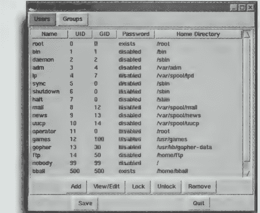

**图 1.1**

使用 X11 usercfg 客户端是创建新用户帐户的一种简单方法。

### 在 X11 中创建用户帐户

1. 点击 Add 按钮来创建用户。这将调用“编辑用户定义”（Edit User Definition）对话框，如图 1.2 所示。

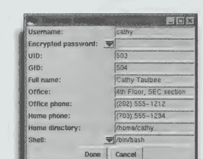

**图 1.2**

“编辑用户定义”对话框将用户帐户的信息存储在系统的 `/etc/passwd` 文件中。

2. 在“编辑用户定义”对话框中，输入新用户名、用户的全名、办公室位置和电话号码、家庭电话号码以及主目录（例如 `/home/cathy`）。这些信息被 `finger` 命令（一个网络用户帐户信息实用程序）使用。

3. 点击 Done 按钮关闭对话框。

4. 点击 User Configurator 对话框中的 Save 按钮以创建您的新用户帐户。

## Shell 介绍

**另请参阅**

- 若要学习如何使用 `finger` 命令，请参阅第 19 页。
- 若要学习如何启动 `X Window System`，请参阅第 260 页。

## 修改您的密码

作为 root 操作员，您可以修改系统中任何用户的密码。创建新用户帐户后，可以使用 `passwd` 命令，在命令行中指定用户名来创建密码，如下所示：

```
# passwd fred
New UNIX password:
Retype new UNIX password:
passwd: all authentication tokens updated successfully
```

`passwd` 命令位于 `/usr/bin` 目录下，它会提示输入新密码，然后要求您再次输入以验证更改。在您完成更改后，`/etc/passwd` 条目会将密码反映为一个加密字符串，如下所示：

```
fred:Ozq/xNwYPy0OU:502:502::/home/fred:/bin/bash
```

**另请参阅**

- 若要了解更多关于密码的信息，请参阅第 422 页。

## 使用 `chfn` 命令修改用户帐户信息

`/etc/passwd` 条目还用于存储每个用户的信息，例如办公室位置或电话号码。要向 `/etc/passwd` 文件条目中添加更多信息，请使用 `chfn` 命令来更改 finger 信息，如下所示：

```
# chfn fred
Changing finger information for fred.
Name []: Fred Thomas
Office []: 4th Floor - Computing Services
Office Phone []: (202) 555-1212
Home Phone []: (548) 555-1212
Finger information changed.
```

`chfn` 命令位于 `/usr/bin` 目录下，它会提示输入新的用户信息。现有条目将显示在提示符的方括号之间，并在更改后被覆盖。

**在 X11 中修改您的用户信息和密码**

`X11` 的 usercfg 命令仅能由 root 操作员运行，以添加或更改用户信息。没有 root 权限的普通用户可以使用 X11 客户端的 `Xset`、`userinfo` 和 `passwd` 命令（在第 25 章“管理用户和组”中讨论）来更改其信息和密码。

## 以 root 操作员身份运行命令

在您使用新用户名登录后，您就像其他任何用户一样，但有一个重要的例外：您知道 root 密码。从现在起，每当您需要完成重要的系统任务或以 root 身份运行程序时，无需退出 Linux 并重新以 root 操作员身份登录。相反，您可以使用 `su`（即 superuser，超级用户）命令临时成为 root 用户。`su` 命令可以单独使用，也可以配合 `-c` (command) 选项来运行程序：

```
$ whoami
bball
$ su
Password:
# whoami
root
# exit
$ su -c "useradd fred"
Password:
$
```

在本例中，位于 `/usr/bin` 目录下的 `whoami` 命令报告您是谁。`su` 命令在允许您成为 root 操作员之前会提示输入密码。

运行完 root 命令后，使用 shell 的 `exit` 命令返回到您原来的 shell 和身份。当 `su` 命令与 `-c` 选项一起使用时，会运行引号内指定的 root 命令，然后立即将您返回到 shell。以 root 操作员身份运行命令时请务必小心。

## 使用虚拟控制台

Linux 还允许您通过使用虚拟控制台多次登录并以不同的用户身份登录。*虚拟控制台*提供了一种同时运行两个或更多 shell 的方法。当您想要同时运行两个或更多程序，或者必须始终打开一个 root shell 时，虚拟控制台非常方便。

Linux 支持至少六个虚拟控制台。当您启动 Linux 时，登录提示符显示在虚拟控制台

## Shell 介绍

1. 您可以通过同时按下 Alt 键和功能键（F1 到 F6）来选择虚拟控制台。

### 启动 Linux 后使用虚拟控制台

1. 在登录提示符处输入您的用户名，然后按 Enter 键。
2. 输入您的密码，然后按 Enter 键。
3. 登录后，按住 Alt 键，然后按下 F2、F3、F4、F5 或 F6 功能键以开始使用新的虚拟控制台。此时将出现一个新的登录提示符。
4. 使用您的用户名、root 操作员用户名或其他用户名重复登录过程。

要切换回第一个或初始登录 shell，请按住 Alt 键并按下 F1 功能键。通过使用相应的 Alt + 功能键组合在虚拟控制台之间进行切换。

### 从 Linux 注销

在创建新用户账户和新用户密码后，可以使用 `logout` 或 `exit` 命令从 Linux 注销：

```
# exit
# logout
```

输入其中任何一个命令后，屏幕将清空，并重新显示 Linux 登录提示符。

### 重启 Linux

要重启系统，请始终使用位于 `/sbin` 目录下的 `shutdown` 命令。直接切断计算机电源可能会导致磁盘错误，这是一种不安全的操作。您必须是 root 操作员或使用 `su` 命令才能使用 shutdown 命令。

`shutdown` 命令接受几个命令行选项。例如，使用 `-r`（即 `reboot`）选项后跟单词 `now` 将立即重启您的系统：

```
# shutdown -r now
```

重启：控制“瓦肯神经捏法”：Ctrl+Alt+Del

您可以使用 Ctrl+Alt+Del 组合键重启系统。为了将此按键组合限制为仅 root 操作员使用，请在 `/etc` 目录下创建一个名为 `shutdown.allow` 的文件。当您将 Linux 作为服务器运行或担心有人无意中重启您的系统时，这可以提高安全性。有关更多详细信息，请参阅 `shutdown` 命令的手册页。

### 关闭 Linux

`shutdown` 命令的 `-h`（即 `halt`）命令行选项可以关闭 Linux。与 `-r` 选项一样，可以使用时间（以秒为单位）或单词 `now` 来指定 Linux 何时关闭。使用以下命令可以立即关闭您的系统：

```
# shutdown -h now
```

## 获取帮助

Linux 发行版包含了关于安装在硬盘上的几乎所有程序、命令和文件的文档。每个发行版还附带了一些旨在帮助您了解系统的命令和程序。这些命令将在以下章节中讨论。

### 使用 `man` 命令获取帮助

`man` 命令是一个用于打印关于命令、文件或其他 Linux 功能的在线帮助（或称为 *manual pages* 手册页）的程序。要阅读手册页，请在命令行上指定程序名称。要了解 `man` 命令本身，请在之后加上单词 `man`，如下所示：

```
# man man
```

输入此命令会将手册页发送到显示屏；使用 less 分页器进行滚动浏览。手册页（有时称为 *man pages*）是使用特殊格式编写的文本文件。要阅读关于这些页面格式的内容，请使用 `man` 命令的 *section*（章节）选项来阅读 `/usr/man/man7` 目录下的 man 手册页，如下所示：

```
# man 7 man
```

手册页和文档位于 `/usr/man` 目录下，分为几个根据任务或类型组织的章节。表 1.1 列出了这些不同的章节。

| 章节 | 文档类型 |
| :--- | :--- |
| 1 | 命令（通用程序） |
| 2 | 系统调用（内核函数） |
| 3 | 库调用（编程函数） |
| 4 | 特殊文件（/dev 目录文件） |
| 5 | 文件格式（/etc/passwd 等） |
| 6 | 游戏 |
| 7 | 宏包（man 页格式等） |
| 8 | 系统管理（root 操作员实用程序） |
| 9 | 内核例程（内核源码例程） |

### 在 X11 中使用 xman 客户端获取帮助

在使用 X Window 系统时，只需从终端窗口的命令行启动 xman 客户端即可阅读手册页：

```
# xman &
```

图 1.3 展示了在 X Window 系统中查看的 man 页面。

### 使用 `whatis` 命令获取帮助

如果您不确定某个程序的功能，请使用 `whatis` 命令。使用此命令会打印出每个指定命令的简短摘要。例如，执行命令 `# whatis cal` 将返回以下结果：

```
cal (1) - displays a calendar
```

指定命令的摘要是从该命令的手册页中提取的，并存储在名为 `whatis` 的数据库中。`whatis` 数据库位于 `/usr/man` 目录下，每天由 `/etc/cron.weekly` 目录中的 `makewhatis.cron` 脚本每周运行一次的 crontab 脚本构建。该脚本运行位于 `/usr/sbin` 目录下的 `makewhatis` 命令。

### 使用 `apropos` 命令获取帮助

`apropos` 命令使用 `whatis` 数据库来显示所有与命令名称相关的匹配项。使用此命令可以为系统中安装的程序查找相关的命令或操作。例如，执行命令 `# apropos bell` 将返回以下结果：

```
beep, flash (3)  - Curses bell and screen flash routines
bell (n)        - Rings a display's bell
```

如果您的系统中没有安装 `apropos`，可以使用 `man` 命令的 `-K` 选项；然而，这是一种较慢的搜索信息方式，因为 `man` 命令必须搜索每个手册页章节中的每一个手册页。

## 第二章：输入命令

作者：Bill Ball

- 理解 shell 的大小写敏感性
- 使用 shell 重定向程序的输入和输出
- 在命令行中使用管道将命令串联起来
- 在后台启动程序
- 启动和停止程序
- 构建复杂的 shell 通配符
- 选择您的 shell

### 在 Shell 命令行输入命令

使用 Linux 意味着使用命令行。即使您一直运行 X Window 系统，您在某个时刻仍然需要知道如何使用 shell。通过理解 shell 如何解释您的击键，您将学习到在输入命令时如何工作得更快、更高效。

### 大小写敏感性

所有 Linux shell 都是大小写敏感的。这意味着文件名必须按照其存在的方式指定，使用大写、大小写混合或小写字母和字符。文件名最长可达 256 个字符，并可包含许多不同类型的字符。例如，以下是有效的（但未必是良好的）示例文件名：

```
a_long-filename+a-long=extension
everylongfilenamethatistoolongformostfilenames
pAmyEoRyOuWiLlNvErsEeYOurCaTaGain
a file
[a.file]
file:name
filename
file.txt
file2.txt.extension
~"#"
```

保留字符（或不应在文件名中使用的字符）包括以下内容：

`' . , ' * ( ) { ! ' ? \ / < > ;`

请注意，创建以空格开头、包含嵌入空格或完全由空格组成的文件名是可能的。尽管如此，这并不是一种良好的习惯；它可能会在以后引起问题，特别是当您需要操作文件名列表或想要删除文件时。

**另请参阅**

- 要学习如何删除文件和目录，请参阅第 42 页。

### 编辑命令行

您是否可以编辑在命令行输入的文本取决于所使用的 shell。默认的 Red Hat Linux shell `bash` 支持命令行编辑。基本编辑命令列在表 2.1 中，可以通过按下键盘上的特殊键或使用 Ctrl + 键组合来输入。

| 操作 | 按键或按键组合 |
| :--- | :--- |
| 前移一个字符 | 右方向键, Ctrl+F |
| 前移一个单词 | Alt+F |
| 后移一个字符 | 左方向键, Ctrl+B |
| 后移一个单词 | Alt+B |
| 行首 | Ctrl+A |
| 行尾 | Ctrl+E |
| 删除字符 | Ctrl+D |
| 删除单词 | Alt+D |
| 删除至行尾 | Ctrl+K |
| 删除至行首 | Ctrl+U |

### 使用 Shell 历史记录节省击键

如果 shell 支持命令行历史记录，您可以滚动查看之前输入过的命令。默认 shell `bash` 将最后 1,000 条命令行保存在您主目录下的 `.bash_history` 文件中。要快速重新输入命令行，请使用上或下方向键滚动浏览列表。

**另请参阅**

要增加或减少 `bash` 的命令历史记录数量，请参阅第 60 页。

### 使用 Tab 键完成命令

默认 shell 的另一个特性是命令补全。要快速输入或查找命令名称或所有命令...

## 输入命令

如果拼写相似，可以输入命令名称的前几个字母，然后按下键盘上的 Tab 键。例如，输入以下内容：

```
# contr
```

按下 Tab 键的结果如下：

```
# control-panel
```

如果你输入了程序名称中足够多的唯一字母，shell 将为你自动补全程序名称。如果你仅输入了前几个字母，则需要连续按下两次 Tab 键。例如，输入以下内容：

```
# pi
```

然后连续按下两次 Tab 键，将得到以下结果：


`pittoppm` `pic` `pick` `pictoppm` `pilot` `ping`
`pit3oppm` `pic2ptic` `pico` `pidof` `pine`

shell 将打印出所有名称包含指定字母的文件。

## 输入多个命令

若要在单条命令行中输入多个命令，请使用分号 (`;`)，如下所示：

```
# ls ; cat file.txt
```

这将首先运行 `ls`（列出目录）命令，随后由 `cat`（连接）命令显示文件 `report.txt`。

> **另请参阅**

> 若要学习如何创建、复制或删除目录，请参阅第 3 章 “浏览 Linux 文件系统”。

## 截断长命令行

虽然大多数 shell 在到达行尾时会自动换行，但你可以将反斜杠字符 (`\`) 与分号结合使用，以便在不同行中输入多个命令或单个命令：

```
# ls /tmp ;\
>ls /boot ;\
>ls /var/log/uucp
```

shell 会自动打印 `>` 字符，以表明正在输入一条长命令。使用反斜杠可以让复杂的命令行指令更易于阅读。

## 创建 Shell 命令

shell 能识别命令行中的一些特殊字符。本节将介绍如何使用这些字符来实现以下操作：

- 将程序的输出发送到文件。
- 让程序从文件中读取文本。
- 将程序的输出追加到文件。
- 在后台运行程序。

### 使用 `>`、`>>` 和 `<` 重定向操作符

Shell 重定向操作符用于引导程序的输入和输出。shell 可用于将另一个程序、命令行甚至另一个文件的输入馈送给某个程序。这些操作符用于复制、创建或覆盖文件，构建报告或创建数据库。

`cat`（连接）命令用于将文件打印到显示屏；当与 `>`（标准输出重定向操作符）结合使用时，`cat` 命令可以通过将其输出发送到另一个文件来复制文件：

```
# cat report.txt >newreport.txt
```

这被称为 *重定向标准输出*。通过使用重定向，`cat` 命令的输出被发送到当前目录中的指定文件。

你还可以将 `cat` 命令与 shell 命令行重定向结合使用，作为快速创建文件并输入文本的一种方法。

#### 快速文本输入

1. 使用 `cat` 命令结合命令行输出重定向，将从键盘输入的所有内容直接发送到文本文件：

```bash
# cat >myfile.txt
>This is a line of text.
>This is the second line of text.
>This is the last line of text.
```

2. 完成文本输入后，按下 Ctrl+D 输入文件结束符（EOF）：

`>[EOF]`

3. 使用 `cat` 命令检查你的文本：

```bash
# cat myfile.txt
This is a line of text.
This is the second line of text.
This is the last line of text.
```

`<`（标准输入）重定向操作符如下将信息馈送给程序：

```
# cat <report.txt
```

在这里，`cat` 命令读取文件 `report.txt` 的内容并将其发送到显示屏。要构建一个更大的报告，请使用 `>>` 追加操作符将输出添加到现有文件，如下所示：

```
# cat <report.txt >>newreport.txt
```

如果文件 `newreport.txt` 不存在，它将被创建。如果文件已存在，`report.txt` 的内容将被追加到 `newreport.txt` 文件的末尾。

一个较为冷门的重定向操作符是 `<<` (here) 操作符。使用此操作符来告知 shell 何时停止读取输入：

```
# cat <<end
> this is
> the
> end
this is
the
#
```

**输出重定向可能是危险的！**

随意重定向程序的输出可能会导致数据丢失，因为任何与命令行中同名的现有文件都将被覆盖。请确保不要将输出重定向到现有文件。一个安全得多的方法是使用 `>>`（追加重定向）操作符来追加输出。这样，最糟糕的情况也只是数据被追加到现有文件中。这也是为什么你不应该以 root 用户身份运行 Linux 的另一个充分理由 —— 使用 root 权限，你可以覆盖系统上的任何文件，包括重要的配置文件甚至内核。

当 shell 读取到 `<<` 操作符后面指定的词时，它会停止读取输入。在这种情况下，`cat` 命令会回显所有输入的内容，直到指定了 `end` 这个词，然后将其正确回显到显示屏。

### 按编号重定向错误输出

标准输入和输出在 shell 中被分配了文件编号。标准输入使用编号 0，标准输出使用编号 1。另一种类型的输出是 *标准错误*，其编号为 2。

大多数 Linux 命令使用标准错误输出报告错误，并将错误消息发送到显示屏，如下所示：

```
# cat report.txt >newreport.txt
cat: report.txt: No such file or directory
```

通过正确重定向程序的输出，你可以构建一个错误日志。指定标准错误输出始终发送并追加到某个文件，如下所示：

```
# cat report.txt >newreport.txt 2>>errors.log
# cat errors.log
cat: report.txt: No such file or directory
```

由于错误输出已被重定向到文件，显示屏上不会打印错误消息。虽然 `newreport.txt` 文件将为空，但 `errors.log` 文件将包含错误列表。

### 使用管道构建命令

竖线（或 *管道*）字符 (`|`) 被称为 *管道操作符*，用于在命令行中将一个命令的输出发送到另一个命令。将输入输出重定向与管道结合使用，可以快速构建自定义命令。

管道可以节省时间和精力，并且能与 Linux 下的许多命令配合工作。为了能在管道中使用某个命令，该程序必须能够读取标准输入并写入标准输出。这类程序也被称为 *过滤器 (filters)*。

**并非所有程序的工作方式都相同**

并非所有 Linux 命令都会从标准输入读取并写入标准输出。在利用程序构建重要或复杂的管道之前，请务必阅读该程序的帮助页（manual page）。有关更多信息，请参阅本章后面的“使用管道构建命令”部分。

> **另请参阅**

> 欲了解更多关于文本处理过滤器的信息，请参阅第 66 页。

管道的用途从简单到复杂不等。以下是一些管道使用示例：

```
# cat report.txt | wc -l >number_of_lines.txt
```

上述示例统计了文件中的行数并生成报告。

```
# find / | wc -l >number_of_files.txt
```

此命令行从 `/`（根目录）开始，统计系统中的文件数量。

```
# find / | sort | uniq -d >duplicate_filenames.txt
```

此示例生成了一份系统重复文件（同名文件）的报告。

```
# strings /usr/lib/ispell/american.hash | sort | tee upper \
-case.dict | \
tr A-Z a-z >lowercase.dict
```

此示例通过使用 `strings` 命令从系统词典中提取单词列表。然后对输出进行排序。接着使用 `tee` 命令保存一份词典副本（仍保持原始的大写形式），同时输出通过 `tr` 命令转换为小写，并保存为小写文件。这创建了两个不同的词典：一个包含大写单词，另一个包含小写单词。

## 在后台运行程序

使用 Ampersand 符号 (`&`) 来启动并在后台运行程序。虽然你可以使用虚拟控制台同时运行其他程序，但从单个终端或命令行启动后台程序非常简单。

如果你使用 X Window 系统，会经常用到后台进程。大多数 X11 客户端不提供终端窗口或命令行，因此必须在后台运行客户端，以释放终端进行进一步输入，如下所示：

```
# xcalc &
#
```

此命令启动 X11 `calc`（计算器）客户端，使您的终端可以空闲出来执行其他命令行。

**另请参阅**

要了解更多关于使用 X11 客户端的信息，请参阅第 307 页。

## 控制程序

大多数（但并非所有）shell 都支持某种形式的后台进程控制。重要功能包括以下内容：

- 列出当前后台程序
- 暂停运行中的程序
- 停止运行中的进程
- 将发送到后台的程序带回前台

控制后台程序被称为 *作业控制* (job control)。

## 使用作业控制

使用作业控制来管理多个运行中的程序。您可以在 `bash` shell 命令行中使用 `&` 运算符在后台启动程序，或者通过按下 Ctrl+Z 将程序发送到后台。shell 将通过打印作业号以及随后的程序进程号来响应：

```
# sc &
[1] 2689
```

使用 Ctrl+Z 发送到后台的运行程序将消失，shell 将打印如下的作业号：

```
[2]+ Stopped  sc
```

可以启动、暂停或运行许多程序或单个程序的多个实例。要获取当前运行程序的列表，请使用 bash shell 的 `jobs` 命令：

```
# jobs
[2] Stopped  sc
[3]- Stopped (tty output) pico report.txt
[4]+ Stopped (tty output) pico newreport.txt
```

`jobs` 命令打印每个程序的作业号以及用于启动该程序的命令行。要选择性地带回某个程序，请使用 `fg` 命令后跟作业号，如下所示：

```
# fg 3
```

这将把 `pico` 文本编辑器返回到您的显示屏上。

## 使用 `ps` 和 `kill` 命令

Linux 内核会为后台程序分配一个唯一的进程号。要查看当前运行程序的进程号，请使用 `ps` (process status) 命令（为了节省空间，此处未列出当时运行的所有进程）。该列表显示 `su` 命令正在运行，进程号为 1658：

```
# ps
..
1658 p0 S 0:00 su
1659 p0 S 0:00 bash
2713 p0 T 0:00 pico report.txt
2714 p0 T 0:00 pico newreport.txt
..
```

您可以通过指定进程号并配合 `kill` 命令来停止程序，如下所示：

```
# kill -9 2714
[4]+ Killed pico newreport.txt
```

**另请参阅**

要了解更多关于控制进程和其他后台程序的信息，请参阅第 581 页。

然而，通过使用进程号杀死进程来停止程序是一种不方便的停止后台程序的方法。请使用 `kill` 命令，后跟百分号 (`%`) 和作业号或命令名称，来停止程序，如下所示：

```
# kill %3
[3]+ Terminated pico report.txt
# kill %pico
[3]+ Terminated pico report.txt
```

应该使用作业号或名称来停止程序，而不是杀死进程，因为您太容易输入错误的进程号，从而不小心导致系统停机。

## 使用通配符

通配符用于 shell 命令行，通过名称或扩展名指定文件。Linux 的 shell 提供了高级形式的通配符，您可以将其用于执行复杂的模式匹配。创建复杂的通配符被称为构建正则表达式。

### 构建正则表达式

正则表达式是通配符模式，使用特殊的命令行语法构建。此语法使用许多特殊字符，其中一些列在表 2.2 中。

表 2.2：正则表达式语法

| 表达式 | 动作 |
|---|---|
| `*` | 匹配所有字符 |
| `?` | 匹配单个字符 |
| `[a-z]` | 匹配一个字符范围 |
| `[0123]` | 匹配一个字符范围 |
| `\?` | 匹配 `?` 字符 |
| `\)` | 匹配 `)` 字符 |
| `^abc` | 匹配行首的模式 `abc` |
| `$abc` | 匹配行尾的模式 `abc` |

**另请参阅**

有关使用正则表达式与 `grep` 等搜索程序的更多信息，请参阅第 46 页。

使用星号 (`*`) 来查找所有匹配前导或尾随模式的内容：

```
# ls *.txt
```

### 更多正则表达式

正则表达式在 `bash` shell、`ed` 和 `grep` 命令的手册页中均有记载。请参阅这些页面以了解用于构建复杂模式的其他方法和字符。

前面的命令行列出了所有以 `.txt` 结尾的文件。要列出家目录中的所有文件（由于文件名以点开头，通常被 `ls` 命令的输出隐藏），您可以尝试以下操作：

```
# ls .*
```

不幸的是，此命令仅列出文件名中包含点的文件。为了尝试列出所有以字母 `x` 开头的隐藏文件，您可能会使用以下操作：

```
# ls .*x*
```

但这也不会起作用。列出这些文件的正确方法是使用前导点，因为 `*` 匹配所有现有字符：

```
# ls .x*
```

模式表达式中的字符顺序很重要。要查找通常被 shell 解释为具有特殊含义的字符，请使用反斜杠 (`\`) 字符来“转义”模式：

```
# ls *\?*
```

此命令列出所有文件名中包含 `?` 的文件。

## 选择 Shell

许多不同的 shell 适用于 Red Hat Linux，且每个 shell 都有自己的特性、功能和局限性。表 2.3 列出了通常安装在 Red Hat Linux 系统上的 shell。

表 2.3：常见的 Linux Shell

| 名称 | 描述 |
|---|---|
| `ash` | 一个小型 shell |
| `bash` | Red Hat Linux 的默认 shell |
| `ksh` | 公共领域版本的 `ksh` shell |
| `tcsh` | `csh` shell 的兼容版本 |
| `zsh` | 兼容 `ksh`, `csh` 和 `sh` 的 shell |

可接受的系统 shell 列在 `/etc` 目录下一个名为 `shells` 的文件中：

- `/bin/bash`
- `/bin/bsh`
- `/bin/sh`
- `/bin/ash`
- `/bin/tcsh`
- `/bin/csh`
- `/bin/ksh`
- `/bin/zsh`
- `/usr/bin/pine`

该文件中列出的一些 shell 并非安装在您系统上的实际程序，而是指向现有 shell 的符号链接。

**另请参阅**

- 要了解 shell 编程，请参阅第 365 页。
- 要了解更多关于创建或使用符号链接的信息，请参阅第 40 页。

另外请注意，`/etc/shells` 文件的最后一项包含 `pine` 电子邮件程序的路径名。作为 root 操作员，您可以将程序添加到 `/etc/shells` 列表中，然后限制用户在登录后只能运行一个或一组特定的程序。

## 使用 `chsh` 命令更改 Shell

要更改登录 Linux 后运行的 shell，请使用位于 `/usr/bin` 目录下的 `chsh` (change shell) 命令。您可以在命令行上单独使用 `chsh` 命令，或者配合 `-s` (shell) 选项使用：

```
$ chsh
Changing shell for bball.
Password:
New shell [/bin/bash]: /bin/zsh
Shell changed.

$ chsh -s /bin/bash
Password:
Shell changed.
```

必须提供所需 shell 或程序的完整路径名或目录。使用之前 `/etc/shells` 文件中的条目列表，root 操作员还可以限制用户运行单个程序，例如 `pine` 电子邮件命令：

```
# chsh -s /usr/bin/pine fred
Changing shell for fred.
Shell changed.
```

当用户 `fred` 登录时，将运行 `pine` 邮件程序。退出程序后，`fred` 将被登出。这是一种限制用户（如儿童）使用某些类型 Linux 程序的便捷方法。要查看系统中可接受的 shell 列表，请使用 `chsh` 的 `-l` (list) 选项：

```
# chsh -l
/bin/bash
/bin/bsh
/bin/sh
/bin/ash
/bin/bsh
/bin/tcsh
/bin/csh
/bin/ksh
/bin/zsh
/usr/bin/pine
```

# 第 3 章：导航 Linux 文件系统

作者：Bill Ball

- 打印当前工作目录
- 更改当前目录
- 列出目录和查看文件
- 创建、重命名、删除、移动和查找文件
- 为文件和目录创建符号链接
- 搜索文件和目录

## 导航 Linux 文件系统

### 更改目录

在 Linux 中工作时，您应该知道自己身在何处或要去哪里。本节将向您展示如何在控制台或通过 X11 中的终端窗口导航目录。

### 打印当前工作目录

使用 `pwd` (print working directory) 命令来打印当前、现在或工作目录（即您此时所在的目录）：

```
# pwd
/home/bball
```

`pwd` 命令的二进制版本可以在 `/bin` 目录下找到，但几乎所有 shell 都有内置的 `pwd` 命令。

内置的 `pwd` 命令在每个 shell 的手册页中都有记录，而二进制版本的手册页则位于 `/usr/man/man1` 目录下。

> **pwd 并非总是可靠的**

> 根据 `ash` 手册页，如果目录名称已被更改，内置的 `pwd` 命令可能会继续报告旧的当前目录名称。如果您想确保获得当前工作目录，请在 shell 脚本或其他命令中使用 `pwd` 命令的二进制版本。

### 使用 `cd` 命令更改目录

使用 `cd` (change directory) 命令在 Linux 文件系统的目录中导航。使用此命令配合目录规范或路径名，即可移动到指定目录。此命令内置于每个 Linux shell 中，也可以作为快捷方式快速返回您的家目录。


# pwd
/home/bball
# cd /usr/bin
# pwd
/usr/bin
# cd
/home/bball
```

如果您单独输入`cd`命令，将返回您的家目录（在`$HOME`环境变量中指定）。通过在`cd`命令中输入两个点（`..`）来向上移动到下一个目录，如下所示：

```
# pwd
/home/bball
# cd ..
# pwd
/home
```

## 另请参阅

要了解更多关于 shell 环境变量的信息，请参阅第 90 页。

## 查看文本文件

Linux 发行版附带了许多文本查看程序。以下章节讨论了其中几个程序，例如`cat`命令和交互式查看器（称为 *pagers*），你可以使用它们在不运行文本编辑器的情况下查看文本文件。

### 更改文件和目录列表颜色

不同文件类型的默认颜色列在`/etc`目录下的`DIR_COLORS`颜色文件中。在使用`ls`命令的`--color`选项时，若要自定义不同文件的颜色，请将此文件复制到你的主目录（在前面加上一个点并使文件名小写，如：`.dir_colors`），然后添加或更改数值。阅读`DIR_COLORS`文件的内容，了解可用于识别文件和目录的不同颜色和属性（如粗体、下划线、闪烁或反色）。

### 使用`cat`命令查看文本文件

使用`cat`（concatenate）命令将文件内容打印到控制台显示器或终端窗口。该命令最适合将短文件打印到显示屏。使用通配符或其他正则表达式来显示多个文件：

```
# cat /etc/issue

Red Hat Linux release 5.0 (Hurricane)

Kernel 2.0.31 on an i586
```

使用`cat`命令的`-n`（line-numbering）选项使文件列表自动编号：

```
# cat -n /etc/issue

1
2 Red Hat Linux release 5.0 (Hurricane)
3 Kernel 2.0.31 on an i586
4
```

可以通过在命令行上列出文件名或使用通配符来显示多个文件。使用输出重定向运算符（如`>`或`>>`）来创建、复制、覆盖或追加单个文件或多个文件。例如，以下命令行将`file1.txt`和`file2.txt`的内容合并，并创建`file3.txt`：

```
# cat file1.txt file2.txt >file3.txt
```

下一行将`file1.txt`的内容追加到`file2.txt`中：

```
# cat file1.txt >>file2.txt
```

最后，以下命令行将`file2.txt`的内容取出，然后创建或覆盖`file1.txt`：

```
# cat file2.txt >file1.txt
```

通过将键盘输入重定向到文件，`cat`命令可以作为快速文本编辑器使用：

```
# cat > friends.txt

Joan
Scott
Meredith
Tim
[EOT]
```

`cat`命令会从键盘读取字符，直到输入 Ctrl+D（文本结束符）。`cat`命令将打印任何类型的文件，包括程序二进制文件。有关使用`cat`命令的更多详细信息，请参阅其帮助手册页。

## 另请参阅

- 有关使用重定向运算符的信息，请参阅第 19 页。

- 要更改文件所有权权限，请参阅第 418 页。

### 使用 *less* 和 *more* 分页命令查看文本文件

`more`和`less`等分页命令用于交互式地阅读文本文件。大多数用户更倾向于使用位于`/usr/bin`目录下的`less`命令来阅读文件，它通常被认为比位于`/bin`目录下的`more`分页器功能更强大。`more`和`less`都在命令行中使用文件名，且都支持使用通配符读取多个文件。以下是一些示例：

```
# less file1.txt file2.txt
# less *.txt
# less <file1.txt >file2.txt
```

`less`命令不仅接受多个文件名和通配符，还可以与输入和输出重定向运算符一起使用。`more`和`less`程序使用许多相同的键盘命令（见表 3.2）在阅读文档时前后滚动。然而，`less`命令具有许多额外功能，包括：

- 使用光标键在文档中滚动

- 宽文档的水平滚动

- 跳转到文档书签

- 键盘命令自定义

- 对多个文档进行高级搜索

与`more`命令不同，`less`命令在读取到文本文件末尾时不会自动退出。`less`分页器通常是默认的帮助手册页阅读器，不过可以通过定义`$PAGER` shell 环境字符串来更改此选项。

| 操作 | more | less |

| :--- | :--- | :--- |

| 向前一行 | Enter 或 s | Enter, e, j, 或光标下 |

| 向后一行 | | y, k, 或光标上 |

| 向前一屏 | Space, z, 或 f | Space, z, 或 f |

| 向后一屏 | b | b |

| 帮助 | h 或 ? | h |

| 上一个文件 | p | p |

| 下一个文件 | n | n |

| 搜索字符串 | / | / |

| 退出 | q | q |

## 另请参阅

- 有关设置环境变量的信息，请参阅第 90 页。

`less`命令的自定义按键（或按键绑定）可以在主目录中名为`.less`的二进制文件中定义和创建。使用`lesskey`命令来读取或创建此文件。有关更多信息，请参阅`lesskey`帮助手册页。

## 创建文件和目录

使用`ls`命令的`-l`（长格式）选项来检查文件的修改时间，如下所示：

```
# ls -l *.txt
-rw-rw-r-- 1 bball bball 12 Jan 25 12:38 friends.txt
```

在接下来的几行中，使用`touch`命令将`friends.txt`文件的访问和修改时间更新为比现在早四小时的时间：

```
# touch friends.txt
# ls -l *.txt
-rw-rw-r-- 1 bball bball 12 Jan 25 16:14 friends.txt
```

最后，以下命令行将文件的时戳重置回原始时间：

```
# touch 01251238 friends.txt
# ls -l friends.txt
-rw-rw-r-- 1 bball bball 12 Jan 25 12:38 friends.txt
```

如果您的系统中没有安装`touch`命令，可以使用`>`输出重定向运算符来创建文件，如下所示：

```
# >file1
```

该命令行会创建一个文件。请注意不要指定一个已存在的文件名，否则如果您拥有覆盖该文件的写权限，该文件可能会被删除。

`touch`命令对于快速创建文件非常有用，并且可以在系统管理任务（如备份）期间被其他程序使用。欲了解更多信息，请参阅`touch`手册页。

## 使用`mkdir`命令创建目录

`mkdir`（make directory）命令用于创建目录。在命令行中使用`mkdir`加上目录名即可。例如，以下命令行创建了一个名为`temp`的目录：

```
# mkdir temp
```

`mkdir`还可以用于快速创建分层目录。使用`-p`（parent）命令行选项来创建结构中所需的每个目录（已存在的目录不会被覆盖）：

```
# mkdir -p temp/grandparent/parent/child
```

## 复制文件和目录

在 Linux 中，能够快速高效地复制文件和目录至关重要。以下章节将向您展示如何复制单个或多个文件以及目录。

### 使用`cp`命令复制文件

`cp`（copy）命令用于复制文件。在命令行上使用原文件名后接新文件名来复制单个文件：

```
# cp file1 file2
```

使用通配符将多个文件复制到新位置：

```
# cp file* /tmp
```

请谨慎使用`cp`命令。除非您使用了`-i`（interactive）命令行选项，否则`cp`命令会直接覆盖现有文件。当您使用`-i`选项时，如果文件将被覆盖，`cp`命令会提示输入`y`或`n`，如下所示：

```
# cp -i file1 file2
cp: overwrite `file2'? y
```

一个更好的方法是在`cp`命令中使用`-b`（backup）选项。为了给任何可能被覆盖的文件创建备份，请尝试以下操作：

```
# cp -bi file1 file2
cp: overwrite `file2'? y
# ls file2*
file2 file2-
```

使用`-i`选项是使用`cp`命令的一种安全方式。要为任何被覆盖的文件创建备份，请使用`-b`命令行选项。每个备份文件的名称后面都会附加一个波浪号（~）。

### 使用`cp`命令复制目录

`-P`（parent）命令行选项与`-R`（recursive）命令行选项结合使用，不仅可以将一个目录中的文件复制到另一个目录，还可以复制其中的任何子目录。例如，以下每个命令行都会将目录`dir1`及其内部的所有文件或目录复制到`dir2`目录：

```
# cp -Pr dir1 dir2
# cp -r dir1 dir2
# cp -R dir1 dir2
```

`cp`命令拥有近 40 个命令行选项。详情请参阅`cp`手册页。

## 移动和重命名文件与目录

移动和重命名文件与目录，就像文件导航和复制一样，是在 Linux 中组织信息时需要的一项基本技能。以下章节将演示如何使用`mv`命令来移动和重命名文件与目录。

### 使用`mv`命令移动和重命名文件与目录

`mv`（rename）命令用于重命名或移动文件和目录。要重命名一个文件，请在命令行上指定旧文件名和新文件名（与`cp`命令不同，`mv`不会保留原文件的副本）：

```
# mv file1 file2
```

要重命名一个目录，请在命令行上指定旧目录名和新目录名，如下所示：

```
# mv mydir newdir
```

请谨慎使用`mv`命令。除非使用`-i`（interactive）命令行选项，否则您很容易覆盖现有文件。当您使用`-i`选项时，`mv`命令会请求覆盖现有文件的权限，如下所示：

```
# mv -i file1 file2
mv: replace `file2'? y
```

一种更安全的`mv`命令使用方式是配合`-b`（backup）选项。当与`-i`选项结合使用时，`mv -b`命令会请求覆盖文件的权限，并同时创建一个备份，如下所示：

```
# mv -bi file1 file2
mv: replace `file2'? y
# ls file*
file2 file2~
```

如果您使用了`-b`（backup）选项，`mv`命令会为被覆盖的文件创建备份。原文件将被保留，并在文件名后附加一个波浪号（~）。

您还可以使用`mv`命令将文件从一个目录移动到另一个目录：

```
# mv file1 /tmp
# mv file1 /tmp/file2
```

如果您想在移动过程中重命名文件，请在移动时使用新文件名。在移动目录时也可以使用这种方法：

```
# mv dir1 dir3
```

如果目标目录不存在，`mv`将重命名该目录。如果目标目录存在，则整个目录`dir1`将被移动到目标目录`dir3`内部。

## 创建符号链接

符号链接是便捷的快捷方式，用于将现有文件或目录链接到具有公认路径名称（如`/usr/bin`或`/usr/local/bin`）的文件或目录，或者链接到更方便的位置。默认情况下，Linux 安装时会创建许多符号链接：

- `/bin`目录下的各种 shell（如`bsh`、`csh`和`sh`）实际上是指向其他 shell（如`bash`或`tcsh`）的符号链接。

- 几乎所有不同的 DOS 软盘程序都是指向一个名为`mtools`的单一程序的链接。

- 计算机的调制解调器设备可能是指向`/dev/modem`而非`/dev/cua0`或`/dev/ttyS1`的链接。

- `ex`和`vi`编辑器是指向`vim`文本编辑器的链接。

### 使用`ln`命令链接文件

使用`ln`命令配合`-s`（symbolic link）命令行选项，后面跟原文件名以及想要创建的链接名称：

```
# ln -s file file2
# ls -l file*
-rw-r--r-- 1 bball bball 16821 Feb 10 15:22 file
lrwxrwxrwx 1 bball bball 4 Feb 10 15:22 file2 -> file
```

不带`-s`选项使用`ln`命令可创建硬链接：

```
# ln file file3
# ls -l file*
-rw-r--r-- 2 bball bball 16821 Feb 10 15:22 file
lrwxrwxrwx 1 bball bball 4 Feb 10 15:22 file2 -> file
-rw-r--r-- 2 bball bball 16821 Feb 10 15:22 file3
```

对链接文件`file2`所做的任何更改都会反映在原文件`file`中。硬链接`file3`是原文件的精确副本。如果原文件被删除，由于`file3`仍然存在，因此不会丢失数据。然而，如果没有原文件，符号链接`file2`就失效了。

符号链接可用于任何类型的文件，包括可执行脚本：

```
# ln -s /etc/ppp/start-ppp /usr/local/bin/startppp
```

这是一种节省时间并减少按键次数的便捷方法。

### 使用`ln`命令链接目录

`ln`命令还可以用于为经常使用的目录创建链接（这类似于在 Windows 95 中使用快捷方式）：

```
# ln -s /dos /mnt/dos/windows/desktop
```

现在，在复制文件时，您无需输入冗长的路径名，而可以使用以下命令：

```
# cp file.txt /dos
```

## 删除文件和目录

删除文件和目录是使用 Linux 时的另一项常见任务，但应谨慎执行。被删除的文件和目录将无法找回。这就是为什么始终为重要文件或目录维护备份的绝佳理由。

### 使用`rm`命令删除文件

`rm`（remove）命令用于删除文件和目录。您可以通过在命令行上输入单个文件名或多个文件名来删除文件，如下所示：

```
# rm file1 file2 file3
```

使用通配符删除多个文件：

```
# rm file*
```

`rm`命令还可以用于删除指定目录内的文件：

```
# rm -r temp
rm: descend directory `temp'? y
rm: remove `temp/file1'? y
rm: remove `temp/file2'? y
rm: remove `temp/file3.txt'? y
rm: remove `temp/file4'? y
rm: remove directory `temp'? y
```

使用`-r`（recursive）选项配合目录名来删除目录内的文件。如果您尝试在不使用此选项的情况下删除目录，`rm`命令会报错并退出。

`-i`（interactive）命令行选项是使用`rm`命令最安全的方式。在这种模式下，`rm`在删除文件前会交互式地询问`y`或`n`：

```
# rm -i file*.txt
rm: remove `file1.txt'? y
rm: remove `file2.txt'? y
rm: remove `file3.txt'? n
```

## 查找文件和目录

### 使用`rmdir`命令删除目录

您可以使用`rmdir`命令来删除目录。

```
# rmdir temp/temp/grandparent/parent/child
# rmdir temp/grandparent
rmdir: temp/grandparent: Directory not empty
```

但是，如果指定的目录下存在任何文件或目录，您必须先移动或删除它们。

### 使用`rm`命令删除目录

`rm`命令可以像`rmdir`命令一样用于删除目录，但您必须将`-r`（递归）选项与`-f`（force）选项结合使用。这种选项组合在删除文件和目录时不会请求确认。示例如下：

```
# rm -fr temp
```

## 查找文件和目录

虽然浏览磁盘目录并列出目录内容有助于找到所需文件，但 Linux 自带的几个程序运行速度要快得多。以下章节将演示如何使用其中几个命令快速高效地查找文件或目录。

### 使用`find`命令查找文件

`find`命令用于在所有挂载的文件系统中搜索文件或目录的名称或部分名称。这个功能强大的命令不仅可以用来查找文件。要搜索文件或目录，请在命令行上指定搜索路径和搜索模式，如下所示：

```
# find /usr -name pico* -print -xdev
```

如下所示，在`/usr`目录中搜索`pico`编辑器和其他文件，可以定位到`pico`程序及其手册页。请注意！搜索文件系统，特别是在具有远程挂载文件系统的网络环境中，可能会花费很长时间。

> **以 root 身份使用`rm`命令可能很危险**

> 当您以 root 操作员身份运行时，使用`-f`和`-r`（递归和强制）选项的`rm`命令尤其危险。单条命令行就可能抹除您的整个系统。请谨慎使用`-f`选项；它的无条件删除会销毁其路径中的所有文件和目录。除非您绝对确定要删除的文件和目录，否则请避免在登录 root 操作员时使用此选项。

```
/usr/bin/pico
/usr/man/man1/pico.1.gz
```


要将搜索限制在当前文件系统，请使用 `-xdev` 命令行选项。如果您不限制搜索，`find` 命令还会搜索任何挂载的 CD-ROM 或其他文件系统（例如 Windows）。

`find` 命令可以通过类型、日期、时间、大小或搜索模式来报告文件。使用 `-atime` 命令行选项可以查找新程序或较少使用的程序。例如，以下命令行可定位在过去 100 天内被访问过的程序：

```bash
# find /usr/bin -type f -atime +100 -print
```

下一条命令行可定位创建时间在一天或一天之内的程序：

```bash
# find /usr/bin -type f -atime -1 -print
```

要按大小搜索，请使用 `-size` 选项，后面跟着以块（512 字节）、字节或千字节（1024 字节）为单位的数字。例如，以下命令可定位 `/usr/bin` 目录中所有大于 500,000 字节的程序：

```bash
# find /usr/bin -type f -size +500k -print
```

使用 `-exec` 选项对找到的文件执行操作。例如，以下命令行会删除在 Linux 文件系统中找到的所有核心转储（core dumps）或备份文件。如果没有 `-xdev` 选项，Linux 系统管理员可以使用这种方法来清理其他文件系统。

```bash
# find / -name 'core *.bak' -xdev -exec rm '{}' ';'
```

这条命令行的工作方式是从 `/`（即根目录）开始搜索。`find` 命令会遍历所有目录，寻找名为 core 或以 `.bak` 结尾的任何文件。如果找到文件，则使用 `rm` 命令将其删除。

有关 `find` 命令许多不同选项和搜索规范的更多详细信息，请参阅其手册页。

### 另请参阅

有关使用 `find` 执行系统管理任务的信息，请参阅第 562 页。

### 使用 `locate` 命令查找文件和目录

使用 `locate` 命令快速定位系统中的文件或目录。该程序运行速度非常快，因为它使用文件名数据库，而不是像 `find` 程序那样搜索硬盘。可以使用通配符来扩展或缩小搜索范围。例如，要查找 emacs 文本编辑器的任何图标，请这样使用 `locate` 命令：

```bash
# locate "icon*emacs"
/usr/share/icons/emacs_3d.xpm
/usr/share/icons/lemacs.xpm
/usr/share/icons/xemacs.xpm
```

`locate` 命令搜索 `/var/lib` 目录下的名为 `locatedb` 的数据库。该数据库由 `updatedb` 命令创建。`locatedb` 数据库的格式记录在 `/usr/man/man5` 目录下的 `locatedb` 手册页中。系统管理员通常使用 `cron` 守护进程和更新 `crontab` 条目来保持 `locate` 命令数据库的最新和准确。

### 使用 `whereis` 命令查找程序和手册页

`whereis` 命令用于列出程序二进制文件、相关文件和手册页的位置。使用此命令可以验证手册页并确定程序或其源文件的路径名。例如，输入以下内容：

```bash
# whereis man
```

此命令产生以下结果：

`man: /usr/bin/man /etc/man.config /usr/man/man1/man.1`

`whereis` 命令比 `find` 命令快得多，因为要搜索的路径名（或目录）已内置在程序中。若仅搜索手册页，请使用 `-m` 选项。使用 `-b` 选项进行二进制搜索，使用 `-s` 选项搜索源代码。

## 搜索文本文件

Linux 还提供了一些可用于搜索文件的程序。其中一些命令使用正则表达式（在第 2 章“输入命令”中介绍），而另一些命令（如 `strings` 命令）提供的搜索功能较为有限。

### 使用 `grep` 命令

`grep` 命令是一个命令族的一部分：`grep`、`fgrep` 和 `egrep`。这些命令密切相关，但在命令行上可使用的表达式或通配符类型方面具有不同的能力。例如，要在 `/etc` 目录下的 `info-dir` 文件中查找任何关于 `tee` 命令的引用，请这样使用 `grep` 命令：

```bash
# grep -n tee /etc/info-dir
92:" tee: (sh-utils) tee invocation. Redirect to multiple files.
```

`grep` 命令将命令行上的简单单词作为模式返回匹配项。`-n`（number）命令行选项会打印找到模式的匹配行的行号。默认情况下，`grep` 命令仅识别并使用正则表达式，如果您尝试使用扩展正则表达式，它会报告错误：

```bash
# grep '\(gp' /etc/info-dir
grep: Unmatched ( or \(
```

每个 `grep` 命令读取标准输入并写入标准输出。不过，搜索模式也可以放在文本文件中（如这里使用 `cat` 命令所示），并与 `-f`（file）选项一起使用：

```bash
# cat > search.txt
gpm
[EOT]
# grep -f search.txt /etc/info-dir
* gpm: (gpm). Text-mode mouse library.
```

`grep` 命令拥有 20 多个不同的命令行选项，并且可以通过 `-F` 和 `-E` 选项来模拟 `fgrep` 或 `egrep` 命令。有关这些程序的详细信息，请参阅 `grep` 手册页，或使用 GNU info 程序阅读 `/usr/info` 目录下的 info 页。

#### `zgrep`：搜索压缩文件

一个名为 `zgrep` 的相关程序可使用正则表达式搜索压缩文本文件。这个程序是一个 shell 脚本，它使用 `grep` 或 `egrep` 程序以及 `gzip` 命令来实时解压并搜索文件。

#### 另请参阅

- 要学习如何使用正则表达式，请参阅第 25 页。
- 要了解更多关于 shell 脚本的信息，请参阅第 365 页。
- 要学习如何压缩或解压缩文件，请参阅第 542 页。

### 使用 `egrep` 命令

`egrep` 命令使用扩展正则表达式（在第 2 章中介绍）进行模式匹配，但也能处理像 `grep` 和 `fgrep` 一样的常规搜索：

```bash
# egrep -n tee /etc/info-dir
92:*: tee: (sh-utils)tee invocation. Redirect to multiple files.
```

当使用正则表达式时，`egrep` 与其他 `grep` 命令之间的区别就变得明显了：

```bash
# egrep '\(gp' /etc/info-dir
* gpm: (gpm). Text-mode mouse library.
```

`egrep` 程序返回匹配项，而 `fgrep` 没有任何报告，`grep` 则报告错误。单引号（'）用于保护表达式不被 shell 解析。

`egrep` 命令读取标准输入并写入标准输出。搜索模式可以放在文本文件中并与 `-f`（file）选项一起使用。

### 使用 `fgrep` 命令

`fgrep` 命令使用固定字符串进行搜索。模式和文件在命令行上指定如下：

```bash
# fgrep -n tee /etc/info-dir
92:*: tee: (sh-utils)tee invocation. Redirect to multiple files.
```

如下所示，`fgrep` 命令不识别正则表达式：

```bash
# fgrep '\(gp' /etc/info-dir
```

由于 `fgrep` 命令不识别简单通配符以外的表达式，因此没有报告匹配项。就像其他 `grep` 命令中，`fgrep` 可以使用存放在文本文件中的搜索模式，并配合 `-f`（file）选项使用：

```bash
# cat > search.txt
gpm
[EOT]
# fgrep -f search.txt /etc/info-dir
```

- gpm: (gpm)。文本模式鼠标库。

### 使用 `strings` 命令

使用 `strings` 命令从二进制文件中提取字符串。这在窥视程序内部或在命令中查找信息时非常有用。可以使用管道将 `strings` 命令的输出与其他搜索程序结合起来。例如，以下命令行会报告 `/usr/bin` 目录下每个程序的版权信息：

```bash
# find /usr/bin | xargs strings -f | fgrep Copyright | less
```

如果没有 `-f`（report files）选项，`strings` 命令不会在传递给 `fgrep` 命令的输出中插入被搜索文件的名称。

### 另请参阅

关于管道使用的详情，请参阅第 19 页。

## 第 4 章：使用文本编辑器

作者：Bill Ball

- 探索 Linux 文本编辑器的功能
- 使用 Linux 拼写检查器
- 转换文本文档
- 格式化文本文档

### 使用文本编辑器

文本编辑器是 Linux 用户的重要工具。在某些时刻，您需要使用文本编辑器来配置系统；尽管 Red Hat Linux 在每个版本中都在不断成熟，但并非每个系统管理工具都具备点选的便捷性。为了高效且高效地使用 Linux，您应该选择最适合您需求的文本编辑器。

### 选择编辑器

如果您计算所有的变体（一些编辑器可以模拟其他知名的编辑器，并且还提供 X Window 系统的版本），Red Hat Linux 自带了近 20 种文本编辑器。本节将介绍如何使用这些编辑器的基础版本。

*文本编辑器* 通常被认为是文字处理器，或者是用于打开或创建文本文件、输入或修改文本，然后打印或保存文本文件的交互式、面向屏幕的程序。用于文字处理的文本编辑器通常支持在文件中移动光标且面向屏幕。某些编辑器（如 X11 的编辑器）还具有下拉菜单和其他便捷的用户界面。

但您也可以使用非交互式程序进行文本编辑，例如文本过滤器或流编辑器（在本章稍后部分讨论）。Red Hat Linux 还包括二十多个不同的程序可用于编辑文本。

### 商业 Linux 文字处理器

Linux 平台上有近 100 种不同的文字处理器，包括许多商业文字处理器或办公套件应用程序。其中许多软件包（例如图 4.1 所示的、来自 `www.sdcorp.com` 的 WordPerfect 文字处理器）需要 X Window 系统，且许多需要 X11 Motif 软件库。如果您有兴趣尝试其中一些程序，请参阅 `/usr/doc` 目录下的 `Commercial-HOWTO`，或查看以下网站：

- <http://www.sdcorp.com/wpunix.html>
- <http://www.axene.com/english/xclamation.html>
- <http://www.zfc.nl>
- <http://www.advasoft.com>
- <http://www.caldera.com>
- <http://www.redhat.com>
- <http://www.applix.com>
- <http://www.stardivision.com/>

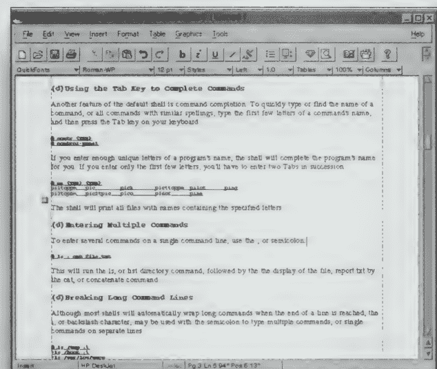

**图 4.1**

用于 Linux 的 WordPerfect 文字处理程序使用 X Window 系统。

### 另请参阅

要了解更多关于 X Window 系统的信息，请参阅第 260 页。

### 使用屏幕编辑器

屏幕编辑器易于使用，通常是程序员、作家和普通用户的首选工具。一些 Linux 屏幕编辑器仅在 X Window 系统下工作，而另一些则可在控制台或 X11 中工作。选择屏幕编辑器时，应关注的一些重要功能包括：

- 支持使用光标键在文件中导航
- 易于记忆的控制键或易于使用的菜单
- 打印文件的能力
- 为进行中的工作提供崩溃保护（如自动备份）
- 支持文档拼写检查
- 易于使用的搜索和替换功能，以便对文件进行修改
- 文本块的剪切和粘贴能力
- 可以开启或关闭自动换行或段落两端对齐
- 良好的文档说明或内置帮助

### 使用 `emacs` 环境

毫无疑问，大多数 Linux 发行版中功能最强大（但并非最易使用）的编辑器是 `emacs`（即编辑宏，editing macros）程序。该程序最初由 Richard Stallman 开发，它远不止是一个文本编辑器。`emacs` 可以作为编程环境和 Linux shell 使用；此外，`emacs` 还包含一个 Lisp 语言解释器，可以发送电子邮件、阅读 Usenet 新闻、支持日历和日记功能，甚至能玩游戏！

`emacs` 编辑器由自由软件基金会作为 GNU（GNU's Not UNIX）项目的一部分发布。Red Hat Linux 自带的 `emacs` 分发版在完整安装时需要 35 MB 以上的磁盘空间，但如果您不安装 `emacs` 源代码文件，则仅需 20 MB。X11 版本的 `emacs` 还需要约 3 MB 的额外磁盘空间。

### 另请参阅

- 关于电子邮件的更多信息，请参阅第 183 页。
- 要了解更多关于阅读 Usenet 新闻的信息，请参阅第 227 页。

`emacs` 有近二十个不同的命令行选项，但启动很简单。要打开或创建一个文本文件，在命令行上运行 `emacs`，后面跟上新文件或现有文件的名称，如下所示：

```bash
# emacs textfile.txt
```

如果您使用的是 X Window 系统，`emacs` 会创建或打开您的文件，并显示其主窗口，如图 4.2 所示。请注意，X11 版本的 `emacs` 支持菜单和鼠标。

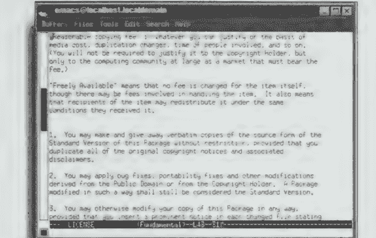

使用 X11 工具包选项（如 `-geometry`、`fg` 和 `bg`）来设置初始窗口大小、位置、文本和背景颜色：

```bash
# emacs -geometry 80x25+10+10 -fg blue -bg white
```

该命令行在屏幕左上角启动 `emacs`，窗口大小为 80 字符 x 25 行，白底蓝字。`emacs` 还有十多个不同的工具包选项可供您使用。

要在 X11 终端的窗口内运行 `emacs`，请使用非 X11 版本的 `emacs`，如下所示：

```bash
# emacs -nox textfile.txt
```

这将运行 `emacs` 并打开您的文件，如图 4.3 所示。学习 `emacs` 可能需要一些时间，但其内置的教程将帮助您入门。如果您是 `emacs` 新手，使用该教程至关重要。

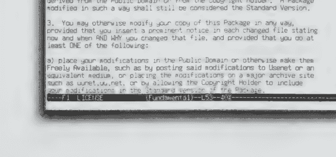

### 另请参阅

要了解更多关于 X11 工具包选项的信息，请参阅第 307 页。

### 启动 `emacs` 教程

1. 从控制台或 X11 终端窗口的命令行启动 `emacs`：

   `# emacs`

2. 按住 Ctrl 键，然后按下 H。您会在屏幕底部看到一个提示：

   `C-h (Type ? for further options).`

3. 按下 t，`emacs` 将开始其教程。

学习 `emacs` 可能需要一些时间。建议使用带有菜单的 X11 版本来入门。表 4.1 列出了开始创建和编辑文件所需的基本按键。您还可以将编辑器的默认设置保存在主目录中名为 `.emacs` 的文件中。详见 `emacs` 手册页。

### 表 4.1：`emacs` 基本按键

| 操作 | 按键命令 |
| --- | --- |
| 光标后退一个字符 | Ctrl+B |
| 光标下移一行 | Ctrl+N |
| 光标前移一个字符 | Ctrl+F |
| 光标上移一行 | Ctrl+P |
| 删除当前字符 | Ctrl+D |
| 删除当前行 | Ctrl+K |
| 删除当前单词 | Alt+D |
| 跳转到文件开头 | Alt+< |
| 跳转到当前行末尾 | Ctrl+E |
| 跳转到文件末尾 | Alt+> |
| 跳转到当前行开头 | Ctrl+A |
| 打开文件 | Ctrl+X, Ctrl+F |
| 向下翻页 | Ctrl+V |
| 向上翻页 | Alt+V |
| 退出 `emacs` | Ctrl+X, Ctrl+C |

## 选择编辑器

| 操作 | 快捷键 |
| --- | --- |
| 保存当前文件 | Ctrl+X, Ctrl+S |
| 另存为文件 | Ctrl+X Ctrl+W |
| 显示帮助 | Ctrl+H |
| 开始教程 | Ctrl+H T |
| 撤销上一步操作 | Ctrl+_ |

`emacs` 的文档位于 `/usr/doc`、`/usr/share/emacs/20.2/etc` 和 `/usr/info` 目录下。请参阅 `emacs` 手册页以获取 `emacs` 目录的完整列表。

## 使用 `pico` 编辑器编辑文本

`pico` 编辑器是 pine 电子邮件软件集的一部分，是一款易于使用的编辑器，具备本章开头推荐的所有功能。这个简单直接的程序紧凑、可靠且高效（你不需要为了用 `pico` 编辑文件而必须使用 pine）。当使用 `-m` 命令行选项时，`pico` 甚至支持鼠标，如下所示：

```bash
# pico -m myfile.txt
```

`pico` 会打开你的文件，如图 4.4 所示。如果你运行的是 X Window 系统，点击屏幕底部的其中一个命令即可继续。

在发生系统崩溃（对 Linux 用户来说很少见）的不幸情况时，`pico` 还会保护你正在进行的工作，并将你的工作保存为原文件名并带有 `.save` 扩展名。如果你编辑的是原始文件，保存的文件名为 `pico.save`。

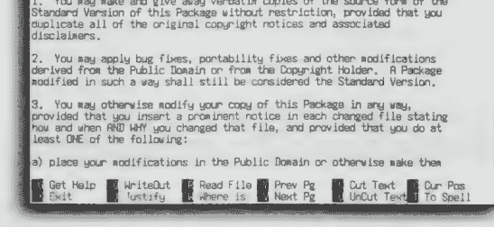

**图 4.4**

`pico` 编辑器是一款易于使用、紧凑且高效的文本编辑器。


通过定义 `EDITOR` 环境变量，将 `pico` 设置为默认的系统编辑器。

### 将 pico 定义为系统编辑器

1. 以 root 操作员身份登录。使用带有 `-w`（不自动换行）命令行选项的 `pico` 以保留长行，并打开 `/etc` 目录下的 profile 文件：

   `# pico -w /etc/profile`

2. 输入 `EDITOR` 变量定义，随后跟上 bash shell 的 `export` 命令：

   `EDITOR=/usr/bin/pico`

   `export EDITOR`

3. 按 `Ctrl+X`，然后按 `Enter` 保存文件。

4. 要立即使用 `EDITOR` 变量，请使用 bash shell 的 `source` 命令读取新变量，如下所示：

   `# source /etc/profile`

**另请参阅**

$\rightarrow$ 要了解更多关于 shell 环境变量的信息，请参阅第 90 页。

`pico` 识别你的光标键，并拥有一系列键盘命令。表 4.2 列出了你在编辑文本时可以使用的许多常用命令。

| 操作 | 快捷键 |
| :--- | :--- |
| 光标后退一个字符 | `Ctrl+B` |
| 光标下移一行 | `Ctrl+N` |
| 光标前进一步字符 | `Ctrl+F` |
| 光标上移一行 | `Ctrl+P` |
| 删除当前字符 | `Ctrl+D` |
| 删除（剪切）当前行 | `Ctrl+K` |
| 显示光标位置 | `Ctrl+C` |
| 跳转到当前行末尾 | `Ctrl+E` |
| 跳转到当前行开头 | `Ctrl+A` |
| 插入文件 | `Ctrl+R` |
| 对齐当前段落 | `Ctrl+J` |
| 向下翻页 | `Ctrl+V` |
| 向上翻页 | `Ctrl+Y` |
| 粘贴文本或取消对齐 | `Ctrl+U` |
| 退出 pico | `Ctrl+X` |
| 搜索文本 | `Ctrl+W` |
| 开始拼写检查 | `Ctrl+T` |
| 另存为文件 | `Ctrl+O` |
| 显示帮助 | `Ctrl+G` |

虽然 `pico` 支持文本文档的拼写检查，但你可能会发现它默认不工作。要使用 `pico` 对文档进行拼写检查，请使用 `pine` 邮件程序来配置 `pico` 的拼写程序。

### 配置 pico 进行拼写检查

1. 启动 `pine` 邮件程序，如下所示：

   `# pine`

2. 按 `S` 键。`pine` 在屏幕底部显示提示：

   `Choose a setup task from the menu below :`

3. 按 `C` 启动配置选项。`pine` 显示其配置屏幕，如图 4.5 所示。

   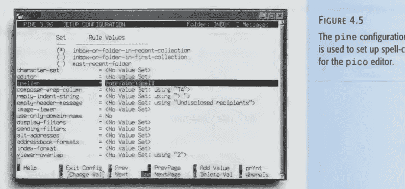

4. 滚动浏览配置项列表，直到看到如下的一行：

   `speller = <No Value Set>`

5. 使用上或下光标键，将光标移动到该 `speller` 行被高亮显示。按 `C` 更改值。`pine` 在屏幕底部显示提示：

   `Enter the text to be added :`

6. 输入 `ispell` 拼写程序的路径：

   `/usr/bin/ispell`

7. 按 `Enter`，然后按 `E` 键。`pine` 将询问你是否要保存更改。按 `Y` 键保存更改。

8. 按 `Q` 退出 `pine` 程序。按 `Y` 确认退出。

现在 `pico` 编辑器已配置好拼写检查功能。

阅读 `pico` 手册页以获取更多信息，或按 `Ctrl+G` 阅读 `pico` 的帮助屏幕。有关 `pico` 的更多详细信息，请使用 `Lynx` 浏览器通过输入以下内容阅读 `pine` 的技术笔记（其中包含 `pico` 的技术细节）：

`# lynx /usr/doc/pine-3.96/tech-notes/index.html`

## vim 编辑器的特性

`vim` 编辑器与原始的 `vi` 编辑器兼容，而 `vi` 是对早期的面向行编辑器 `ed` 的增强。`vim` 还有一个名为 `gvim` 的 X11 版本，支持多个滚动窗口和菜单。

`vim` 使用多个符号链接来模拟 `ex`、`vi` 和 `view` 编辑器。当作为 `ex` 使用时，`vim` 编辑器充当行编辑器或脚本编辑器。`vim` 编辑器具有 23 个命令行选项，这些选项在其手册页中均有记载。该编辑器具备内置帮助、分屏窗口、块移动、命令行编辑、水平滚动以及用于文字处理的自动换行等功能。

## joe 编辑器的特性

`joe` 编辑器软件包包含五个不同的编辑器：`jmacs`、`joe`、`jpico`、`jstar` 和 `rjoe`。`jmacs` 版本使用许多与 `emacs` 编辑器类似的命令。`jpico` 版本模拟 `pico` 文本编辑器。如果你记得使用 `WordStar` 文字处理程序，那么 `jstar` 编辑器会让你感到很熟悉。`rjoe` 编辑器仅编辑在命令行中指定的文件。

要配置 `joe` 编辑器，请将 `/usr/lib/joe` 目录下的 `joerc` 文件复制到你的家目录下并重命名为 `.joerc`。编辑 `.joerc` 以更改 `joe` 的帮助菜单、显示方式和键盘命令。

阅读 `joe` 手册页以获取关于使用每个版本的详细信息，或使用 `joe` 的内置帮助（通过按 `Ctrl+K`，然后按 `H` 键访问）。

**另请参阅**

$\rightarrow$ 有关使用 FTP 从互联网下载文件的更多信息，请参阅第 198 页。

## jed 编辑器的特性

`jed` 编辑器与 `vim` 类似，提供控制台版本和 X Window 系统版本 (`xjed`)。要配置 `jed` 编辑器，请将 `/usr/lib/jed` 库目录下的 `jed.rc` 文件复制到你的家目录下并重命名为 `.jedrc`。

`jed` 编辑器具有内置帮助（你可以通过按 `Esc`，问号键，然后按 `H` 来访问）。阅读 `/usr/doc/jed` 目录下的 `jed` 文档以及 `jed` 手册页以获取更多信息。

## 使用流编辑器

使用 shell 的标准输入和标准输出是另一种编辑文本的方法。这种做法被称为 *重定向*（使用 `<` 或 `>` 运算符），它还使用 shell 管道（使用 `|` 运算符）来更改文本流。专门的程序（如 `sed`）旨在接收重定向和管道文本，这些程序被称为 *流编辑器*。

**另请参阅**

$\rightarrow$ 要学习如何使用 shell 重定向和管道运算符，请参阅第 19 页。

### 升级 joe 编辑器

`joe` 编辑器的升级版本修复了在使用 X11 时调整编辑器窗口大小的问题。请从 Red Hat 的 FTP 站点下载并安装 `joe-2.8-10.1386.rpm` 文件进行升级：

`ftp://ftp.redhat.com/pub/redhat/updates/5.0/1386/`

检查 Red Hat 网站以获取有关你所用 Linux 版本的技术公告或勘误表总是一个好主意。

`http://www.redhat.com`

使用 `sed`（流）编辑器从命令行快速编辑文本。`sed` 编辑器拥有二十多个命令，并且还使用正则表达式（类似于 `grep` 命令的正则表达式，详见第 3 章“导航 Linux 文件系统”中名为“搜索文本文件”的章节）。

`sed` 命令可以用来快速对文本文档进行全局更改，而无需加载文字处理器或文本编辑器。例如，如果以下文本中的不幸之徒不是 Price 先生而是他的妻子，则需要更改 `Mr.` 这个词组：

> As stated in our previous discussion, Mr. Price has not responded to our complaints, and has not returned our overtures aimed at resolving this credit problem. Mr. Price knows that we have attempted to make contact, but has spurned our requests for resolution, even after foreclosure on the property in question. Mr. Price's whereabouts remain unknown, but was last seen on St. John's Island.

使用 `sed s` (substitute) 命令查找字符串 `Mr.` 的每个实例并将其替换为 `Mrs.`，如下所示：

```
# sed s/Mr./Mrs./ <notice.txt
```

> As stated in our previous discussion, Mrs. Price has not responded to our complaints, and has not returned our overtures aimed at resolving this credit problem. Mrs. Price knows that we have attempted to make contact, but has spurned our requests for resolution, even after foreclosure on the property in question. Mrs. Price's whereabouts remain unknown, but was last seen on St. John's Island.

请注意，每个 `Mr.` 的实例都已被更改为 `Mrs.`，并且 `sed` 命令将输入内容回显到你的显示屏上。要创建新文件，请使用 `>` 重定向运算符：

```
# sed s/Mr./Mrs./ <notice.txt >correctnotice.txt
```

## 选择编辑器

输入 `sed` 命令的 `-f`（脚本文件）命令行选项，随后跟上脚本文件的名称，即可向 `sed` 提供一个要在文本文件上执行的更改列表。

### 使用 sed 脚本文件

1. 若要对文本文件进行大量、常规的更改，请在 `sed` 命令中使用编辑脚本。例如，使用您喜欢的文本编辑器创建一个名为 `personnel.txt` 的文件，并输入如下段落：

   Heretofore, all employees must report in by telephone, in accordance with the personnel guidebook. Pursuant to the guide book, this and other regulations are applicable to all employees, and all employees must utilize the guide book. A new employee must also acquire or procure the guide book as a draft implementation, or the company will terminate the employee's position.

2. 保存该文件，然后创建一个名为 `grammar.sed` 的脚本文件。输入一系列 `sed` 命令，例如：

```
s/utilize/use/
s/procure/get/
s/acquire/buy/
s/draft implementation/draft/
s/Heretofore/From now on/
s/in accordance with/according to/
s/thereto/to/
s/Pursuant/According/
s/are applicable/apply/
s/terminate/end/
```

3. 保存文件并退出文本编辑器。使用 `sed` 命令的 `-f` 选项及其脚本文件名，并利用 shell 重定向操作符将原始文本文件输入到 `sed` 命令中，如下所示：

```
# sed -f grammar.sed "personnel.txt"
```

From now on, all employees must report in by telephone, according to the personnel guidebook. According to the guide book, this and other regulations apply to all employees, and all employees must use the guide book. A new employee must also buy or get the guide book as a draft, or the company will end the employee's position.

4. `sed` 命令已将每个单词或短语替换为更简单的替代词——几乎像一个语法检查程序。您可以尝试编写自己的脚本来检查标点符号或写作风格。

## 使用 Linux 字典

正确的拼写是写作和文字处理的重要组成部分，拼写错误可能会令人尴尬。大多数 Linux 发行版都自带了几个用于检查拼写或在系统字典中查找单词的工具，通常位于 `/usr/dict` 目录下（稍后在“使用 ispell 命令进行拼写检查”章节中讨论的 `ispell` 使用的是不同的字典）。

默认的系统字典 `words`（可能是指向 `/usr/dict` 目录下 `linux.words` 文件的符号链接）包含了一个按字母顺序排列的列表，其中有 45,000 多个（我希望）拼写正确的单词。

### 获取 web2 字典

对 45,000 个单词不满意？您可以获取另一个字典 `web2`，它包含一个超过 234,000 个单词的字母顺序列表。`web2` 字典通常附带一个专有名词字典（包含 1,300 多个名称）和一个名为 `web2a` 的词组连字符字典（包含 75,000 多个短语）。

要获取这些文件，请浏览至以下网址：`ftp://ftp.digital.com/pub/BSD/net2/share/dict`

### 字典：自定义构建

不想使用标准的系统字典？需要构建包含医疗或法律领域专业词汇的自定义字典？尝试结合使用文本过滤器和 shell 管道操作符来构建自己的字典，可以使用如下命令行：

```
# find *.txt | xargs cat | tr ' ' '\n' | sort | uniq > mydict.txt
```

该命令行使用 `find` 命令将当前目录中所有文件的名称通过管道传输给 `cat` 命令，然后 `cat` 使用 `tr` 命令将单词之间的每个空格转换为回车符，从而构建一个单一的单词列表。接着，这个列表由 `sort` 命令排序，并由 `uniq` 命令删除重复单词。结果可能并不完美，但您将拥有一个包含文档中所有单词的字典。

### 另请参阅

要详细了解 `find` 命令，请参阅第 43 页。

## 使用 ispell 命令进行拼写检查

大多数 Linux 发行版都自带了交互式拼写程序 `ispell`。您可以单独使用该程序或将其与文本编辑器结合使用，以纠正拼写错误。Linux 发行版中包含的大多数编辑器都可以使用此程序。

### 使用 ispell 检查拼写

1. 使用 `ispell` 命令后接文件名来交互式地检查拼写，如下所示：

   `# ispell document.txt`

2. 如果没有发现拼写错误的单词，`ispell` 将返回命令行。如果有拼写错误，第一个错误的单词将与文件名一起显示在屏幕顶部。错误单词会显示在上下文中，随后会出现一个建议替换词的编号列表，屏幕底部则是命令行提示符（如图 4.6 所示）。

以下是 `ispell` 代码运行时的样子：

```
personall       File: document.txt
```

> Heretofore, all employees must report in by telephone, in accordance with the personall guidebook. Pursuant to the guide book, this and other

```
0: personal
1: personally
2: personals
3: person all
4: person·all
```

`[SP] <number> R)epl A)ccept I)nsert L)ookup U)ncap Q)uit e(X)it or ? for help`

**图 4.6**

`ispell` 命令是 Linux 的一个交互式拼写检查器。

3. 输入建议替换词的编号来纠正拼写错误的单词，或者按 `R` 来替换错误单词。`ispell` 命令将响应以下提示：

`Replace with:`

4. 输入正确的拼写。`ispell` 替换该单词，然后跳转到下一个拼写错误的单词。使用 `I` (insert) 命令可以在您的家目录中创建名为 `.ispell_english` 的个人字典。

若要强制 `ispell` 使用系统字典 (`/usr/dict/words`)，请在命令行中使用 `-l` (list) 选项，随后跟上标准输入重定向操作符和文本文件名，如下所示：

```
# ispell -l < document.txt
personall
regulations
```

## 使用 mpage 命令节省纸张

`ispell` 命令会打印出文档中发现的拼写错误单词列表。`ispell` 软件包还包括用于构建新 `ispell` 字典的实用工具，位于 `/usr/lib/ispell` 目录下。详情请阅读 `/usr/doc/ispell` 目录下的 `ispell` 手册页和文档。

多年前，计算机行业的能客们轻率地预测文字处理将导致“无纸化办公”。但正如我们许多人悲哀地意识到那样，这场革命反而导致了可擦除债券纸和修正液的消亡，以及纸张用量的反常 *增加*（我们以前的办公室有一台激光打印机，起名叫 `tree-eater`，即“食树者”）。


如果您是一名严肃的 Linux 用户，并且认真对待节省纸张，您不仅应该回收利用，还应该使用 `mpage` 命令将至少两页内容打印在单页纸上。`mpage` 命令后接数字，可以在单张纸上打印 1、2、4 或 8 页文本。例如，要在单页上打印两页内容，请使用 `-o` 选项，随后使用 `-P` 选项和您的打印机名称，如下所示：

```
# mpage -2 -o massivedocument.txt -Plp
```

`mpage` 命令会从您的文档创建一个 PostScript 文件，并将输出发送到打印机。如果您使用 Red Hat Linux 的 `printtool` 安装了打印机，您将获得一份精美的打印件（至少在激光或喷墨打印机上），每张纸上并排显示两个页面。使用 `-o` 命令可以防止在文本周围打印边线。

### 另请参阅

- 有关在 Linux 中设置打印机的更多信息，请参阅第 74 页。

`mpage` 命令还可以打印奇数或偶数页、打印页眉、使用不同的字体或页边距、支持双面打印，甚至可以从文档末尾开始反向打印文档。更多信息请参阅 `mpage` 手册页。

## 创建格式化文档

文本编辑器可以进行基本的文本格式化，例如限制每行的字符数或单词数，以及段落两端对齐。但要添加页码、精美的缩进或多列和多种字体，您必须使用格式化或排版系统。*格式化* 程序（如 `pr` 或 `fmt` 命令）通常是小型文本实用程序，通过命令行选项添加页眉、页脚、页边距和页码。*排版* 系统（如 `groff` 或 `TeX`）提供了一系列令人眼花缭乱的命令，您必须在处理之前将其插入到文档中，且这些软件分发版通常在多个目录下包含数兆字节的文件。

### 使用文本格式化过滤命令

如果您不想学习排版系统复杂的格式化命令，可以使用文本格式化过滤程序。文本过滤器可以通过几个简单的命令行选项更改文档的输出。使用文本格式化程序可以快速格式化您的文档。

#### 使用 `pr` 命令进行格式化

`pr` 命令具有近 20 种不同的命令行选项来格式化文档。例如，要打印一个包含时间及短语 *Committee Report* 的页眉，且左页边距为 10 个字符的文档，请如下使用 `pr` 命令：

```
# pr +2 -h "Committee Report" -o 10 < report.txt | lpr
```

因为前面的命令使用了 `+` 操作符后跟页码，所以 `pr` 从第 2 页开始对页码进行编号。`pr` 程序还可以通过 `-COLUMN` 命令行选项将文本格式化为多列。例如，要将系统字典以每页三列的形式打印，请如下使用 `pr` 命令（显然，我没有展示全部输出）：

```
# pr -3 /usr/dict/words
98-03-15 16:36                               web2
Page 1
A               Abaris            abbotnullius
```

| a | abarthrosis | abbotship |

|---|---|---|

| aa | abarticular | abbreviate |

| aal | abarticulation | abbreviately |

| aalii | abas | abbreviation |

| aam | abase | abbreviator |

参阅 `pr` 手册页以了解更多选项，例如 `-l 1`，它可以用于从输出中删除页眉。

### 使用 `fmt` 命令进行格式化

将 `fmt` 命令与 `pr` 命令结合使用，可以更改文本文档的宽度。使用 `fmt` 命令将文本格式化为您指定的行宽，然后将文本通过 `pr` 命令进行进一步格式化。例如，要格式化公共领域许可证（位于 `/usr/doc/shadow-utils` 目录下），请使用 `fmt -w`（宽度）选项后跟行宽（以字符为单位），然后使用 `-o`（边距）选项后跟边距（以字符为单位）将输出通过管道传递给 `pr` 命令，如下所示：

```
# fmt -w 40 <LICENSE | pr -o 15
```

- 1. 您可以无限制地制作并分发本软件包标准版本的源形式的逐字副本，前提是您复制了所有原始版权声明和相关的免责声明。

- 2. 您可以应用源自公共领域或版权持有者的错误修复、移植性修复和其他修改。以这种方式修改的软件包仍应被视为标准版本。

显然，我在这里没有展示所有的输出；尽管如此，您应该能看到这是一种在命令行格式化文本的便捷方法。

## 使用文本处理系统

使用文本处理系统（如 `groff` 或 `TeX`）排版文档通常是一个三步过程：

- 1. 使用文本编辑器创建文档。在文本中插入排版命令。

- 2. 通过排版程序处理文档，随后产生一个格式化文档。

- 3. 预览文档，检查错误，或将文档发送到打印机。

以下章节讨论如何使用 `groff` 和 `TeX` 系统对文本进行格式化。

### 使用 `groff` 格式化程序格式化文本

GNU `groff` 排版系统使用特殊的格式化命令（称为 *宏*）来格式化文档。`man` 宏集用于格式化系统的手册页。例如，要格式化并显示 `cat` 手册页的内容，您可以使用以下任何三条命令行（每条的作用相同）：

```
# man cat
# nroff -man /usr/man/man1/cat.1 | less
# groff -Tascii -man /usr/man/man1/cat.1 | less
```

如果您使用 `cat` 命令打印 `cat` 手册页，就可以看到 `groff` 的 `man` 宏，如下所示：

```
# cat /usr/man/man1/cat.1
.TH CAT 1 "GNU Text Utilities" "FSF" "-*" -*-. nroff -*.
.SH NAME
cat \- concatenate files and print on the standard output
.SH SYNOPSIS
.B cat
[\-benstuvAET] [\-l\-number] [\-l\-number-nonblank] [\-l\-squeeze-blank]
[\-l\-show-nonprinting] [\-l\-show-ends] [\-l\-show-tabs] [\-l\-show-all]
[\-l\-help] [\-l\-version]
[file...]
.SH DESCRIPTION
```

我没有复制 `cat.1` 手册页的全部内容，但如果您将 `man`、`nroff` 或 `groff` 命令的输出与 `cat` 手册页的原始形式进行比较，您就会发现由 *点* 命令（如 `.TH` 和 `.SH`）表示的 `man` 宏会导致特殊的格式化。这些点命令和其他手册页宏在 `/usr/man/man7` 目录下的 `man.7` 手册页中有相关文档。

对于 `groff` 格式化系统，还有其他几组排版宏，例如 `me`、`mm` 和 `ms` 手稿宏。在文本文档中使用这些宏时，必须在 `groff` 命令行中指定所使用的宏集，如下所示：

```
# groff -Tascii -mm mydocument.txt
```

这些宏的文档位于各种 `groff` 相关的手册页中。表 4.3 列出了 `mm` 手稿宏集中一些常用的 `groff` 宏。

#### 表 4.3 常用 `mm` 手稿 `groff` 宏

| 用途 | 宏名称 |

|---|---|

| 居中对齐 | `.ds C` |

| 结束文本框 | `.b2` |

| 关闭对齐 | `.sa 0` |

| 开启对齐 | `.sa 1` |

| 关闭行填充 | `.ds N` |

| 开启行填充 | `.ds F` |

| 新段落，缩进 x | `.p x` |

| 无缩进 | `.ds L` |

| 右对齐 | `.ds R` |

| 开始粗体文本 | `.b` |

| 开始文本框 | `.b1` |

| 使用分栏 | `.mc` |

| 使用单栏 | `.1c` |

| 使用双栏 | `.2c` |

## 使用文本编辑器

如果您不想使用宏集，可以尝试一些常用的 `groff` 命令，列在表 4.4 中。

#### 表 4.4 常用 `groff` 排版命令

| 用途 | 命令 |

| :--- | :--- |

| 开始新页 | `.bp` |

| 开始新段落 | `.pp` |

| 居中接下来的 x 行 | `.ce x` |

| 居中文本 x | `.ce x` |

| 向下插入 (空格) n 英寸 | `.sp ni` |

| 向下插入 n 英寸 | `.sv ni` |

| 设置字体为粗体 | `.ft B` |

| 设置字体为罗马体 | `.ft R` |

| 将行间距设置为 n | `.ls n` |

| 临时缩进 n 英寸 | `.ti ni` |

| 关闭行填充 | `.nf` |

| 开启居中 | `.ce` |

| 开启缩进 n 英寸 | `.in ni` |

| 开启行填充 | `.fi` |

| 下划线接下来的 n 行 | `.ul n` |

### 节省预览 dvi 文档的时间

预览 TeX dvi 文档可能需要几分钟，且非常消耗系统资源。预览 TeX dvi 文档的最佳方法是使用 `dvips` 命令将文件转换为 PostScript，然后使用 `gv` PostScript 预览器，如下所示：

```
# dvips -f < mytexdoc.dvi > mytexdoc.ps
# gv mytexdoc.ps
```

使用 `groff -T` 命令行选项后跟输出格式指定符，可以创建不同的文档格式，例如 PostScript、TeX dvi、文本、HP 打印机控制语言或 PCL。在打印之前请预览您的文档，并参阅 `groff` 手册页以获取关于该排版系统的更多信息。

### 使用 TeX 格式化文本

TeX 排版系统是一个由程序、字体和其他实用工具组成的强大集合。这个复杂的系统包括 65 个以上的程序，以及相关的支持文件，如库、宏和文档。一个典型的 TeX 安装需要近 50 MB 的硬盘空间用于存放系统文件、宏和字体。

TeX 排版系统使用插入在文本文件中的格式化命令，这一过程与 `groff` 系统类似。要查看 TeX 如何使用其宏，请尝试处理一个示例文件，例如位于 TeX 目录下的 `samples.tex`。

#### 处理示例 TeX 文件

- 1. 使用 `latex` 命令对 `samples.tex` 文件进行排版。在某些 Linux 系统上，此过程可能需要最多一分钟。`latex` 命令使用特殊的 TeX 宏来格式化文档。使用此命令后跟 TeX 源文档的名称即可创建 `.dvi` 文件，如下所示：

  `# latex /usr/lib/texmf/texmf/doc/generic/pstricks/samples.tex`

- 2. 使用 `dvips` 命令将生成的 `.dvi` 文件 `samples.dvi` 转换为 PostScript。使用 `-f` 命令从标准输入读取文件，并将输出重定向到 PostScript 文件：

  `# dvips -f <samples.dvi >samples.ps`

- 3. 使用 `gv` PostScript 预览器预览 PostScript 文档（见图 4.7）：

  `# gv samples.ps`

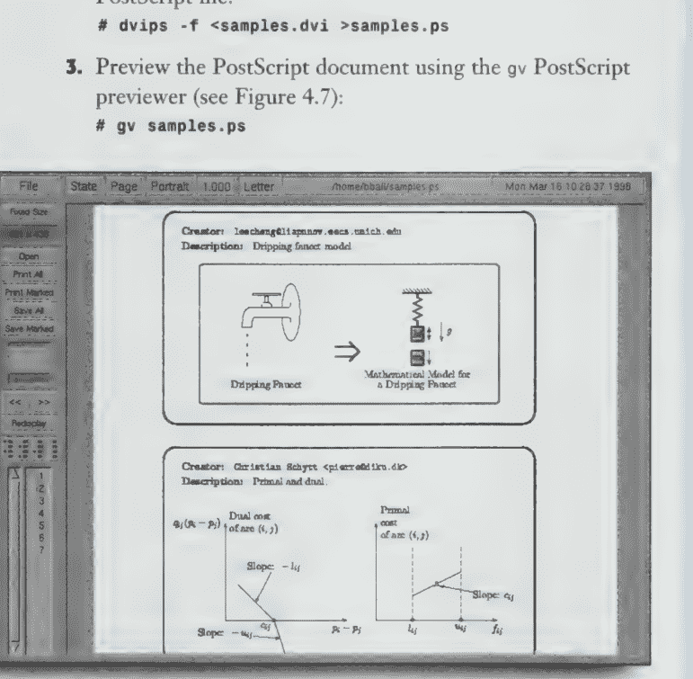

**图 4.7**

`gv` PostScript 预览器可用于预览或打印转换后的 TeX `.dvi` 文档。

- 4. 要打印文档，请点击“文件”菜单并选择“打印文档”选项，或使用 `lpr` 命令后跟 `-P` 打印机选项，如下所示：

```
# lpr -Plp samples.ps
```

TeX 可以生成复杂的图表和文档，但这需要您花一些精力去学习该系统。阅读 TeX 及相关手册页，查看 `/usr/info` 目录下的 TeX info 文件，并浏览 `/usr/lib/texmf/texmf/doc` 目录。阅读 TeX 相关资料和获取示例文件的最佳方法是使用 Lynx 浏览器输入以下内容：

```
# lynx /usr/lib/texmf/texmf/doc/index.html
```

初学者应滚动到 `index.html` 文档的帮助部分，并阅读 TeX 常见问题解答 (FAQ) 文件。

## 另请参阅

要学习如何使用 Lynx 浏览器，请参阅第 212 页。

## 第 5 章：打印文件

作者：Bill Ball

- 安装、配置和添加打印机

- 使用行打印机池化系统 (spooling system)

- 控制打印任务

- 使用 `lpr` 命令发送传真

## 添加打印机

如果您在安装 Linux 时没有设置打印机，或者想要向系统中添加不同的打印机，您至少可以通过两种方式来实现（本章将讨论这两种方式）：

- 手动添加

- 使用 Red Hat Linux 为 X Window 系统提供的 `printtool` 命令

在 Linux 中，打印机被描述为字符模式设备。其中最常见的设备是并行端口打印机，它们列在 `/dev` 目录下，名称类似于 `lp`。以下是并行端口打印机的示例列表：

```
# ls /dev/lp*
/dev/lp0 /dev/lp1 /dev/lp2
```

您应该能在 `/dev` 目录下找到至少三个并行打印机设备。

**另请参阅**

要了解更多关于 X Window 系统的信息，请参阅第 260 页。

要了解更多关于其他 Red Hat 工具的信息，请参阅第 622 页。

## 检查您的打印机

有多种方法可以确保您在安装 Linux 时创建的打印机能够正常工作。

### 检查已安装的打印机

1. 在 Linux 启动时观察启动消息；寻找指定已找到打印机设备的行，例如：

`lp1 at 0x0378, (polling)`

这一行表明 Linux 找到了一个使用 `/dev/lp1` 设备的并行端口设备。

2. 通过将 `ls` 命令的输出直接发送到您的打印机（或找到的设备），打印一个目录列表，使用类似于下面的命令行：

`# ls >/dev/lp1`

您的打印机应该会启动并打印当前目录的列表。

**使用串行打印机**

串行打印机是串行设备，其名称类似于您的串行端口或调制解调器端口，例如 `/dev/ttyS0`。有关配置串行打印机电缆的信息，请参阅 `/usr/doc` 目录下的 `Serial-HOWTO`。要了解设置串行打印机的所有细节，请参阅同样在 `/usr/doc` 目录下的 `Printing-HOWTO`。请确保将您的串行端口和打印机设置为相同的速度。若要了解如何操作，请阅读 `setserial` 命令的手册页。

**提示**

如果启动消息滚动速度太快，请等待 Linux 启动并登录，然后将 `dmesg` 命令的输出通过 `less` 分页器进行查看：

`# dmesg | less`

3. 如果您的打印机没有反应（请确保它已插入电源并已开启），您可以尝试通过执行以下命令来查看 `proc` 目录下的 `devices` 文件内容：

```
# cat /proc/devices
```

`devices` 文件列出了系统所有活动的设备。在字符设备列表中查找 `lp` 设备。该设备列出方式如下：

```
Character devices:
1 mem
2 pty
3 ttyp
4 ttyp
5 cua
6 lp
7 vcs
10 misc
14 sound
127 pcmcia
```

4. 确保并行打印功能可用，它既可以作为 `/lib/modules/2.0.xx/misc` 目录（其中 `xx` 是内核版本）下的可加载代码模块 (`lp.o`)，也可以作为编译进内核的代码。使用 `lsmod` 命令在内核内存中查找 `lp` 模块，如下所示：

```
# lsmod
```

| 模块 | 页数 | 使用情况 |

| :--- | :--- | :--- |

| lp | 2 | 1 (autoclean) |

| serial_cs | 1 | 0 |

| fixed_cs | 1 | 0 |

| ds | 2 | [serial_cs fixed_cs] 4 |

| i82365 | 4 | 2 |

| pcmcia_core | 8 | [serial_cs fixed_cs ds i82365] 5 |

| vfat | 3 | 1 (autoclean) |

5. 如果您无法检测到打印机，或者没有看到 `lp` 模块，请阅读 `/usr/doc` 目录下的 `Printing-HOWTO` 以获取安装打印机的详细信息。

**另请参阅**

- 要了解更多关于在 shell 中使用重定向运算符和管道的信息，*请参阅第 19 页*。

- 要了解更多关于 Linux 模块的信息，*请参阅第 577 页*。

## 通过编辑 `/etc/printcap` 添加本地打印机

您可以通过在系统打印机能力数据库 `printcap` 中输入打印机能力定义来添加打印机。该文件位于 `/etc` 目录下，是一个只能由 `root` 操作员修改的文本文件。

在 `/etc/printcap` 文件中创建打印条目时所使用的格式、命令和语法可在 `printcap` 手册页中找到。虽然有 40 多个不同的命令，但您只需使用 `mx`（池化文件的最大大小）和 `sd`（池化目录）命令即可快速创建打印机。

### 配置简单打印机

1. 要为 `/dev/lp1` 设备创建名为 `mylp` 的打印机，请使用您喜欢的文本编辑器打开 `/etc/printcap` 文件。`sd` 命令告诉 Linux 打印守护进程 `lpd` 将打印（池化）文件临时存放在哪里。`mx` 命令在使用值为 0 时，不对池化文件的大小设置限制。输入如下条目：

`mylp:\`

`    :sd=/var/spool/lpd/mylp:\`

`    :mx=0:\`

`    :lp=/dev/lp1:`

2. 保存条目，然后使用 `mkdir` 命令创建打印机的池化目录：

`# mkdir /var/spool/lpd/mylp`


3. 使用`chgrp`和`chmod`命令确保`lp`目录具有正确的组所有权和权限，如下所示：

```
# chgrp lp /var/spool/lpd/mylp
# chmod 755 /var/spool/lpd/mylp
```

4. 使用`lpr`（行打印机命令）测试打印机条目：

```
# lpr -Pmylp test.txt
```

5. 您的打印机应该会启动并打印测试文档。

**提示**

您可能会在打印输出中看到“阶梯”效果。这是一种常见现象，表明您的打印机在打印下一行之前没有完全返回到行首。虽然您可以尝试设置回车符以在换行后插入回车，但最佳解决方案是使用打印机过滤器，例如由下文讨论的 Red Hat `printtool` 程序安装的过滤器。

## 使用 Red Hat `printtool` 命令添加本地打印机

每当您需要安装打印机时，请使用 Red Hat `printtool` 程序。您必须以 root 操作员身份登录并运行 X Window 系统才能使用此程序。有两种访问`printtool`的方式：

- 通过控制面板 (Control Panel) 客户端
- 通过 X11 终端窗口的命令行

### 使用 `printtool` 安装打印机

1. 确保您的打印机已连接到计算机并已开机。以 root 操作员身份登录并启动 X11。

2. 运行控制面板客户端，然后点击`printtool`按钮，或从终端窗口的命令行启动`printtool`，如下所示：

```
# printtool
```

3. 出现`printtool`主窗口（如图 5.1 所示）。`/etc/printcap`数据库中当前定义的所有打印机都会列出。如果您尚未定义任何打印机，窗口将为空。点击 Add 按钮。

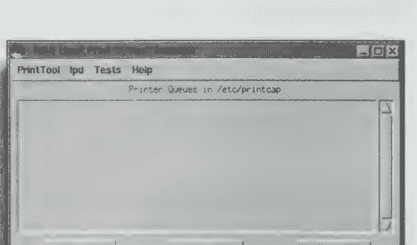

**图 5.1**

`printtool` X11 客户端用于为 Linux 添加或配置打印机。

4. 出现如图 5.2 所示的窗口，要求您选择本地、远程或 LAN Manager 打印机。要设置本地打印机（连接到计算机的打印机），请点击 Local Printer 选项按钮，然后点击 OK。

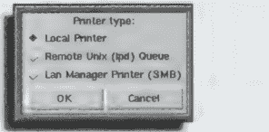

**图 5.2**

`printtool`打印机类型对话框提示选择本地、远程或网络打印机。

5. 当出现如图 5.3 所示的自动检测 (Autodetection) 对话框时，您应该能听到打印机启动的声音。该对话框显示在您的计算机上检测到的并行打印机设备。如果没有检测到设备，这表明您的打印机未开启或打印支持未启用。

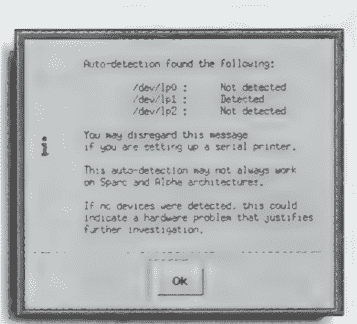

**图 5.3**

`printtool`命令自动检测本地打印机。

6. 点击 OK，出现请求打印机名称的对话框（见图 5.4）。使用提供的默认名称，或者在对话框的 Names 字段中输入一个唯一的名称来为您的打印机指定名称。

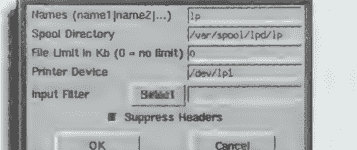

**图 5.4**

您可以为打印机指定一个唯一名称或使用默认名称。

## 添加打印机

7. 点击“输入过滤器”对话框条目旁边的“选择”按钮，调用如图 5.5 所示的“配置过滤器”窗口。从打印机列表中选择您的打印机（或与您的打印机类似的型号）。您还可以选择打印机分辨率、纸张大小和色彩深度。色彩深度应与您打印机的功能相匹配。如果您使用的是黑白打印机，请仅选择黑白选项。完成后，点击“确定”。

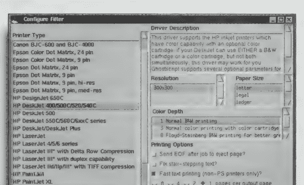

**图 5.5**

`printtool`命令为二十多种不同的打印机提供定制设置。

8. 点击图 5.6 所示对话框中的“确定”。

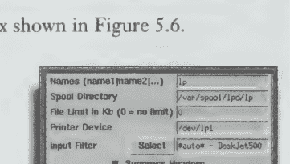

**图 5.6**

已选择打印过滤器。

9. 您应该能看到`printtool`主窗口（见图 5.7），其中打印机列表中包含您定义的打印机。通过选择该打印机，然后从“测试”菜单中选择“ASCII”或“PostScript 文本”菜单项来测试您的打印机。如果一切正常，点击“保存”按钮保存打印机配置，然后退出。您可以使用`cat`命令列出条目，从而验证`/etc/printcap`数据库中的打印机条目，如下所示：

```
# cat /etc/printcap
# /etc/printcap
# 
# Please don't edit this file directly unless you know what
# you are doing!
# Be warned that the control-panel printtool requires a
# very strict format!
# Look at the printcap(5) man page for more info.
# 
# This file can be edited with the printtool in the
# control-panel.

##PRINTTOOL3## LOCAL cdj500 300x300 letter {} DeskJet500
 8 1
lp:\
		:sd=/var/spool/lpd/lp:\
		:mx=0:\
		:sh=:\
		:lp=/dev/lp1:\
		:if=/var/spool/lpd/lp/filter:
```

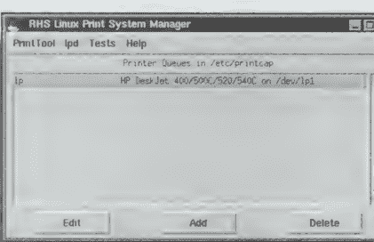

**图 5.7**

配置打印机后，您可以打印测试页，或者保存更改并退出`printtool`程序。

## 使用 Red Hat 的 `printtool` 添加网络打印机

使用`printtool`命令添加远程打印机（通过网络访问的打印机）。当`printtool`命令请求打印机类型时，选择“Remote UNIX”并点击“确定”。随后会出现如图 5.8 所示的对话框。在“远程主机”字段中输入远程计算机的名称，并在 Remote Queue 字段中输入远程计算机上的打印机队列名称。

*另请参阅*

要了解更多关于网络连接的信息，请参阅第 444 页。

## 将文件送到打印机缓存 (Spooling)

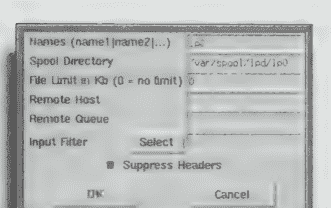

**图 5.8**

`printtool`命令还可以设置远程打印服务。

### 限制缓存文件大小

“文件限制”字段（参考图 5.8）用于限制可接受的打印机缓存文件的大小。输入一个数字，例如 1024，将缓存文件的大小限制在 1 MB 或 1,000,000 个字符。这是一个避免打印大文件，或确保在打印大文件时不会耗尽硬盘空间的便捷方法。某些文档，尤其是大型文本文件或图形文件，会产生巨大的缓存文件，这些文件会被分片发送到您的打印机（并非所有打印机都有足够的内存来接收大文件）。

*另请参阅*

- 关于节省磁盘空间其他方法的详细信息，请参阅第 562 页。

### 将文件送到打印机缓存

Red Hat Linux 使用的是一套继承自 BSD (Berkeley Software Distribution) UNIX 操作系统的改进打印系统。该系统被称为行打印机缓存 (line-printer spooling)。Linux 在启动后通过运行`lpd`（行打印机守护进程）来启动打印服务。该守护进程在后台运行，等待程序或命令行发送的打印请求。

使用`lpr`命令打印文档。要打印文本文档，请使用`lpr`命令配合`-P` (printer) 选项来选择所需的打印机，如下所示：

```
# lpr -P lp mydocument.txt
```

与`-P`选项一起使用的打印机名称应为您使用`printtool`命令定义的打印机名称。当您打印 PostScript 文件时，Red Hat 打印系统的改进效果就显现出来了，例如：

```
# lpr -Plp /usr/share/ghostscript/3.33/examples/tiger.ps
```

Red Hat Linux 打印能够自动识别并打印文本、PostScript 文档和图形。（如果您有彩色打印机，则可以打印彩色 PostScript 文档和图形。）

### 在命令行打印文件

缓存的文档被发送到`/var/spool`目录下以您的打印机命名的目录中。`lpr`命令与许多 Linux 程序一样，也可以用作过滤器来打印其他程序的输出。例如，要快速打印一年的日历，可以将`cal` (calendar) 命令的输出通过管道传输给`lpr`命令，如下所示：

```
# cal 1998 | lpr
```

默认打印机将打印出一份 12 个月的日历。您可以使用这种方法在打印机上打印帮助页 (manual pages) 或其他文档。

### 列出打印队列

在使用`lpr`命令打印了几个文档后，使用`lpq` (line-printer queue) 命令查看等待打印的文档列表：

```
# lpq
lp is ready and printing
Rank Owner Job Files Total Size
active bball 13 (standard input) 1972 bytes
```

`lpq`命令将报告打印机和缓存文档的状态。

## 控制打印机和打印作业

可以使用`lpc` (line-printer control) 命令来控制打印机和打印作业的顺序。`lpc`命令拥有 14 个内置命令，但如表 5.1 所示，只有 root 操作员可以使用所有命令。在启动`lpc`后，可以在命令行中使用每个命令，其中某些命令需要指定打印机名称。例如，假设您是 root 操作员并想停止打印。如果您简单地使用`stop`，`lpc`命令会报错并退出：

```
# lpc stop
Usage: stop {all | printer}
```

要停止特定打印机，请指定命令后跟打印机名称，如下所示：

```
# lpc stop lp
lp:
    printing disabled
```

`lpc`命令将回显打印机名称，随后是一条验证该打印机已停止打印的消息。

**表 5.1 行打印机控制程序命令**

| 命令 | 普通用户 | 仅 Root | 操作 |
|---|---|---|---|
| abort | | x | 停止`lpd`守护进程并禁用打印 |
| clean | | x | 从打印机队列中删除文件 |
| disable | | x | 关闭打印机队列 |
| down | x | | 停止`lpd`并禁用打印机 |
| enable | | x | 开启缓存 |
| exit | x | | 退出`lpc` |
| help | x | | 命令帮助 |
| quit | x | | 退出`lpc` |
| restart | | x | 重启缓存守护进程 |
| start | | x | 启用打印，启动缓存守护进程 |
| status | x | | 守护进程和队列的状态 |
| stop | | x | 在当前作业后停止缓存，然后禁用打印 |
| topq | | x | 将打印作业置于队列顶端 |
| up | | x | 启用打印机并重启缓存 |

使用`status`命令获取所有打印机的状态；如果配合打印机名称使用，则报告特定打印机的状态，如下所示：

```
# lpc status
lp:
    queuing is enabled
    printing is enabled
    no entries
    no daemon present
```

### 重新排列打印作业

`lpc`命令还可用于将打印作业或缓存文件移至打印队列的顶端。为了查看等待中的作业，请使用`lpq`命令，如下所示：

```
# lpq
lp is ready and printing
```

| 排名 | 所有者 | 作业 | 文件 | 总大小 |
|---|---|---|---|---|
| active | bball | 13 | (standard input) | 1972 bytes |
| active | mary | 14 | (standard input) | 4058 bytes |
| active | fred | 15 | (standard input) | 20103 bytes |

Root 操作员可以使用`topp`命令后跟作业编号或用户名（由`lpq`命令报告），以指定某个作业接下来的打印顺序：

```
# lpc topp lp 14
```

该命令行将把 mary 的作业移至打印机 lp 的队列顶端。

### 停止打印作业

要停止一个打印作业，首先使用`lpq`命令查看等待打印的作业列表。然后使用`lprm`命令后跟作业编号：

```
# lprm 13
```

该命令行将停止作业 13。作为 root 操作员，您还可以通过使用`lprm`命令后跟`-P`选项（打印机名称）和用户名，来停止特定用户在特定打印机上的所有打印作业，如下所示：

## 控制打印机和打印作业

```
# lprm -Plp bball
```

该命令行将停止由用户 bball 发送到打印机 lp 的所有打印作业。

## 使用`lpr`命令发送传真

如果您已安装并配置了传真服务（如第 11 章“配置调制解调器和传真服务”中“配置传真服务”节所述），则可以使用`lpr`命令发送传真。您必须首先确保使用`efax`软件包的传真服务运行正常。

使用`lpr`和`efax`发送传真：

1. 以 root 管理员身份登录。
2. 使用您偏好的文本编辑器，打开`/etc/printcap`数据库。
3. 通过输入以下内容创建传真打印机条目：

```
fax:\
:lp=/dev/null:\
:sd=/var/spool/fax:\
:if=/usr/bin/faxlp:
```

4. 使用`ln`命令创建一个名为`faxlp`的硬链接指向传真命令，如下所示：

```
# ln /usr/bin/faxlp /usr/bin/faxlp
```

5. 使用`mkdir`命令创建一个名为`/var/spool/fax`的目录，如下所示：

```
# mkdir /var/spool/fax
```

6. 使用`chmod`命令为传真目录赋予正确的权限，如下所示：

```
# chmod 775 /var/spool/fax
```

7. 要发送传真，请使用`-P`（打印机）和`-J`（作业号）选项来指定传真打印机和传出传真号码，如下所示：

```
# lpr -Pfax -J 12025551212 myfile.txt
```

这将把文本文件`myfile.txt`发送到`lpr`命令行中指定的传真号码。

**另请参阅**

- 有关设置传真服务的更多信息，请参阅第 159 页。

# 第二部分：配置您的系统

- 6 配置您的环境 89
- 7 操作硬盘 99
- 8 添加磁带和 Zip 驱动器 119
- 9 启用 PC 卡设备 133
- 10 添加指针设备 143
- 11 配置调制解调器和传真服务 151

# 第 6 章：配置您的环境

作者：Bill Ball

- 设置 shell 和系统环境变量
- 定制您的登录、配置文件和资源
- 定制您的 shell
- 创建命令别名

## 设置环境变量

在您登录 Linux 后，`/etc/passwd`条目中指定的 shell 将开始运行。然后，您的 shell 会加载位于系统不同目录中的几个文件。这些文件被称为 *资源 (resource)*、*配置文件 (profile)* 或 *登录 (login)* 文件，它们位于您的主目录和`/etc`目录中。对于默认的 Red Hat Linux shell `bash`，这些文件包括：

- `.bashrc`——默认在您的主目录中创建
- `.bash_profile`——默认在您的主目录中创建
- `.bash_login`——默认在您的主目录中创建
- `.bash_history`——最近输入命令的列表
- `/etc/bashrc`——包含系统别名
- `/etc/profile`——包含系统环境变量

配置文件包含 *环境变量*，它们是在您登录后 shell 或其他程序可识别的值定义。`bash` shell 识别 50 多个不同的环境变量，您也可以定义许多自己的变量。

### 使用`printenv`命令显示环境变量

使用位于`/usr/bin`目录下的`printenv`命令来打印特定变量的值，或当前定义的环境变量列表，如下所示：

```
# printenv SHELL
/bin/bash

# printenv
USERNAME=
ENV=/home/bball/.bashrc
BROWSER=/usr/local/bin/netscape
HISTSIZE=1000
HOSTNAME=localhost.localdomain
LOGNAME=bball
HISTFILESIZE=1000
MAIL=/var/spool/mail/bball
HOSTTYPE=i386
PATH=/usr/local/bin:/bin:/usr/bin:/usr/sbin:/sbin:/usr/X11R6/bin:
/usr/local/bin:/usr/bin/mh:/bin/mh:/home/bball/bin
HOME=/root
SHELL=/bin/bash
USER=bball
HOSTODISPLAY=localhost.localdomain:0.0
DISPLAY=0.0
OSTYPE=Linux
NNTPSERVER=news.staffnet.com
SHLVL=5
EDITOR=/usr/bin/pico
```


此处列出的环境变量并非全部都会出现在您的系统中。许多系统具有不同的值（例如 `USER`、`ENV` 或 `HOSTNAME`）。表 6.1 列出了一些常用的环境变量。

**表 6.1 常见的 bash 和用户环境变量**

| 变量 | 描述 |
| :--- | :--- |
| `EDITOR` | 默认系统编辑器 |
| `HISTSIZE` | 要记住的命令行数量 |
| `HOME` | 当前用户的主目录 |
| `HOSTTYPE` | 正在使用的系统架构 |
| `LOGNAME` | 当前用户的名称 |
| `MAIL` | 检查进件邮件的目录 |
| `OSTYPE` | 正在使用的操作系统 |
| `PATH` | 搜索命令的路径 |
| `PS1` | 命令行提示符的定义 |
| `PS2` | 次级命令行提示符中使用的字符 |
| `SHELL` | 当前使用的 shell 名称 |
| `SHLVL` | 当前运行的 shell 数量 |
| `TERM` | 正在使用的终端类型 |
| `USER` | 当前用户的名称 |

### 使用 `env` 命令显示环境变量

您也可以使用位于 `/usr/bin` 目录下的 `env` 命令来打印当前定义的环境变量列表，如下所示：

```bash
# env
```

与 `printenv` 命令不同，`env` 不显示单个变量的值。

### 在命令行设置环境变量

您在命令行设置环境变量的方法取决于所使用的 shell。bash shell 要求使用内置的 `export` 命令。使用 bash 在命令行创建变量的形式如下：

```bash
# VARIABLE_NAME="value" ; export VARIABLE_NAME
```

#### 创建 `EDITOR` 环境变量

1. 要创建或设置一个定义默认文本编辑器（许多系统管理实用程序使用）的环境变量，请使用如下命令行导出该变量：
   `# EDITOR="/usr/bin/pico" ; export EDITOR`

2. 该命令行创建了环境变量 `EDITOR`。要验证 `EDITOR` 变量，请将 `printenv` 命令与 `fgrep` 搜索实用程序结合使用，如下所示：
   `# printenv | fgrep EDITOR`
   `EDITOR=/usr/bin/pico`

`printenv` 命令的输出通过管道传输给 `fgrep` 命令。只有包含单词 `EDITOR` 的行被返回，从而显示了新 `EDITOR` 变量的值。

**另请参阅**
要了解更多关于 `fgrep` 和其他模式匹配命令的信息，请参阅第 46 页。

环境变量传统上使用大写字母命名，尽管这不是强制要求的。tcsh shell 要求使用内置的 `setenv` 命令来定义变量：

**临时环境变量**

从命令行设置的环境变量只是临时的。虽然这种方法对于测试刚安装的软件或输入密码密钥以运行受保护的脚本很有用，但这些变量仅在您登录期间或运行特定终端期间有效。要使此更改在每次登录时生效，请将定义添加到相应的 shell 初始化文件或资源文件中。有关更多信息，请参阅后面的“定制您的登录”节。

```bash
# setenv VARIABLE_NAME=value
```

使用 ksh shell 定义变量需要使用其内置的 `export` 命令：

```bash
# export VARIABLE_NAME=value
```

一种更方便地从任何 shell 的命令行设置环境变量的方法是使用 `env` 命令：

```bash
# env VARIABLE_NAME=value
```

## 从命令行删除环境变量

除非您知道正确的 shell 命令，否则您无法在当前 shell 中删除环境变量。如果您需要创建变量来测试临时安装的软件，了解如何执行此操作非常重要。

在 bash 中删除变量，请使用内置的 `unset` 命令：

```bash
# unset VARIABLE_NAME
```

在 tcsh shell 中删除变量，请使用其内置的 `unsetenv` 命令：

```bash
# unsetenv VARIABLE_NAME
```

ksh shell 与 bash 一样，需要内置的 `unset` 命令：

```bash
# unset VARIABLE_NAME
```

`env` 命令及其 `-u` (unset) 命令行变量可与任何 shell 配合使用以删除环境变量：

```bash
# env -u VARIABLE_NAME
```

## 设置命令 PATH

最重要的环境变量之一是 `$PATH` 变量。`PATH` 定义了 shell 可以找到可执行程序的目录，非常类似于 DOS 版本的 `PATH`。如果 `PATH` 变量未正确设置，您必须输入程序的完整路径名才能运行该命令。

## 配置您的系统

### 配置您的环境

例如，如果您没有以 root 运算符登录，但想要运行 `fuser` 命令来查找程序使用的现有进程，shell 会报告找不到该命令，如下所示：

```
# fuser bash
bash: fuser: command not found
```

然而，您知道该命令存在于您的系统中，因为 `whereis` 命令报告了 `fuser` 的路径名，如下所示：

```
# whereis fuser
fuser: /usr/sbin/fuser
```

虽然您可以通过输入完整路径名来运行 `fuser` 命令，但更好的方法是将 `/usr/sbin` 目录添加到 shell 的 `PATH` 环境变量中。若要临时执行此操作，请使用 `env` 命令，如下所示：

```
# env PATH=$PATH:/sbin
# fuser /bin/bash
/bin/bash: 244e 342e 362e 362e 362e 579e 582m
→1187m 1277e 1893e
```

**另请参阅**

- 学习如何控制进程，请参阅第 23 页。
- 学习更多关于使用 `whereis` 命令的信息，请参阅第 45 页。

若要将新目录添加到您的 `PATH` 环境变量中，并使此更改在每次登录时都生效，请将路径添加到主目录中的 `.bash_profile` 文件中。

### 向 `.bash_profile` 添加路径

1. 使用您喜欢的文本编辑器打开 `.bash_profile`，并找到 `PATH` 定义，其形式类似于以下行：
   `PATH=$PATH:$HOME/bin`

2. 将 `PATH` 定义行更改为：
   `PATH=$PATH:$HOME/bin:/usr/sbin`

**另请参阅**

- 学习更多关于 Linux 文本编辑器的信息，请参阅第 4 章，“使用文本编辑器”。

3. 若要使此更改对所有当前或未来用户生效，请确保您以 root 运算符登录，并修改 `/etc` 目录下的 `profile` 文件中的 `PATH` 定义行：

```
PATH="$PATH:/usr/X11R6/bin:/usr/local/bin:/usr/sbin"
```

> 警告：编辑 `PATH` 时请小心
> 请谨慎修改您的 `PATH` 变量。如果您犯了错误，shell 将无法知道在哪里查找命令。请备份任何现有的 `PATH` 定义，然后小心地进行更改，尤其是当您以 root 运算符身份编辑 `/etc/profile` 中的系统级 `PATH` 定义时。

### 自定义您的登录

对 `/etc` 目录下 `.bashrc` 和 `profile` 文件中的 shell 变量所做的更改会影响所有用户且在全系统范围内生效。个人用户可以在其主目录下的 `.bashrc` 和 `.bash_profile` 中进行更改或创建本地定义。本地环境变量在 `.bash_profile` 中定义如下：

```
# .bash_profile
# Get the aliases and functions
if [ -f ~/.bashrc ]; then
    . ~/.bashrc
fi
# User-specific environment and startup programs
PATH=$PATH:$HOME/bin
ENV=$HOME/.bashrc
USERNAME=""
export USERNAME ENV PATH
```

以井号 (`#`) 开头的行是注释。当您登录时，bash shell 使用此程序首先在您的主目录中查找名为 `.bashrc` 的文件，然后设置一些基本的环境变量。您主目录中的 `.bashrc` 文件包含别名定义（详见后文“创建别名”部分），如下所示：

```
# .bashrc
# User-specific aliases and functions
# Source global definitions
if [ -f /etc/bashrc ]; then
    . /etc/bashrc
fi
```

这两个文件在您登录后由 shell 读取，可以通过编辑来添加自定义定义。

### 自定义您的命令行提示符

默认的 bash shell 提示符变量 `PS1` 定义在 `/etc/profile` 中。提示符定义使用了 bash shell 识别的特殊字符，如下所示：

```
PS1="[\u@\h \w]\$ "
```

将此行复制到您的 `.bash_profile` 中，然后编辑字符串以定义您自己的提示符。不要忘记将 `PS1` 添加到 `.bash_profile` 的 `export` 行中：

```
export USERNAME ENV PATH PS1
```

表 6.2 列出了 bash 识别的提示符字符。

**表 6.2 bash shell 提示符字符**

| 字符 | 定义 |
| :--- | :--- |
| `\!` | 打印命令的历史记录编号 |
| `\#` | 显示此命令的编号 |
| `\$` | 打印 0, # 或 $ |
| `\W` | 打印当前工作目录的基名 |
| `\[` | 开始非打印字符序列 |
| `\\` | 打印反斜杠 |
| `\]` | 结束非打印字符序列 |
| `\d` | 在提示符中使用日期 |
| `\h` | 在提示符中使用计算机的主机名 |
| `\n` | 在提示符中打印换行符 |
| `\nnn` | 八进制数 nnn 的字符 |
| `\s` | 打印 shell 的名称 |
| `\t` | 打印时间 |
| `\u` | 打印当前用户名 |
| `\w` | 显示当前工作目录 |

可以使用 bash shell 的 `export` 命令在命令行中测试不同的提示符，如下所示：

```
# PS1='\d \t: ';export PS1
Wed Feb 11 16:53:32:
```

使用终端转义代码可以在提示符中创建不同的字符效果（例如高亮），如下所示：

```
# PS1='\033[34m\u@\033[30m\h@\033[34m\w\033[30m: ';export PS1
```

此定义会在您的控制台提示符和 X11 xterm 终端窗口中高亮显示您的用户名 (`\u`) 和计算机的主机名 (`\h`)。在 X11 rxvt 终端窗口中，名称和主机名将被下划线标出（请参阅后文侧边注“终端定义”）。

**另请参阅**

- 学习更多关于计算机主机名的信息，请参阅第 444 页。
- 学习更多关于 X Window 系统的信息，请参阅第 260 页。
- 学习如何使用 X11 终端，请参阅第 269 页。

### 创建别名

别名是命令的重新定义，通常为缩写形式。系统级别名定义由 root 运算符在 `/etc` 目录下的 `bashrc` 文件中输入，但您也可以在自己的 `.bashrc` 文件中定义。以下几个别名特别有用：

```
alias cp="cp -i"
alias mv="mv -i"
alias rm="rm -I"
```

将 `cp`、`mv` 和 `rm` 命令的默认操作重新定义为使用交互式查询，可以在复制、删除、移动或重命名文件时提供一定程度的安全性。别名还可以用于构建新命令，或对经常使用的命令和命令行选项进行变体。

Red Hat Linux 没有自带用于在小型浮动窗口中显示当前月份日历的 X11 客户端或程序（虽然可以使用本地 X11 客户端，但日历尺寸较大）。不过，您可以通过将 `cal`（日历命令）和 X11 `xmessage` 客户端结合起来来创建自己的日历。

**终端定义**

不同的终端（如 X11 的 `xterm` 和 `rxvt` 或 Linux 控制台）具有不同的能力，对转义序列的响应也不同。您系统的终端定义定义在名为 `termcap` 的终端能力数据库中（位于 `/etc` 目录下），此外在 `/usr/lib/terminfo` 目录下的许多子目录中也可以找到更多定义。除非您绝对确定自己在做什么，否则请勿编辑或更改 `termcap` 文件；错误的条目可能会导致您的屏幕无法使用（请先备份）。`termcap` 条目的文档可以在 `/etc/termcap` 文件和 `terminfo` 手册页中找到。

#### 创建 GUI 日历别名

1. 使用您喜欢的文本编辑器打开主目录中的 `.bashrc` 文件，并添加以下行：
   `alias xcal="cal | xmessage -file '-% '&`

2. 将此别名命名为 `xcal`。该别名将 `cal` 命令的输出通过管道传递给 X11 `xmessage` 客户端。且号后台运算符 (`&`) 将自动在后台运行该程序。

3. 若要立即使用 `xcal` 别名而无需注销并重新登录，请使用 bash shell 内置的 `source` 命令，然后尝试运行 `xcal` 别名，如下所示：

```
# source .bashrc
# xcal
```


**另请参阅**

- 学习更多关于`cp`、`rm`和`mv`命令的信息，请参阅第 3 章，“导航 Linux 文件系统”。
- 学习更多关于 X11 客户端的信息，请参阅第 294 页。

# 第 7 章：操作硬盘驱动器

作者：Bill Ball

- 确定卷设备和分区
- 选择文件系统
- 格式化硬盘驱动器
- 对硬盘驱动器进行分区
- 配置挂载选项

## 确定卷设备和分区

在安装 Linux 之后（请参考附录 A “Red Hat Linux 的安装”中的说明），您至少应该对系统中安装的硬盘有所了解。您还应该了解 Red Hat 的 cabaret 程序或`fdisk`命令，这些工具可以在现有卷或硬盘上创建分区，以为 Linux 发行版包含的内核和软件腾出空间。您可能将 Linux 完全安装在单个分区中，或者创建了几个额外的分区来存放 Linux 文件系统或目录结构的各个部分。

Linux 支持多种文件系统。如果您的 Linux 系统与 DOS 或 Windows 共用一块硬盘，那么您的系统在硬盘上使用`ext2fs`、`msdos`或`vfat`文件系统。表 7.1 列出了 Linux 中`mount`命令能够识别的文件系统，该命令用于将磁盘设备附加到特定的 Linux 目录（即挂载点）。

### 技术深度探讨

在安装另一个硬盘之前，请阅读位于`/usr/doc`目录下的 Linux Disk-HOWTO。该文档提供了关于 Linux 文件系统的技术细节、提示和概述。此外，它还涵盖了硬盘技术（磁盘如何组织）、存储介质（如光盘或闪存 RAM）、接口（如 IDE 或 SCSI）、文件系统（如 Linux swap、minix 或 ext2fs），以及关于如何以及在何处放置 Linux 系统不同部分以确保安全、速度或便捷性的建议。最新版本的 Disk-HOWTO 可以在以下网址找到：

`http://www.nyx.net/~sgjoen/disk.html`

**表 7.1 文件系统**

| 类型 | 名称 |
| :--- | :--- |
| affs | Amiga 文件系统 |
| coherent | Coherent UNIX 文件系统 |
| ext2fs | 扩展文件系统，Linux 中 minix 文件系统的继承者 |
| ext2fs | 当前原生的 Linux（或称为第二扩展）文件系统 |
| hpfs | OS/2 文件系统（只读） |
| iso9660 | CD-ROM 文件系统（只读） |
| minix | 原始的 Linux 文件系统（不再使用） |
| msdos | DOS 文件系统 |
| nfs | Sun Microsystems 的网络文件系统 |
| proc | Linux 进程信息文件系统 |
| romfs | 只读内存文件系统（用于嵌入式系统） |
| smbfs | 会话消息块（网络）文件系统 |
| swap | Linux 用于临时存储内存的交换文件系统 |
| sysv | UNIX system V 文件系统 |
| ufs | BSD, digital UNIX 文件系统 |
| umsdos | 支持 DOS 和 Linux 文件共存的文件系统 |
| vfat | Windows 文件系统 |
| xenix | Xenix 文件系统 |
| xiafs | 一种不再使用的 Linux 文件系统（内核版本 2.1.2.1 不再支持） |

### 另请参阅

有关 Linux 内核和加载模块的更多信息，请参阅第 577 页。

### 确定您的内核文件系统支持情况

1. 要找出您的内核当前支持哪些文件系统，请使用`cat`命令查看`/proc`目录下文件系统文件的内容，如下所示：

```
# cat /proc/file_systems
ext2
msdos
nodev
proc
vfat
iso9660
```

这个示例显示您的内核目前支持`ext2`、`msdos`、`vfat`和`iso9660`文件系统。您的系统可能挂载了一个 DOS 或 Windows 文件系统，以及一个处于激活状态的 CD-ROM。

2. 对不同文件系统的支持可能来自编译进 Linux 内核的支持，或者通过`/lib/modules/2.0.xx/fs`目录（其中`xx`是您当前的 Linux 版本）下的可加载内核模块提供。要查看您的 Linux 版本可用的文件系统支持模块类型，请使用`ls`命令查看模块目录：

```
# ls /lib/modules/2.0*/fs
autofs.o  hpfs.o  minix.o  nfs.o  sysv.o
umsdos.o  xiafs.o
ext.o    isofs.o  ncpfs.o  smbfs.o  ufs.o
vfat.o
```

`ls`命令列出了`fs`（文件系统）模块目录下的所有模块。

## 操作硬盘

### 硬盘设备

硬盘设备位于`/dev`目录下，该目录包含 1,400 多个设备名称，涵盖许多不同的设备（如串口或打印机端口、鼠标、扫描仪、声卡、磁带驱动器、CD-ROM 驱动器和硬盘）。表 7.2 列出了一些常用的用作数据存储的设备及其设备名称，并解释了与存储设备相关联的分区号。

> **另请参阅**
> - 学习如何安装 PC 卡，请参阅第 134 页。
> - 有关向系统添加其他设备（如鼠标）的更多信息，请参阅第 144 页。

**表 7.2 常用存储设备名称及类型**

| 设备名称 | 介质、卷或分区的类型 |
|---|---|
| `/dev/hda` | 第一个 IDE 驱动器 |
| `/dev/hda2` | `/dev/hda` 卷上的第二个分区 |
| `/dev/hdc` | 第三个 IDE 驱动器 |
| `/dev/hde1` | 第五个 IDE 驱动器上的第一个分区 |
| `/dev/sda` | 第一个 SCSI 驱动器 |
| `/dev/sda4` | `/dev/sda` 卷上的第四个分区 |

> **另请参阅**
> 了解更多关于管理 Linux 文件系统表的信息，请参阅第 495 页。

您系统的当前硬盘列在`/etc/`目录下的`/etc/fstab`文件（文件系统表）中。`/etc/fstab`文件是一个映射表，记录了 Linux 用于原生 Linux 文件或挂载其他文件系统的存储设备，并为`mount`命令提供关于在何处以及如何挂载每个指定设备的指令。

使用`cat`命令查看系统的`fstab`，如下所示：

```
# cat /etc/fstab

/dev/hda6 / ext2 defaults 1 1

/dev/hda5 swap swap defaults 0 0

/dev/fd0 /mnt/floppy ext2 noauto 0 0

/dev/cdrom /mnt/cdrom iso9660 user,noauto,dev,exec,ro,suid 0 0

none /proc proc defaults 0 0

/dev/hde1 /mnt/flash vfat user,noauto,dev,exec,suid 0 0

/dev/sda4 /mnt/zip vfat user,noauto,dev,exec,suid 0 0

/dev/sda4 /mnt/zipext2 ext2 user,noauto,dev,exec,suid 0 0

/dev/hda1 /mnt/dos vfat user,noauto,dev,exec,suid 0 0
```

该文件系统表显示（从左列开始）设备、挂载后可找到该设备的路径（挂载点）、文件系统类型，以及每个设备的几个挂载选项。请注意，同一个设备`/dev/sda4`有两个条目，但表中为每个条目指定了不同的文件系统。这是因为`/dev/sda4`设备是一个可移动的 SCSI 驱动器，通常在不同时间挂载包含不同文件系统的*介质*或磁盘。

使用`df`（disk free，磁盘剩余空间）命令来查看任何当前挂载设备的剩余可用空间：

```
# df

File system     2024-Blocks  Used  Available  Capacity  Mounted on

/dev/hda6       1443464      985613 383263    72%       /

/dev/hde1       14580        10956  3624      75%       /mnt/flash

/dev/hdc        596900      596900 0         100%      /mnt/cdrom

/dev/hda1       511744      419136 92608     82%       /mnt/dos

/dev/sda4       98078       23176  74902     24%       /mnt/zip
```

`df`命令揭示了以下信息：

- 位于`/dev/hda6`上的 Linux 根分区，挂载在`/`目录
- 位于`/dev/hde1`上的一个小存储驱动器，挂载在`/mnt/flash`目录
- 位于`/dev/hdc`上的 CD-ROM，挂载在`/mnt/cdrom`目录
- 位于`/dev/hda1`上的一个分区，挂载在`/mnt/dos`目录
- 位于`/dev/sda4`上的一个硬盘，挂载在`/mnt/zip`目录

虽然`df`命令在确定存储设备剩余空间方面非常方便，但如果您想知道每个设备存在什么文件系统，必须使用`mount`命令。请配合`-v`（verbose，详细模式）选项使用`mount`命令：

```
# mount -v

/dev/hda6 on / type ext2 (rw)

/dev/hde1 on /mnt/flash type vfat (rw)

/dev/hdc on /mnt/cdrom type iso9660 (ro)

/dev/sda4 on /mnt/zip type vfat (rw)

/dev/hda1 on /mnt/dos type vfat (rw)
```

`mount`命令报告以下内容：

- 任何已挂载的设备
- 设备在 Linux 文件系统或目录结构中的挂载位置
- 设备上使用的文件系统
- 您是对该设备进行读 (r)、写 (w) 还是只读 (ro) 操作

> **另请参阅**
> 有关挂载文件系统的其他方法的信息，请参阅第 488 页。

### 选择文件系统

当您向系统添加硬盘并希望同时使用 Linux 和 DOS 或 Windows 时，请使用`ext2`和`msdos`或`vfat`文件系统。虽然您可以使用`msdos`文件系统作为 DOS 分区，但对于 Windows 95 分区，您应该使用`vfat`文件系统，以便可以使用更大的分区并获得长文件名支持。如果您将`vfat`分区挂载在 Linux 目录下，`ls`命令会像这样显示正确的长文件名：

```
# ls /mnt/dos/windows/*.bmp

/mnt/dos/windows/Black Thatch.bmp

/mnt/dos/windows/Pinstripe.bmp

/mnt/dos/windows/Blue Rivets.bmp

/mnt/dos/windows/Red Blocks.bmp

/mnt/dos/windows/Bubbles.bmp

/mnt/dos/windows/Sandstone.bmp

/mnt/dos/windows/Carved Stone.bmp

/mnt/dos/windows/Setup.bmp

/mnt/dos/windows/Circles.bmp

/mnt/dos/windows/Stitches.bmp

/mnt/dos/windows/Clouds.bmp

/mnt/dos/windows/Straw Mat.bmp

/mnt/dos/windows/Forest.bmp

/mnt/dos/windows/Tiles.bmp

/mnt/dos/windows/Gold Weave.bmp

/mnt/dos/windows/Triangles.bmp

/mnt/dos/windows/Houndstooth.bmp

/mnt/dos/windows/Waves.bmp

/mnt/dos/windows/Metal Links.bmp
```

DOS 分区不支持长文件名，因此如果你使用`msdos`文件系统进行挂载，然后将文件从 Linux 文件系统复制到 DOS 分区，`ls`命令显示上例中的文件将如下所示：

```
# ls /mnt/dos/windows/*.bmp

/mnt/dos/windows/blackt-1.bmp

/mnt/dos/windows/pinstr-1.bmp

/mnt/dos/windows/bluer1-1.bmp

/mnt/dos/windows/redblo-1.bmp

/mnt/dos/windows/bubbles.bmp

/mnt/dos/windows/sandst-1.bmp

/mnt/dos/windows/carved-1.bmp

/mnt/dos/windows/setup.bmp

/mnt/dos/windows/circles.bmp

/mnt/dos/windows/stitches.bmp

/mnt/dos/windows/clouds.bmp

/mnt/dos/windows/strawm-1.bmp

/mnt/dos/windows/forest.bmp

/mnt/dos/windows/tiles.bmp

/mnt/dos/windows/goldwe-1.bmp

/mnt/dos/windows/triang-1.bmp

/mnt/dos/windows/hounds-1.bmp

/mnt/dos/windows/waves.bmp

/mnt/dos/windows/metall-1.bmp
```


如果你向 Linux 添加硬盘或对现有驱动器重新分区，只要`cabaret`、`fdisk`和`mount`命令支持该文件系统，你可以使用任何你想要的文件系统。如果你打算将新存储仅用于 Linux，请使用`ext2`文件系统；如果你想在 Linux 和 Windows 之间共享文件，请坚持使用`vfat`——Windows 能识别`vfat`分区，但无法识别格式化为`ext2`的分区。在使用闪存卡或 Zip 驱动器等可移动设备时，这一点尤为重要。

> **文件系统支持并不意味着格式化**

虽然 Linux 支持许多不同类型的文件系统以允许文件的读写，但你仍然需要使用另一个操作系统来格式化新硬盘。Linux 不自带用于其他文件系统（DOS 除外）的磁盘格式化工具。更多信息请参阅`mtools`手册页。

## 格式化硬盘

### 正确安装驱动器

在为 Linux 配置驱动器之前，请按照计算机制造商的说明正确安装硬件。确保所有电缆连接正确，并且所有开关配置已完成，使驱动器与现有系统匹配。如果你安装了 SCSI 驱动器，请确保所有电缆牢固连接且 SCSI 链已正确终止。

Red Hat Linux 自带了几个可用于对硬盘进行分区和格式化的程序。虽然最先进的磁盘支持工具是 Red Hat 的`cabaret`命令（它为 Linux 存储设备的配置、格式化和挂载提供了图形界面），但你也可以使用`fdisk`、`mke2fs`和`mount`命令。

### 使用`cabaret`操作硬盘

#### 从引导消息中获取线索

如果你安装了新硬盘并启动 Linux，请仔细检查系统的引导消息。如果屏幕滚动太快无法阅读，请在启动并登录 Linux 后使用`dmesg`命令列出引导/内核消息。Linux 应该能识别任何连接到内核支持接口的新设备。

在控制台命令行或 X11 终端窗口中使用`cabaret`命令。该命令提供了一个图形界面，简化了安装和配置硬盘的工作。按下 Tab 键或使用功能键在`cabaret`的对话框中进行导航。使用光标或 Tab 键在对话列表中上下滚动。按下空格键选择或取消选择列表中的项目。

> **另请参阅**  
> 关于使用 Red Hat`cabaret`命令的其他方法，请参阅第 495 页。

#### 使用`cabaret`格式化并安装硬盘

1. 以 root 操作员身份登录。在命令行输入以下内容启动`cabaret`程序：

   ```bash
   # cabaret
   ```

   屏幕被清空。`cabaret`读取系统的文件系统表并显示其对话框（如图 7.1 所示）。

   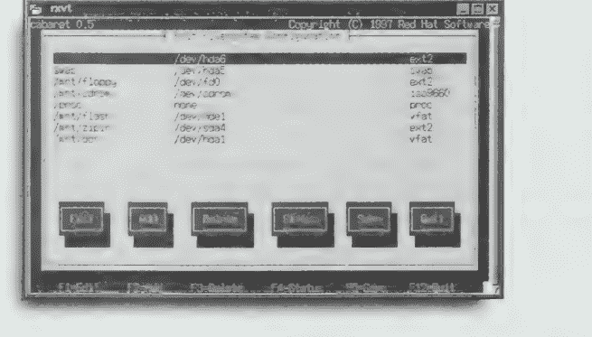

   **图 7.1**

   `cabaret`命令是 Red Hat 的点选式文件系统实用工具。

2. 要添加驱动器，请连续按下两次 Tab 键以突出显示 Add 按钮，然后按 Enter。`cabaret`会要求你选择一个文件系统，如图 7.2 所示。

   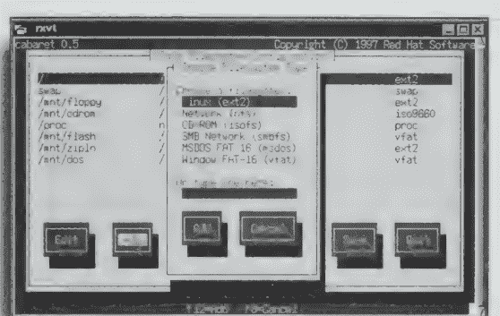

   **图 7.2**

   选择文件系统是使用`cabaret`安装硬盘的第一步。

3. 使用向上或向下光标键滚动浏览文件系统列表，或者按下 Tab 键并输入文件系统的名称。

4. 选择或输入文件系统类型后，按下 Tab 键直到 Add 按钮被突出显示，然后按 Enter。`cabaret`会要求输入挂载点，随后是设备名称，如图 7.3 所示。

   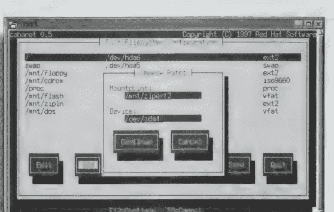

   **图 7.3**

   在添加新驱动器时，`cabaret`会提示输入 Linux 文件系统中的挂载点以及设备名称。

5. 输入一个描述性的目录名称（通常在`/mnt`目录下），例如`/mnt/zipext2`，然后按 Enter。接着输入设备名称——例如`/dev/sda4`。按下 Tab 键突出显示 Continue 按钮，然后按 Enter。

## 配置你的系统

### 操作硬盘

6. 如图 7.4 所示，`cabaret`提供了一个在挂载设备时可使用的选项列表。这些选项将被插入到系统的文件系统表`/etc/fstab`中。

   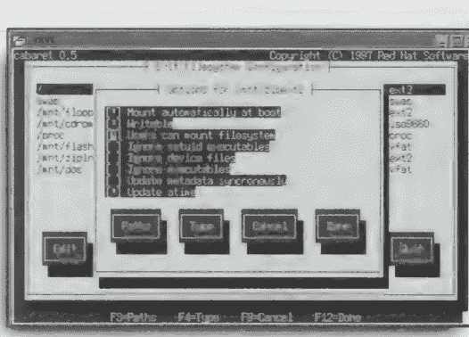

   **图 7.4**

   `cabaret`允许你在挂载配置对话框的滚动列表中配置设备的挂载选项。

7. 使用向上和向下光标键滚动浏览选项列表，通过按下空格键选择或取消选择某个选项。三个重要选项如下：

   - Mount Automatically at Boot（启动时自动挂载）——如果你选择此选项，Linux 在启动时会自动尝试挂载该设备。
   - Writable（可写）——如果你选择此选项，你将能够在设备上写入或删除文件。
   - Users Can Mount Filesystem（用户可挂载文件系统）——如果你选择此选项，其他用户将能够挂载或卸载该设备。

8. 如果你决定更改挂载设备的位置，或者想要指定不同的设备，请按下 Tab 键突出显示 Paths 按钮（如图 7.4 所示），然后按 Enter。你将看到一个类似于图 7.3 的对话框。如果你决定更改文件系统类型，请选择 Type 按钮并按 Enter。完成后，选择 Done 按钮并按 Enter。

9. 对话框消失。`cabaret`再次列出文件系统表，但列表中现在包含了你的新设备（见图 7.5）。向下滚动列表直到你定义设备被突出显示，然后按下 Tab 键直到 Status 按钮被突出显示。

   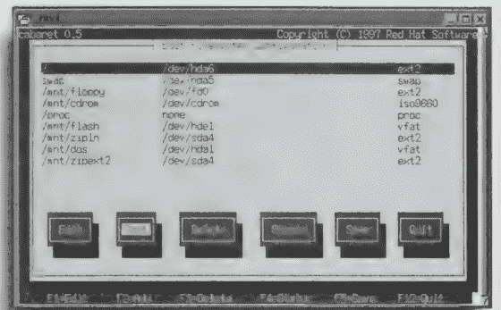

   **图 7.5**

   文件系统表中新定义的设备列在`cabaret`的主对话框中。

10. 选择 Status 按钮，`cabaret`会显示一个对话框，让你选择是否要挂载或格式化该设备（见图 7.6）。

    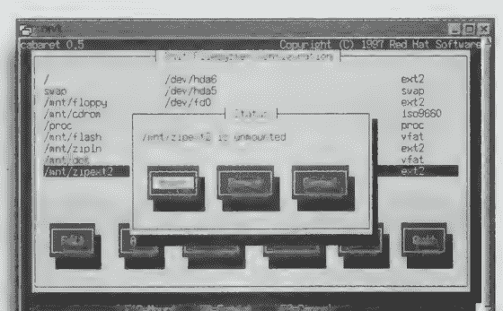

    **图 7.6**

    新卷或分区在运行前必须进行格式化。

11. 如果你选择 Mount 按钮，`cabaret`会尝试挂载设备，但挂载将失败。相反，请按下 Tab 键直到 Format 按钮被突出显示，然后按 Enter。

12. 出现图 7.7 所示的对话框；在这里你选择为新设备使用哪种类型的文件系统。请确保输入的与步骤 3 中输入的文件系统类型相同，否则新驱动器将无法正确挂载。

13. 滚动浏览文件系统列表，按下空格键选择所需的类型。然后按下 Tab 键直到 OK 键被突出显示。

### 操作硬盘驱动器

**图 7.7**

在格式化设备之前，`cabaret`会提示您选择要使用的文件系统类型。

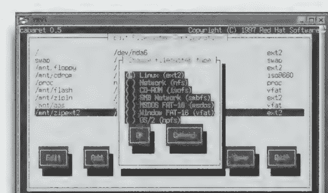

14. Linux 格式化设备。设备格式化后，按下 Tab 键直到 Status 按钮被高亮显示，然后按 Enter 键。

15. 如图 7.6 所示的对话框出现，告知您设备尚未挂载。按下 Enter 键以挂载设备。要验证设备是否已挂载，请选择 Status 按钮。这一次，`cabaret`应该会告知您设备已挂载在您指定的挂载点上，如图 7.8 所示。

    **图 7.8**

    `cabaret`也可以用于将设备从 Linux 文件系统中卸载。

    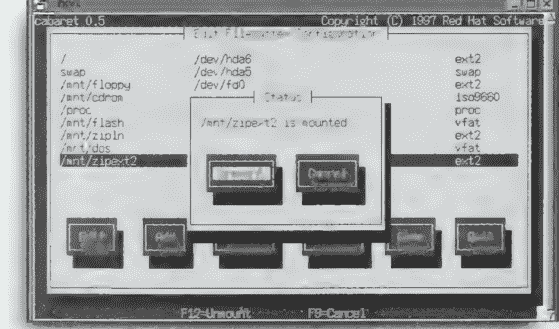

16. 按下 Enter 键以卸载新设备，或者按下 Tab 键随后按下 Enter 键以取消卸载。

17. 在`cabaret`的主对话框中，按下 Tab 键直到 Save 按钮被高亮显示，然后按 Enter 键。随后会出现如图 7.9 所示的确认对话框。

### 使用`fdisk`命令对硬盘进行分区

当 Save 按钮被高亮显示时，按下 Enter 键以保存您的新文件系统表。

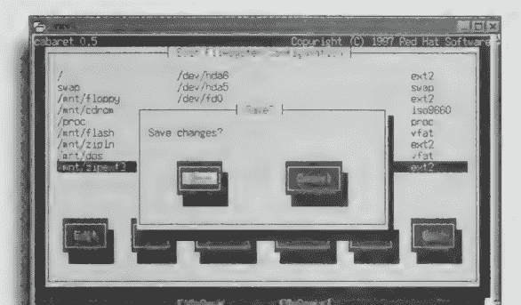

**图 7.9**

`cabaret`验证是否将新的文件系统表保存到`/etc/fstab`中。

18. 保存更改后，通过 Tab 键切换到 Quit 按钮并按 Enter 键，或按 F12 键退出`cabaret`。

使用`fdisk`命令为新硬盘准备一个或多个分区。如果您不需要对新驱动器进行分区，请使用前一节所述的`cabaret`命令。`fdisk`不是最直观的 Linux 命令（非常像 DOS 的`fdisk`命令），但它可以用来快速准备硬盘以供使用。

#### 使用`fdisk`对硬盘进行分区

1. 以 root 操作员身份登录。使用`fdisk`命令，通过在命令行上指定驱动器的设备名称来准备和分区硬盘（我使用了`cabaret`示例中的驱动器）：

   ```bash
   # fdisk /dev/sda4
   Command (m for help): m
   ```

2. `fdisk`在识别您的设备后会打印一个提示。按下 M 可查看`fdisk`命令列表。程序响应如下：

   | 命令 | 操作 |
   | :--- | :--- |
   | `a` | 切换引导标志 (bootable flag) |
   | `b` | 编辑 BSD 磁盘标签 (disklabel) |
   | `c` | 切换 DOS 兼容标志 |
   | `d` | 删除分区 |
   | `l` | 列出已知分区类型 |
   | `m` | 打印此菜单 |
   | `n` | 添加新分区 |
   | `p` | 打印分区表 |
   | `q` | 退出且不保存更改 |
   | `t` | 更改分区的系统 ID |
   | `u` | 更改显示/条目单位 |
   | `v` | 验证分区表 |
   | `w` | 将表写入磁盘并退出 |
   | `x` | 额外功能（仅限专家） |

3. 按 N 以添加新的分区表。`fdisk`程序响应如下：

   ```text
   Command (m for help): n
   Command action
     e  extended (扩展分区)
     p  primary partition (1-4) (主分区)
   ```

4. 您在这个驱动器上只需要使用一个主分区，因此按下 P 选择主分区。`fdisk`程序响应如下：

   ```text
   p
   Partition number (1-4):
   ```

5. 输入数字 1，然后按 Enter 键。`fdisk`响应如下：

   ```text
   Partition number (1-4): 1
   First cylinder (1-96):
   ```

6. 请注意，这是一个小型硬盘（小于 100 MB），由较少的柱面数（cylinders）可知。输入数字 1 并按 Enter 键。随后`fdisk`命令会要求输入分区的结束柱面号：

   ```text
   First cylinder (1-96): 1
   Last cylinder or +size or +sizeM or +sizeK ([1-96):
   ```

7. 输入 96 并按 Enter 键（如果您输入 50，设备上仍将剩余 46 个柱面，并且可以创建另一个从柱面 51 到 96 的新分区——大约是驱动器存储容量的一半）。

   ```text
   Last cylinder or +size or +sizeM or +sizeK ([1..96]: 96
   ```

8. 按 P 打印分区表：

   ```text
   Command (m for help): p

   Disk /dev/sda4: 64 heads, 32 sectors, 96 cylinders

   Units = cylinders of 2048 * 512 bytes
   ```

   | 设备 | 引导 | 起始 | 开始 | 结束 | 块数 | Id | 系统 |
   | :--- | :--- | :--- | :--- | :--- | :--- | :--- | :--- |
   | `/dev/sda41` | | 1 | 1 | 96 | 98288 | 83 | Linux native |

   ```text
   Command (m for help):
   ```

9. 要更改分区类型，请按 T。

   ```text
   Command (m for help): t
   ```

10. `fdisk`要求指定要更改的分区。输入 1。

    ```text
    Partition number (1-4): 1
    ```

11. `fdisk`要求输入一个代表文件系统类型的十六进制代码。要查看可用的文件系统类型，请按 L，`fdisk`将打印如下列表：

    ```text
    Hex code (type L to list codes): L

    0 Empty 9 AIX bootable 75 PC/IX

    b7 BSDi fs

    1 DOS 12-bit FAT a OS/2 Boot Manag 80 Old MINIX

    b8 BSDi swap

    2 XENIX root b Win95 FAT32 81 Linux/MINIX

    c7 Syrinx

    3 XENIX usr 40 Venix 80286 82 Linux swap

    db CP/M

    4 DOS 16-bit <32M 51 Novell? 83 Linux

    native e1 DOS access

    5 Extended 52 Microport 93 Amoeba

    e3 DOS R/O

    6 DOS 16-bit >=32 63 GNU HURD 94 Amoeba BBT

    f2 DOS secondary

    7 OS/2 HPFS 64 Novell Netware a5 BSD/386

    ff BBT

    8 AIX 65 Novell Netware
    ```

    ```text
    Hex code (type L to list codes):
    ```

12. 要将新分区用于 Linux，请输入数字 83 并按 Enter 键：

    ```text
    Hex code (type L to list codes): 83

    Changed system type of partition 1 to 83 (Linux native)

    Command (m for help): p

    Disk /dev/sda4: 64 heads, 32 sectors, 96 cylinders

    Units = cylinders of 2048 * 512 bytes

    Device Boot Begin Start End Blocks

    Id System

    /dev/sda41 1 1 96 98288

    83 Linux native

    Command (m for help):
    ```

13. `fdisk`打印一条简短的信息，告知您新的文件系统类型。使用`p`命令确认此项，并使用`w`命令保存更改并退出。`fdisk`命令打印以下简短消息然后退出：

    ```text
    Command (m for help): w
    The partition table has been altered!

    Calling ioctl() to re-read partition table.

    Syncing disks.
    ```

> **警告：**如果您创建或修改了任何 DOS 6.x 分区，请参阅`fdisk`手册页以获取更多信息。

在对驱动器进行分区并指定文件系统后，您仍然必须格式化该驱动器。要将驱动器格式化为 Linux 可用，请使用`mke2fs`命令。该命令有几个命令行选项；最重要的是`-c`，用于在格式化过程中检查坏块。要格式化本章的示例驱动器，请使用带有`-c`选项的`mke2fs`命令，后跟设备名称，如下所示：

```bash
# mke2fs -c /dev/sda4

mke2fs 1.10, 24-Apr-97 for EXT2 FS 0.5b, 95/08/09

Linux ext2 file system format

File system label=

24576 inodes, 98288 blocks

4914 blocks (5.00%) reserved for the super user

First data block=1

Block size=1024 (log=0)

Fragment size=1024 (log=0)

12 block groups

8192 blocks per group, 8192 fragments per group

2048 inodes per group

Superblock backups stored on blocks:

    8193, 16385, 24577, 32769, 40981, 49153, 57345,

    65537, 73729, 81921, 90113

Checking for bad blocks (read-only test): 2240/ 98288
```

`mke2fs`命令在格式化之前开始检查您的驱动器（这可能至少需要几分钟），然后格式化您的驱动器：

```text
Writing inode tables: done

Writing superblocks and file system accounting information: done
```


### 挂载硬盘或其他设备

在对新驱动器进行分区和格式化后，您必须挂载该驱动器。要挂载新驱动器，您必须拥有一个挂载点，知道驱动器的文件系统类型，并知道驱动器的设备名称。

#### 挂载一个新分区并格式化的驱动器

1. 以 `root` 操作员身份登录。使用 `mkdir` 为新驱动器创建挂载点，如下所示：
   `# mkdir /mnt/zipext2`

2. 使用 `mount` 命令，并使用 `-t` 选项指定文件系统类型，以及设备名称和挂载点：
   `# mount -t ext2 /dev/sda4 /mnt/zipext2`

3. 使用 `df` 命令验证新驱动器是否已挂载：
   `# df`

| 文件系统 | 1024-blocks | 已用 | 可用 | 容量 | 挂载至 |
| :--- | :--- | :--- | :--- | :--- | :--- |
| `/dev/hada6` | 1443464 | 1011187 | 357689 | 74% | `/` |
| `/dev/sda4` | 95167 | 13 | 90240 | 0% | `/mnt/zipext2` |

> **Linux 驱动器上的隐藏空间？**
>
> 请注意，默认情况下（出于安全原因），`mke2fs` 命令会预留驱动器 5% 的空间供 `root` 操作员使用。这意味着一个 1 GB 的硬盘可能仍有近 50 MB 的可用空闲空间，尽管像 `df` 这样的磁盘工具报告驱动器已满。要在 Linux `ext2` 文件系统中使用所有可用空间，请在格式化驱动器时使用 `mke2fs` 的 `-m` 选项，后跟数字 0。

### 配置您的系统

#### 操作硬盘驱动器

4. 要卸载驱动器，请使用 `umount` 命令，后跟挂载点：
   `# umount /mnt/zipext2`

安装新驱动器的最后一步是在文件系统表中创建一项条目。这将确保设备在下次启动 Linux 时可用，并简化挂载文件系统的操作。例如，有了正确的 `fstab` 条目，挂载示例硬盘将变得像下面这样简单：

```
# mount /mnt/zipext2
```

虽然使用 Red Hat 的 `cabaret` 命令是编辑系统文件系统表首选且更安全的方法，但您也可以使用文本编辑器手动编辑 `/etc/fstab` 文件。请注意！在继续操作之前，请备份此文件，并准备好应急启动盘。如果您搞砸了 `fstab`，可能无法正常启动或挂载您的 Linux 文件系统。

#### 为示例驱动器添加条目

1. 要为示例驱动器添加条目，请以 `root` 操作员身份登录。使用文本编辑器（如 `pico`）编辑 `fstab`：
   `# pico -w /etc/fstab`

2. 在文件中添加一行，指定设备名称、挂载点、文件系统类型和挂载选项：
   `/dev/sda4 /mnt/zipext2 ext2 user,noauto,dev,exec,suid 0 0`

3. 这些挂载选项指定了驱动器在 Linux 启动时不会自动挂载，但允许任何人挂载或卸载该驱动器。若要使驱动器自动挂载，并将卸载或挂载权限限制为仅限 `root` 操作员，请使用如下条目：
   `/dev/sda4 /mnt/zipext2 ext2 defaults 0 0`

表 7.3 列出了您可以在文件系统表条目中使用的常用挂载选项。完整详情请参阅 `mount` 命令的手册页。

#### 表 7.3 `/etc/fstab` 中的常用挂载选项

| 选项 | 关键字 |
| :--- | :--- |
| 允许程序从设备运行 | `exec` |
| 允许用户挂载设备 | `user` |
| 必须指定设备才能挂载 | `noauto` |
| 不允许程序从设备运行 | `noexec` |
| 不允许用户挂载设备 | `nouser` |
| 启动时自动挂载 | `auto` |
| 以只读方式挂载设备 | `ro` |
| 以读写方式挂载设备 | `rw` |

#### 另请参阅

- 有关使用 `pico` 编辑器的更多信息，请参阅第 50 页。

## 第 8 章：添加磁带驱动器和 Zip 驱动器

作者：Bill Ball

- 添加磁带驱动器
- 重新张紧、回卷和擦除磁带
- 添加 SCSI 或并行端口 Zip 驱动器
- 挂载 Zip 驱动器
- 使用并行端口 Zip 驱动器打印
- 弹出和密码保护 Zip 磁盘

### 配置您的系统

### 添加磁带驱动器和 Zip 驱动器

本章介绍如何在 Linux 中安装和使用磁带驱动器及 Iomega Zip 驱动器。磁带驱动器和可移动驱动器通常用于系统备份和重要软件的存档。可移动驱动器也可用于存储 Linux 文件系统。

#### 另请参阅

- 学习如何备份您的系统，请参阅第 542 页。

### 添加磁带驱动器

Linux 通过 `ftape.o` 和 `st.o` 磁带模块支持大量磁带驱动器，这些模块位于 `/lib/modules/2.0.xx/misc` 目录中（其中 `xx` 代表您的内核版本）。`ftape` 模块是一个用于支持软盘控制器磁带或可移动备份设备的设备驱动程序，而 `st.o` 模块则支持 SCSI 磁带设备。这两个模块在磁带操作需要时，由 `kmod` 系统守护进程自动加载和卸载。

一般来说，虽然几乎所有 SCSI 和软盘控制器磁带驱动器都能在现代 Linux 内核（2.0 及更高版本）中运行，但许多高速或并行端口磁带可能不行。请检查 `/usr/doc/HOWTO` 目录下的 `Hardware-HOWTO` 或 `Ftape-HOWTO` 页面，查看您的磁带驱动器和接口是否受支持。

#### 安装磁带驱动器

SCSI 磁带驱动器要么直接连接到已安装的 SCSI 适配器，要么添加到当前的 SCSI 设备链中。请确保使用空闲的设备号，并且 SCSI 链已正确终止。用于支持 SCSI 磁带驱动器的设备位于 `/dev` 目录下，并以字母 `st` 开头：

```
/dev/st0 /dev/st1 /dev/st2 /dev/st3
/dev/st4 /dev/st5 /dev/st6 /dev/st7
/dev/nst0 /dev/nst1 /dev/nst2 /dev/nst3
/dev/nst4 /dev/nst5 /dev/nst6 /dev/nst7
```

磁带驱动设备有两种类型：

- 回卷（Rewinding）——回卷设备在磁带操作后会自动回卷。
- 非回卷（Nonrewinding）——名称以 `n` 开头的设备是非回卷磁带设备，在磁带操作后不会回卷。

有关这些 SCSI 磁带设备的更多信息，请参阅 `st` 手册页，或参阅 `/usr/doc/HOWTO` 目录下 `SCSI-HOWTO` 的第 8 节“Tapes（磁带）”。

软盘控制器磁带驱动器连接到备用软盘控制器端口。使用软盘磁带驱动器时，您无法使用软盘驱动器。用于支持磁带驱动器的设备位于 `/dev` 目录下，且文件名中包含字母 `ft`：

```
/dev/rnft0 /dev/rnft2 /dev/rft0 /dev/rft2
/dev/rnft1 /dev/rnft3 /dev/rft1 /dev/rft3
```

#### 创建磁带驱动设备符号链接

1. 选择与您的 SCSI 或软盘磁带驱动器相匹配的设备名称，例如 `/dev/st0` 或 `/dev/rft0`。
2. 以 `root` 操作员身份，使用 `ln` 命令为您的设备创建符号链接，如下所示：
   `# ln -s /dev/rnft0 /dev/nftape`
   `# ln -s /dev/rft0 /dev/ftape`

此命令为您磁带驱动器创建了易于记忆的名称。磁带必须购买预格式化的，或者必须使用另一个操作系统的实用程序进行格式化；在撰写本文时，还没有可用于格式化磁带的 Linux 实用程序。

#### 使用 `mt` 命令

`mt`（magnetic tape，磁带）命令用于控制磁带驱动器中的磁带。这些操作包括以下内容：

- 回卷磁带
- 重新张紧磁带
- 擦除磁带
- 20 多项 SCSI 特有的磁带操作

`mt` 命令也可被备份脚本（如 `taper`）或其他备份实用程序（如 `tar` 或 `cpio` 命令）使用，以对 Linux 目录和文件进行存档。`mt` 命令有几种不同的命令行选项，但通常与 `-f` 选项一起使用以指定磁带设备，随后跟一条命令：

```
# mt -f /dev/nftape command
```

与其他文件系统不同，磁带驱动器在进行读写操作时不需要挂载或卸载。

**另请参阅**

要详细了解挂载文件系统和使用 `mount` 命令，请参阅第 115 页。
要学习如何使用 `tar` 和 `cpio` 命令，请参阅第 542 页。

#### 重新张紧磁带

Linux 磁带用户的普遍共识是，在正式使用新磁带之前将其重新张紧是个好主意。磁带在使用前应重新张紧，以消除现有松弛，并确保磁带符合磁带驱动器的张紧强度。这将有助于降低备份过程中出现错误的风险。要重新张紧磁带，请将磁带插入磁带驱动器，然后使用 `mt` 命令配合非回卷磁带驱动设备和 `retension` 命令：

```
# mt -f /dev/nftape retension
```

#### 回卷磁带

虽然某些磁带驱动器会自动回卷插入的磁带，但您偶尔可能需要手动回卷磁带，特别是当备份操作被软件或操作员干预而停止时。要回卷磁带，请使用 `mt` 命令配合非回卷磁带驱动设备和 `rewind` 命令：

```
# mt -f /dev/nftape rewind
```

#### 为 Linux 备份准备磁带

在将格式化后的磁带用于备份之前，您通常必须使用 `mt` 命令擦除磁带并为 Linux 做好准备。

要擦除磁带，请使用 `mt` 命令配合非回卷磁带驱动设备和 `erase` 命令：

`# mt -f /dev/nftape erase`

### 添加 Zip 驱动器

目前 Linux 发行版和可用于 Zip 驱动器的软件实用程序仅支持原始 Zip 驱动器，不支持 Zip Plus 驱动器。对于并行端口版本的 Zip 驱动器更是如此；在撰写本文时，Plus 版本的驱动程序开发工作甚至尚未开始。

Zip 驱动器是可移动硬盘的一种经济替代方案，尽管目前的硬件和格式将磁盘容量限制在略低于 100 MB。如果您需要容量更大的可移动驱动器，请考虑 Iomega 或 Syquest 的其他驱动器。SCSI 版本的 Zip 驱动器得到了支持，因为它被视为任何其他 SCSI 磁盘（请检查 `Hardware-HOWTO` 页面以确认您的 SCSI 适配器是否受支持）。如果您重新编译内核或使用可加载软件模块，并行端口 Zip 驱动器也受支持。

有关 Iomega Zip 驱动器的更多信息，请使用您喜欢的 Web 浏览器访问以下网站：

`http://www.iomega.com`

#### 另请参阅

- 有关重新编译 Linux 内核的详情，请参阅第 588 页。
- 有关在 Linux 内核中使用模块的详情，请参阅第 577 页。

#### 安装 Zip 驱动器之前

虽然大多数 Linux 发行版都自带了支持 Zip 驱动器所需的驱动程序和文件系统实用程序，但在安装前您必须确保以下事项：

- 对于所有 Zip 驱动器，内核必须具有 SCSI 支持（无论是编译在内还是作为可加载模块提供）。
- 并行打印机支持不能被编译进 Linux 内核，而应作为可加载模块提供。该模块名为 `lp.o`，位于 `/lib/modules/2.0.xx/misc` 目录中（其中 `xx` 是 Linux 内核的版本号）。
- 对于并行端口 Zip 驱动器，必须将 `ppa` 驱动编译进内核；如果您使用的是支持可加载模块的内核，则必须在 `/lib/modules/2.0.xx/scsi` 目录下提供 `ppa.o` 文件。
- 应随手准备一份 Grant Guenther 的 Zip 驱动器 mini-HOWTO 页面副本；该文档通常位于 `/usr/doc/HOWTO/mini` 目录下，包含了内核配置和驱动自定义的技术细节，并提供了最新驱动的指引。

**另请参阅**

关于安装硬盘，请参阅第 106 页。

### 安装 SCSI Zip 驱动器

安装 SCSI Zip 驱动器与安装普通 SCSI 磁盘基本相同。

1. 根据制造商的说明安装 SCSI 适配器卡和 Zip 驱动器。
2. 在适配器卡和 Zip 驱动器之间建立正确的电缆连接。
3. 确保 SCSI 链已正确终止（在链条的两端）。详见制造商的说明。
4. 按照后文“安装和挂载并行端口 Zip 驱动器”部分中详细说明的步骤，创建文件系统表条目并挂载驱动器。

关于为 Linux 内核安装 SCSI 支持以及在 Linux 启动时排除 SCSI 设备检测故障的详情，请阅读 Drew Eckhardt 的 `SCSI-HOWTO`，通常位于 `/usr/doc/HOWTO` 目录下。该文档包含关于设备识别的详细信息（如何通过 LILO 传递内核消息，在启动时配置特定的 SCSI 接口卡）。

### 在 Zip 磁盘上安装 Linux

关于如何在 Zip 磁盘上安装 Linux 的详情，请阅读 John Wiggins 名为 "Putting Linux on a Zip disk" 的 mini-HOWTO。该文档位于 `/usr/doc/HOWTO/mini` 目录下，概述了设置、格式化和挂载 Zip 磁盘以其作为根文件系统的基本步骤。该过程要求（除其他事项外）创建一个具有 SCSI 支持和 `ppa` 驱动的自定义内核，创建启动磁盘，并选择各种 `rpm` 软件包以构建一个占用空间小于 100 MB 的文件系统。

### 添加 Zip 驱动器

Linux SCSI 驱动设备位于 `/dev` 目录下，名称通常以字母 `sd` 开头：

```
/dev/sda    /dev/sda11  /dev/sda14  /dev/sda3  /dev/sda6
/dev/sda9
/dev/sda1   /dev/sda12  /dev/sda15  /dev/sda4  /dev/sda7
/dev/sda10  /dev/sda13  /dev/sda2   /dev/sda5  /dev/sda8
```

如果您使用预格式化的 DOS Zip 磁盘，Zip 驱动器将使用 `/dev/sda4` 设备（`/dev/sda` 卷上的第 4 个分区）。根据 Bob Wilmott 的 JAZ 驱动器 mini HOWTO，这种用法确保了 PC 和 Macintosh 计算机上预格式化 Zip 磁盘的兼容性。欲了解更多详情，请阅读 `/usr/doc/HOWTO/mini` 目录下的 `Jaz-Drive` 文件。

**另请参阅**

关于使用 LILO 的说明，请参阅第 382 页。

### 安装和挂载并行端口 Zip 驱动器

并行端口 Zip 驱动器的背面有两个 DB-25 公头连接器。将随附电缆的一端插入 Zip 驱动器的背面，另一端插入计算机的并行端口。然后将打印机电缆插入 Zip 驱动器背面的另一个连接器。确保 Zip 驱动器已通电。

**安装**

1. 确保内核具有 SCSI 支持，并且 `ppa` 模块已安装在 `/lib/modules/2.0.x` 目录下。
2. 以 `root` 操作员身份登录，打开位于 `/etc` 目录下的 `conf.modules` 文件，并输入以下内容：
   `alias block-major-8 ppa`
   此行告知 `kerneld` 守护进程，在 Linux 运行后请求设备驱动 `/dev/sda` 时，自动加载并行端口驱动 `ppa.o`。
3. 加载并编辑 `/etc/rc.d` 目录下的 `rc.local` 或 `rc.sysinit` 文件，并输入以下行：
   `/sbin/insmod ppa`
   此行在 Linux 启动时加载 `ppa` 驱动。保存文件。
4. 将 Zip 磁盘插入驱动器，并重启 Linux。
5. 当 Linux 重启时，检查是否检测到了 SCSI 设备。如果启动消息滚动太快，请使用 `dmesg` 命令阅读系统启动消息：

```
# dmesg | less
```

寻找类似于以下内容的行：

```
scsi0 : PPA driver version 0.26 using 4-bit mode on port 0x378.
scsi : 1 host.
Vendor: IOMEGA Model: ZIP 100 Rev: D.17
Type: Direct-Access ANSI SCSI
revision: 02
Detected scsi removable disk sda at scsi0, channel 0, id 6, lun 0
SCSI device sda: hdwr sector= 512 bytes. Sectors= 196068 [96 MB] [0.1 GB]
sda: Write Protect is off
sda: sda4
```

6. 决定在 Zip 磁盘上安装哪种类型的文件系统。

- 如果您倾向于使用预格式化的 DOS Zip 磁盘，请在 Linux 文件系统表数据库中为 `msdos` 或 `vfat` 创建一个条目。位于 `/etc` 目录下的 `fstab` 文件包含不同文件系统的数据库，并指定 `mount` 命令应如何处理不同的存储设备，例如使用文件系统的类型，或者将设备挂载到文件系统的哪个位置。
  如果您在 Zip 磁盘上使用不同的文件系统，可以使用两个不同的条目（这不是必须的，但可能更容易记住哪里挂载了哪种类型的文件系统）。例如，预格式化的 DOS Zip 磁盘可能具有如下条目：
  `/dev/sda4 /mnt/zip vfat defaults,noauto 0 0`
  此条目告知 `mount` 命令使用 `vfat` 文件系统将 Zip 磁盘挂载到 `/mnt/zip` 目录。
- 要使用 Linux 原生文件系统，首先确保您已以 `root` 操作员身份登录，然后弹出当前插入的 Zip 磁盘，并向驱动器插入新磁盘。

执行以下命令格式化 Zip 磁盘：

```
# mke2fs /dev/sda
```


`mke2fs` 命令使用 `ext2` 文件系统为 Linux 格式化磁盘。磁盘格式化后，在 `/etc/fstab` 文件中创建一个条目，指定设备、挂载点、文件系统和其他选项，如下所示：

```
/dev/sda4 /mnt/zipln ext2 defaults,noauto 0 0
```

此 `fstab` 条目告知 `mount` 命令将 Zip 磁盘作为 Linux 原生分区挂载到 `/mnt/zipln` 目录。

保存对 `fstab` 文件的更改后，重启 Linux。启动后，确保 Zip 驱动器在启动期间被识别。要挂载使用 `ext2` 文件系统的磁盘，请使用以下命令行之一：

```
# mount /mnt/zipln
# mount -t ext2 /dev/sda4 /mnt/zipln
```

任一命令均可挂载磁盘。要挂载 DOS Zip 磁盘，请先卸载 Linux Zip 磁盘，如下所示：

```
# umount /mnt/zipln
```

弹出磁盘，然后使用以下命令之一挂载 DOS Zip 磁盘：

```
# mount /mnt/zip
# mount -t vfat /dev/sda4 /mnt/zip
```

任一命令行都将把 Zip 磁盘挂载到 `/mnt/zip` 目录。

**另请参阅**

- 关于使用 `mount` 命令的详情，请参阅第 115 页。
- 关于使用文件系统表图形界面的详情，请参阅第 106 页关于 `cabaret` 工具的介绍。

## 文件系统：对 Windows 95 使用 vfat

拥有 Windows 95 分区的 Linux 用户可能希望对 DOS 格式的 Zip 磁盘使用 `vfat` 文件系统类型。这样您就可以为复制到 Zip 磁盘的 Linux 或 Windows 95 文件使用 32 个字符的文件名。

## 使用并行端口 Zip 驱动器进行打印

如果您使用并行端口 Zip 驱动器，则不能在打印的同时使用 Zip 驱动器，即使打印机连接在驱动器上也是如此。但是，您可以使用 `rmmod` 和 `insmod` 模块实用程序来卸载或加载 `ppa` 和 `lp` 内核模块，从而在这两个设备之间切换。

### 使用并行端口 Zip 驱动器打印

1. 要在使用 Zip 磁盘的同时打印，首先卸载 Zip 磁盘。然后从内核中移除 `ppa` 驱动，并使用 `insmod` 命令激活打印机：
   ```
   # umount /mnt/zip
   # rmmod ppa
   # insmod lp
   ```

2. 打印后要返回使用 Zip 驱动器，请卸载行打印机模块，重新加载 `ppa` 驱动并重新挂载驱动器：
   ```
   # rmmod lp
   # insmod ppa
   # mount /mnt/zip
   ```

为了方便起见，这些序列可以组合成一个 shell 脚本（我在 Listing 8.1 中将该脚本命名为 `Zip`，因为 Linux 中有一个名为 `zip` 的文件压缩实用程序，且 Linux 文件名区分大小写）。该脚本通过挂载或卸载 Zip 磁盘，然后根据打印或磁盘命令行选项加载或卸载打印机或 `ppa` 驱动来工作。

**LISTING 8.1 Zip 驱动器 shell 脚本**

```bash
#!/bin/bash

option=$1

if [ $option = "h" ]
then /bin/echo "usage: Zip [h]|[print]|[disk]"
fi

if [ $option = "print" ]
then
    /bin/echo "unmounting Zip disk"
    /bin/umount /mnt/zip
    /bin/echo "unloading ppa driver"
    /sbin/rmmod ppa
    /bin/echo "loading line-printer driver"
    /sbin/insmod lp
    /bin/echo "done"
fi

if [ $option = "disk" ]
then
    /bin/echo "unloading line-printer driver"
    /sbin/rmmod lp
    /bin/echo "loading ppa driver"
    /sbin/insmod ppa
    /bin/echo "mounting Zip disk"
    /bin/mount /mnt/zip
    /bin/echo "done"
fi
```

## 电源与打印

Zip 驱动器必须接通电源才能允许使用打印机。打印机透传端口仅在电源开启时有效。其他要求请参阅您的 Zip 驱动器手册或技术文档。

## 添加 Zip 驱动器

使用您喜欢的文本编辑器输入此脚本，然后使用 `chmod` 命令使脚本可执行：

```bash
# chmod +x Zip
```

另请参阅：

- 有关安装打印机的详细信息，请参阅第 74 页。
- 有关编写您自己的 shell 程序的详细信息，请参阅第 365 页。

将此文件复制到 `/usr/local/bin` 目录后，可以使用 `disk` 或 `print` 命令行选项在打印或使用 Zip 磁盘之间进行切换，如下所示：

```bash
# Zip disk
unloading line-printer driver
loading ppa driver
mounting Zip disk
done

# Zip print
unmounting zip disk
unloading ppa driver
loading line-printer driver
done
```

您可以随意扩展或自定义此脚本，但请记住，shell 脚本中列出的 `/dev/sda4` 分区的挂载点应与 Zip 驱动器的 `/etc/fstab` 条目中指定的挂载点相匹配。

## 添加磁带和 Zip 驱动器

### 弹出 Zip 磁盘以及对 Zip 磁盘进行密码保护和读写保护

使用 `ziptool` 命令来利用 Zip 驱动器的一些独特功能，例如读写保护或密码保护。Linux 存在多个版本的该程序——且名称相同——但它们都执行以下基本功能：

- 弹出未挂载的 Zip 磁盘。
- 报告未挂载 Zip 磁盘的读写保护状态。
- 切换未挂载 Zip 磁盘的读写保护。
- 启用或禁用未挂载且已启用写入的 Zip 磁盘的密码保护。

如需获取其中一个 `ziptool` 程序的副本，请浏览以下网站：

```
http://www.cnet.com/~bwillmot
http://www.torque.net/ziptool.html
ftp://ftp.funet.fi/pub/Linux/images/RedHat-contrib/i386
```

Mirko Kraft 版本的 `ziptool`（同样支持 Iomega Jaz 驱动器）具有五个命令行选项。要使用 `ziptool`，请指定其中一个选项，后跟设备卷名 (`/dev/sda`)，而非设备分区名 (`/dev/sda4`)。

### 弹出 Zip 磁盘

1. 使用 `umount` 命令后跟 Zip 磁盘挂载点的路径名来卸载 Zip 磁盘：
   ```
   # umount /mnt/zip
   ```
2. 要弹出磁盘，请使用 `ziptool` 的 `-e` (eject) 选项：
   ```
   # ziptool -e /dev/sda
   ```

使用此 `ziptool` 选项来物理弹出 Zip 磁盘。

### 对 Zip 磁盘进行密码保护

1. 对 Zip 磁盘进行密码保护要求磁盘已插入 Zip 驱动器但未挂载。如果驱动器已挂载，请先使用 `umount` 命令卸载磁盘。
2. 要检查磁盘状态并获取密码或读写状态报告，请使用 `ziptool` 的 `-s` (status) 选项：
   ```bash
   # ziptool -s /dev/sda
   ziptool: medium is not protected.
   ```
3. 要对 Zip 磁盘进行密码保护并启用只读保护，请使用 `-rp` 选项，如下所示：
   ```bash
   # ziptool -rp /dev/sda
   Password: mypasswd
   ziptool: medium is password write-protected.
   ```

要删除密码保护并允许向磁盘写入，请使用 `-rw` (read-write) 选项：

```bash
# ziptool -rw /dev/sda
Password: mypasswd
ziptool: medium is not protected.
```

### 对 Zip 磁盘进行读写保护

1. 要使 Zip 磁盘变为写保护，请使用 `-ro` (read-only) 选项：
   ```bash
   # ziptool -ro /dev/sda
   ziptool: medium is write-protected.
   ```
2. 要切换读写保护，请使用带有 `-rw` 选项的 `ziptool` 命令：
   ```bash
   # ziptool -rw /dev/sda
   ziptool: medium is not protected.
   ```

> **记住您的 Zip 磁盘密码**
>
> 如果您在用 `ziptool` 保护 Zip 磁盘时忘记了密码，则该磁盘必须重新格式化后才能再次用于存储（否则，它将成为一个很漂亮但很昂贵的咖啡桌杯垫）。

## 第 9 章：启用 PC Card 设备

作者：Bill Ball

- 向计算机添加 PC 卡
- 在 Linux 中启用 PC 卡服务
- 为 Linux 配置 PC 卡
- 使用 `cardmgr` 命令控制 PC 卡

### 启用 PCMCIA 服务

较新版本的 Linux 内核支持可加载和可卸载的代码模块，这为使用 PCMCIA 或 PC 卡等特殊设备的笔记本电脑用户的生活带来了极大便利。Linux 笔记本用户是一个特殊的群体，他们依赖于计算机主板上无法更改的特定硬件内置接口。幸运的是，Linux 通过 `kernelmd` 和 `cardmgr` 守护进程支持许多此类设备，这些守护进程在启动后运行，会在设备插入或重新插入时自动加载和卸载所需的模块。

> **另请参阅**
> 要了解更多关于 Linux 内核和模块控制的信息，请参阅第 577 页。

要在 Red Hat Linux 中使用 PC 卡或服务，您应该安装 `pcmcia` 软件包，该软件包位于 CD-ROM 的 `RedHat/RPMS` 目录下。使用 `rpm` 命令和 `-i` (install) 命令行选项来安装该软件包，如下所示：

```bash
# rpm -i pcmcia-cs-2.9.11-7
```

此命令行将安装以下内容：

- `/etc/pcmcia` 目录下的 `pcmcia` 配置文件和数据库
- `/lib/modules` 目录下包含可加载 PC 卡模块的目录
- `/etc/rc.d` 目录下用于加载 PC 卡驱动程序的专门启动脚本
- 几个不同的 PC 卡程序
- 近 30 个文档文件和手册页

`cardmgr` 守护进程支持的部分 PC 卡包括：

- 以太网卡
- 快速以太网适配器
- 令牌环适配器
- 无线网络适配器
- 调制解调器和串行卡
- 存储卡
- SCSI 接口适配器
- ATAPI/IDE CD-ROM 接口适配器
- 多功能卡，如 LAN/调制解调器卡
- ATA/IDE 驱动器卡
- 各种其他卡，如 Trimble 的 Mobile GPS（全球定位服务）卡

**另请参阅**

- 要了解更多关于 Linux 以及使用串行端口和调制解调器的信息，请参阅第 152 页。
- 要了解更多关于 Linux 网络服务的信息，请参阅第 444 页。

### 确定您的 PCMCIA 控制器

为了在 Linux 中设置 PC 卡服务，首先要确定可用 PC 卡插槽的数量以及计算机上安装的 PC 卡控制器类型。使用位于 `/sbin` 目录下的 `probe` 命令来报告插槽数量：

```bash
# probe
PCI bridge probe: Cirrus PD6729 found, 2 sockets.
```

使用 `probe` 命令的 `-m` 命令行选项来查找计算机中使用的控制器芯片类型：

```bash
# probe -m
i82365
```

控制器芯片的类型应为 `tcic` 或 `i82365`；此信息将用于配置 `cardmgr` 守护进程。

### 启用 PC 卡服务

1. 要为 Linux 启用 PC 卡服务，请确保您已以 root 管理员身份登录，然后导航到 `/etc/sysconfig` 目录。
2. 使用您喜欢的文本编辑器打开 `pcmcia` 文件。输入单词 `yes` 以及计算机中使用的 PC 卡控制器类型（`i82365` 或 `tcic`；请参阅 `probe -m` 的输出）：
   ```
   PCMCIA=yes
   PCIC=i82365
   PCIC_OPTS=
   CORE_OPTS=
   ```
3. 修改后保存文件。
4. 确保您的 PC 卡已正确插入，然后重启 Linux。
5. 在重启过程中，聆听一系列嘀嘀声，这将指示您的 PC 卡是否被 `cardmgr` 守护进程识别并配置。代码请参阅表 9.1。

**另请参阅**
要了解如何重启 Linux，请参阅第 10 页。

#### 表 9.1 cardmgr 守护进程嘀嘀声代码

| 嘀声数量/类型 | 含义 |
| :--- | :--- |
| 一声嘀声 | PC 卡已弹出 |
| 两声高频嘀声 | PC 卡在启动期间被识别并配置 |
| 一高一低嘀声 | PC 卡在启动期间被识别，但未配置 |
| 一声低频嘀声 | 未识别出 PC 卡 |
| 两声高频嘀声 | PC 卡已插入 |
| 两声高频嘀声 | PC 卡服务在重启或关机期间被卸载 |

请注意，某些卡（如闪存、驱动器卡或 CD-ROM 适配器）在您使用设备之前，还需要在 Linux 文件系统表 `/etc/fstab` 中进行正确条目配置。

**另请参阅**
要了解如何使用 `/etc/fstab` 数据库或文件系统表，请参阅第 115 页。

### 使用 cardmgr 命令

`cardmgr` 守护进程用于监视计算机的 PC 卡插槽是否有卡插入或移除，并将为您的 PC 卡加载或卸载所需的设备。正确的驱动程序可以在 `cardmgr` 的 PC 卡数据库中找到，该数据库位于 `/etc/pcmcia` 目录下的 `config` 文件中。您的数据库条目为 `card` 告诉 `cardmgr` 守护进程需要加载或卸载哪个代码模块（代码模块位于 `/lib/modules` 目录下）。

### 列出您的 PC 卡和驱动程序

`cardmgr` 守护进程在启动时或在 PC 卡插入或弹出时，会在 `/var/run` 目录下创建并更新一个名为 `stab` 的系统表。要查看当前正在使用的 PC 卡和驱动程序列表，请像这样查看此 `stab` 系统表：

```
# cat /var/run/stab
socket 0: empty
socket 1: Serial or Modem Card
1  serial  serial_cs  0  ttyS1  4  65
```

这个特定的 `stab` 文件显示有两个可用的 PC 卡插槽（socket 0 和 1），且插槽 1 包含一个串行或调制解调器卡，它使用 `serial_cs` 代码模块（位于 `/lib/modules` 目录下）为 `/dev/ttyS1` 设备提供串行服务。如果插入另一张卡，`cardmgr` 守护进程将执行以下操作：

1. 记录插入事件。
2. 在 `/etc/pcmcia/config` 数据库中查找该卡。
3. 尝试加载相应的模块。
4. 如果卡被识别并配置成功，则发出两次蜂鸣声。

随后 `/var/run/stab` 文件将使用此新信息进行更新，其外观可能如下所示：

```
# cat /var/run/stab
socket 0: ATA/IDE Fixed Disk Card
0  fixed  fixed_cs  0  hdc  22  0
socket 1: Serial or Modem Card
1  serial  serial_cs  0  ttyS1  4  65
```


这表明在插槽 0 中检测到了一张固定磁盘卡，并将其识别并配置为硬盘，使用`/dev/hdc`卷；而使用`/dev/ttyS1`串行端口的串行或调制解调器卡仍然位于插槽 1 中。

### 禁用`cardmgr`命令事件通知

在确定您的 PC 卡已被正确识别后，您可以通过编辑`/etc/rc.d/init.d`目录下的`pcmcia`文件来静音任何`cardmgr`蜂鸣通知。在`pcmcia`脚本中使用`cardmgr`命令的地方，使用`-q`（quiet）命令行选项。更改后，在启动 Linux 期间使用`cardmgr`命令识别和配置您的 PC 卡时，将不会听到任何蜂鸣声。

### 禁用 PC 卡通知

1. 确保您是以 root 操作员身份登录的。如果您使用`pico`文本编辑器，请使用`-w`（禁用自动换行）命令行选项，以免破坏脚本结构。
2. 执行以下命令打开`/etc/rc.d/init.d/pcmcia`文件进行编辑：

   ```bash
   # pico -w /etc/rc.d/init.d/pcmcia
   ```

3. 查找包含`cardmgr`命令的脚本部分，如下所示：

   ```bash
   /sbin/cardmgr $CARDMGR_OPTS
   ```

4. 在`cardmgr`命令行中添加`-q`（quiet）选项：

   ```bash
   /sbin/cardmgr -q $CARDMGR_OPTS
   ```

5. 保存更改并退出。
6. 重启 Linux。

### 另请参阅

要学习如何使用`pico`文本编辑器，请参阅第 50 页。

## 使用`cardctl`命令

使用`cardctl`（card control）命令来控制您的 PC 卡插槽。您还可以使用此命令收集关于 PC 卡的信息，或加载 PC 卡方案以更改计算机中安装的卡类型。默认方案位于`/var/run`目录下，名称为`pcmcia-scheme`。关于使用 PC 卡方案的详细信息可在`/usr/doc/HOWTO`目录下的`PCMCIA-HOWTO`中找到。

### 获取 PC 卡状态

要获取您的 PC 卡状态，请使用`cardctl`的`status`选项，以及可选的卡插槽编号，如下所示：

```text
# cardctl status

socket 0:

    Function 0:

        card present, ready, battery low

socket 1:

    Function 0:

        card present
```

`cardctl`命令会报告插槽的数量以及每个插槽中当前插入并正在使用的任何卡的状态。

### 列出您的 PC 卡配置

要查看 PC 卡的配置，请使用带有`config`选项的`cardctl`命令，如下所示：

```text
# cardctl config

socket 0:

    Vcc = 5.0, Vpp1 = 0.0, Vpp2 = 0.0

    Card type is memory and I/O

    IRQ 3 is exclusive, level mode, enabled

    Function 0:

        Config register base = 0x0200

            Option = 0x41, status = 0000, pin = 0000, copy = 0000

    I/O window 1: 0x0100 to 0x010f, auto sized

socket 1:

    Vcc = 5.0, Vpp1 = 0.0, Vpp2 = 0.0

    Card type is memory and I/O

    IRQ 9 is exclusive, level mode, enabled

    Speaker output is enabled

    Function 0:

        Config register base = 0x0300

            Option = 0x61, status = 0x08

    I/O window 1: 0x02f8 to 0x02ff, 8 bit
```

如果您需要查看关于已插入、已配置或处于活动状态的卡的电源设置、中断或其他寄存器信息，这些信息会非常有用。关于配置 PC 卡的具体细节，请参阅 David Hinds 的`PCMCIA-HOWTO`（位于`/usr/doc/HOWTO`目录）中题为“Overview of the PCMCIA Configuration Scripts”的章节。如需最新的 PC 卡支持信息，请查看以下网站：

`http://hyper.stanford.edu/HyperNews/get/pcmcia/home.html`

### 弹出 PC 卡

虽然`cardmgr`守护进程在 PC 卡被物理弹出后会自动卸载配置和使用该卡所需的软件模块，但您也可以使用`cardctl`命令执行软件弹出，然后切断 PC 卡插槽的电源。对于笔记本电脑用户来说，这是一种无需物理移除 PC 卡即可节省电池电量的便捷方法。

要使用插槽 0 弹出 PC 卡，请使用`cardctl`的`eject`命令，如下所示：

```bash
# cardctl eject 0
```

此命令将弹出并关闭 PC 卡接口的插槽 0 电源。

### 插入 PC 卡

虽然`cardmgr`守护进程在物理插入后会自动识别并配置支持的 PC 卡，但在执行软件弹出后，您还可以使用`cardctl`的`insert`命令来恢复卡的插槽。这样您就不必为了让`cardmgr`守护进程配置并重新安装该卡而费力地物理移除再重新插入 PC 卡。

要为插槽 0 执行软件 PC 卡插入，请使用`insert`命令，如下所示：

```bash
# cardctl insert 0
```

该命令行在 PC 卡插槽 0 中执行软件插入。

### 暂停和恢复 PC 卡电源

对于使用 PC 卡的笔记本电脑用户，另一种节省电池电量的方法是暂停和恢复卡的电源。`cardctl`命令允许您使用`suspend`命令关闭并禁用插槽，如下所示：

```bash
# cardctl suspend 0
```

这将关闭插槽 0 并切断电源。在执行`suspend`命令后，若要恢复该插槽以供使用，请使用`resume`命令行选项，如下所示：

```bash
# cardctl resume 0
```

> 请勿在插槽使用时禁用它！

当 PC 卡设备正在使用时，请勿使用`cardctl`的`eject`或`suspend`选项。这可能会扰乱内存盘的结构或导致计算机挂起（尽管您可以杀死违规进程）。请审慎使用`cardctl`命令，并在弹出或关闭 PC 卡插槽电源前确保没有其他应用程序正在使用您的设备。

## 第 10 章：添加指针设备

作者：Bill Ball

- 添加鼠标
- 使用`mouseconfig`命令配置鼠标
- 使用`tpconfig`配置触摸板
- 安装操纵杆

### 添加鼠标

Linux 对鼠标的支持相当广泛，支持多种类型的设备。虽然在使用 X Window 系统时您可以使用键盘来控制鼠标指针，但使用鼠标或其他硬件设备来控制指针是不可或缺的。您将使用鼠标来拉下菜单、点击对话框中的按钮以及在程序之间复制和粘贴文本。

在安装 Red Hat Linux 时，系统会要求您确认创建一个名为`/dev/mouse`的符号链接，该链接指向正确的指针设备。要查看您的系统中`/dev/mouse`指向的设备，请像这样使用`ls`（列出目录）命令：

```text
# ls -l /dev/mouse

lrwxrwxrwx 1 root root 5 Mar 9 07:54

/dev/mouse -> psaux
```

这显示`/dev/mouse`指向`psaux`或 PS/2 鼠标设备。不过，您可以安装其他指针设备，或以多种方式配置您的鼠标。

### 另请参阅

- 要详细了解 X Window 系统，请参阅第 260 页。
- 要详细了解在 X11 中复制和粘贴文本，请参阅第 317 页。

### 使用`mouseconfig`命令配置鼠标

如图 10.1 所示，`mouseconfig`命令会自动确定系统中安装的鼠标类型（如果已连接），并通过创建指向所需鼠标设备的必要链接来配置您的鼠标。该程序会检查连接到任何可用串行、SCSI、IDE 或 PS/2 端口的鼠标。您必须以 root 操作员身份登录才能运行`mouseconfig`命令。

该程序有两种不同的运行模式和四种不同的命令行选项。您还可以在`mouseconfig`中使用鼠标名称来自动设置鼠标类型。`mouseconfig`识别以下鼠标名称：`microsoft`、`mouseman`、`mousesystems`、`ps/2`、`msgbm`、`igibm`、`atibm`、`logitech`、`mmseries`和`mmhittab`。

例如，要自动创建 PS/2 鼠标，请像这样使用`mouseconfig`：

```bash
# mouseconfig ps/2
```

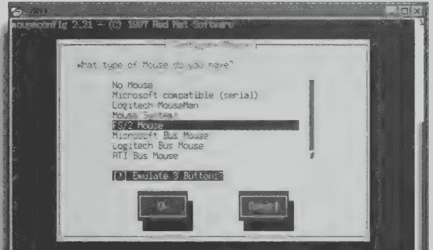

**图 10.1**

`mouseconfig`命令会自动探测系统中的鼠标。

### 配置鼠标

1. 以 root 操作员身份登录。
2. 要自动检测已安装的鼠标，请使用`mouseconfig`：

   ```bash
   # mouseconfig
   ```

   如果你使用的是 PS/2 鼠标，`mouseconfig`将报告如图 10.1 所示的探测结果。（如果你使用其他设备，如串口鼠标，结果将有所不同。）

3. 按 Enter 键配置鼠标，随后`mouseconfig`将退出。
4. 使用带有`--noprobe`和`--expert`选项的`mouseconfig`来手动设置鼠标类型，如下所示：

   ```bash
   # mouseconfig --noprobe --expert
   ```

   `mouseconfig`程序将呈现一个不同指针设备的滚动列表，如图 10.2 所示。

5. 通过高亮显示其类型来选择你的鼠标。
6. 如果你使用 X Window 系统且鼠标只有两个按钮，请按 Tab 键将光标移动到“Emulate 3 Buttons”项目。如果你希望两个按钮的鼠标模拟三个按钮，请按空格键选择或取消选择三按钮模拟。在这种模式下，同时按下左右按钮可模拟按下中间按钮。

否则，请按 Tab 键将光标移动到 OK 按钮，然后按 Enter 键保存配置。

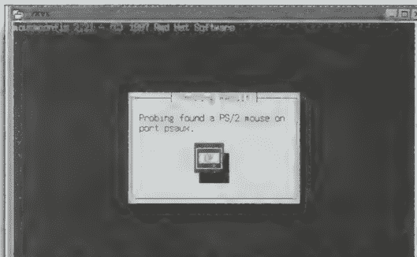

**图 10.2**

`mouseconfig`命令可用于自动探测并配置或手动配置系统的指针设备。

### 配置 Synaptics 触摸板

如果你在笔记本电脑上使用 Linux 并且拥有 Synaptics 触摸板，请使用`tpconfig`命令来配置触摸板。由 C. Scott Ananian 编写的`tpconfig`程序可以通过访问以下网址找到：

`http://www.pdos.lcs.mit.edu/~cananian/Synaptics/`

使用`tpconfig`程序来配置触摸板的按钮模式、点击模式（例如禁用左键点击）或压力敏感度。

### 安装并配置`tpconfig`命令

1. 下载`tpconfig`存档。以 root 操作员身份登录并使用`tar`命令解压存档：

   ```bash
   # tar xvzf synaptics-latest.tar.gz
   ```

2. 切换到软件目录：

   ```bash
   # cd syn*
   ```

3. 运行包含的 configure shell 脚本：

   ```bash
   # configure
   ```

4. 使用`make`命令后接`install`单词，在`/usr/local/bin`目录下编译、构建并安装`tpconfig`命令：

   ```bash
   # make install
   ```

5. 要配置触摸板，你必须没有运行 X11 或`gpm`鼠标守护进程（该进程支持控制台显示的剪切和粘贴）。要停止`gpm`守护进程，可以使用管道结合`ps`和`fgrep`程序搜索`gpm`守护进程的进程号：

   ```bash
   # ps aux | fgrep gpm
   root 220 0.0 0.1 432 40 ? S 11:21 0:00 gpm -t PS/2
   ```

   然后使用`kill`命令配合`gpm`进程号（如上例所示），如下所示：

   ```bash
   # kill -9 220
   ```

6. 要获取触摸板的信息，请使用`-i`选项：

   ```text
   # tpconfig -i
   Synaptics Touchpad, firmware rev. 3.5 [Standard OEM]
   Sensor: Standard-size module
   Geometry: Standard module
   Rightside-up/Landscape New-style abs-mode packets.
   Corner taps disabled. Tap mode: Tap and non-locking drag
   Edge motion only during drag. Z-threshold 3 of 7
   Relative mode Low sample rate.
   2 button mode Corner tap is right button click
   ```

7. `tpconfig`命令有 11 个不同的命令行选项，但它使用起来很简单。例如，要关闭点击模式，请使用`-t`选项，后接数字 0：

   ```bash
   # tpconfig -t0
   ```

### 另请参阅

- 了解更多关于文件压缩和存档的信息，请参阅第 542 页。
- 了解更多关于使用`make`命令或其他编程实用程序的信息，请参阅第 382 页。

## 安装操纵杆

操纵杆是一种便捷的指针设备，特别是在玩街机风格游戏或使用飞行模拟器（如`fly8`模拟器，如图 10.3 所示）时。


**图 10.3**

在 Linux 的 X Window 系统中使用操纵杆可以让使用`fly8`飞行模拟器变得更简单。

### 获取 RPM 格式的操纵杆驱动

Red Hat Linux 用户无需执行上述过程；可以在以下网址找到一个可通过`rpm`命令安装的已编译模块：

`ftp://sunsite.unc.edu/pub/Linux/distributions/redhat/contrib/i386/joystick-0.8.0-1.i386.rpm`

为了在 Linux 中使用操纵杆，你的计算机必须支持操纵杆硬件，通常在主机背面有一个迷你插孔。你还需要下载并安装操纵杆的软件支持，该软件位于名为`joystick.tgz`的压缩存档中，可以在以下网址找到：

`ftp://sunsite.unc.edu/pub/Linux/kernel/patches/console/joyfixed.tgz`

### 安装操纵杆模块和实用程序

1. 下载操纵杆 RPM 文件。
2. 以 root 操作员身份登录。
3. 使用`rpm`命令的`-i`（安装）选项，安装操纵杆模块`joystick.o`、js 手册页以及`js`和`jscal`实用程序：

   ```bash
   # rpm -i joystick-0.8.0-1.i386.rpm
   ```

### 另请参阅

- 了解更多关于使用`rpm`命令的信息，请参阅第 520 页。
- 关于下载文件（如 RPM 存档）的详细信息，请参阅第 198 页。
- 了解更多关于在 X11 中复制和粘贴文本的信息，请参阅第 317 页。

## 构建操纵杆模块

在使用操纵杆之前，你必须构建操纵杆内核模块`joystick.o`。该模块通常在 Linux 启动时加载。

### 构建`joystick.o`模块

1. 以 root 操作员身份登录并下载`joyfixed.tgz`存档。
2. 使用`tar`命令解压存档：

   ```bash
   # tar xvzf joyfixed.tar
   ```

3. 使用`cd`命令进入新的 joystick 目录：

   ```bash
   # cd joy*
   ```

4. 使用`make`命令编译`joystick.o`内核模块：

   ```bash
   # make joystick.o
   ```

5. 使用`mknod`命令（用于创建设备）为`joystick.o`模块创建两个操纵杆设备：

   ```bash
   # mknod /dev/js0 c 15 0
   # mknod /dev/js1 c 15 1
   ```

6. 将`joystick.o`模块复制到`/lib/modules`目录：

   ```bash
   # cp joystick.o /lib/modules
   ```

7. 要使用操纵杆模块，请使用你喜欢的文本编辑器（如`pico`）打开`/etc/rc.d`目录下的`rc.local`文件：

   ```bash
   # pico -w /etc/rc.d/rc.local
   ```

8. 插入一行，告知 Linux 使用`insmod`命令加载操纵杆模块：

   ```bash
   insmod /lib/modules/joystick.o
   ```

9. 保存文件并重启 Linux。Linux 重启后，你应该会看到类似以下的信息：

### 另请参阅

- 了解更多关于`pico`编辑器的信息，请参阅第 50 页。
- 了解更多关于可加载内核模块的信息，请参阅第 577 页。

### 配置操纵杆

操纵杆驱动程序包含两个程序：`js`和`jscal`。使用`js`程序后接与你的操纵杆设备相对应的数字（本例中为 0）来测试操纵杆：

```bash
# js 0
```

该程序持续运行，在你移动操纵杆时报告按钮按下情况和光标位置。按 Ctrl+C 退出程序。

使用`jscal`命令在命令行上指定操纵杆编号来调整操纵杆，如下所示：

```bash
# jscal 0
```


`jscal` 程序会要求你将操纵杆移动到右下角，然后按下操纵杆按钮。按 `Ctrl+C` 退出程序。

## 第 11 章：配置调制解调器和传真服务

作者：Bill Ball

- 选择调制解调器和调制解调器端口
- 创建 `/dev/modem` 设备
- 使用 `ln` 和 `modemtool` 命令配置调制解调器
- 使用 `setserial` 命令获取串口信息
- 配置拨入和传真服务
- 发送和接收传真

## 为 Linux 选择调制解调器

许多不同类型的调制解调器都可以在 Linux 上运行。为了使用调制解调器，您必须首先确定哪个串行端口连接到了您的调制解调器。串行端口可以在台式计算机的背面或内部 PC 串行板上找到，也可以在笔记本电脑背面的 PC 卡或 RJ-11 接口上找到。Linux 的串行端口设备位于 `/dev` 目录下，文件名包含 `cua` 或 `tty`。表 11.1 列出了八个最常用的串行设备，以及相应的“传统”DOS 端口名称和地址。如果您对调制解调器有疑问，请访问以下地址查看 Red Hat Linux 支持区域：

`http://www.redhat.com`

**表 11.1**

| Linux 设备 | DOS 端口与地址 |
|---|---|
| `/dev/cua0`、`/dev/ttyS0` | COM1, 0x3F8 IRQ 4 |
| `/dev/cua1`、`/dev/ttyS1` | COM2, 0x2F8 IRQ 3 |
| `/dev/cua2`、`/dev/ttyS2` | COM3, 0x3E8 IRQ 4 |
| `/dev/cua3`、`/dev/ttyS3` | COM4, 0x2E8 IRQ 3 |

观察表 11.1，您会注意到编号相同的 `cua` 和 `tty` 设备对应同一个串行端口。这些设备几乎相同，但 `cua` 设备允许您在另一个程序（例如本章“启用拨入服务”节中讨论的 `ugetty`）监控调制解调器端口以接收呼入电话的同时，使用通信程序进行外呼。

### 使用 `dmesg` 命令检查串行端口状态

使用 `dmesg` 命令来确定您的串行端口是否已启用。`dmesg` 命令显示 `dmesg` 启动日志，该日志位于 `/var/log` 目录下。在 `dmesg` 输出中寻找列出任何已识别串行驱动程序和端口的行，例如：

```text
Serial driver version 4.13 with no serial options enabled

tty00 at 0x03f8 (irq = 4) is a 16550A

tty03 at 0x02e8 (irq = 3) is a 16550A
```

此输出显示 Linux 在 COM1 和 COM4 处找到了两个串行端口。如果未列出串行驱动程序或端口，请确保您的 Linux 内核已启用串行线路（serial-line）支持，或者 `/dev` 目录下存在正确的串行设备。有关如何创建串行设备的详细信息，请阅读 `MAKEDEV` 手册页。

**另请参阅**

$\triangleright$ 有关启用串行支持的详细信息，请参阅第 32 章“内核管理”。

### PC 卡串行端口和调制解调器

PC 卡所有者必须首先启用 PCMCIA 服务，以便 Linux 能够识别并配置 PC 卡。幸运的是，大多数串行和调制解调器 PC 卡在 Linux 下运行几乎没有问题。有关如何安装 PCMCIA 服务的详细信息，请参阅第 10 章“配置 PC 卡设备”，并阅读位于 `/usr/doc` 目录下的 `PCMCIA-HOWTO`。

### 我的调制解调器能在 Linux 上运行吗？

虽然几乎所有现代调制解调器都能在 Linux 上运行，但至少有两种类型需要避免：WinModems 和 Mwave。这两类调制解调器都需要 Windows 的专有驱动程序，而 Linux 无法获得这些驱动程序。虽然您可以通过从任何 DOS 启动 Linux 来使用 Mwave 板支持声音，但在制造商意识到 Linux 是主流计算的一部分之前，您应避免使用任何需要 DOS 特殊驱动程序的调制解调器或串行板。“即插即用（Plug-and-Play）”设备可能也可以运行，但通常建议坚持使用“常规”调制解调器以避免麻烦。

## 使用 `echo` 命令测试您的调制解调器

您可以使用 `echo` 命令通过串行端口发送命令字符串来测试您的调制解调器。

**测试您的调制解调器**

1. 以 root 操作员身份登录。
2. 确保您的调制解调器已开启；如果您使用的是调制解调器卡，请确保其已插好。
3. 检查外置调制解调器的任何串行电缆连接。
4. 确保您的电话线已正确连接到调制解调器或调制解调器卡。
5. 选择与您的调制解调器端口相对应的正确 `cua` 串行设备。如有必要，先找到所使用的 DOS COM 端口，然后选择表 11.1 中列出的设备。
6. 在控制台或终端窗口中输入以下内容，将 `x` 替换为您要测试的串行端口：

   ```bash
   echo "ATDT1\n" > /dev/cuax
   ```

7. 等待至少 10 秒，随后您应该能听到拨号音。

**另请参阅**

$\triangleright$ 要了解更多关于 `echo` 命令的信息，请参阅第 33 页。

> **您的调制解调器 AT 命令**
>
> 并非所有调制解调器都具有相同的 AT 命令集，不同制造商的调制解调器之间存在细微差异。最佳参考资料是您的调制解调器手册，其中应详细规定您的调制解调器 AT 命令集。

## 创建 `/dev/modem` 设备

您不必总是记住哪个串行端口连接到了您的调制解调器。确定调制解调器连接到哪个端口的一种简单方法是创建一个名为 `/dev/modem` 的设备。在 Red Hat Linux 中，您可以找到一个 GUI 实用程序来创建此设备，或者您可以使用 `ln` 命令从命令行创建。

### 使用控制面板客户端创建 `/dev/modem`

Red Hat X11 控制面板客户端有一个按钮可以点击来设置您的调制解调器。该按钮使用 `modemtool` 客户端，您也可以在终端窗口的命令行中运行它。

**使用控制面板客户端**

1. 以 root 操作员身份登录。您还必须运行 X Window 系统。
2. 在终端窗口的命令行中，启动控制面板客户端：

   ```bash
   # control-panel &
   ```

3. 点击控制面板中的 `modemtool` 按钮（见图 11.1）。

（图 11.1：点击 `modemtool` 图标。）

4. `modemtool` 客户端会创建一个包含串行端口列表的窗口，如图 11.2 所示。选择连接到调制解调器的端口，然后点击 OK。

**另请参阅**

要了解更多关于符号链接以及如何使用 `ln` 命令的信息，请参阅第 40 页。

（图 11.2：从 X11 控制面板客户端运行的 `modemtool` 对话框，用于创建名为 `/dev/modem` 的符号链接。）

`modemtool` 客户端会创建一个名为 `/dev/modem` 的符号链接（或文件），它指向您的调制解调器串行端口。

### 使用 `ln` 命令创建 `/dev/modem`

您也可以使用 `ln`（link）命令从命令行创建 `/dev/modem` 设备。如果您的调制解调器连接到 COM1，要创建 `/dev/modem`，请以 root 操作员身份登录并输入以下内容：

```bash
# ln -s /dev/cua0 /dev/modem
```

该命令行创建了一个符号链接 `/dev/modem`，它指向 COM1 串行端口。使用 `ls`（列出目录）命令检查此链接，如下所示：

```text
# ls -l /dev/modem

lrwxrwxrwx 1 root root 9 Feb 19 07:56 /dev/modem -> /dev/cua0
```

## 使用 `setserial` 命令获取串行端口信息

位于 `/bin` 目录下的 `setserial` 命令可报告四个默认串行端口的状态、类型和配置。此命令还可用于配置内核如何识别额外的串行端口，或更改内核与现有端口的交互方式。

要获取指定端口的信息，请使用 `-a`（所有可用信息）选项，后跟端口的设备名称，如下所示：

```text
# setserial -a /dev/modem

/dev/modem, Line 1, UART: 16550A, Port: 0x02f8, IRQ: 2

	Baud_base: 115200, close_delay: 50, divisor: 0

	closing_wait: 3000, closing_wait2: infinite

	Flags: spd_normal skip_test
```

此信息显示了指定端口所使用的设备、线路、硬件芯片、端口和中断。还列出了串行端口支持的最高速度，以及其他运行特性，例如关闭连接前使用的延迟。

**串行端口技术细节**

有关 Linux 和串行端口的技术信息，请参阅 `/usr/doc` 目录下的 `Serial-HOWTO` 和 `Serial-Programming-HOWTO`。

## 配置调制解调器和传真服务

### 启用拨入服务

Linux 支持拨入服务。这意味着您可以从另一台计算机拨号进来，并通过电话登录。如果您的计算机拥有两个调制解调器和两条电话线，您可以登录后在备用电话线上拨号外呼，或者如果备用线路保持活跃的互联网连接，则可以使用互联网服务。

设置 Linux 拨入服务需要以下条件：

- 一条电话线
- 一个串行端口和连接的调制解调器

它还要求您执行以下操作：

- 配置调制解调器。
- 编辑系统初始化表。
- 重启 Linux。

**编辑系统文件时请谨慎**

要设置系统以接收呼入电话，您必须编辑系统的初始化表 `/etc/inittab`。如果错误地编辑此文件，可能会导致系统挂起。请准备好启动盘，并在进行更改前备份 `/etc/inittab` 文件。有关创建紧急启动盘的详细信息，请参阅第 29 章“文件系统管理”中题为“执行硬盘恢复”的章节。

### 为拨入服务配置 Linux

为拨入配置 Linux 非常简单。您可以在运行 Linux 时执行第一步（配置调制解调器）（如果您熟悉 `kermit` 或 `minicom` 通信程序），或者使用 DOS 或 Windows 的通信程序。

**创建拨入服务**

1. 将调制解调器连接到已识别的串行端口。确保调制解调器连接正确并已开启。

## 启用拨入服务

2. 启动通信程序。使用 AT 命令 `&V` 来显示调制解调器的配置文件，如下所示：

   ```text
   AT&V
   ACTIVE PROFILE:
   B1 E1 L1 N1 Q0 T V1 X4 Y0 W0 &C1 &D2
   &G0 &J0 &K3 &G5 &R1 &S0 &T5 &X0 &Y0 -Z0
   S00:000 S01:000 S02:043 S03:013 S04:010
   S05:000 S06:004 S07:045 S08:002 S09:006
   S10:014 S11:005 S12:050 S18:000 S25:005
   S26:001 S36:007 S37:000 S38:020 S44:020
   S46:138 S48:007 S51:012 S52:012 S53:010
   S54:010 S95:000
   ```

3. 如果您的调制解调器设置为以下内容，则已准备就绪：

   ```text
   E1 Q0 V1 S0=0 &C1 &S0
   ```

   如果不是，请使用以下 AT 命令字符串来设置您的调制解调器：

   ```text
   AT E1 Q0 V1 S0=0 &C1 &S0 &W
   ```

   此命令字符串会为您的调制解调器配置适当的设置，然后使用 `&W` 命令保存配置。请确保您的调制解调器回显了 ok 字符串。

4. 确保您以 root 操作员身份登录。

5. 使用您喜欢的文本编辑器，在 `/etc` 目录下创建一个名为 `conf.ugetty.ttySx` 的文件，其中 x 与调制解调器串行端口的设备号相匹配（如果您的调制解调器连接到 `/dev/ttyS0`，则创建文件 `conf.ugetty.ttyS0`）。输入以下内容：

   ```text
   ALTLOCK=cua0

   ALTLINE=cua0

   # line to initialize

   INITLINE=cua0

   # timeout in seconds before disconnect

   TIMEOUT=60

   # initialize modem

   INIT="\r AT\r OK\r\n"

   WAITFOR=RING

   # modem connect

   CONNECT="\r ATA\r CONNECT\s\A"

   # delay in seconds before sending contents of /etc/issue

   DELAY=1
   ```

## 配置您的系统

### 配置调制解调器和传真服务

确保 `ALTLOCK`、`ALTLINE` 和 `INITLINE` 的值与您的调制解调器串行端口相匹配。

将 `TIMEOUT` 值设置为您希望调制解调器在断开连接前等待调用者回车键的时间（秒）。

将 `DELAY` 值设置为在 `/etc/issue` 文件（或欢迎文本）回显给调用者之前的等待时间（秒）。

6. 保存文件并退出文本编辑器。

7. 打开 `/etc` 目录下的系统初始化表 `inittab`。查找以下行：

   ```text
   # Run gettys in standard runlevels

   1:2345:respawn:/sbin/mingetty tty1

   2:2345:respawn:/sbin/mingetty tty2

   3:2345:respawn:/sbin/mingetty tty3

   4:2345:respawn:/sbin/mingetty tty4

   5:2345:respawn:/sbin/mingetty tty5

   6:2345:respawn:/sbin/mingetty tty6
   ```

具体地，定位到这一行：

```text
3:2345:respawn:/sbin/mingetty tty3
```

将其更改为以下内容：

```text
3:2345:respawn:/sbin/ugetty -d /etc/conf.ugetty.ttyS0

ttyS0 38400 vt100
```


对 `inittab` 的此项更改使得 Linux 在系统启动时运行 `ugetty` 命令。`ugetty` 命令使用您创建的配置文件，监控指定串行端口上的呼入电话，并在检测到调制解调器时应答。如果您希望支持更快的拨入速度，请输入 `57600` 代替 `38400`。

8. 保存文件，退出文本编辑器，并重启系统。

### 另请参阅

要详细了解如何为 X Window 系统和 `xdm` 选择客户端使用 `/etc/inittab` 文件，请参阅第 260 页。

在重启 Linux 后，`ugetty` 命令会不断检查 `/dev/ttyS1` 串行端口是否有呼入电话。当您拨入时，等待调制解调器连接，然后按下 Enter 键。随后 Linux 将回显登录提示符。

### 配置传真服务

如果您拥有传真调制解调器，您应该能够使用 Linux 发送和接收传真。传真的发送和接收需要一个传真调制解调器，以及对要发送和接收的文件进行图形化转换。您应该准备好调制解调器的技术文档以及 `efax` 软件包。该软件包包括表 11.2 中所示的软件和文档。

| 文件 | 用途 |
| :--- | :--- |
| `/usr/bin/fax` | 用于创建、发送、接收、查看和打印传真的综合 shell 脚本 |
| `/usr/bin/efax` | 用于发送和接收传真的驱动程序 |
| `/usr/bin/efix` | 文件转换程序 |
| `/usr/man/man1/fax.1` | 传真脚本手册页 |
| `/usr/man/man1/efax.1` | `efax` 手册页 |
| `/usr/man/man2/efix.1` | `efix` 手册页 |
| `/usr/doc/efax-0.8a` | 包含 README 文件的目录 |

在开始为 Linux 系统配置传真服务之前，请务必阅读 `fax`、`efax` 和 `efix` 的手册页以及 README 文档。

### 配置 fax Shell 脚本

设置发送和接收传真涉及编辑 `/usr/bin/fax` shell 脚本。您需要检查某些配置行，并且必须编辑其他行以自定义传真页眉并指定您的调制解调器。脚本中包含易于遵循的指令，但基本更改概述如下。

**传真服务软件包**

您可以使用许多其他传真软件软件包为您的 Linux 系统设置传真服务，例如 `mgetty+sendfax` 或 `Hylafax` 网络传真软件包。有关这些软件包的更多信息，请查看 `/usr/doc` 目录，或访问您喜欢的 Linux 互联网网站。以下是一个不错的查找地点：
`ftp://sunsite.unc.edu/pub/Linux/apps/serialcomm/fax/`

#### 编辑 fax shell 脚本

1. 在确保您以 root 操作员身份登录后，使用您喜欢的文本编辑器打开 `/usr/bin/fax` shell 脚本。
2. `/usr/bin/fax` shell 脚本列出了 `FAX`、`EFAX` 和 `EFIX` 命令的路径名。确保脚本具有正确的 `efax` 程序路径名，如下所示：
   `FAX=/usr/bin/fax`
   `EFAX=/usr/bin/efax`
   `EFIX=/usr/bin/efix`
3. 编辑指定调制解调器串行端口的条目：
   `DEV=cua0`
   如果您创建了符号链接 `/dev/modem`，请使用 `modem` 一词。如果您的系统配置为拨入使用，请输入设备的实际名称，例如 `cua0`。
4. 指定您的调制解调器支持的传真 `CLASS` 类型。使用井号 (`#`) 注释掉不需要的 `CLASS`，并通过删除井号来取消注释所需的 `CLASS`：
   `# CLASS=1`
   `CLASS=2`
   `# CLASS=2.0`
   确保仅选择（或取消注释）一个 `CLASS`。
5. 指定您的电话号码：
   `FROM="1 202 555 1212"`
6. 输入您的姓名：
   `NAME="William Ball"`
7. 指定默认传真页面大小，同样使用井号注释掉不需要的大小，并在正确的大小前删除井号：
   `PAGE=letter`
   `# PAGE=legal`
   `# PAGE=a4`
   确保仅指定一种尺寸。
8. 保存文件并退出文本编辑器。

### 测试您的传真配置

使用 `fax` 脚本的 `test` 命令行选项来测试您的传真配置和传真调制解调器，如下所示：

```
# fax test
```

`fax` 脚本会将三页信息打印到您的显示屏上。查看测试结果的更好方法是将测试输出重定向到文件，如下所示：

```
# fax test > test.txt
```

在输出文件中查找错误消息。常见错误包括为传真调制解调器指定了错误的串行端口，以及指定了多个传真 `CLASS` 或默认 `PAGE` 尺寸。

### 使用 fax Shell 脚本发送传真

使用 `fax` 脚本的 `send` 和 `-l` 命令行选项，后接传真号码和文件名来发送测试文档，如下所示：

```
# fax send -l afaxphonenumber test.txt
```

此命令行使用指定的文件向指定的传真号码发送低分辨率传真。如果您不使用 `-l` 命令行选项，则默认发送高分辨率传真。

### 设置等待接收传真

您可以使用 `fax` 脚本让您的计算机自动等待接收传真。使用 `fax` 脚本的 `wait` 命令行选项：

```
# fax wait &
```

`fax` 命令使用您的传真调制解调器接听呼入传真电话，然后将接收到的传真保存在 `/var/spool/fax` 目录下。

### 检查接收或发送传真的状态

要确保 `fax` 脚本正在等待传真，请使用 `fax` 命令的 `status` 命令行选项：

```
# fax status
```

要查看是否收到了任何传真，请使用 `fax` 脚本的 `queue` 命令：

```
# fax queue
```

此命令行会导致 `fax` 脚本列出 `/var/spool/fax` 目录的内容。

### 查看接收的传真

在检查传真队列后，使用 `fax` 脚本的 `view` 选项以及接收到的传真文件名来阅读传真：

```
# fax view 1204164646*
```

`fax` 命令会自动运行 X11 `xv` 图形程序来查看或打印您接收到的传真。

### 打印接收的传真

虽然可以使用 X11 `xv` 客户端在查看时打印传真，但您也可以使用 `fax` 脚本的 `print` 命令行选项作为打印传真的另一种方式：

```
# fax print 1204164646*
```

**另请参阅**

有关为 Linux 设置打印机的更多信息，请参阅第 74 页。

### 删除接收的传真

要删除传真，请使用 `fax` 脚本的 `rm` 命令行选项，如下所示：

```
# fax rm 120417243*
```

**另请参阅**

有关删除文件的更多信息，请参阅第 42 页。

**删除传真时请小心**

在使用 `rm` 命令行选项删除传真时，请务必指定由 `fax` 脚本的 `queue` 选项返回的传真文件名。此命令可能具有危险性，可能会不必要地删除关键文件，尤其是在与通配符 (`*`) 配合使用时。删除传真时请使用具体的文件名。

## 第三部分

## 连接到您的互联网服务提供商

- 12 连接到您的互联网服务提供商 165
- 13 使用电子邮件 179
- 14 使用 FTP 197
- 15 使用 Web 浏览器 211
- 16 阅读 USENET 新闻 225
- 17 使用 `telnet` 和 Internet Relay Chat 247

## 第 12 章

## 连接到您的互联网服务提供商

作者：Bill Ball

- 设置点对点协议 (PPP) 连接
- 为您的互联网服务提供商 (ISP) 配置 PPP
- 启动 PPP 连接
- 关闭 PPP 连接
- 检查 PPP 连接

### 配置 PPP 连接

使用 Linux 和串行线路点对点协议 (PPP) 连接到互联网非常简单。如果您按照本章概述的步骤操作，您将能够通过您的互联网服务提供商 (ISP) 快速连接和断开互联网连接。连接成功后，您可以发送和接收电子邮件、下载文件、阅读 Usenet 新闻，或使用 Web 浏览器浏览万维网网站。

> 另请参阅
> 要了解更多关于电子邮件的信息，请参阅第 180 页。
> 要了解更多关于 Web 浏览器的信息，请参阅第 212 页。
> 有关阅读 Usenet 新闻的详细信息，请参阅第 227 页。

在本章中，您将找到检查硬件、配置软件以及连接到 ISP 的基本步骤，以及可用于检查连接的命令。在开始之前，您需要调制解调器连接所需的基本硬件、几个标准的 Linux 程序以及来自 ISP 的一些技术信息。这些硬件和软件项目包括以下内容：

- 一个可工作的串行端口和连接的调制解调器
- 支持 PPP 和 TCP/IP 协议的 Linux 内核
- `ppp-2.2` 软件包，其中包含 `pppd` 守护进程、`chat` 拨号程序、相关脚本和 `pppstats` 命令
- `minicom` 通信程序（可选）
- 一个支持 PPP 的 ISP 激活账户（几乎所有 ISP 都使用 PPP）

设置 PPP 并连接到 ISP 涉及多个步骤，包括以下内容：

1. 检查您的串行端口和调制解调器。
2. 检查内核是否支持 PPP 和 TCP/IP。
3. 编辑并自定义 PPP 连接脚本。
4. 编辑或创建所需的系统配置文件。
5. 拨号并建立 PPP 连接。
6. 检查连接。
7. 断开并关闭 PPP 连接。

**在 X11 中创建 PPP 连接**

如果您使用 X Window 系统，可以使用 `netcfg`（GUI 系统管理工具）来创建 PPP 连接网络接口。`netcfg` 客户端是 Red Hat Linux 控制面板客户端的一部分，由 root 操作员使用。有关使用 `netcfg` 的分步详细步骤，请参阅第 27 章“管理网络连接”中的“使用 `netcfg` 工具”节。

### 检查您的串行端口和调制解调器

要检查您的串行端口和调制解调器，您需要一条电话线、一个调制解调器和一根调制解调器电缆（如果您使用的是外置调制解调器）。如果您知道您的调制解调器在 Linux 下可以工作，可以跳到下一节“检查您的 Linux 内核和文件系统是否支持 PPP”。

#### 检查调制解调器连接

1. 确保您的电话线已连接到调制解调器，且调制解调器已连接到计算机。
2. 将 `dmesg` 命令的输出通过 `less` 分页器传递，以确定您的串行端口是否已启用并正常工作：

```
# dmesg | less
```

3. 寻找类似于以下详细描述串行驱动程序信息的行：

```
Serial driver version 4.13 with no serial options
enabled
ttyS0 at 0x3f8 (irq = 4) is a 16550A
ttyS1 at 0x2e8 (irq = 3) is a 16550A
```

4. 如果您没有找到串行支持，请参阅第 11 章“配置调制解调器和传真服务”以获取有关配置调制解调器的详细信息。如果您定义了一个名为 `/dev/modem` 的符号链接指向调制解调器的串行端口，可以使用 `echo` 命令测试调制解调器和电话线连接，如下所示：

```
# echo "ATDT11" > /dev/modem
```

几秒钟后您应该能听到拨号音。如果没有，请重新阅读第 11 章，了解如何创建 `/dev/modem` 符号链接。

> 另请参阅
> 要了解更多关于管道 (pipes) 的信息，请参阅第 21 页。
> 有关安装和配置调制解调器的更多详细信息，请参阅第 152 页。

### 检查您的 Linux 内核和文件系统是否支持 PPP

您的 Linux 内核必须支持 PPP 才能连接到 ISP。支持可以通过编译进内核或作为代码模块加载。PPP 模块 `ppp.o` 位于 `/lib/module/2.0.xx/net` 目录下（其中 `xx` 是您的内核版本）。

#### 检查 PPP 支持

1. 使用 `dmesg` 命令的输出（通过 `less` 分页器传递）来确定您的内核是否启用了 PPP 支持：
   `# dmesg | less`

2. 寻找类似于以下详细描述 TCP/IP 和 PPP 支持的行：
   Swansea University Computer Society TCP/IP for NET3.034
   IP Protocols: IGMP, ICMP, UDP, TCP
   PPP: version 2.2.0 (dynamic channel allocation)
   PPP Dynamic channel allocation code copyright 1995 Caldera, Inc.
   PPP line discipline registered.

3. 如果您没有看到启用此支持，则必须启用 TCP/IP 和 PPP 网络支持。这意味着您必须确保所需的模块或网络服务已启用，或者重新构建具有内置支持的内核。详细信息请参阅第 27 章“管理网络连接”以及第 32 章“管理内核”中名为“重新编译内核”的节。

> 另请参阅
> 要了解更多关于 `less` 分页器的信息，请参阅第 33 页。
> 要了解更多关于内核模块的信息，请参阅第 577 页。
> 有关安装网络支持的更多详细信息，请参阅第 444 页。

您还必须确保您的系统中安装了所需的 PPP 连接软件和目录。

#### 检查 PPP 软件

1. 使用 `ls`（列出目录）命令确保已安装 `pppd` 守护进程、`chat` 拨号命令和 PPP 连接脚本：

```
# ls /usr/sbin/pppd
/usr/sbin/pppd
# ls /usr/sbin/chat
/usr/sbin/chat
# ls /etc/ppp
chap-secrets options ppp-on-dialer
connect-errors pap-secrets ppp-on
ip-up ppp-off
```

2. 如果在系统或 CD-ROM 中找不到这些程序和脚本，您必须查找并下载 PPP 软件（尝试访问 `http://www.redhat.com`）。

3. 找到软件后，使用 X11 `glint` 客户端安装 PPP 软件包。如果您没有运行 X11，请像这样使用 Red Hat `rpm`（软件软件包管理器）：

```
# rpm -i ppp-2.2.0f-5.1386.rpm
```

4. 安装后，如果在 `/etc/ppp` 目录中找不到 PPP 脚本 `ppp-on`、`ppp-on-dialer` 和 `ppp-off`，请执行以下命令从 `/usr/doc/ppp-2.2.0f-5/scripts` 目录复制它们：

```
# cp /usr/doc/ppp-2.2.0f-5/script/* /etc/ppp
```

> 另请参阅
> 要了解更多关于 Linux 软件软件包管理的信息，请参阅第 520 页。
> 要了解更多关于（shell）脚本的信息，请参阅第 365 页。

### 为您的 ISP 配置 PPP

您必须拥有服务提供商的 PPP 账户才能连接到互联网。至少，您需要以下关于账户的信息：

- 用户名和密码。
- ISP 调制解调器的电话号码。
- ISP 域名服务器的互联网协议 (IP) 地址以及 ISP 的域名。地址看起来像 `205.198.114.1` 或 `205.198.114.20`，域名可能是 ISP 的名称后加上 `.com`、`.org` 或 `.edu`。

获得这些信息后，下一步是创建或编辑解析配置文件 `/etc/resolv.conf`。该文件包含电子邮件、新闻阅读器或 Web 浏览器用于查找有效互联网地址的 DNS 地址。DNS 地址是运行域名系统的 ISP 计算机的互联网地址，它将文本地址（如 `staffnet.com`）翻译为其数字地址（在本例中为 `207.226.80.14`）。

#### 创建 `/etc/resolv.conf`

1. 确保您以 root 操作员身份登录。使用您喜欢的文本编辑器创建或编辑 `/etc/resolv.conf` 文件：

```bash
# touch /etc/resolv.conf
# pico /etc/resolv.conf
```

2. 输入解析器关键字 `search`，后跟您的 ISP 域名，以添加 DNS 搜索的搜索路径：

```bash
search myisp.com
```

3. 添加 DNS 服务器的 IP 地址，每个地址前加上 `nameserver` 关键字：

```bash
nameserver 205.198.114.1
nameserver 205.198.114.20
```


4. 保存并关闭文件。

## 配置您的 PPP 连接脚本

为了拨号并连接到您的 ISP（互联网服务提供商），您必须配置位于`/etc/ppp`目录下的 PPP 连接脚本`ppp-on`。该脚本包含连接到 ISP 所需的所有必要信息。启动时，`ppp-on`会调用`/etc/ppp/ppp-on-dialer`脚本来执行拨号。请使用 ISP 提供的账户信息，并输入正确的用户名、电话号码、密码和地址，以使`ppp-on`脚本正常工作。

### 编辑 ppp-on 连接脚本

**自定义 ppp-on 脚本**

1. 确保您已以 root 管理员身份登录。
2. 使用您喜欢的文本编辑器，打开`/etc/ppp`目录下的`ppp-on`文件。
3. 在`TELEPHONE`字段中输入 ISP 调制解调器的电话号码：

   ```bash
   TELEPHONE=555-1212 # The telephone number for the connection
   ```

4. 在`ACCOUNT`字段中输入您的用户名（其中`myusername`是 ISP 分配的用户名）：

   ```bash
   ACCOUNT=myusername # The account name for logon
   ```

5. 在`PASSWORD`字段中输入您的密码（其中`mypassword`是您的密码）：

   ```bash
   PASSWORD=mypassword # your assigned password
   ```

6. 如果您的 ISP 为您分配了 IP 地址，请将其输入在`LOCAL`字段中。如果您的 IP 地址是在登录时动态分配的，请按如下方式输入地址：

   ```bash
   LOCAL_IP=0.0.0.0 # Local IP address
   ```

7. 如果您为调制解调器的串口创建了符号链接，请在`pppd`命令行中使用`/dev/modem`，后跟调制解调器支持的最高速度（如果您没有动态分配的 IP 号，请参阅侧边栏“动态地址与`pppd`守护进程”）：

   ```bash
   exec /usr/sbin/pppd lock modem crtscts /dev/modem 57600 \
       asyncmap 20A0000 escape FF $LOCAL_IP:$REMOTE_IP \
       noipdefault netmask $NETMASK defaultroute \
       connect \
       $DIALER_SCRIPT &
   ```

8. 使用`chmod`程序及其`+x`命令行选项，使`ppp-on`和`ppp-on-dialer`脚本都具有可执行权限：

   ```bash
   # chmod +x /etc/ppp/ppp-on*
   ```

**另请参阅**

有关更改文件权限的更多信息，请参阅第 418 页。

### 动态地址与 pppd 守护进程

如果您拥有永久分配的 IP 地址（也称为静态 IP 地址），请从`ppp-on`脚本的`pppd`命令行中删除`noipdefault`选项（参见“自定义`ppp-on`脚本”的步骤 7），并将`$REMOTE_IP`字符串更改为 ISP 提供的 IP 地址。如果您的 ISP 使用动态寻址，则无需进行此更改；您每次登录时的 IP 地址都将不同。

## 启动 PPP 连接

启动电话线 PPP 连接至少有两种方法。在本节中，您将学习如何使用 minicom 通信程序启动 Internet 会话，以及如何使用`ppp-on`脚本启动 PPP 连接。

### 使用 minicom 程序启动 PPP 连接

位于`/usr/bin`目录下的 minicom 通信程序可用于与 ISP 建立 PPP 连接。虽然这种方法不如使用`ppp-on`脚本方便，但它是验证您的用户名、密码以及 PPP 连接能否与 ISP 正常工作的有效方法。

这种方法可行是因为您可以在不挂断电话且不重置调制解调器的情况下退出 minicom（这并非总是好主意，特别是进行长途连接时——即使每分钟仅 5 美分！）。

**使用 minicom 命令连接到 Internet**

1. 以 root 管理员身份登录；确保您的调制解调器已插好并开启。
2. 从命令行运行 minicom 程序，如下所示：

   ```bash
   # minicom
   ```

3. 使用调制解调器`ATDT`命令，后接 ISP 的调制解调器号码，然后按 Enter 键拨出：

   ```text
   ATDT555-1212
   ```

4. 等待连接。您的 ISP 计算机应该会显示登录提示。输入您的用户名和密码。
5. 按 Ctrl+Q 退出 minicom，且不挂断电话或重置调制解调器。
6. 从命令行启动 PPP 连接，使用命令行上的`pppd`守护进程，输入以下内容：

   ```bash
   # pppd -d detach /dev/modem &
   ```

7. 使用`ifconfig`命令测试您的连接（参阅后续章节“检查您的 PPP 连接”）。

### 使用 ppp-on 脚本启动 PPP 连接

在验证 PPP 连接正常工作后，您可以使用`ppp-on`脚本来启动 Internet 会话。使用此脚本比使用 minicom 程序简单得多。

**使用 ppp-on 脚本启动 Internet 会话**

1. 确保您已以 root 管理员身份登录。
2. 将`ppp-on`脚本复制到已识别的程序目录（如`/usr/local/bin`），或者在已识别的目录中创建符号链接，如下所示：

   ```bash
   # ln -s /etc/ppp/ppp-on /usr/local/bin/ppp-on
   ```

3. 为了让系统所有用户都能启动 PPP 连接，请使用`chmod`命令更改`ppp-on`脚本的执行权限：

   ```bash
   # chmod 4711 /etc/ppp/ppp-on
   ```

4. 使用脚本启动 PPP 连接：

   ```bash
   # ppp-on
   ```

5. 几秒钟后，您应该能听到调制解调器拨号并与 ISP 的调制解调器连接。几秒钟后，测试或关闭连接。

### 关闭您的 PPP 连接

使用位于`/etc/ppp`目录下的`ppp-off`脚本来停止您的 PPP 连接：

```bash
# /etc/ppp/ppp-off
```

与`ppp-on`脚本不同，`ppp-off`脚本必须由 root 管理员运行。除非您的系统用户必须拨打长途电话才能建立连接，否则这不会成为问题；大多数 ISP 将其系统配置为在一段时间不活动后自动挂断。

## 检查您的 PPP 连接

大多数 Linux 发行版都提供了一些可用于检查 PPP 连接的命令。其中许多命令是网络实用程序。您还可以查看系统日志以诊断或排除令人困扰的连接问题。

### 使用 ifconfig 命令检查 PPP 连接

虽然`ifconfig`命令（位于`/sbin`目录下）通常由网络管理员用于配置网络接口，但它也可用于获取 PPP 连接状态的报告。`ifconfig`命令列出活动网络接口的信息。系统中启动的第一个 PPP 连接由`ppp0`设备表示。要查看 PPP 连接的状态，请启动一个 PPP 会话并使用`ifconfig`命令配合`ppp0`设备命令行选项：

```text
# ifconfig ppp0

ppp0 Link encap:Point-to-Point Protocol
 inet addr:207.226.80.155 P-t-P:207.226.80.214
 Mask:255.255.255.0
UP POINTOPONT RUNNING MTU:1500 Metric:1
RX packets:109 errors:0 dropped:0 overruns:0
TX packets:117 errors:0 dropped:0 overruns:0
```

除了您的计算机和连接计算机的 IP 地址外，使用`ifconfig`命令还可以显示通过 PPP 接口接收（rx）和发送（tx）的字符数。有关更多详细信息，请参阅`ifconfig`手册页。

**另请参阅**

- 有关配置网络服务的更多详细信息，请参阅第 482 页。
- 有关其他网络服务的更多信息，请参阅第 444 页。

### 使用 pppstats 命令获取 PPP 统计数据

使用位于`/usr/sbin/`目录下的`pppstats`命令，可以打印关于指定 PPP 设备连接（如`ifconfig`命令返回的`ppp0`）统计数据（如入站和出站数据）的简短报告。要使用`pppstats`命令，请在命令行中指定 PPP 接口的单元号，如下所示：

```bash
# pppstats 0
```

| in | pack | comp | uncomp | err | out | pack | comp |
|---|---|---|---|---|---|---|---|
| uncomp | ip |  |  |  |  |  |  |
| 285567 | 281 | 143 | 91 | 0 | 9472 | 282 | 126 |
| 111 | 45 |  |  |  |  |  |  |

在连接处于活动状态时，`pppstats`命令每五秒显示一行信息。这些信息包括接收和发送的 512 字节数据包数量，以及一些技术性的数据包压缩信息。`pppstats`程序在验证 PPP 连接时非常有用。可以通过设置`-i`（interval，间隔）命令行选项为您想要的报告更新间隔秒数来更改更新频率。有关更多信息，请参阅`pppstats`手册页。

### 使用 ping 命令测试 PPP 连接速度

使用`ping`命令来验证 Internet 主机名或地址，并测试主服务器的响应时间。此命令向指定的计算机发送小型测试数据包，然后测量计算机发送回信息的所需时间。使用`ping`命令，后跟主机计算机的名称或地址，如下所示：

```text
# ping staffnet.com

PING staffnet.com (207.226.80.14): 56 data bytes
64 bytes from 207.226.80.14: icmp_seq=0 ttl=254 time=4296.3 ms
64 bytes from 207.226.80.14: icmp_seq=1 ttl=254 time=3980.0 ms
64 bytes from 207.226.80.14: icmp_seq=2 ttl=254 time=2940.0 ms
--- staffnet.com ping statistics ---
6 packets transmitted, 3 packets received, 50% packet loss
round-trip min/avg/max = 2940.0/3712.1/4296.3 ms
```

`ping`命令将持续发送和接收信息，直到您按下 Ctrl+C 告知其退出。

### 使用 route 命令获取 PPP 接口信息

使用位于`/sbin`目录下的`route`命令，以获取关于您活动 PPP 接口的更多信息。虽然`route`命令通常被用作设置或删除接口网络路由的网络管理工具，但`route`的报告（尤其是 Flags 列）在显示 PPP 接口状态时非常有用。请参考图 12.1 所示地使用`route`命令。


```text
# route

Kernel IP routing table

Destination Gateway Genmask Flags Metric Ref Use Iface

ppp-staffnet.com * 255.255.255.255 UB 0 0 PPP0
127.0.0.1 0.0.0.0 UG 0 0 lo
0.0.0.0 ppp-staffnet.com 0.0.0.0 UG 0 0 PPP0
```

在此报告中，`U`标志表示接口已启动（正在运行）。有关更多信息，请参阅`route`命令的手册页。

### 使用系统日志排除 PPP 连接故障

使用 Linux 系统的日志来排除建立 PPP 连接时出现的问题。其中一些问题包括：

- PPP 内核服务不可用
- `pppd`内核未加载
- 调制解调器未拨号外呼
- 与 ISP 突然断开连接
- 登录 ISP 时出现问题
- 无法识别的互联网地址或主机名

要详细查看启动 PPP 连接时发生了什么，请读取位于`/var/log`目录下的名为`messages`的文件。确保您是以 root 操作员身份登录的，然后将`messages`文件的内容通过 less 分页器输出：

```bash
# less /var/log/messages
```

如清单 12.1 所示，输出结果显示了启动 PPP 连接的细节，包括 PPP 代码模块加载、使用 chat 命令拨号（由`ppp-on`脚本启动）、连接、登录以及登录后为您的计算机分配动态 IP 地址。

#### 清单 12.1 /var/log/messages 中的 PPP 连接详情

```text
Feb 24 09:26:15 localhost kernel:
PPP: version 2.2.0 (dynamic channel allocation)

Feb 24 09:26:15 localhost kernel:
PPP Dynamic channel allocation code copyright 1995 Calders, Inc.

Feb 24 09:26:15 localhost kernel: PPP line discipline registered.

Feb 24 09:26:15 localhost kernel: registered device ppp0

Feb 24 09:26:15 localhost pppd[5147]: pppd 2.2.0 started by bbald, uid 500

Feb 24 09:26:16 localhost chat[5148]: timeout set to 3 seconds

Feb 24 09:26:16 localhost chat[5148]: abort on (\nBUSY\r)

Feb 24 09:26:16 localhost chat[5148]: abort on (\nNO ANSWER\r)

Feb 24 09:26:16 localhost chat[5148]: abort on (RINGING\r\n\r\nRINGING\r\n)

Feb 24 09:26:16 localhost chat[5148]: send (rAT"M)

Feb 24 09:26:16 localhost chat[5148]: expect (OK)

Feb 24 09:26:16 localhost chat[5148]: rAT"M"M

Feb 24 09:26:16 localhost chat[5148]: OK - got it

Feb 24 09:26:16 localhost chat[5148]: send (ATHO"M)

Feb 24 09:26:16 localhost chat[5148]: timeout set to 30 seconds

Feb 24 09:26:16 localhost chat[5148]: expect (OK)

Feb 24 09:26:16 localhost chat[5148]: "M

Feb 24 09:26:16 localhost chat[5148]: ATHO"M"M

Feb 24 09:26:16 localhost chat[5148]: OK - got it

Feb 24 09:26:16 localhost chat[5148]: send (ATDT102881540555:1212"M)

Feb 24 09:26:17 localhost chat[5148]: expect (CONNECT)

Feb 24 09:26:17 localhost chat[5148]: "M

Feb 24 09:26:37 localhost chat[5148]: ATDT102881540555:1212"M"M

Feb 24 09:26:37 localhost chat[5148]: CONNECT - got it

Feb 24 09:26:37 localhost chat[5148]: send ("M)

Feb 24 09:26:37 localhost chat[5148]: expect (ogin:)

Feb 24 09:26:37 localhost chat[5148]: 57600"M

Feb 24 09:26:45 localhost chat[5148]: "M

Feb 24 09:26:45 localhost chat[5148]: "M

Feb 24 09:26:45 localhost chat[5148]: Staffnet PM0 login: - got it

Feb 24 09:26:45 localhost chat[5148]: send (bball"M)

Feb 24 09:26:46 localhost chat[5148]: expect (assword:)

Feb 24 09:26:46 localhost chat[5148]: bball"M"

Feb 24 09:26:46 localhost chat[5148]: Password: - got it

Feb 24 09:26:46 localhost chat[5148]: send (mypasswd"M)

Feb 24 09:26:46 localhost pppd[5147]: Serial connection established.

Feb 24 09:26:47 localhost pppd[5147]: Using interface ppp0
```


```text
Feb 24 09:26:47 localhost pppd[5147]: Connect: ppp0 <-> /dev/modem

Feb 24 09:26:49 localhost pppd[5147]: local IP address 207.226.80.155

Feb 24 09:26:49 localhost pppd[5147]: remote IP address 207.226.80.214
```

### 排除 PPP 连接故障

仍然无法建立连接？请阅读 Robert Hart 的 PPP-HOWTO 以及 Al Longyear 的 PPP-FAQ（他是 `ppp-on` 和 `ppp-on-dialer` 脚本的作者）。这些文档位于 `/usr/doc` 目录下，包含了大量关于设置和排除 PPP 连接故障的宝贵技巧，并讨论了诸如安全性等其他问题。

检查您的日志以查看调制解调器或登录错误。常见问题包括使用了错误的电话号码、用户名或密码。

## 第 13 章：使用电子邮件

作者：Bill Ball

- 为 PPP 下载电子邮件
- 发送和接收电子邮件
- 阅读电子邮件
- 使用 Netscape Messenger 发送和检索邮件
- 使用 `procmail` 命令管理邮件和垃圾邮件

### 检索电子邮件

为 Linux 配置发送和检索电子邮件可能是一项复杂的任务，但幸运的是，大多数 Linux 发行版在安装期间会自动配置并设置主要的电子邮件软件和目录组件。简单来说，涉及电子邮件的两类程序如下：

- 传输代理（Transport agents）——例如 `sendmail` 守护进程，用于将邮件文件从一台计算机发送到另一台计算机。
- 用户代理（User agents）——也称为邮件阅读器，例如 `mail`、`pine` 或 Netscape Messenger，用于撰写和管理邮件。

`sendmail` 守护进程在您启动 Linux 时启动。它的工作是发送电子邮件，而不是检索。要通过点对点协议（PPP）接口或连接检索邮件，您必须使用检索程序。

处理 PPP 连接邮件的基本方法是：登录 → 连接到您的互联网服务提供商（ISP）计算机 → 检索等待的邮件 → 然后断开连接，或者保持连接以浏览网页、阅读新闻或下载文件。

### 使用 fetchmail

为了获取电子邮件，您需要 ISP 邮件服务器的 IP 地址或名称（例如 `mail.mysop.com`）、您的 ISP 使用的邮件检索协议，以及一个检索程序（如 `fetchmail`）。大多数 ISP 使用邮局协议（Post Office Protocol），即 POP2 或 POP3 协议，这些协议由位于 `/usr/bin` 目录下的 `fetchmail` 命令支持。

配置 `fetchmail` 程序检索邮件有多种方法。从远程计算机检索邮件通常涉及密码。以下是获取邮件最简单且最安全的方法。

#### 使用 fetchmail 检索邮件

1. 拨号并建立 PPP 连接。
2. 使用 `fetchmail` 程序，结合您的 ISP 邮件协议和域名，如下操作：

```shell
# fetchmail -POP3 staffnet.com
```

> **sendmail——一项黑艺术？**
>
> 感谢准备 Linux 发行版的人员所做的努力，您不必承受配置 `sendmail` 电子邮件传输代理的心痛，这项任务甚至能让最有经验的系统管理员感到战栗。这也意味着，除非您绝对清楚自己在做什么，否则绝不应编辑 `sendmail` 配置文件（`sendmail.cf`，位于 `/etc` 目录下）。有关 Linux 邮件处理的详细信息以及其他信息源，请参阅 `/usr/doc/HOWTO` 目录下的 Mail-HOWTO。

## 检索电子邮件

3. 按下 Enter 键后，`fetchmail` 程序会提示输入密码：

```text
Enter password for bball@staffnet.com:
```

请输入用于建立 PPP 连接的密码，而不是计算机的系统密码。`fetchmail` 命令不会回显你的密码，因此请确保输入正确。

4. `fetchmail` 从你的 ISP 检索所有等待的邮件消息。接收的邮件存储在 `/var/spool/mail` 目录下以你的用户名命名的文件中。

`fetchmail` 程序仅单向工作：它检索你的邮件，并且默认告诉 ISP 的邮件服务器删除已检索的邮件消息。表 13.1 列出了一些你可以在管理等待或已检索邮件时使用的常用 `fetchmail` 命令行选项。更多选项请参阅 `fetchmail` 手册页。

### 表 13.1 常用 fetchmail POP3 检索选项

| 选项 | 说明 |
| :--- | :--- |
| `-B n` | 检索的消息数量不超过 `n` 条。 |
| `-F` | 在从远程邮件服务器检索新消息之前，删除之前检索过的消息。 |
| `-K` | 删除远程邮件服务器上已检索的消息。 |
| `-a` | 从远程邮件服务器检索所有消息。 |
| `-c` | 仅检查邮件（不检索）。 |
| `-d n` | 守护进程模式：每隔 `n` 秒检查并检索一次邮件。 |
| `-e` | 删除等待的消息。 |
| `-k` | 保留远程邮件服务器上的已检索消息；不要删除它们。 |
| `-l n` | 不检索超过 `n` 个字符的消息。 |
| `-s` | 静默操作；不打印状态消息。 |
| `-t secs` | 如果在 `secs` 秒内未收到邮件服务器的响应，则中止检索。 |
| `-u name` | 为用户名为 `name` 的用户检索邮件。 |
| `-v` | 详细操作；打印所有状态消息。 |

如果你的主目录中存在名为 `.fetchmailrc` 的资源文件（或配置文件），`fetchmail` 程序也能识别它。通过使用 `fetchmail` 手册页中记录的关键字，你可以配置 `fetchmail` 自动检索邮件，而无需在命令行中输入大量选项。

### 配置 .fetchmailrc

1. 使用你喜欢的文本编辑器在主目录中创建一个名为 `.fetchmailrc` 的文件。
2. 输入 `poll` 关键字，后面跟着你的 ISP 域名，如下所示：

   `poll staffnet.com`

3. 在同一行中，输入 `protocol` 关键字，后面跟着你的 ISP 邮件服务器支持的邮件协议：

   `poll staffnet.com protocol pop3`

4. 同样在同一行中，添加 `user` 关键字及其后的用户名，如下所示：

   `poll staffnet.com protocol pop3 user bball`

5. 如果你不想在每次使用 `fetchmail` 时都输入邮件服务密码，请使用 `password` 关键字及其后的邮件服务器密码：

   `poll staffnet.com protocol pop3 user bball password mon6key`

6. 保存并关闭文件。
7. 使用 `chmod` 命令将 `.fetchmailrc` 文件的权限更改为用户读写，即 `-rw-------`（如 `ls -l` 命令返回的结果），如下所示：

   `# chmod 600 .fetchmailrc`

8. 要检索邮件，请启动 PPP 连接，然后使用 `fetchmail` 命令：

   `# fetchmail`

**另请参阅**

要详细了解用于更改文件所有权和权限的 `chmod` 命令，请参阅第 418 页。

你也可以将命令行选项与 `.fetchmailrc` 设置结合使用。例如，要检索邮件但不删除已检索的消息，并且仅检索短消息，请将 `-k`（keep）选项与 `-l`（limit）选项一起使用，如下所示：

```shell
# fetchmail -k -l 32000
```

该命令行不会从 ISP 邮件服务器中删除已检索的消息，也不会下载超过 32,000 个字符的文件。

## 选择邮件程序

检索消息后，需要使用用户代理（user agent）或邮件程序来列出、阅读、删除、转发或创建新消息以发送。选择邮件程序主要取决于个人喜好；有些易于使用，而另一些则可能提供更复杂的功能，如地址簿或文件附件。在本节中，我们将向你介绍几种在 Linux 上运行的简单且流行的邮件程序。

### 使用 mail

最简单的邮件程序名为 `mail`，通常位于 `/bin` 目录下。该程序没有全屏编辑器，且不需要 X Window 系统。`mail` 命令与随其他版本 UNIX 分发的 `mailx` 程序类似，支持撰写、发送、列出和阅读消息所需的基本功能。

#### 使用 mail 创建并发送邮件

1. 在命令行输入单词 `mail` 及其后的电子邮件地址，如下所示：

   `# mail bball@staffnet.com`

2. `mail` 命令将响应 `Subject` 提示。输入简短的主题行：

   `Subject: 1999 Solar Eclipse`

3. 按下 Enter 键并输入消息正文：

```text
This is to let you know about the next solar eclipse!
You should be able to see it next August. Don't forget
to use a projection viewer or #14 Welder's glass to
watch it!

Have fun, and enjoy!
bball@staffnet.com
```

4. 输入正文完毕后，在单独的一行中输入一个点（`.`）以发送消息：

```text
.
```

```text
EOT
```

5. 邮件程序通过打印字母 `EOT`（end of text）来响应，并发送消息。

使用 `mail` 命令从 `/var/spool/mail` 目录检索邮件。要阅读邮件，请在命令行使用 `mail` 命令，如下所示：

```text
# mail

Mail version 5.5-kw 5/30/95.  Type ? for help.

"/var/spool/mail/bball": 1 message 1 new

>N 1 bball@localhost.loca  Wed Feb 25 15:34  17/610  *1999

>Solar Eclipse"

&
```

当你使用 `mail` 命令时，它会打印一个简短的版本信息，然后列出你的消息。和符号（`&`）是命令行提示符。使用单字母命令（见表 13.2）来阅读、删除、保存或回复当前邮件消息，当前消息由大于号（`>`）表示。默认情况下，保存的消息存储在主目录中名为 `mbox` 的文件中。表 13.2 列出了最常用的邮件程序命令；完整的邮件命令列表请参阅 `mail` 手册页。

### 表 13.2 常用邮件程序命令

| 按键 | 说明 |
| :--- | :--- |
| `+` | 移动到下一条消息并列出。 |
| `.` | 移动到前一条消息并列出。 |
| `?` | 打印邮件命令帮助列表。 |
| `R` | 回复发送者。 |
| `d` | 删除当前消息。 |
| `h` | 重新打印消息列表（在列出一条消息之后）。 |
| `n` | 前往下一条消息并列出。 |
| `q` | 退出，并将消息保存到默认邮箱 `mbox` 中。 |
| `r` | 回复发送者及所有收件人。 |
| `t` | 输入（或列出）当前消息。 |
| `x` | 退出，且不将消息保存到 `mbox` 中。 |

**另请参阅**

$\triangleright$ 要详细了解在 shell 中使用管道和重定向，请参阅第 19 页。

`mail` 命令还支持 shell 的命令行重定向操作符和管道。这是一种快速将程序输出或大文件作为消息发送的简便方法。要使用管道，请将 `mail` 命令与 `-s`（subject）命令行选项以及电子邮件地址配合使用。例如，要快速发送一份本月日历的副本，请将 `cal` 命令的输出通过管道传给 `mail`，如下所示：

```shell
# cal | mail -s "This Month's Calendar" bball@staffnet.com
```

要快速发送大文件，可以使用标准输入重定向文件内容，如下所示：

```shell
# mail -s "This is a big file" bball@staffnet.com < /usr/dict/words
```


> **从命令行发送邮件时请小心**
>
> 请谨慎使用重定向。把系统拼写字典的内容发给别人并不是个好主意！

### 使用 `pine`

`pine` 邮件程序由华盛顿大学开发，是一个软件集，包含一个邮件程序和一个名为 `pico` 的精巧文本编辑器（`pico` 在第 4 章“使用文本编辑器”的“使用屏幕编辑器”节中讨论）。`pine` 和 `pico` 命令不需要 X Window 系统，如果你设置 Linux 支持拨入登录，它们的效果尤其好。这些易于使用的程序因其小巧的体积和众多功能（如拼写检查和内置帮助）而深受 Linux 用户的喜爱。

## 使用电子邮件

> **另请参阅**
>
> 要了解更多关于 `pico` 编辑器的信息，请参阅第 50 页。

### 使用 `pine` 邮件程序

1. 从命令行启动 `pine` 程序：

   ```bash
   # pine
   ```

   该程序会自动在您的主目录下创建一个名为 `mail` 的目录，以及一个名为 `.pinerc` 的配置文件。

2. 通过输入您的用户名、ISP 的域名以及您的 ISP 邮件服务器名称（在图 13.1 中列为 `smtp-server`）来配置 `pine`。操作方法是输入 `s`，然后输入 `c` 进入配置屏幕。

   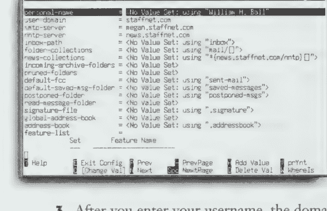

   图 13.1：`pine` 邮件配置屏幕用于指定您的用户名和邮件服务器名称。

3. 输入您的用户名、ISP 的域名和 ISP 邮件服务器名称后，输入 `e`。`pine` 程序会询问您是否要将更改保存到 `.pinerc` 文件中。按 `Y` 保存更改。

4. 按 `C` 撰写邮件；`pine` 进入撰写模式，如图 13.2 所示。

5. 在 `To:` 字段中输入收件人的名称，然后按 Enter。如果您想将邮件抄送给他人，请在 `Cc:` 字段中输入另一个收件人。输入所有收件人后，按 Enter。若要随邮件发送文件附件，请输入有效的文件路径并按 Enter：

   `/mnt/dos/windows/desktop/report.doc`

   

   图 13.2：`pine` 撰写模式用于创建邮件消息。

6. 在 `Subject:` 字段中输入主题行，然后按 Enter。

   现在开始撰写您的邮件。当到达最右侧页边距时，行会自动换行。

7. 完成后，按 Ctrl+X 发送邮件。要取消邮件，请按 Ctrl+C。要推迟发送邮件，请按 Ctrl+O。表 13.3 总结了用于创建或编辑邮件的 `pine` 支持命令。

#### 表 13.3 `pine` 键盘移动、动作和编辑命令

| 命令 | 说明 |
| :--- | :--- |
| Ctrl+@ | 移至下一个单词。 |
| Ctrl+A | 移至行首。 |
| Ctrl+B | 向后移一个字符。 |
| Ctrl+C | 取消邮件。 |
| Ctrl+D | 删除一个字符。 |
| Ctrl+E | 移至行尾。 |
| Ctrl+F | 向前移一个字符。 |
| Ctrl+G | 显示帮助屏幕。 |
| Ctrl+H | 退格一个字符。 |
| Ctrl+J | 两端对齐段落。 |
| Ctrl+K | 删除当前行。 |
| Ctrl+N | 向下移一行。 |
| Ctrl+O | 推迟发送并保存邮件。 |
| Ctrl+P | 向上移一行。 |
| Ctrl+R | 插入文件。 |
| Ctrl+T | 检查邮件拼写。 |
| Ctrl+V | 向下翻页。 |
| Ctrl+W | 搜索单词。 |
| Ctrl+X | 发送邮件。 |
| Ctrl+Y | 向上翻页。 |

与 `mail` 命令类似，`pine` 从 `/var/spool/mail` 目录中提取您的邮件。传入的邮件显示在列表中，如图 13.3 所示；您可以使用光标键上下滚动来选择邮件。在邮件主列表中，您可以删除、撤销删除、保存、阅读以及将邮件导出到您的主目录。要阅读邮件，请将光标移至所需邮件并按 Enter。

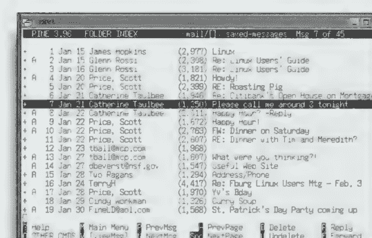

图 13.3：`pine` 邮件程序在滚动列表中显示邮件。

### 使用 Netscape Messenger 创建、发送和阅读邮件

Netscape Communicator 或许最广为人知的是作为网页浏览器，但它还通过 Netscape Messenger 组件支持电子邮件。在您使用 Netscape Messenger 发送或接收电子邮件之前，必须对其进行配置。您必须运行 X Window 系统才能使用 Netscape。

> **另请参阅**
>
> - 要了解更多关于使用 Netscape 的信息，请参阅第 216 页。
> - 要了解更多关于 PPP 连接的信息，请参阅第 166 页。

#### 配置 Netscape Messenger

1. 在终端窗口的命令行中输入以下内容启动 Netscape Messenger：

   ```bash
   # netscape -mail &
   ```

2. 这将启动 Netscape；Netscape 组件栏将出现（见图 13.4），同时会出现 Netscape Messenger 的主窗口（如图 13.5 所示）。

   

   图 13.4：Netscape 组件栏。

   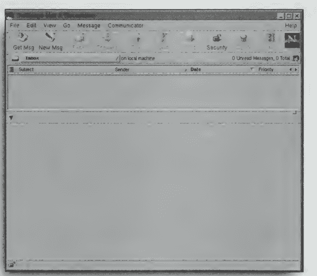

   图 13.5：Netscape Messenger 应用程序为 X11 Linux 用户提供电子邮件支持。

3. 拉下 Edit（编辑）菜单并选择 Preferences（首选项）。这将显示 Messenger Preferences（Messenger 首选项）对话框（如图 13.6 所示）。

   图 13.6：通过首选项对话框配置 Netscape Messenger。

   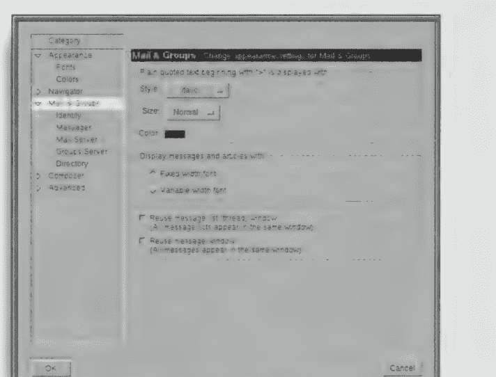

4. 将光标移至 Category（类别）列表中的 Identity（身份）项目并单击它，以显示 Identity 对话框。在 Your Name 字段中输入您的姓名，并在 EmailAddress 字段中输入您的电子邮件地址，如图 13.7 所示。

5. 将光标移至 Category 列表中的 Mail Server（邮件服务器）项目，并单击它以显示 Mail Server 对话框，如图 13.8 所示。在 Mail Server User Name 字段中输入您的用户名（由您的 ISP 分配）。在 Outgoing Mail (SMTP) Server 字段中输入您的发件邮件服务器名称。在 Incoming Mail Server 字段中输入您的收件邮件服务器名称（即您的 ISP 邮件服务器名称）。

6. 如果您的 ISP 邮件服务器使用 POP3 邮件协议，请确保 POP3 旁的菱形被选中，然后按 Enter。Netscape 会自动在您的主目录下创建一个名为 `nsmail` 的目录。该目录包含以下文件：

   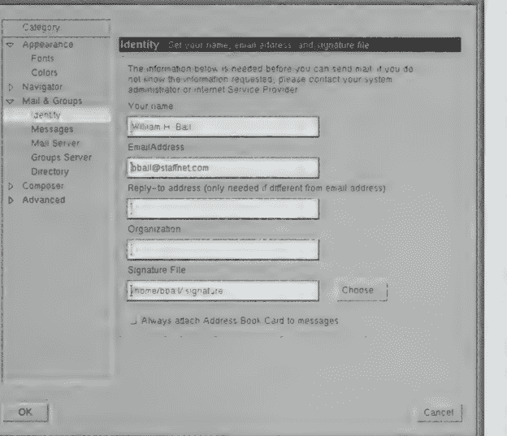

   图 13.7：Netscape Messenger Identity Preference 对话框包含电子邮件身份识别信息，例如您的姓名和电子邮件地址。

   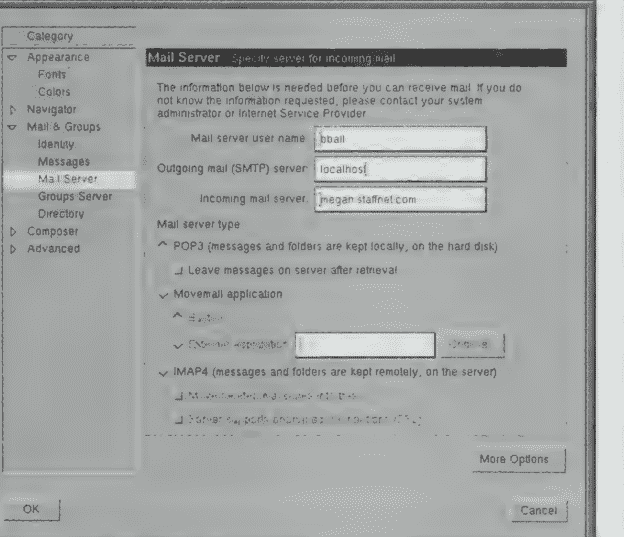

   图 13.8：Netscape Messenger Mail Server 对话框包含您的用户名以及收发邮件服务器和协议的信息。

   `Drafts`、`Sent`、`Unsent Messages`、`Inbox`、`Trash`。

   这些文件代表您在使用 Netscape Messenger 时创建、编辑、发送或推迟的电子邮件。

#### 接收和创建邮件

1. 启动 Netscape Messenger。启动与 ISP 的 PPP 连接。

2. 单击 Get Msg 按钮（参考图 13.5）。Netscape Messenger 会提示您输入 ISP 邮件服务器的密码。输入密码并按 Enter。

3. Netscape 从您的 ISP 邮件服务器下载等待的邮件消息，然后在 Messenger 窗口中显示邮件列表（见图 13.9）。要查看邮件，请双击邮件列表中的相应邮件。

   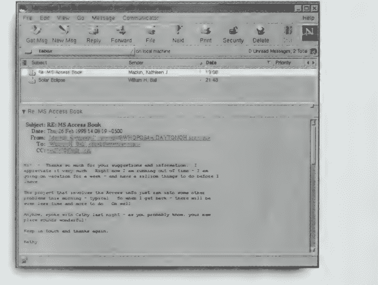

   图 13.9：通过双击 Netscape Messenger 主窗口邮件列表中的邮件来阅读收到的邮件。

4. 阅读邮件后，您可以通过选择 Netscape Messenger 工具栏中的相应按钮来回复、转发或存档邮件（参考图 13.9）。

5. 要创建邮件，请单击 New Msg 按钮。Netscape Messenger 将显示其 Message Composition（邮件撰写）窗口，如图 13.10 所示。

   图 13.10：在 Netscape Messenger 的邮件撰写窗口中创建新邮件。

   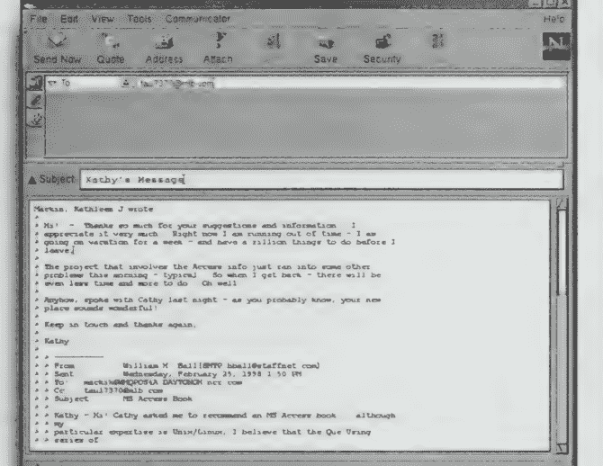

6. 将鼠标光标移至 To 行并输入电子邮件地址。

7. 将光标移至 Subject 行，并输入主题。按 Enter 并开始输入邮件内容。

8. 完成后，单击邮件撰写窗口工具栏上的 Send Now 按钮（参考图 13.10）立即发送邮件。若要将邮件保存为草稿，请单击工具栏上的 Save 按钮。

## 管理电子邮件

垃圾邮件，也称为 `spam`，非常令人厌烦。这些乏味的邮件是由伪创业白痴发送的邮件列表，他们通过向数百万个电子邮箱发送平庸的“快速致富”计划来推销他们不受欢迎的废话。垃圾邮件浪费您的时间并耗费金钱，尤其是如果您为了接收邮件而给 ISP 打长途电话，结果却不得不面对这些蠢货（他们通常使用伪造的回复地址，非法地通过无辜的邮件服务器路由）发来的那些侵入性的、垃圾般的信息。

**漏洞修复：无法获得 Netscape 的帮助？**

Netscape Communicator 4.04 为每个包含的组件（包括 Netscape Messenger）提供了全面的内置帮助。然而，Netscape 的安装脚本 `ns-install` 没有为 Netscape 的内置帮助文件创建所需的目录或链接。如果您单击 Netscape 的 Help 按钮，将会收到一条错误消息，指出所需的文件和目录不可用。您可以通过创建以下符号链接来修复此问题（符号链接在第 3 章“导航 Unix 文件系统”的“创建符号链接”节中讨论）：

```bash
# ln -s /opt/netscape /usr/local/lib/netscape
```

创建此符号链接目录后，Netscape 4.04 将知道在哪里查找其帮助文件。

## 使用电子邮件

面对垃圾邮件，你能做什么？我列出了一些可以遵循的通用规则，但并非所有方法都有效：

- 除非你认识且信任该公司或供应商，否则绝不要在网站的请求表单中输入你的电子邮件地址。
- 如果你经常在 Usenet 新闻组发布或回复消息，请配置你的邮件程序，在发送真实用户名的同时附加一个可以轻松删除的嵌入字符串。这能给真正关注的人提供线索，但能挫败那些使用提取软件从新闻组帖子中搜集邮件地址以构建批量邮件列表的电子邮件恶棍。尝试使用如下格式的邮件地址：

  `bball@_FIGHT_ALL_spam_staffnet.com`

- 如果你收到特别令人厌恶的电子邮件，请向相关的当地、州或联邦当局提交书面投诉，并附上该消息的打印副本。
- 在任何发布的 Usenet 消息正文末尾，附上你所在州的总检察长或相关联邦邮政或商业欺诈报告当局的有效电子邮件地址。这将有助于确保这些地址如果被搜集，也会被包含在未来的垃圾邮件发送列表中。
- 向你的 ISP 投诉来自批量邮件发送者的不请自来的电子邮件。
- 不要费力去向垃圾邮件发送者投诉：这些蠕虫是出身可疑的法外之徒。不要掉入任何被鼓励的程序陷阱中，例如“TO BE REMOVED”（请求删除）或“REPLY TO:”（回复至）这类诱饵，因为这反而会确保你收到更多垃圾邮件，因为你验证了你的邮件地址是有效的！
- 使用邮件过滤器删除或整理所有来自不受欢迎来源的入站邮件。

> **另请参阅**
>
> 要了解更多关于阅读 Usenet 新闻或使用新闻阅读器的信息，请参阅第 227 页。

## 配置 `procmail` 过滤邮件

`procmail` 是一款邮件处理程序，是对抗垃圾邮件战争中的第一道防线。该命令位于 `/usr/bin` 目录下，用于过滤入站邮件，以便你可以根据发件人、主题、收件人或文本自动删除或整理消息。邮件处理是通过使用 `procmail` 的命令语法来编写简短的过滤器（或称为“配方/recipes”）实现的。

### 编写 `procmail` 配方

1. 使用你喜欢的文本编辑器，在主目录中创建一个名为 `.procmailrc` 的文本文件。指定你的邮件目录名称（如果你使用 `pine`，则为 `mail`）、`.procmail` 目录的位置以及 `procmail` 过滤器文件的名称，如下所示：

   ```bash
   MAILDIR=$HOME/mail
   PMDIR=$HOME/.procmail
   INCLUDERC=$HOME/rc.mailfilter
   ```

2. 保存此文件，然后在主目录中创建一个名为 `.forward` 的文本文件，写入以下行（将 `username` 替换为你的用户名）：

   ```bash
   "!IFS= & exec /usr/bin/procmail -f - || exit 75 username"
   ```

3. 保存 `.forward` 文件，然后使用 `chmod` 命令更改 `.forward` 文件和你主目录的权限，如下所示：

   ```bash
   # chmod 644 .forward
   # chmod a+x /home/bball
   ```

4. 使用 `mkdir` 命令创建名为 `.procmail` 的目录：

   ```bash
   # mkdir .procmail
   ```

5. 通过输入以下命令切换到 `.procmail` 目录：

   ```bash
   # cd .procmail
   ```

6. 创建一个名为 `rc.mailfilter` 的文本文件，并输入三个 `procmail` 配方，如下所示：

   ```text
   :0:
   *"From:.*aol.com"
   AOL
   :0:
   *"From:.*hotmail.com"
   /dev/null
   :0:
   *^Subject:.*CASH
   /dev/null
   :0:
   ```

7. 保存 `rc.mailfilter` 文件。

8. 连接到你的 ISP 并检索邮件。从现在起，`procmail` 将过滤所有入站邮件（`.forward` 文件指定所有入站邮件都转发通过 `procmail` 程序）。第一个配方将所有来自 `aol.com` 的邮件消息保存到名为 `AOL` 的邮件文件夹中。下一个配方将所有来自 `hotmail.com` 域的消息发送到它们应有的地方：“旧的比特桶” `/dev/null`。这意味着当你收到一条 From: 字段中包含字符串 `hotmail.com` 的消息时，`procmail` 甚至不会将其保存在你的硬盘上。最后一个配方将所有主题行（Subject:）带有 `CASH` 字样的消息发送到同一个废料场。

9. 当你收到更多垃圾邮件时，输入新的配方来过滤不想要的邮件。

要为你的 `procmail` 配方添加更多功能，请阅读 `procmailre` 手册页。如需查看大量 `procmail` 配方示例，请参阅 `procmailex` 手册页。

> **厌倦了垃圾邮件？**
>
> 我说的是伪造的电子邮件，而不是 Hormel 公司注册商标的美味食品。尽管如此，如果你想了解更多关于如何保护自己免受这些卑鄙的批量邮件发送者侵害的方法，请浏览以下网站，学习如何保护自己，编写更复杂的 `procmail` 配方，并在怀疑有欺诈行为时向相关部门投诉：
>
> - `http://spam.abuse.net/spam`
> - `http://www.cauce.org`
> - `http://www.elsop.com/wrc/`
> - `http://members.aol.com/macabrus`

## 第 14 章：使用 FTP

作者：Bill Ball

- `ftp` 和 `ncftp` 命令的特点
- 使用 `ftp` 命令下载
- 使用 `ncftp` 命令下载
- 使用 Netscape 下载文件

### 使用 `ftp` 命令

使用 `ftp`（文件传输）命令直接从互联网上的另一台计算机将文件下载到你的计算机。`ftp` 支持标准的文件传输协议（File Transfer Protocol，简称 FTP），最初设计用于在互联网上的其他网络计算机之间传输文件。

`ftp` 位于 `/usr/bin` 目录下，具有五个命令行选项和 53 个内置命令。在控制台的命令行或终端窗口中使用此程序，后跟远程计算机的名称，如下所示：

```text
# ftp ftp.mcp.com

Connected to ftp.mcp.com.

220 iq-mcp FTP server (Version wu-2.4(4) Sun Dec 21 13:01:32

EST 1997) ready.

Name (ftp.mcp.com:bball):
```

你也可以使用互联网（IP）地址连接到远程计算机，如下所示：

```text
# ftp 206.246.150.88

Connected to 206.246.150.88.

220 iq-mcp FTP server (Version wu-2.4(4) Sun Dec 21 13:01:32

EST 1997) ready.

Name (206.246.150.88:bball):
```

这两个命令行都将你连接到同一台远程计算机。使用 `ftp` 时，你甚至不需要在命令行上指定主机名；你可以通过使用 `ftp` 的 `open` 和 `close` 命令以交互方式运行该程序——重复地连接和断开与不同计算机的连接：

```text
# ftp

ftp> open ftp.mcp.com

Connected to ftp.mcp.com.
```


220 iq-mcp FTP server (Version wu-2.4(4) Sun Dec 21 13:01:32

EST 1997) ready.

Name (ftp.mcp.com:bball): anonymous

331 Guest login ok, send your complete e-mail address as

password.

Password:

230 Guest login ok, access restrictions apply.

Remote system type is UNIX.

Using binary mode to transfer files.

```
ftp> close
221 Goodbye.
```

在使用 `close` 命令后，你可以通过使用 `open` 命令后跟 FTP 服务器的名称，打开与另一台计算机的新连接：

```
ftp> open ftp.tenon.com
Connected to toady.tenon.com.
220-
220-Welcome to ftp.tenon.com, Tenon Intersystem's FTP
server.
220- .	Thanks, Tenon Tech Support
220- 		support@tenon.com.
220 toady FTP server (Version wu-2.4(2 Wed May 10 19:20:08
GMT .0000 1995) ready.
Name (ftp.tenon.com:bball): anonymous
331 Guest login ok, send your complete e-mail address as
password.
Password:
230-Please read the file README
230- 	 it was last modified on Wed Jan 18 14:54:20 1995 -
1167 days ago
230 Guest login ok, access restrictions apply.
Remote system type is UNIX.
Using binary mode to transfer files.
ftp> bye
221 Goodbye.
```

在这个示例中，我首先使用 `open` 命令连接到 Macmillan Computer Publishing 的 FTP 服务器。登录后，我使用 `close` 命令断开与 MCP 服务器的连接，连接到 Tenon 的 FTP 服务器，然后使用 `bye` 命令关闭连接。你在 `ftp` 中将用到的绝大多数命令都列在表 14.1 中。

### 表 14.1 常用 `ftp` 命令

| 命令名称 | 动作 |
| :--- | :--- |
| `!` | 运行 shell 命令。 |
| `ascii` | 指定文本文件下载。 |
| `binary` | 指定二进制文件下载。 |
| `bye` | 关闭打开的连接并退出 `ftp`。 |
| `cd nnn` | 切换到目录 `nnn`。 |
| `close` | 关闭打开的连接。 |
| `exit` | 关闭任何打开的连接并退出。 |
| `get file` | 从远程计算机的当前目录下载文件。 |
| `help` | 列出 `ftp` 命令的帮助主题。 |
| `help str` | 列出特定主题 `str` 的帮助。 |
| `ls` | 列出远程计算机当前目录中的文件或目录。 |
| `mget nnn` | 根据模式 `nnn` 下载多个文件。 |
| `mput nnn` | 根据模式 `nnn` 将多个文件发送（上传）到远程计算机。 |
| `open` | 打开与远程计算机的连接。 |
| `prompt` | 在多文件传输期间关闭提示。 |
| `pwd` | 打印远程计算机上的当前工作目录。 |
| `put` | 将文件从你的计算机发送（上传）到远程计算机。 |

### 使用 `ftp` 下载文件

在 `ftp` 连接到远程计算机后，远程计算机通常会显示登录提示。如果你在远程计算机系统上没有账户（例如用户名或密码），请在 `Name` 提示处输入 `anonymous` 并按 Enter 键。在 `Password` 提示处，输入你的电子邮件地址。你的电子邮件地址不会在屏幕上回显。

> 另请参阅

- 要了解更多关于使用 `cd` 命令更改目录的信息，请参阅第 30 页。
- 要了解更多关于使用电子邮件的信息，请参阅第 180 页。
- 要了解更多关于互联网网络服务和 Linux 的信息，请参阅第 444 页。

## 使用 `ftp` 命令

### 登录、导航和下载文件

1. 启动你的 Internet 连接——例如 PPP 连接。在控制台的命令行或终端窗口中，使用 `ftp` 命令，后接远程计算机的名称，如下所示：

```
# ftp sunsite.unc.edu
Connected to sunsite.unc.edu.
220- Welcome to the SunSITE USA ftp archives!
220-
220-You can access this archive via http with the same URL.
220-
220-example: ftp://sunsite.unc.edu/pub/Linux/ becomes
220- http://sunsite.unc.edu/pub/Linux/
220- this:
220-For more information about services offered by SunSITE,
220-go to http://sunsite.unc.edu.
220-
220-WE ARE BACK TO USING WFTPD.
220-You can still get tarred directories if you issue the following command:
220- get dirname.tar
220-You can also get gzipped or compressed tarred directories by following
220-the .tar.with .gz or .z, respectively.
220-
220-Have any suggestions or questions? Email ftpkeeper@sunsite.unc.edu.
220-
220 helios.oit.unc.edu FTP server (Version wu-2.4.2-academ[BETA-13])
(6) Thu Jul 17 16:22:52 EDT 1997) ready.
Name (sunsite.unc.edu:bball):
```

2. 在 `Name` 提示符处输入 `anonymous`：

```
Name (sunsite.unc.edu:bball): anonymous
331 Guest login ok, send your complete e-mail address as password.
Password:
```

### Linux 与 `ftp`

当你安装 Red Hat Linux 时，系统会创建一个名为 `ftp` 的用户，以及一个位于 `/home` 目录下的名为 `ftp` 的目录。（你可以通过查看系统的 `/etc/passwd` 文件内容来确认这一点。）要为你的系统启用 FTP 访问，请以 root 操作员身份登录，启动 X11，并使用 Red Hat 的 `tksysv` 控制面板工具来启动 `inet` 服务。要测试你的系统是否可用 FTP 访问，请使用 `ftp` 命令，后接你的计算机名称，如下所示：

```
# ftp localhost
```

如果你看到了登录提示，说明 FTP 已启用。有关 Linux Internet 网络服务的更多信息，请参阅 `services` 手册页。

3. 在 `Password` 提示符处输入你的电子邮件地址——例如 `bball@staffnet.com`：

```
Password:
230 Guest login ok, access restrictions apply.
Remote system type is UNIX.
Using binary mode to transfer files.
ftp>
```

记住：在 `Password` 提示符处输入任何内容都不会显示！

4. 要查看当前目录的内容，请使用 `ftp` 的 `ls`（列出目录）命令：

```
ftp> ls
200 PORT command successful.
150 Opening ASCII mode data connection for /bin/ls.
total 28797
dr-xr-xr-x  9 root  other   512 Feb 16 16:22 .
dr-xr-xr-x  9 root  other   512 Feb 16 16:22 ..
-r--r--r--  1 root  other 29428182 Mar 31 07:26 IAFA-LISTINGS
lwxrwxrwx  1 root  other     7 Jul 16 1997 README -> WELCOME
-r--r--r--  1 root  other   608 Jan 13 1997 WELCOME
dr-xr-xr-x  2 root  other   512 Jul 16 1997 bin
dr-xr-xr-x  2 root  other   512 Jul 16 1997 dev
dr-xr-xr-x  2 root  other   512 Jul 18 1997 etc
drwxrwxrwx  6 root  other 18944 Mar 30 01:48 incoming
dr-xr-xr-x 17 root  root   512 Mar 19 22:13 pub
dr-xr-xr-x  3 root  other   512 Jul 16 1997 unc
dr-xr-xr-x  5 root  other   512 Jul 16 1997 usr
226 Transfer complete.
ftp>
```

5. 要导航到另一个目录，请使用 `ftp` 的 `cd`（切换目录）命令，后接目录名称：

```
ftp> cd pub
250 CWD command successful.
ftp>
```

6. 要导航到特定的子目录，请在 `cd` 命令中使用更完整的路径规范：

```
ftp> cd pub/Linux/games/arcade
250 CWD command successful.
ftp>
```

7. 要列出特定文件，请使用 `ftp` 的 `ls` 命令结合通配符模式：

```
ftp> ls xcen*
200 PORT command successful.
150 Opening ASCII mode data connection for /bin/ls.
-rw-r--r--. 1 67 1002 6884 Aug 01 1996 xcentipede-0.01.ELF.gz
-rw-r--r--. 1 67 1002 1595 Aug 01 1996 xcentipede-0.01.README
-rw-r--r--. 1 67 1002 1104 Aug 01 1996 xcentipede-0.01.lsm
-rw-r--r--. 1 67 1002 10016 Aug 01 1996 xcentipede-0.01.src.tgz
226 Transfer complete.
ftp>
```

8. 为了准备下载二进制文件（例如压缩的 Linux gzip 存档），请使用 `ftp` 的 `binary` 命令：

```
ftp> binary
200 Type set to I.
ftp>
```

9. 要下载单个文件，请使用 `ftp` 的 `get` 命令，后接文件名：

```
ftp> get xcentipede-0.01.ELF.gz
local: xcentipede-0.01.ELF.gz remote: xcentipede-0.01.ELF.gz
200 PORT command successful.
150 Opening BINARY mode data connection for xcentipede-0.01.ELF.gz (6884 bytes).
226 Transfer complete.
6884 bytes received in 2.37 secs (2.8 Kbytes/sec)
ftp>
```

10. 如果你不记得远程计算机的当前目录，请使用 `ftp` 的 `pwd`（打印工作目录）命令：

```
ftp> pwd
257 "/pub/Linux/games/arcade" is current directory.
ftp>
```

11. 为了准备下载文本文件，请使用 `ftp` 的 `ascii` 命令：

```
ftp> ascii
200 Type set to A.
ftp>
```

12. 要下载多个文件，请使用 `ftp` 的 `mget` 命令，后接文件名模式：

```
ftp> mget xb*.lsm
mget xbattle.patch.lsm? y
200 PORT command successful.
150 Opening ASCII mode data connection for xbattle.patch.lsm (286 bytes).
226 Transfer complete.
295 bytes received in 0.0602 secs (4.8 Kbytes/sec)
mget xbill-2.0.lsm? y
200 PORT command successful.
150 Opening ASCII mode data connection for xbill-2.0.lsm (606 bytes).
226 Transfer complete.
623 bytes received in 0.131 secs (4.6 Kbytes/sec)
mget xblast-2.2.1.lsm? y
200 PORT command successful.
150 Opening ASCII mode data connection for xblast-2.2.1.lsm (858 bytes).
226 Transfer complete.
879 bytes received in 0.161 secs (5.3 Kbytes/sec)
mget xboing-2.3.lsm? y
200 PORT command successful.
150 Opening ASCII mode data connection for xboing-2.3.lsm (465 bytes).
226 Transfer complete.
479 bytes received in 0.111 secs (4.2 Kbytes/sec)
ftp>
```

在获取每个文件之前，`ftp` 都会提示并询问 **Y** 或 **N**。按下 **Y** 下载文件；按下 **N** 跳过该文件并进入下一个文件。

13. 要在没有提示的情况下下载多个文件，请使用 `ftp` 的 `prompt` 命令来切换交互式下载模式：

```
ftp> prompt
Interactive mode off.
ftp> mget xb*.
local: xbattle.patch.lsm remote: xbattle.patch.lsm
200 PORT command successful.
150 Opening ASCII mode data connection for xbattle.patch.lsm (286 bytes).
226 Transfer complete.
295 bytes received in 0.0602 secs (4.8 Kbytes/sec)
local: xbill-2.0.lsm remote: xbill-2.0.lsm
200 PORT command successful.
150 Opening ASCII mode data connection for xbill-2.0.lsm (606 bytes).
226 Transfer complete.
623 bytes received in 0.121 secs (5 Kbytes/sec)
local: xblast-2.2.1.lsm remote: xblast-2.2.1.lsm
200 PORT command successful.
425 Can't create data socket (152.2.254.81,20): Address already in use.
local: xboing-2.3.lsm remote: xboing-2.3.lsm
200 PORT command successful.
150 Opening ASCII mode data connection for xboing-2.3.lsm (465 bytes).
226 Transfer complete.
479 bytes received in 0.0906 secs (5.2 Kbytes/sec)
ftp>
```

14. 要在 `ftp` 内部使用 shell 命令，请使用感叹号字符（`!`）后接命令行：

```
ftp> ! ls -1 xb*.
```


```text
-rw-rw-r-- 1 bball bball 286 Mar 31 12:41 xbattle.patch.lsm
-rw-rw-r-- 1 bball bball 606 Mar 31 12:41 xbill-2.0.lsm
-rw-rw-r-- 1 bball bball 858 Mar 31 12:39 xblast-2.2.1.lsm
-rw-rw-r-- 1 bball bball 465 Mar 31 12:43 xboing-2.3.lsm

ftp>
```

15. 要在不退出`ftp`的情况下关闭连接，请使用`close`命令：

```text
ftp> close

221 Goodbye.

ftp>
```

### 使用`exit`命令返回`ftp`

使用`ftp`的 shell 提示符虽然方便但有时会令人困惑，尤其是当你输入感叹号字符并直接按下 Enter 键而没有输入任何命令时。你会发现自己回到了 shell 提示符，并且你可能会认为自己已经断开连接并退出了程序。在这种情况下，输入单词`exit`即可返回到`ftp`程序。

## 使用 FTP

16. 要退出`ftp`，请使用`quit`或`exit`命令：

```text
ftp> quit
```

**另请参阅**

要了解更多关于在 Linux 中使用 shell 的信息，请参阅第 16 页。

## 使用`ftp`帮助命令

`ftp`具有内置帮助功能，可作为不同命令的快速提醒。该帮助系统可在远程连接前或连接期间使用；只需输入`help`即可打印所有内置命令列表：

```text
# ftp

ftp> help
```

命令可以缩写。具体命令如下：

|   |   |   |   |   |
|---|---|---|---|---|
| `!` | `debug` | `mdir` | `sendport` | `site` |
| `$` | `dir` | `mget` | `put` | `size` |
| `account` | `disconnect` | `mkdir` | `pwd` | `status` |
| `append` | `exit` | `mls` | `quit` | `struct` |
| `ascii` | `form` | `mode` | `quote` | `system` |
| `bell` | `get` | `modtime` | `recv` | `sunique` |
| `binary` | `glob` | `mput` | `eget` | `tenex` |
| `bye` | `hash` | `newe` | `rstatus` | `tick` |
| `case` | `help` | `nmap` | `rhelp` | `trace` |
| `cd` | `idle` | `nlist` | `rename` | `type` |
| `cdup` | `image` | `ntrans` | `reset` | `user` |
| `chmod` | `lcd` | `open` | `restart` | `umask` |
| `close` | `ls` | `prompt` | `rmdir` | `verbose` |
| `cr` | `macdef` | `passive` | `runique` | `?` |
| `delete` | `mdelete` | `proxy` | `send` |   |

```text
ftp> help prompt

prompt force interactive prompting on multiple commands

ftp> help exit

exit terminate ftp session and exit

ftp>
```

输入`help`加上命令名称将打印该命令的简短描述。

使用`ftp`的内置帮助来补充其手册页。更详尽的文档可以在`/usr/doc/wu-ftpd`目录下找到。

## 使用`ncftp`命令

`ncftp`命令与`ftp`命令类似，但具有额外的功能，包括以下各项：

- 三种视觉（屏幕）模式
- 15 个命令行选项
- 一个与主滚动窗口分离的命令行
- 一个显示下载进度、已用时间和剩余完成时间的状态行
- 一个用于书签（远程计算机的缩写主机名）的编辑器

`ncftp`命令还具有一个类似于`ftp`的内置帮助设施。您可以通过访问此地址了解更多关于`ncftp`的信息：`http://www.probe.net/~mgleason`

## 使用`ncftp`命令下载

`ncftp`命令提供几个命令行选项，可以为您节省时间和输入量。

### 使用`ncftp`命令下载文件

1. 启动您的 PPP 连接。使用`ncftp`命令后跟`-a`（匿名）选项，快速登录到远程计算机，如下所示：

   ```text
   # ncftp -a ftp.ncftp.com
   ```

2. 屏幕清空，`ncftp`自动将您登录到远程计算机，并在显示屏上发送类似于以下的信息：

   ```text
   Trying to connect to ftp.ncftp.com...
   ```

   ```text
   You are user #2 of 50 simultaneous users allowed.
   ```

   ```text
   Welcome to ftp.ncftp.com

   Logged in anonymously.
   ```

3. 如果您知道远程计算机上所需文件的完整路径，请使用`ncftp`的`-a`选项，后跟 FTP 服务器名称、冒号以及所需文件的完整路径或目录规范：

   ```text
   # ncftp -a sunsite.unc.edu:/pub/Linux/NEW
   ```

   该命令行会检索`sunsite.unc.edu` FTP 服务器上最新的 Linux 软件列表（最新的文件位于列表底部）。

4. 为了进一步节省时间，可以使用`ncftp`的`-c`命令将检索的文件通过`tail`和`less`命令进行管道传输，如下所示：

   ```text
   # ncftp -ac sunsite.unc.edu:/pub/Linux/NEW | tail | less
   ```

   在稍作停顿，经过`ncftp`的自动登录和检索后，您应该会看到类似以下内容：

   ```text
   system/network/serial/ppp/ppppp-1.0.tar.gz (183724 bytes)

   ppp setup program with a similar user interface to windows' Internet Wizard (

   Mar 30, 1998 16:38:13 EST)
   ```

   ```text
   kernel/patches/cdrom/linux-2.0.30-cm205ms-0.10.tgz (41435 bytes)

   new cdrom device driver Philips LMS cm205ms/cm206 (Mar 30, 1998 20:59:44 EST)
   ```

   ```text
   system/mail/mua/mr0721beta.tar.gz (71392 bytes)

   mr is a colorful mailreader (Mar 31, 1998 2:29:3 EST)
   ```

**另请参阅**

- 要了解更多关于使用 pager 命令的信息，请参阅第 33 页。

### 使用`ncftp`获取新版本的`ncftp`

要获取最新版本的`ncftp`命令，请输入以下内容：

```text
# ncftp -a ftp.ncftp.com:/ncftp/ncftp-2.4.3.tar.gz
```

## 使用 Netscape 下载文件

Netscape Communicator 不仅可以交互式地浏览 Web，还可以通过终端窗口的命令行被指令从远程计算机检索文件。Netscape Navigator（Linux 版 Netscape Communicator 发行版的一个组件）能够识别 FTP 协议的统一资源定位符 (URL) 规范 (`ftp://`)。这对于快速从互联网上的已知位置下载已知文件非常方便。

**另请参阅**

- 有关 Linux 版 Netscape Communicator 的更多信息，请参阅第 216 页。
- 要了解更多关于 X Window 系统的信息，请参阅第 260 页。

### 使用 Netscape 从命令行下载

1. 启动一个 X Window 系统会话。在命令行中，使用`netscape`命令后跟`ftp://` URL 规范、远程服务器名称以及所需文件的完整路径名，如下所示：

   ```text
   # netscape ftp://sunsite.unc.edu/pub/Linux/NEW
   ```

   该命令行会生成一个最新的 Linux 文件列表（参考之前的示例）。Netscape 将加载、连接并检索文件，如图 14.1 所示。

   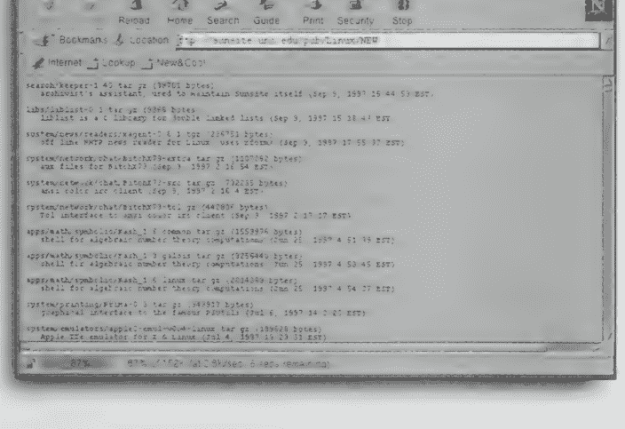

   **图 14.1** Netscape 可以从终端窗口的命令行启动，直接导航到远程计算机上的所需文件。

2. 为了在直接下载二进制文件（如压缩存档）时节省时间，您需要知道远程服务器的名称和文件的完整路径名。例如，要下载一个出色的 Linux 和 X11 街机游戏，请在命令行中使用`netscape`，如下所示：

   ```text
   # netscape ftp://sunsite.unc.edu/pub/Linux/games/arcade/Terroid-1.4-486-elf.tar.gz
   ```

   Netscape 连接到远程计算机并尝试检索文件。如果找到了该文件，Netscape 将显示一个保存对话框，如图 14.2 所示。虽然对话框提供了一个通配符字段（通常用于通过通配符选择性地查看要打开的文件列表），但请直接进入下一步。

   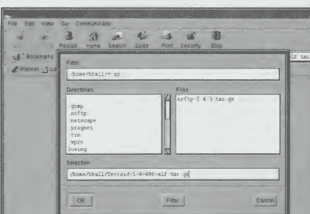

   **图 14.2** Netscape 在从远程计算机下载和检索文件之前会显示一个保存对话框。

3. 点击 OK 开始检索文件。Netscape 随后会显示一个下载进度窗口，显示文件名、大小以及预计完成下载的时间。

# 第 15 章：使用 Web 浏览器

作者：Bill Ball

- 配置和使用`lynx`网页浏览器
- 下载和安装 Netscape Communicator
- 配置和使用 Netscape Communicator

## 使用`lynx`浏览器

由堪萨斯大学托管的`lynx`网页浏览器是一个纯文本浏览器。该程序不会加载网页图形，不支持播放声音，也不使用现代网页浏览器的任何插件功能。然而，`lynx`快速且高效，不占用太多磁盘空间（大约 500,000 字节，而 Netscape 接近 22 兆字节）。

您不需要使用 X11 即可浏览 Web；直接从命令行使用`lynx`：

```text
# lynx http://www.mcp.com
```


`lynx` 浏览器将连接到 Macmillan Publishing 的网页，并将其显示在您的显示屏或终端窗口中，如图 15.1 所示。

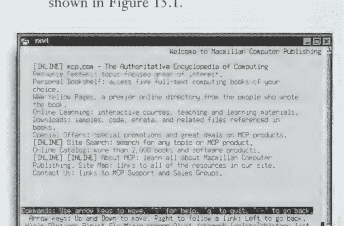
**图 15.1** `lynx` 程序是一个纯文本网页浏览器。

如果您使用的是 X Window 系统，也可以在 X11 终端客户端的窗口中使用 `lynx` 浏览 Web。使用 `lynx` 可以快速浏览网页，而不会因为广告、大型图形或动画（这些可能会阻碍获取信息）而产生延迟，即所谓的“万维等待 (World Wide Wait)”。

`lynx` 浏览器具有 66 个不同的命令行选项，但使用简单。用于导航网页的最常用按键命令列在表 15.1 中。

## 使用 lynx 浏览器

### 表 15.1 常用 lynx 键盘命令

| 操作 | 按键 |
|---|---|
| 将页面添加到书签文件 | `a` |
| 下载高亮文件 | `Enter` 键或 `d` 键 |
| 在跳转前编辑当前 URL | `G` |
| 获取帮助 | `?` 键或 `h` 键 |
| 跳转到某个 URL | `g` |
| 跳转到主题 | `Enter` 键或 右方向键 |
| 邮寄当前页面 | `p`，随后按下 下方向键，`Enter` 键 |
| 下一个主题 | 下方向键 |
| 上一页 | 左方向键 |
| 上一个主题 | 上方向键 |
| 将链接保存到书签文件 | `a` |
| 将页面保存到文件 | `p`，随后按下 `Enter` 键 |
| 向上滚动一页 | `PageUp` 键 |
| 向上滚动半页 | `(` |
| 向下滚动一页 | 空格键 |
| 向下滚动半页 | `)` |
| 搜索页面 | `/` |

### 参阅

- 欲了解更多关于 PPP 连接的信息，请参阅第 166 页。
- 欲了解更多关于 X Window 系统和 X11 终端的信息，请参阅第 260 页。

### 使用 lynx 命令行

1. 启动您的 PPP 连接。要浏览互联网上的特定页面，请输入网络地址（也称为统一资源定位符，或 URL）：
   `# lynx http://www.mcp.com`

2. 要访问文件传输协议 (FTP) 服务器，请使用 FTP URL 地址：
   `# lynx ftp://unsite.unc.edu/pub/Linux`

此命令行将使您登录到指定的 `ftp` 服务器，并显示可用文件的列表，如图 15.2 所示。

## 使用 Web 浏览器

`lynx` 浏览器可以列出并检索来自 FTP 服务器的文件。

**节省下载文件的时间和精力**

如果您经常使用 `ftp` 命令从远程计算机检索文件，请尝试改用 `lynx` 浏览器。许多 FTP 站点现在包含 `.html` 格式的索引文件，这使得文件列表更加易读。要下载文件，请按住 `Shift` 键并点击文件名。

3. 若要使用 `lynx` 浏览器在不浏览的情况下检索文本文件，请输入已知 URL，然后使用 `-dump` 选项，随后接 shell 的标准输出重定向操作符，如下所示：
   `# lynx http://www.yahoo.com/headlines/news/summary.html -dump >news.raw`

此命令行会将请求页面的文本转储到磁盘上的一个文本文件中（请注意，到您阅读本文时，该 URL 可能已经失效）。

## 配置 lynx 浏览器

要配置 `lynx` 命令，请以 `root` 管理员身份登录并编辑 `/etc` 目录下的 `lynx.cfg` 文件。如果您愿意，可以先做一个备份副本（您可以在 `/usr/doc/lynx` 目录下找到原始副本）。`/etc/lynx.cfg` 文件包含 `lynx` 浏览器功能的系统范围设置。

1. 使用您喜欢的文本编辑器（例如 `pico`），打开 `lynx.cfg` 文件并关闭自动换行：
   `# pico -w /etc/lynx.cfg`

2. 要更改在命令行启动 `lynx` 且未指定 URL 时使用的默认网络地址，请修改 `STARTFILE` 变量使用的默认地址，将
   `STARTFILE:http://lynx.browser.org/`
   改为另一个地址（Red Hat Linux 用户会发现 `STARTFILE` 被定义为 `/usr/doc/HTML/index.html`）：
   `STARTFILE:http://www.yahoo.com/`

3. 要配置 `lynx` 使用安装在磁盘 `/usr/doc/lynx/lynx/lynx_help` 目录下的帮助文件，请将 `HELPFILE` 变量从其默认网络地址：
   `HELPFILE:http://www.cri.com//subir/lynx/lynx/lynx_help/lynx_main.html`
   改为 `lynx_help_main.html` 文件的位置：
   `HELPFILE:localhost/usr/doc/lynx-2.7.1/lynx_help/lynx_help_main.html`

做出此更改后，按下问号 (`?`) 键，`lynx` 将读取安装在您系统上的帮助文件，如图 15.3 所示，而不是浏览其主页以获取帮助信息。（请检查您的 `/usr/doc` 目录，确保输入了 `lynx` 帮助文件的正确路径。）

### 参阅

- 有关文本编辑器的更多信息，请参阅第 50 页。

**图 15.3**
`lynx` 程序可以从硬盘上的文件或通过指向互联网网页的链接显示在线帮助。

4. 要配置 `lynx` 作为 Usenet 新闻阅读器，请找到 `NNTPSERVER` 行并输入您的互联网服务提供商 (ISP) 的新闻服务器名称：
   `NNTPSERVER:your.ISPnewserver.com`

5. 要阅读主目录下 `.newsrc` 文件中指定的新闻组文章，请使用新闻 URL 前缀，随后接您的新闻服务器名称：
   `# lynx news://your.ISPnewserver.com`

6. 在使用 `lynx` 下载文件时，在显示的网页上导航到文件名，然后按下 `Enter` 或 `d` 键。

## 使用 Netscape Communicator

**免费授权的 Netscape Communicator 源码**

随着 Netscape Communications 决定向所有用户免费提供 Netscape Communicator 4.0，该公司通过宣布计划“在互联网上免费授权下一代广受欢迎的 Netscape Communicator 客户端软件的源代码”，令许多 Linux 软件开发人员感到震惊且欣喜。

这对您意味着什么？预计 Netscape Communicator 互联网工具套件将快速发展并获得许多增强功能。预计该程序在未来将成为几乎所有 Linux 发行版的标准组成部分。（目前它已包含在所有新的 Red Hat Linux CD-ROM 发行版中。）对于 Netscape 来说，作为首批拥抱并认可开源软件力量（基金会的 GNU 通用公共许可证）的大型商业软件公司之一，这意味着公司将从其浏览器工具的快速增强、改进和多样化中受益。

为 Netscape 采取这一大胆步骤而喝彩。您可以确信，全球 Linux 软件开发人员社区将在不久的将来通过对您最喜爱的 Web 工具进行一些“极佳”的改进，以十倍之礼回报这份慷慨。有关 Netscape Communicator 及相关程序源码授权的更多信息，请参阅：
`http://developer.netscape.com`

本节详细介绍了如何安装、配置以及使用 Netscape Communicator 的一些基本功能。该程序远不止是一个 Web 浏览器，它包含一组四个工具：用于网页浏览的 Navigator；用于电子邮件的 Messenger；用于阅读本地和 Usenet 新闻的 Collabra；以及用于创建和编辑网页的 Composer。

有关 Netscape Communication for Linux 的最新信息，请浏览 Netscape 主页：
`http://www.netscape.com`

### 参阅

- 欲了解更多关于阅读 Usenet 新闻的信息，请参阅第 227 页。
- 有关电子邮件的更多信息，请参阅第 183 页。

## 下载与安装 Netscape Communicator

由 Netscape Communications 开发的 Netscape Communicator Web 浏览器是包括 Linux 在内的所有计算机系统中最受欢迎的浏览器之一。感谢 Netscape，Linux 用户将在很长一段时间内继续享受这款浏览器（见下文侧栏“免费授权的 Netscape Communicator 源码”）。Netscape 注定将成为 Linux 的标准 Web 浏览器。

导航至 Netscape 主页 `http://home.netscape.com`，下载适合您 Linux 版本的 Netscape Communicator（有适用于 1.x 或 2.x 内核的版本）。

如果您使用的是通过 33.6Kb PPP 连接的拨号连接，请准备好面对漫长的下载过程——最新版本的压缩形式超过 10MB，安装后将需要近 22MB 的磁盘空间。此外，请考虑到在主目录中安装的默认 `.netscape` 目录在一段时间的使用后可能会增长到 10MB 以上。

**安装与配置 Communicator**

1. 以 `root` 管理员身份登录。启动您的 PPP 连接，导航至 Netscape 主页 `http://home.netscape.com`，并下载 Netscape Communicator for Linux。

2. 使用 `mkdir` 命令创建一个临时目录并将文件复制到其中。然后进入该临时目录，使用 `tar` 命令解压并提取 Netscape 安装包：
   `# tar xvzf *`

3. 使用其安装脚本开始安装 Netscape Communicator：
   `# ./ns-install`

4. 安装脚本将询问一些简单的问题，然后提取所需文件，创建必要的目录并安装浏览器。默认情况下，Communicator 及其文件被安装在 `/opt/netscape` 目录下。

5. 查看 `netscape` 目录下的 `README` 文件，获取有关版本说明、功能或已知问题的信息。

6. 要从终端窗口的命令行启动 Netscape，请指定其完整路径：
   `# /opt/netscape/netscape`

7. 一种更好的配置 Netscape 的方法是在 `/usr/local/bin` 目录下创建一个名为 `netscape` 的符号链接：
   `# ln -s /opt/netscape/netscape /usr/local/bin/netscape`

8. Netscape 的安装脚本没有创建使用客户端内置帮助所需的符号链接。如果您尝试使用 Netscape 帮助，将会收到错误消息。您可以通过两种不同的方式配置 Netscape。一种是使用 `ln` 命令创建所需的链接：
   `# ln -s /opt/netscape /usr/local/lib/netscape`

另一种方法是创建一个环境变量 `NS_NETHELP_PATH`，将其指向 `/opt/netscape/nethelp` 目录，并将 `/opt/netscape` 目录添加到 shell 的 `PATH` 环境变量中。打开 bash shell 的启动文件 `/etc/profile`，并输入以下内容：
`NS_NETHELP_PATH=/opt/netscape/nethelp`
`PATH=$PATH:/opt/netscape`
`export NS_NETHELP_PATH PATH`

## 使用 Netscape Communicator

Netscape Communicator 拥有近 30 个不同的命令行选项。像大多数规范的 X11 客户端一样，该程序还支持若干 X11 Toolkit 选项，例如几何尺寸（geometry）设置。例如，如果你想要一个较小的初始窗口，可以使用 `geometry` 设置来指定一个较小的启动窗口。

### 从命令行启动 Netscape

1. 使用 Navigator 的 `--help` 选项来查看支持的命令行选项列表：
   `# netscape --help`

如果列表对于你的终端窗口来说太长，请将标准错误输出重定向到文件中：
   `# netscape --help 2>netscape.options`

`netscape.options` 文件将包含 `--help` 选项的输出内容。

2. 要以特定的窗口大小启动 Netscape，请使用 X11 Toolkit 的 `-geometry` 设置，后面紧跟以水平和垂直像素表示的窗口大小：
   `# netscape -geometry 600x400 &`

**另请参阅**
* 有关 X11 Toolkit 选项的更多信息，请参阅第 307 页。
* 要详细了解输入或输出重定向，请参阅第 19 页。

3. Navigator 窗口将会出现，如图 15.4 所示。若要启动 Communicator 而不显示初始窗口，并且在不占用过多屏幕空间的情况下拥有一个包含四个基本 Communicator 组件的便捷浮动工具栏，请使用 `-component-bar` 选项：
   `# netscape -component-bar &`

保存文件。要立即使用此变量，请使用 bash shell 的 `source` 命令：
   `# source /etc/profile`

**另请参阅**
* 有关符号链接和使用 `ln` 命令的更多信息，请参阅第 40 页。
* 要详细了解 shell 环境变量，请参阅第 90 页。

### 使用 Netscape Communicator

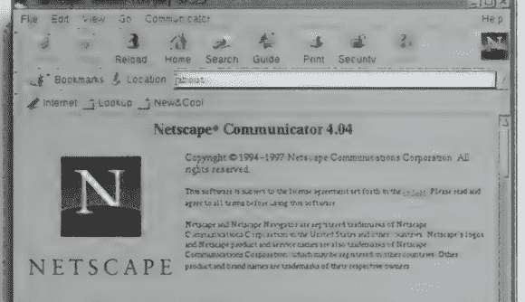
图 15.4
可以使用 X11 `-geometry` 设置来指定 Navigator 窗口的大小。

4. 工具栏将会出现，如图 15.5 所示。通过点击工具栏上的 Navigator、Mailbox、Discussions 或 Composer 图标来运行所需的组件。


图 15.5
Netscape Communicator 工具栏是访问四个不同 Communicator 组件的便捷方式。

### 设置 Navigator 首选项

1. 要设置 Navigator 的首选项，将鼠标光标移动到 Navigator 的“编辑 (Edit)”菜单并选择“首选项 (Preferences)”菜单项。首选项对话框将出现，如图 15.6 所示。

2. 要配置 Communicator 启动特定的组件，请在“外观 (Appearance)”设置下选择其中一个组件。要配置 Communicator 组件栏的外观，请选择一个“显示工具栏为 (Show Toolbar As)”设置。

3. 点击“字体 (Fonts)”或“颜色 (Colors)”设置，以自定义菜单的字体大小以及 Communicator 使用的背景色或前景色。

4. 将鼠标光标移动到“类别 (Category)”菜单下的 Navigator 项（如图 15.6 所示）。点击 Navigator 项。Navigator 设置将出现，如图 15.7 所示。

图 15.6
许多 Communicator 首选项是通过 Navigator 首选项对话框设置的。

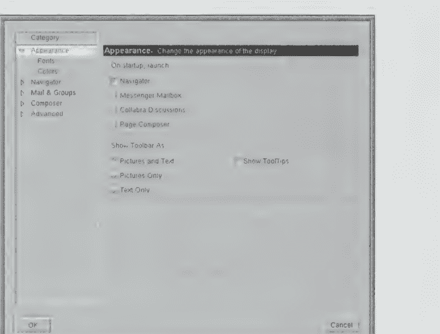

**另请参阅**
要详细了解如何为 X Window 系统配置鼠标，请参阅第 269 页。

5. 选择你对 Communicator 启动方式的偏好、默认主页以及缓存或历史记录设置。然后将鼠标光标移动到类别列表下的 Navigator 菜单项。点击 Navigator 单词旁的小三角形。首选项对话框随后将列出“语言 (Languages)”和“应用程序 (Applications)”菜单项。点击“应用程序”菜单项，Navigator 首选项对话框将变为如图 15.8 所示。

Netscape Communicator 支持插件，即可以为浏览器增加功能的附加程序。其中之一是名为 `rvplayer` 的 RealPlayer 插件，你可以使用它通过互联网收听音频或观看视频广播（当你点击网页上的音频或视频链接时，音频或视频将自动播放）。

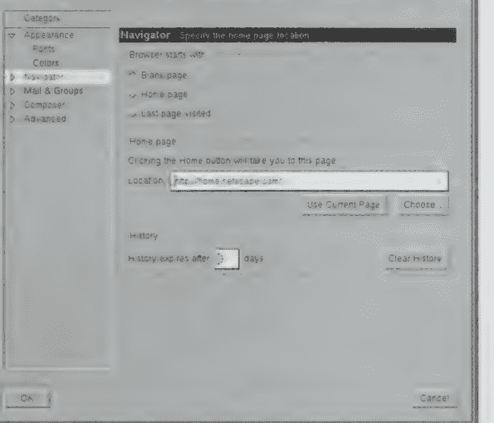
图 15.7
Navigator 设置决定了 Navigator 启动时的运行方式、默认主页是什么，以及 Navigator 保留已访问网页缓存列表的时间长度。

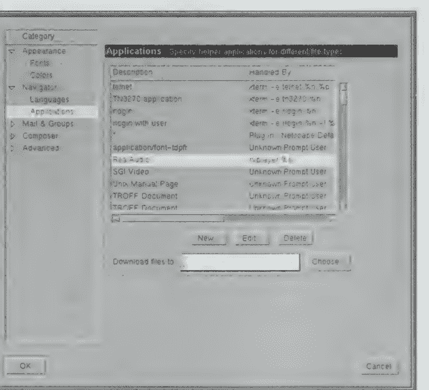
图 15.8
Navigator 应用程序设置用于增加对外部程序或插件（如 RealVideo Player）的支持。

### 为 Netscape 安装互联网视频支持

1. 要增加对 RealPlayer 插件的支持，请接续之前的分步操作，滚动浏览应用程序列表。选择 RealAudio 应用程序，然后用鼠标左键点击“编辑 (Edit)”按钮。对话框将出现，如图 15.9 所示。

**另请参阅**
$\rightarrow$ 要了解更多适用于 Linux 的多媒体工具，请参阅第 358 页。

图 15.9
使用 Navigator 应用程序编辑对话框为 RealAudio Player 增加特定支持。

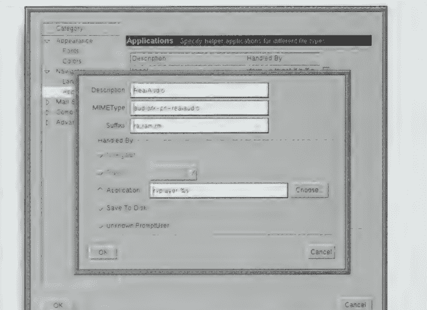

2. 将文件扩展名 `.rm` 添加到列表中，编辑“由应用程序处理 (Handled by Application:)”字段为 `rvplayer %s`，然后点击“确定 (OK)”按钮。再次点击“确定”按钮以退出并保存你的 Navigator 首选项。

3. 要测试 `rvplayer` 插件，首先确保它已安装在你的系统中（在 `/usr/bin` 目录下查找 `rvplayer` 程序），然后使用 Navigator 从硬盘读取 `rvplayer` 示例视频：
   `# netscape file:/usr/lib/rvplayer/welcome.rm`

在 Navigator 显示初始窗口后，RealVideo Player 将启动并播放一段短小的音乐和视频片段，如图 15.10 所示。


图 15.10
在使用 Netscape Navigator 进行互联网会话期间，RealVideo Navigator 插件将播放音频和视频片段。

在 `/usr/doc/rvplayer` 目录下查找有关 RealVideo Player 的信息。要获取最新的 Linux 版 RealVideo 插件，请浏览：
   `http://www.real.com`

有关使用 Communicator 插件的更多信息，请浏览：
   `http://home.netscape.com`

Red Hat Linux 用户还可以通过浏览以下网址，找到以 Red Hat 软件包管理器格式提供的关于 Netscape Communicator 和插件的更具体信息：
   `http://www.redhat.com`

## 第 16 章：阅读 Usenet 新闻
作者：Bill Ball

- 指定 NNTP 服务
- 在 Linux 上使用新闻阅读器
- 在 Linux 上配置新闻阅读器

### 指定 NNTP 服务

根据最近的统计，Usenet 新闻组已超过 30,000 个，而且每天还在增加。为了阅读 Usenet 新闻，你必须能够访问网络新闻服务器。这些服务器负责发送、接收和存储每天交换的数以千计的 Usenet 互联网消息。你的互联网服务提供商 (ISP) 很可能提供了对 Usenet 新闻服务器的访问权限。

你还需要一个能够理解网络新闻传输协议 (NNTP) 的新闻阅读程序，即 *newsreader*。新闻阅读器通常的工作方式是通过网络连接，从 ISP 的新闻服务器检索按新闻组排序的消息或文章列表。你订阅的新闻组通常包含在你主目录中名为 `.newswrc` 的文件中。在开始阅读 Usenet 新闻之前，你必须创建你的 `.newswrc` 文件。

#### 创建你的 .newswrc 文件

1. 使用你最喜欢的文本编辑器，在主目录中创建一个名为 `.newswrc` 的文件。该文件将包含你想阅读文章的初始新闻组列表。

2. 输入以下 Linux 初始新闻组列表：
   `comp.os.linux.advocacy`
   `comp.os.linux.announce`
   `comp.os.linux.development.apps`
   `comp.os.linux.development.system`
   `comp.os.linux.hardware`
   `comp.os.linux.misc`
   `comp.os.linux.networking`
   `comp.os.linux.setup`
   `comp.os.linux.x`

3. 保存文件并退出编辑器。

**另请参阅**
$\rightarrow$ 有关连接互联网的更多信息，请参阅第 166 页。
$\rightarrow$ 要学习如何使用文本编辑器，请参阅第 50 页。

为了让你的新闻阅读器能够检索新闻组的文章，你必须告诉新闻阅读器你的 ISP 新闻服务器的名称。虽然大多数 Linux 新闻阅读器使用 `NNTPSERVER` 环境变量，但你也可以将服务器的

> **我应该从哪些新闻组开始？**
> 我已经推荐了一个初始 Linux 新闻组列表供你入门，但设置 `.newswrc` 文件最快的方法是使用位于 `/usr/bin` 目录下的 `newsetup` 命令。该命令是 `trn` 新闻阅读软件的一部分，它只需在你的主目录中创建一个包含默认新闻组 `news.announce.newusers` 的 `.newswrc` 文件。
>
> 这个新闻组是学习阅读 Usenet 新闻的最佳起点。你将在这里找到提示、指导和常见问题解答 (FAQ) 列表，这将帮助你作为一名新的 Usenet 新闻阅读者避免出现问题。

名称定义在 `/etc` 目录下的 `nntpserver` 文件中。新闻服务器环境变量可以为系统上的所有用户定义，也可以为单个用户定义。

## 创建系统的 NNTPSERVER 环境变量

1. 要为系统上的所有用户创建 `NNTPSERVER` 变量，请以 `root` 管理员身份登录，并使用您喜欢的文本编辑器打开 `/etc` 目录下的 `profile` 文件。该文件定义了所有用户的默认变量。
2. 在文件中输入您的新闻服务器名称：
   `NNTPSERVER=news.staffnet.com`
3. 不要忘记在文件中包含随后的 `EXPORT` 语句（由 bash shell 使用）：
   `export NNTPSERVER`
4. 保存文件并退出编辑器。要立即使用此变量，请使用 `source` shell 命令（如果您使用的是 bash shell）来读取 `profile` 文件中的新变量：
   `# source /etc/profile`
5. 要验证您的新闻服务器变量是否已定义，请将 `printenv` 命令的输出通过 `fgrep` 搜索程序进行过滤：
   `# printenv | fgrep NNTPSERVER`
   `NNTPSERVER=news.erols.com`

`fgrep` 命令会显示您的 `NNTPSERVER` 变量的值。

如果您希望允许用户使用不同的新闻服务器，请按照上述步骤操作，但编辑用户主目录中的 `.bash_profile` 文件，而不是系统的 `/etc/profile`。

## 另请参阅

- 要详细了解如何使用 `export` 或 `source` 等 shell 命令，请参阅第 90 页。
- 要详细了解如何在命令行中使用管道，请参阅第 19 页。

## 选择新闻阅读器

选择新闻阅读器主要取决于个人喜好。您可能会惊讶地发现，大多数 Linux 发行版至少包含六款新闻阅读器，包括以下几种：

- `lynx`——虽然它通常被认为是一个纯文本 Web 浏览器，但 `lynx` 也可以用来阅读 Usenet 新闻。有关更多信息，请参阅 `lynx` 手册页。
- Netscape——这款基于 X11 的 Web 浏览器的最新版本 Communicator 包含了一个新闻阅读器 Netscape Collabra。
- `pine`——虽然它通常被认为是一个邮件传输代理或邮件阅读器，但 `pine` 也可以阅读 Usenet 新闻。
- `slrn`——这款功能强大的控制台新闻阅读器支持鼠标和颜色，也可以在 X11 的终端窗口中运行。
- `tin`——这款控制台新闻阅读器也可以在 X11 的终端窗口中运行。
- `trn`——这款控制台新闻阅读器也可以在 X11 的终端窗口中运行。
- `xrn`——这款仅限 X11 的新闻阅读器仅提供阅读新闻的最基本功能。

选择一个能让您最方便地订阅或取消订阅新闻组，以及浏览、保存、回复或发布消息的新闻阅读器。如果您使用 X Window 系统，并且颜色和鼠标支持很重要，您可能想选择 `slrn` 或 Netscape 这样的新闻阅读器。其他新闻阅读器（如 `tin` 或 `trn`）在远程登录（如拨入服务）时表现良好，因为它们不需要 X11 的图形开销。

**另请参阅**
要详细了解如何使用 `lynx` Web 浏览器，请参阅第 212 页。
有关使用 X Window 系统的更多信息，请参阅第 260 页。

## 使用 tin 新闻阅读器

`tin` 新闻阅读器从您主目录中的 `.newsrc` 文件读取新闻组列表。该阅读器位于 `/usr/bin` 目录下，它以列表形式显示您的新闻组和新闻组文章，您可以使用光标键进行浏览（见图 16.1）。通过选择新闻组并按下 `Enter` 键，即可阅读所列的文章之一。

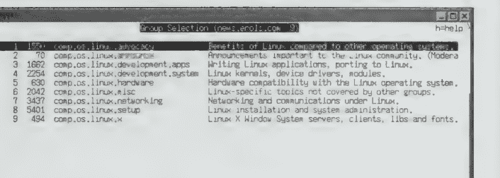
图 16.1
`tin` 新闻阅读器在主窗口中显示新闻组列表。

```
const: current to m, Tattered unread, /search pattern, chatup, glotube, pipe down, pipe up, kill, move, quit, /toggle all/unread, s)ubscribe, S)ub pattern, U)nsubscribe, U)sub pattern, q)ank in out
*** End of Groups ***
```

要从 ISP 的新闻服务器远程获取新闻组文章，请在命令行中使用 `-r` (remote) 选项启动 `tin`，如下所示：


# tin -r

```
# tin -r
```

该命令行会检查新的新闻组，并检索 ISP 新闻服务器上所有活动新闻组的当前列表。这可能需要很长时间！为了提高速度，请使用 `-n` 选项（仅检索 `.newsrc` 文件中新闻组的文章）以及 `-q` 选项（禁用检查新新闻组），如下所示：

```
# tin -nqr
```

使用 `-f` 选项来阅读出现在默认 `.newsrc` 文件以外的文件中的新闻组文章。（创建除默认 `.newsrc` 以外的文件是按兴趣组织新闻组的好方法。）在 `-f` 选项之后输入特定新闻组资源文件的名称：

```
# tin -nqrf .myaltnewsrc
```

该命令使 `tin` 仅从 `.myaltnewsrc` 文件（其格式可以与 `.newsrc` 相同，但包含不同的新闻组列表，例如 `alt.barney.die.die.die`）中列出的新闻组检索文章。

`tin` 阅读器在阅读新闻时提供许多不同的键盘命令，如表 16.1 所示。

### 表 16.1 常用 tin 键盘命令

| 按键 | 操作 |
| :--- | :--- |
| `/` | 向前搜索文章。 |
| `?` | 向后搜索文章。 |
| `Enter` | 列出当前组中的文章，或阅读一条消息。 |
| `C` | 将所有文章标记为已读。 |
| `H` | 获取内置帮助。 |
| `Q` | 退出当前新闻组或 `tin`。 |
| `S` | 将当前消息保存到默认新闻文件夹（阅读消息时）。 |
| `S` | 订阅当前组（列出新闻组时，如图 16.1 所示）。 |
| `U` | 取消订阅当前组。 |
| `W` | 向当前组发布一篇文章。 |

## 使用 slrn 新闻阅读器

`slrn` 新闻阅读器的工作方式与 `tin` 新闻阅读器非常相似，但具有多项改进，例如支持颜色和鼠标、文章与文章列表的同时显示，以及在命令行上指定 NNTP 服务器的能力。

虽然 `slrn` 新闻阅读器使用 `NNTPSERVER` 变量，但您可以输入 `-h` 选项及其后的不同新闻服务器名称，以从不同的计算机阅读新闻：

```
$ slrn -h news.erols.com
```

使用 `-f` 选项来阅读在不同 `.newsrc` 文件中列出的新闻组文章，如下所示：

```
$ slrn -f .myautonewsrc
```

该命令行指示 `slrn` 从您主目录中 `.myautonewsrc` 定义的新闻组读取文章。这对于根据不同兴趣（如 `rec.autos` 或 `rec.autos.antiques`）分离新闻阅读会话非常方便。

运行 `slrn` 时，您的新闻组将显示在列表中。要阅读特定新闻组的文章，请将光标移动到该新闻组并按下 `Enter`。`slrn` 新闻阅读器将显示文章列表。要阅读文章，请将光标移动到该文章，然后按下 `Enter`。如图 16.2 所示，`slrn` 程序具有分屏显示功能，不仅显示当前文章，还显示新闻组中的其他文章。

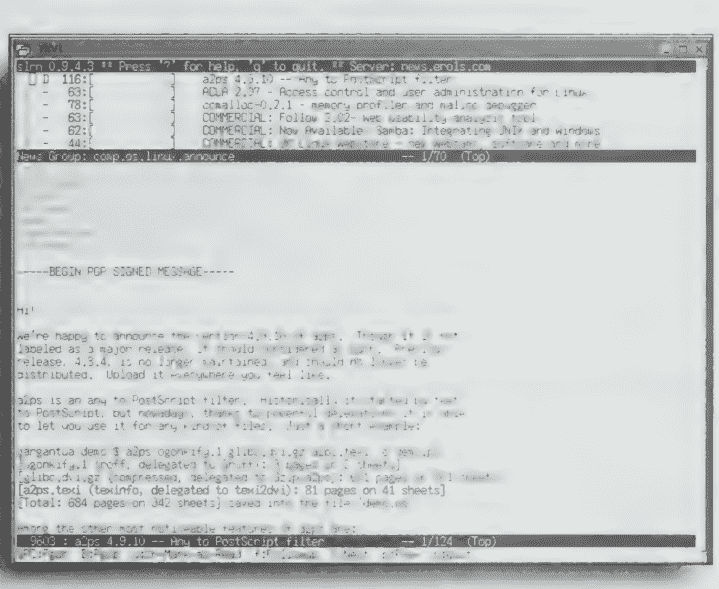
图 16.2
`slrn` 新闻阅读器具有便捷的分屏功能，可在阅读文章时查看文章列表。

与 `tin` 一样，`slrn` 支持许多键盘命令，最常用的命令如表 16.2 所示。

### 表 16.2 常用 slrn 键盘命令

| 按键 | 操作 |
| :--- | :--- |
| `/ str` | 在新闻组名称中搜索 `str`。 |
| `/ str` | 阅读时在文章中搜索 `str`。 |
| `?` | 向后搜索。 |
| `F` | 通过电子邮件转发文章。 |
| `H` | 隐藏当前文章。 |
| `N` | 转到下一个新闻组。 |
| `P` | 向当前新闻组发布一篇文章。 |
| `c` | 将新闻组文章标记为已读。 |
| `f` | 为当前文章发布后续跟帖。 |
| `h` | 隐藏文章窗口。 |
| `n` | 阅读下一篇文章。 |
| `o` | 将文章保存到文件。 |
| `p` | 向当前新闻组发布文章。 |
| `q` | 退出。 |
| `r` | 通过电子邮件回复文章作者。 |
| `s` | 订阅当前新闻组。 |
| `u` | 从当前新闻组取消订阅。 |

## 使用 trn 新闻阅读器

`trn` 新闻阅读器的工作方式与 `tin` 新闻阅读器非常相似，它检索定义在主目录 `.newsrc` 文件中的新闻组文章。该程序拥有 45 个以上的命令行选项以及众多功能——多到无法在此全部记录（详见 `trn` 手册页）。

`trn` 阅读器识别 `NNTPSERVER` 环境变量，或者 `/usr/local/lib/rn` 目录下 `server` 文件中定义的服务端名称。要阅读新闻组文章，请按如下方式启动 `trn`：

```
# trn
```

`trn` 新闻阅读器会检索您新闻组的消息，但会询问您是否要阅读每个组中的消息，如图 16.3 所示。

## 使用 xrn 新闻阅读器

与本章中的许多新闻阅读器一样，`xrn` 新闻阅读器使用 `.newsrc` 文件作为默认的新闻组阅读列表，并且也识别 `NNTPSERVER` 环境变量。您必须运行 X Window 系统才能使用此新闻阅读器。

## 选择新闻阅读器

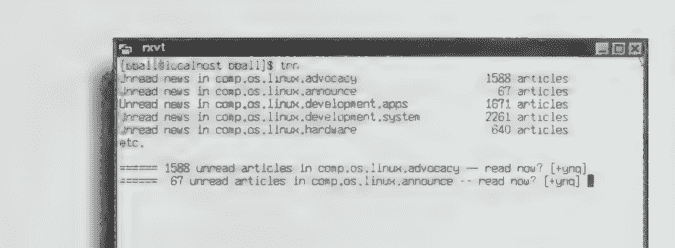
**图 16.3**
`rnx` 新闻阅读器询问您是否要阅读已订阅新闻组中的文章。

`rnx` 的默认窗口大小对于 800x600 像素的显示屏来说太大了。幸运的是，`rnx` 和其他几个 X11 客户端一样，支持许多 X11 Toolkit 选项。使用 X11 的 `.geometry` 命令行选项可以以适合您显示屏的小窗口启动 `rnx`，如下所示：

```
# rnx -geometry 640x480
```

`rnx` 新闻阅读器的特点是采用分屏窗口，可以同时查看文章列表和新闻组列表。要阅读文章，请先点击一个新闻组，然后点击文章列表项。

不幸的是，近期发布的 Red Hat Linux 所分发的 `rnx` 版本并未包含其 70 多个命令行选项的文档或帮助页。不过，您可以通过在命令行中给 `rnx` 输入一个问号来了解这些选项，如下所示：

```
# rnx -?
```

选项列表会在屏幕上向下滚动。如果您的 X11 终端窗口太小，请使用 shell 重定向运算符将输出重定向到文本文件中以便稍后阅读：

```
# rnx -? >rnx.help
```

## 使用 pine 邮件程序阅读 Usenet 新闻

在第 13 章“使用电子邮件”中名为“选择邮件程序”的章节中讨论过的 `pine` 程序是一个功能强大的邮件传输代理，但它也可以作为 Usenet 新闻阅读器使用。当您使用 `pine` 时，阅读新闻文章就像阅读电子邮件一样简单。

### 使用 pine 阅读 Usenet 新闻

1. 启动您的 Internet 连接，然后在命令行中输入以下内容启动 `pine`：
   `# pine`
2. 按 `Enter` 键进入文件夹列表。
3. 按下方向键（下）将光标移动到 News Collection（新闻集）列表，然后按 `Enter` 键。此时将显示您主目录下 `.newsrc` 文件中定义的新闻组列表，如图 16.4 所示。

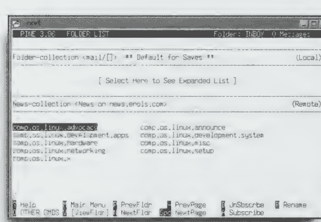
**图 16.4**
`pine` 邮件程序可用于检索已订阅新闻组的文章。

4. 要阅读特定新闻组中的文章，请将光标移动到所需的新闻组并按 `Enter` 键。`pine` 程序将检索该新闻组的文章，并以与电子邮件完全相同的列表形式显示。

**另请参阅**
欲了解更多关于 `pine` 电子邮件程序的信息，请参阅第 183 页。

## 使用 Netscape Communicator 阅读新闻

虽然许多用户认为 Netscape 只是一个 Web 浏览器，但经验丰富的 Linux 和 X11 用户知道，最新版本的 Netscape Communicator 功能远不止于此，其中就包括提供对阅读新闻组的支持。

### 使用 Netscape Communicator 阅读 Usenet 新闻

1. 在 Netscape Navigator 窗口中，选择 Communicator 菜单，然后选择 Collabra Discussions 菜单项。此时会出现 Netscape Messenger 窗口（如图 16.5 所示）。双击新闻服务器以显示您的新闻组。

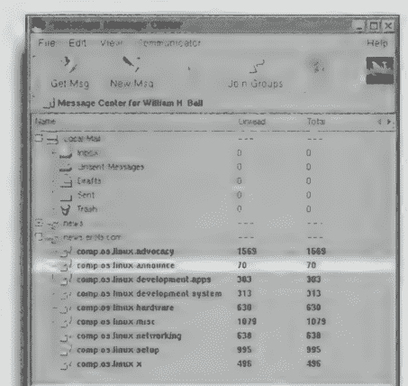
**图 16.5**
Netscape 的主 Messenger 窗口显示每个已订阅的新闻组以及未读文章的数量。

2. 在终端窗口的命令行中，通过输入以下内容以组件栏（component bar）模式启动 Netscape：
   `# netscape -component-bar &`

此时会出现 Communicator 组件栏（如图 16.6 所示）。点击 Discussions 按钮即可打开 Netscape Messenger 窗口（参考图 16.5）。


**图 16.6**
Netscape 的组件栏可用于启动 Usenet 新闻阅读。

3. 在 Netscape Messenger 窗口中，打开 Inbox 下拉列表以查看邮件文件夹列表，包括 news（见图 16.7）。请注意，您主目录下 `.newsrc` 文件中定义的新闻组列表也会出现。

选择您想要阅读文章的新闻组。

4. 在终端窗口的命令行中，使用 `-news` 命令行选项启动 Netscape，如下所示：

```
# netscape -news &
```

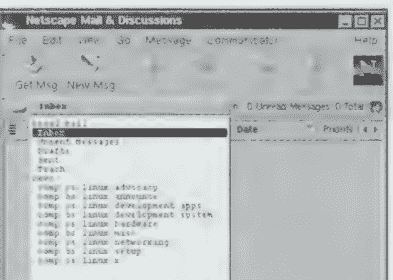
**图 16.7**
Netscape 的 Messenger 窗口具有一个您订阅的新闻组下拉列表。

**另请参阅**
有关 Netscape Communicator 的更多信息，请参阅第 216 页。

## 配置新闻阅读器

在定义了 `NNTPSERVER` 环境变量并创建了 `.newsrc` 文件之后，配置系统以阅读 Usenet 文章的大部分工作就已经完成了。尽管如此，您的新闻阅读器可能还提供各种设计功能，旨在让阅读新闻变得更轻松。由于功能众多，配置特定的新闻阅读器可能会变得相当复杂。

许多新闻阅读器（如 `tin`、`trn` 和 `slrn`）在 `/usr/doc/` 目录下有补充文档（包括技巧和提示）。请结合这些文档的信息以及程序的帮助页信息来配置您的环境。

阅读 Usenet 新闻最简单的方法？

有关 Usenet 新闻或 NNTP 的背景信息，以及关于设置系统以分发新闻组文章的详细信息，请参阅 Olaf Kirch 的《Linux 网络管理员指南》（Linux Network Administrator's Guide），该指南通常位于大多数发行版的 `/usr/doc/LDP/` 目录中。关于如何设置 Linux 以获取新闻推送的详细信息，可以在 Kirch 题为“NNTP 描述”（A Description of NNTP）的章节中找到，您还可以阅读“网络新闻”（Netnews）章节以学习如何设置自己的 NNTP 服务器。您会发现许多很棒的信息，包括这段摘录，这可能是最简单的新闻阅读器（它使用 `find` 命令将新闻文章通过 `cat` 和 `more` 命令进行管道传输）：

```
$ find /var/spool/news -name '[0-9]*' -exec cat {} \; | more
```

### 配置 tin 新闻阅读器

`tin` 新闻阅读器可以通过多种不同方式进行配置，原因各异——例如为新闻组帖子创建签名文件，或者在您离开电脑时检索并保存文章。`tin` 的大多数资源文件位于主目录下的 `.tin` 目录中。当您第一次运行 `tin` 时，该目录以及两个文件 `attributes` 和 `posted` 会被创建。

在运行程序时按下 `M` 键可自定义 `tin`。您将看到一个如图 16.8 所示的菜单，其中可以设置 18 个不同的选项。当您保存选项时，文件 `.tinrc` 将被创建并保存在 `.tin` 目录中。

如果您想查看另外 19 个选项，请直接编辑 `.tinrc` 文件。

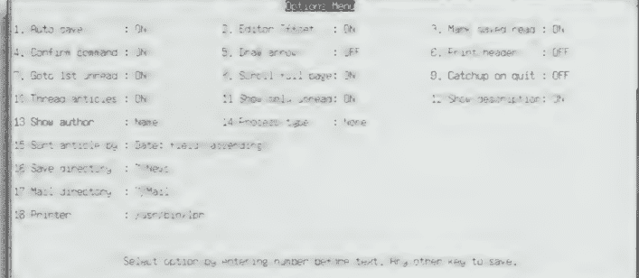
**图 16.8**
`tin` 新闻阅读器具有一个方便的配置界面。

有关这些选项的详细信息，请参阅 `tin` 帮助页的“Global Options Menu”和“.tinrc Configurable Variables”部分。

### 配置 slrn 新闻阅读器

`slrn` 新闻阅读器从 `/usr/lib/slrn` 目录下的名为 `slrn.rc` 的文件中读取系统范围的默认值。要为系统上的所有用户自定义 `slrn`，请以 root 管理员身份登录并编辑此文件。要为您自己自定义 `slrn`，请将此文件复制到您的主目录并将其命名为 `.slrnrc`。然后按照以下步骤自定义 `slrn` 的部分功能。

#### 自定义 slrn 新闻阅读器

1. 将文件 `/usr/lib/slrn/slrn/slrn.rc` 复制到您的主目录，并将其重命名为 `.slrnrc`，如下所示：
   `# cp /usr/lib/slrn/slrn/slrn.rc .slrnrc`

2. 使用您喜欢的文本编辑器打开该文件。寻找类似于以下内容的行：

```
% SERVER to NEWSRC mapping
%server "hsdndev.harvard.edu" ".jnewrc-hsdndev"
%server "news.uni-stuttgart.de" ".jnewsrc-stuttgart"
```

请注意，这些条目的每行开头都有一个百分号（`%`）。该符号表示这是一条注释，如果您在该行开头放置此符号，`slrn` 将忽略该条目。如果您可以访问不同的新闻服务器并希望为每个服务器使用自定义的新闻组阅读列表，请指定服务器名称以及包含新闻组列表的文件名，并省略百分号，如下所示：

```
server "news.staffnet.com" ".staffnetnewsrc"
server "news.erols.com" ".erolsnewsrc"
```

3. 寻找 `username` 和 `replyto` 条目，类似于以下内容：

```
%set username "jd"
%set realname "John Doe"
%set replyto "jd@something.com"
```

输入您的用户名、真实姓名和回复地址设置：

```
set username "bball"
set realname "William Ball"
set replyto "bball@erols.com"
```

如果您想防止收到来自愚蠢的垃圾邮件发送者（他们从 Usenet 新闻组文章中电子采集电子邮件地址）的垃圾邮件，可以在这些设置中插入一个伪造的短语，如下所示：

```
set username "bball_TO_REMOVE_TO_REPLY_"
set replyto "bball_REMOVE_TO_REPLY_SPAM@erols.com"
```

这可以确保垃圾邮件发送者采集到的是错误的电子邮件地址，但同时提醒回复者删除该短语后再发送电子邮件回复。

4. `slrn` 的一大特色是它能够支持使用鼠标选择和滚动消息。寻找鼠标配置部分，其中包含如下行：

```
% Enable xterm mouse support: 1 to enable, 0 to disable
set mouse 0
```

将 `set mouse 0` 更改为 `set mouse 1` 以启用鼠标支持。

5. `slrn` 新闻阅读器支持自定义颜色。您可以通过编辑 `.slrnrc` 文件的 Colors（颜色）部分来更改文章不同部分的颜色。找到颜色配置部分，其中包含类似以下内容的行：

```
------------------------------------------------------------------
% Colors
------------------------------------------------------------------
color header_number   "black"   "white"
color header_name     "black"   "white"
color normal         "black"   "white"
color error          "red"     "white"
color status         "yellow"  "blue"
color group          "blue"    "white"
color article        "blue"    "white"
color cursor         "black"   "white"
color author         "blue"    "white"
color subject        "black"   "white"
color headers        "black"   "white"
color menu           "yellow"  "blue"
color menu_press     "blue"    "yellow"
color tree           "red"     "white"
color quotes         "red"     "white"
color thread_number  "blue"    "white"
color high_score     "red"     "white"
color signature      "red"     "white"
```


```text
color description    "blue"    "white"
color tilde          "black"   "white"
color response_char  "green"   "white"
```

每一行列出了 `slrn` 窗口、新闻组或文章的一个部分。例如，用于显示文章主题行的默认颜色是白色背景上的黑色文本。可用的颜色项包括：

- `black`（黑色）
- `red`（红色）
- `green`（绿色）
- `brown`（棕色）
- `blue`（蓝色）
- `magenta`（品红）
- `gray`（灰色）
- `brightred`（亮红）
- `brightgreen`（亮绿）
- `yellow`（黄色）
- `brightblue`（亮蓝）
- `brightmagenta`（亮品红）
- `cyan`（青色）
- `brightcyan`（亮青）
- `lightgray`（浅灰）
- `white`（白色）

请小心！如果您将文章的文本和背景颜色更改为如下设置，可能会导致帖子无法阅读：

```text
color article        "white"        "white"
```

## 配置 `trn` 新闻阅读器

`trn` 新闻阅读器具有许多不同的命令行选项，但与其他新闻阅读器不同，它没有默认的资源文件（如 `.trnrc`）在启动时读取设置。不过，您可以创建自己的资源文件并输入不同的设置来定制 `trn` 的工作方式。

### 创建和编辑 `.trnrc` 资源文件

1. 使用您最喜欢的文本编辑器，打开 `.bash_profile` 文件（如果您使用的是默认的 Red Hat Linux shell `bash`），并输入以下环境变量和导出语句：

   ```bash
   TRNINIT=$HOME/.trnrc
   export TRNINIT
   ```

2. 保存您的 `.bash_profile` 文件。要立即使用此变量，请使用 `bash` shell 的 `source` 命令，如下所示：

   ```bash
   # source .bash_profile
   ```

3. 再次使用文本编辑器，创建一个名为 `.trnrc` 的文件。您可以包含任意数量的 `trn` 命令行选项，例如 `-q`（快速检查）选项，它指示 `trn` 不要请求任何新新闻组，而是检索 `.newsrc` 文件中新闻组的文章。像这样输入此选项：

   ```text
   -q
   ```

4. 为了使用 `REPLYTO` 行来挫败垃圾邮件发送者，请输入类似这样的一行：

   ```text
   -EREPLYTO="bball_REMOVE_TO_REPLY@erols.com"
   ```

5. 请参阅 `trn` 手册页以及位于 `/usr/doc/trn` 目录下的 `HINTS.TRN` 文件，以获取更多选项以及关于如何使用资源文件的详细信息。

## 配置 `pine` 邮件程序以阅读 Usenet 新闻

`pine` 电子邮件程序会自动读取您的新闻组 `.newsrc` 文件。要配置 `pine` 以阅读 Usenet 新闻，您必须启动 `pine`，然后使用其 Setup（设置）和 Config（配置）菜单。

### 配置 `pine` 阅读新闻

1. 在命令行输入以下内容启动 `pine`：

   ```bash
   # pine
   ```

2. 按 S，然后按 C。`pine` 将显示其配置屏幕，如图 16.9 所示。

   

   > 图 16.9  
   > `pine` 邮件配置屏幕用于指定用于阅读 Usenet 新闻的 NNTP 服务器。

3. 将光标向下移动到 `nntp-server` 行并按 C。输入您 ISP 的新闻服务器名称并按 Enter。

4. 向下滚动 `pine` 的其他选项列表。寻找类似于以下内容的一行：

   ```text
   [ ] news-read-in-newsrc-order
   ```

   如果您希望 `pine` 以与 `.newsrc` 文件中输入相同的顺序显示新闻组，请按 X 来设置此变量。选项前的方括号之间会出现一个 x，如下所示：

   ```text
   [X] news-read-in-newsrc-order
   ```

5. 完成更改后，按 E 退出 `pine` 的配置。`pine` 会询问您是否要“Commit changes”（提交更改）。按 Y 保存您的更改。

## 配置 Netscape Collabra 以阅读新闻

Netscape Communicator 会自动使用您的 `.newsrc` 文件来阅读 Usenet 新闻，但您必须先配置 Netscape 以使用您的 ISP 新闻服务器。

### 为 Netscape Communicator 指定新闻服务器

1. 连接到您的 ISP 并启动 PPP 连接。

2. 在终端窗口的命令行中输入以下内容启动 Netscape：

   ```bash
   # netscape &
   ```

3. 从 Navigator 的 Edit（编辑）菜单中，选择 Preferences（首选项）菜单项。如图 16.10 所示的 Preferences 对话框将出现。

   

   图 16.10 通过其首选项对话框配置 Netscape Navigator。

4. 点击 Preferences 对话框中的 Mail & Groups（邮件与组）项，以显示五个额外的设置列表（见图 16.11）。

   

   图 16.11  
   首选项对话框提供 Mail & Groups 设置以配置新闻服务器设置。

5. 点击 Groups Server（组服务器）项。如图 16.12 所示的 Groups Server 对话框将出现。

   

   图 16.12  
   在 Groups Server 对话框中输入您 ISP 的新闻服务器名称，以指定所需的 NNTP 服务器。

6. 在 Discussion Groups (News) Server（讨论组（新闻）服务器）字段中，输入您 ISP 的新闻服务器名称，如下所示：

   `news.erols.com`

7. 点击 OK 保存您的首选项。

正如在之前的“使用 Netscape Communicator 阅读新闻”部分所述，您可以使用 Netscape Messenger 阅读 Usenet 新闻文章。虽然您可以手动将新闻组添加到 `.newsrc` 文件中，但您也可以使用 Netscape Messenger 添加新的新闻组或服务器。

### 向 Netscape 添加新闻组和新闻服务器

1. 连接到您的 ISP 并启动 PPP 连接。

2. 在终端窗口的命令行中输入以下内容，以新闻阅读模式启动 Netscape：

   ```bash
   # netscape -news &
   ```

   此命令将显示 Netscape Messenger（参考图 16.5）。点击 Join Groups（加入组）按钮或从 File（文件）菜单中选择 Add Discussion Group（添加讨论组）。如图 16.13 所示的对话框将出现，列出您当前的新闻服务器。

   

   **图 16.13**  
   Netscape Messenger 检索并显示您可以订阅的当前新闻组列表。

3. 要添加新闻服务器，请点击 Add Server（添加服务器）按钮。会出现一个如图 16.14 所示的对话框。输入新服务器的名称，如下所示：

   `nws.staffnet.com`

   

   图 16.14  
   添加新闻服务器。

4. 点击 OK。要添加更多组，请点击图 16.14 所示对话框顶部的 All Groups（所有组）、Search for a Group（搜索组）或 New Groups（新组）选项卡。

5. 点击 Search for a Group 选项卡。如图 16.15 所示，此选项卡提供了一个 Search For（搜索）字段，您可以在其中输入搜索字符串（包括通配符）。例如，要搜索所有 Linux 新闻组，请使用类似以下的搜索行：

   `comp.os.linux*`

   

   图 16.15  
   通过 Search for a Group 选项卡搜索新闻组。

6. 输入搜索字符串后，点击 Search Now（立即搜索）按钮。匹配的新闻组列表将出现在 Group Name（组名）部分，如图 16.16 所示。要加入一个新闻组，选择它，然后点击 Join 按钮。点击 OK 退出 Join Groups 对话框。

   图 16.16  
   Netscape Messenger 根据您的搜索条目返回所有匹配的新闻组列表。

   

# 第 17 章：使用 `telnet` 和互联网中继聊天（IRC）

作者：Bill Ball

- 连接到远程计算机
- 使用 `telnet` 命令登录
- 在 `telnet` 会话期间下载文件
- 寻找互联网聊天组
- 加入互联网聊天组
- 使用互联网中继聊天在互联网上聊天

## 使用 `telnet` 命令

`telnet` 命令用于登录到互联网上的远程计算机。使用 `telnet` 登录（通常需要用户名和密码），然后运行程序、查看文件或下载数据。在命令行输入 `telnet` 命令，后跟主机名或远程计算机系统名称，即可启动 `telnet` 会话。

例如，要连接到美国环境保护署（EPA，该机构在多个远程计算机系统上运行开放的信息服务），请使用 `telnet` 命令，如下所示：

```bash
# telnet ttnbbs.epanc.epa.gov
```

该命令将您连接到 EPA 的远程计算机，您将收到登录提示（如图 17.1 所示）。


图 17.1  
使用 `telnet` 命令登录到远程联邦政府或其他计算机系统。  
1 登录提示

> **另请参阅**  
> 有关使用 Netscape Communicator 的更多信息，请参阅第 216 页。

### 连接到其他计算机

为了使用 `telnet` 程序登录到远程系统，您通常需要在远程计算机上拥有一个有效的用户名和密码。这意味着您通常需要在远程计算机系统上有一个账户才能进入。很少有系统管理员允许匿名 `telnet` 访问，不过您可以通过常用的 Web 搜索站点（如 `http://www.yahoo.com`）使用搜索引擎，找到一个开放 `telnet` 访问的计算机系统列表（例如运行公告板系统或 BBS 的系统）。

`telnet` 命令与 `ftp` 命令非常相似，也可以在交互模式下使用，因此您可以在不退出程序的情况下打开和关闭与不同远程计算机的会话。`telnet` 命令还内置了帮助功能（在没有活动会话时可通过关键字 `help` 访问）。表 17.1 列出了许多 `telnet` 的内置命令。

Netscape Communicator 的 Netscape Navigator 组件也可以用于 `telnet` 到远程计算机，因为它能识别 `telnet` 协议的统一资源定位符（URL）规范，例如 `telnet://tnbbs.rtnc.epa.gov`。如果您在 Netscape 的位置字段中输入 `telnet` 地址，或点击网页上的 `telnet` 链接，Netscape 将启动一个独立的程序（X11 终端客户端 `xterm`）来开始您的 `telnet` 会话。

**表 17.1 常用 `telnet` 命令（在活动会话期间通过 Ctrl+] 访问）**

| 命令 | 动作 |
|---|---|
| `!` | 从 `telnet` 运行一个 shell。 |
| `?` | 显示帮助。 |
| `close` | 关闭当前连接。 |
| `display` | 显示控制字符。 |
| `environ` | 列出或更改环境变量。 |
| `logout` | 登出远程系统并关闭连接。 |
| `open` | 连接到远程计算机。 |
| `quit` | 退出 `telnet` 程序。 |
| `send` | 向远程计算机发送特殊字符。 |
| `set` | 设置各种运行参数状态。打印连接状态。 |
| `toggle` | 切换各种运行参数。 |
| `unset` | 取消设置各种运行参数。 |
| `z` | 挂起 `telnet`。 |

### 启动 `telnet` 会话

1. 启动您的互联网会话（例如通过您的互联网服务提供商的点对点协议或 PPP 账户）。
2. 在控制台命令行或 X11 终端窗口中，使用 `telnet` 命令，后跟名称或互联网协议（IP）地址，如下所示：

   ```bash
   # telnet fbminet.ca
   ```

3. `telnet` 程序会打印远程计算机的 IP 地址，如下所示：

   ```text
   Trying 199.214.6.227...
   ```

4. 然后 `telnet` 程序（希望如此）会连接成功，告知您可用于运行 `telnet` 命令的转义字符（Ctrl+]），并显示远程计算机的登录界面：

   ```text
   Connected to fbminet.ca.

   Escape character is ']'

   MAXIMUS/2 v2.02MAXIMUS/2 v2.02

   ++######++Ü +++++++++++Ü +++++++++++Ü ++++Ü

   ±ÜBB±±Ü ±Ü+BB±±Ü ±Ü+BB±±ÜB±±Ü ±ÜB

   ±Ü±Ü BB ±Ü ±Ü ±Ü ±Ü ±Ü ±Ü ±Ü ±Ü±± ±Ü ±Ü±± ܱ±±± ܱ±±± ±Ü±±±Ü

   ++—————————++

   ±Ü±±±Ü ±Ü +++++++Ü ±Ü ±Ü ±Ü ±Ü ±Ü±±Ü±±Ü±±Ü±ÜBBBB

   BB±±ÜBBB

   ±Ü±ÜBB

   ±Ü+Ü ±ÜBB+++ÜBB+++Ü ±Ü ±Ü ±Ü ±Ü ±Ü ±Ü±±Ü±±Ü±±Ü ±Ü±±±Ü

   ±Ü±Ü

   ±Ü±Ü ±Ü ±Ü ±Ü ±Ü BB ±Ü ±Ü ±Ü ±Ü±±Ü±±Ü±±Ü ±ÜBB

   ±Ü+Ü

   ±Ü±Ü ++++++++++Ü ++++Ü ++++Ü ++++Ü ±Ü+++++++Ü +++++++Ü

   ±Ü+Ü

   BBBB BBBBBBBBB BBBB BBBB BBBBBB BB BBBBBB BBBBBBB

   农场商业管理信息网络（Farm Business Management Information Network）
   加拿大农场商业管理委员会项目

   国家互联网 Telnet 站点 --
   Telnet://FBMinet.ca

   FBMinet 节点 2001:1/101 Telnet 线路 4

   如果您的 Telnet 客户端不支持 ANSI 仿真、Zmodem 文件传输和 IBM 框线字符，我们建议您尝试 NetTerm。您可以从本 BBS 或直接从 FBMinet 网站 http://FBMinet.ca 下载 NetTerm 的共享软件版本。
   ```

5. 登录到远程计算机。（请注意，某些远程计算机使用的登录提示与您的 Linux 系统大不相同）

   ```text
   William Ball [Y,n]?
   Password: ******
   ```

   你好，欢迎回到 FBMInet-CFBMC Telnet 站点  
   Telnet://FBMInet.ca!

   很高兴您再次拨入，希望您以后能再次光临。祝您在这里过得愉快！

6. 当您结束 `telnet` 会话时（使用 `logout`、`exit` 或 `close` `telnet` 命令，或通过远程计算机的命令——参考表 17.1），`telnet` 程序将退出并打印如下消息：

   ```text
   Connection closed by foreign host.
   ```

### 使用 `ping` 测试您的会话

如果您在使用 `telnet` 命令连接远程计算机时遇到问题，请确保您使用的是正确的计算机名称或互联网协议（IP）地址。要检查名称是否正确，请使用 `ping` 命令，后跟计算机名称：

```text
# ping staffnet.com

PING staffnet.com (207.226.80.14): 56 data bytes

64 bytes from 207.226.80.14: icmp_seq=0 ttl=249 time=315.7 ms

64 bytes from 207.226.80.14: icmp_seq=1 ttl=249 time=179.8 ms

64 bytes from 207.226.80.14: icmp_seq=2 ttl=249 time=167.2 ms

--- staffnet.com ping statistics ---

3 packets transmitted, 3 packets received, 0% packet loss

round-trip min/avg/max = 167.2/220.9/315.7 ms
```

`ping` 命令将持续运行，直到您按下 Ctrl+C。您也可以在 `ping` 命令中使用计算机的 IP 地址，如下所示：

```text
# ping 207.226.80.14

PING 207.226.80.14 (207.226.80.14): 56 data bytes

64 bytes from 207.226.80.14: icmp_seq=0 ttl=249 time=161.6 ms

64 bytes from 207.226.80.14: icmp_seq=1 ttl=249 time=150.1 ms

64 bytes from 207.226.80.14: icmp_seq=2 ttl=249 time=150.5 ms

--- 207.226.80.14 ping statistics ---

3 packets transmitted, 3 packets received, 0% packet loss

round-trip min/avg/max = 150.1/154.0/161.6 ms
```


### 在 telnet 会话期间下载文件

在 telnet 会话期间从远程计算机下载程序可能会遇到问题。`telnet` 命令不是 FTP 连接，因此您必须在 telnet 连接的两端使用相应的程序来传输文件。要从远程计算机下载程序，远程计算机应安装一个通信程序，例如 `sz`（发送 ZMODEM）。要从远程计算机下载文件，请使用 `rz`（接收 ZMODEM）通信程序。`sz` 和 `rz` 命令包含在 Red Hat Linux 以及大多数其他 Linux 发行版中。

#### 使用 sz 和 rz 命令下载文件

1. 要从远程计算机获取名为 `program.tgz` 的文件，请启动 telnet 会话，然后在远程计算机的命令行中使用 `sz` 命令。使用如下方式启动文件传输：

   ```bash
   # sz -w 2048 filename.tgz
   ```

   此命令使用 ZMODEM 通信协议发送文件 `filename.tgz`。

2. 在远程计算机上启动 `sz` 命令后，立即按下 `Ctrl+]` 以转义到 telnet 提示符，其外观如下：

   ```text
   telnet>
   ```

3. 输入 `telnet` shell 命令（感叹号字符），紧接着输入 `rz` 命令并按下回车键开始接收文件：

   ```text
   telnet> ! rz
   ```

文件开始从远程计算机传输到您的计算机。有关更多信息，请参阅 `sz` 和 `rz` 手册页。

**另请参阅**

要了解更多关于 shell 的信息，请参阅第 19 页。

## 使用 Internet Relay Chat 聊天

使用 `irc`（即 Internet Relay Chat）命令与互联网上的其他人进行交流。运行 `irc` 时，可以使用其内置命令连接到聊天服务器、查看谁在聊天以及设置其他选项。`irc` 命令的内置帮助文档记录了 110 多个命令和主题。要使用 `irc`，您需要拥有激活的互联网连接。

### 启动 irc 会话

#### 使用 irc 启动聊天会话

1. 启动您的互联网连接。要启动 `irc` 会话，请在控制台的命令行或 X11 终端窗口中使用 `irc`，如下所示：

   ```bash
   # irc
   ```

   `irc` 程序会连接到默认聊天服务器或支持 `irc` 的其他计算机，如图 17.2 所示。

2. 如果您是第一次使用 `irc`，请使用 `/HELP` 命令，后跟关键字 `newuser`，如下所示：

   ```text
   > /HELP newuser
   ```

   屏幕上会打印出一两页有用的信息。您还可以浏览 `irc` 命令的帮助设施，通过使用 `/HELP` 命令后跟以下关键字或主题来阅读介绍信息：`basics`、`commands`、`etiquette`、`expressions`、`intro`、`ircII`、`menus`、`news`、`newuser` 和 `rules`。

   `irc` 命令会显示一个滚动屏幕，屏幕底部有一个命令行。

   

3. 要查看服务器上活动的聊天组列表，请在 `irc` 命令行中使用 `/LIST` 命令，如下所示：

   ```text
   > /LIST
   ```

   稍作停顿后，屏幕会滚动显示当前讨论组的列表，如图 17.3 所示。

4. 要查看特定组成员的详细信息，请使用 `/WHO` 命令，后跟组名，如下所示：

   ```text
   > /WHO #giggles
   ```

   `irc` 命令会列出所有当前成员的名称。

5. 要成为讨论组的成员，请使用 `/JOIN` 命令，后跟组名，如下所示：

   ```text
   > /JOIN #giggles
   ```

   

   **图 17.3**

   `irc` 的 `/LIST` 命令显示当前讨论组的列表。

   当组成员进行交谈时，您的屏幕开始滚动显示消息（如图 17.4 所示）。从现在起，您输入的所有文本在按下回车键后，都会广播给组内的所有成员。有关使用 `irc` 的更多信息，请参阅 `irc(1)` 手册页（位于 `/usr/doc/irc/doc` 目录下）。

6. 要退出 `irc` 程序，请使用 `irc` 的 `/QUIT` 命令并按下回车键。`irc` 程序将退出并断开您的连接。

**另请参阅**

有关启动 PPP 连接的更多信息，请参阅第 172 页。

**图 17.4**

加入 IRC 聊天会话后，组讨论会持续在屏幕上向上滚动。


## 第 IV 部分：X Window 系统

- 18 运行和配置 X11 259
- 19 使用窗口管理器 281
- 20 执行常见的 X11 操作 307
- 21 使用图形和多媒体工具 327

## 第 18 章：运行和配置 X11

作者：Bill Ball

- 启动 X Window 系统
- 使用 `xdm` 选择器登录
- 自定义 `xdm` 横幅屏幕
- 自定义 `.xinitrc` 启动脚本
- 停止 X11 会话
- 在 X11 中使用虚拟控制台
- 自定义您的工作区

### 启动 X11

Linux 的默认图形界面是 X Window System，通常是来自 XFree86 Project, Inc. 的 X11 移植版。这套软件集包括近 3,500 个文件、近 200 个程序（或客户端）、500 多种字体以及 50MB 软件中的 500 多个需求项。

**另请参阅**

要了解如何安装 X Window System，请参阅第 641 页。

还有其他 Linux X Window System 分发版本。商业分发版（价格从 0 到数百美元不等）在以下情况可能特别有用：如果您无法在计算机上运行 X，如果您需要专业的技术支持，或者该分发版包含商业程序（如文字处理器或数据库管理器）。有关 Linux X 其他来源的信息，请查看以下站点：

- `http://www.caldera.com`
- `http://www.xig.com`
- `http://www.redhat.com`
- `http://www.metrolink.com`

### 使用 startx 命令

安装 Linux 和 X Window System 后，使用 `startx` shell 脚本来启动 X 会话，如下所示：

```bash
# startx
```

`startx` 脚本用于向 `xinit`（X 初始化）命令传递选项，本章随后的“自定义 `.xinitrc` 启动脚本”部分将对此进行讨论。

如果您已配置 X 使用不同的颜色深度（例如每像素 8、16、24 或 32 位），请使用 `-bpp` 选项后跟您希望在 X 会话中使用的颜色深度：

```bash
# startx -bpp 16
```

该命令行启动 X 并告知 X 服务器使用每像素 16 位的颜色。

### 免费 X11 的坏消息？

考虑到 XFree86 分发版能在许多不同的计算机、50 多个操作系统和许多显卡上运行，它是一笔很划算的交易。然而，Open Group 最近关于下一版本 X11（X11R6.4）新许可要求的消息，对于 X11 的持续免费分发、X11 分发商以及独立 X 开发人员来说可能是个坏消息（请访问 `http://www.opengroup.org` 了解更多信息）。

新的许可要求将如何影响 Linux 新 X11 软件的开发仍不确定。尽管许多人仍然能够为新版本的 X 开发非商业用途的软件，但像 Red Hat Software 这样的公司和独立 Linux 开发人员可能需要支付数千美元才能分发或开发新版本的 X11 或 X11 软件（这是 X11 软件开发人员最大的担忧之一，并在 X Consortium 将所有权利交给 Open Software Foundation，即现在的 The Open Group 之后成为了现实）。

好消息是，XFree86 的人员表示他们将“继续致力于为 UNIX 和类 UNIX 操作系统提供免费的 X11 实现”。请查看 XFree86 网站（`http://www.xfree86.org`）以了解最新进展。

### 使用 xdm 进行 X11 登录

使用 `startx` 脚本只是启动 X11 会话的一种方式。如果您安装了通用桌面环境（CDE），您应该熟悉 `xdm`（X 显示管理器命令）。`xdm` 客户端用于在运行 CDE 之前显示登录屏幕（请注意，您不必使用 `xdm` 来运行 CDE——详情请参阅第 19 章“使用窗口管理器”中题为“启动窗口管理器”的部分）。

`xdm` 客户端提供一个类似于控制台提示符的登录提示。为了使用 `xdm`（如图 18.1 所示），您必须配置 Linux 直接启动到 X11。


**图 18.1**

`xdm` 客户端显示一个登录控制台以启动 X 会话。

### 配置 Linux 使用 xdm

1. 要配置 Linux 通过 `xdm` 客户端直接启动到 X11，请首先以 root 操作员身份登录。
2. 使用您喜欢的文本编辑器（如 `pico`），输入以下内容打开 `/etc` 目录下的 `inittab` 文件：

   ```bash
   # pico /etc/inittab
   ```

> **编辑 `/etc/inittab` 时请小心！**
>
> 在进行任何更改之前，请备份系统的 `/etc/inittab` 文件。该文件中的错误设置可能会导致系统无法正确支持启动过程，从而导致系统无法运行（但可以使用紧急启动盘轻松修复）。

## X Window 系统

### 运行与配置 X11

3. 将光标移动到默认初始化条目，其形式如下：

   ```text
   id:3:initdefault
   ```

4. 将数字 3 改为数字 5：

   ```text
   id:5:initdefault
   ```

5. 保存并关闭文件。

6. 使用 `shutdown -r`（重启）命令重启 Linux：

   ```bash
   # shutdown -r now
   ```

7. Linux 重启后，您将看到默认的 Red Hat `xdm` 登录界面，如图 18.2 所示。

   

   **图 18.2**

   Red Hat Linux `xdm` 登录显示界面使用 `xbanner` 命令来实现自定义外观。

如果您只想在 Linux 重启之间尝试 `xdm`，请首先确保您没有运行 X11，然后以 root 操作员身份登录。使用 `xdm` 和 `-nodaemon` 选项，如下所示：

```bash
# xdm -nodaemon
```

您的显示屏将清空，并出现 `xdm` 界面（参见图 18.2）。

**另请参阅**

要了解关于 `/etc/inittab` 文件和启动 Linux 的内容，请参阅第 474 页。

## 在 xdm X11 会话期间运行 Root 命令

在通过 `xdm` 启动 X 之后，从 X11 终端窗口使用 `su` 命令启动 X 客户端可能无法正常工作，这是因为您的 X 服务器使用了额外的安全层以及服务器的启动方式所致。例如，如果您在通过 `xdm` 登录启动 X 后，尝试使用 `su` 命令运行控制面板（Control Panel），您可能会收到如下错误：

```text
# su -c "control-panel"

Password:

Xlib: connection to ":0.0" refused by server

Xlib: Client is not authorized to connect to Server

** ERROR **: cannot open display: :0.0
```

使用 `xhost` 命令将计算机的主机名添加到 X 服务器的访问列表中，以暂时授权所需命令访问 X 服务器。同时使用 `su` 命令包含所需的 root 命令，如下所示：

```bash
# xhost +localhost; su -c "control-panel"
```

**另请参阅**

要详细了解如何使用 `su` 命令，请参阅第 5 页。

## 自定义 xdm 横幅界面

Red Hat Linux 发行版包含一个自定义的 `xdm` 配置，并使用 `xbanner` 命令通过标题、图形和背景颜色来美化显示界面。由 `xdm` 的 setup 函数使用的 `xbanner` 命令在 `Xsetup_0` 文件（位于 `/usr/X11R6/lib/xdm` 目录下）中定义，其条目如下：

```text
/usr/X11R6/bin/xbanner
```

要更改标题或在 `xdm` 登录界面中插入您自己的图形，请编辑位于 `/usr/X11R6/lib/X11/app-defaults` 目录下的 `xbanner` 文件。`Xbanner` 是一个 X11 资源文件（在本章后面的“使用 X11 资源”部分讨论），包含您可以更改的设置，用以个性化您的 `xdm` 登录界面。

### 创建自定义登录界面

1. 以 root 操作员身份登录。使用 `pico` 等文本编辑器，输入以下命令打开 `/usr/X11R6/lib/X11/app-defaults` 目录下的 `Xbanner` 资源文件：

   ```bash
   # pico -w /usr/X11R6/lib/X11/app-defaults/XBanner
   ```

2. 向下滚动文档，直到到达 `Xbanner.Label` 部分，其形式如下：

   ```text
   ! The text that will appear! This gets parsed for environment variables
   ! as in the shell. So $HOSTNAME and ${HOSTNAME} will work!

   XBanner.Label: Red Hat Linux
   ```

3. 覆盖默认的 `.Label` 条目，输入您自己的标题：

   ```text
   XBanner.Label Laptop Linux
   ```

4. 滚动文件直到到达效果（effects）部分。从效果列表中选择一个效果，如下所示：

   ```text
   ! Type of effect to render the text with. Allowed keywords:

   ! None : Draw the text in the Foreground color
   ! Shadow : Add shadow under the text using the ShadowColor
   ! Outline : Add an outline to the text.
   ! Shadowed-Outline : Outline with a shadow.
   ! 3D-Shadow : Outline in a 3D fashion
   ! Thick : Shows text with thick letters
   ! StandOut : 3D thing standing out of the screen.
   ! StandIn : Opposite of StandOut...
   ! PopArt : Alternating HiColor/ShadowColor
   ! Coin : Somewhat like a coin.
   ! Fade : Shadow/Thickness along a color gradient
   ! Backlight : Text with a color gradient
   ! FatText : Text fat and with a shadow.
   ! StandOut2 : Different way to do it.
   ! StandIn2 : Same here...
   ! FunnyOutline : The wider areas of text filled with HiColor
   ! FgGrad : Color gradient on text and shadow.
   ! FgPlasma : Foreground of text is PlasmaCloud
   ! Shake : 'Nervous? Tense? Tired?' sign

   XBanner.Effect: Fade
   ```

5. 通过输入以下内容来设置所需的效果（在本例中为 `PopArt`）：

   ```text
   XBanner.Effect: PopArt
   ```

6. 要更改默认的企鹅图形，向下滚动到图像部分，其形式如下：

   ```text
   ! *** PASTE PIXMAP OPTIONS ***

   ! XBanner can put an image on the screen. Currently only
   ! .XPM!

   ! If your filename starts with '@', then it is a file
   ! containing a list
   ! of pixmaps of the format:
   ! <pathname> <x> <y>

   ! And the PixmapX/PixmapY have no effect.

   XBanner.DoPixmap: True

   XBanner.PixFile:

   !usr/X11R6/include/X11/pixmaps/rhpenguin.xpm

   XBanner.PixmapX: 30

   XBanner.PixmapY: 400
   ```


- 7. 通过更改 `PixFile` 条目来输入新图形的位置（必须是 XPM 格式），如下所示：

  `XBanner.PixFile`

  `!usr/X11R6/include/X11/pixmaps/escherknot.xpm`

  请注意，`XBanner`、`.PixmapX` 和 `.PixmapY` 设置用于将图形放置在显示屏指定的 x 和 y 坐标处（`(0,0)` 为显示屏的左上角）。

- 8. 保存更改并退出文本编辑器。如果您正在运行 X，请退出会话。要查看更改，请输入以下命令启动 `xdm`：

  ```bash
  # xdm -nodaemon
  ```

  新的 `xdm` 登录界面如图 18.3 所示。

  

  图 18.3 使用 `xbanner` 命令自定义 `xdm` 登录界面。

  `xbanner` 程序有近 80 个命令行选项，但奇怪的是，没有手册页。要阅读所有 `xbanner` 文档，请使用 Lynx 浏览器访问以下地址：

  ```bash
  # lynx /usr/doc/xbanner-1.31/index.html
  ```

## 自定义 `.xinitrc` 启动脚本

`.xinitrc`（或 X 初始化脚本）是一个由 `xinit` 命令（由 `startx` 命令启动）使用的文件，用于配置您的 X 会话，或启动其他窗口管理器和客户端。默认的初始化脚本位于 `/etc/X11/xinit` 目录下。如果您以 root 操作员身份自定义此文件，任何更改都将应用于全系统并影响所有用户。要进行个人定制，请输入以下命令将 `xinitrc` 复制到您的主目录中，并将其命名为 `.xinitrc`：

```bash
# cp /etc/X11/xinit/xinitrc $HOME/.xinitrc
```

**另请参阅**

要了解如何使用 `.xinitrc` 为 X 启动不同的窗口管理器，请参阅第 288 页。

## 使用 AnotherLevel 自定义 `.xinitrc`

`fvwm2` 窗口管理器的 `AnotherLevel` 配置在桌面“Preferences”菜单下提供了一个便捷的“Save Desktop to `.xinitrc`”菜单项，您可以利用它来构建自定义桌面。

### 创建自定义 `.xinitrc` 会话

1. 启动 X11 会话。
2. 启动各种终端窗口或 X11 客户端。
3. 调整窗口大小或移动位置，直到您的桌面布局达到满意状态。
4. 点击桌面的空白区域。滚动到 Preference 菜单，然后选择“Save Desktop to `.xinitrc`”菜单项。
5. 松开鼠标按钮。您的主目录下将创建名为 `.xinitrc` 的文件。该文件包含具有几何设置（geometry settings）和其他选项的命令行，这些选项是您用来启动桌面运行程序的。将这些设置作为现有 `.xinitrc` 文件中的条目，或用于配置窗口管理器的启动功能。（详情请参阅第 19 章“使用窗口管理器”中的“配置窗口管理器”部分。）

## 使用 `xwininfo` 客户端配置 `.xinitrc`

使用 `xwininfo` 客户端（或窗口信息实用程序）来帮助创建自定义命令行，以便输入到您的 `.xinitrc` 文件中。

### 使用 `xwininfo`

1. 在终端窗口的命令行中输入以下内容启动 `xwininfo`：

   ```bash
   # xwininfo
   ```

   `xwininfo` 客户端会打印一条简短的消息，要求您点击所需的窗口：

   `xwininfo: Please select the window about which you would like information by clicking the mouse in that window.`

## 运行与配置 X11

2. 点击窗口后，有关该窗口的信息将显示在原终端窗口中。这些信息类似于以下内容：

   `xwininfo: Window id: 0x1c00002 "rxvt"`

   ```text
   Absolute upper-left X: 10
   Absolute upper-left Y: 28
   Relative upper-left X: 0
   Relative upper-left Y: 0
   Width: 574
   Height: 340
   Depth: 8
   Visual Class: PseudoColor
   Border width: 0
   Class: InputOutput
   Colormap: 0x21 (installed)
   Bit Gravity State: ForgetGravity
   Window Gravity State: NorthWestGravity
   Backing Store State: NotUseful
   Save Under State: no
   Map State: IsViewable
   Override Redirect State: no
   Corners: +10+28 -216+28 -216-232 +10-232
   -geometry 80x24+5+5
   ```

   这些信息（在本例中是关于 `rxvt` 终端窗口的信息）可用于记录窗口的几何设置或颜色深度，以便在自定义 `.xinitrc` 条目中使用。

## 务必正确关闭！

无论何时想要停止 X11 会话或关闭 Linux，请使用正确的按键或命令。绝不要直接关闭计算机。这可能会破坏 Linux 分区的文件结构！

## 停止 X11

停止 X11 会话有多种方法。您可以使用窗口管理器的“退出”菜单来正确退出 X11；如果您使用的是 XFree86 X 服务器，请按下 `Ctrl+Alt+Backspace` 返回到控制台 shell 提示符。

## 在 X11 中使用虚拟控制台

除非您的计算机出现严重问题，或者 X 出现死锁（这种情况极其罕见），否则您可以通过键盘上的 `Ctrl`、`Alt` 和功能键使用 Linux 虚拟控制台键盘命令，从 X11 退出到虚拟控制台并返回。

## 自定义您的工作区

### 在 X11 和控制台之间切换

1. 启动 X11 会话。要移动到第一个虚拟控制台，请按 `Ctrl+Alt+F1`。
2. 如果您是通过 `startx` 命令从第一个虚拟控制台（默认控制台）启动 X 的，那么您将无法使用该控制台。请按 `Alt+F2` 进入第二个虚拟控制台。
3. 您应该会看到登录提示。登录后即可进入另一个 shell 提示符。要返回 X 会话，请按 `Alt+F7`。默认情况下，Red Hat Linux 支持六个虚拟控制台，可通过 `F1–F6` 功能键访问。

**另请参阅**

要了解有关虚拟控制台的更多信息，请参阅第 5 页。

XFree86 X Window 系统发行版自带了多种客户端，您可以将其用作屏幕保护程序、设置背景颜色和图案，或配置光标和鼠标。您还可以将图片甚至动态屏幕保护程序加载到根桌面显示中。将特别令您满意的屏幕保护程序或桌面颜色设置插入到 `.xinitrc` 文件中，以便在 X 会话期间使用它们。

## 设置屏幕保护程序

X11 的屏幕保护程序不仅观看有趣，还可以用于在您使用 X 时通过密码保护您的计算机。Red Hat Software 的 Linux 发行版包含多个屏幕保护客户端，例如 `xset`、`xscreensaver` 和 `xlock`。

```text
xset
```

`xset` 客户端管理 X 服务器的屏幕保护设施，可用于设置、开启、测试和关闭屏幕保护程序。

### 使用 `xset` 客户端进行屏幕保护

1. 使用 `s` 命令行选项启动 `xset` 客户端，后接超时时间间隔（以秒为单位）：

   ```bash
   # xset s 30
   ```

   此命令设置屏幕保护程序启动前经过的时间。

2. 为了开启屏幕保护，请使用 `xset` 的 `s` 选项，后接 `on`，如下所示：

   ```bash
   # xset s on
   ```

3. 要立即测试屏幕保护而无需等待超时，请在 `s` 选项后接 `activate`，如下所示：

   ```bash
   # xset s activate
   ```

4. 您看到的只是一个空白屏幕。没什么意思，对吧？要使用图形和背景图案，请使用 `s` 选项配合 `noblank`，如下所示：

   ```bash
   # xset s noblank
   ```

5. 重复步骤 3。您应该会看到一个带有黑色 X 标志的浅灰色屏幕。
6. 要关闭屏幕保护，请在 `s` 选项后接 `off`：

   ```bash
   # xset s off
   ```

### `xscreensaver`

为了获得更生动的显示效果，请使用 `xscreensaver` 和 `xscreensaver-command` 客户端。`xscreensaver` 客户端有 16 个命令行选项，但使用起来很简单。

#### 使用 `xscreensaver` 进行屏幕保护

1. 使用 `-timeout` 选项启动 `xscreensaver` 客户端作为后台进程，后接数字（以分钟为单位），如下所示：

   ```bash
   # xscreensaver -timeout 5 &
   ```

2. 在没有任何键盘或鼠标活动五分钟后，`xscreensaver` 会运行屏幕保护程序。使用 `xscreensaver-command` 客户端来控制 `xscreensaver`。例如，要立即测试 `xscreensaver`，请使用 `-activate` 选项，如下所示：

   ```bash
   # xscreensaver-command -activate
   ```

   屏幕会缓慢淡出，然后启动屏幕保护程序。

3. 要锁定屏幕保护程序并要求输入密码才能返回 X 会话，请使用 `-lock` 选项，如下所示：

   ```bash
   # xscreensaver-command -lock
   ```

4. 要关闭 `xscreensaver`，请使用 `xscreensaver-command` 后接 `exit` 选项，如下所示：

   ```bash
   # xscreensaver-command -exit
   ```

5. 要运行 `xscreensaver` 的演示，请使用 `-demo` 选项，如下所示：

   ```bash
   # xscreensaver-command -demo
   ```

   屏幕淡出，出现一个对话框，您可以从中选择屏幕保护程序。查看单个屏幕保护程序的一种更简单的方法是从命令行输入屏幕保护程序的名称，因为每个屏幕保护程序都是一个独立的客户端。例如，要查看 shade sphere 屏幕保护程序（©1988 Sun Microsystems）程序，请使用如下命令行：

   ```bash
   # sphere
   ```

   屏幕保护程序在 X11 窗口中运行，如图 18.4 所示。

   

   **图 18.4**

   Sun Microsystems 的 sphere 绘图程序可与 `xscreensaver` 命令配合使用。

6. 另一个选项是在根桌面中运行动态屏幕保护程序，就像动态壁纸一样。当您的背景显示充满动感和色彩时，同时在前台操作 X11 客户端，请使用屏幕保护程序的名称，后接 `-root` 选项，如下所示：

   ```bash
   # forest -root &
   ```

   有关 `xscreensaver` 客户端屏幕保护程序的列表，请参阅 `xscreensaver` 手册页或 `/usr/X11R6/lib/X11/app-defaults` 目录下的 `xscreensaver` 文件。

### `xlock`

`xlock` 客户端是一个复杂的终端锁定程序，拥有近 50 个命令行选项和 50 多个内置屏幕保护程序。当您离开办公桌时，可以使用此客户端通过密码保护您的 X 会话。

您可以通过使用 `-nolock` 选项将 `xlock` 用作无需密码保护的简单屏幕保护程序。例如，要每 15 秒随机选择一个 `xlock` 屏幕保护程序，请使用 `-duration` 选项后接数字（以秒为单位），以及 `-nolock` 和 `-mode` 选项，并输入 `random`，如下所示：

```bash
# xlock -duration 15 -nolock -mode random
```

与 `xscreensaver` 类似，`xlock` 也可以在根显示中提供动画。请使用 `-inline` 命令行选项，如下所示：

```bash
# xlock -inline -mode random &
```

## 设置根桌面背景颜色

使用 `xsetroot` 更改根显示的颜色。例如，要使用颜色 LavenderBlush3，请使用 `xsetroot` 命令的 `-solid` 选项，后接颜色名称（来自 `/usr/X11R6/lib/X11` 目录下的 `rgb.txt` 文件），如下所示：

```bash
# xsetroot -solid LavenderBlush3
```

## 设置根桌面背景图案

使用 `xsetroot` 客户端配合 `-bitmap` 选项和 X11 位图名称，为您的根显示设置图案。

您可以在 `/usr/include/X11/bitmaps` 目录中找到近 90 个位图图形。要为您的桌面设置蓝色篮 weave 图案，请使用 `-bitmap` 选项后接图形路径，以及 `-bg`（背景）选项后接颜色名称，如下所示：

```bash
# xsetroot -bitmap /usr/include/X11/bitmaps/wide_weave -bg blue
```

## 使用桌面壁纸

在桌面的根显示中使用壁纸或图形图像可以增强 X 会话期间屏幕的视觉效果。`xloadimage` 和 `xv` 客户端支持许多不同的图形格式，可用于将图片加载到您的桌面上。

### `xloadimage`

使用 `xloadimage` 客户端在桌面上显示图片。该程序支持多种图形文件格式，详见表 18.1。

**表 18.1**

| 文件类型 | 描述 |
|---|---|
| `cmuraster` | CMU WM raster |
| `faces` | Faces project |
| `fbm` | FBM image |
| `gem` | GEM bit image |
| `gif` | GIF image |
| `jpeg` | JFIF 风格 JPEG 图像 |
| `macpaint` | MacPaint 图像 |
| `mcidas` | McIDAS 区域文件 |
| `niff` | 原生图像文件格式 (NIFF) |
| `pbm` | 便携式位图 (PBM, PGM, PPM) |
| `pcx` | PC paintbrush 图像 |
| `rle` | Utah RLE 图像 |
| `sunraster` | Sun rasterfile |
| `vff` | Sun 可视化文件格式 |
| `vicar` | VICAR 图像 |
| `xbm` | X 位图 |
| `xpm` | X 像素图 |
| `xwd` | X 窗口转储 (X window dump) |

例如，要将 GIF 图形加载为壁纸图形，请使用 `xloadimage` 并配合 `-onroot` 选项，随后跟上图形的文件名，如下所示：

```bash
# xloadimage -onroot /usr/lib/tk8.0/demos/images/earth.gif
```

该命令行将在背景显示中以平铺格式显示地球。使用 `xloadimage` 配合 `-fullscreen` 选项和 `-onroot` 选项，可以将图形调整至与显示器尺寸一致，如下所示：

```bash
# xloadimage -onroot -fullscreen /usr/lib/tk8.0/demos/images/earth.gif
```

请注意，您可能需要尝试不同的图形以获得最佳效果。

## `XV`

`xv` 客户端（通常用作图像查看器、编辑器或转换程序）可在根窗口中显示图像。使用 `-root` 选项并跟上图形名称，如下所示：

```bash
# xv -root /usr/lib/tk8.0/demos/images/earth.gif
```

**另请参阅**

要了解更多关于 `xv` 客户端的信息，请参阅第 341 页。

## 设置鼠标指针

使用 `xsetroot` 命令来更改 X 的鼠标指针。如果您使用的是 Red Hat 的 AnotherLevel X 窗口管理器，请使用“首选项 (Preferences)”菜单中“根光标 (Root Cursor)”部分下的“设置根光标 (Set Root Cursor)”菜单。

### 使用 `xsetroot` 更改光标

1. 要使用 `xsetroot` 客户端更改光标，首先使用 `less` 分页器读取 `/usr/X11R6/include/X11` 目录下的 `cursorfont.h` 文件，如下所示：

   ```bash
   # less /usr/X11R6/include/X11/cursorfont.h
   ```

2. 您将看到一个包含近 80 个光标定义的列表，类似于以下内容：

   ```c
   ...
   #define XC_box_spiral 20
   #define XC_center_ptr 22
   #define XC_circle 24
   #define XC_clock 26
   #define XC_coffee_mug 28
   #define XC_cross 30
   #define XC_cross_reverse 32
   #define XC_crosshair 34
   #define XC_diamond_cross 36
   #define XC_dot 38
   ...
   ```


- 3. 要将光标设置为 `coffee_mug`，请使用 `xsetroot` 客户端配合 `-cursor_name` 选项和光标名称，如下所示：
`# xsetroot -cursor_name coffee_mug`

- 4. 要将光标重置为正常的 X11 光标，请使用 `xsetroot` 并指定 `X_cursor` 名称，如下所示：
`# xsetroot -cursor_name X_cursor`

- 5. 要查看可用光标的字符网格，请使用 `xfd` (X11 字体显示) 客户端配合 `-fn` 命令行选项，随后跟上光标字体名称，如下所示：
`# xfd -fn cursor`

随后会出现一个包含每个光标微小图形的窗口，如图 18.5 所示。

**图 18.5**
`xfd` 客户端可以显示光标字体中可用 X11 光标的图像。


## 配置鼠标

使用 `xmodmap` 和 `xset` 客户端来配置鼠标在 X11 中的工作方式。`xmodmap` 客户端可以更改鼠标按钮的顺序，而 `xset` 客户端可以设置鼠标加速。

### 使用 xmodmap 和 xset 设置鼠标

- 1. 使用 `xmodmap` 配合 `-e` (表达式) 选项，随后跟上指针规范以切换鼠标按钮。例如，要反转按钮顺序，请如下使用 `xmodmap`：
`# xmodmap -e "pointer 3 2 1"`

- 2. 使用 `xset` 客户端配合 `m` (鼠标) 选项，随后跟上两个数字来设置指针的加速。例如，要减慢鼠标速度，请如下使用 `xset`：
`# xset m "1 5"`

太慢了？请尝试以下设置：
`# xset m "40 20"`

太快了？请尝试以下设置：
`# xset m "4 8"`

- 3. 要重置鼠标，请使用 `xset` 配合 `m` 选项，随后跟上单词 `default`，如下所示：

```
# xset m "default"
```

**另请参阅**
有关在 Linux 中使用鼠标的更多信息，请参阅第 144 页。

## 配置终端窗口

诸如 `rxvt` 或 `xterm` 之类的终端模拟器客户端会显示一个带有 shell 命令行开启的窗口。终端窗口可以调整大小，也可以移动、最小化（图标化）或最大化。最小化的终端窗口可以出现在桌面上，或者如果您使用的是 `fvwm2` 窗口管理器的 `AnotherLevel` 配置，它将被放置在屏幕底部的图标停靠栏或任务栏中。

第 20 章“执行常见 X11 操作”讨论了许多您可以用来配置终端窗口的 X Toolkit 命令行选项。不过，一些终端模拟器（如 `nxterm`）可以通过键盘和鼠标的组合进行配置。

### 配置 nxterm

- 1. 要在终端窗口中使用更大或更小的字体，请在按住 Ctrl 键的同时右键单击终端窗口。这将调用图 18.6 所示的 VT Fonts 菜单。


**图 18.6**
`nxterm` X11 终端客户端的 VT Fonts 菜单允许您使用键盘和鼠标配置终端字体。

- 2. 要为终端选择不同的字体，请使用 VT Fonts 菜单中的 Selection 选项和 `xfontsel` 客户端。在命令行中启动 `xfontsel` 客户端，如下所示：
`# xfontsel &`

- 3. `xfontsel` 窗口出现。通过点击“退出 (Quit)”和“选择 (Select)”按钮下方的字体行来选择不同的字体，如图 18.7 所示。


**图 18.7**
`xfontsel` 客户端显示 X11 字体，可用于配置 `nxterm` 终端字体。

- 4. 点击 `xfontsel` 窗口顶部的 Select 按钮。

- 5. 按住 Ctrl 键，右键单击 `nxterm` 窗口，并从 VT Fonts 菜单中选择 Selection（参考图 18.6）。现在 `nxterm` 窗口将使用所选字体。

**另请参阅**
要学习如何从命令行配置终端窗口，请参阅第 307 页。
要了解更多关于 `Xfontsel` 客户端的信息，请参阅第 313 页。

## 使用 X11 资源

许多 X Window System 客户端使用配置文件或资源文件。这是一个包含行项目设置（或资源字符串）的文本文件，用于决定客户端的外观或运行方式。许多此类设置可以通过使用 `-xrm` X11 Toolkit 选项随后跟资源字符串来指定，但大多数程序仅使用资源文件。

要更改 X11 客户端的资源设置，请首先阅读程序的帮助页 (manual page)。或者，通过输入以下内容，在 `/usr/X11R6/lib/X11` 下的 `app-defaults` 目录中寻找资源文件：

```
# ls -A /usr/X11R6/lib/X11/app-defaults
```

```
Beforeflight    RXvt            XGammon         XRn             Xgopher
Bitmap          Seyon           XGetFile        Xscreensaver    Xgopher-color
Bitmap-color    Seyon-color     Xload           XSm             Xloadimage
Chooser         Viewres         XLock           XSysinfo        Xmag
Clock-color     X3270           XLogo           XSysinfo-color  Xman
Editres         XBeam           Xmixer          XTerm           XTerm-color Xmessage
Editres-color   XCalc           XMailbox        XTerm-color     Xmh
Fig             XCalc-color     XMixer          Xditview        Xvidtune
Fig-color       XClipboard      Xmixer          ditview-chrtr    xosview
GV              XClock          XPaint          Xedit
GXditview       XConsole        XPat            Xfd
XTerm           XDbx            XPlaycd         Xfm
Nxterm          XFontSel        Playmidi        Xgc
```

每个资源文件（通常以相应客户端的名称命名，但首字母大写）包含资源字符串，这些字符串不仅决定程序的显示方式，还决定菜单、按钮以及程序其他部分的具体内容和处理方式。

阅读 X 帮助页以学习如何定义资源字符串。作为一个例子，`xcalc` 计算器客户端的资源设置定义在 `xcalc` 资源文件中。

### 更改资源设置

- 1. 以 root 操作员身份登录。使用文本编辑器（例如 `pico`），通过输入以下内容打开 `xcalc` 计算器的 `XCalc` 资源文件：
`# pico -w /usr/X11R6/lib/X11/app-defaults/XCalc`

- 2. 滚动浏览资源文件。您会看到关于标题、光标、图标名称以及其他设置（如计算器按键所用字体）的定义。若要将计算器按键从数字改为单词，请寻找 `*ti.buttonxxLabel` 资源定义，其形式类似于：
`*ti.button22.Label: 7`

- 3. 将数字 7 改为单词 seven：
`*ti.button22.Label: seven`

- 4. 更改其他数字按键的标签，保存文件并退出。要查看更改效果，请通过输入以下内容运行 `xcalc` 客户端：
`# xcalc &`

您的新计算器应看起来像图 18.8 中的右侧那个。


**图 18.8**
更改 X11 客户端（如 `xcalc`）的资源设置以改变客户端的外观。

> 在对资源文件提交更改之前，务必备份原始文件。此外，确保对程序默认窗口大小的任何更改都能在您的显示器上正常工作。（换句话说，如果您仅使用 800x600 分辨率的显示器，请不要为程序创建一个 1024x768 的默认窗口。）

## 第 19 章
## 使用窗口管理器

作者：Bill Ball

- 精选 X11 窗口管理器的特性
- 为 X 安装精选的窗口管理器
- 启动窗口管理器
- 配置窗口管理器及其菜单

### 选择 X11 窗口管理器

Linux 和 X Window 系统拥有 50 多种不同的窗口管理器。虽然选择窗口管理器可能取决于个人偏好，但许多 Red Hat Linux 用户很乐于使用 Red Hat Software 提供的、基于流行 `fvwm2` 窗口管理器的 `AnotherLevel` 配置，因为它具有以下便捷特性和功能：

- 自动将现有应用程序安装在桌面菜单中（例如 App Likewise 办公套件和 Netscape Communicator）
- 提供方便的菜单用于控制背景颜色、鼠标和滚动条设置
- 通过菜单或键盘实现全面的窗口控制操作
- 具有 60 种不同效果的屏幕保护或屏幕锁定
- 易于配置的桌面应用程序菜单

窗口管理器在易用性、便捷性、大小（从不足 70,000 字符到超过 40MB 不等）、风格和价格方面各不相同。虽然在单个显示设备上一次只能使用一个窗口管理器，但你的系统中可能会安装多个。窗口管理器展示了 X Window 系统的图形灵活性，并表明 X 并不存在所谓的“标准”图形用户界面。

**另请参阅**
有关使用 X Window 系统的更多信息，请参阅第 260 页。
要了解更多关于 Linux 编程工具和程序编译的信息，请参阅第 382 页。

X11 的一个伟大特性是它提供了自由选择如何管理屏幕上窗口或程序的空间。但这种自由也可能带来负面影响——你可能会被大量为了让窗口管理器按预期工作而需要的配置文件、脚本或资源设置所淹没（有些窗口管理器的文档编写得较差）。

`AnotherLevel` 是 Red Hat Linux 的默认窗口管理器，它是 `fvwm2` 窗口管理器的特殊配置。如果你进行了完整（或“全部”）安装，Red Hat Linux 还包括较旧的 `fvwm` 和 `twm` 管理器。本章将讨论这些窗口管理器以及其他管理器，如 CDE、KDE 和 Motif 的 `mwm`。

### 构建与安装窗口管理器

从零开始编译和安装窗口管理器看起来可能是一项艰巨的任务，但其实并不可怕！通常通过自动执行该过程的 shell 脚本或 make 文件，这项工作会变得非常简单。下载窗口管理器软件后，在开始之前请阅读 INSTALL 或 README 文件。你可以通过浏览以下网站寻找其他 X11 窗口管理器：

`http://www.sunsite.unc.edu/pub/Linux/X11/window-managers`

若要获取更全面的 X11 和 Linux 最新窗口管理器列表，以及许多不同 X11 窗口管理器的源代码链接，请尝试访问以下网站：

`http://www.gaijin.com/X/links/x.apps.html#WindowManagers`

## 使用 X11 和通用桌面环境 (CDE)

通用桌面环境（Common Desktop Environment，简称 CDE）是一款商业销售并授权的 X11 图形界面。CDE 是一个复杂且先进的 GUI（见图 19.1），它包含了许多高级特性，例如：

- 内置的一套个人生产力工具，支持数据交换和上下文相关帮助
- 几乎所有程序和桌面操作都配有内置帮助
- 通过控制面板配置桌面的显示颜色、窗口边框和主题
- 拖放操作（例如将文档图标拖放到打印机图标上以打印文件）
- 用于配置系统键盘、鼠标和声音的图形对话框
- 桌面上的所有程序、目录和其他数据类型均有图标
- 带有桌面回收站的更安全删除方式
- 使用鼠标指针双击运行客户端，因此用户无需使用终端命令行来运行程序

CDE 基于 Motif 的最新版本，Motif 是一套商业软件库。你必须从授权供应商处购买 CDE，例如 Red Hat Software, Inc. 或 Xi Graphics, Inc.。完整安装需要近 50MB 的硬盘空间和至少 32MB 的 RAM。有关 Red Hat Linux 版 CDE 的更多信息，请浏览这些网站：

`http://www.redhat.com`
`http://www.triteal.com`

## 安装与使用 K 桌面环境 (KDE)

K 桌面环境（K Desktop Environment，简称 KDE）是 Linux 和 X11 中最新且最受欢迎的窗口管理器之一。与 CDE 类似，KDE 是一个完整的 X11 图形环境（见图 19.2），并提供类似的功能，包括：

（图 19.1：CDE 是一个完整的 X11 图形环境，其特点是拥有一套集成个人生产力工具。）

- 一个集成套件，包含 100 多个程序和游戏
- 使用图形对话框配置窗口滚动条、字体、颜色和大小
- 使用鼠标指针挂载文件系统（如 CD-ROM）
- *网络透明访问*（*Network Transparent Access*，简称 *NTA*）：点击 FTP 列表中的图形文件会自动下载并显示该图形
- 支持 JPEG 格式的背景（桌面）壁纸图形
- 支持会话管理（会话之间会记得应用程序和窗口位置）

要使用 KDE，你必须先下载并安装 QT 图形软件库，然后下载并安装 KDE 发行版。

（图 19.2：KDE 附带近 100 个程序，是 Linux 上最新且最受欢迎的 X11 窗口管理器之一。）

### 安装 KDE

1. 从以下网站下载最新的 Linux 版 QT 软件库：
`http://www.troll.no/dl`
2. 安装 QT 库（按照库中附带的说明进行）。
3. 从 K Desktop 网站（或其镜像站）下载当前的 KDE 发行版（完整安装需要 8 个不同的压缩存档）：
`http://www.kde.org`

Red Hat Linux 用户会需要 RPM 包格式的 KDE 文件。

4. 以 root 操作员身份登录，并使用 `rpm` 命令安装 KDE rpm 文件，如下所示：
`# rpm -i kde*.rpm`

这会将 KDE 安装在 `/opt/kde` 目录下。KDE 需要近 13MB 的硬盘空间。

5. 使用文本编辑器编辑系统的 `/etc/profile` 文件。编辑 `PATH` 环境变量，以包含 KDE 二进制文件的路径和 `/opt/kde` 下的目录，如下所示：
`PATH=/opt/kde/bin:$PATH`
`KDEDIR=/opt/kde`

6. 保存文件并退出文本编辑器。

阅读 `/opt/kde/share/doc/HTML/en` 目录下的 KDE 文档，或使用桌面或应用程序的内置帮助。但请记住，KDE 仍在开发中，因此如果发现文档缺失或某些程序运行不正常，请不要感到惊讶。尽管如此，最近的发布版本（截至本文撰写时为 Beta 3）显示出持续的改进，你可以使用 KDE 来开展工作。

**另请参阅**
有关从互联网下载文件的更多信息，请参阅第 200 页。

## 使用 X11 和 Motif 窗口管理器 mwm

`mwm`（Motif 窗口管理器）是商业 Motif 软件库的一部分，与 CDE 一样，由授权供应商分发和销售。与 X11 不同，你必须为 Motif 发行版付费。虽然你需要购买 Motif 才能获得 `mwm` 窗口管理器，但你还将获得支持其他 Motif 应用程序的软件库、30 多个额外的 Motif 客户端、数百个图标以及近 600 页的文档。你可以从 Red Hat Software, Inc. 获取 Red Hat Linux 版的 Motif，地址如下：

`http://www.redhat.com`

其他销售 Linux 版 Motif 的公司包括：

- Xi Graphics, Inc. (`http://www.xig.com`)
- Metro Link Incorporated (`http://www.metrolink.com`)
- InfoMagic (`http://www.infomagic.com`)
- Linux Systems Labs (`http://www.lsl.com`)
- Caldera (`http://www.caldera.com`)

Red Hat 的 Motif 发行版至少需要 20MB 的硬盘空间。如果你只安装 `mwm` 和所需的库，您将需要 5MB 的空间。请按照 Motif 发行版中包含的说明进行正确安装。

### 使用 LessTif mwm 窗口管理器模拟 Motif 的 mwm

LessTif 是一个旨在与 Motif 1.2 版本兼容的替代软件库，它包含一个类似于 Motif 的窗口管理器，如图 19.3 所示。LessTif 根据 GNU 通用公共许可证条款分发，因此您无需花钱购买即可在 X11 中使用 LessTif 来获取 Motif 的功能。LessTif 的软件库还允许您运行许多 Motif 程序，并且 LessTif 的新版本会定期发布。您可以从以下地址下载 LessTif：

```
http://www.lesstif.org
```


**图 19.3** LessTif 软件库发行版包含 `mwm` 窗口管理器。

### 安装 LessTif

1. 以 root 操作员身份登录。使用您喜欢的 Web 浏览器导航到以下地址：`http://www.lesstif.org`
2. 创建一个临时目录，并将适用于 Linux 的 LessTif 二进制版本下载到该目录中。
3. 使用 `gunzip` 和 `tar` 命令解压 LessTif 存档：

   ```bash
   # gunzip lestif-0.81-linux.tar.gz
   # tar xf lestif-0.81-linux.tar
   ```

4. 使用 `cd`（切换目录）命令切换到生成的 LessTif 目录：

   ```bash
   # cd less*
   ```

5. 使用 `mkdir` 命令在 `/usr/local` 目录下创建一个名为 `lestif` 的目录：

   ```bash
   # mkdir /usr/local/lestif
   ```

6. 使用 `mv` 命令将 LessTif 目录中的内容移动到新的 `/usr/local/lestif` 目录：

   ```bash
   # mv * /usr/local/lestif
   ```

7. 使用文本编辑器编辑全系统 bash shell 文件 `/etc/profile`，并将 LessTif 二进制路径添加到您的 `PATH` 环境变量中。同时使用以下行创建指向 LessTif 软件库的 `LIBRARY_PATH`：

   ```bash
   PATH=/usr/local/lestif/bin:$PATH
   LIBRARY_PATH=/usr/local/lestif/lib
   ```

8. 保存 `/etc/profile` 并退出文本编辑器。要立即使用 LessTif，请使用 bash shell 的 `source` 命令（如果您不使用 bash，请参阅 LessTif 文档了解更多信息）：

   ```bash
   # source /etc/profile
   ```

**另请参阅**

有关使用 `gzip` 和 `tar` 等文件压缩和存档实用程序的更多信息，请参阅第 542 页。

要了解更多关于使用 shell 和环境变量的信息，请参阅第 90 页。

## 启动窗口管理器

大多数窗口管理器是通过主目录中名为 `.xinitrc` 文件的行条目启动的。全系统默认的 `.xinitrc` 文件位于 `/etc/X11/xinit` 或 `/usr/X11R6/lib/X11/xinit` 目录下。

当您第一次启动 X 时（详见第 18 章“运行和配置 X11”中的“启动 X11”节），`xinit` 程序（由 `startx` 命令启动）首先会在您的主目录中查找初始化文件 `.xinitrc`。如果未找到，`xinit` 随后会在 `/usr/X11R6/lib/X11/xinit` 目录下查找 `.xinitrc`。

您不必使用默认的 `.xinitrc` 系统文件，但如果您想尝试，可以使用 `cp` 命令复制并创建您自己的 `.xinitrc` 文件，如下所示：

```bash
# cp /usr/X11R6/lib/X11/xinit/xinitrc $HOME/.xinitrc
```

**另请参阅**

要了解更多关于使用 `.xinitrc` 的信息，请参阅第 266 页。

### 启动 AnotherLevel

由于 AnotherLevel 是 Red Hat Linux 使用的默认窗口管理器，您可以通过使用 `startx` 命令来启动 AnotherLevel，如下所示：

```bash
# startx
```

AnotherLevel（如图 19.4 所示）由 `xinit` 命令（`xinit` 由 `startx` 运行）启动，该命令使用 `/usr/X11R6/lib/X11/xinit` 目录下的名为 `xclients` 的文件。`xclients` 文件是一个 shell 脚本，它会在 `/etc/X11/AnotherLevel` 目录中查找 AnotherLevel 的配置文件。

要从您自己的 `.xinitrc` 文件中的某一行启动 AnotherLevel，请使用文本编辑器在主目录中创建 `.xinitrc` 文件，然后添加如下行：

```bash
fvwm2 -cmd 'Fvwm4 -debug /etc/X11/AnotherLevel/fvwm2rc.m4'
```

此命令行强制 `fvwm2` 窗口管理器读取 AnotherLevel 的配置文件。保存 `.xinitrc` 文件，然后使用 `startx` 命令启动您的 X 会话。

### 启动 fvwm2

要使用 `fvwm2` 及其默认设置而非 AnotherLevel 配置，请使用文本编辑器打开 `.xinitrc` 文件。然后使用井号（`#`）注释掉 `fvwm2` AnotherLevel 的条目，并插入 `fvwm2` 命令，如下所示：

```bash
# fvwm2 -cmd 'FvwmM4 -debug /etc/X11/AnotherLevel/fvwm2rc.m4'
# fvwm2
fvwm2
```


**图 19.4** AnotherLevel 是 Red Hat Software 对 `fvwm2` 窗口管理器的自定义配置，并且是 Red Hat Linux 的默认窗口管理器。

保存 `.xinitrc` 文件，并使用 `startx` 命令运行 `fvwm2`，如图 19.5 所示。

### 启动 fvwm

要使用 `fvwm` 窗口管理器（如图 19.6 所示）代替 `fvwm2`，请使用文本编辑器打开 `.xinitrc` 文件。然后使用井号（`#`）注释掉 `fvwm2`，并插入 `fvwm` 命令，如下所示：

```bash
# fvwm2 -cmd 'FvwmM4 -debug /etc/X11/AnotherLevel/fvwm2rc.m4'
# fvwm2
fvwm
```


**图 19.5** X11 的 `fvwm2` 窗口管理器是 `fvwm` 窗口管理器的改进版本。


**图 19.6** `fvwm` 窗口管理器是 `fvwm2` 的早期版本，但它具有虚拟桌面、图标停靠栏以及当今 Linux X11 用户所需的多项功能。

保存 `.xinitrc` 文件，并使用 `startx` 命令运行 `fvwm`。

### 启动 twm

要使用 `twm` 窗口管理器（如图 19.7 所示）代替 `fvwm`，请使用文本编辑器打开 `.xinitrc` 文件。使用井号（`#`）注释掉 `fvwm`，并插入运行终端客户端（如 `xterm`）的命令，随后是 `twm` 命令，如下所示：

```bash
# fvwm2 -cmd 'FvwmM4 -debug /etc/X11/AnotherLevel/fvwm2rc.m4'
# fvwm2
# fvwm
exec xterm &
twm
```


**图 19.7** `twm`（或 Tab 窗口管理器）仅支持窗口移动和装饰等基础桌面操作。

如果您使用默认的 `twm` 配置文件 `system.twmrc`，必须启动至少一个终端窗口。这是因为默认配置文件在 `twm` 的桌面菜单中没有定义任何程序或客户端。保存 `.xinitrc` 并使用 `startx` 命令运行 `twm`。

### 启动 CDE

虽然其他窗口管理器可以通过在主目录的 `.xinitrc` 文件中使用窗口管理器的名称来启动，但 CDE 通常要求您通过 `xdm`（X 显示管理器）客户端登录 X 来启动 X 会话。这意味着在您安装并配置 CDE 后，系统在启动 Linux 后会自动启动 X11，并显示 `xdm` 主机选择器（请参阅图 18.1 或 18.2 了解 `xdm` 选择器的外观）。

要从控制台或非 X11 显示器启动 Red Hat 分发的 CDE，请创建包含以下行的文本文件：

```bash
xinit /usr/dt/bin/Xsession
```

将此文件保存为类似 `startcde` 的文件名，然后使用 `chmod` 命令使其可执行，如下所示：

```bash
# chmod +x startcde
```

要启动 CDE，请在命令行中使用 `startcde`，如下所示：

```bash
# startcde
```

### 启动 KDE

使用文本编辑器创建或编辑主目录中的 `.xinitrc` 文件。注释掉之前的所有窗口管理器，并在 `.xinitrc` 文件中插入 `startkde` 命令，如下所示：

```bash
# fvwm2 -cmd 'FvwmM4 -debug /etc/X11/AnotherLevel/fvwm2rc.m4'
# fvwm2
# fvwm
# exec xterm &
# twm
startkde
```

保存文件，然后使用 `startx` 命令启动 X11 并运行 KDE，如下所示：

```bash
# startx
```

### 启动 Motif 的 mwm 窗口管理器

要使用 `mwm` 窗口管理器，请使用文本编辑器打开 `.xinitrc` 文件。使用井号（`#`）注释掉之前的窗口管理器，并插入 `mwm` 命令，如下所示：

```bash
# fvwm2 -cmd 'FvwmM4 -debug /etc/X11/AnotherLevel/fvwm2rc.m4'
# fvwm2
# fvwm
mwm
```

### 在 CDE 中以 root 身份运行

如果您在通过 `xdm` 登录后使用 CDE 和 X，可能无法在终端窗口中以 root 操作员身份运行程序。（`xdm` 提供了一定程度的安全性，以另一个用户身份运行客户端需要授权。）

要解决这个问题，请使用 `xhost` 命令将计算机的主机名暂时添加到 X 服务器的访问列表中，并使用 `su` 命令包含 root 命令，如下所示：

```bash
# xhost +localhost; su -c "desired_root_command"
```

`desired_root_command` 是您想要以 root 操作员身份运行的客户端或程序的名称（例如 `mount`、`umount` 或 Red Hat 的控制面板客户端）。

## 使用窗口管理器

```bash
# exec xterm &
# twm
# startkde
mwm
```

保存 `.xinitrc` 文件并使用 `startx` 命令来运行 `mwm`。

### 启动 LessTif 的 mwm

启动 LessTif 的 `mwm` 窗口管理器与启动 Motif 的 `mwm` 方式相同：在 `.xinitrc` 文件中使用类似于 Motif 的 `mwm` 条目。如果您同时安装了 Motif 和 LessTif，请将 Motif 窗口管理器 `mwm` 重命名为 `Mwm`。下次使用 `startx` 命令时，您的 X 会话将使用 LessTif `mwm` 窗口管理器。

## 配置窗口管理器

`fvwm2`、`fvwm` 和 `twm` 窗口管理器使用系统范围的配置文件，这些文件通常位于 `/etc/X11` 目录下一个以该窗口管理器命名的目录中。例如，查看 `/etc/X11` 目录的列表会显示 `AnotherLevel`、`fvwm2`、`fvwm` 和 `twm` 的配置文件目录：

```text
# ls /etc/X11

AnotherLevel  fs    twm    xinit
TheNextLevel  fvwm  wmconfig xsm
X             fvwm2 xdm
```

对这些目录下配置文件所做的更改会影响所有用户。像 `fvwm2`、`fvwm`、`twm` 或 `mwm` 这样的窗口管理器也会使用用户主目录中的自定义设置。要了解如何对特定窗口管理器的文件进行自定义更改，请阅读相应窗口管理器的联机帮助页（manual pages）。

### 配置 AnotherLevel

如图 19.8 所示，`AnotherLevel` 是 Red Hat 对 `fvwm2` 窗口管理器的特殊配置。与其他窗口管理器（如 `fvwm` 或 `twm`）不同，`AnotherLevel` 拥有十几个配置文件，位于 `/etc/X11/AnotherLevel` 目录下。这些文件包括：

```text
# ls -A /etc/X11/AnotherLevel

decors              fvwm2rc.functions    fvwm2rc.menus
fvwm2rc.apps        fvwm2rc.hostmenus    fvwm2rc.modules
fvwm2rc.decors      fvwm2rc.init         fvwm2rc.mouse
fvwm2rc.defines     fvwm2rc.keys         fvwm2rc.xlock
fvwm2rc.defstyles   fvwm2rc.m4           scripts
fvwm2rc.forms       fvwm2rc.macros
```


**图 19.8**

`AnotherLevel` 窗口管理器具有先进的窗口控制功能、任务栏以及 X11 窗口的滚动条。

root 管理员可以修改这些文件，以自定义该窗口管理器的系统运行方式。其中许多文件会自动确定屏幕尺寸以及系统中安装的不同 X11 客户端的可用性，从而设置以下内容：

- 窗口大小和位置
- 客户端窗口的颜色选项
- 窗口标题或菜单中使用的字体
- 桌面菜单中程序的名称
- 网页浏览的默认客户端
- 系统事件的提示音
- 桌面菜单中程序的图标
- 对多个虚拟桌面的支持
- 撕页菜单（tear-off menus）选项

要自定义 `AnotherLevel` 菜单中的客户端列表，请在 `/etc/X11/wmconfig` 目录下创建或编辑配置文件。您无需运行 X11 即可创建菜单项。

### 配置 AnotherLevel 的桌面菜单

1. 以 root 管理员身份登录，然后导航到 `/etc/X11/wmconfig` 目录，如下所示：

   ```bash
   # cd /etc/X11/wmconfig
   ```

2. 使用您喜欢的文本编辑器创建一个以您想要安装的客户端命名的文本文件。例如，要创建一个包含 X11 客户端 `xplaycd`（用于播放音乐 CD）的“Music”菜单类别，请创建一个名为 `xplaycd` 的文件，如下所示：

   ```bash
   # pico xplaycd
   ```

3. 通过输入以下文本来创建菜单条目、程序菜单项和要运行的客户端命令：

   ```text
   xplaycd name "Xplaycd"
   xplaycd description "Play Music CDs"
   xplaycd exec "xplaycd &"
   xplaycd group "Music"
   ```

4. 保存文件。输入以下内容启动 X11：

   ```bash
   # startx
   ```

   如果您已经在运行 X，请从“Exit Fvwm”菜单中选择“Restart”菜单项，如图 19.9 所示。可以通过屏幕底部任务栏上的窗口管理器“Start”按钮，或点击桌面空白区域来进入此菜单。

5. 使用任务栏上的“Start”菜单或点击桌面空白区域。在“Program”菜单中导航，您将在名为“Music”的新菜单下看到 `xplaycd` 菜单项，如图 19.10 所示。

**另请参阅**

有关使用 `pico` 编辑器或其他 Linux 文本编辑器的更多信息，请参阅第 50 页。


**图 19.9**

使用 `AnotherLevel` 的“Restart”菜单项强制 `fvwm2` 窗口管理器识别菜单更改，而无需退出 X11 会话。


**图 19.10**

`AnotherLevel` 的桌面（根）菜单可以通过添加新的 X11 客户端（如 CD 音乐播放器 `xplaycd`）来定制。

要自定义桌面菜单的主菜单，您必须编辑 `/etc/X11/AnotherLevel` 目录下的 `fvwm2rc.menus` 文件。在主菜单中创建菜单项可以方便地快速启动常用 X11 客户端或其他程序。您无需运行 X11 即可自定义此菜单。

### 向桌面主菜单添加菜单项

1. 在服务器上以 root 身份登录，并输入以下内容导航到 `AnotherLevel` 的配置目录：

   ```bash
   # cd /etc/X11/AnotherLevel
   ```

2. 使用您喜欢的文本编辑器打开 `fvwm2rc.menus` 文件并禁用自动换行。如果您使用的是 `pico` 编辑器，请输入：

   ```bash
   # pico -w fvwm2rc.menus
   ```

3. `fvwm2rc.menus` 文件包含许多行指令；您可以在 `BasicStartMenu` 部分下添加程序。例如，如果您经常使用 X11 计算器客户端 `xcalc`，请寻找类似如下的文本段落：

   ```text
   # This is for the Start menu of the FvwmTaskBar

   define('BasicStartMenu', 'dnl

   + "&New shell MiniTitleIcon(sh)!" Exec RXVT -fg black -bg white

   + "&Programs MiniTitleIcon(penguin)" Popup ROOT_MENU

   )
   ```

   要将 `xcalc` 客户端添加到“Start”菜单，请输入一个菜单条目，指定菜单项名称（Calculator）、其图标（`calc`，位于 `/usr/share/icon` 目录下）以及启动计算器的 X11 命令 `xcalc`：

   ```text
   # This is for the Start menu of the FvwmTaskBar
   ```


`define("BasicStartMenu", "dnl`

```
+ "&New shell MiniTitleIcon(sh1)" Exec RXVT -fg black -bg white
+ "&Calculator MiniTitleIcon(calc)" Exec xcalc &
+ "&Programs MiniTitleIcon(penguin)" Popup ROOT_MENU
)
```

4. 要创建运行非 X11 或控制台程序（如 `pico` 文本编辑器）的菜单条目，请使用 `rxvt` 终端客户端及其 `-e`（execute，执行）选项：
   `+ "&Text Editor MiniTitleIcon(edit)" Exec rxvt -e pico &`

5. 保存并关闭文件。然后使用 `startx` 命令启动 X11 会话，如下所示：
   `# startx`

如果您已经在运行 X，请从“Exit Fvwm”菜单中重启 `fvwm2`。重启后，桌面菜单将出现“Calculator”条目及其图标，如图 19.11 所示。


`AnotherLevel` 桌面底部的任务栏是访问最小化窗口或在相邻桌面运行的客户端的便捷之地。但如果您需要更多屏幕空间，任务栏可能会造成干扰。要使任务栏在不使用时消失，您必须取消注释（删除 `fvwm2rc.modules` 文件中相关行前面的井号 (`#`) 字符）。

### 自动隐藏 AnotherLevel 的任务栏

1. 以 root 管理员身份登录。导航到 `/etc/X11/AnotherLevel` 目录，或者使用您喜欢的文本编辑器打开 `fvwm2rc.modules` 文件并禁用自动换行。如果您使用的是 `pico` 文本编辑器，您的命令如下所示：
   `# pico -w /etc/X11/AnotherLevel/fvwm2rc.modules`

2. 寻找以如下内容开头的 `FvwmTaskBar` 部分：
   `##### FvwmTaskBar`

3. 滚动到该部分末尾，寻找如下所示的 `AutoHide` 条目：
   `#*FvwmTaskBarAutoHide`

4. 通过删除井号 (`#`) 字符来启用自动隐藏，使条目如下所示：
   `*FvwmTaskBarAutoHide`

5. 保存文件，退出编辑器，并重启 `AnotherLevel`。重启后，直到您将鼠标指针移动到屏幕底部，任务栏才会出现。

虽然您可以通过在主目录的 `.xinitrc` 或 `.Xclients` 文件中添加行条目来启动程序并组织桌面，但 root 管理员可以配置一个系统范围的默认 X11 桌面，以便在用户启动 X11 会话时呈现标准的客户端布局（如时钟、日历或终端窗口）。此配置可在 `/etc/X11/AnotherLevel` 目录下的 `fvwm2rc.init` 文件中输入，且无需运行 X 即可完成。`fvwm2rc.init` 文件定义了 `AnotherLevel` 的默认启动步骤。

### 配置默认桌面布局

1. 以 root 管理员身份登录。使用 `pico` 等文本编辑器打开 `fvwm2rc.init` 文件，如下所示（不要忘记禁用自动换行）：
   `# pico -w /etc/X11/AnotherLevel/fvwm2rc.init`

## 使用窗口管理器

2. 滚动浏览文件并查找 `StartupFunction` 部分，其内容应类似于：
   `AddToFunc 'StartupFunction'`

3. 要添加时钟、日历和两个终端窗口，请在 `AddToFunc` 行下方输入以下四个条目。请考虑您的用户可以使用什么样的默认分辨率（我建议的配置适用于 800x600 像素显示屏）。输入这些条目，指定任何 X Toolkit 选项，并使用 geometry 设置将客户端放置在桌面上，如下所示：
   - `+ "I" Exec rxvt -fg black -bg white -geometry 80x24+5+5`
   - `+ "I" Exec rxvt -fg black -bg white -geometry -80x11+5+373`
   - `+ "I" Exec cal | xmessage -title Calendar -file - -geometry +627+86`
   - `+ "I" Exec rclock -bg red -fg yellow -update 1 -geometry -80x80-3+3`

4. 保存文件，然后启动 X11 会话。桌面应如图 19.12 所示：包含两个终端 shell 窗口、一个便捷的日历窗口和一个时钟。


**图 19.12**

`fvwm2rc.init` 文件可用于配置系统范围的默认桌面，为启动 X11 会话的用户提供正确放置的窗口和 X 客户端。

## 配置窗口管理器

**另请参阅**

有关使用 X11 终端程序（如 `rxvt` 或 `xterm`）的更多信息，请参阅第 269 页。

默认的 `AnotherLevel` 配置要求您点击窗口以使其激活，或将窗口置于显示屏的最顶层。使用鼠标激活窗口被称为*指针聚焦*（pointer focus）。您可以配置 `AnotherLevel` 使聚焦跟随鼠标指针，这样当您只需将指针移动到窗口上时，即可激活该窗口。

该窗口管理器的另一个可配置特性是能够在 X11 客户端启动时交互式地放置客户端窗口。当您使用 `AnotherLevel` 并启动 X11 客户端时，程序的窗口默认会自动出现在桌面上。这并不总是方便的，尤其是如果您没有使用 geometry 设置，或者客户端窗口对于您的显示屏来说太大时（例如 `xfig`，它要求屏幕分辨率至少为 1024x768 像素）。通过配置 `AnotherLevel` 允许交互式放置，客户端窗口将附加在您的鼠标指针上；直到您按下鼠标左键，窗口才会变为激活状态。

您还可以设置 X11 会话期间要使用的虚拟桌面数量（或额外屏幕）。您可以通过点击 `AnotherLevel` 分页窗口（如图 19.12 中桌面的右下角所示）中的 Desk 方块，或者通过第 20 章“执行常用 X11 操作”中表 20.2 列出的相应键盘导航命令来访问这些桌面。

### 设置 AnotherLevel 指针聚焦、窗口放置和桌面

1. 以 root 操作员身份登录。使用文本编辑器打开 `/etc/X11/AnotherLevel` 目录下的 `fvwn2rc.defines` 文件。如果您使用的是 `pico`，命令将类似于：
   `# pico -w /etc/X11/AnotherLevel/fvwn2rc.defines`

2. 要启用聚焦跟随指针功能（使窗口在鼠标指针移动到该窗口时即变为激活状态），首先查找处理指针聚焦的部分。该部分应如下所示：

```
# If defined, the focus follows the pointer. Otherwise
# focus is set by clicking on a window. Undefined this
# implements "ClickToFocus". Please note
# that AutoRaise does not work with ClickToFocus...
#define('FOCUS_FOLLOWS_POINTER')
```

3. 删除功能定义开头的井号 (`#`) 字符。完成后，该行应如下所示：
   `define('FOCUS_FOLLOWS_POINTER')`

4. 要启用交互式放置功能（其中新客户端窗口仅在您点击桌面某个区域时出现），首先查找如下所示的部分：

```
# Define this for interactive placement (InteractivePlacement),
# which forces the window manager to allow manual
# placement of all windows on the desktop
# define ('INTERACTIVE_PLACEMENT')
```

5. 删除功能定义前面的井号 (`#`) 字符：
   `define('INTERACTIVE_PLACEMENT')`

6. 要设置 X11 会话的桌面数量，请查找 `NUM_DESKTOP` 部分：

```
# NUM_DESKTOPS is number of desktops -- each desktop is
# DESKTOP_SIZE panes
define('NUM_DESKTOPS',2)
# DESKTOP_SIZE is a geometry specifying horizontal desk
# top x vertical desktops So 3x3 gives 9 panes per 
# desktop
define('DESKTOP_SIZE',2x2)
```

此配置显示默认的分页器显示八个不同的虚拟桌面（两个分页窗口，每个包含四个桌面窗格）。

7. 要创建额外的四个虚拟桌面，请将 `NUM_DESKTOPS` 设置后的数字改为 3：
   `define('NUM_DESKTOPS',3)`

8. 保存文件，退出文本编辑器并启动 X11。您的分页块应如图 19.13 所示。您现在拥有一个额外且包含四个新窗格的分页窗口，总共为 X 会话提供了 12 个不同的桌面。


**图 19.13**
您现在为 X 会话拥有 12 个不同的桌面。

## 配置 fvwm2 窗口管理器

`fvwm2`（即虚拟窗口管理器）位于 `/usr/X11R6/bin` 目录下，它是 `twm`（标签窗口管理器）的后代。`Fvwm2` 在 `twm` 和 `fvwm` 窗口管理器的初始功能基础上进行了构建，并提供了若干改进，例如虚拟桌面、三维窗口装饰（滚动条、边框等）以及支持分页器或图标坞的代码模块。

配置 `fvwm` 和 `fvwm2` 窗口管理器非常相似（它们关系密切）。要配置 `fvwm`，请将 `/etc/X11/fvwm` 目录下的 `system.fvwmrc` 文件复制到您的主目录中，并将文件命名为 `.fvwmrc`。

### 配置 fvwm2 指针聚焦、桌面和菜单

1. 通过输入以下命令，将 `/etc/X11/fvwm2` 目录下的 `system.fvwm2rc` 文件复制到您的主目录：
   `cp /etc/X11/fvwm2/system.fvwm2rc $HOME/.fvwm2rc`
   请注意，您将文件名更改为了 `.fvwm2rc`。

2. 使用您喜欢的文本编辑器打开 `.fvwm2rc` 文件。

3. 要更改指针聚焦，请查找 `fvwm2` 的聚焦部分，其内容应如下所示：

```
Style "*" ClickToFocus
# Comment the above and uncomment one of the following
# If you prefer focus follow mouse.
#Style "*" MouseFocus
#Style "*" SloppyFocus
```

4. 默认的聚焦设置要求您点击窗口以激活它。要更改指针聚焦，使窗口在您只需将鼠标指针移动到该窗口时即变为激活状态，请在 `ClickToFocus` 行的开头插入一个井号 (`#`)，并删除 `MouseFocus` 行开头的井号，如下所示：

```
#Style "*" ClickToFocus
# Comment the above and uncomment one of the following
# if you prefer focus follow mouse.
Style "*" MouseFocus
#Style "*" SloppyFocus
```

5. 要使用 `SloppyFocus`（它与 `MouseFocus` 类似，但允许您在之前激活的窗口中输入），请像这样插入和删除注释字符：

```
#Style "*" ClickToFocus
# Comment the above and uncomment one of the following
# if you prefer focus follow mouse.
#Style "*" MouseFocus
Style "*" SloppyFocus
```

6. 要更改虚拟桌面的数量，请滚动到 `DesktopSize` 部分，如下所示：

```
#
# Set the desk top size in units of physical screen size
#
DesktopSize 3x2
```

7. 默认配置为六个虚拟桌面。要将其更改为九个桌面，请将 `DesktopSize` 设置更改为：`DesktopSize 3x3`

8. 要在 `fvwm2` 的“开始”菜单顶层添加菜单项，请滚动到任务栏的“开始”菜单部分，如下所示：

```
# This is for the Start menu of the FvwmTaskBar
AddToMenu "StartMenu"
+ "New shell %mini-sh1.xpm%" \
Exec color_xterm -ls -sb -fn 8x1$
+ "Manual pages %mini-book1.xpm%" Exec
xman &
+ "Magnifying glass %mini-zoom.xpm%" Exec xmag &
```

9. 要将 X11 `xcalc` 计算器客户端添加到此菜单（当您按下任务栏上的“开始”按钮时显示），请

## 配置窗口管理器

例如，插入一个包含菜单项名称、图标名称和命令行条的项，如下所示：

```
# This is for the Start menu of the FvwmTaskBar
AddToMenu "StartMenu"
+ "New shell" %mini-sh1.xpm% \
Exec color_xterm -ls -sb -fn 8x1$
+ "Calculator" %mini-calc.xpm% Exec xcalc &
+ "Manual pages" %mini-book1.xpm% Exec xman &
+ "Magnifying glass" %mini-zoom.xpm% Exec xmag &
```


- 10. 保存`.fvwm2rc`文件。要使这些更改生效，请启动 X11 会话。

## 配置 twm 窗口管理器

`twm`（或称 tab window manager）是 X Window 系统的原始窗口管理器之一，提供了基础的窗口管理功能，例如窗口标题、图标、根菜单或桌面菜单，以及自定义的鼠标和键盘命令。

与 `fvwm` 和 `fwm2` 窗口管理器类似，`twm` 的配置文件`system.twmrc`位于`/etc/X11/twm`目录下。在`/etc/X11`目录下对`twm`配置文件所做的更改是系统范围的；用户可以通过将`system.twmrc`文件复制到主目录并重命名为`.twmrc`来自定义`twm`。有关配置选项的更多详细信息，请参阅`twm`手册页。

## 配置 Motif 的 mwm

安装 Motif 后，通过将`system.mwmrc`文件从`/usr/lib/X11`目录复制到您的主目录来定制`mwm`。将文件重命名为`.mwmrc`。编辑此文件以更改鼠标、`mwm`窗口或`mwm`桌面菜单的设置。Motif `mwm`手册页提供了关于如何定制`.mwmrc`文件的详细信息。

## 配置 LessTif 的 mwm

LessTif 版本的`mwm`与 Motif 的`mwm`类似，也在您的主目录中使用一个名为`.mwmrc`的资源文件。编辑此文件以定制根菜单或桌面菜单（您可以通过右键单击桌面空白区域来显示该菜单）。

编辑位于`/usr/local/lesstif`目录下`app-defaults`中的`mwm`文件，以定制 LessTif `mwm`的其他功能。有关更多详细信息，请参阅 LessTif 文档和`mwm`手册页。

# 第 20 章：执行常见的 X11 操作

作者：Bill Ball

- 使用 X11 Toolkit 选项
- 移动和调整窗口大小
- 查看字体
- 查看字体字符
- 使用键盘导航窗口
- 剪切和粘贴文本
- 截取窗口和桌面

## 使用 X11 Toolkit 命令行选项

几乎所有的 X Window 系统客户端（或程序）都接受一组类似的命令行选项，称为 X11 Toolkit 选项。这些选项为客户端启动时的窗口大小、位置、颜色、窗口标题或所用字体提供了一系列选择。大多数标准的 X11 Toolkit 选项在`x`手册页中有所讨论。

**另请参阅**

要了解更多关于 X Window 系统的信息，请参阅第 260 页。

### 使用 Geometry 设置来设置窗口大小

使用`-geometry`选项，后跟宽度、高度以及`xoffset`或`yoffset`值，以便在显示器的指定区域或虚拟桌面的特定窗口大小下启动程序。

**使用 -geometry 定位 rxvt 终端窗口**

- 1. 对`rxvt`终端模拟器使用`-geometry`设置，将初始窗口放置在显示器的右上角。假设您有一个 800x600 像素的桌面，在命令行输入以下内容，启动一个宽 80 个字符、高 24 行的`rxvt`窗口：
  `# rxvt -geometry 80x24+216+0 &`

值 216 是`xoffset`值，它强制`rxvt`窗口从屏幕左侧 216 像素处开始。`yoffset`值为 0 则将`rxvt`窗口强制置于屏幕顶部。

- 2. 再次使用`-geometry`设置，但这次通过在命令行输入以下内容，将`rxvt`启动在屏幕的右下角：
  `# rxvt -geometry 80x24+216+232 &`

- 3. 使用大于桌面尺寸的 geometry 偏移设置，将`rxvt`客户端启动在相邻虚拟桌面的屏幕外。如果您的屏幕尺寸为 800x600 像素，请使用略大于 800 的`xoffset`值，将终端窗口放置在右侧的桌面上，如下所示：
  `# rxvt -geometry 80x25+801+0`

**使用 geometry 定位窗口**

您还可以使用`-geometry -x+0`将客户端窗口放置在显示器的右上角。这省去了手动移动窗口或用桌面尺寸减去客户端窗口尺寸的麻烦。

**自动将窗口放置在右下角**

`-geometry -y-0`具有同样的作用，它会将任何客户端窗口放置在桌面的右下角！

此命令行在您屏幕右侧桌面的左上角启动`rxvtt`。

- 4. 要在当前屏幕下方的桌面上启动`rxvtt`，请使用略大于屏幕高度的偏移量，如下所示：
  `# rxvtt -geometry 80x25+0+681`

此命令行在您屏幕下方桌面的左上角启动`rxvtt`。请注意不要使用负值，否则您可能无法使用桌面分页器或虚拟窗口管理器来找回您的用户客户端！

使用 geometry 设置在每个桌面上启动客户端。例如，一个桌面可以专门用于网页浏览或电子邮件，另一个可以专门用于体育图形程序，第三个则可由您的文字处理器或文本编辑器占用。

**另请参阅**

- 有关`fvwm` X11 窗口管理器的`AnotherLevel`配置的更多信息，请参阅第 282 页。
- 要了解更多关于使用和配置虚拟桌面的信息，请参阅第 294 页。

## 设置前景色和背景色

使用`-bg`和`-fg` X11 Toolkit 选项来设置 X11 客户端窗口的背景色和前景色。XFree86 256 色服务器支持的颜色列表位于`/usr/X11R6/lib/X11`目录下的`rgb.txt`文件中，或者您可以使用`showrgb`客户端在命令行输入以下内容来显示颜色列表：

```
# showrgb
```

例如，要启动一个背景色为 BlanchedAlmond、前景色（文本）为 MidnightBlue 的`rxvtt`终端模拟器，请使用`-bg`和`-fg`选项：

```
# rxvtt -bg BlanchedAlmond -fg MidnightBlue &
```

如果您必须在 X11 会话中使用 XF86_VGA16 服务器，则仅有 16 种颜色可用。使用`xcmap`客户端来显示可用颜色，如下所示：

```
# xcmap &
```

可用颜色将以网格形式显示，如图 20.1 所示。黑白显示服务器（如单色服务器 XF86_Mono）的用户可能想尝试`-rv`和`+rv`反相视频模式，以反转终端窗口或文本编辑器的显示。


**图 20.1**
`xcmap`客户端显示 X11 桌面的可用颜色网格。

**另请参阅**

要了解更多关于使用 XFree86 系列 X11 服务器的信息，请参阅第 260 页。

## 设置 X11 桌面

X11 Toolkit 的 geometry 设置对于构建有组织的桌面非常方便。使用`AnotherLevel` `fvwm`窗口管理器配置的 Red Hat Linux 粉丝也会欣赏`AnotherLevel`便利的“Save Desktop new `.xinitrc`”功能，该功能位于“开始”菜单的“首选项”菜单下。使用此功能时，您的主目录中会创建一个名为`new .xinitrc`的文件。该文件包含每个活动客户端的启动命令行以及客户端的 geometry 设置。将这些命令行复制到主目录中的`.xinitrc`文件中，即可自动配置您的桌面。

## 移动、调整大小和管理窗口

X11 客户端使用的窗口类型和功能取决于 X Window 系统会话期间使用的 X11 窗口管理器。由于本书专注于 Red Hat Linux 发行版，因此讨论了使用`fvwm`窗口管理器的`AnotherLevel`配置所创建和使用的窗口管理功能及窗口。（其他窗口管理器可能会提供较少或较多的窗口功能，例如边框、滚动条以及最大化、最小化或关闭按钮。）

X11 窗口的结构如图 20.2 所示。请注意，`AnotherLevel`窗口管理器提供了垂直和水平滚动条，因此窗口内容（如终端模拟器）可以进行垂直或水平滚动。

### 指定 X11 窗口标题

X11 窗口的最顶部分称为标题栏，通常包含 X11 客户端的名称。您可以使用 X11 Toolkit 来更改标题栏上显示的名称

## 移动、调整大小和管理窗口

`-title`选项。例如，要启动一个带有自定义标题栏的`rxvt` X11 终端模拟器，请输入如下命令行：

```
# rxvt -title "Welcome to Red Hat Linux! Have a nice day! :-)"
```


图 20.2
一个典型的`AnotherLevel` X11 窗口，展示了常见的窗口特性，如标题栏、滚动条和窗口控制按钮。

**另请参阅**
关于配置 X11 终端模拟器（如`rxvt`或`xterm`）的更多信息，请参阅第 269 页。

## 最小化、最大化或关闭窗口

在每个窗口的右上角有三个按钮：最小化、最大化和关闭。如果您点击“最小化”按钮，窗口将缩小，仅在`AnotherLevel`任务栏中显示为一个按钮（如图 20.3 所示）。如果您点击“最大化”按钮，窗口将扩大以填充整个显示屏，或者恢复到之前的尺寸（请注意，您也可以双击窗口的标题栏来最大化或还原窗口尺寸）。虽然您通常应该使用 X11 客户端文档中记录的方法来退出，但您也可以通过点击“关闭”按钮来关闭客户端或窗口。

调整窗口大小有多种方法。要使用鼠标水平调整窗口大小，请将光标移动到窗口的右边缘或左边缘，然后点击并拖动窗口，直到达到所需的宽度。要使用鼠标垂直调整窗口大小，请将光标移动到窗口的顶部或底部，然后点击并拖动窗口，直到达到所需的高度。要同时进行垂直和水平调整，请将鼠标光标移动到窗口的四个角之一，然后点击并拖动窗口，直到达到所需的尺寸。这些操作也可以通过点击窗口左上角显示的快捷菜单来完成。


图 20.3
`AnotherLevel`桌面任务栏提供了“开始”菜单、最小化 X11 窗口的放置区域以及当前日期和时间。

## 使用窗口管理键盘命令

`AnotherLevel`窗口管理器为各种操作提供了键盘支持，例如管理哪个窗口处于活动状态，哪些窗口处于非活动状态（这被称为窗口焦点）。这些键盘命令列在表 20.1 中，定义在`/etc/X11/AnotherLevel`目录下的`.fvwmrc`文件中。在进行任何更改之前，请务必创建此文件的备份副本！

| 操作 | 键盘命令 |
| :--- | :--- |
| 移动窗口 | Ctrl+Shift+F7 |
| 调整窗口大小 | Ctrl+Shift+F8 |
| 使下一个窗口活动 | Alt+Tab |
| 使上一个窗口活动 | Shift+Alt+Tab |
| 显示窗口列表（菜单） | Alt+Esc |
| 垂直最大化窗口 | Ctrl+Shift+up arrow |
| 水平最大化窗口 | Ctrl+Shift+right arrow |
| 将窗口置顶 | Ctrl+Alt+Return |
| 将窗口置底 | Ctrl+Alt+Return |
| 最小化（图标化）窗口 | Ctrl+Shift+down arrow |
| 移动到最后一个虚拟桌面 | Ctrl+Shift+Alt+End |
| 移动到第一个虚拟桌面 | Ctrl+Shift+Alt+Home |
| 删除当前窗口 | Ctrl+Shift+Alt+Backspace |
| 销毁当前窗口 | Ctrl+Shift+Alt+Decimal Point |
| 显示窗口操作菜单 | Ctrl+Shift+Alt+W |
| 显示桌面首选项菜单 | Ctrl+Shift+Alt+P |

## 查看 X11 字体

使用`xlsfonts`程序来列出 X Window 系统识别的字体。使用通配符或模式来匹配字体名称以查找特定字体。例如，要列出 Adobe Utopia 家族的所有 bdn 字体，请使用`xlsfonts`配合`-fn`（字体）选项和通配符，如下所示：

```
# xlsfonts -fn "utopia*bold"

-adobe-utopia-bold-i-normal-0.0-0.0-p-0-iso8859-1

-adobe-utopia-bold-r-normal-0.0-0.0-p-0-iso8859-1
```

使用`xlsfonts`程序为`-fn` X11 Toolkit 选项查找字体名称，或者使用本节讨论的`xfontsel`或`xfd`客户端。

**另请参阅**
要了解 X 如何使用字体，请参阅第 260 页。

### 使用 xfontsel 客户端查看 X11 字体

`xfontsel`客户端提供了一种简单的方法来查看 X11 会话期间可用每种字体的样本。默认情况下，`xfontsel`尝试读取所有可用字体的名称，但当与`.pattern`选项一起使用时，它将显示匹配通配符模式的字体。例如，要强制`xfontsel`使用所有 Adobe 字体，请使用`.pattern`选项后接通配符模式：

```
# xfontsel .pattern "adobe*"
```

`xfontsel`客户端会呈现一个窗口（如图 20.4 所示），以及找到的第一个字体的样本。要显示不同的字体，请点击任何`fmly`、`wght`或`slant`名称，然后从随后的快捷菜单中选择一个选项。


`xfontsel`客户端显示所选字体的字符集样本。

## 使用 xfd 客户端查看字体字符映射

使用 X11 `xfd`（X font display）客户端查看字体中的所有字符。该字体必须通过系统 XF86Config 文件的 Files 部分（在第 18 章“运行和配置 X11”的“启动 X11”节中描述）提供给 X11 服务器。如果您不确定要显示哪个字体，请使用`xfontsel`客户端或查看`/usr/X11R6/lib/X11/fonts/`目录。例如，要显示所有可用的杂项字体，请使用`ls -l`命令，如下所示：

```
# ls /usr/X11R6/lib/X11/fonts/misc

10x20.pcf.gz		6x8irk.pcf.gz	deccurs.pcf.gz

12x24.pcf.gz		9x15.pcf.gz	decssens.pcf.gz

12x24rk.pcf.gz		9x15B.pcf.gz	fonts.alias

3270-12.pcf.gz		clB6x10.pcf.gz	fonts.dir

3270-12b.pcf.gz		clB6x12.pcf.gz	gb16fs.pcf.gz

3270-20.pcf.gz		clB8x10.pcf.gz	gb16st.pcf.gz

3270-20b.pcf.gz		clB8x12.pcf.gz	gb24st.pcf.gz

3270.pcf.gz		clB8x13.pcf.gz	hangli16.pcf.gz

3270b.pcf.gz		clB8x14.pcf.gz	hanglm16.pcf.gz

3270d.pcf.gz		clB8x16.pcf.gz	hanglm24.pcf.gz

3270gt12.pcf.gz		clB8x8.pcf.gz	heb6x13.pcf.gz

3270gt12b.pcf.gz		clB9x15.pcf.gz	heb8x13.pcf.gz

3270gt16.pcf.gz		clI6x12.pcf.gz

hex20.pcf

3270gt16b.pcf.gz		clI8x8.pcf.gz	jiskan16.pcf.gz

3270gt24.pcf.gz		clR4x6.pcf.gz	jiskan24.pcf.gz

3270gt24b.pcf.gz		clR5x10.pcf.gz	k14.pcf.gz

3270gt32.pcf.gz		c1R5x6.pcf.gz		nil2.pcf.gz

3270gt32b.pcf.gz		c1R5x8.pcf.gz		olcursor.pcf.gz

3270gt8.pcf.gz		c1R6x10.pcf.gz		olg10.pcf.gz

3270h.pcf.gz		c1R6x12.pcf.gz		olg112.pcf.gz

5x7.pcf.gz		c1R6x13.pcf.gz		olg114.pcf.gz

5x8.pcf.gz		c1R6x6.pcf.gz		olg119.pcf.gz

6x10.pcf.gz		c1R6x8.pcf.gz	

vga.pcf

6x12.pcf.gz		c1R7x10.pcf.gz

6x13.pcf.gz		c1R7x12.pcf.gz

6x138.pcf.gz		c1R7x14.pcf.gz

6x9.pcf.gz		c1R7x8.pcf.gz

7x13.pcf.gz		c1R8x10.pcf.gz

7x138.pcf.gz		c1R8x12.pcf.gz

7x14.pcf.gz		c1R8x13.pcf.gz

7x148.pcf.gz		c1R8x14.pcf.gz

7x14rk.pcf.gz		c1R8x16.pcf.gz

8x13.pcf.gz		c1R8x8.pcf.gz

8x138.pcf.gz		c1R9x15.pcf.gz

8x16.pcf.gz		cursor.pcf.gz
```


请注意，每个字体都是经过压缩的（带有 `.gz` 扩展名）。这是 X Window System X11R6.3 版本的特性，可以使用压缩字体来节省磁盘空间。如果您使用的是较早版本的 X11（如 XFree86 3.1.2），字体则未被压缩。

**另请参阅**

要了解更多关于压缩文件的信息，请参阅第 542 页。

## 显示 X11 字体字符

1. 在终端窗口的命令行中使用 `xfd` 客户端，后接 `-fn`（字体）选项和所需字体的名称。`xfd` 客户端还支持许多标准的 X11 Toolkit 选项，因此您可以使用 geometry、前景或背景设置来自定义字符的显示方式。例如，要显示微小字体中包含的字符，可以这样使用 `xfd` 客户端：

```
# xfd -geometry 500x400 -fn 5x7
```

`xfd` 客户端会显示一个如图 20.5 所示的窗口。


图 20.5

`xfd` 客户端显示指定 X11 字体中定义的字符。

2. 要查看可用的 X11 光标，请使用 `xfd` 客户端，并配合用于设置尺寸和颜色的 geometry 设置，以及 `-center` 选项以将每个字符在显示屏中居中：

```
# xfd -geometry 500x400 -bg blue -fg white -center -fn -cursor
```

这将显示一个 500x400 像素的窗口，其中每个 X11 光标在蓝色背景上以白色显示。

**另请参阅**

关于使用压缩程序的更多信息，请参阅第 542 页。

## 使用键盘控制和导航窗口

不想使用鼠标？可以使用 `fvwm` X11 窗口管理器的鼠标键在 X11 桌面或虚拟屏幕之间移动，或者控制窗口。表 20.2 列出了 `/etc/X11/AnotherLevel` 目录下 `fvwmwrc.keys` 配置文件中定义许多常见的键盘命令。

### 表 20.2 fvwm 的 AnotherLevel 键盘导航快捷键

| 操作 | 键盘命令 |
| :--- | :--- |
| 向右切换到下一个桌面 | Ctrl+Shift+Alt+右方向键 |
| 向左切换到下一个桌面 | Ctrl+Shift+Alt+Alt+左方向键 |
| 向上切换到下一个桌面 | Ctrl+Shift+Alt+上方向键 |
| 向下切换到下一个桌面 | Ctrl+Shift+Alt+下方向键 |
| 鼠标上移显示区域大小的 5% | Ctrl+Shift+F11 |
| 鼠标下移显示区域大小的 5% | Ctrl+Shift+F10 |
| 鼠标右移显示区域大小的 5% | Ctrl+Shift+F12 |
| 鼠标左移显示区域大小的 5% | Ctrl+Shift+F9 |
| 鼠标上移显示区域大小的 10% | Ctrl+Alt+F11 |
| 鼠标下移显示区域大小的 10% | Ctrl+Alt+F10 |
| 鼠标右移显示区域大小的 10% | Ctrl+Alt+F12 |
| 鼠标左移显示区域大小的 10% | Ctrl+Alt+F9 |

**另请参阅**

有关配置窗口管理器的更多信息，请参阅第 294 页。

## 文本的复制与粘贴

在终端窗口之间复制和粘贴文本是一项常见的 X11 操作，涉及使用鼠标进行选择、拖动，然后粘贴所选的文本部分。键盘也可以在这些操作中发挥作用，尤其是在选择大面积文本时。

复制和粘贴文本对于快速复制复杂的命令行以便稍后在 shell 脚本中使用、复制文本块，或者将文本块从终端窗口中的程序输出移动到文本编辑器窗口中非常方便。

### 复制和粘贴单词、行和块

1. 要从终端窗口的文本中复制一个单词，请双击该单词。移动到另一个窗口，然后按下鼠标中键（如果您使用的是双键鼠标，则同时按下左右两个鼠标按钮）以粘贴该单词。
2. 要复制一行文本，请三击该行，然后使用步骤 1 中描述的相同技术进行粘贴。请注意，如果您从终端窗口复制命令行，粘贴的文本中可能会包含回车符。
3. 要复制一大块文本，您必须先将其高亮显示。将光标移动到文本区域的开头，然后按住鼠标左键拖动到区域末尾。或者，您可以点击文本的开头，然后按住 Shift 键，点击文本的末尾。

要粘贴高亮选择的内容，请点击鼠标中键（如果您使用的是双键鼠标，则同时点击左右鼠标按钮）。或者，按住 Shift 键，然后按下 Insert 键。

**另请参阅**

$\triangleright$ 要学习如何为 X11 配置鼠标，请参阅第 276 页。

## 使用 xcutsel 客户端复制文本

使用 `xcutsel` 客户端将文本从一个窗口复制到另一个窗口。该客户端通过对话框中的按钮提供了一种便捷的在应用程序之间复制文本的方法，并可作为复制文本的临时存放地。

### 使用 xcutsel 复制文本

1. 在终端窗口的命令行中输入以下内容来启动 `xcutsel` 客户端：

```
# xcutsel &
```

2. 出现 `xcutsel` 客户端窗口（如图 20.6 所示）。使用两个按钮（copy PRIMARY to $\Theta$ 和 copy $\Theta$ to PRIMARY）来复制文本。


**图 20.6**

`xcutsel` 客户端支持在 X11 客户端之间复制和粘贴文本。

3. 在终端窗口中高亮显示一个单词、一行或一块文本。
4. 点击 copy `PRIMARY` to `θ` 按钮。
5. 点击 copy `θ` to `PRIMARY` 按钮。
6. 将鼠标光标移动到您想要粘贴文本的终端或客户端窗口。
7. 通过点击鼠标中键或按下 Shift+Insert 来粘贴文本。

## 使用 xclipboard 客户端复制文本

使用 `xclipboard` 客户端来复制和粘贴文本。该客户端的工作方式与 `xcutsel` 客户端类似，但除了复制大段文本并作为临时存放地外，它还可以在粘贴操作前显示已复制的文本，支持多个复制文本缓冲区，并且可以将缓冲区或复制的文本保存到文本文件中。

### 使用 xclipboard 复制、保存和粘贴文本

1. 在终端窗口的命令行中输入以下内容来启动 `xclipboard` 客户端：

```
# xclipboard &
```

2. 出现一个小窗口（见图 20.7）。请注意 Quit、Delete、New、Save、Next 和 Prev 按钮。


**图 20.7**

`xclipboard` 客户端为复制的文本提供了多个缓冲区，并允许您将复制的文本保存到磁盘。

3. 在终端或客户端窗口中高亮显示所需的单词、行或文本块。
4. 将鼠标光标移动到 `xclipboard` 窗口。
5. 将高亮文本粘贴到 `xclipboard` 窗口中。与正常的剪切粘贴操作不同，您必须使用鼠标中键（如果使用双键鼠标，则同时按下左右按钮）来粘贴。
6. 要将文本保存到文件，请点击 Save 按钮。将出现一个默认名称为 `clipboard` 的小对话框。
7. 如果您不想使用默认名称，请输入新的文件名。点击 Accept 按钮。
8. 要保存多个缓冲区，请点击 New 按钮。Prev 按钮应该变为可用状态，并且其旁边会出现一个 `2`。
9. 重复步骤 3 以高亮文本，然后将文本粘贴到 `xclipboard` 窗口中。您现在拥有两个复制文本的缓冲区。
10. 要粘贴第一个缓冲区，请点击 Prev 按钮。您之前复制的文本将会出现。
11. 高亮显示 `xclipboard` 窗口中显示的文本。
12. 将鼠标移动到所需的终端或客户端窗口，然后点击鼠标中键（或按下 Shift+Insert）以粘贴文本。

## 捕获窗口和桌面

使用位于 `/usr/X11R6/bin` 目录下的 `xwd`、`xmag` 或 `xv` 客户端来捕获窗口图像、X11 显示的一部分或整个桌面。这是一种捕获、复制或打印 X11 会话中图形的便捷方法。如果您使用第 21 章“使用图形和多媒体工具”中描述的任何图形程序，本节中描述的一些技术和 X11 客户端可能会派上用场。

### 使用 xwd 捕获窗口

使用 `xwd` (X11 window dump) 程序对您的桌面或所需的终端或客户端窗口进行快照。

#### 使用 xwd 保存窗口转储

1. 从终端窗口的命令行启动 `xwd` 客户端，使用标准输出重定向运算符 (`>`) 来创建一个扩展名为 `.xwd` 的文件：

```
# xwd >dump1.xwd
```

2. 默认情况下，`xwd` 将其输出（一种特殊的文本图形格式）发送到标准输出。或者，您可以使用 `-out` 选项后跟文件名来保存图形，如下所示：

```
# xwd -out dump1.xwd
```

3. 启动 `xwd` 时，您的光标将变成十字线 (+)。要捕获窗口，请点击该窗口或其边界。窗口图形将被保存到指定的文件名中。即使选定的窗口被另一个窗口覆盖，选定窗口的内容也会被捕获。
4. 要捕获整个屏幕，请点击根桌面或显示区域。

**另请参阅**

要详细了解如何使用 shell 重定向运算符，请参阅第 19 页。

### 使用 xwdud 显示窗口转储

使用 `xwdud` (X11 window undump) 客户端来查看捕获的图形。

#### 查看窗口转储

1. 从终端窗口的命令行启动 `xwdud` 客户端，使用 `-in` 选项后跟您的窗口转储文件名，如下所示：

```
# xwdud -in dump1.xwd
```

2. 或者，您可以使用 shell 的标准输入重定向运算符 (`<`) 来读取捕获的图形：

```
# xwdud <dump1.xwd
```

3. 默认情况下，当您点击显示的窗口（如图 20.8 所示）时，`xwdud` 客户端会退出。如果您想禁用此功能，请使用 `-noclick` 选项。如果您想扭曲图形或重新缩放窗口，请使用 `-scale` 选项，它允许您调整图形窗口的大小。这些选项可以组合如下：

```
# xwdud -in dump1.xwd -noclick -scale
```

### 执行常见的 X11 操作

图 20.8

`xwd` 客户端显示由 `xwd` 命令捕获的图形。


#### 使用 xloadimage 客户端查看捕获内容

使用位于 `/usr/X11R6/bin` 目录下的 `xloadimage` 客户端来查看由 `xwd` 命令捕获的图形。要查看捕获的窗口转储文件，请使用 `xloadimage` 紧跟转储图形的名称，如下所示：

```
# xloadimage dump1.xwd
```

当你使用 `-goto` 选项时，`xloadimage` 客户端会在每次按下 N 键后依次显示一系列屏幕转储，如下所示：

```
# xloadimage dump1.xwd dump2.xwd dump3.xwd -goto dump1.xwd
```

该命令行会使 `xloadimage` 在你的显示器上重复循环显示图形序列，直到你按下 Q 退出。有关该程序的更多信息（例如图形文件格式转换），请参阅 `xloadimage` 手册页。

> 另请参阅
> 要详细了解如何转换图形格式，请参阅第 341 页。

#### 使用 xv 客户端捕获和查看屏幕

使用 `xv` 客户端来捕获或显示 X11 窗口或桌面。该命令具有令人眼花缭乱的 100 多个命令行选项，但你可以通过以下方式使用 `xv` 客户端（它是 PostScript 格式）来阅读 `xv` 文档：

```
# xv /usr/doc/xv-3.10a/xvdocs.ps
```

##### 捕获窗口和桌面

> 另请参阅
> 有关 `xv` PostScript 预览程序的更多信息，请参阅第 347 页。

**使用 xv 客户端捕获 X11 窗口**

1. 从终端窗口的命令行启动 `xv` 客户端，如下所示：

```
# xv &
```

2. `xv` 标题屏幕出现。右键单击标题屏幕以显示 `xv` 主对话框，如图 20.9 所示。


**图 20.9**

`xv` 图形实用程序客户端提供了一系列功能，包括屏幕捕获。

3. 要捕获窗口，请单击 Grab 按钮。
4. 出现如图 20.10 所示的 `xv` Grab 对话框。单击对话框的 Grab 按钮，然后单击所需窗口。


**图 20.10**

`xv` Grab 对话框用于捕获 X11 桌面的全部或部分内容。

5. `xv` 客户端会发出一次蜂鸣声，然后在窗口中显示捕获的图形（见图 20.11）后再响一次。


图 20.11

在屏幕捕获后，`xv` 在一个单独的窗口中显示图形。

6. 要捕获窗口的一部分，请按住鼠标中键（如果你使用的是双键鼠标，请同时按住两个鼠标键），然后拖动以创建一个矩形。要使用时间延迟捕获窗口，请将鼠标移至 Delay 字段，输入延迟的秒数，单击 AutoGrab 按钮，然后将鼠标移至所需窗口（或选择要抓取的矩形区域）。使用 Hide XV Windows 按钮可以在执行图形捕获时使 `xv` 客户端消失。
7. 捕获图形后，单击 `xv` 的 Save 按钮。出现如图 20.12 所示的 Save 对话框。通过单击 Format 按钮选择所需的图形输出格式。要将图形保存为灰度或黑白图像，请单击 Colors 按钮。

虽然 `xv` 的命令行选项（详见 `xv` 128 页手册的第 74 页起）起初可能令人困惑，但在显示窗口转储时，`xv` 客户端非常简单易用。使用 `xv` 命令紧跟转储图形的名称，如下所示：

```
# xv dump1.xwd
```


**图 20.12**

使用 `xv` 客户端的 Save 对话框将屏幕捕获内容以不同的图形格式保存到磁盘。

使用便捷的 `-expand` 命令行选项后接正数或负数，可以使捕获的图像显示得更大或更小。例如，要以原图三倍大小显示一个小窗口图形，请使用 `-expand` 选项：

```
# xv -expand 3 dump1.xwd
```

要以原图一半大小显示全屏图像捕获，请像这样使用 `-expand -2`：

```
# xv -expand -2 dump1.xwd
```

#### 使用 xmag 客户端捕获放大图像

你可以使用 `xmag` 客户端来捕获或放大显示器的部分内容，例如窗口按钮或图标。

**使用 xmag 客户端捕获图像**

1. 从终端窗口的命令行启动 `xmag` 客户端，如下所示：

```
# xmag &
```

2. 要指定捕获放大图像时使用的放大倍数，请使用 `-mag` 选项后接正数（`xmag` 不支持捕获缩小图像）。例如，要捕获原图三倍大小的图形，请像这样使用 `-mag` 选项：

```
# xmag -mag 3 &
```

3. 启动 `xmag` 程序后，你的光标会变为一个类似于旋转的 L 字符。要捕获默认的 64x64 像素区域，请单击窗口的所需部分。随后出现如图 20.13 所示的 `xmag` 主窗口。


图 20.13

`xmag` 客户端捕获 X11 桌面的放大部分。

##### 处理大于桌面的区域

请小心！如果在默认放大级别 5 下使用此选项，结果产生的 `xmag` 窗口将覆盖 800x600 显示器的整个桌面，你将无法使用该程序（请按 Q 键或 Ctrl+C 退出）。最好的方法是使用 `-mag` 和 `-source` 选项，为你的屏幕显示寻找最佳结果。（例如，在 800x600 的显示器上，`-mag 2` 配合 `200x200` 效果良好。）

4. 要捕获比默认区域更大或更小的区域，请按住鼠标中键并拖动以选择一个较大的矩形区域，然后松开按钮。你也可以使用 `-source` 选项后接 X11 Toolkit 几何设置来指定自定义区域。例如，要捕获 200x200 像素的区域，请使用 `-source` 选项：

```
# xmag -source 200x200 &
```


## xmag 窗口操作

xmag 窗口（参考图 20.13）有五个按钮：`Close`、`Replace`、`New`、`Cut` 和 `Paste`。单击 `Close` 按钮退出 xmag 客户端。单击 `Replace` 按钮选择一个新的区域显示在原 xmag 窗口中。单击 `New` 按钮选择一个新区域显示在新的 xmag 窗口中。

要复制当前捕获的区域，请单击 `Select` 按钮。

要粘贴图形，请将鼠标光标移至 X11 图形程序（如 `xpaint` 或 `Gimp`，在第 21 章中讨论）的打开窗口中，然后粘贴图像。

xmag 的 `Paste` 按钮可用于将选定的图像从一个 xmag 窗口粘贴到另一个 xmag 窗口。要缩放 xmag 图像，请按住 `Shift` 键，将鼠标移至 xmag 窗口的一个角，然后（在按住鼠标左键的情况下）拖动以使 xmag 窗口变小或变大。

## 第 21 章：使用图形和多媒体工具

作者：Jan Walter

- 选择图形程序
- 翻译或转换图形
- 预览图形和 PostScript 文档
- 创建图形幻灯片
- 播放音乐 CD
- 观看和收听网络电视和广播
- 播放动画和电影

### 选择图形程序

Linux 分发版附带了许多不同的程序，许多发行版还包含丰富的图形程序，用于创建、编辑和转换图形图像。这些程序从简单到复杂不等。有些程序仅在命令行上运行以翻译图形文件格式，而另一些程序则可与商业级图形软件应用相媲美。

### 使用 GIMP 客户端

Linux 上最好且最新的图形工具之一是 GIMP（GNU Image Manipulation Program）。这个 X11 客户端如图 21.1 所示，是一个功能齐全的图像编辑程序，具有许多菜单、工具和滤镜。GIMP 的功能包括：

- 浮动菜单（通过右键单击图像窗口访问）
- 图形图层（以便可以叠加效果）
- 100 多个插件滤镜和工具
- 20 多个编辑工具
- 多个图像窗口（用于剪切和粘贴图形，或文件的多种视图）
- 多级撤销
- 用于自动化图像处理或创建新滤镜的脚本语言
- 六个浮动的工具、画刷、颜色和图案窗口
- 支持导入和导出 24 种图形格式

GIMP 的软件库、支持文件和相关目录需要近 23MB 的硬盘空间，这些内容安装在`/usr/share/gimp/x.xx`目录下（其中`x.xx`为当前版本）。GIMP 插件库安装在`/usr/lib/gimp/x.xx/plug-ins`目录下。*插件*（Plug-ins）是编译后的模块或程序，由 GIMP 从不同的菜单中运行。

### 选择图形程序

图 21.1
GIMP 图像编辑器具有可与商业图像处理程序相媲美的功能。

### 启动 GIMP

1. 首先，启动一个 X11 会话。然后，在终端窗口的命令行中启动 GIMP，并指定一个图形文件名：
`# gimp rhpenguin.gif &`

2. 当您第一次使用 GIMP 时，程序将显示一个如图 21.2 所示的对话框。该对话框包含各种详细信息，例如版本号、所需资源和安装步骤。要继续操作，请点击“安装 (Install)”按钮。

3. 在 GIMP 在您的主目录下创建`.gimp`目录后，将出现如图 21.3 所示的对话框。

4. 点击“继续 (Continue)”按钮。GIMP 将加载并显示您在步骤 1 中指定的图形图像，如图 21.4 所示。

5. 要打开如图 21.5 所示的画笔选择对话框，请按 `Shift+Ctrl+B`。该对话框拥有 115 种画笔图案、15 种绘制模式，以及用于更改画笔大小或不透明度的滑动控件。

> **X Toolkit 选项与 GIMP**
> 虽然您必须运行 X Window 系统才能使用 GIMP，但它不支持任何 X11 Toolkit 选项（例如几何设置）。

**图 21.2**
第一次使用 GIMP 编辑器时，它会询问您是否要在主目录下对其进行配置。

**图 21.3**
在主目录下安装资源后，GIMP 将总结其执行的操作。

### 使用键盘或鼠标操作 GIMP

GIMP 的浮动工具栏（参考图 21.4）提供了多种绘制、绘画和选择工具。您还可以使用表 21.1 中列出的一系列键盘命令。

6. 点击画笔以选择它。点击“模式 (Mode)”弹出菜单以选择绘制模式，并拖动滑块控件以更改画笔图案的不透明度或间距。

7. 要查看如图 21.6 所示的 GIMP 图案选择对话框，请按 `Shift+Ctrl+P`。该对话框拥有 168 种图案，您可以选择它们用于绘画或填充图像区域。

8. 点击图案以选择它，或使用滚动条查看更多图案。

**图 21.4**
GIMP 将图像加载到一个浮动窗口中，并配有独立的运行菜单。

**图 21.5**
GIMP 的画笔窗口提供了 115 种不同的画笔图案，用于创建或编辑图像。

**图 21.6**
GIMP 图案选择对话框提供了 168 种图案，可用于编辑图像。

9. 退出 GIMP 有几种方法：点击“文件 (File)”菜单并选择“退出 (Quit)”；按 `Ctrl+Q`；或者右键单击图形窗口并在快捷菜单中选择“退出 (Quit)”。

### 表 21.1 常用 GIMP 键盘命令

| 命令 | 描述 |
| :--- | :--- |
| `Ctrl+K` | 清除选择 |
| `Ctrl+W` | 关闭文件 |
| `Ctrl+C` | 复制选择 |
| `Ctrl+N` | 创建新文件 |
| `Ctrl+X` | 剪切选择 |
| `Ctrl+.` | 填充选择 |
| `Ctrl+B` | 下移图层 |
| `Ctrl+M` | 合并图层 |
| `Ctrl+O` | 打开文件 |
| `Ctrl+V` | 粘贴剪贴板 |
| `Ctrl+Q` | 退出 GIMP |
| `Ctrl+F` | 上移图层 |
| `Ctrl+R` | 重做上次操作 |
| `Ctrl+S` | 保存文件 |
| `A` | 选择喷枪工具 |
| `Ctrl+A` | 全选 |
| `Shift+B` | 选择油漆桶填充工具 |
| `Shift+E` | 选择橡皮擦工具 |
| `F` | 选择自由选择工具 |
| `Z` | 选择模糊选择工具（魔棒） |
| `P` | 选择画笔工具 |
| `Shift+P` | 选择铅笔工具 |
| `R` | 选择矩形选择工具 |
| `Shift+Ctrl+H` | 锐化选择 |
| `Shift+Ctrl+B` | 显示画笔对话框 |
| `Ctrl+G` | 显示渐变编辑器 |
| `Ctrl+L` | 显示图层通道编辑器 |
| `Ctrl+P` | 显示调色板对话框 |
| `Shift+Ctrl+P` | 在当前窗口显示图案对话框 |
| `Shift+Ctrl+T` | 从主菜单显示工具选项对话框 |
| `Shift+Ctrl+T` | 显示辅助线 |
| `Shift+Ctrl+R` | 显示标尺 |
| `Ctrl+Z` | 撤销上次操作 |
| `=` | 放大 |
| `-` | 缩小 |

启动 GIMP 后，您可能想要配置一些默认设置。要配置 GIMP，请编辑主目录下`.gimp`目录中的`.gimprc`文件。

### 配置 GIMP

1. `.gimp`目录包含工具资源、设置以及您的 GIMP 偏好设置。使用`ls`命令查看已安装的 GIMP 文件：

```bash
# ls -l .gimp
total 15
drwxrwxr-x 2 bball bball 1024 Apr 6 13:21 brushes
-rw-r--r-- 1 bball bball 7277 Apr 6 13:21 gimprc
drwxrwxr-x 2 bball bball 1024 Apr 6 13:21 gradients
-rw-r--r-- 1 bball bball 379 Apr 6 13:21 gtkrc
drwxrwxr-x 2 bball bball 1024 Apr 6 13:21 palettes
drwxrwxr-x 2 bball bball 1024 Apr 6 13:21 patterns
drwxrwxr-x 2 bball bball 1024 Apr 6 13:21 plug-ins
drwxrwxr-x 2 bball bball 1024 Apr 6 13:21 tmp
```

2. `gimprc`文件包含默认设置，如画笔、图案、调色板、测量单位、撤销级别数量和临时目录。例如，更改 GIMP 撤销级别数量的一种方法是使用您喜欢的文本编辑器（如 `pico`）编辑 `gimprc` 文件（禁用自动换行）：

```
# pico ~ $HOME/.gimp/gimprc
```

> **设置 GIMP 撤销级别的另一种方法**
> 您也可以在 GIMP 运行时通过其“偏好设置 (Preferences)”菜单更改撤销级别的数量。

3. 滚动查看 `gimprc` 文件，直到找到撤销默认值部分，如下所示：
`# Set the number of operations kept on the undo stack`
`(undo-levels 5)`

4. 将`undo-levels`后的数字更改为您想要的数字。例如，要将可撤销的操作数更改为 2，请将该行编辑为：
`# set the number of operations kept on the undo stack`
`(undo-levels 2)`

5. 如果您的内存不足（例如仅 32MB），请将 GIMP 配置为吝啬内存使用模式 (`stingy-memory-use`)。如果您尝试编辑大至 640x480 像素的图形，GIMP 将占用近 16MB 的系统内存。滚动查看 `gimprc` 文件，直到找到内存部分，如下所示：
`# There is always a tradeoff between memory usage and speed. In most`
`# cases, the GIMP opts for speed over memory. However, if memory is`
`# a big issue, set stingy-memory-use`
`# (stingy-memory-use)`

6. 要使用此功能，请删除内存设置前的井号 (#)，如下所示：
`# There is always a tradeoff between memory usage and speed. In most`
`# cases, the GIMP opts for speed over memory. However, if memory is`
`# a big issue, set stingy-memory-use`
`(stingy-memory-use)`

7. 如果您尝试编辑大型图形文件（例如全页彩色 TIFF 文档），也可能会耗尽磁盘空间。GIMP 在编辑期间会创建大型临时文件，通常是加载图像所需内存的三倍。简单的计算即可看出，编辑一个 20MB 的图形可能会占用大量磁盘空间。滚动到交换文件部分，如下所示：

```
# Set the swap file location. The gimp uses a tile based
# memory allocation scheme. The swap file is used to quickly and
# easily swap files out to disk and back in. Be aware that the
# swap file can easily get very large if the gimp is used with
# large images.
# Also, things can get horribly slow if the swap file is
# created on a directory that is mounted over NFS. For these
# reasons, it may be desirable to put your swap file in "/tmp".
(swap-path "${gimp_dir}")
```


如果您的系统有第二个硬盘或一个很少使用的分区（例如在`/d2`），请使用`mkdir`命令为 GIMP 创建一个交换文件目录：

```bash
# mkdir /d2/tmp
```

要配置 GIMP 使用这个新目录，请将`swap-path`从默认的`${gimp_dir}`目录（您主目录下`.gimp`中的 tmp）更改为第二个驱动器或分区的路径：

```text
(swap-path "/d2/tmp")
```

- 8. 保存 gimprc 文件并退出文本编辑器。

### 另请参阅

- 有关文本编辑器的更多信息，请参阅第 50 页。
- 有关使用`mkdir`的详细信息，请参阅第 36 页。

在编辑图像时，GIMP 的浮动工具、图案和画笔窗口非常方便。通过右键单击图像可以访问完整的 GIMP 菜单系统，GIMP 的菜单将级联显示。

GIMP 没有随附手册页或太多文档，尽管在安装程序后，您可能会在`/usr/doc/gimp`目录下找到一些文档（可能已过时）。最佳的文档来源可通过浏览以下网址找到：

`http://www.gimp.org/docs.html`

要学习如何使用 GIMP 的系列教程，请浏览：

`http://abattoir.cc.ndsu.nodak.edu/~nem/gimp/tuts/`

## 使用图形和多媒体工具

要阅读一系列常见问题解答（FAQs），请浏览至：

`http://www.rru.com/~meo/gimp`

如需获取最新的工具或插件，请访问：

`http://registry.gimp.org`

### 另请参阅

> 关于使用 Web 浏览器从互联网下载文件的更多信息，请参阅第 209 页。

## 使用 ImageMagick

ImageMagick 软件包是为 X Window 系统设计的七个图形处理程序的集合，不过其中一些程序（例如`convert`命令）可以在控制台的命令行中使用。表 21.2 描述了每个 ImageMagick 组件。

**表 21.2 ImageMagick 程序要求及描述**

| 名称 | 需要 X11 | 描述 |
| :--- | :--- | :--- |
| `animate` | X | 显示一系列图形 |
| `combine` |  | 合并或叠加多张图像 |
| `convert` |  | 转换图形文件格式 |
| `display` | X | 交互式图像编辑和处理程序 |
| `import` | X | 窗口截屏实用程序 |
| `montage` |  | 创建平铺图像，合并图形文件 |
| `mogrify` |  | 转换并覆盖多个图形文件 |

### 使用 ImageMagick 的`display`客户端

- 1. 使用`display`命令（一个 X11 客户端）来编辑或修改图形。首先，启动一个 X11 会话。然后，在终端窗口的命令行中，使用`display`命令，后跟图形文件名：

```bash
# display rhpenguin.gif &
```

`display`命令将显示 ImageMagick 的启动屏幕，然后加载您的图形。点击图像窗口即可查看`display`命令的菜单，如图 21.7 所示。


图 21.7 ImageMagick 的 X11 `display`命令使用菜单系统和独立窗口来处理图形图像。

- 2. `display`命令的另一个功能是可对目录中所有指定的图形进行可视化目录查看。要使用可视化目录，请点击 ImageMagick 的“文件 (File)”菜单并选择“可视化目录 (Visual Directory)”。随后将出现一个文件对话框，如图 21.8 所示。


图 21.8 ImageMagick 的`display`命令使用文件对话框来打开、保存或创建可视化目录。

- 3. 要为当前目录中的所有文件创建可视化目录，请点击“目录 (Directory)”按钮。若要仅显示某些文件（例如文件名以字母 m 开头的文件），请在“文件名 (Filename)”字段中使用通配符模式：

`m*`

- 4. 按 Enter 键，`display`命令将为所选文件构建一个可视化目录（见图 21.9）。

图 21.9 ImageMagick 的可视化目录是显示和打开图形文件的一种便捷方式。


- 5. 要从可视化目录中打开文件，请右击文件的缩略图，然后在快捷菜单中选择“加载 (Load)”。`display`命令将加载该文件。

- 6. 使用`display`的“视图 (View)”菜单来调整图像大小。要反转、翻转或旋转图像，请使用“转换 (Transform)”菜单。要更改图像的亮度、对比度或其他属性，请使用“增强 (Enhance)”菜单。对于特殊效果，请使用“F/X”菜单。例如，要使图像扭曲，请点击`display`菜单上的“F/X”并选择“漩涡 (Swirl)”。将出现一个如图 21.10 所示的对话框。

- 7. 输入一个数字（例如 60），然后点击“漩涡 (Swirl)”按钮。ImageMagick 将使图像扭曲，如图 21.11 所示。

- 8. 要保存图像，请点击“文件 (File)”菜单，然后选择“保存 (Save)”菜单项。将出现一个保存对话框，如图 21.12 所示。如果您点击“保存 (Save)”按钮保存图像，`display`程序将退出。


图 21.10 ImageMagick 的许多特殊效果提供了控件，例如数值设置。


图 21.11 ImageMagick 附带许多特殊效果（如漩涡），您可以将其应用于图像。

- 9. 要将图像保存为不同的图形格式（如 JPEG），请点击“格式 (Format)”按钮而非“保存 (Save)”按钮，以打开“格式选择 (Format Selection)”对话框（如图 21.13 所示）。

- 10. 滚动浏览格式列表并点击“JPEG”进行选择。点击“选择 (Select)”按钮返回保存对话框。所选图形类型的扩展名将被附加到图像名称之后。点击“保存 (Save)”按钮保存图像并退出`display`程序。

图 21.12 ImageMagick 的保存对话框提供了将图像保存为不同图形格式的选择。


图 21.13 ImageMagick 可以将您的图像保存为 60 种不同的图形格式。


ImageMagick 软件发行版中大部分的“魔力”是通过`convert`命令实现的。在命令行中使用此程序，可以用 70 多种不同的效果来更改图像，然后将图形保存为 70 多种不同的文件格式。

例如，要将原始格式为 GIF（图形交换格式）的示例文件转换为 JPEG（联合图像专家组格式），请使用`convert`命令，后接原文件名和新文件名：

```bash
# convert rhpenguin.gif rhpenguin.jpeg
```

`convert`命令会根据新文件名的扩展名，自动将原始图形转换为新格式。要应用之前演示的漩涡效果，请使用`convert`命令及其`-swirl`选项，后跟数字`60`。您也可以在同一时间转换文件：

```bash
# convert rhpenguin.gif -swirl 60 rhpenguin.jpeg
```


有关 ImageMagick 的更多信息，请参阅其手册页以及其组件程序的手册页（参考表 21.2）。使用您喜欢的 Web 浏览器加载并阅读 ImageMagick 的超文本文档，该文档位于`/usr/doc/ImageMagick`目录中。

## 翻译或转换图形

使用 ImageMagick 方便且功能强大的`convert`命令只是转换图形的一种方式。大多数 Linux 发行版包含大量 Portable Bitmap（`pbm`）和 Portable Anymap（`pnm`）系列程序。其中许多（但并非所有）程序可以与其他命令结合使用，在管道命令中作为转换过滤器工作。

表 21.3 列出了许多不同的图形文件格式以及在 Linux 中可以找到的相关转换程序。很有可能，如果您面临将图形文件转换为可读格式的任务，您能在 Linux 中找到一个能帮到您的程序！

**表 21.3 图形文件格式和转换程序**

| 扩展名 | 格式类型 | 转换程序 |
|---|---|---|
| `.10x` | Gemini 10X | `pbto10x` |
| `.3d` | 红/蓝 3D 像素图 | `ppm3d` |
| `.asc` | ASCII 文本 | `pbtoascii` |
| `.atk` | Andrew Toolkit 光栅图 | `atktopbm`, `pbtoatk` |
| `.avs` | AWS X 图像 | `convert` |
| `.bie` | 双级图像专家 | `convert` |
| `.bg` | BBN BitGraph 图形 | `pbmtobg` |
| `.bmp` | Windows, OS/2 位图 | `bmptoppm`, `convert`, `ppmtobmp` |
| `.bmp24` | Windows 24 位位图 | `convert` |
| `.brush` | Xerox doodle 画笔 | `brushtopbm` |
| `.cgm` | 计算机图形元文件 | `convert` |
| `.cmu` | CMU 窗口管理器位图 | `cmuwmtopbm`, `pbmtocmuw` |
| `.dcx` | ZSoft Paintbrush | `convert` |
| `.ddif` | DDIF 图像 | `pnmtoddif` |
| `.dib` | Windows 位图图像 | `convert` |
| `.dxb` | AutoCAD 数据库文件 | `ppmtoacad`, `sldtoppm` |
| `.dvi` | TeX 打印文件 | `dvips`, `dvilj4`, `dvilj4l`, `dvilj2p`, `dvilj` |
| `.eps2` | 封装 PostScript Level II | `convert` |
| `.epsi` | PostScript 预览位图 | `pbmtopsi`, `convert` |
| `.epsf` | 封装 PostScript | `convert` |
| `.epson` | Epson 打印机图形 | `pbmtoepson` |
| `.fax` | Group 3 传真 | `convert` |
| `.fig` | TransFig 图像 | `convert` |
| `.fits` | FITS 文件 | `fitstopnm`, `pnmtofits`, `convert` |
| `.fpx` | FlashPix 文件 | `convert` |
| `.g3` | Group 3 传真文件 | `g3topbm`, `pbmtog3` |

## 翻译或转换图形

| 扩展名 | 格式类型 | 转换程序 |
| :--- | :--- | :--- |
| `.gif` | 图形交换格式 (Graphics Interchange) | `giftopnm`<br>`gif2tiff`<br>`ppmtogif`<br>`convert` |
| `.gif87` | 图形交换格式 (Graphic Interchange) | `convert` \| `convert` |
| `.go` | 压缩 GraphOn | `pbmtogo` |
| `.gould` | Gould 扫描仪文件 | `gouldtoppm` |
| `.icn` | Sun 图标 | `icontopbm`<br>`pbmtocon` |
| `.ilbm` | IFF ILBM 文件 | `ilbmtoppm`<br>`ppmtoilbm` |
| `.img` | GEM 图像文件 | `gemtopbm`<br>`pbmtogem`<br>`imgtoppm` |
| `.icr` | NCSA ICR 栅格 | `ppmtoicr` |
| `.jbig` | 联合双值图像 (Joint Bi-level image) | `convert` |
| `.jpeg` | JPEG | `cjpeg`<br>`djpeg`<br>`jpegtran`<br>`convert` |
| `.lj` | HP LaserJet 数据 | `pbmtolj` |
| `.ln03` | DEC LN03+ Sixel 输出 | `pbmtoln03` |
| `.mgr` | MGR 位图 | `mgrtopbm`<br>`pbmtomgr` |
| `.miff` | MNG 多图像网络 | `convert` |
| `.mitsu` | Mitsubishi S340-10 文件 | `ppmtomitsu` |
| `.mpeg` | 运动图像组 (Motion Picture Group) 文件 | `convert` |
| `.mtv` | MTV 光线追踪 | `mtvtoppm`<br>`convert` |
| `.pbm` | 便携式位图 (Portable bitmap) | `pbm*` |
| `.pcd` | Photo CD | `convert` |
| `.pcl` | HP PaintJet PCL | `ppmtopjxl`<br>`convert` |
| `.pcx` | PCX 图形 (PC Paintbrush) | `pcxtoppm`<br>`ppmtopcx`<br>`convert` |
| `.pgm` | 便携式灰度图 (Portable graymap) | `pbmtopgm`<br>`pgmtoppm`<br>`ppmtopgm`<br>`convert` |
| `.pi1` | Atari Degas 文件 | `piltoppm`<br>`ppmtopi1` |
| `.pi3` | Atari Degas 文件 | `pbmtopi3`<br>`pi3topbm` |
| `.pict` | Macintosh PICT 文件 | `picttoppm`<br>`ppmtopict`<br>`convert` |
| `.pj` | HP PaintJet 文件 | `pjtoppm`<br>`ppmtopj` |
| `.pk` | PK 格式字体 | `pbmtopk`<br>`pctopbm` |
| `.plasma` | Plasma 分形 | `convert` |
| `.plot` | UNIX 绘图文件 | `pbmtoplot` |
| `.png` | 便携式网络图形 (Portable network graphic) | `pngtoppm`<br>`pnmtopng`<br>`convert` |
| `.pnm` | 便携式任意图 (Portable anymap) | `pnm*`<br>`convert` |
| `.pnt` | MacPaint 文件 | `macptopbm`<br>`pbmtomacp` |
| `.ppm` | 便携式像素图 (Portable pixmap) | `ppm*`<br>`convert` |
| `.ps` | PostScript (线条) | `pbmtops`<br>`pnmtops`<br>`convert` |
| `.ptx` | Printronix 打印机图形 | `pbmtoptx` |
| `.qrt` | QRT 光线追踪 | `qrttoppm` |
| `.rad` | Radiance 图像 | `convert` |
| `.ras` | Sun 栅格文件 | `pnmtorast`<br>`rasttoppnm` |
| `.rla` | Alias/Wavefront 图像 | `convert`（仅读取） |
| `.rle` | Utah 游程编码 | `convert`（仅读取） |
| `.sgi` | Silicon Graphics 图像 | `pnmtosgi`<br>`sgitopnm`<br>`convert` |
| `.sir` | Solitaire 图形 | `pnmtosir`<br>`sirtopnm` |
| `.sixel` | DEC sixel 格式 | `ppmtosixel` |
| `.spc` | Atari Spectrum 文件 | `spctoppm` |
| `.sun` | Sun 栅格文件 | `convert` |
| `.spu` | Atari Spectrum 文件 | `sputoppm` |
| `.tga` | TrueVision Targa 文件 | `ppmtotga`<br>`tgatoppm`<br>`convert` |
| `.tiff` | 标签图像文件格式 (Tagged file format) | `pnmtotiff`<br>`tifftopnm`<br>`ppmtotiff`<br>`tiff2ps`<br>`convert` |
| `.tiff24` | 标签图像文件格式 (24-bit) | `convert` |
| `.txt` | 文本文件位图 | `pbmtext`<br>`convert`（仅读取） |
| `.uil` | Motif UIL 图标 | `ppmtouil`<br>`convert` |
| `.upc` | 通用产品代码 (Universal Product Code) | `pbmupc` |
| `.uyvy` | 16-bit YUV 格式 | `convert` |
| `.vicar` |  | `convert` |
| `.viff` | Khoros 可视化图像 | `convert` |
| `.x10bm` | X10 位图 | `pbmtox10bm` |
| `.xbm` | X11 位图 | `pbmtoxbm`<br>`xbmtopbm`<br>`convert` |
| `.xim` | Xim 文件 | `ximtoppm` |
| `.xpm` | X11 像素图 | `ppmtoxpm`<br>`xpmtoppm`<br>`convert` |
| `.xv` | xv 缩略图 | `xvminitoppm` |
| `.xvpic` | xv 缩略图文件 | `xvpictoppm` |
| `.xwd` | X11 窗口转储 | `pnmtoxwd`<br>`xwdtoppm`<br>`convert` |
| `.ybm` | Bennet Yee 脸部文件 | `pbmtoybm`<br>`ybmtopbm` |
| `.yuv` | Abekas YUV 文件 | `ppmtoyuv`<br>`yuvtoppm`<br>`convert` |
| `.zeiss` | Zeiss 共聚焦文件 | `zeisstoppm` |
| `.zinc` | Zinc 位图 | `pbmtozinc` |

## 使用 `pbm`、`ppm` 和 `pnm` 工具

Portable bitmap（便携式位图）、pixmap（便携式像素图）和 anymap（便携式任意图）系列命令可以组合起来用于翻译甚至修改图形。这些命令旨在通过控制台的命令行或 X11 终端窗口使用，但不需要你运行 X。

然而，如果你正在运行 X11，你可以通过终端窗口的命令行使用其中几个程序，对你的 X11 桌面进行即时截屏。在 shell 管道中使用`xwd`（X window dump）命令及其`-root`选项，并配合`xwdtopnm`（X window dump to Portable anymap）命令。这将捕获你的整个显示内容，并将`xwd`客户端的输出（即 X Windows 转储格式）转换为 Portable anymap 格式。

`xwdtopnm`命令的输出随后可以通过其他命令进行管道传输，例如使用`pnmflip`及其`-tb`（top-to-bottom，自顶向下）选项来将图像上下翻转。最后，可以使用`pnmtotiff`命令将图形转换为第三种格式（如 TIFF），该命令将 Portable anymap 图形转换为 Tagged File Format（标签图像文件格式）。构建管道的方式如下：

```bash
# xwd -root | xwdtopnm | pnmflip -tb | pnmtotiff >xwd.tiff
```

**另请参阅**

关于在 shell 中使用管道的更多信息，请参阅第 19 页。

## 预览图形和 PostScript 文档

Linux 发行版包含许多适用于 X Window 系统的程序，你可以使用这些程序来预览或打印各种图形，例如 PostScript 或 Portable Document Format（也称为 PDF）。

### 使用 `gv` PostScript 预览器

`gv`命令是一个适用于 X Window 系统的 PostScript 预览器。使用`gv`来读取 PostScript 文档或打印 PostScript 图形。该命令是早期 X 客户端`ghostview`的改进版本。

使用 `gv` 客户端：

1. `gv`命令与许多 X11 客户端一样，遵循 X11 Toolkit 选项（例如几何设置）。要读取`xv` X11 图形客户端的 PostScript 文档，请使用`gv`并带上`-geometry`选项，随后是窗口大小和文档名称，如下所示：

   ```bash
   # gv -geometry 750x550 /usr/doc/xv-3.10a/xvdocs.ps
   ```

   `gv`客户端将加载该文件。稍作停顿后，文档的第一页将显示在宽 750 像素、高 550 像素的窗口中，如图 21.14 所示。

2. 要滚动文档窗口，请点击“Save Marked”按钮下方的矩形按钮。显示页面将在`gv`的主窗口内移动。

3. 要移至下一页，请点击“Next”按钮（即带有两个大于号`>>`的按钮）。文档的下一页将被显示。

4. 要跳过若干页，请滚动浏览“Next”按钮下方的页码列表并点击所需的页码。`gv`命令随后将显示该页。请注意，“Previous”按钮（标有两个小于号`<<`）在你跳过 PostScript 文档的第一页后将立即变为可用状态。

图 21.14

在 X Window 会话期间使用`gv`程序读取 PostScript 文档。

5. 要以不同的尺寸查看文档，请使用`gv`主窗口顶部的“Scales”按钮。此按钮显示为一个数字，默认值为 1.000。点击该按钮，将出现一个百分比菜单。选择小于 1.000 的数字以减小 PostScript 窗口的大小。选择大于 1.000 的数字以放大显示页面。例如，选择 8.000 将放大 800%，如图 21.15 所示。

   请注意，“Scroll”按钮的大小已自动减小。这是因为相对于显示图形的查看尺寸，`gv`窗口变得小得多。

6. 要打印图形或 PostScript 文档的页面，必须先对页面进行标记。在“Redisplay”按钮（用于重新显示草稿文档）下方有四个标记按钮。点击第一个按钮标记所有奇数页。点击第二个按钮标记所有偶数页（这是一个打印双面文档的便捷功能——只需标记并打印所有奇数页，然后将打印出的页面重新插入打印机，再标记并打印所有偶数页）。点击第三个按钮标记当前显示的页面，而点击最后一个按钮将取消所有已标记页面的标记。

图 21.15

`gv` X11 客户端可用于以不同尺寸查看 PostScript 图形或文档。

7. 标记所需页面后，点击“File”按钮并选择“Print Document”（或者你可以按 P 键）。如图 21.16 所示的“Print”对话框将出现。

8. 要使用默认打印机，请点击“Print”按钮。要使用其他打印机，请使用`lpr`命令的`-P`选项，后接打印机名称（可在`/etc/printcap`数据库中找到）：

   ```bash
   lpr -Pmycolorprinter
   ```

9. 要退出`gv`客户端，请从“File”菜单中选择“Quit”，或按 Q 键。

**另请参阅**

- 关于打印文档或图形的更多详细信息，请参阅第 74 页。
- 关于在 X11 客户端中使用几何设置的更多信息，请参阅第 307 页。

## X Window 系统

### 使用图形和多媒体工具

图 21.16

要从`gv`客户端打印，请在其打印对话框中指定打印命令。


有关使用`gv`的更多详细信息，请参阅其手册页或浏览`/usr/doc/gv`目录下的超文本文档。例如，要使用 `lynx` 浏览器，请使用如下命令行：

```bash
# lynx /usr/doc/gv-3.5.8/gv.html
```

### 使用 Adobe Acrobat

Adobe Systems, Inc. 提供的 Adobe Acrobat Reader 是一个 X11 客户端，您可以使用它来阅读便携式文档格式（PDF）文件。要获取适用于 Linux 的最新版本，请浏览至此地址：

```text
http://www.adobe.com/prodindex/acrobat/readstep.html
```

如果您更愿意使用`ftp`命令检索文件，请尝试以下操作：

```text
ftp.adobe.com/pub/adobe/acrobatreader/unix/3.x/acroread_linux_301.tar.gz
```

下载压缩的 Acrobat 存档（大小约为 4MB）后，使用带有`xvzf`选项的`tar`命令来解压并展开文件：

```bash
# tar xvzf acroread_linux_301.tar.gz
```

#### 预览图形和 PostScript 文档

按照`INSTGUID.TXT`文件中的说明安装 Acrobat。在`/usr/local`下安装`Acrobat3`目录后，`/usr/local`将包含超过 8.5MB 的 Acrobat 软件。Acrobat 应用程序名为`acroread`，位于`/usr/local/Acrobat3/bin`目录下。要创建指向已知目录的符号链接，请以 root 管理员身份登录并使用`ln`命令：

```bash
# ln -s /usr/local/Acrobat3/bin/acroread /usr/local/bin/acroread
```


您的 Linux 系统应至少拥有 32MB 内存才能运行 Acrobat。要阅读 PDF 文件，请在终端窗口的命令行中使用`acroread`命令，后跟文件名（在本例中为其用户手册），如下所示：

```bash
# /usr/local/Acrobat3/bin/acroread /usr/local/Acrobat3/Reader/Acrobat.pdf
```

Acrobat 阅读器将启动并显示其主窗口以及文档的第一页，如图 21.17 所示。Acrobat 还可以被配置为 Netscape 浏览器的辅助应用程序。


**图 21.17**  
适用于 Linux 的 Adobe Acrobat 阅读器在 X11 窗口中显示便携式文档格式（PDF）文件。

### 将 Acrobat 安装为 Netscape 辅助应用程序

1. 从终端窗口的命令行启动 Netscape 浏览器：

   ```bash
   # netscape &
   ```

2. 从 Netscape 的“编辑”菜单中选择“首选项”菜单项。

3. 点击首选项对话框中“导航类”项目旁边的三角形。

4. 在 Netscape 项目下方将出现两个新项目：“语言”和“应用程序”。点击“应用程序”以打开应用程序首选项对话框，如图 21.18 所示。

**图 21.18**  
Netscape 的应用程序首选项对话框用于配置 Netscape 在遇到外部文档时启动外部应用程序。


5. 点击对话框中应用程序列表下方的“新建”按钮。将出现一个空白对话框，如图 21.19 所示。

6. 在“描述”字段中输入以下内容：

   `Adobe Acrobat`

   在“MIMEType”字段中输入以下内容：

   `application/pdf`

   在“后缀”字段中输入以下内容：

   `pdf`


**图 21.19**  
通过输入描述、类型、后缀和程序路径，为 Netscape 配置外部应用程序（如 Adobe Acrobat）。

7. 点击“应用程序”字段并输入 Acrobat 阅读器的路径：`/usr/local/Acrobat3/bin/acroread`

8. 点击应用程序字段左侧的复选框，然后点击“确定”按钮。

9. 点击应用程序首选项对话框的“确定”按钮以保存首选项。现在，Netscape 在浏览互联网遇到 PDF 文件时将使用 Acrobat；甚至可以使用 Netscape 来打开 PDF 文件，如下所示：

   ```bash
   # netscape myfile.pdf
   ```

有关 Adobe Acrobat 的更多信息，请从 Acrobat 的“帮助”菜单中选择“阅读器在线指南”。

> **在为声卡配置发愁？**
>
> 觉得配置系统的声音很困难？如果您不想浪费时间和精力去重新编译 Linux 内核，或者 Red Hat 的`sndconfig`程序对您不起作用，这里有一个更简单的配置 Linux 声音的方法：使用来自 4Front Technologies 的 Open Sound System（OSS）。OSS 软件包易于安装和使用，可以解决您的声音配置问题。该软件使用自配置的可加载内核模块，并支持许多 Linux 发行版中未包含的声卡类型。欲了解更多信息，请浏览：http://www.4front-tech.com

### 播放音乐 CD

要在运行 Linux 时播放音乐 CD，您的系统内核必须配置为使用您的声卡。声音支持必须安装在内核中或作为可加载模块可用。

如果您的声卡可在 Linux 上工作且您拥有 CD-ROM 驱动器，您应该能够播放音乐 CD。大多数 Linux 发行版都附带了适用于控制台和 X11 的音乐 CD 程序。

要从控制台或终端窗口的命令行播放 CD，请使用`cdp`命令。

> **另请参阅**
>
> 要学习如何配置 Linux 以使用您的声卡，请参阅第 573 页。

#### 使用 cdp 播放音乐

1. 以 root 管理员身份登录。使用`ls`命令确保`/dev`目录下有一个名为`cdrom`的设备：

   ```bash
   # ls -l /dev/cdrom
   lrwxrwxrwx 1 root root 3 Mar 9 07:55 /dev/cdrom -> /dev/hdc
   ```

2. 如果未找到`/dev/cdrom`设备，请使用`ln`命令从您的 CD-ROM 设备创建指向`/dev/cdrom`的符号链接：

   ```bash
   # ln -s /dev/XXX /dev/cdrom
   ```

   其中`XXX`是您的 CD-ROM 驱动器名称，例如`hdb`、`hdc`等。

3. 使用`chmod`命令确保`/dev/cdrom`设备可被公开读取：

   ```bash
   # chmod 666 /dev/cdrom
   ```

4. 将音乐 CD 插入 CD-ROM 驱动器。

5. 从命令行启动`cdp`命令：

   ```bash
   # cdp
   ```

6. 在按下 Enter 键之前，按下键盘上的 Num Lock 键激活数字锁定功能。`cdp`命令将启动并显示 CD 上的曲目列表，如图 21.20 所示。

> **另请参阅**
>
> 要详细了解如何创建和使用符号链接，请参阅第 40 页。

7. 使用表 21.4 中列出的数字键盘控件来控制`cdp`播放器（您也可以使用键盘上的普通数字键）。


**图 21.20**  
`cdp`音乐 CD 播放器在播放音乐时显示 CD 曲目列表。

**表 21.4 `cdp`命令的数字键盘控件**

| 控件 | 数字键盘键 |
|---|---|
| 后退 15 秒 | 1 |
| 从驱动器弹出 CD | 2 |
| 退出，但继续播放音乐 | 0 或 Q |
| 前进 15 秒 | 3 |
| 帮助 | . |
| 下一曲 | 6 |
| 播放 | 9 |
| 上一曲 | + |
| 重播 CD | 5 |
| 停止 | 7 |
| 切换暂停/恢复 | 8 |

`cdp`命令的配套程序是一个名为`cdplay`的符号链接，可用于在没有交互界面的情况下播放音乐。例如，要从第四首曲目开始播放音乐 CD，请使用`cdplay`后跟 play 选项和曲目编号：

```bash
# cdplay play 4
```

在 X11 会话期间，可以使用`xplaycd`客户端播放音乐 CD。从终端窗口的命令行启动`xplaycd`：

```bash
# xplaycd &
```

`xplaycd`客户端将显示一个包含 CD 控件、水平立体声音量条以及代表 CD 曲目的按钮列表的小窗口，如图 21.21 所示。


**图 21.21**  
X11 `xplaycd`客户端具有 CD 控件和音乐曲目重新排序功能。

您还可以重新排列音乐 CD 中要播放的曲目顺序。点击曲目编号以选中它，然后将该编号拖动到曲目编号列表的前面或后面。要多次播放同一首曲目，请用鼠标中键选中曲目编号（如果使用双键鼠标，请同时按住左键和右键），然后沿 CD 曲目序列拖动该曲目。当您松开鼠标键时，该曲目编号将被复制。

`xplaycd`还支持音乐 CD 数据库，可为您喜爱的 CD 创建曲目播放列表。有关创建 CD 数据库的更多详细信息，请阅读`xplaycd`手册页。

### 观看和聆听互联网电视与广播

连接到互联网最令人兴奋的方面之一就是您可以聆听或观看实时广播和电视节目。对此的首选程序是 RealNetwork 为 Linux 提供的 RealPlayer 5.0，如图 21.22 所示。要为您的系统获取`rvplayer`副本，请浏览至：

http://www.real.com

有关配置 Netscape 浏览器以使用`rvplayer`客户端的信息，请参阅第 15 章“使用 Web 浏览器”中标题为“使用 Netscape 浏览器”的章节。

## 观看和收听网络电视与广播

**图 21.22**  
RealNetwork 的网络视频客户端`rvplayer`可以在您的 Internet 和 X11 会话期间播放直播广播或电视节目。

### 使用 RealPlayer

`rvplayer` X11 客户端通常作为 Netscape Communicator 的插件或外部程序使用，为浏览器增加功能。在正确配置 Netscape 后，当您点击网页上的音频或视频链接时，`rvplayer`将自动播放相应的音频或视频。

您还可以使用`rvplayer`播放从远程计算机下载的视频剪辑。这些视频剪辑必须是 RealVideo 格式，且通常以`.rm`作为文件名扩展名。例如，要播放一段著名的“跳舞婴儿”动画剪辑，请启动 X11 会话并从终端窗口的命令行中使用`rvplayer`客户端，如下所示：

```bash
# rvplayer bluesuede.baby &
```

`rvplayer`程序将加载视频剪辑并开始播放，如图 212.23 所示。

**图 21.23**  
RealNetwork 的`rvplayer`不仅能在没有网络连接的情况下加载并播放视频剪辑，还能让婴儿跳舞！

### 使用图形和多媒体工具

想象一下：更多的色彩！

`rvplayer`客户端需要 8 位（或 256 色）显示。当您使用 X 时，其他应用程序可能会占用许多创建高质量视频所需的可用颜色。如果您的计算机显卡和 X11 配置支持超过 256 色的 X 会话，`rvplayer`的视频显示效果将大大提升。您可以通过使用`startx`命令的`-bpp`（每像素位数）选项后跟颜色深度，以更高的颜色深度启动 X 会话。例如，要在控制台命令行启动一个 16 bpp 的 X11 会话，请执行以下操作：

```bash
# startx -- -bpp 16
```

有关如何使用 X11 服务器和计算机显卡的详细信息，请参阅`/usr/X11R6/lib/X11/doc`目录下的各种`README`文件、`startx`手册页或您所使用的 X11 发行版文档（例如，FreeBSD 用户可以在`/etc`目录下的 X11 配置文件`XF86Config`中支持不同的颜色深度）。

### 另请参阅

有关启动 X Window 系统的更多信息，请参阅第 260 页。  
有关配置 Netscape Communicator 以使用`rvplayer`的详细信息，请参阅第 216 页。

在下载并安装`rvplayer`后，请在`/usr/doc/rvplayer`目录下查找关于如何使用 RealVideo Player 的信息。

### 使用 xanim 客户端播放动画和电影

另一个可用于播放声音或视频剪辑的 X11 客户端是`xanim`程序。`xanim`客户端可以播放多种不同格式的音频和视频剪辑。该程序支持的部分格式列在表 21.5 中。

**表 21.5 `xanim`支持的音频和视频剪辑**

| 类型 | 描述 |
|---|---|
| AU | 动画的音频轨道 |
| AVI | Windows 动画（并非支持所有类型） |
| DL | 动画 |
| FLC | 动画 |
| FLI | 动画 |
| GIF | 单张或多张图像 |
| IFF | 动画 |
| JFIF | 单张图像 |
| MOV | QuickTime 动画（并非支持所有类型） |
| MPEG | 动画（并非支持所有类型） |
| MovieSetter | Amiga 动画 |
| PFX | Amiga PageFlipper Plus |
| RLE | Utah Raster Toolkit 动画、图像 |
| WAV | 动画的音频轨道 |

默认情况下，`xanim`不播放指定视频剪辑的音频轨道。要配置`xanim`以使用声音并显示视频，请使用其`+Ae`（启用音频）命令行选项和视频剪辑名称，如下所示：

```bash
# xanim +Ae blownaway.avi &
```

这将运行`xanim`，如图 21.24 所示，它包含一个浮动控制窗口和一个视频窗口。`xanim`的控制选项允许您停止、启动、设置音量或逐帧播放视频剪辑。更多信息请参阅`xanim`手册页。

**图 21.24**  
噢不！又是跳舞的婴儿，由`xanim` X11 视频播放器客户端呈现。

## 第五部分：系统管理

- 22 基础 Shell 编程 363
- 23 使用基础编程工具 381
- 24 使用 LILO 和 LOADLIN 391
- 25 管理用户和组 401
- 26 管理调度服务 429
- 27 管理网络连接 443
- 28 管理守护进程 467
- 29 管理文件系统 487
- 30 管理应用程序 517
- 31 系统维护 541
- 32 管理内核 569

## 第 22 章：基础 Shell 编程

作者：Jan Walter

- Shell 脚本的用途
- 编写 Shell 程序
- 使用 Shell 变量
- 使用 Shell 结构
- 编写 Shell 函数

任何系统中解释键盘或鼠标命令的部分被称为`shell`（壳）。例如，在 MS-DOS 中，shell 被称为`COMMAND.COM`；在 Windows 95 中，图形 shell 被称为`EXPLORER.EXE`。在大多数 UNIX 系统中，用户可以在图形环境和文本模式环境中选择不同的 shell。

最受欢迎的 Linux shell 是`bash`。它是 Bourne-Again Shell 的缩写，是以其中一位原始 UNIX shell 设计者的名字命名的。bash 有一个更轻量级的亲戚`ash`，它缺乏一些功能（如命令行历史记录），但需要的内存大大减少，因此常用于 Red Hat 安装盘和紧急恢复盘中。此外，标准 UNIX shell 的克隆版本`sh`（Bourne shell）、`csh`（C shell）和`ksh`（Korn shell）也可使用。

另一点需要记住的是，Linux 下的 shell（以及其他 UNIX 系统，有趣的是，还包括 DOS 和 OS/2）本质上只是另一个程序。您可以从当前的 shell 中启动另一个 shell，就像您可以启动`ls`程序来获取目录列表一样。这一点很重要，因为许多 shell 脚本并不是由您输入命令的那个 shell 来解释的；相反，系统会启动另一个 shell 来处理该命令。

### Shell 脚本的用途

Shell 脚本实际上是所有 UNIX 系统中最常见的程序类型之一。它们相对容易编写和维护，并且可以将其他程序（例如，其他 shell 脚本）结合在一起，通过一个简单的命令完成大量工作。

每当您登录 Linux 系统时，在您看到第一个提示符之前，系统都会执行一个 shell 脚本。系统启动和网络配置的几乎所有方面都由 shell 脚本控制。对于普通 Linux 系统用户来说，shell 脚本可以使工作更简单、更高效。对于 Linux 系统管理员来说，对 shell 脚本的基础掌握决定了一个 Linux 系统是运行良好且无故障，还是会迅速变得糟糕不堪。

### 编写 Shell 程序

Shell 程序与 DOS 世界中的批处理文件（batch files）密切相关。然而，与 DOS 批处理文件不同，shell 程序具有更先进的功能；它们类似于传统的编程语言。关于大多数可用 shell 的书籍已有大量出版；本章仅涵盖`bash`，因为它是最受欢迎的，并且是 Red Hat Linux 系统的默认 shell。

#### 良好的编程实践

优秀的 shell 程序易于阅读和理解。如果其他人必须修改您的工作，或者您在几个月后回来修复或扩展某些功能，这一点至关重要。编写糟糕的代码会导致工作和理解变得非常困难。如果代码没有经过适当的格式化和注释，不要妄想自己能记住写了什么（更不用说理解别人写了什么）。我不喜欢说教，但在查看示例时请提醒自己，缩进等格式是为了帮助您理解代码。请给同样需要处理您代码的人同样的便利。

一个简单的 shell 脚本由常规的 shell 命令组成，就像在 shell 命令行中交互式输入的一样。因为在 shell 脚本中记录您正在执行的操作对于日后修改或修复非常方便，因此可以通过在行首添加`#`字符来在脚本中包含注释行。bash 随后会将该行的其余部分视为注释。

当情况变得复杂时，缩进是提高代码可读性的重要工具。同样也可以使用空行。然而，过多的空行、缩进和注释可能会使代码看起来像全部挤在一行一样混乱。

#### 示例程序

这个世界不再需要另一个“Hello, World!”程序了。相反，我想向您展示一些实用的东西。例如，假设您想要一个格式精美的当前目录内容打印输出。清单 22.1 中所示的代码提供了一个旨在实现这一点（每行开头的数字仅供参考；它们实际上不会出现在代码中）。

## 基础 Shell 编程

**清单 22.1** `printdir` 将一个经过适当分页的文件和目录列表发送到打印机

```bash
1 #!/bin/bash
2 #Sample Program for Using Linux
3 # Jan Walter jwalter@rogers.wave.ca
4 # Using Linux, Chapter 22
5 # Copyright 1998 Macmillan Computer Publishing and Jan Walter
6 # All rights reserved.
7 # This code comes without warranty of any kind. If it breaks you
8 # get to keep both pieces.
9 ls -l > /tmp/lstemp
10 pr /tmp/lstemp | lpr
11 rm /tmp/lstemp
12 #end of script
```


当您以普通用户而非系统管理员身份登录时，此脚本的效果最佳；它假设您已经安装并正确配置了打印机。简单来说，它按顺序执行文件中的命令。该清单中更有趣的方面如下：

- 第 1 行告诉系统应该启动哪个 shell 来执行该脚本。这至关重要，因为不同的 shell 程序使用不同的命令。
- 第 9 行执行程序 `ls -l` 并将输出重定向到系统临时目录中的一个文件。
- 第 10 行将内容传递给 `pr`（它将文件分页，并根据参数为页面编号、添加美观的页眉等），然后将 `pr` 的输出传递给 `lpr`（系统打印调度程序）。这里重点是命令输出的重定向，而不是命令本身。
- 第 11 行删除在第 9 行创建的临时文件。（提醒：确保您的程序对系统上的其他用户有礼貌，并在运行后清理自身产生的垃圾。）

## 编写 Shell 程序

### 尝试运行脚本

1. 启动编辑器（如 `joe`），方式如下：`joe printdir`
2. 编辑器启动后，输入清单 22.1 中的脚本文本。
3. 如果您使用的是 `joe`，按下 Ctrl+K，然后按下 X 保存文件并退出。
4. 您还需要告诉 Linux 该文件确实是可以执行的。为此，请使用 `chmod` 命令：`chmod a+x printdir`
5. 通过执行以下命令来试用您的作品：`./printdir`

您的打印机应该会打印出一份详细的目录内容列表。

我承认，所有这些操作可以通过在命令行输入以下命令轻松完成：

```bash
ls -l | pr | lpr
```

这段代码实际上就是创建了一个包含文件权限、大小等信息的详细目录列表，并使用 bash 管道将程序的输出重定向。在这种情况下，输出被发送到 `pr`，`pr` 将文本格式化为美观的 60 行页面（包含页码、时间和日期），然后 `pr` 的输出被传递给 `lpr`。

尽管如此，重点在于您现在可以使用更简单的命令 `./printdir` 来完成这一切。这个理念同样适用于能够实现重大功能的更大型脚本，例如向系统添加新用户。您在 shell 脚本中使用的每个表达式也可以在交互模式下使用。

在清单 22.2 中，我对清单 22.1 中的脚本进行了微调，以提供程序员所称的“仪器化”（instrumentation）。仪器化是指向程序的用户指示实际发生之过程。这可以防止用户在系统看起来像是在原地发呆且无所事事时，过早地终止程序（此时程序可能正处于执行某些关键操作的过程中）。

**注意**

您可以使用 `man` 命令在系统手册中查找这些命令。

**厌倦了输入 `./` 来启动您的脚本吗？**

您可以将经常使用的脚本放入主目录下名为 `bin` 的目录中。该目录的内容始终在系统的应用程序路径（即系统在查找未在名称前加目录名的程序时所搜索的目录）中，这允许您像使用常规系统程序一样，无需指定路径即可使用该脚本。

**清单 22.2** `printdir2` 将当前目录下经过美观分页的文件列表发送到打印机，并在执行过程中向用户提供反馈

```bash
1  #!/bin/bash
2  # printdir2
3  # Jan Walter jwalter@rogers.cave.ca
4  # Using Linux, Chapter 22
5  # Copyright 1998 Macmillan Computer Publishing and Jan Walter
6  # All rights reserved.
7  # This code comes without warranty of any kind. If it breaks you
8  # get to keep both pieces.
9  echo -n "Getting Directory listing ..."
10 ls -l > /tmp/lstemp
11 echo " done."
12 echo -n "Formatting and printing Directory listing ..."
13 pr /tmp/lstemp | lpr
14 echo " done."
15 echo -n "Cleaning up ..."
16 rm /tmp/lstemp
17 echo " done."
18 # end of script
```

程序的输出看起来像这样：

```text
[jwalter@jansmachine samples_22]$ ./printdir2
Getting Directory listing ... done.
Formatting and printing Directory listing ... done.
Cleaning up ... done.
[jwalter@jansmachine samples_22]$
```

如果目录列表很大，或者所使用的系统负载很高，第一步可能会花费一些时间；在程序执行工作时能看到进度是很不错的。当然，当涉及更多步骤时，这种方式会更加有用。

`echo` 命令只是另一个程序（输入 `man echo` 查看 echo 的手册页），而 `-n` 参数简单地告诉 echo 在显示内容后不要输出换行符。在这种情况下，我使用 `echo -n` 将进度信息保持在同一行，在我看来这样更美观。

## 使用 Shell 变量

*变量* 是信息的临时占位符，可以是数字或字符序列（称为 *字符串*）。系统（即 shell）具有许多有用的预定义变量，例如用户名、主目录和系统名称。使用 `env` 命令可以生成 shell 中定义的所有 *持久* 变量（这意味着它们在当前命令或脚本结束时不会消失）的列表。

清单 22.3 是在我的机器上由 `env` 命令生成的输出。当然，这在不同机器之间会有所不同。

### 清单 22.3 `env` 命令的示例输出列表

```text
[jwalter@jansmachine samples_22]$ env
USERNAME=
ENV=/home/jwalter/.bashrc
BROWSER=exterm -font 9x15 -e lynx
HISTSIZE=1000
HOSTNAME=jansmachine.censvcs.net
LOGNAME=jwalter
HISTFILESIZE=1000
MAIL=/var/spool/mail/jwalter
TERM=xterm
HOSTTYPE=i386
PATH=/usr/local/bin:/bin:/usr/bin:/usr/X11R6/bin:/opt/kde/bin:/usr/bin/sh:/home/jwalter/bin
KDEDIR=/opt/kde
HOME=/home/jwalter
SHELL=/bin/bash
USER=jwalter
MANPATH=/usr/man:/usr/X11R6/man:/usr/local/man
DISPLAY=.:0
OSTYPE=Linux
LM_LANG=en_US.ISO-8859-1
SHLVL=5
= /usr/bin/env
[jwalter@jansmachine samples_22]$
```

### 修改登录 shell 中的变量

大多数环境变量用于库和应用程序路径名，以及操作系统类型和平台等信息。

除非您确切地知道想要实现的效果，否则不要随意更改系统中的预定义 shell 变量。如果 PATH 或其他关键变量被填充了无效数据，您将难以执行常规命令——甚至是您退出登录所需的 `exit` 命令。如果您修改了登录脚本（例如主目录中的 `.profile` 或 `.cshrc` 脚本），您可能甚至无法登录。

### 在脚本中使用变量

与大多数传统编程语言不同，bash shell 脚本中的变量是可选类型的（即，可以选择是否将其分类为包含整数、字符或浮点数）。当 bash 被告知某个变量仅包含数字时，某些数值运算速度会更快。变量在使用前不需要声明，但这样做可以提高代码的可读性。

在修改 root 的登录脚本时，请务必记住这一点！我发现最好的办法是在另一个终端保持另一个 root 登录，以确保如果新的登录脚本不起作用，我仍然有一个可用的 shell。

变量被引用（即通过为其赋值而被使用）后，您可以通过在变量名前加上 `$` 符号在表达式中使用该变量的值。

要使变量持久化，请使用 `export` 命令。此命令对于修改已经存在的 shell 变量（如执行 `env` 命令时看到的变量）非常有用，因为否则在脚本结束后，对已声明变量值的更改将会丢失。

### 示例脚本

清单 22.4 中的脚本使用了 shell 变量、决策结构和一些更高级的 shell 技术，用于清除 `/tmp` 目录下由当前用户拥有的所有文件。这是系统管理员经常执行的操作，因为某些程序在运行后没有正确清理，且某些用户喜欢将 `/tmp` 目录用于其他用途。作为一种选项，如果用户是 root，脚本将接受一个用户名参数并清除该用户的文件。

**清单 22.4** 使用 `cleantmp` 清理 `/tmp` 目录中由当前用户留下的文件（如果脚本用户是 root，则清理命令行指定的用户名留下的文件）

```bash
1 #!/bin/bash
2 # cleantmp
3 # bash script that cleans up the files left in /tmp by a user
4 # usage: cleantmp <user>
```

## 使用 Shell 变量

```bash
5  # the user argument is only valid if the script is run as root
6  # Jan Walter jwalter@rogers.wave.ca
7  # Using Linux, Chapter 22
8  # Copyright 1998 Macmillan Computer Publishing and Jan Walter
9  # All rights reserved.
10 # This code comes without warranty of any kind. If it breaks you
    get
11 # to keep both pieces.
12
13 #check to see if root executed this
14 if [ `$LOGNAME = 'root'` ]; then
15     if [ `$1` ]; then
16         DELNAME=$1
17     else
18         DELNAME=$LOGNAME
19     fi
20 else
21     if [ `$1` ]; then
22         echo "Only root is allowed to specify another user id."
23         exit 1
24     else
25         DELNAME=$LOGNAME
26     fi
27 fi
28 echo "User's files to remove: " `$DELNAME
29 echo "Proceeding with this script can cause problems if other
    applications"
30 echo "still require access to those files."
31 echo -n "Proceed with clearing the files? [y/N]"
32 read
33
34 if [ `$SREPLY` ]; then
35     if [ `$SREPLY = 'y'` -o `$SREPLY = 'Y'` ]; then
36         echo "You pressed yes."
37     else
38         echo "You pressed no."
39         exit 0
40     fi
41 else
42     echo "You did not press anything."
43     exit 0
44 fi
45
46 # all this leads up to one big finale ...
```

## 基础 Shell 编程

**代码清单 22.4 续**

```bash
47  echo -n "Deleting files in /tmp directory tree belonging to "$DELNAME" . . . "
48  rm -f $( find /tmp -user $DELNAME )
49  echo "done."
50
51  # end of script
```

以下是对变量使用以及该脚本中较为复杂部分的复盘：

- 第 14 行引入了 `if` 表达式和测试表达式（稍后详细介绍），并引用了你的第一个变量。这个变量也出现在 `env` 程序的输出中，正如你可能通过该输出猜测到的那样，它包含了当前登录用户的名称。如果紧随其后的表达式为真（或等于 1），则 `if` 会执行 `then` 之后的所有语句。在本例中，它将变量 `LOGNAME` 与字符串 `root` 进行比较，以确定输入命令的用户是否为 root。
- 第 15 行使用 `if` 表达式和测试表达式来确定程序是否具有命令行参数。命令行参数通过它们在命令行上的位置来引用，`$1` 是第一个，`$2` 是第二个，依此类推。如果你想在列表中使用所有命令行参数（例如为了记录发生了什么），可以使用 `$#` 将它们全部作为一个字符串使用。测试表达式中的单个变量由 bash 评估，以确定该变量是否实际包含任何内容。
- 第 16 行给变量 `DELNAME` 赋值。请注意，等号（`=`）与赋给变量的值之间没有空格。如果你必须在赋的值中使用空格，请务必将该值用单引号括起来，且引号与等号之间不能有空格。
- 第 14-27 行基本上根据以下逻辑检查用户 ID 和命令行参数：

```text
如果用户是 root

那么

    如果有命令行参数

        接受另一个名称作为命令行参数

        并将 DELNAME 设置为该参数

    否则

        将 DELNAME 设置为 root

    结束 if

否则

    如果有命令行参数

        那么告知用户他们不允许这样做并退出

    否则

        将 DELNAME 设置为该用户名

    结束 if

结束 if
```

### bash 中的命令行参数

bash 将命令第一个单词之后的所有内容定义为命令行参数。这些参数与命令之间用空格分隔。例如，在 `ls -l` 中，`ls` 是命令，`-l` 是参数。

这里唯一需要注意的一点是，与大多数其他编程语言不同，bash 中的 `if` 语句是以 `fi` 而不是 `endif` 或 `end` 结尾的（参考代码清单 22.4 的第 27 行）。

- 第 28-30 行基本上是为用户提供文档说明和警告，告知他们即将执行的操作可能会产生潜在的不良影响。告知用户这一点非常重要；否则，作为系统管理员的你，可能会收到大量关于系统出现奇怪现象的投诉或服务请求。
- 第 31 行使用了之前介绍的 `echo -n` 命令，用于提供用户确认提示，并确保光标停留在问题所在的同一行，以向用户强调程序需要响应。
- 第 32 行引入了 `read` 命令。该命令从用户那里读取一行输入，然后将每个单词依次放入随后的变量名中，每个变量一个单词，将任何剩余的单词（如果适用）放入最后一个变量中。如果没有提供变量（如本例所示），`read` 命令会将读取到的所有内容放入 `REPLY` 变量中。
- 第 34-44 行检查 `REPLY` 变量中是否有内容（如果没有内容，则表示用户只是按了 Enter 键），如果有，则检查是否为小写或大写的 Y。程序能够继续执行的唯一方式是 `REPLY` 变量包含 y 或 Y；所有其他情况都会导致脚本终止（注意，`echo` 语句为用户提供了说明，以确保他们理解程序为何没有继续）。

> **关于警告的说明**
>
> 当脚本即将删除可能属于用户的任何数据时，通知用户并给他们中止操作的机会尤为重要！

- 第 48 行执行了程序的所有核心工作——它为所有在 `DELNAME` 用户 ID 中找到的文件调用 `rm -f`。这一切都被包裹在另一个 `echo` 语句中，以便让用户了解完成状态。请注意，包含在 `$( ... )` 表达式中的 `find` 命令先执行，该程序的输出被用作 `rm -f` 语句的输入。

你可能会好奇，为了执行本质上仅是一条命令的操作，所有这些步骤是否真的必要。我认为额外的检查，尤其是脚本的易用性，将使人们更有可能成功完成任务。大多数 shell 程序不是功能齐全的应用程序，而是日常任务的辅助工具。让它们具有一定的交互性相对简单，因此当你想要提示用户是否确定要执行某项操作时，它们非常有用。

## 使用 Shell 结构

bash 提供了以下结构：

- 决策结构（Decision constructs）——这些是根据决策而执行代码的语句。
- 重复结构（Repetitive constructs）——这些是重复执行给定次数的语句。

如前所述，本章的目的不是教你如何编程，而仅仅是向你介绍 shell 编程中最常用的部分，以便当你面对一个 shell 脚本时，能够弄清楚发生了什么。

### 决策结构：`if` 语句

`if` 语句根据关键字 `if` 之后的条件表达式是否评估为真结果来执行代码行。如果条件评估为假，则执行 `else` 关键字之后的代码（如果有）。`if` 语句的语法如代码清单 22.5 所示。

**代码清单 22.5 `if` 表达式语法**

```bash
if <expression>

then

    <code executed if expression true>

else

    <code executed if expression false>

fi
```


如果表达式评估为假结果时不需要执行任何操作，则`else`语句及其随后的代码是不必要的。

### 使用`test`测试表达式

`test`提供了`if`功能的另一半。测试表达式执行数学、布尔值和其他测试，并根据结果返回真或假。

测试表达式可以有两种形式：

- 使用关键字`test`，如下所示：

  `test $LOGNAME = 'root'`

- 使用方括号，如下所示：

  `[ $LOGNAME = 'root' ]`

两种形式的测试表达式工作方式相同。

### 整数表达式

与其它编程语言的比较表达式相比，测试表达式非常独特，因为它们不使用`>`、`<`、`>=`等运算符进行大于和小于的比较。相反，它们使用表 22.1 中讨论的整数表达式。

> **bash 如何解释真（true）和假（false）**
>
> 传统的编程语言（特别是 C 和 C++）将真和假解释为数值，其中 0 为假，任何其他结果为真。然而，在`bash`中，真假值是反过来的：`bash`将 0 解释为真，1 解释为假。这是因为`if`表达式旨在测试实际程序和命令的返回码，而 0 通常表示程序成功而非失败。
>
> 所有`bash`结构和表达式都会自动为你处理这一点；你只需要关心表达式是真还是假，而无需担心实际的数值。但在处理不遵循返回值的惯例的程序时，请记得考虑这一点。

## 基础 Shell 编程

| 表达式 | 为真条件： |
| :--- | :--- |
| `x -eq y` | x 等于 y |
| `x -ne y` | x 不等于 y |
| `x -ge y` | x 大于或等于 y |
| `x -gt y` | x 大于 y |
| `x -le y` | x 小于或等于 y |
| `x -lt y` | x 小于 y |

### 字符串表达式

另一方面，字符串表达式可以测试以确定字符串是否相同、不同、长度是否为零或非零，以及是否为 null 值（即为空或未初始化）。请注意，`bash`会区分零长度字符串和空字符串。表 22.2 展示了字符串表达式的操作方式。

| 表达式 | 为真条件： |
| :--- | :--- |
| `-z string` | `string`的长度为零 |
| `string` | `string`不是 null（即已初始化） |
| `-n string` | `string`的长度非零 |
| `string1 = string2` | `string1`与`string2`相同 |
| `string1 != string2` | `string1`与`string2`不同 |

### 文件测试表达式

文件测试表达式用于测试文件的相关信息，通常被脚本用于确定文件是否应该被备份、复制或删除。文件测试表达式非常多，因此我仅在表 22.3 中列出一些较为常用的表达式。更多此类表达式请参阅`bash(1)`手册页，更具体地，请参阅`test(1)`手册页。

#### 表 22.3 文件测试表达式

| 表达式 | 为真条件： |
| :--- | :--- |
| `-e file` | `file`存在 |
| `-r file` | `file`可读 |
| `-w file` | `file`可写 |
| `-d file` | `file`是一个目录 |
| `file1 -nt file2` | `file1`比`file2`新 |
| `file1 -ot file2` | `file1`比`file2`旧 |

### 取反与布尔运算符

测试表达式支持基本的`AND`（与）、`OR`（或）和`NOT`（非）布尔运算符。表 22.4 展示了这些表达式的操作方式。

#### 表 22.4 布尔测试表达式

| 表达式 | 效果： |
| :--- | :--- |
| `!expression` | 反转`expression`的求值结果（即：如果`expression`为假，则将其变为真，反之亦然） |
| `expression1 -a expression2` | 如果两个表达式都为真，则为真（`expression1 AND expression2`） |
| `expression1 -o expression2` | 如果任一表达式为真，则为真（`expression1 OR expression2`） |

### 使用`while`重复命令

`while`用于重复执行命令，直到给定的条件求值为假。它适用于无法预测或计算循环将执行多少次迭代的情况。代码清单 22.6 展示了`while`的语法。

#### 代码清单 22.6 while 语法

```bash
while expression
do
    <code executed while the expression is true>
done
```

### 使用`for`重复命令

`for`在`bash`中的工作方式与在任何其他编程语言中都不同：它用于遍历单词列表，并按顺序处理每个单词。这非常有用，因为大量工作涉及处理列表。命令行参数是独立字符串的列表，readline 返回的多个单词也是如此。

## 编写 Shell 函数

Shell 函数是`bash` shell 编程语言中较为高级的特性之一。在大多数编程语言中，程序员会积累一些在多个程序中都非常有用的代码片段。为了在程序之间更轻松地复用代码，这些代码片段被分组为函数。它们本质上是你的 shell 程序可以调用的子程序。BASIC 将其称为子例程（subroutines），Pascal 和 Modula-2 将其称为过程（procedures），而 C、C++ 和`bash`则将其称为函数（functions）。

**注意**

我倾向于将我的`bash`函数放在主目录`bin`目录下的一个名为`include`的目录中，因为按照惯例，`include`目录用于存放 C 和 C++ 编写的程序所使用的头文件。我使用所有这些语言进行大量编程，因此我的工作方式改变得越少，效果就越好。

我还将函数分门别类，并根据类别保存在不同的文件中——例如`fileman`（file management 的缩写），我用它来查找和处理文件。我承认我的`include`目录相当简陋——我花费了太多时间在不同系统之间迁移，而没有真正积累起一个全面的函数库。

函数通常接收一个或多个参数，以便向它们传递需要处理的数据。其核心理念是，函数中的代码应当被打包，使其在多种情况下都适用。为了允许多个 shell 程序使用同一个函数库，并防止这些函数的多个副本散落在不幸的 shell 程序员的`bin`目录中，`bash`引入了在脚本中包含（including）文件的概念。

思考一下这样做的优点。将任何其他脚本都可以使用的函数包含在一个文件（或包含不同用途函数组的多个文件）中。当其中一个函数被发现问题并修复后，所有使用该函数的脚本都会自动使用更新的——且希望是问题更少的——代码。这减少了维护脚本的时间，让 shell 程序员能够腾出精力做其他事情。

在单个脚本中使用函数可以让编程变得更简单，且不易出错。在多个脚本中使用函数具有相同的优点，但还需要一些前瞻性思考。散落在各处包含函数的不同文件往往会让代码复用变得困难。

### 一个简单的 Shell 函数

从`bash`的角度来看，shell 函数本质上就是脚本中的脚本。函数可以完成脚本能做的任何事情，而且额外的好处是，设计良好的函数可以在其他脚本中复用。

要声明一个函数，请使用（命名恰当的）`function`关键字。函数和脚本一样接收参数，并且在同一个文件中处理方式相同。包含在函数中的所有代码都由花括号（`{ }`）包围。例如，以下函数将在屏幕上打印 "function called" 字样，并列出给出的参数。

```bash
function test_functions()
{
    echo "This function was called with the following arguments:"
    echo $@
}
```

请注意，在`bash`中`$@`表示“所有参数”。

在脚本中调用该函数的方式如下：

```bash
... (preceding code)

test_function argument1 argument2 and so on

... (code afterwards)
```

屏幕上的输出（当然不包括脚本可能输出的其他任何内容）将如下所示：

> This function was called with the following arguments: argument1 argument2 and so on

总而言之，函数的行为与独立的脚本差别不大，但因为它们在同一个文件中，因此不需要承担启动另一个`bash`实例来处理脚本的额外开销。

### 使用库

根据定义，库仅包含函数。要加载一个函数库（在使用库中的函数之前需要执行此操作），必须执行包含该库的文件。因为该文件不包含任何`bash`会立即执行的代码，所以`bash`将仅从文件中加载函数。之后，你可以像使用本地文件中的函数一样使用所有这些函数。

库在大多数方面遵循与常规脚本和可执行文件相同的约定——包括`PATH`环境变量。例如，对于系统中处理进程控制的 init 脚本，这种技术提供了一个单一的维护点。要包含一个函数文件（此示例来自`/etc/rc.d/init.d`目录中的 init 脚本），请在命令行输入以下内容：

```bash
. /etc/rc.d/init.d/functions
```

`.`表示空格后的文件应该被加载并执行。因为库文件除了函数之外什么都不包含，所以它们被简单地加载后即可使用。`bash`还有一个实现相同功能的关键字：`source`。`.`更加便捷，大多数人使用它来让`bash`加载一个充满函数的文件。

## 第 23 章：使用基础编程工具

作者：Jan Walter

- 使用`make`命令构建程序
- 快速上手新程序
- 指定不同的`makefile`
- 使用`xmkmf`脚本构建 X11`makefile`
- 使用`gcc`编译程序
- 使用`ld`链接器链接程序

### 使用基础编程工具

Linux 最大的优势之一是它几乎可以运行任何 UNIX 程序。但许多 UNIX 机器并不使用 Intel（或 Digital Alpha）处理器。此外，在 UNIX 设计之初，由于硬件要求的限制，对不同机器架构进行二进制模拟是难以实现的，且在 UNIX 部署的商业环境中不可行。尽管如此，UNIX 系统在很大程度上是*源代码兼容*的，因此程序的源代码（通常是 C 语言）可以在不同的平台上重新编译，并且通常能够正常运行。当然，这并不是绝对保证的，有时需要进行微小的修改。

即使是 DOS 和 Windows 程序员也有理由感谢 UNIX 系统：标准 C 库是 ANSI C 标准的一部分。这意味着符合该标准的代码也可以在任何符合此标准的平台上编译和运行。虽然该标准较为基础，但它使大多数程序能够以极小的改动（甚至无需改动）就实现*移植*（适配新平台）。

本章涵盖了编译以源代码形式提供的程序。Linux 项目组一直非常勤奋，几乎所有可用的免费程序——尤其是来自 GNU 项目的所有程序——都已经完成了移植并确认可以在 Linux 上运行。

### 使用`make`命令构建程序

`make`工具提供了一种脚本能力，用于自动化程序的编译和链接。如果程序的源代码附带了`makefile`——且文档说明该程序支持 Linux——那么在你的系统上让该程序运行起来应该是相当简单的。

`make`命令的语法如下：

```
make <options> <make target>
```

因为`make`是基于*目标（targets）*工作的，它经常被用来不仅自动化程序的构建，还包括其他任务，如程序安装和对象文件维护。`make`基于*依赖关系（dependencies）*运行，这意味着在系统执行某个动作之前，必须先成功完成另一个特定的动作。这个过程通常被用来强制`make`在启动安装脚本之前先构建程序，这显然是合理的。

`make`还内置了一些对于 UNIX 程序来说相对合理的默认设置。我认为情况如此是因为 UNIX 是程序员最常用的工具之一，而程序员肯定有能力修改程序以实现精确的需求。`make`将这些合理的默认设置称为*默认规则（default rules）*，例如，规定以`.c`结尾的文件应使用系统的 C 编译器编译，以`.cc`、`.cpp`和`.c++`结尾的文件应使用 C++ 编译器编译，依此类推。其中大部分运行方式正如程序员所期望的那样。

例如，编译 C 程序`myprogram.c`的命令：

```bash
gcc -o myprogram myprogram.c
```


可能会变得非常繁琐，即使考虑到像 `bash` 这样的 shell 提供的命令行历史记录功能可以轻松重复命令。相反，输入 `make myprogram` 会简单得多。`make` 会查找任何该名称的可编译文件，然后为你进行编译和链接。程序员不必考虑程序是用什么语言编写的，因为 `make`（在系统管理员正确配置的情况下）了解系统中安装的大多数（如果不是全部）编译器。如果你是系统管理员，不必过于担心配置 `make`，因为在大多数情况下，安装脚本会自动完成此操作。

这样使用 `make` 的唯一缺点是，它为由多个文件组成的程序提供的便利较少，而遗憾的是，大多数程序都属于这种情况。另一个缺点是 `make` 对编译器在编译程序时使用的优化控制较少，这可能会对程序的整体性能产生一定影响。

`make` 确实支持优化以及多源文件程序的构建；事实上，这正是 `make` 设计初衷的功能。程序员唯一需要做的是编写自己的 `makefile`。

## make 选项

通常只需要输入 `make` 命令即可让程序在你的系统上准备好运行。当你在命令行输入 `make` 时，它会在当前目录下寻找名为 `Makefile`（注意大小写）的文件，以解读需要执行的操作。按照惯例，`make` 会执行在文件中找到的第一个操作。通常，这将构建程序，但不会将其安装到系统中供所有人使用。原因很简单：如果你以 `root` 身份登录并输入 `make install`，你最不希望看到的就是你的目录被充斥着可能尚未正常运行的新程序。

### make install

要构建并安装程序，请使用 `make install` 命令。这会告诉 `make` 构建程序，如果一切顺利，则将其可执行文件和配置文件安装到相应的目录中，并赋予正确的权限，以便系统用户使用。

### configure

具有众多配置选项的大型程序通常附带一个 `configure` 目标。这个选项通常会引导你运行一个脚本，在执行 `make` 和 `make install` 之前建立程序的配置并配置其他文件。我很欣赏自带 `configure` 脚本的程序，因为如果 Linux 系统之间存在细微的版本差异，这类脚本往往能很好地处理这些问题。如果文档说明程序支持 `configure` 选项，你可以根据具体程序输入 `make configure` 或 `make config` 来运行它。

### 常量 (Constants)

`make` 命令还允许你为程序定义常量。在测试版发行版（或在 `makefile` 上花费时间不多的发行版）中，你可能需要定义一个常量以确保编译和链接成功完成。通常，这采取 `make -D_LINUX_` 的形式，将常量 `LINUX` 定义给代码的预处理器。

**典型的程序安装流程**

通常，你会先运行 `make`，然后试运行程序以确保其工作正常且配置正确。接着，你会使用 `make install` 来首先确保由 `make` 生成的程序文件是最新的，然后将它们复制到系统中的预定位置。

请务必阅读文档，确保程序是按照你想要的默认设置进行配置的。否则，安装的程序可能无法按预期工作——甚至可能会损坏数据。

### clean

最后，大多数 `makefile` 提供了清理自身的选项。大型程序经常在源代码目录中留下大量中间文件，这会占用大量空间。为了确保这些文件被清理，或者在程序构建失败后进行清理，请尝试使用 `make clean` 命令。在程序配置发生更改后（例如运行 `make config` 之后），也应运行此命令。

## 快速上手新程序

本节旨在帮助你快速上手以源代码形式下载的程序。本文假设程序的源代码发行版已经支持 Linux。

### 检查文档

1. 你首先要做的是解压程序的源代码目录树。一些程序员使用相当复杂的目录结构来管理他们的程序并分发所有内容，但这取决于程序的复杂度以及参与项目的程序员人数。
2. 寻找名为 `readme.1st`、`readme.install` 或 `readme` 的文件。顾名思义，这些文件包含了一些可能未能及时进入程序主文档的附加信息。它们通常记录了程序在配置、安装和运行方面的特性。
3. 下一个查找附加提示或文档的地方是源代码树中通常名为 `doc` 或 `Documentation` 的子目录（请记住目录名是区分大小写的）。
4. 分发目录的根目录下应包含一个名为 `Makefile` 的文件。这就是 `make` 默认读取的文件，它包含了 `make` 在执行时遵循的所有规则和目标。

**安全预防措施**

当你第一次编译和测试新程序时，请确保以普通用户身份登录，以确保程序不会影响你的系统完整性。尽管 Linux 社区拥有极高的信任度，但你仍需确保不会因为遗漏程序配置中的重要事项而导致系统崩溃。

## 使用基础编程工具

在制作程序时，您应该仔细阅读文件中的注释（与 shell 脚本一样，注释以 `#` 开头），这些注释会指出某些内容应当被注释、填写或取消注释。

此时，您可以尝试第一次制作该程序了。

### 制作程序

1. 除非文档另有说明，否则输入 `make`。源代码将开始编译、链接，有时还会运行文本处理器（例如使用 TeX 制作可打印的手册）或其他命令来制作 `man` 或 `info` 页面。如果程序停止并显示错误消息，说明您忽略了 `makefile`、`make` 目标或其他文件中的某些配置选项。请重新阅读关于制作程序以及您需要配置内容的文档。您可能需要编辑头文件，或运行 `make config` 或配置脚本。在重新运行 `make config` 后，请确保运行清理脚本（通常称为 `make clean`）。
2. 假设 `make` 过程成功完成，现在您在源代码树中应该已经有一些可以尝试运行的程序了。大多数 `make` 脚本会将最终程序生成或复制到源代码树的根目录下，但这可能会有所不同——`readme` 和其他文件会告诉您在哪里查找程序。
3. 尝试运行程序。验证程序是否运行令您满意，以及一切是否表现如预期。
4. 当您完成程序测试——或者当系统上的选定用户确认程序按预期工作时——您就可以准备为所有人安装该程序了。您可以使用 `make install` 命令或运行程序文档中提到的安装脚本。这是唯一需要您以 `root` 身份登录的步骤，因为只有 `root` 才能将新程序放入 `/bin`、`/usr/bin` 和 `/usr/local/bin` 目录中，这些是程序通常安装的位置。

## 使用 xmkmf 脚本构建 X11 Makefiles

我想强调的一点是，您必须阅读文档以确保正确执行所有操作。在尝试几次之后，这并不像听起来那么困难。

### 指定不同的 Makefiles

您可以选择复制或重命名您想要使用的 `makefile`，但通常直接通过命令 `make -f <makefile>` 来指定 `makefile` 速度一样快。

### 使用 xmkmf 脚本构建 X11 Makefiles

X11 系统比传统的 Linux 文本模式复杂得多。必须考虑更多的配置和特性，以及 XFree86 与商业 X11 发行版之间的差异。大多数 X11 源代码发行版带有一个名为 `Imakefile` 的文件，其中包含关于如何为运行各种 X11 系统的不同平台配置程序的详细信息。这个文件不能直接交给 `make` 处理，因为其内容和格式完全不同。

该文件不是交给 `make`，而是交给一个能够专门为您的系统生成 `makefile` 及其它 `make` 信息（称为依赖关系）的程序。脚本 `xmkmf` 为您完成所有这些工作，并确保生成 `makefile` 的程序（称为 `imake`）在调用时使用了适用于您系统的所有适当选项。此外，该脚本可以多次调用 `make` 以完成配置并制作依赖关系。

### 编译 X11 程序

1. 要生成编译 X11 程序所需的正确配置，请进入源代码的根目录（`Imakefile` 所在位置），并输入以下命令：

```
xmkmf
```

2. 可选地，如果您希望 `xmkmf` 同时调用 `make makefiles` 来处理子目录（如果有）的 `makefiles`，并调用 `make include` 和 `make dep`（生成完整 `make` 过程所需的额外信息），可以使用以下命令：

```
xmkmf -a
```

是用 `xmkmf` 还是 `xmkmf -a` 取决于您随 X11 程序一起收到的文档。

3. 当 `xmkmf` 完成后，您可以运行 `make` 来构建程序。

### 不同平台的不同 makefiles

某些程序的源代码发行版为不同平台提供了不同的 `makefiles`。这种情况在旧程序中很常见，因为它们必须支持那些 `make` 程序功能不如 Linux 或大多数其他 UNIX 系统更新的平台。对于同时支持 DOS 和 Linux 的程序，情况通常也是如此。

这些程序的 `makefiles` 通常以平台名称作为扩展名，例如 `Makefile.linux`、`Makefile.borland`（表示这是为 DOS、OS/2 和 Win32 平台上的 Borland C++ 编译器准备的 `make-file`）、`Makefile.msc`（为 DOS 和 Win32 平台上的 Microsoft 编译器准备的 `makefile`）、`Makefile.sun`、`Makefile.sunos`（分别用于 SCO UNIX 和 Sun SunOS 系统）。

## 使用 gcc 编译程序

Linux 自带的 C 和 C++ 编译器是 `gcc`。该编译器支持商业编译器应具备的所有最新特性，包括非常出色的代码优化器（优于一些价格昂贵的编译器）、对 ANSI C 和 C++ 的支持、C++ 模板和模板类，以及 C++ 标准模板库（STL）。`gcc` 编译器是一个完整开发系统的一部分，包括调试器 (`gdb`)、分析器 (`gprof`)、各种代码处理工具（如 `make`）以及运行时库本身。

实际的 `gcc` 编译器用于编译用 C 编写的程序；`g++` 用于编译用 C++ 编写的程序。这些命令运行同一个程序，但设置不同。在所有其他用途方面，它们是等价的。

`gcc` 编译器相当于其他 UNIX 系统上的 `cc`。事实上，Linux 设置了一个符号链接，使得所有被告知调用 `cc` 的程序（例如在编译实际为其他 UNIX 系统编写的程序时的 `make`）都会改为调用 `gcc`。`make` 调用 `gcc` 来编译所有用 C 和 C++ 语言编写的源文件。

`gcc` 编译器可以调用 `ld` 为您链接程序，它还可以产生中间文件。要编译一个包含单个 C 文件的程序，请使用以下命令：

```
gcc -o <program name> <sourcefile>
```

使用此命令，`gcc` 将根据给定的源文件产生一个名为 `<program name>` 的可执行文件。`gcc` 的源文件通常以 `.c` 结尾。如果您不指定输出文件，`gcc` 默认文件名为 `a.out`。

> 如果您需要调试程序...

此命令不包含调试所需的附加信息。要在程序上使用调试器，请在其他开关的基础上给 `gcc` 添加 `-ggdb` 开关。

## 使用 ld 链接器链接程序

默认情况下，`gcc` 不使用其内置的代码优化器。要使用优化器，可以使用 `-O2` 开关，让编译器尽一切可能提高程序的性能。请注意，当您启用优化时，应确保编译器不同时产生调试信息。除非您在 GNU 工具和代码调试方面有丰富经验，否则尝试调试优化后的代码可能会令人沮丧。若要指示程序产生代码分析器可读取并生成报告的输出，请在编译器的命令行中添加 `-pg` 开关。

通常，我们构建的程序是模块化的，这意味着它们由多个必须链接在一起的 C 模块组成。`gcc` 编译器一次可以处理多个源文件，但如果文件过多，输入量会变得很大，且不适合常规使用。为了自动化此过程，您可以使用 `makefiles` 并通常一次处理一个 C 文件；然后在最后使用 `ld` 将对象文件链接在一起。`gcc` 编译器为此提供了一个专门的命令行选项：`-c`。例如，您可以使用以下命令从 C 文件 `greeting.c` 生成名为 `greeting.o` 的文件：

```bash
gcc -c greeting.c
```

在这种情况下，`gcc` 编译器会自动使用相同的文件名并生成一个带有 `.o` 扩展的文件。

### 使用 ld 链接器链接程序

`ld` 链接器将对象文件（`gcc` 生成的中间文件）与系统库文件链接，以产生可执行文件。由于 Linux 运行的大多数程序都基于共享代码，因此在不同版本的 Linux 发行版之间迁移程序时，有时会出现不兼容的情况。

`ld` 链接器了解您系统上的标准库，并尝试将这些库与程序的对象文件链接。例如，如果您有一个用 `gcc` 编译的名为 `greeting.o` 的对象文件，您可以使用以下命令产生一个同名的可执行文件：

```bash
ld -o greeting greeting.o
```

> **Linux 也使用动态链接**

共享代码使用动态链接来减少程序占用内存的量。例如，许多程序使用相同的代码将文本显示在屏幕上；共享代码允许许多程序同时使用这段代码，而内存中仅保留一份副本。这与 Windows 和 OS/2 系统中 `.dll` 文件的原理相同。然而，共享代码库版本的差异可能会导致程序运行异常。在编译程序时，您可以选择告知链接器静态包含库的版本，而不是使用共享库。虽然这可以防止版本冲突，但会浪费系统内存。

## 使用基础编程工具

`ld` 链接器会获取标准库文件，并尽可能地进行动态链接，以减少程序占用的内存。如果你想确保这段代码可以在所有系统上运行，或者确保动态库的版本更新不会影响程序，你可以使用以下命令来链接程序：

```bash
ld -Bstatic -o greeting greeting.o
```

自然地，这个文件会比动态链接的版本大得多。

## 第 24 章：使用 LILO 和 LOADLIN

作者：Jan Walter

- 配置 LILO
- 使用 LOADLIN

LILO 和 LOADLIN 都为 Linux 提供了至关重要的服务：它们将内核（操作系统中负责执行所有工作的部分）加载到内存中，然后对其进行 *引导*（boot）。你需要其中一个程序来启动 Linux。

### 配置 LILO

LILO（LInux LOader 的缩写）是标准的 Linux 加载程序。这个程序是 Linux 引导加载程序中最灵活的一个。LILO 可以配置在硬盘的主引导记录（MBR）或硬盘分区的引导扇区中。你在安装 Linux 时已经做出了这个决定；根据你的系统，其中一种方式对你最有效。

如果你在阅读前一段时感到困惑，你并不孤单。如今最现代的 PC 引导方式与 1982 年的 PC 非常相似。然而，硬件已经发生了巨大变化，以至于引导过程要求操作系统及其加载程序必须意识到 PC 上为了支持（例如更大容量的硬盘）而实现的各种权宜之计（workarounds）。

从远处看，每台 PC 的引导过程相对简单。其运作方式如下：

1. 当 PC 开机时，处理器开始执行 BIOS 中的代码。这段代码会测量内存，测试处理器和硬件，并将硬件初始化到已知状态。
2. 然后 BIOS 寻找引导驱动器（通常是软盘或硬盘）；如果是硬盘，BIOS 会读取并执行主引导记录。这个主引导记录（通常由 DOS 或 Windows 95 安装）会寻找第一个活动分区，然后尝试加载该分区的引导记录。
3. 分区的引导记录包含如何加载引导加载程序的指令。这里存在大小限制，因此引导加载程序必须非常小。DOS 本身足够小，可以适应那里，因此对于 DOS 系统，引导过程就此结束。其他系统在此处会有一个加载操作系统内核并引导它的程序，例如 LILO 加载 Linux 内核，将其解压，然后引导。引导加载程序所使用的内存通常随后由已引导的操作系统回收。

LILO 的选项在 Linux 运行时进行设置和配置，这意味着如果 LILO 无法引导 Linux，你必须使用紧急启动盘来访问系统硬盘，然后配置 LILO。你可能需要尝试确定 LILO 在硬盘的 MBR 中还是在启动分区的引导扇区中运行效果最好。

LILO 从系统 `/etc` 目录下的一个名为 `lilo.conf` 的文件中读取配置。该文件告诉 LILO 要为哪些操作系统进行配置以及将自身安装在哪里。最基本的 `lilo.conf` 文件告诉 LILO 仅引导一个操作系统，如清单 24.1 所示。

#### 清单 24.1 一个典型的 lilo.conf 文件

```
1 boot=/dev/hda4
2 map=/boot/map
3 install=/boot/boot.b
4 prompt
5 timeout=50
6 image=/boot/vmlinuz-2.0.32
7     label=linux
8     root=/dev/hda4
9     read-only
```


该文件告诉 LILO 将自身放置在 `/dev/hda4` 分区的引导扇区中，在 `LILO:` 提示符处等待用户输入五秒钟，并引导 `/dev/hda4` 分区 `/boot` 目录下的内核 `vmlinuz-2.0.32`。LILO 会显示一个提示符，并在引导 `lilo.conf` 文件中的第一个镜像之前等待五秒钟的输入。注意五秒钟的超时值是 50——LILO 以 0.10 秒为增量测量时间。

你也可以选择引导多个不同的 Linux 内核；如果你正在尝试最新的内核，但想在万一出问题时保留引导旧内核的选项，这会非常方便。

### 将其他引导加载程序与 LILO 配合使用

如果你使用 System Commander 或 IBM 的 Boot Manager（随 OS/2 以及 Powerquest 的最新版本 Partition Magic 一起提供）来引导多个操作系统，你也可以用它来引导 Linux。只需将 LILO 配置为安装在 Linux 分区的引导记录中，然后配置你的引导加载程序像引导 DOS 分区那样引导该分区即可。

### 为什么内核被命名为 vmlinuz？

结尾的 "z" 是因为内核镜像使用了类似于 gzip 的方法进行了压缩，以减少占用的磁盘空间；镜像在引导时会被解压。这个名称已经成为一段时间以来的惯例，内核的安装脚本也假定使用这个名称。如果你真的想改，可以更改——只要确保你将 LILO 指向正确的文件即可！

### 更改默认引导

`lilo.conf` 文件中的第一个条目是默认引导配置，当超时值达到时，LILO 将启动该配置。更改引导顺序很简单，只需使用你喜欢的文本编辑器进行剪切和粘贴，然后重新运行 LILO 来安装新的引导扇区。如果不方便对 `lilo.conf` 文件进行这些更改，可以添加指令 `default = <label>`（其中 `<label>` 是你希望 LILO 默认引导的镜像标签上的文本）。

LILO 使用标签来允许引导多个操作系统或不同的 Linux 内核。在清单 24.2 中，在 `LILO:` 提示符处输入单词 `dos` 会指示 LILO 引导系统上的 `DOS`。

### 传递内核参数

Linux 内核可以接收命令行参数，就像普通程序一样。LILO 支持这一点，并且可以通过 LILO 提示符或配置文件传递参数。通常，内核的命令行用于告诉内核预期有多个网卡或设备地址。这些选项可以在启动时手动输入，以便进行实验或对系统/内核加载方式进行一次性修改。或者，这些选项可以硬编码在 `lilo.conf` 文件中。

要从 LILO 提示符传递参数，你必须先给出要传递参数的镜像名称，然后给出参数。例如，如果你的系统有多个网卡，你必须告诉内核继续寻找第二个网卡，否则它在找到并初始化第一个网卡后就会停止寻找。以下命令告诉标准内核执行此操作：

```
LILO: linux ether=0,0,eth0 ether=0,0,eth1
```

两个 `ether` 参数告诉内核系统中应该有两个可自动检测的以太网卡。找到它们的顺序取决于涉及的网卡驱动程序。如果你需要将特定的卡分配给特定的以太网设备名称，必须使用此方法确定卡参数，然后记录 Linux 内核报告的中断号和 IO 地址（这些在系统启动后的内核日志文件 (`/var/log/messages`) 中也有），然后在 `lilo.conf` 文件中设置这些参数。

这个 `lilo.conf` 文件列出了三个引导镜像：

- `/vmlinuz`
- `/vmlinuz.old`
- 一个 DOS 分区

注意内核参数是如何通过 `append` 命令附加的，如清单 24.2 所示。

#### 清单 24.2 一个配置为引导两个 Linux 内核之一以及 DOS 分区的 lilo.conf 文件

```
boot=/dev/hda2
map=/boot/map
install=/boot/boot.b
prompt
timeout=50

image=/vmlinuz
    label=linux
    append="ether=0,0,0 ether=0,0,eth1"
    root=/dev/hda2
    read-only

image=/vmlinuz.old
    label=old
    root=/dev/hda2
    read-only

other=/dev/hda1
    label=dos
    table=/dev/hda
```

### 引导至特定运行级别

你可以通过在 LILO 提示符处向内核传递命令行参数，来覆盖 Linux 引导时的运行级别（run level）。例如，要将 Linux 启动到单用户模式，请在 LILO 提示符处输入以下命令：

```
lilo: linux single
```

单用户模式是 UNIX 系统的维护模式，不会启动任何守护进程、网络或登录程序。这基本上确保了只要硬盘、内核文件等正常，系统就能成功启动。要启动另一个运行级别（例如，为了测试其配置是否正确），请将运行级别数字作为 LILO 提示符下内核命令行中的最后一项。

你可以对 `lilo.conf` 文件中的 `append` 命令进行此类更改，但我并不建议这样做。相反，请按照第 27 章"管理网络连接"中的描述，修改你的 `initrc` 文件。

在 LILO 命令提示符下，有一些操作是你绝对不想做的。例如，不要将系统设置为运行级别 0 或 6（分别是关机和重启），因为系统会愉快地启动——然后立即关机。

## 使用 LOADLIN

LOADLIN 旨在从 DOS 提示符启动 Linux，这意味着可以在不实际重启机器的情况下从 DOS 启动 Linux。这具有内在的优势，因为除了创建 Linux 数据分区和交换分区外，它不需要对硬盘结构进行任何修改即可工作。

还存在另一个优势，这与不支持的硬件有关。特别是声卡，通常具有 SoundBlaster 模拟模式，而这些模式只能通过使用 DOS 程序来进入。因为 LOADLIN 不重启机器，所以声卡会保持在与 SoundBlaster 兼容的模式，从而允许常规的 Linux 声卡驱动程序与其协同工作。我不推荐这样做，但如果其他方法都失效，这是一个选项。对我来说，LOADLIN 纯粹就是方便。

## 从 DOS 启动到 Linux

设置 LOADLIN 比使用 LILO 简单一些，因为 LOADLIN 作为一个常规 DOS 程序运行，并且从其命令行中获取启动 Linux 所需的所有信息。例如，以下命令使 LOADLIN 加载 Linux 内核镜像 `vmlinuz` 并将其指向分区 `/dev/hda4`，初始状态为只读：

```bash
loadlin vmlinuz /dev/hda4 ro
```

## 设置 LOADLIN

LOADLIN 存档在主 Linux 软件分发点 `sunsite.unc.edu`。如果你购买的是 CD 套装版 Linux，建议先查看这些光盘，因为 Sunsite Linux 存档服务器通常非常繁忙。在撰写本文时，LOADLIN 的分发版本为 1.6，文件名为 `lodlin16.tgz`。最新版本可以在 Sunsite 的 `/pub/Linux/system/boot/dualboot/` 目录中找到（可通过 FTP 或 HTTP 访问），或在 CD 分发版的相应目录中找到。当你获得该文件后，可以通过执行以下命令将其解压到自己的目录中：

```bash
tar xzf lodlin16.tgz
```

LOADLIN 自带了一个可以用来启动 Linux 的示例批处理文件。该文件必须针对你的具体配置进行修改。

## 设置 LOADLIN 和批处理文件

1. 你需要知道安装 Linux 的分区。为此，输入以下内容：

    `$ mount`

    结果如下：
    `/dev/hda4 on / type ext2 (rw)`
    `/proc on /proc type proc (rw)`
    `/dev/hda7 on /mnt/f type vfat (rw)`
    `/dev/sda4 on /mnt/zip type vfat (rw,nosuid,nodev)`

    这向你展示了 Linux 挂载的分区及其位置。根分区（即挂载在 `/` 挂载点的分区）是 Linux 启动的分区。在这种情况下，`/dev/hda4` 是根分区。如果你在安装系统时已经记下了这个信息，那么可以跳过此步骤。

> **.tgz 扩展名**
> 某些 DOS 提取程序允许你提取此文件的内容。寻找实用工具的一个好地方是 `ftp://ftp.cdrom.com/pub` 上的 wc 存档。

2. 你需要知道系统要求的任何内核参数（例如，你的机器中是否安装了两个网络适配器）。检查内核参数的最佳方法是检查当前安装的 `lilo.conf` 文件中的 `append` 命令。大多数系统不需要任何至关重要的参数，除非是多网卡开关。

3. 你需要知道内核文件本身的名字，即 `/boot/vmlinuz`。

4. 确定你的机器是否需要初始内存盘 (`initrd`) 来启动。初始内存盘由引导加载程序加载，包含 Linux 访问其启动所在的实际设备所需的设备驱动程序。例如，大多数 SCSI 适配器允许在没有设备驱动程序的情况下进行某些 DOS 访问，但 32 位操作系统不能使用这种方法。引导加载程序（如 LILO 和 LOADLIN）使用 DOS 方法加载内存盘和内核，然后内核从内存盘加载设备驱动程序模块以继续启动系统。

    如果你有 SCSI 适配器，答案通常是肯定的。

5. 获取内存盘文件 `/boot/initrd-2.0.31.img`。确保文件的版本号与你使用的内核版本一致！

## 设置 LOADLIN 启动盘

1. 使用 DOS 或 Windows 95，格式化一个可启动的软盘。在 DOS 或 Windows 95 命令提示符下，输入以下内容：

    ```
    format a: /u /s
    ```

    `/u` 参数可防止 DOS 6.x 将反格式化信息保存到磁盘中，同时还能加快操作速度。理论上，DOS 存放在磁盘上的反格式化信息可以让你在磁盘意外格式化时恢复数据。然而，在写入大量数据之后，是不可能对磁盘进行反格式化的。

2. 将 `loadlin.exe`（程序本身）、`vmlinuz`（Linux 内核）和 `initrd-2.0.31.img`（如果需要初始内存盘）复制到软盘中。你会想要将 `initrd-2.0.31.img` 重命名为 `initrd.img`，以便获得 DOS 支持的较短文件名。

3. 使用你最喜欢的文本编辑器，在软盘上创建一个 DOS 批处理文件。如果你想自动启动 Linux，请将文件命名为 `autoexec.bat`。否则，将其命名为 `linux.bat`。该文件将调用 LOADLIN 并传递正确的参数列表。你也可以每次手动操作，但使用批处理文件可能会更方便。你可能想要在软盘的 `autoexec.bat` 和 `config.sys` 文件中添加 DOS 声卡驱动、启动菜单或其他对象（现在或以后）。但是，不要添加 `EMM386.EXE` 驱动，因为在使用 LOADLIN 启动 Linux 时，该驱动可能会给你带来很多麻烦。

    告诉 LOADLIN 在没有初始内存盘的情况下启动系统的命令行如下：

    ```
    loadlin vmlinuz root=/dev/hda2 ro
    ```

    如果你必须使用初始内存盘，则使用以下命令：

    ```
    loadlin vmlinuz initrd=initrd.img root=/dev/hda2 ro
    ```

    本例假设你的系统从分区 `/dev/hda2` 启动。请务必为你的安装指定正确的分区。末尾的 `ro` 告诉 Linux 内核最初将根文件系统挂载为只读。这使你能够在必要时检查文件系统。

4. 尝试运行。请记住，如果你没有将 `loadlin` 命令放入磁盘上的 `autoexec.bat` 中，你必须执行 `linux` 命令来运行 `linux.bat` 批处理文件。

## 使用 LOADLIN 传递内核参数

LOADLIN 将第一个参数（它预期为内核名称）之后的所有内容都解释为内核参数。

> **文本文件、DOS 和 Linux**
> 在编辑文本文件时，请记住 DOS 的文本文件惯例是在文件中包含换行符 (LF) 和回车符 (CR)，而 Linux 和其他 UNIX 系统仅使用换行符。因此，从 Linux 直接发送到打印机时，文本文件经常出现阶梯状排列。虽然 Linux 通常能理解包含回车符的 DOS 文本文件，但 DOS 并不给 Linux 同样的方便。因此，在编辑打算在 DOS（或 Windows, Windows NT, 或 OS/2）系统上读取的文本文件时，请通过按 Ctrl+M 手动添加回车符，或随后使用 `fromdos` 和 `todos` 等转换工具。这些工具可以从 `ftp://ftp.redhat.com/pub/contrib/` 以易于使用的 rpm 格式下载。

## 使用 LILO 和 LOADLIN

因此，要使用 LOADLIN 将 Linux 启动到运行级别 5 启动，请使用以下命令：

```
loadlin vmlinuz root=/dev/hda2 ro 5
```

上述命令假设您的 Linux 根分区是 `/dev/hda2`。如果您从软盘启动，并且 LOADLIN 检测到部分 LOADLIN 标头、版权信息或有关当前操作系统（如 DOS）的一些信息，LOADLIN 将开始加载内存盘（ramdisk）和内核镜像，并在执行过程中显示点号。随后系统将启动内核。如果您从硬盘运行 LOADLIN，这一切发生得太快，以至于无法察觉——当然，除非您使用的是一台老旧机器。

## 第 25 章：管理用户和组

作者：Steve Shah

- 用户、组及其与系统的关系
- 使用 `usercfg` 创建、编辑和删除用户
- 通过命令行创建、编辑和删除用户
- 理解用户和组配置文件
- 密码认证模块 (PAM)

### 用户、组及其与系统的关系

与目前市场上许多其他操作系统不同，Linux 支持多*用户*（users）和多*组*（groups）的概念。*用户*是指在系统中拥有唯一标识符（包括名称和数字）的人。这些信息允许系统控制如何授予系统访问权限，以及该人员在获准进入后可以执行哪些操作。系统通过唯一的用户标识符（UID）来跟踪用户的活动。

*组*是用户的集合。每个组同样拥有一个唯一的标识符以及一个可以用作引用的唯一名称。系统管理员通常通过组来控制访问权限。（例如，所有在 "undergrad" 组中的用户可能无法登录到 "insoc" 服务器。）

每个用户和组都有一些附加的外围信息。这些信息列在表 25.1 中。

这与 Windows NT 相比如何？

Linux 在用户概念方面与 Windows NT 类似。每个用户都拥有一组指定的权限，允许他们运行某些程序、在特定位置保存文件，并在其他用户相应设置文件权限的前提下读取其他用户拥有的文件。

**表 25.1**

| 字段 | 描述 |
|---|---|
| Login (登录名) | 用户在系统中的唯一名称。 |
| Password (密码) | 用户访问系统所使用的密码（加密形式）。 |
| UID | User Identification（用户标识符）的缩写。该数字与登录名配对。每个登录名/UID 组合必须是唯一的。 |
| GID | Group Identification（组标识符）的缩写。该数字与用户默认所属的组配对。所有用户必须至少属于一个组。（更多信息请参阅表 25.2。） |
| Comment (注释) | 用于描述用户的自由格式条目。通常是用户的全名。此条目不需要唯一。 |
| Home Directory Path (主目录路径) | 存储用户文件的目录。用户的个人配置文件保存在此处。当用户登录时，其默认目录也将位于此处。 |
| shell | 用户登录时自动运行的程序。这通常是一个 shell 程序，如 `/bin/bash`，它为用户提供一个 UNIX 提示符（就像 `command.com` 程序在 Windows 下为用户提供 DOS 访问权限一样）。 |

### 使用 usercfg 工具

**表 25.2 组的构成**

| 字段 | 注释 |
|---|---|
| Name (名称) | 组的名称。每个组名必须是唯一的。 |
| Password (密码) | 如果组设有用于控制访问的密码，则必须在此设置。在大多数情况下，您无需担心设置此项。 |
| GID | Group IDentification（组标识符）的缩写。它将一个数字与组名关联。所有组名/组号组合必须是唯一的。 |
| User list (用户列表) | 以逗号分隔的属于该组的用户列表——例如，列表 `sshah, hornbach, jnguyen` 表示 `sshah`、`hornbach` 和 `jnguyen` 这三个用户在这个特定的组中。 |

这两张表分别存储在 `/etc/passwd` 和 `/etc/group` 文件中。各种管理用户的程序本质上是在为您编辑这些文件。如果您想尝试一下，可以使用以下命令查看原始格式的密码文件：

```
[root@insoc /root]# more /etc/passwd
```


表 25.1 解释了每个字段，但如果此时您觉得不太好理解，不必担心。您只需要知道它们在那儿即可。

接下来的章节将使用这些信息，通过 Red Hat Linux 内置的工具来创建、编辑和删除用户。

`usercfg` 工具是一个用于操作用户和组信息的全能软件包。由于它具有图形界面，因此使用起来非常方便。

### 启动用户配置程序

要启动该程序，只需像这样运行 `usercfg`：

1. 以 root 用户登录。
2. 使用 `startx` 命令启动 X Window 系统。
3. 打开一个 `xterm` 并运行 `usercfg` 命令。

打开的窗口应该类似于图 25.1。


**图 25.1**  
首次启动时显示的 User Configurator 窗口。

在窗口顶部，您会看到两个按钮，一个用于“用户”（Users），一个用于“组”（Groups）。启动时，“用户”按钮总是被高亮显示的。在这两个按钮下方是系统中当前用户的列表。第一列是登录名；接着是用户标识符（`UID`）；组标识符（`GID`）；用户密码是存在、被禁用还是为空；最后是用户主目录的位置。

如果您点击窗口顶部的“组”按钮，可以看到当前的组配置情况。标准配置应该类似于图 25.2。

### 使用 `usercfg` 添加用户

如何添加新用户：

1. 点击顶部的“用户”按钮以返回用户列表。底部两行按钮显示了可用功能。点击“添加”（Add）按钮，弹出如图 25.3 所示的新“编辑用户定义”（Edit User Definition）对话框。


**图 25.2**

在“用户”和“组”按钮下方的第一列是组名，第二列是它们的组标识符（`GID`），最后一列包含组员列表。

- 组名
- 组标识符
- 组员


**图 25.3**  
编辑用户定义对话框。请注意系统设置的默认值。

`usercfg` 会自动为您填充 `UID` 和 `GID`。在我们的示例中，`UID` 为 514，`GID` 为 514。此外，`usercfg` 会在“全名”（Full Name）字段中填入默认字符串 `Red Hat Linux User`。最后，`usercfg` 将默认 shell 设置为 `/bin/bash`。

2. 选择一个新的登录名。登录名不应超过 8 个字符，且应仅由字母和数字组成。
3. 点击密码输入框旁边的下箭头按钮。选择第二个选项“更改”（Change）。这将弹出如图 25.4 所示的对话框。
4. 输入您想分配给用户的密码并按 Enter 键。对话框随后会提示您通过重新输入来验证密码。（系统要确保您没有输入错误。）再次输入密码并按 Enter 键。对话框的第一行将显示该字符串的加密版本，如图 25.5 所示。

### `login` 与 `username` 的区别

您经常会发现人们交替使用 `login` 和 `username` 这两个术语。在大多数语境下，它们的意思是相同的。


**图 25.4**  
更改条目。


**图 25.5**  
点击“完成”（Done）按钮将其设为密码条目。

5. `usercfg` 已经为您填充了 `UID` 和 `GID`。如果您希望该用户属于一个现有的组，请提供该组号而不是建议的号码。当然，您稍后会看到，您始终可以通过编辑组文件将该用户添加到组中。
6. 在“全名”条目中，填入用户的完整姓名。如果用户想要使用别名（例如 "Steveoid"），请在此输入别名。
7. “办公室”（Office）、“办公室电话”（Office Phone）和“家庭电话”（Home Phone）条目是可选的。它们仅在他人使用 `finger` 命令查询该用户时才会用到。
8. 在“主目录”（Home Directory）条目中，指定用户主目录的位置。默认情况下，主目录将是 `/home/login`，其中 `login` 是用户的登录名。对于大多数系统来说，这是可以接受的，可以保持不变。如果您维护不同的主目录结构，请将此条目替换为相应的目录。
9. 在默认 shell 条目中，指定用户登录时将使用的 shell。默认 shell 是 `/bin/bash`，这对大多数用户来说都可以。如果用户想要不同的 shell，您可以点击下箭头按钮，根据 `/etc/shells` 文件的内容查看可用 shell 列表。如果您想给用户分配一个未列出的 shell，只需擦除该条目并输入您想分配的任何 shell。

### 密码信息

账户应该始终设有密码。让账户在没有密码的情况下开放登录是一个糟糕的习惯，特别是如果您的机器以任何方式连接到网络。此外，您需要使用一个强密码——一个不能被互联网上任何自动密码猜测程序猜出的密码。

一个好的密码至少六个字符长，包含大写字母、小写字母、标点符号和数字的混合。一个好技巧是选择一个短语，并使用该短语中每个单词的首字母。这使得密码易于记忆但难以破解。例如，“Always remember, it's a great big disco world” 就可以变成 `Ar1agbdw`。

## 使用 `usercfg` 工具

10. 完成对话框填写后，点击 Done 按钮。你应该能在主用户配置器（Main User Configurator）窗口中看到你的新条目。

### 查看/编辑用户

在添加用户后，你可能会发现有必要返回并编辑其信息。要调出“编辑用户定义（Edit User Definition）”对话框，请执行以下步骤：

#### 编辑用户设置

1. 双击该用户，或者单击一次该用户并在窗口底部点击 View/Edit 按钮。“编辑用户定义”窗口看起来与“添加用户”窗口完全一样，只是没有更改登录名的选项（见图 25.6）。


**图 25.6**  
“编辑用户定义”对话框。请注意它与“添加用户”对话框极其相似。

2. 除登录名外，每个包含用户当前信息的字段均可编辑。你可以根据需要更改任何其他字段。
3. 完成更改后，点击活动窗口底部的 Done 按钮。这将把你的更改提交到系统。

### 锁定用户

最终会出现这种情况：系统中的某个用户变得非常麻烦，以至于你需要将其锁定在系统之外，直到你有机会与他交谈并纠正他的行为。例如，你刚刚发现用户 `vector` 组成了“互联网恐怖分子特遣队”并正在攻击其他站点。要将其锁定，请执行以下操作：

#### 锁定用户

1. 在 `usercfg` 窗口顶部，点击 Users 按钮。这将调出系统中的用户列表。
2. 单击一次 `Vector` 的条目。
3. 点击 `usercfg` 窗口底部的 Lock 按钮。这将调出“归档用户（Archive User）”窗口，如图 25.7 所示。

**图 25.7**  
打开“归档用户”窗口。


4. 第一个选项是你想要如何处理 Vector 的主目录。三个选项分别是：忽略、归档并压缩，或者完全删除。选择“忽略”将保持其主目录原封不动。选择“归档并压缩”将使他的主目录被合并成一个大文件，并使用 `tar` 和 `gzip` 命令进行压缩（两者结合起来的工作方式与 Windows 下的 WinZip 类似）。最后一个选项是完全删除他的文件。在大多数情况下，你可能只是想在有机会与用户讨论不当行为之前禁止其访问系统；因此，请选择第一个选项：Ignore（忽略）。
5. 第二个选项是是否删除用户未投递的邮件。除非你有特定理由将其删除，否则请保持原样。
6. 最后一个选项是是否将用户所有文件的所有权更改为用户 `nobody`。在大多数情况下，你不会想这样做。请相应地选择选项。
7. 点击 Done。另一个对话框将出现，警告你锁定用户将导致目前为止的所有更改被写入磁盘。如果你想继续，请点击 Really Archive；否则，你可以取消操作。

处理完主目录后，密码条目将被放置一个星号字符并锁定，从而防止用户登录。

### 解锁用户

在你有机会与用户交谈并且认为他应该再次获得系统访问权限后，你会想要解锁他的账户。为此，请遵循以下指南：

#### 解锁用户

1. 在用户配置器中单击一次用户的登录名。这将高亮显示其条目。
2. 点击窗口底部的 Unlock 按钮。一个对话框将通知你，解锁用户将导致目前为止的所有更改被写入磁盘。如果你确定要解锁账户，请点击 Really Unlock；否则，点击 Cancel。

随着主目录恢复原位，密码条目中的星号字符将被移除，从而允许他进入系统。

### 删除用户

偶尔，你需要从系统中删除一个用户。要从系统中删除用户 `vector`，请遵循以下指南：

#### 删除用户

1. 在用户配置器对话框中点击 `vector` 的登录名。这将高亮显示其条目。
2. 点击用户配置器对话框底部的 Remove 按钮。这将调出“删除用户（Delete User）”对话框，如图 25.8 所示。

**图 25.8**  
“删除用户”对话框。请注意它与前一节所示的“锁定用户”对话框的相似之处。


此窗口中的菜单选项与“锁定用户”窗口中的选项完全相同。不过，如果你希望将其完全从系统中删除，这里你会选择更彻底的选项。在大多数情况下，你确实希望删除他的所有痕迹。

3. 第一个选项允许你指定如何处理 Vector 主目录的内容。你可能想要将其删除。点击 Delete 按钮。
4. 点击按钮删除 `vector` 的邮件池（mail spool）。
5. 点击 Search for vector's files 按钮，告知系统你想在 `vector` 主目录之外寻找他拥有的文件（例如存储在 `/tmp` 中的文件）。
6. 点击 Search for vector's Files 按钮下方的 Delete Them 单选按钮。这将导致在 `vector` 主目录之外发现的所有由 `vector` 拥有的文件被删除。
7. 为了保险起见，点击 Mail a Report of Errors to Root 按钮。
8. 根据你选择的选项，“删除用户”窗口应如图 25.9 所示。

**图 25.9**  
填写完毕后的“删除用户”对话框。


9. 点击 Done 表示你对所做的选择满意。你会收到一个关于此操作无法撤销的警告。如果你确定，请点击 Really Delete；否则，点击 Cancel。

### 添加组

要添加一个新组，请执行以下操作：

#### 添加组

1. 点击用户配置器窗口顶部的 Groups 按钮。窗口将显示系统中当前的组列表，类似于图 25.10。


2. 点击窗口底部的 Add 按钮。这将调出“编辑组定义（Edit Group Definition）”窗口，类似于图 25.11 所示。


3. 输入你想要为新组命名的名称。与登录名一样，组名不能超过 8 个字符，且只能由字母和数字组成。

> 注意：接下来的两个步骤与添加用户时设置密码的步骤完全相同。“添加用户”部分中用于描述此过程的图表（图 25.4 和 25.5）在此同样适用。

4. 点击密码条目旁边的向下箭头按钮。选择第二个选项：Change。
5. 输入你想分配给用户的密码并按 Enter。对话框随后会提示你通过重新输入来验证密码（系统想确保你没有输入错误）。再次输入密码并按 Enter。对话框的第一行将显示该字符串的加密版本。记住！Linux 是区分大小写的！你必须两次输入完全相同的密码，且大写和小写字母的组合必须完全一致！
6. 点击 Done 按钮将其作为密码条目。
7. `GID` 条目将预填为下一个可用的 `GID`，可以保持原样。
8. 用户列表是以逗号分隔的列表，包含你希望加入此组的用户。例如，如果用户 `sshah`、`heidi` 和 `jinguyen` 正在共同开发一个新项目，你可以为他们创建一个组，并将每个登录名列为成员。当他们使用 `newgrp` 命令切换到该组时，无需输入密码即可获得访问权限。
9. 完成表格填写后，点击 Done 按钮。新组应该会出现在用户配置器窗口中。

### 编辑现有组

要编辑现有组，请执行以下操作：

#### 编辑组

1. 点击用户配置器窗口顶部的 Groups 按钮。
2. 单击一次该组的条目以高亮显示它，然后点击用户配置器窗口底部的 View/Edit 按钮。

---

### 不要更改用户标识符（`UID`）

如前所述，你不能在 View/Edit 对话框中更改用户的登录名。然而，你有选项可以更改用户 ID（`UID`）。千万不要这样做。更改用户的 ID 号会导致巨大的混乱，因为 Linux 将文件所有权与 `UID` 关联，而不是登录名。因此，更改一个人的 `UID` 将导致他失去对其所有文件的所有权。

如果出于某种原因你必须这样做，请务必阅读本章后面关于如何使用 `chown` 命令重新分配文件所有权的章节。

3. 对组信息进行所需的更改。需要注意的是，更改 `GID` 的值会导致混乱，因为文件需要重置其组所有权。通常情况下，组创建后唯一需要进行的更改是添加或删除该组成员。请记住，组成员的用户列表必须以逗号分隔。
4. 点击“完成（Done）”以最终确定更改。

## 删除组

删除组比删除用户更加简单。

### 删除组

1. 点击用户配置器（User Configurator）窗口顶部的“组（Groups）”按钮。
2. 点击您想要删除的组。
3. 点击用户配置器窗口底部的“删除（Remove）”按钮。该组将立即被删除。

## 完成 `usercfg` 操作

除非另有说明，否则您使用 `usercfg` 程序所做的更改在您明确点击用户配置器窗口底部的“保存（Save）”按钮之前不会生效。保存更改后，您可以点击“退出（Quit）”以关闭用户配置器。

## 使用命令行添加、编辑和删除用户

遗憾的是，并不总是可以使用像 `usercfg` 这样的图形化工具来管理用户。在这种情况下，您应该熟悉这些工具的命令行版本，即 `useradd`、`usermod` 和 `userdel`，它们分别用于添加、修改和删除用户。

### 使用 `useradd` 添加用户

要使用 `useradd` 命令添加用户，请登录 root 账户并输入以下命令：

```bash
[root@insoc /root]# useradd -d homedir -s /bin/tcsh -c "User's Real Name" newlogin
```

其中 `homedir` 是被创建用户的主目录，`User's Real Name` 是用户的真实姓名（请确保将用户名放在双引号内）。最后，`newlogin` 是被添加用户的登录名。

研究这个例子：

```bash
[root@insoc /root]# useradd -d /home/sshah -s /bin/tcsh -o "Steve Shah" sshah
```

请参阅关于 `useradd` 的 `man` 手册页以获取所有可用选项的完整详细信息。

### 使用 `usermod` 命令修改用户

`usermod` 命令允许您更改在将用户添加到系统时为其设置的所有参数。请注意，当您更改用户的登录名、`UID`、`GID` 或主目录时，该用户不能处于登录状态，否则系统会产生严重的混乱。

要更改用户的配置信息，请以 root 用户登录并输入以下命令：

```bash
[root@insoc]# usermod -c "New Name" -d homedir -m -g groupname -s shell -l newlogin currentlogin
```

其中 `New Name` 是用户的新真实姓名（例如，如果一个名叫 Kurt Valaquen 的用户想把名字改为 Kurt Harland），`homedir` 是用户的新主目录，`groupname` 是他将所属的默认用户组名称，`shell` 是用户所需的 shell，`newlogin` 是用户想要的新登录名，最后 `currentlogin` 是您想要更改的用户的当前登录名。

例如，如果一个用户想将姓名设置为 "Kurt Harland"，主目录为 `/home/vector`，默认组设置为 `ittf`，使用 shell `/bin/bash` 且登录名为 `vector`，您将使用以下命令：

```bash
[root@insoc /root]# usermod -c "Kurt Harland" -d /home/vector -m -g ittf -s /bin/bash -l vector vector
```

请参阅关于 `usermod` 的 `man` 手册页以获取所有可用命令行选项的列表。

### 使用 `userdel` 命令删除用户

要从系统中删除用户，请使用 `userdel` 命令。请注意，在删除用户之前，必须让该用户退出系统登录。要使用 `userdel`，请以 root 用户登录并输入以下命令：

```bash
[root@insoc /root]# userdel -r login
```

其中 `login` 是您要删除的用户登录名。

例如，如果您想删除用户 `vector`，您可以按如下方式使用 `userdel`：

```bash
[root@insoc /root]# userdel -r vector
```


请参阅 `userdel` 的 man 手册页以获取所有命令行选项的列表。

## 添加、编辑和删除组

与用户命令类似，也有用于控制组的命令。它们是：

| 命令 | 描述 |
| --- | --- |
| `groupadd` | 添加组 |
| `groupmod` | 修改组 |
| `groupdel` | 删除组 |

### 使用 `groupadd` 命令添加组

`groupadd` 命令允许您从命令行向系统添加组。为此，请以 root 用户登录并输入以下命令：

```
[root@insoc /root]# groupadd groupname
```

其中 `groupname` 是您想要添加到系统的组名称。

### 我在输入什么？

如果前面的命令对您来说看起来很晦涩，请不要担心。这种设计是为了功能性而牺牲了可读性。让我们剖析一下前面的命令来看看它在做什么：

`usermod` 部分仅指定我们要运行的命令。该程序将解析该行的其余部分。

首先被解析的是字符串 `-c "Kurt Harland"`。`-c` 告诉程序我们要将密码条目的注释字段更改为 "Kurt Harland"。在他名字周围放置引号是为了防止程序产生混淆，从而认为字符串 "Harland" 是下一个参数。

每个参数的工作方式类似：以短横线字符开头的字符串告诉 `usermod` 我们想要更改用户设置的某个方面，紧随其后的字符串则是所需的值。最后一个参数是用户的登录名，这是该命令所必需的。

例如，要向系统添加组 `www`，您将使用以下命令：

```
[root@insoc /root]# groupadd www
```

请参阅关于 `groupadd` 的 man 手册页以获取所有可用命令行选项的完整列表。

### 使用 `groupmod` 命令修改组

要在组创建后修改其名称，请使用 `groupmod` 命令。要进行更改，请以 root 用户登录并输入以下命令：

```
[root@insoc /root]# groupmod -n newgroup currentgroup
```

其中 `newgroup` 是您想给该组起的新名称，`currentgroup` 是该组的当前名称。

例如，要将组名从 `admin` 更改为 `sysadmin`，您将使用以下命令：

```
[root@insoc /root]# groupmod -n sysadmin admin
```

请参阅关于 `groupmod` 的 man 手册页以获取所有可用命令行选项的完整列表。

### 使用 `groupdel` 命令删除组

要删除现有组，请按此处描述使用 `groupdel` 命令。以 root 用户登录并输入以下命令：

```
[root@insoc /root]# groupdel groupname
```

其中 `groupname` 是您想要删除的组。但有一个限制：如果某个组是任何用户的主组，则不能删除该组。您需要先删除这些用户，或者使用 `usermod` 命令更改他们的主组。

例如，要删除组 `ittf`，您将使用以下命令：

```
[root@insoc /root]# groupdel ittf
```

## 更改用户和组所有权

Linux 提供了两个程序来帮助您从命令行管理用户和组所有权。第一个是 `gpasswd`，它允许您相对轻松地管理组。第二个程序 `chgrp` 允许用户更改特定文件的组。

### 使用 `gpasswd` 管理组

要将用户添加到现有组，请以 root 用户登录并输入以下命令：

```
[root@insoc /root]# gpasswd -a loginname groupname
```

其中 `loginname` 是您想添加到组 `groupname` 的用户登录名。

例如，要将用户 `vector` 添加到组 `ittf`，您将使用以下命令：

```
[root@insoc /root]# gpasswd -a vector ittf
```

要从现有组中删除用户，请以 root 用户登录并输入以下命令：

```
[root@insoc /root]# gpasswd -d loginname groupname
```

其中 `loginname` 是您想从组 `groupname` 中删除的登录名。

例如，如果您想将用户 `yoko` 从组 `beatles` 中删除，您将使用以下命令：

```
[root@insoc /root]# gpasswd -d yoko beatles
```

有关 `gpasswd` 命令所有可用命令行选项的完整列表，请参阅相关的 man 手册页。

### 使用 `chgrp` 命令

要更改文件的组，请使用 `chgrp` 命令。以 root 用户登录并输入以下命令：

```
[root@insoc /root]# chgrp groupname filename
```

其中 `groupname` 是您想要将文件组设置更改为的组名称，`filename` 是您想要更改组的文件名称。

## 管理用户和组

例如，如果你想将 `index.html` 文件的组更改为 `www`，可以按照如下方式使用 `chgrp`：

```
[root@insoc /root]# chgrp www index.html
```

要更改目录及其所有子目录和文件的组，可以使用带有 `-R` 选项的 `chgrp` 命令。例如，要将 `htdocs` 目录中所有文件的组更改为 `www`，可以使用：

```
[root@insoc /root]# chgrp -R www htdocs
```

## 更改文件所有权和权限

命令行工具库中有两个程序可用于更改文件所有权和权限。`chown`（Change Ownership）允许您将文件（或一组文件）更改为另一个所有者。`chmod` 则允许您更改单个文件的访问权限。

### 使用 `chown` 命令

要更改文件的所有者，请使用 `chown` 命令。以 root 用户登录并输入以下命令：

```
[root@insoc /root]# chown ownername filename
```

其中 `ownername` 是您希望将文件所有权更改为的用户的登录名，`filename` 是您想要更改所有者的文件名。

例如，如果你想将 `index.html` 文件的所有者更改为 `sshah`，可以按照如下方式使用 `chown`：

```
[root@insoc /root]# chown sshah index.html
```

要更改目录及其所有子目录和文件的所有者，可以使用带有 `-R` 选项的 `chown` 命令。例如，要将 `htdocs` 目录中所有文件的所有者更改为 `sshah`，可以使用：

```
[root@insoc /root]# chown -R sshah htdocs
```

### 使用 `chmod` 命令

在解释 `chmod` 命令的用法之前，您需要了解文件权限。

在 Linux 中，每个文件和目录都有三组访问权限：应用于文件所有者的权限、应用于文件所属组的权限，以及应用于系统所有用户的权限。当您执行 `ls -l` 时可以看到这些权限。例如：

```
drwxr-xr-x 2 sshad sysadmin 1024 Feb 14 15:49
-wxrwxrwx 1 sshad sysadmin 2465 Feb 5 19:22 wedding_plans
-rw------- 1 sshad sysadmin 2465 Feb 5 19:22 index.html
```

列表的第一列是文件的权限。第一个字符代表文件类型（'d' 表示目录，'l' 表示符号链接，依此类推），接下来的九个字符是权限。前三个字符代表文件所有者拥有的权限，中间三个代表文件所属组的权限，最后三个代表所有用户（world）的权限。

使用以下字母来表示权限：

| 字母 | 含义 |
|---|---|
| `r` | 读取 (Read) |
| `w` | 写入 (Write) |
| `x` | 执行 (Execute) |

每个权限都有一个对应的数值。读取属性等于 4，写入属性等于 2，执行属性等于 1。当您组合属性时，将它们的数值相加。请参考以下示例。

最常见的三位权限组及其含义为：

| 权限 | 数值 | 含义 |
|---|---|---|
| `---` | 0 | 无权限 |
| `r--` | 4 | 只读 |
| `rw-` | 6 | 读写 |
| `rwx` | 7 | 读、写、执行 |
| `r-x` | 5 | 读和执行 |
| `--x` | 1 | 只执行 |

虽然存在其他组合（例如：`-wx`），但它们没有实际意义，您在实际中遇到它们的可能性几乎为零。

当您将这些数值组合时，会得到三个数字，构成文件的权限。常见的权限组合有：

| 权限 | 数值 | 含义 |
|---|---|---|
| `-rw-------` | 600 | 所有者拥有读写权限。这是大多数文件建议的设置。 |
| `-rw-r--r--` | 644 | 所有者拥有读写权限。组和其他用户拥有只读权限。请确保您确实想让其他人读取此文件。 |
| `-rw-rw-rw-` | 666 | 任何人对文件都拥有读写权限。这是危险的。您不希望其他人能够修改您的文件。 |
| `-rwx------` | 700 | 所有者拥有读、写和执行权限。这是您希望运行的程序所需的设置。 |
| `-rwxr-xr-x` | 755 | 所有者拥有读、写和执行权限。其他所有用户拥有读和执行权限。 |
| `-rwxrwxrwx` | 777 | 每个人都拥有读、写和执行权限。与 666 设置一样，这是危险的。允许他人编辑您的文件是导致灾难的典型做法。 |
| `-rwx--x--x` | 711 | 所有者拥有读、写和执行权限。其他所有用户仅拥有执行权限。这适用于您想让他人运行但不想让他们复制的程序。 |

| 权限 | 八进制 | 描述 |
| :--- | :--- | :--- |
| `drwx------` | 700 | 这是一个使用 `mkdir` 命令创建的目录。只有所有者可以在此目录中读写。注意所有目录必须设置可执行位。 |
| `drwxr-xr-x` | 755 | 此目录只能由所有者更改，但其他人可以查看其内容。 |
| `drwx--x--x` | 711 | 当您需要保持目录对所有人可读，但又不希望人们通过 `ls` 命令查看目录列表时，这是一个实用的技巧。只有在对方知道要获取的文件名时，才允许其读取。 |

现在您已经熟悉了权限，学习 `chmod` 就很简单了。要更改文件的权限，请以 root 用户登录并输入以下命令：

```
[root@insoc /root]# chmod permissions file
```

其中 `permissions` 是一个数值（三位数），如上所述，`file` 是您要应用此权限的文件名。

例如，要将 `index.html` 文件设置为由所有者可更改，但仅由文件的组和所有用户可读，命令为：

```
[root@insoc /root]# chmod 644 index.html
```

要递归地更改特定目录下所有文件的权限，请在 `chmod` 中使用 `-R` 选项。例如，要将 `/usr/bin` 中所有文件的权限设置为 `755`，可以使用：

```
[root@insoc /root]# chmod -R 755 /usr/bin
```

## 高级概念：密码认证模块

密码认证模块 (PAM) 适用于那些想要修改 Red Hat 自带安全模型的人员。默认情况下，该模型对谁可以进入系统有相当严格的限制，在大多数情况下不需要调整。不过，就像密码和组配置文件一样，了解这个子系统将使您在排除故障时准备得更充分。

### 使用 PAM 提高系统安全性

为了将认证技术与应用程序分离，Linux 开发社区借鉴了 Solaris 操作系统的经验，创建了自己实现的 PAM（Pluggable Authentication Modules，可插件化认证模块）。通过将认证方法与应用程序分离，系统管理员可以实现自己的认证技术，并让应用程序软件自动使用这些技术。

本节将解释 PAM 系统的关键组件、安装、配置文件以及 Red Hat Linux 自带的一些模块。

### 安装 PAM

如果您在安装 Red Hat Linux 时选择了标准安装程序，那么您可能已经安装了 PAM。如果您还没有安装，不必担心，安装过程非常简单。

首先获取 PAM 的 RPM 软件包。这应该在您安装时使用的发行版中。如果没有，您可以随时从 Red Hat 的网站 http://www.redhat.com 下载。本节使用的发行版是 0.57 版本，配置文件版本为 0.51。我们将使用以下命令安装 RPM：

```
[root@insoc /root]# rpm -i pam-0.57-2.1386.rpm
[root@insoc /root]# rpm -i pamconfig-0.51-2.1386.rpm
```

如果您已经安装了这些软件包，`rpm` 应该会告知您。如果是旧版本，请确保在 `rpm` 命令中使用 `-u` 选项以便进行升级。

### PAM 配置文件

从 0.56 版本起，PAM 倾向于使用基于目录的方法来管理其配置文件。这些文件是

## 什么是 SetUID 程序？

SetUID 是应用于程序的特殊权限。记得 Linux 中所有东西都有所有者吗？这个所有权概念同样适用于执行中的文件（进程）。每个进程都由调用它的用户所有。例如，如果您以自己的身份登录，启动 `xterm` 程序，然后使用 `ps` 命令列出运行中的进程，您会看到您是 `xterm` 进程的所有者。但如果您使用 `ls -l` 对 `xterm` 程序进行目录列表查看，您会发现该文件本身由 root 用户所有。

在正常情况下，这是好事。您希望用户能够运行程序，但又不希望赋予他们更改程序的权限。然而，您偶尔会遇到需要程序不以调用者身份运行，而是以文件所有者身份运行的情况。`ping` 命令就是一个常见的例子。为了使 `ping` 能够工作，它必须以 root 用户身份运行。为了允许系统的普通用户使用 `ping`，您可以将其设置为 SetUID。

要使文件成为 SetUID，在权限数字前加上数字 4。例如：

```
[root@insoc /root]# chmod 4755 /bin/ping
```

## 高级概念：可插拔认证模块 (Password Authentication Module)

它位于 `/etc/pam.d` 目录中，每个文件名代表一项特定的服务。例如，`ftpd` 和 `login` 被视为服务。

每个文件由遵循以下格式的行组成：

```
module_type control_flag module_path arguments
```

其中 `module_type` 代表四种模块类型之一：`auth`、`account`、`session` 或 `password`。注释必须以井号 (#) 字符开头。

- **auth**：指示应用程序提示用户输入密码，随后不仅授予用户权限，还授予组权限。
- **account**：不执行身份验证，但根据其他因素（如时间或用户位置）决定访问权限。例如，可以通过这种方式仅允许 root 登录访问控制台。
- **session**：指定在用户登录之前或之后需要执行的操作（如果有），例如记录连接日志。
- **password**：指定允许用户更改密码（如果适用）的模块。

- **control_flag**：允许您指定如何处理特定认证模块的成功或失败。
    - **required**：该模块必须成功验证个人身份。如果失败，返回的汇总值必须为失败。
    - **requisite**：与 `required` 类似；但如果该模块验证失败，配置文件中列在之后的模块将不再被调用，并立即向应用程序返回失败。这允许您在接受登录尝试之前，要求某些条件必须成立。（例如，用户必须在局域网内，不能来自互联网。）
    - **sufficient**：如果该模块返回成功，且后续没有更多 `required` 或 `sufficient` 的 `control_flags` 在...

| 键 | 描述 |
| :--- | :--- |
| `optional` | 此标志允许 PAM 在该模块失败的情况下继续检查其他模块。当即使某个特定模块失败也允许用户登录时，您会希望使用此项。 |

`module_path` 指定执行认证任务的模块的实际目录路径。要查看 PAM 自带模块的完整列表，请使用您喜欢的 Web 浏览器查看 `/usr/doc/pam-0.59/html/pam-6.html` 文件。文档的文本版本也可在 `/usr/doc/pam-0.59` 目录中找到。

`arguments` 是传递给认证模块的参数。虽然参数对每个模块而言都是特定的，但某些通用选项可应用于所有模块。它们是：

| 键 | 描述 |
| :--- | :--- |
| `debug` | 将调试信息发送到系统日志。（通常位于 `/var/log` —— 详情请检查 `/etc/syslog.conf`。） |
| `no_warn` | 不向调用应用程序发送警告消息。 |
| `use_first_pass` | 不要第二次提示用户输入密码。相反，使用第一次输入的密码来确定用户进入系统的资格。 |
| `try_first_pass` | 与 `use_first_pass` 类似，用户在第二次时不会被提示输入密码；但是，如果现有密码导致模块返回失败，则会要求用户输入第二个密码。 |
| `use_mapped_pass` | 像 `use_first_pass` 一样将之前模块的密码传递到当前模块；但随后该密码被用于生成加密或解密密钥。 |

> **法律规定的加密**
> 由于美国的加密法律，Linux-PAM 发行版中的任何模块目前都不支持此模块。（美国政府将加密视为一种军火，禁止出口。）

PAM 的一个特殊特性是它的“可堆叠”性质。也就是说，在认证过程中会评估配置文件中的每一行（以后文显示的例外情况为例）。每一行指定一个执行某些认证任务并返回成功或失败标志的模块。结果的汇总将返回给调用 PAM 的应用程序。

让我们检查一个 PAM 配置文件示例，`/etc/pam.d/login`。

```
#%PAM-1.0
```


`auth`		`required`	`/lib/security/pam_securetty.so`

`auth`		`required`	`/lib/security/pam_pwdb.so shadow -nullok`

`auth`		`required`	`/lib/security/pam_nologin.so`

`account`		`required`	`/lib/security/pam_pwdb.so`

`password`		`required`	`/lib/security/pam_cracklib.so`

`password`		`required`	`/lib/security/pam_pwdb.so shadow -nullok use_authtok`

`session`		`required`	`/lib/security/pam_pwdb.so`

您可以看到第一行以井号符号开头，因此是一个注释。您可以忽略它。

现在逐行查看文件的其余部分：

```
auth		required	/lib/security/pam_securetty.so
```

指定 `module_type` 为 `auth`，这意味着它将需要密码。`control_flag` 设置为 `required`，因此该模块必须返回成功，否则登录将失败。模块本身是 `pam_securetty.so` 模块，它验证 root 账户的登录只能在 `/etc/securetty` 文件中提到的终端上进行。

```
auth		required	/lib/security/pam_pwdb.so shadow -nullok
```

与前一行类似，此行希望使用密码进行身份验证，如果密码验证失败，认证过程将向调用应用程序返回失败标志。`pam_pwdb.so` 模块的行为基于 `module_type`。在这种情况下，`auth` 类型允许 `pam_pwdb.so` 根据 `/etc/passwd` 文件进行基础密码检查。`shadow` 参数告诉它如果 `/etc/shadow` 文件存在则检查该文件，而 `nullok` 参数告诉模块允许用户将空密码更改为某个密码。（通常情况下，它将空密码视为一种账户锁定机制。）

```
auth required /lib/security/pam_nologin.so
```

`pam_nologin.so` 模块检查 `/etc/nologin` 文件。如果该文件存在，则仅允许 root 登录，其他人将被错误消息拒绝。如果文件不存在，它总是返回成功。

```
account required /lib/security/pam_pwdb.so
```

因为 `module_type` 是 `account`，`pam_pwdb.so` 模块将静默检查用户是否被允许登录（例如，他的密码是否已过期？）。如果所有参数检查都正常，它将返回成功。

```
password required /lib/security/pam_cracklib.so
```

密码 `module_type` 意味着我们在更改密码期间将使用 `pam_cracklib.so` 模块。`pam_cracklib.so` 模块执行多种检查，以查看密码是否“太容易”被潜在入侵者破解。

```
password required /lib/security/pam_pwdb.so shadow -nullok use_authtok
```

这是 `pam_pwdb.so` 模块多功能性的另一个例子。当 `module_type` 设置为 `password` 时，它将执行 `/etc/passwd` 文件的实际更新。`shadow` 参数告诉它检查 `/etc/shadow` 文件是否存在，如果存在则更新该文件。`nullok` 允许用户将空条目更改为真实密码。最后一个选项 `use_authtok` 强制 `pam_pwdb.so` 使用从之前的 password 类型的 `module_type` 条目中检索到的密码。

```
session required /lib/security/pam_pwdb.so
```

这是 `pam_pwdb.so` 模块的第四次也是最后一次使用。这一次，由于 `module_type` 设置为 `session`，它将把登录成功和失败的信息发送到系统日志。

### 另一个文件

当您需要为某人验证某项服务，但没有他的 PAM 配置文件时会发生什么？

很简单。使用 `/etc/pam.d/other` 配置文件——这是一种全能型的设置。

## SetGID

SetGID 的工作原理与 SetUID 类似。SetGID 程序是以拥有该程序组的权限执行的，而不是执行用户的组权限。您可以通过在权限前加上数字 2 将文件设置为 SetGID。例如：

```
[root@insoc /root]# chmod 2755 /usr/local/backups/backup_level_0
```

使用 `ls -l` 命令列出文件时，您可以直观地看到文件是 SetUID 还是 SetGID。SetUID 文件在第一个 'x' 应该出现的位置有一个 's'，而 SetGID 文件在第二个 'x' 应该出现的位置有一个 's'。

## 高级概念：密码认证模块 (Password Authentication Module)

在这种情况下，如果用户尝试使用一个支持 PAM 的应用程序（例如 FTP 服务器）进行身份验证，但对应的配置文件不存在（以 FTP 服务器为例，`/etc/pam.d/ftp` 文件被意外删除），PAM 将默认使用配置文件 `/etc/pam.d/other`。

默认情况下，`other` 配置文件被设置为一种“偏执”模式，以便记录所有的身份验证尝试并立即予以拒绝。建议您保持此设置。

## 糟糕！我无法登录！

用道格拉斯·亚当斯那句永恒的名言来说就是，“不要恐慌”。就像 Linux 下可能发生的许多其他配置错误一样，这个问题可以通过进入单用户模式或通过软盘启动来修复。（有关进入单用户模式的详细信息，请参阅第 24 章“使用 LILO 和 LOADLIN”。）

在单用户模式下重新进入系统后，只需编辑 `/etc/pam.d/login` 文件，使其仅包含以下行：

```
auth        required    /lib/security/pam_unix_auth.so
account     required    /lib/security/pam_unix_acct.so
password    required    /lib/security/pam_unix_passwd.so
session     required    /lib/security/pam_unix_session.so
```

这种简化的登录配置将回归到原始的 UNIX 身份验证方法，希望这足以让您在多用户模式下重新进入系统。

在回到多用户模式后，请务必回去修复登录配置文件，以反映您真正想要实现的功能，而不是像之前那样——将您锁在系统之外！

## 调试/审计

在调试 PAM 配置文件时，请务必密切关注系统日志文件（通常在 `/var/log` 中）。大多数错误日志都会记录在那里。

当各项功能按照您的预期运行后，请务必检查这些文件以获取来自 PAM 的审计信息。它不仅报告身份验证成功的情况，也报告失败的情况。短时间内针对特定人员或一组人员出现多次失败可能预示着存在问题。

# 第 26 章：管理调度服务

作者：David Pitts

- 配置 `inittab` 和 `rc` 文件
- 配置 `crontab` 调度服务
- 配置 `at` 命令服务

## 管理调度服务

调度资源是一个管理过程。无论您是在调度人力、赛事还是课程量，都需要从整体的角度审视每个部分。例如，在高中学习英语和数学是好事，但如果将这两门课都安排在早上 9:00 就不太妙了。因此，调度的部分工作就是确保所有工作都有足够的资源。您只有一个身体，一次只能在的一门课上。

调度计算机资源同样是一个管理过程。某些进程由于其本质，比其他进程占用更多的计算机资源。有些需要专用时间或专用访问权，而其他进程则相对灵活。作为系统管理员，您的工作是管理所有进程，以实现最大效率，并让用户在尽可能少受到干扰的情况下完成工作。幸运的是，有一些工具允许您管理资源，甚至在您不在场时启动和停止进程。调度服务分为三个领域：

- 全天候运行的进程（或仅在启动时运行一次）
- 重复运行的进程，在特定时间或特定日期运行
- 仅偶尔运行的进程

对于全天候运行的进程，您有两个工具：`inittab` 和 `rc` 文件。对于在特定时间或日期重复运行的进程，您可以使用 `crontab` 工具。对于仅需偶尔运行的进程，您可以使用 `at` 工具。

## 配置 inittab 和 rc 文件

在讨论 `inittab` 和 `rc` 文件的细节之前，需要简单讨论一下 `inittab` 的父进程 `init`。当 `init` 启动时，它会读取 `/etc/inittab` 文件，该文件告诉 `init` 该做什么。通常，它告诉 `init` 允许用户登录（`getty` 进程），并控制自主进程和其他“启动时”进程。

`init` 进程可以在 15 个运行级别之一运行。运行级别的更改是由特权用户（root）运行 `/sbin/telinit` 来实现的，该命令向 `init` 发送适当的信号，告诉它要切换到哪个运行级别。

在生成所有进程后，`init` 会等待其子进程之一退出、等待电源故障信号，或等待来自 `/sbin/telinit` 的更改系统运行级别的信号。当这些变更之一发生时，`/etc/inittab` 文件将被重新检查。虽然可以随时向该文件添加新条目，但 `init` 在上述三个事件之一发生之前不会读取它们。

### inittab 文件

`inittab` 文件用于告知 `init` 执行的操作，它是一组以冒号分隔的条目，采用以下格式：

`id:runlevels:action:process`

表 26.1 检查并描述了这些条目。

**表 26.1**

| 条目 | 描述 |
| :--- | :--- |
| id | 标识一个由 1-4 个字符组成的唯一序列，用于标识条目。 |
| runlevel | 描述该操作应在哪个运行级别发生。 |
| action | 规定要采取的动作。 |
| process | 指定要执行的进程。如果进程字段以 + 开头，`init` 不会对该进程进行 utmp 和 wtmp 审计。 |

action（动作）和 process（进程）很容易混淆。动作是 `init` 所做的操作，而不是进程所做的操作。如表 26.2 所示，共有 14 种可能的动作。

**表 26.2**

| 动作 | 描述 |
| :--- | :--- |
| respawn | 每当进程终止时，`init` 都会重启该进程。 |
| wait | `init` 启动此进程，并等待其完成后再继续执行下一个进程。 |
| once | `init` 启动此进程后直接继续。如果/当此进程终止时，不会重启。 |
| boot | 此进程在系统启动期间运行。*runlevel* 字段被忽略。 |
| bootwait | `init` 在系统启动时启动此进程，并等待其完成后再继续。*runlevel* 字段被忽略。 |
| off | 不运行。 |
| ondemand | 每当调用指定的 *ondemand* 运行级别时运行此进程。实际并不发生运行级别更改。*ondemand* 运行级别为 a, b 和 c。 |
| initdefault | 此条目指定系统启动后应进入的运行级别。如果没有定义，`init` 将在控制台上请求运行级别。*process* 字段被忽略。默认值为 3。 |
| sysinit | 此进程在系统启动期间执行，且在任何 boot 或 bootwait 条目之前执行。*runlevel* 字段被忽略。 |
| powerwait | 当 `init` 收到 *SIGPWR* 信号（表明系统电源出现问题）时执行此进程。`init` 等待进程结束后再继续。 |
| powerfail | 当 `init` 收到 *SIGPWR* 信号（表明系统电源出现问题）时执行此进程。`init` 不等待进程结束即继续。 |
| powerokwait | 当 `init` 收到 *SIGPWR* 信号且存在包含单词 OK 的 `/etc/powerstatus` 文件时，执行此命令。这表明电源已恢复。 |
| ctrlaltdel | 当 `init` 收到 *SIGINT* 信号时执行此进程。这意味着有人在系统控制台上按下了 Ctrl+Alt+Del 组合键。通常，这是一个关机命令或启动到单用户模式。 |
| kbrequest | 这是一个较新的动作。当 `init` 收到来自键盘处理程序的信号，表明控制台键盘上按下了特殊的组合键时，执行此命令。更多信息请参阅 kbd-x.xx 软件包中的文档。 |

> **理解 inittab 文件的内容**
>
> 以井号 (#) 开头的行是注释，将被忽略。其他所有行定义了要运行的进程。

## 配置 *inittab* 和 *rc* 文件

清单 26.1 显示了一个运行 Red Hat Linux 5.0 机器上的 inittab 文件示例。

```
LISTING 26.1 A sample inittab file from a system running Red Hat Linux 5.0

#
# inittab		This file describes how the INIT process should set up
#			the system in a certain run-level.
#
# Author:		Miquel van Smoorenburg,<miquels@drignel.nl.mugnet.org>
#			Modified for RHS Linux by Marc Ewing and Donnie Barnes
# Default run level. The run levels used by RHS are:
#   0 - halt (Do NOT set initdefault to this)
#   1 - Single user mode
#   2 - Multiuser, without NFS (The same as 3, if you do not have
#   --networking)
#   3 - Full multiuser mode
#   4 - unused
#   5 - X11
#   6 - reboot (Do NOT set initdefault to this)
id:3:initdefault:

# System initialization.
si::sysinit:/etc/rc.d/rc.sysinit

10:0:wait:/etc/rc.d/rc 0
11:1:wait:/etc/rc.d/rc 1
12:2:wait:/etc/rc.d/rc 2
13:3:wait:/etc/rc.d/rc 3
14:4:wait:/etc/rc.d/rc 4
15:5:wait:/etc/rc.d/rc 5
16:6:wait:/etc/rc.d/rc 6

# Things to run in every run level.
ud:once:/sbin/update

# Trap CTRL-ALT-DELETE
ca::ctrlaltdel:/sbin/shutdown -t3 -r now

# When our UPS tells us power has failed, assume we have a few minutes
# of power left. Schedule a shutdown for 2 minutes from now.
# This does, of course, assume you have power installed and your
# UPS connected and working correctly.
pf:powerfail:/sbin/shutdown -h +2 "Power Failure; System Shutting Down"

# If power was restored before the shutdown kicked in, cancel it.
pr:12345:powerokwait:/sbin/shutdown -c "Power Restored; Shutdown Cancelled"

# Run gettys in standard run levels
1:12345:respawn:/sbin/mingetty tty1
2:2345:respawn:/sbin/mingetty tty2
3:2345:respawn:/sbin/mingetty tty3
4:2345:respawn:/sbin/mingetty tty4
5:2345:respawn:/sbin/mingetty tty5
6:2345:respawn:/sbin/mingetty tty6

# Run xdm in run level 5
x:5:respawn:/usr/bin/X11/xdm -nodaemon
```

现在很多行应该是很眼熟的。需要指出的是，这些条目的 id 与条目本身相对应（例如，pf = power fail，电源故障）。这是一个应该养成的良好习惯。此外，从 init 行开始，你可以通过输入以下内容来指定级别（其中 # 是你想要使用的运行级别）：

**linux #**

### rc 文件

本节特别关注 inittab 文件中调用 rc 文件的行（参考清单 26.1）：

```
10:0:wait:/etc/rc.d/rc 0
11:1:wait:/etc/rc.d/rc 1
12:2:wait:/etc/rc.d/rc 2
13:3:wait:/etc/rc.d/rc 3
14:4:wait:/etc/rc.d/rc 4
15:5:wait:/etc/rc.d/rc 5
16:6:wait:/etc/rc.d/rc 6
```


实际上被调用的是`/etc/rc.d/rc`文件。该文件接收一个关于运行级别的参数。在该文件的末尾，会调用以下命令：

```
# Now run the START scripts.

for i in /etc/rc.d/rc$runlevel.d/S*;

do

# Check if the script is there.

[ -f $i ] && continue

# Check if the subsystem is already up.

subsys=$(basename $i | sed 's/^S[0-9]\{2\}//')

[ -f /var/lock/subsys/$subsys ] && \

[ -f /var/lock/subsys/${subsys}.init ] && continue

# Bring the subsystem up.

$i start

done
```

这个循环正在检查一个与该特定运行级别相关的目录。如果目录存在，则启动该目录中的每个进程。在所有其他 rc 文件运行完毕后，`/etc/rc.d/rc.local`将被启动。这是放置系统自定义更改的最佳位置。请注意，此文件在每次启动时都会覆盖`/etc/issue`文件。因此，如果你想更改登录时显示的横幅，请在`rc.local`文件中进行更改，而不是在`/etc/issue`文件中。

通过`inittab`和`rc`文件，你拥有一套出色的工具，用于在启动时启动进程、捕获按键事件（如`Alt+Ctrl+Delete`）并做出积极响应。

## 配置 crontab 调度服务

某些进程必须在特定时间反复运行。例如，每晚启动的备份进程，或每分钟必须运行一次的日志分析器。这些进程在特定时间或特定日期运行；其余时间则不运行。

`cron`由`init`或`rc.local`启动并立即返回，因此无需将此命令放入后台。`cron`在`/var/spool/cron`中搜索与`/etc/passwd`文件中的用户匹配的条目；找到的条目将被加载到内存中；`cron`还会搜索`/etc/crontab`以获取系统条目。

`cron`每分钟“醒来”一次并执行以下几项操作：

- 它检查已知的条目并运行任何计划运行的命令。
- 它确定`cron`目录的`mtime`（修改时间）是否已更改。
- 如果`cron`目录的`mtime`已更改，`cron`会检查每个文件并重新加载任何已更改的文件。

修改后需要重启`cron`吗？

由于`cron`每分钟都会检查更改，因此在更改`cron`文件时无需重启`cron`。

### 启用 crontab 服务

调度这些服务是`crontab`的工作。`cron`守护进程读取`crontab`文件；每个用户都可以拥有该文件的个人版本。与`crontab`应用程序相关的标志指定是以列出、编辑还是删除的方式打开`crontab`。

`crontab`程序的语法如下：

```
crontab [-u user] file

crontab [-u user] -l -e -r
```

这些参数表示以下含义：

- `-u`选项告诉系统即将使用哪个用户的`crontab`文件。如果省略`-u`选项，系统将认为你在编辑自己的`crontab`。切换用户（`su`）命令可能会干扰`crontab`，因此如果你是通过`su`切换到其他用户，请务必使用`-u`选项。
- `-l`选项告诉`crontab`将文件列出到标准输出（换句话说，就是列出文件）。
- `-e`选项告诉`crontab`编辑文件。`cron`使用由`EDITOR`或`VISUAL`定义的编辑器。如果两者都未定义，则默认为`vi`。退出文件时，它会立即被放置在正确位置并更新时间戳。
- `-r`选项删除指定的`crontab`文件。如果没有指定文件，则删除该用户的`crontab`文件。

### crontab 条目

`crontab`文件中允许两种类型的条目：

- 环境设置
- 命令设置

这些条目将在以下章节中讨论。

#### 环境设置

环境设置使用以下形式：

```
name = value
```

`cron`已经知道几个环境设置。例如，`SHELL`被设置为`/bin/sh`。其他环境变量（如`LOGNAME`和`HOME`）与文件的所有者相关联。`SHELL`和`HOME`可以在脚本中被覆盖，而`LOGNAME`则不能。如果定义了`MAILTO`（即`MAILTO`实际出现在`crontab`文件的某一行且未被设置为`*`），它会将任何消息发送给指定用户。以下显示了将`MAILTO`设置为特定用户的情况：

```
# mail any output to 'paulc', no matter whose crontab this is
MAILTO=paulc
```

#### 命令设置

命令设置使用标准格式：每行以五个时间/日期字段开始。如果是系统`crontab`，下一个字段是与该条目关联的用户名。在此条目之后是要执行的命令。只有当当前日期和时间满足所有五个时间/日期字段标准时，才会执行该命令。

表 26.3 显示了可用的时间/日期字段以及每个字段的值范围。时间/日期字段可以用星号代替数字或名称；星号表示匹配任何有效值。

| 字段 | 允许的值 |
| :--- | :--- |
| 分钟 | 0–59 |
| 小时 | 0–23 |
| 日期 | 0–31 |
| 月份 | 0–12（或者可以使用三个字母的、不区分大小写的名称缩写） |
| 星期 | 0-7（0 和 7 均为星期日；或者可以使用三个字母的、不区分大小写的名称缩写） |

#### 使用范围指定开始时间

可以通过使用连字符来指定范围。`1-5`的值表示该字段对 1 到 5 的数字有效。如果你使用名称而不是数字，则不能指定范围。

#### 使用步进值指定开始时间

步进值可以与范围结合使用。要指定步进值，在范围后面加上正斜杠（`/`）和一个数字。这个数字代表步进值。例如，以下内容指定应匹配每第三个值（在这种情况下是 2, 5, 8 和 11）：

`0-12/3`

步进值也可以与星号一起使用。小时字段中的`*/3`将匹配每第三个小时（0, 3, 6, 9, 12, 15, 18 和 21）。

#### 使用列表指定开始时间

列表也是可以接受的；列表中的每个项目由逗号分隔。通常将列表与范围结合使用，如下所示：

`1-15, 31-45`

这个例子匹配从 1 到 15 以及从 31 到 45 的所有数字。如果你使用名称而不是数字，则不能指定列表。

清单 26.2 显示了随 Red Hat Linux 5.0 版本提供的默认`/etc/crontab`。

**清单 26.2 crontab 文件示例**

```
SHELL=/bin/bash
PATH=/sbin:/bin:/usr/sbin:/usr/bin
MAILTO=root

# run parts
01 * * * root run_parts /etc/cron.hourly
02 1 * * root run_parts /etc/cron.daily
02 2 * * root run_parts /etc/cron.weekly
02 3 1 * root run_parts /etc/cron.monthly
```

请注意，这个`crontab`实际上调用了四个不同的`crontabs`：

- 一个与每小时事件相关
- 一个与每日事件相关
- 一个与每周事件相关
- 一个与每月事件相关

如果你使用的是在 Linux 和另一个操作系统（如 Windows 95）之间切换的系统，你可能想要手动启动其中一些`cron`任务（例如，当你在另一个操作系统中时，它们的预定时间已过）。请记住：系统不会回顾并“补齐”`cron`任务；它仅在当前日期/时间与条目匹配时才执行它们。

### 允许和防止访问 crontab 服务

`root`可以通过两个文件来允许或拒绝用户使用`crontab`服务：

- `/etc/cron.allow`——该文件默认不存在，必须由你创建。你在该文件中放置的任何条目都会覆盖放入`/etc/cron.deny`中的条目。如果`/etc/cron.allow`文件存在，则只有在该文件中指定的用户可以使用`crontab`服务。
- `/etc/cron.deny`——此文件默认存在。在该文件中，您可以输入不允许使用`crontab`服务的用户名。

重要的是，只有`root`才能被允许编辑或向系统中添加这些文件。

如果用户尝试使用`cron`（`crontab -e`），但其用户名已被放入`/etc/cron.deny`文件中，则会出现以下错误：

`You (account name) are not allowed to use this program (crontab).`

更多信息请参阅`crontab(1)`。

## 配置 at 命令服务

`crontab`非常适合必须按定期计划运行的进程，但对于只想运行一次的任务来说，它不是一个好的工具。`at`工具允许您指定在某个特定时间运行的命令；该时间可以是当前时间，也可以是未来指定的某个时间。

与`at`命令配套的是`batch`命令，它在系统负载水平允许时执行命令——也就是说，当负载平均值（通过`/proc/loadavg`测量）降至 1.5 或`atrun`调用中指定的其他值以下时。

### 启用 at 命令服务

`at`命令服务（以及`batch`命令服务）从标准输入或指定文件中读取命令，并在稍后通过`/bin/sh`执行。`at`命令的语法如下：

```
at [-V] [-q queue] [-f file] [-mldbv] TIME
at -c job [job...]
atq [-V] [-q queue] [-v]
atrm [-V] job [job...]
batch [-V] [-q queue] [-f file] [-mv] [TIME]
```

### 指定日期

命令运行的日期由两个字段指定：**星期几和日期**。如果其中任何一个成立，命令将运行。例如，以下条目指定命令在每月的 1 日、15 日以及每个星期五的下午 5:00 执行。

```
0 17 1,15 * * 5
```

## 管理调度服务

表 26.4 简要描述了每个命令的功能。

| 命令 | 描述 |
|---|---|
| `at` | 在指定时间执行命令 |
| `atq` | 列出用户的待处理任务（除非用户是超级用户，在这种情况下将列出所有人的待处理任务） |
| `atrm` | 移除`at`任务 |
| `batch` | 在系统负载水平允许时执行命令 |

`at`命令的选项包括以下内容：

- `-b` `batch`的别名。
- `-c` 将命令行中列出的任务显示到标准输出（监视器）。
- `-d` `atrm`的别名。
- `-f` 从文件而非标准输入读取任务。
- `-l` `at`的别名。
- `-m` 在任务完成时向用户发送邮件。这会向指定用户发送邮件（即使没有输出）。
- `-q` 使用指定的队列。队列标识由单个字母组成，`at`默认使用`o`，`batch`默认使用`b`。有效标识为`a...z`和`A...Z`。字母越接近`Z`的队列（`A`比`z`更接近`Z`）运行性能越高。如果任务被提交到大写字母标识的队列，该任务将被视为批处理任务。如果给`atq`提供一个特定值，它仅显示该指定队列的待处理任务。
- `-v` 显示已完成但尚未删除的任务。
- `-V` 将版本号打印到标准输出。

### at 命令的常见问题

有些人在使用`at`任务时遇到了问题，有些严重到他们宁愿将其改为`cron`任务，事后再将其删除。

## 配置 at 命令服务

`at`任务的大多数问题出在定义上。如果您调用的是单个单词的命令，简单的`at`任务足够简单，但很容易变得令人困惑。例如，我尝试运行以下简单的`at`任务：

```
at now + 2 minutes touch ~/touch_file
```

当我按下回车键时，我得到了一个关于时间的错误：

```
parse error. Last token seen: touch
Garbled Time.
```

使用`echo`命令，您可以反转这个`at`任务，从而避免“时间混乱（garbled time）”的问题。以下是相同的命令，只不过我用`echo`命令将其反转了：

```
echo touch ~/touch_file ; at now + 2 minutes
```

果然，这个命令没有问题地运行了，两分钟后，我主目录中的文件（`touch_file`）的访问日期被设置为当前时间。

当您尝试配置在特定时间运行的关机命令时，会出现同样的问题：

```
echo shutdown -fr now ; at now + 4 hours
```

这将在该`at`任务启动整整四个小时后关闭系统。

`at`任务可以接受标准的`hh:mm`时间，但如果指定的时间已经过去，系统会认为您指的是明天的那个时间。您可以使用一些常用词在`at`任务中指定时间，包括`NOON`（中午）、`MIDNIGHT`（午夜）、`TEATIME`（下午 4:00）、`TODAY`（今天）、`TOMORROW`（明天）和`NOW`（现在）。也允许使用`am`和`pm`。还可以指定未来的日期，月份可以用其三个字母的缩写来指定。例如，如果您想在两天后的凌晨 4 点执行某项操作，命令如下所示：

```
at 4am + 2 days
```

要在我的生日（11 月 25 日）中午运行一个任务，您将使用以下命令：

```
at noon Nov 25
```

## 管理调度服务

### 确定谁可以使用 at 命令

`Root`始终可以使用`at`命令。所有其他用户则取决于`at.allow`和`at.deny`文件。

最后，要在明天凌晨 1 点关闭系统，您将使用以下命令：

```
echo shutdown -fr now | at 1am tomorrow
```

### 允许和阻止访问 at 命令服务

默认情况下，存在一个空的`/etc/at.deny`文件。因为它是空的，所以允许每个用户使用`at`命令。如果该文件中包含用户名（如`/etc/passwd`文件中定义的那样），那么这些用户*不允许*使用`at`命令。

默认情况下，`/etc/at.allow`不存在。如果它存在，则只有用户名输入在该文件中的用户才能使用`at`命令。这意味着`/etc/at.allow`的优先级高于`/etc/at.deny`。如果两者都存在，则仅检查`/etc/at.allow`文件，并且仅允许其中的条目使用`at`命令。如果两个文件都不存在，则只有`root`可以运行`at`命令。

如果用户尝试运行`at`命令，但其用户名出现在`/etc/at.deny`文件中（或者存在`/etc/at.allow`文件且其用户名不在其中），则会出现以下错误：

```
You do not have permission to use at.
```

# 第 27 章 管理网络连接

作者：Sriranga Veeraraghaven

- 设置主机名
- 启用回环接口
- 添加 PPP 接口
- 添加 SLIP 接口
- 添加 PLIP 接口
- 添加以太网接口

## 配置网络连接

得益于用户友好的网络配置工具`netcfg`，在 Red Hat Linux 中管理网络连接非常简单。该工具提供了一个图形界面来启用和配置网络连接。

### 使用网络配置工具

要启动`netcfg`，请在`root`提示符下输入以下内容：

```
# netcfg
```

当`netcfg`启动时，终端窗口中将显示以下内容：

> Red Hat Linux netcfg 2.13
> Copyright (C) 1996 Red Hat Software
> Redistributable under the terms of the GNU General Public License

程序加载完成后，将显示网络配置器窗口（如图 27.1 所示）。

**以 root 身份运行 netcfg**

重要的是必须由`root`运行`netcfg`；否则，对网络所做的修改将不会被应用。


**图 27.1**

此屏幕显示了`netcfg`的主窗口。

### 设置主机名和域名

当`netcfg`运行时，设置机器的主机名非常简单。只需点击`Hostname`文本字段并输入您想给机器起的名称。要保存主机名，请点击**Save**按钮。

## 配置网络连接

要设置域名，请点击“Domain”文本字段并输入您的域名。要保存域名，请点击**Save**按钮。

除了设置主机名和域名外，主窗口还允许您设置本地机器用于将主机名转换为 IP 地址的名称服务器。要添加名称服务器，请点击“Nameservers”文本区域并输入名称服务器的 IP 地址（该地址应由您的 ISP 或公司提供）。

## 启用回环接口

回环接口用于计算机与其自身建立连接。使用互联网协议（Internet Protocol）的计算机发出的信息请求通过接口传输。如果计算机想从自身获取信息，获取这些信息最快的方法就是使用软件接口。

设置此接口最简单的方法是使用`ifconfig`和`route`命令，如下所示：

```
# ifconfig lo 127.0.0.1
# route add -host 127.0.0.1 lo
```

`ifconfig`命令告知计算机启用名为`lo`（loopback 的缩写）的接口，其 IP 地址为`127.0.0.1`。`route`命令告知计算机通过`lo`接口添加一条到达主机`127.0.0.1`的路由。执行这些命令后，您可以通过输入以下内容来测试回环地址是否工作：

```
# ping 127.0.0.1
```

这将产生以下输出：

```
127.0.0.1 is alive
```


配置好回环接口后，必须为其命名。

### 为接口命名

1. 启动 `netcfg` 并点击主窗口中的 `Hosts` 按钮。您将看到图 27.2 所示的屏幕。

#### 正确设置主机名和域名

对于大多数人来说，主机名和域名由其互联网服务提供商或学校/公司提供。在这种情况下，在 `Hostname` 和 `Domain` 字段中输入的名字必须与 ISP 或其他实体提供的名字一致，这一点非常重要。

#### 确保回环接口具有正确的 IP 地址

回环接口始终被分配 IP 地址 `127.0.0.1`。这种标准化意味着您可以确定，所有发送到 IP 地址 `127.0.0.1` 的连接始终是发送到本地计算机，而不是其他计算机。

**图 27.2**

此 `netcfg` 窗口用于配置主机属性。


2. 点击 `127.0.0.1` 的条目。随后出现图 27.3 所示的 `Edit/etc/hosts` 窗口。

**图 27.3**

给回环接口命名。


3. 在 `Name` 字段中输入 `localhost`。可选地，在 `Nicknames` 字段中输入 `loopback`。
4. 点击 `Done`，然后点击 `Save` 按钮。您所做的更改将被保存。

此过程也可用于给其他 IP 地址命名，但在使用名称服务器的系统中，极少有 IP 地址需要命名。

## 添加 PPP 接口

点对点协议（PPP）是一种在利用调制解调器和电话线建立的串行链路上传输 IP 的方法。通过 PPP，客户端连接到 PPP 服务器。连接后，客户端可以访问 PPP 服务器网络上的资源，就像直接连接到该网络一样。PPP 是个人计算机连接互联网最常用的方式之一。

### 在 Linux 机器上配置 PPP

1. 第一步是使用 `modemtool` 程序在 `/dev` 目录中创建调制解调器设备。要启动 `modemtool`，请在命令行中（以 root 身份）输入以下内容：

```bash
# modemtool
```

2. 这将打开图 27.4 所示的窗口。点击调制解调器连接的 COM 端口，然后点击 `OK` 按钮以创建相应的 `/dev/modem` 文件。
3. 启动 `netcfg` 并点击 `Interfaces` 按钮。您将看到图 27.5 所示的屏幕。
4. 点击 `Add` 按钮以打开 Choose 窗口（见图 27.6）。
5. 选择 PPP 并点击 `OK`。这将打开图 27.7 所示的 Create PPP Interface 窗口。
6. 点击 `Phone Number` 字段并输入调制解调器将拨打的电话号码。
7. 点击 `PPP logon name` 字段并输入 PPP 登录时应使用的名称。这是您在被叫机器上的用户名。
8. 点击 `PPP password` 字段并输入 PPP 登录时应使用的密码。由于密码是以明文形式输入的，请确保在输入时没有不应知道您密码的人在场。
9. 点击 `Customize` 按钮以打开图 27.8 所示的 Edit PPP Interface 对话框。

**图 27.4**

使用 `modemtool` 配置您的调制解调器。


**图 27.5**

`netcfg` 中的 Interfaces 窗口包含已配置接口的列表。


**图 27.6**

在 Choose Interface Type 窗口中选择 PPP 接口。


**图 27.7**

使用 Create PPP Interface 窗口创建新的 PPP 接口。


**图 27.8**

使用 Edit PPP Interface 窗口配置 PPP 接口。


10. 选择 `Use hardware flow control and modem lines` 选项和 `use the Abort connection on well-known errors` 选项。
11. 将 `Line speed` 的值设置为计算机与调制解调器通信的最大速度。对于大多数调制解调器，这将是默认值（`115200`）。如果您的调制解调器手册中给出了不同的线路速度值，请使用该值以获得最佳性能。
12. 确保默认调制解调器端口配置为 `/dev/modem`。
13. 您的 PPP 接口现在已配置完成。如果您需要更高级的配置，请点击 `Networking` 按钮。否则，点击 `Done`。
14. 如果您点击 `Networking` 按钮，将看到图 27.9 所示的 Edit PPP Interface 对话框。在此窗口中，您可以设置以下参数：
    - 激活 `interface at boot time`（启动时激活接口）。这意味着当您的计算机启动时，它将拨号连接调制解调器并建立 PPP 链路。如果您的服务提供商为您提供无限连接时间，此功能非常有用。
    - 设置 `default route when making connection`（建立连接时设置默认路由）。这意味着您的机器请求本地主机以外地址的所有数据包都将发送到 PPP 接口。当 PPP 是您机器的主要网络连接时，此功能非常有用。
    - `Restart PPP when connection fails`（连接失败时重启 PPP）。这个实用的选项可避免您在每次连接失败时都必须手动重启 PPP。
    - `MRU`。最大接收单元（maximum receive unit）是您的机器可以发送和接收的数据包的最大字节数。允许范围是 296 字节到 1,500 字节。您输入的值取决于电话线的质量。嘈杂的线路需要较小的数值，而纯净的线路可以使用较大的数值。
    - `Local IP address` 和 `Remote IP address`。这些选项仅对具有静态 IP 地址的机器有用。如果您拥有静态 IP 地址，这些值将由您的公司或服务提供商提供。

## 通过串行线路建立 TCP/IP 连接

在串行或并行线路上运行 TCP/IP 的三种常用协议是点对点协议（PPP）、串行线路互联网协议（SLIP）和并行线路互联网协议（PLIP）。

在这些协议中，SLIP 是最古老的，在处理嘈杂的低速电话线时存在问题。SLIP 早于协议标准化过程，因此它不被认为是互联网标准协议之一。

SLIP 的互联网标准替代方案是 PPP。该协议提供了与 SLIP 类似的功能，但在所有类型的电话线上运行更加可靠。目前，PPP 是在电话线上运行 TCP/IP 最广泛使用的协议。

PLIP 是 SLIP 的一个变体，它允许 TCP/IP 在计算机的并行端口上运行。PLIP 比 PPP 或 SLIP 快，但并未广泛用于通过电话线连接计算机。

## 管理网络连接


图 27.9

使用“网络选项”窗口设置适当的 PPP 选项。

15. 输入这些配置选项后，点击 `Done` 按钮。在询问是否保存配置的对话框中，点击 `Yes`。“编辑 PPP 接口”对话框消失，并且“接口”屏幕中添加了一个新条目（`PPP0`）（参考图 27.5）。点击“接口”屏幕中的 `Save` 按钮以保存更改。

PPP 接口配置完成后，您需要对其进行测试，以确保其按预期工作。

## 测试 PPP 接口

1. 点击“接口”屏幕中的 `Activate` 按钮。您应该能听到调制解调器拨号并连接到服务提供商的声音。
2. 连接建立后，ping 一个知名主机（例如，尝试 ping `192.31.7.130`，即 `www.cisco.com`）：

```text
kanchi 15555 ping -c 3 192.31.7.130

PING 192.31.7.130 (192.31.7.130): 56 data bytes

64 bytes from 192.31.7.130: icmp_seq=0 ttl=248

--->time=38.5 ms

64 bytes from 192.31.7.130: icmp_seq=1 ttl=249

--->time=32.5 ms

64 bytes from 192.31.7.130: icmp_seq=2 ttl=249

--->time=30.7 ms

--- 192.31.7.130 ping statistics ---

3 packets transmitted, 3 packets received, 0% packet

--->loss

round-trip min/avg/max = 30.7/33.9/38.5 ms
```

如果您的输出与此类似，则说明连接工作正常。

为了方便地激活和停用 PPP 接口，bash 和 ksh 用户可以在其配置文件中添加以下别名：

```bash
alias activate-ppp=/etc/sysconfig/network-scripts/ifup-PPP1
alias deactivate-ppp=/etc/sysconfig/network-scripts/ifdown-PPP1
```

csh 和 tcsh 用户可以在其 `.cshrc` 中添加以下别名，以便轻松地激活和停用 PPP 接口：

```csh
alias activate-ppp /etc/sysconfig/network-scripts/ifup-PPP1
alias deactivate-ppp /etc/sysconfig/network-scripts/ifdown-PPP1
```

## 添加 SLIP 接口

串行线路 IP 协议（SLIP）是另一种使用 IP 连接两台计算机的方法。设置 SLIP 接口与设置 PPP 接口类似。

### 创建 SLIP 接口

1. 启动 `netcfg` 并点击“接口”按钮以查看“接口”屏幕（参考图 27.5）。
2. 点击“添加”按钮以打开“选择接口”对话框（参考图 27.6）。
3. 选择 SLIP 并点击 `OK` 按钮。这将打开“创建 SLIP 接口”屏幕，如图 27.10 所示。


> 图 27.10  
> 使用“创建 SLIP 接口”窗口创建新的 SLIP 接口。

4. 点击“电话号码”字段并输入调制解调器将拨打的电话号码。
5. 点击“SLIP 登录名”字段，输入 SLIP 登录时应使用的名称。这是您在被叫机器上的用户名。

#### 激活和停用接口

如果 `netcfg` 接口窗口显示某个接口为“非活动（inactive）”，可以通过点击 `Activate` 按钮将其变为“活动（active）”。激活接口也被称为“启动（bringing up）”接口。

同样地，如果“接口”窗口显示某个接口为“活动”，可以通过点击“接口”屏幕中的 `Deactivate` 按钮将其变为“非活动”。停用接口也被称为“关闭（bringing down）”接口。

6. 点击“SLIP 密码”字段并输入 SLIP 登录时应使用的密码。密码以明文形式输入，因此在输入时请确保没有不应知道您密码的人在场。
7. 点击 `Done` 按钮。随后出现如图 27.11 所示的“编辑 SLIP 接口”对话框。


图 27.11

使用“编辑 SLIP 接口”窗口配置新的 SLIP 接口。

8. 将“线路速度”选项设置为计算机与调制解调器通信所能使用的最大速度。此值通常在调制解调器手册中指定。对于大多数调制解调器，默认值（`115200`）就足够了。
9. “调制解调器端口”应设置为 `/dev/modem`（您的调制解调器设备）。如果您尚未配置调制解调器，请参阅前一节关于使用 `modemtool` 进行配置的说明。
10. 您的 SLIP 连接现在已配置完成。如果您想自定义 SLIP 连接的网络属性，请点击 `Networking` 按钮。否则，点击 `Done` 以查看图 27.12 所示的屏幕。您可以在此窗口中启用以下选项：
    - **启动时激活接口（Activate interface at boot time）**：如果您选择此选项，意味着当您的计算机启动时，它将拨打调制解调器并建立 SLIP 连接。如果您的服务提供商为您提供无限连接时间，此项非常有用。
    - **建立连接时设置默认路由（Set default route when making connection）**：如果您设置此选项，您的机器请求非本地主机地址的所有数据包都将发送到 SLIP 接口。当 SLIP 是您机器的主要网络连接时，此项非常有用。
    - **连接失败时重启 SLIP（Restart SLIP when connection fails）**：这个实用的选项可以避免您在每次连接失败时都必须手动重启 SLIP。
    - **MRU**：最大接收单元是您的机器可以发送和接收的数据包的最大字节数。允许的大小范围从 296 字节到 1,500 字节。您设置的值取决于电话线的质量。嘈杂的线路需要较小的数值，而清晰的线路可以使用较大的数值。
    - **本地 IP 地址和远程 IP 地址（Local IP address and Remote IP address）**：这些选项仅对具有静态 IP 地址的机器有用。如果您有静态 IP 地址，这些值将由您的公司或服务提供商提供。
    - **模式（Mode (SLIP/CSLIP)）**：此字段允许您更改 SLIP 运行的模式：标准（SLIP）或压缩（CSLIP）。CSLIP 有时比 SLIP 慢，因为每个数据包在接收时必须经过解压缩。因此，许多 Internet 服务提供商没有设置 CSLIP。请咨询您的 ISP 以确定您应该使用哪种模式。如果不确定，请使用默认模式 SLIP。


**图 27.12**

使用“编辑 SLIP 接口网络选项”窗口配置新的 SLIP 接口。

11. 完成网络选项设置后，点击 `Done`。在询问是否保存配置的窗口中点击 `Yes`；“编辑 SLIP”窗口随后消失。在“接口”窗口中出现一个新条目 `s10`。
12. 要激活 SLIP 接口，请点击 `Activate` 按钮。您应该能听到调制解调器拨号并连接的声音。
13. 连接建立后，ping 一个知名主机以测试连接。

## 添加 PLIP 接口

并行线路 IP 协议（PLIP）与 SLIP 非常相似，因为它在两台机器之间提供点对点连接。两者的区别在于 PLIP 使用计算机上的并行端口来提供更高的速度。

### 配置 PLIP 接口

1. 启动 `netcfg`。
2. 点击网络配置器主窗口中的 `Interfaces` 按钮（参考图 27.1）。
3. 点击“接口”屏幕中的 `Add` 按钮以打开“选择接口”对话框（参考图 27.6）。
4. 选择 `PLIP` 并点击 `OK`。这将打开“编辑 PLIP 接口”对话框，如图 27.13 所示。


图 27.13

使用“编辑 PLIP 接口”窗口配置新的 PLIP 接口。

5. 点击 `IP` 字段并输入本地机器的 IP 地址。
6. 点击“远程 IP（Remote IP）”字段并输入远程机器的 IP 地址。
7. 点击“网络掩码（Netmask）”字段并输入本地机器 IP 地址的网络掩码。
8. 如果您希望机器启动时 PLIP 接口处于活动状态，请选择 `Activate interface at boot time` 选项。
9. 点击 `Done`。在询问是否保存当前配置的窗口中，点击 `Yes`。
10. “接口”屏幕中应该出现一个新条目 `plip0`。要激活它，请点击 `Activate` 按钮。
11. 通过 ping 远程机器来测试 `PLIP 接口`。例如，如果远程机器的 IP 地址是 `10.8.11.5`，ping 将产生以下输出：

```text
kanchi 15728 ping -c 3 10.8.11.5

PING 10.8.11.5 (10.8.11.5): 56 data bytes

64 bytes from 10.8.11.5: icmp_seq=0 ttl=255 time=1.7 ms

64 bytes from 10.8.11.5: icmp_seq=1 ttl=255 time=1.7 ms

64 bytes from 10.8.11.5: icmp_seq=2 ttl=255 time=1.7 ms

--- 10.8.11.5 ping statistics ---

3 packets transmitted, 3 packets received, 0% packet

=>loss

round-trip min/avg/max = 1.7/1.7/1.7 ms
```


如果您的输出看起来类似，则您的 PLIP 接口工作正常。

## 添加以太网接口

以太网是目前局域网中使用最广泛的硬件类型，因为它廉价、快速且可靠。配置以太网接口与配置 PLIP 接口类似。

### 配置以太网接口

1. 启动 `netcfg`。
2. 点击网络配置器主窗口中的 **Interfaces** 按钮（参考图 27.1）。
3. 点击 **Add** 按钮。
4. 在“选择接口”窗口中，点击 **Ethernet** 以打开“编辑以太网”对话框（见图 27.14）。
5. 点击 IP 字段并输入接口的 IP 地址。如果以太网是您机器的主接口，请输入机器的 IP 地址。
6. 点击“网络掩码 (Netmask)”字段并输入步骤 5 中输入 IP 地址的网络掩码。
7. 点击 **Activate interface at boot time**（启动时激活接口）选项。
8. 除非您需要利用此接口作为启动服务器地址来启动远程机器的能力，否则请不要选择 Configure interface with BOOTP（使用 BOOTP 配置接口）选项。

图 27.14：使用 Edit Ethernet Interface 窗口配置新的以太网接口。


## 设置路由器

之前的步骤配置了您的以太网接口，但为了让您的机器能够与其他机器通信，必须设置路由。以下示例介绍了如何将一台机器设置为 `router`（路由器）。关于 Linux、Windows 和 MacOS 的客户端设置将在单独的小节中讨论。

在接下来的示例中，假设本地网络如图 27.15 所示，并且 `kanchi` 的 `eth0` 接口已按照图 27.14 所示的参数配置完成。

图 27.15：这是一个示例网络，用于演示将主机连接到 Linux 机器的过程。


图 27.15 中所示的网络拥有四台主机，它们将用于演示配置不同类型的机器与充当路由器的 Linux 机器通信的过程。

- `doc`。这是一台运行带有 open transport 的 system 8.1 的 Macintosh。其本地 IP 地址为 10.8.11.3。
- `win`。这是一台运行 Windows NT Workstation 4.0 的 x86 机器。其本地 IP 地址为 10.8.11.7。
- `kanchi`。这台主 Linux 机器是网络中所有其他机器的路由器。其 IP 地址为 10.8.11.2。
- `melkote`。这是一台客户端 Linux 机器。其本地 IP 地址为 10.8.11.4。

要配置 `kanchi` 为所有机器路由数据包，必须在路由表中添加几条路由，这有助于内核跟踪数据包应发送的位置。路由表用于跟踪三种主要的路由类型：

- 主机路由 (Host routes)
- 网络路由 (Network routes)
- 默认路由 (Default routes)

### 设置路由

1. 您必须设置的第一种路由是到您自身的主机路由。为此，请使用 `route` 命令（以 root 身份运行），如下所示：

   ```bash
   # route add -host 10.8.11.2 netmask 255.255.255.255 dev lo
   ```

   这将创建一条通过 `lo` (loopback) 接口到达主机 10.8.11.2 的路由。

2. 为所有 IP 地址以 `10.*` 开的主机添加路由：

   ```bash
   # route add -net 10.0.0.0 netmask 255.0.0.0 dev eth0
   ```

   创建的路由使计算机能够使用以太网接口 `eth0` 与所有 IP 地址形式为 `10.x.y.z` 的主机通信，其中 x 是 1 到 254 之间的数字。以 10. 开头的有效 IP 地址示例包括 10.0.0.1 和 10.8.11.2。

3. 对于所有发送到非 10.x.x.x 地址主机的数据包，您必须添加默认路由。就这台机器而言，默认路由通过其自身运行，因此您按如下方式添加：

   ```bash
   # route add default gw 10.8.11.2 dev eth0
   ```

现在主 Linux 机器 `kanchi` 已配置完毕，您可以配置其他机器。

## 连接两台 Linux 系统

连接两台 Linux 机器非常简单。这通常被称为将一台 Linux 机器配置为另一台的客户端。在这种情况下，`melkote` 被配置为 `kanchi` 的客户端。

### 配置 melkote

1. 确保 `melkote` 的 `lo` 和 `eth0` 接口已正确配置。
2. 添加到 `kanchi` (10.8.11.2) 的路由。本地机器将使用此路由与 `kanchi` 发送和接收数据包。在命令行输入以下内容可添加通过 `eth0` 接口到达 `kanchi` 的路由：

   ```bash
   # route add -host 10.8.11.2 netmask 255.255.255.255 dev eth0
   ```

3. 为了让本地机器 (`melkote`) 与网络上的其他计算机通信，您必须添加默认路由。默认路由用于与在路由表中没有明确条目的主机通信。要为 `melkote` 添加通过 `kanchi` 的默认路由，请输入：

   ```bash
   # route add default gw 10.8.11.2 dev eth0
   ```

这将为所有通过 `eth0` 接口发送到路由器 10.8.11.2 的数据包添加默认路由。可以使用 Telnet 或 PING 等程序确认路由是否正常工作。

## 将 MacOS 机器连接到 Linux 系统

在 Open Transport 下，将运行 MacOS 的机器 `doc` 连接到 `kanchi` 非常简单。

### 配置 doc

1. 点击 **Apple** 菜单并选择 **Control Panels**（控制面板）。
2. 在控制面板窗口中，选择 TCP/IP 图标。随后出现如图 27.16 所示的 TCP/IP 界面。


图 27.16：使用 TCP/IP 控制面板在运行 MacOS 的计算机上配置 TCP/IP。

3. 点击 **Connect via** 下拉列表并选择 **Ethernet built-in**（内置以太网）选项。
4. 点击 **Configure** 下拉列表并选择 **Manually**（手动）选项。
5. 在 IP Address（IP 地址）字段中，输入 `doc` 的 IP 地址（在本例中，IP 地址为 10.8.11.3）。
6. 在 Subnet mask（子网掩码）字段中，输入步骤 5 中输入的 IP 地址的网络掩码。
7. 在 Router Address（路由器地址）字段中，输入 `kanchi` 的地址 (10.8.11.2)。
8. 点击窗口左上角的 Close（关闭）框关闭窗口以初始化网络。

### 测试连接

要测试 `doc` 和 `kanchi` 之间的连接，请尝试使用 NCSA Telnet 程序。

## 将 Windows 机器连接到 Linux 系统

配置 Windows 机器与配置 Macintosh 类似。本例演示如何配置 Windows NT；配置 Windows 95（以及推测的 Windows 98）的操作方式完全相同。

### 配置 win

1. 点击 **Start**（开始）菜单，点击 **Settings**（设置），然后选择 **Control Panel**（控制面板）以打开控制面板窗口。
2. 点击 **Network**（网络）图标以打开网络窗口。
3. 点击 **Identification**（标识）选项卡。
4. 点击 Computer Name（计算机名）字段并输入计算机的名称（在本例中，我输入了 `win`）。
5. 点击 **Protocols**（协议）选项卡。
6. 如果网络协议列表中显示了 TCP/IP Protocol，请双击它。如果没有，请点击 **Add**（添加）按钮并选择 **TCP/IP Protocol**。返回到 **Protocols** 选项卡，然后双击新添加的 **TCP/IP Protocol** 条目。
7. 在随后的 Microsoft TCP/IP 属性对话框中，点击 **Specify an IP address**（指定 IP 地址）选项。
8. 点击 IP Address 字段并输入计算机的 IP 地址（在这种情况下，我输入了 10.8.11.7）。
9. 点击 Subnet Mask 字段并输入计算机的子网掩码（在这种情况下，我输入了 255.255.255.0）。
10. 点击 Default Gateway（默认网关）字段并输入计算机的网关，即所有数据包路由经过的机器（我输入了 10.8.11.2，因为 `win` 的网关是 `kanchi`）。
11. 在 Microsoft TCP/IP 属性窗口中点击 **OK**，然后在网络窗口中点击 **OK**。
12. 在询问是否要重启机器以应用新网络配置的窗口中点击 **Yes**（是）。

机器重启后，网络将配置正确（我使用了 dos shell 和 PING 程序对此进行了测试）。

## 启用网络文件系统服务

网络文件系统 (NFS) 提供了在网络上挂载目录的功能。通过 NFS 在本地机器上挂载的远程机器目录看起来像是本地机器文件系统的一部分。

配置 NFS 服务分为两个部分：

- 配置 NFS 服务器。这是被挂载目录的机器。在我的示例网络中，NFS 服务器是 `kanchi`。
- 配置 NFS 客户端。这是挂载目录的机器。在我的示例网络中，NFS 客户端是 `melkote`。

本例演示如何将 `kanchi` 的 `/home` 目录挂载到 `melkote` 上，以便用户在两台机器上拥有相同的 `/home` 目录。

### 配置 NFS 服务器

1. 以 root 身份，在编辑器中打开 `/etc/exports` 文件。如果在打开之前该文件已存在，其内容将显示在编辑器的窗口中。如果在打开时该文件不存在，编辑器将创建该文件并显示空白屏幕。
2. 允许所有人挂载目录的一种简写方式是仅给出权限而不列出任何主机名。让我们看一个示例：

   ```text
   # exports file for kanchi

   /mnt/cdrom    (ro)

   /mnt/zip      (rw)

   /store/pub    (rw)
   ```

这是 `kanchi` 上的 `/etc/exports` 文件；其中的三个条目对应于可被 NFS 客户端挂载的目录。在这种情况下，所有三个目录都可以被任何人挂载。权限在此文件中清晰可见：

- `(ro)` 表示只读权限。
- `(rw)` 表示读写权限。

3. 通过输入以下行，使 `/home` 目录可用于在 `melkote` 上进行 NFS 挂载：

   ```text
   /home melkote(rw)
   ```

这表示 `melkote` 可以以读写权限挂载 `/home`。

现在您已经配置好了 NFS 服务器 `kanchi`，接下来可以配置 NFS 客户端 `melkote`。对于客户端来说，挂载 NFS 目录与挂载任何其他类型的设备（如硬盘或 CD-ROM）相同。

### 配置 NFS 客户端

1. 为了让 `melkote` 正确挂载 `/home`，您必须在其 `/etc/fstab` 文件中添加一项条目。在这种情况下，该条目如下：

   ```text
   kanchi:/home /home NFS
   ```

2. 添加该条目后，您可以通过输入以下命令以 root 身份挂载 `kanchi` 的 `/home` 目录：

   ```bash
   mount kanchi:/home
   ```

3. 现在，任何登录到 `melkote` 的用户都将获得与 `kanchi` 上相同的 `/home` 目录。

## 启用拨入服务

在 Linux 系统上启用拨入服务需要两个程序：

- PPP 守护进程 (`PPPD`)，用于检测传入连接并在连接终止时关闭活动的 PPP 链路。
- `getty` 程序，智能地处理调制解调器通信。本章将概述用于处理拨号用户登录过程的文件 `/etc/gettydefs` 的格式。

这些程序在每个 Red Hat Linux 安装版本中都可用。

## `/etc/exports` 的语法

`/etc/exports` 文件的语法很简单。可用于 NFS 挂载的目录每行指定一个。在每行中，第一个条目是您想要挂载的目录。接下来的两个条目是一对：这对条目中的第一个是应该能够挂载此目录的机器名称；第二个是该机器挂载目录的权限。您可以根据需要设置任意数量的主机和权限对。

## 启用拨入服务（续）

用户建立 PPP 链路的过程如下：

1. 从远程主机（PPP 客户端）拨打连接到 Linux 系统（PPP 服务器）的调制解调器电话号码。用户使用有效的用户名和密码登录服务器。
2. 在 shell 提示符下，用户发出以下命令以在服务器上启动 PPP：

   ```bash
   exec /usr/sbin/pppd ndetach
   ```

3. 用户在客户端启动 PPP。

## 设置 PPP 选项文件

要向 Linux 系统授予 PPP 访问权限，必须存在两个文件。第一个文件 `/etc/ppp/options` 包含调制解调器连接所需的公共 PPP 选项。这些选项在文件中每行列出一个，如下所示：

```text
asyncmap 0

netmask 255.255.255.0

proxyarp

lock

crtscts

modem
```

`netmask` 这一行应修改为您 Linux 系统 IP 地址的子网掩码。

必须创建的第二个文件是 `/etc/ppp/options.tty01` 文件。此文件包含一个 IP 地址或主机名列表以及与之关联的 PPP 接口。例如，如果 `/etc/ppp/options.tty01` 文件包含以下行：

```text
srv-ss2:ppp0
```

当 PPP 客户端连接到 `ppp0` 接口时，它会自动获得名称 `srv-ss2` 以及 `srv-ss2` 的 IP 地址。

### 多个调制解调器

如果 Linux 系统连接了多个调制解调器，则每个允许用户拨号的调制解调器都应该有一个单独的文件：`/etc/ppp/options.ttyXX`，其中 `XX` 对应于调制解调器的编号（从 01 开始）。

## 配置 Getty 设备

当用户拨入 Linux 系统时，在用户能够登录之前必须执行三个操作：

1. 打开 tty 行并设置其模式。
2. 打印登录提示符。
3. 为用户启动登录过程。

这些操作由 `getty` 程序处理，该程序维护一个 tty 行及其模式的列表，并将拨号连接的模式设置为列表中的适当条目。列表中的每个单独条目被称为 getty 设备。线路设置完成后，`getty` 将打印登录提示符并启动登录过程。

配置 getty 设备的过程是通过向 `/etc/gettydefs` 文件添加条目来完成的。此文件的默认版本适用于大多数安装，但有时必须为较新或较快的调制解调器类型添加条目。

`/etc/gettydefs` 文件中的示例条目如下所示：

```text
# 19200 fixed-baud modem entry

F19200# B19200 CS8 # B19200 SANE -ISTRIP HUPCL #0S login:

#F19200
```

每个条目的第一个值和最后一个值描述了调制解调器的速度。这两个值必须始终相同。在这种情况下，我们看到速度是 19200，对应于 19.2Kb 调制解调器。

第二个和第三个值被称为初始化标志 (init flags) 和最终标志 (final flags)。它们的格式如下：

```text
B[speed] [options]
```


由于此条目的速度是 19200，因此初始化标志被设置为 `B19200 CS8`，最终标志被设置为 `B19200 SANE -ISTRIP HUPCL`。通常，初始化标志指定的唯一选项是 `CS8`。最终标志通常可以指定的选项在 `getty` 的帮助页（man page）中有详细介绍，但最常用的选项就是本条目中所列出的这些！

## gettydefs 文件格式

`/etc/gettydefs` 文件遵循大多数 UNIX 配置文件的惯例，即以 `#` 字符开头的行或完全空白的行将被忽略。所有其他行都被视为配置条目。

通常，一个配置条目由两行组成。第一行是对该条目的描述，第二行是条目本身。严格来说，仅需要配置行，但为每个条目包含描述是一个好习惯。

条目由五个由 `#` 字符分隔的值组成。第四个条目是向用户发出的登录提示符。这可以设置为任何值，但标准值通常是 `login:` 或 `username:`。

# 第 28 章：管理守护进程

作者：Jan Walter

- 编辑和创建运行级别
- 编辑 `inittab`
- 使用 `chkconfig`
- 编辑启动和关闭脚本
- 自定义登录欢迎词
- 启用和自定义 MOTD
- 使用 `tksysv` 工具
- 使用 `ntsysv` 工具
- 启用 FTP 访问
- 启用 Web 服务器

## 管理守护进程

Linux 及所有其他 UNIX 变体在系统启动时都会启动若干服务。正是这些被称为守护进程（daemons）的服务，让用户以及作为管理员的您与其进行交互。为了增加灵活性，所有这些系统都为您提供了以不同模式启动系统的选项，这些模式被称为运行级别（run levels），每种级别都将系统配置为以特定的方式运行。理解整个过程是如何运作的，是成功管理 Linux 系统的基础。

许多初学者管理员在理解父进程（parent processes）时会遇到困难。系统上的所有进程都有一个父进程，由它启动实际的程序。例如，每当您在命令行输入 `ls` 时，您的 shell 就会启动 `ls` 程序——在这种情况下，shell 就是父进程。当您登录时，`Login` 是您获得的 shell 的父进程。所有进程的父进程被称为 `init`；该进程控制系统启动时发生的情况，并控制系统的运行方式。

因为 Linux 是一个多用户系统，它必须具有多种运行模式。例如，重启（reboot）和停止（halt）运行模式使系统执行一些通常不与操作系统有效状态相关联的操作。UNIX 和 Linux 将操作系统的这种状态称为运行级别。如表 28.1 所示，标准的 Red Hat Linux 系统实现了六个运行级别。

### 表 28.1 Linux 系统运行级别

| 运行级别 | 名称 | 用途 |
| :--- | :--- | :--- |
| 0 | Halt（停止） | 当系统处于此运行级别时，没有任何程序运行，磁盘卷未挂载。在此级别您唯一能做的就是关闭系统或按下 `Ctrl+Alt+Delete`。 |
| 1 | Single User Mode（单用户模式） | 这是系统维护模式。此模式保证只有在系统控制台前的人能够使用系统。该模式用于检查磁盘或进行严重的系统维护工作，这些工作在用户登录系统或进程访问磁盘时无法完成。 |

### 两大 UNIX 阵营

UNIX 世界分为两个不同的阵营——Berkeley 和 AT&T。由于 Linux 介于两者之间，因此每个发行版在实现运行级别机制方面都有很大的自由度。

## 管理守护进程

| 运行级别 | 名称 | 用途 |
|---|---|---|
| 2 | 无网络的多用户模式 | 允许通过控制台会话或串行端口进行多次登录，但不配置网络或任何与其相关的内容，例如 Web 和 samba 服务器。通常不使用此运行级别，但一些系统管理员使用它来修改网络配置，而无需将所有用户移出系统。在某些其他系统中，此运行级别仅禁用 nfs（网络文件系统）。 |
| 3 | 多用户模式 | 这是 Linux 配置的正常运行模式。启动系统全部功能所需的所有服务。 |
| 4 | 多用户模式（备用） | 此模式是一个备用的多用户模式。在 Red Hat 系统上，它的功能与级别 3 几乎相同。由于它是备用的，您可以在将配置部署到运行级别 3 之前，使用此运行级别测试新配置。 |
| 5 | XDM 模式 | 此模式保持 XDM（X11 登录管理器）运行。最显著的变化是您现在会看到图形登录提示，且用户在登录后会立即启动 X11 配置。对于用作工作站而非网络服务器的系统来说，这非常有用，因为工作站通常不会运行（许多）可能需要此模式所占额外内存的其他服务。听我的建议：对于高负载服务器，您不想在此运行级别启动。 |
| 6 | 重启 | 此运行级别的最终目标是重启您的 Linux 计算机。当计算机最终重启时，不应有任何服务在运行。 |

对于运行级别 0 和 6，需要记住的一点是：重要的不是运行级别本身，而是到达那个状态的过程。在切换运行级别的过程中，`init` 会启动和停止服务，使系统符合该运行级别的规范。简单来说，如果系统当前所在（或将要前往）的运行级别需要某个进程，`init` 会确保它正在运行。反之亦然——如果系统将要前往的运行级别不需要某个服务，`init` 就会将其停止。

## 编辑和创建运行级别

`init` 从 `/etc/inittab` 文件中读取其配置，该文件包含 `init` 所需的多项信息。它概述了 `init` 在每个运行级别应保持运行（并在必要时重启）哪些进程。您的登录提示（称为 `getty` 进程）由 `init` 启动和重启。`init` 会读取在系统更改运行级别时要运行的脚本名称。

这可能是关于 `init` 和系统启动最令人困惑的一点：脚本可以（且通常会）启动其他进程。这些进程与由 `init` 直接控制的进程截然不同，因为它们对于系统的运行并非绝对至关重要（这里的“至关重要”定义为：为了防止系统完全无法访问而必须具备的功能，例如能够通过控制台登录）。`init` 调用哪个脚本以及它的具体运行方式，很大程度上取决于发行版。

## 编辑 inittab

Red Hat Linux 的 `init` 脚本集（之所以这样命名是因为它们被 `init` 调用，而不是因为它们是初始化脚本）保存在 `/etc/rc.d` 和 `/etc/rc.d/init.d` 目录中。`/etc/rc.d` 中的脚本主要为了与其他 Linux 发行版的向后兼容。最值得注意的文件名为 `rc.local`，它是一个 shell 脚本，在其他系统中，针对特定 Linux 系统的修改将放在其中。标准安装的 `rc.local` 脚本仅将 `/etc/issue` 文件设置为当前使用的 Red Hat Linux 版本。

更有趣的目录是 `init.d` 目录。该目录包含许多控制非关键系统服务的脚本。如果此目录中的服务都没有启动，您的系统将无法完成太多操作，但希望 `init` 能够成功启动一个登录提示。

这些目录对您的系统至关重要。事实上，我建议您在每次备份中都包含整个 `/etc/` 目录树。以后记得感谢我提醒您。

将进程添加到 `inittab` 文件非常简单。与 Linux 中的许多系统文件一样，该文件使用冒号（`:`）字符作为分隔符。每行的格式如下：

`[ID]:[运行级别]:[操作]:[程序名称和参数]`

表 28.2 描述了上述代码中的每个字段。

| 字段名称 | 描述 |
|---|---|
| ID | 这是对该行或事件的简短描述。例如，按下 `Ctrl+Alt+Delete` 会导致 `init` 在 `inittab` 文件中查找 `ctrl-alt-del` 事件。同样也有针对电源故障的事件，配合适当的服务进程（也称为守护进程）机制，可以实现 UPS 监控（如果您想了解如何操作，请在 man 页中查找 `power`）。连接到终端设备（虚拟终端或串行端口）的服务使用 tty 字母后的端口名称作为其 ID（例如，`ttyS1` 变为 `s1`），因为 tty 前缀是隐含的。 |
| 运行级别 | 此部分包含应执行该命令的运行级别数字（例如，`345`）。 |
| 操作 | 这告诉 `init` 要采取什么操作。`inittab(5)` man 页中记录了大量操作，但最常用的操作是 `wait`、`respawn` 和 `boot`。 |
| 程序名称和参数 | `inittab` 行的最后一部分包含程序名称和命令行参数。 |

> **我应该从哪里开始？**
>
> 大多数系统服务并非绝对至关重要。如果您需要 `init` 照看该进程以确保其始终运行，那么在 `inittab` 文件中启动该守护进程是值得的。庆幸的是，绝大多数守护进程程序不需要这种关注，为了便于维护，最好从 `/etc/rc.d/init.d` 中的脚本启动并通过 `tksysv` 工具进行管理。
>
> 然而，如果守护进程是从 `inittab` 文件启动的，并且需要过于频繁地 `respawn`（重启守护进程的术语），它会暂时禁用该程序。您将在内核消息文件（`/var/log/messages`）中看到如下消息：
>
> `init: process respawning too fast.`
>
> `disabled for 5 minutes`

记住系统管理的 3B 原则：备份（back up）、备份、备份，以及再次备份。在开始编辑 `inittab` 文件之前，请确保您有一份备份副本。

## 使用 chkconfig

`chkconfig` 是一个自动化的 init 脚本管理工具。它充当“完整性检查器（sanity checker）”，以确保系统在离开某个运行级别时会停止相应的服务。

`chkconfig` 要求在实际的 init 脚本中添加一些额外的注释行，以告知它服务应在哪些运行级别启动，以及在运行级别初始化期间相对何时启动。（Init 脚本按特定顺序处理，以确保依赖于其他服务的服务在被依赖的服务之后启动。）从 `httpd` init 脚本中提取的这些行如下：

```text
# chkconfig: 345 85 15
# description: Apache is a World Wide Web server. It is used to serve
# HTML files and CGI.
```

第一行是 `chkconfig` 的标记，它告诉 `chkconfig` 该脚本应在运行级别 3、4 和 5 中运行，启动顺序为 85，停止顺序为 15。这意味着在进入这些运行级别之一时，`httpd` 是最后启动的服务之一；而在离开其中一个级别时，它是最早被停止的服务之一。

### 使用 chkconfig 列出服务

要获取哪些服务在哪个运行级别启动的列表，请使用命令 `chkconfig --list`。可选地，您可以添加一个名称作为附加参数，`chkconfig` 将仅列出该服务的信息。以下是 `chkconfig --list httpd` 的输出：

```text
[jwalter@jwasmachine jwalter]$ /sbin/chkconfig --list httpd
httpd 0:off 1:off 2:off 3:on 4:on 5:on 6:off
```

在这种情况下，`chkconfig` 报告 `httpd` 服务将在运行级别 3、4 和 5 中启动。

### 使用 chkconfig 移除服务

要从某个运行级别移除服务，请使用以下命令：

`chkconfig --level <runlevel> <servicename> off`

`runlevel` 是您要修改的运行级别数字，`servicename` 是服务名称。`on` 和 `off` 命令分别用于启用和禁用服务。例如，要关闭运行级别 3 的 `httpd`，您将执行以下命令：

`chkconfig --level 3 httpd off`

此命令仅为特定运行级别移除服务，这是最常见的操作。您可以列出多个运行级别（例如，您可以在命令行输入 `345` 以更改多个运行级别的设置）。如果您需要完全移除一个服务，请使用以下命令：

`chkconfig --del httpd`

此命令的效果是将 `httpd` 从所有 rc.d 目录中移除。它不会将服务的脚本从 `/etc/rc.d/init.d` 目录中删除；它只是删除了 init 脚本搜索目录中指向该文件的符号链接。

### 什么是完整性检查器（sanity checker）？

那些解决了——或者至少帮助解决了——令程序员和系统管理员特别恼火的问题的工具，被称为“完整性检查器”。特别是，自 UNIX 操作系统早期以来，设置 init 脚本给系统管理员带来了巨大的痛苦。许多系统管理员在寻找系统配置问题或尝试配置挫败感时耗费了许多日子（和夜晚！）。在长时间的积累下，加上缺乏睡眠、过量的咖啡，以及可能是披萨引起的胃灼热，即使是最沉稳的系统管理员也可能表现得不理智。

### chkconfig 的更多用途

`chkconfig` 程序还提供了一种手段，可以通过 shell 命令行添加和删除运行级别中的服务，而无需手动操作符号链接。

## 管理守护进程

### 使用 chkconfig 添加服务

要将服务添加到特定的运行级别，请使用以下命令：

```bash
chkconfig --level <runlevel> <servicename> on
```

要将 `httpd` 添加回运行级别 3，请使用以下命令：

```bash
chkconfig --level 3 httpd on
```

要根据 `chkconfig` 提供的建议将新服务添加到所有运行级别，请使用以下命令：

```bash
chkconfig --add <servicename>
```

`chkconfig` 会一次性将该服务的所有链接设置到正确的目录中。

### 重置服务信息

尝试操作服务具有教育意义，只要你备份了 `/etc/rc.d` 目录树，并有一种能够重新进入系统以进行恢复的方法即可。然而，这种激进的操作通常是不必要的。相反，你可以通过执行以下命令将服务的启动优先级和其他信息恢复到建议的设置：

```bash
chkconfig <servicename> reset
```

该命令会将所有内容恢复到（希望是）“正常”的默认状态。

### 编辑启动和关闭脚本

启动和关闭脚本位于 `/etc/rc.d` 目录子树中。这些通常是启动守护进程的 bash 脚本。每个运行级别在 `/etc/rc.d` 下都有自己的子目录，其中包含运行级别编号（例如运行级别 0 为 `/etc/rc.d/rc0.d`，运行级别 3 为 `/etc/rc.d/rc3.d`，依此类推）。这些子目录包含指向 `/etc/rc.d/init.d` 中实际脚本的符号链接。这确保了所有运行级别都读取同一组脚本。

然而，还有一点需要考虑：某些进程和守护进程必须在其他进程之前启动。例如，在系统启动网络之前启动 Web 服务器（`httpd`）是没有意义的，因为 Web 服务器需要一个网络接口来进行初始化。

因此，其运行机制如下：根据脚本被设计用于启动服务还是确保服务停止，脚本文件名的第一个字母要么是 `s`（代表 start，启动），要么是 `k`（代表 kill，终止）。接着是一个（按照惯例）两位数字，然后是 `init.d` 目录中的脚本名称。当系统切换到不同的运行级别时，首先按数字顺序运行 `k` 脚本，然后再次按数字顺序运行 `s` 脚本。

`chkconfig` 工具会检查你所使用的脚本的建议编号，包括启动和终止脚本（前一节中使用 `httpd` 初始化脚本的示例将 65 列为启动编号，15 列为终止编号）。除非你有充分的理由，否则在大多数情况下你应该使用这些数字。

不过，init 脚本为你简化了工作——复杂的脚本编写已经由他人完成，并被封装在你的脚本可以调用的函数中，用以处理大部分繁琐的工作。

### 在删除服务前停止服务

当你删除或禁用某个服务时，无法保证系统在下次更改运行级别时能优雅地停止该服务。为了确保服务被正确停止，请在将其从运行级别中删除之前手动停止它。

你可以使用 `crtsysv` 或 `rntsysv` 手动停止服务——这两个分别是用于在 X11 界面和文本模式下管理系统服务的图形化前端。

你也可以简单地通过使用 `stop` 命令行参数来调用管理该服务的脚本。例如，你会使用以下命令在禁用 `httpd` 之前将其停止：

```bash
/etc/rc.d/init.d/httpd stop
```

顺便提一下，你可以通过使用 `start` 命令行参数，用这种方法在正常运行级别之外或在将其添加之前启动服务。这对于确定服务是否正常运行非常有用。

### init 脚本示例

Listing 28.1 中的 init 脚本适用于 `httpd`，即 Red Hat Linux 附带的 Apache Web 服务器。我将其作为示例，是因为大多数额外的服务其工作方式与此非常相似。

**LISTING 28.1 `/etc/rc.d/init.d/httpd` 的列表，这是 Web 服务器的 init 脚本**

```bash
01: #!/bin/sh
02: #
03: # Startup script for the Apache Web Server
04: #
05: # chkconfig: 345 85 15
06: # description: Apache is a World Wide Web server. It is used to serve \
07: # HTML files and CGI.
08: #
09: #
10:
11:
12: # Source function library.
13: . /etc/rc.d/init.d/functions
14:
15: # See how we were called.
16: case "$1" in
17:     start)
18:         echo -n "Starting httpd: "
19:         daemon httpd
20:         echo
21:         touch /var/lock/subsys/httpd
22:         ;;
23:     stop)
24:         echo -n "Shutting down httpd: "
25:         kill `cat /var/run/httpd.pid`
26:         echo httpd


27: `rm -f /var/lock/subsys/httpd`

28: `rm -f /var/run/httpd.pid`

29: `;;`

30: `status)`

31: `status httpd`

32: `;;`

33: `restart)`

34: `$0 stop`

35: `$0 start`

36: `;;`

37: `*)`

38: `echo "Usage: httpd.init {start|stop|restart|status}"`

39: `;;`

40: `exit 1`

41: `esac`

42:

43: `exit 0`

在系统中将另一个程序设置为守护进程最简单的方法是复制一个现有脚本到新文件，然后根据你的需求编辑该文件。Listing 28.1 所示脚本中仅针对 `httpd` 的行是第 3-7、18-21、24-28、31 和 33 行。这些行要么在脚本执行时提供反馈，要么实际启动程序。

第 25 行和 28 行是 Apache 特有的，因为 Apache 将其进程 ID 编号存储在 `/var/run/httpd.pid` 文件中，以便于停止进程。如果你要添加的守护进程无法配置为这样做，那么在开头包含的名为 `functions` 的脚本中包含一个函数，可以自动查找相关守护进程的 PID 并杀死进程。例如，如果你的程序名为 `mydaemon`，第 24-28 行将如下所示：

```bash
24:    echo -n 'Shutting down mydaemon : '
25:    killproc mydaemon
26:    echo mydaemon
27:    rm -f /var/lock/subsys/mydaemon
28:    ;;
```

请注意，删除 `/var/run` 中 PID 文件的行不见了（当然，如果 `mydaemon` 支持它，你可以将其保留）。

### init 脚本检查清单

使用这个简短的检查清单可以确保具备所有必要的功能，从而使你和其他系统管理员在操作所创建的脚本时轻松且无痛。

- 脚本支持 `start` 和 `stop` 命令行参数。
- 脚本具有适当的行供 `chkconfig` 管理。如果你不确定程序的启动顺序，请使用较高的数字启动，使用较低的数字停止。
- 确保脚本处理在 `/var/lock/subsys` 中创建锁文件以及在 `/var/run` 中创建 PID 文件；脚本的 `status` 命令行参数和 `killproc` 函数会使用这些文件。对于守护进程，拥有状态检查功能是很方便的。
- 确保脚本提供适当的反馈，向用户明确告知正在发生什么。如果启动的守护进程需要建立某些需要时间初始化的连接，请特别注意这一点。否则，观察者可能会认为系统已挂起，并采取一些不必要的激进措施。

## 自定义登录欢迎词

管理终端和网络连接登录的 `getty` 程序在请求登录 ID 之前会向屏幕打印一条消息。默认消息如下：

> Red Hat Linux release 5.0 (Hurricane)
> 
> Kernel 2.0.32 on an i586

许多处理计算机安全的组织建议，登录消息中不要包含关于操作系统或拥有该机器的公司的信息。所有操作系统都存在潜在的安全漏洞，如果系统入侵者知道他们面对的是哪个版本的系统，就可以利用这些漏洞。使这些信息更难以获取，将大大有助于挫败攻击。从更轻松的角度来看，能够修改此内容并在登录提示符处放置有趣或信息丰富的消息也是一件好事。

默认情况下，Red Hat Linux 在每次系统启动时都会生成其 `issue` 文件，如果你想自定义登录欢迎词，这应该是首先需要关闭的功能。执行此操作的代码位于 `/etc/rc.d/rc.local` 文件中。在我系统中这些行如下所示（我也包含了注释）：

```bash
# This will overwrite /etc/issue at every boot. So, make
# any changes you
# want to make to /etc/issue here or you will lose them when
# you reboot.
echo "*" > /etc/issue
echo "Kernel $(uname -r) on $a $(uname -m)" >> /etc/issue
cp -f /etc/issue /etc/issue.net
```

## 启用和自定义 MOTD

在每一行有问题的行前加上 `#` 字符将对其进行注释，使其不会对系统的 `issue` 文件产生影响。然后，您可以随意编辑 `/etc/issue` 文件，写入任何让您以及（希望）让您的用户感到满意的消息。

## 自定义网络连接的登录问候语

Linux 将 `/etc/issue` 文件复制到网络连接的问候文件中（恰当地命名为 `/etc/issue.net`），因此关于如何禁用此功能的详细信息，请参考前一节。完成后，您可以随意编辑 `/etc/issue.net` 文件，使其显示相同的内容或任何其他内容。

企业 Linux 系统为网络连接和本地连接设置不同的消息是很常见且推荐的做法。大多数黑客使用网络而非本地终端，因此在网络连接中，尤其重要的是不要提供任何可能被这些个体利用来攻击您的信息。

## 启用和自定义 MOTD

MOTD 代表“今日消息”（Message of the Day），长期以来一直被管理员用于向用户传达重要信息，例如计划停机或维护。MOTD 应该在用户登录之后但在进入 shell 提示符之前提供给用户。

存放今日消息的文件是 `/etc/motd`。每当用户登录时，该文件的内容都会显示。就是这么简单。在您首次安装系统时，该文件为空。

### 修改今日消息

1. 启动您喜欢的编辑器来编辑 `/etc/motd`。在本例中，我使用 `vi`，因此执行命令 `vi /etc/motd` 即可。
2. 按键盘上的 `I` 键开始插入文本。
3. 输入您的消息。
4. 按 `Esc` 键停止插入文本。
5. 输入命令 `:wq` 来保存文件并退出 `vi`。

### 免责声明和其他法律通知

某些州、国家或省份可能要求系统管理员确保登录系统的人员理解其操作或传输可能会被监控。有人认为这种警告在任何计算机或数据网络（包括公共电话系统）的使用中是隐含的，但有些人可能并不这么认为。在这种情况下，放置此类消息的最佳位置是在 `/etc/issue` 和 `/etc/issue.net` 文件中。如果您想万无一失，也可以在 motd (Message of the Day) 文件中提及。

## 使用 tksysv 工具

`tksysv` 是系统服务的 X11 管理器。该程序允许您启动和停止服务，并为不同的运行级别重新组织服务。

要启动 `tksysv`，请启动 X11，打开一个 XTerm，然后输入 `tksysv &`。请确保您是以 root 身份登录或通过 `su` 切换到 root。

### 使用 tksysv 添加服务

图 28.1 的左窗格列出了系统中当前可用的服务。右窗格列出了每个运行级别启动和停止的服务。


图 28.1

不必在意窗口的装饰细节——这些取决于安装的 X11 窗口管理器。

要将服务添加到运行级别，请选择该服务并点击 `Add` 按钮（见图 28.2）。

选择启动还是停止该服务，指定您希望修改的运行级别，然后点击 `Done`（见图 28.3）。

随后 `tksysv` 会要求输入服务的启动编号（顺序）。如果该服务具有 `chkconfig` 条目，`tksysv` 会读取它并为您填写顺序号——除非您有非常充分的理由，否则请遵循建议。点击 `Add`。要取消，请点击 `Done`。


图 28.2
选择要添加服务的运行级别。


图 28.3
选择服务的启动顺序。

### 使用 tksysv 移除服务

1. 在 `tksysv` 运行时，在运行级别一侧点击您想要移除的服务。
2. 点击 `Remove`。

### 启动和停止服务

1. 从左窗格中选择您想要启动或停止的服务（见图 28.4）。
2. 点击 `Execute`。


图 28.4
服务启动/停止对话框。

**不要指望有确认请求**

`tksysv` 在从运行级别移除服务时不会请求确认，因此在点击 `Remove` 按钮之前，请稍作停顿，问问自己是否真的想要移除该服务。

养成一个习惯：每次准备执行严重操作时，都要问问自己这个操作是否真的是您想做的。正如您现在可能已经发现的那样，大多数系统命令不需要确认。

3. 分别点击 `Start` 或 `Stop` 来启动或停止服务。

## 管理守护进程

### 启动和停止网络服务

在启动和停止网络服务时，请确保先停止所有与网络相关的服务。在大多数情况下，如果不停止这些服务，它们将继续运行，从而产生错误并填满日志文件。此外，正确停止服务可确保所有网络连接都有足够的时间正常关闭。

### 使用 ntsysv 工具

`ntsysv` 是 Red Hat Linux 的文本模式服务管理器。它比 `tksysv` 使用起来简单得多，主要是因为它一次处理一个运行级别的事务。

要启动 `ntsysv`，请输入命令 `ntsysv --level <runlevel>`，其中 `<runlevel>` 是您想要编辑的运行级别。要使用 `ntsysv` 编辑多个运行级别，请列出所有级别（例如，`234`）。

**使用 ntsysv 向运行级别添加或移除服务**

1. 以 root 身份登录。
2. 执行命令 `ntsysv --level <runlevel>`，其中 `<runlevel>` 是您希望编辑的运行级别编号。

**运行 chkconfig**

在编辑多个运行级别时，如果某个服务在当前编辑的任何运行级别上启动，`ntsysv` 就会将其标记为启动状态。在这种方式运行 `ntsysv` 之后，您应该通过运行 `chkconfig` 来确认所做的任何更改没有产生不良影响。

3. 使用上和下方向键移动到您想要修改的服务。
4. 按空格键开启或关闭该运行级别的服务。
5. 根据需要，重复步骤 3 和 4 以开启或关闭其他服务。
6. 按 `Tab` 键突出显示 `OK` 按钮。
7. 在选中 `OK` 时按 `Enter` 键保存您的工作。

## 启用 FTP 访问

FTP 网络服务由 Internet 服务守护进程 `inetd` 控制。为了确保 `inetd` 知道如何响应 FTP 连接请求，您必须编辑 `/etc/inetd.conf` 以确保 FTP 服务已启用。

FTP 访问有两种类型——一种针对系统的普通用户（拥有用户账户），另一种针对 `anonymous`（匿名）用户访问。匿名用户访问允许任何人通过以用户 `anonymous` 登录（习惯上将电子邮件地址作为密码），从系统中定义的一组目录下载文件。

### 确定您的系统是否启用了 FTP

1. 确保您的系统安装了 FTP 服务器。执行命令 `rpm -q wu-ftpd`。如果系统响应消息 `package wu-ftpd is not installed`，那么在继续之前您必须安装该软件包。
2. 确保 `/etc/inetd.conf` 中的 FTP 服务行存在且未被注释。执行命令 `less /etc/inetd.conf`，然后使用命令 `/ftp` 让 `less` 对 `ftp` 单词进行正向搜索。`less` 应该停在类似下面的一行：

```
ftp  stream  tcp  nowait  root  /usr/sbin/tcpd
```


如果这一行以 `#` 开头，您需要在继续之前将其删除。

- 3. 如果您编辑了 `inetd.conf` 文件，必须通知 `inetd` 文件已更改。执行 `/etc/rc.d/init.d/inet restart` 即可完成此操作。

您的系统现在已配置为接受传入的 FTP 连接。

要启用匿名 FTP 访问，首先按照上述步骤操作。Red Hat Linux 自带的 `wu-ftpd` 服务器在安装后立即提供匿名 FTP 服务器功能，但额外的目录并未随服务器一起安装。为此，您需要 `anonftp` 软件包。

要检查是否安装了 `anonftp`，请在命令行输入 `rpm -qa anonftp`，并在必要时安装该文件。

匿名 FTP 服务器目录位于 `/home/ftp`。`/home/ftp/pub` 目录中的任何内容都可以被匿名用户下载。

### 提供对匿名上传的支持

- 1. 以 `root` 身份登录。
- 2. 切换目录到 `/home/ftp`。
- 3. 创建一个名为 `incoming` 的目录。
- 4. 使用命令 `chmod a+w /home/ftp/incoming` 修改写入权限，允许所有人对 `/home/ftp/incoming` 目录拥有写入权限。

### 在允许其他用户进入之前测试您的 FTP 服务器

- 1. 使用命令 `ftp localhost` FTP 到您的服务器。
- 2. 以用户 `anonymous` 登录。在提示时输入密码。如果密码不是有效的电子邮件地址，服务器应发出警告但仍允许您进入。
- 3. 切换到 `incoming` 目录。
- 4. 在 `ftp>` 提示符下输入命令 `bin` 来设置 FTP 客户端的二进制模式。
- 5. 使用命令 `put <filename>` 尝试向服务器上传文件，其中 `filename` 是您要上传的文件名。
- 6. 尝试从您的 FTP 服务器下载一个文件，以确保一切运行符合预期。

## 启用 Web 服务器

Red Hat Linux 自带的默认 Web 服务器是 Apache。这是目前互联网上使用最广泛的 Web 服务器，且速度快、效率较高。使用 Apache 将 Linux 作为高流量 Web 服务器是合理的，互联网上有大量网站运行这种组合。

要在您的系统上设置 Apache，请确保安装了正确的软件包：

- 1. 在命令行输入命令 `rpm -qa apache` 来确认您的系统是否安装了 Apache。如果系统报告该软件包未安装，则必须在继续之前进行安装。
- 2. 虽然 Apache 可以在 `inetd` 的管理下运行，但这并不常见。Web 客户端通常缺乏耐心，而 `inetd` 为每个连接启动 Apache 以处理请求所增加的时间，对于除负载极低以外的所有 Web 服务器来说，都会带来过长的等待时间。Apache 通常作为常规守护进程启动，之后由其自行管理。使用 `chkconfig` 查看 `httpd` 服务（Web 服务器的通用名称）是否已启动：`chkconfig --list httpd`。如果该服务在您系统当前的运行级别（通常是 3）中被列为开启状态，那么 Apache 将在该运行级别下启动。
- 3. 如果 `httpd` 未被配置为在您的运行级别启动，输入 `chkconfig httpd reset` 应该可以将 Apache 设置为在应运行的运行级别中运行。
- 4. 如果您确定系统上次进入当前运行级别时 Apache 未启动，可以通过执行命令 `/etc/rc.d/init.d/httpd start` 手动启动它。请留意是否有错误消息。
- 5. 通过在您的机器上启动一个 Web 客户端（例如文本模式下的 `lynx` 或 X11 下的 Netscape）并访问地址 `http://localhost` 来测试您的 Web 服务器。您应该会看到一个标题为 "It Worked!" 的页面。

您的 Web 服务器默认读取的文件位于 `/home/httpd/html`。

## 配置 Apache Web 服务器

Apache 的配置文件保存在 `/etc/httpd/conf` 中。

`httpd.conf` 包含主服务器配置。如果服务器启动时响应消息 `Unable to resolve host name`（无法解析主机名）或 `Unable to determine local host name`（无法确定本地主机名），您可能需要更改服务器的 `ServerName` 指令。该文件通常包含其他用于微调服务器的特定设置，例如同时运行的服务器进程的最小和最大数量，以及每个服务器在终止前应处理的请求数。每个服务器进程一次服务一个请求，因此保持这些数值与服务器负载相匹配至关重要。

`srm.conf` 包含 Apache 关于如何处理不同文件类型以及将哪个目录视为服务器根目录的信息。

`access.conf` 包含服务器上所有目录的所有访问控制选项。通过 `access.conf`，例如，可以禁止某些地址访问服务器或服务器上的某些目录。

这些文件都有非常详尽的注释，每项设置都有详细的文档说明。如果您将 Web 浏览器指向 `localhost`（或者如果您在另一台机器上，则指向 Linux 机器的主机名）并跟随指向 Apache 文档的链接，您将看到随安装的服务器版本一起分发的最新文档。

# 第 29 章：管理文件系统

作者：James Youngman

- 挂载硬盘和其他文件系统
- 使用 Red Hat 的 `usermount` 命令挂载磁盘
- 使用 `mount` 命令挂载文件系统
- 使用 Red Hat 的 `cabaret` 工具准备并挂载文件系统
- 使用 Red Hat 的 `fstool` 命令设置文件系统
- 编辑文件系统表 `/etc/fstab`
- 修复损坏的文件系统
- 还原 Linux 系统文件

## 挂载与卸载文件系统

当系统启动时，硬盘驱动器上的文件系统会自动为您挂载。但可移动设备（例如软盘和 CD-ROM 驱动器）则不会。

所有使用 Linux 机器的人看到的都是相同的文件系统视图（尽管其中许多人无法访问所有部分）。这意味着挂载文件系统是超级用户专有的操作。超级用户可以指定某些文件系统允许由普通用户挂载和卸载（为此可以使用 `/etc/fstab` 文件中的 `user` 选项）。

超级用户通过使用 `cabaret` 命令、Red Hat 控制面板，或直接使用文本编辑器编辑 `/etc/fstab` 文件，来设置 `/etc/fstab` 文件以指定每个设备上使用的文件系统。

**另请参阅**
要详细了解如何成为超级用户以及在 Linux 中使用 `su` 命令，请参阅第 5 页。

### 使用 usermount 命令

Red Hat Linux 提供了一个名为 `usermount` 的命令，它为挂载和卸载文件系统提供了一个图形用户界面（GUI）。`usermount` 命令必须在 X11 会话期间运行。启动 `usermount` 时，它会向您显示可以挂载（或格式化）的文件系统。`usermount` 程序如图 29.1 所示。


图 29.1 `usermount` 程序。

**另请参阅**
要详细了解 X Window 系统，请参阅第 260 页。

`/mnt/cdrom`（CD-ROM 驱动器）和 `/mnt/floppy`（软盘驱动器）的按钮标记为 Mount（挂载）和 Format（格式化）。如果在驱动器中插入磁盘并点击 Mount 按钮，磁盘将被挂载，且按钮将变为 Unmount（卸载），如图 29.2 所示。


图 29.2 磁盘已挂载，按钮变为 Unmount。

如果您在驱动器中没有磁盘的情况下尝试挂载软盘（`/dev/fd0`），您将在对话框中收到一条错误消息，类似于图 29.3 所示。


图 29.3 在驱动器中没有磁盘时进行挂载会导致出现此对话框。

### 使用 usermount 格式化软盘

- 1. 要使用 `usermount` 命令格式化软盘，您的系统必须设置为允许（拥有权限）向软盘驱动器写入。
- 2. 在磁盘驱动器中插入一张空白磁盘，然后在终端窗口的命令行中这样启动 `usermount` 命令：
  ```

  # usermount

  ```
- 3. 软盘驱动器的 Format 按钮现在是激活状态。在点击此按钮之前，请确保驱动器中没有您想要保留的数据。
- 4. 点击 Format 按钮。会出现一个对话框，询问您是否确定。对话框中还有一个复选框，询问您是否要进行低级格式化（如图 29.4 所示）。

如果您因为磁盘已经格式化而选择不进行低级格式化，Linux 将在磁盘上构建一个新的、干净的文件系统，这大约需要一秒钟。而低级格式化则需要相当长的一段时间。


图 29.4 指定是否进行低级格式化。

虽然您可以使用 Linux 的 `fdisk` 和 `mkfs` 程序重新格式化硬盘分区，但出于安全考虑，它们被从 `usermount` 程序中剔除了。

**另请参阅**
有关使用或设置权限的更多信息，请参阅第 418 页。

### 使用 mount 命令

要将块设备挂载到文件系统中，请使用 `mount` 命令。您必须指定包含文件系统的设备、文件系统类型以及在目录层次结构中的挂载位置。

挂载命令格式如下：

```
mount [-t type] [-o options] device mount-point
```

`device` 必须是一个块设备；或者，如果它包含冒号，它可以是另一个用于挂载文件系统的机器名称。`mount-point` 应该是一个现有的目录；文件系统将出现在此位置（该目录中原有的任何内容将被隐藏）。文件系统类型和选项是可选的，选项的种类和含义取决于所挂载的文件系统类型。如果您要挂载的文件系统已在 `/etc/fstab` 文件中指定，您只需要指定挂载点或设备名称；其他详细信息将由 `mount` 从 `/etc/fstab` 中读取。

#### 使用 mount 命令挂载软盘

- 1. 使用 `mount` 命令，后跟设备名称、`-t`（文件系统类型）选项、文件系统名称以及系统目录结构中的挂载点。例如，要挂载软盘，首先以 `root` 操作员身份登录，然后使用 `mkdir` 命令创建挂载点，如下所示：
  ```

  # mkdir /mnt/floppy

  ```
- 2. 使用 `mount` 命令，指定软盘驱动器的设备名称和文件系统类型（如 DOS），如下所示：
  ```

  # mount /dev/fd0 -t vfat /mnt/floppy

  mount: block device /dev/fd0 is write-protected, mounting read-only

  ```
- 3. 磁盘内容在指定的挂载点（目录）中变得可用。使用 `ls`（列出目录）命令来验证磁盘是否已挂载，如下所示：
  ```

  # ls /mnt/floppy

  grub-0.4.tar.gz

  ```
- 4. 在您完成读取、复制或删除磁盘上的文件后，使用 `umount` 命令后跟挂载点或路径名来卸载文件系统，如下所示：
  ```

  # umount /mnt/floppy
  ```


## 另请参阅

要详细了解驱动程序、代码模块和 Linux 内核的奥秘，请参阅第 577 页。

## 系统管理

### 管理文件系统

#### 是魔法，还是 Linux `kerneld` 守护进程？

挂载 `vfat` 软盘会导致 Linux 内核在需要时自动将 `vfat` 驱动程序加载到内核中。这些（以及其他）驱动程序由系统守护进程 `kerneld` 加载；当驱动程序不再被使用时（例如在软盘卸载之后），驱动程序将被卸载以回收内存。

有几种情况可能导致 `mount` 命令失败。可能是指定了错误的设备名称（也就是说，指定了一个不存在的设备文件，或者内核中没有可用驱动程序的设备文件，或者硬件不存在的设备文件）。其他错误情况包括无法读取的设备（例如，空的软盘驱动器或损坏的介质）以及权限不足（除了管理员通过在 `/etc/fstab` 中使用 `user` 选项列出的授权命令外，普通用户被禁止执行 `mount` 命令）。尝试将设备挂载到尚不存在的挂载点也无法成功。

此外还可能出现其他错误情况，但可能性较低（例如，超过了编译时设定的挂载文件系统数量限制），或者显而易见（例如，`mount` 命令本身的大多数使用错误）。

#### 不要忘记挂载点

为了挂载一个文件系统，其要挂载的点（即挂载点）必须是一个目录。该目录不必为空；文件系统挂载后，任何位于其“下方”的文件都将无法访问。在挂载磁盘或其他介质时请务必小心！

Linux 提供了一个*单根（singly rooted）*文件系统，这与那些给每个文件系统分配单独驱动器盘符的操作系统相反。虽然这看起来似乎不够灵活，但实际上它*更*灵活，因为每个块设备（即硬盘或其他设备）的大小对程序是隐藏的，且内容可以随意移动。

例如，如果你有一些软件期望被安装在 `/opt/umpsp` 中，你可以将其安装在 `/big_disk/stuff/umpsp` 并将 `/opt/umpsp` 设置为一个符号链接。此外，当你安装新磁盘驱动器后，也不需要编辑大量因盘符错误而失效的配置文件。

有许多选项可以控制挂载文件系统的行为；例如，它可以被挂载为只读。针对 `msdos` 等文件系统有相应的选项，而像 `nfs` 文件系统这样的系统，其选项如此之多，以至于它拥有一个单独的手册页（`man nfs`）。

表 29.1 包含了 `mount` 的实用选项，按字母顺序排列。除非另有说明，否则这些选项适用于所有文件系统类型，不过请求对 CD-ROM 进行异步写入是没有意义的！仅适用于 `nfs` 文件系统的选项未在此列出；请参阅 `nfs` 手册页。

### 挂载与卸载文件系统

**表 29.1：挂载选项**

| 选项 | 描述 |
| :--- | :--- |
| `async` | 文件系统的写入请求通常应等待数据到达硬件；使用此选项后，程序将立即继续。这意味着在系统崩溃时，系统更容易丢失数据，但另一方面，Linux 崩溃非常罕见。此选项能显著提高 `nfs` 文件系统的速度。此选项的反面是 `sync`。 |
| `auto` | 指示 `mount` 在给定 `-a` 标志时应挂载该设备。此标志由启动脚本使用，以确保所有必需的文件系统在启动时都被挂载。此选项的反面是 `noauto`。 |
| `defaults` | 启用 `rw`、`suid`、`dev`、`exec`、`auto`、`nouser` 和 `async` 选项。 |
| `dev` | 允许使用系统上的设备节点。对设备的访问完全由磁盘上设备节点的访问权限决定。因此，如果你在软盘上挂载一个 ext2 文件系统，并且之前在磁盘上放置了一个可写的 `/dev/kmem` 设备文件，那么你就获得了对内核内存的读/写访问权限。系统管理员通常通过使用 `nodev` 挂载选项来挂载可移动文件系统，以防止这种情况发生。 |
| `exec` | 指示内核应允许在该文件系统上执行程序。此选项更常以 `noexec` 形式出现，它指示内核不允许在该文件系统上执行程序。这通常用于安全预防，或者用于从另一台机器挂载的 `nfs` 文件系统，其中包含格式不适合本机的可执行文件（例如，针对不同的 CPU）。 |
| `noauto` | `auto` 的反面；参见 `auto` 表项。 |
| `nodev` | `dev` 的反面；参见 `dev` 表项。 |
| `noexec` | `exec` 的反面；参见 `exec` 表项。 |
| `nosuid` | `suid` 的反面；参见 `suid` 表项。 |
| `nouser` | `user` 的反面；参见 `user` 表项。 |
| `remount` | 允许 `mount` 命令在不中断使用的情况下更改已挂载文件系统的标志。你不能卸载一个当前正在使用的文件系统，而此选项基本上是一种折中方案。例如，系统启动脚本使用命令 `mount -n -o remount,ro /` 将根文件系统从只读（启动时的状态）更改为读写（其正常状态）。`-n` 选项指示 `mount` 不要更新 `/etc/fstab`，因为在根文件系统仍为只读时无法执行此操作。 |
| `ro` | 将文件系统挂载为只读。这是 `rw` 选项的反面。 |
| `rw` | 将文件系统挂载为读写。这是 `ro` 选项的反面。 |
| `suid` | 允许 set user ID 和 set group ID 文件模式位生效。此选项的反面是 `nosuid`。`nosuid` 选项更常用，其使用原因与使用 `nodev` 类似。 |
| `sync` | 所有写入操作都会导致调用程序等待，直到数据提交到硬件。这种操作模式比其反面（异步 I/O，由 `async` 选项指定，见前文）慢一些，但更可靠。 |
| `user` | 允许普通用户挂载文件系统。当 `/etc/fstab` 中存在 `user` 选项时，普通用户可以通过提供设备名称或挂载点来指定他们想要挂载或卸载的文件系统；所有其他相关信息均从 `/etc/fstab` 文件中获取。出于安全原因，`user` 隐含了 `noexec`、`nosuid` 和 `nodev` 选项。 |

`mount` 命令按照它们在命令行（或 `/etc/fstab`）中出现的顺序处理选项。因此，可以通过按顺序使用 `user`、`suid` 选项，允许用户挂载文件系统并运行 set user ID 可执行文件。反向使用（`suid`，`user`）则不起作用，因为 `user` 选项会再次关闭 `suid` 选项。

#### 另请参阅

有关使用 `mount` 命令的更多信息，请参阅第 115 页。

### 设置新文件系统

还有许多其他可用选项，但这些都针对特定的文件系统。`mount` 的所有有效选项都在其手册页中详细说明。例如 vfat 和 fat 文件系统的 `umask` 标志，它允许你使 MS-DOS 或 Windows 分区上的所有文件对 Linux 系统上的所有用户可读（如果你愿意，甚至可写）。

内核启动时，它会尝试从内核加载程序 `LILO` 指定的设备挂载根文件系统。根文件系统最初被挂载为只读。在启动过程中，文件系统表 `/etc/fstab` 中列出的文件系统将被挂载。该文件指定了哪些设备将被挂载、它们包含什么类型的文件系统、在文件系统的哪个点进行挂载，以及控制挂载方式的任何选项。该文件的格式在 `fstab` 中有描述。

### 使用 Red Hat 的 `cabaret` 工具

有时无法在 X Window 系统下使用 Red Hat 的文件系统管理器（`fstool`，将在本章后面讨论）——例如，由于未安装而无法运行 X，或者 X 虽然运行但速度太慢（比如你在一个缓慢的互联网连接的另一端）。在这种情况下，使用 Red Hat 的 `cabaret` 程序非常有用，它可以在任何类型的文本显示上运行（例如，文本模式控制台，或另一台计算机上的终端模拟器）。

#### 启动 `cabaret`

`cabaret` 位于 `/usr/sbin` 目录中，与许多管理程序在一起（其他程序存储在 `/sbin` 中）。你可以通过输入以下内容来启动它：

```
/usr/sbin/cabaret
```

> **`/etc/fstab` 表的重要性**
>
> 在对系统进行更改（如添加额外的硬盘或编辑该表）之前，请务必为文件系统表 `/etc/fstab` 创建备份副本。如果你在文件中犯了错误，你的系统可能无法正常启动，甚至完全无法启动。有了备份副本，你可以轻松恢复系统设置。

## 管理文件系统

### 使用 `cabaret` 添加新的本地文件系统

如果您想在硬盘的未使用部分添加文件系统，必须先创建一个空分区。请参阅第 7 章“操作硬盘”以获取相关指令。如果分区已经存在（无论是由于其属于另一个操作系统，还是您刚刚完成第 7 章的指令），请继续操作。

#### 向现有分区添加文件系统

1. 按 Tab 键直到“Add”按钮被高亮显示，然后按 Enter 键。（或者直接按 F2。）
2. 从提供的列表中选择您要添加的文件系统类型。
3. 选择 Add（如步骤 1 所示）。
4. 输入您希望挂载该文件系统的目录名称（该目录必须已经存在；如果您需要创建它，可以通过选择 Cancel 退出当前程序）。
5. 在 Device 文本框中，输入包含该文件系统的设备名称（例如，`/dev/fd0` 是第一个软盘驱动器）。选择 Continue。
6. 随后出现的 Options 对话框允许您更改该文件系统的某些选项。默认设置通常是合适的。完成后点击 Done。
7. 选择 Save，并在确认对话框中选择 Save，以确认您希望将这些更改保存到 `/etc/fstab` 文件中。

**另请参阅**

关于使用 Red Hat 的 `cabaret` 命令进行分区、格式化和挂载其他文件系统的更多信息，请参阅第 106 页。

### 使用 `cabaret` 添加新的网络文件系统

如果您想挂载网络文件系统，必须首先确保您可以通过网络与服务器机器通信。有关此问题的更多信息，请参阅第 27 章“管理网络连接”。您还需要确保远程机器允许您挂载其共享文件系统。您可能需要咨询该机器的管理员来确认这一点。

> **文件系统挂载点**
>
> 如果您将文件系统挂载到一个目录上，这会隐藏该目录中之前存在的任何内容。当您卸载文件系统时，这些内容将再次可见。

#### 确保能够与服务器通信

1. 启动 `cabaret` 命令。从 `cabaret` 的主菜单中选择 Add。
2. 选择适当的文件系统类型（例如，Windows 共享选择 `smb`，或选择 `nfs`）。
3. 对于 `nfs`，在 Choose Remote System 对话框中输入服务器的名称。从提供的可用文件系统列表中选择一个。

   对于 `smb`，您则必须提供远程系统的名称、共享名称以及文件系统在您机器上的挂载位置。
4. 从 Options 对话框中选择您需要的任何选项。默认设置通常是合适的；但对于 `nfs`，有一个单独的 Options 对话框，其中某些选项在修改后会非常有用。完成后选择 Done。
5. 从主菜单选择 Save，然后在确认对话框中选择 Save，以确认您希望将这些更改保存到 `/etc/fstab` 文件中。

**另请参阅**

- 关于在安装过程中对系统进行分区的提示，请参阅第 632 页。
- 关于在硬盘上添加或删除分区的操作，请参阅第 106 页。
- 关于添加 Zip 驱动器的指令，请参阅第 123 页。
- 关于网络文件系统的更多信息，请参阅第 461 页。

## 文件系统选项

当您按照前几节所述使用 `cabaret` 为文件系统创建新条目时，您有机会更改与之相关的选项。虽然可能的选项很多，但通常只使用其中的一部分。

这些选项几乎可以整齐地分为适用于可移动设备和适用于不可移动设备的两类。

### 适用于可移动设备的选项

像软盘这样的可移动设备必须经过挂载和卸载才能使用（除非您对软盘使用 `mtools` 软件包）。要实现这一点，需要 “Users Can Mount Filesystem” 选项（在 `/etc/fstab` 中显示为 `user`）。相反，对于像硬盘分区这样的不可移动设备，允许任何人卸载 `/usr` 文件系统几乎将是一场灾难。各种 Ignore 选项列在表 29.2 中。

| 全称 | 简称 |
| :--- | :--- |
| 忽略 setuid 可执行文件 | `nosuid` |
| 忽略设备文件 | `nodev` |
| 忽略可执行文件 | `noexec` |

前两个选项 `nosuid` 和 `nodev` 是安全特性，可防止任何随机人员携带特制的 UNIX 文件系统并利用它来破坏您的机器。如果您在文件系统表中为可移动的 ext2 文件系统创建了条目，请为它们设置这两个选项。

#### 设置可移动设备选项

1. 以 root 操作员身份登录。使用您喜欢的文本编辑器（如 pico）打开 `/etc/fstab` 文件：

   ```bash
   # pico -w /etc/fstab
   ```

2. 如果您有可移动设备（例如 Zip 驱动器），可以通过插入 `nosuid` 和 `nodev` 挂载选项使您的系统更安全。在 `fstab` 文件中查找您的设备条目：

   ```text
   /dev/sda4 /mnt/zip vfat user,noauto,dev,exec,suid 0 0
   ```

3. 确保设备未被挂载。然后将 `dev` 和 `suid` 选项改为 `nodev` 和 `nosuid`，如下所示：

   ```text
   /dev/sda4 /mnt/zip vfat user,noauto,nodev,exec,nosuid 0 0
   ```

4. 保存 `fstab` 并退出文本编辑器。

第三个 ignore 选项有时也用于网络服务器。某些文件系统被设计为仅由客户端机器挂载，对服务器本身没有太大用处。例如，它们可能包含为一组运行不兼容 UNIX 版本的客户端机器准备的可执行文件。在这种情况下，您应该设置 `noexec` 选项，以便没有人能尝试运行不兼容类型的程序。

### 适用于固定设备的选项

大多数固定设备需要在启动时挂载，因此对于不可移动设备，通常应设置该选项。另一方面，可移动设备通常不应设置此选项，因为启动时驱动器中往往没有磁盘。

通常会设置可写（`rw`）标志，但对于无论如何都不可写的 CD-ROM 驱动器，或包含重要存档数据的文件系统，可以取消设置。

`noatime` 选项在 Linux 中相对较新，大多数人并不使用。通常，文件上的三个时间戳之一是记录其最后一次被访问的时间。如果一个文件系统被频繁读取而很少写入，那么无休止地更新访问时间时间戳可能会导致性能的无效浪费。

`user` 选项偶尔用于属于其他操作系统的文件系统；它允许普通用户挂载（例如）Microsoft Windows 文件系统并访问其中的文件，而无需担心 Windows（某些情况下的 Windows NT 除外）不记录文件所有权这一问题。

### NFS 文件系统的挂载选项

当您设置 NFS 文件系统时，普通的 Options 对话框还包含一个 NFS Options 按钮，允许您自定义文件系统的挂载和使用方式。

大多数 `nfs` 选项关注于如果服务器机器无法访问（例如，服务器或网络发生故障）时应该发生什么。这看起来似乎不太可能，但请相信我，在事情发生的那一天，您会非常在意。

#### 访问时间戳与 Linux

虽然访问时间戳是所有 UNIX 文件系统（包括 Linux 的 ext 文件系统）不可或缺的一部分，但禁用它通常不会破坏任何功能。这导致的最明显问题是新邮件的报告；如果您的邮箱的修改时间比其访问时间更新，那么自您上次读取邮件以来，您一定收到了新邮件。相反，如果访问时间更新，则没有未读邮件。`finger` 程序就利用了这一事实。一些专用系统能从 `noatime` 选项中获益，特别是拥有大量客户端的 Usenet 新闻服务器。对于大多数其他机器，此选项通常保持不变。

## 管理文件系统

默认选项会让系统在文件系统能够被挂载之前无限次地尝试。许多文件系统是至关重要的，但有些则不然。对于非必需的文件系统，默认选项可能过于保守。对于这些文件系统，您应该勾选“挂载失败时在后台重试（Retry in Background If Mount Fails）”复选框。这样，如果远程文件系统不可用，您的 Linux 系统仍能继续启动。如果某个程序必须使用故障服务器上的文件，它将一直等待直到文件系统被挂载（放弃等待的时间上限也是可配置的）。

读写大小是可配置的。同样，默认值较为保守且应该是令人满意的。默认的读写大小为 1,024 字节（这恰好能放入一个 1,500 字节的以太网数据包中），但通常如果将此大小增加到 4,096 甚至 8,192 字节（即 4KB 或 8KB），系统性能会显著提高。然而，有时这样做反而会使情况恶化；这取决于服务器、网卡质量以及网络流量的大小。

### 使用 `cabaret` 创建新文件系统

在使用 `cabaret` 配置好新的文件系统条目后，您必须在磁盘本身上创建该文件系统。`cabaret` 中的“状态（Status）”按钮提供了一个“格式化（Format）”按钮。随后出现的菜单提供了几种关于格式化文件系统类型的选项，但您已经配置好的类型会被预先选中。如果您想要的文件系统是 VFAT（Windows 95），您必须将磁盘格式化为 MS-DOS 磁盘，因为这两种文件系统之间唯一的区别在于它们处理长文件名的方式不同。

### Red Hat 文件系统管理器

在 `/etc/fstab` 中设置文件系统条目的一种简便方法是使用 Red Hat 控制面板中的配置工具“文件系统管理器（Filesystem Manager）”（尽管您也可以单独调用它，命令为 `fstool`）。该程序必须在 X11 会话期间运行。文件系统管理器如图 29.5 所示。

#### 设置新文件系统

**图 29.5**

文件系统管理器。


当您启动 `fstool` 时，它会产生一个包含 `/etc/fstab` 中所有条目的窗口。每个条目显示设备名称、挂载点、文件系统类型、大小、已用空间和可用空间。此外，每个已挂载的文件系统都会用星号标记。“信息（Info）”按钮显示有关高亮文件系统的额外信息（这些信息与 `/etc/fstab` 中以及 `df` 命令输出中显示的信息相同）。

可以使用两个按钮来修改或卸载文件系统：挂载（Mount）和卸载（Unmount）。发生的任何错误都会在对话框中显示；例如，如果您在驱动器中没有光盘时尝试挂载 CD-ROM，就会发生这种情况。（您可以试一下。）

“格式化（Format）”按钮仅适用于硬盘分区；对于这些分区，它会运行 `mkfs`（请参阅本章稍后的“手动创建新文件系统”部分）。其他介质（例如软盘）的格式化方式不同。

“检查（Check）”按钮仅适用于 `ext2` 和 `minix` 文件系统。如果您收到错误 `fsck: command not found`，这仅仅意味着 `/sbin` 目录不在您的路径（path）中；您应该可以通过运行 `su - root` 来修复此问题。（如果需要，您可能还需要执行 `export DISPLAY=:0.0`。）检查文件系统可能需要一段时间，结果随后会在对话框中显示。硬盘文件系统在这里显示错误是非常罕见的，因为它们在启动时会被检查，且在 Linux 的正常运行过程中不会损坏。

NFS 菜单用于添加和删除 NFS 网络挂载。您可以通过从 FSM 菜单中选择“退出（Quit）”选项来退出文件系统管理器。

### 手动编辑 `/etc/fstab`

文件系统表 `/etc/fstab` 只是一个文本文件；它的设计具有特定的格式，不仅计算机可读，人类也可读。`/etc/fstab` 通过制表符或空格分为多列，您可以使用您喜欢的文本编辑器来编辑它。但是，如果您手动修改它，必须非常小心，因为删除或损坏一个条目可能会导致系统在下次启动时无法挂载该文件系统。我的 `/etc/fstab` 如下所示：

```text


# `/etc/fstab`

> You should be using `ftool`（control-panel）to edit this!

| 设备 | 挂载点 | 文件系统类型 | 选项 | Dump | fsck 顺序 |
| :--- | :--- | :--- | :--- | :--- | :--- |
| `/dev/hda1` | `/` | `ext2` | `defaults` | 1 | 1 |
| `/dev/hdb5` | `/home` | `ext2` | `defaults,rw` | 1 | 2 |
| `/dev/hda3` | `/usr` | `ext2` | `defaults` | 1 | 2 |
| `/dev/hdb1` | `/usr/src` | `ext2` | `defaults` | 1 | 3 |
| `/dev/hdc` | `/mnt/cdrom` | `iso9660` | `user,noauto,ro` | 0 | 0 |
| `/dev/sbpcd0` | `/mnt/pcd` | `iso9660` | `user,noauto,ro` | 0 | 0 |
| `/dev/fd1` | `/mnt/floppy` | `vfat` | `user,noauto` | 0 | 0 |
| `/proc` | `/proc` | `proc` | `defaults` | | |
| `/dev/hda2` | `none` | `swap` | `sw` | | |

前四个条目是构成我 Linux 系统的 `ext2` 文件系统。当 Linux 启动时，首先挂载根文件系统；随后挂载所有其他本地（即非网络）文件系统。

接下来的三个文件系统都是可移动文件系统：两个 CD-ROM 驱动器和一个软盘驱动器。这些设置了 `noauto` 选项，以便在启动时不自动挂载。这些可移动设备设置了 `user` 选项，这样我就无需一直使用 `su` 就可以挂载和卸载它们。CD-ROM 的文件系统类型为 `iso9660`，这是 CD-ROM 的标准文件系统；软盘驱动器的文件系统类型为 `vfat`，因为我经常用它与 MS-DOS 和 Windows 系统交换数据。

`/proc` 是由内核提供的一个特殊文件系统，用于向用户程序提供关于系统的信息。`/proc` 文件系统中的信息被用于使 `ps`、`top`、`xload`、`free`、`netstat` 等实用程序正常工作。`/proc` 中的某些“文件”实际上非常巨大（例如 `/proc/kcore`），但不用担心——`/proc` 文件系统中的所有信息都是由 Linux 内核在您读取时动态生成的；不会浪费磁盘空间。您可以分辨出它们不是真实的文件，因为例如 root 用户无法使用 `chown` 更改它们的所有者。

最后一个“文件系统”实际上根本不是文件系统；它是一个指示用作交换空间（swap space）的磁盘分区的条目。交换分区用于实现虚拟内存。文件也可以用作交换空间。交换文件的名称放在通常放置设备名称的第一列中。

右侧的两个数字列分别与 `dump` 和 `fsck` 命令的操作相关。`dump` 命令将第五列中的数字（dump 间隔）与该文件系统上次备份以来的天数进行比较，从而通知系统管理员该文件系统需要备份。其他备份软件（例如 Amanda）也可以将此字段用于相同目的。（Amanda 可以在 URL http://www.cs.umd.edu/projects/amanda/amanda.html 找到。）没有 dump 间隔字段的文件系统被假设 dump 间隔为零，表示“永不 dump”。更多信息请参阅 `dump` 的手册页。

## 顺序在 `/etc/fstab` 中很重要

文件系统在 `/etc/fstab` 中出现的顺序就是它们被挂载的顺序；例如，`/usr` 必须出现在 `/usr/src` 之前，因为一个文件系统的挂载点不能位于另一个文件系统之上。如果您为了分离 Linux 文件系统的不同部分而对硬盘进行了分区，请务必使用正确的顺序。

第六列是 `fsck` 传递（pass），它指示在启动时可以并行检查的文件系统。根文件系统总是首先被检查，但之后，由于 Linux 是一个多任务操作系统，不同的驱动器可以同时被检查。然而，同时检查同一块硬盘上的两个文件系统是没有意义的，因为这会导致大量的额外磁盘磁头移动并浪费时间。所有具有相同传递编号的文件系统都会按 1 向上并行检查。传递编号为 0 或缺失的文件系统（如软盘和 CD-ROM 驱动器）完全不被检查。

## 手动创建新文件系统

当您安装 Red Hat Linux 时，安装过程会创建一些新文件系统并设置系统以使用它们。您可以使用 `cabaret` 格式化新文件系统，如前文“使用 cabaret 创建新文件系统”部分所述，但您也可以手动执行此操作。

许多操作系统不区分准备设备表面以接收数据（格式化）和构建新文件系统。Linux 将两者区分开来，主要是因为无论如何只有软盘需要格式化，而且 Linux 提供了多达六种不同的可创建文件系统（在任何块设备上）。

### 另请参阅

有关 Linux 各种不同文件系统的列表，请参阅第 94 页的表 7.1。

Linux 提供了一个通用命令 `mkfs`，使您能够在块设备上创建文件系统。事实上，因为 UNIX 使用相同的一组操作来管理几乎所有资源，`mkfs` 甚至可以用来在普通文件内部生成一个文件系统！由于这种情况很不寻常，`mkfs` 在继续操作前会请求确认。完成之后，您甚至可以使用环回设备（loop device）挂载由此产生的文件系统。

由于可用文件系统的种类极其繁多，构建新文件系统的绝大部分工作都被委托给每个文件系统对应的独立程序；然而，通用的 `mkfs` 程序提供了一个统一的接口来调用所有相关工具。向顶层 `mkfs` 传递选项是很常见的（例如，使用 `-v` 让它显示执行的命令，或使用 `-c` 让它检查设备的坏道）。通用 `mkfs` 程序还允许你将选项传递给特定文件系统的 `mkfs`。虽然这类依赖于文件系统的选项很多，但大多数都有合理的默认值，通常你不需要更改它们。

对于构建 `ext2` 文件系统的 `mke2fs`，你可能唯一想要传递的选项是 `-m` 和 `-i`。`-m` 选项指定预留给 root 用户使用的文件系统比例（例如，在系统盘被填满时提供工作空间）。`-i` 选项较少使用，用于设置 inode 和磁盘块之间的平衡；它与预期的平均文件大小相关。如前所述，默认值对大多数用途都足够合理，因此这些选项仅在特殊情况下使用。

## 格式化并创建 Linux 软盘 `fstab` 条目

1. 以 root 管理员身份登录，并将一张空白磁盘插入软盘驱动器。
2. 在命令行中使用 `mkfs` 命令，后接 `-t` 选项、文件系统名称和软盘设备名称来格式化软盘：

```bash
# mkfs -t ext2 /dev/fd0

mke2fs 1.10, 24-Apr-97 for EXT2 FS 0.5b, 95/08/09

Linux ext2 filesystem format

Filesystem label=

360 inodes, 1440 blocks

72 blocks (5.00%) reserved for the super user

First data block=1

Block size=1024 (log=0)

Fragment size=1024 (log=0)

1 block group

8192 blocks per group, 8192 fragments per group

360 inodes per group

Writing inode tables: done

Writing superblocks and filesystem accounting information: done
```

3. 在 `mkfs` 命令在磁盘上创建文件系统后，你可以通过修改现有的指向 `/dev/fd1` 上 `vfat` 文件系统的行，或者创建新行，将该磁盘包含在文件系统表中。

   以 root 管理员身份登录，然后使用你喜欢的文本编辑器打开 `/etc/fstab` 文件。像这样为你的软盘输入一条条目：

   ```text
   /dev/fd1 /mnt/floppy ext2 -user,sync,errors=continue 0 0
   ```

4. 然后你可以使用 `mount` 命令来挂载新的 Linux 磁盘，如下所示：

   ```bash
   # mount -t ext2 /dev/fd1 /mnt/floppy
   ```

5. 使用 `ls` 命令及其 `-la`（长格式且显示所有文件）选项来验证新磁盘的内容：

   ```text
   # ls -la /mnt/floppy
   total 14
   drwxr-xr-x 3 root root 1024 Aug 1 19:49 .
   drwxr-xr-x 7 root root 1024 Jul 3 21:47 ..
   drwxr-xr-x 2 root root 12288 Aug 1 19:49 lost+found
   ```

6. 最后，你可以使用 `umount` 命令后接磁盘的挂载点来卸载磁盘：

   ```bash
   # umount /mnt/floppy
   ```

软盘上 `ext2` 文件系统的结构和创建过程显示没有卷标，每个 inode 占用 4,096 字节 (4KB)（360 x 4 = 1,440）。块大小为 1KB，磁盘的 5% 预留给 root。这些都是默认值（详见 `mke2fs` 手册页）。

软盘 `/etc/fstab` 条目的前三列分别是设备（Device）、挂载点（Mount Point）和文件系统类型（Filesystem type）。“选项”（Options）列比之前的列更复杂。`user` 选项表示允许普通用户挂载此文件系统。`sync` 选项表示向此文件系统写入数据的程序在每次写入完成之前会等待，然后才继续执行。

这看起来似乎显而易见，但这并不是常态。内核通常以提供高性能的方式管理文件系统写入（当然，数据最终仍会被写入设备，但不一定立即发生）。对于硬盘等固定设备，这非常完美；但对于软盘等低容量可移动设备，其益处较小。通常，你会向软盘写入几个文件，然后卸载它并将其带走。卸载操作必须等到所有数据都写入设备后才能完成（然后才能取出磁盘）。

这样等待很令人厌烦，而且始终存在这样的风险：有人将文件复制到软盘，看到磁盘指示灯熄灭后就将其取出。在异步写入的情况下，某些缓存数据可能尚未写入磁盘。因此，对于可移动介质，同步写入更安全。

`ext2` 文件系统有一套可配置的错误处理策略。如果 `ext2` 文件系统遇到错误（例如，磁盘坏块），有三种可能的响应方式：

- **重新挂载为只读**——对于主要包含非核心数据的文件系统（例如 `/tmp`、`/var/tmp` 或新闻 spool），将文件系统重新挂载为只读，以便使用 `fsck` 进行修复，通常是最佳选择。
- **恐慌（Panic）**——在面对潜在的损坏的系统配置文件时，继续运行是不明智的，因此内核 `panic`（即受控崩溃——或者如果你愿意，可以称之为紧急着陆）有时是合适的。
- **忽略它**——如果一个软盘有坏扇区就导致系统关闭有点过分，因此 `continue` 选项告诉内核在这种情况下“无论如何继续运行”。如果确实发生了这种情况，最好的做法是使用 `e2fsck` 的 `-c` 选项，例如执行 `fsck -t ext2 -c /dev/fd0`。这将运行 `e2fsck` 并为其传递 `-c` 选项，该选项将

## 如何组织你的文件系统树

将 Linux 文件系统的主要部分放在单独的分区上通常很有用；这可以使升级和重新安装更加容易，还可以方便备份和网络管理。

### 适合独立文件系统的候选对象

最适合放在独立文件系统的是 `/home` 树。一个独立的 `/home` 文件系统意味着，即使你不得不从头开始重新安装所有内容，你自己的数据也将完好无损。如果你拥有多台机器，将 `/home` 通过网络挂载通常很有用，这样你的文件就可以在所有机器之间共享。

其他文件系统出于不同原因被独立出来——例如，为了能够通过网络挂载，或者为了拥有不同的挂载选项。

由于 `/usr` 文件系统很大，它通常位于独立的文件系统中，有时挂载自另一台机器。独立的 `/usr` 还允许你拥有一个小得多的根（`/`）分区。拥有一个小根分区是有益的，因为这倾向于减少断电时其损坏的机会。出于同样的原因，拥有独立的 `/var` 分区也有帮助。

我管理的一些机器是对安全性要求极高的。在这些机器上，我将 `/var/log` 设置为一个独立的、巨大的文件系统。这样做有两个原因。首先，这意味着填满 `/tmp` 或 `/var` 不会导致系统无法继续记录活动。其次，将 `/var/log` 设置得足够大，意味着攻击者（或“黑客”）无法通过填满分区来阻止未来活动的日志记录。

### 不适合独立文件系统的候选对象

有些目录绝对必须是根文件系统的一部分。这些目录列在表 29.3 中。

**表 29.3 根文件系统中至关重要的 Linux 目录**

| 目录名称 | 描述 |
| :--- | :--- |
| `/bin` | `mount` 命令位于 `/bin` 中，如果它在根文件系统中不可用，就无法挂载任何其他文件系统。 |
| `/sbin` | 包含启动至关重要的程序，例如 `/sbin/init`，它是启动的第一个程序（内核启动它以使系统运行起来）。 |
| `/etc` | 包含许多在启动时必须存在的配置文件，如 `/etc/inittab` 和 `/etc/fstab`。 |
| `/dev` | 包含 `/dev` 中所有其他文件系统的设备文件。`mount` 命令需要这些文件才能工作。 |
| `/lib` | 包含许多启动时所需程序动态链接的库。 |
| `/root` | 即使某些文件系统无法挂载，也能使用 root 的主目录是一个好主意；那里可以存放有用的备份文件。 |

几乎任何其他目录都可以位于独立的文件系统中。敏锐的用户会注意到 `/boot` 目录不在这个列表中。这是因为 `/boot` 中的文件在启动时不需要；只有在你运行 `/sbin/lilo` 程序时才需要它们。只要 BIOS 能通过逐扇区 BIOS 调用读取这些文件，内核就能由引导加载程序加载。在内核加载且根文件系统挂载之后，这些文件就完成了它们的使命。拥有独立的 `/boot` 文件系统可以确保它位于大硬盘的起始位置附近。对于一些较旧的 PC 兼容机来说，这至关重要。

## 修复文件系统

出于性能原因，一些磁盘数据在写入磁盘之前会暂时保存在内存中（参见之前关于 `sync` 挂载选项的讨论）。如果内核没有机会实际写入这些数据，文件系统可能会损坏。这种情况可以通过多种方式发生：

## 管理文件系统

- 存储设备（例如软盘）可能会在内核完成操作之前被手动移除。
- 系统可能会遭遇断电。
- 用户可能会误关电源或意外按下复位按钮。

作为启动过程的一部分，Linux 会运行 `fsck` 程序，其职责是检查并修复文件系统。大多数情况下，启动是在受控关机（请参阅 `shutdown` 的手册页）之后进行的，在这种情况下，文件系统在重启前已被卸载。此时，`fsck` 会显示它们是“干净的（clean）”。它之所以知道这一点，是因为在卸载文件系统之前，内核会在文件系统上写入一个特殊的签名，以表明数据是完整的。当文件系统再次被挂载为读写模式时，该签名会被移除。

另一方面，如果发生了前面列出的某种灾难，文件系统将不会被标记为“干净”，当 `fsck` 像往常一样被调用时，它会注意到这一点并开始对文件系统进行全面检查。如果你向 `fsck` 指定 `-f` 标志，也会发生这种情况。为了防止错误悄悄潜入，`fsck` 强制执行定期检查；即使文件系统被干净地卸载，也会按照文件系统本身指定的间隔（通常是每 20 次启动或每六个月，以先到者为准）进行一次全面检查。

启动过程会检查根文件系统，然后将其挂载为读写模式。（根文件系统由内核挂载为只读；`fsck` 在对读写文件系统进行操作前会请求确认，而这对于无人值守的重启来说是不理想的。）首先，使用以下命令检查根文件系统：

```bash
fsck -V -a /
```

然后通过执行此命令检查所有其他文件系统：

```bash
fsck -R -A -V -a
```

这些选项指定检查所有文件系统（`-A`），但排除根文件系统（因为根文件系统不需要第二次检查，`-R`），并且在运行过程中产生关于操作内容的提示信息（`-V`），但该过程不应是交互式的（`-a`）。包含最后一个选项是因为，例如，现场可能没有人能回答 `fsck` 提出的任何问题。

### 修复文件系统

在文件系统严重损坏的情况下，上述方法会失效，因为有些操作在没有你许可的情况下，`fsck` 不会对文件系统执行。在这种情况下，它会向调用者（启动脚本）返回一个错误值，随后启动脚本会启动一个 shell，允许管理员交互式地运行 `fsck`。当这种情况发生时，会出现以下信息：

> *** 文件系统检查期间发生错误。  
> *** 正在为你切换到 shell；当你退出 shell 时  
> *** 系统将重新启动。  
> 请输入 root 密码进行维护  
> （或输入 Control-D 进行正常启动）：

这是一个非常令人不安的事件，特别是当你系统中出现其他问题时很可能会出现——例如，系统死锁（导致你按下 Reset 按钮）或自发重启。在这个阶段，无法保证任何在线手册可用，因为它们可能就存储在检查失败的文件系统中。如果根文件系统检查失败，或者任何其他磁盘文件系统的检查失败，就会发出此提示。

当自动 `fsck` 失败时，你需要通过指定 root 密码并手动运行 `fsck` 程序来登录。输入 root 密码后，你会看到以下提示：

```text
(Repair filesystem) #
```

你可能会担心这里该输入什么命令，或者究竟该怎么做。至少有一个文件系统需要检查，但具体是哪一个？之前的 `fsck` 消息应该会指出是哪个，但没必要去四处寻找这些消息。你可以给 `fsck` 一组选项，告诉它手动检查所有内容，这是一个很好的保底方案：

```bash
# fsck -A -V ; echo $?
```


这与之前的命令相同，但缺少了 `-R` 选项（以防根文件系统也需要检查），且缺少了 `-a` 选项，因此 `fsck` 处于“交互”模式。这可能会使检查成功，仅仅是因为它现在可以向你提问。`echo $?` 命令的目的是明确解释 `fsck` 操作的结果。如果打印出的值小于 4，则一切正常。

另一方面，如果该值等于或大于 4，则需要更多的恢复措施。各种返回值的含义如下：

| 数值 | 含义 |
|---|---|
| 0 | 无错误 |
| 1 | 文件系统错误已修正 |
| 2 | 系统应重启 |
| 4 | 文件系统错误未修正 |
| 8 | 操作错误 |
| 16 | 用法或语法错误 |
| 128 | 共享库错误 |

如果这仍然不起作用，可能是因为超级块损坏（corrupted superblock）——`fsck` 在启动磁盘检查时，如果超级块损坏，它就无法启动。基于良好的设计，ext2 文件系统在整个文件系统中定期分散存放了许多备份超级块。假设命令宣布无法清理某个特定文件系统——例如 `/dev/fubar`。你可以使用备份超级块再次启动 `fsck`，命令如下：

```bash
# fsck -t ext2 -b 8193 /dev/fubar
```

8193 是第一个备份超级块的块号。这个备份超级块位于块组 1 的开头（第一个块组编号为 0）。在块组 2（16385）和块组 3（24577）的开头还有更多备份超级块；它们的间隔为 8192 个块。如果你创建的文件系统设置非默认值，这些可能会改变。`mke2fs` 在执行时会列出它创建的超级块，因此如果你不使用默认设置，这时应当留意。

如果 `fsck` 仍然不成功，你还可以尝试其他方法，但进一步的失败非常罕见，通常表明硬件问题极其严重，以至于妨碍了 `fsck` 的正常运行。例如，IDE 连接线断线及类似的严重问题。如果此命令失败，你可能需要寻求专家帮助或尝试在另一台机器上修复磁盘。

这些极端措施极少发生；在确实需要的罕见情况下，手动运行 `fsck` 几乎总能解决问题。在手动 `fsck` 成功后，启动脚本提供的 root shell 就完成了它的使命。输入 `exit` 退出。此时，为了确保一切按计划进行，启动过程将从头开始重新启动。第二次启动时，所有文件系统应该是无误的，系统应该能正常启动。

## 灾难恢复

无论是在计算机领域还是在生活中，简单的灾难恢复都需要前瞻性的规划。这意味着要定期备份你的计算机，并检查这些备份是否能正常工作。

实际的备份过程在第 31 章“系统维护”中涵盖，但在这里我们讨论灾难恢复的其他方面。

### 什么是至关重要的，什么不是？

曾几何时，PC 软盘只有 360KB，硬盘只有 10MB。一次完整的系统备份可能需要 30 张软盘。几年后，软盘变成了 1.44MB，硬盘变成了 100MB——这意味着需要 60 多张软盘。如今，软盘的大小依然没变，但磁盘已经达到了 4GB。即使你能买到 3,000 张软盘，系统备份也会变得荒谬且不切实际。

这个问题有很多解决方案。软盘已不再适合用于整个系统的备份。磁带和可刻录 CD 是完美的替代品。

一个有效的备份策略需要考虑以下几点：

- 最大可接受的停机时间是多少？
- 必须备份多少数据？
- 数据变化的速度有多快？
- 有哪些可用的备份设备？

如果你需要备份的所有数据都能放入备份设备中，那么最简单的方案效果最好——每次备份所有内容。

如果每次完整备份不切实际，你必须在数据风险和备份成本之间找到平衡。举个例子，我自己的系统有近 4GB 的文件系统。其中大部分被操作系统占用，可以很容易地从安装 CD-ROM 恢复。其余部分中，大部分是来自 CD 或从互联网下载的软件包（VINE, POV, Gnome, LCLint 等）。这些内容超过了半个 GB。所有这些东西要么可以从 CD 重新安装，要么可以再次下载。

总的来说，我活跃操作的文件不到 100MB，包括不需要备份的中间编译器输出文件。我将这些文件与我不操作的文件分开存放。因此，对我来说，将重要数据备份到一系列软盘中是可行的。这虽不理想，但很合理。这种策略之所以可行，是因为文件系统的组织方式将各种类型的数据分开存放；我不会将自己的文件（必须保全）与下载的软件包或文档（可以删除）混在一起。

### 何时备份

当灾难发生时，自上次备份以来修改的所有内容都将丢失。因此，决定备份频率有两个因素：备份设备的容量以及你能忍受多少损失。

### 非传统备份设备

如果你没有传统类型的备份设备，并不意味着你不能备份重要数据。请参阅备份设备的文档以获取更多信息，并记住备份是绝对至关重要的。

### 另请参阅

有关 Linux 系统备份的更多信息，请参阅第 542 页。

## 如何处理备份

在备份数据之后，最重要的三件事如下：

- 写保护介质——没有什么比在恐慌中尝试从备份恢复却意外删除了备份更糟糕的了。
- 为备份贴标签——如果你在需要时无法识别最近的备份，那么它就毫无用处。请将备份保存在安全的地方。
- 测试你的备份——确保你可以从中恢复数据。

最后一点尤为重要。许多人每天坚持执行备份例程，但直到太晚才发现他们的备份根本无法使用。我记忆中的一个警示故事是关于一家备份软件供应商的，他们的代码有一个 bug；它能够创建多卷备份，但第二卷及后续卷都是无用的且无法回读。不幸的是，他们使用自己的软件来备份系统，而且令人惊讶的是，他们从未用磁带进行过试运行恢复。

## 审查你的备份策略

不要忘记定期重新考虑你的备份策略：情况在变化；你的数据可能会增长，或者突然之间能够从备份中恢复变得更加重要。例如，在编写本章时，我计算了工作数据的大小，发现它比我想象的要大。我下一次工资的一部分将用于购买更大的备份设备；可能是 SCSI 磁带驱动器，或者（如果我负担得起的话）一台 CD-ROM 刻录机。

## 应对灾难

当最糟糕的情况发生时，格外小心你的操作至关重要。如果你刚刚输入了 `rm -rf /tmp` 而不是 `rm -rf /tmp/*`，那么请务必立即中断此操作。一旦意识到数据丢失，请花点时间冷静下来并审查你的选择。确定以下问题的答案：

1. 丢失了哪些数据？
2. 我最近的备份在哪里？
3. 我的系统安装介质（启动盘和安装 CD-ROM）在哪里？

## 恢复系统文件

如果你刚刚丢失了几个系统文件，你可能可以通过从 CD-ROM 重新安装几个软件包来修复所有问题。许多系统损坏相当严重的用户，仅通过从安装软盘启动并选择“升级 (Upgrade)”就恢复了系统。Red Hat 的升级过程可以仅替换缺失的文件。如果破坏程度更严重，你可能需要考虑从零开始重新安装。

严格来说，只要能通过救援模式启动安装软盘并知道如何“自力更生 (haul yourself up by your bootstraps)”，即使丢失了几乎所有东西也很有可能恢复。然而，如果你不是专家，你可能会发现重新安装更容易。但如果你这样做，安装过程将删除操作系统安装所在分区上的任何数据。也就是说，如果你只有一个文件系统 `/`，那么重新安装也将删除你的家目录内容。如果你的 `/home` 文件系统在单独的驱动器上，那么重新安装将不会删除它（除非你意外地指示它格式化该分区）。

如果重新安装会破坏你的自有数据且你没有有用的备份，那么你就陷入了困境。最好的方法是避免重新安装，例如寻求专家的帮助。最后，如果你确实重新安装了系统，请考虑将自己的重要数据放在单独的文件系统中（例如 `/home`）。

## 恢复用户文件

在处理完系统文件后，你可以从备份中恢复自己的数据。具体的细节在第 31 章中讲解。

> **系统无法启动？不要恐慌！**
>
> 如果你的 Red Hat Linux 系统无法启动，不要恐慌。问题可能出在 LILO 配置或文件系统表错误中。一种万无一失的尝试方法是使用 Red Hat Linux 启动盘或 CD-ROM 重新启动计算机。在启动提示符处，输入单词 `rescue`。然后，Red Hat Linux 将尝试查找并挂载现有的 Linux 卷或分区，你可以尝试修复问题或挽救你的数据。

# 第 30 章：管理应用程序

作者：Sriranga Veeraraghaven

- 使用 `rpm` 命令管理 Linux 软件包
- 安装、删除和升级软件包
- 使用 `rpm` 命令卸载软件
- 查询和验证 `rpm` 软件包
- 使用 Red Hat 的 `glint` X11 客户端进行软件包管理
- 使用 X11 `xrpm` 客户端

## 使用 `rpm` 进行软件包管理

Red Hat Linux 中最强大且最具创新性的实用程序之一是 `rpm`（Red Hat 软件包管理器）。它可以用于安装、卸载、升级、查询、验证和构建软件包。

使用 `rpm` 构建的软件包是一个文件存档以及一些相关信息，如名称、版本和描述。与传统的 `tar .gz` 软件分发方法相比，`rpm` 软件包的几个优势如下：

- 升级——可以在不丢失自定义文件的情况下安装新版本的软件。
- 卸载——可以将安装在多个位置的软件包干净地移除。
- 验证——安装后，可以验证软件包是否处于工作状态。
- 查询——可以轻松获取文件属于哪个软件包的信息。

除了这些特性外，`rpm` 适用于许多版本的 Linux 和 UNIX，使其成为分发软件包的新兴实用程序之一。

> **另请参阅**
>
> 要详细了解如何安装其他 Linux 软件包，请参阅第 628 页。  
> 要了解关于 Linux 其他软件备份或存档实用程序的更多信息，请参阅第 542 页。

## `rpm` 命令的主要模式和常用选项

以下是 `rpm` 可以运行的主要模式：

- 安装（`rpm -i`）
- 卸载（`rpm -e`）
- 查询（`rpm -q`）
- 验证（`rpm -V`）

调用主要模式的选项在括号中给出。这些主要模式将在随后的章节中详细介绍。

所有这些主要模式都支持以下选项：

- `-vv` 打印所有调试信息；此模式用于查看 RPM 究竟在做什么。
- `--quiet` 打印极少的信息——仅打印错误消息。

除此之外，还有几个有用的“次要”模式：

- `version` 版本模式的调用方式如下：

  ```bash
  # rpm --version
  ```

  此模式打印出一行包含版本信息的内容，类似于：

  `RPM version 2.3.11`

- `help` 帮助模式打印出详细的帮助信息：

  ```bash
  # rpm --help
  ```

- `showrc` 如果消息很长，使用一个大型 xterm 将输出通过管道传输给 `more` 会很方便。要获取较短的帮助信息，只需输入以下内容：

  ```bash
  # rpm
  ```

  这将打印出用法消息。`showrc` 模式会打印出可以在 `/etc/rpmrc` 和 `$HOME/.rpmrc` 文件中设置的变量列表：

  ```bash
  # rpm --showrc
  ```

  默认值对于大多数安装已经足够。

- `rebuilddb` `rebuilddb` 选项用于重建 `rpm` 用来跟踪系统中安装了哪些软件包的数据库。虽然很少需要此选项，但其调用方式如下：

  ```bash
  # rpm --rebuilddb
  ```

## 安装软件包

`rpm` 的主要用途之一是安装软件包。`rpm` 安装命令的一般语法如下：

```bash
rpm -i [options] [packages]
```

`options` 可以是前面给出的常用选项之一，或者是下面列表中涵盖的安装选项之一，而 `packages` 是一个或多个 `rpm` 软件包文件的名称。部分安装选项列于表 30.1 中。

**表 30.1**

| 选项 | 描述 |
| :--- | :--- |
| `-v` | 打印 `rpm` 正在执行的操作。 |
| `-h` 或 `--hash` | 在安装软件包时打印 50 个井号（`#`）。 |
| `--percent` | 在从软件包提取文件时打印百分比。 |
| `--test` | 执行软件包安装流程，但不安装任何内容；主要用于检测冲突。 |
| `--excludedocs` | 防止安装标记为文档的文件，如 man 页。 |
| `--includedocs` | 强制安装标记为文档的文件；这是默认设置。 |
| `--nodeps` | 安装软件包前不进行依赖性检查。 |
| `--replacefiles` | 允许将已安装的文件替换为正在安装的软件包中的文件。 |
| `--replacepkgs` | 允许将已安装的软件包替换为正在安装的软件包。 |
| `--oldpackage` | 允许将已安装软件包的新版本替换为旧版本。 |
| `--force` | 强制安装软件包。 |

无论处于何种模式，在向 `rpm` 提供选项时，所有单字母选项都可以组合在一个块中：

```bash
# rpm -i -v -h kernel-2.0.30-3.1386.rpm
```

## 使用 `rpm` 进行软件包管理

该命令等同于以下操作：

```bash
# rpm -ivh kernel-2.0.30-3.i386.rpm
```

但所有以 `--` 开头的选项必须分开给出。

现在来看几个安装 `rpm` 软件包的示例。第一个示例通过以下软件包安装 `vim`（`vi` 的增强版本）：

```text
vim-4.5-2.i386.rpm
```

### 安装 `vim rpm` 软件包

1. `rpm` 软件包通常遵循标准的命名约定：

   `name-version-release.arch.rpm`

   `name` 是软件包名称，`version` 是软件包版本，`release` 是软件包的发布级别，`arch` 是该软件包对应的硬件架构，而 `rpm` 是默认扩展名。这种命名方案非常方便，因为只需查看名称就能确定某个软件包的部分关键信息。

2. 在本例中，为一台 i386 架构的计算机安装 `vim` 软件包，版本为 4.5，发布级别为 2。要安装此软件包，请使用 `mount` 命令将 Red Hat CD-ROM 挂载到 `/mnt/cdrom`，如下所示：

   ```bash
   # mount /mnt/cdrom
   ```

   您想要安装的软件包位于以下目录：

   `/mnt/cdrom/RedHat/RPMS/vim-4.5-2.i386.rpm`

3. 使用 `cd` 切换到相应的目录，然后使用 `rpm` 命令的 `i`、`v` 和 `h` 选项，后接 `vim` 的 `rpm` 文件名来安装 `vim`，如下所示：

   ```bash
   # rpm -ivh vim-4.5-2.i386.rpm
   ```

   在软件包安装过程中，输出将如下所示：

   ```text
   vim ####################
   ```

   当安装完成时，会显示 50 个井号（`#`）。

- 要了解除 `vim` 之外的 Linux 其他文本编辑器，请参阅第 49 页。

在本例中，我使用井号（`#`）来表示 root 提示符，因为只有 root 才能正确地为整个系统安装软件包。如果您尝试以非 root 用户身份安装此软件包，将产生类似于以下错误：

```text
failed to open //var/lib/rpm/packages.rpm

error: cannot open //var/lib/rpm/packages.rpm
```

有时，一个软件包安装的文件会与之前安装的软件包的文件发生冲突。如果您已经安装了 4.2 版本的 `vim`，则会生成以下消息：

```text
/bin/vim conflicts with file from vim-4.2-

/usr/share/vim/vim_tips.txt

conflicts with file from vim-4.2-8

error: vim-4.5-2.i386.rpm cannot be installed
```

如果您无论如何都想安装这些文件，可以在命令中添加 `--replacefiles` 选项。

另一种有时会遇到的冲突是依赖冲突（dependency conflict）。当被安装的软件包需要其他某些软件包才能正常工作时，就会发生这种情况。例如，您可能尝试安装以下软件包：

```bash
# rpm -ivh dosemu-0.66.2-1.i386.rpm
```

您会得到以下依赖错误：

```text
failed dependencies:

kernel >= 2.0.28 is needed by dosemu-0.66.2-1

dosemu = 0.64.1 is needed by xdosemu-0.64.1-1
```

这表明了两件事：您必须将内核升级到 2.0.28；并且如果您安装了较新版本的 `dosemu`，则必须同时安装较新版本的 `xdosemu`。虽然忽略依赖问题通常不是一个好主意，但使用 `--nodeps` 选项会导致 `rpm` 忽略这些错误并安装该软件包。

### 升级软件包

`rpm` 的升级模式提供了一种将现有软件包升级到新版本的便捷方法。升级模式与安装模式类似：

```bash
rpm -U [options] [packages]
```

`options` 可以是任何安装选项或任何通用选项。

这是一个升级软件包的示例。假设您的系统当前运行的是 `emacs` 19.31 版本，但您想升级到较新的 `emacs` 19.34 版本。要升级，请使用以下命令：

```bash
# rpm -Uvh emacs-19.34-4.i386.rpm
```

升级模式实际上是两个操作的组合：卸载和安装。首先，`rpm` 卸载请求软件包的任何旧版本，然后安装新版本。如果请求的软件包不存在旧版本，`rpm` 则直接安装该软件包。

升级相对于手动安装和卸载的一个额外优点是，升级会自动保存配置文件。出于这些原因，有些人更倾向于在所有软件包安装中使用升级而不是安装。

### 卸载软件包

`rpm` 的卸载模式提供了一种干净的方法，可以将属于某个软件包的文件从多个位置删除。

#### 另请参阅

- 要了解删除文件的其他方法，请参阅第 42 页。

许多软件包在 `/etc`、`/usr` 和 `/lib` 中安装文件，因此删除软件包可能会很混乱，但使用 `rpm` 可以按照以下方式删除整个软件包：

```bash
rpm -e [options] [package]
```

`options` 是本节后面列出的选项之一，`package` 是要删除的软件包名称。例如，如果您想删除 `dosemu` 软件包，命令如下：


# `rpm -e dosemu`

这里指定的软件包名称仅为软件包本身的名字，而不是用于安装软件包的文件名。如果您尝试执行以下操作：

```bash
# rpm -e dosemu-0.64.1-1.i386.rpm
```

则会生成以下错误：

```
package dosemu-0.64.1-1.i386.rpm is not installed
```

尝试卸载软件包时遇到的另一个常见错误是依赖错误。当被卸载的软件包包含被另一个软件包需要的文件时，就会发生这种情况。例如，当您尝试从系统中删除 `dosemu` 时，会收到以下错误：

```
removing these packages would break dependencies:
dosemu = 0.64.1 is needed by xdosemu-0.64.1-1
```

这意味着如果删除了 `dosemu` 软件包，`xdosemu` 软件包将无法正常工作。如果您仍然想删除此软件包，可以为 `rpm` 提供 `--nodeps` 选项使其忽略依赖错误。

另一个有用的选项是 `--test` 选项，它使 `rpm` 执行删除软件包的模拟过程，而不会实际删除任何内容。通常卸载操作没有输出，因此可以将 `-vv` 选项与 `--test` 选项一起使用，以查看卸载过程中会发生什么：

```bash
# rpm -e -vv --test xdosemu
```

此示例在系统上产生以下输出：

```
D: counting packages to uninstall
D: opening database in //var/lib/rpm/
D: found 1 packages to uninstall
D: uninstalling record number 1650520
D: running preuninstall script (if any)
D: would remove files test = 1
D: /usr/man/man1/xtermdos.1 - would remove
D: /usr/man/man1/xdos.1 - would remove
D: /usr/bin/xtermdos - would remove
D: /usr/bin/xdos - would remove
D: /usr/X11R6/lib/X11/fonts/misc/vga.pcf - would remove
D: running postuninstall script (if any)
D: script found running from file /tmp/@2695aaa
+ PATH=/sbin:/bin:/usr/sbin:/usr/bin:/usr/X11R6/bin
+ export PATH
+ [ -x /usr/X11R6/bin/mkfontdir ]
+ cd /usr/X11R6/lib/X11/fonts/misc
+ /usr/X11R6/bin/mkfontdir
D: would remove database entry
```

如您所见，将被删除的文件在输出中清晰地标明。

## 查询软件包

`rpm` 的查询模式允许确定软件包的各种属性。查询软件包的基本语法如下：

```bash
rpm -q [options] [packages]
```

`options` 是本节后面列出的一个或多个查询选项。最基本的查询类似于以下内容：

```bash
# rpm -q kernel
```

在我的系统上，这会为 `kernel` 软件包打印出以下行：

```
kernel-2.0.27-5
```

与卸载类似，`rpm` 的查询模式使用软件包的名称，而不是该软件包所属的文件名来进行查询。

再来看几个查询示例。如果您想获取 `kernel` 软件包“拥有”的所有文件列表，可以使用 `-l` 选项：

```bash
# rpm -ql kernel
```

这在我的系统上输出以下文件列表：

```
/boot/System.map-2.0.27
/boot/module-info
/boot/vmlinuz-2.0.27
```

## 系统管理

### 管理应用程序

除了获取文件列表外，您还可以使用 `-s` 选项来确定它们的状态：

```bash
# rpm -qs kernel
```

该选项提供了关于我内核包中文件状态的以下信息：

```
normal /boot/System.map-2.0.27
normal /boot/module-info
normal /boot/vmlinuz-2.0.27
```

如果其中任何文件报告的状态为 `missing`（缺失），那么该软件包可能存在问题。

除了软件包中文件的状态外，还可以列出文档文件和配置文件。要列出 `dosemu` 软件包自带的文档，请使用以下命令：

```bash
# rpm -qd dosemu
```

这将产生以下列表：

```
/usr/man/man1/dos.1
```

要获取同一软件包的配置文件，请使用以下查询：

```bash
# rpm -qc dosemu
```

结果如下列表：

```
/etc/dosemu.conf
/var/lib/dosemu/hdimage
```

除了这些查询外，还可以使用 `info` 选项来确定软件包的完整信息：

```bash
# rpm -qi kernel
```

此示例提供了关于已安装内核软件包的以下信息：

```
Name : kernel Distribution: Red Hat Linux Vanderbilt
Version : 2.0.27 Vendor: Red Hat Software
Release : 5 Build Date: Sat Dec 21 21:06:28 1996
Install date: Thu Jul 17 14:10:52 1997 Build Host: porky.redhat.com
Group : Base/Kernel Source RPM: kernel-2.0.27-5.src.rpm
Size : 565900
Summary : Generic linux kernel
Description : This package contains the Linux kernel that is used to boot and run your system. It contains few device drivers for specific hardware. Most hardware is instead supported by modules loaded after booting.
```

### 使用 `rpm` 进行软件包管理

查询选项的摘要见表 30.2。

**表 30.2 rpm 查询选项摘要**

| 选项 | 描述 |
| :--- | :--- |
| `-a` | 列出所有已安装的软件包 |
| `-c` | 列出软件包中所有标记为配置的文件 |
| `-d` | 列出软件包中所有标记为文档的文件 |
| `-f file` | 列出拥有指定文件的软件包 |
| `-i` | 列出软件包的完整信息 |
| `-l` | 列出软件包中的所有文件 |
| `-p package` | 列出指定软件包的软件包名称 |
| `-s` | 列出软件包中文件的状态 |

如果将这些选项中的任何一个（`-i` 除外）与 `-v` 选项一起使用，则文件将以 `ls -l` 格式列出：

```bash
# rpm -qlv kernel
```

此示例输出如下：

```
-rw-r--r-- root root 104367 Dec 21 21:05 /boot/System.map-2.0.27
-rw-r--r-- root root 11773 Dec 21 21:05 /boot/module-info
-rw-r--r-- root root 449760 Dec 21 21:05 /boot/vmlinuz-2.0.27
```

### 验证软件包

验证软件包是确定安装是否存在问题的简单方法。在验证模式下，`rpm` 将已安装软件包的信息与安装时存储在软件包数据库中的原始软件包信息进行比较。

验证软件包的基本语法如下：

```bash
rpm -V [package]
```

如果软件包验证正确，`rpm` 不会输出任何内容。如果 `rpm` 检测到已安装软件包与数据库记录之间存在差异，它将输出一个 8 位字符字符串，其中失败的测试由单个字符表示，通过的测试由点号 (.) 表示。失败测试对应的字符列在表 30.3 中。

**表 30.3 验证测试失败对应的字符**

| 字母 | 失败的测试 |
| :--- | :--- |
| `S` | MD5 校验和 |
| `S` | 文件大小 |
| `L` | 符号链接 |
| `T` | 修改时间 (Mtime) |
| `D` | 设备 |
| `U` | 用户 |
| `G` | 组 |
| `M` | 模式（权限和文件类型） |

例如，在我的系统上，使用 `# rpm -V bash` 验证 `bash` 软件包会失败：
`.M..L.... /bin/bash`
`....L... /bin/sh`

这表明我的 `bash` 大小与数据库中存储的信息不同。这在我的系统上是正常的，因为我重新编译了 `bash`。

此外，可以使用查询选项 `-f` 来验证包含特定文件的软件包，这在诊断程序问题时非常有用：

```bash
# rpm -Vf /bin/ksh
```

如果 `ksh` 表现异常，上述行将验证 `ksh` 所属的软件包。如果任何测试失败，至少您将更接近地理解问题的根源。

### 使用 Red Hat 的 X11 glint 客户端管理 rpm 软件包

大多数用户与 `rpm` 交互最常用的方式是通过 `glint`，这是一个图形化的 Linux 安装工具。`glint` 是 `rpm` 的 X-based 界面，允许通过图形化的文件管理器界面进行软件包的安装、卸载、查询和验证。

可以通过命令行或 Red Hat Linux 自带的控制面板应用程序访问 `glint`。您必须是 `root` 操作员，或者必须使用 `su` 命令来运行 `glint`。您也可以在终端窗口的命令行中直接输入以下内容来访问 `glint`：

```bash
# glint
```

`glint` 不接受命令行选项。当 `glint` 正在加载时，终端窗口中会出现如下消息：

> Glint Graphical Package Manager -- version 2.1.5 Copyright ©1996 — Red Hat Software
> This may be freely redistributed under the terms of the GNU Public License

`glint` 加载后，会出现一个类似于图 30.1 的窗口。

**另请参阅**

- 有关 X Window 系统的更多信息，请参阅第 260 页。
- 要详细了解 `root` 及其作为超级用户的开始方式，以及在 Linux 中使用 `su` 命令，请参阅第 5 页。

此窗口中显示的文件夹对应于不同的软件包组或类别。在每个组中，还可以有子组，它们表示为文件夹中的文件夹。文件夹中显示的任何文件都代表该特定组中当前已安装的软件包。这些是软件包可以安装的主要组：

- Applications (应用程序)
- Base (基础)
- Daemons (守护进程)
- Development (开发)
- Documentation (文档)
- Games (游戏)
- Libraries (库)
- Networking (网络)
- Shells (壳层)
- Utilities (实用工具)
- X11


**图 30.1** glint 主窗口显示已安装软件软件包的文件夹。

在 `glint` 主窗口中，可以选择不同的软件包并进行查询、验证、卸载或安装。当您点击 `Available` 按钮时，所有可从默认位置 (`/mnt/cdrom/RedHat/RPMS`) 安装的软件包都将列在一个类似于图 30.2 的独立窗口中。


**图 30.2** Available Packages glint 窗口显示 Red Hat CD-ROM 上尚未安装到系统中的软件。

通过浏览文件夹，您可以选择并安装不同的软件包。例如，让我们看看如何安装 `vim` 软件包。

### 使用 glint 客户端安装 vim 软件包

1. 要安装 `vim` 软件包，首先以 `root` 操作员身份登录，然后在终端窗口的命令行中启动 `glint`：
   `# glint &`

2. 插入并挂载您的 Red Hat CD-ROM。当 `glint` 的 Installed Packages 窗口出现时，点击 `Available` 按钮。

3. 在 CD-ROM 磁盘活动一小段时间后，Available Packages 窗口会出现。选择 `Applications` 文件夹，然后选择 `Editors` 文件夹。

4. 点击 `vim-4.5-2` 软件包，该软件包将被高亮显示（见图 30.3）。


**图 30.3** 已选择 vim 的 Available Packages 窗口。

5. 当软件包被高亮显示时，可以通过点击 `Install` 按钮来安装。您可以通过高亮显示多个软件包来一次安装多个软件包。

6. 当您点击 `Install` 按钮时，会出现 Installing 对话框（见图 30.4）。此对话框显示安装进度。

`vim` 安装完成后，它将从 Available Packages 窗口中移除。

在本例中，我假设可用软件包存储在前面提到的默认位置。通常情况并非如此。您可以点击 `Configure` 按钮，并在 Changing 对话框中输入软件包文件所在的另一个位置来更改此路径（见图 30.5）。

## 使用 rpm 进行软件包管理

**图 30.4** 安装对话框显示软件包安装的进度。


**图 30.5** 更改软件包位置是除了从 CD-ROM 以外从其他地方安装 `rpm` 软件包的一种便捷方式。


`glint` 还提供了一个用于查询软件包的精美前端。`glint` 会自动执行大多数查询，并以表格形式显示结果。例如，对 `vim` 软件包的查询结果类似于图 30.6。

在这种格式中，软件包的描述及其所有按类型标记的文件都清晰可见。在某些方面，它比命令行查询更容易使用。

## 安装和使用 xrpm 客户端

另一个类似于 `glint` 的图形化 X11 软件包管理实用程序是 `xrpm`。它的界面略有不同，但提供许多 `glint` 中没有的强大功能。

一旦下载了 `rpm` 版本，安装步骤如下：

```bash
# rpm -ivvh xrpm-2.1-2.1386.rpm
```

想要最新版本的 `xrpm` 吗？

`xrpm` 可以从 http://www.gmsys.com/xrpm.html 免费获取。它以 `rpm` 和 `tar.gz` 两种格式分发。在撰写本文时，最新版本是 2.1-2。

**图 30.6** vim 软件包的查询结果。


`tar.gz` 发行版的安装稍微复杂一些；详细说明请参阅前述的 `xrpm` 网页。

安装完成后，可以通过在 X11 终端窗口的命令行中输入以下内容来调用 `xrpm`：

```bash
# xrpm
```


这将打开 `xrpm` 主窗口，如图 30.7 所示。

`xrpm` 的主窗口左侧包含所有已安装软件包的列表，右侧包含以下按钮：

- Query（查询）——查询软件包并将结果输出到窗口中（见图 30.8）。
- List Files（列出文件）——在单独的窗口中列出给定软件包中的文件。
- Remove（删除）——删除已安装的软件包。
- Install（安装）——安装所选软件包。
- Exit（退出）——退出 `xrpm`。

**图 30.7** rpm 的主窗口。


当 rpm 首次启动时，除“安装”外的所有按钮均处于激活状态。请查看这些按钮各自的功能。

在 rpm 中，要对软件包执行查询，只需在列表中点击软件包名称，然后点击“查询”按钮。产生的查询结果与 qinfo 略有不同——它不列出软件包中包含的文件。图 30.8 给出了一个软件包查询的示例。

要列出软件包中的文件，请点击列表中的软件包名称，然后点击“列出文件”按钮。此操作会生成所选软件包中的文件列表。该列表与 qinfo 略有不同，因为它不包含关于文件的额外信息。

**图 30.8** xrpm 中软件包查询的结果。


要删除软件包，只需点击一个软件包，然后点击“删除”按钮。此操作将弹出如图 30.9 所示的“删除 RPM”窗口。要删除您选择的软件包，请点击此窗口中的“删除”按钮。删除过程中遇到的任何错误都将在单独的窗口中报告。要取消删除，请点击“关闭”按钮。“选项”按钮可访问一些高级选项，这些选项通常不需要。

**图 30.9** xrpm 中的删除 RPM 窗口。


`xrpm` 还提供了按组列出软件包的能力。例如，要列出所有安装在“应用程序（Applications）”组中的软件包，请从“组（Groups）”菜单中选择“应用程序”菜单项。随后会出现一个新列表，列出每个软件包的子组，如图 30.10 所示。


**图 30.10** `xrpm` 中的应用程序组列表。

要恢复所有已安装软件包的完整列表，请从“文件（File）”菜单中选择“列出已安装（List Installed）”。

要使用 `xrpm` 安装新软件包，只需选择一个包含 `rpm` 文件的位置。该位置可以在本地机器上，也可以在 ftp 站点上。要从本地机器安装软件包，请从“文件”菜单中选择“打开目录（Open Directory）”。这将弹出一个对话框，如图 30.11 所示，从中可以选择包含 `rpms` 的目录。

选择目录后，`xrpm` 主窗口中的列表将变为该目录中所有可用于安装的 `rpms` 列表。此时，“安装”按钮变为激活状态，而“删除”按钮变为非激活状态。图 30.12 显示了 Red Hat Power Tools CD-ROM 上所有可用的 `rpms`。

**图 30.11** 在 xrpm 中选择包含 rpms 的目录。


要安装软件包，请点击该软件包，然后点击“安装”按钮，这将弹出“安装 RPM”窗口（如图 30.13 所示）。要安装所选软件包，请点击“安装”按钮。这将安装该软件包并在单独的窗口中报告任何错误。要取消安装，请点击“关闭”按钮。与“删除 RPMS”窗口一样，“选项”按钮可访问几个高级选项，通常不需要。


**图 30.12** 可用于安装的 rpms。


**图 30.13** xrpm 中的安装 RPM 窗口。

## 第 31 章：系统维护

作者：Tad Boblsen

- 压缩和解压缩文件与目录
- 使用 `tar` 命令进行压缩归档
- 使用 `taper` 实用程序进行备份
- 使用软盘和可移动驱动器进行备份
- 维护文件系统
- 最大化磁盘空间
- 压缩不常用的文件

## 执行系统备份

进行备份是确保您能够替换意外删除文件的唯一方法。为了在备份预算中获得最大收益（如果您无法备份所有内容），请识别系统中最重要的文件。如果您将 Linux 机器专门用作 Web 服务器，那么您的备份需求可能与软件测试人员有所不同。请尝试定期归档系统的最关键部分。除非您对应用程序进行了重大修改，否则无需备份从其他存储设备（CD-ROM、软盘等）加载的应用程序。如果您支持一台多用户机器，您绝对应该为 `/home` 目录树设置备份计划。

### 压缩和解压缩文件与目录

在备份文件时，您通常需要对其进行压缩。压缩还可以减小您通过电子邮件发送或通过磁盘拷贝传输给他人的文件大小。Linux 提供了几种压缩文件和目录的方法：`gzip` (gnu zip) 命令通常被认为是大多数用途下的最佳选择。`gzip` 的对应工具 `gunzip` 用于解压由 `gzip` 压缩的文件。`gzip` 的基本语法如下：

```
# gzip filename
```

`gunzip` 的语法与之类似：

```
# gunzip filename
```

**使用 gzip 和 gunzip 压缩和解压缩文件**

1. 首先，选择一个要压缩的文件：

```
$ ls -l frankie.txt
-rw-r--r--r-- 1 tb users 1425 Mar 31 09:22
```

2. **使用 `gzip` 命令压缩文件：**
   `# gzip frankie.txt`

3. **再次使用 `ls` 检查文件**（不要在命令行中列出文件名）。您可以看到 `gzip` 将您提供的文件名（本例中为 `frankie.txt`）替换为了一个以 `.gz` 后缀结尾的压缩版本。原始未压缩文件的权限、所有权和日期戳在压缩版本中得到了保留。

```
# ls -l
total 1
-rw-r--r--r-- 1 tb users 705 Mar 31 09:22 frankie.txt.gz
```

4. **使用 `gunzip` 解压缩我们刚刚创建的压缩文件：**
   `# gunzip frankie.txt.gz`

```
# ls -l
total 1
-rw-r--r--r-- 1 tb users 1425 Apr 1 09:22 frankie.txt
```

`gunzip` 恢复原始文件名（删除 `.gz` 后缀）和文件属性，并删除压缩文件。

`gzip` 可以展开由其他 Linux 压缩实用程序（如 `compress` 命令）创建的文件。表 31.1 包含了 `gzip` 和 `gunzip` 命令中有用的命令行选项。您还可以使用 `info` 命令查看 `gzip` 的在线文档：

`# info gzip`

**表 31.1 gzip 和 gunzip 常用命令行选项**

| 选项 | 助记符 | 描述 |
| :--- | :--- | :--- |
| h | help | 列出 gzip 和 gunzip 的命令行选项 |
| | | *继续...* |

## 表 31.1（续）

| 选项 | 助记符 | 描述 |
| :--- | :--- | :--- |
| v | verbose | 与 `gzip` 配合使用时，产生详细信息列表，包括压缩文件的名称和压缩率（占原文件大小的百分比） |
| l | list | 列出压缩文件中包含的文件之原始文件名 |
| t | test | 测试以确定 `gzip` 或 `gunzip` 命令的结果。在不实际执行指定命令的情况下指示预期结果 |
| r | recursive | 递归地进入目录树，压缩或解压缩与命令行中给出的文件名匹配的文件 |
| c | concatenate | 接收来自标准输入的标准输入，或将输出放置在标准输出上（在生成待压缩或解压缩的文件名时允许使用管道） |

另请参阅

若要了解如何使用 `ls` 列出文件和目录，请参阅第 31 页。

## 使用 `tar` 命令进行压缩归档

`gzip` 不能让你轻松地压缩整个目录或目录树；要压缩目录，你必须同时使用 `tar`（磁带归档，tape archive）命令。`tar` 可以接受整个文件系统作为输入，将其所有目录和文件放入一个文件中，称为 `tar` 文件。

```
#tar -cf tarfile.tar file(s)
```

此命令创建 (-c) 一个归档文件 (f `tarfile.tar`)，其中包含所有列出的文件。`file(s)` 参数可以是目录树中的一个目录；`tar` 会归档该目录及其下方的所有内容（含该目录本身），并维护所有目录关系，包括链接、权限、所有权信息和日期戳。为了告诉 `tar` 要执行的具体归档作业类型，请在命令行中指定一个函数作为第一个参数（见表 31.1 中 `tar` 的主要函数标识符列表）。

## 表 31.2 tar 的主要函数标识符

| 函数标识符 | 助记符 | 动作 |
| :--- | :--- | :--- |
| c | create | 指示 tar 创建一个新归档，将列出的文件和目录放入你指定的 tar 文件中 |
| x | extract | 指示 tar 使用指定的 tar 归档文件重建一组原始文件（和目录） |
| t | list | 生成存储在 tar 文件中的列出文件的列表（如果命令行中未列出文件，则列出 tar 中的所有文件） |
| u | update | 如果列出的文件当前不包含在 tar 文件中，或者其修改时间（m times）比已包含在 tar 文件中的文件更近，则使用这些文件更新现有的 tar 文件 |
| r | append | 将列出的文件添加到现有 tar 归档文件的末尾 |

除了使用函数来指定要执行的主要动作外，tar 还接受数十个附加选项。以下是一些最常用的选项：

- `f filename`: 指定 tar 文件名
- `k`: 保留旧文件（不使用被提取的文件覆盖）
- `v`: 详细模式（运行期间提供信息）
- `z`: 使用 `gzip` 压缩/解压缩进行归档/提取
- `M`: 多卷（指示一个可以使用多张软盘或磁带的归档）

卷名（存储在 tar 文件中以供参考）

## 使用 tar 归档目录

如果你在命令行中使用目录名，tar 可以归档整个目录：

```
#pwd
/public/sharedfiles/me
```

```
#ls -l
total 27
-rwxrwxr-x 1 me users 22843 Apr 1 20:40 README.txt
-rwxrwxr-x 1 me me 1519 Mar 15 21:29 iusage
drwxrwxr-x 2 me users 1024 Jun 8 1996 fileshare
lrwxrwxr-x 2 me users 8 Dec 12 20:39 thtfil -> thisfile
```

```
#tar cf share.tar /public/sharedfiles/me
tar: removing leading / from absolute pathnames in the archive
```

```
#ls -l
total 28
-rwxrwxr-x 1 me users 22843 Apr 1 20:40 README.txt
-rwxrwxr-x 1 me me 1519 Mar 15 21:29 iusage
drwxrwxr-x 2 me users 1024 Jun 8 1996 fileshare
-rwxrwxr-x 1 me users 46058 Apr 1 20:40 share.tar
lrwxrwxr-x 2 me users 8 Dec 12 20:39 thtfil -> thisfile
```

tar 使用相对路径名；在上述代码中，它在创建 me 目录的归档时没有引用根路径名（第一个斜杠）。（这就是 `tar: ...` 系统消息的含义。）你可以将归档目录放置在其他目录中，而无需担心归档的原始路径名和父目录。

你可以将 tar 视为将一个目录分支嫁接到另一个目录树的方法；你可以使用一个 tar 文件将整组目录和子目录从系统的一处移动到另一处，或者从一个系统移动到另一个系统（许多 ftp 文件都是 tar 文件）。

## 移动和提取 tar 文件

创建 tar 文件后，任何对包含该文件的目录具有读写权限的人（例如用户 notme）都需要将之前归档的 me 目录添加到其主目录中：

```
#pwd
/home/notme
```

```
#ls -l
total 53
-rw-rw-r--r-- 1 notme users 8432 Apr 1 20:40 zipcode.c
-rw-rw-r--r-- 1 notme users 21519 Mar 14 21:29 stadd.o
drwxrwxr-x 2 notme users 1024 Dec 4 20:39 docfiles
drwxr-xr--- 1 notme users 1024 Jan 11 1996 perlscripts
drwxr-r--- 2 notme users 1024 Mar 14 21:29 progfiles
```

```
#cp /public/sharedfiles/me/share.tar .
```

```
#tar xvf share.tar
public/sharedfiles/me/README.txt
public/sharedfiles/me/iousage
...
```

```
#ls -l
total 60
-rw-rw-r--r-- 1 notme users 8432 Apr 1 20:40 zipcode.c
-rw-rw-r--r-- 1 notme users 21519 Mar 14 21:29 stadd.o
drwxrwxr-x 2 notme users 1024 Dec 4 20:39 docfiles
drwxr-xr--- 1 notme users 1024 Jan 11 1996 perlscripts
drwxr-r--- 2 notme users 1024 Mar 14 21:29 progfiles
drwxrwxrwx 2 notme users 1024 Apr 1 1996 public
```

```
#ls -1 public
drwxrwxr-x 2 notme users 1024 Aug 17 08:42 me
```

因为是用户 `notme` 运行了 tar 提取命令，所以提取出的目录 public（及其子目录）现在由 `notme` 而非 me 所有。最后一个示例中的 `v` (verbose) 选项为 tar 处理的每个文件提供了相对路径名列表（为节省空间而省略）。增加列出的 `v` 选项数量会增加 tar 提供的信息量（例如，除了路径名之外，还会列出日期戳和大小，类似于 `ls -1` 命令）。

> tar 命令行选项不需要前导破折号

与大多数 Linux 命令不同，`tar` 命令命令行上的初始参数不需要前导破折号来将其区分开。这部分是因为 `tar` 命令后的第一个参数必须是 tar 函数之一（c, x, t, u 等），因此 shell 不需要额外的线索来决定如何解析命令行。

## 使用 tar 压缩归档文件

tar 还可以兼任归档压缩/扩展实用程序。当与 `z` 选项配合使用时，tar 通过使用 gzip 压缩对其创建（或提取）的 tar 归档文件进行 gzips（或 gunzips）处理。要压缩我们的 sharedfiles 树，请使用以下命令：

```
#tar czf meshare.tar.gz me
```

tar 在一个步骤中完成压缩和归档。如果你对 gzipped tar 文件使用 filename.tar.gz 命名约定，这将有助于你记住何时使用 `z` 选项来提取 tar 文件。

另请参阅

- 有关文件属性的更多信息，请参阅第 43 页和第 418 页。
- 有关命令行语法的更多信息，请参阅第 16 页。

## 使用 find 定位用于 tar 备份的文件

通常，你必须根据文件类型、所有者、创建日期或其他文件属性来备份某些类型的文件。`find` 命令可以通过使用大量选项来帮助你查找这些文件。

```
#find pathname(s) to search search rule expression
```

例如，你可以使用 `find` 像这样查找 HTML 文件：

```
#find . -name '*.html' -print
```

以这种方式使用时，find 会定位当前目录及其任何子目录中所有以 .html 结尾的文件名，然后打印这些文件名的列表。（实际上，你不需要在 html 之前列出 `.` 来表示当前目录；如果没有列出路径名，find 会自动搜索当前目录。）

find 的工作方式就像工厂里的检验线。它将指定路径中找到的每个文件名传递给搜索规则表达式中的第一个规则。搜索规则中的每个规则以某种方式处理该文件，然后要么将该文件传递给下一个规则，要么将该文件从搜索中排除。

## 使用 find 辅助系统维护

你可以使用多种不同的规则来让 `find` 提供帮助。在将 find 用于系统维护目的时，通常需要根据三个标准之一来定位文件：文件所有权、文件大小或其他文件属性（如文件访问时间、文件类型或文件权限）。find 能够简单地处理大多数任务。例如，你可以打印 /usr 中所有类型为 d（目录）的文件列表：

```
#find /usr -type d -print
```

```
#find $HOME -size +5k -print
```


在前面的示例中，`find` 打印了主目录中大小大于 5KB 的文件列表。（在 `find` 测试表达式中，`+number` 表示所有大于该数值的值，`-number` 表示所有小于该数值的值，而没有加号或减号的数字则表示该数值本身。）

使用 `atime` 和 `fprint` 选项，你可以将过去五天内未被访问的 man 页文件的列表打印到日志文件 `unhit_man_files.log` 中。

```
#find /usr/man -atime +5 -fprint unhit_man_files.log
```

### find 使用三种通用类型的搜索规则

`find` 识别三种基本类型的规则：测试 (tests)、动作 (actions) 和选项 (options)。测试（如 `name`）对它们处理的每个文件运行测试，并且仅将通过测试的文件转发到搜索中的下一个规则。动作（如 `print`）对所有到达它们的文件执行某些操作；它们也可以将文件传递给搜索中的下一个规则。`find` 选项决定命令如何整体运行；它们不处理单个文件名。

## 系统管理

### 系统维护

`find` 可以使用 `ls` 命令的一个版本作为选项。以下命令将打印当前设备 (`-xdev`) 上属于用户 `tb` 的文件列表，格式为 `ls -dils`，并输出到文件 `all_tb_files.lst` 中。

```bash
#find / -xdev -user tb -ls > all_tb_files.lst
```

最后一个示例演示了将 `find` 与 `tar` 结合使用的方法。如果用户 `tb` 要休假，你可以搜集该用户拥有的所有文件并使用 `tar` 命令进行备份。

```bash
#cd /
#find / -user tb -print
/usr/local/proj1/stadd.o
/usr/local/proj1/stadd.c
/home/tb/docfiles/mk2efs_notes
/home/tb/scripts/perlscripts/hform1
...
#find / -xdev -user tb -fprint all_tb_files.lst
#tar -cvz -T all_tb_files.lst -f all_tb_files.tar.gz
```

`-T` 选项指示 `tar` 在文件内部查找要归档的文件列表，而不是在命令行上查找。（在使用 `tar` 的 `-T` 选项时，必须使用前导破折号分隔命令行选项。）如果你删除了所有 `tb` 的文件，并在返回时需要重新安装它们，你必须将 `all_tb_files.tar.gz` 归档文件从创建它的相同位置解压（以确保 `tar` 解压将文件替换回 `find` 命令记录的原始位置）。

`find` 命令可用的选项比几乎任何其他 Linux 实用程序都要多。请参阅表 31.3 以了解可用于 `find` 的有用搜索规则。

#### 表 31.3 find 命令搜索表达式

| 表达式 | 类型 | 功能 |
| :--- | :--- | :--- |
| `-atime`/`-mtime`/`-ctime` | 测试 | 测试文件是否在 (+n) 之前、(-n) 之后或 (n) 当天创建，其中 n 是代表距离今天 *n* 天的整数。（例如，`-ctime -5` 将找到过去五天内修改的所有文件。） |
| `-depth` | 选项 | 在检查目录本身的权限之前，先处理该目录中的文件。 |
| `-exec command { } \;` | 动作 | 对传递给它的每个文件执行 `command`。 |
| `-group groupname` | 测试 | 测试文件是否属于 `groupname` 组。 |
| `-name filename` | 测试 | 测试传递给它的文件名是否与 `filename` 匹配。 |
| `-nouser` | 测试 | 测试没有关联用户的文件；用于查找可以归档或删除的“孤儿”文件。 |
| `-ok command { } \;` | 动作 | 与 `exec` 类似，但在对每个传递的文件执行命令之前会提示用户。 |
| `-path pathname` | 测试 | 测试传递给它的文件路径是否与 `pathname` 匹配。 |
| `-prune` | 动作 | 跳过传递给它的目录（通常与 `-path` 结合使用，其中 `-path` 识别要跳过的目录并将其名称传递给 `prune`）。 |
| `-regex expression` | 测试 | 测试传递给它的文件名是否匹配正则表达式。 |
| `-size nk` | 测试 | 测试传递给它的文件大小是否为 *n* KB（可以使用 +n 或 -n 表示大于或小于 n）。 |
| `-type d` | 测试 | 测试文件类型是否为 d（目录）。 |
| `-user username` | 测试 | 测试文件是否属于用户 `username`。 |
| `-xdev` | 选项 | 指示 `find` 仅在当前设备上搜索（例如，仅在硬盘上）。 |

### 执行系统备份

#### 根据访问时间定位文件

你在第 3 章“导航 Linux 文件系统”中已经看到了 `find` 如何根据文件的访问时间（例如，文件最近一次被访问或使用的时间）来定位文件。

```bash
#find /dev -atime +30 -print
```

此命令将向屏幕打印过去 30 天内未被访问的设备文件。你可以根据最近的访问时间构建一个待归档的文件列表。然而，有时需要更改文件的访问时间，以确保 `find` 命令在搜索期间能定位到它们。

要更新文件的访问时间，请使用 `touch` 命令：

```bash
#touch $HOME/*
```

像这样使用 `touch` 命令会将你主目录中所有文件的访问时间更改为当前系统时间。

然后你可以在归档时使用 `tar` 命令根据访问时间选择文件。

```bash
#ls -l $HOME
total 2
-rwxrwxr-x 1 me users 22843 Apr 1 9:40 README.txt
-rwxrwxr-x 1 me me 1519 Apr 1 9:40 iousage
#tar -cvz -N DATE -f home.tar.gz $HOME
```

`-N` 选项告诉 `tar` 仅归档访问时间晚于 `DATE` 的文件，其中日期格式与 `date` 命令给出的格式相同。

有关 `find` 和 `tar` 命令的更多信息，请参考各自的 man 手册页。

**另请参阅**

- 有关正则表达式的更多信息，请参阅第 25 页。
- 有关文件属性（日期戳、权限和所有权）的更多信息，请参阅第 45 页和第 418 页。
- 有关 `touch` 命令和文件日期戳的更多信息，请参阅第 36 页。

#### 使用 taper 进行备份

Red Hat Linux 5.0 包含一个由 Yusuf Nagree 开发的备份实用程序，称为 `taper`。你可以使用 Red Hat 软件包管理器实用程序 `rpm` 来查询 Red Hat Linux 5.0 系统上是否安装了 `taper` 软件包。

```bash
# rpm -q taper
taper-6.8.0a10-1
```

如果你没有安装 `taper` 软件包，可以使用 `rpm` 或 `glint` 实用程序进行安装。

你可以完全通过命令行运行 `taper` 实用程序，但它是为了使用菜单系统而设计的。你必须提供的主要信息是你使用的备份设备类型。

```bash
# taper -T device type indicator
```

表 31.4 列出了你可以与 `taper` 一起使用的设备类型及其对应的设备类型指示符。

#### 表 31.4 taper 的设备类型

| 设备指示符 | 助记符 | 描述 |
| :--- | :--- | :--- |
| z | zftape | 最新的软盘驱动器磁带驱动程序，如果你有 `zftape` 设备驱动程序，建议使用 |
| f | ftape | 较旧的软盘驱动器磁带驱动程序，如果你使用的 `ftape` 版本早于 3.0 版本，请使用 |
| r | removable | 在备份到软盘和其他可移动设备（如 Zip 驱动器）时使用 |
| s | scsi | 与 SCSI 磁带驱动器一起使用 |

`taper` 在连接到软盘驱动器控制器的磁带驱动器上运行效果最好。要查明你是否拥有 3.0 之后版本的 `ftape`，可以在 `/dev` 目录中查看。要下载最新版本的 `zftape` 驱动程序，请将浏览器指向 `ftp://unsite.unc.edu/pub/Linux/kernel/tapes/zftape-1.06.tar.gz`。或者访问 `http://samuel.math.rwth-aachen.de/~LBFN/claus/ftape` 获取 `ftape` 和 `zftape` 的最新版本。有关这些驱动程序之间区别的更多信息，请参阅 `/usr/doc/taper.6.8.0a10` 中的 `taper` 文档。你可以使用 `less` 等分页命令查看。

确定了要与 `taper` 一起运行的驱动程序后，你可以使用菜单系统来设置交互式备份。图 31.1 显示了 `taper` 的主菜单。


**图 31.1**

在 `taper` 主菜单中，你可以归档和还原文件，以及更改 `taper` 的首选项。

选择备份模块将调出一个三部分的选择菜单（见图 31.2）。


**图 31.2**
`taper` 备份菜单允许你检查现有的 `taper` 归档文件并为新归档选择文件。

要在 `taper` 菜单和屏幕中进行操作，可以使用方向键、Tab 键和其他按键（见图 31.3）。


**图 31.3**
你可以使用各种按键在 `taper` 菜单中进行操作。

备份模块屏幕的顶部是归档 ID 号和归档标题（进入此菜单时，系统会要求你为备份输入标题）。屏幕左上部分列出了当前目录中包含的文件：你可以通过使用方向键选择子目录名称并按 Enter 键进入（选择 `..` 项可进入父目录）。

屏幕右上部分列出了在启动 `taper` 时所选设备上创建的当前归档。屏幕底部部分列出了你为当前备份选择的文件。使用 `i` 命令选择文件。如果你选择一个目录，该目录中的所有文件都将被选中；你可以使用 `u` 命令取消选择文件。

既然你已经熟悉了 `taper` 菜单界面，就可以用它来进行备份了。首先在软盘磁带驱动器上准备一盘新的、预格式化的磁带（其他存储设备和软盘的操作过程类似）。

#### 使用 taper 进行备份

1. 确定要使用的备份设备，并确保拥有相应的设备驱动程序（`taper` 是使用 Colorado 磁带驱动器开发的，因此在这些驱动器上运行良好）。
2. 使用相应的命令行指令启动 `taper`（`taper -T z`、`taper -T f`、`taper -T r` 等——参考之前的设备选择说明）。启动 `taper` 后，你可以通过“首选项 (Preferences)”菜单保存此设备驱动程序信息，这样就不用再次输入。
3. `taper` 启动后，进入“实用工具 (Utilities)”菜单。
4. 在“实用工具”菜单中，选择“测试制作磁带 (Test Make Tape)”。
5. “测试制作磁带”可能会确定你需要运行 `mktape` 实用程序；假设这是一盘新磁带，现在执行此操作是安全的。
6. 选择“返回主菜单 (Back to Main Menu)”选项。
7. 进入“备份模块 (Backup Module)”。
8. 使用屏幕左上角的菜单系统，选择要归档的文件和目录。`taper` 在屏幕下半部分显示所选文件的列表。

> **请小心！**
> 仅在新磁带上使用“测试制作磁带 (Test Make Tape)”选项，因为它会擦除并向磁带写入部分数据。

## 执行系统备份

9. 当您选好了所有需要包含在本次归档中的所有文件后，按下 F 键开始归档。`taper` 将创建归档并显示相关细节。
10. 您可能需要记录下归档的标题，以便为磁带贴上标签。`taper` 将此信息记录在归档索引文件中，以便在每次使用该归档时调用。现在您可以开始为另一个归档选择文件，或者退出备份模块并退出 `taper`。

如果您没有预先格式化的磁带，可以使用 Windows 或 MS-DOS 中的第三方应用程序（对于软盘，您可以使用 Linux 实用程序 `tdformat` —— 详见 `tdformat` 的 man 手册页）。`taper` 的某些方面与 `tar` 不同。`taper` 默认使用专有的压缩实用程序；您可以在“首选项 (Preferences)”菜单中将压缩实用程序更改为 `gzip`。此外，`taper` 默认执行增量备份（仅当归档版本早于所选文件时才覆盖文件）。同样，如果不同的 `taper` 归档中存在多个版本，`taper` 会自动还原最近的版本。大多数此类行为可以通过“首选项”菜单进行更改。

有关 `taper` 的更多信息，包括可用驱动程序（例如 Iomega），请参阅 `taper` 文档 (`usr/info/taper.6.8.0a10`)。

## 另请参阅

- 有关 Red Hat 软件包管理器 (`rpm`) 和 `glint` 的更多信息，请参阅第 520 页。
- 有关为 Linux 设置外围存储设备以供使用的更多信息，请参阅第 99 页、第 119 页和第 133 页。

## 使用软盘备份

`taper` 允许您使用多种外围设备来备份文件。标准的 Linux 实用程序也支持许多不同的设备，包括 SCSI 驱动器和其他外部硬盘驱动器。不过，备份通常使用磁带驱动器或软盘。软盘适用于小型备份，或者在需要存储少量文件或目录以便物理传输到另一个位置时非常方便。

要将软盘用作存储设备，您必须知道软盘驱动器使用的设备名称。通常，这是 `/dev/fd0`，但您可能需要进行一些探测来验证这一点 —— 一种探测方法是在不同的设备文件 (`/dev/fd0`、`/dev/fd1` 等) 上尝试格式化或挂载软盘的步骤（在本节稍后部分描述）。然后，您必须挂载一个预先格式化的软盘（您必须准备好多张磁盘，如果需要，请格式化额外的磁盘）。您可以使用 `fdformat` 实用程序执行低级格式化（类似于 MS-DOS 命令 `format` 执行的格式化）来预格式化软盘：

```
# fdformat /dev/fd0
```

在使用 `fdformat` 格式化软盘后，必须为其配置 ext2 文件系统。`mkfs` 命令用于设置 Linux 第二扩展文件系统的参数：

```
# mkfs -t ext2 /dev/fd0 1440
```

`1440` 表示该软盘包含 1,440 KB 的存储空间 (1.44 MB)。

最后，我们可以使用默认挂载点 `/mnt/floppy` 来挂载软盘。

```
# mount -t ext2 /dev/fd0 /mnt/floppy
```

请确保每个挂载设备使用一个挂载点。现在您拥有一个可用的已挂载软盘，可以开始将其备份信息：

```
# tar -cvfz /dev/fd0 files
```

前面的命令在设备 `/dev/fd0` 上创建了一个归档。请注意，在此命令中，您使用的是设备名称，而不是 `tarfile.tar` 这种文件名结构。`tar` 识别出 `/dev/fd0` 是一个设备，但允许您像对待归档文件一样对待该设备。通常，在备份到软盘时，您会在 `tar` 中使用 `M` 选项，以表示这是一个多卷备份。

```
# tar -cvzMf /dev/fd0 files
```

当需要更换软盘时，`tar` 会提示您。请务必在每张使用的软盘上标记磁盘顺序号，否则在尝试还原归档时会出现问题。

> **谨慎使用 fdformat**
>
> 使用 `fdformat` 会擦除软盘上的所有数据。如果您不确定，请在格式化之前尝试挂载并从中读取（使用 `mount` 和 `ls` 命令）以确保它是空的。

### 另请参阅

- 有关格式化和挂载设备的更多信息，请参阅第 99 页。
- 有关 `tar` 命令的更多信息，请参阅第 544 页。

## 使用可移动驱动器备份

如果您计划使用连接到软盘控制器的可移动磁带驱动器进行备份，则必须确定与磁带驱动器关联的设备文件。通常，磁带驱动器分为两类：可回卷（由设备文件 `/dev/rft0`、`/dev/rft1`、`/dev/rft2` 等表示）和不可回卷（由设备文件 `/dev/nrft0`、`/dev/nrft1`、`/dev/nrft2` 等表示）。可回卷磁带设备在 `tar` 完成将归档写入磁带后会自动回卷，因此它们最适合在磁带仅用于一个归档文件时使用。不可回卷磁带设备在 `tar` 完成后不会自动回卷，因此您可以在一张磁带上依次放置多个归档文件。

考虑以下命令：

```
# tar -cvzf /dev/rft0 /usr/doc
```

与可回卷磁带驱动器配合使用时，此 `tar` 命令将创建主系统上安装的所有 Red Hat 文档的压缩归档。命令运行结束后，磁带会自动回卷。在同一张磁带上再次运行 `tar` 会覆盖此归档（因此请给您的磁带贴好标签）。相反，使用不可回卷磁带驱动器，您可以在一张磁带上放置多个连续的归档。

```
# tar -cvzf /dev/nrft0 /usr/src
```

此命令创建主系统上所有标准源代码的归档。假设磁带上有足够的剩余空间，在此命令运行后，您可以运行另一个 `tar` 命令在磁带上创建第二个归档。

```
# tar -cvzf /dev/nrft0 /usr/lib
```

此命令与使用 `tar` 的 `-A` 功能将文件追加到现有归档不同。此命令在设备 `/dev/nrft0` 上创建第二个归档，与第一个归档截然不同。

要还原第二个归档，必须使用 `mt` 命令跳过磁带上的第一个归档文件：

```
# mt /dev/nrft0 fsf 1
```


如果您使用另一种驱动器进行备份，必须将之前的软盘磁带设备文件替换为它所使用的设备文件。例如，如果您使用 SCSI 磁带设备，您将使用 `/dev/st0` 这种命名方式，如下所示：

```
# tar -cvzf /dev/st0 /home
```

同样，如果您在 SCSI 端口上使用 Iomega Zip 驱动器，您将使用 `/dev/sda1` 驱动器（`sda1` 通常指第一个可移动的 SCSI 设备，但不是磁带）：

```
# tar -cvzf /dev/sda1 /home
```

您使用的设备取决于内核支持的设备。要检查可用设备，您可以运行不带参数的 `mount`：

```
# mount
/dev/hda5 on / type ext2 (rw)
/dev/hda7 on /usr type ext2 (rw)
/dev/fd0 on /mnt/floppy type msdos (rw)
/dev/sda1 on /mnt/zip type ext2 (rw)
```

### 另请参阅

- 有关格式化和挂载设备的更多信息，请参阅第 99 页。
- 有关在 Red Hat Linux 5.0 中使用磁带驱动器和 Iomega Zip 驱动器的更多信息，请参阅第 119 页。
- 有关 `tar` 命令的更多信息，请参阅第 544 页。

## 自动化增量备份

您可以使用 `find` 和 `tar` 命令自动备份自上次整个系统备份以来发生更改的文件。备份整个系统被称为全量备份，通常涉及备份初始安装后创建或更改的所有内容。大多数可以通过 `rpm` 或 `glint` 重新加载的软件包几乎不需要包含在全量备份中，因为这些软件包存在于单独的设备上。但是，如果您通过 Internet 使用 `ftp` 添加了一些实用程序，或者丢失了包含软件包的原始磁盘，您应该确保至少拥有一份良好的备份副本。

如果磁带空间足够，全量备份可以很简单：

```
# tar -cvzMf /dev/rft0 /
```

或者，您可以进行更精细的选择：

```
# tar -cvzMf /dev/rft0 /etc /var /sbin /usr/local /home
```

此命令归档了大多数系统中特有的许多文件。

再次强调，如果您不能备份所有内容，请确保备份所有重要的内容。

一旦完成了全量备份，您就可以开始利用 `tar` 和 `find` 命令选项来备份自上次全量备份以来更改的文件（增量备份）。

为了跟踪上次备份的日期，有时将其存储在文件中是有意义的：

```
# ls -1 lastarchive.tar ; cut -f6-8 > lastarchive.date
```

如果您使用 `tar` 进行备份，`-N` 选项仅备份访问时间晚于提供日期的文件：

```
# tar -cg z archlog.txt -N DATE -v 'latest backup' /home
```

`-g` 选项创建一个日志文件 `archlog.txt`，其中包含归档时间和被归档目录的列表。`-v` 为归档贴上电子标签 `'latest backup'`。`-N` 选项指定 `tar` 仅备份早于 `DATE` 的文件，其中日期的输入格式与 `date` 命令相同。因此，如果您知道上次归档的日期，可以使用此日期生成增量备份。（实际上，这个命令有点多余。`-g archlog` 选项会寻找名为 `archlog` 的现有文件，并使用该文件中记录的上次备份日期，指示 `tar` 仅归档晚于该日期的文件。因此，此命令假设您尚未创建 `.g archlog` 文件。）

如果您需要归档系统中任何位置的文件，`find` 命令就派上用场了：

```
# find / -atime -1 -print > /home/backuplists/todaysfiles
# tar -cvz -f /dev/rft0 -T /home/backuplists/todaysfiles
```

Linux 文件系统标准描述了大多数 Linux 系统的通用布局。有关大多数 Linux 文件系统标准配置的更多信息，您可以访问 `http://www.pathname.com/fhs/` 查看 Linux 文件系统标准（通常简称为 FHS）。

## 系统维护

这些命令会将过去 24 小时内访问过的文件存档，并存储在挂载于 `/dev/rft0` 的磁带上。（如果您需要存储超过一天的备份，请确保每天更换磁带。）

您可以使用 `crontab` 功能来避免手动运行此备份：

```bash
3 * 3 * * find / -atime -1 -print > \
/home/backuplists/todaysfiles; mt -f /dev/rft0 rewind; \
tar -cvzf - /dev/rft0 -T /home/backuplists/todaysfiles
```

您还可以使用 shell 脚本来自动化备份。一个简单的例子是将前例中的 cron bash 命令输入到一个名为 `todaysbu` 的 shell 脚本中。然后，您只需在 `crontab` 中添加以下内容：

```bash
3 * 3 * * /home/backupscripts/todaysbu
```

**另请参阅**
- 有关在 Linux 中使用 `date` 和 `crontab` 的更多信息，请参阅第 429 页。
- 有关使用 shell 脚本自动化任务的更多信息，请参阅第 365 页。
- 有关 `cron` 的更多信息，请参阅第 435 页。

## 执行文件系统维护

养成习惯，偶尔检查一下系统中是否存在不必要的文件。除了释放空间外，这还能让您熟悉目录的布局，以及用户（包括您自己）利用系统的方式。

### 删除不必要的文件

除了使用 `find` 定位需要备份的文件外，您还可以用它来搜索不再需要的文件。找到这些文件后，您可以通过命令行删除它们，或者使用自动化进程（`crontab` 条目或 shell 脚本）将其移除。（警告：在删除任何文件之前，请务必备份以后可能再次需要的文件。）

例如，您可以搜索属于不再具有系统访问权限的用户的文件，将它们存档到磁带中，然后删除原文件（请确保备份有效）：

```bash
#find / -user tb -print > tbfiles
#tar -cvzf -f tbfile.tar.gz -T tbfiles
#find / -user tb -print0 | xargs -0 rm
```

最后一行命令使用了 `xargs` 工具。`xargs` 处理传递给它的每个参数并对该参数运行命令。`find` 的 `print0` 选项使用 NULL (0) 字符而不是换行符来分隔文件名，以防某些文件或目录的名称中包含换行符（虽然不太可能，但谨慎为上）。`-0` 选项告知 `xargs` 预期以 NULL 字符 (0) 分隔的输入，并确保在输入为空行时不会运行命令 (`-r`)。要删除目录，请使用以下命令：

```bash
#find / -user tb -print0 | xargs -r0 rmdir
```

有关 `xargs` 的更多信息，请参阅其 man 手册页。

**另请参阅**
- 有关 shell 脚本的更多信息，请参阅第 365 页。
- 有关使用 `crontab` 的更多信息，请参阅第 435 页。
- 有关 `rm` 和 `rmdir` 命令的更多信息，请参阅第 42 页。
- 有关 `tar` 命令的更多信息，请参阅第 544 页。

### 恢复删除的文件

在 Linux 中恢复被删除文件的唯一方法是使用像 `tar` 或 `taper` 这样的备份系统。Linux 没有像回收站或废纸篓那样可以无限期保存被删除文件的图标。要检查存档中是否存在丢失的文件，请使用 `tar` 命令：

```bash
#tar -tvz -f monthlybackup.tar.gz lostfile(s)
```

`tar` 会列出月度备份中所有与 `lostfile(s)` 匹配的文件。要恢复丢失的文件，请创建一个丢失文件目录并将指定的文件提取到那里（而不是尝试立即将它们放回原始位置）。有时目录权限或路径名可能已更改，偶尔有人会在同一位置创建了一个与您要恢复的文件同名的新文件。请使用以下命令：

```bash
#cd /home/me/restored_lostfiles
#tar -xvzf -f monthlybackup.tar.gz lostfile(s)
```

## 最大化磁盘空间

通常，最好不要让硬盘的剩余空间低于总容量的 25-30%。接下来的章节将探讨监控磁盘空间的方法，以及（更重要的）如何回收不断缩减的硬盘空间。

### 执行系统清理

当内核和其他 Linux 进程运行时，它们会产生许多“管家式”文件。通常，Linux 会自动处理这些文件，但有时您必须亲自处理。例如，如果您在创建自己的日志，请使用 `>>` (追加) 这样的重定向命令；被该重定向使用的文件将持续增长，直到被删除。

Linux 提供了两个检查磁盘使用情况的命令 `df` 和 `du`，如下两个命令示例所示：

```bash
# df
Filesystem      1024-blocks  Used Available Capacity  Mounted on
/dev/hda5        128790  61203   68936     50%  /
/dev/hda7       275298 172332   71962     71%  /usr
/dev/fd0            1423    471     952     33%  /mnt/floppy
```

`df` (disk free space) 报告所有挂载分区的已用和可用块的总数。它非常适合获取整个系统可用空间的概览。其对应命令 `du` 允许您检查单个文件和目录的空间使用情况，有点像带有 `-l` 选项的 `ls`：

```bash
#du
15       ./taper_info
1        ./docs/f2
2        ./docs/x
2853     .
```

您可以在 shell 脚本中使用这些命令来自动化监控系统空间使用情况。

您还可以使用 `find` 命令配合大小 (`-s`) 选项来生成需要检查的大文件列表：

```bash
#find -s +1000k -print > /home/me/filemaint/bigfilelist
```

此命令将指定日志文件中打印出大于 1 MB (1,000 KB) 的文件列表。您还可以使用 `crontab` 功能运行此命令，以便通过电子邮件接收这些文件的列表：

```bash
* * 8 * * Mon find -s +1000k -print
```

此命令在每周一上午 8:00 检查大文件（在周一早晨查看上周创建的一些庞大文件是一种不错的轻娱乐方式）。

除了寻找用户创建的文件外，还有几个地方可以检查需要清理的文件。最好的起点是 `/etc/syslog.conf` 文件。该文件维护了 `syslogd` 守护进程使用的所有日志列表，`syslogd` 是您启动 Linux 时启动的“系统记录器”：

```bash
#cat /etc/syslog.conf
# Log all kernel messages to the console.
# Logging much else clutters up the screen.
kern.* /dev/console
# Log anything (except mail) of level info or higher.
# Don't log private authentication messages!
*.info;mail.none;authpriv.none /var/log/messages
# The authpriv file has restricted access.
authpriv.* /var/log/secure
# Log all the mail messages in one place.
mail.* /var/log/maillog
# Everybody gets emergency messages, plus log them on another machine.
*.emerg *
# Save mail and news errors of level err and higher in a special file.
uucp,news.crit /var/log/spooler
```

在这个文件中，以 `#` 符号开头的行是注释；其他行则指示 `syslog` 守护进程如何处理日志消息。Linux 系统记录各种消息，以帮助解决从邮件丢失到系统崩溃的所有问题。几乎每条消息都包含时间、机器名称和生成该消息的程序名称。`syslog` 守护进程还根据重要程度对消息进行分类，范围从简单的系统调试和信息 (`info`) 消息到高优先级的关键 (`crit`) 和紧急 (`emerg`) 消息。

除了根据严重程度路由外，消息还根据与其相关的设施 (`facility`)（如 `cron`, `mail` 等）进行标记。因此，如上所示，邮件日志消息的处理方式与内核 (`kern`) 消息不同。如果您在 Linux 的某个特定功能（如邮件）上遇到问题，其中一些日志可能是很好的检查点。

您可以发现，如果系统在没有进行其他清理的情况下运行一段时间，某些文件可能会变得非常大。几乎所有的 `syslog` 日志都存储在 `/var/log` 中，因此这里是检查文件异常增长的好地方：

```bash
#find /var/log -s +250k -print
```

此外，熟悉 Linux 文件系统标准 (Linux File System Standard) 也有助于识别其他可能的清理位置（Red Hat 的文档中包含了 Red Hat 文件系统结构如何符合 Linux 文件系统标准的描述）。两个候选位置是 tmp 目录：`/tmp` 和 `/var/tmp`。这些目录被各种应用程序和实用程序用作“垃圾场”，如果系统不定期重启，它们也会变得比您希望的更大：

```bash
#ls /var/tmp
taper@02910aa
taper00291paa
taper00420caa
taper00420daa
taper01047caa
taper01047daa
```

`/var/tmp` 文件包含一组与 `taper` 相关的文件。如果您不确定 `taper` 是否仍然需要这些文件（很可能不需要），请将它们移至另一个目录，然后运行 `taper` 备份和/或还原。假设 `taper` 运行正常，那么删除这些文件应该是安全的。

## 另请参阅

- 有关 `find` 命令的更多信息，请参阅第 548 页。
- 有关 `crontab` 实用程序的更多信息，请参阅第 435 页。
- 有关 Linux 内核管理的更多信息，请参阅第 569 页。
- 有关使用 Linux `mail` 实用程序的更多信息，请参阅第 179 页。
- 有关 Linux 系统守护进程的信息，请参阅第 467 页。

## 压缩帮助手册页

Linux 帮助手册分为几个部分，许多用户只需要第一部分（用户命令）的信息。您可以压缩其余的 man 部分，甚至将它们存储在可移动磁带上以节省空间：

```
#ls /usr/man
man1 man2 man3 man4 man5 man6 man7 man8 man9 man1 mann
#tar -cvz -f /dev/nrft0 /usr/man[2-9]
```

然后您可以根据需要有选择地提取手册的部分内容或单个命令：

```
#cd /home/manextract
#tar -xvz -f /dev/nrft0 usr/man2
```

同样，为了防止出现意外，最安全的方法是将存档提取到专门为此创建的目录中。提取后，您可以使用 `cp` 命令将提取的文件移回 `/usr/man/man2` 目录：

```
#pwd
/home/manextract
#cd usr/man2
#cp * /usr/man/man2
```

## 压缩未使用的文档和目录

当磁盘空间紧张时，帮助手册显然不是唯一的压缩候选对象。通过了解系统中“隐藏的冗余文件”所在的位置，您通常可以找到恢复未充分利用空间的方法。例如，也许您正致力于编写 Doom 的续作：Doom B 的代码。不幸的是，许可协议没谈拢，您准备将 Doom B 搁置起来。以下命令将帮助您完成迁移：

```
#tar -cvzf - /dev/rf0# /projects/DoomB /home/lib/DoomB /usr/local/DoomB_graphics,
```


最后一个目录`/usr/local/DoomB_graphics`包含图形文件，这类文件通常压缩效果不佳。然而，它们经常不被许多用户使用，有时可以在需要之前将其存档。

**另请参阅**
有关使用 Linux man 分页器的更多信息，请参阅第 11 页。

# 第 32 章：内核管理
作者：Jan Walter

- 使用 Red Hat `kernelcfg` 工具
- 编辑 Linux 内核配置文件
- 管理模块
- 管理进程
- 重新编译内核

*内核*（kernel）是每个操作系统的核心组件。内核的性能决定了操作系统的最基本属性，因为它是应用程序进入计算机硬件的门户。现代内核提供 *抢占式多任务处理能力*，允许多个程序看似同时运行。在只有一个系统处理器的物理环境下这是不可能实现的，但内核通过调度进程，使它们看起来像是在并发运行。

虽然 Linux 内核是一个复杂的软件，但它是通用 32 位内核设计中最简单的一种。Linux 始终处于功能支持和性能的最前沿——这是一个真正罕见的结合。内核的简单性还提高了系统的可靠性，这也是 Linux 的另一个标志。

Linux 内核在正确设置运行后，几乎不需要太多维护。然而，许多 Linux 新手抱怨的是将其配置到运行正确这一过程。

Red Hat Linux 在运行时几乎完全可配置，很少需要重启。这意味着网络、声卡、文件系统，甚至设备支持都可以根据需要动态地在系统中重新配置、添加和删除，以方便几乎任何配置。

## 使用 Red Hat `kernelcfg` 工具

`kernelcfg` 是 Red Hat Linux 自带的图形化管理实用程序，用于管理`kernel`。`kernelcfg` 管理内核设备驱动模块的自动加载和卸载——例如，只有当程序需要使用 Zip 驱动器时，Zip 驱动程序才会被加载到内存中。

特别是，`kernelcfg` 在处理文件系统驱动程序时非常有用，因为这些驱动程序在常规使用中经常被加载和卸载。`kernelcfg` 了解文件系统模块，并且通常足够智能，能够判断是否需要加载某个模块来访问文件系统。它从`/etc/fstab`（文件系统配置文件）中获取此信息。

在撰写本文时，`kernelcfg` 程序存在一些问题，特别是在保存配置文件方面。以下章节记录了 `kernelcfg` *应该* 如何工作。请关注 Red Hat Linux 网站以获取 `kernelcfg` 的更新。

### 向内核配置添加模块

只有 SCSI 主机和以太网设备模块需要添加到内核配置中。大多数此类设备能从命令行参数中获益，使用 `kernelcfg` 是保持一致性并减少驱动程序搜索特定硬件工作量的好方法。

1. 以 root 身份登录并启动 X Window。
2. 从控制面板中选择“内核守护进程配置”（Kernel Daemon Configuration）。在此之前，您可能需要自行启动控制面板应用程序。打开一个 X Terminal 窗口并输入`control-panel &`来打开控制面板，如图 32.1 所示。


**图 32.1** 点击控制面板中的最顶端图标可启动`kernel`守护进程配置小程序。

3. 点击控制面板中的最顶端图标以打开内核配置器（Kernel Configurator）小程序，如图 32.2 所示。点击“添加”（Add）按钮。
4. 在图 32.3 所示的对话框中，选择您想要添加的模块类型（点击“模块类型”按钮可获取列表）。最常见的添加项是以太网设备 (eth) 和 SCSI 主机适配器 (scsi_hostadapter)。偶尔需要配置专有接口的 CD-ROM (cdrom)。其余的添加项涉及令牌环网络、并行端口网络以及其他更高级的配置主题。

在本示例中，配置 kerneld 以自动加载和卸载并行端口 Zip 驱动器的设备驱动程序。选择 scsi_hostadapter，然后点击“确定”（OK）。


**图 32.2** 这是作者系统中内核配置器小程序的界面。


**图 32.3** 点击您想要添加到系统配置的模块类型。

5. 内核配置器现在需要准确的模块名称。在本例中是 ppa。点击“定义模块”对话框（如图 32.4 所示）中的“哪个模块？”（Which Module?）按钮来查找所需模块。点击“确定”继续。


**图 32.4** 在此示例中，选择了 ppa 模块。

6. 现在进入模块特定部分。大多数模块接受若干个参数，如设备地址和中断号。这些取决于设备，且大多数设备驱动程序能够自动检测设备参数。

然而，设备参数的自动检测并非万无一失，可能会导致机器挂起、崩溃或产生其他不良结果。幸运的是，内核配置器似乎了解特定模块可以接受的参数。当您确认一切设置正确后，点击“完成”（Done）。图 32.5 显示了 ppa 并行端口 Zip 驱动器的可用选项。


**图 32.5** 输入 ppa 模块的模块选项。

7. 为了让 kerneld 识别配置更改，请点击“重启 kerneld”（Restart kerneld）按钮。

## 编辑 Linux 内核配置文件

当手动配置 kerneld 和其他程序时，它们可以为您提供更多功能。诚然，这不如图形化配置程序那么方便，但 Linux 的根源（实际上是 UNIX 的根源）在于文本模式，而且这些系统在很大程度上是由那些在 vi 就能解决问题时不在意花哨配置工具的黑客（指好的那种）运行的。

即便如此，后续版本的 2.0 Linux 内核除了晦涩的逐步配置方法外，还支持基于文本的菜单和点击式的 X 编译时配置工具。对于运行生产内核的系统，现在很少需要重新编译。只有内核更新本身才需要为您的系统编译内核。如果您真的非常厌恶编译和安装内核，可以找到许多能够为您安装后续内核的软件包。

### 查找模块参数信息

模块文档一直是 Linux 的一个薄弱环节。最最新的信息始终包含在内核中，但互联网上的某些软件仓库也开始保存这些信息。（一个很好的起点是 Linux 文档项目 LDP 的存档，网址为 http://sunsite.unc.edu/LDP/）内核源码自带信息的问题在于，它散落在各个目录的不同 Readme 文件中，对于某些模块，了解参数名称的唯一方法就是阅读该模块的源代码。

## 管理内核

其他模块需要其他参数

其他模块（例如网络模块）会请求 IRQ（中断请求号）和 IO 地址信息。

内核模块配置的主文件是`/etc/conf.modules`。事实上，这正是使用 `kernelcfg` 工具编辑的同一个文件。内核守护进程支持的功能比 `kernelcfg` 工具多得多，手动编辑该文件可以提供更大的灵活性。`kerneld` 及其支持程序了解随标准 Linux 内核分发的大多数模块，并尝试自动处理这些模块。`kerneld` 需要帮助的唯一领域是网络、SCSI 和 CD-ROM 设备。原因很简单——如果可以避免，硬件的自动检测不应该在运行中的系统上发生，因为 PC 平台过于复杂，无法保证在这方面 100% 可靠。

`kerneld` 为目前随 Linux 提供的绝大多数模块预先配置好了。要了解 `kerneld` 当前识别了哪些模块，请运行以下命令：

```
/sbin/modprobe -c | grep -v 'path' | less
```

该命令会向你展示如果 `kerneld` 对你系统中的模块一无所知，`/etc/conf.modules` 文件会是什么样子。幸运的是情况并非如此，但能够看到 `kerneld` 实际上是如何看待这个世界的很有用。`kerneld` 在系统的其他地方保存了一些配置信息，使其能够了解其为你列出的模块，并提供维持系统运行的基础功能。`modprobe` 命令是一个可用于手动管理模块的工具，在本章稍后部分会有详细文档说明。至于前面的命令，调用 `grep` 只是为了过滤掉所有无关信息，例如模块文件的实际路径，这些与当前的讨论无关。

## 配置声卡

如前所述，Red Hat Linux 内核几乎完全是模块化的。很有可能已经有为你的声卡编译好的模块，你只需要在模块配置文件中添加相应的行，将系统指向正确的文件即可。虽然可以在运行中动态加载和卸载音频模块，但不建议这样做，因为声卡驱动程序需要分配连续的内存区域用于缓冲。在启动时，这很容易实现，但随着系统运行时间的增加，这会变得越来越困难。

随着即插即用（Plug and Play）和 PC 硬件的出现（大多数 PC 技术支持人员亲切地将其称为“即插即祈祷” Plug and Pray），有时配置声卡会变得很复杂，我能给出的唯一建议就是保持耐心。如果硬件直接受支持，最终它会正常工作。如果你彻底卡住了，在 Usenet 新闻组上提问会非常有启发性。在某些情况下，最好的办法是重新编译内核，将你需要的声卡驱动程序合并为一个模块，而不是一堆零散的模块。在我看来，Red Hat 的工作人员将音频系统设计得过于模块化了，结果就是当有多个模块被加载且每个模块都有多个参数，并且必须按特定顺序加载时，很容易出错。我试图让你免于花费数小时与音频系统搏斗，因此我将详细介绍一种方法，如何将你需要的驱动程序和基础音频功能整合到一个模块中，而不是分在三个或四个模块里。我将在后面的“使用 make config”章节中详细阐述。

### 配置你的声卡

1. 确定哪个设备驱动模块支持你的声卡。寻找信息的最佳起点是 Linux HOWTOs。最新版本保存在 http://unsite.unc.edu/LDP/，但这些文档的相对较新版本通常包含在 CD-ROM 发行版中。
2. 确定音频卡的设备地址。在双启动 Windows 95/Linux 机器上，最简单的方法是在设备管理器中查找音频卡以获取中断（interrupt）和 IO 地址。除此之外，可以按照下一节讨论的方法配置即插即用设备。
3. 使用你最喜欢的文本编辑器，编辑`/etc/conf.modules`文件。确保你在某处有该文件的备份，以便在出错时可以恢复。我的`/etc/conf.modules`如下所示：

```
alias eth0 ne
options ne io=0xe0000 irq=12
alias scsi_hostadapter ppa
options ppa ppa_nybble=0
alias sound sb
```

这里的关键元素是`alias sound sb`这一行。在这种情况下，Linux 包含的初始化脚本会在`/etc/conf.modules`文件中查找 sound 别名，如果找到了，就会加载音频模块。在这种情况下，默认设置运行良好。模块会尝试寻找声卡，对于常见硬件，一切都会正常工作。

4. 如果你（或声卡的配置程序）将配置设置为非默认设置，那么在添加声卡时可能需要指定这些设置。通常必须指定 IO 地址、IRQ（中断）和 DMA 通道。以下示例告诉 SoundBlaster 驱动程序在出厂默认值处查找声卡：

```
alias sound sb
options sound ioaddr=220 irq=5 dma=1,5
```

这告诉驱动程序在 IO 地址 220、中断 5 处查找 SoundBlaster 声卡，并使用 DMA 通道 1 和 5。对于 8 位 SoundBlaster 和 SoundBlaster Pros，仅需要一个 8 位 DMA 通道。

### 确定声卡的设备驱动模块

确定哪个设备驱动模块支持你的声卡可能会花费相当长的时间，因为对于一些奇怪的配置，需要查阅大量文档。Creative Labs 普及的 SoundBlaster 系列得到了良好的支持，通常无需重新编译内核即可使其工作。即使是较便宜的 Opti 和 Crystal 音频芯片组，通过一些努力也能使其工作，但对于这些卡，最好的办法是将所有需要的驱动程序合并到一个模块中。

### 使用 sndconfig 配置 SoundBlaster 声卡

如果你使用的是 SoundBlaster, SoundBlaster Pro, SoundBlaster 16, 16 Pnp, AWE 32 或 AWE 64 声卡，你可以使用`/usr/sbin/sndconfig`为你配置即插即用和音频模块。虽然这些是 `sndconfig` 官方支持的仅有几款卡，但你可以通过查看输出文件（即对`/etc/conf.modules`和`/etc/isapnp.conf`文件的更改）来利用 `sndconfig` 深入了解音频配置是如何工作的。如果这一切对你和你的 SoundBlaster 声卡都有效，你现在就可以停止阅读本节了……

## 即插即用设备

ISA 即插即用硬件变得越来越普遍。虽然有一种普遍的误解认为只有 Windows 95 支持即插即用设备，但 PCI 设备本质上就是即插即用的，并且在很大程度上由 PC BIOS 管理，几乎不需要操作系统的干预。ISA 即插即用则是另一回事，因为 ISA 总线比即插即用标准早了几年。大多数人在说 *即插即用* 时，实际上是指 *ISA 即插即用*。

Linux 可以实现与 ISA 即插即用设备协同工作。使即插即用设备在 Linux 上运行的第一个工具是系统的 BIOS。大多数 PC BIOS 都有一个设置来指示是否安装了即插即用操作系统。将此设置改为“No”通常会导致 BIOS 在启动系统之前激活所有 ISA 即插即用设备。这意味着，在大多数情况下，这些设备就像普通的跳线设备一样工作。

然而，某些 BIOS 要么没有这个功能，要么不支持正确的即插即用规范。有两种规范：Intel 的和 Microsoft 的。两者在一定程度上相互兼容，但理论上的兼容性高于实践。如果你的情况如此，也并非绝望。

可以使用一个 Linux 的 ISA 即插即用实用程序来激活 ISA 即插即用设备。有一个很棒的网页详细描述了该过程，并提供了软件链接：http://www.redhat.com/linux-info/pnp/。

> 如果系统发现了配置文件，它将使用 PnP

Red Hat 的初始化脚本实际上会查找 PnP 软件包的配置文件，如果程序是按照规范安装的，它会自动调用该程序为你配置硬件。

## 管理模块

系统中的大多数模块由 `kerneld` 管理，但有时需要手动干预。一个限制是在系统中拥有多个不同类型的 SCSI 适配器。主 SCSI 适配器位于 `conf.modules` 的 `scsi_hostadapter` 别名中，但由于 `kerneld` 在 `conf.modules` 文件中只允许一个 SCSI 设置，这就产生了一个问题。答案并不复杂——额外的 SCSI 适配器必须手动管理。这并没有看起来那么严重，因为 SCSI 驱动程序可以用一个命令加载，然后留在内存中。在大多数情况下，这反正是一个并行端口 SCSI 设备，例如 Zip 驱动器。

在其他情况下，手动管理模块会更方便。音频驱动模块应该通过手动加载和卸载来进行测试，而不是立即将它们配置到`/etc/modules.conf`文件中。

## 内核管理

### 安装模块

要从命令行手动加载模块，请以 root 身份登录并执行以下命令：

```
/sbin/modprobe <module-name>
```

在这种情况下，`<module-name>`是您想要安装的模块名称（例如，使用 ppa 来安装 Zip 驱动模块）。modprobe 同样从`/etc/conf.modules`读取其配置，并且在命令行中接受别名以及真实的模块名称。

如果您是以 root 身份登录，而不是通过用户帐户使用 `sudo`，则可以省略命令开头的`/sbin`。

### 列出模块

列出模块相当简单；您只需执行以下命令：

```
/sbin/lsmod
```


在我系统上该程序的输出如下所示：

| 模块 | 页数 | 被使用于 |
| :--- | :--- | :--- |
| `ppa` | 1 | 1 (autoclean) |
| `sd_mod` | 4 | 1 (autoclean) |
| `scsi_mod` | 7 | [`ppa` `sd_mod`] 2 (autoclean) |
| `vfat` | 3 | 1 (autoclean) |
| `fat` | 6 | [`vfat`] 1 (autoclean) |
| `ne` | 2 | 1 (autoclean) |
| `8390` | 2 | 0 (autoclean) |
| `sound` | 19 | 0 |

后面带有 `(autoclean)` 的条目是由 `kerneld` 管理的模块。请注意，即使 `sound` 模块列在 `/etc/conf.modules` 文件中，其后面也没有这个标记。这是因为该模块实际上是在系统启动时从一个 `init` 脚本加载的。

## 创建模块依赖关系

在许多情况下，可加载模块之间相互依赖才能工作——例如，SCSI CD-ROM 驱动程序要求在加载 CD-ROM 驱动程序之前先加载 SCSI 适配器驱动程序，这样它才能实际访问 CD 设备。这是系统的一个关键功能，系统必须保留详细信息，记录哪个模块需要先加载另一个模块。

系统中拥有相互依赖的模块还有另一个优点——通用功能可以构建在一个模块中，并为其他更具体的模块提供该功能。SCSI 和 `sound` 模块系统以及某些文件系统驱动模块都以此方式工作。例如，Windows 95 长文件名系统 `vfat` 基本上是标准 DOS 文件系统的修改版本。因此，`vfat` 模块在大多数功能中使用 `msdos` 文件系统模块中的功能是有意义的。这里的好处是，新模块可以利用经过极其充分测试且可靠的代码，并且如果挂载了标准（非 `vfat`）`msdos` 文件系统，代码不会被加载两次。

系统在启动时会自动创建模块依赖关系。在某些情况下，更新依赖信息很方便，甚至是非常必要的。这通常发生在安装不属于标准内核发行版的模块时，例如 `rtape` 的最新版本（该模块提供对 QIC 磁带驱动器的访问）。如果您更改了 `modules.conf` 以包含存放模块的其他目录，您也需要运行模块依赖关系生成。这样可以防止在重启系统时，如果新增目录中的模块存在错误或问题，会产生意外情况，因为您可以在系统仍处于可修复这些问题的状态时看到任何错误消息。

要让系统生成新的模块依赖关系，请以 `root` 身份登录并执行以下命令：

```
/sbin/depmod -a
```

系统会搜索标准模块目录树并为找到的每个模块生成依赖关系。

如果您想将某些模块保存在标准模块目录树（`/lib/modules/<kernel-version>`，其中 `<kernel-version>` 是 Linux 内核的当前版本）之外的目录中，您必须将以下内容添加到 `modules.conf` 文件的顶部并重启 `kerneld`：

```
keep
path=<path name>
```

同样，`<path name>` 指向存放额外模块的目录。`keep` 指令告诉模块实用程序将目录名“追加”到模块路径中。如果该目录不存在，模块路径将被“替换”，这极大概率不是您想要的结果。

## 在启动时启用模块

模块管理实用程序可以配置为在启动时加载整个模块目录。这与使用 `initrd` 让内核预加载模块不同。

这个过程是替代在 `init` 脚本中列出启动时要加载的单个模块，或让 `kerneld` 自动加载和卸载它们的一个可行方案。

### 通过使用 `modules.conf` 在启动时加载模块

1. 创建一个存放这些模块的目录。使用类似 `/lib/modules/<kernel version>/boot` 的路径，以便将模块与其编译时对应的内核版本保存在一起，并且处于其他程序预期看到模块的目录树中。
2. 将需要在启动时加载的模块复制到该目录。
3. 确保 `/etc/conf.modules` 的第一行是指令 `keep`。您不希望模块实用程序认为这是您想让它们执行的“唯一”事情。
4. 将 `path[boot]=/lib/modules/\`uname -r\`/boot` 这一行作为 `/etc/conf.modules` 的下一行添加。如果您想在保存更改前确保输入正确，请在另一个虚拟终端或 `xterm` 上执行命令 `echo /lib/modules/\`uname -r\`/boot`。输出结果应该是用您的当前内核版本替换了 `uname -r`。
5. 重启 `kerneld`。有很多种方法可以做到这一点，但命令 `/etc/rc.d/init.d/kerneld restart` 足够有效。

> **以防您忘记...**
>
> 内核必须能够读取硬盘才能在启动时加载模块，这意味着这里*不是*放置 SCSI 适配器驱动程序条目的地方。到内核启动时，驱动程序必须已经加载并初始化，Linux 才能读取硬盘。这些允许您的系统启动的 SCSI 驱动程序是从初始内存盘（initial ramdisk）加载的。

## 进程管理

正如第 28 章“守护进程管理”中所介绍的，Linux 进程模型非常重视进程所有权和父进程的概念。管理在 Linux 系统上运行的所有程序是系统管理员需要持续关注的任务。所有进程的“母亲”被称为 `init`，它是内核的一部分，这个进程*产生*所有其他进程，通常通过 `inittab` 文件条目和定义系统运行级别的 `init` 脚本来实现。

由于 Linux 是一个多用户操作系统，其进程还附加了其他信息。用户 ID 和组 ID 以及优先级设置都是进程的一部分。也就是说，进程拥有在系统上启动该进程的用户的所有权限。这是一个重要的概念：进程防止了某个用户的程序覆盖另一个用户的主目录或读取其电子邮件。进程同时也使得以 `root` 身份在系统上运行程序（尤其是无人值守的*守护*程序）变得危险，因为程序可以读取和写入任何文件以及所有网络。

由用户和组 ID 指定的权限被任何其他进程所产生的所有进程*继承*。例如，当用户登录时，启动用于处理用户命令的 shell（通常是 `bash`）具有与登录用户相同的用户 ID，因此 shell 启动的任何进程（如 `ls`、`pine` 等）也具有相同的设置。

当进程的父进程在子进程之前结束时，子进程就变成了*孤儿进程*。在这种情况下，`init` 接管成为父进程。如果用户不再在系统上，且该进程没有被标记为在用户注销后继续运行（即使用 `nohup` 命令，意为“no hang-up”，或“当用户离开时不要向进程发送挂断信号”），`init` 将终止该进程。

因为每个进程必须有一个父进程，并且许多程序使用多个进程来完成任务，因此子程序必须有一种将某些信息传递回父进程的方法。其核心是*返回码（return code）*，即程序在完成后返回给系统的数字。问题在于

这意味着父进程必须准备好接收子进程的返回代码。如果这种情况没有发生，子进程即使已经完成了处理，也会继续存在于系统中，因为其父进程尚未接收子进程的返回值。这样的进程被称为处于“僵尸状态”。僵尸进程不会占用太多系统资源，但数量过多可能会导致问题，需要系统管理员介入。清理僵尸进程最简单的方法是杀死它们的父进程（如果你问我的话，这简直是一种极其残酷的社会政策……）。随后，这些子进程将成为 `init` 进程的财产，而 `init` 会很乐意地接收其返回代码。

## 使用 /proc 目录信息

`/proc` 目录树是一个特殊的目录结构，它是运行中的 Linux 内核的一扇窗户。该结构包含文件和目录，其中涵盖了内核收集的各类信息，对于系统故障排除或学习内核工作原理非常有用。诸如 `ps`、`top` 和 `uptime` 等实用程序就是从这个目录树中收集信息的。

`/proc` 中的某些文件具有安全敏感性——特别是 `/proc/kcore` 文件，它本质上是一个指向系统所有内存的文件，因此可能包含密码或其他不应被他人查看的信息。因此，该文件以及任何其他包含敏感信息的文件都设置了相应的权限，以防止此类滥用。表 32.1 涵盖了 `/proc` 目录中一些值得关注的文件。

### 表 32.1 `/proc` 目录中一些值得关注的文件

| 文件 | 描述 |
| :--- | :--- |
| `cpuinfo` | 包含系统中处理器（s）的信息，包括 Linux 检测到的功能和缺陷。例如，许多 Intel 处理器包含 F0 0F bug，在执行某些机器指令时会导致系统完全冻结。后来的内核（例如 2.0.33 及更高版本）可以检测到这一点并采取适当措施，以尽量减少这些问题对系统处理器的影响。其他处理器问题还包括 Pentium 浮点数学 bug，但内核也考虑了浮点处理器和停止指令处理方式的差异。 |
| `version` | 包含内核版本号、系统名称以及内核编译的时间和日期。 |
| `pci` | 包含有关系统 PCI 总线上的设备的信息，以及总线上硬件的检测能力。 |
| `interrupts` | 包含系统处理的所有中断计数及其连接的设备。 |

这些文件中的大多数被 Linux 开发人员用于调试其系统，虽然这些资料很有趣，但对于任何管理任务来说都不是至关重要的。然而，`pci` 和 `interrupts` 文件可以为系统问题提供洞察。

## 查看系统平均负载

UNIX 世界中系统的负载是通过一个称为 *平均负载（load average）* 的数值来衡量的。这个数值基于在给定时间内等待运行的进程数量。

查看系统平均负载的最佳命令是 `uptime`。该命令的输出还会显示系统已运行的时间，以及过去 1、5 和 15 分钟的平均负载，以及登录的用户数。如果你更倾向于自行收集所有这些信息，它们就在 `/proc/loadavg` 中——前三个数字即为平均负载。

## 使用 top 命令查看进程

`top` 是一个动态进程查看实用程序。它本质上是以一种紧凑且相对易读的格式结合了其他几个实用程序的输出。`top` 提供了根据进程使用的处理器时间百分比、使用的内存或在系统上运行的总时间来对进程进行排序的手段。

要启动 `top`，只需在命令提示符下输入 `top`。屏幕将显示已分配的内存、系统运行时间、平均负载，以及一个按 CPU 时间使用量排序的进程列表。

`top` 的命令非常简单，汇总在表 32.2 中。

### 表 32.2 `top` 实用程序命令汇总

| 命令 | 用法 |
| :--- | :--- |
| `h` | 帮助。弹出详细的帮助屏幕。 |
| `M` | 按内存使用量对进程进行排序。使用此项来查找系统中占用内存最多的程序。 |
| `S` | 在显示进程使用的 CPU 时间时，将 `top` 的显示模式从当前模式切换为累积模式。默认情况下，`top` 仅显示自上次检查 `top` 以来进程所使用的 CPU 时间。使用此标志后，`top` 将显示进程自启动以来所使用的所有 CPU 时间。这里总会存在一些不准确之处——例如，无论标志如何设置，X 在我的系统上似乎总是显示累积时间。 |
| `T` | 按进程使用的处理器时间量进行排序，可以是累积时间，也可以是自 `top` 屏幕上次刷新以来的时间。 |
| `P` | 根据自 `top` 界面上次刷新以来进程所占用的 CPU 时间百分比进行排序显示。 |
| `r` | 重新调整进程的 `nice` 值。进程的 `nice` 值是该进程在系统中的优先级，范围从 32 到 -32。`nice` 值越低，进程在系统中的优先级越高。只有 `root` 拥有的进程才能具有负的 `nice` 值。你必须是该进程的所有者或以 `root` 身份登录才能更改其 `nice` 值。 |
| `k` | 杀死进程。这会向进程发送相应的信号，指示其应停止处理并退出。`top` 允许你向进程发送不同的信号——它会提示你发送哪一个。通常，`TERM` 信号 (15) 足以终止进程。然而，对于挂起或忽略 `TERM` 信号的进程，可能需要更强力的说服才能终止，例如 `KILL` 信号 (9)。该信号会强制 Linux 无条件终止进程。 |

**CPU 时间 vs. 进程运行时间**

进程的 CPU 时间是对该进程在处理器上运行时间的一个合理估计。从人类的角度来看，这与程序的运行时间不同，因为同时还有许多其他程序在运行。所用时间提供了一个估计：如果该进程是系统中唯一运行的东西，那么它已经运行到了什么程度。

**`top` 的大小写敏感性**

`top` 的命令是区分大小写的！

## 使用 ps 命令查看进程

`ps` 是用于管理系统进程的 UNIX 标准实用程序。该实用程序提供与 `top` 几乎相同的功能，但它是命令行驱动的，而不是使用原始的文本界面。

单独使用 `ps` 命令会产生一个当前用户拥有的所有进程列表，以及进程 ID、进程运行的终端、进程状态、所用的 CPU 时间、命令行名称以及进程本身的名称。

在最基本的情况下，`ps` 的输出如下所示：

```
[jwalter@birksome jwalter]$ ps
PID TTY STAT TIME COMMAND
1296 p1 S 0:00 -bash
1310 p1 R 0:00 ps
[jwalter@birksome jwalter]$
```

在这个系统中，我只拥有两个进程：`bash`（我的 shell）和 `ps`（生成这些数据的程序）。`STAT` 列告诉我进程目前在做什么——程序是在运行 (R)、睡眠 (S)、停止 (T) 还是僵尸状态 (Z)。虽然 Linux 内核在保持系统整洁方面做得很好，但系统管理员偶尔应该检查并清理任何残留的僵尸进程。

### `ps` 命令行参数

`ps` 实用程序接受命令行参数，无需使用连字符，如下所示：

```
ps <options>
```

`ps` 命令行选项在表 32.3 中讨论。

### 表 32.3 `ps` 命令行选项

| 选项 | 效果 |
| :--- | :--- |
| `a` | 列出所有进程，即使不是运行 `ps` 的用户所拥有的进程。 |
| `x` | 列出没有控制终端的进程（守护程序等）。 |
| `u` | 打印用户 ID 和内存使用信息。这看起来非常像 `top` 的进程列表。 |
| `j` | 打印作业信息。以数字格式列出进程的用户 ID 和组 ID，以及它们的父进程 ID。 |
| `f` | 以树状格式打印进程信息，显示父进程及其关系。 |
| `t` | 仅打印附加到紧随其后的终端名称的进程。假设前面的 `tty` 已给出，因此 `ps -t t51` 将列出所有以 `tty51` 为所属终端的进程。 |

当然，`ps` 的帮助页（man pages）中还列出了许多其他选项。表 32.3 中的选项仅仅是系统管理员最常用的那些。

## 使用 kill 命令和进程 ID

`kill` 工具用于向进程发送信号。正如该工具的名称所示，其用途之一是从系统中终止或删除不需要的进程。`kill` 还可以向进程发送其他信号。例如，按照惯例，`HUP` 信号会导致大多数守护进程重新读取其初始化文件。

另一个值得注意的点是，大多数 shell（如 `bash`）包含自己的内置 `kill` 工具。在某些 shell 中，这可能与此处描述的 `kill` 相当不同，建议查阅你的 shell 文档以了解其行为。在本节中，你将学习 `bash` 的 `kill` 行为。

`bash` shell 能够为你获取进程 ID，前提是该进程在当前会话的后台运行。对于其他进程，你必须使用 `ps` 工具来获取进程 ID。你只能杀死由你的用户 ID 拥有的进程——当然，除非你以 `root` 身份登录。

`kill` 命令的语法如下：

```bash
kill -s <signal> <process id>
```

> **容易混淆的信号名称**
>
> 诸如 `HUP` 和 `KILL` 之类的信号名称通常被称为 `SIGHUP` 和 `SIGKILL`。这两种写法通常都是有效的，但某些工具可能仅接受其中一种。

## 管理进程

要打印信号列表及其编号，请执行以下命令：

```
kill -l
```

`kill` 发送的默认信号是 `TERM` 信号。

### 杀死一个进程

1. 通过运行 `ps` 获取进程 ID。如果列表太长，且你知道进程名称，请尝试将输出通过管道传给 `grep` 工具来为你查找关键字。
2. 拿到进程 ID 后，输入命令 `kill <PID>`，其中 `<PID>` 是进程 ID 号。命令提示符会返回。如果 `bash` 提示不存在这样的进程，那么说明你输入的号码错误，或者该进程已经终止。
3. 在执行下一个命令后，`bash` 应该会产生如下消息：

```
[1]+  Terminated              find / -name what
```

如果没有产生此类消息，说明该进程没有响应 `TERM` 信号。在本例中，`find` 程序已被终止。

4. 如果 `bash` 没有发出该消息，并且再次使用 `ps` 查看发现进程仍在愉快地吞噬你的 CPU 时间，那么你需要采取更激进的措施。首先确保该程序没有在执行某些必须完成的关机处理，然后执行以下命令来杀死进程：

```
kill -s 9 <PID>
```

这是一个程序无法忽略的信号，因此即使进程不想被终止，也会被强制终止。在执行下一个命令后（或者如果你没有其他操作，只需按下 Enter 键），`bash` 应该打印以下消息告诉你程序已被杀死：

```
[1]+  Killed                find / -name what
```


> **向程序发送信号时不要失去耐心**
>
> 某些程序在关闭前需要执行一些工作，例如保存打开的文件。请确保给程序足够的时间来完成这些操作，否则可能会发生数据丢失。

## 管理内核

### 重新编译内核

时不时地检查是否有新的 Linux 内核发布是值得的。通常，新内核会提供针对用户遇到问题的修复，或者提供性能提升（通常两者兼有）。新内核还可能包含更多设备驱动程序。本节讨论如何在你的 Linux 系统上获取、编译和安装新内核。

Linux 内核的官方存储库是 FTP 站点 `sunsite.unc.edu` 的 `/pub/Linux/kernel1/v2.0` 目录。Red Hat Linux 安装程序应该已经将当前内核的源代码放置在硬盘的 `/usr/src/linux` 目录中。这是一个指向实际源代码目录的符号链接。

### 安装新内核源码

下载内核源码后，你必须将其解压并提取其中的目录。你还必须以 root 身份登录，或者至少对 `/usr/src` 目录具有完整权限。这里假设你已将内核源码下载到 `/root` 目录。请务必将路径替换为你系统实际下载内核的目录。你还需要大约 10-15 MB 的空闲空间来解压和编译新内核。

1. 删除指向当前 Linux 内核源码目录的符号链接。这样做是为了避免覆盖当前的源码目录，因为其中可能包含你所做的修改。同时这也建立了一个备份，如果出现问题，你应该能够恢复它。命令如下：

   ```bash
   rm linux
   ```

   如果 `rm` 告诉你正在删除一个目录，那么出错了。检查你所在的目录，确保 `linux` 是一个指向当前源码目录的符号链接。

> **免责声明**
>
> 编译和安装内核的过程不适合技术上胆小的人：这里的错误可能会使你的系统处于无法引导的状态，或者更糟糕的是，可能会损坏你的硬件或磁盘内容。你已被警告。

2. 创建一个新目录来存放内核源码。之所以这样做，是因为源码发行版希望将自己解压到名为 `linux` 的目录中，但这并不是预期使用的方式。创建一个名称合适的目录，通常以 `linux-` 开头，后面跟着内核版本（例如 `linux-2.0.33`）。

3. 通过输入以下内容创建指向新目录的新符号链接：

   `ln -s <your directory name> linux`

4. 通过输入以下内容将文件解压到新目录：

   `tar xzvf <kernel file name>`

你的新内核源码现在已正确安装，你可以配置内核了。根据你系统的速度，这可能需要一些时间。

### 配置内核之前

在配置你打算使用的内核之前，请确保记录以下关于你系统的信息：

- 你的处理器类型。
- 你的机器是否是 PCI。
- 系统中的 IDE 控制器类型（如果有）。
- 系统中的 SCSI 控制器类型——制造商、型号、芯片组编号和版本在这里很重要。
- 你的 CD-ROM 使用的接口类型。
- 系统中的网卡类型。拥有网卡芯片组的制造商和型号也非常方便。
- 声卡的制造商、型号和芯片编号。你还应该记录中断请求线（简称 IRQ）、声卡使用的 IO 地址以及声卡使用的 DMA 线。

## 系统管理

### 管理内核

PC 硬件是一个复杂的东西。不仅你的计算机可能有无数种硬件组合，而且许多制造商及其产品虽然没有得到 Linux 的官方支持，但其使用的芯片组和其他组件运行良好。有时需要通过试错来确定什么有效，但通常可以通过获取卡上的芯片编号，并查看包含类似驱动程序的相应目录来轻松确定答案。

事实上，Linux 驱动程序的编写者通常会随驱动程序附带一个或多个文档文件，以解释特定硬件的一些“坑”。只需查看 `linux` 目录下的 `drivers` 子目录即可。`drivers/sound` 和 `drivers/net` 中的文档文件尤为详细。

此外，如果你以前从未构建过 Linux 内核，我建议你回顾所有章节，特别是 `make config` 和 `make xconfig` 章节。它们处理的是同一个内核，但材料（和配置程序）的组织方式略有不同。这些差异可能会让你对仅阅读一个章节时并不明显的事项产生新的认识。

### 使用 `make config`

如果本节中的描述与你在系统中看到的不同：

此处的内核配置示例使用的是 Red Hat Linux 5 未随附的内核。较新的内核增加了对某些设备的额外支持，本节中包含了关于这些设备的额外信息。

本节描述了配置 Linux 内核的经典方式，且完全基于文本。我不建议你使用它，单纯是因为它不方便——在你做出决定后，必须重启过程才能更改。

要使用 `make config` 配置你的内核，请切换到 `/usr/src/linux` 目录，并以 root 或具有写入权限的用户身份输入以下命令：

```bash
make config
```

你会看到以下友好的消息：

```text
[root@jansmachine linux]# make config

rm -f include/asm

( cd include ; ln -sf asm asm-i386 asm)

/bin/sh scripts/Configure arch/i386/config.in
```

## 重新编译内核

```text
#
# Using defaults found in .config
#

*
* Code maturity level options
*

Prompt for development and/or incomplete code/drivers

(CONFIG_EXPERIMENTAL)[Y/n/?]
```

这些问题通常会列出有效答案的选择，默认答案用大写字母表示。如果你无法决定，请输入问号并按回车键。通常会有一些辅助文本，但有时答案相当晦涩。

在上述代码的情况下，你通常需要回答 Y，尤其是如果你使用的是基于 PCI 的 PC。

配置脚本在此继续：

```text
*
* Loadable module support
*

Enable loadable module support (CONFIG_MODULES)[Y/n/?]

Set version information on all symbols for modules

(CONFIG_MODVERSIONS)[Y/n/?]

Kernel daemon support (e.g. autoload of modules)

=> (CONFIG_KERNELD)[Y/n/?]
```

对于常规配置，以上所有问题都请回答 Y。如果你想关闭内核守护进程（kernel daemon）支持，就在这里操作。配置脚本在此继续：

```text
*
* General setup
*

Kernel math emulation (CONFIG_MATH_EMULATION)[N/y/?]

Networking support (CONFIG_INET)[Y/n/?]

Limit memory to low 16MB (CONFIG_MAX_16M)[N/y/?]

PCI bios support (CONFIG_PCI)[Y/n/?]

PCI bridge optimization (experimental)

=> (CONFIG_PCI_OPTIMIZE)[Y/n/?]
```

这些问题应该相当清晰。最值得注意的是 PCI 桥优化（PCI Bridge Optimization）选项。尽管它是实验性的，但建议开启，在我使用期间没有遇到过这个功能带来的任何问题。

### 如果你关闭了内核守护进程支持

关闭内核守护进程支持可能会导致你的系统失去网络连接，因为在系统启动时，`init` 脚本配置网卡时将没有程序来加载驱动程序。如果你关闭了此支持，要么将网卡驱动直接编译进内核而不是作为模块，要么修改你的 `init` 脚本，在调用 `network` 脚本之前手动加载网卡模块。

## 管理内核

脚本的下一部分配置内核支持的二进制格式以及其他兼容性选项：

```text
System V IPC (CONFIG_SYSVIPC)[Y/n/?]

Kernel support for a.out binaries

(CONFIG_BINFMT_AOUT)[Y/m/n/?]

Kernel support for ELF binaries (CONFIG_BINFMT_ELF)[Y/m/n/?]

Kernel support for JAVA binaries

(CONFIG_BINFMT_JAVA)[N/y/m/?]

Compile kernel as ELF - if your GCC is ELF-GCC

--->(CONFIG_KERNEL_ELF)[Y/n/?]

Processor type (386, 486, Pentium, PPro)[Pentium]

defined CONFIG_M586
```

这些选项允许你设置内核支持的二进制文件类型。除 Java 支持外，其余选项全部回答 Y。虽然 `.a.out` 格式是较旧的 Linux 二进制格式，且在技术上并非必须，但它可以避免在运行旧程序时产生麻烦。根据某些资料，某些内核选项可能会破坏 Java 兼容性，此外，还需要对系统进行其他修改才能支持 Java 二进制文件。

关于处理器类型，请选择你所拥有的型号。在 Pentium 系统上使用为 386 构建的内核不会造成太大影响，但为 Pentium 编译的内核无法在 386 上运行。如果你使用的是 NexGen 处理器，请为其 386 编译，并确保开启了数学模拟（Math Emulation，见前一节）。如果你使用任何其他非 Intel 处理器，请在此回答 486。某些处理器将自己标识为 Pentium 处理器，但仍存在一些差异。此外，这些处理器倾向于拥有更高级的特性，例如乱序指令执行，不需要任何高级优化即可发挥峰值效率。

下一部分涉及软盘和 IDE 设备：

- 软盘、IDE 和其他块设备

```text
Normal floppy disk support (CONFIG_BLK_DEV_FD)[Y/m/n/?]

Enhanced IDE/MFM/RLL disk/cdrom/tape/floppy support

(CONFIG_BLK_DEV_IDE)[Y/n/?]
```

除非你不想使用这些设备，否则这两个问题都应回答 Y。

## 重新编译内核

脚本的下一部分假设你对 IDE 设备支持回答了 y：

- 请参阅 `Documentation/ide.txt` 以获取关于 IDE 驱动器的帮助/信息

```text
Use old disk-only driver on primary interface

(CONFIG_BLK_DEV_HD_IDE)[N/y/?]
```

```text
Include IDE/ATAPI CDROM support

(CONFIG_BLK_DEV_IDECD)[Y/n/?]
```

```text
Include IDE/ATAPI TAPE support

(CONFIG_BLK_DEV_IDETAPE)[N/y/?]
```

```text
Include IDE/ATAPI FLOPPY support

(new)(CONFIG_BLK_DEV_IDEFLOPPY)[N/y/?]
```

```text
SCSI emulation support (CONFIG_BLK_DEV_IDESCSI)[N/y/?]
```

```text
Support removable IDE interfaces

(PCMCIA)(CONFIG_BLK_DEV_IDE_PCMCIA)[N/y/?]
```

```text
CMD640 chipset bugfix/support

(CONFIG_BLK_DEV_CMD640)[N/y/?]
```

```text
RZ1000 chipset bugfix/support

(CONFIG_BLK_DEV_RZ1000)[N/y/?]
```

```text
Intel 82371 PIIX (Triton I/II)DMA support

(CONFIG_BLK_DEV_TRITON)[Y/n/?]
```

```text
Other IDE chipset support (CONFIG_IDE_CHIPSET)[N/y/?]
```

如前所述，关于 IDE 特性的更多信息可以从 Linux 源码目录的 `Documentation` 子目录中获取。总而言之，这部分脚本允许你启用新的 IDE/ATAPI 设备功能。一些 IDE 光盘更换器使用类似于 SCSI 逻辑单元的协议来控制连接的多个设备，SCSI 仿真支持允许使用常规 SCSI 工具来利用这一特性。

另一个选项允许启用对有缺陷的 IDE 芯片组的检测及其相应的修复方案。列表中还包含开启 Intel Triton (430 系列) PCI 芯片组中 IDE 控制器的总线主控（Bus Mastering）功能的选项——在某些情况下，该驱动程序也将适用于 Pentium Pro (440FX) 和 Pentium II (440LX) 芯片组。

支持的其他 IDE 芯片组包括 QDI 等厂商的部分芯片组，这些芯片组主要用于随某些 486 PC 系统出货的 Vesa 本地总线（Vesa Local Bus）扩展卡。在大多数情况下，这些驱动程序会在控制器上启用总线主控以提高性能。

## 管理内核

接下来显示以下脚本：

```text
*
* Additional Block Devices

Loopback device support (CONFIG_BLK_DEV_LOOP)[M/n/y/?]

Multiple devices driver support (CONFIG_BLK_DEV_MD)[N/y/?]

RAM disk support (CONFIG_BLK_DEV_RAM) [N/y/m/?]

XT harddisk support (CONFIG_BLK_DEV_XD)[N/y/m/?]
```

这些设备比常规的 IDE 控制器部分要有趣一些。回环设备（loopback device）允许将文件作为文件内部的“虚拟文件系统”使用。这通常用于创建用于写入 CD-ROM 的磁盘镜像。它还有其他一些用途——例如，该设备被用于创建 SCSI 系统初始 RAM 磁盘的脚本。在上述情况下，makefile 建议将其设为模块。保持这种设置没有坏处，而且可能会很有用。

### 你的初始 RAM 磁盘和回环适配器

如果你的系统需要初始 RAM 磁盘（换句话说，你的系统通过 SCSI 适配器启动），你需要回环设备来首先生成该 RAM 磁盘。

多设备驱动程序（multiple devices driver）允许将多个分区作为一个分区访问。实现此功能需要额外的工具和配置。对于使用模块化内核并从 SCSI 磁盘启动的系统，RAM 磁盘支持非常重要——如果你使用的是 SCSI 系统，请对显示的初始 RAM 磁盘支持选项回答 y。最后一个选项是给那些仍然拥有 286 之前硬件的不幸人士准备的。

接下来配置内核的网络选项：

```text
*
* Networking options

Network firewalls (CONFIG_FIREWALL)[N/y/?]

Network aliasing (CONFIG_NET_ALIAS)[Y/n/?]

TCP/IP networking (CONFIG_INET) [Y/n/?]

IP: forwarding/gatewaying (CONFIG_IP_FORWARD)[N/y/?]

IP: multicasting (CONFIG_IP_MULTICAST)[N/y/?]

IP: syn cookies (CONFIG_SYN_COOKIES)[N/y/?]

IP: rst cookies (CONFIG_RST_COOKIES)[N/y/?]

IP: accounting (CONFIG_IP_ACCT)[N/y/?]

IP: optimize as router not host (CONFIG_IP_ROUTER)[N/y/?]

IP: tunneling (CONFIG_NET_IPIP)[M/n/y/?]

IP: aliasing support (CONFIG_IP_ALIAS)[M/n/y/?]
```

## 重新编译内核

```text
* (保持这些选项不变是安全的)

IP: PC/TCP compatibility mode (CONFIG_INET_PCTCP)[N/y/?]

IP: Reverse ARP (CONFIG_INET_RARP)[M/n/y/?]

IP: Disable Path MTU Discovery (normally enabled) (CONFIG_NO_PATH_MTU_DISCOVERY)[N/y/?]

IP: Drop source routed frames (CONFIG_IP_NOSR)[Y/n/?]

IP: Allow large windows (not recommended if <16Mb of memory) (CONFIG_SKB_LARGE)[y/n/?]
```


`skconfig`的这一部分详细介绍了 Linux 基础网络工具 TCP/IP 的内核网络选项。即使你没有网卡，也强烈建议在这里回答 Y。你的系统配置了环回网络（loopback network），以支持那些运行前提是存在网络的本地程序。你的系统中许多程序（例如 X Window）更倾向于使用网络套接字。

大多数情况不需要网络防火墙（network firewalling）或别名（aliasing）。（有关这些选项如何工作的更详细描述，请参阅 Red Hat Linux CD 中附带的 Firewall-HOWTO，该文档也可在 [http://unsite.unc.edu/LDP/](http://unsite.unc.edu/LDP/) 以及许多镜像站点在线获取。）

如果你在一个局域网（LAN）中运行系统并计划通过它拨号上网，那么转发/网关（forwarding/gatewaying）选项绝对应该设置为 N。当然，这仅在你不想将系统作为网关的情况下成立。同样，如果你感兴趣，Net-2-HOWTO 应该能为你提供更多启发。

组播（Multicasting）对于互联网的其他部分来说相对较新，许多 ISP 的设备并不支持它。在世界其他地方解决组播问题之前，请在这里选择 N。

`syn`和`rst cookies`旨在降低某些针对系统的攻击效果。最近几个月，人们对连接到互联网的系统遭受的“syn flooding”攻击给予了极大关注，Linux 网络中的这一更改旨在显著降低此类攻击的效果。

IP 审计（IP accounting）允许你跟踪经过系统的网络流量。只有在 Linux 被用作网络路由器时，它才真正有用，遗憾的是，这个话题超出了本书的范围。

作为路由器主机优化（Optimizing as router host）会对 Linux 的网络进行一些更改。除非你在设置路由器，否则建议将其关闭。

IP 隧道（IP tunneling）的用法类似于 Windows 下的虚拟专用网络（VPN），虽然两者不兼容，但需要注意的是，此功能可用于通过 Linux 在互联网上连接两个局域网。大多数用户在这里可以选择 N。

IP: Aliasing 是网络别名选项的另一半，正如前面提到的，大多数人不需要它。

你还应该保持最后一组选项不变，尽管为了更好的网络安全性，建议开启 Drop Source Routed Frames 选项。

脚本的下一部分允许你启用对其他网络协议和其他内核函数支持：

```
The IPX protocol (CONFIG_IPX)[M/n/y/?]

Appletalk DOP (CONFIG_ATALK)[N/y/m/?]

Amateur Radio AX.25 Level 2 (CONFIG_AX25)[N/y/?]

Bridging (EXPERIMENTAL) (CONFIG_BRIDGE)[N/y/?]

Kernel/User network link driver (CONFIG_NETLINK)[N/y/?]
```

这些选项仅适用于精通技术的人员。IPX 可与某些程序配合使用，为 Novell 客户端提供服务。其他选项最好关闭。

脚本的下一部分允许你为内核配置通用 SCSI 支持：

- SCSI 支持
- SCSI 支持 (CONFIG_SCSI)[M/n/y/?]
- SCSI 支持类型（磁盘、磁带、CD-ROM）

```
SCSI disk support (CONFIG_BLK_DEV_SD)[M/n/?]

SCSI tape support (CONFIG_CHR_DEV_ST)[N/m/?]

SCSI CD-ROM support (CONFIG_BLK_DEV_SR)[M/n/?]

SCSI generic support (CONFIG_CHR_DEV_SG)[M/n/?]
```

- 某些 SCSI 设备（例如 CD 自动更换机）支持多个 LUN

```
Probe all LUNs on each SCSI device (CONFIG_SCSI_MULTI_LUN)[N/y/?]

Verbose SCSI error reporting (kernel size ++12K) (CONFIG_SCSI_CONSTANTS)[N/y/?]
```

这些选项涵盖了 Linux 下 SCSI 驱动程序和设备的通用功能。这里的选择取决于你拥有的硬件，不过出于性能和内核大小的考虑，我建议关闭详细的 SCSI 报告（verbose SCSI reporting）。

如果你对 SCSI 支持回答了 Y，现在会被提示指定系统中实际拥有的 SCSI 卡或芯片：

- SCSI 低层驱动程序

```
7000FASST SCSI support (CONFIG_SCSI_7000FASST)[M/n/?]

Adaptec AHA152X/2825 support (CONFIG_SCSI_AHA152X)[M/n/?]

Adaptec AHA1542 support (CONFIG_SCSI_AHA1542)[M/n/?]

Adaptec AHA1740 support (CONFIG_SCSI_AHA1740)[M/n/?]

Adaptec AIC7CXX support (CONFIG_SCSI_AIC7CXX)[M/n/?]
```

```
Enable tagged command queueing (CONFIG_AIC7CXX_TAGGED_QUEUEING)[Y/n/?]

Override driver defaults for commands per LUN (CONFIG_OVERRIDE_CMDS)[N/y/?]

Enable SCB paging (CONFIG_AIC7CXX_PAGE_ENABLE)[Y/n/?]

Collect statistics to report in /proc (CONFIG_AIC7CXX_PROC_STATS)[N/y/?]

Delay in seconds after SCSI bus reset (CONFIG_AIC7CXX_RESET_DELAY)[15]
```

```
AdvanSys SCSI support (CONFIG_SCSI_ADVANSYS)[M/n/?]

Always IN2000 SCSI support (CONFIG_SCSI_IN2000)[M/n/?]

AMS3/79C974 PCI SCSI support (CONFIG_SCSI_AM53C974)[M/n/?]

BusLogic SCSI support (CONFIG_SCSI_BUSLOGIC)[M/n/?]
```

```
Omit FlashPoint support (CONFIG_SCSI_OMIT_FLASHPOINT)[N/y/?]

DTC3180/3280 SCSI support (CONFIG_SCSI_DTC3280)[M/n/?]
```

EATA DMA (DPT, NETC, AT&T, SNI, AST, Olivetti, Alphatronix) support (CONFIG_SCSI_EATA_DMA)[m/n/?]

EATA PIO (old DPT PM2001, PM2012A) support (CONFIG_SCSI_EATA_PIO)[m/n/?]

EATA ISA/EISA/PCI (DPT and generic EATA/DMA-compliant boards) support (CONFIG_SCSI_EATA)[m/n/?]

- enable tagged command queueing (CONFIG_SCSI_EATA_TAGGED_QUEUE)(N/y/?)
- enable elevator sorting (CONFIG_SCSI_EATA_LINKED_COMMANDS)(N/y/?)
- maximum number of queued commands (CONFIG_SCSI_EATA_MAX_TAGS)[16]

Future Domain 16xx SCSI support (CONFIG_SCSI_FUTURE_DOMAIN)(n/m/?)

Generic NCR5380/53C400 SCSI support (CONFIG_SCSI_GENERIC_NCR5380)[m/n/?]

NCR53C406A SCSI support (CONFIG_SCSI_NCR53C406A)[n/m/?]

NCR53C7x, 80x SCSI support (CONFIG_SCSI_NCR53C7xx)[n/m/?]

NCR53C8xx SCSI support (CONFIG_SCSI_NCR53C8xx)[m/n/?]

- detect and read serial NVRAMs (CONFIG_SCSI_NCR53C8XX_NVRAM_DETECT)[n/y/?]
- enable tagged command queueing (CONFIG_SCSI_NCR53C8XX_TAGGED_QUEUE)(N/y/?)
- use normal IO (CONFIG_SCSI_NCR53C8XX_IOMAPPED)[n/y/?]
- maximum number of queued commands (CONFIG_SCSI_NCR53C8XX_MAX_TAGS)[4]
- synchronous transfers frequency in MHz (CONFIG_SCSI_NCR53C8XX_SYNC)[5]
- not allow targets to disconnect (CONFIG_SCSI_NCR53C8XX_NO_DISCONNECT)[N/y/?]
- assume boards are SYMBIOS compatible (CONFIG_SCSI_NCR53C8XX_SYMBIOS_COMPAT)[N/y/?]

OMEGA Parallel Port ZIP drive SCSI support (CONFIG_SCSI_PPA)[m/n/?]

PAS16 SCSI support (CONFIG_SCSI_PAS16)[n/m/?]

```
GDT SCSI Disk Array Controller support (CONFIG_GSCSI_GDTH)[N/m/?]
```

这些选项适用于系统中的特定 SCSI 设备。特别是，如果你想支持两个或更多的 SCSI 设备，将它们设置为模块（modules）是个好主意。如果你的启动驱动器是 SCSI 磁盘，并且你决定使用模块，请确保启用了 Initial ramdisk 支持，并记得使用适用于你系统的 SCSI 驱动程序制作初始 RAM 磁盘。

但是，如果你不想为启动设备使用 SCSI 模块，请确保删除`/boot`目录中的`initrd<kernel version>.img`文件，或者在内核中关闭 initrd 支持。否则，内核现在内置的设备驱动程序将初始化设备，然后初始 ramdisk 中包含的设备驱动程序将尝试执行相同操作并失败。这种情况原本不算太糟，但在此情况下，设备驱动程序加载失败将触发内核恐慌（kernel panic）。如果你忘记删除`initrd<kernel version>.img`文件，可以在 LILO 命令行中使用`noinitrd`选项给启动内核镜像。

这里的在线帮助对于那些提供额外配置选项的驱动程序最有用。通常，`Tagged Command Queuing`是你应该启用以获得最佳性能的选项，但请检查那里的其他选项，以确保驱动程序中没有其他会影响此项的内容。

内核配置现在将引导我们进入网络设备的选项：

- 网络设备支持

```
Network device support (CONFIG_NETDEVICES)[Y/n/?]

Dummy net driver support (CONFIG_DUMMY)[M/n/y/?]

EQL (serial line load balancing) support (CONFIG_EQUALIZER)[N/y/m/?]

Frame relay DLCI support (EXPERIMENTAL) (CONFIG_DLCI)[N/y/m/?]

PLIP (parallel port) support (CONFIG_PLIP)[N/y/m/?]

PPP (point-to-point) support (CONFIG_PPP)[M/n/y/?]
```

## 系统管理

### 内核管理

```
* CCP compressors for PPP are only built as modules.
*
SLIP (serial line) support (CONFIG_SLIP)[M/n/y/?]

CSLIP compressed headers (CONFIG_SLIP_COMPRESSED)[Y/n/?]

Keepalive and linefill (CONFIG_SLIP_SMART)[Y/n/?]

Six bit SLIP encapsulation (CONFIG_SLIP_MODE_SLIP6)[N/y/?]

Radio network interfaces (CONFIG_NET_RADIO)[N/y/?]
```

这组选项用于基础网络设备支持。除了特殊配置外，对于网络设备支持、PPP 以及可能的 SLIP（其中任何一项可能都被用于拨号连接 ISP），请回答 Y。是否将这些编译为模块由您决定。

接下来的问题实际上是在问：“你是否有网卡？”
`Ethernet (10 or 100mbit)(CONFIG_NET_ETHERNET)[Y/n/?]`

在此处回答 Y，将进入不同网络适配器选项的详细引导。这个列表相当长，请慢慢选择。大多数网络适配器不需要参数或任何额外设置，因此只要你知道自己拥有什么硬件，就没问题。

```
* ISDN subsystem

ISDN support (CONFIG_ISDN)[N/y/m/?]
```

Linux 对 ISDN 的支持相对较新，支持的适配器并不多。关于在 Linux 中使用 ISDN 的最新信息，请查看`Documentation/isdn`子目录，在该目录下您可以找到关于配置问题和所需软件的信息。

脚本的下一部分涉及非 SCSI 和非 IDE 的 CD-ROM 驱动器：

```
*
* CD-ROM drivers (not for SCSI or IDE/ATAPI drives)

Support non-SCSI/IDE/ATAPI CDROM drives (CONFIG_CD_NO_IDESCSI)[N/y/?]
```


在此处回答 `Y` 会导致配置程序遍历一份非 SCSI 和非 IDE CD-ROM 驱动器列表。某些专有 CD 控制器和某些网卡存在一些问题，如果内核必须探测 CD 控制器的 IO 地址，系统可能会挂起。如果发生这种情况，请阅读 CD 驱动程序的文档，并在内核命令行中指定一个 IO 地址。

现在事情又变得有趣了——脚本的下一部分允许您为 Linux 内核配置文件系统支持：

- 文件系统
- 磁盘配额支持 (`CONFIG_QUOTA`)[Y/n/?]
- Minix fs 支持 (`CONFIG_MINIX_FS`)[M/n/y/?]
- 扩展 fs 支持 (`CONFIG_EXT_FS`)[M/n/y/?]
- 第二次扩展 fs 支持 (`CONFIG_EXT2_FS`)[Y/Y/m/n/?]
- xiafs 文件系统支持 (`CONFIG_XIA_FS`)[M/n/y/?]
- DOS FAT fs 支持 (`CONFIG_CAT_FS`)[M/n/y/?]
- MSDOS fs 支持 (`CONFIG_MSDOS_FS`)[M/n/y/?]
- VFAT (Windows 95)fs 支持 (`CONFIG_VFAT_FS`)[M/n/?]
- umsdos：基于标准 MSDOS FAT fs 的类 Unix 文件系统 (`CONFIG_UMSDOS_FS`)[n/Y/?]
- `/proc` 文件系统支持 (`CONFIG_PROC_FS`)[Y/n/?]
- NFS 文件系统支持 (`CONFIG_NFS_FS`)[M/n/y/?]
- SMB 文件系统支持（用于挂载 Wfw 共享等...）(`CONFIG_SMB_FS`)[M/n/y/?]
- SMB Win95 bug 修复 (`CONFIG_SMB_WIN95`)[Y/n/?]
- NCP 文件系统支持（用于挂载 NetWare 卷）(`CONFIG_NCP_FS`)[N/y/m/?]
- ISO9660 cdrom 文件系统支持 (`CONFIG_ISO9660_FS`)[M/n/y/?]
- OS/2 HPFS 文件系统支持（只读）(`CONFIG_HPFS_FS`)[Y/n/?]
- System V 和 Coherent 文件系统支持 (`CONFIG_SYSV_FS`)[M/n/y/?]
- Amiga FFS 文件系统支持（实验性）(`CONFIG_AFFS_FS`)[N/y/m/?]
- UFS 文件系统支持（只读）(`CONFIG_UFS_FS`)[M/n/y/?]
- BSD disklabel (FreeBSD 分区表) 支持 (`CONFIG_BSD_DISKLABEL`)[N/y/?]
- SMD disklabel (Sun 分区表) 支持 (`CONFIG_SMD_DISKLABEL`)[N/y/?]
- 内核自动挂载支持（实验性）(`CONFIG_AUTOfS_FS`)[W/n/y/?]

Linux 支持大量的文件系统。其他文件系统驱动程序也可以下载。配额（Quota）支持提供了一种限制特定用户可使用磁盘空间的方法。必须通过系统初始化脚本中的某些程序来启用此支持，但如果您需要，Red Hat Linux 似乎随附了实现配额支持所需的程序。

就我个人而言，我从未将 ext2fs 设置为模块——这太麻烦了。请相信我。您可以将其他任何想要的文件系统设置为模块。我倾向于不理会 Minix 或旧的 ext 文件系统；相反，我简单地将 MS-DOS fat、vfat、hpfs 和 iso9660 文件系统编译为模块。`kerneld` 通常足够智能，可以在您尝试挂载时自动选择正确的文件系统并为您加载驱动程序。

自动挂载与系统自动挂载 NFS（网络文件系统）驱动器有关。除非您处于一个拥有大量 UNIX 和 Linux 机器的网络中，否则花时间使其正常工作可能不如将时间花在其他事情上。

接下来是配置字符设备，例如调制解调器等：

- 字符设备

```text
Standard/generic serial support (CONFIG_SERIAL)[Y/m/n/?]

Digiboard PC/xx Support (CONFIG_DIGI)[N/y/?]

Cyclades async mux support (CONFIG_CYCLADES)[N/y/m/?]

Stallion multiport serial support (CONFIG_STALDRV)[N/y/?]

SDL RISCom/8 card support (CONFIG_RISCOMB)[N/y/?]

Parallel printer support (CONFIG_PRINTER)[N/y/?]

Specialix IO8 card support (CONFIG_SPECIALIX)[N/y/m/?]

Mouse Support (not serial mice) (CONFIG_MOUSE)[Y/n/?]

ATIXL busmouse support (CONFIG_ATIXL_BUSMOUSE)[N/y/m/?]

Logitech busmouse support (CONFIG_BUSMOUSE)[N/y/m/?]

Microsoft busmouse support (CONFIG_MS_BUSMOUSE)[N/y/m/?]

PS/2 mouse (aka "auxiliary device" support (CONFIG_PSMOUSE)[Y/m/n/?]

C&T 82C710 mouse port support (as on TI Travelmate) (CONFIG_82C710_MOUSE)[Y/n/?]

Support for user misc device modules (CONFIG_UMISC)[N/y/?]
```

```text
QIC-02 tape support (CONFIG_QIC02_TAPE) [N/y/?]

Ftape (QIC-80/Travan)support (CONFIG_FTAPE) [M/n/y/?]

*

* Set Iobase/IRQ/DMA for ftape in

./drivers/char/ftape/Makefile

*
```

如标题所示，上述脚本是字符设备配置部分。鼠标、串口和并口等都属于此类。这里唯一值得注意的选择是 QIC-80 驱动程序。目前有更新的 QIC-80 和 Travan 驱动程序可用，它们运行得更好，支持压缩，并且终于能够格式化磁带。如果您在使用内置驱动程序时遇到问题，值得在 sunsite 存档或您的 Linux 发行版 CD 中寻找此类驱动程序。另外请注意，为了使 `ftape` 驱动程序正常工作，您必须在它提到的文件中设置软盘控制器参数。

用户杂项模块（User miscellaneous modules）在内核中启用了一个设备段，旨在支持其他输入设备。除非您正在编写或测试其中一个，否则应回答 `N`。

脚本的下一部分是声卡配置部分：

```text
*

* Sound

Sound card support (CONFIG_SOUND)[M/n/y/?]

/dev/dsp and /dev/audio support (CONFIG_AUDIO)[Y/n/?]

MIDI interface support (CONFIG_MIDI)[Y/n/?]

FM synthesizer (YM3812/OPL-3) support (CONFIG_YM3812)[M/n/?]

ProAudioSpectrum 16 support (CONFIG_PAS)[M/n/?]

Sound Blaster (SB, SBPro, SB16, clones)support (CONFIG_SB)[M/n/?]

Generic OPL2/OPL3 FM synthesizer support (CONFIG_ADLIB)[M/n/?]

Gravis Ultrasound support (CONFIG_GUS)[N/m/?]

PSS (ECHO-AD12111)support (CONFIG_PSS)[N/m/?]

MPU-401 support (NOT for SB16) (CONFIG_MPU401)[M/n/?]

6850 UART Midi support (CONFIG_UART6850)[N/m/?]

MPU-401 UART Midi support (CONFIG_UART401)[N/m/?]

Microsoft Sound System support (CONFIG_MSS)[M/n/?]

Ensoniq SoundScape support (CONFIG_SSCAPE)[M/n/?]

MediaTrix AudioTrix Pro support (CONFIG_TRIX)[M/n/?]

Support for MAD16 and/or Mozart based cards (CONFIG_MAD16)[M/n/?]

Support for Crystal CS4232 based (PnP)cards (CONFIG_CS4232)[M/n/?]

Support for Turtle Beach Wave Front (Maui, Tropez) synthesizers (CONFIG_MAUI)[N/m/?]

Audio DMA buffer size allow 4096, 16384, 32768 or 65536 (DSP_BUFFSIZE)[65536]
```

又是 Linux 声音系统。如果您决定重新构建内核以支持您的声卡，那么您找对地方了。大多数使用 Creative Labs 声卡的人通过 `sndconfig` 就能得到很好的支持，但对于我们其他人，尤其是那些使用较新版本即插即用 (Plug and Play) 声卡的人，可能需要重新编译内核以获得更可靠、更简单的声音支持。

在我的系统中，我仍然将声音编译为模块，但方法与 Red Hat 发行版不同。我经过了一些实验才使我的声音配置得到正确支持，我计划让您免于承受我在过程中经历的大部分（如果不是全部）头痛。将声音系统作为模块的最佳之处在于，您可以继续重新构建声音模块并尝试它们直到正常工作，通常无需重启。为了使此技术生效，您必须使用 `make xconfig` 程序来配置内核。另外请注意，此技术可能会在下一个 Linux 内核主版本发布中停止工作（或至少发生重大变化）。

启用 `/dev/audio` 和 `/dev/dsp` 支持。大多数 Linux 多媒体应用程序都依赖此项。MIDI 支持是可选的。如果您启用了 MIDI，请记住大多数声卡配备了兼容 MPU-401 的 MIDI 控制器，您应该同时启用它。

如果您将声音配置为模块，声卡设备驱动程序默认也将被设置为模块。经过一些调整，您可以诱导其中大多数驱动程序接受 `Y` 回答。这将导致声音驱动程序被编译进单个模块，而不是一整套模块，并且还应该允许你在驱动程序中硬编码一些合理的默认 IO 地址、IRQ 和 DMA 设置。

我发现这是让一块顽固的声卡在 Linux 上正常工作最不痛苦的方法。一旦你配置好了声卡参数，且如果你使用的是一块即插即用（Plug and Play）声卡，我建议你使用 `apspnp` 工具来配置声卡的 IO 地址和其他参数。

配置程序会询问你是否想要查看额外的底层驱动程序。这些是非常非标准的设备，相关文档记录在 `drivers/sound` 目录中。

脚本的最后一部分包含针对内核开发者的选项：

- 内核黑客（Kernel hacking）

```text
Kernel profiling support (CONFIG_PROFILE)[N/y/?]
```

Linux 内核现在应该已经针对您的设置完成配置。

检查顶层 `Makefile` 以了解其他配置选项；如果您想确保所有文件都被正确重新生成，请执行 `make dep ; make clean`。


上述消息标志着内核配置的结束。此时，我将引导你阅读后面的“构建和安装内核”章节。

## 使用 `make xconfig`

使用 `make xconfig` 是配置内核的首选方式。在紧急情况下，你可以使用古老的 `make config` 或 `make menuconfig`（出于空间考虑，这里不对此进行说明），但就目前而言，Linux 内核的 X 配置程序是最容易使用的。

### 启动内核的 X Window 配置

1. 以 root 用户登录，或切换（`su`）到 root。
2. 启动 X Window。
3. 打开一个 xterm 会话。
4. 切换到 Linux 内核源码目录 `/usr/src/linux`。
5. 输入命令 `make xconfig`。你将看到如图 32.6 所示的屏幕。


图 32.6 使用 `make xconfig` 配置 Linux 内核。

#### 细节相同

大多数内核配置选项已在上一节中讨论，这里仅涵盖一些细微之处。

### 配置内核

1. 点击“代码成熟度选项”（Code Maturity Options）按钮开始配置。在配置新内核时，这应该是你的起点。
2. 对于如图 32.7 所示的“提示开发和/或不完整代码/驱动程序”（Prompt for Development and/or Incomplete Code/Drivers），通常回答 y 是安全的。在大多数情况下，这些对内核的更改可以提高性能，而真正的实验性代码会向你明确标出。点击“下一步”（Next）继续。


图 32.7 选择代码成熟度选项。

3. 下一个屏幕是“可加载模块支持”（Loadable Module Support），如图 32.8 所示。对于 Red Hat Linux，建议对这里的三个问题都回答 `$\checkmark$`，除非你对此非常有经验，或者正在通过实验来获取经验。点击“下一步”继续。
4. “通用设置”（General Setup）屏幕如图 32.9 所示，这里变得更有趣了。在这里你可以选择是否包含对内核数学模拟、处理器类型等的支持。全新的内核源码（尚未在你的系统上配置过的）内置了相当安全的默认值。`make config` 章节中的所有注意事项同样适用于这里的每一项。点击“下一步”继续。


图 32.8 配置可加载模块选项。


图 32.9 配置内核通用设置。

5. 下一个屏幕如图 32.10 所示，用于配置你的软盘驱动器、IDE 驱动器和非 SCSI 块设备。你现在可能已经注意到，这些问题与 `make config` 提出的问题几乎（如果不是完全）一模一样，只不过是以图形化格式呈现。当然，帮助信息的获取要方便得多。请注意，屏幕右侧的滚动条允许你查看其余的配置选项。在本节中，你可以设置 IDE 设备及其驱动程序。点击“下一步”继续。

> **获取帮助**
>
> 注意选项旁边的“帮助”（Help）按钮。现在，大多数选项在内核的在线帮助中都有详细文档。请根据需要随意使用此功能。我经常使用它，哪怕只是为了查看不同版本之间是否有变化。

图 32.10 块设备配置屏幕右侧的滚动条允许你查看其余的配置选项。


6. 网络选项在下一个屏幕中配置，如图 32.11 所示。这些在上面的 `make config` 章节中已有深入探讨。请注意，如果你对某些选项回答“是”（Yes），其他部分将取消灰色显示。这使得你可以轻松确定必须启用哪些选项才能实现你想要的功能。

图 32.11 配置网络设备。


7. 接下来是 SCSI 配置屏幕（见图 32.12）。在这里你可以选择支持各种通用 SCSI 设备，以及如何对 SCSI 子系统进行模块化。请注意此内核配置的设置方式：常用部分被编译进内核（如果你不想与 `mkinitrd` 纠缠，请确保对“SCSI 磁盘支持”执行此操作），而较少使用的部分则编译为模块。


图 32.12 显示基本 SCSI 配置屏幕。注意模块是如何选择的。

8. 点击“下一步”进入“SCSI 低层驱动程序”部分（见图 32.13）。图形化配置程序的优势在于，在到达之前，你可以看到接下来关于 IO 地址等问题的具体内容。如果必要，你还可以轻松地返回并修正。值得注意的是，某些标记命令队列（tagged command queuing）选项和 SCB 分页选项会对系统性能产生深远影响，因此请务必阅读你声卡的驱动文档。

再次注意，如果你的系统从 SCSI 磁盘启动，系统默认将其驱动程序设为模块；如果你决定将驱动程序直接编译进内核，请务必禁用初始内存盘（initial ramdisk）。


图 32.13 显示 SCSI 低层驱动程序选择对话框。

9. 接下来出现“网络设备支持”屏幕（见图 32.14），允许你配置网卡以及机器的 SLIP 和 PPP 连接。同样，将 PPP 和 SLIP 制作成模块是合理的，因为内核知道它们并会自动加载。


图 32.14 网络设备支持屏幕可能列出了最多的设备，处理起来需要一些时间。请耐心操作。

10. 接下来是 ISDN 支持（见图 32.15）。选择连接到计算机的设备。如果你找不到特定的设备，请开始在帮助屏幕中寻找，或者在 `/usr/src/linux` 子目录的文档中查找，看看你的 ISDN 调制解调器是否与某些设备兼容。


图 32.15 ISDN 配置选项。注意在尝试不确定的设备时，最好将驱动程序用作模块，这样你每次尝试不同设置时就无需重启。

11. 接下来是非 SCSI 和非 IDE CD-ROM 设备支持部分（见图 32.16）。这类设备越来越少，但你的系统可能仍然有一个。如果你的系统具有双旋转驱动器，这种情况尤为可能，因为大多数此类私有接口都源自那个时代。


图 32.16 截图显示了 CD-ROM 配置屏幕。请准备好为某些 CD-ROM 提供 IRQ 和 IO 地址。

12. 在随后出现的“文件系统”屏幕中（见图 32.17），选择你的文件系统并继续。我建议将你想要的任何文件系统都设为模块化，但 `ext2fs` 除外，因为你的系统需要使用它来挂载初始内存盘和根分区。
13. “字符设备”是配置并行端口、串行端口和非串行鼠标支持的地方（见图 32.18）。如果你计划使用并行端口 Zip 驱动器，你会希望将并行端口驱动程序和 Zip 驱动程序都设为模块化；Zip 驱动程序目前还不支持共享并行端口。

### 驱动程序模块化非常方便

如果你正在进行实验，将 ISDN 驱动程序模块化可能是值得的。这样，可以通过卸载模块并使用不同参数重新加载来更改设备地址等。在大多数情况下，你还可以重新编译模块并在不重启系统的情况下使用它。


图 32.17 在文件系统配置屏幕上，确保不要禁用 ext2 文件系统，也不要将其设为模块。

14. 现在配置你的 Linux 系统声卡（见图 32.19）。`make config` 中注意到的所有事项……

该部分在此适用，但请注意，您可以通过 `make xconfig` 为您的声卡模块硬设置非标准设备地址。值得注意的是，本节中的大多数配置字段并不检查数值是否“合理”，因此需要由您来确保输入正确的值。将声音驱动设置为静态（选择 Yes），然后将“Sound Card Support”选项改回为模块。这样做的效果是仅产生一个包含声音支持的模块，我在使用这种方式时遇到的麻烦少得多。

图 32.18

字符设备（Character Devices）界面。


图 32.19

声音（Sound）配置界面。


15. 最后一个界面允许您启用内核分析（kernel profiling）。除非您正在对内核进行一些精细的调优和开发（在这种情况下，整个章节应该已经让你昏昏欲睡了），否则这没有任何用处，最好将其设置为 No。点击 Main Menu 按钮返回主菜单。

## 构建与安装内核

无论您使用哪种配置工具来配置内核，现在您必须编译所有源文件并生成内核本身。在构建内核及其模块之后，如果您的系统是从 SCSI 磁盘启动的，您需要创建一个初始内存盘（initial ramdisk）；如果您使用 LILO 启动系统，则需要重新运行 LILO。如果您使用 LOADLIN，则必须将内核和内存盘文件复制到 LOADLIN 可以加载内核的位置。

### 编译内核与模块

1. 确保您处于 Linux 内核目录下。（您可能已经在那里了。）
2. 执行 `make dep` 命令。该命令会使 make 系统生成依赖文件，以方便正确地构建内核。
3. 执行 `make clean` 命令。`make dep` 会留下许多文件，这些文件可能会阻止 make 程序编译某些文件，从而导致问题。
4. 执行 `make zImage` 命令。请注意，此命令区分大小写。`make zImage` 用于构建内核文件。如果构建过程因错误消息而停止，请运行 `make clean`、`make dep`，然后再次运行 `make zImage`。任何剩余的错误很可能是 `make config` 或等效脚本中的配置错误。重新运行该脚本，并尝试去掉一些实验性的功能。
5. 如果一切顺利，运行 `make modules` 命令来编译模块文件。
6. 如果您编译的内核版本与当前运行的内核版本不同，请运行 `make modules_install` 命令。（注意此命令中的下划线。）`make modules_install` 将模块复制到 `/lib/modules` 目录树中的正确树结构中。如果您想备份当前的模块，可以通过执行以下命令快速备份：

```bash
tar czvf /root/modules-`uname -r`.tar.gz /lib/modules/`uname -r`
```


该命令假设您将安装与当前运行版本相同的内核模块。

您现在可以准备创建初始内存盘了。仅在满足以下条件时才必须执行此步骤：您从非 IDE 块设备（如 SCSI 硬盘或 RAID 阵列）启动，且为您的 SCSI 块设备驱动程序使用了模块，并且切换了内核版本。

## 初始内存盘与静态（非模块化）设备驱动程序

Red Hat Linux 的默认安装对 SCSI 硬盘使用了模块化设备驱动程序。如果您编译了自己的内核并将 SCSI 硬件集成到内核中，您必须确保同时在内核中禁用了初始内存盘支持，或者编辑`/etc/lilo.conf`文件以删除初始内存盘条目，否则系统会尝试两次加载 SCSI 卡的驱动程序。由于驱动程序第二次初始化时系统将找不到 SCSI 设备，引导系统将会停止——这绝不是您想要的结果！

## 使用`mkinitrd`创建初始内存盘

1. 确保系统中的`/etc/conf.modules`文件设置正确。（很可能已经是正确的，尤其是如果您的 SCSI 系统已成功从硬盘启动。）
2. 备份当前的内存盘。该文件位于`/boot`目录中，通常名为`initrd`或`initrd-<kernel-version>`，其中`<kernel-version>`是其所编译的内核版本号。由于让系统能够依然启动旧内核是个好主意，请将该文件重命名为`initrd.old`。
3. 确定您的系统是否需要预加载通用 SCSI 系统支持模块。执行`/sbin/lsmod`命令以获取当前系统加载的模块列表。通用 SCSI 模块名为`sd_mod`和`scsi_mod`。如果这些出现在输出列表中，那么您的系统很可能需要它们。
4. 执行以下命令：
   `/sbin/mkinitrd <-needs-scsi-modules> /boot/initrd <kernel-version>`

如果您配置内核使通用 SCSI 磁盘支持为模块化，则应使用`--needs-scsi-modules`选项。`<kernel-version>`是您需要为其创建内存盘的内核版本。

如果您在使用此命令时遇到问题，请确保您的系统支持回环块设备（loopback block device），无论是作为模块（推荐——`kerneld`将自动加载该模块）还是作为静态设备。同时，去 Red Hat 网站检查`mkinitrd`的更新也是值得的。

## 安装内核

这里假设您已经配置并编译了内核，安装了模块，并配置了 initrd。您还应该配置好 LILO（参考第 24 章“使用 LILO 和 LOADLIN”），以便包含旧的引导镜像和内存盘，这样如果新内核出现问题，您仍然可以启动它们。

如果您在`/boot`目录下，以下步骤将为您节省最多的输入量，因为您可以在每个命令中省略`/boot`目录路径。

1. 将内核镜像`/usr/src/linux/arch/i386/boot/vmlinuz`复制到`/boot`目录，命名为`zImage-<kernel-version>`。当然，请将`<kernel-version>`替换为您内核的版本号。如果您自定义了 LILO 以查找不同的内核镜像文件名，请确保使用该文件名。
2. 删除符号链接`/boot/zImage`。使用命令`ln -s /boot/zImage-<kernel-version> /boot/zImage`创建新的符号链接。
3. 输入命令`lilo`。您应该看到类似下面的输出：
   `[root@ansmachine /root]# lilo`
   `Added linux *`
   `Added old`

linux 镜像后的`*`字符表示 LILO 默认将启动的镜像。如果您想启动另一个镜像（例如上面列出的`old`镜像），只需在系统启动前呈现的`lilo:`提示符处输入该镜像名称即可。

您可能还想测试 LILO 是否能成功安装您的配置。为此，请输入`lilo -t`而不是`lilo`。这将执行除实际修改磁盘安装 LILO 之外的所有操作。

## 启用高级电源管理

高级电源管理（APM）提供了一种减少 PC 功耗的手段，并控制诸如软件关机等功能。APM 在标准实施之前就已经存在很长时间了，它具有显著的 16 位底层基础，这使得它在 32 位操作系统中的支持变得困难。更糟糕的是，台式机的“绿色” BIOS 往往不能完全符合既定的 APM 标准。我的观点是，即使是台式机尝试 APM 也是很有趣的——只要确保您有一个未启用 APM 的备份内核，以防情况恶化。

Linux 的 APM 驱动程序专门为笔记本电脑设计，以利用 CPU 的节能特性。该驱动程序不提供硬盘停转支持（这由实用程序`apm`(8)单独提供），也不提供 VESA 兼容显示器节能支持（这可以通过编辑内核源文件来启用）。笔记本电脑比台式机在配置和对 PC 标准的遵循程度上差异更大。这意味着这些信息在您这里的适用程度会有所不同，可能不仅取决于机器，还取决于同一制造商同一系列机器的 BIOS 版本。

启用 APM 很简单，只需在`smconf`的字符设备（Character Devices）部分勾选“Enable Advanced Power Management”。启用 APM 后，还有几个额外的选择：

- Ignore User Suspend 将关闭响应用户挂起（user suspend）APM 信号的代码。如果机器挂起或 Linux 内核崩溃/出现 OOPes（当您的屏幕充满十六进制数字时，您就知道处于这种状态了），则必须将其关闭。文档中特别提到 NEC Versa M 系列笔记本电脑适用于此特殊设置。

## 重新编译内核

### 第 32 章

- 启用`PM at Boot Time`使 Linux 内核在机器启动时立即开启 APM。大多数机器会自动执行此操作，但如果节能功能似乎不起作用，值得尝试此选项。NEC Ultralite Versa 33/C 和 Toshiba 410CDT 机器在启用此项时似乎会出现问题，因此该选项默认关闭。
- 使`CPU Idle`调用确保在空闲时，Idle 会使 Linux 内核调用 APM CPU 空闲例程。在支持此功能的机器上，此设置可显著节省电能；它允许 APM BIOS 在机器空闲一段时间或处于低负载状态后执行降低 CPU 时钟频率等操作。
- 启用`Console Blanking`使用 APM 允许在标准的 Linux 屏幕保护程序使屏幕变黑时，关闭笔记本电脑 LCD 屏幕的背光。该选项与`gpm`工具存在已知问题，如果您正在使用该功能，应使用命令`chkconfig -- del gpm`禁用`gpm`。
- `Power Off on Shutdown`会在发出系统停止命令（通常由关机脚本发出）时使机器关机。如果系统拥有兼容的 BIOS，对于支持软关机的较新桌面机主来说，此功能可能很有用。

这里需要记住的核心点是，由于目前 PC 系统中 APM 的实现方式多种多样，某些或所有功能可能不适用于您的特定 PC。如果您能够阅读 C 语言和汇编源代码，`drivers/char/apm_bios.c`文件是一个有趣的阅读材料（当然这是主观的），其中包含大量关于不同机器如何实现 APM 的注释。

## 第 VI 部分

## 附录

- Red Hat Linux 621 的安装 621
- 资源 649
- 使用 Linux HOWTO 文档 653
- 50 个最常用的 Linux 命令和实用程序 665
- 术语表 689

## 附录 A

## Red Hat Linux 的安装

作者：Bill Ball

- 安装准备
- 对硬盘进行碎片整理和分区
- 选择并激活交换空间 (swap space)
- 选择并安装软件包
- 初始配置 X11
- 设置系统时间、打印机和密码
- 选择系统服务
- 安装引导加载程序 (LILO)
- 启动 Linux

### 寻找并获取 Red Hat Linux

安装 Red Hat Linux 最简单的方法是通过 CD-ROM，无论是来自 Red Hat Software, Inc. 还是其他销售 Linux 发行版的供应商。

不过，您也可以从互联网上的多个场所下载所需的软件（适用于 Intel、SPARC 或 Alpha CPU），例如：

`ftp://ftp.redhat.com/pub/redhat/redhat-5.0`
`ftp://sunsite.unc.edu/pub/Linux/distributions/redhat`

如果您有时间、耐心、高速互联网连接和硬盘存储空间，可以通过 FTP 安装 Linux。在这种情况下，您只需启动互联网连接，下载几个磁盘镜像文件，然后创建启动软盘。但为了节省时间和精力，建议您直接购买 CD-ROM 版发行版！本章假设您已经拥有 Red Hat Linux 5.0 CD-ROM 并准备好开始安装。

如果您没有 Red Hat 的 Linux CD-ROM，订购的权威渠道是：

`http://www.redhat.com`

订购商业版本的 Red Hat Linux 有一些优势。例如，最新版本的 Red Hat 5.0 包含了 Netscape 的 Communicator 网页浏览和互联网工具套件、RealNetwork 的 RealVideo 播放器、Enhanced Software Technologies 的 BRU 2000 磁带备份软件以及 Metro-X 的商业 X11 服务器。

**另请参阅**

- 关于使用网页浏览器的更多信息，请参阅第 216 页。
- 要了解更多关于使用 FTP 的信息，请参阅第 198 页。

### 考虑硬件要求

根据 Red Hat Software 的说法，Intel PC 用户应至少拥有 386 或更高同等性能的 CPU（包括 Pentium Pro 和 Pentium II）。基本安装（不含 X Window 系统）需要 40MB 略多的硬盘空间。如果要包含 X，则需要额外 60MB。完整安装将需要近 600MB 的硬盘空间。

虽然您可以在 8MB 内存上运行 Linux，但对于 X11 来说，16MB 会让您更满意；如果您计划使用 Netscape 或 Applicware 等大型应用程序，32MB 则更为理想。您的计算机还应配备 CD-ROM 和 3.5 英寸软盘驱动器。

如果您可以在计算机上运行 DOS 或 Windows 95，请不要担心——您一定能运行 Linux。但如果您喜欢担忧，请思考以下额外问题：

- 我应该为 Linux 分配多少硬盘空间？
- 我的显卡是否支持 X11？
- 我的声卡能否在 Linux 下工作？
- 我是否需要 MIDI 支持？
- 我是否希望能够使用麦克风？
- 我是否需要 PC 卡支持？

幸运的是，大多数常见硬件（如显卡、声卡或 PC 卡）都得到了支持。如果您发现基础安装没有提供您所需的支持，您可能会找到另一个拥有相应软件驱动程序的 Linux 供应商或软件公司，以使您的硬件正常工作。请查阅`/usr/doc`目录下的 HOWTO 文档以获取更多信息。

**另请参阅**

关于为 Linux 配置声卡的更多信息，请参阅第 573 页。

### 安装程序的界面

Red Hat 为安装 Linux 提供了基于字符的界面，而非图形界面。安装过程中不使用鼠标；相反，使用各种按键来选择项目。

> **安装前请注意！**
>
> 在安装 Linux 之前请运用一点常识。备份您的重要文件，不要在计算机硬盘上留下任何在分区、格式化或安装过程中一旦出现问题会导致您后悔丢失的内容。您已经收到警告！

如果您处于一个有多个选项或选择的文本区域，通常可以使用方向键来移动。要切换区域，可以使用 Tab 和 Alt+Tab 键。

要选择一个按钮，您通常使用移动键将高亮区域定位到该按钮上。然后您可以按下空格键或回车键来选择该按钮。要选择复选框，请滚动浏览条目，高亮显示所需选项。然后使用空格键来选择或切换选项的开启/关闭状态。

F12 键将接纳屏幕上选定的值并进入下一个屏幕。如果您的键盘没有 F12 键，组合键 Shift+F2 应具有相同的结果。

安装程序提供了各种诊断信息，供您确定安装过程中各个部分的情况。为了不让主屏幕被额外数据占据，安装程序使用了 Linux 的一个名为“虚拟控制台 (Virtual Console)”的功能，可以通过单个按键查看。表 A.1 列出了用于查看每个虚拟控制台的按键。

| 按键 | 结果 |
|---|---|
| Alt+F1 | 主安装对话框。 |
| Alt+F2 | 在找到 CD-ROM 后，您将获得一个可用于执行命令的 shell 提示符。 |
| Alt+F3 | 安装程序的日志。 |
| Alt+F4 | 内核和其他系统级程序的日志。 |
| Alt+F5 | 磁盘格式化和某些其他程序的记录消息。 |

在大多数情况下，除非您感到好奇或尝试诊断问题，否则您无需离开第一个虚拟控制台。

### 创建安装磁盘

要安装 Red Hat Linux，您必须首先创建两个安装磁盘——一个启动软盘和一个补充软盘。您需要 Red Hat Linux CD-ROM 来完成此步骤。

#### 创建启动磁盘

1. 准备两张空白磁盘并执行 DOS 格式化。例如，要在 DOS 提示符下格式化计算机 A: 驱动器中的磁盘，请使用 format 命令：
   `format a:`

2. 将 Red Hat Linux CD-ROM 和格式化后的软盘插入计算机。然后使用 CD-ROM 上的`rawrite`程序来创建启动软盘（假设您的 CD-ROM 是计算机上的 D: 驱动器），操作如下：
   `D:\dosutils\rawrite`

3. 按下回车键。当`rawrite`程序提示输入磁盘镜像名称时，输入：
   `D:\images\boot.img`

4. 按下回车键。当`rawrite`程序提示输入软盘名称时（假设它在 A: 驱动器）：
   `A:`

5. 连续按下两次回车键。当`rawrite`完成后，取出制作完成的启动软盘。重复步骤 2 再次启动`rawrite`，但当程序提示输入磁盘镜像名称时，输入补充启动磁盘的名称：
   `D:\images\supp.img`

6. 重复步骤 4。当`rawrite`完成后，取出您的补充启动磁盘。

## 附录 A

## 为 Linux 腾出空间

要安装 Linux，必须在现有硬盘上腾出空间。本节概述了实现此操作的基本步骤，但在开始之前，您应详细阅读`fips`命令的文档，该文档位于 Red Hat CD-ROM 的`dosutils`目录下。

`fips`命令将在您的硬盘上创建可用空间。但在运行该命令之前，您应先对硬盘进行碎片整理。我们将向您演示在 Windows 95 中如何操作。

### 在 Windows 95 中进行硬盘碎片整理

1. 将鼠标指针移动到桌面上的“我的电脑”，双击左键打开该文件夹。
2. 将鼠标指针移动到主驱动器，按下鼠标右键，并向下拖动以选择“属性”菜单项。
3. 属性对话框将出现。点击对话框顶部的“工具”选项卡以显示磁盘工具，如图 A.1 所示。


图 A.1 在使用 fips 之前对硬盘进行碎片整理。

4. 点击“立即碎片整理”按钮来对驱动器进行碎片整理。Windows 95 可能会告知您驱动器不需要碎片整理，如图 A.2 所示。无论如何，请用鼠标左键点击“开始”按钮来对驱动器进行碎片整理。
5. 点击属性对话框底部的“确定”按钮完成操作。


图 A.2 忽略 Windows 95 的提示，在用 fips 之前对硬盘进行碎片整理。

### 使用 fips 为 Linux 创建空间

**备份，备份，再备份！**

1. 为 Linux 腾出硬盘空间的第一步是使用 fips 程序创建启动盘。将一张空白磁盘插入软驱。在 DOS 提示符下，使用`format`命令的`/s`选项格式化并创建可启动磁盘：

`format /s a:`

在使用 fips 之前，请务必备份所有重要文件。仔细阅读 fips 文档以及 Red Hat Linux CD-ROM 中`dosutils/fipsdocs`目录下的`fips.doc`文件。警告已发出！

2. `format`命令完成后，将 fips 程序复制到启动盘（假设您的 CD-ROM 在 D: 盘）：

`copy d:\dosutils\fips.exe a:`

3. 同时将`fdisk`和`format`命令复制到可启动软盘：

`copy c:\windows\command\format.com a:`
`copy c:\windows\command\fdisk.exe a:`

4. 重启计算机。从 DOS 命令行启动 fips：

`fips`

5. 按 Enter 键启动 fips。程序将检查您的硬盘，然后显示一个现有分区的表格。使用光标键调整新分区的大小后，按 Enter 键。

6. 程序随后将检查驱动器并显示新的分区表。按下`c`键。然后在`fips`提示符下，按下`y`键以保存更改并退出。

## 开始 Linux 安装

### 启动安装

1. 要开始安装 Linux，请将启动盘插入软驱并重启计算机。机器应经历正常的软盘启动过程，然后进入带有`boot:`提示符的屏幕。

2. 此初始屏幕包含有关启动安装的有用提示，并允许在启动过程之前访问一些初始帮助屏幕。要访问这些帮助屏幕，请按下屏幕底部列出的以下功能键之一。由于需要从软驱读取数据，会有一段短暂的延迟。

| 功能键 | 结果 |
| :--- | :--- |
| F1 主屏幕 | 您在启动时最初看到的屏幕。 |
| F2 常规 | 关于启动过程作用的一些常规提示。 |
| F3 专家 | 此屏幕解释专家模式。该模式禁用大多数自动探测和自动检测。 |
| F4 救援 | 此模式允许您协助修复损坏的系统。此模式需要启动盘和补充软盘。 |
| F5 Kickstart | Kickstart 是一种使用预配置文本文件的进阶模式。使用 kickstart 模式超出了本教程的范围，但在 CD-ROM 中有相关文档。 |
| F6 内核 | 关于在启动时可以传递给内核的一些选项的帮助屏幕。 |

**Linux 分两个阶段安装**

安装过程分为两个阶段。在第一阶段，您向安装程序提供有关计算机的一些基本信息以及安装文件的位置。第二阶段执行安装的其余部分。

## 第一安装阶段

**继续安装**

1. 在软盘活动片刻后，您应该看到一个黑白屏幕，询问您是否使用彩色显示器，如图 A.3 所示。这就是安装过程第一阶段的开始。首先，您设置一些基本硬件，然后安装程序尝试寻找安装介质。

2. 第一个屏幕上的默认选择是`yes`；您应该在`yes`附近看到闪烁的光标或高亮显示。如果您看到光标或高亮选项，请按 Enter 键并继续下一步。本指南假设您使用的是彩色显示器。

3. 下一个屏幕是欢迎屏幕，说明 Red Hat 安装指南中也详细介绍了安装过程。如果您准备好开始安装，请按 Enter 键。

4. 下一个屏幕如图 A.4 所示，要求您选择所使用的键盘类型。如果您在安装 Linux 后想要更改为不同的键盘类型，可以使用`/usr/sbin/kbdconfig`命令来更改。

5. 此屏幕上的大多数选项是针对特定语言的键盘。典型的美国 PC 键盘是默认选择。您可以使用上箭头和下箭头键选择其他选项。在屏幕右侧，您会注意到一个带有 # 标记的滚动条。该标记表示目前屏幕上无法显示的所有键盘类型。

选择好机器的键盘后，按 Tab 键切换到 OK 按钮并按 Enter 键。

6. 接下来，程序会在您的计算机中搜索 PCMCIA 芯片组。如果找到了已知的 PCMCIA 芯片组，则会要求您插入补充软盘。完成此操作后，您可以选择 OK，程序将从软盘加载额外的驱动程序。如果没有找到已知的 PCMCIA 芯片组，程序将静默进入安装的下一步。

**另请参阅**
有关向 Linux 添加 PC 卡的更多详细信息，请参见第 134 页。

7. 下一个屏幕如图 A.5 所示，询问您想要尝试哪种安装方式。可以使用四种方法（见表 A.2）。本节仅详细介绍从 CD-ROM 和硬盘安装。


图 A.5 指明安装文件的位置。

### 表 A.2 四种安装方法

| 方法 | 描述 |
| :--- | :--- |
| 本地 CD-ROM | 将 Linux 安装到硬盘的默认方法。此方法不使用补充软盘。 |
| 硬盘 | 如果无法从 CD-ROM 安装，则需要将`\RedHat\`目录树复制到硬盘上的 FAT16 (DOS) 分区。该方法随后加载补充软盘并继续安装。 |
| NFS | 此方法允许您从 NFS 服务器（一种网络文件系统）安装。 |
| FTP | 此方法允许您从 FTP 服务器安装。 |

如果您选择从 CD 安装，程序将要求您将 CD 插入播放器。然后它会尝试自动探测一个


图 A.3 选择您拥有的显示器类型。


图 A.4 选择键盘。

**没有启动提示符？**

如果您没有进入第一个屏幕，或者收到了错误消息，可能是软盘镜像有问题。最常见的原因是软盘有坏道，或者软盘驱动器硬件在读取软盘时出现某种问题。您需要按照本章开头指示重新创建启动软盘。

**在选项之间移动**

在屏幕上选择选项时，可以使用 Tab 键移动选择项。如果您跳过了所需的选项，可以使用 Alt+Tab 返回，或者继续按 Tab 键循环回到其他选项。

**安装过程**

您现在可以在启动提示符处输入任何所需的选项。按 Enter 键开始安装。如果您没有输入任何内容或按下任何功能键，安装将在一分钟后自动开始。

按下 Enter 键后，您应该看到以下输出：

```


Loading initrd.img....................

Loading vmlinuz........................

Uncompressing Linux....................

```

如果磁盘活动停止且初始屏幕未出现，硬件问题或不兼容可能是罪魁祸首。

系统上的 IDE CD。如果未找到 IDE CD，它将显示一个屏幕，要求您选择您拥有以下哪种类型的 CD-ROM：

- **SCSI**：如果您的 CD 在 SCSI 适配器上，它会尝试寻找 SCSI 适配器。如果无法找到，它会询问您应该尝试加载哪种 SCSI 设备。系统将询问您是想要自动探测设备，还是想要为设备提供选项。在大多数情况下，您不需要指定任何选项。
- **Other CD-ROM（其他 CD-ROM）**：如果您的 CD 既不是 IDE 也不是 SCSI CD，它可能属于这一类。您将看到一个很长的驱动程序列表。请选择与您的 CD-ROM 匹配的驱动程序，并在需要时选择任何特殊选项。

CD 被检测到后，程序将尝试挂载 Red Hat CD 并进入安装的下一个阶段。

## 第二安装阶段

您现在准备好开始安装过程的第二阶段了。在此阶段，您需要创建必要的分区并选择要安装的 Linux 发行版部分。

### 选择全新安装或升级

接下来的菜单窗口（如图 A.6 所示）会询问您是在进行全新安装还是升级现有系统。我们将假设您是第一次安装 Linux。

### CD-ROM 问题？

如果您拥有 IDE CD 但它未被检测到，您需要重启安装，并在第一个屏幕上向内核提供一个特殊选项以指出驱动器的位置：

```
boot: linux hdx=<cdrom

Where hdx =
```


| 通道 (Channel) | 跳线 (Jumper) | hdx |
| :--- | :--- | :--- |
| `ide0` | master | `hda` |
| `ide0` | slave | `hdb` |
| `ide1` | master | `hdc` |
| `ide1` | slave | `hdd` |

`ide0` = 主通道 (primary channel)  
`ide1` = 从通道 (secondary channel)

图 A.6：选择全新安装或升级现有系统。

### SCSI 支持

选择安装选项后，程序会尝试自动探测任何 SCSI 适配器。如果无法定位到任何适配器，它会询问您的机器中是否有任何 SCSI 适配器。如果有，请选择 Yes，随后一个对话框会询问您拥有哪种适配器。选择您机器中的适配器，然后会显示另一个询问您是想要自动探测还是提供选项的屏幕。大多数 SCSI 驱动程序不需要选项。如果您没有 SCSI 适配器，请选择 No 并按 Enter 键。

**想要覆盖之前的 Linux 安装吗？**

> 如果您的系统中已经安装了 Linux，使用现有分区进行安装将覆盖您的所有数据。请先备份重要文件！

### 硬盘分区

在对驱动器进行分区之前，您应该了解 Linux 如何引用不同的分区。在 DOS/Windows 世界中，不同的分区被赋予不同的驱动器盘符。例如，如果您有一个带有两个分区的驱动器，它们可能会显示为 C: 和 D: 盘。Linux 取消了盘符，分区显示为最贴切的描述是“不同的目录”。因此，如果您在 Linux 下有两个分区，它们在用户界面中可能会显示为`/`和`/data`。

接下来出现的屏幕开始安装的磁盘设置部分，如图 A.7 所示。您可以在 Red Hat Linux 提供的两种分区工具之间进行选择。第一个选择是 Disk Druid 程序，第二个是`fdisk`命令。

图 A.7：选择您想要使用的磁盘分区程序。

Disk Druid 是一个基于 GUI 的磁盘管理程序。它可以创建和删除分区，同时定义这些分区的挂载点。`fdisk`是一个更深奥的分区工具。虽然在某些情况下（例如处理具有奇特几何结构的磁盘驱动器时）它比 Disk Druid 更灵活，但它的用户友好度较低。

Red Hat Linux 至少需要两个分区：根挂载点`/`和 Linux 交换空间 (swap space)。推荐的 Linux 交换空间通常等于您 RAM 容量的两倍，但如果您拥有 32MB 或更多 RAM，您可以将交换空间设置为与 RAM 容量相等且依然安全。

### Disk Druid 界面

Disk Druid 屏幕包含大量关于您硬盘的信息。屏幕顶部是一个列出在您的硬盘上找到的“当前磁盘分区 (Current Disk Partitions)”的区域。屏幕中间用于显示“驱动器摘要 (Drive Summaries)”——即安装程序找到的磁盘驱动器。底部区域列出了程序使用的按钮和热键。所有区域在接下来的文本中都有更详细的描述。

#### 当前磁盘分区 (Current Disk Partitions)

此部分详细介绍了您机器上已经存在的分区。每个列出的分区有几个字段（从左到右）：

| 字段 | 描述 |
| :--- | :--- |
| 挂载点 (Mount Point) | 您在 Linux 中将该目录挂载下的目录名称。在此字段中不填写任何内容意味着该分区将不会被挂载。 |
| 设备 (Device) | 此字段给出分区的设备名称。 |
| 请求大小 (Requested) | 此字段显示定义分区时请求的最小尺寸。 |
| 实际大小 (Actual) | 这显示了当前分配给该分区的空间大小。 |
| 类型 (Type) | 此字段显示分区的类型。常见类型有 DOS、NTFS、Linux native 或 Linux swap。您还可能会看到分区尚未分配。这通常是因为没有足够的磁盘空间来满足最初请求的最小量。 |

#### 驱动器摘要 (Drive Summaries)

此部分中的每一行代表机器中存在的硬盘。每行包含这些字段：

| 字段 | 描述 |
| :--- | :--- |
| 驱动器 (Drive) | 硬盘的设备名称。IDE 硬盘使用设备名称`hdx`，其中 X 是一个表示具体驱动器的字母。SCSI 硬盘根据它们在链中的出现顺序进行标记。找到的第一个驱动器是`sda`，第二个是`sdb`，依此类推。 |
| 几何结构 [C/H/S] (Geom) | Disk Druid 检测到的硬盘几何结构。几何结构由找到的柱面数 (cylinders)、磁头数 (heads) 和扇区数 (sectors) 分隔。将这些数字与 Windows 95 的系统属性（在控制面板中）或您计算机的 BIOS（在启动时按住特定的 Function 键进入）报告的数字进行比较。如果它们不匹配，您可能需要使用`fdisk`。 |
| 总计 (Total) | 此区域报告磁盘驱动器拥有的磁盘空间总量。将此数字与您已经在清单中记录的数字进行比较。 |
| 已用 (Used) | 一个以兆字节 (MB) 为单位指示当前已分配硬盘空间的区域。 |
| 剩余 (Free) | 此部分显示当前未分配的硬盘空间大小。 |
| 条形图 | 最后一个区域是一个条形图，提供关于驱动器上可用磁盘空间大小的粗略视觉指南。 |

### Disk Druid 命令

底部区域包含控制 Disk Druid 的按钮。它们可用于添加 (Add)、删除 (Delete)、更改 (Change)、重置到开头 (Reset to the Beginning) 或完成 (Finish) 安装。以下文本讨论了这些键，并给出了等同于选择该按钮的热键。

`F1-Add`选项用于添加分区。选择时会出现一个弹出菜单。该弹出菜单中的字段在表 A.3 中有解释。

**表 A.3 F1-Add 弹出菜单**

| 菜单项 | 解释 |
| :--- | :--- |
| 挂载点 (Mount Point) | 用于输入分区的挂载点。请记住，挂载硬盘的整个空间被视为`/`分区的子目录。因此，您需要指定一个 Linux 分区作为根分区`/`。 |
| 大小 (Size (Megs)) | 用于输入分区的最小请求大小。除非更改，否则最小大小为 1MB。 |
| 可增长？ (Growable?) | 一个复选框，用于指示中心尺寸是作为最小值还是精确大小输入。如果选择了 Growable，分区大小将尝试填充驱动器上所有可用的磁盘空间。 |
| 类型 (Type) | 用于选择该分区要使用的分区类型。此字段是一个高亮的可滚动区域。 |

## 第二安装阶段

## 附录 A

| 菜单项 | 说明 |
| :--- | :--- |
| Allowable Drives | 另一个复选框区域，用于告知 Disk Druid 尝试在此驱动器上创建该分区的位置。 |
| Ok | 选择此按钮将尝试创建分区。 |
| Cancel | 选择此按钮将中止添加分区。 |

`F2-Add NFS`选项用于添加 NFS 分区。NFS 分区是网络分区。

> **另请参阅**
>
> 有关 NFS 的更多信息，请参阅第 461 页的“启用网络文件系统服务”章节。

`F3-edit`选项用于更改已存在的分区。弹出的对话框允许您根据分区是否已写入磁盘来编辑各个字段。

`F4-Delete`选项用于从驱动器中删除高亮显示的分区。随后会出现一个对话框，要求确认此次删除。

`F5-Reset`选项用于将 Disk Druid 恢复到您进行任何更改之前的状态。所有已做的更改都将被撤销。挂载点上的任何数据也必须重新输入。

`Ok`选项用于将更改写入磁盘驱动器。随后会出现确认弹出窗，如果确认，硬盘的分区表将使用新数据进行写入。选定的挂载点将被传递给安装程序，以定义文件系统布局。

`cancel`选项将退出 Disk Druid。所有已做的更改都将丢失，并会显示一个弹出对话框，询问下一步应该执行安装中的哪个步骤。

## 使用 Disk Druid

请确保您清楚哪些分区需要删除，哪些需要保留。选择可删除的分区并按下`F4`将其删除。

## 创建 Linux 分区和交换分区

1. 按下`F1`，您将看到“添加菜单”。要在挂载点区域创建您的 root Linux 分区 (`/`)，请输入：`/`
2. 按下 Tab 键导航到大小字段。在本示例中，输入 250 megs（根据您之前的评估进行更改），选择 Linux Native 作为分区类型，仔细检查所有输入项，然后选择 OK。
3. 按下`F1`来创建交换分区。请务必选择 Linux Swap 作为分区类型，然后选择 OK。
4. 当您完成驱动器新分区的选择后，选择 OK 或按下`F12`并确认您要进行更改。随后安装将进入下一阶段。

在删除分区前请三思！

请记住，在您删除分区并选择 OK 选项后，分区中的信息将全部丢失。请确保不要删除您的 DOS 或 Windows 95 分区，或其他所需分区。

## Disk Druid 错误

如果您尝试创建分区失败，会弹出一个错误窗口，解释错误原因。极有可能是因为 Disk Druid 目前无法为该驱动器找到足够的磁盘空间，您需要编辑分区以减小其大小，或进行其他调整以适应该分区。

## 激活交换空间

分区创建完成后，安装程序将搜索交换分区。如果没有找到，它会发出警告，您可以返回到之前的驱动器分区步骤并设置一个交换区域。如果检测到一个或多个交换空间，则会出现如图 A.8 所示的屏幕，询问您想要将哪些分区用于交换。选择您想要用于交换的分区复选框，并选择在进行交换格式化时是否检查坏道。准备好继续后，选择 OK。

图 A.8

在格式化期间让 Linux 检查坏道是一个好主意。


## 格式化分区

选择交换空间后，下一个屏幕将显示一个对话框，列出您需要格式化的 Linux Native 分区。您需要格式化在安装过程中创建的所有新分区，并且应该重新格式化之前安装 Linux 且不包含您想要保留数据的旧分区。

为您想要格式化的每个分区勾选复选框，并选择在格式化过程中是否检查坏道。

## 选择要安装的组件

安装的下一阶段是选择您希望在 Linux 机器上安装哪些软件包。如图 A.9 所示的屏幕会询问您想要在机器上安装哪些组件。这些组件是协同工作或性质相似的软件包集。X Window System 包含了提供大部分 X 功能的所有软件包（服务器、基础库、窗口管理器和一些客户端）。添加 X Games 软件包将安装各种娱乐程序。


图 A.9

此对话框为您提供可安装的软件包列表。

要安装一个 50MB 的最小基础系统，请取消选择所有已自动选择的项目。要微调组件列表中的项目，可以通过切换软件包列表来选择单个软件包。如果选择，将出现如图 A.10 所示的另一个屏幕，使您能够挑选并选择想要安装的子软件包。

## Red Hat Linux 的安装

屏幕将显示所有可用软件包组的滚动菜单，您可以选择或取消选择组内的任何软件包。在选择或取消选择单个软件包时，安装程序可能会要求您重新选择它们，或者您可能需要安装其他软件包。这是因为其他软件包可能依赖于未选中的软件包才能正常工作。

> **另请参阅**
>
> 有关使用 Red Hat Linux 安装或删除软件的更多详细信息，请参阅第 520 页。

图 A.10

选择单个软件包进行安装。不建议初学者操作。


最后，在此模式下，您还可以通过按下`F1`键获取关于每个软件包包含的内容或预期功能的更多信息。要继续进入安装的下一阶段，请 Tab 切换到 OK 按钮，安装随即开始。

## 格式化与安装

在解决所有依赖问题后，安装程序会告知您，安装软件包的完整列表将放入`/tmp/install.log`文件中。按下 Enter 键继续进入下一阶段。在这一阶段，您之前选择格式化的每个分区都将被赋予新的文件系统。软件包现在开始安装，您可以在“安装状态”窗口中跟踪进度。

## 配置您的硬件

本章的最后一部分涵盖了完成安装并启动 Linux 系统所需的内容。

### 选择鼠标

安装 Linux 软件后，程序将探测系统中的鼠标。如果找到了鼠标，安装程序将显示鼠标的类型及其连接的端口。根据鼠标的不同，您可能会被询问鼠标的按钮数量、使用的协议，以及是否需要您的双键鼠标模拟三键型号。

> **另请参阅**
>
> - 有关配置指针设备（如鼠标）的更多信息，请参阅第 144 页。
> - 有关为 X Window System 配置鼠标的信息，请参阅第 269 页。

### 配置 X Window System

下一个弹出的窗口会询问您想要运行的 X Window 服务器。在显卡列表中滚动查找与您计算机中匹配的卡。请注意，显卡就像汽车一样，品牌名称可能相似，但内部组件（显卡的情况是芯片组）可能大不相同。

> **另请参阅**
>
> - 有关启动或配置 X Window System 的更多信息，请参阅第 260 页。

如果您找不到与您计算机匹配的显卡，请选择每个显卡都应该能够模拟的 Generic VGA-compatible card（通用 VGA 兼容卡）。选择显卡后，相应的 X 服务器将被安装到您的机器上。

下一个屏幕将尝试确定您的显示器型号。选择一个与您的型号完全匹配的显示器至关重要。如果您的型号不在列表中，请选择 custom（自定义）并填写显示器手册中列出的数值。

> **选择鼠标**
>
> 如果您使用的是双键鼠标并希望使用 X Window System，请务必使用三键鼠标模拟。在安装期间选择鼠标后，您以后随时可以使用`/usr/sbin/mouseconfig`程序更改鼠标的数值。

> **在微调 X11 时遇到问题？**
>
> Red Hat Linux 附带一个名为 Xconfigurator 的程序，可帮助您微调 X 配置。您需要了解计算机显卡和显示器的技术细节才能正确配置 X。要获取特定显卡芯片组的帮助，请在安装并启动 Linux 后，在`/usr/X11R6/lib/X11/doc`目录下查找有关许多芯片组和显示器的技术说明。

**不要烧毁你的显示器！**

为显示器输入错误的值可能会导致显示器损坏。作者过去曾因为在设置中输入了错误型号的数据而烧毁过一台显示器。如果你在显示器手册中找不到相关信息，请尝试在互联网网站上搜索制造商提供的信息。

如果你选择了 Generic VGA 卡，系统会询问你是否想要使用`X -probeonly`来探测设置。选择不探测，片刻之后，你应该进入安装的下一个部分。

## 网络配置

### 网络设置

1. 如果你要将这台机器安装到局域网（LAN）中，并且现在就想设置网络，你应该选择“Yes”按钮。否则选择“No”。如果需要，你可以在安装完成后再配置网络。
2. 如果你选择了“Yes”，系统会询问程序应该尝试哪个网卡驱动。向下滚动选择栏，直到看到与你的网卡匹配的选项。按下 Tab 键切换到“OK”按钮并回车。随后系统会询问你是否需要为网卡提供任何选项。如果你需要为网卡提供参数，它们将是网卡的 IO 地址（以十六进制提供）以及网卡正在使用的中断（例如：`io=0x330`和`irq=5`）。在大多数情况下，自动探测（autoprobe）能够找到该网卡。
3. 如果找到了网卡，下一个屏幕将为你提供设置网络的选项。如果你的网络中运行着一个可以为机器设置 IP 地址和其他数据的 bootp 服务器，请勾选`Configure device with bootp`并选择 OK。如果没有，你需要输入主机名、域名、IP 地址、网络掩码值、网关、名称服务器，或者 NFS 或 FTP 服务器等信息。如果你不确定，请联系你的网络管理员。

## 设置时区

接下来系统会要求你设置系统的时区以及 BIOS 时钟的设置情况。第一个切换区域询问你的计算机 BIOS 时钟是否设置为 GMT。将 BIOS 时钟设置为 GMT 可以让 Red Hat Linux 处理夏令时变更，但可能会导致其他操作系统的时钟关闭。

屏幕上的下一个区域询问你处于哪个时区。滚动到与你的时区最匹配的区域。选择 OK 以继续安装。

## 选择启动哪些服务

安装的下一部分将回顾系统重启时要启动的服务或守护进程。该部分的对话框包含一个长可滚动的复选框列表，这些复选框链接到机器启动时启动的服务。你可以通过滚动到该服务并按下`F1`键来获取有关该服务的更多信息。如果某个服务在默认情况下被选中，它应该保持开启状态；如果它未被开启，则仅在你稍后对其进行了配置时才应启用。你以后可以使用`ntsysv`命令来更改这些服务。

**另请参阅**

有关使用`ntsysv`命令的更多详细信息，请参阅第 482 页。

## 选择打印机

### 配置打印机

1. 接下来系统会要求你配置打印机。如果你想现在进行，请选择“Yes”；如果你没有打印机或想稍后安装，请选择“No”。
2. 选择“Yes”会弹出一个对话框，询问打印机的位置。有三个选项可用：
   - Local：指连接到计算机的打印机。
   - Remote lpd：指连接到局域网且可以通过 lpd 通信的打印机。
   - LAN Manager：如果网络打印机是通过 LAN Manager 或 SMB 打印服务器进行打印，请使用此项。
3. 选择本地打印机会要求你为打印机队列（默认为 lp）和该打印机将使用的 spool 目录命名。为了完成此次安装，你可能应该选择默认值并选择“Next”。

**不要更改默认服务设置**

某些服务只有在你清楚后果的情况下才能关闭。否则，你可能会遇到系统无法完全启动的情况。这些服务如下：`atd`、`crond`、`inet`、`kernel`、`keytable`、`network`和`syslog`。

4. 计算机随后会尝试确定哪些打印机端口可用，并要求你将打印机与找到的端口相匹配。按下“Next”将进入安装的下一个部分。

**另请参阅**

有关为 Linux 配置打印机的更多信息，请参阅第 74 页。

5. 选择 Remote lpd 打印机会弹出对话框，询问你要打印到的机器名称以及该机器上的队列名称。例如，如果 lpd 服务器上的打印机名为 laser，则输入 laser 和打印服务器的主机名。按下“Next”将进入安装的下一个部分。
6. 选择 LAN Manager 会弹出一个对话框，为你设置各种 smbfs 项目。第一个选项是 LAN Manager 主机名，下一个是该 LAN Manager 主机的 IP 地址，随后是打印机的共享名称（Share Name），最后是访问打印机所需的用户名和密码。按下“Next”将进入安装的下一个部分。
7. 接下来的屏幕将完成打印机设置。首先会询问你拥有什么类型的打印机。选择一个与你的打印机类似的型号，如果找不到，请选择一个纯文本打印机。选择“Next”并按下回车键开始选择纸张大小。
8. 如果打印机有多种可用分辨率，请选择你想要使用的一项。
9. 如果你的打印机在行尾不发送回车符，导致打印内容像连续的一串一样倾斜，请选择 Stair Stepping 选项。完成此屏幕后，选择“Next”并按下回车键。
10. 下一个屏幕将向你展示所选打印机的所有数值。如果你对这些项满意，请选择“Done”并按下回车键。如果不满意，请选择“Edit”，你将返回打印机选择流程。满意后，点击“Done”，你将进入安装的下一阶段。

### 设置网络打印机

如果你尝试连接网络打印机，最好等到可以请求系统管理员提供帮助。你随时可以回来，在 X Window 会话期间使用`printtool`命令添加打印机。

## 输入初始密码

下一个屏幕要求你为计算机输入 root 密码。该密码用于以 root 身份登录管理账户。你的首次登录是以 root 身份进行的，这样你就可以在将机器投入“生产”之前设置其他账户并完成任何其他系统项的最终设置。在选择 root 密码（或任何密码）时，请选择一个至少六个字符，且不是字典中的单词、一组数字或关于你容易被猜到的内容（如你的生日）的密码。

**另请参阅**

- 有关密码和 Linux 的更多信息，请参阅第 422 页。

为你的机器想一个密码，将其写在单独的纸上，然后将其输入到对话框区域中。出于安全原因，你输入的内容不会显示在屏幕上。因此，你需要输入两次密码，以确认输入方式一致。如果两个密码匹配，你将进入下一个屏幕。如果不匹配，你需要重新输入。

请记住，root 用户拥有对系统的完整访问权和控制权，可以查看或更改系统上的任何文件——这就是为什么这个密码必须保密！

## 选择启动选项

你已经到达了安装的最后阶段。这是你决定安装后如何启动 Linux 的部分。

呈现在你面前的屏幕（如图 A.11 所示）让你选择将 LILO（引导加载程序）安装到系统的两个不同部分。

- Master Boot Record（主引导记录）。这将替换系统的主引导记录，导致每次启动机器时都会出现 LILO 提示符。在大多数情况下很有用。
- 根分区的第一个扇区（First Sector of the Root Partition）。如果你在系统中安装了另一个引导加载程序（例如 OS/2、NT、Partition Magic 或 System Commander），可以使用此选项。这些引导加载程序已经存在于主驱动器的主引导记录（Master Boot Record）中，而你不希望替换它们。将 LILO 安装到根分区后，你可以配置另一个引导系统来启动该操作系统。

## 什么是优质密码？

优质密码包含数字和大小写字母的混合，或者是句子的首字母缩写或组合词。优质密码的示例（至少在本书出版前）有`Fraz93Wite`、`StS22pPlS`。请注意，密码区分大小写，且通常限制为仅八个字符（因此`Fraz93Rent`和`Fraz93Rex`都会被视为同一个密码）。


**图 A.11**

选择你要安装引导加载程序的位置。大多数人应该选择默认的主引导记录（Master Boot Record）选项。

你也可以选择跳过将 LILO 安装到硬盘的操作。这通常发生在你想使用 LOADLIN 程序，或者你将 Linux 安装到引导软盘上的 IDE 系统时。选择你想要的方法，然后选择 OK 或 SKIP。

**另请参阅**

有关使用 LILO 和 LOADLIN 的更多信息，请参阅第 382 页。

无论你选择的是根分区的第一个扇区还是主引导记录，屏幕都会显示一个界面，询问你是否需要向机器传递任何启动选项，或者是否需要使用线性寻址模式写入系统。对于大多数系统，你不需要选择任何内容，直接使用默认设置即可。

当 LILO 被写入引导记录后，你会看到一个屏幕通知你安装已完成，请从驱动器中取出软盘并按 Enter 键。如果你没有看到此屏幕，请按 Alt+F3 和 Alt+F4 检查相关屏幕，查看 LILO 安装过程中是否发生了错误。在这种情况下，你可能需要跳过 LILO 安装，然后使用其他的启动方法。

## 启动 Linux

在安装 LILO 或 LOADLIN 之后，你就可以启动 Linux 操作系统了。如果选择了 LILO，你会看到 LILO 提示符：

```text


# LILO

如果你此时不进行任何操作，系统将在短时间超时后自动启动进入 Linux。如果你已将系统设置为启动到其他操作系统，可以按 Tab 键查看可用选项，然后输入你的选项并按 Enter 键。

## Linux DOS

### LILO

几秒钟后，你会看到内核首次启动时的一系列文本。过一会儿，你应该会看到以下提示符：

```text
Red Hat Linux release 5.0 (Hurricane)

Kernel 2.0.32 on an i586

login:
```

你现在可以登录到 Red Hat Linux 系统了。为此，输入`root`，然后系统会提示你输入密码。输入你在安装期间设置的密码，你应该会得到一个`#`提示符，表明你已成功登录。

## 附录 B：资源

作者：Bill Ball

### Usenet 新闻组资源

### 万维网（World Wide Web）互联网站点

#### Usenet 资源

以下是当前 Linux Usenet 新闻组的列表。请注意，该列表不包括其他语言（如法语、德语或意大利语）的国际新闻组。

- `comp.os.linux.advocacy`：Linux “信仰捍卫者”与“黑暗面仆从”之间的抱怨、赞美、嘲讽和激战。
- `comp.os.linux.alpha`：关于在 Digital Equipment Corporation 的 Alpha CPU 上运行 Linux 的讨论。
- `comp.os.linux.announce`：商业、用户组和软件发布公告。
- `comp.os.linux.answers`：关于新版或更新的 Linux HOWTO、FAQ 以及其他 Linux 文档的权威来源。
- `comp.os.linux.development.apps`：关于移植软件程序以及在 Linux 上使用编译器或其他语言的讨论。
- `comp.os.linux.development.system`：Linux 内核和其他编程信息，如模块或设备驱动程序。
- `comp.os.linux.hardware`：关于在 Linux 上使用不同硬件的问题、答案和辩论。
- `comp.os.linux.m68k`：关于在 Motorola 68x000 系列 CPU 上运行 Linux 的新闻和开发信息。
- `comp.os.linux.misc`：关于 Linux 硬件和软件的各种问题、答案和辩论。
- `comp.os.linux.networking`：关于通信、网络管理和配置等主题的讨论。
- `comp.os.linux.powerpc`：关于在 PowerPC 系列 CPU 上运行 Linux 的新闻和开发信息。
- `comp.os.linux.setup`：关于如何安装、设置、配置和维护 Linux 的问题与答案。
- `comp.os.linux.x`：关于在 Linux 上安装、配置和使用 X Window 系统及 X11 客户端的讨论。

#### WWW 资源

Linux 网站太多，无法全部列出。尽管如此，你可以在 Linux 文档项目（Linux Documentation Project）中找到大多数你需要的答案，可以通过以下站点访问：

`http://sunsite.unc.edu/LDP`

要查看包含 LDP 内容的其他计算机（或镜像）列表，请浏览以下地址：

`http://sunsite.unc.edu/LDP/hmirrors.html`

另一个提供商业 Linux 发行版、X 软件和笔记本电脑信息的有用站点如下：

想看看全球使用 Linux 的人数估算吗？导航到此站点并注册为 Linux 用户！最新的估算是全球有 6,000,000 名用户：

`http://counter.li.org`

在寻找特定的 Linux 标志吗？此站点提供了三个 Linux 标志页面的链接：

`http://pobox.com/~newt/`

有多余的旧版 Linux 发行版 CD-ROM 想捐赠吗？导航到此站点获取更多信息：

`http://visar.csustan.edu:8000/giveaway.html`

此站点介绍了 Caldera 的 OpenLinux 发行版，其中包括 StarOffice 应用套件、DR-DOS、ADABAS-D 关系数据库以及各种 Netscape 客户端和服务器：

`http://www.caldera.com`

Walnut Creek 的网站是获取其他免费 UNIX 发行版（如 BSD 或 Slackware Linux）的绝佳起点：

`http://www.cdrom.com`

以下站点是 Linux 笔记本电脑用户的权威网站。该站点提供了许多不同的链接和文档，用以解决问题并提供让 Linux 和 X11 正确运行的解决方案：

`http://www.cs.utexas.edu/users/kharker/linux-laptop`

想要最新的 Linux 内核吗？导航到此站点了解最新的变更：

`http://www.cvlog.uga.edu/LinuxBleed.html`

下载 Debian Linux 发行版的权威站点如下：

`http://www.debian.org`

想知道你最喜欢的 Linux 网站是否已更新或有新软件上传？使用此站点观察每日变化：

`http://www.emry.net/webwatcher`

作为 Linux 的长期发行商，Infomagic 提供了许多不同的软件集，可通过 FTP 或 CD-ROM 获取：

`http://www.infomagic.com`

该站点不仅提供最旧和最新的内核，还为 Linux 提供超过 20GB 的软件：

`http://www.kernel.org`

在 1997 年期间拥有超过 4,000,000 名访问者，除了 sunsite.unc.edu 之外，该站点是最受欢迎的 Linux 网站之一，通常被认为是 Linux 的主页：

`http://www.linux.org`

这里是开始寻找由 Sams, Que, New Riders 和 Red Hat Press 出版的 Linux 书籍的地方：

`http://www.mcp.com`

Ken Lee 的 X 和 Motif 网站拥有 700 多个指向不同 X Window 系统网页的链接（Ken 是 Motif FAQ 的维护者）：

`http://www.rahul.net/kenton/index.shtml`

Red Hat Software, Inc. 的网站提供了有关 Red Hat Linux 发行版的信息、新闻和支持链接，以及商业 Linux 软件的版本，如 Applixware, Motif 和 CDE：

`http://www.redhat.com`

此站点是《Linux Journal》的总部，这是一本关于 Linux 的四色、70 多页的月刊：

`http://www.ssc.com/lj`

XFree86 Project, Inc. 的优秀团队不仅为 Linux 提供了 X Window 系统的免费发行版，还为其他计算机上的其他操作系统提供了发行版：

`http://www.xfree86.org`

## 附录 C：使用 Linux HOWTO 文档

作者：Bill Ball

### 当前 Linux HOWTO 指南

### 当前 Linux mini-HOWTO 指南

每个 Linux 发行版通常都包含一个庞大的 Linux HOWTO 文档集。Red Hat Linux 5.0 附带了近 200 份文档，压缩后需要超过 6 MB 的空间！HOWTO 文档是旨在解决问题或在 Linux 使用的专业方面进行快速学习的全面、详细的指南。

要阅读一份常规的 HOWTO 文档（压缩文本，而非`.html`、`.sgml`、`.dvi`或`.ps`），请使用`zless`命令，后跟文档的路径和名称，如下所示：

```bash
# zless /usr/doc/HOWTO/Serial-HOWTO.gz
```

表 C.1 提供了每份压缩 HOWTO 的简要摘要。

### 使用 Linux HOWTO 文档

表 C.1 Red Hat 5.0 HOWTO 文档（位于`/usr/doc/HOWTO`目录）

| HOWTO | 描述 |
|---|---|
| `3DFx-HOWTO` | 在 Linux 中使用 3DFx 图形加速芯片 |
| `Access-HOWTO` | 如何在 Linux 中使用辅助技术以帮助残障用户 |
| `Alpha-HOWTO` | 讨论适用于 Alpha 系列 CPU 的 Linux |
| `Assembly-HOWTO` | 如何使用 i386 汇编语言进行编程 |
| `AX25-HOWTO` | 如何安装和配置对 AX.25 分组无线电协议的支持 |
| `Benchmarking-HOWTO` | 讨论 Linux 系统基准测试的相关问题 |
| `Bootdisk-HOWTO` | 如何创建 Linux 启动、实用程序或维护磁盘 |
| `BootPrompt-HOWTO` | 涵盖 LILO 提示符下的启动时间参数 |
| `CD-Writing-HOWTO` | 如何在 Linux 下如何刻录 CD |
| `CDROM-HOWTO` | 如何在 Linux 中安装、配置和使用 CD-ROM |
| `Chinese-HOWTO` | 如何在 Linux 中使用中文软件 |
| `Commercial-HOWTO` | Linux 商业软件列表 |
| `Consultants-HOWTO` | 提供 Linux 商业支持的公司列表 |
| `Cyrillic-HOWTO` | 如何在 Linux 中使用俄语字体 |
| `Danish-HOWTO` | 如何在 Linux 中使用丹麦语 |
| `Database-HOWTO` | 如何在 Linux 中设置和使用 PostgreSQL |
| `Disk-HOWTO` | 如何在 Linux 中使用多个磁盘和分区 |
| `Distribution-HOWTO` | 关于如何选择 Linux 发行版的帮助 |
| `DNS-HOWTO` | 如何管理小型域名服务器（DNS） |
| `DOS-to-Linux-HOWTO` | DOS 用户 Linux 指南 |
| `DOSEMU-HOWTO` | 如何在 Linux 中使用 dosemu DOS 模拟器 |
| `ELF-HOWTO` | 如何使用 ELF 二进制格式 |
| `Emacspeak-HOWTO` | 视障用户如何通过语音合成器使用 Linux |
| `Ethernet-HOWTO` | 如何在 Linux 中设置和使用不同的以太网设备 |
| `Finnish-HOWTO` | 如何在 Linux 中使用芬兰语 |
| `Firewall-HOWTO` | 讨论 Linux 防火墙的基础知识 |
| `French-HOWTO` | 如何在 Linux 中使用法语 |
| `Ftape-HOWTO` | 讨论如何使用 ftape 驱动程序 |
| `GCC-HOWTO` | 在 Linux 中设置和使用 GNU C 编译器及开发库 |
| `German-HOWTO` | 如何在 Linux 中使用德语 |
| `Glibc2-HOWTO` | 安装和使用 GNU C 库 2 版本 (libc 6) |
| `HAM-HOWTO` | 为 Linux 业余无线电操作员提供帮助 |
| `Hardware-HOWTO` | Linux 拥有哪些类型的硬件和驱动程序 |
| `Hebrew-HOWTO` | 如何在 Linux 中使用希伯来文字 |
| `Installation-HOWTO` | 如何获取和安装 Linux 软件 |
| `Intranet-Server-HOWTO` | 如何使用 Linux 搭建内联网 |
| `IPX-HOWTO` | 在 Linux 中使用 IPX 协议 |
| `ISP-Hookup-HOWTO` | 如何通过您的互联网服务提供商 (ISP) 连接到互联网 |
| `Italian-HOWTO` | 如何在 Linux 中使用意大利语 |
| `Java-CGI-HOWTO` | 如何设置 Linux 服务器以使用 Java |
| `Kernel-HOWTO` | 配置、编译、升级和调试您的 i386 Linux 内核 |
| `Keyboard-and-Console-HOWTO` | 使用 Linux 键盘和控制台 |
| `MGR-HOWTO` | 如何配置和使用 MGR 窗口系统 |
| `MILO-HOWTO` | 如何在 Linux Alpha 系统中使用 milo 加载器 |
| `Mail-HOWTO` | 您需要了解的关于 Linux 电子邮件的所有知识 |
| `NET-3-HOWTO` | 如何安装和配置 Linux 网络软件 |
| `News-HOWTO` | 您需要了解的关于 Usenet 新闻组和 Linux 的所有知识 |
| `NFS-HOWTO` | 如何在 Linux 下设置 NFS 客户端和服务器 |
| `NIS-HOWTO` | 关于网络信息系统 (NIS) 和 Linux 的详细信息 |
| `Optical-Disk-HOWTO` | 在 Linux 下安装、配置和使用光盘驱动器 |
| `PCI-HOWTO` | 关于 Linux 和 PCI 主板的最新细节 |
| `PCMCIA-HOWTO` | 在 Linux 中使用 PC 卡的权威指南 |
| `Pilot-HOWTO` | 关于使用 3COM Palm Pilot 和 Linux 的一切 |
| `Polish-HOWTO` | 在 Linux 中使用波兰语 |
| `PPP-HOWTO` | 在 Linux 下如何使用 PPP 连接到互联网 |
| `Printing-HOWTO` | 您需要了解的关于 Linux 打印的所有知识 |
| `Printing-Usage-HOWTO` | 如何在 Linux 下使用行打印机缓冲（spooling） |
| `RPM-HOWTO` | `rpm`命令的权威指南 |
| `Reading-List-HOWTO` | 为 Linux 用户推荐的书籍 |
| `SCSI-HOWTO` | 在 Linux 中配置和使用 SCSI 设备 |
| `SCSI-Programming-HOWTO` | 如何在 Linux 下对通用 SCSI 接口进行编程 |
| `SMB-HOWTO` | 如何在 Linux 中使用会话消息块 (SMB) 协议 |
| `SRM-HOWTO` | 如何使用 SRM 启动 Alpha Linux 系统 |
| `Serial-HOWTO` | 如何在 Linux 下设置串行设备 |
| `Serial-Programming-HOWTO` | 如何对 Linux 串行端口进行编程 |
| `Shadow-Password-HOWTO` | 如何在 Linux 下安装和配置 Shadow 密码 |
| `Slovenian-HOWTO` | 如何在 Linux 中使用斯洛文尼亚语 |
| `Sound-HOWTO` | 如何配置 Linux 以使用声音 |
| `Sound-Playing-HOWTO` | 如何在 Linux 下播放不同的声音文件格式 |
| `Spanish-HOWTO` | 如何在 Linux 中使用西班牙语 |
| `TeTeX-HOWTO` | 如何在 Linux 中安装和使用 teTeX 和 LaTeX TeX 宏包 |
| `Thai-HOWTO` | 如何设置 Linux 以使用泰语 |
| `Tips-HOWTO` | 使 Linux 使用更便捷的各种技巧和提示 |
| `UMSDOS-HOWTO` | 如何使用 UMSDOS 文件系统和 Linux |
| `UPS-HOWTO` | 关于如何使用不间断电源 (UPS) 和 Linux 的详细信息 |
| `UUCP-HOWTO` | 您需要了解的关于 UUCP 和 Linux 的所有知识 |
| `User-Group-HOWTO` | 如何建立和维护一个 Linux 用户组 (LUG) |
| `VAR-HOWTO` | Linux 软件增值转售商列表 |
| `VMS-to-Linux-HOWTO` | 为 VMS 用户提供的 Linux 入门简介 |
| `XFree86-HOWTO` | 如何使用 XFree86 版本的 X11 |
| `XFree86-Video-Timings-HOWTO` | 如何为您的显卡和显示器创建用于 XFree86 X11 的模式行 (mode lines) |

mini-HOWTO 文档位于`/usr/doc/HOWTO/mini`目录中，以简短的格式提供详细信息，通常涵盖专业领域。与常规 HOWTO 不同，mini-HOWTO 在 Red Hat Linux 5.0 中不以压缩形式分发。使用`less`分页器，后接文件的路径和名称即可阅读 mini-HOWTO，如下所示：

```bash
# less /usr/doc/HOWTO/mini/Advocacy
```


表 C.2 包含了 Red Hat 5.0 Linux 发行版中当前 mini-HOWTO 的指南。

### 表 C.2 Red Hat 5.0 mini-HOWTO 文档（位于 `/usr/doc/HOWTO/mini` 目录）

| HOWTO | 描述 |
|---|---|
| 3-Button-Mouse | 在 Linux 中使用三键串行鼠标 |
| ADSM-Backup | 在 Linux 中使用 IBM 的 ADSM 备份系统 |
| AI-Alife | Linux 和人工智能软件 |
| Advocacy | 如何倡导使用 Linux |
| Backup-With-MSDOS | 如何使用 DOS 备份 Linux |
| Battery-Powered | Linux 笔记本电脑用户如何节能 |
| Boca | 在 Linux 中使用 Boca 2016 串行卡 |
| BogoMips | 关于著名的 Linux BogoMips 的权威论著 |
| Bridge | 在 Linux 中创建和使用以太网桥 |
| Bridge+Firewall | 使用以太网桥创建和使用防火墙 |
| Clock | 在 Linux 中保持正确的时间 |
| Colour-ls | 使用带颜色的 `ls` 命令列表 |
| Comeau-C++ | 在 Linux 中使用 Comeau C++ |
| DHCPcd | 如何将 Linux 设置为 DHCP 客户端 |
| DHCPd | 在 Linux 中使用 DHCP 服务器守护进程 |
| Dial-On-Demand | 如何设置 Linux 为互联网连接按需拨号 |
| Diskless | 如何设置无盘 Linux 工作站 |
| Dynamic-IP-Hacks | 如何设置具有动态 IP 地址的互联网连接 |
| Ext2fs-Undeletion | 关于在 ext2 文件系统中恢复丢失数据和取消删除文件的技巧 |
| Fax-Server | 如何为 Linux 设置传真打印机服务 |
| GIS-GRASS | 如何为 Linux 设置 GRASS 地图系统 |
| GTEK-BBS-550 | 如何为 Linux 设置和使用 GTEK BBS-550 8 端口串行卡 |
| Gravis-Ultra-Sound | 如何在 Linux 中使用 Gravis Ultra Sound 声卡 |
| IO-Port-Programming | 如何为 Linux 编写 I/O 端口程序 |
| IP-Alias | 如何为 Linux 设置并运行 IP 别名 |
| IP-Masquerade | 如何为 Linux 启用 IP 伪装 |

*需要一次性阅读所有内容吗？*

您无需列出 `/usr/doc/HOWTO` 目录即可快速在 HOWTO 系列中查找信息。首先，以 root 管理员身份登录，然后使用 `gunzip -r` 命令及其 `-r`（递归）选项，解压 `/usr/doc/HOWTO` 目录下的整个目录树，如下所示：

```
# gunzip -r /usr/doc/HOWTO/*
```

接下来，结合使用 `find`、`xargs`、`head` 和 `less` 命令，查找并列出每个文件顶部的前 20 行，如下所示：

```
# find /usr/doc/HOWTO/* | xargs head -v -n 20 | less
```

现在您就可以随意浏览您的 HOWTO 文档内容了！

## 使用 Linux HOWTO 文档

表 C.2 续

| HOWTO | 描述 |
|---|---|
| IP-Subnetworking | 如何在 Linux 中对 IP 网络进行子网划分 |
| ISP-Connectivity | 如何最佳地使用您的互联网连接 |
| Jaz-Drive | 如何配置和使用 Iomega Jaz 驱动器 |
| Kerneld | 如何配置和使用 Linux kerneld 守护进程 |
| LBX | 如何在 Linux 中使用低带宽 X (low-bandwidth X) |
| Large-Disk | 关于大容量硬盘和 Linux 的所有必要知识 |
| Linux+DOS+Win95 | 如何配置 LILO 以启动 Linux、DOS 或 Win95 |
| Linux+DOS+Win95+OS2 | 如何配置 LILO 以启动 Linux、DOS、Win95 或 OS2 |
| Linux+FreeBSD | 如何在计算机上同时使用 Linux 和 FreeBSD |
| Linux+NT-Loader | 如何使用 NT 加载程序启动 Linux |
| Linux+OS2+DOS | 如何从 OS2 启动 Linux |
| Linux+Win95 | 讨论在 Win95 系统上安装 Linux 的相关问题 |
| Loadlin+Win95 | 如何使用 `LOADLIN.EXE` 从 Win95 启动 Linux |
| Locales | 如何在 Linux 中使用本地化 (locales) |
| MIDI+SB | 如何在 Linux 下使用带有 Sound Blaster 声卡的 MIDI 键盘 |
| Mail-Queue | 配置 sendmail 以在 Linux 中投递本地邮件 |
| Mail2News | 如何在 Linux 新闻服务器上设置邮件列表和本地新闻组 |
| Man-Page | 如何为 Linux 软件编写 man 手册页 |
| PLIP | 如何在 Linux 中构建和使用并行线接口协议 (PLIP) |
| Modules | 在 Linux 中使用内核模块 |
| NFS-Root | 如何通过网络文件系统 (NFS) 启动 Linux |
| NFS-Root-Client | 如何在 Linux 服务器上创建客户端根目录 |
| Netscape+Proxy | 如何创建内部局域网 |
| Offline-Mailing | 如何仅使用一个电子邮件地址为多个用户接收邮件 |
| Online-Support | Linux 互联网支持合作组织的描述 |
| PPP-over-minicom | 使用 minicom 程序设置点对点协议 (PPP) 连接 |
| Pager | 如何设置和使用 Linux 数字寻呼机网关 |
| Print2Win | 如何从 Linux 打印到 Win95/NT 共享打印机 |
| Process-Accounting | 如何在 Linux 中使用进程审计 (process accounting) |
| Proxy-ARP | 如何在 Linux 中使用代理地址解析协议 (Proxy ARP) |
| Proxy-ARP-Subnet | 如何在 Linux 子网划分中使用 ARP |
| Public-Web-Browser | 如何使用 Netscape 和 Linux 设置公共 Web 浏览器 |
| Qmail+MH | 在 Linux 中使用 qmail |
| Quota | 在 Linux 下启用磁盘配额 |
| RCS | 安装并在 Linux 中使用修订控制系统 (RCS) |
| RPM+Slackware | 如何使用 `rpm` 命令和 Slackware Linux 发行版 |
| Remote-Boot | 在网络环境中启动 Linux |
| Remote-X-Apps | 如何使用 Linux 运行远程 X 客户端 |
| SLIP+proxyARP | 如何使用串行线接口协议 (SLIP) 和 Proxy ARP 将局域网连接到互联网 |
| SLIP-PPP-Emulator | 如何通过 SLIP/PPP 模拟器连接到互联网 |
| Sendmail+UUCP | 使用 sendmail 和 UNIX-to-UNIX-Copy |
| Software-Building | 如何在 Linux 下创建软件发行版 |
| Software-RAID | 在 Linux 中使用 RAID 软件 |
| Soundblaster-16 | 在 Linux 中使用 Soundblaster 16 声卡 |
| Soundblaster-AWE64 | 在 Linux 中使用 Soundblaster AWE64 声卡 |
| StarOffice | 为 Linux 安装 StarOffice 办公套件 |
| Swap-Space | 如何在 Linux 和 Windows 之间共享交换空间 |
| Term-Firewall | 如何在 Linux 下通过 TCP 防火墙访问网络信息 |
| Token-Ring | 如何配置 Linux 以使用令牌环 (Token-Ring) 网络 |
| Upgrade | 如何从一个 Linux 发行版升级到另一个发行版 |
| VPN | 如何在 Linux 下设置虚拟专用网络 (VPN) |
| Virtual-wu-ftpd | 在 Linux 中设置和使用虚拟 ftp 服务器 |
| Visual-Bell | 如何在 Linux 下禁用控制台蜂鸣 |
| Win95+Win+Linux | 如何启动多个操作系统 |
| Windows-Modem-Sharing | 如何在 Linux 下通过 TCP/IP 网络共享调制解调器 |
| WordPerfect | 如何在 Linux 下运行 WordPerfect |
| X-Big-Cursor | 如何在 X 下配置大光标 |
| XFree86-XInside | 如何将 XFree86 XF86Config 扫描线转换为 XI 扫描线 |
| Xterm-Title | 如何在 xterm 窗口中放置标题 |
| ZIP-Drive | 如何在 Linux 中配置和使用 Iomega Zip 驱动器 |
| ZIP-Install | 如何安装 ppa Zip 磁盘驱动程序 |

## 附录 D

### 前 50 个 Linux 命令和实用程序

本附录并非为了取代 man 手册页；它不会深入探讨 man 手册页中提供的细节。本附录旨在让您对这些命令有个大致的了解，并提供关于它们功能的简短描述。在大多数情况下，可使用的参数比这里显示的更多。

大多数描述还附带了示例。如果示例不够直观，则会提供解释。这不是一个详尽的列表——您还可以使用许多其他命令——但这些是最常用的，您会发现自己会反复地使用它们。

为了保持简单，命令按字母顺序排列。我原本倾向于按使用频率排序，但这会使查找变得非常困难。不过，我想通过列出对我来说最常用的十个命令来做一个总结——同样按字母顺序排列。这个核心命令列表可以类比为穴居人在寻找食物和配偶时说的前十个词：

1. `cat`
2. `cd`
3. `cp`
4. `find`
5. `grep`
6. `ls`
7. `more`
8. `rm`
9. `vi`
10. `who`

### 通用指南

通常，如果您想更改已经存在的东西，相应的命令将以 `ed` 开头。如果您想首次创建某样东西，命令通常以 `mk` 开头。如果您想完全撤销某项操作，命令通常以 `rm` 开头。例如，要创建新目录，使用 `mkdir` 命令；要删除目录，使用 `rmdir` 命令。

### 列表

本附录中列出的命令是 Red Hat Linux 中最常用的一些命令。在命令含义较为模糊的情况下，会提供示例。对于其中的每个命令，man 手册页都可以提供更多信息以及更多示例。

#### `.`

`.` 命令告诉 shell 执行传递给该命令的文件中的所有命令。这在 `bash` 或 `pksh` 中有效。在 `tcsh` 中，等效的命令是 `source`。以下示例将执行命令 `adobe`：

```
. adobe
```

#### `&`

在任何其他命令之后加上 `&` 是告诉计算机在后台运行该命令。通过将任务置于后台，用户可以继续使用该 shell 处理其他命令。如果命令在前台运行，在进程结束之前，用户无法继续使用该 shell。

#### `adduser`

`adduser` 命令由 root 或其他拥有权限的人员使用，用于创建新用户。`adduser` 命令后面跟要创建的账户名称——例如：

```
adduser dpitts
```

#### `alias`

`alias` 命令用于为命令创建别名或替代名称。通常，这些是实际命令的缩写。在下面的示例中，用户（可能是一个 DOS 用户）正在为目录列表添加一个 `dir` 别名：

```
alias dir=ls
```

单独输入 `alias` 将会列出您当前所有的别名。这样的列表可能如下所示：

```
svr01:/home/dpitts$ alias
  alias d='dir'
  alias dir='/bin/ls $LS_OPTIONS --format=vertical'
  alias ls='/bin/ls $LS_OPTIONS'
  alias v='vdir'
  alias vdir='/bin/ls $LS_OPTIONS --format=long'
```

#### `apropos <参数>`

`apropos` 命令字面意思是“适当的”或“关于（其他）”。当它后面跟着一个参数时，它会在 man 手册页中搜索包含该参数的条目。基本上，这在所有 man 手册页中执行关键字搜索。这等同于 `man -k <参数>` 命令。

#### `banner`

`banner` 在标准输出中打印一个巨大的、高质量的横幅。如果省略了消息，它会提示并从标准输入中读取一行。例如，输入 `banner hi` 以创建以下横幅：

```
##  ##
##  ##
##################################################
##################################################
##################################################
##################################################
##################################################
##  ##
    ####
    ####
    ####
    ####
    ####
##  ##     ######
#######################
#######################
#######################
####################
    ##
##  ##    ##
##  ##    ##    ####
#################  #########
#################  #########
#################  #########
#################  #########
#################  #####
    ##            ####
    ##
```

#### `bg`

`bg` 命令用于强制暂停的进程在后台运行。例如，你可能在前台启动了一个命令（在命令后没有使用 `&`），然后意识到该命令需要运行一段时间，但你仍然需要使用 shell。你可以对当前运行的进程按下 Ctrl 键，并在此期间按下 Z 键。这将使当前进程处于暂停状态。你可以让它保持暂停（就像你给电话公司打电话挂起一样），或者通过输入 `bg` 将该进程放入后台。这样就可以释放你的 shell，允许你执行其他命令。

#### `bind`

`bind` 命令用于 `pksh`，它允许用户更改组合键的行为，以便进行命令行编辑。人们经常绑定上、下、左、右方向键，使其工作方式与 Bourne Again Shell (bash) 一致。该命令使用的语法为：

```
bind <key sequence> <command>
```

以下示例是创建用于在历史记录列表中上下滚动以及在命令行中左右移动的绑定命令：

```
bind `^[[` =prefix-2
bind `^XA` =up-history
bind `^XB` =down-history
bind `^XC` =forward-char
bind `^XD` =backward-char
```

#### `cat`

`cat` 并不是在召唤你最喜欢的猫科动物；相反，它用于显示（通常是）文件的内容，并将其内容在屏幕上滚动显示。如果该文件恰好是二进制文件，那么 `cat` 就会吐出“毛球”并将其显示在屏幕上。通常，这也会产生很多噪音。实际上发生的是 `cat` 命令正在滚动文件的字符，而终端在尽其所能地解释并显示文件中的数据。这种解释可能包含用于创建响铃信号的字符，这就是噪音的来源。正如你所猜测的，`cat` 命令需要一个显示对象，其格式如下：

```
cat <filename>
```

#### `cd`

`cd` 代表 change directory（更改目录）。你会发现这个命令极其有用。使用此命令有三种典型方式：

- `cd ..` 在目录树中向上移动一级目录。
- `cd -` 从你当前所在的任何位置移动到你的主目录。这与单独执行 `cd` 相同。
- `cd directory name` 切换到指定目录。这可以是相对于当前位置的目录，也可以是通过在目录名前加上正斜杠 (`/`) 来基于根目录的路径。

这些示例可以组合使用。例如，假设你在目录 `/home/dsp1234` 中，并且你想进入 `tng4321` 的主账户目录。你可以执行以下命令，它将把你向上移动一级目录，然后向下进入 `tng4321` 目录：

```
cd ../tng4321
```

#### `chgrp`

`chgrp` 命令用于更改与文件或目录权限相关联的用户组。文件的所有者（当然还包括 root）有权更改与文件相关联的用户组。该命令的格式很简单：

```
chgrp <new group> <file>
```


## `chmod`

`chmod` 命令用于更改与对象（通常是文件或目录）相关联的权限。实际上，你是在更改文件模式。有两种指定对象权限的方法：你可以使用数字编码系统或字母编码系统。

如果你记得，每个对象都关联着三组用户：对象的所有者、对象的所属组以及其他所有人。使用字母编码系统，它们分别被简称为 `u`（user）、`g`（group）、`o`（other）和 `a`（all）。你可以更改三种基本的权限类型：`r`（read，读）、`w`（write，写）和 `x`（execute，执行）。这三种权限可以使用加号（`+`）和减号（`-`）来更改。

例如，要为文件 `test1` 的所有者和所属组添加读和执行权限，你应该执行以下命令：

```bash
chmod ug+rx test1
```

要从 `test1` 文件的用户和组中移除读和执行权限，你需要将加号（`+`）更改为减号（`-`）：

```bash
chmod ug-rx test1
```

这被称为对文件模式进行相对更改。

使用数字编码系统时，无论之前的权限如何，你必须始终给出权限的绝对值。数字系统基于三组二进制数。用户、组和其他每类用户各有一组。数值为 4、2 和 1，其中 4 等于读，2 等于写，1 等于执行。这些数值相加即得到该类用户的权限集。

在使用数字编码时，你必须指定所有三个类别。因此，若要使文件 `test1` 的所有者具有读、写和执行权限，而其他人没有任何权限，你应该使用数值 700，如下所示：

```bash
chmod 700 test1
```

若要使同一个文件对用户可读写，对组和其他人可读，你将遵循以下数学逻辑：对于第一组权限（用户），可读值为 4，可写值为 2，两者之和为 6。下一组权限（组）仅获得可读权限，因此为 4。对于其他人，设置与组相同，为 4。因此，命令将是 `chmod 644 test1`。

无论使用哪种方法，命令的格式都是相同的。你执行 `chmod` 命令，随后是权限（绝对值或相对更改），然后是你想更改模式的对象：

```bash
chmod <permissions> <file>
```

### `chown`

此命令用于更改与文件或目录权限相关联的用户 ID（所有者）。文件的所有者（当然还包括 root）有权更改与文件相关联的用户。该命令的格式很简单：

```bash
chown <new user id> <file>
```

### `chroot`

`chroot` 命令使 `/` 目录（称为根目录）在文件系统中成为 `/` 以外的其他路径。例如，在处理互联网服务器时，你可以将根目录设置为 `/usr/ftp`。那么，当有人使用 FTP 登录时（默认进入根目录），他或她实际上会进入 `/usr/ftp` 目录。这保护了你的其余目录结构不被该匿名访客看到，甚至无法被更改。

如果此人输入 `cd /etc`，FTP 程序会尝试将其放入根目录，然后进入根目录下的 `etc` 目录。由于根目录是 `/usr/ftp`，FTP 程序实际上会将用户放入 `/usr/ftp/etc` 目录（假设该目录存在）。

该命令的语法为：

```bash
chroot <original filesystem location> <new filesystem location>
```

## `cp`

`cp` 命令是 copy 的缩写；因此，此命令允许你复制对象。例如，要将文件 `file1` 复制为 `file2`，请执行以下命令：

```bash
cp file1 file2
```

如示例所示，语法非常简单：

```bash
cp <original object name> <new object name>
```

## `dd`

`dd` 命令用于转换文件格式。例如，要将启动镜像复制到磁盘（假设磁盘的设备名为 `/dev/fd0`），你应该执行命令：

```bash
dd if=<filename> of=/dev/fd0 obs=18k
```

其中 `filename` 类似于 `BOOT0001.img`，`of` 是输出格式（你要复制到的目标），`obs` 是输出块大小。

## `env`

`env` 命令用于查看已导出的环境变量。该命令的结果是一个两列的列表，左侧是变量名称，右侧是与该变量相关联的值。该命令在执行时不带任何参数。因此，输入 `env` 可能会得到一个类似下面的列表：

```text
svr01:~/home/dpitts$ env

HOSTNAME=svr01.mk.net
LOGNAME=dpitts
MAIL=/var/spool/mail/dpitts
TERM=vt100
HOSTTYPE=i386
PATH=/usr/local/bin:/usr/bin:/bin:. :/usr/local/java/bin
HOME=/home2/dpitts
SHELL=/bin/bash
LS_OPTIONS=--8bit --color=tty -F -b -T 0
PS1=\h:\w\$
PS2=>
```

## 附录 D 前 50 个 Linux 命令与实用程序

```text
MANPATH=/usr/local/man:/usr/man:/usr/man/preformat:/usr/man:/usr/lib/perl5/man
LESS=-MM
OSTYPE=Linux
SHLVL=1
```

### `fc`

`fc` 命令用于编辑历史文件。传递给它的参数（如果有）可用于从历史文件中选择一个命令范围。该列表随后将被放入一个编辑 shell 中。它所使用的编辑器基于变量 `FGEDIT` 的值。如果该变量没有值，命令将检查 `EDITOR` 变量。如果该变量也不存在，则使用默认值 `vi`。

### `fg`

进程可以在后台或前台运行。`fg` 命令允许你将一个被暂停的进程在前台运行。这通常用于当你有一个在前台运行的进程，由于某种原因需要将其暂停（从而允许你运行其他命令）的情况。该进程将一直运行，直到你将其放入后台或将其带回前台。

### `file`

`file` 命令会对传递给它的每个参数进行三种测试之一：文件系统测试、魔数（magic number）测试或语言测试。第一个成功的测试将导致打印出文件类型。如果文件是文本（ASCII 文件），它会尝试猜测其语言。

以下示例将文件 `nquota` 识别为一个包含 Perl 命令的文本文件。魔数文件是指具有特定固定格式数据的文件。这里有一个检查文件 `nquota` 以查看它是什么类型文件的示例：

```text
file nquota

nquota: perl commands text
```

### `find`

你是否曾对自己说：“哎呀，我把那个文件放在哪了？”现在，与其自言自语让周围的人觉得你很奇怪，你可以询问计算机。你可以说：“计算机，我把那个文件放在哪了？”好吧，其实没那么简单，但很接近。你只需要让计算机查找该文件即可。

`find` 命令将在你指定的目录及其所有子目录下查找你指定的文件。在找到该列表后，它将按照你的要求处理该列表。通常，你只想知道文件在哪里，所以你会礼貌地要求它打印出列表。

该命令的语法是命令本身，随后是你想开始搜索的目录，接着是文件名（接受元字符），然后是你想对该列表执行的操作。在下面的示例中，`find` 命令在当前目录（及所有子目录）中搜索以 `.pl` 结尾的文件，然后将结果打印到标准输出。

```bash
find . -name "*.pl" -print

./public_html/scripts/gant.pl
./public_html/scripts/edit_gant.pl
./public_html/scripts/httools.pl
./public_html/scripts/chart.no.comments.pl
```

### `grep`

`grep`（global regular expression parse）命令在指定的对象中搜索指定的文本。该命令的语法是 `grep <text> <file>`。在以下示例中，我在当前目录的所有文件中搜索文本 `httools` 出现的情况：

```bash
grep httools *

edit_gant.cgi:require 'httools.pl';
edit_gant.pl:require 'httools.pl';
gant.cgi: require 'httools.pl'; # Library containing
→reusable code
gant.cgi: &date; # Calls the todays date subroutine
→from httools.pl
gant.cgi: &date; # Calls the todays date subroutine
→from httools.pl
gant.cgi: &header; # from httools.pl
```

虽然这很有用，但 `grep` 命令也可以与其他命令的结果结合使用。例如，以下命令：

```bash
ps -ef | grep -v root
```

调用 `grep` 命令接收 `ps` 命令的输出，并剔除所有包含 root 单词的实例（`-v` 表示除了随后的文本之外的所有内容）。同样的命令如果不加 `-v`（`ps -ef | grep root`），则会返回进程列表中所有包含 root 单词的实例。

### `groff`

`groff` 是 groff 文档格式化程序的前端。该程序默认调用 troff 程序。

### `gzip`

`gzip` 是 GNU 版本的 zip 压缩软件。其语法可以简单到：

```bash
gzip <filename>
```

但很多时候在命令和要压缩的文件名之间还会包含一些参数。

### `halt`

`halt` 命令通知内核关机。这是一个仅限超级用户执行的命令（你必须“是 root”）。

### `hostname`

`hostname` 用于显示系统的当前主机名或域名，或者设置系统的主机名——例如：

```text
svr01:/home/dpitts$ hostname

svr01
```

### `kill`

`kill` 向指定的进程发送指定的信号。如果没有指定信号，则发送 TERM 信号。TERM 信号将杀死不处理 TERM 信号的进程。对于处理 TERM 信号的进程，可能需要使用 KILL 信号，因为该信号无法被捕获。

`kill` 命令的语法是 `kill <option> <pid>`，示例如下：

```bash
svr01:/home/dpitts$ kill -9 1438
```

### `less`

`less` 是一个类似于 `more` 的程序，但它允许在文件中向后移动以及向前移动。`less` 也不必在启动前读取整个输入文件，因此对于大型输入文件，它的启动速度比 `vi` 等文本编辑器快。

### `login`

`login` 用于登录系统。它也可以在任何时候用于从一个用户切换到另一个用户。

### `logout`

`logout` 用于以当前用户身份退出系统。如果你是以唯一用户身份登录的，那么你将被注销出系统。

### `lpc`

`lpc` 由系统管理员用于控制行打印机系统的运行。`lpc` 可用于禁用或启用打印机或打印机的缓冲队列，重新排列缓冲队列中的作业顺序，查询打印机状态，查询缓冲队列状态，以及查询打印机守护进程状态。该命令可用于 `/etc/printcap` 中配置的任何打印机。

### `lpd`

`lpd` 是行打印机守护进程，通常在启动时由 rc 文件调用。它会遍历一次 `/etc/printcap` 文件以了解现有打印机的情况，并打印崩溃后留下的任何文件。然后它使用系统调用 `listen` 和 `accept` 来接收请求，以打印队列中的文件、将文件传输到缓冲区域、显示队列或从队列中删除作业。

### `lpq`

`lpq` 检查 `lpd` 用于在行打印机上打印文件的缓冲区域，并报告指定作业或与用户相关的所有作业的状态。如果调用该命令时没有提供任何参数，则该命令会报告当前打印队列中的所有作业。

### `lpr`

行打印机命令使用缓冲守护进程在资源可用时打印命名的文件。如果没有出现名称，则假定使用标准输入。以下是 `lpr` 命令的一个示例：

```bash
lpr /etc/hosts
```

### `ls`

`ls` 命令列出目录的内容。输出格式可以通过选项进行操作。不带选项的 `ls` 命令按字母顺序列出所有非隐藏文件（以点开头的文件是隐藏文件），尽可能多地填充窗口中的列。

该命令最常用的选项集可能是 `-la` 选项。`a` 表示列出所有（包括隐藏）文件，`l` 表示将输出设为长格式列表。以下是该命令的一个示例：

```text
svr01:~$ ls -la

total 35
drwxr-xr-x 7 dpitts users 1024 Jul 21 00:19 ./
drwxr-xr-x 140 root root 3072 Jul 23 14:38 ../
-rw-r--r-- 1 dpitts users 4541 Jul 23 23:33 .bash_history
-rw-r--r-- 1 dpitts users 18 Sep 16 1996 .forward
-rw-r--r-- 2 dpitts users 136 May 10 01:46 .htaccess
-rw-r--r-- 1 dpitts users 164 Dec 30 1995 .kermrc
-rw-r--r-- 1 dpitts users 34 Jun 6 1993 .less
-rw-r--r-- 1 dpitts users 114 Nov 23 1993 .lessrc
-rw-r--r-- 1 dpitts users 10 Jul 20 22:32 .profile
drwxr-xr-x 2 dpitts users 1024 Dec 20 1995 term/
drwx------ 2 dpitts users 1024 Jul 16 02:04 Mail/
drwxr-xr-x 2 dpitts users 1024 Feb 1 1996 cgi/
drwxr-xr-x 2 dpitts users 1024 Jan 1 1997 src/
-rw-r--r-- 1 dpitts users 1643 Jul 21 00:23 hi
-rw-r--r-x 1 dpitts users 496 Jun 3 1997 nquota*
drwxr-xr-x 2 dpitts users 1024 Jan 3 1997 passwd/
drwxrwxrwx 5 dpitts users 1024 May 14 20:29 public_html/
```

### `make`

`make` 实用程序的目的是自动确定大型程序中哪些部分需要重新编译，然后发布必要的重新编译命令。

### `man`

`man` 命令用于格式化并显示在线手册页。手册页是详细描述如何使用特定命令的文本。在下面的示例中，我调用了描述 `man` 手册页的手册页：

```text
svr01:~$ man man
```

```text
man(1) man(1)

NAME
man - format and display the on-line manual pages

manpath - determine user's search path for man pages

SYNOPSIS
man [-adfhk tW] [-m system] [-p string] [-C config_file]
[-M path] [-P pager] [-S section_list] [section] name
```

## 描述

`man` 用于格式化并显示在线帮助页。此版本支持 `MANPATH` 和 `PAGER` 环境变量，因此您可以拥有个人的一套帮助页，并选择任何您喜欢的程序来显示格式化后的页面。

如果指定了 section（章节），`man` 仅在该章节中查找。你还可以通过命令行选项或环境变量指定搜索条目的章节顺序以及对源文件运行的预处理器。如果 name（名称）包含 `/`，则首先将其视为文件名尝试打开。

### `mesg`

`mesg` 工具由用户运行，用于控制其他用户对与标准错误输出关联的终端设备的写入权限。如果允许写入权限，则 `talk` 和 `write` 等程序有权在终端上显示消息。默认情况下允许写入权限。

### `mkdir`

`mkdir` 命令用于创建新目录。

### `mkefs`

`mkefs` 命令用于创建扩展文件系统。此命令不会格式化新文件系统，而只是使其可用。

### `mkfs`

`mkfs` 用于在设备（通常是硬盘分区）上构建 Linux 文件系统。该命令的语法为 `mkfs <filesystem>`，其中 `<filesystem>` 可以是设备名称（如 `/dev/hda1`）或文件系统的挂载点（例如 `/`、`/usr`、`/home`）。

### `mkswap`

`mkswap` 在设备（通常是磁盘分区）上设置 Linux 交换区（swap area）。

设备通常采用以下形式：

- `/dev/hda[1-8]`
- `/dev/hdb[1-8]`
- `/dev/sda[1-8]`
- `/dev/sdb[1-8]`

### `more`

`more` 是一个用于分页浏览文本的过滤器，每次显示一个屏幕的内容。此命令只能向下翻页，而 `less` 则可以向上和向下翻页。

### `mount`

`mount` 将 `specialfile`（通常是设备名称）指定的文件系统挂载到作为参数指定的目录中。只有超级用户才能挂载文件。

如果运行 `mount` 命令时没有参数，它将列出所有当前已挂载的文件系统。以下是 `mount` 命令的一个示例：

```text
svr01:/home/dpitts$ mount

/dev/hda1 on / type ext2 (rw)
/dev/hda2 on /var/spool/mail type ext2 (rw,usrquota)
/dev/hda3 on /logs type ext2 (rw,usrquota)
/dev/hdc1 on /home type ext2 (rw,usrquota)

none on /proc type proc (rw)
```


### mv

`mv` 命令用于将对象从一个位置移动到另一个位置。如果最后一个参数是一个已存在的目录，该命令会将列表中的其余对象移动到该目录中。如果提供了两个文件，该命令将把第一个文件移动到第二个文件的位置。除非最后一个参数是目录，否则此命令不能有超过两个参数，否则会报错。

### netstat

```
svr01:/home/dpitts$ netstat

Active Internet connections
```

| 协议 | 接收队列 | 发送队列 | 本地地址 | 外部地址 $\rightarrow$ (状态) | 用户 |
| :--- | :--- | :--- | :--- | :--- | :--- |
| tcp | 0 | 16501 | www.mk.net:www | sdlb12119.san$\rightarrow$net.:3148 FIN_WAIT1 | root |
| tcp | 0 | 16501 | auth02.mk.net:www | sdlb12119.san$\rightarrow$net.:3188 FIN_WAIT1 | root |
| tcp | 0 | 1 | www.anglernet.com:www | ts88.cctrap.com:1070 $\rightarrow$ SYN_RECV | root |
| tcp | 0 | 1 | www.anglernet.com:www | ts88.cctrap.com:1071 $\rightarrow$ SYN_RECV | root |
| udp | 0 | 0 | localhost:domain | :* | |
| udp | 0 | 0 | svr01.mk.net:domain | :* | |
| udp | 0 | 0 | poto.mk.net:domain | :* | |
| udp | 0 | 0 | stats.mk.net:domain | :* | |
| udp | 0 | 0 | home.mk.net:domain | :* | |
| udp | 0 | 0 | www.cmf.net:domain | :* | |

活动 UNIX 域套接字

| 协议 | 引用计数 | 标志 | 类型 | 状态 | 路径 |
| :--- | :--- | :--- | :--- | :--- | :--- |
| unix | 2 | [ ] | SOCK_STREAM | UNCONNECTED $\rightarrow$ 1605182 | |
| unix | 2 | [ ] | SOCK_STREAM | UNCONNECTED $\rightarrow$ 627839 | |
| unix | 2 | [ ] | SOCK_STREAM | CONNECTED $\rightarrow$ 1652605 | |

### passwd

对于普通用户（非超级用户），`passwd` 命令不使用任何参数。该命令将要求用户输入旧密码。随后，命令将要求输入两次新密码，以确保输入正确。新密码长度必须至少为六个字符，且必须包含至少一个大写字母或非字母字符。此外，新密码不能与被替换的密码相同，也不能与用户的 ID（账户名）匹配。

如果该命令由超级用户运行，后面可以跟一个或两个参数。如果命令后面跟着单个用户 ID，则超级用户可以更改该用户的密码。超级用户不受施加在普通用户身上的任何限制。如果单个用户 ID 后面还有一个参数，那么该参数将成为该用户的新密码。

### ps

`ps` 提供当前进程的快照。示例如下：

```
svr@1:/home/dpitts$ ps -ef

PID TIDY STAT TIME COMMAND

10916 p3 S 0:00 -bash TERM=vt100 HOME=/home2/dpitts

PATH=/usr/local/bin:/bin:/us

10973 p3 R 0:00 \_ ps -ef LESSOPEN="lesspipe.sh %s

ignoreeof=10 HOSTNAME=s

10974 p3 S 0:00 \_ more LESSOPEN="lesspipe.sh %s ignoreo

ef=10 HOSTNAME=svr
```

### pwd

`pwd` 打印当前工作目录。它会告知您当前处于哪个目录中。

### rm

`rm` 用于删除指定文件。使用 `-r` 选项（警告：这可能很危险！），`rm` 将递归地删除文件。因此，如果您以 root 身份输入命令 `rm -r /`，您最好有完整的备份，因为您所有的文件现在都消失了。这是一个很方便的命令，可与 `find` 命令结合使用，以查找属于某个特定用户或某个特定组的文件并将其删除。默认情况下，`rm` 命令不会删除目录。

## 前 50 个 Linux 命令与实用程序

### rmdir

`rmdir` 删除给定的空目录；“空”是关键。其语法简单地为 `rmdir <目录名>`。

### set

`set` 命令用于临时更改环境变量。在某些 shell 中，`set -o vi` 命令允许您找回历史文件中的先前命令。通常将此命令放在 `.bashrc` 或 `.profile` 中。某些环境变量需要等号，而有些（如示例中的 `set -o vi`）则不需要。

### shutdown

在《星际迷航：下一代》中，Data 曾命令计算机“关闭全息甲板！”（Shut down the holodeck!）。遗憾的是，大多数系统没有语音控制，但系统仍然可以被关闭。这个命令恰好就是用来做这件事的。从技术上讲，`shutdown` 调用

```
int shutdown(int s, int how);
```

会导致与 `s` 关联的套接字上的全双工连接的所有或部分被关闭，但谁在乎这种技术细节呢？`shutdown` 命令还可用于执行“瓦肯颈部捏法”（Ctrl+Alt+Del）并重启系统。

### su

`su` 允许用户临时成为另一个用户。如果没有提供用户 ID，计算机认为您想成为超级用户或 root。在任何一种情况下，都会生成一个 shell 使您成为新用户，并具备该用户 ID、组 ID 以及该新用户的任何补充组。如果您不是 root 且该用户设有密码（而且用户应该设密码！），`su` 会提示输入密码。Root 可以随时成为任何用户而无需知道密码。从技术上讲，用户只需要拥有用户 ID 0（这使该用户成为超级用户），即可无需密码登录为任何其他用户。

### swapoff

不，`swapoff` 不是来自电影 *《龙扣少林》(Karate Kid)* 的招式。相反，它是一个停止向文件或块设备交换数据的命令。

### swapon

同样不是来自电影 *《龙扣少林》(Karate Kid)*，`swapon` 通过路径将交换区设置为文件或块设备。`swapoff` 则停止向该文件交换。此命令通常在系统启动期间执行。

### tail

`tail` 将给定文件的最后 10 行打印到标准输出。如果没有给出文件，它将从标准输入读取。如果给出多个文件，它会在每个文件的输出前打印一个由左箭头和右箭头（==> <==）包围的文件名页眉。默认的 10 行值可以通过在命令中加入 `-####` 来更改。该命令的语法为 `tail [-<要查看的行数>] [<文件名(s)>]`。

### talk

`talk` 命令用于通过终端与他人进行“视觉”讨论。这种视觉讨论的基本理念是，您的输入被复制到对方的终端，而对方的输入被复制到您的终端。因此，参与讨论的双方都能看到自己和对方的输入。

### tar

`tar` 是一个归档程序，旨在从归档文件中存储和提取文件。这个经过 `tar` 处理的文件（称为 tar 文件）可以归档到任何介质中，包括磁带驱动器和硬盘。`tar` 命令的语法是 `tar <动作> <可选功能> <文件(s)/目录(ies)>`。如果最后一个参数是目录，则该目录下的所有子目录也将被 `tar` 归档。

## umount

就像骑兵从马上下马一样，文件系统也需要从其挂载位置卸载。`umount` 命令用于执行此操作。该命令的语法为：

`umount <filesystem>`

## unalias

`unalias` 是用于撤销别名的命令。在本附录前面的别名命令部分，我将 `dir` 设置为 `ls` 命令的别名。要撤销此命令，只需输入 `unalias dir`。

## unzip

`unzip` 命令可以列出、测试或从 zip 压缩存档中提取文件。默认操作是从存档中提取文件。基本语法为 `unzip <filename>`。

## wall

`wall` 将标准输入的内容显示在所有当前登录用户的所有终端上。基本上，该命令向所有终端写入内容，因此得名（write all）。文件的内容也可以被显示。超级用户（root）可以向那些选择拒绝消息或正在使用自动拒绝消息程序的终端写入内容。

## who

`who` 命令要么是调用一只猫头鹰（它其实不会），要么是打印当前登录的每个用户的登录名、终端类型、登录时间和远程主机名。以下是 `who` 命令的一个示例：

```
svr01:~/home/dpitts$ who

root	tty0	Jul 27 11:44 (www01.mk.net)

dpitts	tty2	Jul 27 19:32 (d12.dialup.seane)

ehooban	tty3	Jul 27 11:47 (205.177.146.78)

dpitts	tty4	Jul 27 19:34 (d12.dialup.seane)
```

如果向 `who` 命令传递两个非选项参数，该命令将打印运行该命令的用户的条目。通常，这通过运行 `who am I` 命令来实现，但任何两个参数都有效；例如，以下信息提供了关于我会话的信息：

```
svr01:/home/dpitts$ who who who

svr01!dpitts		tty2	Jul 27 19:32 (d12.dialup.seane)
```

如果你想查看自该会话最后一次使用以来经过了多长时间，`-u` 选项非常有用，如下所示：

```
svr01:/home/dpitts$ who -u

root		tty0	Jul 27 11:44 08:07 (www01.mk.net)

dpitts		tty2	Jul 27 19:32	. (d12.dialup.seane)

ehooban		tty3	Jul 27 11:47 00:09 (205.177.146.78)

dpitts		tty4	Jul 27 19:34 00:06 (d12.dialup.seane)
```


```text
## xhost +

`xhost +` 命令允许在系统上显示 xterm。远程终端无法打开最常见的原因可能是没有运行 `xhost +` 命令。要关闭允许 xterm 的功能，可以使用 `xhost -` 命令。

## xmkmf

`xmkmf` 命令用于为 X 源码创建 Makefile。它实际上是以一组参数运行 `make` 命令。

## xset

`xset` 命令用于设置 X Window 会话中的某些选项。你可以使用此选项来设置你的警报声（`xset b <volume> <frequency> <duration in milliseconds>`）、鼠标速度（`xset m <acceleration> <threshold>`）以及许多其他设置。

## zip

`zip` 命令可以列出、测试或将文件添加到 zip 压缩存档中。默认操作是将文件添加到存档中。

## Summary（总结）

如果你读完了整个附录，你会注意到两件事。第一，我不会数数。这里大约有 70 个命令，而不是附录标题所说的 50 个。第二，你的空闲时间实在太多了，得出去写几个驱动程序什么的！

我希望本附录能帮助你了解一些可供使用的命令，无论你是一名用户、系统管理员，还是仅仅想进一步了解 Red Hat Linux 的学习者。我鼓励你使用 `man` 手册页来查找本附录中省略的许多细节。大多数命令都有可传递的参数，虽然本附录尝试指出其中一部分，但如果要详细介绍 `man` 手册页中提供的细节，可能需要写一整本书。

## Glossary（词汇表）

这是一个相当广泛的与 UNIX 环境相关的术语及其定义词汇表。本书的所有作者都为本节做出了贡献。

**注意：** 计算机领域的语言在不断扩展。如果你在词汇表中找不到某个词，那是因为它比作者所知的任何词都要新，或者作者认为它太显而易见了，以至于“每个人应该都已经知道了”。

- `#` — Octothorp（井号）。
- `SHOME` — 指向你登录目录的环境变量。
- `SPATH` — 路径名环境变量。
- `SPATH` — 包含一组用于搜索 UNIX 命令的目录的 shell 环境变量。
- `.1` — 具有此扩展名的文件包含手册页条目。实际扩展名可以是 1 到 9 之间的任何值，并可以带有字母后缀（如 `.3x`、`.7` 等）。
- `.ag` — Applixware 图形文件。
- `.as` — Applixware 电子表格文件。
- `.aw` — Applixware 文字处理文件。
- `.bmp` — 位图图形文件。
- `.c` — C 源代码文件。
- `.C` — C++ 源代码文件。
- `.cc` — C++ 源代码文件。
- `.conf` — 配置文件。
- `.cxx` — C++ 源代码文件。
- `.db` — 数据库文件。
- `.dvi` — 设备无关的 TeX 输出文件。
- `.gif` — GIF 图形文件。
- `.gz` — 使用 GNU gzip 工具压缩的文件。
- `.h` — C 头文件。
- `.html` — HTML 文档。
- `.jpg` — JPEG 图形文件。
- `.m` — Objective C 源代码文件。
- `.o` — 编译后的对象文件。
- `.p` — Pascal 语言源代码文件。
- `.pbm` — 便携式位图图形文件。
- `.pdf` — Adobe Acrobat 文件。
- `.tgz` — Gzipped tar 文件。
- `.tif` — TIFF 图形文件。
- `.txt` — 文本文档。
- `.z` — 使用 `compress` 命令压缩的文件。
- `/` — 根目录。
- `/dev` — 设备目录。

`/dev/null` 文件——将你不感兴趣的输出发送到的地方；也是在你没有输入（但程序或命令需要输入）时获取输入的地方。这也被称为 `bit bucket`（旧位丢失之坑）。

`/dev/printer`——本地打印请求的套接字。

`/etc/cshrc` 文件——包含所有使用 C Shell 用户的通用 shell 环境特性的文件。

`/etc/group` 文件——此文件包含有关组、组内用户以及其他用户访问所需的密码的信息。为了防止攻击，密码实际上可能在另一个文件中（shadow group 文件）。

`/etc/inittab` 文件——包含 UNIX 将发出登录提示的活动终端端口列表的文件。这还包含 UNIX 要初始化的后台进程列表。某些版本的 UNIX 使用其他文件，例如 `/etc/tty`。

`/etc/motd` 文件——当日消息（Message of the day）文件；通常包含系统管理员认为你应该知道的重要信息。当用户登录系统时会显示此文件。

`/etc/passwd` 文件——包含用户信息和密码。密码实际上可能在另一个文件中（shadow password 文件），以防止攻击。

`/etc/profile`——包含所有 Bourne 和 Korn shell 用户的通用 shell 环境特性的文件。

`/usr/local`——本地开发的公共可执行文件目录。

`/var/spool`——各种 spool 目录。

- `[]` — 方括号。
- `{}` — 花括号。

**ANSI**—美国国家标准学会（American National Standards Institute）。

**API**—应用程序编程接口（Application Program Interface）——由计算机操作系统、应用程序或第三方工具规定的特定方法，编写应用程序的程序员可以通过该方法向操作系统发出请求。也称为应用程序程序员接口。

**ar**—存档实用程序。

**arguments**—见 *parameters*（参数）。

**ARPA**—见 *DARPA*。

**ASCII**—美国标准信息交换代码（American Standard Code for Information Interchange）。用于大多数计算机在内存中表示字符。

**AT&T UNIX**—由 AT&T 贝尔实验室开发的 UNIX 原始版本，后来被称为 UNIX Systems Laboratories。许多当前的 UNIX 版本都是其后裔；即使是 BSD UNIX 也是衍生自早期的 AT&T UNIX。

红色，直径 3 厘米。球的行为可能是扔出时弹跳的高度。Attribute（属性）是对象（类）中所包含数据的另一种名称。

`awk`—由 A.V. Aho、P.J. Weinberger 和 Brian W. Kernighan 开发的编程语言。该语言基于 C 语法，包含了 `grep` 的正则表达式搜索功能，并增加了 C 语言中缺失的字符串和数组处理先进特性。`nawk`、`gawk` 和 POSIX `awk` 是该语言的不同版本。

`background`（后台）—通常以较低优先级运行且输入与交互会话断开的进程。任何输入和输出通常都被定向到文件或其他进程。

`background process`（后台进程）—在 UNIX 下运行且无需用户交互的自治进程。

`backup`（备份）—将 UNIX 系统、应用程序和数据文件存储在可移动介质上以便日后检索的过程。

`bash`—代表 GNU Bourne Again Shell，基于 Bourne Shell（`sh`），即原始的命令解释器。

`biff`—后台邮件通知实用程序。

`bison`—GNU 解析器生成器（yacc 的替代品）。

`block-special`（块设备特殊文件）—用于与面向块的 I/O 设备通信的设备文件。磁盘和磁带驱动器是块设备的例子。块特殊文件指的是整个设备。除非你想忽略设备的目录结构（例如，你在编写设备驱动程序），否则不应使用此文件。

`boot` 或 `boot up`（启动）—启动操作系统（UNIX）的过程。

`Bourne shell`—UNIX 最初的标准用户界面，支持有限的编程能力。

`BSD`—伯克利软件发行版（Berkeley Software Distribution）。

`BSD UNIX`—由伯克利软件发行版开发并由加州大学伯克利分校编写的 UNIX 版本。

`bug`—未记录的程序特性（漏洞）。

`C`—由 Brian W. Kernighan 和 Dennis M. Ritchie 开发的编程语言。C 语言具有高度的可移植性，可在许多平台上运行，包括大型机、PC 以及当然还有 UNIX 系统。

`C shell`—由 Bill Joy 在伯克利为 UNIX 编写的用户界面。它具有类似于 C 编程的语法。

`CAD`—计算机辅助设计（Computer-aided design）。

`cast`—强制类型转换的编程构造。

`cat`—连接文件命令。

`CD-ROM`—紧凑光盘-只读存储器（Compact Disk–Read Only Memory）。存储在与音乐 CD 相同物理形式上的计算机可读数据。容量大，价格低，速度比硬盘慢，且仅限于读取。有可写的版本（CD-R，可记录光盘）以及其他可以写入一次或多次的格式。

## CGI

CGI——通用网关接口（Common Gateway Interface）。一种在 Web 页面与在服务器上执行的程序或脚本之间传输数据的方法。这些程序随后可以处理数据，并通过动态创建 HTML 将结果发送回用户的浏览器。

**字符设备（character special）**——用于与字符导向的 I/O 设备（如终端、打印机或网络通信线）进行通信的设备文件。所有 I/O 访问都被视为一系列字节（字符）。

**字符，字母（characters, alphabetic）**——字母 A 到 Z 以及 a 到 z。

**字符，字母数字（characters, alphanumeric）**——字母 A 到 Z、a 到 z 以及数字 0 到 9。

**字符，控制（characters, control）**——任何不可打印字符。这些字符用于控制设备、分隔记录以及在打印机上顶页。

**字符，数字（characters, numeric）**——数字 0 到 9。

**字符，特殊（characters, special）**——任何标点字符或非字母数字的可打印字符。包括空格、逗号、句号等许多其他字符。

**子进程（child process）**——参见 subprocess。

**子 shell（child shell）**——参见 subshell。

**类（class）**——具有属性（数据）和行为（代码或函数）的对象模型。它也被视为抽象形式的对象集合。

执行新版本。命令历史可以在会话之间保留（你昨天执行的命令在今天登录时仍然可用）。某些 shell 支持命令行编辑模式，该模式使用 vi、emacs 或 gmacs 编辑器命令的子集来进行命令调用和修改。

**命令行历史（command-line history）**——参见命令行编辑（command-line editing）。

**命令行参数（command-line parameters）**——用于指定传递给执行程序或过程的参数。也称为命令行实参（command-line arguments）。

**配置文件（configuration files）**——用于初始化和设置特定命令及程序环境的信息集合。Shell 配置文件用于设置用户的环境。

**配置文件，shell（configuration files, shell）**——

- 对于 Bourne shell：`/etc/profile` 和 `$HOME/.profile`。
- 对于 Korn 和 pdksh shell：`/etc/profile`、`$HOME/.profile` 以及 `ENV=` 文件。
- 对于 C 和 tcsh shell：`/etc/.login`、`/etc/cshrc`、`$HOME/.login`、`$HOME/.cshrc` 和 `$HOME/.logout`。旧版本可能不支持列出的前两个文件。
- 对于 bash：`/etc/profile`、`$HOME/.bash_profile`、`$HOME/.bash_login`、`$HOME/.profile`、`$HOME/.bashrc` 和 `~/.bash_logout`。

## 术语表（Glossary）

**DARPA**——（美国）国防高级研究计划局。资助开发了 TCP/IP 和 ARPANet（互联网的前身）。

**数据库服务器（database server）**——参见 *server, database*。

**设备文件（device file）**——用于实现对物理设备访问的文件。这提供了在 UNIX 下访问存储媒体的一致方法；数据文件和设备（如磁带和通信设施）都被实现为文件。对于程序员来说，两者没有实际区别。

**目录（directory）**——一种组织和收集文件的方法。目录本身是一个文件，由其包含的文件列表组成。根（`/`）目录是顶层，所有其他目录都包含在其中（直接或间接）。一个目录可能包含其他目录，称为 *子目录（subdirectories）*。

**目录导航（directory navigation）**——在目录中移动的过程称为导航。你当前的目录称为当前工作目录。你的登录目录称为默认目录或主目录。使用 `cd` 命令，你可以在目录的树状结构中上下移动。

**DNS**——域名服务器（Domain Name Server）。用于在互联网上的机器名称（`name.domain.com`）与数字地址（`123.45.111.123`）之间进行转换。

**DOS**——磁盘操作系统（Disk Operating System）。一种基于使用磁盘存储命令的操作系统。它也是个人电脑上 MS-DOS 和 PC-DOS 的通用名称。MS-DOS 是微软销售的版本；PC-DOS 是 IBM 销售的版本。两者都基于微软的代码。

**double**——双精度浮点数。

**dpi**——每英寸点数（Dots per inch）。

**EBCDIC**——扩展二进制编码十进制交换码（Extended Binary Coded Decimal Interchange Code）。大型机计算机在内存中表示字符所使用的代码。

**ed**——一种常用的行导向文本编辑工具。

**elm**——交互式邮件程序。

**emacs**——一个免费的编辑器，现在是 GNU 软件发行版的一部分。最初由 Richard M. Stallman 在 20 世纪 70 年代末在 MIT 编写，适用于许多平台。它具有极强的扩展性，并拥有自己的编程语言；其名称代表“使用宏进行编辑（editing with macros）”。

**电子邮件（email）**——通过电子介质而非当地邮政服务发送的消息。有许多专有电子邮件系统旨在处理局域网（LAN）环境内的邮件；其中大多数也能通过互联网发送。大多数互联网（开放）邮件系统使用 MIME 来处理附件数据（可以是二进制）。

**封装（encapsulation）**——将数据（属性）和函数（以代码形式存在的行为）组合到一个对象中的过程。数据和函数在对象内部紧密耦合。程序员不能以自己的方式随意访问结构中的数据，而必须使用与该数据相连的代码。这促进了代码重用和标准化的数据处理方法。

**环境变量（environment variables）**——*参见 variables, environmental*。

**以太网（Ethernet）**——一种网络方法，其中系统连接到单个共享总线，所有流量对每台机器都可见。数据包包含接收者的标识符，且只有该机器应处理该数据包。

**表达式（expression）**——一个常量变量，或操作数与运算符的组合。用于设置值、执行计算或设置比较模式（正则表达式）。

**FIFO**——先进先出（First In, First Out）。*参见 pipe, named*。

**文件（file）**——存储在设备（通常是磁盘或磁带）上的字节集合。可以是源代码、可执行二进制文件或脚本，也可以是数据。

**文件压缩（file compression）**——对数据应用数学公式的过程，通常导致数据以占用更小空间的形式存在。压缩文件可以被解压缩，从而还原为原始文件。当压缩/解压缩过程产生与原压缩文件完全相同的文件时，称为无损压缩（lossless）。如果丢失了原始文件的信息，则该压缩方法称为有损压缩（lossy）。数据和程序需要无损压缩；图像和声音可以接受有损压缩。

**文件，索引（file, indexed）**——一种基于文件结构的文件，可以根据特定键（名称、员工编号等）或顺序地检索数据。键存储在索引中。UNIX 操作系统不直接支持此功能；通常由程序员实现或使用 ISV 的工具实现。一种典型形式称为 *ISAM*。

**文件，行顺序（file, line sequential）**——*参见 file, text*。

**文件，顺序（file, sequential）**——这个短语可以指只能顺序访问（不能随机访问）的文件，或者没有记录分隔符的文件（通常是固定长度，但 UNIX 不知道长度是多少也不在乎）。

**文件，文本（file, text）**——具有记录分隔符的文件。可以是固定长度或可变长度；UNIX 工具可以处理这些文件，因为工具可以通过分隔符判断记录何时结束。

**文件名（filename）**——用于标识一组数据（一个文件）的名称。如果没有路径名，则假定该文件在当前目录中。

**文件名生成（filename generation）**——shell 解析元字符（通配符）以产生匹配文件列表的过程。这被称为文件名扩展（filename expansion）或 globbing。

**文件名，全限定（filename, fully qualified）**——用于标识一组数据（一个文件）及其位置的名称。它包括文件的路径和名称；通常路径名是完整指定的（绝对路径）。另请参阅 *pathname* 和 *pathname, absolute*。

**文件系统（filesystem）**——连接（挂载）到目录结构中某个点（有时在根目录）的磁盘存储集合。文件系统存储在磁盘分区中，有时也被称为磁盘分区。

`finger`—用户信息查询程序。

`firewall`—防火墙。一种用于向内部网络提供受控外部入口点（通常是 Internet）的系统。它用于防止外部或未经授权的系统访问内部网络中的系统。其能力取决于具体的软件软件包，但功能通常包括过滤数据包和过滤数据报、系统（名称或 IP 地址）别名，以及拒绝来自某些 IP 地址的数据包。理论上，它能提供针对外部恶意程序或人员的防护。它还可以防止内部系统访问外部的 Internet。该名称源自连接建筑之间或单栋建筑内部旨在防止火势蔓延的物理防火墙。

`flags`—参见 options。

`float`—单精度浮点数。

`foreground`—在连接到交互式会话时运行的程序（前台程序）。

`fseek`—UNIX 用于在文件或文件系统中定位数据的内部函数。ANSI 标准的 `fseek` 接受一个参数，其值范围可从 +20 亿到 -20 亿。该函数被操作系统、系统工具和应用程序使用，是大多数系统中 2GB 文件和文件系统大小限制的原因。在 64 位操作系统中，这个限制正在消失。

**FSF**—自由软件基金会（Free Software Foundation）。

**FTP**—文件传输协议（File Transfer Protocol）或文件传输程序（File Transfer Program）。一种在通过 TCP/IP 连接的系统之间传输文件的独立于系统的手段。它确保文件被正确传输，即使在传输过程中出现错误也是如此。通常可以处理字符集转换（ASCII/EBCDIC）和记录终止符解析（UNIX 使用换行符，MS/PC-DOS 使用回车和换行）。

`gateway`—网关。一种由硬件、软件和网络连接组成的组合，在一种架构与另一种架构之间提供链接。通常，网关用于将 LAN 或 UNIX 服务器与大型机（使用 SNA 进行网络连接，因此得名 SNA 网关）连接起来。网关也可以是内部网络和外部网络之间的连接（通常称为防火墙）。另请参阅 firewall。

**GID**—组 ID 编号（Group ID number）。

**globbing**—参见 filename generation。

**GNU**—GNU 代表 “GNU's Not UNIX”，是在 UNIX 环境中常见的自由实用软件软件包的名称，由 MIT 的 GNU 项目分发，主要通过理查德·斯托曼（Richard Stallman）的努力而推广。这个循环缩写名（“GNU”包含其代表的缩写 GNU 作为其中一个词）是理查德·斯托曼开的一个玩笑。关于操作系统设计的一本教科书标题为《XINU: XINU Is Not UNIX》，GNU 沿用了这一路径。

**GPL**—GNU 通用公共许可证（GNU General Public License）。

`grep`—一个常用的用于在文件中搜索模式的工具。`egrep` 和 `fgrep` 是更新的版本。`egrep` 允许使用扩展（因此前缀为 e）正则表达式；`fgrep` 使用有限的表达式以实现更快速（因此前缀为 f）的搜索。

**GUI**—图形用户界面（Graphical User Interface）。

**here document**—`<<` 重定向操作符，被称为 *here document*，允许将程序的键盘输入（stdin）包含在脚本中。

**HTML**—超文本标记语言（Hypertext Markup Language）。用于描述万维网页面。它是一种通过使用标签来定义在 Internet 上可用页面的文档语言。浏览器解析 HTML 以显示所需信息。

**i-node**—用于描述文件及其存储。目录包含 i-node 与路径名/文件名组合之间的交叉引用。也称为 *inode*。它是文件在磁盘数据结构中的条目（`ls -i`）。

**I-Phone**—网络电话（Internet Phone）。这是一种通过 Internet 实时传输长途语音的方法。参与者无需支付长途电话费用，但仍需向其 ISP 支付通话费和 ISP 的服务费。

**ICCCM**—跨客户端通信约定手册（Inter-Client Communications Conventions Manual）。

**ICMP**—互联网控制消息协议（Internet Control Message Protocol）。TCP/IP 的一部分，提供网络层管理和控制。

`imake`—make 工具的 C 预处理器接口。

**inheritance**—继承。一种面向对象的软件复用方法，通过使用现有属性和行为并在其基础上进行扩展，基于现有类开发新类。如果基对象是汽车（属性为发动机、四个轮子和轮胎；行为为加速、转向、减速），那么跑车将修改这些属性：发动机可能比默认的更大或马力更高，四个轮子可能包括合金轮毂和高速额定轮胎；行为也会被修改：更快的加速、更小的转向半径、更快的减速。

**inode**—参见 *i-node*。

**int**—整数（Integer）。

**Internet**—互联网。一组不同的网络，能够实现在它们之间移动数据。它构建在 TCP/IP 通信协议之上。最初由 DARPA 开发，后来由 NSF 接管，现在已脱离政府控制。

**Internet Service Provider**—互联网服务提供商（ISP）。将你连接到 Internet 的机构。

**IRC**—互联网中继聊天（Internet relay chat）。一种基于服务器的应用程序，允许一组人通过基于文本的对话同时进行通信。IRC 类似于公民波段无线电（Citizen Band radio）或某些公告板上的聊天室。有些聊天可以是私有的（仅限受邀人员）或公开的（任何人都可以加入）。IRC 现在也支持声音文件以及文本；它对于文件交换也很有用。

**ISAM**—索引顺序访问法（Indexed Sequential Access Method）。在 UNIX 和其他系统中，ISAM 指一种以键值或顺序方式访问数据的方法。UNIX 操作系统不直接支持 ISAM 文件；它们通常是附加产品。

**ISO**—国际标准化组织（International Standards Organization）。

**ISP**—参见 *Internet Service Provider*。

**ISV**—独立软件供应商（Independent Software Vendor）。除硬件供应商之外的软件供应商的通用名称。

**K&R**—Kernighan 和 Ritchie。

**kernel**—内核。操作系统的核心，处理内存分配、设备输入输出、进程分配、安全和用户访问等任务。与其他操作系统相比，UNIX 倾向于拥有较小的内核。

**keys, control**—控制键。这些按键用于执行某些功能而不是显示字符。这些功能有名称：文件结束键告诉 UNIX 没有更多输入，通常是 Ctrl+D。

**keys, special**—*参见 keys, control。*

**Korn shell**—Korn shell。一种具有广泛脚本（编程）支持的 UNIX 用户界面。由 David G. Korn 编写。该 shell 具有命令行编辑功能，并且接受为 Bourne shell 编写的脚本。

**LAN**—局域网（Local Area Network）。在定义局部区域内全部连接在一起的网络硬件、软件、桌面计算机、服务器和主机的集合。LAN 可以是整个大学校园。

**limits**—*参见 quota。*

**link file**—链接文件。用于实现符号链接的文件，在一个文件系统上为另一个文件系统中的文件创建别名。该文件仅包含原始（被链接）文件的完整限定文件名。

**link, hard**—硬链接。在同一文件系统内为另一个文件提供别名的目录条目。对于同一个物理文件，目录（或其他目录）中会出现多个条目，而无需复制内容。

**link, soft**—*参见 link, symbolic。*

**link, symbolic**—符号链接。为另一个文件（可以是另一个文件系统中的文件）提供别名的目录条目。对于同一个物理文件，目录中会出现多个条目，而无需复制内容。通过链接文件实现；另请参阅 *link file*。

**LISP**—列表处理语言（List Processing Language）。

**login**—登录。用户获得 UNIX 系统访问权限的过程。这也可以指在登录提示符处输入的用户名 ID。

**lp**—行打印机（Line printer）。

**lpc**—行打印机控制程序（Line printer control program）。

**lpd**—行打印机守护进程（Line printer daemon）。

**lpq**—打印机缓冲队列检查程序（Printer spool queue examination program）。

**lprm**—打印机缓冲队列作业删除程序（Printer spool queue job removal program）。

**ls**—列出目录命令（List directory(s) command）。

**man page**—man 页。UNIX 下的在线参考工具，包含系统的文档——即打印手册中的实际页面。它以可搜索的形式存储，以提高定位信息的能力。

**manual page**—*参见 man page。*

**memory, real**—实际内存。系统中正在使用的存储量（硅片；以前是磁芯）。

**memory, virtual**—虚拟内存。存在但你不可见的内存。利用辅助存储（磁盘）允许操作系统使程序能够使用比物理可用量更多的内存。

## 词汇表

- **memory, virtual**（虚拟内存）—磁盘的一部分被用作分页文件，程序及其数据的部分内容在分页文件与真实内存之间移动。对于程序而言，它就像在真实内存中一样。硬件和操作系统负责在程序认为其正在使用的内存地址与实际存储位置之间进行转换。
- **metacharacter**（元字符）—对 shell 或其他命令具有特殊含义的打印字符。它被 shell 或命令转换为其他内容；例如，星号（`*`）被 shell 转换为当前目录下的所有文件列表。
- **MIME** — 多用途互联网邮件扩展（Multipurpose Internet Mail Extensions）。一套用于在电子邮件消息中附加二进制数据（可执行程序、图像、声音文件等）或附加文本的协议或方法。
- **motd** — 当日消息（Message of the day）。
- **MPTN** — 多协议传输网络（MultiProtocol Transport Network），IBM 的网络协议，用于将大型机连接到 TCP/IP 网络。
- **Mrm** — Motif 资源管理器（Motif resource manager）。
- **mtu** — 最大传输单元（Maximum transmission unit）。
- **mwm** — Motif 窗口管理器（Motif window manager）。
- **Netnews**（网络新闻）—这是一个控制较松散的讨论组集合。消息（类似于电子邮件）被发布在特定区域，然后人们可以对其进行评论，公开地在同一地点回复（发布响应）以便他人查看。围绕同一主题的消息集合被称为一个线程（thread）。某些组由管理员管理，这意味着未经所有者批准不能发布任何内容。大多数组并非如此，组的标题不能保证讨论内容与之相关。其正式术语为 Usenet 新闻。
- **NFS** — 网络文件系统（Network File System）。将挂载到远程系统的磁盘连接到本地系统的方法，使其就像物理连接一样。
- **NIS** — 网络信息服务（Network Information Service）。一种为网络上的所有机器提供必要信息（如主机和客户端的 NFS 支持、密码验证等）的服务。
- **NNTP** — 网络新闻传输协议（Netnews Transport Protocol）。用于在 TCP/IP 之上传输 Netnews 或 Usenet 消息。有关传输消息的更多信息，请参阅 Netnews。
- **Null Statement**（空语句）—程序中的一个步骤，它不执行任何操作，但占据空间并满足编程语言的语法要求。也称为 NO-OP（无操作）。
- **object**（对象）—从词义上的真实意义来看，对象是具有物理属性的东西，如汽车、橡胶球和云朵。这些事物具有属性和行为。它们可以被抽象为数据（属性）和代码（行为）。对象不是简单地编写处理数据的函数，而是将它们封装在一个被称为“对象”的包中。
- **operator**（运算符）—对数值或变量执行功能的元字符。加号（`+`）是一个将两个整数相加的运算符。
- **options**（选项）—程序或命令特定的指示符，用于控制该程序的行为。有时称为标志（flags）。`ls` 命令的 `-a` 选项会显示以 `.` 开头的文件（如 `.profile`、`.kshrc` 等）。如果没有该选项，无论使用什么通配符，这些文件都不会显示。选项用于命令行。另请参阅 parameters。
- **parent process**（父进程）—控制另一个进程（通常称为子进程或子程序）的进程。另请参阅 process。
- **parent process identifier**（父进程标识符）—在 `ps` 命令的标题中显示为 PPID。即父进程的进程标识符。另请参阅 parent process。
- **parent shell**（父 shell）—控制另一个 shell（通常称为子 shell 或 subshell）的 shell（通常是登录 shell）。另请参阅 shell。
- **password**（密码）—与用户 ID 结合使用以获得 UNIX 系统访问权限的安全代码。
- **pathname**（路径名）—用于表示文件在目录结构中位置的手段。如果您不指定路径名，则默认为当前目录。
- **pathname, absolute**（绝对路径名）—通过指定准确位置（包括从根目录开始的所有目录链）来表示文件在目录中位置的手段。
- **pathname, relative**（相对路径名）—以当前目录为基准，通过在其他目录中上下导航来表示文件在当前目录以外的位置的手段。
- **PDP** — 个人数据处理器（Personal Data Processor），由数字设备公司（Digital Equipment Corporation）制造的计算机。UNIX 最初是为 PDP-7 编写的，并在 PDP-11 上普及。整个系列都是价格低廉的小型机，在教育机构和小型企业中非常流行。
- **Perl** — 由 Larry Wall 开发的编程语言。（Perl 代表 “Practical Extraction and Report Language” 或 “Pathologically Eclectic Rubbish Language”；两者均有效。）该语言提供了 awk 和 sed 的所有功能，以及 shell 和 C 的许多特性。
- **permissions**（权限）—当应用于文件时，它们是控制文件访问的属性。共有三个访问级别：所有者（文件创建者）、组（由系统管理员确定的属于相关组的人员）和其他人（所有其他人员）。权限通常用 `r` 表示读，`w` 表示写，`x` 表示执行。执行权限标志还用于控制谁可以搜索目录。
- **PGP** — Pretty Good Privacy 加密系统。
- **pine** — 交互式邮件程序。
- **pipe**（管道）—将一个程序的输出（重定向）变为另一个程序输入的一种方法。管道字符（`|`）告诉 shell 执行重定向。
- **pipe file**（管道文件）—参阅 pipe, named。
- **pipe, named**（命名管道）—普通管道（将一个程序的输出重定向为另一个程序的输入）的扩展功能。它不再是将 stdout 连接到 stdin，而是一个程序的输出被发送到命名管道，另一个程序从同一个文件中读取数据。这通过一个被称为管道文件或 FIFO 的特殊文件来实现。操作系统确保数据的正确顺序。管道中实际存储的数据极少或根本没有，它仅充当两者之间的连接。
- **polymorphism**（多态）—允许以通用方式编写代码，以处理现有及未来的相关类。如果开发得当，同一行为根据其作用于的派生对象而产生不同的效果。例如汽车，加速行为对于旅行车和赛车（它们都是汽车超类的子类）可能不同。函数仍然是 `accelerate()`，但版本会有所不同（这听起来可能令人困惑，但编译器会进行跟踪并处理好一切）。
- **POSIX** — 可移植操作系统接口（Portable Operating System Interface）。POSIX 是一组基于 UNIX 的开放系统标准族的名称。该名称被归功于 Richard Stallman。由 IEEE 工作组 1003.2（POSIX.2）开发的 POSIX Shell 和工具标准侧重于通用解释器接口和实用程序。
- **PostScript** — Adobe Systems, Inc. 的打印机语言。
- **PPP** — 点对点协议（Point-to-Point Protocol）。基于串行链路（调制解调器）的互联网协议。
- **pppd** — 点对点协议守护进程（Point-to-Point-Protocol daemon）。
- **printcap** — 打印机能力数据库（Printer capability database）。
- **process**（进程）—UNIX 下一个离散的运行程序。用户的交互式会话就是一个进程。一个进程可以调用（运行）并控制另一个程序，后者被称为子进程。最终，用户所做的一切都是操作系统的子进程。
- **process identifier**（进程标识符）—在 `ps` 命令的标题中显示为 `#PID`。分配给系统中每个运行进程的唯一数字。
- **pwd** — 打印工作目录（Print working directory）命令。
- **quota**（配额）—系统对用户或进程施加限制的通用描述。它可以应用于磁盘空间、内存使用、CPU 使用、最大打开文件数以及许多其他资源。
- **quoting**（引用）—使用单引号和双引号来取消正常的命令解释，并将引号内的所有单词和空白字符连接为一段单一的文本。
- **RCS** — 版本控制系统（Revision Control System）。
- **redirection**（重定向）—将数据流从默认方向引导至其他方向的过程。输入可以被重定向以从文件或另一个程序的输出中获取数据。标准输出可以被发送到另一个程序或文件。错误信息也可以被发送到另一个程序或文件。
- **regular expression**（正则表达式）—一种为 shell（文件名通配）、`grep`（文件搜索）、`sed` 和 `awk` 指定和匹配字符串的方法。
- **reserved word**（保留字）—一组被 UNIX 识别并与特定程序、函数或命令相关联的字符。
- **RFC**—Request For Comment，用于创建互联网和 TCP/IP 相关标准的请求注释文档。
- **rlogin**—远程登录。提供与 telnet 相同的功能，但增加了无需信任客户端输入密码的功能，这也可能带来安全问题（另见 telnet）。
- **root**—拥有操作系统所有权并控制计算机的用户。操作系统的进程运行起来就像是由名为 root 的用户登录并启动的一样。Root 用户权力至上，可以执行任何操作。因此，他们通常被称为超级用户（superusers）。Root 也是目录树结构的顶层。
- **routing**—路由，在两个不同的物理网络之间移动网络流量的过程；当两台机器之间存在多条连接时，路由还决定采取哪条路径。它还可以将流量引导绕过传输中断点。
- **RPC**—远程过程调用（Remote Procedural Call）。提供在本地系统中调用运行在远程系统上的函数或子程序的能力。
- **RPM**—Red Hat 软件包管理器（Red Hat Package Manager）。
- **script**—为 UNIX 工具编写的程序，包括 shell、awk、Perl、sed 等。另见 shell 脚本。
- **SCSI**—小型计算机系统接口（Small Computer System Interface）。
- **sed**—一种常用的流文本编辑器，具有类似 ed 的语法。
- **server, database**—数据库服务器，专门用于运行数据库软件（通常是关系型数据库，如 Oracle、SQL Server、Sybase 等）的系统。其他系统通过连接到该系统来获取数据（客户端应用程序）。
- **SGID**—设置组 ID（Set group ID）。
- **shell**—UNIX 中处理用户输入并调用其他程序来运行命令的部分。它包含一种编程语言。另见 Bourne shell、C shell、Korn shell、tesh 和 bash。
- **shell environment**—shell 环境，指 shell 程序（Bourne、Korn、C、tesh 或 bash）、调用选项和预设变量，它们定义了 UNIX 命令行和程序执行接口的特性、功能和特性。
- **shell or command prompt**—shell 或命令提示符，是指 UNIX shell 显示的一个或一组字符，用户可以在此处输入一条或多条命令。
- **shell scripts**—shell 脚本，使用 shell 编程语言（如 Bourne、Korn 或 C shell 所支持的语言）编写的程序。
- **signal**—信号，一种特殊的标志或中断，由操作系统和其他程序用于向程序传递特殊事件。
- **SLIP**—串行线路互联网协议（Serial Line Internet Protocol）。通过串行线路（调制解调器）运行的互联网。该协议对线路上的 TCP/IP 数据包进行分帧和传输控制。

## SNA

- **SNA**—系统网络架构（System Network Architecture）。IBM 的网络架构。
- **stderr**—标准错误输出，程序默认发送到屏幕的错误输出。可以重定向到文件。
- **stdin**—标准输入，程序默认从键盘获取的输入。可以重定向以从文件或另一个程序的输出中获取输入。
- **stdout**—标准输出，程序默认发送到屏幕的正常输出。可以重定向到文件或另一个程序的输入。
- **sticky bit**—粘滞位，文件状态标志之一，告知 UNIX 在第一次执行该文件时将其副本加载到页文件中。这适用于常用程序，以便快速获取字节。当粘滞位用于经常访问的目录时，它会被缓存到内存中。
- **stream**—流，数据的顺序集合。对于 UNIX 操作系统来说，所有文件都是流。对它而言，文件没有结构；结构是由应用程序或专用工具（如 ISAM 软件包或关系数据库）强加的。
- **subdirectory**—子目录，见 directory。
- **subnet**—子网，共享公共 IP 地址组件的网络的一部分。出于安全和性能原因而使用。
- **subprocess**—子进程，在另一个进程（通常称为父进程）控制下运行的进程。另见 process。
- **subshell**—子 shell，在另一个 shell（通常是登录 shell，称为父 shell）控制下运行的 shell。另见 shell。
- **SUID**—设置用户 ID（Set user ID）。
- **superuser**—超级用户，通常指 root 操作员。
- **sysadmin**—精疲力竭的 root 操作员（系统管理员）。
- **system administrator**—系统管理员，在 UNIX 系统中负责操作系统和用户管理事务的人员。也称为系统经理（system manager），尽管这个术语在 DEC VAX 安装中更为常见。
- **system manager**—系统经理，见 system administrator。
- **system programmer**—系统程序员，见 system administrator。
- **tar**—磁带归档工具（Tape archiving utility）。
- **TCP**—传输控制协议（Transmission Control Protocol）。
- **TCP/IP**—传输控制协议/网际协议（Transport Control Protocol/Internet Protocol）。这对协议也是构成互联网基础的一套工具和协议的通用名称。最初开发用于将系统连接到 ARPANet。
- **tcsh**—一种类似于 C shell 的用户界面，具有命令行编辑功能。
- **telnet**—远程登录程序。
- **Telnet**—用于交互式（字符用户界面）远程系统终端访问的协议。使用 Telnet 协议的终端模拟器通常被称为 telnet 或 tn3270。
- **termcap**—终端能力数据库（Terminal capability database）。
- **terminal**—终端，一种硬件设备，通常包含阴极射线管（屏幕）和键盘，用于人与计算机系统的交互。

## Glossary

- **text processing languages**—文本处理语言，一种在文本编辑器中开发文档的方式，其中嵌入了处理格式的命令。文件通过一个执行嵌入命令的处理器，从而生成格式化文档。这些语言包括 `roff`、`nroff`、`troff`、`RUNOFF`、`TeX`、`LaTeX`，甚至包括大型机的 `SCRIPT`。
- **TFTP**—简单文件传输协议（Trivial File Transfer Protocol 或 Trivial File Transfer Program）。一种在通过 TCP/IP 连接的系统之间传输文件的系统无关方法。它与 FTP 的不同之处在于它不保证文件传输正确，不对用户进行身份验证，且缺少许多功能（如 `ls` 命令）。
- **tin**—交互式新闻阅读器。
- **top**—一个常用的工具，用于显示系统顶层进程的信息。
- **UDP**—用户数据报协议（User Datagram Protocol）。TCP/IP 的一部分，用于不需要交付确认的控制消息和数据传输。在这种情况下，应用程序必须确保数据传输。
- **UID**—用户 ID 号（User ID number）。
- **UIL**—Motif 用户界面语言（Motif User Interface Language）。
- **URL**—统一资源定位符（Uniform Resource Locator）。指定互联网上材料的协议、格式、登录（通常省略）和位置的方法。
- **Usenet**—见 Netnews。
- **UUCP**—UNIX 到 UNIX 复制程序（UNIX-to-UNIX copy program）。用于构建早期的非正式网络，以传输文件、电子邮件和 Netnews。
- **variables, attributes**—变量属性，设置变量类型的修饰符。变量可以是字符串或整数，左对齐或右对齐，只读或可变，以及其他属性。
- **variables, environmental**—环境变量，在 shell 控制的区域中存储数据和值（字符串和整数）的地方，以便当前进程和子进程可以使用。它们可以仅对当前 shell 局部可见，或者对子 shell 可见（导出）。
- **variables, substitution**—变量替换，解释环境变量以获取其值的过程。
- **WAN**—广域网（Wide Area Network）。
- **Web**—见 World Wide Web。
- **whitespace**—空白字符，包括空格、空白和制表符，除非被引号括起来，否则通常被解释为分隔注释和文件名。
- **wildcard**—通配符，指定文件名的一种方式，由操作系统确定其中某些字符。可能会有多个文件匹配，并提供给工具使用。
- **World Wide Web**—万维网，互联网上运行软件并使用通用协议（HTTP）通信的一组服务器和服务。用户无需记住这些资源的位置，而是通过 URL 从一个网页链接到另一个网页。
- **WWW**—见 World Wide Web。
- **WYSIWYG**—所见即所得（What You See Is What You Get）。

### x

- **X**—见 X Window System。
- **X Window System**—由 MIT 开发的一套窗口和图形系统，用于客户/服务器环境。
- **X11**—见 X Window System。
- **X-windows**—X Window System 的错误称呼。见 X Window System。
- **yacc**—Yet another compiler compiler（又一个编译器编译器）。

## 索引

### 符号

- `*abc` 通配符，25
- `^"abc` 通配符，25
- `&`（和符号），23
- `*`（星号），25
- `\`（反斜杠）用于命令行换行，18
- `&` 命令，666–667
- `,` 命令，666
- `+` 命令（邮件程序），184
- `-` 命令（邮件程序），184
- `?` 命令（邮件程序），184
- `%`（百分号）在 slrn 新闻阅读器中，238
- `|`（管道）字符，21–22
- `#`（井号），95，431
- `!` 通配符，25
- `!?` 通配符，25
- `?` 通配符，25
- `0123` 通配符，25
- `3COM Palm Pilot`，656
- `3Dfx` 图形加速芯片，656

### A

- `-a` 选项（fetchmail）
- 访问（access）
  - `at` 工具，442
  - `crontab`，438–439
  - 组控制，402
- 账户（用户）创建，6
- Acrobat。参见 Adobe Acrobat Reader
- 激活窗口（AnotherLevel），301
- 激活/停用接口，451
- 适配器（adapters）
  - ATA/IDE CD-ROM，135
  - 快速以太网，134
  - SCSI 接口，135
  - 令牌环（token-ring），134
  - 无线网络，134
- 向压缩存档添加文件，687
- 地址
  - DNS，170
  - 电子邮件（ftp 提示），202
  - IP（回环接口），445
  - Web（lynx 默认），214
- `adduser` 命令，667
- Adobe Acrobat Reader，336–339
  - 安装，336–338，351–353
  - 内存要求，337，351
- 高级电源管理。参见 APM
- `alias` 命令，667
- 别名（aliases）
  - 创建，97–98
  - `ls`（列出目录）命令，33
  - 删除，686
- Alpha Linux 系统（HOWTO 文档），657
- Alpha 系列 CPU，654
- 业余无线电操作员，655
- 和符号（`&`），22–23
- 匿名 FTP 访问，483–484
- 匿名登录（ftp），200
- AnotherLevel
  - 激活窗口，301
  - 配置，294–303
  - 桌面，301–303
  - 桌面菜单，296–299
  - 指针焦点，301–303
  - 任务栏，299
  - 窗口管理器，289，310–313
  - 窗口位置，301–303
- Apache，485–486
- APM（高级电源管理），616–617
- `append` 命令（lilo.conf 文件），395
- 追加文件（重定向），20
- `apropos` 命令，667
- 存档文件，685
  - 存档（archives）
    - 压缩（tar 命令），544，547–548
    - 目录（tar 命令），546–547
  - zip 压缩，提取文件，686
- 参数（arguments）
  - 命令行，372，394–395
  - 测试，674
- 文章（新闻组）
  - 阅读
    - Netscape，234–236
    - pine 邮件客户端，233–234
    - slrn 新闻阅读器，230
  - 获取
    - 远程获取
      - tin 新闻阅读器，229–230
- ash shell，364
- 星号（`*`）通配符，25
- `at` 工具
  - 访问，442
  - 启用命令服务，439–441
  - 故障排除，440
- ATA/IDE CD-ROM 适配器，135
- ATA/IDE 驱动器卡，135
- 音频
  - 文件格式（xanim 支持），350，358
  - 音乐 CD-ROM，播放，340–343，346，353–356
- 自动挂载（配置），602
- AX.25 分组无线电协议，654
- a–z 通配符，25

## 使用终端

终端模拟器用于登录到网络上的远程计算机，或运行本地程序。要登录到远程计算机，您可以使用终端模拟器运行 `ssh` 程序。远程计算机作为命令行参数输入，后面跟着一个包含您希望在远程计算机上使用的用户名的字符串。

例如，要连接到美国环境保护署（U.S. Environmental Protection Agency）的计算机，您可以使用终端模拟器运行 `ssh` 命令。要连接到计算机系统，您需要使用远程主机名。因此命令行为：

```bash
ssh epa.gov
```

一旦您登录到远程计算机，您就可以像在本地登录一样运行程序。例如，您可以浏览如图 17.21 所示的项目目录。

## 连接到其他计算机

您可以使用终端模拟器登录到远程系统。为此，您输入 `ssh` 命令，随后输入远程计算机的主机名。一旦建立连接，您就可以在远程计算机上运行命令，就像在本地登录一样。

当您在远程计算机上完成工作后，可以通过输入命令 `exit` 或 `logout` 退出登录。

某些主机可能有内置的防火墙规则，会阻止通过防火墙的 ssh 流量。在这种情况下，您可能需要使用不同的方法来连接远程计算机。

您可以使用安全外壳（SSH）客户端连接到远程计算机。SSH 提供了一种在不安全网络（如 Internet）上访问远程计算机的安全方式。SSH 对您输入的命令和来自远程计算机的输出进行加密，因此窃听者无法看到您的密码或您发送/接收的数据。您可以在没有 ssh 服务器的情况下使用 SSH。表 17.11 列出了许多常见的 SSH 客户端。

### 表 17.11 常见 ssh 客户端命令（GNOME 在登录期间使用）

| 命令 | 描述 |
| :--- | :--- |
| `ssh` | 从 shell 终端进行 SSH 连接 |
| `scp` | 安全复制文件 |
| `sftp` | 安全文件传输协议 |
| `ssh-keygen` | 创建远程计算机的密钥 |
| `ssh-agent` | 管理 ssh 密钥 |
| `ssh-add` | 将密钥添加到 agent |
| `ssh-copy-id` | 将密钥复制到远程计算机 |
| `ssh-connect` | 连接到远程主机 |
| `ssh-exit` | 退出远程程序 |
| `ssh-help` | 显示帮助信息 |
| `ssh-version` | 返回 SSH 版本 |
| `ssh-log` | 镜像 bash 终端 |

1. 使用您喜欢的编辑器（例如 gedit）浏览文件系统。
2. 在 SSH 终端上浏览计算机的远程文件列表。
3. 要从远程计算机注销，请使用 `exit` 或 `logout` 命令。如果通过 Internet 连接，请按 Ctrl+D。

> 使用 Que 系列书籍轻松获取答案——适用于从初学者到经验丰富的用户。

**Using**

针对核心技能的详尽且简单的参考指南。

**Special Edition Using**

最全面、最权威的参考指南。

**Easy**

全彩色、视觉化方法，以最简单的方式学习如何操作。

**6-in-1**

一站式教程，包含所有关键组件。

## 首次尝试即可找到

- 让复杂的 Linux 系统管理技术细节变得简单。
- 包含大量实用技巧，为您使用 Linux 时节省时间和精力。
- 快速轻松地找到所需信息。
- 在配置 Linux 系统时避免问题和陷阱。
- 最大限度地发挥硬件和软件的性能。

类别：操作系统  
涵盖：Linux  
用户级别：初级-中级

S29.99 美元 / 42.95 加元 / 27.49 英镑（英国净价）。
```
