# Linux on System z 的 Oracle 解决方案使用指南


Kathryn Arrell
Dennis Dutcavich
Terry Elliott
Bruce Frank
Jocelyn Hamel
Brent Howe
David Kreuter
David Simpson


编写本书的团队......................................................... xvii
成为已出版作者............................................................... xix
欢迎意见...................................................................... xix


### 6.5 将 BIEE 层连接到数据库层 . . . . . . . . . 110

## 第 8 章. 配合 Oracle 10gR 使用 WebSphere Application Server . . . . 151


在 Linux 上使用 Oracle 解决方案
- 8-13 WebSphere Application Server 启动步骤 ................................ 161
- 8-14 HTTP 服务器安装结果 . . . . . . 161
- 8-15 浏览器访问 . . . . . . 164
- 8-16 数据库实用程序 . . . . . . 165
- 8-17 浏览器访问 . . . . . . . . 165
- 9-1 Oracle Data Guard 设置 . . . . . . . . 170
- 11-1 高级安全 . . . . . . . . . 215
- 11-2 SQL 窗口 . . . . . . . . . 216
- 11-3 错误消息 . . . . . . . . . 217

- 3-1 linux 定义 ... 20
- 3-2 Red Hat OS 22
- 3-3 sysctl.conf 配置 ... 24
- 3-4 limits.conf 文件 ... 25
- 3-5 oracle 用户的 /etc/profile 文件 26
- 3-6 /etc/pam.d/login 27
- 3-7 是 51
- 4-1 ifconfig 输出 65
- 4-2 /etc/hosts 文件 66
- 4-3 tnsnames.ora 配置 66
- 4-4 分配给 Linux 机的 DASD 72
- 6-1 /home/oracle 的输出 98
- 6-2 运行 db 脚本 99
- 6-3 输入日志 100
- 6-4 Oracle 客户端需求 101
- 6-5 Oracle 数据库服务器需求 102
- 6-6 测试服务器 109
- 7-1 VSwitch 定义 126
- 7-2 DTCWSW 条目 127
- 7-3 SWITCH 语句 129
- 7-4 NICDEF 语句 129
- 7-5 cat 命令 129
- 7-6 cp 命令 130
- 7-7 mv 命令 131
- 7-8 ifconfig 命令 131
- 7-9 cp vswitch 命令 132
- 7-10 netstat 命令 133
- 7-11 Dirmaint 命令 137
- 7-12 磁盘挂载命令 152 141
- 7-13 逻辑磁盘列表 145
- 8-1 创建表表的 SQL 语句 162
- 8-2 创建示例 162
- 8-3 select 语句输出 166
- 9-1 LOG_ARCHIVE_DEST 示例 176
- 9-2 生产数据库的 pfile 178
- 9-3 备用数据库的 pfile 180


- 10-3 创建语句 ..................................................................................... 192
- 10-4 Data Pump MetaLink 注意事项 ........................................................................ 194
- 10-5 运行 Data Pump 导出 ....................................................................... 196
- 10-6 使用 ls 命令检查 ................................................................................ 197
- 10-7 运行 Data Pump 导入 ............................................................... 199
- 10-8 验证 Data Pump 是否成功 ........................................................... 200
- 11-1 配置概述 ............................................................................ 202
- 11-2 Radius.conf 文件片段部分 1 ................................................................ 209
- 11-3 Radius.conf 文件片段部分 2 ................................................................ 210
- 11-4 Radius.conf 文件片段部分 3 ................................................................ 210


本信息是为在美国提供的产品和服务开发的。

IBM 可能在其他国家不提供本文中讨论的产品、服务或功能。请咨询您当地的 IBM 代表以获取有关您所在地当前可用产品和服务的信息。对 IBM 产品、程序或服务的任何引用均不表示或暗示可以使用任何 IBM 产品、程序或服务。可以使用任何不侵犯 IBM 知识产权的等功能产品、程序或服务。然而，评估和验证任何非 IBM 产品、程序或服务的运行是用户的责任。

IBM 可能拥有涵盖本文中所述的主题的专利或待处理的申请。提供本文并未授予您对这些专利的任何许可。您可以向以下地址寄送书面查询：
IBM Director of Licensing, IBM Corporation, North Castle Drive, Armonk, NY 10504-1785 U.S.A.

以下段落不适用于 IBM 或任何此类规定与当地法律不一致的国家：国际业务公司提供本“按原样”提供的内容，不提供任何形式的保证，无论是明示还是暗示的，包括但不限于非侵权、可销性或对特定用途的适用性的保证。某些州不允许在某些交易中免除明示或暗示保证，此声明可能不适用于您。

本信息可能包含技术上的不准确之处或打印错误。此处信息会定期进行更改；这些更改将纳入出版物的新版本中。IBM 可随时在不通知的情况下对本出版物描述的产品和/或程序进行改进和/或更改。

本信息对非 IBM 网站的任何引用仅供方便之用，不以任何方式对这些网站提供背书。这些网站上的材料不属于此 IBM 产品材料的一部分，使用这些网站的风险由您自担。

IBM 可以以其认为适当的方式使用或传播您提供的任何信息，而无需对您承担任何义务。

有关非 IBM 产品的信息是从这些产品的供应商、其发布的公告或其他公开来源获得的。IBM 未对这些产品进行测试，并无法确认与非 IBM 产品相关的性能、兼容性或任何其他主张的准确性。关于非 IBM 产品功能的问题应咨询这些产品的供应商。

本信息包含了在日常业务运营中使用的数据和报告示例。为了尽可能完整地运行这些示例，示例包含了个人、公司、品牌和产品的名称。所有这些都是虚构的，与任何实际业务企业使用的名称和地址的任何相似完全是巧合。
本信息包含源代码形式的示例应用程序，这些程序说明了在各种操作系统上的编程技术。您可以在不向 IBM 支付的情况下复制、修改和分发这些示例程序，用于开发、使用、营销或分发符合编写这些示例程序的操作平台应用程序编程接口的应用程序。这些示例...


村北圭 (Kei Kitamura)
高田道康 (Michiyasu Takada)
IBM 日本

# 成为作者

加入我们为期二至六周的驻留计划！协助编写特定产品或解决方案的书籍，同时获得前沿技术的实践经验。你将有机会与 IBM 技术专家、业务伙伴和客户团队合作。

你的努力将有助于提高产品的接受度和客户满意度。此外，你将在 IBM 开发实验室建立人脉网络，并提高你的工作效率和市场竞争力。

通过以下网址了解更多关于驻留计划的信息、浏览驻留索引并提交申请：

ibm.com/redbooks/residencies.html

您的意见对我们非常重要！

我们希望书籍能够尽可能提供帮助。请通过以下方式之一向我们反馈关于本书或其他 IBM Redbooks 的意见：

- - 使用位于下方的在线**联系我们**（Contact us）Redbooks 反馈表单：
  ibm.com/redbooks

- - 通过电子邮件发送您的意见：
  redbooks@us.ibm.com

- - 将您的意见邮寄至至：
  IBM Corporation, International Technical Support Organization
  Dept. HYTD Mail Station P099
  2455 South Road
  Poughkeepsie, NY 12601-5400

序言 xix


在本部分中，我们提供了编写本书时在 Linux for System z 上的 Oracle 解决方案列表。本部分还包含了关于如何为 Oracle 产品设置 Linux 和 VM 环境的提示和技巧。它包含了一些关于设置内容的详细清单。

在其他 IBM Redbooks 出版物中，我们也详细描述过在 IBM System z 上安装 Oracle 产品的经验：

- - 对于 Oracle 9：zSeries 上的 Linux Oracle 经验，SG24-6552
- 对于 Oracle DB 10gR1：zSeries 上的 Linux Oracle 10g 数据库 经验，SG24-6482
- - 对于 Oracle DB 10gR2、AS10g 以及 EBS R11 的混合配置：IBM System z 上 Linux 的 Oracle 10gR2 解决方案 经验，SG24-7191


本章概述了运行在 System z 上的 Oracle 解决方案。Oracle 有三个主要的产品家族：

- Oracle 数据库服务器 (9i, 10g, 11g)
- Oracle Fusion 中件：
  - Oracle 应用服务器 (9AS 和 AS10g)
  - Oracle 身份管理器 (Identity Manager)
  - Oracle 服务体系架构 (SOA)
  - Oracle 协作套件 (Collaboration Suite)
  - Oracle 商业智能企业版 (Business Intelligence Enterprise Edition)
- Oracle 应用套件：
  - Oracle 11i 企业套件 (E-Business Suite)
  - Oracle PeopleSoft® 企业版
  - Oracle Siebel 应用


```
http://www.oracle.com
```

## 1.1 Oracle 数据库服务器 (9i, 10gR1, 10gR2 和 11g)

在 IBM System z 平台上，Oracle 分别于 2002 年交付了生产级 Oracle9i 企业版数据库服务器，2004 年交付了 10gR1，并在2006 年交付了 10gR2。Oracle 11g 预计将于 2008 年推出。

在过去的四年里，许多客户迁移或添加了新的数据库运行在 IBM System z 上的 Linux 平台上。9i 中的 `i` 代表 Internet（互联网），10g 中的 `g` 代表 grid（网格）。

这些版本与在其他平台上的 Oracle 数据库相同，包含了企业版的大多数组件，包括：

- Oracle 实时应用集群 (RAC)
- Oracle OLAP
- Oracle 空间 (Spatial)
- Oracle 标签安全 (Label Security)
- Oracle 分区 (Partitioning)
- Oracle 数据挖掘 (Data Mining)
- Oracle 高级安全 (Advanced Security)

这包括客户端包，其中包含 Oracle Net Services、Oracle 调用接口 (OCI) 以及 Pro*C/C++ 预编译器。发布说明中指示了某些功能是否受支持。

这些产品为 Linux for System z 提供了 Oracle9i 或 Oracle10g。

## 1.2 Oracle Fusion 中件

Oracle Fusion 中件是 Oracle 中件产品的名称。它将 Oracle 应用服务器 10g 以及相关的 AS 产品、Oracle Data Hub 和 Oracle 协作套件整合到一个产品族中。

Oracle Fusion 中件作为 Oracle “Fusion 项目”的基础设施。客户现在使用 Oracle Fusion 中件处理自定义应用程序。

对于 IBM System z，AS10g 和协作套件（与数据库层分离）现在运行在 Linux for System z 上。

### 1.2.1 Oracle 应用服务器 (9AS 和 AS10g)

2006 年第三季度，Oracle 认证了 AS10g 运行在 Linux for System z 上。9AS 不运行在 Linux for System z 上。

2006 年移植到 Linux for System z 的版本有：

- Oracle 应用服务器 10g Release 2
- Oracle 应用服务器 10g Release 3
- Oracle 应用服务器 10g Release 4
- Oracle 应用服务器 10g Service-oriented

### 1.2.2 Oracle 应用服务器组件

截至 2007 年 12 月，10.2 的组件有：

- Oracle 应用框架 (ADF)
- Oracle 应用助手
- Oracle 应用证书
- Oracle 应用集成
- Oracle 应用登录
- Oracle BP 进程管理器
- Oracle 商业智能发现器
- Oracle JEE 容器 (OC4)
- Oracle 内容管理
- Oracle 企业控制
- Oracle Forms
- Oracle 身份管理器
- Oracle 元数据存储库
- Oracle 个性化
- Oracle 门户
- Oracle 报表
- Oracle 搜索
- Oracle 支持
- Oracle TopLink
- Oracle Ultra
- Oracle 无线 (Wireless)
- Oracle 工作流 (Workflow)
- Oracle XML 

### 1.2.3 Oracle 应用服务器 10.3

截至 2007 年 12 月，10.3 的组件有：

- Oracle 应用服务器 10g Release 1
- Oracle 应用服务器 10g Release 2
- Oracle 应用服务器 10g Release 3
- Oracle 应用服务器 10g Release 4
- Oracle 应用服务器 10g Service-oriented

### 1.2.4 Oracle 协作套件

Oracle 协作套件是一个完整的协作套件，包括日历、电子邮件、文件和工作流。它通过消息和协作的整合来实现成本效益。它在分离配置中受支持，可以在其中运行数据库。

### 1.2.5 Oracle 商业智能企业版

Oracle BIEE 可以与 Linux for System z 上的 Oracle 数据库配合。Oracle BIEE 应用运行在 AIX 或 x86 等中间层平台上。


- 技术文档请访问 http://otn.oracle.com/。
- 技术支持请访问 http://metalink.oracle.com。

# 在适用于 System z 的 Linux 上准备安装 Oracle 产品

本章提供了在 IBM System z 上安装 Oracle 产品的最新信息。提示和技巧基于常见问题或问题。这些包括：

- 确保 Oracle 需要的所有 Linux RPM 都已安装。
- 确保安装了正确的 Oracle 补丁和补丁集。
- 确保 Linux 和 VM 有足够的资源运行 Oracle 产品。

本章涵盖了以下内容：

- 设置 VM 和 Oracle Linux 虚拟机
- 安装 Oracle 产品的概述
- 在 SLES10 上安装 Oracle Database 10.2.0.3

本章并不打算涵盖 Oracle 产品的详细安装过程，例如 10.2.0.2 数据库的安装，该过程见第 19 页第 3 章“安装 Oracle 10gR2 单实例实例”。

请务必遵循最新的 Oracle 文档和 MetaLink 备注。

## 2.1 为 Oracle 设置 VM 和 Linux 虚拟机

在这里我们讨论为 Oracle 设置 VM 和 Linux 虚拟机。

### z/VM
IBM 正在不断增强 z/VM 以提高解决方案（如 Oracle 数据库和应用程序）的性能。尝试使用最新版本的 VM 以获得最佳结果。Oracle 开发目前正在使用 VM 5.2 和 VM 5.3。您的版本至少应达到这些水平。

确保 VM 为您的 Oracle Linux 虚拟机分配了足够的资源非常重要。根据您的默认选项，Oracle 可能无法在典型的 Linux 虚拟机中运行。例如，您需要：

- 内存
Oracle 通用安装程序（OUI）会检查您是否拥有 1 GB 内存来运行 Oracle 代码的安装。

运行数据库时，Linux、数据库的 SGA 和 PGA 都需要内存。如果你使用 ASM，则需要为 ASM 架构数据库的 SGA 准备内存。

Linux 的内存越少越好，这样 VM 就不必忙于管理不需要的内存。

- 磁盘
安装第一个 Oracle 数据库，您需要以下磁盘空间：
- 来自 otn.oracle.com 的 CD 镜像副本
- 来自 metalink.oracle.com 的任何补丁或补丁集的副本
- 用于安装的 Oracle 代码的 ORACLE_HOME
- 您的 Oracle 数据库文件和重做日志

对于生产数据库，DBF 文件应位于与重做日志不同的挂载点上。对于后续的安装，您可以使用 NFS 挂载 CD 镜像和补丁以节省磁盘空间。

我们通常在安装数据库时从 20 GB 的逻辑磁盘开始。对于 EBS 或 PeopleSoft 等 Oracle 应用程序，我们通常从 100 GB 的 LUN 开始。您的磁盘大小可能与我们使用的显著不同。

**注意：** 在 IBM System z 上，如果您想从几个较小的 ECKD™ 设备创建一个大的逻辑卷，可以在使用 Oracle 单实例时配合 LVM 使用。例如，如果您有两个 7 GB 的驱动器，且您需要一个 8 GB 的驱动器来安装 Oracle，则可以使用 LVM 创建一个更大的逻辑卷。

## CPU
对于测试来说，分配一个 CPU 的 Linux 虚拟机即可。对于生产环境，至少拥有两个 CPU 将允许多任务或多进程处理。

## 交换空间 (Swap space)
我们使用 500 MB 的交换空间。如果您在 z/VM 下运行，这对于 System z  Oracle 足够了。请注意，Oracle 安装文档建议交换空间为分配给 Linux 内存的 1.5 倍。那是 x86 的陈述，在这里并不推荐。当 Oracle 安装程序 (OUI) 运行时，它会检查已安装的交换空间并将其标记为问题。如果这是它标记的唯一参数，请继续安装。任何其他标记的参数都必须修复。修复交换空间是必要的。

## Linux
Linux 发行版不断推出新版本（distros）。确保您正在使用的版本与您要安装的 Oracle 产品通过认证。您可以在 http://www.metalink.oracle.com 检查此认证。在某些情况下，您可能需要补丁才能在最新发行版使用 Oracle 产品。SLES10 和 Oracle Database 12.2.0.3 就是这种情况，见第 16 页 2.3.1 节“在 SLES10 上安装 Oracle 数据库”。

Oracle 最小化安装 Linux 需要更多 RPM。从最小化安装开始并在遇到问题时添加 RPM 可能会是一种非常沮丧的体验。安装所有 RPM 的解决方案虽然有效，但会占用大量磁盘空间，并给您提供一个带有从未使用 RPM 的 Linux 虚拟机。Oracle 最近发布了几个 MetalLink 备注，可以为您提供待安装 RPM 方面的指导。您应该参考这些内容获取最新信息。我们在本节列出了我们关于 Red Hat 4、SLES9 和 SLES10 的当前信息。

## Oracle 对 Linux RPM 的建议
2007 年，Oracle 发布了 MetalLink 备注，以识别每个 Oracle Database 产品在每个 Linux 发行版级别所需的 RPM。Metal备注 401705.1 Linux x86 and Linux x86-64 Requirements Reference List 是所有其他备注的主列表。我们在下面的每个章节中指出了适用于 IBM System z 的 Doc ID。您应该参考这些内容获取最新信息。

## Red Hat 4 RPM
我们安装了 Red Hat AS4 U3，这是我们编写文档时当时的补丁集。我们按照详细的 RPM 推荐过程安装了 Red Hat：
http://www-128.ibm.com/developerworks/eserver/library/es-rhel-coexist/

按照上述说明安装 Red Hat 时，使用以下选择非常重要：
- Legacy and Compatibility ARCH Development Support（旧版兼容性架构开发支持）
- Legacy Software Development（旧软件开发）
- Compatibility ARCH Development Support（兼容性架构开发支持）

如果没有这些选择，您在安装 Oracle 时将困难。OUI 可能无法启动，或者您可能会看到 Java 错误或 make/link 错误。诊断这些问题非常耗时。

除了上述选择外，我们建议安装的其他功能是：
- Editors
- DNS
- FTP

> 重要：我们用于为 Oracle 安装 Novell SuSE SLES9 的步骤位于第 59 页 3.6 节“Summary”。

安装后，我们运行了 `uname -a` 命令来验证结果：
```
[oracle@linux23 bin]$ -a
Linux linux23.itso.ibm.com 2.6.9-34.EL #1 SMP Fri Feb 24 16:45:04 EST 2006
s390x s390x s390x GNU/Linux
```

我们采取的下一步是验证在 Red Hat 安装期间是否安装了 Oracle 需要的 RPM。缺失的部分是通过 `rpm` 命令安装的。

以下行列出了我们 Red Hat 4 U3 虚拟机上的 RPM：
```
binutils-2.15.92.0.2-15
compat-4.1.25-9
compat-libstdc++-33-3.2.3-47.3
control-center-2.8.0-12.rhel4.2
gcc-3.4.4-2
gcc-c++-3.4.4-2
glibc-2.3.4-2.13
glibc-common-2.3.4-2.13
glibc-devel-2.3.4-2.13
```


# 更新 Oracle 用户 ID 的 shell 限制

执行：
```bash
oracle soft nproc 2047
oracle hard nproc 16384
oracle soft nofile 1024
oracle hard nofile 65536
```

# 更新 pam 限制

执行：
```bash
session required /lib/security/pam_limits.so
session required pam_limits.so
```

检查 oracle 用户 ID 必须访问的挂载点权限：

- Oracle 暂区域
- Oracle 补丁
- 用于二进制文件的 ORACLE_HOME
- DBF 文件
- Redo 日文件

## 2.2 安装 Oracle 产品

本节列出了我们描述对几种 Oracle 产品安装经验的章节。

### 2.2.1 安装 Oracle 数据库

关于我们安装单实例数据库的经验，详细说明请见第 19 页第 3 章“安装 Oracle 10g2 单实例”。有关如何使用实时应用集群 (RAC) 功能的信息，请参阅第 63 页第 4 章“在 System z 的 Linux 上设置 Oracle RAC”。

### 2.2.2 安装 Oracle AS10g

关于我们安装 AS10g 组件的经验，见《在 IBM System z 的 Linux 上使用 Oracle® 10g2 解决方案》，SG24-7191。

### 2.2.3 安装 Oracle 应用程序

在 Oracle 文档和 MetaLink 上检查最新信息。我们关于 EBS 11 的经验见《在 IBM System z 的 Linux 上使用 Oracle 10gR2 解决方案》，SG24-7191。

## 2.3 在 SLES10 上为 10gR2 安装补丁

由于 Linux 发行版的某些更改，在某些情况下必须安装特殊的补丁。我们在第 16 页第 2.3.1 节“在 SLES10 上安装 Oracle 数据库”中详细描述了这些 SLES10 的补丁。

### 2.3.1 在 SLES10 上安装 Oracle 数据库

截至 2007 年 6 月，Oracle 已认证了 SLES10 上的 10.2.0.3。在 SLES10 上安装单实例数据库需要一些额外的步骤。

新安装的步骤如下：

1. SLES10。我们建议您在第一个测试环境中执行“全部安装”，以获取 SLES10 的所有组件。如果您选择只安装组件，请确保包含适用于 32 位和 64 位的所有 gcc 组件和兼容库。
2. 获取 Oracle 代码和文档。
   a. 从 otn.oracle.com 下载适用于 System z 的 Linux 的 Oracle 10.2.0.2。
   b. 下载 10.2.0.2set说明和安装指南。
   c. 使用以下 IBM Redbooks 作为指南：《在 IBM System z 的 Linux 上使用 Oracle 10gR2 解决方案》，SG24-7191 以及本文。
   d. 从 http://www.metalink.oracle.com 下载补丁 6007358，以便 10.2.0.2 能够安装在 SLES10 上。该补丁的日期为 2007 年 6 月；它应该被移动到 IBM zSeries® Linux 平台。
   e. 从 http://www.metalink.oracle.com 下载 10.2.0.3 的补丁集 5337014 以及说明中的补丁集。该补丁的日期为 2007 年 6 月的 Linux zSeries。

注意：Patch README 文件引用了第 5.4 节“下载并解压安装软件”中错误的文件名。正确的名称是 p5333714_10203_LINUX-zSer.zip，而不是 p5333714_10203_LINUX-S390.zip 补丁集。同一个 README 文件还引用了 10.13 节中错误的补丁名称——“在 SUSE Enterprise Server 10 (SLES10) 上安装 10.2.0 失败”。解决方法是安装 6017970 补丁，此处应该是“安装 6007358 补丁”。

3. 在 SLES10 上运行 10.2.0 的 UI 直到出现链接错误。不要退出。打开一个窗口来安装补丁。在从另一个窗口安装补丁 6007358 时，保持 UOI 运行。安装补丁后，返回 UOI 并点击**重试 (Retry)**。

应用单项补丁需要遵循的手动步骤如下：

1. 将 zip 文件解压到临时目录，例如 `/oracle1/shomipes/p6007358`。这创建了一个包含所有必要文件的适当补丁目录结构。
2. 将库拷贝到 ORACLE_HOME 下的相应目录。例如：
`cp /oracle1/shomipes/p6007358/6007358/files/lib/libclient10.a ORACLE_HOME/lib/libclient10.a`
`cp /oracle1/shomipes/p6007358/6007358/files/lib32/libclient10.a ORACLE_HOME/lib/32/libclient10.a`
3. 点击 OUI 错误框上的**重试 (Retry)**。这将允许 10.2.0 继续安装。


我们建议您安装这些功能，以及之前列出的功能：

- 编辑器
- DNS
- FTP

> 重要：我们在第 59 页列出了我们用于安装 SLES for Oracle 3.6 的步骤。

安装完成后，我们运行了 `ls -a` 命令来验证结果：
```bash
oracle@linux23 ~ ls -a
Linux 2.6.0-34.EL #1 SMP Feb 24 16:45 EST on x86_64
```

接下来，我们验证了是否安装了 Oracle 安装期间需要的以下 Red Hat 包管理器 (RPMs)。我们通过 `rpm` 命令安装了仍然缺失的 RPM。

示例 3 Red Hat AS4 上的 RPM 列表：

| 包名 | 版本 |
| :--- | :--- |
| binutils | 2.15.92-0.15 |
| compat-db | 4.1.25-9 |
| compat-libstdc++ | 3.2.3-47 |
| control-center | 2.8.0-12.rhel4.2 |
| gcc | 3.4.4-2 |
| gcc-c++ | 3.4.4-2 |
| glibc | 2.3.4-2.13 |
| glibc-common | 2.3.4-2.13 |
| glibc-devel | 2.3.4-2.13 |
| glibc-headers | 2.3.4-2.13 |
| glibc-kernelheaders | 2.4.9-98.EL |
| gnome-libs | 1.4.2.90-44.1 |
| libaio | 0.103-3 |
| libaio-devel | 0.103-3 |
| libgcc | 3.4.4-2 |
| compat-libgcc | 2.95-3.81 |
| glibstdc++ | 3.4.4-2 |
| glibc++-devel | 3.4.4-2 |
| make | 3.8.0 |
| nbdsh | 5.2.14-30.3 |
| sysstat | 5.0.5 |
| xorg-x11-deprecated-libs | 6.8.2-1.13.20 |
| screensaver | 4.18-5.rhel4 |

为 oracle 设置组和用户

步骤如下：

1. 我们以 root 身份登录。
2. 我们通过运行 `groupadd` 命令创建两个组：dba 和 install：
```bash
groupadd install
groupadd dba
```
3. 我们使用此命令创建 oracle 用户：
```bash
useradd -g install -G dba oracle
```
4. 我们使用 `passwd` 命令为 oracle 创建密码以完成这一系列任务。
5. 我们使用 `/` 目录下的 `ls -la` 列表来查看 `/oracle/` 的所有者：
```bash
root@linux23 # ls -la
drwxr-xr-x 26 root 4096 Oct 1 12:58 .
drwxr-xr-x 26 root 4096 Oct 1 12:58 ..
-rw-r--r-- 1 root 0 Sep 13 06:58 .autofck
drwxr-xr-x 2 root 4096 Jul 13 11:52 bin
drwxr-xr-x 3 root 4096 Jul 13 12:03 boot
drwxr-xr-x 9 root 3060 Sep 13 06:58 dev
drwxr-xr-x 71 root 8192 Oct 2 04:02 etc
drwxr-xr-x 4 root 4096 Sep 14 17:14 home
drwxr-xr-x 2 root 4096 Aug 12 2004 initrd
drwxr-xr-x 8 root 4096 Jul 13 13:39 lib
drwxr-xr-x 6 root 4096 Jul 13 11:57 lib64
drwx------ 2 root 16384 Jul 13 11:48 lost+found
drwxr-xr-x 2 root 4096 Aug 12 2004 media
drwxr-xr-x 2 root 4096 Dec 2 2005 misc
drwxr-xr-x 2 root 4096 Aug 12 2004 mnt
drwxr-xr-x 4 root 4096 Aug 8 10:03 opt
-4 oracle dba 1 4096 Oct 1 15:30 oracle
drwxr-xr-x 10 root 4096 Oct 1 13:01 orf
-rw-r--r-- 72 root 0 Sep 13 06:58 root
drwx------ 6 root 4096 May 5 09:52 root
drwxr-xr-x 2 root 4096 Jul 13 11:53 sbin
drwxr-xr-x 2 root 4096 Jul 13 11:49 selinux
drwxr-xr-x 2 root 4096 Aug 12 2004 srv
drwxr-xr-x 8 root 4096 Sep 13 06:58 sys
drwxr-xr-x 16 root 4096 Oct 5 09 tmp
drwxr-xr-x 21 root 4096 Jul 13 12 var
```
6. 确保 oracle 用户可以写入 `/oracle` 目录。由于挂载点是由 root 创建的，我们执行了以下命令：
```bash
chown oracle:dba
chmod 755 /oracle
```
7. 在 `/oracle` 目录重新执行 `ls -la` 命令并验证所有权是否正确。`/oracle` 目录应该是：
```
drwx-xr-x 10 oracle dba 4096 Oct 
```
8. 我们还根据 Oracle 数据库安装指南（10g Release 2）在 Linux 虚拟机上验证了完全限定域名和短名。我们的 `/etc/hosts` 文件具有以下内容：
```
127.0.0.1 localhost
```

### 内核参数

检查内核参数并为 oracle 用户设置文件进程限制。步骤如下：

首先，我们在 `/etc/sysctl.conf` 中创建示例 3-3 中的项。对于二进制值，0 表示禁用，1 表示启用。更多细节请参见 `sysctl(8)` 和 `sysctl(5)`。

Red Hat Linux 的 sysctl 配置文件
```bash
# 控制 IP 包转发
net4.ip_forward = 0

# 控制源路由验证
net4.default.rp_filter = 1

# 不接受源路由
net4.default.accept_source_route = 0

# 控制核心转储是否附加 PID 到文件名。对多线程应用程序有用。
kernel.core_uses = 1
```

Oracle 10g 的内核参数更改
```bash
kernel.shmall=2097152
kernel.shmax=2147483648
kernel.shmni=4096
kernel.sem=250
fs.file-max=65536
net4.ipv4_port_range=1024 65000
kernel.core.rmem_default=1048576
kernel.core.rmem_max=1048576
kernel.core.wmem_default=262144
kernel.core.wmem_max=262144
```

2. 做出更改后，重启 Linux 以生效。
3. 接下来，我们按照示例 3-4 更改了 oracle 用户的限制。

### 示例 3-4 limits.conf 文件

`<item>` 可以是：
- core: 限制 core 文件大小 (KB)
- data: 最大数据大小 (KB)
- fsize: 最大文件大小 (KB)
- memlock: 最大锁定内存空间 (KB)
- nofile: 最大打开文件
- rss: 最大驻大小 (KB)
- stack: 最大栈大小 (KB)
- cpu: 最大 CPU 时间 (MIN)
- nproc: 最大进程数
- as: 地址空间限制
- maxlog: 该用户的最大登录数
- maxlogins: 系统的最大登录数
- priority: 运行用户进程的优先级
- locks: 用户可以持最大文件锁
- sigpending: 最大挂起信号数
- msqueue: POSIX 消息队列使用的最大内存 (字节)

| 域 | 类型 | 项 | 值 |
| :--- | :--- | :--- | :--- |
| | soft | core | |
| | hard | rss | 10000 |
| @student | hard | nproc | 20 |
| @faculty | soft | nproc | 20 |
| @faculty | hard | nproc | 50 |
| ftp | hard | nproc | 0 |
| @student | | maxlogs | 4 |
| oracle | soft | nproc | 2047 |
| oracle | hard | nproc | 16384 |
| oracle | soft | nofile | 1024 |
| oracle | hard | nofile | 65536 |
| /etc/security/limits.conf | | | 51L, 1799C |

4. 示例 3-4 中的更改。
5. 接下来，我们更改了 `/etc/profile`，使得 oracle 用户能够设置限制，如示例 3-5 所示`/etc/profile` 中的更改决定了环境变量、路径和短名。

```bash
# /etc/profile
# 系统环境
if [ "$USER" = "oracle" ]; then
    export ORACLE_HOME=/u01/app/oracle/10.2.0/dbhome_1
    export PATH=$ORACLE_HOME/bin:$PATH
    export ORACLE_SID=orcl
fi
```

### 示例 3-5 /etc/profile

```bash
# /etc/profile
# 系统环境
if [ "$USER" = "oracle" ]; then
    export ORACLE_HOME=/u01/app/oracle/10.2.0/dbhome_1
    export PATH=$ORACLE_HOME/bin:$PATH
    export ORACLE_SID=orcl
fi
```


```
session required pam_stack.so service=system-auth
session required pam_loginuid.so
session required /lib/security/pam_limits.so
session required pam_limits.so
session optional pam_console.so
# pam_selinux.so open should be the last session
session required pam_selinux.so open
```

## 3.2.4 使用 VNC 设置 X Window 系统

Oracle 通用安装程序 (OUI) 要求你拥有一个 X Window 系统接口。为了启用 X Window 系统接口，我们使用了 SUSE Linux 自带的 VNC。我们从以下网站下载了 VNC 查看器：

http://www.realvnc.com/download.html

你可以根据你为安装时选择的客户端下载 Linux 版本或 Windows® 版本。

安装好 VNC 客户端后，按照以下步骤设置查看器：

- 1. 使用 PuTTY 通过安全外壳（secure shell）登录。我们以 oracle 身份登录到 Linux 虚拟机。要启动 VNC 服务器，我们执行了命令：

```
vncserver
```
- 2. 这会启动 oracle 用户的 VNC 服务器。系统会提示你输入密码并验证你输入的密码。使用 vncserver 启动 VNC 服务器。它将与之前的会话一起启动并保留你的密码。
你可以为不同的用户 ID 运行多个 VNC 会话，例如为 oracle 或任何其他用户 ID 运行 motif 视器（motif viewer）。.vnc 目录和相关文件位于 /home/[user ID]/.vnc。
注意不同用户具有不同的端口。在我们案例中，用户 root 为：

9.12.4.172:1
oracle 用户 ID 为：
9.12.4.172:2
我们使用了两个 VNC 会话：一个用于 oracle，一个用于 root。这似乎比在同一个会话中切换用户 (su) 更简单。这更符合典型 DBA 经历的环境。
- 3. 启动会话后，我们在窗口中点击右键。此操作会显示一个工作菜单，我们从中选择终端（terminal），为用户 ID oracle 打开第二个窗口。在这种情况下，我们使用 su 命令切换到用户 ID root。

我们将在第 32 页的 3.4“安装”中讨论并演示这一点。首先，我们必须完成准备工作。

## 3.3 安装准备

我们必须下载代码并获取安装所需的文档。

### 3.3.1 下载代码

> **重要：** 如果你从 Oracle 技术网络 (OTN) 下载数据库代码，它将不附带许可证。这意味着如果你仅仅下载了代码，该代码将不会获得任何 Oracle 支持。客户可以购买许可证，或者如果他们有虚拟许可证（未使用的许可证），客户可以将虚拟许可证应用到下载的版本。如果客户对获取数据库软件版本以及如何处理许可证或支持有任何疑问或疑虑，客户需要与他们的 Oracle 销售代表讨论。

在接下来的步骤中，我们为 Windows 下载所需的软件，并将 zip 文件下载到我们的 linux23 机器上。

执行以下步骤下载数据库软件副本：

- 1. 访问：
   http://www.oracle.com/technology/index.html
- 2. 选择 **Downloads**（下载）→ **Database**（数据库）。
- 3. 选择 **Oracle Database 10gR2 for Linux for System y**。
- 4. 下载文件 10202_zlinux_database.zip。
- 5. 下载代码后，进入 Linux 虚拟机中你想存储镜像的目录，并完成以下命令：

```
cd /oradbf
mkdir images
cd images
```

然后，FTP 到 Linux 虚拟机并将镜像放在 imagesR2 目录中。

我们收到了数据库和配套 CD 文件：
10202_zlinux_database.zip 用于数据库
10202_zlinux_companion.zip 用于配套产品

使用 **ls -la** 命令检查收到的文件大小是否与主机上的文件一致。

- 6. 在 /oracle/images 目录下解压数据库文件：
   ```
unzip 10202_zlinux_database.zip
   ```

这些都是大文件。**ftp** 和 **unzip** 命令可能需要几分钟才能完成。

### 3.3.2 查找文档

你可以在此处获取此代码的文档：
http://www.oracle.com/technology/index.html

点击页面顶部的 **Documentation**（文档），然后点击 **Database**（数据库）。

确保你获取了：

- Oracle Database 10GR2 发发行说明：Oracle Database Release 10g Release 2(10.2) for IBM zSeries Based Linux, B25399
- Oracle Database Installation Guide for IBM zSeries Based Linux, B25400

发行说明包含安装指南中未包含的重要信息。

请按照 Oracle 文档中的步骤进行安装。本章并不是为了取代 Oracle 文档，而是我们记录了自己的经验，以帮助你完成安装。

### 3.3.3 确定命名规范

如表 3-1 所示，为 ORACLE_HOME、ORACLE_SID 等选择名称。

表 3-1 为 Oracle 安装选择的名称

| 变量 | 值 | 注释 |
| --- | --- | --- |
| ORACLE_BASE | /oradbf | 此 Oracle 安装的最高层目录。 |
| ORACLE_SID | 9.12.4.172:1 | 数据库名称。 |
| ORACLE_HOME | 9.12.4.172:2 | 二进制文件所在位置。 |
| ORACLE_INVENTORY | /oradbf/inventory | 必须创建。 |
| Images | /oradbf/images | 文件所在位置。 |

为了方便安装，我们在 profile 中放入了以下条目：

```bash
export ORACLE_BASE=/oradbf
export ORACLE_SID=9.12.4.172:1
export ORACLE_HOME=9.12.4.172:2
export ORACLE_INVENTORY=/oradbf/inventory
export PATH=$ORACLE_HOME/bin:$PATH
export LD_LIBRARY_PATH=$ORACLE_HOME/lib:$LD_LIBRARY_PATH
```

## 3.4 安装

Oracle 通用安装程序 (OUI) 提供一系列面板，允许你选择合适的选项并输入安装过程所需的信息。

- 1. 启动 vncserver 后，我们如图 3-1 所示启动 OUI。
- 2. 然后，我们如图 3-2 所示操作 OUI。
- 3. 如果 vncserver 不是在 oracle 中运行的，你必须 telnet（我们使用 PuTTY）登录 oracle 用户 ID，并按照第 28 页 3.2.4“使用 VNC 设置 X Window 系统”中描述的启动。
- 4. 如果你从 root 用户尝试此操作，将收到以下消息：
用户为 root。如果用户为 root，Oracle 通用安装程序无法继续。
- 5. 我们进入存储 CD-ROM 镜像的目录，并 oracle 用户身份运行安装程序：

```
cd /images/database
./runInstaller
```


2. OUI 提供了一系列窗口，供您选择合适的选项并输入安装 Oracle 软件和创建数据库所需的信息。参见图 3-3。

```
oracle@linux23: /oradbf/images/database
-bash: cd; /oradbf/product/O10gR2: No file or directory
[oracle@linux23 "$] cd /oradbf/images
[oracle@linux23 images]$ cd database
[oracle@linux23 database]$ , ./runInstaller
```

图 3-3 启动 OUI

当“欢迎”窗口出现后，下一个窗口询问安装类型。我们选择了“高级安装”（Advanced Installation），如图 3-4 所示。

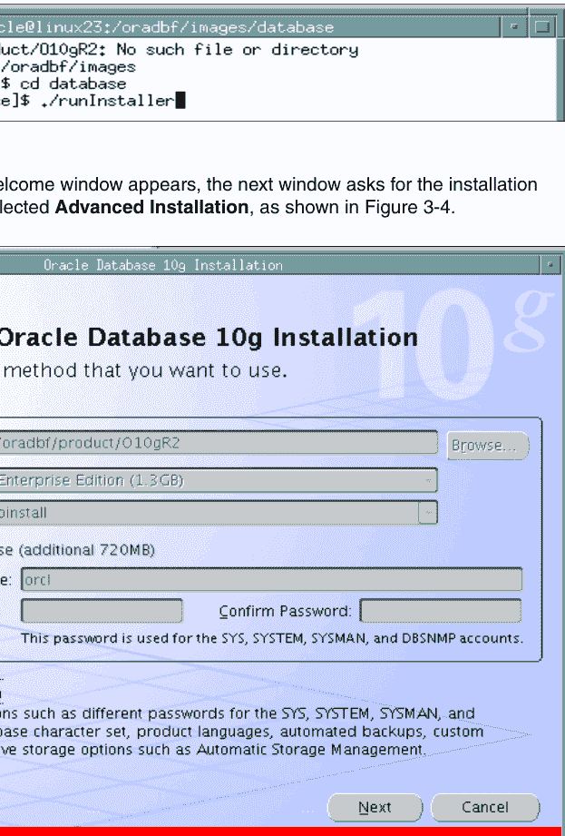

图 3-4 选择高级安装

34 在 System z 上使用 Oracle 解决方案

3. 我们选择了 Oracle Database 10g 企业版，如图 3-5 所示。其他选择允许安装标准版（SE）。但在 System z 中不允许此类选择，因为该版本限制在物理最大为四个 CPU 的系统。

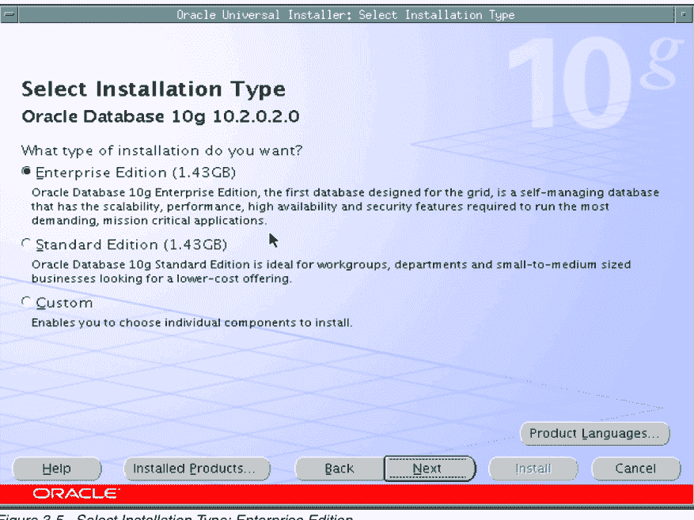

图 3-5 选择安装类型：企业版

4. 您必须指定您的 Oracle 首页目录（图 3-6），用于安装 Oracle 可执行软件。该位置是由我们在 oracle profile 中做的设置预先确定的。OUI 识别了这一点，并将该值放置在 Path 字段中。

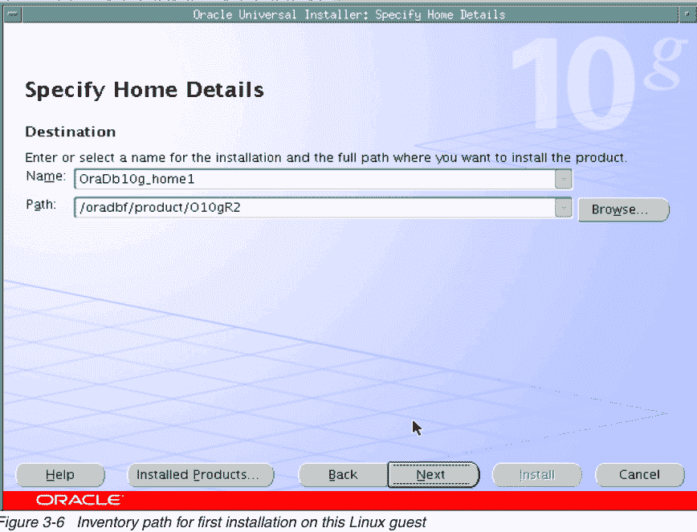

5. 第 37 页的图 3-7 检查系统是否符合系统前提条件，以确保您的系统已准备好安装 Oracle 二进制文件。正如我们之前提到的，512 MB 的交换空间（swap space）就足够。OUI 使用基于 Intel® 平台的公式来确定适当的交换空间量。

图 3-6 此 Linux 虚拟机上首次安装的清单路径

只要您已安装了 512 MB 的交换空间，请忽略关于交换空间不足的消息并继续。安装的此部分将验证其他内核参数是否正确，如果不正确，将警告您必须纠正它们。

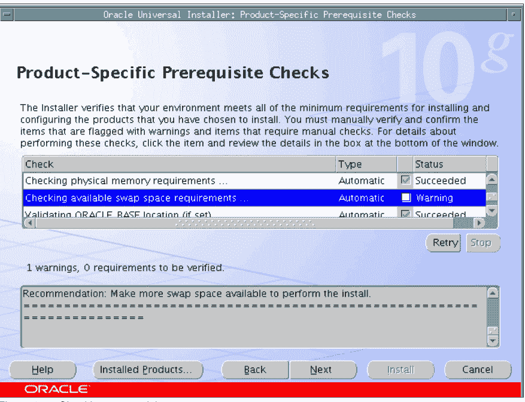

图 3-7 检查前提条件

第 3 章 安装 Oracle 10g2 单实例 37

6. 图 3-8 显示由于交换空间不足，前提条件检查失败。同样，只要您已安装了 512 MB 的交换空间，就可以忽略此消息并继续。

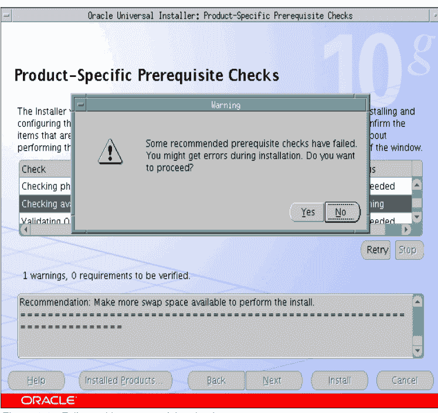

图 3-8 前提检查失败

7. 我们选择了“是”（Yes）并继续安装。

38 在 System z 上使用 Oracle 解决方案

8. 图 3-9 中的选项为您提供了创建并安装数据库、配置自动存储管理（ASM）来管理存储或仅安装 Oracle 数据库软件的选项。我们选择了**创建数据库**（Create database）。

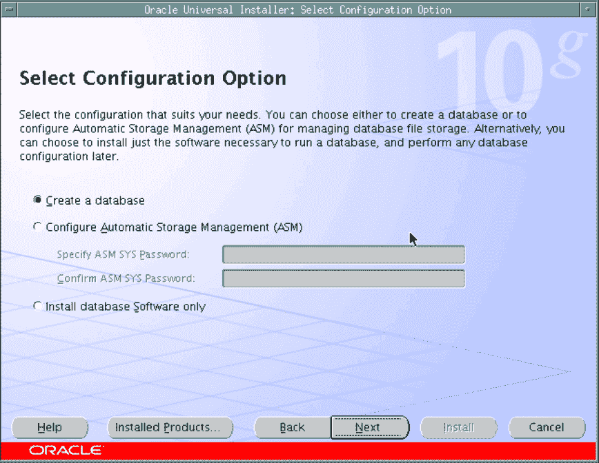

图 3-9 数据库配置

9. 图 3-10 显示了特定用途的数据库安装。我们选择了“通用”（General Purpose）。

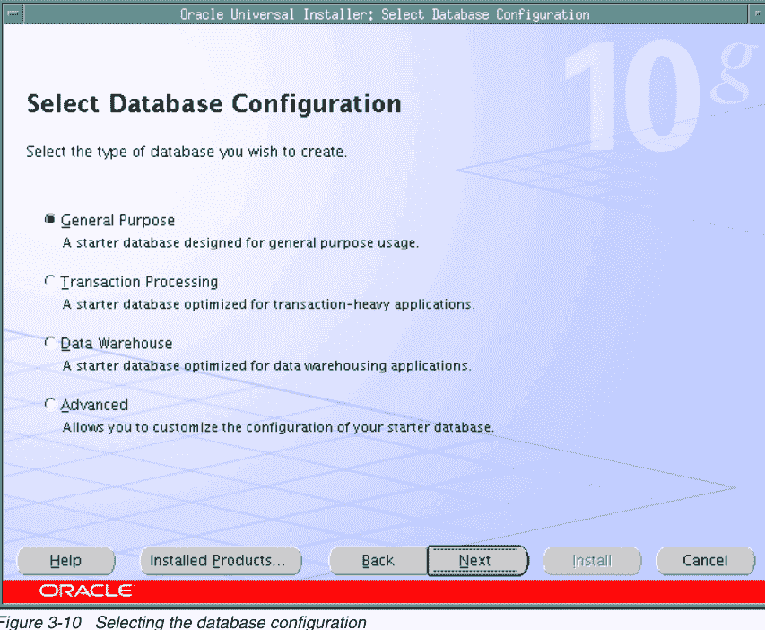

图 3-10 选择数据库配置

40 在 System z 上使用 Oracle 解决方案

10. 我们将数据库命名为 Inx23ori，如图 3-11 所示，并接受了默认字符集。

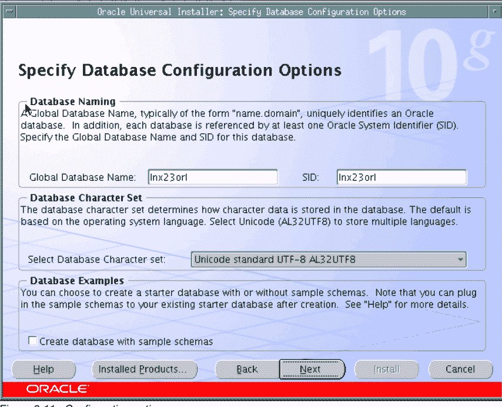

图 3-11 配置选项

11. 我们的数据库管理选项选择了“使用数据库控制进行数据库管理”，如图 3-12 所示。如果您想从 Grid Control 管理数据库，可以从本次安装中单独安装代理。Grid Control 服务器必须安装在另一个平台上。

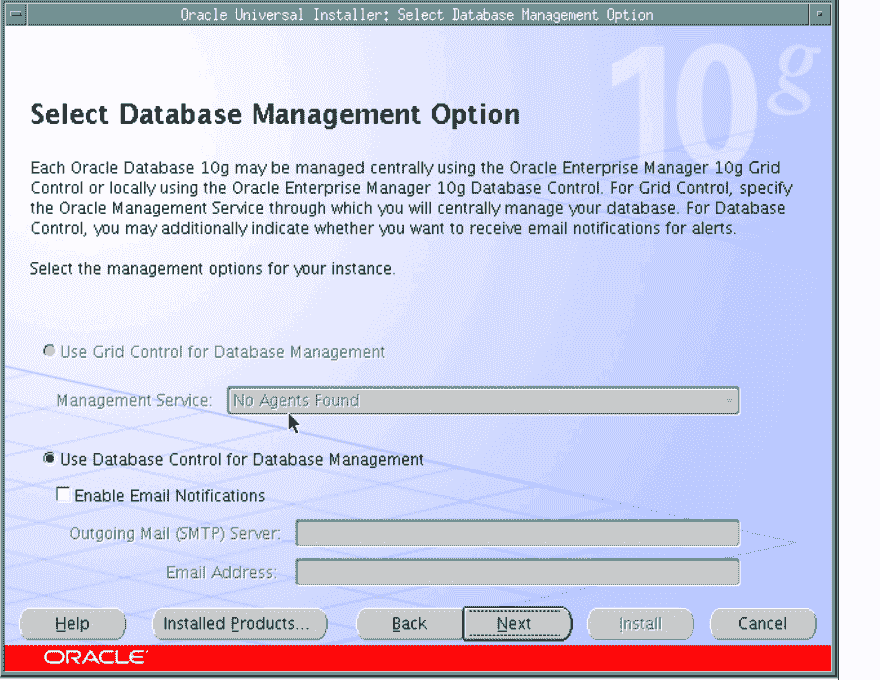

图 3-12 数据库管理选项

42 在 System z 上使用 Oracle 解决方案

12. 图 3-13 显示了我们选择的文件系统和输入的挂载点。

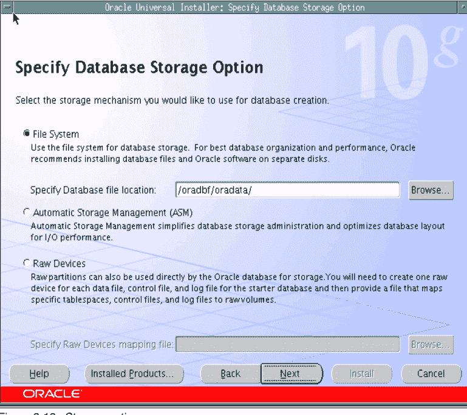

图 3-13 存储选项

13. 我们选择不启用自动备份，如图 3-14 所示。

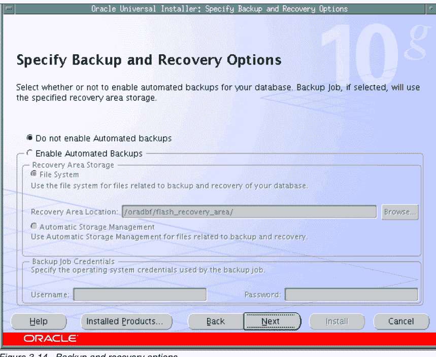

图 3-14 备份和恢复选项

14. 我们选择为所有 Oracle schema 使用相同的密码。出于安全考虑，对于将用于测试、开发或生产环境的数据库，这并不是好主意（图 3-15）。

 数据库包含预加载的 schema，其中大部分在安装结束时会过期并锁定。安装完成后，您必须为想要使用的账户解锁并设置新密码。用于数据库管理和安装后功能的 schema 锁定状态，这些账户的密码不会过期。为这些账户指定密码。

图 3-15 密码

15. 图 3-16 显示了安装摘要。


图 3-16 安装摘要

46 在 System z 上使用 Oracle 解决方案

16. 安装过程将持续几分钟。它复制文件并运行命令来执行链接。参见图 3-17。


图 3-17 安装软件

您可以在此处找到安装日志：/oradbt/oracleinventory/logs/installAction2006-08_01-36-54.log

第 3 章 安装 Oracle 10g2 单实例 17. 安装过程会自动启动代理来配置数据库的网络组件并创建一个名为 SQL Plus 的数据库助手。参见图 3-18。


图 3-18 配置助手

18. 在此过程中创建了我们配置的数据库，如图 3-19 所示。


图 3-19 创建数据库

19. 接下来，密码和账户窗口允许更改密码并解锁各种账户。在此窗口中选择 OK 允许进程继续。

20. 按照“执行配置”窗口（图 3-20）中的指示，打开一个 root 用户 PuTTY 会话。


图 3-20 执行配置脚本

21. 从此 root 用户 PuTTY 会话，我们输入了第 51 页示例 3-7 所示的命令。

# 示例 3-7 ls 命令

```
[root@linux23 bin]# cd /oradbt/product/10g2
[root@linux23 10GR2]# ls
OPatch install mgw rdbms
assistants install.platform relnotes
bin inventory nls root.sh
cdata javajavm oc4j slax
cfgtools jdbc olap sqlj
clone jdk opmn sqlplus
config jlib oraInst.loc srm
crs jre oracle sysman
css ld ord tg4sybs
ctx lib32 tg4tera
dbs lib32 own uix
demo linux23.itso.ibm.com_lnx23orl www
diagnostics log plsql
has md precomp
sh mesg racg
[root@linux23 10gR2]# ./root.sh
Running Oracle 10g root.sh script...
```

设置的环境变量如下：
ORACLE_OWNER= oracle
ORACLE_HOME=/oradbt/product/10g2

本地 bin 目录的完整路径：[/usr/local/bin];
usr/local/bin

Copying dbhome to /usr/local/bin ...
Copying oraenv to /usr/local/bin ...
Copying coraenv to /usr/local/bin ...

当创建数据库时，根据需要会将条目添加到 /etc/oratab 文件中。
root.sh 脚本的通用部分运行完毕。
现在将执行特定产品的 root 操作。
[root@linux23 10gR2]#

22. 图 3-21 显示安装成功完成。


图 3-21 安装结束

52 在 System z 上使用 Oracle 解决方案

23. 点击“退出”会发出退出确认提示，如图 3-22 所示，我们通过点击“是”来回答。


第 3 章 安装 Oracle 10g2 单实例 53


## 24. 图 3-23 确认数据库已启动。

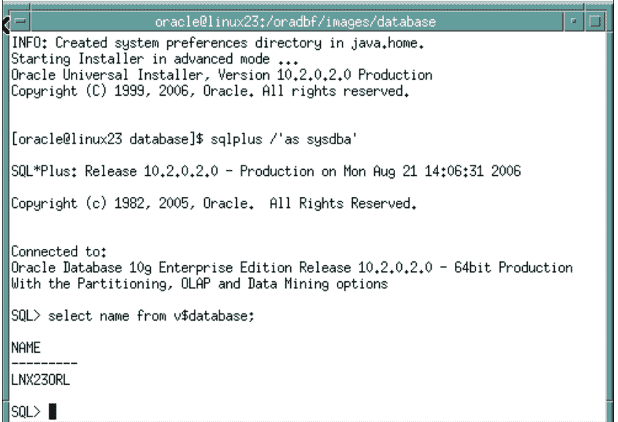

图 3-23

Oracle 二进制文件和 Oracle 数据库实例 Lnx23or 已成功安装。访问 Oracle Enterprise Manager (OEM) 和 ISQL 的网站请参阅第 56 页的图 3-24 和第 59 页的图 3-27，我们在那里使用了这些网站。

安装完成后，Oracle 监听器（Listener）也应该处于运行状态。输入命令 `lsnrctl status`，你应该会收到消息，指示监听器已为数据库启动。通过输入以下命令来启动和停止监听器：

```
lsnrctl {start, stop}
```

要重启数据库，请执行以下命令：

```

sqlplus '/as sysdba'
SQL>startup
```

此时，你已经有一个正在运行的数据库。

> **注意 1：** 我们的 Oracle 安装并不一定遵循 Oracle 灵活架构 (OFA)。我们使用的 Linux 虚拟机用于多个项目，我们没有灵活性不断更改 Linux 配置以满足 OFA 建议。你的安装应该遵循你组织用于安装 Oracle 产品的最佳实践。我们的安装过程在流程和参数方面遵循了 Oracle 文档，因此说明了成功安装后的外观。

**注意 2：** 你可能希望考虑使用 *orarun* 软件包，该包是作为 SUSE Linux Enterprise Server (SLES) 的提供的 RPM 软件软件包。orarum 包的目的是简化 Oracle 软件产品的安装和管理。更多信息请访问 http://wiki.novell.com/index.php/Orarun_package。

## 3.5 使用 OEM 管理 Oracle 数据库

你可以通过 DBControl 使用 Oracle Enterprise Manager (OEM) 管理 Oracle 数据库。在成功安装数据库后，可以使用 UI 显示的网站（如图 3-24 所示）调用 Oracle Enterprise Manager。OEM 登录窗口是在 Internet Explorer® 浏览器中输入网站（host:port/em）后的结果。你可以以用户名 `sys` 和你在图 3-24 中输入的密码登录，并在框中以 `SYSDBA` 身份登录。

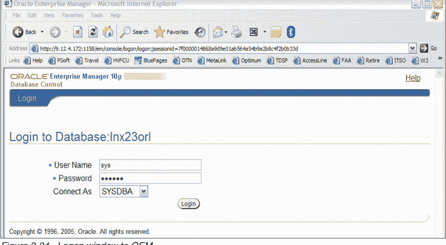

图 3-24 2005. Oracle. OEM 登录窗口

Oracle Enterprise Manager (OEM) 主窗口在登录完成后显示（见第 57 页的图 3-25）。它是一个可滚动面板。这只显示了可用功能的顶部部分。

## Oracle Enterprise Manager (SYS) - 数据库实例: Inx23rl - Microsoft Internet Explorer

文件 编辑 视图 收藏 帮助

返回 搜索 收藏

http://19.2.12.171:1158/console/database.instance.item/event?target=load.target&instance=Inx23rl&type=oracle_database

链接 帮助 Psft Travel HitCU BluePages OTN Metalink Optimum TDSP Accessline FAA ITSO W

# ORACLE Enterprise Manager 10g
数据库控制

设置 选项 帮助 销数据库

以 SYS 登录

# 数据库实例: Inx23rl

首页 性能 管理 维护

页面刷新于 2006年8月21日 4:53:52 PM 刷新 视图 自动数据 (60 秒)

| 常用 | 主机 CPU | 活动会话 | SQL 响应时间 |
|---|---|---|---|
| 状态  | 100% | 1.0 | 基准是 |
| 自启动于: 2006年8月21日 1:54:15 PM EDT | 75 | 等待时间 | 空 |
| 实例名称: Inx23rl | 其他 Inx23rl | 用户 | 重置基准 |
| 版本: 10.2.0.2 | 25 | 0.5 | |
| 主机: linux23rl.itbm.com | 0 | CPU | |
| 监听器: LISTENER:linux23rl.itbm.com | | 0 | |
| | 负载 0.25 分页交换 0.00 | | |
| 查看所有属性 | 诊断摘要 | 空间摘要 | 高可用性 |
| 数据库缓存 | 数据时间 | Internet | |

图 3-25 Oracle Enterprise Manager 主窗口

你可以使用此窗口来管理你的单实例，例如检查补丁、运行自动工作负载库 (AWR) 等。

第 3 章. 安装 Oracle 10g 单实例 57 

### 3.5.1 使用 iSQLPlus 查询数据库

在 GUI 的最后一个窗口中，也有一个启动 iSQLPlus 的网站：http://host_name:5560/isqlplus。如果你在浏览器中输入此内容，你将获得一个登录窗口（图 3-26），然后是查询窗口。系统向你提供一个 SQL 工作表，以便你能够从浏览器查询数据库。你也可以用它来执行 PL/SQL 代码块。

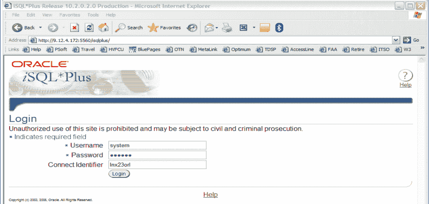

图 3-26 iSQL 登录窗口

为了确保 iSQLPlus 正常工作，我们将浏览器指向安装最后一个窗口中标识的端口。我们以 system 身份登录并执行了一个简单的查询以确保其工作正常（图 3-27）。

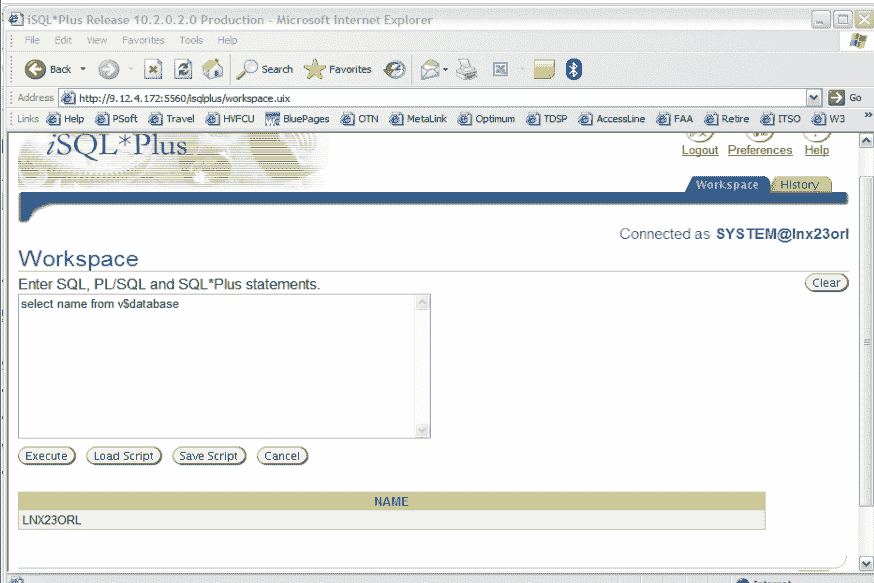

图 3-27 通过浏览器使用 SQL

## 3.6 总结

使用 OUI 进行安装非常简单且不复杂。然而，为了确保安装没有问题，完成所有任务以正确准备环境是非常关重要的。这包括内核参数等。最重要的任务是正确安装 Linux，并确保安装了正确的 Red Hat 包管理器 (RPMs)。如果你按照上述说明安装 Red Hat，并按照《Oracle 安装指南》确保安装了所有必要的 RPM，那么安装过程将会是顺畅的。

第 3 章. 安装 Oracle 10g2 实例 59

如果你正在使用 SUSE Linux Enterprise Server 9，我们使用了此过程来安装 Linux。我们发现，如果你使用这种方法，在安装 Oracle 时不应该出现任何 RPM 相关的问题。


图 3-24 2005. Oracle. OEM 登录窗口


图 3-25 Oracle Enterprise Manager 主窗口


图 3-26 iSQL 登录窗口


图 3-27 通过浏览器使用 SQL


图 3-28 默认安装


图 3-29 选择 C++编译器


### 4.4 网络配置的最佳实践

如果您在单个 Linux LPAR 上设置测试或开发系统，建议对公网和私有接口都使用虚拟交换机（VSwitch）。Oracle 私有互连可以使用 HiperSocket 虚拟机（这会模拟 HyperSocket），而公网接口可以使用千兆以太网虚拟机配置。

对于在同一台 IBM System z 上的两个或多个独立 LPAR 之间的 Oracle RAC 系统，建议使用 HyperSocket 作为私有网络互连。在两个或多个独立的 System z 机器之间设置 Oracle RAC 时，千兆 OSA 卡（或模拟千兆 OSA 卡的虚拟交换机）是私有互连的唯一配置选项。


| 设置 | Oracle 私有网络（互连） | Oracle 公有网络 |
|---|---|---|
| 位于不同物理机上的 z/VM Linux 虚拟机 | GlGigabit OSA 卡 | OSA 卡 |

## 4.3 IBM System z 上的 Oracle 10g RAC 存储选项

IBM System z 平台为在 z/VM Linux 下安装和运行 10g Oracle RAC 系统提供了多种磁盘配置。本节将探讨其中的一些存储选项，并对哪些选项可能最适合您的环境提供分析。

### 4.3.1 z/VM 磁盘选项

在 IBM System 上设置 Oracle 数据库时，磁盘存储是一个重要的考虑因素。DBA 必须理解底层的磁盘基础设施，以便高效地调优和维护系统。

在 z/VM Linux 中，通常使用两种类型的磁盘存储。磁盘应用程序可以使用利用固定（512 字节）块的 SCSI 存储设备，也可以使用扩展计数键数据 (ECKD) 磁盘设备。这些磁盘可以通过以下连接技术连接：企业级系统连接 (ESCON®)、光纤连接器 (FICON®) 或光纤通道协议 (FCP)。

FCP/SCSI 设备可能比 FICON/ECKD 设备更快。一种方法是将大型数据库文件放在 FCP/SCSI 设备上，将 Linux 系统和 Oracle 二进制文件放在 FICON/ECKD 设备上。

您无法在全 FCP/SCSI 分区上安装 Linux。System z 至少需要一个 ECKD 磁盘来安装操作系统。

使用 FICON/ECKD 存储时，您不需要在 Linux 虚拟机上设置多路，因为通道子系统可以提供带有多个路径组的通道。当使用 FCP/SCSI 磁盘时，我们建议实现 DM 多路以提供必要的容错能力。为了让 Oracle ASM 利用多路，在 Oracle 中 分配磁盘时，必须指定 DM 多路设备（而不是 FCP/SCSI 设备）。

FCP/SCSI 磁盘的另一个考虑因素是 FCP 通道。在 Oracle RAC 中，SAN LUN 可以在 Linux 虚拟机之间共享，但如果实现了 DM 多路，每个虚拟机都必须使用不同的 FCP 通道（或 FCP 通道组）。如果可用的 FCP 通道数量存在限制，这可能会引起关注。

实施 FCP 磁盘的客户可能还想考虑 N 端口虚拟化。通过 N 端口虚拟化，LUN 可以直接分配给虚拟机，而不是所有运行在 VM 下的虚拟机。N 端口虚拟化首次在 IBM System z9 上支持，不支持 z990 或 z980 型号。更多详情参见《Fibre Channel Protocol for Linux and vVM on IBM System z, SG24-7266》。

使用 SAN/SCSI 存储时，使用来自多个阵列和所有集群的磁盘非常重要。这将提供更好的 I/O 并发和负载均衡。图 4-2 展示了分配磁盘的正确方法。错误的方法是按顺序在一个 Rank 中分配所有存储，例如从 5100 到 510F。

| FCP CHDR | FCP CHDR | FCP CHDR | FCP CHDR | FCP CHDR | FCP CHDR |
|---|---|---|---|---|---|
| | | | | | CHIDs - FICON Express 卡支持 2 个端口，可以是 FCP 或 FICON |
| | | | | | |
| FICON/FCP 交换机 | | | | | |
| HA 槽 1 | HA 槽 2 | HA 槽 3 | HA 槽 4 | | |
| 设备适配器 | Rank 1 | Rank 2 | 设备适配器 | | |
| | Rank 9 | Rank 10 | | | | |
| 设备适配器 | Rank 3 | Rank 4 | 设备适配器 | | |
| 设备适配器 | Rank 5 | Rank 6 | 设备适配器 | | |
| | Rank 13 | Rank 14 | | | | |
| 设备适配器 | Rank 7 | Rank 8 | 设备适配器 | | |
| | Rank 15 | Rank 16 | | | | |

- 支持 FCP (FCP 端口) 的主机适配器 (HA)：每个主机适配器分为 4 个槽，每个槽 4 个端口，分为两个集群，缓存按集群组织！
- 设备适配器对 (DA)：每个支持两个环路
- 磁盘按 Rank 组织：每个 Rank（8 个物理磁盘）实现一个 RAID 5 阵列（带逻辑磁盘）

图 4-2 分配磁盘的正确方法

> *来源：Performance experience with Databases on Linux for IBM System z, by Kammerer, 见 http://www.ibm.com/developerworks/linux/linux390/index.html.*

Linux 的逻辑卷管理 (LVM) 和 Oracle 的自动存储管理 (ASM) 都是 dasd 聚合条带和镜像工具。在设置 Oracle 数据库存储时，您应该使用其中一种。

使用 LVM 时，应使用建议的条带设置：
- 数据仓库的良好条带大小为 32 KB 和 64 KB，对于高在线事务处理数据库 (OLTP)，则为 16 KB 或 8 KB。

### 4.2 在单独的 z9 机器之间设置磁盘

通常情况下，在 z9 机器之间设置磁盘时，第一个 Linux 虚拟机以读/写模式拥有磁盘，第二个虚拟机以读/写模式列出磁盘。

由于 Linux 虚拟机位于不同的 z9 机器上，两个虚拟机的目录条目都将使用专用语句来定义共享的设备。例如，第一个节点将在目录条目中使用 `0340:1F1` 来定义虚拟设备，第二个节点将使用 `0340:1F1`。

使用 FICON/ECKD 存储时，您不需要在 Linux 虚拟机上设置多路，因为通道子系统可以提供带有多个路径组的通道。使用 FCP/SCSI 磁盘时，我们建议实现 DM 多路以提供必要的容错能力。为了让 Oracle ASM 利用多路，在 Oracle 中分配磁盘时，必须指定 DM 多路设备（而不是 FCP/SCSI 设备）。

FCP/SCSI 磁盘的另一个考虑因素是 FCP 通道。在 Oracle RAC 中，SAN LUN 可以在 Linux 虚拟机之间共享，但如果实现了 DM 多路，每个虚拟机都必须使用不同的 FCP 通道（或 FCP 通道组）。如果可用的 FCP 通道数量存在限制，这可能会引起关注。

实施 FCP 磁盘的客户可能还想考虑 N 端口虚拟化。通过 N 端口虚拟化，LUN 可以直接分配给虚拟机，而不是所有运行在 VM 下的虚拟机。N 端口虚拟化首次在 IBM System z9 上支持，不支持 z990 或 z980 型号。详情参见《Fibre Channel Protocol for Linux and vVM on IBM System z, SG24-7266》。

使用 SAN/SCSI 存储时，使用来自多个阵列和所有集群的磁盘非常重要。这将提供更好的 I/O 并发和负载均衡。图 4-2 展示了分配磁盘的正确方法。错误的方法是按顺序在一个 Rank 中分配所有存储，例如从 5100 到 510F。

| FCP CHDR | FCP CHDR | FCP CHDR | FCP CHDR | FCP CHDR | FCP CHDR |
|---|---|---|---|---|---|
| | | | | | CHIDs - FICON Express 卡支持 2 个端口，可以是 FCP 或 FICON |
| | | | | | |
| FICON/FCP 交换机 | | | | | |
| HA 槽 1 | HA 槽 2 | HA 槽 3 | HA 槽 4 | | |
| 设备适配器 | Rank 1 | Rank 2 | 设备适配器 | | |
| | Rank 9 | Rank 10 | | | |
| 设备适配器 | Rank 3 | Rank 4 | 设备适配器 | | |
||适配器 | Rank 5 | Rank 6 | 设备适配器 | | |
| | Rank 13 | Rank 14 | | | |
| 设备适配器 | Rank 7 | Rank 8 | 设备适配器 | | |
| | Rank 15 | Rank 16 | | | | |

- 支持 FCP (FCP 端口) 的主机适配器 (HA)：每个主机适配器分为 4 个槽，每个槽 4 个端口，分为两个集群，缓存按集群组织！
- 设备适配器对 (DA)：每个支持两个环路
- 磁盘按 Rank 组织：每个 Rank（8 个物理磁盘）实现一个 RAID 5 阵列（带逻辑磁盘）

图 4-2 分配磁盘的正确方法

> *来源：Performance experience with Databases on Linux for IBM System z, by Kammerer, 见 http://www.ibm.com/developerworks/linux/linux390/index.html.*

Linux 的逻辑卷管理 (LVM) 和 Oracle 的自动存储管理 (ASM) 都是 dasd 聚合条带和镜像工具。在设置 Oracle 数据库存储时，您应该使用其中一种。

使用 LVM 时，应使用建议的条带设置：
- 数据仓库的良好条带大小为 32 KB 和 64 KB，对于高在线事务处理数据库 (OLTP)，则为 16 KB 或 8 KB。

### 4.2 在单独的 z9 机器之间设置磁盘

通常情况下，在 z9 机器之间设置磁盘时，第一个 Linux 虚拟机以读/写模式拥有磁盘，第二个虚拟机以读/写模式列出磁盘。

由于 Linux 虚拟机位于不同的 z9 机器上，两个虚拟机的目录条目都将使用专用语句来定义共享的设备。例如，第一个节点将在目录条目中使用 `0340:1F1` 来定义虚拟设备，第二个节点将使用 `0340:1F1`。

使用 FICON/ECKD 存储时，您不需要在 Linux 虚拟机上设置多路，因为通道子系统可以提供带有多个路径组的通道。使用 FCP/SCSI 磁盘时，我们建议实现 DM 多路以提供必要的容错能力。为了让 Oracle ASM 利用多路，在 Oracle 中分配磁盘时，必须指定 DM 多路设备（而不是 FCP/SCSI 设备）。

FCP/SCSI 磁盘的另一个考虑因素是 FCP 通道。在 Oracle RAC 中，SAN LUN 可以在 Linux 虚拟机之间共享，但如果实现了 DM 多路，每个虚拟机都必须使用不同的 FCP 通道（或 FCP 通道组）。如果可用的 FCP 通道数量存在限制，这可能会引起关注。

实施 FCP 磁盘的客户可能还想考虑 N 端口虚拟化。通过 N 端口虚拟化，LUN 可以直接分配给虚拟机，而不是所有运行在 VM 下的虚拟机。N 端口虚拟化首次在 IBM System z9 上支持，不支持 z990 或 z980 型号。详情参见《Fibre Channel Protocol for Linux and vVM on IBM System z, SG24-7266》。

使用 SAN/SCSI 存储时，使用来自多个阵列和所有集群的磁盘非常重要。这将提供更好的 I/O 并发和负载均衡。图 4-2 展示了分配磁盘的正确方法。错误的方法是按顺序在一个 Rank 中分配所有存储，例如从 5100 到 510F。

| FCP CHDR | FCP CHDR | FCP CHDR | FCP CHDR | FCP CHDR | FCP CHDR |
|---|---|---|---|---|---|
| | | | | | CHIDs - FICON Express 卡支持 2 个端口，可以是 FCP 或 FICON |
| | | | | | |
| FICON/FCP 交换机 | | | | | |
| HA 槽 1 | HA 槽 2 | HA 槽 3 | HA 槽 4 | | |
| 设备适配器 | Rank 1 | Rank 2 | 设备适配器 | | |
| | Rank 9 | Rank 10 | | | |
| 设备适配器 | Rank 3 | Rank 4 | 设备适配器 | | |
| 设备适配器 | Rank 5 | Rank 6 | 设备适配器 | | |
| | Rank 13 | Rank 14 | | | |
| 设备适配器 | Rank 7 | Rank 8 | 设备适配器 | | |
| | Rank 15 | Rank 16 | | | |

- 支持 FCP (FCP 端口) 的主机适配器 (HA)：每个主机适配器分为 4 个槽，每个槽 4 个端口，分为两个集群，缓存按集群组织！
- 设备适配器对 (DA)：每个支持两个环路
- 磁盘按 Rank 组织：每个 Rank（8 个物理磁盘）实现一个 RAID 5 阵列（带逻辑磁盘）

图 4-2 分配磁盘的正确方法

> *来源：Performance experience with Databases on Linux for IBM System z, by Kammerer, 见 http://www.ibm.com/developerworks/linux/linux390/index.html.*

Linux 的逻辑卷管理 (LVM) 和 Oracle 的自动存储管理 (ASM) 都是 dasd 聚合条带和镜像工具。在设置 Oracle 数据库存储时，您应该使用其中一种。

使用 LVM 时，应使用建议的条带设置：
- 数据仓库的良好条带大小为 32 KB 和 64 KB，对于高在线事务处理数据库 (OLTP)，则为 16 KB 或 8 KB。

### 4.2 在单独的 z9 机器之间设置磁盘

通常情况下，在 z9 机器之间设置磁盘时，第一个 Linux 虚拟机以读/写模式拥有磁盘，第二个虚拟机以读/写模式列出磁盘。

由于 Linux 虚拟机位于不同的 z9 机器上，两个虚拟机的目录条目都将使用专用语句来定义共享的设备。例如，第一个节点将在目录条目中使用 `0340:1F1` 来定义虚拟设备，第二个节点将使用 `0340:1F1`。

使用 FICON/ECKD 存储时，您不需要在 Linux 虚拟机上设置多路，因为通道子系统可以提供带有多个路径组的通道。使用 FCP/SCSI 磁盘时，我们建议实现 DM 多路以提供必要的容错能力。为了让 Oracle ASM 利用多路，在 Oracle 中分配磁盘时，必须指定 DM 多路设备（而不是 FCP/SCSI 设备）。

FCP/SCSI 磁盘的另一个考虑因素是 FCP 通道。在 Oracle RAC 中，SAN LUN 可以在 Linux 虚拟机之间共享，但如果实现了 DM 多路，每个虚拟机都必须使用不同的 FCP 通道（或 FCP 通道组）。如果可用的 FCP 通道数量存在限制，这可能会引起关注。

实施 FCP 磁盘的客户可能还想考虑 N 端口虚拟化。通过 N 端口虚拟化，LUN 可以直接分配给虚拟机，而不是所有运行在 VM 下的虚拟机。N 端口虚拟化首次在 IBM System z9 上支持，不支持 z990 或 z980 型号。详情参见《Fibre Channel Protocol for Linux and vVM on IBM System z, SG24-7266》。

使用 SAN/SCSI 存储时，使用来自多个阵列和所有集群的磁盘非常重要。这将提供更好的 I/O 并发和负载均衡。图 4-2 展示了分配磁盘的正确方法。错误的方法是按顺序在一个 Rank 中分配所有存储，例如从 5100 到 510F。

| FCP CHDR | FCP CHDR | FCP CHDR | FCP CHDR | FCP CHDR | FCP CHDR |
|---|---|---|---|---|---|
| | | | | | CHIDs - FICON Express 卡支持 2 个端口，可以是 FCP 或 FICON |
| | | | | | |
| FICON/FCP 交换机 | | | | | |
| HA 槽 1 | HA 槽 2 | HA 槽 3 | HA 槽 4 | | |
| 设备适配器 | Rank 1 | Rank 2 | 设备适配器 | | |
| | Rank 9 | Rank 10 | | | |
| 设备适配器 | Rank 3 | Rank 4 | 设备适配器 | | |
| 设备适配器 | Rank 5 | Rank 6 | 设备适配器 | | |
| | Rank 13 | Rank 14 | | | |
| 设备适配器 | Rank 7 | Rank 8 | 设备适配器 | | |
| | Rank 15 | Rank 16 | | | |

- 支持 FCP (FCP 端口) 的主机适配器 (HA)：每个主机适配器分为 4 个槽，每个槽 4 个端口，分为两个集群，缓存按集群组织！
- 设备适配器对 (DA)：每个支持两个环路
- 磁盘按 Rank 组织：每个 Rank（8 个物理磁盘）实现一个 RAID 5 阵列（带逻辑磁盘）

图 4-2 分配磁盘的正确方法

> *来源：Performance experience with Databases on Linux for IBM System z, by Kammerer, 见 http://www.ibm.com/developerworks/linux/linux390/index.html.*

Linux 的逻辑卷管理 (LVM) 和 Oracle 的自动存储管理 (ASM) 都是 dasd 聚合条带和镜像工具。在设置 Oracle 数据库存储时，您应该使用其中一种。

使用 LVM 时，应使用建议的条带设置：
- 数据仓库的良好条带大小为 32 KB 和 64 KB，对于高在线事务处理数据库 (OLTP)，则为 16 KB 或 8 KB。

### 4.2 在单独的 z9 机器之间设置磁盘

通常情况下，在 z9 机器之间设置磁盘时，第一个 Linux 虚拟机以读/写模式拥有磁盘，第二个虚拟机以读/写模式列出磁盘。

由于 Linux 虚拟机位于不同的 z9 机器上，两个虚拟机的目录条目都将使用专用语句来定义共享的设备。例如，第一个节点将在目录条目中使用 `0340:1F1` 来定义虚拟设备，第二个节点将使用 `0340:1F1`。

使用 FICON/ECKD 存储时，您不需要在 Linux 虚拟机上设置多路，因为通道子系统可以提供带有多个路径组的通道。使用 FCP/SCSI 磁盘时，我们建议实现 DM 多路以提供必要的容错能力。为了让 Oracle ASM 利用多路，在 Oracle 中分配磁盘时，必须指定 DM 多路设备（而不是 FCP/SCSI 设备）。

FCP/SCSI 磁盘的另一个考虑因素是 FCP 通道。在 Oracle RAC 中，SAN LUN 可以在 Linux 虚拟机之间共享，但如果实现了 DM 多路，每个虚拟机都必须使用不同的 FCP 通道（或 FCP 通道组）。如果可用的 FCP 通道数量存在限制，这可能会引起关注。

实施 FCP 磁盘的客户可能还想考虑 N 端口虚拟化。通过 N 端口虚拟化，LUN 可以直接分配给虚拟机，而不是所有运行在 VM 下的虚拟机。N 端口虚拟化首次在 IBM System z9 上支持，不支持 z990 或 z980 型号。详情参见《Fibre Channel Protocol for Linux and vVM on IBM System z, SG24-7266》。

使用 SAN/SCSI 存储时，使用来自多个阵列和所有集群的磁盘非常重要。这将提供更好的 I/O 并发和负载均衡。图 4-2 展示了分配磁盘的正确方法。错误的方法是按顺序在一个 Rank 中分配所有存储，例如从 5100 到 510F。

| FCP CHDR | FCP CHDR | FCP CHDR | FCP CHDR | FCP CHDR | FCP CHDR |
|---|---|---|---|---|---|
| | | | | | CHIDs - FICON Express 卡支持 2 个端口，可以是 FCP 或 FICON |
| | | | | | |
| FICON/FCP 交换机 | | | | | |
| HA 槽 1 | HA 槽 2 | HA 槽 3 | HA 槽 4 | | |
| 设备适配器 | Rank 1 | Rank 2 | 设备适配器 | | |
| | Rank 9 | Rank 10 | | | |
| 设备适配器 | Rank 3 | Rank 4 | 设备适配器 | | |
| 设备适配器 | Rank 5 | Rank 6 | 设备适配器 | | |
| | Rank 13 | Rank 14 | | | |
| 设备适配器 | Rank 7 | Rank 8 | 设备适配器 | | |
| | Rank 15 | Rank 16 | | | |

- 支持 FCP (FCP 端口) 的主机适配器 (HA)：每个主机适配器分为 4 个槽，每个槽 4 个端口，分为两个集群，缓存按集群组织！
- 设备适配器对 (DA)：每个支持两个环路
- 磁盘按 Rank 组织：每个 Rank（8 个物理磁盘）实现一个 RAID 5 阵列（带逻辑磁盘）

图 4-2 分配磁盘的正确方法

> *来源：Performance experience with Databases on Linux for IBM System z, by Kammerer, 见 http://www.ibm.com/developerworks/linux/linux390/index.html.*

Linux 的逻辑卷管理 (LVM) 和 Oracle 的自动存储管理 (ASM) 都是 dasd 聚合条带和镜像工具。在设置 Oracle 数据库存储时，您应该使用其中一种。

使用 LVM 时，应使用建议的条带设置：
- 数据仓库的良好条带大小为 32 KB 和 64 KB，对于高在线事务处理数据库 (OLTP)，则为 16 KB 或 8 KB。

### 4.2 在单独的 z9 机器之间设置磁盘

通常情况下，在 z9 机器之间设置磁盘时，第一个 Linux 虚拟机以读/写模式拥有磁盘，第二个虚拟机以读/写模式列出磁盘。

由于 Linux 虚拟机位于不同的 z9 机器上，两个虚拟机的目录条目都将使用专用语句来定义共享的设备。例如，第一个节点将在目录条目中使用 `0340:1F1` 来定义虚拟设备，第二个节点将使用 `0340:1F1`。

使用 FICON/ECKD 存储时，您不需要在 Linux 虚拟机上设置多路，因为通道子系统可以提供带有多个路径组的通道。使用 FCP/SCSI 磁盘时，我们建议实现 DM 多路以提供必要的容错能力。为了让 Oracle ASM 利用多路，在 Oracle 中分配磁盘时，必须指定 DM 多路设备（而不是 FCP/SCSI 设备）。

FCP/SCSI 磁盘的另一个考虑因素是 FCP 通道。在 Oracle RAC 中，SAN LUN 可以在 Linux 虚拟机之间共享，但如果实现了 DM 多路，每个虚拟机都必须使用不同的 FCP 通道（或 FCP 通道组）。如果可用的 FCP 通道数量存在限制，这可能会引起关注。

实施 FCP 磁盘的客户可能还想考虑 N 端口虚拟化。通过 N 端口虚拟化，LUN 可以直接分配给虚拟机，而不是所有运行在 VM 下的虚拟机。N 端口虚拟化首次在 IBM System z9 上支持，不支持 z990 或 z980 型号。详情参见《Fibre Channel Protocol for Linux and vVM on IBM System z, SG24-7266》。

使用 SAN/SCSI 存储时，使用来自多个阵列和所有集群的磁盘非常重要。这将提供更好的 I/O 并发和负载均衡。图 4-2 展示了分配磁盘的正确方法。错误的方法是按顺序在一个 Rank 中分配所有存储，例如从 5100 到 510F。


### 4.3.6 OCR 和投票磁盘（Voting disks）的安装

Oracle 支持两种存储 Oracle 集群文件的方法：使用原始设备（Raw）块设备或共享文件系统，例如 Oracle 集群文件系统 2 (OCFS2)。OCFS2 是一种基于区的数据的集群文件系统，集群中的所有节点都可以对其访问和写入。OCFS2 仅支持 Linux 2.6 及以上版本的内核。

Oracle 集群至少需要两个设备：一个用于 Oracle 集群注册表 (OCR)，另一个用于投票磁盘 (Voting disks)。如果您正在格式化 ECKD 类型的 DASD 以作为原始或块分区，则必须使用 4 KB 的块大小对其进行格式化。

对于测试系统，通常使用一个分区同时存放 OCR 和投票磁盘。对于生产系统，建议每个大小的至少使用 280 MB 空间，并配置多个投票磁盘（必须为奇数）。

- 两个 OCR：每个 256 MB 或 512 MB
- 三个投票磁盘：每个 256 MB 或 768 MB

Oracle 确保设备包含至少 256 MB 的可用磁盘空间。因此，建议每个设备大小至少为 280 MB，以考虑到分区创建产生的影响。

### 4.3.7 共享数据库磁盘安装

可以使用以下存储选项创建 Oracle RAC：

- 使用 Oracle ASM 用于数据文件，OCR 和投票磁盘放置在原始设备或块设备上
- 标准原始设备或块设备（不使用 Oracle ASM）

为 Oracle 使用的不同类型 I/O 设置多个磁盘组是一个非常好主意。例如，设置一组磁盘用于数据库文件，另一组磁盘用于重做日志（redo logs）。

如果创建 ASM 数据库，Oracle 建议将闪回恢复区域（Flash Recovery Area）放置在与数据库文件不同的磁盘组上。这可以防止系统活动数据与备份恢复数据位于同一块物理磁盘上。

## 4.4 为 Oracle RAC 格式化分区磁盘

格式化工具 `dasdfmt` 提供了以不同块大小格式化 DASD 设备选项。在 z/VM 系统上，应使用 4096 的 `dasdfmt` 块大小：

```
# dasdfmt -f /dev/dasda -b 4096 -p
# dasdfmt -f /dev/dasdb -b 4096 -p
# dasdfmt -f /dev/dasdc -b 4096 -p
```

下一步是在每个磁盘设备上创建一个分区。您本应该在每个磁盘上只创建一个分区，但在测试环境中，人们会在每个磁盘上创建多个分区。无论您使用 ECKD 磁盘 (fdsd) 还是 SCSI/FCP 磁盘 (fdisk)，创建分区的命令都是相似的：

```
# fdsd -a /dev/dasda
# fdsd -a /dev/dasdb
# fdisk /dev/sda
```

对于 Oracle RAC，您首先需要对 OCR、投票磁盘以及任何 Oracle ASM 数据库磁盘进行格式化分区。

对于非数据库文件系统，您可以使用 `pvcreate` 命令创建物理卷（physical volume）。`pvcreate` 命令在每个磁盘或分区的开头写入卷组描述符。

因此，如果您想创建一个涉及三块磁盘的文件系统，您将输入类似下面的命令，将您想要在卷组中使用的每个设备标记为物理卷：

```
# pvcreate /dev/dasdal /dev/dasb1 /dev/dasc1
```

然后下一步是为物理卷创建卷组（volume group）：

```
# vgcreate orabinvg /dev/dasdal /dev/dasb1 /dev/dasc1
```

要显示此卷组的属性，可以使用以下命令：

```
# vgdisplay orabinvg
```

下一步是创建一个可以被 Oracle 挂载并使用的逻辑文件系统。

在此示例中，我们使用了三块磁盘和一个具有三条条带（stripes）的 LV，块大小为 32 KB，LV 大为 6.8 GB：

```
# lvcreate -i13 -I32 -L6.8G -orabinlv orarang
```

显示新创建的 LV 的属性，运行：
# lvsdisplay /dev/orabvg/orablv

要为 oracle 逻辑卷创建 ext3 文件系统，您需要运行 `mkfs`。
建议使用 ext3 文件系统类型：
# mkfs.ext3 /dev/orabvg/orablv -b 4096

为 oracle home 创建挂载点，挂载文件系统并验证新创建文件的大小：
# mkdir -p /oracle
# mount /dev/orabvg/orablv /oracle
# df -h

为了使更改永久生效，您需要更新 `fstab`。我们建议先备份此文件：
# vi /etc/fstab
/dev/orabvg/orablv /oracle ext3 defaults

## 4.5 在原始/块设备上安装 Oracle ASM

Oracle 自动存储管理 (ASM) 是 Oracle 10g 中的一项新功能。


建议使用 oracleasm-support 2.0.1 驱动，因为它们提供了对回环（loopback）、MD、LVM 和 device-mapper 设备的支持

你可以从以下 Oracle 网站下载 RPM 包：
http://www.oracle.com/technology/tech/linux/asmlib/index.html

然后运行以下命令：

```bash
# ls *.rpm
oracleasm-2.6.9-55.0.12.EL-2.0.3-1.s390x.rpm
oracleasmilib-2.0.2-1.s390x.rpm
oracleasm-support-2.0.3-1.s390x.rpm
[root@oralin2 tmp]# rpm -ivh oracleasm-support-2.0.3-1.s390x.rpm
Preparing...
###########################
1:oracleasm-support [100%]
###########################################
[root@oralin2 tmp]# rpm -ivh oracleasm-2.6.9-55.0.12.EL-2.0.3-1.s390x.rpm
Preparing...
###########################################
1:oracleasm-2.6.9-55.0.12 [100%]
###########################################
[root@oralin2 tmp]# rpm -ivh oracleasmilib-2.0.2-1.s390x.rpm
Preparing...
###########################################
1:oracleasmilib [100%]
###########################################
```

下一步是配置 ASM 内核。当我们尝试配置 ASM 内核时，收到了错误，因为我们的 Linux 内核版本与 ASMLib 内核 RPM 版本不匹配：
```bash
[root@oralin2 tmp]# /etc/init.d/oracleasm configure
Configuring the Oracle library driver.

这将配置 Oracle ASM 库驱动程序的启动属性。以下问题将决定驱动程序是否在启动时加载以及它具有什么权限。当前值将显示在括号 ('[]') 中。在不输入答案的情况下按 <ENTER> 将保留该值。Ctrl-C 将取消。

拥有驱动接口的默认用户 [: oracle
拥有驱动接口的默认组 [: dba
启动时启动 Oracle ASM 库驱动程序 (y/n) [n]: y
启动时修复 Oracle ASM 磁盘的权限 (y/n) [y]: y

写入 Oracle ASM 库驱动配置: [ OK ]
创建 /dev/oracleasm 挂点: [ OK ]
加载模块 "oracleasm": Unable to load module "oracleasm"
[FAILED]
```

为了解决这个问题，我们需要通过运行（基于你正在运行的内核版本）参考 MetaLink Note: 462618.1：
usr/lib/oracleasm/oracleasm_debug_link 2.6.9-55.0.12.EL (uname -r)

这在 Oracle ASM 目录中创建一个软链接，可以通过以下命令验证：
`ls -1 /lib/modules/$(uname -r)/kernel/drivers/addon/oracleasm`

完成此步骤后，ASM 配置成功了。如果以后你对 Linux 内核应用了更新，只要从下载站点提供了合适的驱动程序，你就再次遵循此过程。

你只应该在内核驱动程序之间存在微小版本差异时使用此变通方法。2.6.9-55.0.12 到 2.6.9-55.0.13 且 Oracle 不支持这种配置。出于生产目的，你应该确保你的内核版本与可用的 ASMLib 内核版本一致：

```bash
[root@oraclein02]# /etc/init.d/oracleasm configure
Configuring the Oracle ASM library driver.
```

这将配置 Oracle ASM 库驱动程序的启动属性。以下问题将决定驱动程序是否在启动时加载以及它具有什么权限。当前值将显示在括号 ('[]') 中。在不输入答案的情况下按 <ENTER> 将保留当前值。Ctrl-C 将取消。

拥有驱动接口的默认用户 [oracle]:
拥有驱动接口的默认组 [dba]:
启动时启动 Oracle ASM 库驱动程序 (y/n) [y]:
启动时修复 Oracle ASM 磁盘的权限 (y/n) [y]:
写入 Oracle ASM 库驱动配置: [ OK ]
加载模块 "oracleasm": [ OK ]
挂载 ASMLib 驱动文件系统: [ OK ]
扫描系统 ASM 磁盘: [ OK ]

一旦安装并配置了 ASMLib，你需要将 ASM 磁盘标记为已创建（created），以便 ASMLib 能够发现它。你需要以 root 身份在 /etc/init.d 下此操作。

使用原始设备（Raw devices）：
/etc/init.d/oracleasm created DISK03 /dev/raw/raw3
/etc/init.d/oracleasm created DISK04 /dev/raw/raw4

使用块设备（Block devices）：
/etc/init.d/oracleasm created DISK03 /dev/dasql
/etc/init.d/oracleasm created DISK04 /dev/dasdr1

或
/etc/init.d/oracleasm created DISK03 /dev/sda1
/etc/init.d/oracleasm created DISK04 /dev/sdb1

为了让所有 RAC 节点都能看到磁盘，你需要在每个节点上运行 oracleasm scandisk，以便每个 ASM 实例都能看到磁盘：
`[root@oraclein02]# oracleasm scandisk
Scanning for ASM disks: [ OK ]`

一旦安装并配置了 ASMLib，你需要将 ASM 磁盘标记为已创建，以便 ASMLib 能够发现它。你将以 root 身份在 /etc/init.d 下此操作……（等待，提示符中的 OCR 文本似乎重复了后续部分。*纠正：提示符中的 OCR 文本包含不同页面的重复部分，我将根据源文本进行合并。）

建议使用 oracleasm-support 2.0.1 驱动，因为它们提供了对回环、MD、LVM 和 device-mapper 设备的支持。

你可以从以下 Oracle 网站下载 RPM：
http://www.oracle.com/technology/tech/linux/asmlib/index.html

然后运行以下命令：

```bash
# ls *.rpm
oracleasm-2.6.9-55.0.12.EL-2.0.3-1.s390x.rpm
oracleasmilib-2.0.2-1.s390x.rpm
oracleasm-support-2.0.3-1.s390x.rpm
[root@oralin2 tmp]# rpm -ivh oracleasm-support-2.0.3-1.s390x.rpm
Preparing...
###########################
1:oracleasm-support [100%]
###########################################
[root@oralin2 tmp]# rpm -ivh oracleasm-2.6.9-55.0.12.EL-2.0.3-1.s390x.rpm
Preparing...
###########################################
1:oracleasm-2.6.9-55.0.12 [100%]
###########################################
[root@oralin2 tmp]# rpm -ivh oracleasmilib-2.0.2-1.s390x.rpm
Preparing...
###########################################
1:oracleasmilib [100%]
###########################################
```

下一步是配置 ASM 内核。当我们配置 ASM 内核时，收到了错误，因为我们的 Linux 内核版本与 ASMLib 内核 RPM 版本不匹配：
```bash
[root@oralin2 tmp]# /etc/init.d/oracleasm configure
Configuring the Oracle library driver.

这将配置 Oracle ASM 库驱动程序的启动属性。以下问题将决定驱动程序是否在启动时加载以及它具有什么权限。当前值将显示在括号 ('[]') 中。在不输入答案的情况下按 <ENTER> 将保留该值。Ctrl-C 将取消。

拥有驱动接口的默认用户 [: oracle
拥有驱动接口的默认组 [: dba
启动时启动 Oracle ASM 库驱动程序 (y/n) [n]: y
启动时修复 Oracle ASM 磁盘的权限 (y/n) [y]: y

写入 Oracle ASM 库驱动配置: [ OK ]
创建 /dev/oracleasm 挂点: [ OK ]
加载模块 "oracleasm": Unable to load module "oracleasm"
[FAILED]
```

为了解决这个问题，我们需要通过运行（基于你正在运行的内核版本）参考 MetaLink Note: 462618.1：
usr/lib/oracleasm/oracleasm_debug_link 2.6.9-55.0.12.EL (uname -r)

这在 Oracle ASM 目录中创建一个软链接，可以通过以下命令验证：
`ls -1 /lib/modules/$(uname -r)/kernel/drivers/addon/oracleasm`

完成此步骤后，ASM 配置成功了。如果以后你对 Linux 内核应用了更新，只要从下载站点提供了合适的驱动程序，你就再次遵循此过程。

你只应该在内核驱动程序之间存在微小版本差异时使用此变通方法。2.6.9-55.0.12 到 2.6.9-55.0.13 且 Oracle 不支持这种配置。出于生产目的，你应该确保你的内核版本与可用的 ASMLib 内核版本一致：

```bash
[root@oraclein02]# /etc/init.d/oracleasm configure
Configuring the Oracle ASM library driver.
```

这将配置 Oracle ASM 库驱动程序的启动属性。以下问题将决定驱动程序是否在启动时加载以及它具有什么权限。当前值将显示在括号 ('[]') 中。在不输入答案的情况下按 <ENTER> 将保留当前值。Ctrl-C 将取消。

拥有驱动接口的默认用户 [oracle]:
拥有驱动接口的默认组 [dba]:
启动时启动 Oracle ASM 库驱动程序 (y/n) [y]:
启动时修复 Oracle ASM 磁盘的权限 (y/n) [y]:
写入 Oracle ASM 库驱动配置: [ OK ]
加载模块 "oracleasm": [ OK ]
挂载 ASMLib 驱动文件系统: [ OK ]
扫描系统 ASM 磁盘: [ OK ]

一旦安装并配置了 ASMLib，你需要将 ASM 磁盘标记为已创建，以便 ASMLib 能够发现它。你将以 root 身份在 /etc/init.d 下此操作。

使用原始设备（Raw devices）：
/etc/init.d/oracleasm created DISK03 /dev/raw/raw3
/etc/init.d/oracleasm created DISK04 /dev/raw/raw4

使用块设备（Block devices）：
/etc/init.d/oracleasm created DISK03 /dev/dasql
/etc/init.d/oracleasm created DISK04 /dev/dasdr1

或
/etc/init.d/oracleasm created DISK03 /dev/sda1
/etc/init.d/oracleasm created DISK04 /dev/sdb1

为了让所有 RAC 节点都能看到磁盘，你需要在每个节点上运行 oracleasm scandisk，以便每个 ASM 实例都能看到磁盘：
`[root@oraclein02]# oracleasm scandisk
Scanning for ASM disks: [ OK ]`

## 4.7.1 开始使用 Oracle
一旦基础设施准备就绪，需要：

1. 从 OTN http://otn.oracle.com 下载文件。
2. 选择 Database -> 10g -> 下载：
- 10r2_linux.zip
- 10r2_clusterware.zip

## 4.7.2 集群验证工具
集群验证工具（CVU）是一种你可以用来检查集群配置是否正确的工具，以避免安装失败。这必须成功运行（stage-pre）。

`crs_stat` 命令提供了 CRS 控制资源的视图，例如：
- 全局服务守护 (GSD)
- Oracle 通知服务 (ONS)
- 实例
- 监听器
- 集群虚拟地址 (VIP)

`checkcrs` 命令检查集群组件。`crs_stat -t` 选项提供了列表

## 4.7.3 关于 LVM 的说明
Oracle 声不支持 RAC 的 LVM，这导致了对 IBM System z 的某些混淆，因为我们使用 LVM 进行聚类，从多个 ECKD 设备创建一个大卷。例如，如果你有 2 GB 的驱动器而你需要一个 8 GB 的驱动器在每个节点上安装 Oracle Clusterware 和二进制文件，可以使用 LVM 创建一个较大的卷。

## 4.8 关于 Oracle RAC 的更多信息
完整安装过程的细节已经在几本 IBM Redbooks 和白皮书中记录，因此此处不再重复。本章重点介绍环境设置。

有关 System z 上 Oracle 的更多信息，请参考这些书籍，可以在 http://www.redbooks.ibm.com 获取：

- Experiences with Oracle 10g Database for Linux on zSeries, SG24-6482
- Experiences with Oracle@ 10gR2 Solutions for Linux for IBM System z, SG24-7191

这涵盖了在 Red Hat 4 安装。

此外，请查看白皮书，可以在 http://www.oracleracs.org 获取：

Building an Oracle RAC 10g R2 cluster for Linux for System z


## 开始使用 z/VM
 针对 Oracle Database 10gR2

为了在 Linux for System z 上运行 Oracle RDBMS 时获得最佳性能，Linux 和 z/VM 的正确配置至关重要。我们的经验表明，绝大多数性能问题都是通过更改 z/VM、Linux 或 I/O 子系统解决的。
本章将讨论主要的关注领域。

- 内存大小的确定与调优
- CPU 分配
- 分页（Paging）、交换（swap）和 I/O 考虑因素
- 性能监控

有关 VM 调优建议的更多信息，请参考：
http://www.vm.ibm.com/perf/tips/

本章此前发表于《Experiences with Oracle 10g Database for Linux on zSeries, SG24-6482》。我们已根据最新信息对其进行了更新。

## 5.1 内存大小确定与配置

内存的确定和分配是在 z/VM 下的 Linux 中实现 Oracle 最关键的领域之一。对于 31 位的 Oracle9i 和 31 位的 Linux 发行版，尤为如此。尽管 Oracle Database 10g 64 位运行在 64 位 Linux 上，但内存大小仍然会影响性能。

在 z/VM 下运行时，需要扩展存储（expanded storage）。尽管 z/VM 是完全全 64 位的并支持 64 位虚拟机，但在运行 Oracle 时必须配置扩展存储。您应该将 LPAR 中 10% 的内存配置为扩展存储，但不要超过 2 GB。一旦配置完成，扩展存储的容量通常不会发生变化。

在为 Oracle 确定 Linux 机器的大小时，虚拟机应配置为所需的最小内存。Linux 将为所有分配给它的内存设置缓存缓冲区（cache buffers）。最好让 z/VM 处理分页并管理内存。分配的内存数量可能会对系统性能产生不利影响。

为 Oracle 确定虚拟机大小的方法是：加上系统全局区域（SGA）、程序全局区域（PGA，如果需要）以及为 Linux 留出的约 128 MB。如果您使用 ASM，应再额外添加 256 MB。如果这是一个大型数据库，内存可能需要更大；请查看《Oracle ASM 管理指南》以获取确定 ASM SGA 内存需求的指令。

系统全局区域（System Global Area）是 Oracle 的内存需求。它在 Oracle 内部共享，用于缓存表数据、解析 SQL 等功能。

程序全局区域（Program Global Area）位于 Oracle 实例之外。它通常由创建数据库连接的用户使用。根据应用程序的不同，这可以是每个用户少量的内存，也可以是非常大量的内存（对于像 Oracle E-Business Suite 等应用程序，每个用户超过 10 MB）。

这种情况与在 Intel 环境甚至 UNIX® 环境中为 Linux 分配内存完全相反。但必须记住，在这种情况下，Linux 运行并受 z/VM Hypervisor 管理。

## 5.2 CPU 分配

CPU（或 CP）分配可以从几个角度来看：

- Linux System z 上运行的数据库和应用程序对 MIP 的需求
- 虚拟 CPU 的分配
- 设置份额（shares）或以共享或专用 CPU 运行多个 LPAR

### 5.2.1 大确定

作为合并过程的一部分，对工作负载进行大小确定不仅是为了确定正确的 MIPS 数量，还为了帮助判断其是否是迁移到 Linux for System z 的理想选择。它还可以帮助判断该数据库是否可能运行在 Linux 虚拟机或 LPAR 中。其他数据库（如开发、测试等）应被视为在 z/VM 下运行的候选。这是合并过程中非常重要的一部分，如果不是最重要的部分。

做好正确的工作可以避免在工作负载迁移到 Linux for System z 后出现问题。

IBM 可以提供大小估算，且不收费。要进行估算，IBM 需要遵循以下信息：

- 运行该系统的峰值利用率
- 虚拟 CPU 的数量
- 系统的 CPU 模型

通过 `vmstat` 等工具获取信息来确定：
- 系统的 CPU 类型
- 虚拟 CPU 的数量
- 系统的 CPU 频率

通过 CPU 负载率可以获得估算。这种估算方法可以参考 [IBM International](http://www.ibm.com) 提供的信息。

### 5.2.2 CPU 分配

在 z/VM 下运行时，需要扩展存储。尽管 z/VM 是完全 64 位的并支持 64 位虚拟机，但在运行 Oracle 时，，必须配置扩展存储。

但必须记住，在这种情况下，Linux 运行在 z/VM Hypervisor 之下并由其管理。

分配给 Linux 的内存数量可能会对系统性能产生负面影响。

对于 Oracle 确定虚拟机大小的方法是：加上系统全局区域（SGA）、程序全局区域（PGA，如果需要）以及为 Linux 留出的约 128 MB。如果您使用 ASM，应再额外添加 256 MB。如果这是一个大型数据库，内存可能需要更大；请查看《Oracle ASM 管理指南》以获取确定 ASM SGA 内存需求的指令。

系统全局区域（System Global Area）是 Oracle 的内存需求。它在 Oracle 内部共享，用于缓存表数据、解析 SQL 等功能。

程序全局区域（Program Global Area）位于 Oracle 实例之外。它通常由创建数据库连接的用户使用。根据应用程序的不同，这可以是每个用户少量的内存，也可以是非常大量的内存（对于像 Oracle E-Business Suite 等应用程序，每个用户超过 10 MB）。

这种情况与在 Intel 环境甚至在 UNIX® 环境中为 Linux 分配内存完全相反。但必须记住，在这种情况下，Linux 运行在 z/VM Hypervisor 之下并由其管理。

CPU（或 CP）分配可以从几个角度来看：

- Linux System z 上运行的数据库和应用程序对 MIP 的需求
- 虚拟 CPU 的分配
- 设置份额（shares）或以共享或专用 CPU 运行多个 LPAR

### 5.2.1 大确定

作为合并过程的一部分，对工作负载进行大小确定不仅是为了确定正确的 MIPS 数量，还为了帮助判断其是否是迁移到 Linux for System z 的理想选择。它还可以帮助判断该数据库是否可能运行在 Linux 虚拟机或 LPAR 中。其他数据库（如开发、测试等）应被视为在 z/VM 下运行的候选。这是合并过程中非常重要的一部分，如果不是最重要的部分。

做好正确的工作可以避免在工作负载迁移到 Linux for System z 后出现问题。

IBM 可以提供大小估算，且不收费。要进行估算，IBM 需要遵循以下信息：

- 运行该系统的峰值利用率
- 虚拟 CPU 的数量
- 系统的 CPU 模型

通过 `vmstat` 等工具获取信息来确定：
- 系统的 CPU 类型
- 虚拟 CPU 的数量
- 系统的 CPU 频率

通过 CPU 负载率可以获得估算。这种估算方法可以参考 [IBM International](http://www.ibm.com) 提供的信息。

### 5.2.2 CPU 分配

在 z/VM 下运行时，需要扩展存储。尽管 z/VM 是完全 64 位的并支持 64 位虚拟机，但在运行 Oracle 时，必须配置扩展存储。您应该将 LPAR 中 10% 的内存配置为扩展存储，但不要超过 2 GB。一旦配置完成，扩展存储的容量通常不会发生变化。

在为 Oracle 确定 Linux 机器的大小时，虚拟机应配置为所需的最小内存。Linux 将为所有分配给它的内存设置缓存缓冲区。最好让 z/VM 处理分页并管理内存。分配的内存数量可能会对系统性能产生负面影响。

为 Oracle 确定虚拟机大小的方法是：加上系统全局区域（SGA）、程序全局区域（PGA，如果需要）以及为 Linux 留出的约 128 MB。如果您使用 ASM，应再额外添加 256 MB。如果这是一个大型数据库，内存可能需要更大；请查看《Oracle ASM 管理指南》以获取确定 ASM SGA 内存需求的指令。

系统全局区域（System Global Area）是 Oracle 的内存需求。它在 Oracle 内部共享，用于缓存表数据、解析 SQL 等功能。

程序全局区域（Program Global Area）位于 Oracle 实例之外。它通常由创建数据库连接的用户使用。根据应用程序的不同，这可以是每个用户少量的内存，也可以是非常大量的内存（对于像 Oracle E-Business Suite 等应用程序，每个用户超过 10 MB）。

这种情况与在 Intel 环境甚至在 UNIX® 环境中为 Linux 分配内存完全相反。但必须记住，在这种情况下，Linux 运行在 z/VM Hypervisor 之下并由其管理。

CPU（或 CP）分配可以从几个角度来看：

- Linux System z 上运行的数据库和应用程序对 MIP 的需求
- 虚拟 CPU 的分配
- 设置份额（shares）或以共享或专用 CPU 运行多个 LPAR

### 5.2.1 大确定

作为合并过程的一部分，对工作负载进行大小确定不仅是为了确定正确的 MIPS 数量，还为了帮助判断其是否是迁移到 Linux for System z 的理想选择。它还可以帮助判断该数据库是否可能运行在 Linux 虚拟机或 LPAR 中。其他数据库（如开发、测试等）应被视为在 z/VM 下运行的候选。这是合并过程中非常重要的一部分，如果不是最重要的部分。

做好正确的工作可以避免在工作负载迁移到 Linux for System z 后出现问题。

IBM 可以提供大小估算，且不收费。要进行估算，IBM 需要遵循以下信息：

- 运行该系统的峰值利用率
- 虚拟 CPU 的数量
- 系统的 CPU 模型

通过 `vmstat` 等工具获取信息来确定：
- 系统的 CPU 类型
- 虚拟 CPU 的数量
- 系统的 CPU 频率

通过 CPU 负载率可以获得估算。这种估算方法可以参考 [IBM International](http://www.ibm.com) 提供的信息。

### 5.2.2 CPU 分配

在 z/VM 下运行时，需要扩展存储。尽管 z/VM 是完全 64 位的并支持 64 位虚拟机，但在运行 Oracle 时，必须配置扩展存储。您应该将 LPAR 中 10% 的内存配置为扩展存储，但不要超过 2 GB。一旦配置完成，扩展存储的容量通常不会发生变化。

在为 Oracle 确定 Linux 机器的大小时，虚拟机应配置为所需的最小内存。Linux 将为所有分配给它的内存设置缓存缓冲区。最好让 z/VM 处理分页并管理内存。分配的内存数量可能会对系统性能产生负面影响。

为 Oracle 确定虚拟机大小的方法是：加上系统全局区域（SGA）、程序全局区域（PGA，如果需要）以及为 Linux 留出的约 128 MB。如果您使用 ASM，应再额外添加 256 MB。如果这是一个大型数据库，内存可能需要更大；请查看《Oracle ASM 管理指南》以获取确定 ASM SGA 内存需求的指令。

系统全局区域（System Global Area）是 Oracle 的内存需求。它在 Oracle 内部共享，用于缓存表数据、解析 SQL 等功能。

程序全局区域（Program Global Area）位于 Oracle 实例之外。它通常由创建数据库连接的用户使用。根据应用程序的不同，这可以是每个用户少量的内存，也可以是非常大量的内存（对于像 Oracle E-Business Suite 等应用程序，每个用户超过 10 MB）。

这种情况与在 Intel 环境甚至在 UNIX® 环境中为 Linux 分配内存完全相反。但必须记住，在这种情况下，Linux 运行在 z/VM Hypervisor 之下并由其管理。

CPU（或 CP）分配可以从几个角度来看：

- Linux System z 上运行的数据库和应用程序对 MIP 的需求
- 虚拟 CPU 的分配
- 设置份额（shares）或以共享或专用 CPU 运行多个 LPAR

### 5.2.1 大确定

作为合并过程的一部分，对工作负载进行大小确定不仅是为了确定正确的 MIPS 数量，还为了帮助判断其是否是迁移到 Linux for System z 的理想选择。它还可以帮助判断该数据库是否可能运行在 Linux 虚拟机或 LPAR 中。其他数据库（如开发、测试等）应被视为在 z/VM 下运行的候选。这是合并过程中非常重要的一部分，如果不是最重要的部分。

做好正确的工作可以避免在工作负载迁移到 Linux for System z 后出现问题。

IBM 可以提供大小估算，且不收费。要进行估算，IBM 需要遵循以下信息：

- 运行该系统的峰值利用率
- 虚拟 CPU 的数量
- 系统的 CPU 模型

通过 `vmstat` 等工具获取信息来确定：
- 系统的 CPU 类型
- 虚拟 CPU 的数量
- 系统的 CPU 频率

通过 CPU 负载率可以获得估算。这种估算方法可以参考 [IBM International](http://www.ibm.com) 提供的信息。

### 5.2.2 CPU 分配

在 z/VM 下运行时，需要扩展存储。尽管 z/VM 是完全 64 位的并支持 64 位虚拟机，但在运行 Oracle 时，必须配置扩展存储。您应该将 LPAR 中 10% 的内存配置为扩展存储，但不要超过 2 GB。一旦配置完成，扩展存储的容量通常不会发生变化。

在为 Oracle 确定 Linux 机器的大小时，虚拟机应配置为所需的最小内存。Linux 将为所有分配给它的内存设置缓存缓冲区。最好让 z/VM 处理分页并管理内存。分配的内存数量可能会对系统性能产生负面影响。

为 Oracle 确定虚拟机大小的方法是：加上系统全局区域（SGA）、程序全局区域（PGA，如果需要）以及为 Linux 留出的约 128 MB。如果您使用 ASM，应再额外添加 256 MB。如果这是一个大型数据库，内存可能需要更大；请查看《Oracle ASM 管理指南》以获取确定 ASM SGA 内存需求的指令。

系统全局区域（System Global Area）是 Oracle 的内存需求。它在 Oracle 内部共享，用于缓存表数据、解析 SQL 等功能。

程序全局区域（Program Global Area）位于 Oracle 实例之外。它通常由创建数据库连接的用户使用。根据应用程序的不同，这可以是每个用户少量的内存，也可以是非常大量的内存（对于像 Oracle E-Business Suite 等应用程序，每个用户超过 10 MB）。

这种情况与在 Intel 环境甚至在 UNIX® 环境中为 Linux 分配内存完全相反。但必须记住，在这种情况下，Linux 运行在 z/VM Hypervisor 之下并由其管理。

CPU（或 CP）分配可以从几个角度来看：

- Linux System z 上运行的数据库和应用程序对 MIP 的需求
- 虚拟 CPU 的分配
- 设置份额（shares）或以共享或专用 CPU 运行多个 LPAR

### 5.2.1 大确定

作为合并过程的一部分，对工作负载进行大小确定不仅是为了确定正确的 MIPS 数量，还为了帮助判断其是否是迁移到 Linux for System z 的理想选择。它还可以帮助判断该数据库是否可能运行在 Linux 虚拟机或 LPAR 中。其他数据库（如开发、测试等）应被视为在 z/VM 下运行的候选。这是合并过程中非常重要的一部分，如果不是最重要的部分。

做好正确的工作可以避免在工作负载迁移到 Linux for System z 后出现问题。

IBM 可以提供大小估算，且不收费。要进行估算，IBM 需要遵循以下信息：

- 运行该系统的峰值利用率
- 虚拟 CPU 的数量
- 系统的 CPU 模型

通过 `vmstat` 等工具获取信息来确定：
- 系统的 CPU 类型
- 虚拟 CPU 的数量
- 系统的 CPU 频率

通过 CPU 负载率可以获得估算。这种估算方法可以参考 [IBM International](http://www.ibm.com) 提供的信息。

### 5.2.2 CPU 分配

在 z/VM 下运行时，需要扩展存储。尽管 z/VM 是完全 64 位的并支持 64 位虚拟机，但在运行 Oracle 时，必须配置扩展存储。您应该将 LPAR 中 10% 的内存配置为扩展存储，但不要超过 2 GB。一旦配置完成，扩展存储的容量通常不会发生变化。

在为 Oracle 确定 Linux 机器的大小时，虚拟机应配置为所需的最小内存。Linux 将为所有分配给它的内存设置缓存缓冲区。最好让 z/VM 处理分页并管理内存。分配的内存数量可能会对系统性能产生负面影响。

为 Oracle 确定虚拟机大小的方法是：加上系统全局区域（SGA）、程序全局区域（PGA，如果需要）以及为 Linux 留出的约 128 MB。如果您使用 ASM，应再额外添加 256 MB。如果这是一个大型数据库，内存可能需要更大；请查看《Oracle ASM 管理指南》以获取确定 ASM SGA 内存需求的指令。

系统全局区域（System Global Area）是 Oracle 的内存需求。它在 Oracle 内部共享，用于缓存表数据、解析 SQL 等功能。

程序全局区域（Program Global Area）位于 Oracle 实例之外。它通常由创建数据库连接的用户使用。根据应用程序的不同，这可以是每个用户少量的内存，也可以是非常大量的内存（对于像 Oracle E-Business Suite 等应用程序，每个用户超过 10 MB）。

这种情况与在 Intel 环境甚至在 UNIX® 环境中为 Linux 分配内存完全相反。但必须记住，在这种情况下，Linux 运行在 z/VM Hypervisor 之下并由其管理。

CPU（或 CP）分配可以从几个角度来看：

- Linux System z 上运行的数据库和应用程序对 MIP 的需求
- 虚拟 CPU 的分配
- 设置份额（shares）或以共享或专用 CPU 运行多个 LPAR

### 5.2.1 大确定

作为合并过程的一部分，对工作负载进行大小确定不仅是为了确定正确的 MIPS 数量，还为了帮助判断其是否是迁移到 Linux for System z 的理想选择。它还可以帮助判断该数据库是否可能运行在 Linux 虚拟机或 LPAR 中。其他数据库（如开发、测试等）应被视为在 z/VM 下运行的候选。这是合并过程中非常重要的一部分，如果不是最重要的部分。

做好正确的工作可以避免在工作负载迁移到 Linux for System z 后出现问题。

IBM 可以提供大小估算，且不收费。要进行估算，IBM 需要遵循以下信息：

- 运行该系统的峰值利用率
- 虚拟 CPU 的数量
- 系统的 CPU 模型

通过 `vmstat` 等工具获取信息来确定：
- 系统的 CPU 类型
- 虚拟 CPU 的数量
- 系统的 CPU 频率

通过 CPU 负载率可以获得估算。这种估算方法可以参考 [IBM International](http://www.ibm.com) 提供的信息。

### 5.2.2 CPU 分配

在 z/VM 下运行时，需要扩展存储。尽管 z/VM 是完全 64 位的并支持 64 位虚拟机，但在运行 Oracle 时，必须配置扩展存储。您应该将 LPAR 中 10% 的内存配置为扩展存储，但不要超过 2 GB。一旦配置完成，扩展存储的容量通常不会发生变化。

在为 Oracle 确定 Linux 机器的大小时，虚拟机应配置为所需的最小内存。Linux 将为所有分配给它的内存设置缓存缓冲区。最好让 z/VM 处理分页并管理内存。分配的内存数量可能会对系统性能产生负面影响。

为 Oracle 确定虚拟机大小的方法是：加上系统全局区域（SGA）、程序全局区域（PGA，如果需要）以及为 Linux 留出的约 128 MB。如果您使用 ASM，应再额外添加 256 MB。如果这是一个大型数据库，内存可能需要更大；请查看《Oracle ASM 管理指南》以获取确定 ASM SGA 内存需求的指令。

系统全局区域（System Global Area）是 Oracle 的内存需求。它在 Oracle 内部共享，用于缓存缓存数据、解析 SQL 等功能。

程序全局区域（Program Global Area）位于 Oracle 实例之外。它通常由创建数据库连接的用户使用。根据应用程序的不同，这可以是每个用户少量的内存，也可以是非常大量的内存（对于像 Oracle E-Business Suite 等应用程序，每个用户超过 10 MB）。

这种情况与在 Intel 环境甚至在 UNIX® 环境中为 Linux 分配内存完全相反。但必须记住，在这种情况下，Linux 运行在 z/VM Hypervisor 之下并由其管理。

## 5.2 CPU 分配

CPU（或 CP）分配可以从几个角度来看：

- Linux System z 上运行的数据库和应用程序对 MIP 的需求
- 虚拟 CPU 的分配
- 设置份额（shares）或以共享或专用 CPU 运行多个 LPAR

### 5.2.1 大确定

作为合并过程的一部分，对工作负载进行大小确定不仅是为了确定正确的 MIPS 数量，还为了帮助判断其是否是迁移到 Linux for System z 的理想选择。它还可以帮助判断该数据库是否可能运行在 Linux 虚拟机或 LPAR 中。其他数据库（如开发、测试等）应被视为在 z/VM 下运行的候选。这是合并过程中非常重要的一部分，如果不是最重要的部分。

做好正确的工作可以避免在工作负载迁移到 Linux for System z 后出现问题。

IBM 可以提供大小估算，且不收费。要进行估算，IBM 需要遵循以下信息：

- 运行该系统的峰值利用率
- 虚拟 CPU 的数量
- 系统的 CPU 模型

通过 `vmstat` 等工具获取信息来确定：
- 系统的 CPU 类型
- 虚拟 CPU 的数量
- 系统的 CPU 频率

通过 CPU 负载率可以获得估算。这种估算方法可以参考 [IBM International](http://www.ibm.com) 提供的信息。

### 5.2.2 CPU 分配

在 z/VM 下运行时，需要扩展存储。尽管 z/VM 是完全 64 位的并支持 64 位虚拟机，但在运行 Oracle 时，必须配置扩展存储。您应该将 LPAR 中 10% 的内存配置为扩展存储，但不要超过 2 GB。一旦配置完成，扩展存储的容量通常不会发生变化。

在为 Oracle 确定 Linux 机器的大小时，虚拟机应配置为所需的最小内存。Linux 将为所有分配给它的内存设置缓存缓冲区。最好让 z/VM 处理分页并管理内存。分配的内存数量可能会对系统性能产生负面影响。

为 Oracle 确定虚拟机大小的方法是：加上系统全局区域（SGA）、程序全局区域（PGA，如果需要）以及为 Linux 留出的约 128 MB。如果您使用 ASM，应再额外添加 256 MB。如果这是一个大型数据库，内存可能需要更大；请查看《Oracle ASM 管理指南》以获取确定 ASM SGA 内存需求的指令。

系统全局区域（System Global Area）是 Oracle 的内存需求。它在 Oracle 内部共享，用于缓存表数据、解析 SQL 等功能。

程序全局区域（Program Global Area）位于 Oracle 实例之外。它通常由创建数据库连接的用户使用。根据应用程序的不同，这可以是每个用户少量的内存，也可以是非常大量的内存（对于像 Oracle E-Business Suite 等应用程序，每个用户超过 10 MB）。

这种情况与在 Intel 环境甚至在 UNIX® 环境中为 Linux 分配内存完全相反。但必须记住，在这种情况下，Linux 运行在 z/VM Hypervisor 之下并由其管理。

## 5.3 分页、交换和 I/O 考虑因素

z/VM 机器分页，而 Linux 交换。Linux 的交换实际上是分页。交换是 Linux 早期的“延续”术语。

这种方法是在 Linux 虚拟机中保留足够的内存，以确保 z/VM 不进行大量的分页，并让 Linux 不会进行过度分页。所有的第一级分页都应该指向内存设备，例如 Linux 的 VDISK 或 z/VM 的扩展存储。


## 5.3.1 z/VM 分页交换 (paging)

新 VM 客户的一个常见错误是不分配分页空间（同时未未配置扩展存储）。安装过程配置了足够的分页空间来完成安装。sysres 磁盘包上的这些分页空间较较小，只能处理少量的任务。然而，您应该从 sysres 磁盘包中移除该分页空间，并添加 DASD 空间以执行实际工作。《VM 规划与管理手册》中包含了关于如何确定所需空间的详细信息。以下是几点思考：

- 如果系统没有进行分页交换，你可能不在乎将页空间放在哪里。然而，根据我们的经验，系统迟早会增长到需要分页交换的程度，那时你可能会后悔没有考虑过这个问题。

- z/VM 分页交换在专用用于分页的卷上具有大段连续的可用空间时效果最为理想。因此，不要将分页空间与其他空间（用户、tdisk、池、Linux 虚拟机等）混合使用。

- 将 VM 分页交换设置在多个磁盘上。z/VM 使用的子通道（subchannels）越多，分页交换发生得就越快。最好使用较小的 3390 磁盘，例如 mod 3 或 mod 9。

- 页空间分配的一个粗略起始点是将所有正在运行的虚拟服务器的大小相加并乘以 2。留意分配百分比和块读取集大小（block read set size）。

### 5.3.2 Linux 的交换空间 (Swap space)

尽可能避免 Linux 中的交换分区（swapping）。然而，有时交换分区是不可避免的。设置交换空间有几种可以接受的方法：

- 传统微型磁盘（minisk）：在物理 DASD 上使用传统微型磁盘在首次以及每次大小变化时需要进行一些设置和格式化。然而，在某些情况下交换分区是不可避免的。在某些情况下，使用传统微型磁盘时，性能是极好的。在某些性能问题时，你可能希望你考虑过它。在使用传统微型磁盘时，某些 的 的配置是可以接受的。在使用传统微型磁盘时，性能通常是好的。

- 将 VM 分页交换设置在多个磁盘上。子通道越多，分页交换就越快。最好使用较小的 3390 磁盘，例如 mod 3 或 mod 9。

- 页空间分配的一个粗略起始点是将所有正在运行的虚拟服务器的大小相加并乘以 2。留意分配百分比和块读取集大小。

- 尽可能避免 Linux 中的交换分区（swapping）。然而，有时交换分区是不可避免的。设置交换空间有几种可以接受的方法：

- 传统微型磁盘（minisk）：在物理 DASD 上使用传统微型磁盘在首次以及每次大小变化时需要进行一些设置和格式化。然而，在某些情况下交换分区是不可避免的。在某些性能问题时，你可能希望你考虑过它。在使用传统微型磁盘时，某些 的 的配置是可以接受的。在使用传统微型磁盘时，性能通常是好的。

- 将 VM 分页交换设置在多个磁盘上。z/VM 使用的子通道越多，分页交换发生得就越快。最好使用较小的 3390 磁盘，例如 mod 3 或 mod 9。

- 页空间分配的一个粗略起始点是将所有正在运行的虚拟服务器的大小相加并乘以 2。留意分配百分比和块读取集大小。

- 尽可能避免 Linux 中的交换分区（swapping）。然而，有时交换分区是不可避免的。设置交换空间有几种可以接受的方法：

- 传统微型磁盘（minisk）：在物理 DASD 上使用传统微型磁盘在首次以及每次大小变化时需要进行一些设置和格式化。然而，在某些情况下交换分区是不可避免的。在某些性能问题时，你可能希望你考虑过它。在使用传统微型磁盘时，某些 的 的配置是可以接受的。在使用传统微型磁盘时，性能通常是好的。

- 将 VM 分页交换设置在多个磁盘上。z/VM 使用的子通道越多，分页交换发生得就越快。最好使用较小的 3390 磁盘，例如 mod 3 或 mod 9。

- 页空间分配的一个粗略起始点是将所有正在运行的虚拟服务器的大小相加并乘以 2。留意分配百分比和块读取集大小。

- 尽可能避免 Linux 中的交换分区（swapping）。然而，有时交换分区是不可避免的。设置交换空间有几种可以接受的方法：

- 传统微型磁盘（minisk）：在物理 DASD 上使用传统微型磁盘在首次以及每次大小变化时需要进行一些设置和格式化。然而，在某些情况下交换分区是不可避免的。在某些性能问题时，你可能希望你考虑过它。在使用传统微型磁盘时，某些 的 的配置是可以接受的。在使用传统微型磁盘时，性能通常是好的。

## 5.3.3 I/O 考虑因素

z/VM 提供了大量的虚拟化技术。一个虚拟机在 z/VM 下运行，它拥有所有的资源。监控虚拟机的做法是查看资源利用率。由于监控虚拟机的性能并不总是准确，因此使用工具是关重要。在怀疑有性能问题时，使用工具工具是有效的（striping））是有效的。对于 z/VM 的 I/O 这种方式如下：

- ESCON：每个卷
- FICON：每个卷
- FCP：每个卷

当使用 ASM 时，它会进行条带化（striping）。这种性能提升是明显的。IBM 建议使用 16 KB 或 32 KB。

当你使用 ASM 时，它会进行条带化。

## 5.3.4 监控系统

z/VM 提供了扩展扩展。。。。由于监控虚拟机的性能并不总是准确，因此使用工具是关重要。在监控虚拟机方面，我们有两个经验且有价值工具：

- IBM Performance Toolkit for VM——通过 IBM 授权
- ESAMON 来自 Velocity Software (http://www.velocity-software.com)

虽然使用工具对于性能监控和调优是绝对必要的，但不要忽略使用如 **sar** 或 **vmstat** 来监控事件和资源利用率，在 Linux 虚拟机中。另一种监控性能的方法，特别是在怀疑问题时，是使用 CP 命令如 **cp**。这些对于当前时间点是有效的，但无法提供回溯性能的能力。

本章描述了配置...

## 5.4 总结

- 如果系统没有进行分页交换，你可能不在乎将页空间放在哪里。然而，根据我们的经验，系统迟早会增长到需要分页交换的程度，那时你可能会后悔没有考虑过这个问题。

- z/VM 分页交换在专用用于分页的卷上具有大段连续的可用空间时效果最为理想。因此，不要将分页空间与其他空间（用户、tdisk、池、Linux 虚拟机等）混合使用。

- 将 VM 分页交换设置在多个磁盘上。z/VM 使用的子通道越多，分页交换发生得就越快。最好使用较小的 3390 磁盘，例如 mod 3 或 mod 9。

- 页空间分配的一个粗略起始点是将所有正在运行的虚拟服务器的大小相加并乘以 2。留意分配百分比和块读取集大小。

- 内存：安装的虚拟机越多越好。

- 监控：虚拟机越多，需要的就越多。

- 分页交换和交换空间：z/VM 分页交换小于 50%。

- I/O 瓶颈：数据必须尽可能均匀地分布在卷上。


图 6-1 Oracle BIEE 配置

本章内容作为 Oracle BIEE 文档库 (E10415_01.zip) 中以下 Oracle 文档的补充说明：

- ▶ Oracle Business Intelligence Infrastructure 安装与配置指南, B31765-03
- ▶ Oracle Business Intelligence Infrastructure 快速安装指南, B31764-01
- ▶ Oracle Intelligence Suite 企业版系统要求和受支持的平台, E10417-02
- ▶ Oracle Application Server 安装指南 10g Release 3 (10.1.3.1.0) for Linux x86, B31013-01
- ▶ Oracle Database Client 安装指南 10g Release 2 (10.2) for Linux x86, B15662-02

## 6.2 安装 System z 组件

此安装从 System z 990 上的数据库代码和数据库创建开始。

本章不包含数据库组件的详细安装过程，因为该过程在第 19 页的第 3 章“安装 Oracle 10g2 单实例”中有描述。

一旦安装了 Oracle Database 代码，就会创建数据库并使用 Oracle 为 BIEE 测试提供的 SQL 命令文件和数据进行填充。

数据库是使用 SQL 脚本 `create_db.sql` 创建的，其部分内容如 6-1 所示。运行脚本的结果如第 99 页的示例 6-2 所示。

使用以下命令执行脚本：

```
cd /home/oracle
SQLPlus
SQL>
create_db.SQL
```

> 示例 6-1 位于 /home/oracle 的 create_db SQL — 节选

```
set echo on
set feedback on
```

```
connect / as sysdba
shutdown abort
spool crdb.dbolap.log
connect / as sysdba
startup mount
```

```
create database dbolap
controlfile reuse
maxinstances 2
maxlogfiles 12
maxdatafiles 100
noarchivelog
character set AL32UTF8
datafile
'/oracle/dbf/dbolap_system.dbf' size 8000M REUSE
extent management local
sysaux datafile
```

```
'oracle/dbf/dbolay_sysaux.dbf' size 2000M REUSE
logfile
'/oracle/dbf/dbolay_log1.dbf' size 500M REUSE,
'
'/oracle/dbf/dbolay_log4.dbf' size 500M REUSE
DEFAULT TABLESPACE DATAFILE
'/oracle/dbf/dbolay_data.dbf' size 15000M REUSE,
.
'/oracle/dbf/dbolay_data20.dbf' size 15000M REUSE
extent extent management localallocate segment space management
auto default temporary tablespace TEMP tempfile
'/oracle/dbf/dbolay_temp1.dbf' size 10000M REUSE
undo tablespace UNDO datafile
'/oracle/dbf/dbolay_undol.dbf' size 2000M REUSE
/
```

```
connect / sysdba
set echo off
set feedback on
@oracle/rdbms/admin/catalog.sql
@oracle/rdbms/admin/catproc.sql
@oracle/rdbms/admin/catexp7.sql
@oracle/rdbms/admin/catexp.sql
@oracle/rdbms/admin/catdbsyn.sql
@oracle/sqlplus/admin/pupbld1.sql
# 此示例中未包含许多行
```

示例 6-2 运行 create_db 脚本的执行输出

```
SQL> connect / as sysdba
Connected to an idle instance.
SQL> startup nomount
ORACLE instance started.
```

总系统局局区 2147483648 bytes
Fixed Size 2072504 bytes
Variable Size 486539336 bytes
Database Buffers 1627389952 bytes
Redo Buffers 31481856 bytes

```
SQL>
SQL> create database olapmst
controlfile reuse
maxinstances 2
maxlogfiles 12
maxdatafiles 100
noarchivelog
character set AL32UTF8
datafile
```

```
SQL>
SQL> shutdown immediate
Database closed.
Database dismounted.
ORACLE instance shut down.
SQL> startup
ORACLE instance started.
```

Total System Global Area 2147483648 bytes
Fixed Size 2072504 bytes
Variable Size 486539336 bytes
Database Buffers 1627389952 bytes
Redo Buffers 31481856 bytes
Database mounted.
Database opened.

### 6.2.1 填充数据库

提供了用于填充数据库的导出文件。使用以下命令填充数据库。

```
imp file=export.dump buffer=2048000 commit=y log=export.log
```

导入运行后，日志显示填充完成（注：此处日志内容为乱码占位符）。

导出文件已用于填充数据库。使用以下命令填充数据库。

## 6.3 安装 BIEE 组件（注：原文此处似乎包含大量乱码，已按逻辑结构翻译）

（由于原文包含大量乱码，译文已根据结构进行了处理）


当设置正确时，安装过程将显示图 6-2。这个第一个启动窗口是安装程序的空间提示。我们发现安装过程中我们使用了 2.1 GB 的空间。

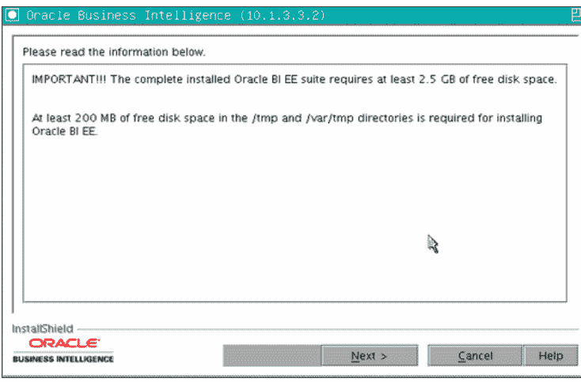

图 6-2 BIEE 安装第一个窗口

我们将 BIEE 代码安装在 `/oracle/BIEE` 目录下，如第 105 页的图 6-3 所示。

## Oracle Business Intelligence (10.1.3.3.2)

Oracle Business Intelligence 安装

欢迎。将安装 Oracle Business Intelligence。

浏览或输入安装位置：

```
/oracle/BEE
```

浏览或输入数据位置：

```
/oracle/biedata
```

- 选择安装类型：
- 基础 (Basic)：最小安全性。安装 J2EE 容器 (OC4)。
- 高级 (Advanced)：增强安全性。需要 Oracle Application Server 10.1.3.0 或更高版本。


图 6-3 BIEE 安装目录选择

安装类型的选择取决于具体站点需求。本项目使用了完整类型选择，如图 6-4 所示，因为安装手册中的 Oracle 建议进行完整安装。

## Oracle Business Intelligence (10.1.3.3.2)

选择适合你需求的设置类型。

- 完整 (Complete)
- 将安装所有的 Business Intelligence 组件。
- Oracle Business Intelligence Server
- 只安装服务器组件。（包含 Oracle Business Intelligence Server、集群控制器、调度器、系统管理。）
- Oracle Intelligence Presentation Services
- 只安装演示服务组件。（包含 Oracle Intelligence Presentation Services、演示服务插件、BI Office、系统管理。）
- Oracle Business Intelligence Client Tools
- 只安装客户端组件。（包含 Oracle Business Intelligence Client Tools。）


图 6-4 BIEE 设置类型

第 6 章 带有 Linux 版 System z 数据库的 Oracle Business Intelligence 企业版 105

Oracle Application Server 选择窗口提供了 BIEE 产品套与 Oracle Application Server 之间的链接，如图 6-5 所示。

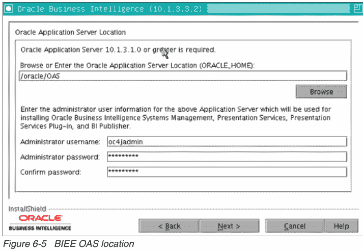

图 6-5 BIEE OAS 位置

在这种情况下，我们选择英语作为用于显示 BIEE 产品生成的任何错误信息的语言，如第 107 页的图 6-6 所示。

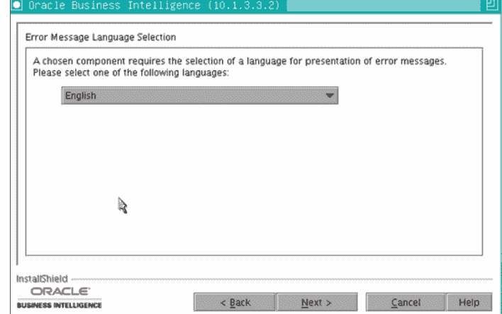

**图 6-6** Oracle BIEE 语言选择

摘要窗口如图 6-7 所示。选择**下一步 (Next)** 后将开始安装，如第 108 页的图 6-8 所示。我们的项目在 30 分钟内完成了实际的基础设施安装。

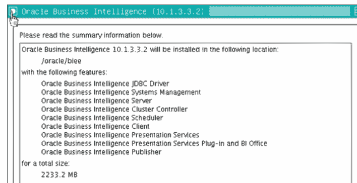

**图 6-7** Oracle BIEE 产品摘要

第 6 章 带有 Linux 版 System z 数据库的 Oracle Business Intelligence 企业版 107

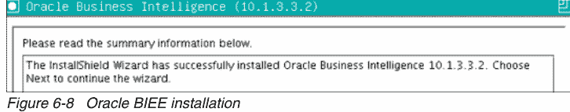

BIEE 10.1.3.3.2 服务器基础设施的安装已完成，如图 6-9 所示。

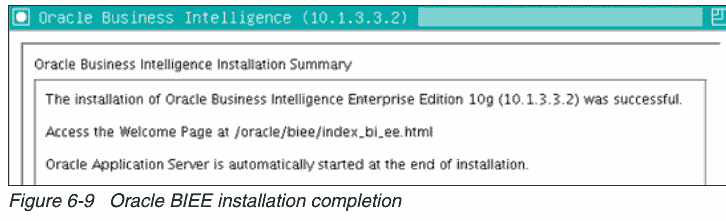

## 6.4 OAS 启动和 BIEE 欢迎页

第 109 页的图 6-10 显示了 BIEE 的欢迎窗口。

## ORACLE Business Intelligence Enterprise Edition

## 欢迎来到 Oracle Business Intelligence Enterprise Edition (10.1.3.1)

概述

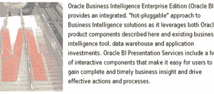

使用和管理 Oracle BI EE

Oracle Business Intelligence Enterprise Edition (Oracle BI EE) 为商业智能解决方案提供了一种“热插拔”的方法，因为它利用了此处描述的 Oracle 产品组件以及现有的智能工具、数据仓库和应用程序。Oracle BI Presentation Services 包含许多交互式组件，使用户可以轻松获得及时的业务洞察，并驱动有效的解决方案和流程。

- 应用服务器控制
- BI 交互式仪表板
- BI Publisher

Oracle BI Publisher 提供强大且灵活的分析报告；所有解决方案都构建在 Oracle Server 之上——这是一个极扩展性的分析引擎，集成了多个不同的数据源以提供单一视图。

Oracle Business Intelligence Enterprise Edition (Oracle BI EE) 为商业智能解决方案提供了一种“热插拔”的方法，因为它利用了此处描述的 Oracle 产品组件以及现有的智能工具、数据仓库和应用程序。Oracle BI Presentation Services 包含许多交互式组件，使用户可以轻松获得及时的业务洞察，并驱动有效的解决方案和流程。

- 应用服务器控制
- BI 交互式仪表板
- BI Publisher

Oracle BI Publisher 提供强大且灵活的分析报告；所有解决方案都构建在 Oracle Server 之上——这是一个极扩展性的分析引擎，集成了多个不同的数据源以提供单一视图。

Oracle Business Intelligence Enterprise Edition (Oracle BI EE) 为商业智能解决方案提供了一种“热插拔”的方法，因为它利用了此处描述的 Oracle 产品组件以及现有的智能工具、数据仓库和应用程序。Oracle BI Presentation Services 包含许多交互式组件，使用户可以轻松获得及时的业务洞察，并驱动有效的解决方案和流程。

- 应用服务器控制
- BI 交互式仪表板
- BI Publisher

Oracle BI Publisher 提供强大且灵活的分析报告；所有解决方案都构建在 Oracle Server 之上——这是一个极扩展性的分析引擎，集成了多个不同的数据源以提供单一视图。

Oracle Business Intelligence Enterprise Edition (Oracle BI EE) 为商业智能解决方案提供了一种“热插拔”的方法，因为它利用了此处描述的 Oracle 产品组件以及现有的智能工具、数据仓库和应用程序。Oracle BI Presentation Services 包含许多交互式组件，使用户可以轻松获得及时的业务洞察，并驱动有效的解决方案和流程。

- 应用服务器控制
- BI 交互式仪表板
- BI Publisher

Oracle BI Publisher 提供强大且灵活的分析报告；所有解决方案都构建在 Oracle Server 之上——这是一个极扩展性的分析引擎，集成了多个不同的数据源以提供单一视图。

Oracle Business Intelligence Enterprise Edition (Oracle BI EE) 为商业智能解决方案提供了一种“热插拔”的方法，因为它利用了此处描述的 Oracle 产品组件以及现有的智能工具、数据仓库和应用程序。Oracle BI Presentation Services 包含许多交互式组件，使用户可以轻松获得及时的业务洞察，并驱动有效的解决方案和流程。

- 应用服务器控制
- BI 交互式仪表板
- BI Publisher

Oracle BI Publisher 提供强大且灵活的分析报告；所有解决方案都构建在 Oracle Server 之上——这是一个极扩展性的分析引擎，集成了多个不同的数据源以提供单一视图。

Oracle Business Intelligence Enterprise Edition (Oracle BI EE) 为商业智能解决方案提供了一种“热插拔”的方法，因为它利用了此处描述的 Oracle 产品组件以及现有的智能工具、数据仓库和应用程序。Oracle BI Presentation Services 包含许多交互式组件，使用户可以轻松获得及时的业务洞察，并驱动有效的解决方案和流程。

- 应用服务器控制
- BI 交互式仪表板
- BI Publisher

Oracle BI Publisher 提供强大且灵活的分析报告；所有解决方案都构建在 Oracle Server 之上——这是一个极扩展性的分析引擎，集成了多个不同的数据源以提供单一视图。

注意：Oracle Application Server (AS) 必须运行才能为商业智能解决方案提供“热插拔”的方法，因为它利用了此处描述的 Oracle 产品组件以及现有的智能工具、数据仓库和应用程序。Oracle BI Presentation Services 包含许多交互式组件，使用户可以轻松获得及时的业务洞察，并驱动有效的解决方案和流程。

- 应用服务器控制
- BI 交互式仪表板
- BI Publisher

Oracle Business Intelligence Enterprise Edition (Oracle BI EE) 为商业智能解决方案提供了一种“热插拔”的方法，因为它利用了此处描述的 Oracle 产品组件以及现有的智能工具、数据仓库和应用程序。Oracle BI Presentation Services 包含许多交互式组件，使用户可以轻松获得及时的业务洞察，并驱动有效的解决方案和流程。

- 应用服务器控制
- BI 交互式仪表板
- BI Publisher

Oracle BI Publisher 提供强大且灵活的分析报告；所有解决方案都构建在 Oracle Server 之上——这是一个极扩展性的分析引擎，集成了多个不同的数据源以提供单一视图。

BIEE 10.1.3.3.2 服务器基础设施的安装已完成，如图 6-9 所示。


## 6.4 OAS 启动和 BIEE 欢迎页

第 109 页的图 6-10 显示了 BIEE 的欢迎窗口。

## ORACLE Business Intelligence Enterprise Edition

## 欢迎来到 Oracle Business Intelligence Enterprise Edition (10.1.3.1)

概述


使用和管理 Oracle BI EE

Oracle Business Intelligence Enterprise Edition (Oracle BI EE) 为商业智能解决方案提供了一种“热插拔”的方法，因为它利用了此处描述的 Oracle 产品组件以及现有的智能工具、数据仓库和应用程序。Oracle BI Presentation Services 包含许多交互式组件，使用户可以轻松获得及时的业务洞察，并驱动有效的解决方案和流程。

- 应用服务器控制
- BI 交互式仪表板
- BI Publisher

Oracle BI Publisher 提供强大且灵活的分析报告；所有解决方案都构建在 Oracle Server 之上——这是一个极扩展性的分析引擎，集成了多个不同的数据源以提供单一视图。

Oracle Business Intelligence Enterprise Edition (Oracle BI EE) 为商业智能解决方案提供了一种“热插拔”的方法，因为它利用了此处描述的 Oracle 产品组件以及现有的智能工具、数据仓库和应用程序。Oracle BI Presentation Services 包含许多交互式组件，使用户可以轻松获得及时的业务洞察，并驱动有效的解决方案和流程。

- 应用服务器控制
- BI 交互式仪表板
- BI Publisher

Oracle BI Publisher 提供强大且灵活的分析报告；所有解决方案都构建在 Oracle Server 之上——这是一个极扩展性的分析引擎，集成了多个不同的数据源以提供单一视图。

Oracle Business Intelligence Enterprise Edition (Oracle BI EE) 为商业智能解决方案提供了一种“热插拔”的方法，因为它利用了此处描述的 Oracle 产品组件以及现有的智能工具、数据仓库和应用程序。Oracle BI Presentation Services 包含许多交互式组件，使用户可以轻松获得及时的业务洞察，并驱动有效的解决方案和流程。

- 应用服务器控制
- BI 交互式仪表板
- BI Publisher

Oracle BI Publisher 提供强大且灵活的分析报告；所有解决方案都构建在 Oracle Server 之上——这是一个极扩展性的分析引擎，集成了多个不同的数据源以提供单一视图。

注意：Oracle Application Server (AS) 必须运行才能为商业智能解决方案提供“热插拔”的方法，因为它利用了此处描述的 Oracle 产品组件以及现有的智能工具、数据仓库和应用程序。Oracle BI Presentation Services 包含许多交互式组件，使用户可以轻松获得及时的业务洞察，并驱动有效的解决方案和流程。

- 应用服务器控制
- BI 交互式仪表板
- BI Publisher


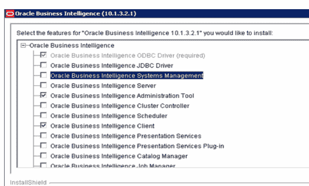

图 6-15 自定义选项

错误消息语言的选项如图 6-6 所示。


图 6-16 语言选择

图 6-17 显示的产品摘要确认了所做的选择。

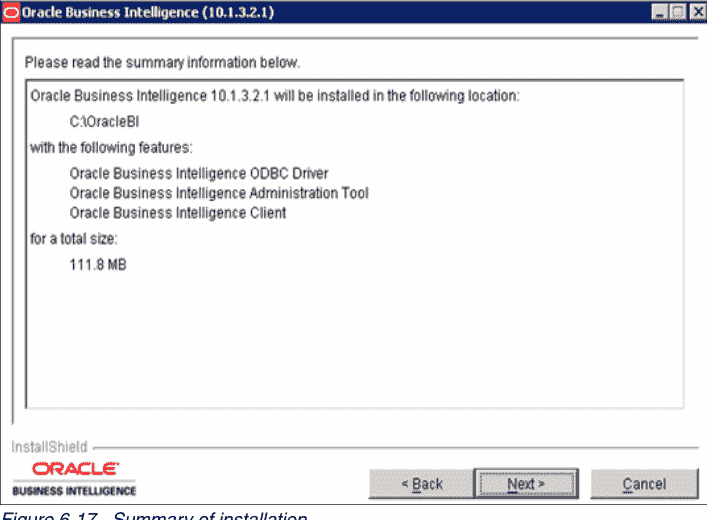

短段时间后，安装完成。

此项目有一个预构建的数据库存储库，用于匹配第 100 页 6.2.1 节“填充数据库”中描述的导入源的预构建数据库。需要在支持 Oracle BIEE Server 组件的 Linux 服务器上定义存储库名称。该文件名为 `NQSConfig.INI`，位于 `ORACLE_HOME/BIEE/server/Config-`。

在文件的 `Repository` 部分，将 `Rep_table` 替换为您的存储库名称：

```
######################################################
[ REPOSITORY ]
```

```
Star = Rep_Table, DEFAULT;
######################################################
```

当定义和更新完成且配置准备好用于生产时，应如下所示更新此文件：

```
[ SERVER ]
READ_ONLY_MODE = YES
```

这将解决某些数据库性能问题。

回到 Windows 宿主机，还需要定义 ODBC 数据源。这通过打开控制面板并选择**管理工具 → 数据源 (ODBC)** 来完成。图 6-18 所示的窗口将是：

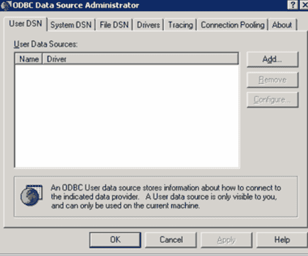

图 6-18 数据源信息

选择“系统 DSN”选项卡。显示图 6-19 所示的窗口。

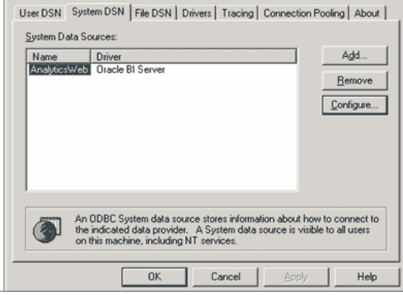

图 6-19 DNS 系统窗口

突出显示“Analytics Web”并选择“配置”。显示图 6-20。在此处，您只需更新 `server` 字段为带有 Oracle BIEE Server 的 Linux 宿机的 IP 地址或 DNS 可解析主机。选择“下一步”并保存更改。

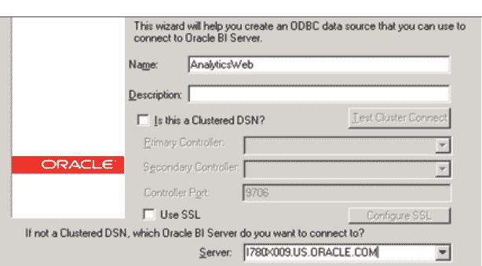

图 6-20 DSN 配置

116 用于 Linux for z 的 Oracle 解决方案

下一步是从 Windows 开始菜单从 Windows 宿主机打开 Oracle BIEE 应用程序。打开后，选择“打开远程存储库”文件夹。图 6-21 所示。

| 表示 | 业务模型和映射 | 物理 |
| :--- | :--- | :--- |
| - 活动 | - 数据 | - 扩展元数据阶段 |
| - 抽象概览 | - SA 系统 | - 预测 Sebel 数据仓库 |
| - 协议详情 | - 使用跟踪 | - 预测 Sebel OLTP |
| - 协议概览 | | 实时 OLTP |
| - 资产 | | Sebel Analytics 使用 |
| - 资产概览 | | Sebel 数据仓库 |
| - 活动 | | Sebel OLTP |
| - 活动概览 | | UQ Sebel OLTP |
| - 消费者 | | |
| - 客户满意度 | | |
| - 客户满意度概览 | | |
| - 客户 | | |
| - 客户概览 | | |
| - 邮件响应 | | |
| - 历史管道 | | |
| - 订单 | | |
| - 订单概览 | | |
| - 管道 | | |
| - 管道概览 | | |
| - 产品 | | |
| - 产品概览 | | |
| - 报价 | | |

图 6-21 用于数据仓库的 Oracle BI 管理工具

第 6 章在 Linux for z 上带有数据库的 Oracle  智能企业版 117

在物理列下突出显示“Data Warehouse”项。右键点击更新属性。这将显示如图 6-22 所示的确认框。选择“是”继续。

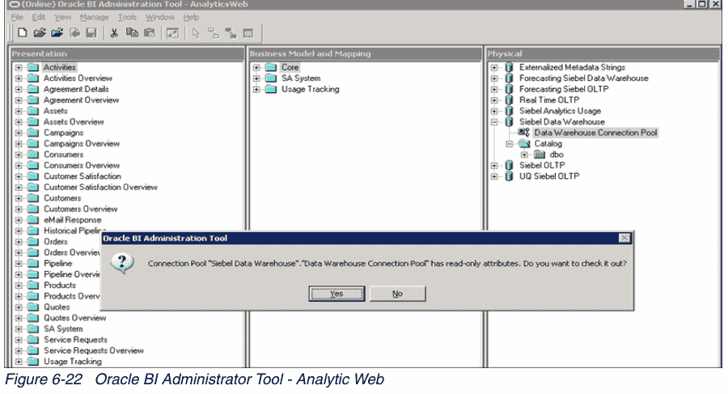

图 6-22 Oracle BI 管理工具 - Analytics Web

118 用于 Linux for z 的 Oracle 解决方案

在“常规”选项卡下，确认“数据源”部分是正确的（见图 6-23）。

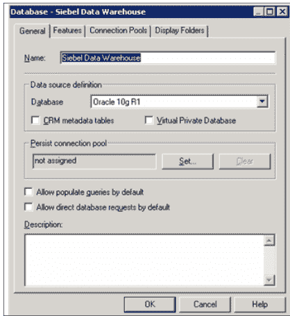

图 6-23 数据仓库

第 6 章在 Linux for z 上带有数据库的 Oracle  智能企业版 119

在图 6-23 的“连接池”选项卡下，突出显示 `Data Warehouse` 下方的连接池选择。右键点击 **编辑** 弹出属性条目，如图 6-24 所示。您需要更新登录名和密码。

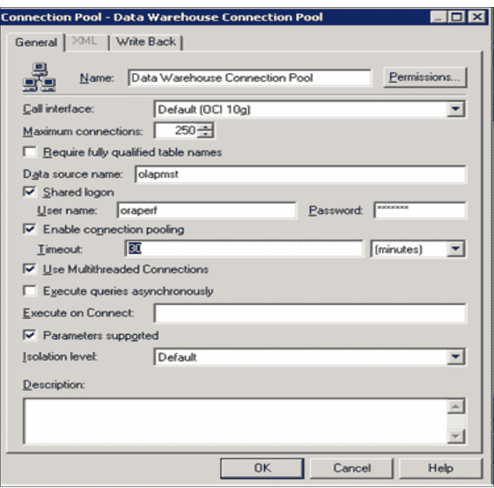

图 6-24 数据仓库连接池

当您点击 **确定** 时，将需要确认密码。


图 6-25 密码窗口

您现在必须通过选择图标（如图 6-26 所示）来检查更改。这将显示数据仓库的更改，连接池将消失。

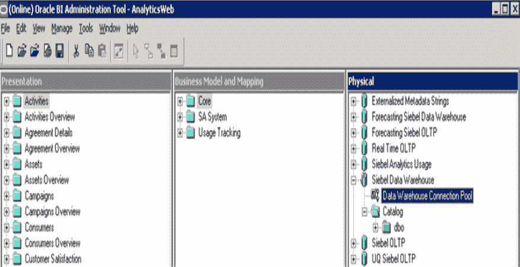

图 6-26 检查窗口

此时，数据库已连接到应用程序服务器。可以通过打开定义并执行安装手册中的测试来验证此项。

# 7 为 Oracle 数据库设置多个 Linux 虚拟机

本章描述了为运行 Oracle Linux 虚拟机而建立的基础设施。该内容基于在 z/VM 下运行 Oracle Linux 虚拟机的实践经验，涵盖了：

- 使用多个 VSwitch
- 使用克隆创建镜像
- 使用 Flashcopy 和 z/OS 进行备份

## 7.1 使用多个 VSwitch 支持 Oracle 工作负载

使用 z/VM 的网络虚拟化支持大型且复杂的拓扑结构。通过 z/VM 的 VSwitch 功能，可以将物理网络扩展到虚拟环境中，从而消除在 z/VM 上运行路由器虚拟机的需求，如第 125 页图 7-1 所示。

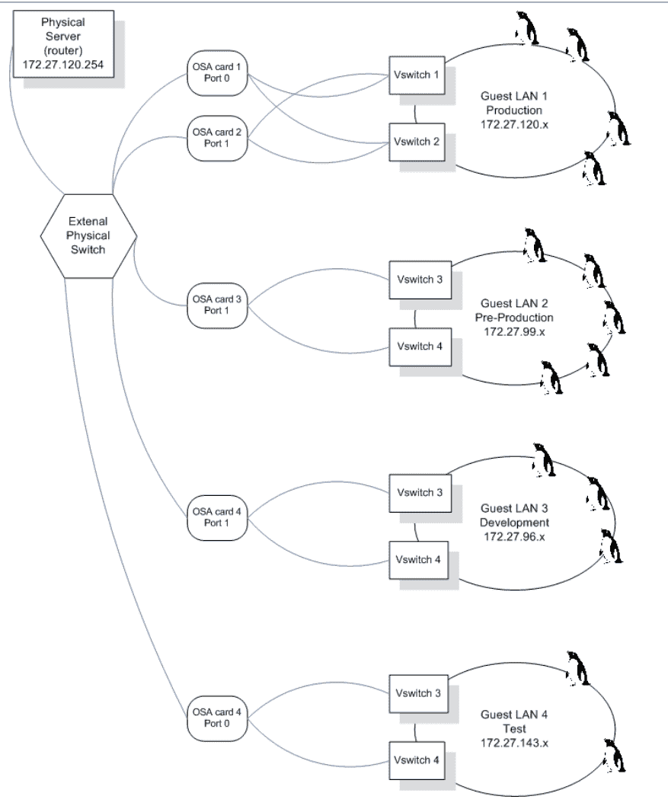

图 7-1 网络中的多个 VSwitch 示例


DTCVSW1 和 DTCVSW2 机器可以处理多个交换配置的所有要求。

由于控制器机器中不会发生数据包或帧的移动，因此它是控制多个网络的安全环境，即使是由于站点安全策略导致无法看到彼此数据的网络也可以。

DTCVSW1 的目录条目如示例 7-2 所示，可以完全按照 zVM 安装时提供的方式使用：用户语句包含了安装时的默认值，能够满足生产需求。

## 示例 7-2 DTCVSW1 条目

```
USER DTCVSW1 32M 128M G
INCLUDE TPCMSU
OPTION QUICK055 SVMWSTAT MAXCONN 1024 DIAG98
TIUCV "SWITCH" MSGLIMIT 65535
LINK SVMTCP30 491 491 RR
LINK SVMTCP30 492 492 RR
LINK TCMPINT 591 591 RR
LINK TCMPINT 592 592 RR
LINK TCMPINT 198 198 RR
*
ISK 191 3390 22 005 VMXAL MR DTCVSW1 WDTCVSW1
*
DVHOPT LNKO LOG1 RCM SMS0 NP1 LANGAMEN PWC2007038 CRC7
```

显示了来自 DTCVSW1 TC/IP 配置文件的 DTCVSW1 CONTROLLER ON。DTCVSW1 PROFILE 可以完全按照 zVM 安装时提供的方式使用。

## 示例 7-3 SWITCH CONTROLLER 语句

```
----------------------------------------------------------------------
: 定义指定的虚拟机，使其能够通过 OSA Express
: 设备控制 CP 定义的虚拟交换机
: 连接到真实的局域网段:
:
----------------------------------------------------------------------
```

```
SWITCH CONTROLLER ON
```

在控制器配置文件中不应编写 DEVICE、LINK、HOME 或 GATEWAY 语句。

第 128 页的图 7-2 显示了带有控制器机的 VSXXAP2 VSwitch、几个 Linux 虚拟机，一个 VM TCPI/P 机器显示了其虚拟网卡和 IP 地址 172.27.120.158。

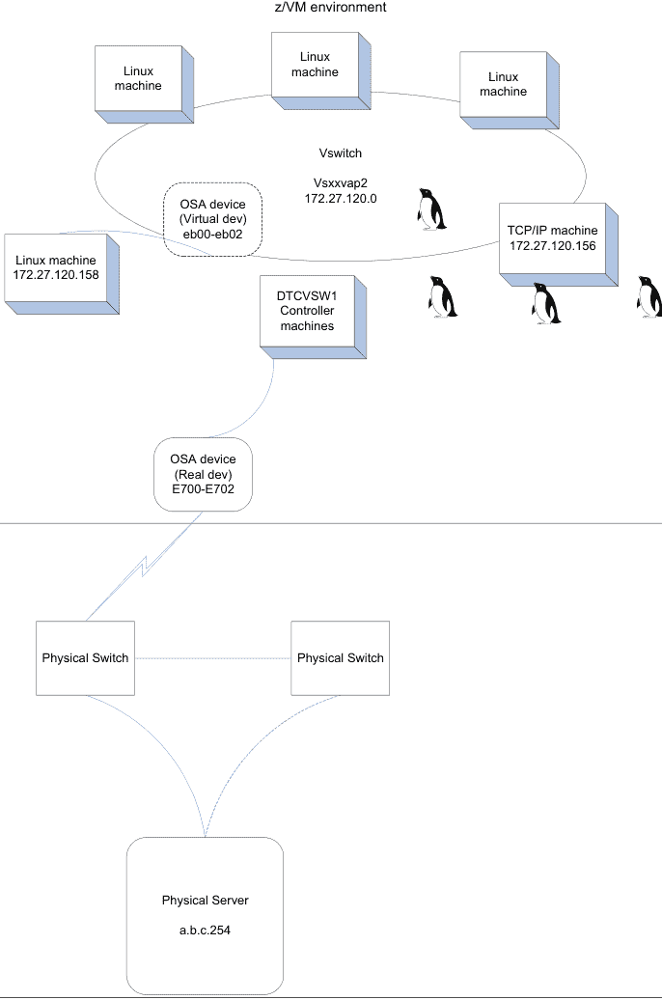

图 7-2 网络示例

128 在 Linux for z 使用 Oracle Solutions

虚拟机连接到 VSwitch 的前提是它已通过 cp 命令或通过带有目录语句（NICDEF 或 SPECIAL）或 cp 命令（DEFINE NIC 和 COUPLE）的 ESM 获得了授权。

使用 NICDEF 语句时，可以通过一个命令完成虚拟网卡和到 VSwitch 的耦合。示例 7-4 显示了 DBXXUA1 虚拟机的目录条目提取。

### 示例 7-4 NICDEF 语句

```
USER DBXXUA1 CHANGEIT 256M 1024M G
INCLUDE SIGPLNX
NICDEF E800 TYPE QDI0 DEVICES 3 SYSTEM VSXXAP
```

通过设置的 vswitch 命令授予虚拟机访问 VSwitch 的权限：

```
set vswitch vsxxvap2 grant dbxxua
```

nicdef 语句将虚拟网卡设备 EB00、EB01 和 EB02 定义为模拟 QDIO，并将它们耦合到系统定义的 VSwitch VSXXVAP2。

剩余的任务是在 Linux 中将该设备配置为以太网设备。设备在 /etc/sysconfig/network 目录下配置。文件名是 `ifcfg-qeth-bus-ccw-` 加上完全限定设备名称，在本例中为 0.0.eb00，因此是 `ifcfg-qeth-bus-ccw-0.0.eb00`。

使用连接（cat）命令显示文件内容，如示例 7-5 所示。

### 示例 7-5 cat 命令

```
cat ifcfg-qeth-bus-ccw-0.0.eb00
BOOTPROTO='static'
UNIQUE='1'
STARTMODE='onboot'
IPADDR='172.27.120.157'
MTU='1500'
NETMASK='255.255.255.0'
NETWORK='172.27.120.0'
BROADCAST='172.27.120.255'
REMOTE_IPADDR='1'
```

假设此文件来自主机，而克隆机没有网络访问（我们不希望有重复 IP 地址），则需要 3270 接口来创建工作配置文件。在示例中，IP 地址从 172.27.120.157 更改为 172.27.120.158。

使用的 Linux 命令有 cat、cp、head、tail 和 echo（见示例 7-6）。cp 命令将配置文件复制到名为 `tempemp` 的新文件。head 命令将取 temp 的前三行并使用重定向将其写入名为 `newtemp` 的新文件。echo 命令将使用追加重定向符号将带有新 IP 地址 172.27.120.157 的行写入 newtemp 文件。使用转义字符 `/` 是为了让单引号发送出去。tail 命令将 tempemp 的最后五行通过追加重定向写入 newtemp 中。cat 命令将显示带有更新后 IP 地址（172.27.120.158）的 newtemp 文件。

### 示例 7-6 cp 命令

```
cp ifcfg-qeth-bus-ccw-0.0.eb00 tempemp
cp ifcfg-qeth-bus-ccw-0.0.eb00 tempemp
head -n 3 tempemp > newtemp
head -n 3 tempemp > newtemp
echo IPADDR='172.27.120.157' >> newtemp
echo IPADDR='172.27.120.158' >> newtemp
tail -n 5 tempemp >> newtemp
tail -n 5 tempemp >> newtemp
cat newtemp
cat newtemp
BOOTPROTO='static'
UNIQUE='1'
STARTMODE='onboot'
IPADDR='172.27.120.158'
MTU='1500'
NETMASK='255.255.255.0'
NETWORK='172.27.120.0'
BROADCAST='172.27.120.255'
REMOTE_IPADDR='1'
```

mv 命令将 tempemp 重命名为配置文件 `ifcfg-qeth-bus-ccw-0.0.eb00`。ifdown 命令停止 eth0 接口。ifup 命令从带有 IP 地址 172.27.120.158 的新配置文件启动 eth0 接口。更多信息请见第 152 页的图 7-7。

### 示例 7-7 mv 命令

```
mv tempemp ifcfg-qeth-bus-ccw-0.0.eb00
mv tempemp ifcfg-qeth-bus-ccw-0.0.eb00
ifdown eth0
eth0          configuration: qeth-bus-ccw-0.0.eb00
ifup eth0
eth0          configuration: qeth-bus-ccw-0.0.eb00
```

ifconfig eth0 命令显示带有新 IP 地址的接口。ping 命令将显示 172.27.120.156 的 TCP/IP 栈。更多信息请见示例 7-8。

### 示例 7-8 ifconfig 命令

```
ifconfig eth0
eth0  Link:Ethernet waddr:02:00:00:00:07
inetaddr:172.27.120.158 Bcast:172.27.120.255 Mask:255.255.255
inet6:fe80::200:ff:74 Scope:link UP BROADCAST RUNNING MULTICAST MTU:1500 Metric:1
RX packets:52972 errors:0 frame:0
TX packets:245 errors:0 collisions:0 txqueue:1000
RX bytes:796537 (779.9 Mb) TX bytes:181262 (177.0 Kb)
ping -c 1 172.27.120.156
ping -c 1 172.27.120.156
PING 172.27.120.156 (172.27.120.156) 56(84) bytes of data from 172.27.120.156 icmp_seq=1 ttl=60 time=2.35 ms
172.27.120.156 statistics
1 packets transmitted, 1 received, 0% packet loss, time rtt min/avg/max =2.356/2.356/0
```

QUERY VSWITCH 命令将显示关于 Vswitchvap2 的详情。两个连接机器 TCP 和 DBXXUA1 的详情（包括 IP 地址）（示例 7-9）。

### 示例 7-9 query vswitch 命令

```
query vswitchvap2 details
VSSWITCH SYSTEM VSXXVAP type: VSWITCH Connected: 2 PERSISTENT RESTRICTED NONROUTER VLAN Unaware MAC address:02-00:00:00-00-03 State: Ready TimeStorage: 8 RDEV: E700 VDEV: E700 Controller: DTCVSWI Connection: MAC address:00-09-68-1A-77-16 RX Packets:13097 Discarded:1 Errors: 0 TX Packets:18460 Discarded:0 Errors: 0 RX Bytes:119498 TX Bytes:1406244 Device: E702 Unit: 002 Role: Data Port: 0001 Index: 001 Adapter Connections: Adapter Owner: DBXXUA1 NIC: E800 Name: dontcare RX Packets:53053 Discarded:0 Errors: 0 TX Packets:258 Discarded:0 Errors: 0 RX Bytes:7978004 TX Bytes:174856 Device: EB02 Unit: 002 Role: Data Port: 0067 Index: 003 Options: Broadcast Multicast IPv6 IPv4 Unicast IP Addresses: 172.27.120.156 MAC: 02-00:00:00-00-07 Multicast IP Addresses: 224.0.0.1 MAC: 11-00-5E:00-00-01 Adapter Owner: TCPIP NIC: FFC Name: UNASSIGNED RX Packets:411587 Discarded:0 Errors: 0 TX Packets:272964 Discarded:0 Errors: 0 RX Bytes:5721398 TX Bytes:5871047
```


# Example 7-10 netstat 命令

netstat arp 172.27.120.156 tcp dtcvswl
VM TCP/IP Netstat Level 530

ARP Age: 5

正在查询地址 172.27.120.156 的 ARP 缓存

适配器维护的数据截至：12/18/07 21:53:22

```
Link VSEESGS1D900LINK: Q10ETHERNET: 00096B1A7AEA3 IP: 172.27.120.156
Ready: T=0.01/0.01 21:55:42
netstat arp 172.27.120.156 tcp dtcvswl
VM TCP/IP Netstat Level 530
```

ARP Age: 5

正在查询地址 172.27.120.158 的 ARP 缓存

适配器维护的数据截至：12/18/07 21:55:42

```
Link VSSE120GSGE700LINK: Q10ETHERNET: 00096B1A7716 IP: 172.27.120.158
Ready: T=0.01/0.01 21:55:59
netstat arp 172.27.120.254 tcp dtcvswl
VM TCP/IP Netstat Level 530
```

ARP Age: 5

正在查询地址 172.27.120.254 的 ARP 缓存

适配器维护的数据截至：12/18/07 21:55:59

```
Link VSEESGS1D900LINK: Q10ETHERNET: 080020E46479 IP: 172.27.120.254
Link VSSE120GSGE700LINK: Q10ETHERNET: 080020E46479 IP: 172.27.120.254
Ready: T=0.01/0.01 21:56:10
```

z/VM 在虚拟网络配置方面提供了极大的灵活性。如图125页的图 7-1所示，生产网络和预生产网络具有两组 OSA QIO 设备：一个活动，一个备用。测试网络和开发网络只有一组 OSA qdio 设备，并且无法从拔出错误或其他（不太可能的）OSA 故障中恢复。

在 z/VM V5.3.0 中，可以对一个 VSwitch 实现多达两个 OSA 设备的链路聚合，通过将 OSA 设备组合在一起提供负载均衡和高带宽功能。

大规模网络虚拟化在 z/VM 和 Linux 环境中很容易实现。

## 7.2 设置克隆架构

z/VM 作为多个 Linux 服务器的虚拟化宿主机，其主要优势之一是拥有一套用于 Linux 服务器复制的工具。

z/VM 中有多种克隆方法，从手动创建目录项、复制磁盘并手动更新 Linux 配置文件，到内部自动化解决方案，再到供应商产品。

这里介绍的解决方案包含从安装到可用主镜像的多个步骤。代码使用 CMS REXX™ 和 PIPELINES 编写，并针对多个系统上的 DIRMAINT 和 RACF 具有自动化前端。

一个大型客户在近 200 台 Linux 服务器上运行 Oracle 数据库。在这种环境中，多个主镜像的复制是系统管理的重要组成部分。开发了一种基于 SUSE SLES 的克隆方法。该方法使用了极少的主镜像。主镜像包含一个纯净的 Linux 发行版和预安装的 Oracle。

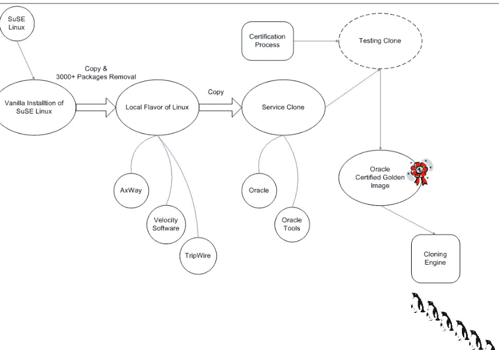

主要步骤如图 7-3 所示：

- 1. 在位于 zVM Linux 虚拟机的目录树中对 SUSE SLES 9 或 10 软件包进行安装。同样安装了服务包（Service packs）。
  安装完成后，将删除许多被认为不必要的包。删除包是一项耗费人力的步骤，大约删除了 3,000 个包。
  这个初始 Linux 系统（减去不必要的包后）随后被复制到一组新磁盘中，为下一步安装包、产品和本地定制化做准备。
- 2. 安装附加包、产品并进行本地定制化。
  额外的包提供了使用 Velocity Software 进行性能监控的软件、使用 Tripwire 包进行安全合规检查和变更通知，以及使用 Axway 进行受许可的文件传输方法。

本地定制化涉及安装在克隆过程中使用的脚本、修改 FSTAB 以符合正在使用的磁盘标准，以及网络接口的配置骨架文件。

随后将定制后的系统复制到一组新磁盘中，为下一步的 Oracle 安装做准备。

- 3. Oracle 安装。

安装 Oracle。安装 Oracle 的文件系统如图 7-4 所示。

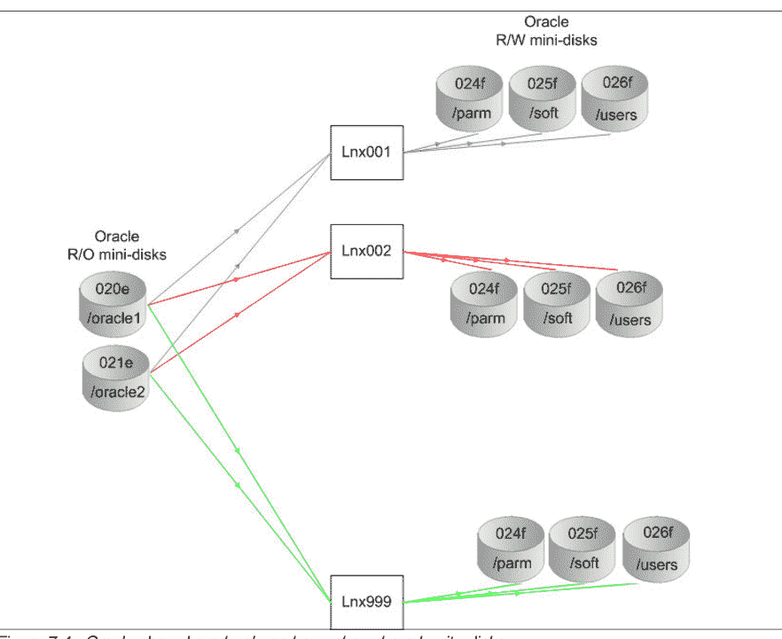

图 7-4 Oracle 安装的文件系统

- 4. 广泛测试

 随后将该系统复制到一组新磁盘中，为不同部门的测试做准备。测试由 Linux 管理员、数据库管理员和安全人员进行。在通过所有测试后，该定制化系统将作为克隆的主镜像。

- 5. 黄金主镜像的就绪

克隆引擎在 VSwitch 区域完成。黄金主镜像已为克隆准备就绪。克隆引擎使用 REXX 编写，并针对多个系统的配置文件和 RACF 进行配置。


在虚拟化策略中，采用利用虚拟化系统（Linux）和主机系统（z/VM）特性的技术可以结合了这两者的优点。利用 CP、CMS 和 Linux 自有的功能可以实现极佳的复制方法。

## 7.3 使用 FlashCopy 以由 z/OS 管理备份

本节描述了管理 Oracle 数据库备份的一种方法。

此处显示的方法适用于 EXT2 或 EXT3 文件系统。如果您正在使用 Oracle ASM 文件系统，则必须考虑其他因素。本节不涵盖 ASM 相关问题。

### 7.3.1 备份

在 IBM System 服务器上备份和恢复 Linux 虚拟机有许多方法。这包括通过源包进行 Linux 文件层级备份、通过系统实用程序或特定厂商产品进行 VM 备份，以及从 z/OS 系统进行备份。

虽然缺乏某些功能（例如执行 Linux 文件层级归档的能力），但在 z/OS 系统的辅助下进行备份和恢复是 z/VM 和 Linux 部署中的一种流行选择。许多 z/VM 环境对磁带驱动器、磁带库或机器人磁带系统的访问有限（或没有）。

许多 z/VM 和 Linux 部署已经拥有运行 z/OS 的现有主机，并配备了备份/恢复软件、程序和策略。

z/OS 有两种配置可以访问由 z/VM 系统拥有的 DASD：

- 1. 一个 z/OS LPAR 与 z/VM LPAR(s) 位于同一个 CEC 中。z/OS LPAR 通过 IOCDS 编码访问 z/VM DASD。
- 2. z/VM LPAR(s) 和 z/OS LPAR 位于不同的 CEC 上。在这种情况下，DASD 存储单元本身双路连接到两个 CEC。每个 CEC 的 IOCDS 编码均配置为查看同一个 DASD。

一个拥有 Oracle 虚拟机的大型客户使用了两个独立 CEC 的配置。第 143 页的图 7-8 显示了备份架构。

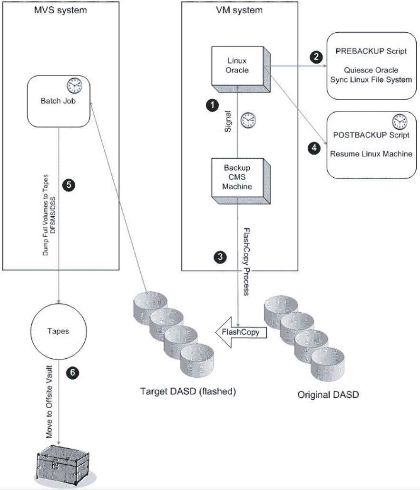

图 7-8 备份架构

备份的步骤为：

- 1. z/VM LPAR 中的 CMS 服务机在预设时间从远程系统以 root 用户身份向每台 Linux 机器发布控制台命令。远程系统是一个服务 LPAR。
    - a. 服务机 SIGBKUP 由基于计时器的程序作为 WAKEUP 启动。
    - b. 使用 CP 次级控制台输入功能，通过 CP SEND 命令向每个待备份的 Linux 客户发布命令。
- 2. Linux 机器处理控制台命令 PREFLASH。PREFLASH 是一个 bash 脚本：
    - a. 静置 Oracle（Quiesces）。每周一次通过 `dbora stop` 停止数据库。其他时间，执行热备并使用 `alter database begin backup` 命令停止数据库。
    > 注意：在使用 `alter database begin backup` 静置 Oracle 且数据库使用 ext3 文件系统跨越多个柱面卷时，存在一个极短的 I/O 不一致窗口。数据库有可能无法恢复到良好状态。然而，在这种情况下，使用 `alter database suspend` 代替 `alter database begin` 将提供一个干净的环境。
    - b. 多次执行 `sync` 命令。在每台机器上多次执行 `sync` 命令以确保磁盘已更新。Linux 会在内存中缓存文件更新，`sync` 命令可以将内存缓冲的任何数据写入磁盘。
- 3. 服务 LPAR 上的 CMS 服务器机现在将：
    - a. 连接到包含 Linux 虚拟机 minisk 的所有 DASD 的完整卷。包含生产机器 Oracle 数据的 minisk 每天备份一次。包含可执行文件等系统数据的 minisk 备份频率较低（更改率低）。
    - 备份由机器池（即生产、开发、实验室等）完成。
    - c. 链接到完整卷的目标部分。
    - c. 从柱面 1 到最后一个柱面从源卷到目标卷执行 FLASHCOPY。FLASHCOPY 不需要柱面 0，因为没有 minisk 起于柱面 0，通过这种方式可以保留目标卷上的标签。

对属于 Linux 机器的每个 minisk 进行查找，并准备一份完整卷列表。SIGBKUP 连接到虚拟地址为 380E 的源 SYSDUMP1 minisk，以及 388E 的目标。示例 7-13 显示了该列表。

### 示例 7-13 minisk 列表

| VPCX81 380E | 3390 | SYSDUMP1 | 0 | 3338 | 3339 | FC380E | ZODNXX1 | CPCMS |
| :--- | :--- | :--- | :--- | :--- | :--- | :--- | :--- | :--- |
| VPCX81 380E | ---- | PSSDDPB | 0156 | 1 | 350 | 350 | FC380E | ZODNXX1 | LINUX |
| VPCX81 380E | ---- | PSSDDPB | 024F | 351 | 160 | FC380E | ZODNXX1 | LINUX |
| VPCX81 380E | ---- | PSSDDPB | 025F | 511 | 1066 | 556 | FC380E | ZODNXX1 | LINUX |
| VPCX81 380E | ---- | PSSDDPB | 026F | 1067 | 1516 | 450 | FC380E | ZODNXX1 | LINUX |
| VPCX81 380E | ---- | PMRCDCA1 | 0150 | 1517 | 2104 | 588 | FC380E | ZODNXX1 | LINUX |
| VPCX81 380E | ---- | PMRCDCA1 | 0153 | 3281 | 1177 | FC380E | ZODNXX1 | LINUX |

每个完整卷都有作为 FLASHCOPY 目标的“双胞”卷。第 146 页的图 7-9 显示了从 SIGBKUP 服务器机链接的源目标磁盘以及 FLASHCOPY 命令。

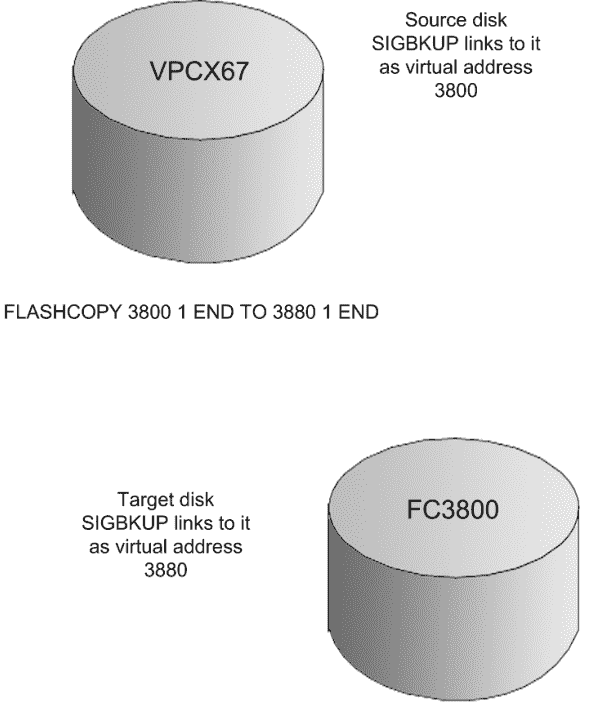

图 7-9 源到目标卷的 FLASHCOPY

- 4. z/VM LPAR 中的 CMS 服务机在预设时间从远程系统以 root 用户身份向每台 Linux 机器发布控制台命令。远程系统是一个服务 LPAR。
    - a. 服务机 SIGBKUP 由基于计时器的程序作为 WAKEUP 启动。
    - b. 使用 CP 次级控制台输入功能，通过 CP SEND 命令向每个待备份的 Linux 客户发布命令。
- 2. Linux 机器处理控制台命令 PREFLASH。PREFLASH 是一个 bash 脚本：
    - a. 静置 Oracle。每周一次通过 `dbora stop` 停止数据库。其他时间，执行热备并使用 `alter database begin backup` 命令停止数据库。
    > 注意：在使用 `alter database begin backup` 静置 Oracle 且数据库使用 ext3 文件系统跨越多个柱面卷时，存在一个极短的 I/O 不一致窗口。数据库有可能无法恢复到良好状态。然而，在这种情况下，使用 `alter database suspend` 代替 `alter database begin` 将提供一个干净的环境。
    - b. 多次执行 `sync` 命令。在每台机器上多次执行 `sync` 命令以确保磁盘已更新。Linux 会在内存中缓存文件更新，`sync` 命令可以将内存缓冲的任何数据写入磁盘。
- 3. 服务 LPAR 上的 CMS 服务器机现在将：
    - a. 连接到包含 Linux 虚拟机 minisk 的所有 DASD 的完整卷。包含生产机器 Oracle 数据的 minisk 每天备份一次。包含可执行文件等系统数据的 minisk 备份频率较低（更改率低）。
    - 备份由机器池（即生产、开发、实验室等）完成。
    - c. 链接到完整卷的目标部分。
    - c. 从柱面 1 到最后一个柱面从源卷到目标卷执行 FLASHCOPY。FLASHCOPY 不需要柱面 0，因为没有 minisk 起于柱面 0，通过这种方式可以保留目标卷上的标签。
- 4. z/VM LPAR 中的 CMS 服务机在预设时间从远程系统以 root 用户身份向每台 Linux 机器发布控制台命令。远程系统是一个服务 LPAR。
    - a. 服务机 SIGBKUP 由基于计时器的程序作为 WAKEUP 启动。
    - b. 使用 CP 次级控制台输入功能，通过 CP SEND 命令向每个待备份的 Linux 客户发布命令。
- 2. Linux 机器处理控制台命令 PREFLASH。PREFLASH 是一个 bash 脚本：
    - a. 静置 Oracle。每周一次通过 `dbora stop` 停止数据库。其他时间，执行热备并使用 `alter database begin backup` 命令停止数据库。
    > 注意：在使用 `alter database begin backup` 静置 Oracle 且数据库使用 ext3 文件系统跨越多个柱面卷时，存在一个极短的 I/O 不一致窗口。数据库有可能无法恢复到良好状态。然而，在这种情况下，使用 `alter database suspend` 代替 `alter database begin` 将提供一个干净的环境。
    - b. 多次执行 `sync` 命令。在每台机器上多次执行 `sync` 命令以确保磁盘已更新。Linux 会在内存中缓存文件更新，`sync` 命令可以将内存缓冲的任何数据写入磁盘。
- 3. 服务 LPAR 上的 CMS 服务器机现在将：
    - a. 连接到包含 Linux 虚拟机 minisk 的所有 DASD 的完整卷。包含生产机器 Oracle 数据的 minisk 每天备份一次。包含可执行文件等系统数据的 minisk 备份频率较低（更改率低）。
    - 备份由机器池（即生产、开发、实验室等）完成。
    - c. 链接到完整卷的目标部分。
    - c. 从柱面 1 到最后一个柱面从源卷到目标卷执行 FLASHCOPY。FLASHCOPY 不需要柱面 0，因为没有 minisk 起于柱面 0，通过这种方式可以保留目标卷上的标签。
- 4. z/VM LPAR 中的 CMS 服务机在预设时间从远程系统以 root 用户身份向每台 Linux 机器发布控制台命令。远程系统是一个服务 LPAR。
    - a. 服务机 SIGBKUP 由基于计时器的程序作为 WAKEUP 启动。
    - b. 使用 CP 次级控制台输入功能，通过 CP SEND 命令向每个待备份的 Linux 客户发布命令。
- 2. Linux 机器处理控制台命令 PREFLASH。PREFLASH 是一个 bash 脚本：
    - a. 静置 Oracle。每周一次通过 `dbora stop` 停止数据库。其他时间，执行热备并使用 `alter database begin backup` 命令停止数据库。
    > 注意：在使用 `alter database begin backup` 静置 Oracle 且数据库使用 ext3 文件系统跨越多个柱面卷时，存在一个极短的 I/O 不一致窗口。数据库有可能无法恢复到良好状态。然而，在这种情况下，使用 `alter database suspend` 代替 `alter database begin` 将提供一个干净的环境。
    - b. 多次执行 `sync` 命令。在每台机器上多次执行 `sync` 命令以确保磁盘已更新。Linux 会在内存中缓存文件更新，`sync` 命令可以将内存缓冲的任何数据写入磁盘。
- 3. 服务 LPAR 上的 CMS 服务器机现在将：
    - a. 连接到包含 Linux 虚拟机 minisk 的所有 DASD 的完整卷。包含生产机器 Oracle 数据的 minisk 每天备份一次。包含可执行文件等系统数据的 minisk 备份频率较低（更改率低）。
    - 备份由机器池（即生产、开发、实验室等）完成。
    - c. 链接到完整卷的目标部分。
    - c. 从柱面 1 到最后一个柱面从源卷到目标卷执行 FLASHCOPY。FLASHCOPY 不需要柱面 0，因为没有 minisk 起于柱面 0，通过这种方式可以保留目标卷上的标签。
- 4. z/VM LPAR 中的 CMS 服务机在预设时间从远程系统以 root 用户身份向每台 Linux 机器发布控制台命令。远程系统是一个服务 LPAR。
    - a. 服务机 SIGBKUP 由基于计时器的程序作为 WAKEUP 启动。
    - b. 使用 CP 次级控制台输入功能，通过 CP SEND 命令向每个待备份的 Linux 客户发布命令。
- 2. Linux 机器处理控制台命令 PREFLASH。PREFLASH 是一个 bash 脚本：
    - a. 静置 Oracle。每周一次通过 `dbora stop` 停止数据库。其他时间，执行热备并使用 `alter database begin backup` 命令停止数据库。
    > 注意：在使用 `alter database begin backup` 静置 Oracle 且数据库使用 ext3 文件系统跨越多个柱面卷时，存在一个极短的 I/O 不一致窗口。数据库有可能无法恢复到良好状态。然而，在这种情况下，使用 `alter database suspend` 代替 `alter database begin` 将提供一个干净的环境。
    - b. 多次执行 `sync` 命令。在每台机器上多次执行 `sync` 命令以确保磁盘已更新。Linux 会在内存中缓存文件更新，`sync` 命令可以将内存缓冲的任何数据写入磁盘。
- 3. 服务 LPAR 上的 CMS 服务器机现在将：
    - a. 连接到包含 Linux 虚拟机 minisk 的所有 DASD 的完整卷。包含生产机器 Oracle 数据的 minisk 每天备份一次。包含可执行文件等系统数据的 minisk 备份频率较低（更改率低）。
    - 备份由机器池（即生产、开发、实验室等）完成。
    - c. 链接到完整卷的目标部分。
    - c. 从柱面 1 到最后一个柱面从源卷到目标卷执行 FLASHCOPY。FLASHCOPY 不需要柱面 0，因为没有 minisk 起于柱面 0，通过这种方式可以保留目标卷上的标签。
- 4. z/VM LPAR 中的 CMS 服务机在预设时间从远程系统以 root 用户身份向每台 Linux 机器发布控制台命令。远程系统是一个服务 LPAR。
    - a. 服务机 SIGBKUP 由基于计时器的程序作为 WAKEUP 启动。
    - b. 使用 CP 次级控制台输入功能，通过 CP SEND 命令向每个待备份的 Linux 客户发布命令。

（等等，OCR 包含大量重复。让我提供一个清理后的逻辑版本。）

在虚拟化策略中，采用利用虚拟化系统（Linux）和主机系统（z/VM）特性的技术可以结合了这两者的优点。利用 CP、CMS 和 Linux 自有的功能可以实现极佳的复制方法。此处显示的方法适用于 EXT2 或 EXT3 文件系统。如果您正在使用 Oracle ASM 文件系统，则必须考虑其他因素。本节不涵盖 ASM 相关问题。虽然缺乏某些功能（例如执行 Linux 文件层级归档的能力），但在 z/OS 系统的辅助下进行备份和恢复是 z/VM 和 Linux 部署中的一种流行选择。许多 z/VM 环境对磁带驱动器、磁带库或机器人磁带系统的访问有限（或没有）。

许多 z/VM 和 Linux 部署已经拥有运行 z/OS 的现有主机，并配备了备份/恢复软件、程序和策略。

z/OS 有两种配置可以访问由 z/VM 系统拥有的 DASD：

- 1. 一个 z/OS LPAR 与 z/VM LPAR(s) 位于同一个 CEC 中。z/OS LPAR 通过 IOCDS 编码访问 z/VM DASD。
- 2. z/VM LPAR(s) 和 z/OS LPAR 位于不同的 CEC 上。在这种情况下，DASD 存储单元本身双路连接到两个 CEC。每个 CEC 的 IOCDS 编码均配置为查看同一个 DASD。

一个拥有 Oracle 虚拟机的大型客户使用了两个独立 CEC 的配置。第 143 页的图 7-8 显示了备份架构。


图 7-8 备份架构

备份的步骤为：

- 1. z/VM LPAR 中的 CMS 服务机在预设时间从远程系统以 root 用户身份向每台 Linux 机器发布控制台命令。远程系统是一个服务 LPAR。
    - a. 服务机 SIGBKUP 由基于计时器的程序作为 WAKEUP 启动。
    - b. 使用 CP 次级控制台输入功能，通过 CP SEND 命令向每个待备份的 Linux 客户发布命令。
- 2. Linux 机器处理控制台命令 PREFLASH。PREFLASH 是一个 bash 脚本：
    - a. 静置 Oracle。每周一次通过 `dbora stop` 停止数据库。其他时间，执行热备并使用 `alter database begin backup` 命令停止数据库。
    > 注意：在使用 `alter database begin backup` 静置 Oracle 且数据库使用 ext3 文件系统跨越多个柱面卷时，存在一个极短的 I/O 不一致窗口。数据库有可能无法恢复到良好状态。然而，在这种情况下，使用 `alter database suspend` 代替 `alter database begin` 将提供一个干净的环境。
    - b. 多次执行 `sync` 命令。在每台机器上多次执行 `sync` 命令以确保磁盘已更新。Linux 会在内存中缓存文件更新，`sync` 命令可以将内存缓冲的任何数据写入磁盘。
- 3. 服务 LPAR 上的 CMS 服务器机现在将：
    - a. 连接到包含 Linux 虚拟机 minisk 的所有 DASD 的完整卷。包含生产机器 Oracle 数据的 minisk 每天备份一次。包含可执行文件等系统数据的 minisk 备份频率较低（更改率低）。
    - 备份由机器池（即生产、开发、实验室等）完成。
    - c. 链接到完整卷的目标部分。
    - c. 从柱面 1 到最后一个柱面从源卷到目标卷执行 FLASHCOPY。FLASHCOPY 不需要柱面 0，因为没有 minisk 起于柱面 0，通过这种方式可以保留目标卷上的标签。

对属于 Linux 机器的每个 minisk 进行查找，并准备一份完整卷列表。SIGBKUP 连接到虚拟地址为 380E 的源 SYSDUMP1 minisk，以及 388E 的目标。示例 7-13 显示了该列表。

### 示例 7-13 minisk 列表

| VPCX81 380E | 3390 | SYSDUMP1 | 0 | 3338 | 3339 | FC380E | ZODNXX1 | CPCMS |
| :--- | :--- | :--- | :--- | :--- | :--- | :--- | :--- | :--- |
| VPCX81 380E | ---- | PSSDDPB | 0156 | 1 | 350 | 350 | FC380E | ZODNXX1 | LINUX |
| VPCX81 380E | ---- | PSSDDPB | 024F | 351 | 160 | FC380E | ZODNXX1 | LINUX |
| VPCX81 380E | ---- | PSSDDPB | 025F | 511 | 1066 | 556 | FC380E | ZODNXX1 | LINUX |
| VPCX81 380E | ---- | PSSDDPB | 026F | 1067 | 1516 | 450 | FC380E | ZODNXX1 | LINUX |
| VPCX81 380E | ---- | PMRCDCA1 | 0150 | 1517 | 2104 | 588 | FC380E | ZODNXX1 | LINUX |
| VPCX81 380E | ---- | PMRCDCA1 | 0153 | 3281 | 1177 | FC380E | ZODNXX1 | LINUX |

每个完整卷都有作为 FLASHCOPY 目标的“双胞”卷。第 146 页的图 7-9 显示了从 SIGBKUP 服务器机链接的源目标磁盘以及 FLASHCOPY 命令。


图 7-9 源到目标卷的 FLASHCOPY

- 4. z/VM LPAR 中的 CMS 服务机在预设时间从远程系统以 root 用户身份向每台 Linux 机器发布控制台命令。远程系统是一个服务 LPAR。
    - a. 服务机 SIGBKUP 由基于计时器的程序作为 WAKEUP 启动。
    - b. 使用 CP 次级控制台输入功能，通过 CP SEND 命令向每个待备份的 Linux 客户发布命令。
- 2. Linux 机器处理控制台命令 PREFLASH。PREFLASH 是一个 bash 脚本：
    - a. 静置 Oracle。每周一次通过 `dbora stop` 停止数据库。其他时间，执行热备并使用 `alter database begin backup` 命令停止数据库。
    > 注意：在使用 `alter database begin backup` 静置 Oracle 且数据库使用 ext3 文件系统跨越多个柱面卷时，存在一个极短的 I/O 不一致窗口。数据库有可能无法恢复到良好状态。然而，在这种情况下，使用 `alter database suspend` 代替 `alter database begin` 将提供一个干净的环境。
    - b. 多次执行 `sync` 命令。在每台机器上多次执行 `sync` 命令以确保磁盘已更新。Linux 会在内存中缓存文件更新，`sync` 命令可以将内存缓冲的任何数据写入磁盘。
- 3. 服务 LPAR 上的 CMS 服务器机现在将：
    - a. 连接到包含 Linux 虚拟机 minisk 的所有 DASD 的完整卷。包含生产机器 Oracle 数据的 minisk 每天备份一次。包含可执行文件等系统数据的 minisk 备份频率较低（更改率低）。
    - 备份由机器池（即生产、开发、实验室等）完成。
    - c. 链接到完整卷的目标部分。
    - c. 从柱面 1 到最后一个柱面从源卷到目标卷执行 FLASHCOPY。FLASHCOPY 不需要柱面 0，因为没有 minisk 起于柱面 0，通过这种方式可以保留目标卷上的标签。
- 4. z/VM LPAR 中的 CMS 服务机在预设时间从远程系统以 root 用户身份向每台 Linux 机器发布控制台命令。远程系统是一个服务 LPAR。
    - a. 服务机 SIGBKUP 由基于计时器的程序作为 WAKEUP 启动。
    - b. 使用 CP 次级控制台输入功能，通过 CP SEND 命令向每个待备份的 Linux 客户发布命令。
- 2. Linux 机器处理控制台命令 PREFLASH。PREFLASH 是一个 bash 脚本：
    - a. 静置 Oracle。每周一次通过 `dbora stop` 停止数据库。其他时间，执行热备并使用 `alter database begin backup` 命令停止数据库。
    > 注意：在使用 `alter database begin backup` 静置 Oracle 且数据库使用 ext3 文件系统跨越多个柱面卷时，存在一个极短的 I/O 不一致窗口。数据库有可能无法恢复到良好状态。然而，在这种情况下，使用 `alter database suspend` 代替 `alter database begin` 将提供一个干净的环境。
    - b. 多次执行 `sync` 命令。在每台机器上多次执行 `sync` 命令以确保磁盘已更新。Linux 会在内存中缓存文件更新，`sync` 命令可以将内存缓冲的任何数据写入磁盘。
- 3. 服务 LPAR 上的 CMS 服务器机现在将：
    - a. 连接到包含 Linux 虚拟机 minisk 的所有 DASD 的完整卷。包含生产机器 Oracle 数据的 minisk 每天备份一次。包含可执行文件等系统数据的 minisk 备份频率较低（更改率低）。
    - 备份由机器池（即生产、开发、实验室等）完成。
    - c. 链接到完整卷的目标部分。
    - c. 从柱面 1 到最后一个柱面从源卷到目标卷执行 FLASHCOPY。FLASHCOPY 不需要柱面 0，因为没有 minisk 起于柱面 0，通过这种方式可以保留目标卷上的标签。

### 7.3.2 恢复

使用已描述的备份方法，恢复方法将所有备份卷恢复到备用 Linux 虚拟机。备用 Linux 虚拟机不提供任何实时服务。一旦完整卷恢复且文件系统在备用 Linux 虚拟机上可用，即可使用备份启动 Oracle。文件通过 FTP 传输到原始机器。第 148 页的图 7-10 显示了恢复方法的架构。

- 1. 在 z/OS 上检索磁带。
2. 使用 DFSMS/DSS 恢复必要的完整卷(s)。
3. 将 minisk 分配给备用 Linux 虚拟机。
4. 使用 FTP 将文件传输到需要恢复的原始机器。


# 使用 Oracle 10gR2 使用 WebSphere Application Server

《Experiences with Oracle for Linux on zSeries, SG24-6552》中的第 11 章“Using WebSphere with Oracle9i”讨论了使用 Oracle9 数据库作为 WebSphere Application Server 仓库的 WebSphere Application Server V4.0。WebSphere Application Server 仓库包含各个组件配置文档的副本，但从 WebSphere Application Server 5 版本开始，配置信息已存储在 XML 文件中，而不是关系型数据库。应用程序服务器的 Admin 服务用于管理 XML 文件中的配置数据，并确保其在运行时的一致性。

为了在书中演示如何在 Oracle 数据库中使用 WebSphere Application Server，我们使用 WebSphere Application Server V6.1 安装了 IBM Trade 6 性能基准应用程序，并配置应用程序使用 Oracle10.0.2.2 数据库。Trade 6 是 IBM 公开提供的 WebSphere 示例应用程序。Trade 6 基准模拟了一个提供基于 Web 的在线证券交易的电子股票经纪应用程序。它被实现为 3 层 J2EE Web 应用，利用了应用程序服务器、数据库服务器和 Web 服务器。

## 8.1 WebSphere Application Server V6.1, Oracle 10.2.0.2 DB 以及 Trade 6 性能示例应用程序

使用现有的 Oracle 数据库安装 Trade 6 应用程序的数据，本章不涵盖在《Experiences with Oracle@ 10g2 Solutions on Linux for IBM System z, SG24-7191》中描述的数据库安装过程。本章涵盖以下步骤：

- 安装 IBM WebSphere Application Server V6.1（称为 base）。
- 安装 IBM HTTP Server V6.1。
- 安装、配置并执行 IBM Trade 6 应用程序。

## 8.2 安装 WebSphere Application Server V6.1(base) 和 IBM HTTP V6.1

WebSphere Application Server 和 IBM HTTP 服务器都安装在同一个名为 linux25 的 Linux 系统上。Oracle 10.2.0.2 数据库也安装在 linux25。这种配置对于此处的可行性演示足够，但不推荐用于生产环境。

启动器（launchpad）是安装 WebSphere Application Server 和 HTTP Web 服务器的起点。启动器是一个 Web 应用程序，需要支持的 Web 浏览器来运行。在 Linux for System z 上安装时使用的是该浏览器。此外，安装是以 root 用户身份完成的。

```
[root@linux25 ~]# /usr/bin/firefox -version
Mozilla Firefox 1.5.0.3, Copyright (c) 1998 - 2006 mozilla
[root@linux25 ~]# export BROWSER=/usr/bin/firefox
[root@linux25 ~]# ./launchpad.sh
```

启动器程序位于产品光盘或下载镜像的根目录下。在 Linux for System z 上，启动器命名为 launchpad.sh。执行 launchpad.sh 会显示图 8-1 所示的窗口。

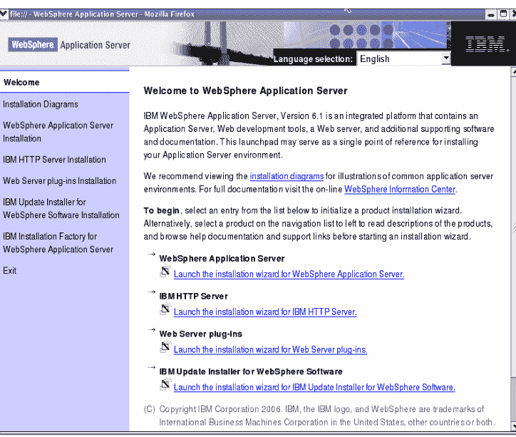

图 8-1 WebSphere Application Server 欢迎窗口

第 8 章. 使用 Oracle 10g2 使用 WebSphere Application Server 153

安装 WebSphere Application Server 和 IBM HTTP Server 的实际过程非常简单，但我们应该注意两点。首先，由于条件检查失败并显示了警告消息，因为安装程序正在检查 Red Hat Enterprise Linux 4 Update 2，而 linux25 处于 Update 5。在 Update 5 级别一切运行正常。其次，当安装期间出现图 8-2 所示窗口时，我们启用了管理安全。

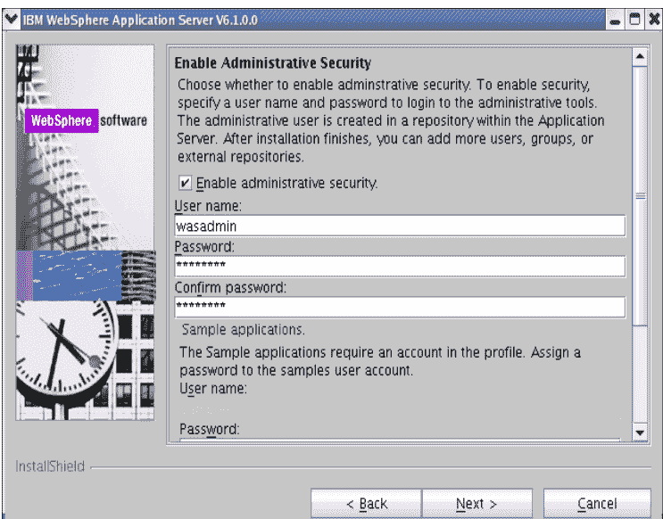

图 8-2 启用管理安全

启用管理安全后，必须使用 -password 选项添加上述用户名，并必须添加上述密码，以便让命令行脚本 startServer.sh、stopServer.sh 和 wsadmin.sh 能够成功运行。

既未启用应用程序或 Java 2 安全，但在启用管理安全后，必须将 localOSUserID 分别添加到“用户和组”（Users and Groups）以及“总总线安全”（Bus Security）下，如下 WebSphere Application Server 管理员窗口所示。这使得 Trade 6 使用的 JMS API 能够正常工作。该 ID 的默认密码为 password，并且也需要它。如果没有启用管理安全，则不需要在后续步骤中添加此 ID。

154 使用 Linux for System z 的 Oracle 解决方案

## 在 Users and Groups 下添加 LocalOSUser
在管理控制台左侧展开 **Users and Groups**，选择 **Manage Users**，然后在弹出的窗口中（如图 8-3 所示）选择 **Create**。

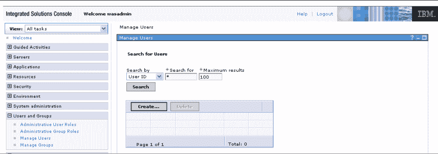

图 8-3 在 Users and Groups 下创建 LocalOSUser

出现图 8-4 所示窗口，可以输入“LocalOSUserID”和“password”。填充字段后，选择 **OK** 添加 LocalOSUserID。

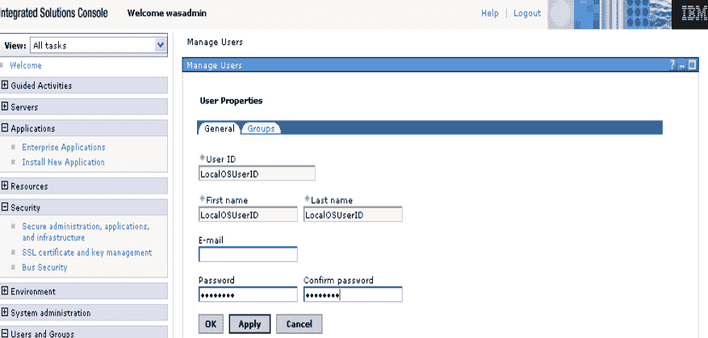

图 8-4 添加 LocalOSUserID

一旦添加 LocalOSUserID，出现图 8-5 所示的窗口，显示 LocalOSUserID 已成功添加。


图 8-5 Users and Groups

如果 Users and Groups 下没有任何内容，请使用 Search 选项填充该窗口。

## 在 Bus Security 下添加 localOSUserID

展开管理控制台左侧的 **Security** 选项，出现图 8-6 所示窗口。

Linux for System z 的 Oracle 解决方案

Integrated Console

wasadmin

Help | Logout

| Views: All tasks | | |
|---|---|---|
| Welcome | | Field help |
| Guided Activities | | a label or |
| cursor area. | | |
| Servers | | Page help |
| Applications | | With information |
| Resources | | this page |
| Security | | |
| Secure administration, applications, and | | |
| SSL certificate and key management | | |
| Bus Security | | |
| Environment | | Use and |
| x Allow the use of defined transport | | |
| channels, any of defined transport | | |
| channels to those protected by SSL | | |
| Restrict the use of undefined transport | | |
| channels to the list of permitted | | |
| | | |
| Related Items | | |
| x JAS - 22C | | |
| authentication data | | |
| Security | | |
| Administration and | | |
| Applications | | |
| Mediations authentication list | | |
| (items) Apply OK Reset Cancel | | |

图 8-6 Users and Groups

第 8 章. 使用 Oracle 10g2 使用 WebSphere Application Server 157

Integrated Console

wasadmin

Help | Logout

| Views: All tasks | | |
|---|---|---|
| Welcome | | Field help |
| Guided Activities | | a label or |
| cursor area. | | |
| Servers | | Page help |
| Applications | | With information |
| Resources | | this page |
| Security | | |
| Secure administration, applications, and | | |
| SSL certificate and key management | | |
| Bus Security | | |
| Environment | | Use and |
| x Allow the use of defined transport | | |
| channels, any of defined transport | | |
| channels to those protected by SSL | | |
| Restrict the use of undefined transport | | |
| channels to the list of permitted | | |
| | | |
| Related Items | | |
| x JAS - 22C | | |
| authentication data | | |
| Security | | |
| Administration and | | |
| Applications | | |
| Mediations authentication list | | |
| (items) Apply OK Reset Cancel | | |

图 8-7 这里的总线安全配置

## 在 Additional Properties 下，选择 bus connector 中的 Users and Groups。出现图 8-8 所示窗口。

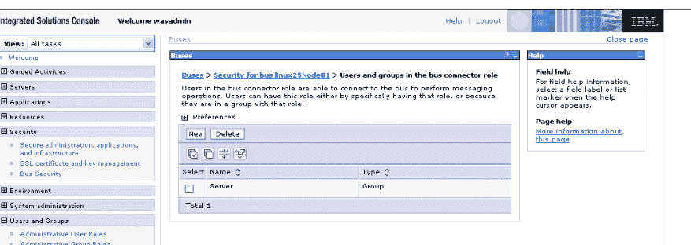

图 8-8 Bus Connector Role 中的 Users and Groups

New。出现图 8-9 所示窗口，可以输入用户 ID

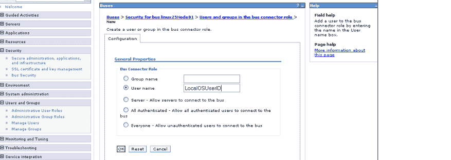

图 8-9 向 Bus Connector Role 添加 LocalOSUserID

输入用户 ID LocalOSUserID 后，点击 OK，将出现第 159 页的图 8-10 所示。


# 图 8-10 总线连接器中的用户和组

当 WebSphere Application Server 未启用管理安全功能时，Trade 6 应用程序启动并成功运行，无需对 LocalOSUserId 用户 ID 进行上述两个更改。在进行更改后，会出现图 8-11 所示的窗口，并且需要保存更改。此时，Trade 6 应用程序成功启动，无需停止并重启 WebSphere Application Server。对于其他配置更改，可能需要使用 `stopServer.sh` 和脚本停止并重启服务器。

### 消息
您的本地配置已发生更改。您可以：
* 直接保存到主配置。
* 在保存或丢弃之前检查更改。
服务器可能需要重启以使这些更改生效。

图 8-11 保存配置更改的消息

图 8-12 显示了 IBM WebSphere Application Server V6.1.0.0 的安装摘要窗口。应用程序服务器的默认名称为 server1。

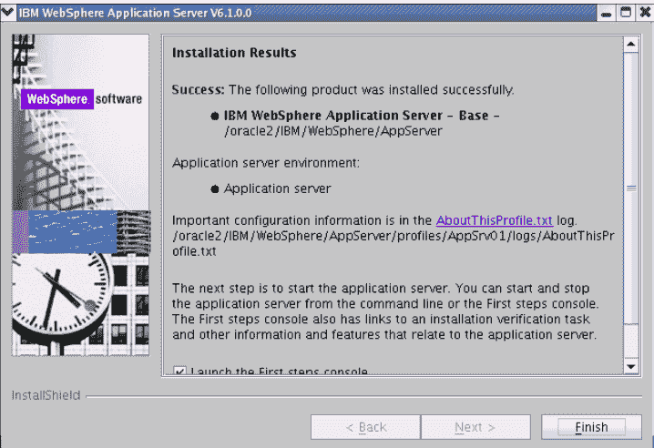

**图 8-12** WebSphere 应用安装结果

从这里，可以访问第 161 页图 8-13 所示的第一步控制台，以启动应用程序并运行安装验证测试。

**160** 使用适用于 System z Linux 的 Oracle 解决方案

# 图 8-13 WebSphere Application Server 启动第一步

也可以使用启动控制台安装 IBM HTTP Server V6.1.0.0。

图 8-14 显示了 HTTP 服务器的安装摘要窗口。Web 服务器的默认名称为 webserver1。

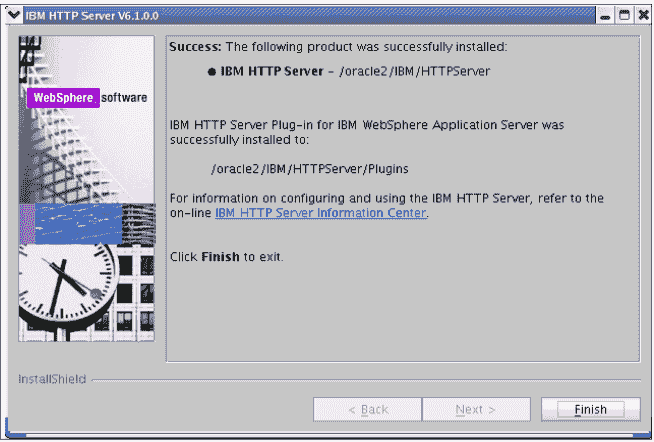

# 图 8-14 HTTP 服务器安装结果

## 8.3 下载 IBM Trade Performance 应用程序

第一步是下载并解压 Trade 6 压缩包 `tradeInstall.zip`。可以从 IBM 免费下载：

https://www14.software.ibm.com/webapp/iwm/web/preLogin.do?source=trade6

`tradeinstall` 是下载的 trade 压缩包中的高级目录。Trade 6 应用程序的概述和架构描述位于 `tradeinstall/Trade.pdf` 文件中的 PDF 中，安装说明位于 `tradeinstall/Readme.html` 中的 readme 文件。创建 Trade 6 使用的表和索引的 DDL 位于 `tradeinstall/Oracle/Table.dl`。

### 8.3.1 为 Trade 6 设置现有的 Oracle 数据库

linux25 现有 Oracle 数据库（SID = psft1）用于 Trade 6 的表和索引。使用示例 8-1 所示的 DDL 为 Trade 6 应用程序创建了新的表空间和新的临时表空间。

> 示例 8-2 创建表空间的 SQL 语句

```sql
CREATE TABLESPACE TRADE61_DEFAULT_TS DATAFILE
'/oracle2/trade61/oradata/psft1/trade61ldts.dbf' SIZE 400M EXTENT
MANAGEMENT LOCAL UNIFORM SIZE 1M SEGMENT SPACE MANAGEMENT AUTO;
```

```sql
CREATE TEM TABLESPACE TRADE61_TEMP_TS TEMPFILE
'/oracle2/trade61/oradata/psft1/trade61lts.dbf' SIZE 100M EXTENT
MANAGEMENT LOCAL UNIFORM SIZE 1M;
```

```sql
ALTER DATABASEFILE '/oracle2/trade61/oradata/psft1/trade61ldts.dbf'
AUTOEXTEND ON NEXT 10M MAXSIZE UNLIMITED;
```

```sql
ALTER TABLEFILE '/oracle2/trade61/oradata/psft1/trade61lts.dbf'
AUTOEXTEND ON NEXT 10M MAXSIZE UNLIMITED;
```

在现有的 Oracle 数据库中创建了用户名并为 trade 用户 ID 授予了权限（参见示例 8-2）。

> 示例 8-2 创建示例

```sql
user trade identified by trade default tablespace
TRADE61_DEFAULT_TS
temporary tablespace TRADE61_TEMP_TS account unlock;
```

```sql
GRANT CREATE SESSION to trade;

GRANT CREATE table to trade;
alter user trade quota unlimited on trade61_default_ts;
```

使用此处显示的用户名和密码连接到 Oracle 数据库：

```
connect trade/trade@psft1
```

通过运行 DDL，在 `TRADE61_DEFAULT_TS` 表空间的 trade 架构中创建了 Trade 6 表和索引：

```bash
tradeinstall/Oracle/Table.dbl1
```

## 8.4 将 Trade 6 安装为 WebSphere Application Server 应用程序

根据安装 readme，将 `tradeinstall` 目录设置为当前目录，并在 linux25 命令行运行了 WebSphere Application Server 脚本 `wsadmin.sh -f trade.jacl` 以交互式安装 JDBC/JMS 资源和 Trade 6 应用程序：

```bash
[root@linux25 tradeinstall#]
/oracle2/IBM/WebSphere/AppServer/wsadmin.sh -f trade.jacl
-user admin -password wasadmin
```

由于启用了管理安全，必须作为选项添加相应的用户名和密码，以便 WebSphere Application Server 命令能够执行。脚本是交互式运行的，以下是某些交互示例：

选择后端数据库类型 (db2|oracle|db2) [db2]:
oracle

输入数据库驱动路径
c:/oracle/product/10.1.0/db_1/jdbc/lib/ojdbc14.jar:
/oracle1/db1/jdbc/lib/ojdbc14.jar

输入 Oracle 数据库 SID (traded):psft1

脚本完成后，停止并重启 WebSphere Application Server：

```bash
[root@linux25 bin]# #stopServer.sh server1 -user wasadmin -password
wasadmin
[root@linux25 bin]# #startServer.sh server1 -user wasadmin -password
wasadmin
```

当应用程序启动后，浏览器指向：
http://linux25:9080/trade

并访问 Trade 6 应用程序（参见图 15）。

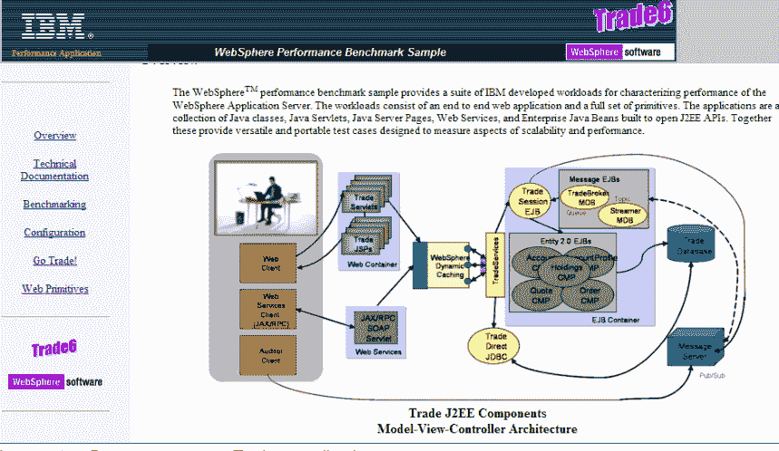

## 8.5 填充 (Populate)

| 配置 | 描述 |
|---|---|
| 概述 | 服务器可能需要重启以使这些更改生效。 |
| 技术 | 可能需要使用 `stopServer.sh` 和脚本停止并重启服务器。 |
| 需求 | 可能需要使用 `stopServer.sh` 和脚本停止并重启服务器。 |
| 配置 | 可能需要使用 `stopServer.sh` 和脚本停止并重启服务器。 |
| 配置 | 可能需要使用 `stopServer.sh` 和脚本停止并重启服务器。 |
| 配置 | 可能需要使用 `stopServer.sh` 和脚本停止并重启服务器。 |
| 版本 | 可能需要使用 `stopServer.sh` 和脚本停止并重启服务器。 |
| Web | 可能需要使用 `stopServer.sh` 和脚本停止并重启服务器。 |

图 8-17 显示了加载数据库的过程。

TradeBuildDB 需要几分钟时间。

**** 创建 1000 个用户 ****

Account# 2000 userID=uid50 有 7 个持仓。
Account# 2050 userID=uid50 有 5 个持仓。

图 8-17 加载 Trade 6 数据库


示例 8-3 显示了使用默认设置由 Trade 6 应用加载的数据。

示例 8-3 select 语句的输出

```
select table_name,num_rows,avg_row_len,(num_rows * avg_row_len) size_in_bytes from user_tables tablespace_name='TRADE61_DEFAULT_ROW_TS';
```

| TABLE_NAME | NUM_ROWS | AVG_ROW_LEN | SIZE_IN_BYTES |
| --- | --- | --- | --- |
| HOLDINGJEB | 2487 | 32 | 79584 |
| ACCOUNTPROFILEJEB | 500 | 76 | 38000 |
| QUOTEJEB | 1000 | 55 | 55000 |
| KEYGENEJB | 0 | 0 | 0 |
| ACCOUNTEJB | 500 | 45 | 22500 |
| ORDEREJEB | 2487 | 59 | 146733 |

## 通过浏览器访问 Trade 6

Trade 6 已成功安装，可以在图 8-18 所示窗口中访问 Trade 6 的不同功能。

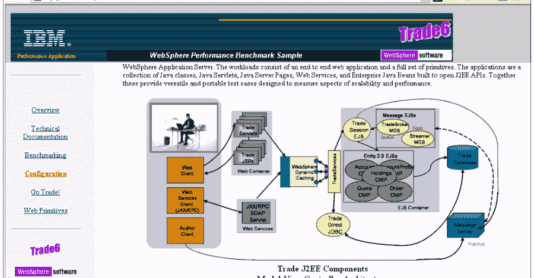

# 使用 Oracle Data Guard

Oracle Data Guard 是 Oracle 数据库的一个功能，用于增强高可用性。

本章描述了我们进行的一个练习，在 Linux for System z 上使用 10gR2 10.2.0.3 创建一个 Oracle Data Guard set。

主要步骤为：

- 创建生产数据库。
- 创建备用数据库。
- 测试切换（switchover）。

本章并不旨在涵盖 Oracle 产品的详细安装过程。10.2.0.2 数据库的安装在第 3 章第 19 页的“安装 Oracle 10gR2 单实例”中有所描述。

## 9.1 Oracle Data Guard 概述

Oracle Data Guard 是一种管理、监控和自动化软件基础设施，它通过创建、维护和监控一个或多个数据库，保护企业数据免受故障、灾难、错误和损坏。

Oracle Data Guard 将这些备用数据库维护为生产数据库的同步副本。这些备用数据库可以位于距离生产数据中心数千英里的远程灾备恢复站点，也可以位于同一城市、同一园区甚至同一栋建筑内。如果生产数据库由于计划内或意外停机无法使用，Oracle Data Guard可以将任何备用数据库切换到生产角色，从而最大限度地减少与停机相关的时间，并防止任何数据丢失。

备用数据库最初是从主数据库的备份副本创建的。一旦创建，Oracle Data Guard 会通过将主数据库的重做日志（redo）传输到备用系统，然后将其应用备用数据库，从而自动将备用数据库维护为主数据库的同步副本。

物理备用数据库提供了主数据库的物理副本，其磁盘数据库结构在块级别与主数据库完全一致。数据库模式（包括索引）也是相同的。

逻辑备用数据库包含与生产数据库相同的逻辑信息，尽管数据的物理组织和结构可能不同。

使用 Oracle Data Guard，数据库的角色可以从主角色切换到备用角色，反之亦然，确保在此过程中没有数据丢失，并最大限度地减少停机时间。角色转换有两种类型：切换（switchover）和故障转移（failover）。

## 9.2 Oracle Data Guard Broker

Oracle Data Guard Broker 是一个分布式管理框架，能够自动化并集中管理 Oracle Data Guard 配置的创建、维护和监控。所有管理操作都可以通过 Oracle Enterprise Manager（其使用 Broker）或通过 Broker 的专用命令行界面（DGMRL）来执行。Oracle Data Guard Broker 11g 还允许使用最大可用性（Maximum Availability）或最大性能（Maximum Performance）模式实现 Oracle Data Guard 配置的数据库故障转移。

## 9.3 Oracle Data Guard 优势

- 1. 灾难恢复和高可用性
Oracle Data Guard 提供了一种高效且全面的灾难恢复和高可用性解决方案。主数据库和备用数据库之间具有自动故障转移和易于管理的切换能力，最大限度地减少了主数据库在计划和意外停机时的停机时间。

- 2. 完全的数据保护
备用数据库还提供了针对数据损坏和用户错误的有效保护。主数据库的存储层级损坏不会传播到备用数据库。同样，导致主数据库永久损坏的逻辑损坏或用户错误也可以得到解决。最后，重做数据在备用数据库接收时会进行验证，在应用到备用数据库时会进一步验证。

- 3. 系统资源的高效利用
物理备用数据库可以用于备份和只读报告，减少主数据库的负载，并节省宝贵的 CPU 和 I/O 周期。物理备用数据库可以在物理备用和打开的读写数据库之间轻松转换，而不会损害数据保护。逻辑备用数据库允许对同步的备用数据库进行读写访问，向备用数据库添加也可以进行更新的本地表，或者创建额外的索引以优化读取性能性能。

- 4. 数据保护的灵活性可平衡可用性与性能需求
Oracle Data Guard 提供最大保护、最大可用性和最大性能模式，帮助企业平衡数据可用性与系统性能需求。

- 5. 防止通信故障的影响
如果主数据库与一个或多个备用数据库之间的网络连接丢失，重做数据将无法从主数据库发送到这些备用数据库。一旦重新建立连接，Oracle Data Guard 会自动检测到缺失的重做数据，并使备用数据库重新同步，无需人工干预。

- 6. 集中且简单的管理
Oracle Data Guard Broker 自动化了 Oracle Data Guard 配置中多个数据库的管理和监控任务。管理员可以使用 Enterprise Manager 或 Broker 的专用命令行界面（DGRL）来利用此管理框架。

- 7. 与 数据库集成
Oracle Data Guard 作为 Oracle 数据库企业版的集成功能提供，无需额外费用。

## 9.4 创建 Data Guard 解决方案的步骤

我们执行的步骤如下：

- 安装 Oracle 二进制文件。
- 使用 DBCA 在生产节点创建数据库。
- 准备生产数据库。
- 将数据库复制到备用节点。
- 设置备用数据库。
- 启动物理备用数据库。
- 测试切换过程。

我们遵循的文档是：

- Oracle Data Guard Concepts and Administration 10g Release 2 (10.2), B14239-04
- MetaLink: 232240.1 Performing switchover in Oracle Data Guard Configuration
- Oracle Database 10g High Availability with RAC, Flashback & Oracle Data Guard

主（生产）数据库和备用数据库可以位于 Linux 虚拟机、同一 LPAR 的两个 Linux 虚拟机中、位于独立 LPAR 的两个 Linux 虚拟机中（同一 z9 上）、或位于不同 z9 的两个 LPAR 中。我们的结构是在同一 z9 上位于独立 LPAR 的两个 Linux 虚拟机，如图 9-1 所示。

| LPAR 1 | LPAR 2 |
|--- | --- |
| Linux guest 1 | Linux guest 2 |
| Oracle single Instance Trade 1 | Oracle single Instance Trade 2 |
| | IP 连接 | |
| 主数据库 | 备用数据库 |

图 9-1 Oracle Data Guardset

## 9.5 生产数据库的安装和创建

本章不涵盖 Oracle 二进制文件的安装或数据库创建细节，因为这些在其他书籍或章节中有介绍。

## 9.6 准备生产数据库

创建物理备用数据库的第一步是准备生产数据库，以便将其复制到备用数据库服务器。


在我们的示例中，我们使用了两个运行 SLES10 和 Oracle 10gR2 的访客。数据库名为 tradedb，第一个节点上的唯一名称为 trade1，第二个节点的唯一名称为 trade2。两个节点的目录结构相同：

```
ORACLE_HOME=/oracle/10gr2
LOG_ARCHIVE_DESTINATION=/oracle/trade
ORACLE DATABASE FILE LOCATION=/oracle/10gr2/oradata/tradedb
```

这些是我们为准备数据库复制而执行的步骤。

### 9.6.1 启用强制日志

在创建数据库后，使用以下 SQL 语句将主数据库设置为 FORCE LOGGING 模式：

```sql
SQL> ALTER DATABASE FORCE LOGGING;
```

要验证强制日志已设置，运行：

```sql
SQL> SELECT FORCE_LOGGING FROM V$DATABASE;
```

```
FOR
---
YES
```

### 9.6.2 创建密码文件

这是在安装 Oracle 二进制文件和创建数据库期间完成的。

### 9.6.3 配置备用 redo 日

最大保护（maximum protection）和最大可用性（maximum availability）模式需要备用 redo 日，并且建议所有数据库使用 LGWR ASYNC 传输模式。比起存档 redo 日文件，Oracle Data Guard 可以备用 redo 日恢复并应用更多的 redo 数据。要配置日志，请执行以下步骤：

- 1. 确保主数据库和备用数据库上的日志文件大小相同。
- 2. 使用以下公式确定适当的备用 redo 日文件组：
(每个线程日志文件数 + 1) * (最大线程数) = 4
- 3. 验证相关的数据库参数和设置：

```sql
SQL> SELECT TYPE,RECORDS_TOTAL FROM V$CONTROLFILE_RECORD_SECTION
WHERE TYPE='REDO LOG';
```

| TYPE | RECORDS_TOTAL |
| --- | --- |
| REDO LOG | 16 |

```sql
SQL> SELECT DIMLM FROM X$KCCDI;
```

DIMLM
3

- 4. 创建备用 redo 日文件组：

```sql
SQL> ALTER DATABASE ADD STANDBY LOGFILE '/oracle/10gr2/oradata/tradedb/redo004s.log' size 50M,
GROUP 4 '/oracle/10gr2/oradata/tradedb/redo005s.log' size 50M,
GROUP 6 '/oracle/10gr2/oradata/tradedb/redo006s.log' size 50M,
GROUP 7 '/oracle/10gr2/oradata/tradedb/redo007s.log' size 50M;
```

- 5. 验证备用 redo 日文件组已创建：

```sql
SQL> SELECT GROUP#,THREAD#,SEQUENCE#,ARCHIVED_STATUS FROM V$STANDBY_LOG;
```

| GROUP# | THREAD# | SEQUENCE# | ARCHIVED_STATUS |
| --- | --- | --- | --- |
| 4 | 0 | 0 | YES UNASSIGNED |
| 5 | 0 | 0 | YES UNASSIGNED |
| 6 | 0 | 0 | YES UNASSIGNED |
| 7 | 0 | 0 | YES UNASSIGNED |

### 9.6.4 设置主数据库初始化参数

设置初始化参数有两种方法：一种是创建 init(ORACLE_SID).ora 文件并使用该文件启动数据库；另一种方法是执行以下命令：

- 1. DB_UNIQUE_NAME
- 2. LOG_ARCHIVE_CONFIG
- 3. LOG_ARCHIVE_DEST
- 4. 使用 ALTER SYSTEM 设置闪回恢复（flash recovery）

以下章节显示了如何设置这些命令。

### DB_UNIQUE_NAME

DB_UNIQUE_NAME: 为每个数据库指定唯一名称。该名称随数据库保留且不会更改，即使主数据库和备用数据库的角色发生反。语法为：

```sql
SQL> SELECT * FROM V$DATAGUARD_CONFIG;
DB_UNIQUE_NAME
```

tradedb

```sql
SQL> ALTER SYSTEM SET DB_UNIQUE_NAME='tradedb' SCOPE=SPFILE;
SQL> SELECT * FROM V$DATAGUARD_CONFIG;
DB_UNIQUE_NAME
```

tradedb

此时，我们需要关闭数据库并重启它以看到更改：

```sql
SQL> shutdown immediate
Database dismounted.
ORACLE instance shut down.
```

```sql
SQL> startup
ORACLE instance started.
```

| Total System Global Area | 1241513984 bytes |
| --- | --- |
| Fixed Size | 2072384 bytes |
| Variable Size | 318767296 bytes |
| Database Buffers | 905969664 bytes |
| Redo Buffers | 14704640 bytes |
| Database mounted. | |
| Database opened. | |

```sql
SQL> SELECT * FROM V$DATAGUARD_CONFIG;
DB_UNIQUE_NAME
```

tradedb

### LOG_ARCHIVE_CONFIG

LOG_ARCHIVE_CONFIG: 在此参数上指定 DG_CONFIG 属性，以列出 Oracle Data Guard 配置中主数据库和备用数据库的 DB_UNIQUE_NAME。这允许向运行在最大保护或最大可用性模式下的实时应用集群（RAC）数据库的 Oracle Data Guard 配置中动态添加备用数据库。默认情况下，LOG_ARCHIVE_CONFIG 参数允许数据库发送和接收 redo。在角色转换后，可能需要使用 SEND、NOSEND 或 NORECEIVE 关键字再次指定这些设置。使用以下语法：

```sql
SQL> ALTER SYSTEM SET LOG_ARCHIVE_CONFIG=DG_CONFIG=(trade,trade);
```

```sql
SQL> SHOW PARAMETER LOG_ARCHIVE_CONFIG
| NAME | TYPE | VALUE |
|---|---|---|
| LOG_ARCHIVE_CONFIG | STRING | DG_CONFIG=(trade1,trade2) |

```sql
SQL> SELECT * FROM V$DATAGUARD_CONFIG;
trade1

### LOG_ARCHIVE_DEST

- 无论角色如何（主或备用），根据 log_archive_1 将 ARCHIVE LOG 输出到本地 /oracle/trade。只有在主角色情况下将 ARCHIVE LOG 输出到远程地。LOG_ARCHIVE_DEST_n: 指定主数据库和备用数据库存档 redo 数据的位置。LOG_ARCHIVE_DEST_1: 将主数据库生成的在线 redo 文件存档到本地 /oracle/trade redo 文件。LOG_ARCHIVE_DEST_2: 将 redo 数据传输到远程备用库 trade2。示例 9-1 显示了 LOG_ARCHIVE_DEST：

```sql
SQL> ALTER SYSTEM SET LOG_ARCHIVE_DEST_1='LOCATION=/oracle/trade VALID_FOR=(ALL_LOGFILES,ALL_ROLES) DB_UNIQUE_NAME=trade1';
SQL> ALTER SYSTEM SET LOG_ARCHIVE_DEST_2='SERVICE=trade2 VALID_FOR=(ONLINE_LOGFILES,PRIMARY_ROLE);
```

```sql
SQL> SHOW PARAMETER LOG_ARCHIVE_DEST;
```

| NAME | TYPE | VALUE |
| --- | --- | --- |
| log_archive_dest_1 | string | LOCATION=/oracle/trade VALID_FOR=(ALL_LOGFILES,ALL_ROLES) |
| log_archive_dest_2 | string | SERVICE=trade2 VALID_FOR=(ONLINE_LOGFILES,PRIMARY_ROLE) |

```sql
SQL> SELECT DEST_ID,DESTINATION,VALID_TYPE,VALID_ROLE,DB_UNIQUE_NAME FROM V$ARCHIVE_DEST WHERE DEST_ID<=2;
```

| DEST_ID | DESTINATION | VALID_TYPE | VALID_ROLE | DB_UNIQUE_NAME |
| --- | --- | --- | --- | --- |
| 1 | /oracle/trade | ALL_LOGFILES | ALL_ROLES | trade1 |
| 2 | | ONLINE_LOGFILE | PRIMARY_ROLE | trade2 |

### ALTER SYSTEM 设置闪回恢复

在将激活读/写访问的物理备用数据库上，设置以下初始化参数以确保可以创建保证点（guaranteed restore point）。这设置了闪回区域。

```sql
SQL> ALTER SYSTEM SET DB_RECOVERY_FILE_DEST_SIZE=2G;
```

```sql
SQL> ALTER SYSTEM SET DB_RECOVERY_FILE_DEST='/oracle/10gr2/flash_recovery_area/TRADEDB;
```

```sql
SQL> SHOW PARAMETER DB_RECOVERY_FILE_DEST
```

| NAME | VALUE |
| --- | --- |
| db_recovery_file_dest | string | /oracle/10gr2/flash_recovery_area/TRADEDB |
| db_recovery_file_dest_size | big integer | 2G |

```sql
SQL> SHUTDOWN IMMEDIATE
SQL> STARTUP MOUNT
SQL> ALTER DATABASE FLASHBACK ON;
```

```sql
SQL> ALTER DATABASE OPEN;
```

此时你应该已经设置了所有的初始化参数。你可以按照如下方式创建一个 pfile：

```sql
SQL> CREATE PFILE='/tmp/tradedb_model.ora' FROM SPFILE;
```

以下是 pfile 中与 Oracle Data Guard 相关的参数：

```
DB_NAME=tradedb
DB_UNIQUE_NAME=trade1
SERVICE_NAMES=trade1
LOG_ARCHIVE_CONFIG='DG_CONFIG=(trade1,trade2)'
LOG_ARCHIVE_DEST_1='LOCATION=/oracle/
VALID_FOR=(ALL_LOGFILES,ALL_ROLES)
DB_UNIQUE_NAME=trade1
LOG_ARCHIVE_DEST_2='SERVICE=trade2'
VALID_FOR=(ONLINE_LOGFILES,PRIMARY_ROLE)
DB_UNIQUE_NAME=trade2
LOG_ARCHIVE_DEST_STATE_1=ENABLE
LOG_ARCHIVE_DEST_STATE_2=ENABLE
REMOTE_LOGIN_PASSWORDFILE=EXCLUSIVE
LOG_ARCHIVE_FORMAT=%t_%s_%r.arc
LOG_ARCHIVE_MAX_PROCESSES=30
```

## 来自生产数据库的文件

这是生产数据库的文件：

示例 9-2 生产数据库 pfile tmp/tradedb_nodel1.ora

```
tradedb.__db_cache_size=90596664
tradedb.__java_pool_size=16777216
tradedb.__large_pool_size=16777216
tradedb.__shared_pool_size=285212672
tradedb.__streams_pool_size=0
*.audit_file_dest='/oracle/10gr2/admin/tradedb/adump'
*.background_dump_dest='/oracle/10gr2/admin/tradedb/bdump'
*.compatible='10.2.3'
*.control_files='/oracle/10gr2/oradata/tradedb/control001.ctl','oracle/10gr2/oradata/tradedb/control002.ctl','oracle/10gr2/oradata/tradedb/control003.ctl'
*.core_dump_dest='/oracle/10gr2/admin/tradedb/cdump'
*.db_block_size=8192
*.db_domain=''
*.db_file_multiblock_read_count=16
*.db_name='tradedb'
*.db_recovery_file_dest=214783648
*.db_recovery_file_dest='/oracle/10gr2/flash_recovery_area/TRADEDB'
*.db_unique_name='trade1'
*.dispatchers=(PROTOCOL=TCP) (SERVICE=trade2XDB)
*.fal_client='TRADE1'
*.fal_server='TRADE2'
*.job_queue_processes=10
*.log_archive_config=(trade1,trade2)
*.log_archive_dest_1='LOCATION=/oracle/
VALID_FOR=(ALL_LOGFILES,ALL_ROLES)
DB_UNIQUE_NAME=trade1
*.log_archive_dest_2='SERVICE=trade2'
VALID_FOR=(ONLINE_LOGFILES,PRIMARY_ROLE)
DB_UNIQUE_NAME=trade2
*.LOG_ARCHIVE_DEST_STATE_1=ENABLE
*.LOG_ARCHIVE_DEST_STATE_2=ENABLE
*.REMOTE_LOGIN_PASSWORDFILE=EXCLUSIVE
*.LOG_ARCHIVE_FORMAT=%t_%s_%r.arc
*.LOG_ARCHIVE_MAX_PROCESSES=30
```

178 Using Oracle Solutions on Linux for System z


```
*.LOG_ARCHIVE_MAX_PROCESSES=30
*.open_cursors=300
*.pga_aggregate_target=408944640
*.processes=150
*.remote_login_passwordfile='EXCLUSIVE'
*.processes=150
*.remote_login_passwordfile='EXCLUSIVE'
*.sga_target=1228931072
*.standby_file_management='AUTO'
*.undo_management='AUTO'
*.undo_tablespace='UNDOTBS1'
*.user_dump_dest='/oracle/10gr2/admin/tradedb/udump'
```

## 启用归档

此时，我们想要确保归档已启用，因此我们使用以下命令：

SQL> SHUTDOWN IMMEDIATE;
SQL> STARTUP MOUNT;
SQL> ALTER DATABASE ARCHIVELOG;
SQL> ALTER DATABASE OPEN;

## 9.7 创建物理备用数据库

为了使用 Oracle Data Guard，你需要数据库的副本。创建数据库备份有多种方法。Oracle 推荐 RMAN，这是一个与 Oracle 数据库集成的工具，能够满足高性能、可管理的备份和恢复的需求。另一种方法是关闭数据库并复制 DBF 文件。在我们的示例中，使用了这种方法。

### 9.7.1 在主节点上

- 创建主数据库文件的备份副本。
为了建立备用数据库，我们需要创建主数据库的副本。这可以通过关闭数据库并将 dbf 文件从主节点复制到备用节点来实现。我们使用了 `scp` 命令。

- 为备用数据库创建控制文件。

我们需要为备用节点创建一个控制文件，这在主节点上通过以下命令完成：

```
SQL> ALTER DATABASE CREATE STANDBY CONTROLFILE AS '/tmp/trade.ctl'
```

- 为备用数据库准备初始化参数文件。
需要对备用节点的初始化参数文件进行修改，以适应备用节点环境，如示例 9-3 所示。

### 备用数据库的 pfile
示例 9-3 显示了我们使用的 pfile。注意加粗的行。

示例 9-3 备用数据库的 pfile

/tmp/tradedb_node2.ora

```
tradedb.\_db_cache_size=905969664
tradedb.\_java_pool_size=16777216
tradedb.\_large_pool_size=16777216
tradedb.\_shared_pool_size=285212672
tradedb.\_streams_pool=0
*.audit_file_dest='/oracle/10gr2/admin/tradedb/adump'
*.background_dump_dest='/oracle/10gr2/admin/tradedb/bdump'
*.compatible_files='10.2.0.3'
*.control_files='/oracle/10gr2/oradata/tradedb/control01.ctl','oracle/10gr2/oradata/tradedb/control03.ctl'
*.core_dump_dest='/oracle/10gr2/admin/tradedb/cdump'
*.db_block_size=8192
*.db_domain=''
*.db_file_multiblock_read_count=16
*.db_name='tradedb'
*.recovery_file_dest='/oracle/10gr2/recovery_area'
*.recovery_file_dest_NAME='trade2'
*_DB_UNIQUE_NAME=trade2
*.dispatchers=(PROTOCOL=TCP) (SERVICE=tradedxbDB)
*.F_CLIENT='trade2'
*.F_SERVER='trade1'
*.job_queue_processes=10
*.LOG_ARCHIVE_CONFIG=DB_CONFIG=(trade1,trade2)
*.LOG_ARCHIVE_DEST_1=LOCATION=/oracle/trade/ VALID_FOR=(ALL_LOGFILES,ALL_ROLES)
DB_UNIQUE_NAME=trade2
*_LOG_ARCHIVE_DEST_2=SERVICE=trade1 SYNC
VALID_FOR=(ONLINE_LOGFILES,PRIMARY_ROLE) DB_UNIQUE_NAME=trade1
*.LOG_ARCHIVE_DEST_1='ENABLE'
```

```
*.LOG_ARCHIVE_DEST_2='ENABLE'
*.LOG_ARCHIVE_FORMAT='%t_%s_%r.arc'
*.LOG_ARCHIVE_MAX_PROCESSES=30
*.open_cursors=300
*.pga_aggregate_target=408944640
*.processes=150
*.REMOTE_LOGIN_PASSWORDFILE='EXCLUSIVE'
*.sga_target=1228931072
*.STANDBY_FILE_MANAGEMENT='AUTO'
*.undo_management='AUTO'
*.undo_tablespace='UNDOTBS1'
*.user_dump_dest='/oracle/10gr2/admin/tradedb/udump
```

### 9.7.2 从主系统复制文件到备用系统

这些是我们复制的文件：

- redo01.log
- redo02.log
- redo03.log
- redo04s.log
- redo04s.log
- redo05s.log
- redo06s.log
- redo07s.log
- redo01.log
- redo02.log
- redo03.log
- redo04s.log
- redo04s.log
- redo05s.log
- redo06s.log
- redo07s.log

为了建立备用数据库，我们需要创建主数据库的副本。这可以通过关闭数据库并将 dbf 文件从主节点复制到备用节点来实现。我们使用了 `scp` 命令。


注意：如果状态返回 `SESSIONS ACTIVE`，则你应该在下一步的命令中附加会话关闭子句。

6. 将物理备备库转换为新主库：

```
SQL> ALTER DATABASE COMMIT TO SWITCHOVER TO PRIMARY;
Database altered.
```

7. 关闭并启动新主库：

```
SQL> SHUTDOWN IMMEDIATE
ORA-01507: database not mounted
ORACLE instance shut down.
SQL> STARTUP
ORACLE instance started.
```

|  {全局区总量 | 85020944 bytes |
| :--- | :--- |
| 固定大小 | 454928 bytes |
| 变量大小 | 71303168 bytes |
| 数据库缓冲区 | 12562912 bytes |
| 重做日志缓冲区 | 679936 bytes |
| 数据库已挂载。 | |
| 数据库已打开。 | |
| SQL> | |

8. 在新主库上启用远程归档到新备备库：

```SQL
SQL> ALTER SYSTEM SET LOG_ARCHIVE_DEST_STATE_2=ENABLE;
```

9. 在新备备数据库上启动托管恢复：

```SQL
SQL> RECOVER MANAGED STANDBY DATABASE DISCONNECT;
Media recovery complete.
```

此时，我们已经拥有了一个完全运行的 Oracle Data Guard。

# 将 Oracle 数据库从 z/OS 迁移到 Linux for System z

Oracle 始终声称 Oracle 就是 Oracle。无论 Oracle 运行何处，它都具有相同的功能。随着使用 Linux for System z 的趋势，我们发现展示数据库从 z/OS 迁移到 Linux for System z 的 Oracle 的将非常有帮助。

本章详细介绍了将应用程序数据库从 system z/OS  Oracle 迁移到 Linux for System z  Oracle 的过程。z/OS 数据库使用 EBCDIC 编码，而 Linux for System z 数据库使用 ASCII 编码。

## 10.1 将您的 Oracle 数据库从 z/OS 迁移到 Linux for System z

要迁移数据库，可以使用许多工具，例如传统的导出/导入、RMAN、Data Pump 导出/导入以及一些第三方工具。我们决定使用 Oracle Data Pump，因为这比使用传统的导出/导入实用程序更快。

由于需要进行 EBCDIC 到 ASCII 的转换，可传输表空间并不是一个选项。这就是 Oracle on z/OS 不支持可传输表空间平台的原因。

## 10.2 使用 Data Pump

Data Pump 导出和导入的设计相比原始的导出和导入实用程序极大提升了移动性能。关于如何使用 Data Pump 的信息位于《Oracle Database Utilities, B10825-01》。

Data Pump 导出和导入实用程序（分别通过 `expdp` 和 `impdp` 命令调用）与原始的导出 (exp) 和导入 (imp) 实用程序具有相似的外，但它们是完全独立的。由新的 Data Pump 导出工具生成的转储文件与原始导出工具生成的转储文件不兼容。因此，由导出 (exp) 程序生成的文件无法使用 Data Pump 导入 (impdp) 程序导入。

Oracle 建议您使用新的 Data Pump 导出和导入实用程序，因为它们支持 XML Schema 之外的所有 Oracle Database 10 功能。原始导出和导入支持 Oracle 数据库 9.2 的全功能集。

我们所做的练习是将位于 z/OS Oracle 上的数据库迁移到 Linux for System z。该数据库用于一个 Web 应用程序的 Oracle 数据库。

我们首先在 System z/OS 上安装 Oracle。一旦安装好 Oracle，我们就为 Web 应用程序创建了数据库、用户和模式。

我们执行迁移测试的步骤如下：

- 1. 在 z/OS 上安装 Oracle 10g
- 2. 创建数据库和表
- 3. 填充数据库
- 4. 准备 Data Pump 导出
- 5. 运行 Data Pump 导出
- 6. 将转储文件移动到新系统
- 7. 在 Linux for System z 上安装 Oracle 10g
- 8. 创建数据库
- 9. 准备 Data Pump 导入
- 10. 运行 Data Pump 导入
- 11. 验证应用程序

## 10.3 在 z/OS 上安装 Oracle 10g

我们遵循《Oracle Installation Guide》和《Experiences with Oracle Database 10g on z/OS, SG24-7055》在 z/OS 上安装了 Oracle 二进制文件。在安装二进制文件并按照创建数据库（描述在《Experiences with Oracle Database 10g on z/OS, SG24-7055》第 5 章“Creating the Oracle Database”）之后，我们需要验证作业 SQLORA13 是否成功运行。为了能够使用 Data Pump，Java 代码必须成功初始化。检查作业 SQLORA13 是否无错误地完成。

## 10.4 创建数据库和表

Data XML 导出使用 `DBMS_METADATA_UTIL` 包。该包需要安装 XML，XML 需要安装 JAVA。作业 SQLORA13 处理了这些需求。

```
Example 10-1 SQLORA13
//SQLORA13 JOB (0000,OR),'ORACLE INSTALL 3',CLASS=A,
// MSGCLASS=X,PRTY=15,MSGLEVEL=(1,1),NOTIFY=&SYSUID
//*JOBPARM SYSAFF=SC53
/*/*
// COPYRIGHT (C) 2006 ORACLE. ALL RIGHTS RESERVED.
///*
// JOB DESCRIPTION: Initialize Java VM and XML
///*
```
```
```
/*
//SQLPLUS PGM=SQLPLUS,PARM='/N',REGION=8
//STEPLIB DD=SHR,DSN=ORACLE:B1022
//LIB DD=SHR,DSN=ORACLE:B1022
//STDOUT DD=*SYSOUT
//STDERR DD=*SYSOUT
/*
SET ECHO ON
SET FEEDBACK OFF
SET SQLOUTPUT ON
SET TERMOUT OFF
@oracle/10g/db/initjvm.sql
@oracle/10g/db/initxml.sql
@oracle/10g/db/cat.sql
EXIT
*/
```


```sql
KEYNAME VARCHAR2(250) NOT NULL);
```

```sql
ALTER TABLE KEYGENEJB
ADD CONSTRAINT PK_KEYGENEJB PRIMARY KEY (KEYNAME);
```

```sql
CREATE TABLE ACCOUNTE
(CREATIONDATE DATE NULL,
OPENBALANCE DECIMAL(14, 2) NULL,
LOGOUTCOUNT INTEGER NOT NULL,
BALANCE DECIMAL(14, 2) NULL,
ACCOUNTID INTEGER NOT NULL,
LASTLOGIN DATE NULL,
LOGINCOUNT INTEGER NOT NULL,
PROFILE_USERID VARCHAR2(250) NULL);
```

```sql
ALTER TABLE ACCOUNTEJB
ADD CONSTRAINT PK_ACCOUNTEJB PRIMARY KEY (ACCOUNTID);
```

```sql
CREATE TABLE ORDEREJB
(ORDEREE DECIMAL(14, 2) NULL,
COMPLETIONDATE DATE NULL,
ORDERTYPE VARCHAR2(250) NULL,
ORDERSTATUS VARCHAR(250) NULL,
PRICE DECIMAL(14, 2) NULL,
QUANTITY NUMBER NOT NULL,
OPENDATE DATE NULL,
ORDERID INTEGER NOT NULL,
ACCOUNT_ACCOUNTID INTEGER NULL,
QUOTE_SYMBOL VARCHAR2(250) NULL,
HOLDING_HOLDINGID INTEGER NULL);
```

```sql
ALTER TABLE ORDEREJB
ADD CONSTRAINT PK_ORDEREJB PRIMARY KEY (ORDERID);
```

```sql
CREATE INDEX a_profile_userid on accountejb(profile_userid);
CREATE INDEX h_account_accountid on holdingejb(account_accountid);
CREATE INDEX o_account_accountid on orderejb(account_accountid);
CREATE INDEX o_holding_holdingid on orderejb(holding_holdingid);
CREATE INDEX o_closed_orders on orderejb(orderstatus,account_accountid);
```

一旦我们完成了数据库、用户和表的创建，便开始填充数据库并运行 Web 应用程序的安装。在验证一切运行正常后，我们开始准备迁移数据库。

## 10.6 准备进行 Data Pump 迁移

接的流程是使用 Data Pump 从 z/OS 上的 Oracle 导出数据库，然后使用 Data Pump 将数据库导入到运行在 Linux for System z 上的 Oracle 实例中。

### 10.6.1 Data Pump 导出和日志文件

包含 Data Pump Export 写入 Data Pump Import 读取的数据库数据的文件称为导出文件或转储文件（dump file）。虽然在概念上与 Export 和 Import 工具的导出文件相似，但这两种类型不可互换。例如，你不能用 Data Pump Import 读取普通的 Export 文件，也不能用普通的 Import 读取 Data Pump Export 文件。

除了写入或读取导出文件外，Data Pump Export 或 Import 的执行通常会写入日志文件。这只是记录处理细节的文本日志。

在 z/OS 上，Data Pump Export 和 Import 使用的导出和日志文件必须是 HFS 系统文件；它们不能是 z/OS 数据集。由于 Data Pump 导出和日志处理是在 Oracle 数据库服务器上完成的，而不是客户端作业或会话，因此对这两类文件的访问由数据库管理员创建的数据库目录对象控制。虽然对于 HFS 文件和数据集都有相应形式的目录对象，但在 Data Pump 操作中，只能使用 HFS 形式的目录对象。

当我们尝试使用 Data Pump 进行全数据库导出时，在导入侧发生了失败。解决方案是包含参数 `compression=none`。这在 Metal Note 457255.1 中有了解释，如示例 10-4 所示。

```
Example 10-4 Data Pump MetaLink Note
Subject: DATAPUMP IMPORT FAILS WITH ORA-00600 [kupifiReadBbzLob].nDoc Id:
Note:457255.1: PROBLEM
Last Revision Date: 05-SEP-2007Status: MODERATED
In this Document
Symptoms
Cause
Solution
```

本文档通过 Oracle Support 的 Rapid Visibility (RaV) 流程交付给您，因此未经过独立的技术审查。

适用范围：
Oracle Server - Enterprise Edition - Version: 10.2
此问题可能发生在任何平台上。

### 症状
datapump import 导入失败，并出现以下错误set：
Import: Release 10.2.0.3.0 - 64bit Production on Monday, 03 September 2007 12:49:00

Copyright (c) 2003, 2005, Oracle. All rights reserved.
Connected to: Oracle Database 10g Enterprise Edition Release 10.2.0.3.0 -64bit Production
With the Partitioning, OLAP and Data Mining options
Master table "STRADMIN","SYS_IMPORT_FULL_02" successfully loaded/unloaded
"STRADMIN","SYS_IMPORT_FULL_02": stradmin@ FULL=y DIRECTORY=dir DUMPFILE=STREAMS_CONFIGURATION TRANSFORM=OID DATABASE_EXPORT/TABLE
ORA-39014: One or more workers have exited.
ORA-39029: worker process "DW01" prematurely terminated.
ORA-31671: Worker process DW01 had an unhandled exception.ORAORA06600: internal error code, arguments: [upiRaBzlob], [kgcdd], [1], [0],
ORA-06512: at "SYS.WORKER", line 1342
ORA-06512: at line 2
Job "STRADMIN","SYS_IMPORT_FULL_02" stopped due to fatal error at 12:49:34

### 原因
导出时的默认设置为是 `COMPRESSION=METADATA_ONLY`，这会导致压缩的转储文件。这种压缩损坏了数据并导致 ORA-00600 错误，从而导入失败。在执行导出时指定 `COMPRESSION=NONE` 应该可以成功导入。

### 解决方案
一种变通方法是执行以下操作：
1. 执行导出时指定 `COMPRESSION=NONE`。
2. 将新创建的非压缩数据文件导入数据库。

### 10.6.2 准备执行 Data Pump
要的第一工作是在 z/OS 中创建一个用于导出和导入的目录。以 `oracle` 用户身份登录后，进入可写目录并创建目录：
`mkdir expdata`

我们使用 SQL 以系统用户登录数据库，并创建了用于转储文件和日志的目录：

## 10.7 运行 Data Pump 导出
我们以 `oracle` 用户身份登录 z/OS UNIX，并运行 Data Pump 导出命令导出全数据库，如示例 10-5 所示。

```
Example 10-5 Running the Pump export
ORACLE2 @ /u/oracle2>expdp trade/
dumpfile=mydata.dmp logfile=mydata.log compression=none

Export: Release 10.2.0.3.0 on Monday, 05 November, 12:19:58
Copyright (c) 2003, 2005, Oracle. All rights reserved.
Connected to: Oracle Database 10g Enterprise Edition Release 10.2.0.3.0 - Production
With the Partitioning, OLAP and Data Mining options
Starting "TRADE","SYS_EXPORT_SCHEMA_01": trade/
dumpfile=mydata.dmp logfile=mydata.log

Estimate in progress using BLOCKS method...
Processing object type SCHEMA_EXPORT/TABLE_DATA
Total estimation using BLOCKS method: 640 KB
Processing object type SCHEMA_EXPORT/USER
Processing object type SCHEMA_EXPORT/SYSTEM_GRANT
Processing object type SCHEMA_EXPORT/ROLE_GRANT
Processing object type SCHEMA_EXPORT/DEFAULT_ROLE
Processing object type SCHEMA_EXPORT/PRE_SCHEMA/PROCACT_SCHEMA
Processing object type SCHEMA_EXPORT/TABLE
Processing object type SCHEMA_EXPORT/INDEX
Processing object type SCHEMA_EXPORT/TABLE/CONSTRAINT
Processing object type SCHEMA_EXPORT/INDEX/STATISTICS
Processing object type SCHEMA_EXPORT/TABLE/COMMENT
Processing object type SCHEMA_EXPORT/TABLE/STATISTICS
* exported "TRADE".ORDEREJB" 152.6 KB
* exported "TRADE".HOLDINGEJB" 86.25 KB
* exported "TRADE".QUOTEEJB" 60.97 KB
* exported "TRADE".ACCOUNTEJB" 29.89 KB
* exported "TRADE".ACCOUNTPROFILEEJB" 43.86 KB
* exported "TRADE".KEYGENEJB" 5.289 KB

Master table "TRADE","SYS_EXPORT_SCHEMA_01" successfully loaded/unloaded
************************************************************************************
***

Dump file set for TRADE.SYS_EXPORT_SCHEMA_01 is:
/u/oracle2/tradeschema.dmp
Job "TRADE","SYS_EXPORT_SCHEMA_01" successfully completed at 12:20:25
```

Data Pump Export 完成完成后，我们执行了 `ls` 命令检查创建的文件；输出如示例 10-6 所示。

Example 10-6 Checking with the command
```
--rw-rw---- 1 HAIMO SYS1 524288 Oct 31 16:45 tradeschema.dump
--rw-rw-r-- 1 HAIMO SYS1 1981 Nov 5 12:20 tradeschema.log
```

## 10.8 将转储文件移动到 Linux 系统
此时我们需要将文件移动到新的数据库服务器。我们使用了 FTP，并确保以二进制格式传输文件。


## 10.9 在 Linux for System z 上安装 Oracle 10g

为了使用数据泵（Data Pump），我们需要在新的数据库服务器上安装 Oracle。我们遵循了第 19 页的第 3 章“安装 Oracle 10gr2 单实例数据库”中的说明。

## 10.10 在 Linux for System z 上创建数据库

在安装了 Oracle 10g 二进制文件后，我们使用 `dbsa` 命令创建了数据库。该数据库用于导入在 z/OS 上的 Oracle 创建的转储文件（dump file）。请确保创建数据库时使用的规格与在 z/OS 上的 Oracle 规格相同。

本章并非涵盖 Oracle 10.2.0.2 数据库的详细安装过程；该过程在第 19 页的第 3 章“安装 Oracle 10gr2 单实例数据库”中有描述。

## 10.11 准备执行 Data Pump 导入

对于 Linux for System z，我们首先安装 Oracle，然后使用 `dbsa` 命令创建了数据库。一旦创建了数据库，我们就继续使用数据泵导入从 z/OS 上的 Oracle 导出的数据库。此外，还需要创建一个用于存放转储文件和日志的目录，并在数据库中创建该对象：

```
mkdir expdata
```

我们使用 SQL 以系统用户登录数据库，并创建了用于转储文件和日志的目录：

```
create directory mydata as '/home/oracle/expdata';
```

## 10.12 运行 Data Pump 导入

Data Pump 导入使用的 ID 是“system”，因为此时用户和表尚未创建。最后，我们以用户“trade”登录以验证其创建情况，如第 199 页的示例 10-7 所示。

### 示例 10-7 运行导入导入

```
oracle@linux expdata]$ impdp system/manager
dumpfile=myData:tradeschemanc.log logfile=myData:tradeschemanc.log

Import: Release 10.2.0.2 - 64bit Production on Monday, 05 November
2007 12:30:47

Copyright (c) 2003, 2005, Oracle. All rights reserved.
Connected to: Oracle Database 10g Enterprise Edition Release 10.2.0.2
- 64bit Production
With the Partitioning, OLAP and Data Mining options

Master table="SYS_IMPORT_01" successfully loaded/unloaded
Starting "SYS_IMPORT_01"; system/********
dumpfile=myData:tradeschemanc.dmp logfile=myData:tradeschemanc.log

Processing object type SCHEMA_EXPORT/USER
Processing object type SCHEMA_EXPORT/SYSTEM_GRANT
oracle@linux24]$ impdp system/manager
dumpfile=myData:tradeschemanc.log

Import: 10.2.0.2.0 - 64bit Production on Monday, 05 November
2007 12:30:47

Copyright (c) 2003, 2005, Oracle. All rights reserved.
Connected to: Oracle Database 10g Enterprise Edition Release 10.2.0.2
- 64bit Production
With the Partitioning, OLAP and Data Mining options

Master table="SYS_IMPORT_01" successfully loaded/unloaded
Starting "SYS_IMPORT_01"; system/********
dumpfile=myData:tradeschemanc.dmp logfile=myData:tradeschemanc.log

Processing object type SCHEMA_EXPORT/USER
Processing object type SCHEMA_EXPORT/SYSTEM_GRANT
Processing object type SCHEMA_EXPORT/ROLE_GRANT
Processing object type SCHEMA_EXPORT/DEFAULT_ROLE
Processing object type SCHEMA_EXPORT/PRE_SCHEMA/PROCACT_SCHEMA
Processing object type SCHEMA_EXPORT/TABLE/TABLE
Processing object type SCHEMA_EXPORT/TABLE/TABLE_DATA

- imported "TRADE" 152.6 KB 2462 rows
- imported "TRADE"."HOLDINGJB" 86.25 KB 2462 rows
- imported "TRADE"."QUOTEEJB" 60.97 KB 1000 rows
- imported "TRADE"."ACCOUNTEJB" 29.89 KB 500 rows
- imported "TRADE","ACCOUNTPROFILEJEB" 43.86 KB 500 rows
- imported "TRADE","KEYGENEJB" 5.289 KB 3 rows

Processing object type SCHEMA_EXPORT/TABLE/INDEX/INDEX
Processing object type SCHEMA_EXPORT/TABLE/CONSTRAINT/CONSTRAINT
Processing object type SCHEMA_EXPORT/TABLE/INDEX/STATISTICS
Processing object type SCHEMA_EXPORT/TABLE/STATISTICS/TABLE_STATISTICS
Job "SYSTEM".SYS_IMPORT_FULL_01" successfully completed at 12:31:16
```

## 10.13 验证 Data Pump 成功

一旦 Data Pump 成功完成，我们继续验证数据库是否成功导入。我们做的第一件事是启动 SQL PLUS，并使用登录 z/OS 上的 Oracle 时使用的 ID 和密码登录。登录后，我们运行应用程序并确保所有功能均可用，如示例 10-8 所示。

### 示例 10-8 验证 Data Pump 成功

```
oracle@linux24 expdata]$ sqlplus
```

```
SQL*Plus: Release 10.2.0.2 - 64bit Production on Mon Nov 5 12:31

Copyright (c) 2003, 2005, Oracle. All rights reserved.
Connected to: Oracle Database 10g Enterprise Edition Release 10.2.0.2
- 64bit Production
With the Partitioning, OLAP and Data Mining options

Enter username as: trade
Enter password:

Connected to: Oracle Database 10g Enterprise Edition Release 10.2.0.2
- 64bit Production
With the Partitioning, OLAP and Data Mining options

SQL> exit
```


使用 CMS EXEC 将 Oracle 用户名 icuser1 添加到 LDBM 目录：

```
ldapadd -h 9.12.4.92 -D "cn=ldapadm4,o=ibm"
-w ldapmx -f //icuser1.ldif
```

ICUCESS LDIF A 的 CMS 文件的内容为：

```
dn: cn=icuser1, ou=icc, o=ibm
objectclass: top
objectclass: person
objectclass: organizationalPerson
objectclass: posixAccount
cn: icuser1
sn: icuser1
uid: icuser1
userPassword: icuser1x
uuidnumber: 50001
gidnumber: 500
homedirectory:/home/icuser1
logshell:/bin/bash
```

LDAP 服务器 DS 文件中的 adminDN 条目为 cn=ldapadm4,o=ibm。
并没有特殊理由导致管理员 DN 在目录中仅有两个层级，而添加的 icuser1 DN 有三层，这看起来像是一个逻辑合理的组织结构。目录层级也是通过 CMS LDAPADD EXEC 创建的。

使用 CMS 命令从目录中检索条目：

```
ldapsr -h 9.12.4.92 -D "cn=ldapadm4,o=ibm"
-w ldapmx -b "cn=icuser1,ou=icc,o=ibm"
"objectclass=*"
```

如预期的输出如下：

```
cn=icuser1, ou=icc, o=ibm
objectclass=top
objectclass=person
objectclass=organizationalPerson
objectclass=posixAccount
cn=icuser1
sn=icuser1
uid=icuser1
userpassword=icuser1x
uuidnumber=50001
gidnumber=500
homedirectory=/home/icuser1
loginshell=/bin/bash
```

userPassword 以明文形式输入，除非 DS CONF 文件中的密码加密选项 `pwEncryption` 设置为加密 userPassword 属性，否则它在目录中将保持明文。当 `pwEncryption` 参数设置从 `none` 为 `SHA` 时，userPassword 将通过 SHA 算法加密。对于已经未加密的情况下输入到目录的条目，有一个工具 `db2passwd` 可用于加密明文密码。对加密的 userPassword 进行简单的 `ldapsch` 搜索结果将不会显示 `userpassword=NOT`。实际返回的是一个标记为 SHA 和加密密码的标签，这在 CMS 中是不可打印的。此加密仅适用于 LDBM 数据库。

上述 CMS LDAPSEARCH 上的选项 `-Dcn=idldapm4;o=ibm` 和 `-w idldapm` 是必须的，因为 DS CONF 文件参数 `allowAnonymousBinds` 被设置为 `off`，因此不允许匿名绑定。使用密码 `idldapm` 的名称 `idldapm4` 用于显式绑定到 LDAP 服务器。如果将 `allowAnonymousBinds` 参数设置为 `on` 且允许匿名绑定，则 `LDAPSRCH` 将可以使用指定的 `-D` 和 `-w` 选项工作。

LDBM 后端在 z/VM LDAP 服务器中使用以下设置：
DS CONF:

```
database LDBM GLDBLD31
suffix="o=ibm"
```

## 11.2.2 z/VM LDBM 和本地认证

z/VM LDAP 服务器允许客户端在使用 RACF 验证所提供的密码时，绑定到 LDBM 后端的条目。Oracle 用户名的条目（密码除外）维护在 LDBM 中，这与 icuser1 的 LDBM 情况一样。在 LDBM 目录条目和 z/VM LDAP 服务器配置文件中均有几处不同。icuser2 是用于使用 z/VM LDAP 这种身份验证方法的 Oracle 用户名。显示了 icuser2 的目录条目。

```
cn=icuser2,ou=icc,o=ibm
objectclass=top
objectclass=person
objectclass=organizationalPerson
objectclass=ibm-nativeAuthentication
objectclass=posixAccount
cn=icuser2
sn=icuser2
ibm-nativeid=ICCUSER2
uid=icuser2
uidnumber=50002
gidnumber=500
homedirectory=/home/iccuser2
loginshell=/bin/bash
```

注意，LDBM 目录条目中没有密码属性和值对。指定了 `objectclass=ibm-nativeAuthentication`，其定义包含了 `ibm-native` 属性。该 objectclass 允许使用 `ibm-native` 属性，这就是与 z/VM LDAP 本地认证的连接。RACF ID 必须以大写添加到目录条目中；否则本地认证将失败。

通过来自 CMS 的以下 RACF 命令将 iccuser2 添加到 z/VM RACF：

```
rac au (iccuser2) pass(password)
rac al (iccuser2) noexpired password(ldap22)
```

运行了 `alteruser` 命令，以防止 iccuser2 在首次访问 RACF 时需要更改密码。

在 z/VM LDAP DS CONF 文件中使用以下三个参数设置进行本地认证：

```
useNativeAuthchecked
nativeUpdateAllowed on
nativeAuthSubtree "ou=icc,o=ibm"
```

## 11.2.3 z/VM SDBM

z/VM LDAP 服务器提供了对存储在 RACF SDBM 中的 RACF 用户信息的访问。RACF 组和连接信息也是可用的，但本文未进行讨论。SDBM 也被称为 LDAP 服务器的 RACF 后端。DBM 数据库允许使用 RACF ID 和密码进行目录认证。z/VM RACF 必须对 LDAP 服务器可用以便与 RACF 通信，且 LDAP 服务器必须配置为使用 SDBM。SDBM 限制了 DN 的格式，因为 DN 必须匹配底层 RACF 架构。中 Oracle 用户的完整 DN 包含两个必需属性：`racfid` 和 `profiletype`。在讨论中，`profiletype` 的属性值始终为 `user`。在其他上下文中，group 对于 profiletype 也是有效的。此处使用的 SDBM 后缀是 `cn=racfvm, o=ibm, c=us`。z/VM LDAP 服务器可以配置为同时支持 LDBM 和 SDBM，但此处讨论仅在 DS CONF 文件配置了 SDBM。

所有。关于 Oracle 用户 icuser1 的一切都存在于 RACF SDBM 数据库中。以下是 SDBM 的 DS CONF 设置：

```
database LDBM GLDBLD31
suffix="o=ibm"
```

z/VM LDAP 服务器管理员 ldap2 在 LDAP 服务器首次启动时，通过 `addUser` 命令添加到 RACF。用户 icuser1 通过以下命令添加到 z/VM RACF SDBM：

```
ldapadd -h 9.12.4.92 -D "cn=ldapadm4,o=ibm"
-w ldapmx -b "cn=icuser1,ou=icc,o=ibm"
```

此 RACF 文件的内容为：

```
dn=icuser1,profiletype=user,cn=racfvm,o=ibm,c=us
objectclass=user
racfid=icuser1
```

使用 `rac al (icuser1) noexpired password(ldap22)` 命令为 icuser1 设置密码。通过 `ldapsch`：

```
ldapsr -h 9.12.4.92 -D "cn=ldapadm4,o=ibm"
-w ldapmx -b "cn=icuser1,ou=icc,o=ibm"
```

返回关于 rac1 的如下信息：

```
racfid=rac1,profiletype=user,cn=racfvm,o=ibm,c=us
racfid=RAC1
racauthordate=12/18/07
racowner=RACFID-LDAPDM2,PROFILETYPE=USER,CN=RACFVM,O=IBM,C=US
passwordinterval=30
racpasswordchanged=12/18/07
racdefaultgroup=RACFID-SYS1,PROFILETYPE=GROUP,CN=RACFVM,O=IBM,C=US
raclastaccess=01/08/12:52:57
raclogondays=SUNDAY
raclogondays=MONDAY
raclogondays=TUESDAY
```

## 11.2.4 z/VM LDAP 参考

本节任务的参考：

- Security on z/VM, SG24-7471
- z/VM TCP/IP LDAP Administration Guide, SC24.6140
- z/VM TCP/IP Planning and Customization Guide, SC24-6125
- z/VM TCP/IP User's Guide, SC24-6127
- z/VM RACF Security Server Command Language Reference, SC24-6144

## 11.3 用于 Linux for System z 的 FreeRADIUS

RADIUS 是一种客户端-服务器协议，可供 Oracle 高级安全选项 (ASO) 用于认证。有多个 RADIUS 服务器可以通过互联网找到。从 http://www.freeradius.org 获取的 FreeRADIUS 服务器已在 SLES9 for System z 上安装并配置。

### 11.3.1 FreeRADIUS 安装

通过标准的 `rpm -ivh` 安装了 `freeradius-1.0.5-2.4` 包。

### 11.3.2 FreeRadius 配置

将 FreeRADIUS 配置为 Oracle 数据库的服务器以及 z/VM LDAP 服务器的客户端。修改了三个 FreeRADIUS 配置文件 `radiusd.conf`、`clients.conf` 和 `users` 以支持这些配置。


本文讨论了相关内容。以下详细显示了每个文件相对于 FreeRADIUS 默认值所更改的具体部分。安装 FreeRADIUS 后，这些文件均位于 `/etc/raddb` 目录。

## 11.3.3 FreeRADIUS 配置 radiusd.conf 文件

radiusd.conf 文件以不同的方式进行设置，展示了三种通过 FreeRADIUS 使用 z/VM LDAP 服务器进行用户身份验证的方法。在所有情况下，z/VM LDAP 服务器都通过网络名称和默认端口 389 进行标识。此处使用的 vmlinux9 名称对应的 IP 地址为 9.12.4.92。它在上面的讨论中使用，也可以在任何位置使用。

前两个客户端 icucker1 和 icucser2 位于目录信息树 (DIT) 中 z/VM LDAP 下的 ou=icc, o=ibm。此层级值被用作 radiusd.conf 文件中的 FreeRADIUS `basedn`。basedn 是 LDAP 目录中搜索 Oracle 用户的起始位置。Oracle 用户 icucker1 的 DN 为 cn=icucker1, ou=icc，密码为 icuckerx1。后续章节将提供设置 Oracle 外部身份验证的细节。此外，第 210 页的示例 11-2 和示例 11-3 显示的只是 FreeRADIUS 配置文件的片段。

如果 z/VM LDAP 服务器通过 DS CONF 文件中的参数 `allowAnonymousBinds` 匿名绑定，则以下配置允许 FreeRADIUS 连接到 z/VM LDAP 服务器对 Oracle 客户端进行密码验证。

> 示例 11-2 Radius.conf 代码片段部分 1

```
ldap
  server = "vmlinux9.itso.ibm.com"
  basedn = "ou=icc,o=ibm"
  password_attribute = "userPassword"
  filter = "(uid={Stripped-User-Name:%{User-Name}})"

Auth-Type LDAP {
  ldap
}
```

如果 z/VM LDAP 不允许匿名绑定且参数设置为 "allowAnonymousBinds off"，则 FreeRADIUS 需要一个可以发送到 z/VM LDAP 服务器的用户 ID 和密码 (ldap4/ldapmx)。这允许它在执行 Oracle 用户身份验证的密码搜索之前，先绑定到 z/VM LDAP 服务器。用户 ID/密码通过配置文件中的身份和密码设置提供。

第 11 章 使用 z/VM 5.3 LDAP 进行 Oracle 用户身份验证 209 页

密码是明文，因此需要在配置文件中维持适当的权限设置。

示例 11-3 Radius.conf 代码片段部分 2

```
ldap (
  server = "vminux9.itso.ibm.com"
  identity = "cn=ldapadm4,o=ibm"
  password = "ldapadmx"
  basedn = "ou=icc,o=ibm"
  password_attribute = "userPassword"
  filter = "(uid={Stripped-User-Name}-%{UserName})"
)
Auth-Type LDAP (
  ldap
)
```

z/VM LDAP 服务器使用 RACF SDBM 数据库来连接 Oracle 用户名和密码，因此需要略有不同的 radius.conf 文件，如示例 11-4 所示。对于 RACF 用户，LDAP DN 固定为 racifad 以及一个后缀。也可以在 SDBM 后端维护 RACF 组和连接信息，但此处未对其使用或讨论这些内容。Oracle DN icraft1 的 DN 为：racifad=icraft1, profileType=user,cn=racfvm,o=ibm,c=us。后缀为 cn-racfvm,o=ibm,c=us。ldapadm2 是一个 RACF 用户 ID，可以找到 z/VM LDAP 服务器并在 RACF 中搜索 icraft1 用户名。如上，密码是明文，因此需要在配置文件上维持适当的权限设置。

示例 11-4 Radius.conf 代码片段部分 3

```
ldap (
  server = "vminux9.itso.ibm.com"
  identity =
  racifad=ldapadm2,profiletype=user,cn=racfvm,o=ibm,c=us"
  password = ldap00
  basedn = "racifad={Stripped-User-Name}-%{User-Name}},profiletype=user,cn=racfvm,o=ibm,c=us"
  password_attribute = "userPassword"
  filter = "(objectclass=*"
)
Auth-Type LDAP (
  ldap
)
```

## 11.3.4 FreeRadius 配置 clients.conf

clients.conf 文件中添加了一个目，用于标识 Oracle 数据库服务器的网络名称，该服务器将 RADIUS 客户端连接到 FreeRADIUS，为 Oracle 用户执行外部身份验证。默认端口为 1812。该项目中指定了 Radius Server 密钥（secret）。这是数据库和 FreeRADIUS 用于加密和解密在 FreeRADIUS 和 Oracle 之间传递的 Oracle 密码的密钥。当 Oracle 设置外部身份验证时，该密钥将在后续章节提供。

> 注意：关于 Radius 密钥规范有多种描述，经过一些实验，才找到可以在 Oracle 数据库和 FreeRadius 之间正常工作的密钥。如果密钥超过 15 位，Oracle 数据库与 FreeRadius 之间的加密/解密将无法工作。

```
client = linux25.itso.ibm.com
  secret = testing123
}
```

## 11.3.5 FreeRadius 配置 users

第三个文件标识使用 FreeRADIUS 的 Oracle 用户。当为用户选择外部身份验证时，用户账户由 Oracle 维护，但密码管理和用户身份验证由外部服务或此处结合 z/VM LDAP 服务器的服务完成。

```
user1
user2
```


此处使用的配置在 Oracle 数据库初始化文件或 pfile 中还包含以下语句 `os_authent_prefix = ""`，这样就不会有任何前缀：

```
SQL> create user icuser1 identified externally;
User created.
SQL> grant create session to icuser1;
GrantGrant succeeded.
SQL> create user icuser2 identified externally;
User created.
SQL> grant create session to icuser2;
Grant succeeded.
SQL> create user iccrac1 identified externally;
User created.
SQL> grant create session to iccrac1;
SQL>
```

## 11.4.2 Oracle 客户端

WIN/XP 上的 Oracle 客户端需要选择并安装高级安全选项（Advanced Security Option），以便从 Oracle 客户端进行 RADIUS 身份验证。

使用 Oracle Net Manager 配置 Oracle 客户端使用 RADIUS 进行验证。从第 215 页图 11-1 所示的本地窗口，在下拉菜单中选择 Oracle Advanced Security，选择“验证”（Authentication）选项卡，并将 RADIUS 从“可用方法”（Available Methods）面板移动到“已选方法”（Selected Methods）面板。

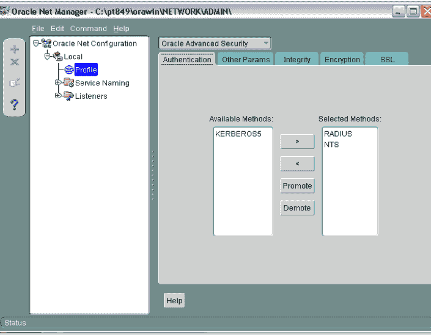

图 11-1 Oracle Advanced Security 窗口

这将通过向 `SQLNET.AUTHENTICATION_SERVICES` 参数添加 RADIUS 来更新客户端的 sqlnet.ora 文件：

# sqlnet.ora 网络配置文件：
C:\pt849\rawin\NETWORK\ADMIN\sqlnet.ora
# 由 Oracle 配置工具生成。
SQLNET.AUTHENTICATION_SERVICES= (RADIUS,NTS)
NAMES.DIRECTORY_PATH=(TNSNAMES, EZCONNECT)

## 11.4.3 LDBM 中的用户名和 SDBM 中的密码的 Oracle 客户端连接

此时，Oracle 用户 icucser2 可以与 Oracle 数据库服务器进行正常连接，并由 z/VM LDAP 作为 FreeRADIUS 服务器的后端进行身份验证。所使用的 `radius.conf` 文件位于第 209 页的示例 11-2 或第 210 页的示例 11-3，取决于是否允许匿名绑定。在此处的窗口中显示了 icucser2，它是为 z/VM LDAP 原生身份验证设置的，这意味着它的密码在 RACF 中，而不是在 LDBM 目录中。icucser1 也有相同的窗口，其密码在 LDBM 目录中。

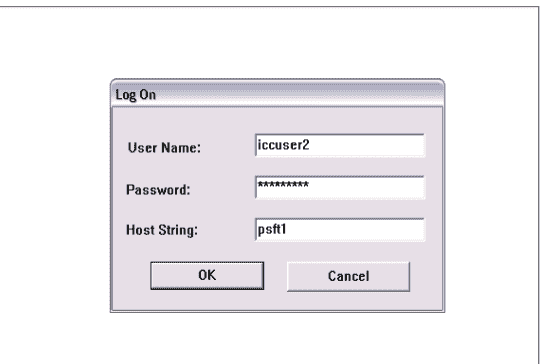

在输入用户名、有效密码和 Oracle 连接字符串后，用户连接到 Oracle 数据库，如图 11-3 所示。

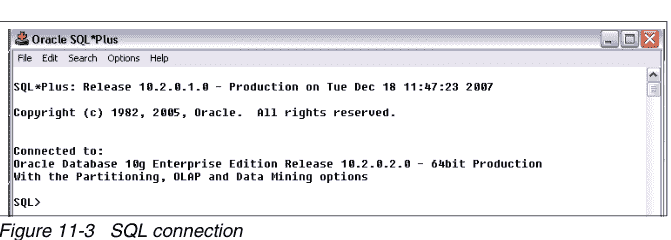

如果 icucser2 输入了错误的密码，将出现第 217 页图 11-4 所示的窗口。


## 11.4.4 SDBM 中的用户名和密码的 Oracle 客户端连接

Oracle 用户 icracf1 和密码 ldapxx 位于 RACF SDBM 数据库中。Oracle 客户端连接数据库时的唯一区别是使用了 icracf1/ldapxx 代替 icuser1/icuser1x。主要区别在于启动 FreeRADIUS 时需要一个 `radius.conf` 文件，如第 210 页的示例 11-4 所示。该文件中的参数设置允许 FreeRADIUS 使用 RACF SDBM 后端绑定到 zVM LDAP，并在 RACF 中搜索 icracf1 进行用户身份验证。

## 11.4.5 外部身份验证的 Oracle 参考

- Oracle Database Security Guide 10g Release 2, B14266-01, 2005年6月
- Oracle Database Advanced Security Administrator's Guide, B14268-02, 2005年11月

# 缩写与术语

| 缩写 | 描述 | 缩写 | 说明 |
|---|---|---|---|
| ADF | Application Development Framework | ONS | Oracle Notification Service |
| API | Application Programming Interface | OTN | Oracle Technical Network |
| AS | Application Server | OUI | Oracle Universal Installer |
| ASM | Automated Storage Manager | RAC | Real Application Clusters |
| BIEE | Business Intelligence Enterprise Edition | RPM | Red Hat Package Manager |
| BPEL | Business Process Execution Language | SID | System Identifier |
| CRS | Cluster Ready Services | SOA | Service-Oriented Architecture |
| CVU | Cluster Verification Utility | SQL | Structured Query Language |
| CW | Cluster/Ware | SR | Oracle Cluster Request |
| DB | Database | VIP | Virtual Cluster IP addresses |
| EBS | E-Business Suite | VM | Virtual Machine |
| GSD | Global Services Daemon | | |
| HTTP | Hypertext Protocol | VNC | Virtual Computing |
| IBM | International Business Machines | JDK | Developer Kit |
| IM | Identity Manager | XML | Extensible Language |
| ITSO | International Technical Support | | |
| J2EE | Java Enterprise Edition | | |
| JDK | Java Developer Kit | | |
| JMS | Java Message Service | | |
| LDAP | Lightweight Directory Protocol | | |
| LVM | Logical Volume Manager | | |
| OCF2 | Oracle File System | | |
| OCR | Oracle Registry | | |
| OEM | Oracle Enterprise Manager | | |
| OFA | Optimum Architecture | | |


# 索引

符号
/profile 31
/etc/hosts 24
/etc/init.d/oracasm 83
/etc/pam 27
/etc/profile 26
/etc/sysctl.conf 24
/etc/udev/permissions.d 79

BIEE 95
块设备 76
简报阅读器 110
业务智能企业 95

数值
10.2.0.3 patchset 17
31-bit 88
3270 129
64-bit 88

C
C++ 运行时库 103
C/C++ 编译器 61
缓存缓冲区 88
缓存 144
客户端
断开 110
clients.conf 文件 213
克隆器 137
克隆 123
集群就绪服务 (CRS) 84
集群验证工具 (CVU) 83–84
集群软件 84
CMS 字节文件系统 (BFS) 203
命令

A
访问控制列表 (ACLs) 203
管理安全 154
高级安装 34
高级安全 4, 213
高级安全选项 (ASO) 208
分析 Web 116
归档 179
AS10g 96
ASCII 87
ASM 72, 93–94
ASM 内内核 81
ASLIB 80
ASMLib 82
属性 202
认证 201
目录 206
extern 212
自动存储管理 (ASM) 20, 39, 72
自动工作负载仓库 57
可用性 63, 169
AWR 94

cat 129
cp 130
iconfig 131
netstat 133
配置 87
配置助手 48
配置，磁盘 72
约束环境 90
冲突 91
控制器
profile 127
corav 51
CP 命令 94
CP 备用控制 144
CPU (CP) 分配 89
CPU 分配 87
create_db.sql 98
cron 90
CRS 84
CVU 83, 219

B
备份与恢复 179
备份 123, 142
热备份 146

D
数据挖掘 4

Data Pump 数据库 188
- 创建 98
- 性能 115
- 存储库 114
- DB 控制 AWR 94
- DB_UNIQUE_NAME 174
- db2pwden 205
- dbca 198
- DBControl 42, 56
- DBF 文件 179
- dbhome 51
- dbora stop 命令 144
- dedicate 语句 73
- DGMRL 170
- 目录认证 206
- 目录信息树 (DIT) 209
- DIRMAINT 137
- 断开的客户端 110
- 逻辑磁盘 10
- LUN 10
- 条带 94
- 磁盘配置 72
- 特异名称 (DN) 202
- distro 11
- DM 多路径 70
- DN 202
- DNS 22, 116
- 文档 30
- 下载 29
- DS CONF 203
- DTCVSW 127

FCP 93
光纤连接器 (FICON) 70
光通道协议 (FCP) 70
fICON 93
文件系统 74
闪回恢复区域 177
FlashCopy 123, 142
FreeRADIUS 208, 213
调试模式 212
FreeRADIUS 服务器 217
FTP 22
融合中间件 3

G
- GCC 102
GNU 编译器集合 102
黄金镜像 137
Grid 控制 42
grouppadd 命令 23

H
- HFS 194
高可用性 169
高带宽 133
HiperSocket 68-69
热备份 146
HTTP Web 服务器 152
虚拟机监控程序 88

I
- I/O 并发 71
I/O 考虑
磁盘 93
i/O 调优 87
VM 性能工具 94
身份管理器 3
IE 浏览器 56
iconfig 131
初始化参数 177
安装 12, 19, 96
高级 34
Oracle 136
Intel 88
IOCDS 连接 63
iSQL*Plus 48, 58–59

E
- EBCDIC 187
EBCDIC 转 ASCII 188
ECK 11
企业系统连接 (ESCON) 70
ESAM 94
ESCON 93
以太网 129
扩展存储 88
扩展计数键数据 (ECKD) 70
外部认证 212

F
故障转移 168, 183

J
JEE 151
Java 154
JDK 219
MIPS 89
监控性能 87

K
内核参数 14, 25

N
netca 182
Net 服务 4
网络安全 134
NIC 127
Novell 20

L
LAN 段 124
启动程序 153
LD_LIBRARY_PATH 31
LDAP 201
认证 201
Oracle 数据源 115
OEM 56
OEM Home 56
OFA 55
OLAP 4

O
应用 3
服务 7
自动存储管理 (ASM) 72
自动存储管理 (ASM) 20
二进制文件 75
集群软件 65, 75
E 协作套件 3
E-业务套件 3
融合中间件 3
安装 12, 36
通用安装程序 3
管理工具 6
高级安全选项 (ASM) 202
自动存储管理 (ASM) 78
自动存储管理 (ASM) 20
BIEE 6
业务智能企业版 3
Oracle 业务智能 Javost 109
Oracle 业务智能演示服务 109
Oracle 业务智能调度进程 109
Oracle 业务智能服务器 109
Oracle 调用接口 (OCI) 4
企业中间件 3
Oracle 产品安装 15
Oracle RAC 75
面向服务的架构 3
Oracle SID 103
Oracle Store 7
技术网络 (OTN) 29
Oracle 用户界面 (OUI) 21
Oracle PeopleSoft 企业版 3
Oracle Siebel 应用 3
ORACLE_BASE 31
ORACLE_HOME 31, 51
ORACLE_INVENTORY 31
ORACLE_OWNER 51
ORACLE_SID 31
oraeasm 83
oraun 55
OSA 适配器 69
OSA express 126

M
内存 10, 94
MetaLink 190
备注 9, 11
迁移 89, 188
midisk 75, 124
Minidisk Cache (MDC), 禁用 92

P
分页空间 94
pam 15
pam.d 27
分区 4
密码管理 213
密码认证 201
补丁安装 16
PATH 31
性能 87
数据库 115
I/O 考虑 93
性能调优 64, 90
文件 177-178
PGA 10, 88
物理 CPU 90
物理备用数据库 168, 179
PL/SQL 58
安装后 19
主数据库 168
Pro*C/C++ 4
程序全局区域 (PGA) 88
puTTY 28, 50

Q
QDIO 68, 126

R
RADIUS 29
支持 212
RADIUS 服务器 211
radius.conf 209, 216
radtest 212
原始设备 76
设备语句 73
Real RAC 63
Red Hot 20
Red Hot 4
安装 85
Red Hot AS4 4
Red Hot 包 25
redo 日 172
复制 114
存储库 114
恢复 147
层 92
逻辑卷管理 (LVM) 72
逻辑分区 (LPAR) 23
逻辑备用数据库 168
逻辑卷管理 (LVM) 72
niscript 54
LVM 85, 219

L
监听 54
Net 服务名称 182
补丁 93
Publisher 桌面 110

S
架构 4
SCSI 设备 70
秘密文件 212
安全 134
服务名称 182
SGA 56
单实例 92
SLES10 17
SUSE Linux Enterprise 9
交换空间 11, 24
切换 167, 183
sync 命令 144
sysctl.conf 24
SYSDBA 56
系统全局区域 (SGA) 88

U
ulimit 参数 24

V
VDISK 75, 91
VIP 219
虚拟 LAN 68
虚拟化 134
虚拟化策略 142
VLANs 124
VNC 28
服务器 28, 33
卷组 77
投票磁盘 76
VSwitch 90, 123, 124, 126, 133

W
Web 应用 192
网站 7
WebSphere 服务器 151, 163
可写目录 196

X
窗口系统 28
接口 28
xhost + 33
XML 文件 151

Y
YAST2 102

Z
z/OS 187
z/VM 10, 124
虚拟机监控程序 88
分页 92
z/VM V2.2 20
zRACE 工具 89


# 在 System z Linux 上使用 Oracle 解决方案

# 为 Oracle Database 10gr2 设置虚拟机和 Linux

对于依赖 IBM 主机系统运行业务的客户，System z  Linux 提供了许多优势。System z for Linux 利用了 System 硬件和 zVM 的服务特性，使其成为稳健的工业级 Linux。这为托管您企业中运行的 Oracle 解决方案提供了一个卓越的平台。

# 为 Data Guard 设置环境

本 IBM Redbooks 出版物描述了在安装和测试若干 Oracle 功能时获得的经验，例如：

# 为 Oracle 设置多个 Linux 客户机

- Oracle Data Guard
- IBM WebSphere Application Server 连接到 System z for Linux 上的 Oracle 数据库
- Oracle DB2 连接到适用于 System z 的 Oracle 数据库
- Oracle Data Pump

它包含了许多在带有 Linux 和 zVM 的 IBM System z 上运行 Oracle 产品的通用提示和技巧。

本书的读者群体包括数据库顾问、安装程序人员、管理员和系统程序员人员。它并非旨在替代 Oracle 的官方文档，这仅代表了我们安装和使用 Oracle 产品的经验。

# 国际技术支持组织

# 基于实战经验构建技术信息

IBM Redbooks 由 IBM 国际技术支持组织开发。来自全球的 IBM 客户和合作伙伴的专家根据真实场景创建及时信息。书中提供的建议旨在帮助在您的环境中更有效地实施 IT 解决方案。

更多信息请访问：ibm.com/redbooks

