# Ubuntu Linux 使用指南

## 伯纳德·巴巴尼（出版）有限公司推出的其他感兴趣书目
- BP579 《升级至Windows Vista及故障排查》
- BP580 《Windows Vista入门》
- BP581 《Windows Vista详解》
- BP583 《Microsoft Office 2007详解》
- BP614 《银发族Vista使用指南》
## 同作者其他书目
- BP565 《使用Microsoft Windows XP Media Center 2005》
- BP567 《如何搭建家庭或小型企业网络》
- BP571 《玩转你的Microsoft Xbox 360》
- BP578 《Microsoft Windows Vista终极指南》
## 关于本书
欢迎阅读《使用Ubuntu Linux》，感谢您购买本书。我们希望本书能成为您搭建、配置和探索安全、功能丰富且易于使用的Ubuntu桌面操作系统的宝贵信息来源与指南。市面上绝大多数基于GNU/Linux的操作系统书籍都面向技术型计算机用户，或希望提升技术知识的用户。编写本书时，我们的目标是为普通非技术用户提供资源，这类用户仅希望将电脑作为其设计用途的工具。除非绝对必要，本书会尽量避免罗列需要在闪烁提示符下输入的冗长手动命令。好在Ubuntu已被评为最友好的Linux操作系统（在2006年英国Linux与开源大奖上，连续第二年斩获“最友好Linux发行版”及“最佳Linux/开源发行版”两项奖项），冗长晦涩的命令非常少见，也极易规避。希望您阅读愉快。
## 排版约定
通读本书时，您会看到若干信息提示框，由双线条界定，样式如下：
> 表示警告
> 表示注释、注意点或实用提示
操作流程与步骤指南可能会以数字列表呈现，示例如下：
1. 步骤1
2. 步骤2
所有图表与图示都采用两位数的参考编号，前一位为章节号，后一位为本章内的图示编号。例如，图1-1代表第1章的第1个图示。
## 关于作者
### 乔恩·罗尔夫
乔恩·罗尔夫从事IT行业已超过12年，曾就职于富士通、EDS等全球最大的IT服务公司。职业生涯中，他专注于微软解决方案，为众多蓝筹企业和政府部门的大型企业级方案提供设计、架构与开发支持。乔恩对IT系统有广泛的知识储备，从业经验涵盖早期的Sinclair ZX81，以及后续的PC、Mac、Windows和Linux系统。乔恩现居汉普郡，对IT、消费电子、数码摄影和赛车运动有浓厚兴趣。闲暇时，他也喜爱山地自行车和滑雪运动。您可通过《使用Ubuntu》官方网站（http://UsingUbuntu.com）联系他，或发送邮件至Jon@UsingUbuntu.com。
### 安德鲁·埃德尼
安德鲁·埃德尼从事IT咨询工作已超过12年，职业生涯中曾就职于微软、惠普、富士通服务等多家高科技公司。他在微软计算解决方案的几乎所有领域都有丰富经验，曾为政府和私营部门客户设计并架构大型企业级解决方案。多年来，安德鲁多次作为嘉宾出席行业大型活动，主讲涵盖信息系统类的大量主题，例如他曾出席在尼斯举办的年度微软Exchange大会，向微软技术社区分享移动计算相关内容。目前安德鲁参与了众多微软Beta测试项目，包括下一代Windows操作系统、下一代Microsoft Office产品，同时积极参与所有Windows Media Center的Beta测试项目。除此之外，安德鲁还运营着自己的IT咨询公司Firebird Consulting，目前已出版8本著作，且正在著书更多。安德鲁现居威尔特郡，与伴侣凯西及两只猫共同生活，联系邮箱为andrew@firebirdconsulting.co.uk。
## 致谢
我们要感谢家人在我们数月撰写本书期间给予的支持与帮助。此外，还要感谢巴巴尼公司所有员工为本书出版付出的努力。
> 致我已70th岁生日的父亲
> ——乔恩
## 商标
Ubuntu和Canonical是Canonical有限公司的注册商标。本书中使用的其余品牌名称与产品名称均被视为其对应公司的商标或注册商标。
## 使用 Ubuntu Linux
# 第一部分
## Ubuntu Linux 简介
### 1 引言
为帮助读者了解 Ubuntu 操作系统的背景，有必要简要介绍 UNIX 和 GNU/Linux 操作系统的发展历史。本章希望为读者提供一些背景知识，阐释 Ubuntu 如何从其 UNIX 前辈和 GNU/Linux 同类系统中演化而来，同时还将说明 Ubuntu 背后的理念，介绍当今最友好的 GNU/Linux 操作系统的众多衍生版本。
#### 简史
##### UNIX
UNIX 操作系统最初于 20 世纪 60 年代末诞生于 AT&T 贝尔实验室开展的 Multics 项目研究。该项目全称为“多路信息与计算服务（Multiplexed Information and Computing Service）”，由贝尔实验室、通用电气公司和麻省理工学院联合开展，旨在为大型计算机开发一款可供多用户使用的可靠“分时”操作系统。早期尝试证明该项目过于复杂且难以成功，原项目中的一个小团队脱离出来，为小型系统重写了操作系统。该项目最初命名为 UNICS（Uniplexed Information and Computing Service 的缩写），后来这个名字逐渐演变为 UNIX。
20 世纪 70 年代初，UNIX 操作系统开始在 AT&T 内部使用，并以附带操作系统源代码的许可形式向大学、美国政府机构及部分商业组织开放。到 20 世纪 70 年代末，该系统已广泛作为学术工具使用，而毕业生们进入商业组织后仍希望继续使用 UNIX 操作系统，这推动了一批公司（如 Sun Microsystems、圣克鲁兹操作公司（SCO））的成立，并在 AT&T 的许可下开发各自的 UNIX 版本。如今，全球许多大型计算机系统都运行着 Sun Microsystems、惠普、IBM 等公司推出的成熟、可靠且安全的 UNIX 操作系统。
##### GNU 项目与 Linux
1983 年，理查德·斯托曼（Richard Stallman）发起了 GNU 项目（http://www.gnu.org），旨在开发一款类 UNIX 的免费操作系统。斯托曼曾在麻省理工学院人工智能实验室担任开发人员，同时也是 EMACS 编辑器的发明者。该项目命名为 GNU（发音为“哥奴”），是一个递归缩写，全称为“GNU's Not UNIX（GNU 不是 UNIX）”。他一直笃信所有软件都应当是免费的，这一信念形成于 20 世纪 70 年代他在麻省理工学院的求学时期，当时学术界可用的软件有限，均以自由开发、自由分发的方式运作。到 20 世纪 80 年代，随着 UNIX 操作系统的商业化，GNU 项目应运而生，旨在提供一套可自由分发的操作系统和应用程序套件。
1985 年，自由软件基金会（http://www.fsf.org）成立，主要目的是筹集资金支持 GNU 项目的开发。1991 年，GNU 系统的开发仍在进行中，尚未正式发布。此时，林纳斯·托瓦兹（Linus Torvalds）已经开发出一款兼容 UNIX 的内核（即操作系统的核心部分），并将其命名为 Linux。1992 年，该内核与 GNU 系统结合，形成了 GNU/Linux 系统，这便是如今众多“Linux”（更准确地说应称为 GNU/Linux）操作系统的前身。
##### Ubuntu
Ubuntu 操作系统的名称源自一个非洲词汇（发音为“乌班图”），大意是“仁者爱人”或“我因我们而存在”。Ubuntu 操作系统旨在将这一理念带入软件世界。简单来说，其核心宗旨就是“为人类打造的 Linux”。
该操作系统由南非互联网企业家马克·沙特尔沃思（Mark Shuttleworth）于 2004 年 4 月发起，他组建了一支小型开源开发团队，目标是发布一款对所有人都友好且免费的操作系统。引用 Ubuntu 社区（http://www.ubuntu.com/community/ubuntu-history/philosophy）的介绍，该操作系统基于以下理念或信念：
- 每位计算机用户都应享有自由，可为了任何目的下载、运行、复制、分发、学习、共享、修改和改进软件，无需支付许可费用。
- 每位计算机用户都应能够使用自己选择的语言来操作软件。
- 每位计算机用户，即便身有残障，也应获得使用软件的所有机会。
首个版本于 2004 年 10 月发布，版本号为 4.10。该系统是基于现有名为 Debian（http://www.debian.org）的 GNU/Linux 发行版开发的，目标是比当时其他基于 GNU/Linux 的系统更易用。Debian 由伊恩·默多克（Ian Murdock）于 1993 年发起，是众多 GNU/Linux 版本之一，其目标是为自由 GNU 软件提供收集、打包和支持的仓库。Ubuntu 承诺每半年发布一次新版本，其命名方式也与其他软件发布略有不同：所有版本均以发布年份和月份命名，因此 4.10 版本发布于 2004 年的第十个月。本文撰写时的当前版本为 2007 年 4 月发布的 7.04 版本。
除了独特的版本号外，Ubuntu 操作系统每个版本还有对应的代号。由于初版 v4.10 属于早期开发版本，其代号为“多疣的疣猪（Warty Warthog）”。当前的开发版本代号为“勇敢的皂猩（Gutsy Gibbon）”，计划于 2007 年 10 月发布，正式名称为“Ubuntu 7.10”。
### Ubuntu 特色
市面上已有红帽、Novell 等商业组织推出的众多 GNU/Linux 发行版，也有 Slackware 等免费版本，因此许多人可能会问：为什么还需要另一个 GNU/Linux 发行版？除了“为包括发展中国家在内的所有人提供免费软件”的理念外，Ubuntu 系统的目标还是一款功能全面、用户友好的操作系统，因为许多现有的免费或商业版本虽然功能强大，但都面向技术人员设计。因此，Ubuntu 被设计为与微软 Windows、Mac OS X 等商业操作系统一样易用，同时安装后即可直接使用，无需额外配置即可保证安全。所以该系统预装了用户最常需要的大多数应用程序，例如：
- 一套用于文字处理、电子表格、数据库和演示文稿的应用程序
- 用于网页浏览、电子邮件和即时通讯的网络工具
- 用于编辑和管理图片的图形工具
- 用于播放视频和音乐的多媒体工具
近年来安全的重要性日益凸显，因此 Ubuntu 系统在设计时也力求在无需繁琐配置的前提下尽可能安全。为此，它仅提供工作站所需的工具和服务，并默认禁用通常不需要的功能。这并不代表系统功能匮乏，只是相关功能需要在用户主动启用时才会开启，从而保证系统尽可能安全。为进一步提升安全性，该系统支持自动检测安全更新，并在有可用更新时提示用户。当然，这一安全功能也默认开启，无需用户手动配置即可保障系统安全。

#### 引言
经过三年的发展，Ubuntu正迅速成为事实上的免费GNU/Linux发行版。它获得了众多奖项和荣誉，其中包括：
- 2007年5月获得《PC World》杂志颁发的“2007年百大产品”奖
- 2007年5月被选中预装在戴尔新PC和笔记本电脑上
- 2007年3月获得《PC Welt》杂志颁发的“编辑选择奖”
- 2006年11月在Linux新媒体奖中荣获“最用户友好的Linux发行版”奖项
- 2006年10月在英国Linux与开源奖项中连续第二年获得“最佳Linux/开源发行版”奖项
#### Ubuntu 版本
如今，Ubuntu拥有多个不同版本，每个版本都针对特定使用场景做了优化。
#### Ubuntu 桌面版
[Ubuntu Desktop](http://www.ubuntu.com)是操作系统的主要版本，不过该版本也分为不同类型。该版本基于名为GNOME的桌面环境，也是本书所基于的版本。不过，许多操作步骤和技巧同样适用于其他同样基于GNOME桌面环境的版本。
##### Kubuntu
不过，另一个名为Kubuntu的版本（http://www.kubuntu.org）会与主版Ubuntu同步发布。该版本基于名为KDE（K桌面环境）的不同桌面环境，因此支持为这个桌面环境开发的不同类别应用程序。
##### Edubuntu
Edubuntu（http://www.edubuntu.org）基于Ubuntu开发，但内置了一套面向儿童和教育的应用程序，其核心理念可概括为“面向青少年人类的Linux”！
#### Xubuntu
与Kubuntu类似，Xubuntu（http://www.xubuntu.org）基于Ubuntu系统，但采用Xfce桌面环境。这让系统拥有略有不同的视觉观感和操作体验，以及不同的应用程序套件。Xubuntu的主要优势在于，Xfce桌面环境比Ubuntu使用的GNOME环境占用更少的系统资源，因此非常适合老旧、性能较弱的硬件使用。
##### Ubuntu Studio
作为一个相对较新的发行版本，Ubuntu Studio（http://ubuntustudio.com）是面向媒体创作优化的Ubuntu桌面版。该系统针对音乐或视频编辑等对时间敏感的应用做了额外开发以避免延迟。它还预装了一套专门用于图形、视频和音乐编辑的应用程序。
##### Ubuntu Server
最后是Ubuntu Server（http://www.ubuntu.com)。顾名思义，该发行版针对服务器任务做了优化，可支持Web、邮件或数据库等服务器任务。为节省内存和资源，该版本不搭载桌面环境，因此必须通过命令行完成安装、配置和管理。
##### Ubuntu 支持
每个Ubuntu发行版都由Ubuntu社区开发，Ubuntu社区是由全球各地的开发者组成的团队，协作开发和更新Ubuntu操作系统。每个版本每6个月发布一次，Ubuntu社区承诺为每个版本提供至少18个月的支持。不过，偶尔也会发布被称为“长期支持”（LTS）的版本，比如Ubuntu 6.06。这类版本的发布是为了避免用户频繁重新安装操作系统升级。长期支持版本的桌面版最低支持周期为3年，服务器版为5年。除了开发和修复补丁外，Ubuntu社区还会开发在线帮助资源，并提供免费的支持论坛供用户获取帮助和建议。该社区还得到商业公司Canonical Ltd的支持，该公司由**马克·沙特尔沃思**创立，为需要超出社区提供范围服务的用户和商业公司，提供针对这款自由操作系统的商业支持、培训和认证服务。
### 小结
本章我们简要回顾了Ubuntu的发展历史，帮助大家了解Ubuntu的诞生背景，以及其基于GNU项目早期理念、为所有人提供免费、用户友好、功能丰富的操作系统的信念。在后续章节中，我们将学习如何安装操作系统，并亲自体验它的实际使用效果。
## 第二部分
## 第2章 安装配置
在本章中，我们将迈出进入自由软件世界的第一步，在正式安装前先在电脑上测试Ubuntu。
> 别担心，安装过程非常简单，耗时不会超过30分钟。
### 安装Ubuntu
当你准备好试用Ubuntu后，首要任务是获取安装CD。你可以从Ubuntu官网（http://www.ubuntu.com/getubuntu/download）免费下载。下载的文件是ISO格式的CD镜像（CD行业标准文件格式），大多数CD刻录软件都可以将其刻录到空白CD上。如果你没有足够的宽带网络连接下载CD镜像，也可以从互联网上的多家公司处以较低价格购买Ubuntu安装CD（http://www.ubuntu.com/getubuntu/purchase）。
> 安装前，务必备份你所有的文件（可以备份到CD、U盘或移动硬盘），因为安装过程会清空你的硬盘。
### 测试系统硬件
Ubuntu的CD被称为“Live CD”，因为用户可以不将系统安装到电脑硬盘，直接从CD启动（或开机）进入Ubuntu桌面环境。这能让你测试电脑硬件的兼容性，也可以在覆盖原有操作系统前先体验Ubuntu。要从Live CD启动电脑，只需将CD插入CD-ROM驱动器并重启电脑。系统启动时应从CD启动并加载Ubuntu。如果没有出现这种情况，你可能需要在电脑开机后立刻选择“启动菜单”。通常会显示类似“按F12打开启动菜单”的提示，按下对应按键后就会显示启动菜单，如图2-1所示。

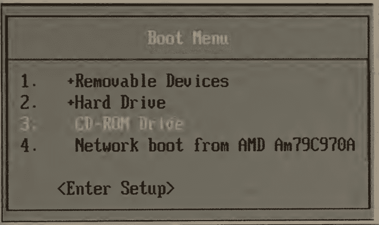
*图2-1 BIOS启动菜单*

按下对应CD选项的数字键，系统就会开始加载Ubuntu桌面。加载过程中会显示包含多个选项的菜单，如图2-2所示。

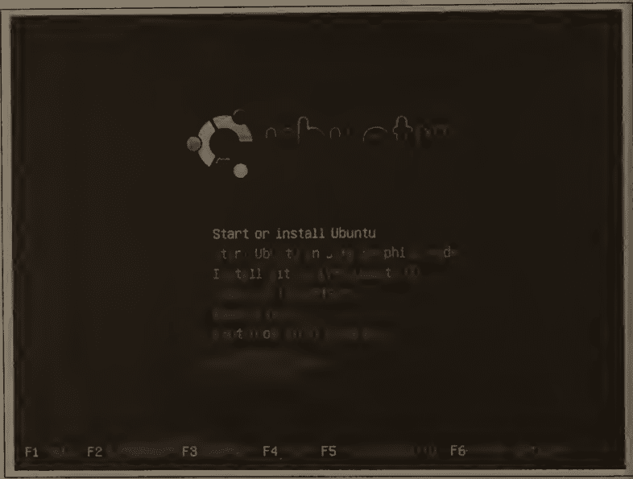
*图2-2 Live CD启动菜单*

从CD安装前，建议选择“检查CD是否存在缺陷”选项，确保镜像文件已正确刻录到CD中。使用上下方向键选择该选项后按回车即可。如果检测到缺陷，请取出CD并重启进入原有操作系统，将镜像文件刻录到另一张CD后重试。验证CD镜像无误后，选择“启动或安装Ubuntu”选项即可加载Ubuntu桌面操作系统。
### 初次运行设置
系统加载过程中会显示Ubuntu“启动”画面和进度条。稍等片刻后就会显示Ubuntu桌面，如图2-3所示。

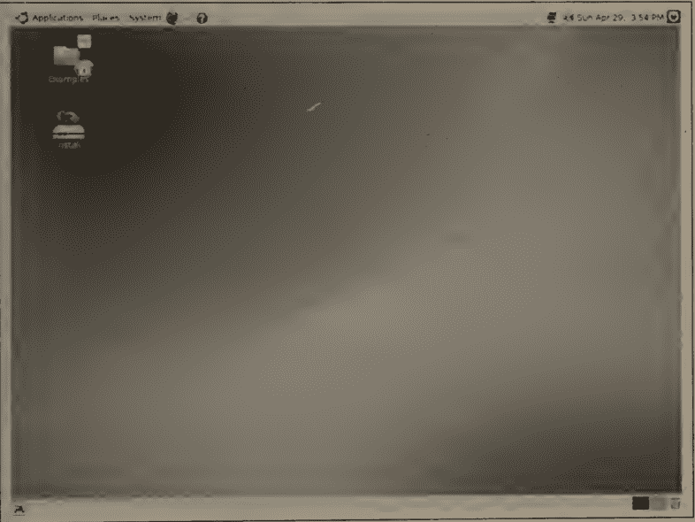
*图2-3 Ubuntu Live CD桌面*

花些时间探索Ubuntu桌面，确认你的系统运行正常。从Live CD运行系统时速度会稍慢，因为CD驱动器的读写速度远低于硬盘。打开桌面上的示例文件夹，尝试打开一些示例文件，比如“Experience Ubuntu.ogg”文件，确认Ubuntu操作系统可以在你的系统上正常播放视频。
### 正式安装
当你确认系统的键盘、鼠标、显示屏和声音都正常工作，并且已备份所有原有文件后，就可以开始安装新系统了。要开始安装，只需双击桌面上的“安装”图标。随后会显示安装欢迎界面，如图2-4所示。选择你的语言后点击前进按钮，即可继续安装流程。

加泰罗尼亚语、捷克语、丹麦语、德语、希腊语、英语、无本地化、世界语、西班牙语、爱沙尼亚语、巴斯克语、芬兰语、法语、加利西亚语、古吉拉特语、希伯来语、印地语、克罗地亚语、匈牙利语、印尼语、意大利语
#### 欢迎界面
准备好安装了吗？回答几个问题后，Live CD的内容即可安装到这台电脑上，之后你就能全速运行系统，无需再插入CD。回答这些问题仅需几分钟。请选择安装过程使用的语言，该语言将成为最终系统的默认语言。
第1步（共7步）
如果你有网络连接，请阅读发行说明，了解可能影响你的问题。
> 发行说明
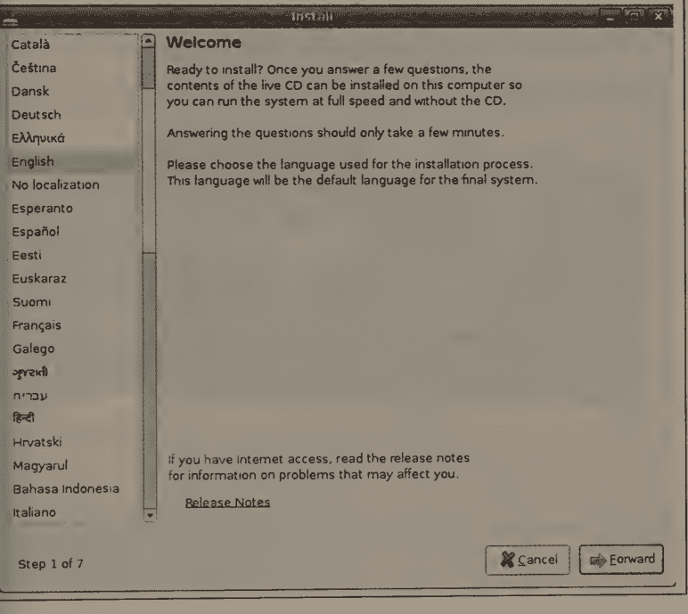
###### 图2-4 欢迎界面

此时会提示你选择所在位置，如图2-5所示。点击世界地图可放大，然后在地图上选择你的位置。确认选对位置后，点击“下一步”按钮。
###### 图2-5 选择你所在的地理位置
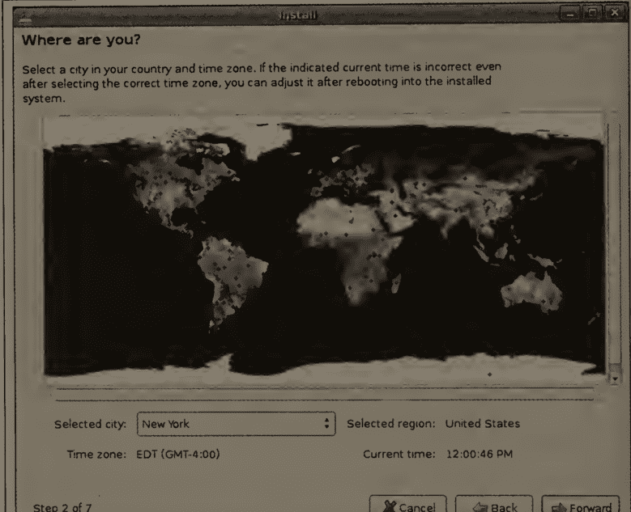
接下来，从选项列表中选择键盘布局，如图2-6所示。
> 输入几个字符确认键盘工作正常，确保你所用语言或地区的特殊字符/符号显示正常。确认所有功能都符合预期后，再次点击“下一步”按钮继续。
### **图2-6 选择键盘布局**
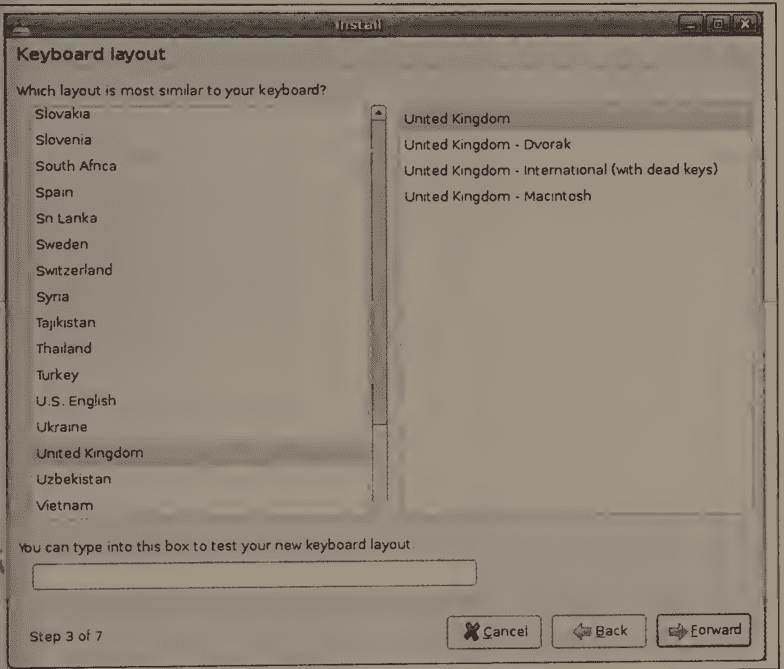
接下来会提示你选择硬盘分区方案，如图2-7所示。
> 建议选择“向导”选项，系统将为你配置推荐的分区布局。如果你的电脑安装了多块硬盘，请在“向导”选项下选择对应的硬盘，然后点击“下一步”继续。
###### 图2-7 选择分区方案
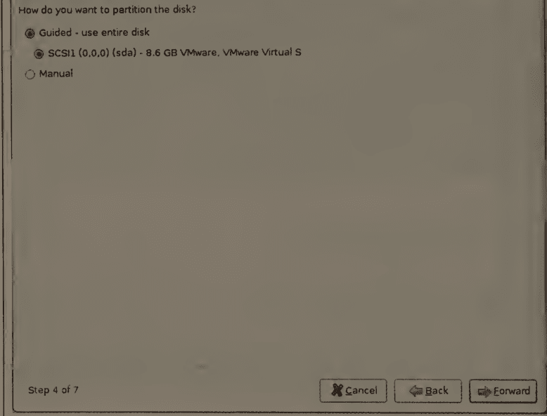
也可以将Ubuntu安装在现有操作系统旁边，而非覆盖原有系统。由于Ubuntu使用的硬盘格式与Windows不同，执行此操作前你需要先腾出硬盘上的可用空间。
> 此操作过程中如果出现任何问题，你可能会丢失原有操作系统！请务必提前保存所有重要文件。
如需调整现有分区的大小，请选择“手动”选项。之后你可以先选中现有硬盘的“分区”，再点击“编辑分区”来调整分区大小。输入分区的新容量（单位为MB），然后点击确定。
###### 图2-8 分区编辑
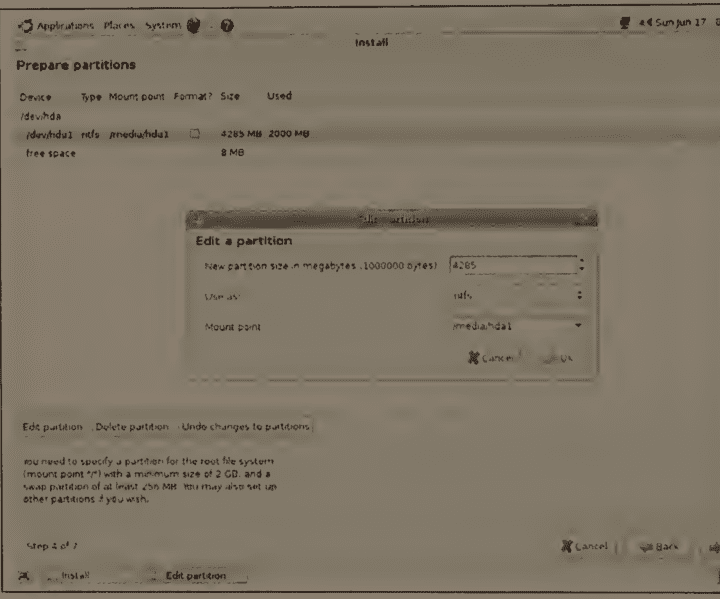
| 设备 | 类型 | 挂载点 | 格式 | 大小 | 已用 |
|------------|-------|---------------|--------|----------|---------|
| /dev/hda1 | ntfs | / | [ ] | 4285 MB | 2000 MB |
| /dev/hda2 | ntfs | media/hda2 | [ ] | - | - |
| free space | - | - | - | 8 MB | - |
接下来你需要创建交换分区。选中新创建的可用空间，点击“新建分区”，输入要创建的容量为2000MB，并选择“Swap”。再次点击可用空间，然后点击“新建分区”，选择“/”或根目录，格式选择“ext3”。保留其余设置不变，点击“下一步”。
###### 图2-9 自定义分区
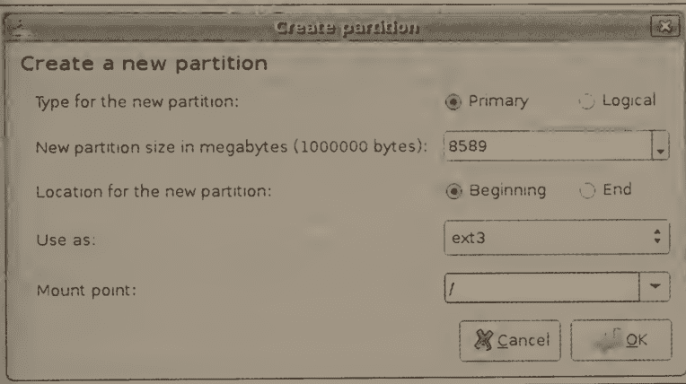
Ubuntu 7.04的新增功能是，如果你要安装的系统已经预装了Windows，安装程序可以迁移你的用户设置，如图2-10所示。从图2-10可以看到，当前没有适合导入的用户或操作系统，如果有的话会显示在这里。
#### 迁移文档和设置
选择你想要导入的任意账户，并为每个账户填写下面的表单。安装完成后，这些账户的文档和设置即可使用。如果你不想导入任何账户，可以不选择任何项，直接进入下一页。
没有适合导入的用户或操作系统。请创建一个用户来导入所选账户：
第5步（共7步）- 取消、后退、下一步
###### 图2-10 迁移文档和设置

如果你不想迁移用户设置，直接点击下一步即可。否则，请在“迁移文档和设置”对话框中选择一个用户，并为新的Ubuntu账户设置用户名和密码以使用这些设置，然后点击“下一步”。接下来，输入你的姓名、密码以及你希望为电脑设置的名字，如图2-11所示，然后点击“下一步”按钮。
> 请务必设置复杂密码（例如由字母和字符混合组成），以确保计算机安全。
###### 图2-11 输入用户详细信息
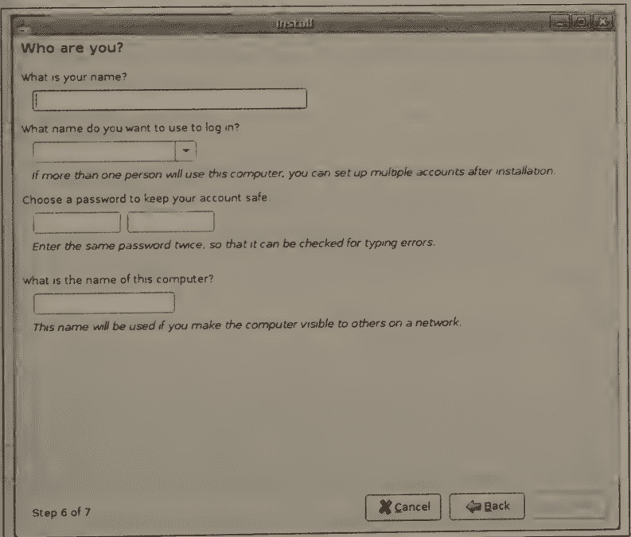
#### 安装设置
最后会显示摘要界面，你可以在此修改之前选择的选项，如图2-12所示。如果确认选择无误且已备份现有文件，请点击“安装”按钮开始安装。
###### 准备安装
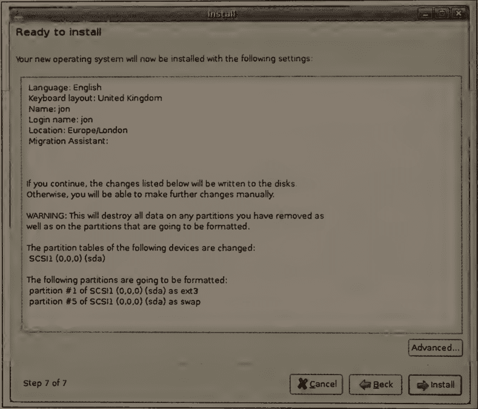
你的新操作系统将按以下设置进行安装：
- 语言：英语
- 键盘布局：英国
- 名称：jon
- 登录名：jon
- 位置：欧洲/伦敦
- 迁移助手：如果你继续，下面列出的更改将被写入磁盘。否则，你可以手动进行更多修改。
> 警告：此操作将删除所有你移除的分区以及即将被格式化的分区中的所有数据。以下设备的分区表将被修改：SCSI1 (0,0,0) (sda) 以下分区将被格式化：
- SCSI1 (0,0,0) (sda)的第1分区，格式为ext3
- SCSI1 (0,0,0) (sda)的第5分区，格式为swap
###### 图2-13 监控系统安装进度

安装过程中会显示进度条，提示安装所需时间，如图2-13所示。
> 根据你的系统速度，安装过程可能需要20分钟到1小时，请耐心等待。
安装完成后，会弹出提示询问你是否要继续使用Live CD，或者重启系统，如图2-14所示。点击“立即重启”按钮。
###### 图2-14 安装完成
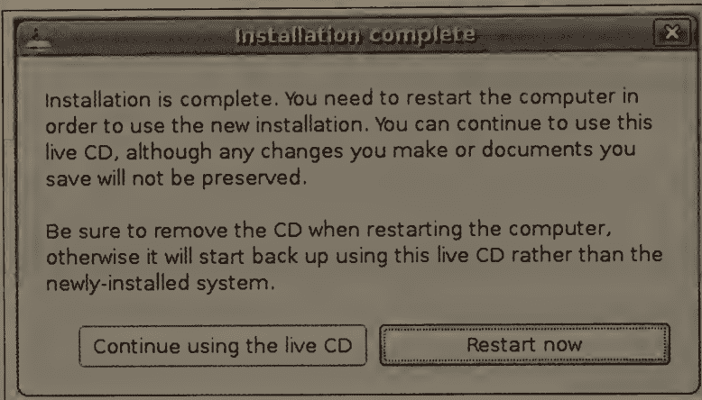
系统将完成剩余安装流程后关机；完成后会弹出提示，要求你将CD从光驱中取出。取出CD后，按下回车键即可重启电脑。
### 总结
在本章中，你已测试了Ubuntu，以确保它能在你的电脑上正常运行，之后就可以将它安装到硬盘中了。现在你可以重启系统，开始体验你的新桌面环境了。
## 3 探索桌面
现在我们可以开始试用Ubuntu了。本章将介绍新桌面环境的一些核心功能，并说明其与Windows的异同。
系统重启后，会显示Ubuntu的启动闪屏和进度条，提示系统加载所需时间。稍等片刻后就会显示登录界面，如图3-1所示。
### **图3-1 Ubuntu登录界面**
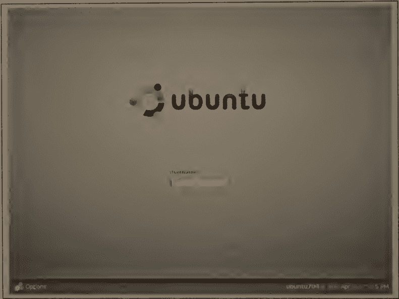
登录界面左下角显示“选项”菜单，右下角显示系统名称以及当前的日期和时间。

#### 图3-2 选项菜单
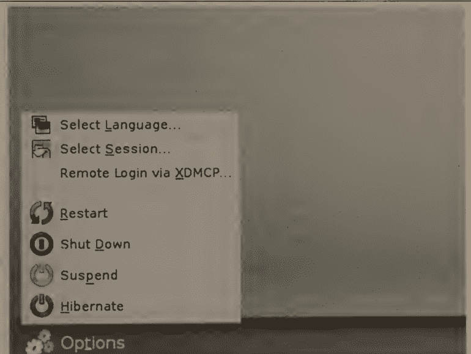
如图3-2所示的选项菜单，无需登录即可让系统进入睡眠、关闭或重启计算机。在多语言环境中，还可以通过该菜单切换语言。此外，用户可以选择会话，以此在登录时选择桌面会话的类型。例如，Ubuntu桌面的默认桌面环境是GNOME，但也可以安装KDE桌面环境（如Kubuntu预装的），并通过选项菜单中的“会话”选项选择登录该桌面而非GNOME。
要登录系统，请在用户名字段输入安装时设置的用户名，然后按回车键。登录框会随即变为密码框；输入密码后按回车键即可完成登录。

#### 图3-2 Ubuntu桌面
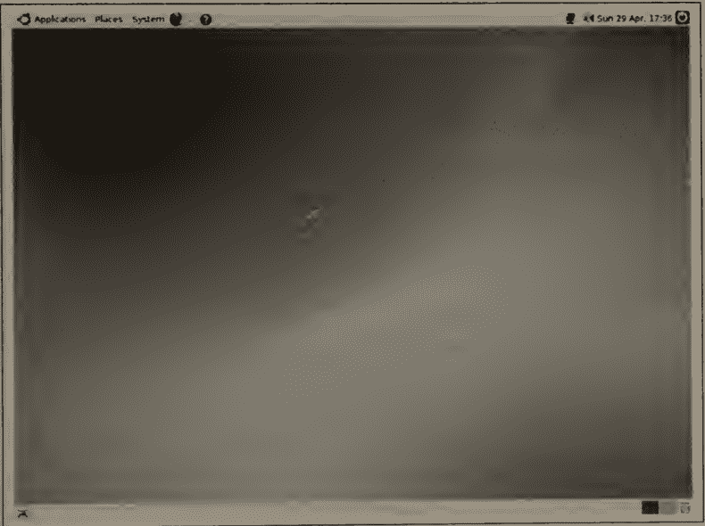
Ubuntu的桌面名为GNOME，是一款流行的UNIX及Linux桌面环境。如图3-3所示，它的顶部边缘是菜单栏（或称“顶部面板”），底部边缘是任务栏（或称“底部面板”）。菜单栏左侧有三个菜单：
- 应用程序
- 位置
- 系统

### 应用程序菜单
如图3-4所示，应用程序菜单会通过子菜单列出所有基于GNOME的应用程序。
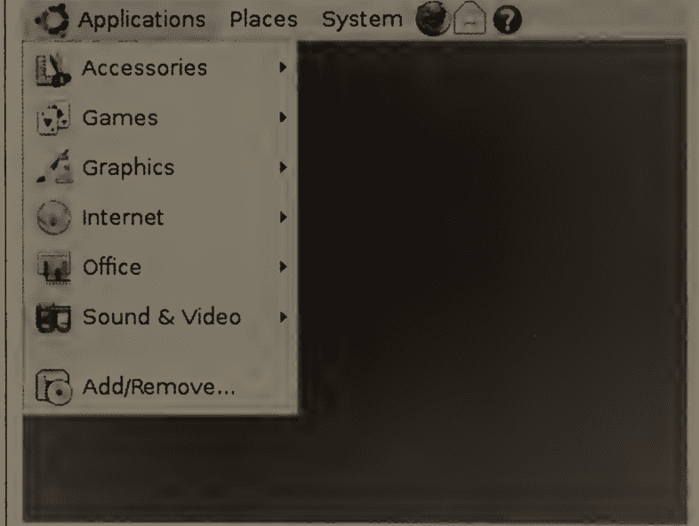

#### 图3-4 应用程序菜单
这些子菜单包含工具类、游戏、办公应用、多媒体应用和图像编辑应用。后续章节会详细介绍这些应用，各子菜单如下：
- 附件——实用工具和小程序
- 游戏——打发空闲时光的趣味游戏
- 图形——图像编辑类应用
- 互联网——网络及通信类应用
- 办公——OpenOffice办公套件
- 影音——多媒体应用
- 添加/删除——应用程序包管理工具

### 位置菜单
如图3-5所示，位置菜单列出了可用于浏览文档、连接其他系统或加载CD/DVD光盘的选项。
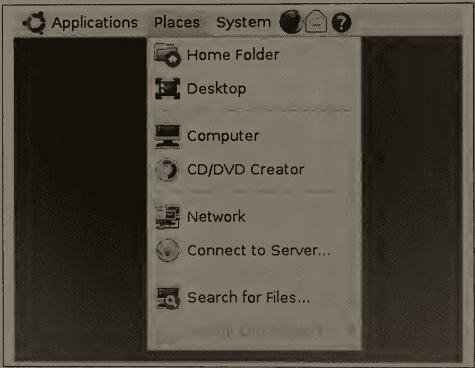

#### 图3-5 位置菜单
该菜单包含以下应用和快捷方式，同时还有一个子菜单，提供了最近使用文档的快捷访问入口：
- 主文件夹——快捷打开文件浏览器，定位到用于存储文件的个人主目录
- 桌面——快捷打开文件浏览器，显示桌面文件
- 计算机——快捷打开文件浏览器，显示可移动存储设备和硬盘驱动器
- CD/DVD创建器——用于刻录CD或DVD光盘的工具
- 网络——快捷打开文件浏览器，显示网络位置
- 连接到服务器——用于建立与服务器的网络连接以传输文件
- 搜索文件——查找文件的工具
- 最近文档——子菜单，提供最近使用文档的快捷访问入口

### 系统菜单
最后，系统菜单包含系统配置工具、在线帮助快捷方式以及系统关机相关的子菜单，如图3-6所示。
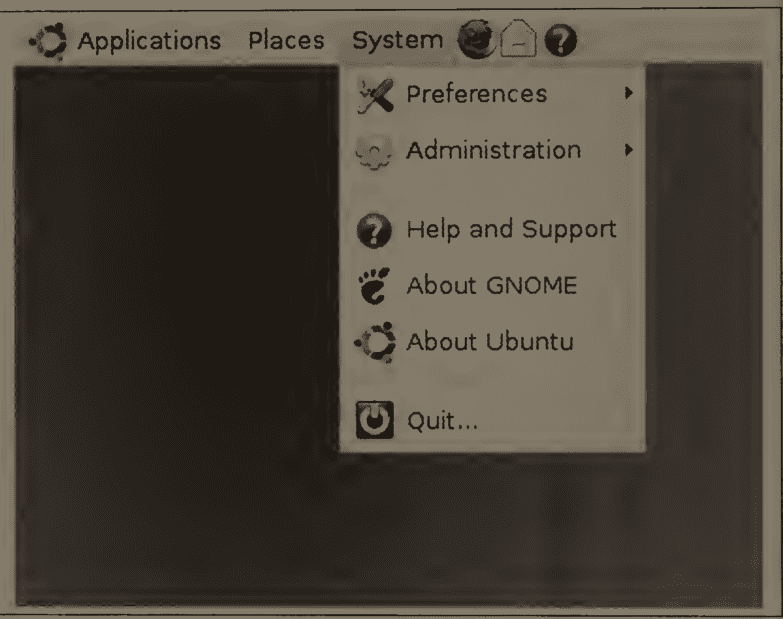

#### 图3-6 系统菜单
该菜单包含以下选项：
- 偏好设置——自定义系统的工具集合
- 管理——系统管理工具集合
- 帮助与支持——在线Ubuntu帮助中心
- 关于GNOME——GNOME桌面的相关信息
- 关于Ubuntu——Ubuntu操作系统的相关信息
- 退出……——用于注销、切换用户、锁定屏幕或关闭计算机
偏好设置子菜单包含用于自定义系统及桌面的工具，可用来修改鼠标、键盘等设备的设置，启用屏幕保护程序，或自定义桌面背景与颜色。管理子菜单列出了系统维护相关工具，例如配置语言、创建新用户账户、配置系统更新等。

### 菜单栏图标
系统菜单旁有三个图标（同样如图3-6所示），分别是：
- Firefox——启动“Firefox”网页浏览器的图标
- Evolution——启动“Evolution”电子邮件和日历应用的图标
- 帮助——在线Ubuntu帮助中心的图标

### 通知区域
顶部面板最右侧的区域称为“通知区域”，该区域会显示可能需要关注的应用或工具的图标，如图3-7所示。

#### 图3-7 通知区域
例如，当Ubuntu检测到有新的安全更新需要安装时，该区域会出现图标提示。点击该图标会启动更新管理器。该区域通常会显示以下内容：
- 网络管理器——启动网络管理器小工具的图标，用于配置网卡
- 声音——快速调节音量的快捷方式
- 日期与时间——显示当前日期和时间
- 关机——用于关闭、重启或注销计算机的图标
点击通知区域的条目会弹出菜单或选项列表。例如，左键单击网络管理器图标会显示子菜单，可用于启用/禁用网卡、启动网络管理器小工具手动配置网卡，或连接到无线网络。点击声音图标则可以调节音量。你可以尝试点击这些图标查看可用选项。

### 编辑菜单栏
可以根据需求添加或删除菜单栏条目来编辑菜单栏。要删除条目，只需将光标移至图标或菜单上，右键单击鼠标，此时会弹出菜单，可供你修改菜单或图标的属性，或彻底删除该条目。
> 请确认你真的要删除该条目！
如果右键单击菜单的空白区域，会弹出窗口，允许你向菜单栏添加新条目，或恢复误删的条目。这些条目包括添加自定义菜单，或显示天气、股票报价的工具。你可以尝试添加一些条目，之后右键单击对应条目即可设置相关选项。

### 底部面板
屏幕底部的面板最左侧有一个图标，可用于最大化隐藏的窗口；右侧有一个图标，可用于切换“工作区”。工作区是独立的桌面视图，允许你打开不同的窗口，通过单击对应工作区图标即可快速切换。最左侧还有一个“回收站”图标，单击它会打开文件浏览器，显示已删除的项目。当你选中文件或文件夹后按删除键，或通过菜单选择“移至删除项目文件夹”选项时，项目不会被永久删除，只会被移至删除项目文件夹。要彻底删除项目，请右键单击“回收站”图标，然后在菜单中选择“清空回收站”。底部面板还会实时显示所有已打开的窗口列表，窗口最小化后，单击底部面板中的窗口标题即可恢复该窗口。
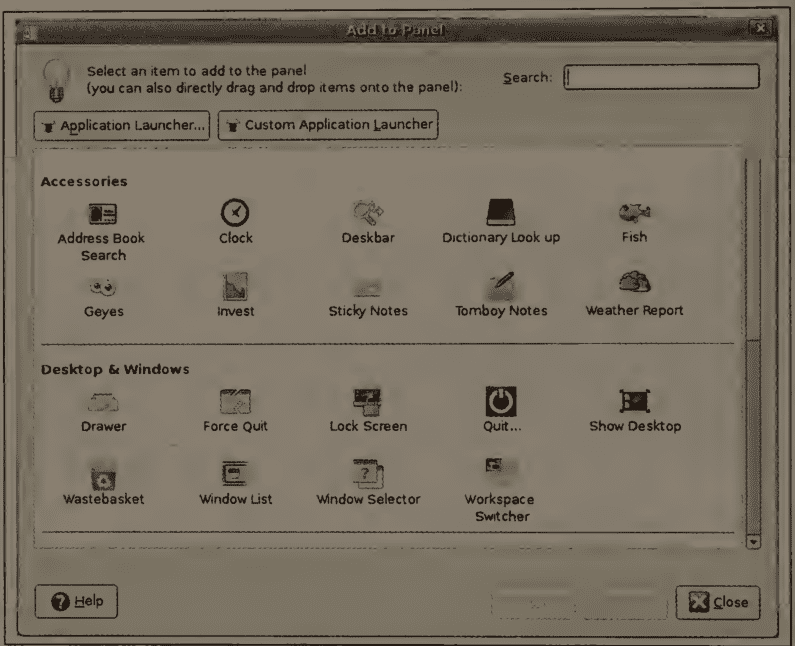

### 管理文件
如图3-9所示，Ubuntu使用“文件浏览器”（有时也称为Nautilus）来整理和查找目录及文件。可以通过“位置”菜单上的“主文件夹”快捷方式启动文件浏览器，启动后会默认打开你的“主”目录，这是用于安全存储所有文件的个人目录。该目录位于“/Home”目录下，名称与你的用户名相同。如果同一台Ubuntu计算机有多个用户，每个用户都拥有独立的专属主目录，仅本人有权限访问。

#### 图3-9 文件浏览器
文件浏览器包含一个菜单栏，可用于创建新文件和目录，或创建其他目录的“书签”或快捷方式。
双击文件夹即可进入下层目录，点击工具栏上的“向上”按钮即可返回上层目录，通过这种方式可以轻松在不同目录间上下导航。
工具栏下方是“位置栏”。该栏会显示目录树中每个文件夹对应的按钮，因此你也可以通过点击栏中的按钮快速跳转到对应目录。
文件浏览器左侧是“侧边栏”。该面板显示的信息取决于面板顶部弹出菜单中选中的选项，该菜单包含以下选项：
- **位置** – 列出可移动介质和你的主目录
- **信息** – 在文件浏览器中选中文件或文件夹时，显示其相关信息
- **目录树** – 以目录树的形式列出内容，作为导航目录结构的另一种方式
- **历史记录** – 列出你访问过的目录
- **笔记** – 允许你输入笔记，返回该目录时会显示对应内容
- **徽章** – 可拖放到文件或目录上的标签

文件与目录可通过拖放操作进行移动或删除，移动删除方式与其他操作系统类似；也可以通过右键点击文件后选择“复制”，或点击“编辑”菜单中的“复制”选项来复制文件。
此外，还可以通过将文件或目录拖到废纸篓、点击“编辑”菜单中的“移至已删除项目文件夹”选项，或右键点击文件后选择“移至已删除项目文件夹”来删除文件。
只有当你点击底部面板的废纸篓图标，选择“清空废纸篓”时，文件或目录才会被永久删除。

### 使用可移动介质
当你插入可移动介质（如U盘、空白CD或DVD光盘）时，Ubuntu会在桌面以及“位置”菜单中显示该介质的图标，如图3-10所示。
> 图3-10 空白CD-R介质
介质中的文件和目录可以轻松通过拖放操作从介质复制到主目录，或从主目录复制到可移动介质中。
如果将文件复制到U盘等闪存设备，需要右键点击桌面上的U盘图标，在弹出的菜单中选择“弹出”，这一步非常重要。该操作会将所有信息写入存储设备，之后你就可以安全地从电脑中拔出设备。如果直接拔出设备而没有选择“弹出”，数据将无法完整写入存储设备。
同样的，如果是空白CD或DVD光盘，在将文件复制到光盘后，需要双击光盘图标，在“文件”菜单中选择“写入光盘”，如图3-11所示。
#### 图3-11 写入光盘

### 总结
你现在应该已经熟悉了GNOME桌面环境，并意识到该系统在使用上与Windows或Mac OS X系统没有太大差异。学完本章内容后，你现在应该已经掌握如何将工作备份从可移动介质（U盘、闪存或CD/DVD）复制到主目录中了。

## 4 系统配置
现在我们可以开始配置系统，以便连接网络、设置打印机并创建额外的用户账户。完成本章操作后，你的电脑就可以投入使用了。

### 配置网络设置
如果你的电脑连接到有线网络，且网络设置由动态主机配置协议（DHCP）自动配置，那么你无需进行任何设置，网络连接即可正常使用。你可以直接跳过后续的说明内容，在本章稍后进行系统更新检查即可。
但如果你使用的是未开启DHCP的有线网络，或是正在使用无线网卡，则需要手动进行配置。后续章节将引导你完成配置步骤。

#### 有线网络
要配置网络，请将鼠标指针移到通知区域的电脑图标上并左键单击，在弹出的菜单中选择“手动配置”。之后系统会提示你输入密码，如图4-1所示。
> 每当执行管理操作时，Ubuntu都会提示你输入密码。这是为了确保操作由你本人执行，而非试图危害系统安全的恶意软件执行。
> 图4-1 输入密码以执行管理操作
输入密码后，会显示网络设置工具，如图4-2所示。
#### 图4-2 网络设置
选中“有线连接”后，点击“属性”按钮。
#### 图4-3 接口设置
在“连接”选项卡中，打开“配置”下拉菜单（如图4-3所示），选择“静态IP地址”或“本地Zeroconf网络（IPv4 LL）”。
如果你想通过路由器连接到互联网，并且知道正确的地址设置，请选择“静态IP地址”。如果你在小型局域网中且无需连接互联网，可以选择本地Zeroconf设置，Ubuntu会自动分配地址，以便与其他采用相同配置的计算机通信。
如需手动配置地址，请输入IP地址、子网掩码和网关地址（默认网关或路由器地址），然后点击“确定”。网络设置将会被重新配置。
接下来，选择“常规”选项卡，输入你本地网络的“域名”，如图4-4所示。
#### 图4-4 常规选项卡
然后选择“DNS”选项卡，如图4-5所示，点击“DNS服务器”输入框，输入DNS服务器的IP地址后按回车键即可。必要时，点击“添加”按钮输入其他地址。你也可以点击“添加”按钮，在“搜索域”字段中输入本地DNS域，以配置要搜索的本地DNS区域。
#### 图4-5 DNS选项卡
最后，你可以点击软盘图标，为网络设置输入名称，以此保存该配置。如果你使用笔记本电脑，需要连接到使用不同网络设置的多个网络，这个功能非常实用。每个配置都可以被保存，你只需从“位置”下拉菜单中选择对应配置，即可快速切换至正确的网络设置。
> 图4-6 需要输入无线网络密钥

#### 无线网络
配置无线网卡与手动配置有线网络的流程非常相似。左键单击通知区域的电脑图标，即可显示可用的无线网络。然后选择菜单中显示的你的无线网络名称。
如果你的网络启用了加密，系统会提示你输入无线网络密钥。在下拉菜单中选择你使用的无线安全类型（包括密码、十六进制、ASCII或文本字符串），如图4-6所示，然后在文本框中输入密钥。
最后，选择开放系统或共享密钥的身份验证方法，然后点击“登录到网络”按钮，即可连接到无线网络。

无线网络设置过程中，系统会提示您输入密码以分配给您的“密钥环”。为无线网络输入的密码会存储在受密码保护的“密钥环”中，该密钥环用于安全存储您的密码。请按照屏幕提示输入一个容易记忆的密码。每当您登录系统并使用无线网络时，系统都会提示您解锁密钥环，如图4-7所示。这一步是必要的，用于确认网络应用（nm-applet）正在尝试访问您的密钥环，而非恶意应用。请输入设置密钥环时输入的密码，然后按回车键，即可连接到无线网络。
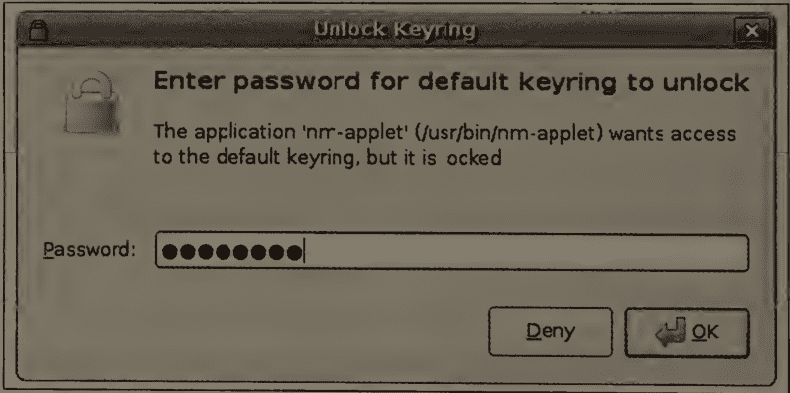
> **图4-7 解锁密钥环**

如有需要，您可以使用上一节中有线网络的配置方法，手动为网卡配置TCP/IP地址。只需从网络菜单中选择“手动配置”选项，然后按照上一节中的详细说明操作即可。

#### 手动检查系统更新
Ubuntu默认配置为自动检测可用系统更新，随后询问您是否方便系统下载并安装这些更新。当有可用更新时，通知区域会出现一个图标，同时弹出消息提示您点击该图标安装更新，如图4-8所示。

> **图4-8 系统更新通知**

系统安装完成后，建议您时不时手动检查系统更新，以确保系统保持最新状态，同时确认更新配置机制运行正常。操作时，请从“系统”菜单的“系统管理”选项中选择“更新管理器”，点击“检查”按钮开始更新。系统会要求您输入密码以执行管理功能，随后会连接到Ubuntu服务器，下载所有可能可用的更新列表。待安装的更新会显示在更新管理器中，如图4-9所示。哪怕只是为了了解正在下载和安装的内容，也值得花几分钟浏览一下更新列表。

> **图4-9 带可用更新的更新管理器**

### 更新管理器
您可以安装15个更新。软件更新可修复错误、消除安全漏洞并提供新功能。推荐更新:
| [✓] | 软件包 | 描述 | 版本变更 | 大小 |
| ---- | ------ | ---- | -------- | ---- |
| [✓] | apport | automatically generate crash reports for debugging | From version 0.76 to 0.76.1 | 53 KB |
| [✓] | apport-gtk | GTK frontend for the apport crash report system | From version 0.76 to 0.76.1 | 36 KB |
| [✓] | capplets-data | configuration applets for GNOME 2 - data files | From version 1:2.18.1-0ubuntu2 to 1:2.18.1-0ubuntu2.1 | 41 KB |
| [✓] | gnome-control-center | utilities to configure the GNOME desktop | From version 1:2.18.1-0ubuntu2 to 1:2.18.1-0ubuntu2.1 | 61 KB |
| [✓] | gnome-panel | launcher and docking facility for GNOME 2 | From version 1:2.18.1-0ubuntu3 to 1:2.18.1-0ubuntu3.1 | 48 KB |
| [✓] | gnome-panel-data | common files for GNOME 2 panel | - | - |
总下载大小：4.5 MB ✔ Check ✓ Install Updates ▸ Description of update ✕ Close

点击“安装更新”按钮下载推荐更新并完成安装。所有更新应用完成后，会显示一条确认安装的消息。点击关闭按钮关闭该消息，然后关闭更新管理器。如有需要，系统可能会提示您重启计算机以完成软件更新，如图4-10所示。点击通知栏中的图标，确认是立即重启还是稍后重启。
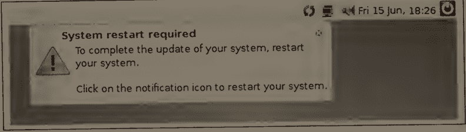
> **图4-10 需要重启系统**

### 配置打印机设置
打印机工具可以从“系统”菜单的“系统管理”子菜单中启动，可用于安装打印机并配置其设置。
### 配置
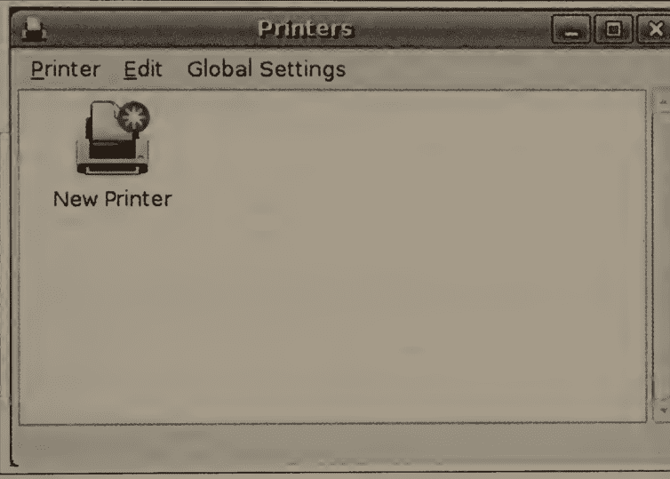
> **图4-11 打印机**

要安装打印机，请确保打印机已连接到计算机且已开机，然后双击打印机工具中的“新打印机”图标，如图4-11所示。系统随后会自动搜索适用于您打印机的正确驱动程序。一旦打印机被识别，“添加打印机”向导将自动打开。
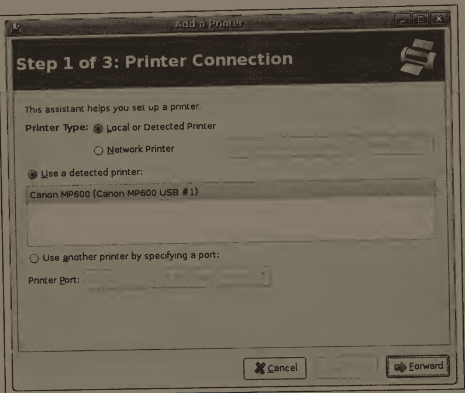
> **图4-12 添加打印机（打印机类型）**

请确保正确识别到目标打印机，且本地或网络连接打印机的设置正确，如图4-12所示（若设置不正确请修改），然后点击“下一步”按钮。从列表中选择最合适的驱动程序，再次点击“下一步”，为打印机命名，如有需要可添加描述和位置备注。最后点击“应用”按钮安装打印机驱动程序。此时您的打印机将显示在打印机窗口中。您可以通过点击打印机，然后在“编辑”菜单中选择“属性”来修改打印机属性，这将打开属性窗口，您可以在其中设置默认打印机分辨率、纸张大小和方向，如图4-13所示。点击“打印测试页”按钮验证打印机是否工作正常。
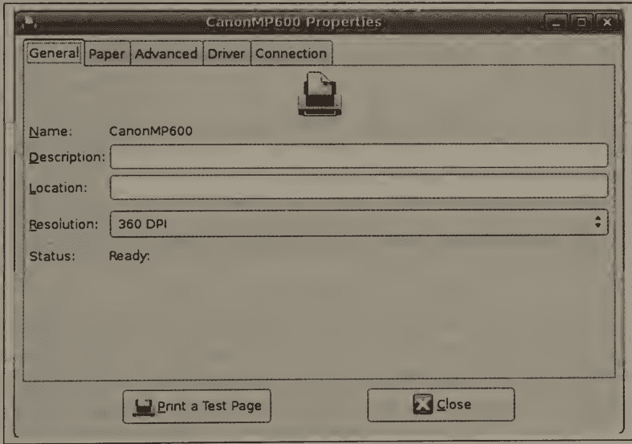
> **图4-13 打印机属性**

### 配置时间和日期
如果您的计算机已连接到互联网，可以配置Ubuntu通过对比互联网上的服务器时间，自动为您计算机设置正确的时间和日期。这些服务器会通过对比原子钟校准自身时间，随后使用网络时间协议（NTP）与其他服务器和客户端计算机共享这些精确的时间信息。NTP是一种不同计算机操作系统均使用的标准协议，可用于自动、精确地维护系统内部时钟。
要配置计算机实现该功能，请从“系统”菜单的“系统管理”选项中选择“时间和日期”工具。
### 配置
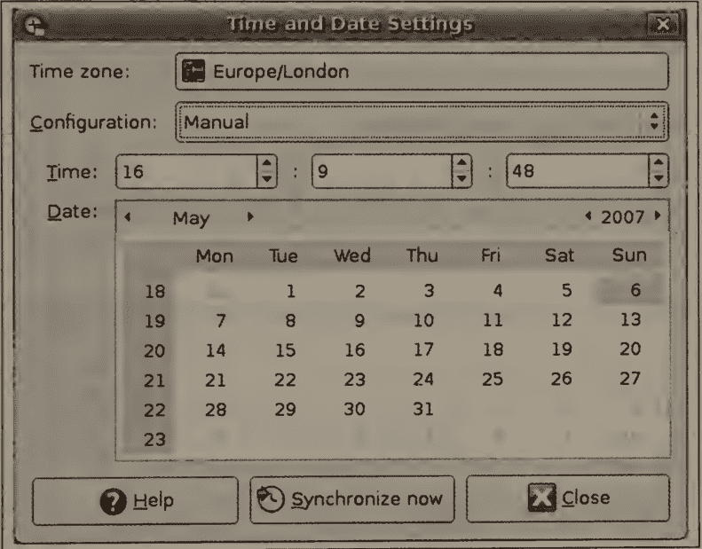
> **图4-14 时间和日期设置**

从配置下拉菜单中选择“与互联网服务器保持同步”，随后系统会提示您确认安装NTP软件。点击“安装NTP支持”安装该软件，并根据屏幕提示完成安装。NTP支持安装完成后，您将返回“时间和日期”工具界面，“与互联网服务器保持同步”选项已被勾选。关闭这个小程序后重启计算机，计算机启动时以及运行过程中会定期自动校准时间。

### 安装软件
通过“添加/删除应用程序”工具（有时也称为“新立得”）可以轻松安装免费软件，如图4-15所示。您可以从“应用程序”菜单的“添加/删除...”选项中启动该工具。
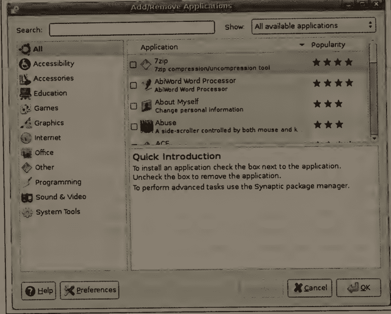
> **图4-15 添加/删除应用程序**

### 配置
点击“首选项”按钮可以配置Ubuntu安装软件的来源。Ubuntu针对不同的软件来源使用以下术语：
- Main – Canonical Ltd支持的开源软件
- Universe – Ubuntu社区支持的开源软件
- Restricted – 专有驱动程序
- Multiverse – 受版权保护，但通常免费使用的软件
- Source Code – 软件开发过程中使用的代码

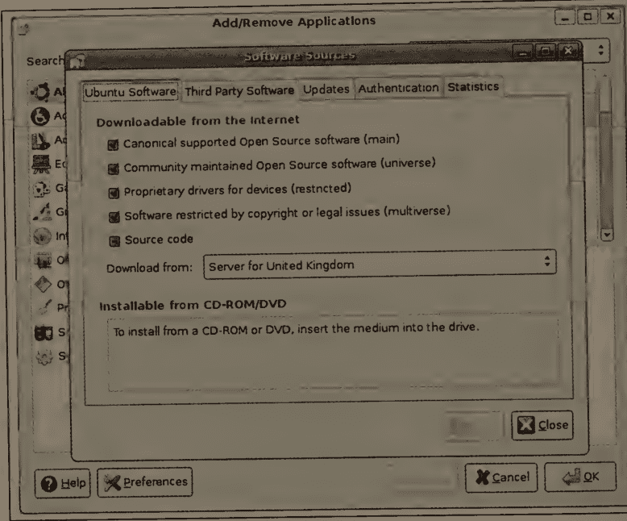
**图4-16 软件源**
为了获取最广泛的软件选择，建议勾选除“源代码”选项外的所有复选框，如图4-16所示。Ubuntu会在“添加/删除应用程序”工具中显示选项前，利用这些源搜索可用且兼容的软件。要安装软件，可以在搜索框中输入关键词并按回车搜索，或者直接浏览软件列表。现在我们来安装网站经常需要用到的“Java”软件。该软件因版权问题未默认安装，但仍可免费使用。请确保已连接到互联网，在搜索框中输入“Java”并按回车。此时应用程序面板中会返回Java软件的相关列表。点击“Sun Java 6 Web Start”旁边的复选框。如果软件不受支持或涉及版权，系统会提示你确认是否安装不受支持的软件。点击“安装”按钮。接着点击“确定”，系统会提示你确认安装，如图4-17所示。

**添加/删除应用程序**
搜索：java
显示：所有可用应用程序
- 全部
- 辅助功能
- 附件
- 教育
- 游戏
- 图形
- 互联网
- 办公
- 其他
- 编程
- 影音
- 系统工具

应用热度
- Sun Java 5.0 Plugin
- Sun Java 5.0 Browser Plugin
- Sun Java 5.0 Runtime

**应用以下更改？**
请最终确认将被安装或移除的应用程序列表。
- Sun Java 6 Web Start

**图4-17 应用以下更改**
点击“应用”后，Java安装包会自动下载并开始安装。安装过程中可能会弹出屏幕提示，请按照提示完成软件安装。这些提示会根据所安装的应用程序不同而变化。你可以如图4-18所示查看安装进度。

## 配置
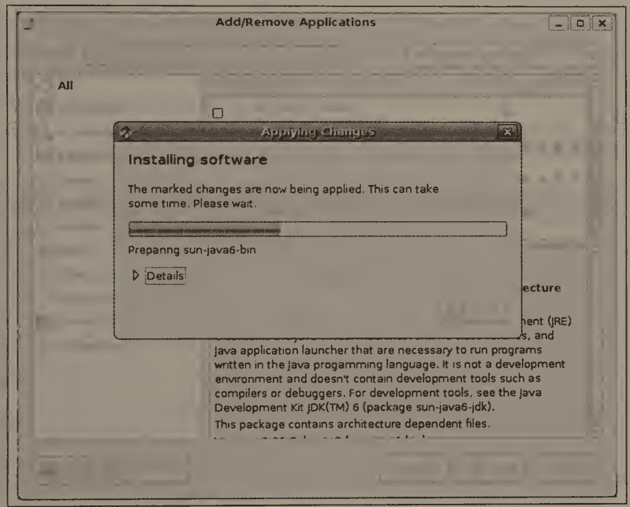
**图4-18 安装软件**
安装完成后，点击提示安装成功的消息框中的“关闭”按钮。现在你就可以使用基于Java的网站了。

### 创建新用户
最后，你可能需要为家人或同事创建额外的用户账户。这些账户可以让每个用户独立存储个人信息，并根据自身偏好配置桌面环境。从“系统”菜单的“管理”选项中打开“用户和组”工具。系统会提示你输入密码以确认管理操作，随后会显示如图4-19所示的“用户设置”工具。
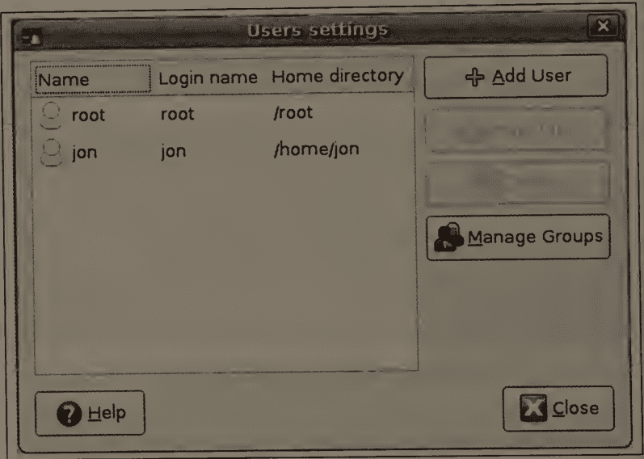
**图4-19 用户设置**
只需点击“添加用户”按钮即可开始创建新用户账户，随后会显示如图4-20所示的“新用户账户”表单。

## 配置
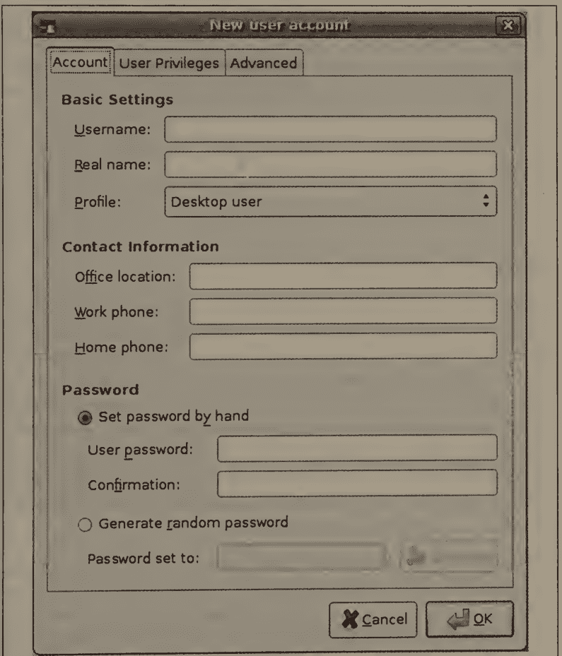
**图4-20 新用户账户**
填写表单中的详细信息，并从“配置文件”选项中选择要创建的用户类型。如果需要管理并修改计算机设置的用户，选择“管理员”；如果是仅能使用计算机但无法修改配置的普通用户，选择“桌面用户”。填写完所有选项后点击“确定”，然后关闭该工具。

### 受限驱动
Ubuntu在安装过程中不会安装受版权保护或不受支持的软件及驱动程序。因此，安装完成后你可能会发现系统的部分功能未完全配置。例如，Ubuntu默认未开启图形硬件的3D加速，或对无线网卡的某些加密标准缺乏支持。不过，Ubuntu通过“系统”菜单“管理”子菜单中的“受限驱动管理器”工具，可以很方便地使用专属驱动开启这些功能。

**图4-21 受限驱动管理器**
为了保证计算机正常运行，Ubuntu可能会使用一些无法提供支持的驱动程序软件。由于这类软件是专属的，很难修改以修复后续可能出现的问题。

| 驱动 | 启用状态 | 当前状态 |
| :--- | :--- | :--- |
| Atheros Hardware Access Layer (HAL) | ☑ | 使用中 |

如果安装程序检测到你需安装额外的驱动，这些驱动会显示在该工具中，只需勾选驱动旁的复选框即可安装，如图4-21所示。之后你只需确认安装，并按照（会随安装内容变化的）提示完成安装即可。如有必要，系统会提示你重启以完成安装并启用新驱动。

### 总结
现在我们已经完成了你的网卡设置、系统更新检查以及部分软件的安装。你现在已经拥有一个可完全运行的Ubuntu系统了。请花点时间熟悉你的系统，在本书下一章中，我们将介绍已安装的应用程序，并配置系统以支持收发邮件和浏览互联网。

# 第三部分
##### 应用程序
### 附件
本章将介绍Ubuntu操作系统自带的应用程序，必要时会带你一步步完成各应用的配置。本章首先介绍Ubuntu的附件类应用。这类应用是体积较小的工具或程序，可以从“应用程序”菜单的“附件”子菜单中启动。

#### 计算器
顾名思义，这是一款内置计算器工具，可从“附件”子菜单的“计算器”快捷方式启动。
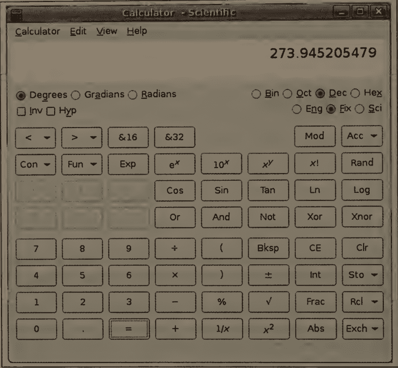
**图5-1 计算器**
刚打开该工具时，你会觉得计算器是非常简单的应用。不过，显示模式可通过“视图”菜单切换，计算器支持以下模式：
- 基础
- 高级
- 财务
- 科学（如图5-1所示）。
此外，“视图”菜单中还有多项实用选项，比如显示末尾零、千位分隔符、从左到右计算顺序、算术优先级，以及最多可存储10个数字的内存寄存器。

#### 字符映射表
[字符映射表应用](http://live.gnome.org/Gucharmap)可从“字符映射表”快捷方式启动，它是一款小型应用，支持浏览特定字体中的可用字符，以及将特殊字符插入文本文档，如图5-2所示。
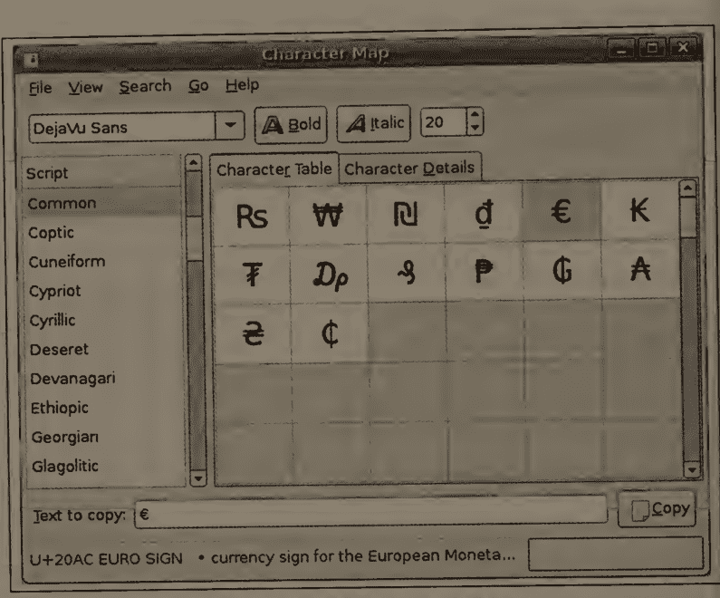
**图5-2 字符映射表**
借助该应用，你可以使用字体中存在但键盘上无法直接输入的特殊字符。这些字符包括带变音符号的特殊字符、数学符号或标点符号等。由于Ubuntu是多语言系统，字符映射表会使用“Unicode”字符集显示所有已安装语言脚本的字符。Unicode是旨在收录全世界所有书面语言所用字符的标准字符集。字符映射表窗口包含一个显示区域，可在当前脚本的可用字符显示和显示单个字符详情的标签页之间切换。双击某个字符或符号后，它会自动填入“要复制的文本”输入框，你可以在此拼接需要复制到其他文档的文本或符号字符串。

#### 词典
词典工具可从“附件”子菜单的“词典”快捷方式启动，它是一款在线词典工具，支持使用互联网词典源搜索单词和术语，如图5-3所示。
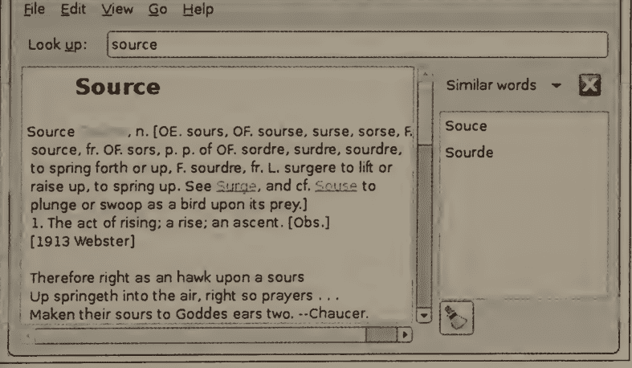
**图5-3 词典**
> “因此，正如苍鹰振翅高飞，祈祷也直抵上帝的双耳。——乔叟”
> - 来源
> - 源代码

在字典中查词只需在“查询”框中输入单词并按下回车键即可。随后词义会在查询框下方的窗口中显示。由于该工具以互联网网站“dict.org”作为词源，因此只有在系统连接到互联网时才能正常使用。“编辑”菜单中的“偏好设置”选项可用于修改默认字典服务器，或是点击“添加”按钮并输入新字典服务器的相关详细信息来新增字典源，具体操作可参见图5-4。
##### 图5-4 添加字典源

#### 磁盘使用分析器
磁盘使用分析器是Ubuntu 7.04中新增的一款工具，同样可以通过“附件”子菜单中同名称的快捷方式来启动。
##### 图5-5 磁盘使用分析器

该工具会以图形化形式展示当前磁盘使用情况，如图5-5所示。窗口分为两个区域，左侧面板显示目录结构、磁盘占用大小及占比，右侧则展示目录结构的图形化呈现。该工具可用来分析整块磁盘，也可以仅分析本地或网络目录结构。菜单栏包含多个按钮，可用于针对以下选项发起扫描，这些选项同样列在“分析器”菜单下：
- 用户主目录
- 整个文件系统
- 指定本地目录
- 远程/网络目录。

点击文件系统按钮将对整个文件系统发起扫描，这一过程可能会花费一些时间。扫描完成后，左侧面板会展示从“根目录”或“/”目录开始的目录结构树，并列出根目录下所有的直接子目录。每个子目录会显示其占用大小、包含的文件数量以及该目录占总磁盘空间的比例。点击目录名称旁边的小三角可展开或折叠对应目录，即可查看其下属子目录的详细信息。右侧面板展示左侧面板统计数据的图形化结果。图形的中心是本次扫描的根目录，从中心向外发散的是各个子目录，直至展示完整的目录结构。每个环形或块的大小与对应目录的磁盘占用大小成比例。

#### 截图工具
- ○ 抓取整个桌面（已选中）
- ○ 抓取当前窗口
- 延迟`0`秒后抓取

#### 效果
应用效果：`[下拉菜单]`
##### 图5-6 截图工具

只需运行该应用，在点击“截图”按钮前选择“抓取整个桌面”或“抓取当前窗口”，即可对当前工作区或活动窗口进行截图，效果如图5-6所示。截图完成后，应用会提示你为截图命名并保存。此外，你也可以输入延迟秒数，在截图前预留时间调整鼠标和窗口的位置，以便获得符合需求的截图效果。
##### 图5-7 终端

#### 终端
“终端”快捷方式可启动GNOME终端窗口，支持通过命令行访问GNU/Linux Shell环境。
> “Shell是一种程序，可解释并执行用户输入的文本命令，或是运行自名为“脚本”的文本文件中的命令。”

启动终端后，会显示一个“终端窗口”，其中包含“命令提示符”，用户可在其中输入UNIX命令，按下回车键即可执行该命令，如图5-7所示。

#### 文本编辑器
文本编辑器，也常被称为“Gedit”（http://www.gedit.org），可通过“文本编辑器”图标启动。
##### 图5-8 文本编辑器

如图5-8所示，该应用是一款简单易用的文本文件或脚本编辑工具。不过，这款工具在易用性之外还具备许多强大功能，例如完全支持国际化文本、为文本文件和脚本（如HTML、C、C++、Java、Perl、XML等）提供语法高亮、文件恢复、远程文件编辑，还支持通过“插件”扩展额外功能。这些高级功能是在撤销、重做、剪切、复制、粘贴、拼写检查、搜索、自动换行、行号显示等标准文本编辑功能之外的附加功能。用户可通过“文件”菜单的选项创建或打开文件，此外文本编辑器还支持将文件拖拽到编辑窗口来打开文件。若要配置特定文件或脚本的语法高亮颜色，可点击“编辑”菜单中的“偏好设置”选项，根据所编辑的脚本类型切换高亮模式，具体操作如图5-9所示。
##### 图5-9 文本编辑器偏好设置

### gedit 偏好设置
- 视图
- 编辑器
- 字体与颜色
- 语法高亮
- 插件

启用语法高亮
高亮模式：HTML

#### 元素
- 属性
- 块注释
- 右括号
- DTD
- 实体
- 字符串
- 标签

前景色：
背景色：
（帮助）（关闭）

#### Tomboy 笔记
Tomboy（http://www.gnome.org/projects/tomboy）是一款笔记应用，可用于创建、管理和存储笔记。
##### 图5-10 Tomboy 笔记

该应用运行时，会在顶部面板的通知区域添加一个小图标，通过点击该通知区域图标打开下拉菜单并选择“新建笔记”，即可快速便捷地创建新笔记。此外，用户也可以通过“搜索所有笔记”窗口的“文件”菜单创建新笔记。
在新建笔记中直接输入文本即可，还可通过笔记工具栏的“文本”按钮下拉菜单对文本进行格式化，如图5-10所示。关闭笔记后，它会与其他笔记一同存储，后续可通过下拉菜单或“搜索所有笔记”窗口再次访问。要删除笔记，可点击“编辑”菜单中的“删除”选项。
这款应用非常适合存放大量后续需要查阅的自由格式文本，这类文本往往体量较小，无需单独新建文件或OpenOffice文档存储。应用内置的搜索功能可让你后续轻松检索信息，快速找到所需内容。和之前提到的文本编辑器一样，Tomboy 笔记也支持“插件”，软件开发者可通过插件轻松为应用添加新功能。这些插件包括：支持从“Evolution”邮件客户端创建笔记、将笔记保存为网页HTML文件，以及查看与当前活动笔记相关联的其他笔记。这些插件可通过工具栏按钮的“工具”下拉菜单使用。

### 总结
本节我们初步了解了Ubuntu系统中预装的诸多应用，其中包括简单易用的内置计算器、功能强大的磁盘使用分析器等工具。下一章我们将介绍图形类应用，学习如何管理、创建和编辑数字图像。

## 6 图形应用
如前文所述，Ubuntu系统预装了大量应用，本章将介绍其中专用于图形处理的相关应用。这些应用提供了导入、扫描、管理和编辑照片、图片所需的各类工具。要启动单个图形应用，可进入“应用程序”菜单下的“图形”子菜单。

### F-Spot 照片管理器
F-Spot（http://f-spot.org）是一款个人照片管理工具，支持导入、整理、打印、邮件发送、备份，甚至编辑你的照片。
首次启动该应用时，它会提示你从已连接的相机或备份DVD等其他文件夹中导入图片。

Figure 6-1 F-Spot导入窗口
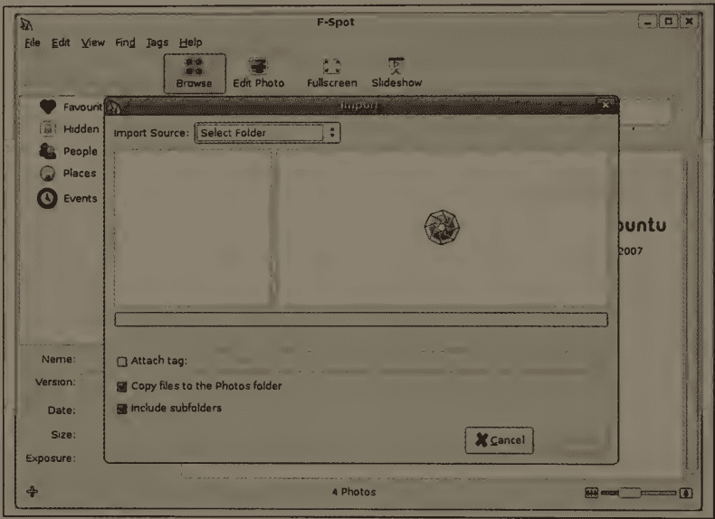
一旦选择了导入源，无论是文件夹、相机还是存储卡（如图6-1所示），F-Spot 会将图片复制到位于主目录下的“照片”文件夹中。程序会根据图片的创建日期生成目录结构，格式为`photos/年/月/日`，方便你快速识别图片的创建日期。导入完成后，F-Spot 浏览窗口会自动打开，该窗口可用于展示和标记图片。

Figure 6-2 F-Spot浏览窗口
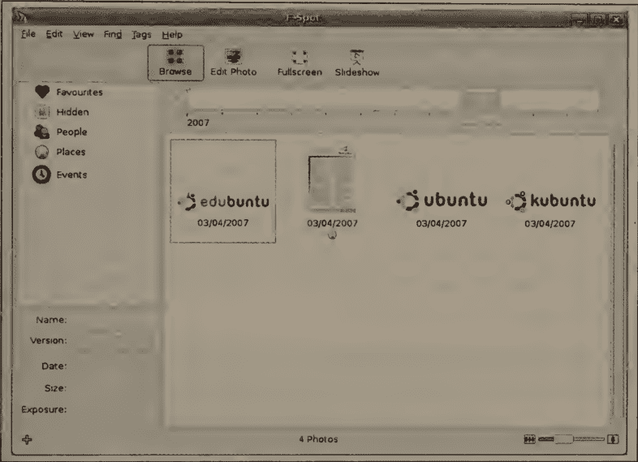
浏览窗口顶部设有一根时间轴工具栏，可用于按日期快速查找照片——移动该工具栏时，会自动扫描照片文件夹以匹配对应创建日期的图片，效果如图6-2所示。找到需要的图片后，可为它们添加用户自定义的标签，方便后续查找和分类管理。预定义标签会显示在浏览窗口左侧的列表中。要创建新标签，只需在标签面板中用鼠标指针右键点击即可。要给照片添加标签，先在图片面板中选中目标图片，再将对应标签拖放至任意一张照片上；也可以右键点击图片窗口，选择“附加标签”完成操作。之后如果你双击对应标签，就能搜索所有带有该标签的照片。

你可以通过点击工具栏上的按钮切换浏览窗口的视图模式。点击“编辑”按钮会在窗口底部调出评论输入栏，你可以为每张图片输入备注内容。评论栏下方还设有编辑工具栏，你可以在 F-Spot 管理器内完成多种简单编辑操作，包括：
- 调整长宽比
- 裁剪
- 去除红眼
- 调整图像色彩
- 转换为黑白效果
- 转换为棕褐色调
- 旋转图像角度以矫正水平线
- 制作柔焦效果

其他编辑功能还可以通过“编辑”菜单调用，例如图像锐化功能。F-Spot 还支持通过电子邮件发送图片、打印，或将图片导出到 CD 或 Flickr（http://www.flickr.com）、Picasa Web（http://picasaweb.google.com）等网络照片分享网站。这些操作都可以通过“文件”菜单中的选项轻松完成。

### GIMP 图像编辑器
GIMP（http://www.gimp.org，全称GNU图像处理程序）是一款功能全面的图形编辑器，旨在为 Adobe Photoshop 等商业软件提供免费发行的替代方案。它提供了大量用于照片修图、图像合成和创作的高级功能，如图6-3所示。
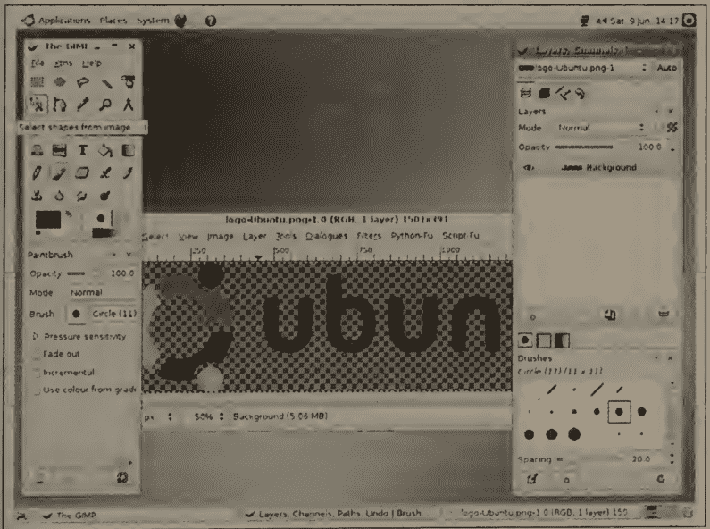
Figure 6-3 GIMP 界面

GIMP 的功能极为丰富，要详细介绍它需要专门的著作，因此我们只会介绍其部分核心功能。打开 GIMP 窗口后，你可以点击 GIMP 应用程序中“文件”菜单里的“打开”选项，选择示例图片或你自己的数码图片，再选中对应文件即可打开。图片会在独立窗口中打开，并自动缩放以适应你的显示器尺寸。该应用程序由多个面板组成，第一个面板是主工具箱，下方是工具选项面板，该面板包含多种工具：用于选择图片区域的选择工具、用于绘画的画笔、用于编辑或擦除图片区域的工具等，如图6-4所示。
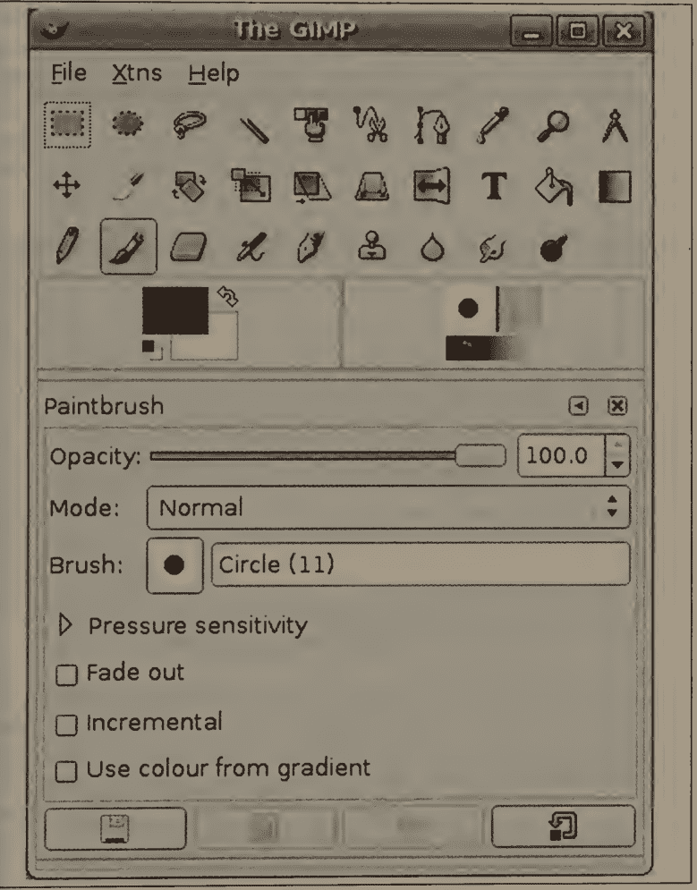
Figure 6-4 GIMP 工具箱

正在编辑的图片会在独立窗口中展示，窗口带有包含所有文件和编辑功能的菜单栏，如图6-5所示。如果你的电脑性能足够，可以同时打开多张图片进行编辑。你也可以在图片窗口内右键点击鼠标指针，调出菜单栏的选项。
*图6-5* GIMP 图像窗口

最后一个窗口是图层对话框，如图6-6所示。该窗口用于应用和编辑图片的多个图层，让你能够以多种不同方式修改图片。图层对话框下方是画笔、图案和渐变对话框，这些选项在绘画或修改图片时使用。
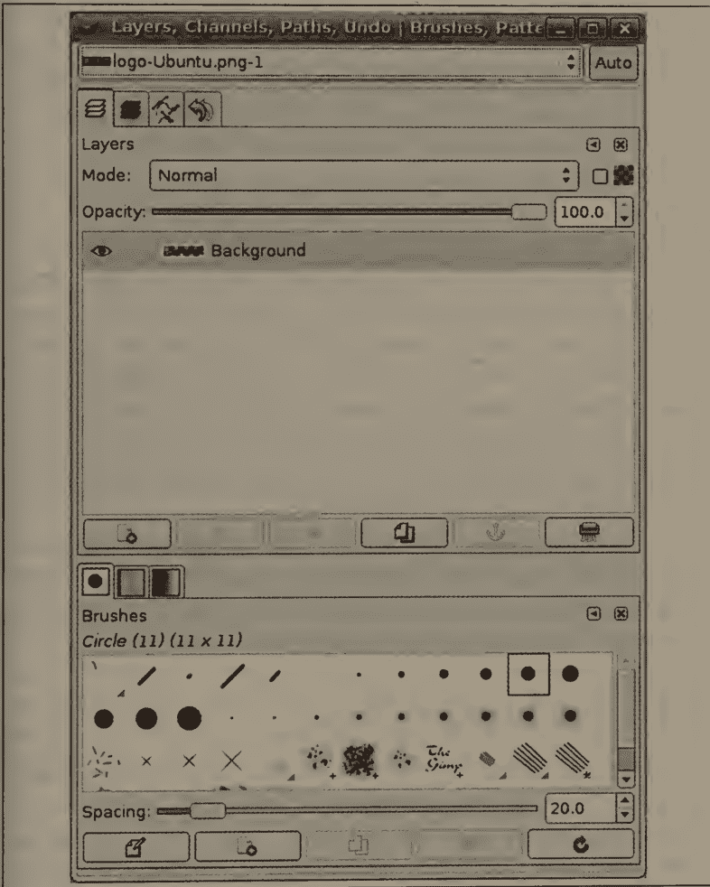
Figure 6-6 GIMP 图层面板

使用 GIMP 可以完成一些简单操作，例如调整图片尺寸：只需点击“图像”菜单中的“缩放图像”选项即可轻松完成。另一个常见操作是裁剪图片：只需从工具面板中选择矩形选择工具，选中想要保留的图片区域，再点击“图像”菜单中的“裁剪”选项即可，该操作会删除选中区域外的所有内容。如果你需要撤销操作，可以点击“编辑”菜单中的“撤销”选项，或者使用 Ctrl+Z 快捷键组合。另一种方便的撤销方式是通过“撤销历史”对话框，它位于“图层”对话框下方，记录了所有对图片执行的操作历史，你可以随时跳转到任意操作阶段，一次性撤销多个操作。

如需获取更多使用教程和相关信息，可以访问 GIMP 官网（http://www.gimp.org/docs）查看 GIMP 官方手册，还有详细的教程页面（http://www.gimp.org/tutorials）。

### gThumb 图片查看器
顾名思义，gThumb（http://gthumb.sourceforge.net）是一款缩略图图片查看器。它具备许多和 F-Spot 照片管理器相似的功能，例如从相机导入图片、编辑、查看和幻灯片放映功能，如图6-7所示。
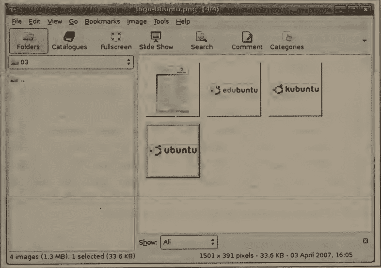
Figure 6-7 gThumb 界面

这两个应用的主要区别是 gThumb 没有 F-Spot 的图片标记功能，取而代之的是，gThumb 支持创建“媒体库”和“目录”。这些功能可以将图片归类到用户自建的集合中。媒体库可以组合多个目录，目录则用于实际归类图片。要创建目录，只需点击工具栏上的“目录”按钮切换到目录视图，然后在左侧面板中右键单击，选择“新建目录”即可。要给目录添加图片，只需选中图片后右键单击，再从右键菜单中选择对应的目录即可。

### 总结
在本章中，我们了解了 Ubuntu 内置的多种用于管理和编辑数码照片、图形文件的开源应用，其中包括功能丰富的 GIMP 图像编辑应用，它提供了许多商业修图软件具备的功能。下一章我们将介绍网络应用，并配置它们来处理电子邮件、浏览网页和进行网络通信。

## 7 OpenOffice
在本章中，我们将了解 OpenOffice.org 办公套件。OpenOffice.org（http://openoffice.org）是一款免费但功能齐全的办公套件，包含文字处理、数据库、电子表格和演示文稿应用。我们会介绍其中的核心应用，对比它与其他办公套件的差异，学习足够的基础知识来上手使用这些应用。和 Ubuntu 社区一样，OpenOffice.org 由 OpenOffice.org 社区提供支持、维护和开发。该套件包含以下应用：
- Base – 数据库应用
- Calc – 电子表格应用
- Draw – 矢量绘图程序
- Impress – 演示文稿软件

- 数学 – 数学公式编辑器
- Writer – 字处理软件。仅有Writer、Calc、Impress和Base这四个核心应用会预装在Ubuntu系统中，可通过“应用程序”菜单下的“办公”子菜单找到并使用。

### Base
Base是OpenOffice.org套件中的数据库应用，可通过“办公”子菜单中的“OpenOffice.org 数据库”快捷方式启动。该应用提供了多种功能强大的数据库处理工具，且界面易用，如图7-1所示。它支持基于服务器的数据库（如dBASE、MySQL或Oracle）以及本地数据库文件（使用HSQLDB或Microsoft Access）的表单、报表和查询的创建与编辑。
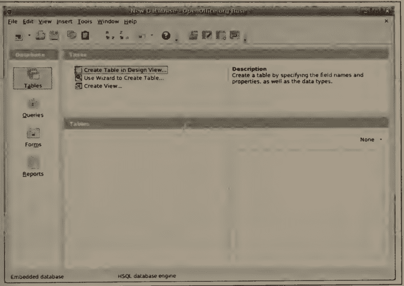
#### 图7-1 OpenOffice.org Base

启动Base后，会弹出向导，引导你完成新建数据库或打开现有文件的操作，如图7-2所示。
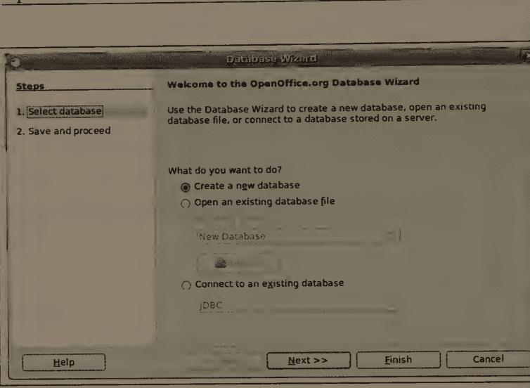
#### 图7-2 数据库向导

打开向导后，选择“新建数据库”选项并点击“下一步”按钮。随后应用会询问你是否要注册并打开该数据库，如图7-3所示。请确认勾选这两个选项，再点击“完成”。接着系统会提示你为数据库命名。
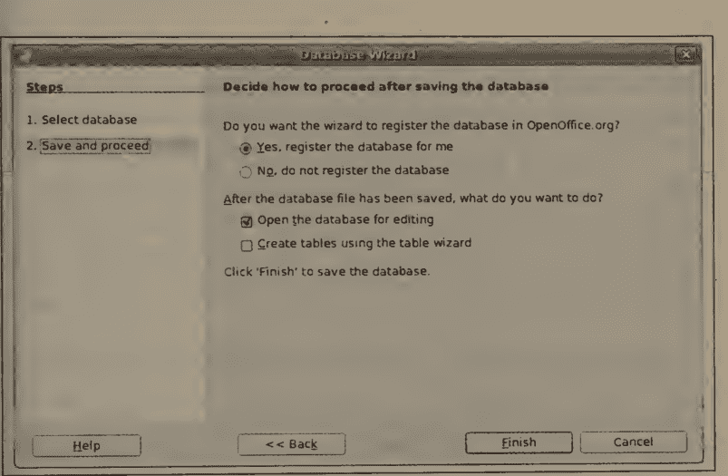
#### 图7-3 数据库向导

注册数据库后，Writer、Calc等其他OpenOffice.org应用就可以访问该数据库。一旦数据库以OpenOffice.org数据库文件（.odb格式）创建完成，就会显示Base主窗口，你可以在其中创建表、查询、表单和报表。本书不会过多涉及数据库相关知识，如需了解更多，可访问OpenOffice.org提供的丰富文档：http://documentation.openoffice.org/manuals/index.html

### Calc
OpenOffice.org Calc拥有大量分析、图表和决策功能，内置超过300个适用于统计、财务和数学运算的函数。Calc还提供了方案管理器，支持“假设分析”功能，可生成2D和3D图表，这些图表可以插入到其他OpenOffice.org文档中。和其他应用一样，Calc可以打开并使用Microsoft Excel工作簿，也可以将电子表格导出为Adobe的Acrobat（.pdf）格式，或互联网超文本标记（.html）标准格式。该应用可通过“办公”子菜单中的“OpenOffice.org 电子表格”快捷方式启动，如图7-4所示。
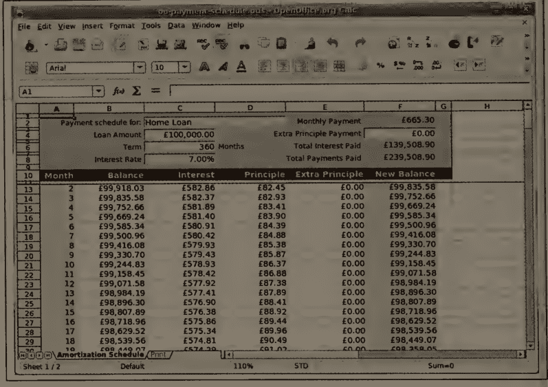
#### 图7-4 OpenOffice.org Calc

如图7-4所示，Calc和其他电子表格应用类似，带有标准工具栏、格式工具栏、公式栏以及列标题和行标题。窗口底部、单元格下方是“工作表”选项卡，通过它可以实现在同一个文档中创建多个工作表，只需点击对应的选项卡就能切换到相应工作表。Calc文件的操作方式和其他应用一致，可通过文件菜单中的“打开”或“保存”选项完成操作。Calc默认使用自有的OpenOffice文件格式，如表7-1所示：
| 类型 | 格式扩展名 |
| --- | --- |
| 电子表格 | .ods |
| 电子表格模板 | .odt |
#### 表7-1 OpenOffice.org Calc文件格式

不过除标准Calc格式外，它还支持打开多种不同类型的电子表格，如表7-2所示：
| 电子表格类型 | 格式扩展名 |
|------------------|------------------|
| 数据交换格式 | .dif |
| dBase | .dbf |
| 超文本标记语言 | .htm和.html文件 |
| Lotus 1-2-3 | .wk1、.wks和.123 |
| Microsoft Excel 2003 XML | .xml |
| Microsoft Excel 4.x–5.0/95版 | .xls、.xlw和.xlt |
| Microsoft Excel 97/2000/XP版 | .xls、.xlw和.xlt |
| OpenOffice.org 1.x | .sxc和.stc |
| Pocket Excel | .pxl |
| Quattro Pro 6.0 | .wb2 |
| 富文本格式 | .rtf |
| StarCalc格式 | .sdc和.vor |
| SYLK | .slk |
| 文本 | .csv和.txt |
#### 表7-2 Calc支持的电子表格格式

Calc中的电子表格可通过“文件”菜单中的“另存为”选项、“导出为PDF”选项，或“文件”菜单中的“发送”选项以邮件形式导出，支持导出为上述多种格式。

### Impress
OpenOffice.org Impress是套件中的演示应用，是一款多媒体工具，支持制作带有动画、特效、音视频的演示文稿。可通过“OpenOffice.org 演示文稿”快捷方式启动。
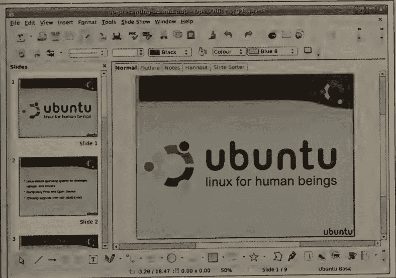
#### 图7-5 OpenOffice.org Impress

如图7-5所示，Impress的界面和其他幻灯片演示软件非常相似，很容易上手。它默认使用原生的OpenOffice.org文件格式保存文件，如表7-3所示：
| 类型 | 格式扩展名 |
|-------|------------------|
| 演示文稿 | .odp |
| 演示文稿模板 | .otp |
#### 表7-3 OpenOffice.org Impress文件格式

不过它也支持打开并转换多种其他商业应用制作的演示文稿，如表7-4所示：
| 演示文稿类型 | 格式扩展名 |
|--------------------|------------------|
| Microsoft PowerPoint 97/2000/XP版 | .ppt、.pps和.pot |
| OpenOffice.org 1.x | .sxi和.sti |
| StarDraw和StarImpress | .sda、.sdd、.sdp和.vor |
| CGM（计算机图形元文件） | .cgm |
#### 表7-4 Impress支持的演示文稿格式

启动该应用后，会打开新建演示文稿向导，如图7-6所示。
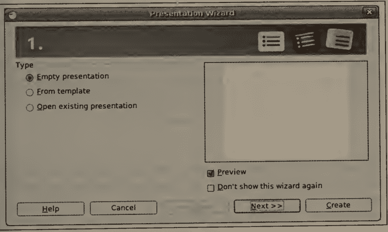
#### 图7-6 演示文稿向导
> 如果不想每次启动应用或新建文件时都弹出该向导，只需勾选“下次不再显示此向导”复选框即可。

该向导提供了三个选项：新建空白演示文稿、打开模板、打开现有文件。选择新建空白演示文稿选项，点击“下一步”。
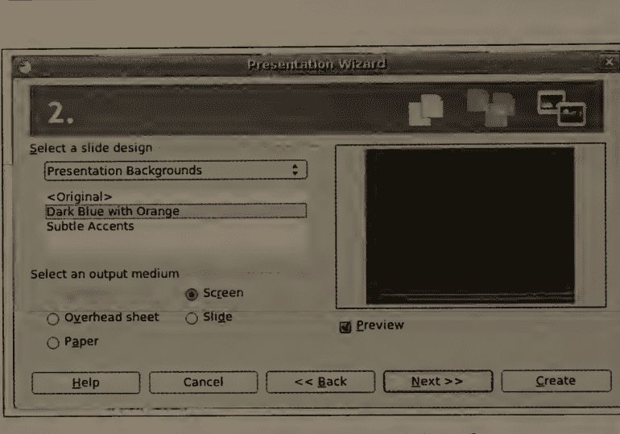
#### 图7-7 演示文稿向导

如图7-7所示，在幻灯片设计选项下选择演示文稿类型。勾选“预览”选项后，选择幻灯片设计时，向导中会显示该幻灯片的预览效果。“输出介质”选项会根据使用的媒体类型优化演示文稿，选择“屏幕”后点击“下一步”按钮。
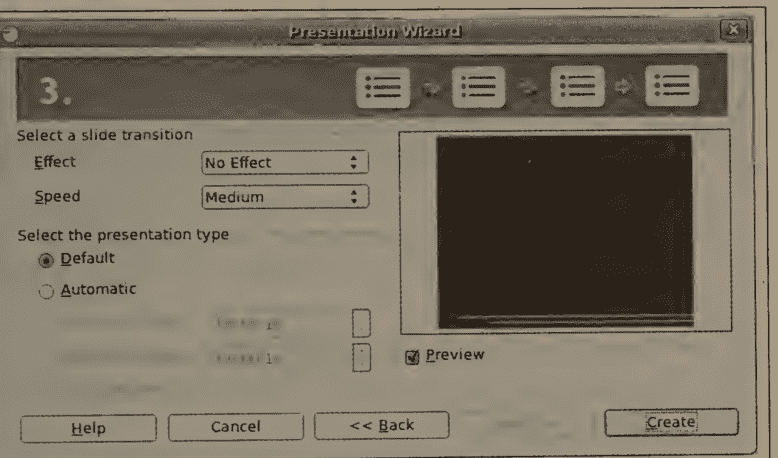
#### 图7-8 演示文稿向导

当你选择将幻灯片放映设置为屏幕显示时，向导的最后一步会让你选择每张幻灯片之间的切换效果，如图7-8所示。完成选择后点击“创建”，即可生成空白演示文稿。

Impress窗口分为三个主要区域：左侧的幻灯片缩略图面板会显示演示文稿中所有幻灯片的缩略图，你可以通过该面板对单张幻灯片进行整理、删除、重命名或复制操作。

窗口中间是工作区，工作区顶部有五个选项卡，通过这些选项卡可以切换工作区的视图：
## OpenOffice
- 普通视图：用于对单张幻灯片进行格式设置和设计
- 大纲视图：以大纲形式展示每张幻灯片的主题和列表，用于编辑标题、副标题和主题
- 备注视图：可为每张幻灯片添加演示备注，这些备注不会在实际放映时显示
- 幻灯片浏览视图：展示所有幻灯片的缩略图，用于调整幻灯片顺序或在选中的幻灯片之间添加切换效果
- 讲义视图：支持打印幻灯片用作讲义。

任务面板还分为以下区域：
- 母版：用于定义演示文稿使用的幻灯片样式
- 版式：可为每张幻灯片选择20种标准版式之一
- 自定义动画：可为单张幻灯片的选中元素选择要应用的动画效果
- 幻灯片切换：可选用56种切换效果应用到幻灯片之间。

当你完成演示文稿后，可以将其保存为OpenOffice.org文件，或是众多的专有文件格式之一。不过，Impress还支持通过点击「文件」菜单中的「导出」选项，将文件导出为Adobe Acrobat（.pdf）、超文本标记语言（.html），甚至是Macromedia Flash（.swf）动画格式。

#### Writer
OpenOffice.org Writer可通过「Office」子菜单中的「OpenOffice.org 文字处理」快捷方式启动。Writer是一款功能齐全的文字处理应用，拥有Microsoft Word这类商用软件的诸多功能，可用于创建信函、宣传册、报告和各类文档，如图7-9所示。如果你熟悉Word或WordPerfect这类应用，会立刻对上手的Writer感到十分熟悉。

#### 图7-9 OpenOffice.org Writer
Writer的使用界面和其他文字处理软件非常相似，菜单栏下方是熟悉的工具栏，沿窗口顶部排列。通过文件菜单中的标准「打开」或「保存」选项即可轻松操作文件。Writer默认使用自身的OpenOffice文件格式，具体如表7-5所示：

#### 表7-5 OpenOffice文件格式
| 类型 | 格式扩展名 |
|------|-------------------|
| 文本文档 | .odt |
| 文本模板 | .ott |
| 主控文本文档 | .odm |

需要注意的是，如果你与其他使用Microsoft Word等其他文字处理软件的用户共享文档，对方可能无法打开OpenOffice默认的文件格式。不过，Writer支持保存为专有格式（如Microsoft Word（.doc））或标准格式（如富文本格式（.rtf）、超文本标记语言（.html）和可扩展标记语言（.xml））。支持的全部文件格式如表7-6所示：

#### 表7-6 支持的文件格式
| 类型 | 格式扩展名 |
|:---|:---:|
| AportisDoc（Palm设备） | .pdb |
| DocBook | .xml |
| HTML文档（OpenOffice.org Writer） | .html和.htm |
| Microsoft Word 2003 XML | .xml |
| Microsoft Word 6.0、95及97/2000/XP | .doc |
| OpenOffice.org 1.x 文本文档模板 | .stw |
| OpenOffice.org 1.x 文本文档 | .sxw |
| Pocket Word | .psw |
| 富文本格式 | .rtf |
| StarWriter 3.0、4.0及5.0 | .sdw |
| StarWriter 3.0、4.0及5.0模板 | .vor |
| 纯文本文档与编码文本 | .txt |

你可以通过点击「文件」菜单中的「另存为...」选项，将文档导出为上述格式之一。此外，如果你经常和使用其他应用的用户交换文件，可以通过点击「工具」菜单中的「选项...」将Writer的默认保存格式设置为上述标准格式之一，如图7-10所示。

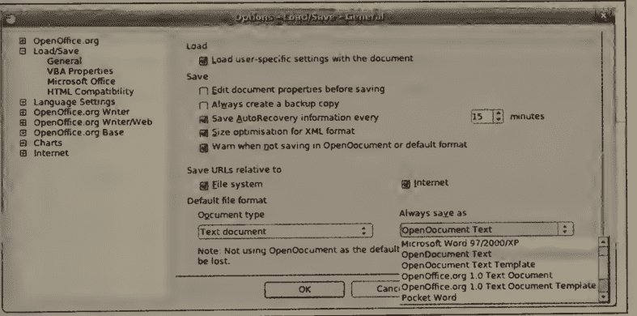

#### 图7-10 Writer选项
许多文字处理软件都不支持直接导出为Adobe Acrobat（.pdf）文件，这是Writer的一大实用功能，你可以通过「文件」菜单中的「导出为PDF...」选项实现该功能。此外，Writer还可以连接你的邮件客户端，通过点击「文件」菜单中「发送」子菜单下的对应选项，直接在Writer应用内通过邮件发送文档。

### 总结
OpenOffice.org提供了一套功能齐全的办公应用，可满足你日常办公的全部需求。正如我们之前介绍的，它不仅可以打开诸多商用软件的文件并与之兼容，还提供了一些商用软件没有的功能，例如导出为Adobe Acrobat格式。由于OpenOffice.org套件的功能非常丰富，足以单独成书，如果你想了解所有OpenOffice.org应用的完整功能列表、相关文档和教程，可以查阅OpenOffice.org社区提供的详细文档：http://documentation.openoffice.org/

## 互联网
本章将介绍Ubuntu系统内置的网络应用，一步步教你配置这些应用，实现网页浏览、收发邮件、在线聊天以及通过宽带拨打免费语音电话。所有上述应用都可以在「应用程序」菜单的「网络」子菜单中找到。

### Ekiga 网络电话
Ekiga（http://www.gnomemeeting.org）是一款开源的音视频会议应用，曾用名为「GnomeMeeting」。它支持运行在多个版本的GNU/Linux以及Windows操作系统上，可以和基于行业标准协议的同类应用（如Windows Messenger、IP电话、Gizmo Project和NetMeeting）互通。由于Skype这类专有应用并非基于开放协议，因此无法和Ekiga互通。

#### 设置
该应用配备了一款设置向导，会自动引导你完成账户创建流程，方便其他用户联系你，设置过程十分简单。首次启动该应用时，会弹出配置向导窗口，如图8-1所示。

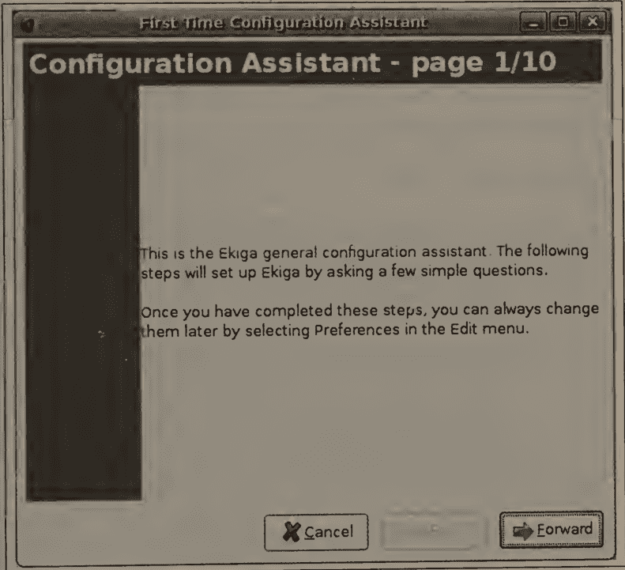

##### 图8-1 首次配置向导
点击「前进」按钮开始配置流程。在第一个界面中输入你的姓名，然后点击「前进」即可，如图8-2所示。
**首次配置向导**
**ekiga.net 账户 - 第3/10页**
**请输入你的用户名：**
**请输入你的密码：**
> 用户名和密码用于登录你已有的ekiga.net免费SIP服务账户。如果你还没有ekiga.net的SIP地址，可以先在下方创建账户，获取的SIP地址可供他人呼叫你。如果你使用其他SIP服务，或是希望稍后填写登录信息，可以跳过此步骤。
[获取ekiga.net SIP账户](http://www.ekiga.net)
☐ 我不想注册ekiga.net免费服务
**[取消]** **[返回]**

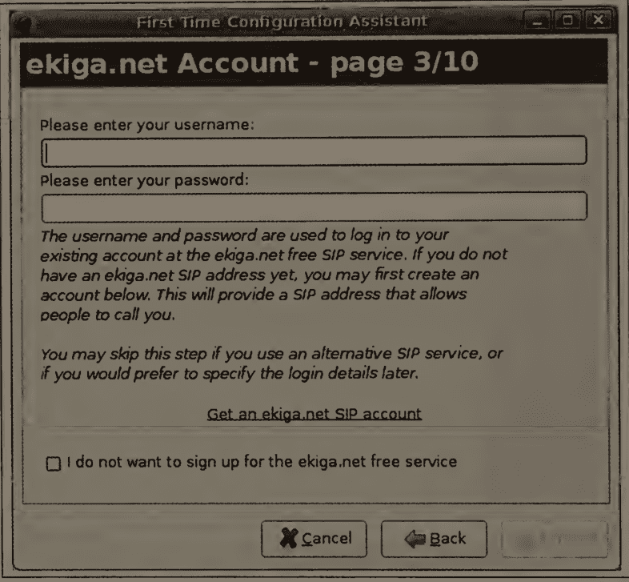

##### 图8-2 ekiga.net账户
SIP账户可供其他用户找到你，并向你的电脑发起语音呼叫。如果你已有其他应用的SIP账户，可在当前界面输入账户名和密码后点击「前进」。如果你从未使用过互联网电话（VoIP）应用，可点击「获取ekiga.net SIP账户」超链接创建新账户，也可以直接访问http://www.ekiga.net/网站。在该网站上点击「订阅」链接，填写表单即可创建SIP账户，如图8-3所示。

##### 图8-3 ekiga.net注册
创建好Ekiga SIP账户后，或是已有账户信息的情况下，在向导中输入账户名和密码，点击「前进」。之后应用会询问你的互联网连接方式，以便优化音质设置，充分发挥你的网络性能。请选择你的网络连接类型：拨号上网（或窄带）选择「56K调制解调器」，ISDN连接选择「ISDN」，ADSL或有线调制解调器（或宽带）连接选择「xDSL/有线」，直连互联网则选择「T1/LAN」。点击「前进」后，向导会自动检测你的互联网连接方式，并配置为最合适的连接参数。确认Ekiga给出的推荐设置，在向导中点击「前进」即可。之后应用会检测Ubuntu系统的音频系统工作状态，要求你确认音频管理器的选项，如图8-4所示。Ekiga通常会自动选择正确的配置，点击「前进」确认即可。随后应用会要求你确认检测到的音频设备。

#### 首次配置向导
#### 音频设备
- 第 7/10 页
请选择音频输出设备：Ensoniq AudioPCI
音频输出设备是音频管理器管理的、用于播放音频的设备。
请选择音频输入设备：Ensoniq AudioPCI
音频输入设备是音频管理器管理的、用于录制你声音的设备。
- 测试
- 设置
- 取消
- 返回
- 前进

按下“测试”按钮尝试录制一段短消息，Ekiga 会播放该录音以确认你的音频工作正常。点击“确定”关闭测试窗口，再点击“前进”确认音频设备设置。下一屏幕会要求你确认“视频管理器”，它会默认选择最合适的选项，因此只需点击“前进”即可。最后，系统会检测你是否连接了网络摄像头并确认设备设置。点击“前进”确认后，系统会显示 Ekiga 将使用的所有设置的摘要，如图 8-5 所示。

### **图 8-5 配置完成**
请确保所有设置都正确，然后按下“应用”按钮完成配置并启动应用程序。
#### 使用 Ekiga
应用程序配置完成后，只要知道对方的 SIP 地址，就可以用它呼叫其他用户，支持多种通话类型。

### 图 8-6 Ekiga 界面
如图 8-6 所示，Ekiga 窗口顶部有一个文本框，你可以手动输入对方的地址。点击文本框旁的连接按钮后，Ekiga 就会尝试呼叫对方。窗口左侧的按钮可以切换 Ekiga 的通信模式，如果你电脑上连接了网络摄像头，还可以使用即时通讯、语音或视频会议功能。第三个按钮可以打开 Ekiga 通讯录，它会连接到 Ekiga 的 SIP 服务，你可以搜索其他 Ekiga 用户的 SIP 地址，也可以手动输入联系人信息来创建个人通讯录，如图 8-7 所示。

### 图 8-7 通讯录
Ekiga 启动后，点击其窗口的关闭按钮并不会真正关闭程序，而是会将其最小化到顶部面板的通知区域。这是没有必要的，因为只有在程序运行时你才能接听来电。程序最小化到通知区域后，只需左击顶部的小电话图标即可最大化窗口。如果要彻底关闭程序以避免被打扰，可以在“呼叫”菜单中选择“退出”。
### Evolution 邮件客户端
[Evolution](http://www.gnome.org/projects/evolution) 是一款功能全面的电子邮件客户端，预装在 Ubuntu 系统中，如图 8-8 所示。你可以通过顶部面板的图标，或者“应用程序”菜单下的“网络”子菜单启动它。Evolution 支持多种功能，包括 POP、SMTP、Exchange、GroupWise 协议，支持多个邮箱账户，内置日历（支持连接网络日历）、垃圾邮件过滤、高级内置搜索功能，还支持通过插件扩展额外功能。

### **图 8-8 Evolution 邮件客户端界面**
和 Ekiga 一样，为了尽可能简化设置流程，Evolution 首次启动时会运行配置向导，引导你完成连接邮件服务器的配置过程。如图 8-9 所示，在配置助手的第一页点击“前进”按钮即可开始配置。
#### Evolution 配置助手
##### 身份信息
请在下方输入你的姓名和电子邮箱地址。除非你希望在发送的邮件中包含以下信息，否则无需填写标为“可选”的字段。
###### 必填信息
- **全名：** 乔恩·罗尔夫（Jon Rolfe）
- **电子邮箱地址：** Jon.Rolfe@UsingUbuntu.com
###### 可选信息
- ☑ 将此设为默认账户
- **收件人回复地址：** [空白]
- **所属组织：** [空白]
- [ **取消** ] [ **返回** ] [ **前进** ]
### 图 8-9 Evolution 配置助手界面
按照你希望在邮件中显示的名称输入全名，并按照上一张图的示例输入电子邮箱地址。“收件人回复地址”和“所属组织”字段通常可以留空，只有当你希望收件人回复邮件时使用其他邮箱地址、或者希望每封邮件的属性中都显示公司名称时，才需要填写这两个字段。之后点击“前进”按钮进入邮箱账户属性配置页面。
此页面的字段会因你使用的邮箱账户不同而有所差异。Evolution 支持从多种不同类型的服务器接收邮件，但本书默认你连接的是互联网服务提供商（ISP），这类服务商通常提供 POP 邮件服务。选择“POP”后，会显示如图 8-10 所示的选项。

### 图 8-10 接收邮件设置
请输入你的邮件服务器地址和用户名，这些信息会由你的互联网服务提供商提供。如果你希望 Evolution 记住你的密码，以便每次连接时无需输入密码即可自动收取邮件，请勾选“记住密码”复选框。不用着急现在输入密码，Evolution 在首次尝试收邮件时会提示你输入。之后点击“前进”按钮进入邮件接收选项页面。
选择 Evolution 运行时检查新邮件的频率，如果你需要从多台不同电脑访问邮箱，请勾选“将邮件留在服务器上”复选框，之后点击“前进”。下一页面用于配置通过互联网服务提供商发送邮件的设置，请输入服务器地址和用户名，并勾选“记住密码”复选框。部分邮件服务器需要勾选“服务器要求认证”选项，部分则不需要，你需要咨询你的 ISP 确认你的服务商是否需要勾选该选项。再次点击“前进”保存设置并进入下一页。
接下来系统会要求你为账户设置命名，方便你在有多个邮箱地址时进行管理。必要时可以修改名称，点击“前进”进入时区设置页面，如图 8-11 所示。

### 图 8-11 时区设置
这个页面你在安装 Ubuntu 时应该见过。点击你所在的地理区域，然后选择具体位置，之后点击“前进”。在最后一个设置页面，点击“应用”保存账户设置。
#### 使用 Evolution
如果你之前使用过电子邮件客户端，上手 Evolution 会非常容易。窗口顶部的工具栏可以让你创建、发送、接收、回复、转发或删除邮件。窗口左侧的按钮可以切换视图，你可以查看邮件、联系人、日历、备忘录或任务。切换视图时（例如从邮件切换到日历），工具栏的按钮会变为当前视图对应的操作。窗口左下角有一个小图标，显示你是否当前已连接到邮件服务器，点击该图标可以更改连接状态。
### Firefox 网页浏览器
Ubuntu 系统自带流行的 [Firefox](http://www.mozilla.com/en-US/firefox) 网页浏览器，你可以通过顶部面板的图标，或者“应用程序”菜单下的“网络”子菜单启动它。

#### 欢迎使用 Ubuntu 7.04（活泼小鹿）！
Ubuntu 项目基于 Ubuntu 理念所蕴含的核心思想构建：软件应当免费向用户提供，软件工具应当支持用户以本地语言使用，且用户应当拥有按照自身需求随意定制、修改软件的自由。

#### 获取 Ubuntu 帮助：
获取 Ubuntu 帮助的方式有很多。你可以通过系统菜单中的「帮助」选项查阅 Ubuntu 的指南与文档，也可以前往 Ubuntu 官方文档网站和社区贡献的文档获取支持。如果你倾向于人工咨询，可以通过邮件列表、网络论坛，或在 Freenode IRC 频道的 #ubuntu 房间与社区用户交流。

#### Firefox 浏览器
Firefox 采用「标签页」界面，既支持每个窗口仅打开单个网页，也支持将新页面在地址栏下方的浏览器窗口顶部以「标签页」形式展示，具体样式可参考图 8-12。该设计让你无需打开多个窗口即可同时浏览多个网页，不会占用过多桌面空间。此外 Firefox 还支持「实时书签」功能，实时书签会显示在地址栏下方、标签页上方，该功能支持将自动更新的 RSS 网络订阅源添加为书签。这类订阅源会主动向你的浏览器推送更新内容，当你为某个订阅源创建实时书签后，会得到一个下拉菜单，可实时列出该网站的所有文章，订阅源内容更新时，下拉菜单也会自动同步更新。

Firefox 的默认设置无需太多调整即可使用。如果你已连接互联网，直接打开 Firefox 就可以上网，操作方式和绝大多数你使用过的浏览器一致。若要搜索特定内容，可在窗口右上角的搜索框中输入关键词，搜索结果会由谷歌搜索引擎提供。此外你也可以直接在地址栏输入网址，快速跳转到对应网站。如果你需要自定义部分设置，可通过「编辑」菜单中的「偏好设置」选项进行调整。如图 8-13 所示的主偏好设置界面中，你可以在主页输入框中输入网址来修改浏览器主页；同一界面还可以修改文件下载时的默认保存路径。

### 图 8-13：Firefox 偏好设置
如图 8-14 所示的隐私页面中，你还可以调整 Firefox 记录你访问过的网站的时长。在该页面点击「立即清除」按钮即可清除你的网页使用记录。此外，如果你勾选了关闭 Firefox 时自动清除私人数据的选项，每次浏览器关闭后相关数据都会被自动删除。

### 火狐偏好设置 - **历史记录**
- [x] 记住最近 `9` 天内访问过的页面
- [x] 记住我在表单和搜索栏中输入的内容
- [x] 记住我下载过的内容
- **Cookie**
- [x] 接受网站发送的 Cookie
- 保存期限：`直到过期`
- 按钮：`例外...`、`显示 Cookie...`
- **私人数据**
- [ ] 关闭 Firefox 时始终清除我的私人数据
- [x] 清除私人数据前向我确认
- 按钮：`设置...`、`立即清除...`

### 图 8-14：Firefox 隐私设置
最后，在高级页面的「网络」标签页中，你可以设置访问每个网站后缓存或存储的数据量。如果网站的数据或图片自上次访问后没有变化，该功能会让网站加载速度更快，在网络连接速度较慢时非常实用。但出于安全考虑或节省磁盘空间的目的，你也可以缩小缓存的使用容量。如图 8-15 所示，该标签页还包含「连接」设置项，通过这些设置你可以通过代理服务器连接网络——代理服务器会代替你转发网页请求，出于安全和性能两方面的考虑，使用代理服务器都有一定帮助。你可以联系你的网络服务提供商（ISP），确认是否需要配置代理服务器设置。

Firefox 安装插件的流程非常简便，如果你需要查看某些特定网页，可能就需要安装对应插件。例如很多网页会使用 Adobe Flash 插件来展示网页动画。由于该插件受版权保护，因此 Ubuntu 系统不会预装它。但当你访问需要特定插件的网页时，Firefox 会弹出提示栏和「安装缺失插件」按钮，提示你需要安装插件。点击该按钮后，Firefox 会自动搜索对应插件，并引导你完成安装流程。

### Gaim 网络即时通讯工具
Gaim 是一款即时通讯应用，可用于向 AIM、MSN、雅虎、IRC 及其他众多即时通讯应用的用户发送和接收实时文本消息。这款应用最近已更名为 Pidgin（http://pidgin.im），但截至本文撰写时，新版本尚未支持 Ubuntu 系统。和 Ubuntu 预装的多数应用一样，首次运行 Gaim 时会启动配置助手，引导你绑定已有的即时通讯（IM）账号。你需要在配置 Gaim 前，先注册对应即时通讯服务的账号。这款应用的优势是支持绑定不同服务的多个账号，如果你的亲友使用不同的即时通讯工具，你可以分别为每个服务注册账号，再配置 Gaim 同时使用所有服务。目前 Gaim 支持以下 IM 平台：
- AIM
- Gadu-Gadu
- GroupWise
- ICQ
- IRC
- Jabber
- MSN
- Simple (SIP)
- Yahoo

当你拥有 IM 账号后，可以从「应用程序」菜单的「互联网」子菜单中启动 Gaim，随后会显示 Gaim 的欢迎界面，具体样式可参考图 8-16。

### 图 8-16：Gaim 账号设置界面
> 你需要输入的具体信息会因账号类型不同而有所差异，针对主流服务类型，多数设置都已预先配置完成。

##### 添加账号
###### 标签页选项
| 标签页 | |
|--------|--------|
| 基础 | |
| 高级 | |

###### 登录选项
| 设置项 | 值 |
|--------|--------|
| 协议 | 雅虎 |
| 显示名称 | Jon |
| 密码 | ●●●●●● |
| 本地别名 | |
| 记住密码 | [x] |

###### 用户选项
| 设置项 | 状态 |
|--------|--------|
| 新邮件通知 | [ ] |
| 为该账号使用此联系人图标： | [ ] |
| 操作按钮 | 取消、保存 |

### 图 8-17：Gaim 添加账号界面
配置完账号后，点击「保存」按钮，应用会尝试连接对应服务。如果连接失败，你可以在「账号」窗口中选择该账号，点击「修改」按钮检查你输入的设置。账号成功连接后，你需要向应用中添加好友，这样才能联系他们，并查看他们的在线（有空）、离线或忙碌状态。你可以通过「好友」菜单中的「添加好友」选项添加好友，具体界面可参考图 8-18。

### 图 8-18：添加好友界面
> 如果你不确定好友的账号名称和使用的服务，可以直接询问对方。从已配置账号的下拉列表中选择对应账号，再输入用户的账号名或显示名称，最后为用户设置一个「别名」，Gaim 会在应用窗口或「好友列表」中显示该别名。当你尝试将账号添加到好友列表、或是有人将你添加到他们的好友列表时，被添加的用户会收到授权请求，需要确认是否允许对方将自己加入好友列表。这是为了确保只有你认可的用户才能查看你的在线状态。

#### 好友列表
+ 好友、账户、工具、帮助
+ 好友
  - 安迪 — 离线
  - 罗布 在线
> 图 8-19 好友列表

当你把一些好友添加到好友列表后，他们的在线状态就会显示出来，如图8-19所示。这样你就能知道谁有空可以交谈。你可以更改自己的状态，这样在你忙碌时就不会被打扰，只需点击好友列表窗口底部弹出菜单即可操作。要联系在线的用户，只需双击他们的名字，然后在对话窗口中输入内容即可，如图8-20所示。

> 图 8-20 对话窗口

只有Gaim应用程序运行时，别人才能够联系到你，因此你可以关闭Gaim的窗口而无需真正退出应用程序。Gaim处于这种状态时，会在顶部面板的通知区域添加一个图标。要真正关闭应用程序，只需右键点击该图标，然后从下拉菜单中选择“退出”即可。

### 互联网

当你把一些好友添加到好友列表后，他们的在线状态就会显示出来，如图8-19所示。这样你就能知道谁有空可以交谈。你可以更改自己的状态，这样在你忙碌时就不会被打扰，只需点击好友列表窗口底部弹出菜单即可操作。要联系在线的用户，只需双击他们的名字，然后在对话窗口中输入内容即可，如图8-20所示。

> 图 8-20 对话窗口

只有Gaim应用程序运行时，别人才能够联系到你，因此你可以关闭Gaim的窗口而无需真正退出应用程序。Gaim处于这种状态时，会在顶部面板的通知区域添加一个图标。要真正关闭应用程序，只需右键点击该图标，然后从下拉菜单中选择“退出”即可。

### 总结

现在你应该已经能够收发电子邮件、浏览互联网，只要你认识拥有即时通讯或网络电话（VOIP）账户的人，你就可以实时发送文本、语音或视频消息。尽管Ubuntu是一款免费操作系统，我们发现它具备其他收费操作系统的全部功能。事实上，由于GNU/Linux平台的开源特性，可用的应用程序比部分商业应用具备更高的灵活性，它支持为不同服务配置多个账户，例如可以通过Gaim这样一个单一应用，和不同即时通讯服务的用户进行交流。

## 9 声音和视频

Ubuntu是一款功能齐全的多媒体操作系统，因此它自带了观看视频、播放音乐以及将CD转换为数字音频文件的相关工具。本章我们将试用“应用程序”菜单下“声音和视频”子菜单中的应用。

### Totem

Totem（http://www.gnome.org/projects/totem）是GNOME桌面环境下的标准开源电影播放器，可以通过“声音和视频”子菜单中的“电影播放器”快捷方式启动。它支持播放列表、用于文件管理的视频缩略图生成、全屏模式、进度和音量控制、键盘导航以及无加密DVD播放。

> 图 9-1 Totem 播放器界面

Totem的使用很简单，只需双击文件即可播放多种类型的文件。你现在就可以尝试：进入主目录下的“Examples”文件夹，双击“Experience ubuntu.ogg”文件即可，操作示例如图9-1所示。你也可以通过Totem“电影”菜单中的标准“打开”命令，在Totem内打开视频或音乐文件。你还可以用Totem播放“流式”视频，这类视频是从网络服务器传输过来的。要播放流式视频，只需在“电影”菜单中选择“打开位置...”，然后输入视频流的完整地址即可。

Totem的窗口分为多个区域。显示区域用于展示视频内容，或在播放音频文件时展示可视化效果。左侧的侧边栏用于展示正在播放文件的属性，或显示播放列表。Totem窗口底部是播放进度控制、音量调节和时间进度条。

Totem以及其他视频播放器应用，会使用名为“编解码器”的软件来播放不同的数字视频文件和流媒体类型。

> 编解码器（意为压缩-解压缩或编码-解码）是一类用于对数字文件或数据流进行编码和解编码的小型软件。

Totem预装了很多编解码器，但偶尔你可能会遇到Totem不支持的文件类型，因为这类文件需要用到未安装的、受版权保护的编解码器。如果你尝试打开Totem缺乏对应编解码器的文件、DVD或CD光盘，一旦Totem识别出缺失的编解码器，它可能会自动启动“添加/删除应用程序”工具，提示你安装特定的编解码器，如图9-2所示。另一种情况是，它可能只是提示你安装对应的编解码器。这种情况下，你可以打开“添加/删除应用程序”工具，在搜索框中输入“编解码器”即可。该操作会列出所有可用的编解码器，以及它们所支持的文件类型。Totem支持所有“Gstreamer”或“Xine”类型的编解码器。

> 图 9-2 “添加/删除应用程序”工具

我们也建议你修改Totem偏好设置中的网络连接选项，如图9-3所示。该操作可以让Totem针对你的网络连接类型优化设置，具体方法为：在“编辑”菜单中选择“偏好设置”。在“偏好设置”窗口的“通用”选项卡中，选择与你互联网连接类型对应的选项。

> 图 9-3 偏好设置界面

### Rhythmbox 音乐播放器

Rhythmbox应用（http://www.gnome.org/projects/rhythmbox）可用于播放音频CD，管理并播放音乐文件、播客以及网络电台，如图9-4所示。你可以通过“声音和视频”子菜单中的“Rhythmbox音乐播放器”快捷方式启动它。

> 图 9-4 Rhythmbox 播放器界面

第一次启动Rhythmbox时，会运行一个配置助手来帮你完成应用设置。建议你在运行配置助手前，先在主目录下创建“Music”（音乐）和“Podcasts”（播客）两个文件夹。在配置助手的第一页，点击“下一步”。接下来会提示你指定目录，用于存放已有的音乐文件，以及从CD提取的新音频文件，如图9-5所示。你可以浏览到对应位置，也可以在输入框中输入路径，之后点击“下一步”。

> 图 9-5 Rhythmbox 配置助手

在配置助手的最后一页，点击“应用”保存设置，之后应用就会打开。Rhythmbox的窗口分为几个不同的区域。窗口顶部是菜单和工具栏，提供了播放、暂停、停止等播放器功能的入口。窗口主体左侧是源列表面板，展示不同类型的音源，比如音乐、网络电台、播客和播放列表，同时还会显示专辑封面。窗口剩余部分是媒体浏览器，你可以用它浏览不同类型的媒体。最后，窗口底部是状态栏，会显示当前选中或正在播放的音源的相关信息。

如果你已有数字格式的音乐收藏，需要先将其导入Rhythmbox，之后才会在应用中显示。只需在“音乐”菜单中选择“导入文件夹”，Rhythmbox就会加载这些文件，并在源列表中展示它们。

播放音乐很简单，选择单个文件、专辑或艺人，然后点击播放按钮即可。当Rhythmbox第一次播放某张专辑时，会自动尝试下载对应的专辑封面，并展示在源列表下方的窗口中。除了音乐文件，Rhythmbox还可以自动下载播客、播放网络电台。

添加新电台的操作如下：点击“电台”音源，然后在“音乐”菜单中选择“新建网络电台”。之后在文本框中输入网络电台的地址或“URL”，点击“确定”即可。新的电台就会出现在源列表中，选中它并点击播放按钮即可收听。

添加播客的方式类似：在“音乐”菜单中选择“新建播客订阅源”，然后在文本框中输入对应的URL即可。Rhythmbox检测到播客有新单集更新时，会自动下载新内容。

## 声音和视频
下载后相关内容会存储在您的“Podcast”目录中。文件下载完成后，可以像播放音乐文件一样播放它。

#### 蛇形应用
蛇形应用（http://s1x.homelinux.net/projects/serpentine/）是一款易于使用的工具，可用于从音乐文件创建音频CD。它支持多种数字文件格式（WAV、MP3、OGG、FLAC），同时支持从文件管理器或韵律盒应用程序拖放文件。您可以通过“声音和视频”子菜单中的“蛇形”图标启动该应用程序。
图9-6 蛇形应用
启动后，将显示如图9-6所示的易于使用的界面。只需将韵律盒应用程序或文件管理器中的文件拖放到蛇形应用窗口即可。或者，您可以点击工具栏上的“添加”按钮，浏览并选择音乐文件或播放列表文件。选定文件后，只需点击“写入光盘”按钮即可开始创建音频CD。
与图腾应用程序一样，蛇形应用使用“编解码器”解码音乐文件并将其写入CD。如果未安装正确的编解码器，将弹出错误消息，提示您不支持该文件类型。
图9-7 蛇形应用不支持的文件类型
只需使用“添加/删除应用程序”工具搜索文件扩展名（例如“MP3”），即可找到对应的正确编解码器，勾选编解码器复选框，然后点击“确定”进行安装。编解码器安装完成后，重启蛇形应用，即可读取该文件格式并制作CD。

#### 音乐榨汁机
该应用程序用于从音频CD中提取（即“抓轨”）音乐，并将其转换为可在韵律盒或图腾应用中播放的数字音频文件。也可用于直接在电脑上播放CD音频光盘，如图9-8所示。
图9-8 音乐榨汁机
将CD插入电脑的CD或DVD驱动器后，音乐榨汁机会尝试从名为MusicBrainz（http://www.musicbrainz.org）的互联网数据库自动下载光盘和音轨标题。这使应用程序能够自动命名音频文件，并为音频文件分配属性（例如专辑标题、音轨标题、艺术家等），以便播放时显示这些信息。CD通过其序列号以及音轨的位置和长度与免费的MusicBrainz数据库进行匹配来识别。极少数情况下，该数据可能返回多张CD的详细信息，此时音乐榨汁机会询问您要使用哪条数据。
> 如果完全无法识别该CD，您可以使用标题、艺术家和流派文本框手动输入信息。
图9-8 音乐榨汁机光盘编辑帮助
**标题：** 《最后的稻草》
**艺术家：** 雪地巡警
**流派：**
**时长：** 52:32
| 音轨 | 标题 | 艺术家 | 时长 |
|-------|-------|--------|----------|
| 1 | 如何面对死亡 | 雪地巡警 | 3:21 |
| 2 | 惊叹 | 雪地巡警 | 4:02 |
| 3 | 闪亮的拍卖 | 雪地巡警 | 2:04 |
| 4 | 剩下的所有 | 雪地巡警 | 2:39 |
| 5 | 吐口水游戏 | 雪地巡警 | 3:46 |
| 6 | 巧克力 | 雪地巡警 | 3:02 |
| 7 | 奔跑 | 雪地巡警 | 5:54 |
| 8 | 擦伤的膝盖 | 雪地巡警 | 2:55 |
| 9 | 方式与方法 | 雪地巡警 | 4:47 |
| 10 | 微小的裂痕 | 雪地巡警 | 2:28 |
| 11 | 某处时钟正在滴答 | 雪地巡警 | 4:32 |
| 12 | 相同 | 雪地巡警 | 6:54 |
| 13 | 我们现在可以跑掉了，因为他们都死光离开了 | 雪地巡警 | 3:15 |
| 14 | 一半的乐趣 | 雪地巡警 | 2:53 |

首次将CD转换为音频文件前，请从“编辑”菜单中选择“偏好设置”选项，设定新文件的存储目录以及要生成的文件格式。音乐榨汁机支持多种格式，例如FLAC、OGG、MP3、AAC和WAV。选择格式前，请确保所选格式与您希望使用的便携式音乐播放器兼容。一般来说，MP3格式使用广泛，但与FLAC等格式相比，其音质较低但文件体积更小。选定目录和要使用的文件类型后，点击“提取”按钮。新文件将按照“艺术家名称”为主目录、“专辑名称”为子目录的目录结构创建。

#### 录音机
录音机应用程序是一款实用工具，如果您的电脑连接了麦克风，即可使用它录制音频文件，如图9-9所示。从下拉列表中选择音频格式，然后点击“录制”按钮开始录音，点击“停止”按钮完成录音。之后点击“保存”按钮即可保存新录制的音频文件。
图9-9 录音机

### 总结
随着网络连接速度越来越快，音视频文件越来越受欢迎，任何人都可以通过“播客”开始播送内容。正如我们所见，乌班图拥有多种工具，既可以播放本地媒体文件（例如家庭录像或音乐），也可以流式传输媒体（例如网络电台或视频片段），还可以自动为您下载播客等文件。您现在已经了解了乌班图默认预装的主要应用程序，但通过“添加/删除应用程序”工具还有更多应用可供您探索。其中部分应用提供了与我们已知功能不同的工具，也有大量应用可实现您可能觉得有用的小众功能。只需使用之前提到的用于安装“编解码器”的搜索功能，即可查找您可能用得上的应用程序。

## 第4部分 故障排除
## 10 获取帮助
在最后一章中，我们将介绍如何在您使用乌班图时遇到问题时查找帮助。我们将回顾乌班图及预装应用程序的在线帮助，同时涵盖互联网上的资源，包括更多文档和帮助论坛。

### 乌班图帮助中心
“乌班图帮助中心”是一款在线帮助手册，可通过顶部面板上的问号图标启动，如图10-1所示。该帮助中心采用超文本风格的帮助手册，左侧列出主题，主窗口链接到常见问题，如图10-1所示。它还包含一个指向免费乌班图支持论坛的链接，您可以在该论坛向乌班图社区提出具体问题。
> 通过乌班图支持论坛搜索内容并向乌班图社区发布问题，是获取帮助的好方法。
如果主帮助页面未列出所需主题，可以使用工具栏上的搜索栏搜索特定主题，“帮助主题”、“前进”和“后退”按钮可帮助您浏览文档，并返回主页面。当您点击主页面的任一主题时，左侧会打开一个索引面板，显示各个子主题，主题的第一页会显示在主窗口中。遇到乌班图问题时，乌班图帮助中心是您首选的求助渠道，因为它包含以下内容：
- 乌班图7.04 简介
- 添加和删除软件
- 使用文件管理器
- 自定义桌面
- 使用音乐、视频和照片
- 如何保障计算机安全
- 打印、传真和扫描
- 高级主题

### 应用程序帮助
在每个已安装的应用程序中，可以通过“帮助”菜单中的帮助选项，启动针对当前使用的应用程序的专属帮助。该选项可以启动已加载对应主题的乌班图帮助中心，也可以启动该应用程序专属的帮助工具，例如图10-2所示的Firefox网页浏览器帮助。
图10-2 Firefox帮助

无论哪种情况，浏览应用程序帮助还是Ubuntu帮助中心的操作都大同小异：主题显示在右侧面板，索引在左侧。工具栏也包含相同的搜索、前进、后退和主页按钮。部分应用程序的“帮助”菜单还会提供链接，跳转到其官方网站，以获取更全面的文档或帮助论坛。例如，OpenOffice.org Writer应用程序的“帮助”菜单中包含“支持”选项，点击后会启动Firefox浏览器并打开OpenOffice.org的Ubuntu帮助站点。

## 互联网文档
如果在线帮助无法解答你的疑问，Ubuntu社区提供了大量基于互联网的文档、论坛和教程。

### Ubuntu官方文档
Ubuntu官方网站提供了Ubuntu帮助中心的网页版（https://help.ubuntu.com），其内容和Ubuntu系统内置的帮助与文档完全一致。

### Ubuntu社区文档
Ubuntu社区的用户和开发者在Ubuntu用户文档站点（https://help.ubuntu.com/community）上补充了官方文档的内容。如果你在官方文档中找不到问题的答案，这个站点就是你的第二求助资源。该站点的示例如图10-3所示。

*图10-3 Ubuntu用户社区文档*
除了提供Ubuntu安装、配置和使用方面的帮助外，该站点还列出了可安装的其他应用程序及其安装说明。

## GNOME文档
正如我们之前所提到的，许多应用程序和GNOME桌面环境在不同的GNU/Linux操作系统版本中是通用的。因此，你可以在各个开源应用程序的官网上找到额外的帮助资源。例如，GNOME桌面环境在GNOME官网（http://www.gnome.org/support）上提供了大量文档，涵盖GNOME工作区、文件管理器、应用程序和系统管理的文档与论坛，相关示例如图10-4所示。

**图10-4 GNOME支持**

### 应用程序文档
最后，Ubuntu中的特定应用程序也会在自有官网上提供额外文档，比如OpenOffice.org办公套件、Firefox浏览器或GIMP图像编辑器。所有已安装应用程序的官网完整列表会在介绍各个应用程序的章节中列出。

## 帮助论坛
如果你读完了所有在线帮助和文档仍然有问题，Ubuntu社区可以通过专注于Ubuntu、GNOME和Linux的互联网论坛为你提供帮助。

### Ubuntu论坛
Ubuntu官方论坛在Ubuntu主站（http://www.ubuntu.com/support/community/webforums）上提供多语言版本，而英语论坛的地址是http://ubuntuforums.org。这些论坛目前由Canonical公司运营维护，用户可以在上面发帖，从其他用户、开发者和专家那里获得免费帮助。

### 商业支持
有许多机构为开源软件提供商业支持，其中Canonical公司为Ubuntu桌面版、服务器版和瘦客户机系统提供付费支持。该支持可选择仅在工作时段提供，也可选择包含邮件和电话支持的7×24小时全时段服务，非常适合大规模部署和安装咨询需求。更多信息可在Ubuntu官网（http://www.ubuntu.com/support/paid）获取。

### 总结
在本章中，你已经了解到Ubuntu拥有大量的求助渠道：从操作系统内置的在线帮助，到针对特定应用程序的帮助，再到基于互联网的社区文档，最后还有可以发帖求助、由Ubuntu用户和专家解决问题的Ubuntu论坛。

## 第5部分
## 附录与术语表

### 附录
下表列出了本书中提到的网站地址，这些网站为Ubuntu用户提供额外的帮助、支持或教程资源，可能对你有所帮助。
| 网站 | 网址 |
| --- | --- |
| Debian | http://www.debian.org |
| Edubuntu官方网站 | http://www.edubuntu.org |
| Ekiga软电话 | http://www.gnomemeeting.org |
| Evolution邮件客户端 | http://www.gnome.org/projects/evolution |
| Firefox网页浏览器 | http://www.mozilla.com/en-US/firefox |
| 自由软件基金会 | http://www.fsf.org |
| F-Spot照片管理器 | http://f-spot.org |
| GIMP文档 | http://www.gimp.org/docs |
| GIMP图像编辑器 | http://www.gimp.org |
| GIMP教程 | http://www.gimp.org/tutorials |
| GNOME | http://www.gnome.org |
| GNOME字符映射表 | http://live.gnome.org/Gucharmap |
| GNOME支持 | http://www.gnome.org/support |
| GNOME文本编辑器 | http://www.gedit.org |
| GNU项目 | http://www.gnu.org |
| gThumb图像查看器 | http://gthumb.sourceforge.net |
| Kubuntu官方网站 | http://www.kubuntu.org |
| OpenOffice.org | http://openoffice.org |
| OpenOffice.org文档 | http://documentation.openoffice.org |
| Pidgin（曾用名Gaim） | http://pidgin.im |
| Rhythmbox音乐播放器 | http://www.gnome.org/projects/rhythmbox |
| Serpentine音频CD刻录工具 | http://developer.berlios.de/projects/serpentine |
| Tomboy笔记 | http://www.gnome.org/projects/tomboy |
| Totem电影播放器 | http://www.gnome.org/projects/totem |
| Ubuntu商业支持 | http://www.ubuntu.com/support/paid |
| Ubuntu社区文档 | https://help.ubuntu.com/community |
| Ubuntu下载页面 | http://www.ubuntu.com/getubuntu/download |
| Ubuntu官方网站 | http://www.ubuntu.com |
| Ubuntu经销商 | http://www.ubuntu.com/getubuntu/purchase |
| Ubuntu Studio官方网站 | http://ubuntustudio.com |
| Ubuntu支持论坛 | http://ubuntuforums.org |
| Ubuntu使用博客 | http://usingubuntu.com |
| Xubuntu官方网站 | http://www.xubuntu.org |

### 术语表
| 术语 | 定义 |
| --- | --- |
| 高级音频编码（AAC） | 用于流媒体音频和音乐文件的数字音频格式 |
| 美国在线即时通讯（AIM） | 由美国在线（AOL）互联网服务提供商提供并运营的即时通讯应用程序 |
| 美国信息交换标准代码（ASCII） | 基于英语的字符编码标准 |
| 非对称数字用户线路（ADSL） | 用于在现有铜质电话线路上高速传输数字信息的技术 |
| 基本输入/输出系统（BIOS） | 嵌入计算机主板的软件，可控制系统硬件，让计算机从硬盘启动并加载操作系统 |
| C语言 | 编程语言 |
| C++ | C语言的面向对象版本 |
| 光盘（CD） | 由飞利浦和索尼设计的数字光学存储格式，通常用于存储数字音频 |
| 只读光盘（CD-ROM） | 基于光盘介质的数字光学存储数据格式 |
| 可刻录光盘（CD-R） | 基于光盘格式的可刻录数字光学存储格式 |
| 编解码器（Codec） | 用于将模拟信号转换为数字信号，或数字信号转换为模拟信号的软件或硬件 |
| dBase | 数据库应用程序 |
| 发行版 | 特定GNU/Linux版本的名称 |
| 域名系统（DNS） | 将主机名转换为IP地址的系统 |
| 动态主机配置协议（DHCP） | 自动为系统分配IP地址的协议 |
| 动态多功能光盘（DVD） | 用于存储数据和视频的数字光学存储格式 |
| 可扩展标记语言（XML） | 万维网联盟制定的数据交换规范 |
| 自由无损音频编码（FLAC） | 用于流媒体音频和音乐文件的数字音频格式，支持在不丢失数据的前提下压缩音频 |
| GNU | 意为“GNU不是Unix”，是一个旨在开发免费开源操作系统和应用程序的项目 |

### 术语表
| 术语 | 定义 |
|------|------------|
| GNU对象模型环境（GNOME） | 用于GNU/Linux系统的桌面环境 |
| GStreamer | GNOME桌面环境中的应用所使用的多媒体框架 |
| 高超音速SQL项目数据库（HSQLDB） | 关系型数据库格式 |
| 超文本标记语言（HTML） | 万维网使用的文件格式 |
| 我找你（ICQ） | 聊天或即时通讯程序的一种 |
| 即时消息（IM） | 通过聊天或“即时通讯”应用接收的消息 |
| 综合业务数字网（ISDN） | 用于在现有铜制电话线路上传输数字信息的技术 |
| 国际标准化组织（ISO） | 维护技术标准的国际组织；“ISO”文件格式用于存储光盘映像 |
| 互联网协议（IP） | 用于实现网络间通信与数据传输的协议 |
| 互联网中继聊天（IRC） | 聊天或即时通讯软件的一种 |
| 互联网服务提供商（ISP） | 提供互联网接入服务的公司 |
| Java | 跨平台的面向对象计算机编程语言 |
| K桌面环境（KDE） | 用于GNU/Linux系统的桌面环境 |
| 内核 | 操作系统的核心 |
| Linux | 通常指自由开源的GNU/Linux操作系统，更准确的说法是指GNU/Linux操作系统所使用的“内核” |
| 局域网（LAN） | 本地计算机网络，例如家庭或办公室内的网络 |
| 微软网络（MSN） | 微软运营的互联网服务提供商和网络门户 |
| 动态图像专家组（MPEG） | 国际标准化组织下属专注于音视频格式的工作组；也指运动视频的压缩与存储标准 |
| MPEG第3层（MP3） | 用于音频和音乐文件的数字音频格式 |
| MySQL | 开源数据库应用 |
| Nautilus | GNOME文件管理器应用 |
| 网络时间协议（NTP） | 用于同步不同计算机时间的协议 |
| Ogg | 用于音视频媒体的开放标准文件格式 |
| Oracle | 商业数据库应用 |
| 便携式文档格式（PDF） | Adobe Acrobat应用使用的文件格式 |
| 便携式网络图形格式（PNG） | 压缩图形的开放标准文件格式 |
| 邮局协议（POP） | 客户端用于从服务器接收邮件的协议 |
| 实用摘要与报表语言（Perl） | 专门为处理文本设计的编程语言 |
| 富文本格式（RTF） | 用于在应用程序间导出文本及格式的标准文件格式 |

| 会话发起协议（SIP） | 电信或消息应用中用于语音与多媒体的协议 |
| 简单邮件传输协议（SMTP） | 消息服务器之间以及客户端应用发送消息时使用的协议 |
| Synaptic | 用于安装/卸载应用程序的GNOME应用 |
| 第三扩展文件系统（EXT3） | GNU/Linux系统使用的文件系统格式 |
| 传输控制协议（TCP） | 与互联网协议配合使用以实现计算机间通信的协议 |
| 统一资源定位符（URL） | 互联网上基于网络的资源的地址 |
| 通用串行总线（USB） | 用于将外围设备连接到计算机的硬件标准 |
| UNIX | 由AT&T开发的计算机操作系统 |
| 网络电话协议（VOIP） | 通过互联网协议发送语音的协议 |
| 波形音频格式（WAV） | 微软开发的音频文件格式 |
| 广域网（WAN） | 覆盖大范围区域的计算机网络 |
| WiFi保护访问（WPA） | 无线网络安全协议，旨在解决WEP标准的安全局限性 |
| 有线等效隐私（WEP） | 无线网络安全协议，目前被认为比新推出的WPA协议安全性更低 |
| Xine | 为UNIX开发但以GNU许可证发布的多媒体格式 |

### 索引
- 应用帮助 ................................................186
- 应用程序菜单 ............................................38
- 音频设备 ............................................139
- 基础 ...........................................................113
- 书签 ...................................................48
- 底部面板 ................................................46
- 好友列表 ....................................................160
- Calc表格 ...........................................................113
- 计算器 ...................................................85
- 字符映射表 8
- 检查CD缺陷 11
- 复杂密码 2
- 创建新用户 7
- DHCP 5
- 字典 8
- 磁盘使用分析器 9
- DNS 5
- Draw绘图 11
- Edubuntu 1
- Ekiga网络电话 13
- EMACS徽章 4
- Evolution邮件 14
- Spot照片管理器 ………………… 101
- 文件浏览器 ………………… 47
- Firefox ………………… 149
- Gaim即时通讯 ………………… 155
- GIMP图像编辑器 ………………… 105
- GNOME ………………… 35
- GNOME文档 ………………… 189
- GNU/Linux ………………… 3
- 图形 ………………… 101
- Thumb图片查看器 ………………… 110
- 帮助论坛 ………………… 191
- Impress演示文稿 .................. 113
- 安装软件 ......... 72
- 安装Ubuntu ........... 15
- KDE桌面环境 ..... 36
- 键盘布局 ............. 23
- 密钥环 ..................... 62
- Kubuntu ...................... 10
- Live CD ...................... 16
- 数学工具 ......................... 11
- 管理文件 ............... 47
- 菜单栏图标 ................ 42
- 迁移文档与设置 ...... 28
- Multics项目 ............... T
- 网络设置 \ldots\ldots\ldots\ldots\ldots\ldots\ldots\ldots\ldots\ldots\ldots\ldots\ldots\ldots\ldots 53
- 网络时间协议 \ldots\ldots\ldots\ldots\ldots\ldots\ldots\ldots\ldots\ldots\ldots\ldots\ldots\ldots\ldots 70
- 通知区域 \ldots\ldots\ldots\ldots\ldots\ldots\ldots\ldots\ldots\ldots\ldots\ldots\ldots\ldots\ldots\ldots 43
- Novell（网威） \ldots\ldots\ldots\ldots\ldots\ldots\ldots\ldots\ldots\ldots\ldots\ldots\ldots\ldots\ldots\ldots\ldots\ldots\ldots\ldots 7
- OpenOffice办公套件 \ldots\ldots\ldots\ldots\ldots\ldots\ldots\ldots\ldots\ldots\ldots\ldots\ldots\ldots\ldots\ldots 113
- 位置菜单 \ldots\ldots\ldots\ldots\ldots\ldots\ldots\ldots\ldots\ldots\ldots\ldots\ldots\ldots\ldots\ldots\ldots 39
- POP（邮局协议） \ldots\ldots\ldots\ldots\ldots\ldots\ldots\ldots\ldots\ldots\ldots\ldots\ldots\ldots\ldots\ldots\ldots\ldots\ldots\ldots\ldots 146
- 偏好设置 \ldots\ldots\ldots\ldots\ldots\ldots\ldots\ldots\ldots\ldots\ldots\ldots\ldots\ldots\ldots\ldots\ldots 73
- 打印机设置 \ldots\ldots\ldots\ldots\ldots\ldots\ldots\ldots\ldots\ldots\ldots\ldots\ldots\ldots\ldots\ldots 66
- Red Hat（红帽） \ldots\ldots\ldots\ldots\ldots\ldots\ldots\ldots\ldots\ldots\ldots\ldots\ldots\ldots\ldots\ldots\ldots\ldots\ldots\ldots 7
- 可移动媒体 \ldots\ldots\ldots\ldots\ldots\ldots\ldots\ldots\ldots\ldots\ldots\ldots\ldots\ldots\ldots\ldots\ldots 50
- 受限驱动 \ldots\ldots\ldots\ldots\ldots\ldots\ldots\ldots\ldots\ldots\ldots\ldots\ldots\ldots\ldots\ldots 80
- Rhythmbox音乐播放器 170
- Serpentine 173
- SIP（会话发起协议） 135
- Skype 134
- Slackware 77
- Sound Juicer（抓轨工具） 166
- 录音机 178
- 源代码 74
- 静态IP地址 57
- 交换分区 26
- Synaptic（软件管理器） 72
- 系统菜单 41
- 系统更新 63
- 截图 93
- 终端 .............................................................. 95
- 文本编辑器 ............................................................ 96
- 时间和日期 ......................................................... 70
- Tomboy笔记 ........................................................... 99
- Totem（视频播放器） ................................................................ 165
- Ubuntu ............................................................... 5
- Ubuntu桌面版 ....................................................... 9
- Ubuntu文档 ............................................... 187
- Ubuntu帮助中心 .................................................. 183
- Ubuntu服务器版 ........................................................ 11
- Ubuntu Studio（多媒体创作版） ......................................................... 11
- Ubuntu支持 ....................................................... 11
- UNICS ................................................................ 4
- Unix .................................................................. 3
- 更新管理器 ...................................................... 64

#### 更新通知
#### 用户与群组
#### VOIP
#### 无线网络
#### 有线网络
#### Writer
#### Xubuntu
#### 零配置（Zeroconf）
### 备注
**请记录您的设备配置信息以备日后查阅：**
- Ubuntu 版本：
- IP 地址：
- 子网掩码：
- 默认网关：
- DNS 域名：
- DNS 地址（如适用）：
- 无线网络标识（SSID）：
- 网络密钥（WEP/WPA）：
- 打印机信息：
- 其他任何信息：
#### 巴巴尼计算机图书：《Ubuntu Linux 使用指南》
Ubuntu Linux 是一款免费且易于使用的操作系统。它在设计时就确保安装后可立即投入使用，同时安全可靠，并预装了以下全套组件：
- 一套用于文字处理、电子表格、数据库管理及演示文稿制作的应用程序。
- 用于网页浏览、收发电子邮件和即时通讯的网络工具。
- 用于编辑和管理图片的图形工具。
- 用于播放视频和音乐的多媒体工具。
Ubuntu Linux 可以作为微软 Windows 或 Mac OS 操作系统的可行替代方案。本书是信息与指导的珍贵资源，可帮助读者完成 Ubuntu Linux 的安装、配置与使用。它为普通非技术用户提供了通俗易懂的参考资料，这类用户仅需正常使用电脑，无需像查阅其他许多 Linux 图书那样参考高度专业的技术手册。
本书内容分为四大主要板块：
##### 简介
内容涵盖 Ubuntu 背后的发展历史与设计理念，并详细介绍了不同版本及新增功能。
##### 安装配置
详细介绍操作系统的安装与配置流程，涵盖网络及打印机的设置。
##### 应用程序
介绍 OpenOffice 办公套件、Firefox 网页浏览器及 Evolution 邮件客户端的各项功能，同时还讲解了如何播放音乐与观看视频。
##### 故障排除
提供活用 Ubuntu Linux 的实用技巧与提示，包含可供求助与指导的在线资源，以及出现问题时的应对方法。
本书实用性极强，既适合初学者，也适合具备一定经验的用户阅读。
- 初学者
- 中级用户
- 高级用户
BP 586
ISBN 978-0-85934-586-6
£7.99
