# Visual Basic .NET 视觉蓝图


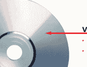


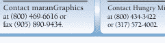


maranGraphics 是一家位于加拿大多伦多附近的家族企业。


在 maranGraphics，我们坚信一次只打造一本优秀的计算机书籍。

maranGraphics 从事高科技产品制作已超过 25 年，这使我们能够为计算机图书界提供一种独特的沟通流程。

我们的计算机图书采用一种整合式沟通流程，这与其他计算机图书所采用的方法截然不同。每个跨页本质上都是一张流程图——文字和屏幕截图完全融入版面布局。引言文字和实用提示共同完善了学习体验。

maranGraphics 的方法鼓励左右脑协同工作——从而实现更快的上手速度和更强的记忆保持。

最重要的是，我们为自己图书的纯手工制作特性感到非常自豪。我们精心挑选的作者都是各自领域的专家，他们花费无数小时研究和整理每个主题的内容。我们的美术师会重新制作每一张屏幕截图，以提供尽可能高的清晰度，使我们的屏幕截图成为业内最精确、最易读的截图。我们力求完美，并相信在每一个元素上投入的手工制作时间，能够打造出金钱所能买到的最好的计算机图书。

感谢您购买本书。希望您喜欢！

此致，
Robert Maran
总裁
maranGraphics
Rob@maran.com
www.maran.com
www.hungryminds.com/visual

### 制作人员名单

策划、编辑与媒体开发

制作

项目编辑
Maureen Spears

书籍设计
maranGraphics®

策划编辑
Jen Dorsey

制作协调员
Dale White

产品开发主管
Lindsay Sandman

版面设计
Kristin McMullan、
LeAndra Johnson、Jill Piscitelli

文字编辑
Timothy J. Borek、Jill Mazurczyk

屏幕美术师
David Gregory、Mark Harris、
Jill A. Proll

技术编辑
Todd Meister、Garrett Pease

封面插图
David E. Gregory

编辑经理
Rev Mengle

校对
John Bitter、Joanne Keaton、
Carl Pierce

媒体开发经理
Laura Carpenter Van Winkle

索引编制者
TECHBOOKS Production Services

高级版权许可编辑
Carmen Krikorian

特别协助
Microsoft Corporation
Sarah Hellert
Mica Johnson

媒体开发专员
Angela Denny

编辑助理
Amanda Foxworth

### 致谢

Hungry Minds 技术出版集团：Richard Swadley，高级副总裁兼出版人；Mary Bednarek，网络部门副总裁兼出版人；Joseph Wikert，Web 开发集团副总裁兼出版人；Mary C. Corder，Dummies 技术编辑总监；Andy Cummings，Dummies 技术出版总监；Barry Pruett，视觉/平面设计出版总监。Hungry Minds 制作部：Ivor Parker，制作副总裁。

Hungry Minds 市场部：John Helmus，助理副总裁兼市场总监。

Hungry Minds 品牌出版社制作部：Debbie Stailey，制作总监。

Hungry Minds 销售部：Michael Violano，国际销售与附属版权副总裁。

### 关于作者

Richard Bowman 拥有并经营 BowmanSoft, Inc.，该公司专注于软件咨询和互联网开发技术。

Richard 还是《Visual Basic Web Magazine》的编辑和所有者，这是一个专注于 Visual Basic 和 ASP 编程的网络资源站点。您可以访问 VBWM，网址为 http://www.vbwm.com/。您可以通过 richard@bowmansoft.com 联系作者。

### 作者致谢

过去的几个月是一段漫长而艰辛的旅程。在着手撰写本书之前，我从未意识到一个项目会带来如此大的压力。我要感谢所有帮助我保持理智，并告诉我“我能做到”的人。我的家人——Debbie、Richard 和 Megan——从最初构思到最终制作，始终给予我爱与帮助。特别感谢我的朋友和同事 Aaron、Chris、Christina、Katie 和 Stephanie，他们在整个过程中给予了巨大的鼓励和支持。

感谢 VBWM.COM 网站的作者和开发者，在我错过截止日期时给予我理解和耐心。特别感谢我的编辑们——Maureen、Jen、Rev、Tim、Mica、Todd 和 Garrett——他们让我始终走在正轨上，并在我一筹莫展时总是伸出援手。


献给我的家人，感谢他们如此包容。


### 如何使用本书

《Visual Basic .NET：构建 .NET Framework 上多功能程序的视觉蓝图》使用简单、直接的示例来教您如何创建功能强大且动态的程序。

为了充分利用本书，您应该按顺序从头到尾阅读每一章。每章都会介绍新概念并在前几章所学知识的基础上展开。当您熟悉《Visual Basic .NET：构建 .NET Framework 上多功能程序的视觉蓝图》后，您可以将本书用作信息丰富的桌面参考。

#### 本书适合谁

如果您有兴趣使用 Visual Basic .NET 编程环境为 Windows 计算机和 Internet 编写应用程序，那么《Visual Basic .NET：构建 .NET Framework 上多功能程序的视觉蓝图》就是您的理想之选。

本书将带您完成安装和使用开发工作室、编写高级 Windows 应用程序以及开发 Web 应用程序的过程。本书还提供了开发可重用组件和打包您的应用程序或组件的详细内容。

尽管本书不需要任何 Visual Basic 编程的先前经验，但建议您熟悉安装在计算机上的 Microsoft Windows 操作系统以及一般编程语言。

#### 使用本书所需条件

要完成本书中的任务，您需要一台安装了 Microsoft Windows NT 4.0、2000 或 XP 的计算机，以及 Microsoft Visual Studio .NET。您不需要任何特殊的开发工具，因为所有工具都是 Visual Studio .NET 开发环境的一部分。

#### 本书中的约定

在《Visual Basic .NET：构建 .NET Framework 上多功能程序的视觉蓝图》中使用了多种排版和版式样式来区分不同类型的信息。

Courier Font
表示使用 Visual Basic for Applications (VBA) 代码，例如标签或属性，脚本语言代码，例如语句、运算符或函数，以及 Excel 对象模型代码，例如对象、方法或属性。

Bold
表示您必须输入的信息。

Italics
表示新术语。

#### 应用实践

“应用实践”部分通常包含一段代码，将您刚刚学到的课程更进一步。“应用实践”部分提供内部信息和提示，您可以用它们来增强代码的功能。

#### 额外内容

“额外内容”部分提供了有关您刚刚完成的任务的附加信息。“额外内容”部分通常包含有趣的提示和有用的技巧，以使使用 Excel 宏的工作更轻松、更高效。

### 本书的组织结构

《Visual Basic .NET：构建 .NET Framework 上多功能程序的视觉蓝图》包含 13 章和一个附录。

第一章“开始使用 Visual Basic .NET”让您熟悉本书中使用的特性和功能。您将学习如何安装 Visual Studio .NET，如何创建新项目，如何保存和打开项目文件，以及如何升级 Visual Basic 6.0 项目。

第 2 章“开始使用 Windows 窗体”向您展示如何构建和管理 Windows 应用程序的开发。本章重点介绍如何在 Visual 开发环境中工作以及如何构建菜单和各种窗口。

第 3 章“使用控件”向您展示如何将各种类型的控件，例如按钮、单选按钮、复选框、列表框和工具栏，构建到您的 Windows 窗体应用程序中。

第四章“Visual Basic .NET 编程”向您展示如何使用 Visual Basic 语言来声明和使用变量、字符串、数组、集合，使用运算符、参数、条件块和循环。

第 5 章“提供输入和输出”向您展示如何从文件读取和写入、检测文件系统的更改以及检索文件和目录列表。本章还涵盖如何添加打印和打印预览支持，以及如何从网络或 Internet 下载信息。您还将学习如何构建自己的服务器。

第 6 章“创建图形和多媒体”向您展示如何向应用程序添加图形命令。本章向您展示如何绘制线条、形状和文本，使用各种填充和图案。本章向您展示如何构建自定义形状并将其应用于窗体，以制作任意尺寸或形状的自定义形状窗体。

第 7 章“使用类”和第 8 章“使用高级 OOP 技术”说明了如何有效地构建和使用类。这包括如何在类中开发一组属性、方法和事件。它还继续探索类开发的更高级技术，包括继承、重载和使用线程。

第九章“访问 ADO .NET”向您介绍 ADO .NET 数据库编程工具，并向您展示如何构建数据绑定控件，如何使用数据网格，以及如何开发数据验证

第 10 章“使用 Web 窗体”说明了 Web 窗体服务器应用程序的开发。本章向您展示如何使用 Web 界面设计器，以及如何使用控件和事件模型构建可在任何标准 Web 浏览器中运行的应用程序。

第 11 章“使用 Web 服务”向您展示如何构建服务应用程序，通过 Internet 导出 Web 服务的功能，以及如何监控服务。

第 12 章“开发组件”向您展示如何构建自己的组件、控件、Web 控件和用户控件。

第 13 章“打包您的应用程序”说明了如何打包应用程序以进行分发，如何捕获和处理错误，以及如何为残障用户提供功能。

#### CD-ROM 上有什么

本书附带的 CD-ROM 包含本书中每个两页课程的示例项目代码。这可以节省您输入代码的时间，并帮助您快速开始创建 VB .NET 代码。CD-ROM 还包含多个程序的评估版本，您可以使用它们来配合《Visual Basic .NET：构建 .NET Framework 上多功能程序的视觉蓝图》使用。书中提到的电子版书籍和所有 URL 也可在光盘上获得。


### VISUAL BASIC .NET 简介

Visual Basic .NET 是 Microsoft Visual Studio .NET 的一部分，是 Microsoft 最新推出的开发环境。借助 Visual Basic .NET，或简称 VB .NET，你可以使用统一的工具包创建功能强大的 Windows 和 Internet 应用程序。有关 .NET Framework 的更多信息，请参阅“理解框架”部分。

随着 VB .NET 的发布，Visual Basic 获得了与 C++、C# 和 Java 等语言相当的高级语言特性。强大的新功能赋予 VB .NET 其前身的简洁性，同时具备创建充分利用计算领域最新创新的完整应用程序的能力。

#### 特性

#### 易于使用

Visual Basic 语言实现了原始 BASIC 语言的更新版本，该语言诞生于 1964 年。BASIC 语言的重点是提供一种高级编程语言，将计算机的大部分复杂性隐藏在开发者之外。

#### 可视化开发

图形用户界面 GUI 的出现承诺了更易于使用的计算机。但为 GUI 环境开发应用程序比预期更困难。Visual Basic 是第一个成功使用拖放和强大的集成开发环境 IDE 的 Windows 编程语言，使用户能够在创纪录的时间内开发应用程序。

#### 自动内存管理

Visual Basic .NET 使用一种称为垃圾回收的系统来管理应用程序的内存。垃圾回收是 VB .NET 与 C# 和 Java 等语言共有的重要特性。垃圾回收不需要你显式地从内存中删除对象。VB .NET 会找到不再被引用的对象，并在应用程序空闲时自动将其从内存中移除。

如今，Visual Studio .NET 套件共享一个 IDE，可执行庞大的功能。IDE 设计使其能够扩展以支持各种语言和工具包。语言的集成也意味着，如果你使用多种语言工作，就不必学习多个开发环境。

#### 完全面向对象

Visual Basic .NET 与 Visual Basic 6.0 及更早版本不同，支持完全的面向对象编程，支持多态性、真正的继承和接口。完全的面向对象编程使 VB .NET 能够与 Visual C# 和 C# 等其他高级语言通信并扩展它们。事实上，由于 .NET Framework 的强大功能，Visual Basic .NET 可以利用另一种语言的源文件，继承在 C# 中创建的类，或为 C++ 提供真正的对象。有关使用对象的更多信息，请参阅第 7 章。

#### 真正的 Web 开发

Visual Basic .NET 使用新的 ASP.NET 对象创建完全编译的服务器端应用程序，这些应用程序使用 Visual Basic 语言和 .NET Framework 的全部功能，同时仍可与标准浏览器交互。ASP.NET 与 Visual Basic .NET 结合，提供了一种独特的开发系统，称为 Web Forms，它将 Visual Basic 的拖放便捷性带到了 Web 开发中。

#### 强大的数据库支持

VB .NET 扩展了 Visual Basic 语言在开发高级多层数据库应用程序时所知晓的强大支持。支持 ADO 和 ADO.NET 的新版本，VB .NET 可以创建性能更好、功能更强大的 Web 启用数据库应用程序。

Web 服务，可能是 .NET Framework 最重要的特性之一，提供了一种使用依赖于 XML 的 SOAP 标准通过 Internet 访问远程对象的方法。你可以将对象存储在 Web 服务器上，并使任何应用程序能够透明地通过 Internet 直接访问该对象。例如，你可以创建一个使用存储在集中式 Web 服务器上的对象的 Windows 应用程序，就像使用本地机器上的组件一样。Visual Basic .NET 充分利用了此功能并创建了 Web 启用对象。


### 开发支持

#### 原生 Windows 应用程序

您可以使用 VB .NET 中的 Windows Forms 技术来开发充分利用 Windows 操作系统的应用程序。强大的窗体设计器使您可以通过单击、拖动和放置的方式构建完整的 Windows 界面。请参阅第 2 章了解如何开发 Windows 应用程序。

#### 创建 Windows 服务

Visual Basic .NET 可以创建真正的 Windows 服务，即在 Windows NT、Windows 2000 或 Windows XP 系统上维护后台任务的软件。Windows 包含许多服务，这些服务使系统能够索引磁盘上的文件以加快搜索速度、运行 Internet 服务器以及在应用程序之间传递消息。服务使您能够轻松创建与 Windows 集成以提供透明后台功能的服务器和实用程序。VB .NET 是支持创建服务应用程序的第一个 Visual Basic 版本。请参阅第 11 章了解如何开发您自己的 Windows 服务。

#### 游戏与多媒体应用程序

Visual Basic .NET 可以访问 Visual Studio .NET 中其他语言所使用的同一个类库，从而让 VB .NET 能够使用强大的 GDI+ 和 DirectX 函数。.NET Framework 类库将所有 Windows 绘图函数封装在一个完整的类库中，使您无需调用复杂的系统调用，就可以像使用 Visual Basic .NET 系统中的其他组件一样使用图形命令。有关图形命令的信息，请参阅第 5 章。

#### 创建 Web 应用程序

VB .NET 中全新的 Web Forms 技术让您可以创建通过 Web 运行的交互式应用程序。这些应用程序完全在服务器上使用 Microsoft Internet Information Server (IIS) 运行。您可以创建在任何浏览器中都能正常工作的应用程序，并让 Web Forms 自动跨页面维护变量和状态信息，从而为您打造无缝的应用程序开发流程。请参阅第 10 章了解如何开发 Web 应用程序。

#### 数据库应用程序

数据访问从一开始就是 Visual Basic 语言的优势之一，而 Visual Basic .NET 延续了这一传统，提供了迄今为止最先进的数据访问工具。您可以将表拖放到窗体上，并通过指向和单击创建自动连接的控件。借助 Microsoft 的 Active Data Objects 库 (ADO.NET)，您可以通过一个强大的环境访问各种数据库系统。您可以使用 ADO.NET 中的标准类，将应用程序从 Microsoft Access 迁移到 Microsoft SQL Server 再到 Oracle 服务器，而代码几乎不需要更改。请参阅第 9 章了解如何开发数据库应用程序。

#### 创建 Web 服务

Web 服务利用 .NET 技术的强大功能，以安全的方式跨 Internet 导出函数。任何支持 .NET 的应用程序，无论是 Web Forms 应用程序还是 Windows Forms 应用程序，都可以访问该 Web 服务，就像它位于同一台机器上一样。请参阅第 11 章了解如何开发您自己的 Web 服务。

#### 控制台应用程序

Visual Basic .NET 新增了创建在标准文本控制台中运行的控制台应用程序的功能。这些控制台应用程序使您可以创建用户能够从命令行访问的实用程序，并可快速创建程序来测试编程函数。有关创建控制台应用程序的更多信息，请参阅第 4 章。

### 安装 Visual Studio .NET

使用 VB .NET 的第一步是安装开发环境和编译器。Visual Studio .NET 应用程序套件包括 Visual C++、Visual C#、Visual Basic .NET、由 Microsoft 开发人员网络 (MSDN) 提供的大型帮助库，以及各种工具。

Visual Studio .NET 的完整安装建议在系统驱动器上预留 500MB 空间，在应用程序驱动器上预留 2.5GB 空间。Visual Studio .NET 不支持 Windows 95、Windows 98 或 Windows ME 操作系统。如果您计划使用 Web 开发工具，可以将 Visual Studio .NET 安装在 Windows 2000 Server 上，尽管 Visual Studio .NET 可以与远程 Windows 2000 服务器一起使用。要在 Windows 2000 Professional 上安装 Visual Studio .NET，至少需要 96MB 内存，建议使用 128MB。对于 Windows 2000 Server，Visual Studio .NET 需要 192MB 内存，建议使用 256MB。

安装 Visual Studio .NET 时，您可能需要更新一些 Windows 组件。Visual Studio .NET 安装程序会提示您插入包装中包含的 Windows Component Update CD-ROM，并用 Windows 服务包和其他组件更新您的系统。安装程序会在安装期间自动重新启动。然后，安装程序会询问您是否输入登录信息（可选），以便它可以自动登录并继续安装。

Visual Studio 安装本身分布在多张 CD-ROM 或一张 DVD 上，但大部分安装过程是自动化的。它允许您为安装的不同组件选择不同的驱动器，这有助于缓解巨大的磁盘空间需求。默认情况下，安装程序会安装所有三种编程语言，并从 CD-ROM 运行帮助。MSDN 帮助库是非常重要的资源，因此如果您的磁盘空间充足，可以设置 MSDN 帮助选项以安装到磁盘，便于访问。

### 安装 Visual Studio

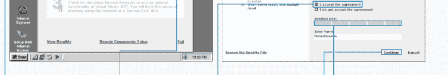

- 1. 将 Visual Studio 光盘 1 插入 CD-ROM 驱动器。
- 2. 单击“步骤 2”开始安装 Visual Studio .NET。

您可以通过单击“步骤 1”并按照说明更新系统组件。
您可以单击“步骤 3”检查最新的 Service Release。

- 3. 单击“我接受许可协议” ○ 变为 ●。
- 4. 输入产品密钥。
- 5. 单击“继续”。


### Extra

你可以使用安装程序将应用程序的各个部分安装到不同的位置。例如，你可以将 .NET Framework 文件安装在一个驱动器上，将主要开发文件安装在另一个驱动器上。要更改安装中各个部分的安装路径，请在安装程序中显示的树中单击该项目，然后单击安装路径右侧以修改安装路径。

你可以使用安装程序安装 MSDN 帮助文件以便于访问。MSDN 帮助文件包含包中存在的语言的所有文档，以及微软以电子形式出版的许多书籍和文章。要将 MSDN 安装到磁盘而不是从 CD-ROM 驱动器运行，请单击 MSDN 文档项旁边的 CD 图标并单击安装到磁盘。

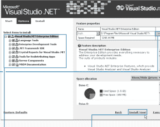

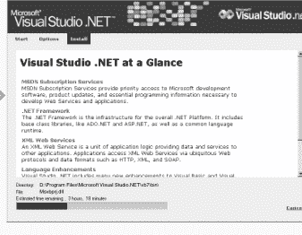

6 在安装选项旁边的复选框中单击以切换该项目的安装。

7 单击立即安装！开始安装。

你可以通过单击链接按钮来更改安装目录，如有需要。

Visual Studio 设置将安装所需选项。

### USING THE DEVELOPMENT STUDIO

开发工作室为开发的几乎每个方面提供了一个集成的用户界面，包括可视化设计工具、代码编辑器、集成的 MSDN 帮助系统、调试和插件支持。你使用开发工作室创建和管理你创建的所有 .NET 应用程序。

在开发工作室顶部，你会找到菜单和工具栏的标准布局。在窗口周围，你可以看到各种工具窗口附加到主窗口。你可以移动和自定义所有菜单、工具栏和工具窗口。

当你启动开发工作室时，它会为你呈现一个打开的起始页。此页面让你打开最近的项目、搜索产品和支持页面、查看“新增内容”区域并浏览在线社区。

当你第一次打开开发工作室时，它会显示起始页的“我的个人资料”部分，为你提供工作室的标准设置访问权限。

假设你选择 Visual Basic 开发人员设置，你会发现工具箱附加在窗口左侧。工具箱提供了你用于设计 Windows 窗体、Web 窗体、数据库应用程序和其他类型应用程序的组件。

在开发工作室右侧，你会找到解决方案资源管理器。解决方案资源管理器保存单个解决方案的内容。然而，一个解决方案可以包含多种类型的多个项目，这些项目组合成一个应用程序。

起始页上的新建项目按钮让你开始一个新应用程序。此对话框提供可用项目类型的列表。你可以在“创建项目”部分了解有关创建项目的更多信息。打开项目按钮提供 Visual Studio 项目文件夹中的文件夹列表以打开。要了解有关打开现有项目的更多信息，请参阅“使用项目”部分。

### USING THE DEVELOPMENT STUDIO

### OPEN THE DEVELOPMENT STUDIO

- 1. 单击开始
- 2. 单击程序。
- 3. 单击 Visual Studio .NET 程序文件夹。
- 4. 单击 Visual Studio .NET 程序图标。

### FIRST USE OPENING SCREEN

- 开发工作室打开。
- 5. 单击我的个人资料。
- 6. 单击个人资料列表并单击适合开发工作室的样式。
- 7. 单击开始以打开环境的默认主页。

- 本书假设你选择 Visual Basic 开发人员个人资料设置。
- 你可以单击并单击另一个启动选项。

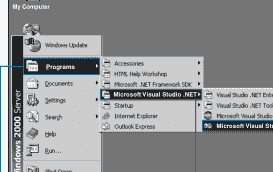

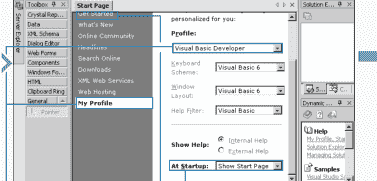

### Extra

你可以通过单击帮助然后显示起始页随时返回起始页。起始页为你在环境中使用提供常用起点资源。

如果你关闭了任何工具窗口或找不到它们，请单击查看。菜单列出了开发工作室的所有部分。其他窗口菜单项有一个子菜单，其中包含更多工具窗口，如果你在主查看菜单上找不到所需的工具窗口。

你可以在环境内部访问可搜索的 MSDN 库。单击帮助然后搜索。搜索工具窗口出现，让你指定搜索词。你还可以将结果过滤到帮助的特定区域。由于帮助涵盖了开发的各个方面，从文章和参考资料到在线书籍，你可能希望使用 Visual Basic 和相关项过滤结果。这将你的搜索范围缩小到访问 Visual Basic 子部分中的参考信息，并包括 .NET Framework 参考。当你单击搜索时，结果工具窗口会沿着环境的底部出现。

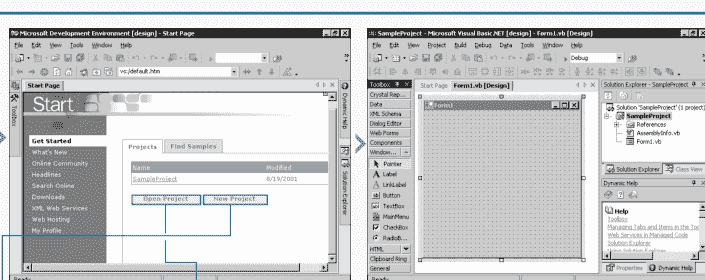

### USING THE START PAGE

- 默认主页打开。
- 你可以单击新建项目开始新项目。
- 注意：要创建新项目，请参阅“创建项目”部分。

或者，你可以单击打开项目或从最近打开的项目列表中单击一个项目以打开现有项目。

注意：要打开和保存项目，请参阅“使用项目文件”部分。

起始页提供对开发工作室常用区域的访问。


### 面向对象概念

Visual Basic .NET 提供了一个完全面向对象的环境，这意味着它的功能围绕一组对象展开。许多语言，如 C++、C#、Java 等，也被认为是面向对象的，并提供许多相同的功能。您可以使用面向对象编程（OOP）创建可轻松重用和扩展的代码。

Visual Basic 6.0 及更早版本提供了 OOP 的部分实现，但 VB .NET 是第一个主要围绕对象设计的 Visual Basic 版本。

### 类

类包含一组数据，是面向对象应用程序的主要构建块。与在非面向对象语言中直接操作数据不同，类控制了从外部访问该数据的方式。您可以将类视为具有两个不同部分，即接口和实现，它们提供了面向对象语言开发中易用性和可重用性的关键。对于类的更多信息，请参阅第 7 章。

在许多方面，类试图模仿你在现实世界中定义事物的方式。例如，您可能想要创建一个程序，让一个球在屏幕上弹跳。您可以将定义球的形状、大小和动作的代码与绘制和操作用户界面的代码放在一起。但在面向对象语言中，更合理的做法是创建一个类来表示球。

### 对象

对象是从类创建的实际表示。类提供了构成对象的代码和定义。当您创建对象时，您创建了类的可用版本，该版本独立存储在内存中。然后您可以访问对象的一部分，设置属性，并使用其方法提供的功能。您可以基于类的信息创建任意数量的对象。无论您从单个类定义多少个对象，与该对象关联的所有属性和数据都对单个对象是唯一的。

例如，在您的应用程序中，假设您想在屏幕上创建一个弹跳的球。您定义一个代表球的类。然后在应用程序中创建一个球的单个实例，设置球的属性，并告诉它弹跳。球在屏幕上适当弹跳。您可以轻松返回应用程序的代码，而不触及为球定义的类，并创建类的新实例。这个球独立弹跳，不知道其他球的存在。

### 接口

类的接口为应用程序的其他部分提供了访问对象的方式。当您定义类时，您确定类对用户的需求并创建属性、方法和事件的接口以使类可用。当您或他人使用类创建对象时，您无需了解其内部功能。类将所有功能内部化并允许交互。

### 实现

类的实现是使类工作的属性和方法背后的代码。当您使用对象时，您使用实现来访问类的功能。

类的实际实现对您是隐藏的，这样您就可以专注于使用类而不是它如何工作。

### 属性

作为类的一部分，您可以将属性视为定义类细节的属性。您使用属性来定义构成类特征的数据。每个属性存储单个数据类型，可以包含一段文本、一个数字或另一个完整的对象。

以代表球的类为例，您使用属性来定义球的形状、大小、颜色、重量和位置。属性使您从类创建的对象变得独特。

### 方法

方法使类能够定义使对象功能化的动作。方法由执行一个特定动作的代码块组成。您可以定义任意数量的方法来构成一个类。您可以将方法视为对象所做或可以对其执行的操作的定义。

例如，您可以对球执行许多操作，例如投掷、抛掷或滚动。当然，计算机模拟的球也需要方法使其移动、在屏幕上绘制，并在屏幕边界内弹跳。

### 事件

对象使用事件将信息发送回对象使用者。事件通常代表对类所有者调用的方法的响应。事件可以通过参数发送回数据。类所有者可选择通过创建称为事件处理程序的方法来响应事件，该方法必须由对象所有者设置。

例如，当您投掷、抛掷或滚动球时，可能会发生许多事件作为对您操作响应的结果。球可能会撞到地面、撞到墙壁或爆裂。在计算机环境中，球撞到定义的边界，并让对象所有者响应此发生。您通常使用事件简单地将状态信息发送回对象所有者，例如球的当前位置，或类自行处理的航向变化。


### 理解框架

.NET Framework 提供了一个庞大的类库，其中包含了 VB.NET 可用的大部分功能。你可以使用本指南作为理解 .NET 应用程序底层结构的起点。

### .NET 框架

#### 特性

.NET Framework 是一个庞大的环境，代表了 Visual Studio .NET 中包含的大部分功能。框架的基础由通用语言运行时，或 CLR 组成，它是驱动整个系统的引擎。CLR 提供了一套标准的数据类型和对象，并使跨语言和跨平台开发成为可能。

框架的中间层包括下一代系统服务，如 ADO.NET、ASP.NET 和 XML。与之前版本的这些工具不同，框架管理这些工具，使其在各语言中的可用性普遍一致。

最上层包括用户和程序接口。Windows Forms 提供创建标准 Win32 应用程序的接口。Web Forms 提供了一个强大的服务器端可视化开发工具，围绕 ASP.NET 构建。Web Services 提供了一种机制，使程序能够直接通过互联网通信。此外，控制台接口允许创建简单的基于文本的应用程序。

#### CLR

CLR 的目的是创建一个更易于使用且更快的开发系统，并自动处理内存管理和进程通信等低级细节。CLR 的其他重要特性包括更简单更安全的部署环境和可扩展性。

CLR 透明地支持任意数量的语言，不限于微软开发的语言。这种集成使许多语言能够利用内置的调试系统和内存管理。CLR 的集成要求 VB 语言发生显著变化，但使它能够更有效地与其他语言协同工作。

#### 版本控制

CLR 为应用程序部署和组件版本提供了显著改进。与之前的组件模型（如 COM）不同，CLR 可以在不使用 ProgID、CLSID 和类型库的情况下查找和引用组件。CLR 支持并排部署，因此可以加载和使用同一程序集的多个版本。这使一个程序可以使用 DLL 的某个版本，而另一个程序同时使用该 DLL 的更新版本，从而消除了非向后兼容 DLL 的问题。

当你编译引用 DLL 或共享程序集的应用程序时，编译器会将程序集的名称和版本号存储到你的应用程序中。

#### 程序集

一个或多个模块组成一个称为程序集的单一单元。此程序集包含将它部署到多台计算机所需的信息。程序集包含一个称为清单的组件元数据目录。此清单保存有关类型可见性、组件版本控制和安全性的关键信息。每个类型都必须存在于程序集的范围内。在 Visual Basic .NET 中，单个项目代表单个程序集。解决方案包含多个项目，因此将多个程序集关联起来以便部署。

当你为他人创建程序集时，你必须决定哪些类型应在程序集外部可见。你使用 Public 和 Private 关键字来向外部用户公开或隐藏类或接口。你也可以使用 Friend 关键字来隐藏方法，使其对程序集外部不可见，但可在程序集内部使用。

### .NET 类框架

.NET 类框架库实现了你在 .NET 启用语言中使用的功能。类框架由数百个类和接口组成。它将类功能封装在大多数 Windows 系统库周围，并提供标准 Windows 库中不可用的额外功能。

#### 特性

.NET 类框架包含广泛需求的功能。这些功能包括：

- 数据访问和操作：通过 ADO.NET 进行数据访问、强大的 XML 支持，以及文件和目录工具
- 标准语言功能：数学命令、数组、集合和字符串
- 线程的创建和管理：自由线程库和进程管理
- Windows 功能接口：Windows Forms、Web Forms、Web Services 和控制台应用程序
- 管理和执行应用程序安全
- 应用程序配置
- 使用 Windows 目录服务、事件日志、消息队列和计时器
- 对多种网络协议的支持

#### System 命名空间

System 命名空间包含 .NET Framework 中的大部分功能。下表解释了 System 的一些主要子部分。你可以使用此列表作为在库中查找特定功能的起点。

| 命名空间 | 描述 | 示例类 |
|---|---|---|
| System.Collections | 表示各种集合的类。 | ArrayList, HashTable, SortedList |
| System.Data | 构成 ADO.NET 体系结构的类。 | DataRow, DataTable, DataColumn, DataSet |
| System.Diagnostics | 使你能够调试应用程序并跟踪代码执行的类。 | Debug, EventLog, FileVersionInfo, Trace |
| System.Drawing | 提供对 GDI+ 基础图形功能的访问。 | Brush, Font, Image, Pen, Region, SystemColors |
| System.Drawing.Printing | 提供打印功能和打印机及页面设置。 | PageSettings, PrintDocument, PrinterSettings |
| System.IO | 包含用于读写数据流和文件的类型。 | DirectoryInfo, FileInfo, FileStream, StreamReader, StreamWriter |
| System.Net | 提供对许多常见 Web 协议的接口。 | Cookie, Dns, FileWebRequest, IPAddress, WebClient |
| System.Resources | 管理应用程序中各种特定于文化的资源创建和存储。 | ResourceManager, ResourceReader, ResourceWriter |
| System.Security | 提供 CLR 的底层安全结构。 | PermissionSet, SecurityManager |
| System.Security.Cryptography | 提供数据编码和解码例程，以及哈希、随机数生成和消息认证等功能。 | CryptoStream, DES, DSACryptoServiceProvider, MD5CryptoServiceProvider, RSACryptoServiceProvider |
| System.Text | 包含表示 ASCII、Unicode、其他字符编码的类，以及格式转换类。 | ASCIIEncoding, StringBuilder, UnicodeEncoding, UTF7Encoding |
| System.Threading | 启用多线程编程。包括管理单个线程、线程池和同步问题的类。 | Monitor, Mutex, Thread, ThreadPool, Timer |
| System.Web | 提供使 ASP.NET 应用程序能够进行浏览器和服务器通信的类。 | HttpApplication, HttpPostedFile, HttpRequest, HttpResponse, HttpWriter |
| System.Windows.Forms | 提供创建完整 Windows 应用程序的类。 | Button, CheckBox, Clipboard, Form, ListView, MessageBox |
| System.Xml | 提供基于标准的 XML 处理支持。 | NameTable, XmlAttribute, XmlNode, XmlReader, XmlText, XmlValidatingReader |


### 语言基础

Visual Basic .NET 是一种使用许多普通英语单词的简单语言。要有效地使用该语言，你需要学习某些通用约定。有关约定的更多信息，请参阅帮助系统中的 Visual Basic 程序员指南。

### 缩进

缩进代码是指插入空格以使代码更易读的做法。虽然某些语言需要特定的缩进来正确构建代码，但在 Visual Basic .NET 中缩进完全是可选的。

强烈推荐，缩进使代码更容易阅读和理解。你使用四个空格，即 VB .NET 中的默认值，来缩进块内的代码。

```
Non-Indented code:
Sub MyMethod(argument As String)
Dim counter As Integer
If argument = "Test" Then
For counter = 1 To 10
ProcessData()
Next
End If
End Sub
```

```
Properly Indented code:
Sub MyMethod(argument As String)
    Dim counter As Integer
    If argument = "Test" Then
        For counter = 1 To 10
            ProcessData()
        Next
    End If
End Sub
```

### 注释

代码文件中 VB .NET 不处理的行，注释让你可以用纯英语描述代码。这使得以后调试和理解代码变得更容易。要注释代码，请在代码行的末尾或新行放置一个单引号。VB .NET 会忽略单引号之后的所有内容，因此你可以在测试期间“注释掉”代码，而 VB .NET 不会运行单引号后面的代码。

```
Non-Commented Code:
Sub Main()
    Setup()
    ShowInitialScreen()
    ProvideUserFeedback()
End Sub
```

```
Commented Code:
Sub Main()
    ' program begins here.
    ' initialize variables to default values and load
    ' the configuration file CONFIG.INI
    Setup()
    ' create an instance of the MainForm form and
    ' show it to the user.
    ShowInitialScreen()
    ' when the user exits the form, allow them to
    ' provide feedback about their experience
    ProvideUserFeedback()
End Sub
```

### 换行

你可以使用下划线 (_) 字符将 VB .NET 中的单个语句拆分为多行代码。你只能在行中通常有空格的地方换行，因此不能在字符串中间换行。你也可以在字符串中换行，从而将其分隔，通过创建两个字符串并在两部分之间拆分行。你通常还会缩进语句的额外行以提高可读性。本书在任务屏幕中经常使用下划线字符，以便你可以看到代码行。

```
Example:
Sub Method1()
    call method 2
    Method2(New Point(5, 5), _
        New Rectangle(10, 10, _
        20, 20), New Point(15, 15))
End Sub
```

### 类

当你访问命名空间和类的元素时，你使用句点 (.) 分隔各个组件。

```
Example:
' declare a new Point object from the Point
' class located in the Drawing namespace
' located in the System namespace
Dim a As New System.Drawing.Point()
' set the X and Y properties of the Point
a.X = 100
a.Y = 100
```

### 常量

你可以在任何模块的基础中使用 Const 关键字在程序中声明常量，即命名值。常量使代码更易读。此外，你可以更改常量的值来影响使用该常量的所有代码。

```
Example:
Const MyFavoriteNumber As Integer = 9
Const DefaultErrorMessage As String = "Error!"
```

### 区域

你可以使用区域来分隔模块中的代码部分，使其更易读。当你声明一段代码区域时，代码编辑器会提供一个加号/减号按钮来展开或折叠该部分。对于很少更改的长代码，区域可以使使用代码编辑器变得更简单。

```
Example:
#Region "Calculation functions"
Sub Add()
...
End Sub
...
#End Region
```

### 关键字

下面的关键字列表不完整；搜索帮助中的“keywords”以获取完整列表。

- Alias And AndAlso Assembly Ansi
- As Auto Boolean ByRef Byte
- ByVal Case Catch Char Class
- Const Date Decimal Declare Default
- Delegate Dim Do Double Each
- Else ElseIf End Enum Erase
- Error Event Exit False Finally
- For Friend Function Get Handles
- If Imports In Inherits Integer
- Interface Is Let Lib Like
- Long Loop Me Mod Module
- MyBase MyClass New Next Not
- Nothing Object On Option Optional
- Or OrElse Overrides Private Public
- ReDim Region Resume Return Select
- Shared Static Step Stop String
- Structure Sub Then Throw To
- True Try TypeOf Unicode Until
- When While With Xor


### 从 Visual Basic 6 的语言变更

比起 Visual Basic 6，即 Visual Basic 的前一版本，Visual Basic .NET 升级版有许多重大变更，使其成为更强大且面向跨语言的程序。本节帮助你在尝试将 Visual Basic 6 项目升级到 Visual Basic .NET 之前了解这些变更。要使用升级向导升级项目，请参阅“使用升级向导”部分。

#### Variant

一种特殊的通用数据类型，Visual Basic 6 中的 Variant 数据类型具有存储任意类型数据的能力。变量会变形以存储各种数据，如数值变量、字符串，甚至对象。Variant 也是 VB 6 中的默认变量类型，如果你未为变量指定类型。VB 6 中的 Object 变量类型可以存储对象引用，但没有存储标准数据类型的能力。

在 VB .NET 中，Variant 类型不再可用。通用语言运行时采用 Object 变量作为通用数据类型。因为 VB .NET 将简单变量类型引用为对象，就像它对其他对象数据类型所做的那样，Object 变量类型现在可以存储任何类型的数据。

#### Date

在 Visual Basic 6 中，Date 类型存储为可操作日期的 Double 浮点变量。VB 6 允许你将 Date 类型的变量作为 Double 操作。

Visual Basic .NET 将 Date 类型存储为 64 位整数，这提高了操作的执行速度。但新的存储日期方法破坏了将 Date 变量作为 Double 数据类型工作的兼容性。.NET Framework 提供了 ToOADate 和 FromOADate 方法来将日期在 Double 变量类型之间进行转换。

#### Integer and Long

在 Visual Basic 6 中，数值数据类型 Integer 存储 16 位值，而 Long 类型存储 32 位值。为了提供对更大数字的支持，VB.NET 将 Integer 表示为 32 位值，Long 表示为 64 位值。一种新的变量类型 Short 表示 16 位值。

#### Fixed-Length Strings

在 Visual Basic 6 中，你可以通过指定 String 类型后跟乘号 (*) 和长度来声明变量为定长字符串。

Visual Basic .NET 的通用语言运行时 (CLR) 不支持定长字符串。一个兼容性类使你能够创建定长字符串。你调用兼容性类 FixedLengthString，你可以在 Visual Basic.Compatibility 命名空间中找到它。

#### Currency

在 Visual Basic 6 中，Currency 数据类型以整数格式存储 64 位数字，但在值的第四个位置插入小数点。此外在 VB 6 中，虽然你不能声明 Decimal 类型的变量，但 Variant 类型支持 Decimal 类型，它存储具有移动小数点的 96 位整数值。

Visual Basic .NET 放弃 Currency 类型而只使用 Decimal 数据类型。Decimal 提供更高的精度，并且 CLR 直接支持 Decimal。

#### Type

VB 6 中的 Type 语句声明用户定义类型。

Visual Basic .NET 不支持 Type 语句；相反，你使用 Structure 语句。你可以在第 7 章了解结构。

#### Empty

Visual Basic 6 中的 Variant 初始化为 Empty，当你在数值表达式中使用它们时会自动转换为零，或当你在字符串表达式中使用它们时转换为空字符串。

Visual Basic .NET 将 Object 变量初始化为 Nothing，如果必要，它也会自动转换为零或空字符串。

#### Null and Null Propagation

在 Visual Basic 6 中，Null 值是 Variant 变量的子类型，表示变量不包含有效数据。此外，在 VB 6 中，如果表达式的任何部分求值为 Null，Null 值会“传播”通过表达式，整个表达式变为 Null。

Visual Basic .NET 不支持 Null 传播，并且仅将 Null 变量作为 ADO.NET 的变量类型支持。CLR 将包含 Null 值的 Variant 转换为变量类型 DBNull。你可以使用 IsDBNull 函数来测试类型。不再在涉及字符串数据的表达式中，Object 返回 Null，而是返回空字符串值。

#### Local Variable Scope

在 Visual Basic 6 中，你可以从包含声明的行使用变量一直到过程结束。

Visual Basic .NET 对变量使用块作用域。这意味着你可以从包含声明的行访问局部变量，直到它出现的块结束。因此，如果你在 Do Loop 块内声明一个变量，你在循环结束时无法访问该变量。

#### Arrays

VB 6 允许你定义具有任意下界和上界的数组。你可以使用 Option Base 语句在 VB 6 中定义默认下界。

在 VB .NET 中，所有数组都是零基的；这意味着数组的第一个索引始终为零。你不能设置数组的下界。有关声明和使用数组的更多信息，请参阅第 4 章。

#### ReDim

Visual Basic 6.0 在固定大小和动态数组之间区分。你使用 Dim 语句声明固定大小数组；你使用无界的 Dim 定义动态数组，然后用 ReDim 调整数组大小。

在 Visual Basic .NET 中，所有数组都是动态的，这意味着你始终使用 Dim 声明初始数组大小，并且可以稍后更改数组的大小。这可能导致升级后的 VB 6 代码冗余地初始化数组两次。

#### Assignment

在 Visual Basic 6 中，Set 语句将对象引用分配给变量名。在 VB .NET 中，因为所有变量都是对象，语言仅支持一种形式的赋值，即等号。

#### Calling Procedures

VB 6 提供两种过程调用形式：使用 Call 语句，要求你将参数括在括号中，以及简单地键入过程名称而不使用括号。

Visual Basic .NET 要求两种方法都使用括号以提高一致性。此外，默认参数传递方法从 VB 6 中的 ByRef 更改为 Visual Basic .NET 中的 ByVal。这可能导致细微的错误，因此在升级时请确保在必要的地方重新添加 ByRef 关键字。


### 使用升级向导

您可以使用项目升级向导将 Visual Basic 6.0 项目自动转换为完全原生的 Visual Basic .NET 应用程序。由于 VB .NET 在核心语言上做了大量更改，Microsoft 提供了一个升级向导来协助应用程序的移植。

要调用升级向导，请使用标准的打开项目对话框打开一个 Visual Basic 6 项目。升级向导接收一个项目，创建一个新的 .NET 项目目录，并将项目中存在的所有文件转换为支持 Visual Basic .NET 的新文件。向导不会以任何方式更改或覆盖现有文件。

升级向导包含五个步骤。第一步提供向导完成的动作摘要。第二步检查 Visual Basic 6 项目的项目类型并尝试在 .NET Framework 中提供匹配。两个选项为 EXE 和 DLL/自定义控件库。

向导应自动确定适当的类型。向导还提供一个复选框，如果您想为公共类生成默认接口。 如果您的项目提供了许多公共 COM 对象，您应该选择此框。然后您可以选择创建新的 VB .NET 项目的目录并执行转换。

转换完成后，VB .NET 项目打开。升级向导创建一个名为 UpgradeReport.htm 的文件，其中包含项目中各个模块的升级问题。此报告会提醒您代码中无法转换或需要特别注意的部分。请参阅上一节“Visual Basic 6 的语言更改”，以获取从 Visual Basic 6 转换为 Visual Basic .NET 时发生的重大更改列表。在大多数情况下，您的项目在转换后可以运行，您可以测试功能以查看转换过程中是否出现任何问题。

### 使用升级向导

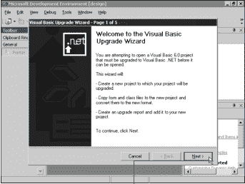

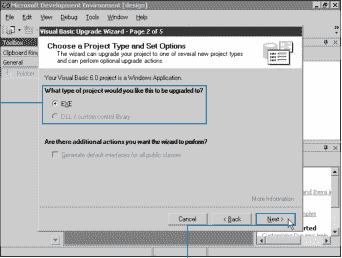

- 1. 打开一个 VB 6 项目文件。Visual Basic 升级向导出现。
- 2. 单击下一步跳过向导的第一屏。
- 3. 验证向导在第 2 步中选择了适当的应用程序类型。
- 4. 单击下一步。

### 额外

为了提供兼容性函数，.NET Framework 在使用升级向导时包含 Microsoft.VisualBasic.Compatibility 命名空间。此命名空间包含存在于 Visual Basic 6 语言中的函数。.NET Framework 复制了 Visual Basic 6 中内置的大部分函数，使得语言中的许多函数变得不必要。为了使升级过程尽可能简单，这些函数提供与 VB 6 函数相同的接口，同时仍符合 .NET 受管代码。例如，VB .NET 不包括创建控件数组的能力。因此，为了使 VB 6 项目成功升级，兼容性库为语言中的每个基本控件包含控件数组。VB .NET 还完全移除了 FileListBox 和 DriveListBox 等控件。兼容性库为升级后的项目提供这些控件。许多已移除的函数如 SendKeys 也存在于此命名空间中。

您可以使用 Visual Basic 6 继续维护现有应用程序而不是升级。Visual Basic 6 和 Visual Basic .NET 可以共存于单个系统上。如果您维护一个在 VB 6 中运行良好的非常大的产品，您可能希望将应用程序保留在 VB 6 中。您可能会发现升级过程很困难，因为语言中存在大量根本性更改。

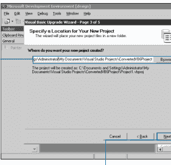

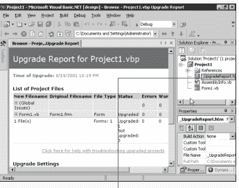

您可以单击浏览以更改升级项目的目录。

5 单击下一步。

步骤 4 出现并通知您向导已收集所有必要信息。

6 在向导的步骤 4 上单击下一步。

向导处理项目。

向导打开新项目。

在解决方案资源管理器中双击 UpgradeReport.htm 文件以查看错误。


### 创建项目

一个项目包含一个单独的应用程序或组件。你必须使用一个项目来指定构成应用程序的文件，例如窗体和类。你将 VB .NET 中的项目放在解决方案中。即使解决方案只包含一个项目，也必须存在该项目。当你创建一个新项目时，VB .NET 会自动创建解决方案。

当你在开发环境中创建一个新项目时，它会提供一个对话框让你选择想要的应用程序类型。对话框左侧显示各种编程语言和其他项目类型的条目。右侧，对话框列出各个项目模板。本书主要关注 Windows 应用程序、控制台应用程序和 ASP.NET Web 应用程序这三种项目类型。Windows 应用程序使用 Windows 窗体来开发图形化 Windows 应用程序。控制台应用程序生成基于文本的 Windows 应用程序，你可以在其中尝试编程概念，而无需设置和修改 Windows 窗体控件。ASP.NET Web 应用程序生成 Web 窗体应用程序。

新建项目对话框还会询问你希望将项目存储在何处。VB .NET 将每个项目存储在其自己的文件夹中以避免命名问题。你为项目指定的名称用作 VB .NET 为项目创建的文件的名称。当你创建项目时，项目的组件会加载到解决方案资源管理器中。这是访问应用程序各部分的主要控制台。如果你创建一个 Windows 应用程序项目，你会看到一个包含单个类 Form1 的项目，它是应用程序的主窗体。控制台应用程序项目会创建一个模块文件，你可以在其中放置代码。

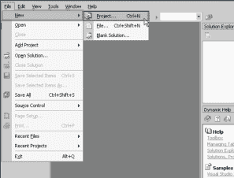

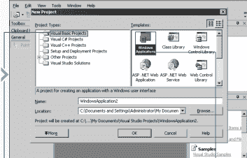

- 打开开发环境。
  注意：有关更多信息，请参阅“使用开发工作室”。
- 单击 File > New > Project。

如果打开了起始页，你可以单击新建项目按钮。有关起始页的更多信息，请参阅“使用开发工作室”部分。

- 从项目类型中单击 Visual Basic Projects。
  新建项目对话框出现。
- 单击适当的项目模板。

### 额外

Visual Basic .NET 中的每个项目都有一个 AssemblyInfo.vb 文件，并构成一个单一的程序集，即 .NET Framework 分配给系统中单个组件的术语。你可以使用此文件定义属性和信息，编译器会将其包含在你的项目中。该文件以空模板开始，并将可为程序集定义的各种属性设置为空白值。你可以为这些属性输入标准文本信息，其中包括 AssemblyTitle、AssemblyDescription、AssemblyCompany、AssemblyProduct 等。该文件还包含一个 GUID 以使项目兼容 COM 以及项目的版本号。该文件是一个 .VB 文件，你可以通过在解决方案资源管理器中双击其名称在源代码编辑器中打开它。

#### 示例：

```
Imports System.Reflection
Imports System.Runtime.InteropServices

<Assembly: AssemblyTitle("Product.NET Main Application")>
<Assembly: AssemblyDescription("Main interface of the product.")>
<Assembly: AssemblyCompany("NETCompany")>
<Assembly: AssemblyProduct("Product.NET")>
<Assembly: AssemblyCopyright("(c) NET Company 2001")>
<Assembly: AssemblyTrademark("*")>
<Assembly: CLSCompliant(True)>
<Assembly: Guid("F7DE8FF1-4F26-4D20-B60E-36D6C604C36C")>
<Assembly: AssemblyVersion("1.0.*")>
```

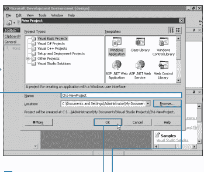

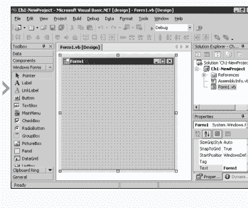

- 为项目输入文件名。
  注意：VB.NET 使用不带扩展名的文件名来创建项目名称。
- 可选地，你可以输入新文件夹或单击浏览以更改 VB.NET 创建项目文件夹的位置。
- 单击确定。

VB.NET 创建项目并打开其默认资源。


### 使用项目文件

VB .NET 提供了一个属性页，可让你在解决方案资源管理器中编辑项目的属性。

项目文件包含对项目内部其他文件的引用。VB 在项目文件中存储各种设置。你可以使用开发环境创建项目，将其保存，并在以后通过项目文件加载它。

你必须在停止工作时保存项目文件，或在对磁盘上的文件进行更改时保存。项目保存开发环境的状态以及构成项目的全部文件。你可以随时打开先前创建的项目文件。如果你打开一个项目文件，而开发环境中加载的解决方案包含不同的项目，打开项目对话框会为你提供两个打开项目的选项。第一个选项“添加到解决方案”会将你打开的项目添加到当前解决方案中，从而创建多项目解决方案。第二个选项“关闭解决方案”会关闭之前的解决方案，并以其自己的解决方案打开该项目。

VB .NET 在解决方案资源管理器中提供了一个属性页，可让你编辑项目的属性。在属性页对话框的“常用属性”部分中，“常规”子部分指定程序集的名称。它还提供项目的输出类型，可提供更改项目生成的应用程序类型的选项。你可以在此对话框中选择启动对象并更改根命名空间。有关使用 Windows 窗体的启动对象的更多信息，请参阅第 2 章。“导入”子部分使你能够定义全局导入到项目中的各种命名空间。有关命名空间和根命名空间的更多信息，请参阅第 8 章。

### 使用项目

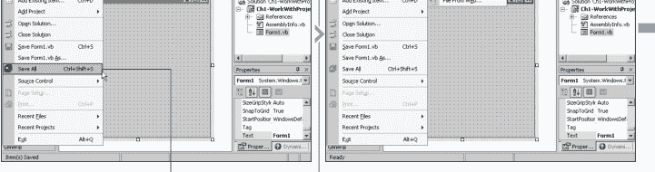

### 保存项目

- 1. 在开发工作室中创建一个新项目。
- 注：有关更多信息，请参阅“创建项目”。
- 2. 单击 File → Save All 以保存当前打开的项目。
- 或者，你可以按 Ctrl+Shift+S 来保存项目。

### 打开新项目

- 3. 单击 File → Open → Project。

你也可以按 Ctrl+O 来打开项目。

### 额外

你可以在解决方案资源管理器中右键单击解决方案项并单击 Properties。这将打开项目属性页，在此你可以设置解决方案中各个项目的启动。你可以使用属性页中的排序选择来确保组件在主应用程序之前构建。

当你打开一个项目时，你可以通过打开项目对话框中打开按钮旁边的单选按钮将其添加到当前解决方案。当同一个解决方案中包含多个项目时，每个项目仍作为其自己的项目运行，创建必要的 EXE 或 DLL 文件。但如果你有两个协同工作的应用程序，并且想要同时开发它们，你可以通过将它们添加到同一个解决方案中轻松管理它们。你可以打开多个开发工作室副本来处理不同的项目。解决方案文件维护设置以启动两个应用程序、仅启动其中一个，或按特定顺序启动它们。你可以在解决方案资源管理器中右键单击解决方案项并单击 Properties。这将打开项目属性页，在此你可以设置解决方案中各个项目的启动。你可以使用属性页中的排序选择来确保组件在主应用程序之前构建。你可以同时加载一个组件项目和一个 Windows 应用程序项目，并告诉环境先加载组件，然后再加载应用程序。

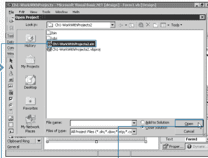

4 单击解决方案文件以打开。

5 单击 Open。

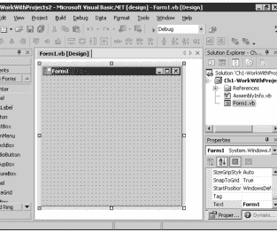

开发环境打开项目，如有必要会关闭其他项目。解决方案资源管理器反映了更改。


### 构建并运行项目

由于 VB .NET 创建 EXE 和 DLL 文件，要测试你的工作，VB 必须首先将创建的代码和窗体构建成计算机可以运行的单个文件。在 Visual Basic 的情况下，你的计算机只能理解在通用语言运行时（CLR）的协助下创建的可执行代码。CLR 提供了与应用程序的类和其他部分一起工作以及与 .NET 类框架交互的能力。有关 CLR 的更多信息，请参阅“理解框架”部分。

当 VB 构建代码时，编译器会创建 Microsoft 中间语言（MSIL）形式的代码。MSIL 是一种编译格式，类似于传统的汇编代码。它包含将数据在寄存器中进出移动的低级指令，但不包含对任何特定操作系统或硬件平台的依赖。对 CLR 的依赖允许包含 MSIL 的 EXE 或 DLL 部署到支持 CLR 的任何目标计算机上。平台的 CLR 执行最后一次即时（JIT）编译，将其转换为特定于机器的汇编指令。

当你构建项目时，VB .NET 会在开发环境中打开输出工具窗口。此窗口保存编译器从操作返回的文本。如果出现构建错误，另一个名为任务列表的工具窗口会出现，列出编译器找到的错误。你可以访问一个错误，让代码编辑器加载适当的行。然后你可以纠正错误并再次构建项目。有关调试项目的更多信息，请参阅第 13 章。

此时，你可以启动项目。如果你使用启动命令启动一个自你更改以来尚未构建的项目，启动命令会为你构建项目。

### 构建并运行项目

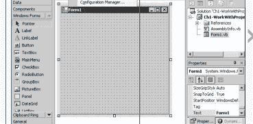

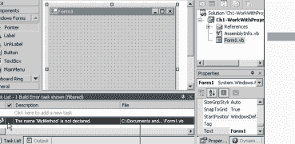

- BUILD THE PROJECT
- 1 点击 Build。

- 2 点击 Build。
- 或者，你可以通过按 Ctrl+Shift+B 访问构建菜单项。

- VB 构建项目，输出窗口显示进度。
- 如果构建完成且存在错误，则任务窗口出现。

- 你可以双击列表中的错误，使错误在代码窗口中显示。
- 注：请参阅第 13 章以纠正错误。

### 额外

当你使用 Visual Basic 语言工作时，你可能会收到许多常见错误。你可以使用以下列表来破译其中一些错误的含义。有关错误消息的更多帮助，请在任务窗口中选中错误后按 F1。

| 错误消息 | 如何纠正 |
|---|---|
| The name 'x' is not declared. | 编译器无法找到变量或方法名称。确保你在适当的范围内声明相关变量，以便代码行可以访问它。通常，此错误消息会因拼写错误而显示。 |
| Expected an expression. | 行未正确结束。在某些情况下，这会导致出现大量错误，因为 VB.NET 试图找到行的末尾。确保打开和关闭括号匹配，并且在多行命令的最后一行没有下划线。 |
| A value of type 'x' cannot be converted to 'x' | 你将一个值分配给无法接受它的变量。这通常发生在你尝试将信息分配给控件时，例如，当你将字符串分配给标签或文本框控件而未指定 Text 属性时。 |

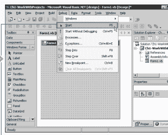

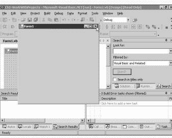

### 运行项目

3 点击 Debug → Start。

或者，你可以按 F5 访问 Start 功能。

项目在 .NET 调试器的控制下启动。

任何运行时错误都会导致调试器停止程序执行并显示错误消息。

### 创建 Windows 应用程序

Windows 窗体技术允许你提供功能强大且独特的视觉界面。你可以在功能强大且易于使用的图形开发环境中创建世界级的 Windows 应用程序，其外观和性能与其他 Windows 应用程序类似。

Visual Basic .NET 使用项目来存储每个单独的应用程序或组件。要创建标准的 Windows 应用程序，你可以使用 Windows 应用程序项目类型。你的项目保存你创建的所有窗体、类、模块和控件，并使它们成为应用程序的一部分。有关项目的用途的更多信息，请参阅第 1 章。

当你创建 Windows 应用程序项目时，VB .NET 会为你的应用程序提供主窗体，并将其命名为 Form1。此窗体在你的应用程序启动时自动加载。要创建新窗体，并有将其设为应用程序默认窗体的选项，请参阅“添加新窗体”部分。

开发环境提供内置的视觉窗体设计器。此窗体设计器使你能够在属性窗口中更改窗体的属性，并使用拖放放置组件。有关属性窗口的位置或如何使用开发环境的更多信息，请参阅第 1 章。

窗体是独立应用程序的主要显示元素。你可以使用 VB .NET 中的窗体对话框、工具栏窗口和主应用程序窗口在计算机上创建任何窗口。“窗口窗体的介绍”部分包含对窗体功能的更详细介绍。

### 创建 Windows 应用程序

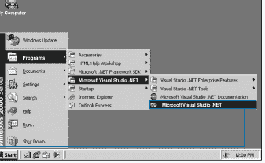

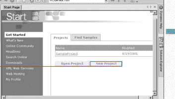

- 1 点击 Start > Program > Microsoft Visual Studio .NET > Microsoft Visual Studio .NET 以启动 Visual Basic 开发环境。

- 要了解如何使用开发环境，请参阅第 1 章。

- 开始页出现。

- 2 点击 New Project。

- 如果加载开发环境时开始页未出现，你可以通过转到 Help > Show Start Page 来创建新项目。


### Extra

本章中的许多任务都要求你使用属性窗口来更改窗体和控件。在某些情况下，由于屏幕上同时存在大量工具窗口，你可能会发现很难找到此窗口。你可以通过单击“查看”菜单并从菜单中选择“属性窗口”，或按 F4 键来访问“属性”窗口。

你可以使用“类视图”窗口来获取项目中窗体和其他类的表示，而无需使用“解决方案资源管理器”窗口。“类视图”窗口使你能够查看构成项目中所有类的成员，例如属性、方法和事件，并直接跳转到模块内的特定代码区域。通过在窗口中右键单击一个类，你可以更改视图和排序选项。例如，“按类型分组”选项使你能够以单独的树形式显示构成类的成员，将私有变量和公共成员分开。要显示此窗口，请转到“查看”菜单并单击“类视图”。

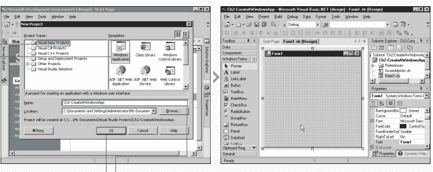

- 新建项目对话框出现。
- 如果尚未选择，请单击 Visual Basic 项目。
- 单击 Windows 应用程序项目。
- 为项目输入一个名称。
- 单击确定。

开发环境会创建一个项目目录和一个默认的 Form1，后者加载到客户端区域。

### AN INTRODUCTION TO WINDOWS FORMS

你可以使用 Windows Forms，这是一项包含大量工具的大型技术，来快速轻松地构建功能强大的 Windows 应用程序。本章的主题涵盖创建窗体、操作窗体以及向这些窗体添加控件。

要了解窗体的功能，请参阅下面给出的重要窗体成员摘要。成员是指 VB.NET 组件中可供你操作或查看的任何部分。窗体、控件和类都有一组成员，例如属性、方法 and 事件，使它们能够执行某些任务。有关面向对象术语的更多信息，请参阅第 7 章。

窗体提供了所有应用程序功能可访问的背景。控件提供了窗体上的功能，使用户能够查看、编辑、操作和探索你的应用程序。控件是你放置在窗体上的任何东西，例如按钮、列表框或复选框。要了解如何向窗体添加控件，请参阅“添加控件”部分。

下表并未包含窗体的所有功能，但涉及了一些你可能会觉得有趣或有用的功能。这里显示的许多成员在整章中都有更全面的介绍。有关设置窗体属性的更多信息，请参阅“设置属性”部分。有关响应窗体事件的更多信息，请参阅“添加事件”部分。

### IMPORTANT FORM MEMBERS

| PROPERTIES | DESCRIPTION |
|---|---|
| AcceptButton | 将此属性设置为当用户按下 Enter 时自动激活的按钮控件。AcceptButton 仅在当前控件使用 Enter 键时激活，例如多行文本框，当前控件使用按键且按钮未接收单击事件。 |
| AutoScale | 使窗体及其控件根据用户字体大小首选项自动调整大小。对于不使用标准控件的专有界面，你可能希望将其更改为 False。 |
| AutoScroll | 当为 True 时，AutoScroll 会在窗体的所有组成控件均不适合时向窗体添加滚动条。 |
| BackgroundImage | 在窗体背景中加载图像。图像在整个窗体上平铺。支持大量格式，包括 BMP、GIF、JPEG、PNG、WMF 等。 |
| CancelButton | 请参阅上面 AcceptButton 的描述，只是 CancelButton 在 Esc 键上起作用。 |
| FormBorderStyle | 设置窗口的边框。默认设置是 Sized，允许调整大小。你使用 FixedDialog 设置来创建看起来像对话框的固定窗口。Fixed3D 创建一个具有凹陷客户端区域的固定窗口。 |
| Location | 此属性决定窗口在桌面上的位置。Windows 会根据任务栏的位置自动对其进行校正。你需要将 StartPosition 设置为 Manual 才能使 Location 生效。 |
| MaximizeBox | 确定窗体是否在标题栏中显示最大化按钮。 |
| MaximumSize | 一个 Point 对象，指定窗体的最大宽度和高度。请注意：最大化窗体时此设置也有效。 |
| Menu | 确定哪个 MainMenu 控件实际为窗口提供菜单界面。 |
| MinimizeBox | 确定窗体是否在标题栏中显示最小化按钮。 |


### IMPORTANT FORM MEMBERS (CONT.)

| PROPERTIES | DESCRIPTION |
|---|---|
| MinimumSize | 指定表单达到的最小宽度和高度的 Point 对象。 |
| Opacity | 表单的透明度百分比。例如，25% 的透明度意味着表单将其内容的四分之一与底层内容的四分之三混合，使表单几乎不可见。 |
| OwnedForms | 列出此表单拥有的所有表单的集合。 |
| Modal | 指定此表单是否为模态。该属性为只读。您可以使用它来确定此表单是否作为对话框调用。 |
| SizeGripStyle | 确定窗口右下角是否显示尺寸抓手。默认值是 Auto。可选值为 Show 和 Hide。 |
| StartPosition | 用于在显示时辅助表单的放置。默认值为 WindowsDefaultLocation。选项包括 CenterScreen、CenterParent、Manual 和 WindowsDefaultBounds。 |
| TopMost | 确定此表单是否显示在应用程序中所有其他表单之上。默认值为 False。 |

| METHODS | DESCRIPTION |
|---|---|
| Activate | 将表单移至应用程序前部并使其处于活动状态。 |
| Close | 隐藏表单。 |
| DoDragDrop | 开始拖放操作。 |
| Show | 使表单可见。 |
| ShowDialog | 使表单以模态方式出现。 |
| Update | 强制客户端区域重绘。 |

| EVENTS | DESCRIPTION |
|---|---|
| Closed | 当用户关闭表单或调用 Close 方法时触发。 |
| Closing | 当用户按下关闭时触发，并在实际调用 Closed 事件之前允许窗口取消该操作。 |
| MouseEnter | 当鼠标从外部进入客户端区域时触发。 |
| MouseHover | 当鼠标静止两秒时触发。 |
| MouseLeave | 当鼠标离开客户端区域时触发。 |
| MouseMove | 当鼠标在客户端区域内移动时触发。 |

### ADD A CONTROL TO A FORM

您可以使用控件为程序提供基本用户界面。控件是一种特殊组件，旨在为 Windows Forms 提供视觉界面。

标准控件您可能在应用程序中看到包括按钮、菜单、工具栏、复选框、单选按钮和文本框。您可能没有意识到表单上的文本实际上是一个 Label 控件，或者围绕一组单选按钮的框架实际上是一个 GroupBox 控件。许多控件仅提供布局和视觉提示。有关这些控件的更多信息，请参阅第 3 章。

如果控件是隐藏组件且不需要表单空间，如 Timer、MainMenu 或 ErrorProvider 控件，它会加载到表单设计器中提供的区域，称为组件托盘。所有隐藏组件都显示在这里。您仍然可以单击它们来编辑其属性。

当您将控件添加到表单时，它会自动被选中，并且如果您打开属性窗口，则会显示所选控件的属性。有关修改属性的更多信息，请参阅“设置属性”部分。

VB .NET 提供的控件并不是您唯一可以使用的控件。本书随附的 CD-ROM 包含各种组件的试用版，您可以无缝地将其添加到您的应用程序中。有关将新组件加载到项目中以及构建自己的控件的更多信息，请参阅第 12 章。

您不需要使用控件来提供界面。例如，在游戏中，您可能会选择在表单的整个表面上绘制，因此在界面中提供您自己的自定义控件。有关图形命令的更多信息，请参阅第 5 章。

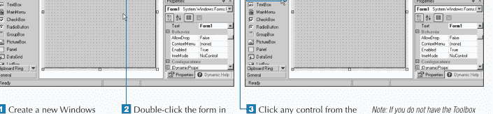

1. 创建一个新的 Windows 应用程序项目或打开一个现有项目。
2. 在解决方案资源管理器中双击表单以在必要时打开它。
3. 从工具箱中单击任何控件。

注意：有关创建项目的更多信息，请参阅“创建 Windows 应用程序”部分。

注意：如果您没有打开工具箱，请单击 查看 ▸ 工具箱。


# 应用它

某些控件具有容纳其他控件的能力，被称为容器控件。Panel、GroupBox 和 TabControl 等控件都可以在其客户端区域内容纳其他控件。Timer、MainMenu、ContextMenu 以及通用对话框组件等隐藏组件不再像 Visual Basic 早期版本那样以图标形式加载到窗体上。相反，它们会加载到窗体设计器底部的组件托盘区域。单击这些条目即可像编辑其他控件一样编辑其属性。

你可以在代码中动态地在运行时创建控件。此过程很简单，实际上与 IDE 创建你在窗体设计器中定义的控件的过程相同。添加以下代码以在用户单击按钮时创建一个新的列表框控件。

```
Private Sub Button1_Click(ByVal sender As System.Object, _
    ByVal e As System.EventArgs) Handles Button1.Click
    Dim NewListBox As New ListBox()
    ' Define Left, Top
    NewListBox.Location = New Point(50, 50)
    ' Define Width, Height
    NewListBox.Size = New Size(200, 300)
    ' Edit the control before it becomes visible
    NewListBox.Items.Add("Sample item")

    Me.Controls.Add(NewListBox)
End Sub
```

**输入此内容：**

**结果：**

当按钮被按下时，一个新的列表框会被添加到窗体上。

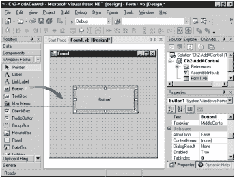

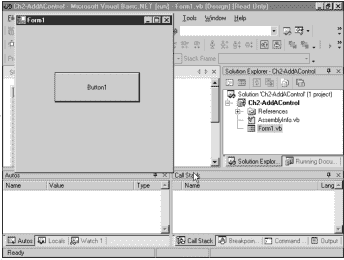

- 4. 通过在想要开始左上角的位置单击并按住鼠标按钮，将控件添加到窗体上。
- 5. 在获得适当大小时在右下角释放鼠标按钮。
- 6. 按 F5 运行你的项目。
- ▪ 新控件出现在窗体上。

# 设置属性

属性提供了组件功能的基础，无论是窗体、对话框还是控件。你使用属性使组件以某种方式显示和运行。属性实际上是一个面向对象编程（OOP）术语：属性用于描述特定对象。

例如，视觉组件最常见的属性是 Text 属性。Visual Basic 早期版本有两个独立的属性，Caption 和 Text；Caption 已被移除以实现标准化。通过更改 Text 属性，你可以更改组件的描述。在大多数控件的 Text 属性中，你可以在特定字母前添加和号（&），使该字母成为控件的快捷键。例如，如果控件的文本为 Na&me，它会显示为 Name 且字母 m 下方带下划线，并允许用户按 Alt+M 访问该控件。

你可以用两种不同的方法更改窗体或控件的属性。你可以在代码中更改属性，或在窗体设计器中使用属性编辑器进行更改。当你在属性编辑器中更改属性时，IDE 会自动将你所做的更改的代码添加到 InitializeComponents 子例程中，而窗体的 New 方法会调用该子例程。要了解有关 New 方法的更多信息，请参阅第 7 章。

属性窗口将属性分为多个类别。你可以折叠这些类别，如果你不经常使用它们。第一个类别 Accessibility 包含使你的程序对残疾人可访问的属性，你可以在第 13 章中了解更多相关信息。

Appearance 包含诸如 BackColor 之类的属性，可更改组件的背景颜色。Font 更改组件用于绘制的默认字体。你可以使用 BackgroundImage 等独特属性将图片加载到窗体的背景中。有关窗体众多属性的介绍，请参阅“介绍 Windows 窗体”部分。

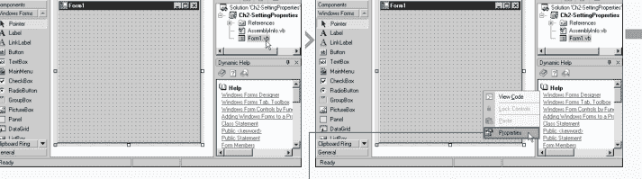

- 1. 创建一个新的 Windows 应用程序项目或打开一个现有项目。
- 2. 右键单击窗体或窗体上的控件，然后单击属性。
- 你也可以按 F4 访问属性窗口。


### Extra

虽然严格来说不是一个属性，但出于方便，Visual Basic 属性编辑器中列出的一项是 Name，它允许你为组件设置名称，以便在代码中访问该组件，而无需被迫使用 Button1 或 Form1 这样的分配名称。你无法从代码中访问 Name。

在命名控件和变量时常用的记法称为匈牙利命名法。这涉及在描述性名称前面放置一个三字符标识符。例如，你可能会将一个显示为 Cancel 的按钮命名为 btnCancel。这使你能够轻松阅读代码并看到任何给定名称所指的组件类型。

通过展开 Windows 窗体设计器生成代码 部分，你可以看到 IDE 如何生成组件、属性等。请注意不要更改此代码，否则窗体设计器可能不再按预期运行。

你可以选择按类别或按字母顺序显示属性。VB.NET 中的默认方式是按类别。要执行此操作，请单击属性窗口上的工具按钮，该按钮带有带向下箭头的 A-Z。按下它旁边的按钮会将显示顺序更改回分类。

```
Example:
Public Class Form1
    Inherits System.Windows.Forms.Form
    + Windows Forms Designer Generated Code
    ...
End Class
```

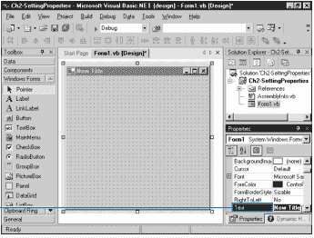

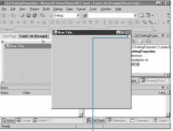

属性窗口出现在解决方案资源管理器下方。

通过在属性窗口中单击属性名称来编辑属性。

键入或选择适当的值，然后按 Enter 或单击编辑区域外的某处以保存更改。

按 F5 运行你的项目。

VB.NET 会显示带有你所做的任何属性更改的窗体。

你可以单击窗体的关闭按钮（X）返回到 IDE。

## WRITE EVENT CODE

你使用事件代码为软件与用户之间提供交互。属性提供了窗体能力的基石。事件通过允许组件进行交互来完善这一基础。例如，如果用户按下某个键，Visual Basic.NET 会触发一个或多个事件，窗体、控件或类可以捕获并响应这些事件。如果没有事件，你的用户会看到一个完整的应用程序，包含窗体、控件、属性和方法，但没有任何东西可以与用户交互。

代码编辑器在代码窗口工具栏左侧的类名下拉列表中提供了窗体上可用组件的列表。要为窗体本身创建事件处理程序，请选择（基类事件）。窗体还列出了一个 Overrides 部分，你可以使用它来覆盖窗体的成员。有关覆盖的更多信息，请参阅第 8 章。

要为控件提供事件处理程序，你从类名列表中选择实际的控件名称。在选择控件或窗体的基类事件后，你可以从代码编辑器工具栏右侧的事件列表下拉列表中选择窗体或控件可用的完整事件列表。

从代码编辑器中的列表中选择一个事件会导致 Visual Basic.NET IDE 创建一个过程来保存你的事件代码。传递给事件过程的两个参数中，第一个是 sender，在大多数情况下是事件定义的对象的引用。第二个参数更有用，名为 e，包含所有实际的事件信息。例如，在 Paint 事件中，当窗体需要重绘自身时发生，e 包含对窗体的 Graphics 对象的引用，这是调用图形命令所必需的。

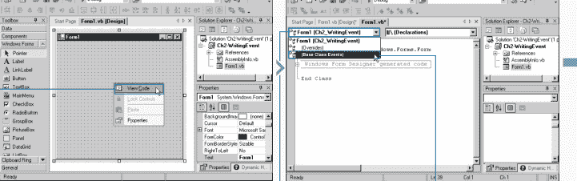

- 1 打开一个现有窗体。
- 2 右键单击窗体并单击查看代码。
- 你也可以通过双击窗体简单地打开代码编辑器。
- 3 单击类列表。
- 4 单击（基类事件）以列出窗体事件。
- 或者，你可以单击控件的名称以列出该控件的事件。

### Extra

你使用的事件类型可以根据应用程序的需要创建更多或更少的交互。小型但有用的交互可以包括在用户移动鼠标时更改控件中的标签或颜色。大多数视觉控件提供 MouseEnter、MouseLeave 和 MouseHover 事件。这些事件分别在鼠标进入控件、离开控件以及在控件上方停留几秒钟时触发。

并非所有事件都是对用户交互的响应。所有视觉控件和窗体本身都有一个 Paint 事件。在此事件中，你提供代码直接在控件表面上绘制。例如，你可以在按钮的背景中绘制一个图案。此事件在控件或窗体的全部或部分失效时触发。失效是指控件或窗体的某些部分需要重绘。你可以使用组件的 Invalidate 方法强制控件或窗体失效。

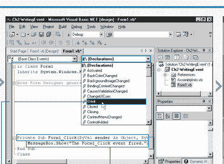

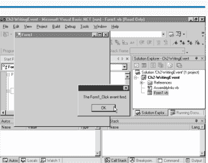


## RESIZE CONTROLS

您可以让主应用程序窗口和对话框根据用户的偏好改变大小。在 Visual Basic 的早期版本中，这需要编写冗长且有时复杂的 resize 事件处理程序。现在，每个 VB.NET 中的组件都提供了属性，可在无需任何代码的情况下调整大小。

每个控件都包含两个用于调整大小的属性：Anchor 和 Dock。Anchor 允许您选择要锚定到容器边框的控件的边。Left 和 Top 锚点将控件固定在相对于窗体左侧或顶部的完全相同的位置。Right 和 Bottom 锚点将该边固定在相对于容器右侧或底部的相同位置。

例如，如果将控件的 Anchor 设置为 Left、Right，则控件会固定在左侧，并在调整窗体大小时向右按比例拉伸。控件的顶部和底部未被锚定，在调整窗体大小时上下移动，以保持与容器顶部和底部两侧成比例的空间。

Dock 控件允许您将控件停靠到窗体的左侧、右侧、顶部或底部边缘。例如，如果将控件停靠到屏幕顶部，则控件保持分配的高度，但会自动移动到屏幕顶部并扩展到其容器的宽度。您还可以将 Dock 设置为 Fill，控件将填充整个客户端区域。

容器窗体或控件具有 DockPadding 属性，可让您设置停靠控件在每个方向周围留下的空间量。默认情况下，控件添加到窗体时 Anchor 设置为 Left、Top。

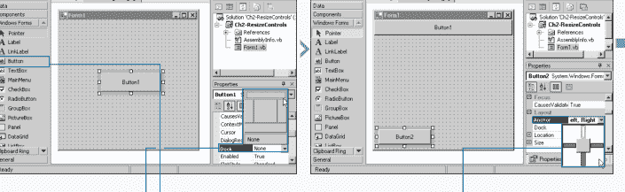

### DOCK THE CONTROL

- 1. 创建一个新的 Windows 应用程序项目或打开一个现有项目。
- 2. 打开您希望用户调整大小的窗体。
- 3. 在窗体上的任意位置添加一个控件。示例使用按钮控件。
- 4. 更改控件的 Dock 属性。

注意：请参阅“Add a Control to a Form”部分以添加控件，并参阅“Set a Property”以编辑属性。

在示例中，Dock 设置为 Top。控件将自身定位在所选边框处。

### ANCHOR THE CONTROL

- 5. 更改控件的 Anchor 属性。
- 在示例中，又添加了一个按钮，其 Anchor 属性设置为 Bottom、Left、Right。

### Extra

虽然使用 Anchor 和 Dock 进行自动调整大小非常强大，但您可能会发现这无法满足复杂或自定义设计的窗体的需求。在这种情况下，VB.NET 提供了更复杂的系统。您可以通过使用 Resize 事件手动调整所有控件的大小。每当您调整大小、最大化、最小化或还原窗体时都会调用此事件。只需使用窗体的尺寸，您可以使用窗体的 Size.Width 和 Size.Height 成员检索这些尺寸。然后相应地移动和调整控件的大小。您可以通过编辑其 Location.Left 或 Location.Top 属性来移动控件，或通过使用 Location = New Point(Left, Top) 重新分配整个 Point 结构来移动控件。利用 Size.Width 和 Size.Height 调整控件大小，或使用 Size 结构如 Size = New Size(Width, Height)。您也可以对某些控件使用手动调整大小事件，而对其他控件使用 Anchor 和 Dock。当用户最小化窗体或使窗体变得非常小时要小心，因为您的计算值可能会为宽度和高度创建负值并导致程序出现运行时错误。

### SPREAD TO FORM DIMENSIONS

- 6 Add a control to the form.
- 7 Size the control to take up the remaining space on the form.
- 8 Set the Anchor property to Top, Bottom, Left, Right.
- 9 Run the project by pressing F5.

当您调整窗体大小时，一切都会正确调整大小。

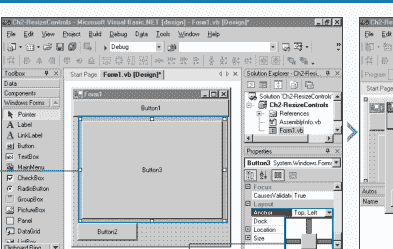

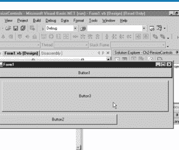

## ADD A MENU

您可以使用菜单为用户提供一种方便的方式来访问窗体的主要功能。菜单栏是大多数 Windows 应用程序的标准部分。

简单的实用程序可能不需要它们，但总体而言，菜单为用户提供了一种轻松学习和以层级方式访问各种功能的方法。此外，菜单允许用户按自由选择的顺序进行操作，而不是由按钮或列表等其他界面提供的顺序。

Visual Basic .NET 为创建菜单增加了简便性。Visual Basic 6.0 及更早版本依赖于一个名为 Menu Editor 的外部对话框。VB .NET 将菜单编辑与 Windows Form Designer 集成。

要创建菜单，您可以访问 Toolbox 并选择 MainMenu 控件，这将在 Component Tray 中添加一个隐藏的 MainMenu 控件，并在菜单栏中添加一个带有单个空菜单标题的菜单。您可以添加标题来替换占位符菜单标题，以创建菜单标题和空子菜单。您可以使用此方法快速创建整个菜单系统。

您可以通过在用作快捷键的字母前放置一个与号来为菜单项分配访问键。例如，要创建用户可以通过按 Alt-F 访问的文件菜单，将 Text 设置为 &File。

您可以使用 Shortcut 属性为控件分配快捷键。如果您希望快捷键显示在菜单项右侧，请将 ShowShortcut 属性设置为 True。

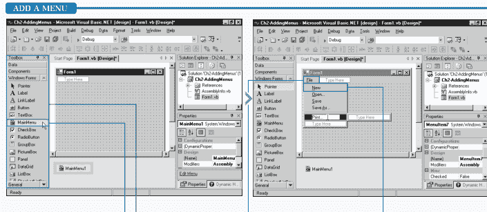

- 1 Create a new Windows Application project or open an existing one.
- 2 Open the Toolbox.
- Note: If you do not have the Toolbox opened, click View > Toolbox.
- 3 Double-click the MainMenu control.
- The MainMenu control appears in the Component Tray.
- 4 Click the first menu title item.
- 5 Type a title.
- 6 Press Enter to save it.
- 7 Add to the menu by typing items downwards.
- You can type a dash to create a divider, or right-click the edit area and then click Insert Separator.


#### 额外内容

每个菜单项都有许多可单独修改的属性。`MenuItem1.Visible = False` 会隐藏一个菜单项。`MenuItem1.Enabled = False` 会使菜单项变灰。你可以使用这些属性根据应用程序的当前状态动态更改菜单。例如，对于包含 New、Open 和 Save 项目的文件菜单，当你的应用程序没有更改时，你可以通过向文件菜单项的单击事件添加代码来禁用 Save 项目。

你可以在程序运行时通过代码动态创建菜单项，使用 `Dim` 创建一个新的菜单项，设置其属性，然后将其添加到你选择的父菜单中。

#### 示例：

### 动态菜单更改示例：

```
Private changes As Boolean = False
Private Sub MenuItem1_Click(ByVal sender As _
System.Object, ByVal e As _
System.EventArgs) Handles MenuItem1.Click

    If changes Then
        FileSaveMenuItem.Enabled = True
    Else
        FileSaveMenuItem.Enabled = False
    End If
End Sub
```

### 动态创建菜单项示例：

```
Dim NewMenuItem As New MenuItem()
NewMenuItem.Text = "Text for new menu item"
NewMenuItem.Shortcut = _
System.Windows.Forms.Shortcut.ShiftF1
MenuItem1.MenuItems.Add(NewMenuItem)
```

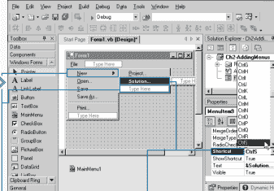

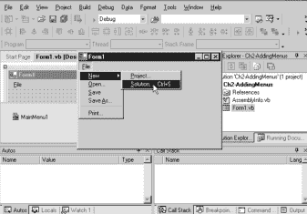

## 创建子菜单

- 8 单击任意 MenuItem。
- 9 单击 MenuItem 右侧的占位符。
- 10 输入标题并按 Enter。

## 设置快捷键

- 11 单击一个 MenuItem。
- 12 在属性窗口中，为 Shortcut 属性选择新的快捷键。
- 13 按 F5 运行项目。
- 你的项目加载并在窗体顶部提供一个菜单栏。

> 注：如果在查看窗体时看不到菜单的访问键，请按住 Alt 键使其显示。

## 创建上下文敏感菜单

你可以使用上下文敏感菜单为用户单击的特定区域提供相关选项列表。上下文菜单有时被称为“右键菜单”，因为你通常使用鼠标右键来访问它们。上下文敏感菜单自 Windows 95 引入以来就已存在，现在上下文菜单是 Microsoft 兼容性测试的必备功能。

要在窗体上添加上下文菜单，你需要添加一个新的 ContextMenu 控件并像标准菜单一样定义菜单。有关创建菜单的更多信息，请参阅“添加菜单”部分。没有为菜单标题命名的能力，因为上下文菜单是从控件而不是菜单栏出现的。然后使用所有可视控件和窗体本身提供的 ContextMenu 属性，并选择适当的 ContextMenu 控件与之关联。

单个窗体上应只有一个 MainMenu 控件。对于 ContextMenu 控件则不然。窗体上的大多数主要可视组件都应存在一个单独的 ContextMenu 控件。

要在程序执行期间添加和删除上下文菜单中的项目，你可以操作上下文菜单组件的 MenuItems 属性提供的项目集合。声明一个 MenuItem 对象的实例，然后将此对象作为唯一参数传递给 MenuItems.Add 方法。此外，如果你想在上下文菜单中复制主菜单的内容，你可以在设计时复制粘贴，或者可以在运行时添加代码来复制菜单。只需访问主菜单中的 MenuItem 并调用其 CloneMenu 方法。将此方法创建的新 MenuItem 对象传递给 ContextMenu 控件中 MenuItems 集合的 Add 方法即可。

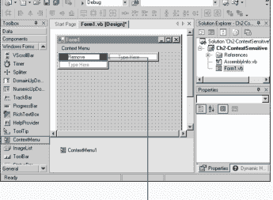

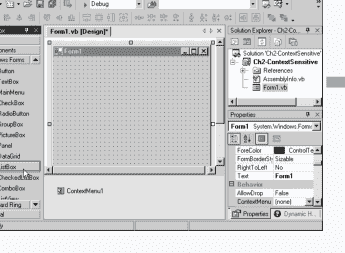

- 1 在新的 Windows 应用程序项目中打开默认窗体。
- 2 在工具箱中双击 ContextMenu 控件。
- 3 单击第一个菜单项的占位符。
- 4 输入菜单项的标题。
- 5 在工具箱中，单击你想要分配上下文菜单的控件。


## 应用它

上下文菜单是使你的程序更具功能性的简便方法。许多用户期望在右键单击某个项目时看到该项目的功能。在大多数情况下，你必须将位于上下文菜单中的相同功能放置为窗体上的按钮或主菜单中的按钮。为此做得不好，你会在上下文菜单项的单击事件和按钮或主菜单的单击事件中复制代码。

将主要代码段放在单独的流程中而不是简单地直接放在事件中是值得的。这样，如果你在窗体上有一个按钮和具有相同功能的上下文菜单，你就可以重用代码。为使此代码正常工作，请使用下面步骤中提供的示例，并向窗体添加一个按钮。有关处理事件的更多信息，请参阅第 2 章。

### TYPE THIS:

```
Private Sub RemoveSelectedListItems()
    If ListBox1.SelectedItem Is Nothing Then
        MsgBox("Select an item to remove.")
    Else
        ListBox1.Items.Remove(ListBox1.SelectedItem)
    End If
End Sub

Private Sub MenuItem1_Click(...)
    RemoveSelectedListItems()
End Sub

Private Sub Button1_Click(...)
    RemoveSelectedListItems()
End Sub
```

### RESULT:

按钮和上下文菜单均能正常工作。

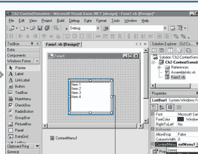

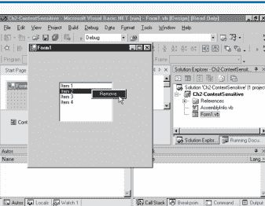

- 6 将控件添加到窗体。
- 示例将控件添加到窗体。
- 注：要将控件添加到窗体，请参阅“向窗体添加控件”部分。

- 7 将 ListBox 的 ContextMenu 属性设置为你刚刚创建的上下文菜单。
- 8 按 F5 运行你的项目。

- 9 右键单击你的控件以查看上下文菜单出现。

ContextMenu 控件提供了你在右键单击适当控件时创建的菜单。

## 添加新窗体

创建弹出窗口、对话框以及应用程序中的各种其他功能都需要额外的窗体。你可以使用“添加窗体”对话框为你的项目创建额外的窗体。

VB .NET 项目由多个文件组成，包括类、窗体和模块。一个项目可以使用无限数量的这些。你可以使用多个窗体有效地将程序分解为用户更易于导航和理解的更易管理的部分。在单个窗体上包含一个单一概念。例如，如果你的程序有四个核心功能，不要尝试全部在同一个窗体上表示；改为创建四个窗体。

在大多数情况下，你使用 VB .NET 与项目一起创建的标准 Form1 作为主应用程序窗口。你可能需要添加辅助窗口。例如，

Microsoft Word 有一个主窗口和数十个辅助窗口用于打开和保存文件、修改选项以及配置格式。VB .NET 使用唯一的窗体表示应用程序中的每个窗口。

提供选项或允许打开和关闭文件的窗口称为对话框。你可以在 VB .NET 应用程序中创建这些窗口。要创建对话框，请参阅“创建对话框”部分。

另一种你可以在 VB .NET 中使用窗体表示的窗口类型是工具箱。许多像 Adobe Photoshop 这样的程序都使用浮动窗口来提供一组工具，用户可以在主应用程序窗口中访问。你可以使用已拥有的窗体创建浮动工具箱窗口。有关创建自己的已拥有窗体的更多信息，请参阅“添加已拥有窗体”部分。

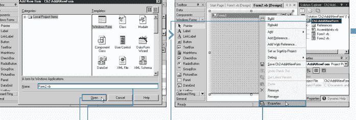

- 1 在 Windows 应用程序项目中，单击 Project > Add Windows Form 以加载“添加新项”对话框。
- 2 为新窗体输入名称。
- 3 按 Open。
- 4 在“解决方案资源管理器”中右键单击项目名称。
- 5 单击 Properties。

注：要显示“解决方案资源管理器”，请单击“查看”菜单并单击“解决方案资源管理器”

### Extra

尽管你可以在单个项目中拥有任意数量的窗体，但只有默认窗体在运行项目时自动出现。与 Visual Basic 的早期版本不同，你必须在 VB.NET 中创建窗体的实例变量，然后才能显示它。因为设计器创建的窗体只不过是一个类，所以你需要创建该类的一个实例。有关创建类的更多信息，请参阅第 5 章。

### Example:

```
Dim frm As New Form1
frm.Show()
```

你只需在窗体设计器中选择窗体并拖动出现的句柄，即可更改窗体的大小。然而，你无法在视觉上指定显示窗体的位置。

默认情况下，窗体的 StartPosition 为 WindowsDefaultLocation。你可以通过将此属性设置为 CenterScreen 使窗体在屏幕中央开始。你也可以通过将 StartPosition 设置为 Manual 并填充 Location 属性的 Point 来精确放置它。Point 由 x、y 位置组成。

你可以使用 MinimumSize 和 MaximumSize 属性限制窗体可以调整的大小。填写 Point 的宽度和高度，用户就无法将窗口调整超出这些边界，即使你将最大化限制为 MaximumSize 属性。

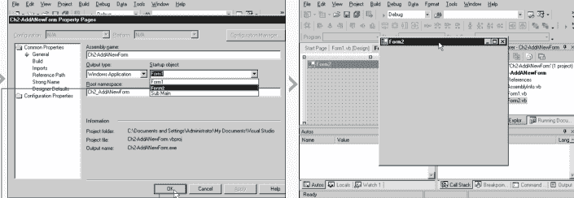

- 6 在“启动对象”框中单击并单击 Form2。
- 7 单击 OK。
- 8 按 F5 运行你的项目。

新窗体显示，而原始窗体不显示。


## 创建对话框

你可以使用对话框提示用户输入。对话框不会消失，直到用户提供适当的信息或取消对话框。

对话框是模态表单，因为它在用户关闭对话框之前限制对其父表单的访问。对话框的示例包括文件打开、文件保存、打印等。

要创建对话框，你需要创建一个新的表单并提供接受或取消所做更改的方法。有关创建表单的更多信息，请参阅“添加新表单”部分。对话框不应使用整个屏幕，不应有菜单，也不应包含最小化或最大化按钮。

你可以通过将 FormBorderStyle 属性更改为 FixedDialog 来使表单不可调整大小。如果你想使对话框可调整大小，像文件打开/保存对话框一样，保留 FormBorderStyle 属性不变，并设置 MinimumSize 和 MaximumSize 属性。将 MaximizeBox 和 MinimizeBox 设置为 False 以分别移除最大化和最小化按钮。通过将 ShowInTaskBar 更改为 False 来将表单从 Windows 任务栏中移除。

AcceptButton 和 CancelButton 属性允许你选择 Button 控件作为默认的确定和取消按钮。在对话框中按下 Enter 等同于 AcceptButton，按下 Esc 等同于 CancelButton。

要启用对话框的操作按钮，请将每个 Button 上的 DialogResult 属性设置为以下可用设置之一：Abort、Cancel、Ignore、No、None、OK、Retry 和 Yes。对话框关闭时，会将此属性的值传回父表单。你也可以在运行时通过代码手动设置此属性，在这种情况下，设置该属性也会立即关闭对话框并返回 DialogResult。

父表单通过调用对话框的 ShowDialog 方法来打开对话框。表单显示为模态对话框，并且当用户关闭对话框时，ShowDialog 方法会将访问权返回给父表单。

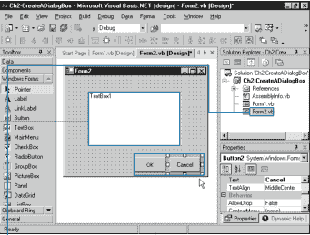

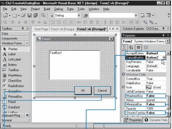

- 1. 向新项目或现有项目添加一个新表单。
- 2. 添加控件以提供适当的用户输入。
- 3. 添加两个 Button 控件。
- 4. 将第一个按钮的 DialogResult 设置为 OK。
- 5. 将第二个按钮的 DialogResult 设置为 Cancel。
- 6. 单击表单以编辑其属性。

> 注意：请参阅第 3 章以使用按钮控件。

- 7. 将 MinimizeBox、MaximizeBox 和 ShowInTaskBar 更改为 False。
- 8. 将 AcceptButton 更改为第一个按钮，将 CancelButton 更改为第二个按钮。

### 额外

要访问表单上输入的信息，你可能希望向对话框添加属性以使父表单能够访问信息，或者你可以让父表单直接在对话框的控件中访问信息。有关添加属性的更多信息，请参阅第 7 章。

你可以使用属性页在无需用户立即操作的情况下显示信息。通过创建属性页设计，Microsoft 选择打破了与对话框相关的许多规则。属性页是非模态的，这意味着它们不会要求用户在继续使用应用程序之前接受或取消更改。属性页通常向用户提供程序中对象的相关信息。如果你想创建属性页对话框，标准约定是使用 OK、Cancel 和 Apply 按钮。此外，你应该使用 Show 方法而不是 ShowDialog 方法来显示属性页，以便用户在属性页仍打开时使用应用程序。

#### 示例：

```
Sub OpenDialog()
    Dim myDialog As New DialogForm2()
    Dim result As DialogResult

    result = myDialog.ShowDialog(Me)
    If result = DialogResult.OK Then
        Dim filename As String
        filename = myDialog.TextBox1.Text
        ' use the file name the user entered in the dialog.
    End If
End Sub
```

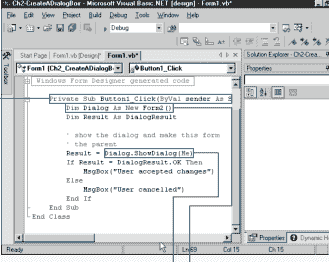


- 9 打开事件处理程序或方法，在其中希望对话框出现。
在示例中，代码被添加到 Button1_Click。
注意：要添加事件处理程序，请参阅“编写事件代码”部分。

- 10 输入创建表单实例所需的代码。
- 11 输入对话框变量的名称，后跟 .ShowDialog(Me)。
- 12 按 F5 运行项目。

主表单出现。

创建必要的事件会使你的对话框出现，你可以通过按下两个按钮中的任意一个来关闭它。


## 使用消息框

你可以使用消息框作为简单的对话框向用户呈现一条消息。消息框提供简单的界面，可轻松显示无需自定义设计的表单的信息。消息框无需视觉设置，并通过 MessageBox 类的 Show 方法调用。

简单的消息框以文本形式显示信息，并在底部显示一个 OK 按钮。配置包括添加取消按钮、使用是/否组合、使用中止、重试、忽略组合等。你无法在可用按钮组合之外配置消息框。不要在按钮组合对显示的提示没有意义时为编程简单而使用消息框。例如，不要显示“您想保存更改吗？”然后使用 OK 和 Cancel 作为按钮提示：是和否更合理。

你可以通过使用代码结构 MessageBox.Show(Text, Caption, MessageBoxButtons, MessageBoxIcon, MessageBoxOptions) 创建消息框。MessageBoxButtons 常量包括 AbortRetryIgnore、OK、OKCancel、RetryCancel、YesNo 和 YesNoCancel。要指定枚举类型中的常量，请使用类型名称和常量，例如 MessageBoxButtons.OK。MessageBoxIcon 常量包括 Asterisk、Error、Exclamation、Hand、Information、None、Question、Stop 和 Warning。这些图标不言自明，你在许多常用应用程序中使用它们。请注意，如果用户为 Error、Question 和其他设置设置了声音文件，这些声音会自动播放。

MessageBoxOptions 枚举让你指定默认按钮。如果用户按下 Enter，对话框将以指定的默认按钮作为结果关闭。该枚举仅包含三个常量，Button1、Button2 和 Button3。如果你想提问，其中最可能的答案是否定的，请使用 MessageBoxButtons.YesNo 和 MessageBoxOptions.Button2。按钮按在按钮常量中命名的顺序编号。

你也可以通过调用更简单的 MsgBox 命令来显示消息框。将要显示的消息作为唯一参数传递。


- 1. 创建新项目或打开现有项目。
- 2. 打开要显示消息框的方法或事件。
- 3. 单击空代码行。
- 4. 输入 System.Windows.Forms.MessageBox.Show(.
- 5. 输入要在引号中显示的文本或 string 类型的变量。
- 6. 输入逗号，并输入消息框的标题。
- 7. 输入另一个逗号。
出现 IntelliSense 框并显示各种按钮选项。

## 应用它

你可以使用消息框向用户提问然后做出响应。Show 方法返回对应于 DialogResult 值的值。每个消息框按钮都有对应的 DialogResult 类型，你可以使用它来确定用户按下了哪个按钮：OK、Cancel、Yes、No、Retry、Ignore、Abort。要测试消息框的返回值，请使用 DialogResult.OK 或其他常量。If 测试可以轻松检查用户的响应。有关使用 If 语句的更多信息，请参阅第 4 章。

### TYPE THIS:

```
Dim result As DialogResult
result = MessageBox.Show("Do you like strawberry ice cream", "Ice cream", MessageBoxButtons.YesNoCancel, MessageBoxIcon.Question)
If result = DialogResult.Yes Then
    MessageBox.Show("Me too!!!")
Else
    If result = DialogResult.Cancel Then
        MessageBox.Show("You are no fun.")
    Else
        result = MessageBox.Show("Too bad. How about chocolate ice cream?", "Ice cream", MessageBoxButtons.YesNoCancel, MessageBoxIcon.Question)
        If result = DialogResult.No Then
            MessageBox.Show("What do you like???")
        End If
    End If
End If
```

### RESULT:

Do you like strawberry ice cream?
Me too!!


8 输入或单击其中一个按钮选项。

9 输入另一个逗号，并重复步骤 7 和 8 以设置图标。

10 输入另一个逗号，选择默认按钮并输入右括号。

11 按 F5 运行你的项目。

12 调用必要的代码以显示你的消息框。

消息框出现并等待用户按下按钮。


## 添加一个已拥有的窗体

你可以使用已拥有的窗体来创建可随父窗体一起出现的浮动窗口。单个父窗体可以拥有任意数量的窗体。使用已拥有的窗体可以在节省主程序窗口空间的同时仍允许访问功能。已拥有的窗体还允许用户移动浮动窗口来自定义其自己的环境。

你不需要将已拥有的窗体放在父窗体的边界内，但已拥有的窗体始终浮动在其父窗体之上。如果用户最小化父窗体，则已拥有的窗体消失，并在用户恢复父窗体时重新出现。Visual Basic 开发工作室本身就是已拥有窗体的一个很好的例子。然而，开发工作室提供的停靠功能并不是已拥有窗体提供的标准功能的一部分。

已拥有的窗体与任何标准窗体没有区别。创建类似工具箱的浮动窗口需要一些设置，使其看起来像其他应用程序。将 FormBorderStyle 设置为 FixedToolWindow 或 SizableToolWindow 以减少标题栏浪费的空间。将 MaximizeBox 和 MinimizeBox 设置为 False，并将 ShowInTaskBar 设置为 False，使其不像独立的应用程序窗口。

要将窗体设置为已拥有的窗体，你可以使用两种方法，具体取决于对你的应用程序最方便的位置。你可以设置子窗体为已拥有；例如如果 FormToolbar 需要浮动在 FormMain 之上，设置 FormToolbar.Owner = FormMain。或者父窗体可以接管子窗体，例如 FormMain.AddOwnedForm(FormToolbar)。你最常使用第二种方法，因为在大多数情况下，主应用程序窗体创建已拥有的窗体，而不是相反。

已拥有的窗体与任何标准窗体没有区别。创建类似工具箱的浮动窗口需要一些设置，使其看起来像其他应用程序。


- 1 创建一个 Windows 应用程序项目或打开一个现有项目。
- 2 向项目添加一个新窗体。

注意：请参阅“添加新窗体”部分以创建新窗体。

- 3 适当调整新窗体的大小。
- 4 对于新窗体，在属性窗口中单击 FormBorderStyle 属性并选择 SizableToolWindow。
- 5 双击 MaximizeBox 属性将其更改为 False。
- 6 将 MinimizeBox 更改为 False。
- 7 将 ShowInTaskbar 更改为 False。
- 8 加载原始窗体并双击它以进入代码编辑器。

## 开始使用 Windows 窗体

## 应用它

通常，你必须使放置在已拥有窗体上的组件在其父窗口上执行操作。例如，你需要使已拥有窗体上的一个名为 Open 的按钮执行与父窗口上的 File、Open 菜单相同的操作。你必须在主窗口中声明提供功能的代码——在示例中，提供文件打开对话框并打开文件的代码——在它自己的子例程中。你使此例程为 Public，以便你可以在窗体外部访问它。请参阅第 4 章以了解有关方法的更多信息。

## 输入以下内容：

```
Public Class FormToolWindow

    Private Sub ButtonFileOpen_Click(...)
        Dim frm As FormMain = Me.Owner
        Frm.FileOpenRoutine()
    End Sub

End Class

Public Class FormMain

    Public Sub FileOpenRoutine()
    End Sub

    Private Sub MenuFileOpen_Click(...)
        FileOpenRoutine()
    End Sub
End Class
```

## 结果：

工具箱提供的打开功能与文件打开菜单项相同。


- 8 代码编辑器为主要窗体打开。
- 9 在窗体加载事件中，声明已拥有窗体的实例。
- 10 输入 Me.AddOwnedForm( 后跟已拥有窗体的变量名和一个右括号。
- 11 输入已拥有窗体的变量名后跟 .Show()。
- 12 按 F5 运行项目。

已拥有的窗体浮动在其父窗体之上，当用户最小化父窗体时消失，并在用户恢复父窗体时再次出现。

## 排序 Tab 键移动

你使用 Tab 键作为在不使用鼠标的情况下在应用程序中移动的标准方法。默认情况下，Windows 窗体按你将控件添加到窗体的顺序分配移动顺序。很少有开发人员第一次就能完美地布局窗体，因此 TabIndex 属性允许你编辑控件的顺序。

用户期望从窗体的左上角开始输入。通常，按 Tab 键会从左到右或从上到下移动。虽然你可能会发现重置所有控件的 Tab 索引是繁琐的工作，但 Microsoft Windows 应用程序指南要求这样做，并且这样做会使应用程序更专业。设置 Tab 顺序还会使你的应用程序对进行数据输入的人员以及习惯于使用键盘而不是强制用户在输入或更改数据之前单击每个控件在计算机上移动的任何人更易于访问。数据库和其他需要大量数据处理的应用程序在采用智能 Tab 顺序布局后会变得显著更易于使用。

设置 Tab 顺序最简单的方法是完全设计你的窗体，移动控件直到出现明显的视觉顺序。此时，从应用程序的左上角开始，将控件的 TabIndex 属性设置为零。然后根据对你的应用程序有意义的方式，移动到下一个控件并将其 TabIndex = 1 分配给它。继续直到每个控件都有合理的 Tab 顺序。

你还可以通过将控件的 TabStop 属性设置为 False 来将其从 Tab 顺序中移除。该属性对于标签和其他不直接涉及数据输入的控件很有用。默认情况下，窗体上的每个控件的 TabStop 都是 True。


- 1 创建一个新的 Windows 应用程序项目或打开一个现有项目。
- 2 向窗体添加一个控件。
- 3 继续添加控件。
- 4 将控件定位到列或行中。
- 5 单击顶部、左侧组件。
- 6 在属性窗口中，在 TabIndex 属性中输入 0（零）。


### Extra

你可以使用标签、框架、组和其他视觉提示组件来增强选项卡顺序，就像输入控件一样。例如，控件左侧的标签其 Text 等于 Name：，并且文本框位于其正右侧。你必须为每个标签添加访问键，这样标签的文本就是 &Name：。然后用户可以按 Alt+N。按下访问键时，标签会聚焦到下一个选项卡索引的控件。重要的是设置标签的 TabIndex，然后是对应的输入控件。

GroupBox 和 Panel 都包含其他控件。你必须将容器控件的 TabIndex 设置为容器中左上角控件之前的数字。GroupBox 的标题像标签一样工作并将焦点传递给容器内的第一个控件。对容器内的控件进行编号时，采用与对窗体编号相同的系统。从容器的左上角开始，然后按右或向下顺序遍历整个容器。你不应让顺序离开容器后再返回其中，因为这可能会让用户感到困惑。


- 7. 单击下一个控件（向右或向下）。
- 8. 将 TabIndex 设置为下一个最高索引。
- 9. 重复步骤 7 和 8，直到为所有控件设置 TabIndex。
- 10. 按 F5 运行项目。
- 11. 使用 Tab 键实验导航你的窗体。

控件遵循 TabIndex 属性给出的顺序。

## USING BUTTONS

你可以使用按钮为应用程序提供简单的用户输入。按钮代表单个动作动词，例如 accept、cancel 或 go。这种简洁使其有效，因为大多数用户都理解按钮的目的。

你主要在对话框上使用按钮，而不通常在主应用程序屏幕上使用。取而代之的是，你可能希望在主窗口上使用工具栏。有关更多信息，请参阅本章后面的“Create a Toolbar”部分。

Button 控件有多种属性可更改其外观。FlatStyle 属性允许你创建平面样式按钮。平面按钮在用户移过或单击时改变颜色，但没有三维效果。Popup 样式使按钮看起来平坦。当用户将鼠标移过时，它呈现出凸起的三维外观，并在用户单击时下压。Standard 样式在所有情况下都呈现凸起，并在用户按下鼠标按钮时下压。

你可以通过将 BackgroundImage 属性设置为受支持的格式来为按钮加载背景图像。你使用 Image 属性将图像放置在前景中。你也可以使用两个属性 ImageList 和 ImageIndex 从 ImageList 控件加载图像。有关更多信息，请参阅“Work with ImageLists”部分。

你使用 ImageAlign 属性将图像对齐设置为按钮的中间、边缘或角落。你使用 TextAlign 属性以相同方式对齐文本。

要响应用户按下按钮，你可以创建响应 Click 事件的事件处理程序。有关创建事件处理程序的更多信息，请参阅“Add an Event”部分。


- 1. 创建一个新的 Windows Application 项目或添加一个现有项目。
- 2. 在 Toolbox 中，单击并拖动 Button 控件将其添加到窗体。
- 3. 在 Properties 窗口中，设置 Text 属性以更改按钮标题。
- 4. 更改任何必要的属性。
- 5. 此示例将 FlatStyle 设置为 Popup。

> Note: 请参阅第 2 章以了解如何创建 Windows Application 项目，以及如何向窗体添加控件。

> Note: 请参阅第 2 章以设置属性或创建事件处理程序以响应 Button 的 Click 事件。

## USING LABEL CONTROLS

标签在窗体上提供信息以指导用户。你添加标签控件来解释用户需要在窗体上提供的信息或解释窗体上可用的信息。窗体通常向用户展示各种包含数据或信息列表的控件，或等待用户输入的空白控件，这使得标签有必要来描述控件的性质。

尽量使标签简短但具有描述性。大多数标签在文本后带有冒号，以表示标签描述其右侧或下方的控件。避免将标签放置在它所描述的控件的右侧或下方。

使用 Text 属性修改标签显示的文本，TextAlign 允许你将文本对齐到标签的中间、侧面或角落。AutoSize 属性在设置为 True 时会自动拉伸标签的宽度以适应你放置在其上的文本。这可防止文本在控件边缘换行。

LinkLabel 控件扩展了 Label 控件的功能，通过提供超链接的外观。通过将 LinkVisited 属性设置为 True，你可以使链接以已访问的颜色显示。就像网页一样，你可以设置此属性并在用户单击链接后使链接显示为已访问。

对于 LinkLabel 控件，LinkArea 属性指定你想要用作超链接的文本范围。默认情况下，使用控件的整个文本。设置 Start 属性以指定超链接开始的字符位置，并设置 Length 属性以指定你想要作为链接一部分的字符数。设置 Start 属性时，请记住第一个文本位置为零。如果用户单击控件中属于链接的区域，控件将触发 LinkClicked 事件。


- 1. 创建一个新的 Windows Application 项目或打开一个现有项目。
- 2. 在 Toolbox 中单击 Label 或 LinkLabel 控件并将控件添加到窗体。
- 3. 在 Properties 窗口中，设置控件的 Text 属性。
- 4. 按 F5 运行你的项目。

Label 控件在窗体上提供文本信息。

- 对于 LinkLabel 控件，你可以在 LinkClicked 事件中处理用户单击链接。

> Note: 请参阅第 2 章以添加事件处理程序。


### Extra

## WORK WITH CONTROLS

你可以在控件中的图像指定一个透明色。TransparentColor 属性的默认设置是 Transparent，这意味着它从图像文件读取透明色，如果文件类型支持透明。图标文件（ICO）和图形交换格式（GIF）支持透明。如果将一组 Windows 位图（BMP）文件加载到 ImageList 控件中，请将 TransparentColor 设置为图像的适当背景色。

你可以使用 Images 集合的 Add 方法在运行时向 ImageList 控件添加图像。将 Image 对象作为唯一参数提供给该方法。

**Example:**

```vb
' Visual Basic
' Replace string with valid image file path:
Dim myImage As System.Drawing.Image = _
    Image.FromFile("C:\sample.gif")
ImageList1.Images.Add(myImage)
```


- 8. 添加一个控件来显示图像。
  - 诸如 Button 和 Label 控件之类的控件提供从 ImageList 控件加载图像的支持。示例添加了一个 Button 控件。
- 9. 在 Properties 窗口中，单击 ImageList 属性并选择 ImageList 控件。
  - 你可以清除 Text 属性，使按钮仅显示图像。
- 10. 单击 ImageIndex 并选择要显示的图像。

ImageList 将图像提供给控件。

## ALLOW TEXT ENTRY

文本输入是大多数程序的重要组成部分。你使用文本框允许用户输入自由格式的信息，而这些信息无法通过选项列表表示。记事本就是标准文本框提供的功能的示例。如果不使用文本框让用户输入信息，你必须使用复选框、单选按钮和列表提供一组选定的选项。

文本框支持两种基本模式：单行和多行，可以切换。单行输入框通常由 MaxLength 属性限制为一定数量的字符，最大可用大小为 32767，高度固定为字体和系统设置。Text 属性控制 TextBox 控件显示的文本，并在用户在控件中输入新信息时更新。你可以通过在 PasswordChar 属性中指定一个字符，在单行文本框中创建密码字段。你指定的字符会代替输入框中实际输入的信息出现。属性的正常值是星号 (*)。

你可以使多行文本框为任意大小，并且文本不受限制，直到可用内存。用 ScrollBars 属性为多行文本框分配水平、垂直或两个滚动条。WordWrap 属性默认为 True，控制框是否在控件边缘换行文本。如果 WordWrap 为 False，行可以延伸到文本框边缘之外，用户必须按 Enter 才能移动到新行。

有效地使用文本框需要大量的测试。由于文本框存在自由输入功能，用户可能会输入错误的数据，这需要程序员提供验证来检查用户输入的内容。VB.NET 具有新的验证功能。你可以在“提供错误消息”部分了解 ErrorProvider 控件。


- 1. 创建一个新的 Windows 应用程序项目或打开现有项目。
- 2. 单击并拖动 Toolbox 中的 Label 控件将其添加到窗体。
- 3. 在 Properties 窗口中，使用 Text 属性输入用户输入的文本的描述。
  文本会出现在窗体上的 Label 控件中。
- 4. 单击并拖动 Toolbox 中的 TextBox 控件将其添加到窗体。
- 5. 在 Properties 窗口中，通过选择文本并按 Delete 键删除提供的文本。
  如有需要，可在 Text 属性中输入自己的默认值。

## Apply It

在多行 TextBox 控件中，Lines 属性维护一个字符串数组，表示 TextBox 控件中的每一行。你可以使用此属性从文本框中检索特定行的信息或操作控件中的文本。下面的示例将该属性的内容加载到新数组中，并在你必须添加到窗体的 ListBox 控件中显示每一行。

## TYPE THIS:

```vb
Public Sub GetTextBoxContents()
' Create a string array and store the contents of the Lines property.
Dim textLines() As String, line As String
textLines = TextBox1.Lines

For Each line In textLines
    ListBox1.Items.Add(line)
Next
End Sub
```

## RESULT:

This is line #1 in the text box.

This is line #2 in the text box.


## CREATE A MULTI-LINE TEXT BOX

- 6. 选择 Text Box 控件后，双击 Property window 中的 Multi-line 属性将其切换为 True。
- 7. 单击 ScrollBars 属性的箭头并选择你想要的滚动条样式的常量。
- 8. 按 F5 运行你的项目。

TextBox 显示文本并以标准方式启用用户编辑文本。


## 使用富文本控件

你可以使用 RichTextBox 输入富数据，例如格式化的文本、图片和 OLE 对象。富文本框的使用示例是 WordPad，这是一个随 Windows 提供的程序。你可以在你的应用程序中创建 WordPad 中可用的大部分功能。

RichTextBox 控件以 RTF 格式存储框内的[content]

## 使用富文本控件

你可以使用 RichTextBox 输入富数据，例如格式化的文本、图片和 OLE 对象。富文本框的使用示例是 WordPad，这是一个随 Windows 提供的程序。你可以在你的应用程序中创建 WordPad 中可用的大部分功能。

RichTextBox 控件以 RTF 格式存储框内的内容。大多数应用程序都可以理解这种格式，因此在运行时你可以将富文本从 Microsoft Word 等应用程序剪切并粘贴到此控件中，反之亦然。与 TextBox 控件类似，你可以使用 Text 属性读取或设置框的纯文本。Rtf 属性返回带有所有格式代码的文本。当你将 AcceptsTab 属性设置为 True 时，用户可以将制表符作为文本输入到控件中。如果该属性为 False，则焦点会转移到下一个控件。

只有当用户输入的内容超过框边界所能容纳的范围时，才会显示滚动条。ScrollBars 属性允许你将控件设置为 None、Vertical、Horizontal 或 Both 滚动条。该属性的其他设置是 FixedHorizontal、FixedVertical 和 FixedBoth；它们会强制显示指定的滚动条。

运行时属性在使用 RichTextBox 控件功能时起着重要作用。格式属性适用于所选文本。使用 SelectionStart 和 SelectionLength 属性分别选择起始点和选择的长度。如果用户进行选择，这些属性会自动更新。框中的第一个字符对于 RichTextBox 控件而言索引为零。

你可以使用 SelectedText 和 SelectedRtf 属性接收或设置选择中包含的文本。你也可以使用选择来更改所选文本的格式。例如，当 SelectionBullet 属性设置为 True 时，会为控件中选中的行添加项目符号。


- 1. 创建一个新的 Windows 应用程序项目或打开一个现有项目。
- 2. 从工具箱中，单击并拖动 RichTextBox 控件到窗体上，调整到你想要的大小。
- 3. 添加一个控件供用户更改富文本的格式。
- 4. 双击该控件以更改格式。

### 应用

在用户指定选择后，或你设置选择代码后，你可以通过重新分配文本的 SelectionFont 为新的 Font 类来格式化文本。SelectionColor 允许你重新分配所选文本的颜色。将 SelectionBullet = True 设置为将选中的行变为项目符号项。

SelectionIndent、SelectionRightIndent 和 SelectionHangingIndent 影响包含所选文本的段落。这些属性允许你为各种缩进样式指定像素量。

### 输入以下内容：

```vb
Private Sub Button1_Click(ByVal sender As System.Object, _
ByVal e As System.EventArgs) Handles Button1.Click
    ' Store the font for the selected text.
    Dim tempFont As System.Drawing.Font = RichTextBox1.SelectionFont
    ' Create FontStyle to contain the style for the current selection.
    Dim tempStyle As System.Drawing.FontStyle = RichTextBox1.SelectionFont.Style
    ' Determine whether the current text selection is bold.
    If tempFont.Bold = True Then
        ' Create a new font based on the existing font for selection,
        ' but use an exclusive or bitwise operator to remove the bold style.
        RichTextBox1.SelectionFont = New Font(tempFont.FontFamily, _
        tempFont.Size, tempStyle And Not FontStyle.Bold)
    Else
        ' Create a new font based on the existing font for selection,
        ' but use an exclusive or bitwise operator to remove the bold style.
        RichTextBox1.SelectionFont = New Font(tempFont.FontFamily, _
        tempFont.Size, tempStyle Or FontStyle.Bold)
    End If
End Sub
```

### 结果：

字体在粗体和常规样式之间切换。


控件的默认事件在代码编辑器中加载。

在此示例中，所选文本在粗体和标准文本之间切换。

富文本框允许编辑。

你可以通过完成必要的操作来运行事件或方法代码，从而看到格式更改。

- 5. 输入适当的代码以更改选择。
- 6. 通过按 F5 运行项目。


## 框架控件

可以使用 GroupBox 在其他控件周围创建框架，并在视觉上将它们与表单的其余部分分开。例如，如果将复选框、单选按钮、按钮或任何其他控件列表放置在 GroupBox 控件内，用户可能会更好地理解它们的功能。该分组框会在自身周围绘制边框，并在框架顶部显示一个标签标题。您可以使用 Text 属性更改显示的标题。

GroupBox 控件是一种容器控件，意味着它可以在其内部容纳其他控件。可以将其视为主窗体内部的一个框。如果将控件添加到该框中，然后移动该框，您放置在内部的控件会随之移动。如果使用 Dock 和 Anchor 属性调整分组框内控件的大小，它们会在 GroupBox 内部独立调整大小，而不考虑窗体的形状。有关使用 Dock 和 Anchor 属性的信息，请参阅第 2 章。

分组框通常包含一组逻辑上的 RadioButton 控件。例如，如果您有两个选项列表，用户需要在每个列表中选择一个响应，则必须将每组控件放置在其自己的 GroupBox 控件内。除了将 RadioButton 控件放入容器控件中以外，VB.NET 不允许您以任何其他方式将它们分成组。有关 RadioButton 控件的更多信息，请参阅“提供选项控件”一节。

BackgroundImage 属性允许您在 GroupBox 的背景中放置图片。请注意，在分组框中放置背景图像可能会使框内包含的控件难以看清，并可能分散用户的注意力。

## 框架控件


- 1. 在 Windows 应用程序项目中，从工具箱中单击并将 GroupBox 控件拖到窗体上。
- 2. 在“属性”窗口中，设置 Text 属性以更改框架的标题。
- 3. 从工具箱中单击并将控件拖到 GroupBox 内部。
  此示例显示了每个 GroupBox 内部的单选按钮。
- 4. 重复步骤 1 到 3，向窗体添加多个组。
- 5. 按 F5 运行您的应用程序。

分组框内的控件会单独响应。例如，单选按钮控件充当独立的组。

## 使用面板

可以使用 Panel 控件提供一个区域来容纳其他控件。Panel 控件与 GroupBox 控件一样，充当容器，允许您对控件（例如单选按钮）进行分组。由于 Panel 控件的默认状态是无边框且与窗体难以区分，因此当您不希望控件周围有可见框架时，可以使用它。有关 GroupBox 的更多信息，请参阅“框架控件”一节。

您可以通过将 BorderStyle 属性设置为 FixedSingle 或 Fixed3D 来向 Panel 控件添加边框。FixedSingle 会在控件周围创建单像素黑色边框，而 Fixed3D 会创建两像素的凹陷边缘。

您可以将 AutoScroll 设置为 True，以便在用户将 Panel 调整为小于最右侧或最底部控件时，Panel 创建滚动条。AutoScrollMargin 控制在滚动条出现之前，您将控件放置到距右侧或底部边缘的距离。这使您可以在应用程序窗口内创建滚动框架，该框架独立于主窗体滚动。请记住，滚动是一种不良的设计技术，除非必要，否则应尽量减少使用。更有效的做法是根据可用空间让面板内的控件按需调整大小。

Panel 有助于创建非常灵活的布局环境，因此您可以使用 Dock 和 Anchor 属性创建复杂的界面。有关这些属性的信息，请参阅第 2 章。您可以将 Panel 控件停靠在窗体的某一边，或以某种方式锚定它。这样做允许框内的控件通过停靠和锚定到 Panel 的客户区来独立调整大小。您还可以使用 Panel 的滚动功能使控件保持在相同的位置，并允许 Panel 滚动该区域。

## 使用面板


- 1. 在 Windows 应用程序项目中，从工具箱中单击并将 Panel 控件拖到窗体上。
  如果需要，您可以更改 BorderStyle 属性。
- 2. 从工具箱中单击并将控件拖到 Panel 内部。
- 3. 根据需要重复步骤 1 到 3。

> 注意：要设置属性，请参阅第 2 章。

- 4. 按 F5 查看应用程序运行。
- 每个 Panel 控件都包含其组成控件，并使其能够作为独立的组运行。

在此示例中，BorderStyle 设置为 Fixed3D，面板中包含单选按钮。


## 列表项

列表控件允许您在屏幕上更小的空间中显示长的信息列表。您可以将列表控件添加到表单中，以允许用户从该列表中进行选择，或只是向用户提供信息。当您有一组很长或变化的数据供用户选择时，应使用列表控件。例如，您可以使用列表控件显示目录中的文件列表，或显示您公司产品的列表。

VB .NET 提供了三种列表控件：ListBox、CheckedListBox 和 ComboBox。ListBox 允许用户从列表中选择单个或多个项目。CheckedListBox 在列表中的每个项目旁边放置一个复选框，允许用户选中多个项目。ComboBox 允许列表下拉，并提供用户通过键盘输入新项目或选择现有项目的能力。

VB .NET 将列表项存储在 Items 集合中。对该集合的设计时编辑允许您预定义列表项，也可以在运行时使用代码 ListControl.Items。

Add("item text") 在运行时添加项目。 如果希望控件按字母顺序对项目进行排序，请将 Sorted 属性设置为 True。

对于 ListBox 和 CheckedListBox 控件，您可以通过将 HorizontalScrollbar 设置为 True 来添加水平滚动条。对于 ComboBox 控件，通过设置 DropDownWidth 指定下拉列表的宽度。您可以使用这些属性来显示比控件宽度更宽的数据。SelectionMode 有三种设置。一种允许用户选择单个项目。MultiSimple 允许用户通过单击项目来切换项目选择。MultiExtended 在单击时选择该项目并取消选择其他项目，您必须按住 Ctrl 键才能选择另一个项目，或按住 Shift 键来选择一系列项目。

ComboBox 还有三种特定的模式，指定在 DropDownStyle 属性中。Simple 创建一个带文本框在顶部的列表框，允许用户进行新条目。DropDown 允许用户在框中输入值或选择项目。DropDownList 显示列表并且只允许用户选择项目。


- 1 创建一个新的 Windows 应用程序项目或打开一个现有项目。
- 2 单击并拖动 ListBox、CheckedListBox 或 ComboBox 控件到窗体上。
- 3 在属性窗口中，单击 Items 属性旁边的 ...。
- 4 在单独的行上为列表控件输入单独的项目。
- 5 单击 OK 将项目加载到列表中。
- 或者，您可以在设计时而不是在运行时添加项目。

## 应用它

您可以使用本节中任何列表控件的 Items 属性在运行时添加和删除项目，以及确定用户在列表中选择的项目。对于单选列表框或组合框，您可以使用 SelectedItem 属性检索所选项目。对于多选列表框，您需要遍历 SelectedItems 集合。对于 CheckedListBox，您可以遍历 CheckedItems 集合。您可以将以下示例代码放在按钮的事件过程中。代码遍历 CheckedListBox 并将用户检查的所有项目添加到 ListBox 中。

#### 示例：

```
Private Sub Button1_Click(ByVal sender As System.Object, ByVal e As System.EventArgs) Handles Button1.Click

' Clear the result check box
ListBox1.Items.Clear()

' Run through checked items in CheckBoxList1
Dim item As String
For Each item In CheckedListBox1.CheckedItems()
    ' Add the item to the receiving list box
    ListBox1.Items.Add(item)
Next
End Sub
```


- 6 对于 ComboBox 控件，单击 DropDownStyle 属性；对于 ListBox 控件，单击 SelectionMode 属性。
- 7 如有需要，单击并选择一个新值。通过按 F5 运行您的项目。
- 8 VB.NET 创建列表框或组合框并允许与之交互。


## 选择数值数据

你可以使用 TrackBar 控件让用户选择数值或其他有序数据。TrackBar 控件提供了一个滑块，可以水平（从左到右）或垂直（从上到下）显示。

TrackBar 为 Orientation 属性提供了两种设置。Horizontal 使控件左右滑动。Vertical 使控件上下滑动。将其放在窗体上后，控件在水平模式下不会改变高度，在垂直模式下不会改变宽度。

Minimum 属性确定用户将滑块移动到左侧或顶部位置时可以选择的最小值。Maximum 属性确定用户在滑块条的右侧或底部位置可以选择的最大值。你可以在设计时或在代码中设置 Value 属性来定位滑块。当用户移动滑块时，Value 属性也会更新。

在控件显示中，滑块条会指向一组刻度标记。刻度是控件上表示滑块值的小短划线。TickFrequency 属性决定控件显示的刻度数。例如，如果 TrackBar 的范围是 0 到 10，并且 TickFrequency = 1，则 TrackBar 包含 11 个刻度，每个值对应一个刻度。如果 TickFrequency 为 2，则刻度会每隔一个值显示一个。TickStyle 属性允许你将刻度放置在 BottomRight（水平条的底部，垂直条的右侧）、TopLeft、Both 或 None。

当用户使用鼠标或键盘移动滑块时，会触发 Scroll 事件。事件触发前，Value 属性会更新为滑块的新位置，因此你可以显示数值或根据滑块在事件中的位置做出相应的更改。


1. 在 Windows 应用程序项目中，添加一个控件来响应滑块的值。示例添加了一个 Label 控件。
2. 从工具箱中将 TrackBar 控件拖放到窗体上。
3. 在“属性”窗口中，双击 Orientation 属性以在两个值之间切换。
4. 为 Minimum 属性输入一个整数值。
5. 为 Maximum 属性输入一个整数值。
6. 编辑其他任何属性。注意：若要编辑属性，请参阅第 2 章。
7. 双击控件以添加 Scroll 事件的代码。

   此时将显示代码编辑器。

8. 若要在窗体上检索 TrackBar 值，请键入控件名称后跟 .Value。
9. 按 F5 运行程序。

用户可以根据需要移动滑块。

### 补充

你可以使用 TrackBar 控件可用的事件，使鼠标滚动成为滚动浏览控件值的有效方法。如果用户使用鼠标滚轮移动滑块，控件不会引发 Scroll 事件，而是引发 MouseWheel 事件。你可以从 MouseWheel 事件调用 Scroll 事件来执行相同的功能。

你可以操作属性，使用户能够轻松地在值范围内移动。SmallChange 属性指定滑块移动的最小增量。你可以使用它来决定当用户拖动滑块时，滑块会移动到哪些值。例如，值为 2 时，用户移动 TrackBar 时只能每隔一个数字选择一个值。LargeChange 属性决定当用户点击滑块条，或使用 Page Up 和 Page Down 键在滑块两侧移动时，滑块移动的幅度。

示例：

```vb
Private Sub TrackBar1_Scroll(ByVal sender As _
    System.Object, ByVal e As _
    System.EventArgs) Handles TrackBar1.Scroll
    Label1.Text = TrackBar1.Value.ToString()
End Sub
Private Sub TrackBar1_MouseWheel(ByVal sender As _
    Object, ByVal e As _
    System.Windows.Forms.MouseEventArgs) _
    Handles TrackBar1.MouseWheel
    TrackBar1_Scroll(sender, e)
End Sub
```


## 创建定时事件

你可以使用 Timer 控件在定义的时间间隔内运行代码。Timer 控件在后台工作，在表单上按指定间隔触发事件。你可以使用 Timer 控件的事件以时间增量执行后台处理，而不会中断用户。

Interval 属性指定事件触发前的间隔时间。Interval 是一个整数，指定以毫秒为单位的时间。默认值是 100，这意味着 100/1000 秒，或每秒 10 次。例如，你可以将一秒指定为 1000，一分钟指定为 60000。小于 50 的间隔在大多数机器上不可靠，可能不规律触发。

Enabled 属性决定控件是否主动触发事件。默认值为 False。如果你希望控件在表单加载后立即根据 Interval 开始触发事件，可以在设计时将此属性设置为 True。

要在程序运行时启动控件，请使用 Start 方法。要停止计时器，请使用 Stop 方法。如果事件已经触发，它会运行直到完成，即使你执行了 Stop。

放置计时器代码的事件称为 Tick。你可以在这里放置需要在每次计时器计数时运行的任何代码。

如果你的代码在下一个时间间隔到来之前没有完成，另一个 Tick 事件将被加载，创建大量等待的事件堆栈，这在大多数情况下会导致不可取的结果，如果持续时间较长，可能导致程序崩溃或计算机内存耗尽。请确保你的 Interval 足够长，以允许事件内部的代码完成。


- 1. 创建一个新的 Windows 应用程序项目或打开一个现有项目。
- 2. 在工具箱中，双击 Timer 控件将其添加到表单。
- 3. 添加其他控件以显示 Timer 的活动。
  示例向表单添加了一个 Label 控件。
- 4. 单击组件托盘中的 Timer 控件以编辑其属性。
- 5. 在属性窗口中，在 Interval 属性中输入表示你希望事件触发速度的值。
- 6. 双击 Enabled 属性将其切换为 True。
- 7. 双击组件托盘中的 Timer 控件。
你以毫秒为单位指定 Interval 属性。

### 额外

你必须仔细开发应用程序才能使 Timer 控件正常工作。Timer 控件不在单独的线程中运行，这意味着它只有在应用程序处于空闲状态时才能工作。如果你的应用程序正在运行计算或密集的操作循环，并且你希望 Timer 控件同时工作，你必须调用 Application 对象的 DoEvents 方法。此方法允许其他排队的事件和操作发生，例如 Timer 控件的 Tick 事件和 UI 重绘。请记住，当你调用 DoEvents 时，诸如鼠标点击之类的事件会被触发，因此你必须确保用户不会再次尝试启动已经在进行中的操作。

#### 示例：

```
Do
' do lots of processing
' ...
' let the application do any necessary queued actions
Application.DoEvents()
Loop Until done
```


代码编辑器加载了 Tick 事件。

8 在控件触发 Tick 事件时输入要运行的代码。

在示例中，代码递增表单上的标签。

9 按 F5 运行项目。

Timer 会按 Interval 属性中指定的方式触发事件。

### 额外

ShowToday 属性允许你启用或禁用日历底部显示今天日期的标签。ShowTodayCircle 启用或禁用今天日期的红色圆圈显示，既在底部也在日历中显示。

你可以通过将 Format 更改为 Time 来设置 DateTimePicker 控件以允许显示和输入时间。你必须将 ShowUpDown 属性设置为 True 才能将 DateTimePicker 控件用作时间编辑器。

三个属性允许你存储要在日历中以粗体显示的日期。BoldedDates 属性存储一个 DateTime 变量数组，在日历上显示时以粗体显示。通过调用 AddBoldedDate 方法并传递 DateTime 类来添加 BoldedDate。MonthlyBoldedDates 数组使用每个存储的 DateTime 中给出的日期，但在日历上每个月都显示。你可以使用 AddMonthlyBoldedDate 方法添加每月日期。AnnuallyBoldedDates 使用每个 DateTime 中指定的月份和日期，并在每年该天显示。你使用 AddAnnuallyBoldedDate 方法添加年度粗体日期。

> 示例：

```
Dim Birthday As DateTime = New DateTime(2001, 8, 23)
Dim Deadline As DateTime = New DateTime(2001, 10, 25)
MonthCalendar1.AddAnnuallyBoldedDate(Birthday)
MonthCalendar1.AddBoldedDate(Deadline)
```


8 代码编辑器窗口出现。

8 要访问所选日期，请键入日期控件的名称后跟一个句点。

9 对于 DateTimePicker，键入 Value；对于 MonthCalendar，键入 SelectionStart 或 SelectionEnd。

在示例中，Button1_Click 事件显示一个包含所选日期范围的消息框。

10 按 F5 运行项目

日期控件与用户交互并返回适当的选定内容。


## 探索列表视图

你可能有一些实例，其中你必须显示的数据比简单 ListBox 控件能轻松容纳的更多。你使用 ListView 控件来提供具有多列和不同视图模式的数据列表。Windows 资源管理器使用 ListView 控件来提供文件列表。

ListView 提供四种视图，你可以使用 View 属性设置：LargeIcon、Details、SmallIcon 和 List。LargeIcon 视图显示全尺寸图标，相关文本显示在图标下方。SmallIcon 视图显示小图标，文本显示在图标右侧。Details 视图显示小图标和每行一个项目，并有一组可定义的列描述该项目。

你可以为每个项目附加一个大图标和一个小图标。你必须创建一个 ImageList 控件来保存这两种类型的图标。当你向列表添加项目时，你可以为项目显示的图标分配索引。VB .NET 提供了 LargeImageList 和 SmallImageList 属性来链接相应的 ImageList 控件。有关 ImageList 控件的更多信息，请参阅“使用 ImageLists”部分。

VB .NET 将列表中的项目存储在 Items 集合中。每个项目都由你使用 Text 属性分配的标题和一个使用 ImageIndex 属性选择的分配图标组成。在设计时，你可以使用可视编辑器修改项目列表。

你使用 Columns 集合定义列，在详细视图中可以看到。Details 视图要求你定义至少一列。列表中每个 ListViewItem 的 SubItems 集合存储有关项目在各个列中显示的信息的设置。

当你选择一个项目时，ListView_SelectedIndexChanged 事件会触发。你可以使用 SelectedItems 集合检索所选项目的集合。


- 1. 在 Windows 应用程序项目中，将 ImageList 控件添加到窗体并按适当添加图像到其中。
- 注：请参阅“使用 ImageLists”部分以添加 ImageList 控件。
- 2. 在工具箱中，单击并拖动 ListView 控件将其添加到窗体。
- 3. 在属性窗口中，选择适当的视图。示例使用 LargeIcon 视图。
- 4. 在 LargeImageList 或 SmallImageList 中单击 [...] 并选择 ImageList。
- 如果你使用大图标视图，设置 LargeImageList 属性；否则设置 SmallImageList 属性。
- 5. 在属性窗口中，单击 Items 属性旁边的 [...]。ListViewItem Collection Editor 出现。

### 额外

ListViewItem 类存储 ListView 中单个项目的信息。因为你可以访问此类，所以你可以创建一个新的 ListViewItem 然后将其添加到 ListView 控件。使用此方法可以灵活地在将其添加到控件之前设置 ListViewItem 的属性。

#### 示例：

```
Dim newItem As New System.Windows.Forms.ListViewItem
newItem.Text = "sample item"
newItem.BackColor = System.Drawing.Color.Red
newItem.ForeColor = System.Drawing.Color.White
ListView1.Items.Add(newItem)
```

你可以通过定位要删除的 ListViewItem 来删除项目。一旦你获得了对 ListViewItem 的引用，你可以调用其 Remove 方法将其从 ListView 中删除。要删除用户选择的项目，请遍历 SelectedItems 集合并删除其中的每一个。

#### 示例：

```
Dim item As System.Windows.Forms.ListViewItem
For Each item In ListView1.SelectedItems
    item.Remove
Next
```


- 6 点击 Add 以添加列表项。
- 7 点击 Text 属性并为项目输入适当的文本。
- 8 点击 ImageIndex 属性并为项目选择一个图像。
- 9 根据需要重复步骤 6 到 8。
- 10 点击 OK。
- 11 按 F5 运行项目。

ListView 显示在设计时编辑期间创建的项目。

## 探索树视图

你可以使用 TreeView 控件提供层次信息的树状显示。任何具有根源和各种子类别的数据都非常适合 TreeView 控件的功能。Windows 资源管理器使用树视图来显示目录系统的层次结构。

使用 TreeView 控件时，你可以使用 ImageList 控件为树中的项目分配图片。你将创建的 ImageList 控件分配给 ImageList 属性。ImageIndex 属性为 TreeView 中的所有项目设置图像。SelectedImageIndex 属性中选择的图像将用于选中项目时替代。你不能像在 ListView 控件中那样单独为 TreeView 中的项目分配图片。

TreeView 控件提供许多属性来控制其界面。如果启用 ShowLines，控件会从父项目绘制到其所有子项目的线条。ShowPlusMinus 在具有子项的项目旁边显示加号和减号，用户可以单击以展开和折叠节点。Sorted 设置为 True 时，VB.NET 会按字母顺序对每个单独的树和子树进行排序。HotTracking 属性使控件在用户将鼠标指针悬停在其上时像超链接一样绘制文本标题。

Nodes 集合包含树中顶级节点的列表。然后，每个顶级 TreeNode 包含其所有子节点的 Nodes 集合，依此类推。你可以使用 Add 方法将节点插入树。AddRange 方法创建整个树，删除当前项目。你可以使用 Clear 删除整个树，而 Remove 可以删除单个节点。


- 1. 创建新的 Windows 应用程序项目或打开现有项目。
- 2. 设置包含未选中节点图像和选中节点项目图像的 ImageList 控件。
- 3. 在工具箱中，单击 TreeView 控件并将控件添加到窗体。

> 注：请参阅“使用 ImageList”部分以添加图像列表控件。

- 4. 点击 ImageList 属性并选择 ImageList 控件。
- 5. 点击 ImageIndex 属性并选择控件中项目的默认图像。
- 6. 在属性窗口中，单击 Nodes 属性旁边的 [...]。TreeNode Editor 出现。


### Extra

你可以使用 TreeNode 类创建包含子节点的整个节点。通过这种方法，可以在将节点添加到控件之前设置节点的全部属性。构建 TreeNode 还允许你在添加到 TreeView 之前先构建整套节点和子节点。当程序已经运行时，这种方法非常有用，因为一次性添加整个树比逐个向树中添加项目要快得多。

## Example:

```
Dim newNode As New System.Windows.Forms.TreeNode()
Dim newChildNode As New System.Windows.Forms.TreeNode()
newNode.Text = "Sample item"
newChildNode.Text = "Sample child node"
newNode.Nodes.Add(newChildNode)
TreeView1.Nodes.Add(newNode)
```

7 点击 Add Root 添加顶级项目，或点击现有项目然后点击 Add Child 以将其作为子项添加。

8 输入节点的标签。

可选地，点击并为该项目选择自定义图像。

9 重复步骤 7 到 8 以添加必要的项目。

10 完成后点击 OK。

11 按 F5 运行项目。

TreeView 显示项目并允许用户关闭和打开子树。

## CREATE A TOOLBAR

你可以使用工具栏在窗体上提供按钮，通常位于顶部，以便访问最常用的功能。Toolbar 控件提供了创建基本工具栏的功能，有两种样式，由 Appearance 属性设置：Normal 或 Flat。虽然 Normal 是默认设置，但现代应用程序中的大多数工具栏都使用 Flat 样式。

Toolbar 控件是 ListView 和 TreeView 系列的一部分，需要一个 ImageList 来为工具栏按钮检索图像。你可以使用 ImageList 属性附加一个 ImageList 控件。

每个按钮都包含在 Buttons 集合中。单个按钮具有 Text 属性、用于从 ImageList 中选择适当图像的 ImageIndex 属性、用于为按钮显示工具提示的 ToolTipText，以及 Style 属性。PushButton 样式是用户可以点击的标准工具栏按钮。ToggleButton 是按下后保持按下状态直到再次按下才释放的按钮。Separator 是分隔符，用户无法点击它。

DropDownButton 样式创建了一个带有相关下拉菜单的按钮。DropDownMenu 属性允许你将 ContextMenu 控件分配给该属性。有关 Context Menu 控件的更多信息，请参阅第 2 章。

TextAlign 属性允许你将文本放置在图标下方，或放置在图标右侧。

要使工具栏上的按钮具有功能，请使用 Toolbar_ButtonClick 事件。事件变量 e 返回用户点击的按钮的引用。对于切换按钮，你可以通过访问 Pressed 属性如 e.Button.Pressed 来检查按钮是否被切换到按下状态。下拉按钮应在点击时提供默认操作。当用户点击下拉按钮时，不会触发此事件。

## CREATE A TOOLBAR


- 1. 在 Windows 应用程序项目中，添加并设置一个 ImageList 控件以保存工具栏图像。
- Note: See the section "Work with ImageLists" for more information.

- 2. 双击 Toolbar 控件以添加它。
- 3. 点击 ImageList 属性并选择 ImageList 控件。
- 4. 点击 Buttons 属性。

- 4. 出现 Toolbar Collection Editor。
- 5. 点击 Add。
- 6. 在 Text 属性框中输入按钮的标签，并在 ToolTipText 属性框中输入描述。

- 7. 点击 ImageIndex 属性并选择工具按钮的适当图像。
- 如果你为按钮分配了图像，则无需填写 Text 属性。

## WORK WITH CONTROLS 3

## Apply It

你可以使用上下文菜单来自定义 VB.NET ToolBar 控件。下面的代码将工具栏按钮加载到菜单中，并允许用户切换每个按钮的可见性。只要每个按钮都使用 Text 属性设置了标题，就可以使用该代码与任何工具栏一起使用。将 ContextMenu 控件添加到窗体并将 Toolbar 的 ContextMenu 属性设置为此控件。

## TYPE THIS:

```
Private Sub Form1_Load(ByVal sender As System.Object, ByVal e As System.EventArgs) Handles MyBase.Load

Dim button As ToolBarButton, menuItem As MenuItem
' Loop through all toolbar buttons
For Each button In ToolBar1.Buttons
  ' add a menu item for each toolbar button
  menuItem = ContextMenu1.MenuItems.Add(button.Text, AddressOf MyMenuClick)
  ' if button is visible, check menu.
  menuItem.Checked = button.Visible
Next
End Sub

Private Sub MyMenuClick(ByVal sender As Object, ByVal e As System.EventArgs)
' get menu item from sender object
Dim menuItem As CType(sender, MenuItem)
' find toolbar button based on menu item
Dim button As ToolBarButton = ToolBar1.Buttons(menuItem.Index())

button.Visible = Not button.Visible
menuItem.Checked = Not menuItem.Checked
End Sub
```

## RESULT:

一个用于工具栏的上下文菜单，允许用户选择性地显示和隐藏工具栏按钮。


8 点击 Style 属性的并然后点击适当的样式。

默认的 PushButton 是标准工具栏按钮。你可以使用 Separator 类型在按钮之间创建空白。

你可以根据需要重复步骤 5 到 8。

9 完成后点击 OK。

10 按 F5 运行你的项目。

Toolbar 出现并允许你按下按钮。

要使按钮具有功能，可以处理 ButtonClick 事件。

Note: See Chapter 2 to handle events.


## 提供状态信息

您可以在窗体上提供状态和帮助信息，通常使用 StatusBar 控件显示在底部。状态栏还在右下角放置了一个便于调整大小的手柄，使调整大小更轻松。StatusBar 控件可以轻松地向主应用程序工作区中的用户广播信息，而不会打扰他们。

StatusBar 控件有两种模式：简单模式和面板模式。简单模式允许您直接设置 Text 属性，并在状态栏上提供单行信息。

要启用面板模式，请将 ShowPanels 设置为 True。在此模式下，您可以定义称为面板的自定义空间区域。每个面板都是一个可缩放区域，您可以向其中加载文本信息。VB.NET 在 Panels 集合中定义面板。

Panels 集合中的每个 Panel 都有多个属性。Text 允许您在面板中设置或检索文本。Alignment 允许您控制面板内容的左对齐、居中对齐或右对齐。BorderStyle 控制面板的边缘。默认值为 Sunken，但其他选项包括 Raised 和 None。您可以使用 Icon 属性向面板加载图标。工具栏不会缩放图标，因此图标需要提供 16x16 版本。

AutoSize 在设置为 Content 时，允许面板根据其内容自动调整大小。如果此属性不为 True，则 Width 属性定义面板的宽度。当面板设置了 AutoSize 时，您可以使用 MinWidth 属性定义其达到的最小宽度。

因此，在 ShowPanels = False 模式下，您可以通过将 StatusBar.Text 设置为文本字符串来随时更新状态栏。在 ShowPanels 模式下，您需要通过将 StatusBarPanel.Text 设置为文本字符串来分别更新各个面板。

对于默认状态栏，StatusBar 会通过 Click 事件通知您点击；对于面板状态栏，则通过 PanelClick 事件通知。


## 设置简单状态栏的文本显示

- 1. 创建一个新的 Windows 应用程序项目，或打开一个现有项目。
- 2. 在工具箱中，双击 StatusBar 控件将其添加到窗体。
- 3. 在“属性”窗口中，设置 Text 属性。

## 创建面板状态栏

- 4. 在“属性”窗口中将 ShowPanels 属性设置为 True。

注意：请参阅第 2 章了解如何设置属性。

- 5. 单击 Panels 属性。
- 6. 单击 ...

## 应用

您可以创建一个在状态栏的单个面板内更新的进度条。要创建自定义面板，请将面板的 Style 设置为 OwnerDraw。设置此属性后，每当需要重绘面板时，StatusBar 控件都会触发 DrawItem 事件。如果要手动重绘面板，可以使用 Invalidate 方法。在下面的示例中，请将 percentDone 声明放在窗体代码的顶部。向窗体添加一个按钮，并将其中一个面板的 Style 设置为 OwnerDraw。按下按钮时，进度条将填充 5%。

## 输入以下内容：

```
Private percentDone As Integer

Private Sub StatusBar1_DrawItem(ByVal sender As Object, ByVal e As System.Windows.Forms.StatusBarDrawItemEventArgs) Handles StatusBar1.DrawItem
Dim g As Graphics = e.DrawItem.Graphics
Dim b As Brush = New SolidBrush(SystemColors.Highlight)
Dim rect As Rectangle = e.DrawItem.Bounds
rect.Width = CInt((CInt(percentDone) / 100 * rect.Width))
g.FillRectangle(b, rect)
End Sub

Private Sub Button1_Click(ByVal sender As System.Object, ByVal e As System.EventArgs) Handles Button1.Click
percentDone = percentDone + 5
StatusBar1.Invalidate()
End Sub
```

## 结果：

当用户反复单击按钮时，进度条面板将被填充。


- 7 单击“添加”以创建新面板。
- 8 在 Text 属性中输入要显示的文本。
- 9 在 Width 属性中输入值以修改面板的宽度。
- 10 根据需要编辑其他属性。
- 11 根据需要重复步骤 7 到 10，单击“确定”以接受更改。

此时，StatusBar 会显示相应的界面。


## 创建选项卡界面

您可以创建选项卡式界面，让用户访问多个控件屏幕。选项卡式界面允许单个窗体包含多个信息屏幕，这些屏幕由命名选项卡指定，用户可以在它们之间切换。TabControl 控件提供了一个功能完整的容器控件，与 Panel 控件非常相似，但允许您在同一个客户区中创建多个屏幕。有关 Panel 控件的更多信息，请参阅“使用面板”一节。

TabPages 集合包含当前存在的选项卡列表。每个选项卡都有独立的 Text 属性、用于分配图片的 BackgroundImage 属性以及 ToolTipText 属性。通过将 AutoScroll 属性设置为 True，选项卡会根据需要提供滚动条，以使用户能够滚动查看选项卡中包含的控件。

通过将 TabControl 的 ImageList 属性设置为有效的 ImageList，您可以使用每个选项卡的 ImageIndex 属性来分配图像，并将图像放在文本的左侧。

Padding 结构允许您在选项卡中的文本周围添加空间。Padding.X 定义左侧和右侧的空间量，而 Padding.Y 定义选项卡顶部和底部的空间。HotTrack 属性使用户将鼠标指针移到文本标签上时，文本标签会更改颜色。

Appearance 属性支持三种不同的模式。Normal 显示标准选项卡。Buttons 在控件顶部显示一个切换按钮。FlatButtons 显示工具栏以及切换按钮。Alignment 允许您将选项卡移动到各个边缘，默认值为 Top，而 Bottom、Right 和 Left 分别将选项卡对齐到底部、右侧和左侧。

当用户单击选项卡标题时，控件会自动切换到该选项卡。控件通过 TabControl_Click 事件通知您此单击。每个 TabPage 都提供容器的标准功能，这意味着页面中包含的控件可以使用 Dock 和 Anchor 在选项卡页面中调整大小。有关调整控件大小的更多信息，请参阅第 2 章。


- 1. 创建一个新的 Windows 应用程序项目，或打开一个现有项目。
- 2. 在工具箱中，单击并拖动 TabControl 以将其添加到窗体中。
- 3. 在“属性”窗口中，为 TabPages 属性单击 [...]。
- 4. 单击“添加”。
- 5. 在 Text 属性旁边输入选项卡的名称。
- 6. 更改任何其他必要的属性。
- 7. 根据需要重复步骤 4 到 6 添加选项卡，完成后单击“确定”接受更改。
- 选项卡随即出现，您可以在设计时在它们之间移动。

> 注意：若要编辑属性，请参阅第 2 章。

### 补充说明

在调整窗口大小时使用 `TabControl` 需要格外小心。默认情况下，`MultiLine` 属性设置为 True，这意味着当用户缩小窗体时，如果选项卡无法在一行中容纳，它们会移到两行，从而使客户区变小以容纳选项卡。您可以使用 `TabControl` 的属性来确保当选项卡页面重新调整大小时，控件的内容仍然可见。如果您没有为调整大小做好规划，这可能会导致客户区中的控件在底部被裁剪。要避免此问题，请将 `MultiLine` 设置为 `False`。在这种情况下，VB .NET 会添加一个滚动箭头，让用户可以看到无法容纳的选项卡。您可以为选项卡页面上的控件提供调整大小设置。有关使用 Dock 和 Anchor 进行自动调整大小的更多信息，请参阅第 2 章。您还可以向选项卡页面的客户区添加滚动条。设置 `AutoScroll = True`，以便在选项卡区域变得太小而无法容纳选项卡页面上的控件时显示滚动条。请记住，滚动条通常会使程序更难使用，因为用户无法同时看到屏幕上的所有信息。


- 8. 向每个选项卡页面添加任何必要的控件。
- 9. 按 F5 运行您的项目。
- `TabControl` 允许在其选项卡之间切换。


## 提供错误消息

你可以使用 ErrorProvider 控件通过显示一个不显眼的小错误图标来提醒用户数据输入错误。ErrorProvider 控件允许你在不弹出会中断用户信息输入流程的消息框的情况下显示与控件相关的错误消息。ErrorProvider 为窗体上的所有控件提供三个属性，让你能够监控控件的错误。提供程序添加到控件的属性是 Error、IconAlignment 和 IconPadding。通常，你将 ErrorProvider 与文本框控件一起使用，因为它们提供了自由流动的信息输入区域，很容易包含错误。

ErrorProvider 上的 Error 属性允许你为控件设置一个错误消息以显示。将字符串放入此属性中会在控件旁边显示一个错误图标。当用户将鼠标移到图标上时，会弹出一个工具提示，显示属性中指定的错误文本。在大多数情况下，你不想在设计时设置错误，而希望错误图标在发生错误时动态出现。

SetError 方法允许你在运行时为控件设置错误消息。它的第一个参数是存在错误的控件，第二个是错误文本，例如 SetError(TextBox1, "Error Message")。你在对控件进行验证时使用此方法。

窗体上的控件提供一个 Validating 事件，每个控件在用户移动到另一个控件后都会引发此事件。此事件允许你检查控件的值是否存在错误。如果发现选择有错误，请使用 SetError 方法设置错误文本。如果用户修复了错误，请通过调用该方法并将错误消息设为空字符串来清除消息。


- 1 创建一个新的 Windows 应用程序项目或打开一个现有项目
- 2 在工具箱中，双击 ErrorProvider 控件。
- 该控件出现在组件托盘中。
- 3 向窗体添加一个输入控件和另一个用于移动焦点以使验证发生的控件。
- 示例在窗体上添加了一个 TextBox 控件和一个 Button 控件。
- 4 右键单击窗体并单击查看代码。
- 代码编辑器出现。
- 5 在类列表中，选择你添加的输入控件。
- 6 在事件列表中，选择 Validating 事件。
- VB .NET 创建事件处理程序。
- 7 输入代码以检查输入错误。

### Extra

你可以指定 ErrorProvider 控件添加到每个控件的 IconAlignment 属性来自定义窗体上错误图标的位置。ErrorProvider 上的 IconPadding 属性允许你设置控件与图标之间的像素数。请记住要小心你设置的间距。你不应该添加太多间距以至于难以区分哪个图标与哪个输入控件相关。此属性的一个有用功能是使你的所有错误图标在控件旁边沿屏幕向下排列成一列，即使控件长度不完全相同。

ErrorProvider 控件本身有一些属性可用于控制出现在输入控件旁边的图标的外观。Icon 属性允许你更改显示的错误图标。你可以将任何图标文件分配给此属性。你还可以设置 BlinkStyle 属性来操作图标的闪烁属性。你可以将属性设置为 AlwaysBlink，这会使图标在用户纠正错误消息之前一直闪烁，NeverBlink 以确保错误图标永不闪烁，或默认值 BlinkIfDifferentError，仅在错误消息更改时闪烁。


- 8 要设置错误消息，输入 ErrorProvider 控件的名称，后跟 .SetError()。
- 9 在括号内，指定输入控件，后跟逗号和引号中的错误消息。
- 10 要清除错误消息，请按照步骤 8 和 9 操作，但输入空白错误消息。
- 11 按 F5 运行项目。

验证失败时，控件旁边会出现一个警报图标，当用户将鼠标悬停在其上时，你的文本会显示出来。


## 创建控制台应用程序

控制台应用程序提供了最基本的 Visual Basic .NET 程序：它们在控制台中显示文本信息。命令提示符应用程序就是控制台窗口的一个例子。你可以创建控制台应用程序，以提供一种简单的方式来测试和开发代码，而无需进行可视化窗体开发所需的额外工作。Console 对象提供了输出信息给用户并从用户读取信息所需的所有方法，取代了窗体和控件的作用。有关 Windows Forms 应用程序的更多信息，请参阅第 2 章。

System.Console 对象提供了访问控制台的功能。与基于 Windows Forms 的应用程序不同，控制台应用程序不需要一个类，而只是从具有 Sub Main 过程的默认模块加载。

你使用 Console Application 项目模板来创建新应用程序。代码执行始终从 Sub Main 模块开始，但你可以创建补充类和模块来支持应用程序。第 7 章包含有关类的更多信息。

要将一行文本写入控制台，请使用 Console 对象的 WriteLine 方法。例如，WriteLine("Test") 将 Test 写入控制台并移动到下一行。如果你想输出文本而不移动到下一行，请使用 Write 方法。将用引号括起来的文本字符串或变量传递给这两个方法中的任何一个以输出信息。有关向方法传递参数的更多信息，请参阅“通过方法传递信息”部分。

要从输入流读取单个字符，请使用 Read 方法。Read 方法以 Integer 形式返回字符值。要读取一行信息，请使用 ReadLine 方法。ReadLine 方法返回一个 String 变量。有关创建字符串变量以保存结果的更多信息，请参阅“创建字符串”部分。

## 创建控制台应用程序


- 1. 点击 File > New > Project。
- 2. 从模板列表中点击 Console Application。
- 3. 为项目输入一个名称。
- 4. 点击 OK 以创建项目。
- 新建项目对话框出现。
- 项目打开一个默认模块并声明一个 Sub Main 过程。

## 添加方法

方法使你能够将模块或类的各个部分拆分为各种子例程，以及创建一个与子例程名称关联的代码块。你可以使用方法从类或模块内的其他方法调用代码块。根据其作用域，你可以在其模块或类之外访问该方法。有关方法作用域的更多信息，请参阅“声明变量”部分。

当一段代码调用一个方法时，该代码块的执行会停止，你的方法开始。当 VB.NET 到达你方法中的代码末尾时，执行会返回到调用它的代码块并继续。然而，放在单独方法中的任何代码都无法访问调用它的代码块中的数据。你使用参数来提供所需信息列表。有关参数的更多信息，请参阅“通过方法传递信息”部分。

要在现有代码模块内创建新方法，你有两个选项。如果代码不需要向调用它的代码传递信息，你可以使用 Sub 关键字。如果例程需要向调用它的代码返回一个值，请使用 Function 关键字。对于定义为 Function 的方法，你必须使用 As 关键字以及参数列表后的变量类型来指定 Function 的返回类型。有关返回值的更多信息，请参阅“通过方法传递信息”部分。

要调用在同一模块或类中创建的方法，请将方法名称放在单独的一行上，并在其后加上括号对。如果方法需要参数，请将要传递给方法的值括在括号内。你用逗号分隔多个参数。


- 1. 创建一个新的 Console Application 或打开任何现有项目。
- 注意：有关详细信息，请参阅“创建控制台应用程序”部分。
- 2. 在代码编辑器中打开你想要添加方法的类或模块。
- 你可以在解决方案资源管理器中右键单击模块或窗体并点击查看代码来打开一个模块。
- 3. 点击任何其他方法之外的空白行。
- 4. 输入 Sub AskUserName()，将 AskUserName 替换为方法的名称。
- 你可以输入 Function 关键字而不是 Sub 来创建返回参数的方法。
- 5. 按 Enter。
- Visual Basic 创建 End Sub 关键字。
- 6. 在 Sub 和 End Sub 之间输入你的方法代码。


## 应用它

你可以创建一个代码循环，在这种情况下 Do 或 For 循环无法提供足够的功能。在这种情况下，你可以使用递归让一个方法多次调用自身。递归可能很难正确编码，而且很容易使你的程序锁定。在编写递归方法时，记住要提供一个出口。你必须允许递归在所有情况下停止。为此发生，你必须在函数的作用域之外拥有变量。

# TYPE THIS:

```
Module Module1
    Private counter As Integer

    Sub Main()
        counter = 10
        RecursiveFunction()
    End Sub

    Sub RecursiveFunction()
        Console.WriteLine(counter)
        counter = counter - 1
        If counter > 0 Then RecursiveFunction()
    End Sub
End Module
```

# RESULT:

10
9
...
2
1


7 在调用该方法的代码中，在新的一行输入 AskUserName()，将 AskUserName 替换为方法的名称。

如果调用需要一组参数的方法，请在括号内为必要的参数指定值。

8 添加其他方法代码。

9 按 F5 运行你的应用程序。

现有的方法调用你新建的方法，你的方法运行其代码并返回。

### Extra

VB .NET 使用变量作用域来确定你可以在哪里使用变量名，这取决于你定义它的位置。如果一种编程语言不使用作用域，你声明的所有变量都会占用大量内存。变量的作用域定义了变量处于活动状态的位置以及 VB .NET 在你无法再访问它时从内存中删除变量的时间。

当你在方法内部声明一个变量时，你无法在该方法之外访问该变量。例如，你不能在方法内部声明一个变量，然后在调用另一个方法时访问该变量。如果你在一个块语句中声明一个变量，比如 If 块或 Do 循环，你只能在块内部访问该变量。与 Visual Basic 6 及更早版本不同，块内部同一方法中的后续代码无法访问该变量。要使变量可供类的所有方法访问，你可以定义成员变量。有关更多信息，请参阅第 7 章。你还可以使用共享成员变量在 VB .NET 中创建全局变量。有关更多信息，请参阅第 8 章。


- 4 重复步骤 3 到 7 以添加更多变量。

- 你可以使用逗号分隔多个变量声明。

- 5 输入代码以访问变量。

- 6 通过按 F5 运行你的项目。

- 你的代码访问变量中的信息。

## USING VARIABLE DATA TYPES

当你在 VB.NET 中为变量指定类型时，你本质上指定了变量可以存储的特定种类的数据。例如，你可能需要存储一个数字以在你的程序中使用。为此，你创建一个能够存储该数字的变量。如果你稍后存储文本，就不能使用同一个变量。你必须声明一个存储文本的变量。

变量类型在程序运行期间不能更改。如果你将一个数字存储到 Short 变量类型中，就不能使用该变量存储其他类型的数据，例如 Integer。当你将不同类型的数据分配给变量时，VB.NET 会在可能的情况下转换数据并将转换后的值分配给变量。

十种不同的基本变量类型允许存储各种数据。其中许多类型，如 Short、Integer 和 Long，表示相同类型的数据，只是大小不同。例如，Short 只能存储 -32768 到 32767 之间的整数值。Integer 将该范围扩展到大约 -20 亿到 20 亿。Long 将该范围扩展到 +/- 9 千 quintillion（9 x 10^18）。

程序员将变量从一种类型转换为另一种类型的过程称为类型转换。类型转换在 VB.NET 中在必要时会自动完成，除非你在项目首选项中将 Option Strict 定义为 True。类型转换可能导致信息丢失。例如，如果你将存储小数点数字的 Single，例如 12.24，转换为 Short，VB.NET 会将值截断为 12，因为 Short 缺乏处理小数的能力。

使用最大可用的变量可能会对程序运行速度产生不利影响。因此，使用一个能容纳你的数据但不过大的变量大小。

## USING VARIABLE DATA TYPES


- 1. 创建一个新项目或打开一个现有项目。
- 2. 打开你想要声明变量的方法。
- 3. 输入 Dim MyBoolean 来声明一个变量，将 MyBoolean 替换为你想要创建的变量名。
- 4. 输入 As Boolean，将 Boolean 替换为你想要创建的变量类型。
- IntelliSense 窗口出现。你可以输入适当的代码或单击列表中的条目。
- 你可以通过输入等号和适当的值来分配值。


## 使用运算符

你可以使用运算符来分配、比较和操作变量所包含的数据。例如，你使用赋值运算符（=），即最常用的运算符，来为变量赋值，如代码 x = 8 中，它将数值八赋给变量 x。

你也可以在相等性测试中使用等号作为运算符。例如，假设变量 x = 8。你使用布尔变量 y 来存储像 y = (x = 8) 这样的测试。因为 x 等于八，所以测试为真，你将 y 设置为 True。其他比较包括不等（<>）、小于（<）、大于（>）、小于或等于（<=）和大于或等于（>=）。

算术运算符包括加法（+）、减法（-）、乘法（*）和除法（/）。整数除法（\ ）和取模运算（mod）也可用。

逻辑运算符使你能够对布尔变量执行逻辑测试，四个标准操作为：And、Or、Not 和 Xor。例如，假设你有三个布尔变量 x、y 和 z。在代码 x = y Or z 中，如果 y 或 z 为 True，则将 x 设置为 True。

使用可用的运算符组合，你可以创建非常复杂的表达式。例如，x = (20 * (y + z)) ^ (8 / 21) * 5 + z 是一个有效的表达式，它使用变量 y 和 z 计算一个答案，VB .NET 将其存储在 x 中。


### 使用算术运算符

- 1 声明必要的变量。

注意：请参阅“声明变量”部分以声明变量。

- 2 输入 answer = (x * y) + z，将 answer 替换为你想要为其分配表达式的变量名，并将 (x + y) * z 替换为表达式。

- 3 输入代码以使用该变量。

### 使用逻辑运算符

- 4 声明布尔变量。

- 5 输入 answer2 = a Or b，将 answer2 替换为存储布尔响应的变量，并将 a Or b 替换为表达式。

- 6 输入代码以使用该变量。

### 额外

当表达式中出现多个操作时，VB.NET 会按照称为运算符优先级的预定顺序计算表达式。理解运算符优先级有助于你确定 VB.NET 如何处理包含许多运算符的代码行。当表达式包含多个类别的运算符时，算术运算符首先求值，比较运算符其次求值，逻辑运算符最后求值。所有比较运算符具有相同的优先级，并按从左到右的顺序求值，按其出现的顺序进行。下面的表格按从上到下的顺序显示 VB.NET 求值的算术、连接和逻辑运算符。

| ARITHMETIC/CONCATENATION | COMPARISON | LOGICAL/BITWISE |
|---|---|---|
| Exponentiation (^) | Equality (=) | Not |
| Negation (-) | Inequality (<>) | And, AndAlso |
| Multiplication and division (*, /) | Less than (<) | Or, OrElse, Xor |
| Integer division (\ ) | Greater than (>) | Xor |
| Modulus arithmetic (Mod) | Less than or equal to (<=) | |
| Addition and subtraction (+, -) | | |
| String concatenation (+) | Greater than or equal to (>=) | |
| String concatenation (&) | Like, Is, TypeOf...Is | |


### 使用比较运算符

- 7 创建使用比较表达式的语句。
- 8 输入表达式。
- 9 输入响应代码。
- 10 按 F5 运行你的项目。

你可以在“创建 If 语句”部分了解有关 IF 语句的信息。

响应代码使用运算符的功能。

### 额外

你可以轻松地将数值数据转换为字符串，并将字符串转换回数字。例如，如果你期望用户在 TextBox 控件中输入一个数字，你就知道 Text 属性返回包含该数字内容的字符串。你可以在处理之前将文本转换为数字。CType 函数允许你将任何类型的变量转换为另一种变量类型。将 CType 函数传递给变量，并提供你想要转换到的类型。虽然使用方便，因为它接受任何类型的转换，但 CType 不允许 VB .NET 在编译过程中预处理转换，并使 CType 运行非常缓慢。相反，VB .NET 为每种基本类型提供转换函数。CStr(var) 函数将数值、日期和其他简单数据类型转换为字符串。CInt(var) 将字符串或十进制数字转换为整数类型。CDate(var) 可以接受一个字符串并根据区域设置首选项将其转换为日期。你可以搜索 VB .NET 帮助系统中的“Type Conversion Functions”以获得完整概述。

```
Example:
Dim myNumber As Integer = CType(TextBox1.Text, Integer)
myNumber = CInt(TextBox2.Text)
Dim myString As String = CStr(myNumber)
```


## 访问字符

6 输入 Dim myChar As Char = myString.Chars(2)，将 myChar 替换为字符串变量的名称，并将 2 替换为字符索引。

7 输入显示或操作代码

8 按 F5 运行项目。

你会看到一个字符串变量函数并显示其内容。


## 使用字符串

Visual Basic .NET 包含许多可用于操作字符串数据的方法。你使用这些命令执行诸如将字符串切分为片段、获取字符串长度以及搜索子字符串等操作。

String 类的 Length 方法可让你确定字符串的长度。Length 不接受参数，并返回一个 Integer，表示字符串中字符的数量，包括空格和任何其他特殊字符。

PadLeft 会取其字符串的内容并使用空格将字符串右对齐到作为方法参数指定的长度。例如，如果 x = "dog" 且你调用 x.PadLeft(5)，该方法会在单词前面返回两个空格。PadRight 具有相同的功能，只是在单词右侧添加空格。

你可以使用 Insert 方法在特定位置插入字符串。该方法的格式为 Insert(startPosition, stringToInsert)。例如，如果 a = "John is a boy" 且 b = "bad"，则 a.Insert(10, b) 返回 "John is a bad boy"。

你可以使用 Remove 从字符串中删除已知长度的字符。该方法的格式为 Remove(startPosition, length)。在前面的示例中，假设 Insert 命令保存到字符串 c，c.Remove(10, 4) 会删除子字符串。

ToUpper 和 ToLower 分别将字符串转换为大写和小写字符串。它们不接受参数。

String 类中可用的方法不会更改类所代表的字符串；相反，每个方法都会返回一个新字符串。例如，要将 ToLower 返回的小写字符串保存回调用该方法的字符串中，可以使用此行：a = a.ToLower()。


- 1 创建一个新项目或打开现有项目。
- 2 打开要进行字符串操作的[content]

## 使用字符串

Visual Basic .NET 包含许多可用于操作字符串数据的方法。你使用这些命令执行诸如将字符串切分为片段、获取字符串长度以及搜索子字符串等操作。

String 类的 Length 方法可让你确定字符串的长度。Length 不接受参数，并返回一个 Integer，表示字符串中字符的数量，包括空格和任何其他特殊字符。

PadLeft 会取其字符串的内容并使用空格将字符串右对齐到作为方法参数指定的长度。例如，如果 x = "dog" 且你调用 x.PadLeft(5)，该方法会在单词前面返回两个空格。PadRight 具有相同的功能，只是在单词右侧添加空格。

你可以使用 Insert 方法在特定位置插入字符串。该方法的格式为 Insert(startPosition, stringToInsert)。例如，如果 a = "John is a boy" 且 b = "bad"，则 a.Insert(10, b) 返回 "John is a bad boy"。

你可以使用 Remove 从字符串中删除已知长度的字符。该方法的格式为 Remove(startPosition, length)。在前面的示例中，假设 Insert 命令保存到字符串 c，c.Remove(10, 4) 会删除子字符串。

ToUpper 和 ToLower 分别将字符串转换为大写和小写字符串。它们不接受参数。

String 类中可用的方法不会更改类所代表的字符串；相反，每个方法都会返回一个新字符串。例如，要将 ToLower 返回的小写字符串保存回调用该方法的字符串中，可以使用此行：a = a.ToLower()。


- 1 创建一个新项目或打开现有项目。
- 2 打开要进行字符串操作的代码模块。
- 3 声明一个字符串并设置其内容。
- 4 声明一个字符串用于存储操作后的字符串。

注意：有关字符串的更多信息，请参阅“Create a String”部分。

## 应用它

Join & Split 方法是 String 类的一部分，可分别让你连接字符串数组或将其拆分。你可以使用这些方法轻松地将一组信息存储在单个字符串中，并在必要时将其拆分。有关创建和使用数组的更多信息，请参阅本章后面的“Create an Array”。要合并字符串数组，请将用作分隔符的字符串和字符串数组传递给 String.Join 方法。你在数组中相邻的每个项目之间放置一个分隔符。常用的字符串是逗号后跟空格。要将一组单词合并为一个句子，只需使用空格作为分隔符即可。Split 函数拆分字符串并返回字符串数组。将字符串后跟分隔符传递给 Split 函数。如果未传递分隔符，Split 使用空格。

```
Dim words() As String = {"The", "car", "is", "going", "fast."}
Dim sentence As String
sentence = String.Join(" ", words)
Console.WriteLine(sentence)
Dim splitSentence() As String = Split(sentence, " ")
Dim word As String
For Each word In splitSentence
Console.Write(word & " ")
Next
```

The car is going fast.
The car/is/going/fast./


- 5 在新的一行，输入 myStringChanges = myString.Insert(14, "TONS OF ")，将 myString 替换为要操作的字符串的名称，Insert 替换为操作方法，并将 14、"TONS OF " 替换为适当的 arguments。
- 6 输入代码以使用操作后的字符串。
- 7 按 F5 运行你的项目。

String 类更改字符串数据，你的程序使用这些更改。

## 通过方法传递信息

许多方法需要外部数据才能运行，并且必须能够将数据发送回调用方。你可以使用 arguments 创建一个通道，将任何类型的变量传递给方法。返回值可让你将变量传回调用该方法的代码。

要定义方法接受的参数列表，你在方法名称后的括号内括起变量名列表。当你放置参数时，你在参数的变量名前放置 ByVal 或 ByRef 关键字，并使用 As 关键字在参数后指定参数的变量类型。指定 ByVal 以传递变量的值，并指定 ByRef 以传递原始变量的内存位置。如果未指定参数传递方法，VB.NET 会自动添加 ByVal。

通过用逗号分隔列出多个参数。你使用在参数列表中分配的变量名

作为方法的局部变量，因此你必须使用与方法中局部变量不同的名称。

要将值返回给调用方法的代码，请使用 Function 关键字定义方法而不是 Sub。使用 Function 关键字时，你必须指定函数返回的变量或对象的类型。有关创建和调用方法的更多信息，请参阅“Add a Method”部分。

要设置要返回的信息，请使用 Return 关键字。在关键字后放置返回的变量或对象。确保变量与方法头中指定的类型匹配。

对于返回值的函数，请在其他代码中将该方法用作变量名，或将其分配给变量，例如 test = TestNumber(number)。


### 传递参数

- 1. 打开方法的类或模块
- 2. 创建一个新方法或使用现有方法。
- 3. 单击括号之间。

注意：要创建方法，请参阅“Add a Method”部分。

- 4. 输入 ByVal number1 As Integer 将 number1 替换为参数的变量名，并将 Integer 替换为变量的类型。你可以根据需要重复步骤 4，用逗号分隔每个参数。
- 5. 编辑方法代码以使用参数。
- 6. 要调用方法，请输入 Add(5, 10)，将 Add 替换为你的方法名称，并将 5、10 替换为与参数列表匹配的值。


# 应用它

你可以使用 ByVal 和 ByRef 关键字来控制 VB .NET 如何将信息传递给你的方法。关键字 ByVal 代表按值传递，意味着 VB .NET 会为方法使用而创建传递数据的副本。ByRef 关键字代表按引用传递，意味着 VB .NET 发送的是传递进来的变量在内存中的实际位置。因为使用 ByRef 关键字时你操作的是原始变量，所以 VB .NET 会在方法退出时保留你对该值的更改。

## 键入以下内容：

```
Sub AddNumber(ByRef number1 As Integer, ByVal number2 As Integer)
' make number1 ByRef so you can change the value
number1 += number2
End Sub

Sub Main()
Dim x As Integer = 10, y As Integer = 15
Console.WriteLine("The value of x is : " & CStr(x))
AddNumber(x, y)
Console.WriteLine("The value of x is : " & CStr(x))
Console.ReadLine()
End Sub
```

## 结果：

The value of x is: 10
The value of x is: 25


## 传递返回值

- 7 将方法声明中的 Sub 关键字更改为 Function。
- 8 在方法代码底部键入 Return 关键字。
- 9 键入要返回的表达式。
- 10 将方法分配给一个变量并处理结果。
- 11 按 F5 运行项目。

该方法在调用它的代码之间来回传递数据。

# 使用 IF 语句

当你需要根据特定条件运行不同的代码时，可以使用条件语句。最常用的条件块依赖于 If 语句。

例如，如果你想根据计算温度的结果显示一条消息，你可以将 80 度以上的值归类为热，其他任何温度归类为太冷。这需要对温度值进行测试，以确定它属于哪个范围。

If 语句会测试你提供的条件语句，如果为 True 则运行一段代码块。如果语句为 False，VB .NET 会跳过该 If 代码块。有关形成条件语句的更多信息，请参阅“使用运算符”。

If 语句的格式为 If expression Then。你可以将条件语句为真时要执行的代码放在同一行上。如果需要执行的代码更多，你可以从下一行开始编写代码，并用 End If 语句将其括起来。

is true on the same line. If you have more that you need to execute, you can start the code on the next line and enclose the statements with an End If statement.

如果想要在条件为 False 时提供代码，可以在 If...Then 和 End If 语句之间插入 Else 语句。如果条件为 False，代码会跳转到 Else 和 End If 之间的代码，而不是 If 之后的代码。

为了使代码更易于理解，你可以将 If、Else 和 End If 语句与方法中其余代码对齐。然后可以缩进语句内部的代码块。此功能使你能够轻松识别代码块。开发工作室提供了智能制表功能，可自动缩进你的代码，并且环境默认启用此选项。

# 使用 IF 语句


- 1. 创建一个新项目或打开一个现有项目。
- 2. 创建或打开需要执行测试的方法。
- 3. 在测试开始前键入必要的初始化代码。
- 4. 键入 If x < 5 Then，将 x < 5 替换为你想要使用的条件语句。
- 5. 按 Enter 移动到下一行。VB .NET 会自动添加 End If。

# 应用它

你可能需要在同一时间测试大量不同的条件。使用 If...Else...End If 结构，你可以创建大量代码，因为你必须将 If 块放在其他 If 块内部。你使用 ElseIf 语句来创建更高级的 If 块。你必须将 ElseIf 放在 If 内部，并且在 ElseIf 语句后的任何条件后跟一个 Then。代码在条件为 True 时运行，直到遇到 Else、Else、或 End If。你可以将以下代码放在控制台应用程序的 Sub Main 中。

## 键入以下内容：

```
' change these values for different results
Dim x As Integer = 5
Dim y As Integer = 10

If x > 4 And y < 10 Then
    Console.WriteLine("Result 1 occurred.")
ElseIf x < 6 And y > 9 Then
    Console.WriteLine("Result 2 occurred.")
ElseIf x = 3 And y = 2 Then
    Console.WriteLine("Result 3 occurred.")
Else
    Console.WriteLine("No If matched.")
End If
Console.ReadLine()
```

## 结果：

Result 2 occurred.


- 6 键入条件为 True 时要运行的代码。
- 7 要在 If 语句中指定的条件失败时运行代码，在新行上键入 Else。
- 8 键入 Else 条件代码。
- 9 按 F5 运行项目。

If 语句根据条件运行适当的代码。


## 使用 SELECT CASE 语句

你可以使用 Select Case 语句检查单个变量是否满足多种可能的条件。例如，如果你想根据用户输入的数字显示一条消息，你可以为不同的可能性创建大量 If 语句。有关 If 语句的更多信息，请参阅“使用 If 语句”部分。Select Case 语句可以比较任何简单数据类型，包括字符串。

例如，使用上面的示例 myNumber，行 Case 2 测试 myNumber = 2。如果条件为 True，则 Case 语句之后的代码会直接运行，直到编译器遇到另一个 Case 语句或 End Select 语句为止。

要构建一个 Select 块，请使用 Select Case 后跟要评估的变量。例如，如果你有一个整数 myNumber，可以使用 Select Case myNumber 测试其值。End Select 语句关闭代码块。在块内部，使用 Case 语句对变量进行条件测试。要测试相等性，请将要与变量比较的值放在 Select Case 之后 Case 语句的后面。用于

要测试除相等之外的其他条件，例如小于、大于、小于或等于、或大于或等于，请在 Case 语句之后使用 Is 关键字。例如，Case Is < 5 在整数值小于五时运行。

你使用 To 关键字创建范围条件。例如，如果你希望在整数在 5 到 10 之间时运行 Case，请使用 Case 5 To 10。你必须将范围的下限放在 To 的左侧，将上限放在右侧。


- 1. 创建一个新项目或打开现有项目。
- 2. 创建或打开测试需要执行的方法。
- 3. 在测试开始前输入必要的初始化代码。
- 4. 输入 Select Case x，将 x 替换为要测试的变量。
- 5. 按 Enter。
- 6. 输入 Case 5，将 5 替换为适当的测试。
- VB .NET 会自动添加 End Select 语句。

### Extra

当 VB.NET 找到与 Select 中的变量值匹配的 Case 时，Case 块会运行，然后跳出 Select Case...End Select 块。如果两个 Case 语句都匹配被测试的变量，则只有第一个会运行。你可以利用这一点来制作一组 Case 语句。例如，如果第一个测试是 Case Is <= 5，则在后续的 case 语句中无需检查五或以下的值。

你可以通过用逗号分隔测试来编写复杂的 case。Case Else 语句为未满足任何可用 Case 语句的值提供了一个兜底。你将 Case Else 放在 End Select 语句之前的最后一个 Case。

### Example:

```
Select Case myNumber
Case 1 To 4, 8, 16, Is > 32
...
Case Is < 1, 5 To 7, 9 To 15
...
End Select
```

### Example:

```
Select Case myString
Case Is <= "E"
...
Case "F" To "H"
...
Case Else
...
End Select
```


- 7 Press Enter to move to the next line.
- 8 Type code to run if the condition is true.
- 9 Repeat steps 6 through 8 until you cover all conditions.
- 10 Press F5 to run the project.

Select Case 会跳转到适当的 Case 并运行其中的代码。

## 使用 FOR 循环

你可以使用 For 循环运行指定次数的代码块。例如，你可能想要将一组可用的字体大小输出到 ListBox 控件。不要手动执行此操作，你可以使用 For 循环递增指定的范围。

要创建 For 循环，请指定 For 并在其后跟一个计数器变量。此变量在循环运行时存储循环的当前值。放置等号并在其后跟使用 To 关键字的数字范围。例如，要从 1 循环到 10，你输入行 For x = 1 To 10。你只能对计数器变量使用整数变量类型 Short、Integer 和 Long，并且必须在方法中使用它作为计数器之前声明该变量。

默认情况下，For 循环以正一递增。你可以在范围指示之后放置 Step 关键字，确定 For 循环应按哪个数字计数。例如，For x = 1 to 9 Step 2 从一开始每次递增两个，直到达到九。

你将必要的代码放在循环内部，并用 Next 语句关闭它。在 Next 语句处，VB.NET 确定是否需要再次循环，因为计数器尚未达到结束状态，或者退出循环并运行 Next 语句之后的下一行代码。

你可以使用 Exit For 语句在 For 循环完成之前跳出循环。如果你发现循环过程中出现错误，这可能很有用。请记住，使用此命令会使你的程序更难理解，也更难调试。


- 1. 创建一个新项目或打开现有项目。
- 2. 创建或打开你希望循环执行的方法。
- 3. 输入代码以定义计数器变量。
- 4. 输入 For count = 1 to 10，将 count 替换为计数器变量的名称，1 替换为计数器的起点，10 替换为计数器的终点。
- 5. 按 Enter。


## 应用它

你可以创建一个从较大数字递减到较小数字的循环，就像倒计时一样。你可以通过为 For 命令提供负的 Step 值来实现。

### TYPE THIS:

```
Dim counter As Short
For counter = 10 To 1 Step -1
    Console.Write(CStr(counter) & "...")
Next
Console.WriteLine("BOOM!")
Console.ReadLine()
```

### RESULT:

```
10..9..8..7..6..5..4..3..2..1..BOOM!
```

你可以将 For 循环嵌套在另一个循环内部，以创建一个类似二维计数器的结构。你可以使用嵌套的 For 循环来填充网格。

### TYPE THIS:

```
Dim counterX, counterY As Short
For counterY = 10 To 14
    For counterX = 0 To 9
        System.Console.Write(counterX + counterY)
    Next
    System.Console.Write(
Microsoft.VisualBasic.ControlChars.CrLf)
Next
Console.ReadLine()
```

### RESULT:

```
10111213141516171819
11121314151617181920
12131415161718192021
13141516171819202122
14151617181920212223
```


VB .NET 会自动创建 Next 语句。

- 6 输入计数器递增时要运行的代码。
- 7 通过按 F5 运行你的项目。


循环的结果显示在示例控制台应用程序中。

## 使用 DO 循环

你可以使用 Do 循环重复运行一段代码，并测试你指定的条件语句以改变以停止循环。Do 语句让你创建强大的循环，可以在退出前检查各种条件。

你用 Loop 语句结束 Do 循环。Do 语句不能没有以下两个关键字之一的帮助：Until 和 While。这些关键字指定循环使用的条件检查类型。有关创建条件表达式的更多信息，请参阅“使用运算符”部分。

Do Until 循环运行直到你在 Until 之后指定的条件变为真。VB .NET 运行 Do While 循环直到给定条件变为 False。如果在循环开始前 Until 循环的条件为 True 或 While 循环的条件为 False，VB .NET 会完全跳过循环内部的代码块。你必须在循环开始前声明条件中使用的任何变量。

无论你放置什么代码，Do...Loop 都会运行直到条件导致循环停止，因此你必须基于循环内部发生变化的一个或多个变量来设置条件。否则循环会无限运行，你的程序看起来会停止对用户而言。称为无限循环，这种情况很难调试。在编写代码时请确保循环在每种情况下都可以退出。


- 1. 创建新项目或打开现有项目。
- 2. 创建或打开你希望循环执行的方法。
- 3. 输入定义条件表达式所需变量的代码。
- 4. 输入 Do Until x = 10 将 Until 替换为 Until 或 While，具体取决于循环要求，并将 x = 10 替换为你想要评估的条件。
- 5. 按 Enter。VB .NET 会自动添加 Loop 语句。

## 创建数组

你可以使用数组存储多个项目，所有项目都是相同变量类型。把数组想象成购物清单。它保存信息列表。例如，你可以使用 24 个整数的数组来保存每小时开始时的温度。

要创建数组，定义一个变量并在变量名后加上用括号括起来的数组的最大索引。数组是零基的，这意味着数组的第一个索引是零，因此对于上面的示例，你需要声明一个最大索引为 23 的数组。

你可以使用数组项就像使用该类型的任何其他常规变量一样。要读取或写入数组项，使用变量名后跟括号中的索引。

具有一个索引的数组称为单维数组。你也可以创建由多个索引组成的多维数组。例如，二维数组可以表示值表或网格。要添加维度，只需在上一个最大索引声明后加上逗号即可。例如，Dim hourlyTempForWeek(23, 6) As Integer 用于存储一周中每个小时的项目。

你可以在声明时通过将其等同于用大括号 {} 括起来的以逗号分隔的值列表来为整个数组分配内容。在声明期间为数组分配值时，不要指定数组的大小。VB.NET 会根据列表自动分配大小。

如果你想稍后为数组分配值，For 循环可以轻松遍历整个数组并分配必要的值。有关使用 For 循环的更多信息，请参阅“使用 For 循环”部分。

### 创建数组


- 1. 创建新项目或打开现有项目。
- 2. 创建或打开你希望循环执行的方法。
- 3. 输入 Dim myArray，将 myArray 替换为数组的名称。
- 4. 输入 () As Integer，将 Integer 替换为数组项的变量类型。

如果你不想定义数组的内容，可以从零开始输入必要的索引数量。


## 使用数组

Visual Basic .NET 包含了一系列用于操作数组的函数。你可以使用这些函数对数组进行排序、删除项目以及确定数组的大小。

LBound 和 UBound 函数提供了数组的下限和上限位置的索引。将数组作为唯一参数传递给这两个函数中的任何一个，即可返回指定边界的整数。你使用 LBound 是为了与 Visual Basic 6 及更早版本保持兼容，但在 VB .NET 中数组始终从索引 0 开始，LBound 始终返回 0。UBound 返回数组的最后一个索引。例如，如果你进行数组声明 Dim myArray(5) As Integer，UBound(myArray) 返回 5。你可以在具有数组参数但不知道其大小的方法中使用它。例如，For x = 0 To UBound(myArray) 会遍历名称为 myArray 的任何数组。

Array 对象公开了 Sort 方法。将数组传递给 Sort 以进行标准字母数字排序，例如 Array.Sort(myArray)。该方法对数组中的项目进行排序并将它们保存回同一个数组。Sort 方法仅支持一维数组。

Array 对象还公开了 BinarySearch 方法。BinarySearch 在数组中定位单个项目。将数组和要查找的键作为两个参数传递给该方法以进行定位。例如，Array.BinarySearch(myArray, "John")。你必须确保传递给该方法的键值与数组中的对象类型相同，这意味着如果你将数组定义为 Date 变量的数组，则必须将 Date 变量作为键值传递。该方法返回一个指定项目索引的整数。小于零的值表示该项目不存在于数组中。

## 使用数组


- 设置数组
- 1 创建一个新项目或打开现有项目。
- 2 创建或打开需要执行循环的方法。
- 3 声明并用值填充数组。
- 注意：有关如何创建数组的信息，请参阅“创建数组”部分。

- 对数组值进行排序
- 4 输入 Array.Sort(myArray)，将 myArray 替换为你的数组名称。
- 5 输入用于处理或显示结果的代码。
- 上面的示例使用 For 循环来显示所有值。

## 应用它

通常，你需要在对一列数据进行排序的同时保持另一列数据与其保持一致。例如，如果你有两个数组，一个包含姓氏，一个包含名字，你需要基于姓氏进行排序，同时保持名字与姓氏一起。例如，Sort 方法提供了一组替代参数来实现此目的。将要排序的数组后跟第二个数组传递给 Sort，Sort 会对第一个数组进行排序。Sort 在排序时会重新排列辅助数组。

```
Dim firstName() As String = {"John", "Sally", "Chris"}
Dim lastName() As String = {"Normal", "Peck", "Cross"}
Dim x As Integer

For x = 0 To 2                  ' display the initial arrays
    Console.WriteLine(lastName(x) & ", " & firstName(x))
Next

Array.Sort(lastName, firstName)  ' sort the two arrays based on last names

For x = 0 To 2                  ' display the results
    Console.WriteLine(lastName(x) & ", " & firstName(x))
Next

Console.ReadLine()
```

**结果：**

Normal, John  
Peck, Sally  
Cross, Chris  

Cross, Chris  
Normal, John  
Peck, Sally


## 在数组中查找值

- 6. 输入 index = `Array.BinarySearch(myArray, “Megan”)`，将 index 替换为整数变量名，将 myArray 替换为你的数组名称，将“Megan”替换为键字符串。
- 7. 输入用于处理或显示结果的代码。
- 上面的示例打印所定位项目的索引。
- 8. 按 F5 运行你的项目。
- Array 对象修改并搜索你的数组。

## 使用文件流

大多数应用程序提供保存和加载用户文件的功能。其他应用程序使用文件来存储配置数据。你可以使用 FileStream 类读取或修改现有文件并创建新文件。FileStream 类不提供支持读取和写入文件内容所需的函数。你必须使用单独的读取器和写入器类来访问 FileStream。要从文件流读取，请参阅“从文件流读取”部分，要向文件流写入，请参阅“向文件流写入”部分。

要设置文件流，你必须通过在声明行中放置 New 关键字来创建 FileStream 类的新实例。当你使用 New 时，VB.NET 会调用类中的构造函数来设置它。有关实例化类和使用构造函数的更多信息，请参阅第 7 章。

你可以使用的一个构造函数需要你要打开或创建的文件名、文件模式、文件访问级别和文件共享模式：
FileStream(path, mode, access, share)。FileMode 常量确定流如何打开或创建文件。FileAccess 常量确定对文件的读取或写入访问。FileShare 常量确定当此进程打开文件时其他进程是否可以读取或写入文件。当你调用构造函数时，文件会打开，或者 VB.NET 会在文件系统中创建必要的文件。使用 Close 方法在完成文件后关闭流。

要指定 FileShare 常量，请使用 FileShare 枚举中的常量：None、Read、ReadWrite 和 Write。如果指定 None，则在你打开文件时没有其他程序可以访问该文件。Read 使它们能够在你使用文件时从文件中读取，Write 使其他程序能够写入文件，而 ReadWrite 允许其他文件完全访问。

## 使用文件流


1 创建一个新项目或打开现有项目。

2 在需要打开文件的方法或事件中，输入 Dim myFileStream，将 myFileStream 替换为分配给流的变量名。

3 输入 As New IO.FileStream("C:\Test.txt"，将 C:\Test.txt 替换为你要打开的文件名。

4 输入 IO.FileMode。

会出现一个 IntelliSense 框，其中列出了可用的常量。

5 输入或单击一个常量，并在其后跟一个逗号。


## 附加

**FILEMODE 枚举：**

| 名称 | 描述 |
| --- | --- |
| Append | 如果文件存在，则打开该文件并定位到文件末尾；否则创建新文件。仅能与 FileAccess.Write 结合使用。 |
| Create | 指定操作系统创建新文件。如果文件已存在，则覆盖该文件。 |
| CreateNew | 指定操作系统创建新文件。如果文件已存在，则会发生错误。创建新文件。如果文件已存在，则会发生错误。 |
| Open | 指定操作系统打开现有文件。 |
| OpenOrCreate | 指定操作系统在文件存在时打开文件；否则创建新文件。 |
| Truncate | 指定操作系统打开现有文件并清除其内容。 |

**FILEACCESS 枚举：**

| 名称 | 描述 |
| --- | --- |
| Read | 打开文件以供读取。允许你读取文件中的数据。与 Write 结合使用可实现读/写访问。 |
| ReadWrite | 打开文件以供读取和写入。允许你读取和写入文件中的数据。 |
| Write | 打开文件以供写入。允许你向文件中写入数据。 |


- 6. 键入 IO.FileAccess.Read，将 Read 替换为你要键入或单击的常量。
- 7. 键入 IO.FileShare.ReadWrite)，将 ReadWrite 替换为你要键入或选择的常量。
- 8. 键入用于访问和关闭流的代码。
- 9. 按 F5 运行项目。

FileStream 打开或创建指定文件。

## 从流中读取

流提供了一种管道，使你能够使用相同的方法和属性集访问许多不同类型的数据。例如，FileStream 类使你可以访问文件中的数据，NetworkStream 类使你可以访问来自网络套接字的数据。你可以使用流读取器从任何类型的流中检索信息。

最简单的读取器 StreamReader 适用于文本信息，你可以用它读取文本文件中的信息。

要声明类的新实例，请在类名前面加上 New，并将文件流实例传递给 StreamReader 类的构造函数。有关实例化类的更多信息，请参阅第 7 章。

创建读取器后，调用 Read 方法从流中检索一个字符。Read 以 Integer 的形式返回流中的下一个可用字符，并将当前位置移到下一个字符。如果缓冲区中没有更多字符，则返回负一。使用 ReadLine 方法从文本文件中读取一行，将其作为 String 返回，并将当前位置推进到下一行。ReadToEnd 方法从当前位置检索到流末尾的所有数据，并将其作为 String 返回。

Peek 方法提取当前位置的字符，但不会消耗该字符，也不会移到下一个字符位置。与 Read 一样，如果流中没有更多数据，Peek 方法返回负一。你可以使用 Peek 来确定是否已到达文件末尾，而无需从中读取任何数据。在读取完文件后，务必使用 Close 方法释放所有资源。

### 从流中读取


- 1. 打开用于初始化流的方法。
- 注意：请参阅“使用文件流”一节来创建文件流。
- 2. 键入 Dim myReader，将 myReader 替换为读取器的变量名。
- 3. 键入 As New IO.StreamReader(myStream)，将 myStream 替换为流的名称。
- 4. 键入用于从文件读取的代码。
- 5. 按 F5 运行项目。

流读取器处理文件中的文本。

## 写入流

流在两个方向上工作，将信息流式传入和传出程序。你可以使用流写入器将信息输出到数据源。你可以使用流写入器写入以写入访问权限打开的文件流，或通过网络上的套接字连接写入数据。

一个简单的流写入器 StreamWriter 类提供对写入文本数据的支持。要声明 StreamWriter，请使用 Dim 语句。要声明类的新实例，请在类名前面加上 New，对于最基本的构造函数，请将文件流实例传递给 StreamWriter 类。第 7 章提供了有关实例化类和使用构造函数的详细信息。

初始化 StreamWriter 后，Write 方法将 Char、Char 数组或 String 写入流，但不会移到下一行。传入的变量是唯一参数。有关字符串的更多信息，请参阅第 4 章。WriteLine 方法执行相同的操作，但会自动向文件流添加新行。

调用 Write 或 WriteLine 方法时，流仅在内存中更新。Flush 方法将存储在流中的任何新数据写入文件。你可以向流中写入大量信息，并一步将其刷新到磁盘。因为内存传输数据的速度远快于磁盘，所以对磁盘进行单次大写入更高效。如果在调用 Write 或 WriteLine 后需要立即将数据移动到磁盘，请将 StreamWriter.AutoFlush 设置为 True。

Close 方法关闭写入器与文件的连接，并从内存中移除与写入相关的所有资源。在 StreamWriter 关闭之前，未写入的数据会自动刷新到文件中。

### 写入流


- 1. 打开用于初始化流的方法。
- 注意：请参阅“使用文件流”一节来创建文件流。
- 2. 键入 Dim myWriter，将 myWriter 替换为写入器的变量名。
- 3. 键入 As New IO.StreamWriter(myStream)，将 myStream 替换为 FileStream 的名称。
- 4. 键入用于写入文件的代码。
- 5. 按 F5 运行项目。

流写入器将文本输出到文件。


# VISUAL BASIC .NET

## WATCH FOR FILE SYSTEM CHANGES

Windows Explorer 会在文件保存到磁盘时立即更新。Windows 子系统允许程序在特定目录更新时请求通知。当特定驱动器或目录上的文件系统发生变化时，您可以使用 FileSystemWatcher 类接收事件。

您可以创建 FileSystemWatcher 类的实例，也可以从工具箱的组件类别将 FileSystemWatcher 添加到 Windows 窗体。本主题假设您使用 Windows 窗体组件，因为它通过可视界面增加了简便性。

Path 属性指定组件监视更改的驱动器或目录。将 IncludeSubdirectories 设置为包含指定 Path 下的任何目录。EnableRaisingEvents 属性启用或禁用组件的通知事件。

组件提供四个在文件系统更改时触发的事件：Changed、Created、Deleted 和 Renamed。有关 Windows 窗体中事件的更多信息，请参阅第 2 章。

Changed 事件在文件的属性发生变化时触发，例如文件大小、最后修改日期和最后查看日期。您可以更改 NotifyFilter 属性以设置 Changed 事件触发的条件。例如，将 NotifyFilter 设置为 LastWrite 即可使组件仅在应用程序写入文件时触发。

Created 事件在文件系统出现新文件或目录时触发。Deleted 事件在用户从文件系统删除文件或目录时触发，而 Renamed 事件在文件或目录名称更改时触发。

每个事件都将 FileSystemEventArgs 对象作为变量 e 传递给您的事件处理程序。该对象包含一个 Name 属性，指定相对于指定 Path 的更改的文件或目录的名称。FullName 属性返回完整路径。对于 Renamed 事件，OldFullName 属性指定文件的先前名称。

## WATCH FOR FILE SYSTEM CHANGES


- 1. 创建一个新的 Windows 应用程序项目或打开一个现有项目。
本示例将 ListBox 控件加载到窗体上以显示输出。

- 2. 在工具箱中，单击组件类别。
- 3. 双击 FileSystemWatcher 组件。
组件加载到窗体的组件托盘中。

- 4. 在属性窗口中，在 Path 属性中输入要监视的路径。
- 5. 设置其他必要的属性。

- 6. 双击组件托盘中的 FileSystemWatcher。

### Extra

您可以使用一些规则来确保 FileSystemWatcher 正常运行。只要您不切换或移除磁盘，FileSystemWatcher 就会监视磁盘。如果远程驱动器出现网络问题，组件可能不再响应更改。FileSystemWatcher 不能与 CD 或 DVD 一起使用，因为驱动器内容是静态的。FileSystemWatcher 仅适用于 Windows 2000 和 Windows NT 4.0。远程机器必须安装其中一个平台才能使组件正常运行。但是，您不能从 Windows NT 4.0 计算机监视远程 Windows NT 4.0 计算机。

您可以根据文件系统的大小更改 FileSystemWatcher 的缓冲区大小。系统通过缓冲区通知组件更改。如果短时间内发生许多更改，缓冲区可能会溢出，导致组件无法跟踪目录中的更改。InternalBufferSize 属性可让您更改控件使用的内存量。增加缓冲区大小可能会导致计算机速度显著降低，因此应尽可能少地增加缓冲区。为了避免缓冲区溢出，请使用 NotifyFilter 和 IncludeSubdirectories 属性来过滤掉不需要的通知。


Changed 事件加载到代码编辑器中。

7 输入代码以响应 Changed 事件。

您可以处理 Created、Deleted 或 Renamed 属性而不是 Changed，或响应多个事件。

注意：有关处理事件的更多信息，请参阅第 3 章。

8 按 F5 运行您的项目。

FileSystemWatcher 记录 Path 中所做的更改。


# 访问文件信息

可以使用 IO 命名空间中的 FileInfo 类来浏览文件和目录、删除和移动文件以及修改属性。

要将 FileInfo 类链接到文件，请使用 New 关键字创建该类的一个实例。构造函数接受一个参数，即要访问的路径和文件名。创建类实例后，即可开始访问属性。

DirectoryName 属性返回文件的完整路径。如果要访问该目录的属性，Directory 属性提供对 DirectoryInfo 对象的访问。有关 DirectoryInfo 的更多信息，请参阅“访问目录信息”部分。

Extension 属性返回文件的扩展名，即文件名中最后一个句点后的三字符或四字符扩展名。Name 属性指定不带路径的文件名。FullName 返回包含文件名的完整路径。Length 属性返回一个 Long 值，指定文件中的字节数。Attribute 属性使您能够检索或更改文件的属性。

CreationTime 属性使您能够使用 DateTime 变量检索或更改文件的创建日期和时间。LastAccessTime 属性使您能够检索或更改文件的最近访问时间。LastWriteTime 属性使您能够检索或更改文件的最近写入时间。

Delete 方法永久地从文件系统中删除文件，并且不需要参数。CopyTo 将文件复制到新位置。传递一个字符串作为参数，其中包含新位置的路径。您可以提供要复制到的路径，或复制的新文件名。MoveTo 执行相同操作，只不过该方法将文件复制到新位置并删除原文件。


- 1. 创建一个新项目或打开现有项目。
- 2. 打开需要执行文件操作的方法或事件。
- 3. 键入 `Dim myFile As New IO.FileInfo("C:\Text.txt")`，将 myFile 替换为变量名，将 C:\Text.txt 替换为文件的完整路径。
- 4. 要修改文件属性，请键入 `myFile.LastWriteTime =`，将 myFile 替换为分配给 FileInfo 类的变量名，将 LastWriteTime 替换为某个属性。
- 5. 键入一个新值。
- 6. 键入代码以使用某个属性。

## 附加说明

Attributes 属性由 FileAttributes 枚举中的常量按位组合而成。您可以使用 Attributes 属性来测试文件是否具有特定属性。要测试文件，请使用 And 运算符与常量组合。要设置文件的属性，请使用 Or 运算符组合多个属性，并将值赋给 Attributes 属性。此处列出了 FileAttributes 中最重要的常量表。完整列表请参阅 Visual Basic .NET 帮助。

### FILEATTRIBUTE 常量：

| 名称 | 说明 |
|---|---|
| Archive | 应用程序使用此属性标记文件以进行备份或删除。 |
| Directory | 文件夹或目录。 |
| Hidden | 常规目录列表不列出此文件。 |
| Normal | 文件是正常的，并且未设置任何其他属性。 |
| ReadOnly | 您不能写入此文件。 |
| System | 该文件是操作系统的一部分。 |

#### 示例：

```
Dim file As New IO.FileInfo("c:\test.txt")
' assign attributes
file.Attributes = IO.FileAttributes.Hidden Or IO.FileAttributes.Archive
Dim test As Boolean
' check attributes
test = file.Attributes And IO.FileAttributes.Hidden
```


7 要对文件执行操作，请键入 `myFile.CopyTo ("C:\NewTest.txt")`，将 myFile 替换为分配给 FileInfo 类的变量名，并将 "C:\NewTest.txt" 替换为 CopyTo 的目标位置。

或者，您可以将步骤 7 中的 CopyTo 替换为 Delete 或 MoveTo。

8 按 F5 运行项目。

FileInfo 类可修改文件属性、访问文件属性，并使用方法执行磁盘操作。


# 访问目录信息

目录列表帮助用户以层级、逻辑的方式存储文档。可以使用 DirectoryInfo 类查看和修改磁盘目录结构。

IO 命名空间包含 DirectoryInfo 类。使用 Dim 语句声明一个变量来保存该类。要创建类的实例，使用 New 语句。构造函数只需要一个参数，即目录名称，即可加载到 DirectoryInfo 类中。有关实例化类和使用构造函数的更多信息，请参阅第7章。

Name 属性检索并设置目录名称，FullName 返回包含驱动器号的完整路径。可以通过 Parent 属性返回父目录，该属性返回一个 DirectoryInfo 类。Root 属性返回指定路径中最底层的目录。例如，如果你有目录

在本地计算机上，Root 将根驱动目录作为 DirectoryInfo 返回。

可以使用 GetDirectories 方法返回一个 DirectoryInfo 类数组，表示该目录的子目录。GetFiles 方法返回一个 FileInfo 类数组，表示目录中的文件。两个方法都有可选参数，用于指定搜索模式以筛选目录或文件。例如，`GetFiles("*.txt")` 仅返回扩展名为 txt 的文件。有关数组的更多信息，请参阅第4章。

CreateSubdirectory 方法创建相对于加载到 DirectoryInfo 中的目录的子目录。将子目录路径作为唯一参数传入。使用 MoveTo 方法将整个目录及其所有内容移动到另一个位置。将新位置作为唯一参数传入。Delete 方法删除整个目录及其所有内容。


- 1. 创建一个新应用程序或打开现有应用程序。
- 2. 在方法或事件中，键入 `Dim myDir As New IO.DirectoryInfo("C:\")`，将 myDir 替换为变量名，并将 C:\ 替换为要加载到类中的路径。
- 3. 键入代码以访问任何必要的属性或方法。

该示例创建一个新的子目录。

#### 应用实践

使用递归方法，可以使用 DirectoryInfo 组件构建整个目录树。实际上，可以使用此递归算法填充 TreeView 控件并构建类似资源管理器的程序。此示例假定向窗体添加一个名为 TreeView1 的 TreeView 控件。要了解有关向窗体添加 TreeView 控件的更多信息。参见第3章向窗体添加控件。

### 输入以下代码：

```
Private Sub Form1_Load(...)
    BuildNode("My C Drive", "C:\", TreeView1.Nodes)
End Sub

Sub BuildNode(ByVal Name As String, ByVal FullPath As String, ByVal nodes As TreeNodeCollection)
    Dim directory As New IO.DirectoryInfo(FullPath)
    Dim newNode As TreeNode, subDir As IO.DirectoryInfo
    newNode = nodes.Add(Name)
    Try
        For Each subDir In directory.GetDirectories()
            BuildNode(subDir.Name, subDir.FullName, newNode.Nodes)
        Next
    Catch
        ' an error occurred. Add a response here.
    End Try
End Sub
```

### 结果：

- My C Drive
  + Document and Settings
  + Inetpub
  + Program Files
    + Accessories
    + Common Files
  Temp
  + WinNT


4 要列出目录的内容，请声明一个存储变量并创建一个循环以访问目录的内容。

5 键入代码以访问记录。

6 按 F5 运行项目。

DirectoryInfo 类以文件和目录列表的形式进行响应，并通过操作底层目录结构来实现。

该示例声明一个 subDirectory 变量并创建一个 For Each 循环。

## 提供文件对话框

您每天使用“打开”和“保存”文件对话框来处理应用程序。大多数情况下，这些对话框使用户能够在应用程序之间切换，并以相同的方式理解如何加载和保存文档。OpenFileDialog 和 SaveFileDialog 控件使您能够在应用程序中使用通用对话框，让用户选择文件。

这两个对话框在工具箱中都可作为 Windows 窗体控件使用。加载后，控件出现在组件托盘中，允许您编辑与其外观相关的属性。

Filter 属性指定对话框显示的文件类型。您可以在此处指定支持的文件格式列表，以便用户知道可以选择哪些文件。Filter 属性包含一个描述，后跟由管道符(|)分隔的筛选格式。您可以通过在它们之间放置管道符来添加多个筛选器。如果您的应用程序支持打开文本文件格式，则需要向 Filter 属性添加一个条目，以允许用户仅选择文本文件。例如，Filter 可能看起来像 "Text files (*.txt)|*.txt|All files (*.*)|*.*"。您可以使用 FilterIndex 属性指定默认文件，第一个筛选器索引为 1。

InitialDirectory 指定对话框出现时加载的目录。ValidateNames 确保用户不会输入无效字符。

DefaultExt 属性指定当用户未输入扩展名时自动添加到文件的扩展名。必须将 AddExtension 设置为 True 才能实现此功能。

要显示任一文件对话框，请调用 ShowDialog 方法。该方法不接受参数，但返回一个 DialogResult，指定用户选择“确定”或“取消”。有关对话框和 DialogResult 的更多信息，请参阅第3章。

FileName 属性包含用户选择的文件的完整路径。

## 提供文件对话框


- 1 创建一个新的 Windows 应用程序项目或打开现有项目。
- 2 在工具箱中，双击 OpenFileDialog 或 SaveFileDialog 控件。

该控件出现在当前窗体的组件托盘中。

- 3 在“属性”窗口中，在 Filter 属性中键入文件筛选字符串。
- 4 编辑任何必要的属性。

上面的示例设置 `DefaultExt = "txt"`。
注意：有关编辑属性值的信息，请参阅第2章。


## 提供输入和输出

### 应用它

当你将 MultiSelect 属性设置为 True 时，可以让用户使用 OpenFileDialog 选择多个文件打开。关闭对话框后，FileName 属性通常包含用户选择的文件。对于多选，FileNames 数组会填充所选文件。

### 输入以下内容：

```vb
Private Sub Button1_Click(ByVal sender As System.Object, ByVal e As System.EventArgs) Handles Button1.Click

    ' declare a variable to hold the result
    Dim result As DialogResult
    result = OpenFileDialog1.ShowDialog()
    ' only process the file list if the user hit the OK button
    If result = DialogResult.OK Then
        ' use a For Each loop to move through the array
        Dim fileName As String
        For Each fileName In OpenFileDialog1.FileNames
            ListBox1.Items.Add(fileName)
        Next
    End If
End Sub
```

### 结果：

- C:\My Documents\Sample1.txt
- C:\My Documents\Sample2.doc
- C:\My Documents\Sample3.xls


5. 在需要显示对话框的方法或事件中，声明一个变量来保存对话框结果。

6. 输入 `result = OpenFileDialog1.ShowDialog()`，将 `result` 替换为变量名，将 `OpenFileDialog1` 替换为控件的名称。

7. 输入代码以响应对话框。

8. 按 F5 运行项目。

文件对话框出现并允许文件选择。

## 使用 PrintDocument 控件

用户期望任何应用程序都具有可靠的打印功能。计算机显示器无法提供完全舒适阅读所需的分辨率。你可以使用 PrintDocument 控件为 Windows Forms 应用程序提供打印系统的基础。

VB.NET 将所有打印功能集成到一个协同工作的统一系统中。PrintDocument 为你在文档页面上绘制内容提供了一个表面。PrintDocument 控件在工具箱中位于 Windows Forms 下。

开始打印文档时，调用对象的 Print 方法。由于集成性，各种对话框可与 PrintDocument 控件配合使用。参见“使用打印机对话框”部分，以提供 PrintDialog 控件向用户展示打印机选项。页面设置对话框让用户设置边距和页面大小；详情请参见“使用页面设置对话框”部分。

当收到打印命令时，PrintDocument 会触发 BeginPrint 事件。这让你可以执行初始化。有关事件的更多信息，请参见第 2 章。BeginPrint 完成后，PrintPage 事件会触发。然后你将页面绘制到事件参数 `e` 提供的 Graphics 对象上。有关图形的更多信息，请参见第 6 章。事件的参数还提供了 MarginBounds 矩形，它为你提供了规定的打印边界。`e.PageSettings` 提供 PrintDocument 用于处理打印作业的所有设置列表。

完成页面绘制后，你必须确定应用程序是否需要打印另一页。将 `e.HasMorePages` 设置为 True 如果需要打印另一页，否则为 False。如果将 HasMorePages 设置为 True，事件会再次触发。事件期望打印的当前页码不可用。你需要使用模块级变量来存储有关之前打印页面的信息。

### 使用 PrintDocument 控件


1. 在 Windows 应用程序项目的窗体中，双击工具箱中的 PrintDocument 控件。

2. 在属性窗口中，在 DocumentName 属性中输入文档的名称。

3. 双击用户想要按下以开始打印的控件。

4. 输入 `PrintDocument1.Print()`，将 `PrintDocument1` 替换为控件的名称。

5. 在模块级别，声明必要的存储变量。

6. 从组件列表中单击 PrintDocument 控件。

7. 从事件列表中单击 PrintPage 事件。

控件的默认事件出现在代码编辑器中。


## 应用示例

你可以结合使用 PrintDocument 和 Stream 命令创建一个简单的文本文件打印机。要使此代码生效，你需要一个名为 Button1 的 Button 和一个名为 PrintDoc 的 PrintDocument。

### 输入以下代码：

```
Private printFont As New Font("Arial", 10), streamToPrint As IO.StreamReader

Private Sub Button1_Click(ByVal sender As Object, ByVal e As EventArgs)
    streamToPrint = New IO.StreamReader("C:\My Documents\MyFile.txt")
    PrintDoc.Print()
End Sub

Private Sub PrintDoc_PrintPage(ByVal sender As Object, ByVal e As _
System.Drawing.Printing.PrintPageEventArgs)
    Dim linesPerPage As Single = e.MarginBounds.Height / printFont.GetHeight(e.Graphics)
    Dim line As String = Nothing, count As Integer, yPos As Single = 0
    For count = 0 To linesPerPage - 1
        line = streamToPrint.ReadLine()      ' print each line of file.
        If line Is Nothing Then Exit For    ' no more lines in file
        yPos = e.MarginBounds.Top + count * printFont.GetHeight(e.Graphics)
        e.Graphics.DrawString(line, printFont, Brushes.Black, _
            e.MarginBounds.Left, yPos, New StringFormat())   ' output line of text
    Next
    If Not (line Is Nothing) Then e.HasMorePages = True    ' print another page?
End Sub
```

### 运行结果：

文本文件将打印到默认打印机。


VB .NET 会创建事件处理程序。

8 声明一个变量以访问 Graphics 对象。

9 输入代码以在页面上绘制。

注意：有关图形命令的信息，请参阅第 5 章。

10 输入代码以设置 HasMorePages。

11 按 F5 运行项目。

当相应的方法或事件运行时，页面会生成并打印到打印机。

## 使用打印机对话框

在应用程序打印之前，它通常会显示一个打印机选择对话框，让用户选择要使用的打印机以及任何打印机驱动程序选项，例如草稿模式。你可以使用 PrintDialog 控件将打印对话框添加到应用程序中。

PrintDialog 控件位于工具箱的“Windows 窗体”部分。PrintDialog 控件功能所必需的属性是 Document。你必须将此属性设置为 PrintDocument 控件提供的有效 Document。

除了 Document 属性之外，你还可以编辑属性以决定向用户提供哪些功能。AllowPrintToFile 启用或禁用“打印到文件”复选框。如果 AllowPrintToFile 为 True 且用户选中该复选框，则 PrintToFile 属性将设置为 True。AllowSelection 启用或禁用范围选择框，使用户可以只打印特定范围的页面。AllowSomePages 启用或禁用用户可输入单个页面或按范围选择页面的框。如果启用这些属性，PrintDocument 控件会管理要打印的正确页面。

要使对话框出现，请调用不带参数的 ShowDialog 方法。该方法返回一个 DialogResult，指定为 OK 或 Cancel。有关 DialogResult 的更多信息，请参阅第 3 章。如果用户单击 OK，PrinterDialog 会将对话框设置设置为 PrintDocument 组件的 PrinterSettings。如果你调用 ShowDialog 方法，而用户没有定义任何打印机，则会显示一条消息，通知用户如何添加打印机，并且 DialogResult 返回 Cancel。你可以使用 Reset 方法清除用户先前所做的任何设置，并将对话框重置为默认值。

该示例使用 Button 控件来激活打印对话框。你也可以使用多种控件，例如工具栏或菜单。


- 1. 在 Windows 应用程序项目中打开一个窗体。
- 2. 在窗体上添加并配置一个 PrintDocument 组件。

> 注意：有关如何向窗体添加 PrintDocument，请参阅“使用 PrintDocument 控件”一节。

- 3. 在工具箱中，双击 PrintDialog 控件以将其添加到窗体中。
- 该控件将出现在组件托盘中。

- 4. 在属性窗口中，单击 Document 并选择 PrintDocument 控件。
- 你还可以设置其他属性，并通过双击属性名称来切换偏好属性（如 AllowSelection）。

- 5. 打开需要显示打印机对话框的方法或事件。


## 提供输入和输出

### 额外

PrintDocument 组件的 PrinterSettings 对象提供了许多属性，用于设置文档的打印方式，以及所选打印机支持的功能。您可以使用 PrinterSettings.PrintRange 属性来确定用户选择的打印范围。该属性包含 PrintRange 枚举中的一个值：AllPages，如果用户选择打印应用程序文档中的所有页面，Selection，仅打印用户在应用程序中先前选择的信息，或 SomePages。如果值为 SomePages，则用户输入了希望应用程序打印的范围。您可以使用 PrinterSettings 对象的 FromPage 和 ToPage 属性访问此范围。许多属性返回有关用户选择的打印机信息。SupportsColor 属性在打印机支持彩色打印时返回 True，不支持时返回 False。PaperSizes 属性维护打印机支持的纸张尺寸集合，而 PaperSources 维护打印机可用的打印托盘集合。有关 PrinterSettings 对象中可用属性的完整列表，您可以在 Visual Basic .NET 帮助中搜索，输入 PrinterSettings members。


6 输入代码以显示对话框并响应它。

您可以输入 PrintDialog1.ShowDialog() 来显示对话框，将 PrintDialog1 替换为组件的名称。

打印对话框出现，允许选择打印机并编辑各种属性。

## 使用页面设置对话框

页面设置对话框允许用户使用标准界面选择纸张尺寸和页面方向。您可以使用 PageSetupDialog 控件将此对话框添加到应用程序中。该控件会自动修改 PrintDocument 控件的设置。有关使用 PrintDocument 控件的更多信息，请参阅“使用 PrintDocument 控件”。

您可以在工具箱的 Windows Form 部分找到 PageSetupDialog 控件。PageSetupDialog 控件功能所需的一个必需属性是 Document。您必须将此属性设置为有效的 PrintDocument 控件。

PageSetupDialog 控件提供属性来控制其外观并为用户启用或禁用功能。AllowMargins 启用对话框的边距编辑部分。如果启用，MinMargins 是一个 Margin 对象，允许您输入用户可以输入的左、右、上、下最小边距。AllowOrientation 允许用户在纵向和横向方向之间切换。AllowPaper 启用或禁用纸张选择。AllowPrinter 显示或隐藏打印机按钮，该按钮允许编辑打印机的设置。ShowNetwork 显示或隐藏次要打印机对话框上的网络按钮。ShowHelp 确定帮助按钮是否存在。

要使对话框出现，请使用无参数调用 ShowDialog 方法。该方法返回一个 DialogResult，指定 OK 或 Cancel。有关 DialogResult 的更多信息，请参阅第 2 章。如果用户单击 OK，对话框会将用户提供的 PageSettings 和 PrinterSettings 加载到分配给控件的 PrintDocument 中。这创建了一个完全自动化的打印系统。请注意，如果您调用 ShowDialog 方法且用户未定义打印机，将发生运行时错误。有关如何捕获错误的更多信息，请参阅第 12 章。

示例使用按钮控件来激活页面设置对话框。您也可以使用工具栏或菜单等各种控件。

## 使用页面设置对话框


- 1 在 Windows 应用程序项目中打开一个窗体。
- 2 在窗体上添加并配置 PrintDocument 控件。
- 3 在工具箱中，双击 PageSetupDialog 控件以将控件添加到窗体。控件出现在组件托盘中。
- 4 在属性窗口中，单击 Document 并选择 PrintDocument 控件。您可以选择设置其他属性。通过双击属性名称来切换首选项属性，如 AllowPaper。
- 5 打开需要显示页面设置对话框的方法或事件。

> 注意：请参阅“使用 PrintDocument 控件”以向窗体添加 PrintDocument。


### Extra

你可以根据特定需求编辑打印机设置。即使你向用户提供了选择，也可能需要检查这些设置。注意，你不能在 PrintPage 事件中进行更改，因为 PrintDocument 组件已经为你构建了页面。相反，使用 BeginPage 事件。DefaultPageSettings 和 PrinterSettings 属性提供了影响打印和页面布局的设置。

## PAGESETTINGS PROPERTIES

| PROPERTY | DESCRIPTION |
|---|---|
| Bounds | 一个 Rectangle 对象，根据页面方向检索页面的边界。 |
| Color | 一个布尔值，检索或设置页面是否彩色打印。 |
| Landscape | 一个布尔值，确定页面以横向还是纵向打印。 |
| Margins | 一个 Margins 对象，检索或设置页面的边距。使用 PrintPage 事件参数的 MarginBounds 来指定可打印区域的尺寸。 |
| PaperSize | 检索或设置一个 PaperSize 对象，表示页面的纸张尺寸。 |
| PaperSource | 检索或设置一个 PaperSource 对象，表示页面的纸张来源（例如，打印机的上纸盒）。 |
| PrinterResolution | 检索或设置页面的打印机分辨率。 |
| PrinterSettings | 检索或设置与页面关联的打印机设置。 |


6 添加代码以显示对话框并响应它。

你可以输入 PageSetupDialog1.ShowDialog() 来显示对话框，将 PageSetupDialog1 替换为组件的名称。

页面设置对话框出现并允许编辑各种属性。

## CREATE A PRINT PREVIEW

许多现代应用程序允许用户在选择打印之前预览其打印作业。你可以使用 PrintPreviewDialog 将此强大功能添加到你的应用程序中。此控件将 PrintDocument 控件打印的所有页面映射到虚拟屏幕页面上。PrintPreviewDialog 控件还提供了一个易于使用且熟悉的对话框，其中包含显示选项的工具栏和用于显示打印作业中的页面或页面的面板。

要使用该控件，你需要将 Document 属性设置为有效的 PrintDocument 控件。当打印预览控件显示时，对话框调用 PrintDocument 控件输出页面，进而调用你的页面输出事件处理程序。页面不会输出到打印机，而是存储在内存中以供打印预览对话框显示。有关 PrintDocument 控件的更多信息，请参阅“使用 PrintDocument 控件”部分。

PrintPreviewDialog 控件仅提供一个属性：UseAntiAlias。将属性设置为 True 以使控件使用抗锯齿在屏幕上绘制页面，从而平滑线条、形状和文本的外观。请记住，抗锯齿是一个密集的过程，可能会减慢某些旧系统。如果你的应用程序需要在旧机器上良好运行，你可能希望禁用此属性。

要使打印预览对话框出现，请调用 Show 或 ShowDialog 方法。参阅第 2 章以了解 Show 和 ShowDialog 方法之间的区别。

当对话框出现时，它会显示一个工具栏，其中包含打印按钮、缩放按钮和列/行选择。控件为显示界面提供所有与用户的交互。当用户单击打印按钮时，对话框调用分配给 PrintPreviewDialog 的 PrintDocument 控件的 Print 方法。


- 1. 在 Windows 应用程序项目中打开一个窗体。
- 2. 在窗体上添加并配置一个 PrintDocument 控件。
- 3. 在工具箱中，双击 PrintPreviewDialog 控件将其添加到窗体。
  注意：请参阅“使用 PrintDocument 控件”部分以将 PrintDocument 添加到窗体。
  控件出现在组件托盘中。
- 4. 在属性窗口中单击 Document 并选择 PrintDocument 控件。
  要使打印预览对话框控件对页面进行抗锯齿处理，请双击 UseAntiAlias 属性将其切换为 True。
- 5. 在窗体上添加一个控件以使对话框出现，并双击该控件以编辑其默认事件处理程序。


## 提供输入和输出

### 额外

虽然 PrintPreviewDialog 控件能让你用一行代码快速轻松地创建打印预览窗口，但你可能希望更广泛地自定义程序。你可以使用 PrintPreviewControl 将打印预览窗格直接添加到自己的窗体中。PrintPreviewDialog 控件使用 PrintPreviewControl 来提供对话框中的视图，因此它们看起来完全相同。如果你使用 PrintPreviewControl，你必须通过设置控件属性来提供与用户的交互。Zoom 属性控制显示的缩放比例。该属性接受 Double 值，1.0 为全尺寸，即 100%。要使页面显示为半尺寸，请使用值 0.5。Columns 属性决定水平显示的页面数。Rows 属性决定垂直显示的页面数。例如，许多应用程序中的打印预览允许你切换视图以并排显示两页，或 3 x 2 配置的六页。要使控件在你更改 Columns 或 Rows 等属性时自动调整页面大小以适应控件的可用空间，请将 PrintPreviewControl 的 AutoZoom 属性设置为 True。


代码编辑器出现。

- 6 输入 PrintPreviewDialog1.ShowDialog()，将 PrintPreviewDialog 替换为控件的名称。
- 7 按 F5 运行项目。

PrintPreviewDialog 或 PrintPreviewControl 出现并允许你查看文档。

上面的示例使用与“使用 PrintDocument 控件”部分中相同的 PrintPage 事件处理程序用于 PrintDocument。

## 从 Web 服务器下载

网络、客户端、服务器和互联网正迅速成为每个应用程序有效支持的重要功能。你可以使用 WebClient 类连接到 HTTP:// 或 HTTPS:// 服务器以下载和上传数据。此类通过使用其他类为访问网络套接字提供高级接口。

WebRequest 和 WebResponse 用于从服务器发送和接收数据，构成了 WebClient 的基础，你可以直接使用它们而不是 WebClient 来执行更强大的任务。System.Net 命名空间提供了所有这些类。有关更多信息，请参阅 Visual Basic .NET 帮助系统。

要开始使用 WebClient，声明一个新变量并为类型声明放置 As New Net.WebClient()。New 关键字告诉 VB .NET 在内存中创建类的一个新实例并将其分配给你指定的变量名。有关实例化类和构造函数使用的更多信息，请参阅第 7 章。

创建 WebClient 后，多个方法使你能够选择访问服务器的适当方法。OpenRead 方法期望一个参数，即要下载的 URL，并返回一个 Stream。此方法使你能够将数据直接从服务器加载到程序中作为字符串，或以 Stream 允许的任何方式操作数据。有关从 Stream 读取的更多信息，请参阅“从 Stream 读取”部分。

DownloadData 方法接受 URL 作为其参数并返回一个包含服务器请求内容的 Byte 数组。DownloadFile 方法接受两个参数，即要下载的 URL 和保存下载的文件。此方法将 URL 请求的全部内容直接保存到文件中。该方法不返回任何内容。

## 从 Web 服务器下载


- 1. 创建一个新项目或打开一个现有项目。
- 2. 在下载文件的方法或事件中，输入 Dim myWebClient As New Net.WebClient()，将 myWebClient 替换为变量名。
- 3. 输入分配给 WebClient 的变量名。
- 4. 输入 .OpenRead(url)，将 OpenRead 替换为要使用的下载方法，将 url 替换为方法适当的参数。
- 你可以使用 DownloadData 或 DownloadFile 方法代替 OpenRead。


### Extra

某些网站要求用户在访问特定网页之前填写表单。要使你的应用程序将表单信息上传到特定页面的服务器，请使用 `UploadValues` 方法。此方法接受第一个参数为 URL，第二个参数为 `NameValueCollection` 类。该类保存表单值的列表。创建一个该类的新实例并使用 `Add` 方法指定要传递给 URL 的名称和值对。

**示例：**

```vb
Dim loginForm As New Net.WebClient()
Dim loginFormElements As New _
System.Collections.Specialized.NameValueCollection()
loginFormElements.Add("userID", "tbwoman")
loginForm.UploadValues("http://www.sample.com/loginForm.asp",
loginFormElements)
```

服务器可以锁定网站上的资源并强制浏览器请求用户名和密码。如果你的程序需要访问受限目录，请使用 `WebClient` 的 `Credentials` 属性。为此，你必须首先创建 `CredentialCache` 类的新实例来存储凭据。`CredentialCache` 可以保存任意数量的网站凭据，并且 `WebClient` 在必要时选择正确的凭据。

**示例：**

```vb
Dim restrictedPage As New Net.WebClient()
Dim myCache As New Net.CredentialCache()
Dim credential As New _
NetworkCredential("myUser", "myPass")
myCache.Add(New _
Uri("http://www.sample.com/restricted/", _
"Basic", credential)
restrictedPage.Credentials = myCache
```


- 输入代码将数据检索到可用的变量中。
- `OpenRead` 方法返回可读取的流。
- WebClient 从基于 Internet 的服务器检索文件。
- 输入代码以显示或使用结果。
- 按 F5 运行项目。

> 注：请参阅“Read from a Stream”部分以从流中检索数据。

### Extra

你可以使用 TcpClient 类中可用的属性集来确保连接保持打开。LingerState 属性表示 LingerOption 类的实例。Linger 时间是在你调用 Close 方法后连接保持打开的时间。你可以启用 LingerState 选项以确保你的应用程序像一个适当的客户端一样运行，并且不会在传输中间断开连接。如果 LingerState.Enabled 为 True，数据将继续通过网络发送，超时时间为 LingerState.LingerTime，单位为秒。在数据发送完毕或超时到期后，连接将优雅地关闭。如果 TcpClient 对象在发送队列中找不到数据，则套接字会立即关闭。

示例：
myClient.LingerState.LingerTime = 2
myClient.LingerState.Enabled = True

TcpClient 类在数据通过连接传输时对其进行缓冲，直到你处理它为止。你可以使用一组属性来控制控件的缓冲。ReceiveBufferSize 和 SendBufferSize 属性控制两个相应缓冲区的大小（以字节为单位）。ReceiveTimeout 和 SendTimeout 控制类等待服务器响应的时间（以毫秒为单位）。将 NoDelay 设置为 True 以使连接在缓冲区填满时延迟，以便你不会丢失数据。


5 适当地向流读取和写入。

注：请参阅“Read a Stream”部分以从流中读取，或“Write to a Stream”部分以向流中写入。

6 按 F5 运行项目。

TcpClient 连接到服务器并交换数据。

示例显示了连接到“Accept Incoming Connections”部分中所示服务器的输出。

## VISUAL BASIC .NET

## ACCEPT INCOMING CONNECTIONS

许多软件包甚至硬件设备提供网络连接和可连接的 Web 服务器来配置软件包。然后用户可以在任何位置通过应用程序修改设置。你可以通过使用 TcpListener 类接受传入的 TCP/IP 连接来创建服务器。TcpListener 类属于 System.Net.Socket 命名空间的一部分，它在很大程度上依赖于 Socket 类。请参阅“Make a Connection to a Server”部分，了解如何使用 Socket 建立传出连接。

通过声明该类的 New 实例来创建 TcpListener 类。将你想要监听的端口作为单个参数传递给类的构造函数。有关创建类实例和使用构造函数的更多信息，请参阅第 7 章。

要将侦听器附加到端口，请调用 Start 方法。此时该类激活端口并等待连接。要响应连接，请调用 AcceptSocket 方法。

方法。调用此方法会阻塞你的程序，直到连接发生，因此你可以直接在它之后放置响应连接的代码。AcceptSocket 方法返回一个 Socket，你需要为其维护引用以便读取和写入流。

一旦获得 Socket，只要客户端保持连接，你就可以自由地向其写入信息。要向套接字写入，请使用 Send 方法。Send 方法的第一个参数是要发送的字节数组。你可以可选地在此之后跟上数据的长度和 SocketFlags 常量。在大多数情况下，你可以安全地为 SocketFlags 传递零。要了解更多信息，请在 Visual Basic .NET 帮助中搜索 SocketFlags。

写入数据到套接字后，请务必使用 Socket.Close() 方法关闭它。然后你可以通过再次调用 AcceptSocket 方法等待另一个连接。通过调用 Stop 方法禁用 TcpListener。

## ACCEPT INCOMING CONNECTIONS


- 1 创建新项目或打开现有项目。
- 2 在适当的方法中，输入 Dim server As New Net.Sockets.TcpListener(90)，将 TcpListener(90) 替换为变量名 server，将 90 替换为端口。
- 3 在新行上，输入 server.Start()，将 server 替换为 TcpListener 变量的名称。
- 4 输入 Dim mySocket As Net.Sockets.Socket = server.AcceptSocket()，将 mySocket 替换为创建套接字的变量名，将 server 替换为 TcpListener 变量的名称。
- 5 输入代码以加载要发送给客户端的字节数组。
- 6 输入 mySocket.Send()，将 mySocket 替换为套接字的变量名。


### Extra

你可以使用 TcpListener 类来构建功能完善的应用程序。例如，Web 服务器的基本功能是在 80 端口等待连接，处理浏览器发送到服务器的请求字符串，并将内容写回套接字。你可以使用 Socket 对象的 Receive 方法检索客户端发送的信息。对于 Receive 方法的参数，传递一个 Byte 数组用作缓冲区。该方法返回实际加载到缓冲区中的字节数。连续多次调用该方法，直到所有数据加载完毕。要将字节数组转换为字符串，请使用 Text.Encoding.ASCII.GetString 方法。示例在文本中接收到换行控制字符之前一直加载信息。

### Example

```
Dim server As New Net.Sockets.TcpListener(90)
server.Start()

mySocket As Net.Sockets.Socket = _
    server.AcceptSocket()

Dim buffer(100) As Byte, data As _
String = "", size As Integer = 0
Do Until InStr(headers, ControlChars.CrLf) > 0
    size = sock.Receive(buffer)
    data += Text.Encoding.ASCII.GetString(buffer)
Loop
mySocket.Close()
Server.Stop()
Console.WriteLine("Received a character return.")
Console.ReadLine()
```


7 在括号内输入 Bytes() 变量的名称。

8 在新的一行，输入 mySocket.Close()，将 mySocket 替换为变量的名称。

9 在新的一行，输入 server.Stop()，将 server 替换为 TcpListener 的名称。

10 按 F5 运行你的项目。

服务器加载并等待连接。

注意：请参阅“连接到服务器”部分以创建客户端程序。

## ADD A PICTURE TO A FORM

许多 Windows 应用程序使用图片使窗口更具吸引力且更易于理解。你可以使用 PictureBox 控件向 Windows Form 添加图片。

PictureBox 控件出现在工具箱的 Windows Forms 部分。将其添加到窗体后，你可以为其 Image 属性分配单个图片文件。使用 SizeMode 属性确定控件如何绘制图像。Normal 使 PictureBox 在控件的左上角以实际大小绘制图像。对于 SizeMode 等于 StretchImage，控件会将图像拉伸以填充整个控件空间。AutoSize 使控件按实际图像大小调整。设置 SizeMode 为 AutoSize 后，你将无法再调整控件大小。CenterImage 以实际大小在控件中心绘制图像。

PictureBox 控件还允许你在边缘放置边框。将 BorderStyle 设置为 FixedSingle 以绘制一像素的黑色边框。使用 Fixed3D 以绘制更传统的 3D 凹陷边框。None 完全移除边框。你也可以使用标准控件属性 BackgroundImage 将另一张图像加载到控件中。由于 VB.NET 不允许你像许多其他控件那样对齐前景图像，因此你可能不会发现此属性很有用。你可以使用 BackgroundImage 在 SizeMode 设置为 CenterImage 的图像周围绘制一个框架。

你可以使用 PictureBox 的标准控件事件，如 Click、MouseDown、MouseMove 等来响应用户的操作。使用 Paint 事件在控件上绘制。如果你需要创建交互式图片控件，Button 控件允许你使用图像并提供交互式提示。有关 Button 控件的更多信息，请参阅第 3 章。

## ADD A PICTURE TO A FORM


- 1. 创建一个新的 Windows 应用程序项目或打开现有项目并创建或打开要加载到控件上的窗体。
- 2. 在工具箱中，单击 PictureBox 控件。
- 3. 将控件拖到窗体上。
- 4. 编辑任何必要的属性。
- 5. 在属性窗口中，单击 Image 属性。
- 6. 单击链接按钮。

注意：请参阅第 3 章以编辑属性。


### Extra

当你将图像加载到 PictureBox 控件中时，它会将图像保存到可执行文件中，这在包含相同图像的各种窗体的应用程序中会不必要地使大小膨胀。为防止这种情况，你可以使用资源文件在可执行文件中只存储文件的单个副本。然后你可以在 Form_Load 过程中将适当的资源图像加载到 PictureBox 控件中。ResourceManager 类包含访问资源文件所需的函数。有关创建资源文件并向其中加载资源的更多信息，请搜索 Visual Basic .NET 帮助中的 Resource Editors。一旦连接到资源文件，使用如下一行代码读取图像并将其加载到 PictureBox 中。

### Example:

```
PictureBox1.Image = CType(ResourceManager.GetObject("flag"), System.Drawing.Image)
```

PictureBox 控件接受与 Form 和许多其他控件类似的绘图命令。这意味着本章后面解释 Graphics 对象的任务也可以使用 PictureBox。只需将 Form_Paint 例程中的代码放入 PictureBox_Paint 例程中即可。PictureBox 包含所有相同的绘图方法和属性。


- 打开对话框出现。
- 7 从磁盘中单击一个图像文件。
- 8 单击 Open 以将图像加载到控件中。
- 示例将 SizeMode 设置为 CenterImage。
- 9 按 F5 运行项目。
- PictureBox 控件适当地显示图片文件。

## USING THE COLOR DIALOG BOX

在应用程序中编辑颜色或简单地更改桌面上的颜色时，颜色通用对话框提供了选择颜色的标准方法。你可以在应用程序中使用 ColorDialog 控件为用户提供颜色选择功能。

Toolbox 将 ColorDialog 控件定位在 Windows Forms 部分。当你将控件放置到窗体上时，它会加载到窗体的 Component Tray 中，因为它是一个隐藏控件。

颜色对话框最重要的属性是 Color 属性，因为它控制你在框中显示的颜色。当用户单击 OK 时，此属性存储选择。如果用户按下 Cancel，控件不会更改属性值。

AllowFullOpen 属性启用或禁用对话框中自定义颜色部分，其中提供完整的颜色框。通过将 FullOpen 设置为 True，自定义颜色区域会在对话框打开时自动出现。

SolidColorOnly 属性决定对话框是否仅选择纯色。这仅影响 256 色或更少的显示器，这些显示器必须混合多种颜色。这种混合会产生点状外观并使文本阅读困难。如果计划在所选颜色使用区域上放置小到正常大小的文本，请将 SolidColorOnly 设置为 False。CustomColors 属性存储存储的自定义颜色的数组。

与其他对话框一样，使用控件的 ShowDialog 方法使对话框出现。该方法返回一个 DialogResult 变量，表示 OK 或 Cancel，具体取决于用户单击的按钮。有关对话框和 DialogResult 常量的更多信息，请参阅第 3 章。

## USING THE COLOR DIALOG BOX


- 1 创建一个新的 Windows 应用程序项目或打开一个现有项目。
- 2 在 Toolbox 中，双击 ColorDialog 项将其添加到窗体。控件在 Component Tray 中打开。
- 3 在 Properties Window 中更改任何必要的属性。
- 4 双击你想要显示对话框的控件。

Note: See Chapter 3 to edit properties.

示例将 FullOpen 设置为 True。

### Extra

你可以使用 CustomColors 属性为用户提供自己的颜色集或存储用户自己的颜色选择。该属性的变量类型为整数数组。你可以使用 For Each 循环遍历列表并存储用户的设置。

### Example:

```
ListBox1.Items.Clear()
Dim myColor As Integer
For Each myColor In ColorDialog1.CustomColors
    ListBox1.Items.Add(myColor)
Next
```

要将一整套新值存储到 CustomColors 数组中，请创建一个大小为十五的新数组。填充十六个值（0 到 15）并将数组分配给属性。

### Example:

```
Dim counter As Integer
Dim red As Integer = 100
Dim newColors(15) As Integer
For counter = 0 To 15
    newColors(counter) = red
    red = red + 10
Next
ColorDialog1.CustomColors = newColors
```


- 5 在你希望对话框出现的方法中，声明一个变量来存储 DialogResult。
- 6 输入 res = ColorDialog1.ShowDialog()，将 res 替换为变量名，将 ColorDialog1 替换为控件名。
- 7 输入代码以处理对话框的结果，使用 Color 属性检索所选颜色。
- 8 按 F5 运行项目。

颜色对话框允许颜色选择，并且在用户选择颜色后，你的应用程序会通过使用他们的颜色选择做出响应。


## 理解 Graphics 对象

使用控件和窗体可以创建简单的界面。但对于某些应用程序，您可能希望在窗体或控件上绘制自定义艺术图形。为此，您可以使用窗体和控件提供的 Graphics 对象。

使用组件的 Paint 事件在组件表面上进行绘制。当控件因窗口重叠而需要重绘时，控件重绘自身时 Paint 事件会触发。Paint 事件在事件参数中提供 Graphics 对象。在大多数情况下，这意味着您使用 e.Graphics 访问该对象。

DpiX 和 DpiY 属性返回由 Graphics 对象表示的设备上每英寸可用的点数或分辨率。

VisibleClipBounds 属性返回一个 RectangleF 结构，指定控件可用于绘制的可见区域。此类包含 Left、Top、Width 和 Height 属性。Graphics 对象的 Clip 属性允许您设置控件中像素可以出现的 Region。当图形方法尝试在剪切区域之外绘制时，只有区域内的部分会被绘制。使用 ClipBounds 属性以 RectangleF 的形式检索当前的 Clip 区域。

一系列属性组合在一起指定绘制图像的总质量。CompositingMode 属性指定像素如何绘制到 Graphics 对象中。它提供两个常量：SourceCopy 用于覆盖背景像素，SourceOver 用于与背景像素组合。将 CompositingMode 设置为 SourceOver 可在重叠半透明对象时创建更逼真的混合效果。SmoothingMode 确定绘制曲线和对角线时使用的抗锯齿质量。TextRenderingHint 设置文本的抗锯齿模式。InterpolationMode 确定 VB.NET 如何计算两个端点之间的中间值。

### Paint 事件

默认情况下，Paint 事件使更改的区域失效。例如，如果用户使窗体变大，VB.NET 只允许重绘之前不存在的窗体部分。这意味着如果您的代码依赖于窗体的大小并在窗体大小调整时调整图形大小，VB.NET 不会重绘整个表面。

同样，当 Panel 或其他滚动容器滚动时，只有控件的不可见部分会失效。对于大小可变的窗体或控件，您可以放置对象的名称后跟 .Invalidate() 来使整个内容失效并在整个表面上绘制。

### Point 对象

Point 对象指定一组两个像素值，构成屏幕上的特定坐标。要创建 Point 对象的新的实例，请传递 x 坐标后跟 y 坐标。属性 X 和 Y 存储您指定的值。

示例：

```vb
' define a point that represents
' the (100, 100) position.
Dim pt As New Drawing.Point(100, 100)
```

### Size 对象

Size 对象表示特定对象的大小。要创建 Size 对象的实例，请将宽度和高度传递给构造函数。属性 Width 和 Height 存储您指定的值。

示例：

```vb
' define a size of 200 pixels across
' and 100 pixels in height.
Dim sz As New Size(200, 100)
```

### Rectangle 对象

Rectangle 对象指定一组四个坐标来定义矩形的大小。本章中的许多图形原语都使用 Rectangle 对象。要创建 Rectangle 对象的新的实例，请传递左坐标 x、上坐标 y，以及宽度和高度。属性 Left、Top、Width 和 Height 存储您指定的每个值。

示例：

```vb
' define a rectangle that starts at
' position (100, 100), is 200 pixels
' across, and 50 high.
Dim rect As New Drawing.Rectangle(100, 100, 200, 50)
```

### 颜色

Graphics 对象以 ARGB 格式处理颜色。0-255 的值表示透明度（alpha 混合），以及每个红色、绿色和蓝色值的 0-255 范围组合起来创建完整的 32 位颜色集。要创建自定义颜色，请调用 Color.FromArgb 方法或指定组合的 ARGB 整数或用逗号分隔四个值。该函数使用给定的颜色或生成适当的组合数字并返回一个 Color 对象。

VB 通过 Drawing.Color 对象按名称为您提供大量颜色。颜色范围从 AliceBlue 到 YellowGreen。下面是 Color 对象中可用颜色的部分列表。要获取完整列表，请在 VB.NET 帮助中搜索，输入 Color members。

### Sample System.Drawing.Color Members

| Color | Color | Color | Color |
|---|---|---|---|
| AliceBlue | AntiqueWhite | Aqua | Beige |
| Black | Blue | BlueViolet | Brown |
| CadetBlue | Chartreuse | Chocolate | Coral |
| CornflowerBlue | Crimson | Cyan | ForestGreen |
| Fuchsia | GhostWhite | Gold | Goldenrod |
| Gray | Green | GreenYellow | Honeydew |
| Indigo | Ivory | Khaki | Lavender |
| Lime | LimeGreen | Linen | Magenta |
| Maroon | MidnightBlue | Navy | OldLace |
| Olive | Orange | OrangeRed | Orchid |
| Peru | Pink | Plum | PowderBlue |
| Purple | Red | RoyalBlue | Salmon |
| SandyBrown | SeaGreen | Sienna | Silver |
| SkyBlue | SlateBlue | SlateGray | Snow |
| SpringGreen | SteelBlue | Tan | Teal |
| Thistle | Transparent | Turquoise | Violet |
| White | WhiteSmoke | Yellow | YellowGreen |


## 创建画刷

您使用 Brush 类来告诉 VB.NET 如何填充区域。每个填充的基元（例如填充矩形）都需要使用 Brush 来指定如何填充区域。要生成一个可在 VB.NET 中使用的 Brush，请使用 New 运算符创建 Brush 类型的实例。VB 根据您需要的样式提供了许多 Brush 类。每个画刷都有特定的大小。如果要填充的形状大于画刷，画刷会平铺以填充整个空间。

System.Drawing 命名空间包含 SolidBrush 和 TextureBrush 类。SolidBrush 以单一颜色绘制区域。将画刷的颜色作为唯一参数传入。由于这些画刷是纯色的，因此画刷的大小仅为 1 x 1。

System.Drawing.Drawing2D 命名空间包含许多更复杂的画刷。HatchBrush 基于图案创建画刷。Windows 提供了一组 2 位阴影图案。VB.NET 在 HatchStyle 枚举中为这些图案提供了常量，范围从 BackwardDiagonal 到 ZigZag。要创建画刷，请声明一个 HatchBrush 类的实例，并将要使用的图案传递给构造函数，前景色作为第二个参数，背景色作为第三个参数。

LinearGradientBrush 以任意角度从一个颜色到另一个颜色进行平滑过渡。对于构造函数，传递一个 Rectangle 类的实例，其中包含要创建的渐变画刷的大小。下一个参数指定开始颜色，第三个参数指定结束颜色。请参阅“了解 Graphics 对象”一节来指定颜色。最后一个参数是渐变的度数角度。0 度创建水平渐变，90 度创建垂直渐变。

## 创建纯色画刷

- 1. 创建一个新项目或打开现有项目。
- 2. 单击类列表并选择（基类事件）或要绘制的控件。
- 3. 单击方法名称列表并选择 Paint 事件。
- 4. 键入 Dim redBrush As New Drawing.SolidBrush(Color.Red)，将 redBrush 替换为画刷的名称，将 Color.Red 替换为颜色。

## 创建阴影画刷

- 5. 键入 Dim confettiBrush As New Drawing2D.HatchBrush()，将 confettiBrush 替换为画刷的名称。
- 6. 在括号内，键入要使用的阴影图案，后跟前景色和背景色，全部用逗号分隔。


## 补充

如果您需要简单的纯色画刷，可能会觉得不断创建自定义画刷对象很耗时。但是，您可以使用预先创建好的画刷来省去创建 SolidBrush 类新实例的麻烦。System.Drawing.Brushes 类为标准颜色列表中的每种颜色提供了一组画刷。有关常见颜色选择的列表，请参阅“使用 Graphics 对象”一节。

在 Windows 中，用户会在桌面首选项中设置各种颜色，所有 Windows 应用程序都以相同的方式响应。您可能想要在窗体上绘制，但需要遵循用户选择的 Windows 颜色。您可以使用 SystemBrushes 类以特定系统颜色填充区域。SystemBrushes 类是 System.Drawing 命名空间的一部分。例如，SystemBrushes.Desktop 返回当前用户桌面颜色的画刷。您还可以使用 SystemColors 类检索每个画刷所依赖的单个颜色值。您可以在“帮助”中键入“SystemBrushes members”来搜索可用系统颜色的完整列表。

```
Example:
Dim myPlum As Drawing.SolidBrush =
    Drawing.Brushes.Plum
```

```
Example:
Dim myControlColor As
    Drawing.SolidBrush =
    Drawing.SystemBrushes.Control
```


## 创建线性渐变画刷

- 7 声明一个 Rectangle 对象。
- 注意：请参阅“使用您的 Graphics 对象”一节来创建 Rectangle。
- 8 键入 Dim gradient As New Drawing2D.LinearGradientBrush 0，将 LinearGradient 替换为画刷的名称。
- 9 在括号内，键入 Rectangle 名称、开始和结束颜色，以及旋转角度，用逗号分隔。
- 10 键入使用画刷的代码。
- 11 按 F5 运行项目。

画刷绘制到要填充的区域，如有必要会进行平铺。


## 创建画笔

你使用 Pen 来告诉 VB .NET 为各种基本图形绘制的线条的样式、颜色和粗细。例如，多种带轮廓的基本图形使用 Pen，如矩形、椭圆和曲线。Pen 指定 VB .NET 如何绘制这些形状的细节。使用 Brush 来填充基本图形对象或 Pen 的内部。有关 Brush 对象的更多信息，请参阅“创建画刷”部分。

要生成单色画笔，使用 Dim 命令和 New 运算符创建 Pen 类的新实例。VB .NET 将 Pen 类存储在 System.Drawing 命名空间中。有关实例化类的更多信息，请参阅第 7 章。Pen 最基本的构造函数将颜色作为单个参数传递。第二个构造函数期望第一个参数为颜色，第二个参数为线宽。有关指定颜色的更多信息，请参阅“使用 Graphics 对象”部分。

要基于 Brush 创建 Pen 对象，创建 Pen 类的新实例并提供 Brush 作为第一个参数。要指定画笔的宽度，使用期望 Brush 和作为 Single 传递的线宽的替代构造函数。

创建 Pen 实例后，多个属性允许编辑其外观。StartCap 和 EndCap 属性期望来自 LineCap 枚举的常量。这些属性指定要在画笔上放置的端帽类型。例如矩形或椭圆等没有端点的原语会忽略这些值。相反，LineJoin 属性指定如何连接线条的拐角，并期望来自 LineJoin 枚举的值。要创建不同样式的虚线，设置 DashStyle。DashCap 属性指定表示用于虚线的样式的 DashCap 枚举值。

## 创建画笔


- 1. 创建新项目或打开现有项目。
- 2. 单击类列表并选择 (Base Class Event) 或要绘制的控件。
- 3. 单击方法名称列表并选择 Paint 事件。
- 4. 输入 Dim redPen As New Drawing.Pen(Color.Red)，将 redPen 替换为变量名，将 Color.Red 替换为要使用的颜色类型。
- 5. 示例使用 Color 类提供预设颜色 Red。

### 额外

你可以使用 LineCap、DashCap 和 LineJoin 常量来指定画笔的绘制方式。

## DRAWING.DRAWING2D.LINECAP ENUMERATION

| 成员 | 描述 |
|---|---|
| AncorMask | 用于检查线帽的掩码 |
| ArrowAnchor | 箭头形锚定线帽 |
| Custom | 自定义线帽 |
| DiamondAnchor | 菱形锚定线帽 |
| Flat | 平线帽 |
| NoAnchor | 无锚定 |
| Round | 圆线帽 |
| RoundAnchor | 圆锚定线帽 |
| Square | 方形线帽 |
| SquareAnchor | 方形锚定线帽 |
| Triangle | 三角形线帽 |

## DRAWING.DRAWING2D.DASHCAP ENUMERATION

| 成员 | 描述 |
|---|---|
| Flat | 将每个虚线的末端削平 |
| Round | 将每个虚线的末端圆化 |
| Triangle | 将每个虚线的末端尖化 |

## DRAWING.DRAWING2D.LINEJOIN ENUMERATION

| 成员 | 描述 |
|---|---|
| Bevel | 斜角连接 |
| Miter | 斜接连接 |
| MiterClipped | 剪裁斜接连接 |
| Round | 平滑圆角连接 |


5 Type e.Graphics.DrawLine (redPen, 5, 5, 200, 200) replacing DrawLine with the Graphics method to use the pen, redPen with the variable name of the Pen object, and 5, 5, 200, 200 with the appropriate parameters.

Note: See the section "Draw Simple Primitives" to draw a primitive.

6 Press F5 to run your project.

The graphics method runs and draws using the selected color.

## VISUAL BASIC .NET

## 绘制位图和图像

你可以在配合绘图命令的同时向窗体添加图像。PictureBox 控件提供了一种将图像加载到窗体上的简单方法，但除非你在其中包含所有绘图，否则无法在 PictureBox 周围绘图。你可以使用 System.Drawing 命名空间中的命令在不使用控件的情况下将图像绘制到窗体上。

有两个类提供处理位图图像的能力。你更常用 Bitmap 类从文件加载光栅图像，创建 Bitmap 类的实例并将文件名作为参数传递给 Bitmap 构造函数。该类存储图像的像素数据和属性。

介绍中出现的 DrawImage 可用方法调用仅为众多方法中的少数几个。请参阅 Visual Basic .NET 帮助以获取完整列表。最简单的构造函数期望一个 Image 和一个 Point，后者指定图像左上角的位置。通过提供构成平行四边形的三个 Point 类的数组，DrawImage 会使图像倾斜以适应形状。通过将 Rectangle 作为第二个参数传递，DrawImage 会将图像缩放以适应矩形的尺寸，从矩形的左上角开始。

你可以使用 TextureBrush 在形状上绘制图像。这允许你创建具有形状边缘的图像，并让你将图像放置在椭圆或更高级的形状内部。可用的构造函数的第一个参数接受 Image 或 Bitmap 类。对于最简单的构造函数，你只需要此参数。TextureBrush 类的另一个构造函数期望第二个参数为 Rectangle，它指定用作画刷的图像部分。矩形的宽度和高度决定画刷的大小。

## 绘制位图和图像


- 1 Create a new Windows Application or open an existing one.
- 2 Open the method or event where the image needs to draw.
- 3 Type Dim myPic As New Drawing.Bitmap("C:\WINNT\Coffee Bean.bmp"), replacing myPic with the name for the image variable and "C:\WINNT\Coffee Bean.bmp" with the path to a supported raster image file.
- 4 On a new line, type e.Graphics.DrawImage(myPic), replacing e.Graphics with the name of the Graphics object and myPic with the variable name of the Bitmap object.


## 绘制简单图元

在许多情况下，您需要在 Windows 应用程序中的项目周围绘制边框和方框。您可以在 Windows 窗体应用程序中使用各种图元来为窗体部分增添美感。

许多命令可以绘制轮廓对象，例如线条、矩形和椭圆。要使这些命令正常工作，您需要创建一个 Pen。要创建 Pen 对象，请参阅“创建 Pen”一节。

DrawLine 方法在图形区域上绘制一条线。该方法期望的第一个参数是 Pen。在第一个参数之后，您需要向该方法提供两个 Point 结构，第一个指定起始的 (x, y) 坐标，第二个指定结束的 (x, y) 坐标。除了两个 Point 对象，您还可以以 x1, y1, x2, y2 的形式传递四个整数或四个 Single。

DrawRectangle 期望第一个参数是 Pen，第二个参数是 Rectangle 对象。除了 Rectangle，您可以在 Pen 参数后提供四个整数或四个 Single。DrawEllipse 绘制一个填充矩形空间的椭圆，并期望与 DrawRectangle 相同的参数。有关使用 Point 和 Rectangle 对象的更多信息，请参阅“使用 Graphics 对象”一节。

DrawLines 创建一组连接的线段。当您将 Pen 作为第一个参数，Point 对象数组作为第二个参数传递时，该方法从该点开始，并按顺序依次连接每个点。

DrawRectangles 使用单个 Pen 绘制一系列矩形。将 Pen 作为第一个参数，Rectangle 对象数组作为第二个参数传递。

DrawPolygon 根据一组点绘制多边形。它会自动连接第一个点和最后一个点。参数传递 Pen 和 Point 对象数组。


1. 创建或打开一个 Windows 应用程序项目，然后双击您要绘制的窗体。
2. 单击类列表，然后选择（基类事件）或要绘制的控件。
3. 单击方法名称列表，然后选择 Paint 事件。
4. 声明 Pen 类的一个新实例。
5. 键入 e.Graphics.DrawEllipse，并将 DrawEllipse 替换为要绘制的方法名。

注意：要声明 Pen，请参阅“创建 Pen”一节。

### 扩展

您可以使用 Graphics 对象创建填充区域，其中包含一组用于绘制填充图元的方法。您可以像使用 DrawLine 和 DrawEllipse 等绘图命令一样使用这些命令创建图元，不同之处在于这些命令填充区域而不是绘制轮廓。这些方法中的每一个都接受与其对应的轮廓绘制方法相同的参数，只是将 Pen 参数替换为 Brush。要创建 Brush，请参阅“创建 Brush”一节。FillRectangle 使用提供的 Brush 填充矩形空间。FillEllipse 填充椭圆区域。FillRectangles 填充一系列矩形。FillPolygon 根据一组点填充多边形区域。如果要绘制带边框的填充区域，可以组合使用这两个命令。先绘制填充图元，然后将同样的大小和参数传递给轮廓图元。以相反的顺序调用这些方法会导致填充覆盖 Pen。

示例：

```vb
Dim rect As New Drawing.Rectangle(50, 50, 200, 100)
Dim redBrush As Drawing.SolidBrush = _
System.Drawing.Brushes.Red
e.Graphics.FillEllipse(redBrush, rect)
```


6. 在括号内输入适当的参数。
7. 按 F5 运行您的项目。

窗体绘制该图元。

## 绘制曲线

VB.NET 提供了一组用于绘制曲线的函数，这些复杂的线条形式使用高级算法，仅凭几个参考点即可绘制。您可以使用简单的图形图元命令来创建各种曲线和形状。

DrawArc 方法是最简单的曲线命令，因为它绘制椭圆的一部分。您需要将 Pen 作为第一个参数传给该方法。对于接下来的参数，您可以传递一个包含整个椭圆尺寸的 Rectangle，或者四个表示椭圆尺寸的整数或 Single。在这些参数之后，您需要指定开始角度，然后是扫描角度，两者均以度为单位。角度从 x 轴开始顺时针测量。DrawPie 和 FillPie 方法绘制类似弧线的饼形楔形，不同之处在于有两条线绘制到椭圆的中心。由于 FillPie 创建填充区域，因此第一个参数传递 Brush 而不是 Pen。

DrawCurve 方法通过指定的点数组绘制曲线。DrawCurve 构造函数的第一个参数是用于绘制曲线的 Pen。第二个参数是 Point 类的数组，它指定绘制曲线所经过的点。另一个构造函数采用相同的两个参数，并加上张力（tension）作为第三个参数。张力为零时会创建一条直线。

DrawClosedCurve 绘制一条曲线，并用一条线连接曲线中的第一个点和最后一个点。基本构造函数只需要 Pen 和 Point()，例如 DrawCurve。另一个构造函数采用这两个参数，加上张力作为第三个参数，以及来自 FillMode 枚举的常量作为第四个参数。FillMode 决定曲线的哪一部分包围该区域。FillClosedCurve 填充曲线的封闭空间。您需要传入 Brush 作为第一个参数，而不是 Pen。


1. 创建新的 Windows 应用程序项目，或打开现有项目。
2. 打开需要绘制曲线的 Paint 事件。
3. 声明一个 Pen 来绘制曲线。
4. 要绘制弧线或饼图，键入 e.Graphics.DrawPie(myPen, 并将 DrawPie 替换为 DrawPie 或 DrawArc，将 myPen 替换为 Pen 对象的名称。
5. 键入一个表示尺寸的 Rectangle 对象。
6. 键入逗号，然后跟随开始角度和扫描角度。

要使用填充例程，您也可以声明一个 Brush。注意：要创建 Pen，请参阅“创建 Pen”一节。要创建 Brush，请参阅“创建 Brush”一节。


### Extra

你可以使用 FillMode 枚举为具有复杂形状的对象创建不同的填充模式，例如曲线。你有两种 FillMode 选项：Winding，以及默认的 Alternate。Alternate 穿过曲线，并在遇到曲线线条时在填充和不填充之间交替。Winding 使用曲线的方向来确定是否填充它。通常，默认的 Alternate 能有效完成工作，但在 Alternate 未给出适当结果时，你可以尝试 Winding。

你可以使用 Bezier 曲线，一种更高级的三次曲线，来指定曲率的更精确坐标。大多数专业绘图应用程序使用 Bezier 曲线而不是 DrawCurve 使用的更简单的 cardinal spline 曲线。要绘制 Bezier 曲线，你使用 DrawBezier 方法，该方法仅绘制由四个点定义的单一曲线。该方法需要一个 Pen 对象，其后跟四个 Point 对象作为参数。第一个和最后一个 Point 对象构成曲线的端点。两个中间的 Point 对象构成创建所需曲率的两个控制点。绘制曲线时，它会将曲线拉向控制点。

```
Example:
e.Graphics.DrawBezier(Drawing.Pens.Red, _
    New Point(100, 100), New Point(150, 150), _
    New Point(150, 200), New Point(100, 250))
```


7 要绘制曲线，请声明一个曲线经过的 Point 对象数组。

8 输入 e.Graphics.DrawCurve(myPen, pts)，将 DrawCurve 替换为 DrawCurve 或 DrawClosedCurve，将 myPen 替换为 Pen 对象的名称，将 pts 替换为 Point 数组的名称。

9 按 F5 运行你的项目。

曲线绘制到图形容器上。

# DRAW TEXT

大多数应用程序使用文本来为窗体上的标题、标签和解释功能。在某些情况下，Label 控件可以提供必要的外观。对于高级文本渲染，你可以使用 VB .NET 在 Graphics 对象中包含的文本绘制例程。有关 Label 控件的更多信息，请参阅第 3 章。使用 Graphics 系统，你可以将 Brush 应用于文本，以创建填充有渐变、位图纹理或斜线图案的文本。

使用 Graphics 对象渲染文本的标准方法是 DrawString 方法。在每个可用的重载方法调用中，第一个参数包含要打印的 String。DrawString 期望第二个参数为 Font 对象，第三个参数为 Brush 对象。对于第四个参数，你传递一个 Point 对象，指定绘制文本的左上角点。最简单的构造函数需要这四个参数。可选地，对于第五个参数，你可以传递一个 StringFormat 对象来指定文本样式。

第 4 章包含有关 String 变量类型的更详细信息。

要提供要传递给 DrawString 的字体，请创建 System.Drawing.Font 类的新实例。根据要提供给 Font 构造函数的數據，你可以传递 FontFamily 对象，或一个 String 来选择字体系列，例如 Arial 或 Times New Roman。第二个参数是字体大小，以磅为单位。可选地，对于第三个参数，使用 FontStyle 枚举指定字体样式。

Graphics 对象公开了一个名为 MeasureString 的方法。使用此方法确定要绘制的字符串的宽度和高度。将 String 和 Font 作为两个参数传递给该方法。MeasureString 返回一个包含在 System.Drawing 命名空间中的 SizeF 结构。SizeF 的 Width 和 Height 属性包含适当的值。

# DRAW TEXT


- 1 创建一个新的 Windows 应用程序项目或打开现有项目以及要工作的窗体。
- 2 打开 Paint 事件，在该事件中需要绘制基元。
- 3 声明一个 Brush 对象来绘制文本。
- 4 输入 Dim myFont As New Drawing.Font()，将 myFont 替换为 Font 变量的名称。
- 5 在括号内，输入 "Arial Black", 72，将 Arial Black 替换为要使用的字体名称，将 72 替换为字体的大小。

注意：要创建 Brush，请参阅“Create a Brush”部分。


## 附加

您可以使用 FontStyle 枚举来提供绘制字体样式的选项。例如，可以用粗体斜体字体打印。为此，可以将常量与 Or 运算符结合使用。

| 成员 | 说明 |
|---|---|
| Bold | 粗体文本 |
| Italic | 斜体文本 |
| Regular | 常规文本 |
| Strikeout | 带删除线的文本 |
| Underline | 带下划线的文本 |

#### 示例：

```
Dim arial As New Font("Arial", 16, _
FontStyle.Bold Or FontStyle.Italic)
Dim red As Brush = Brushes.Red
e.Graphics.DrawString(
"Bold Italic Arial Font", arial, _
red, 10, 10)
```


6 在新的一行中，键入 `e.Graphics.DrawString("Big text", myFont, myBrush, 20, 50)`，将 `Big text` 替换为要打印的字符串或字符串变量，将 `myFont` 替换为 Font 变量的名称，将 `myBrush` 替换为 Brush 变量的名称，并将 `20, 50` 替换为绘制文本的坐标。

7 按 F5 运行项目。

文本会渲染到相应的图形容器中：

## 创建路径

因为简单的基元可能无法为应用程序提供所需的外观，你可以将多个基元组合到一个具有单一填充的单个对象中。使用 GraphicsPath 对象可从多个基元创建复杂对象。GraphicsPath 还可以表示多个在空间上完全分离的图形。图形由开放或闭合的形状组成。

要创建 GraphicsPath，请声明一个新的 GraphicsPath 类实例，并且不向构造函数传递任何参数。该类属于 System.Drawing.Drawing2D 命名空间。但是，你可能会发现通过构造函数创建路径比较困难。有关声明类的新实例和使用构造函数的更多信息，请参阅第 7 章。

要开始构建单独的图形，请调用不带参数的 StartFigure 方法。AddLine 方法向图形添加一条线。AddCurve 向图形添加一条曲线。你可以用前缀 Add 替代 Draw 来复制本章中的所有 Draw 方法，例如 DrawEllipse 和 DrawPie。这些方法接受所有相同的参数，但 Pen 参数除外，该参数完全省略。要创建可用的路径，前一个基元的最后一个点和后一个基元的第一个点必须匹配。有关基元绘制方法的更多信息，请参阅“绘制基元”一节。

如果想在开始新图形之前闭合当前图形，请调用 CloseFigure 方法。再次调用 StartFigure 可在不闭合当前图形的情况下开始新图形。使用不带参数的 CloseAllFigures 方法可关闭先前创建的所有开放图形。

若要在屏幕上绘制路径，请调用 DrawPath，以 Pen 作为第一个参数，以 GraphicsPath 作为第二个参数。可以使用 FillPath 填充路径的内部区域。将 Brush 作为第一个参数，GraphicsPath 作为第二个参数传入。


- 1. 新建一个 Windows 应用程序项目，或打开一个现有项目。
- 2. 打开需要绘制基元的 Paint 事件。
- 3. 键入 `Dim myPath As New Drawing.Drawing2D.GraphicsPath()`，将 `myPath` 替换为路径的变量名。
- 4. 键入 `myPath.StartFigure()`，将 `myPath` 替换为路径的变量名。
- 5. 键入 `myPath.AddLine(10, 10, 300, 15)`，将 `myPath` 替换为变量名，并将 `AddLine(10, 10, 300, 15)` 替换为添加基元的方法。
- 6. 重复步骤 5，直到图形完成。
- 7. 重复步骤 4 到 6 以创建所需的图形。
- 你可以键入 `myPath.CloseFigure()`（将 `myPath` 替换为路径变量）来创建闭合图形。

## 附加

您可以使用 GraphicsPath 对象的 Warp 方法对对象进行扭曲。传递一个指定路径边界的矩形，以及一个构成平行四边形的点数组，将该矩形扭曲到该平行四边形中。如果指定三个点，该平行四边形会自动补全这些点并生成右下角的点。然后，命令会扭曲路径中的所有点以匹配该形状。

#### 示例：

```
Dim myPath As New Drawing2D.GraphicsPath()
Dim srcRect As New RectangleF(0, 0, 100, 200)
myPath.AddRectangle(srcRect)

e.Graphics.DrawPath(Pens.Black, myPath)

Dim point1 = New PointF(200, 200)
Dim point2 = New PointF(400, 250)
Dim point3 = New PointF(220, 400)
Dim destPoints() As PointF = {point1, point2, point3}

myPath.Warp(destPoints, srcRect)

e.Graphics.DrawPath(Drawing.Pens.Red, myPath)
```


8 声明一个 Pen 来绘制路径。

9 键入 `e.Graphics.DrawPath(redPen, myPath)`，将 `e.Graphics` 替换为 Graphics 对象的名称，将 `redPen` 替换为 Pen 的名称，并将 `myPath` 替换为 GraphicsPath 的名称。

GraphicsPath 会绘制到绘图区域上。

10 按 F5 运行项目。


## 使用区域

Windows GDI+ 使您能够创建定义为区域的复杂空间区域。区域由任意数量的矩形和路径组成，这些矩形和路径构成一个包含的空间区域。VB .NET 提供的 Region 类表示一个区域。Windows 使用区域来确定窗口的形状。有关创建形状窗口的更多信息，请参阅“创建形状窗口”部分。

要创建区域，请使用 Dim 结合 New 运算符声明 Region 类的新实例。该类是 System.Drawing 命名空间的一部分。要创建简单的矩形区域，将 Rectangle 对象传递给构造函数。要创建更复杂的区域，您需要创建一个 GraphicsPath 对象并将其传递给 Region 构造函数。有关创建 GraphicsPath 的更多信息，请参阅“创建路径”部分。

区域的真正强大之处在于它们能够组合。下面两种方法中的每一种都期望一个

GraphicsPath、Rectangle 或另一个 Region。Union 采用参数中的对象并将该对象的空间添加到当前区域。Intersect 采用参数中的对象并仅保留当前区域中两个对象都存在的那部分。Complement 将当前区域更新为指定对象中与该对象不相交的部分。Exclude 将当前区域更新为其内部与指定对象不相交的部分。Xor 使用自身与该对象的并集减去交集来更新当前区域。

要绘制区域，Graphics 对象提供了一个 FillRegion 方法。此方法接受画刷作为第一个参数，区域作为第二个参数。要将您创建的 Region 用作 Graphics 对象中的 Clip 区域，并将 Graphics.Clip 属性设置为该 Region。


- 1 在需要绘制原语的 Paint 事件中打开。
- 2 创建一个指定闭合路径的 GraphicsPath 对象。

注意：要创建 GraphicsPath，请参阅“创建路径”部分。

- 3 输入 Dim myRegion As New Region(path)，将 myRegion 替换为 Region 的名称，将 path 替换为 GraphicsPath 的名称。
- 4 要组合区域，请声明并初始化一个新的 GraphicsPath 或 Rectangle 对象。
- 5 输入 myRegion.Xor(myRect)，将 myRegion 替换为 Region 的名称，将 Xor 替换为组合方法之一，将 myRect 替换为新对象的名称。

### 额外

尽管 Region 的坐标是固定的，但您可以使用其 Translate 方法在绘制时移动 Region。将一组整数或单精度浮点数传递给该方法，分别指定水平和垂直方向的移动量。GetBounds 属性返回一个 RectangleF 对象，表示 Region 所能容纳的最小矩形。

```
Example:
myRegion.Translate(100, 100)
e.Graphics.FillRegion(myBrush, myRegion)
Dim rect As RectangleF = myRegion.GetBounds(e.Graphics)
e.Graphics.DrawRectangle(myPen, rect.X, rect.Y,
    rect.Width, rect.Height)
```

RegionData 对象存储重建特定 Region 对象所需的信息。RegionData 对象使用字符数组作为表示形式来存储数据。Region 对象的 GetRegionData 方法返回表示其的 RegionData 对象。Region 类可用的构造函数之一接受 RegionData 类。示例显示了一个 Region 对象使用 RegionData 对象复制到新的 Region 中。

```
Example:
Dim myRegionData As Drawing2D.RegionData = myRegion.GetRegionData()
Dim myNewRegion As New Region(myRegionData)
```


- 1. 要绘制区域，请创建一个 Brush 对象。
  注意：要创建 Brush，请参阅“创建画刷”部分。
- 2. 输入 e.Graphics.FillRegion(myBrush, myRegion)，将 myBrush 替换为画刷的名称。
- 3. 按 F5 运行您的项目。
- 4. 区域接受一系列空间，组合新的空间，并在屏幕上绘制。


# 创建一个形状窗口

许多实用程序，如媒体播放器，会创建一个自定义形状的窗口以模仿真实的物体。你可以使用一个 Region 来为窗口定义一个形状。

要定义一个 Region 对象，请参阅“使用 Regions”部分。为窗口定义一个 Region 与创建绘图区域甚至剪切区域有所不同。Region 对象不需要你将形状做成一个单一的封闭对象。记住用户仍需使用该窗口，所以请让 Region 保持相对简单。

要为你的窗体塑形，将 Form.Region 属性设置为等于该 Region。虽然可调整大小的窗体支持 Region，但你必须使用一个不可调整大小的 Form 并将 Region 加载代码放在 Form_Load 中。如果你选择创建一个可调整大小的形状窗口，请在 Form_Load 和 Form_Resize 中都放置基于窗体 Size 的代码。

当 Region 覆盖在窗体上时，Windows 使用实际窗体与 Region 对象的交集来绘制相同部分，即存在于那里的窗体部分。这意味着，如果区域包含窗口顶部，标题栏仍会绘制。绘制标题栏的代码不支持区域，因此窗口的标题、图标和按钮仍保持在与未设置区域时相同的角落，并像窗体的其余部分一样被裁剪。如果你的形状切掉了标题栏的一部分，你可以通过将 FormBorderStyle 设置为 None 来隐藏标题栏。

要不使用窗体的关闭按钮关闭窗口，只需使用一个按钮或其他控件以及窗体的 Close 方法即可。要最小化窗口，将 WindowState 属性设置为 FormWindowState.Minimized。


- 1 创建一个新的 Windows 应用程序项目或打开一个现有项目以及要处理的窗体。
- 2 在属性窗口中，单击 FormBorderStyle 然后单击一个新值。
- 3 添加控件以允许用户最小化和关闭窗体。
- 注意：要添加控件，请参阅第 2 章。
- 4 双击窗体。
- 5 为窗口创建一个 Region 对象。
- 6 输入 Me.Region = winReg，将 winReg 替换为 Region 对象的名称。
- 注意：要创建 Region 对象，请参阅“使用 Regions”部分。

```
Private Sub Form1_Load(ByVal sender As System.Object, ByVal e As System.EventArgs) Handles MyBase.Load
    Dim path As New Drawing.Drawing2D.GraphicsPath()
    path.AddLine(0, 0, 0)
    path.AddLine(0, 0, 0, 40)
    path.AddCurve(New Point(0, 40), New Point(260, 300))
    New Point(0, 170), New Point(260, 300))
    path.AddLine(260, 300, 300, 300)
    path.AddLine(300, 300, 300, 300)
    path.AddCurve(New Point(300, 300), New Point(100, 260))
    New Point(100, 130), New Point(40, 0))
    Dim winReg As New Region(path)
    Me.Region = winReg
End Sub
```

## 应用它

当你创建一个形状窗口时，你通常会切掉标题栏或明确将其移除。示例代码使用 Windows 应用程序编程接口 API 来访问底层 Windows 系统的函数，用户可以通过单击形状窗体的任何位置来移动窗口。你可以将 SendMessage 的常量更改为指定的常量，以在不使用窗口边缘的情况下调整窗口大小。你也可以将代码从 Form1_MouseDown 移动到窗体上控件的鼠标按下事件中。

### 输入以下内容：

```
Private Declare Function ReleaseCapture Lib "user32" () As Long
Private Declare Function SendMessage Lib "user32" Alias "SendMessageA" (ByVal hwnd As IntPtr, ByVal wMsg As Integer, ByVal wParam As Integer, ByVal lParam As Integer) As Integer
Const WM_NCLBUTTONDOWN = &HA1, HTCAPTION = 2, HTLEFT = 10
Const HTOPRIGHT = 14, HTRIGHT = 11, HTTOP = 12, HTTOPLEFT = 13
Const HTBOTTOM = 15, HTBOTTOMLEFT = 16, HTBOTTOMRIGHT = 17
Private Sub Form1_MouseDown(ByVal sender As Object, ByVal e As System.Windows.Forms.MouseEventArgs) Handles MyBase.MouseDown
    ReleaseCapture()
    SendMessage(Me.Handle, WM_NCLBUTTONDOWN, HTCAPTION, 0)
End Sub
```

### 结果：

用户可以通过单击其表面的任何位置来拖动窗口。


- 7 在关闭按钮的 Click 事件中，输入 Me.Close()。
- 8 在最小化按钮的 Click 事件中，输入 Me.WindowState = FormWindowState.Minimized。
- 9 按 F5 运行你的项目。

窗口根据 Region 塑形，并允许你在使用标准按钮的情况下关闭和最小化窗口。


## 创建类

在使用 Visual Basic .NET 时，即使执行最简单的操作，你也需要使用数十个类。VB .NET 使用类将庞大的函数数量拆分为更小的块供你使用。你可以创建自己的类来封装一组功能以便重用和便于编程。当你创建一个类时，它允许你忘记类的实现细节并专注于使用你创建的类的能力。为类设计代码比将所有代码放在大型模块和窗体中更困难，但使你的代码更易于阅读、调试、扩展和重用。

VB .NET 使用 Class...End Class 结构声明类。在 Class 关键字之前，你使用 Public、Private 或其他可用选项指定类的实例化。类名放在 Class 关键字之后。类的名称遵循标准变量命名技术。类的主体代码位于 Class 和 End Class 语句之间。块内的代码指定类的方法、属性和事件。

两个选项使你能够指定继承的细节。在 Class 关键字前放置 MustInherit 以不允许 VB .NET 创建该类的实例，并且只允许其他类将其用作其基类。NotInheritable 关键字则相反，不允许你将此类的指定为基类。有关继承的更多信息，请参阅第 8 章。

默认情况下，VB .NET 将每个类放在单独的文件中。如果你愿意，可以将多个类放在每个文件中，这对于一起工作的类集尤其有用。

## 创建类


- 1. 创建一个新应用程序或打开一个现有应用程序。
- 2. 点击 Project > Add Class。
- 3. 为新类输入文件名。
- 4. 点击 Open。

### 额外

你可以使用访问运算符来指定类及其成员在项目其他部分之间的工作方式。当你声明一个类时，你指定一个访问运算符来定义项目的其余部分甚至外部应用程序如何访问该类。

类中的每个成员也有特定的访问性。两个主要运算符是 Public 和 Private。还有其他运算符可用于继承和其他高级主题。有关更多信息，请参阅第 8 章。

### 访问运算符

| Public | Public 可访问性允许你从同一项目内的任何位置以及引用该项目的其他项目访问该元素。类的 Public 成员可供任何创建该类实例的用户使用。 |
| Private | Private 可访问性仅允许从声明该元素的同一模块、类或结构中访问。你无法在类外部访问声明为 Private 的类的成员，但可以在类内部使用它。 |


VB .NET 在新文件中创建新类并将文件添加到项目中。

5 你可以通过点击空行并输入 Class MyNewClass 在现有模块中创建类，用 MyNewClass 替换为类的名称。

6 按 Enter。


VB .NET 创建类并自动添加 End Class 语句。

注意：请参阅“定义成员变量”部分以向类添加成员变量。

## 定义成员变量

你可以使用成员变量作为字段或数据存储机制。你添加到类的所有内容都是成员，包括属性、方法或事件。成员变量为任何类提供最简单的成员：类存储数据的能力。

要创建用户可以访问的字段，只需使用 Public 语句而不是 Dim 声明变量即可。这会在类中声明一个变量，但由于你将变量声明为 public，任何创建此类的对象的人也可以访问该变量，加载和设置值。这使得成员变量不仅存储数据，还使类的外部用户能够操作值。使变量公开的问题在于你无法监控外部用户赋予成员变量的值。

要使变量仅在类内部可用，你可以为其最常见的用途创建一个成员变量——私有数据字段。你通过在行上放置 Private 语句并在其后跟变量名和 As 类型说明来创建私有数据字段。你可以使用私有变量存储属性值。你通过 Property 块提供对属性的公共访问。请参阅“定义属性”部分，了解有关创建属性的更多信息。

创建私有成员变量并使用公共 Property 块的原因是类可以检查接收到的值，在必要时引发错误，或适当编辑数据。例如，如果你有一个名为 Counter 的属性，其有效值从一到十，创建公共成员变量会使用户能够设置远大于正确范围的值。相反，私有成员变量只存储对类的其余部分有意义的值。

## 定义成员变量


- 1. 创建一个新类或打开一个现有类。
- 注意：请参阅“创建类”部分以创建类。
- 2. 在类的空行中点击，但要在所有方法和属性之外。
- 3. 输入访问关键字，例如 Public 或 Private。

注意：请参阅“创建类”部分了解有关访问运算符的信息。


### Extra

为了避免将类所需的所有可能变量都定义为成员变量——这是新手程序员常犯的错误——你应该始终记住你需要某段数据的作用域。如果有一个方法执行计算并返回结果，不要将结果存储在成员级变量中。相反，在方法中创建变量用作临时变量。当方法退出时，VB.NET 可以释放这些变量占用的内存。你创建的每个成员级变量必须在类保持在内存的整个时间内都驻留在内存中。如果创建了不必要的成员变量数量，你可能会创建一个非常低效的应用程序。

尽管创建公共成员变量可以为类生成一个快速简便的属性，但类的设计思想本质上促进了类内部工作的重用和可靠性。公共成员变量可能会产生难以调试的许多问题。如果你使用 Property 块定义属性值的条件，你可以确保类可靠地执行。


- 4 输入成员变量的名称。
- 5 输入 As 后跟变量类型。
- 6 可选地，你可以输入 = 并在其后跟一个值来设置默认值。
- 7 成员变量现在可以使用了。
+ 注意：请参阅“定义属性”部分以向类添加属性。

## DEFINE A PROPERTY

在你使用的类中，例如窗体和控件，属性使你能够指定构成该组件特征的细节。大多数类和组件需要信息来操作并适应不同的功能。你可以定义属性，让你的类的使用者指定你的类应如何执行以及它用于执行操作的数据。

要在 VB .NET 中定义属性，请使用 Property... End Property 语句块。在 Property 关键字之后，指定属性的名称。属性名称遵循标准变量命名技术。在属性名称之后，你在括号中指定参数列表。只有当属性允许用户编辑数据列表的特定索引时，才定义参数列表。对于简单属性，你不需要指定任何参数。在参数列表之后，你使用 As 关键字指定属性的变量类型。

在块内部，Get... End Get 和 Set... End Set 块提供了当类的使用者检索属性时以及当使用者设置属性值时分别使用的单独代码块。Set 块始终接收一个名为 Value 的参数，其类型与属性相同。此变量包含用户分配给属性的值。

属性的正常代码围绕一个私有成员变量展开。有关成员变量的更多信息，请参阅“定义成员变量”部分。在大多数情况下，属性充当类操作所需变量的公共访问点。类将此变量的值存储在私有变量中，并通过属性提供更改此值的机会，在此过程中可以执行错误检查和验证。Set 代码将 Value 分配给私有成员变量，而 Get 使用 Return 函数返回成员变量。

## DEFINE A PROPERTY


- 1. 创建一个新类或打开一个现有类。
+ 注意：请参阅“创建类”部分以创建类。
- 2. 声明一个私有成员变量来保存属性值。
+ 注意：请参阅“定义成员变量”部分以创建成员变量。
- 3. 在 Class 块内的空行中，输入 Property Property1() As String，将 Property1() 替换为属性的名称，将 String 替换为属性类型。
- 4. 按 Enter。
+ 如果属性需要参数，请在名称后的括号内输入它们。


### Extra

你使用属性的参数列表来访问类存储的列表或数组的数据值。你也可以将一个带参数的属性设为类的默认属性。如果该属性是默认属性，你可以通过键入类名，后面直接跟索引（在括号中）而不指定属性名来访问它。

你可以使用 ReadOnly 和 WriteOnly 关键字在 Property 关键字之前创建仅支持读取其值或仅支持写入属性的属性。

### Example:

```vb
Private myData(10) As String
Default Public Property Data(ByVal Index As Integer) As String
    Get
        If Index >= 0 And Index <= 10 Then Return myData(Index)
    End Get
    Set(ByVal Value As String)
        If Index >= 0 And Index <= 10 Then myData(Index) = Value
    End Set
End Property
```

### Example:

```vb
Public ReadOnly Property ReadMe()
    Get
        Return myData
    End Get
End Property
Public WriteOnly Property WriteToMe()
    Set(ByVal Value)
        myData = Value
    End Set
End Property
```


VB .NET 会创建完整的属性块，包括 Get 和 Set 块。

- 5 在 Property 的 Get 部分，键入 Return。
- 6 键入私有成员变量名。
- 7 在 Property 的 Set 部分，键入 If 语句以验证 Value 变量。
- 8 键入私有成员变量的名称。
- 9 键入 = Value。

属性已完成。

注意：有关在自定义类中使用属性的更多信息，请参阅“使用现有类”。

## CREATE A CONSTRUCTOR OR DESTRUCTOR

你可以使用构造函数将初始值加载到私有变量中，设置初始属性值，并加载必要的数据。构造函数使类的使用者能够在不必单独设置长串属性的情况下用正确的值初始化类。此外，在许多情况下，类需要在执行期间知道某个特定设置并且之后无法更改该设置，因此它需要在构造时提供此信息。你可以使用析构函数在执行期间销毁类持有的类和组件引用。

构造函数实际上是一个名为 New 的方法。VB .NET 在使用 New 关键字初始化类时会自动调用此方法。你必须使用 Sub ... End Sub 块创建构造函数，因为构造函数不能返回值。对于参数列表，指定用户必须为类正常运行而设置的值。

一组参数很少能满足类所有可能用法的需求。你可能需要在使用类的不同情况下指定不同的数据。你可以创建构造函数的多个版本以接受不同的输入参数集。你可以创建多个版本的 New，而无需像 VB .NET 对其他方法要求的那样显式重载构造函数。你使用重载来定义同一方法的多个实例。要重载构造函数，只需创建具有不同参数列表的多个 New 方法。有关重载任何方法的更多信息，请参阅第 8 章。

你在 VB .NET 中通过类的 Finalize 方法创建析构函数。在不创建对象的类中，你不需要析构函数。当类持有对象引用时，你需要析构函数。例如，如果你创建类的一个实例并将其保存为成员变量以便在类的执行期间使用，你可以在 Finalize 事件中将该变量设为 Nothing，以便 VB .NET 可以从内存中删除该对象。你也可以使用析构函数执行类的其他清理工作，例如关闭网络和文件连接。要创建析构函数，你必须在 Sub 语句之前指定 Protected 和 Overrides 关键字。你可以在第 8 章中了解有关这些关键字的更多信息。

## CREATE A CONSTRUCTOR OR DESTRUCTOR


- 1. 创建一个新类或打开一个现有类。
- 2. 在类中所有方法之外的空行中，键入 Sub New()。
- 3. 在括号内，键入任何必需的构造参数。
- 4. 在行末，按 Enter。

注意：要创建类，请参阅“创建类”部分。


### Extra

VB.NET 使用垃圾回收在程序空闲时在稍后的任意时间将对象从内存中移除。你可以实现一个 Dispose 方法，让你的类的使用者能够立即清理它所使用的内存，而不必等待析构函数运行。你对处理有限资源（如文件或流）的类使用 Dispose 方法。示例使用 disposed 变量来判断 Dispose 是否被调用了多次。你的 Dispose 方法也应允许这种情况。

### Example:

```
Public Class Class1: Implements IDisposable
    Private myFile As New IO.FileStream("C:\test.txt", IO.FileMode.OpenOrCreate)
    Private disposed As Boolean = False
    Public Sub Dispose() Implements IDisposable.Dispose    ' allow disposal
        If Not disposed Then myFile.Close(); disposed = True
        GC.SuppressFinalize(Me)    ' don't run destructor since we already cleaned up
    End Sub
End Class
Public Class Class2
    Dim UseClass1 As New Class1()
    Sub Method1()
        ...                         ' use the instance of the class you create
        UseClass1.Dispose()         ' dispose the class to clean it up immediately
    End Sub
End Class
```


The End Sub statement appears automatically.

5 Type the necessary construction code.

## CREATE A DESTRUCTOR

6 Outside of any methods, type Protected Overrides Sub Finalize().

7 Press Enter.

8 Inside the block, type code to remove any references.

An instance of your class can now be customized using the constructor.
Note: See the section "Using an Existing Class" to use your class.

## CREATE AN EVENT

Events perform the final component necessary to create a fully functioning class module. Think of an event as a response from an object. For example, imagine yourself bouncing or throwing a ball; you consider those things actions and represent them with methods in a class. Eventually the ball you throw hits the ground, making a change in direction to which the owner of the ball must respond. You can use events to pass back information on the status of an operation, the completion of an event, a notification of a change, or for a variety of other reasons.

To add an event to a class, use the Event statement. You place this statement in the declaration section of the class; you must locate the statement outside of any method and property blocks. In most cases, you should declare the event using the Public accessibility keyword before the Event statement so outside users of the class can respond to the event.

After the Event statement, you specify the name of the event and follow it with the argument list that returns to the owner of the class instance. You do not place a list of data here, only a list of variable names followed by the As keyword and the type of data. Separate multiple entries with commas, just like when you write a method declaration. The Event statement does not form a block of code; it is just a statement to tell VB .NET that your class fires a particular event.

When the event needs to fire, call the RaiseEvent statement from inside the class. After the RaiseEvent statement, specify the name of the event you declared and all of the values to send through the parameter list of the event in parentheses.

## CREATE AN EVENT


- 1 Create a new class or open an existing one.

Note: To create a class, see the section "Create a Class."

- 2 On an empty line outside of all methods in the class, type an accessibility parameter followed by Event.

You can insert the Public keyword to specify that any code using the class can respond to its events.

- 3 Type the name of the event and follow it with parentheses.

- 4 Type the parameters for the event inside the parentheses.

## Apply It

You can fire an event that reports the percentage of the task that is complete. You can also allow the event handler to send information back to your class. The form can have a Cancel button whose handler code tells the method to stop when the event fires. A parameter with the ByRef keyword, which allows VB .NET to pass changes to the variable back when a routine finishes, make this possible.

### TYPE THIS:

```
Class LongTimeClass
Event PercentDone(ByVal Percent As Integer, ByRef Cancel As Boolean)
Sub DoWork()
Dim done As Boolean, cancel As Integer
Do Until done Or cancel ' do work in loop until done or user cancels
RaiseEvent PercentDone(percent, cancel) ' send new percentage
Loop
End Sub
End Class
Class Form1
Inherit System.Windows.Form
Private WithEvents workerClass As New LongTimeClass
Private CancelWork As Boolean = False
Private Sub CancelButton_Click(...) 
CancelWork = True ' user wants to cancel. tell class when event fires.
End Sub
Private Sub PercentDoneChanged(ByVal Percent As Integer, _
ByRef Cancel As Boolean) Handles workerClass.PercentDone
Application.DoEvents() ' you must update percentage bar here
If CancelWork Then Cancel = True ' cancel the work activity
End Sub
End Class
```

### RESULT:

The class method cancels work when a user presses the Cancel button.


5 Create or move to the method where the event fires.

6 Type RaiseEvent.

Note: To define a method, see Chapter 4.

7 Type the name of the event you previously declared and follow it with parentheses.

8 Type the values required by the parameter definitions and enclose them in parentheses.

The method raises the event when a user of your class calls it.

Note: See the section 'Using an Existing Class' for information on handling the event.


## 使用现有类

定义类之后，就可以在整个项目中使用它，就像使用 VB .NET 提供的类一样。若要创建类，请参阅“创建类”一节。类本身仅定义属性、方法和事件。要使用类，必须创建类的新实例。类的实例是一个对象，允许您调用和操作该类定义的成员。您可以从同一个类创建任意数量的独立对象。每个对象都是具有自身数据的独立实体，每个对象都使用您在类中指定的代码来处理其数据。

要声明一个变量来保存类的实例，请指定类的名称。要实际创建类的实例，必须使用 New 关键字。在声明变量时，通过在 As 关键字后放置 New 关键字，将类的新实例分配给该变量。当指定 New 关键字时，VB .NET 会为变量分配一个具有自身数据的对象，然后您可以操作该变量。

要访问所创建对象的属性，请指定对象的变量名称和属性名称。您只能访问类向您公开的属性。要调用类中的方法，请再次使用变量名称和方法名称。将方法的参数放在括号内。

要处理类引发的事件，必须在类或模块的声明部分声明类的对象变量。要响应事件，请在声明中在变量名称前放置 WithEvents。

本节中的示例假设您创建了一个类并向该类添加了成员。请参阅本章前面的主题以了解如何创建类。

## 使用现有类


1 在需要使用类的类或模块中，在所有方法块之外，输入 Dim 后跟变量名称。
注意：若要创建类，请参阅“创建类”一节。

2 如果需要响应事件，请在 Dim 后输入 WithEvents。您可以用特定的可访问性关键字替换 Dim。
输入 As New SampleClass()，将 SampleClass() 替换为您的类名。

3 要调用类的成员，请输入 myObject.Method1(10)，将 myObject 替换为对象变量名，将 Method1 替换为要调用的方法，将 10 替换为方法的相应参数。

## 应用

如果您将成员变量命名为与局部变量相同，仍然可以通过在变量前加上 Me 并用句点分隔来访问成员级变量。您可以在控制台应用程序项目中运行以下示例。

## 输入以下代码：

```
Class Class1
Public Variable As String = "Module Level variable"
Public Sub Method1()
Dim Variable As String = "Method1 variable"
Console.WriteLine(Variable)
Console.WriteLine(Me.Variable)
End Sub
End Class
Module Module1
Sub Main
Dim varTest As New Class1()
varTest.Method1()
Console.ReadLine()
End Sub
End Module
```

## 结果：

Method1 Variable
Module Level variable


- 4 要为属性赋值，请键入 myObject.Property1 = "Value"，将 myObject 替换为对象变量，将 Property1 替换为属性名称，将 "Value" 替换为要分配的适当值或变量。

- 5 若要响应事件，请选择对象变量。

- 6 在事件列表中，单击要处理的事件。

- 7 输入事件的响应代码。

- 8 按 F5 运行项目。

您可以从您的类创建对象，并使用您定义的方法、属性和事件。

## 定义接口

面向对象编程语言中的每个类都包含两部分：接口和实现。接口定义了类的用户可用的方法、事件和属性。实现构成了类的其余部分，包括方法、属性和私有变量背后的代码。在大多数情况下，您会同时创建这两个部分。VB 使您能够创建单独的接口，以后可以用类来定义它。这使您能够创建多个类，这些类基于相同的方法和属性集运行，但具有不同的底层实现。

例如，您可以定义一个用于处理两个数字的接口 TwoNumbers。类 AddTwoNumbers 可以实现该接口以将两个数字相加，而 MultiplyTwoNumbers 可以实现该接口以将两个数字相乘。这使得类的用户可以使用定义为 TwoNumbers 的变量，并且两个类可以互换使用。

使用 Interface...End Interface 块来定义接口。该块出现在任何其他类或模块之外。除非另有指定，否则 VB 将接口定义为 Public。有关可用可访问性关键字的说明，请参阅“创建类”。

在块内，使用 Property 语句定义属性。在 Property 关键字之后，VB 期望属性名称、括号内的参数以及 As 关键字后的变量。

使用 Function 或 Sub 关键字以及方法名称来定义公共方法。您可以指定类实现方法必须使用的参数，以及 Function 方法的返回类型。要定义事件，请使用 Event 语句，后跟事件名称和参数。


- 1. 在要添加类的模块中，键入 Interface MyInterface，将 MyInterface 替换为接口名称。
- 2. 按 Enter。VB 会自动创建 End Interface 语句。
- 3. 要定义接口，请键入 Property，如果需要，后跟 ReadOnly 或 WriteOnly。
- 4. 键入属性名称，后跟 ( )。
- 5. 键入 As，后跟属性类型。对于索引属性，请在括号之间添加参数。


## 使用类

### 额外信息

你可以定义一个接口，然后在另一个接口中使用 Inherits 语句导入已定义的成员到新接口。有关继承的更多信息，请参阅第 8 章。

```
Interface Automobile
    ReadOnly Property NumberOfWheels() As Integer
End Interface

Interface Truck
    Inherits Automobile
    ReadOnly Property TowingAbility() As Integer
End Interface

Class MyBigRig
    Implements Truck
    ReadOnly Property NumberOfWheels() As Integer Implements Truck.NumberOfWheels
    Get
        Return 18
    End Get
End Property

ReadOnly Property PossibleTrailerWht() As Integer Implements Truck.TowingAbility
    Get
        Return 60000
    End Get
End Property
End Class
```


- 6. 要定义一个方法，输入 Sub 或 Function 并在其后跟上方法的名称。
- 7. 在括号中输入必要的参数。
- 8. 对于 Function，输入 As 并在其后跟上返回值的类型。
- 9. 要定义一个事件，输入 Event 并在其后跟上事件的名称。
- 10. 在括号内输入已实现事件所需的返回参数。

接口已完成。
你现在可以创建一个类来实现该接口。
注意：请参阅“实现接口”部分以实现接口。

## 实现接口

在定义接口后，你可以使用它来构建类。每个类必须实现接口中指定的所有方法、属性和事件。任意数量的类可以基于单个接口构建。要定义接口，请参阅“定义接口”部分。

要基于接口创建类，请使用 Class... End Class 创建标准类块。有关创建类的更多信息，请参阅“创建类”部分。类名不必与接口名相关，并且不能与接口名相同。在类块内的第一行，使用 Implements 语句指定要实现的接口。跟在关键字后面的是接口的名称。

你必须实现接口中存在的每个方法、属性和事件。你不必为每个类成员使用的名称与接口名称相同。要定义使用特定 Property、Method 或 Event 语句实现的接口，请在行末、任何声明或类型规范之后使用 Implements 关键字。在关键字之后，你指定类成员实现的接口成员。

在大多数情况下，你希望使已实现成员的名称与接口名称相同，以便你可以创建多个可互换工作的类。你可以定义一个变量，其类型为接口名，然后将实现该接口的类的实例分配给该变量。这让你可以使用具有不同底层功能的类进行工作，但由于它们公开相同的接口，VB.NET 让你可以用一种变量类型来处理它们。

## 实现接口


- 1 在所需代码模块中，为类要实现的接口定义一个接口。
  注意：请参阅“定义接口”部分以定义接口。

- 2 创建一个新类或打开一个现有类。
  注意：请参阅“创建类”部分以创建类。

- 3 在类块内，输入 Implements 后跟接口名称。

- 4 要实现接口的方法，使用 Sub 或 Function 定义该方法。

- 5 在行末，输入 Implements MyInterface.IMethod1，将 MyInterface 替换为接口名称，将 IMethod1 替换为要实现的接口方法名称。

- 6 输入适当的方法代码。
  注意：请参阅“定义方法”部分以正确设置方法。

### 额外信息

你可以使用一个类来实现多个接口。为此，在类块开头放置多个 Implements 关键字，确保实现所有接口的所有成员。你可以使用类中的一个成员来实现接口的多个成员。在键入方法或属性声明后，在 Implements 关键字后放置接口的多个成员，用逗号分隔。当你有两个相似的接口或两个接口提供相同的方法时，可以实现多个成员。你只需在类中编写一次代码即可实现两个接口方法。

#### 示例：

```
Interface Animal
Sub Eat()
Property Age() As Integer
End Interface
Interface Plant
Sub GetNutrients()
Property Age() As Integer
End Interface
Class VenusFlyTrap
Implements Animal, Plant
Sub EatInsects() Implements_
Animal.Eat, Plant.GetNutrients
...
End Sub
Property Age() As Integer Implements_
Animal.Age, Plant.Age
...
End Property
End Class
```


- 7 要实现一个方法，输入 Property MyProperty() As Integer，将 MyProperty1 替换为属性的名称，将 Integer 替换为与接口相同的属性类型。

- 8 在行末，输入 Implements MyInterface.IProperty1，将 MyInterface 替换为接口名称，将 IProperty1 替换为接口属性。

- 9 输入属性的适当代码。

- 10 要实现一个事件，输入 Event MyEvent，将 MyEvent 替换为事件的名称，并在括号内输入接口定义的参数列表。

- 11 在行末，输入 Implements MyInterface.IEvent，将 MyInterface 替换为接口名称，将 IEvent 替换为事件名称。

注意：请参阅“使用现有类”部分以使用你已实现的类。


## 使用结构

结构是一种简化的类。结构与类的区别在于其主要作为数据存储机制而非对象的表示。结构支持属性、方法和事件，就像类一样。如果需要在方法之间传递大量数据，可以创建一个结构来容纳数据并传递单个结构变量。

你使用 Structure...End Structure 块在 VB .NET 中定义一个结构。在块内部，仅放置变量声明或过程类型 Function、Property 或 Sub。你可以使用 Public 声明变量使其像属性一样工作，或将其声明为 Private 并用于存储公共属性。属性声明遵循类的语法。有关成员变量的更多信息，请参阅“Define a Member Variable”部分，关于属性，请参阅第 4 章。

Function 和 Sub 语句形成的方法与类中的完全相同。有关创建方法的更多信息，请参阅“Define a Method”部分。你可以在结构中定义在结构的方法中引发的事件。请参阅“Create an Event”部分以创建事件。

结构像数据类型一样工作，这意味着你可以在不使用 New 关键字的情况下创建结构的实例。在 VB .NET 中，这使其成为值变量而不是引用变量，因为你创建的变量保存相应的 Structure，而类变量保存对使用 New 关键字声明的类的引用。只需像声明其他变量一样声明结构。请参阅第 4 章以声明变量。使用 Structure 的名称作为变量类型名。当你基于 Structure 定义变量时，可以像类一样访问其成员。


- 1 打开需要定义结构的文件。
- 2 输入 Structure 并跟上结构的名称。
- 3 按 Enter。VB .NET 会创建 End Structure 语句。
- 4 定义适当的成员变量。
- 注意：请参阅“Define a Member Variable”部分以定义成员变量。
- 5 定义适当的属性。
- 6 定义适当的方法。
- 注意：请参阅第 4 章以定义方法。

注意：请参阅“Define a Property”部分以定义属性。

### 额外

结构有一些非常具体的规则使其有别于类。你可以使用这些规则来决定对于你的数据是类还是结构更为合适。如果使用 Dim 语句声明，结构中数据成员的默认可访问性为 public。类和模块中的默认可访问性为 private。与类的数据成员声明不同，结构的数据成员声明不能在声明时设置变量的值。数据类型定义也不能包含 New 关键字，或数组的初始大小。通常，方法使用结构返回大量数据，因此类在传递之前设置值。

*Inheritance* 是类相互构建的一种方式。如果你想继承使用结构创建的数据类型，请改用类。结构不能从任何其他类型继承，其他结构或类也不能从它们继承。所有结构都隐式地为 *NotInheritable*。有关继承的更多信息，请参阅第 8 章。结构可以实现接口。请参阅本章前面的“Implement an Interface”部分以获取有关接口的更多信息。


- 7 在你想要使用结构的类或模块中，使用结构的名称作为变量类型声明一个变量。

注意：请参阅第 4 章以定义变量。

- 8 通过键入结构变量名并跟上一个句点和成员名称，在方法或事件中访问结构元素。
- 9 按 F5 运行你的项目。

结构能适当保存和返回数据。


## 使用集合

集合是 Visual Basic .NET 提供的内置类，用于存储项目列表。这个描述听起来很像数组，但 Collection 类提供了更强大的存储机制。您可以使用集合存储任何类型的数据，包括简单变量类型、数组、类和对象。Collection 类能够在运行时动态调整大小，创建了一个功能强大且内存高效的存储机制。对于集合，列表是基于一的，这意味着第一个项目的索引为一。

要创建集合，声明 Collection 类的新实例。使用 Add 方法向集合添加项目。将要添加到集合的变量或对象作为第一个参数传递。可选地，将键作为第二个参数传递。键值是您用来标识添加对象的字符串。虽然您不必指定键，但这样做可以更轻松地找到您添加到集合中的对象。您必须为每个对象使键值唯一。

Add 方法的第三个和第四个参数使您能够指定集合中现有项目的键或索引，以放置新对象。新对象在您为第三个参数指定的项目之前添加，或在您为第四个参数指定的项目之后添加。您不能同时指定两者。如果您未指定任何一个，新对象将添加到列表末尾。

Item 属性根据索引或键返回一个项目。将这两个值中的任意一个传递给 Item 方法以返回适当的项目。您可以使用 For Each...Next 循环快速遍历整个集合。有关 For 循环的更多信息，请参阅第 4 章。


### 创建集合

- 1 在定义集合的模块、方法或事件中，键入 `Dim` 并在其后跟一个变量名。
- 2 键入 `As New Collection()` 来定义新实例。

  如果您将集合声明为类或模块的成员，请移动到方法或事件处理程序中输入使用集合的代码。

- 3 键入 `myList.Add("Item #1")`，将 `myList` 替换为 Collection 的实例名，并将 `"Item #1"` 替换为要添加到 Collection 的对象。

  可选地，您可以键入一个逗号和一个定义对象键的字符串。

- 4 重复步骤 3 以添加必要的项目。

### 额外

请记住，集合的灵活性意味着它使用的内存比数组多得多。如果您需要存储主要不变且固定大小的数据集，数组提供了更好的性能。有关创建数组的更多信息，请参阅第 4 章。

Item 属性是该类的默认成员。您只需在集合变量名后加上括号，并在其中放入键值或索引即可检索项目。要删除单个项目，您使用 Remove 方法。此方法接受要删除项目的索引或键。Count 方法返回集合中的项目数。

### 默认属性示例：

```vb
value = myCollection("myKey")
```

### 删除项目的示例：

```vb
myCollection.Remove("myKey")
myCollection.Remove(1)
```

### 使用 Count 的示例：

```vb
MessageBox.Show("The number of items in the collection is " & myCollection.Count())
```


### 列出项目

- 5 声明一个与 Collection 中的对象类型相同的变量。
- 6 键入 `For Each item In myList`，将 `item` 替换为步骤 5 中的变量，并将 `myList` 替换为 Collection 对象的实例名。
- 7 按 Enter 插入 `Next`。
- 8 键入代码以使用 Collection 中的项目。
- 9 按 F5 运行您的项目。

集合存储和检索任何类型的项目。

### 额外

您可以更改重载方法的访问权限，使一个方法为 Public 而另一个为 Private，或使用其他支持的访问权限关键字。此功能使您能够创建更复杂的私有方法版本，公共版本可以使用它来执行工作。

```vb
Public Class Class1
    Public Overloads Function Add(n1 As Integer, n2 As Integer) As Integer
        Dim array As Integer() = {n1, n2}
        Return Add(array)
    End Function

    Public Overloads Function Add(n1 As Integer, n2 As Integer, n3 As Integer) As Integer
        Dim array As Integer() = {n1, n2, n3}
        Return Add(array)
    End Function

    Protected Overloads Function Add(numArray As Integer()) As Integer
        Dim number As Integer, sum As Integer = 0
        For Each number In numArray
            sum += number
        Next
        Return sum
    End Function
End Class
...
Private Sub Button1_Click(ByVal sender As System.Object, ByVal e As System.EventArgs) Handles Button1.Click
    Dim myClass As New Class1
    MessageBox.Show(myClass.Add(10, 20) & " " & myClass.Add(20, 30, 40))
End Sub
```

结果：

30 90


- 8 为方法键入代码。
- 9 重复步骤 2 到 8 以添加更多使用相同名称的方法。
- 10 添加代码以调用其中一个方法。
- 11 按 F5 运行您的项目。

VB .NET 会为指定的参数调用正确的重载方法。


## 从现有类继承

就像一个人经常继承父母的特征一样，一个类可以继承另一个类的特征。要理解何时使用类继承，请想想短语“是一种”。例如，从单词哺乳动物开始。各种动物继承了哺乳动物的特征，例如猫和狗。猫是一种哺乳动物。狗也是一种哺乳动物。

在创建基类后，你使用 Inherits 语句定义继承类。将关键字 Inherits 放在类的顶部空白行，后跟基类的名称。Visual Basic .NET 不支持多重继承，这意味着你只能从一个基类继承。但是，你可以实现多个接口。有关接口的更多信息，请参阅第 5 章。

基类的公共成员成为继承类的公共成员，这意味着类的使用者可以访问

基类成员，就好像继承类包含它们一样。虽然它无法访问基类的私有成员，但继承类可以访问基类的受保护成员，而类的使用者则不能。

如果基类在方法声明中使用 Overridable 关键字，则可以重写基类的方法。你通过在继承类中声明同名的方法并在行首放置 Overrides 关键字来重写基类的方法。

VB .NET 只调用一组类中最新派生的方法。例如，假设基类定义了一个 Calculate 方法，而继承类重写了该方法。如果你在基类类型中声明一个变量并将继承类的实例分配给该变量，VB .NET 将调用继承类的方法。


### 创建基类

- 1. 创建一个空的类块。
- 2. 在代码块中输入所需的属性和事件。

注意：有关创建类、添加属性和添加事件的更多信息，请参阅第 7 章。

- 3. 在类内部的新行上输入 Overridable 后跟 Sub 或 Function。
- 4. 输入方法名。
- 5. 在括号中输入参数，如果方法是 Function，则输入返回类型。
- 6. 按 Enter。
- 7. 向方法添加代码。

你可以重复步骤 3 到 5 来创建更多基方法。

### 额外

当你在基类中重写方法时，你可能想要访问底层的基方法。这在基类包含的代码需要在重写方法中添加的代码之外运行的情况下尤其有用。你仍然可以通过使用 MyBase 关键字访问基类的方法。此关键字包含对原始基类的引用，使你能够运行基类中可用的任何方法，即使你重写了它。

当你使用可能稍后被继承的类进行方法调用时要小心。由于 Visual Basic .NET 访问重载方法的底部方法，你可能在基类中调用继承类中的方法。但如果某个类继承自此类，继承类可能会重载该方法，从而改变其功能。你可以使用 NotOverridable 关键字使方法不支持重写。你可以通过使用 MyClass 对象确保基类始终调用它自己的方法。此对象在不使用底部方法来确定要调用的方法的情况下维护对该类的引用。

### 示例

```
Public Class BaseClass
    Public Overridable Sub Method1()
    End Sub
End Class
Public Class InheritedClass : Inherits BaseClass
    Public Overrides Sub Method1()
        MyBase.Method1()
    End Sub
End Class
```


### 创建继承类

- 8 创建一个新的空类块。
- 9 在类内部的第一行输入 Inherits 后跟基类名。
- 10 在新的一行上，输入 Overrides 后跟 Sub 或 Function，具体取决于基类中方法的声明。
- 11 输入你需要重写的方法名。对于 Function，使用与基方法相同的返回类型。
- 12 按 Enter。
- 13 输入重写方法的代码。

你的继承类已准备好使用。

注意：有关使用类的信息，请参阅第 5 章。


## 创建共享方法

由于某些方法需要在整个项目中更像全局过程运行，您可能希望在不先创建类的实例的情况下在类内部调用方法。例如，如果您创建了一个数学例程类，您就不希望每次需要执行简单例程时都声明该类的一个新实例。或者，如果您声明一个名为 File 的类并希望公开一个名为 Open 的方法，您可以让用户调用 Open，它打开文件然后实际上返回 File 类的实例，而无需先创建 File 类的实例。您可以使用共享方法让模块在不先创建类实例的情况下调用类中的方法。

要创建共享方法，您在方法声明中使用 Shared 关键字置于 Sub 或 Function 关键字之前。当您将关键字置于方法之前时，如果创建类实例，您仍可像普通方法一样使用它。但您也可以通过在可以访问该类的任何其他方法中放置类名（而不是类实例的变量名），后跟一个点和方法的名称来访问该方法。

当 VB.NET 运行代码时，它就像在代码模块中运行方法一样运行共享方法。当作为共享方法运行时，该方法与类没有关联，因此无法访问类内部的成员变量或其他类成员。共享方法只能访问共享变量或共享事件。有关共享成员变量的更多信息，请参阅“创建共享变量”。有关 AddressOf 语句的信息，请参阅“使用委托和 AddressOf”。


- 1. 创建一个新类或打开一个现有类。
- 2. 在类中的空行上键入可访问性关键字。
- 3. 键入 Shared 后跟 Sub 或 Function。
- 4. 为方法键入一个名称。
- 5. 在括号内键入参数列表。
- 6. 对于 Function，键入 As 后跟一个类型。
- 7. 按 Enter。

### 额外

当您创建共享方法时，它只能访问其他共享成员，它不在类实例的内存空间中运行。您可以使用共享事件从共享方法触发事件。要创建共享事件，请在定义事件时使用 Shared 关键字置于 Event 关键字之前。在处理事件的类或模块中，您使用 AddHandler 命令设置处理事件的方法。您可以使用此命令处理标准事件以及动态处理组件的事件。对于第一个参数，指定事件。对于共享事件，键入类名，后跟一个点和事件名称。对于标准事件，指定实例变量名后跟一个点和事件名称。对于第二个参数，键入 AddressOf 后跟类或模块中用于处理事件的方法。

```
Example:
Public Class Class1
    Public Shared Event Event1()
    Public Shared Sub Method1()
        RaiseEvent Event1()
    End Sub
End Class
Public Class Class2
    Sub RunMethod()
        AddHandler Class1.Event1, _
            AddressOf HandleEvent
        Class1.Method1()
    End Sub
    Sub HandleEvent()
        ...
    End Sub
End Class
```


VB .NET 创建 End Sub 或 End Function 语句。

为共享方法键入代码。

在您需要使用方法的位置，键入 Math.Add(5, 10)，将 Math 替换为共享方法的类名，并将 5、10 替换为必要的参数。

按 F5 运行您的项目。

共享方法在类未初始化的情况下运行其代码。

## 创建共享变量

全局变量是应用程序的任何部分都可以访问的变量，这意味着应用程序的所有部分在程序初始化时访问创建数据的单个实例。在许多编程语言中，例如 Visual Basic 6 和 C++，您在所有类模块之外声明全局变量，以提醒语言全局声明该变量。VB .NET 提供了改进版的全局变量，称为共享变量，您将其放置在类内部，但仍允许您在整个应用程序中访问单个数据实例。在类内部声明共享变量允许您创建更易读的代码，在保持类的模块化的同时具有全局可用数据的灵活性。

您在类内部声明共享变量的方式与标准成员变量类似。与标准成员变量不同，应用程序可以在不创建类实例的情况下访问共享变量。此外，即使不存在类的实例，变量仍保留在内存中并且永远不会丢失其值。例如，假设您的程序有一个计数器类。通常，您创建计数器类的一个实例并确保在程序运行期间不丢失对其的引用。使用共享变量，您可以在必要时实例化类以更新计数器，但共享成员变量始终保持计数器的值。

您通过将 Shared 关键字置于变量名之前但置于 Dim 或可访问性关键字之后来创建共享成员变量。当您声明共享变量为 Public 时，您可以从可以访问该类的任何模块读取或修改该变量。要在类外部访问共享变量，您使用类名，后跟一个点和变量名。您也可以使用类的实例正常访问该变量。要访问类的成员，请参阅第 5 章。

与标准私有成员变量一样，您无法在类外部访问您声明为 Private 的共享成员变量。该变量在类的实例之间在内存中存储值。值不会在您创建类的新实例时重置。这意味着如果一个类的实例更改了该变量，所有其他类的实例都将使用相同的新的值。请参阅第 5 章以了解有关成员可访问性的更多信息。

## 创建共享变量


- 1. 创建一个新类或打开一个现有类。
- 2. 在类内部的方法和事件之外，在空行上键入可访问性关键字，例如 Public 或 Private。
- 3. 键入 Public Shared Property1 As String，将 Public 替换为适当的可访问性，将 Property1 替换为变量名，将 String 替换为变量类型。
- 您可以根据需要重复步骤 2 和 3。


### 额外

你在类中声明的共享变量会在程序执行期间的某个时间进行初始化。VB.NET 并未指定执行它们的单一时间点，只保证它们在你创建类的实例或访问共享变量之前初始化。VB.NET 保证它们只初始化一次。你可以创建共享构造函数来初始化共享变量的值。共享构造函数不支持任何参数，因为 VB.NET 会直接调用它。声明一个新的构造函数，并在 Sub New 语句前加上 Shared。你只能在此构造函数中初始化共享变量。

### TYPE THIS:

```
Public Class Class1
    Public Shared Variable1 As Integer
    Shared Sub New()
        Variable1 = 5
    End Sub
End Class
Public Class Form1
    Inherits System.Windows.Forms.Form
    Sub Form1_Load(...) Handles MyBase.Load
        MsgBox(Class1.Variable1)
    End Sub
End Class
```

### RESULT:

5


4. 在需要使用变量的地方，输入保存它的类名。

5. 输入一个点后跟共享变量的名称以访问它。

6. 为变量输入一个值。

7. 按 F5 运行你的项目。


共享变量在没有类的实例存在的情况下保存值。

## 使用 Delegate 和 AddressOf

VB.NET 提供委托以允许类中的代码调用在类外部定义的方法。这使你能够根据调用类的方法的原因实现不同的代码。你可以将方法放在应用程序的任何你希望类使用的部分。在类中，你定义函数需要接受的必要参数和返回类型。然后，你将外部方法传递给类。类可以使用此方法执行操作。例如，如果你需要在一个类中从各种数据集中加载数据，但你希望将读取数据的实际实现放在类之外，你可以使用委托，以便类的所有者提供读取数据的适当函数。

要设置委托，你必须首先定义类对该方法的期望。在类模块中，你使用带有 Delegate 关键字的 Sub 或 Function 行。你不为该方法定义任何代码，也不添加 End Sub 或 End Function 命令。这使 VB.NET 能够接受外部函数并确保它与类兼容。在类的一个方法中，你创建一个参数来接受该函数。你将参数的类型名设为与你声明的委托方法头部的名称相同。

现在你可以使用你创建的类的实例调用该方法。首先，你必须定义一个接受与委托声明期望相同的参数并返回相同类型的 方法。然后，你可以使用 AddressOf 关键字传递你的方法。将此关键字后跟你声明的方法名称作为你传递给类的方法的参数。


1. 创建一个类或打开一个现有类。

2. 在所有方法和类之外空白行上输入 Delegate 后跟 Function 或 Sub。

3. 输入代表委托的名称。

4. 在括号中输入必要的参数。如果在步骤 2 中使用 Function，则输入 As 并在其后跟类型。

5. 创建一个新方法并在类中的方法中添加一个参数，该参数指定委托的名称作为类型。

6. 输入 As 并在其后跟分配的委托的名称。

7. 在方法内部，输入委托变量的名称后跟 .Invoke。

8. 在括号中，输入适当的 参数。

### Extra

Delegate 类支持无限数量的单独方法。你可以使用委托通过 Invoke 方法调用多个方法。使用你定义的委托的 Combine 方法传递两个函数，或传递整个数组。

### TYPE THIS:

```
Public Delegate Sub StatusDel(status As String)
Public Class BigCalculationClass
    Public Sub MyMethod(ByVal sendInfo As StatusDel)
        sendInfo.Invoke("Status info here")
    End Sub
End Class
Public Class Form1
    Public Sub Simple1(status As String)
        MsgBox("Method1: " & status)
    End Sub
    Public Sub Simple2(status As String)
        MsgBox("Method2: " & status)
    End Sub
    Public Sub Form1_Load() Handles MyBase.Load
        Dim d As StatusDel =
            StatusDel.Combine(New StatusDel(AddressOf Simple1), New StatusDel(AddressOf Simple2))
        Dim work As New BigCalculationClass()
        work.MyMethod(d)
    End Sub
End Class
```

### RESULT:

Method1: Status info here

Method2: Status info here


9. 在你想要使用该类的模块中，声明一个与你在步骤 2 中创建的委托完全相同的新方法。

10. 在单独的方法中声明类的实例。

11. 调用使用委托的方法。对于你在步骤 5 中创建的期望委托的参数，输入 AddressOf 和你在步骤 9 中定义的新方法名称。

12. 按 F5 运行你的项目。

委托调用另一个类中的方法。


## 使用命名空间

命名空间为类、组件和应用程序提供了一种命名方案，有助于组织构成应用程序的大量类。你会在不知不觉中使用命名空间，因为 .NET 中的所有代码都存在于命名空间中。.NET Framework 中最大的命名空间是 System。该命名空间包含许多其他命名空间，例如提供绘图类的 Drawing，以及提供文件和套接字输入输出类的 IO。

访问类的常规方法是直接寻址，即在需要使用类名时输入完整的命名空间。例如，若要创建用于绘图的 Pen，你需要使用完整名称 System.Drawing.Pen 来声明变量。尽管这个名称独特且易于阅读，但在编写代码时你需要输入大量字符。

为了节省时间，你可以使用 Imports 关键字来访问特定命名空间中的组件，而无需在使用该命名空间所包含的类时每次指定命名空间。你可以将 Imports 语句放在代码模块的顶部，即所有模块和类之上。要导入的命名空间紧跟在该关键字之后。你可以使用逗号在一行中分隔多个命名空间，并且可以根据需要添加任意数量的 Imports 语句。这样，对于代码模块中的任何类或模块，你都可以访问该命名空间所包含的类，而无需指定命名空间。例如，如果你导入了 System.Drawing 命名空间，就可以使用 Dim var As Pen 创建 Pen。

将多个命名空间导入代码模块可能会导致类名冲突。如果两个类在不同的导入命名空间中具有相同的名称，你需要指定足够多的命名空间部分以区分这两个类。


1. 在代码模块顶部、所有模块和类之外的一个空行中，键入 Imports。
2. 键入要导入的命名空间的名称。
3. 重复步骤 1 和 2，导入所需的命名空间。

### 补充说明

尽管 .NET Framework 提供的命名空间看起来像一个整体，但许多大型命名空间实际上存在于不同的独立 DLL 中。例如，System.Data 命名空间位于 System.Data.dll 中，System.Windows.Forms 命名空间位于 System.Windows.Forms.dll 中。如果在项目中无法访问特定命名空间，你需要引用相应的 DLL。有关向项目添加 DLL 引用的详细信息，请参阅第 12 章。

你可以使用 Imports 关键字来缩短特定命名空间的名称。这样，你无需输入完整的命名空间，也不会对同名类产生歧义。要指定别名，可以在 Imports 关键字后跟一个等号和命名空间的名称。

### 示例

```
Imports winfrm = System.Windows.Forms
Public Class Class1
    Sub Method1()
        Dim btn As winfrm.Button
    End Sub
End Class
```


4. 在代码模块中的某个模块或类内部，键入访问命名空间内某个类的代码，而无需指定命名空间。
5. 按 F5 运行你的项目。


VB .NET 无需指定命名空间，也无需直接寻址，即可访问正确的类。

## 创建命名空间

在 Visual Basic .NET 中，所有类和组件都驻留在命名空间内。这一约定有助于你找到合适的类并消除命名冲突。如果你的应用程序中使用了大量类，你可以创建命名空间，将应用程序划分为多个逻辑部分，就像 .NET Framework 对其大量类进行划分一样。

.NET 应用程序至少包含一个命名空间。在 VB.NET 中，单个命名空间会包裹整个项目以及其中的所有命名空间。当你创建项目时，VB.NET 会自动创建此命名空间。项目属性页允许你修改根命名空间的名称。默认情况下，根命名空间即项目名称。

要在根命名空间内创建命名空间，可以使用 Namespace 块。将命名空间的名称放在 Namespace 关键字之后。End Namespace 语句标记命名空间在特定文件中的结束。如果希望将多个文件中的类置于同一命名空间中，可以在每个文件中创建一个命名空间块，并为这些命名空间使用相同的名称。这样，你可以将类分布到多个文件中，但仍将它们包含在同一个命名空间中。

不在 Namespace 块中的类的完整名称为 ProjectRoot.Class。放置在 Namespace 块中的类的完整名称为 ProjectRoot.Namespace.Class。若要从命名空间外部的类访问该类，必须指定命名空间和类名。你可以将命名空间嵌套在其他命名空间内，以创建组件的层次结构。

命名空间内类的默认可访问性为 Friend，它允许应用程序的任何其他部分访问该类。如果将命名空间内的类声明为 Private，则只有该命名空间内的其他类才能访问此类。


1. 在现有项目中，创建或打开一个模块。

    注意：若要添加类模块，请参阅第 7 章。

2. 键入 Namespace，后跟一个名称，然后按 Enter。

    VB.NET 会创建 End Namespace 语句。

3. 在命名空间块内，创建一组新类以纳入单个命名空间。

    注意：若要创建类，请参阅第 7 章。或者，你也可以将现有类复制到该块中。


## 继承窗体

因为 VB .NET 中的 Form 仅仅是一个类，所以您可以使用标准的继承技巧将窗体继承到新窗体中。您可以使用窗体的可视化继承来创建基窗体，以促进统一外观并简化管理。例如，基窗体可以表示应用程序中对话框的适当大小和按钮位置。应用程序中的每个对话框都继承此基窗体，并构建特定对话框所需的界面，但保持基窗体的大小和按钮功能不变。

Windows 窗体设计器支持窗体的继承。在设计器上，继承的控件上方会显示一个小图标，指明它们继承自基类。您可以更改继承项的属性，但不能删除它们，因为基类已对它们进行了预定义。有关继承类的更多信息，请参阅“从现有类继承”一节。

您在基窗体中指定的所有事件处理程序都会在继承的窗体中自动以相同方式工作。如果基窗体上的按钮指定了事件处理程序，则继承窗体的按钮会调用基类中的事件处理程序。如果您在继承类中为基类上的组件添加了事件处理程序，则两个事件处理程序都会触发。基类的事件处理程序先触发，然后是继承类的事件处理程序。

但您可以重写基窗体中的事件处理程序。要实现这一点，请在基类事件处理程序的定义中放置 Overridable 关键字，然后在继承类中创建具有相同参数列表的新方法。不要在继承窗体的重写方法上放置 Handles 关键字。如果希望在重写方法中调用基窗体的事件处理程序，请使用 MyBase 对象访问基窗体。

## 继承窗体


- 1. 创建一个新窗体或打开一个现有窗体作为基类，并根据需要添加控件。
- 注意：参见第 1 章以构建项目。
- 2. 生成项目。
- 注意：参见第 2 章以生成项目。
- 3. 单击“项目”->“添加继承的窗体”。
- 4. 为继承的窗体键入名称。
- 5. 单击“打开”。

## 补充

请记住，窗体继承并非一次性操作。虽然您是从特定状态的基窗体继承的，但您始终可以更改基窗体以添加功能。例如，您可以更新基窗体，用具有相同功能但外观更具吸引力的新控件替换旧控件。同样，您可以调试基窗体中的代码，并使其自动更新所有继承的窗体。修改基窗体时，请确保关闭所有继承的窗体。然后打开基窗体，进行更改，并重新生成项目。当您重新打开继承的窗体时，会看到所做的更改。

在窗体上使用继承时，您不需要继承控件。您可以创建一个基窗体，声明有用的变量和方法，这样就不需要在每个创建的窗体中重复它们。您可以构建一个非常强大的基窗体，使附加窗体的编程变得相当简单。确保在适当情况下添加 Overridable 关键字，以允许继承的窗体扩展功能。


6 选择您在步骤 1 中创建的窗体作为基窗体。

“继承选择器”对话框出现。

7 单击“确定”。

VB .NET 将创建继承的窗体。

现在，您可以使用标准的可视设计技术来修改和扩展该窗体。

注意：参见第 8 章以了解如何重写方法。参见第 3 章以修改、添加控件并操作窗体。

## 创建线程

线程使应用程序的多个部分能够并发执行。您可以使用线程启动计算或网络连接，而不会影响程序的可用性。例如，当您的应用程序为用户执行文件系统搜索时，您不希望强迫用户在等待搜索完成时停止在应用程序其他部分的工作。相反，您可以创建一个线程来完成搜索，该线程与应用程序的其余部分并发运行。

VB.NET 中的线程化使用自由线程系统运行。使用自由线程时，所有线程都在应用程序的同一内存空间中运行。这意味着您可以通过线程访问程序中可用的所有变量、对象和组件。在创建线程之前，请理解当多个代码部分并发访问变量和对象时会出现许多复杂问题。有关 Visual Basic .NET 同步命令的更多信息，请参阅“编写线程安全代码”一节。

在 VB.NET 中，线程在单独的线程中运行单个方法的代码。该方法可以调用其线程中的其他方法。要创建新线程，您创建 Thread 类的新实例。System.Threading 命名空间包含 Thread 类。您使用 AddressOf 关键字传递要运行的方法的地址。有关使用 AddressOf 的更多信息，请参阅“使用委托和 AddressOf”一节。

要启动线程，请调用其 Start 方法且不传递任何参数。线程一直运行，直到满足三个条件之一。当方法中的代码执行完毕、包含线程的进程结束时（通常意味着程序退出），或者当您显式停止执行时，线程就会停止。有关更多信息，请参阅“修改线程执行”一节。

Thread.CurrentThread 方法返回当前运行的线程。您可以在任何地方使用此方法，这样可以轻松获取您创建的线程的实例。

## 创建线程


- 1. 创建一个新项目或打开一个现有项目。
该示例使用控制台项目。
- 2. 向代码模块添加一个供线程运行的方法。
注意：有关控制台应用程序的更多信息，请参阅第 4 章。
- 3. 键入 Dim，后跟变量名。
- 4. 键入 As New System.Threading.Thread ()。
- 5. 在括号内，键入 AddressOf，后跟方法名。
该示例在 Sub Main 中加载线程。


### Extra

跟踪大量线程会消耗大量的处理器时间。如果需要使用大量线程，例如十个或二十个，你可能会发现它们的性能非常差，因为系统花费在线程切换上的时间比实际运行它们的时间更多。此外，如果你的进程占用了大部分处理器时间，其他进程中的线程运行得就更少了。你可以通过使用完成特定任务所需的最小线程数来减轻线程的需求。例如，你可能需要在应用程序中搜索四个不同的数据库表或下载十个不同的网页。你知道线程使你的应用程序能够在执行此操作期间响应用户，但是一次性为操作创建所有线程可能会造成更多伤害，尤其是对于较慢的计算机。尝试使用不同数量的并发线程，看看哪种能带来最佳性能。参见“Write Thread-Safe Code”部分，了解如何使用 Join 方法或 ThreadPool 对象在某个线程完成后启动新线程。ThreadPool 允许你排队无限数量的线程，并让系统决定运行多少个。


6. 在新的一行，输入线程的变量名，后跟 `.Start()`。
7. 重复步骤 3 到 6 以启动所需的线程数。
8. 按 F5 运行你的项目。

线程并发运行方法中的代码。

> Note: 要为多个线程或输入和输出操作编写线程安全代码，请参阅“Write Thread-Safe Code.”部分。

## Write Thread-Safe Code

尽管线程是现代编程中最困难和最令人沮丧的任务之一，但 Visual Basic .NET 在你仔细编程时使线程变得简单易用。自由线程的问题在于，你应用程序的每个线程都在相同的内存空间中运行，这意味着线程都访问相同的对象。你必须确保应用程序的线程不会通过交互同一个对象而相互干扰。你可以使用 VB .NET 中的命令来创建线程安全代码。

通常，.NET Framework 不是线程安全的，这意味着如果两个线程同时尝试访问同一个对象，该对象不包含正确响应的代码。特别是，Windows Forms 类在管理不当时会引起许多问题。

为了确保没有超过一个线程访问一个对象，你使用 SyncLock 块。当你使用 SyncLock 语句时，你向 VB .NET 提供一个对象，用括号括起来，用于锁定。`End SyncLock` 语句标记你想要锁定的块的结束。例如，你可能有一个结果列表，你想将其加载到 ListBox 控件中。但是，你不希望超过一个线程同时访问 ListBox，因为 ListBox 控件不是线程安全的。你可以将 ListBox 控件作为 SyncLock 对象提供，并将向 ListBox 添加信息的命令放在锁内。然后，如果另一个线程运行相同的代码行，VB .NET 会强制该线程等待直到之前的锁释放。

在某些情况下，你可以在另一个线程完成后启动一个线程，以避免同步两个线程使用的对象。调用 Join() 方法并将另一个线程对象作为参数传递，以使线程等待你指定的线程完成。将此命令放在另一个线程的代码中，使其等待另一个线程完成。


1. 打开包含线程运行的方法的模块。
2. 输入 `SyncLock()`。
3. 在括号内，输入你希望 VB .NET 锁定的对象。
4. 按 Enter 完成块语句。
   - VB .NET 创建 `End SyncLock` 语句。

> Note: 有关创建线程的更多信息，请参阅“Create a Thread.”部分。


### Extra

由于创建大量线程会消耗大量资源，VB .NET 包含 `ThreadPool` 类。该类存储一个等待的方法队列，您选择在独立于应用程序的线程上运行这些方法。`ThreadPool` 会根据系统速度和正在使用的操作系统资源自动管理要创建的线程数量。例如，如果您将十个方法排队在单独的线程中运行，`ThreadPool` 类会确定系统上可以最优运行三个线程，并以独立线程启动队列中的前三个方法。随着方法的完成，队列中的新方法开始。

**示例：**
```vb
Sub ThreadMe(ByVal state As Object)
    SyncLock (ListBox1)
        ListBox1.Items.Add("Thread running")
    End SyncLock
End Sub

Private Sub Form1_Load(...) Handles MyBase.Load
    Dim x As Integer
    For x = 1 To 10
        Dim y As New Threading.WaitCallback(AddressOf ThreadMe)
        System.Threading.ThreadPool.QueueUserWorkItem(y)
    Next
End Sub
```


- 5. 调用非线程安全对象的 方法或属性。
- 6. 通过按 F5 运行您的项目。
- 非线程安全对象正常执行并且多个线程访问该对象。

## MODIFY THREAD EXECUTION

Thread 类提供各种函数以更好地控制线程。您可以调用这些方法来影响您创建的线程的执行。例如，如果您在后台执行复杂任务，您可以提供暂停、恢复和取消操作的能力。线程对象对这些操作中的每一个都有一个方法。

Suspend 方法在安全的时间停止线程的执行。使用 Suspend 可以在不危及程序崩溃的情况下暂停线程。Resume 方法从线程上次停止的地方开始已暂停的线程。

Sleep 方法让线程在仅消耗最少 CPU 周期时等待数据。您可以使用它使线程在恢复执行前等待指定的毫秒数。您将等待的毫秒数指定为第一个参数。

如果您将线程设置为等待状态，使用 Sleep 方法，或在“编写线程安全代码”中解释的 Join 方法，您可以使用 Interrupt 方法中断等待并使线程再次恢复执行。

要请求线程停止执行，请调用 Abort 方法。当您调用该方法时，VB.NET 向线程发出异常。线程中的代码会自动跳出任何 Try 块并退出线程。线程在退出前可能会执行几条命令，因此使用 Join 命令等待线程完全停止。

Thread 对象的 IsAlive 属性如果线程已启动且未死亡则返回 True。您也可以检查 ThreadState 属性以获取线程的状态。该属性返回 ThreadState 枚举中的一个值。

## MODIFY THREAD EXECUTION


## MAKE A THREAD SLEEP

- 1. 设置线程方法以及启动线程的代码。
- 2. 输入线程的名称。
- 3. 要使线程休眠，输入 `.Sleep` 后跟毫秒数放在括号中。

## SUSPEND OR RESUME EXECUTION

- 4. 要暂停线程，输入 `newThread.Suspend()`，将 `newThread` 替换为线程的对象变量。
- 5. 要恢复执行，输入 `newThread.Resume()`，将 `newThread` 替换为对象变量。

### Extra

您可以控制各种属性，这些属性指定调度程序，即操作系统提供的在系统上在线程之间切换的管理，如何运行线程。IsBackground 属性启用或禁用后台运行。如果您应用程序中的线程是后台线程，则当您的程序退出时线程会自动退出。如果线程是前台线程，IsBackground = False，程序不会在线程完成前退出，就像主应用程序线程一样。您可以使用 Priority 属性在 Visual Basic .NET 中控制线程的优先级。优先级决定了系统多任务处理时线程运行的频率。您可以将 Priority 属性设置为 ThreadPriority 枚举中的一个常量。按运行时从高到低的值包括：Highest、AboveNormal、Normal、BelowNormal、Lowest。您可以将运行在后台的线程，例如自动保存，设置为低于正常的优先级。默认优先级为 Normal。使用高于正常的优先级会使线程获得大部分处理器时间，而以牺牲用户无缝使用系统的能力为代价。


## STOP EXECUTION

6 要停止执行，输入 newThread.Abort()，将 newThread 替换为对象变量。

7 再次输入对象变量并在其后加上 .Join()。

8 按 F5 运行您的项目。

线程响应命令。


# 数据库简介

在 Visual Basic 语言历史上使用最广泛的功能之一——强大的数据库支持，提供了许多功能来自动化数据库应用程序的开发。你可以使用数据库快速高效地存储任何类型的大量或少量信息，并且可以根据需要搜索、筛选和处理这些数据。在某些情况下，当你只需要存储一小部分数据列表时，可以使用文本文件来更轻松地存储这些信息。有关读写文本文件的更多信息，请参阅第 5 章。

Visual Basic .NET 和其他 Microsoft 语言使用一种称为 ADO.NET、ADO 或 Active Data Objects 的数据库系统，它允许你围绕任何受支持的数据库格式封装一组标准功能。有关 ADO.NET 概念的更多信息，请参阅“ADO.NET 简介”一节。

## 数据库软件

有多种程序允许你创建数据库文件，ADO 支持大多数数据库格式。与 Visual Basic .NET 一起使用的常见数据库软件包包括 Microsoft Access、Microsoft SQL 和 Oracle。请确保你的数据库供应商提供原生的 .NET 数据提供程序，或兼容 OLEDB 的提供程序。ADO.NET 可以与支持这两种提供程序中的任意一种的数据库一起工作。

Microsoft Access 最适合创建不需要在高负载下运行的小型数据库。Microsoft SQL Server 为大型和高负载应用（如 Web 开发）提供了更强大的数据库解决方案。

## 数据库结构

数据库由一个或多个表组成，一个表包含一个或多个记录。每条记录可以有一个或多个字段来构成其数据。记录中的每个字段包含关于该记录的一条信息，例如字符串、数字或日期。例如，你可以在数据库中定义一个表来存储客户信息。该表具有客户的姓氏、名字、地址和电话号码等字段。然后，你可以通过向表中添加新记录来定义具体的客户。

数据库设计是创建高效、强大且可维护的应用程序的非常重要的一部分。你应该仔细评估你的数据存储需求，并创建一个既满足这些需求又具有扩展灵活性的数据库。

为了让 ADO.NET 访问多种数据源，它必须有一种能够与各种数据库配合使用的通用语言。你可以使用结构化查询语言（SQL）与任何格式的数据库进行通信。SQL 提供了一套类似英语的简单指令集，可以完成数据库支持的任何操作。

## SQL 功能

IBM 于 20 世纪 70 年代中期在原型关系数据库管理系统 System R 中最初开发了 SQL。1979 年，Oracle 公司推出了第一个商业化的 SQL 实现。此后，整个数据库行业都采用 SQL 来访问其数据库。借助 ADO.NET 无缝支持不同数据库的能力，SQL 使你能够以很少的更改在不同的数据库之间移动。例如，你可以使用 Microsoft Access 开发应用程序，以后再将其迁移到 Microsoft SQL Server。

本 SQL 介绍仅涵盖其能力的一小部分。许多书籍用整本书来专门讲述 SQL。SQL 提供了组合表、筛选数据和创建强大存储过程的能力。本书涵盖了在数据库中检索、更新和修改记录所需的主要 SQL 命令。

## SQL 语句

在本章中，你可以使用以下四种语句来执行必要的任务。

SELECT 语句从表中检索信息。你指定要检索的字段，后跟 FROM 子句。在 FROM 子句之后，指定你要使用的表名。你可以使用可选的 WHERE 语句和标准比较运算符来只检索必要的数据。

```
Example:
SELECT TotalBalance
FROM Customers
WHERE LastName = 'Smith'
```

INSERT 语句向表中添加一条记录。在 INSERT 之后，指定 INTO 并后跟表名。在表名之后，将要设置的字段名放在括号中。然后使用 VALUES 子句，并按相同顺序将字段的值括在括号中。

```
Example:
INSERT INTO Customers
(LastName, FirstName, TotalBalance)
VALUES ('Smith', 'John', 150.25)
```

## SQL 子句

你可以使用 WHERE 子句指定 SELECT、UPDATE 和 DELETE 命令应操作的记录。你可以在子句中使用等于、小于、大于、小于或等于、大于或等于或 LIKE 运算符。使用 LIKE 时，你可以指定包含通配符的测试字符串值。你还可以使用 AND、OR 和 NOT 来组合多个条件。

```
Example:
WHERE Price < 10.50
WHERE LastName LIKE 'S%'
WHERE FirstName LIKE 'J__n' AND LastName = 'Smith'
```

你可以使用 ORDER BY 子句指定 SELECT 命令对返回的数据记录执行排序的方式。在 ORDER BY 子句之后，指定要排序的字段。在字段名后放置 DESC 关键字以按降序排序。如果你想先按一个字段排序，然后再按另一个字段排序，请用逗号分隔排序字段。

```
Example:
SELECT TotalBalance FROM Customers
ORDER BY Price, Quantity DESC
```

```
Example:
SELECT TotalBalance FROM Customers
ORDER BY LastName, FirstName
```

UPDATE 语句更改满足给定条件的记录中的字段。在 UPDATE 语句之后键入表名，后跟 SET 子句。然后指定字段名和新值，并使用 WHERE 子句标识要更改的记录。

```
Example:
UPDATE Customers
SET TotalBalance = 560.50
WHERE LastName = 'Smith'
AND FirstName = 'John'
```

DELETE 语句从表中删除满足给定条件的记录。在 DELETE 语句之后，键入 FROM 并后跟表名。使用 WHERE 子句标识要删除的记录。

```
Example:
DELETE Customers
WHERE LastName = 'Smith'
AND FirstName = 'John'
```


## ADO.NET 简介

作为微软数据库技术的最新演进成果，ADO.NET 为新的功能性和编程方法提供了支持。ADO.NET 在 .NET Framework 内部运行，允许任何 .NET 应用程序以类似的方式访问其功能。

#### 特性

近年来，随着互联网的发展，许多开发人员现在基于 Web 应用程序模型开发新的客户端应用程序。许多应用程序使用 XML 对数据进行编码，以便通过网络连接传输。Web 应用程序使用 HTTP 进行通信，因此必须在请求之间保持状态。这种新模型不同于以往那种连接紧密、耦合度高的编程风格——在那种风格中，连接会在程序的整个生命周期内保持打开，并且不需要对状态进行特殊处理（状态定义为数据在应用程序各部分间的持久性）。ADO.NET 正是为满足这种新编程模型的需求而设计的：断开式的数据架构、与 XML 的紧密集成、支持从多种不同数据源合并数据的通用数据表示，以及针对不同数据访问方式的优化。

## 一致性

作为其主要特性之一，微软数据库技术可以一致地处理多种数据源，从而为 Microsoft SQL Server 以及通过 OLE DB 公开的任何数据源提供一致的访问。ADO.NET 还包含对 XML 数据集的内在支持。您可以使用 ADO.NET 连接数据源，并检索、操作和更新数据。

## 与 ADO 的相似性

ADO.NET 的设计在尽可能多地保留与 ADO 相似性的同时，也满足了支持新的断开式功能所需的要求。ADO.NET 与 ADO 共存。虽然您通常使用 ADO.NET 编写新应用程序，但 ADO 仍然可供 .NET 程序员使用。

## 强大的对象模型

ADO.NET 提供了一个具有数据库功能的对象模型。这使您可以将这些对象与数据库提供程序一起使用，也可以单独使用它们来处理自定义应用程序数据。

此外，您仍然可以选择使用 SQL 与数据库提供程序一起执行命令并直接检索结果。

## 支持 N 层编程

ADO.NET 为许多 Visual Basic .NET 程序员需要开发的断开式、N 层编程环境提供支持。N 层编程涉及开发应用程序的各个独立层——表示层、业务逻辑层、数据访问与存储层——这些层协同工作以提供完整体验的用户界面。

## XML 支持

为了以标准方式访问数据，XML 用于将数据编码并格式化为符合标准规范的格式。作为其应用程序的基本组成部分，开发人员需要 XML 作为数据源来发挥作用。因此，XML 在非常基础的层面上将其支持构建到 ADO.NET 中。作为整个 .NET Framework 的核心，XML 类框架允许您轻松地在两个库之间进行切换。

## 使用 ADO.NET

## 断开式记录集

尽管以前版本的 ADO 将断开连接作为一种事后补充，但 ADO.NET 通过设计上的重大变革，将其功能集中在断开式数据上。当您连接到数据库时，实际上会将数据库表中的所有数据加载到客户端应用程序的内存中。ADO.NET 对这些表信息的内存副本执行所有数据操作。当用户完成表单或应用程序操作，并对数据库进行更改后，您可以重新连接到数据库。ADO.NET 会检查内存中的数据，并进行更改以同步两者。

由于采用断开式连接，您必须仔细设计数据库。将大型表加载到内存中时，性能可能会较差。为了提高速度，您必须将必要的数据过滤到特定的客户端。此外，多个用户可以同时连接到数据库、检索表、进行更改并更新同一条记录。

## 对象模型

在 ADO.NET 中，对象模型重现了数据库系统中存在的所有功能。由于数据库并未与客户端保持持续连接，因此对象模型必须复制数据库内容。DataTable 对象表示数据库中的单个表，由定义字段的 DataColumn 对象和存储表记录的 DataRow 对象组成。DataTable 位于 DataSet 对象中，DataSet 是主要的包装控件，可以容纳任意数量的表。DataSet 对象还允许您使用 DataRelation 对象在表之间创建关系。这些对象构成了用于存储和操作的核心数据集，允许您将数据绑定到控件，无论这些组件是否连接到实际数据库。

## ADO.NET 对象

连接和适配器组件提供了连接到数据库的基本能力，而 DataSet 则在内存中为构成表和关系的所有内容提供存储。有关更多信息，请参阅“向窗体添加连接”一节。表、行和列对象为 DataSet 对象提供了底层数据和操作能力。

## DbConnection

要将数据库附加到应用程序，您首先需要创建数据连接对象。Microsoft 提供了两个实现 DbConnection 接口的组件：OleDbConnection 和 SqlConnection。OleDbConnection 组件允许您连接到 OLE DB 接口支持的任何数据库，而 SqlConnection 允许您连接到 Microsoft SQL Server 数据库。本章使用 SQL 连接类开发数据库应用程序，但您也可以改用 OLEDB 类，因为它们使用相同的接口、方法和属性。

## DataSet

DataSet 组件是检索和操作信息的主要组件。DataSet 对象存储来自数据库的一组表，包括它们的字段定义和所有关联数据。控件可以绑定到 DataSet 或其包含的表，以查看或修改数据。

## DataAdapter

数据适配器提供了将 DbConnection 连接到 ADO.NET 中实际存储和操作数据库信息的对象的通道。对于特定的连接组件，您必须有一个能够理解如何与该连接通信的特定适配器。Microsoft 根据您使用的 DbConnection 提供 SqlDataAdapter 和 OleDbDataAdapter。

## DataTable

DataTable 对象表示单个数据库表。由于数据库源会断开连接，因此该对象必须提供实际数据库表的全部能力。DataTable 对象依赖 DataColumn 对象来定义表的字段，并依赖 DataRow 对象来存储表的实际数据。有关 DataTable 对象的更多信息，请参阅“使用数据表”一节。


## 创建数据库连接

要在一个应用程序中访问数据库，必须通过服务器资源管理器创建到它的连接。您可以使用 ADO.NET 将多种数据库格式附加到应用程序中，ADO.NET 为多种格式提供相同的接口。

当您在开发环境中打开服务器资源管理器窗口时，它会显示当前数据库连接的列表。服务器资源管理器还显示服务器列表，可让您访问远程数据对象。从服务器资源管理器窗口，您可以访问数据链接属性对话框。在这里，您可以创建新连接，告诉 VB .NET 使用什么类型的数据提供程序，并命名数据库。对于支持密码保护的数据库，您会看到输入相应密码的选项，这使您能够连接到数据库。

创建连接时您可以访问高级设置列表。这些设置取决于您使用的数据提供程序，可让您编辑应用程序连接的访问权限并指定连接超时。

创建连接后，VB .NET 会在服务器资源管理器中显示数据库，并列出数据库中所有可用的表、视图和存储过程。您可以通过服务器资源管理器中的表直接在 Visual Basic .NET 中编辑数据库内容。这使您可以在完成整个应用程序界面之前快速更改测试数据。

向服务器资源管理器添加连接不会更改您的项目。服务器资源管理器独立存储数据库连接。只有当您将连接添加到窗体时，数据库才会真正成为项目的一部分。有关将您在服务器资源管理器中创建的连接添加到窗体的更多信息，请参阅“将连接添加到窗体”部分。


1 访问服务器资源管理器窗口。
2 单击连接到数据库按钮（）。
注意：如果服务器资源管理器未打开，请单击视图 > 服务器资源管理器。

数据链接对话框出现。
3 单击提供程序选项卡。
4 选择适合您数据的适当数据库提供程序。

示例使用 Microsoft OLE DB Provider for SQL Server。
5 单击下一步。

### 额外

服务器资源管理器提供编辑和修改表信息的能力。开发环境包含完整的数据库编辑器包。您可以使用开发环境提供的功能添加表、修改设计以及修改数据库中存在的数据。要添加新表，请右键单击已连接数据库中的表类别并单击新建表。您可以通过右键单击现有表并单击设计表来修改现有表的设计。要编辑现有表中的数据，请单击从表中检索数据。

您可以使用数据链接属性对话框的高级选项卡来指定网络保护级别。保护级别决定客户端何时以及如何与服务器进行身份验证，以确保通过网络进行准确且未被篡改的连接。调用设置使客户端在每次请求时对数据源进行身份验证。您可以使用连接设置，该设置要求客户端在首次连接时进行身份验证，以提高数据连接速度，同时保持最低安全性。当您选择无时，不会进行任何身份验证。这些设置仅在您通过网络连接到数据库并且数据库支持这些身份验证选项时才会出现。


6 输入服务器名称，或单击然后选择适当的服务器。

7 输入要使用的数据库名称，或单击以选择。

您可以单击选项以输入服务器的登录信息，然后输入用户名和密码。

您可以单击高级选项卡以更改高级连接属性。

8 单击确定。

服务器资源管理器创建连接并显示数据库中可用的信息。

注意：请参阅“将连接添加到窗体”部分以将连接添加到窗体。


## 为窗体添加连接

在设置好数据库连接后，必须将该连接添加到应用程序中，以便访问数据库。有关连接数据库的更多信息，请参阅“创建数据库连接”部分。OleDbConnection 和 SqlConnection 组件为特定窗体或类保存对数据库的连接。虽然 OleDbConnection 组件通过 OLEDB 数据库规范支持多种数据库连接，但由于其兼容性层，其性能不如 SqlConnection。因此，本章使用 SqlAdapter 结合 Microsoft SQL Server 2000。虽然本章展示了 SqlAdapter 的使用，但 OleDbAdapter 的功能相同，只是组件名称不同。

连接组件本身无法直接访问数据库。相反，数据适配器组件架起了桥梁。SqlDataAdapter 为 SqlConnection 组件提供支持。数据适配器组件存储用于从数据库检索、修改、添加和删除项目的适当 SQL 命令文本。通过此方式，适配器可以提供对数据库的双向访问。

DataSet 组件提供了访问数据库所需的最后一步。DataSet 使用 SqlDataAdapter 从数据库检索一组表并将其存储到内存中。然后你的程序可以修改数据，并在完成后写回更改。SqlDataAdapter 提供了一个 Fill 方法，用于将信息表加载到 DataSet 中。你需要将 DataSet 的实例作为第一个参数，待加载的表作为第二个参数提供给 SqlDataAdapter 的 Fill 方法。

Visual Basic .NET 会自动完成组件的排序。当你将数据库连接添加到窗体时，Visual Basic .NET 会同时创建连接和适配器组件。向导可让你为 SqlDataAdapter 提供适当的 SQL 命令。另一个对话框可让你选择要加载到 DataSet 中的适当表。


- 1 从 Server Explorer 中列出的已连接数据库中，单击并拖动一个表到窗体上。

注意：要创建数据库连接，请参阅“创建数据库连接”部分。

VB .NET 在窗体上添加一个 SqlConnection 控件和一个 SqlDataAdapter 控件。

- 2 单击 Data ▸ Generate Dataset。

注意：如果菜单项处于禁用状态，请单击窗体然后重试。

Generate Dataset 对话框出现。

- 3 输入数据集的名称。

- 4 选择要添加到数据集的表。

- 5 验证“将此数据集添加到设计器”选项是否已选中。

- 6 单击 OK。

## 应用它

你可以基于 XML 文件创建一个数据集以绑定到控件。在运行时创建数据集时无法可视化地绑定控件，但你可以设置 DataGrid 控件的 DataSource 属性，或向简单控件添加 DataBindings 对象。有关绑定的更多信息，请参阅“在窗体上绑定控件”部分。

```
XMLTEST.XML
<root>
<Companies>
<CompanyName>Sample Company, Inc.</CompanyName>
<Products>
<ProductName>Sample Product 1</ProductName>
<ProductPrice>99.99</ProductPrice>
<ProductName>Sample Product 2</ProductName>
<ProductPrice>49.99</ProductPrice>
</Products>
</Companies>
</root>
```

### 将 XML 绑定到网格

```
Dim XMLToGrid1 As New DataSet("Companies")
CompaniesXML.ReadXml("C:\COMPANIES.XML")
DataGrid1.DataSource = CompaniesXML
```

DataGrid 会自动显示 Companies 表并提供超链接以访问相关产品。

- 6. VB .NET 在窗体上添加一个 DataSet 组件。名称由你输入的名称和一个数字组成。
- 7. 双击窗体以打开 Form_Load 事件处理程序。
- 8. 代码编辑器打开。
- 9. 输入数据集的名称后跟 .Clear()。
- 10. 在新行中，输入数据适配器的名称后跟 .Fill()。


注意：请参阅“在窗体上绑定控件”部分以绑定控件。


## VISUAL BASIC .NET

## WORK WITH DATA TABLES

DataTable 对象表示单个信息表。您可以使用 DataTable 对象来操作 DataSet 中的表。就像数据库中的表一样，DataTable 对象存储包含各种列的行表示。DataSet 控件将从数据库表加载的信息存储到 DataTable 对象中。这允许数据库表从数据库连接加载到内存中，以便数据库随后断开连接。

您可以使用 TableName 属性访问对象所代表的表的名称。Columns 属性返回一个 DataColumnCollection 对象，其中包含表中每个列可用的字段。PrimaryKey 属性获取或设置用作表主键的 DataColumn 对象数组。有关 DataColumn 对象的更多信息，请参阅“Work with Data Columns”部分。

Rows 属性返回一个 DataRowCollection 对象，允许您访问各个记录。有关 DataRow 对象的更多信息，请参阅“Work with Data Rows”部分。

ChildRelations 属性维护一个由作为此表的子表的表列表组成的 DataRelationCollection。ParentRelations 属性返回相同的对象列表，其中包含作为此表的父表的表。有关数据表关系的更多信息，请参阅“Create a Data Relationships”部分。Constraints 属性在 ConstraintCollection 对象中维护关系所遵守的约束列表。

当您创建 DataSet 组件并让它为您生成可访问的表时，VB .NET 会自动创建此类的继承版本。此继承版本包含与该表的实际字段和记录相关的属性和方法。有关绑定控件、添加记录以及使用生成的表和 DataSet 组件更新信息的更多信息，请参阅“Bind a Control on a Form”部分。

## WORK WITH DATA TABLES


- 1 Set up a database connection on the form.
- Note: See the sections "Create a Database Connect" and "Add a Connection to a Form" to set up a database.

- 2 In a method of the form, declare a variable of type DataTable.
- 3 Assign an expression formed by the name of the DataSet followed by a period and the name of the table to the variable.

- 4 Type ListBox1.Items.Add(myTable.Rows(0)), replacing ListBox1.Items.Add() with a method to display the data, myTable with the name of the table, and 0 with the row index to access.

- 5 Following Rows(0), type .Item("CompanyName"), replacing CompanyName with the name of the field to access.
- Note: To work with a DataRow, see the section "Work with Data Rows."

## Apply It

A fully functioning standalone component, the DataTable object does not need a database adapter connection to an actual database provider. You can declare an instance of a DataTable, define its columns using DataColumn objects and add DataRow objects to the table. Then you can use the DataTable to bind to controls as you do with the visual DataSet and provider components. See the section “Bind a Control on a Form” for more information.

## TYPE THIS:

```
Private Sub Form1_Load(ByVal sender As System.Object, ByVal e As System.EventArgs) Handles MyBase.Load
Dim dt As New DataTable("MyTable")
dt.Columns.Add("Name", System.Type.GetType("System.String"))
dt.Columns.Add("Address", System.Type.GetType("System.String"))
Dim values() As String = {"John Doe", "123 Anytown Rd."}
dt.Rows.Add(values)
values(0) = "Aaron Smith"
values(1) = "456 South Rd."
dt.Rows.Add(values)
TextBox1.DataBindings.Add("Text", dt, "Name")
TextBox2.DataBindings.Add("Text", dt, "Address")
End Sub
```

## RESULT:

TextBox1: John Doe
TextBox2: 123 Anytown Rd.


- 6 Type ListBox1.Items.Add(myTable.Columns(0)), replacing ListBox1.Items.Add() with the method to display the data, myTable with the table name, and 0 with the column index.

- 7 Following Columns(0), type a period followed by a method or property of the DataColumn.
- Note: To work with a DataColumn, see the section "Work with Data Columns."

- 8 Press F5 to run your project.

The DataTable object provides the necessary information about the table contents.


## 使用数据列

你通过一组列或字段来定义数据库表，这些列或字段描述了表中每条记录中的数据段。DataColumn 对象存储 DataTable 中一列的信息。你可以使用 DataColumn 对象，该对象在 DataTable 中存储列信息，来检索或修改表的详细信息。有关 DataTable 控件的更多信息，请参阅“使用数据表”部分。

Caption 属性存储列的文本标题。ColumnName 属性指定列的实际名称。数据适配器中的一列相当于实际数据库表中的列名。要指定列的类型，你使用 System.Type.GetType 方法设置 DataType 属性，根据其名称返回一个变量类型。你将名称作为字符串传递给参数。有关有效数据类型列表，请在 VB .NET 帮助中搜索 DataColumn.DataType 属性主题。

DefaultValue 属性指定在创建新行时列的默认值。MaxLength 属性决定字符串列每行可以容纳的最大文本量。ReadOnly 属性确保在添加记录后你无法更改该列。当你启用 AllowDBNull 属性时，列接受空白值，VB .NET 用 DBNull 常量表示。你可以使用 Table 属性访问拥有该列的表。

你可以创建 DataColumn 对象并将其添加到 DataTable 对象，以在应用程序中定义一个表。对于 DataColumn 的构造函数，将列名后跟列的数据类型作为两个参数传递。你可以通过调用 DataTable.Columns 属性的 Add 方法将列添加到 DataTable。

下面的示例遍历数据表中的列列表，并使用 ListBox 控件显示有关列的信息。你可以修改示例以处理特定列。你也可以替换任何显示或操作方法。


- 1 在窗体上设置数据库连接和数据集。
- 2 在窗体的一个方法中，声明一个 DataTable 变量并分配来自 DataSet 的一个表。

  注意：请参阅“创建数据库连接”和“向窗体添加连接”部分来设置数据库。参阅“使用数据表”以访问 DataTable。

- 3 要列出可用的列，请声明一个类型为 DataColumn 的变量。
- 4 输入 For Each col，将 col 替换为你在步骤 3 中定义的变量。
- 5 输入 In dt.Columns，将 dt 替换为 DataTable 的名称。
- 6 按 Enter。

Next 语句会自动出现。

### 额外

你可以使用 DataColumn 的 Expression 属性为每条记录中列的内容定义一个值。你可以将此 DataColumn 添加到从数据适配器加载的现有 DataTable 中。示例将一个 Total 列添加到 Northwind 数据库中包含的 OrderDetails 表。请参阅“向窗体添加连接”部分来设置包含适当表的 dataset。示例假定你将数据表绑定到 DataGrid 等控件。请参阅“在窗体上绑定控件”部分了解有关绑定控件的更多信息。

### TYPE THIS:

```vb
Dim myColumn As New DataColumn("Total")
Dim dt As System.Type = System.Type.GetType("System.Decimal")
' The expression multiplies the "Price" column by the "Quantity" to create a "Total" column.
myColumn.Expression = "Price * Quantity"
myColumn.ColumnMapping = MappingType.Attribute
' Set various properties.
myColumn.AutoIncrement = False
myColumn.ReadOnly = True
DataSet1.Tables("OrderDetails").Columns.Add(myColumn)
```

### RESULT:

| PRICE | QUANTITY | TOTAL |
| --- | --- | --- |
| 10 | 1 | 10 |
| 10 | 2 | 20 |
| 20 | 4 | 80 |


- 7 要访问列的成员，输入 DataColumn 的变量名。

  要在不声明变量的情况下访问列，你可以输入 DataTable.Columns(Column)。

- 8 输入 .ColumnName，将 ColumnName 替换为列的属性或方法。

  你可以访问任何属性，例如 DefaultValue 或 Caption。

- 9 按 F5 运行你的项目。

DataColumn 对象检索并存储有关数据库特定字段的信息。


## 处理数据行

数据库中的表由许多记录（即行）组成。DataTable 对象使用 DataRow 对象来存储数据库对象的记录。你可以使用 DataRow 对象来管理用户对行的更改，并修改或检索数据库中的信息。有关 DataTable 对象的更多信息，请参见“处理数据表”一节。

DataRow 对象为 DataTable 的每一列（或字段）维护一个对象。使用 Item 属性可以访问该行的任意列。传递列名（字符串形式）、实际的 DataColumn 对象或 Integer 索引来指定要检索或编辑的列。也可以使用 ItemArray 属性同时检索或修改整行。ItemArray 返回一个包含各列的 Object 数组。使用 Table 属性可以访问拥有该行的 DataTable 对象。

你可以使用 DataRow 对象来查找和管理数据输入中的错误。由于 DataRow 存储在内存中，因此可以在尝试写入数据库之前使用这些成员来清除错误。使用 HasErrors 属性可以确定某行是否包含阻止其更新到数据库中的错误。如果 HasErrors 返回 True，可以使用 GetColumnsInError 方法检索包含错误的列。该方法返回一个 DataColumn 对象数组，数组中的每一列都指定了行中包含错误的字段。可以使用 GetColumnError 方法检索与特定列关联的错误。将列名作为唯一参数传递。更正行中的所有错误后，调用不带参数的 ClearErrors 方法，以清除列中的错误状态。有关管理错误的更多信息，请参见“验证数据”一节。

本节中的示例遍历数据表中的行列表，并使用 ListBox 控件显示其信息。你可以修改代码以处理特定行，也可以替换任何显示或操作方法。


- 1. 在窗体上设置数据库连接和数据集。
- 2. 声明一个 DataTable 变量，并从 DataSet 中分配一个表。
- 3. 要列出可用行，请声明一个 DataRow 类型的变量。
- 4. 键入 For Each row，将 row 替换为你在步骤 3 中定义的变量。
- 5. 键入 In dt.Rows，将 dt 替换为 DataTable 的名称。
- 6. 按 Enter 键。

注意：请参阅“创建数据库连接”和“向窗体添加连接”两节来设置数据库。请参阅“处理数据表”来访问 DataTable。

## 应用

你可以使用表的 Select 方法轻松访问 DataTable 中可用的 DataRow 对象列表。该方法返回表中 DataRow 对象的数组。如果将筛选字符串作为参数传递给 Select，则数组将仅包含符合标准的 DataRow 对象。此外，还可以将排序表达式作为第二个参数传递，以对数组进行排序。

### 输入以下代码：

```
Private Sub GetRowsByFilter()
Dim dt As DataTable = DsNorthwind1.Tables("Orders")
' Get orders from the year 1998 and later.
Dim Expression As String = "OrderDate >= #1/1/98#"
Dim SortString As String = "Freight DESC"
Dim row As DataRow, selectedRows() As DataRow
selectedRows = dt.Select(Expression, SortString)
' Print the freight and name for the shipping address
ListBox1.Items.Clear()
For Each row In selectedRows
ListBox1.Items.Add(row.Item("Freight") & " - " & row.Item("Ship Name"))
Next
End Sub
```

### 结果：

830.75 - Save-a-lot Markets
754.26 - Ernst Handel
...
0.17 - Suprêmes délices
0.02 - La corne d'abondance


VB .NET 会创建 Next 语句。

7. 要访问行的成员，请键入 DataRow 的变量名。

若要访问某行而不声明变量，可以键入 DataTable.Rows(Row)。

8. 键入 .Item("Company Name")，将 "Company Name" 替换为要访问的列名。

9. 按 F5 运行项目。

DataRow 对象会检索并存储有关特定行的信息。


## 添加一个 DataView 组件

DataSet 组件提供将数据库中的多个表加载到内存中供应用程序使用的能力。您可以使用 DataView 组件在绑定到控件之前对数据库表进行筛选和排序。有关绑定控件的更多信息，请参阅“在窗体上绑定控件”部分。DataView 表示 DataSet 组件的一个表。Table 属性指定 DataView 使用的源表。

您可以通过将 Sort 属性设置为用于对表进行排序的字段来对 DataView 中的项进行排序。您可以通过用逗号分隔来指定多个排序字段。您可以通过在字段名称后跟随 DESC SQL 关键字来按降序对项进行排序。有关结构化查询语言（SQL）的介绍，请参阅“数据库简介”部分。

您可以使用 DataView 从完整的数据库表中返回部分行集，并将其视为标准表一样使用。使用 RowFilter 属性来筛选数据表。要形成 RowFilter，请指定筛选字段，后跟条件运算符和要测试的每个字段的值。要测试字符串值，请将值放在单引号（‘）内。您还可以使用 RowStateFilter 属性基于记录的状态进行筛选。您可以使用此属性将 DataView 筛选为仅显示新记录或已删除记录。Count 属性返回筛选视图中的记录数。

Item 属性返回附加数据表中的一行。将记录索引指定为参数。要通过主键值查找项，请使用 Find 方法。将键值作为唯一参数传递，方法将返回该行在表中的行索引。

## 添加一个 DataView 组件


- 1. 在窗体上设置数据库连接。
- 注：请参阅“创建数据库连接”部分。

- 2. 在工具箱的数据部分双击 DataView 组件。

- 3. 在属性窗口中，单击 Table 属性并选择适当的表。

- 4. 要对表进行排序，请在 Sort 属性中键入要排序的字段名称。
- 您可以在其后键入一个空格后跟 DESC 以按降序排序。

- 5. 要筛选数据，请在 RowFilter 属性中键入字段名称，后跟条件运算符和要测试的值。
- 示例使用筛选器 ContactName LIKE 'A%' 来检索以 A 开头的联系人。

### 额外

您可以使用提供的方法和属性修改与 DataView 关联的表。AllowEdit、AllowNew 和 AllowDelete 属性分别指定 DataView 是否允许您编辑字段值、添加新记录和删除记录。您可以使用 AddNew 方法向 DataView 的底层表添加记录。该方法返回一个新的 DataRowView 对象。使用此对象编辑新行的各个记录。Delete 方法删除您作为方法唯一参数指定的行。当您删除该行时，其状态更改为 DataViewRowState.Deleted。

您可以使用 DataViewRowState 枚举中的常量与 RowStateFilter 属性一起使用以筛选 DataView 中的记录。

| CONSTANT | DESCRIPTION |
|---|---|
| Added | 自上次保存或接受更改以来您添加的行。 |
| CurrentRows | 当前行，包括未更改、新建和已修改的行。 |
| Deleted | 自上次保存或接受更改以来您删除的行。 |
| ModifiedCurrent | 您已修改的行的当前版本。 |
| ModifiedOriginal | 您已修改的行的原始版本。 |
| OriginalRows | 所有原始行，包括未更改和已删除的行。 |
| Unchanged | 一个未更改的行。 |


6 添加查看 DataView 中包含的数据的适当方式。

注：要向窗体添加绑定控件，请参阅“在窗体上绑定控件”部分。

示例添加了一个数据绑定到 DataView 组件的 ListBox 控件。

DataView 在使数据可用之前执行适当的排序或筛选。


## 在窗体上绑定控件

在访问数据时，通常需要允许用户编辑这些数据。VB .NET 在每个控件中都提供了可将其属性自动连接到数据字段的功能。通过绑定，你可以非常快速地将窗体连接到数据库，而无需编写大量代码。

绑定主要有两种类型：简单绑定和复杂绑定。大多数控件支持其中一种类型。简单绑定将单条记录中的单个字段连接到控件属性。例如，可以将数据库中的 LastName 字段链接到文本框，以便查看和编辑。复杂绑定则绑定整个数据集，无论是记录列表中的单个字段，还是整个数据表。

简单绑定通过支持该绑定的控件中的 DataBindings 属性发挥作用。该属性存储一组 Binding 对象，这些对象将控件中的属性链接到 DataSet 字段。Visual Basic .NET 允许你通过控件的属性页创建相应的 Binding 对象。你只需选择要绑定到控件的字段即可。

若要通过复杂绑定处理记录列表，可以使用 ListBox、ComboBox 或 CheckedListBox。这些控件都会显示 DataSet 提供的记录列表。将 DataSource 属性设置为有效的 DataSet，并将 DisplayMember 属性设置为要显示的字段。通常，可以使用 ListBox 和 ComboBox 控件显示要编辑的记录列表。有关选择活动记录的信息，请参阅“在数据集中移动”一节。

ErrorProvider 控件也使用复杂绑定来监视 DataSet 中的错误。该控件监视字段中的数据，并自动在包含该字段绑定的控件旁边显示错误图标。有关 ErrorProvider 的更多信息，请参阅“验证数据”一节。


### 创建窗体

-   在窗体上设置数据库连接和数据库…
-   向窗体添加合适的控件。

> 注意：有关设置数据库的信息，请参阅“创建数据库连接”和“向窗体添加连接”两节。有关向窗体添加控件的更多信息，请参阅第 3 章。

### 绑定简单控件

-   在“属性”窗口中，单击 (DataBindings) 左侧的 **+**。
-   在 DataBindings 部分中，单击要绑定数据的属性。
-   单击 **...**，然后选择要绑定的相应字段。

### 补充

如果通过代码创建 DataSet、DataView 或 DataTable 组件，而不使用可视化设计器，你可能仍希望将其绑定到控件。你可以使用本主题中讨论的属性将组件绑定到控件。对于简单对象，向 DataBindings 集合属性添加 Binding 类的新实例。

**示例：**

```vbnet
Dim myDataTable As New DataTable("MyTable")
myDataTable.Columns.Add("MyField")
Dim myData As DataRow = myDataTable.NewRow()
myData.Item("MyField") = "Test"
myDataTable.Rows.Add(myData)
Dim bindText As New Binding("Text", _
    myDataTable, "MyField")
TextBox1.DataBindings.Add(bindText)
```

可以将 DataGrid 等复杂控件绑定到数据组件，而无需使用设计器。

**示例：**

```vbnet
Dim myDataTable As New DataTable("MyTable")
myDataTable.Columns.Add("MyField")
Dim myData As DataRow = _
    myDataTable.NewRow()
myData.Item("MyField") = "Test"
myDataTable.Rows.Add(myData)
Dim myData2 As DataRow = _
    myDataTable.NewRow()
myData2.Item("MyField") = "Test Item 2"
myDataTable.Rows.Add(myData2)
DataGrid1.DataSource = myDataTable
```

### 绑定复杂控件

-   单击控件的 DataSource 属性，然后选择适当的表。
-   单击 DisplayMember 属性以显示列表。
-   按 F5 运行项目。

控件将绑定到数据集并显示第一条可用记录。

注意：请参阅“在数据集中移动”一节，以允许更改并提供控件的移动功能。


## 遍历数据集

要有效地使用绑定的控件，必须让用户能够在 DataSet 中的可用记录之间移动。通常，窗体包含单个记录的信息，而前后控件通常使用户能够遍历记录。例如，客户数据库可能存储有关客户的所有信息。屏幕提供文本框来显示数据并允许更改数据。

要在窗体上添加移动控件，需要使用窗体上提供的 BindingContext 对象。要访问窗体的 BindingContext，请使用 Me.BindingContext 属性。该对象保存窗体上所有绑定数据集的列表。你将 DataSet 的名称和表的名称作为两个参数传递给该方法。它返回一个与参数匹配的 BindingManagerBase。BindingManagerBase 对象同步引用同一数据源的所有 Binding 对象。Position 属性控制绑定控件显示的位置。该属性以零为基准，这意味着使用 Position = 0 访问第一个可用记录。Count 属性返回绑定中可用的记录数，因此要移动到列表末尾，将 Position 设置为 Count - 1。


- 1. 在窗体上设置数据库连接。
- 2. 在窗体上放置必要的绑定输入控件。
- 3. 包含一个按钮以转到第一条记录、后退一条记录、向前一条记录以及转到最后一条记录。
- 4. 双击适当的按钮以添加事件处理程序。

> 注意：请参阅“在窗体上绑定控件”部分以绑定控件。

- 5. 对于第一条记录按钮，键入 Me.BindingContext(DsNorthwind1, "Customers").Position = 0，将 DsNorthwind1、"Customers" 替换为 DataSet 和表。
- 6. 对于上一条记录按钮，键入 Me.BindingContext(DsNorthwind1, "Customers").Position -= 1，将 DsNorthwind1、"Customers" 替换为 DataSet 和表。

## 应用它

你可以使用以下过程让用户查看其在数据集中的当前位置。你在数据初始加载时调用此过程，并在用户按下按钮并更改 Position 属性后调用。

### 输入以下内容：

```
Private Sub ShowPosition()
Dim recordCount As Integer
Dim currentPosition As Integer
recordCount = Me.BindingContext (DsNorthwind1, "Customers").Count
If recordCount = 0 Then
    Label1.Text = "(No records)"
Else
    currentPosition = Me.BindingContext (DsNorthwind1, "Customers").Position + 1
    Label1.Text = currentPosition.ToString & " of " & recordCount.ToString
End If
End Sub
```

### 结果：

5 of 36


7 对于下一条记录按钮，键入 Me.BindingContext (DsNorthwind1, "Customers").Position += 1，将 DsNorthwind1、"Customers" 替换为 DataSet 和表。

8 对于最后一条记录按钮，键入 Me.BindingContext (DsNorthwind1,"Customers").Position = DsNorthwind1.Customers.Count -1，将 DsNorthwind1、"Customers" 替换为 DataSet 和表，并将 .DsNorthwind1.Customers 替换为数据表。

9 按 F5 运行你的项目。

你可以单击按钮在表中存在的记录之间移动。

## 使用绑定控件编辑数据

要使你的数据库应用程序真正有用，可以允许用户不仅浏览记录，还可以更新其内容。使用绑定控件允许用户轻松地向数据库添加、编辑和更新记录。

DataSet 将用户对记录所做的所有更改保存在内存中。因此，要更新实际数据库，需要将更改写回数据库。OleDbDataAdapter 或 SqlDataAdapter 控件访问数据库并维护执行更新所需的 SQL 命令。调用 DataAdapter.Update 方法以保存 DataSet 中的更改。对于 Update 方法的两个参数，将 DataSet 对象作为第一个参数传递，然后将要更新的表的名称作为字符串传递。参阅“验证数据”部分以了解如何检查 DataSet 中的错误。

当你使用设计器将表添加到 DataSet 时，DataSet 会生成自定义类来表示表，创建与实际表和字段名称匹配的方法和属性。在本节的方法和对象中，将 Table 文本替换为要使用的表的实际名称。要向 DataSet 中的表添加新记录，请插入表的 AddTableRow 方法。对于参数，你可以指定一个 TableRow 对象，也可以为方法指定每个字段的单独参数。NewTableRow 方法返回一个使用数据库中的适当默认值设置的行，因此你可以使用它传递给 AddTableRow 方法。

例如，如果你的表称为 Customers，设计器会在 DataSet 内创建一个名为 Customers 的类以匹配表名。然后，Customers 类的方法包括 NewCustomersRow、AddCustomersRow 等。


- 1. 设置一个具有适当输入和移动控件的窗体。
- 2. 在窗体上放置一个按钮，供用户添加和更新数据库行。
- 3. 双击按钮进入代码编辑器并指定事件处理程序。
- 代码编辑器窗口出现。
- 4. 要更新数据库，键入 SqlDataAdapter1.Update(DsNorthwind1)，将 SqlDataAdapter1 替换为窗体上的数据适配器名称，将 DsNorthwind1 替换为绑定控件的 DataSet。
- 5. 在新行上，键入 DsNorthwind1.AcceptChanges()，将 DsNorthwind1 替换为 DataSet 的名称。

> 注意：要绑定控件，请参阅“将控件绑定到窗体”部分。要创建移动控件，请参阅“遍历数据集”部分。


## 附加内容

要从 DataSet 中的表删除记录，请访问表对象并使用 `RemoveTableRow` 方法，将 `Table` 替换为表的名称。你必须传递要删除的行。可以使用表对象的 `Rows` 属性按索引号访问某一行。在括号中将要删除行的索引（从零开始）传递给 `Rows` 属性，它将返回一个 `DataRow` 对象。有关 DataTable 对象的更多信息，请参阅“使用数据表”。由于该行已不存在，你需要更新窗体显示的位置。有关使用 BindingContext 的更多信息，请参阅“在数据集中移动”。

#### 示例：

```
Dim pos As Integer = Me.BindingContext(DeNorthwind1, "Customers").Position
Dim row As DataRow = DeNorthwind1.Customers.Rows(pos)
DeNorthwind1.Customers.RemoveCustomersRow(row)
Me.BindingContext(DeNorthwind1, "Customers").Position -= 1
```


-   要添加新行，请声明一个 `DataRow` 类型的变量。
-   键入 `DsNorthwind1.Customers.NewCustomersRow()`，将 `DsNorthwind1` 替换为 DataSet 的名称，将 `Customers` 替换为表的名称。
-   为不接受 null 值的字段赋值。
-   键入表名，后跟 `.AddTableRow(row)`，将 `Table` 替换为表名，将 `row` 替换为第 5 步中声明的变量。

当运行项目时，你可以添加、编辑和更新数据库中的信息。

## 验证数据

数据库包含针对其所含数据的特定规则。当用户输入数据时，他们可能不了解数据源的要求。你可以在允许用户将数据更新到数据库表之前验证数据，从而防止 Windows 应用程序中出现错误。

ErrorProvider 控件管理 DataSet 错误。有关将 ErrorProvider 控件添加到 Windows 窗体的信息，请参阅第 3 章。要使用 ErrorProvider 控件验证数据，请将其 `DataSource` 属性设置为你希望监视的 DataSet 或 DataTable。如果使用 DataSet，还必须将 `DataMember` 设置为要监视的表。

在窗体代码中，必须将 ErrorProvider 控件的 `ContainerControl` 属性设置为该窗体，数据验证才会发生。若要检查用户编辑的控件是否存在验证问题，请使用输入控件的 `Validating` 事件，该事件在用户离开输入控件时触发。

检测到错误时，请将事件参数 `e.Cancel` 设置为 `True`，控件将允许用户重新输入数据。然后，你可以向表示用户出错行的 DataRow 发出警报。使用 BindingContext 的 `Position` 属性确定当前行。有关 BindingContext 对象的详细信息，请参阅“在数据集中移动”一节。

找到相应的行后，调用 DataRow 对象的 `SetColumnError` 方法。将列和错误消息作为两个参数提供。有关 DataRow 对象的详细信息，请参阅“处理数据行”一节。

你还需要响应控件的 `Validated` 事件，在该事件中输入验证成功时要运行的代码。仅当未在 `Validating` 事件中将 `Cancel` 设置为 `True` 时，此事件才会运行。若要移除错误消息，请再次使用 `SetColumnError`，并将错误消息设置为空字符串。


-   设置一个包含输入控件和移动控件的窗体，并在窗体上添加一个 ErrorProvider 控件。

注意：若要绑定控件，请参阅“将控件绑定到窗体”。若要创建移动控件，请参阅“在数据集中移动”。若要添加 ErrorProvider 控件，请参阅第 3 章。

-   对于 ErrorProvider 控件，单击 `DataSource` 属性并选择相应的数据集组件。对于 DataSet，请单击 `DataMember` 并选择相应的表。
-   在 `Form_Load` 事件中，键入 `ErrorProvider1.ContainerControl = Me`，将 `ErrorProvider1` 替换为 ErrorProvider 控件的名称。
-   在输入控件的 `Validating` 事件中，创建一个执行验证测试的 `If` 语句。
-   声明一个变量来保存当前记录索引，将 BindingContext 的 `Position` 属性赋给该变量。注意：有关使用 BindingContext，请参阅“在数据集中移动”一节。


### 额外

与其使用 ErrorProvider 进行验证，你可以使用 DataTable 对象通过 ColumnChanging 事件对表中的每条记录执行验证。因为 DataSet 组件不会公开表的事件，所以你必须手动创建事件处理程序。该事件期望两个参数：sender，一个 Object 变量，以及 e，一个 DataColumnChangeEventArgs 对象。你可以通过 e.Column 访问触发事件的列。要引发验证错误，创建一个新的 Exception 对象并向构造函数传递一个错误消息。然后使用 Throw 命令并传递异常对象。

#### 示例：

```
Private Sub ColumnChanging(ByVal sender As System.Object, ByVal e As System.Data.DataColumnChangeEventArgs)
Handles DeNorthwind1.Customers.ColumnChanging
Dim msg As String = "", control As Object
Select Case e.Column.ColumnName
Case "CustomerID"
    control = TextBox1
    If Len(e.ProposedValue) > 5 Then
        msg = "Value cannot be longer than 5 characters"
    End If
Case "CustomerName"
    ...
End Select
e.Row.SetColumnError(e.Column, msg)
If msg <> "" Then Throw (New Exception(msg))
End Sub
```


6 定义一个表示在步骤 6 中确定的当前行的变量。

注意：有关 DataRow 对象的更多信息，请参阅“操作数据行”部分。

7 输入 row.SetColumnError "CustomerID", errMsg，将 "CustomerID" 替换为列名，将 errMsg 替换为错误字符串。

8 在新的一行中，输入 e.Cancel = True。

9 在输入控件的 Validated 事件中，输入步骤 6 到 8 中的文本，将 errMsg 替换为 ""。

当你运行项目并输入无效值时，错误图标会显示并附带正确的描述。

## 创建数据关系

在大多数情况下，数据库的单个表并不存储构成应用程序所需数据的全部信息。各种表存储信息的不同部分，你将来自各个表的数据组合起来，创建一个允许用户以有效的方式修改所有相关数据的应用程序。你可以在 Visual Basic .NET 应用程序中定义数据关系，以便轻松创建复杂的数据显示。

例如，如果你有一个包含 Orders 和 Customers 表的数据库，Orders 表存储各种用户所做的所有订单。你可以使用数据关系将与 Customers 表中特定客户相关的订单附加起来。VB .NET 允许你使用 XSD 编辑器以可视方式设置 DataRelation 类。当你在应用程序中创建 DataSet 时，会自动生成一个 XSD 文件来存储添加到 DataSet 的各个表。有关创建 DataSet 对象的更多信息，请参阅“向窗体添加连接”部分。

当你访问 Add Relationship 对话框时，它使你能够选择两个表以及表之间匹配的字段来创建关系。在前面的示例中，你将 Customers 表中的 CustomerID 字段链接到 Orders 表中的 CustomerID 字段。你还可以设置哪个表充当父表，即一个记录指定子表中多个记录的表。在示例中，Customers 表是父表，因为多个订单连接到同一个客户。

一旦创建关系，你就可以在 DataGrid 控件中显示父表，并且每个记录会自动链接到子记录。有关创建 DataGrid 控件的更多信息，请参阅“添加 DataGrid 控件”部分。

## 创建数据关系


- 1 设置两个呈现不同相关表的适配器。
- 2 生成数据集时，将来自适配器的两个表都添加到同一个 DataSet 中。
- 3 在解决方案资源管理器中双击数据集 XSD 架构文件。
- 4 右键单击其中一个表并单击 Add New Relation。

注意：要创建数据连接，请参阅“创建数据库连接”。要向窗体添加数据适配器并设置 DataSet 对象，请参阅“向窗体添加连接”。


### 额外

要手动创建 DataRelation 对象，您需要创建该类的一个实例，并将关系的名称作为第一个参数传递。第二个参数传递要在父表中链接的列，第三个参数传递要在子表中链接的列。创建 DataRelation 对象后，使用 Add 方法将其分配给 DataSet.Relations 对象。

要手动检索子表中关联的条目，请调用 DataRow 的 GetChildRows 方法，并将关系名称作为参数。 该方法返回一个 DataRow 对象数组，其中包含与父记录关联的子数据。 您也可以反向操作，并使用 DataRow 的 GetParentRows 方法检索与特定子行相关的父行。

#### 示例：

```
Dim parentCol As DataColumn = DeNorthwind1.Customers.CustomerID
Dim childCol As DataColumn = DeNorthwind1.Orders.CustomerID
Dim relCustOrder As DataRelation
relCustOrder = New DataRelation("CustomersOrders", parentCol, childCol)
DeNorthwind1.Relations.Add(relCustOrder)
```


- 5 点击 [...] 并选择用作父表的表。
- 6 点击 [...] 并选择用作子表的表。
- 7 点击您希望在父表中充当键的字段。
- 如果对话框未正确选择充当子项的字段，请点击正确的字段。
- 8 点击确定。

- 架构编辑器创建关系。
- 您也可以保存并关闭架构，以及添加控件以显示关系。

> 注：请参阅“添加 DataGrid 控件”部分以添加 DataGrid 控件，该控件能够原生显示具有关系的数据。

## 添加 DataGrid 控件

DataGrid 控件允许您为表或数据库查询提供可编辑的类似表格的界面。 您可以使用 DataGrid 在窗体上轻松提供编辑或查看功能，而无需为每个数据字段创建单独的编辑控件。 然而，在某些情况下，对于包含许多字段或大量记录的表，使用全是简单控件的窗体更有意义。 有关 DataGrid Web Forms 控件的信息，请参阅第 10 章。

您可以在工具箱的 Windows Forms 部分找到 DataGrid 控件。 您可以使用 DataSource 属性将控件链接到 DataSet、DataView 或 DataSet 内部包含的表。 网格会自动为绑定的网格创建必要的列。 如果您将网格直接链接到包含多个表的 DataSet 组件，则每个表都将以超链接显示，用户可以点击以访问各个表。 包含关系的表还为每一行提供超链接，以便访问与显示记录相关的子记录。 根据需要，控件顶部会出现一个返回按钮，以便移动到父表。 当您移动到子关系时，控件还会在标题中以单行滚动方式显示有关父记录的信息。

您可以通过点击列标题自动对网格进行排序。 您无需绑定到 DataView 控件即可支持排序。 您可以使用 AllowSorting 属性禁用排序。 您可以使用自动格式对话框为网格的外观设置样式。

当用户在网格中更改项目时，网格会自动更新 DataSet 或 DataView 内部关联的 DataTable。 您必须手动保存对数据库的更改。 有关将更改的信息保存到数据库的更多信息，请参阅“在 DataSet 中移动”部分。

## 添加 DataGrid 控件


- 1. 在窗体上设置数据库连接和数据集。

  注：请参阅“创建数据库连接”和“向窗体添加连接”部分以设置数据库。

- 2. 点击并拖动 DataGrid 控件从工具箱的 Windows Forms 部分到窗体。

- 3. 点击 DataSource 属性并选择要显示的 DataSet 控件或表。

- 4. 设置任何必要的属性。

  注：要设置属性，请参阅第 2 章。

- 5. 要格式化网格的外观，请右键单击窗体上的 DataGrid 控件。

- 6. 点击自动格式。


### Extra

你可以使用 TableStyles 属性来修改在网格中显示的表格的外观。当你将控件绑定到 DataSet 时，进入属性窗口中的 TableStyles 属性并单击链接按钮。添加一个 DataGridTableStyle 对象并将 MappingName 设置为 DataGrid 中的其中一个表。然后在对象编辑器中单击 GridColumnStyle 属性并单击。在此，你可以添加要为指定表显示的列。此外，通过单击 Add 旁边的按钮，你可以添加文本列或复选框列。使用每个 DataGridColumn 的 MappingName 属性来指定要显示的数据列，并自定义任何适当的属性。你可以使用 Format 属性指定格式字符串，使用 Width 属性指定列的宽度，并使用 HeaderText 属性指定标题文本。你可以为网格显示的每个表创建多个 DataGridTableStyle 对象，如子关系。当你运行项目并且出现你定义了样式的表时，网格会自动使用该样式。


7 单击要应用的样式。预览会显示。

8 单击 OK 以选择样式。

9 按 F5 运行你的项目。

DataGrid 显示表中的数据并提供到相关表的超链接。

## AN INTRODUCTION TO WEB FORMS

Web Forms，.NET Framework 中的一项新技术，为 Visual Basic .NET 内部的 ASP.NET 应用程序提供了一个可视化设计工具。你围绕 ASP.NET 构建 Visual Studio Web 应用程序，ASP.NET 是一个平台，它包括设计时对象和控件，以及在 Web 服务器上开发和运行应用程序的运行时。

ASP.NET 是 .NET Framework 的一部分，与框架的其余部分集成，并且可以访问其所有功能。例如，你可以使用任何 .NET 编程语言创建 ASP.NET Web 应用程序，然后使用 .NET 设施进行调试。你使用 ADO.NET 访问数据，就像在标准的 Windows Forms 应用程序中一样。同样，你可以使用 .NET Framework 类访问操作系统和其他服务。

## HOSTING REQUIREMENTS

ASP.NET Web 应用程序在配置了 Microsoft Internet Information Services (IIS) 的 Web 服务器上运行。然而，你不需要直接在 IIS 中工作。Visual Studio 处理诸如在需要时创建 IIS 应用程序等文件管理任务，并提供将 Web 应用程序部署到 IIS 的方法。

在尝试将应用程序托管在远程服务器上之前，请确保服务器支持 ASP.NET 开发。要查找有关 Microsoft 认可的 ASP.NET 托管解决方案的更多信息，请访问 www.microsoft.com/asp/ 并单击 Hosted Applications Partner Directory。

## HTML AND CLIENT-SIDE HTML CONTROLS

由于 ASP.NET 是一种通用的服务器端架构，它仅使用标准超文本标记语言 HTML 作为其输出，HTML 是通过超文本传输协议 HTTP 传输网页的标准。HTML 文件包含由尖括号 (<>) 内的文本命令组成的标签。你将这些标签嵌入文本中以创建具有字体、颜色、表格和其他布局的丰富界面。例如，要使一段文本以粗体显示，你在要加粗的文本块前面放置 <b>，并在末尾放置 </b>。你可以将标准 HTML 标记添加到包含在页面和标签中的文本中。

为了提供交互性，ASP.NET 依赖于标准的 HTML <form> 块。客户端 HTML 控件使你能够接受简单数据并将其发送到服务器。你在登录网站和注册服务时 constantly 使用这些控件。由于 HTML 可用的输入控件很少，你可能会发现使用 HTML 创建复杂环境很困难。下表列出了可用的 HTML 输入控件以及在 Windows Forms 中的类似控件以供比较。

| HTML TAG | SIMILAR WINDOWS FORMS CONTROL |
|---|---|
| <input type="button"> | Button control. |
| <input type="checkbox"> | CheckBox control. |
| <input type="radio"> | RadioButton control. |
| <input type="text"> | TextBox control (single-line only). |
| <textarea> | TextBox control (multi-line). |
| <input type="password"> | A TextBox control with the PasswordChar property set. |
| <input type="hidden"> | No equivalent; functions like a private variable that the user does not see but sends back to the server. |
| <input type="image"> | PictureBox control. |
| <input type="file"> | No equivalent; allows the user to upload a file to the server. |


## ASP.NET 框架

你基于 ASP.NET 页面框架构建 Web Forms 页面。每个 Web Forms 页面，即派生自 ASP.NET Page 类的对象，都充当控件的容器。当用户请求一个 Web Forms 页面时，页面框架会运行该 Web Forms 页面对象及其上的所有单个控件。Page 类及其包含的所有控件的输出是标准 HTML，可供 Web 浏览器处理。页面由标准的 <FORM> 组成，并结合客户端脚本（如果受支持），以便捕获用户操作并将其发送回服务器。页面框架以一种让你将其视为标准事件的方式处理这些操作。你可以从 Visual Studio 中提供的众多控件中进行选择。此外，你还可以创建自己的自定义控件。

尽管具有众多属性，你可能仍会发现 Web Forms 很难生成一个可用且感觉像应用程序的东西。Web Forms 使用 HTTP 协议，该协议是无状态的，这意味着与服务器的连接仅持续到下载页面为止，之后浏览器就会“忘记”服务器，直到用户按下链接或按钮为止。为此，页面框架包含管理状态的设施。其中包括基于页面的“视图状态”——一种保留控件中值的方法——以及访问非页面状态设施（如 Session 状态（特定于用户）和 Application 状态（全局应用于应用程序））。

Page 类是应用程序中所有 Web Forms 的基类。有关使用 Web Form 的更多信息，请参阅“使用 Web Form”部分。

## WEB FORMS 事件模型

ASP.NET 事件系统与你用于构建标准 Windows Forms 应用程序的版本存在一些非常重要的差异。ASP.NET 使用 POST 方法通过 <Form> 块的结果将信息从客户端 Web 浏览器发送回服务器，因此 Web Form 上的所有控件都必须存在于 <Form> 块内。然后 ASP.NET 在服务器上解释表单结果，并在你的 Page 对象中触发适当的事件。Web Forms 使用 JavaScript 进行客户端脚本编写，以为超链接和 HTML 控件增加更多交互性。

### 有限的事件

要创建 Web 应用程序，你必须以用户与代码之间交互尽可能少的方式设计应用程序。因为客户端必须在事件发生时将信息发送回服务器，或将信息 post-back 到服务器，所以诸如 MouseMove 和 KeyPress 之类的 Windows 应用程序事件变得不切实际且不可能；报告鼠标移动和文本框中单个更改的事件无法持续报告回服务器。因此，大多数 Web Forms 事件都由简单的单击事件组成，提醒你在用户单击特定按钮或在框中选择特定项目时。大部分控件添加的事件会造成较少的性能问题，例如 TextBox 控件上的 TextChanged 事件，该事件仅在用户离开 TextBox 时触发。

### Post-back/非 post-back 事件

术语 post-back 表示浏览器从服务器请求页面的新版本；用户交互的控件导致页面提交回服务器。除了按钮控件外，Web 服务器控件不会对所有事件立即 post-back 到服务器。这些事件由 ASP.NET 称为非 post-back 事件，直到发生 post-back 事件时才在服务器上触发。请记住哪些事件需要立即更新显示，哪些事件可以等到用户按下按钮时再处理。例如，ListBox 和 DropDownList 控件的 SelectIndexChanged 事件并不会在用户选择项目时立即触发。相反，它会与使用 post-back 的方法一起触发，例如 Button 的 Click 事件。这减少了页面必须刷新的次数，并防止对用户工作流程造成中断。你可以使用属性来启用 ListBox、ComboBox 和默认情况下不 post-back 到服务器的选项控件的 post-back。


#### 创建 Web 应用程序

Web 应用程序项目可让您开始构建基于 Web Forms 的应用程序，该应用程序使用标准 HTML 生成客户端界面，任何用户都可以使用标准浏览器访问。您的 Web 应用程序会自动维护有关状态的信息，用于创建无缝的应用程序，在多个页面之间共享信息，并将完整的对象模型连接到客户端上使用的 HTML 控件，以便您在服务器上与控件进行交互。

要创建 Web 应用程序项目，只需在“新建项目”对话框中选择 ASP.NET Web 应用程序模板即可。您为项目指定的名称会在标准的 Visual Studio 项目目录中生成一个文件夹，其中包含解决方案和项目文件。Visual Studio 还会在服务器上创建一个以项目名称命名的文件夹，为该文件夹设置适当的安全设置，并为该文件夹创建一个 IIS 应用程序；该应用程序指定

IIS 可以执行 ASP.NET 脚本并在单独的内存空间中运行文件。项目模板还向项目中添加了一个 Web 窗体，作为主页面或默认页面。Web 窗体的默认名称为 WebForm1.aspx。Visual Studio 将此 Web 窗体的代码存储在名为 的单独文件中。如果 IIS 在您的开发机器上运行，则 Web 项目目录通常存储在 C:\Inetpub\wwwroot\ 中。

当您运行 Web 应用程序项目时，Visual Studio 会将 VB .NET 代码文件构建为动态链接库 (DLL)，ASPX 文件使用该库执行其操作。ASPX 文件包含生成页面外观所需的 HTML 以及访问项目 DLL 文件中适当方法和事件处理程序的适当钩子。有关使用 Web 窗体的更多信息，请参阅本章后面的“使用 Web 窗体”部分。

#### 创建 Web 应用程序


1 点击 File ⇨ New ⇨ Project。

如果“开始”页面可见，请点击“新建项目”按钮。

“新建项目”对话框出现。

2 点击 Visual Basic Projects。

3 点击 ASP.NET Web Application。

### 额外

当 Visual Basic .NET 创建您的项目时，它会创建一个标准项目文件、解决方案文件和一个 Web 窗体页面。该项目还包含许多其他文件，这些文件会影响项目的功能以及项目中页面的外观。您可以使用这些文件来自定义项目的工作方式。

| 项目文件 | 其包含内容 |
|---|---|
| `WebForm1.aspx` | 实际的 ASP.NET Web 页面，在“解决方案资源管理器”中显示以代表您的窗体。存储添加到窗体的所有控件和布局信息。 |
| `WebForm1.aspx.vb` | 与 Windows 窗体应用程序不同，开发工作室会隐藏实际的 `.vb` 类文件。当您访问 Web 窗体页面的源代码编辑器时，此文件会出现。 |
| `Global.asax` | 维护 IIS 的整个应用程序空间。该文件提供了许多可用于自定义项目的方法。服务器在项目中任何页面的每次请求开始时调用 `Application_BeginRequest`，用户在锁定目录上进行身份验证时调用 `Application_AuthenticationRequest`，任何页面发生错误时调用 `Application_Error`。全局 `asax` 文件包含一个或全部可用方法。 |
| `Styles.css` | 项目的默认级联样式表 (CSS)。开发工作室为样式表提供内置的视觉编辑器。大多数控件提供 `CssClass` 属性，可让您分配此文件中的定义类。 |


+   4. 为 Web 项目输入名称。
+   
+   - 可选地，您可以编辑将托管 Web 应用程序的服务器。

+   5. 点击 OK。
+   
+   - 或者，您可以点击 Browse 以定位您的 Web 文件夹。

VB .NET 在 Web 服务器上创建文件夹，加载新项目，并显示默认页面。

> 注：请参阅“使用 Web 窗体”部分以操作此页面。


## 使用 Web 表单

你使用 Web Form 在 Visual Studio 开发环境中为你的 ASP.NET 应用程序开发页面。Web Forms 提供可视化布局能力，以及丰富的属性和事件模型，其功能与 Windows Forms 非常相似。在 Web Form 上添加控件可简化在基于 Web 的应用程序中构建交互式功能。Web Forms 与基于 Windows Forms 的应用程序存在一些显著差异。与 Windows Forms 不同，用户可以根据需要调整浏览器大小并滚动以查看 Web Form 的内容。

你有两种页面布局选项：*Flow layout* 和 *Grid layout*。流式布局的功能类似于标准 Web 页面，即你添加控件，将它们一个接一个地放置在页面上。或者，你也可以将控件放置在表格中以创建适当的显示效果。网格布局的功能更像实际的 Windows Form。你可以将 Web 控件拖放到页面上的任意位置，设计器会生成 CSS 定位代码。如果你强制旧浏览器兼容性，代码会生成表格以正确放置所有控件。你可以通过更改其 pageLayout 属性来为特定 Web Form 选择布局。你还可以使用 targetSchema 属性更改页面支持的最低浏览器。

你有各种属性来更改 Web Form 的外观。你使用 <title> 属性设置页面的标题，使用 Description 属性指定页面描述 — 以 <META> 标签存储 — 并使用 keywords 属性指定 <META> 关键字列表。你还可以使用 leftMargin、rightMargin、topMargin 和 bottomMargin 属性在表单周围添加边距，以与浏览器窗口边缘创建空间。

## USING A WEB FORM


## 使用流式布局

- 1. 创建新的 Web Application 项目或打开现有项目。
  
  *Note:* 请参阅“Create a Web Application”部分以创建 Web Application 项目。

- 2. 在 Properties 窗口中，单击 PageLayout 属性的按钮并选择 FlowLayout。
  
- 3. 在工具箱中，双击各种 Web forms 控件以将它们添加到表单中。

当你通过按 F5 运行项目时，页面会以流式布局显示控件，并在浏览器调整大小时按需调整大小。

### Extra

你可以使用 Web Form 使用的 Page 对象的属性和事件来指定细节并为页面加载提供事件处理。下面是可用成员的部分列表。

| PROPERTIES | |
|---|---|
| Application | 提供与项目关联的 Application 对象的引用。该对象管理整个应用程序的状态。 |
| ClientTarget | 指示发出请求的浏览器的功能。ASP.NET 在执行期间使用此信息根据浏览器交付代码。 |
| ErrorPage | 设置此属性以指定如果表单代码中出现未处理的异常，客户端将被发送到的页面。 |
| IsPostBack | 指示页面是作为客户端回发响应进行处理，还是首次被访问。 |
| IsValid | 指示页面验证是否成功。 |
| Validators | 页面上验证控件的集合。 |
| EVENTS | |
| Init | 在 Page 对象首次加载时触发。 |
| Load | 在用户请求页面时每次触发。 |
| Unload | 在 Page 对象从内存中卸载时触发。 |


## USING A GRID LAYOUT

- 1 Create a new Web Application project or open an existing one.

- 2 In the Properties window, click the pageLayout property's [...] and select GridLayout.

- 3 In the toolbox, click a control and then drag the control onto the Web Form in the desired position and size.

- 4 Run your project by pressing F5.

网格布局在运行时保持你在设计模式中指定的确切位置。


## 添加标签控件

你可以使用标签控件在 Web 表单页面上显示文本。虽然在 Flow 布局中你可以在不使用标签控件的情况下直接在页面上输入文本，但使用 Grid 布局中的标签控件可以让你精确放置文本；Grid 布局 however 不支持在页面上输入文本。要了解有关 Flow 和 Grid 布局的更多信息，请参阅“使用 Web 表单”部分。与其 Windows 等价物不同，标签控件不支持事件。事实上，标签控件不过是你在表单上放置的标准 HTML 文本。 要注册点击，你必须使用按钮或超链接控件。有关按钮控件的更多信息，请参阅“添加按钮控件”部分。

你可以通过工具箱访问标签和其他 Web 表单控件。Text 属性控制标签中显示的文本。你放置在标签控件中的文本会在右侧换行，并且不能超出控件的边界。Visual Studio 会自动调整控件大小以使文本适配。因为标签的内容直接输出到 ASP.NET 生成的网页中，所以你可以直接在 Text 属性内部包含 HTML 格式标签。

你可以使用与 Windows 窗体版标签控件类似的属性来修改控件的外观。BackColor 属性指定放置在标签中的背景颜色。你可以使用 ForeColor 修改文本颜色，并使用 Font 对象编辑文本字体。

你可以使用 BorderStyle 属性在文本周围创建各种边框。可用边框设置包括 NotSet，使用页面的默认设置，None，Solid，Double，Inset，Outset。你可以使用 BorderWidth 属性控制边框绘制的大小，并使用 BorderColor 修改边框的颜色。

## 添加标签控件


- 1 Open a Web Application project.
- 2 In the Toolbox, click and drag the Label control to add it to the form.
- 3 Type text into the Text property in the Properties window.
- You can modify the appearance by clicking the BorderStyle property's and selecting a style or typing a size for the BorderColor property.
- 4 Press F5 to run your project.
- The text displays on the form appropriately.

Note: See the section "Using a Web Form" to add a control to the form.

## 添加超链接控件

你可以使用 HyperLink 在 HTML 页面上创建超链接，将一个页面链接到另一个页面。你可以链接到应用程序中的其他表单、服务器上的标准网页，或远程服务器位置。

你可以使用文本或图像作为链接对象。你使用 `Text` 属性设置超链接的显示文本。如果显示图像，你将 `ImageUrl` 属性设置为指向要加载的图像的有效 URL 字符串。设置页面上的 `ImageUrl` 属性时，控件不会显示 `Text` 属性；相反，文本在图像加载时作为占位符显示，用户将鼠标悬停在图像上时可以看到 `Text` 作为工具提示。

你使用 `NavigateUrl` 属性设置 HyperLink 控件链接到的 URL。因为此控件不包含事件，链接会立即连接到新页面。如果你将 `NavigateURL` 属性留空，浏览器会将文本渲染为标准标签而没有链接。

你可以使用 `Target` 属性更改链接在浏览器中加载的方式。`Target` 属性提供标准链接目标：`_blank`、`_parent`、`_self` 和 `_top`。`_blank` 目标打开一个新浏览器窗口并加载链接页面。`_parent` 目标将链接加载到当前页面的直接父框架中。默认操作，`_self` 目标用链接页面替换当前页面。`_top` 目标将内容替换到当前窗口中，并删除当前显示的任何框架集。该属性还提供一个额外的目标 `_search`，它将链接加载到 Microsoft Internet Explorer 的搜索侧边栏中。如果用户的浏览器不支持 `_search` 目标，页面将加载到当前框架中。

## 添加超链接控件


- 1. Click and drag the HyperLink control in the Toolbox of an open Web Application project.
- 2. Type text into the `Text` property in the Properties window.
- 
- Set the hyperlink to appear as an image by typing the image’s URL into the `ImageUrl` property.
- 3. Type a URL to link to in the `NavigateUrl` property.
- Modify the `Target` property by clicking and selecting a new target for the link.
- 
- 4. Press F5 to run your project.
- 
- The hyperlink takes you to the specified URL.


## 应用它

要创建一组协同工作的按钮列表，可以将列表中每个按钮的 CommandName 属性设置为同一个名称，并将 CommandArgument 属性设置为特定值。例如，在一个购物页面中，你可能有十个“添加到购物车”按钮。你可以将 CommandName 设置为 "AddToCart"，并将每个 CommandArgument 设置为产品的 ID。

### TYPE THIS:

```
Sub HandleCommandAction(ByVal sender As Object, _
    ByVal e As System.Web.UI.WebControls.CommandEventArgs) _
Handles Button1.Command, Button2.Command

If e.CommandName = "AddToCart" Then
    Dim productNumber As Integer = CInt(e.CommandArgument)
    Label1.Text = "You chose to buy product #" & productNumber
End If
End Sub
```

### RESULT:

You chose to buy product #145


- The Click event loads in the Code Editor.
- Type code to specify an action for the button.
- The example changes the text displayed in a label control.

- Press F5 to run your application.
- Note: To work with label controls, see the section "Add a Label Control." For general coding tasks, see Chapter 4.

- Your Web Application responds to a button-click using your server-side code.

## ADD OPTION CONTROLS

You can create CheckBox and RadioButton controls for users to select on your Web Form. These controls function nearly identically to the controls with the same name in the Windows Forms Framework. The CheckBox control enables the user to select multiple check boxes on the form, while a RadioButton control allows the user to select only a particular control from the group.

You use the Text property to set text for both of the option controls. You can place HTML codes inside the Text property to create bold, italics, or various size fonts. The TextAlign property specifies if the text displays to the right or left of the check box or radio button, with the default being Right. You can use an option control with no text combined with an Image to provide selections for graphical items. If you choose an image, the text displays as a tooltip when the mouse rests over the image.

For the RadioButton control, the GroupName property specifies the name of the group for the control. Specify the same group name for a set of RadioButton controls to make them function together. If the user selects one of the items in the group, all of the other items in the group deselect.

For check boxes, you can use the Checked property to retrieve or set the check status of the control. If the form submits and the user selected an option control, the Checked of that option control property equals True.

To create a long set of either check boxes or radio buttons, you can use the CheckBoxList or RadioButtonList controls, which enable you to create one Web Forms control with an entire set of controls automatically. You can also bind the list control to a database to have a list of items created automatically. For more information, see the section "Work with Option List Controls."


- 1 Create a new Web Application project or open an existing one.
- Note: See the section "Create a Web Application" to create a Web Application project.

- 2 Click either the CheckBox or RadioButton control in the Toolbox and add an appropriate number of the control to the form.
- Note: See the section "Using a Web Form" to add a control.

- 3 Click a control to select it.

- 4 Type a caption into the Text property.

- 5 Set the radio button or check box properties.

For a group of radio buttons, type the same group name for each of the controls you create into the GroupName property.

### Extra

In some cases, you may want to place code for controlling the RadioButton or CheckBox control inside a separate event, rather than handling it in a button that accepts changes in the form. You can use the CheckedChanged event of both controls to monitor changes to the Checked property. The event is a non-post-back event, so the event stores and fires as soon as the user invokes an event that requires a server connection, like clicking a button.

You may want to know immediately when the user clicks one of the controls. Normally, VB .NET saves the event and fires it along with a post-back event to cause fewer round-trip connections to the server, which can consume a significant amount of time and interrupt the user. You can use the AutoPostBack property to enable post-back behavior for this control. When you set AutoPostBack to True, the CheckedChanged property causes the browser to submit the page to the server, allowing your event to fire and a new page to generate.


- 6 Double-click the Checked property to toggle it to True for appropriate controls.

- 7 Edit any optional properties.

- 8 Run your project by pressing F5.

For radio buttons, only one radio in a group can have Checked = True.

The option buttons respond to user input and let you make selections.


## 使用选项列表控件

选项列表控件仅在 Web 窗体中可用，它们允许你提供一个由多个复选框或单选按钮组成的列表，这些复选框或单选按钮充当一个控件。你还可以向页面添加单个 CheckBox 和 RadioButton 控件并与之交互。单独使用这些控件可以控制每个项的布局和外观，应用不同的字体和颜色。使用两个选项列表可以轻松创建选项序列，并且可以绑定到数据库以自动提供选择列表。有关 CheckBox 和 RadioButton 控件的更多信息，请参阅“添加选项控件”一节；“将字段绑定到列表控件”一节演示了如何将控件绑定到数据库。

已列出。你可以使用这些列表在窗体上生成选择菜单，同时简化页面。要提供这些列表，请编辑 Items 集合。通过“列表项集合编辑器”，可以使用 Name 属性为每个项指定标题，并为每个项分配一个 Value，以区分各项。如果未设置 Value 属性，控件会将 Name 中的文本分配给 Value 属性。

SelectedIndexChanged 事件允许你处理选择。它是一个非回发事件，会存储下来，并在用户调用需要服务器连接的事件（例如单击按钮）时触发。有关事件的更多信息，请参阅“Web 窗体简介”一节。对于 RadioButtonList，请使用 SelectedItem 或 SelectedIndex 属性访问所选的单个项。对于 CheckBoxList，请使用 For Each 循环遍历 Items 集合，检查每个项的 Selected 属性以判断用户是否选择了该项。

CheckBoxList 和 RadioButtonList 控件分别创建一系列 CheckBox 或 RadioButton 控件。对于每个 RadioButtonList，用户只能选择列出的控件之一；对于每个 CheckBoxList，用户可以选择任意数量的项。


- 1 创建 Web 应用程序项目，或打开一个现有项目。
- 2 单击 CheckBoxList 或 RadioButtonList 控件。
- 3 将该控件添加到窗体。
- 注意：请参阅“创建 Web 应用程序”创建 Web 应用程序项目，并参阅“使用 Web 窗体”将控件添加到 Web 窗体。
- 4 在控件的“属性”窗口中，单击 Items 属性。
- 5 单击 ...

#### 额外内容

除了标准字体和颜色更改之外，你还可以使用两个选项控件都提供的一组属性来更改其默认外观。默认情况下，CheckBoxList 和 RadioButtonList 控件都会从上到下列出 Items 集合中包含的选项。你可以将 RepeatDirection 属性从 Vertical 改为 Horizontal，使项列表从左到右排列，而不是从上到下。你可以设置 RepeatColumns，让列表控件将项拆分成多列。值为 0 或 1 时，控件显示一列；值为 2 时显示两列，依此类推。

通常，选项列表控件在项更改后不会立即触发事件。它们会一直等到控件向服务器回发时才触发事件。你可以更改此默认行为，使选项列表控件向服务器回发并立即触发 SelectedIndexChanged 事件。将 AutoPostBack 属性设置为 True 即可实现此行为。这需要用户的 Web 浏览器重新加载页面，因此，除非与 Web 服务器建立直接网络连接，否则会导致性能问题。


出现“列表项集合编辑器”。

- 6 单击“添加”。
- 7 为该项键入 Text 和 Value 属性。

如果需要，可以设置 Selected = True。

- 8 根据需要重复步骤 6 至 7。
- 9 单击“确定”。
- 10 按 F5 运行项目。

CheckBoxList 或 RadioButtonList 允许选择它包含的项。


## 使用验证控件

验证控件使您能够检查用户输入的数据值，以确保这些值是有意义的。验证控件会自动生成客户端脚本以提供此验证。

Web 表单提供了许多验证控件。RequiredFieldValidator 确保用户在输入控件（如文本框）中完成输入。RangeValidator 检查用户的输入是否落在有效的值范围内。CompareValidator 检查一个控件中的用户输入与另一个控件中的输入或与字符串值进行比较。有关正则表达式验证的信息，请参阅“使用正则表达式验证”部分。要创建验证错误列表，请参阅“提供验证摘要”部分。

验证控件绑定到表单上您指定的单个输入控件，使用 ControlToValidate 属性指定。ErrorMessage 属性在验证失败时出现在验证控件中。Display 属性控制控件如何显示错误。如果将 Display 设置为 Static，控件会在表单上使用空间，但在出现错误之前保持空白。使用 Dynamic 设置时，控件在出现错误之前不使用空间，然后变得可见。如果将页面布局设置为 Flow，这将移动页面上的元素以腾出空间供验证控件使用。EnableClientScript 属性启用使用 JavaScript 在客户端执行验证。否则，控件将使用往返服务器的方式执行验证。

对于 CompareValidator 控件，您设置 ControlToCompare 属性或 ValueToCompare 属性以与要比较的文本进行比较。Operator 属性指定比较方式。Type 属性指定比较时使用的变量类型。

对于 RangeValidator 控件，将 MinimumValue 和 MaximumValue 属性设置为可接受输入的下限和上限。使用 Type 指定比较的变量类型。


- 1 创建一个新的 Web 应用程序项目或打开一个现有项目。
- 2 向表单添加必要的输入控件并向表单添加验证控件。
- 3 在属性窗口中，单击 ControlToValidate 并单击适当的输入控件。
- 4 在 ErrorMessage 属性中输入错误消息。
- 5 对于 CompareValidator，单击 ControlToCompare 并选择一个控件，或为 ValueToCompare 属性输入一个值。
- 如有必要，单击 Operator 和 Type 以选择一个值。

注意：请参阅“创建 Web 应用程序”部分以创建新项目，并参阅“使用 Web 表单”以添加控件。

### 额外

除了 RequiredFieldValidator 控件之外，每个验证控件都接受空白输入而不会导致验证器错误。在您验证的输入控件中，您可能希望使用 RangeValidator 或 RegularExpressionValidator 控件进行测试，但不希望用户将输入控件留空。例如，RangeValidator 控件即使验证范围为 10 到 100 也接受空白值。您可以要求用户为输入控件提供条目，然后通过添加 RequiredFieldValidator 以及 RangeValidator、RegularExpressionValidator 或其他验证控件来验证条目。然后，您在每个验证控件的 ControlToValidate 属性中指定相同的输入控件。您可以使用两个验证控件各自的 ErrorMessage 属性为每个验证控件适当自定义错误消息。为了节省使用两个不同验证控件关联到单个控件的空间，您可以添加验证摘要控件。有关 ValidationSummary 控件的更多信息，请参阅“提供验证摘要”部分。


- 6 对于 RangeValidator 控件，设置 MinimumValue 和 MaximumValue 属性。
- 如有必要，单击 Type 并选择一个值。
- 根据需要重复步骤 2 到 6。
- 7 按 F5 运行您的项目。

验证控件会适当地验证输入控件中的数据。


## 使用正则表达式验证

一种对字符串进行复杂条件集测试的方法，正则表达式指定字符串必须遵循的格式。您可以在 Web 窗体上使用 RegularExpressionValidator 控件，利用正则表达式来验证复杂的输入数据，例如电话号码、社会安全号码，或其他遵循标准格式的字符串。要设置验证控件，您将 ControlToValidate 属性设置为有效的输入控件，并使用 ErrorMessage 属性指定消息。有关验证控件的标准属性的更多信息，请参阅“使用验证控件”部分。

要设置验证器，您将创建的正则表达式分配给 ValidationExpression 属性。要构建正则表达式，请确定需要在输入数据上执行的测试。要匹配除保留字符以外的单个字符（. $ ^ { [ ( | ) ] * + ? \），请将字符输入到表达式中。要使用这些特殊字符，请在它们前面放置一个斜杠（\ ）。句点（.）匹配除换行符（\n）以外的任何字符。

您将测试字符串中单个字符必须匹配的字符列表放在方括号（[]）中。您也可以在块中放置范围，例如 A-Z 匹配任何大写字母，或 0-9 匹配任何数字。避免在块中使用分隔符来分隔条目，例如 [A-Za-z] 匹配任何大小写字符。您可以通过在花括号 {} 中放置应出现的次数来重复一个字符。例如，[0-9]{5} 检查连续的五位数字。

将插入符号（^）作为块中的第一个字符表示非。插入符号表示测试字符串中的字符必须与列表中的任何字符都不匹配。例如，[^aeiou] 匹配任何非元音字符。


- 1 创建新的 Web 应用程序项目或打开现有项目。
- 2 向窗体添加必要的输入控件。
- 3 向窗体添加 RegularExpression Validator 控件。
- 注意：请参阅“创建 Web 应用程序”部分以创建新的 Web 应用程序项目，并参阅“使用 Web 窗体”以添加控件。
- 4 在属性窗口中，单击 ControlToValidate 并选择适当的输入控件。
- 5 在 ErrorMessage 中输入适当的错误消息。

### 额外

正则表达式支持许多表达式，可以表示非常高级的字符串。您可以使用表格查看更多正则表达式字符串。有关更多表达式，请在 Visual Basic .NET 帮助中搜索，输入 Regular Expression Language Elements。

| EXPRESSION | DESCRIPTION |
|---|---|
| . | 匹配除换行符外的任何字符。 |
| \w | 匹配任何单词字符。等同于 [a-zA-Z_0-9]。 |
| \W | 匹配任何非单词字符。等同于 [^a-zA-Z_0-9]。 |
| \s | 匹配任何空白字符。 |
| \S | 匹配任何非空白字符。 |
| \d | 十进制数字。等同于 [0-9]。 |
| \D | 非数字。等同于 [^0-9]。 |
| * | 指定零个或多个匹配；例如，\w* 或 (abc)*。等同于 {0,}。 |
| + | 指定一个或多个匹配；例如，\w+ 或 (abc)+。等同于 {1,}。 |
| ? | 指定零个或一个匹配；例如，\w? 或 (abc)?。等同于 {0,1}。 |
| {n} | 指定恰好 n 个匹配；例如，(pizza) {2}。 |
| {n,} | 指定至少 n 个匹配；例如，(abc) {2,}。 |
| {n,m} | 指定至少 n 个，但不超过 m 个匹配。 |


- 6 在 ValidationExpression 属性中输入正则表达式。
- - 示例使用正则表达式 \d{3}-\d{2}-\d{4} 来验证社会安全号码。
- - 您可以单击 [...] 来查看常用表达式列表。

正则表达式验证器检查输入是否与正则表达式匹配，如果不匹配则输出错误消息。


## 提供验证摘要

你可以在表单上提供一个验证摘要区域，而不是为每个控件单独显示验证信息。使用 ValidationSummary 控件可以将表单上的验证信息整合到一个区域中。

ValidationSummary 控件保存表单上所有验证控件的验证文本。虽然它只在用户按下按钮之类的控件后才显示错误，但客户端浏览器执行验证时无需往返服务器。你可以禁用 EnableClientScript 属性，强制在服务器上生成验证摘要。你可以将 LinkButton、Button 或 ImageButton 控件的 CausesValidation 属性设置为 False，使用户点击按钮时不会触发验证。如果你禁用验证摘要的客户端脚本显示，但不禁用按钮的 CausesValidation 属性，则按钮的 click 事件仍不会触发，直到用户修正验证错误。

你可以使用 DisplayMode 将列表样式更改为 BulletList、List 或 SingleParagraph。默认的 BulletList 每行显示一个验证错误，并以项目符号开头。List 设置使用相同的布局，但没有项目符号。SingleParagraph 设置将错误一个接一个放置，不换行，并在必要时自动换行。

由于摘要控件显示的是表单上所有验证控件的错误列表，你可能希望移除表单上各个验证控件的视觉显示。要将每个验证控件的视觉界面移除，请将其 Display 属性设置为 None。这会隐藏各个验证控件，但仍会在 ValidationSummary 控件中显示正确的信息。

在某些较长的表单上，你可能希望同时使用两种显示方式：一种直接放在控件旁边，另一种放在页面顶部作为参考。


## 创建验证表单

- 1 新建一个 Web Application 项目，或打开现有的项目。
- 2 设置必要的输入和验证控件，添加一个诸如 Button 的回发控件以生成摘要。
- 注意：要创建验证控件，请参阅“使用验证控件”一节。
- 3 向 Web 表单添加一个 ValidationSummary 控件。
- 注意：要添加控件，请参阅“使用 Web 窗体”一节。
- 4 更改任何必要的属性。

#### 额外内容

默认情况下，验证摘要不会在摘要顶部显示一条解释错误列表的消息。你可以使用 HeaderText 控件在摘要上放置一个标题。除非摘要中至少包含一个错误，否则标题不会显示。对于其他视觉更改，你可以使用 ForeColor 属性更改错误的默认红色。

你的页面可能没有足够的空间来放置验证摘要控件。你可以让验证摘要控件以消息框的形式显示错误列表，而不是显示在页面上。假设浏览器支持脚本并且 EnableClientScripting 设置为 True，你可以启用 ShowMessageBox 属性，当用户点击包含错误列表的按钮时，该属性会显示一个消息框。如果你选择使用 ShowMessageBox，你可以禁用标准摘要外观。你可以使用 ShowSummary 属性启用或禁用控件的主显示。

#### 示例：

```
ValidationSummary1.HeaderText = _
"You must enter an appropriate value "
"in the following fields:"
```


## 隐藏验证控件

5 点击一个验证控件。

6 在属性窗口中，单击 Display 属性，然后点击 None。

7 对所有验证控件重复步骤 5 和 6。

8 按 F5 运行你的项目。

验证摘要会显示必要的验证错误。

## 添加其他 Web 窗体

你可以像在 Windows 项目中添加多个 Windows 窗体一样，在单个 Web 项目中添加多个 Web 窗体。每个窗体代表网站的一个单独 Web 页面。例如，你可以使用初始 Web 页面来显示应用程序中的选项，然后使用多个页面来显示页面的各个主要部分。与编译成单个可执行文件并具有单一入口点的 Windows 应用程序不同，Web 应用程序只是一系列存储各个窗体的独立 ASPX 文件。

要添加新窗体，请使用 Project 菜单。当你访问 Add Item 对话框时，你可以指定新窗体的文件名。开发环境会构建一个空白 Web 窗体，并将必要的文件添加到 Web 文件夹中。

你可以为项目中的每个 Web 窗体选择单独的布局细节和浏览器要求设置。例如，你可以让应用程序的主页支持尽可能多的浏览器类型。然后，对于特别复杂的页面，你可以要求使用高级浏览器。要了解如何编辑单个页面属性和设置浏览器要求，请参阅“使用 Web 窗体”一节。

你可以添加 HyperLink 控件以在项目中的页面之间进行链接。HyperLink 控件只是向页面添加一个基于 HTML 的标准超链接。如果你希望保持上一个页面打开，可以使用 HyperLink 控件的 Target 属性使页面加载到单独的窗口中。有关使用超链接控件的更多信息，请参阅“添加超链接控件”一节。


1 新建一个 Web Application 项目，或打开现有的项目。

2 单击 Project → Add Web Form。

将出现 Add New Item 对话框。

3 输入新窗体的文件名。

4 单击 Open。

> 注意：要创建 Web Application 项目，请参阅“创建 Web 应用程序”一节。


### Extra

尽管超链接为用户从项目中的页面移动到互联网上的任何位置提供了一种简单的方法，但您可以使用代码在用户不主动点击超链接的情况下重定向用户。当用户点击按钮并需要转到新页面时，您可能希望重定向用户。例如，用户填写个人信息的表单以登录网站。当用户按下提交时，您可以将信息添加到数据库并将用户定向到成员页面。要进行重定向，请调用 Response 对象的 Redirect 方法。在括号中放置要加载的 URL。您无需将 URL 设为 Web 表单或项目内部的东西。您可以使用任何对客户端可访问的 URL。

示例：

```
Private Sub Button1_Click(ByVal sender As System.Object, ByVal e As System.EventArgs) Handles Button1.Click

    Response.Redirect("webform2.aspx")

End Sub
```


VB .NET 将新的 Web 表单添加到项目中。

- 5 打开一个可供客户端浏览器访问的表单，该表单需要打开新页面。
- 6 添加一个超链接控件并将 NavigateUrl 属性设置为新表单的名称。
- 注意：要创建超链接，请参阅“添加超链接控件”部分。
- 7 按 F5 运行您的项目。

项目构建新页面并在项目中显示默认页面。

您可以通过单击主页面上的超链接来访问新的 Web 表单。

## BIND A FIELD TO A LIST CONTROL

您可以将数据库字段绑定到列表控件，以便用户通过 Web 表单显示动态数据库信息。Web 表单的数据绑定是只读的，这意味着控件可以加载信息但不会将更改保存到数据集中。

在 Web 表单中，您最常使用列表控件进行绑定。ListBox、DropDownList、CheckBoxList 和 RadioButtonList 控件都显式支持数据绑定。您可以使用列表控件显示从数据源读取的项目。控件中的每个项目对应于数据源中的一行。控件显示源中的一个字段，并且可以选择使用第二个字段作为项目值。您可以选择将项目值设置为数据库中的唯一键字段，以便轻松定位要处理的记录。

要设置列表控件，请指定 DataSource 属性以引用页面的数据源，例如 DataSet 或 DataView 组件。有关创建数据库连接的更多信息，请参阅第 9 章。

您使用 DataTextField 属性指定控件显示的数据源字段。使用 DataValueField 指定用作项目值的字段。如果数据源只有一个字段，则无需设置这些属性，控件会自动显示该单个字段。

要更新每个绑定的控件，您必须调用其 DataBind 方法。或者，您可以调用表单的 DataBind 方法，它会绑定表单上包含绑定的每个控件。您只应在页面加载时以及数据更改时调用此方法。为确保页面不会在每次加载时重新绑定数据源，请检查 IsPostBack 属性。如果该属性为 False，则页面是首次加载，您需要绑定控件。

## BIND A FIELD TO A LIST CONTROL

- 1 创建新的 Web 应用程序项目或打开现有项目。
- 2 向页面添加数据源。
- 3 在工具箱中单击 ListBox、DropDownList、CheckBoxList 或 RadioButtonList 控件并将其添加到表单中。
- 注意：要创建数据库连接，请参阅第 9 章。有关 CheckBoxList 和 RadioButtonList 控件的更多信息，请参阅“使用选项列表控件”部分。
- 4 在属性窗口中单击 DataSource 并选择 DataSet 或 DataView。如果 DataSet 包含多个表，请单击 DataMember 并选择适当的表。
- 5 单击 DataTextField 并选择要显示的字段。可选地，单击 DataValueField 并选择指定项目值的字段。
- 6 双击页面。


### Extra

当用户在列表控件中选择一个项目时，SelectedIndexChanged 事件会触发。您可以处理此事件以根据用户选择的项目加载信息。ListBox.SelectedItem.Value 属性包含数据库分配的值 ID。SelectedIndexChanged 事件不是四个控件中的任何一个的回发事件。您可以通过将 AutoPostBack 属性设置为 True 来使列表控件回发到服务器并立即触发 SelectedIndexChanged 事件。

### Example:

```
Private Sub ListBox1_SelectedIndexChanged(ByVal sender As Object, _
ByVal e As System.EventArgs) Handles ListBox1.SelectedIndexChanged
Dim custID As String              ' get the selected item's value
custID = ListBox1.SelectedItem.Value   ' to find the entry in the database
' search the database for the selected ID
Dim rs As DataRow = DataSet1.Customers.FindByCustomerID(custID)
Label1.Text = rs("Address")       ' display the information from
Label2.Text = rs("City")         ' the database
Label3.Text = rs("State")
Label4.Text = rs("Zip")
End Sub
```


6 源编辑器加载 Page_Load 事件。

7 输入代码以填充 DataSet。
注意：要使用 DataSet 对象，请参阅第 9 章。

8 输入 If Not IsPostBack Then 并按 Enter。

9 在 If 块内输入列表控件的名称后跟 .DataBind()。

10 按 F5 运行您的项目。

列表 Web 服务器控件显示表的适当字段。

## ADD A DATAGRID CONTROL

您可能想要创建一个显示信息表的 Web 应用程序项目，如产品列表或杂志中的文章列表。您可以使用 DataGrid 控件轻松显示来自数据集的完全自定义的信息表。

Web Forms DataGrid 控件呈现一组数据的标准 HTML 表格。您使用 DataSource 属性将 DataSet 或 DataView 组件链接到网格。您必须在使用之前填充数据集。请参阅第 9 章以了解如何创建数据库连接。

Web DataGrid 服务器控件只有在您调用其 DataBind 方法时才会填充。否则，它使用缓存的数据。如果您在回发时调用该方法，例如，如果用户选择一个项目，则在调用 DataBind 时事件会丢失。因此，请确保仅在 Page 的 IsPostBack 为 False 时在 Page_Load 事件中调用 DataBind，这意味着页面首次加载。

您使用 DataGrid 的 Property Builder 对话框，该对话框有五个页面，来设置其所有主要属性。第一页 General 设置数据源。您需要将 DataSource 属性设置为包含要绑定的表的 DataSet 或 DataView 组件。DataMember 指定要显示的表。将 DataKeyField 设置为数据库的键字段，即记录中唯一的字段。您可以使用键字段轻松找到用户选择的数据库中的记录。

其他属性页面使您可以更改网格的外观和功能。有关设置控件的外观和列的更多信息，请参阅“更改 DataGrid 的外观”部分。


- 1. 创建新的 Web 应用程序项目或打开现有项目。
- 2. 添加适当的 DataSet 或 DataView。
- 3. 在工具箱中单击 DataGrid 控件并将其添加到窗体。
- 4. 右键单击控件然后单击 Property Builder。
- 注意：请参阅第 9 章以添加数据库连接。请参阅“使用 Web 表单”部分以添加控件。
- 5. 对于 DataSource，单击并选择数据控件。
- 6. 如果您使用 DataGrid，请为 DataMember 选择正确的表。
- 7. 为 Data key field 选择适当的唯一 ID 字段。
- 8. 单击 OK。
- 9. 在网格外部双击 Page。

### Extra

在大多数现代应用程序和网站中，用户期望对表中的不同列进行排序。DataGrid 可以在标题中的每个字段名称上提供超链接以启用排序。您可以通过在 Property Builder 中的 General 属性页上选中 Allow sorting 复选框来排序。或者，您可以在属性工具窗口中启用 AllowSorting 属性。排序的字段会自动返回到 SortCommand 事件中，该事件在用户单击其中一个列标题时触发。事件对象传递一个包含要排序字段的 SortExpression 属性。您可以在 Property Builder 中更改特定列使用的排序字段。为了提供排序功能，您必须将网格绑定到 DataView 组件，该组件不执行任何排序或筛选功能。要创建 DataView 组件，请参阅第 9 章。

### Example:

```
Private Sub DataGrid1_SortCommand(ByVal source As Object, _
    ByVal e As System.Web.UI.WebControls.DataGridSortCommandEventArgs) _
    Handles DataGrid1.SortCommand

    DataView1.Sort = e.SortExpression
    DataGrid1.DataBind()

End Sub
```


源编辑器加载 Page_Load 事件。

10 填充 DataSet。
注意：要绑定控件，请参阅第 9 章。

11 输入 If Not IsPostBack Then 并按 Enter。

12 在 If 块内输入 DataGrid 的名称后跟 .DataBind()。

13 按 F5 运行您的项目。

DataGrid 显示适当的表。

注意：请参阅“更改 DataGrid 的外观”部分来自定义网格外观。


## 更改 DataGrid 的外观

许多属性使 DataGrid 能够有效地且美观地显示数据。您可以使用 DataGrid 属性来设置颜色和边框方案，并修改其显示的列。有关将 DataGrid 服务器控件添加到 Web 窗体的更多信息，请参阅“添加 DataGrid 控件”部分。

ItemStyle 和 AlternatingItemStyle 决定表格中项目的外观。如果您未定义 AlternatingItemStyle，所有项目看起来都相同。如果同时设置这两个属性，表格中的项目将在两种样式之间切换。HeaderStyle 决定标题的外观，而 FooterStyle 决定页脚的外观。您可以使用控件的 Property Builder 的属性页轻松编辑这些属性。

您可以使用 BorderWidth 和 BorderStyle 属性为网格设置边框。CellPadding 属性指定单元格边缘与其内容之间的空间量，而 CellSpacing 属性指定表格单元格之间的空间。或者，您也可以通过 Property Builder 的 Borders 页面设置这些属性。

要自动为网格添加样式，请使用 Auto Format 对话框，它提供了许多预先制作的配色协调的表格样式。选择样式后，控件的所有属性都会更新以反映更改。

使用 Property Builder 对话框的 Columns 页面指定表格显示的列。默认情况下，网格显示所有列。对话框提供“在运行时自动创建列”选项以禁用此操作。您也可以在属性工具窗口中将 AutoGenerateColumns 属性设置为 False。然后您可以添加要显示的列。控件在 Columns 属性中包含要使用的列列表。

## 更改 DataGrid 的外观


### 选择显示列

- 1. 在 Web 窗体上配置 DataGrid。
- 2. 右键单击该控件。
- 3. 单击 Property Builder。
  DataGrid Property Builder 对话框出现。
- 4. 单击 Columns。
- 5. 单击以移除自动列标题（更改为 ☑）。
- 6. 从列表中单击一个字段。
- 7. 单击 > 以添加列。
- 8. 单击 OK。
- 9. 按 F5。
  网格将使用适当的列标题生成。

> 注：请参阅“添加 DataGrid 控件”部分以添加 DataGrid 控件。

### 额外

在包含大量记录的表格中，您可能希望将记录分到多个页面上。DataGrid 控件提供分页功能，使您能够指定每次显示的记录数。DataGrid 会自动生成一组链接，以便用户可以跳转到另一页项目。您使用 AllowPaging 属性启用分页。您使用 PageSize 属性指定每个页面显示的项目数。默认页面大小为 10。您可以使用 PagerStyle 属性修改分页按钮的外观。您可以将 PagerStyle.Mode 属性更改为显示用户可单击的页面列表，或显示下一个和上一个按钮。为了使分页正常工作，PageIndexChanged 事件必须设置所选页面并更新数据网格。

#### 示例：

```
Private Sub DataGrid1_SortCommand(ByVal source_ As Object, ByVal e As System.Web.UI.WebControls.DataGridSortCommandEventArgs) Handles DataGrid1.SortCommand

DataView1.Sort = e.SortExpression
DataGrid1.DataBind()

End Sub
```


选择自动格式样式
1 执行上一页的步骤 2 和 3，但在步骤 3 中单击 AutoFormat。
2 单击一个方案以预览它。
3 单击 OK。
4 按 F5 运行您的项目。


网格将使用所选样式生成。

## 在 DataGrid 中编辑数据

您可能希望向用户提供信息表，并让他们直接通过 Web 更新数据库中的信息。DataGrid 控件可以自动为用户提供编辑控件，以便添加、编辑和更新数据库记录。由于 Web 窗体中的数据库绑定仅提供从数据库读取信息的支持，因此您必须向应用程序添加代码以执行单独的添加、编辑和更新操作。

您可以向 DataGrid 控件添加按钮以启用用户编辑记录。Property Builder 在可用列的列表中包含一个名为 Button Column 的部分。此部分提供 Select 列、Edit 列和 Delete 列。每列都由网格中每条记录的超链接或按钮组成。

您向 DataGrid 添加 Select 列以启用用户选择一行。DataGrid 会自动更新 SelectedItem 属性并引发 SelectedIndexChanged 事件。所选项目使用 SelectedItemStyle 样式显示。

Edit 行为用户更新记录提供了一种方法。当用户单击按钮时，网格会触发 EditCommand 事件。编辑不会自动开始。您必须在 EditCommand 事件内部将 DataGrid 的 EditItemIndex 属性设置为适当的项目。您可以使用事件参数的 e.Item.ItemIndex 属性检索用户选择的项目。然后您必须调用 DataBind 方法以更新网格。

当您调用编辑模式时，该记录的编辑列会更改为显示 Cancel 和 Update 按钮。网格为表格中的每个列放置 TextBox 控件。VB.NET 在用户选择其中一个按钮时引发 CancelCommand 和 UpdateCommand 事件。要取消编辑，请将 EditItemIndex 属性设置为负一。要保存更新，请使用 Cells 集合访问网格的每个列。VB.NET 在位置零的 TableCell 对象的 Controls 集合中查找每个单元格的 TextBox。

## 在 DataGrid 中编辑数据


1 配置 DataGrid 控件并打开 Property Builder。注：请参阅“添加 DataGrid 控件”部分以添加控件。

2 单击 Columns。

3 单击 Button Column 以打开可用列。

4 单击 Edit, Update, Cancel 项目。

5 单击 ...

6 按 OK。

7 处理 DataGrid.EditCommand 事件。注：请参阅第 2 章以创建事件处理程序。

8 输入 DataGrid 的名称后跟 EditItemIndex = e.Item.ItemIndex。

9 输入 DataGrid 的名称后跟 DataBind()。

10 处理 CancelCommand 事件。


### Extra

你可以使用 Delete Button 列允许用户从数据库中删除项目。当用户点击某行的 Delete 时，网格会向服务器发布 DeleteCommand 事件。要删除一个项目，将参数列表中的 `e.Item` 对象传递过去以确定要移除的项目。如果将 `DataKeyField` 设置为记录的唯一 ID，你就可以通过 `DataGrid.DataKeys` 集合访问用户想要删除的条目的键数据。要通过唯一 ID 在 `DataSet` 中查找 `DataRow`，DataSet 组件会创建一个 `FindByFieldName` 方法，其中 FieldName 是唯一字段的名称。

### Example:

```vb
Private Sub DataGrid1_DeleteCommand(ByVal source As Object, _
ByVal e As System.Web.UI.WebControls.DataGridCommandEventArgs) _
Handles DataGrid1.DeleteCommand

Dim custID As String = DataGrid1.DataKeys(e.Item.ItemIndex)
Dim rowInDb As DataRow = _
DataSet11.Customers.FindByCustomerID(custID)

DataSet11.Customers.RemoveCustomersRow(rowInDb)

DataGrid1.DataBind()
End Sub
```


11. 输入 DataGrid 的名称后跟 `.EditItemIndex = -1`。
12. 要重新绑定网格，输入 DataGrid 名称并加上 `.DataBind()`。
13. 处理 `UpdateCommand` 事件。
14. 输入代码以更新 `DataSet`、取消编辑并重新绑定网格。

Note: See Chapter 9 to update data.

15. 按 F5 运行你的项目。

DataGrid 提供了一个编辑器，你可以取消编辑或在数据集中更新项目。

## CREATE A WINDOWS SERVICE

当你开发复杂的应用程序时，你通常需要在服务器或客户端计算机上持续运行应用程序的部分功能。你在开发服务器组件时也经常需要后台代码持续运行——例如，一个对服务器数据库执行持续维护的服务，或计算使用情况的实时统计。你可以使用 Windows Services 在后台运行代码而无需界面，并且无需用户登录计算机并启动可执行文件。例如，Microsoft Internet Information Services (IIS) Web 服务器作为 Windows 服务运行，以便它可以提供传入请求并且不直接提供界面。

要创建 Windows 服务，在创建新项目时使用 Windows Service 模板。你的项目由一个继承自 `System.ServiceProcess.ServiceBase` 类的单个类组成。服务在用户从服务管理器激活它时或系统重新启动时启动。你的类重写 `ServiceBase` 类的 `OnStart` 方法。使用此方法添加初始化和启动服务的函数。你的类重写 `OnStop` 方法以提供停止的能力，无论是用户请求还是系统关闭。在此方法中提供停止服务功能的代码。

你不能将服务的核心功能放在主线程中，主线程需要保持可用以接收停止请求。你可以使用 `Timer` 组件或创建一个 `Thread` 来让你的进程运行。对于创建线程的更多信息，请参阅第 8 章。

服务不提供可视界面。大多数服务将信息和错误写入系统的事件日志。有关向事件日志添加条目的更多信息，请参阅“使用事件日志”部分。

1. 点击 File > New > Project。
2. 点击 Visual Basic Projects。
3. 点击 Windows Service 模板。
4. 输入服务的项目名称。
5. 点击 OK。


### Apply It

在许多情况下，用户希望暂停和恢复你的服务以节省系统资源。要支持暂停和继续，你将类的 `CanPauseAndContinue` 属性设置为 `True` 并重写基类的 `OnPause` 和 `OnContinue` 方法。要安装和运行你的服务，请参阅“安装 Windows 服务”部分。

**TYPE THIS:**

```vb
Protected Overrides Sub OnStart(ByVal args() As String)
    Timer1.Enabled = True
    System.Diagnostics.EventLog.WriteEntry("MyService", "Starting")
End Sub
Protected Overrides Sub OnStop()
    Timer1.Enabled = False
    System.Diagnostics.EventLog.WriteEntry("MyService", "Stopping")
End Sub
Protected Overrides Sub OnPause()
    Timer1.Enabled = False
    System.Diagnostics.EventLog.WriteEntry("MyService", "Pausing")
End Sub
Protected Overrides Sub OnContinue()
    Timer1.Enabled = True
    System.Diagnostics.EventLog.WriteEntry("MyService", "Resuming")
End Sub
```

**RESULT:**

- MyService - Starting
- MyService - Pausing
- MyService - Resuming
- MyService - Stopping


- Development Studio 创建项目并加载服务类。
- 添加必要的组件。
- 示例添加了一个 Timer 组件。
- 右键单击 Component Tray 区域并点击 View Code。

Note: See Chapters 3 and 4 for information on various components.

- 在 `OnStart` 中输入启动进程所需的代码。
- 在 `OnStop` 中输入停止进程所需的代码。
- 如果你依赖 Timer 控件，输入代码以启用和禁用计时器。如果使用线程，启动和停止辅助线程。
- 服务已完成。

Note: 要安装服务，请参阅“安装 Windows 服务”部分。


## 使用事件日志

服务不会通过窗体或控制台提供可视化输出。由于服务在后台运行，无需用户登录，因此服务必须在无需用户交互的情况下运行。您可以使用系统事件日志向用户或系统管理员提供有关服务的信息和错误消息。尽管事件日志的主要用途是用于服务，但任何 Windows 应用程序都可以访问事件日志。

System.Diagnostics 命名空间提供了多种涵盖安全和调试功能的类。该命名空间还包含 EventLog 类，使您的应用程序能够将日志记录信息写入系统事件日志。使用 WriteEntry 方法向事件日志添加条目。此方法有多种重载版本。其中一种可用的方法需要一个表示事件来源的字符串、一条要存储的事件消息，以及一个来自 EventLogEntryType 枚举的常量。来源字符串通常包含应用程序的名称。请考虑为添加到日志中的每个事件使用相同的来源，以便事件日志的用户能够轻松确定哪些事件属于您的应用程序或服务。对于消息字符串，请指定必要的信息或错误消息，其中包含日志条目的原因。

当该方法执行时，它会向应用程序事件日志（应用程序和服务的默认日志）添加一个适当的条目。您可以在 MSDN 库中搜索“EventLog Class”以查找有关更改日志、添加自定义日志以及使用事件日志的更多信息。


- 1. 创建一个新项目或打开现有项目。
- 2. 在需要使用事件日志的代码模块中，导入 System.Diagnostics 命名空间。
  - 注意：要导入命名空间，请参阅第 8 章。
- 3. 在要使用事件日志的方法中，输入 Dim，后跟变量名和 As New EventLog()。
- 4. 在括号内，输入要使用的事件日志的名称。
- 5. 输入变量名，后跟 .WriteEntry()。
- 对于应用程序和服务，请使用 Application 日志。
- 6. 在括号内，输入应用程序或服务的名称作为字符串。
- 7. 输入逗号，后跟表示消息的字符串。
- 8. 输入逗号和 EventLogEntryType。
- 9. 输入句点和相应的常量。
- 10. 按 F5 运行项目。

### 附加信息

您可以使用操作系统提供的事件查看器查看事件日志。当您以管理员身份或具有事件日志访问权限的用户身份登录时，在 Windows Server 版本中，单击“开始”>“程序”>“管理工具”文件夹，然后单击“事件查看器”图标。在 Windows Professional 版本中，单击“开始”>“设置”>“控制面板”，然后双击“管理工具”文件夹，并单击“事件查看器”图标。

下表列出的 EventLogEntryType 枚举可以帮助用户区分事件日志中条目的具体原因。例如，如果您的应用程序或服务发生错误，可以使用 Error 常量，这会在事件日志查看器中的条目旁边放置一个红色错误图标。

| 常量 | 描述 |
|---|---|
| Error | 错误事件。这表示用户应了解的重大问题，例如功能或数据丢失。 |
| FailureAudit | 失败审核事件。这表示当被审核的访问尝试失败时（例如尝试打开文件失败）发生的安全事件。 |
| Information | 信息事件。这表示重要的成功操作。 |
| SuccessAudit | 成功审核事件。这表示当被审核的访问尝试成功时发生的安全事件；例如成功登录。 |
| Warning | 警告事件。这表示不立即构成问题，但可能预示未来问题条件的问题。 |


您的应用程序或服务现在会根据情况写入事件日志。


# 安装 Windows 服务

与常规应用程序不同，Windows 服务无法安装并在程序菜单上放置图标，因为服务必须在计算机启动时启动，并响应服务请求。您可以通过创建一个专门的类来提供初始化，从而将服务安装到系统上。创建此类需要对类有良好的理解。有关类、成员变量和构造函数的详细信息，请参阅第 7 章。

您必须向服务项目添加一个新类。在类模块中，您导入 System.Configuration.Install 和 System.ServiceProcess 命名空间。Install 命名空间位于一个单独的 DLL 中，您必须引用该 DLL。有关添加引用的信息，请参阅第 12 章。

在类定义中，您必须定义属性 <RunInstaller(True)>，以便服务安装可以找到要使用的适当类。您的类还必须继承自 Installer 类。

ServiceInstaller 和 ServiceProcessInstaller 对象提供了必要的安装功能。您的类应仅包含一个构造函数，该构造函数设置安装程序。ServiceInstaller 对象设置服务信息。ServiceInstaller 的 ServiceName 属性，您将其与服务项目名称设为相同，设置要安装的服务名称。将 StartType 属性设置为 ServiceStartType 枚举中的常量。

ServiceProcessInstaller 对象管理进程的运行方式。将 Account 属性设置为 ServiceAccount 枚举中的常量。使用 User 常量时，您必须使用 Username 和 Password 属性指定运行服务的用户帐户。

设置这两个对象后，您将它们都添加到 Installers 集合中。

在将服务构建为可执行文件后，您可以使用 Visual Basic .NET 的 installutil.exe 程序通过指定服务路径和文件名作为命令行参数来安装服务。要从计算机卸载服务，请在可执行文件名称后运行安装实用程序并加上 /u。


- 1 在 Windows 服务项目中，添加对 System.Configuration.Install.dll 文件的引用。
- 2 添加一个继承自 Installer 的新类。

注意：有关更多信息，请参阅第 7 章和第 8 章。

- 3 在模块顶部键入 Imports System.ServiceProcess, System.Configuration.Install。
- 4 在 Class 关键字之前键入 <RunInstaller(True)>。
- 5 声明两个私有成员变量作为 ServiceInstaller 和 ServiceProcess Installer 类型的新的对象。
- 6 添加一个无参数的构造函数。
- 7 键入进程安装程序的名称并在其后加上 Account = 以及一个合适的常量。
- 8 键入服务安装程序的名称并在其后加上 ServiceName = 以及服务的名称。

### 额外

您可以使用 ServiceStartType 指定服务在客户端计算机上的安装方式。您可以指示是否希望自动启动服务、手动启动或禁用它。

| CONSTANT | DESCRIPTION |
|---|---|
| Automatic | 表示操作系统在系统启动时启动服务。如果自动启动的服务依赖于手动启动的服务，则手动启动的服务也会在系统启动时自动启动。 |
| Disabled | 表示一个被禁用的服务，用户或系统都无法启动。 |
| Manual | 表示服务手动启动。只有在用户或应用程序调用它时才能启动。 |

您可以使用 ServiceAccount 枚举指定服务使用的用户帐户。

| CONSTANT | DESCRIPTION |
|---|---|
| LocalService | 提供广泛的本地权限，并向远程服务器出示计算机的凭据。 |
| LocalSystem | 在本地计算机上充当非特权用户，并向远程服务器出示匿名凭据。 |
| NetworkService | 使用域控制器或工作组服务帐户进行身份验证。 |
| User | 在本地计算机上充当非特权用户，并向远程服务器出示计算机的凭据。 |


- 9 键入服务安装程序变量的名称并在其后加上 StartType = 以及启动方法的常量。
- 10 键入 Installers.Add 并在其后加上服务安装程序对象的名称放在括号中。
- 11 键入 Installers.Add 并在其后加上进程安装程序对象的名称放在括号中。
- 12 构建服务项目。


现在您可以运行 installutil.exe 实用程序将服务安装到机器上。您可以在 C:\WINNT\Microsoft.NET\vX 目录中找到该程序，其中 X 为当前程序版本。

使用位于程序菜单中管理工具中的服务控制台来停止和启动服务。


# 监视 Windows 服务

您可以在另一个应用程序中监视并操作 Windows 服务的状态。例如，您可以提供一个配置界面，允许用户配置服务的属性。当用户进行配置更改时，您可以停止并重新启动服务，以使配置更改生效。

ServiceController 组件是 System.ServiceProcess 命名空间的一部分，用于操作正在运行的服务。您可以通过工具箱的“组件”部分添加此组件，也可以在代码中创建该类的对象实例。有两个属性指定要使用的服务。MachineName 属性设置服务运行所在的计算机。如果服务在本地计算机上运行，则将其设置为句点 (.)。将 ServiceName 属性设置为要操作的服务的名称。

CanPauseAndContinue 属性返回一个值，该值确定服务是否可以暂停和恢复。如果此值为 True，则可以使用 Pause 方法暂停服务，并使用 Continue 方法恢复服务的执行。CanStop 属性返回一个值，该值确定服务在启动后是否可以停止。如果将其设置为 True，则可以使用 Stop 方法停止服务。您可以使用 Start 方法启动服务。

Status 属性返回服务的当前状态。该属性返回 ServiceControllerStatus 枚举中的一个常量。如果希望应用程序等待服务达到特定状态，请使用 WaitForStatus 方法。将 ServiceControllerStatus 枚举中的常量作为第一个参数传递。可选地，如果希望等待超时，可以将 TimeSpan 对象作为第二个参数传递。


- 1. 创建一个新的 Windows 应用程序项目。
- 2. 单击工具箱的“组件”部分，然后双击 ServiceController 组件。
- 3. 在“属性”窗口中，在 MachineName 属性中键入服务运行所在的计算机名称。
- 4. 在 ServiceName 属性中键入服务的名称。
- 5. 在要操作服务的窗体方法中，键入组件的名称，并在其后加上 .Stop() 以停止服务。
- 该示例添加了三个按钮，使用 Button1 停止服务，Button2 启动服务，Button3 检查状态。

# 附加

您可以检索计算机上当前正在运行的服务列表。使用 GetDevices 方法返回设备驱动程序服务列表，使用 GetServices 方法访问非设备驱动程序服务列表。这两个方法都返回一个 ServiceController 类数组，表示每个服务。要访问本地计算机上的服务，请不为方法指定任何参数。对于远程计算机，将计算机名称指定为唯一的参数。ServicesDependedOn 属性返回服务所依赖的服务数组。您可以使用 ServiceControllerStatus 枚举通过 Status 属性检查服务的状态。

| 常量 | 描述 |
|---|---|
| ContinuePending | 服务正在尝试恢复。 |
| Paused | 服务已暂停。 |
| PausePending | 服务正在转换到暂停状态。 |
| Running | 服务正在运行。 |
| StartPending | 服务正在启动。 |
| Stopped | 服务已停止。 |
| StopPending | 服务正在停止。 |


- 6 要启动服务，请键入组件的名称，后跟 .Start()。
- 7 要检查服务的状态，请键入 If ServiceController1.Status = ，并将 ServiceController1 替换为服务的名称。
- 8 键入 ServiceController Status 枚举中的常量并完成 If 语句。
- 9 按 F5 运行应用程序。

服务会适当地响应由 ServiceController 发送的命令。


#### 创建 Web 服务

Web 服务是一个 ASP.NET 文件，它提供了一个对象，该对象拥有一组方法，您的应用程序可以通过 Internet 连接访问这些方法。您可以创建一个 Web 服务项目和相应的对象集，以便从 Web 上的任何其他 XML 启用应用程序访问这些对象。

要创建 Web 服务项目，您从“新建项目”对话框中选择 ASP.NET Web 服务模板。选择后，VB .NET 将创建一个服务类，并将其命名为与给定的项目名称相同。您使用此名称访问服务的 Web 方法。

每个 ASMX 服务类文件代表一个单独的 Web 服务。您可以在项目中创建其他类，但除非您想通过 Internet 使其可用，否则不要从 System.Web.Services.WebService 基类继承。单个代码模块文件中只能存在一个 Web 服务类。ASP.NET 会忽略您添加到代码模块中的其他类

即使它们继承自 WebService 基类。每个项目可以包含多个 ASMX 文件，每个文件包含一个单独的 Web 服务。

Web 服务项目也可以包含 Web 窗体页面。您可以从“项目”菜单添加 Web 窗体。有关将 Web 窗体添加到项目的更多信息，请参阅第 10 章。

要指定服务的命名空间和其他属性，您将属性添加到类标识符，即指定 Class 关键字的行。将 WebService() 放在箭头括号 (< >) 内，作为 Class 语句行的第一个条目。通过使用属性名称后跟冒号、等号和值来指定 WebServiceAttribute 类的属性。

Description 属性指定一个文本描述，用于说明服务的功能。Namespace 属性允许您为 Web 应用程序分配一个命名空间。


1 在开发环境中单击 File > New > Project。
2 如果未选择，请单击 Visual Basic Projects。
3 在项目模板列表中单击 ASP .NET Web Service。
4 为服务项目输入一个名称。
5 单击 OK。

### 额外

您可以使用命名空间为 Web 服务提供不同的名称。不同的名称使客户端能够轻松访问他们想要的类。命名空间在使 Web 服务发挥功能方面也起着重要作用。由于 Web 的庞大，类落入同一名称的机会更多。因此，Web 服务需要由通用资源标识符 (URI) 定义的命名空间。您定义 URI 就像任何 Web 地址一样，除了此 URI 仅用作命名资源，并且不提供指向服务器上实际资源的链接。URI 用作服务的默认 XML 命名空间。您应使 URI 指定您拥有的唯一域。事实上，您可以使用 Web 服务的位置作为其命名空间标识。

#### 示例：

```
<WebService(Namespace:="http://www.mycomp.com/Webservices/", Description:="This class does something important.")>
Public Class VB.NETWebService
...
End Class
```


开发环境创建项目并打开服务类的组件视图。

6 单击此处切换到代码视图链接。

代码编辑器加载。

您可以删除模板显示的示例代码。

7 在类声明的行上，键入 <WebService (Description:="Sample")>，将 Sample 替换为您服务的描述。

您现在可以向服务添加方法。

> 注意：有关更多信息，请参阅“添加 Web 服务方法”部分。

## 添加 Web 服务方法

Web 服务的强大之处在于其能够通过标准通信协议在 Internet 上公开功能。为了使您的服务发挥作用，您需要提供服务方法，供对象使用者使用。

要创建 Web 方法，您在 Web 服务类内部定义一个标准类方法。有关定义方法的更多信息，请参阅第 4 章。

为了使方法可供外部用户访问，您在方法之前放置 WebMethod 属性，以便编译器知道应公开哪些方法。为此，在定义方法的行上，您将 WebMethod() 属性放在左箭头括号和右箭头括号 (<>) 内。这将方法定义为可通过 Web 访问的公共方法。

WebMethod 属性包含许多属性来解释您的方法的目的。您与 WebMethod 属性一起使用的各种属性都是命名参数，这意味着您在要使用的参数名称后跟冒号和等号。在等号之后，您指定必要的值。您可以使用命名参数指定可用参数的部分列表。

MessageName 属性如果底层方法被重载，则定义方法的唯一标识。默认情况下，MessageName 仅等于您分配给类的名称。例如，如果您有两个 Add 类，一个用于整数，一个用于双精度，则必须指定唯一名称，例如 AddInteger 和 AddDouble。您使方法名称对 Web 服务器唯一。对于重载方法，您必须指定 MessageName 属性为每个方法提供唯一的 Web 方法名称。

Description 属性为方法指定文本描述，允许方法向客户端描述其功能。此描述会自动出现在服务帮助页面上。有关使用服务帮助界面的更多信息，请参阅“使用服务帮助界面”部分。


- 1. 创建新的 Web 服务应用程序或打开现有应用程序。
- 2. 单击此处切换到代码视图链接。
- 3. 定义一个 Public 方法。

注意：要创建 Web 服务应用程序，请参阅“创建 Web 服务”部分。

注意：要定义方法，请参阅第 4 章。

代码编辑器出现。


### 额外

你可以使用多个方法属性来指定服务器如何处理方法调用。`BufferResponse` 属性控制方法是先缓冲方法的响应信息直到其完全完成，还是尽快将数据发送到服务器以便发送给客户端。通常，`BufferResponse` 应等于 `True`，这是默认值，因为它能提高性能。如果你打算从方法发送大量数据，可能需要将 `BufferResponse` 设为 `False`。

#### 示例：

```
<WebMethod(BufferResponse := True)> _
Public Sub MyWebMethod()
...
End Sub
```

服务器可以自动缓存特定输入所对应的方法结果。例如，如果方法接受一个整数参数，而你使用数字 5 调用该方法，那么服务器会存储输入为 5 时的方法结果。如果再次使用输入 5 调用该方法，服务器将使用缓存结果。若要启用缓存，请将 `CacheDuration` 属性设置为缓存该值的秒数。

#### 示例：

```
<WebMethod(CacheDuration := 60, MessageName := "ServiceUsage")>_
Public Function MyWebMethod(x As Integer) As Integer
...
End Function
```


4 在方法声明行上，键入 `<WebMethod()`。

5 在括号内，键入可选参数。
该示例为方法定义了一个描述。

6 在方法中键入代码，使其执行适当的操作并返回一个值。
Web 服务方法即完成。

你可以根据需要添加更多方法。
注意：请参阅“使用服务帮助界面”一节来测试服务。

## 使用服务帮助界面

Web 服务使你能够提供一组可通过 Internet 访问的对象。与 Windows 服务一样，Web 服务不提供用户访问的界面。但 Web 服务确实提供了一个可用于调试项目的界面。当你直接访问 Web 服务的 URL 时，服务会调用服务帮助页面。你可以使用该页面对服务的各种功能进行操作和测试，以辅助调试。

服务帮助页面使用 Web 服务来检测其通过 Web 服务公开的方法列表。当你从开发环境中启动项目时，帮助界面会出现。主屏幕显示服务中可用方法的超链接列表。你为类和每个方法指定的描述会显示在此屏幕上。该页面提供了一个名为“服务描述”的链接，你可以通过它查看实际的 XML，该 XML 使帮助系统能够发现服务的功能。如果你想在应用程序中访问此 XML，请在服务 URL 后附加查询字符串 `?WSDL`。

当你单击一个方法时，界面会加载一个屏幕，让你输入该方法所需的参数。此页面还列出 HTML 和 XML 代码，这些代码说明返回类型，并允许你调用该方法。页面提供粗体占位符，用于说明方法在何处定位特定信息。当你单击“调用”按钮时，该方法的 XML 响应会显示在新窗口中。围绕响应的 XML 标签代表函数返回的数据类型。例如，如果你调用的方法返回一个字符串，则 XML 响应看起来像 `<string>value</string>`。


- 1 打开现有的 Web 服务项目或创建一个新项目。
- 注意：请参阅“创建 Web 服务”一节来创建 Web 服务。

- 2 定义必要的方法。
- 注意：请参阅“添加 Web 服务方法”一节来添加方法。

- 3 按 F5 生成项目并启动服务界面。

- 4 单击一个方法进行测试。

### 额外

服务帮助界面通过 Web 服务的强大功能为导出的方法提供界面。Web 服务是一种基于 Web 的可编程应用程序，它提供一组方法（可能代表应用程序逻辑），你可以通过使用 XML 和 HTTP 等 Internet 标准的任意数量的系统来访问这些方法。Web 服务极大地依赖于 XML 和其他 Internet 标准的广泛接受，以创建支持应用程序互操作性的基础架构，从而解决许多以前阻碍此类尝试的问题。Web 服务的核心特性之一是服务的实现与消费之间存在高度抽象。通过使用基于 XML 的消息传递作为创建和访问服务的机制，Web 服务客户端和 Web 服务提供者除了输入、输出和位置之外，不需要了解彼此。像服务帮助界面和 .NET Framework 一样，你可以连接不同的服务器和计算机，它们可以通过 Web 服务技术协同工作。


5 键入方法参数的适当值。

6 单击“调用”。


来自方法的 XML 信息会显示，并呈现其返回值。


# 使用 Web 服务

生成 Web 服务类并通过 Internet 导出方法后，您需要访问这些方法。您可以在任何 .NET 程序（从 Windows 应用程序到用户控件，再到 Web 窗体应用程序）中调用 Web 服务方法。启用了 Web 的对象在其他项目中的功能与标准对象相同。

要在应用程序中使用 Web 服务，必须先使该服务可访问。您可以在任何 VB .NET 项目类型中添加对 Web 服务应用程序的引用。要引用 Web 服务，只需提供包含服务信息的 service.asmx 或 service.disco 的 URL。如果直接引用 asmx 文件，则只能访问该 ASP.NET 文件中包含的特定对象。如果在引用 Web 服务时指定 .disco（发现）文件，则可以访问项目中所有可用的 Web 服务类。

要创建对象的实例，只需声明一个变量，其类型为 Web 服务中定义的类名。要访问该类，必须指定由服务器名称组成的命名空间。例如，要访问本地服务器上名为 Service1 的类，您需将变量声明为 Localhost.Service1。

声明 Web 服务类的新实例后，您可以访问该服务公开的方法。请注意，您只能访问标识符中包含 WebMethod() 标记的方法。您不能访问 Web 服务类中存在的属性、事件和未启用 Web 的方法。此外，对 Web 方法的访问之间不存在连接状态。如果您调用一个在 Web 服务类中设置变量的方法，然后又调用另一个访问同一变量的方法，则前一个值不会跨方法存储。


## 使用 Web 服务

- 1. 打开或新建一个项目。
- 本示例使用控制台应用程序项目。
- 2. 单击“项目”>“添加 Web 引用”。
- 3. 键入 http://localhost/Ch11-UsingServiceHelp/Ch11-UsingServiceHelp.vsdisco，将 localhost 替换为服务器，将 Ch11-UsingServiceHelp 替换为项目名称。
- 4. 在相应的 Web 服务上单击“查看协定”链接。
- 5. 单击“添加引用”。

#### 应用实践

Web 服务会自动为创建的每个 Web 方法创建异步版本。您可以调用 Web 方法的异步版本，而无需等待方法完成。然后，您可以注册一个函数，VB .NET 会在方法完成时调用该函数。对于每个 Web 方法，该类都会导出一个 BeginMethod 和 EndMethod 方法，其中 Method 是您的 Web 方法的名称。

## 输入以下代码

```
Private Sub Button1_Click(ByVal sender As System.Object, ByVal e As System.EventArgs) Handles Button1.Click
Dim math As New localhost.Service1()
Dim cb As New AsyncCallback(AddressOf ServiceCallback)
math.BeginWebAdd(5, 4, cb, cService)
ListBox1.Items.Add("This code runs first.") ' Run other code while the web method runs
End Sub
Public Sub ServiceCallback(ByVal ar As IAsyncResult)
Dim math As localhost.Service1
Set math = ar.AsyncState ' Retrieve the class instance
ListBox1.Items.Add(math.EndLongProcess(ar)) ' Retrieve the results
End Sub
```

## 结果：

首先运行了这段代码。


- 6 通过键入服务器名称、句点和服务名称来声明 Web 对象的新实例。
- 7 键入变量名，后跟句点和方法。
- 8 按 F5 运行您的项目。
- Web 方法会返回相应的值。

若要查找分配给服务器的命名空间，可以在解决方案资源管理器中打开“Web 引用”部分。

# 组件创建简介

Visual Basic .NET 使您能够创建可在 Windows、控制台、Web 和服务应用程序中使用和重用的组件。

> 组件是类，它们在应用程序开发中作为设计工具时能更有效地发挥作用。

## 易用性

您可以使用 Visual Basic .NET 或 C# 轻松地在代码中创建自己的组件，或从 .NET Framework 类中的现有组件来组装它们。您可以使用非可视组件及相关功能，轻松地将消息队列、事件日志和性能计数器等资源并入应用程序。

.NET Framework 类极大地扩展了 Visual Studio .NET 的组件编程能力。您不再受限于有限的基类集合，而是拥有一个包含大量复杂组件的大型库，可以用来组装应用程序，或者派生自己的高质量组件。

## 组件的可视化开发

新的快速应用程序开发（RAD）支持使得编写控件和非可视组件就像创建窗体一样容易。您可以从继承现有组件开始，并添加其他组件来构建所需的功能。

# 组件类型

您可以根据特定项目的需要或为了在多个项目中重用而构建满足各种用途的组件。所有组件都支持在开发环境的可视化设计器中工作，使您能够通过拖放将组件添加到项目，并使用“属性”窗口以可视方式修改属性。

您还可以创建一种称为控件的专用组件。您可以创建像 .NET Framework 提供的控件一样为窗体提供功能的控件。您既可以创建 Windows 控件，也可以创建 Web 控件，这些控件提供自己的可视化界面，并允许您将它们拖放到各自的窗体上。

# 创建组件类

组件是 VB .NET 中的一个新概念。基本组件允许您创建与类非常相似的对象，并添加对设计器的支持。标准组件适用于所有类型的应用程序，包括没有可视化界面可用的控制台应用程序。

您可以使用组件创建为窗体提供重要功能的对象，与典型类相比，操作这些对象更加容易。您可以通过可视化方式修改组件的属性，而不是在代码中设置类。例如，您可以轻松地将 Timer 控件添加到窗体或任何其他类型的应用程序中，并在“属性”窗口中修改其属性，但 Timer 本身并不提供图形界面。

## 项目类型

您可以将组件添加到类库或 Windows 控件库项目中。然后，您可以生成该库，并在需要使用该组件的应用程序中引用它。有关添加引用的信息，请参阅“引用库”一节。

## 组件基类

您可以通过继承 System.ComponentModel.Component 类或实现 IComponent 接口来创建组件。有关详细信息，请参阅“创建组件”一节。


## 创建 Windows 控件

你可以构建 Windows 控件（一种特殊类型的组件），以创建自定义且可重用的图形界面。与 VB.NET 和第三方控件一样，你可以创建拖放到 Windows 窗体上的控件，并在“属性”窗口中操作这些控件，以定义其外观和功能。

控件的属性显示在“属性”工具窗口中，你可以在设计器中直观地操作组件。例如，你可以创建一个提供特殊视觉效果的自定义按钮控件。你可以构建一个 Windows 自定义控件，以创建显示目录内容的专用 ListView 控件。

你的控件可以公开属性和方法，并使用 GDI+ 绘制的图形界面，或使用一个或多个标准控件的组合。你的

要将控件添加到 Windows 应用程序项目中，请参阅“创建 Windows 窗体控件”一节。

### 项目类型

你可以通过直接在现有 Windows 应用程序项目中创建 Windows 控件，或使用 Windows 控件库项目来构建 Windows 控件。

如果将控件直接添加到项目中，则只能在该项目内使用它。Windows 控件库会生成一个 DLL，你可以在多个 Windows 应用程序项目中轻松重用该 DLL，只需按需引用该库即可。

### 组件基类

VB.NET 会创建一个继承自 System.Windows.Forms.UserControl 的 UserControl 类。UserControl 对象提供了一个设计图面，可以轻松构建复杂的控件，并且继承自 ContainerControl 类，以添加 Windows 窗体控件中所需的所有标准属性和函数。

## 创建 Web 控件

Web 窗体是 VB.NET 的一个强大的新功能，可让你创建保持状态并提供高级功能的服务器端应用程序。你可以创建 Web 用户控件，以封装 Web 窗体的功能，从而实现重用和易于开发。

要将控件添加到项目中，请参阅“创建 Web 用户控件”一节。

你可以构建两种类型的 Web 控件。Web 用户控件允许你定义一个视觉布局，该布局组合了多个现有用户控件。例如，你可以创建一个 Web 用户控件，该控件定义网站的上边框，然后将此控件导入网站的不同部分。Web 用户控件在运行时嵌入到页面中，因此你在设计时无法看到该控件，也无法使用设计器操作其属性。要

另一种类型的 Web 控件，即 Web 自定义控件，仅适用于 Web 控件库项目。你生成这些控件发送到浏览器的实际 HTML，并且这些控件不能使用现有的 Web 控件作为构建基础。你可以在 Web 窗体项目中引用这些控件，并像使用 .NET Framework 提供的实际控件一样使用它们。自定义控件允许你从工具箱中直接将控件拖放到窗体上，并使用一整套属性和事件。要创建自定义控件，请参阅“创建 Web 控件库”一节。

### 项目类型

你可以直接将 Web 用户控件添加到现有的 Web 应用程序项目中。

你通过构建 Web 控件库项目并在 Web 应用程序项目中引用该库来使用 Web 自定义控件。

### 组件基类

VB.NET 提供了一个 Web 控件库项目模板，该模板会自动创建一个继承自 System.Web.UI.WebControls.WebControl 类的 WebControl 类。

## 创建组件

组件以对象的形式提供可重用的代码。组件是一种特殊类型的类，你可以将其添加到工具箱中，并使用设计器进行操作。组件在窗体上不提供任何可视化界面，而是显示在“组件托盘”中。能够使用设计器处理组件，意味着开发人员可以通过单击鼠标快速轻松地修改组件属性。

要创建组件，请使用开发工作室提供的“组件类”模板。该模板为你提供了一个构造函数和初始化例程。

要定义组件，你可以像处理类一样向组件添加公共方法、属性和事件。与普通类不同，你可以定义关于组件属性和事件的额外信息，设计器可以在用户于设计时操作组件时使用这些信息。若要为属性指定说明，请将 Description() 特性放在尖括号 (<>) 中，置于
Property 语句或可访问性关键字之前，并将说明作为参数。你可以通过指定 Browsable() 特性并将 False 作为参数来隐藏属性。

在引用包含组件的库之后，要将组件添加到应用程序中，只需在工具箱中双击该组件即可。然后，你可以使用“属性”窗口来操作组件的公共属性。由于组件是一种特殊的类，你还可以使用 New 运算符在代码中创建组件的实例。有关指定哪些属性为公共属性、可访问性如何工作以及如何创建类实例的详细信息，请参阅第 7 章。

当你在库中创建一组组件时，可以使用命名空间来帮助更轻松地定位组件以进行重用。有关使用和创建命名空间的信息，请参阅第 8 章。


- 1 创建一个新的类库项目，或打开现有项目。

注意：有关创建新项目，请参阅第 1 章。
- 2 单击“项目”⇨“添加组件”。
- 3 为组件输入名称。
- 4 单击“打开”。


## 附加信息

你可以使用组件可用的各种特性向用户提供有用的信息，并向设计器提供设置信息。你可以使用逗号分隔多个特性。你需要导入 System.ComponentModel 命名空间，特性才能正常工作。

#### 示例：

```
<Description("Sets the timer " & _
"length.")> DefaultValue(1000) >
Public Property TimerInterval() As Integer
    Get
        Return mTimerInterval
    End Get
    Set(value As Color)
        mTimerInterval = value
    End Set
End Property
```

| 特性 | 说明 |
|---|---|
| Browsable(Boolean) | 指定属性或事件是否应在属性浏览器中显示。 |
| Category(String) | 指定用户使用分类属性显示时，显示属性所用的类别。 |
| Description(String) | 指定组件的描述。 |
| Bindable(Boolean) | 指定属性是否可用于绑定数据库字段。 |
| DefaultProperty (String) | 指定当用户单击控件时设计器显示的默认属性。请将此特性放在类声明之前。 |
| DefaultValue(Object) | 指定一个与该属性类型相同的默认值。 |
| DefaultEventAttribute (String) | 指定当用户单击组件时属性浏览器中选中的默认事件。请将此特性放在类声明之前。 |


- 4 组件出现在设计器模式中。
- 5 双击设计器区域。
- 代码编辑器随即打开。
- 6 向组件添加所需的任何属性、方法和事件。

- 此示例添加一个属性来存储文本字符串，并添加一个方法来操作该字符串。
- 注意：添加属性和事件请参阅第 7 章。添加方法请参阅第 4 章。

- 7 单击“生成 ▸ 生成”。
- Visual Basic .NET 将生成该库。

- 现在，你可以通过在另一个应用程序中引用该组件并将其添加到工具箱，来使用你的组件。

> 注意：有关生成项目，请参阅第 1 章；有关引用库，请参阅“引用库”一节。

## 创建 Windows 窗体控件

你可以创建一个 Windows 窗体用户控件，并在其中添加一组控件，以便在整个项目中重复使用。或者，你也可以将该控件放入库中，以便在多个项目中使用。UserControl 对象为你提供了设计自己控件的能力。

将用户控件添加到项目时，类似于 Windows 窗体设计器的 Windows 控件设计器会为你提供一个没有标题栏的设计器空间。你可以使用工具箱向该用户控件添加任意数量的控件。有关通过组合标准 Windows 窗体控件来设计用户控件的更多信息，请参阅“使用标准控件”一节。

你还可以使用该控件从 UserControl 对象继承的事件来绘制到控件表面，并创建不依赖于组合其他控件的自定义用户控件。这种能力使你可以通过提供自定义绘制方法和自己的事件模型来创建任何类型的控件。有关不使用标准控件创建控件的更多信息，请参阅“从头创建控件”一节。

要为你创建的控件命名，请更改 UserControl 对象的 Name 属性。Name 属性会修改类名，因此当你将用户控件添加到窗体时，该名称将作为显示在工具箱中的控件的默认名称。

如果要在多个项目中使用某个控件或一组控件，你可以创建一个 Windows 控件库项目来保存这些控件。创建此项目后，VB .NET 会生成一个符合 .NET 规范的 DLL，供你在其他项目中引用。要创建 Windows 控件库项目，请从“添加项目”对话框中选择模板。你为项目指定的名称将用作引用时的程序集名称。该模板会自动提供一个 UserControl，但你也可以向项目添加任意数量的控件。

## 创建 Windows 窗体控件


- 1 打开一个控件库项目或 Windows 应用程序项目。
- 要创建控件库项目，请在创建项目时选择 Windows 控件库模板。

- 2 如果使用的是 Windows 应用程序项目，请单击“项目”→“添加用户控件”。
- 控件库项目已包含一个可使用的 UserControl。

- 3 为新用户控件键入名称。
- 此时会打开“添加新项”对话框。

- 4 单击“打开”。


### Extra

UserControl 还包含若干从 ContainerControl 类继承的默认属性，该类允许控件在其内部包含其他控件。ContainerControl 继承自 ScrollableControl，而 ScrollableControl 继承自 Control，以提供 Windows Forms 层次结构中所有部分的基本功能。诸如 BackColor、ForeColor、Tag、Enabled 和 AutoScroll 之类的属性会自动通过 UserControl 所继承的各个类应用到你的用户控件中。有关如何处理和重写这些内置属性的更多信息，请参阅“Handle Default Properties”部分。

与 Visual Basic 不同，你无法创建用户可将其用作容器的 UserControl。在开发 UserControl 时，你可以添加任何必要的属性。用户无法向 UserControl 添加控件，因此你无法复制 GroupBox 或 Panel 控件的功能。你可能希望直接创建这些容器控件的自己的版本，而不是构建一个 UserControl。要继承现有控件，请在 Visual Basic 帮助中搜索，输入 Inherit from existing Windows Forms Controls。


- 5. 新控件的视觉设计器出现。
- 
- 6. 向视觉设计器添加任何必要的控件。

注意：请参阅“Using Standard Controls”部分以将控件添加到 UserControl。

- 6. 在代码编辑器中，向控件添加必要的成员。

注意：请参阅“Add a Member”部分以向控件添加类成员。

- 7. 单击 Build -> Build 使控件或库可用。
- 
- 8. 如果控件存在于控件项目中，你现在可以引用该库。如果你在 Windows 应用程序中创建了控件，请转到窗体并将其添加到窗体中。

注意：要引用 Control Library 项目，请参阅“Reference a Library”部分。

### Extra

与属性一样，你可以重写 User Control 类的方法和事件。例如，控件提供一个 Click 事件，每当用户单击 UserControl 的一部分且该部分不包含构成控件时就会触发。你可能不希望包含应用程序为代码中的空白区域的单击提供代码。你可以重写 OnClick 方法以防止此事件到达父控件。

### Example:

```
Protected Overrides Sub OnClick(ByVal e As System.EventArgs)
' do nothing... hide the event from the parent.
End Sub
```

你也可以使用 OnEvent，其中 Event 是特定事件的名称，来修改某些信息，并按通常方式传递事件。由于事件存在于 Control 类中，你无法正常引发它们。相反，你必须使用 Shadows 关键字在 UserControl 类中再次定义事件。

### Example:

```
Public Shadows Event Click(ByVal sender As Object, ByVal e As System.EventArgs)
Protected Overrides Sub OnClick(ByVal e As System.EventArgs)
' perform necessary preprocessing
...
' raise the normal event
RaiseEvent Click(Me, e)
End Sub
```


- 7 要重写属性或事件功能，请从组件列表中选择 (Overrides)。
- 8 选择要重写的属性或方法。

- 9 添加代码以提供属性或方法的新的功能。
- 示例重写了背景颜色并使用所选颜色绘制渐变。
- 10 单击 Build -> Build 构建项目。

当你将控件添加到窗体并尝试修改属性时，适当的代码会监视或重写该功能。

如果使用控件库，你必须引用控件库。
注意：要引用控件库，请参阅 "Reference a Library." 部分。

## ADD A MEMBER

你可以在用户控件中提供属性和方法，使其与容器交互以自定义控件的外观和功能。类似于 Button 控件的 Text 属性，该属性设置按钮上显示的标题，你可以创建修改控件外观和功能的属性。你还可以添加自定义方法，允许容器发送命令并指定控件的操作。

要向用户控件添加属性，你访问代码编辑器并将属性定义添加到定义用户控件的现有类中。你将控件的容器的属性定义为 Public，以便容器可以访问它们。有关向类添加属性的更多信息，请参阅第 7 章。

要向用户控件添加方法，请在现有用户控件类内部定义该方法。将方法定义为 Public，以便控件的容器可以调用该方法。如果你想创建控件的继承版本，请确保必要的属性包含 Overridable 关键字。有关向类添加方法的更多信息，请参阅第 7 章。

当你构建控件并将其添加到 Form 时，你可以在属性窗口中访问你定义的属性。你也可以在代码中操作属性和方法。属性窗口确定属性的类型并使用最合适的选择系统。例如，如果你创建了类型为 Color 的属性，属性窗口会自动为你的属性提供颜色选择下拉列表。如果你有一个类型为 Size 或 Point 的属性，设计器会将对象的属性显示为你的属性的子部分。


## ADD A PROPERTY

- 1. 打开现有的用户控件，双击用户控件的表面以进入代码编辑器。
- 2. 定义私有成员变量。
- 3. 在类的空行上，键入 Public Property 后跟属性的名称。
- 4. 按 Enter。
- 5. 在属性内部键入代码以设置和检索属性指定的值。
- 6. 单击 Build 构建控件。

注意：要使用私有成员变量，请参阅第 7 章。

注意：要向类添加属性，请参阅第 7 章。

你现在可以将 UserControl 添加到窗体并访问控件的属性。


### Extra

你可以为组件、控件或类添加只读方法，以向控件的容器提供信息。如果你的控件维护了一个对象集合，你可以使用 ReadOnly 属性来允许访问项目，而不允许直接更改对象。

```
Private items As New Collection()
Public ReadOnly Property Item(ByVal index As Integer)
Get
Return items(index)
End Get
End Property
Public Sub Add(ByVal item As Object)
items.Add(item)
End Sub
```

你可以使用 Enum 块指定的常量枚举来使属性采用一系列值。使用枚举块的类型名称作为属性，设计器会加载列表并提供常量的下拉列表。

```
Public Enum SelectionStyles
ByColor
ByName
End Enum
Public Property SelectionStyle() As SelectionStyles
...
```

## ADD A METHOD

- 1. 打开现有的用户控件
- 2. 双击用户控件的表面以进入代码编辑器。
- 3. 在类的空行上，键入 Public 后跟 Sub 或 Function 以及方法名称。
- 4. 对于 Function，在行末的 As 关键字后添加返回类型，然后按 Enter。
- 5. 在方法内键入代码以修改 UserControl 的功能。
- 6. 单击 Build 以构建控件。

注意：要向类添加方法，请参阅第 4 章。

## ADD AN EVENT

你可以向用户控件添加事件，以便包含的窗体可以捕获以提供事件处理程序。你可以创建自定义事件，在必要时引发它们。例如，Button 控件提供在用户单击按钮时引发的 Click 事件。

要定义事件，在现有 UserControl 类的声明中添加标准事件定义。将事件定义为 Public，以便你的控件的容器可以处理该事件。你通过调用 RaiseEvent 在容器中引发事件。有关在类中创建事件的更多信息，请参阅第 7 章。

由于 UserControl 继承自 Control 类，因此它提供了在用户控件表面发生操作时触发的多个事件。例如，如果用户在不存在控件的位置单击 UserControl，则用户控件的 Click 事件会触发。UserControl 类和包含的窗体会自动接收此事件。你可以重写这些事件以防止容器自动接收它们。有关更多信息，请参阅“Handle Default Properties”部分。你也可以在控件上绘制表面时使用这些事件。有关更多信息，请参阅“Create a Control from Scratch”部分。

你放置在用户控件上的控件会触发可以在控件内部处理的事件。如果要将控件的事件传回，请定义一个事件并在控件的 UserControl 的事件处理程序中引发它。例如，如果你的 UserControl 使用 ListBox 控件，你可以在用户在列表中选择项目时提醒窗体。首先，为你的用户控件创建一个公共事件。然后，在 ListBox 的 SelectedIndexChanged 事件中，触发你的公共事件以供用户控件的容器处理。


- 1. 打开现有的用户控件。
- 注意：要创建 UserControl，请参阅“Create a Windows Forms Control.”部分。

- 2. 双击用户控件的表面以进入代码编辑器。
- 3. 为控件定义一个 Public 事件。
- 注意：要定义事件，请参阅第 7 章。

- 4. 在你想要引发事件的方法或内部事件处理程序中键入 RaiseEvent。
- 示例在名为 MyMethod 的方法中引发事件。

- 5. 键入你定义的事件名称，后跟必要的参数放在括号中。
- 6. 单击 Build Build 以构建控件。

### Extra

你可以重写 UserControl 提供的默认事件，使其作为 UserControl 中包含的特定控件的事件发挥作用。例如，当用户单击控件的空白区域时，控件会自动在 UserControl 的容器上引发 Click 事件。你可以向用户控件添加一个 Button，使其触发 Click 事件而不是这样做。为此，你必须在基 Control 类中隐藏现有事件，然后根据需要引发你的事件。你也可以禁用 UserControl 上的默认 Click 事件。有关更多信息，请参阅“Handle Default Properties.”部分。

```
Example:
Public Shadows Event Click(ByVal sender As Object, ByVal e As System.EventArgs)

Private Sub Button1_Click(ByVal sender As System.Object, ByVal e As _
System.EventArgs) Handles Button1.Click

' Raise standard Click event
RaiseEvent Click(Me, e)

End Sub
Protected Overrides Sub OnClick(ByVal e As System.EventArgs)
' hide event from parent
End Sub
```


- 7 将控件添加到窗体。
注意：请参阅第 3 章以添加控件。有关在库中引用控件，请参阅“Reference a Library”部分。

- 8 在窗体的代码编辑器中，键入代码以触发事件。

- 9 从组件列表中选择你的控件。

- 10 选择你的自定义事件。

- 11 添加代码以处理你创建的适当事件。

- 12 按 F5 运行你的应用程序。

用户控件在必要时引发事件，控件所在的窗体会处理该事件。


## 使用标准控件

你可以使用 VB .NET 中可用的标准控件和其他自定义控件构建自定义用户控件。这些复合控件在添加到窗体时像单个控件一样发挥作用，这使你能够使用某些可重用控件构建布局。你可以设置控件的属性，并且它们在你在窗体上创建的控件的各个实例中保持不变。

你可以使用 Windows 控件设计器将控件拖到 UserControl 的表面上。请注意，你无法从 UserControl 外部访问你添加的控件的属性、事件和其他成员。你必须决定要添加到 UserControl 的成员，以便你可以复制、修改或扩展控件中已有的功能。

例如，你的用户控件可能由一个按钮组成，你用特定的颜色和字体对其进行修改，以为你的程序制作标准外观。但是当用户单击用户控件中的 Button 时，窗体不会接收按钮的 Click 事件。当用户控件接收到事件时，你可以选择向你的用户控件添加一个事件以提醒窗体该事件。要提醒窗体，你需要创建事件定义，并在用户控件的 Button_Click 事件中引发用户控件的已定义公共事件。

请记住，你必须使 UserControl 具有可调整大小的能力。你可以使用 Dock 和 Anchor 属性使你在窗体中使用的控件随用户控件的大小而调整大小。有关使用 Dock 和 Anchor 的更多信息，请参阅第 2 章。


- 1. 打开一个现有的用户控件。
  
  注意：要创建 UserControl，请参阅“创建 Windows 窗体控件”。
  
- 2. 在工具箱中单击控件，然后单击并拖动控件到用户控件的表面以选择适当的大小和位置。
  
- 3. 双击用户控件的表面。
  
- 4. 向用户控件表面上的控件添加属性。
  
  注意：要向 UserControl 添加属性，请参阅“添加成员。”

```vbnet
Private Sub UserControl1_Load(ByVal sender As System.Object, ByVal e As System.EventArgs) Handles MyBase.Load

Public Property ButtonText() As String

Get

Set(ByVal Value As String)

End Get

Set

End Set

End Property

End Sub
```

注意：要向 UserControl 添加属性，请参阅“添加成员。”

## 应用它

你可以通过直接继承它们在项目中使用标准控件。这为构建控件提供了非常具体的支持，因为你必须将控件基于单个现有控件。你可以通过重写它们的事件方法（如 OnPaint）来控制继承控件的功能。如果你希望基控件执行其功能，请调用 MyBase.OnEvent，其中 Event 是要在基中调用的事件的名称。随后跟上适当的参数。要使用你的自定义控件，请将其放在控件库中，然后在项目中引用该控件。

### TYPE THIS:

```
Public Class CustomControl1
Inherits System.Windows.Forms.Button
Public Sub New()
MyBase.New()
End Sub
Protected Overrides Sub OnPaint(ByVal pe As System.Windows.Forms.PaintEventArgs)
MyBase.OnPaint(pe)
' Draw a red border around the edge of a button.
pe.Graphics.DrawRectangle(Drawing.Pens.Red, pe.ClipRectangle)
End Sub
End Class
```

### RESULT:

继承的按钮在按钮的标准边框上绘制红色边框。所有功能都保持相同。


- 5 在 Get 例程中返回 UserControl 上的控件的属性。
- 6 在 Set 例程中设置 UserControl 上的控件的属性。
- 7 构建控件。

注意：要处理属性，请参阅第 7 章。

注意：要构建项目，请参阅第 1 章。

- 控件已准备好使用。
- 你可以将其添加到窗体，并更改嵌入在 UserControl 中的控件的属性。

注意：要向包含在控件库中的控件添加引用，请参阅“引用库”部分。


## 从头创建控件

通常你可以简单地制作现有控件的定制版本以简化开发。但在标准控件无法提供所需功能的情况下，你可以完全从头创建控件。例如，你可以创建一个高度风格化的按钮控件，而标准控件无法提供。

要从头创建控件，你必须大量依赖图形命令层在 UserControl 表面绘制控件的图像。有关使用图形原语在表面上绘制的更多信息，请参阅第 6 章。

提供交互性对于控件的实用性至关重要。UserControl 提供了许多属性来监控鼠标和键盘操作及移动。例如，要创建自定义按钮，你可能希望为非活动按钮绘制一种样式，为按钮绘制一种代码，以及第三种用于活动按钮。在 Paint 事件处理程序中添加代码以绘制控件的表面。确保 Paint 事件使用 UserControl 指定的尺寸。

控件中的所有绘图代码都应存在于 Paint 事件中。将交互性的绘图代码放置在鼠标事件中，例如鼠标点击，可能会导致控件在重绘时绘制不当。为避免这种情况，请调用 Invalidate 方法触发 Paint 事件，让控件重绘。确保处理 Resize 事件以使控件能够使用新尺寸重绘。

UserControl 在用户点击其表面时提供 Click 事件，以及分别用于用户在控件上按下和释放鼠标的 MouseDown 和 MouseUp 事件。你可以使用 KeyPress、KeyDown 和 KeyUp 事件来监控按键。

```vb
Public Class UserControl1
Inherits System.Windows.Forms.UserControl

Private disptext As String = "Standard text"

End Class
```

```vb
Private Sub UserControl_MouseUp(ByVal sender As Object, ByVal e As System.EventArgs) Handles MyBase.MouseUp
    pressed = True
End Sub

Private Sub UserControl_MouseDown(ByVal sender As Object, ByVal e As System.EventArgs) Handles MyBase.MouseDown
    pressed = False
End Sub
```

- 1. 在现有用户控件类的代码编辑器中，为控件添加必要的成员变量。
- Note: 要创建 UserControl，请参阅第 7 章以添加成员变量。
- 2. 输入代码以响应 UserControl 引发的任何必要事件。
- 示例添加了代码以响应鼠标点击。
- 3. 在任何更改控件外观的方法中，输入 Me.Invalidate()。

## 开发组件

### 应用它

你可以提供看起来像 `Button` 控件弹出样式的绘图功能。要监控用户在 `UserControl` 中按下鼠标，请在 `MouseDown` 事件处理程序和 `MouseUp` 事件处理程序中设置状态变量，当用户松开鼠标按钮时。你可以使用 `MouseEnter` 和 `MouseLeave` 事件来监控用户进入或退出控件，你可以利用它来提供弹出式外观。

```
Private Enum ButtonState
    Normal
    Pressed
    Hover
End Enum
Private myState As ButtonState = ButtonState.Normal

Private Sub UserControl1_MouseDown(...) Handles MyBase.MouseDown
    myState = ButtonState.Pressed: Me.Invalidate()
End Sub
Private Sub UserControl1_MouseEnter(...) Handles MyBase.MouseEnter
    myState = ButtonState.Hover: Me.Invalidate()
End Sub
Private Sub UserControl1_MouseLeave(...) Handles MyBase.MouseLeave
    myState = ButtonState.Normal: Me.Invalidate()
End Sub
Private Sub UserControl1_MouseUp(...) Handles MyBase.MouseUp
    myState = ButtonState.Normal: Me.Invalidate()
End Sub
```

### TYPE THIS:

### RESULT:

控件对用户的鼠标做出图形响应。


- 4. 为控件添加必要的事件、属性和方法。
- 5. 在组件列表中选择 (Base Class Events) 并选择 Paint 事件。
- 6. 输入代码以绘制控件。
- 7. 构建控件。

当你将控件添加到窗体时，它会自行绘制并像标准控件一样工作。

> Note: 要添加属性和方法，请参阅“Add a Member。” 要添加事件，请参阅“Add an Event。” 要构建项目，请参阅第 1 章。

> Note: 要引用控件库中的控件，请参阅“Reference a Library。”


## 引用库

Windows 控制库项目构建一个包含一组 UserControl 控件的 DLL，您可以在应用程序中重用这些控件。类库项目也构建一个 DLL，通常包含可在项目间重用的组件和类。这些项目构建相同的库类型。模板仅在创建项目时最初提供的组件类型上有所不同。

要在另一个项目中使用库，您需要在项目中指定要引用的已编译 DLL 库。引用组件库意味着您现在可以访问该库导出的类、组件和控件。但是库不是您应用程序的一部分，您无法访问库的私有部分。

要在应用程序中引用组件或类库，您使用“添加引用”对话框。引用可使组件库中的所有类都可用，但您不能自动使用控件。您必须自定义工具箱，并从库中选择要在工具箱中可用的控件和组件。

每个程序集都位于其自己的命名空间中。因此，要将库添加到另一个应用程序，您必须记住库项目的命名空间以访问库内部的组件和控件。除非您更改库项目的根命名空间，否则命名空间与项目名称相同。

由于您所做的引用会保存到应用程序的程序集中，因此您可以创建一个安装项目，在安装应用程序时自动安装适当的组件库 DLL。

## 添加引用

- 1. 创建一个新的 Windows 应用程序项目或打开一个现有项目。
- 2. 在解决方案资源管理器中右键单击项目。
- 3. 单击添加引用。
- 4. 单击浏览并选择 DLL 文件。
- 5. 单击确定。

“添加引用”对话框出现。

库项目将构建的 DLL 放在项目目录的 bin\ 子目录中。


### 额外

.NET 组件模型不需要组件在使用前向系统注册。COM 接口则要求组件在使用前进行注册。您可以将 .NET 组件注册到 COM，以为依赖于 COM 的其他开发环境（如 Microsoft Office 和 ASP 应用程序）提供向后兼容性。要注册您的库 DLL，请使用 regasm.exe 实用程序，该实用程序位于系统 .NET Framework 文件安装位置，通常为 C:\WINNT\Microsoft.NET\Framework\v1\，其中 v 为您使用的软件版本。运行此实用程序并传递要注册的 .NET DLL 程序集的路径和文件名。如果您确实想在当前计算机上注册该文件，请传递 /regfile:，后跟要生成的注册表文件的名称。然后，您可以在包含该 DLL 的任何计算机上导入此文件。

示例：

注册组件
Regasm.exe MyLibrary.DLL

生成注册表导入文件
Regasm.exe MyLibrary.DLL /regfile:MyLibrary.REG


## 向工具箱添加图标

- 6 右键单击工具箱并单击自定义工具箱。
- “自定义工具箱”对话框出现。
- 7 单击 .NET Framework 组件选项卡。
- 8 单击浏览并选择步骤 4 中的 DLL。
- 9 选中适当的控件和组件。
- 10 单击确定。
- 11 将工具箱中的控件或组件添加到应用程序窗体。

组件从库 DLL 中加载，让您可以像其他控件和组件一样操作它们。

## 创建 Web 用户控件

Web 用户控件使您能够为 Web Form 应用程序生成控件。与 Windows Forms 的用户控件一样，您可以从头开始构建 Web 控件，或插入现有的服务器控件以构建新控件。您还可以将整个 ASP.NET 页面直接转换为 Web 服务器控件，以便在其他页面上重用。Web 用户控件驻留在服务器上的 ASCX 文件中。

您可以将 Web 用户控件添加到现有的 Web Form 应用程序，或创建一个包含多个服务器控件的项目，以便在各种控件中重用。有关 Web 控制库项目的更多信息，请参阅“使用 Web 控制库”部分。

由于 Web Forms 生成标准 HTML 代码，因此服务器控件必须生成 HTML 代码以导出到客户端的 Web 浏览器。如果您使用现有控件构建控件，则您 Web 服务器控件内部的控件会自动生成 HTML。Web 控件仅在流布局模式下运行，因此您可以将控件彼此相邻添加，而不能精确放置控件。您可以在 Web 用户控件的表面直接键入文本。

创建控件时，您仍然可以创建方法和属性来修改控件的功能。有关向 Web 控件添加方法和属性的更多信息，请参阅“添加成员”部分。

所有代码都在服务器上运行，而不是在客户端运行，因此更改的属性不会在回发事件发生之前更新。如果您向 UserControl 添加回发控件，例如 Button，则页面会发生回发，并且事件会在您的控件中触发。非回发事件会在下一个回发事件发生时引发。

## 创建 Web 用户控件


1 创建新的 Web 应用程序或 Web 控制库项目，或打开现有项目。

2 单击项目 → 添加 Web 用户控件。

3 为新控件输入名称。

4 单击打开。

注意：要创建 Web 控制库，请参阅“使用 Web 控制库。”


### Extra

Render 方法让你无需使用标准的 Web 表单控件即可生成完全自定义的控件。你可以生成客户端脚本和适当的链接，使你的控件中发生回发事件。

### Example:

```
Public Class WebControl1
    Inherits System.Web.UI.UserControl
    Implements IPostBackEventHandler
    ' ... Web Form Designer Generated Code ...
    Public Sub RaisePostBackEvent(ByVal eventArgument As String) _
        Implements IPostBackEventHandler.RaisePostBackEvent
        If eventArgument = "Action1" Then
            ' do something here
        End If
    End Sub
    Protected Overrides Sub Render(ByVal writer As _
        System.Web.UI.HtmlTextWriter)
        writer.Write("<input type=\"button\" value=Action1 OnClick=\"javascript:" & _
        Page.GetPostBackEventReference(Me, "Action1") & "\"><p>")
    End Sub
End Class
```

设计器中会出现新的控件。

5 在工具箱中双击控件将其添加到 Web 用户控件中。

你可以通过双击 Web 用户控件的表面，在代码编辑器中为控件添加必要的属性和方法。

注意：请参阅“添加成员”以添加属性和方法。

6 单击 Build ➔ Build Solution。

控件已完成。你现在可以在项目中的 Web Form 中使用它。

注意：请参阅“向页面添加 Web 控件”以将控件添加到 Web Form。


## ADD A WEB CONTROL TO A PAGE

Web 用户控件让你可以创建可在整个 Web 应用程序中使用的组件。Web 用户控件与 Windows 用户控件的功能差异很大。服务器将每个 Web 用户控件表示为单独的 ASP.NET 文件，并且由于 Web 服务器的工作方式，服务器必须将控件嵌入到你的表单中才能使用它。这意味着控件的实际定义只是添加到 Web Form 页面的设计中。

要向 Web 页面添加 Web 用户控件，请将代表该控件的 ASCX 文件拖到 Web 表单上。Web 用户控件不会出现在工具箱中。当你将用户控件添加到 Web 表单时，无法在设计模式下查看控件。控件显示为仅显示控件名称的灰色区域。你无法控制其大小或从设计器修改任何属性。

当你将用户控件拖到表单上以嵌入它时，设计器不会自动在代码中创建对象引用来访问控件的属性和方法。你必须向 Web Form 类的基础定义中添加声明。为了使 Web Form 编译将此变量附加到 Web 用户控件，你必须指定与你在设计器中分配给控件的相同名称。对于变量类型，使用 Web 用户控件的类名。

Web 用户控件的一个良好用途是包含用于登录用户的功能，通过提供一个界面，你可以将其包含在各种入口页面以允许登录。用户控件可以处理所有登录事件和功能，而主页面无需任何逻辑，只需检查用户控件中的属性即可。

## ADD A WEB CONTROL TO A PAGE


- ADD A WEB CONTROL
- 1 创建新的 Web 应用程序项目或打开现有项目。
- 2 向项目添加 Web 用户控件。
- Note: See "Create a Web User Control" to add a Web user control.
- 3 打开要嵌入控件的页面。
- 4 在解决方案资源管理器中单击控件并将其拖到页面上。
- 页面显示嵌入的控件。
- 如果页面处于布局模式，你可以使用表格和线条放置控件。
- 5 双击 Web 表单的表面。
- 代码编辑器打开。

### Extra

你可以将事件从用户控件移动到 Web Forms 页面。ASP.NET 将此函数称为冒泡事件。你可以使用 RaiseBubbleEvent 方法将事件从用户控件冒泡到表单。在你想要提升到页面的用户控件事件中，使用源对象作为第一个参数，事件参数对象作为第二个参数调用 RaiseBubbleEvent 方法。如果你不想传递第二个参数，则将 Nothing 传递为第二个参数。在 Web Form 中，重写 OnBubbleEvent 方法。如果你有多个控件引发冒泡事件，可以使用 Sender 对象检查类型。示例假设你的控件包含一个 Label 和一个 Button 控件，而表单包含另一个 Label 和 UserControl。

### Example

```
Button1_Click in User Control

Private Sub Button1_Click(ByVal sender As System.Object, ByVal e As System.EventArgs) Handles Button1.Click
    Label1.Text = "Button1_Click Fired"
    RaiseBubbleEvent(Me, Nothing)
End Sub
```

```
Code in Web Form

Protected Overrides Function OnBubbleEvent(ByVal source As Object, ByVal e As System.EventArgs) As Boolean
    If TypeOf source Is WebUserControl Then
        Label1.Text = "Clicked Button in the Web Control"
    End If
End Function
```


## ACCESS CONTROL CODE

- 6. 在页面代码模块的基础中，键入 Protected WithEvents MyWebControl1 As MyWebControl，将控件的变量名替换为 MyWebControl1，并将 MyWebControl 与你的用户控件的类名替换。
- 7. 在设置控件的方法中，设置属性并调用必要的方法来设置控件。
- 8. 按 F5 运行你的项目。

Note: The control contents appears when the project runs, allowing manipulation.

Note: This example uses the control created in the section "Create a Web User Control."


## 使用 Web 控制库

你可以使用 Web 控制项目生成 Web 自定义控件的 DLL，以便在 Web 窗体页面上使用。与 Web 用户控件不同，你将 Web 自定义控件添加到 Web 控制库中。这些控件作为实际条目出现在 Web 窗体工具箱中，并且不驻留在 Web 项目的 ASP.NET 页面上。Web 自定义控件的功能与 VB .NET 提供的现有控件完全相同。

当你创建自定义控件时，你创建了你自己的自定义控件，因此阻止了你像在 Web 用户控件中那样组合现有控件。要创建 Web 自定义控件，你必须指定控件在 Web 窗体页面上如何生成。

你使用标准 HTML 输出来生成控件的外观。要输出此代码，你重写 WebControl 基类提供的 Render 方法。该方法有一个类型为 HtmlTextWriter 的单个参数，它使你能够使用对象的 Write 方法向页面写入。

你像定义任何其他类或控件一样定义属性、方法和事件。有关向控件添加属性和方法的详细信息，请参阅“添加成员”部分。使用私有成员变量来保存控件的数据。Web 窗体系统会自动维护对象状态。

当你创建 Web 控制库项目时，模板包含一个自定义控件。模板中的控件预定义了一个 Text 属性，并在其 Render 方法中输出文本。你可以删除此属性并更改 Render 方法，但模板为构建控件提供了一个良好的起点。要在 Web 应用程序项目中引用 Web 控制库，请添加引用并自定义工具箱，就像使用 Windows 窗体控件库时一样。有关引用库的更多信息，请参阅“引用库”部分。

## 使用 Web 控制项目


## 创建 Web 控制库项目

- 1. 打开新建项目对话框。
- 2. 单击 Visual Basic Projects。
- 3. 单击 Web Control Library 模板。
- 4. 为项目输入名称。
- 5. 单击确定。

注意：要创建新项目，请参阅第 1 章。

代码编辑器出现并打开默认的 Web 自定义控件类。

- 6 定义控件的属性、方法和事件。

如果需要，你可以删除默认 Text 属性的代码以及 Render 方法中的默认代码。

注意：要定义方法和属性，请参阅“添加成员”。要定义事件，请参阅“添加事件”。

### 额外

如果你愿意，可以向属性添加信息以供可视窗体设计器使用。要添加模板信息，请在类或特定属性或事件的定义之前使用尖括号（<>）。你可以在“创建组件”部分找到大多数标准模板属性的参考。

```
**Example:**

```vb
<Bindable(True), Category("Appearance"), DefaultValue("")> _
Property Text() As String
    Get
        Return mText
    End Get

    Set(ByVal Value As String)
        mText = Value
    End Set
End Property
```
```

WebControl 类构成了 Web 控制库中自定义控件的基础。WebControl 类为所有控件导出许多属性，就像 Windows 窗体 Control 类一样。如果你希望它们以特定方式运行，可以重写这些属性。请参阅“处理默认属性”以了解如何重写基控件的属性和事件。有关 WebControl 属性的参考，请在 Visual Basic .NET 帮助中搜索，输入 WebControl members。

由于你不能使用其他控件来构建 Web 自定义控件，如果你希望为某些事件进行回发，你必须自己提供该功能。有关生成回发事件的更多信息，请参阅“创建 Web 用户控件”部分。


## 渲染控件

- 7. 在 Render 方法中，输入 `output.Write()`，将 output 替换为 HtmlTextWriter 对象的变量名，并在括号内放置要从控件导出的字符串数据。
- 8. 根据需要重复步骤 7。
- 9. 构建控件库。

- 默认定义将变量声明为 output。
- 控件已完成。
- 你可以在 Web 应用程序项目中引用该控件并将其添加到页面。

> 注意：要构建项目，请参阅第 1 章。

> 注意：要引用 Web 控制库，请参阅“引用库”。要使用 Web 窗体，请参阅第 10 章。


## 调试应用程序

调试应用程序的过程涉及解决导致应用程序无法编译或运行时无法正常操作的问题。您可以使用开发工作室的调试功能来帮助纠正这些问题。

术语设计时错误描述了导致应用程序无法编译的错误。通常，设计时错误发生是因为您括号不匹配或方法拼写不当。您可以通过满足错误消息解释的标准轻松纠正设计时错误。例如，常见的错误消息可能会说您尚未定义特定项。对于此消息，请检查是否指定了对象的命名空间，或根据需要导入命名空间。另一种常见错误涉及语句意外结束。您可以通过检查是否缺少逗号，确保正确使用引号括起字符串，并确保下划线正确分割行来纠正此错误。有关构建项目和处理设计时错误的更多信息，请参阅第 1 章。

运行时错误可能需要更长的时间来纠正。运行时错误包括编程过程中由于逻辑或设计错误而导致的结果，导致程序可以构建和运行，但不按预期运行。运行时错误可以以两种不同的方式发生。在程序运行时发生的实际应用程序错误称为异常。在这种情况下，开发环境会中断您的程序并使您能够查看导致异常的代码行。另一种类型的错误是程序运行时没有错误，但功能不正确。当您的代码看起来似乎正确时，您需要更深入地查看程序的执行。有关逐行逐步执行应用程序并使用监视变量的更多信息，请参阅“监视程序执行”部分。


## 纠正设计时错误

- 构建项目。
- 请参阅第 1 章以构建项目。

- 任务列表出现并列出构建错误。
- 双击一个错误。

- 开发环境出现在指定的代码行。
- 纠正错误。

- 再次构建项目。
- 通过按 F5 运行您的项目。

### 额外

当错误发生时，.NET Framework 对象使用异常使错误消息可用于处理或调试。有关异常和调试运行时错误的更多信息，请参阅“监视程序执行”部分。您可以自定义调试器如何管理异常。为此，请单击 Debug 菜单并单击 Exceptions。会出现一个对话框，让您可以修改默认设置。您可以让调试器在对象抛出异常时立即中断程序，或让其继续并允许程序处理错误。您还可以使环境在应用程序未处理错误时中断，或允许程序继续执行。默认情况下，当对象抛出异常时，异常会继续，但在应用程序未处理它们时中断到调试器。

您可以使用调试器附加到系统上任何正在运行的进程并检查其运行时状态。为此，请单击 Debug 然后单击 Processes。选择要附加调试器的进程并单击 Attach。在出现的对话框中，选择要调试的程序部分并单击 OK。调试器加载并让您监视该进程。


## 调试运行时错误

当运行时错误发生时，开发环境会显示一个错误。

1 单击 Break。

- 开发环境在代码编辑器中显示正在运行的行。
- 您可以纠正错误并再次运行项目。

> 注意：要监视并在代码中设置运行时错误的调试检查点，请参阅“监视程序执行。”


## 监控程序执行

你可能会发现自己无法纠正代码，因为它看起来是对的，但运行结果与预期不符。你可以使用 Visual Studio 提供的调试工具来监控程序的执行。你可以在程序执行期间发生异常时轻松调试运行时错误。当发生异常时，Visual Basic .NET 会中断并让你查看相关行。有关运行时异常错误的更多信息，请参阅“调试应用程序”部分。

但当没有错误发生，而你的程序仍不按预期工作时，你可以使用调试器。调试器提供了一个名为断点的功能。当程序执行到达断点时，它会停止并让你检查该行访问的变量和对象。工具窗口还让你在项目中查找、添加或删除断点。

当你运行程序，并且执行到达包含断点的行时，开发环境会激活并高亮显示执行停止的行。开发环境底部 Autos Watch 工具窗口提供该行使用的变量和对象的列表。各种变量的当前值会显示在窗口中。Locals Watch 窗口提供包含断点行的该方法或属性的所有局部变量的列表。

你可以通过设置断点并逐行逐步执行代码来检查应用程序的流程，就像它在运行时一样。使用 Debug 菜单上的 Step Into 命令执行当前行。如果当前行包含项目中的方法或属性，执行会进入这些函数。你可以使用 Step Over 跳过进入函数的执行，运行该行，并进入同一模块中的下一行。

```vb
Public Class Form1
Inherits System.Windows.Forms.Form

Private Sub Form1_Load(ByVal sender As System.Object, ByVal e As System.EventArgs) Handles MyBase.Load
    Dim x As Integer
    For x = 1 To 100
        ListBox1.Items.Add(x.ToString())
    Next
End Sub

End Class
```

```vb
Public Class Form1
Inherits System.Windows.Forms.Form

Private Sub Form1_Load(ByVal sender As System.Object, ByVal e As System.EventArgs) Handles MyBase.Load
    Dim x As Integer
    For x = 1 To 100
        ListBox1.Items.Add(x.ToString())
    Next
End Sub

End Class
```

- 1. 打开现有项目并在代码编辑器中打开一个代码模块。
- 2. 在代码编辑器左侧边距的该行旁左键单击以放置断点。

> 除非声明包含赋值，否则你不能在声明行上放置断点。

## 额外信息

你可以在调试模式下检查应用程序中的任何变量。虽然 Autos 和 Locals 监视窗口显示特定行的大多数相关变量，但你可能需要检查调试器未确定当前行使用的变量。对于在这两个窗口中均未显示的信息，Watch 窗口让你输入要检查的变量或对象。

当对象在运行时发生错误时，它会引发异常以通知你的程序存在问题。虽然许多对象会引发自定义异常对象，但所有异常都派生自 Exception 对象，并且具有相同的基本属性集。要在运行时错误发生时检索异常，请参阅“从错误中恢复”部分。

| 多个对象成员 |  |
|---|---|
| Message | Message 属性指定一个 String，其中包含解释导致异常的问题的错误消息。 |
| Source | Source 属性保存一个 String，表示发生错误的对象的名称。 |
| GetType | GetType 方法返回一个 Type 对象，指定此对象所代表的 Exception 类的实际类型。有关使用 Type 对象的更多信息，请参阅 Visual Basic 帮助。 |


- 3. 单击 Debug → Start 以调试模式启动项目。
- 
- - 你也可以按 F5 以调试模式启动项目。
- - 应用程序会中断并允许你检查内存中的变量和对象。


## 从错误中恢复

错误处理和恢复是创建易于使用且可靠程序的重要部分。你可以使用错误检查语句来捕获错误并适当处理它们。

你可以使用特殊的语句块捕获任何引发异常的错误。当异常发生时，引发错误的对象的实例化一个 Exception 类，或该类的继承版本，其中包含有关错误的的信息。例如，当数据库对象无法连接到数据库或尝试将数据保存到不符合字段指定特征的数据库时，会引发异常。

你使用 Try 块来捕获程序运行时发生的错误。你使用 End Try 语句终止该块。你将可能导致错误的<|message|>代码放在 Try 块区域内。然后，你使用 Catch 语句来捕获发生的异常。在 Catch 语句之后，键入变量名，后跟 As 关键字和要捕获的异常类型。你可以使用多个 Catch 语句来捕获各种特定异常。

你可以使用 Exception 类型来捕获任何发生的异常。你可以测试特定的异常，如 DataException 类型，然后使用通用的 Exception 类型为其他类型的错误使用另一个 Catch。使用多个异常测试使你能够以特定方式处理出现的各种错误。

在 Catch 语句之后，添加代码来处理错误。你应该始终添加某种代码来纠正错误或至少通知用户错误。

你可以在任何 Catch 语句之后添加 Finally 块，以便在 Try 块运行并在必要的 Catch 块纠正异常后运行代码。


- 1. 创建一个新项目或打开一个现有项目。
- 2. 在需要错误处理的方法中，键入 Try。
- 3. 按 Enter。
- 4. 键入可能引发异常的代码。
- 5. 在块内新的一行中，键入 Catch。
- VB.NET 创建 End Try 语句。
- 6. 键入变量名，其后跟 As 和异常对象类型。
- 要捕获任何异常，请使用 Exception 类型。

### Extra

Try 块无法处理在 Catch 或 Finally 块内发生的异常。如果你用来纠正错误的代码也有可能导致错误，你可以将多个 Try 块嵌套在彼此内部。

## TYPE THIS:

```vb
Dim file As IO.FileStream
Try
    file = New IO.FileStream("c:\test.txt", IO.FileMode.Open, _
IO.FileAccess.Read, IO.FileShare.None)
Catch ex As Exception
    Try
        file = New IO.FileStream("c:\backup\test.txt", IO.FileMode.Open, _
IO.FileAccess.Read, IO.FileShare.None)
    Catch
        Dim msg As String = "Could not find original or backup " & _
"configuration file. Reinstall the application"
        MessageBox.Show(msg)
    End Try
End Try
If Not (file Is Nothing) Then
    ' configure using the file
    MessageBox.Show("Configuration loaded")
End If
```

## RESULT:

Could not find original or backup configuration file. Reinstall the application.


- 7. 键入代码以处理异常。
- 可选地，在块内新的一行中键入 Finally 并添加在 Try 块其余部分完成后运行的代码。

Try 块捕获异常，Catch 块优雅地处理错误。

- 8. 按 F5 运行你的项目。

## USING THE REGISTRY

注册表为计算机提供了一个通用可访问的数据存储区。你可以向注册表写入信息以记住用户偏好和设置。特定于 Win32 机器，Registry 类和补充类存在于 Microsoft.Win32 命名空间下。要了解如何导入命名空间，请参阅第 8 章。

Registry 类提供 RegistryKey 对象的实例，表示注册表中的每个八个基本键。CurrentUser 属性返回表示当前登录存储信息的 RegistryKey。LocalMachine 属性返回表示本地机器设置的 RegistryKey 对象，无论用户如何。你将应用程序的软件设置存储在 LocalMachine 或 CurrentUser 键内的 SOFTWARE 键中，具体取决于应用程序是否存储各个用户的单独信息。

使用 OpenSubKey 方法打开子键。将要打开的子键的路径作为第一个参数传递。你可以通过反斜杠分隔子键来加载更深的子级。将 True 作为第二个参数传递以启用写入支持。该方法返回表示子键的新 RegistryKey 对象。要创建子键，将名称传递给 RegistryKey 对象的 CreateSubKey 方法，该方法将在现有键下添加该键。

你使用 GetValue 方法检索与特定名称关联的值。将表示键中值的名称的字符串作为参数传递，该方法返回该值保存的数据。

你可以使用 SetValue 关键字添加和更改值。将名称作为字符串传递给第一个参数，将值作为第二个参数传递。对于值，你可以传递字符串或整数数字。

在对注册表键进行更改后，调用 RegistryKey 的 Flush 方法且不带参数以保存更改。


- 1. 创建一个新的 Windows 应用程序或打开一个现有的应用程序。
- 2. 导入 Microsoft.Win32 命名空间。
- 3. 键入 `Dim reg As RegistryKey = Registry.CurrentUser.OpenSubKey()`，将 RegistryKey 替换为变量，将 CurrentUser 替换为基本键，并在括号中放置子键的名称后跟 `, True`。
- 4. 声明一个新的 RegistryKey 变量。
- 5. 要分配新键，键入 `=` 后跟你在步骤 3 中创建的变量。
- 6. 键入 `.CreateSubKey` 和要在括号中创建的子键的名称。
- 7. 键入键的变量名，然后是 `.SetValue`，后跟值的名称和括号中的值。


## 应用它

你可以使用 RegistryKey 对象的属性来列出与该键关联的可用子键和值。SubKeyCount 属性返回特定键包含的子键数量，而 ValueCount 属性返回与该键关联的值的数量。使用 GetSubKeyNames 方法返回表示可用子键名称的字符串数组。要获取与键关联的值，请使用 GetValueNames 方法返回表示可用值的字符串数组。

### TYPE THIS:

```
Dim regKey As RegistryKey = Registry.LocalMachine.OpenSubKey("SOFTWARE")
Dim keyName As String, valueName As String

Console.WriteLine("Sub Keys:")
For Each keyName In regKey.GetSubKeyNames()
    Console.Write(keyName & ", ")
Next

Console.WriteLine(ControlChars.CrLf & "Values:")
For Each valueName In regKey.GetValueNames()
    Console.Write(valueName & ", ")
Next
Console.ReadLine()
```

### RESULT:

Sub Keys:
Classes, Clients,
Microsoft, ODBC,
Program Groups, Secure,
Windows 3.1 Migration
Status,

Values:
Description,


8 要保存更改，请在注册表键后输入 .Flush()。

9 要读取一个键，请键入要访问的键的变量名，然后输入 .GetValue，然后在括号中输入要检索的值的名称。

应用程序向注册表添加和检索值。

10 按 F5 运行你的项目。

## 为残障用户提供访问权限

辅助功能工具使残障人士更容易使用计算机。例如，盲人可以使用屏幕阅读器将屏幕上显示的信息 verbalize，而无法使用键盘和鼠标的人可以依赖语音输入实用程序。你可以使用 Windows Forms 控件中提供的属性来帮助残障用户使用你的应用程序。

为了使残障用户能够有效地使用你的应用程序，你需要考虑一些针对个人可能遇到的问题的指南。始终提供灵活的用户界面，以适应用户的需求和偏好。使用颜色来增强和强调通过其他方式显示的信息。不要仅使用颜色作为使用应用程序某一部分的方式。使应用程序的所有部分都可以通过键盘访问，可以使所有用户，尤其是残障用户，更有效地使用你的应用程序。文本和图形的大小影响可访问性和可用性。你应该允许用户调整屏幕上对象的大小并遵循系统度量以满足预设的用户偏好。

所有 Windows Forms 控件都继承一个 AccessibleObject，用于存储与基于软件和硬件的辅助功能工具一起使用的信息。对象的 AccessibleDescription 属性出现在属性窗口中，并为控件指定描述。例如，退出按钮可能包含描述“一个带有文本 Exit 的按钮”。AccessibleName 属性向辅助功能工具报告控件的名称。AccessibleRole 属性报告控件的角色。在大多数情况下，设计器会正确设置此属性。例如，Button 控件的 AccessibilityRole 为 AccessibilityRole.Button。在某些情况下，你可能想要更改此属性。例如，如果你使用 PictureBox 控件绘制图表，可以将角色设置为 AccessibilityRole.Chart。

## 为残障用户提供访问权限


- 1. 打开一个现有项目。
- 2. 在 Windows 窗体上单击一个控件。
- 3. 在属性窗口中单击 AccessibleDescription 属性并为特定控件输入描述。
- 4. 单击 AccessibleName 并为控件输入名称。

### Extra

你可以使用以下列表作为应用程序中控件可用可访问性角色的部分参考。你可以从属性窗口中的枚举中选择这些常量中的每一个。

| CONSTANT | DESCRIPTION |
|---|---|
| Alert | 一个警报或用户的条件。你仅对与另一个用户界面元素没有关联的对象使用此角色，例如消息框、图形、文本或声音。 |
| ButtonDropDown | 一个下拉项目列表的按钮。 |
| ButtonDropDownGrid | 一个下拉网格的按钮。 |
| ButtonMenu | 一个下拉菜单的按钮。 |
| Character | 一个卡通风格的图形对象，例如 Microsoft Office Assistant，用于向应用程序用户显示帮助。 |
| Chart | 用于表示数据的图形图像。 |
| Clock | 显示时间的控件。 |
| Diagram | 用于绘制数据的图形图像。 |
| Dial | 一个拨号盘或旋钮，或像速度表一样的只读视觉对象。 |
| Equation | 一个数学方程。 |
| Indicator | 一个指示器，例如指向当前项目的指针图形。 |
| Link | 一个链接，它充当源文档和目标文档之间的连接。你可以将其用于充当按钮的图形或标签。 |


可选地，单击 AccessibleRole 并选择一个新角色。

5 对窗体上的所有控件重复此操作。

6 按 F5 运行你的项目。

你的应用程序运行并显示为正常，但辅助功能应用程序可以使用这些信息来帮助残障用户。


## 创建 Windows 安装程序

当你完成一个项目后，就需要将应用程序打包以便分发。Visual Studio 提供了工具来为你创建的组件、应用程序和 Web 项目开发安装程序。你可以使用该工具构建一个专业且定制的安装程序。

Setup Wizard 项目使你能够创建一个支持安装 Windows 应用程序项目、Web 应用程序项目和组件项目的项目。当你将项目添加到包含 Windows 应用程序和组件库项目的解决方案中时，一个向导会让你选择安装的详细信息，然后构建项目。

你还可以指定安装程序构建一个 CAB 文件，你可以将其提供在 Internet 上下载。对于 Windows 机器，安装项目构建一个带有 .msi 扩展名的单个文件，该文件使用随 Windows 和 Internet Explorer 的最新版本一起提供的 Windows Installer 工具进行安装。

对于使用 Setup Wizard 安装的项目，向导会检测项目运行所需的依赖项。例如，如果项目需要数据库支持，安装项目会自动包含一个数据库可分发组件。

每个项目中还包含 .NET 可再发行组件。在选择项目后，Setup Wizard 会询问你想要分发应用程序的哪些部分。Primary output 选择包括项目输出的 EXE 或 DLL 文件。Localized resource 选择包括你在项目中包含的任何资源文件。你还可以通过向导包含与项目关联的源代码和内容文件。

创建项目后，你可以通过加载客户端文件系统窗口并指定文件在客户端系统上的加载位置来修改安装详细信息。有关自定义安装的更多信息，请参阅“Customize Your Installation”部分。

## 创建 Windows 安装程序


1. 打开一个现有的 Windows 应用程序项目并调出 New Project 对话框。
2. 点击 Setup and Deployment Projects，然后选择 Setup Wizard 模板。
3. 为安装项目输入一个名称。
4. 点击将项目添加到当前解决方案。
5. 点击 OK。

   第一个 Setup Wizard 页面出现，解释了该过程。

6. 点击 Next 进入第二个 Setup Wizard 页面。
7. 点击合适的安装程序样式。
8. 点击 Next。

### Extra

你可以创建一个 Windows 安装程序来将 Web 应用程序部署到新服务器，就像安装 Windows 应用程序一样。当 Setup Wizard 开始时，你点击 Create a setup for a Web application 选项。在创建安装程序之前，你必须打开一个 Web Forms 项目。然后将安装项目添加到解决方案中，就像你在简介中为 Windows 应用程序做的安装程序一样。当你运行安装程序时，与 Windows 应用程序安装程序提示你输入安装目录不同，Web 应用程序安装程序会要求你在本地 IIS 副本上的一个虚拟目录中安装 Web 应用程序。安装程序包含所有必要的 .NET Framework 文件，以防 Web 服务器未安装 ASP.NET。File System 窗口包含相同的选项，尽管默认文件夹仅包括 Global Assembly Cache 和 Web Application Folder。Web Application Folder 项表示 Web 应用程序安装到的 Web 服务器目录。通过在需要运行应用程序的服务器上运行 MSI 安装文件来部署服务器。


9. 点击项目中的项目以包含在安装程序中。
10. 点击 Next。
11. 在第四个屏幕上，选择需要随安装程序一起包含的任何文件。
12. 点击 Next。
13. 点击 Finish 完成向导。

   安装项目已添加到当前解决方案。

> *Note: See “Customize Your Installation” to customize and build the setup program.*


## 自定义安装

您可以自定义安装项目以提供各种安装功能。您可以向客户端计算机的“开始”菜单添加菜单项，以及向桌面添加图标。

要修改安装外观，您需要修改安装项目的属性。Title 属性指定安装的标题。Author 属性指定安装中显示的作者。Description 指定在安装加载时显示的描述。Manufacturer 指定产品的制造商。您可以使用 ManufacturerUrl 属性可选择指定一个 URL，使制造商信息显示为超链接。ProductName 属性指定安装程序安装的产品名称。您可以使用 SupportPhone 和 SupportUrl 属性指定支持信息。Version 属性存储安装程序安装的软件版本。DetectNewerInstalledVersion 属性决定安装程序如何处理已安装的较早版本。如果安装程序确定已存在较新版本且此属性为 True，则安装将被取消。

要自定义安装程序用于安装应用程序的文件位置，您可以使用安装项目中的“文件系统”窗口。在“文件系统”窗口中，默认情况下会出现四个主要文件夹，您可以放置项目：应用程序文件夹、全局程序集缓存文件夹、用户桌面和用户程序菜单。虽然只有这四项出现，但还有大量其他安装路径可用。您可以将文件添加到 Windows 文件夹、系统文件夹或用户的收藏夹或应用程序数据文件夹等。

您还可以在安装目录中指定子文件夹，以便将特定文件安装到特定位置。要移动文件，您只需拖放即可。

要添加“开始”菜单项，您需要转到“用户程序菜单”并添加快捷方式。您需要选择主要输出文件，该文件会自动链接到您项目的可执行文件。

## 自定义安装

- 1 将安装项目添加到现有应用程序解决方案中。
- 注意：要添加安装项目，请参阅“创建 Windows 安装程序”。
- 2 在“解决方案资源管理器”中单击安装项目。
- 3 在“属性”窗口中，在 ProductName 属性中输入应用程序的名称。
- 4 为其他必要属性输入新值。
- 5 双击任何安装目标。
- 6 单击“用户程序菜单”项。
文件系统窗口加载。
- 7 右键单击“文件系统”窗口的右窗格。
弹出菜单出现。
- 8 单击“创建新快捷方式”。


## 光盘内容

本书附带的 CD-ROM 包含许多有用的文件和程序。在安装光盘上的任何程序之前，请确保您的计算机上没有安装该程序的更新版本。有关

安装同一程序的不同版本的信息，请联系程序的制造商。如需最新信息，请参阅位于 CD-ROM 根目录的 ReadMe 文件。

## 系统要求

要使用 CD-ROM 的内容，您的计算机必须配备以下硬件和软件：

- 配备 Pentium III 或更快处理器的 PC
- Microsoft Windows NT 4.0、Windows 2000 或 Windows XP
- Microsoft Visual Studio .NET
- 计算机上至少安装 128MB 总 RAM
- 八倍速（8x）或更快的 CD-ROM 驱动器
- 能够显示至少 256 种颜色或灰度的显示器

## 作者源代码

这些文件包含书中所有的示例代码。您可以直接从 CD-ROM 浏览这些文件，也可以将它们复制到硬盘上作为您自己的项目的[content]

## 自定义安装

您可以自定义安装项目以提供各种安装功能。您可以向客户端计算机的“开始”菜单添加菜单项，以及向桌面添加图标。

要修改安装外观，您需要修改安装项目的属性。Title 属性指定安装的标题。Author 属性指定安装中显示的作者。Description 指定在安装加载时显示的描述。Manufacturer 指定产品的制造商。您可以使用 ManufacturerUrl 属性可选择指定一个 URL，使制造商信息显示为超链接。ProductName 属性指定安装程序安装的产品名称。您可以使用 SupportPhone 和 SupportUrl 属性指定支持信息。Version 属性存储安装程序安装的软件版本。DetectNewerInstalledVersion 属性决定安装程序如何处理已安装的较早版本。如果安装程序确定已存在较新版本且此属性为 True，则安装将被取消。

要自定义安装程序用于安装应用程序的文件位置，您可以使用安装项目中的“文件系统”窗口。在“文件系统”窗口中，默认情况下会出现四个主要文件夹，您可以放置项目：应用程序文件夹、全局程序集缓存文件夹、用户桌面和用户程序菜单。虽然只有这四项出现，但还有大量其他安装路径可用。您可以将文件添加到 Windows 文件夹、系统文件夹或用户的收藏夹或应用程序数据文件夹等。

您还可以在安装目录中指定子文件夹，以便将特定文件安装到特定位置。要移动文件，您只需拖放即可。

要添加“开始”菜单项，您需要转到“用户程序菜单”并添加快捷方式。您需要选择主要输出文件，该文件会自动链接到您项目的可执行文件。

## 自定义安装

- 1 将安装项目添加到现有应用程序解决方案中。
- 注意：要添加安装项目，请参阅“创建 Windows 安装程序”。
- 2 在“解决方案资源管理器”中单击安装项目。
- 3 在“属性”窗口中，在 ProductName 属性中输入应用程序的名称。
- 4 为其他必要属性输入新值。
- 5 双击任何安装目标。
- 6 单击“用户程序菜单”项。
文件系统窗口加载。
- 7 右键单击“文件系统”窗口的右窗格。
弹出菜单出现。
- 8 单击“创建新快捷方式”。


## 光盘内容

本书附带的 CD-ROM 包含许多有用的文件和程序。在安装光盘上的任何程序之前，请确保您的计算机上没有安装该程序的更新版本。有关

安装同一程序的不同版本的信息，请联系程序的制造商。如需最新信息，请参阅位于 CD-ROM 根目录的 ReadMe 文件。

## 系统要求

要使用 CD-ROM 的内容，您的计算机必须配备以下硬件和软件：

- 配备 Pentium III 或更快处理器的 PC
- Microsoft Windows NT 4.0、Windows 2000 或 Windows XP
- Microsoft Visual Studio .NET
- 计算机上至少安装 128MB 总 RAM
- 八倍速（8x）或更快的 CD-ROM 驱动器
- 能够显示至少 256 种颜色或灰度的显示器

## 作者源代码

这些文件包含书中所有的示例代码。您可以直接从 CD-ROM 浏览这些文件，也可以将它们复制到硬盘上作为您自己的项目的依据。要在 CD-ROM 上找到这些文件，请打开 D:\Resources\Code 文件夹。要将文件复制到硬盘，只需运行安装程序

D:\Code.exe。文件将被放置在硬盘上的 C:\ProgramFiles\VBNetVB。您需要在机器上安装 Microsoft Excel 才能运行示例宏。

## Acrobat 版本

CD-ROM 包含本书的电子版，您可以使用 Adobe Acrobat Reader 查看和搜索。您不能打印页面或从 Acrobat 文件中复制文本。光盘上还包含 Adobe Acrobat Reader 的试用版。

## 安装和使用软件

为了方便您，CD-ROM 上出现的软件标题按字母顺序排列。

### Acrobat Reader

免费软件。Acrobat Reader 可让您查看本书的在线版本。有关使用 Adobe Acrobat Reader 的更多信息，请参阅“使用本书的电子版”部分。来自 Adobe Systems，www.adobe.com。


## 使用本书的电子版

您可以使用本书后附的光盘在屏幕上查看《Visual Basic .NET：构建 .NET Framework 上多功能程序的视觉蓝图》。光盘允许您搜索本书各章内容中的特定单词或短语。光盘还提供了一种在旅行时方便携带本书的方式。

您必须在计算机上安装 Adobe Acrobat Reader 才能在光盘上查看本书。此程序已提供在光盘上。Acrobat Reader 允许您查看便携式文档格式（PDF）文件，该格式可在屏幕上以与印刷形式完全相同的形式显示书籍和杂志。

要使用 Acrobat Reader 查看本书内容，请显示光盘内容。双击 Book 文件夹以显示文件夹内容。在出现的窗口中，双击您想要查阅的章节的图标。


### 翻页

1. 点击以下其中一个选项来翻阅某一节的页面。
   - 第一页
   - 上一页
   - 下一页
   - 最后一页

### 放大

1. 点击 [icon] 来放大页面上的某个区域。
2. 点击您想要放大的页面区域。

点击以下其中一个选项以将页面以 100% 放大显示 ([icon]) 或将整个页面适配到窗口内 ([icon])。

## HUNGRY MINDS, INC. 终端用户许可协议

请阅读。您应在打开随《Visual Basic .NET：构建 .NET Framework 上多功能程序的视觉蓝图》附带的软件包之前仔细阅读这些条款和条件。这是您与 Hungry Minds, Inc.（“HMI”）之间的许可协议（“协议”）。通过打开随附的软件包，您承认已阅读并接受以下条款和条件。如果您不同意且不希望受此类条款和条件约束，请立即将图书和未拆封的软件包退回您购买的地点以获得全额退款。

### 1. 许可授予。

HMI 授予您（个人或实体）非独占许可，仅将随附软件程序的一份副本（统称“软件”）用于您自己的个人或商业目的，在一台计算机上使用（无论是标准计算机还是多用户网络的工作站组件）。当软件被加载到临时内存（RAM）或安装到永久内存（硬盘、CD-ROM 或其他存储设备）时，即视为在计算机上使用。HMI 保留本协议中未明确授予的所有权利。

### 2. 所有权。

HMI 拥有记录在磁盘或 CD-ROM 上的软件汇编（“软件媒体”）的全部权利、所有权和利益，包括版权。记录在软件媒体上的各个程序的版权由各程序的作者或其他授权版权所有者拥有。软件及其相关所有专有权利的所有权仍归 HMI 及其许可方所有。

### 3. 使用和转让限制。

(a) 您只能 (i) 为备份或存档目的制作一份软件副本，或 (ii) 将软件传输到单个硬盘，前提是您保留原件用于备份或存档目的。您不得 (i) 出租或租赁软件，(ii) 通过局域网或其他网络系统或通过任何计算机订阅系统或公告板系统复制或再现软件，或 (iii) 修改、改编软件或基于软件创建衍生作品。

(b) 您不得对软件进行逆向工程、反编译或反汇编。您可以在永久基础上转让软件和用户文档，前提是受让人同意接受本协议的条款和条件，并且您不保留任何副本。如果软件是更新或已被更新，任何转让必须包括最新更新和所有先前版本。

### 4. 对单个程序使用的限制。

您必须遵守本书附录中为每个单独程序详细列出的要求和限制。这些限制也包含在记录在软件媒体上的单独许可协议中。这些限制可能包括在规定时间段使用程序后，用户必须支付注册费或停止使用的要求。通过打开软件包，您将同意遵守附录中和软件媒体上详细说明的这些单个程序的许可和限制。本软件媒体或本书中列出的任何材料不得以原始或修改形式出于商业目的重新分发。

### 5. 有限保证。

(a) HMI 保证在正常使用情况下，软件和软件媒体自购买本书之日起六十（60）天内无材料和工艺缺陷。如果 HMI 在保修期内收到材料或工艺缺陷的通知，HMI 将更换有缺陷的软件媒体。


(b) HMI 和本书作者声明不承担除此之外的一切担保，包括但不限于与软件、程序、其中包含的源代码和/或本书中描述的技术有关的适销性和特定用途适用性的默示担保。HMI 不保证软件中包含的功能将满足您的要求，或软件的运行不会出现错误。

(c) 本有限担保赋予您特定的法律权利，您可能还享有因司法管辖区而异的其他权利。

## 6. 补救措施。

(a) HMI 的全部责任以及您对材料和工艺缺陷的唯一补救措施应限于更换软件介质，该软件介质可连同收据复印件退回至以下地址：软件介质履行部，收件人：VISUAL BASIC .NET：您在 .NET Framework 上构建多功能程序的视觉蓝图，Hungry Minds, Inc., 10475 Crosspoint Blvd., Indianapolis, IN 46256，或致电 1-800-762-2974。请预留四到六周的送达时间。如果软件介质的故障是由事故、滥用或误用造成的，则本有限担保无效。任何更换的软件介质的担保期限为原担保期剩余时间或三十（30）天，以较长者为准。

(b) 在任何情况下，HMI 或作者均不对因使用或无法使用本书或软件而产生的任何损失承担责任，包括但不限于业务利润损失、业务中断、业务信息损失或任何其他金钱损失，即使 HMI 已被告知此类损失的可能性。

(c) 由于某些司法管辖区不允许排除或限制附带或间接损失的责任，上述限制或排除可能不适用于您。

## 7. 美国政府限制权利。

代表或代表美利坚合众国、其机构和/或其工具机构（“美国政府”）使用、复制或披露软件须遵守 DFARS 252.227-7013 中技术数据和计算机软件权利条款第 (c)(1)(ii) 段，或 FAR 52.227-19 中商业计算机软件 - 限制权利条款第 (c)(1) 和 (2) 段，以及适用的 NASA FAR 补充条款中的类似条款所述的限制。

## 8. 一般条款。

本协议构成双方的全部理解，取代双方之间先前的一切口头或书面协议，除非双方在此签署的书面文件中明确提及本协议，否则不得修改或修订。本协议应优先于可能与其冲突的任何其他文件。如果本协议中的任何一项或多项条款被任何法院或法庭认定为无效、非法或不可执行，则每一项其他条款仍应完全有效。

## A

- access
- directory, 118–119
- information, 116
- Accessibility, 30
- ADO.NET, 2, 10–11, 202
- introduction, 204–205
- Adobe
- Acrobat Reader, 314, 316–317
- Illustrator, 147
- Photoshop, 40
- alignment, 81
- AllowPaper, 126
- AllowPrinter, 126
- Alternate, 151
- Anchor, 34, 60–61, 78–79, 288
- Application Programming Interface (API), 159
- arcs, 150
- arguments, 96
- arrays, 11, 15, 148
- BinarySearch, 109
- byte, 135
- Char, 113
- check box, 59
- colors, 139
- create, 95, 106–107
- custom colors, 139
- Dim, 106
- double-dimension, 106
- Item, 214
- LBound, 108
- points, 148
- single-dimension, 106
- sort, 108
- UBound, 108
- ASCII, 11
- ASMX, 268
- ASP.NET, 10, 11, 18, 230, 236, 296–297, 311
- framework, 231
- Web application, 232
- ASPX, 232
- Assignment, 15
- asterisk, 44, 54
- asynchronous
- method, 275
- reading, 83
- Attributes, 117
- author's source code, 314
- auxiliary windows, 40

## B

- BackColor, 30
- BackgroundImage, 26, 30, 50, 60
- bars
- menus, 36
- scroll, 55–56, 61, 79
- status, 76–77
- tool, 74–75
- track, 64–65
- Windows Task, 42
- base class events, 32
- BASIC language, 2
- Bezier curves, 151
- BinarySearch, 108–109
- bind
- control, 218–219
- list control, 252
- bitmap (BMP), 53
- Dim, 146
- draw, 146
- block property, 162–163
- Boolean, 88–89, 127
- BorderStyle, 61
- boxes
- check, 54, 59
- dialog, 40–42, 120–121
- group, 49, 60–61
- list, 29, 55, 63, 70–71, 198, 212, 217
- message, 44–45
- picture, 137, 146
- text, 54–55
- breakpoints, 302
- brush, 143, 150
- create, 142, 144, 152
- Dim, 142
- hatch, 142
- object, 152
- paint, 152
- solid, 142
- texture, 142, 146
- btnCancel, 31
- bubble event, 297


## 索引

D
DataAdapter, 205, 208, 222
DataBind, 252, 254
DataBindings, 209, 218–219
DataColumn, 210–215
DataGrid, 209, 219, 228–229, 254–259
  DataMember, 254
DataRow, 211, 214–215, 223, 227
DataSet, 205, 208, 214–222, 225, 228, 252, 255, 259
DataSource, 209, 219, 228, 252, 254
DataTable, 205, 210–215, 219, 223, 225
DataView, 216–219, 228, 252, 255
DbConnection, 205
debug, 6, 10–11, 22–23, 102, 104
  applications, 300
  menu, 301–302
  mode, 303
Decimal, 89
default
  extension, 120
  page settings, 127
  properties, 212, 282–283, 286–287, 299
delete, 116–118
  button, 259
deployment, 310
DESC, 216
designer, 41
  control, 282, 288
  form, 29
  visual tools, 6
  Windows Forms, 36, 194, 280
destructor, 166–167
Development Environment, 18, 20–25, 250, 261, 269, 272, 300–302
Development Studio, 4, 6–7, 21
  menus, 6
  My Profile, 6
  owned forms, 46
  Start Page, 6
  toolbars, 6
  What’s New, 6
dialog box, 29–30, 40–41, 47, 120–121, 126, 138
DialogResult, 42, 45
Dim, 92–93, 116, 118, 162
  array, 106
  bitmap, 146
  brush, 142
  client, 132
  draw, 146
  event log, 262
  FileStream, 110
  font, 152
  pen, 144
  public statements, 177
  ReDim, 107
  region, 156
  shared, 186
  Socket, 134
  StreamWriter, 113
  variable, 190
DirectX, 3
disabled users, 308–309
dispose, 167
Dock, 34, 60–61, 78–79, 288
  Anchor, 34
  Padding, 34
Document, 124
DpiX, 140
DpiY, 140
draw, 142–143, 147, 190
  arcs, 150
  bitmaps, 146
  curves, 150
  Dim, 146
  ellipses, 148–149, 154
  graphics, 145
  icons, 147
  images, 146
  lines, 148–149
  pen, 144
  pies, 150, 154
  polygons, 148
  primitives, 149
  rectangles, 148
  simple primitives, 148
  string, 152–153
  text, 152
  Windows, 147

## E

editor
  Form2, 40
  menu, 36
  Visual Basic Property Editor, 31
  Visual Collection Editor, 52
ellipses, 148
  draw, 149, 154
  filling, 149
  graphics, 148
enumeration, 309
  dashcap, 145
  FillMode, 151
  linecap, 145
  linejoin, 145
error, 22-23, 44
  color, 249
  column, 224
  constant, 263
  database, 214
  design-time, 300
  messages, 54, 80-81, 244
  provider, 28, 80-81, 218, 224-225
  recover, 303-305
  runtime, 300-301
  set, 80-81, 224
  validation, 249
exponentiation, 91
expression, 213
  description, 247
  regular, 246-247
  sort, 255

## F

FileAccess
  Read, 111
  ReadWrite, 111
  Write, 111
FileAttributes
  Archive, 117
  Directory, 117
  Hidden, 117
  Normal, 117
  ReadOnly, 117
  System, 117
FileMode
  Append, 111
  Create, 111
  CreateNew, 111
  Open, 111
  OpenOrCreate, 111
  Truncate, 111
FileName, 120
FileStream, 110, 112
  Dim, 110
FileSystemWatcher, 114-115
Fixed
  3D, 61
  Dialog, 42
  Single, 61
  ToolWindow, 46
Flush, 113
For loops, 102-103, 106, 178
freeware, 314

## G

games, 3
garbage collection, 2
GDI+, 3, 277
  basic graphics, 11
Global Assembly
  Cache, 312
  Class, 311
Graphical User Interface (GUI), 2
graphics, 28, 32, 122, 140, 143
  curves, 151
  draw, 145
  ellipses, 148
  GDI+, 11
  object, 141, 144, 147, 149, 156
  path, 154-155
  pie, 150
  string, 153
Graphics Interchange format (GIF), 53

## H

help, 7
  service interface, 270-273
host requirements, 230

HTML
client-side, 230
code, 240, 272, 294
controls, 230
format, 236
hyperlink, 250
Web control library, 298
HTTP, 132, 204, 273
protocol, 231
Hungarian notation, 31
Hungry Minds, 315
user agreement, 318–319
hyperlinks, 51, 236, 251
control, 237
HTML, 250
installer
add, 265
create, 310–311
service, 264
IntelliSense, 88
interface, 8, 10–11, 28
definition of, 172–173
implementation, 172–175
service help, 270–273
tab, 78–79
visual, 28
Internet Information Services (IIS), 3, 230, 260
IP*Works.NET, 315

## J

Java, 2, 8
JIT, 22

## L

labels, 23, 28, 33, 66
controls, 51, 152, 236
Text, 51
Landscape, 127
LBound, 108
LEADTools, 315
library
free-threading, 11
reference, 292–293, 299
Web control, 298–299
line
breaks, 13
draw, 148–149
join, 144–145
pen, 144
vectors, 147
write, 113
linear gradient, 143
Linger
Option, 133
State, 133
Time, 133

## I

icon files (ICO), 53
icons, 29
alignment, 81
draw, 147
event viewer, 263
large, 70
message box, 44
padding, 80
small, 70
IDE (integrated development environment), 2, 29–30
If statement, 91, 98–99
IIS. See Internet Information Services (IIS)
implementation, 8, 9
interface, 174–175
interfaces, 172
imports, 190–191
indentation, 12, 57
inherit
class, 177, 182–183, 194
form, 194–195
Insert Separator, 36
install, 314
customize, 310–313
Visual Studio .NET, 4–5
wizard, 313


循环
代码, 85, 105
创建, 102–103
Do, 104–105
For, 102–103, 106, 178
For Each, 139
语句, 104

## M

MainMenu, 28, 36, 38
Margin, 127
数学命令, 11
Maximize
框, 26, 46
按钮, 42
Maximum, 64
Box, 42
Size, 26, 41–42
内存, 2. 另见 RAM
管理, 10
对象, 8
菜单, 26, 28
添加, 36–37
栏, 36
上下文相关, 38–39
自定义, 6
调试, 301–302
Development Studio, 6
动态更改, 37
编辑器, 36
文件, 47
隐藏, 37
项, 37
主, 28, 36, 38
打开, 47
弹出, 312
快捷方式, 313
视图, 7, 25
消息
身份验证, 11
框, 44, 45
错误, 22, 23, 54, 80, 81, 244
队列, 11

Microsoft
Access, 3
书籍, 5
对话框, 43
中间语言 (MSIL), 22
Internet Information Services (IIS), 230, 260
Office, 293
SQL Server, 3
Visual Studio .NET, 2, 24
Win32, 306
Windows 应用程序, 48
Word, 40, 56
Minimize
Box, 26
按钮, 42
Minimum, 64
Box, 42, 46
Size, 27, 41–42
鼠标
按钮, 29
按下, 136, 290–291
进入, 27, 33, 291
悬停, 27, 33
离开, 27, 33, 291
移动, 27, 136
MSDN, 4
CD-ROM, 5
集成帮助系统, 6
库, 7, 262
MsgBox, 44–45
MSI 安装程序, 311
MSIL, 22

## N

N-Tier 编程, 204
命名空间, 190–191
创建, 192–193, 278
根, 193
类型, 11
NotifyFilter, 115

## O

- 面向对象
  - 概念, 8
  - 编程 (OOP), 8, 30
  - 术语, 26
- 选项
  - 控件, 58–59, 240
  - 列表控件, 242
- Oracle, 3
- 重载, 180–181
- 覆盖, 182, 194–195
- 覆盖写入, 149

## P

- 绘制, 32–33, 140, 148
  - 事件, 150, 290–291
  - 表单, 137
  - Form1, 152
- 面板, 49, 61
  - 控件, 78
- PaperSize, 125, 127
- PaperSource, 127
- 父表单, 46
- 路径
  - 创建, 154
  - 绘图, 155
  - 画笔, 155
- PDF 文件, 316
- Peek, 112
- 画笔, 190
  - 创建, 144, 148
  - 曲线, 151
  - Dim, 144
  - 对象, 144
  - 覆盖写入, 149
  - 参数, 150, 154
  - 路径, 155
- Photoshop, 40
- PictureBox, 136–137
- 饼图
  - 绘制, 150, 154
  - 填充, 150
  - 绘图, 150
- 点, 41
  - 数组, 148
  - 对象, 140, 151
- 多边形, 148, 149
- 池线程, 199
- 弹出
  - 按钮, 50
  - 菜单, 312
  - 窗口, 40
- 原语, 148, 149
- 打印, 11, 42
  - AllowPaper, 126
  - 颜色, 125
  - 默认, 123
  - 边距, 122
  - 页面设置, 122
  - 纸张大小, 125
  - 预览, 128–129
- PrintDialog, 122, 124
- PrintDocument, 122–128
- 打印机. 另见 打印
  - 允许, 126
  - 对话框, 124–125
  - 边距, 127
- PrinterResolution, 127
- PrinterSettings, 125–127
- PrintPage, 127
- 私有
  - 关键字, 10
  - 方法, 181
  - 运算符, 161
  - 语句, 162
  - 变量, 186
- ProgIDs, 10
- 编程
  - 概念, 18
  - 多线程, 11
- 属性, 9, 235
  - Accept Button, 26
  - Accessibility, 30
  - AllowPaper, 126
  - Anchor, 34, 60–61
  - Attributes, 117
  - AutoScale, 26
  - AutoScroll, 26
  - AutoSize, 51
  - BackColor, 30
  - BackgroundImage, 26, 30, 50, 60

引用
添加, 292
库, 292–293, 299
区域
裁剪, 156
坐标, 157
定义, 156
Dim, 156
表单, 158
注册表, 306–307
正则表达式, 246
删除
方法, 179
表格行, 223
渲染
控件, 299
方法, 295
调整大小
控件, 34
对话框, 42
事件, 35
重试, 42, 45
富文本, 56–57
根, 73, 118
命名空间, 193
行
删除, 223
表格, 223
运行时错误, 300

## S

滚动
栏, 55–56, 61, 79
事件, 64–65
搜索, 7
二进制, 108–109
安全
应用程序, 11
CLR, 11
Server Explorer, 206–207
服务器, 11
连接, 132–133, 135
Oracle, 3
SQL, 3
Windows 2000, 4
服务
账户, 265
创建, 3
说明, 272
帮助接口, 270–273
安装程序, 264
Windows, 3
Windows Service Packs, 4
快捷方式, 37
控件, 36
菜单, 313
新建, 312
属性, 36
显示, 27, 43
对话框, 27, 42, 43, 139
InTaskBar, 42, 46
快捷方式, 36
开始页, 7
大小
GripStyle, 27
高度, 35
对象, 140
宽度, 35
睡眠, 200
SOAP 2
Socket, 135
Accept, 134
Close, 134
Dim, 134
Flags, 134
软件
数据库, 202
免费软件, 314
安装, 314
媒体, 318–319
SolidBrush, 142
Solution Explorer, 6, 18, 20–21, 28, 31, 40, 275, 292, 296, 312
排序, 62
允许, 255
数组, 108
数据, 109, 216, 228
表达式, 255
SQL (结构化查询语言), 203, 216
连接, 208
存储
货币, 14
整数, 14
长整型, 14


+   StreamReader, 112–113, 131–133
+   StreamWriter, 113, 132–133
+   string, 11, 112–113
+     concatenation, 91
+     conversion, 93
+   create, 82, 92–93
+   draw, 152–153
+   fixed-length, 14
+   get, 135
+   graphics, 153
+   measure, 152
+   method, 94–95
+   property, 164–165
+   public shared variables, 186
+   working, 83
+   structures
+   database, 202
+   using, 176–177
+   SyncLock, 198
+   System.Collections, 11
+   System.Data, 11
+   System.Diagnostics, 11
+   System.Drawing, 11
+   System.Drawing.Printing, 11
+   System.IO, 11
+   System.Net, 11
+   System.Resources, 11
+   System.Security, 11
+   System.Security.Cryptography, 11
+   System.Text, 11
+   System.Threading, 11
+   System.Web, 11
+   System.Windows.Forms, 11
+   System.XML, 11
+   SystemBrushes, 143
+   SystemColors, 143
+   T
+   table
+   add, 222
+   design, 207
+   remove, 223
+   styles, 229
+   tabs
+   Index, 48–49
+   interface, 78–79
+   key movement, 48–49
+   order, 49
+   stop, 48
+   task bar, 42
+   text, 51
+   align, 51
+   box, 54–55
+   draw, 152
+   entry, 54–55
+   input, 54
+   property, 23, 237–238, 298
+   rich, 56–57
+   TextureBrush, 142, 146
+   thread, 11
+   create, 196–197, 260
+   modify, 200–201
+   new, 201
+   pool, 197, 199
+   thread-safe
+   code, 197, 198, 199
+   timer, 11, 28, 66, 67
+   component, 260, 261
+   control, 261, 276
+   toolbars, 28, 52
+   create, 50, 74, 75
+   customize, 6
+   Development Studio, 6
+   Toolbox, 6, 28, 36, 60
+   components, 266
+   customize, 293, 298
+   dialog box, 120
+   page setup, 126
+   TrackBar, 64
+   windows, 46
+   Windows Form, 136
+   TopClient, 132–133
+   TopListener, 134–135
+   TopMost, 27
+   TrackBar, 64–65
+   Tree
+   Node, 72–73
+   View, 52, 72–74, 119
+   troubleshooting, 315
+   Truncate, 111

## U

UBound, 108
Ultra
  Web Tree, 315
  WinListBar, 315
Unicode, 11
updates, 27
  complement, 156
  exclude, 156
upgrade wizard, 16
upload, 131
URI (Universal Resource Identifier), 269
user agreement, 318

## V

validate, 245
  controls, 244
  data, 224–225
  error, 249
  event, 80, 224
  form, 248
  regular expression, 246
  summary, 248–249
variables
  Boolean, 90
  casting, 88
  data, 89
  data type, 88–89
  declare, 84, 86–87
  Dim, 190
  integers, 180
  member, 162, 177
  operators, 90
  private, 186
  public, 186
  shared, 186–187
  single, 180
variants, 14
vectors, 147
Visual Basic
  Developer, 6
  Projects, 25
  Property Editor, 31
  related item, 7

Visual Collection Editor, 52
Visual Studio .NET, 3, 10, 24, 232, 302
install, 4–5

## W

warp, 155
warranty, 318
Web
  Applications, 3, 232–233
  client, 130–132
  control, 295–299
  Control Library project, 298–299
  Forms, 2–3, 6, 10, 230–235, 244, 250–251, 295–297
  method, 275
  references, 275
  server, 130, 135
  Services, 2–3, 268–275
  upload, 131
  User, 294–299
What’s New, 6
Windows
  2000, 3–4
  95, 4
  98, 4
Application Programming Interface (API), 159
Applications, 3, 11, 18, 21, 24, 36, 62
auxiliary, 40
bitmap, 53
Component Update, 4
Control Designer, 288
Control Library project, 277, 280, 281, 292, 294
create services, 3
DefaultLocation, 41
Directory Services, 11
draw, 147
float, 46
Forms, 3, 6, 18, 24, 26, 30, 48, 120, 136, 191, 234, 280–281, 294, 295
Forms Designer, 31, 36, 194
GD+, 156
IDE (integrated development environment), 2
Installer, 310, 311, 312
IntelliSense, 88
ME, 4

native applications, 3
NT, 3
Other, 7
pop-up, 40
properties, 25, 28–31, 62, 66, 136
server, 263
service, 260–261, 264–267
shaped, 156, 158–159
Task Bar, 42
Toolbox, 46
XP, 3

## wizard

-   - install, 313
-   - setup, 310–311
-   - upgrade, 16

WMF file, 147
Work with Projects, 7
write, 111
  line, 113
  stream, 113
Write Event Code, 43

## X

XML, 2, 10–11, 269
  code, 272
  messaging, 273
  support, 11, 204
  tag, 272

## Z

Zoom, 129

## Read Less – Learn More™

## New Series!

The visual alternative to learning complex computer topics

For experienced computer users developers, network professionals who learn best visually.

## Extra Apply It

"Apply It" and "Extra" provide ready-to-run code and useful tips.

| Title | ISBN | Price |
|---|---|---|
| Active Server Pages 3.0: Your visual blueprint for developing interactive Web sites | 0-7645-3472-6 | $26.99 |
| HTML: Your visual blueprint for designing effective Web pages | 0-7645-3471-8 | $26.99 |
| Java: Your visual blueprint for building portable Java programs | 0-7645-3513-9 | $26.99 |
| JavaScript: Your visual blueprint for building dynamic Web pages | 0-7645-4730-5 | $26.99 |
| JavaServer Pages: Your visual blueprint for designing dynamic content with JSP | 0-7645-3542-0 | $26.99 |
| Linux: Your visual blueprint to the Linux platform | 0-7645-3418-5 | $26.99 |
| Perl: Your visual blueprint for building Perl scripts | 0-7645-3478-5 | $26.99 |
| PHP: Your visual blueprint for creating open source, server-side content | 0-7645-3561-7 | $26.99 |
| Unix: Your visual blueprint to the universe of Unix | 0-7645-3489-7 | $26.99 |
| XML: Your visual blueprint for building expert Web pages | 0-7645-3477-7 | $26.99 |

Over 10 million Visual books in print!


with these two-color Visual™ guides

The Complete Visual Reference

## MASTER VISUALLY™


For visual learners who want an all-in-one reference/tutorial that delivers more in-depth information about a technology topic.

"Master It" tips provide additional topic coverage

| Title | ISBN | Price |
|---|---|---|
| Master Active Directory™ VISUALLY™ | 0-7645-3425-4 | $39.99 |
| Master Microsoft® Access 2000 VISUALLY™ | 0-7645-6048-4 | $39.99 |
| Master Microsoft® Office 2000 VISUALLY™ | 0-7645-6050-6 | $39.99 |
| Master Microsoft® Word 2000 VISUALLY™ | 0-7645-6046-8 | $39.99 |
| Master Office 97 VISUALLY™ | 0-7645-6036-0 | $39.99 |
| Master Photoshop® 5.5 VISUALLY™ | 0-7645-6045-X | $39.99 |
| Master Red Hat® Linux® VISUALLY™ | 0-7645-3436-X | $39.99 |
| Master VISUALLY™ Dreamweaver 4 and Flash™ 5 | 0-7645-0855-5 | $39.99 |
| Master VISUALLY™ FrontPage® 2002 | 0-7645-3580-3 | $39.99 |
| Master VISUALLY™ HTML 4 & XHTML™ 1 | 0-7645-3454-8 | $39.99 |
| Master VISUALLY™ Microsoft® Windows® Me Millennium Edition | 0-7645-3496-3 | $39.99 |
| Master VISUALLY™ Office XP | 0-7645-3599-4 | $39.99 |
| Master VISUALLY™ Photoshop® 6 | 0-7645-3541-2 | $39.99 |
| Master VISUALLY™ Windows® 2000 Server | 0-7645-3426-2 | $39.99 |
| Master Windows® 95 VISUALLY™ | 0-7645-6024-7 | $39.99 |
| Master Windows® 98 VISUALLY™ | 0-7645-6034-4 | $39.99 |
| Master Windows® 2000 Professional VISUALLY™ | 0-7645-3421-1 | $39.99 |

The Visual™ series is available wherever books are sold, or call 1-800-762-2974. Outside the US, call 317-572-3993

### TRADE & INDIVIDUAL ORDERS

Phone: (800) 762-2974  
or (317) 572-3993  
(8 a.m.–6 p.m., CST, weekdays)  
FAX: (800) 550-2747  
or (317) 572-4002  

### EDUCATIONAL ORDERS & DISCOUNTS

Phone: (800) 434-2086  
(8:30 a.m.–5:00 p.m., CST, weekdays)  
FAX: (317) 572-4005  

### CORPORATE ORDERS FOR VISUAL™ SERIES

Phone: (800) 469-6616  
(8 a.m.–5 p.m., EST, weekdays)  
FAX: (905) 890-9434  

| Qty | ISBN | Title | Price | Total |
|---|---|---|---|---|
|  |  |  |  |  |
|  |  |  |  |  |
|  |  |  |  |  |
|  |  |  |  |  |
|  |  |  |  |  |
|  |  |  |  |  |
|  |  |  |  |  |
|  |  |  |  |  |
|  |  |  |  |  |
|  |  |  |  |  |
|  |  |  |  |  |
|  |  |  |  |  |
|  |  |  |  |  |

### Shipping & Handling Charges

|  | Description | First book | Each add'l. book | Total |
|---|---|---|---|---|
| Domestic | Normal | $4.50 | $1.50 | $ |
|  | Two Day Air | $8.50 | $2.50 | $ |
|  | Overnight | $18.00 | $3.00 | $ |
| International | Surface | $8.00 | $8.00 | $ |
|  | Airmail | $16.00 | $16.00 | $ |
|  | DHL Air | $17.00 | $17.00 | $ |

Subtotal ________________  
CA residents add applicable sales tax ________________  
IN, MA and MD residents add 5% sales tax ________________  
IL residents add 6.25% sales tax ________________  
RI residents add 7% sales tax ________________  
TX residents add 8.25% sales tax ________________  
Shipping ________________  
Total ________________  

### Ship to:

Name ________________  
Address ________________  
Company ________________  
City/State/Zip ________________  
Daytime Phone ________________  

Payment:  
☐ Check to Hungry Minds (US Funds Only)  
☐ Visa ☐ MasterCard ☐ American Express  
Card # ________________ Exp. ________________ Signature ________________  


## Read Less-Learn More™

Welcome to the only guidebook series that takes a visual approach to professional-level computer topics. Open the book and you'll discover step-by-step screen shots that demonstrate over 150 key Visual Basic .NET programming techniques, including:

- Creating a dialog box
- Providing option controls
- Declaring a variable
- Using the Graphics object
- Working with classes
- Writing thread-safe code
- Accessing ADO.NET
- Using Web Services
- Building a component
- Debugging an application

### VB .NET development tools on CD-ROM!

- IP*Works.NET trial version
- UltraWebTree, UltraWinListBar, and LEADtools for .NET demos
- Plus all sample code and an e-version of the book


### Extra Apply It

- "Apply It" and "Extra" sidebars highlight useful tips
- High-resolution screen shots demonstrate each task
- Succinct explanations walk you through step by step
- Two-page lessons break big topics into bite-sized modules

